# 编程基础：使用 C++ 的模块化结构化方法

## 目录

- 23.2 条件编译 ............................................................ 262
- 答案 ................................................................................................................................. 265
- 24.3 练习 24：OOP & HPC ................................................... 274
- 答案 ....................................................................... 277

### 25. 复习材料

- 25.1 复习：基础组：1-5 ...................................................... 279
- 25.2 复习：模块化编程组：6-9 .......................................... 280
- 25.3 复习：结构化组：10-16 .............................................. 280
- 25.4 复习：中级组：17-21 ................................................. 281
- 25.5 复习：高级组：22-24 ................................................. 282

### 26. 附录

- 26.1 C++ 简化优先级表 .................................................. 283
- 26.2 C++ 保留关键字 ...................................................... 285
- 26.3 ASCII 字符集 .......................................................... 286
- 26.4 显示文件扩展名 ...................................................... 287
- 26.5 学术或不诚信行为 .................................................... 289
- 26.6 成功的学习技巧 ...................................................... 292
- 26.7 构建大脑的学习习惯 ................................................. 294

# 前言

# 关于本书/合集

《编程基础——基于 C++ 的模块化方法》由 Kenneth Leroy Busbee 编写，他是德克萨斯州休斯顿社区学院的教员。本书/合集中使用的材料由作者和其他人开发，作为在 Connexions 环境中出版的独立模块。编程基础通常分为三门课程：模块化、面向对象和数据结构。本书/合集涵盖了第一门课程。

# Connexions 学习模块

本书/合集中的学习模块被视为独立模块。将该合集作为教材的学生通常会按照作者呈现的顺序查看内容。

然而，这些模块的大部分是通过互联网搜索获得的。Connexions 项目允许模块作者创建指向其他 Connexions 和网络位置的链接。这些链接在在线查看材料时会显示，并分为三类：先修知识（Prerequisite）和补充知识（Supplemental）。作者对每个链接的重要性进行了 1 到 3 的编号。在查看模块时，每个链接显示强相关。黄色越深表示重要性越高。所有黄色均表示强相关。

使用该合集进行大学课程的学生应该注意，模块中的所有先修知识链接都是学生已经读过的模块，大多数补充知识链接是学生很快就会阅读的模块。因此，学生在需要复习时可以使用先修知识链接，在首次阅读本书/合集时无需担心所有的补充知识链接。

# 概念方法

本书/合集中的学习模块大部分是在没有考虑特定编程语言的情况下编写的。在许多情况下，C++ 语言作为解释概念的一部分进行。用于 C++ 的示例对于 Java 编程语言完全相同。然而，某些模块是专门为 C++ 编程语言编写的。这是无法避免的，因为作者在教授大学课程时结合 C++ 语言使用了本书/合集。

> ¹此内容在线可用：<http://cnx.org/content/m19049/1.16/>。

## Bloodshed Dev-C++ 5 编译器/IDE

此开源编译器/IDE（集成开发环境）用于开发本教材/合集模块中提供的演示源代码文件。在第 1 章的第二个模块中，向学生介绍了该编译器/IDE，并附带了下载、安装和使用该编译器/IDE 的说明。在第 5 章的第一个模块中，通过演示源代码列表对 IDE 进行了更详尽的解释。本教材/合集中提供的所有源代码文件均包含 ANSI C++ 代码，并可以在任何标准 C++ 编译器上运行，例如 `Microsoft Visual Studio`（包含 C++）、`Microsoft Visual C++ Express` 或 `Borland C++ Builder`。

## 教师材料

加密的教师材料位于一个不属于本合集的模块中。具体信息为：《编程基础 - 使用 C++ 的模块化结构化方法》的教师材料可在以下地址获取：<http://cnx.org/content/m34529/latest/>，且加密代码仅提供给考虑采用本教材作为教材的教育机构教职人员。

## 关于 Connexions

### Connexions 模块化内容

Connexions 项目 (<http://cnx.org/>) 是开放教育资源 (OER) 运动的一部分，致力于在线提供高质量的免费材料、免费 PDF 格式以及低成本的按需打印出版物。本教材是为 Connexions 用户提供的众多可用合集之一。每个合集由若干个用 Connexions XML 标记语言编写的可重用模块组成。每个模块还可以作为其他集合的一部分被重用（或“重新利用”），并可以在 Connexions 之外使用。

## 重用与定制

知识产权共享 (CC) 归源许可适用于所有 Connexions 模块。只要对原作者进行适当的归源，即可为了任何目的使用或修改任何 Connexions 模块。Connexions 的授权工具使重用（或重新利用）变得简单。教师被允许通过编辑模块、删除模块以及添加自己的补充模块来创建本教材的定制版本。Connexions 的授权工具会跟踪这些更改，并维护 CC 许可中要求的对原作者的归源。这一过程创建了一个新的合集，可以在在线查看、下载为单个 PDF 文件，或由任何教师和学生订购低成本纸质教材。

## 在线阅读书籍、打印 PDF 或购买书籍

要在线浏览本教材，请访问合集主页。您将有三个选项：

1. 您可以点击“Start »”链接逐行查看合集模块，带您进入合集中的第一个模块。然后您可以使用“NEXT >”导航到下一个模块，并使用右上角的“< PREVIOUS | NEXT >”按钮在合集中前后移动查看后续模块。您可以通过窗口左侧“目录”（TABLE OF CONTENTS）中的任何模块标题跳转到该模块。如果这些内容被隐藏，请点击“目录”右侧的小三角形使其显示。章节也有一个小三角形可以显示或隐藏内容。
2. 您可以通过点击“内容操作”（Content Actions）框中的“下载 PDF”链接获取整本书的 PDF，以进行打印或离线查看。
3. 您可以通过点击“订购纸质副本”（Ordered printed copy）按钮订购合集副本（需支付合理的打印运费用）。

## Connexions PDF 转换问题

购买教材/书籍基本上是将 PDF 文件绑定到与 Connexions 项目签约的打印服务。目前有几个已知的打印问题，Connexions 项目已获知并正在寻求解决方案。同时，请注意打印版 PDF 材料的特殊情况。已知问题的描述如下：

1. 当转换“示例”（Example）时，PDF 显示示例的第一行，但对示例的其余行进行了缩进。这个问题出现在书籍打印（因为打印的是 PDF）以及下载单个模块或教材/合集作为 PDF 时。
2. 在线目录已添加章节编号。这将有助于学生更快找到更好的阅读材料。然而，这在教材/合集的 PDF 和自定义打印格式中产生了“双重”章节。
3. C++ 中有三个运算符无法正确转换为 PDF 格式。

| 运算符 | 符号 |
| :--- | :--- |
| 减 (decrement) | `--` |
| 插入 (insertion) | `<<` |
| 提取 (extraction) | `>>` |

表 1

## Connexions 模块评分

Connexions 模块在 2009 年新增了评分功能。在有更多人在 Connexions 库中模块进行评分之前，该功能将无法发挥作用。如果一个模块被很多人评分，它可以作为质量衡量标准。欢迎您参与模块评分，这有助于他人判断所看教育材料的质量。

为了对模块进行评分，您必须拥有 Connexions 账户。本合集的系列前模块已添加了三个模块。这些模块解释了为什么要以及如何创建 Connexions 账户以及如何对 Connexions 模块进行评分。

## 作者致谢

我要感谢在该项目中帮助我并鼓励我的许多人。

1. Abass Alamneh 先生，休斯顿社区学院的同事教职人员。他鼓励将 Connexions 作为一种“开源”出版概念。他对几个模块的评论直接改进了本教材/合集的材料。
2. 自 1984 年以来上过我编程课程的数百（可能是上千）名学生。语言包括 COBOL、大型机汇编、Intel 汇编、Pascal、“C”和“C++”。他们经常建议我写书，因为他们认为我讲得更好。他们直接或间接帮助了我的写作方式。
3. 致给未来的学生以及所有将使用本教材/合集的人。他们为发现难以寻找的错误等提供了建议。
4. 我的妻子 Carol，她支持我所做的一切。她忍受我在开发构成这项工作的模块上的大量时间。没有她的支持，这项工作不会发生。

## 导论与大纲

### 导论

### 教材/合集布局

本课程的方法是将学生引导一系列材料，以培养编程技能。学习的基本单元是 Connexions 模块。若干模块组成一个章节。章节分为五组。

| 组标题 | 章节 | 模块 |
| :--- | :--- | :--- |
| 章前项目 | N/A | 6 |
| 基础主题 | 1-5 | 27 |
| 模块化编程 | 6-9 | 17 |
| 结构化编程 | 10-16 | 30 |
| 中级主题 | 17-21 | 17 |
| 高级主题 | 22-24 | 11 |
| 复习材料 | N/A | 5 |
| 附录 | N/A | 7 |
| 模块总计 | N/A | 120 |

表 1

使用本教材/合集的某些教授可能会决定删除某些模块或章节。某些教授可能会删除高级主题组。其他教授可能会选择增加学习材料。本教材/合集的优势在于教授可以对其调整以适应学生的需求。

### 章节布局

每个章节通常由：

- 一个或多个为了独立交付构建的 Connexions 模块
- 以及一个专门为本教材/合集构建的 Connexions 练习模块组成

在学习组成章节的 Connexions 模块时，您应该：

- 完成任何需要下载项目的任务/演示。
- 完成练习题。
- 为所有定义创建 3x5 的学习卡片。当这些材料被用作课程教材时，必须记忆这些定义。请向你的教授确认这一点。

当你开始“练习（Practice）”模块时，你将很明智地遇到：

- 学习目标
- 记忆构建活动（Memory Building Activities，简称 MBAs）链接——这些可能由以下任何类型的互动活动组成：闪卡、填字游戏、找单词、拖放放置、排序或分类。当材料被作为课程教材使用时，学生必须进行各种重复活动以记忆基础课程内容。此外，享受学习的乐趣。
- 练习题（Exercises）——除了你在练习模块之前完成的学习模块中的任何练习外，至少还有一个供学生完成的练习。
- 杂项（Miscellaneous Items）——这些将出现在某些章节。
- 实验作业（Lab Assignment）——通常由个人完成。如果你参加的是高中或大学课程，请查看教授/老师的说明/限制。
- 问题（Problems）——此活动的目的是让学生制定自己的答案。因此，不提供解决方案。当材料被作为课程教材使用时，教授/老师可能会安排学生组成“学习小组”，相互讨论他们的解决方案。如果你将其用于高中或大学课程，请确认你是否可以协作解决问题。这种经过批准的活动被称为“授权碰撞（authorized collision）”，不违反学术或学业不诚实规则。

使用本教材/课程的教授可能会有额外的实验作业、测验和考试，这些将用于计算你的成绩。

本教材中的模块内容经过审查，被认为是足够的，**不需要额外的教材**。然而，有些学生希望获得额外的参考或阅读。多年来，作者在教授休斯顿学院的“CC1436 – 编程基础 I”课程时使用了多种教材。已准备了一份阅读参考列表，包括：

1. *Starting Out with C++ Early Objects*，Tony Gaddis 等，第 6 版，ISBN: 0-321-5238-3。
2. *Starting Out with C++ Early Objects*，Tony Gaddis 等，第 5 版，ISBN: 0-321-38348-6。
3. *Computer Science – A Structured Approach using C++*，Behrou Forouzan 等，第 2 版，ISBN: 0-534-37480-8。

这些教材通常可以在二手市场以合理的价格获得。你可以使用这三本书中的任何一本。如果你获取了其中**可选**的传统教材，你可能想将文件下载并存储到存储设备（硬盘或闪盘）的适当文件夹中。

从 Connexions 下载：`Connexions_Module_Reading_List_col10621.pdf`

## 教学大纲（Syllabus）

学分课程的大纲将由具体的课程教授提供。如果你将本教材/课程用于非学分自学，我们有一些建议：

> ²请查看文件 <http://cnx.org/content/m19684/latest/Connexions_Module_Reading_List_col10621.pdf>

1. 计划规律的学习时间。
2. 复习三个（3）章节前项目模块（Pre-Chapter Items）。
3. 复习附录中的最后四个（4）模块。
4. 从第 1 章开始，完成所有 24 章。
5. 在遇到所有演示程序时都完成它们。
6. 记忆所有的术语和定义。
7. 完成所有实验作业。
8. 为练习模块中的所有问题准备答案。
9. 在每个章节结束时，完成复习（Review）模块。

学习计算机编程没有什么魔力方法，除了沉浸在规律的学习中，而学习包括比偶然阅读更多的投入。为了帮助你跟踪学习进度，我们为教材/合集包含了一份清单。

| 检查 | 描述 | 模块数 |
|---|---|---|
| | 章节前项目 | 6 |
| | 附录最后四项 | 4 |
| | 1 到 5 章 | 27 |
| | 1 到 5 章复习材料 | 1 |
| | 6 到 9 章 | 17 |
| | 6 到 9 章复习材料 | 1 |
| | 10 到 16 章 | 30 |
| | 10 到 16 章复习材料 | 1 |
| | 17 到 21 章 | 17 |
| | 17 到 21 章复习材料 | 1 |
| | 22 到 24 章 | 11 |
| | 22 到 24 章复习材料 | 1 |
| | 附录前三项 | 3 |
| N/A | 总模块数 | 120 |

## 为什么你应该创建一个个人 Connexions 账户

## 几个很好的理由

拥有 Connexions 账户，你可以：

- 通过**对模块评分**向作者和其他用户提供反馈 —— 这种来自所有用户（其他作者、使用教材合集的学生等）的反馈有助于作者决定哪些模块需要改进，并帮助其他用户评估仓库内容的质量。
- 拥有你的“我的收藏”**视图（lens）**并创建其他“成员列表”**视图（lenses）**
    - 阅读时**保存你的进度**。

（注：原文 OCR 文本在后期页面存在大量重复，已进行合并处理。）

# 按标题、作者等浏览

# 检查机构（单位）

图 2：检查机构名称

注意：你可能是第一作者，可能需要决定使用哪个机构名称。

# 个人简介 – 简要介绍

准备一份关于你自己的简短介绍。信息应包括你的当前工作、离职情况、教育和专业成就等。

# 肖像 – 图片

利用你的图片处理技能；修改一张自己的照片并将其裁剪为正方形。每边不应大于 150x150 像素。通常此文件以 jpg 格式存储。

> 注意：Connexions 网络将缩小你的图片以适应其分配的空间；因此，为了避免失真，你应该确保将图片裁剪为正方形。

# 示例

在本模块页面右上角的框中提供了一个指向我在 Connexions 的“成员资料”（针对 Kenneth Leroy Busbee）的链接。

# 编辑你的成员资料

你可以随时更改你的“成员资料”。此幻灯片显示了如何进入更改页面。

图 13：编辑成员资料

# 为 Connexions 模块评分¹³

## 如何提供模块评分

当你登录你的 Connexions 账户时，你可以使用 Connexions 提供的五（5）星级评分系统对你任何作者的模块进行评分。

图 1：模块评分

¹³此内容在线可用：<http://connexions.org/content/m33960/1.1/>。

你只需将鼠标悬停在星级上，在滑动时，框会显示评分，范围从：

- 1. 差（Poor）
- 2. 一般（Fair）
- 3. 还可以（OK）
- 4. 好（Good）
- 5. 优秀（Excellent）

当你达到你想要的评分时——点击鼠标，它将记录你的评分。

如果你没有登录，当你滑动时，星级右侧会出现（需要登录）。只需登录，你就可以对模块进行评分。

只对模块进行评分，不对集合评分。

## 为什么你应该提供模块评分

此评分功能于 2009 年新增，在更多人对 Connexions 库中的模块进行评分之前，它可能并不可用。如果一个模块被几个人评分，它可以作为质量衡量标准。因此，我们欢迎你参与模块评分，这有助于他人判断所看教育材料的质量。

# 第 1 章

## 1. 编程简介

### 1.1 系统开发生命周期¹

### 1.1.1 讨论


# 系统开发生命周期

**系统开发生命周期**（Systems Development Life Cycle）是创建一个处理主要任务（称为**应用**）的信息系统的大蓝图。**应用**通常由许多程序组成。例如，国防部的供应系统、你当地银行使用的客户系统，有成千上万的应用使用专门为帮助解决业务问题而设计的信息系统。

另一个信息系统是你可能在任何零售商店购买的“TI 游戏”软件。这是一个娱乐应用，也就是说我们正在应用计算机完成一项任务（娱乐你）。该软件实际上由许多不同的程序（跳棋、国际象棋、井棋等）组成，这些程序可能是由几个不同的程序员编写的。

负责创建应用的专业人员通常担任**系统分析师**。创建应用的主要步骤包括以下内容并从**规划**步骤开始。

> ¹此内容在线可用：<http://cnx.org/content/m18684/1.6/>。

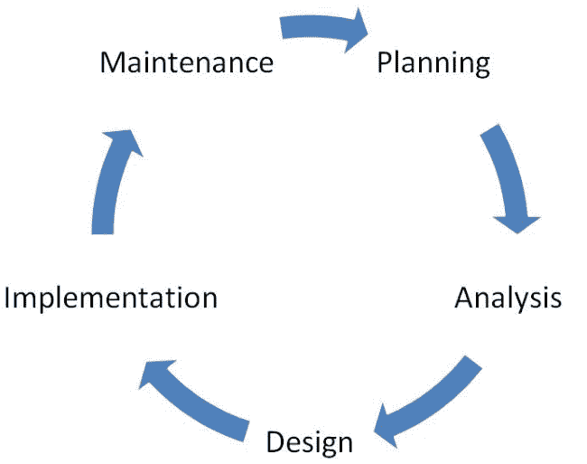

图 1.1：系统开发生命周期

在设计阶段，系统分析师将记录应用内每个程序的输入、处理和输出。在实施阶段，程序员将被分配使用系统分析师决定的编程语言来编写特定程序。一旦程序系统通过测试，就会安装新应用供人们使用。随着时间的推移，某些部分或程序可能需要修复。在维护阶段，它将经历一个微型的规划、分析、设计和实施。确定需要修改的程序，程序员将更改或修复这些程序。使用几年后，系统通常会过时。此时，将对应用进行重大修订。因此，周期循环往复。

## 1.1.2 定义

- **定义 1.1：系统分析师** 负责创建应用的专业人员。
- **定义 1.2：应用** 处理主要任务的信息系统或程序集。
- **定义 1.3：生命周期** 系统开发生命周期：规划 - 分析 - 设计 - 实施 - 维护

### 定义 1.4：实施

系统开发生命周期中的一个阶段，该阶段程序员被分配编写特定程序。

## 1.2 Bloodshed Dev-C++ 5 编译器/IDE

### 1.2.1 简介

微软（Microsoft）和博兰（Borland）是编程世界中编译器领域两个声誉卓著的名字。他们销售用于许多编程语言的编译器软件。对于 C++ 编程语言，`Microsoft Visual Studio` 包含 C++ 以及 `Borland C++ Builder` 都是优秀的编译器。通常通过教科书或互联网，你可以获得微软的 `Visual C++ Expression` 或博兰的 `Edition` 版本编译器。然而，安装其中任何一个都可能是复杂的。`Microsoft Visual Studio` 经常产生各种安装问题（例如确保操作系统和 `.net` 组件是最新的），使得学生很难在家里安装。这些编译器要求你构建一个项目来包含每个程序。使用商用系统对专业人士很好，但对初学者来说很困惑。最终，如果你打算成为一名专业程序员，你将需要熟悉它们。

我们建议初学者在编程基础课程中使用较易安装的编译器软件包。我们发现的最佳选项是一个名为 `Bloodshed Dev-C++ 5` 编译器/IDE 的开源编译器/IDE（集成开发环境）。

### 1.2.5 开源

向公众免费提供的软件源代码分组开发。

### 1.2.2 Bloodshed Dev-C++ 5 编译器/IDE

**优点**：可以安装在 Windows 95/98/NT/2000 操作系统上。我在 Windows 操作系统上安装过它，它可以适用于大多数 Windows 操作系统。它只需要 80MB 的存储空间（足够存放编译器文件以及你的程序存储空间）。它非常容易安装和使用。不要求使用“项目”；因此源代码可以单独被编译。

**缺点**：专业程序员不常使用，但对于入门编程课程是足够的，并且是一个功能完整的 IDE。

**独特优点**：可以安装在 U 盘上，因此学生可以在带有 USB 接口的任何计算机上工作。这可以给学生提供便利性，能够在家里、工作、图书馆、开放实验室、教室、朋友家里等地完成实验。

### 定义 1.6：便携性

将源代码传输到 U 盘并在各种机器上使用的能力。

### 1.2.3 安装前的准备

#### 1.2.3.1 创建所需的文件夹和子文件夹

你需要软件以及经过测试且无错误的 C++ 源代码。你需要大约 80MB 的存储空间。我们建议根据你选择的安装方式在硬盘或 U 盘上创建两个文件夹。如果在 U 盘上，请在磁盘根目录处创建。在你的个人电脑上，你可以使用操作系统为你设置的用户文件夹。将它们命名为：

> 此内容在线可用：<http://cnx.org/content/m18785/1.15>

- `Cpp_Source_Download`
- `Cpp_Source_Code_Files`

在 `Cpp_Source_Code_Files` 文件夹中，创建一个名为以下的子文件夹：

- `Compiler_Test`

为了帮助保持文件整洁，你可能需要创建其他子文件夹来存储源代码文件。我们建议你至少创建另外两个子文件夹与 Connections 相关的模块配合。在 `Cpp_Source_Code_Files` 文件中，创建名为以下的子文件夹：

- `Demo_Programs`
- `Monitor_Header`

### 定义 1.7：文件夹 (folder)

在磁盘驱动器或闪存盘上用于存储文档或其他文件的命名区域。

### 定义 1.8：源代码

任何用某种人类可读的计算机编程语言编写的语句或声明集合。

#### 1.2.3.2 获取软件

软件的完整版本是：`Dev-C++ 9.2 (4.9.9.2) (90 MB)`，带有 `MinGW/Gcc 3.4.2`。你可以从 `Bloodshed` 下载，或者从 Connections 网站下载 2008年12月8日的版本。将其存储在你创建的 `Cpp_Source_Download` 文件夹中。该软件大小约为 9.1 MB，如果你使用拨号调制变器连接，将需要几分钟下载。

> **提示**：软件自 2007 年以来没有发生重大变化，Connections 版本对于大多数用户来说足够了。`Bloodshed` 链接需要额外的导航才能到达软件下载页面。不过，由于后者简单得多，我们建议你从 Connections 网站下载软件。

- 指向 `Bloodshed` 的链接：<http://www.bloodshed.net/devcpp.html>³
- 从 Connections 下载：`devcpp-4.9.9.2_setup.exe`⁴

#### 1.2.3.3 获取 C++ 源代码文件

下面列出了一个名为 `Compiler_Test.cpp` 的 C++ 源代码文件。它是为 Connections 网络分发准备的。下载并将其存储到你创建的 `Compiler_Test` 子文件夹中。你可能需要右键点击链接并选择“目标另存为”来下载文件。

- 从 Connections 下载：`Compiler_Test.cpp`⁵

### 1.2.4 Bloodshed Dev-C++ 5 编译器/IDE 的安装说明

版本 5 很好（不要被测试版发布吓到），可以在各种机器和许多 Microsoft 操作系统上运行，包括 Windows 98、Windows 2000、Windows XP 和 Windows Vista。以下是将其安装在机器上或安装在闪存盘上的安装说明。我们不支持在机器驱动器和闪存盘之间切换。如果安装在机器驱动器上而你又安装到闪存盘，将会产生问题且无法正常工作。要么安装在闪存盘上获得便携性，要么安装在你的机器上。

³ <http://www.bloodshed.net/devcpp.html>
⁴ 参见位于 <http://cnx.org/content/m18785/latest/devcpp-4.9.9.2_setup.exe> 中的文件
⁵ 参见位于 <http://cnx.org/content/m18785/latest/Compiler_Test.cpp> 中的文件

#### 1.2.4.1 计算机安装说明

1. 导航到 `Cpp_Software_Download` 文件夹并双击文件名运行 `devcpp-4.9.9.2_setup.exe` 软件。
2. 使用常识并回答安装提示。注意以下两项：
3. 当进入“安装位置”（Install Location）时，使用软件的默认位置：`C:\Dev-Cpp\`，或选择你想要存储已安装程序的位置，但除非你熟悉安装软件，否则请使用默认值。
4. 当它询问“你是否想为此台电脑上的所有用户安装 Dev C++？”时，回答“是”（Yes）。
5. 安装完成后，它会询问“首次配置”（first time configuration）问题。再次，使用常识并回答问题。注意以下项：
6. 对于“从头文件中检索信息”，回答“否”（No）。
7. 它将带有“今日提示”（Tip of the day）启动你的编译器/IDE。我们建议勾选左侧的框并选择“关闭”（Close）。
8. 使用普通的红色“X”框关闭你的编译器/IDE。我们想向你展示如何正常启动编译器。
9. 你启动编译器软件的方法类似于在机器上加载：“开始”然后“所有程序”然后“Bloodshed Dev-C++”然后“Dev-C++”。
10. 在顶部的任何菜单上——选择“文件”（File）然后“打开项目或文件”（Open project or file），然后导航到你的源代码文件（`Compiler_Test.cpp`）所在的驱动器。选择上方建议的文件夹名称。选择源代码列表并打开它。
11. 你将看到源代码列表。按 `F9` 键或从顶部菜单选择“执行”（Execute）然后“编译并运行”（Compile & Run）。应该出现一个黑屏，你恰当地回答问题以运行程序。当你运行程序后，黑屏就会消失。

#### 1.2.4.2 闪存盘安装说明

1. 导航到 `Cpp_Software_Download` 文件夹并双击文件名运行 `devcpp-4.9.9.2_setup.exe` 软件。
2. 使用常识并回答安装提示。注意以下两项：
3. 当进入“安装位置”（Install Location）时，你可以看到默认软件位置：`C:\Dev-Cpp\`，这需要更改。通过更改默认软件位置来更改“目标”（Destination），从 `C:\Dev-Cpp\` 更改。
4. 当它询问“你是否想为此台电脑上的所有用户安装 Dev C++？”时，回答“是”（Yes）。
5. 安装完成后，它会询问“首次配置”（first time configuration）问题。再次，使用常识并回答问题。注意以下项：
6. 对于“从头文件中检索信息”，回答“否”（No）。
7. 它将带有“今日提示”（Tip of the day）启动你的编译器/IDE。我们建议勾选左侧的框并选择“关闭”（Close）。
8. 使用普通的红色“X”框关闭你的编译器/IDE。我们想向你展示如何正常启动编译器。
9. 你启动编译器软件的方法类似于在机器上加载：“开始”然后“所有程序”然后“Bloodshed Dev-C++”然后“Dev-C++”。
10. 在顶部的任何菜单上——选择“文件”（File）然后“打开项目或文件”（Open project or file），然后导航到你的源代码文件（`Compiler_Test.cpp`）所在的驱动器。选择上方建议的文件夹名称。选择源代码列表并打开它。
11. 你将看到源代码列表。按 `F9` 键或从顶部菜单选择“执行”（Execute）然后“编译并运行”（Compile & Run）。应该出现一个黑屏，你恰当地回答问题以运行程序。当你运行程序后，黑屏就会消失。

## 1.3 模块化与 C++

### 1.3.1 模块化概念

编程中最重要的概念之一是将某些代码分组为一个单元。这种方法的原始术语是子程序。其他名称包括子程序、过程、模块和函数。我们使用**函数**一词来称呼在两种主流语言（C++ 和 Java）中的它们。函数很重要，因为它们允许我们将大型程序分成可管理的部分。因为函数较小，我们可以专注于我们要做的事情并进行测试使其正常工作。函数通常分为两类：

- **程序控制**：用于简单控制程序的函数。这些函数是程序唯一的。
- **特定任务**：为多个程序设计的函数。这些函数执行特定任务，因此适用于许多程序。由于它们已经过代码编写和测试，我们可以放心地更高效地编写大型程序。

主程序必须建立所用函数的存在。根据编程语言的不同，有正式的方法来：
- 定义函数（`define`）
- 调用函数（`call`）
- 声明函数（`declare`）（原型 `prototype` 是一种声明）

### 1.3.2 C++ 中的函数介绍

我们将考虑一个简单的程序，它可能用于测试编译器以确保其安装正确。

#### 示例 1.1：`Compiler_Test.cpp` 源代码

```cpp
//************************************************
// Filename: Compiler_Test.cpp
//string：计算两个人的平均年龄
// 作者：Ken Busbee; @ Kenneth Leroy Busbee
// 日期：2009年1月5日
// 注释：核心思想是能够能够在你的编译器上
// 调试并运行一个程序。
//*******************************************
```

##### 头文件和其他技术项目

```cpp
#include <iostream>
using namespace std;
```

##### 函数原型

```cpp
void pause(void);
```

##### 变量

```cpp
int age;
int age2;
double answer;
```

##### main

```cpp
int main(void)
{
  // 输入
  cout << "\nEnter输入第一个人的年龄 -->: ";
  cin >> age1;
  cout << "\nEnter输入第二个人的年龄 -->: ";
  cin >> age2;

  // 处理
  answer = (age1 + age2) / 2.0;

  // 输出
  cout << "\n他们的平均年龄为 <<--------: ";
  cout << answer;

  pause();
  return 0;
}
```

##### pause

```cpp
void pause(void)
{
  cout << "\n\n";
  system("PAUSE");
  cout << "\n\n";
  return;
}
```

```
//**************************************************
// 程序结束
//**************************************************
```

此程序有两个函数，分别来自我们两个类别中的每一个。函数的技术布局是相同的；我们根据函数的如何实现来将它们分为两类。

#### 1.3.2.1 控制函数

C++程序的核心部分是一个标识符名称为 `main` 的特殊函数。`main` 作为函数的特殊性或唯一性在于，它是程序开始执行代码的地方，通常也是代码执行并停止的地方。它通常是程序中定义的第一个函数，出现在包含区域、其他技术项目、原型声明、全局常量和变量列表以及程序通常需要的任何其他项目之后。程序中提供了定义 `main` 函数的代码；然而，它在程序内部没有像其他函数那样被声明原型或使用。在这个简单的示例中，没有其他的程序控制函数。

#### 1.3.2.2 特定任务函数

我们需要执行一个可能用于许多程序中的特定任务。在 `Compiler_Test.cpp` 源代码中，我们有这样一个任务，用于停止代码执行直到用户按下按键。该函数名称是：`pause`。此函数在调用函数和自身之间不传递任何信息，因此使用了 `void` 数据类型。

#### 示例 1.2：函数的通用布局

```cpp
<返回值数据类型> 函数标识符名称(<数据类型> 输入值的标识符名称>)
{
  代码行;
  return <值>;
}
```

第一个函数后面没有分号。在 C++ 中，分号用于语句的末尾，但在定义函数的第一行并不使用。函数拥有一组大括号 `{}` 用于标识一组语句或代码块或代码行。一个函数内部通常有几行代码。包含指令的代码行以分号结束。你可以在上面的示例中识别出 `pause` 函数的定义！`pause` 的定义在 `main` 函数之后。从技术上讲，并没有要求程序在 `main` 函数之后列出所有函数（程序控制或特定任务函数）。

让我们识别调用 `pause` 函数的位置。调用函数是 `main` 函数，它位于函数的末尾。该行看起来像：

```cpp
pause();
```

当你调用一个函数时，使用它的标识符名称和一组括号。你将传递的任何数据项放在括号内，在我们的示例中没有。分号结束语句。在我们的程序编译并运行后，函数中的代码行被执行，当执行到调用 `pause` 时，控制权移动到 `pause` 并开始执行代码行。当执行完代码行后，它会返回程序中的位置并继续执行该函数中的代码。

一旦我们知道了如何定义函数以及如何调用函数，我们通常需要知道如何向编译器声明它（原型）。由于标准的计算机标准，程序员通常会将函数与其他定义在它后面的函数列在一起。然后在一个函数的某个地方，我们会调用一个函数。当我们把源代码转换为可在计算机上运行的可执行版本时，第一步是编译。编译器要求知道当函数被调用时函数之间将会有怎样的通信（输入什么作为参数）。但我们还没有定义该函数；它定义在函数之后。为了解决这个问题，我们向编译器展示该函数样子的原型（至少是通信特征部分）：

```cpp
void pause(void);
```


这一行代码看起来与我们函数定义的第一行完全相同，但多了一个重要的补充：分号。原型（或对尚未定义的编译器声明）放置在程序的顶部，位于 `main` 函数之前。**总结概念：如果你调用一个函数，必须在调用它之前对其进行原型声明。** 查看在 `main` 函数之前我们需要做的三件事的列表，有办法可以：

- 1. 声明一个函数（原型是对编译器的声明）
- 2. 调用一个函数
- 3. 定义一个函数

## 1.3.3 C++ 程序布局

从上述内容，你可以看到程序是由两个函数组成的。C++ 程序在 `main` 函数之前有几个项目。在示例中，它们：

- 1. 注释 - 以 `//` 开头的行，编译器会忽略它们直到行结束。
- 2. `#include<iostream>` - 此行包含一个文件。该文件包含了简单的输入和输出。
- 3. `using namespace std` - 此行告知编译器使用命名空间。标识符在命名空间建立。
- 4. 函数原型已经解释过了。
- 5. 我们需要一些变量（存储区域）以便程序工作。

## 1.3.4 定义

**Definition 1.9:** 模块化 将某些代码行分组为单元的能力。

**Definition 1.10:** 函数在两种主流编程语言中的名称：C++ 和 Java。

**Definition 1.11:** 程序控制 用于简单地划分程序的函数。

**Definition 1.12:** 特定任务 设计用于许多程序的函数。

**Definition 1.13:** 参数传递 数据在函数进外部通信的方式。

**Definition 1.14:** 标识符名称 程序员用于标识函数或其他其它程序项目的名称。

**Definition 1.15:** 函数原型 对编译器的声明。

**Definition 1.16:** 函数调用 对另一个函数的使用或调用。

**Definition 1.17:** 函数定义 定义函数作用的代码。

**Definition 1.18:** 大括号 用于识别 C++ 中的代码块。

## 1.4 练习：编程导论

### 1.4.1 学习目标

在记忆构建活动、练习、实验作业、问题或定时测验中具有 100% 的准确率；学生应该：

- 1. 定义本章节相关模块中的术语。
- 2. 安装 Bloodshed Dev-C++ 5 编译器
- 3. 对现有程序进行修改

### 1.4.2 记忆构建活动

链接至：MBA 0

### 1.4.3 练习

#### 练习 1.1（答案在第33页）

判断以下陈述的对错：

- 1. 初级程序员参与系统开发生命周期的所有阶段。
- 2. Bloodshed Dev-C++ 5 编译器/IDE 是本教材/集合的首选编译器，但任何 C++ 编译器都可以工作。
- 3. 大多数编译器可以安装在优盘上。
- 4. 除了函数作为子程序的名称，计算机行业也使用宏、过程和模块。
- 5. 函数通常分为两类：程序控制和特定任务。

### 1.4.4 杂项

目前暂无。

### 1.4.5 实验作业

#### 1.4.5.1 为第 01 章文件创建文件夹或子文件夹

在第 1 章的 Connexions 模块中，你已经收到了如何安装 **Bloodshed Dev-C++ 5 编译器/IDE** 以及使用 `Compiler_Test.cpp` 源代码文件测试安装的说明。如果你尚未完成此操作，请返回 Connexions 资料并完成此任务。

在安装说明中，你被要求创建一个名为 `Cpp_Source_Code_Files` 的文件夹（位于 C 盘硬盘驱动器，或在闪存驱动器上）。如果你还没有这个文件夹，请现在创建一个。

根据你所使用的编译器/IDE，你应该决定在哪里下载和存储用于处理的源代码文件。从审妥角度考虑，你应该在下载源代码文件之前创建文件夹。对于 **Bloodshed Dev-C++ 5 编译器/IDE**，建议的子文件夹命名为：

- 在 `Cpp_Source_Code_Files` 文件夹内创建 `Chapter_01`

如果你还没有这样做，请根据情况创建相应的文件夹和/或子文件夹。

#### 1.4.5.2 下载文件

将文件（s）下载并存储到存储设备的相应文件夹中。你可能需要右键点击链接并选择“另存目标为”以下载文件。

来自 Connexions：`Compiler_Test.cpp`^9

#### 1.4.5.3 详细实验说明

仔细阅读并遵循下面的说明，并按照列出的顺序执行步骤。

- 导航到你的子文件夹：**Chapter_01**并将 `Compiler_Test.cpp` 源代码文件重命名为 **Lab_01.cpp**
- 如果你在查看文件扩展名遇到问题，请使用附录中的“显示/隐藏文件扩展名”说明。
- 启动你的编译器并打开源代码。仔细进行以下修改：

更改顶部的注释，特别是：

- *文件名应为：`Lab_01.cpp`*
- *目的应为：计算三个人的平均体重*
- *删除接下来 2 行关于主思想的注释*
- *作者：写上你的名字并删掉我的以及版权信息*
- *日期：填写今天的日期*
- *删除接下来 3 行涉及许可的注释（删除带星号的行为）*

注意：在课程的剩余部分，你将使用讲师提供的源代码作为新实验作业的起点。有时你将使用自己创建的源代码作为新实验作业的起点。无论何种情况，你都应该适当修改注释，以至少包含本次实验作业中的四行信息（文件名、目的和日期）。

> ^9查看 <http://cnx.org/content/m22450/latest/Compiler_Test.cpp> 中的文件

我们现在将对此程序进行简单修改，使其能够计算三个人的平均体重。执行以下操作：

- 在变量区域，将变量 `age1` 和 `age2` 改为 `weight1` 和 `weight2`。添加另一个整数数据类型的变量，标识符名为 `weight3`。
- 输入区域有两个提示并请求用户提供数据。它们是成对组合的——一个提示和一个从键盘获取的数据。我们需要修改提示以询问体重而不是年龄。我们需要将变量名从 `age` 改为 `weight1`。对第二个提示并获取第二个数据项的组合也执行此操作。创建一个第三对，用于提示并获取第三个数据项。
- 处理区域只有一行代码，我们需要进行更改，加上 `weight3` 并除以 3.0 而不是 2.0。代码看起来应该是这样的：

```
answer = (weight1 + weight2 + weight3) / 3.0;
```

- 输出区域的文本需要从年龄（ages）修改为体重（weights）。
- 构建（编译并运行）你的程序。如果你在运行程序并输入三个体重时，它告诉了正确的平均值，说明你成功地编写了这个程序。
- 在成功编写此程序后，如果你是为了大学学分修这门课程，请遵循教授/讲师的说明进行提交评分。

### 1.4.6 习题

#### 1.4.6.1 问题 01a – 指示

列出系统开发生命周期的步骤，并指出一个新的计算机专业人员可能在哪个步骤工作。

## 第 1 章练习题解答

### 练习 1.1 的答案（第 30 页）

答案：

1. false
2. true
3. false
4. true
5. true

## 第 2 章

## 2. 程序规划与设计

### 2.1 程序设计¹

#### 2.1.1 程序介绍

程序设计由程序员在开始用特定语言编写程序之前应该执行的步骤组成。这些步骤在适当记录后将有助于维护。程序设计包括三个广泛的领域：

- 理解程序
- 使用工具创建模型
- 开发数据

#### 2.1.2 理解程序

在设计程序时，系统分析师可能会创建各种方法。这些方法包括屏幕布局、叙述描述等。如果你在一个项目上工作，为了理解程序，使用 IPO 方法对于初学者来说非常有效。理解程序通常涉及：

- 输入
- 处理
- 输出

#### 2.1.3 使用工具创建模型

起初你不需要复杂化，但随着程序的增长并变得复杂，你将把程序划分为几个模块（或函数）。你最初使用的建模工具是伪代码。伪代码将紧密遵循 IPO 方法。

> ¹该内容可在此处 <http://cnx.org/content/m18866/1.5/>。

### 2.1.4 开发测试数据

测试数据由用户提供一些输入值并预测输出组成。对于简单的程序这是真实的，测试数据可以检查模型是否产生了正确的结果。

### 2.1.5 定义

- **定义 2.1：** IPO
  输入 - 处理 - 输出

- **定义 2.2：** 伪代码
  用于表达算法或函数步骤的类英语语句

- **定义 2.3：** 测试数据
  提供输入值并预测输出

## 2.2 伪代码

### 2.2.1 概述

伪代码是设计或规划程序的一种方法。Pseudo 的意思是假的，因此伪代码意味着虚假的代码。更好的翻译应该是虚假或模仿。伪代码是虚假的（不是真实的）。它看起来像（模仿）真实的代码。它使用英语语句描述程序要完成的任务。它是假的，因为不存在编译器可以将伪代码翻译成任何机器语言。伪代码用于记录程序或模块设计（也称为算法）。

下面的简单程序大纲说明了伪代码。我们想要输入两个人的年龄并让计算机计算它们的平均年龄并显示答案。

**示例 2.1：使用伪代码的大纲**

```
Input
显示消息请求用户输入第一个年龄
从键盘获取第一个年龄
显示消息请求用户输入第二个年龄
获取第二个年龄

Processing
通过将两个年龄相加并除以二来计算答案

Output
在屏幕上显示答案
暂停以便用户看到答案
```

在开发完程序设计后，我们使用伪代码在语言（如 Pascal、COBOL、FORTRAN、"C"、C++ 等）中编写代码，在这些语言中，你必须遵循语言的规则（语法）来对伪代码中提出的逻辑或算法编码。伪代码不包括编程设计过程中产生的其他项目，例如变量标识符列表或测试数据。

还有其他规划和记录程序逻辑的方法。一种方法是 HIPO。它代表层级加输入输出（Hierarchy plus Input Output），由 IBM 在 20 世纪 60 年代开发。它涉及层级图（或结构图）来显示程序中子程序（或函数）之间的关系。每个子程序对应的 IPO/任务都很简单，因此我们不需要使用多个子程序，因此我们没有生成层级图。但我们在伪代码大纲中包含了该概念的 IPO 部分。

> 该内容可在此处查看 <http://cnx.org/content/m18648/1.10/>。

### 2.2.2 定义

**定义 2.4:** pseudo（伪-）
意思是虚假的，包含伪造或模仿的概念。

## 2.3 测试数据

### 2.3.1 概述

测试数据由用户提供一些输入值并预测输出组成。对于简单的程序，这可以非常容易，测试数据可以是双倍。

- 1. 检查模型查看是否产生了正确的结果（模型检查）
- 2. 检查编码程序查看是否产生了正确的结果（代码检查）

测试数据是通过使用程序的算法开发的。这通常在程序设计期间用流程图或伪代码进行记录。以下是以大纲形式形式伪代码，描述了用于绘制矩形建筑程序的输入、处理和输出。

**示例 2.2：使用 IPO 大纲绘制矩形建筑的伪代码**

```
Input
显示消息请求用户建筑的长度
从键盘获取长度
显示消息请求建筑的宽度
从键盘获取宽度
显示消息请求用户建筑的高度
从键盘获取高度
显示消息请求用户每加仑油漆的价格
从键盘获取获取每加仑油漆的价格
显示消息请求用户每加仑油漆的覆盖面积
从键盘获取每加仑油漆的覆盖面积

Processing
计算建筑的总面积：
长度乘以高度乘以 2
然后宽度乘以高度乘以 2
然后将两个结果相加
计算所需的油漆加数：
将总面积除以每加仑的覆盖面积
然后向上取到下一个整数加仑
计算油漆的总成本：
所需的总加数乘以每加仑的价格

Output
在显示器上显示所需的加数
在显示器上显示油漆的总成本
暂停以便用户看到答案
```

### 2.3.2 创建测试数据和模型检查

测试数据用于验证输入、处理和输出是否正常工作。由于测试最初开发的，它可以验证开发的算法（我们正在做的示例中的伪代码）是正确的。它帮助我们理解和可视化程序的输入、处理和输出。

输入：我的建筑长100英尺，宽40英尺，高10英尺。我选择的油漆价格为每加仑 $28.49，每加仑可覆盖 250 平英尺。我们应该验证伪代码是否提示用户输入这些数据。

处理：使用太阳能手持器，我可以计算（或预测）总面积为：(100 x 10 x 2 + 40 x 10) = 2800 平英尺。油漆总加数为：(2800 / 250) 或 11.2 加仑。向上取整后，我需要 12（加仑油漆）。总成本为：(28.49 乘以) 或 341.88。我们应该验证伪代码是否执行了正确的计算。

输出：仅向用户显示显性信息（要购买的加数和总成本）。我们应该验证是否显示了适当的信息。

### 2.3.3 测试编码程序 – 代码检查

测试数据被开发并用于测试在程序设计阶段记录（在我们的伪代码中）的算法。一旦程序完成编码并消除了编译器和链接器错误，程序员就可以展示开发的测试数据。当你运行程序时，你如何知道它运行正常？你是否正确地规划了逻辑以实现你的目的？如果你的计划是正确的，它是否已转换（代码）为所选的程序语言（在我们例中是 C# 吗？）？这些问题的答案（或解决方案）就是我们的测试数据。

通过开发测试数据，我们是在预测结果应该是什么，因此我们就可以验证程序是否运行正常。当我们运行程序时，我们输入测试数据中使用的输入值。如果不是，我们的问题可能是以下任何一种：

- 1. 计划（IPO 或其他项目）可能是错误的
- 2. 计划到代码的转换可能是错误的
- 3. 测试数据结果计算有误

解决此类问题是程序员遇到的最困难的问题。你必须检查上述每一项以确定错误所在之处。修复并重新测试你的程序。

### 2.3.4 定义

**定义 2.5:** model checking（模型检查）
使用测试数据检查模型（通常在伪代码中）。

**定义 2.6:** code checking（代码检查）
使用测试数据检查特定语言的程序（如 C++）。

## 2.4 练习：程序规划与设计

### 2.4.1 学习目标

在记忆活动、练习、实验作业或限时考试中具有 100% 的准确率，学生预期：

- 1. 在本章相关的术语上编码
- 2. 为编程问题创建伪代码文档
- 3. 为编程问题创建测试数据文档

### 2.4.2 记忆活动

### 2.4.3 练习

#### 练习 2.1

对以下陈述判断对或错：

1. 在像 C++ 语言中编码程序是规划的第一任务。
2. 伪代码是常用的规划工具。
3. 测试数据是在编码程序后开发的。
4. 伪字意思是虚假的，包含虚假或模仿的概念。
5. 许多程序员有在开始编码程序之前不完成规划的坏习惯。

### 2.4.4 杂项

目前没有。

### 2.4.5 实验作业

#### 2.4.5.1 创建文件夹或子文件夹

根据你的编译器/IDE，你应该决定在哪里下载和存储源文件。谨慎的做法是在你下载源文件之前创建这些文件夹，可能是在名为 `Chapter_02` 的文件夹内：

> 4 此内容可在 <http://cnx.org/content/m18781/L4/> 获取。
> 5 此内容可在 <http://cnx.org/content/m18781/L4/> 获取。

#### 2.4.5.2 下载文件

将文件下载并存储到相应的文件夹中。

#### 2.4.5.3 详细实验说明

- 导航到你的 `Chapter_02` 文件夹并按照步骤操作。
- 打开你的伪代码文本文件。根据需要修改文本文件。使用你的测试数据逐步执行你的伪代码。一切都运行正常吗？你漏掉了什么吗？

> 6 此内容可在 <http://cnx.org/content/m18781/L4/> 获取。
> 7 此内容可在 <http://cnx.org/content/m18781/L4/> 获取。


- 当你对程序计划和测试数据的完成感到满意时，关闭你的文本文件。没错，我说的是“保存并关闭你的文本文件”。在使用任何其他软件之前，应该正确关闭文件，这是移动、拷贝和重命名文件的操作系统软件。

- 拷贝 `Pseudocode.txt`

- 拷贝 `TestData.txt`

### 问题 02a – 指示

问题：我有一个从欧洲来访的朋友，他不完全清楚自己为车买了了多少汽油。我们需要编写一个程序，允许他输入加仑单位的汽油量，并将其转换为升（公制单位）。注意：1 美国加仑等于 3.7854 升。

### 2.4.6.2 问题 02b – 指示

为以下内容创建测试数据：

问题：一家大型餐厅每天派一名厨师去购买水果和蔬菜。回到商店后，厨师必须为购买的每种物品输入两个数据：数量（例如：2 箱）和他支付的价格（例如：$4.67）。程序包含一个有 20 个物品的列表，在厨师输入信息后，程序将提供当天的购买总额。你需要为五（5）种物品准备测试数据：苹果、橙子、香蕉、生菜和番茄。

## 第 2 章练习题解答

### 练习 2.1 答案（第 39 页）

答案：

- 1. false
- 2. false
- 3. false
- 4. true
- 5. true

## 第 3 章

## 3. 数据与运算符

### 3.1 C++ 中的数据类型

#### 3.1.1 数据讨论

我们与程序的交互（输入和输出）在许多语言中被视为字节流。这些字节代表了可以解释为我们所理解的数值的数据。此外，在程序内部，我们以许多方式处理这些数据，例如相加或排序。这些数据以不同的形式出现。例如：用户名是一个字符字符串；你的年龄通常是一个整数；你口袋里的钱通常是以美元和分为单位衡的值（带有小数部分）。理解如何设计和编写程序，很大程度上在于集中精力理解我们想要处理的数据类型以及如何处理这些数据。

> 类型定义了一组值集合和一组可以应用于这些值的操作。每种类型的值集合被称为该类型的定义域（domain）。数据的四大类包括：
>
> - 无/空值（Nothing）
> - 整数（Integer）
> - 浮点数（Floating-point）
> - 复数（Complex）

C++ 编程语言识别出五种数据类型作为标准数据类型：

- 空（Void）
- 布尔（Boolean）
- 字符（Character）
- 整数（Integer）
- 浮点数（Floating-point）

标准数据类型和 C++ 的复杂数据类型有一系列属性，包括：

- C++ 保留字或关键字
- 定义域（Domain） - 允许的值
- 符号（Signage）—— 是否允许负数或仅允许正数
- 含义（Meaning）—— 即它们代表什么
- 定义规则（Rules of Definition）—— 用什么特殊字符指示数据类型
- 大小（Size）—— 内存中存储的字节
- 允许的操作（Operations Allowed）—— 即我可以在数据类型上使用哪些运算符

将上述部分内容放入汇总表中，我们得到：

| 类别 | 数据类型 | 保留字 | 代表 | 标准类型 |
| --- | --- | --- | --- | --- |
| 无 | 空或无物 | `void` | 无数据 | 是 |
| 整数 | 布尔 | `bool` | 逻辑真与假 | 是 |
| 整数 | 字符 | `char` | 单个字符 | 是 |
| 整数 | 整数 | `int` | 整数 | 是 |
| 浮点数 | 浮点数 | `float` | 分数数字 | 是 |
| 复数 | 字符串 | `string` | 字符序列 | 否 |
| 复数 | 数组 | N/A | 相同数据类型的元素集合 | 否 |
| 复数 | 指针 | N/A | 指向元素的地址 | 否 |

理解如何设计和编写程序，很大程度上在于集中精力理解我们想要处理的数据类型以及如何处理这些数据。

第二种有时被称为“常量变量”（constant variable），但这个名称本身就是自矛盾的。它如何可能既是常量又是变量？第二种更好的名称是“内存常量”（memory constant），因为它们在内存中有“特定的存储空间”。

### 3.3.2 定义常量和变量

在上面的示例中，我们展示了如何定义变量和常量，并为它们赋予初始值。内存常量在定义时必须赋值。变量则不一定赋予初始值。

```
int height;
float value_coins;
```

变量一旦定义，可以在程序的指令中赋值。

```
height = 72;
value_coins = 2 * 0.25 + 3 * 0.05;
```

### 3.3.3 定义

- **定义 3.7：常量 constant**

  数据项的值在程序执行期间不能改变。

- **定义 3.8：变量 variable**

  其值在程序执行期间可以改变的数据项。

### 3.4 数据处理

#### 3.4.1 引言

单个值本身是重要的；然而，我们需要处理值的方法（处理数据）。科学家们想要一台精确的用于处理值的机器。他们想要一台可以处理数字或计算答案（即结果）的机器。在1950年之前，字典对计算机的定义是进行计算的人类。因此，所有描述数据处理的术语都是面向数学的。此外，两个基础数据类型族（整数族和浮点数族）完全由数字数值组成。

#### 3.4.2 定义

- **定义 3.9：表达式 expression**

  一组有效的操作数和运算符序列，可以还原（或求值）为一个单一值。

- **定义 3.10：运算符 operator**

  一种特定语言的语法标记（通常是符号），用于对一个或多个操作数执行某种操作。

- **定义 3.11：操作数 operand**

  接收运算符作用的值。

- **定义 3.12：优先级 precedence**

  决定了运算符允许操作操作数的顺序。

- **定义 3.13：结合性 associativity**

  决定了相同优先级的运算符允许操作操作数的顺序。

> 5 此内容可以在在线查看 <http://cnx.org/content/m18705/1.6/>。

- **定义 3.14：求值**

  应用运算符并产生单一值的过程。

- **定义 3.15：括号**

  改变表达式中的求值顺序。你会先看到括号内的内容。

#### 3.4.3 一个带有求值的表达式示例

让我们来看一个例子：`2 + 3 * 4 + 5` 是我们的表达式，但它等于什么呢？

- 符号 `+` 代表加法，`*` 代表乘法是我们的运算符
- 数值 2, 3, 4 和 5 是我们的操作数
- 优先级规定乘法的优先级高于加法
- 我们先求值 `3 * 4` 得到 12
- 现在我们有：`2 + 12 + 5`
- 结合性规则规定加法从左到右进行，我们求值 `2 + 12` 得到 14
- 现在我们有：`14 + 5`
- 最后，我们求值 `14 + 5`；这就是该表达式的值

括号会改变结果。`(2 + 3) * (4 + 5)` 的求值为 45。

`(2 + 3) * 4 + 5` 的求值为 25。

#### 3.4.4 运算符优先级表

每种语言都有一些定义优先级和结合性的规则。它们通常遵循我们可能已经学过的规则。乘法和除法在加法之前是我们在小学学过的规则。这现在依然有效。优先级规则随编程语言而异。你应该参考总结了你所用语言规则的参考表，通常称为“运算符优先级表”。在求值表达式时，你应该根据需要查看此表。

一个有效的表达式由组合恰当的操作数和运算符组成。为什么用 (s)？某些运算符是：

- 元运算符 - 只有一个操作数
- 二元运算符 - 有两个操作数，位于运算符的侧边
- 三元运算符 – 使用运算符符号来分隔三个操作数

大多数运算符都需要两个操作数。在 C++ 中，只有一个三元运算符，即条件运算符。所有的元运算符都在运算符的左侧，除了前置自增和后置自减。某些优先级表标出了哪些运算符是单元的，因此其他所有的都是二元的。

### 3.5 赋值运算符

#### 3.5.1 讨论

赋值运算符允许我们改变可修改数据对象的值（对于初学者来说，这通常指变量）。它与将值移动到存储位置（通常也是变量）的概念相关。在 C++ 编程语言中，使用的符号是等号。但当你看到 `=` 符号时，你需要开始思考赋值。赋值运算符有两个操作数。运算符左侧的是变量的标识符名称。运算符右侧的是值。

> 6 此内容可以在在线查看 <http://cnx.org/content/m18725/1.4/>。

#### 示例 3.2：简单赋值

```
int age; // 设置变量
    随后在程序的稍后部分
age = 21;
```

值 21 被赋值给 `age` 变量。这是值移动到一个存储位置（通常是变量）。

#### 示例 3.3：带有表达式的赋值

```
int cousins; // 设置
    随后赋值
cousins = 9 + 5;
```

赋值运算符右侧是一个表达式。该表达式将被求值并得到 14。值 14 将赋值给变量 `cousins`。

#### 示例 3.4：带有标识符的赋值

```
int students_period_1 = 25; // 初始化
int students_period_2 = 19;
int total_students;
    在程序的稍后部分
total_students = students_period_1 + students_period_2;
```

赋值运算符右侧包含一些标识符名称。程序将获取这些变量的值；将它们相加得到 44；然后赋值给 `total_students`。

#### 3.5.2 定义

> **定义 3.16：赋值**

> 改变可修改数据对象值的运算符。

### 3.6 算术运算符

#### 3.6.1 讨论

运算符对一个或多个操作数执行操作。常见的算术运算符有

> 7 此内容可以在在线查看 <http://cnx.org/content/m18706/1.4/>。

#### 表格 3.2

| 操作 | C++ 运算符符号 |
| --- | --- |
| 加法 | `+` |
| 减法 | `-` |
| 乘法 | `*` |
| 除法 | `/` |
| 取模（与整数相关） | `%` |

算术运算符是二元的，因为它们有两个操作数。操作数可以是常量或变量。

`age + 1`

这个表达式由一个运算符（加法）两个操作数组成。第一个由变量 `age` 表示，第二个是字面常量。如果 `age` 的值为 14，该表达式的求值为（或为）15。

这些运算符的作用正如我们从小学到的，除了除法和取模。我们通常认为除法的结果可能带有小数部分（浮点数据）。然而，当两个操作数都是整数类型时，除法的作用不同。请参考关于“整数除法和取模”的补充材料。

### 3.7 类型转换

#### 3.7.1 概述

改变值的类型被称为“类型转换”。有两种方法：

- 隐式 – 改变隐含
- 显式 – 使用转换运算符显式执行

被改变的值可以是：

- 提升 – 从较小的域到较大的域
- 缩小 – 从较大的域到较小的域

#### 3.7.2 隐式类型转换

语言将值从一种数据类型转换为另一种数据类型，而无需程序员特意这样做，这被称为隐式转换。每当二元运算符具有不同类型的操作数时，就会发生。根据运算符的不同，一个操作数将被转换为另一个的数据类型。取决于运算符，可能会被提升或缩小。

#### 示例 3.5：隐式提升

在此示例中，整数值 55 被转换为 55.0 的浮点值（最可能是 double）。它被提升了（promoted）。

#### 示例 3.6: 隐式降级 (Demotion)

```cpp
int money;      // 设置变量
随后在程序中
money = 23.16;
```

在此示例中，变量 `money` 是一个整数。我们正尝试将浮点值 23.16 移动到整数存储位置。这被称为降级（demotion），浮点值通常会被截断为 23。

#### 3.7.3 提升 (Promotion)

提升永远不是问题，因为较低的数据类型（允许值的范围较小）是较高数据类型的子集。提升发生在三种标准数据类型中：字符、整数和浮点数。允许的值（或域）从一个进展到另一个。字符类型是整数值的子集，而整数是浮点值的子集；在浮点值内部：`float` 值是 `double` 的子集。尽管字符数据代表字母、数字（0 到 9）和符号（$、逗号等），它们的位模式也代表从 0 到 255 的整数值。这种进展允许我们将它们从整数到浮点再到双数的链中提升出来。

#### 3.7.4 降级 (Demotion)

降级代表了经常发生的截断或不可预测结果的问题。如何将整数值 456 放入字符值中？如何将浮点值 45656.453 放入整数中？大多数编译器在检测到降级发生时会给出警告。编译器警告不会停止编译过程。它警告程序员检查降级是否合理。

如果我根据服务的人数（假设为 8 人）和每罐的数（假设为 2.3 份）计算购买的罐数，我需要 18.4 罐。我想将 18.4 降级为整数。我会将 18.4 截断为 18，并认为值 18 在整数数据类型的域内是有效的，它是带有截断副作用的降级。

如果尝试将包含银河系星星数量的 double 降级为整数，我可能会得到不可预测的结果（假设星星的数量大于域内允许的值）。


## 3.7.5 显式类型转换 (Explicit Type Conversion)

大多数语言都有一种方法让程序员将值从一种数据类型更改或转换为另一种；称为显式类型转换。在 C++ 中，强制转换运算符（cast operator）是一个一元运算符；它只有一个操作数，且位于运算符的右侧。该运算符是一组围绕新数据类型的括号。

### 示例 3.7: 带有截断的显式降级

```cpp
(int) 4.234
```

此表达式将求值为：4。

## 3.7.6 C++ 演示程序

### 3.7.6.1 为源代码文件创建文件夹或子文件夹

根据你的编译器/IDE，决定在哪里下载和存储用于处理的源代码文件。Pricates 要求在下载源代码文件之前根据需要创建这些文件夹。对于 Bloodshed Dev-C++ 5 编译器/IDE，建议的子文件夹命名为：

- Demo_Programs

如果你尚未这样做，请根据情况创建相应的文件夹和/或子文件夹。

### 3.7.6.2 下载演示程序

将以下文件下载并存储到存储设备相应的文件夹中。按照你的编译器/IDE 的方法，编译并运行程序。结合其他学习材料学习源文件文件。

从 Connexions 下载：`Demo_Data_Type_Conversions.cpp`

> ⁹查看 <http://connx.org/content/m18744/latest/Demo_Data_Type_Conversions.cpp> 文件。

> ¹⁰此内容可以通过 <http://connx.org/content/m22455/1/4/> 在线获取。

> ¹¹查看 <http://connx.org/content/m22455/latest/index.html> 文件。

## 3.7.7 定义

- **定义 3.17:** 隐式 (implicit) —— 一个数据类型自动更改的值。
- **定义 3.18:** 显式 (explicit) —— 使用强制转换运算符更改值的数据类型。
- **定义 3.19:** 提升 (promotion) —— 从较小的域到较大的域。
- **定义 3.20:** 降级 (demotion) —— 从较大的域到较小的域。
- **定义 3.21:** 截断 (truncation) —— 浮点数据类型中在转换为整数时被丢弃的小数部分。

## 3.8 练习 3: 数据与操作符

### 3.8.1 学习目标

在记忆构建活动、练习、实验作业或限时测验/考试期间达到 100% 的准确率：学生预期：

1. 定义与本章节相关模块中列出的定义术语。
2. 理解基本类型以及操作符如何处理数据。
3. 给定伪代码和测试数据文档，编写程序的 C++ 代码。

### 3.8.2 记忆构建活动

链接至：MBA 03¹

### 3.8.3 练习

练习 3.1（答案在第 55 页。）

判断下列陈述的对或错：

1. 数据类型定义了一组可以应用于这些值的值和操作。
2. 留关键字可以作为标识符使用。
3. 该概念说明某些操作符（如乘法和除法）在其他操作符（如加法和减法）之前执行。
4. 括号改变了操作符的优先级。
5. 需要两个操作数的操作符将是相同的。
6. 一个数据类型自动更改的值。
7. 使用强制转换运算符更改值的数据类型。
8. 从较小的域到较大的域。
9. 从较大的域到较小的域。
10. 我需要什么？

### 3.8.4 杂项

链接至：操作 1²

### 3.8.5 实验作业

#### 3.8.5.1 为源代码文件创建文件夹或子文件夹

根据你的编译器/IDE，决定在哪里下载和存储用于处理的源代码文件。Pricates 要求在下载源代码文件之前根据需要创建这些文件夹。对于 Bloodshed Dev-C++ 5 编译器/IDE，建议的子文件夹命名为：

- 03

如果你尚未这样做，请根据情况创建相应的文件夹和/或子文件夹。

#### 3.8.5.2 下载演示程序

将以下文件下载并存储到存储设备相应的文件夹中。按照你的编译器/IDE 的方法，编译并运行程序。结合其他学习材料学习源文件。

从 Connexions 下载：`Demo_Data_Type_Conversions.cpp`

#### 3.8.5.3 详细说明

阅读下面的指示，并按照步骤操作。

- 我想要的输出是什么？
- 我们可以通过反推逻辑，开始完全看到程序必须做什么。我们需要输入一些数据（输入），进行一些计算（处理）并显示结果（输出）。
- 在你的子文件夹 03 中复制我们使用的源代码列表（建议你复制 Lab 01 的源代码），并将副本重命名为 `Lab_03.cpp`。
- 代码将遵循 `Solution_03_Pseudocode.txt` 文件。我只是为了给你一行向上进位到下一个整桶油漆的代码（查看 Connexions 材料第 3 章中的“数据类型转换”模块。你理解它是如何工作的吗？）

```cpp
total_gal_paint = total_area / gal_paint + 0.9999;
```

构建（编译并运行）你的程序。当程序使用测试数据运行并给出预测结果时，你就成功地编写了程序。

在你成功编写了该程序后，如果你是为了大学学分修读此课程，请参考教授/教师关于提交评分的指示。

### 3.8.6 问题

#### 3.8.6.1 问题 03a – 指示

编写 C++ 代码来实现以下伪代码示例。

**示例 3.8: 伪代码**

提示用户输入月收入。
获取用户的月收入。
将月收入乘以 12。
显示年收入。
暂停程序以便户可以看到答案。（提示：你可能调用一个函数。）

# 第3章练习题解答

## 3.1节练习题解答（第53页）

答案：

- 1. 正 (true)
- 2. 错 (false)
- 3. 正 (true)
- 4. 正 (true)
- 5. 错 (false) – 括号改变了表达式中的求值顺序。

# 第4章

## 4 常用数据类型

### 4.1 整数类型¹

#### 一般讨论

- 带有各种创建不同域的整数数据类型
- 整数族还包括布尔和字符数据类型

整数数据类型基本表示整数（没有小数部分）。整数值从一个值跳到另一个值。6和7之间没有其他数字。可能会有人问为什么不把所有的数字都设为浮点数（允许小数部分）？原因有两点：首先，现实世界中的某些事物不是小数的。一只狗，即使有3条腿，仍然是一只（1）狗，而不是两只狗。其次，整数数据类型用于通过计数来控制程序流，因此需要一种从一个值跳到另一个值的数据类型。

整数数据类型在所有编程语言中具有相同的属性且行为相似。C++中最常用的整数数据类型是简单整数。

| C++ 保留字 | int |
|---|---|
| 表示 | 整数（没有小数部分） |
| 大小 | 通常为 4 字节 |
| 正常符号 | 有符号（负值和正值） |
| 域（允许的值） | -2,147,483,648 到 2,147,483,647 |
| C++ 语法规则 | 不以 0（零）开头 |
| C++ 语法规则 | 无小数点 |

表 4.1

在C++中，可以使用保留字来修改整数的大小或符号。它们包括：`long`、`short`、`signed` 和 `unsigned`（无符号）。使用 `signed` 是因为整数默认是有符号的——如果你需要只有正数的整数，则必须指定 `unsigned`。可能的组合有：

¹此内容可以在线通过 <http://cnx.org/content/m18654/1.6/> 获取。

| C++ 保留字组合 | 符号性 |
|---|---|
| short int | 有符号 |
| unsigned short int | 无符号 |
| int | 有符号 |
| unsigned int | 无符号 |
| long int | 有符号 |
| unsigned long int | 无符号 |

表 4.2

上述每个数据类型选项的域随所使用的编译器和计算机而异。域的变化取决于编译器和计算机分配给数据变量的字节大小。这种现象被称为**机器相关性**（machine dependent）。此外，在升级后发生过一些大小变化。在“C”语言中，`int` 数据类型在 Intel 兼容的中央处理器（CPU）机器上占用 2 字节内存存储空间。在“C++”中，`int` 分配了 4 字节。

整数数据类型的变化对于 C++ 初学者来说是一种困扰，更重要的是理解适用于大多数编程语言的整数数据类型的通用属性。

#### 4.1.2 定义

**定义 4.1：** 机器相关性 —— 一种根据计算机 CPU 改变的编程语言属性。

### 4.2 浮点数据类型

#### 4.2.1 一般讨论

浮点数据类型是一族数据类型，它们行为相似，仅在域（允许的值）的大小上不同。浮点数据类型族表示带有小数部分的数值。它们在技术上存储为两个整数值：**尾数**（mantissa）和**指数**（exponent）。浮点类型族在所有编程语言中具有相同的属性且行为相似。它们始终可以存储负值或正值，因此它们是有符号的；这与可以是无符号的整数数据类型不同。浮点数据类型的**域**各异，因为它们可以表示非常大的数字或非常小的数字。在 C++ 中，最常用的浮点数据类型类型是 `double`。

²此内容可以在在线通过 <http://cnx.org/content/m18654/1.6/> 获取。

| C++ 保留字 | double |
|---|---|
| 表示 | 带有小数部分的数值 |
| 大小 | 8 字节 |
| 正常符号 | 有符号（负值和正值） |
| 域（允许的值） | 极大或极小数字 |
| C++ 语法规则 | 有小数点 |

表 4.3

| C++ 保留字 | 大小 |
|---|---|
| float | 4 字节 |
| double | 8 字节 |
| long double | 10 到 12 字节（取决于机器） |

表 4.4

上述每个数据类型选项的域随所使用的编译器和计算机而异。域取决于编译器和计算机分配给数据变量的字节大小。这种现象被称为**机器相关性**。此外，整数数据类型的变化对于 C++ 初学者来说是一种困扰，更重要的是理解适用于大多数编程语言的整数数据类型的通用属性。

#### 4.2.2 定义

- **定义 4.2：** 机器相关性 —— 一种根据计算机 CPU 改变的编程语言属性。
- **定义 4.3：** double —— 在 C++ 中最常用的浮点类型类型是 `double`。
- **定义 4.4：** 尾数 —— 两个部分和指数。

### 4.3 字符串数据类型

#### 4.3.1 一般讨论

技术上，在 C++ 中没有字符串数据类型。然而，字符串的概念使得处理字符串变得容易。单个字符具有某些局限性。许多数据项不是整数或浮点数。“你好！”是字符串的一个很好的例子。因此，需要处理字符序列。

³此内容可以在在线通过 <http://cnx.org/content/m18656/1.7/> 获取。

在“C”编程语言中，字符串被处理为以空字符（值为0）结尾的字符数组。随着面向对象编程的发展，`string` 类已添加到 C++ 标准中。这随着字符串最大长度为255个字符的实现而改变。C++ 类包含了保留字 `string`，就像数据类型一样。

| C++ 保留字 | string |
|---|---|
| 字符序列（技术上是数组） | |
| 大小 | 长度可变 |
| 正常符号 | 无 |
| 域（允许的值） | 扩展 ASCII 字符集 |
| C++ 语法规则 | 双引号常量 |

表 4.5

现在，我们只讨论作为常量的字符串。大多数集成开发环境（IDE）中的编译器会对源代码进行着色，以帮助程序员更容易看到不同特征。程序员将使用字符串常量向显示器发送消息。典型的 C++ 代码行：

`out << "Hi Mom";`

应对 "Hi Mom" 着色（通常为红色），以强调该项是字符串。

#### 4.3.2 定义

**定义 4.5：** string —— 作为单个数据单元字符序列或数组。

### 4.4 算术赋值运算符

五个算术赋值运算符是一种简写形式。各种教材将其称为“复合赋值运算符”或“组合赋值运算符”。它们的用法可以通过赋值运算符和算术运算符来解释。在表格中我们将使用变量 `age`，你可以假设它是整数数据类型。

| 算术赋值示例 | 等效代码 |
|---|---|
| `age += 14;` | `age = age + 14;` |
| `age -= 14;` | `age = age - 14;` |
| `age *= 14;` | `age = age * 14;` |
| `age /= 14;` | `age = age / 14;` |
| `age %= 14;` | `age = age % 14;` |

表 4.6

#### 4.4.2 C++ 演示程序

##### 4.4.2.1 为源文件创建文件夹或子文件夹

根据你的编译器/IDE，你应该决定在何处下载和存储用于处理的源代码文件。谨慎起见，你应该在下载源代码文件之前根据需要创建这些文件夹。

用于 Bloodshed Dev-C++ 5 编译器/IDE 的子文件夹可以命名为：

- Demo_Programs

如果你尚未这样做，请根据情况创建相应的文件夹和/或子文件夹。

##### 4.4.2.2 下载演示程序

将以下文件下载并存储到存储设备的相应文件夹中。按照你的编译器/IDE 的方法编译并运行程序。结合其他学习材料学习源文件。

从 Connections 下载：`Demo_Arithmetic_Assignment.cpp`

> ⁵查看位于 <http://cnx.org/content/m18743/latest/Demo_Arithmetic_Assignment.cpp> 的文件

> ⁶此内容可以在 <http://cnx.org/content/m18058/1.12/> 在线获取

### 4.5 左值 (Lvalue) 和右值 (Rvalue)

#### 4.5.1 讨论

它们指的是赋值运算符的左侧和右侧。左值（读作：L value）概念是指赋值运算符左侧的操作数必须是可以修改的，通常是一个变量。右值（Rvalue）则提取或获取赋值运算符右侧表达式或操作数的值。

**示例 4.1**

```cpp
int age;      // 设置变量
随后在程序中
age = 39;
```

值 39 被提取或获取（右值）并存储在名为 age 的变量中（左值）；从而销毁了该变量中之前存储的值。

**示例 4.2**

```cpp
int age; // 设置变量
int voting_age = 18; // 设置带有初始化的变量
随后在程序中
age = voting_age;
```

如果赋值运算符右侧的表达式是变量或命名常量，它将提取或获取存储在变量或常量中的值。值 18 从名为 voting_age 的变量中提取或获取，并存储到变量 age 中。

**示例 4.3**

```cpp
age < 17;
```

如果该表达式是一个测试表达式或布尔表达式，该概念仍然是一个右值。标识符名称中的值被提取或获取，并用于“小于”的比较比较。

**示例 4.4**

```cpp
const int JACK_BENNYS_AGE = 39; // 设置常量
随后在程序中
JACK_BENNYS_AGE = 65;
```

这是非法的，因为标识符 `JACK_BENNYS_AGE` 不具备左值属性。它不是一个可修改的数据对象，因为它是一个常量。

一些左值和右值可能会混淆。

**示例 4.5**

```cpp
oldest = 55; // 设置带有初始化的变量
随后在程序中
age = oldest++;
```

后置自增是在你完成其他运算符时使用我现有的值；请增加我。oldest 变量的第一次使用是一个右值语境，其中现有值 55 被提取、获取并赋值给变量 age；这是一个左值语境。oldest 变量在值 oldest 中的第二次使用从 55 增加到 56。

#### 4.5.2 定义

- **定义 4.6：** 左值 (Lvalue) —— 赋值运算符左侧的操作数是可以修改的，通常是一个变量。
- **定义 4.7：** 右值 (Rvalue) —— 提取或获取存储在变量或常量中的值。

### 4.6 整除与取模 (Modulus)

#### 4.6.1 整除与取模概述

当我们成年后，通常认为除法会产生一个带有小数部分的答案（浮点数据类型）。这种除法被称为浮点除法。然而，当两个操作数都是整数类型时，在大多数计算机上的行为方式不同。在 C++ 语言中，以下表达式不会给出 2.75 的答案：

**示例 4.6**

```cpp
11 / 4
```

因为两个操作数都是整数类型，该表达式的评估（或答案）将为 2，没有小数部分（被丢弃）。再次，这种除法被称为整除，是你在小学学到的。

**定义 4.8：** 整除 —— 没有小数部分。


**图 4.1：** 在小学学到的整除。

在数据操作真实世界中，某些事物以整数单位（整数类型）处理。小数部分不存在。为了说明我们的例子：我有 11 个硬币平均分给 4 个孩子。他们得到多少？答案是 2，还剩下 3 个（在我手里）。答案不是每个 2.75 个。跳出框框思考，想象你是一个海盗。使用斧头将剩下的 3 个硬币分成 8 份。然后给每个孩子 2 个硬币或 6/8 或 2.75 个。如果你这样做，我会把我的例子改成 3 罐汤。更好的，像小狗一样的东西。当你用斧头分割它们后，大多数孩子会想要**取模**？这是整除的其他部分。记得在小学你会说，“十一除四余二”。在 C++ 编程语言中，取模的符号是百分号。

> 此内容可以在 <http://cnx.org/content/m18717/1.13/> 在线获取

**示例 4.7**

```cpp
11 % 4
```

因此，该表达式的答案或值是 3，即整除余数。

**定义 4.9：** 取模 —— 除法的剩余。

许多编译器要求取模运算符两侧都有操作数，否则会得到编译器错误。换句话说，对浮点操作数使用取模是没有意义的。不要让这些项目困扰你。

**示例 4.8**

```cpp
6 / 24
```

你可以用 24 除 6 几次？6 除 24 为 0。这不同于：6 除 4 余几？取模给出的余数。（第 67 页。）

### 练习 4.1


计算以下除法表达式：

- 14 / 4
- 5 / 13
- 7 / 2

# 练习 4.2

> （第 67 页。）

计算以下取模表达式：

- 14 % 4
- 5 % 13
- 7 % 2

## 4.6.2 C++ 演示程序

### 4.6.2.1 为源文件创建文件夹或子文件夹

根据你的编译器/IDE，你应该决定在何处下载和存储用于处理的代码文件。谨慎起见，你应该在下载源文件之前根据需要创建这些文件夹。用于 Bloodshed Dev-C++ 5 编译器/IDE 的建议子文件夹可以为：

- Demo_Programs

如果你尚未这样做，请根据情况创建相应的文件夹和/或子文件夹。

### 4.6.2.2 下载演示程序

将以下文件下载并存储到存储设备的相应文件夹中。你可能需要右键点击链接并选择“另存为”以下载文件。按照你的编译器/IDE 的方法编译并运行程序。结合其他学习材料学习源文件。从 Connexions 下载：`Demo_Integer_Division_and_Modulus.cpp`

## 4.7 练习 4：常用数据类型

### 4.7.1 学习目标

在：记忆构建练习、实验作业、问题或限时测试/考试中具有 100% 的准确率；学生预期：

- 1. 定义本章节相关模块中列出的术语。
- 2. 设计程序，包括：理解问题、完成适当的网络研究、创建伪代码设计并创建测试文档。
- 3. 使用你或他人设计的适当规划文档编写程序的 C++ 代码。

### 4.7.2 记忆构建活动

链接到：MBA 04

### 4.7.3 练习

# 练习 4.3 （第 67 页。）

判断以下陈述的对错：

- 1. 整数数据类型使用系数和指数存储。
- 2. 字符串用单引号标识。
- 3. 操作数是接收运算符作用的值。
- 4. 算术赋值是编写某些表达式的写法。
- 5. 整除在计算机编程中很少使用。

### 4.7.4 杂项项目

暂无。

## 4.7.5 实验作业

### 4.7.5.1 为第 4 章文件创建文件夹或子文件夹

根据你的编译器/IDE，你应该决定在何处下载和存储用于处理的源代码文件。谨慎起见，你应该在下载之前创建这些文件夹。Bloodshed Dev-C++ 5 编译器/IDE 可以为：

> ⁸查看位于 <http://cnxions.org/content/m18717/latest/Demo_Integer_Division_and_Modulus.cpp> 的文件
>
> ⁹此内容可以在 <http://connions.org/content/m22456/1.2/> 在线获取。
>
> ¹⁰查看位于 <http://connions.org/content/m22456/latest/index.html> 的文件

## 第 4 章 4. 常用数据类型

- `Chapter_04` 位于名为：`Cpp_Source_Code_Files` 的文件夹内

如果你尚未执行此操作，请根据需要创建相应的文件夹和/或子。

## 4.7.52 详细实验说明

请仔细阅读并遵循下面的说明，并按照列出的顺序执行步骤。

- 问题/任务——我有一个从欧洲来访的朋友，他不理解华氏度温度。我们需要编写一个程序，允许他输入华氏度（如电视或广播中播的温度）并转换为摄氏度。线索1：华氏度在32度结冰，212度沸腾。摄氏度在零（0度）结冰，100度沸腾。如果需要更多帮助，可以在互联网上搜索（如何将华氏度摄氏度）。线索2：你也可以使用网站进行转换并创建你的测试数据。

- 该程序只需要两个变量：`Fahrenheit` 和 `Celsius`，两者都应该是整数数据类型。当你将华氏度转换为摄氏度时，你需要使用浮点数表达式进行计算以确保精度。此外，我们需要在计算表达式中加上 0.5 来对摄氏度结果进行四舍五入。

- 在你的子文件夹 `Chapter_04` 中你需要创建三个文件：`Lab_04_Pseudocode.txt`、`Lab_04_Data.txt` 和 `Lab_04.cpp` 注意：从其他作业中复制一些之前的文件并通过重命名和适当修改来使用它们会更简单。教授期望你创建的项目格式与我们在课程中一直使用的格式相似。

- 创建你的伪代码、测试数据和源代码文件。

- 编译（编译并运行）你的程序。当程序运行你的测试数据并给出预测结果时，说明你成功编写了该程序。

- 在成功编写好该程序后，如果你是为了大学学分修读此课程，请遵循教授/教师的说明提交进行评分。

### 4.7.6 问题

### 4.7.6.1 问题 04a – 说明

为想要给客户创建数据库的极富人群确定数据类型并标识名称。

问题：一家服务于极富阶层的男装店，记录服装尺寸。他们需要记录鞋子、袜子、裤子、正装衬和休闲衫的信息。提示：你可能需要超过 5 个数据项。

## 第4章练习题解答

### 练习题 4.1 解答（第64页）

答案：

1. 3
2. 0
3. 3.5 因为其中一个操作数是浮点值，不是整数除法

### 练习题 4.2 解答（第64页）

答案：

1. 2
2. 5
3. "error" 因为大多数编译器要求两个操作数都是整数数据类型

### 练习题 4.3 解答（第65页）

答案：

1. false
2. false
3. true
4. true
5. false

# 第 5 章

## 5. 集成开发环境

### 5.1 集成开发环境

#### 5.1.1 IDE 概述

高阶语言程序通常以 ASCII 文本编写（编码）到源代码文件中。使用唯一的文件扩展名（例如 `.asm` `.cob` 对应 `.pas` `.cpp`）将其识别为源文件。正如你所猜的，对于我们的例子——COBOL、FORTRAN、Pascal、“C”和“C++”，它们只是 ASCII 文本文件（其他文本文件使用 `.txt` 扩展名）。程序员产生的源代码必须转换为专门为计算机 CPU 设计的可执行机器码文件（在当今的微型计算机世界中，通常是 Intel 或 Intel CPU）。从源代码到在你的计算机上运行程序有几个步骤。在历史上，我们必须使用多个软件程序（文本编辑器、编译器、链接器和操作系统命令）来完成转换并运行程序。今天，这些软件程序及其相关任务已集成到一个程序中。然而，这一个编译器程序实际上是许多软件项，它们创建了一个程序员用于开发软件的集成开发环境。因此得名：集成开发环境或 IDE。

接下来的图显示了当程序员输入源代码然后指示 IDE 编译并运行程序时，IDE 中的活动进度。

> ¹此内容可以在在线处 <http://cnx.org/content/m18920/1.9/> 获取。

#### 创建的文件与使用的 IDE 软件

| 创建的文件 | 使用的 IDE 软件 |
| :--- | :--- |
| `pgm_name.cpp` | 文本编辑器 |
| 显示源代码的显示器 | 库头文件 |
| 编译器第一步 | 编译单元 |
| 编译器第二步 | `pgm_name.obj` |
| 库对象 | 错误输出 |
| 链接器 | `pgm_name.exe` |
| 加载器 | CPU |
| 运行程序的显示器 | |

**图 5.1: 集成开发环境或 IDE**

启动 IDE 软件后，程序员通常会指示他想打开一个文件作为源代码进行编辑。在进行更改时，他们可能会选择“另存为”或“保存”。在完成输入源代码后，他们直接指示 IDE “编译并运行”程序。IDE 执行以下步骤：

1. 如果源代码文件中有任何未使用的更改，编辑器将保存这些更改。
2. 编译器编译源代码文件并执行其第一步，即执行预处理器编译器指令和其他步骤，为第二步准备好文件。`#include` 将头文件插入代码中。如果遇到错误，它将停止并将错误返回给用户。如果没有问题，它将保存到名为编译单元的文件中。
3. 编译器翻译单元文件并执行其第二步，将编程语言转换为 CPU 的机器指令、数据区域以及由链接器解决的项目列表。遇到任何问题（通常是语法错误或违反语言规则）都会停止进程并将错误返回给编辑器中的源代码文件。如果没有问题，它将机器指令、数据区域和链接列表保存为对象文件。
4. 链接器打开程序对象文件并与所需的库对象进行链接。除非解决了所有链接项，否则进程将停止并将错误返回给编辑器中的源代码文件。如果没有问题，它将链接后的对象保存为可执行文件。
5. IDE 指示操作系统的加载器程序将可执行文件加载到计算机内存中，中央处理器 (CPU) 开始处理指令。用户与程序交互，输入他的测试数据，可能会发现输出结果不正确。这类错误被称为逻辑错误，需要他返回源代码更改算法。

#### 5.1.2 解决错误

尽管我们尽力成为完美的程序员，我们仍然会创建错误。解决这些错误被称为**调试**你的程序。这三种错误的发生顺序为：

1. 编译器
2. 链接器
3. 逻辑

编译器错误有两种类型：预处理器（第一步）和转换（第二步）。查看图 1，显示了四个箭头返回源代码，以便程序员纠正错误。

在转换（第二步）期间，编译器可能会给出**警告**信息，在某些情况下这可能不是需要担心的问题。例如：数据类型降级可能正是希望程序执行的操作，但大多数编译器都会给出警告信息。警告不会像其名称那样停止编译过程，但它们应该被检查。

接下来的三幅图显示了 **Bloodshed Dev-C++ 5** 编译器/IDE 的显示器交互。

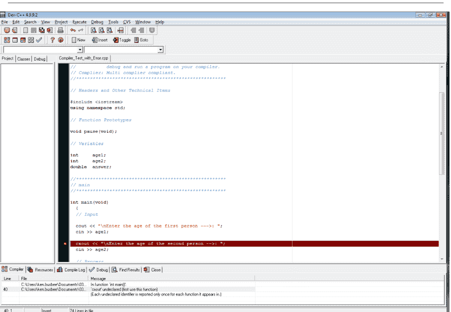

**图 5.2: 编译器错误（红线是编译器停止的地方）**

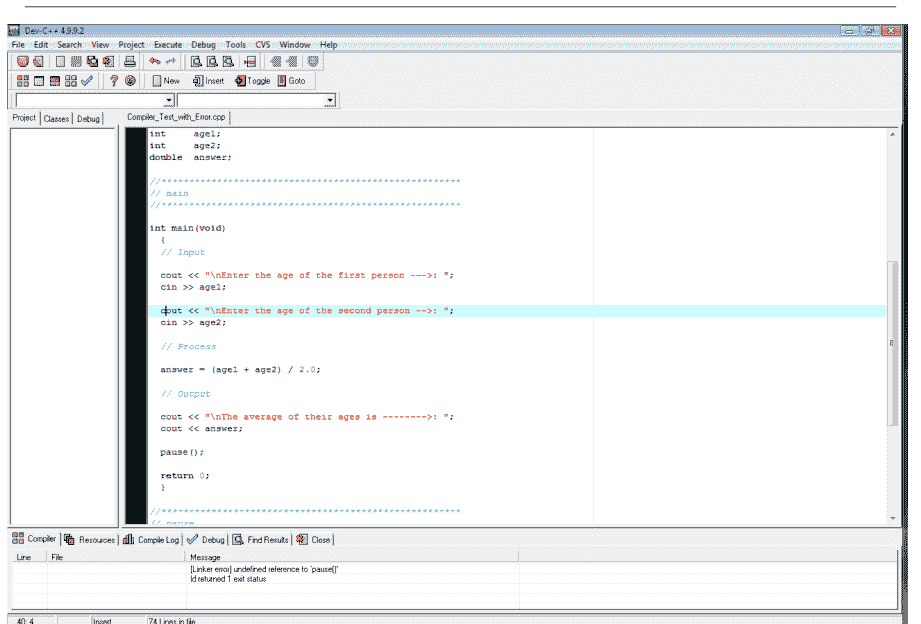

**图 5.3：链接错误（没有带有描述链接问题的红色波浪线）**

## 第 5.5 章 集成开发环境

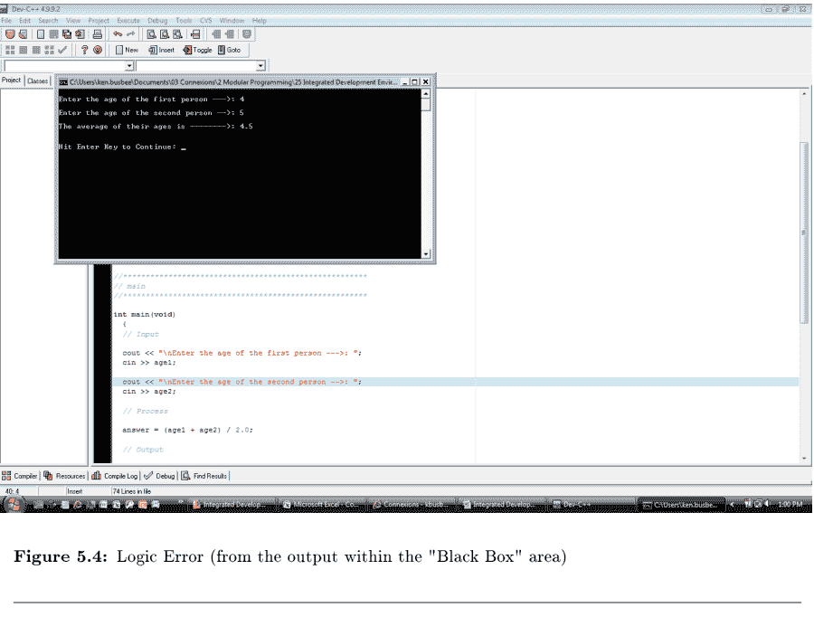

### 5.1.3 C++ 演示程序

#### 5.1.3.1 为源代码文件创建文件夹或子文件夹

根据你使用的编译器/IDE，你应该决定在何处下载并存储用于处理的源代码文件。为了谨慎起见，你应该在下载源代码文件之前，根据需要创建这些文件夹。对于 Bloodshed Dev-C++ 5 编译器/IDE，建议的子文件夹命名为：

- Demo_Programs

如果你尚未执行，请根据情况创建相应的文件夹和/或子文件夹。

#### 5.1.3.2 下载演示程序

将以下文件下载并存储到存储设备中相应的文件夹内。按照你的编译器/IDE 的方法，编译并运行程序。结合其他学习材料学习源代码文件。

从 Connections 下载：`Demo_Pre_Processor_Compiler_Errors.cpp`

从 Connections 下载：`Demo_Compiler_Conversion_Errors.cpp`

> 查看文件 <http://cnx.cnx.org/content/m18920/latest/Demo_Pre_Processor_Compiler_Errors.cpp>
>
> 查看文件 <http://cnx.cnx.org/content/m18920/latest/Demo_Compiler_Conversion_Errors.cpp>

从 Connexions 下载：`Demo_Linker_Errors.cpp`⁴

从 Connexions 下载：`Demo_Logic_Errors.cpp`⁵

### 5.1.4 定义

**定义 5.1：文本编辑器**

一种用于创建和编辑 ASCII 文本文件的软件程序。

**定义 5.2：编译器**

将源代码转换为目标代码。

**定义 5.3：预处理器**

编译器在将源代码转换为目标代码时执行的第一个步操作。

**定义 5.4：链接器**

将目标文件连接或链接成可执行文件。

**定义 5.5：加载器**

操作系统的一部分，负责将可执行文件加载到内存并引导 CPU 开始运行程序。

**定义 5.6：调试**

从程序中移除错误的过程。1) 编译器 2) 链接器 3) 逻辑

**定义 5.7：警告**

编译器的提示，指示可能存在问题。

## 5.2 标准输入和输出⁶

### 5.2.1 总体讨论

我们让计算机执行的所有任务都在中央处理单元（CPU）和相关内存中进行。一旦我们的程序加载到内存中，操作系统引导 CPU 执行我们的编程语句，计算机的状态如下：

> ⁴查看文件 <http://cnx.org/content/m18920/latest/Demo_Linker_Errors.cpp>
>
> ⁵查看文件 <http://cnx.org/content/m18920/latest/Demo_Logic_Errors.cpp>
>
> ⁶此内容可在在线访问 <http://cnx.org/content/m18835/1.5>。

## 第 5.5 章 集成开发环境

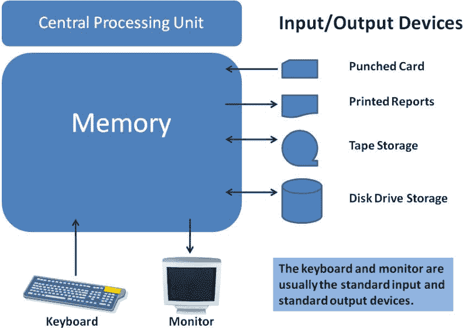

**图 5.5：CPU – 输入/输出设备**

我们的程序现在位于内存中，基本上有两个区域：

- 机器指令 – 我们想要执行的操作的指令
- 数据存储 – 我们在程序使用的变量

通常，我们的程序包含与输入/输出设备交互的指令。我们需要将数据移入（读取）和/或移出（写入）内存数据区。设备是电子连接到内存的设备，以便数据可以在内存和设备之间进行传输。在历史上，这是通过打孔卡和打印输出完成的。磁带用于电子存储。随着时间的推移，我们迁移到使用磁盘驱动器存储，键盘和显示器（显示器输出称为软拷贝）取代了打孔卡和打印输出（称为喷墨拷贝）。

大多数计算机操作系统以及编程语言都将键盘识别为标准输入设备，将显示器识别为标准输出设备。在没有其他特定设备的情况下，键盘和显示器通常被视为默认设备。

### 5.2.2 C++ 中的标准 I/O

C++ 编程语言的开发者决定提供一些与操作系统和 I/O 设备交互所需的底层代码。在下面的示例中，`#include` 指令插入了一个包含**输入/输出流**（Input-Output Stream）代码的文件。该文件包含了使用 **cout** 和 **cin** 向显示器发送数据或从键盘获取数据的必要代码。

```cpp
#include <iostream>
```

你应该将 **cout** 和 **cin** 视为你可以发送数据或从中接收数据的位置；概念上与程序数据区域内的任何其他存储位置相似。C++ 编程语言有两个与 I/O 设备配合使用的运算符。

| 操作 | C++ 运算符符号 | 配合 |
| :--- | :--- | :--- |
| 插入运算符（写入） | `<<`（一对小于符号） | `cout` |
| 提取运算符（读取） | `>>`（一对大于符号） | `cin` |

表 5.1

考虑以下内容：

示例 5.1：插入和提取

```cpp
int age; // 在程序稍后设置
cout << "enter the age of the first person: ";
cin >> age;
```

使用 `cout` 在显示器上显示（或插入）一条消息供用户查看。使用 `cin` 输入整数值，计算机从键盘提取该值并存储在名为 `age` 的变量中。在计算机内部，所有数据都存储为数字，C++ 编程语言提供的技术代码库**输入/输出流**将数据转换为符号。例如：如果用户输入 57 并按下回车，提取运算符会将 57 转换为数字并将数字移动到整数存储位置。

注：此处原文存在大量重复内容，已根据逻辑结构清理。（文本继续至第 85 页）。

### 5.2.3 定义

**定义 5.8：设备**

电子连接到内存的设备，以便数据可以在内存和设备之间进行传输。

**定义 5.9：标准输入**

键盘。

**定义 5.10：标准输出**

显示器。

**定义 5.11：插入**

即向输出设备写入或发送数据。

**定义 5.12：提取**

即从输入设备读取或获取数据。

**定义 5.13：转义代码**

一种引导输出执行某些操作的代码。

## 5.3 编译器指令

### 5.3.1 总体讨论

编译器指令是要求编译器在正式开始编译程序之前完成特定任务的指令。在预处理步骤期间，编译器寻找编译器指令并处理它们。在其他项目之间，预处理器会在遇到它们时进行处理。常见的编译器指令有：

- `include`，其后续项目为要插入文件相应位置的文件名。这些文件通常被称为“头文件”，因为 `include` 指令通常插入在文件的顶部（头部）作为起始指令之一。
- `define`，其后续一个标识符名称和一个值。该标识符名称和值会被编译器存储，当它在程序中遇到标识符名称时，会用值替换标识符名称。

需要注意的是，C++ 中的编译器指令后面没有分号。C++ 编程指令或语句以分号结束，但编译器指令除外。

### 5.3.2 定义

**定义 5.14：编译器指令**

要求编译器在正式开始编译程序之前完成某项任务的指令。

**定义 5.15：include**

一种用于将文件内容插入到程序中的编译器指令。

## 5.4 练习 5：集成开发环境⁸

### 5.4.1 学习目标

在执行：记忆构建活动、练习、实验作业、问题或限时测验/考试中达到 100% 的准确率；学生预期：

- 1. 定义本章相关模块中列出的定义中的术语。
- 2. 能够列出在使用集成开发环境 (IDE) 时遇到的错误分类，并给出示例。
- 3. 使用你或他人设计的适当规划文档编写程序所需的 C++ 代码。

### 5.4.2 记忆构建活动

链接至：MBA 05⁹

### 5.4.3 练习

**练习 5.1（答案在第 82 页）**

判断下列陈述的对错：

- 1. IDE 意味着整数除法表达式 (Integer Division Expression)。
- 2. 大多数现代编译器实际上是 IDE 类型的软件，而不仅仅是编译器。
- 3. `cin` 和 `cout` 用于 C++ 中的标准输入和输出。
- 4. 编程错误极其理解和修复。
- 5. 所有 C++ 程序都至少有一个类型的编译器指令。

### 5.4.4 杂项内容

目前没有。

> ⁸此内容可在 <http://cnx.org/content/m22457/1.3/> 在线查看。
>
> ⁹查看 <http://cnx.org/content/m22457/latest/index.html> 中的文件。

## 第 5 章 5. 集成开发环境

### 5.4.5 实验作业

#### 5.4.5.1 为第05 章文件创建文件夹或子文件夹


## 第 5 章 5. 集成开发环境

### 5.4.5 实验作业

#### 5.4.5.1 为第 05 章文件创建文件夹或子文件夹

根据你的编译器/IDE，你应该决定在何处下载并存储用于处理的源代码文件。根据谨慎原则，你应该在下载源代码文件之前按需要创建这些文件夹。对于 Bloodshed Dev-C++ 5 编译器，建议的子文件夹命名为：

- 在名为 `Cpp_Source_Code_Files` 的文件夹内创建 `Cpp_05`

如果你尚未执行，请根据需要创建文件夹和/或子文件夹。

#### 5.4.5.2 下载实验文件

将以下文件下载并存储到存储设备的相应文件夹中。你可能需要右键点击链接并选择“另存目标”来下载文件。

- 从 Connections 下载：`Solution_Lab_02_Pseudocode.txt`¹⁰
- 从 Connections 下载：`Solution_Lab_02_Test_Data.txt`¹¹

#### 5.4.5.3 详细实验说明

仔细阅读并遵循下面的说明，按列出的顺序执行这些步骤。

- 向你的子文件夹 `Chapter_05` 复制一个我们使用过的源代码列表项。我们建议使用 Lab 01 源代码并将副本重命名为：`Lab_05.cpp`
- 修改代码以遵循 `Solution_Lab_02_Pseudocode.txt` 文件。
- 构建（编译并运行）你的程序。如果程序运行且你使用测试数据[使用测试数据作为 Lab 02 的解决方案]给出了预测结果，则说明你成功编写了这个程序。
- 在你成功编写此程序后，如果你是为了学分参加此课程，请遵循教授/教师的说明提交程序进行评分。

### 5.4.6 问题

#### 5.4.6.1 问题 05a – 指令

列出并描述在使用集成开发环境软件产品程序时可能导致遇到的少数 (4) 种错误的原因。

#### 5.4.6.2 问题 05b – 指令

识别在使用集成开发环境软件产品程序时遇到的四 (4) 种错误。

### 伪代码列表示例

```
Filename: Solution_Lab_02_Pseudocode.txt
Purpose: Average the ages
Author: Kenneth Buse
Date: Jan 5,2009
```

```
#include <iostream>
using namespace std;

// Prototypes
void pause(void);

// Variables
int age1;
int age2;
double answer;

int main(void)
{
  // Input
  cout << "Enter the age of first person: ";
  cin >> age1;
  cout << "Enter the age of second person: ";
  cin >> age2;

  // Process
  answer = (age1 + age2) / 2.0;

  // Output
  cout << "The average of them is: ";
  cout << answer;

  pause();
  return 0;
}
```

## 第 6 章

### 6.1 控制函数

#### 6.1.1 伪代码示例

伪代码没有统一标准，但有一些通常遵循的规则可以使伪代码易于程序员理解。以下是：

- 使用一个起始词开始函数。
- 使用一个通信词识别传递给函数的项。
- 使用缩进显示函数的动作部分。
- 使用通信词识别传出函数的项。
- 使用一个结束词结束函数。
- 使用一个调用词来引导你的程序。

以下是伪代码的建议大纲：

| 项目/目的 | 起始词 | 结束词 |
|---|---|---|
| 开始 | Function | N/A |
| 通信输入 | Pass In: | none |
| 动作 | N/A | N/A |
| 通信输出 | Pass Out: | none |
| 结束 | N/A | function |
| 调用函数 | Call: | none |

#### 6.1.2 示例

以下是使用我们的约定定义的伪代码函数示例。

**示例 6.1：伪代码：无参数函数**

> *此内容可在 <http://cnx.org/content/m19136/1.7/> 在线查看。*

```
Function clear monitor
Pass In: nothing
Direct the operating system to clear the monitor
Pass Out: nothing
```

**示例 6.2：伪代码：带参数传递的函数**

```
Function delay program so you can see the monitor
Pass In: 代表秒分之一的整数
Using the operating system delay the program
Pass Out: nothing
```

**示例 6.3：伪代码：调用 clear monitor 的 main 函数**

```
Function main
Pass In: nothing
Doing some lines of code
Call: clear monitor
Doing some lines of code
Pass Out: value zero to the operating system
```


## 6.2 层级图或结构图

### 6.2.1 概述

层级图（也称为结构图）显示了各个单元之间的关系。它的名称源于在展示业务组织（或结构）方面的通用用途。总裁位于顶部，下一层是副总裁等等。在计算机程序的语境下，它显示了模块（或函数）之间的关系。它没有呈现程序的详细逻辑。它代表了函数的组织，并在程序中显示哪些函数正在调用子函数。上层调用下层函数。

层级图由程序员创建以帮助程序文档化。它们传达了程序中所使用的模块（或结构）的全景。

### 6.2.2 定义

**定义 6.1：短语词**
用于任何读者都能清晰理解伪代码逻辑的词汇。

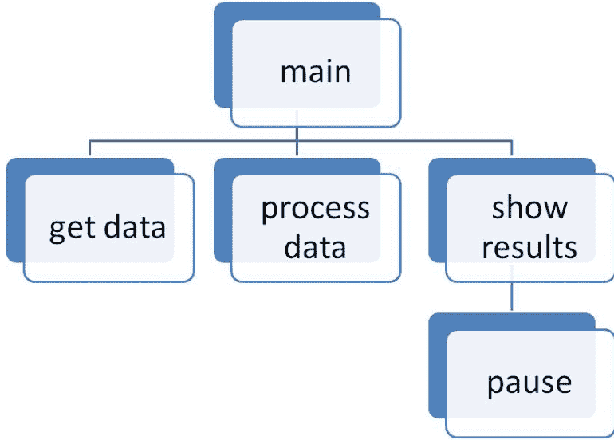

图 6.1：具有五个函数的程序层级图或结构图。

**定义 6.2：层级图**
传达程序中各种函数之间的关系或整体概况。

**定义 6.3：结构图**
层级图的另一个名称。

## 6.3 程序控制函数

### 6.3.1 预备材料

本模块的关键是对几个 Connexions 模块的复习：

- 1. `m_18861` – 标题：模块化与 C++ 程序布局
- 2. `m_19136` - 标题：函数的伪代码示例
- 3. `m_18682` - 标题：层级图或结构图

> ³此内容可在在线上通过 <http://cnx.org/content/m1945/1.9/> 获取。

在继续之前，您应该复习这些材料。如果您是在线阅读此模块，这些项目的链接位于右侧的“链接”框中。

### 6.3.2 模块化概念

这个概念在我们周围的现实世界中无处不在。简单来说，是将一个大问题分解为较小的、易管理的部分。任何大型组织（政府部门、公司、大学、医院等）的层级图都会显示不同级别的人员，其职称指示了他们的职责范围。每个人都是组织整体运作中的一小部分。每个人都可以专注于自己的独特才华或任务，以确保工作正常进行。他们共同实现了组织的目标。

此外，这个概念已经存在很长时间。300 年前的村庄有农民、裁缝、铁匠等。制造业是不仅是工作而且产品本身模块化的典型例子，产品本身被视为模块或系统（例如汽车的例子：发动机、刹车等）。

计算机世界，无论是硬件（设备）还是软件（计算机程序），使用了这种模块化概念。因此，该概念迁移到单个计算机程序中；允许我们将程序模块化为易管理的任务。

### 6.3.3 程序控制函数

程序控制函数通常不互相通信，而是使用公共区域进行变量存储。数据在函数进出之间通信的规则取决于编程语言，但概念是相同的。传递的（或通信的）数据项被称为参数。术语为：参数传递。然而，在程序控制函数中，我们使用“无通信”的数据通信选项——即没有向外的通信。我们的数据变量和常量放置在所有函数均可使用的公共区域（称为全局作用域）。

程序控制函数的标识符通常意味着一个要完成的任务，例如获取数据（`get-data`）、处理数据（`process-data`）或显示结果（`show-results`）。随着你学习编写更复杂的程序，代码行数将会增加。谨慎的原则认为，将程序划分为执行独特任务的函数是有益的。程序越大，对模块化或创建程序控制函数的需求就越强烈。

取决于编程语言，有一种正式的方法来：

1. 定义函数（其定义或它将执行的代码）
2. 调用函数
3. 声明函数（原型是用于告知编译器的）

理解程序控制函数最简单的方法之一是查看示例。即使你不知道 C++ 编程语言，也可以研究这些方法来帮助理解模块化过程。

### 6.3.4 C++ 演示程序

#### 6.3.4.1 为源代码文件创建文件夹或子文件夹

取决于你的编译器/IDE，你应该决定在哪里下载和存储用于处理的源代码文件。谨慎的原则要求你在下载源代码文件之前根据需要创建这些文件夹。为 Bloodshed-C 建议的子文件夹为：

### 6.5.1 代码规范

#### 6.5.1.1 文档

文档通常使用几行注释放置在程序的顶部。信息的多少取决于支付给员工或独立承包商编写代码的公司的（或组织）的要求或标准。请注意修订日期的标记。

#### 6.5.1.2 垂直对齐

你可以在文档区域看到这一点。所有项都对齐在同一列中。这种垂直对齐在定义变量时再次出现。在声明变量或常量时，许多教科书会将多个项放在同一行；例如：

**示例 6.5：教科书中常见的变量定义方式**

```
float length, width, height, price_gal_paint, total_area, total_cost;
int coverage_gal_paint, total_gal_paint;
```

然而，尽管这在教科书中很常见，但通常不符合许多公司使用的标准。你应该每行单独声明一个项；如下所示：

**示例 6.6：带有垂直对齐的正确变量定义**

```
float length;
float width;
float height;
float price_gal_paint;
int coverage_gal_paint;
float total_area;
int total_gal_paint;
float total_cost;
```

这种每行一个项目的方法更符合人类阅读习惯。寻找标识符名称更快，因为垂直阅读列表比水平搜索要快得多。一些程序员会按字母顺序列出它们，特别是当变量数量超过大约二十个时。

每个函数内部的代码行也是垂直对齐的，并向左缩进两个空格。缩进有助于在视觉上区分代码块。

#### 6.5.1.3 注释的适当使用

你可以通过源代码中的简短注释看到对某个区域或部分的描述。注意输入、处理和输出（IPO）的使用，这些是程序设计中 IPO 概念的一部分。

#### 6.5.1.4 函数横幅

在每个函数之前使用横幅形式的注释。

**示例 6.7：作为横幅的注释**

```
****************************************************
// main
****************************************************
```


函数名放在两行星号之间。这使得查找每个函数定义极其容易，因为你不需要阅读函数就能看出一个函数在哪里结束，另一个在哪里开始。你可以快速阅读横幅内的函数名。

### 6.5.1.5 独立行的块标记

在许多语言中，有一种方法可以将一组编程语句识别为一个单元。在 C++ 中，使用一组符号——大括号 `{}` 来识别代码块，有时被称为复合语句。大括号也用于程序的其他方面，但现在我们来看这个简单的示例。这些标记倾向于引起问题，特别是当它们没有配对的起始和结束括号时。为了解决这个问题，许多程序员简单地将大括号单独放在一行，并使起始括号和结束括号处于同一垂直列上。

### 6.5.1.6 缩进块标记

与函数或控制结构相关的代码块缩进两个或三个空格。当代码块嵌套时，每一层嵌套都会缩进两个或三个空格。在我们上面的示例中，函数定义的代码块缩进了两个空格。

### 6.5.1.7 有意义的标识符名称与一致的类型

正如名称所示，“标识符名称”应该清晰地标识出你正在谈论的内容（什么）。称呼你为“Snooky”可能对你个人有意义。其他人可能需要看到她的全名（Jane Smith）才能相应地识别你在谈论谁。编程中的相同概念也是如此。变量、常量、函数、typedef 和其他项应使用有意义的标识符名称。此外，这些名称在程序中使用时，大小写应保持一致。不要定义一个变量为 `Pig`，然后在程序后面又使用 `pig`。

### 6.5.1.8 Typedef 的适当使用

许多编程语言都有一种命令，允许创建一个代表数据类型的标识符名称。此功能在上面的代码中没有演示，并且通常是一个令人困惑的概念。它是帮助记录程序的一种强大方式，使其具有意义，通常由更有经验的程序员使用。

### 6.5.2 定义

**定义 6.6：文档**
一种保留对他人理解信息系统或其部分有用信息的方法。

**定义 6.7：垂直对齐**
一种垂直列出项的方法，以便于快速阅读。

**定义 6.8：注释**
插入到源代码文件中用于程序文档说明的信息。

**定义 6.9：横幅**
一组用于分隔函数和程序其他部分的注释行。

# 第 6 章 程序控制函数

**定义 6.10：大括号**
用于在 C++ 中识别代码块。

**定义 6.11：缩进**
一种使源代码部分内容更可见的方法。

**定义 6.12：有意义的**
一种规定标识符名称必须让阅读源代码的人轻松理解的规则。

**定义 6.13：一致的**
一种规定在整个源代码中一致地识别大小写名称的规则。

## 6.6 练习 6：程序控制函数¹⁰

### 6.6.1 学习目标

记忆构建活动、练习、实验作业、问题或定时测验/考试中达到 100% 的准确率；学生预期：

- 1. 定义本章相关模块中列出的定义术语。
- 2. 给定伪代码、测试数据现有程序的源代码，修改伪代码和源代码以创建“程序控制”函数。

### 6.6.2 记忆构建活动

链接至：MBA¹¹

### 6.6.3 练习

**练习 6.1**（答案在第 97 页）。

**判断下列陈述对错：**

- 1. 伪代码有一套严格的规则，并且在计算机编程行业中都是一样的。
- 2. 层次图和结构图基本上是同一事物。
- 3. 控制函数用于简单细分并控制程序。
- 4. `void` 类型在 C++ 中很少使用。
- 5. 提高源代码的可读性仅供初学者使用。

### 6.6.4 杂项

目前无。

> ¹⁰此内容可在线访问 <http://cnx.org/content/m22458/1.4/>。
> ¹¹参见文件 <http://cnx.org/content/m22458/latest/>。

## 6.6.6 问题

### 6.6.6.1 问题 06a – 实例

为以下伪代码示例创建一个层级图。

示例 6.8: 伪代码

```
****************************************************************

Filename: Average-IQ.txt

Purpose: 计算两个人的 IQ 平均值

Author: Ken Busbee; © Kenneth Leroy Busbee

Date: 2009年1月17日

****************************************************************
```

```
Function main

Pass In: nothing

Call: get_iqs

Call: process_iqs

Call: show_average

Pass Out: 向操作系统零

Endfunction
```

```
****************

Function get_iqs

Pass In: nothing

显示消息请求用户输入第一个人的 IQ

从键盘获取第一个人的 IQ

显示消息请求用户输入第二个人的 IQ

从键盘获取第二个人的 IQ

Pass Out: nothing

Endfunction
```

```
****************

Function process_iqs

Pass In: nothing

通过将两个 IQ 相加并

除以 2.0 来计算答案

Pass Out: nothing

Endfunction
```

```
****************

Function show_average

Pass In: nothing

用适当的消息显示答案

Call: pause

Pass Out: nothing

Endfunction
```

```
Function pause

Pass In: nothing

指示操作系统暂停程序

Pass Out: nothing

Endfunction
```

## 潜在变量

| 数据类型 | 标识符 | 名称 |
| :--- | :--- | :--- |
| integer | iql1 | |
| integer | iq2 | |
| double | answer | |

文件结束

### 6.6.6.2 问题 06b – 实例

识别此代码中导致“无文档化”、“不可读性”或在其他方面存在错误的问题。

> 示例 6.9: C++ 源代码

```cpp
//****************************************************
// Author: Ken Busee; @ 2009 Kenneth Leroy Busee
// Date:    2009年1月17日
//****************************************************
#include <iostream>
using namespace std;
void pause(void);
int age1, age2;
double xx;
//********************************************************************
// main
//****************************************************
int main(void) {
    // 输入
    cout << "\nEnter输入第一个人的年龄 --->: ";
    cin >> age1;
    cout << "\nEnter输入第二个人的年龄 --->: ";
    cin >> age2;
    // 处理
    xx = (age1 + age2) / 2.0;
    // 输出
    cout << "\n他们的平均年龄为 ----->: ";
    cout << xx;
    pause();
    return 0;
}
void pause(void) {
    cout << "\n\n";
    system("PAUSE");
    cout << "\n\n";
    return;
}
```


************************************************
// 程序结束
************************************************

## 第 6 章练习题

### 练习 6.1 答案（第 92 页）

答案：

- 1. false
- 2. true
- 3. true
- 4. false
- 5. false

# 第 7 章

## 7. 特定任务函数

### 7.1 特定任务函数¹

#### 7.1.1 前提知识

本模块的关键是回顾两个 Connexions 模块：

- 1. `m_18861` – 标题：模块化与 C++ 程序布局
- 2. `m_19145` – 标题：程序控制函数

在继续之前您应该回顾这些材料。如果您在线查看此模块，这些项目的右侧可能会有一个用户的“链接（Links）”框。

#### 7.1.2 通用概念

具有相似标识符名称的程序控制函数在不同程序中通常执行不同的任务。查看两家公司的组织结构图或层级图，两者都可能有一位生产副总裁，生产汽车与生产冰淇淋是不同的。相似但不同。随着你深入组织，你可能会发现保安的职位。请注意，汽车工厂的保安和冰淇淋工厂的保安工作完全相同，他们最具有可替代性。在编程中，当一个任务本身可能在多个程序中使用。计算年份就是一个很好的例子。它被用于验证日期，例如在这个例子中是否存在 2 月 29 日。它不是闰年（false）。这在数百个程序中都是必需的。

#### 7.1.3 特定任务函数

为了创建良好的任务函数，你需要通过参数传递进行所有通信。因此，所有使用该函数的程序将以相同的方式进行通信。在我们的闰年示例中，你向函数传递年份，函数将返回 `true` 或 `false` 的通信；意味着它是闰年（存在 2 月 29 日）或不是闰年（false）。

将我们的程序修改为特定任务函数的能力意味着，一旦特定任务函数正常工作，我们就可以编写一次，然后在许多程序中反复使用它。正如你猜到的，这存在一种平衡。大多数程序将有一些程序控制函数和一些特定任务函数。决定函数是否应为特定任务函数的关键在于任务的唯一性，以便其在许多程序中使用。特定任务函数一旦创建，通常会被放入用户库并与他人共享，供许多程序使用。

> ¹此内容可在在线访问：<http://cnx.org/content/m19146/l4/>。

#### 7.1.4 定义

**定义 7.1：用户定义库**

一个包含个人创建的特定任务函数的文件，用于用于许多程序。

### 7.2 全局与局部数据存储

#### 7.2.1 通用讨论

全局和局部数据存储的概念通常与作用域（`scope`）的概念联系在一起。作用域是程序中带有标识符的项目（无论是变量、常量、函数等）被识别的区域。在我们的讨论中我们将使用一个变量，变量在程序中定义的位置决定了它的作用域。

**全局作用域**（扩展为全局数据存储）发生在变量定义在**作为目标代码组成区域之外**时。目标代码具有机器码、数据区域和链接器指令。由于变量具有全局作用域，它对于源代码中的所有函数都是可用的。然而我们现在可以忘记这个解释。现在应该学习关键用语的变化。尽管变量具有全局作用域，它仅从**定义点到程序源代码结束**对所有函数有效。**局部作用域**（以及扩展为局部数据存储）发生在变量定义在“函数内部”时。在编译时，编译器会创建位置，引导在被称为**栈（`stack`）的内存区域**上创建存储位置。这些位置将一直存在直到函数完成。在这个语言中，我们谈论项被推入栈中，并在函数结束时弹出。因此，栈是一个供所有函数使用的重用内存区域，并在函数结束时释放。尽管变量具有局部作用域，它仅从定义点到函数结束有效。函数的参数数据建立了局部变量。此外，函数所需的任何其他变量或常量通常位于函数顶部，以便在整个函数代码执行期间可用。作用域对于模块化至关重要。程序控制函数通常对变量和常量使用全局作用域，将其放在程序任何函数之前的顶部。特定任务只使用局部作用域，通过参数传递将需要的数据传入函数，并根据需要创建局部变量。任何需要传回调用函数的信息再次通过参数传递完成。这种**闭环通信模型**通过将所有数据输入和输出函数，创建了面向对象编程中使用的封装的重要先驱概念。

#### 7.2.2 定义

**定义 7.2：全局作用域**

定义在函数之外的数据。

**定义 7.3：局部作用域**

定义在函数内部的数据。

**定义 7.4：数据区域**

用于存储数据的目标代码的一部分。

**定义 7.5：栈 (`stack`)**

用于存储数据的内存部分。

**定义 7.6：范围 (`scope`)**

源文件中识别标识符名的区域。

### 7.3 使用头文件实现用户定义的特定任务函数³

#### 7.3.1 概念：用户定义的特定任务函数

大多数公司都有其公司特有的任务。编程人员通常会决定构建几个函数，并将它们组织成一个或多个用户库。特定任务函数通常是使用测试外壳程序构建的。测试外壳程序的唯一目的是创建特定任务函数并对其进行测试，以确保它们正常工作。想象一下一个蛤壳，它的外壳包裹着重要部分——珍珠。测试外壳程序包裹着特定任务函数（重要部分）。通常，测试外壳程序将用于创建几个函数，并将它们放入用户定义的库中。流程如下：

1. 构建带有特定任务函数的**测试外壳**程序并对其进行彻底测试。
2. 将**测试外壳**源代码的副本保存为**头文件**，修改后将其放入用户库中。你删除程序的主部分，留出注释区域、任何需要的包含引用和特定任务函数。

> ³此内容可在在线获取：<http://cnx.org/content/m19346/1.7/>。

3. 将测试外壳源代码的另一个副本保存为原型文件。这是一个文本文件，仅保留了已放入头文件中函数的原型声明。函数应使用具有有意义的标识符名称，因此原型声明应向其他人提供足够的信息，说明如何通过适当的参数传递来调用函数。

#### 头文件的创建

| `Monitor_Testing_Shell.cpp` | `udst_monitor.h` |
| :--- | :--- |
| 程序注释 | 程序注释（根据需要编辑） |
| 头文件及其他 | 头文件和其他（删除所有非需要的库。保留：`#include <ctime>`） |
| 原型 | 原型 |
| 变量 | 变量 |
| `main` | `main` |
| `clear_m` | `clear_m` |
| `delay_m` | `delay_m` 时钟函数需要：`ctime` |
| `pause_m` | `pause_m` |

图 7.1：从测试外壳的副本创建头文件。

#### 原型文件的创建

| `Monitor_Testing_Shell.cpp` | `udst_monitor_prototypes.txt` |
| :--- | :--- |
| 程序注释 | 程序注释（根据需要编辑） |
| 头文件及其他 | 头文件和其他 |
| 原型 | 原型 |
| 变量 | 变量 |
| `main` | `main` |
| `clear_m` | `clear_m` |
| `delay_m` | `delay_m` |
| `pause_m` | `pause_m` |

图 7.2：从测试外壳的副本创建原型文件。

4. 将测试外壳源代码的另一个副本保存为验证头文件程序。你删除函数的原型声明和定义，然后提供一个指向头文件的包含语句。编译并运行此程序，以确保头文件工作正常。

#### 验证头文件的创建

| `Monitor_Testing_Shell.cpp` | `Monitor_Verify_Header.cpp` |
| :--- | :--- |
| 程序注释 | 程序注释（根据需要编辑） |
| 头文件和其他 | 根据需要添加用户库：`#include "c:\Dev-Cpp\user_library\monitor.h"` |
| 原型 | 原型 |
| 变量 | 变量 |
| `main` | `main` |
| `clear_m` | `clear_m` |
| `delay_m` | `delay_m` |
| `pause_m` | `pause_m` |

图 7.3：从测试外壳的副本创建验证文件。

理解这一概念的一种好方法是回顾程序员创建的上述四个文件。我们将使用 C++ 编程语言，但代码易于理解，并可以在解释概念的同时满足我们的需求；即使你不熟悉 C++。

#### 7.3.2 使用 C++ 进行演示

##### 7.3.2.1 为这四个文件创建文件夹或子文件夹

根据你的编译器和 IDE，你应该决定在何处下载和存储用于处理的源文件。谨慎起见，你应该在下载源文件之前先创建这些文件夹。对于 Bloodshed-C++ 5 编译器/IDE，建议的子文件夹可以命名为：

- `Monitor_Header`

如果你还没有创建，请根据情况创建相应的文件夹和或子文件夹。

##### 7.3.2.2 下载这四个文件

下载并将以下文件存储到存储设备的相应文件夹中。你可能需要对某些链接点击鼠标右键并选择“另存目标”以下载某些文件。

从 Connexions 下载：`Monitor_Testing_Shell.cpp`⁴
从 Connexions 下载：`udst_monitor.h`⁵
从 Connexions 下载：`udst_monitor_prototypes.txt`⁶
从 Connexions 下载：`Monitor_Verify_Header.cpp`⁷

##### 7.3.2.3 研究文件

通过回顾程序员创建的上述四个文件来理解这一概念是一种很好的方法。我们将使用 C++ 编程语言，但代码易于理解，并可以在解释概念的同时满足我们的需求；即使你不熟悉 C++。

### 7.4.5 实验作业：为第 07 章文件创建文件夹或子文件夹

#### 7.4.5.1 创建编译器/IDE，你应该决定在何处下载并存储用于处理的源代码文件

根据你使用的编译器/IDE，你应该决定在何处下载并存储用于处理的源代码文件。从稳妥的做法来看，在下载源代码文件之前，根据需要创建这些文件夹。对于 Bloodshaded Dev-C++ 5 编译器/IDE，建议的子文件夹可能是：

- 在文件夹名称 `Cpp_Source_Code_Files` 内部创建：`Chapter_07`

如果你尚未创建，请根据实际情况创建相应的文件夹和/或子文件夹。

#### 7.4.5.2 下载实验文件

将以下文件下载并存储到你存储设备上相应的的文件夹中。你可能需要右键点击链接并选择“另存为目标”以下载文件。从 Connections 下载：`Lab_07_Testing_Shell.cpp`

#### 7.4.5.3 详细实验说明

阅读并遵循下面的说明，并按照列出的顺序执行步骤。

- 导航到你的子文件夹：`Chapter_07`。编译并运行 Lab 07 Testing Shell 源代码。注意：此程序使用内联文件路径，指向在 Connections 第 7 章材料中解释的“`udst_monitor.h`”文件。
- 按照 Connections 模块中“使用头文件进行自定义函数”所示的流程，创建以下文件：`udst_to_metric.h`、`udst_us_to_metric_prototypes.txt` 和 `Lab_07_Verify_Header.cpp`。
- 将头文件复制到你的用户库中，然后构建（编译并运行）你的头文件程序。
- 成功编写此程序后，如果你是为了获得大学学分，请遵循教授/老师的说明提交作业进行评分。

### 7.4.6 练习

#### 7.4.6.1 题目 07a – 说明

创建伪代码来解决以下特定任务：
问题：室内设计师总是需要计算房间面积以确定地板覆盖物（通常是地毯）的量。房间是矩形的，单位为英尺（带有小数）。该函数需要返回平方码。提示：3 英尺等于 1 码。

#### 7.4.6.2 题目 07b – 说明

为以下特定任务函数创建测试数据：
问题：室内设计师总是需要计算房间面积以确定地板覆盖物（通常是地毯）的量。房间是矩形的，单位为英尺（带有小数）。该函数需要返回平方码。提示：3 英尺等于 1 码。

> 10 查看位于 <http://cnx.org/content/m22459/latest/Lab_07_Testing_Shell.cpp> 的文件。

## 第 7 章练习题解答

### 练习 7.1 的答案（第 106 页）

答案：

- 1. false – 虽然 `Scope` 是一个漱口水品牌；但我们寻找的是计算机相关的定义。
- 2. true
- 3. true
- 4. false – 起初看起来可能很难，但只要练习一下就会非常容易。
- 5. true

# 第 8 章

## 8. 标准库

### 8.1 标准库

许多已经编写了定义的常用或标准函数已可以在任何程序中使用。它们被组织成一组函数（可以把它们想象成几本书），并统称为标准库。许多函数被组织在多个库中。例如，在 C++ 中存在许多数学函数并经过了编码（并放置在库中）。这些函数是由程序员编写并经过测试的，以确保它们正常工作。在大多数情况下，这些函数经过了几个人的审查，进行了双重和三重检查，以确保它们符合预期。我们的优势是可以放心地使用这些函数，相信它们会在我们的程序中正常工作，从而节省时间和金钱。

主程序必须建立程序中所用函数的存在性。根据编程语言的不同，有一种正式的方法：

1. 定义函数
2. 声明函数（原型是对编译器的声明）
3. 调用函数

当我们在程序中创建函数时，我们通常在源代码列列表中按以下顺序看到它们：

1. 声明函数（原型）
2. 调用函数
3. 定义函数

当我们使用他人创建的已组织在库中的函数时，我们会在程序中包含一个头文件，该头文件包含函数的原型。就像我们创建的函数一样，我们在源代码列列表中按以下顺序看到它们：

1. 声明函数（在包含文件中提供的原型）
2. 调用函数（带参数传递）
3. 定义函数（它要么在头文件中定义，要么由链接器程序从标准库对象区域提供实际的对象代码）

> ¹此内容可以在 <http://cnx.org/content/m19202/1.6/> 在线获取。

## 第 8 章 标准库

> ²查看位于 <http://cnx.org/content/m19202/latest/Demo_Standard_Libraries.cpp> 的文件
³ 查看位于 <http://cnx.org/content/m19202/latest/Demo_Standard_Libraries_Listing.txt> 的文件

### 8.2 练习 8：标准库⁴

#### 8.2.1 学习目标

通过以下方式在记忆活动、实验作业、问题或限时考试中达到 100% 的准确率：

1. 根据本章内容定义特定的术语。
2. 相信标准库函数可以正常工作。
3. 在使用特定的任务函数的情况下编写程序会更容易。
4. 创建一个特定的任务并测试特定的头文件。

#### 8.2.2 记忆活动

#### 8.2.3 练习题

练习 8.1（第 113 页）

#### 8.2.4 杂项

暂无。

#### 8.2.5 实验作业

##### 8.2.5.1 为第 08 章文件创建文件夹或子文件夹

根据你使用的编译器/IDE，你应该决定在何处下载并存储用于处理的源代码文件。从稳妥的做法来看，在下载源代码文件之前，根据需要创建这些文件夹。对于 Bloodshaded Dev-C++ 5 编译器/IDE，建议的子文件夹可能是：

- 在文件夹名称 `Cpp_Source_Code_Files` 内部创建：`Chapter_08`

如果你尚未创建，请根据实际情况创建相应的文件夹和/或子文件夹。

##### 8.2.5.2 下载实验文件

将以下文件下载并存储到你存储设备上相应的的文件夹中。你可能需要右键点击链接并选择“另存为目标”以下载文件。从 Connections 下载：`Lab_Testing_Shell.cpp`⁶

> ⁴此内容可以在 <http://cnx.org/content/m19202/1.3/> 在线获取。
⁵查看位于 <http://cnx.org/content/m22460/latest/index.html> 的文件。
⁶查看位于 <http://cnx.org/content/m22460/latest/Lab_07_Testing_Shell.cpp>。

##### 8.2.5.3 详细实验说明

阅读并遵循下面的说明，并按照列出的顺序执行步骤。

- 导航到你的子文件夹：`Chapter_08`。编译并运行 Lab 08 Testing Shell 源代码。注意：此程序使用包含文件，指向在 Connections 第 7 章材料中解释的“`udst_monitor.h`”文件。
- 你需要在此测试 shell 中添加另一个名为 `area_triangle` 的函数来计算三角形面积。定义该函数，对其进行原型声明，并在主函数内添加调用该函数的区域（类似于带有数据的现有函数）。相信它正在正常工作。
- 按照 Connections 模块中“使用头文件进行自定义任务”所示的流程，创建以下文件：`udst_geo_area.h`、`udst_geo_area_prototypes.txt` 和 `Lab_08_Verify_Header.cpp`。
- 将头文件复制到你的用户库中，然后构建（编译并运行）你的头文件程序。
- 成功编写此程序后，如果你是为了获得大学学分，请遵循教授/老师的说明提交作业进行评分。

#### 8.2.6 练习

##### 8.2.6.1 题目 08a – 说明

编写 C++ 代码来完成以下特定任务函数。

```
示例 8.1: 伪代码

Function area_regular_hexagon
Pass In: side
Calculate: side times side times 3 times the square root of 0.75
Pass Out: the calculation
Endfunction
```

## 第 8 章练习题解答

### 练习 8.1 解（第 111 页）

答案：

- 1. true
- 2. false
- 3. false

# 第 9 章

## 9 字符数据、Sizeof、Typedef、序列

### 9.1 字符数据类型

#### 9.1.1 字符数据类型概述

**字符数据类型基本上表示单个字符。** 字符由各种符号，如字母（包括大小写）、数字（0 到 9）、标点符号等。所有计算机都以整数的形式在一个字节字段中存储字符数据。字节由 8 位组成，该字节字段使用 0 到 255 的正值有 256 种可能性。


# 第 9 章 字符数据、SIZEOF、TYPEDEF、序列

大多数微型计算机通常使用 `ASCII`（信息交换标准代码，读作 "ask-key"）字符集，该集合拥有 0 到 127 的固定值。对于 128 的值，它们通常使用扩展 `ASCII` 字符集。当我们按下键盘上的大写 A 时，键盘会发送一个位模式等于整数 65 的字节。当该字节从内存发送到显示器时，显示器会将整数 65 转换为大写 A 符号显示在显示器上。

## 数据类型属性

| C++ 保留关键字 | char |
|---|---|
| 表示 | 单个字符 |
| 大小 | 1 字节 |
| 正常符号位 | 无符号（仅限正值） |
| 范围（允许的值） | 标准 ASCII 字符集所示 0 到 127 的值，加上扩展 ASCII 字符集中 128 到 255 的值 |

> ¹此内容在线可见 <http://cnx.org/content/m18669/1.6>。

## 9.1.2 C++ 演示程序

### 9.1.2.1 为源代码文件创建文件夹或子文件夹

根据你的编译器/IDE，你应该决定在哪里下载和存储用于处理的源代码文件。根据谨慎起的做法，你应该在下载源代码文件之前根据需要创建这些文件。对于 `Bloodshed Dev-C++ 5` 编译器/IDE，建议的子文件夹命名为：

- `Demo_Programs`

如果你尚未这样做，请根据情况创建文件夹和/或子文件夹。

### 9.1.2.2 下载演示程序

将以下文件下载并存储到存储设备的相应文件夹中。按照你的编译器/IDE 的方法，编译并运行程序。结合其他学习材料学习源文件。

从 Connections 下载：`Demo_Character_Data_Type.cpp`

## 9.1.3 定义

**定义 9.1.1：字符 (character)**

一种表示单个文本字符的类型，如字母、数字、标点符号等。

**定义 9.2：ASCII**

信息交换标准代码

**定义 9.3：单引号**

用于在 C++ 编程语言中创建字符类型数据。

## 9.2 Sizeof 运算符

### 9.2.1 概述

每个项、常量和变量，不仅是一个数据类型，数据类型决定了该项在计算机内存中使用多少字节。每个数据类型的大小取决于所使用的编译器和计算机。这种现象被称为**依赖于机器**。此外，语言经过了一些更改和升级。在 "C" 中，`int` 类型在 Intel 兼容中央处理器 (cpu) 机器上分配了 2 字节的内存存储。在 "C++" 中，`int` 被分配了 4 字节。

有一个名为 `sizeof(...)` 的运算符，它是一个一元运算符，只有一个操作数。操作数位于运算符的右侧，如果它是数据类型，则放在括号内。操作数可以是任何类型（包括 `typedef`）。如果标识符名称不需要放在括号内。它适用于变量和常量标识符名称。该运算符的独特之处在于，它对全局作用域项在编译时进行计算，对局部作用域项在运行时进行计算。示例。

> ²查看文件 <http://cnxx.org/content/m18699/latest/Demo_Character_Data_Type.cpp>。此内容在线可见 <http://cnxx.org/content/m18736/1.8>。

```
cout << "The size of an integer is: " << sizeof (int);
```

编译器将确定特定机器上整数的字节大小，并本质上用一个值替换掉 `sizeof` 运算符。整数通常是 4 字节长，因此该行代码将变为：

```
cout << "The size of an integer is: " << 4;
```

如果你放置一个代表数据存储区域（变量或内存常量）的标识符，它会查看该标识符的定义。注意：标识符名称不需要括号，且通常不包含。

示例 9.1：变量的 sizeof

```
double money; // 带有初始化的变量
随后在程序后期
cout << "The size of money is: " << sizeof money;
```

编译器将通过查看指示数据类型所在定义来确定 `money` 的字节大小。特定机器上的 `double` 数据类型（通常为 8 字节）将替换代码，并变为：

```
cout << "The size of money is: " << 8;
```

### 9.2.2 定义

**定义 9.4：sizeof**

一种告诉你数据类型在存储中占用多少字节的运算符。

## 9.3 Typedef - 别名

### 9.3.1 通用讨论

`typedef` 语句允许程序员为现有数据类型创建别名或同义词。这在记录程序时可能很有用。C++ 编程语言语法：

```
typedef <实际数据类型> <别名标识符名称>;
```

假设一个程序员正在使用 `double` 数据类型来存储程序中各种用途的金额。他可能会按如下方式定义变量：

示例 9.2：变量的常规定义

```
double income;
double rent;
double vacation;
```

然而，他可能会使用 `typedef` 语句并如下方式定义变量：

示例 9.3：定义变量时使用 typedef

> ^4此内容在线可见 <http://cnx.org/content/m18741/1.5/>。

```
typedef double cash;
typedef 必须在使用之前定义
cash income;
cash rent;
cash vacation;
```

初学者并不经常使用 `typedef` 语句。它通常会产生比需要的困惑，因此起初坚持使用数据类型。

### 9.3.2 定义

**定义 9.5：typedef**

允许程序员为现有数据类型创建别名或同义词。

## 9.4 序列运算符

### 9.4.1 通用讨论

序列（或逗号）运算符用于分隔项。它有几种用途，这里列出了其中的四种：

1. 在声明变量或常量时分隔标识符名称
2. 分隔传递到函数中的多个参数
3. 在 `for` 循环中分隔初始化项或更新项
4. 在数组初始化期间分隔值

这种示例在教科书中很常见，但这种声明变量的方法并不优选。很难快速阅读标识符名称。

```
int pig, dog, cat, rat;
```

优选以下垂直声明变量的方法。

示例 9.4：优选的垂直定义变量方法

```
int pig;
int dog;
int cat;
int rat;
```

数据类型和标识符名称（称为参数）彼此分离。此示例是一个函数原型。

```
double area_trapezoid(double base, double height, double top);
```

在 `for` 循环的语法中，由分号分配三个部分：第一个是初始化区域，可以有多个初始化。最后是更新区域，可以有多个更新。多次初始化或更新使用逗号分隔它们。此示例是 `for` 循环的第一行。

```
for (x = 1; x < 15; x++, y++)
```

变量 `ages` 是一个整数数组。初始值使用块标记赋值，值之间用逗号分隔。

```
int ages[] = {2,4,6,29,32};
```

> *此内容在线可见 <http://cnx.org/content/m18690/1.8/>。

### 9.4.2 定义

**定义 9.6：序列 (sequence)**

一种用于分隔多个多次出现的项目项的操作符。

## 9.5 练习 9：字符数据、Sizeof、Typedef、序列

### 9.5.1 学习目标

在以下活动中：记忆构建活动、练习、实验作业、问题或限时测验/考试，达到 100% 的准确率；学生预期做到：

- 1. 定义本章相关模块中给出的术语。
- 2. 给定系统分析师产出的适当文档，创建计划文档（伪代码和测试数据）。

### 9.5.2 记忆构建活动

链接至：`MBA 09`

### 9.5.3 练习题

练习 9.1（答案见第 121 页。）

判断下列陈述的对或错：

1. C++ 中的数据类型使用双引号，例如：`char grade = "A";`
2. `Sizeof` 是一个操作符，它告诉你是数据类型在存储中占据了多少字节。
3. `Typedef` 帮助听力障碍人士，并且是针对学习障碍人士的编程语言的标准分配功能之一。
4. 在定义变量时应该使用序列操作符以节省空间。
5. 编程既可以是有趣的，也可以令人沮丧的。

### 9.5.4 杂项

此处暂无。

### 9.5.5 实验作业

#### 9.5.5.1 为第 09 章文件创建文件夹或子文件夹

取决于你使用的编译器/IDE，你应该决定是否要下载并存储源代码文件进行处理。根据审慎原则，你应该在下载源代码文件之前创建这些文件夹。对于 `Bloodshed Dev-C++ 5` 编译器/IDE，建议的子文件夹可能是：

- 在名为 `Cpp_Source_Code_Files` 的文件夹下的 `Chapter-09`

如果你尚未执行，请根据情况创建相应的文件夹和/或子文件夹。

> 6 此内容可以在线 <http://cnx.org/content/m22461/1.4/> 获取。
> 7 参阅文件 <http://cnx.org/content/m22461/latest/index.html>

#### 9.5.5.2 下载文件

将以下文件下载并存储到你存储设备中相应的文件夹中。你可能需要右键点击链接并选择“另存目标为”来下载文件。

从 Connexion 下载：`Lab_09_Narrative_Description.txt`
从 Connexion 下载：`Lab_09_Aerial_View_Center_Pivot_Irrigation.jpg`
从 Connexion 下载：`Lab_09_Hierarchy.jpg`

#### 9.5.5.3 详细说明

阅读并遵循下面的说明，并按照列出的顺序执行步骤。

- 复习第 6 章材料中的 Connexion 模块“系统开发生命周期”。将自己想象成被分配到实施阶段项目的程序员，你的教授即为系统分析师。
- 导航到你的子文件夹：`Chapter_09`。查看系统分析师在开发生命周期设计阶段产出的前两个项目。这两个文档已经打印并放置在程序文件夹中。你在程序中创建的项目将将添加到名为 `Chapter09` 的文件夹中（这基本上就是我们正在做的事）。第三个项目层级结构（hierarchy）通常由程序员产生。然而，根据你的经验，通过构建 `Lab_09_Pseudocode.txt` 和 `Lab_09_Data.txt` 来设计程序并创建测试数据。
- 警告：事后开始创建源代码是程序员经常避免的坏习惯。不需要为标准库或用户库创建任何伪代码。只需表明你将使用它们即可。只需查看第 6 章材料中的 Connexion 模块“系统开发生命周期”。在实施阶段。
- 编译并执行程序。

### 9.5.6 选择控制结构介绍

选择控制结构的基本属性是可以在两个或多个替代路径之间进行选择。这被设计为二路选择或阶梯式选择。一个使用布尔概念的问题控制选择哪条路径。来自控制结构的所有路径在控制结构结束处汇合，继续执行程序的后续行代码。

我们已经提到的 `if else` 结构属于选择类，并且是二路选择。

练习 99：

1. C++ 中的数据类型使用双引号，例如：`char grade = "A";`
2. `Sizeof` 是一个操作符，它告诉你是数据类型在存储中占据了多少字节。
3. `Typedef` 帮助听力障碍人士，并且是针对学习障碍人士的编程语言的标准分配功能之一。
4. 在定义变量时使用序列操作符以节省空间。
5. 编程既可以是有趣的，也可以是令人沮丧的。

# 第 10 章 结构化编程

## 结构化编程介绍

### 结构化编程

结构化编程最重要的概念之一是控制执行流。控制执行流的机制有以下几类：

- **序列 (Sequence)**：按照列出的顺序执行项目。这是为了执行的，且是基础的。
- **选择 (Selection)**：允许在多个可能的路径之间进行选择。使用布尔概念的问题控制选择次数。
- **迭代 (Iteration)**：也称为循环，它在流程图中会形成一个循环模式，因此“循环”一词与迭代相关。迭代允许重复某些代码，直到满足某些条件。
- **分支 (Branching)**：另一种允许执行流跳转到程序部分的结构。这在编程中被广泛使用。

所有高级编程语言都有这三种控制结构类型（序列、选择和迭代）。`if else` 结构（属于选择类）和 `while` 结构（属于迭代类）。

结构化编程的概念在 20 世纪 60 年代由 Dijkstra 的文章提出。他提出了一种消除分支控制结构的方法。这个主题被争论了 20 年。但最终到 20 世纪末，几乎所有的科学家都相信它是有用的。

> ¹ 此内容可以在在线 <http://cnx.org/content/m22461/1.4/> 获取。
> ² 结构化编程 - 维基百科

### 1.1.2 定义

**定义 10.1：控制结构**

允许我们控制程序执行流的机制。

**定义 10.2：序列 (sequence)**

按照列出的顺序执行项的控制结构。

**定义 10.3：选择 (selection)**

一种在两个或多个选项之间进行选择的控制结构。


# 定义 10.4：迭代 (iteration)

允许某些代码执行多次的控制结构。

# 定义 10.5：分支 (branching)

允许执行流跳转到程序不同部分的控制结构。

# 定义 10.6：结构化编程

一种避免分支类控制结构的程序设计方法。

## 10.2 控制结构的伪代码示例

### 10.2.1 概述

伪代码语法没有统一的标准。然而，有一些通用的惯例，使得一个程序员编写的伪代码易于另一个程序员理解。这些惯例大多遵循两个概念：

- 使用缩进来显示控制结构的操作部分
- 使用结束**短语词**（phrase word）来结束控制结构

序列控制结构简单地列出伪代码行。关注的重点不在序列类别，而是在选择和两种迭代控制结构上。以下是常用的结束短语：

| 控制结构 | 结束短语 |
|---|---|
| If Else | Endif |
| Case | Endcase |
| While | Endwhile |
| For | Endfor |

表 10.1

**Do While** 和 **Repeat Until** 迭代控制结构不需要结束短语。我们只需使用第一个词，然后是操作部分，最后是带有测试表达式的第二个词。以下是示例：

### 10.2.2 选择控制结构

示例 10.3：伪代码：if Then Else

```
If age > 17
  Display a message indicating you can vote.
Else
  Display a message indicating you can't vote.
endif
```

> 此内容在线可用：<http://cnx.org/content/m18649/1.13>。

示例 10.4：伪代码：Case

```
Case of age
0 to 17 Display "You can't vote."
18 to 64 Display "Your in your working years."
65 + Display "You should be retired."
Endcase
```

### 10.2.3 迭代（重复）控制结构

示例 10.5：伪代码：While

```
count assigned zero
While count < 5
Display "I love computers!"
Increment count
Endwhile
```

示例 10.6：伪代码：For

```
For x starts at 0, x < 5, increment x
Display "Are we having fun?"
Endfor
```

示例 10.7：伪代码：Do

```
count assigned five
Do
  Display "Blast off is soon!"
  Decrement count
While count > 0
```

示例 10.8：伪代码：Repeat Until

```
count assigned five
Repeat
  Display "Blast off is soon!"
  Decrement count
Until count < 1
```

## 10.3 图

### 10.3.1 流程符号

#### 10.3.1.1 终端 (Terminal)

圆角矩形（或终端点）表示流程图的起点和终点。


图 10.1

#### 10.3.1.2 过程 (Process)

矩形描述过程，例如数学计算或变量赋值。

注意：C++ 语言的对应物是语句（`statement`）。

> 此内容在线可用：<http://cnx.org/content/m19623/1.6/>。

#### 10.3.1.3 输入/输出 (Input/Output)

平行四形指定输入或输出操作。

注意：C++ 语言的对应物是 `cin` 或 `cout`。

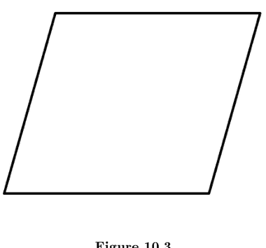

#### 10.3.1.4 连接符 (Connectors)

有时流程图会被分成两个或多个更小的流程图。这通常在流程图无法放在单页上或必须分成若干部分时进行。连接符（内部带有字母或数字的小圆圈）允许你在同一页上连接两个流程图。看起来像衬衫口袋的连接符允许你连接到不同页的流程图。

页内连接符 (On-Page Connector)


页外连接符 (Off-Page Connector)


#### 10.3.1.5 决策 (Decision)

菱形用于表示决策符号中正在测试的真/假语句。

库模块：通常是特定的任务函数。

#### 10.3.1.7 流程线 (Flow Lines)

注意：默认流是从左到右、从上到下（与阅读英语相同）。为了节省时间，只有当流程线违背正常方向时，才会绘制箭头。

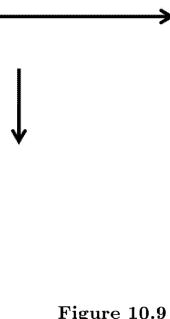

### 10.3.2 示例

我们将通过展示某些伪代码的流程图来演示各种流程图。

#### 10.3.2.1 函数 (Functions)

示例 10.9：伪代码：带参数的函数

```
Function clear
Pass In: nothing
Direct the monitor
Pass Out: nothing
Endfunction
```

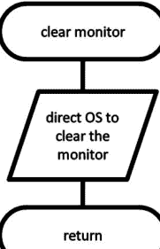

示例 10.10：伪代码：函数

```
Function main
Pass In: nothing
Doing some code
Pass Out: zero
Endfunction
```

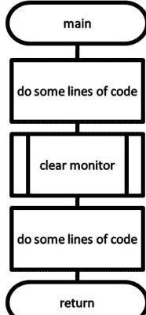

#### 10.3.2.2 序列控制 (Sequence Control)

下一项是序列伪代码。它演示了页内和外的连接符。

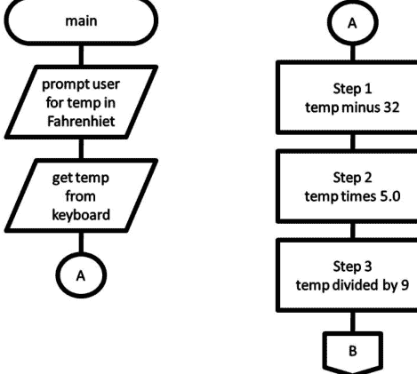

#### 10.3.2.3 选择控制结构 (Selection Control Structures)

示例 10.12：伪代码：If Then Else

```
If age > 17
  Display a message indicating you can vote.
Else
  Display a message indicating you can't vote.
endif
```

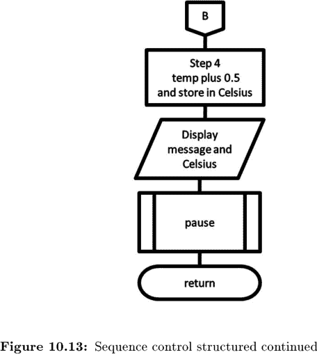

#### 10.3.2.4 迭代（重复）控制结构 (Iteration (Repetition) Control Structures)

示例 10.14：伪代码：While

```
count assigned zero
While count < 5
Display "I love computers!"
Increment count
Endwhile
```

示例 10.15：伪代码：For

```
For x starts at 0, x < 5, increment x
Display "Are we having fun?"
Endfor
```

示例 10.16：伪代码：Do While

```
count assigned five
Do
  Display "Blast off is soon!"
  Decrement count
While count > 0
```

示例 10.17：伪代码：Repeat Until

```
count assigned five
Repeat
  Display "Blast off is soon!"
  Decrement count
Until count < 1
```

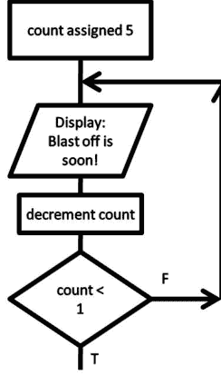

图 10.19：重复直到控制结构

### 10.3.3 定义

**定义 10.7: 流程图**

一种编程设计工具，使用图形元素视觉化地描述函数内部的逻辑流。

**定义 10.8: 过程符号**

流程图中的矩形，用于表示赋值等普通过程的符号。

**定义 10.9: 输入/输出符号**

流程图中的四边形，用于表示输入/输出交互的符号。

**定义 10.10: 决策符号**

流程图中的菱形，用于提问和做出决策。

**定义 10.11: 流线**

连接各种流程图符号（有时带有箭头）的线条。

## 10.4 练习 10：结构化编程导论

### 10.4.1 学习目标

在以下活动中（记忆构建活动、练习、实验作业、问题或限时测验/考试）达到 100% 的准确率；学生预期做到：

1. 根据本章相关模块中列出的定义定义这些术语。
2. 给定伪代码，编写一个使用 `if else` 和 `while` 控制结构的程序的 C++ 代码。

> 此内容可在在线获取：<http://cnx.org/content/m19692/1.14/>。

### 10.4.2 记忆构建活动

链接至：MBA 10

### 10.4.3 练习题

（答案在第 143 页。）

## 练习 10

判断下列陈述的对错（真或假）：

1. 控制结构只有类。
2. 分支控制结构在良好的结构化编程中很少使用。
3. `if then else` 是一种多选择控制结构。
4. `while` 控制结构是分支类的一部分。
5. 伪代码比流程图好。

### 10.4.4 杂项

目前暂无。

### 10.4.5 实验作业

#### 10.4.5.1 为第 10 章文件创建文件夹或子文件夹

根据你的编译器/IDE，你应该决定在哪里下载和存储用于处理的源代码文件。根据谨慎原则，你应该在下载源代码之前根据需要创建这些文件夹。对于 Bloodshed Dev-C++ 5 编译器/IDE，建议的子文件夹可能是：

- 名为 `Cpp_Source_Code_Files` 文件夹下的 `Chapter_10`

如果你还没有创建，请根据需要创建相应的文件夹和子文件夹。

#### 10.4.5.2 下载实验文件

将文件下载并存储到存储设备的相应文件夹中。你可能需要右键点击链接并选择“目标另存为”来下载文件。

从 Connections 下载：`Lab_10_Pseudocode.txt`

#### 10.4.5.3 详细实验说明

阅读并遵循下面的说明，并按照列表顺序执行步骤。

1. 从 `Lab_10_Pseudocode.txt` 创建源文件。命名为：`Lab_10.cpp`
2. 构建（编译并运行）你的程序。
3. 成功编写程序后，如果你是为了大学学分修读此课程，请遵循教授/教师的说明提交进行评分。

### 10.4.6 问题

#### 10.4.6.1 问题 10a – 说明

列出控制结构的四类，并为每种类型提供简要描述。

> 查看位于 <http://cnx.org/content/m19692/latest/index.html> 的文件
> 查看位于 <http://cnx.org/content/m19692/latest/Lab_10_Pseudocode.txt> 的文件

## 第 10 章练习答案

练习 10.1 答案（第 142 页）

答案：

1. 假 (false)
2. 真 (true)
3. 假 (false)
4. 假 (false)
5. 假 (false)

# 第 11 章

## 11. 双路选择

### 11.1 If Then Else

#### 11.1.1.1 传统双路选择

我们将介绍高级语言中可用的选择类控制结构。它被称为 **if else** 结构。通过提一个有真假答案的问题来控制 `if then else` 结构。它看起来像这样：

```
if 问题的答案为真
then 执行此操作
else 因为它是假的
do 执行此操作
```

在许多语言中，该值（称为**测试表达式**）是一个**布尔表达式**。布尔值有两个值——真和假。让我们重写该结构以考虑这一点：

```
if 表达式为真
then 执行此操作
else 因为它是假的
do 执行此操作
```

某些语言使用关键字："if"、"then" 和 "else"。许多语言删除了 "then"。此外，“执行此操作"可以与真和假绑定。你可能会看到如下：

```
if 表达式为真
真操作
else
假操作
```

大多数语言会推断出“为真”，你可能会看到如下所示：

> 此内容可在在线获取：<http://cnx.org/content/m19692/1.4/>

双路选择

```
if 表达式为真
真操作
else
假操作
```

## 11.3 关系运算符

### 11.3.1 关系运算符概述

关系运算符通常用于创建控制程序流的测试表达式。这种表达式也被称为布尔表达式，因为它们在求值时会产生布尔答案或值。常见的有六种关系运算符，它们通过比较两个操作数之间的关系（显示它们的关系）来给出一个布尔值。如果操作数的类型不同，则会发生隐式提升，将操作数转换为相同的数据类型。

> 定义 11.5：关系运算符

通过评估两个操作数之间的关系来给出布尔值的运算符。

运算符符号和/或名称随编程语言而异。C++ 编程语言运算符及其含义如下：

| C++ 运算符 | 含义 |
|---|---|
| `<` | 小于 |
| `>` | 大于 |
| `<=` | 小于等于 |
| `>=` | 大于等于 |
| `==` | 等于（相等） |
| `!=` | 不等于 |

表 11.2

# 练习 11.1

求出以下布尔表达式的值。（答案在第 153 页。）

1. `9 < 25`
2. `9 < 3`
3. `9 > 14`
4. `9 <= 17`
5. `9 == 25`
6. `9 == 13`
7. `9 != 13`
8. `9 < 15`

C++ 编程语言中布尔表达式的答案为：真为 1，假为 0。

请注意。在数学中，你熟悉这些符号：`=` 表示相等，`≠` 表示不等。在 C++ 编程语言中，不使用 `≠`，而 `=` 符号表示赋值。

### 11.3.2 C++ 演示程序

#### 11.3.2.1 为源代码文件创建文件夹或子文件夹

根据你使用的编译器/IDE，你应该决定在哪里下载和存储用于处理的源代码文件。出于谨慎起见，你应该在下载源代码文件之前创建这些文件夹。对于 Bloodshed Dev-C++ 5 编译器/IDE，建议的子文件夹命名为：

- `Demo_Programs`

如果你还没有这样做，请根据需要创建相应的文件夹和/或子文件夹。

#### 11.3.2.2 下载演示程序

将以下文件下载并存储到存储设备上的相应文件夹中。你可能需要右键点击链接并选择“另存目标”以下载文件。按照你的编译器/IDE 的方法编译并运行程序。结合其他学习材料学习源代码文件。

从 Connections 下载：`Demo_Relational_Operators.cpp`

> 查看 <http://cnx.org/content/m19549/latest/Demo_Relational_Operators.cpp> 处的文件

## 11.4 复合语句

### 11.4.1 复合语句的必要性

为了说明，我们将使用 C++ 编程语言中的 `if else` 控制结构语法。然而，这个问题通常存在于任何使用复合语句的语言的所有控制结构中。其语法如下：

```
(expression)
    statement;
else
    statement;
```

在 C++ 编程语言中，作为控制结构的动作部分，只能列出一条语句。通常，我们可能想要执行多条语句。这个问题通过创建复合语句来解决。大括号符号——左大括号 `{` 和右大括号 `}`——用于创建复合语句。例如：

```
(expression)
{
    statement;
    statement;
else
{
    statement;
    statement;
}
```

由于程序员经常忘记控制结构的动作部分只能列出一条语句；C++ 编程行业鼓励使用缩进（以便清晰查看动作部分）以及使用复合语句（大括号），即使只有一个函数也是如此。因此：

```
(expression)
{
    statement;
}
else
{
    statement;
}
```

通过这种方式编写代码，程序员通过在真动作或假动作部分中添加更多语句来修改代码；他们不会引入编译器错误或逻辑错误。使用缩进和花括号应该是 C++ 程序员以及任何其他需要在控制结构中使用复合语句的语言的程序员的标准做法。

### 11.4.2 复合语句的其他用途

复合语句是零条或多条语句的编码单元。它也被称为块（`block`）。复合语句由语句组成，形成一个整体。你在第一个程序中形成 `main` 函数体时，就使用了复合语句。所有的 C++ 函数都包含一个作为函数体的复合语句。

复合语句由一个左大括号、可选的声明、定义和语句以及一个右大括号组成。虽然这三者都是可选的，但至少应该有一个。

> 此内容可以在 <http://cnx.org/content/m19683/1.3/> 在线获取

### 11.4.3 定义

**定义 11.6：复合语句**

由零条或多条语句组成的代码单元。

**定义 11.7：块**

复合语句的另一个名称。

## 11.5 练习 11：双向选择

### 11.5.1 学习目标

在记忆构建活动、练习、实验作业、问题或限时测试/考试中达到 100% 的准确率；学生预期：

1. 定义本章相关模块中列出的定义术语。
2. 给定伪代码，编写使用 `if then else` 控制结构的程序的 C++ 代码。

### 11.5.2 记忆构建活动

链接至：MBA 11


> ⁶Berouza A. Forzan and Richard F. Gilbert, Computer Science A Structured Approach using C++ Second Edition (United States of America: Thompson – Brooks/Cole, 2004) 100.
>
> ⁷此内容可以在 <http://cnx.org/content/m19764/1.15/> 在线获取
>
> ⁸查看 <http://cnx.org/content/m19764/latest/index.html> 处的文件

### 11.5.3 练习

练习 11.2（答案在第 153 页。）

求出以下布尔表达式的值：

1. `25 < 7`
2. `3 < 7`
3. `14 > 7`
4. `17 <= 7`
5. `25 >= 7`
6. `13 == 7`
7. `9 != 7`
8. `5 > 7`

### 11.5.4 杂项项目

链接至：显示 `if else` 的动态 gif⁹

链接至：数据处理部分 ²⁰

### 11.5.5 实验作业

#### 11.5.5.1 为源代码创建文件夹或子文件夹

根据你使用的编译器/IDE，你决定在哪里下载和存储用于处理的源代码文件。出于谨慎起见，你应该在下载源代码文件之前创建这些文件夹。对于 `Bloodshed Dev-C++ 5` 编译器/IDE，建议的子文件夹命名为：

- 文件夹 `Cpp_Source_Files` 内的 `Chapter_11`

如果你还没有这样做，请根据需要创建相应的文件夹和/或子文件夹。

#### 11.5.5.2 下载实验文件

将以下文件下载并存储到设备上的相应文件夹中。你可能需要右键点击链接并选择“另存目标”以下载文件。

从 Connections 下载：`Lab_11_Pseudocode.txt`¹¹

#### 11.5.5.3 详细实验说明

仔细阅读并遵循方向，按列出的顺序执行步骤。

- 从 `Lab_11_Pseudocode.txt` 文件创建源代码文件。命名为：`Lab_11.cpp`
- 构建（编译并运行）你的程序。
- 编写此程序后，如果你是在读大学课程，请遵循老师/指导教师的说明提交评分。

> ⁹查看 <http://cnx.org/content/m19764/latest/if_then_else_gif.> 处的文件
>
> ¹⁰查看 <http://cnx.org/content/m19764/latest/Manipulation_Data_Part_2.pdf> 处的文件
>
> ¹¹查看 <http://cnx.org/content/m19764/latest/Lab_11_Pseudocode.txt> 处的文件

### 11.5.6 问题

#### 11.5.6.1 问题 11a

创建一个包含六个关系运算符及其含义的表格。

#### 11.5.6.2 问题 11b

解释为什么我们在下面的示例中使用 `if then else` 来处理输入数据。

示例 11.1：C++ 源代码

```
cout << "\nEnter one side of the rectangle ----------->: " ;
cin >> side1;
cout << "\nEnter the other side of the rectangle --->: " ;
cin >> side2;

if (side1 > side2)
{
    length = side1;
    width = side2;
}
else
{
    length = side2;
    width = side1;
}
```

## 第 11 章练习题

### 11.1 练习题（第 148 页）

答案：

1. 1
2. 0
3. 0
4. 1
5. 0
6. 0
7. 1
8. 错误，“不小于”不是一个有效的运算符。

### 11.2 练习题（第 151 页）

答案：

1. 0
2. 1
3. 1
4. 0
5. 1
6. 0
7. 1
8. 错误，“不大于”不是一个有效的运算符。

# 第 12 章

## 12. 多路选择

### 12.1 嵌套 `if else` 结构

#### 12.1.1 多路选择简介

##### 12.1.1.1 嵌套控制结构

我们将首先介绍嵌套控制结构的概念。嵌套是将其中一个项目放在另一个项目中的概念。考虑：

```
if expression
true action
else
false action
```

这是 `if else` 控制结构的基本形式。现在考虑：

```
if age is less than 18
you can't vote
if age is less than 16
you can't drive
else
you can drive
else
you can vote
if age is less than 21
you can't drink
else
you can drink
```

如你所示，我们简单地在“true action”中包含了一个语句和另一个 `if then` 控制结构。我们在“false action”中执行了同样的操作（嵌套了另一个 `if else`）。在我们的示例中，我们嵌套了 `if else` 控制结构。嵌套可以在 `while` 循环内部包含一个 `if else`。因此，嵌套的概念允许不同类型的控制结构的混合使用。

¹此内容可以在在线获取：<http://cnx.org/content/m19951/1.6/>。

##### 12.1.1.2 多路选择

二路选择的缺点之一是我们只能考虑两个选择。但如果你有两个以上的选择，该怎么办？考虑以下具有四种选择的情况：

- if age equal to 18
  - you can now vote
- else
  - if age equal to 39
  - you are middle aged
  - else
  - if age equal to 65
  - you can consider retirement
  - else
  - your age is unimportant

根据年龄的值你会获得适当的消息。最后一项被称为默认值。如果年龄不等于 18、39 或 65，你将获得默认消息。在某些情况下，没有默认操作。考虑：

- if age equal to 18
  - you can now vote
- else
  - if age equal to 39
  - you are middle aged
  - else
  - if age equal to 65
  - you can consider retirement

最后一个 `if else` 控制结构没有“else”。它隐含了“else 则什么都不做”。如果没有默认操作，多路选择可以写成一系列“if then not the else” 结构。考虑：

- if age equal to 18
  - you can now vote
- if age equal to 39
  - you are middle aged
- if age equal to 65
  - you can consider retirement

我们有两种方法来实现多路选择。使用嵌套的 `if else` 控制结构还是一系列 `if then else` 结构，取决于是否存在默认操作（你必须嵌套 `if else`），或者在没有默认操作时程序员的偏好（你可以使用嵌套 `if else` 或一系列 `if then` 结构）。

#### 12.1.2 C++ 中的 `if then else` 语法

C++ 编程语言中 `if else` 控制结构的语法为：

示例 12.1：C++ 源代码：`if else` 的布局

```
if (expression)
{
    statement;
}
else
{
    statement;
}
```

注意：测试表达式位于括号内，但这不是函数调用。括号是控制结构的一部分。此外，在表达式后的括号后面没有分号。

#### 12.1.3 C++ 示例

通常需要多路选择来涵盖所有可能性。假设用户已被提示输入了两个人的年龄，并将答案存储在变量 `age1` 和 `age2` 中。考虑：

示例 12.2：C++ 源代码

```
if(age1 > age2)
{
    cout << "\n\nThe first person is older.";
}
else
{
    cout << "\n\nThe second person is older.";
}
```

如果两个人的年龄相同呢？程序错误地说第二个人年龄大。为了解决这个问题，我们必须处理所有可能性。考虑这个多路选择示例：

示例 12.3：C++ 源代码

```
if(age1 == age2)
{
    cout << "\n\nThey are the same age.";
}
else
{
    if(age1 > age2)
    {
        cout << "\n\nThe first person is older.";
    }
    else
    {
      cout << "\n\nThe second person is older.";
    }
}
```

#### 12.1.4 定义

**定义 12.1.1：**嵌套控制结构

将一个控制结构放在另一个结构内部。

**定义 12.1.2：**多路选择

从两个以上的选择中进行选择。

## 12.3 分支结构

### 12.3.1 传统的分支结构

#### 12.3.1.1 使用分支结构进行多路选择

二路选择的缺点之一是我们只能考虑两个选择。但如果你有超过两个选择该怎么办？考虑以下具有四个选择的情况：

```
if age equal to 18
    you can vote
else
    if age equal to 39
        you're at middle aged
    else
        if age equal to 65
            consider retirement
    else
        age is un-important
```

你将根据 `age` 的值获得相应的消息。最后一项被称为默认（default）。如果 `age` 不等于 18、39 或 65，你将获得默认消息。在某些情况下，没有默认操作。考虑这个流程图示例：

> ⁴此内容可以在 <http://cnx.org/content/m19963/1.4/> 在线查看。

## 第 12 章 12. 多路选择

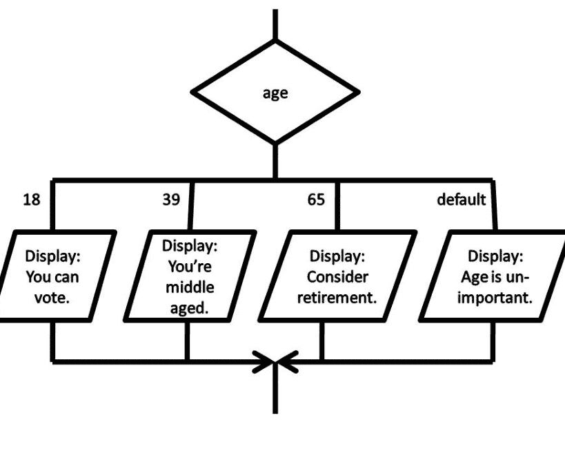

图 12.1

该流程图是分支结构，用于多路选择。决策框持有变量 `age`。`case` 的逻辑是等值判断，变量 `age` 中的值将与从左到右列出的值进行比较。因此，存储在 `age` 中的值将与 18 或“等于 18”进行比较。如果为真，逻辑将向下执行操作，并在分支结构的底部退出。如果测试表达式的值为假，它将移动到右侧的下一个列出的值进行再次比较。它的工作方式与我们的嵌套 `if-then-else` 结构完全相同。

#### 12.3.1.2 实现多路选择的 C++ 代码

使用上述相同的示例，这里是实现分支结构的 C++ 代码。

示例 12.4：C++ 源代码 - 使用整数的 `case` 结构

```
switch (age)
{
  case 18: cout << "\nYou can vote.";
  break;
  case 39: cout << "\nYou're middle aged.";
  break;
  case 65: cout << "\nConsider retirement.";
  break;
  default: cout << "\nAge is un-important.";
}
```

你首先应该注意到的是，C++ 编程语言并没有正式的分支控制结构。它有一个 `switch` 控制结构，但它的行为与传统的分支结构不同。我们使用 `break`（一种分支控制结构）配合 `switch` 来使其行为得像传统的 `case` 结构。这是在 C++ 编程语言中使用 `switch` 配合 `break` 来模拟传统分支结构的极少数允许方法之一。如果你想保持在良好的结构化编程技术范围内，应避免所有其他 `switch` 或 `break` 的用法。

`age` 中的值将与第一个 `case`（注意：`case` 是 C++ 的保留字之一）进行比较，该值为 18（也称为列出的值），使用等值比较或即“等于 18”。如果为真，则执行 `cout` 显示“You can vote..”，并执行下一行代码（`break`），这将我们跳转到控制结构的末尾。如果为假，它将移动到下一个 `case` 进行比较。

大多数编程语言（包括 C++）要求 `case` 分支结构的列值必须是整数数据类型。这基本上意味着整数或字符数据类型。考虑这个使用字符数据的示例（`choice` 是一个字符变量）：

示例 12.5：C++ 源代码 - 使用字符的 `case` 结构

```
switch (choice)
{
  case 'A': cout << "\nYou are an A student.";
  break;
  case 'B': cout << "\nYou are a B student.";
  break;
  case 'C': cout << "\nYou are a C student.";
  break;
  default: cout << "\nMaybe you should study harder.";
}
```

### 12.3.2 分支结构的局限性

大多数编程语言（包括 C++）不允许 `case` 结构使用值范围。考虑这个使用了范围的流程图示例：

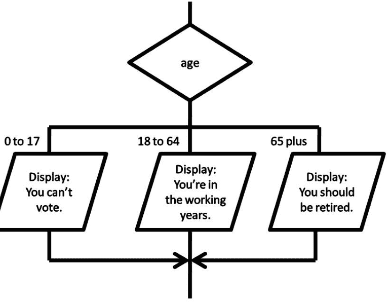

图 12.2

同样考虑以下相同逻辑的伪代码：

```
Case of age
0 to 17      Display "You can't vote."
18 to 64      Display "You're in your working years."
65 +          Display "You should be retired."
Endcase
```

在设计程序并使用伪代码或流程图记录该设计时，允许在非整数或值范围的情况下使用 `case` 结构。然而，在大多数语言中的实现将遵循嵌套的 `if-then-else` 方法并带有复杂的布尔表达式。上述逻辑看起来如下：

```
if age > 0 and age <= 17
    display You can't vote.
else
    if age is >= 18 and age <= 64
        display You're in your working years.
else
display You should be retired.
```

### 12.3.3 良好的结构化编程方法

大多数教科书作者确认，良好的结构化编程技术和习惯比专注于你正用于学习编程技能的语言的技术可能和能力更重要。记住，本模块专注于编程基础和概念，并使用 C++ 编程语言来。

### 12.3.4 分支结构

我们将讨论每个项目，并指出哪些是允许的，哪些是不允许的。

### 12.4.2 示例

#### `break`

`break` 有两种用法；一种配合 `switch`（一种 C++ 编程结构）使其像 `case` 结构（这是大多数编程语言中常用的名称），另一种作为循环过程的一部分退出循环。第一种用法在良好的结构化编程中是允许的，而第二种在结构化编程中是不允许的。

示例 12.6：C++ 源代码

```
switch (age)
{
    case 18: cout << "\nYou can vote";
    break;
    case 39: cout << "\nyou are middle aged.";
    break;
    case 65: cout << "\nyou are at retirement age.";
    break;
    default: cout << "\nyour current age is not important.";
}
```

以下是循环中使用 `break` 的非法，它看起来循环将执行 8 次，但 `break` 语句会导致它在第五次迭代时停止。

示例 12.7：C++ 源代码

```
counter = 0;
while(counter < 8)
{
    cout << counter << endl;
    if (counter == 4)
    {
        break;
    }
    counter++;
}
```

#### `continue`

`continue` 结构在良好的结构化编程中是不允许的。以下看起来循环将在显示器上打印 8 次，但 `continue` 语句导致不打印数字 4。

示例 12.8：C++ 源代码

```
for(counter = 0; counter < 8; counter++)
{
    if (counter == 4)
    {
        continue;
    }
    cout << counter << endl;
}
```

#### `goto`

在良好的结构化编程中是不允许使用 `goto` 结构的。我们带着某种犹豫才向大家展示它。许多教科书并没有介绍 `goto`。在 C++ 编程语言中，我们通过在标识符后加冒号来创建一个标签。使用 `goto` 命令后紧跟该标签。标签可以在声明之前使用。

示例 12.9：C++ 源代码


```
some lines of code;
goto mynewspot; //跳转到标签
some lines of code;
some lines of code;
some lines of code;
mynynewspot: some statement; //已声明的标签
some lines of code;
```

## 12.4.2.4 return

在良好的结构化编程中是允许使用 `return`，但仅限于函数的末尾。函数不应该通过将函数逻辑跳回调用它的函数来提前结束。

示例 12.10：C++ 源代码

```
****************************************************
// 获取数据
****************************************************

void get_data(void)
{
    // 输入 - 测试数据 - 5678.9, 5432.1
    cout << "\nenter length of the property in feet --->: ";
    cin >> property_length;
    cout << "\nenter width of the property in feet --->: ";
    cin >> property_width;
    return;
}
```

## 12.4.2.5 exit

虽然 `exit` 在技术上是一个预定义函数，但在这里对其进行介绍，因为它在编程中很常用。一个很好的例子是打开文件然后测试文件是否真的已打开。如果没有，则产生一个错误指示我们想要提前停止程序的执行。在 C++ 编程语言中，`exit` 函数会终止程序的运行，并在过程中向操作系统返回一个整数值。它符合分支的定义，即跳转到程序的其他地方。在我们的示例中，返回给操作系统的值是常量 `EXIT_FAILURE` 的值。

示例 12.11：C++ 源代码

```
inData.open(filename); //打开输入文件
if (!inData) {
    // 测试文件是否已打开
    cout << "\n\nError opening file: " << filename << "\n\n";
    pause(); // 暂停 - 用户阅读消息
    exit(EXIT_FAILURE); //允许提前跳转到操作系统
}
```

## 12.5 练习：多路选择

### 12.5.1 学习目标

在记忆构建活动、练习、实验作业、问题或限时测试/考试中达到 100% 的准确率；预计学生能够做到：

- 1. 定义本章节相关模块中列出的定义中的术语。
- 2. 识别哪些选择控制结构是双路选择，哪些是多路选择。
- 3. 理解、定义和/解释 `case`、`switch` 以及嵌套 `if then else`。
- 4. 能够为 `case` 控制结构编写伪代码或流程图。
- 5. 能够为使用等值和列表值的 `case` 结构编写 C++ 源代码（使用带有 `break` 的 `switch` 来模拟 `case` 结构）。
- 6. 能够为使用值范围或浮点值的 `case` 结构编写 C++ 源代码（使用嵌套 `if else` 来模拟 `case` 结构）。
- 7. 在可行的情况下，能够将模拟 `case` 的 C++ 源代码转换为嵌套的 `if else`，反之亦然。

> 此内容可以在在线上通过 <http://cnx.org/content/m19968/1.12> 获取。

### 12.5.2 记忆构建活动

链接至：MBA 127

### 12.5.3 练习

练习 12.2（答案在第 172 页.）

求值以下逻辑布尔表达式：

- 1. `25 > 39 || 15 > 36`
- 2. `19 > 26 || 13 < 17`
- 3. `14 < 7 && 6 <= 6`
- 4. `4 > 3 && 17 >= 7`
- 5. `true`
- 6. `!(13 == 7)`
- 7. `9 != 7 && !1`
- 8. `6 < 8`

### 12.5.4 杂项内容

链接至：数据操作部分 3

### 12.5.5 实验作业

#### 12.5.5.1 为第 12 章创建一个文件夹或子文件夹

根据你的编译器/IDE，你应该决定在何处下载和存储用于处理的代码。谨慎的做法是根据需要创建文件。建议 C++ 编译器/IDE 的子文件夹可以命名为：在名为（此处为空）的文件夹内的 `Chapter_12`。如果你没有，请根据情况创建文件夹和/或子文件夹。

#### 12.5.5.2 下载实验文件

将文件下载并存储到你存储设备的相应文件夹（s）中。你可能需要右键点击链接并选择“另存为”以从此处下载文件：`Lab_12a.cpp`。

#### 12.5.5.3 详细实验说明

阅读并遵循下面的说明，按有序列表执行步骤：

- 编译并运行 `Lab_12a.cpp` 源代码。理解它的工作原理。
- 复制源代码文件 `Lab_12b.cpp` 并命名为：`Lab_12b.cpp`。
- 将嵌套的 `if else` 转换为 `switch`。
- 构建（编译）并运行你的程序。
- 在你成功编写此程序后，如果你是为了大学学分修读此课程，请遵循教授/教师的指令提交进行评分。

> ⁷ 参见位于 <http://cnx.org/content/m19968/latest/index.html> 的文件
>
> ⁸ 参见位于 <http://cnx.org/content/m19968/latest/Manipulation_Part_3.pdf> 的文件
>
> ⁹ 参见位于 <http://cnx.org/content/m19968/latest/Lab_12a.cpp> 的文件

### 12.5.6 问题

#### 12.5.6.1 问题 12a – 指令

为以下伪代码绘制流程图：

```
Case of shoe_size
4 to 6    Display "Small."
7 to 9    Display "Medium."
10      Display "Large."
```

#### 12.5.6.2 问题 12b – 指令

将以下伪代码转换为 `switch`：

```cpp
if (age == 24) {
    cout("You're the same as Melinda.");
} else if (age == 27) {
    cout("You're the same as Ruth.");
} else if (age == 34) {
    cout("You're the same as Ben.");
} else {
    cout("age is un-important.");
}
```

#### 12.5.6.3 问题 12c – 指令

为以下伪代码编写 C++ 源代码：

```cpp
if (age == 24) {
    cout("You're the same as Melinda.");
} else if (age == 27) {
    cout("You're the same as Ruth.");
} else if (age == 34) {
    cout("You're the same as Ben.");
} else {
    cout("age is un-important.");
}
```

### 12.5.7 答案

第 12 章练习题答案

练习 12.1 答案：

- 1. false
- 2. true
- 3. false
- 4. true
- 5. true
- 6. true
- 7. false
- 8. true

练习 12.2 答案：

（此处省略具体的流程图答案）

练习 12.3 答案：

```cpp
if (age == 24) {
    cout << "You're the same as Melinda.";
} else if (age == 27) {
    cout << "You're the same as Ruth.";
} else if (age == 34) {
    cout << "You're the same as Ben.";
} else {
    cout << "age is un-important.";
}
```

练习 12.4 答案：

（此处省略具体的代码答案）

练习 答案：

对以下逻辑布尔表达式求值：

- 1. `25 > 39 || 15 > 36`
- 2. `19 > 26 || 13 < 17`
- 3. `14 < 7 && 6 <= 6`
- 4. `4 > 3 && 17 >= 7`
- 5. `true`
- 6. `!(13 == 7)`
- 7. `9 != 7 && !1`
- 8. `6 < 8`

答案：

- 1. false
- 2. true
- 3. false
- 4. true
- 5. true
- 6. true
- 7. false
- 8. true

# 第13 章

## 13. 测试后循环

### 13.1 do While 循环

#### 13.1.1 测试后循环简介

在迭代控制结构中有两种常用的测试后循环。它们是：do while 和 repeat until。本模块介绍：do while。

##### 1.1.1 通理解迭代 – do while

迭代的概念与可能重复某项操作有关。像所有的控制结构一样，我们通过一个问题来控制循环的执行。循环一词源于流程图中的圆形运动。do while 循环的基本形式如下：

- 某些语句或动作
- 某些语句或动作
- 某些语句或动作
- 更新标志
- 当问题的答案为真时

在我知道的每个语言中，问题（称为测试表达式）是一个布尔表达式。布尔数据类型有两个值——真和假。让我们考虑到这一点重写结构：

- 某些语句或动作
- 某些语句或动作
- 某些语句或动作
- 更新标志
- 当表达式为真时

在 do while 控制结构中，一个正常工作的循环包含三个属性。它们是：

- 动作或动作
- 标志的更新
- 测试表达式

英文的表述是“当表达式为真时，你执行该操作”。这是对真值进行循环。当测试表达式为假时，你停止循环并继续执行程序的下一个项目。请注意，由于这是循环后测试，因此操作将至少发生一次。它之所以被称为循环后测试，是因为测试发生在操作之后。它也被称为后测试循环（post-test loop），意味着测试是在操作和更新之后的（或称为拉丁语中的 "post"）。

#### 13.1.2 C++ 中的 while 结构

##### 13.1.2.1 语法

C++ 编程语言中 do while 控制结构的语法格式如下：

```cpp
do {
  statement;
  statement;
  statement;
  statement; // 这条语句更新标志位；
}
while (expression);
```

> 注意：测试表达式位于括号内，但这不是一个函数调用。括号是控制结构的一部分。此外，表达式后的括号内有一个分号。

##### 13.1.2.2 示例

示例 13.1: C++ 源代码：do while 循环

```cpp
do {
  cout << "what is your age?";
  cin >> age_user;
  cout << "what is your friend's age?";
  cin >> age_friend;
  cout << "\ntogether your ages adds up to:";
  cout << (age_user + age_friend);
  cout << "\nDo you want to do it? or n ";
  cin >> loop_response;
}
while (loop_response == 'y');
```

循环后测试的三个属性都存在。操作部分由 6 行代码组成，提示数据并显示两个年龄的总和。标志位的更新是显示问题并获取变量 `loop_response` 的答案。测试是标志位变量中的值与小写字符 `y` 的等值关系比较。

这种类型的循环控制被称为事件控制循环（event controlled loop）。标志位的更新是一个事件，由某人决定是否希望再次执行循环。

在 C++ 社区中，对循环操作和标志更新进行对齐缩进是标准的行业做法。

##### 13.1.2.3 死循环

此时值得提到，良好的编程总是会提供一种方法来确保循环问题最终为假，这样循环就会停止执行，程序继续执行下一行代码。然而，如果没有发生这种情况，程序就会陷入死循环。死循环是坏事。考虑以下代码：

示例 13.2: C++ 源代码：死循环

```cpp
loop_response = '';
{
  cout << "\nwhat is your age?";
  cin >> age_user;
  cout << "\nwhat is your friend's age?";
  cin >> age_friend;
  cout << "\nTogether your ages adds up to: ";
  cout << (age_user + age_friend);
}
while (loop_response == '');
```

程序员在循环之前为标志位分配了一个值，但忘记更新标志位。每当询问测试表达式时，它始终为真。因此导致了死循环，因为程序员没有提供退出循环的方法（他忘记更新标志位）。

考虑以下代码：

示例 13.3: C++ 源代码：死循环

```cpp
{
  cout << "\nwhat is your age?";
  cin >> age_user;
  cout << "\nwhat is your friend's age?";
  cin >> age_friend;
  cout << "\nTogether your ages adds up to: ";
  cout << (age_user + age_friend);
  cout << "\nDo you want to do it? y or n ";
  cin >> loop_response;
}
while (loop_response == '');
```

无论用户在标志位更新期间回复什么，测试表达式都没有进行关系比较，而是进行了赋值。它将 'y' 赋值给 C++ 编程语言的 `Boolean` 概念变量，因为所有非零值都被视为代表真，且对该文本问题的答案为真。喜喜，你有了一个死循环。

#### 13.1.3 定义

**定义 13.1: do while**

C++ 中可用的迭代后测试控制结构。

**定义 13.2: 操作项**

迭代控制结构的一个属性。

**定义 13.3: 更新项**

迭代控制结构的一个属性。

**定义 13.4: 测试项**

迭代控制结构的一个属性。

**定义 13.5: 至少一次**

表示循环执行后操作至少执行一次。

**定义 13.6: 死循环**

没有退出方法，因此是坏事。

### 13.2 标志位概念²

#### 13.2.1 概念讨论

几个年来，旗一直被用作信号，让其他人知道关于显示、悬挂或挥舞旗帜的群体或个人的信息。有国旗和州旗。海上的船悬挂它们的国旗。海盗悬挂骷交叉标志。黄旗用于隔离，通常指瘟疫。即使是海盗也会避而远之。今天，有些人可能认识潜水员使用的旗帜。大多数国家的总统都有旗帜。在赛车活动中，他们使用格子旗来表示比赛结束。

对循环操作和标志位更新进行对齐缩进是 C++ 社区的正常行业做法。

**定义 13.7: 标志位**

用于存储用于控制信息的变量或常量。

#### 13.2.2 计算机实现

图 13.1: 各种标志

计算机编程以相同的方式使用标志位。任何持有数据的变量或常量都可以作为标志位。一个示例可以是名为 `gender` 的变量。通常存储的两个值是 'F' 和 'M'。

示例 13.4: 控制 if 结构的标志位

```cpp
gender == 'F'
display "Are you pregnant?";
get answer from user store in pregnant
```

查看标志位意味着使用关系运算符将变量中的值与另一个值（上面的示例）进行比较。

#### 13.2.3 具有相同含义两个标志位

有时我们使用迭代控制结构 while 来决定是否希望再次执行操作。变量可能命名为 `loop_response`，提示用户回答 'y' 表示是或 'n' 表示否。一旦从键盘获取答案并存储在标志位变量 `loop_response` 中，控制循环的测试表达式可能是：

示例 13.5: 简单标志位比较

```cpp
loop_response == 'y'
```

这没问题，但如果用户意外开启了大写锁定。那么他的回复 'Y' 将不会进入控制结构循环并再次执行操作。解决方案在于两次检查标志位。考虑：

示例 13.6: 复杂标志位比较

```cpp
loop_response == 'y' or loop_response == 'Y'
```

我们使用关系关系和逻辑运算符复杂的布尔表达式来查看标志是小写 y 还是大写 Y。

#### 13.2.4 一个字节中的多个标志位

在汇编语言编程和许多控制特殊设备的程序中，使用单个字节表示多个标志位是常见的。这是通过让 8 位中的每一位都代表一个标志位来实现的。每个位的值为 1 或 0，可以代表真或假、开启或关闭、是或否。

### 13.3 C++ 中的赋值与等值关系³

#### 13.3.1 一般讨论

大多数控制结构都使用测试表达式，根据表达式的真假来执行选择（如 if else 结构）或迭代（如 while 或 for）。

因此，

³此内容可在线获取：<http://cnx.org/content/m19542/1.7/>。

我们经常谈到用布尔表达式控制结构。在许多编程语言中，这种表达式必须是布尔表达式，并受到一组严格规则的限制。然而，在 C++ 中，每个数据类型都可以作为布尔表达式，因为可以使用零表示假、所有非零值表示真的规则/概念将每个数据类型降级为布尔值。


在 C++ 中，我们可能会将等号符号误认为一个运算符，它并不代表我们一生大部分时间所使用的普通数学相等含义。C++ 中的等号符号意味着：赋值。为了在 C++ 中获得相等概念，我们使用两个等号来表示相等运算符。让我们考虑：

```cpp
if (pig = 'y')
{
  cout << "\nPigs are good";
}
else
{
  cout << "\nPigs are bad";
}
```

控制结构的测试将始终为真，因为该表达式是一个赋值（而不是关系运算符 `==`）。它将 `'y'` 赋值给变量 `pig`，然后查看 `pig` 中的值并判断它不是零；因此，该表达式为真。它将始终为真，且 `else` 部分永远不会被执行。这并不是程序员的意图。让我们再考虑：

```cpp
{
  cout << "\nPigs are good";
  cout << "\nDo it again, answer y or n: ";
  cin >> do_it_again
} while (do_it_assign = 'y');
```

循环的测试表达式将始终为真，因为该表达式是一个赋值（而不是关系运算符 `==`）。它将 `'y'` 赋值给变量 `do_it_again`，然后查看 `do_it_again` 中的值并判断它不是零；因此，该表达式为真。它将始终为真，你刚刚创建了一个无限循环。正如……，无限循环不是好事。

这些示例是为了提醒你，在创建测试表达式时必须小心，以确保它们确实是一个问题（通常使用关系运算符）。

不要误用赋值表示相等。

## 13.4 重复直到循环

### 13.4.1 后置循环简介

在控制结构的迭代（或重复）类别中，有两种常用的后置循环。它们是：`do` 和 `repeat until`。本模块涵盖：`repeat until`。

> 此内容可在在线查看 <http://cnx.org/content/m20597/1.3/>。

### 13.4.1.1 理解通用迭代 – repeat until

迭代的概念与可能想要重复某个动作有关。与所有的控制结构一样，它会通过提问来控制循环的执行。`repeat` 一词源于流程图时发生的圆形循环运动。`repeat` 循环的基本形式如下：

```
repeat
some statements or action
some statements or action
some statements or action
update the flag
until the answer to the question becomes
```

在我所知的每种语言中，问题（称为测试表达式）都是布尔表达式。布尔数据类型有两个值——`true` 和 `false`。让我们重写该结构来考虑这一点：

```
repeat
some statements or action
some statements or action
some statements or action
update the flag
until expression becomes true
```

在 `repeat until` 控制结构中，一个正常工作的循环有三个属性。它们是：

- 动作或多个动作
- 标志的更新
- 测试表达式

英语表述是：“你重复该动作，直到表达式变为真”。这是在“假”上进行循环。当表达式变为“真”时，你停止循环并继续程序的下一个项目。注意，因为这是循环后测试，所以动作将至少发生一次。它被称为“循环后测试”，是因为测试发生在动作之后。它有时也被称为后测试循环，意味着测试在动作和更新之后（或拉丁语中意为“之后”）。

### 13.4.2 C++ 中的 repeat until 结构

嗯，它不存在。大多数编程语言具有 `while` 或 `repeat until` 控制结构，但两者不兼备。

**定义 13.8: repeat until**

C++ 中不提供迭代后测试控制结构。

## 13.5 练习 13：后置循环

### 13.5.1 学习目标

在记忆构建活动、练习、实验作业、问题或限时测验/考试中达到 100% 的准确率；学生预期能够做到：

> 此内容可在在线查看 <http://cnx.org/content/m20642/1.8/>。

- 1. 定义本章相关模块中列出的定义术语。
- 2. 识别哪些选择控制结构是迭代后测试。
- 3. 能够编写 `do while` 控制结构的伪代码或绘制流程图。
- 4. 能够编写 `do while` 控制结构的 C++ 源代码。

### 13.5.2 记忆构建活动

链接至：MBA 13

### 13.5.3 练习

**练习 13.1**（答案见第 183 页）。

判断以下陈述的真或假：

- 1. `do while` 和 `repeat until` 结构的作用完全相同。
- 2. 学生有时会混淆赋值和相等。
- 3. `repeat until` 循环控制结构在所有编程语言中都可用。
- 4. 因为经常使用标志，所以它们通常是特殊的数据类型。
- 5. `do while` 是循环前测试。

### 13.5.4 杂项

链接至：显示 `do` 循环的动画 gif

### 13.5.5 实验作业

#### 13.5.5.1 为第 13 章文件创建文件夹或子文件夹

根据你的编译器/IDE，你应该决定在哪里下载和存储用于处理的代码文件。首要要求是在下载源代码文件之前，根据需要创建这些文件夹。对于 Bloodshed Dev-C++ 5 编译器/IDE，建议的子文件夹可以命名为：

- 在名为 `Cpp_Source_Code_Files` 的文件夹内创建 `Chapter_13`

如果没有，请根据需要创建相应的文件夹和/或子文件夹。

#### 13.5.5.2 下载实验文件

将以下文件下载并保存到你存储设备的相应文件夹中。你可能需要右键点击链接并选择“另存目标为”以下载文件。

从 Connections 下载：`Lab_13_Pseudocode.txt`

#### 13.5.5.3 详细实验说明

仔细阅读并遵循下方的指令，并按照列出的顺序执行步骤。

- 从 `Lab_13_Pseudocode.txt` 创建源代码文件。命名为：`Lab_13.cpp`
- 编译并运行你的程序。

如果你是为了大学学分修读此课程，请遵循教授/教师的指令进行提交。

### 13.5.6 问题

#### 13.5.6.1 问题 13a – 指令

为以下伪代码绘制流程图：

**示例 13.7：伪代码**

```
Do
Display "I like cheese cake!"
Display "Do it again? y or n --->"
Get answer from keyboard
While answer is 'y'
```

## 13 章练习答案

**练习 13.1 答案**（第 181 页）：

- 1. 假
- 2. 真
- 3. 假
- 4. 假
- 5. 假

## 第 14 章

## 14. 循环前测试

## 14.1 增量和减量运算符

### 14.1.1 一般讨论

增量或减量的概念是对一个通常作为标志的变量加或减 1。使用名为 `counter` 的变量；例如：

该概念是：

`counter` 被赋值为 `counter + 1`

即获取计数器的现有值并加 1，然后将结果存回变量。使用整数数据类型。程序员有时会使用 `inc` 和 `dec` 分别作为增量和减量的缩写。

运算符符号和/名称随不同的编程语言而异。C++ 编程语言运算符及其含义：

| C++ 运算符 | 含义 |
|---|---|
| `++` | 增，两个加号 |
| `--` | 减，两个减号 |

表 14.1

### 14.1.2 C++ 代码示例

在 C++ 编程语言中，增和减通常以这种简单的通用方式使用。增量运算符用两个连续的加号表示。示例：

- `counter = counter + 1;`
- `counter += 1;`
- `counter++;`

作为 C++ 语句，这三个示例的作用相同。它们对存储在 `counter` 中的任何值加 1。减量运算符用两个连续的减号表示。它们将从被递减变量的值中减 1。递增和递减的优先级取决于运算符是在操作数的右侧（后置）还是左侧（前置）。在 C++ 中，后置和前置递增减的优先级并不相同。

#### 14.1.2.2 后置递增

后置递增的意思是：在你完成其他操作时使用我现有的值；完成后再增加我。例如下：

```cpp
int oldest = 44; // 设置初始化的变量
// 随后在代码后半部分
age = oldest++;
```

第一次使用 `oldest` 变量是一个右值，会提取或获取现有的值 44 并赋值给变量 `age`；然后 `oldest` 递增，其值从 44 变为 45。这似乎违反了优先级，因为递增的优先级高于赋值。但这种后置递增在 C++ 编程语言中是有效的。

#### 14.1.2.3 前置递增

前置递增的意思是：现在增加我，并在计算中使用我的新值。例如下：

```cpp
int oldest = 44; // 设置初始化的变量
// 随后在代码后半部分
age = ++oldest;
```

变量被递增，新值将其从 44 变为 45；然后将新值赋值给 `age`。在后置中值是 44，而在前置中赋值的是 45。帮助记忆这种区别的一种方法是将后置想象成“有礼貌的”（先使用我现有的值，在其他操作完成后再增加我），而前置则有“自我意识”（对我来说最重要的是先增加我，并在剩余的评估中使用我的新值）。

#### 14.1.2.4 允许的数据类型

在某些编程语言中，递增和递减只能用于整数数据类型。然而，C++ 将此扩展，不仅适用于整个整数族，还扩展到了浮点数族（`float` 和 `double`）。递增 3.87 将值变为 4.87。递减 `'C'` 将值变为 `'B'`。记住 ASCII 字符值实际上是无符号字节整数（范围从 0 到 255）。

#### 14.1.2.5 练习

**练习 14.1**

（答案在第 195 页）。

使用递增或递减评估以下项目：

- 1. 对或错：`x = x + 1` 和 `x++` 都能实现递增吗？
- 2. 已知：`int y = 19;` 和 `int z`，在执行 `z = y--;` 后 `y` 和 `z` 的值是多少？
- 3. 已知：`double x = 7.77;` 和 `int y`，在执行 `y = ++x` 后 `x` 和 `y` 的值是多少？
- 4. 这样可以吗？为什么可以或不可以？`6 * ++(age - 3)`

### 14.1.3 定义

**定义 14.1：递增**

将变量的值加 1。

**定义 14.2：递减**

从变量的值中减 1。

**定义 14.3：后置**

将递增或递减运算符放在操作数的右侧。

**定义 14.4：前置**

将递增或递减运算符放在操作数的左侧。

## 14.2 While 循环

### 14.2.1 循环前测试迭代

在控制结构的迭代（或重复）类别中，有两种常用的循环。它们是：`while` 和 `for`。本模块控制 `while`：

### 14.2.1.1 通俗理解迭代 – while

迭代的概念与可能想要重复某个动作有关。像所有控制结构一样，它会对循环的执行提一个问题。“loop（循环）”一词源于使用流程图时发生的圆形运动。`while` 循环的基本形式如下：

```
初始化标志
如果问题的答案为真，则
    某些语句或动作
    某些语句或动作
    某些语句或动作
更新标志
```

在大多数语言中，问题（称为测试表达式）是一个布尔表达式。布尔数据类型有两个值——真和假。让我们重写该结构来考虑这一点：

```
初始化标志
如果表达式为真，则执行
    某些语句或动作
    某些语句或动作
    某些语句或动作
更新标志
```

在 `while` 控制结构内部，一个正常运行的循环有四个属性。它们是：

- 初始化标志
- 测试表达式
- 动作或多个动作
- 更新标志

> 此内容可以在线 <http://cnx.org/content/m20598/1.8/> 找到。

标志的初始化在技术上不属于控制结构的一部分，它是循环开始之前必须发生的必要项目。英语表述是：“当表达式为真时，执行以下动作……”。这是在“真”上进行循环。当表达式为假时，你停止循环并继续程序中的下一项。注意，因为这是一个测试循环，动作可能不会发生。它被称为“循环前测试”，是因为测试发生在动作之前。它有时也被称为“预测试循环”，意味着测试在动作和更新之前（pre 在拉丁语中意为之前）。

### 14.2.1.2 while 的示例

考虑以下一段妈妈对孩子的对话。

- 孩子：孩子没有说话，但妈妈知道孩子早餐吃了 Cheerios 麦圈片，历史告诉我们孩子很可能洒了一些。
- 妈妈：“当你饿了，就吃你的 Cheerios。”

注意：以下所有都是：

- 测试表达式在循环体之前评估。
- 循环体执行。
- 要么执行循环体，要么循环终止。

### 14.2.2 语法

C++ 中 `while` 结构的语法为：

```cpp
初始化标志;
while (表达式)
{
    语句;
    语句;
    语句;
}
```

注意：表达式在括号内，表达式后面没有分号。

### 14.2.2.1 示例

```cpp
char loop_response = 'y';
while (loop_response == 'y')
{
    cout << "\n你多大了？ ";
    cin >> age_user;
    cout << "\n你朋友多大了？ ";
    cin >> age_friend;
    cout << "\n你们的总和是： ";
    cout << (age_user + age_friend);
    cout << "\n你想再次尝试吗？y 或 n ";
    cin >> loop_response;
}
```

测试循环的四个属性都存在。初始化标志。测试是标志变量与小写 y 的比较。动作部分由提示数据和显示总和的行组成。标志的更新是显示问题并获取变量 `loop_response` 的答案。

这种类型的循环被称为事件控制循环。标志的更新是一个决定是否执行循环的事件。

在 C++ 社区中，对循环动作和标志更新使用缩进是行业做法。

### 14.2.2.2 死循环

考虑以下：

```cpp
cout << "\n你多大了？ ";
cin >> age_user;
cout << "\n你朋友多大了？ ";
cin >> age_friend;
```

程序员在循环之前为标志赋值是正确的。然而，他忘记更新标志了。每当提询问测试表达式时，它总是真的。因此，这是一个死循环，因为程序员没有提供退出循环的方法（他忘记更新标志了）。考虑以下：

```cpp
while (true)
{
    cout << "\n你多大了？ ";
    cin >> age_user;
    cout << "\n你朋友多大了？ ";
    cin >> age_friend;
    cout << "\n你们的总和是： ";
    cout << (age_user + age_friend);
}
```

```cpp
cin >> age_friend;
cout << "\nTogether your ages add up to: ";
cout << (age_user + age_friend);
cout << "\nDo you want to do it again? y or n ";
cin >> loop_response;
}
```

无论用户在更新标志期间回复什么，测试表达式执行的不是关系比较，而是赋值操作。它将 `'y'` 赋值给变量并询问 `'y'` 是否为真。由于在 C++ 语言的布尔概念中，所有非零值都被视为真，因此测试表达式的结果为真。由此，你获得了一个无限死循环。

**示例 14.4：C++ 源代码：死循环**


```cpp
loop_response = 'y';
while (loop_response == 'y') {
    cout << "\nwhat is your age? ";
    cin >> age_user;
    cout << "\nwhat is your friend's age? ";
    cin >> age_friend;
    cout << "\nTogether your ages add up to: ";
    cout << (age_user + age_friend);
    cout << "\nDo you want to do it again? y or n ";
    cin >> loop_response;
}
```

`while` 末尾那个不必要的分号会导致 `while` 的动作变为右括号和分号之间的“空无”。程序将因为没有动作（即既没有动作也没有更新）而无限循环。如果这是你程序中的第一项，它看起来像是启动了，但不会有输出。

## 14.2.3 计数循环

上面的示例是事件控制循环。标志的更新是一个某人决定想要再次执行循环的事件。通常，初始化会设置标志，使得循环至少执行一次。

`while` 循环的另一种用法是计数循环。考虑：

示例 14.5：C++ 源代码：计数的 `while` 循环

```cpp
counter = 0;
while (counter < 5) {
    cout << "\nI love ice cream!";
    counter++;
}
```

变量 `counter` 被称为控制循环。在进入 `while` 循环结构之前，它设置为零（称为初始化），只要它小于 5（五），就会执行循环体。但循环体使用自增运算符将 `counter` 的值加 1。在执行五次循环（`counter` 的值为 0, 1, 2, 3 和 4）后，表达式将为假，程序中的下一行代码将执行。计数循环的设计是按指定的次数执行动作（可以是多个语句）。在我们的示例中，消息在显示器上显示了五次。通过确保 `while` 控制结构的四个属性存在并正常工作来实现。这些属性是：

- 初始化标志
- 测试表达式
- 动作或多个动作
- 更新标志

缺失某个属性可能会导致死循环或产生非预期的结果（无法正常工作）。

## 14.2.3.1 死循环

考虑：

示例 14.6：C++ 源代码：死循环

```cpp
counter = 0;
while (counter < 5)
{
    cout << "\nI love ice cream";
}
```

缺少标志更新通常会导致死循环。

## 14.2.3.2 计数变体

在这个示例中，整数变量 `age` 被认为控制循环（即标志）。我们可以假设 `age` 在程序之前的部分提供了一个值。因为 `while` 结构是一个测试循环；如果人的年龄为 0（零），那么我们第一次测试表达式时它将为假，循环的动作部分永远不会执行。

示例 14.7：C++ 源代码：作为计数循环的 `while`

```cpp
while (0 < age)
{
    cout << "\nI love candy!";
    age--;
}
```

考虑以下变体，假设 `age` 和 `counter` 都是整数数据类型且 `age` 有值：

示例 14.8：C++ 源代码：作为计数循环的 `while`

```cpp
counter = 0;
while (counter < age) {
  cout << "\n love corn chips";
  counter++;
}
```

这个循环是一个与我们的第一个计数循环示例类似的计数循环。区别在于，我们在表达式中没有使用字面量（即 5），而是使用变量 `age`（以及存储的值）来决定执行循环的次数。然而，与我们总是执行 5 次的第一个计数循环示例不同，人的年龄可能是 0（零），第一次测试时将为假，循环的动作将永远不会执行。

## 14.2.4 定义

- **定义 14.5: while**  
  C++ 中可用的迭代前测试控制结构。

- **定义 14.6: 循环属性**  
  与迭代或循环控制结构相关的项。

- **定义 14.7: 初始化项**  
  迭代控制的属性。

- **定义 14.8: 可能发生**  
  指示测试循环可能不执行动作。

- **定义 14.9: 事件控制**  
  使用用户输入来控制循环。

- **定义 14.10: 计数**  
  使用变量控制循环。

## 14.3 循环前的测试

### 14.3.1 学习目标

通过本章，学生：

- 定义列出的术语。
- 识别哪些控制结构是在迭代前测试的。
- 能够绘制循环流程图。
- 能够编写 C++ 源代码。

### 14.3.2 记忆构建

可用链接：

- <http://cnx.org/content/m2043/latest/index.html>
- <http://cnx.org/content/m2043/latest/while_flow.gif>
- <http://cnx.org/content/m2043/latest/Lab_14_Pseudocode.txt>

### 14.3.3 练习

评估以下内容：

1. 如果 `x = 10`，`x++` 之后 `x` 的值？
2. 如果 `y = 5`，`y--` 之后 `y` 的值？
3. 如果 `z = 0`，`z++` 之后 `z` 的值？
4. 如果 `x = 20`，`x--` 之后 `x` 的值？

### 14.3.4 杂项项目

可用链接：

- <http://cnx.org/content/m2043/latest/while_flow.gif>

### 14.3.5 实验作业

**14.3.5.1 创建文件夹**

根据 `Lab_14_Pseudocode.txt` 创建源代码文件。将其命名为 `Lab_14.cpp`。

**14.3.5.2 详细实验说明**

阅读以下说明：

- 根据 `Lab_14_Pseudocode.txt` 创建源代码文件。
- 建立（编译并运行）你的程序。
- 成功编写此程序后，如果你正在修读此课程，请遵循教授的说明进行提交。

### 14.3.6 问题

**14.3.6.1 题 14a – 说明**

为以下伪代码绘制流程图：

```
给 counter 赋值为零
当 counter 小于 5
    显示 "I love cookies!"
    增加 counter
结束当
```

# 第15 章

## 15. 计数循环

### 15.1 For 循环¹

### 15.1.1 循环前测试简介

在控制结构的迭代（或重复）类别中，有两种常用的循环前测试。它们是：`while` 和 `for`。本模块将介绍 `for` 循环：

### 15.1.1.1 理解通用迭代 – for

在大多数编程语言中，循环专门用于计数；即在随着计数的增加或减少时重复一个循环动作。它有一个起始值和一个停止值。控制循环的问题是一个比较起始值与停止值的测试表达式。该表达式是一个布尔表达式，并且通常使用小于（用于计数累加）或大于（用于计数递减）的关系运算符。“loop（循环）”一词源于使用流程图时发生的圆形运动。`for` 循环（计数累加）的基本形式如下：

```cpp
initialization of the starting value
starting value is less than the stopping value
some statements or action
some statements or action
some statements or action
increment the starting value
```

通过理解像计数循环一样的 `while` 循环来理解 `for` 循环可能是最好的。让我们考虑：

```cpp
initialization of the starting value
while the starting value is less than the stopping value
some statements or action
some statements or action
some statements or action
increment the starting value
```

> ¹此内容可以在此处查看：<http://cnx.org/content/m20600/1.3/>

在 `for` 控制结构中，一个正常运行的循环有四个属性。它们是：

- 初始化标志位 – 执行一次
- 测试表达式
- 动作或多个动作
- 标志位的更新

标志位的初始化在技术上不属于 `while` 控制结构的一部分，但它通常是控制结构的一部分。英语表述为：“当 x 等于 1；x 小于 3；执行以下动作；x 增；跳回测试表达式”。这是在表达式为真时执行动作。当表达式为假时，你停止循环并继续程序中的下一项。注意，由于这是动作前的测试，因此动作可能不会发生。它被称为“循环前测试”，因为测试发生在动作之前。它也被称为预测试循环（pre-test loop）”，意味着测试在动作和更新之前（拉丁语中意为在之前）。

### 15.1.2 C++ 中的结构

### 15.1.2.1 语法

C++ 编程语言中 `for` 控制结构的语法为：

```cpp
for (initializations; expression; updates)
{
  statement;
  statement;
  statement;
}
```

> 注意：初始化、测试表达式和更新位于括号内（每个之间用分号隔开），但这不是函数调用。括号是控制结构的一部分。此外，在表达式后的括号后面没有分号。

### 15.1.2.2 示例

示例 15.1：以下代码的 C++ 源代码：

```cpp
for (counter = 0; counter < 5; counter++)
{
  cout << "\nI love ice cream";
}
```

循环前测试的四个属性都存在。标志位的初始化。测试是标志位变量值与常量值 5 之间的小于关系比较。动作部分由 1 行输出组成。标志位的更新通过递增运算符完成。

在 C++ 社区中，使用缩进对齐循环动作是标准的行业做法。

### 15.1.2.3 无限循环

此时值得提到，良好的编程总是会提供一种方法来确保循环问题最终为假，以便循环停止执行，且程序继续执行下一行代码。然而，如果没有发生这种情况，程序就会处于无限循环中。无限循环是坏事。考虑以下代码：

示例 15.2：C++ 源代码：无限循环

程序员在初始化步骤为标志位分配了一个值，这是正确的。然而，他忘记更新标志位（缺少更新）。每当询问测试表达式时，它将始终为真。无限循环变成了程序员没有提供退出循环的方法（他忘记更新了）。

### 15.1.2.4 初始化和更新中的多个项

以下显示了使用序列操作符来分隔多个初始化和多个更新。这在大多数语言中是不可用的，因此是 C++ 编程语言的特有。

示例 15.3：C++ 源代码：用于多个初始化和更新的 `for`

```cpp
for (x = 0, y = 10; x < 10; x++, y--)
  cout << x << y << endl;
```

### 15.1.3 计数循环 – while 转为 for

下面是将显示消息三次（即计数循环）的 `while` 循环转换为 C++ 编程语言 `for` 循环的彩色编码转换。四个属性突出显示如下：

- 蓝色是初始化
- 橙色是测试
- 绿色是动作
- 红色是更新

```cpp
counter = 0;
while (counter < 3)
{
    cout << "message";
    counter++;
}
```

```cpp
for (counter = 0; counter < 3; counter++)
{
    cout << "message";
}
```

### 15.1.4 杂项信息

在许多语言中，`for` 循环专门用于计数。在 `for` 控制结构中，一个正常运行的循环有四个属性。英语表述为：“当 x 等于 1；x 小于 3；执行以下动作；x 增；跳回测试表达式”。这是当表达式为假时，你停止循环并继续程序中的下一项。

### 15.1.5 定义

## 15.2 整数类的循环性质

### 15.2.1 通用讨论

此时值得提到，良好的编程总是提供一种方法来确保循环问题最终为假，以便循环停止执行，且程序继续执行下一行代码。然而，如果没有发生这种情况，程序就会处于无限循环中。无限循环是坏事。考虑以下代码：

示例 15.2：C++ 源代码：无限循环

程序员在初始化步骤为标志位分配了一个值，这是正确的。然而，他忘记更新标志位（缺少更新）。每当询问测试表达式时，它将始终为真。无限循环变成了程序员没有提供退出循环的方法（他忘记更新了）。

### 15.2.2 执行循环时的影响

如果程序员错误设置设置循环，通常会发生三种情况之一：

- 无限循环 —— 通常由缺少更新属性引起。
- 循环永不结束 —— 通常表达式有误，小于大于的关系需要交换。
- 执行次数超过预期 —— 未能妥善处理。通常计数方向（递增或递减）需要交换。

让我们给出一个执行看起来像是无限（我们列表中的第三项）的示例。

示例 15.4：C++ 源代码

```cpp
for (int x = 0; x < 10; --x)
{
  cout << x << endl;
}
```

上述代码意外地递减 `x` 的值，使其向负值方向达到 -2147483648（普通四字节有符号整数数据类型最大的负值）。它可能需要一段时间（因此看起来像是无限循环）才能达到负 20 亿多几的值，最后才递减到正 2147483647，这恰好会停止循环执行。

## 15.3 整数类的循环性质

### 15.3.1 整数类型

在数学中，模运算（有时称为时钟）是一种在达到特定值后循环的系统。它可能在达到正负 -2147483648（普通四字节有符号整数数据类型的最大负值）之前，最终递减到 2147483647，这恰好会停止循环执行。

## 15.4 整数域

### 15.4.1 概念

### 15.4.2 整数域

模运算（有时称为时钟）是一种在达到特定值后循环的系统。它可能在达到正负 -2147483648（普通四字节有符号整数数据类型的最大负值）之前，最终递减到 2147483647，这恰好会停止循环执行。

## 15.5 总结

## 15.2.3 C++ 示例程序

### 15.2.3.1 为源文件创建文件夹或子文件夹

根据你使用的编译器/IDE，你应该决定在何处下载和存储用于处理的源代码文件。出于谨慎考虑，在下载源代码文件之前，你应当先根据需要创建这些文件夹。对于 Bloodshed Dev-C++ 5 编译器/IDE，建议的子文件夹命名为：

- `Demo_Programs`

如果你尚未创建，请根据实际情况创建相应的文件夹和/或子文件夹。

### 15.2.3.2 下载示例程序

将以下文件下载并存储到存储设备的相应文件夹中。按照你的编译器/IDE 的方法，编译并运行程序。结合其他学习材料学习源文件。从 Connexions 下载：[Demo_Circular_Nature_Integer.cpp]()

## 15.2.4 定义

> **定义 15.2:** 循环性本质 (circular nature)  
> 将整数族数据类型域的正端和负端连接起来。

> **定义 15.3:** 循环控制 (loop control)  
> 确保循环的属性被正确处理。

> **定义 15.4:** 模运算 (modular arithmetic)  
> 一种用于整数的算术系统，其中数字会“环绕”。

## 15.3 输出格式化

### 15.3.1 一般讨论

今天使用的各种语言以不同的方式处理输出格式化。许多编程语言对标准输出设备（通常是显示器，进入 DOS 黑色输出框）与作为图形用户界面（GUI）显示器有不同的格式化指令。文件存储输出的处理方式与标准输出设备类似。这一切使得输出格式化非常取决于机器、输出设备和语言。

在编程基础中，许多教授倾向于使用标准输出设备。对于 C++ 编程语言，这意味着使用 DOS 黑色输出框进入显示器。

### 15.3.2 使用标准输出 (cout) 的 C++ 注意事项

### 15.3.2.1 文本换行与垂直间距

有两个项目可以防止输出填满一行并换到下一行。它们是：

- 在字符串中使用 `\n` 代码序列（双引号之间的文本）。
- 使用来自 `istream endl;` 的项，它是 `end line`（行尾）的缩写。

因此，程序员负责让文本在屏幕上合理显示。上述两项都允许在输出需要时提供足够的垂直间距。

> ³参见位于 <http://cnx.org/content/m20743/latest/Demo_Circular_Nature_Integer.cpp> 的文件。

> ⁴此内容在线位于 <http://cnx.org/content/m20660/1.4/>。

### 15.3.2.2 处理浮点数据类型

让你的输出显示为人类可阅读的形式是很好的（大多数人并不习惯科学计数法）。在代码开头（`main` 函数中的第一个项目）附近通常会插入三行代码，可以用于引导浮点数据的格式化。它们是：

```cpp
cout.set(ios::fixed);
cout.set(ios::showpoint);
cout.precision(n);
```

它们在程序的剩余部分中起了以下作用：

- `fixed` – 不使用科学计数法，而是像整数值一样显示浮点值（0 到 9 的数字——不使用指数表示法）。
- `showpoint` – 如果浮点值没有小数部分，则始终为浮点值显示小数点。
- `precision` – 始终显示小数点右侧的位数（将 `n` 改为类似 2 的数字）。


### 15.3.2.3 设置数字宽度

为整数和浮点数据类型设置宽度必须在每个值的输出时进行。在以下示例中，假设年龄是整数数据，金钱是浮点数据类型。

```cpp
cout << setw(4) << endl;
```

```cpp
cout << setw(8) << money << endl;
```

注意，每个值都有自己的 `setw(n)`，其中 n 是一个整数，告诉你在输出使用多少位置。程序中需要包含（立即显示的）`iomanip` 头文件：

```cpp
#include <iomanip> // 需要用于 setw
```

### 15.3.3 C++ 示例程序

#### 15.3.3.1 为源文件创建文件夹或子文件夹

根据你使用的编译器/IDE，你应该决定在何处下载和存储用于处理的源代码文件。出于谨慎考虑，在下载源代码文件之前，你应当根据需要创建这些文件。对于 Bloodshed Dev-C++ 5 编译器/IDE，建议的子文件夹命名为：

- Demo_Programs

如果你尚未创建，请根据实际情况创建相应的文件夹和/或子文件夹。

#### 15.3.3.2 下载示例程序

将文件下载并存储到存储设备的相应文件夹中。按照你的编译器/IDE 的方法，编译并运行程序。结合其他材料学习源文件。从 Connexions 下载：Demo_Formatting.cpp

### 15.3.4 定义

15.3.5: 修改输出显示的方式。

15.3.6: 当输出没有垂直间距时。

> 5 参见 <http://cnx.org/content/m20660/1/> 处的文件。

### 15.4 嵌套循环

#### 15.4.1 一般讨论

我们将引入嵌套循环的概念。嵌套是将一个循环放在另一个循环内部。

#### 15.4.2 示例 - 嵌套循环

这是一个 12 乘法表的示例：

| 1 | 2 | 3 | 4 | 5 | 6 | 7 | 8 | 9 | 10 | 11 |
|---|---|---|---|---|---|---|---|---|---|---|
| 1 | 2 | 3 | 4 | 5 | 6 | 7 | 8 | 9 | 10 | 11 |
| 2 | 4 | 6 | 8 | 10 | 12 | 14 | 16 | 18 | 20 | 22 |
| 3 | 6 | 9 | 12 | 15 | 18 | 21 | 24 | 27 | 30 | 33 |
| 4 | 8 | 12 | 16 | 20 | 24 | 28 | 32 | 36 | 40 | 44 |
| 5 | 10 | 15 | 20 | 25 | 30 | 35 | 40 | 45 | 50 | 55 |
| 6 | 12 | 18 | 24 | 30 | 36 | 42 | 48 | 54 | 60 | 66 |
| 7 | 14 | 21 | 28 | 35 | 42 | 49 | 56 | 63 | 70 | 77 |
| 8 | 16 | 24 | 32 | 40 | 48 | 56 | 64 | 72 | 80 | 88 |
| 9 | 18 | 27 | 36 | 45 | 54 | 63 | 72 | 81 | 90 | 99 |
| 10 | 20 | 30 | 40 | 50 | 60 | 70 | 80 | 90 | 100 | 110 |
| 11 | 22 | 33 | 44 | 55 | 66 | 77 | 88 | 99 | 110 | 121 |
| 12 | 24 | 36 | 48 | 60 | 72 | 84 | 96 | 108 | 120 | 132 | 144 |

也可以说答案可以设计为单元格的集合（每个单元格宽度为三个空格）。

#### 15.4.3 C++ 演示程序

##### 15.4.3.1 为源代码文件创建文件夹或子文件夹

根据你的编译器/IDE，你应该决定在哪里下载和存储用于处理的代码文件。稳妥的做法是在下载代码文件之前根据需要创建这些文件夹。对于 Bloodshed Dev-C++ 5 编译器/IDE，建议的子文件夹可以命名为：

- Demo_Programs

如果你尚未创建，请根据情况创建相应的文件夹/或子文件夹。

##### 15.4.3.2 下载演示程序

将以下文件(s) 下载并存储到存储设备的相应文件夹中。根据你的编译器/IDE 的方法编译并运行程序。结合其他学习材料学习源代码文件(s)。

从 Connections 下载：Cnx.org/Demo_Nested_For_Loops.cpp

> * 查看文件：<http://cnx.org/content/m20653/latest/Demo_Nested_For_Loops.cpp>

#### 15.4.4 定义

定义 15.7: 复杂逻辑

通常使用嵌套控制结构解决。

### 15.5 练习 15：计数循环

#### 15.5.1 学习目标

在期间：记忆构建活动、练习、实验作业、问题或限时测验/考试中达到 100% 的准确率：学生预期：

- 1. 定义本章节相关模块中列出的定义术语。
- 2. 识别哪些选择控制结构常用于计数循环。
- 3. 能够编写 `for` 控制结构的伪代码或流程图。
- 4. 能够为控制结构编写 C++ 源代码。
- 5. 在可行的情况下，能够将作为计数循环的 `while` 源代码转换为 `for` 循环，反之亦然。

#### 15.5.2 记忆构建活动

链接至 MBA 15

#### 15.5.3 练习

练习 15.1（答案在第 211 页）判断以下陈述的对错：

- 1. 只有 `for` 循环可以是计数循环。
- 2. 整数数据类型具有取模运算。
- 3. 转义代码 `\n` 是输出的一部分。
- 4. C++ 编程语言不允许嵌套 `for` 循环。
- 5. 计数循环使用所有四个属性。

#### 15.5.4 杂项

目前无。

#### 15.5.5 实验作业

##### 15.5.5.1 为章节 15 创建文件夹或子文件夹

根据你的编译器/IDE，你应该决定在哪里下载和存储用于处理的代码文件。稳妥的做法是在下载代码文件之前根据需要创建这些文件夹。对于 Bloodshed Dev-C++ 5 编译器/IDE，建议的子文件夹可以命名为：

- Chapter_15 位于 C_Source_Files

如果你尚未创建，请根据情况创建相应的文件夹/或子文件夹。

> 此内容可用 <http://cnx.org/content/m2089/1.6/>。查看文件 <http://cnx.org/content/m2089/latest/index.html>。

##### 15.5.5.2 下载文件

将以下文件(s) 下载并存储到存储设备的相应文件夹中。你可能需要右键点击链接并选择“另存为”下载文件。从 Connections 下载：Lab_15a.cpp

##### 15.5.5.3 详细实验说明

仔细阅读并执行以下步骤：

- 编译并运行 Lab_15a.cpp 源文件。理解它的工作原理。
- 复制源代码 Lab_15a.cpp 并命名为：Lab_15.cpp
- 将计数（所有属性）代码转换为循环。
- 构建（编译并运行）你的程序。
- 在你成功编写此程序后，按照你的教授/教师的说明提交以进行评分。

#### 15.5.6 问题

##### 15.5.6.1 问题 15a – 说明

使用正确的 C++ 语法，将以下 `for` 循环转换为 `while` 循环。示例 15.6：C++ 源代码

```cpp
for (x = 0; x < 10; x++)
{
  cout << "Having fun!";
}
```

查看文件 <http://cnx.org/content/m2089/latest/Lab_15a.cpp>

### 第 15 章练习答案

练习 15.1（第 209 页）答案：

- 1. 错误
- 2. 正确
- 3. 正确
- 4. 错误
- 5. 正确

## 第 16 章

## 16. String 类、正数与负数

### 16.1 C++ 中的 String 类

#### 16.1.1 一般讨论

在大多数编程语言中，字符串通常是字符串（序列）。处理字符串的规则因语言而异。技术上，C++ 编程语言中没有字符串数据类型。然而，字符串的概念使得处理字符数据变得容易。与面向对象的 string 类被添加到 C++ 的标准部分。

大多数数据比单个字符、整数等复杂。编程语言开发了其他方法来表示和存储更复杂的数据。数组是学生首先遇到的复杂数据类型。数组是具有单一标识符的同类数据类型元素的序列集合。最简单的数组被称为一维数组；因为我们通常垂直列出成员或元素。字符串被视为水平可视的一维数组。字符串是字符数组。

在“C++”编程语言中，所有字符串都以 ASCII 空字符（ASCII 字符集中的第一个字符）结束。这随着 C++ 中 string 类的实现而改变，字符串的长度由最多 255 个字符控制。这种 string 类实现允许程序员像使用数据类型一样使用保留字 string。下表总结：

| C++ 运算符 | 运算符名称 | String 类实现 |
|---|---|---|
| = | 赋值 | 与数据类型相同 |
| <, >, <=, >=, ==, != | 关系 | 与数据类型相同 |

> 此内容可用 <http://cnx.org/content/m20792/1.6/>。

| 运算符 | 描述 | 实现 |
|---|---|---|
| + | 拼接或追加 | |
| sizeof | 数据类型占用多少字节 | 使用名为 `.length()` 的类成员函数实现：`identifier_name.length()` 注意：标识符名和函数之间的点是类运算符。 |
| . | 类成员 | 与类函数结合使用 |

表 16.1

大多数其他运算符不是基础的，对数据类型没有意义。上述项目在以下程序中进行了演示。

#### 16.1.2 C++ 演示程序

##### 16.1.2.1 为源代码文件创建文件夹或子文件夹

根据你的编译器/IDE，你应该决定在哪里下载和存储用于处理的代码文件。稳妥的做法是在下载代码文件之前根据需要创建这些文件夹。对于 Bloodshed Dev-C++ 5 编译器/IDE，建议的子文件夹可以命名为：

- Demo_Programs

如果你尚未创建，请根据情况创建相应的文件夹/或子文件夹。

##### 16.1.2.2 下载演示程序

将以下文件(s) 下载并存储到存储设备的相应文件夹中。根据你的编译器/IDE 的方法编译并运行程序。结合其他学习材料学习源代码文件(s)。

从 Connections 下载：Cnx.org/Demo_String_Class.cpp

> * 查看文件：<http://cnx.org/content/m20796/latest/Demo_String_Class.cpp>

#### 16.1.3 定义

定义 16.1: 数组

具有单一标识符的同数据类型元素的序列集合。

定义 16.2: 拼接

将两个字符串合并为一个字符串。

定义 16.3: string 类

使用面向对象编程的复杂数据。

定义 16.4: 类成员

用于调用关联函数的运算符。

### 16.2 一元正和一元负运算符

#### 16.2.1 一般讨论

一元正（也称为加号）和一元负（也称为减号）是独特的运算符。加号和减号与常量值一起使用时，表示值为正或为负的概念。让我们考虑：

```cpp
+5 + -2
```

我们按照这个顺序有三个运算符：一元正、加法和一元负。该表达式的答案是正 3。如你所见，必须区分加号表示一元正的情况和表示加法的情况。一元负和减法也有相同的问题。让我们考虑：

```cpp
-2 + +5
```

该表达式的求值结果为 7。让我们考虑：

```cpp
7 - -2
```

首先，前面没有负号的数字被假设（默认情况下）为正数。当我们减去一个负数时，它就像加法，因此该表达式的结果为 9。

#### 16.2.2 C++ 代码示例

上述示例在 C++ 编程语言中有效。如果我们在变量或命名常量前面加上一元正或一元负会发生什么？

##### 16.2.2.1 负 – 一元负

负的概念是取一个值并改变它的符号，即：翻转它。如果它是正的，就变成负；如果它是负的，就变成正。在数学上，它是下面的 C++ 代码示例，假设 `money` 是一个值为 6 的整数变量：

```cpp
-money
money * -1
```

上述表达式的求值结果相同。在第一行中，获取变量 `money` 中的值，然后将其取反为 -6。在第二行中，获取变量 `money` 中的值，然后将其乘以 -1，得到负数 6。

##### 16.2.2.2 一元正 – 毫无用处

从语法上来说，一元正作为一种运算符添加到 C++ 编程语言中。然而，它是一个完全毫无用处或无用的运算符，很少使用。但不要误解，以下表达式是完全有效的：

```cpp
6 + +5
```

第二个加号被解释为一元正。第一个加号被解释为加法。

```cpp
+money
-money
money * +1
```

对于所有三行，如果 `money` 中存储的值是 6，则表达式的值为 6。即使 `money` 中的值是负 77，表达式的值也是负 77。该运算符没有起任何作用，因为乘以 1 不会改变它的值。

> ³此内容在线可用：<http://cnx.org/content/m20501/1.2/>。

### 16.2.2.3 可能的混淆


不要将一元负运算符与递减混淆。递减改变变量的值，因此是一个左值计数。一元负不改变变量的值，但在右值语境中使用它。它获取值并对该值取反。变量中的原始值保持不变。

由于没有更改与标识符名称相关的值，标识符代表一个变量或命名常量。

### 16.2.2.4 练习

#### 练习 16.1（答案见第 219 页）

评估以下涉及一元正和一元负的项：

- 1. `+10 - -2`
- 2. `-18 + 24`
- 3. `4 - +3`
- 4. `+8 + - +5`
- 5. `+8 / +5`

### 16.2.3 定义

**定义 16.5：一元正**

一种几乎不使用的无用运算符。

**定义 16.6：一元负**

一种导致取反的运算符。

**定义 16.7：加号**

又名一元正。

**定义 16.8：减号**

又名一元负。

## 16.3 练习 16：字符串类、一元正和一元负

### 16.3.1 学习目标

在以下期间通过记忆构建活动、练习、实验作业、问题或限时测试/考试达到 100% 的准确率；学生预期：

- 1. 定义本章相关模块中列出的定义术语。
- 2. 识别哪些运算符允许用于字符串类。
- 3. 理解一元正和一元负运算符。

### 16.3.2 记忆构建活动

链接至：MBA 15

> ^此内容在线可用：<http://cnx.org/content/m20810/1.8/>。

^查看此处：<http://cnx.org/content/m20810/latest/index.html>。

### 16.3.3 练习

练习 16.2（答案见第 219 页）

评估以下涉及一元正和一元负的项：

- 1. `+13 - -2`
- 2. `-10 + 14`
- 3. `4 + -3`
- 4. `+8 - * +5`

### 16.3.4 杂项内容

目前没有。

### 16.3.5 实验作业

#### 16.3.5.1 为第 16 章文件创建文件夹或子文件夹

根据你的编译器/IDE，你应该决定在哪里下载和存储用于处理的源代码文件。谨慎做法是，你应该在下载源文件之前创建这些文件夹。编译器的建议子文件夹可能是：

- `Chapter_16` 下的 `Source_Code_Files`

如果你还没有这样做，请根据需要创建文件夹和/或子文件夹。

#### 16.3.5.2 下载文件

将文件下载并存储到相应文件夹的存储设备中。你可能需要右键点击链接并选择“另存为”来下载文件：`Lab_16_Pseudocode.txt`

#### 16.3.5.3 详细实验说明

仔细阅读并按有序列表执行步骤：

- 从 `Lab_16_Pseudocode.txt` 创建源代码文件：`Lab_16.cpp`
- 构建（编译并运行）你的程序。
- 成功编写此程序后，如果你是为了获得学分，请按照教授/老师的说明提交。

### 16.3.6 问题

#### 16.3.6.1 问题 16a – 描述允许字符串类型的 C++ 运算符。

#### 16.3.6.2 问题 16b – 描述为什么一元正毫无用处。

查看 <http://cnx.org/content/20810/latest/Lab_16_Pseudocode.txt>

#### 16.3.6.3 问题 16c – 描述一元负如何工作。

## 第 16 章练习解答

练习 16.1（第 216 页）答案：

- 1. 12
- 2. 6
- 3. 1
- 4. 3，但它是有效的。中间的加号是加法，其余是一元负。
- 5. 错误，加和除法之间没有操作数。

练习 16.2（第 217 页）答案：

- 1. 15
- 2. 4
- 3. 1
- 4. 错误，减和乘法之间没有操作数。

# 第 17 章

## 17.1 条件运算符

条件运算符的独特之处在于它有三个由两个运算符操作的操作数。所有其他 C++ 运算符要么是一元的（一个运算符和一个操作数），要么是二元的（一个运算符和两个操作数）。在“C++ 运算符简化优先级表”中，条件运算符的注释中有“三元” 一词。前缀“tri”意味着三个。

| C++ 运算符 | 含义 | 注释 |
| :--- | :--- | :--- |
| `?` | 条件 | 三元 – 两个运算符三个操作数 |

表 17.1

作为一种运算符，它产生一个表达式的值。解释条件运算符的一种简单方法是使用条件运算符将“if-else”控制结构转换为表达式。

示例 17.1：if-else

```cpp
if (age > 17)
{
    cout << "You can vote.";
}
else
{
    cout << "You can't vote.";
}
```

示例 17.2：条件 = 选项 1

`age > 17 ? cout << "You can vote." : cout << "You can't vote.";`

> 此内容在线可用：<http://cnx.org/content/m20811/1.7/>。

示例 17.3：条件 = 选项 2

```cpp
cout << (age > 17 ? "You can vote." : "You can't vote.");
```

注意：使用括号是因为运算符的优先级。条件表达式的优先级低于插入（写入）运算符。

第一个操作数是一个测试表达式，类似于控制结构中控制程序流的表达式。这种表达式也称为布尔表达式，因为它们创建真或假的布尔答案。如果测试为真，第二个操作数变为表达式的值。如果为假，第三个操作数变为表达式的值。问号和冒号运算符分隔操作数。

示例 17.4：通用格式

`test expression ? expression true : expression false`

### 17.1.2 定义

**定义 17.1：条件**

一种像 if-else 控制结构的三元 C++ 运算符。

## 17.2 递归与迭代

### 17.2.1 重复算法

“通常，编写重复算法有两种方法。另一种是使用递归。递归是一个函数调用自身的递归过程。两者都提供了重复性，且任何一种都可以转换为另一种方法。迭代是控制结构的类别之一。它允许多次执行某些操作的过程。迭代也被称为循环和重复。术语‘iterate’的意思是执行循环的语句部分。许多编程语言中，可以通过任一种实现：

- 1. 循环控制结构，专门用于循环（迭代方法）
- 2. 函数的递归调用

将递归算法作为解决方案出现在许多数学导向的问题中。这些包括阶乘、斐波那契数和哈诺塔问题。这些问题的解决方案通常以递归方法的形式给出。然而，……你应该理解递归的两个局限性。首先，递归解决方案可能会因为使用函数调用而产生大量的开销。其次，当你进行调用时，你可以使用部分内存分配。如果递归是深度的——也就是说，如果有大量的递归调用——你可能会耗尽内存。阶乘和斐波那契数的解决方案都通过迭代法实现得更好。如何理解递归或迭代方法将留给他人。这些内容通常作为学习数据结构的一部分被详细介绍。我们涵盖这些内容的目标是：

- 1. 为你提供递归的定义
- 2. 介绍迭代作为替代的解决方案方法

接下来的演示程序展示了计算 8!（8 的阶乘）的两种解决方案。

### 17.2.2 C++ 语言演示程序

#### 17.2.2.1 为源代码文件创建文件夹或子文件夹

根据你使用的编译器/IDE，你应该决定在哪里下载和存储用于处理的源代码文件。从谨慎角度考虑，你应该在下载源代码文件之前根据需要创建这些文件夹。对于 Bloodshed Dev-C++ 5 编译器/IDE，建议的子文件夹命名为：

- `Demo_Programs`

如果你尚未创建，请根据情况创建相应的文件夹和/或子文件夹。

#### 17.2.2.2 下载演示程序

将文件下载并存储到存储设备的相应文件夹中。按照你的编译器/IDE 的方法，编译并运行程序。结合其他学习材料学习源代码文件。

从 Connections 下载：`Demo_Factorial.cpp`^5

### 17.2.3 定义

**定义 17.2：递归**

一种函数调用自身的重复过程。

**定义 17.3：阶乘**

一个经常使用递归解决的数学问题。

## 17.3 练习 17：条件运算符与递归^6

### 17.3.1 学习目标

在：记忆构建活动、练习、作业、问题或限时测验/考试中达到 100% 的准确率；学生预期做到：

- 1. 定义本章相关模块中列出的定义的术语。
- 2. 理解条件运算符及其原理。
- 3. 理解递归作为一种问题解决技术。
- 4. 在可行的情况下，将 C++ 源代码从条件表达式转换为 if else，反之亦然。

> ^4 Bahrou Forouzan and Richard F. Gilberg, Computer Science A Structured Approach using C++ 2 Edition (United States of America: Thompson – Brooks/Cole, 2004) 272.
> 5 查看文件 <http://cnx.org/content/m20814/latest/Demo_Factorial.cpp>。
> 6 内容在线可用 <http://cnx.org/content/m20815/1.6/>。

### 17.3.2 记忆构建活动

链接至：MBA 17

### 17.3.3 练习

练习 17.1（解答在第 226 页。）

判断下列陈述的对或错：

- 1. 条件表达式的作用类似于 case 结构（switch）。
- 2. 条件运算符是一个具有三个操作数的二部分运算符。
- 3. 递归是实现重复算法的方法之一。
- 4. 对于重复问题，递归总是优于迭代方法。
- 5. 阶乘通常用迭代法演示。

### 17.3.4 杂项内容

目前没有。

### 17.3.5 实验作业

#### 17.3.5.1 为第 17 章文件创建文件夹或子文件夹

根据你使用的编译器/IDE，你应该决定在哪里下载和存储用于处理的源代码文件。从谨慎角度考虑，你应该在下载源代码文件之前根据需要创建这些文件夹。对于 Bloodshed Dev-C++ 5 编译器/IDE，建议的子文件夹命名为：

- 在命名文件夹 `Cpp_Source_Code_Files` 内创建 `Chapter_17`

如果你尚未创建，请根据情况创建相应的文件夹和/或子文件夹。

#### 17.3.5.2 下载实验文件

将文件下载并存储到存储设备的相应文件夹中。你可能需要右键点击链接并选择“目标另存为”来下载文件。来自 Connections：`Lab_17a.cpp`

#### 17.3.5.3 详细实验说明

仔细阅读并遵循指示说明，并按照列出的顺序执行步骤。

- 编译并运行 `Lab_17a.cpp` 源代码。理解它的工作原理。
- 复制源文件 `Lab_17a.cpp` 并重命名为：`Lab_17b.cpp`。
- 将使用 if else 的代码转换为条件表达式。
- 将使用条件表达式的代码转换为 if then else。
- 构建（编译并运行）你的程序。
- 在成功编写此程序后，如果你是为了大学学分修读此课程，请遵循教授/老师的指令提交评分。

> ^7 查看文件 <http://cnx.org/content/m20815/latest/index.html>
> 8 查看文件 <http://cnx.org/content/m20815/latest/Lab_17a.cpp>

### 17.3.6 问题

#### 17.3.6.1 问题 17a – 指令

使用正确的 C++ 语法，将以下 if then else 转换为条件表达式。

示例 17.5：if then else

```cpp
if (x == y)
{
    z = 14;
}
else
{
    z++;
}
```

#### 17.3.6.2 问题 17b – 指令

使用正确的 C++ 语法，将以下条件表达式转换为 if then else。

示例 17.6：条件

```cpp
answer = y < z ? 4 : 9;
```

## 第 17 章练习解答

练习 17.1 解答（第 224 页）

答案：

1. false
2. true
3. true
4. false
5. false

# 第 18 章

## 数组介绍

## 18.1 数组类型

### 18.1.1 概述

数组是具有相同名称的相同类型元素的有序集合。因此，数组类型属于数据类型的“复杂”类别。数组可以有多个轴（超过一个轴）。每个轴都是一个维度。因此，单维数组也被称为列表。二维数组通常被称为表格（像 Excel 这样的电子表格就是二维数组）。在现实生活中，有时会出现多维数组。

### 18.1.2 在 C++ 中定义数组

示例：

```cpp
int ages[5] = {49, 48, 26, 19, 16};
```

### 18.1.3 定义

**定义 18.1：dimension**

数组的轴。

**定义 18.2：list**

单维数组。

**定义 18.3：table**

二维数组。

## 18.2 索引运算符

### 18.2.1 C++ 中的索引运算符

| 位置 | C++ | 美丽小姐 | 其他比赛 |
| :--- | :--- | :--- | :--- |
| 从头开始偏移 0 | `ages[0]` | 冠军 | 第一名 |
| 从头开始偏移 1 | `ages[1]` | 亚军 | 第二名 |
| 从头开始偏移 2 | `ages[2]` | 季军 | 第三名 |
| 从头开始偏移 3 | `ages[3]` | 殿军 | 第四名 |
| 从头开始偏移 4 | `ages[4]` | 殿军 | 第五名 |

表 18.1

说表妹在美丽小姐比赛中获得“季军”（2nd Runner Up）比说她获得“第三”听起来要好得多。我们讨论的是这五位决赛者数组中的同一个位置。

`ages[3] = 20;`

这是一个通过给数组的第 4 个成员赋值 20 并将值 19 替换为 20 来更改数组值的示例。这是一个左值上下文，因为数组位于赋值运算符的左侧。

C++ 运算符名称称为数组索引，或简单称为索引运算符，它使用方括号 `[]` 作为运算符符号。

### 18.2.2 定义

**定义 18.4：数组成员**

数组中的元素或值。

**定义 18.5：索引**

一种允许我们引用数组成员的运算符。

**定义 18.6：偏移量**

通过从零开始引用数组成员的方法。

## 18.3 显示数组成员³

### 18.3.1 在 C++ 中访问数组成员

示例 18.1：访问数组的成员

```cpp
int ages[] = {49,48,26,19,16};
int counter;
```

```cpp
for (counter = 0; counter < 5; counter++)
{
    cout << ages[counter] << endl;
}
```

方括号的这种第二次用法是**解引用运算符的数组表示法**，或更通称为**索引运算符**。作为一种运算符，它提供了数组成员所持的值。例如，

> ³此内容可在在线查看 <http://cnx.org/content/m21317/1.5/>。

循环索引（一种整数数据类型）的迭代之一其值将为 3。表达式 `ages[counter]` 本质上是：`ages[3]`。`[3]` 的解引用运算符意味着获取数组从开始的第 3 个偏移量并获取存储的值。在这种情况下，该值将是 19。数组成员（或元素）是从零开始引用的。人们引用列表的最常用方法是从一开始。然而，许多编程语言从一开始引用数组成员，但对于某些语言（C++ 就是其中之一），你需要改变你的思维方式。考虑：

| 位置 | C++ | 其他比赛 |
| :--- | :--- | :--- |
| 从头开始偏移 0 | `ages[0]` | 第一名 |
| 从头开始偏移 1 | `ages[1]` | 亚军 第二名 |
| 从头开始偏移 2 | `ages[2]` | 季军 第三名 |
| 从头开始偏移 3 | `ages[3]` | 殿军 第四名 |


| 从头开始偏移 4 | ages[4] | 殿军 第五名 |

说表妹在美丽小姐比赛中获得“季军”比说她获得“第三”听起来要好得多。我们讨论的是这五位决赛者数组中的同一个位置。

与其使用循环来显示数组的成员，我们可以编写五行代码：

```cpp
cout << ages[0] << endl;
cout << ages[1] << endl;
cout << ages[2] << endl;
cout << ages[3] << endl;
cout << ages[4] << endl;
```

### 18.3.2 在 C++ 中使用 sizeof 运算符处理数组

示例 18.2：使用 sizeof 运算符

```cpp
int ages[] = {49,48,26,19,16};
int counter;

for (counter = 0; counter < sizeof ages / sizeof ages[0]; counter++) {
    cout << ages[counter] << endl;
}
```

在显示数组成员的 `for` 循环中，请注意我们通过 `sizeof` 运算符计算了数组中成员的数量。表达式是：

`sizeof ages / sizeof ages[0]`

当你对标识符名称使用 `sizeof` 时，答案是数组总共多少个字节（换句话说——此数组存储其值需要多少字节的存储）。这取决于数组的数据类型和元素数量。当你请求其成员的 `sizeof` 时，它告诉你一个成员需要多少个字节。通过将总字节数除以一个成员的大小，我们得到了我们想要的答案：数组中的成员数量。这种方法允许灵活编码。通过这种方式编写循环，我们可以通过增加或删减成员来更改数组的声明，而不需要更改我们的代码循环。

### 18.3.3 C++ 演示程序

#### 18.3.3.1 创建源文件文件夹

在你的编译器/IDE 中，你应该决定在哪里下载和存储源文件。审慎的做法是在下载源文件之前创建这些文件夹。Bloodshed-C++ 的子文件夹可能是：

- Chapter_18 位于 Cpp_Source_Files

如果你尚未创建，请创建相应的文件夹和/或子文件夹。

#### 18.3.3.2 下载实验文件

将以下文件存储到存储设备中的相应文件夹中。你可能需要右键点击链接并选择“另存为...”下载文件。

从 Connections 下载：Lab_18_Narrative_Description.txt

#### 18.3.3.3 详细实验说明

仔细阅读并按照说明顺序执行步骤：

- 按照 Lab_18_Narrative_Description.txt 中的说明创建一个源代码。命名为 Lab_18.cpp
- 构建（编译并运行）你的程序。
- 成功编写程序后，如果你是为了大学学分参加此课程，请遵循教授/老师的说明进行提交。

### 18.4.3 练习

判断下列陈述真假：

1. 数组数据类型是 C++ 的标准数据类型之一。
2. 数组可以有多个维度。
3. For 循环经常用于显示数组的成员。
4. 在定义数组时，最好指定其中有多少个成员。
5. 数组很少用于表示数据。

### 18.4.6 练习

#### 18.4.6.1 问题 18a – 说明

简要解释什么是数组，并列出用于数组的两种常用运算符。

> 查看文件 <http://cnx.org/content/m21321/latest/Lab_18_Narrative_Description.txt>

# 第18章练习题解答

练习题18.1解答（第232页）

答案：

- 1. false
- 2. true
- 3. true
- 4. false
- 5. false

# 第19章

## 19. 文件输入输出与数组函数

## 19.1 文件输入与输出

### 19.1.1 C++ 文件输入输出概述

我们需要理解如何打开、读取、写入和关闭文本文件。以下是相关的文件输入输出术语解释：

- **文本文件** - 由 ASCII 字符集组成的文件。文本文件（也称为 ASCII 文件）包含字符数据。当我们创建一个文本文件时，通常认为它是由一系列行组成的。每行有多个字符（包括空格、标点符号等），我们通常用回车（ASCII 字符集中的一个字符）作为新行的结束。C++ 也会返回这个回车：你可能已经熟悉了 C++ 中使用的转义代码 `\n`。

可以使用任何文本编辑器（如记事本）或文字处理程序（Microsoft Word）来编辑文本文件。在使用文字处理程序时，保存时必须手动指定输出文件格式为 (.txt)。大多数**源代码**文件都是 ASCII 文本文件，具有唯一的扩展扩展名：例如 C++ 使用 .cpp，Pascal 使用，Cobol 使用等。因此，大多数编译器/集成开发环境软件包（如 Blood Dev-C++ 编译器）都可以用于创建 ASCII 文本文件。

- **文件名** - 名称和扩展名。大多数操作系统对文件名中使用的字符有限制。MS-DOS 和 Windows 的示例：Lab_05

由于某些操作系统不允许出现空格，我们建议在文件名需要的地方使用**下划线**。

- **文件路径 (Filespec)** - 带有扩展名的文件位置。它是 specification 的缩写。大多数操作系统对于如何结合文件名指定驱动器和目录（或通过多个目录的路径）有一套规则。MS-DOS 和 Windows 的示例：C:\myfiles\c_1436\Lab_05

由于某些操作系统不允许出现空格，我们建议在创建文件夹或子目录时需要的地方使用**下划线**。

- **输出** - 你的程序需要操作系统允许它访问现有文件或打开新文件。在 C++ 中，这是通过包含头文件 `<fstream>` 实现的。C++ 中的文件输入输出是由预定义的数据对象类处理的，类似于字符串数据类型的处理方式。此类对象既有数据类型名称，也有专门用于打开和关闭文件的函数。在你的程序中，你可以创建一个数据类型为 fstream 的本地存储变量，例如：

```cpp
fstream inData;
```

> ¹此内容可在线查看 <http://cnx.org/content/m21623/1/>。

第 19 章 19. I/O 与数组函数

该变量将用于存储操作系统分配给正在打开文件的令牌（token）。打开文件使用你可以调用的类成员函数，如下：

`inData.open("C:\myfiles\cosc_1436\Lab_05.txt", ios::in);`

传递给函数的两个参数是文件路径和你想使用该文件的方法（在本例中为 out）。该函数返回一个来自操作系统的设备令牌值，并将其存储在名为 `inData` 的变量中。

确定文件是否正确打开被认为是良好的编程习惯。设备令牌是非零值；如果系统无法打开文件，它将给你零值。原因通常是文件路径错误（拼写错误或在某些操作系统中未区分大小）或文件未存储在指定位置。我们通过使用 `if` 控制结构来测试设备令牌，如果获取到零则执行停止程序的操作。`if` 结构的第一行看起来如下：

```cpp
if (!inData)
```

不要被该运算符误导。它的意思是“如果存储在 inData 中的令牌为零则为真”。如果 inData 为零，注意 inData 为 1 或真。

- **读取** - 将数据从已打开的设备移动到程序中的内存位置。在读取浮点字符时，操作为：

```cpp
cin >> inData;
```

- **写入** - 将数据从程序定义的内存位置移动到已打开的设备。在写入浮点字符时，操作为：

```cpp
outData << inData;
```

- **关闭** - 你的程序请求操作系统释放之前打开的文件。一些函数如下：

```cpp
inData.close();
```

## 19.2.2 C++ 演示程序

### 19.2.2.1 为源文件创建文件夹或子文件夹

根据你使用的编译器/IDE，你应该决定在何处下载和存储源文件。根据谨慎起见的原则，你应该在下载源文件之前，根据需要创建这些文件夹。对于 Bloodshed Dev-C++ 5 编译器/IDE，建议的子文件夹可以命名为：

- Demo_Programs（演示程序）

如果你尚未创建，请根据需要创建相应的文件夹和/或子文件夹。

### 19.2.2 下载演示程序

将以下文件下载并存储到你存储设备的相应文件夹中。按照你的编译器/IDE 的方法，编译并运行程序。结合其他学习材料研究源文件。

从 Connections 下载：Demo_Array_Display_Function.cpp^5

### 19.2.3 定义

**定义 19.9: 数组函数**

一种为了处理数组而用户定义的特定任务函数。

## 19.3 从文件中加载数组^6

### 19.3.1 概念概述

从文件中加载数组面临着一个有趣的困境。问题的解决在于你计划在数组中留出多少元素。假设是 100，但如果文件中的值少于或多于 100 个怎么办？程序如何正确处理？解决方案涉及几个简单的步骤：

1. 我们可以读取一次文件以获取元素计数。这样我们就知道需要多少成员（元素）。
2. 我们可以通过动态内存分配创建数组，通过在函数内部定义数组使其具有局部作用域。局部变量在程序执行期间创建，并使用实例区域的栈位置。如果你在函数外部定义数组（全局作用域，也称为静态内存分配），它将存储在数据区中，并且在你编写源代码时就已经知道输入文件中将有多少个成员。由于定义全局作用域的数组不可行，因此我们可以让程序通过计数（步骤 1）来精确确定数组所需的成员数量，以便我们随后按精确的大小定义局部作用域的数组。
3. 然后，我们可以通过第二次读取文件并将读取到的值存储到刚刚创建的数组中来加载数组。

该方法在提供的演示文件中得到了展示，然后你需要结合演示程序学习这些材料。

> ^查看文件 <http://cnx.org/content/m21624/latest/Demo_Array_Display_Function.cpp>

6此内容可在在线 <http://cnx.org/content/m21625/1.2/> 访问。

### 19.3.2 C++ 演示程序

#### 19.3.2.1 为源文件创建文件夹或子文件夹

根据你使用的编译器/IDE，你应该决定下载并存储哪些源文件进行处理。根据谨慎起见的原则，你应该在下载源文件之前，根据需要创建这些文件夹。对于 Bloodshed Dev-C++ 5 编译器，建议的子文件夹可以命名为：

- Demo_Programs

如果你尚未创建，请根据需要创建相应的文件夹和/或子文件夹。

#### 19.3.2.2 下载演示程序

将以下文件下载并存储到你存储设备的相应文件夹中。按照你的编译器/IDE 的方法，编译并运行程序。结合其他学习材料研究源文件。你可能需要右键点击链接并选择“另存目标”来下载文件。

从 Connections 下载：Demo_Loading_Array_from_File.cpp7

从 Connections 下载：Demo_Farm_Acres_Input.txt8

### 19.3.3 定义

**定义 19.10: 动态内存**

又名局部作用域相关的栈内存。

**定义 19.11: 静态内存**

又名全局作用域相关的数据区。

## 19.4 使用数组进行数学统计9

### 19.4.1 概述

数组是所有编程中使用的重要复合类型。我们继续关注一维数组，也称为列表（list）。大多数程序员都会开发一系列**用户定义的任务函数**，这些函数可以与数组配合用于处理。这些函数通常接收数组以及数组中的元素数量。某些函数还会提供计算所需的数据。

本模块涵盖了整数数组成员的总计。总计的名称有时缩短为 **total**（总）。**数组函数**通常被称为“sum”（求和），它会进行一些参数传递。它传递数组的常用项目：它的名称以及元素数量；它返回一个代表总和的值。你需要结合演示文件学习此模块。与统计相关的其他数学函数（如：平均值、计数、最大值、偏差等）通常也会被开发用于处理。

>7查看文件 <http://cnx.org/content/m21625/latest/Demo_Loading_Array_from_File.cpp>

8查看文件 <http://cnx.org/content/m21625/latest/Demo_Farm_Acres_Input.txt>

9此内容可在在线 <http://cnx.org/content/m21625/1.2/> 访问。

### 19.4.2 C++ 演示程序

#### 19.4.2.1 为源文件创建文件夹或子文件夹

根据你使用的编译器/IDE，你应该决定在何处下载和存储源文件进行处理。根据谨慎起见的原则，你应该在下载源文件之前，根据需要创建这些文件夹。对于 Bloodshed Dev-C++ 编译器，建议的子文件夹可以命名为：

- Demo_Programs

如果你尚未创建，请根据需要创建相应的文件夹和/或子文件夹。

#### 19.4.2.2 下载演示程序

将以下文件下载并存储到你存储设备的相应文件夹中。按照你的编译器/IDE 的方法，编译并运行程序。结合其他学习材料研究源文件。你可能需要右键点击链接并选择“另存目标”以下载文件。

从 连接 下载：Demo_Sum_Array_Function.cpp¹⁰

从 Connections 下载：Demo_Farm_Acres_Input.txt¹¹

### 19.4.3 定义

**定义 19.12: sum**

用于总计。

## 19.5 练习：文件输入/输出（File/O）

### 19.5.1 学习目标

在文件输入输出、练习或测试期间，学生预期：

1. 定义本章节中的术语。
2. 理解文件输入输出。
3. 理解为什么必须打开文件。
4. 理解为什么在完成工作后关闭文件。
5. 在局部作用域的数组中进行元素的数量。
6. 能够通过程序读取域的数组的精确数组定义的数组。
7. 能够通过定义局部作用域的数组函数，对数组进行求和。

### 19.5.2 内存活动³

链接到：<http://cnx.org/content/m21624/latest/Demo_Array_Display_Function.cpp>¹⁰查看文件 <http://cnx.org/content/m21625/latest/Demo_Loading_Array_from_File.cpp>¹¹此内容可在在线 <http://cnx.org/content/m21625/1.2/>。¹²查看文件 <http://cnx.org/content/m21630/latest/index.html>

### 19.5.3 练习

**练习 19.1**

（见第24页。）

判断以下陈述的对错：

1. 文件很难创建。
2. 文件规范指的是非常小的（如 spec）。
3. 操作系统给你的特殊非零值。
4. 程序员不应该担心关闭文件。
5. 你定义的地方，并不重要。

### 19.5.4 杂项

## 19.5.5 实验作业

### 19.5.5.1 为源文件创建文件夹或子文件夹

根据你使用的编译器/IDE，你应该决定在何处下载和存储源文件进行处理。根据谨慎起见的原则，你应该在下载源文件之前，根据需要创建这些文件夹。对于 Bloodshed Dev-C++ 5 编译器/IDE，建议的子文件夹可以命名为：

- 文件夹内的章节：Cpp_Source_Files
- 文件夹内的章节：Cpp_Source_Files

如果你尚未创建，请根据需要创建相应的文件夹和/或子文件夹。

### 19.5.5.2 下载实验文件

将以下文件下载并存储到你存储设备的相应文件夹中。你可能需要右键点击链接并选择“另存目标”来下载文件。

从 Connections 下载：Lab_19_Narrative_Description.txt¹⁴

### 19.5.5.3 详细实验说明

阅读并遵循下面的说明，按列出的顺序执行：

- 按照 Lab_19_Narrative_Description.txt 中的说明创建源文件。文件名：Lab_19.cpp
- 编译并运行程序。
- 在成功编写该程序后，如果你正在上此课程以获得学分，请按照你的教授或导师的说明提交。

### 19.5.6 问题

#### 19.5.6.1 问题 19a – 说明

我们为了什么目的对数组使用 `sizeof` 操作符

#### 19.5.6.2 问题 19b – 说明

为什么我们要打开文件并计算它的元素，然后关闭文件。

# 第 19 章练习题解答

19.1 练习题解答（第 241 页）

答案：

- 1. 错误
- 2. false
- 3. 正确
- 4. false
- 5. false

# 第 20 章

## 20. 更多数组函数

## 20.1 查找数组中的特定成员¹

### 20.1.1 概述

查找数组中的特定成员意味着搜索数组直到找到该成员为止。该成员可能不存在，程序员必须在算法逻辑中处理这种可能性。可以对数组中的最大值（最大的元素）或最小值（最小的元素）进行两种特定的搜索。最大值和最小值也称为 max 和 min。

查找特定值的基本方法有两种：

- 1. 线性搜索
- 2. 二分查找

“线性搜索是一种非常简单的算法。它有时被称为顺序搜索，它使用循环从第一个元素开始按顺序遍历数组。它将每个元素与要查找的值进行比较，并在找到该值或遇到数组末尾时停止。如果要查找的值不在数组中，算法将搜索到数组末尾。”

本模块不涵盖二分查找。在提供的示例文件中演示了线性搜索和最大值查找，因此您需要结合示例程序来学习这些材料。

## 20.1.2 C++ 示例程序

### 20.1.2.1 为源文件创建创建文件夹或子文件夹


根据您使用的编译器/IDE，您应该决定在何处下载和存储处理所需的源代码文件。为了谨慎起见，您应该在下载源代码文件之前根据需要创建这些文件夹。对于 `Bloodshed Dev-C++ 5` 编译器/IDE，建议的子文件夹命名为：

- `Demo_Programs`

如果您尚未创建，请根据情况创建相应的文件夹和/或子文件夹。

> ¹此内容可以在此处获取：<http://cnx.org/content/m21627/1.2>。
>
> ²Tony Gaddis, July Walters and Godfrey Muganda, *Starting Out with C++ Early Sixth Objects Edition* (United States of America: Pearson – Addison Wesley, 2008) 559。

### 20.1.2.2 下载示例程序

将以下文件下载并存储到存储设备的相应文件夹中。按照您的编译器/IDE 的方法编译并运行程序。结合其他学习材料研究源代码。您可能需要右键点击链接并选择“链接另存为”来下载文件。

从 Connections 下载：`Demo_FindingArrayMember.cpp`^3

从 Connections 下载：`Demo_Farm_Acres_Input.txt`^4

### 20.1.3 定义

**定义 20.1: 线性搜索**

使用循环按顺序遍历数组。

**定义 20.2: 最大值**

又称数组中最大的成员。

**定义 20.3: 最小值**

又称数组中最小的成员。

## 20.2 数组排序^5

### 20.2.1 概述

排序是将数据按升序或降序排列的过程。有多种算法或方法可以对数据进行排序，包括：

- 1. 冒泡排序
- 2. 选择排序
- 3. 插入排序

在本模块中我们将不选择排序或插入排序方法。如果数组按升序排序，意味着数组中的值是从低到高存储的。降序排序则意味着它们是从高到低存储的。冒泡排序的工作原理是比较每个元素与其相邻元素，如果它们不符合所需的顺序，则进行交换。^6

存在比其他方法更有效的排序方法。使用嵌套循环或迭代控制结构。其中一种方法设置一个标记来指示数组已排序，直到没有元素发生交换为止。

> ^3 查看：<http://cnx.org/content/m21627/latest/Demo_FindingArrayMember.cpp>
>
> ^4 查看：<http://cnx.org/content/m21627/latest/Demo_Farm_Acres_Input.txt>
>
> ^5Tony Gaddis, July Walters and Godfrey Muganda, *Starting Out with C++ Early Sixth Objects Edition* (United States of America: Pearson – Addison Wesley, 2008) 559。
>
> ^6 排序通过比较每个元素与其相邻元素，如果它们不符合所需的顺序，则进行交换。

5. 数组排序是常见的操作。

## 20.3.4 杂项

目前暂无。

## 20.3.5 实验作业

### 20.3.5.1 为第 20 章的文件创建文件夹或子文件夹

在你的编译器/IDE 上，你应该决定在何处下载和存储用于处理的源代码文件。根据谨慎的原则，你应该在下载源代码文件之前根据需要选择这些文件夹。对于 `Bloodshed Dev-C++ 5` 编译器/IDE，建议的子文件夹命名为：

- `Chapter_20 Cpp_Source_Code_Files`

如果你尚未这样做，请根据需要创建相应的文件夹/或子文件夹。

### 20.3.5.2 下载实验文件

将以下文件下载并存储到你存储设备的相应文件夹中。你可能需要右键点击链接并选择“目标另存为”来下载文件。

从 Connections 下载：`Lab_20_Narrative_Description.txt`¹¹

### 20.3.5.3 详细实验说明

请仔细阅读并遵循下方的说明，并按列出的顺序执行步骤。

- 根据 `Lab_20_Narrative_Description.txt` 文件中的说明创建一个源代码文件。命名为：`Lab_20.cpp`
- 构建（编译并运行）你的程序。
- 成功编写此程序后，如果你是为了大学学分修读此课程，请遵循教授/教师的说明提交进行评分。

## 20.3.6 问题

### 20.3.6.1 问题 20a – 指令

简要说明冒泡排序。

> ¹¹参见文件 <http://cnx.org/content/m21631/latest/Lab_20_Narrative_Description.txt>

# 第 20 章练习题解答

练习题 20.1 答案（第 246 页）

答案：

- 1. false
- 2. true
- 3. true
- 4. false
- 5. true

# 第 21 章

## 21. 关于 typedef 的更多内容

## 21.1 使用 typedef 编写多功能代码

### 21.1.1 概述

每个人都在寻找更高效工作的方法。农民使用拖拉机而不是马。建筑工人使用气动钉枪而不是锤子。程序员与其他人并无二致，他们不断提高产出正确运行程序的能力。其中某些方面包括使用模块化/结构化编程、适当的文档记录以及遵循特定编程语言的行业规则。高效编码的一个例子是让计算机计算数组元素的个数。如果我们定义一个数组：

```cpp
int ages[] = {33,32,10,3};
```

我们可以使用以下表达式来计算数组中成员的数量：

```cpp
size_t ages = sizeof(ages);
```

这种对灵活编码的使用允许我们通过增加或减少一个值来更改数组的成员，如下：

```cpp
int ages[] = {57,33,32,3,1};
```

因此，我们不需要修改使用计算数组成员数量表达式的代码。

其用途之一是允许我们编写可以快速更改以处理不同数据类型的代码。有多种整数和浮点数据类型可以存储具有不同范围的数值。如果我们使用一些 `typedef`，我们的代码就会变得多功能。如果只使用 `typedef` 命令，我们的代码就可以用于处理不同数据类型的数据。这在提供的演示文件中有所展示，然后你需要结合演示程序学习这些材料。

### 21.1.2 C++ 演示程序

### 21.1.2.1 为源代码文件创建子文件夹

根据你的编译器/IDE，你将决定在何处下载和存储用于处理的代码文件。根据谨慎的原则，你应该在下载源代码文件之前创建这些这些文件夹。对于 `Bloodshed Dev-C++ 5` 编译器/IDE，建议的子文件夹命名为：

- `Demo_Programs`

如果你尚未这样做，请根据需要创建相应的文件夹/或子文件夹。

> ¹此内容在线可用：<http://cnx.org/m21629/1.2/>

### 21.1.2.2 下载演示程序

将以下文件下载并存储到你存储设备的相应文件夹中。按照你的编译器/IDE 的方法编译并运行程序。结合其他学习材料学习源代码文件。你可能需要右键点击链接并选择“目标另存为”来下载文件。

从 Connexions 下载：`Demo_Versatile_Array_Functions.cpp`²

从 Connexions 下载：`Demo_Versatile_Array_Functions.txt`³

从 Connexions 下载：`Demo_Versatile_Array_Functions.txt`⁴

### 21.1.3 定义

**Definition 21.1:** 能够轻松更改代码以处理不同数据类型。

**Definition 21.2:** 使用 `sizeof` 运算符计算数组成员的数量。

**Definition 21.3:** 允许程序员为现有类型创建别名或同义词。

## 21.2 使用 typedef

## 21.2 学习目标

定义：

1. versatile
2. flexible coding
3. typedef

## 21.2 练习

判断下列陈述真假：

1. 大多数程序员担心效率。
2. 模块化/结构化编程有助于效率。
3. 灵活编码有助于效率。
4. 浪费时间。
5. versatile 是容易理解的。

### 21.2.3 定义

解释灵活编码和多功能代码的区别。

### 21.2.4

解释如何使用 `typedef` 修改类型。

## 21.2.5 作业

### 21.2.5.1 为第 20 章的文件创建文件夹或子文件夹

在你的编译器/IDE 上，你应该决定在何处下载和存储用于处理的源代码文件。根据谨慎的原则，你应该在下载源代码文件之前根据需要选择这些文件夹。对于 `Bloodshed Dev-C++ 5` 编译器/IDE，建议的子文件夹命名为：

- `Chapter_21 Cpp_Source_Code_Files`

### 21.2.5.2 下载实验文件

将以下文件下载并存储到你存储设备的相应文件夹中。你可能需要右键点击链接并选择“目标另存为”来下载文件。

从 Connexions 下载：`Lab_21_Narrative_Description.txt`⁷

从 Connexions 下载：`Lab_21_Input.txt`

### 21.2.5.3 详细实验说明

请仔细阅读并遵循下方的说明，并按列出的顺序执行步骤。

- 根据 `Lab_21_Narrative_Description.txt` 文件中的说明创建一个源代码文件。命名为：`Lab_21.cpp`
- 构建（编译并运行）你的程序。
- 成功编写此程序后，如果你是为了大学学分修读此课程，请遵循教授/教师的说明提交进行评分。

## 21.2.6 问题

### 21.2.6.1 问题 21a – 指令

简要说明冒泡排序。

> ⁷参见文件 <http://cnx.org/content/m21632/latest/Lab_21_Narrative_Description.txt>
>
> ⁸参见文件 <http://cnx.org/content/m21632/latest/Lab_21_Input.txt>

# 第 21 章练习题解答

练习题 21.1 答案（第 250 页）

答案：

- 1. false – 代码执行效率，不是的；代码生产和维护的效率，是的。
- 2. true
- 3. true
- 4. false
- 5. 可能 true 也可能 false – 确实需要努力才能理解它的工作原理。

## 第 22 章

## 22 指针

## 22.1 地址运算符

### 22.1.1 C++ 中的地址运算符

“每个变量都分配了一个内存位置，可以使用地址运算符 `&` 获取其地址。用于存储指针的内存位置的地址称为指针。执行中程序中的每个变量都会分配一段足够大的内存来容纳该变量的类型。”因此，变量要么是全局作用域并使用数据区进行存储，要么是局部作用域并使用栈区进行存储：你可以询问该值存在内存的哪个地址处。假设有一个名为 `int age = 47;` 的整数变量。

我们可以使用地址运算符（即取地址符或 `&`）通过以下方式确定它在内存中的存在位置（或其地址）：

`&age`

此表达式是一个指针数据类型。地址和指针的概念是合一的。指针指向内存中的某个位置，因为地址的值就是数据项在内存中所处的位置。

地址运算符通常用于两种方式：

- 1. 用于通过引用传递参数
- 2. 用于建立指针的值

这两项内容在该模块的补充链接中均有涉及。

你可以使用以下代码打印地址的值：

```cpp
cout << &age;
```

这默认将打印十六进制的值。有些人更倾向于使用整数值，若要将其作为整数打印，你需要将地址强制转换为 `long` 数据类型：

```cpp
cout << long(&age);
```

另外一点，数组名是指向数组第一个元素的指针。因此：

`int ips[] = {122, 105, 131, 97};`

这会将 "ips" 建立为指向该数组的指针。

### 22.1.2 定义

**定义 22.1：地址运算符**

取地址符或 `&`。

> 该内容可于 - http://cnx.org/content/m22148/L/3/。Tony Gaddy, Judy Walters and Godfrey Muganda, *Starting Out with C++ Early Objects Sixth Edition* (United States of America: Pearson – Addison Wesley, 2008) 597.

**定义 22.2：指针**

一个以地址作为其值的变量。

## 22.2 引用传递参数

### 22.2.1 概述

当我们需要为函数提供参数时，通常采用按值传递；即调用函数根据需要向被调用函数提供多个值。被调用函数获取这些具有局部作用域的值，并根据需要将其存储在栈上，以完成任何处理。在调用用户定义的特定任务时，这是首选方法。如果需要，调用函数会返回单个值作为返回项。这种方法的优点是具有封闭的通信模型，所有内容都整齐地封装在值中，任何需要的项都作为参数返回。

由于需要，这种封闭的通信模型有两个例外：

- 1. 当我们需要函数返回多个信息项时
- 2. 当无法合理或正确地创建参数的副本时（例如：文件流对象）。

这些异常通过引用传递而不是按值传递来处理。传递的项被称为引用变量，它代表了变量的别名概念。对引用变量进行的任何更改实际上都是在它所代表的变量上进行的。使用 `&` 符号来指定引用变量（它与地址运算符相关）。

示例 22.1：引用传递参数

```cpp
// 声明
void process_values(int q_dimes, int q_quarters, double &value_dimes, double &value_quarters);

// 变量定义
int    dimes = 45;
int    quarters = 33;
double value_dimes;
double value_quarters;

// 在主函数某处
process_values(dimes, quarters, value_dimes, value_quarters);

// 函数定义
void process_values(int q_dimes, int q_quarters, double &value_dimes, double &value_quarters)
{
    value_dimes = dimes * 0.10;
    value_quarters = quarters * 0.25;
}
```

注意：`&` 必须在声明和函数定义中出现，但在函数调用时不出现。

上述示例展示了引用传递的基本机制。你应该结合此函数学习演示程序。

该内容在线可见 <http://cnx.org/content/m22150/1.4/>。

### 22.2.2 C++ 演示程序

#### 22.2.2.1 为源代码文件创建文件夹或子文件夹

根据你的编译器/IDE，你应该决定在哪里下载和存储源代码文件。审慎的做法是，在下载源代码文件之前，根据需要创建这些文件夹。对于 `Bloodshed Dev-C++ 5` 编译器/IDE，建议的子文件夹命名为：

- `Demo_Programs`

如果你尚未创建，请创建相应的文件夹或子文件夹。

将以下文件下载并存储到存储设备中相应文件夹中。按照你的编译器/IDE 方法，编译并运行程序。学习源代码文件。

上面的示例展示了间接运算符的基本机制。

在处理数组时，通常优先使用带有间接性的指针。数组索引运算符也被称为数组解引用方法。以下 `cout` 语句是等价：

```cpp
int ages[] = {47, 45, 18, 11, 9};
cout << ages[3];
cout << *(ages + 3);
```

粗体部分的意思是：“数组名是一个指针；获取该指针并通过在指针上加上正确的字节数，计算出一个指向相同偏移量的新地址（整数数据类型通常为 4 字节长 - 3 乘以 4 字节为 12 字节）；然后对该指针进行解引用（因为这是一个右值内容 - 为我获取你所指向的值）并将其发送到标准输出。”

你应当结合本模块一起学习这些演示程序。

## 22.4.2 C++ 演示程序

### 22.4.2.1 为源代码文件创建文件夹或子文件夹

- `Demo_Programs`

如果你尚未操作，请根据需要创建相应的文件夹和子文件夹。

### 22.4.2.2 下载演示程序

将文件下载并存储到你存储设备的相应文件夹中。按照你使用的编译器/IDE 的方法，编译并运行程序。结合其他学习方法学习源文件。你可能需要右键点击该链接并选择“另存为”来下载文件。

从 Connections 下载：`Demo_Pointer_Passing.cpp`

从 Connections 下载：`Demo_Array_Pointer_Processing.cpp`

## 22.4.3 定义

### 定义 22.5：间接运算符

星号 `*` 用于对指针进行解引用。

### 定义 22.6：解引用

使用指针或地址所指向的项的概念。

## 22.5 练习 20：指针¹

### 22.5.1 学习目标

在内存构建活动、练习、实验作业、问题或限时测验/考试中达到 100% 的准确率；学生预计能够：

- 1. 定义本章节相关模块中列出的定义中的术语。

> ⁸查看文件 <http://cnx.org/content/m22152/latest/Demo_Pointer_Passing.cpp>
>
> ⁹查看文件 <http://cnx.org/content/m22152/latest/Demo_Array_Pointer_Processing.cpp>
>
> ¹⁰此内容可以在线 <http://cnx.org/content/m22153/1.4/>

258

第 22 章. 指针

- 2. 对指针数据类型、地址运算符和间接运算符、解引用概念有通理解。
- 3. 给伪代码，编写使用引用变量程序的 C++ 代码。

## 22.5.2 内存构建活动

链接至：`MBA 22`¹¹

## 22.5.3 练习

练习 22.1（答案在第 260 页）。

判断以下陈述的对或错：

- 1. 地址运算符是 `@` 符号。
- 2. 当只有一个项目需要修改时，可以使用通过引用进行传递。


- 3. 指针数据类型的变量使用星号定义。
- 4. 使用带有间接运算符的指针可以代替通过引用传递变量。
- 5. 解引用有两种类型——一种是间接运算符，另一种是使用索引运算符。

## 22.5.4 杂项

此暂无。

## 22.5.5 实验作业

### 22.5.5.1 为第 22 章文件创建文件夹或子文件夹

取决于你的编译器/IDE，你应该决定在何处下载和存储用于处理的源代码。谨慎的做法是在你下载源代码文件之前，根据需要创建这些文件。对于 Bloodshed Dev-C++ 5 编译器/IDE，建议的文件夹命名为：

- 文件夹 `Cpp_Source_Code_Files` 内部的 `Chapter_22`

如果你尚未操作，请根据需要创建相应的文件夹或子文件夹。

### 22.5.5.2 下载实验

将以下文件下载到你存储设备的相应文件夹中。你可能需要点击链接并选择“另存目标为”来下载文件。

从 Connections 下载：`Lab_22_Pseudocode.txt`¹²

### 22.5.5.3 详细实验说明

仔细阅读并遵循指示，并按有序列表执行步骤。

- 从 `Lab_22_Pseudocode.txt` 文件创建一个源文件。命名为：`Lab_22.cpp`
- 构建（编译并运行）你的程序。

成功编写此程序后，如果你是为了大学学分参加此课程，请遵循教授/导师关于提交评分的说明。

¹查看文件 <http://www.cnx.org/content/m22153/latest/index.html>

²查看文件 <http://www.cnx.org/content/m22153/latest/Lab_22_Pseudocode.txt>

## 22.5.6 问题

### 22.5.6.1 问题

给出指针数据类型、间接运算符和解引的通用解释。同时使用间接运算符和索引运算符。

## 22.5 练习 22.1 答案

- 1. 错误
- 2. 错误
- 3. 正确
- 4. 正确
- 5. 正确

## 23.2.2 C++ 示例程序

### 23.2.2.1 为源文件创建文件夹或子文件夹

根据你使用的编译器/IDE，你应该决定下载并存储哪些源代码文件进行处理。按照稳妥起见的原则，你应该在下载源代码文件之前根据需要创建这些文件夹。对于 Bloodshed Dev-C++ 5 编译器/IDE，建议的子文件夹可以命名为：

- `Demo_Programs`

如果你尚未创建，请根据情况创建相应的文件夹和/或子文件夹。

### 23.2.2.2 下载示例程序

将以下文件下载并存储到你存储设备上的相应文件夹中。按照你的编译器/IDE 方法编译并运行程序。结合其他学习材料学习源文件。你可能需要点击链接并选择“目标另存为”以下载该文件。

从 Connections 下载：`Demo_Conditional_Compilation.cpp`⁴

## 23.2.3 定义

定义 23.7：条件编译

编译器根据布尔表达式来包含或排除代码行。

## 23.3 练习 23：更多数组与编译器指令⁵

### 23.3.1 学习目标

在：记忆构建活动、练习、实验作业、问题或限时测验/考试中达到 100% 的准确率；学生预期：

- 1. 定义本章节相关模块中列出的定义术语。
- 2. 接触多维数组。
- 3. 理解条件编译作为一种测试技术。
- 4. 在提供测试数据的情况下，为现有 C++ 源代码添加条件编译行。

### 23.3.2 记忆构建活动

链接至：`MBA 23`⁶

### 23.3.3 练习

练习 23.1（解答见第 265 页）

判断以下陈述的真或假：

- 1. 多维数组需要一个以上的轴。
- 2. 多维数组使用多个方括号，每个轴一组。
- 3. 使用标记来激活调试代码行自 20 世纪 50 年代一直存在。
- 4. 在 C++ 中，我们可以使用条件编译编译器指令来实现调试代码行。

⁴查看文件 <http://cnx.org/content/m22204/latest/Demo_Conditional_Compilation.cpp>

⁵此内容可在 <http://cnx.org/content/m22205/1.3/> 在线。

⁶查看文件 <http://cnx.org/content/m22205/latest/index.html>

## 23.3.4 杂项

目前没有。

## 23.3.5 实验作业

### 23.3.5.1 为第 23 章文件创建文件夹或子文件夹

根据你使用的编译器/IDE，你应该决定在哪里下载和存储所需的源代码文件。按照稳妥起见的原则，你应该在下载源代码文件之前根据需要创建这些文件夹。对于 Bloodshed Dev-C++ 5 编译器/IDE，建议的子文件夹可以是：

- 命名文件夹 `Cpp_Source_Code_Files` 下的 `Chapter_23`

如果你尚未创建，请根据情况创建文件夹和/或子文件夹。

### 23.3.5.2 下载实验

将以下文件下载并存储到你存储设备上的相应文件夹中。你可能需要右键点击链接并选择“目标另存为”以下载文件。从 Connections 下载：`Lab_23a.cpp`

### 23.3.5.3 详细实验说明

阅读并遵循下面的说明，并按有序列表执行步骤。

- 编译并运行 `Lab_23a.cpp` 源代码。理解它的工作原理。
- 复制源文件 `Lab_23a.cpp` 并命名为：`Lab_23b.cpp`。
- 为“条件编译连接”模块中使用的示例程序添加条件编译语句。具体使用：157 个分币、92 个镍币、23 个美分和 31 个季度作为你的测试数据。
- 构建（编译并运行）你的程序。
- 在成功编写此程序后，如果你是为了大学学分修读此课程，请遵循教授/讲师的说明提交进行评分。

## 23.3.6 问题

### 23.3.6.1 问题 23a – 指令

给出三个现实世界中数据可能结构化为多维数组的例子。一个例子（你可以数数）是剧院票，上面可能会有区域、行和座位号。

> 查看文件 <http://cnx.org/content/m22205/latest/Lab_23a.cpp>

## 第 23 章练习解答

练习 23.1 解答（第 263 页）

答案：

- 1. false
- 2. true
- 3. true
- 4. true

## 第 24 章 OOP & HPC

### 24.1 面向对象

在过程化编程中，程序员构建过程（或在 C++ 中称为函数）。过程是与其他过程共享变量的集合。几十年来（20 世纪 50 年代到 80 年代），大多数编程都是作为过程化编程教学的。结合对标准化控制结构的实施，大多数编程是作为过程化编程教学的。在 20 世纪 60 年代引入面向对象方法之后，C++ 和 Java 被广泛使用。

两种方法的主要区别在于对数据处理。在过程化程序中，设计围绕数据。面向对象程序中，设计围绕数据。面向对象方法是引入 OOP 的方法。在过程化程序中，设计围绕数据。

在面向对象程序中，设计围绕数据。面向对象方法是引入 OOP 的方法。在过程化程序中，设计围绕数据。

在面向对象程序中，设计围绕数据。面向对象方法是引入 OOP 的方法。在过程化程序中，设计围绕数据。

对象方法封装数据。面向对象方法是引入 OOP 的方法。在过程化程序中，设计围绕数据。

在面向对象程序中，设计围绕数据。面向对象方法是引入 OOP 的方法。

### 24.1 OOP & HPC

- 1. 标准输入输出：`cout` 和 `cin`；例如：`cout.setf(ios::fixed)`
- 2. 字符串；计算长度：`inData.name.length()`
- 3. 文件输入输出；例如：`inData.open(filespec, ios::in)`

对象通过“类”类型实现，这是一个复杂的派生类型。实现细节将在此模块中介绍。

### 24.1.2 过渡

许多学生在学习面向对象编程之前会学习过程化编程。教学基础的常见方法是将它们分为三门课程，通常按以下顺序：

- 1. 模块化结构
- 2. 面向对象
- 3. 数据结构

在过程化编程中学习的项目流向面向对象编程：

- 1. 标准和复杂数据类型是相同的
- 2. 运算符是相同的，这种数据操作也是相同的
- 3. 控制是相同的
- 4. 文档和代码可读性的概念是相同的
- 5. 使用测试数据验证逻辑思维和结果相似

### 24.1.3 定义

定义 24.1：过程化编程又称为模块化结构编程。

定义 24.2：面向对象是一种将数据与函数的编程方法。

## 24.2 理解高性能计算

### 24.2.1 前言

本模块作为 2008-'09 开放教育杯高性能计算的参赛作品创建。该竞赛由莱斯大学肯尼迪信息技术学院执行主任 Jan Erik Olegard 博士监督。它提交的目标群体是对高性能计算（HPC）了解较少的本科生。

本模块获得了“并行算法与应用”类别的“最佳模块”奖，其中包括 500 美元的奖金。

评审竞赛作品的人提出了一些改进建议，大多数建议已整合到本模块的修订版中。非常感谢他们以及所有对改进教育材料提出建议的人。

Kenneth Leroy Bies

> 此内容可用 <http://cnx.org/content/m19804/1.8/>。

## 24.2 高性能计算简介

将多台计算机或多个计算机处理器组合在一起以更快地完成任务，被称为高性能计算（HPC）。我们希望解释如何使用并行编程算法或概念来实现这一目标。

### 24.2.2.1 从单处理器到并行的演变

我们将通过两个简单的例子来开始解释。

### 示例 24.1

在你吃完东西后，你可以把车窗边的骨头扔掉（在高速公路上乱垃圾真丢脸），但很快一只蚂蚁就找到了它丢掉的鸡骨。单只蚂蚁可以一次咬掉骨头的残渣并将其运回蚁穴，但这可能需要它工作一整天（24 小时）。如果它饿了怎么办？它向伙伴们发出信号，作为一个小蚁群，它们分配了 10 只蚂蚁来完成这项任务。10 只工人蚂蚁在 2 小时 24 分钟完成了任务。

我又扔了另一块骨头。一只蚂蚁发现了它，蚁群分配了 50 只蚂蚁来完成清理骨头的任务。在不到 30 分钟（准确说是 28.8 分钟）内，50 只并行工作的蚂蚁完成了任务。

### 示例 24.2

一个画家可能需要 8 小时来粉刷一个中等大小房屋的外部。但如果他有一支 10 人的团队同时工作（换句话说），只需要 4 分钟。那么一个 50 人的团队呢，假设他们都在工作且不互相干扰；只需要不到 10 分钟（大约在 9 到 6 分钟之间）。

现在让我们确保示例中完成的工作量。任务之所以能在更短时间内完成，是因为我们在任务中使用了更多的工作者。并不是所有任务都可以这样划分，但当任务可以分配给多个工作者时，我们就可以利用他们并行执行任务的子部分的优势。让我们来看另一个例子。

### 示例 24.3

我想从德克萨斯州的休斯顿开车到达拉斯，距离大约 250 英里。为了计算，假设我每小时行驶 50 英里。这需要我花 5 小时。嗯，我可以任务分配给 5 辆车，每辆车开 50 英里，然后在 1 小时内到达达拉斯。对吧？

不，错了。从休斯顿到达拉斯的驾驶任务不能被分为可以并行完成的任务。任务无法由一个人在从休斯顿到达拉斯的直线上 5 小时完成。我们使用“线”这个词是因为它联系到一个词：线性的（linear）。线性任务无法分解成更小的任务供多个工作者并行完成。在计算机世界中，与线性相关的词是“顺序的”（sequential）。我必须按顺序一次开一英里才能到达达拉斯。

我们的自然倾向是尽可能分担并行的工作。作为一个群体，我们可以在更短的时间内完成许多并行完成的任务。

### 24.2.2.2 计算机的诞生——并行与中央处理器（CPU）的故事

ENIAC（电子数值积分计算机）是第一台通用型电子计算机（1946 年 7 月份）。它是第一台完整的、能够重新编程以解决全范围计算问题的数字计算机。ENIAC 拥有二十个累加器，使用十补码表示法，每秒可以在任何两个累加器与源（例如另一个累加器或常数传输器）之间执行 5,000 次简单的加法或减法操作。连接累加器使其运行是可能的，由于并行操作，其峰值可能高得多。（ENIAC 来自维基百科）

今天许多人并不理解，电子学中的第一台十进制运算计算机是一台并行处理机器，通过使用几个累加器来提高速度。然而，这并没有持续多久。在它的建造期间：

> EDAC —— 电子离散自动计算机的《报告草案》（通常简写为 First Draft）由约翰·冯·诺依曼编写，并于 1945 年 6 月 30 日分发，这是一份 101 页的文档，包含了使用存储程序概念的计算机的首次描述。（First Draft of a Report 来自维基百科）

> 这种架构是一种用于存储程序的数字计算机设计，它使用中央单元和单一存储器来保存指令和数据。这是由数学家冯·诺依曼提出的。（von Neumann architecture 来自维基百科）

冯·诺依曼还把二进制（2进制）引入了电子学。诺依曼架构的特征之一是将多个处理器限制为单个处理器。为了比较我们的示例，想法是使用一个快速的对比 10 个慢速的蚂蚁。如果一个快速蚂蚁每小时完成 100 个任务；它会比 10 只蚂蚁强大得多——这在过去的四十年里（1951 年到 1991 年）遵循了诺依曼架构。电子工程师继续构建更可靠、更快的。从真空管到集成电路（我们现在称为“芯片”），这种转变使得计算机更小、功率更低且更快。个人计算机出现在 20 世纪 70 年代后期并越来越常用。一个缺点是许多编程努力都在改进线性的（或顺序的）思考或解决问题。大家都意识到计算机有一个中央处理器（CPU）。

### 24.2.2.3 算力的需求

嗯，错了。计算机科学家和电子工程师从 1946 年起就开始尝试多处理器计算机。但直到 20 世纪 80 年代，我们才看到并行处理器（由 Cray 等公司开发）作为商业计算机出售。这是另一个例子。

### 示例 24.4

马戏团从一个城市旅行到另一个城市的大象。他们决定扔掉这头大象，但一只“超级”蚂蚁比大多数蚂蚁要快得多。一只“超级”蚂蚁可以咬掉大象的一部分并将其运到城市，一次咬一次；可能需要一年。这一切都需要比一根骨头更多。如果它得到帮助呢？一个大的蚁群分配了总共 10 只蚂蚁来完成任务。哇，这头大象正是计算机科学家到达的地方。电子工程师一直在提高单个处理器的速度，但很快无法满足“算力的需求”。一些需要巨大算力的任务包括人类基因组计划、寻找石油气、创建地质构造的三维图像以及研究宇宙中的引力；仅举几例。基本上，获得这种巨大计算力的方法是实施并行处理技术。从 20 世纪 70 年代后期直到 80 年代初，科学家们认为需要充分探索并行处理范式，高性能计算的诞生。国家和国际会议始于 20 世纪 80 年代。例如，2008 年 11 月，“SC08”超级计算会议庆祝了他们的 20 周年。预测天气是高性能计算需求的良好例子。使用最快的处理器可能需要一年来预测明天的天气，信息是正确的，但晚了 365 天。使用并行处理和强大的“高性能计算机”，我们可能可以在 6 小时内预测天气天气。不仅准确，而且有用。

### 24.2.2.4 衡量计算能力

大多数人熟悉 GHz（每秒数十亿指令）来描述单个 CPU 的运行速度。如今的微型计算机约为 3 GHz，即每秒 30 亿指令。虽然几十亿听起来很快，但这些指令都是简单的操作。

超级计算使用涉及浮点运算的测量作为比较能力的基准。“在计算中，FLOPS（flops 或 flop/s）是每秒浮点运算次数的缩写。2008 年 5 月 25 日，由 IBM 构建的名为‘道路跑者’的美国超级计算机通过通过每秒处理超过 1.026 亿次计算达到了一比特浮的里程碑。”（FLOPS 来自维基百科）对于我们不熟悉的人来说

### 示例 24.5：对算力的感知

| 指标 | 值 |
| :--- | :--- |
| 30 亿或 3 GHz | 3,000,000,000 |
| 千万亿或 1 petaflop | 1,000,000,000,000 |

你应该意识到你的个人电脑不是 6 gigaflop 的计算量，使用 FLOPS 测量时速度较慢。

### 24.2.2.5 高性能计算的个人化

花了几年（约 30 年）让计算机达到个人水平（1951 年到 1981 年）。花了大约 20 年（80 年代到 2009 年）让多处理器计算机达到个人水平。目前向公众提供“双核”和“四核”计算机。在不久的将来，微型计算机将拥有 8 到 16 个核心。人们问：“我为什么需要这么多计算能力？”有几十种应用程序，但我还没想到和我的电脑说话。你的鼠标、你的键盘或你的触控板——和它们说话吧。

再次，简短的一点是许多编程努力一直在教学和学习顺序处理思考或解决问题。教育工作者需要教学，程序员需要开发并行概念和算法方面的技能。

### 24.2.2.6 总结

我们在顺序和并行概念之间反复跳。但随着计算机的诞生，并行概念被搁置在一边，计算机行业实施了单处理器方法（顺序）。我们解释了顺序处理的局限性和对算力的需求。因此，高性能计算诞生了。并行处理计算机正在迁移到我们的家庭。随着这种迁移，我们非常需要教育现有一代，并培养下一代科学家和程序员，让他们能够利用高性能计算。

## 24.2.3 适合学习者的活动

高性能计算（HPC）正在影响着我们所做的一切。学习、工作，甚至我们的休息和娱乐都受到了 HPC 的影响。为了帮助更多人理解 HPC，我根据学习者与其编程技能的对应关系，列出了相应的活动。

### 24.2.3.1 具备计算机基础但无编程技能

我们提供了两个计算机程序，帮助学生观察并行处理的影响。第一个是“线性到并行计算器”，学生输入单人完成某项任务需要多久，询问将有多少人小组完成该任务，并计算该小组完成任务需要多长时间。第二个是“并行速度演示程序”，它模拟了并行处理。它在 60 秒内显示前 60 个阶乘数，然后就像有 10 个处理器在 6 秒内完成一样，或者就像有 100 个处理器在不到 1 秒内完成一样。这两种程序：

- 从 Connections: Linear to Parallel Calculator 下载可执行文件
- 从 Connections: Parallel Speed Demonstration Program 下载可执行文件


一个有趣的活动是通过互联网连接将成千上万台个人微型计算机分组进行并行处理。维基百科上的“FLOPS”文章中列出了几个分布式处理项目。其中一个小组是“大梅森素数搜索 - GIMPS”。GIMPS 网站的链接是：`http://www.mersenne.org/`

另一个活动是“Google”搜索要小心——“谷歌搜索”可能会让人困惑，而且通常很难集中在你想要精确的主题上。

- 高性能计算
- 计算科学
- 超级计算
- 分布式处理

### 24.2.3.2 学习编程基础

正在学习模块化/结构化编程和/或面向对象编程的学生，可能想要回顾上述列表演示程序的源代码文件。这些程序没有使用并行编程，但他们可以修改或改进它们以更好地解释编程概念。

你可能需要右键点击链接并选择“另存目标为”以下载这些源代码文件。

- 从 Connections: Linear to Parallel Calculator 下载源代码文件

另一个合适的活动是在 Google 上搜索上述列出的一些关键词。凭借你对编程的基础性理解，你将比没有编程经验的人理解更多材料。你应该能感觉到，并行编程正成为计算机专业人士工作和职业中越来越重要的一部分。

在 `http://www.top500.org/` 查看“前500强超级计算机”列表。

查看下一节提供的源代码列表，但请记住，你无法在普通电脑上编译或运行它们。

> ⁶查看位于 `<http://cnx.org/content/m19804/latest/Demo_Linear_to_Parallel.exe>` 中的文件
>
> ⁷查看位于 `<http://cnx.org/content/m19804/latest/Demo_Parallel_Speed.exe>` 中的文件
>
> ⁸访问 `http://www.mersenne.org/`
>
> ⁹查看位于 `<http://cnx.org/content/m19804/latest/Demo_Linear_to_Parallel.cpp>` 中的文件
>
> ¹⁰查看位于 `http://cnx.org/content/m19804/latest/Demo_Parallel_Speed.cpp>` 中的文件
>
> ¹¹查看位于 `http://www.top500.org/` 中的文件

### 24.2.3.3 高年本科生

挑战在于尝试并行编程，而不仅仅是谈论它。

在 2006 年 5 月 21 日至 26 日期间，作者参加了一个关于并行与分布式计算的研讨会。研讨会由国家计算科学研究所举办，介绍了使用多台计算机的并行编程（将一组微型计算机分组或聚类成超级计算机）。会议向工业界强调了几个重要点：

1. 在过去的几年里，超级计算机变得越来越强大，越来越普及。
2. 顶配桌面电脑开始配备多个处理器（或核心），我们将在几年内拥有多个（10 到 30 个）核心处理器。
3. 超级计算能力在所有领域得到广泛且增长：科学研究、工程应用、计算机游戏和教育的 3D 动画等。
4. 缺乏了解如何管理和利用这一发展资源的教育工作者、科学研究人员和计算机专业人士。计算机专业需要：知道创建和维护超级计算机的技术人员，以及知道如何使用并行编程概念创建程序的程序员。

最后一项是对那些开始计算机编程职业的你们强调的，这将促进你的教育，你应该意识到计算机编程作为一种职业的性质正在发生变化。在几年内，所有专业程序员都将熟悉并行编程。

在会议期间，作者编写了一个程序，使用两种方法对包含 150,000 个元素的数组进行排序。第一种方法没有并行编程。当使用单机编译并执行时，运行需要 120.323 秒（2 分钟）。第二种方法是重新设计程序使其同时在多个处理器上运行。当使用微型计算机集群中的 11 台机器编译并执行时，运行耗时 20.974 秒。这大约快 6 倍。因此，并行编程将成为利用未来多处理器硬件的必要条件。

在普通的计算机实验室中使用 CD 上的 Linux 操作系统搭建了一个分布式计算环境。在用 CD 启动几台电脑后，电脑可以在“消息传递”（Message Passing）的支持下相互通信。

> ¹²查看位于 `<http://cnx.org/content/m19804/latest/Demo_Linear_to_Parallel.cpp>` 中的文件
>
> ¹³查看位于 `<http://cnx.org/content/m19804/latest/Demo_Parallel_Speed.cpp>` 中的文件
>
> ¹⁴访问 `http://www.mersenne.org/`
>
> ¹⁵访问 `http://www.top500.org/`
>
> ¹⁶查看位于 `<http://cnx.org/content/m19804/latest/Demo_Parallel_Speed.exe>` 中的文件
>
> ¹⁷访问 `http://www.shodor.org/home/`
>
> ⁸访问 `http://www.shodor.org/refdesk/`
>
> ¹⁹访问 `http://www.computationalscience.org/`
>
> ²⁰访问 `http://www.acm.org/`
>
> ²¹访问 `http://se09.sc-education.org/about/index.`

## 24.3.2 记忆构建活动 (MBA)

链接至：MBA $24^{23}$

## 24.3.3 练习

练习 24-1（答案见第 277 页。）

判断下列陈述的对或错：

- 1. 过程化编程和面向对象编程无法在同一个编译器/IDE 中进行。
- 2. 面向对象封装封装了数据函数。
- 3. 高性能计算是计算机领域的一个新课题。
- 4. 高性能计算机的概念和示例很难解释。
- 5. 在不久的将来，所有程序员都需要了解并行编程。

## 24.3.4 杂项

目前没有。

## 24.3.5 实验作业

### 24.3.5.1 为第 24 章文件创建文件夹或子文件夹

根据你使用的编译器/IDE，你应该决定在哪里下载和存储用于处理的源代码文件。稳妥起见，你应该在下载源代码文件之前按照命定的名称创建这些文件夹。对于 Bloodshed Dev-C++ 5 编译器/IDE，建议的子文件夹可能是：

- 在名为：`Cpp_Source_Code_Files` 的文件夹内创建：`Chapter_24`

如果你尚未创建，请适当创建文件夹和/或子文件夹。

### 24.3.5.2 下载实验文件

将以下文件下载并存储到你存储设备上适当的文件夹中。你可能需要右键点击链接并选择“另存为”来下载文件。

从 Connections 下载：`Lab_24_Narrative_Description.txt`$^{24}$

### 24.3.5.3 详细实验说明

仔细阅读下面的说明，并按照列出的顺序执行步骤。

- 按照 `Lab_24_Narrative_Description.txt` 文件中的说明创建一个源代码文件。命名为：`Lab_24.cpp`
- 构建（编译并运行）你的程序。
- 在成功编写此程序后，如果你是为了大学学分修读此课程，请遵循教授/教师的指示提交进行评分。

> $23}$查看文件 `<http://cnx.org/content/m22194/latest/index.html>`
>
> ${24}$查看文件 `<http://cnx.org/content/m22194/latest/Lab_24_Narrative_Description.txt>`

## 24.3.6 习题

### 24.3.6.1 问题 24a – 指示

描述过程化（模块化结构化）编程与面向对象编程之间的基本区别。

### 24.3.6.2 问题 24b – 指示

解释为什么需要高性能计算来预测明天天气。

## 第 24 章练习答案

练习 24.1 答案（第 275 页）

答案：

- 1. 错
- 2. 对
- 3. 错
- 4. 错
- 5. 对

# 第 25 章

# 复习材料

## 25.1 复习：基础主题组：1-5

### 25.1.1 策略讨论

考试取决于你的老师。许多老师会使用以下内容：

- 1. 定义
- 2. 自评分测验，包括判断题、多选题、简答题等。
- 3. 习题

本教材/合集中的材料已在该每个章节的**练习**模块末尾涵盖了这些项目。我们建议采取以下备考策略：

- 1. 如果你的教授正在测试定义并要求你背诵，你应该复习附录材料中“构建大脑的学习习惯”模块中的“使用闪卡活动”。在**练习**模块中可用的记忆构建活动 (MBAs) 或在本复习的记忆构建活动中，使用闪卡活动练习你的定义。
- 2. 快速复习 Connexions 模块或**练习**模块中的任何练习题。还要复习你参加过的测验或考试，并特别注意确保理解为什么错过了某道题。
- 3. 如果你的教授表示他们可能会包含**练习**模块中提出的几个问题，请确保你已经为每个问题制定了良好的答案。在授权的情况下，与其他学生合作改进你的问题答案。在考试前，花中等时间复习每个问题及其答案。

### 25.1.2 记忆构建活动

链接至：MBA 复习：基础主题组：1-5

### 25.1.3 杂项

链接至：数据操作部分 1

> ¹此内容在线获取自 `<http://cnx.org/content/m22418/1/5/>`
>
> ²查看文件 `<http://cnx.org/content/m22418/latest/index.html>`
>
> ³查看文件 `<http://cnx.org/content/m22418/latest/Manipulation_Data_Part_1.pdf>`

## 25.2 复习：模块化编程组：6-9

### 25.2.1 策略讨论

考试取决于你的老师。许多老师会使用以下内容：

- 1. 定义
- 2. 自评分问题，包括判断题、多选题、简答题等。
- 3. 习题

本教材/合集中的材料已在该每个章节的**练习**模块末尾涵盖了这些项目。我们建议采取以下备考策略：

- 1. 如果你的教授正在测试定义并要求你背诵，你应该复习附录材料中“构建大脑的学习习惯”模块中的“使用闪卡活动”。结合在**练习**模块中可用的记忆构建活动 (MBAs) 或在本**复习**模块的记忆构建活动，使用闪卡活动练习你的定义。
- 2. 快速复习 Connexions 模块或**练习**模块中的任何练习题。还要复习你参加过的测验或考试，并特别注意确保理解为什么错过了某道题。
- 3. 如果你的教授表示他们可能会包含**练习**模块中提出的几个问题，请确保你已经为每个问题制定了良好的答案。在授权的情况下，与其他学生合作实现你的答案。在考试前，花适当时间复习每个问题及其答案。

### 25.2.2 记忆构建活动

链接至：MBA 复习：模块化编程组：6-9

### 25.2.3 杂项

目前没有。

## 25.3 复习：结构化组：10-16

### 25.3.1 策略讨论

考试取决于你的老师。许多老师会使用以下内容：

- 1. 定义
- 2. 自评分问题，包括判断题、多选题、简答题等。
- 3. 习题

本教材/合集中的材料已在该每个章节的**练习**模块末尾涵盖了这些项目。我们建议采取以下备考策略：

- 1. 如果你的教授正在测试定义并要求你背诵，你应该复习附录材料中“构建大脑的学习习惯”模块中的“使用闪卡活动”。结合在**练习**模块中可用的记忆构建活动 (MBAs) 或在本**复习**模块的记忆构建活动，使用闪卡活动练习你的定义。
- 2. 快速复习 Connexions 模块或**练习**模块中的任何练习题。还要复习你参加过的测验或考试，并特别注意确保理解为什么错过了某道题。
- 3. 如果你的教授表示他们可能会包含**练习**模块中提出的几个问题，请确保你已经为每个问题制定了良好的答案。在授权的情况下，与其他学生合作改进你的问题答案。在考试前，花中等时间复习每个问题及其答案。

### 25.3.2 记忆构建活动

链接至：MBA 复习：结构化组：10-16

### 25.3.3 杂项

- 1. 如果你的教授正在测试定义并要求你背诵，你应该复习附录材料中“构建大脑的学习习惯”模块中的“使用闪卡活动”。在**练习**模块中可用的记忆构建活动 (MBAs) 中，使用闪卡活动练习你的定义。

## 25.4 复习：中级主题组：17-21

### 25.4.1 策略讨论

考试取决于你的老师。许多老师会使用以下内容：

- 1. 定义
- 2. 自评分测验，包括判断题、多选题、简答题等。
- 3. 习题

本教材/合集中的材料已在该每个章节的**练习**模块末尾涵盖了这些项目。我们建议采取以下备考策略：

- 1. 如果你的教授正在测试定义并要求你背诵，你应该复习附录材料中“构建大脑的学习习惯”模块中的“使用闪卡活动”。结合在**练习**模块中可用的记忆构建活动 (MBAs) 或在本**复习**模块的记忆构建活动，使用闪卡活动练习你的定义。
- 2. 快速复习 Connexions 模块或**练习**模块中的任何练习题。还要复习你参加过的测验或考试，并特别注意确保理解为什么错过了某道题。
- 3. 如果你的教授指出他们可能会包含**练习**模块中提出的几个问题，请确保你已经为每个问题制定了良好的答案。在授权的情况下，与其他学生合作以改进你的答题答案。在考试前，花适量的时间复习每个问题及其答案。

### 25.4.2 记忆构建活动 (MBAs)

链接至：MBA 复习：中级主题组：17-21¹⁴

### 25.4.3 杂项

目前暂无。

## 25.5 复习：高级主题组：22-24

### 25.5.1 策略讨论

考试形式取决于你的老师。许多老师会使用以下形式：

- 1. 定义
- 2. 自评测题，包括判断题、多选题、简答题等。
- 3. 问题

本教材/合集的材料已在每个章节的练习模块末尾涵盖了这些项目。我们建议采取以下备考策略：

- 1. 如果你的教授指出了定义并要求你背诵，你应该复习附录材料中“构建大脑的学习习惯”模块里的“使用闪卡片活动”。在练习闪卡片活动的同时，结合练习模块中可用的记忆构建活动（MBAs）或本复习模块中的记忆构建活动，练习编写你的定义。
- 2. 快速复习连续模块（Continuous modules）或练习模块中的任何练习。还要复习你参加过的测验或考试，并特别注意理解你为什么错某道题。
- 3. 如果你的教授指出他们可能会包含练习模块中提出的几个问题，请确保你已经为每个问题制定了良好的答案。在授权的情况下，与其他学生合作以改进你的答题答案。在考试前，花适量的时间复习每个问题及其答案。

### 25.5.2 记忆构建活动 (MBAs)

链接至：MBA 复习：高级主题组：22-24¹⁶

### 25.5.3 杂项

目前暂无。

¹⁴参见文件 `<http://cnx.org/content/m21642/latest/index.html>`

¹⁵该内容可在在线访问 `<http://cnx.org/content/m22215/1/5/>`

¹⁶参见文件 `<http://cnx.org/content/m22215/latest/index.html>`

# 第 26 章

# 附录

## 26.1 C++ 运算符简略优先级表

运算符是特定语言的语法标记（一个或多个符号），用于对一个或多个操作数执行操作。以下列表提供了教授结构化编程概念的编程基础课程中常见的 C++ 运算符简略列表。

第一列显示优先级（优先级越高越先执行），具有相同优先级的运算符具有左结合性（结合性仅针对运算符组列出一次）。减（Decrement）是两个负号，但某些文字处理程序在打印两个负号时可能会出现问题并将其转换为双连字符。插入（两个 `<` 号）和提取（两个 `>` 号）也可能存在打印问题。这些打印问题在注释中用强调文本标出。

| 优先级 | 运算符名称 | 符号 | 注释 | 结合性 | 关联模块 |
|---|---|---|---|---|---|
| 1 | 函数调用 | `()` | | 从左到右 | `m19145` (Section 6.3) |
| 1 | 索引 | `[]` | 又称为数组索引 | | `m21316` (Section 18.2) |
| 2 | 类成员 | `.` | 句点 | 从右到左 | `m20796` (Section 16.1) |
| 2 | 后置自增 | `++` | 一元 | | `m20499` (Section 14.1) |
| 2 | 后置自减 | `--` | 一元，两个负号 | | `m20499` (Section 14.1) |
| 3 | 间接 | `*` | 一元，又称为引用 | 从右到左 | `m22152` (Section 22.4) |
| 3 | 地址 | `&` | 一元 | | `m22148` (Section 21.1) |
| 3 | 一元正 | `+` | 一元，又称为加 | | `m20501` (Section 16.2) |
| 3 | 一元负 | `-` | 一元，又称为减 | | `m20501` (Section 16.2) |
| 3 | 前置自增 | `++` | 一元 | | `m20499` (Section 14.1) |
| 3 | 前置自减 | `--` | 一元，两个负号 | | `m20499` (Section 14.1) |
| 3 | 强制转换 | `(type)` | 一元 | | `m18744` (Section 3.7) |
| 3 | sizeof | `sizeof (type)` | 一元 | | `m18736` (Section 9.2) |
| 3 | 逻辑非 | `!` | 一元 | | `m19847` (Section 12.2) |
| 4 | 乘 | `*` | | 从左到右 | `m18706` (Section 3.6) |
| 4 | 除 | `/` | | 从左到右 | `m18706` (Section 3.6) |
| 4 | 取模 | `%` | 余数 | | `m18706` (Section 3.6) |
| 5 | 加 | `+` | | 从左到右 | `m18706` (Section 3.6) |
| 5 | 减 | `-` | | | `m18706` (Section 3.6) |
| 6 | 插入 | `<<` | 写入，小于号 | 从左到右 | `m18835` (Section 5.2) |
| 6 | 提取 | `>>` | 读取，大于号 | 从左到右 | `m18835` (Section 5.2) |


| 优先级 | 运算符名称 | 运算符符号 | 备注 | 结合性 | 参考 |
| :--- | :--- | :--- | :--- | :--- | :--- |
| 7 | 小于 | `<` | | 从左到右 | m19549 (Section 11.3) |
| 7 | 大于 | `>` | | 从左到右 | m19549 (Section 11.3) |
| 7 | 小于等于 | `<=` | | 从左到右 | m19549 (Section 11.3) |
| 7 | 大于等于 | `>=` | | 从左到右 | m19549 (Section 11.3) |
| 8 | 等于 | `==` | | 从左到右 | m19549 (Section 11.3) |
| 8 | 不等于 | `!=` | | 从左到右 | m19549 (Section 11.3) |
| 9 | 逻辑与 | `&&` | | 从左到右 | m19847 (Section 12.2) |
| 10 | 逻辑或 | `||` | | 从左到右 | m19847 (Section 12.2) |
| 11 | 条件 | `? :` | 三元 | 从左到右 | m20811 (Section 17.1) |
| 12 | 赋值 | `=` | | 从右到左 | m18725 (Section 3.5) |
| 12 | 加赋值 | `+=` | | 从右到左 | m18743 (Section 4.4) |
| 12 | 减赋值 | `-=` | | 从右到左 | m18743 (Section 4.4) |
| 12 | 乘赋值 | `*=` | | 从右到左 | m18743 (Section 4.4) |
| 12 | 除赋值 | `/=` | | 从右到左 | m18743 (Section 4.4) |
| 12 | 取模赋值 | `%=` | | 从右到左 | m18743 (Section 4.4) |
| 13 | 序列逗号 | `,` | | 从左到右 | m18690 (Section 9.4) |

## 26.2 C++ 关键字

所有编程语言都有“保留字”。在任何给定语言中，这些保留字通常少于 50 个。它们之所以被保留是因为在该语言中被预分配了特定的含义，因此编译器识别它们代表特定的含义。在 C++ 中，保留字被称为“关键字”。程序员使用标识符名称表示各种项目，包括：函数、变量、命名常量、别名等。但他们不能使用被语言保留的标识符名称。

> 该内容可在在线访问 <http://cnx.org/content/m18181/l/6>。

# 第 26 章 附录

对于 C++ 语言，所有“保留关键字”均为小写。以下列表遵循了美国国家标准协会（ANSI）和国际标准化组织（ISO）的 C++ 编程语言保留字列表。你使用的编译器可能没有实现这些保留字，但它们在未来的 C++ 版本中被采用。建议使用它们，以便在未来的版本中编译源代码时不会出现问题。ANSI 或 ISO 保留字列表中并没有区别。在互联网上搜索 C++ 保留字会发现几个列表。有些是特定编译器特有的。有些因为列表已经扩大而不完整。以下是适用于任何使用 C++ 的编程课程的表格。保留关键字如下：

| and | double | not_eq | throw |
| :--- | :--- | :--- | :--- |
| and_eq | dynamic_cast | operator | true |
| asm | else | try | |
| auto | enum | or_eq | typedef |
| bitand | explicit | private | typeid |
| bitor | extern | protected | typename |
| bool | false | public | union |
| break | register | unsigned | |
| case | for | reinterpret_cast | using |
| catch | friend | return | virtual |
| char | goto | short | void |
| class | if | signed | volatile |
| compl | inline | sizeof | wchar_t |
| const | int | static | while |
| const_cast | long | static_cast | xor |
| continue | mutable | struct | xor_eq |
| default | namespace | switch | |
| delete | new | template | |
| do | not | this | |

## 26.3 ASCII 字符集

ASCII 代表信息交换标准代码（读音为 "ask-key"）。计算机只能理解数字，因此 ASCII 码是字符（如 `'a'` 或 `'@'`）或某种操作的数值表示法。ASCII 开发于很久以前，现在非打印字符很少用于它们的原始用途。前 32 个值（0 到 31）和最后一个值（127）是非打印字符。

可以使用多个软件产品创建 ASCII 文本文件。

> 该内容可在在线访问 <http://cnx.org/content/m18169/1.8/>。

- Windows 操作系统中的记事本，它默认使用 `.txt` 扩展名。
- Microsoft Word 通过将文件保存为“纯文本”并默认使用 `.txt` 扩展名。
- 大多数编程语言的集成开发环境 (IDE) 编译器通常将源代码保存为 ASCII 文本文件，但它们使用一种描述文本文件内容的扩展名。例如：C++ 通常使用 `.cpp` 作为扩展名。

以下网络链接提供了更多信息以及列出 ASCII 字符集的表格：

- <http://asciset.com/>
- <http://www.ascittable.com/>
- <http://en.wikipedia.org/wiki/ASCII>

## 26.4 显示或隐藏文件扩展名

默认情况下，Windows 操作系统隐藏了文件类型的扩展名。但是，你可以更改此设置，让所有文件类型显示扩展名。能够看到扩展名对于修读计算机课程的学生来说非常有帮助，因为那些课程说明通常会引用扩展名。

所有的 Windows 操作系统都会引导你进入“文件夹选项”菜单，然后选择“查看”选项卡。事实上，Windows XP、Windows Vista 和 Windows 7 中的该选项框是完全相同的。

> ^4 <http://asciset.com/>
> ^5 <http://www.ascittable.com/>
> ^6 <http://en.wikipedia.org/wiki/ASCII>
> ^7 此内容可在在线查看 <http://cnx.org/content/m18100/1.6/>。

### 文件夹选项

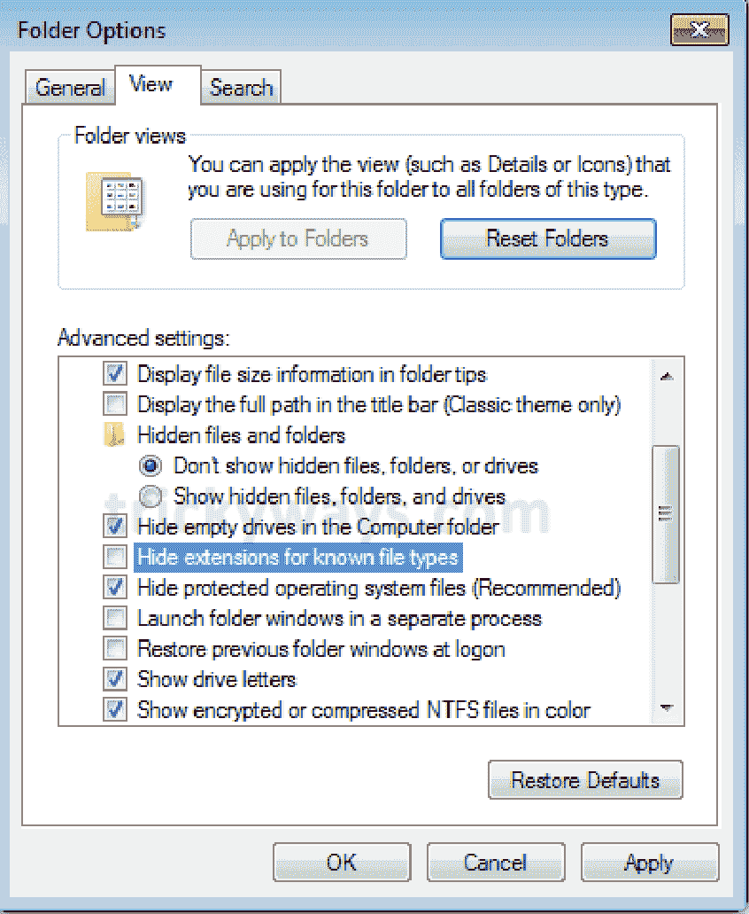

图 26.1

框中的勾选框就像切换开关。如果勾选，它将隐藏已知的文件类型。如果没有勾选，它将显示所有文件类型。点击框使勾选出现[隐藏已知文件类型]扩展名或消失[显示文件扩展名]，然后点击“确定”。

下方提供了各种 Windows 操作系统导航到“文件夹选项”的说明，以及用于额外帮助的互联网链接。

#### 26.4.1 Windows XP

打开 Windows 资源管理器，选择“工具”选项卡，然后选择“文件夹选项”。

额外帮助的链接：
- <http://www.fileinfo.net/help/windows-show-extensions.html>
- <http://dotwhat.net/page/displayextensions/>

#### 26.4.2 Windows Vista

选择“开始”按钮，然后是“控制面板”，然后“外观和个性化”，最后“文件夹选项”。

额外帮助的链接：
- <http://windows.microsoft.com/en-us/windows-vista/Show-or-hide-file-name-extensions>

#### 26.4.3 Windows 7

## 26.5 学术不端

### 26.5.1 引言

教师与学生之间的关系始终是开放和诚实的沟通。教师负责通过阅读作业、讲座、实验等提供课程材料。学生负责学习和理解这些材料。此外，教师会采用各种方法来评估学生对课程材料的掌握情况。这通常通过测验、考试、写作作业、完成实验材料等来进行。学术不端（有时称为“学术舞弊”）是对这种关系的违背。

学生在进入大学教育阶段之前就已经很了解考试作弊和抄袭。大多数大学都解释过作弊和抄袭。学术不端通常带有惩罚。通常，学生会在其修读的课程中获得教授给出的“F”等级。学生可能会被勒令退出其目前修读的课程（你所有课程均为“F”），并被学校开除（未来可能无法注册课程）。听起来很严厉，但这是违背了学生与学术机构之间的纽带。

### 26.5.2 勾同

学术不端的另一类别是勾同，即在执行提供学分的作业（包括实验作业，将计入你的成绩计算）时，与他人进行未经授权的协作。为了更好地理解这一点，学生需要意识到，作为学习和评估学习的一部分，许多教授会使用项目；这是一种有指导或授权的协作。

### 26.5.3 独立完成

### 26.5.4 控制文件访问权限

控制你创建（或被要求修改）的文件意味着他人无法访问并复制你的作品。

### 26.5.5 寻求协作说明

如果你对任何可能被解释为未经授权协作的活动有任何疑问，请询问你的教授。他们将就该活动为你提供说明和指导。

学生进行串通的方式。你有责任向你的教授寻求有关特定课程的任何说明。不要假设另一位教师在另一门课程中允许的行为，这位教授在本门课程中也会允许。

### 26.5.6 检测学术不端行为

教授们并非一天。大多数机构的教职员工在理解学术不端行为方面，个人拥有多年经验，总计拥有数千年的经验。检查考试、抄袭和串通对我们来说并不新鲜。我们互相分享在检测学术不端行为方面的专业知识。此外，那些在实验室使用计算机教学的教授，其技术经验往往令人望而生畏。

学生们曾说他们认为自己不会被发现，或者认为学术不端行为无法被证明。不要尝试这种方法，因为教授们认为自己比你们聪明一点。实际上，我们知道自己聪明得多。学生们没有意识到教授是一股强大的力量，这让我们觉得很有趣。许多人赌博你可以在“学术不端游戏”中胜过我们。请不要将其视为挑战，也不要将其作为测试你是否可以在学术上不端而不被发现的借口。我们是在警告你，而不是在挑战你。

### 26.5.7 严重后果

后果因教师和机构的不同而异。其范围从简单的敲头警告（不要再这样做）到完全从机构开除（从你的所有课程中退学）。因为信任纽带被破坏，许多教师将直接将你从所修读的课程中开除。例如：在休斯顿社区学院的 BCIS1405 课程中，我们曾在 2006 年春季学期因学术不端从远程教育部门开除了 8 名学生（并给他们“F”成绩）。

如果你不诚实，请准备好面对你的教授将给出的任何后果。

### 26.5.8 总结

- 学术诚实的伦理；存在一种信任纽带，即无论学生在评估过程中做了什么，都是他们自己的工作和努力。
- 串通是指学生对提交用于评估的作品进行未经授权的协作。
- 第一条指令：你自己动手写。
- 第二条指令：不要分享你的文件。
- 如果你怀疑协作活动可能被视为串通，请向你的教授寻求说明。
- 教授非常擅长检测学术不端行为。
- 你的不当行为通常会有后果。

## 26.6 成功的学习技巧

### 26.6.1 意识到时间投入

计算机课程通常在课程目录中列出讲座和实验时间。但与自然科学和生物科学（化学、物理和生物学）必须在为这些课程设计的特定实验室见面不同，学生通常可以在各种地点完成实验部分（学院的计算机实验室、家里、工作地、公共图书馆、朋友家等）。

通常的经验法则是每学时课外需要 1 到 5 小时，对于计算机课程，这通常意味着讲座和实验时间。有学习障碍或母语不是英语的学生将计划更多的学习时间并使用更大的比例。因此，你应该根据自己的情况计算课程所需的投入量。

示例：如果一个学生正在修一门 4 学分的课程，目录显示在 16 周的学期内包含 6 小时（加上你的讲座和实验时间）；该课程的课堂和学习时间每周将为 12 到 15 小时。

但许多学生以更快的节奏上课，在学期之间以集中模式上课，或在学期开始后或夏季期间开始课程。你需要计算总的常规学期教学时间，并除以周数以获得更快速交付所需的每周学习时间。示例：

我们的 4 学分课程将在一个有 9 周教学时间的夏季进行。总的常规学期时间是正常学期投入的 15 倍（180 到 225 小时）。除以 9 意味着每周 20 到 25 小时。

### 26.6.2 了解你的专注能力

你不能期望花费长时间处理课程材料。在处理课程材料 3 到 4 小时后，你的学习能力会大幅下降（对大多数人来说接近于零）。材料的累积性质使得这个问题更加严重。这意味着在你尝试学习项目 b 之前，必须理解项目 a。所有的数学和科学课程都是如此。

### 26.6.3 计划学习时间

你需要计算总的常规学期教学时间，并除以周数以获得更快速交付所需的每周学习时间。示例：

我们的 4 学分课程将在一个有 9 周教学时间的夏季进行。总的常规学期时间是正常学期投入的 15 倍（180 到 225 小时）。除以 9 意味着每周 20 到 25 小时。

### 26.6.4 需要多样性和重复

多样性有许多形式并包括。

### 26.6.5 与其他学生互动

### 26.6.6 不要拖延，不要落后

### 26.6.7 上课并做笔记

并在缺席时相互共享笔记。除了课程材料外，课堂上还会讨论其他行政事务（如考试日期变更的通知）。

如果你正在参加远程教育课程，你需要定期进入诸如 Blackboard Vista 等学习管理系统，查看公告、讨论列表帖子，并阅读（在适当的情况下回复）电子邮件。大多数远程教育教授假设，他们通过这些工具传达的任何内容学生都会在 3 天内阅读。简而言之，这意味着你负责阅读这些内容并完成他们所要求的任何操作。

## 26.7 构建大脑的学习习惯

### 26.7.1 引言

在 2008 年春季，作者 Kenneth Leroy Busbee 对一些修读编程基础课程的学生进行了一项研究，以确定使用 3x5 英寸卡片是否能提高学生的考试成绩。简而言之，确实可以！这并不令人意外，但显而易见的是，我们大多数人（各教育阶段的教职工以及学生）对于大脑如何构建理解和长期记忆了解甚少。

随附了几个以 Adobe PDF 格式保存的 PowerPoint 演示文稿。请花几分钟查看一下提供的信息。希望这能帮助学生学习他们正在学习的科目。

### 26.7.2 主演示

链接到：[构建大脑的学习习惯](http://cnx.org/content/m19977/latest/Study_Habits_that_Build_the_Brain.pdf)

### 26.7.3 具体主题

链接到：[阅读教材](http://cnx.org/content/m19977/latest/Reading_the_Textbook.pdf)

链接到：[做讲义笔记](http://cnx.org/content/m19977/latest/Taking_Lecture_Notes.pdf)

链接到：[使用 3x5 卡片](http://cnx.org/content/m19977/latest/Using_3x5_Cards.pdf)

链接到：[使用闪卡活动](http://cnx.org/content/m19977/latest/Using_Flash_Card_Activity.pdf)

## 术语表

## abs

C++ 标准库 `cmath` 中的一个函数，代表绝对值（absolute）。

## item

迭代控制结构的一个属性。

## address operator

取地址符符号 或 `&`

## applications

处理主要任务的信息系统或程序集合。

## array

具有单一标识符名称的、相同数据类型元素的序列集合。

## array function

设计用于处理数组的用户自定义特定函数。

## array member

数组中的一个元素或值。

## ASCII

美国信息交换标准代码。

## assignment

一种改变可修改数据对象值的运算符。

## associativity

结合性。决定了相同优先级的运算符允许操作操作数的顺序。

## at least once

表示循环执行后的文本将至少执行一次动作。

## banners


# 词汇表

## A

### block
复合语句的另一个名称。

### Boolean
一种表示真和假概念的数据类型。

### braces
在 C++ 中用于识别代码块。

### branching
分支。一种允许执行流跳转到程序不同部分的控制结构。

### branching control structures
分支控制结构。允许执行流跳转到程序的不同部分。

### break
终止结构的分支结构。

### bubble sort
泡泡排序。一种交换数组元素直到它们处于所需顺序的方法。

## C

### case
一种执行多路选择的控制结构。

### central processing unit
实际执行计算机的电子电路（CPU）。

### character
一种表示单个文本的数据类型，如字母、数字、标点符号等。

### circular nature
循环性质。连接内部族数据类型域的负端和正端。

### class member
用于调用与类关联的函数的运算符。

### close
你的程序请求操作系统释放之前打开的文件。

### constant
在程序执行期间其值不能改变的数据项。

### code checking
使用测试数据检查特定语言（如 C++）中编码的程序。

### continue
导致循环停止当前迭代并开始下一次迭代的分支控制结构。

### control structures
允许我们控制程序内执行流的机制。

### comments
插入到源文件中用于程序文档说明的信息。

### counting controlled
使用变量对循环进行计数或减计数。

### common area
公共区域。程序中定义变量和常量的区域，以便供所有函数使用。

## D

### data area
对象代码文件中用于存储数据的部分。

### compiler directive
指令编译器在开始编译程序之前完成某项任务的指令。

### data type
定义一组值和一组应用于这些值的操作。

### complex logic
复杂逻辑。

### data type families
数据类型族。通常通过嵌套控制结构解决。

### compound statement
复合语句。由零个或多个语句组成的代码单元。

### debugging
从程序中移除错误的过程。

### decision symbol
流程图中的菱形。

### concatenation
将两个字符串合并为一个字符串。

### conditional
条件。一种像 `then else` 的三元运算符。

### decrement
从变量的值减 1。

### demotion
从较大的域降到较小的域。

### conditional compilation
条件编译。根据布尔表达式包含或排除代码行的编译器指令。

### dereferencing
使用指针所指向项的概念。

### confidence
对标准函数正常工作的依赖。

### device
连接到内存的设备，以便传输数据。

### consistent
在整个源代码中标识符名称大小写的规则。

### device token
由操作系统提供的、关联设备的键值。

## F

### factorial
阶乘。通常使用递归的数学问题。

### dimension
数组的维度。

### filename
文件名及其扩展名。

### do while
C++ 中提供的后测试控制结构。

### filespec
文件的位置及其文件名。

### documentation
通常用于控制程序的信息的变量或常量。

### flag
用于存储其他信息的变量或常量。

### domain
数据类型允许的值集。

### flexible coding
使用 `sizeof` 运算符计算数组成员的数量。

### double
双精度。C++ 中最常用的浮点数类型。

### dynamic memory
动态内存。一种与局部作用域关联的栈内存。

### explicit
使用类型转换运算符显式改变值的数据类型。

### function call
函数调用或调用另一个函数。

### expression
操作数和运算符的有效序列，可还原（或求值）为单个值。

### function definition
定义函数作用的代码。

### extraction
又称从输入设备读取或获取数据。

### function prototype
函数对编译器的通信声明。

## 函数与基础概念

### function (函数)
在当今两种主流编程语言：`C++` 和 `Java` 中被调用的模块。

### index (索引)
允许我们引用数组成员的运算符。

### indirection operator (间接运算符)
用于指针取值的星号。

### global scope (全局作用域)
定义在函数外部的数据结构。

### goto
一种分支控制结构，会导致逻辑跳转到程序的另一个地方。

### infinite loop (死循环)
没有退出方法，因此是坏事。

### initialize item (初始化)
迭代控制结构的一个属性。

### header file (头文件)
包含我们希望包含在源代码顶端的文件。

### input/output symbol (输入输出符号)
流程图中用于输入输出交互的平行四边形。

### hierarchy chart (层次图)
传达程序中各种函数之间的关系或整体。

### insertion (插入)
向输出设备写入或发送数据。

### high performance computing (高性能计算)
将多台计算机或计算机处理器组合在一起，以更短的时间完成任务。

### integer (整数)
表示整数数字的数据类型。

### integer division (整数除法)
没有小数部分的除法。

### IPO
输入 - 处理 - 输出。

### identifier name (标识符名称)
程序员赋予的用于标识函数或其他程序项作为变量的名字。

### iteration (迭代)
一种允许某些代码行执行多次的控制结构。

### if then else (如果-那么-否则)
一种选择控制结构。

### life cycle (生命周期)
系统开发生命周期：规划 - 分析 - 设计 - 实现 - 维护。

### implementation (实现)
系统开发生命周期中的阶段，程序员被分配去编写特定的程序。

### linear search (线性搜索)
使用循环顺序遍历数组。

### implicit (隐式)
数据类型被自动更改的值。

### linker (链接器)
将对象文件连接或链接成可执行文件。

### include (包含)
一种编译器指令，将文件内容插入程序中。

### list (列表)
单维数组。

### increment (递增)
将变量的值加 1。

### loader (加载器)
操作系统的部分，将可执行文件加载到内存中引导 CPU 开始运行程序。

### indention (缩进)
一种用于使源代码部分更可见的方法。

### local scope (局部作用域)
定义在函数内部的数据存储。

### logical operator (逻辑运算符)
用于创建复杂布尔表达式的运算符。

### modularization (模块化)
将某些代码行分组为可以包含在程序中的单元的能力。

### loop attributes (循环属性)
与迭代或循环控制结构相关的项。

### modulus (模)
整数除法的余数部分。

### loop control (循环控制)
确保循环的属性被正确处理。

### multiway selection (多路选择)
使用控制结构从两个以上的选项中进行选择。

### Lvalue (左值)
赋值运算符左侧必须是可修改的（通常是一个变量）。

### mutually exclusive (互斥)
不重叠的项目。例如：true 和 false。

### nested control structures (嵌套控制结构)
将一个控制结构放在另一个结构内部。

### machine dependent (机器相关的)
一种随计算机 CPU 改变的编程语言属性。

### object oriented (面向对象)
一种用函数封装数据的编程方法。

### mantissa exponent (尾数与指数)
浮点值的两个整数部分。

### offset (偏移量)
从零开始引用数组的方法。

### maximum (最大值)
又称 max 或数组中最大的成员。

### open source (开源)
对软件源代码进行小组开发并向公众免费提供。

### meaningful (有意义的)
一种规定标识符名称必须让阅读源代码的他人轻松理解的规则。

### open (打开)
你的程序请求操作系统允许其访问现有文件或打开一个新文件。

### might not happen (可能不发生)
表示测试循环可能不会执行该操作。

### operand (操作数)
接收运算符操作的值。

### minimum (最小值)
又称 min 或数组中最小的成员。

### operator (运算符)
一种语言特定的语法标记（通常是符号），导致对一个或多个操作数执行操作。

### minus (减法)
又称一元负。

### parallel processing (并行处理)
将任务划分为可以利用多个处理器的部分。

### model checking (模型检查)
使用测试数据检查设计模型（通常在伪代码中完成）。

### parallel programming (并行编程)
涉及开发利用并行处理算法以利用多个处理器的程序。

### modular arithmetic (模运算)
一种针对整数的“回环”算术系统。

### program control (程序控制)
用于简单划分和执行程序步骤的函数。

### parameter passing (参数传递)
数据如何在函数内部和外部进行通信。

### promotion (提升)
从较小的领域转移到较大的领域。

### parentheses (括号)
改变表达式中的求值顺序。你先执行括号内的内容。

### pseudo (伪)
意味着假的，并包含了虚假或迭代的概念。

### pseudocode (伪代码)
用于传达算法或函数步骤的类英语语句。

### phrase word (短语)
用于让读者清晰理解伪代码逻辑的单词。

### plus (加法)
又称一元正。

### read (读取)
将数据从已打开的设备移动到程序中定义的内存位置。

### pointer (指针)
一个将地址作为值的变量。

### recursion (递归)
函数调用自身的重复过程。

### portability (可移植性)
将软件转移到闪存盘并在任何机器上使用的能力。

### reference variable (引用变量)
与引用参数传递一起使用。

### postfix (后置)
将递增或递减运算符放在操作数的左侧。

### relational operator (关系运算符)
一种通过评估两个操作数之间的关系来提供布尔值的运算符。

### pre-processor (预处理器)
编译器将源代码转换为对象代码的第一步。

### repeat until (重复直到)
一种 C++ 中不允许的测试迭代结构。

### precedence (优先级)
决定运算符允许操纵操作数的顺序。

### reserved word (保留字)
程序员不能作为标识符名称使用的单词，因为它们在语言中有特定含义。

### precision (精度)
浮点值较大或较小存储区域的影响。

### return (返回)
导致函数跳转回控制结构。

### prefix (前置)
将递增或递减运算符放在操作数的右侧。

### procedural programming (过程化编程)
又称模块化编程。

### Rvalue (右值)
提取存储在变量中的值。

### process symbol (过程符号)
流程图中用于赋值等正常过程矩形。

### scope (作用域)
标识符被识别的源码区域。又称全局作用域。

### selection (选择)
从两个或多个选项中选择的控制结构。

### string (字符串)
作为单个数据的字符序列或数组。

### sequence (顺序)
按照列出的顺序执行项的控制结构。

### class (类)
一种用于分离多个出现项的运算符。

### structure (结构)
层次图的另一种名称。

### sequential processing (顺序处理)
仅使用一个处理器并按顺序完成任务。一种避免控制结构分支的规划方法。

### single quotes marks (单引号)
用于在 C++ 语言中创建字符数据。

### sum (和)
拉丁语中的和或总数。

### sizeof (大小)
一种告诉你类型在存储中占用多少字节的运算符。

### sorting (排序)
根据其值排列数据。

### system analysis (系统分析)
负责创建应用程序的计算机专业人员。

### source code (源代码)
用某种人类可读的编程语言编写的任何语句或声明集合。

### specific task (特定任务)
为特定程序设计的函数。

### test expression (测试表达式)
用于控制程序结构的表达式。

### test item (测试项)
迭代控制结构的一个属性。

### standard input (标准输入)
键盘。

### Standard Library (标准库)
已添加到编程语言中供通用使用的特定任务函数集。

### standard output (标准输出)
显示器。

### truncation (截断)


# 术语表

## 迭代

一种允许某些代码行执行多次的控制结构。

## 如果-那么-否则

一种选择控制结构。

## 生命周期

系统开发生命周期：规划 - 分析 - 设计 - 实现 - 维护

## 实现

系统开发生命周期中的阶段，程序员被分配去编写特定的程序。

## 线性搜索

使用循环顺序遍历数组。

## 隐式

数据类型被自动更改的值。

## 链接器

将对象文件连接或链接成可执行文件。

## 包含

一种编译器指令，将文件内容插入程序中。

## 列表

单维数组。

## 递增

将变量的值加1。

## 加载器

操作系统的部分，将可执行文件加载到内存中引导 CPU 开始运行程序。

## 缩进

一种用于使源代码部分更可见的方法。

## 局部作用域

定义在函数内部的数据存储。

## 逻辑运算符

一种针对整数的“回环”算术系统。

## 模块化

将某些代码行分组为可以包含在程序中的单元的能力。

## 循环属性

与迭代或循环控制结构相关的项。

## 模

整数除法的余数部分。

## 循环控制

确保循环的属性被正确处理。

## 多路选择

使用控制结构从两个以上的选项中进行选择。

## 左值

赋值运算符左侧必须是可修改的（通常是一个变量）。

## 互斥

不重叠的项目。例如：`true` 和 `false`。

## 嵌套控制结构

将一个控制结构放在另一个结构内部。

## 机器相关的

一种随计算机 CPU 改变的编程语言属性。

## 面向对象

一种用函数封装数据的编程方法。

## 尾数与指数

浮点值的两个整数部分。

## 偏移量

从零开始引用数组的方法。

## 最大值

又称 `max` 或数组中最大的成员。

## 开源

对软件源代码进行小组开发并向公众免费提供。

## 有意义的

一种规定标识符名称必须让阅读源代码的他人轻松理解的规则。

## 打开

你的程序请求操作系统允许其访问现有文件或打开一个新文件。

## 可能不发生

表示测试循环可能不会执行该操作。

## 操作数

接收运算符操作的值。

## 最小值

又称 `min` 或数组中最小的成员。

## 运算符

一种语言特定的语法标记（通常是符号），导致对一个或多个操作数执行操作。

## 减法

又称一元负。

## 并行处理

将任务划分为可以利用多个处理器的部分。

## 模型检查

使用测试数据检查设计模型（通常在伪代码中完成）。

## 并行编程

涉及开发利用并行处理算法以利用多个处理器的程序。

## 模运算

一种用于创建复杂布尔表达式的运算符。

## 程序控制

用于简单划分和执行程序步骤的函数。

## 参数传递

数据如何在函数内部和外部进行通信。

## 提升

从较小的领域转移到较大的领域。

## 括号

改变表达式中的求值顺序。你先执行括号内的内容。

## 伪

意味着虚假的，并包含了虚假或迭代的概念。

## 伪代码

用于传达算法或函数步骤的类英语语句。

## 短语

用于让任何读者清晰理解伪代码逻辑的单词。

## 加法

又称一元正。

## 读取

将数据从已打开的设备移动到程序中定义的内存位置。

## 指针

一个将地址作为值的变量。

## 递归

函数调用自身的重复过程。

## 可移植性

将软件转移到闪存盘并在任何机器上使用的能力。

## 引用变量

与引用参数传递一起使用。

## 后置

将递增或递减运算符放在操作数的左侧。

## 关系运算符

一种通过评估两个操作数之间的关系来提供布尔值的运算符。

## 预处理器

编译器将源代码转换为对象代码的第一步。

## 重复直到

一种 C++ 中不允许的测试迭代结构。

## 优先级

决定运算符允许操纵操作数的顺序。

## 保留字

程序员不能作为标识符名称使用的单词，因为它们在语言中有特定含义。

## 精度

对浮点值较大或较小存储区域的影响。

## 返回

导致函数跳转回控制结构。

## 前置

将递增或递减运算符放在操作数的右侧。

## 过程化编程

又称模块化编程。

## 右值

提取存储在变量中的值。

## 过程符号

流程图中用于赋值等正常过程矩形。

## 作用域

标识符被识别的源码区域。

又称全局作用域。

## 选择

从两个或多个选项中选择的控制结构。

## 字符串

作为单个数据的字符序列或数组。

## 顺序

按照列出的顺序执行项的控制结构。

## 类

一种用于分离多个出现项的运算符。

## 结构

层次图的另一种名称。

## 顺序处理

仅使用一个处理器并按顺序完成任务。

一种避免控制结构分支的规划方法。

## 单引号

用于在 C++ 语言中创建字符数据。

## 和

拉丁语中的和或总数。

## 大小

一种可以像 `case` 结构工作的 C++ 控制结构。

一种告诉你类型在存储中占用多少字节的运算符。

## 排序

根据其值排列数据。

## 系统分析

负责创建应用程序的计算机专业人员。

## 源代码

用某种人类可读的编程语言编写的任何语句或声明集合。

二维数组。

## 特定任务

提供输入值并预测输出值。

为特定程序设计的函数。

## 测试表达式

用于控制程序结构的表达式。

## 测试项

用于存储数据的计算机内存部分。

迭代控制结构的一个属性。

## 标准输入

键盘。

一种用于创建特定任务函数的程序。

## 标准库

已添加到编程语言中供通用使用的特定任务函数集。

创建和编辑 ASCII 文本文件的软件。

## 标准输出

显示器。

由 ASCII 字符集组成的文件。

## 截断

浮点数据类型在转换为整数时被舍弃的小数部分。

## 词汇表

程序执行过程中值可以改变的数据项。

## 真值表

显示逻辑关系的一种常用方法。

## 通用性

易于修改代码以处理另一种数据类型。

## typedef

允许程序员为现有数据类型创建别名或同义词。

## 垂直对齐

一种垂直列出项目的方法，以便于快速阅读。

## void 数据类型

没有值或运算符且用于表示“无”的数据类型。

## U udst

用户定义特定任务

## 一元负

一种引起取反的运算符。

## W 警告

编译器警告，提示可能存在问题。

## 一元正

一种几乎不使用的无意义运算符。

## while

C++ 中可用的迭代控制前测试结构。

## 更新项

迭代控制结构的一个属性。

## 换行

当输出没有被垂直对对齐时。

## 用户定义库

包含个人创建特定任务函数的文件，可用于许多程序。

## 写入

将数据从程序中定义的内存位置移动到已打开的设备。

## V 变量

---

## 关键字和术语索引

关键字按节列出（页码在括号内）。关键字不一定出现在页面文中，它们只是与该节相关。例如：apples，1.1 (1)。**术语**通过其出现的页面进行引用。例如：apples，1

- 3x5 卡片，26.7(294)
- `abs.`，110
- 学术不端，26.5(289)
- 事项，176
- 地址运算符，253, 255
- 取地址符，253
- 应用，22
- 算术赋值，60
- 算术运算符，3.6(49)
- 数组，214, 227
- 数组数据类型，18.1(227)
- 数组函数，238
- 数组索引运算符，18.2(228)
- 数组成员，229, 262
- 数组成员，18.3(229)
- ASCII，116, 213
- ACI 字符集，26.3(286)
- 赋值，49, 179
- 结合性，47, 26.1(283)
- 星号，255
- 至少一次，176
- B 横幅，91
- 标志位作位，13.2(176)
- 黑屏输出，73
- 块，150
- Bloodshed-Dev-C++ 5 编译器/IDE，23, 31, 39, 52, 53, 61, 64, 63, 74, 80, 86, 93, 104, 105, 107, 110, 111, 116, 119, 142, 148, 151, 160, 168, 181, 193, 203, 204, 209, 214, 217, 223, 224, 231, 232, 236, 238, 239, 240, 241, 243, 245, 247, 249, 251, 251, 255, 257, 258, 261, 263, 274
- 布尔型，147
- 布尔表达式，62, 145, 147, 148, 158
- 173, 179, 180, 187
- 大括号，30, 92, 149
- 分支，125
- 分支控制结构，165
- `break`，165
- 冒泡排序，246
- C++ 数据类型，3.1(43)
- C++ 程序布局，1.3(26)
- `C:\Dev-Cpp++`，25, 25, 25
- 调用，86
- 专注能力，26.6(292)
- `case`，165
- 中央处理器，274
- 字符，116
- `cin`，77
- 循环数，203
- 类方法，214
- 关闭，237
- 封闭通信模块，254, 256
- 代码检查，39
- 谋，26.5(289)
- 注释，91
- 公共区域，87
- 编译器，75
- 编译器指令，79
- 编译器 IDE，1.2(23)
- 复杂逻辑，209
- 复合语句，150
- 计算科学，24.2(268)
- 拼接，214
- 条件，222
- 条件编译，263
- 条件表达式，17.1(221)
- 条件运算符，17.1(221)
- 信心，110
- 一致，92
- 常量，47
- `continue`，165
- 控制结构，24, 11.1(145)
- 计数循环，124
- 法庭，77
- 数据区域，100
- 数据类型，44
- 数据类型转换，3.7(50)
- 数据类型族，44
- 调试，75
- 决策符号，141
- 递减，187
- 未定义常量，46
- 定义，86
- 降级，52
- 取解引用，257
- `devcpp-4.9_setup.exe`，25, 25
- 设备，77
- 设备令牌，237
- 维度，228, 262
- 分布处理，24.2(268)
- `do while`，176
- 文档，91
- 域，44
- `double`，59
- `goto`，165
- 头文件，106
- 层次结构，85
- 高性能计算，274
- IDE，1.2(237)
- 标识符名称，30
- 标识符名称，3.2(45)
- `if else`，123, 146, 149
- 实现，23
- 隐式，52
- `include`，79
- 递增，187
- 缩进，92
- 索引，229, 262
- 等等，179
- 转义代码，78
- 求值，48
- 事件控制，192
- 范围，165
- 表达式，47
- 提取，178
- 间接运算符，255, 257
- 无限循环，176, 24.2(187)
- 初始化项，192
- 输入输出流，77, 78
- 输入/输出符号，141
- 插入，78
- 整数，44
- 整数数据类型，4.1(57)
- 整数除法，63
- 阶乘，223
- 文件扩展名，26.4(287)
- 文件名，237
- 文件峰，237
- 固定，15.3(203)
- 标志，178
- 闪存卡，26.7(294)
- 灵活编码，231, 250
- `float`，4.2(308)
- 浮点，44
- 浮点数据类型，3.18, 4.2(38)
- 浮点除法，63
- 流线，141
- 流程图，10.3(127), 141
- 文件夹，243
- `for`，200
- 格式化，204
- 函数，29
- 函数调用，30
- 函数定义，30
- 函数原型，30
- 集成开发环境，69
- IPO，36
- 迭代，125
- 迭代作为递归，17.2(222)
- 关键字，26.2(285)
- 课程笔记，26.7(294)
- 生命周期，22
- 线性搜索，244
- 链接器，75
- 列表，228
- 字面量，46
- 加载器，75
- 局部作用，100, 238, 253, 254, 256
- lo 运算符，160
- `double double`，4.2(58)
- 循环属性，192
- 循环控制，203
- Lvalue，622
- 机器依赖，58, 116
- 指数，59
- 最大值，244
- 有意义，92
- 内存常量，47
- 可能发生，192
- 全局范围，100, 238, 253
- 最小值，16.2(215), 216
- 模型检查，39
- 模块化算术，203
- 模块结构化编程，267
- 模块化，29, 7.1(99)
- 模，15.2(201)
- 模，64
- 多维数组，23.1(261)
- 乘法表，15.4(205)
- 多路选择，124, 158
- 互斥，164
- 函数的伪代码，6.1(83)
- 读取，237
- 递归，223
- 引用变量，255, 256
- 正规研究，17.1(221)
- 关系运算符，17.1(221)
- 重复，176
- 重复算法，17.2(222)
- 预留字，46
- 预留字，26.2(285)
- `return`，165
- Rvalue，622
- 嵌套控制，165
- 嵌套 else，123, 146, 149
- 无通信，87
- 面对象，164
- 偏移量，237
- 操作数，47
- 运算符，255
- 并行处理，24.2(268)
- 并行编程，274
- 参数，17.1(221)
- 括号，30
- 后置，247
- 可移植性，233
- 优先级，47
- 优先级，17.1(221)
- 精度，15.3(203)
- 处理器，75
- 程序设计，30, 110
- 编程语言，24.2(268)
- 提升，52
- 伪代码，6.1(83)
- 作用域，125
- 选择，124
- 序列，119
- `setw`，140
- `switch`，165
- 系统分析器，24
- 学术，283
- 单引号，116
- `sizeof`，210
- 排序，246
- 源，111
- 特定任务，237, 239
- 栈，109
- 标准输入，78
- 标准输出，78
- 静态内存，235
- 字符串分配，238
- 字符串类，214
- 结构图，85
- 结构化编程，125
- 和，240
- 超计算，240
- 测试项，176
- 测试外壳，106

---

## 鸣谢

集合：编程基础 - 使用 C++ 的模块化结构化方法

编辑：Kenneth Leroy Busee

URL：`http://cnx.org/content/col10621/1.20/`

许可协议：`http://creativecommons.org/licenses/by/2.0/`

模块：“序言 - 使用 C++ 的基础 I”

在此处作为：“序言”

作者：Kenneth Leroy Busee

URL：`http://cnx.org/content/m19049/1.16/`

页码：1-3

版权所有：Kenneth Leroy Busee

许可协议：`http://creativecommons.org/licenses/by/2.0/`

模块：“作者致谢 - 使用 C++ 的基础 I”

在此处作为：“作者致谢”

作者：Kenneth Leroy Busee

URL：`http://cnx.org/content/m19055/1.5/`

页码：5

版权所有：Kenneth Leroy Busee

许可协议：`http://creativecommons.org/licenses/by/2.0/`

模块：“导论与教学大纲 - 使用 C++ 的基础 I”


# 导论与教学大纲

## 模块：为什么你应该创建一个 Connexions 账户
- **作者**：Kenneth Leroy Busee
- **URL**：`http://cnx.org/content/m33973/1.1/`
- **页码**：11-13
- **版权所有**：Kenneth Leroy Busee
- **许可协议**：`http://creativecommons.org/licenses/by/3.0/`

## 模块：创建 Connexions 账户
- **作者**：Kenneth Leroy Busee
- **URL**：`http://cnx.org/content/m33888/1.1/`
- **页码**：15-18
- **版权所有**：Kenneth Leroy Busee
- **许可协议**：`http://creativecommons.org/licenses/by/3.0/`

## 模块：评价 Connexions 模块
- **作者**：Kenneth Leroy Busee
- **URL**：`http://cnx.org/content/m33960/1.1/`
- **页码**：19-20
- **版权所有**：Kenneth Leroy Busee
- **许可协议**：`http://creativecommons.org/licenses/by/3.0/`

# 鸣谢

## 模块：系统开发生命周期
- **作者**：Kenneth Leroy Busbee
- **URL**：`http://cnx.org/content/m18684/1.6/`
- **页码**：21-23
- **版权所有**：Kenneth Leroy Busbee
- **许可协议**：`http://creativecommons.org/licenses/by/2.0/`

## 模块：Bloodshed Dev-C++ 5 编译器/IDE
- **作者**：Kenneth Leroy Busbee
- **URL**：`http://cnx.org/content/m18785/1.15/`
- **页码**：23-25
- **版权所有**：Kenneth Leroy Busbee
- **许可协议**：`http://creativecommons.org/licenses/by/2.0/`

## 模块：模块化与 C++ 程序布局
- **作者**：Kenneth Leroy Busbee
- **URL**：`http://cnx.org/content/m18861/1.13/`
- **页码**：26-30
- **版权所有**：Kenneth Leroy Busbee
- **许可协议**：`http://creativecommons.org/licenses/by/2.0/`

## 模块：练习 1：编程简介
- **作者**：Kenneth Leroy Busbee
- **URL**：`http://cnx.org/content/m22450/1.4/`
- **页码**：30-32
- **版权所有**：Kenneth Leroy Busbee
- **许可协议**：`http://creativecommons.org/licenses/by/2.0/`

## 模块：程序设计
- **作者**：Kenneth Leroy Busbee
- **URL**：`http://cnx.org/content/m18866/1.5/`
- **页码**：35-36
- **版权所有**：Kenneth Leroy Busbee
- **许可协议**：`http://creativecommons.org/licenses/by/2.0/`

## 模块：伪代码
- **作者**：Kenneth Leroy Busbee
- **URL**：`http://cnx.org/content/m18648/1.10/`
- **页码**：36-37
- **版权所有**：Kenneth Leroy Busbee
- **许可协议**：`http://creativecommons.org/licenses/by/2.0/`

## 模块：测试数据
- **作者**：Kenneth Leroy Busbee
- **URL**：`http://cnx.org/content/m18781/1.4/`
- **页码**：37-39
- **版权所有**：Kenneth Leroy Busbee
- **许可协议**：`http://creativecommons.org/licenses/by/2.0/`

# 鸣谢

## 模块：练习 2：程序规划与设计
- **作者**：Kenneth Leroy Busbee
- **URL**：`http://cnx.org/content/m22453/1.3/`
- **页码**：39-41
- **版权所有**：Kenneth Leroy Busbee
- **许可协议**：`http://creativecommons.org/licenses/by/3.0/`

## 模块：C++ 中的数据类型
- **作者**：Kenneth Leroy Busbee
- **URL**：`http://cnx.org/content/m18653/1.13/`
- **页码**：43-44
- **版权所有**：Kenneth Leroy Busbee
- **许可协议**：`http://creativecommons.org/licenses/by/2.0/`

## 模块：标识符名称
- **作者**：Kenneth Leroy Busbee
- **URL**：`http://cnx.org/content/m18692/1.5/`
- **页码**：45-46
- **版权所有**：Kenneth Leroy Busbee
- **许可协议**：`http://creativecommons.org/licenses/by/2.0/`

## 模块：常量与变量
- **作者**：Kenneth Leroy Busbee
- **URL**：`http://cnx.org/content/m18719/1.8/`
- **页码**：46-47
- **版权所有**：Kenneth Leroy Busbee
- **许可协议**：`http://creativecommons.org/licenses/by/2.0/`

## 模块：数据操作
- **作者**：Kenneth Leroy Busbee
- **URL**：`http://cnx.org/content/m18705/1.6/`
- **页码**：47-48
- **版权所有**：Kenneth Leroy Busbee
- **许可协议**：`http://creativecommons.org/licenses/by/2.0/`

## 模块：赋值运算符
- **作者**：Kenneth Leroy Busbee
- **URL**：`http://cnx.org/content/m18725/1.4/`
- **页码**：48-49
- **版权所有**：Kenneth Leroy Busbee
- **许可协议**：`http://creativecommons.org/licenses/by/2.0/`

## 模块：数据类型转换
- **作者**：Kenneth Leroy Busbee
- **URL**：`http://cnx.org/content/m18744/1.7/`
- **页码**：50-52
- **版权所有**：Kenneth Leroy Busbee
- **许可协议**：`http://creativecommons.org/licenses/by/2.0/`

## 模块：练习 3：运算符
- **作者**：Kenneth Leroy Busbee
- **URL**：`http://cnx.org/content/m22455/1.4/`
- **页码**：52-54
- **版权所有**：Kenneth Leroy Busbee
- **许可协议**：`http://creativecommons.org/licenses/by/3.0/`

## 模块：整数数据类型
- **作者**：Kenneth Leroy Busbee
- **URL**：`http://cnx.org/content/m18654/1.6/`
- **页码**：57-58
- **版权所有**：Kenneth Leroy Busbee
- **许可协议**：`http://creativecommons.org/licenses/by/2.0/`

## 模块：浮点数据类型
- **作者**：Kenneth Leroy Busbee
- **URL**：`http://cnx.org/content/m18657/1.6/`
- **页码**：58-59
- **版权所有**：Kenneth Leroy Busbee
- **许可协议**：`http://creativecommons.org/licenses/by/2.0/`

## 模块：字符串数据类型
- **作者**：Kenneth Leroy Busbee
- **URL**：`http://cnx.org/content/m18656/1.7/`
- **页码**：59-60
- **版权所有**：Kenneth Leroy Busbee
- **许可协议**：`http://creativecommons.org/licenses/by/2.0/`

## 模块：算术运算符
- **作者**：Kenneth Leroy Busbee
- **URL**：`http://cnx.org/content/m18743/1.7/`
- **页码**：60-64
- **版权所有**：Kenneth Leroy Busbee
- **许可协议**：`http://creativecommons.org/licenses/by/2.0/`

## 模块：字面量与右值
- **作者**：Kenneth Leroy Busbee
- **URL**：`http://cnx.org/content/m18058/1.12/`
- **页码**：61-62
- **版权所有**：Kenneth Leroy Busbee
- **许可协议**：`http://creativecommons.org/licenses/by/2.0/`

## 模块：整数除法与取模
- **作者**：Kenneth Leroy Busbee
- **URL**：`http://cnx.org/content/m18717/1.13/`
- **页码**：63-65
- **版权所有**：Kenneth Leroy Busbee
- **许可协议**：`http://creativecommons.org/licenses/by/2.0/`

## 模块：练习 4：常用数据类型
- **作者**：Kenneth Leroy Busbee
- **URL**：`http://cnx.org/content/m22456/1.2/`
- **页码**：65-66
- **版权所有**：Kenneth Leroy Busbee
- **许可协议**：`http://creativecommons.org/licenses/by/3.0/`

# 鸣谢

## 模块：集成开发环境
- **作者**：Kenneth Leroy Busee
- **URL**：`http://cnx.org/content/m18920/1.9/`
- **页码**：69-75
- **版权所有**：Kenneth Leroy Busee
- **许可协议**：`http://creativecommons.org/licenses/by/2.0/`

## 模块：标准输入输出
- **作者**：Kenneth Leroy Busee
- **URL**：`http://cnx.org/content/m18835/1.5/`
- **页码**：75-78
- **版权所有**：Kenneth Leroy Busee
- **许可协议**：`http://creativecommons.org/licenses/by/2.0/`

## 模块：编译器预指令
- **作者**：Kenneth Leroy Busee
- **URL**：`http://cnx.org/content/m18787/1.7/`
- **页码**：78-79
- **版权所有**：Kenneth Leroy Busee
- **许可协议**：`http://creativecommons.org/licenses/by/2.0/`

## 模块：练习 5：集成开发环境
- **作者**：Kenneth Leroy Busee
- **URL**：`http://cnx.org/content/m22457/1.3/`
- **页码**：79-81
- **版权所有**：Kenneth Leroy Busee
- **许可协议**：`http://creativecommons.org/licenses/by/2.0/`

## 模块：函数的伪代码示例
- **作者**：Kenneth Leroy Busee
- **URL**：`http://cnx.org/content/m19136/1.7/`
- **页码**：83-84
- **版权所有**：Kenneth Leroy Busee
- **许可协议**：`http://creativecommons.org/licenses/by/2.0/`

## 模块：层级结构
- **作者**：Kenneth Leroy Busee
- **URL**：`http://cnx.org/content/m1862/1.4/`
- **页码**：84-85
- **版权所有**：Kenneth Leroy Busee
- **许可协议**：`http://creativecommons.org/licenses/by/2.0/`

## 模块：程序控制
- **作者**：Kenneth Leroy Busee
- **URL**：`http://cnx.org/content/m19145/1.9/`
- **页码**：85-87
- **版权所有**：Kenneth Leroy Busee
- **许可协议**：`http://creativecommons.org/licenses/by/2.0/`

## 模块：Void 数据类型
- **作者**：Kenneth Leroy Busee
- **URL**：`http://cnx.org/content/m18655/1.4/`
- **页码**：87-88
- **版权所有**：Kenneth Leroy Busee
- **许可协议**：`http://creativecommons.org/licenses/by/2.0/`

# 鸣谢

## 模块：文档编写与源代码可读性
- **作者**：Kenneth Leroy Busbee
- **URL**：`http://cnx.org/content/m18912/1.5/`
- **页码**：88-92
- **版权所有**：Kenneth Leroy Busbee
- **许可协议**：`http://creativecommons.org/licenses/by/2.0/`

## 模块：练习 6：程序控制
- **作者**：Kenneth Leroy Busbee
- **URL**：`http://cnx.org/content/m22458/1.4/`
- **页码**：92-96
- **版权所有**：Kenneth Leroy Busbee
- **许可协议**：`http://creativecommons.org/licenses/by/3.0/`

## 模块：特定任务函数
- **作者**：Kenneth Leroy Busbee
- **URL**：`http://cnx.org/content/m19146/1.4/`
- **页码**：99-100
- **版权所有**：Kenneth Leroy Busbee
- **许可协议**：`http://creativecommons.org/licenses/by/2.0/`

## 模块：全局与局部数据存储
- **作者**：Kenneth Leroy Busbee
- **URL**：`http://cnx.org/content/m19147/1.5/`
- **页码**：100-101
- **版权所有**：Kenneth Leroy Busbee
- **许可协议**：`http://creativecommons.org/licenses/by/2.0/`

## 模块：使用头文件处理用户特定任务函数
- **作者**：Kenneth Leroy Busbee
- **URL**：`http://cnx.org/content/m19346/1.7/`
- **页码**：101-106
- **版权所有**：Kenneth Leroy Busbee
- **许可协议**：`http://creativecommons.org/licenses/by/2.0/`

## 模块：练习 7：特定任务函数
- **作者**：Kenneth Leroy Busbee
- **URL**：`http://cnx.org/content/m22459/1.2/`
- **页码**：106-107
- **版权所有**：Kenneth Leroy Busbee
- **许可协议**：`http://creativecommons.org/licenses/by/3.0/`

## 模块：标准库
- **作者**：Kenneth Leroy Busbee
- **URL**：`http://cnx.org/content/m19202/1.6/`
- **页码**：109-110
- **版权所有**：Kenneth Leroy Busbee
- **许可协议**：`http://creativecommons.org/licenses/by/2.0/`

## 模块：练习 8：标准库
- **作者**：Kenneth Leroy Busbee
- **URL**：`http://cnx.org/content/m22460/1.3/`
- **页码**：111-112
- **版权所有**：Kenneth Leroy Busbee
- **许可协议**：`http://creativecommons.org/licenses/by/3.0/`

# 归属

## 模块：字符数据类型
- **作者**：Kenneth Leroy Busbee
- **URL**：`http://cnx.org/content/m18669/1.6/`
- **页码**：115-116
- **版权**：Kenneth Leroy Busbee
- **许可**：`http://creativecommons.org/licenses/by/2.0/`

## 模块：Sizeof 运算符
- **作者**：Kenneth Leroy Busbee
- **URL**：`http://cnx.org/content/m18736/1.8/`
- **页码**：116-117
- **版权**：Kenneth Leroy Busbee
- **许可**：`http://creativecommons.org/licenses/by/2.0/`

## 模块：Typed - 别名
- **作者**：Kenneth Leroy Busbee
- **URL**：`http://cnx.org/content/m18741/1.5/`
- **页码**：117-118
- **版权**：Kenneth Leroy Busbee
- **许可**：`http://creativecommons.org/licenses/by/2.0/`

## 模块：序列运算符
- **作者**：Kenneth Leroy Busbee
- **URL**：`http://cnx.org/content/m18690/1.8/`
- **页码**：118-119
- **版权**：Kenneth Leroy Busbee
- **许可**：`http://creativecommons.org/licenses/by/2.0/`

## 模块：练习 9：字符数据、Sizeof、Typedef、序列
- **作者**：Kenneth Leroy Busbee
- **URL**：`http://cnx.org/content/m22461/1.4/`
- **页码**：119-120
- **版权**：Kenneth Leroy Busbee
- **许可**：`http://creativecommons.org/licenses/by/3.0/`

## 模块：结构化编程
- **作者**：Kenneth Leroy Busbee
- **URL**：`http://cnx.org/content/m19628/1.7/`
- **页码**：123-125
- **版权**：Kenneth Leroy Busbee
- **许可**：`http://creativecommons.org/licenses/by/2.0/`


# 归属

## 模块：控制结构的伪代码示例
**作者**：Kenneth Leroy Busbee  
**URL**：`http://cnx.org/content/m18649/1.13/`  
**页码**：125-126  
**版权**：Kenneth Leroy Busbee  
**许可**：`http://creativecommons.org/licenses/by/3.0/`

## 模块：流程图
**作者**：Kenneth Leroy Busbee  
**URL**：`http://cnx.org/content/m19623/1.6/`  
**页码**：127-141  
**版权**：Kenneth Leroy Busbee  
**许可**：`http://creativecommons.org/licenses/by/2.0/`

## 模块：练习 10：结构化编程简介
**作者**：Kenneth Leroy Busbee  
**URL**：`http://cnx.org/content/m19692/1.14/`  
**页码**：141-142  
**版权**：Kenneth Leroy Busbee  
**许可**：`http://creativecommons.org/licenses/by/3.0/`

## 模块：If Else
**作者**：Kenneth Leroy Busbee  
**URL**：`http://cnx.org/content/m19679/1.4/`  
**页码**：145-146  
**版权**：Kenneth Leroy Busbee  
**许可**：`http://creativecommons.org/licenses/by/3.0/`

## 模块：布尔数据类型
**作者**：Kenneth Leroy Busbee  
**URL**：`http://cnx.org/content/m19544/1.5/`  
**页码**：147  
**版权**：Kenneth Leroy Busbee  
**许可**：`http://creativecommons.org/licenses/by/3.0/`

## 模块：关系运算符
**作者**：Kenneth Leroy Busbee  
**URL**：`http://cnx.org/content/m19549/1.11/`  
**页码**：148-149  
**版权**：Kenneth Leroy Busbee  
**许可**：`http://creativecommons.org/licenses/by/2.0/`

## 模块：复合语句
**作者**：Kenneth Leroy Busbee  
**URL**：`http://cnx.org/content/m19683/1.3/`  
**页码**：149-150  
**版权**：Kenneth Leroy Busbee  
**许可**：`http://creativecommons.org/licenses/by/2.0/`

## 模块：练习 11：双路选择
**作者**：Kenneth Leroy Busbee  
**URL**：`http://cnx.org/content/m19764/1.15/`  
**页码**：150-152  
**版权**：Kenneth Leroy Busbee  
**许可**：`http://creativecommons.org/licenses/by/3.0/`

## 模块：嵌套 If Else
**作者**：Kenneth Leroy Busbee  
**URL**：`http://cnx.org/content/m19951/1.6/`  
**页码**：155-158  
**版权**：Kenneth Leroy Busbee  
**许可**：`http://creativecommons.org/licenses/by/3.0/`

## 模块：逻辑运算符
**作者**：Kenneth Leroy Busbee  
**URL**：`http://cnx.org/content/m19847/1.8/`  
**页码**：158-160  
**版权**：Kenneth Leroy Busbee  
**许可**：`http://creativecommons.org/licenses/by/3.0/`

## 模块：Case 控制结构
**作者**：Kenneth Leroy Busbee  
**URL**：`http://cnx.org/content/m19963/1.4/`  
**页码**：161-165  
**版权**：Kenneth Leroy Busbee  
**许可**：`http://creativecommons.org/licenses/by/3.0/`

## 模块：分支控制结构
**作者**：Kenneth Leroy Busbee  
**URL**：`http://cnx.org/content/m19947/1.3/`  
**页码**：165-168  
**版权**：Kenneth Leroy Busbee  
**许可**：`http://creativecommons.org/licenses/by/3.0/`

## 模块：练习 12：多路选择
**作者**：Kenneth Leroy Busbee  
**URL**：`http://cnx.org/content/m19968/1.12/`  
**页码**：168-171  
**版权**：Kenneth Leroy Busbee  
**许可**：`http://creativecommons.org/licenses/by/3.0/`

## 模块：Do While 循环
**作者**：Kenneth Leroy Busbee  
**URL**：`http://cnx.org/content/m20596/1.5/`  
**页码**：173-176  
**版权**：Kenneth Leroy Busbee  
**许可**：`http://creativecommons.org/licenses/by/3.0/`

## 模块：标记位概念 (Flag Concept)
**作者**：Kenneth Leroy Busbee  
**URL**：`http://cnx.org/content/m20404/1.6/`  
**页码**：176-178  
**版权**：Kenneth Leroy Busbee  
**许可**：`http://creativecommons.org/licenses/by/3.0/`

## 模块：C++ 中的赋值
**作者**：Kenneth Leroy Busbee  
**URL**：`http://cnx.org/content/m19542/1.7/`  
**页码**：178  
**版权**：Kenneth Leroy Busbee  
**许可**：`http://creativecommons.org/licenses/by/2.0/`

## 模块：重复循环 (Repeat Loop)
**作者**：Kenneth Leroy Busbee  
**URL**：`http://cnx.org/content/m20597/1.3/`  
**页码**：179  
**版权**：Kenneth Leroy Busbee  
**许可**：`http://creativecommons.org/licenses/by/3.0/`

## 模块：练习 13：循环后的测试
**作者**：Kenneth Leroy Busbee  
**URL**：`http://cnx.org/content/m20642/1.8/`  
**页码**：180  
**版权**：Kenneth Leroy Busbee  
**许可**：`http://creativecommons.org/licenses/by/3.0/`

## 模块：自增与递减运算符
**作者**：Kenneth Leroy Busbee  
**URL**：`http://cnx.org/content/m20499/1.4/`  
**页码**：185  
**版权**：Kenneth Leroy Busbee  
**许可**：`http://creativecommons.org/licenses/by/3.0/`

## 模块：While 循环
**作者**：Kenneth Leroy Busbee  
**URL**：`http://cnx.org/content/m20598/1.8/`  
**页码**：187  
**版权**：Kenneth Leroy Busbee  
**许可**：`http://creativecommons.org/licenses/by/3.0/`

## 模块：练习 14：循环前的测试
**作者**：Kenneth Leroy Busbee  
**URL**：`http://cnx.org/content/m20643/1.10/`  
**页码**：192  
**版权**：Kenneth Leroy Busbee  
**许可**：`http://creativecommons.org/licenses/by/3.0/`

## 模块：For 循环
**作者**：Kenneth Leroy Busbee  
**URL**：`http://cnx.org/content/m20660/1.3/`  
**页码**：197  
**版权**：Kenneth Leroy Busbee  
**许可**：`http://creativecommons.org/licenses/by/3.0/`

## 模块：整数类型的循环性质
**作者**：Kenneth Leroy Busbee  
**URL**：`http://cnx.org/content/m20743/1.4/`  
**页码**：201  
**版权**：Kenneth Leroy Busbee  
**许可**：`http://creativecommons.org/licenses/by/3.0/`

## 模块：输出
**作者**：Kenneth Leroy Busbee  
**URL**：`http://cnx.org/content/m20660/1.4/`  
**页码**：203  
**版权**：Kenneth Leroy Busbee  
**许可**：`http://creativecommons.org/licenses/by/3.0/`

## 模块：嵌套 For 循环
**作者**：Kenneth Leroy Busbee  
**URL**：`http://cnx.org/content/m20653/1.6/`  
**页码**：205  
**版权**：Kenneth Leroy Busbee  
**许可**：`http://creativecommons.org/licenses/by/3.0/`

## 模块：练习 15：计数循环
**作者**：Kenneth Leroy Busbee  
**URL**：`http://cnx.org/content/m20809/1.6/`  
**页码**：209  
**版权**：Kenneth Leroy Busbee  
**许可**：`http://creativecommons.org/licenses/by/3.0/`

## 模块：C++ 中的 String 类
**作者**：Kenneth Leroy Busbee  
**URL**：`http://cnx.org/content/m20796/1.6/`  
**页码**：213  
**版权**：Kenneth Leroy Busbee  
**许可**：`http://creativecommons.org/licenses/by/3.0/`

## 模块：正号与负号运算符
**作者**：Kenneth Leroy Busbee  
**URL**：`http://cnx.org/content/m20501/1.2/`  
**页码**：215  
**版权**：Kenneth Leroy Busbee  
**许可**：`http://creativecommons.org/licenses/by/3.0/`

## 模块：练习 16：String 类、正号与负号运算符
**作者**：Kenneth Leroy Busbee  
**URL**：`http://cnx.org/content/m20810/1.8/`  
**页码**：216  
**版权**：Kenneth Leroy Busbee  
**许可**：`http://creativecommons.org/licenses/by/3.0/`

## 模块：条件运算符
**作者**：Kenneth Leroy Busbee  
**URL**：`http://cnx.org/content/m20811/1.7/`  
**页码**：221  
**版权**：Kenneth Leroy Busbee  
**许可**：`http://creativecommons.org/licenses/by/3.0/`

## 模块：递归与迭代
**作者**：Kenneth Leroy Busbee  
**URL**：`http://cnx.org/content/m20814/1.4/`  
**页码**：222  
**版权**：Kenneth Leroy Busbee  
**许可**：`http://creativecommons.org/licenses/by/3.0/`

## 模块：练习 17：条件运算符与递归
**作者**：Kenneth Leroy Busbee  
**URL**：`http://cnx.org/content/m20815/1.6/`  
**页码**：223  
**版权**：Kenneth Leroy Busbee  
**许可**：`http://creativecommons.org/licenses/by/3.0/`

## 模块：数组数据类型
**作者**：Kenneth Leroy Busbee  
**URL**：`http://cnx.org/content/m21315/1.3/`  
**页码**：227  
**版权**：Kenneth Leroy Busbee  
**许可**：`http://creativecommons.org/licenses/by/3.0/`

## 模块：数组索引运算符
**作者**：Kenneth Leroy Busbee  
**URL**：`http://cnx.org/content/m21316/1.3/`  
**页码**：228  
**版权**：Kenneth Leroy Busbee  
**许可**：`http://creativecommons.org/licenses/by/3.0/`

## 模块：显示数组元素
**作者**：Kenneth Leroy Busbee  
**URL**：`http://cnx.org/content/m21317/1.5/`  
**页码**：229-231  
**版权**：Kenneth Leroy Busbee  
**许可**：`http://creativecommons.org/licenses/by/3.0/`

## 模块：练习 15：数组简介
**作者**：Kenneth Leroy Busbee  
**URL**：`http://cnx.org/content/m21321/1.5/`  
**页码**：232-234  
**版权**：Kenneth Leroy Busbee  
**许可**：`http://creativecommons.org/licenses/by/3.0/`

## 模块：文件输入与输出
**作者**：Kenneth Leroy Busbee  
**URL**：`http://cnx.org/content/m21623/1.3/`  
**页码**：235-237  
**版权**：Kenneth Leroy Busbee  
**许可**：`http://creativecommons.org/licenses/by/3.0/`

## 模块：数组与函数
**作者**：Kenneth Leroy Busbee  
**URL**：`http://cnx.org/content/m21624/1.2/`  
**页码**：238-239  
**版权**：Kenneth Leroy Busbee  
**许可**：`http://creativecommons.org/licenses/by/3.0/`

## 模块：从文件加载数组
**作者**：Kenneth Leroy Busbee  
**URL**：`http://cnx.org/content/m21625/1.2/`  
**页码**：240-241  
**版权**：Kenneth Leroy Busbee  
**许可**：`http://creativecommons.org/licenses/by/3.0/`

## 模块：带数组的数学统计
**作者**：Kenneth Leroy Busbee  
**URL**：`http://cnx.org/content/m21626/1.2/`  
**页码**：242-244  
**版权**：Kenneth Leroy Busbee  
**许可**：`http://creativecommons.org/licenses/by/3.0/`

## 模块：练习 19：文件 I/O 与数组函数
**作者**：Kenneth Leroy Busbee  
**URL**：`http://cnx.org/content/m21630/1.4/`  
**页码**：245-247  
**版权**：Kenneth Leroy Busbee  
**许可**：`http://creativecommons.org/licenses/by/3.0/`

## 模块：查找数组中的特定成员
**作者**：Kenneth Leroy Busbee  
**URL**：`http://cnx.org/content/m2167/1.2/`  
**页码**：233-244  
**版权**：Kenneth Leroy Busbee  
**许可**：`http://creativecommons.org/licenses/by/3.0/`

## 模块：排序数组
**作者**：Kenneth Leroy Busbee  
**URL**：`http://cnx.org/content/m21628/1.2/`  
**页码**：244-246  
**版权**：Kenneth Leroy Busbee  
**许可**：`http://creativecommons.org/licenses/by/3.0/`

## 模块：练习 20：更多数组函数
**作者**：Kenneth Leroy Busbee  
**URL**：`http://cnx.org/content/m21631/1.4/`  
**页码**：246-247  
**版权**：Kenneth Leroy Busbee  
**许可**：`http://creativecommons.org/licenses/by/3.0/`

## 模块：使用 Typedef 的灵活代码
**作者**：Kenneth Leroy Busbee  
**URL**：`http://cnx.org/content/m21629/1.2/`  
**页码**：249-250  
**版权**：Kenneth Leroy Busbee  
**许可**：`http://creativecommons.org/licenses/by/3.0/`

## 模块：练习 21：更多关于 Typedef
**作者**：Kenneth Leroy Busbee  
**URL**：`http://cnx.org/content/m21632/1.6/`  
**页码**：250-251  
**版权**：Kenneth Leroy Busbee  
**许可**：`http://creativecommons.org/licenses/by/3.0/`

## 模块：地址运算符
**作者**：Kenneth Leroy Busbee  
**URL**：`http://cnx.org/content/m22148/1.3/`  
**页码**：253-254  
**版权**：Kenneth Leroy Busbee  
**许可**：`http://creativecommons.org/licenses/by/3.0/`

## 模块：按引用传递参数
**作者**：Kenneth Leroy Busbee  
**URL**：`http://cnx.org/content/m22150/1.4/`  
**页码**：254-255  
**版权**：Kenneth Leroy Busbee  
**许可**：`http://creativecommons.org/licenses/by/3.0/`


# 模块目录

## 指针数据类型

- **作者**：Kenneth Leroy Busee
- **URL**：`http://cnx.org/content/m22151/1.3/`
- **页码**：255
- **版权所有**：Kenneth Leroy Busee
- **许可协议**：`http://creativecommons.org/licenses/by/3.0/`

## 间接运算符

- **作者**：Kenneth Leroy Busee
- **URL**：`http://cnx.org/content/m22152/1.2/`
- **页码**：256-257
- **版权所有**：Kenneth Leroy Busee
- **许可协议**：`http://creativecommons.org/licenses/by/3.0/`

## 练习 22：指针

- **作者**：Kenneth Leroy Busee
- **URL**：`http://cnx.org/content/m22153/1.4/`
- **页码**：257-259
- **版权所有**：Kenneth Leroy Busee
- **许可协议**：`http://creativecommons.org/licenses/by/3.0/`

## 多维数组

- **作者**：Kenneth Leroy Busee
- **URL**：`http://cnx.org/content/m22203/1.3/`
- **页码**：261-262
- **版权所有**：Kenneth Leroy Busee
- **许可协议**：`http://creativecommons.org/licenses/by/3.0/`

## 条件编译

- **作者**：Kenneth Leroy Busee
- **URL**：`http://cnx.org/content/m22204/1.5/`
- **页码**：262-263
- **版权所有**：Kenneth Leroy Busee
- **许可协议**：`http://creativecommons.org/licenses/by/3.0/`

## 练习 23：更多编译器指令

- **作者**：Kenneth Leroy Busee
- **URL**：`http://cnx.org/content/m22205/1.3/`
- **页码**：263-264
- **版权所有**：Kenneth Leroy Busee
- **许可协议**：`http://creativecommons.org/licenses/by/3.0/`

## 面向对象编程

- **作者**：Kenneth Leroy Busee
- **URL**：`http://cnx.org/content/m22188/1.3/`
- **页码**：267-268
- **版权所有**：Kenneth Leroy Busee
- **许可协议**：`http://creativecommons.org/licenses/by/3.0/`

## 理解高性能计算

- **作者**：Kenneth Leroy Busee
- **URL**：`http://cnx.org/content/m19804/1.8/`
- **页码**：268-274
- **版权所有**：Kenneth Leroy Busee
- **许可协议**：`http://creativecommons.org/licenses/by/3.0/`

## 练习 24：OOP 与 HPC

- **作者**：Kenneth Leroy Busee
- **URL**：`http://cnx.org/content/m22194/1.6/`
- **页码**：274-276
- **版权所有**：Kenneth Leroy Busee
- **许可协议**：`http://creativecommons.org/licenses/by/3.0/`

## 复习：基础知识 1-5

- **作者**：Kenneth Leroy Busbee
- **URL**：`http://cnx.org/content/m22418/1.5/`
- **页码**：279
- **版权所有**：Kenneth Leroy Busbee
- **许可协议**：`http://creativecommons.org/licenses/by/3.0/`

## 复习：模块化 6-9

- **作者**：Kenneth Leroy Busbee
- **URL**：`http://cnx.org/content/m22421/1.3/`
- **页码**：280
- **版权所有**：Kenneth Leroy Busbee
- **许可协议**：`http://creativecommons.org/licenses/by/3.0/`

## 复习：结构化编程 10-16

- **作者**：Kenneth Leroy Busbee
- **URL**：`http://cnx.org/content/m21653/1.6/`
- **页码**：280-281
- **版权所有**：Kenneth Leroy Busbee
- **许可协议**：`http://creativecommons.org/licenses/by/3.0/`

## 复习：中级知识 17-21

- **作者**：Kenneth Leroy Busbee
- **URL**：`http://cnx.org/content/m21642/1.5/`
- **页码**：281-282
- **版权所有**：Kenneth Leroy Busbee
- **许可协议**：`http://creativecommons.org/licenses/by/3.0/`

## 复习：高级知识 22-24

- **作者**：Kenneth Leroy Busbee
- **URL**：`http://cnx.org/content/m22215/1.5/`
- **页码**：282
- **版权所有**：Kenneth Leroy Busbee
- **许可协议**：`http://creativecommons.org/licenses/by/3.0/`

## C++ 运算符简优先级表

- **作者**：Kenneth Leroy Busbee
- **URL**：`http://cnx.org/content/m18168/1.13/`
- **页码**：283-285
- **版权所有**：Kenneth Leroy Busbee
- **许可协议**：`http://creativecommons.org/licenses/by/2.0/`

## C++ 留关键字

- **作者**：Kenneth Leroy Busbee
- **URL**：`http://cnx.org/content/m18181/1.6/`
- **页码**：285-286
- **版权所有**：Kenneth Leroy Busbee
- **许可协议**：`http://creativecommons.org/licenses/by/2.0/`

## ASCII 字符集

- **作者**：Kenneth Leroy Busbee
- **URL**：`http://cnx.org/content/m18169/1.8/`
- **页码**：286-287
- **版权所有**：Kenneth Leroy Busbee
- **许可协议**：`http://creativecommons.org/licenses/by/2.0/`

## 显示/隐藏扩展名

- **作者**：Kenneth Leroy Busee
- **URL**：`http://cnx.org/content/m18100/1.6/`
- **页码**：287-289
- **版权所有**：Kenneth Leroy Busee
- **许可协议**：`http://creativecommons.org/licenses/by/2.0/`

## 学术或学术不端

- **作者**：Kenneth Leroy Busee
- **URL**：`http://cnx.org/content/m18096/1.11/`
- **页码**：289-291
- **版权所有**：Kenneth Leroy Busee
- **许可协议**：`http://creativecommons.org/licenses/by/2.0/`

## 成功的学习技巧

- **作者**：Kenneth Leroy Busee
- **URL**：`http://cnx.org/content/m18101/1.10/`
- **页码**：292-294
- **版权所有**：Kenneth Leroy Busee
- **许可协议**：`http://creativecommons.org/licenses/by/2.0/`

## 构建大脑的学习习惯

- **作者**：Kenneth Leroy Busee
- **URL**：`http://cnx.org/content/m19977/1.5/`
- **页码**：294
- **版权所有**：Kenneth Leroy Busee
- **许可协议**：`http://creativecommons.org/licenses/by/3.0/`
