# C 语言编程入门指南 (第2版)

## 第二版序言

思想的演变是一个永不停歇的过程。新技术和不断的需求对计算需求产生了巨大影响，这反过来提高了编程语言的力量和范围。

C99 是 C 编程语言的现代标准。它通过新的语言特性和库功能扩展了之前的版本（C90），并帮助程序员更有效地利用可用的硬件和编译器技术。新功能包括内联函数、若干新数据类型和新头文件。因此，凭借 C99 委员会建议的新功能，C 编程语言扩大了其适用范围和应用领域。

因此，本版在相关章节中提供了几个新主题、基于 C99 委员会提议的功能，以及许多其他有用功能。我们特别付出了努力，通过更好的处理方式来简化文本，并借助包含适当内容的示例来解释概念。此外，包含带有简要定义的关键术语、带有答案的常见问题（FAQs）以及演示解决实际问题分步方法的案例研究，将有助于读者掌握概念的本质并理解它们的实际实现。

- 改进了算法和代码的解释，以及示例中的新内容
- 新增章节，如变长数组、搜索和排序算法、指针和 `const` 修饰符，以及链表的应用
- 包含一张光盘，以用户友好的格式包含了所有程序、增量问题和案例研究
- 新增了关于栈的章节
- `main()` 函数的概念
- 程序的内存存储

## 致谢

尽管我们尽力避免并检查错误，但如果读者能指出我们可能不小心留下的错误，我们将不胜感激。感谢牛津大学出版社在准备本书期间提供的持续支持和帮助。欢迎将建议发送至 `oup.com` 或邮箱 `deyghosh@gmail.com`。

## 第一版序言

第5章通过大量的示例对这些内容进行了说明和处理。

第6章通过浅易懂的示例描述了函数的概念、形式及其在程序中的要求。本章还通过几个示例描述了递归函数。此外，本章还介绍了算法的时间和空间复杂度分析。

C语言最重要的特性之一是指针。第7章从指针介绍开始，详述了指针如何与数组、字符串和函数配合使用。还通过大量的示例深入描述了指针的使用。

第8章描述了作为结构体（`structs`）和联合体（`unions`）的用户定义类型。通过示例说明了这些数据类型的组成部分以及如何处理和使用它们。

在C中对文件进行创建、追加以及许多其他操作是存储和检索数据及程序的必要。这在第9章中通过足够的示例进行了涵盖。

第10章涵盖了作为数据结构的链表。讨论了各种类型的链表以及可以在此类链表上执行的不同操作。在本章中，读者将了解如何使用指针构建这种数据结构。

第11章通过多个插图重点介绍了C语言的一些高级特性，如命令行参数、位运算符、不同的内存模型以及类型限定符。

常见问题始终是学习的源泉。书末包含了一些常见问题，这将帮助读者消除任何与C语言编程相关的疑问。

附录包含了一些研究，在这些研究中首先定义问题，然后开发算法，并基于此编写C程序。书中还包含了这些程序执行过程中获得的一些运行结果。它还包含了ASCII码表、数字转换表、转义序列、运算符和数据类型转换、常用字符以及格式标记的表格。附录中还涵盖了许多其他主题，一份详尽的C库函数列表，以及说明如何使用这些函数的程序。

## 致谢

我们感谢Rakesh Dutta和Nikhil Debnath对书中的程序进行验证，并感谢 Sonia Khed、Priyanka Nawalker、Sayantani Saha和Debolina Sharangi在准备模拟题方面提供的帮助。我们对牛津大学的持续合作以及在本书制备期间提供的协助表示感谢。我们还想感谢同事Manash Singroy 先生在及时准备手稿方面提供的帮助，以及Tumar Kumar 先生和P.N. Pathak 先生在准备手稿方面提供的协助。

特别感谢 Steve Summit 先生关于C语言的文章，这些文章为我们准备书中的某些主题提供了帮助。我们还感谢 Vijay Kumar R Nanvar 先生和Jayasmina Anthanik 先生关于指针和数组的文章，以及Thomas Jenkins 先生关于递归的文章，这两者在手稿开发过程中起到了指导作用。我们对 Peter Burden 先生、Mike Banahan 先生、Dean Declary 先生和Mark Doran 先生关于C语言的文章表示感谢。

# 1 编程、算法与流程图导论

## 1.1 导论

系统

应用

## 1.2 标准

程序

## 1.3 编译器、解释器、链接器

系统

链接器

## 1.4 执行

## 1.5 生成

## 1.6 特性

## 1.7 限定符

## 1.8 编程

## 1.9 什么是算法？

# 2 C语言基础

## 2.1 导论

为什么学习？

## 2.2 标准

## 2.3 程序

## 2.4 结构

## 2.5 概念

## 2.6 特性

## 2.8 数据

## 2.9 语句

## 2.10 计算机如何存储数据？

## 2.11 声明

## 2.13 赋值

## 2.14 表达式

## 2.15 左值

## 2.16 类型转换

## 2.17 数字

# 3 输入与输出

## 3.1 导论

## 3.2 屏幕与键盘输入/输出

## 3.3 非格式化输入输出

### 单字符输入

### 单字符输出

### 额外的单字符输入输出函数

## 3.4 格式化输入输出

### 输出函数 `print()`

### 输入函数 `scanf()`

# 4 控制语句

## 4.3 编写测试

理解真与假的表示方法

## 4.4 条件执行

选择语句

条件运算符

`switch`语句

## 4.5 迭代与循环

`while`结构

`for`结构

## 4.6 应该使用哪种循环？

哨兵值

计数器

## 4.7 `goto`语句

## 4.8 特殊控制语句

## 4.9 嵌套循环

# 5 数组与字符串

## 5.1 导论

## 5.2 一维数组

一维数组声明

整数数组初始化

访问数组元素

其他允许的操作

C中数组的内部表示

变长数组与C99的变化

使用一维数组

## 5.3 字符串：单字符数组

字符串声明

字符串初始化

打印字符串

字符串输入

字符串中的字符操作

字符串处理

## 5.4 多维数组

二维数组声明

三维数组声明

多维数组的初始化

无尺寸多维数组

访问多维数组

使用二维数组

# 6 函数

## 6.1 引言

## 6.2 函数概念

为什么需要函数？

## 6.3 使用函数

函数原型声明

函数定义

函数调用

## 6.4 值传递机制

## 6.5 函数操作

## 6.6 向函数传递参数

## 6.7 作用域与退出

全局与局部变量的概念

作用域规则

## 6.8 存储类型

变量的存储分类符

函数的存储类说明符

## 6.9 内联函数

## 6.10 递归

什么是实现递归？

如何实现递归？

递归与迭代的比较

搜索与排序

排序算法

## 6.12 算法分析

渐近符号

线性搜索的效率

二分查找分析

泡泡排序分析

快速排序分析

复杂度分析的优缺点

# 7 C 中的指针

## 7.1 引言

## 7.2 理解内存地址

## 7.3 取址运算符 (`&`)

## 7.4 指针

声明指针

初始化指针

间接运算符与解引用

## 7.5 空指针

## 7.6 空指针

## 7.7 指针的使用

## 7.8 数组与指针

一维数组与指针

向函数传递数组

数组名与指针的区别

## 7.9 指针与字符串

## 7.10 指针算术

赋值

整数加减法

指针的减法

指针的比较

## 7.11 多级指针

## 7.12 指针数组

## 7.13 数组的指针

## 7.14 二维数组与指针

向函数传递二维数组

## 7.15 三维数组

## 7.16 函数指针

函数的声明

函数的初始化

使用指针调用函数

将函数传递给函数

如何返回函数指针

函数数组

## 7.17 动态内存分配

数组的动态分配

释放

重新分配内存

实现多维数组指针

## 7.18 函数的偏移

## 7.19 内存泄漏与内存损坏

## 7.20 指针与常量

指向常量的指针

常量参数

# 8 用户定义类型与变量

## 8.1 引言

## 8.2 结构体

结构体的声明与初始化

访问结构体的成员

结构体的初始化

结构体的拷贝与比较

`typedef` 在结构体声明中的用法

结构体的嵌套

结构体数组

结构体内部数组

结构体与指针

结构体与函数

## 8.3 联合体

声明联合体及其成员

访问与初始化联合体成员

结构体对比联合体

## 8.4 枚举

## 8.5 位域字段

# 9 C 中的文件

## 9.1 引言

## 9.2 在文件指针中使用文件

文件指针的声明

打开与刷新文件

## 9.3 处理文本文件

字符输入与输出

文件结束符 (EOF)

使用 `feof()` 检测文件结束

## 9.4 处理二进制文件

## 9.5 直接文件输入/输出

顺序与随机文件访问

## 9.6 记录文件

记录的工作原理

## 9.7 记录文件的随机访问

## 9.8 其他文件管理函数

删除文件

重命名文件

## 9.9 低级 I/O

# 10 链表

## 10.1 引言

## 10.2 单链表

单链表中的节点插入

单链表中的节点删除

单链表排序

## 10.5 循环双链表引言

## 10.6 链表的应用

动态存储管理

垃圾回收与压缩

## 10.7 链表的优缺点

## 10.8 数组列表访问

# 11 高级 C

## 11.1 引言

## 11.2 位运算运算符

位与

位或

位异或

位取反

位移运算符

## 11.3 命令行参数

## 11.4 预处理器

C 预处理器直接指令

预定义标识符

## 11.5 类型限定符

`Const` 限定符

`Volatile` 限定符

`Restrict` 限定符

## 11.6 变长参数列表

## 11.7 内存模型与指针

# 12 栈、队列与树

## 12.1 引言

## 12.2 栈

## 12.3 队列

## 12.4 树

二叉树

二叉搜索树

树的遍历

用于编写应用程序。像 C 这样的中间语言用于编写应用程序和系统程序。汇编语言等低级语言主要用于编写系统程序。

低级编程语言是第一类演化的编程语言。随着时间的推移，高级和中间编程语言被开发并投入使用。

图 1.4 展示了自 20 世纪 40 年代以来计算机语言的发展。它的目的是让人对不同代出现的时间、时间尺度以及计算机语言在解决问题世界中的相互关系有一个大致的概念。

## 1.2.1 系统编程语言

系统程序或软件的设计是为了使计算机更容易使用。系统软件的一个例子是操作系统，它由许多其他程序组成，控制输入/输出设备、内存、处理器并调度多个任务的执行。要编写应用系统程序，程序员需要理解计算机的电路并管理计算机资源。将数据从存储器的一个位置移动到处理器寄存器的指令是。汇编语言与机器码有一一对应的关系，是编写操作系统等系统程序的常规选择。然而，今天 C 被广泛用于开发系统软件。

## 1.2.2 应用程序编程语言

应用程序分为两类：业务程序和科学应用程序。应用程序是为特定的计算机应用设计的，例如工资处理和库存控制。要编写工资处理或其他此类应用程序的程序，程序员不需要控制计算机的基础知识。相反，程序员需要易于输入数据、产生输出、执行计算以及存储和检索数据的指令。适用于此类应用程序的编程语言具有相应的指令。

编程语言的设计是为了适用于某类应用程序，但并不一定适用于另一类，尽管有些通用语言可以同时支持这两种类型。业务应用的特点是处理大量输入和高量数据，以及用于简单计算的检索。适用于业务程序开发但不需要支持复杂计算的语言。另一方面，为编写科学程序设计的编程语言包含了非常强大的输入、输出、计算指令，但用于输入的指令较少。

在传统上使用的编程语言中，COBOL 更适用于业务应用，而 FORTRAN 则更适用于科学应用。

## 1.2.3 低级语言

低级编程语言是更接近计算机原生语言（即 1 和 0）的语言。

### 机器语言

这是一系列由 1 和 0 组成的二进制数形式的指令，计算机直接对其做出响应。机器语言也被称为机器码，尽管该术语更多地指代任何程序文本。

机器指令通常包含图 1.5 所示的三部分。第一部分是命令和操作码，传达了指令必须执行的计算机功能。所有计算机都有用于加、减、移等操作的操作码。指令的第二部分要么指定操作数包含执行操作的数据，要么指定操作数包含一个位置，该位置的内容需要进行操作。

如果计算机系统发生变化，程序员可能需要一台新机器，并且在这种情况下必须重新书写所有现有程序。

- 错误：很难理解和记忆代表数据和指令的各种 1 和 0 的组合。这使得程序员无法完全集中在问题的逻辑上，从而导致错误。
- 难以调试和修改：检查指令以定位错误与编写指令本身一样繁琐。此外，修改此类程序具有高度的问题性。

| p-位 | q-位 | r-位 |
|---|---|---|
| 操作码 | 模式 | 操作数 |

图 1.5 机器语言指令的通用格式

以下是一个两个数字的机器语言程序示例。

正如硬件根据技术分类一样，计算机语言也根据与机器交互的水平进行代际分类。机器语言被认为是第一代语言（1GL）。

| 机器码 | 注释 |
|---|---|
| 0011 1100 | 向 A 寄存器加载 7 |
| 0000 0111 |  |
| 0000 0110 | 向 B 寄存器加载 10 |
| 0000 1010 |  |
| 1000 0000 | A = A + B |
| 0011 1010 | 将结果存储在地址为 100（十进制）的内存位置 |
| 0011 0110 |  |
| 0011 0111 | 停止处理 |

机器语言的优点：CPU 直接理解机器指令，不需要翻译。机器语言的缺点：

- 难以使用：很难理解和记忆。
- 机器依赖性：如果计算机系统发生变化，可能需要一台新机器并重新书写所有现有程序。

### 汇编语言

汇编语言使用符号表示代替二进制代码。这使得汇编语言特定于处理器。使用字母、数字或特殊字符的指令被称为汇编语言。这被认为是第二代语言（2GL）。

以下是一个汇编语言程序示例：

| 助符 | 注释 | 寄存器/位置 |
|---|---|---|
| LD A 7 | 加载 7 到 A | A |
| LD B 10 | 加载 10 到 B | B |
| ADD A B | A + B：将 A 和 B 的内容相加并存储在 A | A |
| LD (100) | 保存到位置 100 | 100 |

程序不能直接执行，因为不是二进制机器语言形式。需要汇编器将汇编程序翻译成目标码，然后由机器执行。目标码就是机器码。

汇编语言的缺点：

- 机器依赖性：为一个处理器编写的汇编程序无法在另一个处理器上运行。
- 编程困难且耗时：程序员应该完全熟悉计算机的逻辑结构。

## 1.2.4 高级语言

COBOL、FORTRAN 和 BASIC 等高级编程语言在前面的章节中提到过。这些语言是为人类设计的，并有一套语法，便于编写程序以及识别和纠错误。为了说明这一点，展示了一个显示任意数字的 BASIC 程序。

| 语句编号 | 程序语句 | 注释 |
|---|---|---|
| 10 | LET X=7 | 将 7 放入 X |
| 20 | LET Y=10 | 将 10 放入 Y |
| 30 | LET SUM=X+Y | 将 X 和 Y 的值相加放入 SUM |
| 40 | PRINT SUM | 输出 SUM 中的内容 |
| 50 | END |  |

从这个示例可以看出，使用了像 `LD`、`ADD`、`HALT` 这样的助符，程序的可读性得到了提高。

高级编程语言的优点：

- 可读性：用这些语言编写的程序比用汇编和机器语言编写的程序更易读。
- 可移植性：高级程序不依赖于特定的架构。

创建机器和汇编程序的时间和成本非常高。这促使了高级语言的发展。

可移植性：高级编程语言可以在不同的机器上运行，只需很少或无需进行更改。因此，软件交换是可能的，这导致了程序库的创建。


# 编译器和解释器

编译器和解释器在翻译方法上有所不同。表 1.1 列出了编译器和解释器之间的区别。

## 表 1.1 编译器与解释器的区别

| 编译器 | 解释器 |
| :--- | :--- |
| 在翻译成机器码之前扫描整个程序。 | 逐行翻译并执行程序。 |
| 将整个程序转换为机器码，并在移除所有语法错误后执行程序。 | 解释器在检查并修正语法错误并将其转换为机器码后，一次执行一行程序。 |
| 调试或从程序中移除错误较慢。 | 适于快速调试。 |
| 程序执行时间较短。 | 程序执行时间较长。 |

## 高级语言特性

高级语言也称为第三代语言 (3GLs)。

- 编程语言有两种类型 --- 低级语言和高级语言。
- 高级编程语言易于阅读、具有移植性，允许程序的快速开发并易于调试。
- 低级语言不具移植性，开发程序需要更多时间，且调试困难。

# 1.3 编译器、解释器、加载器和链接器

为了执行用高级语言编写的程序，必须首先将其翻译成机器可以理解的形式。编译器将高级程序作为输入，产生机器语言代码作为输出，供机器执行程序。如图 1 所示。

## 1.3.1 高级语言的编译与执行

编译过程包括两个步骤：源程序的分析和指定机器的机器语言中目标程序的合成。

分析阶段使用对源编程语言的精确描述。源语言使用词法规则、语法规则和语义结果进行描述。

- 词法规则规定了语言的语法元素或单词。
- 语法规则规定了组合语法元素以形成语言语句的方法。语法规则通常使用 `BNF`（巴科斯-诺尔范式）表示法描述。
- 语义规则为语言语句分配含义。

将高级语言源程序翻译为可执行代码的步骤如图 1 所示。

| 高级语言源程序 | 编译器 | 机器语言目标代码 |
| :--- | :--- | :--- |

图 1.7 编译器操作

在翻译过程中，编译器按语句读取源程序并检查语法错误。万一发生任何错误，计算机都会生成该错误的打印输出。此动作被称为诊断。

还有另一种类型的软件也进行翻译。这种软件被称为解释器。

## 1.3.2 链接器

链接解决目标程序之间的符号引用。它让目标程序相互感知。编程语言的特征影响程序的链接需求。

- 在 `FORTRAN/COBOL` 中，所有程序单元都是单独翻译的。因此，所有的子程序调用和公共变量都需要链接。
- `PASCAL` 过程通常嵌套在主过程内部。因此，引用不需要链接；它们可以通过重定位来处理。对内置函数的引用需要链接。
- 在 `C` 语言中，文件是单独翻译的。因此，只有数据程序和全局数据需要链接。

链接使得程序的地址相互感知，以便在执行期间实现控制权从一个程序到另一个程序或到主程序的转移。

翻译的第二阶段称为语法分析或解析。在这一阶段，使用词法分析的结果识别表达式、声明和其他语句。语法分析是使用基于编程语言通用语法的技术完成的。

在语义阶段，语法分析器识别的单元被进行处理。产生最终机器语言的中间表示。

翻译的最后一个阶段是进行优化以缩短机器语言程序的长度。代码生成器的输出是针对指定计算机的机器级语言。如果使用了子程序库，或者子程序被单独翻译和编译，则需要最终的链接和加载步骤，以在可执行文件中生成完整的机器语言程序。

## 重定位

重定位意味着调整所有与地址的位置（如地址常量），以与分配的空间相对应，这意味着对目标程序进行简单修改，使其可以加载到原始指定位置之外的位置。重定位不仅仅是将程序从主内存中的一个区域移动到另一个区域。它指的是对地址字段的调整。重定位的任务是在内存段的相对地址中加上某些常量值。

如果子程序被编译，那么生成的机器语言指令的地址分配将不会如此。当所有例程被连接并一起放在主内存中时，就会分配内存地址。链接器的工作是找到最终可执行程序的正确内存位置。加载器随后将程序放入内存。

## 1.3.3 加载器

加载意味着将指令和数据放入内存，也称为主存储。

加载器是一个系统程序，它接受程序并为执行做准备（见图 1.9）。加载器的功能包括：

- 分配存储区域
- 程序加载到内存
- 程序重定位
- 程序之间的链接

这些操作可以使用系统提供的例程来完成。特别是输入/输出，通常由程序外的例程处理。这各种被称为链接加载器或编辑器。链接在代码生成之后、执行之前完成。

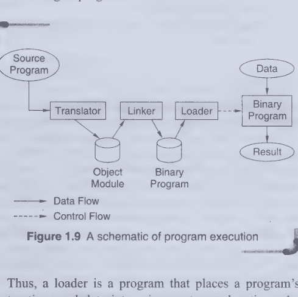

图 1.9 程序执行原理

因此，加载器是一个将指令和数据放入主存储位置的程序。绝对加载器将这些项放在机器语言指示的位置。重定位加载器根据主存储的可用性将程序加载到不同的位置。程序可以在重定位编辑器的帮助进行动态重定位。主存储中的程序基地址放在重定位寄存器中。重定位寄存器的内容被加到运行程序的每个地址上。

> **注意事项**
>
> - 编译器在移除语法错误后将高级语言程序执行为可执行机器指令。
> - 解释器在移除语法错误并将其转换为机器指令后，逐行执行高级语言程序。
> - 链接使得程序的地址相互感知，以便在执行期间实现控制权从一个子程序到另一个程序或到主程序的转移。
> - 加载器是一个将程序的可执行机器指令和数据放入主存储位置的程序。

`PC`，即程序计数器，是一种 `CPU` 寄存器，用于存储程序中下一个要执行指令的地址。在开始时，`PC` 存储程序第 0 条指令的地址。`CPU` 取出并执行该地址处的指令。`PC` 递增到程序中下一条指令的地址。在执行完一条指令后，`PC` 回去查找它找到的程序中下一条指令地址的 `PC`。这条指令可能不在下一个内存位置，它可能是一个完全不同的地址。例如，最后一条语句可能指向无条件跳转到程序中不同点的语句；或者可能有一个指向子程序的分支。`CPU` 在相同的时间内获取 `PC` 所指地址的字的内容，这种方式具有对内存中任何或所有位置的随机访问能力，无论它们的地址如何。程序执行一直进行，直到 `CPU` 处理完最后一条指令。

# 编程、算法与流程图简介

因此，高级语言程序的执行涉及以下以下步骤：

1. 程序的翻译，生成目标程序。
2. 将翻译后的程序与执行所需的其他程序进行链接，生成二进制程序。
3. 将程序重定位到分配给它的特定内存区域。
4. 将程序加载到内存中以便执行。

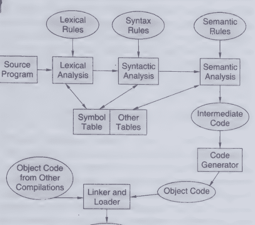

## 1.5 第四代语言

第四代语言是一种非过程化语言，它允许用户指定“做什么”，而不描述应该如何产生数据以产生结果。第四代编程语言并没有像早期的语言那样有明确的定义。大多数人认为，第四代语言（通常称为 `4GL`）是一种高级语言，完成特定任务所需的指令比第三代语言少得多。因此，程序员在 `4GL` 中编写程序的速度应该比在第三代语言中更快。

大多数第三代语言是过程化语言。也就是说，程序员必须指定计算机在程序中遵循的过程步骤。相比之下，大多数第四代语言是非过程化语言。程序员不是为了给出程序中过程的细节，而是要指定想要什么。

例如，假设程序员需要在屏幕上显示某些数据，例如从 `EMP` 文件中显示特定员工 `MANAS` 的地址。

在过程化语言中，程序员将不得不使用以下内容编写一组指令：

- 步骤 1：从 `EMP` 文件中获取一条记录。
- 步骤 2：如果这条记录是 `MANAS` 的记录，则显示地址。
- 步骤 3：如果这条记录不是 `MANAS` 的记录，则跳转到步骤 1，直到文件结束。

在非过程化语言（`4GL`）中，程序员将写一条指令说：

> 从 `EMP` 文件中获取 `MANAS` 的地址。

主要的第四代语言用于从文件和数据库获取信息（如示例所示），并显示或打印信息。这些第四代语言包含一种查询语言，用于通过数据库回答查询或问题。下面的示例展示了常用语言 `SQL` 中的一个查询。

```
SELECT FROM EMP WHERE NAME = 'MANAS'
```

## 4GL 的优势

- 提高了程序生产率。一行 `4GL` 代码等于几行 `3GL` 代码。
- 系统开发更快。
- 程序维护更简单。
- 终端用户可以开发自己的应用程序。
- 在 `4GL` 中开发的程序比其他语言开发的程序更具移植性。
- 文档工作有所改进，因为大多数 `4GL` 都是自文档的。

第三代语言与第四代语言之间的差异如表 1.2 所示。

### 表 1.2 3GL vs 4GL

| 3GL | 4GL |
| :--- | :--- |
| 为专业程序员设计 | 可供非专业人员使用 |
| 可供专业程序员使用 | 指定“做什么” |
| 需要大量指令来完成特定任务 | 完成任务所需的指令远比第三代语言少 |
| 指定执行过程 | 替代方案是内置的 |
| 需要大量的过程化指令 | 难以阅读 |

> **注意事项**
>
> - 第三代语言指定如何执行任务，是面向文件的。
> - 第四代语言指定“做什么”，是面向数据库的。
> - 第五代语言类似于人类语言，是面向对象的。

## 1.6 第五代语言

自然语言代表了编程语言发展的下一个阶段，属于第五代语言。自然语言与查询语言相似，但不同之处在于：它消除了用户或程序员学习特定词汇、语法或句法的需要。自然语言语句的文本与人类非常相似。事实上，人们可以用多种方式写语句，甚至可以拼写错误或改变单词顺序，并得到相同的结果。自然语言使用户远离直接、详细地处理硬件和软件。这些语言的设计还为了让计算机变得更智能——即模拟人类的过程。目前已用于微机的自然语言包括 `SQL`、`PROLOG`（用于数据库）以及用于 `LOT` 的 `NLP`（自然语言处理）。

## 1.7 编程语言的分类

### 1.7.1 过程化语言

算法语言是高级语言，用于解决某类问题。在过程化语言中，程序员必须指定计算机在程序中遵循的步骤。在面向对象编程中，数据和过程是分开的。面向对象的特性是封装在模块。算法语言包括 `C`、`COBOL` 和 `FORTRAN`。

### 1.7.2 面向问题的语言

这些是高级语言，用于解决某类问题。

### 1.7.3 非过程化语言

函数式（应用型）语言通过应用一组函数来解决问题。函数编程风格依赖于函数调用而不是变量和赋值。`LISP`、`ML` 等是函数语言的示例。

- 抽象
- 封装和数据隐藏
- 多态
- 继承
- 可复用代码

`C++`、`JAVA`、`SMALLTALK` 等是面向对象语言的示例。


编程语言分类

| 过程化 | 非过程化 | 面向问题 | 机器语言 | 汇编语言 | 高级语言 | 低级语言 |
| :--- | :--- | :--- | :--- | :--- | :--- | :--- |
| 算法 (`COBOL`, `FORTRAN`) | 函数式 (`LISP`, `ML`) | 数值 (`MATLAB`) | | | | |
| 对象 (`C++`, `JAVA`, `SMALLTALK`) | 逻辑型 (`PROLOG`) | 符号型 (`MATHEMATICA`) | | | | |
| 脚本 (`PERL`) | | 出版 (`LATEX`) | | | | |

图 1.1 编程语言分类

## 1.8 结构化编程概念

1968 年，荷兰的科学家埃德格·迪克斯斯特在《计算数学杂志》上发表了一封题为《Go to语句是有害的》的信，该语句是现代编程语言中跳转到控制语句的命令。三十年后，迪克斯斯特一直在渴望一种更好的编程方法——一种系统化的组织方式——即结构化编程。

几乎所有的软件开发者都承认结构化编程方法的优点，并在软件开发中使用它。

虽然目前没有关于结构化程序的标准定义，但它通常被认为是不使用 `goto` 语句的编程方式。事实上，结构化编程确实不鼓励频繁使用 `goto`，但其意义远不止于此。

结构化编程是：

- 关注编程过程，通过对程序更好的组织和更好的编程表示法，便于对数据和控制结构进行准确且清晰的描述。
- 关注改进编程语言、组织良好的编程技术，这些技术应该是易于理解的，因此更容易修改并适用于文档编写。
- 推理更具经济性；良好的组织和表示法使得优化编译器更容易理解程序逻辑。
- 更加准确且易于调试，因为处理结构的通用正确性可以被用于证明程序的正确性。

结构化编程可以定义为：

- 用于解决问题的自顶向下分析。
- 程序结构和组织的模块化。
- 针对单个模块的结构化代码。

对问题进行细分意味着将一个大问题拆分为两个或多个更小的问题。因此，为了解决一个大问题，必须首先解决这些较小的问题。

自顶向下分析并没有简化将问题划分为两个或多个更小问题的过程。它更进一步。这些较小问题中的每一个都会被进一步细分。这个过程不断创建一个任务层次结构，从一个任务到下一个，直到无法进一步拆分。

### 1.8.1 自顶向下分析

程序是使用特定语言的指令集合，用于解决特定问题。对于较大的程序，开发解决方案可能是非常复杂的。应该从哪里开始？在哪里终止？自顶向下分析是一种程序求解和问题分析的方法。其核心思想是将一个大问题细分为较小的任务或部分以进行分析。

因此，自顶向下分析简化或减少了解决问题的复杂性。它不限于程序的类型。自顶向下分析是处理任何问题的通用方法。它提供了：

自顶向下分析中有两个核心思想：

- 问题的细分
- 任务的层次结构

自顶向下分析的基本步骤如下：

- 步骤 1：定义问题的完整范围，并确定其基本需求。在定义编程问题时，必须考虑各种因素。
    - 输入：程序需要处理哪些数据？
    - 处理：必须对输入数据做什么？需要什么种类型的处理？
    - 输出：程序应该产生什么信息？以什么种形式呈现？
- 步骤 2：根据问题的定义，将其划分为两个或多个更小的部分。
- 步骤 3：仔细定义这些任务中每个任务的范围，并在必要时将其进一步细分为两个或多个更小的任务。
- 步骤 4：重复每一个步骤。最低层次的每一步都描述了一个无法进一步拆分的简单任务。

### 1.8.2 模块化编程

模块化编程是将程序划分为在逻辑上相互依赖的较小部分，这些部分可以单独编写。这些部分作为分离且独立的单元，被称为模块。

- 模块由某种编程语言中的一系列程序指令或语句组成。
- 模块由语言语法要求的某些特殊标记明确地结束。例如，一个 `BASIC` 子程序由 `return` 语句结束。
- 模块具有唯一的名称。
- 模块只有一个入口（控制从外部转移到该入口）且只有一个出口（控制从该出口返回到调用模块）。

以下是模块化编程的一些优点。

- 复杂的程序被划分为简单且更易管理的元素。
- 多个程序员可以同时对不同的模块进行编码。
- 可以创建一个模块库，这些模块可以在需要时用于其他程序。
- 程序错误的位置可以追溯到特定的模块；因此可以简化调试和维护。

### 1.8.3 结构化代码

在完成自顶向下分析和模块化结构的设计之后，编程的第三阶段也是最后一个阶段涉及使用结构化代码。结构化编程是一种编码方法，类似于编写一个产生良好模块的程序。高级语言支持控制语句（也称为结构化代码），以产生结构良好的模块。这些控制语句代表条件和重复类型的执行。

在 `C` 语言中，`if` 和 `case` 语句是条件执行的示例，而 `for` 和 `while` 是重复执行的示例。在 `BASIC` 中，一个简单但不结构化的语句可以破坏程序的正常流程并跳转到任意点。没有正常流程的程序是无组织且不可读的。

以下示例演示了使用 `goto` 语句的程序。在第 20、60 和 80 行，正常流程被打破了。例如，从第 60 行开始，如果 `(R - G)` 小于 0，控制将返回到第 40 行而不是第 70 行。

```
INPUT X
20 IF X < 0 THEN GOTO 90
30 G = X/2
40 R = G
50 G = (R + G)/2
```

下面是使用 `while` 语句的该程序的结构化版本。

```
INPUT X
IF X < 0 THEN G = X/2, R = G
WHILE (R - G) < 0 THEN G = (R + G)/2 ELSE PRINT "INVALID INPUT" END
```

现在，如果没有正常的跳转，在非结构化语言中 `goto` 是不可避免的，但始终可以使用结构来避免它。

### 1.8.4 编程过程

程序员的工作不仅仅是编写程序。程序员遵循几条指令来创建一个可运行的程序。创建可运行程序需要一些逻辑和顺序步骤：

1. 理解问题
2. 设计解决方案
3. 使用编程语言编写程序
4. 将程序翻译成机器代码
5. 使用测试数据测试程序

程序员的第一项工作是理解问题。为了解决问题，需要考虑逻辑。接下来的工作是设计解决方案。在这一阶段中，算法的逻辑被定义。这一阶段确定了“如何做”。

一旦开发了逻辑，第三项工作是使用选定的编程语言编写程序。通过这种方式程序翻译成机器代码。在这个阶段中，程序错误被检测并消除。

最后阶段是让程序运行。这意味着满足用户的需求。算法是在这里被描述的。

# 1.9 算法

## 1.9.1 什么是算法？

计算机科学家 `Niklaus Wirth` 指出：

> 程序 = 算法 + 数据

算法是程序计划的一部分。事实上，算法是一种在有限步数内解决问题的“有效过程”。

## 1.9.2 算法的不同表示方法

算法可以以多种方式表示。表示算法的方法有几种：

- 步骤形式 (Step-form)
- 伪代码 (Pseudo-code)
- 流程图 (Flowchart)


# 编程、算法与流程图简介

## Nassi-Schneiderman

在步骤形式中，问题的解决是通过语句陈述的。每个语句都与前一个语句相关。该方法在后续章节通过示例进行了讨论。

伪代码是算法的自由形式表示。它使用限制的词汇来定义问题的解决。使用人类语言的问题是不精确的。伪代码通过使用有限词汇增加了精确性。

流程图和 Nassi-Schneiderman 是面向图形的表示。它们使用符号和语言来表示顺序、决策和重复。流程图方法的解决方法得到了解释。Nassi-Schneiderman 技术超出了本书的范围。

1. 结构化编程涉及自顶向下分析、程序结构的模块化以及针对单个模块的组织代码。
2. 自顶向下分析将问题分解为较小的任务，并定义任务之间的层次关系。
3. 程序结构的模块化将小逻辑任务转化为独立的程序模块。
4. 结构化编码由编写产生良好模块组成。

1. 算法是在有限步数内解决问题的有效过程。
2. 程序由算法和数据组成。
3. 表示算法的三种常见方法是步骤形式、伪代码、流程图和 Nassi-Schneiderman。

## 1.9.3 算法的关键特征与步骤形式

这里有一个泡茶的算法示例：

1. 如果水壶里没有水，则给水壶加水。
2. 将水壶插上电源插并打开开关。
3. 如果茶壶不是空的，则清空茶壶。
4. 将茶叶放入茶壶。
5. 如果壶中的水未开，则跳转到第 5 步。
6. 关闭热水壶。

“如果命题那么过程”这种决策的第一种形式是“空否则”，即没有“否则”部分。

7. 将壶中的水倒入茶壶中。

可以看出，算法包含许多步骤，其中某些步骤（1、3 和 5）涉及决策，而其中一个步骤（在本例中为第 5 步）涉及重复，在这种情况下是等待水壶水的过程。从这个用例可以明显看出，算法展现了这三个特征：

- 序列（也称为过程）
- 决策（也称为选择）
- 重复（也称为迭代或循环）

因此，算法可以使用三种基本结构来描述：序列、决策和重复。

## 重复结构——repeat 和 while

重复可以使用 `repeat` 循环、`while` 循环和 `if... goto` 循环等结构来实现。`Repeat` 循环用于迭代或重复某个过程或一系列过程，直到某个条件变为真。它的通用形式如下：

```
Repeat
Process1
Process2
...
ProcessN
Until proposition
```

这是一个示例：

```
Repeat
Fill in water
Until kettle is full
```

该过程是“向壶中加水”，命题是“壶是满的”。`Repeat` 循环在测试命题状态之前会进行一些处理。如果在上面的示例中，在 `Repeat` 循环开始时壶已经是满的，会发生什么？加水会导致溢出。

## 序列

序列意味着算法中的每个步骤或过程都按照指定的顺序执行。在上面的示例中，每个过程必须处于正确的位置，否则算法将失败。

## 决策结构——if... then... else... else...

这是 `Repeat` 结构的一个缺点。

决策的结果要么为真，要么为假；没有中间状态。决策的结果基于某些条件，该条件只会产生真值或假值。例如，

```
while kettle is not full
fill in water
```

由于在加水之前已经做出了关于壶是否满决策，因此消除了溢出的可能性。循环在重复某个过程或过程序列之前，会先检查某个条件是否为真。

```
if today is Friday then collect pay
```

这是一个决策，且决策的通用形式为：

```
if proposition then process
```

命题在这里是一个陈述，它只能为真或为假。“今天是周五”是真实的，或者“今天不是周五”是假的。它不能既是真又是假的。如果命题为真，则执行随后的 `then` 过程或程序。决策可以表述为：

```
if proposition
process1
else process2
```

这是决策中的 `if ... then ... else`。这意味着如果命题为真，则执行 `process1`；否则，或者说执行 `process2`。

换句话说，正确性是算法执行其指定功能的程度。最常用的正确性衡量标准是实现算法的每千行代码（KLOC）缺陷数，其中由对需求的符合性验证锁来定义。

```
while proposition
begin
Process I
Process 2
Process N
end
```

如果条件为假，则不执行该过程或过程序列。`while` 循环的通用形式为：

## C 语言编程

`if then goto ...` 也用于重复某个过程或过程序列，直到命题为假。在假的示例中，该结构将按如下实现：

1. 在壶中加一些水
2. if kettle not full then goto 1

只要命题“壶未满”为真，过程“向壶中加一些水”就会执行。`if ... then goto` 的通用形式为：

```
Process1
Process2
ProcessN
if proposition then goto Process1
```

## 1.9.4 什么是变量？

到此，已经讨论了算法的元素。程序由算法和数据组成。因此，现在必须理解数据的概念。已知数据是值的符号表示，而程序设定了赋予数据意义的上下文。数据被转换为信息。问题是，数据在程序中是如何表示的？

几乎每个算法都包含数据，且数据被“包含”在所谓的变量中。变量是值的容器，该值在程序执行期间可能会变化。例如，在泡茶算法中，壶中的水位是一个变量，水的温度是一个变量，茶叶的用量也是一个变量。

程序中的每个变量都被赋予一个名称，例如：

- `Water_Level`
- `Water_Temperature`
- `Tea_Leaves_Quantity`

在任何给定时间，值（例如由 `Water_Level` 表示）可能与其在其他时间的值不同。语句

```
if the kettle does not contain water then the kettle
```

也可以写成

```
if Water_Level = 0 then fill the kettle
```

或者

## 终止

可能会无限运行而不停止的程序。这种程序被称为无限循环。算法必须有一个终止点，以确保它最终能完成任务。终止是算法停止执行的点。

## 正确性

正确性是算法执行其预定功能的程度。算法对于任何输入都能产生正确的输出，则它就是正确的。正确性通过测试和形式化方法验证。

算法的目标是高效地解决特定问题。效率通常通过时间复杂度（算法运行快慢）和空间复杂度（占用内存多少）来衡量。

## 变量和数据类型

算法中的数据可以是不同类型：

- 数字数据，例如12,45
- 字母字符'A', 'Z'
- 逻辑数据，即真/假

## 注意事项

- 1. 数据是值的符号表示。
2. 变量具有名称的值的容器，在程序执行期间可能会变化。

## 变量命名

应该尝试为变量选择有意义的名称以提高算法的可读性。这在大型复杂的程序中尤为重要。

在泡茶算法中，某些变量使用了纯英语。在表1.3中，右列包含的名称比原始名称短，且没有隐藏原始含义。使用了下划线来指示这些单词代表变量。算法和程序也可以从过程命名规范中获益。

| 英语算法 | 使用变量名的算法 |
| --- | --- |
| 1. 如果壶中没有水，则给壶加水。 | 1. If kettle_empty then fill the kettle. |
| 2. 将壶插入电源并开启。 | 2. Plug the kettle into the power point and switch it. |
| 3. 如果茶壶为空，则清空茶壶。 | 3. If teapot_not_empty then empty the teapot. |
| 4. 将茶叶放入茶壶中。 | 4. Place tea leaves in the teapot. |
| 5. 如果水未开，则跳转到第 5 步。 | 5. If water_not_boiling then go to 5. |
| 6. 关闭热水壶。 | 6. Switch off the kettle. |
| 7. 将壶中的水倒入茶壶中。 | 7. Pour water into the kettle into the teapot. |

## 1.9.5 子程序

简单程序是按顺序执行的语句组合。语句是一组语句。这样的程序如图1(i)所示。可能会有一个特定的语句块，称为子程序，在较大程序的实现序列中多次运行。如图1(ii)所示。这里，特定的语句块被命名为“Procedure”。这增加了程序。

因此，子程序（subroutine），称为过程、方法或函数，是在较大的程序内部被调用以执行特定任务的指令部分。同时，子程序相对于大型程序的其余语句是相对独立的。子程序的行为与作为大型程序中某一步使用的程序相同。子程序的编写通常是为了使其在程序的单次执行过程中被多次且/或从多个地方调用（“调用”），包括从其他子程序调用，然后在子程序任务完成后，从（“调用”）之后分支（返回）到下一条指令。因此，此类子程序通过 CALL语句调用，或者在不从调用程序传递参数的情况下调用。如果如此，它将自己计算结果并输出结果，在返回调用程序之前将结果传递给调用程序。

编写子程序的技术具有明显的优点。子程序可以减少程序中语句块的重复，允许形成构成子程序的语句块在多个程序中被复用，将复杂任务分解为更基础的步骤，将大型编程任务分配给不同的程序员或项目的不同阶段，并向用户隐藏具体的实现细节。

然而，使用它也存在一些缺点。子程序的调用在调用机制中引入了一些计算开销。子程序在进入和退出时需要一些定义良好的管理技术。

- 1. 每个算法在逻辑上被包含在 START 和 STOP 语句之间。
- 2. 为了接受用户的数据，应使用 INPUT 或 READ 语句。
- 3. 为了显示任何消息或变量的内容，将使用 PRINT 语句。注意，消息将导致一个动作。
- 4. 算法中有若干步骤。每个步骤都应该按照它们排列或指示的顺序顺序执行。
- 5. 表达式中将使用的算术运算符有：
  - (i) `←` 赋值（“←”的左侧）应该是一个简单的变量。示例：表达式 `x←6` 意味着将一个值赋值给变量 x。在内存存储中，值 6 被存储在一个位置，在该位置与 y 相加，并将得到的结果分配给变量 y。
  - (ii) `+` 加法。示例：表达式 `z←x+y` 意味着变量 x 中包含的值和变量 y 中包含的值相加，并将结果赋值给变量 y。
  - (iii) `-` 减法。示例：表达式 `z←x-y` 意味着从变量 x 包含的值中减去变量 y 包含的值，并将结果赋值给变量 z。
  - (iv) `*` 乘法。示例：考虑以下顺序编写的表达式：

```
x←10
y←6
z←x*y
```

x 和 y 之间的乘法结果为 30。此值被赋值给 z。

  - (v) `/` 除法。示例：以下顺序编写的表达式说明了除法运算符的含义：

```
x←10
y←6
z←x/y
```

x 和 y 相除的商为 1，余数为 4。当使用此类运算符时，商是结果而余数被舍弃。在这种情况下，从表达式 x/y 得到的结果是 1，并分配给 z。

## 注意事项

| 注意事项 |
| :--- |
| 1. 子程序是指令的逻辑连接，在大型程序内部被调用以执行特定任务。 |
| 2. 子程序相对于它调用的程序的其余语句是相对独立的。 |
| 3. 在调用程序的单次执行期间，子程序可以从多个地方被调用多次。 |
| 4. 完成调用任务后，子程序返回到大型程序中的调用点。 |

## 使用分步法开发算法的一些示例

为了说明分步形式，假设以下约定：

- 可以使用左箭头 (`←`)。例如，`a ←b` 是一个赋值，其中 `a =b` 是用于检查质量的命题。
- 6. 最常用的逻辑运算符将是 AND、OR 和 NOT。这些运算符用于指定形成复合命题的多个测试条件。
- 5. 在位置上，通用的关系运算符将包括：
  - (i) `>` 大于。示例：表达式 `x > y` 意味着 x 中的值大于 y 中的值，那么表达式的结果为真，则该真值将被视为 1。否则，如果结果失败，则它被视为 0。
  - (ii) `<=` 小于等于。示例：表达式 `x <=` 意味着 x 中的值小于或等于 y 中的值，那么表达式的结果为真，因此它被视为 1。但如果关系表达式的结果失败，则它被视为 0。
  - (iii) `<` 小于。示例：表达式 `x<` 意味着如果 x 中的值小于 y 中的值，则关系表达式为真，被视为 1，否则表达式为假，因此将被视为 0。
  - (i) `AND` 逻辑与。表达式的结果为真或 1 的条件是两个 AND 命题都为真，否则为假或 0。示例：考虑表达式

```
x = 2
y = 1
x = 2 AND y = 0
```

在上面的表达式中，命题 'x=2' 是真的，因为 x 的值为 2。同样，命题 'y = 0' 是不真实的，因为 y 持有 1，因此该命题为假或 0。上面的表达式可以表示为“真” AND 一个为假或 0 的结果。

  - (ii) `OR` 逻辑或。表达式的结果为真或 1 的条件是两个 OR 命题中至少有一个为真，否则为假或 0。示例：考虑表达式

```
x = 2
y = 1
x = 2 OR y = 0
```

在这里，命题 'x=2' 是真的，因为 x 的值为 2。因此，该表达式表示为“真’ AND 结果为假或 0。

  - (iv) `>=` 大于等于。示例：表达式 `x>=` 意味着 x 中的值大于或等于 y 中的值，那么表达式的结果为真，因此它将被视为 1。
  - (v) `!=` 不等于。示例：表达式 `x!=` 意味着 x 中的值不等于 y 中的值，那么表达式的结果为真，因此将被视为 1。
  - (iii) `NOT` 取反。表达式的结果为真或 1 的条件是 NOT 命题为真，否则为假或 0。示例：考虑表达式

```
x = 2
y = 1
```

在这里，命题 'x=2' 是真的，因为 x 的值为 2。

## C 语言编程 示例

### 4. 编写求和的算法。

Solution 让 A 和 B 为数字。

1. START
2. PRINT "ENTER numbers"
3. INPUT A, B
4. C ← A + B
5. PRINT C

第一步是算法的起点。第二步是请求两个数字。第三步输入 A 和 B。第四步将将它们相加。步结果 C。第六步停止。

### 5. 编写求除法的算法。

Solution 让 N 和 D 分别为除数和被数。假设 Q 和 R 是整数。

1. START
2. PRINT "ENTER dividend"
3. INPUT N
4. PRINT "ENTER divisor"
5. INPUT D
6. Q ← N / D
7. R ← N - Q * D
8. PRINT R
9. STOP

解释：第一步是算法的起点。第二步请求输入被数。第三步输入 N。第四步请求输入除数。第五步输入 D。六步将 N 除以 D。由于两个数都是整数，结果是商。此值赋值给 Q。第七步通过减去商与除数的乘积得到余数。余数赋值给 R。第八步打印 R。

### 6. 编写交换变量数值的算法。

Solution 让变量为 A 和 B。考虑 C 为第三个变量，在交换过程中存储其中一个变量的值。

1. START
2. PRINT "ENTER THE VALUE OF A & B"
3. INPUT A, B
4. C ← A
5. A ← B
6. B ← C
7. PRINT A, B
8. END

解释：第一步是算法的起点。第二步是请求 A 和 B 值的输出。第三步将这些值输入变量 A 和 B。第四步将 A 的值复制到 C。第五步将变量 A 的值赋值给变量 B。接下来，在第六步中，将 C 的值（第四步保存的）存入 B。第七步打印 A 和 B 的值。第八步结束程序。

### 7. 编写比较两个数字并打印标识较大数字的消息，或说明两者相等的消息。

Solution 这展示了如何使用分步法在算法中实现选择或决策。假设两个变量 A, B 代表要比较的两个数字。给定的算法如下：

1. START
2. PRINT "ENTER TWO NUMBERS,"
3. INPUT A, B
4. IF A > B THEN
   PRINT "A IS GREATER THAN B"
5. IF B > A THEN
   PRINT "B IS GREATER THAN A"
6. IF A = B THEN
   PRINT "BOTH ARE EQUAL",
7. STOP

## 编程、算法与流程图简介

说明：第一步指示算法的起点。下一步打印消息，要求输入两个数字。在第 3 步中，将数字存储在变量 A 和 B 中。在第 4、5、6 步中，使用 `IF...THEN` 结构对 A、B 和 C 的值进行比较。每当发现 IF 和 THEN 之间的命题成立时，就会打印相关消息并执行下一步。但无论任何情况下，至少会打印一条消息，且至少有一个假设是成立。第 7 步结束程序。

### 9. 打印三个数中的最大值。

解决方案：假设三个数分别为 A、B 和 C。解决此问题有三种方法。下面给出了三种略有差异的算法：

1. 开始
2. 打印 "输入三个数字"
3. 输入 A, B, C
4. IF A >= B AND B >= C
   THEN 打印 A
5. IF B >= C AND C >= A
   THEN 打印 B
   ELSE
   打印 C
6. 停止

### 8. 编写一个算法检查用户输入的数字是奇数还是偶数。

假设被除的数字为 N。N 除以 2 得到整数商，余数为 R，则 N 为偶数；否则 N 为奇数。该逻辑通过以下算法实现：

1. 开始
2. 打印 "输入该数字"
3. 输入 N


# 算法与流程图示例

## 判断奇偶数算法

4. `Q <- N/2`（整数除法）
5. `R <- Q * 2`
6. `IF R = 0` 打印 "N 是偶数"
7. `IF R != 0` 打印 "N 是奇数"
8. 停止

**说明**：主要目的是找出数字除以 2 后余数是否为 0。若为偶数，余数为 0；若为奇数，余数不为 0。通过测试余数判断奇偶性。第 1 步指示算法起点，第 2 步打印消息要求输入变量 `N`。第 3 步中，数字除以 2，因是整数除法，结果 `Q` 为整数，赋值给 `Q` 并产生余数。第 5 步中，`Q` 乘以 2，产生小于或等于 `N` 的整数。`N` 与 `Q * 2` 之差得到余数。第 6、7 步检查余数值，分别打印偶数或奇数。第 8 步结束程序。

## 求三数最大值算法

**说明**：找出 `A`、`B`、`C` 中最大值，先判断 `A >= B` 且 `B >= C`。若均成立则 `A` 最大，否则 `B` 最大。第 4 步应用此逻辑打印 `A`。第 5 步再次比较：`B` 与 `C`、 `C` 与 `A`。若两命题均成立则打印 `B` 最大，否则打印 `C` 最大。

- 步骤 1、2、3 无需提及，因在前例已用过。

**或者**：使用变量 `MAX` 存储最大值。

1. 开始
2. 打印 "输入三个数字"
3. 输入 `A, B, C`
4. `MAX <- A`
5. `IF B > MAX THEN MAX <- B`
6. `IF C > MAX THEN MAX <- C`
7. 打印 `MAX`
8. 停止

**说明**：该算法与上一个不同。数字存入 `A`、`B`、`C` 后，任取一值赋给 `MAX`（第 4 步）。第 5 步将 `MAX` 与 `B` 比较，满足条件则赋值，否则不变。第 6 步同理比较 `C`。第 6 步结束时，`MAX` 即为三数最大值。第 1 步起始，第 8 步结束。

## C 语言编程示例

### 三角形判断

**解决方案**：设三边为 `A`、`B`、`C`。给出两种算法：

**算法一**：

1. 开始
2. 打印 "输入三角形三边长度"
3. 输入 `A, B, C`
4. `IF A+B < C AND B+C > A AND A+C > B THEN` 打印 "无法画三角形" `ELSE` 打印 "无法画三角形": 转到步骤 6

**算法二（嵌套结构）**：

1. 开始
2. 打印 "输入三个数字"
3. 输入 `A, B, C`
4. `IF A > B` `IF A > C THEN` 打印 `A` `ELSE IF B > C THEN` 打印 `B` `ELSE` 打印 `C`
5. 停止

**说明**：使用嵌套 `IF-THEN-ELSE` 结构。判断任意两边之和是否大于第三边，若是则可画三角形，否则不能。

### 计算级数和 1+2+3+...+N (问题 14)

**解决方案**：设和为 `S`，项数为 `N`。

1. 开始
2. 打印 "有多少项？"
3. 输入 `N`
4. `S <- 0`
5. `C <- 1`
6. `S <- S + C`
7. `C <- C + 1`
8. `如果 C <= N 则跳转到 6`
9. 打印 `S`
10. 停止

### 计算阶乘 N! (问题 17)

**解决方案**：

1. 开始
2. 打印 "输入数字"
3. 输入 `N`
4. `F <- 1`
5. `C <- 1`
6. `当 C <= N`
7. 开始
8. `F <- F * C`
9. `C <- C + 1`
10. 结束
11. 打印 `F`
12. 停止

### 计算级数和 2+4+8+...+N (问题 15)

**解决方案**：设和为 `S`，项数为 `N`。

1. 开始
2. 打印 "输入 N 的值"
3. 输入 `N`
4. `S <- 0`
5. `C <- 2`
6. `S <- S + C`
7. `C <- C * 2`
8. `如果 C <= N 则跳转到第 6 步`
9. 打印 `S`
10. 停止

### 判断质数 (问题 16)

**解决方案**：

1. 开始
2. 打印 "输入数字"
3. 输入 `N`
4. `如果 N = 2 则` 打印 "互质" 跳转到第 12 步
5. `D <- N/D`（整数除法）
6. `R <- N - Q*D`
...（后续步骤原文缺失）

### 计算级数和 1+x+x²+...+N项 (问题 19)

**解决方案**：

1. 开始
2. 打印 "有多少项"
3. 输入 `N`
4. 打印 "输入 X 的值"
5. 输入 `X`
6. `T ← 1`
7. `C ← 1`
8. `S ← 0`
9. `S ← S + T`
10. `C ← C + 1`
11. `T ← T * X`
12. `如果 C <= N 则跳转到 9`
13. 打印 `S`
14. 停止

### 计算各位数字之和 (问题 20)

**解决方案**：

1. 开始
2. 打印 "输入数字"
3. 输入 `N`
4. `S ← 0`
5. `Q ← N/10`（整数除法）
6. `R ← N - Q`
7. `S ← S + R`
8. `N ← Q`
9. `如果 N > 0 则跳转到 5`
10. 打印 `S`
11. 停止

### 查找列表最大数 (问题 21)

**解决方案**：

1. 开始
2. 打印 "列表中的数字总数"
3. 输入 `N`
4. `C ← 0`
5. 打印 "输入数字"
6. 输入 `A`
7. `C ← C + 1`
8. `MAX ← A`
9. 打印 "输入数字"
10. 输入 `B`
11. `C ← C + 1`
12. `如果 B > MAX 则` ...（后续步骤原文缺失）

### 判断阿姆斯特朗数 (问题 22)

**解决方案**：以 153 为例，`1³+5³+3³=153`，故为阿姆斯特朗数。

1. 开始
2. 打印 "输入数字"
3. 输入 `N`
4. `M ← N`
5. `S ← 0`
6. `Q ← N/10`（整数除法）
7. `R ← N - Q`
8. `S ← S + R`
9. `N ← Q`
10. `如果 N > 0 则跳转到 5`
11. `如果 S = M` 打印 "该数字是阿姆斯特数" `否则` "该数字不是阿姆斯特数"
12. 停止

### 计算级数和 1+x+x²+...+N项 (问题 23，重复)

**解决方案**：

1. 开始
2. 打印 "输入项数"
3. 输入 `N`
4. 打印 "输入数字"
5. 输入 `X`
6. `T ← 1`
7. `S ← 0`
8. `C ← 1`
9. `S ← S + T`
10. `T ← T * X`
11. `C ← C + 1`
12. `如果 C <= N 则跳转到 9`
13. 打印 `S`
14. 停止

---

# C 语言编程基础

## 伪代码

伪代码无标准，但易读易用。例如：

```
while_empty
  Add_Water_To_Kettle
```

此为循环语句的精确描述。伪代码是使用限制词汇编写的算法，是许多程序员和设计师描述算法和程序规范的首选方法。

---

# 编程、算法和流程图简介

## 流程图规范

- 流程图应清晰、整洁、易遵循，无歧义。
- 应通过简单测试验证有效性。按顺序执行的步骤用连接的过程符号表示。一条线进入第一个过程，一条线从最后一个过程退出。
- 正常流向：从左到右或从上到下。
- 过程符号仅引出一条线。
- 决策符号仅进入一条线，但可离开两条或三条线（对应各可能答案）。
- 过程/步骤选择由决策和过程符号表示。一条输入线，一条输出线。决策符号和过程符号由线连接。
- 终端符号仅配合一条线使用。
- 符号内文字简洁。必要时用注释符号描述数据或计算步骤。
- 迭代/循环由按顺序放置的过程和符号组合表示。线连接符号并描述输入输出。

## 流程图作用

流程图提供获得解决方案所需的步骤，是编写程序前的设计工具。通常在解决方案早期开发。由一组用线连接的形状框组成，线有箭头指示方向。框内操作用英文描述。另有连接符号指示流向继续（如下一页）。

流程图便于程序员与业务人员沟通，在程序编写中至关重要，有助于理解复杂问题。画好流程图后，用任何高级语言编程都更容易。流程图有助于向他人解释程序，是复杂程序文档的必备工具。

## 绘制流程图标准

- 必须画在白纸单面上，自顶向下流动。仅使用标准符号。最终版用模板绘制。符号内容打印清晰。使用英文而非编程语言。
- 每个子程序流程图（如有）单独成页。从带子程序名的终端符号开始，以标记终端符号结束。
- 用直线连接符号并画箭头指示逻辑方向。

## 绘制指南

- 绘制前将所有必要需求按逻辑顺序列出。流程图应有逻辑开始和结束。
- 若流程图复杂，使用连接符号减少线条数量。避免线条交叉，以提高有效性和沟通质量。

---

# C 语言编程

## 使用流程图的优点

- **沟通**：交流系统逻辑的更好方式。
- **有效分析**：帮助更有效地分析问题。
- **适当文档**：作为良好的程序文档。
- **高效编码**：在系统分析和程序开发阶段充当指南/蓝图。
- **适当调试**：有助于调试过程。
- **高效维护**：使运行中程序的维护变简单。

## 示例

### 示例 24：求前 50 个自然数和

**解决方案**：
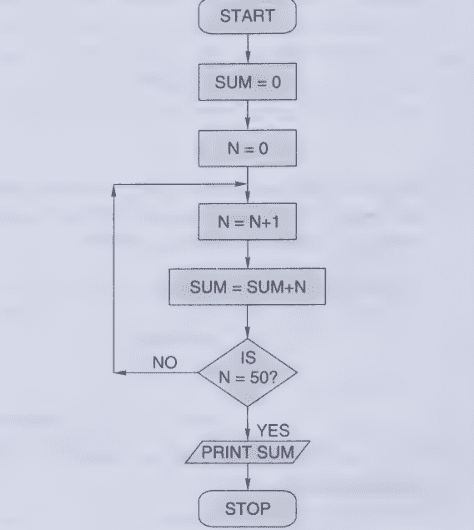

## 使用流程图的局限性

- **复杂逻辑**：程序逻辑复杂时，流程图变得复杂笨拙。
- **更改修改**：需更改时可能要完全重画。
- **复制困难**：符号无法直接输入，复制成问题。
- **丢失目标**：核心内容易在技术细节中丢失。

### 示例 25：找出三数 A、B、C 最大值

**解决方案**：
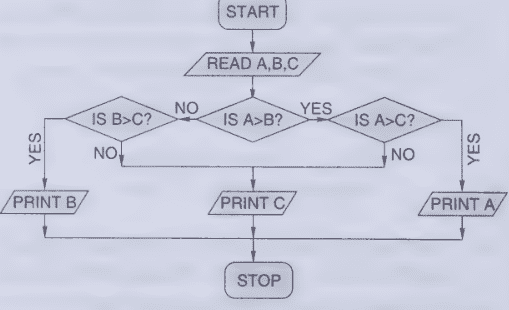

### 注意事项

1. 流程图由标准形状框经流程线连接组成，表示算法。
2. 应有逻辑开始和结束。
3. 正常流向：从左到右或从上到下。
4. 避免流线交叉。
5. 有助于程序员与用户沟通。

---

## 编程、算法与流程图简介

### 示例 26：计算阶乘 N! (N = 1×2×3×...×N)

**解决方案**：
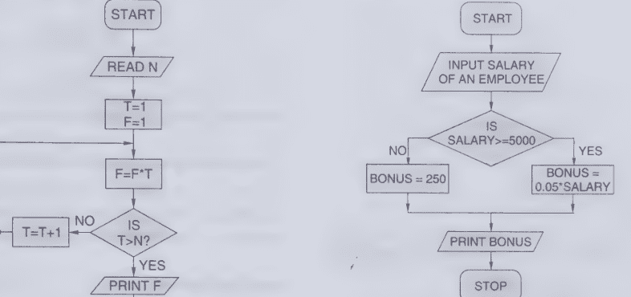
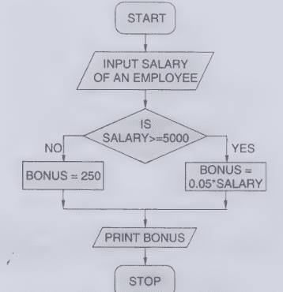

### 示例 27：计算单利 Si = (P×T×R)/100

**算法步骤**：

1. 开始
2. 读取本金 `P`、时间 `T`、利率 `R`
3. 计算 `Si = (P * T * R) / 100`
4. 打印 `Si`
5. 停止

**解决方案**：
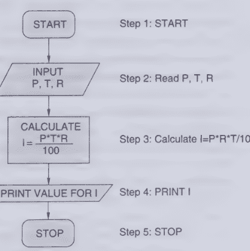

### 示例 28：员工奖金计算

XYZ 公司规定：年收入 ≥ 5000 卢比者奖金 5%，否则固定 250 卢比。

**算法步骤**：

1. 开始
2. 读取员工工资
3. `如果 工资 >= 5000 则`
4. `计算 奖金 = 0.05 * 工资`
5. `否则`
6. `计算 奖金 = 250`
7. 打印 奖金
8. 停止

**解决方案**：


### 示例 29：学生成绩分级

- ≥ 90：A 级
- ≥ 80 且 < 90：B 级
- > 65 且 < 80：C 级
- 否则：D 级

**解决方案**：
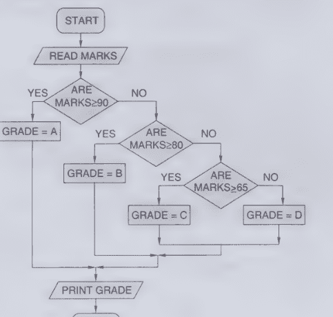

### 示例 30：求二次方程根

**解决方案**：
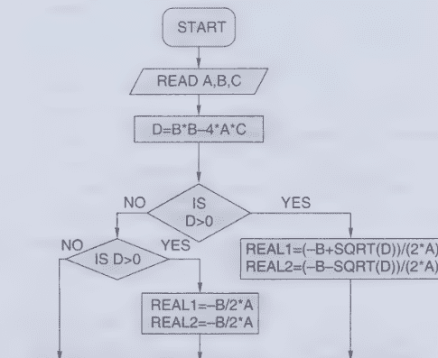

---

## 1.9.6 算法设计策略

### 调查步骤

1. **识别所需输出**：包括呈现形式、间隔、数据提供方式。
2. **识别可用输入变量**：考虑特定输入、变量可用性、输入间隔、输入如何馈入处理。
3. **识别主要决策和条件**：考虑需求施加的条件、运行环境局限性。
4. **识别可用环境**：考虑程序可用的特定输入、变量可用性、输入间隔、输入如何馈入处理。

### 自顶向下开发

1. 通过识别主要组件制定整体解决方案，将问题分解为可管理部分。
2. 验证整体解决方案可行性。

### 逐步细化

1. 为每个小过程制定细节。

---

## 算法正确性验证（以示例 29 为例）

通过追踪算法验证逻辑正确性。开始时，输入分数。与 90 比较，>90 则分类为 A 并打印，否则继续比较。此部分逻辑正确。再与 80 比较，>80 打印 B，否则继续。此部分满足要求。再与 65 比较，<65 打印 C，否则打印 D。流程图描述的逻辑正确。

此方法展示了通过流程图等工具规划的算法逻辑如何验证正确性。该技术称作“纸上检查”或“干运行”，也适用于其他工具表示的算法。

---

## 1.9.8 算法转程序的规范

算法形成并用流程图/伪代码表示后，须转换为编程语言代码。通用步骤：

- **将算法编码为程序**：理解所选语言语法和控制结构，按算法编写等效程序。
- **对程序进行纸上检查**：通过纸上检查方法检查代码，确保样本数据产生预期输出。
- **评估并修改程序**：根据检查结果修改代码，或按需修改原始算法。
- **不要重复造轮子**：若设计代码已存在，修改复用，勿重新制作。

- 算法可通过逐步验证每个过程来追踪，以确定并确认要获得的相应结果。


将算法转换为程序的通用步骤是使用适当的编程语言对算法编码，通过纸上检查方法检查代码并在需要时进行评估和修改。

由于读者尚未接触 C 语言的基础知识，在下面演示的示例程序中，读者必须接受使用 `#include<stdio.h>`、`int main()`、`printf()`、`scanf()` 和 `return` 等指令，无需解释。

然而，在非常初级的水平，简要说明 C 程序的通用形式以及一些必要的 C 语言指令的使用：

1. 所有 C 程序开始于：

```c
#include <stdio.h>
int main ()
{
```

2. 在 C 中，所有变量在使用之前必须声明。参见步骤 1 中两条指令行旁边的行，应该是任何所需的声明。

例如，如果名为 "a" 的变量应该存储一个整数，其声明如下：

```c
int a;
```

3. `scanf()` 用于向程序输入数据，`printf()` 用于在显示器上输出数据。

4. C 程序必须用下面的语句终止：

```c
return 0;
}
```

这里有一个示例展示了如何将一些伪代码语句转换为 C 语言语句：

## 伪代码

```
LOOP
EXIT LOOP
IF (conditions) {
ELSE IF (conditions) {
ELSE {
INPUT a
OUTPUT "Value of a: a"
}
```

```
=
<-
=
AND
OR
NOT
!
&&
||
```

为了演示从算法转换为 C 程序的步骤，给出一个示例。

**问题描述** 写出用于将两个整数相加并打印结果的算法及相应的 C 程序。

## 解决方案

### 算法

1. 开始
2. 声明 A 和 B 为整数变量
3. 打印 "输入两个数字"
4. 输入 A, B
5. R = A + B
6. 打印 "结果 = "
7. 打印 R
8. 停止

### C 语言代码

```c
while(1) {
    break;
    if (conditions) {
    else if (conditions) {
    else
        scanf("%d",&a);
        printf("Value of a: %d",&a);
    }
}
```

### C 程序

```c
int main() {
    int A, B;
    printf("\n ENTER TWO NUMBERS:%d",
    scanf("%d",&A,&B);
    R = A + B;
    printf("\n RESULT = %d",
    printf("%d",R);
    return 0;
}
```

## 总结

程序是指令的序列，编写程序的过程被称为编程。程序广泛分为系统程序和应用程序。不同的编程语言已经不断演进。高级别语言很容易使用。

## 5. 过程化编程面临哪些困难？

过程化编程的主要缺点是，当问题变得非常大时（特别是在高度复杂的情况下），它会变得崩溃，这使得团队协作变得异常困难。一个人能够处理的细节程度和规模是有限的。非过程化的面向对象编程可以帮助程序进行模块化并管理这些细节。各种形式的非过程化编程在处理大型现实问题时高效得多。

## 6. 什么是面条代码（Spaghetti code）？

非模块代码广泛被称为面条代码。它通过使用大量的 GOTO 语句产生无序的计算机程序。

## 7. 什么是结构化编程？

结构化编程是一种旨在使程序更易理解、减少错误频率的编程风格。这种编程技术通过对编写的程序强制执行逻辑结构，使其更易理解和修改。它包括以下特征：

- **块结构**：程序必须组织成功能组。它阐明了逻辑。
- **避免跳转**：GOTO 语句会让程序更容易出错。结构化编程少使用这类语句。它也被称为“少 goto 编程”。
- **模块化**：这是一个常见的观点，即对程序进行结构化更容易我们理解，便于开发团队同时在同一程序上工作。

结构化编程的另一个优点是降低复杂性。模块化允许程序以局部方式处理问题。通过更好的程序组织和更好的符号，便于对数据和控制进行正确清晰的描述，从而改进了程序过程。

结构化编程节省了**时间**；如果没有模块化，包含多个部分的代码每次使用时都需要重新编写。另一方面，模块化程序需要调用子程序（或）以及代码才能在结构化程序中获得相同的结果。

结构化编程鼓励**逐步细化**，这是由尼克劳斯·维尔（Niklaus Wirth）描述的程序设计过程。这是一种自而下的方法，首先用高级术语描述编程阶段，然后逐渐完善细节，就像为书写大纲一样。

结构化编程的缺点包括：

首先，错误控制可能受到管理的限制。管理修改可能也很困难。

其次，调试可能会受到阻，因为程序代码在程序的某一部分看起来甚至运行是正确的，但在另一部分却不是。

## 9. 什么是伪代码？

伪代码是对解决问题的步骤序列的非正式描述。它是计算机程序的纲要，用语言和英语混合编写。编写伪代码是规划计算机程序的最佳方式之一。

伪代码的优点是它允许程序员专注于程序的运行工作，同时减少语言层面的细节。程序员只需思考它一次，这种技术有效地简化了程序员的意图。

## 10. 什么是自上而下编程？

自上而下编程是一种编程技术，它定义程序的整体大纲并填充细节。这种方法非常适合编写复杂的程序。详细的决策被推迟直到知道大型程序的需求；这比早早做出详细决策然后形成一个以适应它的主要策略要好。程序的每个部分（模块）都可以独立地编写和测试。

## 11. 什么是错误？描述程序中发生的错误类型。

在编译期间发生的错误是编译器错误。当给定的程序不符合 C 程序的规则时，就会发生编译器错误。

在链接阶段发生的错误是链接器错误。当链接器无法找到要链接的文件时，通常会链接器错误。

最后，在程序执行期间发生的错误是运行时错误。这些是最难修正的错误。

逻辑错误是指程序执行时没有按照预期的操作。虽然它通过编译，但产生错误的结果。它发生在程序逻辑与实际意图不符时。编译器找不到此类错误，必须在运行程序时通过测试和仔细观察来发现。

## 12. 什么是调试器？

调试器是一种用于跟踪程序的工具，以纠正逻辑错误。调试器可以在程序运行期间停止并跟踪变量，允许程序员在程序运行期间检查值。调试器是用来调试程序，在程序运行时可以停止并检查调试错误。这种工具是非常强大的。

## 13. 什么是加载器？

在可执行程序被链接并保存在磁盘后，准备好执行。加载器需要将程序加载到内存中并指令处理器执行。加载器是开发环境的一部分。这些是系统软件的一部分。

## 14. 什么是高级和低级语言？区分它们。

汇编语言和机器语言被认为是低级语言。这些语言必须考虑机器的物理特性。

另一方面，高级语言支持使用抽象机制，与程序的物理特性无关。“高级”指的是以自然语言形式的语句，最终被机器执行。

高级语言与低级语言的区别总结如下表所示：

| 高级语言 | 低级语言 |
|---|---|
| 一条指令对应许多代码 | 一条指令对应一个代码 |
| 可移植的，面向任务 | 机器特定的 |
| 更容易编写 | 难以编写和调试 |

## 练习题

1. 什么是程序？
2. 区分系统软件和应用程序。
3. 说明机器语言和汇编语言的优缺点。
4. 比较汇编语言和高级语言。
5. 区分 3GL 和 4GL。
6. 什么是翻译器？
7. 编译器和解释器有什么区别？
8. 简述高级语言编写程序的编译和执行。
9. 简述链接器和加载器。它们之间有区别吗？
10. 解释链接和加载
11. 对编程语言进行分类。
12. 什么是函数语言？
13. 什么是面向对象语言？列举五种面向对象语言。说明面向对象编程常见的特征。
14. 什么是结构化编程？说明结构化编程的属性。
15. 什么是自上而下分析？描述自上而下分析的步骤。
16. 什么是结构化代码？
17. 什么是算法？
18. 写一个描述拨打电话的算法。可以在不使用控制语句的情况下完成吗？
19. 为以下编写算法：
  (a) 检查用户输入的年份是否为闰年。
  (b) 给定的秒数，打印相应的小时、分钟和秒。推荐的输出格式类似于：7322 秒相当于 2 小时2 分钟2 秒。
  (c) 打印不在斐波那契数列中的数字。用户要打印的项数。
  (d) 将整数转换为二进制。
  (e) 求用户数字的质因数。
  (f) 检查用户数字是否为水仙数（Krishnurty number）。
  (g) 打印用户数字列表的第二大数。
  (h) 打印以下级数的和：
    - (i) $1 \times x^2+x/4!$ 直至 $n$ 项，其中 $n$ 由用户给出
    - (ii) $1+1/2+1/3$ 直至 $n$ 项，其中 $n$ 由用户给出
    - (iii) $1+1/2+1/3+$ 直至 $n$ 项，其中 $n$ 由用户给出
  总费用
  - 价格 = 单价 * 订单数量 + 手续费 + 重量费用 + 运费 - 折扣
20. 考虑所教授算法逻辑，回答以下问题：
对于每次购买，按类似下面的格式打印商品信息：
  - 商品编号: 345612
  订单数量: 1
  库存数量: 31
  - (a) 清晰列出以下表达式的计算步骤：
    (i) $y=12*3/6+k*x$，其中 $x=2, y=6, k=5$
    (ii) $A \text{ OR } (m+n)$，其中 $a=true, false=m,7, n=9$
  (b) 判断下列内容是否正确。如果适用，请修正错误。
    (i) 表达式 $(35 = 035)$
    (ii) $x1 = x2*4$ 值
    (iii) 输入 K, Y, Z
  单价: 19.95
  单件重量: 3
  运费区: A
  总费用: 30.95
  购买完成后，打印两行，说明购买次数和所有购买的总费用。
21. 为以下内容编写一个流程图算法：
  - 商品 ID
  - 库存数量
  - 单件价格
  - 每公斤重量
  - 运费区（1 表示到购买者的距离）
22. 填空。
  - (i) 流程图表示了要执行的 ________ 处理以及在 ________ 中。
  - (ii) 流程图通常从 ________ 读取。
  - (iii) 流程图符号通过 ________ 连接。
  程序将读取用户的每行并计算以下内容：
  总重量 = 商品重量 * 订单数量
  重量费用 = 3.40 + 总重量 / 5.0
  运费计算如下：
  - (iv) 在确定两个物品的 ________ 或 ________ 时可以使用判断。
  - (v) ________ 用于连接 ________ 的远程端口。
  如果 运费区 = 'A'
  则运费 = 3.00
  如果 运费区 = 'B'
  则运费 = 5.50
  如果 运费区 = 'C'
  则运费 = 8.75
  否则运费 = 12.60
  手续费 = 4.00，常数
  新库存数量 = 库存数量 - 订单数量
  折扣计算如下：
  - (vi) 当流程图在某一页结束并在另一页重新开始时，使用 ________。
  - (vii) 流程图的开始和结束使用 ________ 符号。
  - (viii) 流程图是 ________ 程序的最佳方法之一。
  如果 库存数量 < 0
  则折扣 = 5.00
  否则折扣 = 0
  - (ix) 为了构建流程图，必须遵守由 ________ 规定的符号标准。
  - (x) 程序员使用 ________ 来辅助绘制流程图符号。
  此处，如果商品需要重复订单，则给予购买者折扣。总费用计算如下：
23. 定义流程图。它有什么用途？
24. 流程图是否有任何局限性？
25. 绘制一个流程图，读取长度单位的数字并输出圆的面积。假设 $p$ 的值为 3.14159。输出格式应为：半径为 单位的圆面积。
26. 绘制一个流程图读取数字 $N$ 及其所有因数。
27. 绘制一个流程图计算任何给定数字的和。
28. 绘制一个流程图找到给定 $N$ 个奇数的和。
29. 绘制一个流程图计算从 1 到 50 的整数的平方和。
30. 写一个程序读取两个具有以下意义的整数。
第一个整数值代表 24 小时制中的一天时间，例如 1245 代表中午前十五刻。
第二个整数代表类似的格式的持续时间，例如 345 代表 3 小时 45 分钟。
将此持续时间加到第一个时间上，并以名称形式打印结果，在此情况下，1630 是 1245 之后 3 小时 45 分钟的时间。
典型的输出可能是：开始时间为 1415。持续时间为 50。结束时间为 1505。

# 编程、算法与流程图介绍

# 38 C语言编程

# 问题描述

编写一个算法计算并打印以下级数的和：

```
x^2 + x^3 + x^5 + x^7 + ...
3! + 5! + 7!
```

# 分析

从描述可以看出，x 的值和要加的项数应作为输入，并打印和。

分析该级数的表达式，可以看到幂和因子在序列 1, 3, 5, 7, ... 中变化。

因此，

```
x^1
x^2 = x*x = x^2
3! = 3*2*1 = 6
x^3 = x*x*x = x^3
5! = 5*4*3*2*1 = 120
x^5 = x*x*x*x*x = x^5
7! = 7*6*5*4*3*2*1 = 5040
```

以此此类推。

因此，级数中的每一项可以描述为 $T_k = x^k \times T_{k-1}$，

其中 $T_k$ 是第 k 项，$T_{k-1}$ 是第 (k-1) 项，而每项的变量为：

```
x^2 x^3 x^5 x^7
3! 5! 7!
```

所以每一项都可以由通用函数生成

```
x^i / (i-1)
```

表达式可以

# C 语言编程

C 语言是系统编程的首选语言，用于 dbase 等 4GL 语言包的开发，以及为特殊应用程序创建用户界面。但程序员们钦佩 C 语言的优雅、简洁以及其运算符和控制结构的多功能性。C 可以被视为中间级语言，既不像汇编那样低级，也不像 BASIC 那么高级。

C 是一门高级语言，同时也提供了让程序员能够“接近”硬件的能力，并允许他们在更底层上与计算机交互。

## 2.1.2 C 的未来

C 的故事还没有结束。在 X3J11 委员会稳步迈向 ANSI C 标准期间，另一位研究人员——贝尔实验室的 Stroustrup 开始尝试一种基于 C 的面向对象的语言，他将其称为 C++（C 加加）。C++ 扩展了 C，而且根据 Stroustrup 的说法，这种语言使 C+ 变成了一个“更好的 C”。

显然，X311 同意了这一点（尽管并非完全同意），并将 Stroustrup 的某些建议采纳到了 ANSI C 标准中。随后，成立了一个新委员会来研究 ANSI C 标准，该标准现在已成为现实。这一新标准是否意味着 ANSI C 将加入 BPL、B 和 K&R 等被遗弃的编程语言行列中？

## 2.1 为什么要学习 C？

世界上有大量的编程语言——C+、Java、ADA、BASIC、COBOL、Perl、Smalltalk、FORTRAN 等。尽管如此，学习 C 语言仍有很多理由，部分如下：

- **C 是一门核心语言**。C 语言编程是一种通用的、跨平台的、结构化过程的命令式编程语言。有许多基于 C 的常见和流行语言。掌握了 C 之后，学习很大程度上或部分基于 C 的语言将变得更容易。这些语言包括 C++、Java 和 Perl。
- **C 非常简单**。它只有 32 个关键字，且其中只有 20 个是通用的。这使得学习更庞大的语言变得相对容易。
- **C 运行速度快**。我们可以编写运行速度快的代码，程序可以“接近硬件”运行。这意味着你可以非常容易地访问计算机中的低级功能，而无需担心编译器或运行时阻止你执行某些潜在危险的操作。

答案是肯定的否定。坦率地说，C 语言并不适合所有人。学习 C 语言时，最好坚持基础，读者忽略 C++ 中一些更高级的特性会更好。C 为面向对象编程（即所谓的 OOP）提供了类。在熟悉 C 之前，人们还没有准备好应对……

另一方面，C++ 基于 ANSI C，并且可能完全可以使用现代下一代 C 编译器来编写程序。这样，人们就可以兼顾两者的优点。学习 C 语言，人们就准备好应对 OOP 以及其他与 C 相关的语言了。

## 2.2 C 的标准化

Unix 和 C 都是 20 世纪 60 年代和 70 年代诞生于 AT&T 贝尔实验室。20 世纪 70 年代，C 编程语言变得越来越流行。许多大学和机构开始为自己的项目创建该语言的变体。

20 世纪 70 年代后期，各种版本的 C 已被应用于各种大型机、微机和使用 IBM PC 的微型计算机。20 世纪 80 年代初，人们意识到需要对 C 语言的定义，这反过来有助于 C 在商业编程中变得更加广泛。

1983 年，美国国家标准协会成立了一个委员会，建立建立名为“ANSI C”的 C 标准。这项工作于 1989 年创建了 C89 标准而结束。所得标准是一套被称为 ANSI C 标准的软件库。该版本的语言通常被称为 ANSI C、ANSI 标准，或者有时称为……

- **C 具有可移植性**。我们在一个系统上编写的程序可以在其他系统上经过很少或不修改即可运行。如果需要修改，只需简单更改主程序后续头文件中的几个条目即可。使用编译器指令进行预处理使得生成单个版本的程序成为可能，该程序可以在几种不同类型的计算机上编译。在这一点上，C 被认为具有非常好的可移植性。函数库对于所有版本的 C 都是标准的，因此可以在所有系统上使用。

## C 基础

C89. ISO/IEC 标准随后被 ANSI 采纳，并将这一通用标准简单称为“standard”或简单的“C89”。

1990 年，国际标准化组织（ISO）将 ANSI C 标准（经过少量修改）制定为 ISO/IEC 9899:1999。这个版本有时被称为 C90。此外，“C89”和“C99”术语本质上指的是同一种语言。

C89 中的变化如下：

- 添加了标准库。
- 新的预处理器命令和功能。
- 在函数声明中指定函数类型的函数原型。
- 增加了一些关键字 `const`、`volatile` 和 `signed`。
- 宽字符、字符串和多字节字符。
- 对转换规则和类型检查进行了许多细微的更改和阐明。

目前的编译器支持 C89，现在编写的 C90 代码也是基于此的。1995 年，对 C89 的修订包括：

- C++ 风格的注释 (//)


# C 语言编程

C 语言是系统编程的首选语言，用于 `dbase` 等 4GL 语言包的开发，以及为特殊应用程序创建用户界面。但程序员们钦佩 C 语言的优雅、简洁以及其运算符和控制结构的多功能性。C 可以被视为中间级语言，既不像汇编那样低级，也不像 `BASIC` 那么高级。

C 是一门高级语言，同时也提供了让程序员能够“接近”硬件的能力，并允许他们在更底层上与计算机交互。

## 2.1.2 C 的未来

C 的故事还没有结束。在 `X3J11` 委员会稳步迈向 ANSI C 标准期间，另一位研究人员——贝尔实验室的 `Stroustrup` 开始尝试一种基于 C 的面向对象的语言，他将其称为 `C++`（C 加加）。`C++` 扩展了 C，而且根据 `Stroustrup` 的说法，这种语言使 C 变成了一个“更好的 C”。

显然，`X3J11` 同意了这一点（尽管并非完全同意），并将 `Stroustrup` 的某些建议采纳到了 ANSI C 标准中。随后，成立了一个新委员会来研究 ANSI C 标准，该标准现在已成为现实。这一新标准是否意味着 ANSI C 将加入 `BPL`、`B` 和 `K&R` 等被遗弃的编程语言行列中？

## 2.1 为什么要学习 C？

世界上有大量的编程语言——`C++`、`Java`、`ADA`、`BASIC`、`COBOL`、`Perl`、`Smalltalk`、`FORTRAN` 等。尽管如此，学习 C 语言仍有很多理由，部分如下：

- **C 是一门核心语言**。C 语言编程是一种通用的、跨平台的、结构化过程的命令式编程语言。有许多基于 C 的常见和流行语言。掌握了 C 之后，学习很大程度上或部分基于 C 的语言将变得更容易。这些语言包括 `C++`、`Java` 和 `Perl`。

- **C 非常简单**。它只有 32 个关键字，且其中只有 20 个是通用的。这使得学习更庞大的语言变得相对容易。

- **C 运行速度快**。我们可以编写运行速度快的代码，程序可以“接近硬件”运行。这意味着你可以非常容易地访问计算机中的低级功能，而无需担心编译器或运行时阻止你执行某些潜在危险的操作。

## 2.2 C 的标准化

Unix 和 C 都是 20 世纪 60 年代和 70 年代诞生……

- **C 具有可移植性**。我们在一个系统上编写的程序可以在其他系统上经过很少或不修改即可运行。如果需要修改，只需简单更改主程序后续头文件中的几个条目即可。使用编译器指令进行预处理使得生成单个版本的程序成为可能，该程序可以在几种不同类型的计算机上编译。在这一点上，C 被认为具有非常好的可移植性。函数库对于所有版本的 C 都是标准的，因此可以在所有系统上使用。

## C 基础

`C89`。ISO/IEC 标准随后被 ANSI 采纳，并将这一通用标准简单称为“standard”或简单的“C89”。

1990 年，ANSI C 标准（经过少量修改）由国际标准化组织（ISO）制定为 `ISO/IEC 9899:1999`。这个版本有时被称为 `C90`。此外，“C89”和“C99”术语本质上指的是同一种语言。

C89 中的变化如下：

- 添加了标准库。
- 新的预处理器命令和功能。
- 在函数声明中指定函数类型的函数原型。
- 增加了一些关键字 `const`、`volatile` 和 `signed`。
- 宽字符、字符串和多字节字符。
- 对转换规则和类型检查进行了许多细微的更改和阐明。

# C语言基础

在程序被翻译成等效语言程序之后，编译过程的下一步是将汇编语言语句翻译成机器指令。在大多数系统中，汇编器作为编译过程的一部分自动执行。汇编器获取每条汇编语句并将其转换为二进制格式作为目标代码，然后将其写入系统中的另一个文件中。该文件通常与源文件同名，只是最后一个字母是 `'o'`（代表 object，目标）而不是 `'c'`。在 Windows 中，后缀 `'.obj'` 通常会替换文件名中的 `'.o'`。

链接是编译的最后阶段。在程序被翻译成目标代码后，就可以准备链接了。链接阶段的目的是让程序形成最终形式，以便在计算机上执行。使用的函数是标准 C 库，它由每个编译器提供。程序可能还会使用之前由编译器处理过的其他文件。这些函数以单独的目标文件的形式存储，它们必须与你的目标文件进行链接。链接负责处理这种链接工作。

程序的编译和链接过程通常被称为“构建”（building）。最终的链接文件以可执行目标代码格式存储，存储在系统中的另一个文件中，准备好运行或执行。在 UNIX 下，可执行文件通常与源文件同名，例外情况是加上 `.exe` 后扩展。

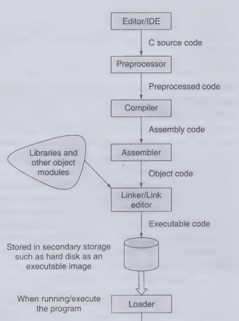

当程序执行时，程序的每条语句都会按顺序执行。如果程序向用户请求任何数据（称为“输入”，input），程序将临时暂停执行以便输入数据。或者，程序可能简单地等待某个事件的发生，例如点击鼠标。程序在窗口（有时是控制台）中显示的结果称为“输出”（output）。或者，输出可能直接写入到系统中的一个文件中。

如果一切顺利，程序将执行其预定任务。如果程序没有产生预期的结果，则需要返回并重新分析程序。可能会发生三种类型的错误：

- 编译错误（Compile errors）：由编译器给出，会阻止程序运行。
- 链接错误（Linking errors）：由链接器或在运行时给出，并导致程序结束。链接器还可以检测并报告错误，例如，如果程序部分缺失或引用了不存在的库组件。
- 运行时错误（Runtime errors）：由操作系统给出。

从程序中消除错误被称为“调试”（debugging）。程序中的任何类型的错误都称为“虫”（bug）。在调试期间，会尝试消除程序中的所有问题或 bug。通过逐步跟踪程序并记录每个变量，你可以监控程序的运行阶段。程序状态是计算过程中某一点所有值的集合。调试器（debugger）是程序当前状态的逐步快照，并检查该程序变量的值。调试器有不同的易用程度和复杂程度。更高级的调试器会显示正在执行源代码的哪几行。

图 2.2 输入、编译和执行 C 程序的典型步骤。

# C语言编程

在 unix/linux 操作系统，程序存储在一个文件中，文件名以 `'.c'` 结尾。这意味着文件的扩展名将是 `'.c'`。这将其标识为 C 程序。输入它的最简单方法是使用如 `vi`、`emacs` 或 `ed` 等文本编辑器。编辑器也用于对程序进行后续更改。使用 `vi` 编辑器创建或编辑文件 `'first.c'` 时，用户必须使用 `first.c`。

需要注意的是，`C++` 是 C 的超集，并且具有相同的语法。C 程序可以用 `C++` 编译器编译。在所有这些情况下，实际的程序开发环境都是成对出现的。

大多数 Windows-C 编译器都有内置的上下文敏感型编辑器来编写 C 程序。程序文件应具有 `'.c'` 扩展。

运行可执行文件，UNIX 和 UNIX 操作系统的命令都是：

```
./a.out
```

在 UNIX 中编译程序，只需调用 `CC` 的名称。该命令后必须跟接要编译的 C 文件名。还可以指定一些编译器选项。但这里仅处理有用且必要的选项；这些选项将在下文中介绍。

在 UNIX 中运行可执行文件，只需输入它包含的文件名，在本例中是 `a.out`。它会执行程序并在屏幕上显示结果。在此阶段可能会出现运行时错误，例如除以零，或者因为程序产生了错误的输出。如果是这样，程序员必须返回编辑源程序、重新编译并再次运行。

在 UNIX 操作系统中，要编译 C 程序（假设 `first.c` 是文件名），命令为：

```
cc first.c
```

现在，在 Borland 环境中运行程序，如果编译时获得的 mdos 提示符尚未关闭：

```
cc first.c
```

1. 屏幕上将显示第一个提示符：
   `c:\borland\bcc55\bin`

2. 输入：

在 Linux 操作系统中，C 源程序（假设 `first.c` 是文件名）可以通过命令编译：

```
c:\borland\bcc55\bin c:\cprg
```

3. 按 `<Enter>` 键。

4. 这会将目录更改到可以看到后续 mdos 提示符的地方：
   `c:\cprg>`

```
gcc first.c
```

5. 按 `<Enter>` 键运行程序，其输出将显示为：
   `c:\cprg.exe` 或 `c:\cprg.first`

要使用 Borland 编译器编译 C 程序，必须遵循以下步骤：

1. 打开 MS-DOS 提示符。
2. 在提示符处给出以下命令：
   ```
   cc -o first.c
   ```
   这会将编译后的程序放在名为 `first.out` 的文件中。
3. 按 `<Enter>` 键。这将目录更改到：
   `c:\borland\bcc55\bin`
   并出现以下提示符：
   ```
   c:\borland\bcc55\bin
   ```
4. 现在，输入：
   ```
   c:\borland\bcc55\bin c:\cprg
   ```

# C语言基础

## 2.4 一个简单的程序

学习 C 或任何编程语言的最佳方法是从开始编写它的程序开始。让我们编写第一个名为 `main.c` 的程序，如下：

```c
#include <stdio.h>

int main(void)
{
    printf("Hello World\n");
    return 0;
}
```

关于这个程序，有几点需要注意。所有 C 程序都包含一个名为 `main` 的函数。这是程序的起始点。在 C 中，注释可以描述程序。注释以 `/*` 开始，并以 `*/` 结束。编译器考虑将它们视为非执行内容。根据 `C99` 标准，上述代码可以写如下：

```c
#include <stdio.h>

int main(void)
{
    printf("Hello World\n");
    return 0;
}
```

预处理器指令（preprocessor directives）以 `#` 开头，在程序实际编译之前，`include` 会包含一个文件的内容。`stdio.h` 是一个包含输入输出函数的头。

```c
#include <stdio.h>

int main(void)
{
    printf("Hello World\n");
    return 0;
}
```

对于各种编译器，如 `IBM Venus`、`Microsoft Visual C/C++` 编译器，`main` 函数也可以声明返回 `void`。`MetaWare High C` 和 `EMX C/C++` 编译器不允许 `main` 返回值。对于某些编译器，`main` 的返回类型必须声明为 `int`。`Borland C/C++` 编译器没有显式将 `main()` 列为 `main` 的定义，但讽刺的是，示例代码中使用了这种非规范的 `main` 定义。

```c
{
```

这是一个括号。正如其名所示，括号是成对出现的 `{}`，对于每个左括号都必须有一个右括号。此外，括号可以将程序块组合在一起。这样的程序块通常被称为一个“块”（block）。一个块包含在其内部使用的变量声明，以及按顺序执行的一系列程序语句。当函数看到结尾的右括号时，它知道已经到达函数的末尾，可以寻找其他的（如果有的话）。

通过将指令、`printf()` 和 `return` 封装在左括号 `'{'` 和右括号 `'}'` 之间，形成了一个指令块。这些大括号内的此类指令块构成了 `main` 函数的主体：

```c
{
    printf("Is Sea\n");
    printf() 是一个 '库函数'
```

## 46 C语言编程

函数 `printf()` 字符串参数 `"C is Sea\n"` 中的 `\n`（读作反斜杠 n）是一个转义序列的示例。它用于打印换行字符。如果执行程序，`\n` 不会出现在输出中。`printf()` 字符串参数中的每个 `\n` 导致光标置于下一行输出的开头。可以将转义序列视为一种“替换字符”，用于在输出设备为视觉显示单元时，输出特殊字符或打印点上的某个位置（称为光标）。

C 语言中的所有转义序列如表 2.1 所示。在字符串中放置这些序列中的任何一个，都会输出指示的区域或相关字符。

```
return 0;
```


该语句表示在执行函数体内的程序指令后，`main()` 函数返回给操作系统的值为 0。尽管这个被操作系统识别为状态的值是通过 `return` 语句返回的，但操作系统并不总是使用它。

`return` 语句不是强制性的；如果省略，程序将终止。在 C89 中，返回给操作系统的值是未定义的。在 C99 中，`main()` 被声明返回一个 `int`，程序向操作系统或运行环境返回 0（零）；否则程序返回一个未指定的值。

通过这种方式，在每个 `main()` 函数定义的末尾，必须编写 `return` 指令。函数定义是指执行所需任务的函数体指令序列。同样，本文中的每个程序中 `main()` 都应该写为 `int main(void)`。

上述讨论总结在 2.3 中。

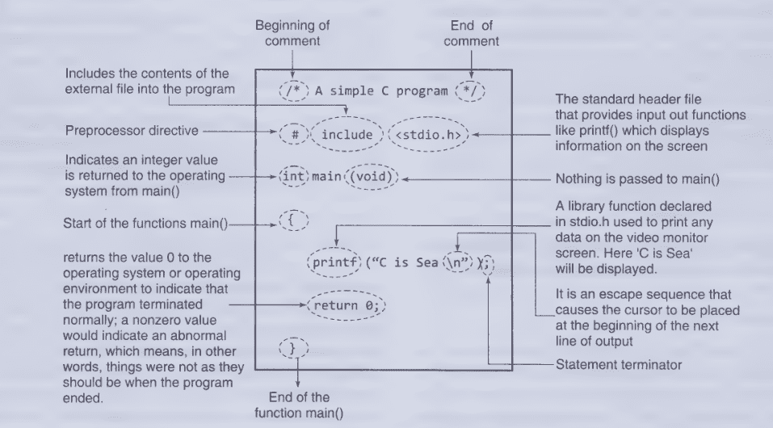

图 2.3 first.c 的插图

## 表 2.1 反斜杠代码

| 代码 | 含义 |
| :--- | :--- |
| `\a` | 终端响铃（a 代表 alert）[ANSI] 扩展 |
| `\?` | 问号 [ANSI] 扩展 |
| `\b` | 退格格 |
| `\r` | 回车 |
| `\f` | 换页 |
| `\t` | 水平制表符 |
| `\v` | 垂直制表符 |
| `\n` | ASCII 空字符 |
| `\\` | 反斜杠 |
| `\"` | 双引号 |
| `\'` | 单引号 |
| `\z` | 新行 |
| `\o` | 进制常量 |
| `\x` | 十六进制常量 |

以下列表包含标准头文件集：

| assert.h | intypes.h | signal.h | stdlib.h |
| :--- | :--- | :--- | :--- |
| complex.h | iso646.h | stdarg.h | string.h |
| ctype.h | std..h.h | tgmath.h | |
| errno.h | locale.h | stddef.h | time.h |
| fenv.h | math.h | setjmp.h | stdio.h | wtype.h |

在 C 程序中包含文件有两种方法。第一种方法是用角括号 `<>` 包围文件名，例如 `#include <filename>`。这种包含方法使用预处理器在预定义位置加载文件。该默认位置通常是一个 `INCLUDE` 环境变量，它定义了包含头文件的路径。在 Unix 系统上，标准文件位于 `/usr/include`。

第二种方法是用双引号包含文件，例如 `#include "filename"`。这种包含方法使用预处理器在当前目录中加载文件，然后在你指定的预定义位置中查找。使用此方法来包含如 `stdio.h` 等标准头文件。这是因为这些头文件很少被（如果被的话）修改，并且应该始终从编译器的标准文件目录读取。

## 2.5 复习 C 程序结构

### 头文件

头文件包含声明和定义，这些可以在源文件、编译器、处理器、库和其他头文件之间共享。在 C 语言中，通常的方法是让文件名以 `.h` 结尾。ANSI 库中的函数在一组标准头文件中声明。这组文件是一致的且没有命名空间污染，编译时，ANSI 标准库由 24 个头文件组成，可以通过一个指令包含在程序员的项目中。每个头文件包含一个或多个声明、数据类型和宏。C 标准的后续修订版本为库添加了几个新的强制性头文件：

- `<iso646.h>`
- `<wchar.h>`
- `<stdint.h>`
- `<fenv.h>`
- `<intypes.h>`
- `<stdlib.h>`
- `<complex.h>`
- `<tgmath.h>`
- `<ctype.h>`

# C 49 基础

声明（declaration）与定义（definition）之间的区别非常重要。声明宣告数据对象或函数的属性。声明数据对象函数的主要目的是类型检查。如果声明了一个变量或函数，随后引用的数据对象与声明中的类型不匹配，那么报错的目的是在编译时捕获类型错误，而不是等到程序运行时，因为那时的结果可能是致命的。

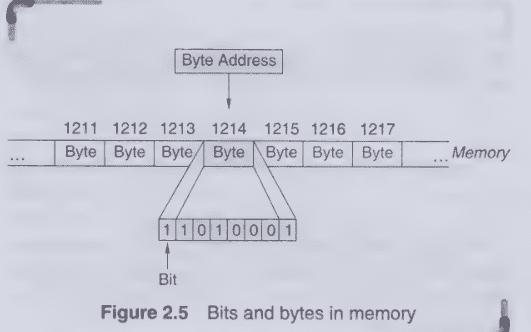

另一方面，定义实际上设置了存储空间（对于数据对象而言）或确定了要执行的语句序列（对于函数而言）。

- 声明向编译器描述数据对象的类型，但不为其分配空间。
- 定义意味着对数据对象的声明，并分配了空间来存放该对象。

# 注意事项

处理器是 16 位的。这意味着它们的字长为 16 位，即 2 字节。像基于奔腾的 PC 和 Macintosh PowerPC 这样的机器具有 32 位甚至更大的字长。当我们说奔腾 4 是 32 位机器时，意味着它同时操作 32 位的数据。

## 2.5 变量的概念

对数据进行操作。在计算机执行程序时，组成程序的指令及其操作的数据必须存储在某个地方。编程语言必须提供一种存储待处理数据的方法，否则将变得毫无用。在这种背景下，可以提到计算机提供了随机存存储器（RAM）用于存储可执行的程序代码和程序操作的数据。

变量是内存位置的标识符，在该位置可以存储数据并反复使用。变量是记住数据并给它们命名的方法，这样我们就不需要记住像 46735 这样的数字，而是通过引用变量来使用内存位置。每个变量都映射到一个唯一的内存地址。变量用于存储数据值，以便在程序中以各种组合使用。

计算机内存由寄存器和单元组成，能够以二进制 0 和 1（位）的形式存储信息。相反，它按块访问数据，通常为 8 位、16 位、32 位或 64 位。数据存储在内存的物理位置。这些位置被称为内存地址。每个位置都可以通过其地址唯一标识（见图 2.5）。

编译器生成可执行代码，将条目映射到内存位置。例如，变量定义

```c
int salary = 65000;
```

这会导致编译器分配几个字节来表示 `salary`。分配的字节范围以及整数二进制表示的方法取决于特定的 C 实现，但可以说，两个字节包含了编码为二进制数 11111010111000 的数据数据。编译器使用分配给 `salary` 的第一个字节的地址来引用它。上述赋值将值 65000 以二进制数的形式存储在分配的两个字节中（见图 2.6）。

计算机可以同时操作的位数称为计算机的字长（word length）。字是给定设计的内存的自然单位。对于 8 位微控制器（如原始的苹果电脑），一个字仅是 1 字节。IBM 计算机使用 80286

# C 语言编程

| 1211 | 1212 | 1213 | 1214 | 1215 | 1216 | 1217 |
| :--- | :--- | :--- | :--- | :--- | :--- | :--- |
| Byte | Byte | Byte | 1111101 | 1110100 | Byte | ... Memory |

| Salary (一个地址为 1214 的 2 字节整数) |


虽然程序员对数据项的精确二进制表示很少感兴趣，但内存的总体组织结构和引用数据项的方法非常重要。
所有变量都有三个重要的属性。

- 在定义变量时会确立数据类型，例如：整数、实数、字符。一旦定义，C 变量的类型就不能更改。
- 变量的名称
- 可以通过给变量赋新值来更改的值。变量的取决于其类型。例如，整数变量只能取整数值，如 2, 100, -12。

你可以在变量中拥有的字符数取决于你的编译器。符合 C 语言标准的编译器必须支持至少 31 个字符，因此你可以无问题地使用长此长度的名字。建议不要让变量名超过此长度，因为它们可能会变得繁琐，并且会截断过长的名字。
变量名是对大小敏感的，这意味着 `NUM` 和 `num` 是不同的。
在 C 中，变量必须在使用之前声明。变量可以在任何代码块的开头声明，但这些大多位于每个函数的开头。这起两个作用：首先，它为编译器提供了关于程序运行时将给变量的内存量的精确信息以及将使用的什么算术运算（例如整数或浮点）；并为编译器提供了变量和类型列表以捕获错误。

| 原始/基础类型 | 派生类型 | 用户定义类型 | 无 |
| :--- | :--- | :--- | :--- |
| - | 数组 | 结构 | void |
| char | 函数 | 枚举 | |
| int | 指针 | | |
| float | | | |


C 提供了一组标准的基础类型。这些有时被称为“原始”类型。更复杂的类型可以建立在这些类型之上。C 有五种基础类型，如下：

- 字符-关键字为 `char`
- 整数-关键字为 `int`
- 浮点型-关键字为 `float`
- 双精度-关键字为 `double`
- 无-关键字为 `void`

| 基础类型 | | | |
| :--- | :--- | :--- | :--- |
| char | int | float | void |


表 2.2(a) 列出了 16 位计算机 C 中基础类型的范围。表 2.2(b) 列出了 32 位计算机 C 中基础类型的大小和范围。

### 16 位计算机 C 中基础类型的范围

| 数据类型（位） | 范围 |
| :--- | :--- |
| char | -128 到 127 |
| int | -32768 到 32767 |
| float | -1.7549 × 10³⁸ 到 3.4028 × 10³⁸ |
| double | -2.2507 × 10³⁸ 到 1.7969 × 10³⁸ |
| void | 无 |

## 2.8 C 中的数据类型

数据的类型定义了变量可以的一组值以及可以应用于这些值的一组操作。数据类型可以大致分类如图 2.7 所示。

# C 基础

### 32 位计算机 C 中基础类型的大小和范围

| 数据类型 | 大小（位） | 范围 |
| :--- | :--- | :--- |
| char | 8 | -128 到 127 |
| int | 32 | -2147483648 到 2147483647 |
| float | 32 | -1.7549 × 10³⁸ 到 3.4028 × 10³⁸ |
| double | 64 | -2.2507 × 10³⁸ 到 1.7969 × 10³⁸ |
| void | 8 | 无 |

修饰符放在 `int` 声明前面时，告诉 C 编译器声明的特定变量用于存储较小的整数值。使用短变量的主要动机是节省内存，这在程序需要大量内存而可用内存有限的情况下是一个问题。在任何 C 编译器中，`short`、`int` 和 `long` 的大小受以下规则限制：

- `short int` 的大小为二。
- `int` 的大小大于或等于 `short int`。
- `long int` 的大小大于或等于 `int`。
- `long int` 的最小大小为四。

C 标准没有显示 `float`、`double` 类型提供多少精度，因为计算机以不同的方式存储浮点数。根据 IEEE，`float` 和 `double` 的精度分别为 6 和 15。

`void` 类型没有值和一个操作：赋值。`void` 类型分配空值。它用于不产生值的返回类型。`void` 类型从不引用对象，也不包含在任何对象的引用中。根据 ISO/IEC，“void 类型分配空值；它是一个无法完成的不完全类型。”

此外，C 有四种类型修饰符或三种类型限定符。

- 这些修饰符中的每一个都可以应用于基础类型 `int`。
- `signed` 和 `unsigned` 也可以应用于基础类型 `char`。
- 此外，可以应用 `long`。
- 当声明中省略基础 `int` 时，假设为 `int`。
- `void` 类型没有这些修饰符。

应该注意以下点：

在大多数运行的基础编译器中，`short int` 和 `int` 的大小相同，这在某些编译器中是 true。在 C 中，`long` 占用两个字节。然而，在像 GCC 这样的 32 位机器编译器中，`int` 占用 4 个字节而 `short int` 占用 2 个字节。对于 Unix 编译器，`short` 占用 2 个字节，而 `long int` 占用 4 个字节。

2.3 列出了不同机器中 `short int`、`int` 和 `long` 数据类型的大小。

| 16 位机器 | 32 位机器 | 64 位机器 |
| :--- | :--- | :--- |
| short int | 2 | 2 | 2 |
| int | 2 | 4 | 4 |
| long int | 4 | 4 | 8 |

C99 提供了两种额外的整数类型 `long int` 和 `unsigned long int`。对于 `long int`，C99 标准要求至少支持 64 位。表 2.4 总结了 `long int` 不同变体的大小和范围。

数据类型的修饰符和限定符可以分为三类：

* 大小修饰符——`short` 和 `long`
* 符号限定符——`signed` 和 `unsigned`
* 类型限定符——`const`、`volatile` 和 `restrict`。

## 52 C 语言中的编程

### 表 2.4 long long 类型的大小和范围

| 类型 | 大小（字节） | 范围 |
| :--- | :--- | :--- |
| long long int | 8 | -92233703685475808 to +92233703685475807 |
| unsigned int or unsigned long | 4 | 0 to 4294967295 |
| unsigned long int or unsigned long | 8 | 0 to +184467440730703955615 |

程序中的某些变量可能与系统的某些硬件组件直接链接。硬件可以在程序无感知的情况下直接修改变量的值。例如，I/O 设备可能需要直接写入程序空间或数据空间。同时，程序本身可能永远不会直接访问该内存区域。在这种情况下，我们不希望优化这个数据区域，尽管它需要被程序使用，并且为了程序在更大的上下文中正确运行而存在。它告诉编译器该对象可能会发生突然变化，这种变化无法通过对程序本身的研究来预测，并强制对此类对象的每个引用都成为通用引用。

C89 里程碑增加了两个类型限定符：`const` 和 `volatile`，而 C99 增加了第三个：`restrict`。它们指定了哪些变量永远不会改变（`const`），哪些变量可能会发生意外变化（`volatile`）。

`restrict` 类型限定符允许编写程序，以便翻译器能够生成快得多的执行文件。对于对这不关心的人，可以忽略语言的这一特性。

这两个关键字都要求为标识符声明关联的数据类型，例如

```c
const float pi = 3.14159;
```

指定变量 `pi` 永远不会被程序更改。程序内任何尝试修改 `pi` 值的代码将导致编译错误。`const` 变量的值必须在声明时设置。将变量指定为 `const` 允许编译器由于数据类型已知而对程序进行更好的优化。

基本数据类型和修饰符的大小和范围如表 2.5所示。

- void
- void*
- signed char
- unsigned char
- unsigned short
- unsigned long
- long double

C89 中添加的几种新类型列如下：

```c
#include <stdio.h>

int main(void) {

  const int value = 42;

  /* const，初始化的整数变量 */

  value = 100;

  /* 错误！将导致编译器错误 */

  return 0;

}
```


# C语言基础

## C89 新增类型定义

C89 为现有类型添加了新的定义：

- `signed short` 代表 `short`
- `signed int` 代表 `int`
- `signed long` 代表 `long`

## C99 新增类型

C99 增加了新类型：

- `_Bool`
- `long long`
- `unsigned long long`
- `float _Imaginary`
- `float _Complex`
- `double _Imaginary`
- `double _Complex`
- `long double _Imaginary`
- `long double _Complex`

> **注意事项**
> `const` 不会将变量变成常量。带有 `const` 限定符的变量意味着该变量不能赋值。这使得该值通过该变量是只读的；它并不能防止通过其他方式（例如通过指针）修改该值。
>
> `volatile` 关键字表示变量可能会因为程序之外的事件发生意外变化。这通常用于当某些变量...

## 53 C 基础

### 表 2.5 16 位计算机中 C 基本数据类型和修饰符的允许组合

| 数据类型 | 大小（位） | 范围 | 默认类型 |
|---|---|---|---|
| `char` | 8 | -128 to 127 | `signed char` |
| `unsigned char` | 8 | 0 to 255 | 无 |
| `signed char` | 8 | -128 to 127 | `char` |
| `int` | 16 | -32768 to 32767 | `signed int` |
| `unsigned int` | 16 | 0 to 65535 | `unsigned` |
| `signed int` | 16 | -32768 to 32767 | `int` |
| `short int` | 16 | -32768 to 32767 | `short`, `signed short`, `signed int` |
| `unsigned short int` | 16 | 0 to 65535 | `unsigned short` |
| `signed short int` | 16 | -32768 to 32767 | `short`, `signed short`, `short int` |
| `long int` | 32 | -2147483648 to 2147483647 | `long int`, `signed int`, `long int` |
| `unsigned long int` | 32 | 0 to 4294967295 | `unsigned long` |
| `signed long int` | 32 | -2147483648 to 2147483647 | `long int`, `signed int`, `long long` |
| `float` | 32 | 3.4E-38 to 3.4E+38 | 无 |
| `double` | 64 | -1.7E-308 to 1.7E+308 | 无 |
| `long double` | 80 | -3.4E-492 to 3.4E+492 | 无 |

C99 还允许整数类型如 `<inttypes.h>`。

`const` 不会将变量转变为常量。带有 `const` 限定符的变量意味着该变量不能用于赋值。这使得该值通过该变量是只读的；它并不能防止通过其他方式（例如通过指针）修改该值。

`volatile` 关键字表示变量可能会因为程序之外的事件发生意外变化。这通常用于当某些变量...

### 符号整数

C89 增加了 `short`、`int`、`long` 等几种整数类型。符号整数的范围取决于机器位数，符号位 `char`。在符号表示法中，符号位 `1` 表示负，`0` 表示正。符号整数表示 `charcharcharchar` `符号``。在字节中存储的值是 `char`。所有这些在标准 C 中都是可以接受的。

### 无符号整数

对于每个符号整数类型，都有一个对应的无符号类型，它使用相同的存储空间，但编码方式不同。所有无符号类型无论符号类型使用的是补码、反码还是符号位，都使用直读二进制。当使用补码时，模式 11...11（n 位）在符号表示法中表示 -1，在无符号表示法中表示 2ⁿ⁻¹-1。整数 0 到 2ⁿ⁻¹ 在符号和无符号表示法中是相同的。标准 C 实现中无符号类型的细节记录在头文件 `limits.h` 中。

在 C89 中，关于整数表示的信息提供在头文件 `limits.h` 中。在 C99 中，`stdint.h` 和 `inttypes.h` 包含了额外信息。符合 ANSI 标准的编译器系统文件 `limits.h` 定义了无符号 `int` 变量的上限和下限，释放了符号位，使得整个...

### 表 2.6 limits.h 中的常量

| 名称 | 含义 | 值 |
|---|---|---|
| `CHAR_BIT` | `char` 的位数 | 8 |
| `CHAR_MAX` | `char` 的最大值 | `UCHAR_MAX` 或 `SCHAR_MAX` |
| `CHAR_MIN` | `char` 的最小值 | 0 或 `SCHAR_MIN` |
| `INT_MAX` | `int` 的最大值 | 32767 |
| `INT_MIN` | `int` 的最小值 | -32767 |
| `LONG_MAX` | `long` 的最大值 | 2147483647 |
| `LONG_MIN` | `long` 的最小值 | -2147483647 |

```c
#include <limits.h>
```

并从而使程序能够访问其中定义的常量。

### 整数存储详解

（包括符号位）用于存储非负整数。需要注意的是，符号位是内存字中最左侧的位。它决定了内容的正负：当它设置为 1 时，二进制中存储的值为负数。大多数计算机使用补码算术，其中符号位是“加权”的，它关联的位值为负值。在 8 位机器上，其范围是 -128 到 +127。一个像 `0000000111111101` 这样的 16 位符号数的值为 $-2^{15} + 2^7 + 2^6 + ... + 2^0 = -32705$。对于无符号整数，这一串位的值为 $2^{15} + 2^7 + 2^6 + ... + 2^0 = 32705$。在 PC 上，`int` 变量的无符号声明范围为 0 到 65535，在处理已知既大又非负的数量时非常有用，例如内存地址、体育场的座位容量。

### 注意事项

必须记住，计算机内存中存储的浮点数充其量只是实数的近似。任何计算机字宽的有限会导致数值的截断或舍入；无论存储位置是 2 位、4 位还是 8 位宽，都无法通过计算数字精确表示数值；舍入或截断误差不可避免地引入。因此，对于小数点后的任何长串数字，在某种尺寸的计算机中，可能并不看起来那么精确。

`short int` 声明在已知整数变量较小的情况下可能很有用。该声明确保了 `short int` 的范围不会超过 `int` 的范围，但在某些计算机上，其范围可能更大（例如 -128 到 127）；可以使用 `int` 字节来节省内存。在计算的早期，曾有一段时间内存是一项昂贵的资源，程序员试图通过此类声明和策略尽可能地优化核心内存的使用。

VAX 计算机使用两个字节来存储 `short int`，这是它存储 `int` 时用量的一半；但对于内存充足的现代 PC，大多数编译器对 `int` 和 `short int` 没有任何区别。

`double` 因为内存字只能精确地存储固定数量的数字，涉及浮点数的计算几乎不可避免地会舍入。同时，科学计算通常比某些精度算术提供的精度（即使用四字节 `float` 变量）更高的精度。在大规模科学工程计算中，`double` 成为程序变量的自然选择。`double` 允许存储双精度浮点数（在 80 位字节中），其准确性可达 15 位，且定义范围远大于 `float`。

### 布尔类型 `bool`

布尔变量在语言中定义为足够大，以存储 0 和 1 值。这是在需要指示布尔条件的程序中所使用的内存量。例如，这种类型的变量可能用于指示是否已从文件中读取所有内容。

按照惯例，它用于表示假值，1 表示真值。当给 `bool` 变量赋值时，变量内部存储的值 0 为 0，而是非零值被存储为 1。

为了在你的程序中更方便地操作 `bool` 变量，标准头文件 `stdbool.h` 定义了值 `true` 和 `false`。

### `unsigned short`

对于 `unsigned short` 变量，其值范围不超过 `unsigned int` 的范围；可能更短。

### `unsigned long`

`unsigned long` 声明将 `int` 的范围转换为 4 字节非负整数的范围，值范围 [0 到 4294967295]。

在许多计算机上，`int` 变量是 4 字节整数，值范围在区间 [-2147483648 到 2147483647]。

### `float`

整数数据类型能够存储带有小数部分的数字。根据所需的精度，C 为计算提供了两种类型的“浮点”数字，即带有十进制（二进制）小数点的数字。`float` 存储在四个字节中，精确度为七位有效数字。

## 2.9 程序语句

语句（Statement）是一种在程序执行时执行某种操作的句法结构。所有的 C 程序语句都以分号 (;) 结束。C 中的程序语句可以如图 2.9 所示分类。

### C 语言编程

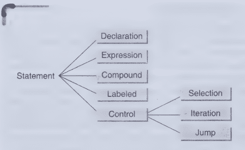

**图 2.9** C 中提供的不同类型的程序语句

**声明（Declaration）**是一种程序语句，用于向翻译器传递程序执行期间所需数据对象的名称和类型的信息。

**表达式语句（Expression statement）**是最简单的语句类型，一个表达式后跟一个分号。*表达式（Expression）* 是操作符和操作数的序列，用于执行某个值的计算。

```c
x = 4
```

是一个表达式（可以是更大表达式的一部分），但

```c
x = 4;
```

是一个语句。

**复合语句（Compound statement）**是语句的序列，在构建更大的语句时，它们可以被视为单一语句。

**标记语句（Labeled statements）**可以用于标记控制流可能通过 `switch` 转移到的任何语句。

**控制语句（Control statement）**是一种其结果会导致选择遵循哪二条或多条路径的语句。

按以下分类的控制语句：

- 选择语句（Selection statements）
- 循环语句（Iteration statements）
- 跳出语句（Jump statements）

## 2.11 整数是如何存储的？

存储无符号整数是一个直接的过程。将数字转换为二进制格式并存储。

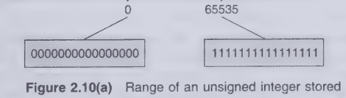

**图 2.10(a)** 16 位字中无符号整数的范围

### 符号位码

在这种方法中，一个位（最左侧位）代表符号位，0 表示正，1 表示负。字的剩余部分表示数字的绝对值。因此，最大正值是无符号值的一半。存在两个零值，正零和负零。这种方法不再用于今天的计算机存储数值。

它可以用圆圈表示，如图 2.10(b) 所示。0 位于圆圈顶部，值沿圆圈顺时针放置，直到相邻零的最大值。

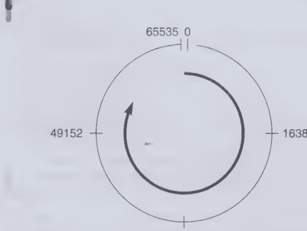

**图 2.10(b)** 无符号整数的循环值

### 58 C语言编程

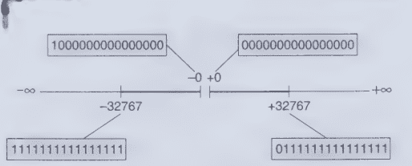

**图 2.11** 符号值位形式存储在 16 位字中的有符号整数范围

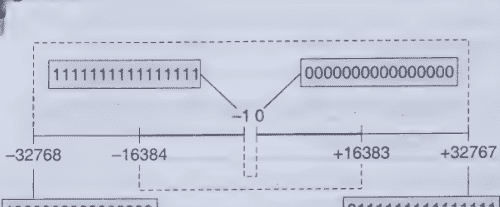

**图 2.13** 补码形式存储在 16 位字中的有符号整数范围

### 反码

在这种方法中，负数以其反码格式存储。与符号值位形式一样，反码形式有两个零值（正零和负零）。图 2.12 显示了反码值的配置。

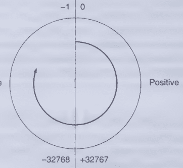

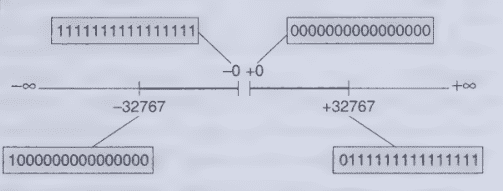

**图 2.12** 反码形式存储在 16 位字中的有符号整数范围

**图 2.14** 补码形式存储在 16 位字中的有符号整数范围的循环视图

与符号值位方法一样，这种方法没有被用于通用计算机。

### 补码形式

当符号改变时，所有位都会发生变化。因此，在取反过程中，整个数字除了最高位外发生了变化。然而，我们只有一个零。

稍微思考一下，你会发现 0 和 −1 互为补码。同样，+32767 和 −32768 也互为补码。补码形式的整数如图 2.14 所示，其中 32767 位于圆底部。当我们顺时针移动 10 个位置时，进入数值范围的负部分。该位置的值为 −32759。因此，补码的几何描述可能有助于理解如何使用这种负数表示法来确定溢出。从圆上的任何点开始，你可以通过顺时针移动 k 个位置，将该数字（起始点数字）加上 k（或减去负 k）。同样，你可以通过逆时针移动 k 个位置来减去 k（或加上负 k）。如果算术运算导致越过了端点连接的点，将导致错误答案。

## 2.11.2 浮点数和双精度数如何存储？

浮点数（`float`）和双精度（`double`）以尾数和指数格式存储，其中指数不是表示 10 的幂，而是表示 2 的幂，因为基数是 2。用于表示浮点数的字节取决于变量的精度，`float` 用于声明单精度变量，而 `double` 类型表示双精度值。这些变量中尾数和指数的表示法符合 IEEE 浮点标准。大多数 C 编译器都遵循这种表示法。IEEE 格式以二进制格式的归一形式表示浮点数。归一化涉及调整指数，使得二进制点（小数点的类比物）位于最高非零数字的右侧。在二进制表示中，这意味着尾数的最高位始终是 1。这种归一化表示的属性由 IEEE 格式在存储尾数时强制执行。例如，生成浮点数归一形式的实例，二进制指数 5.375 可以如下例所示。

这确保了存储的指数始终为正数。`float` 的偏置（bias）值为 127，`double` 为 1023。因此，1.01011 × 2⁸ 表示为：

| 01000001 0101110000000000000000 |
| :--- | :--- |
| 符号位 | 指数加上偏置 127 后得到的归一化尾数 |
| | 2 |

考虑另一个例子。假设 -0.25 必须用 IEEE 格式表示。转换为二进制，它将变成 2⁻² 中的 -0.01。这种用 IEEE 格式表示的归一形式如下：

| 1 01111110 0 000 0000 0000 0000 0000 |
| :--- | :--- |
| 符号位 | 指数加上偏置 127 后得到的归一化尾数 |
| | -2 |

### 示例

| 整数转二进制 | 小数部分转二进制 |
| :--- | :--- |
| 2 | .375 × 2⁻⁷ = 0.011001 |
| 2 | .750 × 2⁻⁶ = 1.100 |
| 1 | .500 × 2⁻⁵ = 1 |

| 01 | 整数部分 |
| -余数 | |

反序写入数字，整数部分的二进制是 101。按照获取时的顺序写入数字，小数部分的二进制是 011。

因此，5.375 的二进制是 101.1。该数字的归一形式通过调整指数，直到小数点位于最高数字 1 的右侧得到。在这种情况下，结果是 1.01011 × 2²。

（注：由于原始文本中存在大量重复内容，译文已根据要求提取核心逻辑并翻译。）

## 2.12.2 关键字

关键字是 C 语言的词汇。由于它们对 C 语言是特殊的，因此不能用它们作变量名。

C 语言中定义了 32 个关键字。这些关键字有预定义的用途，不能在 C 程序中用于任何其他目的。它们被编译器用于编译程序。它们始终以小写字母表示。表 2.7 给出了这些关键字的列表。

常量是程序员编写的显式值。因此，它是编译器在编译时已知的数值。编译器可能会根据常量的类型和其上下文以多种多种方式处理此值。例如，常量的二进制等效值可以直接插入到输出代码流中。该值可能存储在内存的特殊区域。编译器可能会决定将常数的值用于其即时目的，例如确定为数据数组分配多少存储空间。

### 表 2.7 C语言中的关键字

| `auto` | `double` | `int` | `typedef` |
| --- | --- | --- | --- |
| `break` | `else` | `long` | `while` |
| `case` | `enum` | `register` | |
| `char` | `extern` | `return` | `union` |
| `const` | `float` | `short` | `unsigned` |
| `continue` | `for` | `signed` | `void` |
| `default` | `goto` | `volatile` | |
| `do` | | `static` | |

C89 增加了几个关键字：`const`、`signed`、`void` 和 `volatile`。在 C99 中增加了关键字 `inline`、`restrict`、`_Bool`、`_Complex` 和 `_Imaginary`。

C 允许整数、浮点数常量、字符常量和字符串常量。表 2.9 描绘了 C 允许的常量类型。整数常量由一组数字组成。它通常被解释为十进制值，除非以 `0x`、`0` 开头。`025` 和 `02345` 全都是十进制整数（注：原文此处可能有误，八进制以 0 开头，十六进制以 0x 开头）。

字面量（例如 1984）始终被假设为 `int` 类型，除非它有 'L' 或 'U' 后缀，在这种情况下它被处理为 `long`。此外，字面量可以使用无符号后缀 `u` 或 `U` 指定。例如


# C 语言编程

## 关键字与常量

### C 语言关键字

| auto | enum | unsigned |
| --- | --- | --- |
| break | return | void |
| case | float | volatile |
| char | signed | while |
| const | sizeof | _Bool |
| continue | _Complex | |
| default | struct | _Imaginary |
| do | switch | |
| double | long | typedef |
| register | union | |

> 十进制 `0134` / 等于八进制 `0xC` / 等于十六进制

在 ANSI C 中，如果十进制常量的数值超过了有符号 `long`，则它被视为无符号 `long`。八进制或十六进制 `int` 应该是无符号的；如果超过了 `int` 的限制，则被视为无符号；如果超过此限制，则被处理为无符号 `long`。如果整数常量后面跟着字母 `u` 或 `U`，则被视为无符号，例如 `9999u`；如果它的值后面跟着 `l` 或 `L` 以及 `u` 或 `U`，则被视为 `long`，例如 `0xFFFFFFUL`。

注意，除了上述关键字外，编译器还提供它们自己的关键字。包括扩展关键字，如 `near`、`far`、`asm` 等。ANSI 标准建议每个编译器关键字之前应有两个下划线（如 `__asm` 所示），但并非每个厂商都遵循这一规则。

### 浮点数常量

浮点数常量由一个整数、一个小数点、一个小数部分和一个包含 `e` 或 `E` 并后跟一个整数的指数字段组成。整数部分都是数字序列。这种格式的某些部分可能长到结果数字与简单整数区分的程度。例如，小数点或小数部分可以缺失，但两者不能都缺失。字面量（例如 `0.06`）始终被假设为 `double` 类型，除非它有 `f` 或 `F` 后缀，在这种情况下它被处理为 `float`；如果有 `l` 或 `L` 后缀，在这种情况下它被处理为 `long double`。后者比 `double` 使用更多字节以获得更高的精度（例如在程序员的 PC 上为 10 字节）。

```c
char terminal_bell = '\007';
```
- `7` = 蜂鸣的 ASCII 代码

```c
char backspace = '\010';
```
- `10` = 退格键的八进制代码

对于 ANSI 编译器，可以使用十六进制数字代替八进制定义常量。十六进制数字前面有 `x`，与八进制中的 `0` 不同。因此，在 ANSI 中

```c
char backspace = '\xA';
```

是以下定义的替代声明

```c
char backspace = '\010';
```

```text
0.06F 0.06F 3.141926541 3.141926541
```

除了目前到十进制表示法，实数也可以用科学计数法表示。例如，`0.002164` 可以用科学计数法写为任何数字都可以写，但如果结果值超过了 `char` 的限制，则值是未定义的

```text
2.164E-3 或 2.164E-3
```

在 ASCII 机器上，`'\b'` 和 `'\010'` 是等价表示。后者（`'\b'` 的 ASCII 等效值）在 EBCDIC 机器（通常是 IBM 主机）上将不起作用，因为字符排序不同。为了可移植性，最好使用 `'\b'` 表示退格，而不是其八进制代码。程序将像在 ANSI 上一样完美运行。字母 `E`（或 `e`）代表指数。该表示法解释如下。

```text
2.164E-3 = 10^-3
```

注意字符常量 `'a'` 与字符串 `"a"` 不同。字符串是字符数组，是一堆存储在连续内存中的字符，其包含空字符的位置；字符串 `"a"` 包含两个字符，紧接着是 `'\0'`。重要的是要意识到，空字符不等同于十进制数字 `0`，即 ASCII 值 `0`。以下是 `long` 的示例：

```c
12345LL
```

以下是无符号 `long` 的示例：

```c
12345ULL
```

字符通常由包含在引号中的单个字符组成。例如，`'b'` 和 `'$'` 都是字符。每个字符取其字符集的数值。从今以后将作为 ASCII 代码。

## 赋值语句与初始化

作为初始化的赋值语句的通用形式。初始化值被称为初始化器。赋值语句的通用形式为：

```c
variable_name = expression;
```

```c
data_type variable_name = constant;
```

下面给出了一些示例。

```c
i = 6;
i = i + 1;
```

```c
int i = 100; /* 100是一个初始化器 */
```

赋值运算符将位置 `i` 的内容替换为其右侧表达式的求值。赋值同时也作为一个表达式，返回新赋值的值。

```c
int x;
i = i + 5;
y = (x - 2 * x);
```

* 由于 `i` 在声明期间已经被赋予了一个值，`x` 被求值后持有值 `105` */

## 检查进度

### 练习 a

```c
#include <stdio.h>

int main() {
    int a = 010;
    printf("\n%d\n", a);
    return 0;
}
```
**输出**：`a = 8`

### 练习 b

```c
#include <stdio.h>
int main() {
    int a = 01;
    printf("\n%o\n", a);
    return 0;
}
```
**输出**：`a = 10`

**解释**：在 (a) 中，整数 `010` 被视为八进制，因为它前面有一个零 (`0`)。变量 `a` 使用 `%d` 格式说明符打印。该八进制值的十进制值为 `8`，它会被打印出来。而在 (b) 中，相同的值使用 `%o` 格式说明符打印，因此它显示在屏幕上。

### 练习 c

```c
#include <stdio.h>

int main() {
    int a = 010;
    printf("\n%x\n", a);
    return 0;
}
```
**输出**：`a = 10`

**解释**：在 (c) 中，另一个值 `10` 使用 `%x` 说明符打印。即 `10` 的十六进制形式将在此打印出来。

## 2.125 初始化

当声明一个变量时，编译器不会为变量分配任何值，除非指示这样做。这种声明被称为尝试性声明。例如：

```c
int i; /* 此声明是尝试性的 */
int x;
x = i + 5;
```

/* 变量 `i` 没有赋予任何已知值，`x` 的值是未定义的。这是一个错误 */

为了防止陷阱，请始终在变量声明期间为变量赋值。

## C 语言基础 65

### 练习 d

```c
#include <stdio.h>

int main() {
    int a = 53;
    printf("\n a=%o\n", a);
    return 0;
}
```
**输出**：`a = 65`
十进制值 `"53"` 存储在 `a` 中

**解释**：在 (d) 中，整数 `53` 存储在变量 `a` 中，但使用 `%o` 进行打印。`53` 的八进制等值 `65` 将被打印。

### 表 2.10 不同运算符

| 运算符类型 | 带有含义的运算符符号 |
|---|---|
| 算术 | 一元 `+` (一元)<br>`-` (一元)<br>`++` 递增<br>`--` 递减 |
| 二元 | `+` 加法<br>`-` 减法<br>`*` 乘法<br>`/` 除法<br>`%` 取模 | 稍后讨论 |
| 赋值 | 简单赋值 `=` |
| | 复合赋值 `+=`, `-=`, `*=`, `%=`, `^=`, `&=`, `\|=` |
| | 表达式赋值 `A=5+b+(c-2)-4` |
| 关系 | `>=`, `<=`, `==` |
| 逻辑 | `==` (等于)<br>`!=` (不等于)<br>`&&` (逻辑与)<br>`\|\|` (逻辑或)<br>`!` (逻辑非) |
| 位运算 | `&` (位与)<br>`\|` (位或)<br>`^` (位异或)<br>`>>` (右移)<br>`<<` (左移) |
| 其他 | `,` (逗号)<br>`.` (成员运算符)<br>`->` (成员运算符) |

### 练习 e

```c
#include <stdio.h>

int main() {
    int a = 53;
    printf("\n a=%x\n", a);
    return 0;
}
```
**输出**：`a = 35`

**解释**：在 (e) 中，整数 `53` 存储在变量 `a` 中，但使用 `%x` 进行打印。`53` 的十六进制等值 `35` 将被打印。

## 2.13 运算符与表达式

运算符是指定要执行的数学、逻辑或关系操作的符号。本节介绍了用于与变量组合表达式的内置运算符。表达式是任何产生值的计算过程。图 2.16 给出了 C 语言中运算符的分类。表 2.10 给出了不同类型的运算符。

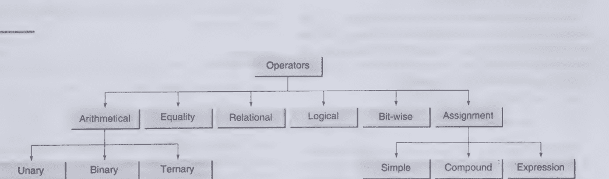

## 66 C 编程

在讨论表达式时，经常使用“求值”一词。例如，可以说一个表达式求值为某个值。通常，最终值是求值表达式的唯一结果。然而，在某些情况下，求值可能会产生副作用。

```c
int x;
i = i + 5;
y = (x - 2 * x);
```

* 由于 `i` 在声明期间已经被赋予了一个值，`x` 被求值后持有值 `105` */

## 2.13 算术运算符

算术运算符有三种类型：二元、一元和三元。算术运算符在表 2.11 中总结：

| 运算符 | 名称 | 示例 |
|---|---|---|
| `+` | 加法 | `12 + 4` 等 `16` |
| `-` | 减法 | `9 - 4` 等 `5` |
| `*` | 乘法 | `9 * 3` 等 `27` |
| `/` | 除法 | `9 / 2` 等 `4` |
| `%` | 取模 | `9 % 2` 等 `1` |

## 赋值运算符

赋值运算符用于将右侧表达式的值赋给左侧变量。常见的赋值运算符包括：

```c
a = 10;
a += 5; // 等价于 a = a + 5
```

## 关系运算符

关系运算符比较两个值之间的关系，并返回真（`1`）或假（`0`）。

```c
a > b  // 大于
a <= b // 小于等于
```

## 逻辑运算符

逻辑运算符用于逻辑判断。

```c
a && b // 逻辑与
a || b // 逻辑或
!a     // 逻辑非
```

## 位运算符

位运算符对整数的二进制位进行操作。

```c
a & b  // 位与
a | b  // 位或
a ^ b  // 位异或
a << 1 // 左移
a >> 1 // 右移
```

## 68 在 `<stdio.h>` 中编程

```c
#include <stdio.h>
int main() {
    int a, b, c; /* a, b 和 c 是未定义的。 */
    c = a + b;
    printf("the value of a is: %d\n", a);
    printf("the value of b is: %d\n", b);
    printf("the sum, c is: %d\n", c);
    return 0;
}
```

**输出**：

```text
the value of a is: 2146744409
the value of b is: 2146744417
the sum, c is: -1478478
```

现在，看看这个程序的输出。可能预测 `a`、`b` 和 `c` 的值吗？除非给变量赋值，否则永远不要假设变量具有有意义的值。

### 一元运算符

一元运算符 `-` 会取反其操作数的值（显然是一个带符号的数）。数值常量被假设为正数，除非它前面有一个一元运算符。也就是说，如果没有一元 `+`，则它是隐式的。记住 `-` 不会改变 `x` 在其所在内存位置的值。除此之外，C 语言中还有另一组可用的一元运算符，见下文描述。

```c
++i; /* 增加 i 的内容，相当于 i = i + 1; */
/* i 现在是 43 */
--i; /* 减少 i 的内容，相当于 i = i - 1; */
/* i 现在是 42 */
```

### 使用 `++` 和 `--` 运算符的基本规则

- 操作数必须是一个变量，但不能是常量或表达式。
- 运算符 `++` 和 `--` 可以位于操作数之前，也可以在之后。


单元增、减运算符：`++` 和 `--` 将变量的值加1 或 减1。这两个运算符都有“前置”（pre）和“后置”（post）变体，如下文所示，它们略有不同。

| 运算符 | 说明 |
|---|---|
| `var++` | 增'后置'变体 |
| `++var` | 增'前置'变体 |
| `--var` | 减'前置'变体 |

以下示例说明了对未放在表达式中的变量进行增、减操作的使用。

## 示例

```c
1. #include <stdio.h>
int main()
{
    int a=5,b=3;
    printf("\n %d\n", ++(a+b));
    return 0;
}
```

输出：

编译器错误 - Lvalue required

```c
2. #include <stdio.h>
int main()
{
    printf("\n %d\n", ++(a+b));
    return 0;
}
```

输出：

编译器错误 - Lvalue required

需要注意的是，`++` 的执行速度比 `i = i + 1` 快，因为表达式只需要单个指令（如 `INC`）来执行增加操作，而 `i = i + 1` 需要更多指令来执行此操作。

`++` 和 `--` 运算符的前置和后置变体：前置和后置 (`++` 和 `--`) 运算符的区别在于当它们嵌入表达式时使用的操作数值。

如果是“前置”运算符，操作数的值在取用于计算之前会增加（或减少）。改变后的值将用于其所在表达式的计算。

这里有几个示例来演示在表达式中使用后置和前置操作进行增、减操作。

## 示例

```c
int i1 = 42;
i++; /* 增加 i 的内容，相当于 i = i + 1; */
/* i 现在是 43 */
i--; /* 减少 i 的内容，相当于 i = i - 1; */
/* i 现在是 42 */
```

## C 基础

### 后增意味着

### 后置操作

步骤 1：将未增加的 `a` 赋值给 `b`；

/* b 变为 5 */

`(a) x = a++;`

步骤 2：增加 `a`； /* a 变为 6 */

结果：a 是 6，b 是 5

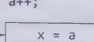

第一个动作：将 `a` 的值存储在变量 `x` 的内存位置。

第二个动作：将 `b` 的值加1，并将结果存储在变量 `a` 的内存位置。

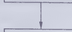

操作数放在操作数之前或之后直接影响计算中所使用的操作数值。当操作数放在操作数之前时，操作数的值在使用之前会被改变。当操作数放在操作数之后时，操作数的值在使用后会被改变。注意上面的示例，在每种情况下变量都被增加了。

`(b) y = b--;`

第一个动作：将 `b` 的值存储在变量 `y` 的内存位置。

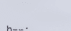

第二个动作：将 `b` 的值减1，并将结果放在变量 `b` 的内存位置。

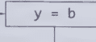

假设 `int n` 的值为 5。考虑 `n` 是 5。操作数放在操作数之前或之后直接影响计算中所使用的操作数值。当操作数位于操作数之前时，操作数的值在使用之前会被改变。当操作数位于操作数之后时，操作数的值在使用后会被改变。注意上面的示例，在每种情况下变量都被增加了。

是前置操作

`(a) x = ++a;`

第一个动作：将未增加的 `a` 的值存储在变量 `x` 的内存位置。


第二个动作：将 `a` 的值加1，并将结果存储在变量 `a` 的内存位置。


操作数放在操作数之前或之后直接影响计算中所使用的操作数值。当操作数位于操作数之前时，操作数的值在使用之前会被改变。当操作数位于操作数之后时，操作数的值在使用后会被改变。注意上面的示例，在每种情况下变量都被增加了。

`(b) y = b--;`

第一个动作：将 `b` 的值存储在变量 `y` 的内存位置。

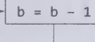

第二个动作：将 `b` 的值减1，并将结果放在变量 `b` 的内存位置。

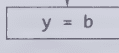

假设 `int n` 的值为 5。考虑 `n` 是 5。操作数放在操作数之前或之后直接影响计算中所使用的操作数值。当操作数位于操作数之前时，操作数的值在使用之前会被改变。当操作数位于操作数之后时，操作数的值在使用后会被改变。注意上面的示例，在每种情况下变量都被增加了。

是前置操作

`(a) x = ++a;`

第一个动作：将未增加的 `a` 的值存储在变量 `x` 的内存位置。


第二个动作：将 `a` 的值加1，并将结果存储在变量 `a` 的内存位置。


输出将是值不确定的任何内容；这意味着无法对任何位置的值做出任何假设。在许多系统中，我们发现初始值为 0，但你不能依赖于此。

用数值表示。例如（假设使用 ASCII 编码），

简写（复合）赋值表达式在计算机程序中，经常需要进行赋值

```c
n = n + 5;
```

C 语言允许此类语句有更低级的形式，所示：

```c
n = 5;
```

其他算术操作的赋值表达式也可以像这样简写：

- `n -= 5;` // 等同于 `n = n - 5;`
- `n *= 5;` // 等同于 `n = n * 5;`
- `n /= 5;` // 等同于 `n = n / 5;`
- `n %= 5;` // 等同于 `n = n % 5;`

> `'A' < 'F'` /* 产生 1（类似于 65 < 70） */

关系运算符不应用于比较字符串，因为这将导致比较字符串地址而不是字符串内容。

```c
"HELLO" < "BYE"
```

会导致 "HELLO" 的情况通过 "BYE" 的地址进行比较。这些地址由编译器确定（以依赖机器的方式），结果可能是 0 或 1，因此是未定义的。

用于字符串字典序比较的 C 库函数（例如，`strcmp`）。这些将在书后部分介绍。

`++`、`-=`、`*`、`/` 以及运算符的优先级和结合性与赋值运算符相同。

## 2.1.2 C 中的关系运算符

C 提供了六个关系运算符来比较数值。它们总结在表 2.12 中。关系运算符的值为 1（表示真结果）或 0（表示假结果）。

## 2.1.3 C 中的逻辑运算符

C 提供了三个逻辑运算符来形成逻辑表达式。它们总结在表 2.13 中。与关系运算符一样，逻辑运算符的值为 1 或 0。

逻辑取反是一个一元运算符，取反其单个操作数的值。如果为非零，它产生 0；如果为 0，它产生 1。逻辑与（AND）如果一个或两个操作数的值为 0，则产生 0；否则，它产生 1。逻辑或（OR）如果两个操作数的值为 0，则产生 0；否则，它产生 1。

### 表 2.12 关系运算符

| 运算符 | 说明 | 示例 |
|---|---|---|
| `==` | 等于 | `5 == 5` / 产生 1 * |
| `!=` | 不等于 | `5 != 5` / 产生 0 * |
| `<` | 小于 | `5 < 5` / 产生 1 * |
| `<=` | 小于等于 | `5 <= 5` / 产生 1 * |
| `>` | 大于 | `5 > 5` / 产生 0 * |
| `>=` | 大于等于 | `6.3 >= 5` / 产生 1 * |

### 表 2.13 逻辑运算符

| 运算符 | 说明 | 示例 | 结果 |
|---|---|---|---|
| `!` | 逻辑取反 | `!(1 == 5)` | 0 |
| `&&` | 逻辑与 | `5 < 6 && 6` | 0 |
| `||` | 逻辑或 | `5 < 6 || 6` | 1 |

运算符 `<` 和 `!=` 仅支持一种形式。特别是，`<` 和 `>=` 都是无效的且没有任何意义。

注意，提到了零和非零操作数，零和一。通常情况下，任何非零值都可以表示逻辑上的真，而只有零表示逻辑上的假。因此，以下都是有效表达式。

关系运算符的操作数必须求值为一个数字。字符是有效的操作数，因为它们是

```c
120 产生 0
10 && 5 产生 1
10 || 5.5 产生 1
10 && 0 产生 0
```

# 72 C 编程

C 没有内置的布尔类型。习惯俗例是使用 `int` 来实现此目的。例如：

```c
int sorted = 0;    /* 假 */
int balanced = 1;   /* 真 */
```

包含 `&&` `||` 的逻辑表达式求值中的异常。如果左操作数产生假值，则在包含 `&&` 的逻辑表达式中，右操作数不会被求值。如果左操作数求值为真，则编译器不会在包含 `||` 的逻辑表达式中计算右操作数。`&&` `||` 运算符具有右结合性。因此，首先计算左操作数，根据输出，右操作数可能被计算也可能不计算。

## 示例

```c
#include <stdio.h>
int main() {

    int i=0, j=1;
    printf("%d %d", i++, ++j);
    printf("%d %d", i,j);

    return 0;
}
```

输出：

0

11

### 表 2.14 位运算符

| 运算符 | 动作 | 示例 |
|---|---|---|
| `~` | 位取反 | `~011 / 100` |
| `&` | 位与 | `011 & 011` |
| `|` | 位或 | `011 | 011` |


# 2.1.4 C 中的位运算符

| 运算符 | 名称 | 示例 |
| :--- | :--- | :--- |
| `~` | 位取反 | `011` |
| `&` | 位与 | `011 & 110` |
| `\|` | 位或 | `011 \| 110` |
| `^` | 位异或 | `011 ^ 011` |
| `<<` | 位左移 | `011 << 2` |
| `>>` | 位右移 | `011 >> 2` |

C 提供了六个位运算符来操纵整数数量中的单个位。它们总结在表 2.14 中。位运算符期望其操作数为整数并将其视为序列。位取反是一个一元运算符，完成其操作数的位取反。位与在两个操作数都为 1 时产生 1，否则产生 0。位或在两个操作数都为 0 时产生 0，否则产生 1。位异或在两个操作数相同时产生 0，否则产生 1。位左移和右移运算符都取一个序列作为左操作数，一个正整数作为右操作数。前者产生左移 n 位，后者产生右移 n 位。末尾的位被设置为 0。通用形式是 `n = n << 位数`。

## 表 2.15 位是如何计算的

| 示例 | 十进制值 | 位序列 |
| :--- | :--- | :--- |
| `x` | 1 | `0 0 1` |
| `y` | 3 | `0 1 1` |
| `~x` | -2 (视实现而定) | `1 1 0` (假设 3 位补码) |
| `x & y` | 1 | `0 0 1` |
| `x \| y` | 3 | `0 1 1` |
| `x ^ y` | 2 | `0 1 0` |
| `x << 2` | 4 | `1 0 0` |
| `x >> 2` | 0 | `0 0 0` |

# 2.1.5 C 中的条件运算符

条件运算符有三个表达式。它的通用形式是：

```
expression1 ? expression2 : expression3
```

首先求值 `expression1`；将其视为逻辑条件。如果结果非零，则求值 `expression2`，其值为最终结果。否则，求值 `expression3`，其值为最终结果。例如：

```c
m = 1, n = 2;
min = (m < n) ? m : n;
```

在这个示例中，因为 `m` 小于 `n`，表达式为真，然后给 `min` 赋值为 `m`。

相同的代码可以使用第 4 章的 `if-else` 结构编写：

```c
int m = 1, n = 2;
if (m < n)
    min = m;
else
    min = n;
```

注意，条件运算符的第二个和第三个表达式中只有一个会被求值。这当一个或两个具有副作用（即求值改变了变量的值）时很重要。例如：

```c
min = (m < n) ? m++ : n++;
```

`m` 增加了，因为 `m` 被求值了，但 `n++` 没有求值。

# 2.1.6 逗号运算符

该运算符允许按照逗号从左到右顺序求值多个表达式，最右侧表达式的求值被接受为最终结果。使用逗号运算符的表达式通用形式是：

```
expressionN = (expression1, expression2, ...);
```

其中表达式严格从左到右求值，除了最后一个，类型和值决定了整个表达式的结果。在前面的通用形式中，左侧表达式 `expressionM` 可以省略。在这种情况下，右侧表达式存在，逗号运算符从左到右计算这些表达式。最后返回最后一个表达式的值作为结果。逗号运算符的应用通过以下示例解释最好：

## 示例

```c
int i = 0;
int j;
j = (i + 1, i += 2, i + 3);
```

示例中，逗号运算符用于赋值运算符右侧的三个表达式。这里，运算符接收三个表达式并从左到右求值，返回最右侧表达式的值。因此，运算符首先计算 `i + 1`，然后计算下一个表达式 `i += 2`，增加了 `i` 的值，导致 `i` 增加 2 得到 3。最后计算 `i + 3`，其值作为运算符的结果返回。因此，`j` 被赋值为 6。

```c
int m = 1;
int n;
n = (m = m + 3, m);
```

这里，逗号运算符接受两个表达式。运算符首先求值 `m = m + 3`，给 `m` 赋值 4。表达式 `m` 求值为 4。因此，`n` 被赋值为 4。

```c
int m, n, min;
int setCount = 0, count = 0;
min = (m < n) ? setCount++ : count++;
```

## 使用逗号运算符交换两个变量

```c
#include <stdio.h>
int main() {
    int a = 2, b = 3, c;
    c = a, a = b, c; /* 使用了逗号运算符 */
    printf("a=%d,b=%d,c=%d\n", a, b, c);
    return 0;
}
```

从这些示例可以得出，逗号运算符用于确保表达式的部分按照从左到右的顺序执行的。逗号允许在通常只允许一个表达式的地方使用多个表达式。它经常出现在 `for` 循环语句中。

逗号运算符强制所有左侧的操作在继续执行逗号右侧之前完全完成。这有助于消除表达式求值的任何不准确之处。例如：

`num1 = num2 + 1, num2 = 2;`

逗号运算符确保在将 `num2` 相加并将结果放入 `num1` 之前，`num2` 不会被变为 2。其他同样被视为序列点的运算符如下所示：

```
&&
||
?
```

当遇到这些任何一个运算符时，左侧任何运算符相关的所有活动在新的运算符开始执行之前都会完成。分号也执行此功能，确保程序中有方法可以控制执行的顺序。在函数调用中指定实际参数的逗号是标点符号，而不是序列点。函数中的标点符号并不保证参数按任何特定顺序被求值或传递给函数。

# 2.13.7 sizeof

C 提供了一个实用的运算符 `sizeof`，用于计算任何数据类型或类型的大小。它接受一个参数，该参数可以是类型（例如 `int`）或表达式（例如 `100`），并返回指定实体以字节为单位的大小。结果取决于机器。下面的程序说明了在我们目前为止遇到的内置类型上使用 `sizeof`。

```c
#include <stdio.h>

int main()
{
    printf("char size = %d bytes\n", sizeof(char));
    printf("short size = %d bytes\n", sizeof(short));
    printf("int size = %d bytes\n", sizeof(int));
    printf("long size = %ld bytes\n", sizeof(long));
    printf("float size = %d bytes\n", sizeof(float));
    printf("double size = %f bytes\n", sizeof(double));
    printf("1.55 size = %d bytes\n", sizeof(1.55));
    printf("1.55L size = %ld bytes\n", sizeof(1.55L));
    printf("HELLO size = %s bytes\n", sizeof("HELLO"));
    return 0;
}
```

程序运行时，该程序将产生以下输出（在你的 PC 上）：

```
char size = 2 bytes
short size = 2 bytes
int size = 2 bytes
long size = 4 bytes
float size = 4 bytes
double size = 8 bytes
1.55 size = 8 bytes
1.55L size = 10 bytes
HELLO size = 6 bytes
```

# 2.13.8 表达式—优先级和结合性

理解 C 中表达式的求值非常重要。遗憾的是，C 语言中没有像代数中那样的“BODMAS”规则。运算符具有优先级和结合性，我们利用它们来确定表达式如何求值。

当一个表达式中存在多个运算符时，它们之间的相互关系决定了表达式求值的顺序。这种优先级被称为优先级。运算符的优先级决定了在同一个表达式中求值不同运算符时的顺序。高优先级的运算符会在低优先级运算符之前应用。

考虑以下表达式：

```
4 + 3 * 2
```

运算符 `*` 的优先级高于 `+`，因此先执行乘法，然后执行加法。因此，表达式的值为 10。一个等价的表达式：

```
4 + (3 * 2)
```

但当表达式由具有相同优先级的运算符组成时会发生什么？例如二元运算符，如乘法；它们从左到右分组。因此，在语句中：

```
4 / 2 * 3
```

运算符的结合性决定了当相同优先级的运算符出现在同一个表达式中时，求值的顺序。结合性定义了运算符作用的方向，从左到右或从右到左。

首先计算 `y * z`；然后将该值乘以 `x`；最后将结果赋值给 `w`。如果没有优先级，计算顺序将是：首先是 `x` 乘以 `y`，并将结果存储为中间量；其次是 `y` 乘以 `z`；最后是将结果赋值给 `w`。

`/` 和 `*` 具有相同的优先级。在这里，除法将先通过乘法执行。表达式的值为 6。

括号 `()` 每一个都是一个初级运算符。C 还有其他三个初级运算符：`[]`、点 `.` 和箭头 `->`，它们会在后文中遇到。所有这些运算符具有相同的优先级，高于任何其他运算符的优先级。它们从左到右分组。

表 2.16 列出了按优先级递减排序的运算符及其的分组方向。令 `n` 为某种类型的变量。除了初级运算符外，C 运算符的优先级是根据其操作数的数量分配的。一元运算符的优先级高于任何具有两个操作数的二元运算符。二元运算符的优先级高于具有三个操作数的三元运算符。逗号运算符可能有任意数量的操作数，并且具有所有运算符中最低的优先级。表 2.16 反映了这一规则。

```
n = 5 - 2 * 7;
```

`*` 的优先级高于 `-`，因此先执行乘法。

逗号运算符确保在 `num2` 相加并将结果放入 `num1` 之前，`num2` 不会被变为 2。其他同样被视为序列点的运算符如下所示：

```
&&
||
?
```

当遇到这些任何一个运算符时，左侧任何运算符相关的所有活动在新的运算符开始执行之前都会完成。分号也执行此功能，确保程序中有方法可以控制执行的顺序。在函数调用中指定实际参数的逗号是标点符号，而不是序列点。函数中的标点符号并不保证参数按任何特定顺序被求值或传递给函数。


## 2.13.7 sizeof

C 提供了一个实用的运算符 `sizeof`，用于计算任何数据类型或类型的大小。它接受一个参数，该参数可以是类型（例如 `int`）或表达式（例如 `100`），并返回指定实体以字节为单位的大小。结果取决于机器。下面的程序说明了在我们目前为止遇到的内置类型上使用 `sizeof`。

```c
#include <stdio.h>

int main()
{
    printf("char size = %d bytes\n", sizeof(char));
    printf("short size = %d bytes\n", sizeof(short));
    printf("int size = %d bytes\n", sizeof(int));
    printf("long size = %ld bytes\n", sizeof(long));
    printf("float size = %d bytes\n", sizeof(float));
    printf("double size = %f bytes\n", sizeof(double));
    printf("1.55 size = %d bytes\n", sizeof(1.55));
    printf("1.55L size = %ld bytes\n", sizeof(1.55L));
    printf("HELLO size = %s bytes\n", sizeof("HELLO"));
    return 0;
}
```

程序运行时，该程序将产生以下输出（在你的 PC 上）：

```
char size = 2 bytes
short size = 2 bytes
int size = 2 bytes
long size = 4 bytes
float size = 4 bytes
double size = 8 bytes
1.55 size = 8 bytes
1.55L size = 10 bytes
HELLO size = 6 bytes
```

## 2.13.8 表达式—优先级和结合性

理解 C 中表达式的求值非常重要。遗憾的是，C 语言中没有像代数中那样的“BODMAS”规则。运算符具有优先级和结合性，我们利用它们来确定表达式如何求值。

当一个表达式中存在多个运算符时，它们之间的相互关系决定了表达式求值的顺序。这种优先级被称为优先级（precedence）。运算符的优先级决定了在同一个表达式中求值不同运算符时的顺序。高优先级的运算符会在低优先级运算符之前应用。

考虑以下表达式：

```
4 + 3 * 2
```

运算符 `*` 的优先级高于 `+`，因此先执行乘法，然后执行加法。因此，表达式的值为 10。一个等价的表达式：

```
4 + (3 * 2)
```

但当表达式由具有相同优先级的运算符组成时会发生什么？例如二元运算符，如乘法；它们从左到右分组。因此，在语句中：

```
4 / 2 * 3
```

`w = (y * z);`

运算符的结合性（associativity）决定了当相同优先级的运算符出现在同一个表达式中时，求值的顺序。结合性定义了运算符作用的方向，从左到右或从右到左。

首先计算 `y * z`；然后将该值乘以 `x`；最后将结果赋值给 `w`。如果没有优先级，计算顺序将是：首先是 `x` 乘以 `y`，并将结果存储为中间量；其次是 `y` 乘以 `z`；最后是将结果赋值给 `w`。

`*` 和 `&` 具有相同的优先级。在这里，除法将先通过乘法执行。表达式的值为 6。

括号每一个都是一个初级运算符。C 还有其他三个初级运算符：`({})`、点 `.` 和箭头 `->`，它们会在字母中遇到。所有这些运算符具有相同的优先级，高于任何其他运算符的优先级。它们从左到右分组。

表 2.16 列出了按优先级递减排序的运算符及其的分组方向。令 `n` 为某种类型的变量。除了初级运算符外，C 运算符的优先级是根据其操作数的数量分配的。一元运算符的优先级高于任何具有两个操作数的二元运算符。二元运算符的优先级高于具有三个操作数的三元运算符。逗号运算符可能有任意数量的操作数，并且具有所有运算符中最低的优先级。表 2.16 反映了这一规则。

```
n = 5 - 2 * 7;
```

`*` 的优先级高于 `-`，因此先执行乘法。

逗号运算符确保在 `num2` 相加并将结果放入 `num1` 之前，`num2` 不会被变为 2。其他同样被视为序列点的运算符如下所示：

```
&&
!
?
```

当遇到这些任何一个运算符时，左侧任何运算符相关的所有活动在新的运算符开始执行之前都会完成。分号也执行此功能，确保程序中有方法可以控制执行的顺序。在函数调用中指定实际参数的逗号是标点符号，而不是序列点。函数中的标点符号并不保证参数按任何特定顺序被求值或传递给函数。

## 2.14 表达式重温

C 语言中的表达式由操作运算符和操作数的语法有效组合组成，用于计算一个值。表达式本身不是一个语句。记住，语句以分号结束；而表达式不是。表达式可以被视为语句的组成元素，即构建语句的“基石”。需要注意的是，每个 C 表达式都有一个值。数字 7 是一个有效的表达式，同样的，任何其他数字本身也是一个表达式，该数字的值就是表达式的值。例如：

`+ 3 * 4 % 5`

是一个值为 `2` 的表达式。

`+ x = 3 * 4`

是一个赋值表达式的示例。注意上面缺少分号。分号将表达式转换成了语句。任何其他 C 表达式，赋值表达式也有值。它的值是赋值运算符右侧数量的值。因此，在例中，表达式 `(x = 3 * 4)` 的值为 `12`。考虑一个这样的 C 语句：`(x = 3 * 4) / 5;`

在这里，括号确保了 `x` 被赋值为值 `12`。根据每个表达式都有值的属性，这也是括号表达式 `(x = 3 * 4)` 的值。因此，表达式简化为：

```
z = 12/5
```

接下来按照顺序，12 除以 5 的整数除得到 `2`。最左侧的赋值运算符最终给 `z` 赋值值 `2`。`x` 继续保持值 `12`。考虑表达式：

```
x = y = z = 3
```

赋值运算符从右到左分组。因此，最右侧的赋值：

```
z = 3
```

首先执行；得到值 `3`；这也是最右侧赋值 `z = 3` 的值。向左侧的下一个赋值是：

```
y = (z = 3)
```

即 `y = 3`

对 `y` 的赋值同样是值 `3`。同样，整个表达式：

```
y = 3
```

得到值 `3`。在向左侧的最终赋值中，`x` 得到了后一个表达式的值：

```
x = (y = (3))
```

每个父表达式都是 `3`。因此 `x` 是 `3`。一个让初学者程序员困惑的语句是：

`x = x * x;`

对于我们学过代数的人来说，第一反应可能是：“除非 `x` 为 0 或 `x` 在程序中既不是也不是1，否则这是不对的。”然而，

`x = x * x;`

并不是代数方程。它是给计算机的指令，翻译成英语是：

将 x 乘以。

或者更复杂点，在执行后：

`(x 的新值) = (x 的旧值) * (x 的旧值)`

## 2.15 左值与右值

左值是一个可以赋值的表达式。右值（rvalue）可以定义为可以赋值给左值（lvalue）的表达式。左值位于赋值语句的左侧，而右值位于赋值语句的右侧。

C 语言中程序变量的地址被称为它的左值；位置的内容是它的值，即变量应的值。随着程序的执行，变量可能会改变；但它的值永远不会改变。如果一个中包含变量和 `b` 的赋值，左值和右值之间的区分将变得更加清晰。

```
a = b;
```

位于赋值运算符右侧的 `b` 是在 `b` 关联地址处找到的数量，即一个右值，被赋值存储在 `b` 关联地址中的值。位于左侧的 `a` 是由于赋值结果导致内容发生改变的地址。

`a` 是一个左值。赋值操作将 `b` 的值存放在 `a` 的左值。

左值不能是常量。例如，考虑以下语句：

```
1 = x;
x + y = a + b;
x + b = 5;
```

在上述每种情况下，语句的左侧都评估为一个无法改变的常量值，因为常量不代表内存中可存储的位置。因此，这两个赋值语句不包含左值并会产生编译器错误。

左值可以是常量或无符号表达式，所示：

```
int x, y;
x = 5 / 1; /* 是一个右值; x 是一个左值 */
y = (x + 1); /* x + 1) 是一个右值; y 是一个左值 */
```

左值与右值的区别见表 2.17。

表 2.17 左值对比右值

| 左值 | 右值 |
|---|---|
| 考虑以下赋值语句：a = b; | |
| 指向 'a' 代表的地址 | 意味着 b 代表的地址的内容。 |
| 在编译时已知的。 | 直到运行时才已知。 |
| 告诉在哪里存储该值。 | 告诉要存储什么。 |
| 不能是表达式或常量 | 可以是表达式或常量 |

## 2.16 C 中的类型转换

尽管编译器执行了自动类型转换，但程序员应该意识到正在发生什么，以便理解 C 如何评估表达式。

### 2.16.1 C 语言中的编程

将短位整数转换为长位整数会保留符号。传统的 C语言使用“无符号保留提升”（从 unsigned 转换为 short int），而 ANSI 标准使用“值保留整数提升”（从 unsigned 转换为 int）。

值得注意的是，最后两行中值对之间的差异是 65536。有符号和无符号 `short` 之间的转换通常是未定义的。接下来的程序展示了向浮点类型的转换。

长位整数在左侧转换为短位整数或 `char`。多余的位会被丢弃。

`char` 类型变量存在一个额外的复杂性。所应用的转换规则取决于编译器将值视为有符号还是无符号。基本上，ANSI 标准规定 `char` 类型的变量根据 `char` 本身是有符号还是无符号，提升为 `unsigned int` 或 `int`。然后可以通过位模式保留将其转换为 `int`。以下程序展示了发生的情况。

当无符号整数转换为较短的或无符号整数时，结果的值将被保留。转换等同于左侧填充零。

当无符号整数转换为较短的有符号或无符号整数时，值会在左侧被截断。如果结果是有符号的，这种截断可能会产生负值。

考虑下面的程序以说明上述内容：

```c
#include <stdio.h>
int main() {
    short int si;
    long int li;
    unsigned short int usi;
    unsigned long int uli;
    si = -10; // 符号扩展 li 将为 -10
    printf("%%hd = %d\n", si, li);
    li = 40000; // 无符号十进制常量 uli 将为 40000
    usi = 0xabcdef12; // 零扩展 uli 将为 0xabcdef12
    printf("%%u = %lu\n", usi, uli);
    uli = usi; // 将截断掉最高位
    printf("%%u = %lx\n", uli, uli);
    si = -10; // 保留位模式
    printf("%%hd = %hu\n", si, usi);
    return 0;
}
```

```c
main() {
    int si;
    unsigned int usi;
    char ch = 'a'; // 最高位将为 0
    si = ch; // 将得到有符号正整数
    unsigned usi = ch; // 符号扩展导致负值
    ch = 1377; // 将所有位置为 1
    printf("%%c = %d = %u\n", ch, si, usi);
    return 0;
}
```

输出：

```
c = a
si = 97
usi = 97
si = -1
usi = 4294967295
```

Turbo C 编译器在将有符号 `char` 转换为有符号 `int` 时考虑有符号数据类型扩展。从有符号 `char` 到无符号 `int` 的转换更有趣。这在第一个空间留下了符号扩展的空间，而第二个空间是位模式保留。在 IBM 6150 上，`char` 被视为无符号数据类型，所有赋值都使用位模式保留。

`unsigned char` 转换为有符号 `int` 或无符号 `int` 都是位模式保留。

```
si = -10
usi = 40000 uli = 40000
usi = ef12 uli = abcdef12
si = -4334 usi = 61202
si = -10 usi = 65526
```

### float 和 double 的转换

ANSI C 定义所有浮点常量均为隐式双倍精度，因此涉及此类常数的操作都在双倍精度下进行。要在 ANSI C 中强制使用单精度运算，请对浮点常量使用 `f` 后缀。要强制使用 `long double` 常数，使用 `l` 后缀。例如，在 ANSI C 中，3.14 是双精度，3.14L 是双精度，而 3.14f 是单精度。

如果 `float` 值超过其限制会发生什么？例如，使用 1.0e38 乘以 1000.0（溢出）或将 1.0e-37 除以 1.0e38（下溢）？结果取决于系统。任何一种都可能导致程序终止并打印运行时错误消息。溢出可能会被单个值替换（例如最大的可能的 float 值），下溢可能会被 0 替换。其他系统可能不会发出警告或为你提供响应选择。如果这对你很重要，请检查你所在系统的规则。如果你找不到信息，不要害怕进行一些尝试。

### float 和整数类型的转换

当浮点值转换为整数值时，舍入后的值将作为整数呈现，因为没有发生溢出。当整数值转换为浮点值时，值将被保留，除非将超过六位有效数字的值转换为单精度，或将十五位有效数字的值转换为双精度。

在 C 中，每当将浮点值赋值给整数时，数字的小数部分截断。将整数赋值给浮点值不会改变数字的任何值；该值仅由系统转换并存储在 float 值中。接下来的程序展示了与浮点类型之间的转换。


```c
#include <stdio.h>

int main() {
    double x;
    int i;
    i = 1400;
    x = i; /* 从 int 到 double 的转换 */
    printf("x = %10.6le i = %d\n", x, i);
    x = 14.999;
}
```

## C 基础

```c
#include <stdio.h>

int main() {
    double x;
    int i;
    i = 1400;
    x = i; /* 从 int 到 double 的转换 */
    printf("x = %10.6le i = %d\n", x, i);
    x = 14.999;
}
```

产生输出：

```
x = 1.400000e+03 i = 1400
x = 1.499900e+01 i = 14
x = 1.450000e+01 i = 14
x = 1.997000e+01 i = 19
x = 1.000000e+00 i = 1
x = 2.174836e+04 i = 21748
```

数据的丢失，在最终转换中说答案是错误的。

## 2.1.3 强制类型转换

强制转换表达式告诉编译器以某种方式表示表达式的值。实际上，强制转换类似于提升，但转换是由程序员控制的，而不是编译器控制。例如，如果 `i` 是 `int` 类型，`(float)i` 将其转换为 `float` 类型。什么时候在算术表达式中使用强制转换？最常用的用法是避免丢失整数的小数部分。考虑下面的例子。当一个除以另一个时，答案的任何小数部分都会丢失。

```c
#include <stdio.h>

int main() {
    int a = 100, b = 40;
    float c;
    c = a / b;
    return 0;
}
```

如果打印 `c` 值，输出将是 `2.00000`。程序显示的答案是 `2.00000`，但 `100/40` 的结果是 `2.5`。发生了什么？表达式 `a/b` 包含 `int` 变量。按照本章解释的规则，表达式的值本身是 `int`。因此它只能表示整数，答案的小数部分丢失了。可以假设将 `a/b` 的结果赋值给 `float` 变量将其提升为 `float` 类型。这是正确的，但太晚了；答案的小数部分已经丢失了。为了避免这种不准确性，使用转换为 `float` 类型。如果一个转换为 `float` 类型，之前的规则说另一个会自动提升为 `float` 类型，表达式的值也是 `float` 类型。为了证明这一点，答案的部分被保留了。更改源代码语句，使赋值如下：

```c
c = (float)a / b;
```

## 将 float 值舍入到数字

在存储到整数位置之前，通过加 `0.5` 将 `float` 值舍入为整数。通常，当 `float` 值赋值给整数位置时，所有的小数值（小数点右侧的数字）都会被“截断”。如果我们声明一个名为 `N` 的整数：

```c
int N;
```

然后将其赋值浮点值：

```c
N = 2.8 + 0.5;
```

这会将值从 `2.8` 增加到 `3.3`，然后截断 `.3` 部分，导致舍入后的值为 `3`。

如果你有一个存储在名为 `A` 的变量中的 `float` 值，想将其舍入为整数并存储在名为 `B` 的整数变量中，语句为：

```c
B = A + 0.5;
```

如果你有一个复杂的公式，如：

```
(X + 8.5) / (Y - 4.2);
```

产生浮点值，你想将结果舍入为整数并存储在整数变量 `C` 中，语句为：

```c
C = (X + 8.5) / (Y - 4.2) + 0.5;
```

## 将 float 值舍入到特定的小数精度

浮点值可以按照描述的四个主要步骤舍入到特定的小数精度，但在过程的每个部分都要注意产生适当的数据类型。使用强制转换，我们可以在计算期间强制将值转换为整数值。这将在截断偏移小数点数字的步骤之前完成。通常，当 `float` 值转换为整数存储位置时，所有的小数值（小数点右侧的数字）都会被“截断”（切掉）。考虑一个将存储的浮点值舍入到 2 位小数的例子，大多数计算结果也是如此。给定浮点型变量：

```c
float F; /* 需要舍入的浮点值 */
float R; /* 已经舍入的浮点值 */
```

如果用语句 `F = 2.468` 将浮点值赋值给 `F`，变量 `F` 将接收值 `2.468`，但不符合大多数货币用途。为了赋值结果 `2.47`，`R` 使用表达式：

```c
R = (int)(F * 100.0 + 0.5) / 100.0;
```

这会通过将 `F` 乘以 `100` 来偏移小数点位置（得到 `246.8`），然后将值相加变为 `247.3`，最后通过除以 `100.0` 并强制类型转换来截断 `.3`。

当舍入浮点计算的结果时，只需在 `F` 中替换该表达式即可。

## C语言基础

在表达式中。但在较大的表达式中，要仔细注意数据类型和运算符的优先级。例如，如果表达式为：

```
X + Y;
```

其中 `X` 和 `Y` 是双精度浮点值（long floats），通过在上述舍入公式中用 `X+Y` 替换 `F`，得到的较大表达式为：

```
R = (long int)((X + Y) * 100.5) / 100.0;
```

注意 `X+Y` 被封装在括号内，以强制较弱的加法运算符在较强的乘法 `100` 之前执行。同样注意在类型转换中使用了 `long int` 数据类型，以允许双精度浮点值所需的高精度结果。

如果不是将浮点值 `F` 舍入到 3 位小数，我们将在步骤 1 和 4 中使用因子 `1000`（`10` 的 `3` 次方），如下所示：

```
R = (int)(F * 100.5) / 1000.0;
```

## 检查进度

所有程序在 `main()` 之前都会 `#include <stdio.h>`。

### 1. 下列哪个陈述是错误的？

- (a) `n = m = 0`
- (b) `value = 10`
- (c) `maxSize = x < y ? 9 : 11`
- (d) `testval = (x > 5 || x < 0)`
- (e) 以上均不是

答案：(c)

### 2. 输出将是：

#### (a) 
```c
int main() {
    int a = 7, b = 2;
    float c;
    c = a / b;
    printf("\n%f\n", c);
    return 0;
}
```

#### (b) 
```c
int main() {
    int c = 1;
    c = c + 2 * c++;
    printf("\n%f\n", c);
    return 0;
}
```

#### (c) 
```c
int main() {
    double d = 1 / 2.0 - 1 / 2;
    printf("%d.%2f", d);
    return 0;
}
```

解释：`1 / 2` 的值被求值为 `0.50`，因为这是 `double` 类型，而结果将类似于 `1 / 2`，其中两者都是 `int` 类型。该表达式的结果为 `0`，因为 `1/2` 的整数除法等于 `0`。因此 `d` 的值等于 `0.50 - 0`，即现在，`d` 的值使用 `%g` 格式说明符打印；打印的是 `0.5` 而不是 `0.500000`。

#### (d) 
```c
int main() {
    unsigned int c = -2;
    printf("%c%u", c);
    return 0;
}
```

输出：`c65534`

（考虑到 Turbo C 编译器）

解释：在无符号整数的操作期间发生了溢出，结果是有定义的。一个有符号整数 `-2` 被赋值给无符号整数变量。要存储的数字用模表示：可以存储的最大值加一，在这种情况下是 `65535+1`，即 `65536`，有符号值在这里是 `-2`。`(65535+1) - 2 = 65534`。因此得到该输出。

#### (e) 
```c
int main() {
    float c = 3.14;
    printf("%f", c, c % 2);
    return 0;
}
```

输出：编译器错误

解释：在示例 (a) 中，`%` 运算符应用于 `float` 类型的变量。`%` 运算符的操作数不能是 `float` 或 `double`。这就是为什么它导致了编译器错误。

#### (f) 
```c
int main() {
    int a = 5;
    a = printf("Good") printf("Boy");
    printf("%d", a);
    return 0;
}
```

#### (g) 
```c
int main() {
    printf("Work ");
    return 0;
}
```

输出：`WorkHard`

解释：分别创建换行、制表符、回车符。首先 `ab` 被打印在控制台上。光标移动到 `hai` 并随 `as` 移动。在 (g) 中，字符串字面量连接在一起一次。`"WorkHard"` 将打印在屏幕上。

#### (h) 
```c
int main() {
    int c = -2;
    printf("c=%d", c);
    return 0;
}
```

#### (i) 
```c
int main() {
    char c = 'A';
    printf("%c", c + 10);
    return 0;
}
```

输出：`K`

解释：字符常量 `'A'` 存储在变量 `c` 中。当 `10` 加到 `c` 时，`10` 被加到 `'A'` 的 ASCII 值上（即 `65`）。结果为 `75`。使用 `%c` 打印结果，`75` 的等效字符 `'K'` 被打印在屏幕上。

应应用‘减减减等于加加’。然而，不能用 `--2` 代替 `--2`，因为 `--` 运算符只能作为减运算符应用于变量（例如，`i--`）。`2` 是常量，不是变量。

#### (j) 
```c
int main() {
    printf("\n");
    printf("\b");
    printf("\r");
    return 0;
}
```

输出：`hai`

- 记住
- `\n` - 换行符
- `\b` - 退格
- `\r` - 回车符

#### (k) 
```c
int main() {
    int i = 5;
    printf("%d%d", i++, i++);
    return 0;
}
```

输出：`GoodBoy?`

解释：`printf()` 函数返回屏幕上的字符数。`'Good'` 和 `'Boy'` 将连续打印。第一个 `printf` 返回 `4`，第二个返回 `3`。`4+3=7` 存储在变量中。当它是 `7` 时，将打印在 `'Good'` 的末尾。

#### (l) 
```c
int main() {
    int i;
    scanf("%d", &i);
    /* 10 被作为输入 */
    return 0;
}
```

输出：`1`

解释：`scanf` 返回读取的项目数。这里 `10` 被作为输入。返回的项目是 `1`。

#### (m) 
```c
int main() {
    char n;
    n != 2;
    printf("%d\n", n);
    return 0;
}
```

输出：`0`

解释：在 C 中，零值为 `FALSE`，任何非零值被视为 `TRUE`。这里 `2` 是非零值，`TRUE`！为 `FALSE (0)`，所以打印 `0`。

#### (n) 
```c
int main() {
    int i;
    printf("-i = %d\n", i);
    return 0;
}
```

输出：编译器错误 Lvalue required

解释：`-i` 被执行，此执行不影响 `i` 的值。在 `printf` 中首先打印 `i` 的值。之后打印表达式 `-i`。增加运算符 (`++`) 不能用于表达式。`++(x)` 用于 `(x)+1`。我们不能在赋值运算符的左侧写表达式。

#### (o) 
```c
int main() {
    int x = 10, y = 15, a, b;
    a++;
    b++;
    printf("%d%d\n", a, b);
    return 0;
}
```

输出：`7`

解释：在表达式 `++x + y` 中，在加法之前求值 `++x`。`++x` 产生 `2`，`y` 的值是 `5`。`x + y` 的结果是 `7`。

#### (p) 
```c
int main() {
    int x = 10, y = 15;
    x++;
    y++;
    printf("%d%d\n", x, y);
    return 0;
}
```

输出：`11`

解释：在这个示例中，`x++` 在加法之前求值。`x++` 产生 `2`，`y` 的值是 `5`。`x + y` 的结果是 `7`。

#### (q) 
```c
int main() {
    int x = 1, y = 5;
    printf("%d %d\n", x, ++x);
    return 0;
}
```

输出：`-i = 2`

### -3. 我们 如何舍入数字？

答案：最简单直接的方法是类似 `(int)(x + 0.5)` 的代码。这种技术对于负数并不有效。

### 4. 使用以下值回答后四个问题。

`int a = 8, b = 3, x1, x2, x3, x4`

`x1 = a * b`

`x2 = a / b`

`x3 = a % b`

`x4 = a && b`

- (a) `x1` 的值
  - (i) 0
  - (ii) 1
  - (iii) 2
  - (iv) 3
  输出：(v)

- (b) `x2` 的值
  - (i) 0
  - (ii) 1
  - (iii) 2
  - (iv) 3
  输出：(iii)

- (c) `x3` 的值
  - (i) 0
  - (ii) 1
  - (iii) 2
  - (iv) 3
  输出：(ii)

- (d) `x4` 的值
  - (i) 0
  - (ii) 1
  - (iii) 2
  - (iv) 3
  输出：(i)

### (c) `i % 2 == 0` 等同于 `(i % 2) == 0` 吗？

输出：是的，`==` 的优先级低于 `%`。

### (d) 
```c
int main() {
    int a = 2, b = 3, c = 3;
    a = b == c;
    printf("\n%d\n", a);
    return 0;
}
```
`a = 1;`

### 5. 找到输出：

#### (a) 
```c
int main() {
    int a = 7, b = 2;
    float c;
    c = a / b;
    printf("\n%f\n", c);
    return 0;
}
```

## 2.17 与复数进行操作

复数是一个具有实部和虚部的数。它的形式为 `a + bi`，其中 `i` 是负的平方根，`a` 和 `b` 是实数。`a` 是实部，`bi` 是复数的虚部。复数也可以被视为实数的有序对 `(a, b)`。

根据 C99，支持三种复类型：

- `float complex`
- `double complex`
- `long double complex`

C99 实现也支持三种虚类型：

- `float imaginary`
- `double imaginary`
- `long double imaginary`

要使用复类型，必须包含 `complex.h` 头文件。它定义了接受复数并返回复数的宏和函数。特别是，宏 `I` 代表 `-1` 的平方根。它允许我们执行：

```c
double complex c1 = 3.2 + 2.0 * I;
float imaginary2 = -5.0 * I;
```

以下程序演示了复数和虚数类型的用法：

```c
#include <stdio.h>
#include <limits.h>
#include <complex.h>

int main(void) {
    double complex cx = 3.2 + 3.0 * I;
    double complex cy = 5.0 - 4.0 * I;
    printf("\nStarting values: cx = %g + %gi cy = %g + %gi\n", creal(cx), cimag(cx), creal(cy), cimag(cy));

    double complex sum = cx + cy;
    printf("\nThe sum cx + cy = %g + %gi\n", creal(sum), cimag(sum));
    return 0;
}
```

### 输出

处理复数时：

```
Starting values: cx = 3.2 + 3i cy = 5 + -4i
The sum cx + cy = 8.2 + -1i
```

`creal()` 函数返回作为参数传递的值类型的实部，而 `cimag()` 返回虚部。有关可以应用于此类类型的函数的详细信息，可以研究编译器提供的头文件 `complex.h`。

## 总结

C 是一种可以用于解决问题的编程语言。C 的 32 个关键字具有固定的含义，并构成了程序语句的构建模块。

变量持有分配给它们的数据内存位置。C 中有五种基本类型，即 `int`、`float`、`double` 和 `void`。除了 `void` 之外，基本类型前面可以带有各种修饰符，如 `signed`、`unsigned`、`long` 和 `short`。编译器和数据类型定义了分配给变量的内存空间。C 中的常量具有固定值。C 中有多种运算符，可以分类为算术、关系、逻辑、赋值、递增、递减、位运算和特殊运算符。表达式由运算符和变量组成。C 中的运算符具有优先级和结合性规则，在求值表达式时遵循这些规则。在混合类型的表达式中，根据设定规则进行自动类型转换。C 中也可以进行强制类型转换。

## 核心术语

- **ASCII** 是一种用于表示数字的字符编码，用于微型、终端和打印机。除了可打印字符外，ASCII 码还包含用于指示回车、退格等等控制符。
- **运算符的结合性** 决定了当相同优先级的运算符出现在同一个表达式中时的求值顺序。大多数运算符具有从左到右的结合性，但某些具有从右到左的结合性。
- **调试器** 是一个允许你逐步运行程序并检查程序变量值的程序。
- **汇编器** 创建目标代码。


# C 语言基础概念

- **IDE**（集成开发环境）：提供完整的编写、开发、部署、测试和调试程序的环境。
- **编译器（Compiler）**：将源代码翻译为汇编代码的软件。
- **标识符（Identifier）**：编译器在程序中用于识别特定对象的符号名称。
- **常量（Constant）**：不改变的实体。
- **数据类型（Data type）**：定义了变量可能取的一组值以及可以应用于这些值的操作集合。
- **关键字（Keywords）**：保留字，对编译器具有严格含义，不能被重新定义或在上下文中使用。
- **链接器（Linker）**：组合库函数或其他源文件中定义的函数以创建可执行文件。

# C 语言编程核心概念

- **左值（Lvalue）**：可以赋值的表达式。
- **标记（Token）**：编译器理解的一个或多个符号。
- **变量（Variable）**：命名的内存位置，具有类型和标识符。
- **空格符（Whitespace）**：空格、换行符、制表符和注释的统称。
- **预处理器（Preprocessor）**：在编译前根据指令修改源程序。
- **字（Word）**：计算机内存的自然单位，即处理器寄存器的宽度。
- **右值（Rvalue）**：可以赋值给左值的表达式。

# 常见问题

## 1. 编译和链接之间有什么区别？

编译器将每个源文件转换为对象文件。链接器将所有生成的对象文件以及相关的系统库结合，构建存储在磁盘上的可执行文件。

## 2. 什么是 bug？

程序中的任何类型错误都称为 bug，主要分三类：
- **编译错误**：由编译器给出，阻止程序运行。
- **链接错误**：由链接器给出或在运行时发生，如程序部分缺失或引用不存在的库。
- **运行时错误**：由操作系统给出。

## 3. 为什么我们需要头文件？

头文件包含标准库函数和宏的声明。编译器在编译期间执行类型检查，确保对库函数和用户定义函数的调用正确，有助于程序的语义正确性。

## 4. 什么是库？

函数的集合。当程序使用库中的函数时，链接器会查找该函数并将其代码添加到程序中。

## 5. 声明和定义变量之间有什么区别？

声明变量意味着告知编译器其类型而不分配空间。变量可以声明多次，但必须定义一次。

```c
int x; /* 这是一个声明 */
int y; /* 这是一个定义 */
```

带有初始化的变量定义：
```c
int y = 10;
```

> 注意：定义不属于头文件，函数被放在库文件中。

## 6. 为什么变量声明需要大小？

变量的类型（或数据类型）定义了它可能取的一组值以及可以应用于这些值的操作集合。

## 7. void 在 C 中的用途有哪些？

1. 指定函数返回类型时，表示函数不返回任何值。
2. 声明函数没有参数。
3. 创建通用指针。

## 8. 哪一个是正确的：main(void) 或 main() 或 int main？

建议使用 C99 标准，该标准只允许 `main(void)`。在特殊系统上有一些编译器，如果程序没有使用这些特殊系统，程序应该简单地使用 `void main(void)`。

## 9. 有 main() 吗？

取决于程序编写的环境：
- **托管环境（hosted environment）**：`main` 必须符合 C99 标准。
- **独立环境（freestanding environment）**：`main` 不是强制要求的。独立环境是指程序不依赖于任何主机的环境，可以将任何其他函数指定为启动函数。示例包括嵌入式系统和操作系统内核。

```c
#include <stdio.h>
int main(void) {
    int n;
    printf("\nEnter an integer: %d\n", n);
    scanf("%d", &n);
    printf("\nEnter the same integer again: %d\n", n);
    scanf("%i", &n);
    printf("\nn n = %i\n", n);
    return 0;
}
```

## 10. main(int) 的原型合法吗？

绝对合法；在 C 中这是合法的，尽管不是强制要求的。

## 11. main(void) 应该返回值吗？

是的，除非它遇到 `exit()` 调用。

- **C89**：返回到操作系统是未定义的。
- **C99**：如果声明 `main` 返回 `int`，程序将向操作系统或环境返回 0；否则程序返回一个无符号值。

示例运行：
```
Enter an integer: 23
n = 23
Enter the same integer again: 19
n = 19
```

## 12. 我们如何检查执行的程序 main(void) 返回了什么值？

可以使用“失败开关”或 `exit()` 来实现此目的。在 UNIX 中，每个 shell 都有一种方法来测试状态码：
- **Bourne shell**：执行程序后，变量 `$?` 包含最后执行程序的状态。
- **C shell**：变量名为 `status`。

## 13. %f 和 %e 之间的区别是什么？

- `%f`：标准方式显示 float 或 double 值，默认保留六位小数。
- `%e`：科学计数法显示 float 或 double 值。
- `%g`：自动删除尾随零，若小数点后无数字则不显示小数点。

考虑以下程序：
```c
#include <stdio.h>
int main() {
    float x = 12.34;
    printf("%f\n", x);
    printf("%g\n", x);
    printf("%e\n", x);
    return 0;
}
```
输出：
```
12.340000
12.34
1.234000e+01
```

## 14. unsigned char 的用途是什么？

字符的有符号性是一个重要问题，因为标准 I/O 库函数从文件中读取字符，并在到达文件末尾时返回负值（-1 或其符号代码 `EOF`）。

## 15. 整数变量的大小是多少？

`int` 的大小可以与程序执行的目标机器字长相同。在 Turbo C 中占 2 字节，在许多现代编译器中占 4 字节。

## 16. 如果 %d 和 %i 可以读取和打印整数，%d 和 %i 之间的区别是什么？

- **`printf()`**：两种格式说明符之间没有区别。
- **`scanf()`**：
  - `%d` 只能匹配十进制整数。
  - `%i` 可以匹配八进制（以 0 开头）或十六进制（以 0x 或 0X 开头）整数。

## 17. 什么是 lvalue 和 rvalue？

- **lvalue**：可以被赋值的表达式，位于赋值语句左侧。在 C 中，与程序变量关联的地址称为 lvalue。
- **rvalue**：可以赋值给 lvalue 的表达式，位于赋值语句右侧。该位置的内容是 rvalue。

示例：`a = b;`
- `b` 是 rvalue（存储在与 `b` 关联地址的数量）。
- `a` 是 lvalue（由于赋值结果而更改内容的地址）。
- 赋值操作将 `b` 的 rvalue 存储在 `a` 的 lvalue 中。
- 变量的 rvalue 可能会改变，但其 lvalue 永远不会改变。

## 18. lvalue 和 rvalue 之间的区别是什么？

参见上文第 17 点详细解释。

## 19. 为什么语句 a + b = c 在 C 中是非法的？

因为语句的左侧（`a + b`）是一个不可改变且不可存储在内存中的常量表达式，不包含 lvalue，会生成编译器错误。

## 20. 为什么我们应该使用 ++ 而不是 1？

大多数 C 编译器为增减操作产生快速高效的代码。

## 21. 我们可以对浮点数使用 ++ 运算符吗？

可以，`++` 运算符可以应用于浮点数，也可以应用于整数。

## 22. 前缀和后置 ++ 运算符之间的区别是什么？

- **前缀（`++var`）**：先增，值参与表达式。
- **后置（`var++`）**：后增，旧值参与表达式。

## 23. 我们可以得到浮点除法的余数吗？

`%` 运算符在浮点数上失效。可使用 `fmod()` 函数（需包含 `<math.h>`），返回浮点类型的余数。

```c
#include <math.h>
int main() {
    printf("%f", fmod(7.25, 3.0));
    return 0;
}
```
输出：`1.250000`

## 24. 什么是运算符优先级？

运算符优先级决定了表达式中运算符的计算顺序。优先级较高的运算符先计算。例如 `a + b * c` 先计算 `b * c`。

## 25. 什么是结合性？

相同优先级的运算符的执行顺序由结合性决定（从左向右或从右向左）。例如 `a * b / c` 从左向右结合，先计算 `a * b`。

## 26. 表达式中的短路是什么？

表达式中的短路意味着如果左侧对于 `||` 为真或对于 `&&` 为假，则右侧不会被计算。

## 27. 转换指的是什么？为什么要使用？

类型转换是 C 语言内置的机制，允许程序员强制转换数据类型。因为大多数 C 函数对处理的类型非常敏感，类型转换确保表达式计算到指定的类型。

```c
x = (float) x;
```

## 28. 什么时候应该使用类型转换？

- 将操作数的类型转换为算术运算，以便操作能够正确执行。
- 转换指针类型。

## 29. 什么时候不应该使用类型转换？

- 覆盖 `const` 或 `volatile` 变量（会导致程序无法正常运行）。

## 30. 为什么 sizeof('a') 的输出是 2 而不是 1？

C 中的字符常量是 `int` 类型，因此 `sizeof('a')` 等于 `sizeof(int)`。注：在 16 位系统中 `int` 为 2 字节，在 32/64 位系统中通常为 4 字节。

# C 基础练习

1. 头文件的目的是什么？使用头文件是必要的吗？
2. 程序 `main()` 的返回类型是什么？
3. 变量是什么？变量的值是什么？
4. 列出并描述 C 中的基本数据类型。
5. 什么是 ASCII？它常见吗？
6. 如何给变量赋值？
7. 如何使用 `printf()` 语句打印 % 符号？
8. 什么是转义序列？它的目的是什么？
9. 描述 C 中包含的不同类型的运算符。
10. 什么是元运算符？说明每个的用途。
11. 描述使用 ++ 的两种方法。
12. 什么是优先级？用例子说明。
13. 什么是结合性？用例子说明。算术运算符的结合性是什么？
14. 算术运算符的优先级和结合性是什么？
15. 什么是位运算符？解释。
16. 前缀和后置 -- 运算符之间的区别是什么？
17. 描述使用条件运算符形成条件表达式。
18. 哪个代数表达式与下面给出的 C 表达式匹配？`sqrt(x*x + y)/sqrt(x*x - 1)`
    - (a) x²+y² / x²+1
    - (b) x²+y² / x-1
    - (e) 以上均不是
19. 找到执行以下程序时赋值给变量 x, y, 和 z 的值。

```c
int main() {
    int x, y, z;
    y = 2 + 3 * 4 + 5 - (6 - 7);
    y = 2 * 3 * 4 / 5 % 16;
    z = 2 * 3 * 4 / 15 % 13;
    y = 2 * 33 % 5 / 4;
    y = 2 - 33 % 5 / 4;
    z = -2 * 33 / -4 - 5;
    z = 50 % (16 * 12 * (17 / 33));
    y = 2 * -33 * -4 / 5 - 6 - 7;
    z = 8 / 2 * 2 * 4 % 13 - 7 % 3;  // 原文疑似缺少运算符，此处假设为减号
    return 0;
}
```
> 通过插入 `printf()` 调用，验证得到的答案。

## 20. 给出以下程序的输出：

```c
#include <stdio.h>
int main() {
    int x = 3, y = 5, z = 7, w;
    w = x % y + y % z - z % x % x;
    printf("%d\n", w);
    w = x / z + y / z + (x + y) / z;
    printf("%d\n", w);
    w = x / z / y / z + x * y / z;
    printf("%d\n", w);
    w = x % y + z + y % (y % x);  // 原文 % % 疑为笔误
    printf("%d\n", w);
    w = z / y / x + z / y / (y / x);
    printf("%d\n", w);
    return 0;
}
```

## 21. 下一个程序会输出什么？

```c
#include <stdio.h>
int main() {
    int x = 3, y = 5, z = 7, w, s, t;
    s = w = z * y = y % x;  // 此行含非法赋值 y = y % x 作为右值赋给 z*y，C 语言中赋值表达式结果为右值，但 z*y 非常量不可赋值
    printf("x = %d, y = %d, z = %d, w = %d,\ns = %d, t = %d\n", x, y, z, w, s, t);
    return 0;
}
```
> 注意：原代码 `s = w = z * y = y % x;` 中 `z * y` 为非常量表达式不可作为左值，实际编译会报错。

```c
#include <stdio.h>
int main() {
    printf("%d\n", -1 + 12 - 13 / -4);
    printf("%d\n", -1 - 4 + 2 * 12 - 13 % 4);
    printf("%d\n", (-1 + 2 * 12 - 13) % 4);
    printf("%d\n", (-1 + 2) / (13 - 4));
    printf("%d\n", (4 - 12) / (4 - 13 - 4));
    return 0;
}
```

## 22. 以下程序的输出是什么？

```c
#include <stdio.h>
int main() {
    int amount = 7;
    printf("If I give you,");
    printf("Rs.%05d\n", amount);
    printf("You will owe me ,");
    printf("Rs.-%05d\n", amount);
    return 0;
}
```

## 23. 假设 x, y, 和 z 是值分别为 180、200 和 40 的整数，找出以下程序语句的输出。


# C 输入和输出
## 第3章

### 学习目标
阅读本章后，读者将能够
* 理解 C 的输入输出设备
* 了解 C 使用的标准输入输出流
* 理解 C 的输入输出函数
* 使用非格式化输入输出 `getchar()` 和 `putchar()`
* 使用格式化输入输出 `scanf()` 和 `printf()`

## 3.1 引言

在 C 语言中，输入输出是让程序与外部设备交互的关键。输入是指程序从外部设备（如键盘、文件）读取数据，输出则是程序将数据发送到外部设备（如显示器、打印机）。

在 C 语言中，输入输出是通过“标准流”（Standard Streams）来实现的。流是数据传输的通道。每个 C 程序在启动时会自动打开三个标准流：
1. **标准输入 (`stdin`)**：通常连接到键盘。
2. **标准输出 (`stdout`)**：通常连接到显示器。
3. **标准错误 (`stderr`)**：通常也连接到显示器，用于输出错误信息。

在 C 语言中，输入输出分为两类：非格式化输入输出（Unformatted I/O）和格式化输入输出（Formatted I/O）。非格式化输入输出直接处理单个字符或字符串，而不进行任何格式转换。格式化输入输出则允许用户以指定的格式（如整数、浮点数等）来读取或显示数据。

## 3.2 非格式化输入输出

非格式化输入输出主要用于处理字符和字符串。最常用的函数是：

### `getchar()` 和 `putchar()`

- `getchar()` 从标准输入读取一个字符并返回其 ASCII 码。
- `putchar()` 将一个字符输出到标准输出。

**示例：**
```c
char c;

c = getchar();

putchar(c);
```

### `gets()` 和 `puts()`

注意：`gets()` 已在现代 C 标准中弃用，建议使用 `fgets()`。
- `gets()` 从标准输入读取字符串。
- `puts()` 输出字符串并自动添加换行符。

## 3.3 格式化输入输出

格式化输入输出允许我们按照特定的格式处理不同数据类型。

### `printf()`

`printf()` 是 C 中最重要的输出函数。它使用格式控制符（Format Specifiers），常见的类型：
- `%d`: 整数
- `%c`: 字符
- `%f`: 浮点数
- `%s`: 字符串

### `scanf()`

`scanf()` 用于从标准输入读取格式化数据。需要传入变量的地址。

**示例：**
```c
int age;

scanf("%d", &age);

printf("Your age is %d", age);
```

## 3.4 非格式化输入输出（补充说明）

非格式化输入输出可以通过 C 语言的标准输入输出库函数实现。这些函数可以一次处理一个字符。对于输入函数，在输入字符后不需要按 <Enter> 键。对于输出函数，它们会在控制台上打印单个字符。

```c
int ch;

ch = getch();
```

将从键盘读取的字符存放在名为 `ch` 的变量的低字节中。

| x | 整数型变量 `ch` 在内存中分配了两个字节，输入的字符存储在低位，而当输入字符时，高位字节的内容与此无关。 |
|---|---|

### 3.4.1 单字符输入与输出

有一系列面向字符的输入和输出函数。其中两个函数的声明格式给如下：

```c
int getch(void);

// 用于字符输入

int putch(int c);

// 用于字符输出
```

`getch()` 从标准输入设备（通常是键盘）返回一个无符号字符。`putch()` 在标准输出设备（显示器）上写入单个字符。

需要注意的是，`getch()` 从输入流中读取单个字符；但在按下 <Return> 或 <Enter> 键之前，它不会返回程序。

还有其他函数如 `gets` 和 `puts()`，它们分别用于从键盘读取和向键盘写入字符串。字符串可以定义为一组排列的字符。这两个函数将在关于数组和字符串的章节中进行详细介绍。

关于 `getch()` 函数有一个重要的观察。通过键盘输入的数据被认为是字符类型，但数据实际上存储在一个整数中。这里的变量是 `ch`。这是因为每当 `ch = getch();` 从键盘返回数据时，它会检查该数据是一个字符还是 `EOF`（文件结束标志）。解决方案是，当没有更多输入时，`getch()` 会返回一个特殊值，一个无法与任何真实字符混淆的值。这个值被称为 `EOF`（End Of File）。因此，`ch` 的声明类型必须足够大以能够容纳 `getch()` 返回的任何值。因此，不能使用 `char`，因为 `char` 必须大到能够包含任何可能字符中的 `EOF`。因此，使用 `int`。

### 3.4.2 单字符输入

`getch()` 输入函数从输入流返回一个无符号 `char`。从输入获得的内容被视为无符号 `char` 并转换为 `int`，这是它的返回值。当到达文件末尾时，设置常量 `EOF`，并为关联流设置文件结束指示。当发生错误时，为该流设置错误指示。连续的调用将顺序获取字符。

要从键盘读取单个字符，调用 `getch()` 函数的语句通用形式如下：

```c
char_variable = getch();
```

其中 `char_variable` 是 `char` 类型的变量名。`getch()` 输入函数接收通过键盘输入的字符，并将其存放在分配给变量 `char_variable` 的内存位置中。

### 3.4.3 单字符输出

`putch()` 函数的描述与 `getch()` 函数相同，不同在于：`putch()` 将字符写入标准输出（`stdout`）数据流。成功时，`putch()` 返回写入的字符；如果出错，返回 `EOF`。要在屏幕上写入单个字符，调用 `putch()` 函数的语句通用形式如下：

```c
putch(char_variable);
```

## 习题

### 24. 格式化输出练习

已知 `x`、`y` 和 `z` 为整数，值分别为 `100`、`2200` 和 `400`，以下语句的输出是什么？

```c
#include <stdio.h>

int main() {
    double pi = 3.14159265;

    printf("%15f\n", pi);
    printf("%15.2f\n", pi);
    printf("%15.5f\n", pi);
    printf("%15.3g\n", pi);
    printf("%15g\n", pi);
    printf("%15.4e\n", pi);

    return 0;
}
```

### 25. 字符串格式化输出

下一个程序会输出什么？

```c
#include <stdio.h>

int main() {
    printf("%-40.24s\n", "Left\njustified printing. \n");
    printf("%-40.20s\n", "Left\njustified printing. \n");
}
```

### 22. 复合赋值运算符输出

找出以下程序的输出：

#### (a)

```c
#include <stdio.h>

int main() {
    int x = 3, y = 5, z = 7, w = 9;

    w += x;
    printf("%d\n", w);

    w -= y;
    printf("%d\n", w);

    x *= z;
    printf("%d\n", w);

    w = x + x + (z - w);
    printf("%d\n", w);

    w = x - y + (z - w);
    printf("%d\n", w);

    w = x * y + (z - w);
    printf("%d\n", w);

    w = y % z;
}
```

#### (b)

```c
#include <stdio.h>

int main() {
    int x = 7, y = -7, z = 12;
    int w = -11, s = 30, t = 18;

    x += (y - (z = (w / (s - t))));

    printf("x = %d, y = %d, z = %d, w = %d,\ns = %d, t = %d\n", x, y, z, w, s, t);
}
```


其中 `char_variable` 是 `char` 类型的变量名。字符数据存储在分配给变量 `char_variable` 的内存位置，并显示在屏幕上。

以下程序代码将通过 `getch()` 输入的字符显示在屏幕上。

# 输入与输出


需要注意的是，`putch()` 将字符写入 `stdout` 数据流。成功时，`putch()` 返回 `EOF`。如果出错，输出端没有等同于 `EOF` 的值。要在屏幕上写入单个字符，调用 `putch()` 函数的语句通用形式如下：

## 额外的输入输出函数

除了 `getch()`，还有一些其他函数。这些需要包含 `conio.h` 头文件。

# 注意点

- `getch()` 输入函数，从键盘读取字符并存储在整数变量 `ch` 中。
- `putch()` 输出函数，在控制台上打印单个字符。

# 示例

## 1. 显示一个字符

```c
#include <stdio.h>

int main() {
    char ch;
    ch = 'A';
    putchar(ch);
    return 0;
}
```

输出：A

## 2. 显示一个字符

```c
#include <stdio.h>

int main() {
    char ch;
    ch = 'A';
    ch++;
    putchar(ch);
    return 0;
}
```

输出：B

## 3. 一个字符并显示下一个字符

```c
#include <stdio.h>

int main() {
    char ch;
    ch = 'A';
    ch = ch + 1;
    putchar(ch);
    return 0;
}
```

输出：B

## 4. 显示输入的字符

```c
#include <stdio.h>

int main() {
    char ch;
    ch = 'A';
    ch++;
    putchar(ch);
    return 0;
}
```

输出：B

## 5. 双倍输出后续字符

```c
#include <stdio.h>

int main() {
    char ch;
    ch = 'A';
    putchar(ch); /* 第一次 putchar() */
    putchar(++ch); /* 第二次 putchar() */
    putchar(ch); /* 第三次 putchar() */
    putchar(--ch); /* 第四次 putchar() */
    putchar(ch); /* 第五次 putchar() */
    return 0;
}
```

输出：ABCBC

# 输入与输出（续）

然后 `ch` 中的内容减 1 以表示 ASCII 码中的 "b"。因此，在第五次执行 `putchar()` 时，`ch` 的内容在显示器上显示为 "b"。

当以 "h" 作为输入数据再次运行程序时，得到类似的结果。

## 6. 打印一个按键字符

解决方案

```c
#include <stdio.h>

int main(void) {
    int ch;
    putchar(ch = getchar());
    return 0;
}
```

Input: x

Output:

Explanation：此示例程序与上述示例 2 类似，不同之处语句 `ch = getchar()` 被放置在输出函数 `putchar()` 的参数中。当执行 `putchar()` 时，它会调用并获取来自键盘的数据。然后 `putchar()` 显示通过键盘输入的数据。

## 7. 打印一个按键字符

解决方案

```c
#include <stdio.h>

int main(void) {
    putchar(ch = getchar());
    return 0;
}
```

Input: y

Output:

Explanation：此示例几乎与示例 6 相同。唯一的区别是省略了整数变量 "ch"。其他方面，该程序的执行方式与示例 6 相似。

## 8. 获取比按键字符后两个位置的 ASCII 码

解决方案

```c
#include <stdio.h>

int main(void) {
    int ch;
    putchar(ch = getchar() + 2);
    return 0;
}
```

Input: a

Output: c

Explanation：这里，通过 `getchar()` 读取的字符 "a" 的 ASCII 值为 97。在此基础上加上 2 得到 99。ASCII 值为 99 的字母是 "c"。因此，`putchar()` 将其显示在显示器上。

## 9. 比较两个数字

解决方案

```c
#include <stdio.h>
#include <conio.h>

int main(void) {
    int a = 2, b = 5;
    int f, x, t, ch;
    t = getchar();
    flush(stdin); /* 输入流的刷新函数 */
    f = ch;
    x = ((a >> b)) ? f : 0;
    putchar(x);
    putch(x);
    return 0;
}
```

Input: 1

Output: 0

Explanation：在此示例中变量 "f" 为 1。在求表达式 `((a >> b)) ? f : 0` 时，发现 `a > b` 为假，因此将 0 赋值给 `x`。由于 `f` 包含 0，`x` 被赋值为字符 0。因此，`putchar(x)` 在显示器上显示一个 0。由于显示 0 之后没有换行命令，光标将停在该字符旁边。当执行 `putch(x)` 时，它会在之前显示内容的相邻字符处显示 `x` 的值。因此输出最终显示为 00。

# 100 C 语言编程

## 10. 将字母从小写字母转换为大写字母

```c
#include <stdio.h>

int main(void) {
    int ch, n;
    ch = getch();
    n = (ch >= 'a') && (ch <= 'z');
    if (n) putchar(ch + 'A' - 'a');
    putchar(ch);
    return 0;
}
```

- 输入: m 输出: MM
- 输入: b 输出: BB
- 输入: s 输出: SS

Explanation：在例示例程序中，键入字符通过 `getch()` 读取，其 ASCII 值存储在整数变量 `ch` 中。接下来对表达式求值。

Explanation：字符存储在 `ch` 中，但按下的字符不会自动输出到屏幕上。

`getch()` 和 `putchar(ch)` 函数仅在 Turbo C 编译器中可用。

## 12. 写一个程序展示 `getche()` 的用处

解决方案

```c
#include <stdio.h>

int main() {
    int ch;
    printf("\nContinue(Y/N)");
    ch = getch();
    return 0;
}
```


Result: Continue(Y/N)Y

Explanation：按下 Y 或 N 键后，字符存储在 `ch` 中，并在没有任何输出函数 `putchar(ch)` 的情况下直接显示在屏幕上。此类输入输出函数仅在 Turbo C 编译器中可用。

## 11. 写一个程序展示 `getche()` 的用处

解决方案

```c
#include <stdio.h>

int main() {
    int ch;
    printf("\nContinue(Y/N)");
    ch = getch();
    putchar(ch);
    return 0;
}
```

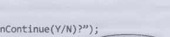

Result: Continue(Y/N)Y

Explanation：按下 Y 或 N 键后，字符存储在 `ch` 中，并在没有任何输出函数 `putchar(ch)` 的情况下直接显示在屏幕上。此类输入输出函数仅在 Turbo C 编译器中可用。

# 102 C 语言编程

## 在 `printf()` 中格式化输出

类型转换代码只执行其要求的操作。这意味着它将位模式转换为人类可读的字符序列。如果程序员想要对字符进行格式化，则需要了解更多关于 `printf()` 控制字符串和格式字符串的知识。

`printf()` 中的格式字符串具有以下通用形式：

```
%control code<character> string=%conversion specifier <control code>
```

程序员可以选择更改对象的顺序：

| 标志 (Flag) | 最小宽度 (Minimum width) | 精度 (Precision) | 大小 (Size) | 转换代码 (Conversion code) |
|---|---|---|---|---|
| *, +0 | | | h, L | d, i, o, x, X, C, s, f, p, e, G, e, n |

图 3.1 `printf()` 说明符字段的部分

字符字符串是一个普通字符序列，将在不任何更改的情况下打印。“控制代码”和“转换说明符”可以嵌入“字符字符串”中。每个转换说明符字段的编码如下：

```
%flag(s)<width><precision><size>conversion-code>
```

百分号和转换代码是必须的，但宽度和精度等其他修饰符是可选的。宽度指定了显示值时使用的字符总数，精度表示小数点后使用的使用的字符数。其精度仅用于浮点数或字符串。

与字符串的使用将在稍后的章节中讨论；目前将考虑与浮点数的使用。

当用于修改浮点数时，精度表示在小数点后应该打印多少位数字。如果使用了精度，则数字前必须有一个句点。多余的数字将被省略，并在必要时在右侧补零。如果未指定，则假设默认值为 6。

因此，宽度被用于指定最小位置数。如果输出的正常长度少于指定的数字，则对输出进行填充，在单元左侧填充空格。如果值所需的空间比指定的空间，它将提供其所需的空间。例如，`%8f` 将使用十个字符打印浮点数，小数点后保留三位。注意，这十个字符包括小数点以及如果存在的话的 `-` 号。

这里是一些示例：

```c
printf("%3d\n", 10);
printf("%2d\n", 10);
printf("%1d\n", 10);
printf("%-7.2f\n", 54321);
printf("%-8.2f\n", 43991);
printf("%9f\n", 54321);
```

这五条语句的顺序输出为：

```
number =  1
number = 1 0
number = 1 0
number = 5 . 4 3
number = 5 . 4 4
number = 5 . 4 3 2 1 0 0 0
number = 5 . 4 3 2 1 0
```

输出快照：

```
number=000
number=10
number=10
number=10
number=5.43
number=5.4321000000
number=5.432100
```

第一个示例在 10 的左侧打印了一个空格，因为指定了宽度为 3。第二种情况没有空格，因为 10 占据了整个 2 位的宽度。在第三种情况下，特定宽度仅为 1，但由于给定的值为 10，它需要空格。

同样，对于
`printf("%-6.3f\n", 17.23478);`

在第四种情况下，为浮点数指定了 2 位精度，所以小数点后只打印两个数字，且宽度为 7。因此，该值（通常包含小数点在内有四个字符）有额外的三个空格。在第五种情况下，如果没有指定宽度，值将恰好取其所需的空间，并指定了 2 位精度，但此时，百分位已经进行了四舍五入。

屏幕上的输出将显示为

```
17 . 2 35
```

在第三种情况下，指定了精度 9，在值的末尾添加了零；在最后的情况下，使用了默认值 6，因此在值的末尾添加了两个零。

此外，对于
`printf("VAT=%17.5%%\n");`

屏幕上的输出是：

```
VAT = 17 . 5 %
```

标志选项允许指定一个或多个修饰符。标志可以是表 3.2 所示的任意一个字符。说明符 `%-d` 将十个字符的空间内左对齐显示整数。说明符 `%+d` 将使用下一个五个字符位置显示整数，并添加一个 `-` 号来符号值。

字符串将左对齐，但现在重要的是，如果指定了字符串且你使用 `%` 说明符，则数组中直到第一个空字符之前的所有字符都将被打印出来。如果使用了宽度指定符，字符串将在空间内对齐。如果使用了精度指定符，则只打印指定数量的字符。

### 表 3.2 `printf()` 中使用的标志

| 标志 (flag) | 含义 |
| --- | --- |
| + | 显示正号 |
| - | 显示值的正或负号 |
| space | 如果没有空格则显示空格 |
| # | 使用说明符的替代格式 |

例如，考虑以下程序：

```c
#include <stdio.h>

int main() {
    printf("%*s", "hello"); // 第一个 printf *
    printf("%%3s", "hello"); // 第二个 printf *
    printf("%+10s", "hello"); // 第三个 printf *
    printf("%-10s", "hello"); // 第四个 printf *
    printf("%*10.3s", "hello"); // 第五个 printf *
    return 0;
}
```

这里有两个使用标志选项的示例。

`printf("%*06.1f\n", 5.5);`
`printf("%+6.1f\n", 5.5);`

这两条语句的顺序输出为：

```
number = 0 0 0 0 5
+ 5
```

```c
printf("%33d\n%3d\n%3d\n", 5, 25, 125);
```

## `float()` 中的运行时调整与精度

17. 这将在屏幕上显示三个值，每个值后面紧跟一个换行。`%3d` 意味着“用一个整数替换此处，但在屏幕上至少占据三个空间”。这对于对齐数据列很有用。有三个这样的格式，所以我们需要三个额外的参数来填充（5, 25 和 125）。输出是

在运行时调整宽度和精度的正确方法是使用星号（`*`）调整宽度和或精度，并在参数列表中包含相应的整数变量。这些代表宽度和精度的整数变量的值将在从参数列表中转换实际变量之前使用。这里有一个显示所描述内容的程序：

```
   5
  25
 125
```

```c
#include <stdio.h>

int main() {
    double x = 1234.567890;
    int i = 1, j = 2;
    while (i < 12) {
        if (j <= i) {
            // 输出的数字总位数
            // 输出中小数部分的数字总位数
            printf("%.*f\n%.*d\n%.*d\n", j, x, i, j, j); // 采用赋值给 i 和 j 的值作为输出 x 值的精度
        }
        i++;
    }
    return 0;
}
```

18. `float pi = 3.1415926535;`
`printf("pi is %.4f to %.2f\n", pi);`
3.1415926535. 这个示例将浮点数变量 `pi` 设置为一个最多显示四个字符（包括小数点）和两位小数（小数点后）的数字。注意，只显示了 3.14。如果 `pi` 是 3.14，则由于四舍五入将显示 3.15。在这种情况下，它显示 `pi` 为 3.14，随后是一个换行符。

19. `char color[] = "red";`
`printf("Color is: %s\n", color);`
`%s` 被一个数组（或字符串）替换 - 在这种情况下，显示 Color，随后是一个换行符。

> 注意：在执行 `printf()` 后，输出被打印在标准设备上，通常是视频显示器（VDU）；它返回一个等于打印字符个数的数字。

为了说明 `printf()` 返回的数字等于打印的字符个数，下面是一个程序：

```c
#include <stdio.h>
#include <stdlib.h>

#define length 40

int main() {
    int n;
    printf("Oxford University %s\n", "Press", &n);
    printf("\n n is %d\n", n);
    return 0;
}
```


# C 语言编程

## 注意事项

- `printf()` 函数指定了一个控制字符串（也称为格式字符串）和变量名，以便在显示器上以所需的形式显示变量中的值。
- `printf()` 中用引号括的格式字符串有三类对象：(i) 转换规范 (ii) 控制代码，程序员可以选择更改这三个对象在格式字符串中的顺序。
- 当 `printf()` 中存在变量列表时，除了 `%` 转换规范字段外，另外两个对象（字符字符串和控制代码）是可选的。
- 控制代码和转换规范可以被嵌入在控制字符串中。

## 3.4 输入函数

`scanf()` 的工作方式与 `printf()` 相同。它有一个通用格式：

```c
scanf("control_string", &variable1, &variable2);
```

其中控制字符串（也称为格式字符串）是一系列指示从输入设备（通常是键盘）读取的数据类型的说明，并存储在变量相应的地址中。`scanf()` 返回扫描到的字段个数，返回值不包括未指定的字段。如果 `scanf()` 尝试读取文件结束符（EOF），返回值为 EOF。

### scanf() 中的格式符

`scanf()` 中的格式字符串如下：
`%*<width><size><conversion-code>`

每个转换（或格式符）匹配 `%` 字符，按照给顺序出现：

1. 可选的赋值符 `*`，表示读取的值不会赋值给地址，而是被丢弃。
2. 可选的宽度符 `<width>`，指定要读取字符的最大数。
3. 可选的转换修饰符 `<size>`，修改转换代码的类型：
   - `h`：`short int`
   - `l`：`long int` 用于整数转换，`double` 用于浮点数转换
   - `L`：`long double` 仅对长双精度浮点转换有效

最显而易见的是 `scanf()` 必须具有变量的地址而不是它们的值。这意味着简单变量必须通过 `&` 传递，因为数组名已经是一个指针。此外，格式字符串具有额外的属性来处理数组和字符串。

### 适用于 scanf() 的说明符或转换代码

| 转换变量类型 | 操作 |
|---|---|
| `%c` | 读取单个字符 |
| `%d` | int \| 读取有符号整数 |
| `%e` | float \| 读取有符号小数 |
| `%f` | float \| 读取有符号小数 |
| `%g` | float \| 读取有符号小数 |
| `%o` | int \| 读取八进制值 |
| `%s` | char array \| 读取字符序列（字符串） |
| `%u` | int \| 读取无符号十整数 |
| `%x` | int \| 读取无符号十六进制值 |
| `%%` | 无 \| 输入流中期望单个 `%` 字符。没有对应的参数。 |
| `%n` | pointer to int \| 输入流中没有匹配的字符。相应的参数是一个指向整数的指针，用于存放读取的字符数 |

### 示例

```c
#include <stdio.h>

int main(void) {
    int a, b, c;
    scanf("%d%d%d", &a, &b, &c);
    return 0;
}
```

假设用户有 a, b, c 和 x 为 1, 2, 3。用户必须输入：
```
1 2 3
```

如果用户使用：
```
1 2 3
```
那么 x 的值将是一个空格，因为 z 在输入时前面有一个空格。

如果用户想输入这一行，`scanf()` 需要编码为：
```c
scanf("%d%d%d%", &a, &b, &c);
```

在整数字段规范之间使用空格：
```c
scanf("%d%d%d", &x, &y, &z);
```
等同于
```c
scanf("%d %d %d", &x, &y, &z);
```

通常，在读取数值时，`scanf()` 读取到遇到空白字符为止。

### scanf() 中的格式化输入

通常，`scanf()` 的格式字符串不包含常量文本。如果包含，意味着输入必须包含相应的文本。

`scanf` 函数返回成功读取的变量数量。例如，考虑以下程序。

#### 示例

```c
#include <stdio.h>

int main(void) {
    int a, b, c;
    int num = scanf("%d %d %d", &a, &b, &c);
    printf("I have read %d values.\n", num);
    return 0;
}
```

并且项目之间包含多少个空格并不重要。例如，
```c
scanf("%d %d", &i, &j);
```
当我们读取两个值读入 `i` 和 `j` 时。这些值可以在同一行，也可以在不同的行，只要它们之间至少有一个空格。该规则的唯一例外是 `%c` 说明符，无论输入的是什么，它总是读取下一个输入的字符。

如果使用了修饰符，它将限制读取的最大字符数。`scanf()` 将读取宽度修饰符指定的字符数，或者直到遇到空白符，以先发生者为准。在这种情况下，效果是将接受的字符数限制在窗口内。例如，
```c
scanf("%10d", &i);
```
最多将输入的前十个数字作为 `i` 的新值。

还有两个原因可能导致 `scanf()` 停止：
1. 遇到了文件结束符（end-of-file character）。当从实际磁盘读取时，在文件末尾有一个文件结束符。当从键盘读取时，用户可以通过按下特定的字符序列来模拟文件结束符。在 UNIX 上，`<Ctrl-D>` 用户可以以此退出到文件结束符状态。
2. `scanf()` 在遇到无效输入时可能会停止。例如，如果 `scanf()` 期望读取一个值但遇到了非数字字符，这是一个错误。

以下是 `scanf()` 停止为变量读取值的原因：
- 在数字序列的数字后发现了空白符。
- 已处理了最大字符数。
- 达到了文件结束符。
- 检测到错误。

运行时，用户必须输入 20 或 30，程序才能正确输出：
- 我读取了 3 个值。
如果用户输入 10 20，程序将输出：读取了 2 个值。
如果用户输入 10 20 30，程序将输出：读取了 0 个值。

当从键盘读取标准输入时，输入不会在输入时直接可见；字符可能会临时存储在某处的缓冲区中。当用户按下“回车”时，缓冲区会被发送给程序。然后，用户可以通过输入新字符，或通过按下退格键删除缓冲区中的最后一个字符来编辑缓冲区。程序将看不到这些被删除的字符。

#### 示例

```c
#include <stdio.h>

int main(void) {
    int x;
    scanf("%d", &x);
    printf("You typed %d values.\n", x);
    return 0;
}
```

如果给此程序输入 45，输出将是：
You typed 45.

关于 `scanf()` 的另一个注意事项是，格式字符串永远不应以换行符结尾。它始终会导致某种形式的错误。例如，
```c
scanf("%d\n", &x);
```
这段代码将因为 `scanf()` 格式字符串末尾的 `\n` 而无法正常工作。

关于 `scanf()` 的最后一点是，每个变量前面必须有一个 `&` 符号。这个符号是地址操作符。它获取后续符号在内存中的地址。如果将变量的值直接传递给 `scanf()`；它将无法更改变量的值。通过传递存储这些值的内存地址，就可以向内存中写入新值。

到此必须明确，`scanf` 和 `printf()` 两个函数分别使用 `stdin` 和 `stdout` 流，因此在使用它们时需要在程序中包含 `stdio.h` 头文件。

## 24. 打印格式化数字

### 解决方案

```c
#include <stdio.h>

int main() {
    printf("%2d/\n", 336);
    printf("%2d/\n", 336);
    printf("%+10d/\n", 336);
    printf("%%-10d/\n", 336);
    return 0;
}
```

输出：
```
/336/
/336......\n/336.......
```

## 注意事项

- 在 `scanf()` 中，控制字符串（或格式字符串）由格式说明符列表组成，指示了从标准输入设备（即键盘）读取的数据格式和类型，用于存储变量对应的地址。
- 格式说明符的数量和地址的数量必须与输入变量的数量一致。
- `scanf()` 中的格式字符串包含在一对引号中，它可能包含以下：
  - (a) 空白符
  - (b) 普通字符字符串
  - (c) 转换说明符字段

## 25. 打印格式化浮点数

### 解决方案

```c
#include <stdio.h>

int main() {
    printf("%/f/\n", 1234.56);
    printf("%.2f/\n", 1234.56);
    printf("%4.4f/\n", 1234.56);
    printf("%%3.1f/\n", 1234.56);
    printf("%%-10.3f/\n", 1234.56);
    printf("%%-10.3e/\n", 1234.56);
    return 0;
}
```

输出：
```
/1234.5600/
/1.23456e+03/
/1235..../
/1234.6 /
/1234.56 /
/ 1.235e+03/
```

## 示例 23：整数相加并打印输入的数字

### 解决方案

```c
#include <stdio.h>

int main() {
    int a, b, sum;
    scanf("%d %d", &a, &b);
    sum = a + b;
    printf("Sum: %d\n", sum);
    return 0;
}
```

## 26. 打印字符串

### 解决方案

```c
#include <stdio.h>

int main() {
    char str[100];
    scanf("%s", str);
    printf("You typed: %s\n", str);
    return 0;
}
```

## 30. 编写一个计算产品成本的程序

程序应该输出计算出的成本和产品的交付日期。

### 解决方案

```c
#include <stdio.h>

int main() {
    int quantity, day, month, year;
    float cost, total;
    int prod_code;
    printf("Enter quantity: %d\n");
    // ... 代码不完整
}
```

## 总结

通常，C 语言中来自标准设备的输入输出是通过标准流管理的。标准输入输出设备是键盘和屏幕。为了执行输入输出，C 语言内置了许多如 `getchar()`、`putchar()` 和 `printf()` 等标准函数。

`getchar()` 和 `putchar()` 分别是单字符输入输出函数。因此，它们不需要格式化的输入输出。`scanf()` 和 `printf()` 函数处理 C 中所有允许类型的多个变量。因此，它们需要格式化的输入和输出。

## 关键术语

- **字符字符串**：一个连续的字符链，被视为一个单元处理。
- **控制代码**：指定打印点上某些位置动作的特殊字符，也称为光标。
- **转换字符串**：与格式相同。
- **标志修饰**：指定以下一个或多个项的字符：
  - 如果输出前没有符号标记，则显示空格
  - 在输出前包含 `+` 或 `-` 符号标记
  - 用前导 `0` 填充输出。

## 注意事项

- `scanf()` 返回成功读取的变量个数。
- `printf()` 返回一个等于打印字符个数的数字。
- **格式说明符**：标识数据类型，并带有要从标准设备输出或读取的相应变量的宽度、精度、大小和标志。
- **格式字符串**：一组字符，包含普通字符字符串、转换代码或控制字符，按顺序排列，它们与 `printf()` 中相邻的相应控制字符串变量对应。

## 常见问题

### 1. 如何使用 `printf()` 打印 `%` 字符？

转换说明符始终以 `%` 开头，以便 `printf()` 函数能够识别它们。由于字符串中的 `%` 总是表示转换说明符的开始，如果想输出 `%` 字符，你必须使用序列 `%%`。

### 2. `printf()` 的返回类型是什么？

`printf()` 的返回值与其打印输出的主要目的无关，且通常不被使用。`printf` 的返回类型是 `int`。在 ANSI C 下，`printf()` 返回它打印的字符个数。如果发生输出错误，`printf()` 返回一个负值。以下程序说明了这一事实。

```c
#include <stdio.h>

int main(void) {
    int c;
    c = printf("One\n");
    printf("c = %d\n", c);
    return 0;
}
```

输出：
```
One
c = 4
```

### 3. `scanf()` 的类型是什么？

`scanf()` 函数返回它成功读取的变量个数。如果没有读取到任何变量，或者在输入时输入了非数字字符串，`scanf()` 返回值 0，或者在检测到“文件结束 (EOF)”时返回。这种情况在 Windows 中按下 `CTRL-Z` 或在 UNIX/LINUX 中按下 `CTRL-D` 时发生。

### 4. 如何编写 `printf()` 以便在运行时指定字段宽度

这在以下程序中所示。

```c
#include <stdio.h>

int main(void) {
    int a, b, c;
    scanf("%d %d", &a, &b);
    c = printf("%*d", a, b);
    printf("\nc = %d\n", c);
    return 0;
}
```


在这里，`printf()` 格式说明符中的 `*` 表示应使用参数列表中的 `int` 值作为字段宽度。

- 5. 什么是 EOF？
EOF 是一个特殊的字符，称为文件结束符。`EOF` 符号在 `<stdio.h>` 中定义，通常等于值 -1。然而，这并不一定总是如此，因此应该在程序中使用 `EOF` 而不是显式值。`EOF` 通常表示流中没有更多可用数据。可以通过键盘在 Unix/Linux 类型机器上按下 CTRL+D 或在 Windows 类型机器上按下 CTRL+Z 手动增量地输入 `+ EOF`。

* 注意

# 练习题

1. 在执行以下输入命令后，每个变量的值是多少？

```c
data input: Tom 34678.2 AA2231
scanf("%s %3d %f %c%1d",name,&i,&j);
```

- (a) name:
- (b) m;
- (c) x:
- (d) ch:
- (e) i:
- (f) j:

2. 以下代码产生什么输出？

- (a) `putchar('a')`
- (b) `putchar('\0')`
- (c) `putchar('\n')`
- (d) `putchar('\t')`
- (e) `n = 32; putchar(n);`
- (f) `putchar(' ')`

3. 对于 `n` 的不同值，输出是什么？

```c
printf("%s %c%d\n",a = 67,b = 200);
```

4. 以下代码有什么问题？

```c
#include <stdio.h>
int d;
scanf("%f",i);
printf("\nNumber: %s)",name);
```

5. `printf()` 直接处理哪种数字计数系统？

- (a) 十进制
- (b) 二进制
- (c) 八进制
- (d) 十六进制

6. C 中的格式化输入输出语句是什么？给出示例。

7. `getchar()` 和 `putchar()` 函数的作用？

9. 如果 `scanf()` 需要，`printf()` 如何使用 `%f`？

10. 如何用 `printf()` 实现字段？

11. 如何用分隔符打印数字？

12. 以下 `scanf("%d",i)` 可以吗？给出理由。

13. 解释为什么以下代码无法工作：

```c
double d;
scanf("%f",
```

14. 如何在 `scanf()` 字符串中指定变量？

16. 为什么大家建议不要 `scanf()`？应该用什么代替？

17. 在屏幕上写
(a) 一行
(b) 三行

18. 编写一个程序，交互式地询问用户年龄并响应 `next_age`，其中 `next_age` 是 `age + 1`。

19. 编写程序读取变量的值并打印给定表达式的结果：

- (a) `a = (b+c)`
- (b) `b = ax^2 + bx`
- (c) `c = I*(T)/100`
- (d) `d = (F-32)/100`
- (e) `e = 0.5*float1 + 0.25*integer1+integer2`

20. 给定代码将打印什么？

```c
value = 5;
printf("%s", (value % 2) ? "yes": "no");
```

# 114 C 语言编程

21. 以下程序的输出是什么？

```c
int main()
{
    char a,b,c;
    scanf("%c %c %c",&a,&b,&c);
    printf("%a%c%c",a,b,c);
    return 0;
}
```

```c
printf("% d %b);
printf("a=%d,b=%d",a,b);
return 0;
```

- [Note: 用户输入是 ABC DEF]
- (a) `a=B b=F c=GHI`
- (b) `a=B b=C`
- (c) `a=D b=G`
- (d) 以上都不是

22. 以下程序的输出是什么？

```c
int main()
{
    int a,b,c;
    scanf("%ld %2d %3d",&a,&b,&c);
    printf("Sum=%d",a+b+c);
    return 0;
}
```

```c
int a,b;
printf("\n enter integer values");
printf("for a and b within 0");
printf("to 100\n");
scanf("%d%d",&a,&b);
```

- [Note: 用户输入是 12346 44 544]
- (a) `Sum=480`
- (b) `Sum=594`
- (c) `Sum=589`
- (d) 以上都不是

23. 以下程序的输出是什么？

```c
int main()
{
    int x=20,y=35;
    y = ++y + ++x;
    printf("%x=%d,y=%d\n",x,y);
    return 0;
}
```

```c
a=a;
b=b;
printf("%a=%d,b=%d\n",a,b);
return 0;
```

24. 以下程序的输出是什么？

```c
int main()
{
    int x=5;
    printf("%d %d\n",x,x<<2,x>>2);
    return 0;
}
```

Note: 用户输入是 2367

27. 以下程序的输出是什么？

```c
int main()
{
int var1,var2,minmax;
var1=5;
var2=2;
var3=6;
minmax=(var1>var2)?(var2>var3)?var2:var3:(var1>var3)?var1:var3;
printf("%d\n",minmax);
return 0;
}
```

28. 以下程序的输出是什么？

```c
int main()
{
    int a=19,b=4;
float c,d;
a=b;
d=a%b;
printf("/%c=%12f/\n",c,d);
printf("%-12.4f/",c,d);
    return 0;
}
```

25. 以下代码后每个变量的值是多少？

```c
int main()
{
    int a=2,b=3;
}
```

29. 选择给定代码的正确输出。

```c
int main()
{
    int i=5;
}
```

```c
printf("%d %d %d %d",i, i++, i++, ++i);
return 0;
}
```

(a) 编译错误
(b) 10 9 8 7 6
(c) 9 8 7 6
(d) 10 8 7 6 6

## 输入与输出
客观题和练习题答案
20. 无号. 21. (b). 22. (a). x=57, y=94.
24. 5.2 201. 25.5 a=3, b=3. 解释：这里求值值为 a++b。
26. a=65, b=27, 27. 6.6,
28. /c=4.0000/d=4.0000/
29. (d)

## 增量问题

从本章开始，我们将逐章节开发一个增量章节，该章节将在第 9 章结束时变得复杂。随着章节的进行，我们将根据后续章节中学到的知识，在本节中添加或修改我们编写的程序代码。

## 问题描述

编写一个 C 程序，计算由两点形成的直线长度，这两个点的坐标将作为输入给出。

## 解决方案

首先，解决此问题的程序需要从用户处获取输入。输入是直线两个端点的 x 和 y 坐标值。本章已经定义了两个基本的 `float` 类型 I/O 函数。使用了四个 `float` 类型的变量来存储连接它们的直线的两个端点的坐标。然后，由这两点形成的直线的长度由以下公式给出：

```
$\sqrt{(x_1-x_2)^2+(y_1-y_2)^2}$
```

解决此问题的程序如下：

## 程序

```c
#include<stdio.h>
#include<math.h>
int main() {
    float x1, y1, x2, y2, lin_len;
    printf("\n\nEnter x-coordinate of first point: %f\n");
    scanf("%f, %f", &x1);
    printf("\n\nEnter y-coordinate of first point: %f\n");
    scanf("%f, %f", &y1);
    printf("\n\nEnter x-coordinate of second point: %f\n");
    scanf("%f, %f", &x2);
    printf("\n\nEnter y-coordinate of second point: %f\n");
    scanf("%f, %f", &y2);
    lin_len = sqrt((x2-x1)*(x2-x1) + (y2-y1)*(y2-y1));
    printf("\n\nThe length of the straight line joining %f\n", lin_len);
    printf("\n\nThe length is %f\n", lin_len);
    return 0;
}
```

## 输出
输入第一个点的 x 坐标: 1
输入第一个点的 y 坐标: 2
输入第二个点的 x 坐标: 3
输入第二个点的 y 坐标: 4
连接两点的直线长度为 2.828427
按回车键返回 Quincy...

## 案例研究

## 问题描述

某电视机制造商的包装部门必须准备一份申请单，列出从生产部门收到的不同电视机型号所需的各种箱子。准备好的列表必须发送给仓库部门，以便向包装部门发放所需的箱子。每种电视机型号所需的箱子类别和数量如下：

| 型号 | 箱子类型 | 数量 |
| --- | --- | --- |
| TV-LCD 17 | 1 | 98 |
| TV-LCD 22 | 2 | 79 |
| TV-LCD 26 | 3 | 65 |
| TV-LCD 32 | 4 | 43 |
| TV-LCD 37 | 5 | 17 |

## 分析

此问题根据需要准备并打印的申请单进行某些数据处理。申请单应指定每种电视机型号所需的箱子类型和数量。为了完成问题指定的任务，程序接受不同电视机型号的数量，每种型号都需要一种特定类型的包装箱。每个型号的箱子类型具有标准尺寸，并预先分配了一个唯一类型。使用程序提供的数据，程序将打印申请单，如下所示。

```c
printf("\n**** Requisition Note ****\n");
printf("\nTV Model | Box type | Numbers\n==========================\n");
printf("TV-LCD %d | %d | %d\n", ...
return 0;
```

## 输出
输入要包装的 TV-LCD 17 型数量:98
输入要包装的 TV-LCD 22 型数量:79
输入要包装的 TV-LCD 26 型数量:65
输入要包装的 TV-LCD 32 型数量:43
输入要包装的 TV-LCD 37 型数量:17

## 解决方案

```c
#include<stdio.h>
int main() {
    int tv17box, tv22box, tv26box, tv32box, tv37box;
    int tv17box, tv22box, tv26box, tv32box, tv37box;
    /* 数量 */
    tv17box = 1;
    tv22box = 2;
    tv26box = 3;
    tv32box = 4;
    tv37box = 5;
    /* 申请单 */
    printf("\n**** Requisition Note ****\n");
    printf("\nTV Model | Box type | Numbers\n==========================\n");
    printf("TV-LCD %d | %d | %d\n", 17, 1, tv17box);
    printf("TV-LCD %d | %d | %d\n", 22, 2, tv22box);
    printf("TV-LCD %d | %d | %d\n", 26, 3, tv26box);
    printf("TV-LCD %d | %d | %d\n", 32, 4, tv32box);
    printf("TV-LCD %d | %d | %d\n", 37, 5, tv37box);
    return 0;
}
```

| 型号 | 箱子类型 | 数量 |
| --- | --- | --- |
| TV-LCD 17 | 1 | 98 |
| TV-LCD 22 | 2 | 79 |
| TV-LCD 26 | 3 | 65 |
| TV-LCD 32 | 4 | 43 |
| TV-LCD 37 | 5 | 17 |

# C 控制语句

## 第4 章

### 学习目标
阅读本章后，读者将能够：
- 理解控制语句的含义
- 学习 C 中的控制语句技巧
- 学习循环语句的使用
- 学习跳转语句等控制语句

### 4.1 引言

到目前为止，程序的执行是顺序的。控制语句告诉执行中的程序下一步执行什么操作。控制程序的执行顺序被称为*控制流*。控制程序的流是非常重要的方面。控制流涉及到语句执行的顺序。在 C 中，语句可以根据大括号分组。以下程序展示了控制语句的用法：

```c
#include <stdio.h>
int main()
{
    int a=5;
    /* 块 */
    {
        int b=10;
        printf("\n a = %d", a);
        printf("\n b = %d", b);
    }
}
```

在 C89 中，选择语句根据布尔值来决定执行哪个语句。选择语句包括 if-else 和 switch 语句。每个决策基于一个布尔表达式（也称为条件或测试表达式），这是一个求值为真或假的表达式。表达式的结果决定了执行哪个语句。

注意高亮显示的行。变量 'b' 的可见性仅限于其声明所在的块。考虑上述程序的修改版本，重复执行一系列语句直到某个特定条件满足的程序机制被称为*循环*。用于循环的结构被称为*迭代语句*。C 提供了三种语言来制定迭代语句：do-while 和 for。

```c
#include <stdio.h>
int main()
{
    int a=5;
    printf("\n a = %d", a);
    return 0;
}
```

输出：a = 5

在 C99 标准的编译器中，程序可以写如下，给出输出：

```c
#include <stdio.h>
int main()
{
    int a=5;
    if (a > 0)
        printf("\n a is positive");
    else
        printf("\n a is not positive");
    return 0;
}
```

```c
#include <stdio.h>
int main()
{
    int a=5;
    {
        int b=10;
        printf("\n a = %d", a);
        printf("\n b = %d", b);
    }
    printf("\n b = %d", b);
    return 0;
}
```


# 控制语句

控制语句体现了根据变量值执行下一步的决策。控制语句包括选择、迭代和跳转语句，它们共同工作创建直接流。

选择语句是允许在程序中选择两种或更多路径的控制语句。C 中的选择语句有 `if-else` 和 `switch` 语句。这些语句允许我们决定执行哪个语句。

## 程序控制语句/结构

| 选择/分支 | 迭代/循环 |
| :--- | :--- |
| `if-else` | `for` `while` `do-while` |
| `switch` | |
| 跳转 | |
| `break` | |
| `continue` | |
| `goto` | |

图 4.1 C 中的程序控制语句/结构 (img/fcfd9923f64919336021af6.png)

## 表 4.1 关系运算符

| 用于指定 | 使用的符号 |
| :--- | :--- |
| 小于 | `<` |
| 大于 | `>` |
| 小于等于 | `<=` |
| 大于等于 | `>=` |

### 为选择和迭代指定测试条件

选择和迭代的测试条件通过测试表达式表示。如果一个表达式的结果为真（`true`），则被赋值为 1。如果结果为假（`false`），则被赋值为 0。同样，如果使用数值表达式作为测试表达式，任何非零值（包括负值）都被视为真，而零值被视为假。测试表达式是一个值为真或假的布尔表达式。除了使用简单的关系表达式外，还可以使用逻辑运算符形成复合条件。C 中使用了几种关系和逻辑运算符来指定测试条件。当两个关系表达式之间使用 AND 运算符 `&&` 时，只有当两个表达式都为真时，结果才为真。当使用 OR 运算符 `||` 时，如果其中一个为真，条件则为真。NOT 运算符 `!` 用于将任何表达式转换为其相反值。也就是说，如果表达式具有任何非零值（真），`!expression` 会产生一个零值（假）。如果表达式为假，则 `!expression` 为真并求值为 1。

### 编写表达式

关系表达式可以使用关系运算符形成。关系运算符获取操作数并将它们相互比较，产生真 (1) 或假 (0) 的值。关系表达式的语法如下：

| 用于指定 | 使用的符号 |
| :--- | :--- |
| 等于 | `==` |
| 不等于 | `!=` |
| 逻辑与 | `&&` |
| 逻辑或 | `||` |

关系运算符可以与整数、`float`、`double` 或字符操作数一起使用。

#### 示例

给出了一些表达式示例：
- `a < b`
- `a == 3`
- `a != 0`
- `a <= b`
- `a > 2`

涉及关系、相等和逻辑运算符的测试表达式在求值后产生 1 或 0。考虑以下程序：

**(a)**
```c
#include <stdio.h>

int main() {
  int a = 3;
  printf("%d\n", a);
  return 0;
}
```
输出: 0

**(b)**
```c
#include <stdio.h>

int main() {
  int a = 3;
  printf("%d\n", a);
  return 0;
}
```
输出: 1

上述输出的原因是，在 C 中，假由值 0 表示，真由关系表达式的值 1 表示。如果一个值为零，则被解释为假。如果一个值非零，则被解释为真值。给出如下声明和初始化：
```c
int x=1, y=2, z=3;
```
那么，
- `x == y` 求值为假。
- `x + y == 3` 求值为真。

表达式 `x != y` 是完整关系表达式 `(x != y)` 的简洁语法，为了编码方便，因为它是可以用于测试的关系表达式。当 `x + y` 求值为 3 时，`(x != y)` 求值为真。
`x != y` 求值为 2（真）。

- `x == y` 求值为假。
- `z % 2` 求值为假。
- `x != y` 求值为非零（真）。

### 4.3.1 C 中如何表示真和假

C 没有预定义的真和假值。零值 (0) 被 C 视为假。任何正值或负值都被视为真。按照惯例，假设只有一个真，但 C 允许任何非零值均为真。假设整数变量 `a`、`b` 和 `c` 的值为 `a=1, b=2, 且 c=3`，则表达式的结果的值为真：
- `(a < b)`
- `a <= b`
- `c < b`
- `a > b`
- `(a)`
- `(-a)`
- `(a = 3)`

注意，当使用赋值运算符 `=` 代替关系运算符 `==` 时，如果变量 `a` 之前被赋值了某些非零 (0) 值，则表达式求值为真。最好养成先写字面量的习惯，例如 `(3==1)`。如果漏掉等号，编译器将对赋值报错，因为 `a` 不可以是常量。表达式 `(a)` 在变量 `a` 之前被赋值为值 1 的情况下为真，因为 C 认为任何求值为非零值的表达式均为真。如果变量 `a` 被赋值为值 -3，表达式 `(a)` 将求值为真。

当 `a=1, b=2, 和 c=3` 时，表达式求值为真：
- `(c - 2*-3)`
- `(2 != b)`
- `(0 + -b)`
- `(-c == b)`

当 `a=1, b=2, 和 c=3` 时，表达式求值为假：
- `(a - 1)`
- `(!(a))`
- `(0 * c)`
- `(c - a - b)`

注意 `!` 符号（逻辑非运算符）会将真变为假。假设整数变量 `a`、`b` 和 `c` 的值为 `a=1, b=2, 且 c=3`，则表达式求值为假：
- `(a > 1)`
- `(b == 1)`
- `(a/b + a/b) == 1`
- `(c % 3)`
- `(a <= b + 4)`

设 `a` 和 `b` 为任意算术表达式。表 4.3 显示了 `a-b` 的值如何决定关系表达式的值。

## 表 4.3 关系表达式的值

| a < b | a <= b | a > b | a >= b | a == b |
| :--- | :--- | :--- | :--- | :--- |
| 正数 | 0 | 1 | | |
| 负数 | 1 | 0 | | |
| 零 | | | | | 1 |

---

## C 语言编程

考虑以下声明：

逻辑非运算符 (`!`)，逻辑与运算符 (`&&`)，逻辑或运算符 (`||`)

```c
char c = 'A';
```

必须记住，`&&` 运算在 `||` 运算之前执行，因为 `&&` 在算术中类似于乘法，而 `||` 类似于加法。
`==`（等于）和 `!=`（不等于）运算符与关系运算符类似，不同在于它们的优先级不同。

要检查 `ch` 是否包含大写字母，条件表达式可以写为：
`ch>='A' && ch<='Z';`

在关系表达式中也可以使用字符的 ASCII 值。上面的表达式可以写为：
`ch>=65 && ch<=90;`

## 表 4.4 运算符的优先级和结合性

| 运算符 | 结合性 |
| :--- | :--- |
| `++` (后置) `--` (后置) | 左结合右 |
| `+` (一元) `-` (一元) | 左结合右 |
| `*` (前缀) `-` (前缀) `*` `/` `%` | 左结合右 |
| `<` `>` `>=` `<=` | 左结合右 |
| `==` `!=` | 左结合右 |
| `&&` | 左结合右 |
| `?` `=` `-=` `+=` `/=` | 左结合右 |

> * C 语言没有独异或（XOR）逻辑运算符，异或的结果仅当只有一个操作数为真时为真，否则为假。可以通过以下表达式实现：

### C 语言中的短路求值

注意的是，在 `&&` 或 `||` 的情况下，如果第一个操作数为假，结果必须为假。因此，表达式的另一个操作将不会被评估。同样，在 `||` 的情况下，如果第一个操作数为真，则不需要评估表达式的另一个操作，因此结果立即设置为真。C 使用这种短路方法，总结如下：

给定以下声明和初始化：
`a=3, b=-5, c=0;`

考虑表 4.5，它说明了逻辑运算符的使用：

## 表 4.5 逻辑运算符的使用说明

| 表达式 | 结果 |
| :--- | :--- |
| `a>0 && c=0` | 0(false) |
| `a=0 || c=0` | 1(true) |
| `a && c` | 0(false) |
| `a && b` | 1(true) |
| `a || c` | 1(true) |
| `!a || c` | 0(false) |
| `5 && !c` | 1(true) |

| `false && (anything)` | `false` |
| :--- | :--- |
| `true || (anything)` | `true` |

除了数值运算符外，数据字符运算符也有副作用。例如，考虑以下示例：
`r = a && b++;`

当第一个操作数为非零时，表达式求值为 `r=1, a=2, b=4`。但如果第一个变量为零，则第二个变量将永远不会被评估。如果 `a=0, b=3`；那么 `r=0, a=0, b=3`；在其他情况下也会发生相同的情况。

除了数值运算符外，还可以使用关系运算符比较数据字符。
`'a' < 'e'` 返回 1(true)
`'9' > '1'` 返回 1(true)
`'A' > 'a'` 返回 0 (false)

如果第一个操作数不是零，第二个操作数将永远不会增加。理解关系运算符和相等运算符的补集是重要的。表 4.6 展示了这些补集。

`'A'` 的 ASCII 值是 65，`'a'` 的是 97。

## 表 4.6 关系运算符补集

| 运算符 | 补集 |
| :--- | :--- |
| `<` | `>=` |
| `>` | `<=` |
| `==` | `!=` |

例如，`!(a<b)` 等于 `a>=b`，`!(a!=b)` 等于 `a==b`。

> * 像 `a < b < c` 这样的表达式在语法上是正确的，但通常令人困惑。通过一个示例说明：
> `3 < j < 5`
> 表示变量 `j` 具有大于 3 小于 5 的属性。它也可以被视为数学语句，取决于 `j` 的值，可能真也可能假。例如，如果 `j=4`，该数学语句是真的。但如果 `j=7`，该数学语句是假的。
>
> ```c
> j = 7;
> printf("%d\n", 3 < j < 5);
> // 输出 1，而不是 0
> ```
>
> 类比，可能会预期表达式是假的且 0 是真的。然而事实并非如此，因为关系运算符是从左到右操作的。
>
> * `3 < j < 5` 等于 `(3 < j) < 5`
> 因为表达式 `3 < j` 为真，它有值 1。
> `(3 < j) < 5` 等于 `1 < 5`，其值为 1。在 C 中，测试 `3 < j` 和 `j < 5` 表达式的正确写法是：
>
> ```c
> 3 < j && j < 5
> ```
>
> 因为关系运算符的优先级高于二元运算符，这等同于
> ```c
> (3 < j) && (j < 5)
> ```
> 正如后文所示，该表达式仅当 `&&` 表达式的两个操作数都为真时为真。

> * 与算术运算符一样，关系和逻辑运算符具有优先级和结合性（表 4.4）。

### 评估涉及这些运算符的表达式

关系运算符的优先级小于算术运算符 `+` 和 `-`，而大于赋值运算符。`a > b > 5` 等于 `(a > b) > 5`。表达式 `a = b == 5` 意味着如果 `b` 大于 5 则给 `a` 赋值 1，否则 `a` 被赋值为 0（原文“a 不被赋值为 b”根据语义修正为赋值结果）。

关系运算符分为两个优先级：
高优先级：`<` `<=` `>` `>=`
低优先级：`==` `!=`

与其他运算符一样，关系运算符从左到右结合。因此，
```c
expr1 = expr2 == expr3
```
等同于
```c
expr1 = (expr2 == expr3)
```
首先，检查 `expr2` 和 `expr3` 是否相等。结果 1 (true) 赋值给 `expr1`。不建议写这样的关系表达式，但为了更清晰地理解关系运算符的优先级和结合性，这一点被指出。

最初 C 没有提供任何布尔类型。C99 提供了一种新类型 `_Bool`，它解决了布尔变量的限制。在 C 中，布尔变量可以声明为：

```c
_Bool result = 5 < 4; /* result 将为假 */
```

由于关系运算符产生结果，可以将结果存储在类型为 `_Bool` 的变量中。

```c
bool flag = true;
```

除了 `_Bool` 之外，C99 提供了一个新的头文件 `stdbool.h` 来处理布尔值。该头文件提供了 `true`、`false` 等宏，它们代表 1 和 0。

如果包含了 `stdbool.h`，则可以如下声明：
```c
bool flag;
```

## 4.4.1 选择语句

### 使用 if 的单向决策

单向决策通过 `if` 语句处理，执行某些操作或完全不执行。决策基于一个真或假的“测试表达式”。如果测试表达式为真，则执行相应的语句；如果测试表达式为假，控制跳转到下一语句。图 4.2 展示了这一点。单向决策语句的形式如下：
```c
if(TestExpr)
    stmtT;
```
`TestExpr` 是测试表达式，`stmtT` 可以是一个简单语句，也可以是由大括号 `{}` 包围的语句块。

### 示例

#### 4. 编写一个程序，打印三个数中最大的一个。

逗号运算符的问题在于，当你使用它时会打破了每行一条语句的规则，这会模糊程序的结构。因此，在可以使用大括号代替的情况下，永远不要使用逗号运算符。

**解决方案：**

**算法**
1. 开始
2. 打印“输入三个数字”
3. 输入 A, B, C
4. MAX=A
5. 如果 B>MAX 则 MAX=B
6. 如果 C>MAX 则 MAX=C
7. 打印“最大的数字是”，MAX
8. 停止

**C 程序**
```c
#include <stdio.h>

int main() {
    int a, b, c, max;
    printf("Enter three numbers:\n");
    scanf("%d %d %d", &a, &b, &c);
    max = a;
    if(b > max)
        max = b;
    if(c > max)
        max = c;
    printf("Largest No is %d\n", max);
    return 0;
}
```

### 使用 if-else 语句的双向决策

双向决策通过 `if-else` 语句处理，执行一个特定操作或执行另一种操作。与单向决策类似，这里的决策是基于测试表达式的。双向决策的形式如下：
```c
if(TestExpr)
    stmtT
else
    stmtF
```
如果表达式 `TestExpr` 为真，将执行 `stmtT`；如果表达式为假，则执行 `stmtF`。`stmtT` 和 `stmtF` 可以是单条语句，也可以是一个语句块。记住，语句块始终包含在大括号 `{}` 中。图 4.3 展示了 `if-else` 的流程图。

### If 和逗号运算符

通常，逗号运算符用于组合语句。例如，语句：
```c
x = 1;
y = 2;
```
当写成以下形式时，被视为单一语句：
```c
x = 1, y = 1;
```
对于简单语句，逗号运算符并不十分有用。然而，它可以与 `if` 语句结合使用，为程序员提供一种独特的简写形式。
```c
if (flag)
    x = -1, y = 1;
```
这个示例在语法上等价于：
```c
if (flag) {
    x = 1;
    y = 1;
}
```

通过示例展示了 `if-else` 结构。
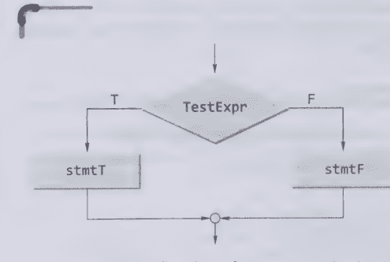

### 示例

#### 5. 编写一个 C 程序检查用户输入的数字是奇数还是偶数。

**算法**
1. 开始
2. 打印“输入数字”
3. 输入 N
4. Q=N/2 (整数除法)
5. R=N-Q*2
6. 如果 R=0 则打印“偶数”，否则打印“奇数”
7. 停止

**C 程序**
```c
#include <stdio.h>

int main() {
    int n, r;
    printf("Enter the number");
    scanf("%d", &n);
    r = n % 2; // 原文逻辑 R=N-Q*2 等价于取模
    if(r == 0)
        printf("EVEN");
    else
        printf("ODD");
    return 0;
}
```

#### 6. 检查给定的两个数字是否相等。

**(a)**
```c
#include <stdio.h>

int main() {
    int a=2, b=3;
    if(a == b)
        printf("EQUAL");
    else
        printf("UNEQUAL");
    return 0;
}
```
输出: UNEQUAL

**(b)**
```c
#include <stdio.h>

int main() {
    int a=2, b=3;
    if(a = b) // 此处使用赋值而非比较
        printf("EQUAL");
    else
        printf("UNEQUAL");
    return 0;
}
```
输出: EQUAL

对上述输出的解释是，当使用 `=` 而不是 `==` 时，编译器会检查测试表达式的值。如果是非零值，它将条件评估为真；否则它将条件评估为假。示例(a) 仅仅检查相等性并给出了预期的结果。但在示例(b) 中，赋值表达式 `a = b` 的值为 3（非零），条件将为真，程序输出 EQUAL。如果 `b` 的值被赋值为零，那么根据上面的解释，第二个程序将打印 UNEQUAL，因为表达式值为零。

所以使用相等运算符的测试表达式必须仔细指定。如果变量 `a` 被赋值为常量，可能会发生相同的情况。示例语句：
```c
if(x = 3) stmt;
```
如果表达式写错，编译器将编译通过但逻辑错误。
`if(3 == x)` 是安全的，而不是：
```c
if(x = 3)
```
建议写成：
```c
if(x != 0)
```


# 控制语句

然而，在通常情况下，编写你所想要的内容比编写具有相同效果的内容更好。这一点在于一旦 `a + b` 溢出，寄存器中的所有位将变为零。如果操作溢出，测试将失败。进行这种特定测试的正确方法取决于符号和无符号值之间的转换。以下三个 `if` 语句在功能上是等价的：

```c
if(x)
    printf("true");

if(x!=0)
    printf("true");

if(x==0)
    printf("true");
```

无符号方法 (K&R) 认为当无符号类型与 `int` 混合时，结果丢失符号。保留值的方法 (ANSI) 认为根据操作数的大小，结果是有还是无符号。考虑以下示例。

```c
if ((int)a + (unsigned)b < 0)
    printf("OVERFLOW");
```

# 示例

- 7. 假设必须编写 C 代码来计算按小时计费工人的工资，每周超过 40 小时的部分工资。假设程序中已知每周小时数和时薪。处理这种情况的代码有两种方案：

```c
#include <stdio.h>

if(weeklyHours < 40)
    earnings = hourlyRate * weeklyHours;
else
    earnings = weeklyHours * 40 + (weeklyHours - 40) * hourlyRate * 1.5;
```

方案 2 使用简单语句和复合语句：

```c
int main()
int i = -1;
unsigned int u = 1;
if(i<u)
    printf("%d is less than u\n");
else
    printf("%d is less than u\n");
return 0;
```

C 语言中的复杂程序所示：

- 8. 编写一个程序确定年份是否为闰年。

```c
#include <stdio.h>

int main()
int year,rem_4,rem_100,rem_400;
printf("Enter the year to be tested:");
scanf("%d",&year);
rem_4 = year % 4;
rem_100 = year % 100;
rem_400 = year % 400;
if(rem_4 == 0 && rem_100 != 0 || rem_400 == 0)
    printf("It is a leap year.\n");
else
    printf("It is not a leap year.\n");
return 0;
```

如果操作数之一是无符号的，结果是无符号的，并定义为模 2^n，n 是字长。如果两个操作数都是符号的，结果未定义。假设 `a` 和 `b` 是两个整数变量，你想测试 `a+b` 是否溢出。一种明显的方法如下：

```c
if (a + b < 0)
    printf("OVERFLOW\n");
```

下面是在计算机上执行上述程序时从不同输入获得的输出。

## 测试运行 1
测试年份：1955
不是闰年。

## 测试运行 2
测试年份：2000
是闰年。

## 测试运行 3
测试年份：1800
是闰年。

# 多路决策

多路决策语句使用嵌套的 `if-else-if` 或 `switch` 语句。它们用于评估可能有多个可能值的表达式。`if-else-if` 语句经常用于在值范围之间选择。`switch` 语句将在下一节讨论。

## if-else 阶梯
使用 `if-else` 语句的多路决策结构如下：

```c
if(TestExpr1)
    stmtT1
else if(TestExpr2)
    stmtT2
else if(TestExpr3)
    stmtT3
...
else if(TestExprN)
    stmtTN
else
    stmtF;
```

如果第一个表达式 `TestExpr1` 被评估为真，则执行 `stmtT1`。如果第二个测试 `TestExpr2` 为真，则执行 `stmtT2`，依此类推。如果没有任何测试表达式为真，则执行语句 `stmtF`。上述结构的流程图如图 4.4 所示。

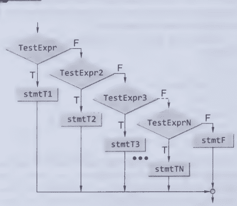

# 示例

- 9. 下面程序检查用户输入的数字是正数还是负数。

```c
#include <stdio.h>

int main()
{
  int x;
  printf("\n ENTER THE NUMBER:\n");
  scanf("%d", &x);
  if(x > 0)
    printf("x is positive \n");
  else if(x == 0)
    printf("x is zero \n");
  else
    printf("x is negative \n");
  return 0;
}
```

- 10. 该程序根据学生获得的分打印等级。

```c
#include <stdio.h>

int main()
```

图 4.4 if-else-if 结构的流程图

# 控制语句

这里需要注意的一个重要事实是，`else` 总是与最近的（最内部）`if` 关联。在上面的示例中，`else` 部分对应内部的 `if`，即 `if(a > c)`。如果添加另一个 `else`，最后一个 `else` 对应 `if(a > b)`。嵌套 `if` 的语法如下：

| 结构 1 | 结构 2 |
|---|---|
| if(TestExprA) | if(TestExprA) |
| if(TestExprB) | if(TestExprB) |
| stmtBT; | stmtBT; |
| else | else |
| stmtBF; | stmtBF; |
| else | else |
| stmtAF | if(TestExprC) |
| | stmtCT; |
| | else; |

## 嵌套 if
当一个语句位于另一个语句下面时，这种组合被称为嵌套 if。这里给出一个嵌套 if 的简单示例。

测试是否能被 5 整除的语句位于测试能被 3 整除的 `if` 内部；它被视为嵌套语句。

```c
if (number % 3 == 0) {
    printf("number is divisible by 3.\n");
    if (number % 5 == 0) {
        printf("number is divisible by 3 and 5.\n");
    }
}
```

下面是另一个示例。

```c
if(a > c) {
    printf("%d", a);
}
```

`stmtBT`、`stmtBF`、`stmtCT` 和 `stmtCF` 可以是一个简单语句或语句块。需要记住，语句块包含在大括号 `{}` 中。

在结构 1 中，如果 `TestExprA` 和 `TestExprB` 结果为真，则执行 `stmtBT`。如果 `TestExprA` 为真且 `TestExprB` 为假，则执行 `stmtBF`。如果 `TestExprA` 为假且不检查 `TestExprB`，则执行 `stmtCF`。

在结构 2 中，如果 `TestExprA` 和 `TestExprB` 结果为真，则执行 `stmtBT`。如果 `TestExprA` 为真且 `TestExprB` 为假，则执行 `stmtBF`。如果 `TestExprB` 为假，将检查 `else` 表达式。如果为真，则执行 `stmtCT`，否则执行 `stmtCF`。

在这里，如果两个条件都为真，将打印 `a`。缩进使得语句的逻辑清晰直了。接下来将通过下面的示例进一步解释嵌套循环。

最后，后面是一个使用嵌套循环找到三个数中最大值的程序。所需的流程图如图 4.5 所示。C 代码如下：


```c
#include <stdio.h>

int main() {
    int a, b, c;
    printf("\nEnter the three numbers\n");
    scanf("%d %d %d", &a, &b, &c);
    if(a > b) {
        if(a < c) {
            printf("%d,\n", a);
        }
    }
}
```

```c
if(TestExprA)
    if(TestExprB)
        stmtBT;
    else
        stmtAF;
```

如果 `TestExprA` 结果为真，执行将移动下一个并评估 `TestExprB`。如果 `TestExprB` 为真，则执行 `stmtBT`。如果 `TestExprA` 为假，则执行 `stmtAF`。但在上面的代码中，`else` 自动与最近的 `if` 配对。需要将 `else` 与外部的 `if` 关联。解决方案是以下之一：

- 使用空 `else`
- 使用大括号包裹第二个 `if` 的真值操作

每种方案具有以下形式：

在两种解决方案中，如果表达式 `TestExprA` 结果为假，则执行语句 `stmtAF`。如果其结果为真，则检查 `TestExprB`。如果 `TestExprB` 为真，则执行 `stmtBT`。考虑下面这个带有悬空 `else` 问题的 C 程序。

```c
#include <stdio.h>

int main() {
    int a = 2;
    int b = 2;
    if (a == 1)
        if (b == 2)
            printf("a was 1 and b was 2\n");
    else
        printf("a wasn't 1\n");
    return 0;
}
```

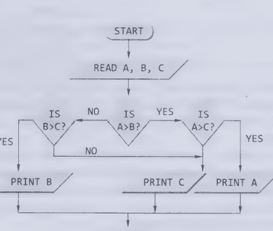

图 4.5 寻找三个数最大值的流程图

## 悬空 else 问题
当每个 `if` 都没有匹配的 `else` 时，就会出现这个经典问题。为了避免这个问题，简单的 C 规则总是将 `else` 与当前块中最近的未配对的 `if` 配对。考虑下面的插图。

编译并运行时，该程序没有产生任何输出。在程序的原始形式下，程序员可能认为 `else` 语句会与第一个 `if` 关联，但事实并非如此。正如程序的另一种布局版本所示，`else` 也会与紧接其前的 `if` 关联。完全没有输出的原因是第一个 `if` 没有关联 `else`。

```c
float x = 199.9;
if( x < 100)
    printf("one");
else
    printf("a wasn't 1\n");
```

为了达到预期效果，需要使用条件运算符将程序重排如下：

```c
if( x < 100)
    printf("one");
else
    printf("a wasn't 1\n");
```

如果两个条件都为真，将打印 `a`。缩进使得语句的逻辑清晰直了。接下来将通过下面的示例进一步解释嵌套循环。

最后，后面是一个使用嵌套循环找到三个数中最大值的程序。所需的流程图如图 4.5 所示。C 代码如下：


```c
#include <stdio.h>

int main() {
    int a, b, c;
    printf("\nEnter the three numbers\n");
    scanf("%d %d %d", &a, &b, &c);
    if(a > b) {
        if(a < c) {
            printf("%d,\n", a);
        }
    }
}
```

```c
if(TestExprA)
    if(TestExprB)
        stmtBT;
    else
        stmtAF;
```

如果 `TestExprA` 结果为真，执行将移动下一个并评估 `TestExprB`。如果 `TestExprB` 为真，则执行 `stmtBT`。如果 `TestExprA` 为假，则执行 `stmtAF`。但在上面的代码中，`else` 自动与最近的 `if` 配对。需要将 `else` 与外部的 `if` 关联。解决方案是以下之一：

- 使用空 `else`
- 使用大括号包裹第二个 `if` 的真值操作

每种方案具有以下形式：

在两种解决方案中，如果表达式 `TestExprA` 结果为假，则执行语句 `stmtAF`。如果其结果为真，则检查 `TestExprB`。如果 `TestExprB` 为真，则执行 `stmtBT`。考虑下面这个带有悬空 `else` 问题的 C 程序。

```c
#include <stdio.h>

int main() {
    int a = 2;
    int b = 2;
    if (a == 1)
        if (b == 2)
            printf("a was 1 and b was 2\n");
    else
        printf("a wasn't 1\n");
    return 0;
}
```


图 4.5 寻找三个数最大值的流程图

## 悬空 else 问题
当每个 `if` 都没有匹配的 `else` 时，就会出现这个经典问题。为了避免这个问题，简单的 C 规则总是将 `else` 与当前块中最近的未配对的 `if` 配对。考虑下面的插图。

编译并运行时，该程序没有产生任何输出。在程序的原始形式下，程序员可能认为 `else` 语句会与第一个 `if` 关联，但事实并非如此。正如程序的另一种布局版本所示，`else` 也会与紧接其前的 `if` 关联。完全没有输出的原因是第一个 `if` 没有关联 `else`。

```c
float x = 199.9;
if( x < 100)
    printf("one");
else
    printf("a wasn't 1\n");
```

为了达到预期效果，需要使用条件运算符将程序重排如下：

```c
if( x < 100)
    printf("one");
else
    printf("a wasn't 1\n");
```

如果两个条件都为真，将打印 `a`。缩进使得语句的逻辑清晰直了。接下来将通过下面的示例进一步解释嵌套循环。

最后，后面是一个使用嵌套循环找到三个数中最大值的程序。所需的流程图如图 4.5 所示。C 代码如下：


```c
#include <stdio.h>

int main() {
    int a, b, c;
    printf("\nEnter the three numbers\n");
    scanf("%d %d %d", &a, &b, &c);
    if(a > b) {
        if(a < c) {
            printf("%d,\n", a);
        }
    }
}
```


# 控制语句

这里需要注意的一个重要事实是，`else` 总是与最近的（最内部）`if` 关联。在上面的示例中，`else` 部分对应内部的 `if`，即 `if(a > c)`。如果添加另一个 `else`，最后一个 `else` 对应 `if(a > b)`。嵌套 `if` 的语法如下：

| 结构 1 | 结构 2 |
|---|---|
| if(TestExprA) | if(TestExprA) |
| if(TestExprB) | if(TestExprB) |
| stmtBT; | stmtBT; |
| else | else |
| stmtBF; | stmtBF; |
| else | else |
| stmtAF | if(TestExprC) |
| | stmtCT; |
| | else; |

## 嵌套 if

当一个语句位于另一个语句下面时，这种组合被称为嵌套 if。这里给出一个嵌套 if 的简单示例。

测试是否能被 5 整除的语句位于测试能被 3 整除的 `if` 内部；它被视为嵌套语句。

```c
if (number % 3 == 0) {
    printf("number is divisible by 3.\n");
    if (number % 5 == 0) {
        printf("number is divisible by 3 and 5.\n");
    }
}
```

下面是另一个示例。

```c
if(a > c) {
    printf("%d", a);
}
```

`stmtBT`、`stmtBF`、`stmtCT` 和 `stmtCF` 可以是一个简单语句或语句块。需要记住，语句块包含在大括号 `{}` 中。

在结构 1 中，如果 `TestExprA` 和 `TestExprB` 结果为真，则执行 `stmtBT`。如果 `TestExprA` 为真且 `TestExprB` 为假，则执行 `stmtBF`。如果 `TestExprA` 为假且不检查 `TestExprB`，则执行 `stmtCF`。

在结构 2 中，如果 `TestExprA` 和 `TestExprB` 结果为真，则执行 `stmtBT`。如果 `TestExprA` 为真且 `TestExprB` 为假，则执行 `stmtBF`。如果 `TestExprB` 为假，将检查 `else` 表达式。如果为真，则执行 `stmtCT`，否则执行 `stmtCF`。

在这里，如果两个条件都为真，将打印 `a`。缩进使得语句的逻辑清晰直了。接下来将通过下面的示例进一步解释嵌套循环。

最后，后面是一个使用嵌套循环找到三个数中最大值的程序。所需的流程图如图 4.5 所示。C 代码如下：


```c
#include <stdio.h>

int main() {
    int a, b, c;
    printf("\nEnter the three numbers\n");
    scanf("%d %d %d", &a, &b, &c);
    if(a > b) {
        if(a < c) {
            printf("%d,\n", a);
        }
    }
}
```

```c
if(TestExprA)
    if(TestExprB)
        stmtBT;
    else
        stmtAF;
```

如果 `TestExprA` 结果为真，执行将移动下一个并评估 `TestExprB`。如果 `TestExprB` 为真，则执行 `stmtBT`。如果 `TestExprA` 为假，则执行 `stmtAF`。但在上面的代码中，`else` 自动与最近的 `if` 配对。需要将 `else` 与外部的 `if` 关联。解决方案是以下之一：

- 使用空 `else`
- 使用大括号包裹第二个 `if` 的真值操作

每种方案具有以下形式：

在两种解决方案中，如果表达式 `TestExprA` 结果为假，则执行语句 `stmtAF`。如果其结果为真，则检查 `TestExprB`。如果 `TestExprB` 为真，则执行 `stmtBT`。考虑下面这个带有悬空 `else` 问题的 C 程序。

```c
#include <stdio.h>

int main() {
    int a = 2;
    int b = 2;
    if (a == 1)
        if (b == 2)
            printf("a was 1 and b was 2\n");
    else
        printf("a wasn't 1\n");
    return 0;
}
```


图 4.5 寻找三个数最大值的流程图

## 悬空 else 问题

当每个 `if` 都没有匹配的 `else` 时，就会出现这个经典问题。为了避免这个问题，简单的 C 规则总是将 `else` 与当前块中最近的未配对的 `if` 配对。考虑下面的插图。

编译并运行时，该程序没有产生任何输出。在程序的原始形式下，程序员可能认为 `else` 语句会与第一个 `if` 关联，但事实并非如此。正如程序的另一种布局版本所示，`else` 也会与紧接其前的 `if` 关联。完全没有输出的原因是第一个 `if` 没有关联 `else`。

```c
float x = 199.9;
if( x < 100)
    printf("one");
else
    printf("a wasn't 1\n");
```

为了达到预期效果，需要使用条件运算符将程序重排如下：

```c
if( x < 100)
    printf("one");
else
    printf("a wasn't 1\n");
```

## 示例

以下是一个控制表达式为 `char` 变量 `ch` 的示例。注意在每个情况下字符变量周围都使用了单引号。

```c
switch(ch) {
    case 'A':
        printf("You entered an A");
        break;
    case 'B':
        printf("You entered a B");
        break;
    default:
        printf("Illegal entry");
        break;
}
```

`break` 语句会导致控制流退出整个 switch 块，并在 switch 之外的语句处继续。技术上，`break` 语句是可选的，尽管大多数 switch 的应用都会使用它。如果在 switch 的任何 case 中省略了 break 语句，编译器将不会发出错误信息。控制流将继续到下一个 case 标签。

另一个示例描述了其中 'Choice' 是一个 `int` 变量。注意在每个 case 语句中整数值周围没有使用单引号。

通过将 case 并排放置，可以尽可能地减少代码中的冗余，如下例所示。也就是说，多个 case 值可以关联一组语句。

```c
switch(Choice) {
    case 1:
        printf("You entered menu choice #1");
        break;
    case 2:
        printf("You entered menu choice #2");
        break;
    case 3:
        printf("You entered menu choice #3");
        break;
    default:
        printf("You failed to enter a valid menu choice");
        break;
}
```

```c
switch(number) {
    case 1:
    case 3:
    case 5:
    case 7:
    case 9:
        printf(" %d is an odd number.", number);
        break;
    case 2:
    case 4:
    case 6:
    case 8:
        printf(" %d is an even number\n", number);
        break;
    default:
        printf(" %d is a value between or or including 1 and 9.", number);
        break;
}
```

```c
switch(donationLevel) {
    case 1:
        printf("You donated over Rs 1,000.");
    case 2:
        printf("You donated over Rs 500.");
    case 3:
        printf("You donated over Rs 250.");
    case 4:
        printf("You donated over Rs 100.");
        break;
    default:
        printf("Please be a little more generous.");
        break;
}
```

## 注意事项

- switch 语句允许你根据整数表达式的结果，从一组可能的操作中选择一种方案。
- case 标签可以是任何顺序的，且必须是常量。
- 不允许 case 标签具有相同的值。
- default 是可选的，可以放在 switch 构造的任何位置。
- 常量必须是整数常量或字符常量。表达式必须求值为一个整数类型。
- break 语句是可选的。如果在任何 switch 语句中省略了 break 语句，程序流将执行到下一个 case 标签。
- C89 规定 switch 至少可以有 25 个 case 语句。C99 要求至少支持 1023 个 case 语句。case 不可以独立存在于 switch 之外。

## 示例

### 15. 编写一个使用 switch 语句的程序，检查用户输入的数字是奇数还是偶数。

解决方案：

```c
#include<stdio.h>

int main() {
    int n;
    printf("\n Enter the number:");
    scanf("%d", &n);
    switch(n) {
        case 0: printf("\n EVEN");
            break;
        case 1: printf("\n ODD");
            break;
    }
    return 0;
}
```

### 16. 编写一个程序执行两个变量之间的加、减、乘、除算术运算。

解决方案：使用 switch 构造来选择选项。

```c
#include<stdio.h>

int main() {
    int value1, value2;
    char operator;
    printf("Type in your expression: %s %c %d\n", operator);
    scanf("%d %c %d", &value1, &operator, &value2);
    switch(operator) {
        case '+':
            printf("%d %d\n", value1 + value2);
            break;
        case '-':
            printf("%d %d\n", value1 - value2);
            break;
        case '/':
            if(value2 == 0)
                printf("division by zero. \n");
            else
                printf("%d %d\n", value1 / value2);
            break;
        default:
            printf("Unknown Operator \n");
            break;
    }
    return 0;
}
```

## Switch 与 嵌套 if

switch 与 if-else 的区别在于，switch 只能进行等性测试，而 if 条件表达式可以是一个涉及任何类型关系运算符和/或逻辑运算符的测试。switch 语句通常比嵌套的 if 效率更高。

switch 语句始终可以替换为一系列 else-if 语句。只有当需要将表达式与有限数量常量、整数或字符值进行比对时，才可以使用 switch 和 case 语句。如果有许多值且其中任何一个依赖于变量，或者这些值不是整数或字符，则必须使用一系列 else-if 语句。即使可以使用 switch，决定使用 switch 语句还是 else-if 也取决于个人偏好。


# C 语言编程

## 4.5.1 While 结构

`while` 语句是一种预测试循环。它使用一个测试表达式来控制循环。由于它是预测试循环，它在循环的每次迭代之前都会求值测试表达式。`while` 语句的基本语法如图 4.8 所示。

### 示例

```c
#include <stdio.h>

int main() {
    int c;
    c = 5; // 初始化
    while (c > 0) { // 测试表达式
        printf("%d\n", c);
        c--; // 更新
    }
    return 0;
}
```

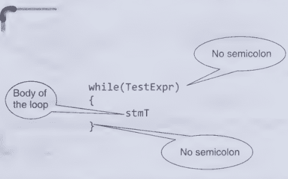

图 4.8 while 结构

`stmt` 将反复执行，直到 `TestExpr` 的值变为 0。`stmt` 可以是由 `stmt` 确定的单条或多条语句。

要使用 `while` 语句，测试表达式应包含一个循环控制变量。循环变量的初始化必须在循环开始之前完成，更新必须包含在循环体内。`while` 语句的扩展形式如图 4.9 所示。

此循环包含了 `while` 循环的所有部分。在程序中执行时，此循环将输出：

```
5
4
3
2
1
```

上述示例中循环结构的操作是通过逐步跟踪的。首先，执行循环初始化，将 `c` 赋值为值 5。然后，只要测试表达式 `c > 0` 为真，就会反复执行 `while` 结构内的指令。一旦 `while` 中的测试表达式求值为假，程序即告终止。

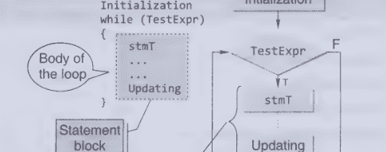

现在，当遇到语句时，会求值测试表达式，这类似于 `if` 测试表达式。在这种情况下，由于 `5 > 0` 且表达式求值为真，循环的体语句将按顺序执行。一个 `printf` 语句在屏幕上写出 `c` 的当前值。此时 `c` 的值变为 4。到达循环末尾时，再次检查循环条件。如果为真（因为 `4 > 0`），则再次执行循环。在某种程度上，循环执行了五次。在第五次迭代结束时，`c` 的值为 0，由于 0 不大于 0，该条件将失败。然后，应用于循环结构内部所有语句的循环将反复执行几次，直到条件失败为止。

图 4.9 `while` 的扩展语法及其表示

## 19. 打印 50 个星号水平行的程序

该程序使用 `while` 循环编写。以下是同一个程序的三个版本。它们的区别仅在于测试表达式的使用以及控制变量的初始化。

```c
int age;
printf("\nPlease enter an age (-1 to quit)");
scanf("%d", &age);
while (age != -1) {
```

### 版本 1

```c
#include <stdio.h>

int main() {
    int times = 0;
    while (times < 50) {
        printf("*");
        times++;
    }
    return 0;
}
```

### 版本 2

```c
#include <stdio.h>

int main() {
    int times = 1;
    while (times <= 50) {
        printf("*");
        times++;
    }
    return 0;
}
```

### 版本 3

```c
#include <stdio.h>

int main() {
    int times = 50;
    while (times > 0) {
        printf("*");
        times--;
    }
    return 0;
}
```

注意完成相同任务的各种方法。运行上述版本并查看输出。如果循环需要执行指定的次数且循环内部使用了计数器，则循环可以写成版本 3，使用递减而不是递增。

## 20. 考虑一个通用的 `while` 循环，它从键盘读取输入并计算正整数，直到输入负数为止。

```c
#include <stdio.h>

int main() {
    int x = 1;
    int count = 0;
    printf("\nEnter Number:");
    while (x >= 0) {
        scanf("%d", &x);
        count += 1;
    }
    return 0;
}
```

以下程序将年龄作为输入，并在输入 -1 时退出：以下是对上述 `while` 循环的一些观察。

- 变量同时进行了声明和初始化。
- 循环条件在逻辑上说的是：“当 `x` 是正数时，重复。”
- `count` 跟踪用户输入了多少个数字。
- 当从键盘接收固定次数的输入时，这是一个非常有用的循环。

## 21. 考虑一个更广泛的程序示例，要求用户输入一些数字然后找到它们的平均值。

解决方案：程序的编写方式可以是：提前询问用户将提供多少个数字，或者要求用户在最后一个数字后输入一个特殊值（例如，分数输入负数）。这个特殊值被称为哨兵值。在这个示例中，需要进行类型转换，因为 `s` 和 `n` 都是整数，而 `avg` 是浮点型。否则，程序将 `avg` 评估为整数。以下是使用 `while` 循环的实现方式：

| Step | Algorithm |
| :--- | :--- |
| 1 | START |
| 2 | HOW NUMBERS: |
| 3 | N=0 |
| 4 | ANS='Y' |
| 5 | ENTER THE NUMBER |
| 6 | INPUT A |
| 7 | S+A |
| 8 | N=N+1 |
| 9 | WILL ADD MORE (y/n)? |
| 10 | IF ANS='Y' THEN 6 |
| 11 | AVG=S/N |
| 12 | PRINT "AVERAGE IS " |
| 13 | STOP |

### C Program

```c
#include <stdio.h>

int main() {
    int n, a, c = 1, s = 0;
    float avg;
    printf("\n HOW NUMBERS? ");
    scanf("%d", &n);
    while (c <= n) {
        printf("\n Enter the number: ");
        scanf("%d", &a);
        s += a;
        c++;
    }
    avg = (float)s / n;
    printf(" \n AVERAGE IS %f", avg);
    return 0;
}
```

```c
#include <stdio.h>

int main() {
    int n = 0, a, s = 0;
    float avg;
    char ans = 'y';
    while (ans == 'y' || ans == 'Y') {
        printf("\n Enter the number: ");
        scanf("%d", &a);
        s += a;
        n++;
        printf("\nwill add more (y/n)? ");
        scanf(" %c", &ans);
    }
    avg = (float)s / n;
    printf(" \n AVERAGE IS %f", avg);
    return 0;
}
```

## 控制语句

考虑在循环中使用 `scanf()`。假设需要从键盘读取并处理一组数字。循环在达到 EOF 时结束（在 UNIX 下按下 `Ctrl+d` 或在 DOS 下按下 `Ctrl+z`）。逻辑所示：

### 版本 1

```c
scanf("%d", &a);
while (r != EOF) {
    scanf("%d", &a);
}
```

或者

```c
while ((r = scanf("%d", &a)) != EOF) {
}
```

### 版本 2

使用 `while` 结构开发无限循环考虑以下程序：

```c
#include <stdio.h>

int main() {
    int c = 5;
    while (c) {
        printf("\t %d", c);
        c -= 2;
    }
    return 0;
}
```

它将打印出：

```
5 3 1 -1 -3 -5 ...
```

也就是说，行内中断。这是因为在打印 1 之后，`c` 的值将变为 -1，且 `while(c)` 的求值为真（非零即真）。结果是，程序将打印 -1、-3、-5 等，依此类推。也可以使用以下结构构建无限循环：

```c
while (1) {
    ...
}
```

`while(1)` 循环将无限迭代，因为只有当表达式为 0 时，循环才会退出。退出此循环的唯一方法是通过 `break`。需要注意的是，在 `while` 构造的表达式中，可以使用任何非零值来代替 1。

### 精度误差

考虑以下使用浮点数算术的程序：

```c
double hundred = 100.0;
double number = 95.0;
if (number == number / hundred)
    printf("Equal\n");
else
    printf("Not equal\n");
```

在某些机器上，上述代码段会打印“Not equal”，因为 95.0/100 无法用二进制精确表示。它可能是 0.9499999999990001 或其他值，而当它乘以 100 时，结果并不等于 95.0。

### 编译器优化

在 PC 上使用的 Borland 编译器情况下，以下代码段除了变量替换为常量值外与上述相同，它会打印“Equal”：

```c
if (95.0 == 95.0 / 100.0)
    printf("Equal\n");
else
    printf("Not equal\n");
```

最好的解释是编译器“优化”了常量除法和乘法，导致语句看起来像是“95.0 == 95.0”，这是显而易见的真。

### 浮点数相等性测试

如前面的示例所示，浮点数不能进行精确相等性比较。这里是第二个示例。在循环中使用浮点数作为终止条件不是一个好主意。由于浮点数是近似值，精确相等性测试将是错误的。程序代码示例所示：

```c
float x;
x = 0.0;
while (x != 1.1) {
    x = x + 0.1;
    printf("1.1 minus %f is %g\n", x);
}
```

上述循环在计算机上永远不会终止，因为 0.1 无法用二进制精确表示。每次循环，误差都会增加，总和永远不会等于 1.1。永远不要对浮点数进行精确相等性测试，特别是在循环中。正确的测试方法是查看数字是否近似相等。近似相等的常用测试是将两个浮点数相减，并将差的绝对值与一个非常小的数（epsilon）进行比较。这种方法在以下程序所示：

```c
#define EPSILON 1.0e-5
double hundred = 100.0;
double number = 95.0;
double n1, n2;
n1 = 95.0;
n2 = number / hundred;
if (fabs(n1 - n2) < EPSILON)
    printf("Equal");
else
    printf("Not equal");
```

## for 构造

循环的初始化部分最先执行。该部分的语句只执行一次。该语句涉及一个循环变量。

`fabs` 是 C 库函数，返回其参数的浮点值。

`TestExpr` 代表一个必须为真循环才能继续的表达式。

Epsilon 由程序员选择，使其足够小，以至于两个数字可以被认为是“相等”。所比较的数字越大，epsilon 的值也越大。例如，如果浮点数范围在 `1.0e100` 左右，epsilon 可能会更接近 `1.0e95`，这是一个很大的数，但与 `1.0e100` 相比却很小（`1.0e95` 是一万分之一）。如果两个数字 `1.0e100` 和 `1.0e95` 之间的差异仅为 `0.005`，那么它们可能接近到被视为相等。

`stmt` 由一个语句或一个语句块选择。

更新：这里的语句在每次测试条件之前的循环中都会执行。例如，这条语句涉及一个循环变量。

C 语言允许将循环变量的更新写在循环体内部。`for` 循环的示例如下：

注意，仅向一个大浮点数加上一个非常小的浮点数可能不会改变后者；减去数量级巨大的浮点数没有影响。如果两个数字的差异超过了所用数据类型的数量级，则加法或减法将不会影响该数字。大多数计算机上的 `float` 数据类型精确到六位小数。程序代码示例如下：

```c
int main() {
    int i;
    for (i = 0; i < 10; i++) {
        printf("%d\n", i);
    }
}
```

```c
float big;
```

上述循环运行方式如下：

1. 设置 `i` 等于 0。
2. 如果 `i` 小于 10，执行循环体 `printf` 并跳转到步骤 3；否则，跳转到循环之外的下次迭代并继续。
3. 递增 `i`。
4. 回到步骤 2。

执行程序代码时，如所观察到的，计算机将打印“Equal”。下图解释了上述循环中用分号隔开的三个表达式，它们控制着循环的操作。

使用 `for` 语句形成的循环是确定的，因为程序员确切知道它将重复多少次。重复次数可以通过手动检查循环逻辑来确定。语句的一般形式如下：

```c
for (initialization; TestExpr; updating)
    stmt;
```


# C语言循环结构与控制语句

## 示例程序：求和计算

```c
printf("Enter no. of values to be processed: \n");
scanf("%d", &number);
for(i = 1; i <= n; i++) {
    printf("Enter a value: \n");
    scanf("%d", &value);
    sum += value;
}
printf("Sum of %d values is: %d\n", number, sum);
```

等于从1到n的正整数的乘积。
以下是一个计算数字阶乘的示例程序。

```c
int main() {
    int n, c;
    long f = 1;
    printf("\nEnter the number: \n");
    scanf("%d", &n);
    for(c = 1; c <= n; c++)
        f *= c;
    printf("\nFactorial is %ld\n", f);
    return 0;
}
```

## for循环执行次数分析

通常情况下，`for()` 循环体执行了多少次？

- (a) 下述循环执行了 `(n-m)+1` 次。
  `for(i=m; i<n; i++)`
- (b) 下述循环执行了 `(n-m)` 次。
  `for(i=m; i<n; i++)`
- (c) 下述循环执行了 `(n-m)/x` 次。
  `for(i=m; i<n; i+=x)`

考虑到上述内容，之前的程序可以重写为：

```c
#include <stdio.h>

int main() {
    int sum = 0, number, value, i;
    printf("Enter no. of values to be processed: \n");
    scanf("%d", &number);
    for(i = 0; i < number; i++) {
        printf("Enter a value: \n");
        scanf("%d", &value);
        sum += value;
    }
    printf("Sum of %d values is: %d\n", number, sum);
    return 0;
}
```

## 阶乘计算的另一种实现

可以通过另一种方式实现。在这里不需要变量 `c`。备用程序所示：

```c
int main() {
    int n, j;
    long f = 1;
    printf("\nEnter the number: \n");
    scanf("%d", &n);
    for(j = 1; j <= n; j++)
        f *= j;
    printf("\nFactorial is %ld\n", f);
    return 0;
}
```

## 查找最大值程序

以下程序输入一组十个数并打印它们的列表。

```c
#include <stdio.h>

int main() {
    int counter = 1, max, number;
    printf("\nEnter an integer number\n");
    scanf("%d", &max);
    while(counter < 10) {
        printf("Enter integer number\n");
        scanf("%d", &number);
        if(number > max)
            max = number;
        counter++;
    }
    printf("The maximum number is %d\n", max);
    return 0;
}
```

## 循环示例与常见错误

现在让我们计算用户给出的数字阶乘。正整数 n 的阶乘记为 n!

```c
#include <stdio.h>

int main() {
    int c;
    for(c = 1; c <= 5; c++) {
        printf("%d", c);
    }
    return 0;
}
```

```c
#include <stdio.h>

int main() {
    int c = 1;
    return 0;
}
```

```c
#include <stdio.h>

int main() {
    int c, s = 0, n;
    printf("\n Enter the No. of terms:");
    scanf("%d", &n);
    for(c = 0; c < n; c++) {
        printf("\n Sum is %d\n", s);
    }
    return 0;
}
```

# 148 C语言编程

- 测试表达式中的多个条件必须使用逻辑运算符 `&&` 或 `||` 连接。
- 在 `for` 语句的第三表达式中，增或递减语句可以包含任何涉及一元和/或赋值运算符的表达式。递增或递减语句必须使用 `++` 或 `--` 是错误的。这在下面的示例中说明，其中需要计算数字各位之和：
- 借助逗号运算符，可以在 `for` 语句的第三部分编写多个语句。之前的程序可以重写如下：

```c
#include <stdio.h>

int main() {
    int n, s = 0, r;
    printf("\n Enter the Number\n");
    scanf("%d", &n);
    for(; n > 0; n /= 10) {
        r = n % 10;
        s += r;
        printf("\n Sum of digits %d\n", s);
    }
    return 0;
}
```

# 示例 25

```c
#include <stdio.h>

int main() {
    int n, s = 0, r;
    printf("\n Enter the Number\n");
    scanf("%d", &n);
    for(; n > 0;) {
        r = n % 10;
        s += r;
        n /= 10;
    }
    printf("Sum of digits %d\n", s);
    return 0;
}
```

注意逗号运算符从左到右结合。

```c
for(s = 0, i = 1; i < n; i++)
```
可以写成
```c
for(s = 0, i = 1; i < n; s += i)
```
但不是
```c
for(s = 0, i = 1; i < n; i++)
```

- 如果增或递减是在语句块进行的，那么第三部分可以跳过。以下是程序25（数字各位和）的变体。因为在表达式 `i++` 中，先评估表达式会导致 `s` 有不同的值。
- 如果在 `for` 循环的增递减部分使用了 `++` 或 `--` 运算符，前增和后减的效果是相同的。因此，以下代码都会产生 1, 2, 3, 4, 5。

```c
#include <stdio.h>

int main() {
    int n, s = 0, r;
    printf("\n Enter the Number\n");
    scanf("%d", &n);
    for(; n > 0;) {
        r = n % 10;
        s += r;
        n /= 10;
    }
    printf("Sum of digits %d\n", s);
    return 0;
}
```

# 版本 1

```c
#include <stdio.h>

int main() {
    int c;
    for(c = 1; c <= 5; c++) {
        printf("%d,\n", c);
    }
    return 0;
}
```

# 版本 2

```c
#include <stdio.h>

int main() {
    int c;
    for(c = 1; c <= 5; ++c) {
        printf("%d", c);
    }
    return 0;
}
```

# 控制语句 149

```c
#include <stdio.h>

int main() {
    int c;
    for(c = 1; c <= 5; ++c)
        printf("%d", c);
    return 0;
}
```

学生使用以下语句是一个常见错误：

```c
for(num = 1; num <= 9; num + 3)
```

考虑以下程序，增运算符用于语句第三部分以外的地方。

```c
#include <stdio.h>

int main() {
    int c;
    for(c = 1; c <= 5; )
        printf("%d", c++);
    return 0;
}
```

输出：12345

```c
#include <stdio.h>

int main() {
    int c;
    for(c = 0; c++; c++)
        printf("%d", c);
    return 0;
}
```

输出为空，因为 `c` 初始化为零，且 `c` 的后增产生了影响。先评估条件，然后是增。由于 `c` 在那一刻变为零，条件为假。`printf()` 语句不会执行。

```c
#include <stdio.h>

int main() {
    int c;
    for(c = 1; c <= 5; )
        printf("%d", c++);
    return 0;
}
```

输出：23456

- `for` 中的三个表达式可以省略任何或全部，但三个分号必须保留。当 `for` 循环中的所有表达式都省略时，它充当无限循环。例如：

```c
for(;;) {
    printf("hello\n\n");
}
```

输出：无限循环。由于发生了前增，导致 `c=1`。由于 `c` 变为非零值，测试表达式评估为 1。因此循环继续。这将永远运行。虽然有一些编程任务（如操作系统命令处理器）需要无限循环，但大多数“无限循环”实际上只是具有特殊终止要求的循环。

- 变量增加非1是可能的。例如，以下循环将迭代四次，变量取值为1, 4, 7 和 10。步进表达式在每次迭代时给 `num` 的值加3。
- 通常，控制循环的变量只需要用于循环目的，不在其他地方使用。在这种情况下，在现代编译器中可以在循环的初始化部分声明该变量。某些编译器，

```c
for(num = 1; num <= 10; num = num + 3)
```

# 150 C语言编程

然而，并不可以。你需要在你使用的环境中检查此功能。考虑以下打印以下级数和的程序

```c
#include <stdio.h>

int main() {
    int c, s = 0, n;
    printf("\n Enter the No. of terms:");
    scanf("%d", &n);
    for(c = 1; c <= n; c++) {
        s += c;
    }
    printf("\n Sum is %d\n", s);
    return 0;
}
```


# 你的进度

5. 查看给定的程序并预测输出。

1. 对应的 `for` 语句之间是否存在差异？解释。

```c
int main() {
    int i;
    for(i = 5; --i;);
    printf("%d", i);
    return 0;
}
```

输出: 4321

- (a) `for x = 1; x < 100; ++x`
- (b) `for x = 1; x < 100; ++x`
- (c) `for x = 1; x < 100; x = x + 1`
- (d) `for x = 1; x < 100; x += 1`

输出：这些语句之间没有区别。这是因为 `x` 在 `for` 结构结束时以相同的方式递增。

# 控制语句 151

- 6. 给定程序的运行结果输出是什么？

```c
int main() {
    int i = 3;
    for(i = 1; i < 7; i = 7) {
        printf("%d", i++);
        return 0;
    }
}
```

- 7. 阅读程序代码并猜测输出可能是什么。

```c
int main() {
    int i = 1;
    for(i = -10; i <= 1; i++) {
        printf("%d", -i);
        return 0;
    }
}
```

在循环末尾有测试表达式，这保证了循环体至少执行一次。在循环中，可能会遇到不满足条件的情况从而不进入循环。从编码的角度来看，将条件放在循环末尾的原因是什么？这些原因很少但至关重要。语句的顺序可能会发生变化，以反映末尾条件的影响。

考虑示例 20 所示的简单循环。它可以被重写为 `do-while` 循环：

```c
#include <stdio.h>

int main() {
    int x = 1;
    int count = 0;
    do {
        scanf("%d", &x);
        if(x > 0)
            count += 1;
    } while (x >= 0);
    return 0;
}
```

注意，循环中添加了一个额外的 `if` 语句。

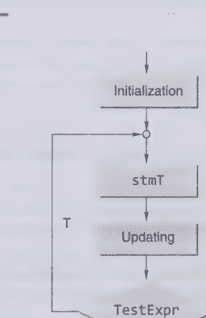

# 4.5.3 do-while 结构

与 `while` 结构密切相关的另一种结构是 `do-while` 结构。

`do` 关键字放在循环顶部的代码行。其后是一个语句块，在循环底部的 `while` 关键字之后是一个测试表达式。图 4.11 展示了这一点。该循环构造的格式如下：

```
{
    stmT; /* 语句体将放置在这里 */
} while(TestExpr);
```

测试表达式 `TestExpr` 必须求值为“真”，`do-while` 循环在第一次执行后才会迭代。`stmT` 可以是一个单独语句，也可以是一个语句块。`while` 循环和 `do-while` 循环之间的主要区别在于测试表达式的位置。由于 `do-while` 有

图 4.11 C do-while 循环

解释：考虑当输入的第一个数字是负数的情况。如果没有 `if` 语句，`count` 将为 1。请注意使用 `do-while` 循环允许至少执行一次循环的后果。以下示例将有助于理解循环。

输出: 无输出（此处对应原文）

# while 和 do-while 循环

与 `while` 循环一样，`do-while` 循环被认为是不定的或无边界。`while` 循环和 `do-while` 循环之间的重要区别在于：“控制循环的测试表达式何时被检查？”`do-while` 循环被认为是后测试循环，因为测试表达式位于循环体之后以及 `while` 关键字之后。即使表达式求值为假，`do-while` 循环也保证至少执行一次。

```c
#include <stdio.h>

int main() {
    int c = 5;
    while(c < 5) {
        printf(" Hello");
        c++;
    }
    return 0;
}
```

在 `while` 循环中，布尔表达式在循环执行之前检查。如果表达式求值为假，则循环完全不执行。

**输出：** 程序什么都不打印。由于条件 `c=5` 不满足，`printf()` 语句或 C++ 语句都不会执行。

# 注意事项

在 `do-while` 语句中，循环体首先执行，在体执行后检查测试表达式。因此，`do-while` 语句至少执行一次循环。

```c
#include <stdio.h>

int main() {
    int c = 5;
    do {
        printf("Hello");
        c++;
    } while(c < 5);
    return 0;
}
```

**输出：** Hello
在这里，循环内的语句至少执行一次。

# 示例

2. 欧拉数 e 用作自然对数的底。可以使用以下公式进行近似：

```math
e = \frac{1}{0!} + \frac{1}{1!} + \frac{1}{2!} + \dots + \frac{1}{n!}
```

其中 n 足够大。编写一个循环程序来近似 e，当两个连续的 e 值之间的差小于 0.000001 时循环终止。

假设某人想写只读取正整数的代码。以下代码可以实现目的。

```c
#include <stdio.h>

int main() {
    double term = 1.0;
    double sum = 1.0;
    int n = 0;
    while (term > 0.000001) {
        n++;
        term = term / n;
        sum = sum + term;
    }
    printf("\nINPUT A POSITIVE INTEGER: ");
    scanf("%d", &n);
    if(n <= 0) {
        printf("\nERROR Do not again");
    }
    return 0;
}
```

# 控制语句

EOF 也可以用于主读取（prime read）。考虑以下程序。

- 32. 编写一段代码，允许用户输入十分分以计算这些分数的平均值。

```c
#include <stdio.h>

int main() {
    int count, score;
    float average;
    count = 0;
    int numTimesNeeded = 10;
    int total = 0;
    return 0;
}
```


```c
while(count < numTimesNeeded) {

    printf("\nEnter a test score; \n");

    scanf("%d", &score);

    total += score;

}

average = (float)total/numTimesNeeded;

printf("\nThe average is %f , average;\n", average);

return 0;
```

# 4.6 使用计数器

在程序执行过程中控制重复的另一种方法是使用计数器。使用计数器需要知道某项需要重复的精确次数。如果程序用户被指示输入十个数字，可以将计数器变量设置为 0，然后当计数器的值小于十时，循环继续循环（这将等于十个循环：0, 1, 2, ... , 9）。

# 示例

- 31. 编写一段输出从 1 到 10 数字的代码。

```c
#include <stdio.h>

int main() {

    int count;

    count = 0;

    int numTimesNeeded = 10;

    while(count < numTimesNeeded) {

    }
}
```

# 4.7 GOTO 语句

`goto` 语句是 C 语言的另一种控制语句。控制无条件地与 `goto` 语句中指定的标签关联。`goto` 语句的格式为 `goto label_name;`。

由于 `goto` 语句会干扰正常的处理顺序，它使得程序更难以阅读和维护。通常，一个 `break` 语句、`continue` 语句或函数调用可以消除对 `goto` 语句的需求。

语句标签的定义方式与变量名完全相同，即字母和数字的序列，第一个字符必须是字母。语句标签后面紧跟一个冒号（:），就像 `switch` 中的标签一样。与其他语句一样，`goto` 语句以分号结束。

以下是 `goto` 语句的一些示例：

在理论上，总是可以避免使用 `goto` 语句的，但在某一两个情况下它是很有用的选项。当过度使用时，`goto` 语句不认为是一种良好的编程语句。因为 `goto` 语句会干扰正常的处理顺序，它使得程序更难以阅读和维护。当程序中使用过多的 `goto` 语句时，程序会到处分支，变得非常难以追踪。一些作者将带有许多 `goto` 语句的程序称为“意大利面代码”（spaghetti code）。尽可能避免 `goto` 语句。通常，一个 `break` 语句、`continue` 语句或函数调用可以消除对 `goto` 语句的需求。

# 示例

- 33. 以下程序用于计算一个数字的阶乘。

```c
#include <stdio.h>

int main() {

    int n, c;

    long int f=1;

    printf("\nEnter the number:\n");

    scanf("%d",&n);

    if(n<0)

        goto end;

    for(c=1; c<=n; c++)

        f=f*c;

    printf("\n FACTORIAL IS %ld\n", f);

    end:

    return 0;

}
```

# 4.8 特殊控制语句

某些控制语句可以终止循环或函数。这三个语句分别是：`return`、`break` 和 `continue`。

`return` 语句定义在函数的返回处，用于设置其返回值，`return` 语句用于终止函数的执行。`return` 语句有两种形式。返回类型为 `void` 的函数使用以下形式：

```c
return;
```

非 `void` 返回类型的函数使用以下形式：

```c
return expression;
```

在这里，`expression` 产生所需的返回值。该值必须为函数的返回类型进行声明。这将在关于函数的章节中进行更详细的解释。

`break` 语句 `break` 语句用于 `for`、`while` 和 `do-while` 等循环结构以及 `switch` 语句中，以终止循环或 `switch` 语句的执行。`break` 语句的格式为

```c
break;
```

在循环或 `switch` 结构中执行 `break` 语句后，执行将继续到循环结构或 `switch` 语句之后的语句。以下是使用 `break` 语句的示例。

`goto` 语句可以如下用于循环。这里，`goto` 语句与一个语句结合使用。

```c
#include <stdio.h>

int main() {

    int n, c;

    long int f=1;

    printf("\nEnter the number:\n");

    scanf("%d",&n);

    if(n<0)

        goto end;

    c=1;

    loop:

    f=f*c;

    c++;

    if(c<=n)

        goto loop;

    printf("\n FACTORIAL IS %ld\n", f);

    end:

    return 0;

}
```

# 控制语句

```c
#include <stdio.h>

int main() {

    int c=1;

    while(c<=5) {

        if(c==3) {

            break;

            printf("\t %d", c);

        }

        c++;

    }

    return 0;

}
```

这是一个无限循环。它将打印 1 2 3 4 5...

# 程序 2

```c
#include <stdio.h>

int main() {

    int c=1;

    while(1) {

        if(c==5) {

            break;

            printf("\t %d", c);

        }

    }

    return 0;

}
```

或者

```c
#include <stdio.h>

int main() {

    int c=1;

    for(c<=5;c++) {

        if(c==3) {

            break;

            printf("\t %d", c);

        }

    }

    return 0;

}
```

或者

```c
#include <stdio.h>

int main() {

    int c;

    for(;;) {

        if(c==5) {

            break;

            printf("\t %d", c);

        }

    }

    return 0;

}
```

程序将打印 1 而不是 1 2 3 4 5。使用 `break` 语句可以将 `while(1)` 语句变为有限循环。如下例所示。

# 程序 1

```c
#include <stdio.h>

int main() {

    int c=1;

    while(1) {

        printf("\t %d", c);

    }

    return 0;

}
```

`break` 语句可以检查一个数字是否为质数。以下程序说明了这一点。

```c
#include <stdio.h>

int main() {

    int n, r, d=2;

    printf("\nEnter the number :\n");

    scanf("%d", &n);

    r = n%d;

    while(d <= n/2) {

        r = 1;

        if(r==0)

            break;

        d++;

    }

    if(r==0)

        printf("\nNOT A PRIME NUMBER\n");

}
```

# 表 4.8 Break 和 continue 语句

| Break | Continue |
| :--- | :--- |
| 有助于退出块。 | 有助于避免当前迭代的剩余语句并继续下次迭代。 |
| 可以用于包括 `switch` 结构在内的控制语句。 | 只能用于循环结构。 |

以下程序说明了这一点。

带 `break` 程序

```c
#include <stdio.h>

int main() {

    int c=1;

    while(c<=5) {

        if(c==3)

            break;

        printf("\t %d", c);

    }

    return 0;

}
```

输出：1 2

`continue` 语句 `continue` 语句不终止循环，而是跳转到 `while` 和 `do-while` 语句中的测试表达式，并跳转到 `for` 语句中的更新表达式。`continue` 语句的格式为

```c
continue;
```

这里显示了在预测试和后测试循环中 `continue` 的跳转。

```c
while(testexpr) do

{

    continue;

}

do-while(TestExpr)

{

    continue;

}

for(initialization; TestExpr; updating)

{

    continue;

}
```

带 `continue` 程序

```c
#include <stdio.h>

int main() {

    int c=0;

    while(c<=5) {

        if(c==3)

            continue;

        printf("\t %d", c);

    }

    return 0;

}
```

输出：1 2 4 5 6

`break` 和 `continue` 语句的区别在表 4.8 中。

# 4.9 嵌套循环

嵌套循环指的是包含另一个循环的循环。如果程序需要重复循环多次，它是嵌套循环的理想候选。事实上，内部循环在外部循环的下次迭代之前完全执行。必须记住，每个内部循环都应该完全封装在外部循环内部，不允许重叠循环。因此，以下是不允许的：

```c
for(count = 1; count < 100; count++) {

    do {

        {

            /* do...while 循环 */

        } / end for 循环 */

    } while(x != 0);
```

```c
#include <stdio.h>

int main() {

    int row,col;

    for(row=1;row<=4;++row) {

        for(col=1;col<=row;++col) {

            printf("%d \t",row);

            printf("\n");

        }

    }

    return 0;

}
```

如果 `do-while` 循环完全放在循环中没有问题。示例：

```c
for(count = 1; count < 100; count++) {

    do {

        {

            /* do...while 循环 */

        } while(x != 0);

    } / end for 循环 */
```

如果在屏幕上必须获得输出
1
2 2
3 3 3
4 4 4 4

那么相应的程序将是

```c
#include <stdio.h>

int main() {

    int row,col;

    for(row=1;row<=4;++row) {

        for(col=1;col<=row;++col) {

            printf("%d \t",row);

            printf("\n");

        }

    }

    return 0;

}
```

嵌套循环的一个示例是打印以下：

+ *
*
***

前一个程序的变体是

在每行中多个 `'*'` 需要打印。第一行需要打印一个星号；第二行需要打印两个星号；第三行打印三个星号，以此类推。需要一个外部循环来跟踪打印的行数，在外部循环的每次迭代中，需要一个内部循环来跟踪对应行的星号打印。程序将如下：

```c
#include <stdio.h>

int main() {

    int row,col, k=1;

    for(row=1;row<=4;++row) {

        for(col=1;col<=row;++col) {

            printf("%d \t",k++);

            printf("\n");

        }

    }

    return 0;

}
```

它将在屏幕上打印以下内容：

```
+   1

2

3

4 5 6

7 8 9 10
```

这是一个嵌套循环的示例，用于打印乘法表。

#

使用循环时，请记住内部循环中进行的更改可能会影响外部循环。但请注意，内部循环可能独立于外部循环的变量；在下面的示例中，它们并非如此。

良好的代码缩进风格使得嵌套循环更易读。每一层循环都应该比前一层再多缩进一步。这可以清晰地标识与每个循环相关的代码。

让我们来看两个嵌套循环。为了使跟踪过程易于管理，缩短了迭代次数：

```c
for(num2 = 0; num2 <= 2; num2++) {

  for(num1 = 0; num1 <= 2; num1++) {

    printf("\n%d %d",num2,num1);

  }

}
```

输出：

| num 2 | num 1 |
|---|---|
| 0 | 0 |
| | 1 |
| | 2 |
| 3 (end) | |
| 1 | 0 |
| | 1 |
| | 2 |
| 3 (end) | |
| 2 | 0 |
| | 1 |
| | 2 |
| 3 (end) | |
| 3 | 0 |
| | 1 |
| | 2 |

| 1 2 3 4 5 6 7 8 9 10 |
| 2 4 6 8 10 12 14 16 18 20 |
| 3 6 9 12 15 18 21 24 27 30 |
| 4 8 12 16 20 24 28 32 36 40 |
| 5 10 15 20 25 30 35 40 45 50 |
| 6 12 18 24 30 36 42 48 54 60 |
| 7 14 21 28 35 42 49 56 63 70 |
| 8 16 24 32 40 48 56 64 72 80 |
| 9 18 27 36 45 54 63 72 81 90 |
| 10 20 30 40 50 60 70 80 90 100 |

注意，对于内部循环（在 `for` 循环的迭代结束时），使用了 `"\n"`，这会导致下一行输出打印在第一行。如果在嵌套循环中遇到 `break` 语句，程序的控制权将跳转到最内层循环后的第一个语句。例如，打印乘法表的对角线下半（从左上角到右下角的对角线以下），对于每一行（此处用 `i` 表示），列 `j` 等要跳过的剩余循环部分，并且应该执行打印换行符的行。同样，必须打印新行。输出如下：

记住，在内存中，`for` 循环将根据请求的结束值（或步长）注册一个值以退出循环。

# 控制语句 161

```
1

2 4

3 6 9

4 8 12 16

5 10 15 20 25

6 12 18 24 30 36

7 14 21 28 35 42 49

8 16 24 32 40 48 56 64

9 18 27 36 45 54 63 72 81

10 20 30 40 50 60 70 80 90 100
```

```c
{

    printf("%d\n", i);

    break;

}

return 0;

}
```

外部循环通过变量 `i` 遍历 3 到 100 的数字；代码测试每个数字是否存在除 1 和自身以外的因数。内部循环 `j` 每次增加 1；如果 `i` 除以 `j` 的余数为 0，则 `j` 是 `i` 的因子，代码使用 C 语言的 `remainder` 或 `modulus` 运算符来进行此测试。记住，如果 `i % j` 是 `i` 除以 `j` 的余数。

如果程序找到因子，它将执行 `break` 以跳出内部循环，而不打印任何内容。但如果它发现 `j` 已经超过了 `i` 的平方根且没有找到任何因子，则说明 `i` 没有因数。因此，`i` 是质数，并打印出它的值。通过注意到 `j > sqrt(i)`，已经确定 `i` 是质数，没有必要尝试其他因子。因此，在这种情况下可以使用 `break` 语句来跳出循环。以下程序是该情况的简化形式：

```c
#include <stdio.h>

int main() {

    int i, j;

    for (i = 1; i <= 10; i++) {

        for (j = 1; j <= 10; j++) {

            printf("%d, %d", i * j);

            if(i==j) {

                break;

            }

        }

        printf("\n");

    }

    return 0;

}
```

将所有内容以及 `break` 语句结合起来，这是一个打印 3 到 100 之间质数的程序。

```c
#include <stdio.h>

#include <math.h>

int main() {

    int i, j;

    printf("%d\n", i);

    for (i = 3; i <= 100; i++) {

        for (j = 2; j < sqrt(i); j++) {

        }

    }

    return 0;

}
```


```c
int r = i % j;

if (r == 0) {
    break;
}

if (r != 0)
    printf("%d\n", i);

return 0;
```

# 162 C 语言编程

## 常见错误

- **嵌套循环**：有时需要从内部循环退出嵌套循环并继续执行语句。内部循环中的 `break` 语句只会跳出该循环，并继续外部循环。这是 `goto` 非常用的情况之一（如下所示），因为它提供了避免复杂逻辑的方法。

- **编写类似 `a < b` 或 `a == b` 的表达式**：`a == b` 和 `a = b` 不同，因为 `=` 是赋值运算符。在编写等性代码时要小心。

- **忘记为复合语句使用大括号**：如果执行的语句多于一个，且表达式为真（`if...else`），则复合语句必须包含在大括号内。

- **悬空 else**：`else` 总是与最近的 `if` 匹配。如果这不是你想要的分支，请通过大括号建立 `if` 和 `else` 之间的正确关联。在构建 `if-else-if` 阶梯时要小心。

- **在循环中使用分号**：一种幼稚尝试如下：

```c
for (done = 0; i = 0; done < n; i++) {
    for (j = 0; j < m; j++) {
        for (k = 0; k < s; k++) {
            scanf("%d", &n);
            if (n == 0) {
                done = 1;
                goto GoOut;
            }
            x = n * (i + j + k);
        }
    }
}
GoOut:
```

另外，记住不要在 `for` 结束的括号后放置分号（这会立即结束循环）。作为示例，以下代码将打印 `12345`。

```c
for (int c = 1; c <= 5; ++c)
    printf("%d", c);
```

但下面的代码将打印 `6`。

```c
for (int c = 1; c <= 5; ++c);
printf("%d", c);
```

类似的问题也会出现在 `while` 循环中。小心不要在 `while` 循环开始处包含测试表达式之前放置分号。`do-while` 则有相反的问题。你必须记住总是用分号结束 `do-while`。

C89 规定编译器至少支持 15 层嵌套。C 编译器允许多得多的层数。然而，嵌套几层之后通常是不必要的，过度嵌套会迅速混淆算法的含义。

- **浮点等性**：不要对浮点数使用等性运算符。当需要浮点值相等时，最好比较操作数之间差值的绝对值是否小于一个极小值。对于诸如 `a == b` 的浮点等性测试：

```c
if (abs(a - b) < 0.00001)
```

其中值 `0.00001` 可以更改为其他可接受的小值：因此，如果两个操作数之间的差小于 `0.00001`（或任何其他使用的选定值），操作数被认为本质相等。

## 控制语句 163

## 总结

语句是程序执行时执行操作的句法结构。它可以改变变量的值、生成输出或处理输入。

# 164 C 语言编程

## 常见问题

### 1. C 语言中的关系表达式 `a < b < c` 是合法的吗？

是的。它是合法的，但意义可能不像你预期的那样。由于运算符 `<` 是左结合的，因此此表达式等同于 `(a < b) < c`。该评估的结果可能是 `0` 或 `1`，取决于 `a`、`b` 和 `c` 的值。

### 2. C 语言中没有异或运算符；可以如何模拟吗？

两个整数的逻辑异或操作结果为：当只有一个操作数为真（而不是两个都为真）时结果为真。可以通过以下表达式进行模拟：

```c
(a | b) && !(a & b)
```

其中 `a` 和 `b` 的类型为 `int`。

### 3. 浮点数很少等于所需的值或变量；如何测试两个浮点值是否相等？

选择 `for` 还是 `while` 取决于喜好。（注：原文答案似乎与问题不符，此处保留原文内容）

### 4. C 语言中的空语句是什么？

大括号内部（即 `{}`）不是一个语句。空代码块（称为空块）不等同于空语句。

### 5. 应该使用什么形式的循环：`while` 还是 `for`？

选择 `while` 还是 `do-while` 取决于情况。需要决定是预测试循环还是后测试循环。在可以使用 `while` 或 `do-while` 的情况下，计算机科学家通常使用预测试循环。因为一个通用原则是“预防胜于治疗”。如果迭代测试（即循环）位于循环开头，程序将更易读。在很多情况下，如果初始不满足条件，则跳过循环是非常重要的。

### 6. `break` 语句和 `continue` 语句之间的区别是什么？

有时当条件发生时，在条件出现后立即跳出或继续循环是必要的。`break` 语句为此目的。执行 `break` 语句允许程序立即退出其正在执行的循环，无论是 `for`、`while` 还是 `do-while`。后续语句被跳过，循环终止。

`continue` 语句会导致 `for`、`while` 或 `do-while` 循环进入下一次迭代。在 `do-while` 中，这意味着将立即执行测试部分，控制继续到下一步。`continue` 语句仅适用于循环，不适用于 `switch`。如果 `continue` 位于循环内部的 `switch` 中，会导致下一次迭代。

## 练习题

1. C 语言中的控制语句是指什么？
2. `if-else` 语句的目的是什么？
3. 比较 `if-else` 语句与 `?:` 的使用。特别是，`if-else` 语句中的 `?:` 运算符如何使用？
4. `switch` 语句的目的是什么？什么是标签（即 `case` 前缀）？什么类型的表达式必须代表一个 `case`？
5. 逗号运算符的目的是什么？逗号运算符通常出现在什么语句中？
6. 为什么不建议使用 `goto` 语句？在什么条件下 `goto` 可能会有帮助？应该避免哪些类型的用法以及为什么？
7. 区分 `for` 循环和 `while` 循环。讨论各者的用法。
8. 区分以下内容：
   (a) `do-while` 循环和 `while` 循环
   (b) `break` 和 `continue`
9. 写一个程序，判断键盘输入的年份是否为闰年。
10. 整数 $n$ 的阶乘是从 1 到 $n$ 的连续整数的乘积。即 $n = n \times (n-1) \times (n-2) \times ... \times 3 \times 2 \times 1$。写一个 C 程序求 $n$ 的阶乘值。
11. 写一个 C 程序，使用用户指定范围内的奇数打印一个整数的商。
12. 写一个 C 程序，使用任何方法将整数转换为二进制等效值。
13. （原文缺失 13，此处按序号跳过）
14. 写一个 C 程序，求用户给定数的质因数。
15. 写一个 C 程序，检查一个数是否为 2 的幂。
16. 写一个程序求两个数的最大公约数 (GCD)。
17. 写一个程序求用户给定数字的各位数字之和。
18. 写一个 C 程序计算范围内质数之和。
19. 写一个 C 程序打印以下级数数的和，其中 $n$ 由用户给出：$1 + x + x^2/2! + x^3/3! + ...$（$x$ 的值也由用户给出）
20. 写一个 C 程序打印以下级数的前 $n$ 项，其中 $n$ 由用户给出：$x^4/4! + x^5/5! ...$（$x$ 的值也由用户给出）
21. 写一个 C 程序打印级数：0 1 2 3 5 8 13 ...。打印的项数由用户给出。
22. 写一个 C 程序，打印未出现在斐波那契数列中的数字。打印的项数由用户给出。
23. 写一个程序将十进制转换为任意进制。
24. 写一个程序检查一个数是否为克里纳数 (Krishna number)。克里纳数是指各位数字之和等于该数的数。
25. 写一个程序，在不使用数组的情况下列表中第二大的数。（注：原文 "list out the second largest number in a list" 语义略有歧义，保留原意）
26. 写一个程序打印以下级数的和，使用或不使用 `pow()`：
    (a) $S = 1 + x + x^2 + ... + n$
    (b) $S = x - x^2 + x^3 - ... + n$
    (c) $S = 1 + x^2 + x^3 + ... + n$
    (d) $S = 1 + (1+2) + (1+2+3) + ... + n$
    (e) $S = 1 - x + x^2 - x^3 + ... + n$
    (f) $S = x - x^2 + x^3 - x^4 + ... + n$
    (g) $S = 2 + 2 + 2 + ... + n$
    (h) $S = 1 + x/4 + x/2 + ... + n$
    (i) $S = x - x^2 + x^3 - ... + n$
27. 写一个程序打印范围内的质数。
28. 给定一个数字，使用 `while` 循环反转该数字的数字。例如，`12345` 应该写成 `54321`。
29. 写一个程序打印以下三角形。
30. 写一个程序检查一个数字是否为质数。
31. 写一个程序打印用户给定范围的所有质数。
32. 写一个程序打印弗洛伊德三角形 (Floyd's triangle)。
33. 写一个程序求用户给定范围的质数。

## 项目题

1. 写一个 C 程序，提示用户输入日、月、年的整数值。该程序随后应按格式输出日期。
2. 这是一个具有变体的已知游戏。以下变体很有趣。玩家交替从堆中取子。每次操作中，玩家选择取多少子。玩家必须取至少一半的子。然后轮到另一个玩家。谁取最后一个子？写一个 C 程序让计算机对抗人类。生成一个 10 到 100 之间的随机整数表示堆的初始大小。生成一个 0 到 1 之间的随机整数来决定计算机还是人类先手。生成一个 0 到 1 之间的随机整数来决定计算机是智能还是愚蠢。在愚蠢模式下，计算机取 1 到 $n/2$ 之间的随机值，其中 $n$ 是堆的总子数。在智能模式下，计算机取足够的子，使堆的大小变为 2 的幂减 1，即 3、7、15、31 或 63。这始终是合法操作，除非堆的大小恰好是 2 的幂。在这种情况下，计算机执行随机合法操作。在智能模式下它是无法被击败的，除非堆的大小恰好是 15、31 或 63。当然，人类玩家先手且知道策略可以胜过计算机。

## 增加问题

在前面的章节，开发了一个程序来确定两点之间直线的长度。之前的程序代码不再重复。这里程序代码假设长度已经确定，三角形三边的长度存储在三个变量中。考虑到这一事实，进一步开发程序使用判断逻辑结构来解决该问题。

```c
char ans = 'y';

while (ans == 'y' || ans == 'Y') {
    printf("输入三角形三边的长度:\n");
    scanf("%d %d %d", &sideOne, &sideTwo, &sideThree);

    if (sideOne > sideTwo && sideTwo > sideThree || sideOne > sideThree && sideThree > sideTwo) {
        printf("\n可以画三角形\n");
    } else if (sideOne == sideTwo || sideTwo == sideThree) {
        printf("\n这是一个等边三角形\n");
    } else if (sideOne == sideThree) {
        printf("\n这是一个等腰三角形\n");
    } else {
        printf("\n这是一个不等边三角形\n");
    }

    scanf("%c", &ans); // 也可以使用 break;
}
```

## 问题描述

获取三角形三边的长度。检查是否可以形成三角形。如果可能，将三角形分类为等边、等腰或不等边三角形。否则，如果无法形成三角形，给用户机会重新输入边长或终止程序。

## 解决方案

为了解决这个问题，三角形三边的长度存储在三个变量 `sideOne`、`sideTwo`、`sideThree` 中。如果任意两边之和大于第三边的长度，则可以形成三角形。要确定是否可以形成三角形，使用以下表达式进行评估：

`sideOne > sideTwo && sideTwo > sideThree || sideOne > sideThree && sideThree > sideTwo`

（注：原文给出的判断三角形的逻辑表达式似乎有误，正确的判断条件应为任意两边之和大于第三边，此处保留原文表达式）

## 案例研究

### 控制语句 167

编写一个程序计算一个数字的平方根，不使用数学库中的 `sqrt()` 函数。

何时终止进程。当两次连续执行的值 `f` 和 `s` 之间的差异变得非常小时，重复循环应该终止，最好小于 `0.epsilon` 以实现精确相等。测试近似相等的方法是将两个浮点数相减，并将差的绝对值与一个非常小的数字进行比较。这个“非常小的数字”由程序员选择，它要小到足以认为这两个数是“相等”的。

## 分析

假设数字 $n$ 的平方根为 $m$，即 $n = m^2$。因此 $m = \sqrt{n}$。我们为这个问题开发算法，考虑 $m = 49$ 的情况。假设一个猜测值可以是 49 的平方根。如果 $n = 81$，比 49 大。由于它更大，让我们尝试 9。$8$ 的平方是 64，仍然大于 49。然而，对 $n$ 的猜测值应该是 7。在某些情况下，$n$ 的值可能不是 $n$ 的完全平方。那么问题在于如何选择初始猜测值。迭代次数接近初始猜测值。因此，平方根值的方法是另一个问题。如果选择 4 作为初始猜测值，那么 $n = 16$ 对于 49 来说太小了。由于该值在 4 和 9 之间，4 和 9 的平均值可能是下一个。平均值为 $(4 + 9) / 2 = 13 / 2 = 6.5$。$6.5$ 的平方是 42.25，小于 49。

最重要的问题是关于初始猜测值。如果初始猜测值必须是 $n/2$，这可以通过表格得出，表中列出了数字及其平方根。

| 数字 | 平方根（保留4位小数） |
| :--- | :--- |
| 1 | 1.0000 |
| 2 | 1.4142 |
| 3 | 1.5811 |
| 4 | 1.7320 |
| 5 | 2.2360 |
| 6 | 2.4494 |
| 7 | 2.6457 |
| 8 | 2.7386 |
| 9 | 2.8284 |
| 10 | 3.0000 |

如果将 49 除以 6.5，下一个互补值可以通过 $49 / 6.5 = 7.5384$ 得到。使用以下计算方法，可以得到下一个互补值：

$49 / 6.5 = 7.5384 \rightarrow 7.0192$

最后两个估计值是 7.5384 和 7.0192。这两个值接近实际结果，但一个略大于 7，另一个略小于 7。为了获得更好的估计值，最近两次猜测的平均值可以是下一个猜测值。

$7.0192$ 的平方是 49.2691，接近 49。总结分析，设上一个猜测值为 `f`；那么互补值为 `m / f`。平方根的改进估计值 `s` 为：

```c
s = (f + m / f) / 2;
```

上述过程可以通过将 `f` 替换为 `s` 来重复。如果 `f` 和 `s` 的值相互接近，连续的重复将产生更好的估计值，因为迭代减少了平方根估计值之间的差异并使其越来越小。通过连续迭代，从连续迭代找到平方根结果中得到估算值。

如果 `m` 为负数，则显示错误并立即终止，不进行任何计算。标准库中的平方根函数是 `sqrt()`，如果应用负参数它将返回“域错误”。在某些系统上，如果你尝试显示一个值，它将显示为 NaN。

## 设计

上述问题的算法可以表述为：

1. 开始
2. 打印“输入数字：”
3. 输入 `M`
4. 如果 `M < 0` 则打印“负值无效”；跳转到 10
5. `S ← M / 2`
6. `F ← S`
7. `S ← (F + M / F) / 2`
8. 如果 `(F - S) >= 0.000001` 则跳转到 6
9. 打印 `S`
10. 停止

```c
s = m / 2;

/* 设置初始猜测值 */
do {
    f = s;
    s = (f + m / f) / 2;
    /* 计算下一个估计值 */
} while (fabs(f - s) >= 0.000001);

return 0;
```

## 实现

下面遵循算法的相应 C 程序所示。

```c
/* 计算给定数字平方根的 C 程序 */
#include <stdio.h>
#include <math.h>

int main(void) {
    float m, f, s;

    printf("\nEnter the number:\n");
    scanf("%f", &m);

    /* 检查负输入 */
    if (m < 0) {
        printf("NEGATIVE VALUE IS INVALID\n");
        return 1;
    }

    s = m / 2.0f;

    do {
        f = s;
        s = (f + m / f) / 2.0f;
    } while (fabs(f - s) >= 0.000001);

    printf("Square root: %f\n", s);
    return 0;
}
```


# 问题描述

## 案例研究

### 控制语句

编写一个程序计算一个数字的平方根，不使用数学库中的 `sqrt()` 函数。

何时终止进程。当两次连续执行的次数 $f$ 和 $s$ 之间的差异变得非常小时，重复循环应该终止，最好小于 $0.\text{epsilon}$ 以实现精确相等。测试近似等等的常用方法是将两个浮点数相减，并将差的绝对值与一个非常小的数字进行比较。这个“非常小的数字”由程序员选择，它要小到足以认为这两个数是“相等”的。

# 分析

假设数字 $n$ 的平方根为 $m$，即 $n=m^2$。因此 $m=\sqrt{n}$。我们为这个问题开发算法，考虑 $m=49$ 的情况。假设一个猜测值可以是 49 的平方根。如果 $n=81$，比 49 大。由于它更大，让我们尝试 9。$8$ 的平方是 64，仍然大于 49。然而，对 $n$ 的猜测值应该是 7。在某些情况下，$n$ 的值可能不是 $n$ 的完全平方。那么问题在于如何选择初始猜测值。迭代次数接近初始猜测值。因此，平方根值的方法是另一个问题。如果选择 4 作为初始猜测值，那么 $n=16$ 对于 49 来说太小了。由于该值在 4 和 9 之间，4 和 9 的平均值可能是下一个。平均值为 $(4+9)/2=13/2=6.5$。$6.5$ 的平方是 42.25，小于 49。

最重要的问题关于初始猜测值。如果初始猜测值必须是 $n/2$，这可以通过表格得出，表中列出了数字及其平方根。

如果将 49 除以 6.5，下一个互补值可以通过 $49/6.5=7.5384$ 得到。使用以下计算方法，可以得到下一个互补值：

| 数字 | 平方根（保留4位小数） |
|---|---|
| 1 | 1.0000 |
| 2 | 1.4142 |
| 3 | 1.5811 |
| 4 | 1.7320 |
| 5 | 2.2360 |
| 6 | 2.4494 |
| 7 | 2.6457 |
| 8 | 2.7386 |
| 9 | 2.8284 |
| 10 | 3.0000 |

$49 / 6.5 = 7.5384 \rightarrow 7.0192$

最后两个估计值是 7.5384 和 7.0192。这两个值接近实际结果，但一个略大于 7，另一个略小于 7。为了获得更好的估计值，最近两次猜测的平均值可以是下一个猜测值。

$7.0192$ 的平方是 49.2691，接近 49。总结分析，设上一个猜测值为 $f$；那么互补值为 $m/f$。平方根的改进估计值 $s$ 为：

```
s = (f + m/f) / 2
```

上述过程可以通过将 $f$ 替换为 $s$ 后加 1 来重复。如果 $f$ 和 $s$ 的值相互接近，连续的重复将产生更好的估计值，因为迭代减少了平方根估计值之间的差异并使其越来越小。通过连续迭代，从连续迭代找到平方根结果中得到估算值。

如果 $m$ 为负数，则显示错误并立即终止，不进行任何计算。标准库中的平方根函数是 `sqrt()`，如果应用负参数它将返回“域错误”。在某些系统上，如果你尝试显示一个值，它将显示为 `NaN`。

# 设计

上述问题的算法可以表述为：

1. 开始
2. 打印“输入数字：”
3. 输入 M
4. 如果 M < 0 则打印“负值有效”；跳转到 10
5. S ← M/2
6. F ← S
7. 由于连续的猜测是通过重复应用公式 (1) 得到的，会越来越接近平方根的真实值，可以设置一个限制用于判断终止条件
8. S ← (F + M/F) / 2
9. 如果 (F - S) >= 0.000001 则跳转到 6
10. 打印 S
11. 停止

```c
s = m/2;

/* 设置初始猜测值 */

do {
    f = s;
    s = (f + m / f) / 2;
    /* 计算下一个估计值 */
} while (fabs(f - s) >= 0.000001);

return 0;
```

# 实现

下面遵循算法的相应 C 程序所示。

```c
/* 计算给定数字平方根的 C 程序 */

#include <stdio.h>
#include <math.h>

int main(void) {
    float m, f, s;

    printf("\nEnter数字：\n");
    scanf("%f", &m);

    /* 检查负输入 */
    if (m < 0) {
        printf("NEGATIVE VALUE IS VALID");
        return 0;
    }

    s = m / 2;
    do {
        f = s;
        s = (f + m / f) / 2;
    } while (fabs(f - s) >= 0.000001);

    printf("Square root = %f\n", s);
    return 0;
}
```

# 数组与字符串

## 5.2.1 一维数组的声明

数组。在本节中，将讨论一维数组。

由于数组是一维的，因此将有一个下标或索引，其值指向单个数组元素，该元素的范围范围从 0 到 (n-1)，其中 n 是数组中元素的总数。

其中 `<index>` 是一个范围从 0 到 `<SIZE>` - 1 的整数或变量。
在示例中，数组索引从 0 开始，因此对于该数组，元素被命名为 `a[0]`, `a[1], ... a[99]`。其核心思想是，如果有一个名为 `a` 的数组变量，可以通过 `a[0]`, `a[1], ... a[99]` 来访问其元素。也就是说，数组的特定元素可以通过其“索引”来访问，索引是一个指定了需要哪个元素的数字。

在程序中使用数组之前，必须对其进行声明。
在程序中定义数组时，需要指定三个要素点：

*   它所能包含的数据类型，例如 `int`、`char`、`double`、`float`，
*   它能包含的值的数量，即它能包含的最大元素数量
*   一个名称

一维数组的声明是一个数据类型后跟一个带括号的常量表达式。该表达式的值（必须是）是数组的大小。它指定了数组中元素的数量。数组下标的范围可以从 0 到 (size-1)。数组的下界是 0，上界是 size-1。因此，以下关系成立：

```
lower bound = 0
upper bound = size - 1
size = upper bound + 1
```

在整数的一维数组中，数组由在列表中通过位置引用的变量组成。索引变量提供了访问和修改数组中值的手段。例如，一个名为 `number` 的数组：

*   `number[0]` 指向 `number` 数组中存储的第一个数字
*   `number[1]` 指向 `number` 数组中存储的第二个数字
*   `number[2]` 指向 `number` 数组中存储的第三个数字
*   `number[3]` 指向 `number` 数组中存储的第四个数字
*   `number[4]` 指向 `number` 数组中存储的第五个数字

```c
int a[SIZE]; // a[0],a[1],... a[size-1] 的内存空间 allocated
```

图 5.1 展示了带有每个数组元素正确命名的数组 `number`。每个单独的数组被称为索引变量或下标变量，必须同时使用变量名和索引或下标值来引用该元素。索引或下标值给出了元素在数组中的位置。在内部（程序员不可见），计算机使用索引作为从其起始位置的偏移量。

一维数组声明的语法为 `<data_type> <array_name>[<SIZE>];`

*   所有元素都持有类型为 `<type>` 的值
*   数组的大小由 `<SIZE>` 表示，即数组中元素的数量。必须是 `int` 或常量表达式。

例如，要声明一个可以容纳最多 10 个整数的数组，必须编写以下语句。

```c
int ar[10]; // 10 个整数的内存空间。
```

同样，

```c
int a[100]; // 一个具有 100 个元素的数组
```

声明了一个可以容纳 100 个整数的数组 `a`。一旦声明，数组元素可以通过以下方式引用：

```
<array name>[<index>]
```

如图 5.2 所示，索引表示了从数组开始跳过多少个元素以获取所需的元素。在声明时，必须给出数组的大小；这是强制性的。否则，编译器将生成错误。

### 符号常量

这种方法被用于书中所出的示例程序中。考虑以下使用这种方法的示例程序。

```c
/* 为数组的大小定义一个符号常量 */
#include <stdio.h> // 符号常量 N 是
#define N 100 // 分配值为 100

int main() {
    double x[N], y[N];
    return 0; // N 被替换为分配的值 100
}
```

## 5.2.2 数组元素的访问与处理

数组名和索引号标识了数组的起始位置。这种方法被用于书中的示例程序。数组的 size 是不必要的。此语句中被订阅变量的下标值可以用 `for` 循环中的计数器替换，以便顺序访问数组中的每个元素。特别是，以下 C 语句：

```c
total = 0; /* 将 total 初始化为零 */
for(i = 0; i < 5; i++)
    total = total + numbers[i]; /* 加上一个数字 */
```

会顺序检索数组元素并将元素加到 `total` 中。在这里，变量 `i` 既用作循环的计数器，又用作下标。随着 `i` 在每次通过 `for` 循环时增加，将引用数组中的下一个元素。在 `for` 循环内添加元素的处理步骤与之前使用的相同。

以下代码：

```c
/* 将示例数组中的所有元素初始化为 0 */
for(i = 0; i < 5; i++) {
    a[i] = 0;
}
```

将导致数组的所有元素设置为 0。考虑以下使用上述代码段的程序。

```c
#include <stdio.h>
#define ARRAY_SIZE 10

int main() {
    int index, a[ARRAY_SIZE];
    for(index = 0; index < ARRAY_SIZE; ++index)
        a[index] = 0;
    printf("[%d] = %d\n", index, a[index]);
    printf("\n");
    return 0;
}
```

输出如下：

```
a[0] = 0
a[1] = 0
a[2] = 0
a[3] = 0
a[4] = 0
a[5] = 0
a[6] = 0
a[7] = 0
a[8] = 0
a[9] = 0
```

数组对于许多问题来说非常方便，但 C 语言对数组的自动处理有限。特别是，数组的所有元素不能一次性设置；数组不能被赋值。以下赋值：

```c
a = 0; /* 错误 */
```

和

```c
int b[10];
a = 0; /* 错误 */
```

都是非法的，其中 `a` 是一个数组。
因此，例如，给数组 `ar[10]` 赋值（即向数组中存储值），可以使用以下程序。

```c
ar[0] = 1;
ar[1] = 3;
ar[2] = 5;
ar[9] = 19;
```

或者

```c
for(i = 0; i < 10; i++)
    ar[i] = (i*2) + 1;
```

注意用作下标的变量 `i` 如何从 0 增加到“小于”10，即从 0 到 9。要访问数组中的值，可以使用下标表示法。

```c
printf("%d", ar[i]);
third = ar[2];
tholdSquared = ar[n-1];
```

## 5.2.4 其他允许的操作

这些操作包括以下内容，针对数组 `ar`：

*   **(a)** 要递增第 i 个元素，可以使用语句：
    `ar[i]++;`
    `ar[i] += 1;`

*   **(b)** 要给第 i 个元素加上 n，可以使用以下语句：
    `ar[i] = ar[i] + n;`
    `ar[i] += n;`

*   **(c)** 要将第 i 个元素的内容复制到第 k 个元素，可以写下语句：
    ```c
    ar[k] = ar[i];
    ```

*   **(d)** 要将一个数组 `ar` 的内容拷贝到另一个数组 `br`，必须逐个完成。
    ```c
    int ar[10], br[10];
    for(i = 0; i < 10; i = i + 1)
        br[i] = ar[i];
    ```

*   **(e)** 要交换 `ar[i]` 和 `ar[k]` 中的值，必须一个“临时”变量来保存一个值，且它的数据类型应与交换的数组元素相同。为了完成此任务，编写了以下 C 语句：
    ```c
    int temp;
    temp = ar[i]; /* 保存 ar[i] 中值的副本 */
    ar[i] = ar[j]; /* 将值从 ar[j] 复制到 ar[i] */
    ar[j] = temp; /* 将保存的 ar[i] 值复制到 ar[j] */
    ```

## 5.2.5 在数组中存储用户提供的值

将输入读入数组所示：

```c
/* n = 数组元素个数 i=索引 */
#include <stdio.h>
#include <stdlib.h>

int main() {
    int n, i, a[30];
    printf("\n 输入数字个数: ");
    scanf("%d", &n);

    if(n > 30) {
        printf("\n 数字过多");
        exit(0);
    }

    for(i = 0; i < n; i++) {
        printf("\n 输入数字 %d: ", i+1);
        scanf("%d", &a[i]);
    }

    printf("\n 倒序的数字 \n");
    for(i = n-1; i >= 0; i--)
        printf("%d ", a[i]);

    return 0;
}
```

## 5.2.6 变长数组与 C99 的变化

在早期版本的 C (C89) 编译器中，数组大小必须是常量表达式，以便在编译时进行计算。这在前面的章节中已经提到。在 C99 编译器中，数组可以是一个整数表达式，而不一定是常数。这允许程序员声明变长数组或在运行时确定大小的数组。然而，此类数组存在于块或函数内部，意味着其作用域限制在一对左括号 `{` 和右括号 `}` 之间。这意味着此类数组的存储分配是在运行时进行的，并且在它块或函数的作用范围内存在期间，一旦离开该作用范围就会释放存储。

即使在只有几十兆内存的机器上，大小也可以达到 64k。内存的其余部分由编译器留出，但用户可以显式地访问它；它被称为堆。

在 C99 中，只能为某些元素设置初始值，未初始化的元素将被初始化为 0。同样，只能为特定的成员设置初始值，未初始化的成员将被初始化为 0。当需要初始化的元素有限或数组元素数量很大时，这种方法非常有用。

### 指定初始化器示例

```c
int arr[6] = { [2]=3, [5]=7 };
```

在这里数组 `arr[2]` 和 `arr[5]` 分别被赋值为 3 和 7，数组中的所有其他元素都被赋值为 0。

## 5.2.7 使用一维数组

以下程序演示了打印十进制数的二进制等值，这里十进制数除以 2 的余数被存储在正确的数组中。

```c
#include <stdio.h>

int main(void) {
    int n, i;
    printf("enter the value of the n: ");
    scanf("%d", &n);
    int a[n];
    printf("enter the values by one\n");
    for(i = 0; i < n; i++)
        scanf("%d", &a[i]);
    printf("\nentered numbers are....\n");
    for(i = 0; i < n; i++)
        printf("%d\n", a[i]);
    return 0;
}
```

除法过程持续到数字变为 0。

```c
#include <stdio.h>

int main() {
    int a[20], i, m, n, r;
    printf("\nEnter the Decimal Integer:\n");
    scanf("%d", &n);
    m = n;
    for(i = 0; n > 0; i++) {
        r = n % 2;
        a[i] = r;
        n = n / 2;
    }
    printf("\nBinary equivalent of %d is ", m);
    for(i -= 1; i >= 0; i--)
        printf("%d", a[i]);
    printf("\n");
    return 0;
}
```

### 使用数组的斐波那契数列

这引入了另一种方法。程序打印由序列定义的数字，其中每个元素都是前两个元素的和。此程序将序列存储在数组中，在计算出项后，以表格的形式打印这些数字。

```c
#include <stdio.h>

int main() {
    int fib[15];
    int i;
    fib[0] = 0;
    fib[1] = 1;
    for(i = 2; i < 15; i++)
        fib[i] = fib[i-1] + fib[i-2];
    for(i = 0; i < 15; i++)
        printf("%d ", fib[i]);
    printf("\n");
    return 0;
}
```

C99 的一些变化。可以使用称为“初始化列表”（initializer）的格式显式指定数组的元素编号。在 C89 中初始化数组时，每个元素需要从头按顺序初始化。


# 数组与字符串

## 斐波那契数列示例

```c
fib[0] = 0;
fib[1] = 1;
for (i = 2; i < 15; i++)
    fib[i] = fib[i-1] + fib[i-2];
for (i = 0; i < 15; i++)
    printf("%d\n", fib[i]);
return 0;
```

**输出：**
```
0
1
1
2
3
5
8
13
21
34
55
89
144
233
```

## 线性搜索

在数组中搜索元素考虑一个包含 `n` 个元素的数组，其中每个元素都是一个键（例如一个数字）。任务是在数组中找到一个键。最简单的方法是顺序搜索或线性搜索。其思想是从头开始逐元素地搜索数组，直到找到键或到达列表末尾。如果找到，则打印数组中相应的位置；否则，将显示未找到键的消息。

```c
if(n>30) {
    printf("\n Too many Numbers\n");
    exit(0);
}
printf("\n Enter the array elements\n");
for(i=0; i<n; i++) {
    scanf("%d", &a[i]);
}
printf("\n Enter the key to be searched\n");
scanf("%d", &key);
for(i=0; i<n; i++) {
    if(a[i] == key) {
        printf("\n Found at %d\n", i);
        FOUND=1;
    }
}
if(FOUND == 0) {
    printf("\n NOT FOUND...\n");
}
return 0;
```

## 冒泡排序

排序数组：冒泡排序比较相邻的数组元素，如果它们的顺序不对则交换它们的值。通过这种方式，较小的值会“泡”到数组顶部，而较大的值会沉到最后。这种排序一直持续直到不再发生交换。使用一个“已排序”（`sorted`）标志。冒泡排序的工作原理：遍历数据，每次比较两个元素，如果第一个元素大于第二个元素则交换。以下示例描述了冒泡排序的不同阶段。

```c
#include <stdio.h>
#include <stdlib.h>

int main() {
    int a[30];
    // ... 代码片段不完整
}
```

| 第1 轮 | 第2 轮 | 第3 轮 | 第4 轮 | 第5 轮 |
|---|---|---|---|---|
| 42 | 26 | 26 | 26 | 26 |
| 60 | 42 | 42 | 42 | 42 |
| 26 | 55 | 42 | 42 | 42 |
| 34 | 28 | 55 | 42 | 42 |
| 55 | 34 | 28 | 55 | 42 |

```c
scanf("%d",&n);
```

### 完整冒泡排序实现

```c
#include <stdio.h>
#include <stdlib.h>

int main() {
    int a[30], n, i, j, temp, sorted=0;

    printf("\nHow many numbers?\n");
    scanf("%d", &n);

    if(n>30) {
        printf("\nToo many Numbers\n");
        exit(0);
    }

    printf("\n Enter the array elements \n");
    for(i=0; i<n; i++)
        scanf("%d", &a[i]);

    for(i=0; i<n-1 && sorted==0; i++) {
        sorted=1;
        for(j=0; j<(n-i-1); j++) {
            if(a[j] > a[j+1]) {
                temp = a[j];
                a[j] = a[j+1];
                a[j+1] = temp;
            }
        }
    }

    printf("\nThe numbers in sorted order \n");
    for(i=0; i<n; i++)
        printf("\n%d", a[i]);

    return 0;
}
```

**输出：**
```
多少个数字 6
输入数组元素
42
60
26
55
34
28
26
28
34
42
55
60
排序后的数字
```

## 二分搜索

顺序搜索的缺点是它可以消除列表的大部分内容。二分搜索的方法是将待搜索列表的大小减半。

二分搜索可以通过在书中查找页码来简单地解释。假设读者在 150 页的书中查找第 90 页。读者首先打开书的半部分。如果页码小于 90，读者将向右打开；如果大于 90，读者重复此过程直到找到第 90 页。可见，通过第一次搜索，读者大大减少了需要搜索的页数。

二分搜索需要操作数据，因为数据在书中可能是不连续的。无法猜测数据位于哪分之一。因此，搜索本身被一分。

在制定算法并分析它之前，将通过一个示例演示二分搜索。

在二分搜索中执行以下步骤：

- 查看列表的中间元素。
- 如果搜索的值小于中间元素，继续处理列表的下半部分。
- 如果搜索的值大于中间元素，继续处理列表上半部分。

在二分中，将数组一分为二，并在包含所搜索值的那部分重复算法（如果存在的话）。

### 示例

**示例 2：** 考虑数组 `1 2 3 4 5 6 7 8 9`，构造寻找 `Key = 7` 的二分搜索算法。

```c
// 1 次迭代
HIGH = 8, LOW = 0; // 数组索引从 '0' 开始到 '8'
```

**表 5.1 二分搜索算法图示**

| 索引 | 0 | 1 | 2 | 3 | 4 | 5 | 6 | 7 | 8 | 9 | 10 | 11 | 12 | 13 | 14 | 15 |
|---|---|---|---|---|---|---|---|---|---|---|---|---|---|---|---|
| 数据 | 23 | 27 | 29 | 32 | 34 | 41 | 46 | 47 | 49 | 52 | 55 | 68 | 71 | 74 | 77 | 78 |

| 第1 次迭代 | L | M | | | | | | | | | | | | | | |
| 第2 次迭代 | | | L | M | | | | | | | | | | | | |
| 第3 次迭代 | | | | | L | M | | | | | | | | | | |
| 第4 次迭代 | | | | | | | L | M | | | | | | | | |
| 第5 次迭代 | | | | | | | | | L | M | | | | | | |

```c
14. MID = (HIGH + LOW) / 2
15. IF T = LIST[MID]
    FOUND = 1
ELSE IF T < LIST[MID+1]
    HIGH = MID-1
LOW = MID+1
```

### 算法描述

3. 排序大小为 `N` 的数组列表并找到目标值的位置。
4. 算法：算法确定 `T` 在列表中的位置。
   1. 开始
   2. 输出 "输入数组中的元素数量"
   3. `printf("\n 输入数组的元素:\n");`

## 骰子投掷模拟

这是一个关于数组使用的稍大一点的示例。假设想研究一对骰子的行为。总和值范围从 2 到 12，并统计每个点出现的频率。使用一个数组来跟踪计数：`a[12]` 将记录它们被掷出的次数。

骰子投掷的模拟是通过调用 C 语言的随机数生成函数 `rand()` 完成的。每次调用 `rand()`，它都会返回一个伪随机整数。这些值通常跨度很大，因此将使用 C 的模（取余）运算符 `%` 来产生所需范围内的随机数。表达式 `rand() % 6` 产生 0 到 5 之间的随机数，而 `rand() % 6 + 1` 产生 1 到 6 之间的随机数。

```c
#include <stdio.h>
#include <stdlib.h>

int main() {
    int i;
    int d1, d2;
    int a[13]; /* 使用 [2..12] */

    for(i=2; i<=12; i = i + 1)
        a[i] = 0;

    for(i=0; i<100; i = i + 1) {
        d1 = rand() % 6 + 1;
        d2 = rand() % 6 + 1;
        a[d1 + d2] = a[d1 + d2] + 1;
    }

    for(i=2; i<=12; i = i + 1)
        printf("%d: %d\n", i, a[i]);

    return 0;
}
```

必须包含头文件 `<stdlib.h>`，因为它包含了 `rand()` 函数必要的声明。必须声明一个大小为 13 的数组，以便其最高元素为 `a[12]`。`a[0]` 和 `a[1]` 的空间将被浪费；这损失并不大。变量 `d1` 和 `d2` 包含两个骰子的掷点值；它们被相加以决定在这一行中增加数组的哪个单元。

```c
a[d1 + d2] = a[d1 + d2] + 1;
```

100 次投掷后，数组被打印出来。通常，输出中看到最多 7，而 2 和 12 相对。使用 `%` 运算符缩小 `rand()` 函数的范围并不总是个好主意。

## 5.3 字符串：一维字符数组

C 语言中的字符串由字符数组表示。字符串的结束用一个特殊字符标记，即空字符（null character），这是一个所有位均为零的字符，即 `\0`（不是 `NULL`）。（空字符除了空指针外没有其他关系。在 ASCII 字符集中，空字符命名为 `NUL`。）空字符或字符串终止字符由另一个转义序列 `\0` 表示。

尽管 C 语言没有字符串数据类型，但它允许字符串。例如 `"hello students"` 是一个字符串常量。

### 检查你的进展

1. 给定数组：
   ```c
   int myArray[] = {0, 2, 4, 6, 8, 10};
   ```
   `myArray[2]` 的值是多少？
   **输出：** `4`

2. 
   ```c
   #include <stdio.h>
   main(){
       float a[10];
       printf("%d", sizeof(a));
   }
   ```
   这个程序的输出是什么？
   **输出：** `40`

3. 
   ```c
   #include <stdio.h>
   main(){
       int a[5];
       for(i=0;i<5;i++)
       printf("%d", a[i]);
   }
   ```
   这个程序的输出是什么？
   **输出：** 垃圾值

4. 已经声明了一个数组 `int a[] = {1, 2, 3, 4, 5, ...};`。你如何通过手动计数来找到数组的元素个数（索引，大小）？
   **输出：** `printf("%d", sizeof(a)/sizeof(a[0]));`

### 5.3.1 字符串的声明

字符串可以像一维数组一样声明。例如，
```c
char str[30];
char text[80];
```
说明了这一特性。

### 5.3.2 字符串初始化

字符数组或字符串允许简写初始化，例如，
```c
char str[] = "HELLO";
```
这等同于
```c
char str[] = {'H', 'E', 'L', 'L', 'O', '\0'};
```
每当双引号内包含字符串时，它会自动创建一个包含并 `\0` 字符终止的字符数组。C 语言允许这种替代表示法
```c
char msg[] = "hello";
```
在实践中使用。

## 字符串输入输出示例

```c
#include <stdio.h>

int main() {
    char buf[128];
    double x = 1.23456;
    int i = 0;

    sprintf(buf, "x = %7.5f", x); // 原文为 printf(buf,...)，推测为 sprintf

    while(i<10)
        puts(buf+i++);

    return 0;
}
```

**输出：**
```
x = 1.23456
= 1.23456
= 1.23456
1.23456
1.23456
.23456
23456
3456
456
56
```

### 使用 `scanf()` 与 `%s` 控制符

可以通过函数 `scanf()` 的 `%s` 转换读取字符串，但存在一些限制。第一个是 `scanf()` 仅识别由空白字符分隔的字符序列为外部字符串。第二是，程序员有责任确保有足够的空间接收并存储输入字符串，以及 `scanf()` 作为 `%s` 转换的一部分自动生成并存储的终止空字符。值列表中的相关参数必须是地址。

```c
int main() {
    char str[50];
    printf("Enter a string:");
    scanf("%s", str);
    printf("The string was %s\n", str);
    return 0;
}
```

**示例运行输出：**
- (a) Enter a string :manas
  The string was :manas
- (b) Enter a string :manas ghosh
  The string was :manas
- (c) Enter a string "manas and ghosh"
  The string was :manas

如果在 `sprintf()` 的格式化字符串中包含了 `\n`，输出将产生双倍行距，因为生成的字符串中有一个，而 `puts()` 会再次产生一个换行。

与整数、浮点数和字符不同，`%s` 格式不需要在变量 `str` 前加取地址符。

还会观察到，尝试对带有内部空格的字符串加引号或转义内部空格（这两者在 UNIX 环境下通常都有效）是无效的。C 支持字段宽度和精度，例如：

```c
printf("%.*s\n", w, d, str); // 原文格式有误，修正为标准用法
```
在宽度为 `w` 的字段宽度内通过 `printf` 打印字符串的前 `d` 个字符。例如：

```c
int main() {
    char str[50];
    printf("\nEnter a string:");
    scanf("%s", str);
    printf("\n %.*s\n", 3, str); // 打印前3个字符
    return 0;
}
```
> 指定将打印字符串的前三个字符。

**示例运行：**
```
Enter a string:
Manas
```
（打印输入字符串的前三个字符）
屏幕上显示 "Man"。

## 十进制转十六进制示例

作为说明，以下程序将十进制数转换为十六进制值。

当控制在 `while` 循环外部时，`i` 的值为 2。在初始化步骤 `i` 变为 1。在第一次迭代中，将打印 `hexdigit[1]`（即 `'1'`），因为存储在 `a[1]` 中的值是 1。在第二次迭代中，将打印 `hexdigit[0]`（即 `'C'`），因为该值...

上面的程序可以重写，将余数存储在字符串 `hexdigit` 中。

**版本 1：**
```c
#include <stdio.h>

int main(void) {
    int n, r, a[50];
    char hexdigit[] = "0123456789ABCDEF";

    printf("\nEnter the decimal number: ...\t");
    scanf("%d", &n);

    int i = 0;
    while(n > 0) {
        r = n % 16;
        a[i] = r;
        i++;
        n = n / 16;
        // 以下逻辑在原文中似乎有误，hexdigit 是常量字符串不可修改
        if(r < 10)
            hexdigit[i] = r + 48;
        else
            hexdigit[i] = r + 65;
    }

    hexdigit[i] = '\0'; // 错误：hexdigit 是字符串字面量

    printf("Hexadecimal equivalent is: ...\t");
    for(i = 0; i < i; i++) // 循环条件 i<i 恒为假
        printf("%c", hexdigit[i]);

    return 0;
}
```

**版本 2（修正版）：**
```c
#include <stdio.h>
#include <string.h>

int main(void) {
    int n, r, i;
    char hexdigit[50]; // 定义为数组以便修改

    printf("\nEnter the decimal number: ...\t");
    scanf("%d", &n);

    i = 0;
    while(n > 0) {
        r = n % 16;
        if(r < 10)
            hexdigit[i] = r + 48; // '0' = 48
        else
            hexdigit[i] = r + 55; // 'A' = 65, r=10 -> 65. 原文为 r+65，当 r=10 时为 75 'K'，错误。应为 r+55 或 r-10+'A'
        i++;
        n = n / 16;
    }
    hexdigit[i] = '\0';
    // 此处需反转字符串或倒序打印
    // ...
    return 0;
}
```


# C 语言编程

```c
#include <stdio.h>

int main() {
    char buf[128];
    double x = 1.23456;
    int i = 0;
    sprintf(buf, "x = %7.5f", x);
    while (i < 10)
        puts(buf + i++);
    return 0;
}
```

位于预留用于存储输入字符串的内存区域的第一个位置。

当然，可以指定字段宽度，这是读取的最大字符数，请记住，输入缓冲区中的任何额外字符将保持原样。接下来的示例展示了使用 `scanf()` 配合 `%s` 的简单用法。

```c
int main() {
    char str[50];
    printf("Enter a string:");
    scanf("%s", str);
    printf("The string was %s\n", str);
    return 0;
}
```

产生的输出如下：

```
x = 1.23456
= 1.23456
= 1.23456
1.23456
1.23456
.23456
23456
3456
456
56
```

示例运行输出：

- (a) Enter a string :manas
  The string was :manas
- (b) Enter a string :manas ghosh
  The string was :manas
- (c) Enter a string "manas and ghosh"
  The string was :manas

如果在 `sprintf()` 的格式化字符串中包含了 `\n`，输出将产生双倍行距，因为在生成的字符串中有一个，而 `puts()` 会再次产生一个换行。

与整数、浮点数和字符不同，`%s` 格式不需要在变量 `str` 前加取地址符。

还会观察到，尝试对带有内部空格的字符串加引号或转义内部空格（这两者在 UNIX 环境下通常都有效）是无效的。C 支持字段宽度和精度，例如：

## 5.3 字符串输入

```c
printf("%*.*s\n", w, d, str);
```

接下来的章节将描述从用户处获取输入的方法。

## 使用 scanf() 配合 %s 控制符

可以通过函数 `scanf()` 的 `%s` 转换读取字符串，但存在一些限制。第一个是 `scanf()` 仅识别由空白字符分隔的字符序列为外部字符串。第二个是，程序员有责任确保有足够的空间接收并存储输入字符串，以及 `scanf()` 作为 `%s` 转换的一部分自动生成并存储的终止空字符。值列表中的相关参数必须是地址。

在宽度为 `w` 的字段宽度内通过 `printf` 打印字符串的前 `d` 个字符。例如：

```c
int main() {
    char str[50];
    printf("\nEnter a string:");
    scanf("%s", str);
    printf("\n %.*s\n", 3, str);
    return 0;
}
```

> 指定将打印字符串的前三个字符。

示例运行：

# 数组与字符串 185

Enter a string:

（打印输入字符串的前三个字符）
屏幕上显示 "Manas"。

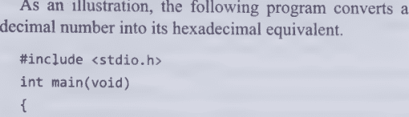

作为说明，以下程序将十进制数转换为十六进制值。

当控制在 `while` 循环外部时，`i` 的值为 2。在初始化步骤，`i` 变为 1。在第一次迭代中，将打印 `hexdigit[1]`（即 '1'），因为存储在 `a[1]` 中的值是 1。在第二次迭代中，将打印 `hexdigit[0]`（即 'C'），因为该值……

上面的程序可以重写，将余数存储在字符串 `hexdigit` 中。

```c
#include <stdio.h>

int main(void) {
    int n, r, a[50];
    char hexdigit[] = "0123456789ABCDEF";
    printf("\nEnter the decimal number: ...\t");
    scanf("%d", &n);
    int i = 0;
    while (n > 0) {
        r = n % 16;
        a[i] = r;
        i++;
        n = n / 16;
        if (r < 10)
            hexdigit[i] = r + 48;
        else
            hexdigit[i] = r + 65;
    }
    hexdigit[i] = '\0';
    printf("Hexadecimal equivalent is: ...\t");
    for (i = 0; i < i; i++)
        printf("%c", hexdigit[i]);
    return 0;
}
```

```c
#include <stdio.h>
#include <string.h>

int main(void) {
    int n, r, i;
    char hexdigit[50];
    printf("\nEnter the decimal number: ...\t");
    scanf("%d", &n);
    i = 0;
    while (n > 0) {
        r = n % 16;
        if (r < 10)
            hexdigit[i] = r + 48;
        else
            hexdigit[i] = r + 65;
        i++;
    }
    hexdigit[i] = '\0';
    printf("Hexadecimal equivalent is: ...\t");
    for (i = 0; i < i; i++)
        printf("%c", hexdigit[i]);
    return 0;
}
```

*(注：由于提供的原文文本包含大量重复和逻辑断层，翻译已根据原文结构进行了处理)*

## 与字符串

```c
#include <stdio.h>

int main() {
    char string[80];
    char x;
    printf("Enter a string, terminate with a tilde (~).\n\n");
    scanf("%[^~]", string);
    scanf("%c", &x); // 上一次扫描留下的字符在这里被读取。此 scanf() 不会等待用户输入另一个字符。
    printf("%s:%c\n", string, x);
    putchar(x);
    return 0;
}
```

```c
int main() {
    char str[10];
    printf("Enter a string of 9 characters:\n");
    scanf("%9c", str);
    str[9] = '\0'; /* 使其变为字符串 */
    printf("String: %s\n", str);
    if (str[0] == 'Z') break;
    return 0;
}
```

示例运行的输出如下：

- 输入一个9个字符的字符串: 123456789
  字符串为 123456789
- 输入一个9个字符的字符串: abcdefghi
  字符串为 abcdefghi
- 输入一个9个字符的字符串: abcdefghijklmnop
  字符串为 abcdefghijklmnop
- 输入一个9个字符的字符串: klmnopqr
  字符串为 klmnopqr
- 输入一个9个字符的字符串: ttttttt
  字符串为 223456789

# 输出:

输入一个字符串，用波浪号 (~) 结束 | I am a string.
I am a string.

编译并执行程序。你会发现机器在没有太大费力的情况下执行了第二个 `scanf()`。这些悬空字符必须通过后续带有 `%c` 的 `scanf()` 调用（或 `getchar()`）来“吸收”，否则它们可能会以意想不到的方式干扰后续的 `scanf()` 或 `getchar()` 调用。

# 使用 scanf() 配合转换说明符 %c 进行字符串输入

输入字符串的另一种方法是使用带有 `%c` 转换的 `scanf()`，该转换可能关联有一个计数。该转换不将换行符视为特殊字符。计数指定了要读取的字符数。与 `%s` 和 `%[` (扫描) 转换不同，`%c` 转换不会自动生成终止换行符，如果提供的字符数量错误，将会出现奇怪的现象。下面的程序演示了它的用法。

这里有一些奇怪的地方。要说明的第一点是，与提示相反，创建了10个字符。这样做是为了同时也读取输入行末尾的换行符；否则，它将留在输入缓冲区中，成为下次循环时的输入字符之一。提供过多字符的结果是被“消耗”的输入字符（包括换行符）留在输入缓冲区中。它们将会在下次调用 `scanf()` 时被消耗。在示例中，在看到足够的输入字符之前会挂起（或阻塞）。

`scanf()` 函数的复杂性表明它并不适用于可靠的、通用的字符串输入。

# 使用 gets():

字符串输入的最佳方法是使用名为 `gets()` 的库函数。它将一个内存区域的地址作为单个参数，用于存储输入。整行输入被读取并以空字符结尾的字符串形式存储在内存中。如下方的程序所示。

```c
int main() {
    char str[10];
    int i;
    while (1) {
        // ...
    }
}
```

# 188 C语言编程

```c
int main() {
    char str[150];
    printf("Enter a string");
    gets(str);
    printf("The string was :%s\n", str);
    return 0;
}
```

`atoi()`。`sscanf()` 函数应用 `scanf()` 类型的转换，将程序缓冲区中的数据保留为单个字符串，而不是从标准输入读取数据。`atoi()` 将外部十进制字符串转换为内部二进制形式。

下面的程序演示了结合 `gets()` 使用 `sscanf()`。程序的目的是读取一个整数。与简单使用 `sscanf()` 不同，它会检测输入错误并继续提示直到输入有效的整数。

示例运行：

- (a) 输入一个字符串 manas
  字符串为 :manas
- (b) 输入一个字符串 manas ghosh
  字符串为 :manas ghosh

可以使用 `getchar()` 或带有 `%c` 转换说明符的 `sscanf()` 实现 `gets()`：

```c
#include <stdio.h>

int main() {
    char s[80], ch;
    int i;
    printf("\nEnter the text:\n\n");
    for (i = 0; i < 80; i++) {
        ch = getchar();
        if (ch == '\n')
            break;
        s[i] = ch;
    }
    s[i] = '\0';
    printf("\n Entered text is:\n\n");
    puts(s);
    return 0;
}
```

```c
#include <stdio.h>

int main() {
    int error;
    char inbuf[256];
    char c;
    int i = 0;
    while (1) {
        error = 0;
        printf("Enter an integer: ");
        gets(inbuf);
        i = 0;
        while (inbuf[i] == ' ')
            i++;
        if (inbuf[i] == '-')
            i++;
        while ((c = inbuf[i]) != '\0') {
            if (c < '0' || c > '9') {
                error = 1;
                break;
            }
            i++;
        }
        if (error == 0) {
            int num;
            sscanf(inbuf, "%d", &num);
            printf("Number was %d\n", num);
            break;
        }
    }
    return 0;
}
```

# 190 C 语言中的编程

这确保了标准输出被重定向，但错误信息仍然会显示在屏幕上。观察以下程序。

```c
#include <stdlib.h>
#include <stdio.h>

int main() {
    int i;
    printf("Input integer:");
    /* 从标准输入流中读取一个整数 */
    if (scanf("%d", &i))
        printf("The integer read was: %d\n", i);
    else {
        printf("Error reading integer from\nstdin.\n");
        exit(1);
    }
    return 0;
}
```

```c
int main() {
    char a[80], t[80];
    int i, j;
    printf("\nenter the text\n");
    gets(a);
    for (i = 0, j = 0; a[i] != '\0'; ++i)
        if (a[i] != ' ')
            t[j++] = a[i];
    t[j] = '\0';
    printf("\nthe text without blank spaces\n");
    puts(t);
    return 0;
}
```


# 注意事项

- 有一种特殊情况，即空字符不会自动追加到数组中，当指定了数组大小且初始化器完全填充了数组大小时。
- 使用 `%` 转换说明符带有宽度和精度修饰符的 `printf` 可以显示字符串。
- 在 `scanf()` 中，字符串名前不需要取地址符 `&`。
- 如果读取的是输入字符，`scanf()` 会阻塞直到获取到输入字符。
- `scanf()` 仅将由空白字符分隔的字符序列识别为外部字符串。
- 使用 `scanf()` 时，悬空字符将被后续带有 `%` 的 `scanf()` 调用或 `getchar()` 调用“吸收”。

## 表 5.2 `<ctype.h>` 中的字符处理函数

注意，除了 `toupper()` 和 `tolower()` 函数外，所有这些函数都返回真或假值。在 C 语言中，真为任何非零值，假为零。这些函数以整数形式接收字符，因为它们实际上是在查看字符的 ASCII 值。

| 函数 | 描述 |
|---|---|
| `isalnum` | 如果 c 是字母或数字，则返回非零 |
| `isalpha` | 如果 c 是字母，则返回非零 |
| `iscntrl` | 如果 c 是控制字符，则返回非零 |
| `isdigit` | 如果 c 是数字 (0-9)，则返回非零 |
| `isgraph` | 如果 c 是空白但可打印字符，则返回非零 |
| `islower` | 如果 c 是小写字母 (a-z)，则返回非零 |
| `isprint` | 如果 c 是可打印的（不包括空格），则返回非零 |
| `ispunct` | 如果 c 是可打印字符但不是字母数字或空白，则返回非零 |
| `isspace` | 对于字符和转义序列：`\f`, `\n`, `\r`, `\t`, 和 `\v` 返回非零 |
| `isupper` | 如果 c 是大写字母 (A-Z)，则返回非零 |
| `isxdigit` | 如果 c 是十六进制数 (0-9, a-F)，则返回非零 |
| `tolower` | 如果 c 是大写字母字符，返回其小写版本；否则返回 c |
| `toupper` | 如果 c 是小写字符，返回大写字母；否则返回 c |

## 5.3.5 字符串中的字符操作

在处理字符串时，必须记住一点：它必须以 `\0` 终止。

### 示例：统计字符串中的单词数

```c
#include <stdio.h>
#include <ctype.h>

int main() {
    char s[30];
    int i = 0, count = 0;

    printf("\nenter the string\n");
    scanf("%[^\n]", s);

    while (s[i] != '\0') {
        while (isspace(s[i]))
            i++;
        if (s[i] != '\0') {
            count++;
            while (s[i] != '\0' && !isspace(s[i]))
                i++;
        }
    }

    printf("\nNO. of words in the string is %d:\n", count);
    return 0;
}
```

### 字符与整数的区别

应该记住字符和整数之间是有区别的。如果字符 `'1'` 被视为整数，例如通过编写：

```c
int i = '1';
```

在 `i` 中可能不会得到值 1；它将产生机器字符集中字符 `'1'` 的值。在 ASCII 中，它是 49。

当需要找到数字的值时，要记住在 C 语言的任何字符集中，数字字符的值都是连续的。换句话说，`'1' - '0'` 的结果是 1（并且 `'0' - '0'` 将是 0）。所以，持有某些数字的变量 `c`，表达式 `c - '0'` 可得到其整数值。

注意，在算术运算中，`char` 变量可以视为整数，使得对字符进行算术运算完全合法，而且通常是有意义的。

```c
c = c + 'A' - 'a';
```

存储在 `c` 中的小写 ASCII 字符转换为大写字母，利用对应的 ASCII 字母保持固定的距离。控制这种算术运算的规则是在进行算术之前将所有 `char` 转换为 `int`。

## 数组与字符串

### `strlen()` 的实现

最后，这里是 `strlen()` 的另一个版本。

```c
int mystrlen(char str[]) {
    int i;
    for (i = 0; str[i] != '\0'; i++)
        ;
    return i;
}
```

由于字符串本质上是字符数组，因此处理字符串的函数可以写得非常简单。空循环体最初可能会让人感到惊讶，但它们并非罕见。`for` 循环的三个控制表达式完成了所有工作；循环体中没有需要执行的操作，因此使用一个空语句（分号 `;`）即可。

## 将字符串复制到另一个字符串

由于 C 语言不允许直接将一个字符串赋值给另一个字符串，`strcpy()` 函数将指向第二个参数的字符串复制到第一个参数指向的空间中。整个字符串（包括终止符 `\0`）都会被复制，并且不会检查第一个参数指示的空间是否足够大。

### `strcpy()` 使用示例

```c
#include <string.h>

int main() {
    char src[20] = "Hello, world!";
    char dest[20];

    strcpy(dest, src);
    puts(dest);
    return 0;
}
```

目标是 `strcpy` 的第一个参数，因此对 `strcpy` 的调用模拟了赋值，目标位于左侧。字符串 `dest` 必须分配足够的内存，以便能够容纳要复制的字符串。此外，在任何使用该函数的源文件顶部，必须包含 `#include <string.h>`。

### `strcpy()` 实现逻辑

它逐个查看字符串中的字符，只要它们不是 `\0`，就会一个一个将它们赋值给 `dest` 字符串中的对应位置。完成后，它通过添加 `\0` 来终止 `dest` 字符串。

```c
for (i = 0; src[i] != '\0'; i++)
    dest[i] = src[i];
dest[i] = '\0';
```

上面的语句也可以使用以下表达式重写：

```c
for (i = 0; (dest[i] = src[i]) != '\0'; i++)
    ;
```

## 比较字符串

函数 `strcmp()` 接受两个字符串的起始地址作为参数，如果字符串相等，则返回 0。如果字符串不相等，它返回负值或正值。如果第一个字符串大于第二个字符串，则返回值为正值；如果第一个字符串小于第二个字符串，则返回负值。在这种背景下，字符串的相对值是指它们由主机计算机字符集（或排序顺序）决定的值。

重要的是，不能简单地通过比较它们的地址来比较两个字符串，尽管这在语法上是有效的。

### `strcmp()` 使用示例

```c
#include <stdio.h>
#include <string.h>

int main() {
    char x[30], y[] = "a programming example";

    strcpy(x, "A Programming Example");

    if (strcmp(x, "A Programming Example") == 0)
        printf("Equal\n");
    else
        printf("Unequal\n");

    if (strcmp(x, y) == 0)
        printf("Equal\n");
    else
        printf("Unequal\n");

    return 0;
}
```

**输出：**
```
Equal
Unequal
```

## 合并字符串

算术运算不能连接两个或多个字符串。为此，标准库函数 `strcat()` 会将字符串追加到另一个字符串的末尾。

### `strcat()` 使用示例

```c
#include <stdio.h>
#include <string.h>

int main() {
    char s[30] = "Hello,";
    char str[] = "world!";

    printf("%s\n", s);
    strcat(s, str);
    printf("%s\n", s);
    return 0;
}
```

第一个 `printf` 调用打印 "Hello,"，第二个打印 "Hello,world!"，它们已被追加到 `s` 的末尾。注意 `s` 在声明时有额外的空间，为追加的字符留出空间。

### 转换大小写示例

要将文本转换为小写，可以使用以下程序：

```c
#include <stdio.h>

int main() {
    char c;
    while ((c = getchar()) != '\n') {
        if (c >= 'A' && c <= 'Z')
            putchar(c - 'A' + 'a');  /* 等效于 putchar(c + 32) */
        else
            putchar(c);
    }
    return 0;
}
```

## 综合示例

### 删除句子中的单词

以下程序删除句子中的一个单词。逻辑是将每个单词从句子中提取到字符串 `w` 中，与要删除的单词 `d` 比较。如果匹配成功，则该单词不拼接到目标字符串 `t` 中。

```c
#include <stdio.h>
#include <string.h>

int main() {
    char s[100], w[20], d[20], t[100] = "";
    int i, j;

    printf("\n Enter the sentence: \n");
    gets(s);  // 注意：gets 不安全，建议使用 fgets

    printf("\n Enter the word to be deleted: \n");
    scanf("%s", d);

    i = 0;
    while (s[i] != '\0') {
        j = 0;
        while (s[i] != ' ' && s[i] != '\0') {
            w[j++] = s[i++];
        }
        w[j] = '\0';

        if (strcmp(w, d) != 0) {
            strcat(t, w);
            strcat(t, " ");
        }
        if (s[i] != '\0')
            i++;
    }

    printf("\n After deletion the sentence is as follows...\n");
    puts(t);
    return 0;
}
```

**示例运行：**
- 输入句子：`Ram is a good boy`
- 输入要删除的单词：`good`
- 删除后的句子：`Ram is a boy`

### 回文检查

在下面的示例中，字符串被反转并存储在另一个数组中。然后使用库函数 `strcmp` 比较两个字符串是否相等。如果 `strcmp` 的结果为 0，则用户输入的字符串是回文。

```c
#include <stdio.h>
#include <string.h>

int main() {
    char p[] = "string";
    char t;
    int i, j;

    for (i = 0, j = strlen(p) - 1; i < j; i++, j--) {
        t = p[i];
        p[i] = p[j];
        p[j] = t;
    }
    printf("%s", p);
    return 0;
}
```

### 提取姓名首字母

接下来的程序将人的姓名作为输入，提取名和姓的首字母并输出。

```c
#include <stdio.h>
#include <string.h>

int main() {
    char s[50], w[20];
    int i, j;

    printf("\n Enter the full name: \n");
    gets(s);  // 注意：gets 不安全，建议使用 fgets

    i = 0;
    while (s[i] != '\0') {
        j = 0;
        while (s[i] != ' ' && s[i] != '\0') {
            w[j++] = s[i++];
        }
        w[j] = '\0';

        if (s[i] == ' ')
            printf("%c.", w[0]);
        if (s[i] == '\0')
            printf("%s", w);

        if (s[i] != '\0')
            i++;
    }
    return 0;
}
```

### 字符串指针数组排序

```c
#include <stdio.h>
#include <string.h>

int main() {
    char *names[5] = {"pascal", "ada", "cobol", "fortran", "perl"};
    int i;
    char *t;

    t = names[3];
    names[3] = names[4];
    names[4] = t;

    for (i = 0; i < 5; i++)
        printf("%s ", names[i]);

    return 0;
}
```

**输出：**
```
pascal ada cobol perl fortran
```

### 字符串赋值错误示例

```c
char s1[20];
char s2[] = "University";
s1 = s2;  // 错误：数组名不是可修改的左值
printf("%s", s1);
```

**输出：** 编译错误：“需要 Lvalue”或“赋值中的类型不兼容”。正确做法应使用 `strcpy(s1, s2)`。

## 练习题

### 1. 下面数组中元素 `'A'` 的索引是多少？

```c
char myArray[] = {'m', 'y', 'A', 'n', 'r', 'a', 'y'};
```

**答案：** 索引为 `2`（基于 0 的索引）。


# 2. 以下程序的输出将是什么？

## (a)
```c
#include <stdio.h>

int main() {
  char s1[] = "Oxford";
}
```

## (b)
```c
#include <stdio.h>

int main() {
  int i;
  char a[] = "\0";
  if (printf("%s\n", a)) {
    printf("Ok here\n");
  } else {
    printf("Forget it\n");
    return 0;
  }
}
```

# 5.4 多维数组

超过一个维度的数组被称为多维数组。虽然人类无法直观可视化超过三个维度的对象，但多维数组对计算机来说是容易的。

## (e)
```c
#include <stdio.h>

int main() {
  char p[] = "%d";
  p[1] = 'c';
  printf(p, 65);
  return 0;
}
```

## 5.4.1 二维数组的声明

二维数组可以如下方式声明：

```c
data_type array_name[size1][size2];
```

在这里，`data_type` 是某种数据类型，`size1` 和 `size2` 分别是数组的第一和第二个维度的大小。这是一个八八数组的示例。记住，因为 C 数组从零开始，每个数组的索引从零运行到七，而不是到八。效果是相同的。然而，64 个元素的二维数组声明如下：

```c
int arr[8][8];
```

## (f)
```c
#include <stdio.h>
#include <string.h>

int main() {
  char str1[] = {'s', 'o', 'm', '\0'};
  char str2[] = {'s', 'o', 'm', '\0'};
  while (strcmp(str1, str2)) printf("Strings are not equal");
  return 0;
}
```

输出：Strings相等

## 5.4.2 三维数组的声明

三维数组（如立方体）可以如下方式声明：

```c
data_type array_name[size1][size2][size3];
```

数组不需要像立方体那样形状；数组的每个维度可以不同，如下。三维数组在这里以二维数组相同的方式存储。它们在内存中以变量序列的形式保留，最后一个索引变化最快（倒数第二个，以此类推）。

## (g)
```c
#include <stdio.h>
#include <ctype.h>

int main() {
  char p[] = "The Matrixed";
  int i = 0;
  while (p[i]) {
    if (isupper(p[i])) {
      i++;
    }
  }
  printf("%d", i);
  return 0;
}
```

## 5.4.3 多维数组的初始化

下标的数量决定数组的维度。例如，`x[i]` 是一维数组的元素，`x[i][j]` 是二维数组的元素，`x[i][j][k]` 以此类推。多维数组作为单维数组进行初始化。例如：

### (a)
```c
int a[6][2] = {
  1, 1,
  2, 4,
  3, 9,
  4, 16,
  5, 25,
  6, 36
};
```

### (b)
```c
int b[3][5] = {{1, 2, 3, 4, 5},
  6, 7, 8, 9, 10},
  11, 12, 13, 14, 15};
```

这种行顺序与存储二维数组的顺序相同。也就是说，数组元素 `[0][0]` 首先存储，然后是 `[0][1]`，接着是 `[0][2]` 等。第一行的元素之后是第二行的元素、第三行，以此类推到数组的所有行。

在使用以下规则初始化多维数组成员时，可以省略括号：

- 初始化数组时，不能省略不能括号。
- 如果初始化列表包含了初始化对象的所有初始化器，内部括号可以省略。
- 考虑以下示例，实现了该效果：

```c
int b[3][5] = {1, 2, 3, 4, 5, 6, 7, 8, 9, 10, 11, 12, 13, 14, 15};
```

虽然初始化括号中的逗号总是需要的，但内部括号可以省略。数组的初始化可以写为：

```c
int val[3][4] = {8, 16, 9, 52, 3, 15, 27, 64, 25, 10, 18};
```

```c
int val[4][2] = {
  1, 2},
  3, 4},
  5, 6
};
```

在这个示例中，1 和 2 初始化了数组 `x` 的第一行，接下来的两行分别初始化了第二和第三行。初始化在第四行初始化之前结束，因此第四行的成员取决于编译器的垃圾值。这是结果。

在声明语句中将初始值分行是不必要的，因为编译器从 `[0][0]` 元素开始并逐行填充成员。因此，初始化：

```c
x[0][0] = 1;
x[0][1] = 2;
x[1][0] = 3;
x[1][1] = 4;
x[2][0] = 5;
x[2][1] = 6;
x[3][0] = 0;
x[3][1] = 0;
```

```c
int val[3][4] = {8, 16, 9, 52, 3, 15, 27, 64, 25, 10, 18};
```

输出：19


图 5.3 `val[]` 数组的存储和初始化

## 数组与字符串

以下声明实现了相同的结果。

`int x[4][2] = { 1, 2, 3, 4, 5, 6 };`

在这里，编译器按行使用可用的初始值填充数组。编译器将 1 和 2 放在第一行 (`x[0]`)，将 3 和 4 放在第二行 (`x[1]`)，将 5 和 6 放在第三行 (`x[2]`)。数组的其余成员将初始化为零或垃圾内存。

由于计算机内存本质上是一维的，内存地址从 0 直直到最高值，因此多维数组无法以网格的形式存储在内存中。相反，数组被拆分并按行存储。考虑以下二维数组。

## 5.4.4 未指定大小数组的初始化

| | 0 | 1 | 2 |
|---|---|---|---|
| 行 1 | 4 | 5 | 6 |
| 行 2 | 7 | 8 | 9 |

如果声明了未指定大小的数组，编译器会自动创建一个足够容纳所有初始化值的数组。这被称为未指定大小数组。以下是带有初始化的声明示例。

注意，内部的数字并不是数组的索引（数组是二维的，每个元素都有索引），数组占位符只是让读者能够看到哪些元素与后续内容对应。行号对应数组的第一个索引，因此它们的编号是从 0 到 2，而不是 1 到 3。

- (a) `char e[1] = "read error\n"`
- (b) `char e[2] = "write error\n"`
- (c) 
```c
int sgrs[2][2] = {
  1,
  2,
  3, 9,
  4, 16,
}
```

在计算机中，上述数组实际上“看起来”如下：

| | 0 | 1 | 2 | 3 | 4 | 5 | 6 | 7 | 8 |
|---|---|---|---|---|---|---|---|---|---|
| row 0 | | | | | | | | | | | |
| row 1 | | | | | | | | | | | |

## 5.4.5 访问多维数组

多维数组的元素连续存储在计算机内存的一个块中。在从头到尾扫描此块时，存储顺序的特点是数组的最后一个下标变化最快，而第一个下标变化最慢。例如，二维数组 `x[2][0], x[0][1], x[1][0], x[1][1]` 的元素。请看下面的代码。

另一种按行存储且第二个索引变化最快的数组存储方式，二维数组始终如下：

每一行都与其列元素一起存储。在一维表示中，每行内的列索引从 0 到 `[size - 1]`，其中 `size` 是数组的列数。因此，当遍历计算机内部的数组的一维表示时，列索引的变化比行索引快。

为了说明多维数组的用法，这段代码将填充或初始化了数组 `a2` 的元素。

```c
int i, j;
for (int i = 0; i < 5; i = i + 1) {
    for (int j = 0; j < 7; j = j + 1) {
        a2[i][j] = 10 * i + j;
    }
}
```

这一对嵌套循环将 `a[1][2]` 设置为 12，将 `[4][1]` 设置为 41，因为 `a2` 的第一维是 5，第二个下标从 0 变到 6。

可以使用类似的嵌套循环以二维的形式打印数组 `a2`，以显示其结构。

```c
for (i = 0; i < 5; i = i + 1) {
    for (j = 0; j < 7; j = j + 1)
        printf("%d\t", a2[i][j]);
    printf("\n");
}
```

`printf` 字符串中的 `\t` 是制表符，它本身是一个转义序列或控制字符。为了更清楚地理解这一点，可以通过显式打印来创建“行”和“列”下标。因此，可以使用以下代码：

```c
for (j = 0; j < 7; j = j + 1)
    printf("%d\t", j);
printf("\n");
for (i = 0; i < 5; i = i + 1) {
    printf("%d: ", i);
    for (j = 0; j < 7; j = j + 1)
        printf("%d\t", a2[i][j]);
    printf("\n");
}
```

这段片段将打印：

| | 0: | 1: | 2: | 3: | 4: | 5: | 6: |
|---|---|---|---|---|---|---|---|
| 0 | 0 | 1 | 2 | 3 | 4 | 5 | 6 |
| 1 | 10 | 11 | 12 | 13 | 14 | 15 | 16 |
| 2 | 20 | 21 | 22 | 23 | 24 | 25 | |
| 3 | 30 | 31 | 32 | 33 | 34 | 35 | |
| 4 | 40 | 41 | 42 | 43 | 44 | 45 | |

最后，没有必要首先遍历行；根据用户的需要，两个循环可以互换，如下：

```c
for (j = 0; j < 7; j = j + 1) {
    for (i = 0; i < 5; i = i + 1)
        printf("%d\t", a2[i][j]);
    printf("\n");
}
```

注意 `i` 是第一个下标，从 0 到 4，`j` 是第二个下标，从 0 到 6。程序将正常运行，因为多维数组被实现为一维数组。当两个索引修改为数组的索引时。

## 5.4.6 使用二维数组

二维数组最重要的应用是矩阵。矩阵定义为一组有序的数字。它们可以表示方程组。

### 矩阵转置

矩阵的转置通过交换行和列来实现，即矩阵 A 的转置为 A' 其中 i 是行数，j 是列数。例如，可以检查方阵（m = n）是否对称，A' = A。

| | 1 | 2 | 3 |
|---|---|---|---|
| 4 | 7 | 1 |
| 2 | 7 | 9 |
| 8 | 9 | 3 |

以下程序寻找矩阵的转置。

$$A = \begin{pmatrix} 1 & 2 & 3 \\ 4 & 5 & 6 \\ 7 & 8 & 9 \end{pmatrix}$$

### 矩阵加法

如果 A 和 B 是相同类型的矩阵，它们的和通过相加对应的元素 $a_{ij} + b_{ij}$ 得到。这里是将 A 和 B 相加示例。

$$A+B=\begin{pmatrix} 1 & 2 & 3 \\ 4 & 5 & 6 \\ 7 & 8 & 9 \end{pmatrix} + \begin{pmatrix} 0 & 1 & 2 \\ 3 & 4 & 5 \\ 0 & 2 & 5 \end{pmatrix}$$

### 矩阵减法

如果 A 和 B 是相同类型的矩阵，它们的差通过减去对应的元素 $a_{ij} - b_{ij}$ 得到。这里是矩阵矩阵的示例。

$$A-B=\begin{pmatrix} 1 & 2 & 3 \\ 4 & 5 & 6 \\ 7 & 8 & 9 \end{pmatrix} - \begin{pmatrix} 0 & 1 & 2 \\ 3 & 4 & 5 \\ 0 & 2 & 5 \end{pmatrix}$$

以下程序执行矩阵加法。

```c
#include <stdio.h>
#include <stdlib.h>
#define row 10
#define col 10

int main() {
  int row1, col1;
  int row2, col2;
  int i, j;
  float mat1[row][col];
  float mat2[row][col];
  float mat_res[row][col];
  printf("Input row of the matrix->%d:\n", row1);
  scanf("%d", &row1);
  printf("Input col of the matrix->%d:\n", col1);
  scanf("%d", &col1);
  printf("Input data for matrix->%d\n", row1);
  for (i = 0; i < row1; i++) {
    for (j = 0; j < col1; j++) {
      scanf("%f", &mat1[i][j]);
    }
  }
}
```

在上面的示例中，应该记住行和列数必须小于或等于 10。

### 矩阵加法和减法

只有当矩阵 A 和 B 的维度相同时，才能对它们进行加法或减法，即两个矩阵具有相同的行列。取以下矩阵，

### 矩阵乘法

当第一个矩阵的列数等于第二个矩阵的行数时，就可以执行矩阵乘法。这里是 2 × 2 矩阵的矩阵乘法示例。

$$\begin{matrix} a & b \\ c & d \end{matrix} \begin{matrix} e & f \\ g & h \end{matrix} = \begin{matrix} ae+bg & af+bh \\ ce+dg & cf+dh \end{matrix}$$

这是另一个 3 × 3 矩阵的矩阵乘法示例。矩阵 C 的元素为：

$$\begin{matrix} a & b & c \\ d & e & f \\ g & h & i \end{matrix} \begin{matrix} j & k & l \\ m & n & o \\ p & q & r \end{matrix} = \begin{matrix} aj+bm+cp & ak+bn+cq & al+bo+cr \\ dj+em+fp & dk+en+fq & dl+eo+fr \\ gk+hm+iq & gl+ho+ir & gi+jo+ir \end{matrix}$$

现在让我们看 $n \times n$ 矩阵，其中 A 的维度为 $m \times n$。A 和 B 的积是矩阵 C，其维度为 $m \times p$。矩阵的 $c_{ij}$ 元素通过将 A 的第 $i$ 行与 B 的第 $j$ 列的元素相乘并求和这 $n$ 项得到：

$$c_{11} = a_{11}b_{11} + a_{12}b_{21} + \dots + a_{1n}b_{n1}$$

$$c_{12} = a_{11}b_{12} + a_{12}b_{22} + \dots + a_{1n}b_{n2}$$

$$c_{mp} = a_{m1}b_{1p} + a_{m2}b_{2p} + \dots + a_{mn}b_{np}$$

注意 `A × B` 不等于 `B × A`。

```c
#include <stdio.h>
#include <stdlib.h>
#define col 10

int main() {
    int row1, col1;
    int row2, col2;
    int i, j, k;
    float mat1[row][col];
    float mat2[row][col];
    float mat_res[row][col];
    printf("%\n Input the row of the matrix->1:%\n");
    scanf("%d", &row1);
    return 0;
}
```

矩阵减法可以以类似的方式实现。

# 数组与字符串

205

# 矩阵的范数

矩阵的范数定义为矩阵元素和的平方根。

```c
#include <stdio.h>
#include <math.h>
#define row1 10
#define col1 10

int main() {
    float mat[row1][col1], s;
    int i, j, r, c;
    printf("\n Input number of rows:\n");
    scanf("%d", &row1);
    printf("\n Input number of cols:\n");
    scanf("%d", &col1);
    for (i = 0; i < r; i++) {
        for (j = 0; j < c; j++) {
            printf("\nInput Value for %d: %d:\n", i + 1, j);
            scanf("%f", &mat[i][j]);
        }
    }
    printf("\nEntered 2D array is as follows:\n");
    for (i = 0; i < r; i++) {
        for (j = 0; j < c; j++) {
            printf("%f", mat[i][j]);
        }
        printf("\n");
    }
    s += mat[i][j] * mat[i][j];
    printf("\nNorm of matrix is: %f,\n", sqrt(s));
    return 0;
}
```


# 5.5 字符串数组：二维字符数组

## 5.5.1 初始化

二维字符串数组可以如下所示初始化：

```c
char s[5][10] = {"Cow", "Goat", "Ram", "Dog", "Cat"};
```

这相当于：

| s[0] | C o w | \0 |
| :--- | :--- | :--- |
| s[1] | G o a t | \0 |
| s[2] | R a m | \0 |
| s[3] | D o g | \0 |
| s[4] | C a t | \0 |

在这里，每一行都是一个字符串。因此，`s[i]`是一个字符串。注意，以下声明是非法的：

```c
char s[5][] = {"Cow", "Goat", "Ram", "Dog", "Cat"};
s[i] = {"Cow", "Goat", "Ram", "Dog", "Cat"};
```

## 5.5.2 字符串数组的处理

以下程序演示了如何使用字符串数组中的单个字符串来获取用户输入。如前所述，字符串数组的每一行（如果 `s` 是字符串数组，则 `s[i]`）都是字符串。

```c
#include <stdio.h>

int main() {
    int i;
    char s[10][30], t[30];
    for (i = 0; i < 10; i++) {
        scanf("%s", s[i]);
    }
    for (i = 0; i < 10; i++) {
        printf("%s\n", s[i]);
    }
    return 0;
}
```

- 多维数组在计算机内存中以变量的线性序列的形式存储。
- 多维数组的元素存储在计算机内存的一块连续区域中。
- 下标的数量决定了数组的`维度`。
- 在声明语句中，没有必要将初始行拆分成不同的行。
- 声明未指定大小的数组，C 编译器会自动创建一个足够容纳所有初始化器的数组。

## 声明格式

二维字符串数组可以如下声明：

```c
<data_type> <string_array_name>[row_size][<columns_size>];
```

## 示例：奇偶数判断

以下代码展示了如何操作数组。该程序在不使用任何控制语句的情况下检查数字是奇数还是偶数。

```c
#include <stdio.h>

int main() {
    char s[2][5] = "EVEN", "ODD";
    int n;
    printf("\n enter the number:\n");
    scanf("%d", &n);
    printf("\nThe number is %s", s[n]);
    return 0;
}
```

## 示例：字符串数组冒泡排序

以下程序使用冒泡排序对字符串数组进行排序。注意使用 `strcmp()` 来比较字符串，使用 `strcpy()` 来交换字符串。

```c
#include <stdio.h>
#include <string.h>

int main() {
    char s[10][30], t[30];
    int i, j, n;
    printf("\n how many strings:\n");
    scanf("%d", &n);
    printf("\n enter the strings:\n");
    for (i = 0; i < n; i++) {
        scanf("%s", s[i]);
    }
    printf("\n sorting \n");
    for (i = 0; i < n - 1; i++) {
        for (j = i + 1; j < n; j++) {
            if (strcmp(s[i], s[j]) > 0) {
                strcpy(t, s[i]);
                strcpy(s[i], s[j]);
                strcpy(s[j], t);
            }
        }
    }
    printf("\n sorted array \n");
    for (i = 0; i < n; i++) {
        printf("%s\n", s[i]);
    }
    return 0;
}
```

## 示例：句子单词逆序打印

以下程序接受一行文本并按反序打印单词。例如，如果输入 "Today's Tuesday"，则输出将是 "Tuesday Today"。

```c
#include <stdio.h>
#include <string.h>

int main() {
    char st[25][30], s[80], w[20], d[20];
    int i, j, k = 0;
    printf("\n Enter the Sentence :\n");
    gets(s);
    i = 0;
    while (s[i] != '\0') {
        j = 0;
        while (s[i] != '\0') {
            if (s[i] == ' ' || s[i + 1] == '\0')
                break;
            w[j++] = s[i++];
        }
        w[j] = '\0';
        strcpy(st[k], w);
        k++;
        if (s[i] == ' ') i++;
    }
    // 此处原文代码不完整，通常需添加逆序打印逻辑
}
```

# 总结

数组是有序、固定大小且同类型的元素集合。在程序中定义数组时，需要指定三点：它能包含什么类型的数据、能包含多少个值，以及它的名称。

一维数组是带括号表达式的数组名。数组的大小是数组中元素的数量。数组下标（范围从 0 到 `size-1`）。数组的下界是 0，上界是 `size-1`。可以通过数组名和索引引用元素。在声明时，必须给出数组的大小；否则编译器会产生错误。C 在编译时或运行时检查数组索引是否有效。使用赋值运算符、括号和逗号初始化数组元素。不允许涉及整个数组的操作。

字符串是以 `'\0'` 终止的字符数组。字符数组或字符串允许快捷初始化。虽然 C 没有字符串类型，但它持有字符串常量。还有用于处理字符串的输入输出函数。字符串的操作可以通过多个函数来实现。数组也可以字符串形成。这些被分类为二维数组。超过一个维度的数组被称为多维数组。可以通过指定数据类型、名称以及行列的大小来声明数组。

# 术语

- **聚合数据类型**：任何数据类型的聚合，可以通过某种结构进行分解。
- **数组标识符**：分配给数组的名称。
- **数组初始化**：为数组的每个元素分配数值或字符的过程。
- **字符串数组**：包含字符串作为元素的数组。
- **数组**：有序、固定且同类型的单个数据元素集合。
- **字符串拼接**：将一个字符串附加到另一个字符串的操作类型。
- **同构数据**：某种类型或相同数据类型的数据。
- **数组索引**：从 0 到 `size-1` 的整数或常量值。
- **库函数**：C 编译器提供的预写函数，可以附加到用户程序以执行某些任务。
- **多维数组**：由名称和多个索引或下标表示的数组。
- **一维数组**：由名称和单个索引或下标表示的数组。
- **标量变量**：存储值为原子数据类型的单个变量。
- **扫描器**：一种转换规范，允许程序员指定可以或不可以接受作为字符串部分的字符集。
- **数组大小**：数组中元素的数量。
- **Stderr**：用于错误的输出流称为标准错误。
- **Stdin**：用于从标准输入接收并持有数据标准输入流。
- **Stdout**：用于持有并将数据传输到标准输出设备的标准输出流。
- **字符串比较**：一种比较两个字符串以找出它们是否相似的操作类型。
- **字符串拷贝**：一种将一个字符串复制到另一个字符串的操作类型。
- **字符串操作**：在字符串之间执行比较、复制等各种操作。
- **字符串**：末尾包含 NUL 的字符数组。

# 常见问题

**1. 为什么在数组声明中必须给出数组的大小？**

当数组被声明时，编译器为数组的所有元素分配连续的内存。必须知道大小以便在编译时分配所需的空间。必须指定大小。

**2. 为什么数组下标从 0 开始？**

这可以使数组下标访问更快。关于数组有两个事实：首先，任何数组名 `arr` 都指向数组的基地址。其次，数组的第 `i` 个元素 `arr[i]`，等同于 `*(arr + i)`。基地址是数组的第一个元素，无非是第一个元素 `arr[0]`。这意味着 `arr` 和 `arr[0]` 持有的值与数组的第一个元素相同。

**3. 为什么我们在字符串末尾有一个空字符（`'\0'` 或 null）？**

字符串不是一种数据类型，而是一种数据结构。这意味着它的实现并不是逻辑层面的。物理数据结构是一个存储字符串的数组。由于根据定义，字符串是一个变长度结构，因此需要空字符来标识物理结构中数据的逻辑终点。

**4. 如果字符串包含字符串字面量 "Oxford University Press"，那么使用语句 `printf(str);` 打印该字符串是合法的吗？**

是的。它会在屏幕上打印 Oxford University Press。

# 练习题

1. 什么是数组？数组下标必须具有什么类型和范围？
2. 数组名代表什么意义？
3. 数组索引可以是负数吗？
4. 阐述一维数组、二维数组和字符串的初始化。
5. 用图示演示二维数组在内存中的存储情况。
6. 写一个程序求方阵的逆矩阵。
7. 写一个程序求矩阵的行列式。
8. 什么是空字符？
9. `strcpy()` 和 `strncat()` 有什么区别？
10. 写出 C 语言中数组的特征。
11. 数组在哪些方面与普通变量不同？
12. 从二维数组输入，并打印存储在二维数组中的数字的行和与列和。
13. `scanf()` 和 `gets()` 有什么区别？
14. 为以下要求编写 C 程序：
    - (a) 在数组中存储一个整数列表并打印以下内容：
        - (i) 最大值
        - (ii) 最小值
        - (iii) 范围（提示：计算方法为最大值减去最小值）
        - (iv) 平均值（提示：计算此值时将所有数字加到 Sum 中，并计数到 Count 中。平均值为 Sum/Count）
    - (b) 交换整数数组中的第 `k` 个和第 `k+1` 个元素，`k` 由用户给出。
    - (c) 使用数组找到整数的二进制等效值。
    - (d) 找到数组中的相似元素并计算它们出现的次数。
    - (e) 找到两个数字集的交集。
    - (f) 输入 `n` 和数组中的数字，并将数组按倒序重新排列。
    - (g) 将数组中存储的数字按降序排列。
    - (h) 安排数组中存储的数字，使数组奇数在前、偶数在后。
    - (i) 统计一组数字中数字出现的频率。
    - (j) 移除数组中的重复元素。
    - (k) 将两个数组按排序顺序合并到另一个数组中。
    - (l) 比较包含两组数字的数组。
    - (m) 使用第二个数组对数组进行倒序排列。
15. 写一个 C 程序读取文本并统计用户指定的特定行的出现次数。
16. 写一个 C 程序将字符串中的所有字母转为大写。
17. 写一个 C 程序检查用户输入的字符串是否为回文。
18. 写一个 C 程序统计元音字母的总数及其频率。
19. 写一个 C 程序删除字符串中的空白字符（空格）。
20. 写一个 C 程序打印字符串中的一个子字符串。
21. 写一个 C 程序删除一个单词并按字母顺序重写。
22. 写一个 C 程序从句子中删除一个单词。注意该单词可能出现任意次数。
23. 写一个 C 程序分析一行文本，并打印文本中单词、辅音字母和元音字母的数量。
24. 写一个 C 程序在句子中找到字符串并将其替换为另一个字符串。
25. 写一个 C 程序在句子的特定单词之前插入一个单词。
26. 写一个 C 程序输入人名并以缩写形式打印姓名，例如 `Manoj Ghosh` -> `M.G.`。
27. 写一个 C 程序读取如 `20C` 或 `15F` 的字符串，并使用另一个刻度输出最接近的温度。
28. 写一个 C 程序输入姓名，并打印名字的首字母、中间名（如果有）的首字母以及原样打印姓，例如 `Raj Kumar Santoshi` -> `R.K. Santoshi`。
29. 写一个 C 程序读取一行文本并统计特定单词的出现次数。
30. 写一个程序，将字符串的每个字符转换为字母表中的下一个字母并打印字符串。
31. 写一个程序接受用户输入的单词并按以下方式打印。例如，如果单词是 `COMPUTER`，程序将如下打印：
    ```
    C
    CO
    COM
    COMP
    COMPU
    COMPUT
    COMPUTE
    COMPUTER
    ```

# 项目题

**1. 缺失与重复数字检测**

写一个程序执行以下操作：用户输入一个数字，然后输入从 1 到该数字的一系列数字。你的程序应该判断哪个数字（或哪些数字）缺失或重复了。

例如，如果用户输入 5 作为初始数字并输入了以下序列：

| 输入序列 | 输出 |
| :--- | :--- |
| 1 2 3 4 5 | 无 |
| 1 2 4 7 4 5 10 8 | 2 重复 2 次 |
| | 3 缺失 |
| | 4 重复 3 次 |
| | 9 缺失 |

然而，如果 7 是最大值，用户将看到如下结果：

| 输入序列 | 输出 |
| :--- | :--- |
| 1 2 3 4 5 | 6 缺失 |
| | 7 缺失 |

程序应该检查用户输入的最大值，以确保其不会超出范围。

**2. 最大子数组和**

给定一个整数数组，找到最大和。

# 增量问题

解决此问题的算法如下：

程序应该检查用户输入的最大值，以确保其不会超出范围。

# 案例研究：UPS 序列号生成

一家公司生产三种 UPS。每个月底都会为每个型号生成序列号。生成数字可用以下数据：

| 型号 | 生产数量 | 上次序列号 |
| :--- | :--- | :--- |
| Ups1 | 3 | 24 |
| Ups2 | 4 | 19 |
| Ups3 | 5 | 9 |

计算每个型号序列号的问题需要考虑上个月分配给最后一个产品的序列号。需要编写一个程序来生成考虑月份的新序列号。

## 伪代码

```
27. I = 0
28. PRINT "ITEM_NUMBER_MODEL_TYPE[I] NEW_SERIAL_NUMBER[I]"
29. I = I + 1
30. IF I < NUMBER_OF_UNITS GOTO 28
31. STOP
```

## C语言实现

```c
#include <stdio.h>
#include <string.h>
#include <stdlib.h>

int main() {
    int i;
    // 此处原文代码不完整
}
```

## 示例运行结果

```text
想要输入另一个模型的数据：输入 1 是，输入 2 否： 2

模型选项：
报告
1: ups01, 2: ups02, 3: ups03

输入模型选项: 1
输入最后一个序列号: 24

| 项目编号 | 模型类型 | 序列号 |
|---|---|---|
| 1 | ups01 | 25 |
| 2 | ups01 | 26 |
| 3 | ups01 | 27 |

输入产量数量: 3
序列号: 25
序列号: 26
序列号: 27

想要输入另一个模型的数据：输入 1 是，输入 2 否： 1
输入模型选项: 2
输入最后一个序列号: 19

| 项目编号 | 模型类型 | 序列号 |
|---|---|---|
| 4 | ups02 | 20 |
| 5 | ups02 | 21 |
| 6 | ups02 | 22 |

输入产量数量: 4
序列号: 20
序列号: 21
序列号: 22
序列号: 23

想要输入另一个模型的数据：输入 1 是，输入 2 否： 1
输入模型选项: 3
输入最后一个序列号: 9

| 项目编号 | 模型类型 | 序列号 |
|---|---|---|
| 7 | ups03 | 23 |
| 8 | ups03 | 10 |
| 9 | ups03 | 11 |

输入产量数量: 5
序列号: 10
序列号: 11
序列号: 12
序列号: 13

| 项目编号 | 模型类型 | 序列号 |
|---|---|---|
| 10 | ups03 | 12 |
| 11 | ups03 | 13 |
| 12 | ups03 | 14 |

完成
按回车返回 Quincy...
```

# 第 6 章 函数

## 6.1 引言

软件工程是一门关注构建稳健且可靠的计算机程序的学科。正如土木工程师使用经过测试的方法来建造建筑一样，软件工程师使用公认的方法来分析待解决的问题、为解决方案的设计制定蓝图或计划，并使用一种能最小化错误风险的构建方法。随着计算机使用的普及，该学科不断演进。特别是，它解决了由于涉及编写数千行程序代码的程序员团队发生某些灾难性失败而产生的问题。正如土木工程师从失败中吸取教训一样，软件工程师也是如此。

开发更好的计算机软件的主要障碍之一是人类理解他们所编写程序的能力有限。为了设计一个程序，我们使用某些软件工程方法。每种方法将所需的任务划分为各种类型的子任务、模块、系统或过程。函数是在 C 语言中此类设计的自然方式。

### 学习目标

阅读完本章后，读者将能够：

- 理解什么是函数以及它的使用如何对程序有益
- 学习如何构造函数声明、函数调用和函数定义
- 理解变量和数组是如何传递给函数的
- 理解函数和块中作用域规则的含义，并学习全局变量和局部变量
- 学习变量的存储类限定符
- 理解递归的基本概念并学习构造递归函数的技术


# 第 6 章 函数

## 学习目标

- 阅读完本章后，读者将能够：
- 理解什么是函数以及它的使用如何对程序有益
- 学习如何构造函数声明、函数调用和函数定义
- 理解变量和数组是如何传递给函数的
- 理解函数和块中作用域规则的含义，并学习全局变量和局部变量
- 学习变量的存储类限定符
- 理解递归的基本概念并学习构造递归函数的技术

## 6.1 引言

软件工程是一门关注构建稳健且可靠的计算机程序的学科。正如土木工程师使用经过测试的方法来建造建筑一样，软件工程师使用公认可的方法来分析待解决的问题、为解决方案的设计制定蓝图或计划，并使用一种能最小化错误风险的构建方法。随着计算机使用的普及，该学科不断演进。特别是，它解决了由于涉及编写数千行程序代码的程序员团队发生某些灾难性失败而产生的问题。正如土木工程师从失败中吸取教训一样，软件工程师也是如此。

开发更好的计算机软件的主要障碍之一是人类理解他们所编写程序的能力有限。为了设计一个程序，我们使用某些软件工程方法。每种方法将所需的任务划分为各种类型的子任务、模块、系统或过程。函数是在 C 语言中实现此类设计的自然方式。

软件工程师可能用于解决问题的特定方法或系列方法被称为方法论。在 20 世纪 70 年代和 80 年代引入的主要软件工程方法是结构化编程。Dijkstra 将编程简化为一组原则（例如顺序、选择、分支、迭代或循环），用于编写组织良好的程序，这些程序可以易于证明其清晰性。结构化编程设计旨在使程序更易于理解并减少编程错误。其他科学家增加了进一步的原则，例如模块化（将程序分解为过程、输入、不同的处理阶段和输出）。模块化更容易找出程序的哪部分可能导致问题，并在不影响其他部分的情况下修复部分。它使程序员能够将问题分解为小的、易于理解的内容，这些最终构成一个完整的系统。

## 6.2 函数概念

函数是一个执行特定任务的程序语句自包含块。它通常被定义为执行特定工作的程序部分。在函数的背景下，函数最初是名为“子程序”概念的一个子集，出现了以下思考：

想象一个程序，其中某些内容需要重复（尽管不是连续地）n 次左右。如果必须连续重复，就可以代替在许多地方插入每个操作的程序语句，而是编写一个程序段并将其分离。根据需要，不断“调用”该段以获得结果。这个独立的段落被称为函数，调用它的程序是“调用者”。

当一个函数不返回值时，要求包含 `void` 作为函数类型，默认值是 `int`。如果你正在编写一个返回 `int` 的函数，从技术上说，你可以省略该类型，但你应该始终包含它。

`data type` 可以是任何合法的类型。如果函数不返回结果，则返回类型由 `void` 关键字指定。`void` 关键字也用于表示没有参数。一个没有参数且不返回值的函数将具有以下头。

```c
void function_name(void)
```

这种指定类型为 `void` 的函数不应在调用函数的表达式中使用。因为它不返回结果，所以它不能作为表达式的一部分。因此，以这种方式使用它将导致编译器生成错误信息。

## 注意事项

- 函数名是全局的。
- 不应该忘记在函数原型的末尾需要一个分号。如果没有分号，编译器将给出错误信息。而且任何函数都不能在另一个函数体中定义。
- 如果参数的数量与原型中指定的参数数量不一致，则行为是未定义的。
- 函数类型不能是数组或函数类型。这两种情况必须通过返回指向数组或函数的指针来处理。

## 4.3.2 函数定义

C 语言中描述执行特定任务的程序语句集合是函数体。它由函数头和函数体组成，函数体是一个包含在括号（通常指大括号 `{}`）中的代码块。定义会在内存中创建一个激活态帧。函数的通用形式如下：

```c
return_data_type function_name(data_type_variable1,
data_type_variable2,...)
{
    /* Function Body */
}
```

此定义中的函数头是：

```c
return_data_type function_name(data_type_variable1,
data_type_variable2,...)
```

大括号内的代码部分是函数体。函数头与函数声明相似，但末尾不需要分号。函数头中的变量列表也被称为形式参数。

这里需要注意的一点是，原型声明和函数定义中的名称不需要完全相同。如果类型不相同，编译器将生成错误。编译器会比较原型语句中的类型与调用中的类型，以确保它们是匹配的或至少是兼容的。

当函数执行时，会将指定数据类型的值返回给调用函数。返回值

关于函数可以拥有多少参数，并没有标准的指南。每个 ANSI C 编译器都要求在函数中至少支持 3 个参数。然而，如果一个函数包含间接（高或更多）数量的参数，被认为是良好的编程习惯。参数的数量也直接影响调用的速度——参数越多，函数调用越慢。因此，如果可能，应该尽量减少函数中使用的参数数量。

函数体中的语句和函数头执行函数中的计算。为了理解这一点，请考虑以下示例。

## 示例 1

编写一个计算 x 的函数，其中 x 是任何有效数字和整数值。

```c
/*****************************************
/* 计算任何有效数字整数幂的函数。第一个参数是任何有效值，
第二个参数是幂指数。
*****************************************/
double power(double x, int n)
/* function header */
{
    /* function body starts here... */
    double result = 1.0;
    /* declaration of result variable */
    for(int i = 1; i < n; i++)
        /* computing x */
        result *= x;
    return result;
    /* 将 'result' 中的返回值返回给
    调用函数 */
}
/* function body ends here... */
```

在示例 1 中，函数体中的第一条语句声明了一个初始化为值 1.0 的变量。变量 `result` 是函数的局部变量，就像所有在函数体内部声明的自动变量一样。这意味着变量 `result` 在函数完成后将不再存在。

## return 语句

`return` 语句的通用形式如下：

```c
return expression;
```

或者

```c
return(expression);
```

计算在 `for` 循环中执行。循环控制变量 `i` 在 `for` 循环中声明，它将承担从 1 到 n 的值。在每次迭代中，变量 `result` 都会乘以 `x`。这种情况发生了 n 次以生成所需的值。如果 `n` 为 0，循环中的语句将完全不会执行，因为循环条件将立即失败，因此 `result` 将保持为 1.0。在示例 1 中，`return` 语句将 `result` 的值返回到调用函数的地方。可能发生的情况是，如前，变量 `result` 在完成函数后不再存在。因此，它是如何自动返回，并且此副本在程序中的返回点可用的。如果函数有返回值，表达式也可以包含调用！这是一个有效语句：

```c
x = power(2, 5);
```

## 示例 2

将温度从华氏度转换为摄氏度的函数。

```c
float power(float fahren) { /* function header */
  float factor = 5.0/9;
  float freezing = 32.0;
  float celsius = factor - freezing;
  return celsius;
} /* function body ends here. */
```

对 `power` 的内部调用返回 32，它用作外部调用的参数。此调用传递了 32 和 2，`power` 将返回该值。如果函数有返回值，则 `return` 语句是有效的。这是一个有效语句：

```c
x = power(2, 5);
```

为了理解这一点，请考虑以下示例：

## 示例 3

```c
#include <stdio.h>

int sum(int a, int b);

int main() {
  int a = 5, b = 10;
  sum(a, b);
  return 0;
}

int sum(int a, int b) {
  return a + b;
}
```

对于这种情况，`main` 函数被定义为零：

```c
int main(void)
{
}
```

一个函数只能返回一个值。返回类型为 `void` 的函数不返回返回值。函数中可以有多个 `return` 语句，但每次调用时只会执行一个。返回类型为 `void` 的函数不返回任何任意值。它只将控制权从被调用函数返回到调用函数。函数调用语句（或结构）的一般形式为：

```
function_name(variable1, variable2..);
```

或者

```
variable_name = function_name(variable1, variable2..);
```

如果函数中没有传递参数，即参数为 void，则语句将为：

```
function_name();
```

或者

```
variable_name = function_name();
```

信息将通过标识符或表达式、形参或实际参数传递给函数，并通过语句返回。

## 示例 5

编写一个 C 程序，使用函数将温度从华氏度转换为摄氏度。

```c
#include <stdio.h>

float FtoC(float);

int main(void)
{
    float tempF;
    float tempC;
    printf("%f Temperature in Fahrenheit scale: %%f\n");
    scanf("%f", &tempF);
    tempC = FtoC(tempF);
    printf("%f Fahrenheit equals %%f Celsius \n\n", tempF, tempC);
    return 0;
}

float FtoC(float faren) {
    float factor = 5.0/9.0;
    float freezing = 32.0;
    float celsius;
    celsius = factor * (faren - freezing);
    return celsius;
}
```

## 注意事项

需要注意的一点是，当没有参数时，调用函数时需要在函数名后加上左右括号。如果你漏掉了它们，代码仍然可以编译，但函数并没有被实际调用。如果 C 语言将带括号的函数名解释为存储该函数的内存地址，会发生什么呢？实际上，单独一个数字作为一个语句是合法的。该语句是无用的，但是有效的。

在编写使用一个或多个函数的 C 程序时，必须记住关于参数的某些规则。这些规则列如下：

- 实际参数列表和形参列表中的参数数量必须一致。
- 参数关联是位置相关的。即第一个参数对应第一个形参，第二个匹配第二个，依此类推。
- 实际参数和形参必须具有兼容的数据类型。


- 实际（输入）参数可以是变量、常量或任何与相应形参数类型匹配的表达式。

## 注意事项

传递给函数的值称为参数。被调用函数的参数可以被视为声明的变量，并用参数的值进行初始化。有些书籍使用“形参数”和“实际参数”来代替“参数”。

最后，这里有一些非常关键的要点。当使用函数原型时：

- 参数的数量和类型必须与声明的类型匹配，否则程序会产生错误信息。

- 参数将像赋值一样转换为形参数的声明类型。参数根据以下默认提升进行转换：

上述描述在下面的完整程序中被结合在一起考虑。

## 221 函数

- 类型 `float` 被转换为 `double`。

- 数组和函数名被转换为相应的指针。

- 使用传统的 C 时，类型 `unsigned short` 和 `unsigned char` 被转换为 `unsigned int`，`signed short` 和 `signed char` 被转换为 `signed int`。

- 使用 ANSI C 时，类型 `short` 和 `char`（无论无符号还是有符号）被转换为 `int`。

该程序的示例结果显示，修改函数原始值（此处为误）的尝试已经失败。这证实了原始值未被触动。乘法发生在生成的 `num` 副本上，并最终从函数中丢弃。更多示例已通过函数调用以及使用“按值传递”或“按值调用”技术传递参数得到证明。

第二种技术——引用传递，发送的是数据的地址而不是副本。在这种情况下，被调用函数可以更改调用函数中的原始数据。遗憾的是，C 不支持引用传递。当调用函数中的数据需要更改时，必须传递变量的地址并使用它。这里的值通过将参数交给被调用函数来传递，可以通过执行函数来更改这些参数的值。这表现为调用函数返回多个值。

## 6.4 按值传递机制

传递给数据的技术称为参数传递。数据通过两种技术之一传递给函数：按值传递或引用传递。

在按值传递中，被调用函数接收数据的副本。在函数内部进行的任何更改都不会影响调用函数中的原始数据。在引用传递中，函数接收的是数据的地址，允许它修改调用函数中的原始变量。

## 6.5 使用函数

```c
#include <stdio.h>
int square(int); /*原型 */
int main(void)
{
    int num = 5;
    int result = square(num);
    printf("Square of %d is %d\n", num, result);
    return 0;
}

int square(int x)
{
    return x * x;
}
```

函数可以分为以下几类：

(a) 无参数且无返回值的函数。

(b) 有参数但没有返回值的函数。

(c) 无参数但返回值的函数。

(d) 有参数且返回值的函数。

## 函数

```c
for(d=2; d<=n; d++)
    if(n%d==0 && isPrime(d))
        printf("%d,", d);
return 0;

bool isPrime(int x)
{
    int d;
    for(d=2; d<=x; d++)
        if(x%d==0)
            return false;
    return true;
}
```

## 示例

```c
#include <stdio.h>
void change(int []);
int main(void)
{
    int arr[3] = {1, 2, 3};
    change(arr);
    printf("Elements %d, %d, and %d.\n", arr[1], arr[2]);
    return 0;
}
void change(int my_array[])
{
    my_array[0] = 10;
    my_array[2] = 20;
    return;
}
```

输入数字: 51

51的质因数是.... 3, 17

没有返回类型的严格过程化函数

函数可以没有参数。与其他语言不同，C语言不区分子程序（过程）和函数。在C语言中，只有函数，而它可以可选地返回一个值。返回类型为 `void` 的函数模拟了C语言中的过程。

此程序将运行“Elements are 10, 2, and 20.”

作为进一步的说明，示例 10 使用函数对数组中的一组数字进行排序。

我们已经看到，当我们把一个类型的变量传递给函数时，该值的副本会被赋值给参数。更改参数的值不会影响调用函数中局部变量的值。当数组被传递给函数时，情况会有所不同。我们实际上传递的是数组的内存地址（这在我们学习指针之后可能看起来要在很后了），如果函数更改了数组中的特定条目，这些更改在控制权返回调用函数时将仍然保留。当数组或字符串传递给函数时，按值传递机制意味着在被调用函数内对字符串参数所做的任何修改都不会影响调用函数中的原始数组或字符串。这个概念将在第7章中得到更清楚的理解。因此，不需要返回任何内容。这里有一个示例：

在数组中排序意味着数组中的值从最小到最大逐渐增加。在排序结束时，最小值位于数组的第一个位置，而最大值位于数组的最后一个位置，其之间的值逐渐增加。

这个示例使用了冒泡排序算法，该算法在上一章已经讨论过。一个函数接收两个参数：要排序的数组和数组中的元素个数。

## 示例

```c
#include <stdio.h>
void sort (int [], int);
int main(void)
{
    int i;
    int arr[10] = {3,2,7,0,6,4,9,8,1,5};
    printf("The array before the sort:\n");
    for (i = 0; i < 10; ++i)
        printf("%d", arr[i]);
    sort(arr, 10);
    printf("\n\nThe array after the sort:\n");
    for (i = 0; i < 10; ++i)
        printf("%d", arr[i]);
    return 0;
}

void sort(int a[], int n)
{
    int i, j, temp;
    for (i = 0; i < n-1; ++i)
        for (j = i; j < n-i-1; ++j)
            if (a[j] > a[j+1]) {
                temp = a[j];
                a[j] = a[j+1];
                a[j+1] = temp;
            }
}
```

输出

排序前的数组:

3 2 7 0 6 4 9 8 1 5

排序后的数组:

0 1 2 3 4 5 6 7 8 9

- 10. 编写一个程序，使用函数通过冒泡排序算法对整数数组进行排序。

## 224 C语言编程

## 示例

```c
#include <stdio.h>
void doubleThe(int [], int);
    /* 函数声明 */
int main(void)
{
    int i;
    int myInts[10] = {1,2,3,4,5,6,7,8,9,10};
    int size=10;
    printf("\n\nThe given numbers are :\n");
    for (i = 0; i < size; i++)
        printf("%d", myInts[i]);
    doubleThe(myInts, size); /* 函数调用 */
    printf("\nThe double numbers are :\n");
    for (i = 0; i < size; i++)
        printf("%d", myInts[i]);
    return 0;
}
// 函数定义 //
void doubleThe(int a[], int size)
{
    int i;
    for (i = 0; i < size; i++)
        a[i] = 2 * a[i];
}
```

输出

给出的数字是 : 1, 2, 3, 4, 5, 6, 7, 8, 9, 10

倍倍数字是 : 2, 4, 6, 8, 10, 12, 14, 16, 18, 20

## 6.6 将数组传递给函数

数组也可以是函数的参数。当数组被传递给函数时，传递的是数组的地址而不是整个数组的副本。因此，调用函数时将数组名作为参数传递。因此，当数组被指定为参数时，意味着在执行期间函数有能力修改所传递数组的内容。这是对按值传递参数规则的例外。考虑以下示例。需要注意的是，变量被初始化为 0，因为数组中有 10 个值。变量的值也可以通过表达式 `sizeof(myInts)/sizeof(arr[0])` 来确定。

- 12. 编写一个程序，使用函数找到初级比赛中学生的平均年龄。

## 225 函数

```c
#include <stdio.h>
#define SIZE 5
float avg_age(int [], int);
int main(void)
{
    int i, n;
    int values[SIZE];
    float average;

    printf("\nmany students?\n");
    scanf("%d",&n);
    printf("\nEnter age of \n");
    for(i=0; i<n; i++)
        scanf("%d", &values[i]);
    average=avg_age(values,n);
    printf("\nThe average is %.2f\n", average);
    return 0;
}

float avg_age(int a[], int n)
{
    int j;
    float sum=0.0;
    for(j=0;j<n; j++)
        sum+=a[j];
    return sum/n;
}
```

输出

many students?

5

Enter age of 

20

22

19

24

21

The average is 21.00

```c
printf("%d", c[i][j]);
printf("\n\n");
}
return;
}
```

## Functions

在所有程序之外声明并可被这些函数任何一个访问的变量被称为全局变量。变量的存在和使用区域不局限于任何特定的函数体。通过将内存位置与变量名关联，全局变量在程序执行开始时创建，并在程序执行过程中保持在原位。这些变量可以根据需要多次被所有函数访问。当函数被调用时，它们不会被重新创建。当从函数控制全局变量时，它们并不会消失。它们的值会被保留，并供任何访问它们的其他函数使用。

所有全局变量都声明在所有函数之外。关于这些函数应该在哪里声明，没有通用规则，但出于作用域的原因（如文中所述），通常建议将它们声明在代码的顶部。如果在函数内部和外部都声明了同名的变量，该函数将使用内部声明的变量而忽略全局变量。如果未初始化，全局变量将默认初始化为零。在大小范围内，最好避免在外层作用域中使用名称；因为混淆和错误的风险太大。此外，应该尽可能少地使用全局变量。考虑下例所示。

## 输出

输入第二个矩阵的元素。

+ 1 3 5 9 11

输入加法项：1

输入减法项：2

输入你的选择：1

3 7 11

14 17 21

结果矩阵为：

现在，函数定义总是放置在主程序之前。事实上，C 语言允许将函数定义放置在主程序之前。在这种情况下，不需要函数原型。

## 6.7 作用域与范围 (SCOPE AND EXTENT)

标识符声明的区域称为标识符的作用域。作用域与语句块或函数中声明变量的可访问性、生存周期和使用边界有关。这些特征反过来决定了变量是局部的还是全局的。

## 6.7.1 全局变量和局部变量的概念

变量的可见性或可访问性有两个常用术语。它们是全局和局部。实际上，全局和局部术语指的是生命周期。生命周期是程序执行期间变量或函数存在的时期。将在本节稍后的部分详细讨论。在函数体内部声明的变量被称为局部变量。它们具有作用域。局部变量在函数体内的声明点自动创建，并在函数体内部可用。这些变量只存在于创建它们的特定函数内部。它们对其他函数和主程序是未知的。当函数完成其特定任务并返回调用点时，局部变量的存在结束。它们每次都会重新创建。

## 示例

编写一个使用函数交换两个整数变量值的程序，以理解局部变量和全局变量的概念。

```c
#include <stdio.h>
void exchange(int, int);
int main() {
    /* 主程序体在此开始... */
    int a, b; /* 局部变量 */
    a = 5;
    b = 7;
    printf("In main: %d, b = %d\n", a, b);
    exchange(a, b);
    printf("\nBack in main:\n");
    printf("a = %d, b = %d\n", a, b);
    return 0;
}
/* main(void) 程序体在此结束... */
```

## 示例

```c
void exchange(int a, int b)
{ /* 函数体在此开始... */
    int temp; /* 局部变量 */
    printf("\n In function(exchange) before\nchange: just received from main ...=%d\nand b=%d",a,b);
    temp = a;
    a = b;
    b = temp; /* 交换完成 */
    printf("\n In function(exchange) after change:\n");
    printf("%d, b = %d\n", a, b);
} // 函数体结束...
```

```c
#include <stdio.h>
void exchange(void);
int a, b; /* 全局变量的声明 */
int main()
{ /* 主程序开始... */
    a = 5;
    b = 7;
    printf("\n In main: a=%d, b=%d\n", a, b);
    exchange(); /* 函数调用，没有传递参数 */
}
```

输出：

```text
In main: a = 5, b = 7
In function exchange() before change: Just received from main... a=5 and b=7
In exchange() after change: a=7, b=5
Back in main: a = 5, b = 7
```

结果表明上述程序代码未能交换 `main` 中变量的数值。这种情况发生是因为首先，`main()` 中和 `exchange()` 函数内部的变量 `a` 和 `b` 不是同一个。变量在函数被调用时创建（这意味着程序控制权被函数接管，并且它们在瞬间被销毁）。当 `main()` 调用 `exchange` 函数时，`main()` 的局部变量 `a` 和 `b` 所持有的值被传递给 `exchange()` 函数局部的独立 `a` 和 `b`。在这次 `exchange()` 中，局部 `a` 和 `b` 之间交换值的任务成功完成，这从程序运行时显示的消息可以看出来。完全不影响 `main()` 中 `a` 和 `b` 的值。其次，这些到变量的值拷贝是：

```text
In main: a = 5, b = 7
In function exchange() before change: Just received from main... a=5 and b=7
In exchange() after change: a=7, b=5
```

结果表明上述程序代码未能交换 `main` 中变量的数值。这种情况发生是因为首先，`main()` 中和 `exchange()` 函数内部的变量 `a` 和 `b` 不是同一个。变量在函数被调用时创建（这意味着程序控制权被函数接管，并且它们在瞬间被销毁）。当 `main()` 调用 `exchange` 函数时，`main()` 的局部变量 `a` 和 `b` 所持有的值被传递给 `exchange()` 函数局部的独立 `a` 和 `b`。在这次 `exchange()` 中，局部 `a` 和 `b` 之间交换值的任务成功完成，这从程序运行时显示的消息可以看出来。完全不影响 `main()` 中 `a` 和 `b` 的值。其次，这些到变量的值拷贝是：

```text
In main: a = 5, b = 7
In function exchange() before change: Just received from main... a=5 and b=7
In exchange() after change: a=7, b=5
```

## 注意点

与其传递参数，全局变量对于块之外的变量是灾难的。作用域可以是以下类型：

- 块 (block)

- 文件 (file)

- 函数 (function)

- 函数原型 (function prototype)

以下章节描述与变量相关的作用域。

## 块作用域 (Block scope)

这意味着标识符只能在声明它的块中使用。这些变量在块内部的声明点创建，并在块外部停止存在。在块外部，这些变量是未知的且不存在的。对于块，称为嵌套块的块，在内部块中重新声明的变量。函数被声明为命名块。在函数块内部声明的变量可以在函数内的任何地方使用。外部块中的变量 `x` 块作用域。像块一样，函数可以并行定义，即函数一个接一个放置，并且可以从任何其他函数调用。

## 示例

+ 18. 写一个说明块中规则的程序：


```c
#include <stdio.h>
int main() {
    int x = 3; /* 外部块中的变量声明 */
    printf("in outer block: %d\n", x);

    {
        int x = 45; /* 内部块中的变量声明 */
        printf("in inner block: %d\n", x);
    }

    printf("in outer block: %d\n", x);

    return 0;
}
```

# 230 C 语言编程

函数是可以嵌套的，即函数不能定义在另一个函数定义内部。

## 函数作用域

这仅适用于标签（labels）。通常标签与 `goto` 语句一起使用。这意味着标签可以在其所在函数内的任何地方使用，这包括在定义之前使用。

## 文件作用域

这意味着标识符在声明之后，可以在当前文件的任何地方使用。它适用于函数和所有在函数外部声明的变量。文件作用域变量也称为全局变量。关于全局或文件作用域的示例已在第 6.7.1 节中讨论过。文件作用域标识符可能会被同名的块作用域声明所隐藏。

## 函数原型作用域

为了提高可读性和可理解性，函数原型通常使用“虚拟”变量来编写。例如：

```c
double max(double x, double y);
```

标识符 `x` 和 `y` 具有函数原型作用域，其在原型结束时终止。这允许函数原型中出现的任何虚拟参数名在原型结束时消失。考虑以下程序：

```c
#include <stdio.h>
int main(void) {
    void show(int x) {
        int x=5;
        show(x);
        return 0;
    }
    void show(int x) {
        printf("%d\n",x);
    }
}
```

变量名不会与参数名冲突，因为参数在原型结束时已经离开了作用域。然而，原型仍然是：

> **注意点**
>
> 在标准 C 中，函数定义中的形式参数的作用域与构成函数的块开始处声明的变量作用域相同，因此它们不能通过函数体内的声明被隐藏或重新声明。如果使用以下函数定义，将在编译时报错。

```c
int sum(int x, int y) {
    int x=5;
    return x+y;
}
```

显示的编译错误为：

```
在函数 'sum' 中：
error: 'x' 重复声明为不同类型的符号
note: 'x' 的之前的定义是
```

内存与此关联被称为数据对象的范围（extent）或生命周期（lifetime）。它的存储持续（storage duration）决定了它的生命周期，分为静态（全局生命周期）或自动（局部生命周期）。对象的持续时间描述了它是仅在程序启动时分配一次，还是具有更具瞬态性（即被分配和释放）。静态持续意味着对象具有永久的存储，即存储在程序执行开始或之前被分配且存储保持不变。自动持续则根据需要进行分配和释放。

以下规则规定了标识符具有全局（静态）还是局部（自动）生命周期：

- **全局生命周期**：所有函数都具有全局生命周期。即在顶层声明的标识符（即在函数定义的同一层级的所有块之外）。
- **局部生命周期**：对象（除非声明为 `static`）在进入块或函数时创建时必须具有局部生命周期。块开始处声明的参数和变量取决于声明的位置，可能具有局部生命周期。

使用 `malloc()` 或 `calloc()` 等特殊库函数创建的数据对象具有动态持续，其存储从运行时创建开始一直保持分配，直到程序终止或调用特殊库函数 `free()`。

## 存储类

### 6.8.1 变量的存储类说明符

在 C 语言中，变量通过它们所能包含的数据类型来声明。变量名与计算机中以位形式存储变量的内存位置相关。在程序执行期间，这些变量可能存储在 CPU 的寄存器或计算机的主内存中。为了指示变量存储在何处、存在多久、存在区域以及默认值，C 语言提供了四种类说明符，它们可以与声明语句中的数据类型说明符配合使用。这四种说明符是 `auto`、`extern`、`register` 和 `static`。

`static` 说明符位于变量声明语句之前。包含存储类说明符的声明通用形式如下：

```c
storage_class_specifier data_type_name;
```

默认情况下，任何函数体内部声明的所有变量都是自动的。`auto` 关键字用于变量声明，以显式指定其存储类。例如，函数体内的以下声明：

```c
auto char any_alpha;
```

## Functions

在所有其他组合程序模块中，这些变量的声明之前都带有 `extern` 关键字。程序模块也可以是一个函数或一个块。这些变量在程序执行期间一直存在，它们的销毁不会导致函数、块或程序从其执行状态中退出。这些变量存储在主内存中，它们的默认值为 0。表 6.1 提供了存储类说明符主要特征的总结。以下程序说明了外部存储类变量的使用。

```c
show(); /* 调用程序文件 pgm1 中的函数 */
printf("\n Value of i in pgm1.c=%d",i);
return 0;
}
// n****** pgm1.c file ends ********
```

```c
/*
/ Program file: pgm2.c
/**********************************
```

```c
extern int i;
***** function definition of show()********
void show() {
    /*** fn. body.start. ***/
    printf("\n Value of i in pgm2.c=%d",i);
    *** fn. body.ends. **
}
```

```c
21. ***************************************
/ * Program file: pgm1.c
/*****************************************

#include <stdio.h>
#include "pgm2.c" *** 链接程序 pgm2.c ***
int i;
*** external/global.decl. ***
void show(void); *** 函数原型 ***
int main() {
    i=10;
}
```

## 示例

## 输出

Value of i pgm2.c=10

Value of i pgm1.c=10

这是另一个示例，在缺少基本声明语句和 `main()` 的情况下，全局变量在程序文件中被赋值。此示例与之前的说明符之间有微差异。

### 表 6.1 存储类说明符主要特征总结

| 存储类说明符 | 存储位置 | 作用域 | 寿命 | 默认值 |
|---|---|---|---|---|
| auto | 主内存 | 在声明它的块或函数内部。 | 从进入函数或块到返回调用函数或结束存在。 | 垃圾值 |
| register | CPU 寄存器 | 在声明它的块或函数内部。 | 从进入函数或块到返回调用函数或结束存在。 | 垃圾值 |
| static | 主内存 | **对于局部** 在声明它的块或函数内部。**对于全局** 在形成完整程序的程序模块/文件组合内可访问。 | **对于局部** 保留变量从一个块或函数到下一次调用的值。**对于全局** 在程序文件中保留值 | 0 |
| extern | 主内存 | 在形成完整程序的程序模块/文件组合内可访问。 | 只要程序执行就一直存在。 | 0 |

## C 语言编程

## 示例

```c
/**************************************/
/*
  Program file: pgm1.c
*/
/**************************************/

#include <stdio.h>
#include "pgm2.c" /* 链接程序 pgm2.c */
int i; /* 外部/全局声明 i */
void show(void); /* 函数原型 */
int main()
{
  show(); /* 调用程序 pgm2.c 中的函数 */
  printf("Value of i in pgm1.c=%d\n", i);
  return 0;
} /* pgm1.c file ends */
```

任何具有文件作用域的相同标识符的先前声明的链接。C 定义了三种类型的链接：外部链接、内部链接和无链接。通常，

- 函数和全局变量具有外部链接。这意味着它们对于构成程序的所有文件都是可见。
- 声明为 `static` 的具有文件作用域的标识符具有内部链接。这些标识符仅在声明它们的文件中可见。
- 局部标识符没有链接，因此仅在它们所在的块内可见。

单个文件中具有相同名称的相同标识符的两个声明（无论是内部还是外部链接）引用同一个对象。同一个标识符不能同时出现在具有内部链接和外部链接的文件中。

```c
/*
  Program file: pgm2.c
*/
/**************************************/

extern int i;
/* show() 函数定义 */
void show(void)
{
  /* 函数头 */
  /* fn. body... */
  i = 20;
  printf("Value of i in pgm2.c=%d\n", i);
} /* fn. body. .. */
```

## 注意事项

在声明中没有必要同时指定存储类和标识符类型。出现在函数外部的存储类说明符被假设是外部的。在函数内部，如果没有指定存储类，则标识符被假设为 `int`。该规则的例外是不存在存储类为 `auto` 的函数；它被隐式声明为 `extern`。

输出

Value of i in pgm1.c=20

Value of i in pgm2.c=20

## 6.9 内联函数

C99 拥有 `inline` 关键字，适用于函数。通过提供带有 `inline` 的函数声明，指示编译器优化该函数。通常，这意味着函数的代码将在行内展开，而不是被调用。以下是此类内联函数的定义。

```c
inline int sum(int x, int y)
{
  return x+y;
}
```

## 6.8.2 存储类

可以赋值给函数的存储类只有 `extern` 和 `static`。`static` 表明函数可以从其他文件引用。`extern` 表明函数可以从其他文件引用。

## 6.8.3 链接

具有文件作用域的相同标识符的任何先前声明的链接取决于它是内部还是外部。

## 6.10 递归

递归的形式化定义如下：

递归是自顶而下的；它划分了问题。另一方面，迭代是自底向上的。

## 6.10.1 递归需要什么？

递归算法至少需要一个基准情况才能有效。基准情况有两个属性。

递归算法通常由以下组成：

```text
if(是基准情况)
    直接求解
else
    递归定义问题。
```

> **什么是基准情况？** 不需要进一步递归调用的实例被称为基准情况。它是一个已知的特殊情况。递归算法至少需要一个基准情况。如果没有基准情况，递归函数将无限调用自身。

## 斐波那契数列

斐波那契数是有许多用途的数列。它们最初被引入模拟兔子的增长。数列如下：

1, 2, 3, 5, 8, 13, 21, 34, 55, 89, 144, ...

数列的第三项是第一项和第二项之和。第四项是第二项和第三项之和，依此类推。问题是计算第 n 项的值。

令 `fib(n)` 表示数列的第 n 项。四个问题：

- 问题如何根据一个或多个相同类型的问题来定义？
- `fib(n) = fib(n-2) + fib(n-1)` 对于 `n>=2`

这种递归关系引入了一个新点。在某些情况下，人们通过解决多个相同类型的问题来解决一个问题。

- 问题的哪些可以作为基准情况？

在这种情况下选择基准情况时必须小心。例如，如果简单地说 `fib(1)` 是基准情况，当调用 `fib(2)` 时会发生什么？

```c
fib(2) = fib(0) + fib(1) = 0
```

这使得 `fib(2)` 未定义。因此，有必要给 `fib(2)` 一个显式的定义，即使其成为基准情况。

```c
fib(1) = 1 for n = 1
fib(2) = 1 for n = 2
```

两个基准情况是必要的，因为存在更小的问题。

## 236 C 语言编程

- * 随着问题规模的缩小，是否会达到这些情况？

由于 `n` 是非负整数，且每次对函数的调用都会将参数 `n` 减少 1 或 2，因此将会达到基础情况 `n = 1` 和 `n = 2`。

- * 如何利用较小问题的解决方案来构建当前问题的正确解？

递归步骤通过将来自两个较小问题 `fib(n-2)` 和 `fib(n-1)` 的结果相加，以获得当前 `fib(n)` 问题的解。这就是所谓的“非线性递归”。

在此背景下，线性递归、非线性递归和互递归的简要定义如下：

- **线性递归** 该术语用于描述一种递归函数，在单次递归过程的执行过程中，最多执行一次递归调用。
- **非线性递归** 该术语用于描述一种递归函数，在单个递归过程的执行过程中，可以执行多次递归调用。
- **互递归** 为了检查和编译一个函数，编译器必须知道函数的类型、参数个数等信息。在递归中，包含这些信息的函数头会在函数体内的任何调用之前或之后出现。在互递归中，函数必须按照某种顺序定义。这意味着至少有一个函数在其定义可见之前被编译。这个问题以多种方式出现。某些编程语言使用函数头的前向声明来为调用提供足够的信息，并使体定义包含这些调用。

回到斐波那契序列问题，序列中的任何数字都可以根据下面的定义来确定。

| Fib(n) | 如果 n<2 返回 n+1 否则返回 Fib(n-1)+Fib(n-2) 否则 |

考虑到该定义，可以在递归函数中使用以下代码来生成斐波那契序列中的数字。

```c
int fib(int val) {
  if(val <= 2)
    return 1;
  else
    return fib(val-1) + fib(val-2);
}
```

以下示例说明了如何使用上述递归生成斐波那契数。

示例

```c
/* 计算斐波那契序列递归的程序。 */
#include <stdio.h>
#include <stdlib.h>
int fib(int val); // 函数原型
int main() {
  int i, j;
  printf("\n输入项数: ");
  scanf("%d", &i);
  if (i < 0) {
    printf("\n项数不能为负数\n");
    exit(1);
  }
  printf("\n%d 项斐波那契序列为：\n", i);
  for (j=1; j<=i; j++)
    printf("第 %d 项斐波那契数: %d\n", j, fib(j));
  return 0;
}
```

```c
/* 递归函数 fib() */
int fib(int val) {
  if(val <= 2)
    return 1;
  else
    return fib(val-1) + fib(val-2);
}
```

输出

(a) 输入项数：6

6 项斐波那契序列为：1 1 2 3 5 8

(b) 输入项数：4

4 项斐波那契序列为：1 1 2 3

上述斐波那契函数的非递归版本。

```c
int fib(int val) {
    int current = 1;
    int old = 1;
    int older = 0;
    while (val > 0) {
        current = old + older;
        old = current;
        val--;
    }
    return current;
}
```

## 最大公约数

两个整数的最大公约数是能整除两者的最大整数。问题是计算两个非负整数 `m` 和 `n` 的 GCD。如果 `n` 整除 `m`，则根据定义 `gcd(m, n) = n`。当且仅当 `(m % n) = 0` 时，`n` 能够除 `m`。基础情况是 `(m % n) = 0`。如果开始时 `m > n`，则 `gcd(m, n)` 是比 `gcd(m % n, n)` 更小的问题。如果开始时 `m < n`，则 `gcd(m, n)` 和第一个递归步骤 `gcd(n, m)` 等于 `gcd(m, n)`。这具有交换参数 `m` 和 `n` 的效果。在第一次调用后，情况变为第一个参数大于第二个参数。在这个函数中，从较小问题 `gcd(m, n)` 中，`m` 是当前问题的解。整个算法只需要找到基础情况的解并返回它，直到回到原始值。

输出

输入数字：4 8

4 和 8 的 GCD 是 4

## 汉诺塔

汉诺塔问题是递归中的一个经典案例研究。它涉及使用第三个柱作为辅助，将指定数量的盘从一个柱移动到另一个柱。传说在创建时，祭司被给了 64 块盘，并告诉他们当他们完成任务时，世界将会结束。将盘从 A 柱移动到 C 柱，需要时使用 B 柱。适用以下条件：

- 一次只能移动一块。
- 这块盘必须是顶部的盘。
- 较大的盘永远不能放在较小的盘之上。

解决方案应该以打印的移动列表的形式呈现。例如，如果 `n = 3`。

- 递归步骤的移动
- 递归步骤的移动
- 递归步骤的移动
- 递归步骤

### 算法


# 汉诺塔递归算法

```
FUNCTION MoveTower(n, from, to, auxiliary):
  IF n = 1 THEN
    Move disk from from to to
  ELSE
    MoveTower(n-1, from, auxiliary, to)
    Move disk from from to to
    MoveTower(n-1, auxiliary, to, from)
  ENDIF
```

 图 6.1 汉诺塔递归

## 6.10.2 递归是如何实现的？

暂时不考虑运行时栈，让我们考虑在单处理器计算机系统中调用任何函数需要哪些步骤。

### C 语言编程

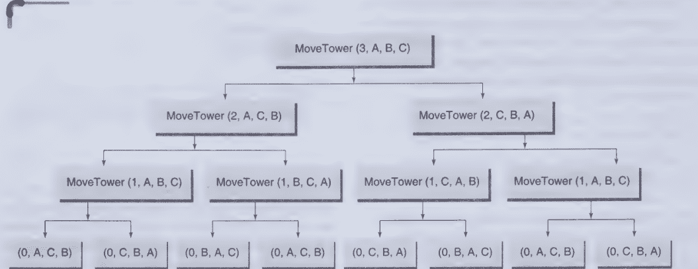
图 6.2 `movetower(3,A,B)` 的递归树

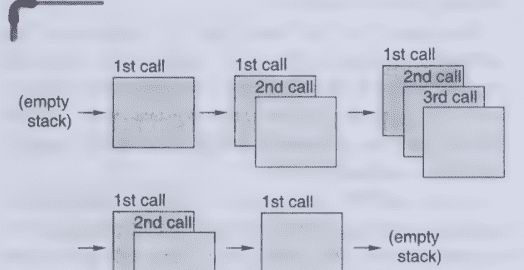
图 6.3 使用栈进行函数调用时发生的事件序列

只有在调用函数时才会分配区域。当从函数退出时，该存储会被释放。这种机制产生了一个被称为“运行时栈”的数据区域栈。当函数被调用时，会为其数据分配空间并放置在运行时栈顶部。当从函数退出时，该数据区域会被释放并从运行时栈顶部移除。基本上，其原理是后进先出（LIFO）。

栈存储管理能够处理递归函数。在递归情况下，两个调用被视为不同的，因此一个调用的数据区域不会与另一个重叠；就像人们不会遇到在另一个函数内部调用的子函数的数据区域一样。这意味着对于每个递归调用，可能同时存在多个数据区域。

现代语言通常以这种方式实现：程序代码的存储和数据项存储是分开分配的。留出存放函数调用中使用的数据项目的区域称为数据激活或递归。

该数据区域本质上由调用参数、局部变量和系统信息组成，例如离开函数时必须返回的指令地址。

在递归的实现中，当递归调用启动时，函数的局部变量被推入栈。当递归调用终止时，这些局部变量将从栈中弹出并恢复到它们原来的值。

大多数现代语言使用的存储机制称为存储管理。使用这种机制，主程序数据区域的存储在加载时分配，而函数数据的存储

但这样做是没有意义的，因为递归调用结束时函数终止了。恢复的局部变量被丢弃。使用递归栈是徒劳的，因为不需要保留局部变量。只需要将调用参数设置为它们的新值并跳转到函数的开头即可。

## 6.10 递归与迭代的比较

### 注意事项

- 如果停止情况不正确或不完整，它可能不会终止（栈溢出：运行时错误）
- 确保每个递归步骤都导向更接近停止情况的情况。

通常情况下，程序的迭代版本在时间和空间上的执行效率比递归版本更高。这是因为迭代版本规避了进入和退出函数时涉及的开销。然而，递归解决方案有时可能是解决复杂问题的最自然、最逻辑的方法。

## 6.11 搜索与排序

递归是解决复杂问题的强大工具，特别是当底层问题或数据已经以递归的形式定义时。对于这类问题，递归可以产生比迭代版本更清晰、更容易修改的解决方案。

### 6.1.1 搜索算法

整数数组已经在第 5 章中讨论过。在搜索算法中，将只讨论两种：顺序搜索和二分查找。

然而，递归解决方案并不保证递归算法是解决问题的最佳方法。取决于可用的实现和所使用的算法，递归可能需要大量的运行时开销。因此，递归的使用说明了构建和维护程序上花费的时间与执行该程序的时间和执行成本之间的经典权衡。

#### 顺序或线性搜索算法

顺序搜索背后的思想是将给定的数字与数组中的数字进行比较。如果我们到达列表中与键匹配数字，就可以返回它的索引。我们可以通过返回 `-1` 表示数组中不存在该键。这是此简单算法的实现：

两个因素导致了递归解决方案的低效：

- 与函数调用相关的开销
- 内存利用的低效

```c
int search(int Array[], int key, int ArraySize) {
  int i;
  for (i = 0; i < ArraySize; i++)
    if (Array[i] == key)
      return (i);

  return (-1);
}
```

在大多数现代编程语言的实现中，函数调用会在运行时栈中产生开销。递归函数放大了这种记账开销，因为对函数的单个初始调用可以产生大量的递归调用。

它导致了内存利用低效，因为每次进行新的递归调用时，都会为函数分配一组新的变量。此外，它还会降低执行速度，因为函数调用会跳转并在之前将函数的当前状态保存到栈中。

函数调用语句将如下：

```c
p = search(a, k, n);
if (p == -1)
  printf("\n 未找到键\n");
else
  printf("\n 在位置 %d 找到键\n", p);
```

当递归函数的返回值在调用的函数版本中的后续处理中使用时（而不是立即传递给函数的早期版本），递归就是有价值的。在这种情况下，在栈上保存参数和局部变量是值得的。

#### 二分查找算法

二分查找的前提条件是数据是排序的。迭代版本的一个优势是它不消耗大量内存。要实现二分查找，变量 `beg` 和 `end` 分别跟踪数组的下界和上限。我们从数组的中部开始。如果我们搜索小于中间元素的元素，则 `end` 设置为 `mid-1`。如果我们搜索大于中间元素的元素，则 `beg` 设置为 `mid+1`。这限制了我们对数组半部分的迭代。例如，第一次迭代将留下 3 个测试项目。第二次迭代后将剩下 1 个项目。因此，找到任何数字都需要三次迭代。

为了说明算法，让我们考虑以下数组：

| 3 | 10 | 15 | 20 | 35 | 60 |

假设我们要搜索元素 "15"

1. 我们取 `beg = 0`, `end = 6` 并计算中间元素的位置为

$$\min = \frac{0 + 6}{2} = 3$$

2. 我们将搜索键与 `mid` 比较。`a[mid]=a[3]` 不等于 15。由于 `beg<end`，我们必须开始下次迭代。

3. 由于 `a[mid]=20>15`，因此我们取 `end=mid-1=3-1`，而 `beg` 保持不变。

$$\min = \frac{0 + 3}{2} = 1$$

4. 由于 `a[mid]` 即 `a[1]=10<15`，我们取 `beg=mid+1=2`，而 `end` 保持不变。

$$\min = \frac{2 + 3}{2} = 2$$

5. 现在 `beg=end`。计算二分查找

$$\min = \frac{2 + 2}{2} = 2$$

由于 `a[mid]` 即 `a[2]=15`，搜索成功终止。二分查找的 C 代码如下：

```c
#include <stdio.h>

int binarysearch(int a[], int n, int key) {
    int beg, mid, end;
    beg = 0; end = n - 1;
    while (beg <= end) {
        mid = (beg + end) / 2;
        if (key == a[mid])
            return mid;
        else if (key > a[mid])
            beg = mid + 1;
        else
            end = mid - 1;
    }
    return -1;
}

int main() {
```

#### 递归函数中的二分查找

二分查找通常使用递归编写而不是迭代。核心思想是算法决定搜索数组的右部分或左半部分，这是原始问题的简化版本。在递归搜索中，下方函数注意，递归调用的参数已调整，以指定数组的右半部分或左半部分。

第 5 章通过示例解释了冒泡排序的方法。因此，后续章节讨论是关于选择排序的。

```c
/* Given: x
| 参数 | 说明 |
| :--- | :--- |
| Array | 整数数组。 |
| Low | 搜索整数范围的低索引。 |
| High | 搜索整数范围的顶部索引。 |
| k | 要搜索的整数。 |
| Task | 在 Array 的指定范围内进行递归二分查找。 |
返回值：在函数中，返回找到 k 的索引，如果未找到则返回 -1.
*/
int search(int x[], int k, int low, int high) {
    int mid;
    if (low > high)
        return (-1);
    mid = (low + high) / 2;
    return (x[mid] == k) ? mid : (k < x[mid] ? search(x, k, low, mid - 1) : search(x, k, mid + 1, high));
}
```

### 6.1.2 选择排序算法

将数组元素按特定顺序排列称为排序。排列顺序本质上可以是升序或降序的。排列或排序数组的方法有很多。排序算法分为两类：内部排序和外部排序。

#### 选择排序

选择排序是一种将未排序数组按升序排列的方法。它的工作原理是找到整个数组中的最小元素并将其放在第一个元素的位置。然后，它在忽略第一个元素的情况下找到数组中的最小元素，并将其放在第 2 个位置。接下来，在忽略已放在位置 1 和 2 的元素的情况下找到数组中的最小元素。这个过程持续到整个数组排序完成。选择排序的实现算法如下：

- 1. 检查数组或列表中的每个元素以找到最小值。
- 2. 将步骤 1 中的元素与数组或列表中的第一个元素交换。
- 3. 重复步骤 1 和 2，每次忽略列表开头的元素。当只剩一个元素排序好时停止。

选择排序是搜索和排序的结合。在每次遍历中，将值最小的未排序元素移动到它应在的位置。这种排序还使用增量排序来处理数组。排序遍历数组的次数取决于数组的大小。算法执行的次数比数组元素个数少一个。

选择排序函数可以通过两个循环来开发。有一个内部循环遍历数组并找到最小（最大）值，有一个外部循环将该值放在其正确的位置。选择排序是最容易实现的排序之一，但至少是效率最高的。即使从一个已经排好序的排序开始，也没有办法提前结束排序。

展示了一个用于实现选择排序技术以按升序排列元素列表的函数：

- 内部排序：任何在排序期间专门使用主内存的算法。这假设对所有内存都有高速访问权限。
- 外部排序：任何使用外部存储器（如磁带或磁盘）进行排序的算法。

如果多个比较结果为相等的项目仍然保持它们在排序中的原始顺序，则该排序是“稳定”的。某些方法包括：

- 冒泡排序
- 选择排序
- 插入排序
- 合并排序
- 快速排序

```c
void selectionsort(int numbers[], int array_size) {
    int i, j, min, temp;
    for (i = 0; i < array_size - 1; i++) {
        min = i;
        for (j = i + 1; j < array_size; j++) {
            if (numbers[j] < numbers[min]) {
                // 找到最小整数的位置
                min = j;
            }
        }
        temp = numbers[i];
        numbers[i] = numbers[min];
        numbers[min] = temp;
    }
}
```

#### 插入排序

插入排序中的主要思想是从列表或数组中选取一个数据元素，并将其插入到目前为止考虑的部分数据列表或数组的正确位置。

插入排序的过程从将第一个元素视为已排序的子数组开始，而剩余元素在另一个子数组中被认为是无序的。第一步是将未排序数组的第一个元素与排序数组的元素进行比较。排序是为了将元素按升序排列，然后进行比较以找到未排序数组的第一个元素是否小于排序数组的元素。如果是，则将未排序数组的第一个元素放在排序数组的第一个位置，而排序数组中的元素后移动一位。

对于上述算法，必须忽略已经排序的元素。例如，一旦最小元素被放在正确位置，在剩余的排序中就必须忽略它。在实践中，这意味着实现该算法时，跳过已排序的元素，只寻找未排序的最小元素。这可以通过函数 `void selectsort()` 实现，将程序代码中的圆圈部分替换为右框内的内容。

```c
void selectsort(int numbers[], int array_size) {
    int i, j, temp;
    for (i = 1; i < array_size; i++) {
        temp = numbers[i];
        j = i - 1;
        while (j >= 0 && numbers[j] > temp) {
            numbers[j + 1] = numbers[j];
            j--;
        }
        numbers[j + 1] = temp;
    }
}
```

选择排序是搜索和排序的结合。在每次遍历中，将值最小的未排序元素移动到它应在的位置。这种排序还使用增量排序来处理数组。排序遍历数组的次数取决于数组的大小。算法执行的次数比数组元素个数少一个。

（注：OCR 文本在后面的页面中包含大量重复和碎片化内容。我根据提供的片段和标准算法定义清理了逻辑。）

# 246 C 语言编程

图 6.5 展示了一个针对大小为 8 的无序数组 A 的典型归并排序算法示例，该数组包含以下元素：32 45 26 15 25 91 30 73。

实现上述归并排序算法的函数如下：

```c
void mergesort(int array[])
```

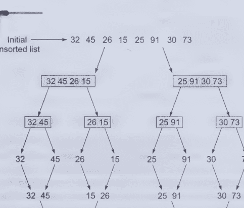
图 6.5 归并排序

在上述示例中，原始数组被不断拆分为两半，直到变成只有一个元素的数组。这些数组按照以下步骤进行合并：

- 1. 比较并合并 32 和 45 形成数组 [32 45]。
- 2. 比较并合并 26 和 15 形成数组 [15 26]。
- 3. 比较并合并子数组 [32 45] 和 [15 26] 形成数组 [15 26 32 45]。
- 4. 比较并合并 25 和 91 形成数组 [25 91]。
- 5. 比较并合并 30 和 73 形成数组 [30 73]。
- 6. 比较并合并子数组 [25 91] 和 [30 73] 形成数组 [25 30 73 91]。
- 7. 最后，将步骤 3 和 6 中已排序并合并的子数组再次排序合并，形成数组 [15 25 26 30 32 45 73 91]。

## 快速排序

快速排序是一种递归过程，用于将数组中存储的值按升序或降序重新排列。假设给了一个包含 11 个整数的数组，如图 6.6(a) 所示。

### 函数 247

| 14 | 3 | 2 | 11 | 5 | 8 | 0 | 2 | 9 | 4 | 20 |
| :--- | :--- | :--- | :--- | :--- | :--- | :--- | :--- | :--- | :--- | :--- |
| a[0] | | | | | | | | | a[10] | |

| 4 | 3 | 2 | 2 | 5 | 0 | 11 | 9 | 14 | 20 | |
| :--- | :--- | :--- | :--- | :--- | :--- | :--- | :--- | :--- | :--- | :--- |
| a[0] | | | | | | | | a[10] | |

(a) 包含 11 个整数的数组

(b) 按小于或大于基准值的元素进行分离，

| 14 | 3 | 2 | 11 | 5 | 8 | 0 | 2 | 9 | 4 | 20 |
| :--- | :--- | :--- | :--- | :--- | :--- | :--- | :--- | :--- | :--- | :--- |
| left_arrow | | | | | | | | | right_arrow | |

| 14 | 3 | 2 | 11 | 5 | 8 | 0 | 2 | 9 | 4 | 20 |
| :--- | :--- | :--- | :--- | :--- | :--- | :--- | :--- | :--- | :--- | :--- |
| left_arrow | | | | | | | | | right_arrow | |

(c) 选择基准值的索引

(d) 将 `right_arrow` 向左移动，直到 `value < pivot` 为真

| 4 | 3 | 2 | 11 | 5 | 8 | 0 | 2 | 9 | 14 | 20 |
| :--- | :--- | :--- | :--- | :--- | :--- | :--- | :--- | :--- | :--- | :--- |
| left_arrow | | | | | | | | | right_arrow | |

| 4 | 3 | 2 | 2 | 5 | 0 | 11 | 9 | 14 | 20 | |
| :--- | :--- | :--- | :--- | :--- | :--- | :--- | :--- | :--- | :--- | :--- |
| left_arrow | | | | | | | | | right_arrow | |

(e) 交换 `a[left_arrow]` 和 `a[right_arrow]` 中的值

(f) 当 `right_arrow` 向左移动直到 `a[right_arrow] < pivot` 条件变为真时，`right_arrow` 的位置

| 4 | 3 | 2 | 11 | 5 | 8 | 0 | 2 | 9 | 14 | 20 |
| :--- | :--- | :--- | :--- | :--- | :--- | :--- | :--- | :--- | :--- | :--- |
| left_arrow | | | | | | | | | right_arrow | |

| 4 | 3 | 2 | 2 | 5 | 0 | 11 | 9 | 14 | 20 | |
| :--- | :--- | :--- | :--- | :--- | :--- | :--- | :--- | :--- | :--- | :--- |
| left_arrow | | | | | | | | | right_arrow | |


| | | | | | | | | | | |
| :--- | :--- | :--- | :--- | :--- | :--- | :--- | :--- | :--- | :--- | :--- |
| `left_arrow` | | | | | | | | | `right_arrow` | |

(g) 当 `left_arrow` 向右移动直到 `a[left_arrow] = pivot` 条件变为真时，`left_arrow` 的位置

(h) 交换 `a[left_arrow]` 和 `a[right_arrow]`

| 4 | 3 | 2 | 2 | 5 | 0 | 11 | 9 | 14 | 20 | |
| :--- | :--- | :--- | :--- | :--- | :--- | :--- | :--- | :--- | :--- | :--- |
| `left_arrow` | | | | | | | | | | `right_arrow` |


```
| 4 | 3 | 2 |   |  | | 0 | |11 |
```

values less or equal to the pivot, and the other will contain values greater than or equal to the pivot. So, if 8 is picked as the pivot, 6.6(b) shows the result at the end of the process.


# 递归函数与算法分析

相同的过程可以精确地分别应用于左侧和右侧部分。这种相同过程的重复应用导致了一个递归函数。

重新排列过程的细节如下：

```c
do {
    while(list[right_arrow] > pivot)
        right_arrow--;
    while(list[left_arrow] < pivot)
        left_arrow++;
    if(left_arrow <= right_arrow) {
        swap(list[left_arrow], list[right_arrow]);
        left_arrow++;
        right_arrow--;
    }
} while(right_arrow >= left_arrow);

if(left_arrow < right_arrow) {
    quick_sort(list, left, right_arrow);
    quick_sort(list, left_arrow, right);
}
pivot = (left + right) / 2;
```

其中 `first` 和 `last` 是表示列表的数组中初始元素和最终元素的索引。

# 6.12 算法分析

设计算法时，效率是一个重要因素。算法的效率由运行程序所需的时间和程序所需的内存空间决定。在分析算法而非一段代码时，应预测算法的“主要活动”执行的次数。例如，分析排序算法时，统计比较操作的次数；寻找最优解时，统计评估的次数。算法的复杂度是衡量算法对于给定输入所需时间或空间的量度。它是一个函数，用以描述算法按必须处理的数据量来衡量的效率。通常，该函数的定义域和值域都有自然单位。参数或因子的值会影响其执行的操作数量。以下是算法效率的主要复杂度度量：

- **时间复杂度** 是一个函数，描述算法相对于提供给算法的输入量所需的时间。“时间”可以指内存访问次数、整数间比较次数、某个内层循环的执行次数，或与算法实际运行时间相关的其他自然单位。它表示为 `T(n)`，其中 `n` 是输入规模。

- **空间复杂度** 是一个函数，描述算法相对于提供给算法的输入量所需的内存（空间）。空间复杂度有时会被忽略，因为使用的空间极小或显而易见，但有时它会成为一个重要问题。它表示为 `S(n)`，其中 `n` 是输入规模。

复杂度分析试图用一个简单的公式近似来刻画数据元素数量与资源使用（时间）之间的关系。使用 RAM 计算模型，可以根据输入计算算法执行程序将采取多少步骤。要了解算法优劣，需考察其在所有实例上的表现。有三个术语用于描述这些场景：

- 算法的**最坏情况复杂度** 由规模为 `n` 的任何实例所采取的最大步骤数定义。
- 算法的**最好情况复杂度** 由规模为 `n` 的任何实例所采取的最小步骤数定义。
- 算法的**平均情况复杂度** 由规模为 `n` 的任何实例所采取的平均步骤数定义。

## 快速排序演示

其思维过程是将列表分成两部分，使用列表中一个称为 `pivot`（枢轴）的特定值。过程结束时，一部分将包含小于或等于枢轴的值，另一部分包含大于或等于枢轴的值。因此，如果选 8 作为枢轴，图 6.6(b) 显示了过程结束时的结果。

相同的过程可以精确地分别应用于左侧和右侧部分。这种相同过程的重复应用导致了一个递归函数。

重新排列过程的细节如下：

```c
do {
    while(list[right_arrow] > pivot)
        right_arrow--;
    while(list[left_arrow] < pivot)
        left_arrow++;
    if(left_arrow <= right_arrow) {
        swap(list[left_arrow], list[right_arrow]);
        left_arrow++;
        right_arrow--;
    }
} while(right_arrow >= left_arrow);

if(left_arrow < right_arrow) {
    quick_sort(list, left, right_arrow);
    quick_sort(list, left_arrow, right);
}
pivot = (left + right) / 2;
```

其中 `first` 和 `last` 是表示列表的数组中初始元素和最终元素的索引。

## 250 C 语言编程

### 乘法循环与除法循环

| 循环类型 | 代码示例 |
| :--- | :--- |
| 乘法循环 | `for(i=1; i<i*2)` |
| 除法循环 | `for(i=n; i>=i/2)` |

执行结果给出了依赖二次循环的以下公式。

```
{
    stmts
}
{
    stmts
}
```

假设 `n=10`；两种情况下的迭代次数均为 4。

这是因为每次迭代中，乘法循环的 `i` 值增加一倍，而除法循环的 `i` 值减半。

迭代次数是乘数或除数的函数。循环根据以下条件继续：

| 循环类型 | 条件 / 分析 |
| :--- | :--- |
| 乘法循环 | `2^iteration < n` |
| 除法循环 | `n/iteration >= 1` |
| 线性对数嵌套循环 | 考虑外层循环为线性的、内层循环为对数的嵌套循环。 |

`f(n) = n(n+1)/2`

```c
for(i=1;i<=n;i++)
for(j=1;j<n;j*=2)
{
    stmts
}
```

泛化分析，`f(n) = [log n]`

因此，内层循环执行的次数 `n` 次。所以，

`f(n) = [log n];`

### 二次循环

在这里，每个循环的迭代次数如下代码所示：

`f(n) = n^2`

### 依赖二次循环

考虑以下嵌套循环：

```c
for(i=1;i<n;i++)
for(j=1;j<=i;j++)
{
    stmts
}
```

### 嵌套循环

对于嵌套循环，总迭代次数将是内层循环和外层循环迭代次数的乘积。嵌套循环有多种类型，即二次、依赖二次、线性对数等。

已经证明，函数中用于元素的执行语句是元素的函数，表示为 `f(n)`。方程中存在一个决定结果“数量级幅度”的主导因子。因此，不需要完成效率的完整衡量，只有这个因素是决定数量级的决策者。

```c
for(i=1;i<n;i++)
for(j=1;j<n;j++)
{
    stmts
}
```

对于外层循环的每次迭代，内层循环将执行 `i` 次。外层循环执行 `n` 次。

## 6.12.1 渐近符号

渐近符号是一种描述函数而无需处理干扰性细节的方法。在许多方面，渐近符号可能看起来非常不精确且直观，但其精确的定义是非常重要的；准确理解它的含义至关重要。

### 大 O 符号

渐近符号中著名的符号是大 O（具体来说是希腊字母 om）。它被用作函数渐近增长的上限。阶，或大 O 表示法是算法运行时间的度量。它的意图不是衡量运行算法的机器的性能，而是严格衡量性能的……

在这里，内层循环的一个因子依赖于外层循环。它在第一次迭代时执行一次，第二次、第三次执行两次，以此类推。

内层循环的迭代次数为 `1+2+3+4+....= n(n+1)/2`。

该循环的平均值为 `(n+1)/2`。内层循环乘以外层循环的次数是……

从形式上可以定义，如果 `f(n)` 和 `g(n)` 是定义在正整数上的函数，那么当存在一个 `c` 使得对于足够大的正整数 `|f(n)| <= c|g(n)|` 时，则 `f(n) = O(g(n))`。

### 函数

如果 `lim_{n -> ∞} f(n)/g(n)` 是常数，则 `f(n) = O(g(n))` 为真。

例如，计算 `f(n) = n(n+1)/2 + 5n² = n² / 2 + 5n` 的大 O 表示法。

注意到，大 O 表示法说是“某个常数的倍数”，但没有说明常数是多少。这忽略了一些有时重要的信息，但通过在不参考计算机速度的情况下使用时间并测量代码块中有多少个实例，大 O 表示法的属性如下：

我们去掉系数。这得到了 `n² + n`。最大的因子是 `n²`。因此，大 O 表示法表述如下：

`O(n) = O(n²)`

大 O 表达式出现得如此频繁以至于它们有了名称。算法是：

- **常数级**，如果 `f(n)` 是 `O(1)`
- **对数级**，如果 `f(n)` 是 `O(lg n)`
- **线性级**，如果 `f(n)` 是 `O(n)`
- **二次级**，如果 `f(n)` 是 `O(n²)`
- **多项式级**，如果 `f(n)` 是 `O(nᵏ)`，其中 `k` 是常数。
- **指数级**，如果 `f(n)` 是 `O(2ⁿ)`，其中 `k` 是常数。

+ 1. `O(kf(n)) = O(f(n))`，因此，`k` 可以忽略。
+ 2. `O(f(n)g(n)) = O(f(n)) * O(g(n))`，即如果函数乘积大于因子的阶。
+ 3. `O(f(n)/g(n)) = O(f(n)) / O(g(n))`，即对于常数函数的阶。
+ 4. `O(f(n)) > O(g(n))`，当且仅当 `f` 主导 `g` 时，低阶可以忽略。

### 常数 O(1)

运行时间为 `O(1)` 的算法被认为具有“常数”运行时间。基本上这意味着无论输入多大，算法总是花费相同的时间。从技术上说，如果无论输入多大，算法执行都不会超过特定数量，那么该算法被认为具有常数运行时间。

### 线性 O(n)

+ 5. `O(f(n)) = O(g(n)) = Max(f(n), g(n))`，低阶项可以忽略。

运行为 `O(n)` 的算法被认为具有“线性”运行时间。这意味着时间与输入大小成正比。或者，执行步骤数不超过线性数量的算法具有线性运行时间。

+ 6. 对于函数 `f(n) = O(g(n))` 且 `g(n) = O(h(n))`，应该小心 `f(n) = O(h(n))`。
+ 7. 大 O 有传递性，如果 `f(n) = O(g(n))` 且 `g(n) = O(h(n))`，则 `f(n) = O(h(n))`。
+ 8. `n` 的阶是 `O(n)`。
+ 9. `n` 的阶是 `O(n²)`。
+ 10. `n` 的阶是 `O(n³)`。

### 二次 O(n²)

### 对数 O(log n)

### 指数 O(2ⁿ)

# 函数 253

但关键不在列表中，比较的次数总是 `n`。假设对于任何情况，列表的任何排列都是等概率的。那么，我们可以对所有可能的排列取平均值。那么，平均比较次数为：

最好情况发生在中间的元素恰好是目标时。这时只需要一次比较就能找到它。和之前一样，最坏情况分析并没有说明什么。最坏情况会在什么时候发生？如果目标不在数组中，则平分列表的过程将持续，直到只剩下一个元素待检查。图 6.7 显示了每次平分后比较次数的模式，假设初始数组长度是 2 的偶次幂，并且每次迭代中都能恰好平半。考虑一个存储了以下元素的数组：1 2 3 4

`n = 1/n!` （排列 1 中键值所在的位置）

`n = 1/p.` （与键值位置 P 的比较次数）

`n = 1/np!(n-1)`

`(n+1)/2`

在这里，这个假设给出了相同的分析。关于平均情况分析的第二点是，分别分析不同的情况是有意义的。上面的平均值假设键始终在数组中；如果键不在，则需要 `n` 次比较。可以设定概率 `p` 使 `x` 在数组内或外，并结合上述两个数字得到一个等于 `pn + (1-p)(n+1)/2` 的平均值，但分别提到这两个数字更有意义。

平均情况下的最好情况分析没有意义。如果第一个元素恰好是目标，任何算法都只会进行一次比较。最坏情况和平均情况提供了更好的算法效率衡量指标。

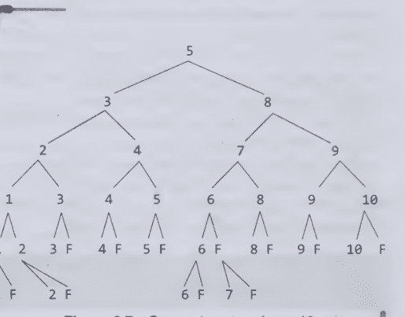

注意，如果数组增长，在最坏和平均情况下，找到键元素所需的比较次数都呈线性增长。通常情况下，对于任何长度为 `n` 的数组，最坏情况都是 `n` 次比较。所说的线性搜索显示其复杂度/效率可以表示为线性函数。找到目标的比较次数随数组的大小线性增加。因此，`T(n) = O(n)`。

图 6.7 `n=10` 的比较树

每次搜索都由 F 结束于成功或失败的叶子节点。要找到成功搜索的平均比较次数，必须找到成功搜索的总比较次数，并除以搜索次数。然后，需要统计从根节点到终止成功搜索的叶子节点的分支数量。从比较树中，可以得出以下结论：

1. 树的高度 = 可能的最大键数（高度 = 根节点下方的层数）
2. 树的高度最多比平均比较次数少一个，因为叶子节点之间的差异只能是一个，因为列表大小除以算法的结果只能是 0 或 1。
3. 树的叶节点数量按 2 的幂次方扩展（F 6.8）

# 6.12.3 二分搜索分析


# 评估二分搜索

为了评估二分搜索，统计最好情况和最坏情况下的比较次数。该分析省略了平均情况（这稍微困难一些），并忽略了算法之间在每次比较对应的计算量上的任何差异。

## 254 C 语言编程

有序的。如果某次通过不需要任何交换，则数组可能是有序的，即使通过的次数少于 $(n-1)$ 次。

```
2^0 = 1
2^1 = 2
2^2 = 4
```

对于一个 $n$ 个元素的列表，数组前半部分每个位置所需的交换次数所示：


| 位置 | 1 | 2 | 3 | ... | n/2 | n/2-1 | n/2 |
|---|---|---|---|---|---|---|---|
| 交换 | n-1 | n-3 | n-5 | ... | +5 | +3 | +1 |

叶节点数量 = $2^h$，其中 $h$ 是树的高度。因此，如果树只有一层叶节点，则 $2^h=2n$。如果树有两层叶节点，则 $2^h >2n$（其中 $h$ 是匹配不等式的最小整数）。两边取对数 $2^h = x$，得到 $\log x = y$。如果 $2^h > 2n$，则二分搜索的平均比较次数随着 $n$ 变大而变为 $\log(n+1)$。以下表总结了二分搜索。

| 情况 | 比较次数 | 移动 |
|---|---|---|
| 最好（比较最少） | 1 | |
| 最坏（比较最多） | $\log n$ | |
| 第二 | $n-2$ | $(n-1)/2$ (平均) | $3(n-2)/2$ |
| 所有通过 | $(n-1) + (n-3)/2 = (n-1)/4$ | $\sim3n/4$ |
| | $(n-2)$ (平均) = $n/2$ |

因此，最坏情况复杂度为 $T(n)=O(n \log n)$；最好情况为 $T(n)=O(n)$。

## 6.12.4 冒泡排序分析

冒泡排序需要比较数组的第一和第二个元素并进行必要的交换，使得较小的元素位于第一个位置。对于第三个元素也是如此。在此通过结束后，最后一个元素将位于正确的位置。排序包含 $n$ 个元素需要 $(n-1)$ 次通过。在第 $i$ 次通过结束时，最后 $i$ 个元素将已排序。$T(n) = (n-1) + (n-2) + (n-3) + \dots + (1) = n(n-1)/2$。因此，冒泡排序的时间复杂度为 $O(n^2)$。冒泡排序的平均行为接近最坏情况。假设在最坏情况下每个元素距离最终位置大约一半。这将需要每个元素经历 $n/2$ 次交换。在向目标移动时，不能假设另一个元素受益。最坏情况下的交换是平均情况的 50%。所需的总交换次数至少很多。因此，最坏复杂度为 $T(n)=O(n^2)$，平均复杂度也是 $O(n^2)$。

## 6.12.5 快速排序分析

在快速排序中，每次递归调用可能处理一组不同大小的数字。必须执行以下三种分析：

- 最好情况
- 平均情况
- 最坏情况

在最好情况下，每次都会发生完美划分。如果我们让 $T(n)$ 为排序 $n$ 个元素的运行时间，由于划分的运行时间为 $O(n)$，则 $T(n) = 2T(n/2) + O(n)$。

现在考虑最坏划分会有多糟糕。在这种情况下，必须划分 $n-1$ 次，第一次比较 $n-1$ 个值，然后是 $n-2$、$n-3$ 等。$1+2+\dots+(n-1) = n(n-1)/2$。因此，最坏情况运行时间为 $O(n^2)$。

现在，让我们计算平均运行时间。这确实很难评估，因为没有尝试部分排序。每个可能的划分（例如 0 和 $n$，$n-1$ 和 $n-2$，$n-3$）让我们按如下方法计算。由于我们假设有 $n$ 种可能的划分，且概率相等，平均每个发生一次。因此找到了以下递归关系：

```
T(n) = T(0)+T(n-1)+T(n-2)+...+T(0)+ n*
= 2T(n-1)+T(n-2)+ n^2 (6.1)
```

现在，代入 $n-1$ 得到：

```
(n-1)T(n-1) = 2[T(n-2)+T(n-3)] + (n-1)² (6.2)
```

用等式 (6.1) 减去等式 (6.2)，得到：

```
nT(n) - (n-1)T(n-1) = 2T(n-1) + 2n - 1 T(n-1)
nT(n) = [(n+1)]T(n-1) + (2n-1)/n (6.3)
```

由于是平均值，方程末尾去掉 -1。等式 (6.3) 乘以 $n+1$，得到：

```
T(n) = T(n-1) + n + 2/(n+1)T(n-1)
= T(n-2)/n-1 + 2/n (6.4)
```

现在，将 $n$ 代入不同的值以恢复某种形式：

# C 语言编程

## 总结

函数是一个自包含的程序语句块，用于执行某些特定的任务。程序应该由大量紧凑的函数来构建，而不是少数几个大型函数。在程序中使用函数可以使其更易于管理和理解。主程序可以根据需要对这些函数进行多次调用。函数是可重用的，并且可以在多个程序中使用。

为了指示默认值，C 提供了四种存储类，它们可以在变量的声明语句与数据类型说明符一起使用。这四种存储类规范如下：

- 原子 (`atomic`)
- 外部 (`external`)
- 寄存器 (`register`)
- 静态 (`static`)

自定义函数与 `main()` 函数之间的连接通过用户函数的三个组件建立。这三个组件是：

- 声明语句
- 函数定义
- 调用语句

递归是一种根据一个或多个更小的相同问题来定义函数的技术。函数可以直接或间接地通过调用自己来解决问题，直到一个不需要自调用的最终调用，这就是递归函数。实现递归需要满足以下条件：

- 分解为相同类型的问题
- 递归调用必须减小问题规模
- 基准情况（`base case`）的必要性
- 必须到达基准情况

当函数被调用时，参数按值传递。根据其声明指定的返回类型，函数要么不返回值，要么返回原型中相应类型的值。另一种向函数传递参数的方法是按引用或通过地址传递。这将在后续章节中讨论。

不需要进一步递归调用的问题实例被称为基准情况。这是一种特殊情况，每个递归算法至少需要一个基准情况才能有效。

作用域规则通过语句块和函数描述了局部变量（声明在函数内部）和全局变量（声明在所有函数外部）的范围、可访问性和默认值。

本章将讨论递归函数可以的一些流行问题。此外，还将介绍在使用用户定义函数时程序员经常遇到的常见错误、测试数据的方法，以及如何跟踪这些错误。

## 核心术语

**实际参数 (Actual parameters)**：通过标识符、表达式参数或实际参数传递给函数的信息。

**递归 (Recursion)**：函数调用自身的技术。

**平均情况复杂度 (Average-case)**：算法的平均复杂度是由针对任何输入规模的实例所采取的最大步骤数定义的函数。

**作用域 (Scope)**：程序中标识符声明可访问的区域，称为该标识符的作用域。

**基准情况 (Base case)**：不需要进一步递归调用的问题实例被称为基准情况。

**空间复杂度 (Space complexity)**：空间复杂度描述了算法相对于其提供的输入所占用的内存（空间）量。

**最好情况复杂度 (Best-case)**：算法的最优情况是由任何输入规模的实例所采取的最少步骤数定义的。

**存储类 (Storage class)**：存储类规定了变量存储在何处、存在多久、存在区域以及它们的默认值。

**大 O 表示法 (Big-O)**：大 O 表示法是算法运行时间的衡量标准，因为它与该算法输入的大小有关。它的目的不是衡量运行该算法的机器的性能，而是严格衡量算法本身的性能。

**结构化编程 (Structured programming)**：结构化编程是指一组编写组织良好的程序的原则，这些程序可以更高效率。

**按值调用 (Call by value)**：按值调用意味着实际参数的值在概念上传递给形式参数。

**时间复杂度 (Time complexity)**：时间复杂度是一个描述算法相对于其提供的输入所花费的时间的函数。

**最坏情况复杂度 (Worst-case)**：算法的最坏情况复杂度是由任何输入规模的实例所采取的最大步骤数定义的函数。

**范围 (Extent)**：与它们关联的长短被称为范围。

**形式参数 (Formal parameters)**：函数头中的变量列表也称为形式参数。

## 常见问题

### 1. 为什么需要寄存器声明？

`register` 标识符用于将数据放在寄存器中，以便更快地访问。然而，编译器可以将 `register` 声明视为 `auto` 声明。

### 2. 为什么作用域很重要？

作用域决定了变量是在函数内部还是外部可见。在某些情况下，静态变量在块内是独立的。全局变量受到其他函数的意外影响。如果发生这种情况，变量可能不包含创建时的值。

### 3. 如果使用了全局变量，哪些不是全局变量？

全局变量在整个程序运行期间都会占用内存；而局部变量仅在激活时占用内存。全局变量可能会受到其他函数的意外修改。

### 4. 使用寄存器存储类的优势是什么？

使用寄存器存储类是为了将数据放在 CPU 寄存器中，以便快速访问。这通常意味着类型小于或等于整数大小。许多机器拥有可以存放浮点数的寄存器。

### 5. 什么是连接？

连接通过标识符是否出现在函数内部或外部来决定。静态标识符具有文件作用域。这意味着它们在整个文件范围内都是可见的。

### 6. 连接表示什么？

连接用于确定标识符出现在函数内部还是外部。标识符的链接取决于它是否在函数内部或外部出现。

### 7. 连接有哪三种类型？

C 定义了三种类型的链接：外部、内部和无链接。内部链接仅在块内可见。

### 8. 区分内部静态变量和外部静态变量

内部静态变量声明在块内部并具有静态存储，而外部静态变量声明在文件的所有块外部。内部变量具有持久存储、块级作用域且没有链接。外部静态变量具有永久存储、文件级作用域和内部链接。

### 9. 函数声明中的 extern 意味着什么？

在函数声明中使用 `extern` 意味着该函数可以在定义它的文件外部使用。

### 10. 比较递归和迭代。

递归是一种解决问题的自上而下的方法；它将问题分解为若干部分或选择一个关键步骤，并将其余部分推后。相反，迭代更像是一种自下而上的方法；它从已知条件开始，然后逐步构建解决方案。

程序执行的内存。因此，通常解决方案的迭代版本比递归版本效率高得多。

### 11. main() 可以被递归调用吗？

如果按照如下方式正确编写，递归调用 `main()` 是完全合法的：

输出：

4 3 2 1 0

如果递归调用像下面的程序那样没有基本情况，它将进入由于栈溢出导致运行时错误的状态。

```
#include <stdio.h>
int main() {
    static int c=5;
    if(c--==0) {
        printf("%d", c);
        return main();
    }
}
```

```
#include <stdio.h>
int main() {
    main();
    return 0;
}
```

## 练习

### 1. 返回整数并接受单个整数作为参数的函数原型可以是：

* `int myFun();`
* `void myFun(int);`
* `void myFun(void);`
* `int myFun(int);`

### 5. 定义了一个函数 `sumN`，它接受一个整数 `n` 作为参数并返回从 1 到 `n` 的整数和。下面表达式的值是多少？

`sumN(3456) - sumN(3455);`

### 2. 如果由语句 `n = myFun();` 调用，那么 `myFun(9)` 将返回什么值赋值给 `n`？

```
int myFun(int val) {
    return (val + 1)/2;
}
```

### 6. 选择通过原型调用函数的所有正确方式：

* `f1(int, double);`

给定以下变量且已包含该库：

```
int val1 = 5, retVal;
double val2 = 9.8;
```

* `retVal = f1(4, 3.5);`
* `retVal = f1(int val1, float val2);`
* `retVal = f1(1000, val2);`
* `retVal = f1(2*val1, val2/3.5);`
* `retVal = f1(val1, sqrt(val2));`

### 3. 下列原型中哪些没有错误？

* `void myFun1(int)`
* `int myFun2(void)`
* `float myFun3(int a, b, c);`
* `void myFunA(double a, int b);`
* `int myFun5(int var1, int i);`

### 7. 给定 `f1(void)` 的函数定义，将打印什么？

```
int f1(void) {
    int val = 1;
    return val++;
}

int main(void) {
    printf("%d", f1);
    printf("%d", f1);
    printf("%d", f1);
    return 0;
}
```

### 4. 一个计算并返回边长为 `a` 和 `b` 的直角三角形斜边的函数。该函数原型应为：

`double hypot(double a, double b);`

下列语句哪些是该函数的正确用法（调用）（假设 `x`、`y` 和 `z` 是 `double` 类型变量且 `x` 已经初始化）？

* `z = hypot(4.0, 4.5);`
* `z = hypot(double x, y);`
* `hypot(x, y);`
* `printf("%f", hypot(x, y));`
* `z = x + y + hypot(x, y);`

### 8. 给定 `f1(void)` 的函数定义，将打印什么？

```
int f1(void);

int main(void) {
    printf("%d", f1);
    printf("%d", f1);
    printf("%d", f1);
    return 0;
}

int f1(void) {
    static int val = 1;
    return val++;
}
```

### 9. 下面代码打印什么？

```
void f1(void);

int val = 6;

int main(void) {
    f1();
    printf("%d", val);
    f1();
    printf("%d", val);
    return 0;
}

void f1(void) {
    ++val;
}
```

### 10. 下面代码打印什么？

```
void f1(int);

int val = 6;

int main(void) {
    f1(val);
    printf("%d", val);
    f1(val);
    printf("%d", val);
    return 0;
}

void f1(int val) {
    ++val;
}
```

### 11. 给定数组声明和函数原型，选择从 `main()` 调用该函数并传递 `myarray[]` 引用的所有正确方式。

```
void myFun(int a[]);

int main() {
    int myArray[] = {10,20,30,40,50,60,70,80};
}

/* 在此处调用函数 */
myFun(myArray);
myFun(myArray[]);
myFun(&myArray[0]);
myFun(&myArray[0]);
myFun(myArray[8]);
```

### 12. 下面程序的输出是什么？

```
#define swap(a,b) temp=a; b=temp;

int main() {
    static int a=5,b=6;
    if(a > b) {
        swap(a,b);
        printf("%d=%d",a,b);
        return 0;
    }
}
```

(a) a=5 b=6
(c) a=6 b=0
(d) 以上都不是

### 13. 下面代码编写是正确的。输出是什么？

```
int main() {
    int a=1,b=2;
    printf("%d,%d",add(a,b));
    return 0;
}

add(int a, int b) {
    return(a+b);
}
```

(a) 运行时错误
(b) 编译错误
(c) 3
(d) 以上都不是

### 14. 下面程序的输出是什么？

```
int add(int a, int b) {
    int c=a+b;
}

int main() {
    int a=10,b=20;
    printf("%d %d",a,b,add(a,b));
    return 0;
}
```

(a) 10 20 0
(b) 编译错误
(c) 10 20 30
(d) 以上都不是

### 15. 下面程序的输出是什么？

```
int add(int a, int b) {
    int c=a+b;
    return;
}

int main() {
    int a=10,b=20;
    printf("%d %d", a,b,add(a,b));
    return 0;
}
```

```
int funct2(int b) {
    if(b == 0)
        return b;
    else
        funct1(b--);
}
int funct1(int a) {
    if(a == 0)
        return a;
    else
        funct2(a--);
}
int main()
```

(a) 10 20 30
(b) 编译错误
(d) 以上都不是

### 16. 下面程序的输出是什么？

```
int add(int a, int b) {
    int a,b;
    return(a+b);
}

int main() {
    int a=7,b=13;
}
```


## 代码示例

```c
printf("%d,%d", add(a,b));

return 0;
}
```

### 选择题

- (a) 编译错误
- (b) 20
- (c) 40
- (d) 以上都不是

---

### 17. 下面程序的输出是什么？

```c
int add(int a, int b) {
    int c = a + b;
    return c;
}

int main() {
    int a = 10, b = 20;
    printf("%d", add(a,b));
    return 0;
}
```

- (a) 30
- (b) 编译错误
- (c) 0
- (d) 以上都不是

---

### 18. 下面程序的输出是什么？

```c
int funct2(int b) {
    if(b == 0)
        return b;
    else
        funct1(b--);
}

int funct1(int a) {
    if(a == 0)
        return a;
    else
        funct2(a--);
}

int main() {
    int a = 7;
    printf("%d,%d", funct1(a));
    return 0;
}
```

- (a) 0
- (b) 编译错误
- (c) 无限循环
- (d) 7

---

### 19. 下面程序的输出是什么？

- (a) 编译错误
- (b) 0
- (c) 无限循环
- (d) 7

---

### 20. 下面程序的输出是什么？

```c
int funct1(int a) {
    {{;}}; return a;
}

int main() {
    int a = 17;
    printf("%d", funct1(a));
    return 0;
}
```

- (a) 0
- (b) 编译错误
- (c) 17
- (d) 以上都不是

---

### 21. 下面程序的输出是什么？

```c
int funct1(int a) {
    if(a)
        return funct1(--a) + a;
    else
        return 0;
}

int main() {
    int a = 7;
    printf("%d", funct1(a));
    return 0;
}
```

- (a) 7
- (b) 21
- (c) 28
- (d) 以上都不是

---

### 22. 下面程序的输出是什么？

```c
int add(int a, int b) {
    int c = a + b;
}

int main() {
    int a = 10, b = 20;
    printf("%d %d", a, b, add(a,b));
    return 0;
}
```

- (a) 10 20 0
- (b) 编译错误
- (c) 10 20 30
- (d) 以上都不是

---

### 23. 下面程序的输出是什么？

```c
void func(int x, int y) {
    // 
}

int main() {
    int a = 5, b = 6;
    c = func(x, y);
    printf("%d %d", a, b);
    return 0;
}
```

---

### 24. 下面程序的输出是什么？

```c
{
    a = 100;
    printf("%d", a);
    compute(a);
    printf("%d", a);
    return 0;
}
```

- (a) 10
- (b) 编译错误
- (c) 100 100
- (d) 10

---

### 25. 下面程序的输出是什么？

```c
int funct(char ch) {
    ch + 1;
    return ch;
}

int main() {
    int a = 127;
    printf("%d %d", a, funct(a));
    return 0;
}
```

- (a) 10
- (b) 编译错误
- (c) 256
- (d) 以上都不是

---

### 26. 下面程序的输出是什么？

```c
int add(int a, int b) {
    int c = a + b;
    return;
}

int main() {
    // ...
}
```

---

### 27. 下面程序的输出是什么？

```c
int main() {
    int a = 19, b = 4;
    float c;
    c = a / b;
    printf("%f", c);
    return 0;
}
```

- (a) 4.75
- (b) 4
- (c) 4.750000
- (d) 4.000000

---

### 28. 下面程序的输出是什么？

```c
int val;
static int func() {
    return &val;
}

int main() {
    val = 5;
    func();
    val++;
    printf("%d", func());
    return 0;
}
```

---

### 29. 下面程序的输出是什么？

```c
static int func(int val) {
    static int sum = 0;
    sum += val;
    return sum;
}

int main() {
    int i, n = 9;
    for(i = 1; i < n; i++) {
        func(i * 2);
    }
    printf("%d", func());
    return 0;
}
```

- (a) 20
- (b) 0
- (c) 30
- (d) 以上都不是

---

### 30. 下面程序的输出是什么？

```c
int main() {
    int _ = 70;
    printf("%d", _);
    return 0;
}
```

- (a) 编译错误
- (b) 运行时错误
- (c) 70
- (d) 以上都不是

---

### 31. 下面程序的输出是什么？

```c
void func(int x, int y) {
    // 
}

int main() {
    int a = 5, b = 6;
    c = func(x, y);
    printf("%d %d %d", c);
    return 0;
}
```

---

## 函数

### 32. 编写一个程序打印矩阵的转置。

### 33. 编写一个程序，按字母顺序对句子中的单词进行排序。

### 34. 以下代码的输出是什么？

```c
#define big(a,b) a > b ? a : b
#define swap(a,b) temp=a; a=b; b=temp;

int main() {
    int a = 3, b = 5, temp;
    if((big(a,b)) > b)
        swap(a,b);
    printf("%d %d", a, b);
    return 0;
}
```

- (a) 3 0
- (b) 5 3
- (c) 3 5
- (d) 5 0

---

### 35. 编写一个函数找到给定数字的各位数字之和。

### 36. 编写一个程序，使用函数在数组中搜索。

> “程序特征”检查确保诸如 40 和 60 这样的显式值仅以 `#define` 或未初始化变量的形式出现。

### 37. 编写一个函数，接受小数和基数作为参数，并返回该基数的等数值。

### 38. 编写一个函数，扫描作为参数传递的字符串并将所有字符转换为字母。

### 39. 编写函数将英尺转换为英寸，厘米转换为米。编写一个程序，提示用户输入英尺单位的测量值并以米显示该值。已知事实：1 ft = 12 inches，1 inch = 2.54 cm，100 cm = 1 meter。

### 40. 编写一个程序，使用函数将一个字符串添加到另一个字符串末尾，而不使用任何库函数。

### 41. 编写一个函数对整数数组进行升序排序。

### 42. 编写一个函数反转给定字符串，并用它检查字符串是否为回文。

### 43. 编写一个程序，根据用户的选择对两个矩阵进行加法、减法和乘法。

---

## 项目题

### 1. 用 C 语言编写一个基于菜单的程序，使用一组函数执行以下操作：

- (a) 读取一个复数
- (b) 输出一个复数
- (c) 两个复数的相加
- (d) 两个复数的相减
- (e) 两个复数的相乘

---

## 增量问题

按照前面的章节，对给定顶点是否能形成三角形进行测试。

### 问题描述

如果可以用给定顶点绘制三角形，则计算三角形的面积。在这里，除了使用数组外，还使用了函数。

通过给出的三个坐标计算三角形的三边长度。检查是否可以形成三角形。计算三角形的面积。接下来，从用户处输入一个点并检查它是在三角形内部还是外部。

---

## 解决方案

该问题可以分为函数。一个名为 `getLength()` 的函数可以根据顶点坐标计算三角形边的长度。另一个名为 `Area()` 的函数可以根据三角形三边的长度计算三角形面积。面积公式为：

```
Area = \sqrt{s(s-a)(s-b)(s-c)}
```

其中 `a`、`b`、`c` 是三边的长度。

```c
s = (a + b + c) / 2;
```

最后，检查一个点在三角形内部还是外部。三角形的三个顶点可以用整数数组 `x[3]` 和 `y[3]` 表示，其中 `x[0],y[0]`、`x[1],y[1]` 和 `x[2],y[2]` 组成了三角形的顶点。

当点在三角形内部时，由两个相邻顶点和该点组成的三角形之和必须等于三角形的面积。也就是说，由 `{(x0,y0), (x1,y1)}`、`{(x1,y1), (x2,y2)}` 和 `{(x2,y2), (x0,y0)}` 组成的三角形之和等于三角形面积。

```c
#include <stdio.h>
#include <math.h>

double getLength(int, int, int, int);
double Area(double, double, double);
int insideOutside(int[], int[], int, int);

int main() {
    int x[3], y[3];
    int i, px, py;
    double a, b, c;
    printf("\n输入顶点坐标：\n");
    for(i = 0; i < 3; i++) {
        printf("顶点[%d]: ", i);
        scanf("%d %d", &x[i], &y[i]);
    }
    printf("\n输入要检查的点坐标：");
    scanf("%d %d", &px, &py);
    if (insideOutside(x, y, px, py)) {
        printf("点在三角形内部\n");
    } else {
        printf("点在三角形外部\n");
    }
    return 0;
}

int insideOutside(int x[], int y[], int px, int py) {
    double d[3], area = 0, sumArea = 0;
    int i;
    for(i = 0; i < 3; i++) {
        d[i] = getLength(x[i], y[i], x[(i+1)%3], y[(i+1)%3]);
    }
    area = Area(d[0], d[1], d[2]);
    // 实际实现应计算点到边的三角形面积之和并与 area 比较
    return 1; 
}

double getLength(int x1, int y1, int x2, int y2) {
    return sqrt(pow(x2 - x1, 2) + pow(y2 - y1, 2));
}

double Area(double a, double b, double c) {
    double s = (a + b + c) / 2;
    return sqrt(s * (s - a) * (s - b) * (s - c));
}
```

---

## 案例研究

> “程序特征”检查确保诸如 40 和 60 这样的显式值仅以 `#define` 或未初始化变量的形式出现。

### 问题描述

如果可以用给定顶点绘制三角形，则计算三角形的面积。在这里，除了使用数组外，还使用了函数。

通过给出的三个坐标计算三角形的三边长度。检查是否可以形成三角形。计算三角形的面积。接下来，从用户处输入一个点并检查它是在三角形内部还是外部。

```c
int i, j;
float l = 1, r = 0;

for(j = 0; j < n; j++) {
    for(i = 0; i < n; i++) {
        if(i != j)
            l *= (a - x[i]) / (x[j] - x[i]);
    }
    r += y[j] * l;
    l = 1;
}

return r;
```

---

# 第7章 C语言中的指针

## 学习目标

阅读完本章后，读者将能够：

- 理解内存地址
- 理解指针的概念
- 学习指针变量的使用，并理解按值传递和按地址传递
- 熟悉解引用
- 研究数组与指针之间的等价性——将指针视为数组
- 理解指针算术
- 学习指针数组和数组指针的概念及其构造
- 讨论指针与函数——参数传递技术、指针作为函数参数
- 了解函数指针的概念——函数作为另一个函数的参数
- 理解使用指针进行动态内存分配
- 理解内存泄漏、内存损坏和垃圾收集
- 解密 `long` 指针声明

## 7.1 引言

在 C 语言编程中，有非常多的事情只能通过指针完成。在许多情况下，C 语言程序员使用指针是因为它们让代码更高效。同时，指针似乎让代码更难以理解。然而，随着能力的增强，指针也带来了更大的责任。

指针会产生新而丑陋的错误，指针可能会以随机的方式崩溃，这使得它们更难以调试。尽管如此，尽管这些问题，指针仍然是一种强大的编程结构。与其他语言相比，C 的独特之处在于它对指针的高度依赖，以及对其使用方式相对宽松的观点。

### 注意事项

- 指针会产生新而丑陋的错误。
- 指针错误可能会以随机的方式崩溃，这使得它们更难以调试。

## 7.2 理解内存地址

所有计算机都有主内存，也称为 RAM 或随机存取存储器。例如，计算机可能安装了 16、32、64、128、256 或 512 MB 的内存。RAM 保存当前运行的程序以及数据（变量和数据结构）。当程序执行时，程序中使用的变量（以及程序本身）都位于内存中。内存的组织是简单的。这是一个大量的内存位置（单元）序列，每个单元都可以存储较小的数字（0 到 255），并有一个地址。`char` 的大小为 1 字节，需要一个内存位置。整数和浮点数都需要 4 个字节，在 32 位机器上需要四个位置。指针数据类型的大小取决于 `int`/`float` 的大小。当 C 语言程序被编写和编译时，编译器将分配运行程序所需的内存。这就是为什么声明变量如此重要的原因之一。例如：

```c
int x;
x = 1000;
```

C 编译器会得知 `x` 是一个赋值为 1000 的整数。声明告知编译器分配内存来存储整数，并为内存中的该空间分配一个地址。一个整数需要两个或四个字节的内存，编译器将寻找两个或四个字节的空闲内存并保留它们，直到给 `x` 赋值。然后它将该值放入内存位置并存储，直到 `x` 被重新定义为其他内容。C 中的其他数据类型也是如此。先声明变量允许编译器在内存中留出空间，然后可以用数字填充。

变量可以存储在内存的不同地方，取决于它们的生命周期。定义在任何函数外的变量（全局或文件作用域）以及在函数内部定义为静态变量的变量在程序执行期间一直存在。变量存储在数据段中。数据段被分为固定大小的部分，一部分用于初始化变量，另一部分用于未初始化。

程序中可能声明了多个全局变量，但它们不会连续存储；编译器并不是为了方便程序员而按顺序存储它们。它们随机存储在全局内存中，尽管事实上每个编译器可能会为它们分配某种连续的方式。虚拟内存、缓存内存、寄存器以及其他让系统运行快一点或拥有更多内存的技术。从堆返回给程序的内存块随后会有相关的后续管理工作，且堆和栈都有对齐考虑。全局内存也有一些对齐考虑。例如，编译器可能要求所有 `float` 和 `double` 类型都存储在偶数边界上，或存储在被 4 整除的字节上。当遇到其中某一个时，可能需要一些字节作为边界填充。编译器/链接器将处理这些细节。

在函数内部定义的变量（没有使用 `static` 关键字）存储在栈上。栈用于函数调用时创建、函数返回时销毁的局部变量。这是自动的。


# 第7章 C语言中的指针

## 学习目标

阅读完本章后，读者将能够：

- 理解内存地址
- 理解指针的概念
- 学习指针变量的使用，并理解按值传递和按地址传递
- 熟悉解引用
- 研究数组与指针之间的等价性——将指针视为数组
- 理解指针算术
- 学习指针数组和数组指针的概念及其构造
- 讨论指针与函数——参数传递技术、指针作为函数参数
- 了解函数指针的概念——函数作为另一个函数的参数
- 理解使用指针进行动态内存分配
- 理解内存泄漏、内存损坏和垃圾收集
- 解密 `(long)` 指针声明

## 7.1 引言

在C语言编程中，有非常多的事情只能通过指针完成。在许多情况下，C语言程序员使用指针是因为它们让代码更高效。同时，指针似乎让代码更难以理解。然而，随着能力的增强，指针也带来了更大的责任。

指针会产生新而丑陋的错误，指针可能会以随机的方式崩溃，这使得它们更难以调试。尽管如此，尽管这些问题，指针仍然是一种强大的编程结构。与其他语言相比，C的独特之处在于它对指针的高度依赖，以及对其使用方式相对宽松的观点。

### 注意事项

- 指针会产生新而丑陋的错误。
- 指针错误可能会随机的方式崩溃，这使得它们更难以调试。

## 7.2 理解内存地址

所有计算机都有主内存，也称为RAM或访问存储器。例如，计算机可能安装了16、32、64、128、256或512 MB的内存。RAM保存当前运行的程序以及数据（变量和数据结构）。当程序执行时，程序中使用的变量（以及程序本身）都位于内存中。内存的组织是简单的。这是一个大量的内存位置（单元）序列，每个单元都可以存储较小的数字（0到255），并有一个地址。`char`的大小为1字节，需要一个内存位置。整数（`integer`）和浮点数（`float`）都需要4个字节，在32位机器上需要四个位置。指针数据类型的大小取决于`int`/`float`的大小。当C语言程序被编写和编译时，编译器将分配运行程序所需的内存。这就是为什么声明变量如此重要的原因之一。例如：

```c
int x;
x = 1000;
```

C编译器会得知`x`是一个赋值为1000的整数。声明告知编译器分配内存来存储整数，并为内存中的该空间分配一个地址。一个整数需要两个或四个字节的内存，编译器将寻找两个或四个字节的空闲内存并保留它们，直到给`x`赋值。然后它将该值放入内存位置并存储，直到`x`被重新定义为其他内容。C中的其他数据类型也是如此。先声明变量允许编译器在内存中留出空间，然后可以用数字填充。图7.1代表了这些

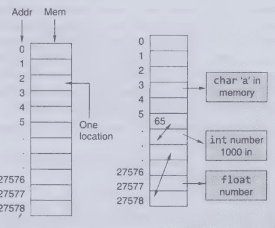

图7.1 计算机内存（16位系统）

变量可以存储在内存的不同地方，取决于它们的生命周期。定义在任何函数外的变量（全局或文件作用域）以及在函数内部定义为静态变量的变量在程序执行期间一直存在。变量存储在数据段中。数据段被分为固定大小的部分，一部分用于初始化变量，另一部分用于未初始化。

程序中可能声明了多个全局变量，但它们不会连续存储；编译器并不是为了方便程序员而按顺序存储它们。它们随机存储在全局内存中，尽管事实上每个编译器可能会为它们分配某种连续的方式。虚拟内存、缓存内存、寄存器以及其他让系统运行快一点或拥有更多内存的内存。从堆（`heap`）返回给程序的内存块随后会有相关的后续管理工作，且堆和栈都有对齐考虑。全局内存也有一些对齐考虑。例如，编译器可能要求所有`float`和`double`类型都存储在偶数边界上，或存储在被4整除的字节上。当遇到其中某一个时，可能需要一些字节作为边界填充。编译器/链接器将处理这些细节。

在函数内部定义的变量（没有使用`static`关键字）存储在栈上。栈用于函数调用时创建、函数返回时销毁的局部变量。这是自动的。

## 7.3 取地址运算符 (&)

读者可能已经注意到，我们在C中调用某些函数时会使用`&`符号。例如：

`scanf("%d", &n);`

该函数从终端获取输入并以整数格式存储在变量`n`中。`&`符号指向该整数在内存中的地址，该整数必须预先声明。

```c
int n;
```

其中函数在此处输入数据。就像城镇中的房子一样，内存地址是一个指定了其所在位置的整数。`scanf`需要知道这一点以便重定向数据。如果有人忘记并输入了`n`而不是`&n`，函数会将`n`的实际值解释为地址并尝试发送其输出。该地址可能不存在，或者可能被操作系统使用或被屏蔽，也可能无法找到。这可能会导致**段错误（segmentation fault）**错误，如果程序运行，你肯定会得到毫无意义的值。

为了编译，编译器面对的是`n`的值（如果没有赋值，它将是垃圾值）和`n`的地址。在变量声明的时刻，它必须存储在内存连续单元中的某个具体位置。程序并不决定变量放置的位置，这是由编译器和操作系统在运行时自动完成的。但一旦操作系统确定了地址，在某些情况下我们可能需要变量的位置。这可以通过在变量标识符前加上取地址符（`&`）来实现，它的字面意思是“地址”。

现在，我们通过更多细节来解释上述概念。考虑以下声明：

```c
int i = 3;
```

此声明告诉编译器：

- 在内存中预留空间以存储该整数值
- 将`i`与此内存位置关联
- 在此位置存储值3

`i`在内存中的位置可以用图7.2所示的内存映射图进行逻辑表示。

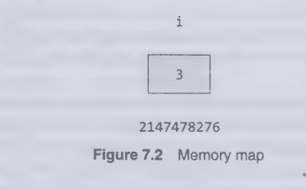

计算机选择了内存位置2147487276作为存储值3的地方。这个地址2147487276并不是一个可以依赖的数字，在其他时间，计算机可能会选择不同的位置来存储值3。这个地址可以打印出来：

```c
printf("\n Address of i = %u", &i);
```

输出将是：2147487276。看这个`printf()`语句，这就是C的取地址运算符。`&`表达式返回变量的地址，在这种情况下正是如此。

地址使用`%u`控制字符串打印，就像无符号整数一样。`%x`也可以，因为它会将输入参数作为内存地址打印。

以下语句：

```c
printf("\n Address of i = %x", &i);
```

### 注意事项

- 在声明变量后，变量的位置由编译器和操作系统在运行时决定。
- 在声明变量后，如果尝试在未赋值的情况下输出其值，结果是一个垃圾值。

## 7.4 指针

指针提供了一种不直接引用变量而访问变量的方法。用于此的机制是变量的地址。程序语句可以使用变量的地址直接引用变量。

根据小学教的一句诗：“子弹射向天空，落在何处，我不知道。”它可能押韵，但其信息对孩子来说并不合适。当一个指针在没有先赋值的情况下被声明并使用时，它就是在编程等同于这句诗的行为。

以下程序声明了一个指针，并尝试在未赋值的情况下输出它的值：

```c
#include <stdio.h>
int main() {
    int *ptr;
    printf("\n The value of ptr is %u", ptr);
    return 0;
}
```

结果取决于编译器和操作系统，可能是编译错误、运行时错误，或者编译器直接报错。无论如何，在不给其赋值的情况下尝试使用已声明的指针不是一个好主意。

可以回想起之前的章节，当一个变量被声明并尝试在未赋值的情况下输出其值时，结果是所谓的垃圾值，这毫无意义。原因是编译器尝试在变量的地址处解释从之前的程序留下的任何值。

指针可以用于：

- 通过地址调用（call by address），从而使得被调用函数对变量的修改能够永久地在调用函数中生效
- 间接从函数返回多个值
- 更方便地从一个函数向另一个函数传递数组和字符串
- 通过移动指向数组（或其部分）的指针来操作数组，而不是移动数组本身
- 创建复杂的数据结构，例如链表和二叉树，其中一个数据结构必须包含对其他数据结构的引用
- 通信有关内存的信息，例如`malloc()`函数，它使用指针返回空闲内存的位置
- 比数组等其他派生类型编译更快、更高效

当一个变量的值（遗留值）被解释为另一个内存指针时，当我们尝试使用它时，指针会尝试访问它。实际上，有很多内存地址范围是不允许访问的，因为它们是留给操作系统使用的。如果遗留值被解释为这些禁止的地址之一，结果就是错误。

### 注意事项

- 指针具有数据类型，但无论声明时使用什么数据类型，指针变量的大小始终是四个字节（在32位机器中）。

### 指针存储在哪里？

指针可以存储在变量以外的任何位置，但不会存储在堆上。它可以被全局定义并存储，也可以被定义为函数局部并存储在栈上。指针的大小取决于实现，对于32位系统，它需要四个字节的存储空间。然而，这并不是强制要求。编译器可以使用任意数量的字节来存储指针。

记住，指针在意义上与任何变量不同，因为它需要计算机内存中的某些空间，但它又像大多数变量，因为它不包含数据，只包含地址。由于它是地址，它实际上包含一个指向某些内存的数字。动态分配的数组可以在程序执行期间扩展。

## 7.4.2 初始化指针

应该注意的是，与存储值的变量不同，指针在使用之前必须先用特定的地址进行初始化。初学者和专业人士在编程中常见的错误原因之一就是未初始化的指针。这些错误可能很难调试，因为错误的影响通常会延迟到程序执行的稍后阶段。考虑以下程序。

```c
#include <stdio.h>

int main() {
    int *p;
    printf("%d\n", p);
    return 0;
}
```

这段代码告诉编译器打印`p`指向的值。然而，`p`尚未初始化；它包含地址0或某些随机地址。在给指针分配有意义的地址之前不能使用它。使用未初始化的指针将导致不可预测的结果。当程序开始执行时，未初始化的指针在内存中具有某些未知地址。它们拥有未知值，这些值将被解释为内存地址。使用未初始化的指针会导致不可预测的结果。在某些情况下，会发生段错误（或其他运行时错误），这意味着指针变量指向内存的一个区域。程序终止时看似运行正常，会显示“Null Pointer Assignment”消息。此消息由系统产生，用于通知程序员程序在使用未初始化的指针。在其他情况下，使用未初始化的指针将导致“Bus Error”（总错误）或“Memory Fault”（内存故障）运行时错误。无论如何，使用未初始化的指针都是极其危险的，特别是在PC类型系统中，并且难以追踪。

### 注意事项

- 指针在使用之前，应该用另一个变量的内存地址、0或`NULL`指针进行初始化；否则结果可能是编译错误或运行时错误。

现在，回到之前声明的指针`p`。假设`p`存储了整数`i`的地址，`i`的值为3。为了在`p`中存储`i`的地址，使用了单元地址运算符`&`。如下所示：

```c
p = &i;
```

`&`运算符获取了`i`的值（地址），即使`i`位于赋值运算符`=`的右侧，并将其复制到指针`ptr`的内容中。

现在说`ptr`“指向”`i`。该运算符仅适用于内存中的对象；即变量和数组元素。它不能应用于表达式、常量或寄存器变量。

下面的程序展示了如何使用该运算符将变量的地址赋值给指针。该程序还证明了指针的值等于指针指向的地址。

```c
#include <stdio.h>
int main() {
    int i = 5;
    int *ptr = &i;
    printf("\naddress of i using &i is %p,\n", &i);
    printf("\naddress of using ptr is %p\n", ptr);
    return 0;
}
```

```c
int i = 3;
int *p, *q, *r;
p = &i;
q = &i; // 已修正
```


# C语言中的指针

注意在这段代码中，`r` 指向的地址与 `p` 指向的地址相同，即 `i` 的地址。我们可以将指针赋值给另一个，地址在赋值过程中从右侧复制到左侧。

图示表示见图 7.4。


图 7.4 三指针指向同一个变量

图 7.3 形象地展示了指针如何指向整数变量。

| | p |
|---|---|
| 5 | 0012FED4 |
| 0012FED4 | 0012FEA4 |

图 7.3 指针指向整数变量

因此，在这种语文中，它被用作间接操作符。请仔细观察以下语句。

示例展示了如何使用指针在不直接使用变量的情况下，将用户提供的数字相加。

```c
int i=5;
int *p;
p = &i;
printf("\nValue of i = %d\n", i);
```

输出：

5

`*i` 值的位置与 `i` 的值相同。`*i` 始终意味着地址处的值。一元运算符 `&` 和 `*` 的结合比算术运算符更紧密；它们向左结合，`&i` 等同于 `(*i)`。

```c
printf("\nValue of i = %d\n", (*i));
```

在指针之前放置间接符号是为了解引用指针。被解引用的指针的值不是地址，而是该地址上变量的值——即指针所指向的值。

例如，在前面的程序中，`*ptr` 的值是 `num` 的地址。然而，`*ptr` 的解引用（结果）是 `num` 的值。这两个语句的效果相同，都会改变 `num` 的值。

```c
int num = 25;
int *ptr = &num;
```

同样，指针在算术表达式中的用法与它所指向的变量相同。因此，以下两个语句的效果相同。

```c
num += 2;
*ptr += 2;
```

在这些示例中，使用间接操作而不是直接赋值来改变变量的值似乎是多必要的复杂。然而，在本章涵盖的一些情况，例如使用指针遍历数组或使用动态内存分配，在这些情况下，间接操作是有帮助甚至是必要的。

以下语句也是有效的：

- `*ptr + 10;` 将 `*ptr` 增加 10。一元运算符 `&` 和 `*` 的结合比算术运算符更紧密，因此赋值会获取 `ptr` 指向的内容，加 1，并将结果返回给 `y`；而 `*ptr += 1` 则将 `ptr` 增加 1。指针变量在整个程序过程中并不总是指向特定的变量。它可以指向任何变量；唯一的限制是它们的类型必须相同，因为指针变量是基于特定数据类型的。以下程序说明了这一点。

```c
#include <stdio.h>
int main() {
    int a=5, b=10;
    int *p;
    p = &a;
    printf("\na=%d b=%d\n*p=%d\n", a, b, *p);
    p = &b;
    printf("\na=%d b=%d\n*p=%d\n", a, b, *p);
    return 0;
}
```

## 注意事项

- **地址运算符 (`&`)**: 它被用作变量前缀，可以翻译为 `&address`。因此，`&variable` 可以被读为 `.address`。
- **解引用运算符 (`*`)**: 它可以被翻译为指针或“地址处的值”。`*ptr` 可以被读为“ptr 指向的值”。它指示了当表达式被视为地址时必须进行求值的内容。

## 7.5 空指针 (VOID POINTER)

空指针是一种特殊的指针类型。它可以指向任何数据类型，从整数值或浮点数到字符字符串。它唯一的限制是所指向的数据不能直接引用（不能在它们上使用星号 `*` 运算符），因为它的长度始终是不定的。因此，必须使用类型转换或赋值将空指针转换为你可以可以引用的具体类型的指针。请看以下示例：

```c
#include <stdio.h>
int main() {
    int a=5;
    double b=3.1415;
    void *vp;
    vp=&a;
    printf("\na = %d\n", ((int*)vp));
    printf("\nb = %f\n", ((double*)vp));
    return 0;
}
```

空指针是一个特殊的指针，指向空处。在程序中获取空指针最直接的方法是使用预定义常量 `NULL`，包括 `<stdio.h>`、`<stdlib.h>` 和 `<string.h>`。为了初始化一个指针为空指针，可以使用以下代码：

```c
#include <stdio.h>
int *ip = NULL;
if(ip != NULL) {
    printf("\na = %d\n", ip);
}
```

在检查指针指向的值之前测试空指针，可以使用以下代码。也可能使用常量 0 来引用空指针；指针应该首先被赋值为 `NULL`。以下程序如下：

```c
#include <stdio.h>
int main() {
    int *p;
    p = NULL;
    printf("\nvalue of p is %u\n", p);
    return 0;
}
```

输出：

a=5

b=3.1415

- 空指针可以指向任何数据类型，从整数或浮点到字符字符串。
- 必须使用类型转换或赋值将空指针转换为可以引用的具体类型指针。

## 7.6 空指针 (NULL POINTER)

假设一个变量 `a` 在声明时没有初始化。如果是在函数外部，符合 ANSI 标准的编译器将将其初始化为零。同样，在大多数操作系统上，地址 0 具有特殊意义；它信号指针不打算指向任何可访问的内存位置。如果在代码中过早确定要分配指针的地址，指针应该首先被赋值为 `NULL`，这是一个在几个库中定义的常量。此外，由于 C 语言中“真”的定义是不等于 0 的值，以下简写代码测试空指针：

```c
if(ip)
    printf("%d\n", ip);
```

这与我们之前的示例含义相同；`if(ip)` 等于 `if(ip != 0)` 和 `if(ip != NULL)`。值 0 可用于赋值和初始化中表示空指针。这些都是合法的，尽管为了清晰起见建议常量 `NULL`。

```c
#include <stdio.h>
void swap(int a, int b)
{
    int temp;
    a=b;
    b=temp;
    temp=a;
}
int main() {
    int x=5,y=10;
    swap(x,y);
    printf("%d\n", x);
    printf("%d\n", y);
    return 0;
}
```

输出：

10

10

交换发生了。现在当使用函数时，系统会自动创建两个变量（在这种情况下称为 `a` 和 `b`）。这些变量将包含函数中指定的值副本（即 `x` 的值和 `y` 的值）。函数对值的副本 (`a`, `b`) 执行的所有操作都不会将影响原始值 (`x`, `y`)。

在特殊情况下，函数被用于交换变量的内容，但可能并非本意。函数被调用时，函数将接收并操作变量的副本，留下原始的 (`x`, `y`) 不受影响。在函数结束时，`swap` 做的做的更改会在函数完成时丢失。

## 注意事项

`NULL` 是定义在标准库中的一个常量，对于指针来说等于零。`NULL` 是一个保证不指向内存中任何的值。考虑以下代码：

```c
#include <stdio.h>
int main(void)
{
    char *p=NULL;
    printf("%s",p);
}
```

标准规定 `%s` 格式说明的参数应该是指向字符数组的指针。由于 `NULL` 不是字符数组，语句 `printf("%s",p);` 显示出一种不可预测或编译器未定义的行为。

## 7.7 指针的使用 (USE OF POINTERS)

### 地址传递 (Call by address)

指针的典型应用之一是支持引用传递。然而，C 不像 PASCAL 和 FORTRAN 等其他编程语言那样支持引用传递。通常通过函数调用来向函数传递参数。C 仅使用一种机制向函数传递参数：按值传递。这意味着当函数被调用时，会创建参数值的副本并传递给函数。例如，这是 C 中的常见情况。每个函数接收的是值的副本，函数没有办法修改存在函数外部的变量（例如示例中的 `x`, `y`）。

为了获得想要的效果，使用引用传递。这意味着当函数被调用时，我们不创建值的副本，允许函数访问原始值。这也意味着如果函数修改了值，那么修改将影响原始值，并持续到函数执行结束。

C语言中不存在引用传递（Call by reference），但可以通过使用指针来模拟。为了让函数能够修改某个变量，必须为函数提供该变量在内存中的位置信息（即其地址）。如果函数知道变量在内存中的位置，它就能通过指针访问该变量并更改其内容。这被称为地址传递（call by address）。

实现所需效果的方法是让调用程序传递要修改的值的指针。例如：

```c
swap(&x, &y);
```

由于 `&` 运算符产生变量的地址，因此 `&x` 是指向 `x` 的指针。在 `swap` 内部，它将以指针的形式进入函数。也就是说，参数被声明为指针，并通过指针间接访问操作数。现在使用地址传递来编写上述程序。

```c
#include <stdio.h>
void swap(int *a, int *b) {
  int temp;
  temp = *a;
  *a = *b;
  *b = temp;
}
int main() {
  int x=5, y=10;
  swap(&x, &y);
  printf("%d %d\n",x,y);
  swap(&x, &y);
  return 0;
}
```

| 变量 | 内存值 |
|---|---|
| x | 2000 | 5 |
| y | 2002 | 10 |

在代码中，`x` 和 `y` 的地址被传递给函数 `swap()`。函数 `swap()` 的参数 `*a` 和 `*b` 是指向整型数据的指针。这些指针分别接收了在调用 `swap()` 时传递的 `x` 和 `y` 的地址。声明了一个局部变量。对指针进行解引用（dereferenced），意味着获取了地址处的值。该值被存储在 `temp` 中。然后获取并赋值另一个地址处的值，从而交换了值。函数中的最后语句完成了值的交换。该函数没有返回值类型。

输出：

5 10

10 5

值已经通过函数 `swap()` 完成交换。在 `main()` 函数中，`&` 运算符导致 `x` 和 `y` 的地址被传递给 `swap()`。在函数头中，调用函数传递的地址在指针类型变量（`int *a`, `int *b`）中被接收。在 `swap()` 函数体内，使用 `*` 运算符获取所传递地址的值。

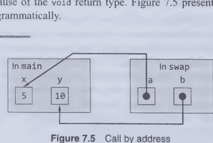

假设在调用 `swap` 函数时不小心忘记了 `&`，导致 `swap` 行看起来像这样：

```c
swap(x, y);
```

这会导致段错误（segmentation fault）。当 `a` 的值而不是地址时，`a` 指向内存中的一个无效位置，当使用 `*a` 时系统就会崩溃。

## 注意事项

- C语言仅支持值传递。C语言在真正意义上不支持引用传递，但可以通过使用指针来模拟，即所谓的地址传递。

### 从函数返回指针

从函数返回指针是可能的。当从函数返回指针时，它必须指向调用函数或全局变量。考虑以下程序。在程序程序中，指针通过一个返回较大变量地址的函数，指向两个变量之间的任意整数。

当参数按值传递时，函数通常只返回一个值，被调用函数无法修改传递的值并让其在调用函数中发生变化。指针允许程序员通过按地址传递参数来“返回”多个值，这允许函数修改所指向的值，从而从函数中“返回”多个值。

#### 从函数返回多个值

```c
#include <stdio.h>
int *pointerMax(int *x, int *y);
int main(void){
```

#### 示例

```c
#include <stdio.h>
int main() {
  float r, area, perimeter;
  float compute(float, float);
  printf("enter the radius of the circle:");
  scanf("%f", &r);
  area=compute(r, &perimeter);
  printf("area = %f\n", area);
  printf("perimeter = %f\n", perimeter);
  return 0;
}
float compute(float r, float *p) {
  float a;
  a=(float)3.1415 * r * r;
  *p = a;
  return a;
}
```

## 7.8 数组与指针

### 7.8.1 一维数组

数组是一组顺序具有相同类型数据的非空集合。数组的每个元素都有一个唯一的索引号。对数组中一个元素的修改不会影响其他元素。数组在内存中的布局如下：

| a[0] | a[1] | a[2] | a[3] | a[4] |
|---|---|---|---|---|
| 10 | 20 | 30 | 40 | 50 |
| 2147482720 | 2147482724 | 2147482728 | 2147482732 | 2147482736 |

元素存储在内存的连续位置上。例如，如果数组从位置 2147482720 开始（考虑 32 位机器），假设整数的大小为四个字节，则第一个元素存储在 2147482720，第二个元素存储在 2147482724，依此类推。这里的位置是任意的。

数组是指针的形式。数组名是数组的开头，被称为数组的基地址。也就是说，数组的基地址是数组的第0个元素。该名称被称为地址常量。提到数组名会获取其基地址。考虑以下程序：

```c
#include <stdio.h>
int main() {
  int array[]={10, 20, 30, 40, 50};
  printf("%u = %d", array, array[0]);
  return 0;
}
```

输出：

2147482720 2147482720

数组和 `&array` 都会给出数组的起始地址。虽然 `array` 和 `&array` 提供的地址相同，但它们之间存在细微差别。在 ANSI/ISO 标准 C 下，数组会产生一个指针，其类型为“指向 T 类型数组的指针”，其中 T 是整个数组的数据类型。在 Pre-ANSI C 时代，泛指使用 `&` 和数组名通常会触发警告，但通常会被忽略。在所有 C 编译器中，对数组进行未修饰的引用会产生一个指向数组第一个元素的类型 T 的指针。

#### 示例

**(a)**

```c
#include <stdio.h>
int main()
{
    int a[]={10, 20, 30, 40, 50};
    int i;
    for(i=0;i<5;i++)
        printf("%d\n", a[i]);
    return 0;
}
```

输出：

10

20

30

40

50

**(b)**

```c
#include <stdio.h>
int main()
{
    int a[]={10, 20, 30, 40, 50};
    int i;
    for(i=0;i<5;i++)
        printf("%d\n", *(a+i));
    return 0;
}
```

输出：

10

20

30

40

50

- 数组名是一个指针常量。它不能用作值。也就是说，名称不能放在赋值运算符的左侧。
- 数组和 `&array` 都会给出数组的起始地址，但唯一的区别在于，在 ANSI/ISO 标准 C 下，数组产生一个指向该实体的数据的指针。

数组可以被访问单个数据单元格。由于数组名实际上是表示内存地址的常量，因此数组名和整数值可以用来表示相对于起始地址的偏移。这种替代方法用于获取数组的单个单元格。数组的元素通过 `a[i]` 寻址，数组的第 i 个元素通过其指向类型的 `*(a+i*i)` 给出。

表达式 `+ 1`（配合整数）表示当前指向元素之后的第 1 个元素的地址。这不按字节数度量，而是按（类型）字节的大小计算。这被称为缩放（scaling）。

编译器会自动将下标缩放到所指向对象的大小。编译器在加到起始地址之前会处理大小问题。这就是为什么指针始终被类型限制为指向特定对象，以便编译器知道如何仅针对一种类型——检索指针解引用，以及对下标进行多少缩放。

由于间接运算符 `*` 意味着“...处的值”，因此 `a[i]` 等同于 `*(a+i)`。考虑这两个版本的程序。

整数 `i` 被加到数组的起始地址上。编译器计算出将访问的结果，方法是使用 `i` 中存储的值乘以类型 `array a` 的大小，并加上偏移量以得到正确的内存地址。下标表示法被编译器转换为指针表示法。因此，指针表示法运行得更快，因为使用它可以节省转换时间。

当考虑考虑它们的地址时，所有四个表达式都是相同的。

```
a[i]
*(a + i)
*(i + a)
a[i]
```

在表达式 `a[i]` 中，`i` 必须是一个整数。其他情况可以是数组名或指针。对于任何一维数组 `a` 和整数 `i`，以下关系成立。

赋值；，因此它也会调整元素的大小。指针和数组的关系非常紧密，以至于它们的表示法可以相互交换，如果 `p` 计数一个 `a` 的值，那么以下术语是等价的：

1. `&a[] == a`

数组第一个元素的地址是它本身的值。换句话说，`a` 是一个指针；指向数组中的第一个元素。

```
a[i]
*(a + i)
*(p + 1)
p[1]
```

等一下，文本包含一些片段：

`i=0,1,2,...,(N-1)`。`N` 是数组的大小。

数组和指针之间的相似性最终变得非常有用，事实上，C 语言建立在这些相似性之上，导致了所谓的“C 语言中数组和指针的等价性”。这种等价并不意味着数组和指针是相同的（实际上它们非常不同），但它们可以以相关的方式使用，并且这些操作可以在它们之间如下使用：

3. `a[i] == *(a + i)`

这基本上与之前的关系相同，但如果运算符的双方都已定义，这种关系就成立。

- 第一个操作是可以（显而易见的）将数组赋值给指针。


- 4. `(&a[i] - &a[j]) == (i - j)`

```c
int a[10];
int *p;
p = a;
```

这种关系定义了指针的减法。两个类型为 t 的指针之减等于它们之间可以容纳的类型 t 的元素个数。

C 定义了这种赋值的方面，使得 p 接收指向数组第一个元素的指针。换句话说，指针变量（适当的类型）也可以用于初始化或指向数组的第一个元素。

```c
p = &a[0];
```

```c
#include <stdio.h>
int main()
{
    int a[10]={10, 20, 30, 40, 50};
    int *p;
    p=a; // 也可以写成 p=&a[0];
    for(i=0;i<5;i++){
        printf("%d\n", p[i]);
    }
    return 0;
}
```

- 等价性的二阶方面是，数组下标表示法 `[i]` 可以应用于指针，因此 `p[3]` 可以写为 `*(p + 3)`。

所以，访问数组或数组部分的指针可以被处理为使用方便的 `[i]` 表示法。换句话说，在这次讨论的开头，表达式 `*p`、`*(p+1)`、`*(p+2)` 和 `*(p+i)` 可以写为 `p[0]`、`p[1]`、`p[2]` 和 `p[i]`。这可能非常有用（或者至少很方便）。

指针并不总是指向数组的第一个元素。它可以指向数组的任何元素。

```c
int a[10]={10, 20, 30, 40, 50};
int *p;
p = a + 3;
```

人们可以定义一个与元素类型相同的指针，并为其分配任何元素的地址，然后使用它来访问数组。事实上，人们可以对其加上一个整数值，这反过来给与 `p = &a[3];` 相同的结果。

# C 语言中的指针

当将数组名作为参数传递给函数时，数组零元素的地址会被复制到函数中的指针变量中。元素没有被复制。相应的局部变量被视为指针变量，具有所有指针算术和解引属性。它不是数组常量。这通过一个示例说明。main() 中的函数调用和相应的函数头所示，便于参考：

图 7.6 描述了数组表示法和指针表示法之间的等价性。

| a[0] | a[1] | a[2] | a[3] | a[4] |
|---|---|---|---|---|
| 10 | 20 | 30 | 40 | 50 |

```c
p = a
p = &a[0]
```

```c
#include <stdio.h>
int main()
{
    int a[10]={10, 20, 30, 40, 50};
    int *p;
    p=a; // 也可以写成 p=&a[0];
    for(i=0;i<5;i++){
        printf("%d\n", p[i]);
    }
    return 0;
}
```

```c
void getdata(int a[], int n) {
}
void show(int a[], int n) {
}
```

是否可能将数组视为指针来？

尽管这种技术很有吸引力（并用在旧版的《C 语言数值技巧》中），但它并不符合 C 标准。如果指针指向内存块之外（即使是终止元素之后），指针算术将是未定义的。如果在执行减法时生成了非法地址（超出内存段的边界），这种代码将在 7.18 节讨论。

```c
int arr[10];
int *a = &arr;
```

> 注意点

对于任何一维数组和 i，以下规则始终成立。

- `a[i] = *(a+i) = *(i+a) = i[a].`

# C 语言编程

示例

```c
#include <stdio.h>
#define MAX 50
int main()
{
    int arr[MAX],n;
    int getdata(int *, int);
    void show(int *, int);
    n = getdata(arr, MAX);
    show(arr, n);
    return 0;
}

// 函数返回一个数组。*
int getdata(int *a, int n)
{
    int x, i = 0;
    printf("\nEnter逐个输入数组元素\n");
    while (i < n) {
        scanf("%d", &x);
        *(a+i) = x;
        i++;
    }
    return i;
}
void show(int *a, int n)
{
    int i;
    for(i=0;i<n;++i)
        printf("\n %d", *(a+i));
}
```

当将数组传递给函数时，C 语言允许程序员将形式参数引用为数组或指针。编译器知道，每当形式参数被声明为数组时，在函数内部它实际上处理的是指向一个未知大小数组第一个元素的指针。这就是为什么调用函数只需传递适当的数组指针和元素个数作为参数。

数组的一部分（称为子数组）也可以传递给函数。指向子数组的指针也是数组；它指定了子数组的基地址。事实上，对于 C 语言而言，数组和它的任何子数组之间没有区别。例如，可以通过指定子数组的指针及其大小来通过函数调用来打印子数组。假设我们需要打印从 `arr[3]` 开始且包含五个元素的子数组；`arr[3]` 是一个指向从 `[3]` 开始的数组的指针。函数调用如下：

```
show(&arr[3], 5);
```

或者，`arr + 3` 指向 `arr[3]`，函数调用可以为：

```c
show(arr + 3, 5);
```

# 注意事项

- 当数组传递给函数时，它会退化为指针。函数参数中的所有数组名总是被编译器转换为指针。因为向函数传递数组时，数组第 0 个元素的地址会被拷贝到指针变量中，即函数的形式参数。数组和指针在编译器中的处理方式不同，在运行时表现也不同。

图 7 图明了调用函数 (n) 与被调用函数之间的关系。

```c
int main()
{
    int arr[MAX],n;
    n = getdata(arr, MAX);
    show(arr, n);
    return 0;
}

void show(int *a, int n)
{
}

getdata(int *a, int n)
```

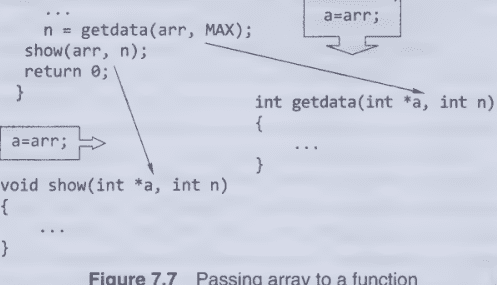

## 7.8.3 数组名与指针的区别

从讨论来看，数组名和指向数组基的指针是等价的。事实并非如此。它们之间存在若干差异，如下

- 为数组分配内存时，起始地址是固定的，在程序执行期间不能更改。因此，数组名不是地址常量；其包含的值不应被改变。为了确保此指针不改变，

图 7.7 将数组传递给函数

# C 语言中的指针

在 C语言中，数组名不能用作变量，即不能放在赋值语句的左侧，它们不能作为左值（lvalue）。相反，如果有必要，应声明并使用适当类型的独立指针变量作为左值使用。以下是一个尝试将数组作为左值时的常见错误示例。

通过这样做使其指向数组中的下一个元素。该过程重复，数组的每个元素都被设置为 0.0。

遵循相同的概念，数组不能赋值给另一个数组。以下代码：

```c
#include <stdio.h>
int main()
{
int i;
float a[5];
for(i=0; i<5; i++) {
*a = 0.0;
a++; // 错误：a = a + 1;
}
return 0;
}
```

（注：此处提供的原文代码片段似乎存在错乱，如 `int a[5]={1,2,3,4,5}; b[5]; a = b;` 等部分）

```c
int a[5]={1,2,3,4,5};
b[5];
a = b; /* 非法。要将 a 拷贝到 b，必须输入类似的内容：
for(i=0; i<5; i++) b[i]=a[i];
```

或者，更简洁地说，在这个例子中，a 是固定的，不能使用，因为编译器将生成错误信息，说明运算符需要左值。然而，可以声明一个指针，它可以指向与数组相同的类型，并用数组的地址初始化它。这个指针变量可以作为左值使用，且不会显示错误消息。但两个指针是可以赋值的。

```c
#include <stdio.h>
int main()
{
int i;
float *ptr, a[5];
ptr = a;
for(i=0; i<5; i++) {
*ptr = 0.0; /* ptr 访问 a[i] */
ptr++;
}
return 0;
}
```

```c
#include <stdio.h>

int main()
{
    for(i=0;*("I am a pointer")!='\0';++i)
        printf("%s",("I am a pointer" + i));
    return 0;
}
```

输出：

I am a pointer

但这对于数值数组是不成立的。下面的程序会报错。

```c
#include <stdio.h>
int main()
{
    for(i=0;*({1,2,3,4,5})='\0';++i)
        putchar(*((1,2,3,4,5) + i));
    return 0;
}
```

考虑以下代码：

```c
char *p = "abc";
printf("%s \n", p, p + 1); // 打印 abc
```

变量 `p` 是字符数组 "abc" 的起始地址。当以字符串格式打印指针时，会打印指针所指向的字符以及后续字符，直到遇到字符串结束哨符（即 `'\0'`）。在 `printf("%s")` 语句中，表达式 `p` 导致 abc 被打印，而表达式 `p+1` 指向字符串 "abc" 中的字母 b，导致 bc 被打印。像 "abc" 这样的字符串常量可以被视为表达式：

```c
"abc"[1] 和 "abc" + 2
```

这些表达式是可能的。虽然在正式代码中并不使用，但它们有助于强调字符串常量被视为指针。需要注意的是，数组和指针有相似的用途，但也有不同的用途。如果我们考虑声明：

```c
char *p = "abc"; char *s = "abcde";
```

在第一个声明中，编译器在内存中为 `p` 分配空间，将字符串常量 "abc" 放在内存的另一个地方，并用字符串的地址初始化 `p`。注意 `p` 是指向字符串的。第二个声明等同于：

```c
s[5] = {'a', 'b', 'c', 'd', 'e', '\0'};
```

由于括号是空的，编译器为 'a' 分配了六字节内存，第一个字节初始化为 'a'，第二个初始化为 'b'，依此类推。以下是它们在内存中的存储方式：

| P | a b c d e \0 |
|---|---|---|---|---|---|---|

一个 `char` 始终存储在一个字节中，而不是机器字中。因此，机器指针 `p` 存储在四个字节中，而 `s` 存储在六字节存储中。由于技术原因，最好不要打印空字符串。然而，打印空字符串是完全可以的。

人们可能会产生疑问——当传递一个数组时，函数知道数组有多少个元素吗？

对于字符串，不需要传递元素的个数，因为它有一个终止的空空字符。对于其他类型的数组，必须正确传递元素的个数。

# 注意事项

- 字符串被编译器视为指针。

- 对于字符串，不需要向函数传递元素个数，因为它有一个终止的空空字符。

## 7.10 指针算术

如果 `p` 是任何类型的指针变量且已经过正确初始化，那么像普通变量一样，可以对 `*p` 执行任何操作。因为 `*` 意味着“在地址处”，操作 `*p` 意味着由 `p` 持有该地址的变量。任何关系、算术或逻辑表达式都可以编写，且这些表达式对于简单变量值也是有效的。仅通过 `p`，操作在每种情况下都有限制，对指针的算术操作如下：

- 同类型指针的赋值：指针的赋值在符号上是有效的。在这里，除了 0 之外，不能给指针分配任何索引常量。

- 指针加减一个整数。

- 减去或比较指向数组元素的两个指针（在限制范围内）。

- 递增或减少指向数组元素的指针（在数组限制范围内）。当指向整数的指针加 1 时，地址增加 2（因为 `int` 使用两个字节）。指针算术所需的缩放因子由编译器自动处理。

- 将 0 赋值给指针变量并将 0 与指针比较。地址为 0 的指针指向任何地方。

这些将详细讨论这些有效的算术操作。请勿尝试对指针执行以下算术操作，它们将无法通过编译：

- 两个指针相加

- 指针与数字相乘

- 指针与数字相除

```c
vp = ip;
ip = vp;
if(ip != &i)
    printf("\n 编译器错误\n");
else
    printf("\n 无编译器错误\n");
return 0;
}
```

输出：

无编译器错误

现在，考虑示例 7 中程序的修订版本。

```c
#include <stdio.h>
int main() {
    int i=5;
    int *ip;
    void *vp;
    ip = &i;
    vp = ip;
    printf("\n vp = %d", *vp);
    return 0;
}
```

错误

如果满足以下条件，可以使用带有赋值运算符的指针：

- 左操作数是指针，右操作数是空指针。

- 一个操作数是指不兼容类型对象的指针，另一个操作数是指向 `void` 的指针。

- 两个操作数都是指针。

由于 OCR，上述部分文本可能会令人困惑，但核心逻辑遵循 C 语言的指针算术规则。

## 20 C 语言中的指针

这是一个典型的字符串处理指针。指针算术和解引用被用于搜索各种字符或模式。通常，指针被用于在解析或以某种方式解释字符串时沿着字符串移动。

该指针所指向的对象的大小。因此，可以从一个指向数组中元素的指针开始遍历整个数组。考虑以下程序。

## 声明与初始化

```c
char s1[] = "India is a beautiful country";
char s2[] = "C is easy";
```

| 表达式 | 值 |
| --- | --- |
| strlen(s1) | 28 |
| strlen(s2 + S) | 3 |

## 示例

```c
#include <stdio.h>
#define N 5
int main() {
    float arr[N], *ptr;
    int *iptr, a[N];
    /* 初始化 */
    for(i = 0; i < N; i++) {
        arr[i] = i;
        a[i] = 1;
    }
    /* 初始化 ptr 指向元素 arr[3] */
    ptr = arr[3];
    *ptr = 1.0; /* arr */
    *(ptr - 1) = 0.9; /* arr */
    *(ptr + 1) = 1.1; /* arr */
    /* 以同样的方式初始化 iptr */
    iptr = a[3];
    *(iptr - 1) = -1;
    *(iptr + 1) = 2;
    for(i = 0; i < N; i++) {
        printf("arr[%d] = %f,\n", i, *(ptr + i));
        printf("a[%d] = %d,\n", i, iptr[i]);
    }
    return 0;
}
```

```c
printf("%s", s1 + 10);
strcpy(s1 + 10, s2 + 8);
strcat(s1, " great country");
printf("%s", s1);
```

India is a great country

如果 p 是指向数组中元素的指针，那么 (p+1) 指向数组中的下一个元素。语句 p++ 可以指针跳过数组中的元素。数组 8 中的程序编写如下：

```c
#include <stdio.h>
int main(void) {
    int a[] = {10, 12, 6, 7, 2};
    int i;
    int sum = 0;
    int *ptr;
    int p = a;
    for(i=0; i<5; i++) {
        sum += *p;
        p++;
    }
    printf("%d\n", sum);
    return 0;
}
```

同样，++p 和 p++ 等同于 p+1，使用一元运算符（前增或后增）来增加指针；它通过其存储的地址增加 `sizeof(type)` 字节数，其中 'type' 是所指向对象的类型（例如，在 32 位机器上为 4）。

示例 9 显示指针可以递增和递减。在任何情况下，如果原始指针指向相同类型的对象，则新指针将指向相同类型的下一个或上一个对象。也就是说，指针是以 own步长进行递增或递减的。

该程序非常直观。它声明了一个大小为 5 的 float 数组和一个相同大小的整数数组。所有的 float 元素都初始化为 0 和 3，整数数组初始化为 1。有一个 float 指针，另一个是整数指针。每个变量都初始化为指向索引为 3 的数组元素；例如，ptr 初始化为指向 float 数组 arr[3]。因此，ptr - 1 指向 arr[2]，而 ptr + 1 指向 arr[4]。*ptr 的值被修改了，*(ptr-1) 和 *(ptr+1) 的值也是如此。数组中也进行了相似的更改。这里是程序的输出结果。

```
arr[0] = 0.300000 a[0] = 1
arr[1] = 0.300000 a[1] = 1
arr[2] = 0.900000 a[2] = -1
arr[3] = 1.100000 a[3] = 0
arr[4] = 1.100000 a[4] = 2
```

要将数组 a 复制到另一个数组 b 中，必须输入类似的内容。考虑以下内容。

```c
int b[]={10,20,30,40,50};
int i,p;
p=&b[4]-4;
for(i=0; i<5; i++) {
    printf("%d\n", *p++);
}
```


# 296 C 语言编程

```c
for(i=0; i<MAX; i++)
a[i]=b[i];
```

或者，更诚恳地：

```c
for(i=0; i<MAX; i++)
a[i]=*b[i];
```

表达式 `&b[4]` 给出 `b[4]` 的地址。假设 `b[4]` 的地址为 65540。那么表达式 `b[4]-` 可能会给出 65536 或 65532（考虑 16 位机器）。`&b[4]` 给出 `b[4]` 的地址。假设 `b[4]` 的地址为 65540。那么表达式 `b[4]-` 可能会给出 65536 或 65532（考虑 16 位机器）。

由于参数是通过值传递的，因此 `scopy` 可以使用 `b` 和 `a`。在这里它们被方便地初始化为指针，每次移动一个字符遍历数组，直到 `s` 的 `'\0'` 被复制到 `t` 中。经验丰富的 C 语言程序员更倾向于以下版本：

使用基于指针的方法，该函数可以重写如下。

```c
int strlen(char *s)
{
    int c=0;
    while(*s != '\0')
    {
        c++;
    }
    return c;
}
```

```c
/* scopy s 到 t; 指针版本 2 */
void scopy(char *s, char *t)
{
    while ((*++t = *s++) != '\0');
}
```

这使得 `s` 和 `t` 的增操作移动到了循环的测试部分。`*++t` 的值是 `t` 在递增之前指向的字符；后置运算符在获取后不会改变 `s`。同样，字符在 `t` 递增之前存储在 `t` 的位置。该字符也是用于与 `'\0'` 比较以控制循环的值。最终效果是字符从 `s` 复制到 `t`，包括终止符 `'\0'`。

这段代码可以简写为如下：

```c
int strlen(char *s)
{
    int c=0;
    while(*s != '\0')
    {
        c++;
    }
    return c;
}
```

C99 标准规定 `strcpy` 函数必须返回其目标指针的拷贝。在两种情况下，我们返回的都是目标参数的拷贝——也就是说，我们返回一个指针作为函数的返回值。然而，标准库 `<string.h>` 中的 `strcpy` 返回目标字符串作为其函数值。它看起来可能像：

现在检查 `strcmp(s,t)`，它比较字符 `s` 和 `t`，并返回负数、零，或者如果 `s` 字典序小于大于 `t` 则返回正数。该值通过减去 `s` 和 `t` 第不同位置的字符得到的。

```c
char *strcpy(char *destination, char *source)
{
    char *p = destination;
    while(*source != '\0')
    {
        *p++ = *source++;
    }
    *p = '\0';
    return destination;
}
```

```c
int strcmp(char *s, char *t)
{
    int i;
    for(i=0; s[i] == t[i]; i++)
        if(s[i] == '\0')
            return 0;
    return s[i] - t[i];
}
```

`strcpy` 的指针版本如下：

以下是 `strlen` 库函数的数组下标版本。

```c
int strlen(char *s)
{
    int x=0;
    while(s[x] != '\0')
        x++;
    return x;
}
```

```c
for(*s = *t; s++, t++)
    if(*s == '\0')
        return 0;
// 注意：OCR 识别的片段似乎不完整
```

为了说明字符串处理，编写了一个函数来统计字符串中的单词数。假设字符串中的单词是由空白字符分隔的。这里函数将使用在标准头文件 `ctype.h` 中定义的宏 `isspace()`。该宏用于测试字符是否是空格、制表符、换行符或其他空白字符。如果参数是空白字符，则返回非零（真）值；否则返回零（假）。

# C 语言中的指针 297

# 示例

```c
16. / 统计字符串中的单词数。 /
#include <stdio.h>
#include <ctype.h>
int word_cnt(char *s)
{
  int cnt = 0;
  while(*s != '\0')
  {
    while(isspace(*s)) /* 跳过空白字符 */
      s++;
    if(*s != '\0') /* 找到了一个单词 */
      cnt++;
      while(isspace(*s) && *s != '\0') /* 跳过该单词 */
        s++;
  }
  return cnt;
}

int main()
{
  char str [80];
  printf("\n 输入句子：\n");
  scanf("%[^\n]\n", str);
  printf("\n单词数 = %d,\n", word_cnt(str));
  return 0;
}
```

作为示例，尝试写一个函数在另一个字符串中查找一个字符串，返回该字符串的指针，如果找不到则返回空指针。这里是该函数（使用简单的暴力算法），在输入字符串的每个字符处，代码检查与...匹配

# 17. include <stdio.h>

起始指针跳过输入字符串中的每个字符位置。在每个字符处，`while` 循环通过 `p1` 和 `p2` 跨越输入字符串（从 `start` 开始）来检查匹配。比较无符号字符，直到到达字符串末尾（即 `p1 == '\0'`）或两个字符不同。如果到达末尾（即 `p1 == '\0'`），则意味着所有字符都匹配，在 `start` 处找到了完整的模式匹配并返回。外层循环再次执行，尝试另一个起始位置。如果没有找到匹配，则返回空指针。注意该函数声明为返回（并且确实返回了）一个指向字符的指针。

```c
int main()
{
  char a[50], b[30];
  char *strstr(char *, char *);
  printf("\n 输入字符串：\n");
  gets(a);
}
```

`strstr`（或其库对应项）用于确定一个字符串是否包含另一个。这里，代码如下：

# 298 C 语言编程

```c
if(strstr(a,b) == NULL)
    printf("未找到\n");
else
    printf("找到\n");
```

通常，C 语言不会初始化变量为 NULL，在使用之前从不测试它们是否为空。一种良好的习惯是将其设置为 NULL。必须使用显式代码设置它，使用未定义的变量无法保证安全；另一方面，如果某个指针总是有效的，则不需要在使用之前检查。

```c
q=p+1;
printf("%d\n", q - p);
```

输出：1

# 指针的减法

如所示，整数可以加上指针以得到超出范围的新指针（只要它们在同一个数组内）。例如，可以写：

```c
p2 = p1 + 3;
```

应用代数，`p1` 和 `p2` 都指向同一个数组的元素。从中可以得出，只要它们指向同一个数组，它们就可以被相减。我们也可以询问哪个指针大于或小于另一个；如果一个比另一个小，那么它更靠近数组的前部。因此，减法也是有效的：给定相同类型的指针 `p` 和 `q`，`p-q` 是一个整数 `k`，这仅在它们指向同一个数组时才有意义。结果是它们所指向元素的下标之差。以下代码说明了：

```c
#include <stdio.h>
int main() {
double a[],p,*q;
p=a;
```

示例

18. #include <stdio.h>

int main() {

int x[100];

int *pi, *ci = &x[99]; /* ci 指向 x 的最后一个元素 */

pi = x;

if((ci - pi) != 99)

printf("错误\n");

pi = ci;

pi++; /* 增加 x 的末尾 */

if((pi - ci) == 1)

printf("错误\n");

}

```

上述程序的执行没有输出任何内容。考虑库函数的另一个版本。

# C 语言中的指针 299

```c

int strlen(char *s)

{

    char *p = s;

    while(*p != '\0')

        p++;

    return p - s;

}

```

```

输出

10

20

30

40

50

```

在声明中，`p` 初始化为 `s`，即字符串的第一个字符。在 `while` 循环中，检查字符直到结尾的 `'\0'`。由于 `p` 指向字符，`p++` 移动下一个字符，`p-s` 是移动的字符数，即字符串长度。`<string.h>` 定义了一个足够大的变量 `size_t` 来容纳两个指针之间的差。然而，我们使用 `size_t` 作为无符号整数类型的返回值。每次 `p` 与数组的基地址进行比较。指针的一个常用用途是使用指针拷贝。这里有一段代码使用指针从 `array1` 拷贝10个元素到 `array2`。它使用一个结束指针来跟踪何时停止拷贝。

```c

int* array1[10], array2[10];

int *p1, *p2 = &array2[0];

int *ep = &array1[0];

for(p1=array1[0]; p1 < array1[10]; p1++)

    *p2++ = *ep;

```

`+=` 和 `-=` 运算符涉及指针，因为左侧是指向对象的指针，而右侧是整数。

# 7.10 比较指针

C 允许指针之间进行比较。如果两个指针相等，那么它们指向同一个东西，无论它是对象还是数组末尾不存在的元素（这是一种算术移动）。如果两个指针指向同一个东西，它们就会相等。关系运算符 `>`、`<` 等会给出如果指针指向同一个数组时预期的结果；如果一个小于另一个，那么它更靠近数组的前部。考虑以下程序。正如前面所述，没有 `array[10]` 元素，但对这个不存在的元素进行比较是合法的，因为它只用于像这样的指针比较（也就是说，它是合法的，因为没有尝试获取或存储它所指向的指针）。

以下程序将反序打印行。程序使用了两个指向同一个数组元素的指针，说明了指针比较。

```c

示例

20. #include <stdio.h>

#include <string.h>

int main()

{

    int a[]={10, 20, 30, 40, 50};

    int i, *p;

    for(p=&a[4]; p>=a[0]; p--)

        printf("%d\n", *p);

    return 0;

}

```

```c

void reverse(char *string)

{

    char *lp = string;           /* 左指针 */

    char *rp = &string[strlen(string)-1]; /* 右指针 */

    char tmp;

}

```


# C 语言编程

```c

while (lp < rp) {

    tmp = *lp;

    *lp = *rp;

    *rp = tmp;

    lp++;

    rp--;

}

```

- 若要引用指针 `p`，对其进行一次解引用，即 `*p`。
- 若要引用 `q`，需要对其进行两次解引用，因为涉及两层间接性。
- 如果 `q` 被解引用，实际上引用的是指向整数的指针 `p`。它可以用图示表示如下。

输出：
输入字符串（Enter the string）:manas
反转字符串后：


可以将一个空常量赋值给指针；该指针将与空指针常量相等。空常量或空指针不会与指向任何实际存在的内存的指针进行比较。这一点已经讨论过并清楚地说明了。表 7.4 给出了指针运算的总结。

## 7.11 指针的指针

因此在这个方向上，指针一直在直接指向数据。C 允许使用指向指针的指针，而这些指针反过来指向数据。为了让指针做到这一点，我们只需要为每一层引用添加一个星号（`*`）。考虑以下声明。

```c

int a=5;

int *p; //指向整数的指针

int **q; // 指向整数指针的指针

p=&a;

q=&p;

printf("\n *p=%d, *q=%d\n", *p, *q);

return 0;

```

输出：
*5
*5

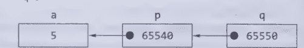

| 表 7.4 指针运算总结 |
| 操作 | 条件 | 示例 | 结果 |
|---|---|---|---|
| 赋值 | 指针必须是相同类型 | int *p, *q | p 指向 q 所指向的内容 |
| 整数相加 | | p = q; int k, *p; | p 所向的对象之后的第 k 个对象的地址 |
| 整数相减 | | p - k | p 所向的对象之前的第 k 个对象的地址 |
| 指针比较 | 指向同一数组成员的指针 | int *p, *q; | 如果 q 指向数组中比 p 更早的元素，返回真 (1)。返回类型为 int |
| 指针相减 | 指向同一数组成员的指针且 q < p | int *p, *q; ... p < q | p 与 q 之间的元素个数； |

## C 语言指针 301

在前面的图中，单元格包含变量的内容，其位置可以通过单元格来描述。在这个示例中，变量 `q` 可以用三种不同的方式描述；每种方式对应不同的值。

- `q` 是一个类型为 `(int **)` 的变量，值为 65550
- `*q` 是一个类型为 `(int *)` 的变量，值为 65540
- `**q` 是一个类型为 `(int **)` 的变量，值为 5

考虑以下声明。

```c

int a; /**整数变量 *

int *p; /**指向整数的指针 *

**qq; /**指向整数指针的指针 *

a = 5; /**给 a 赋值 */

p = &a; /**将 a 的地址存储在 p 中 */

q = &p; /**将 p 的地址存储在 q 中 */

```

| 变量 | 头部 | 值 |
|---|---|---|
| a | 65540 | 10 |
| p | 65550 | 65540 |
| q | 65558 | 65550 |

现在 `q = &b` 修改了 `q` 所指向的值，即：因此我们得到了下表：

| 变量 | 头部 | 值 |
|---|---|---|
| a | 65540 | 10 |
| p | 65550 | 65512 |
| q | 65558 | 65550 |
| b | 65512 | |

按值传递和地址传递机制也适用于指针。考虑以下程序：

内存图

| 变量 | 头部 | 值 |
|---|---|---|
| a | 65540 | 5 |
| p | 65550 | 65540 |
| q | 65558 | 65550 |

考虑在前面的内存图中引入以下表达式：

`*p = 7;`

| 变量 | 头部 | 值 |
|---|---|---|
| a | 65540 | 7 |
| p | 65550 | 65540 |
| q | 65558 | 65550 |

```c

#include <stdio.h>

void change(int *p);

int a,b;

int main() {

    int *p;

    a=5;

    b=10;

    p=&a;

    change(p);

    printf("*p = %d\n", *p);

    return 0;

}

void change(int *q){

    q=&b;

}

```

由于 `p` 是 `int a` 的地址，`*` 改变了 `a` 的值为 7。现在在同一个示例中引入以下表达式：
`**q = 10;`

| 变量 | 头部 | 值 |
|---|---|---|
| a | 65540 | 7 |
| p | 65550 | 65540 |
| q | 65558 | 65550 |

输出：
`*p = 5`

`a` 和 `b` 都是全局变量。它们可以从所有函数访问。变量 `'a'` 的地址被赋值给指针。然后 `p` 被传递给函数。输出显示，尽管指针在传递给函数时使用的是按值传递机制，但 `p` 中包含的地址被传递给函数并存储在 `q` 中。当 `b` 的地址赋值给 `q` 时，`p` 仍然指向 `a`。也可以使用 `q` 改变 `p` 的值，因为 `q` 指向 `a`。以下程序探索了如何使用指向整数的指针和指向指针的指针来读取同一个变量的值。

## 7.12 指针数组

指针数组可以被声明。指针数组包含 10 个指针，它们指向内存中的不同位置。这从图示可以看出。[费曼学习法](https://wiki.example.org/feynmans_learning_method) 的灵感源于**诺贝尔奖获得者理查德·费曼**。1. 运用费曼技巧，你只需花 `20 min` 就能深入理解知识点，而且*难以遗忘*

```c

#include <stdio.h>

void change(int *p);

int a,b;

int main() {

    int *p;

    a=5;

    b=10;

    p=&a;

    change(p);

    printf("*p = %d\n", *p);

    return 0;

}

void change(int *q){

    q=&b;

}

```


# 304 C语言中的编程

数组 `nameptr[i]` 是一个大小为 `MAX` 的数组，数组中的每个元素都是一个字符指针。可以将字符指针的值赋值给数组元素。例如：

```c

nameptr[i] = "Oxford";
```


编译器会将字符串 "Oxford" 放置在内存的某处，然后将该字符串常量的指针赋值给 `nameptr[i]`。也可以将任何字符串指针的值赋值给 `nameptr[i]`。例如，如果 `s` 是一个字符串，可以将 `s` 的指针值赋值给：

```c
nameptr[i] = s;
```

再次例如：

```c
char *name[] = {"Manas","Pradip","Altaf"};
```

```c
// 创建并初始化一个包含3个字符串的数组
name[0] = "Manas", name[1] = "Pradip" and name[2] = "Altaf";
```

学者经常会被这个示例与多维数组之间的区别所困惑。

```c
char name[3][10] = {"Manas","Pradip","Altaf"};
```

在许多情况下，这两者是相同的。只有当我们查看内存位置时才能看出区别。

| | Manas \0 | |
|---|---|---|
| name[0] | | Pradip \0 |
| name[1] | | Altaf \0 |

此图显示了第一个 `char *name[i]`：`name` 包含一个由两个指向 `char` 的指针组成的数组。这些指针被赋值为内存中的任何位置，其中包含字符串 "Manas","Pradip","Altaf"（均正确以 `\0` 结尾）。

```c
Manas[]=?,Pradip=?,Altaf[]=;
```

这代表了第二种情况——`\0` 结尾字符串。`?` 表示未初始化的内存位置。`char *a[]` 表示一个指向 `char` 的指针的数组。它可以用于包含多个字符串。

看下面的程序，它使用了指针数组。

### 示例

```c
char *rainbow[] = {"red","orange","yellow","green","blue","indigo","violet"};

int main() {
    int color;
    for(color = 0; color <= 6; color++) {
        printf("%s",rainbow[color]);
        printf("\n");
    }
    return 0;
}
```

输出：

red
orange
yellow
green
blue
indigo
violet

下面的程序将清除所有事实。

```c
#include <stdio.h>

char *getday(int);

int main() {
    int day;
    char *dayofweek="Enter a number from 1 to 7 for the day of the week:";
    scanf("%d",&day);
    dayofweek=getday(day);
    if(dayofweek==NULL)
        printf("That the day of week is %s", dayofweek);
    else
        printf("Invalid entry for day!");
    return 0;
}

char *getday(int inNo) {
    char *days[7];
    days[0]="Sunday";
    days[1]="Monday";
    days[2]="Tuesday";
    days[3]="Wednesday";
    days[4]="Thursday";
    days[5]="Friday";
    days[6]="Saturday";
    if(inNo>0 && inNo<=7)
        return days[inNo-1];
    else
        return NULL;
}
```

### 305 C语言中的指针

在这里，`data1` 和 `data2` 中的值没有改变；但 `ptr1` 现在访问 `data2`，而 `ptr2` 访问 `data1`。指针值已经交换，以不同的顺序指向对象。同样的思路适用于字符串。

```c
char name1[] = "Oxford";
char name2[] = "University";
char *p1, *p2;
p1 = name1;
p2 = name2;
```

通常，指针数组可以指向一个数据项数组，指针数组中的每个元素指向数据数组中的一个元素。可以直接在数据数组中访问数据项，也可以通过解引用指针数组来访问。指针数组的优势在于可以用任何方式重新排列指针，而无需移动数据项。例如，指针数组可以重新排序以指向排序顺序后的项，而无需移动数据项。与重新排序记录或字符串等大型项目相比，重新排列指针要快得多。这种方法节省了大量时间，此外是数据项仍按原始顺序可用。这里现在讨论如何实现这种方案。

对数组进行排序需要交换字符串，这需要复制数据。为了效率，当数据项很大（如字符串或整个数据库记录）时，最好避免实际交换数据。此外，数组可能需要多种顺序；例如，按学号排序的考试成绩和加权成绩；字符串可能同时需要未排序和已排序的形式。如果出现这任何一种情况，必须保留两份排序方式不同的数据副本，或者更有效的方法是使用指向数组元素的指针并交换指针。考虑一些示例。

### 示例

```c
#include <stdio.h>
#include <stdlib.h>
#include <string.h>

#define COLS 50

void sort_words(char *a[], int n) {
    int i, j;
    char *temp;
    for(i=0;i<n-1;i++) {
        for(j=i+1;j<n;j++) {
            if(strcmp(a[i],a[j])>0) {
                temp=a[i];
                a[i]=a[j];
                a[j]=temp;
            }
        }
    }
}

int main() {
    char w[10][COLS];
    char *wptr[10];
    int i;
    for(i=0;i<10;i++) {
        gets(w[i]);
        wptr[i]=w[i];
    }
    printf("\nBefore sorting the strings\n...s\n");
    for(i=0;i<10;i++) {
        puts(wptr[i]);
    }
}
```

```c
data1, data2, *ptr1, *ptr2, *save;
data1 = 100; data2 = 200;
ptr1 = &data1; ptr2 = &data2;
save = ptr1;
ptr1 = ptr2;
ptr2 = save;
```

### C 语言中的指针

例如，
```c
typedef unsigned char byte;
```
使得该名称意味着 `unsigned char`。在这里，
```c
byte b[10];
```
将是一个无符号字符数组。

### 示例 main()

```c
26. int main()
{
    int a[2][3]={3,4,5},{6,7,8};
    int i; int(*pa)[3];
    pa=a;
    for(i=0;i<3;i++)
        printf("%d\t",pa[i]);
    printf("\n\n\n)    for(i=0;i<3;i++)
        printf("%d\t",pa[i]);
    return 0;
}
```

注意在 `typedef` 声明中，单词 `byte` 被替换为 `unsigned char` 的名称。也就是说，使用 `typedef` 的规则是在数据类型的定义中使用数据类型的名称。因此

`typedef int Array[10];`

`Array` 变成一个包含 10 个整数的数组数据类型。也就是说，“Array arr”将我的 `arr` 声明为包含 10 个整数的数组，而 `arr2d[5]` 使 `arr2d` 成为一个包含五个数组的数组，每个数组包含 10 个整数。

3 4 5
6 7 8

表 7.5 总结了数组与指向数组的指针的区别。

同样注意 `*ptr2arr;` `ptr2arr` 是一个指向 10 个元素数组的指针。`ptr2arr` 指向与 `arr2d` 相同的类型，将二维数组 `arr2d` 的地址赋值给指针（指向 10 个整数的一维数组）是可以的。`ptr2arr = &arr2d[0];` 或 `ptr2arr = arr2d;` 都是正确的。

### 指针数组与数组数组指针的区别

| 指针数组 | 指向数组的指针 |
|---|---|
| 声明 | 声明 |
| `data_type *array_name[SIZE]` | `data_type(*array_name)[SIZE]` |
| Size 表示行数 | Size 表示列数 |
| 列的空间 | 行的空间可以动态分配 |

由于数据类型是一个包含 10 个整数的数组，预计递增 `ptr2arr` 会使其值改变 `10*sizeof(int)`，事实确实如此。`sizeof(*ptr2arr)` 是 20。可以通过编写并运行一个短程序来证明。

## 7.14 二维数组与指针

现在，虽然 `typedef` 让内容对读者来说更清晰、更方便，但它是必要的。在不使用 `typedef` 关键字的情况下，声明像 `ptr2arr` 这样的指针的方法是什么？事实证明这是可以，并且

C 语言中的二维数组被视为一维数组（行）。例如，一个 4 x 3 的整数数组（其中 'int' 是 C 语言支持的任何类型）可以通过 `int a[4][3]` 进行声明，并用以下方案描述。

```c
int(*ptr2arr)[10];
```

正确的声明，即 `ptr2arr` 在此处是一个指向包含 10 个整数数组的指针，就像使用数组类型进行声明时一样。这与不同，后者将使 `ptr2arr` 成为一个包含 10 个 `int` 指针的数组的名称。

二维数组的元素可以使用指向数组的指针进行打印。以下程序说明了这一点。

### 308 C 语言编程

| a[0] | a[0][0] | a[0][1] | a[0][2] |
| a[1] | a[1][0] | a[1][1] | a[1][2] |
| a[2] | a[2][0] | a[2][1] | a[2][2] |
| a[3] | a[3][0] | a[3][1] | a[3][2] |

图 7.9 二维数组的逻辑表示

行内可以执行指针运算，就像对一维数组一样。名为 `a[0]` 的常量指针可以被视为指向第一行第一个元素的常量指针，前面提到的公式可以用于指针算术，就像它是一个一维数组一样。因此，以下表达式：

```c
*a[0] + 3
```

和

```c
a[0][3]
```


首先注意到，数组名称仍然是一个指针，但在这种情况下，它是一个指向常量指针的常量指针。它指向一个指针数组，其中每个指针指向某些数组数组的内部。最后，数组的元素。根据 C 的定义，所有元素必须是连续的。元素以相同的方式绘制以强调这一事实。人们可能会猜想，也许这些指针并不一定是真实的指针，而是绑定在代码的地址逻辑中的某处，或者它们可能存储在寄存器中。另一方面，如果实现者决定这样做，它们实际上可以是指针。图 9 是二维数组在内存中的布局，但并没有很好地展示发生的情况。“内部伪内存工作”仅显示了维度数组在系统中的样子，并可说明它是如何实际实现的。图 7.10 是二维数组的图形表示。请记住，这可能不是内存存储内容的准确图像，但在二维数组概念上它是准确的。

由于数据类型是一个包含 10 个整数的数组，预计递增 `ptr2arr` 会使其值改变 `10*sizeof(int)`，事实确实如此。`sizeof(*ptr2arr)` 是 20。可以通过编写并运行一个短程序来证明。

二维数组的元素可以使用指向数组的指针进行打印。以下程序说明了这一点。

| a[0] | a[0][0] | a[0][1] | a[0][2] |
| a[1] | a[1][0] | a[1][1] | a[1][2] |
| a[2] | a[2][0] | a[2][1] | a[2][2] |
| a[3] | a[3][0] | a[3][1] | a[3][2] |

图 7.9 二维数组的逻辑表示

行内可以执行指针运算，就像对一维数组一样。名为 `a[0]` 的常量指针可以被视为指向第一行第一个元素的常量指针，前面提到的公式可以用于指针算术，就像它是一个一维数组一样。因此，以下表达式：

```c
*a[0] + 3
```

和

```c
a[0][3]
```

也就是说，C 语言以行线性方式存储矩阵。矩阵元素的值引用方式如下：

作为形式参数的数组指针：第二个维度是显式指定的。一个指向包含 10 个整数数组的指针可以声明如下：

```c
A[i][j] = *(A+i)[j] = *((A+i)+j) = *(A[i][j])
```

因此，

```c
A[0][0] = *(A)[0] = *(A+0) = *(A+0)
A[0][2] = *(A)[2] = *(A+2) = *(A+2)
A[1][2] = *(A+1)[2] = *((A+1)+2) = *(A[1][2])
```

```c
int (*ptr)[10] = &a;
```

以下程序展示了将数组指针作为形式参数的使用。因此，地址等式将：

```c
A[i][j] = *(A+i)[j] = *(A+i) = A[i][j]
```

```c
A[0][0] = *(A)[0] = *(A+0) = A[0]
A[0][2] = *(A)[2] = *(A+2) = A[2]
A[1][2] = *(A+1)[2] = *((A+1)+2) = A[1][2]
```

以下程序说明了这些事实。

```c
#include <stdio.h>

void show(int (*ptr)[3]);

int main() {
    int a[2][3] = {10,20,30,40,50,60};
    return 0;
}
```

使用数组表示法作为形式参数的传统方法——第一个维度为空的数组：双级指针不能直接作为二维数组的形式参数。考虑以下程序。

```c
#include <stdio.h>

int main() {
    int a[2][3]={10,20,30,40,50,60};
    void show(int (**ptr));
    return 0;
}

void show(int (**ptr)) {
    int i, j;
    for(i=0;i<2;i++) {
        for(j=0;j<3;j++) {
            printf("%d\t", *(ptr[i]+j));
        }
    }
}
```

示例 28.

```c
#include <stdio.h>

int main() {
    int a[2][3]={10,20,30,40,50,60};
    void show(int (**ptr));
    return 0;
}

void show(int (**ptr)) {
    int i, j;
    for(i=0;i<2;i++) {
        for(j=0;j<3;j++) {
            printf("%d\t", b[i][j]);
        }
    }
}
```

### 311 C 语言中的指针

它输出了错误的结果，而不是打印 10,20,30,40,50,60。原因如下。

虽然编译器可能报错，但声明 `int**b` 然后定义一个二维数组是错误的。它们是两种不同的数据类型，使用它们允许你访问内存位置。

当数组被传递给函数时，它会退化为指针。数组被视为指向数组第一个元素指针的这一著名退化约定最为常见，因为人们很容易忘记这种退化约定不能对同一个数组递归地（多次地）应用；二维数组不等同于指针。指向 'T' 的指针不能作为指向 'T' 的行的“二维数组”，这与“指向 'T' 指针的指针”有很大区别。

当一个指向数组第一个元素的指针配合下标运算符 `*ptr` 使用时，它会被完全解引用两次。在两次完全解引用后，结果对象的地址将等于数组第一个元素中找到的任何内容。由于第一个元素包含数据，我们将产生内存访问。

通过设置一个中间的“指向 T 的指针”可以避免额外的解引用。

#### 注意点

- C 语言不对数组下标进行运行时检查。
- 二维数组中最右侧的下标变化比最左侧的变化快。
- 多维数组以“行主”格式存储。
- 对于二维数组，以下表达式等效：

```c
a[i][j] = (*(a[i]) + j) = (*((a + i) + j)
```

作为形式参数的单一指针可以用此创建通用函数。维度没有出现在任何声明中，因此它们可以被添加到形式参数列表中。手动数组索引会适当降低执行速度。

```c
#include <stdio.h>

int main() {
    int a[2][3]={10,20,30,40,50,60};
    void show(int *);
    show(&a[0][0]); // 可以替换为
    show(a);
    return 0;
}

void show(int *b) {
    int i, j;
    for(i=0;i<2; i++) {
        for(j=0;j<3; j++) {
            printf("%d\n,", b + 3*i + j);
        }
    }
}
```

但那行不可通；数组“宽度”的信息丢失了。在二维数组表示法中使用双级指针的可能解决方案是使用一个辅助数组指针，其中每个指针都指向原始二维数组的一行。当然，辅助数组是动态的。将矩阵传递给函数可能是复杂的。为了清晰起见，这里有一些将 3x4 矩阵传递给函数的示例。请仔细观察每一个程序。

### 312 示例 29.

```c
#include <stdio.h>

#define ROWS 3
#define COLS 4

int main() {
    int i, j;
    int mat[ROWS][COLS];
    int *ptr;
    void show(int array[][COLS], int rows, int cols);
    printf("\n matrix is %d x %d\n", ROWS, COLS);
    printf("\nThe original values using array indices\n");
    for(i=0;i<ROWS; i++) {
        for(j=0;j<COLS; j++) {
            mat[i][j] = i+j;
            printf("%d\n", mat[i][j]);
        }
    }
    printf("\nThe first call to show\n");
    show(mat, ROWS, COLS);
    printf("\nThe second call to show\n");
    show(&mat[0][0], ROWS, COLS);
    return 0;
}

void show(int array[][COLS], int rows, int cols) {
    int i, j;
    for(i=0; i<rows; i++) {
        for(j=0; j<cols; j++) {
            printf("%d\n", array[i][j]);
        }
    }
}
```

输出：

```
 matrix is 3 x 4

The original values using array indices

0
1
2
3
1
2
3
4
2
3
4
5

The first call to show

0
1
2
3
1
2
3
4
2
3
4
5

The second call to show

0
1
2
3
1
2
3
4
2
3
4
5
```

*(注：由于原文文本在代码部分存在多处语法错误或不完整（如 `show` 函数中使用了未定义的 `b[i][j]` 或 括号不匹配），翻译时保持了原文的逻辑结构并仅对可理解部分进行了微调，以符合文档工程师的专业性。)*

3月1日是非闰年的第60天，是闰年的第61天。让我们定义两个函数来完成这些转换。

在C语言中，二维数组实际上是一个一维数组，其每个元素都是一个数组。因此，下标写为：

`daytab[i][j]`

`day_of_year` 将年份、月份和转换为一年中的天数，而 `month_day` 将一年中的天数转换为月份和日期。由于此函数返回两个值，因此月份和日期将是指针。

`month_day(1998, 60, &m, &d)` 将 m设为2，d设为29（2月29日）。
元素按行存储的。因此，右侧的下标（即列）在存储顺序中变化最快。

这两个函数都需要相同的信息：每个月的天数。由于闰年和平年的月份天数不同，将它们分分到二维数组的两行中比较方便，以便跟踪二月计算期间的情况。该数组以及执行这些操作的转换如下：

这里数组从零开始，这样月份号就可以从自然数1到12。由于在这里空间不是问题，这样做比调整索引更清晰。

### 锯齿数组 (Ragged arrays)

需要将 `char` 二维数组与指向 `char` 的一维指针数组进行对比。这些构造之间存在相似之处和之处。


```c
static char daytab[2][13] = {
  0, 31, 28, 31, 30, 31, 30, 31, 30, 31, 30, 31,
  0, 31, 29, 31, 30, 31, 31, 30, 31, 30, 30};
```

```c
#include <stdio.h>

int main(void) {
  char *a[2] = {"abc", "a is for apple"};
  char *p[2] = {"abc", "a is for apple"};
  printf("%s %s %s %n", a[0], a[0], a[1], a[1]);
  printf("%s %s %s %n", p[0], p[0], p[1], p[1]);
  return 0;
}
```

> /* day_of_year: 设置月份和日期 */
> `day_of_year(int year, int month, int day)`

```c
int leap;
leap = year % 4 == 0 && year % 100 != 0
  || year % 400 == 0;
```

```c
for(int i = 1; i < month; i++) {
  day += daytab[i];
}
return day;
```

> /* month_day: 根据一年中的天数设置月份、日期 */
> `month_day(int year, int day, int *month, int *day)`

```c
int leap;
leap = year % 4 == 0 && year % 100 != 0
  || year % 400 == 0;
```

```c
for(int i = 1; day > daytab[i]; i++) {
  yearday -= daytab[i];
}
month = i;
day = day;
```

记住逻辑表达式的算术值，其结果为零（假）或一（真），因此它可以用作数组 `daytab` 的下标。`daytab` 必须在 `day_of_year` 和 `month_day` 外部，这样它们才能都使用它。它的设计是为了说明使用 `char` 来存储较小数字字符的合法用法。

程序及其输出说明了两者在构造方式上的相似性。标识符 `a` 是一个二维数组，其声明使用了 30 个 `char` 来分配空间。二维数组等同于 `{'a', 'b', 'c', '\0', '\0', 'a', 'b', 'c', '\0', ...}`。

标识符 `a` 是一个数组，其中每个元素都是一个数组。因此 `a[0]` 是包含 15 个 `char` 的数组。因为字符数组是字符串，所以 `a[0]` 是字符串。数组 `a[0]` 初始化为 `{'a', 'b', 'c', '\0', '\0'}`，如果只指定了五个元素，其余部分将初始化为零（空字符）。尽管程序中用了所有元素，但已为它们分配了空间。编译器使用存储映射函数来计算 `access[i][j]`。每次访问都需要一次乘法和一次加法。

标识符 `p` 是一个指向 `char` 的一维指针数组。其声明导致分配了两个指针的空间（在 32 位机器上每个指针 4 个字节）。元素 `p[0]` 初始化为指向 `"abc"`，这是一个需要五个字符空间的字符串。元素 `p[1]` 初始化为指向 `"a is for apple"`，这是一个需要十五个字符空间的字符串。

### 初始化

考虑以下初始化。

```c
int a[2][3] = {
  {1, 1, 0}, {2, 0, 0},
  {3, 0, 0}, {4, 4, 0},
};
```


# C 语言编程

## 二维数组与指针数组

在 C 语言中，二维数组实际上是一个一维数组，其每个元素都是一个数组。因此，下标写为 `daytab[i][j]`。元素按行存储。因此，右侧的下标（即列）在存储顺序中变化最快。

### 初始化

考虑以下初始化。

```c
int a[2][3] = {
  {1, 1, 0}, {2, 0, 0},
  {3, 0, 0}, {4, 4, 0},
};
```

标识符 `p` 是一个指向 `char` 的一维指针数组。其声明导致分配了两个指针的空间（在 32 位机器上每个指针 4 个字节）。元素 `p[0]` 初始化为指向 `"abc"`，这是一个需要五个字符空间的字符串。元素 `p[1]` 初始化为指向 `"a is for apple"`，这是一个需要十五个字符空间的字符串。

### 锯齿数组

需要将 `char` 二维数组与指向 `char` 的一维指针数组进行对比。这些构造之间存在相似之处和差异。

```c
static char daytab[2][13] = {
  0, 31, 28, 31, 30, 31, 30, 31, 30, 31, 30, 31,
  0, 31, 29, 31, 30, 31, 31, 30, 31, 30, 30
};
```

```c
#include <stdio.h>

int main(void) {
  char *a[2] = {"abc", "a is for apple"};
  char *p[2] = {"abc", "a is for apple"};
  printf("%s %s %s %n", a[0], a[0], a[1], a[1]);
  printf("%s %s %s %n", p[0], p[0], p[1], p[1]);
  return 0;
}
```

标识符 `a` 是一个二维数组，其声明使用了 30 个 `char` 来分配空间。二维数组等同于 `{'a', 'b', 'c', '\0', '\0', 'a', 'b', 'c', '\0', ...}`。

标识符 `p` 是一个数组，其中每个元素都是一个指针。因此 `p[0]` 是指向包含 5 个 `char` 的数组的指针。因为字符数组是字符串，所以 `p[0]` 指向字符串。数组 `p[0]` 初始化为 `{'a', 'b', 'c', '\0', '\0'}`，如果只指定了五个元素，其余部分将初始化为零（空字符）。尽管程序中用了所有元素，但已为它们分配了空间。编译器使用存储映射函数来 `access[i][j]`。每次访问都需要一次乘法和一次加法。

## 日期转换函数

3 月 1 日是非闰年的第 60 天，是闰年的第 61 天。让我们定义两个函数来完成这些转换。

`day_of_year` 将年份、月份和日期转换为一年中的天数，而 `month_day` 将一年中的天数转换为月份和日期。由于此函数返回两个值，因此月份和日期将是指针。

`month_day(1998, 60, &m, &d)` 将 `m` 设为 2，`d` 设为 29（2 月 29 日）。

这里数组从零开始，这样月份号就可以从自然数 1 到 12。由于在这里空间不是问题，这样做比调整索引更清晰。

这两个函数都需要相同的信息：每个月的天数。由于闰年和平年的月份天数不同，将它们分到二维数组的两行中比较方便，以便跟踪二月计算期间的情况。该数组以及执行这些操作的转换如下：

> /* day_of_year: 设置月份和日期 */
> `day_of_year(int year, int month, int day)`

```c
int leap;
leap = year % 4 == 0 && year % 100 != 0
  || year % 400 == 0;

for(int i = 1; i < month; i++) {
  day += daytab[leap][i];
}
return day;
```

> /* month_day: 根据一年中的天数设置月份、日期 */
> `month_day(int year, int yearday, int *month, int *day)`

```c
int leap;
leap = year % 4 == 0 && year % 100 != 0
  || year % 400 == 0;

for(int i = 1; yearday > daytab[leap][i]; i++) {
  yearday -= daytab[leap][i];
}
*month = i;
*day = yearday;
```

记住逻辑表达式的算术值，其结果为零（假）或一（真），因此它可以用作数组 `daytab` 的下标。`daytab` 必须在 `day_of_year` 和 `month_day` 外部，这样它们才能都使用它。它的设计是为了说明使用 `char` 来存储较小数字字符的合法用法。

## 函数指针

### 7.164 将函数传递给另一个函数

函数可以作为函数的参数传递。以下代码展示了如何传递函数指针，该函数返回一个 `double` 类型并接受两个参数。假设某个计算可以使用不同的函数进行。

```c
double sum(double(*f)(double), int m, int n)
```

其中一个实例 `f(K) = x*K/K`，而另一个实例 `f(K) = x^K/K` 可以如下实现。

在这里，`double(*f)(double)` 是指向函数的指针，该函数接受一个 `double` 类型的参数并返回一个 `double` 类型的值。

```c
double exp_term(double b, double x) {
    return(pow(x,b)/fact(b));
}

double fact(double a) {
    double f=1.0;
    for(int i=0; i<a; i++)
        f*=i;
    return f;
}
```

括号非常重要，因为 `()` 的结合优先级比 `*` 更紧。如果参数写成 `double f(double)` 而不是 `double (*f)(double)`，则意味着 `f` 是一个接受 `double` 类型参数并返回 `double` 指针的函数。

`f(K) = 1/x^K` 可以如下实现。

在 `sum` 函数的体中，语句
`s+= f(K)`
可以替换为
`s+= (*f)(K)`

```c
double by_term(double b, double x) {
    return(1/pow(x,b));
}
```

此处函数指针被解引用。

现在，求和函数可以如下实现。

在这里，
`f` 意味着指向函数的指针
`*f` 意味着函数本身
`(*f)(K)` 对函数的调用

### 函数原型

对于函数原型 (IV)，有等效的原型声明，显示将函数作为形式参数。

```c
double by_term(double);                                     // (I)
double exp_term(double);                                    // (II)
double fact(double);                                        // (III)
double sum(double(*f)(double), int, int n);                 // (IV)

double sum(double (*)(double), int, int);
double sum(double (*f)(double), int m, int n);
```

### 调用示例

```c
printf("%n 计算结果 1: %f", sum(exp_term, 0, 3));
printf("%n 计算结果 2: %f", sum(by_term, 0, 4));
return 0;
```

`sum(exp_term, 0, 4)` 计算以下项的之和：
`s = x^1/1! + x^2/2! + x^3/3! + x^4/4!`

`sum(by_term, 0, 4)` 计算该级数的和。

以下是该程序。

```c
#include <stdio.h>
#include <math.h>

double fact(double a) {
    double f=1.0;
    for(a>0; a--)
        f*=a;
    return f;
}
```

```c
printf("%d \n", fpointer(4, 5));
/* 执行 'add' 并打印结果 */
fpointer = sub;      /* 对 'sub' 重复操作 */
printf("%d \n", fpointer(6, 2));
return 0;
}

int add(int a, int b) {
    return(a + b);
}

int sub(int a, int b) {
    return(a - b);
}
```

```c
int K;
double s = 0.0;
double x;
printf("%f\n 输入 x 的值");
scanf("%f",&x);
for(K=0; K<n; K++)
    s+=f(K,x);
return s;
```

当函数作为参数出现时，编译器将其解释为一个指针。以下是函数的等效头文件。

## 动态内存分配

虽然在 ANSI/ISO C 中这不是强制性的，但为了代码的可移植性，建议这样做。因为许多编译器尚未完全符合该标准。以下程序说明了 `malloc()`。

输出：
ip: address 133792; contents 42
dp: address 133808; contents 3.141593
fp1: address 133824; contents -1.200000
fp2: address 133840; contents 0.340000

```c
#include <stdlib.h>
#include <stdio.h>

int main() {
    int *ip;
    double *dp;
    float *fp1;
    float *fp2;

    ip = (int *) malloc(sizeof(int));
    if(ip == NULL) {
        printf("out of memory\n");
        exit(-1);
    }

    dp = (double *) malloc(sizeof(double));
    if(dp == NULL) {
        printf("out of memory\n");
        exit(-1);
    }

    fp1 = (float *) malloc(sizeof(float));
    if(fp1 == NULL) {
        printf("out of memory\n");
        exit(-1);
    }

    fp2 = (float *) malloc(sizeof(float));
    if(fp2 == NULL) {
        printf("out of memory\n");
        exit(-1);
    }

    *ip = 42;
    *dp = 3.1415926;
    *fp1 = -1.2;
    *fp2 = 0.34;

    printf("ip: address %p; contents %d\n", (void*)ip, *ip);
    printf("dp: address %p; contents %f\n", (void*)dp, *dp);
    printf("fp1: address %p; contents %f\n", (void*)fp1, *fp1);
    printf("fp2: address %p; contents %f\n", (void*)fp2, *fp2);

    return 0;
}
```

该程序声明了一些指针变量，调用 `malloc` 为其内容分配内存，将值存储到其中，并打印出分配的地址和存储的值。要分配内存的大小必须以字节为单位作为 `malloc()` 的参数。由于不同对象所需的内存取决于实现，指定大小的最佳方法是使用 `sizeof` 运算符。记住，`sizeof` 运算符返回操作数按字节计算的大小。

上面的示例在每次调用 `malloc()` 时为每个对象分配了足够的内存。当要分配的内存量在程序运行时才能确定时，确实需要动态分配。例如，它将根据用户的输入来确定。

如果用零大小调用 `malloc()`，结果是不可预测的。它可能返回一个 `NULL` 指针，也可能返回其他依赖实现的值。我们绝不应该用零大小调用 `malloc()`。

### 注意点

- 在动态分配中，内存是在运行时分配。
- 根据 ANSI 编译器，分配函数的返回类型是 `void`。
- 如果内存不可用，`malloc()` 返回 `NULL`。
- 根据 ANSI 编译器，不需要对 `malloc()` 返回的 `void` 指针进行转换。
- `calloc()` 将分配空间中的所有位初始化为零，而 `malloc()` 不会。对 `calloc()` 的调用等同于 `memset()`。`calloc(m, n)` 本质上等于 `p = malloc(m * n); memset(p, 0, m * n);`。
- 当动态分配的数组不再需要时，建议立即释放它们。

### 7.17.1 数组的动态分配

要分配一个长度为 N 的特定类型的一维数组，只需使用 `malloc()` 分配容纳 N 个元素的内存，然后使用该指针。以下程序将创建一个由用户给出 N 的数组并打印所有元素。

```c
#include <stdio.h>
#include <stdlib.h>

int main() {
    int N, *a, i=0;
    int s = 0;

    printf("elements of the array:\n");
    scanf("%d", &N);

    a = (int*)malloc(N * sizeof(int));
    if(a == NULL) {
        printf("memory allocation unsuccessful!\n");
        exit(0);
    }

    printf("enter the elements one by one:\n");
    for(i = 0; i < N; i++) {
        scanf("%d", &a[i]); // 等效语句
        s += a[i];
    }

    printf("sum is %d\n", s);
    return 0;
}
```

当分配的内存中是非零值，且 `printf` 函数尝试将它们解释为浮点数时发生了什么？它们可能是浮点数，但整数或其他任何内容。通过 `malloc()` 初始化内存是一个好主意。内存可能并不“干净”——它已被其他程序使用过，如果解释为我们预期的对象类型，存储的值可能没有意义。有时是零。有时，值会奇怪到让处理器检测到“错误”并核心转储。如果内存初始化为合法值，它就不会失败。这里有一个程序，它可以创建一个数组并在不初始化它们的情况下打印碰巧在那里的值。

```c
void show() {
    float *fp;
    int i;

    fp = (float *)malloc(10 * sizeof(float));
    if(fp == NULL) {
        printf("out of memory\n");
        exit(0);
    }

    for(i = 0; i < 10; i++)
        printf("%f\n", fp[i]);
}
```

```c
float *make_array(int size) {
    int i;
    float *fa;

    fa = (float *)malloc(size * sizeof(float));
    // ... 后续代码省略
}
```


```c
if(fa==NULL) {
    printf("out of memory\n");
    exit(0);
}

for(i = 0; i < size; i++)
    fa[i] = 0;

return(fa);
}
```

另一种方法是使用 `calloc()`，它分配内存并将其清零。它在 `stdlib.h` 中声明。

```c
void calloc(size_t count, size_t size);
```

该函数分配一个足够长的块包含一个元素向量，每个元素的大小为 `size`。在 `calloc` 返回之前，其内容会被清零。通过 `malloc()` 函数进行动态分配的数组所有元素的和可以写如下所示：

示例

```c
38. #include <stdio.h>
#include <stdlib.h>

int main() {
    int N,a,i,s=0;
    printf("\n enter the number of elements of array: \n");
    scanf("%d", &N);
    a=(int*)calloc(N,sizeof(int));
    if(a==NULL) {
        printf("memory allocation unsuccessful!\n");
        exit(0);
    }
    printf("enter the elements by one:\n");
    for(i=0; i<N; i++) {
        scanf("%d", &a[i]);
        s+=a[i];
    }
    return 0;
}
```

`memset` 设置数组的前 `n` 个字节为字符 `c`。以下程序说明了 `memset` 的使用。

```c
39. #include <string.h>
#include <stdio.h>
#include <mem.h>

int main(void) {
    char b[] = "Hello world\n";
    printf("\b before memset: %s\n", b);
    memset(b, '*', strlen(b) - 1);
    printf("\b after memset: %s\n", b);
    return 0;
}
```

输出：
b before memset: Hello world
after memset: ********

`malloc()` 有一个潜在错误。如果用零大小调用 `malloc()`，结果是不可预测的。它可能返回其他指针，也可能返回其他依赖实现的值。建议绝不要用零大小调用 `malloc()`。有些程序员像这样替换 `malloc()`：

```c
#include <stdlib.h>
void safe_malloc(size_t, char *);
```

现在函数定义如下：

```c
/* 错误检查 malloc 函数 */
void safe_malloc(size_t size, char *location) {
    void *ptr;
    ptr=malloc(size);
    if(ptr == NULL)
        printf("\out of memory at function: %s\n", location);
    exit(-1);
    return ptr;
}
```

`calloc()` 可以使用 `malloc()` 定义如下。

```c
void * calloc(size_t count, size_t eltsize) {
    size_t size = count * eltsize;
    void * value = malloc(size);
    if(value != 0)
        memset(value, 0, size);
    return value;
}
```

但通常情况下，没有必要 `calloc()` 在内部调用 `malloc`。`memset` 设置 `s` 的 `n` 个字节为字节 `c`，其原型如下：

```c
void memset(*s, int c, size_t n);
```

该函数可以像普通的 `malloc` 一样被调用，但会自动检查内存如下。

```c
void get_nints(int n) {
    int *array;
    array = (int *) safe_malloc(n * sizeof(int), "get_nints(");
}
```

编译器的 `malloc()` 实现一次会分配多少内存？`malloc()` 的参数类型为 `size_t`，与 `size_t` 对应的整数值将限制你可以指定的字节数。如果 `size_t` 对应 4 字节，则一次将分配 294,967 字节。

# 注意事项

关于 `safe_malloc` 声明中的 `size_t`，它是在 `stdlib.h` 中定义的一种类型，用于存储内存分配函数使用的内存大小。它由 `sizeof` 操作返回。

# 7.17.2 释放内存

使用 `malloc()` 分配的内存不会像自动变量那样在函数返回时自动释放，但它也不需要一直留在整个程序运行期间。

关于 `safe_malloc()` 最后一个值得注意的点是特殊变量 `__LINE__` 和 `__FILE__`，它们用于指示行号和文件名。它们由预处理器放入，并被替换为 `__LINE__` 出现处的行号（整数）以及文件名称（字符串）。

在许多程序中，内存是临时使用的。它们分配一些内存并对其进行使用，然后到达一个不再需要该特定内存的点（例如当函数结束时）。由于内存不是无穷尽的，因此释放不再使用的内存（即释放或 free 内存）是一个好主意。

```c
#include <stdlib.h>
void safe_malloc(size_t size);

/* 错误处理封装 */
/* 分配内存或打印退出 */
void *ptr;
ptr = malloc(size);
if(ptr == NULL)
    fprintf(stderr, "Out of memory at line %d file %s\n", __LINE__, __FILE__);
    exit(1);
return ptr;
```

动态分配的内存通过 `free` 函数释放。如果你调用了之前由 `malloc()` 返回的指针，如下调用：

```c
free(ptr);
```

将内存归还给满足内存请求的池（有时称为“区域”或“池”）。当分配的内存通过 `free()` 函数释放时，它会将该内存块返回到堆内部的“空闲”列表。

在谈论 `malloc`、`free` 和通用的动态分配内存时，请记住指针与其所指向的内容之间的区别。如果我们调用 `malloc()`，它会返回一个局部指针变量，当函数返回时会发生什么？如果局部指针变量具有自动存储期（这是默认值，它会在声明语句结束时消失），那么指针消失的返回值对于它所指向的内存没有任何说明。那块内存仍然存在，而且对于 `malloc` 和 `free()` 而言，它仍然处于分配状态。唯一消失的是我们曾指向的指针变量，如果它包含了我们拥有的指针的唯一拷贝，那么我们就无法释放它，也无法使用它。使用内存和释放内存都需要我们至少有一个指向内存的指针。

# 注意事项

- `malloc()` 需要参数，第一个是待分配的元素个数，第二个是每个元素的大小，而 `calloc` 也需要参数。
- `calloc()` 会将分配空间中的所有字节初始化为零，而 `malloc()` 不会这样做。调用 `calloc()` 等同于调用 `malloc()` 后紧跟一个 `memset()`。
- `calloc(m, n)` 本质上等于 `p = malloc(m * n); memset(p, 0, n);`。
- 如果用零大小调用 `malloc`，其结果是不可预测的。它可能会返回另一个指针，也可能返回另一个实现值。

# 我们将

# C 语言编程

查看以下程序，它与之前编写的程序相似，但区别在于使用了 `free()`。

```c
#include <stdio.h>
#include <stdlib.h>

int main(void) {
    int *array;
    int size = 1;
    int i;
    printf("输入数值的数量: ");
    scanf("%d", &size);
    array = (int*)malloc(sizeof(int));
    for(i=0; i<size; i++) {
        printf("请输入数值 #%d: ", i+1);
        scanf("%d", &array[i]);
    }
    for(i=0; i<size; i++) {
        printf("数值 #%d 是: %d\n", i+1, array[i]);
    }
    free(array);
    return 0;
}
```

`malloc()` 和 `calloc()` 也可以类似地用于字符串。

```c
#include <stdio.h>
#include <calloc.h>
#include <string.h>

int main(void) {
    char *str = NULL;
    /* 为字符串分配内存 */
    str = (char*)calloc(10,sizeof(char));
    /* 将 "Hello" 拷贝到字符串 */
    strcpy(str, "Hello");
    /* 显示字符串 */
    printf("字符串是 %s\n", str);
    /* 释放内存 */
    free(str);
    str=NULL;
    return 0;
}
```

自然，一旦内存被释放，就不能在任何时候再次使用。在调用 `free(str)` 后，不能再次使用。

（由于原文后半部分存在大量重复和碎片化文本，此处已根据核心逻辑完成翻译。）

# 328 C 语言编程

这里使用了两个不同的变量来跟踪由 `a` 指向的“数组”。`N` 代表分配了多少元素，`i` 代表其中有多少个元素正在使用。每当有另一个元素准备存储在数组中，如果 `i=N`，则旧数组已满，是时候调用 `realloc` 来将其变大了。

使用 `exit()` 时，状态将作为进程的退出状态提供给调用进程。

通常，值 `0` 表示正常退出，非零值表示某些错误。

可以使用以下退出状态：

| 表 7.6 exit(status) | |
| 状态 | 表示 |
| :--- | :--- |
| `EXIT_SUCCESS` | 程序正常终止 |
| `EXIT_FAILURE` | 程序异常终止。向操作系统信号程序以错误终止 |

## 7.17 使用指针实现多维数组

最好的方法是将每个指针初始化为一个数组，并初始化为一个动态分配的“行”。这是一个示例。

# 示例

```c
41. #include <stdlib.h>
#include <stdio.h>

#define ROW 5
#define COL 5

int main() {
    int **arr,i,j;
    arr=(int **)malloc(sizeof(int *));
    if(!arr) {
        printf("out of memory\n");
        exit(EXIT_FAILURE);
    }
    for(i=0;i<ROW;i++) {
        arr[i]=(int*)malloc(sizeof(int)*COL);
        if(!arr[i]) {
            printf("out of memory\n");
            exit(EXIT_FAILURE);
        }
    }
    printf("\n 输入矩阵的元素\n");
    for(i=0;i<ROW;i++) {
        for(j=0;j<COL;j++) {
            scanf("%d",&arr[i][j]);
        }
    }
    printf("\n矩阵如下...\n");
    for(i=0;i<ROW;i++) {
        printf("\n");
        for(j=0;j<COL;j++) {
            printf("%d\t",arr[i][j]);
        }
    }
    return 0;
}
```

`arr` 是一个指向 `int` 指针的指针。在第一层，它指向一个指针块，每行一个。那个第一层指针是分配的那个，它包含行，每个元素大到可以容纳一个指向 `int` 的指针，或 `int *`。如果分配成功，指针（所有行）将填充为一个指针（从 `malloc` 获取），指向空 `int`，即数组行的存储空间。如果这听起来不合逻辑，看一张图就能说明一切：

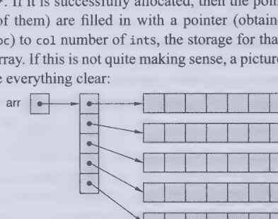

如果由于某种原因，方案所暗示的双重方向是不可接受的，可以用带有单个动态一维数组的二维数组模拟。

```c
int *arr = (int*)malloc(n columns * sizeof(int));
```

首先为二维数组的大小分配一个适当的内存块。C 语言中的数组存储是行主序的，该块被视为具有所需列数的行序列。分配的指针是指向数组基础类型的指针；必须递增才能访问行中的下一列。也必须递增才能从行的最后一列移动到下一行的第一列。

以下程序要求用户指定二维数组的行数和列数。它动态分配一个内存块来容纳数组。该块被视为具有指定行和列的二维数组。数据被读入数组，然后打印数组。

通过显式的指针运算，可以保持数组内容的连续性。

```c
int **arr = (int **)malloc(nrows * sizeof(*int));
arr[0] = (int *)malloc(ncolumns * sizeof(int));
for (i = 1; i<nrows; i++)
    arr[i] = arr[0] + i*columns;
```

# 示例

```c
42. #include <stdlib.h>
#include <stdio.h>

void getdata(int *p, int r, int c);
void showdata(int *p, int r, int c);

int main() {
    int row, col;
    int *a;
    printf("\n 输入行数:\n");
    scanf("%d",&row);
    printf("\n 输入列数:\n");
    scanf("%d",&col);
    a=(int *)malloc(row*sizeof(int));
    getdata(a,row,col);
    showdata(a,row,col);
    free(a);
    a=NULL;
    return 0;
}

void getdata(int *p, int r, int c) {
    int i,j;
    printf("\n 一个一个输入数字....\n");
    for(i=0;i<r; i++)
        for(j=0;j<c; j++){
            scanf("%d",p);
            p++;
        }
}

void showdata(int *p, int r, int c) {
    int i,j;
    printf("\n 矩阵如下....\n");
    for(i=0;i<r; i++) { // 注意：原文此处可能缺少括号，根据逻辑补全
        printf("\n");
        printf("%d\t",p[i*c+j]); // 注意：原文为arr[i][j]但此处p为int*，此处按逻辑翻译
    }
}
```

`arr` 是一个指向 `int` 指针的指针。在第一层，它指向一个指针块，每行一个。那个第一层指针是分配的那个，它包含行，每个元素大到可以容纳一个指向 `int` 的指针，或 `int *`。如果分配成功，指针（所有行）将填充为一个指针（从 `malloc` 获取），指向空 `int`，即数组行的存储空间。如果这听起来不合逻辑，看一张图就能说明一切：


如果由于某种原因，方案所暗示的双重方向是不可接受的，可以用带有单个动态一维数组的二维数组模拟。

```c
int *arr = (int*)malloc(n columns * sizeof(int));
```

首先为二维数组的大小分配一个适当的内存块。C 语言中的数组存储是行主序的，该块被视为具有所需列数的行序列。分配的指针是指向数组基础类型的指针；必须递增才能访问行中的下一列。也必须递增才能从行的最后一列移动到下一行的第一列。

以下程序要求用户指定二维数组的行数和列数。它动态分配一个内存块来容纳数组。该块被视为具有指定行和列的二维数组。数据被读入数组，然后打印数组。

通过显式的指针运算，可以保持数组内容的连续性。

```c
int **arr = (int **)malloc(nrows * sizeof(*int));
arr[0] = (int *)malloc(ncolumns * sizeof(int));
for (i = 1; i<nrows; i++)
    arr[i] = arr[0] + i*columns;
```

# 示例

```c
```


# 328 C 语言编程

这里使用了两个不同的变量来跟踪由 `a` 指向的“数组”。`N` 代表分配了多少元素，`i` 代表其中有多少个元素正在使用。每当有另一个元素准备存储在数组中，如果 `i=N`，则旧数组已满，是时候调用 `realloc` 来将其变大了。

使用 `exit()` 时，状态将作为进程的退出状态提供给调用进程。

通常，值 `0` 表示正常退出，非零值表示某些错误。

可以使用以下退出状态：

| 表 7.6 exit(status) | |
| :--- | :--- |
| 状态 | 表示 |
| `EXIT_SUCCESS` | 程序正常终止 |
| `EXIT_FAILURE` | 程序异常终止。向操作系统信号程序以错误终止 |

## 7.17. 使用指针实现多维数组

最好的方法是将每个指针初始化为一个数组，并初始化为一个动态分配的“行”。这是一个示例。

### 示例 41

```c
#include <stdlib.h>
#include <stdio.h>

#define ROW 5
#define COL 5

int main() {
    int **arr, i, j;

    arr = (int **)malloc(sizeof(int *));
    if (!arr) {
        printf("out of memory\n");
        exit(EXIT_FAILURE);
    }

    for (i = 0; i < ROW; i++) {
        arr[i] = (int *)malloc(sizeof(int) * COL);
        if (!arr[i]) {
            printf("out of memory\n");
            exit(EXIT_FAILURE);
        }
    }

    printf("\n 输入矩阵的元素\n");
    for (i = 0; i < ROW; i++) {
        for (j = 0; j < COL; j++) {
            scanf("%d", &arr[i][j]);
        }
    }

    printf("\n矩阵如下...\n");
    for (i = 0; i < ROW; i++) {
        printf("\n");
        for (j = 0; j < COL; j++) {
            printf("%d\t", arr[i][j]);
        }
    }

    return 0;
}
```

`arr` 是一个指向 `int` 指针的指针。在第一层，它指向一个指针块，每行一个。那个第一层指针是分配的那个，它包含行，每个元素大到可以容纳一个指向 `int` 的指针，即 `int *`。如果分配成功，指针（所有行）将填充为一个指针（从 `malloc` 获取），指向空 `int`，即数组行的存储空间。如果这听起来不合逻辑，看一张图就能说明一切：


如果由于某种原因，方案所暗示的双重方向是不可接受的，可以用带有单个动态一维数组的二维数组模拟。

```c
int *arr = (int *)malloc(n_columns * sizeof(int));
```

首先为二维数组的大小分配一个适当的内存块。C 语言中的数组存储是行主序的，该块被视为具有所需列数的行序列。分配的指针是指向数组基础类型的指针；必须递增才能访问行中的下一列。也必须递增才能从行的最后一列移动到下一行的第一列。

以下程序要求用户指定二维数组的行数和列数。它动态分配一个内存块来容纳数组。该块被视为具有指定行和列的二维数组。数据被读入数组，然后打印数组。

通过显式的指针运算，可以保持数组内容的连续性。

```c
int **arr = (int **)malloc(nrows * sizeof(*int));
arr[0] = (int *)malloc(ncolumns * sizeof(int));
for (i = 1; i < nrows; i++)
    arr[i] = arr[0] + i * columns;
```

### 示例 42

```c
#include <stdlib.h>
#include <stdio.h>

void getdata(int *p, int r, int c);
void showdata(int *p, int r, int c);

int main() {
    int row, col;
    int *a;

    printf("\n 输入行数:\n");
    scanf("%d", &row);

    printf("\n 输入列数:\n");
    scanf("%d", &col);

    a = (int *)malloc(row * sizeof(int));
    getdata(a, row, col);
    showdata(a, row, col);

    free(a);
    a = NULL;

    return 0;
}

void getdata(int *p, int r, int c) {
    int i, j;

    printf("\n 一个一个输入数字....\n");
    for (i = 0; i < r; i++)
        for (j = 0; j < c; j++) {
            scanf("%d", p);
            p++;
        }
}

void showdata(int *p, int r, int c) {
    int i, j;

    printf("\n 矩阵如下....\n");
    for (i = 0; i < r; i++) {
        printf("\n");
        for (j = 0; j < c; j++) {
            printf("%d\t", p[i * c + j]);
        }
    }
}
```

# 332 C语言编程

在向量（一维数组）中，可以执行以下操作。

`main()` 函数如下：

```c
double *alloc_space(int n) {
    double *v;
    v = (double *)malloc(n, sizeof(double));
    return (v - 1);
}

int main() {
    int n;
    double *a;
    a = alloc_space(n);
}
```

```c
int main() {
    int **v;
    int r, c;
    ...
    v = get_matrix_space(r, c);
}
```

实际上，这里通过以下代码段替换了 `alloc_space()` 函数。

```c
v = (double *)calloc(n, sizeof(double));
--v;
```

```c
release_space(v, r);
return 0;
```

内存分配可以如图所示。

下面的内存图可以进一步说明前面的程序语句。

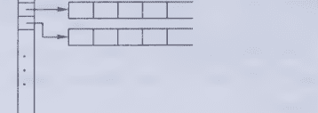

释放上述矩阵的内存空间应该通过 `release_space()` 函数实现，该函数接收行数。

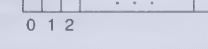

```c
void release_space(double **a, int m) {
    int i;
    for (i = 1; i < m; i++)
        free(a[i]);
}
```

这里不应访问、写入或读取 `a[0]`。为了释放内存空间，应使用以下语句。

```c
free(a + 1);
```

对于矩阵，即二维数组，还有一种通过一次性分配所有内存来实现的方法。在这里，用于分配内存的指针需要进行偏移。`get_matrix_space()` 函数可以重写为：

```c
double **get_matrix_space(int m, int n) {
    int i;
    double **a;
    ...
}
```


## 代码示例

```c
a = (double **)calloc(m, sizeof(double));
--a;
for (i = 1; i < m; i++) {
    a[i] = (double *)calloc(n, sizeof(double));
    --a[i];
}
return a;
}
```

```c
double **get_matrix_space(int m, int n) {
    int i;
    double *p;
    double **a;
    p = (double *)malloc(m * n * sizeof(double));
    a = (double **)malloc(m * sizeof(double));
    --a;
    /* 偏移指针 */
}
```

```c
void release_space(double **a) {
    double *p;
    p = (double **)a[1] + 1;
    free(p);
}
```

该函数经过了测试，能够完成其预期的工作。唯一的问题是，每次调用该函数都会分配一小部分内存且从不释放。如果该函数只调用几次，一切都会正常，且察觉不到差异。另一方面，如果频繁调用，它将逐渐耗尽所有内存。即使只在程序运行很长时间后才调用一次，最终会导致电脑崩溃。这可能是一个极其棘手的调试问题。

## 7.19 内存泄漏与内存损坏

当动态分配的内存区域未释放或不再需要时，就会发生内存泄漏。在 C 语言中，有两种常见的编码错误会导致内存泄漏。

**悬指针** 在 C 语言中，指针可能用于存储动态分配内存的地址。在使用 `free()` 函数释放该内存后，指针本身仍然包含已释放块的地址。这被称为悬指针。这种状态下的指针是一个严重的编程错误。在释放内存后，应将指针赋值为 0 或 C 中的 `NULL` 以避免这种情况。

首先，分配了一个区域，但在某些情况下，控制路径跳过了释放该区域的代码。这在分配和释放在不同的函数中处理时尤其容易发生。

如果指针在释放之前被重新赋值为新值，会导致“悬指针”和内存泄漏。考虑以下示例：

其次，将内存区域存储在一个变量（指针数据类型）中，然后在不释放第一个区域的情况下，将另一个区域的地址存在同一个变量中。原始地址已被覆盖并完全丢失。在结构良好的程序中，第二种类型通常更难处理。在某些编程语言和环境中，提供了如垃圾回收器之类的特殊机制来跟踪和释放动态分配的块。需要注意的是，C 语言并不提供自动垃圾回收机制。程序员有责任释放通过 `malloc()` 或 `calloc()` 分配的内存。以下示例代码会导致内存泄漏。

```c
char *a = malloc(sizeof(char));
char *b = malloc(sizeof(char));
b = a;
free(b); /* 不释放原始内存。 */
```

在像 C 语言这样弱类型的编程语言中，垃圾回收不是一个可靠的选项，程序员必须避免这种情况或承担后果。

## 7.20.2 常量指针

常量指针确保指针中存储的地址不能被修改。考虑以下语句：

```c
int n = 10;
int *const ptr = &n; // 定义了一个常量指针
```

以下是如何确保指针始终指向同一个对象；第二条语句声明并初始化了 `ptr`，并指示存储的地址不能被修改。

在编译时，任何尝试将指针指向程序中其他地方的尝试都将导致错误：

```c
int v = 5;
int *ptr = &v; // 错误 - 尝试修改常量指针（如果是 const）
```

使用 `ptr` 来修改它所指向的内容的值是合法的：

```c
*ptr = 100; // 允许，通过指针更改了 v 的值并将其值更改为 100。
```

你可以创建一个指向常量值的常量指针：

```c
int n = 25;
int *const ptr = &n;
```

`ptr` 是一个指向常量变量的常量指针，因此一切都是固定的。修改 `ptr` 中存储的地址是不合法的，因为 `ptr` 不能用于修改它所指向的内容。

## 7.20.3 常量参数

记住数组是被传递给函数的，并且已知函数实现可以改变数组的内容。为了防止数组在函数中被修改，请像示例所示使用 `const` 修饰符。

### 版本 1

```c
#include <stdio.h>

void change(char *);

int main(void) {
    char s[] = "Siva";
    change(s);
    printf("\n调用 change 后的字符串:\n%s\n", s);
    return 0;
}

void change(char *t) {
    *t = 'V';
}
```

输出：
调用 change 后的字符串：
Viva

### 版本 2

```c
#include <stdio.h>

void change(const char *);

int main(void) {
    char s[] = "Oxford University";
    change(s);
    printf("\n调用 change 后的字符串:\n%s\n", s);
    return 0;
}

void change(const char *t) {
    *t = 'V';
}
```

输出：
编译器错误：赋值给只读位置

当程序编译时会发生同样的错误。

```c
#include <stdio.h>

void change(const int [], int n);

int main(void) {
    int a[] = {1, 2, 3, 4, 5};
    printf("\n表达式\nsizeof(a)/sizeof(a[0]) 产生 %d\nsizeof(a)/sizeof(a[0]) 返回 %d\n", sizeof(a)/sizeof(a[0]), 5, sizeof(a)/sizeof(a[0]), 4);
    printf("\n调用 change 后的数组元素:\n");
    for (int i = 0; i < n; i++)
        printf("%d ", a[i]);
}
```

在上述程序中，常量参数保护了数组元素不被 `change()` 函数内修改，尽管作为参数传递的数组会自动按地址传递。

## 检查进度

以下程序的输出是什么？

1. 
```c
int main() {
    int val = 5;
    int *ptr = &val;
    printf("%d %d", ++val, ptr);
    return 0;
}
```
输出: 6 5

2. 
```c
int main() {
    int val = 5;
    int *ptr = &val;
    printf("%d %d", val, ++ptr);
    return 0;
}
```
输出: 5 5

3. 
```c
int main() {
    int val = 5;
    int *ptr = &val;
    printf("%d %d", val, ++ptr);
    return 0;
}
```
输出: 6 6

4. 
```c
int main() {
    int a[] = {1,2,3,4,5,6};
    int *ptr = a + 2;
    printf("%d %d", ++a, --ptr);
    return 0;
}
```
输出: 需要左值

5. 
```c
int main() {
    int a[] = {1,2,3,4,5,6};
    int *ptr = a + 2;
    printf("%d %d", --ptr+1, 1++--ptr);
    return 0;
}
```
输出: 2 3

6. 
```c
int main() {
    char myArray[5], *p = myArray;
    int i;
    for (i = 4; i > 0; i--)
        *p++ = i * p++;
    for (i = 4; i >= 0; i--)
        printf("%d", myArray[i]);
    return 0;
}
```

7. 
```c
int main() {
    int a = 555, *ptr = &a, b = &ptr;
    printf("%d %d %d", ++a, --b, *ptr++);
    return 0;
}
```
输出: 556 554 555

8. 
```c
int main() {
    int val = 5;
    int *ptr = &val;
    printf("%d %d", val, ++ptr);
    return 0;
}
```
输出: 6 5

9. 
```c
int main() {
    int a[100];
    int sum = 0;
    for (k = 0; k < 100; k++)
        (*a++) = k;
    printf("%d", a[--k]);
    return 0;
}
```
输出: 99

10. 
```c
int main() {
    void F(int *a, int n);
    int arr[] = {5,4,3,2,1};
    F(arr,5);
    return 0;
}
void F(int *a, int n) {
    int i;
    for (i = 0; i < n; i++)
        printf("%d", (*a++));
}
```
输出: 555

11. 
```c
int main(void) {
    int a[10];
    printf("%d", (a + 9) + (a + 1);
    return 0;
}
```
输出: 错误

12. 
```c
int main() {
    char A[] = {'a', 'b', 'c', 'd', 'e', 'f', 'g', 'h', 'i'};
    char *p = A;
    p++;
    while (*p != 'e')
        printf("%c", *p++);
    return 0;
}
```
输出: bcd

13. 
```c
int main() {
    char *p1 = "Name";
    char *p2 = (char *) malloc(20);
    while (*p2 != *p1)
        printf("%s\n", p2);
    return 0;
}
```
输出: 空字符串

14. 
```c
int main() {
    int a = 2, b = 3;
    printf("%d", a+++b);
    return 0;
}
```
输出: 5

15. 
```c
int main() {
    int a[] = {1,2,3,4,5,6,7};
    char c[] = {'a', 'x', 'h', 'o', 'k'};
    printf("%d, %d", (a[3]-a[0]), (c[3]-c[0]));
    return 0;
}
```
输出: 3

16. 
```c
#include<stdio.h>
int main() {
    char s1[] = "Manas";
    printf("%s", s1+3);
    return 0;
}
```
输出: Friends

17. 
```c
int main() {
    char *ptr = "Mira Sen";
    (*ptr)++;
    printf("%s\n", ptr);
    ptr++;
    printf("%s\n", ptr);
    return 0;
}
```
输出: Mira Sen

18. 
```c
int main() {
    char *p = "The Matrix Reloaded";
    int i = 0;
    while (*p)
        if (!isupper(*p++))
            i++;
    printf("%d,", i);
    return 0;
}
```
输出: 16

19. 
```c
int main() {
    char str[] = "Test";
    if (printf("%s", str) == 4)
        printf("Success");
    else
        printf("Failure");
    return 0;
}
```
输出: Test Success

20. 
```c
int main() {
    printf("Hi Friends"+3);
    return 0;
}
```
输出: Friends

21. 
```c
int main() {
    int a[] = {1,2,3,4,5,6};
    int *ptr = a + 2;
    printf("%d", *ptr);
    return 0;
}
```
输出: 2

22. 
```c
int main() {
    int i = 100, j = 20;
    i++ = j;
    printf("%d\t%d\n", i, j);
    return 0;
}
```
输出: 错误需要左值

23. 
```c
int main() {
    int a[5], *p;
    for (p = a; p < &a[5]; p++) {
        *p = p - a;
        printf("%d", *p);
    }
    return 0;
}
```
输出: 2

24. 
```c
int main() {
    putchar(s["manas"]);
    return 0;
}
```
输出: 什么都没有打印

25. 
```c
int main() {
    int a[] = {1,2,3,4,5};
    int i, s = 0;
    for (i = 0; i < 5; i++)
        if ((a[i] % 2 == 0)
            s = a[i];
    printf("%d", s);
    return 0;
}
```
输出: 6

26. 
```c
int main() {
    char s1[] = "Oxfordosh";
    int s;
    int i = 0; i < 1; i i
    if (s1[i] == 0)
        s = s1[i];
    printf("%d", s);
    return 0;
}
```
输出: 错误

27. 
```c
int main() {
    char A[] = "Ghosh";
    int i;
    while (*p != 'e')
        printf("%c", *p++);
    return 0;
}
```
输出: bcd (此处原文输出逻辑应为 defgh)

## 340 C 语言编程

数组不是变量。`a = pa` 和 `a++` 是非法的。当数组传递给函数时，传递的是它的初始元素在内存中的位置。数组在传递给函数时会退化为指针。

可以写成：

```c
f(int a[10]) { ... };
```

或者甚至：

```c
f(int(*a)[10]) { ... };
```

以下“有意义”的算术操作可以在以下对象执行：

- 对指针进行加或减整数。
- 减去两个指向相同类型的指针。结果是一个 `int`。
- 赋值 `NULL` 或任何相同类型的指针。

- `int(*a)[10];` 声明一个指向包含 10 个整数的数组的指针。
- `int (*a)[10];` 声明一个包含 10 个整数指针的数组。

动态内存分配是一种在程序运行期间决定需要多少内存的方法，在内存耗尽时获取更多，并在归还程序需要的内存。当分配内存时，分配函数（如 `malloc()`）返回一个指针。指针类型取决于编译器的类型，是旧的 K&R 编译器还是较新的 ANSI 编译器。对于 ANSI 编译器，返回的指针是 `char*`；在 ANSI 编译器中，程序在释放内存时结束于任何内存，它可以使用 `free` 函数来管理系统可用内存。

两个指针相乘是没有意义的。由于指针是变量，因此可以拥有指针数组。指针数组是一种表示形式，可以方便高效地复制长度不同的文本行。

声明指针时需要遵循的规则如下：这些规则对于函数特别重要。

- 复杂的存储
- 移动行的高开销

指针，当然，可以被任何类型的数据对象“指向”，包括数组。

```c
int (*p)[10];
```

这是正确的声明，即 `p` 是一个指向包含 10 个整数数组的指针，就像你使用数组类型进行声明一样。这不同于

一个二维数组实际上是一个一维数组，每个元素按行存储。数组元素按行存储。当将二维数组传递给函数时，必须指定列数；行数是无关的。之所以此的原因在于指针。C 需要知道列数以便在内存中将行与行连接起来。

```c
考虑 a(int[10]) 传递给函数
```


# 核心术语

- **按地址调用 (Call by address)**：被调用函数对变量的修改将永久地改变调用函数的函数中。
- **值调用 (Call-by-value)**：实现函数的一种特殊方式，通过其值（即其副本）传递参数。
- **悬空指针 (Dangling pointer)**：指向不再具有意义的先前位置的指针；通常指向已删除但未重置指针值的对象。
- **函数指针 (Function pointer)**：在内存中有一个物理位置，可以赋值给指针。这被称为函数的入口，并在调用函数时使用。
- **动态数据结构 (Dynamic data structures)**：运行时从堆分配的内存块构建的结构。
- **垃圾回收 (Garbage collection)**：如果允许隐式动态分配，则释放也必须通过隐式手段，这通常被称为垃圾收集。
- **动态内存分配 (Dynamic memory allocation)**：程序执行期间请求和获取额外内存段的过程。
- **内存堆 (Memory heap)**：用于运行时动态分配变量的区域。动态内存分配使用 `malloc()` 或 `calloc()` 使用。
- **内存泄漏 (Memory leak)**：一种常用术语，表示程序动态分配内存但未妥善释放，导致程序未使用的内存逐渐累积，损害了其他程序、操作系统和自身。
- **NULL**：一种特殊常量，在 `stdio.h` 中定义为宏 `0` 或 `(void*)0`，可以作为指针的空值。
- **空指针 (Null pointer)**：空指针是一个指向任何地方的特殊指针。它被初始化为值 0 或 `NULL`。
- **指针 (Pointer)**：指针是一个具有两个属性的变量：(i) 地址 (ii) 在该处应找到的类型。
- **差角数组 (Ragged array)**：指针数组，其元素用于指向不同大小的数组，称为差角数组。
- **栈 (Stack)**：一种类似于扑克牌的数据结构；新项只能推入栈顶（推栈操作）或从栈顶移除（弹出操作）。
- **静态内存 (Static memory)**：编译器为静态数据准备的内存布局。
- **空指针 (Void pointer)**：空指针是一种可以指向任何类型的特殊指针。

# 常见问题

## 1. 为什么使用指针？

C 语言通过三种方式使用指针：

- 第一，指针允许不同的代码段轻松地共享信息。可以通过复制信息并产生来实现这种效果，但可以使用指针。
- 第二，在某些情况下，程序员使用指针是因为它们让代码更高效。指针允许创建链表和二叉树等复杂的动态数据结构。
- 第三，C 语言中的指针提供了访问存储在数组中数据的替代方法。在处理字符串时，指针技术特别有价值。数组和指针之间存在紧密的联系。
- 此外，C 指针可以处理传递给函数的可变参数。

## 2. 为什么指针有数据类型而大小是 4 字节（在 32 位机器上），无论它们指向的变量是什么？

各种数据类型的大小基本上由架构和实现决定。32 位机器的地址是 4 字节。各种数据类型的大小基本上由架构和实现决定。32 位机器上，32 位宽的指针足够存储地址，无论它指向整数还是字符。对于数组，内存被分配。每个指针位于相对于前一个元素的某个偏移量处，取决于其大小。编译器使用指针算术进行缩放。指针的类型提供了信息。

## 3. 以下代码有什么问题？

```c
int *p= NULL;
```

指针是未初始化的指针，它可能包含某些内存地址。更准确地说，它可能被解释为已分配内存的无效地址。这会导致错误。

## 4. C 语言有“引用传递”吗？

并不真正。严格来说，C 总是使用指针。通过将指针作为形式参数传递并在调用函数时使用 `&` 运算符可以模拟这一点。

## 5. C 中的指针是什么？

在 C 语言中未初始化的指针被称为指针。

## 6. 什么是作为未初始化的空指针？

未初始化的指针可能指向任何地方，而空指针不指向任何特定的内存位置。

## 7. 空指针的用途是什么？

空指针用于三个目的：

- 停止间接
- 作为错误值
- 作为哨兵值（Sentinel value）

## 8. NULL 定义为 0 吗？

NULL 定义为 `0` 或 `(void*)0`。这些值几乎是相同的，无论它指向什么。

## 9. NULL 和 NULL 之间的区别是什么？

NULL 是 `<stddef.h>` 中定义的宏。由于 NULL 被用来表示空指针，每个编译器都解释空指针。

## 10. `arr` 和 `arr[]` 作为数组名有什么区别？

数组名是指向数组第一个元素的指针；`arr[]` 是指向整个数组的指针。虽然值相同，但它们的解释不同。

## 11. 什么时候你会使用函数指针？

当需要传递给其他函数时使用函数指针。被调用函数接受指针作为形式参数。这被称为“回调”。图形图形库。

## 12. 动态内存分配的用途是什么？

动态内存分配的类型有：

- 创建动态数组——运行时选择大小的数组；
- 创建动态结构——随程序或模块存储需求的变化而增长的数据。

## 13. 为什么需要调用 `malloc()` 来分配指针类型？

在 ANSI/ISO C 之前，引入 `void *` 通用指针类型是为了避免赋值给不兼容指针类型的警告。在 ANSI/ISO 标准 C 之后，这些情况不再需要了。

## 14. 如果调用 `malloc()` 会发生什么？

如果用大小 0 调用 `malloc()`，结果是不可预测的。每个编译器都可以自由定义 `malloc()` 的行为。它可能返回 `NULL` 或返回其他取决于实现的值。

## 15. `calloc()` 和 `malloc()` 的区别是什么？

`malloc()` 取一个参数，而 `calloc()` 取两个。`calloc()` 将分配集合中的所有位初始化为零，而 `malloc()` 不这样做。调用 `calloc()` 等于调用 `malloc()` 后跟 `memset()`。

```c
calloc(m, n)

本质上等于

p = malloc(m * n);

memset(p, 0, m * n);
```

## 16. 什么是悬空指针？

当你使用的地址生命周期结束时会出现悬空指针。这可能发生在从函数返回变量地址或在释放后使用内存块地址。

## 17. 释放后为什么要给指针赋值 NULL？

指针被释放后，该指针不能再使用。内存通过 `free()` 函数释放；指针仍然包含被释放的块。这种指针被称为悬空指针；它没有指向任何有用的东西。如果没有重新初始化指针，它可能运行也可能不；会产生 bug。释放内存后将这种指针赋值为 NULL 以避免这种 bug。程序通过使用该指针不再遇到麻烦。

## 18. 返回被调用函数中的变量指针是合法的吗？

绝对不。返回被调用函数中局部变量的指针是错误的，当函数终止时，它的内存变得不可访问。

# 练习

- 1. 什么是指针？它们为什么重要？
- 2. 解释指针的特性。
- 3. 解释需要四个字节的任何数据类型的指针。
- 4. 解释 `(*)` 重定向运算符的。
- 5. 什么是 `NULL` 指针？它和未初始指针是一样的吗？
- 6. 什么是 `NULL` 宏？`NULL` 指针和 `NULL` 宏之间有什么区别？
- 7. 错误“Null Pointer Assignment”（空指针赋值）是什么意思？什么会导致这个错误？
- 8. 解释 `++` 和 `--` 运算符对所有类型指针的影响。
- 9. 什么是数组指针？它是如何定义的？
- 10. 解释数组和指针之间的关系。
- 11. 为什么两个指针相加是不可能的？
- 12. 指针可以进行哪些算术运算？
- 13. 解释两个指针的比较。
- 14. 一个指针是如何指向另一个的？
- 15. 如何识别二级指针？数字 `*` 表示什么？
- 16. 字符串是如何存储在指针变量中的？必须声明长度吗？
- 17. 什么是基地址？一维数组和二维数组的访问方式有何不同？
- 18. 区分存储在指针中的地址和地址处的值。
- 19. 为什么数组的元素计数总是从 `0` 开始？
- 20. 写一个程序来读取并显示一个 5x2 的二维数组。将数组的基地址减1，并从1开始计数。
- 21. 指针是如何初始化的？

```c
(a) int a;

int *integer_pointer;

a=222;

integer_pointer=&a;

printf("The value of a is %d\n", a);

printf("The address of a is %p\n", &a);

printf("The address of %p\n, &integer_pointer:", integer_pointer, &integer_pointer);

printf("Star integer_pointer %d\n", *integer_pointer);
```

```c
(b) char a;

char *char_pointer;

a='b';

char_pointer=&a;

printf("The value of a is %d\n", a);

printf("The address of a is %p\n", &a);

printf("The address of %p\n, &char_pointer:", char_pointer, &char_pointer);

printf("Star char_pointer %d\n, *char_pointer:", *char_pointer);
```

```c
(c) float a;

float *float_pointer;

a=22.25;

float_pointer=&a;

printf("The value of a is %f\n", a);

printf("The address of a is %p\n", &a);

printf("The address of %p\n, &float_pointer:", float_pointer, &float_pointer);

printf("Star float_pointer %f\n, *float_pointer:", *float_pointer);
```

```c
(d) int a;

int *p1, *p2;

a=5;

b=6;

p1=&a;

p2=p1;

printf("The value of a is %d\n", a);

printf("The value of b is %d\n", b);

printf("The address of a is %p\n", &a);

printf("The address of ip1 is %p\n", &p1);

printf("The address of ip2 is %p\n", &p2);

printf("The value of ip1 is %d\n\n", *p1);
```

```c
(a) int a, &b;

(b) int p, *p;

(c) char *s;

(d) a = (float*) &x;

(e) double (**f)();
```

- 22. 解释以下语句的作用。
- 23. 预测以下每个程序的输出（画出内存图以便于回答），其中需要描述内存地址。使用六位数字。假设数字从 333333 开始。

```c
printf("The value of ip2 is %d\n", ip2);

printf("ip1 dereferenced %d\n",*ip1);

printf("ip2 dereferenced %d\n",*ip2);
```

```c
int i, j, *ip;

i=1;

ip=&i;

j=*ip;

*ip=0;

printf("The value of i %d\n", i);

printf("The value of j %d\n", j);
```

```c
int x, y;

*ip1, *ip2;

y=1;

ip2=&y;

ip1=&ip2;

x=*ip1;

printf("The value of x %d\n", x);

printf("The value of y %d\n", y);
```

字符串中的字符。该函数应该返回修正后的字符串，且没有空隙。

- 32. 写一个函数 `day_name`，它接收一个指向 n 的指针并返回一个指向对应星期名称字符串的指针。星期名称应保存在函数局的静态字符表中。
- 33. 写一个程序，查找给定单词在句子中出现的次数。从输入读取数据。第一行是一个单词（短字符串），第二行是文本（长字符串）。读取到新字符直到插入终止符。典型输出应该是：
The word is "the"
The sentence is "the cat on the mat"
The word occurs 2 times.
- 34. 写一个程序读取名称数组并按字母顺序排序。使用一个接收字符串和字符作为参数的函数 `swap()`，通过指针删除字符串中所有出现的该字符。
- 25. 解释“引用传递”和“按值传递”的区别。
- 26. 使用指针读取整数数组并反向打印元素。
- 27. 已知二次方程 $ax^2+bx+c=0$ 的根如下：
$x1 = -b+\sqrt{b^2-4ac}/2a$
$x2 = -b-\sqrt{b^2-4ac}/2a$
写一个函数计算根。该函数必须使用两个指针，一个接收 a 和 c，另一个将根返回给调用函数。
- 28. 提到数组是否给出基地址？
- 29. 写一个程序读取任意类型的数组。扫描该数组以找到特定值。
- 30. 使用指针相加两个矩阵并将结果矩阵返回给调用函数。
- 31. 使用一个接收字符串和字符作为参数的函数，删除字符串中所有出现的该字符。
- 35. 给定排序的整数列表，使用二分查找查找特定项。使用指针和算术。在二分查找中，目标值与数组元素进行比较。由于表是排序的，如果需要的值较小，则可以忽略该元素之后的值。这种搜索可以递归执行直到找到目标值。
- 36. 区分 `p++` 和 `++`。
- 37. 下标符号 `[i]` 的等价指针形式是什么？
- 38. `p++` 和 `++p` 的区别是什么？
- 39. 整数增加的结果是什么？
- 40. 使用指针的优点是什么？
- 41. 指针与 C 中的变量何不同？
- 42. 解释以下声明：

```c
int(*p)(char *a, int *b);

void (*malloc)();
```

- 43. `alloc()` 函数的作用是什么？
- 44. 区分 `calloc()` 和 `malloc()`。
- 45. 对于你计算机上的 C 版本，存储单个字符需要多少内存单元？一个整数？一个浮点数？一个双精度数？
- 46. 内存单元意味着什么？为什么需要地址？
- 47. 变量的地址是如何确定的？
- 48. 指针变量代表什么信息？
- 49. 变量地址与对应的指针变量之间是什么关系？
- 50. 重定向运算符的作用是什么？重定向运算符必须应用于什么类型的操作？
- 51. 变量表示的数据与对应的指针变量之间是什么关系？
- 52. 单元运算符与乘、除、模运算符的优先级如何？运算符是如何求值的？
- 53. 地址运算符可以作用于如 `(u + v)` 的表达式吗？解释你的答案。
- 54. 重定向运算符可以出现在赋值语句左侧吗？
- 55. 指针可以与什么对象关联？
- 56. 指针是如何定义的？声明中数据类型的作用是什么？
- 57. 以什么方式可以在指针变量定义中包含初始值？
- 58. 整数是如何赋值给指针的？解释。
- 59. 为什么将指针作为参数传递给函数是理想的？
- 60. 假设一个函数接收指针作为参数。解释它在调用函数中是如何声明的。特别地解释指针的数据类型是如何表示的。
- 61. 假设一个函数接收指针作为参数。解释指针在函数定义内部是如何定义的。
- 62. 数组名和指针之间是什么关系？当数组名作为参数出现时是如何解释的？
- 63. 假设函数定义中的形式数组是一个数组。它在函数内部是如何定义的？
- 64. 如何将数组的一部分传递给函数？
- 65. 如何返回一个指向调用例程序的指针？
- 66. 描述指定数组元素地址的两种方法。
- 67. 当下标是指示数组元素地址的表达式的一部分时，为什么下标的值有时被称为偏移（offset）？
- 68. 描述访问数组元素的两种方法。将你的答案与第 62 题的答案比较。
- 69. 地址可以赋值给数组名或数组元素吗？可以赋值给对象为数组的指针变量吗？
- 70. 如何使用库函数 `malloc` 用指针分配一块内存？块的大小是如何指定的？`malloc` 返回什么类型的信息？
- 71. 假设多维数组是通过指针定义的。单个数组可以被初始化吗？
- 72. 假设字符类型数组是通过指针定义的。单个元素可以被初始化吗？将你的答案与上一个问题进行比较。

# C 语言编程

这 10 个整数的最小值和最大值。将这 10 个整数按降序排序。

86. 编写一个程序显示项目的开始日期和结束日期。用户被要求输入希望开始项目的日期（0 到 6）以及完成项目预计持续的天数（小数，例如 6.5 表示项目持续 6.5 天）。程序将以如下格式显示开始日期和结束日期：
项目于周一开始，于周三结束——时长为 10.5 天（如果开始日期编号为 1 且时长 = 10.5）。程序允许用户继续输入，直到输入的开始日期编号为 9 时退出。

# 项目问题

编写一个程序，读取最多 10 个字符串或 EOF（文件结束），以先到者为准。为用户提供包含五个选项的菜单：打印字符串列表、按字母顺序打印字符串、按长度递增顺序打印字符串、按字符串中第一个单词的长度顺序打印字符串。菜单循环，直到用户输入退出请求。当然，程序应该实际执行所承诺的任务。

# 增量问题

该问题与前面的章节相同。所采用的编程逻辑与之前程序使用的逻辑相似。描述的程序与之前章节程序的主要区别在于使用了指针。在学习指针后，读者将获得如何在此类问题中使用指针的提示。

```c
int i,xx,yy;

double a,b,c,area;

createTriangle(&xx,&yy);

a=getLength(x[0],y[0],x[1],y[1]);
```


b = `getLength(x[1], y[1], x[2], y[2])`;

c = `getLength(x[0], y[0], x[2], y[2])`;

if (`a < b && b < c && c < a`)

# 问题描述

根据给定的三个坐标计算三角形三边的长度。检查是否可以形成三角形。计算三角形的面积。从用户处获取下一个点，并检查它是在三角形内部还是外部。

```c
{
    printf("Triangle can be drawn");
    area = `getArea(a`
```

# 解决方案

程序逻辑与前面的章节相似。与指针使用的函数与之前使用的相似。唯一的变化是将三角形顶点表示为指针，这在本章中已经学习过了。解决问题的程序如下：

# 程序

```c
#include <stdio.h>
#include <math.h>
#include <stdlib.h>

void `createTriangle(int **, int **)`;
double `getLength(int, int, int, int)`;
double `getArea(double, double, double)`;
int `isInsideOutside(int *, int *, int, int)`;

int `main(void)`
{
    int *x, *y;
```

```c
    free(x);
    free(y);
    x = y = NULL;
```

```c
    return 0;
}
```

```c
void `createTriangle(int **a, int **b)`
{
    int i;
    *a = (int*)malloc(3 * sizeof(int));
    if (*a == NULL) {
        printf("\n Memory Allocation Error \n");
        return;
    }
    *b = (int*)malloc(3 * sizeof(int));
    if (*b == NULL) {
        printf("\n Memory Allocation Error \n");
        return;
    }
    printf("\n Enter the coordinates of the vertices of a triangle\n");
    for (i = 0; i < 3; i++) {
        printf("\n Enter x[%d]:", i);
        scanf("%d", *(a + i));
        printf("\n Enter y[%d]:", i);
        scanf("%d", *(b + i));
    }
}
double `getTriangleLength(int xone, int yone, int xtwo, int ytwo)`
{
    int m, n;
    m = (xone - xtwo) * (xone - xtwo);
```

```c
    n = (yone - ytwo) * (yone - ytwo);
    return sqrt((double)(m + n));
}
double `getArea(double sA, double sB, double sC)`
{
    double s;
    s = (sA + sB + sC) / 2.0;
    return sqrt(s * (s - sA) * (s - sB) * (s - sC));
}
int `insideOrOutside(int *a, int *b, int xx, int yy)`
{
    int i, k;
    double d[3], area, sumArea = 0.0, aa, bb;
    for (i = 0; i < 3; i++) {
        d[i] = `getLength(*(a + i), *(b + i), *(a + (i + 1) % 3), *(b + (i + 1) % 3))`;
    }
    area = `getArea(d[0], d[1], d[2])`;
    for (i = 0; i < 3; i++) {
        aa = `getLength(xx, yy, *(a + i), *(b + i))`;
        bb = `getLength(xx, yy, *(a + (i + 1) % 3), *(b + (i + 1) % 3))`;
        sumArea += `getArea(aa, bb)`;
    }
    if (abs(area - sumArea) < 0.001) {
        return 1;
    } else {
        return 0;
    }
}
```

# 案例研究

# 问题描述

# 分析

首席执行官（CEO）签署收据、支票和文件，金额也以数字给出。每次签署时，CEO 都会检查文字金额是否与数字匹配。为了完成这一点，CEO 需要一个计算机程序来接受收据、支票和文件，并显示文字金额。在任何情况下，金额都不应超过 9 亿。编写了一个程序来执行此任务，其思想是用卢比表示金额。必须注意，处理的最大金额不应超过 99,999,999，且为一个整数。每当输入一个值，将其除以 1,000,000 得到“亿（crore）”部分。接下来，除以 100,000 得到“万（lakh）”部分。该商数除以 1,000 得到“千（thousand）”部分。现在，将该值除以 10 得到不足十的百位部分。

# 348 C 语言编程

# 实现

```c
#include <stdio.h>
void `num2word(long, char[])`;
char *`one[]` = {"one","two","three","four","five","six","seven","eight","nine","ten","eleven","twelve","thirteen","fourteen","fifteen","sixteen","seventeen","eighteen","nineteen"};
char *`ten[]` = {"fifty","sixty","seventy","eighty","forty","ninety"};
```

# 设计

主程序的算法如下：

1. 开始
2. 在名为 `ONE` 的数组中存储 0 到 19 的等值项
3. 在名为 `TEN` 的数组中存储 20 到 90 的等值项
4. `FLAG = 0`
5. 当 (`FLAG != 1`)
6. 开始
7. 打印“输入任意数字”
8. 输入 `N`
9. 如果 `N < 0` 则打印“大于”
10. 否则
    1. 打印“给定的金额为卢”
    2. 调用 `NUM_TO_WORD(K = N / 1000000)`, “亿”
    3. 调用 `NUM_TO_WORD(K = N / 100000)`, “万”
    4. 调用 `NUM_TO_WORD(K = N / 1000)`, “千”
    5. 调用 `NUM_TO_WORD(K = N / 100)`, “百”
    6. 调用 `NUM_TO_WORD(K = N / 10)`, “十”
    7. 打印“仅”
    8. 如果 `N > 0` 你想继续转换：Y 或 N
    9. 如果 `OPTION`
    10. 否则
        如果 `OPTION = 1`
        否则
        `FLAG = 0`
11. 结束
停止

函数 `NUM_TO_WORD(N, WORD)` 的算法如下：

1. 开始
2. 接收 `K` 和 `WORD`
3. 如果 `N > 19` 则打印 “`TEN[N/10] 和 ONE[N%10]`”
4. 否则打印 “`ONE[N]`”
5. 如果 `N != 0` 则打印 “`WORD`”
返回

```c
int `main()`
{
    long n;
    int flag = 0;
    char *ch;
    while (flag != 1) {
        printf("Enter any 9 digit value: ");
        scanf("%ld", &n);
```

```c
`num2word(long n, char[])`
{
    (n > 19) ? printf("%s,%s", `ten[n/10]`, `one[n%10]`) : printf("%s,", `one[n]`);
}
```

```c
    if (n)
        printf("%s", ch);
}
```

示例运行结果：

输入任意9位数字：546789123

给定的金额文字为：

卢五十四亿六十七万八十九千一百百二十三仅

你想继续转换：y 或 n

y

输入任意9位数字：123456789

给定的金额文字为：

卢十二亿三十四万五六千七百八十九仅

你想继续转换：y 或 n

按回车键返回 Quincy...

# C 用户定义数据类型和变量

# 第 8 章

# 学习目标

* 阅读本章后，读者将能够：
* 学习名为结构（`structure`）的用户定义数据类型及其标签、成员和变量
* 访问、初始化和复制结构及其成员
* 理解结构的嵌套
* 创建并初始化结构数组
* 理解指向结构的指针
* 将结构作为函数参数和返回值
* 学习联合（`union`）数据类型
* 理解枚举（`enumeration`）数据类型
* 熟悉位域（`bitfields`）

## 8.1 引言

到为止，程序中一直使用基本数据类型。然而，C 提供了从基本数据类型构建用户定义数据类型的设施。

但如果这个簇（称为数组）中的不同元素是不同的类型会怎样？这种非同构数据无法分组形成数组。为了妥善地解决这个问题，C 提供了处理一组异构数据的特性，这些数据带有用户定义的数据名称，并形成一个复合数据类型。因此，C 为用户创建了一种名为“结构”的新数据类型，该类型能够持有现有类型的数据。

## 8.2 结构

数组是数据结构的一个示例。它接收 `int`、`char` 或 `double` 等数据类型，并将它们组织成相同数据类型元素的线性数组。数组是典型的 C 程序的一部分，但并非全部。其限制是数组由相同类型的元素组成。

起初，这似乎完全合理。毕竟，为什么有人想要一个数组由二十个整数组成呢？嗯，这种数据类型的混合工作是数据结构最著名的特征之一。考虑一个包含此类姓名、年龄和工资的记录卡。姓名必须是一个字符串，即以 ASCII 空字符终止的字符数组，而年龄和工资将是整数。将这组数据作为单独变量收集起来的唯一方法是……这不如使用单一名称的单一数据结构来方便。因此，C 提供了一个关键字，用于形成可以包含不同数据类型的定义类型。这种复合的、用户定义的数据类型就是结构（`structure`）。更容易将其想象为一条记录（`record`），尽管它比看起来的要多才得多。

结构是单一名称下的变量集合。这些变量可以是不同类型，每个变量都有一个名称，你通过该名称从结构中选择它。因此，结构是分组若干相关信息的方便方法。

因此，结构可以被定义为一种新类型，从而增加了可用数据类型的数量。它可以使用其他结构、数组或指针作为其某些成员，虽然除非是……这可能会变得复杂。

结构提供了一种在单一名称下分组变量的方法，以便于处理和识别。通过嵌套结构可以创建复杂的层次结构。

结构可以被复制和赋值。它们在将逻辑相关的数据组传递给函数时有用。

### 8.2.1 声明结构和结构变量

结构通过关键字 `struct` 后跟一个可选的标签（`tag`）以及结构体来声明。结构的变量或成员在体内部声明。

声明简单结构的通用格式如下：

```c
struct <tag_name> {
    <data_type member_name1>;
    <data_type member_name2>;
};
struct variable1, variable2, ...;
```

`tag_name` 是结构的名称。变量是用逗号分隔的名称列表。这些变量名中的每一个都是结构类型 `tag_name`。该结构被称为结构的实例（`instance`）。在大括号内声明的每个 `member_name` 都是成员或结构元素。

与所有数据类型一样，结构必须被声明和定义。有三种方法可以声明和/定义它。这些是：

- 变量结构
- 带标签结构
- 类型定义结构

结构可以如下被定义：

```c
struct {
    member_list;
} variable_identifier;
```

例如，以下语句是变量结构的定义：

```c
// 无标签
struct {
    int x; // 成员
    int y;
} variable_identifier;
```

它没有没有比其他声明格式提供任何优势。带标签的结构之前描述过。它的格式如下：

```c
struct tag_name {
    member_list;
} variable_identifier;
```

上述结构声明可以如下表示为带标签结构：

如前所述，结构标签名提供了声明结构的简写。显示如下。

```c
struct `coordinate` {
    int x;
    int y;
};
```

```c
struct `point` {
    int x;
    int y;
};
struct `point` `upper_left`, `lower_right`;
struct `point` `origin`;
```

这创建了一个名为 'a' 的结构变量，并在 `coordinate` 结构中拥有所有成员（x 和 y）的独立实例。如果在闭大括号后用分号声明结构，则没有定义任何变量。在这种情况下，结构仅仅是一个模板，没有关联的存储空间。一旦声明了带标签结构，就可以通过指定以下语句定义结构变量。

在这里，`upper_left`、`lower_right` 和 `origin` 是三个 `point` 类型结构的名称。以下是结构和变量声明的一些示例。

```c
struct tag_name variable1, variable2 ...;
```

类型定义的结构将在稍后讨论（第 8.2.5 节）。

结构声明的正确位置是程序全局区域，位于 `main()` 之前。这使其处于整个程序的作用范围内，如果结构要被函数共享，这是强制性的。如果将声明放在函数内部，那么它的标签只能在该函数中使用。

```c
struct `personal_data` {
    char `name[100]`;
    char `address[200]`;
    int `year_of_birth`;
    int `month_of_birth`;
    int `day_of_birth`;
};
struct `personal_data` `monish`, `venkat`, `naresh`;
```

这里是一个结构示例，它对于表示计算机屏幕上点的笛卡尔坐标（即像素点）非常有用。

```c
struct `point` {
    int x;
    int y;
};
```

该声明是一个用户定义的数据类型。在这里，结构的名称是 `point`。这种类型的变量可以像内置类型一样被声明。例如，

上述语句用于定义一种变量类型，它有一个名为 `name` 的 100 字符字符串，一个名为 `address` 的 200 字符字符串，以及三个名为 `year_of_birth`、`month_of_birth` 和 `day_of_birth` 的整数。任何声明为 `personal_data` 类型的变量都将包含这些组件，它们是成员。

```c
struct `point` {
    int x;
    int y;
} `upper_right`;
```

不同的结构，甚至是不同类型的结构可以具有相同的成员名称，但不同结构之间的值是相互独立的。程序中的普通变量也可以使用相同的名称，但计算机会将它们识别为不同的实体，具有不同的值。这类似于人类的命名习惯，两个不同的男性可能共享名字 'Jogi Sharma'，但被识别为不同的人。

见图 8.1。声明的三个变量是 `monish`、`venkat` 和 `naresh`。每一个都包含了 `personal_data` 结构内声明的成员字段。

| name | name | name |
| :--- | :--- | :--- |
| address | address | address |
| yr of birth | yr of birth | yr of birth |
| mth of birth | mth of birth | mth of birth |
| day of birth | day of birth | day of birth |
| name | name | name |
| :--- | :--- | :--- |
| address | address | address |
| yr of birth | yr of birth | yr of birth |
| mth of birth | mth of birth | mth of birth |
| day of birth | day of birth | day of birth |

已经看到在定义结构的同时声明了结构实例。例如：

```c
struct `myFunction` {
    int a;
    int b;
    int c;
} `s1`, `s2`;
```

将生成两个 `myFunction` 实例。`s1` 将覆盖文件的前 12 字节（每个整数 4 字节），而 `s2` 将覆盖接下来的 12 字节，考虑到这是一个 32 位机器。因此，通过成员的声明，编译器可以确定所需的内存空间并识别结构中的不同成员。

# 354 C语言编程

被用作变量。本质上，它是一个新的数据类型关键字，类似于 `int` 和 `char`，现在可以用来创建变量。其他结构也可以定义为由与日期结构相同的组成部分。

结构类型和变量声明可以是局部的也可以是全局的，取决于它们在代码中的位置，就像任何其他声明一样，可以被赋值、作为形式参数传递并作为函数返回。此类操作会导致编译器生成一系列加载和存储指令，这可能会引发效率问题。特别关注程序速度的程序员会避免此类操作，而完全使用函数指针工作。

与结构体本身相比，可以在结构体上执行的实际操作很少。可能与结构体关联的运算符只有 `=`（简单赋值）和 `&`（地址）。无法使用 `=` 比较结构体，也无法对它们进行算术运算。此类操作需要通过对结构成员的操作来显式编码。

结构成员声明遵循与普通声明相同的语法。结构成员名称的语法与普通变量名和结构标签（`tags`）的语法相同，但它们属于不同的“宇宙”，即相同的名称可以用于结构体、结构体的实例和结构的成员。在命名成员结构方面，每个结构都定义了一个独立的空间。

以下奇异且混淆的案例是完全有效的。

- (a) struct a


# 结构体

## 结构体定义

结构成员可以是任何有效的数据类型，包括其他结构、聚合类型和指针（包括指向结构的指针和函数指针）。由于明显的原因，结构不能包含自身的实例，但可以包含指向自身实例的指针。

### 注意事项

1. 结构可以被定义为用户定义的数据类型，能够持有基本数据类型的异构数据。
2. 结构仅仅是一个模板，没有关联存储。
3. 结构声明的正确位置是程序的全局区域，位于 `main()` 之前。
4. 无法使用 `=` 比较结构的相等性，也无法对它们进行算术运算。

## 8.2.2 访问结构的成员

可以通过两种方式访问结构的成员。其中一种方法是使用 `.`，被称为“点运算符”。通过变量点运算符与结构关联来访问成员。访问结构成员的语句通用形式如下：

```c
<struct_variable>.<member_name>;
```

点运算符从结构中选择特定的成员。它的优先级与 `()` 和 `[]` 相同，高于任何一元或二元运算符。像 `()` 和 `[]` 一样，它从左到右结合。

例如，为实例 `s1` 和 `s2` 分配内存的概念视图：

```c
struct myStruct {
    int a;
    int b;
    int c;
} s1, s2;
```

可以通过以下构造访问第一个成员：

```c
s1.a
```

对于结构的任何其他成员，访问它的构造将更简单。因此，要为变量 `s2` 标识的结构成员 `b` 赋值 12，编写如下语句：

```c
s2.b = 12;
```

要在屏幕上打印赋值给成员的值，编写以下代码：

```c
printf("%d", s2.b);
```

同样，在前面的示例中，`structure2` 的成员 `b` 行为就像一个普通的 `int` 类型数组。然而，它是通过 `s2.b` 被引用的。

现在，考虑如下结构：

```c
struct personal_data {
    char name[100];
    char address[200];
    int year_of_birth;
    int month_of_birth;
    int day_of_birth;
};
```

结构变量 `monish`、`venkat` 和 `naresh` 的声明语句由给出。

要输入 `monish` 的地址，可以使用以下代码：

```c
scanf("%s", monish.address);
```

结构 `personal_data` 的成员行为就像一个普通的 `char` 数组。然而，它被称为 `monish.address`。

## 8.2.3 结构的初始化

结构可以像任何其他数据类型一样进行初始化。这包括向结构成员分配某些常量。由程序员显式初始化的结构，默认情况下由某些值初始化。对于整数和浮点数据值，值为 0。对于 `char` 和字符串类型成员，默认值为 `'\0'`。

初始化结构的通用构造可以是给出的两种形式之一。

**形式一：**

```c
struct <structure_tag_name> {
    <data_type member_name1>;
    <data_type member_name2>;
} <structure_variable> = {constant1, constant2, ...};
```

**形式二：**

```c
struct <structure_tag_name> <structure_variable> = {constant1, constant2, ...};
```

以下是使用两种初始化形式的某些示例。

### 示例 5：使用第一种构造初始化结构

```c
#include <stdio.h>

struct tables {
    int count;
    float average_weight;
    int m, month, year;
    int ex_date, ex_month, ex_year;
} batch1 = {2000, 25.3, 07, 11, 2004};

int main() {
    printf("\ncount=%d, av_wt=%f", batch1.count);
    printf("\nmfg-date=%d/%d/%d\n", batch1.ex_date, batch1.ex_month, batch1.ex_year);
}
```

输出：

```
count=2000, av_wt=25.999999
mfg-date=7/11/2004
```

在前面的示例中，观察到 `=` 之后，括号内的常量数量不等于成员的总数。该结构中有五个成员。因此，前五个成员被分配了常量，剩余成员被赋值为 0。

因此可以说明，如果括号内的初始化常量等于成员数量，则所有成员初始化都是可能的。否则，将进行部分初始化，并遵循为成员分配默认值的规则。

### 示例 6：使用第二种构造初始化

```c
#include <stdio.h>

struct games_ticket { /* 结构标签 */
    int value;        /* 成员 */
    int seat_num;     /* 成员 */
    int date, month, year; /* 成员 */
} fan1 = {500, 52}; /* 初始化值 */
```

在这里，`value` 和 `seat_num` 分别初始化为 500 和 52。

---

## C99 命名初始化

到为止描述的结构体初始化规则适用于不符合 C99 标准的旧 C 编译器。符合 C99 标准的编译器允许初始化结构的单个成员（指定初始化器）。这种初始化方法在不符合 C99 标准的旧编译器中是禁止的。通过下面的示例可以演示这种结构体具命名初始化的形式。

> **注意**：命名初始化将定义与初始化顺序解耦，但它更具可读性。这意味着程序员只需要填充结构中当前相关的部分，并使用集合符号初始化结构的元素，而不需要记住元素的顺序。如果以后版本添加了新元素，它们将被初始化为已知值（默认值 0）。

### 示例 7

```c
struct {
    float p, q, r;
} k = {.p = 3.0, .q = 7.9, .r = 5};
```

上述定义的结构体实例 `k` 通过为命名成员赋值来初始化。这里使用“点”运算符 `.` 配合成员名进行赋值。

### 示例 8

```c
struct employee {
    int emp_num;
    char designation[40];
    char kind_of_leave_applied[30];
    int number_days;
    int begin_date;
};

struct employee mangal_singh = {
    .kind_of_leave_applied = "Medical leave",
    .begin_date = 239018,
    .emp_num = 0691
};
```

`struct employee` 定义了一个带有标签名 `employee` 的结构体模板。通过语句 `struct employee mangal_singh` 创建了结构体的实例。该实例已初始化。但需要注意的是，只有部分成员被初始化了。初始化顺序与结构中成员的定义顺序不同。成员 `kind_of_leave_applied` 放在第一位，成员 `begin_date` 放在第二位，成员 `emp_num` 放在第三位，而其他剩余成员未赋值。未初始化的成员将填充默认值 0。

### 示例 9：结构体中命名初始化的演示

```c
#include <stdio.h>

struct {
    float x, y, z;
} s = {.y = 0.6, .x = 2.7, .z = 14.6};

int main() {
    float p, q, r;
    p = s.x + s.y + s.z;
    q = s.z * s.x;
    r = s.z / s.x;
    printf("\n p = %.2f", p);
    printf("\n q = %.2f", q);
    printf("\n r = %.2f", r);
    return 0;
}
```

输出：

```
p = 17.90
q = 39.42
r = 5.41
```

### 示例 10：结构体中命名初始化的另一个演示

```c
#include <stdio.h>

struct test {
    float x, y, z;
} s;

int main() {
    float p, q, r;
    struct test s = {.y = 1.24, .x = 3.8, .z = 11.7};

    p = s.x + s.y + s.z;
    q = s.z * s.x;
    r = s.z / s.x;

    printf("\n p = %5.2f", p);
    printf("\n q = %5.2f", q);
    printf("\n r = %5.2f", r);
    return 0;
}
```

输出：

```
p = 16.74
q = 44.46
r = 5.08
```

### 示例 11：结构体中命名初始化的另一个演示

```c
#include <stdio.h>

struct test {
    float x, y, z;
};

int main() {
    float p, q, r;
    struct test s;

    s.y = 5.94;
    s.z = 19.45;
    s.x = 23.17;

    p = s.x + s.y + s.z;
    q = s.z * s.x;
    r = s.z / s.x;

    printf("\n p = %7.2f", p);
    printf("\n q = %7.2f", q);
    printf("\n r = %7.2f", r);
    return 0;
}
```

输出：

```
p = 48.56
q = 450.66
r = 0.84
```

### 示例 12：一个使用结构体命名初始化的火车票生成程序

```c
#include <stdio.h>

struct traveler {
    int class;
    char train_num[40];
    char coach_num[6];
    int seat_num;
    char from[30];
    char to[30];
    char gender[10];
    int age;
    int dep_date[3];
    char name[80];
} traveler8 = {
    .name = "JIT SINHA",
    .to = "Jaipur",
    .from = "Raigarh",
    .train_num = "superfast 154",
    .dep_date[0] = 30,
    .dep_date[1] = 8,
    .dep_date[2] = 2010,
    .gender = "M",
    .age = 28,
    .class = 1
};

int main() {
    printf("\n enter coach number: ");
    printf("%s", traveler8.coach_num);
    printf("\n enter seat number: ");
    printf("%d", traveler8.seat_num);
    printf("\n%d", traveler8.class);
    printf("\nName of Ticket holder : %s", traveler8.name);
    printf("\n Train : %s", traveler8.train_num);
    printf("\n From : %s Date of Departure: ", traveler8.from);
    for (int i = 0; i < 3; i++)
        printf("%d ", traveler8.dep_date[i]);
    printf("\nTo: %s", traveler8.to);
    printf("\nCoach No: %s %d", traveler8.coach_num, traveler8.seat_num);
    printf("\nxxxxxxxxxxxx");
    return 0;
}
```


```c
printf("\nvivek is Rs %f, basic is Rs %d,\nallowance is Rs %f", vivek.grade,vivek.basic,vivek.allowance);
```

输出：
enter coach number: S6
enter seat number: 41
xxxxxxxxxxxx
Name of Ticket holder : JIT SINHA
Train : Superfast 154:
From : Raigarh Date of Purchase : 30 : 8 : 2010
To : Jaipur
Coach No. : S6 Seat No. : 41

前面的示例说明，只要属于相同的结构类型，就可以将结构变量相应的成员复制到另一个。提过 `=` 运算符也可以用于结构变量，如此演示所示。`=` 运算符也可以用于结构变量。其他算术、逻辑或关系运算符不能与结构变量一起使用。

## 8.2.4 复制和比较结构体

结构体可以赋值给另一个类型的结构体。这里有一个赋值给另一个的示例。

在 C 中不允许比较两个结构变量。结构体的组件按照声明的顺序排列。第一个组件与整个结构体的地址相同。为了满足各个组件的对齐要求，组件之间引入了填充。这可以通过填充字节来解释。有时硬件要求整数和浮点数等数据在内存边界上对齐。当结构中的数据分组时，可能需要插入填充字节来维持这些边界要求。例如，考虑以下内容：

```c
#include <stdio.h>

struct employee
{
    char grade;
    int basic;
    float allowance;
};

int main()
{
    struct employee ramesh={'b', 6500, 812.5};/* employee 的成员 */
    struct employee vivek;
    /* employee 的成员 */
    vivek = ramesh; /* 将 ramesh 的相应成员复制到 vivek */
}
```

在字节寻址机器上，两个字节的大小可能放在地址处，四个字节放在四倍数的地址处。在这个结构体中，假设长整型存储在需要四个字节的字中，地址可能是 4 的倍数，如 0、24、28 或 32。还假设整数存储在两个字节的字中，需要被 4 整除的地址。结构开头的 1 字节强制在字符串和长型之间产生填充字节（见图 8.2）。然后长型后面的字符强制填充字节与结构末尾的整数对齐。

### 注意事项

+   可以通过关联未由点运算符初始化的结构变量来访问结构中的任何成员。
+   程序员未显式初始化的结构默认由系统初始化。在大多数 C 编译器中，对于整数和浮点数据成员，默认值为 0，对于 char 字符串类型成员，默认值为 "0"。

在 C 中不允许比较两个结构体。然而，在比较两个结构体时，应该比较结构中的各个字段。

| 被 4 整除的字边界 | | 被 2 整除的字边界 |
|---|---|---|
| c | padding | ch | padding |
| | 24 25 27 | 28 | 31 32 | 35 36 |

### 14. 结构体各个成员的比较。

```c
#include <stdio.h>

struct employee {
    char grade;
    int basic;
    float allowance;
};

int main() {
    struct employee ramesh = {'b', 5750, 818.75};
    struct employee vivek = {'b', 6500, 812.5};

    if(ramesh.grade == vivek.grade)
        printf("Ramesh and Vivek are employed on different grades\n", ramesh.allowance, vivek.allowance);
    else if(ramesh.basic > vivek.basic)
        printf("Ramesh is senior and has total remuneration of $%f\n", ...);
    else printf("Ramesh and Vivek get the same total remuneration of $%f\n", ramesh.allowance, vivek.allowance);

    return 0;
}
```

输出：
Vivek is senior and his total remuneration is
Rs 7312.000

## 8.2.5 Typedef 及其在结构声明中的用法

`typedef` 关键字允许程序员为现有的数据类型创建一个新的数据类型名称。它不会产生新的数据类型，而是为已知的数据类型提供别名。使用 `typedef` 关键字的声明通用形式如下：

```c
typedef <existing data type> <new data type, ...>;
```

`typedef` 语句不占用存储；它仅仅定义了一个新类型。`typedef` 语句可以放在 C 程序的任何地方，只要它们在代码中首次使用之前出现。

以下示例展示了 `typedef` 的用法。

```c
typedef int id_number;
typedef float weight;
typedef char lower_case;
```

在上例中，`id_number` 是赋予 `int` 数据类型的新数据类型名称，而 `weight` 是赋予 `float` 数据类型的新数据类型名称，`lower_case` 是赋予 `char` 数据类型的新数据类型名称。以下语句：

```c
id_number viny, komal, jaspal;
apples, pears, mangoes;
lower_case a,b,c;
```

意味着 `viny`、`komal` 和 `jaspal` 是声明为持有 `int` 数据类型的变量名。新数据类型 `id_number` 暗示变量 `viny`、`komal` 和 `jaspal` 的数据内容是整数，代表它们的编号。另外两个示例展示了类似的含义。因此，通过 `typedef` 机制可以很容易理解类型名称的含义。这是使用 `typedef` 关键字的优点之一。此外，`typedef` 使代码具有可移植性。

结构等复杂数据类型可以使用 `typedef` 关键字。例如：

```c
typedef struct point
{
    int x;
    int y;
} Dot;

Dot left,right;
```

显示 `left` 和 `right` 是结构 `point` 的结构变量。

当使用 `typedef` 命名结构时，结构标签名（structure tag name）是不必要的。例如下：

```c
typedef struct /* * 没有使用标签名 */
{
    float real;
    float imaginary;
} complex;

typedef /* * 表示复数 */
complex u,v;
```

上例声明了 `u` 和 `v` 为具有实部和虚部的复数。以下是涉及结构和 `typedef` 的一些示例。

### 15. 一个打印不同尺寸水果重量的程序。

```c
#include <stdio.h>

typedef struct fruits
{
    float big;
    float medium;
    float small;
    float weight;
};

int main() {
    struct fruits apples={200.75,145.50,100.25};
    struct fruits pears={150.50,120.50};
    struct fruits mangoes={1000,567.25,360.25};

    printf("apples:%%7.2fk,%7.2fk,%7.2fk\n%7.2fk",apples.big,apples.medium,apples.small);
    printf("\npears:%%7.2fk,%7.2fk,%7.2fk\n%7.2fk",pears.big,pears.medium,pears.small);
    printf("\nmangoes:%%7.2fk,%7.2fk,%7.2fk\n%7.2fk",mangoes.big,mangoes.medium,mangoes.small);

    return 0;
}
```

输出：
apples: big 200.75kg, medium 145.50kg, small 100.25kg
pears: big 150.50kg, medium 125.00kg, small 50.00kg
mangoes: big 1000kg, medium 567.25kg, small 360.25kg

### 16. 一个打印线段两端 x-y 坐标的程序。

```c
#include <stdio.h>

/* * 没有标签 */
typedef struct
{
    int x;
    int y;
} Dot; /* * 一个新类型名称 */

Dot left,right; /* 声明结构 "left" 和 "right" */

int main()
{
    printf("Enter x & y coordinates of left and right: %d %d\n", left.x,left.y);
    scanf("%d %d %d %d",&left.x,&left.y,&right.x,&right.y);
    printf("left=%d, y=%d, right=%d, y=%d\n", left.x,left.y,right.x,right.y);
    return 0;
}
```

输出:
Enter x & y coordinates of left and right: 40 30 20
left:x=4, y=20, right:x=30, y=20

## 8.2.6 结构的嵌套

结构可以放在另一个结构内部。换句话说，结构可以包含其他结构作为成员。结构内部结构意味着结构的嵌套。在这种情况下，结合结构变量使用点运算符访问最内层以及最外层的成员。

### 示例 17. 一个演示结构嵌套和访问成员的程序。

```c
#include <stdio.h>

struct outer  /* * 外部结构的声明 */
{
    int out1; /* * 外部结构的成员 */
    float out2; /* * 外部结构的成员 */
    struct inner  /* * 内部结构的声明 */
    {
        int in1; /* * 内部结构的成员 */
    };
};
```

### 示例 18. 一个演示结构嵌套、访问成员并使用与上一个示例不同结构类型的程序。

```c
#include <stdio.h>

struct outer  /* * 外部结构的声明 */
{
    int out1; /* * 外部结构的成员 */
    float out2; /* * 外部结构的成员 */
    struct inner  /* * 内部结构的声明 */
    {
        int in1; /* * 内部结构的成员 */
        float in2; /* * 内部结构的成员 */
    }
};

int main()
{
    struct outer outvar;
    /* * 声明外部结构变量 */
    outvar.out1=2; /* * 给成员赋值 */
    outvar.out2=10.57;
    /* * 给成员赋值 */
    outvar.inner.in1=2; outvar.inner.in2=3.65;

    printf("out1=%d, out2=%f\n",outvar.out1,outvar.out2);
    printf("in1=%d, in2=%f\n",outvar.inner.in1,outvar.inner.in2);
    return 0;
}
```

输出:
out1=2, out2=10.570000
in1=2, in2=3.650000

## 8.2.7 结构体数组

```c
/* 清空 stdin 流 */
struct <structure_tag_name>
{
    fflush(stdin);
    /* 输入结构体数组
   * 的值 */
    scanf("%c %d %f", &m[n].a, &m[n].i, &m[n].u);
    fflush(stdout);
    /* 清空 stdout 流 */
    /* 输出结构体数组
   * 的值 */
}
```

```c
    <data_type member_name_1>;
    <data_type member_name_2>;
    <data_type member_name_n>;
}

/* 结构体数组的声明与初始化 */
struct_<structure_tag_name>_<structure_variable>[N] = {
    {constant01,constant02,...,constantn},
    {constant11,constant12,...,constantn},
    {constantN1,constantN2,...,constantNN}
};

printf("\n%c, i=%d, u=%f\n", m[n].a, m[n].i, m[n].u);
return 0;
```

输出：
Enter ch, in, fl: 45 678.19568
a=4, i=65, u=678.195618
Enter ch, in, fl: j 76 345.5674
a=j, i=76, u=345.67413
Enter ch, in, fl: k 69 123.333547
a=k, i=69, u=123.333549

| member1; | member1; |
|---|---|
| member2; | member2; |
| : | : |
| : | : |
| memberN | memberN |

<structure_variable>[0] | <structure_variable>[1] <structure_variable>[N]


### 示例 20. 编写一个程序，打印程序中初始化的船只结构体数组的船票。

```c
#include <stdio.h>

struct boat
{
    /** 结构体声明 */
    char name[20];
    int seatman;
    float fare;
};

int main()
{
    int n;
    struct boat ticket[4] = {{"Vikram", 1.15,50},
    {"Krishna", 2.15,50},{"Ramu", 3.25,50},
    {"Gouri", 4.25,50}};
    /* 初始化 */
    printf("\nBoard Ticket name. Fare:\n");
    for(n=0;n<4;n++)
        printf("%s %f\n",ticket[n].name,ticket[n].fare);
    return 0;
}
```

输出：
Board Ticket name. Fare
Vikram 1 15.500000
Krishna 2 15.500000
Ramu 3 25.500000
Gouri 4 25.500000

## 8.2.8 结构体数组的初始化

结构体数组的初始化与标准数据类型数组的初始化方式相似。初始化结构体数组的简单构造如下。

## 8.2.9 结构体中的数组

结构体内部可以包含数组。也就是说，结构体中的任何成员都可以是数组。当结构体中使用数组时，其访问和初始化方式与示例 20 所示类似。在此示例中，`name[20]` 是 `boat` 结构体内部的数组。初始化结构体意味着对 `name[20]`、`seatname` 和 `fare` 进行初始化。循环中的 `printf()` 语句使用点运算符访问结构体 `boat` 内部成员 `name[20]`。因此，此示例演示了如何在结构体未使用数组，并展示了其初始化方法。

或者

```c
struct <structure_tag_name>
{
  <data_type member_name_1>;
  <data_type member_name_2>;
  <data_type member_name_n>;
}

struct <structure_tag_name>*ptr;
```

### 注意事项

- 1. 通过使用 `typedef`，不会产生新的数据类型，而是为已知数据类型提供一个别名。
- 2. `typedef` 成员可以放在 C 程序的任何地方，只要它们在代码中首次使用之前出现。
- 3. 嵌套结构体中最内层的成员可以通过链式所有相关的变量（从外层到内层）并使用点运算符来访问。

## 8.2.10 结构体与指针

此指针 `*ptr` 可以赋值给任何其他相同类型的指针，并用于访问结构体内部的成员。指针变量使用 `.` 运算符。例如，要访问指针变量成员 `member_name_1`，使用以下构造：

```c
(*ptr).member_name_1
```


# 结构体指针

有时需要将指针赋值给结构体。结构体指针本身不是一个结构体，而是一个持有结构体地址的变量。声明结构体指针的典型情况与普通指针相同。为了避免 `*` 和 `.` 运算符的混淆，需要在 `ptr` 周围加上括号。`*` 运算符的优先级高于 `.` 运算符。在处理结构体指针时，使用括号非常繁琐。C 语言提供了完全相同的简写符号 `->`。

```c
struct <structure_tag_name> {
    /* 结构体声明 */
    <data_type> <member_name_1>;
    <data_type> <member_name_2>;
    <data_type> <member_name_n>;
} *ptr;
```

这是通过指针访问结构体成员的更好方法。`->` 运算符的作用与 `(*ptr).member` 相同，但清晰得多。在操作复杂数据结构时，会使用以下构造：

```c
(*ptr).member_name_x = constant;
ptr->member_name_x = constant;
```

其中 `x` 指向 `N`，`N` 是结构体成员的总数。

## 示例

### 21. 编写一个使用结构体指针的程序，演示使用 `malloc()` 初始化结构体成员。

```c
#include <stdio.h>
#include <stdlib.h>

struct A {
    char *ch;
    int in;
    float f;
};

int main() {
    struct A *sp;
    int n, i;

    printf("\nHow many members?:\n");
    scanf("%d\n", &n);

    sp = (struct A*)malloc(sizeof(struct A) * n); // 修正：分配 n 个结构体大小

    if (sp == NULL) {
        printf("\nMemory allocation unsuccessful!\n");
        exit(0);
    }

    for (i = 0; i < n; i++) {
        printf("\nEnter char, int, float: \n");
        fflush(stdin); // 注意：fflush(stdin) 行为未定义，建议使用其他方式清空缓冲区
        scanf("%c %d %f", &sp[i].ch, &sp[i].in, &sp[i].f);
    }

    for (i = 0; i < n; i++) {
        printf("\nch=%c, in=%d, f=%f\n", sp[i].ch, sp[i].in, sp[i].f);
    }

    return 0;
}
```

**输出：**

```text
How many members: 2
Enter char, int, float: g 31 76.56
Enter char, int, float: k 32 78.34
ch=g, in=31, f=76.559998
ch=k, in=32, f=78.339996
```

### 22. 编写一个使用结构体指针的程序，使用不同的技术初始化结构体成员以避免浮点错误。

某些旧版编译器（如 Turbo C）在使用 `scanf()` 读取 `float` 类型时，若未在代码中显式使用浮点运算，可能报错 "floating point not loaded"。解决方法是强制链接浮点库。

**方法一：定义 `float()` 函数（旧版编译器特有）**

```c
void float() {
    float a = 0.0, *x;
    x = &a;
    a = *x;
}
```

**方法二：定义静态函数强制转换**

```c
static void float(float *p) {
    float f = *p;
    float(&f); // 调用上述 float() 或产生浮点引用
}
```

**方法三：使用数学库函数（推荐，标准做法）**

```c
#include <math.h>
double dummy = sin(0.0); // 强制链接浮点库
```

**示例代码：**

```c
#include <stdio.h>
#include <math.h> // 使用方法三

struct test {
    char *a;
    int i;
    float f;
};

// 旧版编译器可能需要此函数
void linkfloat() {
    float a = 0.0, *x;
    x = &a;
    a = *x;
}

int main() {
    float x;
    struct test *q, p;

    // clrscr(); // 非标准函数，已移除

    printf("Enter char, int, float: \n");
    // 注意：scanf 格式字符串中不要包含多余的逗号或换行，除非有匹配输入
    scanf("%c %d %f", &p.a, &p.i, &p.f); 
    
    // p.f = x; // 原代码逻辑疑似有误，此处保留原意但 x 未初始化
    q = &p; // 原代码 q=p 类型不匹配，修正为取地址

    printf("a=%c, i=%d, f=%f\n", q->a, q->i, q->f);

    q = NULL;
    return 0;
}
```

**输出：**

```text
Enter char, int, float: k 15 27.8999
a=k, i=15, f=27.899900
enter new char, int, float: d 45 67.52999
a=d, i=45, f=67.529999
```

---

# 结构体与函数

将结构体传递给函数并返回结构体的通用构造如下：

```c
struct_tag function_name(struct_tag variable);
```

根据需求，可以进行各种变体：
- 函数接收结构体但返回 `void` 或其他数据类型。
- 函数不接收参数但返回结构体。
- 函数接收结构体并返回其他数据类型。

**注意：** 结构体的声明和结构体变量的定义必须位于函数原型之前。

## 示例

### 24. 编写一个程序，将结构体传递给函数同时函数不返回任何内容（按值传递）。

```c
#include <stdio.h>

struct A {
    char ch;
    int in;
    float f;
};

void show(struct A); // 函数原型

int main() {
    struct A a;
    printf("\nEnter ch, in and f: ");
    fflush(stdin);
    scanf("%c %d %f", &a.ch, &a.in, &a.f);
    show(a);
    return 0;
}

void show(struct A b) {
    printf("\n ch=%c in=%d f=%f", b.ch, b.in, b.f);
}

// 旧版编译器需要的浮点链接函数
void linkfloat() {
    float a = 0.0, *x;
    x = &a;
    a = *x;
}
```

**输出：**

```text
Enter ch, in and f: m 31 89.75
ch=m, in=31, f=89.750000
```

### 25. 编写一个程序，传递结构体指针给函数（按引用传递），函数不返回任何内容。

```c
#include <stdio.h>

struct A {
    char ch;
    int in;
    float f;
};

void show(struct A *); // 函数原型：接收指针

int main() {
    struct A a;
    printf("\nEnter ch, in and f: ");
    fflush(stdin);
    scanf("%c %d %f", &a.ch, &a.in, &a.f);
    show(&a); // 传递地址
    return 0;
}

void show(struct A *p) {
    // 使用 -> 运算符访问成员
    printf("\n ch=%c in=%d f=%f", p->ch, p->in, p->f);
}

void linkfloat() {
    float a = 0.0, *x;
    x = &a;
    a = *x;
}
```

### 26. 编写一个程序，使用一个不需要传递任何参数并返回结构体的函数。

```c
#include <stdio.h>

struct A {
    char ch;
    int in;
    float f;
};

struct A read(void);
void show(struct A);

int main() {
    struct A a;
    a = read();
    show(a);
    return 0;
}

struct A read(void) {
    struct A p;
    printf("\nEnter ch, in and f: ");
    fflush(stdin);
    scanf("%c %d %f", &p.ch, &p.in, &p.f);
    return p; // 返回结构体副本
}

void show(struct A b) {
    printf("\n ch=%c in=%d f=%f", b.ch, b.in, b.f);
}

void linkfloat() {
    float a = 0.0, *x;
    x = &a;
    a = *x;
}
```

**输出：**

```text
Enter ch, in and f: g 30 92.55
ch=g, in=30, f=92.550003
```

> **总结**：从前面的示例可以看出，为了通过函数修改结构体的值，程序员必须将该结构体的指针传递给函数。这就像传递一个 `int` 类型参数的指针值以进行修改一样。
>
> 如果程序员只对结构体中的一个成员感兴趣，那么将该成员传递给函数会更简单。这使得函数更简单，更易于重用。但当然，如果必须更改该成员的值，则应该将指向它的指针传递给函数。
>
> 然而，当将结构体作为参数传递给函数时（按值传递），结构体的每个成员都会被复制。如果结构体很大或函数被频繁调用，这被证明是昂贵的。在这种情况下，传递和操作大型结构体的指针可能更高效。

## 注意事项

1. 结构体指针本身不是结构体，而仅仅是结构体地址的变量。
2. 与将结构体传递给函数并在内部操作相比，传递和操作大型结构体的指针可能更高效。

---

# 8.3 联合体

联合体是一种所有成员共享相同存储空间的结构体。分配给联合体的空间足以容纳其最大的成员。在任何给定时刻，联合体仅有一个成员实际存在于存储中。访问联合体的方式取决于访问时所使用的成员。程序员有责任跟踪哪个成员当前存在于存储中。

在 C 中，通过使用 `union` 关键字来识别联合体。几乎所有声明和访问联合体的方法都与结构体相同。

数据类型，如 `char`、`int`、`float` 都可以存在。这是由于提供了一个内存地址来存储最大的变体，这与结构体的安排不同。因此，变量在任何时刻只能是 `char`、`float` 或 `int` 之一。C 语言跟踪任何时刻实际的情况，但没有提供防止程序员错误访问的检查。

## 8.3.1 定义联合体及其成员

声明联合体的通用构造如下：

```c
union tag_name {
    member1;
    member2;
    ...
    memberN;
    variable; // 可选变量列表
};
```

### 联合体初始化

联合体第一个成员的初始化可以在声明联合体变量时进行。初始化值必须与第一个成员的数据类型相同。

```c
union test {
    int i;
    float f;
    char c;
};

union test var = {65}; // 正确：初始化第一个成员 i
// union test var = {46.5}; // 错误：第一个成员是 int，不能用 float 初始化
```

**注意：** 只能初始化联合体的第一个成员。

### 联合体的合法操作

- 联合体变量可以赋值给另一个同类型的联合体变量。
- 联合体变量可以作为参数传递给函数。
- 使用 `&` 运算符可以提取联合体变量的地址。
- 函数可以接受并返回联合体或联合体的指针。
- **不要** 对联合体变量进行算术或逻辑操作。
- **不要** 忘记联合体的大小等于其最大成员的大小。

## 8.3.2 结构体与联合体的对比

### 内存分配

- **结构体**：所需内存 = 所有成员大小之和 + 填充字节。
- **联合体**：所需内存 = 最大成员的大小。

**验证程序：**

```c
#include <stdio.h>

struct S {
    int i;
    char ch;
    double d;
};

union U {
    int i;
    char ch;
    double d;
};

int main() {
    printf("\n Size of the structure is %zu\n", sizeof(struct S));
    printf("\n Size of the union is %zu\n", sizeof(union U));
    return 0;
}
```

**输出：**

```text
Size of the structure is 16
Size of the union is 8
```

### 成员访问

- **结构体**：可以在任何时间访问所有成员，每个成员拥有独立存储。
- **联合体**：在任何时刻只能访问一个成员。因为在特定时刻，只有一个联合体成员具有有意义的值，其他成员为垃圾值。跟踪活动成员是程序员的责任。

**示例程序：**

```c
#include <stdio.h>

struct S {
    int i;
    char ch;
    double d;
};

union U {
    int i;
    char ch;
    double d;
};

int main() {
    struct S a = {10, 'A', 3.1415};
    union U b = {10}; // 只能初始化第一个成员

    printf("\n a.i=%d a.ch=%c a.d=%f\n", a.i, a.ch, a.d);
    // 联合体 b 此时只有 i 有效
    printf("\n b.i=%d b.ch=%c b.d=%f\n", b.i, b.ch, b.d); 

    b.ch = 'B'; // 修改活动成员为 ch
    printf("\n b.i=%d b.ch=%c b.d=%f\n", b.i, b.ch, b.d); // i 和 d 现在是垃圾值

    return 0;
}
```

**输出：**

```text
a.i=10 a.ch=A a.d=3.141500
b.i=10 b.ch= b.d=0.000000  // ch 和 d 为垃圾值
b.i=66 b.ch=B b.d=0.000000  // i 变为 'B' 的 ASCII 码 66，d 为垃圾值
```

---

# 8.4 枚举类型

枚举数据类型是其值可以是符号化声明集合中任何成员的数据项。符号化声明的成员是整数常量。使用关键字 `enum` 来声明枚举类型。

## 声明语法

```c
enum tag_name { member1, member2, ..., memberN } variable_list;
```

- `enum` 标签指定用户定义的类型。
- 成员是整数常量。
- 默认情况下，第一个成员 `member1` 被赋予值 0，第二个成员赋予 1，以此类推（后续成员值 = 前一个成员值 + 1）。
- 成员可以被显式初始化，在这种情况下，下一个成员被赋予比前一个成员更大的值（前一个值 + 1）。
- 此声明中，标签或变量列表至少存在一个。

**单独声明枚举变量的通用形式：**

```c
enum tag_name { variable1, ..., variableX }; // 此处原文有误，应为使用已定义的 tag 声明变量
// 正确用法：
enum days { Mon, Tue, Wed, Thu, Fri, Sat, Sun };
enum days today; // 声明变量
today = Wed;     // 赋值
```

**典型声明示例：**

```c
enum days { Mon, Tue, Wed, Thu, Fri, Sat, Sun };
// Mon=0, Tue=1, Wed=2, Thu=3, Fri=4, Sat=5, Sun=6
```

**带显式初始化的示例：**

```c
enum status { ERR = -1, OK = 0, PENDING = 10, DONE = 11 };
// ERR=-1, OK=0, PENDING=10, DONE=11
```


上述声明中 `Mon,...,Sun` 的值可以赋值给枚举类型的变量。在这个示例中，实际值是 `0,...,6`，这些值必须与任何输入或输出相关。

## 注意点

1. 在任何给定时刻，联合体中只有一个成员可能实际存在。
2. 在联合体中，所需的内存量与其最大成员的大小相同。
3. 记住正在使用哪个联合体成员是非常重要的。如果用户填充了某种类型的成员并尝试使用不同的类型，结果可能是不可预测的。
4. 以下操作是有效的：
   - 联合体变量可以赋值给另一个联合体变量。
   - 联合体变量可以作为参数传递给函数。
   - 使用 `&` 运算符可以提取联合体变量的地址。
   - 函数可以接受并返回联合体或联合体的指针。
5. 不要初始化第一个成员以上的成员。
6. 不要忘记联合体的大小等于其最大成员的大小。
7. 不要对联合体变量进行算术或逻辑操作。

## 8.5 位域

位域是 C 语言中用于位操作的技术。有两种方法可以操作位。一种方法是使用结构体，另一种方法是使用联合体。使用位域的通用格式如下：

```c
struct bitfield {
    unsigned int member1:width1;
    unsigned int member2:width2;
    unsigned int memberN:widthN;
};
```

在这些声明中，每个标签或变量都可能省略，或者两者都并存在。此声明中至少存在其中一个。

```c
struct tag {
    unsigned int a:1;
    unsigned int b:3;
};
```

这种技术指定了位域所需的精确位数。使用位域而不是填充整个字是有意义的。通过在字中打包位可以节省内存。这直接促成了位字或独立位域的概念。考虑以下示例。

```c
struct S {
    unsigned int a:1;
    unsigned int b:1;
    unsigned int c:1;
};
```

位域是可以在结构体或联合体中定义的。

反之亦然。某些编译器可能不允许字段跨越字边界。未命名字段可以用作填充。在声明该结构时，字段 `tx` 和 `rx` 之间强制产生了一个两个比特的间隙。

```c
struct {
  unsigned int tx : 2;
  : 2;
  unsigned rx : 4;
  status;
}
```

宽度为 2 的未命名字段将导致下一个字段在字内开始，而不是在上一个字段的边界处。需要注意的是，字中的字段没有地址。因此，尝试在位域字段上使用运算符 `&` 是错误的。

使用位域字段可以节省内存，因为赋值的值只仅仅是 0 或 1 位（字符），但应该记住，需要额外的指令来执行必要的封包和解包。位域字段在实践中很少使用。

这里是一个将字节分配到内存并检查每个位的示例。在结构中，该结构被在一个联合体中使用。

```c
#include <stdio.h>
#include <stdlib.h>

struct cbits {
  unsigned b1 : 1;
  unsigned b2 : 1;
  unsigned b3 : 1;
  unsigned b4 : 1;
  unsigned b5 : 1;
  unsigned b6 : 1;
  unsigned b7 : 1;
  unsigned b8 : 1;
};

union U {
  char c;
  struct cbits cb;
};

int main() {
  union U look;

  /* 给内存分配一个字符 */
  look.c = 'A';

  /* 查看每个位 % */
  printf("BIT 1 = %d\n", look.cb.b1);
  printf("BIT 2 = %d\n", look.cb.b2);
  printf("BIT 3 = %d\n", look.cb.b3);
  printf("BIT 4 = %d\n", look.cb.b4);
  printf("BIT 5 = %d\n", look.cb.b5);
  printf("BIT 6 = %d\n", look.cb.b6);
  printf("BIT 7 = %d\n", look.cb.b7);
  printf("BIT 8 = %d\n", look.cb.b8);
  return 0;
}
```

该程序返回存储在名为 `c` 的变量地址内存中的字符的位（无符号 0 或 1）。输出看起来如下...

```
BIT 1 = 0
BIT 2 = 1
BIT 3 = 0
BIT 4 = 0
BIT 5 = 0
BIT 6 = 0
BIT 7 = 0
BIT 8 = 1
```

输出是有意义的，因为 `01000001`（二进制） = `65`（十进制） = `101`（八进制） = `41`（十六进制），这映射到 ASCII 字符集。如果想对整数执行此操作，首先使用 `sizeof(int)` 函数确定大小，然后创建一个为每个计算出的字节创建位域的结构，由

- 1. 枚举符中的成员是整数常量。
- 2. 默认情况下，联合体的第一个成员被赋值为 0。
- 3. 关于位域，应该注意字中的字段没有地址。

# 376 C语言编程

# 总结

结构是单一名称下的变量集合。这些变量可以是不同类型，且每个变量都有一个名称，用于从结构中选择它。结构与结构之间可以嵌套。可以使用引用形成并初始化结构数组。指针也可以与结构一起使用。结构可以作为函数参数传递，也可以由函数返回。

联合体是一种结构，其所有成员共享相同的存储空间。分配给联合体的存储空间足以容纳其最大的成员。枚举数据类型的值可以是符号声明的符号集合中的任何一个。位域字段是标识符，可以指定位宽，并用于形成包含不同字段的字。

# 关键术语

**访问成员**：处理结构中任何成员的行为，目的是为了赋值或在任何表达式中使用该成员。

**结构数组**：指当“结构”位于对象数组中时，每个对象都包含结构中声明的成员。

**结构初始化**：为实例变量的成员分配值。

**实例变量**：构成结构的命名数据单元之一。

**非同质化数据**：不同类型的数据，如整数、浮点数、字符等。

**结构**：被分组并作为单个对象处理的数据集合。

**类型文档**：具有预设格式的文档或文件，作为特定应用程序的起点，这样每次使用时不需要重新创建格式。

# 常见问题

### 1. 结构和联合体有什么区别？

**内存分配**：存储结构所需的内存大于或等于所有成员存储空间之和，再加上编译器可能提供的空字节或填充字节。另一方面，对于联合体，所需的内存与其最大的成员相同。

**成员访问**：虽然所有结构都可以在任何时候被访问，但在任何给定时刻只能访问联合体的一个成员。因为在某个特定时刻，只有一个成员具有有意义的值。其他成员是垃圾值。

**识别成员**：没有办法找到在任何时刻哪些成员是活跃的。程序必须跟踪活跃成员。

### 2. 为什么结构不能进行比较？

结构中可能存在根据对齐要求所需的未使用的填充——平台以及如何填充未由标准定义。为什么字节比较也会失败。这是因为比较侧重于用于保持字段对齐正确的结构填充中未使用的空隙的随机位。因此，两个结构的比较几乎永远无效。

### 3. 如何比较两个结构？

比较两个结构的一种方法是比较结构中的各个字段。

### 4. 为什么结构会被填充？

几乎所有现代编译器都支持字节寻址，即字节的地址是。但存在一个约束，较大的数据项（整数和浮点数）应该开始于地址是数据项大小倍数的位置。这种受限的对齐（一种对齐约束）简化了此类数据结构的对齐。产生填充是因为结构必须出现在正确的字节边界上。这使得 CPU 能够更快地访问成员。如果它们没有按字对齐，那么就会占用更多空间。

# 378 C语言编程

```c
union data{
    char a_word[4];
    long a_number;
};

// 泛型变量 = {"WOW", 1000};
```

```c
int main() {
    struct values var={555.67, 055051};
    printf("%d.2f%%", var.i, var.f);
    return(0);
}
```

- 19. 下面程序的输出将是什么？
```c
struct {
    int i;
    float f;
}var;

int main() {
    var.i=5;
    var.f=9.76273;
    printf("%d.2f%%", var.i, var.f);
    return(0);
}
```
- (a) 编译错误
- (b) 55 67.05
- (c) 55 67.06
- (d) 55 67.05

- 22. 下面程序的输出将是什么？
```c
struct struct {
    int i;
    float f;
}values;

int main() {
    static values var={555.67, 055051};
    printf("%d.2f%%", var.i, var.f);
    return(0);
}
```
- (a) 编译错误
- (b) 5 9.76273
- (c) 5 9.76
- (d) 5 9.77

- 20. 下面程序的输出将是什么？
```c
struct {
    int i;
    float f;
};

int main() {
    int i=5;
    float f=9.76273;
    printf("%d.2f%%", i, f);
    return(0);
}
```
- (a) 编译错误
- (b) 55 67.05
- (c) 55 67.06
- (d) 55 67.05

- 23. 下面程序的输出将是什么？
```c
struct my_struct {
    int i=7;
    float f=999.99;
}var;

int main() {
    var.i=5;
    printf("%d.2f%%", var.i, var.f);
    return(0);
}
```
- (a) 编译错误
- (b) 5 9.76273
- (c) 5 9.76
- (d) 5 9.77

- 21. 下面程序的输出将是什么？
```c
struct values {
    int i;
    float f;
};
```
- (a) 编译错误
- (b) 7 999.99
- (c) 5 999.99
- (d) 以上皆不是

## 24. 下面程序的输出将是什么？

```c
struct first {
    int a;
    float b;
}s1={32760, 12345.12345};

typedef struct {
    char a;
    int b;
}second;

struct my_struct {
    float a;
    unsigned int b;
};

typedef struct my_struct third;

int main() {
    static second s2={'A',--4};
    struct s3;
    s3.a=(s1.a-32760);
    s3.b=-++s2.b;
    printf("%d.2f\n%2f %u\n", s1.a,-- s1.b+0.005, s2.a+32, s2.b, ++(s3.a),--s3.b);
    return(0);
}
```

```c
int var[]={1,2,3,4,5,6,7,8,9};

int main() {
    int *vptr=&var;
    printf("%d %d %d\n", (vptr)[1]);
    printf("%d %d %d %d\n", var[4],*(var+4]),vptr[4], *(vptr+4), (vptr)[4], ++(vptr)[4]+4);
    return(0);
}
```
- (a) 编译错误
- (b) 111 6 6 6 6 6 6
- (c) 111 5 5 5 5 5 5
- (d) 以上皆不是

- (a) 编译错误
- (b) 32760 12345.12 a 4 1 -5
- (c) 32760 12345.13 a -5 0.00 65536
- (d) 32760 12345.13 a 5 0.00 65530

## 26. 下面程序的输出将是什么？

```c
typedef struct {
    int i;
    float f;
}temp;

void alter(temp *ptr, int x, float y) {
    ptr->i=x;
    ptr->f=y;
}

int main() {
    temp a={111,777.007};
    printf("%d.2f\n", a.i, a.f);
    alter(&a,222,666.006);
    printf("%d.2f\n", a.i, a.f);
    return(0);
}
```
- (a) 编译错误
- (b) 111 777.007 222 666.006

## 25. 下面程序的输出将是什么？

```c
struct {
    int i,val[25];
}
```
- (c) 111 777.01 222 666.006
- (d) 以上皆不是
```c
tempA.f=12345;
printf("%d", tempA.f);
return(0);
}
```

## 27. 下面程序的输出将是什么？

```c
union A {
    char ch;
    int i;
    float f;
}tempA;

int main() {
    tempA.ch='A';
    tempA.i=777;
}
```


## 选择题

- (a) 编译错误
- (b) 12345
- (c) 输出错误
- (d) 777

## 28. 使用枚举类型编写一个程序，输入今天的日期将打印明天的日期。

## 29. 编写一个简单的数据库程序，存储年龄、出生日期和地址。

## 项目题

1. 编写一个菜单 C 程序，使用一组函数执行以下操作：
   - (a) 读取复数
   - (b) 写入复数
   - (c) 两个数的加法
   - (d) 两个数的减法
   - (e) 两个数的乘法
2. 声明一个结构体来存储：
   - 员工代码
   - 员工姓名
   - 薪水
   - 部门编号
   - 入职日期
3. 编写一个 C 程序来存储员工数据（使用动态分配）。包含一个菜单允许用户选择以下功能：
   - 使用函数显示最高和最低薪水
   - 使用函数按薪水升序排列员工记录
   - 使用函数按入职日期降序排列员工记录
   - 使用函数按部门显示

## 案例研究：三角形判断与点位置检测

### 问题描述
通过确定给定顶点的边长并利用任意两边之和大于第三边的条件检查是否可以形成三角形。然后验证一个点是在三角形内部还是外部。与简单数组不同，三角形的顶点由以下结构表示：

```c
typedef struct {
    int x;
    int y;
} Point;
```

### 解决方案
```c
#include <stdio.h>
#include <math.h>

typedef struct {
    int x;
    int y;
} Point;

double getLength(Point, Point);
double getArea(double, double, double);
int insideOrOutside(Point, Point);

int main(void) {
    Point p[3], pt;
    int i;
    double a, b, c, area;

    printf("\nEnter三角形的坐标\n");
    for (i = 0; i < 3; i++) {
        printf("\nEnter X[%d]:\n", i);
        scanf("%d", &p[i].x);
        printf("\nEnter Y[%d]:\n", i);
        scanf("%d", &p[i].y);
    }

    a = getLength(p[0], p[1]);
    b = getLength(p[1], p[2]);
    c = getLength(p[0], p[2]);

    if (a < b && b < c && c < a) {
        printf("\n无法绘制三角形\n");
    } else {
        area = getArea(a, b, c);
        printf("\n三角形面积为 %lf 平方单位。\n", area);

        printf("\nEnter点的坐标:\n");
        printf("\n x 坐标:\n");
        scanf("%d", &pt.x);
        printf("\n y 坐标:\n");
        scanf("%d", &pt.y);

        if (insideOrOutside(p, pt)) {
            printf("\n三角形内部\n");
        } else {
            printf("\n三角形外部\n");
        }
    }
    return 0;
}
```

## 案例研究：学生记录管理系统

### 问题描述
必须编写一个程序，接收学生数据并按输入顺序显示。它应该为用户提供选项，根据姓名或学号选择特定学生的显示。还应提供按姓名升序或按成绩升序显示所有学生记录的选项。

### 分析与设计
设计的主要功能是跟踪学生记录。这里声明了一个 `student` 结构体，包含 `name`、`roll` 和 `grade` 成员。根据用户要保留的记录数量动态创建一个结构体数组。操作通过不同的函数执行：

- 显示所有学生记录
- 搜索学生记录
- 按姓名和成绩对学生记录排序

#### 主程序算法
1. 开始
2. 输出学生人数
3. 输入学生人数
4. 分配内存 `S[学生人数]`，其中 `S` 是包含 `name`、`roll` 和 `grade` 的记录
5. 如果内存分配成功跳转到 7
6. 打印数据
7. `READ_DATA(S, 学生人数)`
8. 显示所有记录
9. `DISPLAY_ALL(S, 学生人数)`
10. 输出选项：
    1. 搜索
    2. 按姓名字母顺序排列记录
    3. 按成绩降序排列记录
    4. 退出
    5. 输入选项
    6. 如果 `opt = 1` 跳到 13
    7. 否则 `= 2` 跳到 26
    8. 否则 `= 3` 跳到 20
    9. 否则 `= 4` 跳到 27
    10. 如果 `OPTION` 为 1 或 2 或 3 跳到 24
    11. 显示单个学生记录
    12. 调用 `SEARCH(S, 学生人数)`
    13. 跳到 15
    14. 按姓名升序显示所有记录
    15. `SORT_BY_NAME(S, 学生人数)`
    16. `DISPLAY_ALL(S, 学生人数)`
    17. 跳到 10

#### `SEARCH_BY_ROLL(S, N)` 函数算法
1. 开始
2. `FOUND ← 0`
3. 打印“请输入学生学号进行查询”
4. 输入 `R`
5. `I ← 0`
6. 如果 `R = S[I].ROLL_NUMBER` 则 `FOUND ← 1`：跳转到 10
7. `I ← I + 1`
8. 如果 `I < N` 跳转到 6
9. 如果 `FOUND = 0` 则 打印“记录不存在”
10. 跳转到 12
11. 打印 `S[I].ROLL_NUMBER`、`S[I].NAME` 和 `S[I].GRADE`
12. 返回

#### `SEARCH_BY_NAME(S, N)` 函数算法
1. 开始
2. `FOUND ← 0`
3. 打印“请输入学生姓名进行查询”
4. 输入 `NAME`
5. `I ← 0`
6. 如果 `NAME = S[I].NAME` 则 `FOUND ← 1`：跳转到 11
7. 否则 `I ← I + 1`
8. 如果 `I < N` 跳转到 6
9. 如果 `FOUND = 0` 则 打印“记录不存在”
10. 跳转到 12
11. 打印 `S[I].ROLL_NUMBER`、`S[I].NAME`、`S[I].GRADE`
12. 返回

#### `SORT_BY_GRADE(S, N)` 函数算法
1. 开始
2. `I ← 0`
3. `J ← 0`
4. 如果 `S[J].GRADE > S[J+1].GRADE` 则 `TEMP ← S[J]` : `S[J] ← S[J+1]` : `S[J+1] ← TEMP`
5. `J ← J + 1`
6. 如果 `J < N - 1` 跳转到 4
7. `I ← I + 1`
8. 如果 `I < N - 1` 跳转到 3
9. 返回

### 代码实现

#### 头文件与结构体定义
```c
#include <stdio.h>
#include <stdlib.h>
#include <string.h>
```

```c
struct student {
    int roll;
    char name[50];
    int grade;
};
```

#### 函数声明
```c
void reallocate(struct student *, int);
void display(struct student *, int);
void sortname(struct student *, int);
void sortgrade(struct student *, int);
void search(struct student *, int);
```

#### `main()` 函数
```c
int main() {
    struct student *s;
    int n;
    char flag;

    printf("\n请输入学生人数...\n");
    scanf("%d", &n);

    s = (struct student *)malloc(sizeof(struct student) * n);
    if (s == NULL) {
        printf("\n内存分配失败\n");
        exit(0);
    }

    printf("\n输入学生记录...\n");
    readdata(s, n); /* 输入所有学生的数据 */

    printf("\n所有学生的记录...\n");
    display(s, n); /* 按输入顺序打印学生数据 */

    while (1) {
        printf("\n选择选项：1 查询 \n2 按姓名排序学生记录 \n3 按成绩排序学生记录 \n4 退出 \n");
        fflush(stdin);
        scanf("%c", &flag);

        switch (flag) {
            case '1':
                printf("\n 查找学生记录...\n");
                search(s, n);      /* 查找指定学生的数据和示例*/
                break;
            case '2':
                printf("\n所有学生的记录\n");
                printf("\n按姓名升序排列\n");
                sortbyname(s, n);
                displayall(s, n);  /* 按字母顺序升序打印所有学生 */
                break;
            case '3':
                printf("\n所有学生的记录\n");
                printf("\n按成绩升序排列\n");
                sortbygrade(s, n);
                displayall(s, n); /* 按成绩升序打印所有学生*/
                break;
            case '4':
                printf("\n退出\n");
                free(s);
                s = NULL;
                exit(0);
            default:
                printf("\n 选择选项无效)\n");
                break;
        }
    }
    return 0;
}
```

#### `readdata()` 函数
```c
void readdata(struct student *s, int n) {
    int i;
    for (i = 0; i < n; i++) {
        printf("\n学号 :\n");
        scanf("%d", &s[i].roll);
        printf("\n姓名:\n");
        fflush(stdin);
        scanf("%[^\n]", s[i].name);
        printf("\n成绩:\n");
        scanf("%d", &s[i].grade); /* 结构体中 grade 为 int 类型 */
    }
}
```

#### `displayall()` 函数
```c
void displayall(struct student *s, int n) {
    int i;
    for (i = 0; i < n; i++) {
        printf("\n %d %s %d", s[i].roll, s[i].name, s[i].grade);
    }
}
```

#### `search()` 函数
```c
void search(struct student *s, int n) {
    int ch;
    void searchbyroll(struct student *s, int);
    void searchbyname(struct student *s, int);

    while (1) {
        printf("\n 1. 按学号查询 \n");
        printf("\n 2. 按姓名查询 \n");
        printf("\n 3. 退出 \n");
        printf("\n请输入选择...\n");
        scanf("%d", &ch);

        switch (ch) {
            case 1:
                searchbyroll(s, n);
                break;
            case 2:
                searchbyname(s, n);
                break;
            case 3:
                return;
            default:
                printf("\n选择无效!\n");
        }
    }
}
```

#### `searchbyroll()` 函数
```c
void searchbyroll(struct student *s, int n) {
    int i, r, found = 0;
    printf("\n输入学号查询...\n");
    scanf("%d", &r);

    for (i = 0; i < n; i++) {
        if (s[i].roll == r) {
            printf("\n %d %s %d", s[i].roll, s[i].name, s[i].grade);
            found = 1;
            break;
        }
    }
    if (found == 0)
        printf("\n记录不存在.\n");
}
```

#### `searchbyname()` 函数
```c
void searchbyname(struct student *s, int n) {
    int i, found = 0;
    char name[50];
    printf("\n输入姓名查询...\n");
    fflush(stdin);
    scanf("%[^\n]", name);

    for (i = 0; i < n; i++) {
        if (strcmp(s[i].name, name) == 0) {
            printf("\n %d %s %d", s[i].roll, s[i].name, s[i].grade);
            found = 1;
        }
    }
    if (found == 0)
        printf("\n记录不存在.\n");
}
```

#### `sortbyname()` 函数
```c
void sortbyname(struct student *s, int n) {
    int i, j;
    struct student t;
    for (i = 0; i < n - 1; ++i) {
        for (j = 0; j < n - 1 - i; ++j) {
            if (strcmp(s[j].name, s[j + 1].name) > 0) {
                t = s[j];
                s[j] = s[j + 1];
                s[j + 1] = t;
            }
        }
    }
}
```

#### `sortbygrade()` 函数
```c
void sortbygrade(struct student *s, int n) {
    int i, j;
    struct student t;
    for (i = 0; i < n - 1; ++i) {
        for (j = 0; j < n - 1 - i; ++j) {
            if (s[j].grade > s[j + 1].grade) {
                t = s[j];
                s[j] = s[j + 1];
                s[j + 1] = t;
            }
        }
    }
}
```

## 自定义类型与变量

```c
struct student;
```


# C 语言中的文件

## 9.1 引言

文件是存储在永久存储器（主要是辅助内存）中的数据库。到目前为止，数据是通过键盘输入到程序的。如果有大量数据需要处理，这将是很费力的。解决方案是将所有数据合并到一个文件中，让 C 程序在需要时从文件中读取信息。文件经常用于存储程序可以处理的信息。程序也存储在文件中。用于编写和保存编辑程序的编辑器只是简单地为程序员操作文件。UNIX 命令 `cat`、`cp` 和 `cmp` 都是处理文件的程序。

为了使用文件，必须学习文件输入/输出，即如何向文件写入信息以及如何从文件中读取信息。将发现文件 I/O 与到目前为止使用的终端 I/O 几乎相同。文件之间的区别在于终端 I/O 要求程序必须指定要使用哪些文件，因为磁盘上有许多文件。指定要使用的文件被称为“打开”文件。当打开一个文件时，还必须说明要对该文件进行什么操作，即从文件中读取、向其写入或两者兼之。

与文件流关联的缓冲区（buffer）充当流（面向字符的）与磁盘硬件（面向块的）之间的接口。程序将数据写入流中，数据将保存在缓冲区中直到其填满，然后将缓冲区的整个内容作为一个块写入。从磁盘文件读取数据时也会发生类似的过程。缓冲区的创建和操作由操作系统处理，并且是完全自动的；程序员不需要关心它们。C 语言提供了一些用于缓冲区操作的函数。在实际操作中，缓冲区操作意味着在执行期间，程序写入的数据可能在缓冲区中，也可能不在。如果程序因为断电或其他问题挂起，缓冲区中仍存在的数据可能会丢失，用户将不知道磁盘中包含了什么。这意味着数据保存在缓冲区中，直到被刷新（flush）或写入。任何异常退出代码都可能导致问题。

C 语言中一个非常重要的概念是流（stream）。流是通往组成计算机各种设备的逻辑接口。在最常见的形式中，流是文件的逻辑接口。根据 C 的定义，“文件”一词可以指文件、屏幕、键盘、端口、文件带等。虽然文件的形式和功能有所不同，但它们都是流。流为程序员提供了一个统一的接口。流 I/O 使用一些称为缓冲区的临时存储区域，用于向文件读取或写入数据。这如图 9.1 所示。

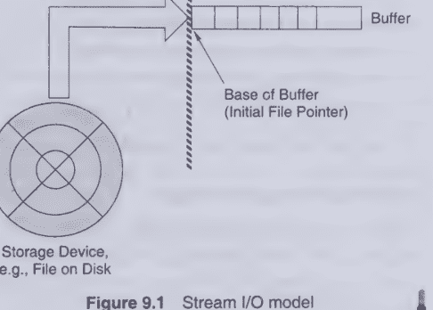

图 9.1 流 I/O 模型

流通过某种操作与文件关联。在使用关闭（close）操作时，流与文件解关联。当前位置也称为位置（position），是文件在下一次访问将发生的位置。

流有两种类型：文本和二进制。文件可以被看作是可以顺序处理的字符流。它只能（逻辑上）向正方向进行。因此，文本文件只用于一种操作，即读取或写入，且可以在任何时间进行。同样，文本文件只处理字符，它们每次只能读或写一个字符。虽然提供了处理文本行的函数，但这些函数仍然提供核心的字符处理功能。

由于流与文本文件关联，它们可能包含一系列行。每行包含零或多个字符，这些字符指定了行的结束。每行中的最大字符数为 255 个字符。要记住，“行”是一个 C 字符串；它没有终止符 NULL 字符（`\n`）。当使用文本模式的流时，在 C 换行符（`\n`）与操作系统用于标记磁盘文件行尾的任何字符之间会发生转换。在 DOS 上，这是一种回车-换行符（CRLF）组合。当数据被写入文本模式文件时，每个 `\n` 都会被转换为 CR-LF；当数据来自磁盘文件时，每个 CR-LF 都会被转换为 `\n`。在 UNIX 系统中，不进行任何转换；换行符保持不变。

该模型解释了高效的 I/O。当创建指向磁盘文件的链接时，会自动创建一个缓冲区并与流关联。缓冲区是一块内存，用于在从文件读取或写入数据时临时存储数据。因为磁盘驱动器是面向块的设备，这意味着当以特定大小的块读写数据时，它们的运行效率最高。理想块的大小取决于所使用的特定硬件。它通常是几百到一千字节。然而，没有必要担心精确的块大小。

当使用文本文件时，数据有两种表示形式——内部表示和外部表示。例如，一个 `int` 类型的值在内部被表示为两个或四个字节（16 位或 32 位）的内存。但在外部，整数将以其十进制作为字符字符串或十六进制值来表示。内部表示和外部表示之间的转换是很容易的。要从内部表示转换为外部表示，在所有情况下都使用 `printf` 或 `sprintf`。例如，可以使用 `%d` 格式进行转换。要从外部表示转换为内部表示，可以使用 `sscanf`，或者读取字符后使用 `atoi`、`strtol` 和 `sscanf` 等函数。

二进制文件是字节的集合。在 C 语言中，字节（byte）和字符（character）是等同的。因此，二进制文件也被称为字符流，但存在两个本质区别。

首先，数据是原样写入和读取的，行与行之间没有区分，也没有使用行尾字符。NULL 字符和行尾字符没有特殊意义，其处理方式与其他任何类型的数据相同。

其次，文件的解释留给 C 语言。C 没有对文件施加任何结构，可以用程序员选择的任何方式对其进行读取或写入。

在 C 语言中，使用随机访问技术处理文件涉及在读或写数据之前，将当前文件位置移动到文件中合适的位置。这表明了二进制文件的第二个特征——它们通常同时使用读、写操作进行处理。例如，数据库文件将作为二进制文件创建并处理。

## 9.2 文件处理基础

在 C 中，处理文件需要：
- 声明文件指针。
- 通过 `fopen()` 打开文件。
- 使用 `fclose()` 关闭文件。

```c
FILE *fp;
fp = fopen("data.dat", "w");
```

`fopen` 需要两个参数——两者都是字符字符串。任何一个参数都可以是字符串变量。以下是一个示例，其中声明了一个文件指针 `fp`，从键盘获取最大长度为 80 个字符的文件名，然后以“写”模式打开文件。

```c
char filename[80];
FILE *fp;
printf("the filename to be opened");
gets(filename);
fp = fopen("data.dat", "w");
```

### 检查 fopen 的结果

`fopen` 函数返回一个 `FILE *`，它是一个指向 `FILE` 结构体的指针，用于访问文件。当由于下面的原因无法打开文件时，`fopen()` 将返回 `NULL`。原因包括：

- 使用了无效的文件名
- 尝试在未就绪的磁盘上打开文件；例如，驱动器门未连接或磁盘未格式化。
- 尝试在不存在的目录或不存在的磁盘驱动器上打开文件
- 尝试以 `r` 模式打开不存在的文件

可以使用正确的语句来检查 `fopen()` 是否成功或失败。


fp = fopen("data.dat","r");

if(fp == NULL) {

    printf("Can not open data.dat\n");

    exit(1);

}

或者，上面的部分可以写如下：

```c
FILE *fp;

if((fp = fopen("data.dat","r"))==NULL) {

    printf("Can not open data.dat\n");

    exit(1);

}
```

在程序中使用 `fopen()` 的时候，建议测试 `fopen()` 的结果并检查它是否为 `NULL`。无法确定具体发生了哪种错误，但可以向用户显示错误消息并重新打开文件，或者结束程序。

## 9.2.3 关闭和刷新文件

在完成对文件的操作后，必须使用 `fclose()` 函数关闭文件。它的原型是

```c
int fclose(FILE *fp);
```

参数 `fp` 是与流关联的 `FILE` 指针；`fclose()` 返回成功或出错时返回 -1。当程序终止（通过到达或执行 `exit()` 函数）时，流会自动刷新并关闭。在简单的程序中，没有必要关闭文件，因为系统在返回操作系统之前会关闭所有打开的文件。养成关闭所有文件的习惯是一个好习惯。

当文件关闭时，文件的缓冲区会被刷新或写入文件。除了标准流（`stdin`, `stdout`, `stderr`）外，所有打开的流都可以使用 `fclose()` 函数关闭。它的原型是 `int fclose(void);`

上述函数会刷新任何缓冲区并返回已关闭的流的数量。流的缓冲区可以通过使用 `fflush()` 或 `flushall()` 库函数关闭它来刷新。使用 `fflush()` 在仍在使用文件时写入缓冲区。使用 `flushall()` 刷新所有打开流的缓冲区。这两个函数的原型是

```c
int fflush(FILE *fp);

int flushall(void);
```

参数 `fp` 是打开文件时由 `fopen()` 返回的 `FILE` 指针。如果文件是以写模式打开的，`fflush()` 将其缓冲区写入磁盘。如果文件是以读模式打开的，缓冲区将被清空。函数 `fflush()` 返回成功或出错时返回 `EOF`。函数 `flushall()` 返回打开流的数量。

### 注意事项

- 使用使用的文件类型必须使用一个名为文件指针的变量来指定。
- Windows 系统以及大多数 UNIX 系统允许文件名长多达 256 个字符。
- C 程序中的文件名也可以包含信息
- 如果用户通过键盘输入文件名，则必须依赖系统将单个反斜杠或正斜杠作为目录分隔符。
- `fclose()` 返回 0 或出错时返回 -1。
- 操作系统在返回操作系统之前会关闭所有打开的文件。

## 9.3 文本文件

C 提供了四个可以从磁盘读取文本文件的函数。这些是

- `fscanf()`
- `fgets()`
- `fgetc()`
- `fread()`

C 提供了四个可以向磁盘写入文本文件的函数。这些是

- `fprintf()`
- `fputs()`
- `putc()`
- `fwrite()`

```c
#include <stdio.h>

int main()

{

    FILE *fp;

    char text[80];

    fp = fopen("abc.txt", "w");

    printf("ENTER TEXT\n");

    scanf("%s", text);

    for(int i=0; i<100; i++) {

        if(text[i] == 0) break;

        putc(text[i], fp);

    }

    putc('\n', fp);

    fclose(fp);

}
```

### 9.3.1 字符输入和输出

与文件一起使用时，字符 I/O 指单个字符以及整行，因为行无非是一个以换行符终止的零或多个字符的序列。接下来的章节描述了文件的字符输出函数并附有相应的示例。

#### putc()

库函数 `putc()` 向指定的流写入一个单字符。它在 `stdio.h` 中的原型如下

```c
int putc(int ch, FILE *fp);
```

要向文件 abc.txt 附加更多行，必须将该语句替换为语句 `fopen("abc.txt","a");`

#### puts() 函数

库函数 `puts()` 向流写入一行。它的工作方式与 `puts()` 类似。唯一的区别在于在 `puts()` 中可以指定输出流。`puts()` 不会在字符串末尾添加换行；必须显式指定 `\n`。它在 `stdio.h` 中的原型是

```c
char fputs(char *str, FILE *fp);
```

#### 检测文件结束

当从文本模式文件读取内容时，可以查找文件结束字符。符号常量 `EOF` 定义在 `stdio.h` 中，值为 -1。有两种方法检测文件结束。当字符输入函数从文本模式流读取 `EOF` 时，它返回已到达文件结束。例如，可以写：

```c
int c;

while ((c = getc(fp)) != EOF) {

    // 处理字符 c

}
```

`getc()` 返回的变量是一个字符，因此我们可以为此目的使用 `char` 变量。然而，如果使用 `unsigned char` 则会出现问题，因为 C 返回的 -1 是 `unsigned char` 无法包含的。无符号字符类型范围是 0 到 255，因此它会返回 255 而不是 -1。程序永远找不到 `EOF`，从而终止循环。返回时始终使用 `char` 类型。

### fgets() 函数

`fgets()` 是一个按行的函数。其 ANSI 原型为 `char *fgets(char *str, int n, FILE *fp);`

该函数从 `fp` 指向的流中读取内容，并将输出存放在 `str` 指向的字符数组中。当满足以下任一条件时，它将停止读取：

- 它读取了 $n - 1$ 个字节（留出一个字符用于存放空终止符）。
- 它遇到了换行符（编译器中的换行符会被放置在此处）。
- 它到达了文件末尾。
- 发生读取错误

`fgets()` 会自动在读取的数据后附加一个空终止符。`fgets()` 比 `getc()` 为你提供了更多控制，但从磁盘逐字节地读取的效率很低。这些函数将在下面的程序中进行说明。以下程序将在屏幕上显示文件的内容。

## 示例

```c
1. #include <stdio.h>

int main()

{

    FILE *fp;

    int ch;

    fp = fopen("a.txt", "r");

    if(fp == NULL) {

        printf("Cannot open the file a.txt\n");

        exit(1);

    }

    ch = getc(fp);

    while(ch != EOF)

    {

        putchar(ch);

        ch = getc(fp);

    }

    fclose(fp);

    return 0;

}
```

或者，可以提示用户输入文件名，并尝试重新打开它。

```c
2. #include <stdio.h>

#include <string.h>

int main()

{

    FILE *fp;

    int ch;

    char fname[30];

    printf("\nEnter the filename\n");

    fflush(stdin);

    scanf("%[^\n]", fname);

    fp = fopen(fname, "r");

    while(fp == NULL || strcmp(fname, "") != 0) 

    {

        printf("Cannot open the file %s for reading\n\n", fname);

        printf("\nEnter the filename\n");

        fflush(stdin);

        scanf("%[^\n]", fname);

        fp = fopen(fname, "r");

    }

    ch = getc(fp);

    while(ch != EOF)

    {

        putchar(ch);

        ch = getc(fp);

    }

    fclose(fp);

    return 0;

}
```

```c
3. #include <stdio.h>

int main()

{

    FILE *fp;

    char *c;

    char word[60];

    fp = fopen("abc.txt", "r");

    do {

        c = fgets(word, 60, fp);

        if(c != NULL)

            printf("%s", word);

    } while(c != NULL);

    fclose(fp);

    return 0;

}
```


4. 编写一个 C 程序，统计文件中字符数和行数。

```c
#include <stdio.h>

int main()

{

    FILE *fp;

    int ch, nc = 0, nlines = 0;

    char fname[30];

    printf("Enter filename:");

    fflush(stdin);

    scanf("%s", fname);

    fp = fopen(fname, "r");

    if(fp == NULL) {

        printf("Cannot open the file %s\n", fname);

        exit(0);

    }

    while((ch = getc(fp)) != EOF)

    {

        nc++;

        if(ch == '\n')

            nlines++;

    }

    fclose(fp);

    printf("There are %d characters in %d lines\n", nc, nlines);

    return 0;

}
```

5. 编写一个 C 程序，每次显示文件的 n 行内容。

```c
#include <stdio.h>

int main()

{

    FILE *fp;

    int ch, nline = 0;

    char fname[30];

    char line[80];

    printf("Enter filename:");

    fflush(stdin);

    scanf("%s", fname);

    fp = fopen(fname, "r");

    if(fp == NULL) {

        printf("Cannot open the file %s\n", fname);

        exit(0);

    }

    line = 1;

    while(fgets(line, sizeof(line), fp) != NULL)

    {

        fputs(line, stdout);

        nline++;

        if(nline == 10) {

            nline = 0;

            printf("Press Enter to continue, q to quit: ");

            ch = getchar();

            if(ch == 'q') break;

        }

    }

    fclose(fp);

    return 0;

}
```

6. 编写一个程序比较用户指定的两个文件，显示这些行是否相同或不同。

```c
#include <stdio.h>

int main()

{

    FILE *fp1, *fp2;

    int ca, cb;

    char fname1[30], fname2[30];

    printf("Enter first filename: ");

    fflush(stdin);

    scanf("%s", fname1);

    printf("Enter second filename: ");

    fflush(stdin);

    scanf("%s", fname2);

    fp1 = fopen(fname1, "r");

    fp2 = fopen(fname2, "r");

    if(fp1 == NULL) {

        printf("Cannot open the file %s\n", fname1);

        exit(1);

    }

    if(fp2 == NULL) {

        printf("Cannot open %s\n", fname2);

        fclose(fp1);

        exit(1);

    }

    while((ca = getc(fp1)) != EOF && (cb = getc(fp2)) != EOF)

    {

        if(ca != cb) {

            printf("Files differ\n");

            fclose(fp1);

            fclose(fp2);

            return 0;

        }

    }

    if(ca == cb && cb == EOF) {

        printf("Files are identical\n");

    } else {

        printf("Files differ\n");

    }

    fclose(fp1);

    fclose(fp2);

    return 0;

}
```

7. 编写一个 C 文件复制程序，将一个文件复制到另一个文件中。

```c
#include <stdio.h>

int main()

{

    FILE *fp1, *fp2;

    int ch;

    char fname1[30], fname2[30];

    printf("Enter source filename: ");

    fflush(stdin);

    scanf("%s", fname1);

    printf("Enter destination filename: ");

    fflush(stdin);

    scanf("%s", fname2);

    fp1 = fopen(fname1, "r");

    fp2 = fopen(fname2, "w");

    if(fp1 == NULL) {

        printf("Cannot open the file %s for reading\n", fname1);

        exit(1);

    }

    if(fp2 == NULL) {

        printf("Cannot open the file %s for writing\n", fname2);

        fclose(fp1);

        exit(1);

    }

    while((ch = getc(fp1)) != EOF) {

        putc(ch, fp2);

    }

    fclose(fp1);

    fclose(fp2);

    printf("Files successfully copied\n");

    return 0;

}
```

另外两个要涵盖的文件处理函数是 `fprintf()` 和 `fscanf()`。这些函数的操作与 `printf()` 和 `scanf()` 完全一样，只是它们作用于文件。它们的原型为：
`fprintf(FILE *fp, const char *control-string, ...);`
`scanf(FILE *fp, const char *control-string, ...);`

这些函数不是将 I/O 操作定向到控制台，而是作用于 `fp` 指向的文件。除此之外，操作与其对应的控制台版本相同。`fprintf()` 和 `fscanf()` 的优势在于它们使向文件写入数据变得非常简单。

## 400 C 语言编程

示例

```c
#include <stdio.h>

int main() {

    int a

}
```

第三个常量文件指针定义为 `stderr`。它与标准错误文件相关。`stderr` 有以下用途：在 MSDOS 和 UNIX 等系统中，程序的输出可以使用错误重定向器进行重定向。例如，如果 `abs.exe` 是一个重定向到显示器的可执行文件，那么可以通过命令将其重定向到 `file.out`：
abs.exe>out.out

通常出现在显示器上的输出可以发送到 `file.out`。另一方面，在重定向输出时，人们不希望任何“无法打开 abc.dat 进行写入”之类的错误信息被重定向；人们希望它们出现在屏幕上。
将错误写入 `stderr`：


`fprintf(stderr, "unable to open newfile.dat for writing")`

可以确保正常输出被重定向，但错误信息仍会显示在屏幕上。
事实上，这三者都是 `FILE` 类型的对象，可以像 `fopen()` 返回的指针一样，在任何文件处理函数中使用。事实上，宏 `putchar(c)` 无非是：
`putc(c, stdout)`

有时将一个指向 `FILE` 的指针初始化为其中一个标准项是有用的，以提供一种“标准”类型的操作。

```c
FILE *ifp = stdin;
```

这是一个典型的定义。

## 9.3.3 使用 `feof()` 函数检测文件末尾

为了检测文件结束（EOF），有一个库函数 `feof()`，它可以用于二进制模式和文本模式的文件。

```c
int feof(FILE *fp);
```

参数 `fp` 是打开文件时 `fopen()` 返回的 `FILE` 指针。如果尚未到达文件结束，`feof()` 返回 0；如果已到达文件结束，则返回非零值。以下程序每次读取一行文件，并在 `stdout` 上显示每一行，直到 `feof()` 检测到文件末尾。

示例

输出：

```
Enter name of filename:
first.c
#include <stdio.h>
int main() {
    printf("%C is Sea\n",
    return 0;
}
```

## 注意事项

- DOS 使用 `Ctrl-z` 作为结束文件的特殊字符。
- UNIX 使用 `Ctrl-d` 作为文件结束字符。
- `gets()` 会自动在读取的数据后附加一个空终止符。
- `fgetc()` 比 `gets()` 提供了更多控制，但从磁盘逐字节读取文件是相当无效的。
- `fscanf()` 是面向字段的，不适合用于健壮的通用型文本文件读取器。

## 9.4 处理二进制文件

对二进制文件执行的操作与文本文件相似，因为这两种类型的文件从本质上都可以被视为字节流。事实上，C 语言中使用相同的函数来访问文件。当打开一个文件时，必须将其指定为文本或二进制格式，这通常是指示正在处理的文件类型的唯一标志。为了说明二进制文件，请考虑以下程序，它包含一个函数 `copy()`，该函数接收源文件和目标文件的文件名，然后执行所述的复制操作。如果在打开任何一个文件时发生错误，调用程序将返回 -1。如果复制操作成功，程序将完成两个文件并返回 0。将二进制文件复制到另一个文件的步骤如下：

1. 以二进制模式打开源文件进行读取。
2. 以二进制模式打开目标文件进行写入。
3. 从源文件中读取一个字符。记住，当文件首次被打开时，指针位于文件开头，因此不需要显式地定位指针。
4. 如果函数 `getc()` 表明已到达源文件末尾，则关闭两个文件并返回调用程序。
5. 如果未到达文件末尾，则将该字符写入目标文件，然后回到步骤 3 。

```c
printf("nEnter source file:%s");
flush(stdin);
gets(source);
printf("enter destination file:%s");
flush(stdin);
gets(destination);
if(filecopy(source
```

## 示例

```c
#include <stdio.h>
int filecopy(char *, char *);
int main() {
    char source[80], destination[80];
```

## 注意事项

- 在打开文件时，必须将其指定为文本或二进制，以指示正在处理的文件类型。
- 对二进制文件执行的操作与文本文件相似。

如果发生了输出错误，返回的值将小于 `num`。为了检查错误，`fwrite(fp)` 通常编写如下：

```c
if(fwrite(buffer, size, num, fp) != num)
    fprintf(stderr, "Error writing to file.");
```

## 9.5 直接文件输入和输出

直接 I/O 用于二进制模式文件。在直接输出中，数据块从内存写入磁盘。磁盘输入反转了这一过程。数据块从文件读取到内存中。例如，一个直接输出函数调用可以写入整个大小为 `size` 的 `double` 数组，而一个直接输入函数调用可以将整个数组读回内存。C 文件系统包含了用于直接 I/O 的重要函数：`fread()` 和 `fwrite()`。这些函数使用任何表示形式读取和写入任何类型的数据。
它们的原型为：

```c
size_t fread(void *buffer, size_t size, size_t num, int *fp);
size_t fwrite(void *buffer, size_t size, size_t num, int *fp);
```

以下程序描述了 `fread()` 和 `fwrite()` 的用法。程序初始化数组。然后使用 `fwrite(fp)` 保存数组。之后，使用 `fread(fp)` 将数据读入另一个数组。最后，它在屏幕上显示数组，以证明它们现在持有相同的数据。

`fread()` 从与 `fp` 相关的文件读取 `num` 个对象（每个对象大小为 `size`）到 `buffer` 中。它返回实际读取的对象数。如果此值为 0，说明没有读取到任何对象，或者遇到了文件末尾，或者发生了错误。可以使用 `feof()` 或 `error()` 检测是否到达了文件或发生了错误。它们的原型为：

```c
int feof(FILE *fp);
int error(FILE *fp);
```

如果与 `fp` 相关的文件已到达文件结束，`feof()` 返回非零值。`fwrite()` 返回实际写入的对象数。`fread()` 将每个大小为 `size` 的对象逐块地读到 `buffer` 中。它返回实际读取的对象数。如果此值为 0，说明没有读取到任何对象，或者遇到了文件末尾，或者发生了错误。可以使用 `feof()` 或 `error()` 检测是否到达了文件或发生了错误。

# 404 C 语言编程

## C 语言中的文件

```c
#include <stdio.h>
#include <stdlib.h>
#include <string.h>

struct item {
    int itemcode;
    char name[30];
    double price;
};

void append();
void modify();
void dispall();
void deletefile();

int main() {
    int ch;
    struct item it;
    FILE *fp;
    fp = fopen("item.dat", "wb");
    if (fp == NULL) {
        printf("\n 打开文件时出错...");
        exit(0);
    }
    printf("\n 输入物品代码:");
    scanf("%d", &it.itemcode);
    printf("\n 输入物品名称:");
    flush(stdin);
    scanf("%[^\n]", &it.name);
    printf("\n 输入价格:");
    scanf("%lf", &it.price);
    fwrite(&it, sizeof(it), 1, fp);
    fclose(fp);
    dispall();
    while (1) {
        printf("\n \t 1. 增加记录");
        printf("\n \t 2. 显示所有记录");
        printf("\n \t 3. 修改记录");
        printf("\n \t 4. 删除记录");
        printf("\n \t 5. 退出");
        printf("\n 输入您的选择:");
        scanf("%d", &ch);
        switch (ch) {
            case 1: append(); break;
            case 2: dispall(); break;
            case 3: modify(); break;
            case 4: deletefile(); break;
            case 5: exit(0);
        }
    }
    return 0;
}

void append() {
    FILE *fp;
    struct item it;
    fp = fopen("item.dat", "ab");
    if (fp == NULL) {
        printf("\n 打开文件时出错...");
        exit(0);
    }
    printf("\n 输入物品代码:");
    scanf("%d", &it.itemcode);
    printf("\n 输入物品名称:");
    flush(stdin);
    scanf("%[^\n]", &it.name);
    printf("\n 输入价格:");
    scanf("%lf", &it.price);
    fwrite(&it, sizeof(it), 1, fp);
    fclose(fp);
}

void dispall() {
    FILE *fp;
    struct item it;
    fp = fopen("item.dat", "rb");
    if (fp == NULL) {
        printf("\n 打开文件时出错...");
        exit(0);
    }
    while (1) {
        if (fread(&it, sizeof(it), 1, fp) == 0)
            break;
        printf("\n \t%d\t%s\t%lf\n", it.itemcode, it.name, it.price);
    }
    fclose(fp);
}

void modify() {
    FILE *fp, *fptr;
    struct item it;
    int icd, found = 0;
    fp = fopen("item.dat", "r");
    if (fp == NULL) {
        printf("\n 打开文件时出错...\n");
        exit(0);
    }
    fptr = fopen("temp.dat", "w");
    if (fptr == NULL) {
        printf("\n 打开文件时出错...\n");
        exit(0);
    }
    printf("\n 输入要修改的物品代码:\n");
    scanf("%d", &icd);
    while (1) {
        fscanf(fp, "%d", &it.itemcode);
        if (it.itemcode == 0)
            break;
        if (it.itemcode == icd) {
            found = 1;
            fscanf(fp, "%s", &it.name);
            fscanf(fp, "%lf", &it.price);
            printf("\n 现有记录为...\n");
            printf("\n%d %s\t%lf\n", it.itemcode, it.name, it.price);
            printf("\n 输入新名称:\n");
            flush(stdin);
            scanf("%[^\n]", &it.name);
            printf("\n 输入新价格:\n");
            scanf("%lf", &it.price);
            fprintf(fptr, "%d %s\t%lf\n", it.itemcode, it.name, it.price);
        } else {
            fscanf(fp, "%s", &it.name);
            fscanf(fp, "%lf", &it.price);
            fprintf(fptr, "%d\t%s\t%lf\n", it.itemcode, it.name, it.price);
        }
    }
    fprintf(fptr, "%d", 0);
    fclose(fptr);
    fclose(fp);
    if (found == 0)
        printf("\n 未找到记录...\n");
    } else {
        fp = fopen("item.dat", "w");
        if (fp == NULL) {
            printf("\n 打开文件时出错...\n");
            exit(0);
        }
        fptr = fopen("temp.dat", "r");
        if (fptr == NULL) {
            printf("\n 打开文件时出错...\n");
            exit(0);
        }
        while (1) {
            fscanf(fptr, "%d", &it.itemcode);
            if (it.itemcode == 0)
                break;
            fscanf(fptr, "%s", &it.name);
            fscanf(fptr, "%lf", &it.price);
            fprintf(fp, "%d %s\t%lf\n", it.itemcode, it.name, it.price);
        }
        fclose(fptr);
        fclose(fp);
    }
}

void deletefile() {
    FILE *fp, *fptr;
}
```

## 使用 `fread()` 和 `fscanf()`

以下程序演示了如何从磁盘顺序读取二进制文件。只有当记录结构与上一个示例中使用的结构完全同时，该程序才能运行。在这里，文件使用 `fopen()` 打开，模式设置为 "rb"。在每次读取后，将文件位置顺序移动到下一个记录的第一个字节。必须记住，`fread()` 只有在尝试越过文件结束标记时，才会指示文件已结束。

## 使用 `fgets` 和 `fputc`

处理文件并不不仅使用 `fread()` 和 `fwrite()` 或 `fscanf()` 和 `fprintf()`。`fgets()` 和 `fputc()` 也可以使用。以下程序说明了这一点。该程序将 `stock.dat` 中保存物品记录，使用结构体 item 处理文件，并打印所有库存数量小于或等于订货水平的物品。

# 410 C语言语言编程

```c
int main() {
    struct item rec;
    fp fp = fopen("stock.dat", "r");
    if(fp != NULL) {
        printf("Unable to open the file %s\n", filename);
        if(fp != NULL) {
            fclose(fp);
            exit(1);
        }
    }
    while (!feof(fp)) {
        if(getrecord(&rec) == 1) {
            if(rec.qty <= rec.recorder)
                show(rec);
        } else {
            if(fp != NULL) {
                fclose(fp);
                exit(0);
            }
        }
        if(fp != NULL) {
            fclose(fp);
            return 0;
        }
    }
}
```


通过使用 `fseek()`，可以将位置指针设置在文件的任何位置。`stdio.h` 中的函数原型为：
`int fseek(FILE *fp, long offset, int origin);`

参数 `fp` 是与该文件关联的文件指针。位置指针移动的距离由 `offset` 给出。它是移动文件指针的字节数。这可以通过公式得出：目标记录数 × 单个记录的大小。参数 `origin` 指定了位置指针的起始点。可以在 `stdio.h` 中定义符号常量，如表 9.2 所示。

### 表 9.2 fseek() 的可能值

| 常量 | 值 | 说明 |
| --- | --- | --- |
| SEEK_SET | 0 | 从文件开始处移动 offset 字节 |
| SEEK_CUR | 1 | 从当前位置移动 offset 字节 |
| SEEK_END | 2 | 从文件末尾移动 offset 字节 |

如果指针移动成功，函数 `fseek()` 返回零；如果发生错误则返回非零。以下程序使用 `fseek()` 进行文件的随机访问。该程序使用了之前创建的 `item.dat` 和结构体 `item`。假设文件中有四条记录。

### 注意事项

- 大多数 C 文件可能是二进制文件，在逻辑上可以定义为固定长度的记录。
- 文件中的记录是顺序写入磁盘的。
- 二进制文件可以按顺序读取到磁盘，也可以以随机访问的方式读取。
- 使用 `fread()` 和 `fscanf()`，文件在每次读取操作后按顺序读取，文件位置指针会移动到下一条记录的第一个字节。
- `feof()` 函数在尝试读取超过文件结束标记之前，并不会指示已到达文件末尾。

## 9.7 记录类文件的随机访问

对于记录类文件的随机访问，使用的函数有：

- `fseek()`
- `ftell()`
- `rewind()`

### 示例

```c
#include <stdio.h>
#include <string.h>

struct item {
    int itemcode;
    char name[30];
    double price;
};

typedef struct item item;

FILE *fp;

int main() {
    struct product;
    int rec, result;

    fp = fopen("item.dat", "r+b");
}
```


```c
printf("Which record do you want [0-3]? Press\n -1 to exit...");

scanf("%d", &rec);

while(rec >= 0) {
    fseek(fp, sizeof(it), SEEK_SET);
    result = fread(&it, sizeof(it), 1, fp);

    if(result == 1) {
        printf("\nRECORD %d\n", rec);
        printf("Item code:      %d\n", it.itemcode);
        printf("Item name:      %s\n", it.itename);
        printf("Price:        %.2f\n\n", it.price);
    } else {
        printf("\nRecord %d not found!\n", rec);
    }

    printf("\nWhich record do you want [0-3]? Press\n  -1 to exit...");
    scanf("%d", &rec);
}

close(fp);
return 0;
```

```c
{
    r.x = 1;
    r.y = 2;
    r.z = 3;
    fwrite(&rec
```

以下程序将阐明 `fseek` 的概念。

```c
#include <stdio.h>

/* 随机记录描述——可以是任何内容 */
struct rec {
    int x, y, z;
};

/* 写入并读取 10 条任意记录文件 "junk"。 */
int main() {
    int i, j;
    FILE *f;
    struct rec r;

    /* 创建包含 10 条记录的文件 */
    f = fopen("junk", "w");
    if(!f) {
        printf("\nFile opening error for writing\n");
        exit(1);
    }

    for(i = 1; i < 10; i++)
```

### 412 C语言编程

```c
for(i = 0; i < 5; i++) {
    fread(&r, sizeof(struct rec), 1, f);
    printf("%d \t%d \t%d\n", r.x, r.y, r.z);
    fseek(f, sizeof(struct rec), SEEK_CUR);
}

fclose(f);
printf("\n");

/* 使用 seek 读取第4条记录，修改它并写回 */
fopen("junk", "r+");
if(!f) {
    printf("File opening error for reading and writing\n");
    exit(1);
}

fseek(f, sizeof(struct rec) * 3, SEEK_SET);
fread(&r, sizeof(struct rec), 1, f);
r.x = 9;
y.y = 99;
r.z = 999;
fseek(f, sizeof(struct rec) * 3, SEEK_SET);
fwrite(f, sizeof(struct rec), 1, f);
fclose(f);
printf("\n");

/* 读取10条记录以确保第4条记录已修改 */
fopen("junk", "r+");
if(!f) {
    printf("File opening error for reading and writing\n");
    exit(1);
}

for(i = 1; i <= 10; i++) {
    fread(&r, sizeof(struct rec), 1, f);
    printf("\n%d \t%d \t%d\n", r.x, r.y, r.z);
}

fclose(f);
return 0;
```

| 1 | 2 | 3 |
| --- | --- | --- |
| 2 | 4 | 6 |
| 3 | 6 | 9 |
| 4 | 8 | 12 |
| 5 | 10 | 15 |
| 6 | 12 | 18 |
| 7 | 14 | 21 |
| 8 | 16 | 24 |
| 9 | 18 | 27 |
| 10 | 20 | 30 |

要将位置指针设置为文件的开头，使用库函数 `rewind()`。它在 `stdio.h` 中的原型为 `void rewind(FILE *fp);`

参数 `fp` 是与流关联的文件指针。调用 `rewind()` 后，文件的位置指针被设置为开头（字节 0）。在不关闭并重新打开文件的情况下从文件开始读取某些数据。

要确定文件位置指针的值，使用 `ftell()`。该函数位于 `stdio.h`，原型为 `long ftell(FILE *fp);`

参数 `fp` 是文件打开时由 `fopen()` 返回的文件指针。函数 `ftell()` 返回从文件开始的当前字节位置（第一个字节位于位置 0）。如果发生错误，`ftell()` 返回 -1（long 类型）。

这里有很多有趣的点。变量 `*filename` 是要删除的文件名的指针。唯一的前提条件是指定文件不能处于打开状态。如果文件存在，它将被删除且 `remove()` 返回 0。如果文件不存在、文件只读、程序没有足够的访问权限（Unix 系统），或发生其他错误，`remove()` 返回 -1。以下程序描述了 `remove()` 的用法：

- 直接访问适用于整数和声明为 `long` 的变量。
- 记录编号从 0 开始，程序的检查部分由负输入触发。
- `fseek()` 的最后一个参数是 `SEEK_SET`，而不是 0。
- `ftell()` 返回的值是从文件中读取的字节位置。因此，当遇到新行时，它是下一条记录的起始地址。

### 示例

```c
#include <stdio.h>

main(void) {
    char filename[80];

    /* 提示要删除的文件 */
    printf("File to delete: %s", );
    fgets(filename, 80, stdin);

    /* 删除文件 */
    if(remove(filename) == 0)
        printf("Removed %s.\n", filename);
    else
        perror("remove");

    return 0;
}
```

`fseek()` 和 `ftell()` 函数只使用 `pos_t` 参数而不是 `long`。这可能允许处理更大的文件。优先使用这些函数。

- 通过使用 `fseek()`，可以将位置指针设置在文件的任何位置。
- 如果指针标记成功，函数 `ftell()` 返回零；如果发生错误则返回非零。
- 要确定文件位置指针的值，使用 `ftell()`。
- 记录编号从 0 开始，程序的检查部分由负输入终止。

在程序中，使用了函数 `remove()`，其原型为 `int remove(const char *filename);`。

## 9.8 其他文件管理函数

复制和删除操作也与文件有关。人们可以为它们编写程序。C 标准包含了删除和重命名文件的函数。

`rename()` 函数更改现有磁盘文件的名称。`stdio.h` 中的函数原型如下。

### 9.8.1 删除文件

库函数 `remove()` 用于删除文件。`stdio.h` 中的原型为 `int remove(const char *filename);`

由 `oldname` 和 `newname` 指向的文件名遵循本章早期的规则。唯一的限制是两个名称必须引用同一个磁盘驱动器；不能在不同的磁盘驱动器上重命名。`rename()` 函数在成功时返回 0，发生错误时返回 -1。错误可能由以下条件引起（不仅限于）。

### 9.8.2 重命名文件

### 414 C 语言编程

## 9.9 低层 I/O

- 文件不存在。
- 名为 `newname` 的文件已存在。
- 尝试在另一个磁盘上进行重命名。

这种形式的 I/O 是无缓冲的。这意味着，每次读取或写入请求都会直接访问磁盘（或设备），没有缓冲区来获取/存放特定数量的字节。它没有格式化功能。我们没有使用文件指针，而是使用低级文件句柄或文件描述符，它们通过一个唯一的整数来标识每个文件。

考虑以下程序。

### 示例

```c
#include <stdio.h>

int main(void) {
    char oldname[80], newname[80];

    /* 提示要重命名的文件和新文件名 */
    printf("file to rename:");
    gets(oldname);

    printf("New name:");
    gets(newname);

    /* 重命名文件 */
    if (rename(oldname, newname) == 0) {
        printf("Renamed %s to %s.\n", oldname, newname);
    } else {
        perror("rename");
    }

    return 0;
}
```

打开文件时使用以下函数：

```c
int open(char *filename, int flag, int *perms);
```

上述函数返回文件描述符，或在失败时返回 -1。`flag` 控制访问权限，在 `fcntl.h` 中定义了：`O_APPEND`, `O_CREAT`, `O_EXCL`, `O_RDONLY`, `O_RDWR`, `O_WRONLY` 等等。最好为它的大多数选项进行设置。

函数

```c
int create(char *filename, int perms);
```

也可以用于创建文件。

```c
int close(int handle);
```

可以关闭文件。

以下函数用于从存储的文件读取/写入一定数量的字节，或者将其放入由缓冲区指定的内存位置。

```c
int read(int handle, char *buffer, unsigned length);
int write(int handle, char *buffer, unsigned length);
```


`size()` 函数通常用于指定长度。`read()` 和 `write()` 函数返回读取/写入的字节数，如果失败则返回 -1。

- 复制和删除操作也与文件管理有关。
- 在 `remove()` 情况下，唯一的前提条件是指定的文件不能被打开。
- `rename()` 的限制是两个名称必须指向同一个磁盘驱动器；文件不能在不同的磁盘上重命名。

## 总结

数据可以存储在磁盘文件中。C 语言将文件视为流（字符序列），即预定义的 `stdin`、`stdout` 和 `stderr`。与磁盘文件关联的流在使用之前必须使用 `fopen()` 库打开，并使用 `fclose()` 关闭。磁盘文件可以以文本模式或二进制模式打开。

在文件中，根据从文件开始的字节数来确定读取和写入操作的位置。在某些情况下，位置指示由系统自动更新，程序员不需要操心它。对于随机文件访问，C 标准库函数如 `seek()`、`ftell()` 和 `rewind()` 可用于移动位置指示。

文件打开后，可以从文件中读取数据、向文件中写入数据或两者兼顾。数据可以通过顺序方式或随机方式访问。每个打开的磁盘文件都有一个关联的文件位置指示。该指示指定了位置。

C 提供了一些基础的文件管理函数，允许删除和重命名磁盘文件。还有不使用格式化和文件位置指示的低级文件句柄函数。


## 二进制文件 关键术语

二进制文件是字节的集合或字符流。写入和从二进制文件中读取的数据保持不变，行与行之间没有分隔，不换行符，文件的解释留给程序员。

缓冲区是用于临时存储写入文件和从文件读取数据的内存块。它充当流（面向字符）与磁盘硬件（面向块）之间的接口。

随机访问：随机意味着通过控制位置指示，从文件的任何位置读取或向其写入，而不必读取或写入之前的所有数据。

记录：由一组数据字段组成，符合预先定义的结构，可以存储在文件中或从文件中检索。

顺序访问：在顺序访问的情况下，数据按顺序从文件中读取或写入，而位置指示由 I/O 函数自动调整。

流：是提供计算机的设备的通用逻辑接口，也是文件的逻辑接口。虽然文件的形式和功能不同，但所有流都是相同的。

文本文件是一个字符流，可以按顺序和逻辑正向进行处理。每行的最大字符数限制为 255 个。

文件管理：意味着与任何类型文件的创建、重命名、删除、合并、读取、写入等的所有操作。

路径：指定了文件所在的驱动器和（/或文件夹）。在 PC 上，使用反斜杠指定路径中的目录名。某些系统使用正斜杠（/）作为目录分隔符。

## 常见问题

1. **什么是文件？**
   存储在存储设备上的字节文件，通常是某种类型。它通过一个名称标识，该名称在创建时确定。它可能被修改、从一个存储区域移动到另一个或完全删除。活动由操作系统负责。

2. **什么是流？**
   流是计算机设备的通用逻辑接口，也是文件的逻辑接口。当程序执行时，每个流都连接到特定的设备，作为数据的源或目的地。流 I/O 使用某些存储区域，用于读取或写入文件。C 语言提供了“标准”流：

3. **缓冲区的目的是什么？**
   缓冲区是一个在写入和从内存写入数据时保留数据的存储区域。缓冲是一种机制，防止对 I/O 设备（如磁盘或终端）的过度访问。

4. **为什么需要缓冲区？**
   输入/输出在执行时间上可能是瓶颈。因此，一次性传输多个字符比逐个发送消耗更少。

5. **什么是 FILE？**
   `FILE` 声明在 `stdio.h` 中。结构的成员用于文件访问。调用 `fopen()` 时，它创建一个 `FILE` 结构实例并返回指向该结构的指针。该指针用于对文件进行的所有后续操作。程序员不需要担心该结构的成员。

| 名称 | 描述 | 示例 |
|---|---|---|
| `stdin` | 标准输入 | 键盘 |
| `stdout` | 标准输出 | 屏幕 |
| `stderr` | 标准错误 | 屏幕 |

6. **我可以打开多少个文件？**
   可以打开的文件数量由 `<stdio.h>` 中定义的常量 `FOPEN_MAX` 决定。`FOPEN_MAX` 是一个整数，指定了同时可以打开的流的数量。C 语言要求至少为 5 个，包括 `stdin`、`stdout` 和 `stderr`。因此，至少可以处理 5 个文件。

7. **如果没有关闭文件会发生什么？**
   默认情况下，程序退出时文件应该关闭；但你不应该依赖这一点。一旦完成对文件的处理，必须关闭文件。由于程序其他部分的错误导致执行异常，可能会丢失文件控制，导致文件无法正常关闭。应该注意，在尝试重命名或删除之前必须关闭文件。

| `fgets()` | `gets()` |
|---|---|
| `fgets` 函数通常用于从键盘读取一行字符串 | `gets` 函数也用于从键盘读取一行字符串 |
| 它将 `\n` 替换为 `\0` | 它不自动删除 `\n` |
| 它接受一个参数 | 它接受三个参数 |
| 它防止溢出 | 它会溢出 |

## 练习

1. 使用文件的主要优点是什么？
2. 什么是 `FILE`？
3. `fopen()` 函数的目的是什么？
4. `fclose()` 函数的目的是什么？在处理文件的程序强制使用它。
5. 文本模式流和二进制模式流的区别是什么？
6. 使用 `fopen()` 函数描述不同的打开模式。
7. 什么是流？描述创建流式文件的两种方法。
8. 文件访问的三种通用方法是什么？
9. 什么是 EOF？什么时候使用 EOF？
10. 描述读写文件的不同方法。
11. C 语言中二进制文件和文本文件的区别是什么？
12. 比较 `fscanf()` 和 `free()` 函数。
13. `feof()` 函数的目的是什么？
14. 如何在文本和二进制模式下检测文件末尾？编写关闭所有流的代码。
15. 指出将文件指针重置为文件开头的不同方法。
16. 以下代码有什么问题？

```c
while(c = fgetc(fp)) != EOF
    printf(stdout, "%c,", c);
fclose(fp);
```

17. 编写程序将一个文件复制到另一个命名文件中。
18. 编写一个完整的 C 程序，作为简单的文本编辑器。该程序必须具备以下功能：
   (i) 输入几行文本并将其存储在文件中
   (ii) 列出文件
   (iii) 并显示特定行
   (iv) 插入 n 行
   (v) 删除 n 行
   (vi) 保存新文本并退出
   使用不同的函数执行这些任务。
19. 编写程序计算行数和字符数。程序在结束时打印字符数。
20. 编写程序比较两个文件并打印它们差异的行。
21. 编写一个交互式 C 程序，维护学生学号、姓名和总分列表。将与每个学号相关的信息视为单独记录。将每个记录表示为结构。包含一个菜单，允许用户选择以下任一项：
   (i) 添加新记录
   (ii) 删除记录
   (iii) 修改记录
   (iv) 根据给定的卷号或姓名检索并显示整个记录
   (v) 显示所有记录
   (vi) 计算结束
22. 编写一个程序，打开一个现有的文本文件并将其复制到新的文本文件中，将所有小写字母更改为大写字母，其他字符保持不变。
23. 编写一个函数，以指定的模式打开新的临时文件。该函数创建的所有临时文件应在程序终止时自动关闭并删除。
24. 编写一段 C 代码，从文本中读取一行字符（以 `\n` 结尾）并存入字符数组缓冲区。通过读取 `\n` 用 `NUL` 终止缓冲区。

## 项目问题

1. 编写一个 C 程序，将文件名作为命令行参数，打开文件，读取内容以确定每个句子的单词数，显示总单词数和句子数，并计算每个句子的平均单词数。结果应以表格（标准输出）形式呈现如下：

此程序统计文件 "comp.text" 中的单词和句子。

| 句子 | 单词数 |
|---|---|
| 句子 1 | 29 |
| 句子 2 | 41 |
| 句子 3 | 16 |
| 句子 4 | 22 |
| 句子 5 | 44 |
| 句子 6 | 14 |
| 句子 7 | 32 |

文件 "comp.text" 包含 7 个句子 198 个单词，平均每个句子 28.3 个单词。

在此程序中，你应该将单词视为任何连续的字母序列，并忽略撇号。"O'Henry"、government," 和 "friend's" 应视为一个单词。

在程序中，你应该将句子视为任何以句号、感叹号或问号结尾的单词序列。单个大写字母后的句号（例如首字母）或嵌入数字中的句号（例如实数）不应计为句子的结束。空格、数字和标点符号应被忽略。

2. 编写一个 C 程序，删除 C 代码中的所有注释。

## 增量程序

此程序中新增的功能是创建文件、存储数据以及从文件中检索数据。在前面的章节中已经实现了类似的函数和逻辑。

## 问题描述

在文件中存储给定顶点的坐标，这些顶点可以形成三角形。读取每组顶点的坐标，并计算它们形成的三角形的面积。在所有三角形中找到形成面积最大三角形的顶点集。

## 解决方案

使用了之前章节中的函数和编程逻辑。唯一的增加是使用文件来存储可以形成三角形的顶点集坐标。顶点集形成的三角形面积通过 `getArea()` 函数确定。接下来，使用 `findLargestArea()` 函数找到形成最大三角形的顶点集坐标。

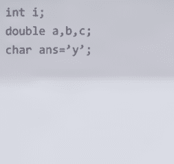

## 418 C 语言编程

```c
FILE *fp;

fp = fopen("point.dat", "a");

if (fp == NULL) {
    printf("\n无法打开文件...\n");
    exit(1);
}

while (ans == 'Y' || ans == 'y') {
    printf("\n 输入三角形顶点的坐标);\n");
    for (i = 0; i < 3; i++) {
        printf("\nEnter x[%d]: %i", i, i);
        scanf("%%%d%d", &x[i], &y[i]);
        printf("\nEnter y[%d]: %i", i, i);
        scanf("%%%d%d", &x[i], &y[i]);
    }

    a = getLength(p[0], p[1]);
    b = getLength(p[1], p[2]);
    c = getLength(p[2], p[0]);

    if (a + b > c && a + c > b && b + c > a) {
        printf("\n可以绘制三角形\n");
        fprintf(fp, "%d %d %d %d %d %d\n", p[0].x, p[0].y, p[1].x, p[1].y, p[2].x, p[2].y);
    } else {
        printf("\n无法绘制三角形\n");
        printf("\n你想要继续添加吗 (y/n)?\n");
        flush(stdin);
        scanf("%c", &ans);
    }
}

close(fp);
findLargestArea();
return 0;

double getLength(Point One, Point Two) {
    int m, n;
    m = (One.x - Two.x) * (One.x - Two.x);
    n = (One.y - Two.y) * (One.y - Two.y);
    return sqrt((double)(m + n));
}

double getArea(double sA, double sB, double sC) {
    double s;
    s = (sA + sB + sC) / 2.0;
    return sqrt(s - sA) * (s - sB) * (s - sC);
}

void findLargestArea(void) {
    FILE *fp;
    Point p[3]; r[3];
    int i;
    double a, b, c, maxArea;
    fp = fopen("point.dat", "r");
    if (fp == NULL) {
        printf("\n无法打开文件...\n");
        exit(1);
    }
    // ... (省略逻辑实现)
}
```

## 420 C 语言编程

```c
12. READ A RECORD FROM THE FILE "PBOOK.DAT"
13. IF END OF FILE IS REACHED GOTO 60
14. IF NAME = NAME THEN
    WRITE NAME, HOME_PHONE_NUMBER, OFFICE_PHONE,
    NUMBER AND MOBILE_PHONE_NUMBER IN "TEMP.DAT"
15. GOTO 12
16. CLOSE THE FILE "PBOOK.DAT" AND "TEMP.DAT"
17. REMOVE THE FILE "PBOOK.DAT"
18. RENAME "TEMP.DAT" TO "PBOOK.DAT"
19. IF FLAG = 1 THEN PRINT "RECORD DELETED"
20. RETURN
```

`SEARCH()` 函数的算法如下：

1. 开始
2. 输出 "输入要查询的姓名"
3. 输入姓名
4. FLAG <- 0
5. 从文件 "PBOOK.DAT" 中读取一条记录
6. 如果到达文件末尾则跳转到 90
7. 如果 NAME = NAME，则 FLAG <- 1; 打印 NAME, HOME_PHONE_NUMBER, OFFICE_PHONE_NUMBER, MOBILE_PHONE_NUMBER
8. 跳转到 5
9. 如果 FLAG = 0，则输出 "姓名不存在"
10. 返回

`DISPLAY()` 函数的算法如下：

1. 开始
2. 从文件 "PBOOK.DAT" 中读取一条记录
3. 如果到达文件末尾则跳转到 60
4. 打印 NAME, HOME_PHONE_NUMBER, OFFICE_PHONE, NUMBER AND MOBILE_PHONE_NUMBER
5. 跳转到 2
6. 返回

程序如下：

```c
#include <stdio.h>
#include <conio.h>
#include <string.h>
#include <process.h>

struct struct {
    char name[75];
    double home_phone, off_phone, mob_phone;
} s[100];

long int recsize;
FILE *fp, *ft;

void add(void);
void display(void);
void end(void);
void search(void);
void modify(void);
void delete(void);

int i, c, k;

int main(void) {
    int i, c, k, flag, dis, no;
    clrscr();
    recsize = sizeof(s);
    fp = fopen("pbook.dat", "rb");
    if (fp == NULL) {
        fp = fopen("pbook.dat", "wb+");
        printf("\n\nFile Open error!\n\n");
        getch();
        exit(0);
    }
    while (1) {
        printf("\n1 : ADD\n");
        printf("\n2 : MODIFY\n");
        printf("\n3 : DELETE\n");
        printf("\n4 : SEARCH\n");
        printf("\n5 : DISPLAY ALL\n");
        printf("\n6 : EXIT\n");
        printf("nEnter your choice (1-6):\n");
        fflush(stdin);
        scanf("%d", &c);
        switch (c) {
            case 1: add(); break;
            case 2: modify(); break;
            case 3: delete(); break;
            case 4: search(); break;
            case 5: display(); break;
            case 6: end(); break;
        }
    }
    return 0;
}

void add(void) {
    fseek(fp, 0, 2);
    clrscr();
    printf("\n\nEnter Name :\n");
    scanf("%[^^\n]", &s.name);
    fflush(stdin);
    printf("\n\tPhone Numbers (0 if a phone-number does not exist) :\n");
    scanf("%lf", &s.home_phone);
    fflush(stdin);
    printf("\n\tOffice Phone :\n");
    scanf("%lf", &s.off_phone);
}
```

## C 语言中的文件

```c
flush(stdin);
```


# 422 C 语言编程

```c
printf("\tMobile Number :%s\n");
scanf("%lf");
```

```c
if (dis == 15) {
    dis = 0;
    printf("\n\n\tPress ENTER to continue:\n");
    getch();
    printf("\n__________NAME__________\n");
    printf("__HOME____WORK____MOBILE____\n");
}
```

```c
arr[i] = s;
i++;
for (c = 0; c < i - 1; c++) {
    for (k = 0; k < i - 1; k++) {
        if (strcmp(arr[k].name, arr[k + 1].name) > 0) {
            temp = arr[k + 1];
            arr[k + 1] = temp;
        }
    }
}
```

```c
rewind(fp);
for (k = 0; k < i; k++)
    fwrite(&arr[k], resize, 1, fp);
clrscr();
```

```c
void end(void) {
```

```c
fclose(fp);
clrscr();
getch();
exit(0);
}
```

```c
void display(void) {
```

```c
int no, dis;
rewind(fp);
no = 1;
dis = 0;
clrscr();
printf("\n__________NAME__________\n");
printf("__HOME____WORK____MOBILE____\n");
while (fread(&s, resize, 1, fp)) {
```

```c
printf("\n");
printf("%d\t%s\n", no++, s.name);
printf("%lf|%s\n", s.home_phone);
printf("%lf|%s\n", off_phone);
```

```c
void search(void) {
```

```c
int flag = 0;
char nm[75];
rewind(fp);
printf("\n\nEnter the name to be searched :\n");
printf("\n\nEnter the name :\n");
scanf("%s", nm);
flush(stdin);
while (fread(&s, resize, 1, fp)) {
```

```c
if (strcmp(s.name, nm) == 0) {
    flag = 1;
    printf("\n\t------found------\n");
    printf("\n\tName : %s\n", s.name);
    printf("\n\tHome Phone : %lf|%s\n", s.home_phone);
    printf("\n\tMobile Number : %lf|%s\n", s.mob_phone);
}
```

```c
if (flag == 0)
    printf("\n\n\tNOT EXIST\n");
```

```c
void modify(void) {
```

```c
int flag;
char nm[75];
rewind(fp);
clrscr();
printf("\n\nEnter the name of record to be edited :\n");
printf("\n\nEnter the name :\n");
scanf("%s", nm);
flush(stdin);
flag = 0;
while (fread(&s, resize, 1, fp)) {
```

```c
if (strcmp(s.name, nm) == 0) {
    flag = 1;
}
```

```c
if (flag == 0) {
    printf("\n\n\t RECORD EXIST -\n");
    return;
}
rewind(fp);
while (fread(&s, 1, fp)) {
    if (strcmp(s.name, name) == 0) {
        printf("\n\nEnter new data :\n");
        printf("\n\tEnter Name :\n");
        scanf("%s", s.name);
        flush(stdin);
        printf("\n\tEnter Phone Numbers (%d if a\n");
        printf("\n\tHome Phone :\n");
        scanf("%^\n]", &s.home_phone);
        flush(stdin);
        printf("\n\tMobile Number :\n");
        scanf("%^\n]", &s.mob_phone);
        flush(stdin);
        fwrite(&s, 1, fp);
        break;
    }
}
i = 0;
rewind(fp);
while (fread(&s, 1, fp) == 1) {
    arr[i] = s;
    i++;
}
for (c = 0; c < i - 1; c++) {
    for (k = 0; k < i - 1; k++) {
        if (strcmp(arr[k].name, arr[k + 1].name) > 0) {
            temp = arr[k];
            arr[k] = arr[k + 1];
            arr[k + 1] = temp;
        }
    }
}
rewind(fp);
for (k = 0; k < i; k++) {
    fwrite(&arr[k], resize, 1, fp);
}
clrscr();
}
```

```c
void delete(void) {
    int flag;
    char nm[75];
    rewind(fp);
    fp = fopen("temp.dat", "wb+");
    clrscr();
    printf("\n\n\nEnter the name to be deleted :\n\n");
    printf("\n\tEnter Name :\n");
    scanf("%s\n", nm);
    flush(stdin);
    flag = 0;
    while (fread(&s, resize, 1, fp) == 1) {
        if (strcmp(s.name, name) == 0) {
            if (flag == 1) {
                printf("\n\n\t NOT EXIST -\n\n");
                return;
            }
            flag++;
            printf("\n\n\t DELETED - %d\n\n", flag);
        }
    }
    getch();
    fclose(fp);
    fclose(fp);
    remove("pbook.dat");
    rename("temp.dat", "pbook.dat");
    fp = fopen("pbook.dat", "rb+");
    rewind(fp);
    while (fread(&s, resize, 1, fp) == 1) {
        arr[i] = s;
        i++;
    }
    for (c = 0; c < i - 1; c++) {
        for (k = 0; k < i - 1; k++) {
            if (strcmp(arr[k].name, arr[k + 1].name) > 0) {
                temp = arr[k];
                arr[k] = arr[k + 1];
                arr[k + 1] = temp;
            }
        }
    }
}
```

# 第 10 章 链表

> 学习目标
> 阅读完本章后，读者将能够：
> * 理解链表
> * 学习链表的不同类型
> * 学习链表上的操作
> * 了解链表的应用
> * 熟悉自引用结构
> * 掌握链表的优缺点

## 10.1 引言

列表（List）是有限的、有序的数据项序列，称为元素（elements）。在这个定义中，“有序的”意味着每个元素在列表中都有一个位置。换句话说，列表中有第一个元素、第二个元素，以此类推。每个元素还具有数据类型。

形式上，一个通用列表的形式为 $a_1, a_2, a_3, \dots, a_n$。我们说这个列表的大小为 $n$。我们将大小为 0 的特殊列表称为空列表。

这种列表可以通过顺序分配或链接分配来实现。通过顺序分配，可以使用数组来处理列表。链表是另一种使用链表来实现项列表的数据结构。

## 表 10.1 链表与数组的比较

| 特性 | 链表 | 数组 |
| --- | --- | --- |
| 内存分配 | 不可能发生溢出。应用程序提供的所有内存均可用。通过链接 | 所有内存必须在用前分配。内存空间可能会耗尽或被闲置。 |
| 访问元素 | 只能进行顺序搜索。 | 如果有序号，就可以进行随机访问。 |
| 表达元素顺序 | 不维护顺序，因为节点可能不在连续的位置。 | 内存中的位置标识了顺序 |
| 操作效率 | 插入和删除非常有效，无论插入在何种位置。 | 插入和删除元素需要大量移动。 |
| 编程 | 需要一些专业知识。 | |

- **空间浪费**：如果数组中的元素数量少于预先固定的数组大小，会导致空间浪费。
- **顺序存储**：数组为所有元素分配一块连续的内存（块状）。对于数组来说，需要连续的空间。如果程序需要处理的元素数量超过大小，代码将崩溃。
- **溢出可能性**：如果程序需要处理的数量超过大小，则可能溢出并导致代码中断。
- **插入和删除的困难**：无法在前端插入新元素，因为现有元素需要移动以腾空间。删除操作也类似，这些操作需要大量数据移动，导致算法效率低下且耗时。在删除情况下，被删除元素的空间可以被释放。

解决这些问题的合适方案是链表，它以内存空间为代价，允许方便地构建和修改列表。链表是元素的有序集合，其中每个元素至少有一个指向列表下一个元素的指针和一个至少有一个值。每个元素被称为链表的**节点**（node）。单向链表是所有数据结构中最基础的。

数组和链表都是序列（具有定义顺序的元素集合）的替代实现方案。表 10.1 显示了这两种实现方式的比较。

链表有几种类型，如下：

- 单向链表
- 循环链表
- 双向链表
- 双循环链表

最简单的链表类型是*单向链表*，它只有一个指针。节点本身就是一个指针。该链接指向列表中的下一个节点，如果它是最后一个节点，则指向 `NULL` 值或空列表。

更高级的链表是*双向链表*。每个列表有两个链接：一个指向前一个节点（如果它是第一个节点，则指向 `NULL` 值或空列表）；另一个指向下一个节点（如果它是最后一个节点，则指向 `NULL` 值或空列表）。

在单向链表中，每个节点有一个链接，类似于数组，不同之处在于列表的最后一个节点指向第一个节点。保留一个指向列表的外部指针是有用的，因为这允许在开头快速插入，并通过最后一个一个节点的指针访问第一个节点。

在双向链表中，每个节点有两个链接，类似于第一个节点的前一个节点指向下一个，而最后一个节点的下一个链接指向第一个节点。作为双向链表，可以在任何点进行插入和删除，而不需要任何相邻节点。

链表既有优点也有缺点，它们的优点恰好是数组的弱点所在。数组的所有特性都源于在单个内存块中为所有元素分配内存的策略。链表使用了完全不同的策略。这在后面会变得清晰，链表根据需要为每个元素单独分配内存。


## 注意事项

数组被映射到物理内存中的连续地址块。数组的连续性主要是其缺点的来源。另一种替代方案是链表。

- 元素不是连续存储的。列表的逻辑顺序可能与其物理顺序不一致。
- 为了维持逻辑顺序，每个元素都有一个指向下一个项的链接。
- 可以通过跳过链接路径中的项从列表中移除元素。
- 可以通过按顺序链接这些项将元素添加到列表中。即创建几个链接。
- 可以通过链接路径执行顺序遍历（按逻辑顺序）。
- 列表的一个数据元素和
- 一个链接，即指向包含该元素后继结点的指针，而该后继节点是一个节点。

在图 10.1 中，箭头表示链接。每个节点的数据部分包含列表所持的任何类型，后续部分包含指向下一个节点的指针。图 10.2 显示了几种最常用的链表变体。

## 10.2 单向链表

单向链表是动态分配对象的序列，每个对象都引用其列表中的后继节点。它在自己的内存块中为每个元素分配空间，该块被称为链表元素或节点。每个节点包含两个字段：一个用于存储列表所持任何类型的数据字段，以及一个名为 `next` 的字段（指针），用于将一个节点链接到下一个节点。`next` 字段用于链接列表的开头，存储在一个指向第一个节点的头指针（`head`）中。第一个节点包含一个指向第二个节点的指针。第二个节点包含一个指向第三个节点的指针，依此类推。

单向链表的变表示方式如图 10.1 所示。


图 10.1 单向链表的表示方式


图 10.2 链表的变体

单向链表仅仅是动态分配对象的序列，每个对象都引用其列表中的后继节点。它在自己的内存块中为每个元素分配空间，该块被称为链表元素或节点。每个节点包含两个字段：一个用于存储列表所持任何类型的数据字段，以及一个名为 `next` 的字段（指针），用于将一个节点链接到下一个节点。`next` 字段用于链接列表的开头，存储在一个指向第一个节点的头指针中。第一个节点包含一个指向第二个节点的指针。第二个节点包含一个指向第三个节点的指针，依此类推。

- 列表的一个数据元素和
- 一个链接，即指向包含该元素后继结点的指针，而该后继节点是一个节点。

在图 10.1 中，箭头表示链接。每个节点的数据部分包含列表所持的任何类型，后续部分包含指向下一个节点的指针。图 10.2 显示了几种最常用的链表变体。

## 链表示例

```c
struct course {
    int lectures; /* 课时数 */
    int labs;     /* 实验时数 */
};
```

```c
int main() {
    struct node *head;
    head = NULL;
    makelist(&head);
    display(head);
    return 0;
}
```

节点:

```c
struct node {
    course data;           /* 课程信息 */
    struct node *next;     /* 指向下一个节点的指针 */
};
```

```c
void makelist(struct node **h) {
    struct node *first = NULL;
    struct node *second = NULL;
    struct node *third = NULL;

    /* 在堆中分配 3 个节点 */
    first = (struct node *)malloc(sizeof(struct node));
    second = (struct node *)malloc(sizeof(struct node));
    third = (struct node *)malloc(sizeof(struct node));

    /* 设置第一个节点 */
    first->data = 1;
    first->next = second;

    /* 设置第二个节点 */
    second->data = 2;
    second->next = third;

    /* 设置第三个节点 */
    third->data = 3;
    third->next = NULL;

    /* 将第一个节点的地址存储在 head 中 */
    *h = first;
}
```

包含上述声明的任一节点的单链表是同质链表，因为它包含了相同类型的节点。为了表示异质链表（即包含不同类型的节点），可以使用联合体（union）。

例如，考虑以下节点的声明：

```c
struct node {
    int type;
    union {
        int ival;
        float fval;
        char *sval;
    } data;
    struct node *next;
};
```


它声明了元素，根据相应的类型，这些元素可以是整数、浮点数或字符串。由于联合体的大小大到可以容纳其最大的组件，因此 `sizeof` 和 `malloc()` 可以为节点分配存储空间。

这是一个简单的程序，它使用指针构建了一个包含三个节点的单链表，这三个节点的 `data` 字段分别具有值 1、2 和 3，并显示出来。

```c
#include <stdio.h>
#include <stdlib.h>

struct node {
    int data;
    struct node *next;
};

void makelist(struct node **);
void display(struct node *node);
```

对上述创建链表的程序的分析，在 `makelist()` 函数中，使用了以下三个步骤：

1. 在头节点分配新节点，并将其数据设置为需要存储的任何内容。
2. 将当前节点的 `next` 指针设置为链表的下一个节点。这实际上是一个指针赋值。注意，将一个指针赋值给另一个指针会使它们指向同一个对象。
3. 将第一个节点的地址存储在 `head` 中。

在 `display()` 函数中，链表代码中一种常用的技术是遍历链表中的所有节点。从第一个节点开始遍历链表，依次检查每个节点，直到最后一个节点被处理。在 `display()` 函数中，将 `head` 复制到局部变量 `p` 中，然后通过 `p` 遍历链表。通过 `p == NULL` 测试链表的末尾。语句 `p = p->next` 将局部指针 `p` 推进到链表中的下一个节点。或者，有些人可能更喜欢使用 `for` 循环，这使得初始化和更新更加简单。

在 `display()` 函数中，仅传递 `head` 作为参数，因此形式参数是指向 `struct node` 类型的指针。在 C 语言中，对局部参数的更改永远不会反映回调用者的内存。需要注意的是 `makelist()` 需要修改调用者内存中的某些变量，即 `head` 变量。允许更改 `struct node` 的传统方法是传递调用者的内存地址，而不是副本。

```c
for(p != NULL; p = p->next) { ... }
```

初学者经常对 `p = p->next` 如何使指针指向链表中的下一个节点感到困惑。让我们通过一个例子来理解这一点。假设在一个包含四个节点的链表中，`p` 指向第一个节点（见图 10.4）。

| 150 | 400 | 700 | 910 | NULL |
|---|---|---|---|---|
| 150 | | 400 | | 700 | | 910 |

图 10.4 单链表 (SLL) 的实际表示

图 10.4 没有显示指向下一个节点的链接，而是显示了每个节点后续部分下一个节点的地址。当执行语句 `p = p->next` 时，它会产生 400。现在这个值被存储在 `p` 中。结果是 `p` 开始指向下一个节点。实际上，`head` 移动了 `p`，使其开始指向链表中的下一个节点。

因此，在 C 语言中，如果你想更改一个 `int`，请传递一个 `int *`。要更改 `T`，请传递一个 `T *`，其中 `T` 是任何数据类型。如果要更改一个 `struct node *`，则需要传递一个指向 `struct node *` 的指针，即 `struct node **`。`head` 指针的类型是“指向 `struct node` 的指针”（`struct node *`）。要更改它，我们需要传递一个指向 `head` 指针的指针，这将是“指向指针的指针”（`struct node **`）。在代码中，`&head` 用作调用函数的实际参数。在 `makelist()` 中，指向头的函数指针命名为 `h`。

图 10.6 调用 `makelist()` 之前头节点的内存图。注意 `makelist()` 需要修改调用者内存中的某些变量，即 `head` 变量。允许更改 `struct node` 的传统方法是传递调用者的内存地址，而不是副本。

# 430 C语言编程

```c
void append(struct node **h) {
    if(*h == NULL) {
        *h = (struct node*)malloc(sizeof(struct node));
        if(*h == NULL) {
            printf("\nMemory allocation unsuccessful.");
            return;
        }
        printf("\nData: %d", &(*h)->data);
        (*h)->next = NULL;
    }
}
```

这些操作将在后续章节中进行讨论。在这些章节中，单链表第一个节点的指针在相应的代码中用 `head` 表示，在代码中写为 `*h`。

## 10.2 单链表中的节点插入

插入节点的通用算法可以描述如下：

1. 为新节点分配内存并填充数据。
2. 确定插入点，即新节点将放置在列表中的位置。要确定该位置，需要知道新节点的前驱节点。
3. 让新节点指向它的后继节点。
4. 让前驱节点指向新节点。

```c
void display(struct node *p) {
    if(p == NULL) {
        printf("NULL");
        return;
    } else {
        printf("%d ->", p->data);
        display(p->next);
    }
}
```

`display()` 函数已经讨论过了。以下是该函数的递归版本。

接下来的子节将讨论在单链表列表中插入节点的不同方法。

### 在指定节点之后插入节点

假设要插入新节点之后的节点存储在变量 `a` 中。对该节点的数据字段（即新节点要放置的位置）进行搜索是通过使用通常的遍历模式完成的，使用局部指针变量 `tmp` 逐个通过节点。随着循环的执行，`tmp` 逐一个地指向列表中的节点。在每次迭代中，将 `tmp` 指向节点的 `data` 字段与要查找的值进行比较。如果两个值相等，则该节点存在。否则，将 `tmp` 更新为 `tmp->next` 以检查下一个节点。此过程将持续到到达最后一个节点，或者在执行 `tmp = tmp->next` 时导致 `NULL`，这表示 `k` 中包含的值不在列表中。以下循环执行此任务：

单链表上可以执行主要的基元操作：

- 插入节点
- 在特定节点之后
- 在第 n 个节点之后
- 在特定节点之前
- 搜索特定节点
- 删除特定节点
- 排序节点
- 销毁（删除所有节点）

```c
for(tmp = head; tmp != NULL && tmp->data != k; tmp = tmp->next);
```

结果是，`tmp` 现在指向要插入新节点之后的节点。插入一个指向新节点的指针 `p`。遵循图 10.8 所示的示意图。

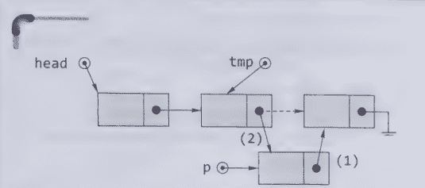

图 10.8 单链表中特定节点之后插入节点

从图 10.8 可以看出，`p` 的 `next` 字段应该指向被插入的 `tmp`，而 `tmp` 的 `next` 字段应该指向 `p` 所指向的节点。此操作由两个语句组成：

```c
p->next = tmp->next;
tmp->next = p;
```

这两个赋值语句的顺序很重要。如果赋值顺序反过来，那么 `tmp->next` 的值在使用之前就会丢失，并且没有方法将新节点（由 `p` 指向）连接到列表的剩余部分。此代码可以构建成函数 `insert()`，用于在单链表的某个节点之后插入新节点。

```c
void insert(struct node **h) {
    struct node *p, *tmp;
    int k;

    if(*h == NULL) {
        printf("\n Linked List is EMPTY");
        return;
    }

    printf("\n Enter the new node after which new node is to be inserted: ");
    scanf("%d", &k);

    for(tmp = *h; tmp != NULL && tmp->data != k; tmp = tmp->next);

    if(tmp == NULL)
        printf("\n NODE DOES NOT EXIST");
    else {
        p = (struct node*)malloc(sizeof(struct node));
        if(p == NULL) {
            printf("\n Memory allocation unsuccessful.");
            return;
        }
        printf(" \n Enter data: ");
        scanf("%d", &data);
        p->next = tmp->next;
        tmp->next = p;
    }
}
```

前述函数的递归版本如下。在这个版本中，需要将一个值传递给要插入新节点的节点的 `data` 字段。

```c
void insert(struct node **h, int k) {
    struct node *p;
    if(*h == NULL) {
        printf("\n NODE DOES NOT EXIST OR Linked List IS EMPTY..");
    }
}
```

注意在函数 `insert()` 中，`head` 不发生改变。不需要将 `head` 作为实际参数传递给函数。形式参数 `h` 将是 `struct node *h`。这在下一个 `insert()` 版本中有所体现。

# 432 C语言编程

其递归版本如下：

```c
void insert_nth(struct node *h) {
    int i;
    struct node *p;

    if(h == NULL) {
        printf("\n List is EMPTY");
        return;
    }

    printf("\n Enter the position after which new node is to be inserted: ");
    scanf("%d", &position);

    for(i = 1; h != NULL && i < position; i++) {
        h = h->next;
    }

    if(h == NULL) {
        printf("\n There are not nodes");
    } else {
        p = (struct node*)malloc(sizeof(struct node));
        if(p == NULL) {
            printf("\n Memory allocation unsuccessful.");
            return;
        }
        printf(" \n Enter data: ");
        scanf("%d", &data);
        p->next = h->next;
        h->next = p;
    }
}
```

# 434 C 语言编程

显然，新节点应该指向 `head` 所指向的节点（在函数中它为 `*h`），当 `head` 指向它时，这个新添加的节点就变成了链表的起始节点。因此，需要以下两个指针赋值：

```c
p->next = *h;
*h = p;
```

需要修改指针 `head` 的内容。函数 `insert()` 的实际参数将是 `&head`，形式参数将是 `struct node **`。
如果在插入新节点之前，通过其位置指定节点，插入算法是相同的。实现留给读者。

## 10.2.2 从单链表中删除节点

假设要从单链表中删除一个带有特定值的节点。必须找到该节点，并通过其前驱节点将其从链表中删除。现在该节点的内存空间需要通过 `free()` 函数进行处理。单链表是单向的。两个指针 `tmp` 和 `prev` 在循环初始化时分别指向扫描的节点及其前驱。在每次迭代中，检查当前节点（由 `tmp` 指向）的 `data` 字段，然后移动到下一个节点。显然，为了移动到下一个节点，必须包含语句 `tmp = tmp->next`。指向 `head` 指向的第一个节点应特殊处理，就像在头部插入一样。其余方案见图 10.11。


图 10.11 从单链表中删除节点

(a) 删除链表的第一个节点
(b) 删除链表的中间节点

### 链表节点计数

这里 `n` 是单链表的节点数量，可以通过名为 `count()` 的函数计算。使用通用遍历技术获取链中的节点数。

## 10.2.3 链表排序

单链表的排序意味着按照 `data` 字段中持有的值升序排列链表节点。这可以通过两种方式实现：首先断开连接，其次是对节点 `data` 字段中存储的值进行排序。这里考虑第二种方法。使用的排序是冒泡排序，使用的循环如下：

```c
for(i = 0; i < n - 1; i++) {
    for(j = 0; j < n - i - 1; j++) {
        // ...
    }
}
```

考虑连续节点，如果第一个节点的 `data` 字段值大于第二个，则交换值。然而，问题是外层循环的每次迭代都需要从单链表的第一个节点开始。因此，在进入 `j` 循环之前，遍历临时指针（在函数中为 `p`）必须通过赋值语句 `p = head` 设置指向第一个节点。在内层循环中，语句 `p = p->next` 导致指针 `p` 移动到下一个节点，可以检查链表的后续节点。因此，在内层循环中，移动到下一个节点必须包含语句 `p = p->next`。这里给出了执行该操作的函数 `sort()` 定义。在这个函数中，当列表已排序时，使用变量 `sorted` 通过减少额外的迭代来使函数更高效。

该函数的递归版本需要额外的参数 `k`，即要删除节点的 `data` 值。

```c
void delnode(struct node **h, int k) {
    struct node *next_n;
    if(*h == NULL) {
        printf("\n链表为空或节点不存在..\n\n");
        return;
    }
    if((*h)->data == k) {
        next_n = (*h)->next;
        free(*h); /* 如果节点是用 malloc 分配的 */
        *h = next_n;
    } else {
        delnode(&(*h)->next, k);
    }
}
```

```c
void sort(struct node *h) {
    struct node *p;
    int i, j, n = 0, t, sorted;
    int *b;

    n = count(h);
    sorted = 0;

    for(i = 0; i < n - 1 && !sorted; i++) {
        p = h;
        sorted = 1;
        for(j = 0; j < n - i - 1; j++) {
            if(p->data > (p->next)->data) {
                t = p->data;
                p->data = (p->next)->data;
                (p->next)->data = t;
                sorted = 0;
            }
            p = p->next;
        }
    }
}
```

建议读者作为一个练习，创建一个用于从单链表中删除节点的程序。

### 迭代版本
```c
int count(struct node *p) {
    int i;
    for(i = 0; p != NULL; p = p->next)
        i++;
    return i;
}
```

### 递归版本
```c
int count(struct node *p) {
    if(p == NULL)
        return 0;
    else
        return 1 + count(p->next);
}
```


## 10.2.4 销毁链表

销毁链表意味着删除链表的所有节点。`destroy()` 函数将链表的所有节点释放回堆。

### 迭代版本

```c
void destroy(struct node **h)
{
    struct node *q;
    if(*h==NULL)
    {
        printf("\n链表为空");
        return;
    }
    while(*h!=NULL)
    {
        q=(*h)->next;
        free(*h);
        *h=q;
    }
}
```

### 递归版本

```c
void destroy(struct node **h)
{
    if(*h==NULL)
    {
        destroy(&(*h)->next);
        free(*h);
        *h=NULL;
    }
}
```

### 注意点

编写删除链表所有代码时要小心。上面的函数版本是错误的：

```c
void destroy(struct node *p)
{
    while(p!=NULL)
    {
        free(p);
        p=p->next;
    }
}
```

原因是释放 `p` 包含一个已经释放的地址；因此 `p->next` 语句没有意义。结果是代码可能会崩溃。C 程序可以通过本节定义的全部 C 函数对单链表执行任何讨论的操作，如下：

```c
#include <stdio.h>
#include <stdlib.h>

struct node
{
    int data;
    struct node *next;
};

void append(struct node **);
void displace(struct node **);
void insaft(struct node **);
void insbef(struct node **);
void delnode(struct node **);
int count(struct node **);
void sort(struct node **);
void destroy(struct node **);

int main()
{
    struct node *head;
    int ch;
    head=NULL;
    while(1)
    {
        printf("\n 1. 添加节点 \n");
        printf("\n 2. 显示所有 \n");
        printf("\n 3. 在特定节点后插入 \n");
        printf("\n 4. 在特定节点前插入");
        printf("\n 5. 删除节点");
        printf("\n 6. 排序节点");
        printf("\n 7. 销毁");
        printf("\n 8. 退出");

        while(last!=p)
        {
            tmp=p;
            while(tmp->next!=last)
                tmp=tmp->next;
            printf("\t%d", tmp.data);
            last=tmp;
        }

        printf("\n输入您的选择...");
        scanf("%d",&ch);
        switch(ch)
        {
            case 1: append(&head); break;
            case 2: displall(head); break;
            case 3: insaft(head); break;
            case 4: insbef(head); break;
            case 5: delnode(head); break;
            case 6: sort(head); break;
            case 7: destroy(head); break;
            case 8: exit(0);
            default: printf("\n选择错误.");
        }
        return 0;
    }
}
```

### 递归函数

```c
void displall(struct node *p)
{
    if(p==NULL)
        return;
    else
        displall(p->next);
    printf("\t%d", p.data);
}
```

## 10.2.5 单链表上的复杂操作

### 反转单链表

使用之前的函数，可以按倒序打印单链表节点 `data` 字段的值。要物理上反转单链表（不使用额外的链表），最后一个节点变成第一个，倒数第二个变成第二个，依此类推。为了反转整个链表，先反转第一个节点以外的所有节点，然后再反转第一个节点。现在有两种反转链表的方法。第一种是迭代（非递归）方案。这里有一个接收单链表头作为参数的函数，它反转链并返回反转链开始处的指针。由于返回地址再次赋值给 `head`，因此不需要向函数传递 `head` 的地址。

#### 倒序打印单链表

要倒序打印链表的节点（不使用额外的链表），在嵌套函数中使用两个循环。两个指针 `tmp` 和 `last` 用于遍历链表到某一点。第一个链被遍历到最后一个节点，然后到倒数第二个节点。指针用于到达最后一个节点所在的位置。这个过程持续到 `last` 等于 `head`（在函数中它为 `*h`）。

函数声明：

```c
struct node *reverse_list(struct node *);
```

函数调用语句：

```c
head=reverse_list(head);
```

函数定义：

#### 迭代版本

```c
void disapp(struct node *p)
{
    struct node *tmp,*last;
    if(p==NULL)
        return;
    last=NULL;
    tmp=p;
}
```

```c
struct node *reverse_list(struct node *h)
{
    struct node *prev,*cur,pNext;

    if (h == NULL)
        return NULL;

    prev = NULL;
    cur = h;

    do {
        pNext = cur->next;
        cur->next = prev;
        prev = cur;
        cur = pNext;
    } while (cur != NULL);

    return prev;
}
```

该递归函数有两个基准情况。如果列表为空，它将保持为空；如果列表只有一个节点，它将保持不变。这两个基准情况可以合并为一个，如果其中任一条件为真，则返回 `h`。否则，可以将其作为一般情况使用。`reverse_list()` 通过传递带有第二个节点的列表来递归调用，并将当前节点视为第一个节点。由于当前节点的 `next` 字段没有改变，且它原本指向剩余列表的第一个节点，现在它指向了剩余列表的最后一个节点。该节点（由当前节点指向的节点）被更新为指向当前节点，而当前节点被更新为指向无（如果 `next` 变为 NULL）。

首先处理链表为空（NULL）的特殊情况；NULL 的反转是 NULL 列表。如果列表不为空，则需要以下三个指针：

- 指向当前节点的指针（需要更新其 `next` 字段的节点）
- 指向前一个节点的指针（当前节点应该指向的节点）
- 指向下一个节点的指针，在当前节点更新其 `next` 字段后，它将成为当前节点的后续

#### 递归版本

```c
struct node *reverse_list(struct node *h) {
    struct node *tmp;
    if (h == NULL)
        return NULL;
    if (h->next == NULL)
        return h;
    tmp = reverse_list(h->next);
    (h->next)->next = h;
    h->next = NULL;
    return tmp;
}
```

### 复制单链表

通过复制每个节点的值，将单链表复制到另一个链表中。以下 C 程序执行此 `copy_list()`，它接受目标列表和源列表作为参数，并使用新逻辑来创建单链表。

```c
#include <stdio.h>
#include <stdlib.h>

struct node {
    int data;
    struct node *next;
};

void dispall(struct node *);
void copy_list(struct node **, struct node *);

int main() {
    struct node *head, *hd;
    int ch;
    char ans='y';
    printf("\n 创建第一个链表...\n");
    while(ans=='y' || ans=='Y') {
        append(&head);
        printf("\n 要添加新节点吗(y/n)?...\n");
        flush(stdin);
        ans=getchar();
    }
    dispall(head);
    copy_list(&hd, &head);
    printf("\n 复制后的链表...\n");
    dispall(hd);
    return 0;
}
```

```c
void append(struct node **h)
{
    if(*h==NULL)
    {
        *h=(struct node*)malloc(sizeof(struct node));
        if(*h==NULL)
            printf("\n 内存分配失败.");
        return;
        printf("\n 输入数据:");
        scanf("%d",&(*h)->data);
        (*h)->next=NULL;
    }
    else
        append(&(*h)->next);
}
```

```c
else
{
    tmp->next=(struct node*)malloc(sizeof(struct node));
    tmp=tmp->next;
    tmp->data=s->data;
    s=s->next;
    tmp->next=NULL;
}
```

函数 `copy_list()` 的递归版本如下：

```c
void copy_list(struct node **t, struct node *s)
{
    if(s==NULL)
    {
        *t=(struct node*)malloc(sizeof(struct node));
        (*t)->data=s->data;
        (*t)->next=NULL;
        copy_list(&(*t)->next, s->next);
    }
}
```

### 保持升序链表

让我们创建一个单链表，其中插入链表的每个新节点都插入在特定位置，使列表始终保持升序。以下 `append()` 函数的版本说明了这一点。这里的重点是，在遍历列表时，通过将要插入节点的数据与当前节点及其后续节点进行比较，准确地插入。

```c
void append(struct node **h)
{
    struct node *p, *tmp;
    p=(struct node*)malloc(sizeof(struct node));
    printf("\n 输入数据:");
    scanf("%d",&(*p)->data);
    /* 如果列表为空或新节点要插入在第一个节点之前 */
    if(*h==NULL)
    {
        p->next=NULL;
        *h=p;
        return;
    }
}
```

```c
void copy_list(struct node **t, struct node *s)
{
    struct node *tmp;
    if(s==NULL)
        return;
    while(s!=NULL)
    {
        if(t==NULL)
        {
            *t=(struct node*)malloc(sizeof(struct node));
        }
    }
}
```

```c
p->next=t;
return;
head(*)->next;
(*)->next=p;
p->next=head;
*t=;
```

注意，在函数参数 `t` 是指向在 `main()` 中定义的外部指针 `t` 的指针。当在链表末尾插入新节点时，应该更新尾节点的值，无论循环列表是否为空，新插入的节点现在就是尾节点。在图 10.14 中，为了更好的插值，没有使用 `*t`。

## 10.3 显示循环链表

遍历循环表与遍历单链表略有不同；在循环表中，任何节点的 `next` 字段都不会遇到 `null`。为了遍历循环表，需要保存 `tail` 指向的节点 `head` 字段中的地址。令其为 `head`。现在，`head` 指向的节点就是循环链表的第一个节点。通过另一个指针 `tmp` 获得 `head` 的拷贝，只要 `tmp` 等于 `head` 的值就一直遍历。因此，只要 `tmp` 不等于 `head`，使用 `while` 循环就足够了。该操作在循环链表中的实现如下：

```c
void displace(struct node *t) {
    struct node *tmp, head;
    if(t==NULL) {
        printf("\n LINKED LIST IS EMPTY!\n");
        return;
    }
    head=tmp=t->next;
    printf("\n");
    do {
        printf("% td\n", tmp->data);
        tmp=tmp->next;
    } while(tmp!=head);
}
```

考虑第一种情况。为了说明，考虑以下循环链表：

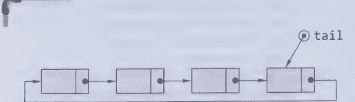

图 10.15 初始循环链表

假设 `tmp` 是指向新节点要插入的节点之后的指针。已经讨论过变量 `tmp` 的值如何使得它能够指向循环链表的节点。因此，在循环链表中，由 `p` 指向的新节点，其最后一个节点由 `tail` 指向（在函数中为 `*t`）。在图 10.16 中。


图 10.16 在特定节点后插入节点

自然地，在插入节点后，`tmp->next` 和 `p->next` 需要更新，循环链表将如图 10.17 所示。


图 10.17 插入后的循环链表

## 10.3.3 在指定节点插入节点

下一个操作是在循环链表中插入节点。节点插入后，该节点通过 `data` 字段的值或在表中的位置来指定，假设第一个节点位于位置

```c
p->next = tmp->next;
tmp->next = p;
```

在循环链表由 `tail` 指向（在函数中为 `*`）的节点之后插入节点总是被视为特殊情况，因为这种插入意味着要修改指向列表最后一个节点的指针 `tail`。这在图 10.18 中所示。

```c
printf("\nENTER THE DATA: ");
scanf("%d",&data);
p->next=tmp->next;
tmp->next=p;
found=1;
break;
tmp=tmp->next;
}
if(found==0)
{
    printf("\nNODE DOES NOT EXIST...");
}
```


让读者按照相同的方案编写在第 n 个节点之后插入的程序。

## 10.3.4 在特定节点之前插入节点

在特定节点之后插入节点的 C 函数定义如下：

```c
void insaft(struct node **t)
{
    struct node *p,*tmp;
    int x, found=0;
    if(*t==NULL)
    {
        printf("\n LINKED LIST IS EMPTY\n");
        printf("\n THE VALUE OF THE NODE AFTER\nnNEW NODE TO BE INSERTED: ");
        scanf("%d",&x);
        if((*t)->data==x)
        {
            p=(struct node *)malloc(sizeof(struct node));
            if(p==NULL)
```


# C语言编程

## 10.3 循环链表的排序

使用冒泡排序法通过交换相邻节点数据字段的值对循环链表的节点进行排序，这与单链表完全相同，区别在于统计节点数量的代码。在下面的代码中已用**粗体**标记：

```c
void sort(struct node **next)
{
    struct node *tmp,*head;
    int i,j,n=1,temp;
    head=(*tmp)->next;
    for(tmp=head->next;tmp!=head;tmp=tmp->next)
        ++n;
    printf("%d Number of nodes=%d\n", n);
    for(i=0;i<n-1;i++){
        tmp=head;
        for(j=0;j<n-i-1;j++){
            if(tmp->data>(tmp->next)->data) {
                temp=tmp->data;
                tmp->data=(tmp->next)->data;
                (tmp->next)->data=temp;
            }
            tmp=tmp->next;
        }
    }
}
```

## 10.4 双向链表

到为止讨论的链表只包含一个链接（指针）字段，指向链表中的下一个节点。因此，两种情况下只能向一个方向进行遍历。观察发现，这种链表有时限制太大。例如，注意在单链表和循环链表中删除一个节点，需要将该节点的前驱指向它的后继节点。然而，链表只有前向链接，使得无法从节点访问其前驱。双向链表克服了这个限制。每个节点包含两个指针，用于存储前一个节点的地址。它也被称为双向列表。

这种链表的特殊之处在于它可以两个方向进行遍历，即正向和反向。这种类型链表的概念用于树结构。树的层次结构可以使用这些双向链表轻松地表示。包含整数的双向链表的类型声明如下：

```c
struct node {
    int data;
    struct node *prev,*next;
}
```

从图上可以看出，双向链表的每个节点可以如图10.24所示。


图 10.24 双向链表中的节点

观察第一个节点的左链接和最后一个节点的右链接被设置为 `NULL`。注意双向链表的其他变体——空双向链表也用空指针表示。保留一个外部指针 `head` 来指示双向链表的起始。

### 10.4.1 双向链表的操作

插入和删除是双向链表的两个基本操作。需要遵循的步骤与单链表完全相同，仅在于对两个指针的管理。必须注意的是，如果使用另一个指针 `tail` 指向链表的最后一个节点，就可以避免用于查找双向链表节点的循环。在这种情况下，末尾的插入和删除变得更容易。尽管效率如此，这里只考虑了 `head`。

现在很清楚了，对链表的任何操作都涉及链接的调整。由于单链表和循环链表的函数已经详细解释了步骤，因此通过图示就可以理解这些双向链表的逐步工作原理。

#### 在双向链表中插入节点

此操作包括：

- 添加节点
- 在指定节点之后插入节点
- 在指定节点之前插入节点，包括在链表开头插入

图 10.25 显示了双向链表中插入节点的示意图。


图 10.25 双向链表在各个位置插入节点

##### 在指定节点之后插入节点

在指定节点之后插入节点可以通过以下代码实现：

```c
void insaft(struct node *h)
{
    int position;
    struct node *p;
    // ... 此处省略部分代码逻辑 ...
    if(right!=NULL)
        right->prev=p;
}
```

检查这一点非常重要，如果目标节点是最后一个节点，那么它的下一个字段将包含 `NULL`。因此，语句 `right->prev` 没有意义。

##### 在指定节点之前插入

在双向链表的情况下，通过节点的 `prev` 字段可以很容易找到前驱。不需要采用任何技巧来寻找特定节点的前驱。以下函数的定义足以理解这种操作。在第 m 个节点之前插入的逻辑与单链表相同，通过节点的 `prev` 字段可以轻松到达前驱。

#### 从双向链表中删除节点

从双向链表中删除节点可以在链表的任何位置发生。双向链表在各个位置的删除操作如图10.26所示。


图 10.26 双向链表在各个位置删除节点

删除操作可以使用 `delete()` 函数执行。注意该函数实现了图10.26所示的双向链表任何位置的节点删除；它不使用临时指针作为节点的前驱或后继。`delnode()` 函数如下：

```c
void delnode(struct node **h) {
    struct node *p = *h;
    int k;
    if(*h==NULL) {
        printf("\n链表为空\n");
        return;
    }
    printf("\n要删除的数据: %d\n");
    scanf("%d",&k);
    /* 遍历整个链表 */
    while(p!=NULL) {
        if(p->data==k) {
            if(p==*h) { /* 如果是第一个节点 */
                *h=(*h)->next;
                if(*h != NULL) (*h)->prev = NULL;
            } else {
                /* 如果是最后一个节点 */
                if(p->next==NULL)
                    (p->prev)->next = NULL;
                else {
                    /* 如果是中间节点 */
                    (p->prev)->next = p->next;
                    (p->next)->prev = p->prev;
                }
            }
            free(p);
            return;
        }
        p=p->next;
    }
    /* 如果未找到则移动到下一个节点 */
    printf("\n节点不存在\n");
}
```

#### 双向列表排序

双向链表的节点排序可以使用与单链表相同的函数。

#### 删除节点

要删除双向链表的所有节点，可以使用与单链表相同的函数。

### 10.4.2 双向链表的优缺点

双向链表的主要优点是两个方向的导航都很容易。如果链表用于字符串编辑（其中字符串是文本文件中的行），这会非常有用。人们可以将文本指针的“当前行”存储到相应的节点；如果用户将光标移动到下一个或上一个，单个指针操作即可将当前行恢复到正确的值。同样，如果用户回退行，他们可以执行10次指针操作来获取正确的行。对于这些操作中的每一次，如果链表是单链的，必须从链头开始遍历直到到达该点。这在链表很大时效率很低。双向链表的主要缺点是每个节点都需要额外的内存（需要空间），并且插入或删除节点的时间会稍长（因为有更多的指针操作）。

## 10.5 循环双向链表

循环双向链表是双向链表的一种变体，其中最后一个节点的 `next` 指针指向第一个节点，第一个节点的 `prev` 指针指向最后一个节点，形成一个闭环（后续列表，直到再次回到起始节点）。

这里是循环双向链表的结构图表示。


为了表示双向链表，可以定义如下结构：

```c
struct Node{
    int data;
    struct node *prev, *next;
};
```

与循环双向链表相关的两个基本操作如下：

#### 1. 在循环双向链表中插入节点

在列表末尾和头部插入节点是通过双向链表和单向链表的结合实现的。图 10.28 显示了如何在循环双向链表的中间位置插入节点。


具体步骤如下。这些步骤不能以任何其他顺序执行。

```c
p->prev = q;
p->next = q->next;
(q->next)->prev = p;
q->next = p;
```

#### 2. 从循环双向链表中删除节点

图 10.29 显示了如何在循环双向链表的中间位置删除节点。


删除的步骤如下：

```c
(p->prev)->next = p->next;
(p->next)->prev = p->prev;
free(p);
```

当要删除的节点是第一个节点（由图中的 `cdlist` 指向）时，指针 `cdlist` 指向第一个节点的下一个节点。需要遵循的步骤如下：

```c
cdlist = p->next;
(p->prev)->next = p->next;
(p->next)->prev = p->prev;
free(p);
```

## 10.6 链表的应用

在计算机编程中，链表广泛用于数据库管理系统、进程管理、操作系统、文本编辑器。链表的一个重要应用是表示多项式及其操作。然而，我们不会在书中详细介绍这种表示法的细节。

### 10.6.1 动态存储管理

在多程序计算机环境中，多个程序同时存在内存中。不同的程序可能有不同的内存需求。为了满足这些内存需求，操作系统必须能够根据需要分配一个连续存储块。同时，当程序执行完毕时，其分配的内存块必须被释放，该空闲块可以分配给另一个程序。

为了跟踪内存的分配和释放部分，操作系统的内存管理器维护一个分配块和空闲存储块的链表。

双向链表被用于维护分配块列表和空闲块列表。该列表中的每个节点都包含段的起始地址、大小和状态。此列表按起始地址字段排序，以便于更新：当程序终止时，分配给它的内存段变为空闲，因此，如果任何内存段被释放，只要相邻段已经是空闲的，就可以与相邻段合并。这需要双向遍历列表以找出任何相邻段是否为空闲。因此，它需要以双向链表的形式维护。

| 系数 | 指数 |
| :--- | :--- |
| 6 | 4 |
| 3 | 3 |
| -7 | 2 |
| 4 | 1 |
| -5 | 0 |

图 10.30 使用链表表示多项式

### 垃圾回收与压缩

在执行过程中，曾经需要但稍后变得不再需要且使用的存储块被称为垃圾。垃圾回收是收集所有未使用的内存块并将其返回可用空间的过程。该过程基本上分两个阶段进行：第一阶段是标记阶段，标记所有使用的节点；第二阶段是将所有未标记的节点返回到可用空间列表。当所有节点都是固定大小时，这是很简单的。当使用变长节点时，最好进行压缩，使空闲节点形成连续的内存块。

在第二阶段被称为压缩。压缩通过将内存块从一个位置移动到另一个位置，将空闲块收集成一个大块。当这个大块变得太小时，使用压缩机制来回收未使用的存储。这里没有使用释放机制，而是使用标记算法来标记未使用的块。不是通过释放机制释放每个未标记块，而是将其放入空闲列表，压缩将所有未标记块收集到内存空间一端的大块中。

### 多项式表示示例

显然，当 $x=10$ 时，多项式 $P(x) = x^3 + 2x^2 + 3x + 4$ 的表达式形式即为十进制数 1234。推广之，任何 $n$ 位十进制数都可以表示为 $(n-1)$ 次多项式的取值。


$P(x) = \sum_{i=0}^{n-1} a_ix^i$ for $x=10$

其中 $0 \le a \le 9$。

这种方式的两个整数相加与用链表表示的多项式相加非常相似。唯一的区别是系数位于 0 到 9 之间。相加后，系数可能会大于 9。假设系数之和为 $S$，大于 9，进位为 $E$。在这种情况下，两个节点将包含表达式 $S/10$ 的结果作为数位，并将 $E$ 作为系数。另一个节点将包含表达式 $S\%10$ 的结果作为数位，并将 $E+1$ 作为指数。此类加法的结果所示。


**图 10.31** 系数（数位）的相加导致产生了值大于 9 的系数

# 10.8 数组与链表的重新讨论

项目列表可以使用数组和链表来实现。数组在内存中使用顺序映射。链表则不使用内存中的顺序映射。即使数组是动态分配的，也需要对列表的最大大小进行估计。通常这需要一个较高的估算值，从而浪费大量的空间。如果有许多未知大小的列表，这可能是一个严重的限制。

数组的任何元素都可以通过索引进行随机访问。链表中的数据以线性方式访问，且无法从数组位置访问。要访问第三个节点中的数据，你必须从第一个节点开始，经过第二个节点，然后才能到达第三个节点。与数组不同，无法直接访问第三个节点的数据。

这些项目序列的每实现方式各有优缺点，总结如下。

## 空间方面

- 在链表实现中，序列中的每个元素都存储一个指针，而数组只存储元素本身。
- 链表使用的空间与列表中元素的数量成正比。这对于数组实现来说并非真实。如果向序列中添加了大量项目然后又删除，数组的大小也会大于序列中的项目数量。

## 时间方面

- 对于具有 $n$ 个元素的列表，添加或删除一个项目的实现在最坏情况下需要 $O(n)$ 时间，因为需要移动现有的元素。
- 相比之下，如果我们维护指向列表头节点的指针、当前节点的前一个节点指针以及指向当前节点的指针，那么在链表中添加和删除项目可以实现为 $O(1)$ 时间。

## 实现易用性

数组和链表版本的实现似乎都简单且直观。然而，链表版本的方法似乎比较复杂，因为在链表中添加和删除元素需要指针操作。链表真的考验了对指针的理解。尽管链表的密集程度更高，但它们对于练习这种思维具有天然结构。很容易画出链表的状态并利用此来思考代码。

再次，对于数组，分配的是连续的内存位置。使用数组时，数据存储在连续的内存位置中，允许通过访问数组的当前元素并使用缩放因子来获取下一个元素。相比之下，对于链表，指针存在额外的开销，以及通常由于 `malloc()` 分配内存带来的开销。无法保证链表中的后续元素占用连续的内存位置。这导致了从当前节点移动到下一个节点时的获取操作。

# 性能方面

列表的数组实现性能略优于链表实现。下面讨论了有助于数组性能略优的若干因素。

由于缩放因子的存在，数组 `a[i]`（其中 `i` 是数组名）中下一个元素的地址是从当前元素和元素大小计算出的——都在寄存器中：

```
a[i]=i * sizeof(i)
```

# 总结

列表的数组实现通过索引对单个数据提供了高效的访问。然而，它有一些缺点：

- 插入效率低（$O(n)$ 执行时间）
- 空间浪费
- 在列表开头或中间进行加法繁琐
- 从列表开头或中间删除元素代价高昂

# 10.7 链表的缺点

尽管使用链表有优点，但显然存在一些缺点。其是指针内存。如果指针处理不当，它们可能会导致执行中的严重错误。链表还为实际数据消耗额外的空间，因为节点之间的链接是通过指针维护的。链表的一个缺点是不适用于随机访问。要访问链式存储中的单个节点，必须遍历长路径才能到达目标节点，这花费了大量的时间和空间（因为使用了指针）。

循环列表类似于链表，但最后一个节点指向第一个节点。否则，可以将其看作没有头节点或末尾节点的循环列表。循环链表的结构与单链表相同；它们包含数据和一个指向另一个节点的链接指针（`link`）。与单链表不同，在循环列表中没有 `NULL`。

循环链表的一个问题是，要在列表开头插入节点时，必须遍历列表找到列表末尾，以便最后一个节点能指向新节点。这可能会非常恼人，因此循环链表在实践中并不多见。

数组位于连续内存块中，其连续性也是缺点的所在。更好的替代方案是链表。链表是一种线性数据结构，每个数据都包含一个指向下一个数据的指针。

# 456 C 语言编程

# 常见问题

1. 识别链表数组的某些特定优势。每当需要插入和删除元素时，链表相比数组具有明显的优势。

在双向链表中执行插入和删除操作。在单链表中，由于每个节点仅有一个指针，因此每个节点所需的空间较少，且任何插入或删除操作消耗的时间都比双向链表短。

2. 识别数组相对于链表的某些优势。当随机访问的次数远大于插入和删除的次数时，数组比链表更有优势。由于数组中的元素在存储内存时是连续排列的，这种连续排列允许通过索引在 $O(1)$ 时间内访问任何元素。另一方面，要访问链表中的任何元素，必须与该元素关联一个指针。如果我们不了解元素访问的模式，那么获取元素指针的成本可能是高昂的。在内存紧缺的情况下，数组也具有优势，因为它们不需要指针来保持元素的“链接”。

3. 双向链表相对于单链表的优缺点是什么？双向链表的主要优势是在给定的节点中，可以容易地向任意方向移动。例如，如果列表包含长度不等的字符串（例如在文本编辑器中），这非常有用。人们可以存储“当前”行，使用户拥有指向下一行或上一行的指针，通过单次指针操作即可将当前行恢复到正确位置。否则，如果用户回退 10 个节点（例如），可以执行 10 次操作到达正确的行。对于这些操作中的每一次，如果链表是单链表，则必须从列表头开始遍历直到到达正确点。当这种操作在大规模使用单链表时，会非常低效。

双向链表的主要缺点是每个节点都需要额外的指针，每个节点需要更多的空间。由于每个节点多额外的指针，需要花费更多时间来

4. 循环链表与单链表在哪些方面有所不同？循环链表最适用于描述环形结构，具有结构规则且可以从列表的任何一点开始遍历的优势。循环链表还可以通过单个指针（最后一个元素的地址）快速访问第一个和最后一个记录。在单链表中，第一个元素和最后一个元素涉及指针的更改，这需要更长的时间。循环链表的主要缺点是迭代的复杂性，它有特殊情况。

5. 你如何检测链表中的环？编写一个 C 程序来检测链表中的环。选择两个指针指向列表的开始。让其中一个指针每次移动 1 个节点，另一个移动 2 个节点。如果存在环，第二个指针将在某处与第一个指针相遇。如果相遇，说明存在连接。下面提供了一个检测链表环环的函数：

```c
int hasloop(struct node *h) {
    p=h;
    q=h->next;
    while(p!=NULL && q->next!=NULL) {
        if(p==q)
            return 0;
        p=p->next;
        q=(q->next)?(q->next->next):q->next;
    }
    return 1;
}
```

# 练习题

- 1. 写出链表相对于数组的优缺点。
- 2. 列出使用链表进行动态存储的优势，而不是使用 `malloc()` 等内存分配函数创建动态大小数组。
- 3. 是否可能仅使用头头指针创建链表？如果是的话，如何实现？
- 4. 单链表的缺点是什么？
- 5. 循环链表的缺点是什么？
- 6. 为什么双向链表的列表操作比单链表更高效？
- 7. 列出双向链表相对于单链表的重要优势。
- 8. 列出双向链表的至少两个缺点。
- 9. 编写一个函数按以下方式合并两个链表。假设一个列表 $L = (l1, l2, \dots, ln)$，另一个列表 $M = (m1, m2, \dots, mn)$，其中 $l$ 和 $m$ 是它们各自列表中的节点。合并后，合并后的列表应为 $L = (l1, m1, l2, \dots)$。
- 10. 编写一个 C 函数来合并两个循环链表。
- 11. 编写一个 C 程序，对表示为单链表的多项式执行以下操作：
    - (a) 多项式的求值
    - (b) 两个多项式的相乘法
- 12. 编写一个 C 程序，将两个由双向链表表示的正整数相加。
- 13. 编写一个 C 函数在循环链表中执行以下操作：
    - (a) 形成包含两个列表元素并集的循环链表
    - (b) 形成包含两个列表元素交集的循环链表
    - (c) 删除列表的每第二个节点
    - (d) 反转列表
    - (e) 通过调整指针交换两个节点
    - (f) 比较两个列表
- 14. 编写一个 C 函数在双向链表中插入第 $m$ 个和第 $n$ 个节点。
- 15. 涉及两个变量的多项式如何用链表表示？编写 C 函数处理：
    - (a) 两个多项式的加
    - (b) 两个多项式的乘法
- 16. 假设 `first` 和 `last` 是双向链表第一个和最后一个节点的指针。编写 C 函数实现：
    - (a) 附加节点
    - (b) 删除最后一个节点
    - (c) 列表列表
    - (d) 在第 $n$ 个节点后插入元素
    - (e) 删除列表的第 $n$ 个元素
- 17. 编写一个 C 程序，使用单链表和双向链表将列表拆分。
- 18. 编写一个 C 程序，使用双向链表加多项式。
- 19. 编写一个程序，使用单链和双向链表乘多项式。
- 20. 编写一个程序，从文件读取车辆信息（品牌、年份、公里、价格）并存储在列表中。每个整数可能包含 15 到 20 位，取决于用户的选择。将这些长整数（从低位开始）相加并显示结果。
- 21. 编写一个程序，从文件读取车辆信息（编号、品牌、年份、公里、价格）并存储在列表中，显示内容。继续读取编号（直到输入 0 为止），在输入编号时删除节点。最后显示列表内容。
    - (a) 在列表末尾添加新车辆信息
    - (b) 在列表开头添加新车辆信息
- 22. 编写一个程序，从文件读取信息（编号、品牌、年份、公里、价格）并存储在列表中，显示列表内容。继续读取编号（直到输入 0 为止），在输入编号时删除节点。最后显示列表内容。

# 项目问题

1. 数字的补码通过从右向左扫描并完成第一个出现的 1 之后的所有位得到。因此，11100 的补码是查找二进制数补码的 C 程序。使用二进制算术实现整数减法。

# 案例研究

## 问题陈述

编写一个 C 程序模拟以下问题——一组士兵被压倒性的敌人包围。没有援军的情况下没有希望，但有一匹马可以逃生并呼救。他们组成一个圆，从帽子里抽出数字 $n$ 和一个人的名字。从被抽中的士兵开始，顺时针绕圆计数。数到 $n$ 时，该士兵从圆中移除，从下一个士兵开始计数。任何士兵不再被计算。最后剩下的士兵将骑马逃生。

## 分析

该问题是，给定数字 $n$、士兵在圆中的顺序以及开始计数的士兵，确定士兵从圆圈中消除的顺序以及哪一个士兵最终逃生。例如，假设 n 等于 3，有五个人 A、B、C、D 和 E。我们从 A 开始数三个，这样 C 就被消除了。然后我们从 D 开始数 E，再回到 B，这样下一个被消除的是 A。我们继续数 B、D 和 E（C 已经被消除了），最后是数 B、D 和 B，这样 D 就是最后幸存的的人。

下面给出了解决约瑟夫问题的源代码。

```c
#include <stdio.h>
#include <string.h>
#include <stdlib.h>

struct NODE {
    char name[50];
    struct NODE *next;
}

void insert(struct NODE **, char *);
void display(struct NODE *);
void eliminate(struct NODE **, char *);

int main() {
    int i;
    char name[50];
    struct NODE *start=NULL,*p;

    printf("The soldiers in clockwise order\n");
    display(start);
    printf("\n");
    printf("Enter the name of the soldier from\ncount begins \n");
    fflush(stdout);
    scanf("%[^n]*",name);

    while(strcmp(name,"END")!=0) {
        insert(start,name);
        fflush(stdout);
        scanf("%[^n]*",name);
    }

    printf("Enter the value of n : \n");
    scanf("%d",&n);
    printf("\n\nThe order in which the soldiers are\neliminated: \n");

    while(start->next) {
        for(i=1;i<n;i++)
            start=start->next;
        printf("Soldier eliminated: %s\n",start->name);
        p=start->next;
        eliminate(&tail,start->name);
    }

    start=p;
}
printf("\nSOLDIER WHO ESCAPES IS: %s",start->name);
return 0;
}

void insert(struct NODE **t, char *nm) {
    struct NODE *p, *q;
    p=(struct NODE*)malloc(sizeof(struct NODE));
    strcpy(p->name,nm);
    if(*t==NULL) {
        *t=p;
        p->next=NULL;
        return;
    }
    p->next=(*t)->next;
    while ((*t)->next!=NULL)
        *t=(*t)->next;
    *t=p;
}

void eliminate(struct NODE **t, char *nm) {
    struct NODE *p,*q;
    if(*t==NULL || ((*t)->next==NULL) {
        printf("\nThe list is empty or contains only\n a single node");
        return;
    }
    if(strcmp((*t)->name,nm)==0) {
        p=*t;
        while (p->next!=*t)
            p=p->next;
        q=p->next;
        *t=q->next;
        free(q);
        return;
    } else {
        p=*t;
        while (p->next!=*t)
            p=p->next;
        if(strcmp((p->next)->name,nm)==0) {
            q=p->next;
            p->next=q->next;
            free(q);
            break;
        }
        p=p->next;
    }
}

void display(struct NODE *t) {
    struct NODE *q;
    q=t->next;
    do {
        printf("%s\n",q->name);
    } while (q!=t);
}
```


# 第11 章：引言

## 学习目标

阅读本章后，读者将能够：

- 理解位运算符及其用法
- 理解预处理器指令
- 了解 `const`、`volatile` 和 `restrict` 修饰符
- 使用指针、函数和结构体
- 理解位运算和数据类型
- 理解内存模型及其应用

## 位运算的使用

位运算符允许用户读取和操作特定类型的位。必须记住，位运算符仅适用于 `int` 和 `char` 类型。位运算符分为两类：二进制运算符和一元运算符。二进制运算符接受两个参数，而一元运算符只接受一个。`~`（取反）是一个单操作数的位运算符。`&`、`|`、`^`、`<<` 和 `>>` 被称为位移运算符。位运算符像算术运算符一样，不会改变操作数的值，而是创建一个临时值。该值可以赋值给变量。

## 11.2 位运算符

由于计算机理解机器语言，数据是以二进制数（0和1的组合）表示的。表11.1 列出了可以操作二进制数的位运算符。

### 表11.2 位运算符与逻辑运算符的优先级和结合性

| 优先级 | 结合性 |
| --- | --- |
| `<<` | L→R |
| `>>` | L→R |
| `|=` | L→R |
| `&` | L→R |
| `^` | L→R |
| `|` | L→R |
| `&&` | L→R |
| `?=` | R→L |
| `=&=` | R→L |

位运算符允许用户读取和操作某些类型的位。从表中可以看出，位运算符、位移运算符（`&` 和 `>>`）的优先级高于逻辑运算符和位复合运算符（`>>`、`<<`、`&=` 和 `|=`）。

假设无符号整数使用 32 位内存，为了说明，定义了两个变量 `X` 和 `Y`：

```
X = X31 X30 .. X0
Y = Y31 Y30 .. Y0
```

`X` 和 `Y` 的每一位都通过以小写写变量名并加上相应的下标来显示。

### 11.2.1 位与

位与运算仅在操作数的对应位都设置为 1 时才为真。下表通过对单个位进行与运算，定义了 `&` 运算符的操作：

| X | Y | 十进制对应 | b3 | b2 | b1 | b0 |
|---|---|---|---|---|---|---|
| 0 | 0 | 0 | 0 | 0 | 0 | 0 |
| 0 | 1 | 1 | 0 | 0 | 0 | 1 |
| 1 | 0 | 2 | 0 | 0 | 1 | 0 |
| 1 | 1 | 3 | 0 | 0 | 1 | 1 |

这是一个应用于四位表示的数字的 `&` 运算示例。

运算符 `&` 可用于检查一个数字是否为 2 的幂。这可以通过 `while` 循环和算术运算符 `%` 如下实现：

```c
// Example 1
#include <stdio.h>

int main() {
    int n, r;
    printf("\n ENTER THE NUMBER: %d\n");
    scanf("%d", &n);
    while (n > 1) {
        r = n % 2;
        if (r == 0)
            n /= 2;
        else
            break;
    }
}
```

使用位与运算，示例 1 中的程序可以在不使用循环或算术运算符的情况下重写：

```c
#include <stdio.h>

int main() {
    int n;
    printf("\n ENTER THE NUMBER: %d\n");
    scanf("%d", &n);
    if ((n & (n - 1)) == 0)
        printf("\n The number is power of 2 \n");
    else
        printf("\n The number is not power of 2 \n");
    return 0;
}
```

为了说明，`n = 8 & (n - 1)` 结果为 `0000`。所以，这里用四个二进制位表示。因此：

| n | 1 | 0 | 0 | 0 |
|---|---|---|---|---|
| n-1 | 0 | 1 | 1 | 1 |
| n & (n-1) | 0 | 0 | 0 | 0 |

所以该数字是 2 的幂。但是，当 `n = 12` 时，`n & (n - 1)` 不等于 0。因此，它不是 2 的幂，因为它能被 2 整除。

掩码是一个通过位运算符将位模式转换为另一个位的过程。位运算中的一个操作数是将被转换的原始位。另一个操作数称为掩码，是产生所需转换的选定位模式。位运算符经常用于掩码一组位。以下代码段使用值为 1 的掩码并打印 0 和 1 的交替序列：

```c
int i, mask = 1;
for (i = 0; i < 16; i++)
    printf("%d\n", i & mask);
```

掩码值可用于检查位是否被设置。例如，要检查位 1 和位 3 是否设置，应将数字标记为 10 并对掩码进行结果测试。

### 11.2.2 位或

运算符 `|` 用作位或。如果两个位中的任意一个（或都）为 1，则该运算返回 1。必须区分位运算符 `|` 与逻辑运算符 `||`，后者意味着从左到右求值。如果 `x` 为 1 且 `y` 为 2，`x & y` 为 0 而 `x || y` 为 1。

下表定义了由变量 `x` 和 `y` 表示的单个位上的位或：

| x | y | x\|y |
|---|---|---|
| 0 | 0 | 0 |
| 0 | 1 | 1 |
| 1 | 0 | 1 |
| 1 | 1 | 1 |

#### 示例

```c
// #2
#include <stdio.h>

int main() {
    int n, mask = 10;
    printf("Enter a number: %d\n");
    scanf("%d", &n);
    if ((n & mask) == mask)
        printf("Bits 1 and 3 are set\n");
    else
        printf("Bits 1 and 3 are not set\n");
    return 0;
}
```

这是一个应用于四位数字的位或示例。

| 变量 | b3 | b2 | b1 | b0 |
|---|---|---|---|---|
| x | 0 | 1 | 0 | 1 |
| y | 1 | 0 | 1 | 0 |
| z | 1 | 1 | 1 | 1 |

上面的示例通过以下插图可以更好地理解：位或运算符用于将位置 1。在以下语句中：

```c
n = n | mask;
```

`n` 中被设置的位被设置为 1。

| 变量 | 内容 | 备注 |
|---|---|---|
| n | 任意十进制 (16 位) | x=0 或 1 |
| mask (10) | 0000000000001010 | |
| n & mask | 0000000000000000 | 位 |
| ... | ... | ... |

#### 示例

```c
// 3
#include <stdio.h>

int main() {
    int n, mask = 4;
    printf("\nEnter a number: %d\n");
    scanf("%d", &n);
    n = n | mask;
    printf("\n bit 2 is set: %d\n", n);
    return 0;
}
```

输出：
```
Enter a number: 3
bit 2 is set: 7
```

在 `n & mask` 等于 `mask` 的情况下，即位 1 和 3 被设置为 1。

另一个掩码示例是 255；其二进制等值为 `11111111`。因此，`n & 255` 产生一个位模式，其最高位与 `n` 的最低位相同。用八位表示 3 的二进制等值为 `00000011`。这里是掩码 4，二进制等值为 `00000100`，`|` 运算符将右侧设置为 1。即，`n` 变成了 7；二进制 `00000111`。

### 11.2.3 位异或

`^` 被称为位异或。如果两个位中的任意一个（但不同两个）为 1，则该运算返回 1。下表定义了单个输入的异或：

| Y1 | Y2 | Y3 |
|---|---|---|
| 0 | 0 | 0 |
| 0 | 1 | 1 |
| 1 | 0 | 1 |
| 1 | 1 | 0 |

位异或运算符 `^` 在操作数位不同的地方设置 1，相同的地方设置 0。然而，下表显示了四位异或示例，由于 `^` 运算符的结合性，它从右到左求值：

(i) `a ^ b`
(ii) `b ^ a`
(iii) `a ^ b`

执行 (i) 后，`a` 和 `b` 的二进制等值为 `000000001010`。
执行 (ii) 后，`a` 和 `b` 的二进制等值为 `000000001010`。
执行 (iii) 后，`a` 和 `b` 的二进制等值为 `000010101010`。

即 `a = b = 8`。

上述逻辑可以使用位运算符反转给定的字符串。使用异或运算符，可以在不使用第三个变量的情况下交换两个整数变量如下：

```c
#include <stdio.h>
#include <string.h>

void reverse(char *str) {
    int i = 0, j = strlen(str) - 1;
    while (i < j) {
        str[i] = str[i] ^ str[j];
        str[j] = str[i] ^ str[j];
        str[i] = str[i] ^ str[j];
        i++;
        j--;
    }
}
```

```c
#include <stdio.h>

int main() {
    int a, b;
    printf("before swap: a=%d, b=%d\n", a, b);
    a = a ^ b;
    b = a ^ b;
    a = a ^ b;
    printf("after swap: a=%d, b=%d\n", a, b);
    return 0;
}
```

### 11.2.4 位取反

位取反运算符（也称为 `~`）翻转其操作数的所有位。如果某位是 0，它就变成 1；如果是 1，它就变成 0。这也被称为反码。

```c
#include <stdio.h>

int main() {
    int n = 5;
    printf("original: %d\n", n);
    printf("NOT n: %d\n", ~n);
    return 0;
}
```

### 11.2.5 位移位运算符

移位运算符 `<<` 和 `>>` 根据右操作数给定的位数（该数必须为非负）对其操作数进行左移和右移。

因此，`x << 2` 将 `x` 的值移动两个位置，并用 0 填充空位；这等同于乘以 4。右移无符号数量总是用 0 填充空位。右移有符号数量在某些机器上填充符号位（“算术移”），在另一些机器上填充 0 位（“逻辑移”）。要将整数除以 `2^n`，则应用右移 `n` 位。要将整数乘以 `2^n`，则应用左移 `n` 位。

以下程序使用右移和位与运算将数字显示为 16 位二进制数字。将数字从 16 连续右移到 0，并与 1 进行与运算，以检查该位是否设置。另一种方法是使用位或运算符配合掩码。

```c
#include <stdio.h>
#include <limits.h>

int main() {
    int counter, num;
    printf("Enter a number: %%d");
    scanf("%d", &num);
    printf("The Binary Equivalent of %%d is %%b", num);
    for (counter = 15; counter >= 0; counter--)
        printf("%d", (num >> counter) & 1);
    putchar('\n');
    return 0;
}
```

输出：
```
Enter a number: 7335
The Binary Equivalent of 7335 is 0001110010100111
```

#### 示例 9：一个使用位运算符旋转整数二进制等价值的程序。

```c
#include <stdio.h>
#include <limits.h>

int main() {
    int num, i, n, mask;
    printf("\nENTER THE NUMBER: %%d");
    scanf("%d", &num);
    n = sizeof(int) * CHAR_BIT;
    mask = 1 << (n - 1);
    for (i = 1; i <= n; i++) {
        putchar((num & mask) == 0 ? '0' : '1');
        num <<= 1;
        if (i % CHAR_BIT == 0)
            putchar(' ');
    }
    return 0;
}
```

输出：
```
ENTER THE NUMBER :
BINARY EQUIVALENT IS : 000111001010011
```

在 ANSI C 中，带符号常量 `CHAR_BIT` 定义在 `limits.h` 中，表示 `char` 的位数。由于 `char` 占用 1 字节存储空间，它只包含一个最低位（LSB）。表达式 `1 << (n - 1)` 将位移向高位。因此，掩码除了其最高位（为 1）之外的所有位都设置为 0。如果 `num` 中的高位为 0，则表达式 `(num & mask) == 0` 结果为真；反之，如果高位为 1，则表达式 `num & mask` 的结果非零，表达式 `(num & mask) == 0` 结果为假。如果最高位为 1，`putchar()` 会打印 1。之后，表达式 `num <<= 1` 评估的值具有相同的位模式，每个位都通过最高位（MSB）移出。后续语句 `if (i % CHAR_BIT == 0) putchar(' ');` 在打印每个字节后打印一个空格。

#### 示例 10：一个将名为 `value` 的数字旋转 `n` 次的程序。如果 `n` 为正，则左移，否则向右移。需要注意的是，旋转意味着每个位移动一位并恢复最后一位。在左移中，每个位向左移动一位，移出的左位保留在最右侧位置。

```c
/* 左旋转或右旋转 unsigned int 的函数 */
unsigned int rotate(unsigned int value, int n) {
    unsigned int result, bits;
    if (n == 0 || n == -16 || n == 16)
        return value;
    else if (n > 0) { /* 左旋转 */
        bits = value >> (16 - n);
        result = value << n | bits;
    } else { /* 右旋转 */
        n = -n;
        bits = value << (16 - n);
        result = value >> n | bits;
    }
    return result;
}

int main() {
    unsigned int w1 = 0xalb5, w2 = 0xff22;
    printf("%x\n", rotate(w1, 4));
    printf("%x\n", rotate(w1, -4));
    printf("%x\n", rotate(w2, 8));
    printf("%x\n", rotate(w2, -2));
    return 0;
}
```

## 11.3 命令行参数

所有 C 程序都定义了一个 `main()` 函数，它指定程序的入口并由执行程序的环境调用。到目前为止，`main()` 没有接受任何参数。然而，可以带参数定义 `main()`，以接受执行时指定的命令行参数。因此，程序必须从命令行运行。以下 `main()` 版本允许将参数传递给命令行：

```c
int main(int argc, char *argv[])
```

该声明表示：

- `argc` 是命令行参数的数量（包括命令本身），即 `argc` 至少为 1。
- `argv` 是命令行参数数组。

`argv` 的定义意味着它是一个字符串数组。根据常规规则，所有类型为数组的参数，实际传递给 `main` 的是 `argv` 的第一个元素的地址。因此，等效（广泛使用的）声明是：

```c
int main(int argc, char **argv)
```


当程序启动时，满足以下条件：

- `argc` 大于 0。
- `argv[argc]` 是空指针。
- `argv[0]`、`argv[1]` 到 `argv[argc-1]` 是具有实现定义的字符串指针。
- `argv[0]` 是包含程序名称的字符串。`argv` 的其余成员是程序的参数。

该程序将其参数打印到标准输出。该程序本质上是 UNIX 或 MSDOS 的 `echo` 命令。

# 注意事项

- 算术运算符与赋值运算符结合使用执行简写形式。赋值形式包括 `+=`、`-=` 等。
- 简写形式也可以应用于位运算符。例如 `|=` 和 `^=` 是位运算符的简写形式。几乎所有二元运算符都有优先级。
- 位运算符的优先级低于算术运算符。

# 环境变量示例

```text
LOCALAPDATA=C:\Users\Manas\AppData\Local
LOGONSERVER=\MANAS-PC
NUMBER_OF_PROCESSORS=2
OS=Windows_NT
Path=C:\Program Files\quincy\mingw\bin;C:\Program Files\quincy\bin;VstaBin;C:\Program Files\quincy\bin;C:\Java\jfsdkbin;C:\Java\jfsdk\simulator;C:\Windows\System32;C:\Windows\System32;C:\Windows\PowerShell\v1.0
PATHEXT=C:.EXE;BAT;.CMD;.VBE;JSE;JSE;.WSH;.WHT
PROCESSOR_ARCHITECTURE=x86
PROCESSOR_IDENTIFIER=x86 Family 15 Model 6 Stepping 5 Genuine Intel
PROCESSOR_LEVEL=15
PROCESSOR_REVISION=0685
ProgramData=C:\ProgramData
ProgramFiles=C:\Program Files
PROMPT=$G
ModulePath=C:\Windows\system32\WindowsShell\v1.0\Modules
PUBLIC=C:\Public
SESSIONNAME=Console
SystemDrive=C:\Windows
TEMP=C:\Users\Manas\AppData\Local\Temp
TMP=C:\Users\Manas\AppData\Local\Temp
USERDOMAIN=Manas
USERNAME=Manas
USERPROFILE=C:\Users\Manas
windir=C:\Windows
```

指令。C 预处理器有几个用于调用它的指令。一个指令通常占据一行。`#` 符号应该是该行的第一个非空字符，其之前可以出现空格和制表符。`#` 和指令之间也可能出现空白符号。指令行还可能包含内容；这些内容会被预处理器忽略。单独占一行的 `#` 会被忽略。如果指令的最后一个空白字符不同，则认为在下一行继续，从而允许定义多行。

指令通常放置在源程序的开头，这意味着它们写在 `main()` 之前。然而，预处理器指令可以出现在源文件的任何位置，但它们仅适用于源文件的剩余部分。使用预处理器是有益的，因为它使得：

- 程序开发元素
- 程序更易读
- 程序的修改更简单
- 代码在不同的机器架构之间更具可移植性。

## 11.4 C 预处理器指令

预处理器指令分为两类：无条件指令和条件指令。图 11.1 描述了这两类指令。


图 11.1 C 中的预处理器指令类型

## 11.4 C 预处理器

预处理器是一个在编译之前处理任何 C 源程序的程序。由于它允许用户定义宏，因此 C 宏也称为宏子程序。开放式子程序是程序指令的一部分（如函数），它没有返回语句。

预处理器拥有它自己的语言，这对于程序员来说是一个非常强大的工具。这些工具是给预处理器的指令，被称为：

C 预处理器指令如图 11.1 和表 11.3 所示，并带有简要说明。

### 表 11.3 C 预处理器指令

| 指令 | 说明 |
| --- | --- |
| `#define` | 定义宏 |
| `#undef` | 取消宏的定义 |
| `#include` | 文本地包含文件内容 |
| `#ifdef` | 根据宏是否已定义来决定条件编译 |
| `#ifndef` | 根据宏是否未定义定义来决定条件编译 |
| `#endif` | 标记条件块的结束 |
| `#if` | 根据表达式是否为非零来决定条件编译 |
| `#else` | `#if`、`#ifdef` 或 `#if` 指令的 else 部分 |
| `#elif` | `#else` 和 `#if` 的编译 |
| `#line` | 修改当前行号和文件名 |
| `#error` | 输出错误消息 |
| `#pragma` | 特定于实现 |

```c
printf("Now is TRUE");
return 0;
```

输出：

Now is TRUE

`#define` 指令的另一个特性是它可以接受参数，这使其作为伪函数创建器非常有用。考虑以下示例：

```c
16. #include <stdio.h>
#define abs_value((a<0) ? -a : a)
int main() {
    int a=-1; // 替换为 (a<0) ?-a:a;
    while(abs_value(a)) {
        printf("\n Value of %d within while,\n", a);
        return 0;
    }
    printf("\n Value of %d outside while,\n", 0);
    return 0;
}
```

输出：

Value of a=-1 within while
Value of a=0 outside while

下一个示例展示了如何使用 `#define` 指令创建一个通用的循环来打印 0 到 5 的整数。

```c
17. #include <stdio.h>
#define up_count(x,lo,hi) for((x)=lo;x<(hi);(x++))
int main() {
    int k;
    // 替换为 {int k;
    up_count(k,0,5)
    printf("\n Value of %d\n", k);
    return 0;
}
```

## #if, #else, #elif, #endif

例如，如果程序需要在 MSDOS 机器上运行并需要包含 `msdos.h`，否则包含 `default.h` 文件，则可以使用使用 `#if` 的以下代码：

```c
#if SYSTEM == MSDOS
#include <msdos.h>
#else
#include "default.h"
#endif
```

使用 `#if` 与 `#elif`（即 else-if）以及 `#endif` 的通用形式需要检查此处。因此，以下代码可以写成：

```c
#if <constant_expression1>
<statement_sequence1>
#elif <constant_expression2>
<statement_sequence2>
```

```c
#ifdef TURBOC
#define INT_SIZE 16
#else
#define INT_SIZE 32
#endif
```

```c
#elif <constant_expressionN>
<statement_sequenceN>
#endif
```

另一个 `#ifdef` 的用法示例所示。

有时，可能需要在不同的头文件中选择一个包含在程序中。例如，预处理器可能会指定用于不同类型操作系统的配置参数。程序员可以使用一系列条件指令来实现这一点，如下图所示。

### 示例

```c
18. #include <stdio.h>
#define VAX 1
#define SUN 0
int main() {
#ifdef VAX
printf("This is a VAX\n");
#endif
#ifdef SUN
printf("This is a SUN\n");
#endif
return 0;
}
```

```c
#if SYSTEM1
#include "SYSTEM_1.h"
#elif SYSTEM2
#include "SYSTEM_2.h"
#elif SYSTEM3
#endif
#ifdef #ifndef
```

如果宏 `macro_name` 未定义，则 `#ifdef` 执行一个语句序列。如果 `#ifndef` 执行一个语句序列。对于这两个指令，语句的结束由 `#endif` 分隔。`#ifdef` 的通用形式为：

```c
#ifdef macro_name
<statement_sequence>
#endif
```

这些条件指令用于检查宏是否已定义或设置，它们可能来自不同的头文件和程序模块。例如，为了在 Turbo C（在 MS-DOS 上）和 Linux（或其他操作系统）之间为可移植 C 程序设置整数大小，可以使用这些指令。

例如，假设 Turbo C 正在运行，宏 `TURBOC` 将被定义。程序员只需要

C89 规定 `#if` 和 `#elif` 至少可以嵌套 8 层。C99 规定允许至少 63 层嵌套。

逻辑运算符如 `&&`、`||`、`!` 可以用来测试标识符是否已定义。

指令 `#error` 用于由预处理器报告错误。

```c
#error error_message
```

当预处理器遇到此内容时，它会输出 `error_message` 并导致编译终止。因此，它应该只用于报告会导致进一步编译毫无意义或无法实现的错误。它主要用于调试。例如：

### 注意事项

```c
#ifndef LINUX
#error This software requires the LINUX OS.
#endif
```

另一个 `#error` 的用法示例如下：

```c
#if A_SIZE < B_SIZE
#error "Incompatible sizes"
#endif
```

在这里，`#error` 宏用于强制执行两个符号常量的一致性。

## #line

`#line` 指令用于更改 `__LINE__` 和 `__FILE__` 变量的值。文件名是可选的。`__FILE__` 和 `__LINE__` 变量表示通用格式的当前行和列。其格式为：

```c
#line line_number <file_name>
```

示例：

```c
#line 20 "program.c"
```

将当前行更改为 20，并将当前文件更改为 "program.c"。

## #pragma

`#pragma` 指令允许告知编译器执行某些任务。由于 `#pragma` 指令是特定于实现的，其用法随编译器而异。人们可能会选择跟踪程序的执行。1999 年 C 标准规定了这种指令（通常称为 pragmas）的三种形式。C 编译器可以自由地在其他 pragmas 上附加它喜欢的任何内容。

## 11.4.2 预定义标识符

预处理器提供了一小组预定义标识符，用于表示有用信息。标准标识符汇总在表 11.4 中。大多数实现都通过许多预定义标识符扩展了此列表。

### 表 11.4 标准预定义标识符

| 标识符 | 表示 |
|---|---|
| `__FILE__` | 正在处理的文件名 |
| `__LINE__` | 正在处理文件的当前行 |
| `__DATE__` | 当前日期的字符串形式（例如 "16 Dec 2005"） |
| `__TIME__` | 当前时间的字符串形式（例如 "10:15:30"） |

预定义标识符（也称为宏）可以像程序常量一样在程序中使用。
所有预定义宏在开头和结尾都有下划线。预定义标识符的演示如下所示：

```c
#include <stdio.h>
int main() {
    printf("__DATE__ = %s\n", __DATE__);
    printf("__FILE__ = %s\n", __FILE__);
    printf("__LINE__ = %d\n", __LINE__);
    printf("__TIME__ = %s\n", __TIME__);
    printf("__STDC__ = %d\n", __STDC__);
    return 0;
}
```

输出：

__DATE__ = Dec 18 2010
__FILE__ = pred.c
__LINE__ = 11
__TIME__ = 17:25:09
__STDC__ = 1

`__DATE__` 宏提供了日期的字符串表示。


将当前行更改为 20，并将当前文件更改为 `program.c`。

# #pragma

`#pragma` 指令允许程序员告知编译器执行某些任务。由于 `#pragma` 指令是特定于实现的，其用法随编译器而异。人们可能会选择跟踪程序的执行。1999 年 C 标准规定了这种指令（通常称为 pragmas）的三种形式。C 编译器可以自由地在其他 pragmas 上附加它喜欢的任何内容。

## 11.4.2 预定义标识符

预处理器提供了一小组预定义标识符，用于表示有用信息。标准标识符汇总在表 11.4 中。大多数实现都通过许多预定义标识符扩展了此列表。

### 表 11.4 标准预定义标识符

| 标识符 | 表示 |
|---|---|
| `__FILE__` | 正在处理的文件名 |
| `__LINE__` | 正在处理文件的当前行 |
| `__DATE__` | 当前日期的字符串形式（例如 `"16 Dec 2005"`） |
| `__TIME__` | 当前时间的字符串形式（例如 `"10:15:30"`） |

预定义标识符（也称为宏）可以像程序常量一样在程序中使用。所有预定义宏在开头和结尾都有下划线。预定义标识符的演示如下所示：

```c
#include <stdio.h>

int main() {
    printf("__DATE__ = %s\n", __DATE__);
    printf("__FILE__ = %s\n", __FILE__);
    printf("__LINE__ = %d\n", __LINE__);
    printf("__TIME__ = %s\n", __TIME__);
    printf("__STDC__ = %d\n", __STDC__);
    return 0;
}
```

输出：
```
__DATE__ = Dec 18 2010
__FILE__ = pred.c
__LINE__ = 11
__TIME__ = 17:25:09
__STDC__ = 1
```

## 类型限定符

## 11.5 TYPE QUALIFIER

类型是标准 C 中的一个基本概念。当声明变量时，它与一个数据类型相关。每个表达式和子表达式都有其类型。也就是说，数据类型是变量的基础。额外的属性还包括以下内容：

- 类型说明符（有符号或无符号）
- 类型限定符（`const`、`volatile` 和/或 `restrict`）
- 存储类（`auto`、`register`、`extern` 或 `static`）

类型限定符影响对象所可以拥有的值范围。它可以是有符号的或无符号的。存储类已经在第 6 章中讨论过。类型限定符用于对优化提供更强的控制。许多重要的优化方法都是基于缓存原理：在某些情况下，编译器可以记住某个位置的最后一次值（读取或写入），并在读取该位置时使用这个存储的值。如果这是机器内存，例如，使用寄存器而不是访问外部内存，代码可以运行得越来越快。

限定符有三种类型——`const`、`volatile` 和 `restrict`。`const` 和 `volatile` 的概念是完全相互独立的。一个常见的误解是认为 `const` 是 `volatile` 的反面，反之亦然。C89 标准为 C 语言引入了两种类型限定符：`const` 和 `volatile`。C99 标准增加了第三种类型限定符 `restrict`。下面是对类型限定符的讨论：

## 11.5.1 Const 限定符

`const` 意味着不可修改的。`const` 类型限定符用于限定一个值不能更改的对象。被 `const` 限定的对象的值不能被修改。在对象上使用 `const` 限定符可以保护其免受改变存储的操作引起的副作用的影响。

`const` 的语法和语义是从 C++ 适配的。任何在声明时类型说明符包含 `const` 部分的变量，在程序中都不能对其赋值。下面的程序阐明了 `const` 在 C 程序中的用法。

```c
cp = &c;
cpi = &i;
cp = ncpi;
printf("*c=%d \t %i=%d,c", *cp, i);
printf("*c=%d \t *i=%d,*cp,*ncpi", *cp, *ncpi);
exit(EXIT_SUCCESS);
return 0;
}
```

输出：
```
c=5 i=10
*cp=10 *ncpi=10
```

现在在程序示例 19 中插入一条语句 `c=20;`，编译器生成了一个错误。

```c
20.#include <stdio.h>
#include <stdlib.h>

int main() {
    int i=10;
    const int c=5;
    const int *cp;
    int *ncpi;
    cp = &c;
    cpi = &i;
    cp = ncpi;
    printf("*c=%d \t %i=%d,c", *cp, i);
    printf("*c=%d \t *i=%d,*cp,*ncpi", *cp, *ncpi);
    c=20;
    printf("*c=%d \t %i=%d,c", *cp, i);
    cpi=0;
    exit(EXIT_SUCCESS);
    return 0;
}
```

> C 限定符可能会导致错误

考虑示例 20 中 `const` 的以下用法。

```c
示例
19.#include <stdio.h>
#include <stdlib.h>

int main() {
    int i=10;
    const int c=5;
    const int *cp;
    int *ncpi;
```

```c
printf("\n*c=%d\t i=%d",c,i);
printf("\n*cp=%d\t *ncpi=%d,*cp,*ncpi",cp,ncpi);
ncpi = (int *)cp;
*ncpi=20;
printf("\n*c=%d\t i=%d",c,i);
printf("\n*cp=%d\t *ncpi=%d,*cp,*ncpi",cp,ncpi);
exit(EXIT_SUCCESS);
return 0;
}
```

# 高级 C 语言 477

程序，除非显式指定，否则 `const` 限定符不应用于新结构体的成员。

- 非 `const` 对象的地址可以赋值给指向 `const` 对象的指针（通过显式类型转换），但该指针不能用于更改对象的值。

```c
const int i = 0;
int j = 1;
const int *p = &i;
int *q = &j;
```


输出：
```
c=5 i=10
*cp=10 *ncpi=10
c=5 i=20
*cp=20 *ncpi=20
```


阅读随后的段落后，输出将变得清晰。以下属性可以应用于 `const` 限定符：

- `const` 限定符可用于限定任何类型，包括结构体或联合体的单个成员。如果在声明聚合类型时指定了 `const`，则聚合类型的所有成员都被视为 `const`。当用于限定聚合类型的成员时，只有该成员被限定。


- 尝试使用指向非 `const` 类型的指针修改 `const` 对象会导致不可预知的行为。其中一个代表 `const` 限定符。用 `const` 定义的对象可能通过严格遵守的指针以任何方式进行修改。如果它被修改，则行为是未定义的。注意，以下严格遵守的程序必须打印 5，

```c
const struct employee {
    char name[30];
    int age;
    int deptno;
    float salary;
} b;
```


在这里，`age`、`deptno` 和 `salary` 被视为用 `const` 声明的。因此，`a` 和 `b` 的所有成员都是 `const` 限定的。

```c
#include <stdio.h>

int v=5;
int *p;
void f(const int);

int main(void) {
    p = &v;
    f(f);
    return 0;
}

void f(const int *vp) {
    int i, j;
    i = *vp;
    *p = 7;
    j = *vp;
    printf("%d, %d\n", i, j);
}

struct {
    int age;
    int deptno;
    float salary;
} c;
```

# 478 C 编程

程序，`const` 限定符不应用于新结构体的成员，除非显式指定。

- 非 `const` 对象的地址可以赋值给指向 `const` 对象的指针（通过显式类型转换），但该指针不能用于更改对象的值。

```c
const int i = 0;
int j = 1;
const int *p = &i;
int *q = &j;
```


输出：
```
c=5 i=10
*cp=10 *ncpi=10
c=5 i=20
*cp=20 *ncpi=20
```


阅读随后的段落后，输出将变得清晰。以下属性可以应用于 `const` 限定符：

- `const` 限定符可用于限定任何类型，包括结构体或联合体的单个成员。如果在声明聚合类型时指定了 `const`，则聚合类型的所有成员都被视为 `const`。当用于限定聚合类型的成员时，只有该成员被限定。


- 尝试使用指向非 `const` 类型的指针修改 `const` 对象会导致不可预知的行为。其中一个代表 `const` 限定符。用 `const` 定义的对象可能通过严格遵守的指针以任何方式进行修改。如果它被修改，则行为是未定义的。注意，以下严格遵守的程序必须打印 5，

```c
const struct employee {
    char name[30];
    int age;
    int deptno;
    float salary;
} b;
```


在这里，`age`、`deptno` 和 `salary` 被视为用 `const` 声明的。因此，`a` 和 `b` 的所有成员都是 `const` 限定的。

```c
#include <stdio.h>

int v=5;
int *p;
void f(const int);

int main(void) {
    p = &v;
    f(f);
    return 0;
}

void f(const int *vp) {
    int i, j;
    i = *vp;
    *p = 7;
    j = *vp;
    printf("%d, %d\n", i, j);
}

struct {
    int age;
    int deptno;
    float salary;
} c;
```

## 高级 C

如果该标签在程序的后续中使用，则 `volatile` 修饰符将不再适用于新结构的成员，除非显式指定。

函数限制参数作为函数的指针参数非常有用。编译器可以假设，带有 `restrict` 修饰符的指针（即函数参数）在每次函数执行开始时是访问该对象的唯一手段。注意，这一假设一直持续到每次执行结束。

非 `volatile` 对象的地址可以赋值给指向 `volatile` 对象的指针。例如：

块范围限制指针创建了一个限于此块的别名。这似乎比允许断言作用于函数作用域更自然。它允许仅适用于关键循环的局部断言。在下面的示例中，参数 `x` 和 `y` 可以引用不相的数组对象，因为它们都带有 `restrict` 修饰符。这意味着每次迭代都是相互独立的，因此循环可以被激进优化。

```c
const int *intptr;
volatile int x;
intptr = &x;
```

同样，`volatile` 对象也可以赋值给指向非 `volatile` 对象的指针。

```c
void f1(int n, float * x, const float y)
{
    int i;
    for(i = 0; i < n; i++)
        x[i] += y[i];
}
```

### 11.5.3 restrict 修饰符

`restrict` 修饰符是 C99 委员会的发明。通过带有 `restrict` 修饰的指针访问的对象与该指针有特殊关系。只有指针类型可以被 `restrict` 修饰。作为函数参数的 `restrict` 修饰指针是访问该对象的唯一手段。

## restrict 修饰符的一些典型用法

典型用法包括：

- 文件范围限制指针
- 函数参数
- 块范围

这些将在后续章节中进行解释。

### 文件范围限制指针

文件范围限制指针受到非常严格的限制。在程序运行期间，它应该指向单一数组。该数组可以通过限制指针引用，也可以通过其声明名称（如果有）或另一个限制指针引用。

注意示例中，单块存储区域是如何被有效地细分为两个互不相的对象的。

```c
{
    float *t = malloc(2 * n * sizeof(float));
    x = t;      /* x 指向前半部分 */
    y = t + n; /* y 指向后半部分 */
}
```

### 结构体成员

`restrict` 修饰符可以用于结构体成员的声明。当声明一个结构体类型的标识符时，它提供了访问该结构体成员的手段。编译器提供了访问成员声明中指定类型成员的唯一手段。该假设的持续时间取决于标识符的作用域，而不是声明的作用域。因此，编译器可以确保 `s1.x` 和 `s1.y` 在整个程序运行期间被用于引用互不相同的对象，但 `s2.x` 和 `s2.y` 仅在 `f3` 函数每次执行期间被用于引用互不相同的对象。

```c
struct t {
    int n;
    float * restrict x, restrict y;
};

struct t s1;

void f3(struct t s) { /* ... */ }
```

## 480 C语言编程

## 注意事项

- `const` 类型修饰符用于修饰无法更改的对象值。
- `volatile` 修饰的对象是一个可能会发生意外改变的对象。
- `restrict` 修饰符仅用于指针，用于通过特殊相关的指针访问对象。

```c
printf("\n");
va_end(ap);
}

int main() {
    show(1, 1);
    show(3, 1, 2, 3);
    return 0;
}
```

## 11.6 变长参数列表

到目前为止的所有函数都接受固定数量的参数。像 `printf()` 这样的函数接受任意数量的参数。如何编写一个接受变长参数的函数？要编写此类函数需要使用 `stdarg.h` 头文件。变长参数列表通过原型中的省略号 `(...)` 表示。例如，`<stdio.h>` 中的 `printf()` 原型所示：

```c
int printf(const char * ...);
```

三个点 `...` 允许函数接受任意数量的参数。最后一个参数必须是 `NULL`，函数必须如下：

```c
void function_name(const char * ...);
```

使用的宏有 `va_list`、`va_start()`、`va_arg()` 和 `va_end()`。`va_list` 是一个数组或特殊类型，用于获取省略号位置的参数。`va_start()` 开始获取参数列表，`va_end()` 完成处理。因此，`va_list` 类似于指针，而 `va_start()` 类似于 `fopen()`。省略号意味着对 `show()` 的调用可以传递任意数量的参数。

- 变长参数存在限制。
- 第一个参数必须传递给 `va_start()`。
- 在调用函数时，如果变量类型与函数预期的类型不匹配，结果是不可预测的。例如，如果调用 `show(3, 1, 2)`，结果如下：

```c
#include <stdarg.h>
#include <stdio.h>

void show(int n, ...) {
    va_list ap;
    va_start(ap, n);
    printf("count = %d: \n", n);
    while(n-- > 0) {
        int i = va_arg(ap, int);
        printf("%d: \n", i);
    }
    va_end(ap);
}
```

程序已经传递了一个参数 `double (3)`。`va_end()` 执行清理操作，释放当调用 `va_start()` 时可能分配的任何内存。另一个函数用于输出错误：

```c
void error(const char *fmt, ...) {
    va_list ap;
    va_start(ap, fmt);
    vprintf(fmt, ap);
    va_end(ap);
    exit(0);
}
```

前面的参数提示用户输入一个大于 0 的整数，否则输出错误消息并退出。

```c
printf("enter an integer >0");
scanf("%d", &n);
if(n<0)
```


# C 语言编程

## 变参数宏与 `error()` 函数

```c
error("value of n = %d must be greater than 0\n", n);
```

注意 `error()` 的调用方式类似于 `printf()`。最重要的是创建接受变数参数的宏。这种能力通过宏定义中的省略号 `(...)` 显示。

内置预处理器标识符 `VA_ARGS` 决定了参数替换的位置。例如，给定如下：

```c
#define Largest(...) max(VA_ARGS)
```

语句 `Largest(a, b);` 被组合为 `max(a, b);`

## 表 11.5 Turbo C 内存模型

| 内存模型 | 可用内存 | 使用的指针 |
| --- | --- | --- |
| Tiny | 64K 代码 + 数据/栈 | 代码 Near，数据 Near |
| Small | 64K 代码、数据/栈 | 代码 Near，数据 Near |
| Medium | 1M 代码、数据/栈 | 代码 Far，数据 Near |
| Compact | 64K 代码，1M 数据/栈 | 代码 Near，数据 Far |
| Large | 1M 代码、数据/栈 | 代码 Far，数据 Far |
| Huge | 1M 代码、数据/栈 | 代码 Far，数据 Far（包括静态 > 64K） |

内存模型之间的重要区别在于数据和代码指针的大小，以及可用堆的数量。在所有 16 位内存模型中，编译器将所有静态和全局变量放入单一数据段 (DGROUP)，该数据段只能包含 64KB。使用 `far`，特定的数据结构可以放入它自己的数据段中。然而，该数据结构不能超过 64KB。可用性的主要决定因素是访问内存位置的指针的大小。

## 11.7 内存模型与指针

指针的概念和用法在第 7 章中详细讨论过。在 C 中，每个程序通常被限制为 64KB 的静态数据。在大多数编译器中，程序员可以从多种内存模型中选择，控制程序利用物理内存 (RAM) 的哪些部分。可能需要处理 RAM 中的大量数据，或者应用程序（如模拟）涉及大量代码。大多数编译器提供了灵活的方法来优化可用内存。通过在最小系统要求、最大化代码效率和访问每个可用内存位置之间选择。现代编译器使用 Win32 模型。如果程序的总大小超过 640KB，应该选择表 11.5 中的内存模型之一。这些是真实的内存模型。

如果指针全局声明，对于 `near` 或 `far` 指针，其地址值将为 00000。如果指针在函数定义内部声明为 `auto` 变量（默认），则它在栈上创建，其默认地址将是创建时栈该位置上的任意值。这些默认内存地址是无效的。这被称为未初始化指针，绝不应被引用。

千字节 (2^16)。远指针（`far pointers`）可以使用段偏移寻址方式访问多个代码段，每段为 64K，最大可达 1 兆字节 (2^32)。其缺点是程序员无法使用像近指针（`near pointers`）那样的简单指针算术。

限制。对于 DOS 或 Win16 编译器，必须选择一种内存模型。

默认模型是小型（`small`），它对于大多数应用程序有效。微型（`tiny`）模型专门为生成 TSR（终止并留驻内存）程序而设计，这些程序必须放入单个代码段中，并编译为 .com 而不是 .exe。其余模型可以在编译过程中通过 IDE 或 make 文件进行选择。

- 在函数中使用变长参数的机制是容易的，因为它违背了类型检查。
- 内存模型共有六种：微型（`tiny`）、小型（`small`）、中型（`medium`）、紧凑（`compact`）、大型（`large`）和巨大（`huge`）。
- 内存模型之间的区别在于数据和代码指针的大小、数据段的数量以及可用堆的数量。
- 指针有三种类型：近指针（`near`）、远指针（`far`）和巨大指针（`huge`），它们使用不同的内存模型和内存分配函数。

GNU C 在此编译器中没有内存模型，所有地址都是 32 位宽。这对于用户是有益的，因为它不具有限制，且更容易移植到不同的系统。

## 总结

C 语言中有几种特征可以被归类为位运算符。共有六种位运算符，即：与逻辑 (`&`)、或逻辑 (`|`)、取反 (`~`)、异或逻辑 (`^`)、左移 (`<<`) 和右移 (`>>`)。这些运算符对应用于字节或字上的位内容进行操作。

经由 `const` 关键字修饰的对象不能被修改。`volatile` 值是指可能会发生意料之外变化的值。这种情况通常发生在访问特殊硬件寄存器时，通常是在编写设备驱动程序时。编译器不应假设 `volatile` 变量包含其最后写入的值，也不应假设读取它的结果与上一次读取相同。由 `volatile` 限定符修饰的对象可以被其他进程或硬件修改，并且特别容易受到副作用的影响。

`main()` 函数可以定义形式参数，程序可能接受命令行参数。这些参数在函数执行时被传递给 `main()`。

C 预处理器是一个在编译前处理任何 C 源代码的程序。它允许用户定义宏，C 预处理器也是一个宏处理器。预处理器提供了自己的指令，称为指令（`directives`）。所有的指令都用于包含单行。预处理器还包含了一组预定义标识符，用于提供有用信息。

`restrict` 限定符是 C99 标准的一种发明。通过 `restrict` 修饰的指针访问的对象与指针有特殊关系。只有指针类型可以被限定。`restrict` 修饰的指针是作为对象访问手段的函数参数。

C 语言引入了两种限定符——`const`、`volatile` 和/或 `restrict`。`const` 和 `volatile` 的概念是完全独立的。常见的误解是认为 `const` 是 `volatile` 的相反，反之亦然。C99 标准委员会为 C 增加了两个限定符：`const` 和 `volatile`，而 C99 又增加了第三个限定符 `restrict`。

到目前讨论的函数接受固定数量的参数。但像 `main()` 的函数可以接受任意数量的参数。如何编写变参数函数？要编写此类函数，必须使用在头文件 `stdarg.h` 中定义的宏。变参数列表的使用通过原型中的省略号 `...` 表示。

`const` 意味着某些不可修改的。`const` 类型用于修饰任何不能更改的对象值。

内存模型共有六种：微型（`tiny`）、小型（`small`）、中型（`medium`）、紧凑（`compact`）、大型（`large`）和巨大（`huge`）。它们使用不同的内存模型和内存分配函数。

## 关键术语

- **位运算 (Bitwise operations)**：在两个参数的对应位之间执行位位操作的运算符。
- **预定义标识符 (Predefined identifiers)**：一组提供预设信息的标识符。
- **指令 (Directives)**：给预处理器的指令。
- **预处理器 (Preprocessor)**：在主程序编译前处理任何 C 代码的程序。
- **宏 (Macro)**：一种开放范围的子程序，类似于函数，但没有返回语句。
- **类型限定符 (Type qualifier)**：附加在数据类型上的额外属性，用于指定定义变量的性质。
- **掩码 (Masking)**：通过逻辑位运算符将一个位转换为另一个位的过程。
- **类型指明 (Type specify)**：附加在数据类型上的额外属性，用于指定变量的带符号或无符号性质。

## 常见问题

### 1. 什么是翻译单元？

翻译单元指的是包含所有头文件的 C 程序。在涉及多个不同 C 文件并单独编译的项目中，每个文件及其其头文件共同组成一个翻译单元。因此，有多少个单独编译的文件，就有多少个翻译单元。预处理器会处理这个翻译单元。

### 2. 什么是预处理器？

预处理器是一个处理任何 C 程序并为翻译做准备的程序。它可以是一个独立程序，其功能也可以嵌入在编译器中。预处理器作为程序编译步骤的第一部分被包含。它通常由程序员处理，因为它是编译器自动运行的。

在准备代码时，它使用被称为预处理器指令的特殊命令。这些指令指示预处理器寻找特殊的 C 库，在代码中进行替换，并以其他方式准备代码翻译成机器语言。

### 提高程序的可靠性和可读性

宏可以使 C 程序变得更加可读和可靠，由非参数化宏构成的符号常量有助于文档说明。它们还通过限制对常量的实际表示进行唯一检查来提高可靠性。

### 方便进行修改

在一个处（并可能在多处）使用宏，可以在一处修改宏的所有实例，而不是多处修改。

### 提供可移植性

条件包含通常用于创建一个可以在不同计算机系统上运行的程序。

### 3. 预处理器为程序员提供了什么功能？

预处理器为程序员提供了以下三个功能：

- 文件包含 `#include` 指令
- 宏替换 `#define` 指令
- 条件包含（使用 `#if`、`#ifdef` 等指令）

### 帮助调试

预处理器可以用于调试代码。通过合理使用 `#ifdef` 语句，可以根据意愿启用或禁用调试代码。它允许你开启或关闭程序中的各种语句，例如打印变量值或跟踪执行流的调试语句。

预处理器读取所有文件和源代码创建一个处理后的源代码。宏会被替换为相应的代码和值赋值。如果源代码包含任何预处理器指令（如 `#if`），预处理器将评估条件并相应地修改你的源代码。

### 5. `#include <file>` 和 `#include "file"` 的区别是什么？

文件名是用引号还是括号包围决定了预处理器如何搜索指定的文件。
`#include <file>` 告诉预处理器在默认位置查找该文件。这个预定义的默认位置通常是指向包含文件路径的 INCLUDE 环境变量。
`#include "file"` 指示预处理器在当前目录中查找文件。通常情况下，标准头文件系统取决于操作系统。在 UNIX 中，标准头文件通常位于 `/usr/include` 目录，而在 Borland C 中它们位于 `\BC\INCLUDE`。集成开发环境 (IDE) 也有系统头文件的标准位置或位置。

文件包含的 `#include "file"` 方法通常用于包含为程序内部创建的非标准头文件。然而，并没有硬性规定要求必须使用这种用法。`#include` 中文件名两侧的尖括号表示所包含的文件是系统上 C 语言库的一部分。

### 10. 头文件中可以包含什么内容？

基本上，任何代码都可以放入头文件中，但许多预处理器定义、结构体定义、原型声明和全局变量声明都包含在头文件中。头文件通常建议将以下语句放置在头文件中：

- 使用 `enum` 或 `#define` 定义的常量（Manifest constants）。
- 函数原型声明。
- 参数化宏定义。
- 外部全局变量的声明。
- 使用 `typedef` 和 `struct` 语句进行类型定义。

### 6. 为什么我们应该包含头文件？

因为它们通知了编译器的需求。ANSI 标准将库函数分为若干类，每类都有一个特定的头文件用于其函数的原型声明。请参考第 2 章的常见问题集（FAQ）。

### 7. 为什么人们应该创建自己的头文件？

人们可以创建自己的头文件，将一个较大的程序分成几个文件，当然，也是为了管理任何库函数或自定义函数的声明。使用文件来集中管理常用的预处理器定义、结构体原型和全局声明是一种良好的编程技术。

在此指出，头文件与库是不同的。标准库包含了已经编译的函数对象代码。标准头文件或用户头文件不包含编译后的代码。

### 11. 使用宏还是函数更好？

```c
#include <stdio.h>

int main(void) {

    int c;

    FILE *f = fopen(__FILE__, "r");

    if (f != NULL) {

        for (c=fgetc(f); c!=EOF; c=fgetc(f))

            putchar(c);

        fclose(f);

        return 0;

    }

}
```

宏比函数更高效（速度更快），因为它们的代码被直接插入到调用宏的地方。使用宏函数没有开销，而相比之下，大多数函数在每次调用时都会产生显著的开销。当函数被调用时，它会维护一个栈，为函数调用时提供“管理”信息的存储区域，例如函数的返回地址、机器状态寄存器、参数以及函数的所有局部变量。每次调用都维护栈会产生系统开销。另一方面，宏无法处理大型且复杂的代码结构。函数适用于这种情况。答案取决于你编写代码时的情境。对于替换较小的、可重复的代码段，应该使用宏；而对于需要几行代码的大型代码，则应该采用函数。

### 9. 使用 `const` 定义常量有什么好处？

在定义常量时，`const` 有比 `#define` 的优势。这是因为常量可以是任何类型，如结构体或联合体（`union`），而这些类型是无法被 `#define` 常量替换的。编译器还可以进行类型检查，并根据变量值不会改变这一信息进行优化。

### 12. 是 `argc` 还是 `argv`？`argc` 和 `argv` 代表什么？它们可以不是 `argc` 或 `argv` 吗？

当数组或字符串传递给函数时，它会退化为指针。因此，对接收到的形式参数的任何修改都会影响调用函数中的参数。通过在函数原型以及函数定义的形式参数中声明 `const`，可以在被调用函数内部使参数只读。此外，由于 `const` 是一个真实的变量，它被包含在内存中并有一个地址，如有需要可以使用指针来使用。

当运行时调用 `main()` 时，会向该函数传递两个参数。第一个参数按照约定称为 `argc`（argument），是一个整数值，表示命令行上参数的个数。`main` 的第二个参数是一个字符指针数组，按照约定称为 `argv`（argument）。该数组中包含 `argc+1` 个字符指针，其中 `argc` 的最小值始终为 1。该数组中的第一个项是一个指向程序名称的指针；如果系统上不可用程序名称，则指向 `null`。数组中的后续项指向在启动程序执行的命令所在的同一行中指定的值。数组中的最后一个指针 `argv[argc]` 被定义为 `NULL`。

除了这些，作用域规则（`scope rules`）可以应用到定义的 `const` 变量上。变量的作用域与它被定义的程序部分有关。

`argc` 和 `argv` 的名称是真实的，但也是任意的。并不强制要求将这两个参数命名为 `argc` 和 `argv`；任何符合标识符命名规则的名称都可以使用。

### 13. 我如何打印环境变量的内容？

环境变量适用于所有操作系统。尽管取决于编译器，但 `main()` 的命令行参数是 `env`，它用于处理这些环境变量。`env` 是一个字符串数组。每个指针指向环境变量列表中的一个环境变量。下面的程序演示了 `env` 的用法。

```c
#include <stdio.h>

int main(int argc, char *argv[], char **env[]) {

    int i = 0;

    while (env[i]) {

        printf("%s\n", env[i]);

    }

    return 0;

}
```


`argv` 的最后一个元素是空指针。`while(env[i])` 可以代替 `while(env[i] != NULL)`。上述代码在 Windows 编译器中的典型输出如下（此处未提供具体输出，仅描述逻辑）。

## 23. 类型限定符（type qualifier）是指什么意思？

`restrict` 限制符由 C99 委员会引入。通过受限指针访问的对象在每次执行的开始时是访问的唯一手段。该限制在每次执行结束时失效。除了函数参数外，`restrict` 限制符也可以用于文件作用域和块作用域。具有文件作用域的受限指针应该在整个程序运行期间指向一个对象。不能通过受限指针及其声明名称（如果有）或另一个指针引用该对象。块作用域使得别名限制在所在的块内。

# 练习题

1. 位运算是指 `bitwise operations` 意思？
2. 补码运算符（complement operator）的目的是什么？它适用于什么类型的操作操作数？它的优先级和结合性是什么？如何找到一个小数的补码？
3. 描述三个逻辑位运算符。它们的作用分别是什么？
4. 什么是掩码（masking）？请举例说明。
5. 如何反复切换（toggle）位的开启状态？使用哪种位运算来实现此操作？
6. 位移运算符的优先级和结合性是什么？
7. 类型限定符是指什么意思？
8. 描述 `const` 限定符的。
9. 比较 `volatile` 和 `restrict` 限定符。
10. C语言中的内存模型（memory model）是指什么？描述 C 中使用的不同内存模型。
11. 什么是远指针（far pointer）？它与近指针（near）和巨型指针（huge）有什么区别？
12. 举例说明 `malloc` 的用法。
13. 命令行参数（command-line arguments）是指什么意思？它们的数据类型是什么？
14. 当参数从命令行传递给程序时，程序是如何启动的？参数出现在哪里？在执行数据执行程序时，命令行参数可以起到什么有用作用？
15. 什么是宏（macro）？
16. 比较宏和函数。
17. 如何定义多行宏？
18. 预处理器指令（preprocessor directive）是指什么意思？
19. `#include <stdio.h>` 和 `#include "stdio.h"` 之间有什么区别？
20. 预处理器指令的作用范围是什么？
21. 描述预处理器指令 `&` 和 `##`？它们的作用分别是什么？
22. 什么是条件编译（conditional compilation）？它是如何执行的？使用了哪些预处理器指令来实现？
23. 定义一个掩码（mask）并使用掩码编写 C 程序解决以下问题：
    - 复制一个 16 位无符号数的奇数位（1, 3, 5, ..., 15），并在偶数位（0, 2, 4, ..., 14）上填充 0。
    - 翻转 16 位整数的 1 到 6 位，同时保留其他位不变。
24. 编写一个函数 `shifts(x,p,n,y)`，返回 `x`，并将从位置 `p` 开始的 `n` 位移动到 `y` 的最右侧 `n` 位，保持其他位不变。
25. 编写一个函数 `invert(x,p,n)`，返回 `x`，并将从位置 `p` 开始的 `n` 位反转（即 1 变为 0，反之亦然），保持其他位不变。
26. 编写一个 C 程序，将二进制数左移 `n` 位并将该二进制数乘以 $2^n$：
    - 将二进制数向右移 `n` 位并除以 $2^n$。
27. 编写一个函数 `rightrot(x,n)`，返回整数 `x` 向右 `n` 个位置后的值。
28. 为以下每一项编写符号常量或宏定义：
    - 定义符号常量 `PI` 来表示值 3.141592。
    - 定义一个宏 `AREA`，根据半径计算圆的面积。使用上面定义的 `PI`。
29. 编写一个名为 `interest` 的多行宏，用于计算复利公式 $F=P(1+i)^n$，其中 $F$ 是 $n$ 年后积累的未来金额，$P$ 是本金，$i$ 是以百分比表示的利率。
    编写一个宏 `MAX`，使用条件运算符 `(?::)` 来确定三个整数中的最大值。
    定义一个预处理器宏 `swap(t, x, y)`，用于交换给定类型参数 `x` 和 `y`。
    定义一个预处理器宏来选择：
    - 从 `unsigned char` 中的最低有效位
    - 第 $n$ 位（假设最低有效位为 0）
    为以下内容定义普通宏（plain macros）：一个名为 `forever` 的无限循环结构。
    为以下内容定义参数宏：
    - 交换两个值
    - 寻找一个数的绝对值
    - 在给定矩形左上和右下坐标的情况下寻找矩形中心（需要两个宏）。
34. 为以下内容编写指令：
    - 当符号 `swap` 定义时，将 `Swall` 定义为 `unsigned char`，否则定义为 `unsigned short`。
    - 在未定义符号 `cpp` 的文件中包含 `basic.h`。
    - 在 `release` 为 0 的文件中，或者 `release` 为 1 的 `beta`，或者 `release` 大于 1 的文件中包含 `debug.h`。
35. 编写一个宏以字符串形式返回当前日期和时间（例如 "25 Sep 2005, 12:30:55"）。同样，编写一个宏以字符串形式返回当前位置（例如 "file.h: 25"）。

# 项目问题

你将编写一个程序，从二进制文件中读取员工数据（这些文件的格式见下文），合并按员工姓名排序的两个文件的数据，并输出排序后的列表。此外，当你的程序从输入读取每个员工的信息时，它还应该以表格格式打印员工总数和他们的平均薪水。在你的程序将合并后的数据写入一个输出文件之前，你不应假设输入文件中的员工记录已经是排序的。你的程序将把员工数据读入单向链表。

# 案例研究

## 问题描述

准备一个程序，接受起始月份、年份以及需要创建并打印按月日历的月份数。程序按预定义的格式打印带有天的月份，看起来像日历。程序将打印起始日期之后月份的日历。

## 分析与算法

该问题包括开发一个创建并打印日历的程序。程序应接受用户输入的起始月份、年份和月份数。一旦给出起始月份、年份和月份数，程序将检查给定年份是否为闰年。确定年份是否为闰年的应用逻辑如下：如果给定年份能被 4 整除但不能被 100 整除，则为闰年。否则，如果给定年份能被 400 整除，则为闰年。

（注：原文存在大量重复段落，已按指令合并保留核心逻辑）

该问题包含按月日历的逻辑……（此处省略重复逻辑描述）

确定年份是否为闰年的应用逻辑如下：如果给定年份能被 4 整除但不能被 100 整除，则为闰年。否则，如果给定年份能被 400 整除，则为闰年。

# 490 C 语言编程

```c
{
  month = 1;
  year++;
}
return 0;
```

```c
{
  j = 1;
  i++;
}
```

/* 显示标题栏 */

```c
/* 显示日历月份 */
void calendar_month(const int month
```

```c
printf("%n\t%s %d\n\n", months[month], year);
```

/* 显示日历 */

```c
int i, j, count; /* 普通变量 */
char *days[] = {
  "Mon",
  "Tue",
  "Wed",
  "Thu",
  "Fri",
  "Sat",
  "Sun"
};
```

```c
char *months[] = {
  "January",
  "February",
  "March",
  "April",
  "May",
  "June",
  "July",
  "August",
  "September",
  "October",
  "November",
  "December"
};
```

/* 查找月份从哪一天开始的函数 */

```c
int month_map[8][MAX_COLS+1] = {0}; /* 初始化为零 */
start_day(month, year);

/* 获取月份的第一天 */
count = 0;
while(days_in_month[month] > count) {
  month_map[j++] = ++count; /* 构建表格。 */
}
```

```c
/* 开始新的一周。 */
if(j > DAYS_IN_A_WEEK) {
```

/* 计数到所需的月份 */

```c
i = 1;
leap(year); /* 检查闰年 */
while(i < month) {
  day = day + days_in_month[i];
}
```

```c
/* 获取月份对象并作为起始天返回 */
if((day = day % 7) == 0) /* 将 0 修正为 7 */
  day = 7;
return(day);
```

```c
/* 检查闰年的函数 */
void leap(int year)
{
    /* 闰年遵循以下规则：
    如果能被 4 整除且不能被 100 整除，则是闰 
    年。如果能被 400 整除，则是闰年。 */
    if((year % 4 == FALSE && year % 400 != FALSE))
    {
        days_in_month[2] = 29;
        return;
    }
    else
    {
        days_in_month[2] = 28;
        return;
    }
}
```


# 栈、队列与树

# 第 12 章

## 学习目标

阅读本章后，读者将能够：
* 理解栈的操作及其用处
* 了解队列的操作及其用法
* 学习不同的二叉树及其应用

## 12.1 引言

初级数据结构是指可以通过机器指令直接操作的数据结构。整数、实数、字符等都是初级数据结构的例子。在 C 语言中，不同的初级数据结构有 `int`、`float`、`char` 和 `double`。

在解决问题时，需要表示数据项之间的关系。这就是为什么使用数据结构的原因。基本数据项之间的逻辑关系被称为数据结构。基本上，它处理的是数据的操作和组织。数据结构的主要优点如下。

非初级数据结构无法通过机器指令直接操作。数组、链表、树等都是非初级数据结构的例子。这些数据结构可以进一步分类为线性数据结构和非线性数据结构。显示元素之间存在逻辑相邻关系的数据结构称为线性数据结构。否则，它们被称为非线性数据结构。

* 它提供了数据组织的层级。
* 它告诉我们如何在其基本层面上存储和访问数据。

数据结构可以分类为：
* 初级数据结构
* 非初级数据结构

栈、队列和链表（如单链表、双链表等）是线性结构的例子；树和图是非线性数据结构。它们的实现将是我们关注的重点。此外，我们将详细讨论它们的功能，以及使用这些结构表示数据的正确方法。

## 栈的数组实现

栈被表示为一个包含两个成员的结构：
* 一个用于存放数据项的数组
* 一个存储栈顶的整数变量。它是栈顶元素的数组索引。

这种结构可以表示如下：

```c
#define SIZE 100

struct stack {
    int list[SIZE];
    int top;
}
```


# 栈、队列与树

# 第12 章

## 学习目标

阅读本章后，读者将能够：

* 理解栈的操作及其用处
* 了解队列的操作及其用法
* 学习不同的二叉树及其应用

## 12.1 引言

初级数据结构是指可以通过机器指令直接操作的数据结构。整数、实数、字符等都是初级数据结构的例子。在 C 语言中，不同的初级数据结构有 `int`、`float`、`char` 和 `double`。

在解决问题时，需要表示数据项之间的关系。这就是为什么使用数据结构的原因。基本数据项之间的逻辑关系被称为数据结构。基本上，它处理的是数据的操作和组织。数据结构的主要优点如下：

* 它提供了数据组织的层级。
* 它告诉我们如何在其基本层面上存储和访问数据。

数据结构可以分类为：

* 初级数据结构
* 非初级数据结构

非初级数据结构无法通过机器指令直接操作。数组、链表、树等都是非初级数据结构的例子。这些数据结构可以进一步分类为线性数据结构和非线性数据结构。显示元素之间存在逻辑相邻关系的数据结构称为线性数据结构。否则，它们被称为非线性数据结构。

栈、队列和链表（如单链表、双链表等）是线性结构的例子；树和图是非线性数据结构。它们的实现将是我们关注的重点。此外，我们将详细讨论它们的功能，以及使用这些结构表示数据的正确方法。

## 栈的数组实现

栈被表示为一个包含两个成员的结构：

* 一个用于存放数据项的数组
* 一个存储栈顶的整数变量。它是栈顶元素的数组索引。

这种结构可以表示如下：

```c
#define SIZE 100

struct stack {
    int list[SIZE];
    int top;
}
```

## 12.2 栈

栈是一个元素的有序集合，可以从其中一端插入新元素，并从该一端删除元素。

这类似于食堂里的一叠托盘，或一叠箱子。顶部的托盘可以从栈中取出，它是最后被添加到栈中的那个。只有当上方还有托盘时，才能移除托盘，而只有当有足够的空间容纳时，才能添加托盘。

栈基于 LIFO (后进先出) 原则，因为第一个插入的元素将位于最底部。

**图 12.1 栈的入栈和出栈操作表示**

### 栈操作示例代码

```c
case 3:
    n = peek(s);
    if (n != -1)
        printf("\n ELEMENT :%d", n);
    break;

case 4:
    exit(0);
}
return 0;
```

```c
void push(struct stack *sp, int x) {
    /* 检查栈溢 */
    if (sp->top == SIZE - 1) {
        printf("\n OVERFLOW");
        return;
    }
    sp->list[++sp->top] = x;
    return;
}
```

```c
int pop(struct stack *sp) {
    /* 检查栈下空 */
    if (sp->top == -1) {
        printf("\nSTACK IS EMPTY, i.e. UNDERFLOW");
        return (-1);
    }
    return (sp->list[sp->top--]);
}
```

```c
int peek(struct stack p) {
    int n;
    if (p.top == -1) {
        printf("\nSTACK IS EMPTY, i.e. UNDERFLOW");
        return (-1);
    }
    n = p.list[p.top];
    return n;
}
```

检查栈的大小是一项相当的任务。如果你是用数组实现栈，那么栈的大小将是 `top + 1`。加上 1 是因为 `top` 初始为 -1，当栈空时，`size` 等于 0。用于实现 `size` 操作的 C 函数可以如下所示。

```c
int size(struct stack p) {
    int n;
    if (p.top == -1)
        return 0;
    else
        return (p.top + 1);
}
```

现在考虑下面的插图。将一个数字从 10 进制转换为其他基数的等效数字可以通过重复该数字除以所需的基数来实现，直到数字变为 0，每次除法将余数推入栈，并反序弹出余数。这个过程由此示例实现。

### 示例

1. 将 (10)₁₀ 转换为基 2 的等效数字。

| 步骤 | 除数 | 被除数 | 余数 |
| :--- | :--- | :--- | :--- |
| 第一次除法 | 2 | 13 | 余数 1 |
| 第二次除法 | 2 | 6 | 余数 0 |
| 第三次除法 | 2 | 3 | 余数 1 |
| 第四次除法 | 2 | 1 | 余数 1 |

余数按反序写入，得到如下：

(10)₁₀ = (1010)₂

第一个余数是最后一个写的，而最后一个余数是第一个。我们可以通过栈非常方便地模拟这种 LIFO（后进先出）的情况。

```c
#include <conio.h>
#include <stdio.h>

struct stack {
    int list[10];
    int top;
}
```

## 栈的链表实现

```c
void push(struct stack *, int);
int pop(struct stack *);

int main() {
    struct stack s;
    int n, r;
    printf("\nEnter the number: %d");
    scanf("%d", &n);
    while (n > 0) {
        r = n / 2;
        push(&s, r);
        n = n / 2;
    }
    printf("\nBinary equivalent is %d\n");
    while (s.top != -1) {
        printf("%d", &s.top);
    }
    return 0;
}

void push(struct stack *sp, int x) {
    if (sp->top == SIZE - 1) {
        printf("\n OVERFLOW\n");
        return;
    }
    sp->list[++sp->top] = x;
    return;
}

int pop(struct stack *sp) {
    int x;
    if (sp->top == 0) {
        printf("\nSTACK IS EMPTY, i.e. UNDERFLOW\n");
        return (-1);
    }
    x = sp->list[sp->top];
    sp->top--;
    return x;
}
```

在上一节中，我们发现了如何使用数组来实现栈。我们已经讨论了数组实现的局限性。另一种动态实现该数据结构的方法是使用链表。这提供了更好的内存利用率。

栈可以使用指针作为链表的形式来实现。当以这种方式实现栈时，每个节点包含一个用于存储信息的字段和一个指向列表中下一个节点的指针。指向列表顶部的指针称为 `head`（头部）。当顶部为 `NULL` 时，栈是空的。

用链表实现栈为动态增长栈的问题提供了解决方案，因为链表是动态数据结构。它可以根据需要增长或缩小。然而，如果处理的是少量和或固定数量的数据，将栈实现为数组更为简单。

**图 12.2 栈的链表表示**

正如刚才讨论的，栈的每个数据项存储在节点中，该节点还持有指向列表中下一个节点的指针。

```c
struct node {
    int item;
    struct node *next;
};
```

设 `top` 为指向栈顶部（最后一个）节点的指针。它的声明如下：

```c
struct node *top;
```


# 栈、队列和树

当用链表实现栈时，除非内存分配失败，否则永远不会溢出。初始 `top` 设置为 `NULL`，表示栈是空的。


链栈的 `push` 和 `pop` 操作所示。

假设数字 2 被推入栈。在推入该值后，栈如图 12.2(a) 所示。接着将 5 推入栈中 [参见图 12.2(b)]。当 7 推入栈时，栈可以用图 12.2(c) 表示。现在，如果从栈弹出，弹出的元素将是 7。指针将指向下一个节点，即包含数据 5 的节点。参见图 12.2(d)。再次，如果执行另一个 `pop` 操作，则栈所示。

该区域被释放并从运行时栈的顶部移除。

## 12.3 队列 (QUEUE)

队列是同构元素的有序集合，元素从一端（尾部）添加并从另一端（头部）移除。

- **模拟递归** 递归函数由运行时栈处理。在递归过程中，两个递归调用被视为不同的，这样就不会将其中一个调用的数据区域与另一个调用中的另一个调用数据区域混合。这意味着对于每个递归调用，可能同时存在多个区域。

- **表达式求值** 栈的另一个应用是求值。诸如 `a = b + c*d/f` 这样复杂的赋值语句可能会有许多不同的解释方式。因此，为了给出唯一的含义，使用了优先级和结合律规则。但计算机很难以目前的形式对表达式进行评估。在中间表示法中，二元运算符连接在操作数之间。一元运算符位于操作数之前。为了获取它，首先将其转换为后置形式，其中表达式 `a*(b-c)/d` 的后置形式为 `abcd*-/.`。后置表达式的一个优点是它们不需要优先级规则或括号即可进行唯一定义。因此，可以使用基于栈的算法对表达式求值。

队列是一种先进先出（FIFO）数据结构，插入队列的第一个元素将是被移除的第一个。

队列的常用操作包括：

- **初始化 (Initialize)** 此操作创建一个新队列。必须执行此操作以使队列在逻辑上可访问。

- **入队 (Enqueue)** 此操作向未满的队列插入元素。队列在概念上是无界的，如果队列有物理限制，成功入队（无出队的情况下）会导致队列溢出。

- **出队 (Dequeue)** 此操作移除并返回队列头的元素。此操作的前决条件是队列不为空。尝试从空队列出队会导致下溢。

### 12.3.1 队列的实现

#### 队列的数组实现

队列可以表示为一个包含数组列表以及两个变量 `front` 和 `rear` 的结构，用于表示其头部和尾部元素的位置。队列可以定义如下：

```c
struct queue
{
  int list[MAX_SIZE];
  int front,rear;
};
```

变量 `front` 和 `rear` 初始化为 0 和 -1。当元素插入队列中时，`rear` 增加 1，且 `list[rear]` 是元素将所在的位置。相反，当元素从队列出队时，`front` 增加 1。实际上，`rear` 指向最后入队的元素，`front` 指向下一个要出队的元素。

#### 间接地址

- **回溯算法等算法的辅助数据结构** 回溯系统会考虑每个决策的所有可能结果，其性能远优于穷举搜索。为了探索问题的解决方案，可以对解空间进行深度搜索遍历。这种深度优先遍历使用了栈结构。回溯算法常用于优化和游戏。

在入队操作之前，必须检查数组是否溢出。溢出的条件是 `rear == (MAX_SIZE - 1)`。同样，在出队操作之前，通过检查 `front` 来确定队列是否为空。为了确定下溢，让我们考虑一个拥有 5 个元素的队列。`rear` 和 `front` 的值分别为 -1 和 0。当入队三个元素后，`rear` 和 `front` 的值分别为 2 和 0。连续执行三次操作后，`rear` 和 `front` 的值分别为 2 和 3。在两种情况下，`front` 的值都大于 `rear`。下溢的条件是 `front > rear`。

现在，让我们从队列中队元素。遵循 FIFO 原则，先入队的元素将先出队。在出队操作的情况下，`front` 增加 1。连续的出队操作如图 12 所示。

考虑一个大小为 5 的队列，入队和出队操作如图：
初始 `rear` 和 `front` 分别初始化为 -1 和 0（见图 12.3）。


(a) 队列的初始状态：rear = 2, front = 0

(b) 第一次出队操作：rear = 2, front = 1；出队元素为 5。


(c) 第二次出队操作：rear = 2, front = 2；出队元素为 4。

(d) 第三次出队操作：rear = 2, front = 3；出队元素为 6。


(e) 第四次出队操作：导致下溢，rear = 2, front = 3；由于队列为空而下溢。


图 12.3 大小为 5 的队列的出队操作

(a) 入队 5：rear = 0, front = 0

(b) 入队 4：rear = 1, front = 0


(c) 入队 9：rear = 2, front = 0

(d) 入队 3：rear = 3, front = 0


(e) 入队 2：rear = 4, front = 0

(f) 入队 7：导致溢出

图 12.4 大小为 5 的队列的入队操作

下面是使用数组实现队列的 C 代码：

```c
#include <stdio.h>

#define MAX_SIZE 5

struct queue
{
    int list[MAX_SIZE];
    int front,rear;
};

void enqueue(struct queue *, int item);
int dequeue(struct queue *);

int main(void)
{
    struct queue q;
    int ch,x,p;
    q.rear=-1;
    q.front=0;

    while(1)
    {
        printf("\n1.INSERT 2.RETRIEVE 3.EXIT \n");
        printf("\nEnter your choice: ");
        scanf("%d", &ch);

        switch(ch)
        {
            case 1:
                printf("Enter element: ");
                scanf("%d", &x);
                enqueue(&q, x);
                break;
            case 2:
                x = dequeue(&q);
                if(x != -1)
                    printf("Retrieved element: %d\n", x);
                else
                    printf("Queue empty!\n");
                break;
            case 3:
                exit(0);
            default:
                printf("Invalid choice!\n");
        }
    }
    return 0;
}
```

这种基于数组的队列实现存在问题。元素是在队列“末尾”插入（入队），因此它们从数组的 0 开始，工作到位置 `MAX_SIZE-1`，即数组中最后一个元素的位置。如果我们从队列中删除元素，在这些删除后，`front` 的值将变为 4。任何向队列入队新元素的尝试都会导致溢出错误，因为它已经满了。为了克服这种情况，我们可以实现环队列。也就是说，在入队过程中，如果我们到达数组末尾且队列开头的槽位为空（由于几次删除），那么新元素将添加到数组的开头。`front` 应该位于索引 0 处。这里，可以使用一种将 `front` 置于起始以及数组后续位置的技巧，即取余法。与其使用增加，可以使用以下语句：

```
rear = (rear+1) % MAX_SIZE
front = (front+1) % MAX_SIZE
```

头部（`front`）表示要从队列中移除的下一个元素，而尾部（`rear`）表示可以添加元素的下一个位置。现在的问题是，如何表示队列为空或队列满呢？当两个索引都指向同一个数组时，队列为空；当尾部指向逻辑上在头部之前的数组时，队列为满。这是该实现中的一个常见假设。

在这一实现中，它不允许你使用底层数组的所有元素；必须满足一个数组。或者说一个包含十个元素的数组在包含九个元素时就是“满”的。因此，溢出的表达式给为 `front==(rear+1)%MAX_SIZE`。溢出的测试表达式给为 `front==rear`。

```c
case 3:
    exit(0);
}
}
return 0;
```

```c
void enqueue(struct queue *qp, int x) {
    if(qp->front==(qp->rear+1)%MAX_SIZE)
    {
        printf("\nOVERFLOW");
        return;
    }
```

```c
qp->rear=(qp->rear+1)%MAX_SIZE;
list[qp->rear]=x;
return;
```

```c
int dequeue(struct queue *qp) {
    if(qp->front==qp->rear)
    {
        printf("\nUNDERFLOW");
        return(-1);
    }
```

```c
qp->front=(qp->front+1)%MAX_SIZE;
return(qp->list[qp->front]);
```

#### 4. 循环队列的实现如下所示。

```c
#include <stdio.h>

#define MAX_SIZE 5

struct queue {
    int list[MAX_SIZE];
    int front,rear;
};

void enqueue(struct queue *,int);
int dequeue(struct queue *);

int main(void) {
    struct queue q;
    int ch,x,p;
    q.rear=q.front=MAX_SIZE-1;

    while(1) {
        printf("\n1. INSERT 2.RETRIEVE 3.EXIT \n");
        printf("nEnter your choice: ");
        scanf("%c",&ch);

        switch(ch) {
            case 1:
                printf("\n ENTER THE NO : \n");
                scanf("%d",&x);
                enqueue(&q,x);
                break;
            case 2:
                p=dequeue(&q);
                if(p!=-1)
                    printf("\n Dequeued Element is %d",p);
                break;
```

### 队列的链表实现

队列可以用链表实现，带有一个外部指针指向队列的头部，第二个外部指针指向队列的尾部（后部）。队列的每个元素可以表示如下：

```c
struct node {
    int data;
    struct node *next;
};
```

假设有两个指针，分别指向链表的第一个元素和最后一个元素。两个指针都必须是 `node` 类型。为了初始化队列为空为空，将头部和尾部指针设置为 `NULL`。

要使用函数实现入队（`enqueue`），需要使用 `malloc()` 函数并为数据设置合适的值。如果队列为空，头部和尾部指针都应该指向新节点。也就是说，当只有一个节点时，该节点既是队列的头部也是尾部。

如果 `malloc()` 函数无法为节点分配内存，则必须抛出“溢出”错误。链式队列的入队操作可以在图 12.7 中看到。

#### 示例

##### 5. 链式队列实现的 C 代码如下：

```c
#include <stdio.h>
#include <stdlib.h>

struct node {
    int data;
    struct node *next;
};

void enqueue(struct node **f, struct node **r) {
    struct node *q;
    /* 创建新节点 */
    q = (struct node*)malloc(sizeof(struct node));
    if(q == NULL) {
        printf("queue is full");
        return;
    }
    q->data = item;
    q->next = NULL;
    /* 如果队列为空 */
    if (*f == NULL) {
        *f = q;
    } else {
        (*r) -> next = q;
    }
    *r = q;
}

/* 从队列头部移除元素 */
int dequeue(struct node **f, struct node **r) {
    struct node *q;
    int item;
    /* 如果队列为空 */
    if (*f == NULL) {
        printf("queue is empty");
        return(-1);
    } else {
        /* 删除节点 */
        q = *f;
    }
}
```


**图 12.7** 链表入队操作的可视化表示

要实现出队（`dequeue`）操作，将使用 `free()` 删除指针指向的节点，并且函数应指向链表的下一个节点。任何从空队列中出队元素的尝试都会导致下溢错误。当头部为 `NULL` 时，队列为空。出队操作如图 12.8 所示。


**图 12.8** 链表出队操作的可视化表示

上面的版本可以写：

```c
#include <stdio.h>
#include <stdlib.h>

typedef struct {
    int data;
    struct node *next;
} node;

typedef struct {
    node *front;
    node *rear;
} QUEUE;

void enqueue(node **f, node **r, int item) {
    node *q;
    /* 创建新节点 */
    q = (node*)malloc(sizeof(node));
    if(q == NULL) {
        printf("queue is full");
        return;
    }
    q->data = item;
    q->next = NULL;
    /* 如果队列为空 */
    if (*f == NULL) {
        *f = q;
    } else {
        (*r) -> next = q;
    }
    *r = q;
}

/* 从队列头部移除元素 */
int dequeue(node **f, node **r) {
    node *q;
    int item;
    /* 如果队列为空 */
    if (*f == NULL) {
        printf("queue is empty");
        return(-1);
    }
}
```


```c
} else {
    /* 删除节点 */
    q = *f;
    item = q->data;
    *f = f->next;
    if (*f == NULL) {
        *r = NULL;
    }
    free(q);
    return item;
}
}

int main(void) {
    QUEUE q;
    int ch, x, p;
    q.front = q.rear = NULL;
    while (1) {
        printf("\n1. INSERT 2.RETRIEVE 3.EXIT \n");
        printf("nEnter your choice: ");
        scanf("%d", &ch);
        switch (ch) {
            case 1:
                printf("\n ENTER THE NO : \n");
                scanf("%d", &x);
                enqueue(&q.front, &q.rear, x);
                break;
            case 2:
                p = dequeue(&q.front, &q.rear);
                if (p != -1)
                    printf("\n Dequeued Element is %d", p);
                break;
            case 3:
                exit(0);
        }
    }
    return 0;
}
```

# 双端队列

双端队列是一种可以从两端插入或删除元素的均匀列表，即：我们可以在尾部或头部添加新元素，也可以从头部和尾部移除元素。因此它被称为双端队列。

根据对插入或删除的限制，有两种类型：

1. 输入限制双端队列
2. 输出限制双端队列

输入限制双端队列允许从一端（尾部）插入，但允许从两端（尾部和头部）删除。输出限制双端队列允许从一端（头部）删除，但允许从两端（尾部和头部）插入。双端队列上可以的操作有：

1. 在尾部添加元素
2. 在头部添加元素
3. 从头部删除元素
4. 从尾部删除元素

## 12.3.2 队列的其他变体

### 直接应用

#### 优先级队列

优先级队列是一种特殊的队列，根据优先级进行插入或删除。不同类型的优先级队列有：

1. 升序优先级队列
2. 降序优先级队列

在升序优先级队列中，元素可以任意顺序插入。但在删除时，删除最小元素。对于相同的元素，使用 FIFO 顺序。

* 优先级队列最常见的应用程序是打印机。当多个作业发送到打印机时，每个打印作业按照发送顺序插入到队列尾部。每个作业按照发送到打印机的顺序进行打印。

* 就绪队列等待 CPU 执行的进程通常以队列的形式存在。这些也可以以优先级队列的形式存在。例如，在多用户系统中，会有多个程序同时竞争中央处理器。程序关联有一个优先级值，并存储在优先级队列中。优先级最高的程序将获得第一个使用中央处理器的机会。分时系统中的作业调度是队列的另一个应用。

* 消息查询：在计算机网络中，从一台计算机到另一台计算机的消息通常是异步创建的。这些消息需要被缓存，直到接收者准备好接收。这些通信缓冲区通过将这些消息存储在队列中来广泛使用队列。此外，消息需要按照它们创建的相同顺序发送到接收计算机，即先进先出（FIFO）。

* 任何通过 I/O 传输的流都将使用队列。分时系统中的作业调度是队列的另一个应用。在系统中，用户可能在某个时刻请求处理，时间被分配给这些请求。最简单的方法是使用一个队列来存储处理请求。计算机处理队列头部的请求，并在开始处理下一个请求之前完成。当多个用户想要使用同一个输出设备（解析器）时，也采用相同的方法。

#### 算法中的辅助数据结构

* 队列用于寻找图中的最短路径
* 队列用于离散事件模拟


图 12.9 示例树

实际上，定义树结构有两种不同的方法，其中一种是非递归定义，另一种是递归定义。非递归定义将树视为更通用的数据图的特例。在这一定义中，树被视为一组节点，这些节点通过有向边成对连接，使得生成的图是连通的。每个节点都至少与另一个节点连接——不存在孤立的节点。无环通用定义没有规定树必须有一个根节点，而根树是通用树的一种特例，除了被设计为根的节点外，每个节点都至少与另一个节点连接。在以下情况下，树的非递归定义如下：

* 有一个特殊的节点称为根。其余节点被划分为不相交的集合 `T1, T2, ..., Tm`，每个集合都是一棵树。

## 12.4 树

树被用于组织数据，使其检索更加高效。为了利用这一点，让一组数据被组织在链表结构中。要在列表中查找节点，唯一的选择是从一个节点到另一个节点顺序遍历列表，直到找到该节点。这对于大量数据来说是低效的。在这种情况下，更好的方法是使用树结构来组织数据。一种称为二叉搜索树的特殊树的使用方式如下：所有小于所选节点项目的包含在左子树中，所有大于该节点的项目包含在右子树中。通过这种方式，不需要像链表遍历那样搜索整个树来寻找特定项目。因此，搜索时间被缩短了。

要构成由节点边的树，这些节点必须满足以下基本属性：

* 在树结构中，节点是唯一的并称为根。根是边起始的最顶端节点，没有边终止。
* 节点可以分为父节点、子节点或叶子节点。在树中，除根节点外的每个节点都通过一条边与另一个节点连接，该节点被称为父节点，它位于该节点的上方。
* 外部节点：叶子或外部节点是任何没有非空子节点的节点。
* 所有节点都与根节点相关。
* 内部节点：内部节点是任何至少有一个非空子节点的节点。

在图 12.9 中，`A` 是根节点并是 `B`、`C` 和 `D` 的父节点，`D` 是 `E` 和 `F` 的父。同样，`D` 是 `G` 的父节点。另一方面，`B` 和 `C` 是节点 `A` 的孩子。`E` 和 `F` 是节点 `B` 的孩子。节点 `C`、`E` 和 `F` 没有孩子。此类节点被称为叶子节点。

层级：二叉树中节点的层级：

* 树根层级为 0
* 树中任何其他节点的层级在其父节点层级的基础上增加

树中的每个节点都有特定的层级。根节点的层级为零。这被认为是深度，此级别以下的节点为 1, 2, 直到给定树中的最大层级。树结构中层级的概念表示节点从上到下分层排列，并在之间用边连接。

路径：树中的路径是顶点列表，其中连续的顶点通过边连接。

高度：定义为该树中从根到叶子节点的路径长度（包括路径本身）。

深度：节点的深度定义为考虑根节点时节点的层级。可以注意到，根的深度为 0，其他每个节点的深度是到根的链接数量。整棵树的深度是树内所有节点的最大深度。

后代：一个节点的后代是某条路径上的所有节点。

祖先：一个节点的祖先是通往根的路径上的所有节点。

度：一个节点的度定义为它的子节点的数量。整棵树的度是树内所有节点的最大度。

### 12.4.1 基础术语

* 树：一个非空节点的集合（或顶点）。
* 边：节点之间的连接线。
* 根：树中唯一的顶端节点。
* 叶子节点：没有子节点的节点。
* 内部节点：具有至少一个子节点的节点。
* 深度：到根的距离。
* 层级：节点在树中的层次属性。
* 度：一个节点的度定义为它的子节点的数量。
* 兄弟节点：具有共同父节点的节点。

### 12.4.2 二叉树

每个节点最多有两个子节点的树被称为二叉树。在二叉树中，每个节点都有左孩子和可能的右孩子。

## C 语言编程

它在图中 12.10 中形象化表示。从二叉树的示例（12.12）可以看出，层 0 只有一个节点。层 1 的节点数量为 2。层 2 的数量为 4，以此类推。因此可以得出，二叉树在特定层 `k` 的节点数量等于 `2^k`。记住这个节点公式仅适用于完全树。并不是每个二叉树都满足这一标准。树的深度定义为考虑根节点时的最大深度。设 `d` 为深度。那么二叉树的总节点可以通过累加直到深度 `d` 的节点来计算。

```c
struct node {
    int data;
    struct node *left;
    struct node *right;
};
```


图 12.10 二叉树的图化表示

当满足以下条件时，二叉树被称为满二叉树：

* 每个叶节点恰好有两个孩子。
* 所有节点的路径长度相同。
* 所有可能的节点槽都被填充。

图 12.11 显示了两种结构，其中一种是满二叉树，另一种不是。

```
$2^0 + 2^1 + ... + 2^d = 2^{d+1} - 1$
```


图 12.11 二叉树示例

深度为 `d` 的完全二叉树的总节点数为 `(2^{d+1}-1)`，且所有节点都在层 `d`。所以层 `d` 的节点数量为 `2^d`。这些是叶子节点。因此，总节点数的差给了我们非叶子节点的数量。我们得出结论，在完全二叉树中，有 `2^d-1` 个叶子节点和 `2^d-1` 个非叶子节点。

## 注意事项

* 树是一种非线性数据结构。
* 二叉树中任何叶子节点的最大深度被称为树的深度。
* 除了根节点外，每个节点的层级大于其父节点的层级。
* 完全二叉树一定是严格二叉树，但反之则不然。
* 在完全二叉树的任意层级 `k`，该层有 `2^k` 个节点。
* 深度为 `d` 的完全二叉树节点总数为 `2^{(d+1)}-1`。
* 在深度为 `d` 的完全二叉树中，有 `2^d` 个叶子节点和 `(2^d-1)` 个非叶子节点。

完美二叉树的所有叶子节点（无子节点）处于同一深度（距离根节点的距离，也称为高度）。PBT 中的节点数为 `2^{(h-1)}-1`，其中 `h` 是树的高度。

有时完美二叉树被称为完全二叉树。另一些人将完全二叉树定义为所有叶子节点都在深度 `n` 或 `n-1` 的二叉树（其中 `n` 为某个整数）。

### 12.4.3 二叉树的遍历

树的遍历基本上意味着访问二叉树的所有节点。在遍历技术中，树中的每个节点都会被系统地一个接一个地处理或访问。处理可能仅包括节点的内容，也可能是其他操作。二叉树有三种常见的遍历方式：(a) 前序、(b) 中序和 (c) 后序。

## 计算二叉树的数量

令 `b_n` 表示具有 `n` 个顶点的二叉树的数量。为了方便起见，我们定义 `b_0 = 1`。对于 `n > 1`，一个具有 `n` 个顶点的二叉树有一个包含 `j` 个顶点的左子树和一个包含 `n-j` 个顶点的右子树。计算树的数量，我们需要累加每个 `j` 值对应的可能性：

```
bn = b0*bn-1 + b1*bn-2 + ... + bn-1*b0
```

这种递归被称为卡特兰递归而 `b_n` 被称为卡特兰数。卡特兰数解决了大量的不同的计数问题。具有 `n` 个顶点的不同二叉树的数量为：

```
bn = (1/(n+1)) * (2n choose n)
```

因此，`n` 个节点的二叉树数量为 `1/n(2n, n) = (2n choose n)!`。一个完全二叉树的特征是：对于右孩子，总有一个左孩子；但对于左孩子，可能没有右孩子。更严格地说，要成为完全二叉树：

1. 所有叶子节点都在第 `d` 层或 `d-1` 层。
2. 如果节点在第 `d` 层有右后代，则其左子树中的所有叶子都在第 `d` 层。

如果树中的每个非叶子节点都有非空的左右子树，则该树被称为严格二叉树。也就是说，每个非叶子节点都必须同时具有左右两个子节点。

对于中序遍历，从根节点开始，首先遍历节点的左子树，然后是节点本身，最后是节点的右子树。这是一个递归过程，因为每个左右分支都是一棵树。在前序遍历中，首先访问根节点。然后，如果有左孩子，则必须从该左孩子开始，以前序方式访问该子树（所有节点）。如果有右孩子，则必须从该右孩子开始，以前序方式访问右子树。

让我们考虑树中具有三个节点的情况，其排列如下（图 12）。


图 12 具有 3 个节点的二叉树

## 510 C 语言编程

对于中序遍历，顺序是左孩子、根节点、右孩子。这意味着访问树节点的顺序是 BAC。在前序遍历的情况下，顺序是根节点、左孩子、右孩子。这意味着访问树节点的顺序是 ABC。同样，对于后序遍历，顺序是左孩子、右孩子、根节点，这意味着顺序是 BCA。上面的例子是简单的。树可能包含比 `B` 和 `C` 更多的子树，如上例所示。让我们看另一棵如图 12.14 所示的二叉树。

同样，二叉树（图 12.14）的前序遍历序列为 `A B C D F G E`，如下：

| A | root |
|---|---|
| B | left |
| C D F | right |

后序遍历得到的序列为 `B F E A`：

| b | left |
|---|---|
| f d e | right |
| a | root |

## 注意事项

* 前序遍历：
  1. 访问根节点
  2. 前序遍历左子树
  3. 前序遍历右子树
  简写为 NLR，其中 L、N、R 分别代表左、节点、右。

* 后序遍历：
  1. 遍历左子树
  2. 遍历右子树
  3. 访问根节点
  简写为 LRN，其中 L、N、R 分别代表左、节点、右。


图 12.14 具有 7 个节点的二叉树

中序遍历得到的序列为 `B A C E`。在这里，`A` 是根节点。在遍历 `A` 之前，必须遍历其左孩子。`A` 的右孩子是一个子树。右子树的中序遍历产生序列 `F G C E`。

| B | left |
|---|---|
| A | root |
| F D C | right |

图 12.15(a) 和 12.15(b) 给出了两个示例。

## 注意事项

* 中序遍历：
  1. 遍历左子树
  2. 访问根节点
  3. 遍历右子树
  简写为 LNR，其中 L、N、R 分别代表左、节点、右。


图 12.15

后序遍历，从根节点开始，首先访问节点的左分支，然后是节点的右分支，最后是节点本身。对于给定的树，对应的序列是 `8 4 2 5 3`。

## 12.4 二叉搜索树

在前序遍历的情况下，在根节点开始，访问节点本身、其左分支，最后是其右分支。这导致树的序列 `4 8 2 3 5`。前序：`10, 30, 32, 35, 70, 65, 90`（此处 OCR 较为混乱）。12.4 节讨论了此类结构的不同遍历方法的实现，应该注意这些遍历对应于人工智能中表达式的前缀、后缀和中缀表示法。后序遍历在编译器的代码生成中自然产生。

### 12.4.4 二叉树的种类

在二叉树中，如果节点值按特定顺序排列，将所有小于根节点的值存储在左树中，所有大于根节点的值存储在右树中。这种排序的原因是搜索复杂度大大降低，因为在每层只需要检查一个节点，因此复杂度由树的高度决定，而树的高度远小于元素的总数。

二叉树在许多不同情况下有变体。其中三种：

* 二叉搜索树
* 表达式树
* 堆

当二叉树具有从 0, 1, ..., h 层时，树最多可以有 `(2^{(h+1)}-1)` 个节点。二叉树的搜索复杂度如果是二叉搜索树，则为 `2^h`，或者为 `O(n)`。在这种情况下，必须记住该树被称为二叉搜索树，因为它允许用户执行类似于在排序数组上使用的搜索方法。二叉搜索树可以定义为：

二叉搜索树是一种二叉树，其中每个节点包含一个键，所有键都是唯一的，且对于任意节点，其左子树的键小于节点本身的键，右子树的键大于节点本身的键。

* 左子树中的数据值小于根值
* 右子树中的数据值大于根值
* 左、右子树同样是二叉树。

表达式树是一种存储表达式（如算术表达式）的二叉树，其中每个叶子节点包含表达式的操作数，每个内部节点包含表达式的运算符。它被称为搜索树，在普通树中搜索特定值将像移动到深度一样复杂。

堆是一种完全二叉树，其中每个节点包含一个大于或等于其子节点的键。实际上，这在技术上极大堆。最小堆是一种完全二叉树，其中每个节点包含一个小于或等于其子节点的键。下面的树是一个堆的示例。

例如，使用序列 `5, 2, 3, 7, 8, 1, 4, 6` 形成二叉搜索树。这些数字按该顺序添加。应该注意，如果数字顺序不同，可能会形成不同的树。


# 图 12.17 用序列 5, 2, 3, 7, 8, 1, 4, 6 形成的二叉搜索树

# C 语言编程

## 构建二叉搜索树

通常我们说，当创建一个节点时，如果该值较小，它应该进入左子树；否则，则进入右子树。实际上，对于要搜索的值，树中的当前节点应该以某种方式告知我们，该值应该在节点的左子树还是右子树中搜索。

### 示例

- 7. 根据以下数值集 9, 5, 6, 12, 10, 17, 3, 11, 4 构建一个二叉搜索树。


(a) 创建值为 9 的根节点。

(b) 因为下一个数据是 5，它小于 9，所以包含 5 的节点创建在包含 9 的节点的左侧。

(c) 下一个数据是 6，它小于 9，遍历必须向包含 9 的节点的左侧。这里，存在持有 5 的节点，由于它小于 6，因此节点 6 放在它的右侧。


(d) 下一个数据是 12，它大于 9，持有它的节点被放在根节点的右侧。

(e) 下一个数据是 10。它比根节点的值 9 大，因此遍历向根节点的右侧。当遇到持有 12 的节点时，由于它小于 10，持有 10 的节点被放在它的左侧。

(f) 下一个数据是 17，它大于 9 和 12，持有它的节点被放在根节点 12 的右侧。


(g) 接下来的数据是 3。它小于 9 和 5，遍历向持有 5 和 9 的节点的左侧。因此，持有 3 的节点被作为持有值 5 的节点的左孩子。

(h) 下一个数据是 11。定位该节点的遍历向根节点的右侧。由于 11 小于 12，下次遍历向节点 12 的左侧。在持有 10 的节点之后，由于 11 大于 10，节点 11 被放在它的右侧。

(i) 最后的数据数据是 4，它小于 9 和 5 但大于 3，遍历如图所示，持有 5 的节点被放置为


图 12.18 为给定数据序列构建 BST 的不同阶段

## 二叉搜索树的实现

与栈和队列一样，二叉搜索树既可以使用数组实现，也可以使用链表实现。

### 使用数组实现二叉搜索树

由于树不是线性数据结构，使用数组表示树需要从树结构到线性组织的妥当映射。如果预先知道每个节点发出的最大边数，那么使用数组表示树是可行的（不会产生过度的复杂性）。在二叉搜索树的情况下，每个节点最多可以有两个后继节点。考虑图 12.19 中的树。树中的节点被连续编号，从 0（根节点）开始，1 和 2 分配给根节点的节点，3... 6 用于根节点的孙子节点，以此类推。

### 示例

- 8. 下面是树的数组实现。

```c
#include <stdio.h>
#define SIZE 30
#define TRUE 1
#define FALSE 0
struct bnode
{
    int item;
    int used;
}[SIZE];
int i=0;
void order(void);
void inorder(void);
void setleft(int,int);
void setright(int,int);
```


```c
int main() {
    char ans='y';
    int p
}
```

图 12.19 使用数组实现的二叉搜索树

图 12.19 提供了一个使用数组表示树的想法；需要考虑上述编号方案，如果一个节点被分配为节点 `j`，则该节点只需存储在数组的位置 `a[j]` 中。因此，如果我们位于数组位置 `i` 的节点，我们可以识别出：

- 左孩子将位于位置 `2 × i + 1`，
- 右孩子将位于位置 `2 × i + 2`，
- 根节点位于位置 `0`。

我们假设，如果节点不存在，数组中对应的条目将用默认值（例如 -1）填充。

（注：由于原文后续部分存在大量重复且无意义的代码片段，此处已根据逻辑完成清理并翻译）

# C语言编程

```c
void postorder_traversal(NODEPTR pCur)
{
    if (pCur == NULL)
        return;
    postorder_traversal(pCur->left);
    postorder_traversal(pCur->right);
    printf("%d", pCur->data);
    return;
}
```

```c
if (h == NULL)
    return(0);
if (h->data == val)
    return(1);
if (val < h->data)
    return (search (h->left, val));
else
    return (search (h->right, val));
```

最后，下面是完整的程序，其中 `main()` 函数允许用户查找整数，直到他们按下控制-z（Windows 下）或控制-d（LINUX 下），这表示文件结束符（EOF），并以中序和后序遍历显示数字。

一个需要讨论的点是，二叉搜索树中不能插入重复的值。为了确认这一点，在 `main()` 函数中必须再次调用 `search()`。如果该值与节点 `data` 字段中存储的值匹配，则 `search()` 返回 1，否则返回 0。顾如其名，二叉搜索树旨在简化搜索过程。检查特定节点是否存在所需的比较次数较少。如果要搜索的值与当前节点 `data` 字段中存储的值相等，则必须返回。如果该值较小，则应该进入左子树，否则进入右子树。

实际上，根据要搜索的值，树中当前节点 `data` 字段中存储的值决定了应该在左子树还是右子树中搜索该值。通过这种方式，当移动到左或右孩子遇到 `NULL` 时，说明该值一定不在树中。结果，二叉搜索树将返回 0，表示该值可以作为叶子节点插入二叉搜索树。

```c
#include <stdio.h>
#include <stdlib.h>

typedef struct node {
    int data;
    struct node *left;
    struct node *right;
};
typedef struct node *NODEPTR;
int search(NODEPTR h, int val)
```

```c
/* 为数据创建一个节点并返回其指针 . */
NODEPTR create_node(int x)
{
    NODEPTR pTemp;
    pTemp = (NODEPTR) malloc(sizeof(NODE));
    if (pTemp == NULL)
        printf("Out of memory, could not store number!\n");
    else {
        pTemp->data = x;
        pTemp->left = NULL;
        pTemp->right = NULL;
        return pTemp;
    }
}
```

```c
/* 将节点 pNew 插入 pTree . */
NODEPTR insert_node(NODEPTR pRoot, NODEPTR pNew)
{
    NODEPTR pCur, pParent;
    /* 如果这是元素，它将成为树的根。 */
    if (pRoot == NULL)
        return pNew;
    /* 寻找新元素的位置，开始搜索 */
    pParent = NULL;
    pCur = pRoot;
    do {
        if (pNew->data < pCur->data) {
            pParent = pCur;
            pCur = pCur->left;
        } else {
            pParent = pCur;
            pCur = pCur->right;
        }
    } while (pCur != NULL);
    if (pNew->data < pParent->data)
        pParent->left = pNew;
    else
        pParent->right = pNew;
    return pRoot;
}
```

```c
void inorder_traversal(NODEPTR pCur) {

    if (pCur == NULL)
        return;

    inorder_traversal(pCur->left);
    printf("%d", pCur->data);
    inorder_traversal(pCur->right);
    return;
}
```

```c
void preorder_traversal(NODEPTR pCur) {

    if (pCur == NULL)
        return;

    printf("%d", pCur->data);
    preorder_traversal(pCur->left);
    preorder_traversal(pCur->right);
    return;
}
```

```c
void postorder_traversal(NODEPTR pCur) {

    if (pCur == NULL)
        return;

    postorder_traversal(pCur->left);
    postorder_traversal(pCur->right);
    printf("%d", pCur->data);
    return;
}
```

```c
int main(void) {

    int x;
    NODEPTR pNode, pRoot = NULL;
    printf("输入用于构建 BST 的整数序列:\n");
    printf("按下 CTRL-Z 并回车键以结束\n");
    while (scanf("%d", &x) != EOF) {

        if (search(pRoot, x) == 1) {
            printf("%d 是重复值\n", x);
            continue;
        }
        pNode = create_node(x);
        if (pRoot == NULL)
            pRoot = insert_node(pRoot, pNode);
    }

    printf("BST 中序遍历:\n");
    inorder_traversal(pRoot);
    printf("BST 前序遍历:\n");
    preorder_traversal(pRoot);
    return 0;
}
```

二叉搜索树的复杂操作是删除节点。从二叉搜索树中删除节点是简单的，考虑以下情况：

- 节点是叶子节点；
- 节点有右子树但没有左子树；
- 节点有左子树但没有右子树；
- 节点有左右子树。

还有一种隐含的情况，即该值是树中的唯一的。当移动到左或右孩子遇到 `NULL` 时，说明该值一定不在树中。结果，二叉搜索树将返回 0，表示该值可以作为叶子节点插入二叉搜索树。实际上，根据要搜索的值，树中当前节点 `data` 字段中存储的值决定了应该在左子树还是右子树中搜索该值。

二叉树用于帮助分析电路和表示数学公式。二叉树也出现在计算机科学的许多领域。树结构最著名的用途之一是组织文件系统。树也被用于组织数据库系统中的信息。递归定义的目录序列。通信缓冲区通过存储这些消息大量使用队列。在编程语言执行的范围内，编译器利用树结构来获取表达式的形式；二叉树的中序遍历产生表达式表达式，而前序和后序遍历分别产生前缀和后缀形式。

## 应用

除了这些，树可以用于各种应用程序，包括集合表示、决策等。

## 栈、队列和树

在解决问题时，需要表示数据项之间的关系，这就是使用数据结构的原因。基本数据项之间的逻辑关系被称为数据结构。非原始数据结构无法由机器指令直接操作。线性数据结构是栈、队列和链表（如单链表、双链表），树和图是非线性结构。栈是一个有序集合，可以在一端（称为栈顶）插入新元素，并从另一端删除元素。栈遵循 LIFO（后进先出）原则。除了初始化外，与栈相关的常用操作有 `push` 和 `pop`。栈在计算机系统中有各种应用，如系统栈用于处理函数调用，递归函数由运行时栈处理。栈的另一个应用是表达式求值。

## 总结

队列的常用操作包括入队和输出。优先级队列是一种特殊的队列，根据优先级插入或删除项。有不同类型的优先级队列，如升序和下降优先级队列。deque 是有序列表，可以从两端插入（`push`）或删除（`pop` 操作）。当我们可以在前端或末端插入元素也可以从末端删除元素时，它被称为双端队列。

队列最常见的应用是打印进程、等待 CPU 执行的队列。通信缓冲区通过存储这些消息大量使用队列。

树用于以高效检索的方式组织数据。每个节点最多有两个孩子的树被称为二叉树。二叉树有三种常见的遍历方式——前序、中序和后序。二叉树的各种变体在许多情况下都有用。树结构最著名的用户之一是组织文件系统。

## 术语

二叉树：每个节点最多有两个孩子的树被称为二叉树。

数据结构：基本数据项之间的逻辑关系被称为数据结构。

堆：一种完全二叉树，其中节点包含的键大于或等于其每个子节点的键。

deque：可以从两端插入或删除元素的同质列表。

优先级队列：一种特殊的队列，根据优先级插入或删除项。

表达式树：一种二叉树，存储方式使得每个叶子节点包含操作，每个内部节点包含运算符。

队列：同质元素的有序集合，项在一端（称为尾）添加并在另一端（称为）移除。

栈：项的有序集合，可以在其中插入新元素，并从一端（称为栈顶）删除元素。

## 常见问题

### 1. 比较数组栈和链表栈。

在所有层面上，数组栈和链表栈实现的操作都花费常数时间。比较这些栈实现的唯一依据是内存需求。数组栈必须声明一个固定大小的数组来存储元素列表，如果使用的元素较少，可能会导致空间浪费。栈可以根据程序需要增长或缩小，但它需要每个数字都有指针字段的开销。如果处理的是少量和或固定数量的数据，用数组实现栈更简单。

### 2. 二叉树和二叉搜索树？

二叉树由有限的元素节点（顶点）组成。树要么为空，要么由一个根节点以及两个二叉树（称为左子树和右子树）组成，彼此且与根不交。根或两个子树可以为空。

520 C 语言编程

二叉搜索树（BST）是二叉树的一种，其中节点按顺序排列；每个节点的左子树键值小于该节点的键值，而每个右子树键值都大于该节点的键值。

二叉搜索树更适合查找元素。二叉搜索树的结构使得所有小于所选节点的项包含在左子树中，所有大于所选节点的项包含在右子树中。通过这种方式，就不需要像链表那样遍历整个树来查找特定元素。

### 3. 哪种结构的搜索速度更快：双向链表还是二叉树？为什么？

二叉树的搜索速度通常更快。对于双向链表，为了找到列表中的单个项，唯一的选择是从一端到另一端遍历整个列表，直到找到该项。这对于大量数据来说效率很低的。在这种情况下，更好的方法是使用二叉树。一种特殊的二叉树被称为

更正式地说，一个包含 n 个元素的二叉树会有 $\log_2(n)$ 层，在搜索二叉树时，我们在每次搜索迭代中移动到下一层。那么，我们平均需要遍历 $\log_2(n)/2$ 个项。然而，在双向链表中，这个平均值是 $n/2$。

# 练习

- 1. 什么是栈？它和队列有什么区别？解释在栈上执行的操作。

- 2. 什么是队列？解释在队列上执行的操作。

- 3. 如何获取数组实现的栈的有效大小？

- 4. 什么是循环队列？为什么要使用循环队列？

- 5. 什么是优先级队列？

- 6. 写出栈的应用。

- 7. 队列在计算机科学中有哪些用途？

- 8. 如何使用栈来检查括号匹配？

- 9. 如何使用队列检查字符串是否为回文？

- 10. 什么是双端队列（deque）？解释它的操作。

- 11. 给出一个栈作为有用结构的应用示例，并说明原因。

- 12. 给出一个队列作为有用结构的应用示例，并说明原因。

- 13. 写一个函数使用栈打印（单向）整数链表。

- 14. 描述如何使用数组实现循环队列。在这种实现中，你如何区分空队列和满队列？

- 15. 使用数组创建两个栈。一个从底部增长，一个从顶部收缩。任何栈都没有固定大小。用 C 语言编写栈的推入（push）和弹出（pop）操作。

- 16. 写一个 C 程序将一个栈复制到另一个栈。不要使用外部数组作为中间存储。

- 17. 使用数组实现栈，其中数组的第 0 个元素用于指示栈顶，第 1 个到第 $(n-1)$ 个元素是栈上的元素，其中 $n$ 是数组的大小。展示如何初始化数组以表示空栈，并编写 push、pop 和 peek（查看栈顶）的程序。

- 18. 写一个 C 程序实现循环链表。

- 19. 写一个 C 程序实现双向链表。

- 20. 写一个 C 程序使用数组实现。

- 21. 根据定义，什么是二分搜索？


## 练习题

- 22. 写一个函数在 BST 中搜索给定的元素。如果找到元素，必须返回其地址；否则返回值必须为 `NULL`。
- 23. 列出基于数组实现的树的两个优点缺点。
- 24. 一个具有 $n$ 个节点的 BST，其后序遍历给出所有这些树，其用处是什么？
- 25. 解释二叉树的应用。
- 26. 描述至少三种遍历二叉树的方法，并提供遍历结果。
- 27. 什么是线程（threading）？线二叉树的优点是什么？
- 28. 用合适的示例解释：严格二叉树、完全二叉树、近似 BST。
- 29. 推导出队列中叶子节点的数量。
- 30. 使用指针表示二叉树，并写一个函数使用此类索引逐层遍历给定的二叉树。
- 31. 为以下表达式画表达式树：`(A + B) * C + (D + E)`

## 项目问题

- 1. 写一个 C 程序计算算术表达式并打印结果。
- 2. 写一个 C 程序模拟以下问题：当收费公路上的车辆到达收费站广场时，车辆是客户，收费站是服务器。如果车辆通过收费站口的速度慢于它们的到达速度，就会形成等待队列。客户在随机时间到达服务，持续时间也是随机的。每个客户将有一个到达时间、服务开始时间和结束时间。所有时间均为整数。

# 案例研究

## 问题描述

检查算术表达式中嵌套括号的正确性。

## 分析

考虑一个包含几组嵌套括号的表达式。例如，这里一个右括号后面紧跟着一个左括号。这在数学中很常见，但在计算机编程中这不是有效的表达式，因为在右括号和左括号之间缺少运算符。

```c
c-((a+(b-d))*e)/3)
```

```c
{
    printf("\n Missing operator after\n    %c and before %c", str[i-1], d);
    return 0;
}
if(isOpenParenthesis(str[i-1])) {
    printf("\n Missing operator between %c\n    and %c", str[i-1], d);
    return 0;
}
if(isOpenParenthesis(str[i+1])) {
    printf("\n Missing operator between %c\n    and %c", str[i+1]);
    return 0;
}
if(str[i+1] == '\0') {
    if(isalpha(str[i+1]) || isdigit(str[i+1])) {
        printf("\n Missing operator between %c\n    and %c", str[i+1]);
        return 0;
    }
}
}
if(str == -1) {
    printf("\n Parentheses are properly balanced");
    return 1;
} else {
    printf("\n Parenthesis are not properly\n    balanced");
    return 0;
}
}
int main(void) {
    char str[80];
    printf("\nEnter the expression,\n    Do not give space between operand and\n    operator: %s\n",
    scanf("%[^\n]", str);
    if(check(str)) {
        printf("\n Expression is valid");
    } else {
        printf("\n Expression is not valid");
        return 0;
    }
}
void push(struct stack *sp, char *ch) {
    if(sp->top == SIZE - 1) {
        printf("\n Stack overflow");
        return;
    }
    sp->list[++sp->top] = ch;
}
```

```c
char pop(struct stack *sp) {
    if(sp->top == 0) {
        printf("\n Stack overflow");
        return 0;
    }
    return sp->list[sp->top--];
}
int isOperator(char ch) {
    if(ch == '+' || ch == '-' || ch == '*' || ch == '/') {
        return 1;
    } else {
        return 0;
    }
}
int isCloseParenthesis(char ch) {
    if(ch == '(' || ch == '[' || ch == ']') {
        return 1;
    } else {
        return 0;
    }
}
```

## 示例运行

输入表达式，在操作数和运算符之间不要加空格：

```
-((a*(a+b-2))+e/3)
```

括号平衡得当

表达式有效

输入表达式，在操作数和运算符之间不要加空格：

```
(a+b)-(c-d)
```

`)` 和 `(` 之间缺少运算符

表达式不是有效表达式

输入表达式，在操作数和运算符之间不要加空格：

```
(a+b)-c(d-2)
```

`c` 和 `(` 之间缺少运算符

表达式无效

## 附录 A-ASCII 图表

| Dec | Oct | Hx | Char | Dec | Oct | Hx | Char | Dec | Oct | Hx | Char | Dec | Oct | Hx | Char | Dec | Oct | Hx | Char | Dec | Oct | Hx | Char |
|---|---|---|---|---|---|---|---|---|---|---|---|---|---|---|---|---|---|---|---|---|---|---|---|
| 0 | 00 | NUL | 26 | 32 | 1A | SUB | 52 | 64 | 34 | 4 | 78 | 116 | 4E | N | 104 | 150 | 68 | h | | | | | | |
| 1 | 01 | SOH | 27 | 33 | 1B | ESC | 53 | 65 | 35 | 5 | 79 | 117 | 4F | O | 105 | 151 | 69 | i | | | | | | |
| 2 | 02 | STX | 28 | 34 | 1C | FS | 54 | 66 | 36 | 6 | 80 | 120 | 50 | P | 106 | 152 | 64 | j | | | | | | |
| 3 | 03 | ETX | 29 | 35 | 1D | GS | 55 | 67 | 37 | 7 | 81 | 121 | 51 | Q | 107 | 153 | 68 | k | | | | | | |
| 4 | 04 | EOT | 30 | 36 | 1E | RS | 58 | 72 | 38 | 8 | 82 | 122 | 52 | R | 108 | 154 | 66 | l | | | | | | |
| 5 | 05 | ENO | 31 | 37 | 1F | US | 57 | 71 | 39 | 9 | 83 | 123 | 53 | S | 109 | 155 | 6D | m | | | | | | |


# Sample Run

Enter the expression, Do not give space between operand and operator:

```
-((a*(a+b-2))+e/3)
```

Parentheses are properly balanced

Expression is valid

Enter the expression, Do not give space between operand and operator:

```
(a+b)-(c-d)
```

Missing operator between `)` and `(`

Expression is not a valid expression

Enter the expression, Do not give space between operand and operator:

```
(a+b)-c(d-2)
```

Missing operator between `c` and `(`

Expression is not valid

# Appendix A - ASCII Chart

# 526 C 语言编程

| 数据类型 | 描述 | 内存需求 |
| --- | --- | --- |
| `unsigned` | 无符号（正）整数数量（允许的最大值约为 `int` 大） | 2 字节或字（视机器而异） |
| `char` | 单个字符 | 1 字节 |
| `signed char` | 单个字符，数值范围从 -128 到 +127 | 1 字节 |
| `unsigned char` | 单个字符，数值范围从 0 到 255 | 1 字节 |
| `float` | 浮点数（即包含小数点和指数的数字） | 1 字 |
| `double` | 双精度浮点数（有效位更多，指数绝对值可能更大） | 2 字 |
| `long` | 双精度浮点数（可能比 `double` 高） | 2 或更多字（视机器而异） |
| `void` | 用于不返回任何值的函数的特殊类型 | （不适用） |
| `enum` | 枚举常量（`int` 的特殊类型） | 2 字节或 1 字（视机器而异） |

- (b) 否则，两个操作数都转换为 `unsigned long int`，结果为 `unsigned long int`。

6. 否则，如果其中一个操作数是 `long int`，另一个将转换为 `long int`，结果为 `long int`。

7. 否则，如果其中一个操作数是 `unsigned int`，另一个将转换为 `unsigned int`，结果为 `unsigned int`。

8. 如果上述条件都不适用，则两个操作数都转换为 `int`（如有必要），结果为 `int`。

注意，某些版本的 C 语言会自动将浮点数操作数转换为双精度。

# 赋值规则

- 如果赋值表达式中的两个操作数的数据类型不同，右侧操作数的值将自动转换为左侧操作数的类型。该赋值表达式的结果将是这种数据类型。

1. 如果将浮点值赋值给整数标识符，可能会被截断。

2. 如果将双精度值赋值给浮点（单精度）标识符，可能会被舍五入。

3. 如果将整数值赋值给较短的整数标识符或字符标识符，该值可能会改变（可能会丢失某些高位位）。

注意限定符 `unsigned` 可能会作为 `short int` 或 `long int` 出现，例如 `unsigned short int`（或 `unsigned short`），或 `unsigned int`（或 `unsigned int`）。

# 转换规则

这些规则适用于不同数据类型操作数之间的算术运算。不同 C 版本之间可能差异。

1. 如果其中一个操作数是 `long double`，另一个将转换为 `long double`，结果为 `long double`。

2. 否则，如果其中一个操作数是 `double`，另一个将转换为 `double`，结果为 `double`。

3. 否则，如果其中一个操作数是 `float`，另一个将转换为 `float`，结果为 `float`。

4. 否则，如果其中一个操作数是 `unsigned long int`，另一个将转换为 `unsigned long int`，结果为 `unsigned long int`。

5. 否则，如果其中一个操作数是 `long int` 另一个是 `unsigned int`，则：

   - (a) 如果 `unsigned int` 可以转换为 `long int`，则 `unsigned int` 操作数将被转换，结果为 `long int`。

# 附录 F — 常用的 scanf 和 printf 转换字符

| scanf 字符 | 意义 |
| --- | --- |
| `c` | 数据项是单个字符 |
| `d` | 数据项是十进制整数 |
| `e` | 数据项是浮点值 |
| `f` | 数据项是浮点值 |
| `g` | 数据项是浮点值 |
| `h` | 数据项是短整数 |
| `i` | 数据项是十进制、十六进制或八进制整数 |
| `o` | 数据项是八进制整数 |
| `s` | 数据项是字符串，后跟空白（空字符），结尾会自动添加 `\0` |
| `u` | 数据项是无符号十进制整数 |
| `x` | 数据项是十六进制整数 |
| `[...]` | 数据项是包含空白字符的字符串 |

# 附录 527

| 前缀 | 意义 |
| --- | --- |
| `h` | 短数据项（短整数或无符号整数） |
| `l` | 长数据项（长整数、无符号整数或双精度浮点数） |
| `L` | 长数据项（双精度浮点数） |

| 转换 | 意义 |
| --- | --- |


# C 语言格式转换与数据类型参考

## 转换字符

| 字符 | 含义 |
|------|------|
| `c` | 数据显示为单个字符 |
| `d` | 数据显示为符号整数 |
| `e` | 数据显示为带指数的浮点值 |
| `f` | 数据显示为不带指数的浮点值 |
| `g` | 数据使用 `e` 型或 `f` 型转换显示为浮点值，处理末尾零，不显示末尾小数 |
| `i` | 数据显示为符号整数 |
| `o` | 数据显示为八进制整数，不带前导零 |
| `s` | 数据显示为字符串 |
| `x` | 数据显示为十六进制整数，不带前导 `0x` |

## 标志

| 标志 | 含义 |
|------|------|
| `-` | 数据项在字段内左对齐（在数据项后添加空格以填充最小字段宽度） |
| `+` | 符号（`+` 或 `-`）引导每个符号数据项。如果没有此标志，只有负数据项会有符号 |
| `0` | 导致出现前导零而不是前导空格。仅适用于在最小尺寸大于数据项的字段内右对齐的数据项。（注意：某些编译器将零标志视为字段宽度规范的一部分而非实际标志。如果存在多个标志，则处理 `0`） |
| `(空白空格)` | 正数数值数据项将出现一个空格。如果两者都存在，则此标志被 `+` 标志覆盖 |
| `(# 和 x 类型转换)` | 八进制和十六进制数据项分别由 `0` 和 `0x` 引导 |
| `(#, f 类型转换)` | 所有浮点数都包含小数点。同时也防止截断末尾零 |

## 整数边界

以下是常见整数类型的大小和边界。它们因机器而异。

| 隐式修饰符 | 显式修饰符 | 位 | 字节 | 最小值 | 最大值 |
|------------|------------|----|------|--------|--------|
| `char` | `signed char` | 8 | 1 | -128 | 127 |
| `char` | `unsigned char` | 8 | 1 | 0 | 255 |
| `short` | `signed short` | 16 | 2 | -32768 | 32767 |
| `short` | `unsigned short` | 16 | 2 | 0 | 65535 |
| `int` / `long` | `signed int` / `signed long` | 32 | 4 | -2147483648 | 2147483647 |
| `int` / `long` | `unsigned int` / `unsigned long` | 32 | 4 | 0 | 4294967295 |

## `scanf` 前缀

这些字符被 `scanf` 函数解释不同。前缀可以引导某些转换字符。

| 前缀 | 含义 |
|------|------|
| `h` | 短数据项（短整数或无符号整数） |
| `l` | 长数据项（长整数、无符号整数或双精度） |
| `L` | 长双精度数据项 |

## 定义基本数据类型的边界常量

标准头文件 `limits.h` 定义了整数类型的最小最大值。标准头文件 `float.h` 定义了 IEEE 754 标准定义的 `float`、`double` 和 `long double` 最小最大值。

| 类型 | 宏定义 (最小值) | 宏定义 (最大值) | 头文件 |
|------|-----------------|-----------------|--------|
| `char` | `CHAR_MIN` | `CHAR_MAX` | `limits.h` |
| `signed char` | `SCHAR_MIN` | `SCHAR_MAX` | `limits.h` |
| `unsigned char` | 0 | `UCHAR_MAX` | `limits.h` |
| `short` / `signed short` | `SHRT_MIN` | `SHRT_MAX` | `limits.h` |
| `unsigned short` | 0 | `USHRT_MAX` | `limits.h` |
| `int` / `signed int` | `INT_MIN` | `INT_MAX` | `limits.h` |
| `unsigned int` | 0 | `UINT_MAX` | `limits.h` |
| `long` / `signed long` | `LONG_MIN` | `LONG_MAX` | `limits.h` |
| `unsigned long` | 0 | `ULONG_MAX` | `limits.h` |

## 常用库函数速查

### 数学函数 (`math.h`)

| 函数 | 返回类型 | 描述 |
|------|----------|------|
| `fabs(double)` | `double` | 返回双精度数的绝对值 |
| `floor(double)` | `double` | 返回向下取整的整数 |
| `fmod(double, double)` | `double` | 返回除法余数（与第一个参数符号相同） |
| `ceil(double)` | `double` | 返回向上取整到下一个更高的整数 |
| `cos(double)` | `double` | 返回余弦 |
| `cosh(double)` | `double` | 返回双曲余弦 |
| `exp(double)` | `double` | 返回 e 的指定次方 (e=2.71828...) |
| `log(double)` | `double` | 返回自然对数 |
| `log10(double)` | `double` | 返回以 10 为底的对数 |
| `pow(double, double)` | `double` | 返回第一个参数的第二个参数次方 |
| `sin(double)` | `double` | 返回正弦 |
| `sinh(double)` | `double` | 返回双曲正弦 |
| `sqrt(double)` | `double` | 返回平方根 |
| `tan(double)` | `double` | 返回正切 |
| `tanh(double)` | `double` | 返回双曲正切 |
| `acos(double)` | `double` | 返回反余弦 |
| `asin(double)` | `double` | 返回反正弦 |
| `atan(double)` | `double` | 返回反正切 |
| `atan2(double, double)` | `double` | 返回 y/x 的反正切 |

### 标准库函数 (`stdlib.h`)

| 函数 | 返回类型 | 描述 |
|------|----------|------|
| `abs(int)` | `int` | 返回整数的绝对值 |
| `labs(long)` | `long` | 返回长整数的绝对值 |
| `atof(const char*)` | `double` | 将字符串转换为双精度数值 |
| `atoi(const char*)` | `int` | 将字符串转换为整数 |
| `atol(const char*)` | `long` | 将字符串转换为长整数 |
| `calloc(size_t, size_t)` | `void*` | 分配内存并初始化为零 |
| `malloc(size_t)` | `void*` | 分配内存字节 |
| `exit(int)` | `void` | 关闭所有缓冲区并终止程序 |
| `rand(void)` | `int` | 返回一个随机正整数 |
| `srand(unsigned int)` | `void` | 初始化随机数生成器 |
| `system(const char*)` | `int` | 将命令传递给操作系统执行 |

### 字符处理函数 (`ctype.h`)

| 函数 | 返回类型 | 描述 |
|------|----------|------|
| `isalpha(int)` | `int` | 判断是否为字母 |
| `isascii(int)` | `int` | 判断是否为 ASCII 字符 |
| `iscntrl(int)` | `int` | 判断是否为 ASCII 控制字符 |
| `isdigit(int)` | `int` | 判断是否为十进制数字 |
| `isgraph(int)` | `int` | 判断是否为可打印字符 (0x21-0x7E) |
| `islower(int)` | `int` | 判断是否为小写字母 |
| `isprint(int)` | `int` | 判断是否为可打印字符 (0x20-0x7E) |
| `ispunct(int)` | `int` | 判断是否为标点符号 |
| `isspace(int)` | `int` | 判断是否为空白字符 |
| `isupper(int)` | `int` | 判断是否为大写字母 |
| `isxdigit(int)` | `int` | 判断是否为十六进制数字 |
| `tolower(int)` | `int` | 转换为小写 |
| `toupper(int)` | `int` | 转换为大写 |
| `toascii(int)` | `int` | 转换为 ASCII 码值 |

### 字符串处理函数 (`string.h`)

| 函数 | 返回类型 | 描述 |
|------|----------|------|
| `strcmp(const char*, const char*)` | `int` | 按字典序比较两个字符串 |
| `strncmp(const char*, const char*, size_t)` | `int` | 比较前 n 个字符 |
| `strcpy(char*, const char*)` | `char*` | 复制字符串 |
| `strlen(const char*)` | `size_t` | 返回字符串长度 |
| `strset(char*, int)` | `char*` | 设置字符串所有字符为指定值 |

### 输入输出函数 (`stdio.h`)

| 函数 | 返回类型 | 描述 |
|------|----------|------|
| `fopen(const char*, const char*)` | `FILE*` | 打开文件，返回文件指针 |
| `fclose(FILE*)` | `int` | 关闭文件。成功返回 0 |
| `feof(FILE*)` | `int` | 判断是否到达文件末尾 |
| `fgetc(FILE*)` | `int` | 从流读取单个字符 |
| `fputc(int, FILE*)` | `int` | 向流写入单个字符 |
| `getc(FILE*)` | `int` | 从流读取字符 (宏实现) |
| `putc(int, FILE*)` | `int` | 向流写入字符 (宏实现) |
| `getchar(void)` | `int` | 从标准输入读取字符 |
| `putchar(int)` | `int` | 向标准输出写入字符 |
| `gets(char*)` | `char*` | **已废弃/不安全** 从标准输入读取一行 |
| `fgets(char*, int, FILE*)` | `char*` | 从流读取指定长度字符串 |
| `puts(const char*)` | `int` | 向标准输出写入字符串并换行 |
| `fputs(const char*, FILE*)` | `int` | 向流写入字符串 |
| `printf(const char*, ...)` | `int` | 格式化输出到标准输出 |
| `scanf(const char*, ...)` | `int` | 格式化输入从标准输入 |
| `fprintf(FILE*, const char*, ...)` | `int` | 格式化输出到流 |
| `fscanf(FILE*, const char*, ...)` | `int` | 格式化输入从流 |

### 时间函数 (`time.h`)

| 函数 | 返回类型 | 描述 |
|------|----------|------|
| `time(time_t*)` | `time_t` | 返回自纪元以来的秒数 |

## 函数示例

### `ctype.h` 函数

#### 1. `tolower()`

```c
#include <stdio.h>
#include <ctype.h>

int main() {
    char s[] = "ABC";
    int i = 0;
    while (s[i] != '\0') {
        s[i] = tolower(s[i]);
        printf("%c", s[i]);
        i++;
    }
    return 0;
}
```
**输出：** `abc`

#### 2. `isalpha()`, `isdigit()`, `isspace()`

```c
#include <stdio.h>
#include <ctype.h>

int main() {
    char ch = 'A';
    if (isalpha(ch))
        printf("%c is an alphabet.", ch);
    return 0;
}
```
**输出：** `A is an alphabet.`

```c
#include <stdio.h>

int main() {
    char ch;
    for (ch = 'A'; ch <= 'Z'; ch++) {
        putchar(ch);
    }
    return 0;
}
```
**输出：** `ABCDEFGHIJKLMNOPQRSTUVWXYZ`

#### 3. `toupper()`

```c
#include <stdio.h>
#include <ctype.h>

int main() {
    char s1[] = "Oxford";
    char s2[] = "university";
    int i;
    for (i = 0; s1[i] != '\0'; i++) {
        s2[i] = toupper(s1[i]);
    }
    printf("%s\n", s1);
    printf("%s\n", s2);
    return 0;
}
```
**输出：**
```
Oxford
UNIVERSITY
```

#### 4. `gets()` (注意：`gets` 不安全，实际开发请使用 `fgets`)

```c
#include <stdio.h>

int main() {
    char s[80];
    printf("Enter Name: ");
    gets(s);
    printf("Your Name is: %s\n", s);
    return 0;
}
```
**输出：**
```
Enter Name: Rabindra Tagore
Your Name is: Rabindra Tagore
```

### `stdio.h` 函数

#### 5. `fopen()`, `fclose()`

```c
#include <stdio.h>

int main() {
    FILE *fp;
    fp = fopen("empl.txt", "w");
    if (fp != NULL) {
        fputs("fopen example", fp);
        fclose(fp);
    } else {
        printf("\n File opening error");
    }
    return 0;
}
```
**输出：** 该程序创建一个名为 `empl.txt` 的文件并写入 `fopen example`。文件被关闭。

#### 6. `fgets()` (替代不安全的 `gets` 读取文件)

```c
#include <stdio.h>

int main() {
    FILE *fp;
    char str[80];
    fp = fopen("empl.txt", "r");
    if (fp == NULL)
        printf("Error in file");
    else {
        fgets(str, 80, fp);
        puts(str);
        fclose(fp);
    }
    return 0;
}
```
**输出：** 显示 `empl.txt` 的内容。

#### 7. `fputs()` (文件写入字符串)

```c
#include <stdio.h>

int main() {
    FILE *fp;
    char s[80];
    printf("Enter a sentence: ");
    fgets(s, 80, stdin); // 从标准输入读取
    fp = fopen("empl.txt", "a");
    if (fp != NULL) {
        fputs(s, fp);
        fclose(fp);
    }
    return 0;
}
```
**输出：** 该程序每次运行时都会向名为 `empl.txt` 的文件追加一行内容。

#### 8. `getc()`

```c
#include <stdio.h>

int main() {
    FILE *fp;
    char c;
    int n = 0;
    fp = fopen("empl.txt", "r");
    if (fp != NULL) {
        do {
            c = getc(fp);
            if (c == '@') n++;
        } while (c != EOF);
        fclose(fp);
        printf("Number of @ = %d \n", n);
    }
    return 0;
}
```
**输出：**
```
Number of @ = 5
```

#### 9. `putc()`

```c
#include <stdio.h>

int main() {
    FILE *fp;
    char c;
    fp = fopen("alphabet.txt", "w+");
    if (fp != NULL) {
        for (c = 'A'; c <= 'Z'; c++)
            putc(c, fp);
        fclose(fp);
    }
    return 0;
}
```
**输出：** 该程序创建一个名为 `alphabet.txt` 的文件并写入 `ABCDEFGHIJKLMNOPQRSTUVWXYZ`。

#### 10. `fgetc()`
(示例代码待补充，用法同 `getc`)


```c
#include <stdio.h>
int main() {
    FILE *fp;
    char ch;
    int n = 0;
    fp=fopen("empl.txt","rb");
    if(fp==NULL)
        printf("\n Error in opening file");
    else {
        while(!feof(fp)) {
            fgetc(fp);
            n++;
        }
        fclose(fp);
        printf("Total number of bytes: %d",n);
}
```

输出：

该代码打开文件 `empl.txt`，并通过逐个读取来统计字符数。最后打印总字节数。

Total number of bytes: 20

### 11. `flush()`

```c
#include <stdio.h>
int main() {
    int n;
    char s[80];
    for(n=0; n<22; n++) {
        printf("\
    }
}
```

### 12. `fseek()`

```c
#include <stdio.h>
int main() {
    FILE * fp;
fp = fopen("empl.txt","w");
fputs("This is an apple.",fp);
fseek(fp,9,SEEK_SET);
fputs("man",fp);
fclose(fp);
return 0;
}
```

输出：

此代码执行后，将创建一个名为 `example.txt` 的文件，并包含句子：

This is a sample.

### 15. `ftell()`

```c
#include <stdio.h>
int main() {
    FILE *fp;
    long size;
    fp = fopen("example.txt", "rb");
    if(fp==NULL)
        printf("Error in opening file\n");
    else {
        fseek(fp, 0, SEEK_END);
        size=ftell(fp);
        printf("Size of example.txt: %ld bytes.\n", size);
        return 0;
    }
}
```

输出：

该程序以读取模式打开 `example.txt` 并计算其大小。输出可能如下：

Size of example.txt: 735 bytes

### 16. `rewind()`

```c
#include <stdio.h>
int main() {
    int n;
    FILE *fp;
    char buffer[27];
    fp = fopen("example.txt", "w+");
    for(n='A'; n<'Z'; n++)fprintf(fp, "%c", n);
    rewind(fp);
    fread(buffer,1,26,fp);
    fclose(fp);
    buffer[26]='\0';
    puts(buffer);
    return 0;
}
```

输出：

创建了一个用于读写的 `example.txt` 文件，并填充了字母表。该文件被重置到开头，其内容被存储在缓冲区中，然后写入到标准输出（屏幕）。

ABCDEFGHIJKLMNOPQRSTUVWXYZ

### 17. `fprintf()`

```c
#include <stdio.h>
int main() {
    FILE *fp;
    int n;
    char name[80];
    fp = fopen("example.txt", "w");
    printf("Enter three names by by one:\n");
    for(n=0; n<3; n++) {
        scanf("%s", name);
        fprintf(fp, "Name %d [%-10.0s]\n", n,name);
    }
    fclose(fp);
    return 0;
}
```

输出：

此示例提示用户输入三个名字，并将它们写入 `example.txt`，每行一个，固定长度（至少 19 个字符）。

Enter three names by by one:

Raja

Raja-Mohan

Rama

`example.txt` 的内容将包含：

Name 0 [Raja]

Name 1 [Raja-Mohan]

Name 2 [Rama]

### 18. `sscanf()`

```c
#include <stdio.h>
int main() {
    char str[80];
    float f;
    FILE *fp;
    fp = fopen("example.txt", "w+");
    fprintf(fp, "%f %s", 3.1416, "PI");
    rewind(fp);
    sscanf(fp, "%f %s", &f, str);
    fclose(fp);
}
```

输出：

此代码创建了一个文件 `example.txt`，并存储了一个浮点数和一个字符串，流被重置，两个值都由 `sscanf` 读取。最后的输出如下：

I have: 3.141600 and PI

# `math.h` 中的函数

（用于数学运算的标准C库）

## 1. `ceil()`

```c
#include <stdio.h>
#include <math.h>
int main() {
    printf("ceil(3.4)=%.1f\n", ceil(3.4));
    printf("ceil(2.7)=%.1f\n", ceil(2.7));
    printf("ceil(-3.4)=%.1f\n", ceil(-3.4));
    printf("ceil(-2.7)=%.1f\n", ceil(-2.7));
    return 0;
}
```

输出：

ceil(3.4)=4.0
ceil(2.7)=3.0
ceil(-3.4)=-3.0
ceil(-2.7)=-2.0

## 5. `log()`, `log10()`

```c
#include <stdio.h>
#include <math.h>
int main() {
    double x=3.5;
    printf("log(%f) = %f\n", x, log(x));
    printf("log10(%f) = %f\n", x, log10(x));
    return 0;
}
```

输出：

ln(3.500000) = 1.252763
ln(3.500000) = 0.544068

## 2. `exp()`

```c
#include <stdio.h>
#include <math.h>
int main() {
    double x=3;
    printf("Exponential of %f = %f\n", x, exp(x));
    return 0;
}
```

## 6. `pow()`, `sqrt()`

```c
#include <stdio.h>
#include <math.h>
int main() {
    double x=0.5;
    printf("%f ^ 4 = %f\n", x, pow(x,4));
    printf("%f ^ 3 = %f\n", x, pow(x,3));
    printf("sqrt(%f) = %f\n", x, sqrt(x));
    return 0;
}
```

输出：

Exponential of 3.000000 = 20.085537
0.500000 ^ 4 = 0.062500
0.500000 ^ 3 = 0.125000
sqrt(0.500000) = 0.707107

## 3. `fabs()`

```c
#include <stdio.h>
#include <math.h>
int main() {
    printf("Absolute value of 3.1416 = %f\n", fabs(3.1416));
    printf("Absolute value of -3.14 = %f\n", fabs(-3.14));
    return 0;
}
```

输出：

Absolute value of 3.1416 = 3.141600
Absolute value of -3.14 = 3.140000

## 7. `sin()`, `cos()`, `tan()`

```c
#include <stdio.h>
#include <math.h>
int main() {
    double x=0.5;
    printf("sin(%f) = %f\n", x, sin(x));
    printf("cos(%f) = %f\n", x, cos(x));
    printf("tan(%f) = %f\n", x, tan(x));
    return 0;
}
```

输出：

sin(0.500000) = 0.479426
cos(0.500000) = 0.877583
tan(0.500000) = 0.546302

## 4. `floor()`

```c
#include <stdio.h>
#include <math.h>
int main() {
    printf("floor(3.4)=%.0f\n", floor(3.4));
    printf("floor(2.7)=%.0f\n", floor(2.7));
    printf("floor(-3.4)=%.0f\n", floor(-3.4));
    printf("floor(-2.7)=%.0f\n", floor(-2.7));
    return 0;
}
```

输出：

floor(3.4)=3
floor(2.7)=2
floor(-3.4)=-4
floor(2.7)=-3

# `string.h` 中的函数

（用于字符串操作的标准C库）

## 1. `strlen()`

```c
#include <stdio.h>
#include <string.h>
int main() {
    char s[80];
    printf("Enter a sentence: ");
    gets(s);
    printf("Sentence entered %lu characters long\n", strlen(s));
    return 0;
}
```

输出：

Enter a sentence: Computer Fundamentals
Sentence entered 21 characters long

## 2. `strcpy()`

```c
#include <stdio.h>
#include <string.h>
int main() {
    char s1[]="Oxford University";
    char s2[80];
    strcpy(s2,s1);
    printf("s1: %s\ns2: %s\n", s1,s2);
    return 0;
}
```

输出：

s1: Oxford University
s2: Oxford University

## 3. `strcat()`

```c
#include <stdio.h>
#include <string.h>
int main() {
    char s[80];
    strcpy(s,"string");
    strcat(s,"concatenation");
    puts(s);
    return 0;
}
```

输出：

string concatenation

## 6. `memcpy()`

```c
#include <stdio.h>
#include <string.h>
int main() {
    char s1[]="Oxford University";
    char s2[80];
    memcpy(s2,s1,strlen(s1));
    printf("s1: %s\ns2: %s\n", s1,s2);
    return 0;
}
```

输出：

s1: Oxford University
s2: Oxford University

## 4. `strcmp()`

```c
#include <stdio.h>
#include <string.h>
int main() {
    char s1[]="C is sea";
    char s2[]="C IS SEA";
    printf("strcmp: %d\n", strcmp(s1,s2));
    return 0;
}
```

## 7. `strset()`

```c
#include <stdio.h>
#include <string.h>
int main() {
    char string[10] = "123456789";
    char symbol = 'c';
    printf("Before strcpy: %s\n",string);
    strset(string, symbol);
    printf("After strset: %s\n", string);
    return 0;
}
```

# `stdlib.h` 中的函数

（通用标准C函数，包括内存分配、进程控制、转换等）

## 1. `abs()`

```c
#include <stdio.h>
#include <stdlib.h>
int main() {
    printf("abs(23)=%d\n", abs(23));
    printf("abs(-13)=%d\n", abs(-13));
    return 0;
}
```

输出：

abs(23)=23
abs(-13)=13

## 2. `atof()`

```c
#include <stdio.h>
#include <stdlib.h>
int main() {
    double d;
    char str[] = "1234567";
    d = atof(str);
    printf("str = %s d = %f\n", str, d);
    return 0;
}
```

输出：

str = 1234567
d = 1234567.000000

## 3. `atoi()`

```c
#include <stdio.h>
#include <stdlib.h>
int main() {
    int n;
    char str[] = "1234567";
    n = atoi(str);
    printf("str = %s n = %d\n", str, n);
    return 0;
}
```

输出：

str = 1234567
n = 1234567

## 4. `atol()`

```c
#include <stdio.h>
#include <stdlib.h>
int main() {
    long l;
    char str[] = "987654321";
    l = atol(str);
    printf("str = %s l = %ld\n", str, l);
    return 0;
}
```

输出：

str = 987654321
l = 987654321

## 5. `itoa()`

```c
#include <stdio.h>
#include <stdlib.h>
int main() {
    int n = 1234567;
    char str[25];
    itoa(n, str);
    printf("n = %d str = %s\n", n, str);
    return 0;
}
```

输出：

n = 1234567
str = 1234567

## 6. `malloc()`

```c
#include <stdio.h>
#include <stdlib.h>
int main() {
    char *str = (char*) malloc(10 * sizeof(char));
    // ...省略代码
    return 0;
}
```


# 538 C 语言编程

## 附录 I—求值顺序

符合标准的编译器可以在序列点之间以任何顺序评估表达式。序列点定义为：

- 语句在分号处结束。
- 序列运算符：`;`
- 短路运算符：逻辑与 (`&&`) 和逻辑或 (`||`)
- 不包括 `math.h` 中的内容

条件运算符 (`?:`)：该运算符根据第一个子表达式的值，求值第一个子表达式或第二个子表达式（绝不会同时求值）。序列点之前的表达式总会在该序列点之前求值。在短路求值的情况下，第二个表达式是否求值取决于第一个表达式的结果。在表达式 `(a || b)` 中，如果第一个参数求值为真，则整个表达式也将为真，因此不对 `(b)` 求值。

如果一个函数返回 `float` 或 `double` 但未声明为该类型，编译器将假设它返回 `int`；这通常会导致返回非常奇怪的值。

- 数组索引从 0 开始，而不是 1

C 标准中一个有趣（尽管并非唯一）的方面是代码的行为是“未定义的”。这意味着从该代码生成的程序可能会发生任何事情，按预期工作，或者在每次运行时都崩溃。

症状：变量的值在赋值后发生了变化。

数组中的第一个元素索引为 0（而不是 1），最后一个索引为 `n-1`，其中 `n` 是数组中元素的数量。程序员经常忘记这一点并编写了如下循环：

```c
for(i = 1; i < n; i++)
  array[i] = ...
```

以下代码产生未定义行为，因为变量 `b` 在表达式 `a=b+b++` 中被操作了多次：

```c
#include <stdio.h>

int main() {
  int a, b = 1;
  a = b + b++;
  printf("%d\n", a);
  return 0;
}
```

由于在 `b+b++` 中 `b` 的赋值之间没有序列点；可能会以多种顺序解析该语句，导致语句产生歧义。然而，为了允许编译器进行某些优化，标准比这更加悲观。在序列点之间对值进行任何单独修改和添加都会触发未定义行为。

- 未初始化变量

症状：函数每次被调用时的行为不同（而在它应该行为一致的情况下）。描述：当在函数中声明变量时，会在栈上为其分配空间；其初始值通常是一个在函数调用之间变化的随机值。当使用 `malloc()` 或 `realloc()` 分配的内存在使用之前未初始化时，也会发生类似的情况。

## 附录 J—C 语言常见问题

### 为指针分配内存

症状：段错误 (core dumped)

```c
char *p;
```

`p` 没有分配任何内存——如果在没有提供任何内存的情况下使用它（例如 `strcpy(p, "hi there")`），内存引用将指向随机位置。

### 为字符串分配的字节数太少

症状：段错误 (core dumped)

描述：为字符串分配空间时，不要忘记要为结尾的空字节分配空间。一种常见的错误是如下代码：

```c
char *p = (char *)malloc(strlen(str));
strcpy(p, str);
```

这没有为字符串分配足够的空间——它应该是：

```c
char *p = (char *)malloc(strlen(str) + 1);
strcpy(p, str);
```

### 释放后使用内存

症状：段错误 (core dumped)；值在未释放的情况下变化。

描述：当使用 `free` 释放分配的内存时，内存可能会被 `free` 内部代码立即修改（保留函数），或者内存可能在函数返回后被函数重用。如果我们返回后继续使用该内存，内存可能会被意外修改，这可能导致程序的其他部分出现异常行为。

### 使用错误的参数调用函数

症状：段错误 (core dumped)

描述：如果函数在使用之前没有声明，C 编译器不知道该函数接收什么类型的参数，并允许向其传递任何内容。这可能导致向函数传递过多的参数，或简单的类型错误的参数。

### 返回栈内存的指针

症状：由函数初始化的缓冲区（或任何内存）在函数返回时（或在调用另一个函数后）被修改。

描述：当在函数中声明变量时，变量的内存分配在栈上；当函数返回时，内存会被调用的下一个函数重用。这意味着以下代码中的缓冲区在函数返回后可能会损坏：

```c
char *foo(char *str1, char *str2) {
    char buf[1024];
    strcpy(buf, str1);
    strcat(buf, str2);
    return buf;
}
printf("isn't %s\n", foo("hi", "there"));
```

（该代码也是糟糕的，因为它假设缓冲区足够容纳 `str1` 和 `str2`）。

## 附录—可选问题与解决方案

所有程序均在 Turbo/C++ 环境下测试。底层机器是 x86 系统。已包含头文件。

### 示例：在 C 语言中使用交换运算符交换三个变量。

解决方案：

```c
#include <stdio.h>
#include <conio.h>

void swap(int *a, int *b, int *c) {
    int temp;
    temp = *a;
    *a = *b;
    *c = temp;
}

int main() {
    int x=1, y=2, z=3;
    clrscr();
    printf("交换前: %d %d %d\n", x, y, z);
    swap(&x, &y, &z);
    printf("交换后: %d %d %d\n", x, y, z);
    return 0;
}
```

### 1. 在 C 语言中使用交换运算符交换两个数字。

解决方案：

```c
#include <stdio.h>
#include <conio.h>

void swap(int *a, int *b) {
    int temp;
    temp = *a;
    *a = *b;
    *b = temp;
}

int main() {
    int x=1, y=2;
    clrscr();
    printf("交换前: %d %d\n", x, y);
    swap(&x, &y);
    printf("交换后: %d %d\n", x, y);
    return 0;
}
```

### 2. 在 C 语言中使用交换运算符交换。

解决方案：

```c
#include <stdio.h>
```

（注：由于原文文本存在大量重复和错乱，以上部分已根据逻辑进行了对齐）

## 附录 541

```c
int arg;
va_start(ap,a);
while((arg = va_arg(ap,int)) != 0) {
    total+=arg;
}
va_end(ap);
return total;
}
```

```c
int char *t[50];
int main() {
    int i, j, ind = 0, c, r, pr = -1, e = 0;
    unsigned long n;
    unsigned long q;
    lcrscrt();
    printf("Enter a long unsigned number: ");
    scanf("%lu\n", &n);
    printf("%lu\n", q);
    if(n == 0)
        strncpy(result, "Zero");
    else
        for(i = 0; i < n; i++) {
            if((i % 2) & i > 2) {
                e++;
            }
            r = q % 10;
            q /= 10;
            if(r == 0
```

编写一个 C 程序来计算两个值的和。该函数接受两个参数（整数）并使用 `return` 语句返回总和，即函数的返回类型为整数（`int` 数据类型）。不要使用任何全局指针。

解决方案

> /* 计算两个值的和 */
> /* 函数并返回 */
> /* 结果在不使用 RETURN 的情况下 */

```c
#include <stdio.h>
int Sum(int a, int b) {
    return a + b; /* 等同于 return: (a + b);} */
}
int main(void) {
    lcrscrt();
    printf("Result is %d\n", Sum(4,6));
}
```

编写一个程序，将数字转换为单词，例如，123 应该打印为 "One Hundred Three"。

解决方案

```c
#include <ctype.h>
#include <stdio.h>
#include <string.h>
char ot[3][9] = {
    "One","Two","Three","Four","Five","Six",
    "Seven","Eight","Nine",
    "Ten","Eleven","Twenty","Thirty","Forty","Fifty",
    "Sixty","Seventy","Eighty","Ninety",
    "Eleven","Twelve","Thirteen","Fourteen",
    "Fifteen","Sixteen","Seventeen",
    "Eighteen","Nineteen"
};
char a[5] = { "Hundred","Thousand",
"Lakhs","Crore","Arab" };
char result[25] = "";
```

## 542 C 语言编程

```c
}
pr = r;

*/ End for /*/
for(i = ind; i >= 0; i--)
    strcat(result, t[i]);
printf("%s\n", result);
return 0;
}
```

杨斯卡三角形的元素是二项式系数，可以通过公式计算：`n!/((n-r)!r!)`。

编写一个使用公式或数组打印杨斯卡三角形的程序。

```c
Solution
#include <stdio.h>
int main() {
    int n, m = 1, f = 1, v, i, k, j, w;
    printf("The number of rows required for Pascal's triangle\n");
    scanf("%d", &n);
    printf("%d\n", n);
    for(i = 1; i <= n; i++) {
        w = (n-1) * 3 - ((i - 1) * 3);
        m = 1; f = 1;
        for(j = 1; j <= ((i / 2) + (i % 2)); j++) {
            if(i == 1) {
                printf("%d, %d", w, j);
                break;
            }
            else if(j == 1) {
                printf("%d, %d", w, j);
            } else {
                m = 1, f = 1;
                for(k = 1; k <= j-1; k++) {
                    m *= (i - k);
                    f *= k;
                }
                printf("%d, %d", w, (m / f));
            }
        }
        for(j = i / 2; j > 1; j--) {
            if(i == 1) {
                break;
            } else if(j == 1) {
                printf("%d, %d", w, j);
            }
        }
    }
    {
        m = 1, f = 1;
        for(k = j - 1; k >= 1; k--)
            m *= (i - k), f *= k;
        printf("%d\n", m / f);
    } /* 循环结束*/
    printf("\n");
    getch();
    return 0;
}
```

编写一个 C 程序读取一行文本并使用递归函数反向写入。

```c
Solution
/* 反向写入一行文本 */
/* 使用递归函数 */
#include <stdio.h>
void reverse(void) {
    char c;
    if((c = getchar()) == '\n') {
        return;
    }
    reverse();
    putchar(c);
}
int main() {
    char *str="123";
    int i;
    sscanf(str, "%d", &i);
    printf("%d\n", i);
    return 0;
}
```

编写一个 C 程序，使用类型转换或函数将字符串转换为整数。为什么 C 中没有逻辑异或运算符？

解决方案 C 中没有逻辑异或运算符的原因至少有两个：

- 异或运算符不像与和或运算符那样可以短路。例如，在布尔表达式 `a && b` 中，如果 `a` 为假，则不需要进一步计算；同样在布尔表达式 `a || b` 中，如果 `a` 为真，则表达式的值为真。这被称为短路，异或运算符无法应用。
- 异或操作可以使用运算符实现：`!(a ^ b)`

```c
#include <stdio.h>
int main() {
    char a[] = "abc";
    char b[] = "xyz";
    *a = ++b;
    puts(a);
    return 0;
}
```

### 11. 以下代码的输出是什么？

```c
#include <stdio.h>
int main() {
    char a[] = "abc";
    char b[] = "xyz";
    *a = ++b;
    puts(a);
    return 0;
}
```

直接对数组值执行的操作只有赋值。对于 `sizeof`，数组必须是有边界的，结果是第一个元素占据的空间。在前面的程序中，我们尝试增加数组类型，这是不允许的。这是一个错误。

### 14. 编写一个程序比较两个结构体对象。

```c
#include <stdio.h>
#include <string.h>
#include <stdlib.h>
int main() {
struct A {
    int _2; /* sizeof(int) = 4 */
    float _3; /* sizeof(float) = 4 */
    char _4; /* sizeof(char) is always 1 */
} ba;
/* 初始化 a 和 b */
```

### 12. 使用宏找到四个数中最大的数。

```c
#include <stdio.h>
#define max(x,y) (x) > (y) ? (x) : (y)
#define max2(a,b,c,d) max(max(a,b),max(c,d))
int main() {
printf("%d\n", max4(10, 20, 30, 40));
printf("%d\n", max4(10, 0, 3, 4));
return 0;
}
```

```c
if(memcmp(&a, &b, sizeof(a)) == 0)
    printf("the structures are equal\n")
else
    return EXIT_SUCCESS;
```

### 13. 不使用 `while` 循环打印 13 到 100 的数字。

```c
if(a_1 == b_1 &&
a_2 == b_2 &&
a_3 == b_3 &&
a_4 == b_4)
    printf("the structures are equal\n")
else
    printf("the structures are equal\n")
```

```c
#include <stdio.h>
void print_down(int i, int max)
if(i % 8 == 0)
    puts("");
    printf("%-3d\t", i);
    if(i > max)
    print_down(-i);
    return;
void_up(int i, int max)
if(i % 8 == 0)
```

### 15. 获取源程序的名称。

```c
int main(int argc, char argv[])
    printf("Program name is %s\n", argv[0]);
    return 0;
}
```


# 参考文献和参考

- Gary J. Bronson (2001), ANSI C, 3rd ed, Thomson Asia, Singapore.
- H. M. Deitel (2001), C How to Program-Introducing C++ and Java, 3rd ed, Pearson, India.
- Greg Perry (2009), C by Example, 1st ed, Prentice Hall, India.
- C.L. Koenig and S. Gimpie (1989), The C Answer Book, 1st ed, Pearson, Singapore.
- B. S. Gottfried (2000), Programming with C, 2nd ed, Tata McGraw-Hill.
- A. Pander (2003), Programming in C, 1st ed, Cybertech Publications, India.
- Y. Kanekar (2001), Understanding Points in C, 3rd ed, BPB Publications, India.
- A. N. Khanhame (2002), Programming ANSI and Turbo C, 1st ed, Pearson, Singapore.
- Peter van der Linden (1994), C
- H. Schmidt (2005), A Modern Approach, 5th ed, Wiley.

# 索引

- 激活记录 240
- 地址运算符 271
- 算法 14
- 流程图 14
- 伪代码 40
- 步骤形式 14
- ANSI C 220
- 应用软件 2
- 参数 220
- 算术运算符 66
- 一元运算符 68
- 数组 171, 176, 201
- 访问 173, 201
- 斐波那契数列 170
- 初始化 201
- 内部表示 176
- 内存分配 176
- 多维 199
- 字符串的 206
- 一维 171, 171, 177
- 三维 199, 202, 307
- 二维 199, 309
- 位域 374
- 位运算符 72, 461
  - 与 (AND) 462
  - 异或 (XOR) 464
  - 非 (NOT) 464
  - 或 (OR) 463
  - 移位 465
- 有界循环 124
- `break` 语句 156
- 冒泡排序 178, 254
- 缓冲区 389
- 缓冲区溢出 334
- 最坏情况复杂度 249
- 复数 86
- 计算机内存 61
- 条件运算符 158
- 控制台 43
- 常量指针 155
- 计数器 155
- 常量二叉树 509
- 按地址调用 279
- 按引用调用 221
- 按值调用 221
- `calloc()` 321
- 类型转换 81
- 尾递归递归 509
- 循环链表 424, 426, 440, 442, 444, 451
- 循环双向链表 424, 450
- 悬空 else 162
- 悬空指针 333
- 数据段 269
- 数据结构 169, 492
- 非原生 492
- 数据类型 50
- 调试器 43
- 解构构造 15
- `if..then` 15
- `if..else` 15
- 声明 56
- 度 507
- 深度 506
- 双端队列 505
- 反斜线代码 47
- 大 O 符号 250
- 二进制文件 401
- 二分查找 179, 241, 253
- 二叉搜索树 506, 511, 512
- 二叉树 507, 508
- 完全二叉树 508
- 满满二叉树 508
- 命令行参数 467
- 逗号运算符 123
- 紧凑 452
- 编译 422
- 编译错误 43
- 编译器 249
- 复杂度分析 249, 269
- 平均情况复杂度 249
- 最优情况复杂度 255
- 解引用 276
- 派生数据类型 169
- 后代 507
- 设计算法 30
- 调查步骤 30
- 逐步细化 31
- 自顶向下开发步骤 30
- DevC++ 42
- 直接 I/O 402
- 指令符 470
- 双向链表 449, 446
- 删除节点 449
- 插入节点 447
- 排序 450
- `do-while` 结构, 151
- 动态内存分配 320
- 初始化 64
- 内联函数 234
- 中序遍历 510
- 输入和输出 100
- 控制字符串 100
- 格式字符串 100
- 格式化 100
- `getchar()` 96
- `gets()` 96
- 非格式化 96
- `printf()` 94
- `putchar()` 96
- 内部节点 507
- 内存碎片 370
- 内存布局 270
- 内存泄漏 333
- 消息队列 506
- 模块化编程 12
- 近端指针 481
- 嵌套 `if` 129
- 嵌套循环 159, 162, 250
- 节点 506
- 非过程化语言 11
- 函数式（适用）语言 11
- 逻辑编程语言 11
- 边缘 (Edge) 506, 507
- 文件末尾 394
- 枚举 373
- `exit()` 321
- 表达式 65, 77
- 表达式树 511
- 外部节点 507
- 关键字 61
- 补码 58
- 单向决策 124
- 运算符 65
- 赋值 65
- 算术 66
- 二进制 66
- 位运算 65, 72
- 逗号 73
- 相等 65
- 逻辑 65
- `sizeof` 74
- 斐波那契数列 177
- 文件 393
- 文件管理函数 413
- 文件模式 391
- 文件指针 390
- 文件记录 403
- 标志计数器 103
- 流程图 284
- 流程图符号 26
- `for const` 结构 143
- 叶子 (Leaf) 507
- `its.h` 54
- 线性循环 209
- 线性查找 241, 252
- 链接 234
- 链接编辑器 407
- 链表 424, 451
- 链表应用 451
- 缺点 454
- 链接器 430
- 指针算术 272, 289
- 加法或减法 291
- 赋值 290
- 指针 274
- 数组 302
- 初始化 274
- 指向 300
- 数组数组 306
- 函数 317
- 后序遍历 510
- 后置循环 137
- 前序遍历 510
- 预处理 42, 47
- `fprint()` 403
- `fputs()` 函数 394, 398
- `fread()` 406
- `free()` 321
- `fscanf()` 406
- `fseek` 410
- 链接错误 8
- 加载器 8
- 加载器 7
- 局部变量 227
- 对数循环 249
- 逻辑运算符 71
- 位与 (AND) 462
- 位异异 (exclusive-OR) 464
- 位非 (NOT) 464
- 位或 (OR) 463
- 位移位 (shift) 465
- 低级 I/O 414
- 低级语言 3
- 垃圾回收 452
- `getc()` 394
- 全局变量 227
- 图 506
- 宏 470
- 宏处理器 470
- 数量 57
- `main()` 47
- `#define` 47
- `#if` 471, 473
- `#else` 471, 472
- `#endif` 471
- `#error` 471, 473
- `#if` 471, 472
- `#ifndef` 427, 473
- `#ifndef` 471, 473
- 头文件 47
- 高度 511
- 高度 507
- 高级语言 3
- `malloc()` 321
- 内存地址 269
- 内存分配 372
- 内存损坏 333, 334
- IDE 42
- `if` 结构 124
- `if-else` 语句 125
- `#include` 471, 472
- `#line` 471, 474
- `#pragma` 471, 474
- `#undef` 471, 472
- 前置循环 137
- 主内存 269
- 优先读取 105
- `printf()` (105)
- 打印队列 505
- 优先级队列 505
- 问题问题语言 11
- 过程语言 10
- 算法语言 10
- 面对象语言 10
- 脚本语言 11
- 标量变量 169
- 缩放 283
- `scanf()` (95, 106, 187)
- 范围 229
- 块范围 229
- 文件代码 230
- 函数原型 230
- 选择语句 124
- 顺序分配 423
- 兄弟节点 507
- 有符号整数 533
- 单向链表 424, 425
- `sizeof` 运算符 74
- 尺寸参数 51
- `long` 551
- `short` 51
- 有符号 552
- 无符号的 551
- 合并排序 246
- 空间复杂度 249
- 空闲字节 355
- 软件工程 214
- 排序算法 243
- 插入排序 244
- 选择排序 243
- 栈 496
- 应用 498
- 链表实现 496
- 栈 493, 496
- 语句块 117
- 步骤形式 118
- 存储类 231, 232
- `auto` 231
- `extern` 232
- `register` 231
- `static` 232
- 流 I/O 模型 389
- 字符串 182, 193
- 声明 565
- 字符串数组 206
- 初始化运算符 475
- 字符串处理 191
- 结构 354
- 结构化编程 11, 215
- 结构 351, 362
- 与函数 367
- 与指针 282
- 数组的 206, 320
- 递归 235, 239
- 线性递归 236
- 手动递归 236
- 非线性递归 236
- 关系运算符 71, 119
- 定位 7
- `remove()` 413
- `rename()` 413
- 请求构造 115
- 重复 115
- `while` 155
- 返回 语句 156, 218
- `rewind()` 412
- 根 507
- 根树 506
- 运行时错误 433
- 运行时栈 239
- 右值 77

# C 语言编程

第二版

《C 语言编程》第二版旨在为工程、计算机应用和计算机科学专业的学生提供入门教材。它提供了对 C 语言基础及其应用的深入理解。

从基础编程概念开始，本书对数组、函数、指针、结构和递归进行了详尽介绍。针对链表、栈以及树设立了专门章节，并提供了详细的 C 示例，以简化复杂概念的学习。

书中还包含了一些 C 语言的高级特性，内存模型、命令行参数和位运算符。此外展示了用 C 语言解决数学以及现实问题的案例研究。
