# C♯ 编程入门


## 关于作者

E Balagurusamy 目前担任 Coimbatore 的 EBG Foundation 主席。他曾担任 Chennai 的 Anna University 副校长，并担任 New Delhi 的印度联邦公共服务委员会委员。他是信息技术和管理领域的教师、培训师和顾问。他拥有印度理工学院 Roorkee 分校的电气工程荣誉硕士学位 ME 和系统工程博士学位。他的兴趣领域包括面向对象软件工程、电子政务、技术管理、业务流程再造和全面质量管理。

他是一位多产的作家，著有多篇研究论文和多本著作。他的畅销书包括：

- Fundamentals of Computers
- Computing Fundamentals and C Programming
- Programming in ANSI C, 4/e
- Programming in Java, 4/e
- Object-Oriented Programming with C++, 4/e
- Programming in BASIC, 3/e
- Numerical Methods
- Reliability Engineering

他曾获得众多荣誉和奖项，并被列入《Who’s Who of Intellectuals》名录和《教育杰出领袖名录》。


## 第三版序言

我很高兴地推出《C# 编程》第三版。在第二版发行以来，我收到了大量积极的反馈、评论和建议，我在准备第三版脚本时一直牢记这些意见。新版已更新，并包含增强的主题和教学特色。

### 目标读者

正如前面所述，本书并非针对任何特定教学大纲编写，任何希望开发 C# 程序的人都可以使用它，对于计算机和信息技术本科生学习的第一门 C# 课程也非常有用。

### 本版新内容

第三版通过加入新主题和项目而得以丰富。这些补充将提供更深入的主题覆盖范围和更广的覆盖面，并帮助读者自行开发新应用程序。修订版保持了本书一贯的清晰流畅和连贯性，这一直是本书的优势。主题和脚本本身都经过良好分级，它引导学生逐步进行，从简单的编程问题到更复杂、更困难的问题。本版的具体改进如下：

- 新主题
  - WinForms（第 20 章）
  - CLR 和 .NET Framework（作为附录）
  - 构建 C# 应用程序（作为附录）
- 调试的详细覆盖
- 三个新项目：2 个小型项目（项目规划器、任务操作）和 1 个大型项目（ASP.NET 投票控制）
- 使用 C# 2005 版本编写的程序代码
- 使用经过验证的 HTML 编码（Web 2.0 的一部分）在示例中使用
- 每章使用最新版 C# 的两个示例程序
- 为每章提供的案例研究提供逐步解决方案
- 强大的教学法包括
  - 超过 100 个示例程序
  - 20 个已解决案例研究
  - 超过 350 个复习问题
- 超过 150 个编程练习
- 超过 40 个调试练习

### 书籍组织

本书分为二十章。第 1 章介绍 C# 语言、其发展、特性和演变。第 2 章详细介绍 .NET Framework、其优势以及 C# 与 .NET 之间的关系。第 3 章向读者介绍构建 C# 程序的第一步。

第 4 章至第 7 章定义字面量、变量、数据类型、运算符、表达式、决策、分支和循环语句以及如何在 C# 程序中使用它们。第 8 章讨论声明、调用、方法嵌套和方法重载。第 9 章解释数组的创建和不同类型的数组。第 10 章演示字符串操作，第 11 章介绍结构和枚举。

面向对象编程的基本原理、类、对象、构造函数和析构函数在第 12 章中介绍。第 13 章清晰地解释了 C# 中的继承和多态概念，第 14 章更进一步介绍接口和多重继承。运算符重载在第 15 章中介绍，而委托和事件在第 16 章中讨论。第 17 章处理管理控制台 I/O 操作及其标准数字格式和自定义数字格式。第 18 章阐述 C# 中发生的各种错误和异常类型，并解释如何管理它们。第 19 章广泛介绍多线程概念，最后，第 20 章讨论 Windows 窗体和基于 Web 的应用程序及其在 .NET 中的开发。本版将一个大型项目（ASP.NET 投票控制）和两个小型项目（项目规划器和任务操作）作为附录 A、B 和 C 引入。这些项目本身就是详尽的案例研究，为学生开发真实的 C# 应用程序提供了充足的实践机会。

公共语言运行时（CLR）是 .NET Framework 的虚拟机组件。所有 .NET 程序都在 CLR 的监督下执行，保证了内存管理、安全性和异常处理方面的某些属性和行为。因此，附录 D 简要介绍了 CLR 和 .NET Framework。附录 E 解释了如何创建和编写 C# 应用程序。

### 网络补充

在线学习中心可访问 http://www.mhhe.com/balagurusamy/csharp3e。它包含详尽的内容，对教师和学生都非常有用。

- 学生可下载的程序
- 独家 3 个主要项目（员工管理系统、基本 IO 示例、使用 ASP.NET 的投票控制）和 3 个小型项目（计算示例、随机数应用程序、项目规划器）用于实现，附带代码、逐步描述和用户手册
- 分章节案例研究
- 指向 C# 更多信息的网络链接

### 致谢

我谨向所有在本书准备过程中为我提供宝贵反馈和意见的人表示感谢，尤其是 Tata McGraw Hill Education 的同事们，没有他们的帮助和合作，本书不可能及时出版。我从妻子 Dr Sushila 那里得到的支持、耐心和启发是我最珍视的。特别感谢所有我的教师朋友和学生们的鼓励。最后，我要感谢所有帮助我塑造这一修订版的审阅者们。他们的名字如下。

- Khurram Mustafa
  Jamia Millia Islamia, New Delhi
- Rajiv Pandey
  Amity University, Lucknow, Uttar Pradesh
- Mirza Mohd. Sufyan Beg
  Jamia Millia Islamia, New Delhi
- Muhammad Abulaish
  Jamia Millia Islamia, New Delhi
- Sanjay Kumar Pandey
  United College of Engineering and Research, Allahabad, Uttar Pradesh
- Shashank Dwivedi
  United College of Engineering and Research, Allahabad, Uttar Pradesh
- Pranab Gayen
  Swami Vivekananda Institute of Science and Technology, Kolkata, West Bengal
- N Bhattacharya
  George College, Kolkata, West Bengal
- Bhagyashree Kulkarni
  Tilak College, Mumbai, Maharashtra
- Usha Sathyam
  Vaishnav College for Women, Chennai, Tamil Nadu
- B Kalavathy
  K S Rangaswamy College of Technology, Tiruchengode, Tamil Nadu
- Vanaja
  Sri Venkateswara College of Engineering, Sriperumbudur, Tamil Nadu
- S Murali
  People's Education Society (PES) College of Engineering, Mandya, Karnataka


Umakant Kulkarni
Sri Dharmasthala Manjunatheshwara (SDM) 工程技术学院，卡纳塔克邦达尔瓦德

T V Ramana Rao
Vemuganti Manohar Rao (VMR) 理工学院，安得拉邦瓦朗加尔

我希望每一位渴望成为下一代计算领域一员的读者都会发现这本书既有趣又有用。

E BALAGURUSAMY

## 反馈

最好的想法来自你！

我们欢迎所有读者为改进本书提出反馈和建议。您可以将意见发送至 tmlxcsfeedback@gmail.com（请在主题行中注明书名和作者姓名）。如果您发现任何盗版行为，也请一并举报！

## 第一版前言

C#（读作“C Sharp”）是一种新的编程语言。它由微软公司开发，作为其 .NET 战略的一部分，用于提供基于 Web 的服务。C# 是一种纯面向对象的语言，支持基于组件的软件开发方法。据微软董事长比尔·盖茨所言，软件开发的下一个革命性步骤将是让互联网变得智能。C# 作为一种编程工具，非常适合这一目标。C# 有望帮助我们驾驭下一波计算浪潮，即“软件即服务”。

C# 是一种简单但功能强大的语言。它结合了 C 的概念、C++ 的强大功能、Java 的优雅以及 Visual Basic 的高效，同时还具备支持基于组件编程的新特性。由于微软将 C# 作为其 .NET 平台的事实标准语言，它原生支持 .NET 的所有关键特性。因此，C# 非常适合构建基于组件的分布式 Web 应用程序。

本书既面向经验不足的程序员，也面向经验丰富的程序员。它不要求读者具备任何重要的编程知识作为前提，但假设读者的主要目标是开发 C# 程序。虽然具有 C、C++ 或 Java 经验的程序员可能会觉得最初几章的内容简单且熟悉，但初学者会发现这些内容新颖且有用，因此需要仔细理解并掌握它们。

本书全面涵盖了 C# 语言的所有主要方面。由于 C# 是 .NET 革命的一部分，它与 .NET Framework 紧密相关。因此，本书首先介绍了该语言及其与 .NET 战略的关系，然后继续探讨面向对象的特性，如类、继承、接口和多态性。本书还介绍了 C# 独有的几个新特性，如属性、索引器、委托、事件和命名空间。

书中提供了大量插图和示例程序以加强学习。在必要之处，概念均以图示方式解释，以便于轻松掌握和更好理解。每章末尾都包含一组复习题和编程练习，读者可用它们来测试自己对本章所讨论概念的理解。

我希望每一位渴望成为下一代计算领域一员的读者都会发现这本书既有趣又有用。

语言取决于许多因素，如硬件环境、商业环境、用户需求等。开发这些语言时的主要动机始终是关注其能否处理日益复杂的程序，这些程序需要健壮、耐用且可维护。过去三十年开发的主要语言的历史如图 1.1 所示：

- 语言的高度复杂性
- 它们的周期时间长
- 它们并非真正的面向对象
- 它们不适合用于新的 Web 技术
- 它们的类型安全性较差
- 它们容易产生代价高昂的编程错误
- 它们不支持版本控制
- 它们容易发生内存泄漏
- 它们的生产力较低
- 它们与现有系统的互操作性较差
- 它们在一致性方面较弱
- 它们对组件编程的支持较差

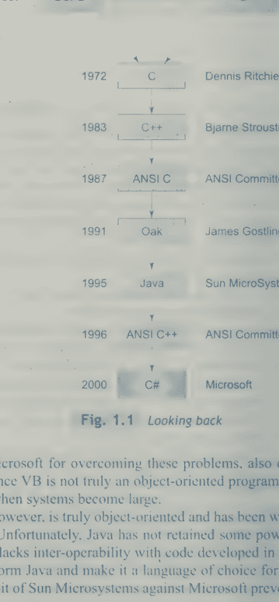

Visual Basic（VB）是微软为克服这些问题而推广的一种语言，但它也无法满足万维网的一些要求。由于 VB 并非真正的面向对象编程语言，当系统变得庞大时，使用它就变得越来越困难。

Java 是一种源自 C/C++ 家族的语言，它确实是面向对象的，并且在过去五年中被广泛用于 Web 应用程序。不幸的是，Java 没有保留一些强大的 C++ 特性，如运算符重载。它还缺乏与其他语言编写的代码的互操作性。尽管微软曾试图改造 Java，使其成为其拟议的新一代 .NET 平台的首选语言，但 Sun Microsystems 对微软的诉讼阻止了这一切。

微软想要一个完全符合当前和新兴 Web 编程实践、并且能够轻松与现有系统集成的环境。因此，微软决定从零开始设计一种新语言。结果就是 C#，一种简单而现代的语言，直接满足基于组件的软件开发的需求。

## 1.3 C# 的演变

万维网每天都在增长，不仅体现在网站数量上，还体现在其所含信息的数量和种类上。在这些网站上开展业务非常令人兴奋且有用。使用支持万维网的互联网的个人和组织数量正在呈指数级增长。因此，互联网如今已成为许多商业组织的主流。

但今天的互联网是什么？我们在互联网上使用万维网时存在许多限制。

- 我们一次只能看到一个网站
- 网站必须针对我们的硬件环境进行编写
- 我们获得的信息基本上是只读的
- 我们无法动态比较存储在不同网站中的类似信息
- 互联网是许多互不协作的信息孤岛的集合。它仍然是一个浏览和展示网络，而不是一个智能的知识管理网络。

微软董事长比尔·盖茨在过去二十年中设计了许多创新和突破性的软件产品，他希望开发一个软件平台，以克服这些限制，让用户能够通过自然界面随时随地获取信息。该平台应是一组现成的 Web 服务的集合，可以通过标准 Internet 协议进行分发和访问。他想让 Web 既可编程又智能。其成果就是新一代平台 .NET。.NET 就是微软对“软件即服务”的愿景。

尽管 .NET 平台的研发工作始于 90 年代中期，但直到 2000 年 9 月的微软专业开发者大会上，.NET 才正式向开发者社区发布。在同一大会上，微软将 C# 作为 .NET 平台的事实标准语言推出。事实上，他们早已使用 C# 编写了 .NET 平台的关键模块。C# 是专门为构建 .NET 软件组件而设计的，并且原生支持 .NET 的关键特性。它们紧密地联系在一起。事实上，C# 编译器已嵌入 .NET 中，如图 1.2 所示。

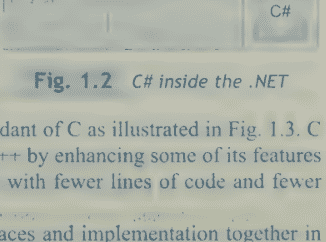

与 Java 一样，C# 是 C++ 的后代，而 C++ 又是 C 的后代，如图 1.3 所示。C 是所有这三种现代语言的母语。C# 通过增强 C++ 的某些特性并添加一些新特性来使 C++ 现代化，从而帮助开发人员用更少的代码行和更少的出错机会完成更多工作。

C# 借鉴了 Java 的特性，例如将类、接口和实现分组在一个文件中，以便程序员更容易地编辑代码。C# 也像 Java 一样使用引用来处理对象。C# 采用 VB 的表单设计方法，即从工具箱中拖拽控件，将其放到表单上，并为它们编写事件处理程序。C# 不仅将此过程应用于用户界面的开发，还应用于业务对象的构建。


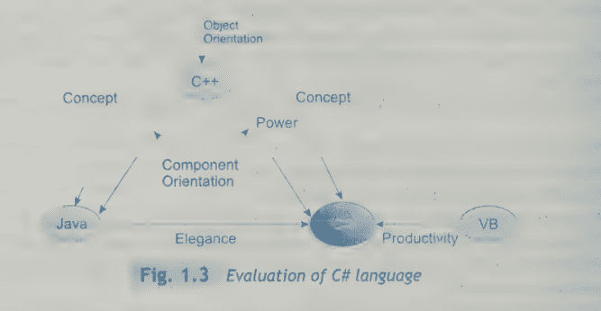

## 1.4 C# 的特性

如前所述，C# 的主要设计目标是简单性而非纯粹的强大。C# 满足了对一种易于编写、阅读和维护的语言的需求，同时也提供了 C++ 的强大和灵活性。 该语言设计用于计算和通信，其特点是几个关键特性。它是

- 简单
- 一致
- 现代
- 面向对象
- 类型安全
- 可版本化
- 兼容
- 可互操作和
- 灵活

### 1.4.1 简单

C# 通过消除令人讨厌的操作符如 ->、:: 和指针来简化 C++。C# 将整数和布尔数据类型视为两种完全不同的类型。这意味着在 if 语句中使用 = 代替 == 会被编译器捕获。

### 1.4.2 一致

C# 支持统一的类型系统，从而消除了整数类型范围不同的问题。所有类型都被视为对象，开发人员可以简单易行地扩展类型系统。

### 1.4.3 现代

C# 因其支持的众多特性而被称为现代语言。它支持

- 自动垃圾回收
- 用于错误处理的丰富内在模型
- 用于金融应用的十进制数据类型
- 调试的现代方法 和
- 强大的安全模型

### 1.4.4 面向对象

C# 是真正面向对象的。它支持面向对象系统的三大支柱，即。

- 封装
- 继承
- 多态

整个 C# 类模型建立在 .NET Framework 的虚拟对象系统 Virtual Object System (VOS) 之上

在 C# 中，一切皆为对象。 不再有全局函数、变量和常量。

## 1.6 C# 与 C++ 有何不同？

如前所述，C# 是从 C++ 派生而来，使其成为 C 和 C++ 程序员的首选语言。因此，C# 与 C++ 在语法上共享了大部分内容。 然而，C# 设计者对 C++ 的语法引入了一些更改并移除了一些特性，主要是为了减少 C++ 程序开发中常见的陷阱。他们还添加了许多附加特性，使 C# 成为类型安全和面向 Web 的语言。

## 引入的更改

- 01. C# 直接从源代码编译为可执行代码，没有目标文件。
- 02. C# 不将类定义与实现分开。类在同一位置定义和实现，因此不需要头文件。
- 03. 在 C# 中，类定义末尾不使用分号。
- 04. Main() 函数的第一个字符是大写的。Main 必须返回 int 或 void 类型的值。
- 05. C# 不支持 #include 语句。 （注意 using 与 #include 不同）。
- 06. C# 中的所有数据类型都继承自 object 超类，因此它们都是对象。
- 07. 所有基本值类型在任何系统上都将具有相同的大小。在 C 或 C++ 中并非如此。因此 C# 更适合编写分布式应用程序。
- 08. 在 C# 中，数据类型属于值类型（在栈中创建）或引用类型（在堆中创建）。
- 09. C# 会检查未初始化的变量，并在编译时给出错误消息。在 C++ 中，未初始化的变量无法被检测到，从而导致不可预测的输出。
- 10. 在 C# 中，结构体是值类型。
- 11. C# 支持原生的字符串类型。字符串操作很容易。
- 12. C# 支持原生的布尔数据类型，bool 类型数据不能隐式或显式转换为除 object 之外的任何数据类型。
- 13. C# 将 null 声明为关键字并将其视为内在值。
- 14. C# 不支持用于操作数据的指针类型。然而，它们在所谓的“不安全”代码中使用。
- 15. C# 中的变量作用域规则更严格。在 C# 中，即使在单独的代码块中，在一个例程内重复使用相同的名称也是非法的。
- 16. C# 允许在 goto 和标签之间声明变量。
- 17. 我们只能使用 new 关键字在 C# 中创建对象。
- 18. 数组在 C# 中是类，因此它们具有内置的功能来执行排序、搜索和反转等操作。
- 19. C# 中的数组声明方式与 C++ 数组不同，行为也非常不同。
- 20. C# 提供特殊语法以高效地初始化数组。
- 21. C# 中的数组始终是引用类型而不是值类型，如 C++ 中那样，因此存储在堆中。
- 22. 在 C# 中，if 和 while 语句中的表达式必须解析为 bool 值。意外使用赋值运算符 (=) 而不是相等运算符 == 会被编译器捕获。
- 23. C# 支持四种迭代语句，而 C++ 中只有三种。第四种是 foreach 语句。
- 24. C# 不允许在 switch 语句中静默贯穿。它要求在每个 case 语句末尾使用显式的跳转语句。
- 25. 在 C# 中，switch 也可以用于字符串值。
- 26. C# 不支持带标签的 break，因此从嵌套循环中跳出会很麻烦。
- 27. C# 中可以重载的操作符集合与 C++ 相比更小。
- 28. C# 可以使用 checked 和 unchecked 关键字检查算术运算和转换的溢出。
- 29. C# 不支持默认参数。
- 30. C# 中可变方法参数的处理方式不同。
- 31. 在异常处理中，与 C++ 不同，我们不能在 C# 中抛出任何类型。抛出的值必须是对派生类或 System.Exception 对象的引用。
- 32. C# 要求 catch 块的顺序正确。
- 33. C++ 中的通用 catch 语句 catch (...) 在 C# 中被简单的 catch 替代。
- 34. C# 不为构造函数提供任何默认值。
- 35. C# 中的析构函数与 C++ 中的行为不同。
- 36. 在 C# 中，我们不能通过对象访问静态成员，如 C++ 中可以的那样。
- 37. C# 不支持多重代码继承。
- 38. C# 中的类型转换比 C++ 更安全。
- 39. 在重写虚拟方法时，我们必须使用 override 关键字。
- 40. C# 中的抽象方法与 C++ 中的虚函数相似，但 C# 抽象方法不能有实现。
- 41. 命令行参数数组在 C# 中的行为与 C++ 相比不同。

## 被删除的 C++ 特性

以下 C++ 特性在 C# 中缺失：

- 1. 宏
- 2. 多重继承
- 3. 模板
- 4. 指针
- 5. 全局变量
- 6. Typedef 语句
- 7. 默认参数
- 8. 常量成员函数或参数
- 9. 类的前向声明

## 对 C++ 的增强

C# 通过添加以下新特性来使 C++ 现代化：

- 1. 自动垃圾回收
- 2. 版本支持
- 3. 严格的类型安全
- 4. 用于访问数据成员的属性
- 5. 委托和事件
- 6. 装箱和拆箱
- 7. Web 服务

## 1.7 C# 与 JAVA 有何不同？

与 C# 一样，Java 也是从 C++ 派生而来，因此它们有相似的根源。此外，C# 由微软开发，作为 Java 的替代品用于 Web 编程。C# 借用了 Java 的许多优秀特性，而 Java 已经成为一种流行的互联网语言。然而，C# 和 Java 之间存在许多差异：

## 1.8 C# 编程

- 1. 尽管 C# 使用与 Java 运行时相似的 .NET 运行时，但 C# 编译器会生成可执行代码。
- 2. C# 具有更多原始数据类型。
- 3. 与 Java 不同，所有 C# 数据类型都是对象。
- 4. 数组在 C# 中声明方式不同。
- 5. 尽管 C# 类与 Java 类非常相似，但在常量、基类和构造函数、静态构造函数、版本控制、成员可访问性等方面存在一些重要差异。
- 6. Java 使用 static final 来声明类常量，而 C# 使用 const。
- 7. Java 的惯例是每个文件放一个公共类，事实上某些编译器要求这样做。C# 允许任何源文件排列。
- 8. C# 支持 struct 类型，而 Java 不支持。
- 9. Java 不提供操作符重载。
- 10. 在 Java 中，类成员默认是虚拟的，并且派生类中同名的方法会覆盖基类成员。在 C# 中，基成员需要有 virtual 关键字，派生成员需要使用 override 关键字。
- 11. 用于类成员的 new 修饰符在 Java 中没有对应物。
- 12. C# 比 Java 提供更好的版本控制支持。
- 13. C# 提供静态构造函数用于初始化。
- 14. C# 提供内置的委托和事件。Java 使用接口和内部类来实现类似结果。
- 15. 在 Java 中，参数始终按值传递。C# 允许使用 ref 关键字按引用传递参数。
- 16. C# 添加了 internal，这是一个新的可访问性修饰符。具有 internal 可访问性的成员可以从同一项目中的其他类访问，但不能从项目外部访问。
- 17. C# 包含对属性的原生支持。Java 没有。
- 18. Java 不直接支持枚举。
- 19. Java 没有 C# 索引器的等价物。
- 20. Java 和 C# 都支持接口。但 C# 不允许在接口中定义类型，而 Java 接口可以具有 const 类型数据。
- 21. 在 Java 中，switch 语句只能有整数表达式，而 C# 支持整数或字符串表达式。
- 22. C# 不允许从 case 到 case 的自由贯穿。
- 23. C# 提供第四种迭代语句 foreach，用于快速轻松地遍历集合和数组类型数据。
- 24. C# 中的 catch 块应按正确顺序排列。
- 25. C# 使用 checked 语句检查溢出。
- 26. C# 使用 is 运算符代替 Java 中的 instanceof 运算符。
- 27. C# 使用 params 关键字允许可变数量的参数。
- 28. C# 中没有带标签的 break 语句。goto 用于实现此功能。

#### 案例研究

##### 问题陈述

WebDev Enterprises 是一家中等规模的公司，使用 J2EE 技术为其海外客户如 BlueSoft Software Solutions 和 InterSolutions Private Limited 开发 Web 应用程序。WebDev 管理层最近进行了一项分析，发现它在开发新的 J2EE 应用程序时无法使用其现有 J2EE 应用程序的代码。结果是新项目的截止日期未能满足，导致 WebDev Enterprises 遭受财务损失。


## C#编程

- (f) 在C#中，所有数据类型都被视为对象。
- (g) C#的类定义与C++的类定义相同。
- (h) 与C++一样，C#支持多重代码继承。
- (i) C#中的数组声明与Java的数组声明相同。
- (j) C#由微软于2000年首次正式发布。

- 1.2 至少列出C#语言最重要的五个亮点。
- 1.3 C++语言有哪些缺点？至少列出五个。
- 1.4 Java有哪些特性已在C#中实现？
- 1.5 C#比Java好在哪里？
- 1.6 当今使用互联网有哪些局限性？
- 1.7 微软公司开发C#语言的主要动机是什么？
- 1.8 C#是一种现代语言。请评论。
- 1.9 为什么C#被称为类型安全语言？
- 1.10 列出C#与C++之间的十个重大差异。
- 1.11 列出C#与Java之间的十个重大差异。
- 1.12 列出C++中尚未纳入C#的五个特性。
- 1.13 列出C#语言独有的一些新特性。
- 1.14 解释C#中虚拟对象系统（VOS）的必要性。

## 2 理解.NET：C#环境

### 2.1 .NET战略

我们在前一章简要讨论了C#是如何作为面向.NET平台开发系统的语言而被创建的。正如所指出的，微软希望通过使个人设备、计算机和Web服务智能地协同工作，为用户提供更丰富的解决方案，从而使万维网（WWW）更加充满活力。通过互联网上网站的智能集成，用户可以创建各种各样的基于价值的应用程序，如统一银行服务、电子账单支付、股票交易、保险服务和综合供应链管理。微软将这一概念称为“Web服务”，而实现和交付这些服务的软件战略就是“.NET”。

.NET是一个软件框架，包含开发Web服务软件所需的一切。它将表示技术、组件技术和数据技术集成在单一平台上，使用户能够像在桌面系统上一样轻松地开发Internet应用程序。微软采纳了业界许多最佳思想，并加入了自己的创造力和创新，最终形成了一套连贯的系统解决方案，即广为人知的Microsoft .NET。Microsoft .NET软件解决方案战略包括三个关键方法，如图2.1所示。

Microsoft .NET平台包括以下有助于开发新一代智能Internet服务的组件：

- .NET基础设施和工具
- .NET用户体验
- .NET构建块
- .NET设备软件

Microsoft .NET产品和服务包括：

- Windows .NET
- MSN .NET
- Office .NET
- Visual Studio .NET
- 个人订阅服务
- bCentral for .NET

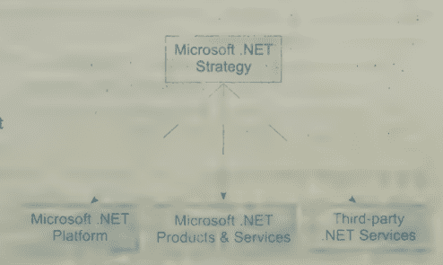

第三方.NET服务将为广大开发者和用户提供机会，使他们能够使用.NET平台创建企业和垂直服务。

### 2.2 .NET技术的起源

在进一步详细讨论.NET特性之前，我们先来看看.NET的概念在过去十年中是如何演变的。当前的.NET技术经历了三个重要的发展阶段：

- OLE技术
- COM技术
- .NET技术

这些发生在20世纪90年代的发展如图2.2所示。

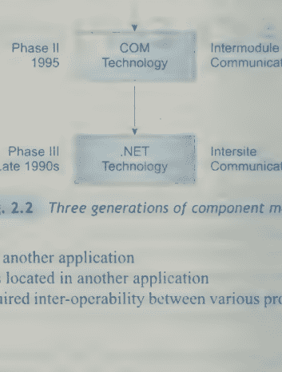

#### 2.2.1 OLE技术

OLE（对象链接与嵌入）技术由微软在20世纪90年代初期开发，旨在实现简单的进程间通信。OLE提供了以下支持：

- 将来自一个应用程序的文档嵌入另一个应用程序
- 使一个应用程序能够操作另一个应用程序中的对象

这使用户能够开发需要在MS Word和MS Excel等各种产品之间进行互操作的应用程序。

#### 2.2.2 COM技术

在COM技术出现之前，开发软件一直采用整体式方法。但是当程序变得过于庞大和复杂时，整体式方法会在软件的可维护性和测试方面导致许多问题。为了克服这些问题，微软引入了基于组件的模型来开发软件程序。在基于组件的方法中，程序被分解为许多独立组件，每个组件提供一种特定服务。每个组件都可以独立开发和测试，然后集成到主系统中。该技术被称为组件对象模型（COM），使用COM构建的软件被称为组件式软件（componentware）。

COM技术为开发者和用户带来了许多好处。它

- 降低了软件的总体复杂度
- 支持跨多个组织或部门的分布式开发
- 增强了软件的可维护性

#### 2.2.3 .NET技术

.NET技术是第三代组件模型。与COM技术相比，它提供了更高水平的互操作性。COM为模块间通信提供了标准的二进制机制。在.NET技术中，这一机制被一种称为Microsoft中间语言（MSIL）或简称IL的中间语言所取代。各种.NET语言编译器

- 将IL编译为本机可执行代码
- 提供元数据
- 内存管理（自动垃圾回收）
- 强制安全性
- 与其他系统的互操作性
- 管理异常和错误
- 支持调试和性能分析等任务

图2.6显示了执行应用程序时CLR活动的流程图。源代码被编译为IL，同时元数据引擎创建元数据信息。如果需要，IL和元数据会与其他本机代码链接，并将生成的IL代码保存。执行期间，类加载器将IL代码和基类库中的任何需求汇集在一起。合并后的代码会经过类型安全检查，然后由JIT编译器编译为本机机器代码，再发送给运行时管理器执行。

#### 2.4.1 公共类型系统（CTS）

.NET Framework利用内置于CLR中的公共类型系统（CTS）功能提供多语言支持。CTS支持大多数编程语言中存在的各种类型和操作，因此从一种语言调用另一种语言不需要进行类型转换。虽然C#是专门为.NET平台设计的，但我们也可以用包括C++和Visual Basic在内的多种其他语言来构建.NET程序。

#### 2.4.2 公共语言规范（CLS）

公共语言规范（CLS）定义了一套规则，使得在.NET平台上能够实现互操作性。这些规则为第三方编译器设计者和库构建者提供了指南。CLS是CTS的一个子集，因此支持CLS的语言可以像使用自己的类库一样使用彼此的类库。遵循CLS规则设计的应用程序接口（APIs）可以轻松地被所有.NET语言使用。

#### 2.4.3 Microsoft中间语言（MSIL）

MSIL（或简称IL）是一种指令集，所有.NET程序都被编译为该指令集。它类似于汇编语言，包含用于加载、存储、初始化和调用方法的指令。当我们编译C#程序或任何用符合CLS的语言编写的程序时，源代码会被编译为MSIL。

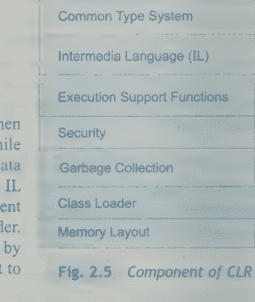

图2.5 CLR的组件

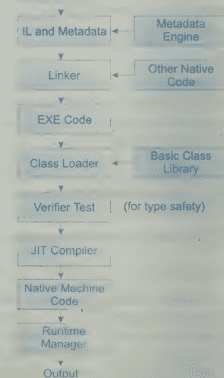

图2.6 CLR执行程序的活动流程图


### 2.4.4 托管代码

我们知道，CLR负责管理为.NET平台编译的代码的执行。为了执行而满足CLR运行时要求的代码被称为托管代码。与.NET平台兼容的编译器会生成托管代码。例如，C#编译器生成托管代码。由C#及其他能够生成托管代码的编译器生成的托管代码是IL代码。然后，IL代码由JIT编译器转换……

### 2.5 框架基类

.NET提供了一个基类库，我们可以使用它来快速实现应用程序。我们可以通过简单地实例化它们并调用其方法，或者通过派生类继承它们来扩展其功能。

基础框架类中的大部分功能都驻留在名为System的巨大命名空间中。我们可以使用System命名空间中的基类来完成许多不同的任务，包括：

- 输入/输出操作
- 字符串处理
- 管理数组、列表、映射等
- 访问文件和文件系统
- 访问注册表
- 安全性
- 窗口化
- Windows消息
- 数据库管理
- 数学函数求值
- 绘图
- 管理错误和异常
- 连接到互联网
- 以及更多

### 2.6 用户与程序界面

.NET Framework提供了以下用于管理用户界面和应用程序界面的工具：

- Windows窗体
- Web窗体
- 控制台应用程序
- Web服务

这些工具使开发人员能够在.NET平台上使用多种语言开发用户友好的桌面应用程序和基于Web的应用程序。

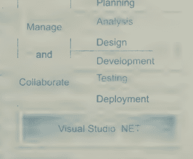

### 2.7 Visual Studio .NET

Visual Studio .NET（VS .NET）支持一个集成开发环境（IDE），具有丰富的功能集和生产力工具。这些功能和工具使开发人员能够更快、更轻松地构建Web应用程序。无论选择何种开发语言，都可以使用Web服务和XML，现在只需学习、配置和使用一个环境即可。我们无需在不同环境之间来回切换来构建、调试和部署代码。VS .NET提供了支持开发生命周期的工具。如图2.7所示，它充当生命周期平台的基础。对这些工具的详细讨论超出了本书的范围。

### 2.8 .NET语言

.NET Framework是与语言无关的。目前，我们可以使用多种语言来开发.NET应用程序。它们包括：

#### 2.8.1 .NET原生语言

- C#（专为.NET创建）
- C++
- Visual Basic
- JScript

#### 2.8.2 第三方语言

- COBOL
- Eiffel
- Perl
- Python
- SmallTalk
- Mercury
- Scheme

并非所有.NET语言都是同等的。有些可以使用其他语言的组件。有些可以使用其他语言生成的类来创建对象，还有些语言可以利用.NET的继承特性扩展其他语言的类。

### 2.9 .NET方法的优点

- 更简单、更快速的系统开发
- 丰富的对象模型
- 增强的内置功能
- 多种与外部世界通信的方式
- 将不同语言集成到一个平台
- 易于部署和执行
- 广泛的扩展性
- 与现有应用程序的互操作性
- 简单且易于构建的复杂开发工具
- 更少的bug
- 可能更好的性能

### 2.10 C#与.NET

C#是随.NET推出的一种新的编程语言。它是一种简洁、优雅的.NET语言。在许多方面，它是.NET对象模型的一个版本。借助C#，开发人员可以利用.NET Framework的内置功能快速实现应用程序和组件。由于C#代码由（.NET Framework的）CLR管理，因此它比C++更精简、更安全。

- 与其他语言的互操作性
- 增强的安全性
- 版本控制支持
- 调试支持
- 自动垃圾回收
- 用于基于Web的应用程序的XML支持

#### 案例研究

ABC金融解决方案是一家为不同个人提供金融解决方案的金融公司。ABC金融解决方案的主要任务是为个人提供如何投资资金的建议。ABC金融解决方案的IT研发部门目前正在开发一个财务规划软件，以实现创建财务计划任务的自动化，该计划可以提供给个人，以便他们根据该计划投资资金。财务规划软件的开发是一项艰巨的任务，因为它涉及大量复杂的计算。参与开发财务规划软件的程序员如何使他们的工作变得轻松？

由于财务规划软件的开发涉及执行大量复杂的计算，ABC金融解决方案的程序员团队必须使用C#来创建财务规划软件。在财务规划软件中，需要提供蒙特卡洛建模功能，这是一项非常复杂的任务。财务规划软件中需要为不同的类创建大量对象。财务规划软件中的对象需要通过发送和接收消息来相互交互。如果ABC金融解决方案的程序员使用C++编程语言并在财务规划软件中创建组件对象模型（COM）和ATL对象，那么财务规划软件将变得复杂且耗时。在C#应用程序中使用COM和ATL对象，ABC金融解决方案的程序员将花费大量时间来开发财务规划软件。使用C#将使财务规划软件的调试和代码编写变得容易，因为财务规划软件所需的大部分功能已经在C#中可用。由于使用C#编程语言减少了创建财务规划软件的开发时间，开发财务规划软件的成本也随之降低。这为ABC金融解决方案公司带来了经济效益。

- 2.1 什么是.NET？
- 2.2 什么是.NET Framework？
- 2.3 什么是.NET技术？简要描述其起源。
- 2.4 列出.NET Framework提供的用于管理用户界面和应用程序界面的工具。
- 2.5 什么是Web服务？如何使用.NET策略实现它？
- 2.6 什么是Microsoft中间语言？
- 2.7 什么是公共语言运行时（CLR）？
- 2.8 列举CLR提供的主要服务。
- 2.9 CLR为使用C#开发的程序提供了哪些额外的好处？
- 2.10 CLR如何执行C#程序？
- 2.11 什么是公共类型系统？
- 2.12 什么是公共语言规范？
- 2.13 什么是托管代码？
- 2.14 列出Framework基类可以为用户提供的一些重要服务。
- 2.15 描述Visual Studio .NET的应用。
- 2.16 列出.NET Framework支持的语言。
- 2.17 Microsoft提出的.NET策略有哪些好处？

## C#概述

## 3.1 引言

'C#'对于一种现代编程语言来说似乎是一个奇怪的名字。也许微软将他们的新语言命名为'C sharp'是因为他们希望它比其祖先C和C++更好、更智能、更“锐利”。C#旨在为C++程序员带来快速开发，同时不牺牲C和C++一直以来的标志性功能：强大的能力和控制力。C#是唯一专门为.NET平台设计的语言，该平台提供了充分利用计算和通信的工具和服务。

由于C#的设计者之一（安德斯·海尔斯伯格）是一位Java专家，因此许多Java特性自然地被融入到C#的设计中。事实上，在许多情况下，C#代码可能与功能等效的Java代码有惊人的相似之处。与C++不同，Java和C#都提倡一站式编码的代码维护方式。它们将类、接口和实现分组在同一个文件中，以便程序员更容易编辑代码。

C#可用于开发两类程序，即：

- 可执行的应用程序和
- 组件库

如图3.1所示。可执行程序的编写是为了执行特定任务，并且需要在其中一个类中包含Main方法。相比之下，组件库不需要声明Main，因为它们不是独立的应用程序。它们是为其他应用程序使用而编写的。这个概念类似于Java中的applet和应用程序。

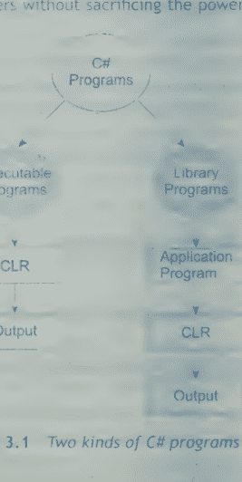

### 3.2 一个简单的C#程序

学习像C#这样的新语言的最佳方法是编写几个简单的程序并执行它们。这将使我们能够分析和理解C#程序是如何工作的。我们从一个显示一行文本的非常简单的程序开始。考虑程序3.1中给出的代码。


#### Program 3.1 | 一个简单的 C# 程序

```
class SampleOne
{
    public static void Main()
    {
        System.Console.WriteLine("C# is sharper than C++.");
    }
}
```

程序 3.1 是所有 C# 程序中最简单的一个。尽管如此，它展示了该语言的许多显著特性。因此，让我们逐行讨论这个程序，并理解构成一个 C# 程序的独特特性。

### 3.2.1 类声明

第一行

    class SampleOne

声明了一个类，这是一种面向对象的构造。如前所述，C# 是一种真正的面向对象语言，因此“一切”都必须放在类中。class 是一个关键字，表示后面将是一个新的类定义。SampleOne 是一个 C# 标识符，用于指定要定义的类的名称。

类是描述对象的外观和行为方式的模板。（关于类的更多内容将在第 12 章讨论。）

### 3.2.2 大括号

C# 是一种块结构语言，意味着代码块总是用大括号 `{` 和 `}` 括起来。因此，C# 中的每个类定义都以左大括号 `{` 开始，并以程序最后一行中对应的右大括号 `}` 结束。这与 Java 和 C++ 的类构造类似。注意，右大括号后面没有分号。

### 3.2.3 Main 方法

第三行

    public static void Main()

定义了一个名为 Main 的方法。每个 C# 可执行程序都必须在其某个类中包含 Main() 方法。这是程序执行的“起点”。一个 C# 应用程序可以有任意数量的类，但“只有一个”类可以包含 Main 方法来启动执行。注意，C# 组件库根本不会使用 Main 方法。

这一行包含几个关键字：public、static 和 void。这与 C++ 和 Java 中的 main 非常相似。与 Java 和 C++ 不同，Main 中的 M 是大写而不是小写。这些关键字的含义和用途如下：

| public | 关键字 public 是一个访问修饰符，它告诉 C# 编译器 Main 方法可以被任何人访问 |
| static | 关键字 static 声明 Main 方法是一个全局方法，无需创建类的实例即可调用。编译器将该方法的地址存储为入口点，并在创建任何对象之前利用此信息开始执行。 |

C# 支持一种称为 using 指令的特性，可用于将 System 命名空间导入到程序中。一旦导入了命名空间，我们就可以使用该命名空间中的元素，而无需使用命名空间作为前缀。程序 3.2 对这一点进行了说明。

#### Program 3.2 | 使用命名空间和注释的程序

```
/*
This program uses namespaces and comment lines
*/
using System; // System is a namespace
class SampleTwo
{
    // Main method begins
    public static void Main()
    {
        Console.WriteLine("Hello!");
    }
    // Main method ends
}
```

注意，程序中的第一条语句是 using System;

这告诉编译器在 System 库中查找未解析的类名。注意，在输出行中，我们没有在 Console 类前使用 System 前缀。

当编译器解析 Console.WriteLine 方法时，它会发现该方法未定义。然后，它会在 using 指令指定的命名空间中搜索，一旦在 System 命名空间中找到该方法，就会在编译代码时不报告任何错误。

### 3.4 添加注释

注释在程序维护中起着非常重要的作用。它们用于提高代码的可读性和理解性。所有程序都应包含实现细节、变更历史以及所执行任务等信息。C# 允许两种类型的注释，即：

- 单行注释
- 多行注释

程序 3.2 演示了这两种方法的使用。

单行注释以双反斜杠（//）符号开头，到行尾结束。我们可以将 // 单独放在一行，也可以放在代码语句之后。它还可以用于注释掉源代码的整行或部分行。一行中 // 之后的所有内容都被视为注释。

// This is an example of
// Multiline comments
// in C# language

/* */ 是 C# 的一种注释类型，但使用时有一个注意事项。考虑下面的代码段：

由于开始符号和结束符号不匹配，这会导致错误。也就是说，我们不能嵌套 /* */ 注释。每个 /* 符号都应该有对应的 */ 符号。

### 3.5 Main 返回一个值

另一个重要方面是 Main() 的返回类型。在前面的程序中，我们使用了 void 作为返回类型。如果 Main() 声明为 int 类型而不是 void，它也可以返回一个值。当返回类型为 int 时，必须在方法末尾包含一条 return 语句，如程序 3.3 所示。

#### Program 3.3 | 返回值的 Main

```
// Main returning a value
using System;
class SampleThree
{
    public static int Main()
    {
        Console.WriteLine("Hello!");
        return 0; // Return statement
    }
}
```

程序 3.3 向系统返回一个整数值。返回的值作为程序的终止状态代码。该代码的目的是允许向执行环境传达成功或失败的信息。

### 3.6 为命名空间类使用别名

我们已经看到如何通过使用 using System; 语句来避免在 Console 类前添加 System 前缀。能否用同样的方法避免在 WriteLine() 方法前添加 System.Console 前缀？答案是“不能”。

System 是一个命名空间，Console 是一个类。using 指令只能应用于命名空间，不能应用于类。因此，using System.Console; 语句是非法的。不过，我们可以通过为命名空间类使用别名来克服这个问题。其形式如下：

```
using alias-name = class-name;
```

程序 3.4 演示了类别名的使用。

#### Program 3.4 类别名的使用

```
using A = System.Console; //A is alias for System.Console
class SampleFour
{
    public static void Main()
    {
        D.WriteLine("Hello!");
    }
}
```

### 3.7 向 WriteLine 方法传递字符串对象

到目前为止，我们只看到了向 Console 输出常量字符串。我们可以将字符串值存储在字符串对象中，并将这些对象作为 WriteLine 方法的参数。我们可以使用 string 数据类型创建字符串变量，并为其赋值一个字符串常量，如下所示：

```
string s = "abc";
```

s 的内容可以使用 WriteLine 方法打印出来。
System.Console.WriteLine(s); //s is string object
程序 3.5 演示了将字符串对象作为输出方法 WriteLine 的参数使用。

#### Program 3.5 在输出中使用字符串对象

```
using System;
class SampleFive
{
    public static void Main()
    {
        string name = "C sharp"; // name is assigned a string
        Console.WriteLine(name);
    }
}
```

### 3.8 命令行参数

有些时候，我们希望程序根据执行时提供的输入以特定方式运行。在 C# 中，这是通过使用所谓的命令行参数来实现的。命令行参数是在调用 Main 方法执行时提供给它的参数。程序 3.6 从命令行接受一个名称并将其写入控制台。

#### Program 3.6 命令行参数

```
/*
This program uses command line arguments as input
*/
using System;
class SampleSix
{
public static void Main (string [] args)
{
Console.Write("welcome to");
Console.Write(" " +args[0]);
Console.WriteLine(" " +args[1]);
}
}
```

在前面的示例中，我们使用了不带参数的 Main 方法。注意在这个示例中 Main 是如何声明的。

```
public static void Main (string [] args)
```

Main 声明时带有一个参数 args。参数 args 被声明为字符串数组（即字符串对象数组）。执行时在命令行中提供的任何参数都会作为元素传递给数组 args。我们可以使用下标（如 args[0]、args[1] 等）访问数组元素。例如，考虑如下命令行：

SampleSix C sharp

这个命令行包含两个参数，它们被赋值给数组 args，如下所示：

- C → args[0]
- sharp → args[1]

注意，C# 下标从 0 开始，而不是从 1 开始。（数组和字符串将在后面详细讨论。）如果使用上述命令行执行程序 3.6，将得到以下输出：

Welcome to C sharp

注意这里使用了一个新的输出方法 Console.Write()。

它与 WriteLine() 方法唯一的区别是 Write() 不会产生换行，因此下一条输出语句会打印在同一行。这样，三条输出语句合在一起产生一行输出。有关输出格式的更多细节，请参阅第 17 章。

注意输出语句在打印时如何使用 + 运算符连接字符串。这里使用空字符串在字符串之间提供空白。（+ 运算符被重载以执行两个字符串相加的任务。有关运算符重载的更多细节，请参阅第 15 章。）

程序 3.7 展示了在 C# 中使用命令行参数的另一个示例。该程序计算作为命令行参数传入的数字的平方根并显示输出。

#### Program 3.7 | 命令行示例

```
using System;
class CommandLineExample
{
static void Main(string[] args)
{
double argValue=0.0;
double sqrtValue=0.0;
if (args.Length == 0)
{
Console.WriteLine("Please enter a number");
}
else
{
argValue = double.Parse(args[0]);
sqrtValue = Math.Sqrt(argValue);
Console.WriteLine("Square root of " + argValue + " is " + sqrtValue);
}
}
}
```


```
{
Console.WriteLine("No argument has been specified.");
Console.ReadLine();
return;
}
argValue = double.Parse(args[0].ToString());
sqrtValue = Math.Sqrt(argValue);
Console.WriteLine("Demonstrating Command Line Arguments--");
Console.WriteLine("Square root of the Argument is: {0}\n",sqrtValue);
}
```

```
C:\WINNT\system32\cmd.exe
C:\Chapter 3\CommandLineExample 446--
Demonstrating Command Line Arguments--
Square root of the Argument is: 21.1187120819429
C:\Chapter 3>
```

### 3.9 带类的 Main 方法

在看过非常简单的程序之后，现在让我们在包含 Main 方法的类中添加一个简单的类，如程序 3.8 所示。

#### Program 3.8 包含两个类的程序

```
class TestClass // class definition
{
public void fun()
{
System.Console.WriteLine("C# is modern");
}
}

class SampleSeven
{
public static void Main()
{
}
}
```

```
TestClass test = new TestClass(); // creating test object
test.fun(); // calling fun () function
}
```

该程序包含两个类声明，一个用于 TestClass，另一个用于 Main 方法。TestClass 只包含一个方法，用于打印字符串 "C# is modern"。SampleSeven 类中的 Main 方法创建了一个 TestClass 对象，并用它来调用 TestClass 中包含的 fun() 方法，如下所示：

```
TestClass test = new TestClass();
test.fun();
```

借助点运算符，对象 test 被用来调用 TestClass 的 fun() 方法。执行程序 3.8 将产生以下输出：

C# is modern

如果愿意，我们可以将 TestClass 的声明包含在 SampleSeven 类中。这将意味着创建“嵌套”类。类、方法和对象的创建将在后续章节中详细讨论。

### 3.10 提供交互式输入

到目前为止，我们已经看到了向字符串对象赋值的两种方法：

- 使用赋值语句
- 通过命令行参数

还可以在程序执行时通过键盘以交互方式为字符串变量赋值。程序 3.9 展示了如何从用户那里获取特定信息并用该信息打印一条消息。

#### Program 3.9 交互式控制台输入

```
using System;
class SampleEight
{
    public static void Main()
    {
        Console.Write("Enter your name: ");
        string name = Console.ReadLine();
        Console.WriteLine("Hello " + name);
    }
}
```

方法

```
Console.Write("Enter your name: ");
```

输出消息“Enter your name:”，而方法

```
Console.ReadLine();
```

会使程序等待用户输入其姓名。当用户键入姓名并按“Enter”键时，输入会被读入字符串变量 name。第二个输出行（WriteLine 方法）将 name 字符串与“Hello”连接，并将结果字符串呈现给用户。输出将如下所示：
Enter your name: John
Hello John

如下所示更改 Main 的内容，然后尝试执行程序，并对输出作出评价。

```
public static void Main()
{
    Console.Write ("What is your name? ");
    string s;
    s = Console.ReadLine();
    Console.writeLine("Hello," + s)
    Console.Write("What is your age? ");
    s = Console.ReadLine();
    Console.WriteLine("You look nice at " + s);
}
```

### 3.11 使用数学函数

假设我们要计算并打印一个数的平方根。完成此任务的 C# 程序如程序 3.10 所示。

#### Program 3.10 使用数学函数

```
using System;
class SampleNine
{
    public static void Main()
    {
        double x = 5.0; // Declaration and initialization
        double y;      // Simple declaration
        y = Math.Sqrt(x);
        Console.WriteLine ( " y = " + y );
    }
}
```

该程序包含更多可执行语句。语句
    double x = 5.0;
声明变量 x 并将其初始化为值 5.0，而语句
    double y;
仅声明变量 y。注意，这两个变量都被声明为 double 类型变量。double 是用于表示浮点数的一种数据类型。数据类型将在下一章讨论。

语句
    y = Math.Sqrt(x);
调用 Math 类的 Sqrt() 方法，该类是 System 命名空间的一部分。程序产生以下输出：
    y = 2.23606

### 3.12 多个 Main 方法

我们之前已经指出，其中一个类必须将 Main 方法作为成员。这通常是所期望的。然而，C# 提供了一项功能，使我们可以定义多个包含 Main 方法的类。由于 Main 是程序执行的入口点，现在就有了多个入口点。实际上，应该只有一个入口点。这个问题可以通过在编译时向编译器指定要使用哪个 Main 来解决，如下所示：
csc filename.cs /main:classname

程序 3.11 展示了一个简单的程序，它有两个包含 Main 方法的类。我们可以将其保存在名为 multimain.cs 的文件中，并根据需要使用 /main:ClassA 或 /main:ClassB 开关来编译。

```csharp
using System;
class ClassA
{
	public static void Main( )
	{
		Console.WriteLine("Class A");
	}
}

class ClassB
{
	public static void Main( )
	{
		Console.WriteLine("Class B");
	}
}
```

### 3.13 编译时错误

到目前为止，我们看到的都是非常简单的程序。但现实生活中的应用程序会包含大量具有复杂逻辑的语句。无论设计执行得多么彻底，也无论编码时多么小心，我们都不能说一个程序完全无错。一个程序可能包含两类错误：

- 语法错误
- 逻辑错误

语法错误会被编译器捕获，而逻辑错误则应该通过仔细测试程序逻辑来消除。

当编译器无法理解我们试图通过代码表达的内容时，就会产生语法错误。在这种情况下，编译器会检测到错误并显示相应的错误消息。

让我们考虑程序 3.12 中所示的代码。该程序包含三个错误。将其保存到名为 Errors.cs 的文件中。

#### Program 3.12 修复语法错误

```
// Program with syntax errors
using Systom; // Error here
class SampleTen
{
    public static void main()    //Error here
    {
        Console.WriteLine("Hello, Errors")    //Error here
    }
}
```

程序 3.12 编译时将显示以下输出：
Errors.cs(2.7): error cs0234: The type or namespace name ‘Systom’
does not exist in the class or namespace ‘’

编译器无法定位名为“Systom”的命名空间，因此生成一条错误消息，然后停止编译。该错误消息包含以下信息：

- 正在编译的文件名（Errors.cs）
- 错误的行号和列位置（2.7）
- 编译器定义的错误代码（CS0234）
- 错误的简短说明

这里的问题是 System 拼写错误。一旦我们修正这一点，编译器将以相同的格式报告其他错误的详细信息。

注意：当程序中包含语法错误时，我们不应只看编译器消息的表面意思。有时它们可能具有误导性。实际的问题可能是其他的，或者位置可能在别处。我们必须查看报告错误位置之前的最后几行。

### 3.14 程序结构

一个可执行的 C# 程序可能包含多个代码块，如图 3.3 所示。文档部分由一组注释组成，给出程序的名称、作者、日期和其他细节，程序员（或其他用户）可能希望以后使用这些信息。注释必须解释：

- 类的“为什么”和“是什么”，以及
- 算法的“怎么做”

这会极大地帮助维护程序。

using 指令部分将包含应用程序所需类所在的那些命名空间。using 指令告诉编译器在指定的命名空间中查找这些未解析的类。

接口类似于类，但只包含抽象成员。当我们想在程序中实现多重继承的概念时，会使用接口。接口是一个新概念，将在第 14 章详细讨论。

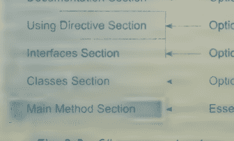


## C# 编程

一个 C# 程序可能包含多个类定义。类是 C# 程序的主要且必不可少的元素。这些类用于映射现实世界问题的对象。类的数量取决于问题的复杂性。

由于每个 C# 应用程序都需要 Main 方法作为其起点，因此包含 Main 方法的类是程序的重要组成部分。Main 方法创建各种类的对象并建立它们之间的通信。当 Main 方法结束时，程序终止，控制权返回给操作系统。

### 3.15 程序编码风格

C# 是一种自由格式语言。我们不需要缩进任何行就能让程序正常工作。C# 不关心我们从哪一列开始编码。虽然这可能为不良编程提供了借口，但我们应该尽量利用这一事实来设计可读的程序。尽管有几种可选的风格，我们应该选择一种并尽量一致地使用。

```
System.Console.WriteLine("Hello!");
```

可以写成

```
System.Console.WriteLine
("Hello!");
```

甚至写成

```
System.Console.WriteLine
(
"Hello!"
);
```

在本书中，我们通常遵循本章示例程序所使用的格式。

#### 案例研究

##### 问题陈述

AUPart 企业是一家从事汽车零部件制造的制造单位。该公司成立于1980年，自那时起，AUPart 的员工一直手动记录制造零部件的信息。现在，AUPart 企业的管理层发现，手动记录会导致大量错误的发生。此外，他们还发现手动记录制造零部件的信息非常耗时。AUPart 企业的管理层如何将维护制造零部件记录的任务自动化呢？

##### 解决方案

经过大量研究，AUPart 企业的管理层得出结论：需要一种用高级编程语言（如 C#）创建的应用程序来自动化维护制造零部件记录的任务。AUPart 企业与软件开发公司 Quick Soft Solutions Private Limited 取得了联系，以开发该应用程序来自动化维护制造零部件记录的任务。Quick Soft Solutions Private Limited 的程序员团队首先与 AUPart 企业的员工进行了访谈，以了解他们的需求。在需求分析之后，Quick Soft Solutions Private Limited 的程序员决定，该应用程序必须使用 C# 的构造函数和变量等特性来实现自动化记录制造零部件信息的功能，如下所示。

```
using System;
using System.Collections;
class Inventory
{
    string partName;
    double partPrice;
    int priceQty;
    public Inventory(string pName, double pPrice, int pQty)
    {
        partName = pName;
        partPrice = pPrice;
        priceQty = pQty;
        Console.WriteLine("\nPART NAME : {0,-10}",partName);
        Console.WriteLine("\tPrice : Rs.{0,5} \n\tQuantity: {1}",partPrice, priceQty);
    }
}
public class StockData
{
    public static void Main()
    {
        Console.WriteLine("==ABC Spare Parts Ltd. Stock List==");
        new Inventory("Bolts", 2.25, 100);
        new Inventory("Shockers", 5.25, 30);
        new Inventory("Brake Pads", 3.50, 50);
        new Inventory("Steering", 120, 20);
    }
}
```

**备注。** 在 C# 中，构造函数有助于初始化类的对象，变量用于存储与对象相关的数据。C# 中构造函数的名称必须与类的名称相同。

### 常见编程错误

人非圣贤，孰能无过。错误只是未能遵守语言规则。最大的错误是假设我们永远不会犯错。在设计和编写程序时，我们往往会因疏忽而多次犯某些错误。这里列出了一些即使是经验丰富的程序员也常犯的错误。在开发完程序后，我们必须先在尝试执行之前手动检查这些错误。

- 在语句中省略分号。
- 左花括号与右花括号不匹配。
- 在 Main 方法中未使用括号。
- 拼写错误，如 Main、System 等。
- 注释符号 /* 和 */ 不匹配。
- 未为 Main 方法指定返回类型。
- 未使用正确的 using 指令。
- 在 Math 类方法中不正确使用参数。
- 拼写错误，来自命名空间使用的类。

### 复习题

3.1 判断下列语句是否正确。

- (a) C# 是唯一专门为 .NET 平台设计的语言。
- (b) C# 代码与 C 代码有惊人的相似之处。
- (c) 在 C# 中，所有内容都必须放在类中。
- (d) 每个类的定义中都必须包含一个 Main 方法。
- (e) 基类库中定义的某些类包含一个 Main 方法。
- (f) 每个应用程序必须在其一个类中包含 Main 方法。
- (g) Main 方法从不返回任何值。
- (h) 将 C# 程序保存到文件中时，文件名应与包含 Main 方法的类名相同。
- (i) 我们不能在代码行中插入 // 样式的注释。
- (j) 可以有多个包含 Main 方法的类。

3.2 描述典型 C# 程序的结构。

3.3 为什么在 C# 程序中使用 using 指令？

3.4 Main 方法在 C# 程序中的重要性是什么？

3.5 为什么在程序中使用注释？

3.6 描述 C# 中使用的两种注释风格之间的差异。

3.7 什么是组件库？它们与可执行应用程序有何不同？

3.8 什么是别名？它在何处以及如何使用？

3.9 `Write()` 方法与 `WriteLine()` 方法有何不同？

3.10 详细描述在 C# 中实现应用程序所涉及的步骤。

3.11 什么是命令行参数？它们有何用处？

3.12 `ReadLine()` 方法如何工作？

3.13 我们如何实现一个包含多个具有 Main 方法的类的程序？

3.14 什么是语法错误？我们如何检测它们？

3.15 C# 是一种自由格式语言。请评论。

3.16 在 C# 中，向字符串对象赋值的方法有哪些？

3.17 什么是终止状态码？它的用途是什么？

### 调试练习

3.1. 给定的程序会产生编译时错误还是运行时错误？

```
using System;
class MainExample
{
    public static void Main()
    {
        Console.WriteLine("Main Example");
        return 1;
    }
}
```

3.2. 找出以下程序中的错误（如果有）。

```
class Reading
{
    public static void Main()
    {
        Console.Write("Enter Name");
        string name = ReadLine();
        Console.WriteLine(name);
    }
}
```

3.3. 以下程序有什么问题？

```
class Maths
{
    public static void Main()
    {
        double, y, x = 10.0;
        y = sqrt(x);
        System.Console.Write(y);
    }
}
```

### 编程练习

- 3.1 编写一个程序，使用 ReadLine 语句从键盘读取两个字符串，并使用两个 Write 语句将它们显示在一行上。

- 3.2 编写一个程序，将文本行
  John F Kennedy
  作为命令行输入，并显示以下输出
  Kennedy John F

- 3.3 定义两个类，一个类的方法显示字符串 “C Sharp”，另一个类的方法显示字符串 “Programming”。编写一个使用这些类的程序，显示如下单行输出：
  C Sharp Programming

- 3.4 编写一个程序，将两个 double 类型的值赋给两个变量，计算它们的和，将结果赋给第三个变量，并在输出的一行中显示所有这三个值。

- 3.5 编写一个程序，在屏幕上显示以下图案。

  ```
      X
     X X X
    X X X X X
     X X X
      X
  ```


## 字面量、变量和数据类型

## 4.1 引言

编程语言旨在操作由数字、字符和字符串组成的数据，并向用户提供称为信息的有用输出。通过执行构成程序的指令序列来完成操作数据的任务。

C# 程序本质上是一组类的集合。类由一组声明语句和方法定义，方法中包含称为可执行语句的指令。这些指令使用某些符号和单词按照称为语法规则（或语法）的严格规则形成。程序中最小的、不可再分的文本元素被称为标记。编译器识别它们以构建表达式和语句。

简单来说，C# 程序是一组标记、注释和空白字符的集合。C# 包含以下五种类型的标记：

- 关键字
- 运算符
- 标识符
- 分隔符
- 字面量

空白字符和注释不是标记，尽管它们可能充当标记的分隔符。关键字是语言定义的重要组成部分。它们实现语言的特定功能。它们是保留的，不能用作标识符，除非它们前面加上 @ 字符。表 4.1 列出了所有 C# 关键字。

### 表 4.1 C# 关键字

| abstract | event | namespace | static |
| as | explicit | new | string |
| base | extern | null | struct |
| bool | false | object | switch |
| break | finally | operator | this |
| byte | fixed | out | throw |
| case | float | override | true |
| catch | for | params | try |
| char | foreach | private | typeof |
| checked | get | protected | uint |
| class | goto | public | ulong |
| const | if | readonly | unchecked |
| continue | implicit | ref | unsafe |
| decimal | in | return | ushort |
| default | int | sbyte | using |
| delegate | interface | sealed | value |
| do | internal | set | virtual |
| double | is | short | volatile |
| else | lock | sizeof | void |
| enum | long | stackalloc | while |

*标识符* 是程序员设计的标记。它们用于命名类、方法、变量、标签、命名空间、接口等。C# 标识符强制执行以下规则：

- 它们可以包含字母、数字和下划线字符
- 它们不能以数字开头
- 大写和小写字母是不同的
- 独立模式下的关键字不能用作标识符

C# 允许在标识符前加上 ‘@’ 字符时使用关键字作为标识符

*字面量* 是变量中存储的值的表示方式。我们将在下一节详细介绍这些内容。

*运算符* 是在表达式中用于描述涉及一个或多个操作数的操作的符号。运算符将在第 5 章中详细讨论。

*分隔符* 是用于对代码进行分组和分隔的符号。它们定义程序的形状和功能。C# 中的分隔符（也称为分隔符）包括：

- 圆括号 ( )
- 大括号 { }
- 方括号 [ ]
- 分号 ;
- 冒号 :
- 逗号 ,
- 句点 .

C# 中的 *语句* 就像自然语言中的句子一样。语句是以分号结尾的可执行标记组合。C# 实现多种类型的语句。它们包括：

- 空语句
- 标签语句
- 声明语句
- 表达式语句
- 选择语句
- 迭代语句
- 跳转语句
- try 语句
- checked 语句
- unchecked 语句
- lock 语句
- using 语句

这些语句将在遇到时讨论。

程序 4.1 演示了将 @ 作为前缀以使用关键字作为标识符的应用。该程序使用变量 @if 打印从 0 到 9 的数字。

### 程序 4.1 标识符示例

```
using System;
class IdentifierExample
{
	public static void Main()
	{
		// Using if keyword as an identifier by prefixing @
		int @if;
		Console.WriteLine(" Demonstrating use of if keyword as an identifier by prefixing @\n");
		for(@if = 0; @if < 10; @if++)
		Console.WriteLine("The value of @if is: {0}", @if);
	}
}
```

```
C:\Chapter 4>IdentifierExample
--Demonstrating use of if keyword as an identifier by prefixing @--
The value of @if is: 0
The value of @if is: 1
The value of @if is: 2
The value of @if is: 3
The value of @if is: 4
The value of @if is: 5
The value of @if is: 6
The value of @if is: 7
The value of @if is: 8
The value of @if is: 9
C:\Chapter 4>_
```

字面量是分配给程序中变量（或表达式结果）的值常量。C# 支持几种类型的字面量，如图 4.1 所示。

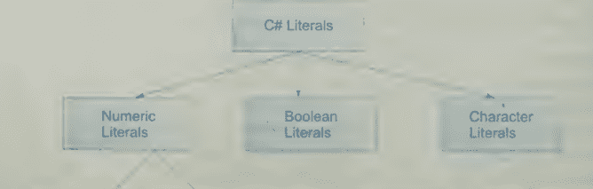

图 4.1 C# 字面量

### 4.2.1 整数字面量

整数字面量是指数字序列。有两种类型的整数，即十进制整数和十六进制整数。

十进制整数由 0 到 9 的数字集组成，可选择前面加上负号。十进制整数字面量的有效示例为：

123 -321 0 654321

数字之间不允许嵌入空格、逗号和非数字字符。例如，

15 750 20,000 $1000

都是非法的数字。

以 0x 或 0X 开头的数字序列被视为十六进制整数（hex 整数）。它还可能包含字母 A 到 F 或 'a' 到 'f'。字母 A 到 F 代表数字 10 到 15。以下是有效十六进制整数的示例。

0X2 0X9F 0Xbcd 0x

### 4.2.2 浮点字面量

整数字面量不足以表示距离、高度、温度、价格等连续变化的量。这些量由包含小数部分的数字表示，如 17.548。这样的数字称为实数（或浮点数）。浮点字面量的其他示例为：

0.0083 -0.75 435.36

这些数字以十进制表示，具有整数、小数点和小数部分，小数部分为整数。可能数字在小数点前没有数字，或小数点后没有数字。即，

215. .95 -.71

都是有效的实数字面量。

实数字面量也可以用指数（或科学）表示法表示。例如，值 215.65 可写为指数表示法中的 2.1565e2。e2 表示乘以 10²。一般形式为：

尾数 e 指数

尾数是十进制表示的实数或整数。指数是带可选正负号的整数。分隔尾数和指数的字母 'e' 可以写成小写或大写。由于指数导致小数点“浮动”，因此这种表示法被称为浮点形式。合法浮点字面量的示例为：

0.65e4 12e-2 1.5e+5 3.18E3 -1.2E-1

任何数字常量中都不允许嵌入空白。

指数表示法对于表示数量级非常大或非常小的数字很有用。例如，7500000000 可写为 7.5E9 或 75E8。同样，0.000000368 等价于 -3.68E-7。

因此，浮点字面量可能包含四个部分：

- 整数部分
- 小数点
- 小数部分
- 指数

### 4.2.3 布尔字面量

有两个布尔字面量值：

- true
- false

它们用作关系表达式的值。

### 4.2.4 单字符字面量

单字符字面量（或简单字符常量）包含一对单引号中括起来的单个字符。字符常量的示例为： '5' 'X' ',' ' '

请注意，字符常量 '5' 与数字 5 不同。示例中最后一个常量是一个空格。

### 4.2.5 字符串字面量

字符串字面量是双引号之间的一系列字符。字符可以是字母、数字、特殊字符和空格。示例为： "Hello C#" "2001" "WELL DONE" "?..." "5+3" "y"

### 4.2.6 反斜杠字符字面量

C# 支持一些用于输出方法中的特殊反斜杠字符常量。例如，符号 '\n' 代表换行字符。表 4.2 给出了此类反斜杠字符字面量的列表。请注意，每一个代表一个字符，尽管它们由两个字符组成。这些字符组合称为转义序列。

程序 4.2 打印 C# 中可用的各种数字字面量，如整数、双精度和指数。

#### 程序 4.2 | 字面量示例

#### 表 4.2 反斜杠字符字面量

| CONSTANT | MEANING |
| '\a' | alert |
| '\b' | back space |
| '\f' | form feed |
| '\n' | new-line |
| '\r' | carriage return |
| '\t' | horizontal tab |
| '\v' | vertical tab |
| '\'' | single quote |
| '\"' | double quote |
| '\\' | backslash |
| '\0' | null |

```
using System;

class LiteralSample
{
    public static void Main()
    {
        System.Console.WriteLine("Integer Literal\n{0}", 58);
        System.Console.WriteLine("Double Literal\n{0}",1.6180339887498);
        System.Console.WriteLine("Decimal Literal\n{0}",1.618033988734565m);
        System.Console.WriteLine("Exponential Notation for Decimal Literal:\n{0}",6.023E23f);
        System.Console.WriteLine("Hexadecimal Literal\n{0}",0x003A);
    }
}
```


### 4.3 变量

变量是一个标识符，它表示用于存储数据值的存储位置。与在程序执行期间保持不变的常量不同，变量在程序执行的不同时间可能取不同的值。每个变量都有一个类型，该类型决定了可以存储在变量中的值。

变量名可以由程序员以有意义的方式选择，以便反映其在程序中的表示。变量名的一些示例是：

- average
- height
- total_height
- classStrength

如前所述，变量名可以由字母、数字和下划线（_）组成，但须遵守以下条件：

- 1. 它们必须不能以数字开头。
- 2. 大小写是有区别的。这意味着变量 Total 不与 total 或 TOTAL 相同。
- 3. 它不应该是关键字。
- 4. 不允许有空白字符。
- 5. 变量名可以是任意长度。

### 4.4 数据类型

C# 中的每个变量都与一个数据类型相关联。数据类型指定可以存储的值的大小和类型。C# 是一种数据类型丰富的语言。所提供的多样性使程序员能够选择适合应用程序需求的类型。

C# 中的类型主要分为两类：

- 值类型
- 引用类型

值类型和引用类型在两个特性上有所不同：

- 它们在内存中的存储位置
- 它们在赋值语句上下文中的行为

值类型（长度固定）存储在栈上，当一个变量的值赋给另一个变量时，值会被实际复制。这意味着内存中有两个相同值的副本。引用类型（长度可变）存储在堆上，当两个引用变量之间进行赋值时，只复制引用；实际值仍保留在相同的内存位置。这意味着对单个值有两个引用。

一种称为指针的第三类类型仅可在不安全代码中使用。值类型和引用类型进一步被分类为预定义类型和用户定义类型，如图 4.2 所示。

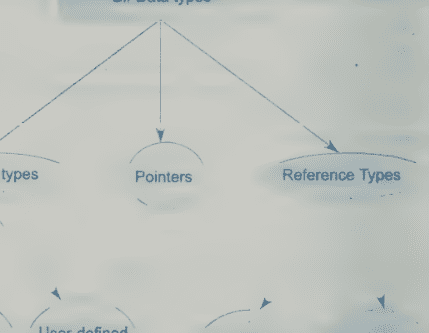

C# 的值类型可以分为两类（如图 4.2 所示），即

- 用户定义类型（或复杂类型）和
- 预定义类型（或简单类型）

我们可以定义自己的复杂类型，称为用户定义值类型，其中包括结构体类型和枚举。它们将在第 11 章讨论。

预定义值类型也称为简单类型，进一步细分为：

- 数值类型，
- 布尔类型，以及
- 字符类型。

数值类型包括整型、浮点型和十进制类型。它们在图 4.3 中以图表形式显示。

注意：C# 2.0 添加了一种新的类型称为可空类型。此类型变量可以保存未定义值。任何值类型变量都可以定义为可空类型。

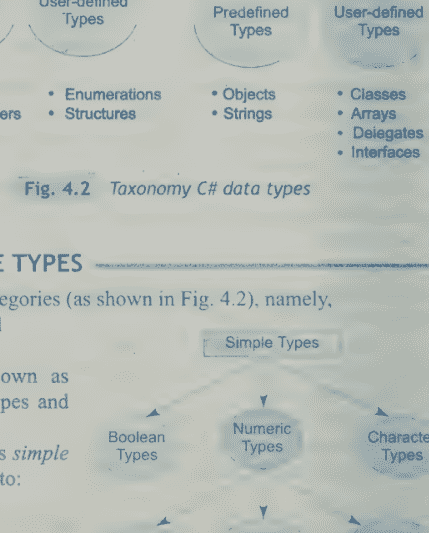

#### 4.5.1 整型

整型可以保存诸如 123、-96 和 5639 之类的整数。可以存储的值的大小取决于我们选择的整型数据类型。C# 支持无符号类型的概念，因此它支持如图 4.4 和 4.5 所示的八种整数类型。

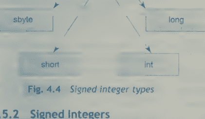

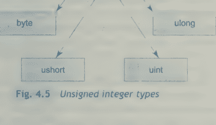

#### 4.5.2 有符号整数

有符号整数类型可以保存正数和负数。表 4.3 显示了所有四种有符号整数数据类型的内存大小和范围。（注意，一个字节等于八位）。

| TYPE | SIZE | MINIMUM VALUE | MAXIMUM VALUE |
|------|------|---------------|---------------|
| sbyte | One byte | -128 | 127 |
| short | Two bytes | -32,768 | 32,767 |
| int | Four bytes | -2,147,483,648 | 2,147,483,647 |
| long | Eight bytes | -9,223,372,036,854,775,808 | 9,223,372,036,854,775,807 |

应该记住，更宽的数据类型需要更长的时间进行操作，因此建议在可能的情况下使用较小的数据类型。例如，与其将像 50 这样的数字存储在 int 类型变量中，我们必须使用 sbyte 变量来处理这个数字。这将提高程序执行的速度。

#### 4.5.3 无符号整数

我们可以通过使其“无符号”来增加整数类型中存储的正值的大小。例如，16 位 short 整数可以存储范围为 -32,768 到 32,767 的值。然而，通过使其变为 ushort，它可以处理范围为 0 到 65,535 的值。表 4.4 显示了所有四种无符号整数数据类型的大小和范围。

| TYPE | SIZE | MINIMUM VALUE | MAXIMUM VALUE |
|------|------|---------------|---------------|
| byte | One byte | 0 | 255 |
| ushort | Two bytes | 0 | 65,535 |
| uint | Four bytes | 0 | 4,294,967,295 |
| ulong | Eight bytes | 0 | 18,446,744,073,709,551,615 |

#### 4.5.7 布尔类型

布尔类型用于在程序执行期间测试特定条件。布尔类型只能取两个值：true 或 false。记住，这两个词已被声明为关键字。布尔类型由关键字 bool 表示，仅使用一个字节的存储。与 C 和 C++ 不同，在 C# 中，我们不能使用零表示 false 和非零表示 true。bool 与其他整数类型之间不允许转换。

所有比较运算符（见第 5 章）返回布尔类型值。布尔值通常用于选择和迭代语句。

### 4.6 引用类型

- 用户定义（或复杂）类型
- 预定义（或简单）类型

用户定义引用类型是指我们使用预定义类型定义的类型。它们包括：

- 类
- 接口

这些复杂类型将在后面的章节中讨论，当我们分别介绍这些主题时。

- 对象类型
- 字符串类型

对象类型是 C# 中所有其他内在类型和用户定义类型的最终基类型。我们可以使用对象引用绑定到任何特定类型的对象。我们稍后将看到如何使用对象类型将栈上的值类型转换为堆上的对象类型。

C# 提供了自己的字符串类型用于创建和操作字符串。前面讨论的字符串字面量可以作为值存储在字符串对象中。我们可以对这些字符串对象执行复制、比较和连接等操作。字符串和字符串对象将在第 10 章中更详细地介绍。

### 4.7 变量声明

变量是存储位置的名称。在设计合适的变量名后，我们必须将其声明给编译器。声明做了三件事：

- 1. 它告诉编译器变量名是什么。
- 2. 它指定变量将保存的数据类型。
- 3. 声明的位置（在程序中）决定了变量的作用域。

变量必须在使用前在程序中声明。也就是说，名称与类型无关。C# 允许任何正确格式的变量具有任何声明的数据类型。声明语句定义了变量的类型。变量声明的一般形式为：

```
type variable1, variable2, ......, variableN;
```

变量由逗号分隔。声明语句必须以分号结束。一些有效的声明是：

```
int count;
float x, y;
double pi;
byte b;
```

### 4.8 变量初始化

变量必须在声明后但在使用前赋予一个值。通过赋值语句给变量赋值是一种简单的方法，如下所示：

```
variableName = value;
```

示例：

- initialValue = 0;
- finalValue = 100;
- yes = 'x';

我们也可以像下面这样链接赋值表达式：

```
x = y = z = 0;
```

在声明变量时也可以为其分配值。其形式为：

```
type variableName = value;
```

示例：

- int finalValue = 100;
- char yes = 'X';
- double total = 75.36;
- bool test = true;

给变量赋初始值的过程称为初始化。以下是有效的 C# 语句：

```
float x, y, z; //declares three variables; compound declaration
int m = 5, n = 10; //declares and initializes two int variables
int m, n = 10; //declares m and n and initializes n
```

考虑以下初始化语句：

- float f = 12.34F;
- uint ui = 123U;
- long l = 123L;
- ulong ul = 123UL;
- decimal d = 1.23M

所有整数数字默认表示 int 类型值。如果我们希望值表示任何其他整数类型，我们必须附加 U 以表示无符号类型，L 以表示 long，UL 以表示无符号 long。同样，所有浮点数默认都是 double。因此我们必须在数字后附加 F 或 M 以分别表示 float 和 decimal 类型。

如果任何变量未提供初始值，C# 编译器将生成错误。

### 4.9 默认值

变量要么显式赋予值，要么自动赋予默认值。以下类别的变量会自动初始化为其默认值：

- 静态变量
- 实例变量
- 数组元素


#### 表4.6 变量的默认值

| 类型 | 默认值 |
|---|---|
| 所有整数类型 | 0 |
| char 类型 | '\x0000' |
| float 类型 | 0.0f |
| double 类型 | 0.0d |
| decimal 类型 | 0.0m |
| bool 类型 | false |
| enum 类型 | 0 |
| 所有引用类型 | null |

### 4.10 常量变量

在程序执行过程中值不发生改变的变量称为常量。例如，在程序中表示矩阵最大行数和列数或班级学生人数的变量在程序执行过程中可能不会改变。这类变量可以在初始化时使用 const 关键字使其不可修改。

示例：

```
const int ROWS = 10;
const int COLS = 20;
const int NUM = 90;
```

请记住，常量必须像上面那样同时声明和初始化。例如，

```
const int m;
m = 100;
```

是非法的。根据定义，常量的值之后不能被更改。

常量变量可以使用表达式进行初始化。

示例：

```
const int m = 10;
const int n = m * 5;
```

请记住，我们不能在表达式中使用非常量值。例如，

```
int m = 10;        // non-constant value
const int n = m * 5;   // error
```

将导致错误。

在 C 和 C++ 中，这类常量被称为符号常量，并使用 #define 语句定义。它们不声明类型。

使用常量的优点如下：

- 它们使我们的程序更易于阅读和理解。
- 它们使我们的程序更易于修改。
- 它们能最大限度地减少意外错误，例如试图为某些预期应为常量的变量赋值。

注意：

- 1. 常量的命名形式与变量名相同。
- 2. 声明常量后，不应再为其赋予任何其他值。

## 变量的作用域

变量的作用域是指可以访问该变量的代码区域。这取决于变量的类型及其声明的位置。C# 定义了多种变量类别，包括：

- 静态变量
- 实例变量
- 数组元素
- 值参数
- 引用参数
- 输出参数
- 局部变量

```
class ABC
{
	static int m;
	int n;
	void fun(int x, ref int y, out int z, int [] a)
	{
		int j = 10;
		....
		....
	}
}
```

- m 是一个静态变量
- n 是一个实例变量
- x 是一个值参数
- y 是一个引用参数
- z 是一个输出参数
- a[0] 是一个数组元素
- j 是一个局部变量

静态变量和实例变量在类级别声明，称为字段或字段变量。这些变量的作用域从声明处开始，到 Main 方法终止时结束。

变量 x、y 和 z 是方法 fun() 的参数。值参数 x 将一直存在到方法结束。引用参数和输出参数（y 和 z）没有自己的存储位置。相反，它们表示与作为实参传入的变量相同的存储位置。这些变量的作用域始终与底层变量相同。

数组元素（如 a[0]）在创建数组实例时开始存在，当没有对该数组实例的引用时就不再存在。在类级别声明的数组行为类似于字段。

在方法内部声明的变量称为局部变量。之所以这样称呼，是因为它们在方法定义之外不可使用。局部变量也可以在程序内部声明。

此程序执行时将产生以下输出：

```
100
200
10
20
```

尽管我们声明了两个名为 x 的变量和两个名为 y 的变量，但代码可以编译并产生输出。在这种情况下，Main 方法内部声明的变量会隐藏同名的类级别变量。请注意，我们使用类名与点运算符来访问静态变量 y，并使用关键字 this 来访问实例变量 x。关于静态变量和实例变量的更多内容将在后面讨论类时详细说明。

让我们看另一个示例代码，如下所示：

```
using System;
class Scope
{
    public static void Main()
    {
        int m=100;
        for (int i=0; i<=4; i++)
        {
            int m=200; // Error
            Console.WriteLine (m*i); //ok m = 100
        }
    }
}
```

这段代码将无法编译，因为编译器无法理解语句

```
int m=200;
```

放置在 for 循环内。在 for 循环语句之前定义的变量 m 在 for 循环内部仍然处于作用域内，只有当 Main 执行完毕时才离开作用域。如果我们删除语句

```
int m = 100;
```

那么程序将编译并产生以下输出：

```
0
100
200
300
400
```

### 4.12 装箱和拆箱

在面向对象编程中，方法是使用对象调用的。由于 int 和 long 等值类型不是对象，因此我们无法使用它们来调用方法。C# 使我们能够通过一种称为装箱的技术来实现这一点。装箱是指将栈上的值类型转换为堆上的对象类型。相反，从对象类型转换回值类型称为拆箱。

#### 4.12.1 装箱

任何类型（值类型或引用类型）都可以在无需显式转换的情况下赋给对象。当编译器在需要引用类型的位置发现值类型时，它会创建一个对象“箱子”，并将值类型的值放入其中。下面的代码说明了这一点：

```
int m = 100;
object om = m; // creates a box to hold m
```

执行时，这段代码会在堆上为对象创建一个临时的引用类型“箱子”。我们也可以使用 C 风格的类型转换来进行装箱。

```
int m = 100;
object om = (object)m; //C-style casting
```

请注意，装箱操作会将 m 整数的值复制到对象 om 中。现在变量 m 和 om 都存在，但 om 的值位于堆上。这意味着这两个值是相互独立的。请看以下代码：

```
int m = 10;
object om = m;
m = 20;
Console.WriteLine(m); // m = 20
Console.WriteLine(om); //om = 10
```

当代码更改 m 的值时，om 的值不受影响。

#### 4.12.2 拆箱

拆箱是将对象类型转换回值类型的过程。请记住，我们只能拆箱之前已经装箱的变量。与装箱不同，拆箱是使用 C 风格类型转换的显式操作。

```
int m = 10;
object om = m; //box m
int n = (int)om; //unbox om back to an int
```

执行拆箱时，C# 会检查我们请求的值类型是否实际存储在正在转换的对象中。只有当确实如此时，该值才会被拆箱。

拆箱一个值时，我们必须确保值类型足够大以容纳该对象的值。否则，操作可能导致运行时错误。例如，代码

```
int m = 500;
object om = m;
byte n = (byte)om;
```

将产生运行时错误。

请注意，拆箱时需要使用显式强制转换。这是因为在拆箱的情况下，对象可以被强制转换为任何类型。因此，编译器需要该强制转换来验证其是否符合指定的值类型。

#### 案例研究

##### 问题陈述

ForEx Enterprises 是一家从事货币兑换业务的中型组织。这意味着 ForEx 的主要功能是为客户将一种货币兑换成另一种货币。ForEx Enterprises 成立于 2000 年，自那时起，它一直手工计算外币与本国货币之间的兑换价值。最近，手工计算特定货币的货币价值导致大量错误的出现。此外，ForEx Enterprises 的员工花费大量时间将一定金额的货币价值转换为另一种货币价值。ForEx Enterprises 的管理层如何自动化地将特定货币的货币价值转换为另一种货币的货币价值？


##### 解决方案

为了将特定金额的货币价值自动转换为另一种货币的价值，ForEx Enterprises 需要一个用高级编程语言（如 Java 或 C#）创建的应用程序。为此，ForEx Enterprises 聘请了软件公司 InfoTech Solutions 的服务。在分析 ForEx Enterprises 的需求后，InfoTech 的程序员决定在 C# 应用程序中使用诸如 `*` 等用于乘法的运算符，这将有助于将一种货币的币值转换为另一种货币的币值。C# 中的运算符有助于执行计算，如算术运算和二进制运算。InfoTech Solutions 的程序员团队创建了以下 C# 应用程序。

```
using System;
public class CurrencyConvertor
{
    static void Main(string [] args)
    {
        int num=Int32.Parse(args[0]);
        double poundValue=(double)num*83.2;
        double dollarValue=(double)num*40;
        Console.WriteLine ("==Currency Convertor==\n");
        Console.WriteLine ("Currency Data Formatted Using the # character\n");
        Console.WriteLine ("\tRupee Amount : {0,0:Rs ###.##}", num);
        Console.WriteLine ("\tUSD Value    : {0,0:$ ###.##}", dollarValue);
        Console.WriteLine ("\tGBP Value :{0,0:£ ###.##}\n",poundValue );
        Console.WriteLine ("Currency Data Formatted Using the $ character\n");
        Console.WriteLine ("\tRupee Amount : {0,0:Rs 000.00}", num);
        Console.WriteLine ("\tUSD Value    : {0,0:$ 000.00}", dollarValue);
        Console.WriteLine ("\tGBP Value    : {0,0:£ 000.00}\n", poundValue);
        Console.WriteLine ("Currency Data Formatted Using the comma only\n");
        Console.WriteLine ("\tRupee Amount : {0,0:Rs 000,000}",num);
        Console.WriteLine ("\tUSD Value    : {0,0:$ 0,000.000}", dollarValue);
        Console.WriteLine ("\tGBP Value    : {0,0:£ 0,000.000}", poundValue);
    }
}
```

## 备注

C# 支持多种运算符，如逻辑运算符、算术运算符和位运算符，它们有助于执行不同的操作。例如，算术运算符有助于对特定数据执行加法和乘法等操作。逻辑运算符有助于对数据执行 AND 和 OR 等逻辑操作。

注意：有关格式化输出的详细讨论见第 17 章。

## 常见编程错误

- 忘记为浮点字面量附加 F 或 f。
- 当整数字面量表示无符号整数、长整数或无符号长整数时，忘记附加 U、L 或 UL。
- 当浮点值表示 decimal 类型时，未附加字母 M 或 m。
- 忘记声明变量。
- 类型声明错误。
- 忘记初始化变量。
- 在声明常量时未进行初始化。
- 未为常量声明类型。
- 尝试对尚未装箱的对象进行拆箱。
- 在程序中假设错误的变量作用域。
- 尝试修改声明为常量的变量。

## 复习题

4.1 判断以下陈述是否正确。

- (a) C# 程序基本上是类的集合。
- (b) 在 C# 中，注释被称为标记（token）。
- (c) 关键字不能用作变量名。
- (d) 布尔类型变量可以被赋予任何整数类型值。
- (e) 指针是预定义的值类型。
- (f) 值类型数据存储在栈上。
- (g) 与类一样，结构体是引用类型。
- (h) 浮点数默认被视为 double 类型量。
- (i) 在 C# 中，零表示 false，非零表示 true。
- (j) 常量可以在程序中的任何位置声明。
- (k) 更宽的数据类型需要更多时间进行操作。
- (l) decimal 类型数据占用 double 类型数据两倍的空间。

4.2 列出 C# 中可用的五种标记类型。

4.3 什么是字面量？

4.4 什么是常量？

4.5 什么是变量？

4.6 字面量和变量在开发程序中有何重要性？

4.7 为什么我们需要在程序中使用常量？

4.8 有十三种简单值类型。请列出它们。

4.9 列出两种预定义的引用类型。

4.10 什么是局部变量？

4.11 变量的作用域是什么意思？

4.12 说明以下变量的作用域。

- (a) 局部变量
- (b) 字段变量
- (c) 方法参数

4.13 什么是初始化？为什么它是必要的？

4.14 在处理非常小或非常大的数字时，你会采取哪些步骤来提高计算的准确性？

4.15 反斜杠字符字面量的应用有哪些？

4.16 值类型与引用类型在存储方面有何不同？

4.17 说明变量命名的规则。

4.18 变量的声明实现了什么？

4.19 以下哪些是无效字面量，为什么？

- `0.0001`
- `+100`
- `-45.6`
- `5 * 1.5`
- `75.45E-2`
- `-1.45e(+4)`
- `RS 75.50`
- `"15.75"`
- `0,000001234`

4.20 以下哪些是无效变量名，为什么？

- `Minimum`
- `doubles`
- `float`
- `first.Name`
- `3rd-row`
- `Sum Total`
- `n1+n2`
- `N$`
- `Total-Marks`

4.21 找出以下语句中的错误（如果有）。

```
Int x,
float length, HEIGHT
double = p, q
character C1;
short int TOTAL;
float pi = 3.142;
long int m;
bool m = 1;
byte fixed;
```

4.22 什么是装箱？为什么我们要进行装箱？

4.23 什么是拆箱？如何实现？

4.24 默认值是什么意思？

4.25 说明以下对象的默认值：

- (a) char 类型
- (b) decimal 类型
- (c) bool 类型
- (d) class 类型

## 调试练习

4.1 找出以下程序中的错误（如果有）。

```
using System;
class constants
{
    public static void Main ()
    {
        const int m;
        int n = 10;
        const int k = n*5;
        m = 100;
        Console.WriteLine (m+k);
    }
}
```

4.2 以下程序有什么问题？

```
using System;
class scope
{
    int n = 100;
    public static void Main ()
    {
        for (int i = 0; i < 5, i++)
        {
            int m = 10;
            Console.WriteLine (m*i);
        }
        Console.WriteLine (m,n,i);
    }
}
```

## 编程练习

4.1 编写一个程序，说明值类型变量的声明和初始化概念。使用以下字面量来初始化变量：

- (a) 'A'
- (b) 50
- (c) 123456789
- (d) 1234567654321
- (e) true
- (f) 0.000000345
- (g) 1.23e-5

4.2 编写一个程序执行以下任务。

- (a) 声明两个变量 x 和 y 为 float 类型变量
- (b) 声明 m 为整数变量
- (c) 将 75.86 赋给 x，43.48 赋给 y
- (d) 将 x 和 y 的和赋给 m
- (e) 显示 m 的值
- 对输出进行评论。

4.3 执行第 4.11 节中说明的程序并分析输出。

4.4 开发一个程序来演示装箱和拆箱的概念。

4.5 声明三个 byte 类型的变量 b1、b2 和 b3。将 100 赋给 b1，200 赋给 b2，将 b1 和 b2 的和赋给 b3。开发一个程序实现这些操作并打印出所有三个变量的值。

如果编译器给出任何错误消息，请修改程序，直到获得正确的输出。评论你对原始程序所做的任何更改。

4.6 编写一个程序实现以下输出语句。

```
Console.WriteLine("Hello,\"RAM\"!");
Console.WriteLine("\"\n**\n***\n");
```

对输出进行评论。

4.7 编写一个程序，打印如下所示的向上箭头：


使用反斜杠字符来打印 \ 和 " 字符。

4.8 编写一个程序实现以下语句：

```
int m = 100;
long n = 200;
long l = m + n;
Console.WriteLine("l = " + l);
```

如果输出是错误消息，请纠正错误并再次执行程序。

4.9 以下程序的输出是什么？

```
using System;

class CheckNaN
{
    public static void Main()
    {
        Double zero = 0;
        Console.WriteLine("The result of division by zero in C# is: {0}", (0 / zero));
    }
}
```

4.10 给定程序的输出是什么？

```
using System;
class DataTypeSample
{
    public static void Main()
    {
        System.Console.WriteLine("Integer Literal\n{0}", 58);
        System.Console.WriteLine("Double Literal\n{0}", 1.6180339887498);
        System.Console.WriteLine("Decimal Literal\n{0}", 1.618033988734565m);
        System.Console.WriteLine("Exponential Notation for Decimal Literal:\n{0}", 6.023E23f);
        System.Console.WriteLine("Hexadecimal Literal\n{0}", 0x003A);
    }
}
```


## 5 运算符和表达式

### 5.1 引言

运算符是告诉计算机执行某些数学或逻辑操作的符号。运算符在程序中用于操作数据和变量。它们通常构成数学或逻辑表达式的一部分。

C# 支持丰富的运算符集合。C# 运算符可分为以下若干相关类别：

- 1. 算术运算符
- 2. 关系运算符
- 3. 逻辑运算符
- 4. 赋值运算符
- 5. 自增和自减运算符
- 6. 条件运算符
- 7. 位运算符
- 8. 特殊运算符

### 5.2 算术运算符

C# 提供了所有基本的算术运算符。它们列在表 5.1 中。运算符 +、-、* 和 / 的工作方式与其他语言相同。这些运算符可以作用于任何内置的数值数据类型。我们不能将这些运算符用于布尔类型。一元减运算符实际上是将其唯一操作数乘以 -1。因此，在数字前加上减号会改变其符号。

算术运算符的使用如下所示：

```
a - b   a + b
a * b   a / b
a % b   -a * b
```

这里 a 和 b 可以是变量或常量，被称为操作数。

**表 5.1：算术运算符**

| OPERATOR | MEANING |
|---|---|
| + | Addition or unary plus |
| - | Subtraction or unary minus |
| * | Multiplication |
| / | Division |
| % | Modulo division |

#### 5.2.1 整数算术

当单个算术表达式如 a+b 中的两个操作数都是整数时，该表达式称为整数表达式，操作称为整数算术。整数算术总是产生整数值。在上面的例子中，如果 a 和 b 是整数，则对于 a = 14 和 b = 4，我们有以下结果：

```
a - b = 10
a + b = 18
a * b = 56
a / b = 3   (decimal part truncated)
a % b = 2   (remainder of integer division)
```

a/b，当 a 和 b 是整数类型时，给出 a 除以 b 的结果，去掉小数部分后得到商。此操作称为整数除法。

对于取模除法，结果的符号始终是第一个操作数（被除数）的符号。即

```
-14 % 3 = -2
-14 % -3 = -2
14 % -3 = 2
```

（注意取模除法定义为：a%b = a - (a/b)*b，其中 a/b 为整数除法）。

#### 5.2.2 实数算术

仅涉及实数操作数的算术运算称为实数算术。实数操作数可以采用十进制或指数表示法。由于浮点值会四舍五入到允许的有效数字位数，最终值是正确结果的近似值。

与 C 和 C++ 不同，取模运算符 % 也可以应用于浮点数据类型。浮点取模运算符返回整数除法的浮点等价物。这意味着除法使用两个浮点操作数进行，但所得商被视为整数，从而产生浮点余数。a % b 的结果计算为 a-n*b，其中 n 是小于或等于 a/b 的最大可能整数。程序 5.1 显示了算术运算符对浮点值的作用。

**程序 5.1：浮点算术**

```
class FloatPoint
{
    public static void Main()
    {
        float a = 20.5F, b = 6.4F;
        System.Console.WriteLine(" a = " + a);
        System.Console.WriteLine(" b = " + b);
        System.Console.WriteLine(" a+b = " + (a+b));
        System.Console.WriteLine(" a-b = " + (a-b));
        System.Console.WriteLine(" a*b = " + (a*b));
        System.Console.WriteLine(" a/b = " + (a/b));
        System.Console.WriteLine(" a%b = " + (a%b));
    }
}
```

程序 5.1 的输出如下：

```
a = 20.5
b = 6.4
a+b = 26.9
a-b = 14.1
a*b = 131.2
a/b = 3.203125
a%b = 1.3
```

```
Console.WriteLine(" b = " + b);
Console.WriteLine(" c = " + c);
Console.WriteLine(" a < b is " + (a<b));
Console.WriteLine(" a > b is " + (a>b));
Console.WriteLine(" a == c is " + (a==c));
Console.WriteLine(" a <= c is " + (a<=c));
Console.WriteLine(" a >= b is " + (a>=b));
Console.WriteLine(" b != c is " + (b!=c));
Console.WriteLine(" b == a+c is " + (b==a+c));
}
```

程序 5.2 的输出将是：

```
a = 15
b = 20.75
c = 15
a < b is true
a > b is false
a == c is true
a <= c is true
a >= b is false
b != c is true
b == a+c is false
```

关系表达式用于 if 和 while 等决策语句中，以决定正在运行程序的行为。决策语句在第 6 章和第 7 章中详细讨论。

### 5.4 逻辑运算符

除了关系运算符外，C# 还有六个逻辑运算符，它们在表 5.4 中给出。

逻辑运算符 && 和 || 用于当我们想通过组合两个或多个关系形成复合条件时。示例为：

```
a > b && x == 10
```

这种结合两个或多个关系表达式的表达式称为逻辑表达式或复合关系表达式。与简单关系表达式一样，逻辑表达式也根据表 5.5 所示的真值表产生 true 或 false 的值。上面给出的逻辑表达式只有在 a>b 和 x == 10 都为真时才为真。如果其中一个（或两个）为假，则表达式为假。

注意：

- `op-1 && op-2` 如果 op-1 和 op-2 都为真则为真，否则为假。
- `op-1 || op-2` 如果 op-1 和 op-2 都为假则为假，否则为真。

**表 5.4：逻辑运算符**

| Operator | Meaning |
|---|---|
| && | logical AND |
| \|\| | logical OR |
| ! | logical NOT |
| & | bitwise logical AND |
| \| | bitwise logical OR |
| ^ | bitwise logical exclusive OR |

**表 5.5：真值表**

| op-1 | op-2 | op-1 && op-2 | op-1 \|\| op-2 |
|---|---|---|---|
| true | true | true | true |
| true | false | false | true |
| false | true | false | true |
| false | false | false | false |

逻辑表达式使用的一些例子是：

- 1. if (age > 55 && salary < 1000), give increment.
- 2. if (number < 0 || number > 100), stop.

### 5.5 赋值运算符

赋值运算符用于将表达式的值赋给变量。我们已经看到通常的赋值运算符 `=`。此外，C# 还有一组“简写”赋值运算符，它们以以下形式使用

```
v op= exp
```

其中 v 是变量，exp 是表达式，op 是 C# 二元运算符。运算符 `op=` 被称为简写赋值运算符。

赋值语句

```
v op= exp
```

等价于

```
v = v op(exp);
```

v 仅被访问一次。考虑一个例子

```
x += y+1;
```

这与语句相同

```
x = x+(y+1);
```

简写运算符 `+=` 表示“将 y+1 加到 x”或“将 x 增加 y+1”。对于 y = 2，上面的语句变为

```
x += 3;
```

当执行此语句时，3 将被加到 x。如果 x 的旧值为例如 5，则 x 的新值为 8。一些常用的简写赋值运算符在表 5.6 中说明。

使用简写赋值运算符有三个优点：

- 1. 左手边出现的内容无需重复，因此更容易编写。
- 2. 语句更简洁，更易于阅读。
- 3. 使用简写运算符可产生更高效的代码。

**表 5.6：简写赋值运算符**

| Statement with simple assignment operator | Statement with shorthand operator |
|---|---|
| a = a + 1 | a += 1 |
| a = a - 1 | a -= 1 |
| a = a * (n + 1) | a *= n + 1 |
| a = a / (n + 1) | a /= n + 1 |
| a = a % b | a %= b |

### 5.6 自增和自减运算符

C# 有两个在许多其他语言中通常找不到的非常有用的运算符。这些是自增和自减运算符：

```
++ and --
```

运算符 `++` 将 1 加到操作数，而 `--` 减去 1。两者都是单目运算符，并以以下形式使用：

```
++m; or m++;
--m; or m--;
```

```
++m; is equivalent to m = m + 1; (or m += 1;)
--m; is equivalent to m = m - 1; (or m -= 1;)
```


我们在 for 和 while 循环中广泛使用自增和自减运算符。

虽然 ++m 和 m++ 作为独立语句时含义相同，但当它们用在赋值语句右侧的表达式中时，行为是不同的。请看下面的例子：

```
m = 5;
y = ++m;
```

在这种情况下，y 和 m 的值将都为 6。假如我们将上述语句重写为

```
m = 5;
y = m++;
```

那么，y 的值将为 5，而 m 的值将为 6。前缀运算符先将操作数加 1，然后将结果赋给左侧的变量；相反，后缀运算符先将值赋给左侧的变量，然后再将操作数加 1。程序 5.3 对此进行了说明。

#### 程序 5.3 增量运算符示例

```
class IncrementOperator
{
    public static void Main()
    {
        int m = 10, n = 20;
        System.Console.WriteLine(" m = " + m);
        System.Console.WriteLine(" n = " + n);
        System.Console.WriteLine(" ++m = " + ++m);
        System.Console.WriteLine(" n++ = " + n++);
        System.Console.WriteLine(" m = " + m);
        System.Console.WriteLine(" n = " + n);
    }
}
```

程序 5.3 的输出如下：

- m = 10
- n = 20
- ++m = 11
- n++ = 20
- m = 11
- n = 21

当我们在下标变量中使用 ++（或 --）时，情况也类似。也就是说，语句

```
a[i++] = 10
```

等价于

```
a[i] = 10
i = i + 1
```

### 5.7 条件运算符

字符对 ? : 是 C# 中提供的三元运算符。该运算符用于构造如下形式的条件表达式：

exp1 ? exp2 : exp3

其中，exp1、exp2 和 exp3 都是表达式。

运算符 ? : 的工作方式如下：首先对 exp1 求值。如果 exp1 为 true，则对表达式 exp2 求值，并将结果作为条件表达式的值；如果 exp1 为 false，则对 exp3 求值，其值作为条件表达式的值。请注意，两个表达式（exp2 或 exp3）中只有一个会被求值。例如，考虑下面的语句：
a = 10;
b = 15;
x = (a>b) ? a : b;

在本例中，x 将被赋值为 b 的值。这可以通过 if...else 语句来实现，如下所示：
if(a > b)
    x = a;
else
    x = b;

### 5.8 位运算符

C# 支持可用于在位级别操作数据的运算符。这些运算符可用于测试位，或将位向右或向左移动。位运算符不能应用于浮点数据。表 5.7 列出了按位逻辑运算符和移位运算符。

程序 5.4 执行了 C# 中可用的位运算，例如 AND、OR、XOR、左移、右移和按位取反。

#### 程序 5.4 位运算符示例

```
using System;
class BitWiseOperator
{
public static void Main()
{
byte bwAnd, bwOr, bwXor;
int bwLeft,bwRight,bwComp;
bwAnd = 15 & 3;
bwOr = 15 | 3;
bwXor = 15 ^ 3;
bwLeft=15<<5;
bwRight=15>>3;
bwComp=~15;
System.Console.WriteLine("—To demonstrate the use of Bitwise Operators available in C# \n");
System.Console.WriteLine("Bitwise AND Operator Result: = {0} \nBitwise OR Operator Result : = {1}",bwAnd, bwOr);
System.Console.WriteLine("Bitwise XOR Operator Result: = {0} \nBitwise SHIFT LEFT Operator Result: = {1}",bwXor,bwLeft);
System.Console.WriteLine("Bitwise SHIFT LEFT Operator Result: = {0}\nBitwise ONE'S COMPLEMENT Operator Result: = {1}",bwRight,bwComp);
}
}
```

#### 表 5.7 位运算符

| 运算符 | 含义 |
|---|---|
| & | 按位逻辑与 |
| \| | 按位逻辑或 |
| ^ | 按位逻辑异或 |
| ~ | 按位取反 |
| << | 左移 |
| >> | 右移 |

### 5.9 特殊运算符

C# 支持以下特殊运算符。

- is（关系运算符）
- as（关系运算符）
- typeof（类型运算符）
- sizeof（大小运算符）
- new（对象创建运算符）
- .（点号）（成员访问运算符）
- checked（溢出检查）
- unchecked（禁止溢出检查）

这些运算符将在后续遇到时再逐一讨论。

### 5.10 算术表达式

算术表达式是按照语言语法排列的变量、常量和运算符的组合。到目前为止，我们在已讨论的示例中已经使用了许多简单表达式。C# 可以处理任何复杂的数学表达式。表 5.8 给出了一些 C# 表达式的示例。请记住，C# 没有用于幂运算的运算符。

程序 5.5 对 C# 中可用的各种数值类型（如整型、浮点型、双精度型和十进制型）进行了基本除法运算和取模除法运算。

#### 表 5.8 表达式

| 代数表达式 | C# 表达式 |
|---|---|
| axb-c | a*b-c |
| (m+n)(x+y) | (m+n)*(x+y) |
| ab/c | a*b/c |
| 3x²+2x+1 | 3*x*x+2*x+1 |
| x/y + c | x/y+c |

#### 程序 5.5 除法示例

```
using System;
class DivisionExample
{
```

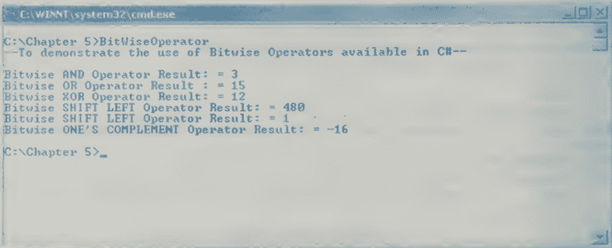

```
static void Main( )
{
    int firstInt, secondInt;
    float firstFloat, secondFloat;
    double firstDouble, secondDouble;
    decimal firstDecimal, secondDecimal;
    firstInt = 12;
    secondInt = 5;
    firstFloat = 12;
    secondFloat = 5;
    firstDouble = 12.55;
    secondDouble = 5;
    firstDecimal = 12;
    secondDecimal = 5;
    Console.WriteLine("--Division Operator usage in Different Types of Numeric Data--");
    Console.WriteLine("\nInteger Division: {0}",firstInt / secondInt );
    Console.WriteLine(" Float Division : {0}",firstFloat / secondFloat);
    Console.WriteLine(" Double Division : {0}",firstDouble / secondDouble);
    Console.WriteLine("Decimal Division: {0}",firstDecimal / secondDecimal);
    Console.WriteLine("\n--Modulo Division Operator usage in Different Types of Numeric Data--");
    Console.WriteLine("\nInteger Modulo Division: {0}",firstInt % secondInt );
    Console.WriteLine(" Float Modulo Division : {0}",firstFloat % secondFloat );
    Console.WriteLine(" Double Modulo Division : {0}",firstDouble % secondDouble );
    Console.WriteLine(" Decimal Modulo Division: {0}", firstDecimal % secondDecimal );
}
```

```
C:\WINNT\system32\cmd.exe

C:\Chapter 5>DivisionExample
--Division Operator usage in Different Types of Numeric Data--
Integer Division: 2
Float Division  : 2.4
Double Division : 2.51
Decimal Division: 2.4

--Modulo Division Operator usage in Different Types of Numeric Data--
Integer Modulo Division: 2
Float Modulo Division  : 2
Double Modulo Division : 2.55
Decimal Modulo Division: 2

C:\Chapter 5>_
```

### 5.11 表达式的求值

表达式通过如下形式的赋值语句进行求值：
variable = expression;
variable 是任何有效的 C# 变量名。当遇到该语句时，首先对表达式求值，然后用其结果替换左侧变量先前的值。在尝试求值之前，必须先为表达式中使用的所有变量赋值。求值语句的示例如下：

```
x = a*b-c;
y = b/c*a;
z = a-b/c+d;
```

运算符周围的空格是可选的，添加空格只是为了提高可读性。当这些语句在程序中使用时，变量 a、b、c 和 d 必须先声明并在表达式中使用前赋值。同样，变量 x、y 和 z 必须事先声明其类型。

### 5.12 算术运算符的优先级

不带任何括号的算术表达式将按照运算符的优先级规则从左到右进行求值。C# 中算术运算符有两个不同的优先级：

- 高优先级  * / %
- 低优先级  + -

基本的求值过程包括对表达式进行两次从左到右的扫描。在第一次扫描中，遇到高优先级运算符（如果有的话）就进行相应运算。在第二次扫描中，遇到低优先级运算符（如果有的话）就进行相应运算。考虑下面的求值语句：

```
x = a-b/3+c*2-1
```

当 a = 9，b = 12，c = 3 时，该语句变为

```
x = 9-12/3+3*2-1
```

并按如下方式求值：

第一遍扫描

- 步骤1：x = 9-4+3*2-1    （12/3 已求值）
- 步骤2：x = 9-4+6-1    （3*2 已求值）

第二遍扫描

- 步骤3：x = 5+6-1    （9-4 已求值）
- 步骤4：x = 11-1    （5+6 已求值）
- 步骤5：x = 10    （11-1 已求值）

不过，通过在表达式中加入括号，可以改变求值顺序。考虑带有括号的同一个表达式，如下所示：

```
9-12/(3+3)*(2-1)
```

使用括号时，括号内的表达式具有最高优先级。如果如上所示连续出现两组或更多组括号，则先对最左边括号内的表达式求值，最后对最右边括号内的表达式求值。下面给出了新的步骤。

第一遍扫描

- 步骤1：9-12/6*(2-1)
- 步骤2：9-12/6*1

第二遍扫描

- 步骤3：9-2*1
- 步骤4：9-2

第三遍扫描

- 步骤5：7

这一次，求值过程由三次从左到右的扫描组成。不过，求值步骤的数量仍为 5 个（即与算术运算符的数量相等）。


括号可以嵌套，在这种情况下，表达式的求值将从最内层的一组括号开始向外进行。只需确保每个左括号都有一个与之匹配的右括号。例如，
9-(12/(3+3)*2)-1 = 4
而
9-((12/3)+3*2)-1 = -2

虽然括号允许我们改变优先级顺序，但我们也可以使用它们来提高程序的可理解性。当有疑问时，我们总是可以额外加上一对括号，以确保所使用的优先级正是我们需要的。

### 5.13 类型转换

我们经常遇到这样的情况：在将一种类型的数据用于算术运算之前，或需要将一种类型的值存储到另一种类型的变量中时，需要将其转换为另一种类型。例如，考虑以下代码：

```
byte b1 = 50;
byte b2 = 60;
byte b3 = b1 + b2;
```

这段代码试图将两个 byte 值相加，并将结果存储到第三个 byte 变量中。但这行不通。编译器会给出错误消息：
“无法将类型 int 隐式转换为类型 byte。”

奇怪的消息！我们并没有在代码中使用任何 int 类型的数据。原因如下：当我们把两个 byte 值相加时，编译器会自动将它们转换为 int 类型，加法的结果是 int 值，而不是 byte。

编译器为什么要这样做呢？这是因为两个 byte 值的和很容易产生一个远大于 byte 取值范围的值。

由于结果是 int 类型，我们不能将其赋给 byte 变量。如果希望将其存储为 byte 值，就需要将结果转换回 byte 类型。否则，我们可以将结果赋给 int 类型变量：

```
int b3 = b1 + b2; // no error
```

在这里，编译器替我们完成了转换，而无须我们显式地要求。

在 C# 中，类型转换以两种方式进行（如图 5.1 所示）：

-   隐式转换
-   显式转换

#### 5.13.1 隐式转换

隐式转换是那些总是会成功的转换。也就是说，转换总是可以在不丢失任何数据的情况下执行。对于数值类型，这意味着目标类型能够完整表示源类型的范围。例如，short 可以隐式转换为 int，因为 short 的范围是 int 范围的子集。因此，

```
short b = 75;
int a = b; // implicit conversion.
```

是有效的语句。C# 会自动执行转换。隐式转换也称为自动类型转换。


将较小类型赋给较大类型的过程称为加宽或提升，而将较大类型赋给较小类型的过程称为收窄。请注意，收窄可能会导致信息丢失。

对于数值类型，所有有符号和无符号类型都存在加宽的隐式转换。图 5.2 显示了转换层次图。

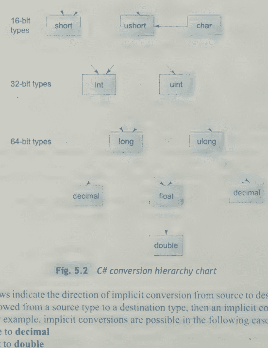

##### 图 5.2 C# 转换层次图

在图 5.2 中，箭头表示从源类型到目标类型的隐式转换方向。如果可以沿着箭头路径从某个源类型到达目标类型，则它们之间就存在隐式转换。例如，以下几种情况都存在隐式转换：

-   从 byte 到 decimal
-   从 uint 到 double
-   从 ushort 到 long

请注意，这些情况下的转换是在单次操作中完成的，而不是分阶段进行转换。隐式转换的一些示例如下：

```
byte x1 = 75;
short x2 = x1;
int x3 = x2;
long x4 = x3;
float x5 = x4;
decimal x6 = x4;
```

ratio = female_number/male_number

由于 female_number 和 male_number 在程序中被声明为整数，因此除法结果的小数部分将会丢失，该比率将无法表示正确的数值。这个问题可以通过将其中一个变量局部转换为浮点数来解决，如下所示：
 ratio = (float) female_number/male_number

运算符 (float) 会将 female_number 转换为浮点数，以便对表达式进行求值。然后，利用自动转换规则，除法将以浮点模式执行，从而保留结果的小数部分。

请注意，运算符 (float) 绝不会影响变量 female_number 的值。并且，在程序的其他部分中，female_number 的类型仍然是 int。

表 5.9 给出了一些强制转换示例及其作用。

#### 表 5.9 强制转换的使用

| 示例 | 作用 |
|---|---|
| x = (int) 7.5 | 7.5 通过截断转换为整数。 |
| a = (int)21.3/(int) 4.5 | 按 21/4 求值，结果为 5。 |
| b = (double) sum/n | 以浮点模式进行除法。 |
| y = (int) (a+b) | a + b 的结果转换为整数。 |
| z = (int) a+b | a 转换为整数，然后加到 b。 |
| p = cost ((double) x) | 在用作参数之前将 x 转换为 double。 |

程序 5.6 演示了在计算以下方程时如何使用强制转换：
Sum = Σ（从 i=1 到 n）1/i

#### 程序 5.6 强制转换运算的使用

```
using System;
class Casting
{
    public static void Main ()
    {
        float sum;
        int i ;
        sum = 0.0F;
        for (i = 1; i <= 10 ; i++)
        {
            sum = sum + 1/ (float)i;
            Console.Write (" i = " + i );
            Console.WriteLine (" Sum = " + sum );
        }
    }
}
```

程序 5.6 的输出：
 i = 1        Sum = 1
 i = 2        Sum = 1.5
 i = 3        Sum = 1.833333        i = 8        Sum = 2.717857
 i = 4        Sum = 2.083333        i = 9        Sum = 2.828969
 i = 5        Sum = 2.283334        i = 10       Sum = 2.928968
 i = 6        Sum = 2.45
 i = 7        Sum = 2.592857

### 5.14 运算符优先级和结合性

C# 中的每个运算符都有一个与之关联的优先级。该优先级用于确定包含多个运算符的表达式如何求值。存在不同的优先级级别，一个运算符可以属于其中某一级别。优先级较高的运算符会先被求值。优先级相同的运算符根据级别从左到右或从右到左进行求值。这称为运算符的结合性属性。表 5.10 提供了运算符、其优先级级别及其结合规则的完整列表。这些组按优先级递减的顺序列出（等级 1 表示最高优先级级别，14 表示最低）。该列表还包含我们尚未讨论的运算符。

#### 表 5.10 C# 运算符汇总

| 运算符 | 描述 | 结合性 | 等级 |
|---|---|---|---|
| . | 成员选择 | 从左到右 | 1 |
| () | 函数调用 |  |  |
| [] | 数组元素引用 |  |  |
| x++ | 自增 |  |  |
| x-- | 自减 |  |  |
| new | 创建对象 |  |  |
| typeof | 类型运算符 |  |  |
| sizeof | 大小运算符 |  |  |
| checked | 溢出检查 |  |  |
| unchecked | 取消溢出检查 |  |  |
| + | 一元加 | 从右到左 | 2 |
| - | 一元减 |  |  |
| ++x | 自增 |  |  |
| --x | 自减 |  |  |
| ! | 逻辑非 |  |  |
| ~ | 按位取反 |  |  |
| (type) | 强制转换 |  |  |
| * | 乘法 | 从左到右 | 3 |
| / | 除法 |  |  |
| % | 取模 |  |  |
| + | 加法 | 从左到右 | 4 |
| - | 减法 |  |  |
| << | 左移 | 从左到右 | 5 |
| >> | 右移 |  |  |
| < | 小于 | 从左到右 | 6 |
| <= | 小于或等于 |  |  |
| > | 大于 |  |  |
| >= | 大于或等于 |  |  |
| is | 关系运算符 |  |  |
| as | 关系运算符 |  |  |
| == | 相等 | 从左到右 | 7 |
| != | 不相等 |  |  |
| & | 按位逻辑与 | 从左到右 | 8 |
| ^ | 按位逻辑或 | 从左到右 | 9 |
| \| | 按位逻辑或 | 从左到右 | 10 |
| && | 逻辑与 | 从左到右 | 11 |
| \|\| | 逻辑或 | 从左到右 | 12 |
| ?: | 条件运算符 | 从右到左 | 13 |
| = | 赋值运算符 | 从右到左 | 14 |
| op= | 简写赋值 |  |  |

需要非常仔细地注意运算符的优先级和结合性的顺序。考虑以下条件语句：
if(x == 10+15 && y<10)

优先级规则规定，加法运算符的优先级高于逻辑运算符（&&）和关系运算符（== 和 <）。因此，10 和 15 的加法首先执行。这等价于：
if(x == 25 && y<10)

下一步是确定 x 是否等于 25，以及 y 是否小于 10。如果我们假设 x 的值为 20，y 的值为 5，那么
x == 25 为 false
y < 10 为 true

请注意，由于运算符 < 的优先级高于 ==，因此先测试 y < 10，然后再测试 x == 25。

最后我们得到：
if(false && true)
因为其中一个条件为 false，所以复合条件为 false。

当一个操作数出现在两个优先级相同的运算符之间时，运算符的结合性控制操作的执行顺序：

-   除赋值运算符外，所有二元运算符都是左结合的。例如，x + y + z 按 (x + y) + z 求值。


赋值运算符和条件运算符是右结合的。例如，x = y = z 被求值为 x = (y = z)

优先级和结合性可以使用括号来控制。例如，x + y * z 和 (x + y) * z 会得到不同的结果。在第一种情况下，先计算 y * z，而在第二种情况下，先计算 x + y。

程序 5.7 说明了不同类型表达式的使用。

#### 程序 5.7 C# 表达式的演示

```
using System;
class Expressions
{
    public static void Main()
    {
        // Declaration and Initialization
        int a = 10, b = 5, c = 8, d = 2;
        float x = 6.4F, y = 3.0F;
        // Order of Evaluation
        int answer1 = a * b + c / d;
        int answer2 = a * (b + c) / d;
        // Modulo Operations
        int answer3 = a % c;
        float answer4 = x % y;
        // Logical Operations
        bool bool1 = a > b && c > d;
        bool bool2 = a < b && c > d;
        bool bool3 = a < b || c > d;
        bool bool4 = !(a-b == c);
        Console.WriteLine("Order of Evaluation");
        Console.WriteLine(" a * b + c / d = " + answer1);
        Console.WriteLine(" a * (b + c) / d = " + answer2);
        Console.WriteLine("Modulo Operations");
        Console.WriteLine(" a % c = " + answer3);
        Console.WriteLine(" x % y = " + answer4);
        Console.WriteLine("Logical Operations");
        Console.WriteLine(" a > b && c > d = " + bool1);
        Console.WriteLine(" a < b && c > d = " + bool2);
        Console.WriteLine(" a < b || c > d = " + bool3);
        Console.WriteLine(" !(a-b == c) = " + bool4);
    }
}
```

程序 5.7 输出如下：

Order of Evaluation
    a * b + c / d = 54
    a * (b + c) / d = 65
Modulo Operations
    a % c = 2
    x % y = 0.4

### Logical Operations

-   a > b && c > d = true
-   a < b && c > d = false
-   a < b || c > d = true
-   !(a-b == c) = true

## 数学函数

通常，我们可能需要使用三角函数和对数。System 命名空间定义了一个名为 Math 类的类，它提供了一套丰富的静态方法，使面向数学的编程变得简单高效。它还包含两个静态成员 E 和 PI，表示数学常数 e 和 pi 的值。表 5.11 列出了 Math 类中包含的一些数学方法。

## 表 5.11 主要数学方法

| Method | Description |
|---|---|
| Sin () | sine of an angle in radians |
| Cos () | cosine of an angle in radians |
| Tan () | tangent of an angle in radians |
| Asin () | inverse of sine |
| Acos () | inverse of cosine |
| Atan () | inverse of tangent |
| Atan2 () | inverse tangent, with x and y co-ordinates specified |
| Sinh () | hyperbolic sine |
| Cosh () | hyperbolic cosine |
| Tanh () | hyperbolic tangent |
| Sqrt () | square root |
| Pow () | number raised to a given power |
| Exp () | exponential |
| Log () | natural logarithm (base e) |
| Log10 () | base 10 logarithm |
| Abs () | absolute value of a number |
| Min () | lower of two numbers |
| Max () | higher of two numbers |
| Sign () | sign of the number |

请注意，所有方法都接受 double 类型参数并返回 double 类型值。然而，Abs ()、Min ()、Max () 和 Sign () 的参数可以是任何数值类型。

程序 5.8 演示了使用 Math 类的简单应用。

## 程序 5.8 MATH CLASS 方法的使用

```
using System;
class MathTest
{
    public static void Main ()
    {
        Console.WriteLine("sines of angles from 0 to 90 degrees");
        for ( double theta = 0.0; theta <= 90.00; theta += 15)
        {
            double x = Math.Sin (theta * Math.PI/180);
            Console.Write ("Sin" + theta);
            Console.WriteLine(" ={0:F4}", x);
        }
    }
}
```

程序 5.8 将产生以下输出。

Sines of angles from 0 to 90 degrees
Sin0 = 0.0000
Sin15 = 0.2588
Sin30 = 0.5000
Sin45 = 0.7071
Sin60 = 0.8660
Sin75 = 0.9659
Sin90 = 1.0000

{0:F4} 是一个输出格式，用于打印四位小数。输出格式在第 17 章中讨论。

由于 Math 类的数据成员和方法都是静态类型，因此它们使用类名本身而不是其对象进行访问。请注意，我们需要通过乘以 (π/180) 将角度转换为弧度，因为所有三角函数都以弧度作为参数。

目前，没有对复数和向量的支持。然而，我们可以使用运算符重载的概念构建这些类型。有关运算符重载的详细信息，请参阅第 15 章。

#### 案例研究

##### 问题陈述

Martin 在 HighFi Software Solutions 担任初级程序员，该公司是一家软件开发公司，涉及 C、Java 和 C# 编程语言的应用程序开发。Martin 的项目经理要求他创建一个将数字转换为其等效二进制格式的应用程序。Martin 必须为海外客户 TechSoft Solutions 开发该应用程序。Martin 应该如何创建该应用程序？

##### 解决方案

为了满足海外客户的需求，Martin 应该使用面向对象的语言，如 C#，来创建将数字转换为二进制格式的应用程序。C# 提供了位运算符，可以轻松地在 C# 应用程序中使用来对二进制数据进行操作。在大量研究后，Martin 在 C# 中开发了以下应用程序，以实现将数字转换为二进制格式的任务。

```
using System;
class Convert
{
    public int nobits;
    public Convert(int n)
    {
        nobits = n;
    }
    public void ConvertToBinary(int num)
    {
        int mask = 1;
        mask <<= nobits-1;
        int spaceVal = 0;
        for(; mask != 0; mask >>= 1)
        {
            if((num & mask) != 0)
                Console.Write("1");
            else
                Console.Write("0");
            spaceVal++;
            if((spaceVal % 8) == 0)
            {
                Console.Write(" ");
                spaceVal = 0;
            }
        }
        Console.WriteLine();
    }
}
public class BitWiseDemo
{
    public static void Main()
    {
        Console.WriteLine("Enter a Number for Conversion to Binary Form: ");
        int num=int.Parse(Console.ReadLine());
        Convert con = new Convert(8);
        Console.WriteLine("The Number in Binary Form is: ");
        con.ConvertToBinary(num);
    }
}
```

位运算符可以轻松地在 C# 应用程序中使用，以将位从左向右或从右向左移动。手动执行位操作任务既耗时又容易出错。

## 常见编程错误

-   忘记声明表达式中使用的变量。
-   在不明确了解其对结果影响的情况下混合表达式中的数据类型。
-   在为变量赋值之前使用变量在表达式中。
-   尝试将一种数据类型存储在为不同类型声明的变量中。
-   使用可能导致舍入错误的表达式。
-   使用可能导致溢出错误的表达式。
-   意外地应用整数除法。
-   错误地应用隐式转换。
-   括号不平衡。
-   括号使用不当。
-   在必要时未使用括号。
-   对运算符优先级的理解不当。
-   对运算符结合性的理解不足。
-   逻辑或复合关系表达式构造不当。
-   在表达式中不当使用增量或减量运算符。

## 复习问题

5.1 判断以下陈述是否正确或错误。

-   (a) 模除结果的符号始终为正。
-   (b) 取模运算符 % 既可以应用于整数类型数据，也可以应用于浮点类型数据。
-   (c) 当表达式中一个操作数为实数，另一个为整数时，在表达式求值之前，整数类型会转换为实数。
-   (d) C# 中所有位运算符具有相同的优先级级别。
-   (e) 如果 a = 10 且 b = 15，则语句 x = (a>b)?a:b 将值 15 分配给 x。
-   (f) 在求值类型为 (boolean_expression1 && boolean_expression2) 的逻辑表达式时，并非总是对两个布尔表达式进行求值。
-   (g) 在求值表达式 (x == y && a<b) 时，先求值布尔表达式 x == y，然后求值 a<b。
-   (h) 表达式 m++ 和 ++m 的行为始终相同。
-   (i) 所有算术运算符享有相同的优先级级别。
-   (j) 强制类型转换永远不会导致数据丢失。

5.2 按 C# 中定义的优先级顺序排列给出的运算符：

-   !=
-   &&
-   ?:
-   ++
-   &&

5.3 C# 中有哪些特殊运算符？

5.4 以下哪些算术表达式有效？如果有效，给出表达式的值；否则给出原因。

-   (a) 25/3 % 2
-   (b) +9/4 + 5
-   (c) 7.5%3
-   (d) 14%3 + 7%2
-   (e) -14%3
-   (f) 15.25+-5.0
-   (g) (5/3)*3+5%3
-   (h) 21%(int)4.5


## 5.5 编写 C# 赋值语句以计算以下方程：

- (a) Area = πr² + 2πrh
- (b) Torque = (2m₁m₂ / (m₁ + m₂)) * g
- (c) Side = √(a² + b² - 2ab cos(x))
- (d) Energy = m(a * h + v² / 2)

## 5.6 识别以下算术表达式中不必要的括号。

- (a) `(x - (y / 5) + z) % 8 + 25`
- (b) `((x - y) * p) + q`
- (c) `(m ^ n) + (-x / y)`
- (d) `x / (3 * y)`

## 5.7 查找以下赋值语句中的错误，如有，并改正它们。

- (a) `x = y = z = 0.5, 2.0 - 5.75;`
- (b) `m = ++a * 5;`
- (c) `y = sqrt(100);`
- (d) `p * = x / y;`
- (e) `s = / 5;`
- (f) `a = b++ - c * 2`

## 5.8 若 a = 5, b = 10 且 c = -6，确定以下每个逻辑表达式的值

- (a) `a > b && a < c`
- (b) `a < b && a > c`
- (c) `a == c || b > a`
- (d) `b > 15 && c < 0 || a > 0`
- (e) `(a / 2.0 == 0.0 && b / 2.0 != 0.0) || c < 0.0`

## 5.9 说明以下每个代码段计算什么：

- (a)

  ```csharp
  x = 4;
  y = x + x;
  ```

- (b)

  ```csharp
  x = "4";
  y = x + x;
  ```

## 5.10 如何将字符串转换为数字？

## 5.11 如何将数字转换为字符串？

## 5.12 我们在何处使用取模除法？

## 5.13 什么是混合模式算术表达式？它是如何求值的？

## 5.14 什么是简写赋值运算符？使用简写运算符的优点是什么？

## 5.15 为什么我们需要类型转换操作？

## 5.16 什么是隐式转换？给出应用示例。

## 5.17 什么是显式转换？给出应用示例。

## 5.18 给出整数溢出的示例。如果我们使用浮点值，同一个示例是否能正确工作？

## 5.19 给出浮点舍入误差的示例。你将如何克服这个问题？

## 5.20 给定变量的值，编写一个 C# 语句（不使用 if 构造）来产生该变量的绝对值。

## 5.21 以下代码的输出是什么？

```csharp
string s;
System.Console.WriteLine("s=" + s);
```

## 5.22 以下代码片段的输出是什么？

```csharp
int x = 10;
int y = 20;
if ((x < y) || (x = 5) > 10)
    Console.WriteLine(x);
else
    Console.WriteLine(y);
```

## 调试练习

### 5.1 查找以下段落中的错误，如有。

```csharp
for (int m = 1; m < 100; m)
{
    Console.WriteLine(m, m * m);
    if (m = 10) break;
}
```

### 5.2 以下程序中的哪些转换是无效的？

```csharp
using System;
class ConversionExample
{
    public static void Main()
    {
        int iInt = 22;
        long lLongInt = 44;
        double dDouble = 1.406;
        lLongInt = iInt;
        dDouble = iInt;
        iInt = lLongInt;
        lLongInt = dDouble;
    }
}
```

## 编程练习

### 5.1 编写一个程序，使用 `Console.ReadLine()` 和 `int.Parse()` 方法交互式读取两个整数值，然后显示它们的

- Sum
- Product
- Modulus division
- Difference
- Integer division

### 5.2 编写一个程序，使用 `Console.ReadLine()` 和 `double.Parse()` 方法交互式读取两个浮点值，然后显示它们的

- Sum
- Product

### 5.3 编写一个程序来计算并显示数字 25、75 和 100 的平均值。

### 5.4 假设圆的半径为 12.5 厘米，编写一个程序来计算其周长和面积并显示其值。

### 5.5 说明为什么表达式 `x - y = 100` 无效但表达式 `x - (y = 100)` 有效。执行一个程序来证明你的答案。

### 5.6 编写一个程序来读取以十进制形式表示的商品价格（如 75.95）并以派士打印输出（如 7595 派士）。

### 5.7 使用以下转换公式将给定的华氏温度转换为摄氏度：

`C = (F - 32) / 1.8`

并以表格形式显示值。

### 5.8 计算项目价值逐年折旧的直线法为

`Depreciation = (Purchase price - Salvage value) / Years of service`

编写一个程序来确定项目在给出购买价格、服务年限和年折旧的情况下的残值。

### 5.9 编写一个程序，从键盘读取一个实数并在一行中打印以下输出：

```text
Smallest integer not less than the number    The given number    Largest integer not greater than the number
```

### 5.10 车辆在 t 秒内行驶的总距离由下式给出

`distance = ut + (at²) / 2`

其中 u 是初速度（米/秒），a 是加速度（米/秒²）。编写一个程序来评估在给定 u 和 a 值的情况下，车辆在时间间隔内行驶的距离。程序应为用户提供选择自己的时间间隔的灵活性，并对不同的 u 和 a 值重复计算。

### 5.11 在库存管理中，单一项目的经济订货量由下式给出

`EOQ = √(2 × demand rate × setup costs / holding cost per item per unit time)`

以及最佳订货间隔时间

`TBO = √(2 × setup costs / (demand rate × holding cost per item per unit time))`

编写一个程序来计算 EOQ 和 TBO，给定需求率（单位时间内项目数）、设置成本（每次订货）和持有成本（单位时间内每件项目的持有成本）。

### 5.12 对于具有电感 L 和电阻 R 的特定电路，阻尼自然频率由下式给出

`Frequency = √(1/(LC) - R²/(4L²))`

希望研究该频率随 C（电容）的变化。

编写一个程序来计算频率，C 从 0.01 到 0.1，步长为 0.01。

### 5.13 以下程序的输出是什么？

```csharp
using System;
class DecrementOperator
{
    static void Main( )
    {
        int var = 15;
        int resultVar;
        Console.WriteLine("--Program to demonstrate the use of Decrement Operator in C#\n");
        Console.WriteLine("--var: First Decrement the value, then assigns it...");
        resultVar = --var;
        Console.WriteLine(" After --var: {0}, {1}", var, resultVar );
        Console.WriteLine("\nvar--: First, assigns the value and then decrements it...");
        resultVar = var--;
        Console.WriteLine(" After var--: {0}, {1}", var, resultVar );
    }
}
```

## 决策与分支

## 6.1 引言

C# 程序是一组语句，通常按其出现的顺序依次执行。当不需要某些计算的选项或重复时，就会发生这种情况。然而，在实践中，我们有许多情况，可能需要根据某些条件改变语句的执行顺序，或重复一组语句直到满足某些指定条件。这涉及一种决策，以查看特定条件是否已发生，然后指示计算机相应地执行某些语句。

当程序打破顺序流程并跳转到代码的另一部分时，称为分支。当分支基于特定条件时，称为条件分支。如果分支没有决策，则称为无条件分支。

C# 语言具有这种决策能力，并支持以下称为控制或决策语句的语句。

- if 语句
- switch 语句
- 条件运算符语句

在本章中，我们将讨论这些语句的特征、能力和应用，这些语句被归类为选择语句。

### 6.2 使用 If 语句进行决策

if 语句是一个强大的决策语句，用于控制语句的执行流程。它是一个双向决策语句，并与一个表达式一起使用。它采用以下形式：

```csharp
if (expression)
```

它允许计算机首先评估表达式，然后根据表达式的值（关系或条件）是“真”还是“假”，它将控制转移到特定语句。此时程序有两个路径可供选择，一个用于真条件，另一个用于假条件，如图 6.1 所示。

使用 if 语句进行决策的一些示例是：

- `if (bank balance is zero)`
  - borrow money
- `if (room is dark)`
  - put on lights


+   3. if (code is 1)
+     person is male
+   4. if (age is more than 55)
+     person is retired

if 语句的实现形式可能取决于需要测试的条件复杂程度。

+   1. 简单 if 语句
+   2. if..else 语句
+   3. 嵌套 if..else 语句
+   4. else if 阶梯

## 6.3 简单 IF 语句

简单 if 语句的一般形式为

```
if(boolean-expression)
{
    statement-block;
}
statement-x;
```

‘statement-block’ 可能是单个语句或一组语句。如果 boolean-expression 为真，则会执行 statement-block；否则会跳过 statement-block 并跳转到 statement-x。

应记住，当条件为真时，statement-block 和 statement-x 会按顺序执行。这在图 6.2 中有所说明。

考虑以下用于处理入学考试成绩的程序段。

```
if(category == SPORTS)
{
    marks = marks + bonus_marks;
}
System.Console.WriteLine(marks);
```

该程序测试学生的类别类型。如果学生属于 SPORTS 类别，则在打印成绩之前会将其 bonus_marks 加到成绩上。对于其他人，不会加上 bonus_marks。

考虑一个具有两个测试条件的情况，一个针对体重，另一个针对身高。这是通过复合关系完成的

```
if(weight < 50 && height > 170) count = count +1;
```

这也可以等价地使用两个 if 语句完成，如下所示：

```
if(weight<50)
if(height>170)
count = count+1;
```

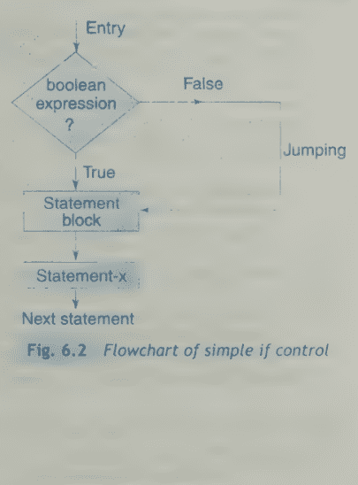

如果 weight 的值小于 50，则会执行以下语句，而该语句又是另一个 if 语句。此 if 语句测试 height，如果 height 大于 170，则 count 增加 1。程序 6.1 说明了上述语句的实现。

#### 程序 6.1 使用 IF 语句计数

```
using System;
class IfTest
{
    public static void Main()
    {
        int i, count, count1, count2;
        float[] weight = { 45.0F,55.0F,47.0F,51.0F,54.0F };
        float[] height = { 176.5F,174.2F,168.0F,170.7F,169.0F };

        count = 0;
        count1 = 0;
        count2 = 0;

        for (i = 0; i <= 4; i++)
        {
            if(weight[i] < 50.0 && height[i] > 170.0)
            {
                count1 = count1 + 1; // Executed when condition is true
            }
            count = count + 1;   // Always executed
        }
        count2 = count - count1;
        Console.WriteLine("Number of persons with ...");
        Console.WriteLine("Weight<50 and height>170 = "+count1);
        Console.WriteLine("Others = " + count2);
    }
}
```

程序 6.1 的输出为：
    Number of persons with ...
    Weight<50 and height>170 = 1
    Others = 4

C 和 C++ 程序员必须注意，在 C# 中，if 语句中的表达式必须解析为 bool 值。我们不能使用整数值，如 if(x).... 数组在第 9 章中讨论。

## 6.4 IF... ELSE 语句

if...else 语句是简单 if 语句的扩展。其一般形式为

```
if(boolean_expression)
{
    True-block statement(s)
}
else
{
```

# False-block statement(s)

} statement-x

如果 boolean_expression 为真，则紧跟在 if 语句之后的 true-block statement(s) 将被执行；否则将执行 false-block statement(s)。在任何一种情况下，要么执行 true-block 要么执行 false-block，不会同时执行。这在图 6.3 中有所说明。在两种情况下，控制随后都会转移到 statement-x。

让我们考虑一个计算班级中男孩和女孩数量的示例。我们使用代码 1 表示男孩，2 表示女孩。执行此操作的程序语句可写成如下：

```
........
........
if(code == 1)
    boy = boy + 1;
if(code == 2)
    girl = girl + 1;
........
........
```

第一个测试确定学生是否为男孩。如果是，则男孩数量增加 1，程序继续进行第二个测试。第二个测试再次确定学生是否为女孩。这是不必要的。一旦学生被确定为男孩，就无需再次测试是否为女孩。学生只能是男孩或女孩，不能两者兼有。上述程序段可使用 else 子句修改如下：

```
........
........
if(code == 1)
    boy = boy +1;
else
    girl = girl + 1;
xxx;
........
```

这里，如果 code 等于 1，则执行语句 boy = boy + 1; 并跳过 else 部分后将控制转移到语句 xxx。如果 code 不等于 1，则跳过语句 boy = boy + 1; 并在控制到达语句 xxx 之前执行 else 部分中的语句 girl = girl + 1;。

程序 6.2 使用 if....else 语句计算一组数字中的偶数和奇数。

#### 程序 6.2 | 尝试使用 IF....ELSE 语句

```
using System;
class IfElseTest
{
public static void Main()
```

```
{
int[] number = { 50, 65, 56, 71, 81 };
int even = 0, odd = 0;

for (int i = 0; i < number.Length; i++)
{
    if ((number[i] % 2) == 0) // use of modulus operator
    {
        even += 1; // counting EVEN numbers
    }
    else
    {
        odd += 1; // counting ODD numbers
    }
}

Console.WriteLine("Even Numbers : " + even);
Console.WriteLine("Odd Numbers : " + odd);
}
```

程序 6.2 的输出将为：
    Even Numbers  : 2
    Odd Numbers   : 3
请注意 number.Length 给出 number 数组的长度。
程序 6.3 展示了在 C# 中使用 if 语句的不同方式，包括单个 if 语句、if-else 结构和多个 else if 语句。该程序从用户输入一个数字，并使用各种形式的 if 语句提供有关该数字的信息。

#### 程序 6.3 | 进一步说明 IF ELSE

```
using System;
class IfElseExample
{
    public static void Main()
    {
        string numInput;
        int numValue;

        Console.Write("Please enter a number: ");
        numInput = Console.ReadLine();
        numValue = Int32.Parse(numInput);

        // A Single Decision with its Action
        if (numValue > 0)
        {
            Console.WriteLine("The number {0} is greater than zero.", numValue);
        }
        // A Single Decision with its Action without brackets

```
if (numValue < 0)
    Console.WriteLine("The number {0} is less than zero.", numValue);
// A Decision using Logical Operator
if (numValue != 0)
{
    Console.WriteLine("The number {0} is not equal to zero.", numValue);
}
else
{
    Console.WriteLine("The number {0} is equal to zero.", numValue);
}
// Multiple Else If Conditions
if (numValue < 0 || numValue == 0)
{
    Console.WriteLine("The number {0} is less than or equal to zero.", numValue);
}
else if (numValue > 0 && numValue <= 10)
{
    Console.WriteLine("The number {0} falls in the range from 1 to 10.", numValue);
}
else if (numValue > 10 && numValue <= 20)
{
    Console.WriteLine("The number {0} falls in the range from 11 to 20.", numValue);
}
else if (numValue > 20 && numValue <= 30)
{
    Console.WriteLine("The number {0} falls in the range from 21 to 30.", numValue);
}
else
{
    Console.WriteLine("The number {0} is greater than 30.", numValue);
}
}
```

```
C:\WINNT\system32\cmd.exe

C:\Chapter 6>IfElseExample
Please enter a number: 44
The number 44 is greater than zero.
The number 44 is not equal to zero.
The number 44 is greater than 30.

C:\Chapter 6>
```

## 6.5 IF....ELSE 语句的嵌套

当涉及一系列决策时，我们可能需要以嵌套形式使用多个 if....else 语句，如下所示：

执行逻辑在图 6.4 中说明。如果 condition-1 为假，则会执行 statement-3；否则继续执行第二个测试。如果 condition-2 为真，则会评估 statement-1；否则会评估 statement-2 并将控制转移到 statement-x。

一家商业银行已引入一项激励政策，为其所有存款持有者发放奖金。政策如下：每位存款人无论余额多少，都会在 12 月 31 日持有的余额上获得 2% 的奖金，如果女性账户持有人的余额超过 Rs 5000，则给予 5%。此逻辑可编码如下：

```
......
if(sex is female)
{
    if (balance > 5000)
        bonus = 0.05 * balance;
    else
        bonus = 0.02 * balance;
}
else
{
    bonus = 0.02 * balance;
}
 balance = balance + bonus;
........
```

在嵌套时，应注意使每个 if 与 else 匹配。考虑以下对上述程序的替代方案（乍一看似乎正确）：

```
if(sex is female)
    if(balance > 5000)
        bonus = 0.05 * balance;
else
    bonus = 0.02 * balance;
    balance = balance + bonus;
```

else 属于哪个 if 存在歧义。在 C# 中，else 与最近的未终止 if 链接。因此，else 与内部 if 相关联，而外部 if 没有 else 选项。这意味着计算机试图执行语句
balance = balance + bonus;
而没有真正为男性账户持有者计算奖金。

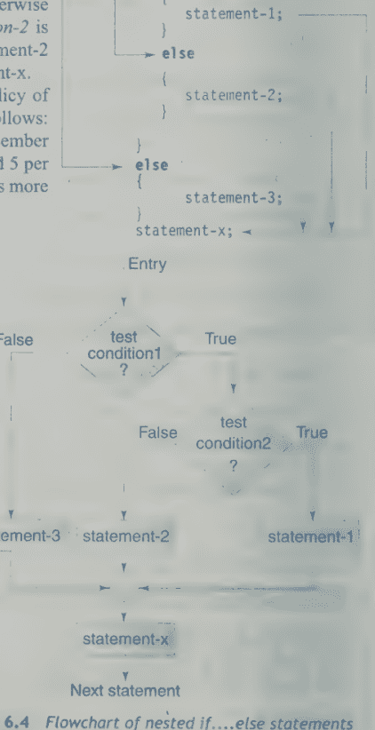

图 6.4 嵌套 if....else 语句的流程图

考虑另一个也看起来正确的替代方案：


```
if(sex is female)
{
    if (balance > 5000)
        bonus = 0.05 * balance;
}
else
    bonus = 0.02 * balance;
    balance = balance + bonus;
```

在此情况下，else 与外层的 if 关联，因此 bonus 会为男性账户持有者计算。然而，由于缺少内层 if 的 else 选项，余额等于或小于 5000 的女性账户持有者的 bonus 并未计算。

Program 6.4 采用嵌套的 if....else 语句来确定三个给定数字中的最大值。

#### Program 6.4    NESTING IF....ELSE STATEMENTS

```
using System;
class IfElseNesting
{
    public static void Main()
    {
        int a = 325, b = 712, c = 478;

        Console.Write("Largest value is : ");
        if (a > b)
        {
            if (a > c)
            {
                Console.WriteLine(a);
            }
            else
            {
                Console.WriteLine(c);
            }
        }
        else
        {
            if (c > b)
            {
                Console.WriteLine(c);
            }
            else
            {
                Console.WriteLine(b);
            }
        }
    }
}
```

## 6.6 THE ELSE IF LADDER

Program 6.4 的输出：
Largest value is : 712

当涉及多路径决策时，还有另一种将 if 组合起来的方法。多路径决策是一串 if，其中每个 else 关联的语句是一个 if。其一般形式如下：
该结构被称为 else if 梯子。条件从顶部（梯子）向下评估。一旦找到真条件，与其关联的语句就会执行，并且控制权转移到 statement-x（跳过梯子的其余部分）。当所有 n 个条件都为假时，则包含 default-statement 的最终 else 将被执行。图 6.5 以图形方式展示了 else if 梯子语句的执行逻辑。

```
if (condition 1)
    statement-1;
else if (condition 2)
    statement-2;
else if (condition 3)
    statement-3;
else if (condition n)
    statement-n;
else
    default-statement;
statement-x;
```

让我们考虑一个在学术机构中给学生评分的例子。评分是根据以下规则进行的：

| AVERAGE MARKS | GRADE |
|---|---|
| 80 to 100 | Honours |
| 60 to 79 | First Division |
| 50 to 59 | Second Division |
| 40 to 49 | Third Division |
| 0 to 39 | Fail |

可以使用 else if 梯子进行此评分，如下所示：

```
if(marks > 79)
    grade = "Honours";
else if(marks > 59)
    grade = "First Division";
else if(marks > 49)
    grade = "Second Division";
else if(marks > 39)
    grade = "Third Division";
else
    grade = "Fail";
Console.WriteLine("Grade: " + grade);
```

再考虑下面给出的另一个例子：

```
if (code == 1)
    colour = "RED";
else if (code == 2)
```

```
colour = "GREEN";
else if (code == 3)
code = "WHITE";
else
colour = "YELLOW";
........
```

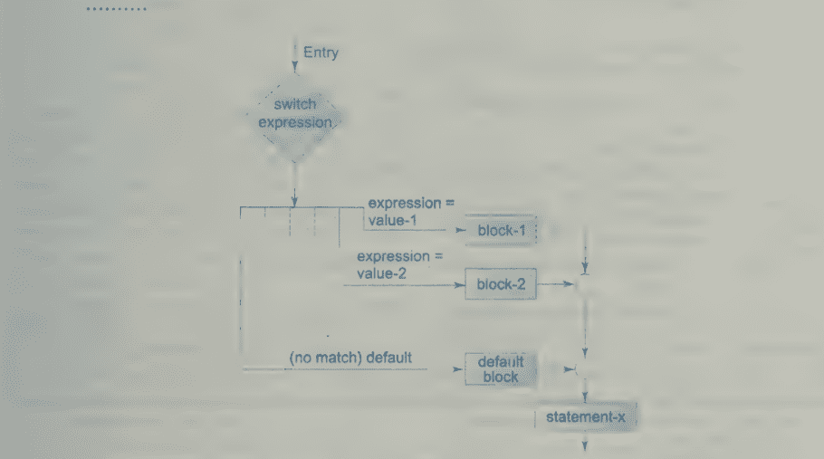

代码编号为 1、2 或 3 以外的数字被视为代表 YELLOW。也可以使用嵌套的 if...else 语句获得相同的结果。

```
if(code != 1)
if (code != 2)
if (code != 3)
colour = "YELLOW";
else
colour = "WHITE";
else
colour = "GREEN";
else
colour = "RED";
```

在这种情况下，方法的选择留给程序员。然而，为了选择既有效又高效的 if 结构，程序员必须充分了解 if 语句的各种形式及其嵌套的规则。Program 6.5 演示了在分析成绩单时使用 if....else 梯子。

#### Program 6.5 DEMONSTRATION OF ELSE IF LADDER

```
using System;
class ElselfLadder
{
    public static void Main()
    {
        int[] rollNumber = { 111, 222, 333, 444 };
        int[] marks = { 81, 75, 43, 58 };

        for (int i = 0; i < rollNumber.Length; i++)
        {
            if (marks[i] > 79)
                Console.WriteLine(rollNumber[i] + " Honours");
            else if (marks[i] > 59)
                Console.WriteLine(rollNumber[i] + " I Division");
            else if (marks[i] > 49)
                Console.WriteLine(rollNumber[i] + " II Division");
            else
                Console.WriteLine(rollNumber[i] + " FAIL");
        }
    }
}
```

Program 6.5 产生以下输出：

111 Honours
222 I Division
333 FAIL
444 II Division

## 6.7 THE SWITCH STATEMENT

我们已经看到，当需要从众多备选方案中选择其一时，我们可以使用 if 语句设计程序来控制选择。然而，当备选方案增加时，此类程序的复杂性会急剧增加。程序变得难以阅读和跟随。有时，甚至程序的设计者也会感到困惑。幸运的是，C# 具有内置的多路决策语句，称为 switch。switch 语句将给定变量（或表达式）的值与一系列 case 值进行比较，并在找到匹配项时执行与该 case 关联的语句块。switch 语句的一般形式如下所示：

```
switch(expression)
{
    case value-1:
        block-1
        break;
}
```

```
case value-2:
    block-2
    break;
    .....
    .....
default:
    default-block
    break;
}
statement-x;
```

表达式必须是整数类型或 char 或 string 类型。value-1、value-2 …… 是常量或常量表达式，被称为 case 标签。每个这些值在 switch 语句中必须是唯一的。block-1、block-2 …… 是语句列表，可能包含零个或多个语句。无需对这些块使用大括号，但需要注意的是 case 标签以冒号 (:) 结尾。

switch 语句按以下顺序执行：

+   1. 首先评估表达式。
+   2. 表达式的值会依次与值 value-1、value-2 …… 进行比较。如果找到与表达式值匹配的 case，则执行该 case 后跟的语句块。
+   3. 每个块末尾的 break 语句表示特定 case 的结束，并导致从 switch 语句退出，将控制权转移到 switch 之后的 statement-x。
+   4. default 是一个可选的 case。如果存在，当表达式的值与任何 case 值都不匹配时，它将被执行。如果不存在，当所有匹配都失败时，不会采取任何操作，控制权转到 statement-x。

switch 语句的选择过程在图 6.6 所示的流程图中进行了说明。

switch 语句可用于对上一节讨论的学生进行评分。如下所示说明：

```
........
........
index = marks/10;
switch(index)
{
    case 10:
    case 9:
    case 8:
        grade = "Honours";
        break;
    case 7:
    case 6:
        grade = "First Division";
        break;
```

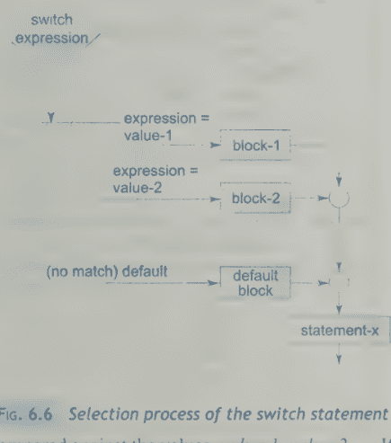

##### Fig. 6.6 Selection process of the switch statement

```
case 5:
    grade = "Second Division";
    break;
case 4:
    grade = "Third Division";
    break;
default:
    grade = "Fail";
    break;
}
Console.WriteLine(grade);
```

请注意，我们使用了转换语句 index = marks/10; 其中，index 定义为整数。变量 index 采用以下整数值。

| MARKS | INDEX |
|-------|-------|
| 100 | 10 |
| 90 – 99 | 9 |
| 80 – 89 | 8 |
| 70 – 79 | 7 |
| 60 – 69 | 6 |
| 50 – 59 | 5 |
| 40 – 49 | 4 |
| 30 – 39 | 3 |
| 20 – 29 | 2 |
| 10 – 19 | 1 |
| 0 – 9 | 0 |

该程序段说明了两个重要特性。首先，它使用了空 case。前三个 case 将执行相同的语句 grade = "Honours"; break;

case 7 和 case 6 也是如此。其次，default 条件用于所有其他 case，其中成绩小于 40。

Program 6.6 说明了 switch 在菜单驱动交互程序中的使用。

#### Program 6.6 TESTING THE SWITCH STATEMENT

```
using System;
class CityGuide
{
    public static void Main()
    {
        Console.WriteLine("Select your choice");
```


```csharp
Console.WriteLine("London");
Console.WriteLine("Bombay");
Console.WriteLine("Paris");
Console.WriteLine("Type your choice");
String name = Console.ReadLine();

switch (name)
{
    case "Bombay":
        Console.WriteLine("Bombay:Guide 5");
        break;
    case "London":
        Console.WriteLine("London:Guide 10");
        break;
    case "Paris":
        Console.WriteLine("Paris:Guide 15");
        break;
    default:
        Console.WriteLine("Invalid choice");
        break;
}
}
```

程序 6.6 的输出：

```
Select your choice
London
Bombay
Paris
Type your choice
London
London : Guide 10
```

##### 6.7.1 Switch 语句中的贯穿

如果在 case 块中没有 break 语句，控制能够无问题地转移到下一个 case 块，这种情况被称为‘贯穿’。贯穿在 C、C++ 和 Java 中是允许的。但在 C# 中，如果 case 块包含可执行代码，则不允许自动贯穿。但是如果 case 块为空，如前所述，则允许。例如，

```csharp
switch (m)
{
    case 1:
        x = y;
    case 2:
        x = y + m;
    default:
        x = y - m;
}
```

在 C# 中是错误的。如果我们希望连续执行两个 case 块，就必须使用 goto 语句强制该过程。例如：

```csharp
switch (m)
{
    case 1:
        x = y;
        goto case 2;
    case 2:
        x = y + m;
        goto default;
    default:
        x = y - m;
        break;
}
```

goto 机制使我们能够在 case 之间向前和向后跳转，因此可以任意排列标签。示例：

```csharp
switch (m)
{
    default:
        x = y - m;
        break;
    case 2:
        x = y + m;
        goto default;
    case 1:
        x = y;
        goto case 2;
}
```

是完全有效的。

程序 6.7 使用 switch case 允许用户选择可乐罐的大小。根据用户选择，程序会打印用户必须为所选特定类型的罐支付的金额。

##### 程序 6.7 | 另一个 SWITCH 示例

```csharp
using System;
class SwitchExample
{
    public static void Main()
    {
        Console.WriteLine("Select your Cola Can:");
        Console.WriteLine("S=SMALL M=MEDIUM L=LARGE");
        Console.Write("Please enter your option: ");
        String s = Console.ReadLine();
        int cost = 0;
        switch (s)
        {
            case "S":
                cost += 10;
                break;
            case "M":
                cost += 15;
                goto case "S";
            case "L":
                cost += 30;
                goto case "S";
            default:
                Console.WriteLine("Invalid option. Please select either S, M, or L.");
                break;
        }
        if (cost != 0)
            Console.WriteLine("Please pay {0} Rupees.", cost);
    }
}
```

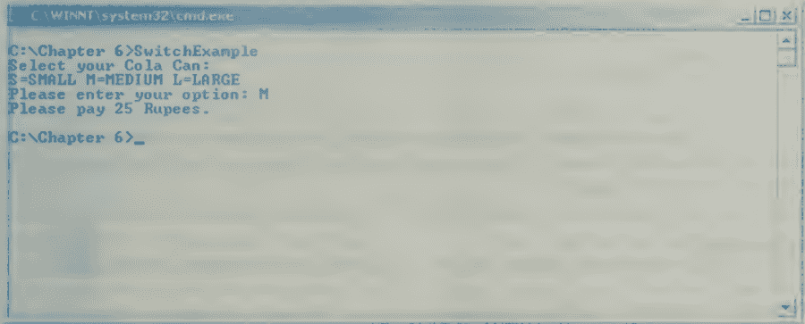

## 6.8 ?: 运算符

C# 有一个不寻常的运算符，用于进行双向决策；它是由 ? 和 : 组合而成，接受三个操作数。该运算符通常被称为条件运算符。条件运算符的一般使用形式如下：

```
conditional expression ? expression1 : expression2
```

首先评估条件表达式。如果结果为真，则评估 expression1 并作为条件表达式的值返回。否则，评估 expression2 并返回其值。例如，段落

```csharp
if (x < 0)
    flag = 0;
else
    flag = 1;
```

可以写成

```csharp
flag = (x < 0) ? 0 : 1;
```

考虑以下函数的求值：

```
y = 1.5x + 3      for x <= 2
y = 2x + 5        for x > 2
```

这可以使用条件运算符如下求值：

```csharp
y = (x > 2) ? (2*x + 5) : (1.5*x + 3);
```

条件运算符可以嵌套以求值更复杂的赋值决策。例如，考虑一名销售家用产品的售货员的周薪。如果 x 是每周售出的产品数量，她的周薪由下式给出

```
salary = { 4x + 100 for x < 40
          300 for x = 40
          4.5x + 150 for x > 40 }
```

该复杂方程可以写成

```csharp
salary = (x != 40) ? ((x < 40) ? (4*x + 100) : (4.5*x + 150)) : 300; // nesting
```

也可以使用 if...else 语句如下求值：

```csharp
if (x <= 40)
    if (x < 40)
        salary = 4*x + 100;
    else
        salary = 300;
else
    salary = 4.5*x + 150;
```

使用条件运算符时，代码变得更简洁，也许更高效。然而，可读性较差。当需要超过一次嵌套条件运算符时，最好使用 if 语句。

#### 案例研究

##### 问题陈述

SafeMoney Bank 为个人提供为期 1 至 15 年的简单和复利贷款。直到最近，SafeMoney Bank 的员工一直手动计算银行向个人提供的贷款的简单和复利利息。SafeMoney Bank 的经理发现，在过去两个月里，银行员工在计算简单和复利利息时出现了很多错误。此外，贷款审批也出现了很多延迟。因此，银行正在失去宝贵的客户。SafeMoney Bank 的经理如何解决这个问题？

##### 解决方案

必须自动化计算简单和复利利息的任务，以减少计算中的错误。SafeMoney Bank 的经理要求 Binoy，即 SafeMoney Bank IT 部门的高级程序员，创建一个应用程序来自动化计算简单和复利利息的任务，以便银行员工能够高效地执行。经过需求分析后，Binoy 决定必须在应用程序中使用诸如 If Else 之类的决策语句，并辅以 C# 来计算简单和复利利息。Binoy 创建了以下 C# 应用程序。

```csharp
using System;

class InterestCalculator
{
    public static void Main()
    {
        Console.WriteLine("==Interest Calculator==");
        Console.WriteLine("Calculate Simple (S) / Compound (C) Interest: ");
        string choice = Console.ReadLine();

        Console.WriteLine("Enter Principal Amount: ");
        double p = double.Parse(Console.ReadLine());
        Console.WriteLine("Enter Rate of Interest: ");
        double r = double.Parse(Console.ReadLine());
        Console.WriteLine("Enter Duration: ");
        int t = Int32.Parse(Console.ReadLine());

        if (choice == "S")
        {
            double simpleInterest = (double)((p * r * t) / 100);
            Console.WriteLine("The Simple Interest is: {0,0:Rs ###.##}", simpleInterest);
        }
        else
        {
            double compoundInterest = (double)p * (Math.Pow(((r / 100) + 1), t));
            Console.WriteLine("The Compound Interest is: {0,0:Rs ###.##}", compoundInterest);
        }
    }
}
```

### 备注

C# 中的 If Else 语句可用于评估条件，并且在评估结果的基础上，必须决定程序的控制流。如果与 If 语句一起给出的条件评估为真，则必须执行特定的一组程序语句。但是如果条件评估为假，则必须执行另一组程序语句。

## 常见编程错误

- 使用 `=` 代替 `==` 符号。
- 嵌套 `if` 语句中的悬空 else。
- 在多分支构造的某些路径中忘记初始化变量。
- `&&` 和 `||` 条件运算符的不当和混淆使用。
- 未正确应用运算符优先级。
- 使用多个关系运算符如 `(a <= x <= b)`。
- 在 `if` 语句中比较浮点表达式如 `if (x == y)`。
- 在 switch 语句中忘记为 case 标签使用冒号。
- 在 switch 语句中未使用 `goto` 进行贯穿 case。
- 将运算符 `<=`、`>=` 和 `!=` 用作 `<=`、`>=` 和 `=!`。
- 在运算符 `==`、`<=`、`>=` 和 `!=` 的符号之间提供空格。
- 当 `if` 语句块包含多个语句时未使用大括号。
- 在 `if` 语句的测试表达式中使用整数值，如 `if (x).....`。
- 在 `if` 语句中条件后的右括号后立即放置分号。
- `if...else` 语句的嵌套不当。


# 复习题

6.1 判断以下说法是否正确：

- (a) 当 if 语句嵌套时，最后一个 else 会与最近的没有 else 的 if 关联。
- (b) 一个 if 可以有多个 else 子句。
- (c) switch 语句总可以用一系列 if....else 语句替换。
- (d) switch 表达式可以是任意类型。
- (e) 遇到 break 语句时程序会停止执行。
- (f) if 语句中的表达式必须始终解析为整数值。
- (g) 一组嵌套的 if....else 语句可以用 else if 阶梯替换。
- (h) switch () 中的每个 case 标签都应有一个关联的 break 语句。
- (i) 当 default 是最后一个时，break 语句在 default case 中是可选的。
- (j) 条件运算符 ?: 可以用 if else 构造替换。
- (k) switch 中的 default 必须是 case 列表中的最后一条语句。
- (l) default 是 switch 语句中的可选 case。

6.2 switch 语句的执行顺序是什么？

6.3 if 语句有哪些形式及其具体用途？

6.4 switch 语句与 if 语句有何不同？

6.5 找出以下每个 if 段中的错误，如有的话：

- (a) if(x+y = z && y>0)
- (b) if(p<0) || (q<0)

6.6 以下是一段程序：
x = 1;
y = 1;
if(n>0)
x = x+1;
y = y-1;
如果 n 假设为 (a)1 和 (b) 0 的值，x 和 y 的值会是多少。

6.7 不使用复合关系重写以下每个：

- (a) if(grade<=59 && grade>=50)
  second = second + 1;
- (b) if(number>100 || number<0)
  System.Console.Write("Out of range");
  else
  sum = sum + number;
- (c) if ((M1>60 && M2>60) || T>200)
  y=1;
  else
  y=0;

6.8 switch 语句中的“fallthrough”是什么？在 C# 中是如何实现的？

6.9 你在什么情况下认为使用 goto 语句是必要的？

6.10 为以下每个编写伪代码：

- (a) 从键盘读取两个数字并显示这两个数字中较大的一个
- (b) 从键盘读取三个数字并显示这三个数字中最小的一个。

6.11 与 if...else 语句相比，你会在什么情况下使用条件运算符 ?:？

6.12 识别以下语句中的错误。

(a) if (code = = 1)
    Console.WriteLine("Pass");
else;
Console.WriteLine("Fail");

(b) if (code > 1);
    a = b + c
else
    a = 0

# 调试练习

6.1 找出以下程序中的错误。

```
using System;
class TernaryExample
{
    static void Main()
    {
        int num = 3;
        string result = (num < 2) ? "True" : "False";
        Console.WriteLine(result);
    }
}
```

6.2 调试下面给出的程序。

```
using System;
class StudentRecord
{
    static void Main(string[] args)
    {
        Console.WriteLine("Enter the name of the student: ");
        string name = Console.ReadLine();

        Console.WriteLine("Enter the grade for the student: ");
        string grade = Console.ReadLine();
        if (grade == "a")
            Console.WriteLine("{0} is an Outstanding student.",name);
            Console.WriteLine("You have received a scholarship.");
        else if (grade == "b")
            Console.WriteLine("{0} is a Good student.",name);
        else if (grade == "c")
            Console.WriteLine("{0} is an Average student.",name);
        else if (grade == "d")
            Console.WriteLine("{0} Needs more practice.",name);
        else
            Console.WriteLine("{0} Need a lot of practice.",name);
    }
}
```

# 编程练习

6.1 编写一个程序，将 0 到 20 之间所有的奇数相加。使用简单的 if 和 goto 语句形成操作循环

6.2 修改上述程序，使其也将 0 到 20 之间的所有偶数相加

6.3 编写一个程序，找出大于 100 且小于 200 的所有能被 7 整除的整数的个数和总和。

6.4 给出两个未知数 x₁ 和 x₂ 的两个线性方程组如下：
ax₁ + bx₂ = m
cx₁ + dx₂ = n
该组有唯一解
x₁ = (md + bn)/(ad - cb)
x₂ = (na + mc)/(ad - cb)
前提是分母 ad - cb 不等于零。
编写一个程序读取常数 a、b、c、d、m 和 n 的值并计算 x₁ 和 x₂ 的值。如果 ad – cb = 0，则应打印适当的提示信息。

6.5 给定一个从 0 到 100 的分数列表，编写一个程序计算并打印获得分数的学生人数
(a) 在 81 到 100 范围内，          (b) 在 61 到 80 范围内，
(c) 在 41 到 60 范围内，和      (d) 在 0 到 40 范围内。
程序应使用最少的 if 语句。

6.6 报考专业课程需满足以下条件：
(a) 数学成绩 >= 60
(b) 物理成绩 >= 50
(c) 化学成绩 >= 40
(d) 三科总分 >= 200
（或）
数学和物理总分 >= 150
给定三科成绩，编写一个程序处理申请，列出符合条件的考生。

6.7 编写一个程序打印如下所示的二维平方根表，以提供从 0 到 9.9 的任意数字的平方根。例如，值 x 给出 3.2 的平方根，y 给出 3.9 的平方根。

# 平方根表

| NUMBER | 0.0 | 0.1 | 0.2 | ...... | 0.9 |
| 0.0 |  |  |  |  |  |
| 1.0 |  |  |  |  |  |
| 2.0 |  |  |  |  |  |
| 3.0 |  |  | x |  | y |
| . |  |  |  |  |  |
| . |  |  |  |  |  |
| 9.0 |  |  |  |  |  |

6.8 下面是 Floyd 的三角形

1
2 3
4 5 6
7 8 9 10
11 ...........15
.
.
79 ........... 91

- (a) 编写一个程序打印此三角形。
- (b) 修改程序以产生以下形式的 Floyd 三角形：
  1
  0 1
  1 0 1
  0 1 0 1
  1 0 1 0 1

6.9 一家布料商店宣布了以下购买商品的季节性折扣：

| PURCHASE AMOUNT | DISCOUNT |  |
|  | MILL CLOTH | HANDLOOM ITEMS |
| 0 – 100 |  | 5.0% |
| 101 – 200 | 5.0% | 7.5% |
| 201 – 300 | 7.5% | 10.0% |
| Above 300 | 10.0% | 15.0% |

编写一个使用 switch 和 if 语句计算客户需支付的净金额的程序。

6.10 编写一个程序读取 x 的值并计算以下函数

y = { 1 for x > 0
      0 for x = 0
     -1 for x < 0 }

- 使用
- (a) 嵌套 if 语句
- (b) else if 语句，和
- (c) 条件运算符?

# 7

# 决策与循环

### 7.1 引言

计算机非常适合执行重复操作。它可以做十次、百次甚至一万次。每种计算机语言都必须具有指示计算机执行此类重复任务的功能。反复执行一段语句的过程称为循环。块中的语句可能被执行任意次数，从零次到无限次。如果循环永远持续下去，则称为无限循环。C# 支持此类循环功能，使我们能够开发包含重复过程的简洁程序，而无需使用 goto 语句等无条件分支语句。

在循环中，一系列语句会一直执行，直到满足循环终止的某些条件。程序循环因此由两个段组成，一个称为循环体，另一个称为控制语句。控制语句测试某些条件，然后指示重复执行循环体中包含的语句。

根据循环中控制语句的位置，控制结构可分为入口控制循环或出口控制循环。图 7.1 中的流程图说明了这些结构。在入口控制循环中，控制条件在循环执行开始前进行测试。如果条件不满足，则循环体将不会执行。在出口控制循环的情况下，测试在循环体末尾进行，因此循环体无条件地第一次执行。

测试条件应仔细说明，以便执行所需次数的循环。假设测试条件最终会将控制转移出循环。如果由于某种原因没有这样做，控制会设置一个无限循环，循环体会被一次又一次地执行。

一般来说，循环过程包括以下四个步骤：

- 1. 设置和初始化计数器。
- 2. 执行循环中的语句。
- 3. 测试循环执行的指定条件。
- 4. 增加计数器。

测试可以是确定循环是否已执行指定次数，或者确定是否满足特定条件。

C# 语言提供了四种执行循环操作的构造。它们是：

- 1. while 语句
- 2. do 语句
- 3. for 语句
- 4. foreach 语句


这些语句被称为迭代或循环语句。在本章中，我们将讨论这些语句各自的特点和应用。

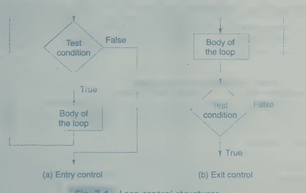

### 7.2 WHILE 语句

C# 中所有循环结构中最简单的是 while 语句。while 语句的基本格式为

```
initialization;
while(test condition)
{
    Body of the loop
}
```

while 是一个入口控制的循环语句。首先计算测试条件，如果条件为真，则执行循环体。执行完循环体后，再次计算测试条件，如果为真，则再次执行循环体。这种循环体重复执行的过程一直持续，直到测试条件最终变为假，控制权被转移到循环之外。退出时，程序继续执行循环体之后的语句。

循环体可以包含一条或多条语句。只有当循环体包含两条或更多语句时才需要花括号。然而，即使循环体只有一条语句，使用花括号也是一种好习惯。

考虑以下代码段：

```
sum = 0;
n = 1; // counter
while(n <= 10)
```

```
do
{
    Body of the loop
}
while (test condition);
```

当程序执行到 do 语句时，首先计算循环体。在循环结束时，计算 while 语句中的测试条件。如果条件为真，程序将再次计算循环体。只要条件为真，这个过程就会继续。当条件变为假时，循环终止，控制权转移到 while 语句之后紧接着的语句。

由于测试条件在循环底部计算，do...while 结构提供了一种出口控制的循环，因此循环体至少总是执行一次。

考虑一个例子：

```
..........
..........
i = 1;
sum = 0;
do
{
    sum = sum + i;
    i = i+2;
}
while(sum < 40 || i < 10); // semicolon here
..........
..........
```

只要两个关系之一为真，循环就会执行。程序 7.2 演示了使用 do...while 循环打印乘法表。

#### 程序 7.2
#### 使用 DO...WHILE 循环打印乘法表

```
class DoWhileTest
{
    public static void Main ()
    {
        int row, column, y;
        row = 1;
        System.Console.WriteLine("Multiplication Table \n");
        do
        {
            column = 1;
            do
            {
                y = row * column;
                System.Console.Write(" " + y);
                column = column + 1;
            }
            while (column <= 3);
            System.Console.WriteLine("\n");
            row = row + 1;
    }
```

### 7.4 FOR 语句

for 是另一种入口控制的循环，它提供了更简洁的循环控制结构。for 循环的一般形式为

```
for (initialization ; test condition ; increment)
{
    Body of the loop
}
```

for 语句的执行过程如下：

- 1. 首先使用赋值语句（如 i = 1 和 count = 0）对控制变量进行初始化。变量 i 和 count 被称为循环控制变量。
- 2. 使用测试条件测试控制变量的值。测试条件是一个关系表达式，如 i < 10，它决定了循环何时退出。如果条件为真，则执行循环体；否则循环终止，执行继续到紧跟循环之后的语句。
- 3. 当循环体执行完毕，在计算完循环体中的最后一条语句后，控制权被转移回 for 语句。此时，使用赋值语句（如 i = i + 1）递增控制变量，并再次测试控制变量的新值，看它是否满足循环条件。如果满足条件，则再次执行循环体。这个过程一直持续到控制变量的值不满足测试条件为止。

考虑以下程序片段

```
for (x = 0 ; x <= 9 ; x = x+1)
{
    System.Console.WriteLine(x);
}
```

这个 for 循环执行十次，打印数字 0 到 9。括号内的三个部分必须用分号分隔。注意，增量部分 x = x+1 的末尾没有分号。

for 语句允许负增量。例如，上面讨论的循环可以写成如下形式：

```
for ( x = 9 ; x >= 0 ; x = x-1)
    System.Console.WriteLine(x);
```

这个循环也执行十次，但输出将是 9 到 0，而不是 0 到 9。注意，当循环体只包含一条语句时，花括号是可选的。

由于条件测试总是在循环开始时执行，如果条件一开始就不满足，循环体可能根本不会执行。例如，

```
for (x = 9; x < 9; x = x-1)
{
    ..........
    ..........
}
```

永远不会执行，因为测试条件在一开始就不满足。

让我们考虑在第 7.2 节中讨论的整数平方和问题。这个问题可以使用 for 语句编码如下：

```
..........
..........
sum = 0;
int n;
for (n = 1; n <= 10; n = n+1)
{
    sum = sum + n*n;
}
..........
..........
```

循环体 sum = sum + n*n; 对于 n = 1, 2, ..., 10 执行十次，每次都通过 n 的平方来增加 sum。

关于 for 循环的一个重要特点是，三个动作，即初始化、测试和增量，都放在 for 语句本身中，从而使得程序员和用户能够在一处看到它们。for 语句及其等价的 while 和 do 语句如表 7.1 所示。

#### 表 7.1 三种循环的比较

| FOR | WHILE | DO |
|---|---|---|
| for(n=1; n<=10; ++n) | n = 1; | n = 1; |
| { | while (n<=10) | do |
| ........ | { | { |
| ........ | ........ | ........ |
| } | ........ | ........ |
|  | n = n+1; | n = n+1; |
|  | } | } |
|  |  | while (n<=10); |

程序 7.4 演示了使用 for 循环计算并打印“2 的幂”表。

#### 程序 7.4 使用 FOR 循环计算“2 的幂”

```
using System;
class ForTest
{
    public static void Main()
    {
        long p;
        int n;
        double q;
        Console.WriteLine("2 to power n   n   2 to power n");
        p = 1L;
        for (n = 0; n < 10; ++n)
        {
            if (n == 0)
                p = 1L;
            else
                p = p * 2;
            q = 1.0 / (double)p;
            Console.WriteLine("{0:F6} {1:D} {2:D}", q,n,p);
```

程序 7.4 的输出将是：

| 2 的 -n 次幂 | n | 2 的 n 次幂 |
|---|---|---|
| 1.000000 | 0 | 1 |
| 0.500000 | 1 | 2 |
| 0.250000 | 2 | 4 |
| 0.125000 | 3 | 8 |
| 0.062500 | 4 | 16 |
| 0.031250 | 5 | 32 |
| 0.015625 | 6 | 64 |
| 0.003906 | 7 | 128 |
| 0.001953 | 8 | 256 |
| 0.001953 | 9 | 512 |

数字格式化输出将在第 17 章中讨论。

##### 7.4.1 for 循环的其他特点

for 循环具有其他循环结构没有的几种能力。例如，可以在 for 语句中一次初始化多个变量。语句

```
p = 1;
for (n=0; n<17; ++n)
```

可以改写为

```
for (p=1, n=0; n<17; ++n)
```

注意，初始化部分有两个部分 p = 1 和 n = 0，用逗号分隔。

与初始化部分类似，增量部分也可以有多个部分。例如，循环

```
for (n=1, m=50; n<=m; n=n+1, m=m-1)
{
    ........
}
```

是完全有效的。增量部分中的多个参数用逗号分隔。


`for (x = (m+n)/2; x > 0; x = x/2)` 是完全合法的。

`for` 循环的另一个独特之处在于，如果需要，可以省略一个或多个部分。请考虑以下语句：

```
m = 5;
for ( ; m != 100 ; )
{
    System.Console.WriteLine(m);
    m = m+5;
}
```

在 `for` 语句中省略了初始化和递增部分。初始化已在 `for` 语句之前完成，控制变量在循环内部递增。在这种情况下，这些部分留空。但是，分隔各部分的[content]

`for (x = (m+n)/2; x > 0; x = x/2)` 是完全合法的。

`for` 循环的另一个独特之处在于，如果需要，可以省略一个或多个部分。请考虑以下语句：

```
m = 5;
for ( ; m != 100 ; )
{
    System.Console.WriteLine(m);
    m = m+5;
}
```

在 `for` 语句中省略了初始化和递增部分。初始化已在 `for` 语句之前完成，控制变量在循环内部递增。在这种情况下，这些部分留空。但是，分隔各部分的分隔符分号必须保留。如果没有测试条件，`for` 语句会设置一个无限循环。

我们可以使用空语句按如下方式设置时间延迟循环：

```
for (j = 1000; j > 0; j = j-1)
; //simple semicolon
```

此循环执行 1000 次而不产生任何输出；它只是造成时间延迟。请注意，循环体仅包含一个分号，被称为空语句。这也可以写成

```
for (j=1000; j > 0; j = j-1);
```

这意味着如果我们在 `for` 语句末尾不小心放置一个分号，编译器不会给出错误消息。分号将被视为一个空语句，程序可能会产生一些无意义的结果。

程序 7.5 使用 `for` 循环结构遍历两个数字，一个按递增顺序，另一个按递减顺序。程序还在每次循环迭代时比较两个数字的值，并使用三元运算符告知第一个数字是否大于或小于第二个数字。

#### 程序 7.5 FOR 循环的附加特性

```
using System;
class forExample
{
public static void Main()
{
int num1=0, num2=10;
for(; ((num1<=10) && (num2>=0)); num2--, num1++)
{
System.Console.WriteLine("First Number {0} is {1} than Second Number {2}.\t",
    num1, (num1>num2? '>' : '<'), num2);
}
}
}
```

### 7.5 FOREACH 语句

`foreach` 语句与 `for` 语句类似，但实现方式不同。它使我们能够遍历数组和集合类（如 List 和 Hashtable）中的元素。`foreach` 语句的一般形式为：

```
foreach (type variable in expression)
{
    Body of the loop
}
```

类型和变量声明迭代变量。在执行期间，迭代变量表示当前正在执行的迭代的数组元素（对于集合则是集合元素）。`in` 是一个关键字。

表达式必须是数组或集合类型，并且必须存在从集合的元素类型到迭代变量类型的显式转换。示例：

```
public static void Main (string [] args)
{
    foreach ( string s in args)
    {
        Console.WriteLine(s);
    }
}
```

此程序段显示命令行参数。也可以使用 `for` 语句实现如下：

```
public static void Main (string[] args)
{
    for ( int i = 0; i < args.Length ; i++ )
    {
        Console.WriteLine(args [i]);
    }
}
```

程序 7.6 说明了使用 `foreach` 语句打印数值数组内容的情况。

#### 程序 7.6 使用 FOREACH 语句打印数组值

```
using System;
class ForeachTest
{
    public static void Main ()
    {
        int[] arrayInt = { 11, 22, 33, 44 };
        foreach ( int m in arrayInt)
        {
            Console.Write(" " + m);
        }
        Console.WriteLine();
    }
}
```

程序 7.6 将显示以下输出：

```
11  22  33  44
```

需要注意的一个重要点是，我们不能在执行期间更改迭代变量的值。

例如，代码

```
int[] x = { 1, 2, 3 };
foreach ( int i in x )
{
    i++;
    Console.Write(i);
}
```

将无法工作。如果需要在迭代过程中更改项目的值，我们可以使用 `for` 循环结构。

`foreach` 相对于 `for` 语句的优点是它会自动检测正在迭代的集合的边界。此外，语法包含用于访问集合中当前元素的内置迭代器。

### 7.6 循环中的跳转

循环会重复执行一组操作，直到控制变量不再满足测试条件。循环重复的次数是预先决定的，并且测试条件被编写以实现这一点。有时，在执行循环时，希望在特定条件出现时跳过循环的一部分或退出循环。例如，考虑在包含约一百个姓名的列表中搜索特定姓名的情况。为读取和测试一百次姓名而编写的程序循环必须在找到所需姓名后立即终止。C# 允许从一个语句跳转到循环的末尾或开头，以及跳出循环。

#### 7.6.1 跳出循环

可以使用 `break` 和 `goto` 语句实现循环的提前退出。我们已经看到了 `break` 在 `switch` 语句中的使用。这些语句也可以在 `while`、`do` 或 `for` 循环中使用以实现提前退出。

当在循环内遇到 `break` 语句时，循环会立即退出，程序将继续执行循环之后的语句。当循环嵌套时，`break` 仅退出包含它的循环。也就是说，`break` 只会退出一个循环。图 7.2 说明了使用 `break` 退出循环的情况。

#### 7.6.2 跳过循环的一部分

在循环操作期间，在某些条件下可能需要跳过循环体的一部分。例如，在处理某些工作的申请时，我们可能希望排除属于某一类别的申请人的数据处理。在读取申请人的类别代码时，会进行测试以查看是否应考虑其申请。如果不予考虑，则跳过处理申请详细信息的程序循环部分，并继续执行下一个循环操作。

与 `break` 语句类似，C# 还支持另一个类似的语句，称为 `continue` 语句。然而，与导致循环终止的 `break` 不同，`continue` 语句顾名思义，会导致循环在跳过中间的任何语句后继续进行下一次迭代。

将控制转移到标签标记的语句。示例：

```
public static void Main(String [] args)
{
if (args.Length == 0)
goto end;
Console.WriteLine(args.Length);
end: // Label name
Console.WriteLine ("end");
}
```

我们可以使用 `goto` 语句和标签将控制转移出嵌套循环，如下面的代码所示：

```
for ( int i = 0; i < 10; i++)
{
while ( x < 100 )
{
y = i * x;
if (y > 500)
goto out;
....
}
}
out:
....
```

这里，标签 `out` 在 `for` 循环之外，因此语句 `goto out;` 会导致执行跳出两个循环。请注意，简单的 `break` 无法实现这一点。程序 7.8 说明了 `continue`、`break` 和 `goto` 语句的使用。

#### 程序 7.8 GOTO 和标签语句的使用

```
using System;
class GotoLabel
{
public static void Main ()
{
for (int i = 1; i < 100; i++)
{
Console.WriteLine("*");
if (i >= 10)
break;
for (int j = 1; j < 100; j++)
{
Console.Write("*");
if (j == i)
goto loop1;
}
loop1:
continue;
}
Console.WriteLine("Termination by BREAK");
}
}
```

程序 7.8 产生以下输出：

```
*
**
***
****
*****
******
*******
********
*********
**********
Termination by BREAK
```

#### 案例研究

##### 问题陈述

圣彼得学校是一所提供从幼儿园到 12 年级教育的修道院学校。每年，学校都会为所有班级的学生举行季度、半年度和期末考试。每个班级的班主任在进行特定考试后必须为每位学生准备一份学生报告。最近，圣彼得学校的校长发现，班主任在准备学生报告时花费了大量时间。校长还发现，教师的效率下降了，因为他们一直在手动执行为每个学生准备学生报告的任务。圣彼得学校有 600 名学生在不同班级学习。为至少 30 名学生准备学生报告对特定班级的班主任来说已成为一项繁琐的任务。圣彼得学校的校长如何解决教师的问题？

##### 解决方案

在与学校高级教师举行会议后，圣彼得学校的校长得出了结论，必须通过在计算机系统上运行的软件应用程序来自动化计算总分以准备学生报告的任务。在得出这一结论后，圣彼得学校的校长要求 Nandita，她是向 9、10、11 和 12 年级学生教授计算机科学的教师，为自动化计算总分的任务创建应用程序，该任务由班主任在准备学生报告时执行。为此，Nandita 首先与不同班级的班主任进行访谈，以了解他们的需求。在需求分析后，Nandita 决定在应用程序中使用 C# 的决策和循环概念来自动化为班级每位学生计算总分的任务。决策和循环允许程序员决定程序或应用程序的控制流。Nandita 创建了以下应用程序来自动化计算总分的任务。


```csharp
using System;
class StudentMarks
{
    static void Main(string[] args)
    {
        int[] marks = new int[5];
        int totalMarks = 0;
        Console.WriteLine("==Student Information==\n");
        for (int i = 0; i < 5; i++)
        {
            Console.WriteLine("Enter Your Marks In Subject {0}: ",i+1);
            marks[i] = int.Parse(Console.ReadLine());
        }
        Console.WriteLine();
        // Displaying Student Marks
        Console.Write("The marks you have entered are: ");
        for (int i = 0; i < 5; i++)
        {
            if(i<4)
                Console.Write(marks[i] + ", ");
            else
                Console.Write(marks[i]);
        }
        // Calculating and Displaying Total Marks of the Student
        for (int i = 0; i < 5; i++)
        {
            totalMarks += marks[i];
        }
        Console.WriteLine();
        Console.WriteLine("Your total marks are: {0}", totalMarks);
        // Calculating and Displaying Maximum Marks of the Student
        int maxMarks = marks[0];
        int index=1;
        for (int i = 1; i < marks.Length; i++)
        {
            if (marks[i] > maxMarks)
            {
                maxMarks = marks[i];
                index=i+1;
            }
        }
        Console.WriteLine("You have scored the maximum marks {0} in Subject {1}.", maxMarks,index);
        // Calculating and Displaying Minimum Marks of the Student
        int minMarks = marks[0];
        index=1;
        for (int i = 1; i < marks.Length; i++)
        {
            if (marks[i] < minMarks)
            {
                minMarks = marks[i];
                index=i+1;
            }
        }
        Console.WriteLine("You have scored the minimum marks {0} in Subject {1}.", minMarks,index);
        // Calculating and Displaying Percentage of the Student
        double percentage;
        double val=0.0;
        val=(double)totalMarks / 500;
        percentage = (double) val*100;
        Console.WriteLine("Your percentage is: {0}%", percentage);
        Console.ReadLine();
    }
}
```

说明：在循环中，一组程序语句根据某个条件执行。只要某个特定条件为真，这些程序语句就会一直执行。当该条件变为假时，程序语句的执行终止。

## 常见编程错误

-   意外创建无限循环。
-   在for循环头后使用分号。
-   在while循环末尾使用分号。
-   忘记在do循环末尾添加分号。
-   将单词while拼写为While。
-   不正确的递增或递减步长。
-   关系表达式中的操作数不正确。
-   不正确的关系与条件运算符。
-   为控制变量设置错误的上限或下限。
-   在关系表达式中使用浮点值。
-   在for循环头中使用逗号代替分号。
-   未正确初始化控制变量。
-   使用分数作为递增或递减的步长值，从而导致计数器值不精确以及终止测试不准确。
-   错误使用break和continue语句。

## 复习题

7.1 判断以下语句是否正确：
-   (a) while循环是一个入口控制循环。
-   (b) do循环的循环体总是至少执行一次。
-   (c) do循环可以完成的任务无法使用while循环实现。
-   (d) for循环的循环体总是至少执行一次。
-   (e) 循环语句的循环体必须始终包含在左、右花括号内。
-   (f) 在for语句中使用负增量是合法的。
-   (g) 我们可以在for语句中使用复合测试条件。
-   (h) 我们不能在for语句的初始化部分中使用表达式。
-   (i) 省略for语句的一个或多个部分在语法上是有效的。
-   (j) 循环结构可以使用if和goto语句实现。

7.2 从功能上比较下列各组语句：
-   (a) while 和 do...while
-   (b) while 和 for
-   (c) break 和 continue
-   (d) for 和 foreach

7.3 循环过程的基本步骤是什么？

7.4 有哪些方法可以创建一个无限循环，使该循环直到我们指定break语句时才结束？

7.5 分析下面的每个程序段，并确定每个循环体将被执行多少次。

```csharp
(a) x = 5;
y = 50;
while (x <= y)
{
    x = y/x;
    .......
    .......
}
```

```csharp
(b) m = 1;
do
{
    .......
    .......
    m = m + 2;
}
while (m < 10);
```

```csharp
(c) int i;
for (i = 0; i <= 5; i = i+2/3)
{
    .......
    .......
}
```

```csharp
(d) int m = 10;
int n = 7;
while (m % n >=0)
{
    .......
    m = m + 1;
    n = n + 2;
    .......
}
```

7.6 找出下列每个循环段中的错误（如果有）。假设所有变量都已声明并赋值。

```csharp
(a) while (count != 10);
{
    count = 1;
```

```csharp
int m = 100;
while(true)
{
    if(m<10)
    break;
    m = m-10;
}
Console.WriteLine("m is " + m);
```

7.13 什么是嵌套循环？举一个典型的嵌套循环使用示例。

7.14 foreach语句与for语句有何不同？给出一个使用foreach的典型示例。

7.15 什么是break语句？break通常如何使用以及何时使用？

7.16 什么是continue语句？continue通常如何使用以及何时使用？

7.17 什么是标签？标签在程序中如何以及何时使用？

## 调试练习

7.1 下面给出了一个使用while循环打印从0到9的值的程序。该程序会生成所需的输出吗？如果不会，为什么？

```csharp
using System;
class WhileExample
{
    static void Main()
    {
        int count = 0;
        while (count <= 10)
        {
            Console.WriteLine(count);
        }
    }
}
```

7.2 在下面的用于打印从0到9的数字的程序中，当数字的值变为5时，循环必须中断。请将break语句放在适当的位置以实现该结果。

```csharp
using System;
public class StopCounter
{
    public static void Main( )
    {
        for ( int index = 0; index < 10; index++ )
        {
            Console.WriteLine("Counter Index: {0} ", index );
            if ( index == 5 )
            {
                Console.WriteLine( "Stopping and Exiting the loop." );
            }
        }
    }
}
```

## C#编程

```csharp
Console.WriteLine("For loop Iteration.");
}
}
```

## 编程练习

7.1 给定一个数字，编写一个使用while循环的程序来反转该数字的各位数字。例如，数字12345应写成54321。
（提示：使用取模运算符提取最后一位数字，并使用整数除以10从n位数字得到(n-1)位数字。）

7.2 整数m的阶乘是从1到m的连续整数的乘积。即阶乘m = m! = m * (m-1)*...*1。
编写一个程序，计算并打印任意给定m的阶乘表。

7.3 编写一个程序，计算给定整数的各位数字之和。

7.4 序列1 1 2 3 5 8 13 21 .....中的数字称为斐波那契数。编写一个使用do...while循环的程序，计算并打印前m个斐波那契数。
（提示：在该序列的前两个数之后，每个数都是前两个数之和。）

7.5 编写一个程序，计算以下投资方程 V = P(1+r)^n，并打印P、r和n以下各值组合的V值表：
P：1000, 2000, 3000, ....., 10,000
r：0.10, 0.11, 0.12, ....0.20
n：1,2,3,....,10
（提示：P是本金，V是n年末的资金价值。该方程可以递归地写为 V = P (1+r); P = V
也就是说，第一年末的资金价值成为下一年的本金，依此类推。）

7.6 编写一个程序，使用for循环打印以下输出。

```text
(a) 1
    2
    3 3
    4 4 4
    5 5 5 5
```

```text
(b) $ $ $ $ $
    $ $ $ $
    $ $ $
    $ $
    $
```

```text
(c) 1
    2
    3 3 3
    4 4 4 4
    5 5 5 5
```

7.7 编写一个使用for循环的程序，该程序一次接受五个以美元为单位的值，并在请求下一个值之前将输入的每个值转换为其对应的印度卢比。

7.8 使用do语句重复练习7.7。

7.9 通过一个简单程序演示foreach语句的应用。

7.10 在单个程序中演示以下跳转语句的典型用法：
•   break
•   continue
•   goto


## C# 中的方法

### 8.1 简介

在面向对象编程中，对象被用作开发程序的构建块。它们是运行时实体。它们可以表示一个人、一个地点、一个银行账户、一个数据表或程序处理的任何项目。

对象封装数据以及操作这些数据的代码。用于处理数据的代码在 C# 中称为方法。方法赋予对象行为特征。它们不仅用于访问和处理对象中包含的数据，还用于响应从其他对象接收到的任何消息。

C# 是一种纯粹的面向对象语言，因此每个方法都必须包含在一个类中。请记住，在 VB、C 和 C++ 等其他语言中，我们可以定义与特定类无关的全局函数。在本章中，我们将了解如何在不同的情况下定义和使用方法。关于它们在面向对象系统开发中的应用将在第 12 章中进一步讨论。

### 8.2 声明方法

方法在类的主体中声明，通常在数据字段声明之后。方法声明的一般形式是

```
modifiers type methodname (formal-parameter-list)
{
    method body
}
```

方法声明包含五个部分：

- 方法的名称（methodname）
- 方法返回值的类型（type）
- 参数列表（formal-parameter-list）
- 方法的主体
- 方法修饰符（modifier）

methodname 是一个有效的 C# 标识符。type 指定方法将返回的值的类型。它可以是诸如 int 之类的简单数据类型，也可以是任何类类型。如果方法不返回任何内容，我们指定返回类型为 void。注意，我们不能完全省略返回类型。

formal-parameter-list 始终用圆括号括起来。该列表包含我们想作为输入提供给方法的所有值的变量名和类型。参数用逗号分隔。如果不需要输入数据，声明仍然必须在方法名后包含一对空的圆括号 ()。例如：

```
int Fun1 (int m, float x, float y) //three parameters
void Display () //no parameters
```

用花括号括起来的主体实际上描述了要对数据执行的操作。例如，下面的代码段计算两个整数值的乘积并返回结果。

```
int Product ( int x, int y )
{
    int m = x * y;    //operation, m is a local variable
    return(m);        // returns the result (int type)
}
```

如果方法不返回任何值，主体中的 return 语句可以省略。

示例：

```
void Display ( int x )
{
    Console.WriteLine(x);
}
```

请记住，形参应逐个声明其类型。例如，方法头 int Product ( int m, float x, y ) 是无效的。

修饰符指定了一些关键字，它们决定了方法的可访问性和应用方式。一个方法可以带有表 8.1 中列出的一个或多个修饰符。这些修饰符的使用将在后面的章节中根据需要加以讨论。

#### 表 8.1 方法修饰符列表

| Modifier | Description |
|---|---|
| new | 该方法隐藏具有相同签名的继承方法。 |
| public | 可以从任何地方访问该方法，包括类的外部。 |
| protected | 可以从该方法所属的类内部，或从该类的派生类型中访问。 |
| internal | 可以在同一程序内访问该方法。 |
| private | 只能从该方法所属的类内部访问。 |
| static | 该方法不操作类的特定实例。 |
| virtual | 该方法可以被派生类重写。 |
| abstract | 一个虚拟方法，它定义了方法的签名，但不提供实现。 |
| override | 该方法重写继承的虚拟或抽象方法。 |
| sealed | 该方法重写继承的虚拟方法，但任何继承自该类的类都不能再重写它。必须与 override 一起使用。 |
| extern | 该方法在外部以另一种语言实现。 |

### 8.3 Main 方法

如前所述，C# 程序从名为 Main() 的方法开始执行。此方法必须是类的静态方法，并且返回类型必须是 int 或 void。

该程序将显示输出 125。

程序 8.2 在 Main() 所在的同一个类中声明了方法 Square()，因此调用 Square() 方法时无需使用任何对象。注意值 2.5 是如何传递给方法的。形参 x 被声明为 float，因此默认情况下为 double 的字面量 2.5 通过附加 F 被转换为 float。

#### 程序 8.2 | 调用静态方法

```
using System;
class StaticMethod
{
    public static void Main()
    {
        double y = Square(2.5F);        //Method call
        Console.WriteLine( y );
    }
    static double Square( float x)        //Method definition
    {
        return ( x * x );
    }
}
```

注意，关键字 static 用于限定方法 Square。（关于 static 的更多内容将在第 12 章中介绍。）

该程序的输出将是：6.25

### 8.5 方法的嵌套

我们前面提到，如果在类外部调用某个类的方法，则该方法只能由该类的一个对象来调用。我们也看到了一个例外情况：方法可以不使用任何对象和点运算符来调用。也就是说，同类中的另一个方法可以仅通过名称来调用该方法。这称为方法的嵌套。

程序 8.3 演示了类内方法的嵌套。Nesting 类定义了两个方法，即 Largest() 和 Max()。Largest() 方法调用 Max() 方法来确定两个数中较大的一个，然后显示结果。

#### 程序 8.3 | 方法的嵌套

```
using System;
class Nesting
{
    void Largest( int m, int n )
    {
        int large = Max( m , n );  //Nesting
        Console.WriteLine( large );
    }
    int Max( int a, int b )
    {
```

#### 程序 8.5 | 使用 ref 参数交换值

```
using System;
class PassByRef
{
    static void Swap ( ref int x, ref int y )
    {
        int temp = x;
        x = y;
        y = temp;
    }
    public static void Main()
    {
        int m = 100;
        int n = 200;
        Console.WriteLine("Before Swapping:");
        Console.WriteLine("m = " + m);
        Console.WriteLine("n = " + n);
        Swap( ref m , ref n );
        Console.WriteLine("After Swapping:");
        Console.WriteLine("m = " + m);
        Console.WriteLine("n = " + n);
    }
}
```

程序 8.5 产生以下输出：
交换前
m = 100
n = 200
交换后
m = 200
n = 100

注意，变量在作为引用参数传递之前，必须被明确赋值。

### 8.9 输出参数

如前所述，输出参数用于将结果传回调用方法。这是通过使用 out 关键字声明参数来实现的。与引用参数类似，输出参数不会创建新的存储位置。相反，它成为调用方法中参数的别名。当形参被声明为 out 时，调用方法中相应的实参也必须声明为 out。例如：

```
void Output ( out int x )
{
    x = 100;
}
```

int m; //m is uninitialized
Output ( out m ); //value of m is set

注意，实参 m 在作为输出参数传递之前没有被赋任何值。由于参数 x 和 m 引用同一存储位置，m 会取得赋给 x 的值。注意，方法的每个输出形参在方法返回之前必须被明确地赋一个值。程序 8.6 演示了 out 参数的一个简单应用。

#### 程序 8.6 | 定义 out 参数

```
using System;
class Output
{
    static void Square ( int x, out int y )
    {
        y = x * x;
    }
    public static void Main( )
    {
        int m;  //need not be initialized
        Square ( 10, out m );
        Console.WriteLine("m = " + m);
    }
}
```

程序 8.6 的输出将是：
    m = 100

### 8.10 可变参数列表

在 C# 中，我们可以使用所谓的参数数组来定义能够处理可变数量参数的方法。参数数组使用关键字 params 声明。例如：

```
void Function1 ( params int[] x )
{
```

这里，x 已被声明为参数数组。注意，参数数组必须是一维数组。参数可以是形参列表的一部分，在这种情况下，它必须是最后一个参数。

上面定义的 Function1 方法可以通过两种方式调用：

- 使用 int 类型数组作为值参数。例如：Function1(a);
  这里，a 是 int 类型的数组
- 为参数数组使用零个或多个 int 类型参数。例如：Function1( 10, 20 );

第二次调用会创建一个包含两个元素 10 和 20 的 int 类型数组，并将新创建的数组作为实参传递给该方法。

程序 8.7 演示了使用关键字 params 应用可变参数列表的概念。


#### 程序 8.7 | 可变参数的概念

```
using System;
class Params
{
    static void Parray ( params int [] arr )
    {
        Console.Write("Array elements are:");
        foreach (int i in arr)
            Console.Write(" " + i);
        Console.WriteLine();
    }
    public static void Main()
    {
        int [] x = { 11, 22, 33 };
        Parray ( x );      // call 1
        Parray ( );        // call 2
        Parray ( 100, 200 );   // call 3
    }
}
```

程序 8.7 的输出为：
Array elements are : 11 22 33
Array elements are :
Array elements are : 100 200

请注意，调用 Parray ( ); 和 Parray ( 100, 200 ); 等价于：
Parray ( new int [] { } );
Parray ( new int [] { 100, 200 } );

我们也可以使用类型为 object 的参数数组。示例：

```
public static void Main()
{
    Oarray ( 10, 20, "abc" );
}
static void Oarray ( params object [] x )
{
    foreach ( object i in x )
    {
        Console.WriteLine( i );
    }
}
```

方法 Oarray 被传递一个对象引用的数组。方法调用会自动构建一个对象数组来保存参数，必要时对值类型进行装箱。

请注意，虽然允许使用参数数组与值参数一起使用，但不允许将 params 修饰符与 ref 和 out 修饰符组合使用。

程序 8.8 使用了将任意数量的参数传递给单个方法的概念。此程序计算作为参数传递给方法 avgVal() 的任意一组数字的平均值。

#### 程序 8.8 | PARAMS 示例

```
using System;
class Avg
{
    public int avgVal(params int[] intData)
    {
        int sum=0,avg=0;
        if(intData.Length == 0)
        {
            Console.WriteLine("Error: no arguments.");
            return 0;
        }
        for(int i=0; i < intData.Length; i++)
        {
            sum=sum+intData[i];
        }
        avg=sum/intData.Length;
        return avg;
    }
}
public class ParamsSample
{
    public static void Main()
    {
        Avg objAvg = new Avg();
        int average;
        int num1 = 50, num2 = 100;
        // Calling the Average function using two paramters
        average = objAvg.avgVal(num1, num2);
        Console.WriteLine("Average of two parameter values is: " + average);
        // Calling the Average function using three paramters
        average = objAvg.avgVal(num1, num2, 150);
        Console.WriteLine("Average of three parameter values is: " + average);
        // Calling the Average function using six paramters
        average = objAvg.avgVal(30, 40, 50, 60, 70);
        Console.WriteLine("Average of six parameter values is: " + average);
        // Calling the Average function using an integer array
        int[] args = { 25, 35, 45, 55, 65, 75 };
        average = objAvg.avgVal(args);
        Console.WriteLine("Average of parameter values contained in an array is: " + average);
    }
}
```

```
C:\Chapter 8>ParamsSample
Average of two parameter values is: 75
Average of three parameter values is: 100
Average of six parameter values is: 50
Average of parameter values contained in an array is: 50
C:\Chapter 8>
```

### 8.11 方法重载

C# 允许我们创建多个同名但参数列表和定义不同的<|message|> 方法。这称为方法重载。方法重载用于在需要使用不同输入参数执行相似任务时使用。

重载的方法必须在它们接受的参数的数量和/或类型上有所不同。这使编译器能够根据方法调用中的参数类型和数量决定执行哪个定义。请注意，方法的返回类型在重载解析中不起任何作用。

使用方法重载的概念，我们可以设计一个同名但参数列表不同的<|message|> 方法族。例如，重载的 add( ) 方法处理不同类型的数据，如下所示：

```
// Method definitions
int add ( int a, int b ) { ... } //Method1
int add ( int a, int b, int c ) { ... } //Method2
double add ( float x, float y ) { ... } //Method3
double add ( int p, float q ) { ... } //Method4
double add ( float p, int q ) { ... } //Method5
```

```
//Method calls
int m = add ( 5, 10 ); //calls method1
double x = add ( 15, 5.0F ); //calls method4
double x = add ( 1.0F, 2.0F ); //calls method3
int m = add ( 5, 10, 15 ); //calls method2
double x = add ( 2.0F, 10 ); //calls method5
```

- 1. 编译器尝试找到实际参数类型相同且使用该方法的精确匹配。
- 2. 如果找不到精确匹配，则编译器尝试使用隐式转换将实际参数转换为目标类型，然后使用匹配唯一的方法。如果转换产生多个匹配，则编译器将生成错误消息。

程序 8.9 说明了方法重载。

#### 程序 8.9 方法重载

```
using System;
class Overloading
{
    public static void Main()
    {
        Console.WriteLine(volume (10));
        Console.WriteLine(volume(2.5 F, 8));
        Console.WriteLine(volume(100L,75,15));
    }
    static int volume ( int x )                 // cube
    {
        return ( x * x * x );
    }
    static double volume ( float r , int h )    // cylinder
    {
        return ( 3.14519 * r * r * h );
    }
    static long volume ( long l , int b , int h )   // box
    {
        return ( l * b * h );
    }
}
```

程序 8.9 的输出为：
1000
157.2595
112500

程序 8.10 演示了 C# 中方法重载的另一个示例，使用 Multiply 方法进行整数和浮点数乘法。

#### 程序 8.10 方法重载的另一个示例

```
class Mult
{
    public void Multiply(ref int first, ref int second,out int result)
    {
        result=first*second;
    }
    public void Multiply(ref float first, ref float second,out float result)
    {
        result=first*second;
    }
}
public class MethodsExample
{
    public static void Main()
    {
```

```
```csharp
Mult multObj = new Mult();
int intFirst = 33;
int intSecond = 5;
int intResult=0;
System.Console.WriteLine("Integer Values Before Multiplication:");
System.Console.WriteLine("\tFirst Integer: {0}\n\tSecond Integer: {1}\n\tInteger Result: {2}", intFirst,intSecond,intResult);
multObj.Multiply(ref intFirst, ref intSecond,out intResult);
System.Console.WriteLine("Integer Values After Multiplication:");
System.Console.WriteLine("\tFirst Integer: {0}\n\tSecond Integer: {1}\n\tInteger Result: {2}", intFirst,intSecond,intResult);
float floatFirst = 33f;
float floatSecond = 5f;
float floatResult=0f;
System.Console.WriteLine("\nFloat Values Before Multiplication:");
System.Console.WriteLine("\tFirst Float: {0}\n\tSecond Float: {1}\n\tFloat Result: {2}", floatFirst,floatSecond,floatResult);
multObj.Multiply(ref floatFirst, ref floatSecond,out floatResult);
System.Console.WriteLine("Float Values After Multiplication:");
System.Console.WriteLine("\tFirst Float: {0}\n\tSecond Float: {1}\n\tFloat Result: {2}", floatFirst,floatSecond,floatResult);
```
```

```
```
Integer Values Before Multiplication:
First Integer: 33
Second Integer: 5
Integer Result: 0

Integer Values After Multiplication:
First Integer: 33
Second Integer: 5
Integer Result: 165

Float Values Before Multiplication:
First Float: 33
Second Float: 5
Float Result: 0

Float Values After Multiplication:
First Float: 33
Second Float: 5
Float Result: 165
```
```

#### 案例研究

Harish Chadda 先生在艾哈迈达巴德的 B.N. Colony 拥有一栋两层楼的房子。他每年都要向市政公司缴纳房屋的房产税。目前，Chadda 先生每年使用计算器手动计算房产税。因此，计算过程中会出现错误，Chadda 先生无法按时缴纳税款。Chadda 先生还需要花费大量时间


taxAmount = taxAmount1 * taxRate;
    return taxAmount;
}
// This method also takes one argument: Tax Type (string) and returns
the tax rate
public double TaxCalculator(string taxType)
{
    double taxRate = 0;
    Console.WriteLine("-- Using TaxCalculator method containing 1 argument only of String type");
    if (taxType == "Personal")
        taxRate = 0.10;
        return taxRate;
}
}
class MethodOverload
{
    static void Main(string[] args)
    {
        string userResponse;
        bool flagHome = false;
        bool flagBusiness = false;
        double houseRate = 0;
        double houseValue = 0;
        double businessSales = 0;
        double taxRate = 0;
        double earning = 0;
        double totalTax = 0;
        TaxCalc tc=new TaxCalc();
        Console.WriteLine("Do you have a house registered in your name? (y/n)");
        userResponse = Console.ReadLine();
        if (userResponse == "y")
        {
            flagHome = true;
            Console.WriteLine("Enter the worth of the house in Rupees: ");
            userResponse = Console.ReadLine();
            houseValue = Convert.ToDouble(userResponse);
            Console.WriteLine("Enter the tax rate applicable for a house: ");
            userResponse = Console.ReadLine();
            houseRate = Convert.ToDouble(userResponse);
        }
        Console.WriteLine("Are you an owner of a business? (y/n)");
        userResponse = Console.ReadLine();
        if (userResponse == "y")
        {
            flagBusiness = true;
            Console.WriteLine("Enter the total sales for the year: ");
            userResponse = Console.ReadLine();
            businessSales = Convert.ToDouble(userResponse);
            Console.WriteLine("Enter the gross sales tax rate: ");
            userResponse = Console.ReadLine();
            taxRate = Convert.ToDouble(userResponse);
        }
        if (flagHome && !flagBusiness)
            totalTax = tc.TaxCalculator(houseValue, houseRate);
        else if (!flagHome && flagBusiness)
            totalTax = tc.TaxCalculator(businessSales, taxRate);
        else if (flagHome && flagBusiness)
            totalTax = tc.TaxCalculator(houseValue, houseRate, businessSales, taxRate);

        Console.WriteLine("Enter your total earnings for the year in Rupees: ");
        userResponse = Console.ReadLine();
        earning = Convert.ToDouble(userResponse);
        totalTax = totalTax + tc.TaxCalculator(earning);
        Console.WriteLine("Your total tax calculated is {0}", totalTax);
        Console.WriteLine("The Personal tax rate is {0}", tc.TaxCalculator("Personal"));
    }
}

Remarks In method overloading, more than one method is defined with the same name in a C# application but different parameters are passed to these methods. Method overloading is useful when in an application a number of methods are required to perform the same task but with different arguments.

译为：在方法重载中，C# 应用程序中以相同名称定义了多个方法，但向这些方法传递不同的参数。方法重载在应用程序中需要多个方法执行相同任务但使用不同参数时很有用。

## Common Programming Errors

- Compound declaration of method parameters in the header, like (int x, y).
- Forgetting to declare return type.
- Forgetting to return a value from a method when it is supposed to return a value.
- Returning a value from a method that has been declared void.
- Defining a local variable with the same name as a method parameter
- Invoking a method with incompatible parameter types.
- Invoking a method that results in type conversion from a wider data type to a smaller one may cause errors in output.
- Defining a method inside another method.
- Forgetting to use appropriate namespaces for using certain methods defined in other namespaces.
- When a formal parameter is declared as ref, forgetting to declare the corresponding argument as ref in the method invocation.
- When a formal parameter is declared as out, forgetting to declare the corresponding actual parameter also as out.
- Combining params modifier either with the ref or with the out modifiers.
- Not matching the type of value returned by a method with its return type declared.
- Placing semicolon immediately after the method header.
- Changing only return types for method overloading.
- Forgetting to initialize a ref parameter in the calling method.
- Forgetting to assign a value to an out parameter in the called method before it returns.

译为：
## 常见编程错误

- 在头文件中对方法参数进行复合声明，如 (int x, y)。
- 忘记声明返回类型。
- 方法本应返回值时忘记从方法返回一个值。
- 从声明为 void 的方法返回一个值。
- 使用与方法参数相同的名称定义局部变量
- 使用不兼容的参数类型调用方法。
- 调用导致从较宽数据类型到较窄数据类型类型转换的方法可能会导致输出错误。
- 在另一个方法内部定义方法。
- 忘记使用适当的命名空间来使用在其他命名空间中定义的一定方法。
- 当形式参数声明为 ref 时，在方法调用中忘记将相应的参数声明为 ref。
- 当形式参数声明为 out 时，忘记在调用时也将相应的实际参数声明为 out。
- 将 params 修饰符与 ref 或 out 修饰符组合使用。
- 方法返回值的类型与声明的返回类型不匹配。
- 在方法头后立即放置分号。
- 仅更改返回类型以进行方法重载。
- 在调用方法中忘记初始化 ref 参数。
- 在被调用方法返回之前忘记为 out 参数赋值。

## Review Questions

### 8.1 State whether the following statements are true or false.

- (a) When a method does not return anything, we can omit the return type in its definition.
- (b) When a method does not take any input parameters, we must include void keyword in the place of parameter list.
- (c) The body of a method must always be enclosed in curly braces.
- (d) The virtual may be used as a method modifier.
- (e) While invoking a method, only data values should be used as actual parameters.
- (f) While invoking a method, we can pass a float value to a double type parameter.
- (g) While invoking a method, we can pass an int type value to byte type parameter.
- (h) A method that has been invoked by another method cannot invoke any other method.
- (i) Arrays cannot be used as method parameters.
- (j) We can overload methods by changing their return types.
- (k) By default, all parameters are passed by values.
- (l) The values of value parameters that are passed to a method are not modified by any changes made to their formal parameters inside the method.
- (m) A method call of a method that returns value can be used in an expression like any other variable.
- (n) A variable declared outside a method definition cannot be accessed by the method.
- (o) A formal parameter declared as out must be definitely assigned a value before the method returns.
- (p) A method has exactly one return statement.
- (q) A method has at least one return statement.
- (r) Parameter arrays must be single-dimensional arrays.
- (s) A method can have all the four kinds of parameters together.

8.2 How do we invoke a method in C#?

8.3 What is nesting of methods? Give an example of typical use of methods nesting.

8.4 We can write the Main method in four different ways. List them. State the significance of each of them.

8.5 What are value parameters? When do we use them?

8.6 What are reference parameters? When do we use them?

8.7 What are output parameters? Why do we need them?

8.8 What are parameter arrays? List three restrictions in declaring parameter arrays.

8.9 What is method overloading? Give two examples where method overloading is applied.

8.10 Distinguish between ref and out parameters.

8.11 Give typical examples of the following situations.

- (a) A method with an int type parameter and a string type return value.
- (b) A method with two double type parameters and a bool type return value.

译为：
## 复习题

### 8.1 判断以下陈述是真还是假。

- (a) 当方法不返回任何内容时，我们可以在其定义中省略返回类型。
- (b) 当方法不接受任何输入参数时，我们必须在参数列表位置包含 void 关键字。
- (c) 方法体必须始终用大括号括起来。
- (d) virtual 可用作方法修饰符。
- (e) 在调用方法时，只能使用数据值作为实际参数。
- (f) 在调用方法时，我们可以将 float 值传递给 double 类型参数。
- (g) 在调用方法时，我们可以将 int 类型值传递给 byte 类型参数。
- (h) 被另一个方法调用的方法不能调用任何其他方法。
- (i) 数组不能用作方法参数。
- (j) 我们可以通过更改其返回类型来重载方法。
- (k) 默认情况下，所有参数都是按值传递的。
- (l) 传递给方法的值参数的值不会因方法内部对其形式参数所做的任何更改而被修改。
- (m) 返回值的方法调用可以像其他变量一样在表达式中使用。
- (n) 在方法定义外部声明的变量不能被方法访问。
- (o) 声明为 out 的形式参数必须在方法返回之前被明确赋值为一个值。
- (p) 一个方法恰好有一个 return 语句。
- (q) 一个方法至少有一个 return 语句。
- (r) 参数数组必须是单维数组。
- (s) 一个方法可以同时拥有四种参数。

8.2 我们如何在 C# 中调用方法？

8.3 什么是方法嵌套？给出方法嵌套的典型使用示例。

8.4 我们可以用四种不同方式编写 Main 方法。列出它们。说明各自的意义。

8.5 什么是值参数？何时使用它们？

8.6 什么是引用参数？何时使用它们？

8.7 什么是输出参数？为什么需要它们？

8.8 什么是参数数组？列出声明参数数组的三个限制。

8.9 什么是方法重载？给出方法重载应用的两个示例。

8.10 区分 ref 和 out 参数。

8.11 给出以下情况的典型示例。

- (a) 一个具有 int 类型参数和 string 类型返回值的 方法。
- (b) 一个具有两个 double 类型参数和 bool 类型返回值的 方法。

}
    intArray[1] = 13;
    intArray[4] = 15;
}
static void Main()
{
    int[] arrObj = { 3, 5, 7, 9, 11 };

    ShowArray(arrObj);

    System.Console.WriteLine("Elements of the Array are:");
    for (int i = 0; i < arrObj.Length; i++)
    {
        System.Console.Write(arrObj[i] + " ");
    }
}
}

## 8.2. Debug the program given below.

```
class TrigMaths
{
    public void TrigFunctions(double angle, out double sin, out double cos,out double tan) {
        sin = System.Math.Sin(angle);
        cos = System.Math.Cos(angle);
        tan = System.Math.Tan(angle);
    }
}
public class OutParamExample
{
    public static void Main()
    {
        double angle;
        double sin;
        double cos;
        double tan;
        TrigMaths trig = new TrigMaths();
        trig.TrigFunctions(angle, out sin, out cos, out tan);
        System.Console.WriteLine("Sine of the angle is: " + sin);
        System.Console.WriteLine("Cosine of the angle is: " + cos);
        System.Console.WriteLine("Tangent of the angle is: " + tan);
    }
}
```

译为：
## 8.2. 调试下面给出的程序。

## Programming Exercises

- 8.1 Write a PrintLine method that will print a line of 20 character length using * character.
- 8.2 Write a program using the PrintLine method defined in Exercise 8.1 to display a message as follows:

译为：
## 编程练习

- 8.1 编写一个 PrintLine 方法，使用 * 字符打印长度为 20 个字符的行。
- 8.2 编写一个程序，使用练习 8.1 中定义的 PrintLine 方法按如下方式显示一条消息：


## C# 编程

8.3 编写一个方法来计算给定年数期间的货币价值并打印结果，在输出的一行中给出以下详细信息：

- 本金金额
- 利率
- 年数
- 最终价值

该方法将本金金额、利率和年数作为输入参数，不返回任何值。以下公式可以重复使用：
年末价值 = 年初价值 (1 + 利率)
编写一个程序来测试该方法。

8.4 修改上述程序，使方法返回计算出的最终值给 Main 方法，然后 Main 方法将显示所需输出。

8.5 修改 PrintLine 方法，使其可以接受要使用的“字符”和行的“长度”作为输入参数。编写一个使用新的 PrintLine 方法的程序来绘制三种不同类型的不同大小的线条，示例：

AAAAAAAAA
ZZZZZZZZZZZZZ
WWWWWWWWWWWWWWWW

8.6 编写一个程序来计算一组值的标准差。使用方法 Standard 和 Mean 来计算值的标准差和平均值。

8.7 开发一个使用方法对整数数组进行排序的程序。

8.8 编写一个方法 Space(int n)，可用于在两个数字的输出之间提供 n 个位置的空格。测试你的方法。

8.9 编写一个方法，将浮点数四舍五入到指定的小数位。例如，数字 123.4567 在四舍五入到两位小数时将得到值 123.46。

8.10 编写一个方法 Prime，如果其参数为素数则返回 true，否则返回 false。

8.11 编写一个 void 类型的方法，接受两个 int 类型的值参数和一个 int 类型的 out 参数，并通过输出参数返回两个值参数的乘积。编写一个程序来测试其工作情况。

8.12 使用全部三个参数作为 ref 参数重做练习 8.11。

8.13 编写一个方法，接受三个值作为输入参数并返回三个值中的最大值。

8.14 修改练习 8.13 中开发的方法，使方法返回三个值中的最小值。

8.15 编写一个方法，接受数组作为输入参数，并使用两个方法，一个用于查找最大数组元素，另一个用于计算数组元素的平均值。

## 9
## 处理数组

### 9.1 引言

数组是一组连续或相关的共享同一名称的数据项。例如，我们可以定义一个数组名称 marks 来表示一个班级学生的成绩集。通过在数组名称后用括号写上称为索引号或下标的数字来指示特定值。例如，
marks[10]
表示第 10 个学生的成绩。虽然整个值集被称为数组，但单个值称为元素。数组可以是任何变量类型。

能够使用单个名称表示一组项目并通过指定项目编号来引用项目，使我们能够开发简洁高效的程序。例如，以下标为控制变量的循环可用于读取整个数组、执行计算并打印结果。

### 9.2 一维数组

可以使用一个下标为一组项目赋予一个变量名，这种变量称为单下标变量或一维数组。在数学中，我们经常处理单下标变量。例如，我们使用方程

A = ( Σ_{i=1}^{n} x_i ) / n

来计算 n 个 x 值的平均值。下标记变量 x_i 指 x 的第 i 个元素。在 C# 中，单下标变量 x_i 可以表示为
x[1], x[2], x[3] ........ x[n]

下标可以从数字 0 开始。也就是说
x[0]
是允许的。例如，如果我们想用数组变量 number 表示一组五个数字，例如 (35,40,20,57,19)，则我们可以按如下方式创建变量 number
int [] number = new int[5];

计算机将保留五个存储位置，如下所示：

数组元素的值可以按如下方式分配：
number[0] = 35;
number[1] = 40;
number[2] = 20;
number[3] = 57;
number[4] = 19;

这将导致数组 number 存储如下所示的值：

| number[0] | 35 |
| number[1] | 40 |
| number[2] | 20 |
| number[3] | 57 |
| number[4] | 19 |

这些元素可以在程序中像任何其他 C# 变量一样使用。例如，以下是有效语句：

```
aNumber    = number[0] + 10;
number[4]   = number[0] + number[2];
number[2]   = x[5] + y[10];
value[6]    = number[i] * 3;
```

数组的下标可以是整数常量、整数变量如 i 或产生整数的表达式。

### 9.3 创建数组

像其他变量一样，数组在使用前必须在计算机内存中声明并创建。创建数组涉及三个步骤：

- 1. 声明数组
- 2. 创建内存位置
- 3. 将值放入内存位置。

#### 9.3.1 数组声明

C# 中数组的声明如下：
type[] arrayname;

示例：

```
int[] counter;    //declare int array reference
```

```
float[] marks;      //declare float array reference
int[]  x,y;          //declare two int array reference
```

请记住，我们在声明中不输入数组的大小。

#### 9.3.2 创建数组

声明数组后，我们需要在内存中创建它。C# 仅允许使用 new 运算符创建数组，如下所示：

```
arrayname = new type[size];
```

示例：

```
number = new int[5];        //create a 5 element int array
average = new float[10];    // create a 10 element float array
```

这些行为数组 number 和 average 创建必要的内存位置，并分别指定为 int 和 float。现在，变量 number 引用一个包含五个整数的数组，average 引用一个包含十个浮点值的数组。

也可以将两个步骤，声明和创建，结合为一步，如下所示：

```
int[] number = new int[5]; //declare and create 5 element int array
```

图 9.1 说明了内存中数组的创建。

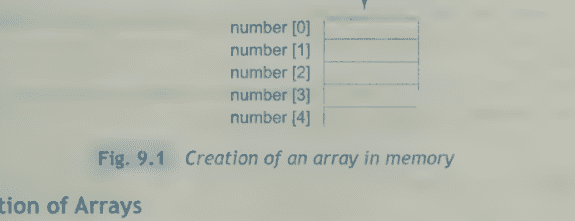

图 9.1 内存中数组的创建

#### 9.3.3 数组初始化

最后一步是将值放入已创建的数组中。此过程称为初始化。这是通过使用数组下标完成的，如下所示。

```
arrayname[subscript] = value ;
```

示例：

```
number[0] = 35;
number[1] = 40;
..........
number[4] = 19;
```

请注意，C# 从下标 0 开始创建数组，并以小于指定大小的值 1 结束。

C# 保护数组免受溢出和下溢。尝试访问数组边界之外的内容将生成错误消息。示例：
number [5] = 100; // error!

我们也可以在声明时以与普通变量相同的方式自动初始化数组，如下所示：
type [] arrayname = {list of values};

数组初始化器是用逗号分隔的值列表，并在两端用大括号定义。请注意，没有给出大小。编译器为列表中指定的所有元素分配足够的空间。

示例：
int[] number = {35, 40, 20, 57, 19};

前一行等价于：
int [] number = new int [5] { 35, 40, 20, 57, 19 };

这结合了声明、创建和初始化三个步骤。

可以为另一个数组对象分配数组对象。例如，
int[] a = {1,2,3};
int[] b;
b = a;

在 C# 中是有效的。两个数组将具有相同的值。

数组中的每个成员都会自动设置为默认值。例如，如果我们有一个数值类型的数组，每个元素都设置为数字 0。 （参见表 4.6）

C# 数组也可以保存引用类型元素。引用类型的数组仅包含对元素的引用，而不是实际值。数组中的引用类型会自动初始化为 null。在初始化之前尝试访问引用类型数组中的元素将导致错误。

#### 9.3.4 数组长度

在 C# 中，所有数组都是基于类的，并在名为 Length 的变量中存储分配的大小。我们可以使用 a.Length 访问数组 a 的长度。示例：
int aSize = a.Length;

此信息在操作大小未知时将很有用。

循环可用于初始化大尺寸数组。示例：

```
for(int i = 0; i < 100; i++)
{
    if(i < 50)
        sum[i] = 0.0;
    else
        sum[i] = 1.0;
}
```

数组 sum 的前五十个元素初始化为零，其余初始化为 1.0。


考虑下面所示的另一个示例：

```csharp
for (int x = 0; x < 10; x++)
    average[x] = (float)x;
```

此循环将数组 average 初始化为 0.0 到 9.0 的值。程序 9.1 说明了使用数组对数字列表进行排序。

#### 程序 9.1 | 对数字列表进行排序

```csharp
using System;
class NumberSorting
{
	public static void Main( )
	{
		int[] number = { 55, 40, 80, 65, 71 };
		int n = number.Length;
		Console.Write("Given list : ");
		for (int i = 0; i < n; i++)
		{
			Console.Write(" " + number[i]);
		}
		Console.WriteLine("\n");
		// Sorting begins
		for (int i = 0; i < n; i++)
		{
			for (int j = i+1; j < n; j++)
			{
				if(number[i] < number[j])
				{
					// Interchange values
					int temp = number[i];
					number[i] = number[j];
					number[j] = temp;
				}
			}
		}
		Console.Write("Sorted list : ");
		for (int i = 0; i < n; i++)
		{
			Console.Write(" " + number[i]);
		}
		Console.WriteLine(" ");
	}
}
```

程序 9.1 显示以下输出：

```text
Given list : 55 40 80 65 71

Sorted list : 80 71 65 55 40
```

### 9.4 二维数组

到目前为止，我们讨论了可以存储值列表的数组变量。在某些情况下，需要存储值表。考虑以下数据表，显示了四名销售员销售三种商品的销售额：

|            | Item1 | Item2 | Item3 |
|------------|-------|-------|-------|
| Salesgirl #1 | 310 | 275 | 365 |
| Salesgirl #2 | 210 | 190 | 325 |
| Salesgirl #3 | 405 | 235 | 240 |
| Salesgirl #4 | 260 | 300 | 380 |

该表包含总共十二个值，每行三个。我们可以将此表视为由四行三列组成的矩阵。每行代表特定销售员的销售额，每列代表特定商品的销售额。

在数学中，我们使用两个下标来表示矩阵中的特定值，例如 v_ij。这里 v 表示整个矩阵，v_ij 指第 i 行第 j 列的值。例如，在上表中 v_23 指值 325。C# 允许我们使用二维数组定义此类项目表。上面讨论的表可以在 C# 中表示为 v[4,3]

二维数组在内存中存储如图所示 9.2 所示。与一维数组一样，数组的每个维度从零索引到其最大大小减一；第一个索引选择行，第二个索引在该行内选择列。

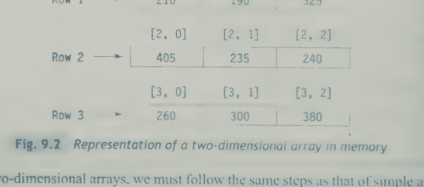

图 9.2 内存中二维数组的表示

创建二维数组时，我们必须遵循与简单数组相同的步骤。我们可以像这样创建一个二维数组：

```csharp
int[,] myArray;
myArray = new int[3,4];
```

或

```csharp
int[,] myArray = new int[3,4];
```

这创建了一个可以存储十二个整数值的表，四列三行。

与一维数组一样，二维数组也可以通过在其声明后跟随用大括号括起的初始值列表来初始化。例如，

```csharp
int[,] table ={{0,0,0},{1,1,1}};
```

将第一行的元素初始化为零，第二行的元素初始化为一。初始化按行进行。我们也可以以矩阵的形式初始化二维数组，如下所示：

```csharp
int[,] table = {
    {0,0,0},
    {1,1,1}
};
```

注意上面语句的语法。除了最后一行外，每个关闭行的括号后都需要逗号。

我们可以通过使用对应元素的列和行的下标来引用二维数组中存储的值。例如：

```csharp
int value = table[1,2];
```

这检索表矩阵中第二行第三列存储的值。

初始化二维数组的快速方法是使用嵌套 for 循环，如下所示：

```csharp
for (i = 0; i < 5; i++)
{
    for (j = 0; j < 5; j++)
    {
        if (i == j)
            table[i,j] = 1;
        else
            table[i,j] = 0;
    }
}
```

这将所有对角线元素设置为 1，其余设置为零，如下所示：

|   |   |   |   |   |
|---|---|---|---|---|
| 1 | 0 | 0 | 0 | 0 |
| 0 | 1 | 0 | 0 | 0 |
| 0 | 0 | 1 | 0 | 0 |
| 0 | 0 | 0 | 1 | 0 |
| 0 | 0 | 0 | 0 | 1 |

程序 9.2 说明了在现实生活情况下使用二维数组。

#### 程序 9.2 二维数组的应用

```csharp
using System;
class MulTable
{
    static int ROWS = 20;
    static int COLUMNS = 20;

    public static void Main()
    {
        int[,] product = new int[ROWS,COLUMNS];

        Console.WriteLine("MULTIPLICATION TABLE");
        Console.WriteLine(" ");
        int i,j;
        for (i = 10; i < ROWS; i++)
        {
            for (j = 10; j < COLUMNS; j++)
            {
                product[i,j] = i*j;
                Console.Write("  "+product[i,j]);
            }
            Console.WriteLine(" ");
        }
    }
}
```

程序 9.2 产生以下输出：

MULTIPLICATION TABLE

|    |    |    |    |    |    |    |    |    |    |
|---|---|---|---|---|---|---|---|---|---|
| 100 | 110 | 120 | 130 | 140 | 150 | 160 | 170 | 180 | 190 |
| 110 | 121 | 132 | 143 | 154 | 165 | 176 | 187 | 198 | 209 |
| 120 | 132 | 144 | 156 | 168 | 180 | 192 | 204 | 216 | 228 |
| 130 | 143 | 156 | 169 | 182 | 195 | 208 | 221 | 234 | 247 |
| 140 | 154 | 168 | 182 | 196 | 210 | 224 | 238 | 252 | 266 |
| 150 | 165 | 180 | 195 | 210 | 225 | 240 | 255 | 270 | 285 |
| 160 | 176 | 192 | 208 | 224 | 240 | 256 | 272 | 288 | 304 |
| 170 | 187 | 204 | 221 | 238 | 255 | 272 | 289 | 306 | 323 |
| 180 | 198 | 216 | 234 | 252 | 270 | 288 | 306 | 324 | 342 |
| 190 | 209 | 228 | 247 | 266 | 285 | 304 | 323 | 342 | 361 |

### 9.5 变长数组

C# 将多维数组视为“数组的数组”。可以按如下方式声明二维数组：

```csharp
int[] [] x = new int[3][];    //three rows array
x[0] = new int[2];            //first row has two elements
x[1] = new int[4];            //second row has four elements
x[2] = new int[3];            //third row has three elements
```

这些语句创建了一个二维数组，每个行的长度不同，如图 9.3 所示。变长数组称为锯齿数组。

元素可以按如下方式访问：

```csharp
x[1][1] = 10;
int y = x[2][2];
```

注意我们访问这两种数组的方式的差异。对于矩形数组，所有索引都在一组方括号内，而对于锯齿数组，每个元素都在自己的方括号内。

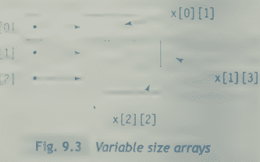

### 9.6 SYSTEM.ARRAY 类

在 C# 中，我们创建的每个数组都自动派生自 System.Array 类。该类定义了许多方法和属性，可用于更有效地操作数组。表 9.1 列出了一些常用的方法和其用途。

#### 表 9.1 System.Array 类的一些常用方法

| METHOD/PROPERTY | PURPOSE |
|---|---|
| Clear () | Sets a range of elements to empty values |
| CopyTo () | Copies elements from the source array into the destination array |
| GetLength () | Gives the number of elements in a given dimension of the array |
| GetValue () | Gets the value for a given index in the array |
| Length | Gives the length of an array |
| SetValue () | Sets the value for a given index in the array |
| Reverse () | Reverses the contents of a one-dimensional array |
| Sort () | Sorts the elements in a one-dimensional array |

程序 9.3 说明了 Sort () 和 Reverse () 方法的实现。

#### 程序 9.3 对数组进行排序和反转

```csharp
using System;
class SortReverse
{
    public static void Main()
    {
        //creating an array
        int [] x = { 30, 10, 80, 90, 20 };
        Console.WriteLine ("Array before sorting");
        foreach (int i in x)
            Console.Write(" " + i );
        Console.WriteLine ();
        //Sorting and reversing the array elements
        Array.Sort(x); Array.Reverse (x);
        Console.WriteLine("Array after Sorting and Reversing");
        foreach ( int i in x )
            Console.Write(" " + i);
        Console.WriteLine ();
    }
}
```

程序 9.3 的输出：

```text
Array before sorting
30 10 80 90 20
Array after Sorting and Reversing
90 80 30 20 10
```


### 9.7 ARRAYLIST 类

System.Collections 命名空间定义了一个名为 ArrayList 的类，该类可以存储动态大小的对象数组。ArrayList 类包含许多方法来支持排序、删除和枚举其内容等操作。它还支持一个属性 Count，用于给出数组列表中的对象数量，以及一个属性 Capacity 用于修改或读取容量。

数组列表与数组非常相似，只是它具有动态增长的能力。我们可以通过指定想要的初始容量来创建一个数组列表。示例：

```
ArrayList cities = new ArrayList (30);
```

它创建了一个容量可存储三十个对象的 cities。 如果我们不指定大小，则默认为十六。 即，ArrayList cities = new ArrayList (); 将创建一个容量可存储十六个对象的 cities 列表。我们现在可以使用 Add () 方法向列表中添加元素：

```
cities.Add ("Bombay");
cities.Add ("Anand");
```

我们也可以删除一个元素：

```
cities.RemoveAt (1);
```

这将删除位置 1 处的对象。我们可以使用 Capacity 属性修改列表的容量：

```
cities.Capacity = 20;
```

我们可以使用 Count 属性按如下方式获取列表中实际存在的对象数：

```
int n = cities.Count;
```

如果我们需要创建一个对象数组但事先不知道数组会有多大，则数组列表会非常有用。此外，数组列表可以包含任何对象引用。

表 9.2 列出了 ArrayList 类支持的一些最重要的方法和属性。

#### 表 9.2 一些重要的 ArrayList 方法和属性

| METHODS/PROPERTY | PURPOSE |
|---|---|
| Add () | Adds an object to a list |
| Clear () | Removes all the elements from the list |
| Contains () | Determines if an element is in the list |
| CopyTo () | Copies a list to another |
| Insert () | Inserts an element into the list |
| Remove () | Removes the first occurrence of an element |
| RemoveAt () | Removes the element at the specified place |
| RemoveRange () | Removes a range of elements |
| Sort () | Sorts the elements |
| Capacity | Gets or sets the number of elements in the list |
| Count | Gets the number of elements currently in the list |

程序 9.4 演示了如何创建和操作数组列表。

#### 程序 9.4 | 使用 ARRAYLIST 类

```
using System;
using System.Collections;
class City
{
    public static void Main( )
    {
        ArrayList n = new ArrayList ();
        n.Add ("Madras");
        n.Add ("Bombay");
        n.Add ("Anand");
        n.Add ("Calcutta");
        n.Add ("Delhi");
        Console.WriteLine("Capacity = " + n.Capacity);
        Console.WriteLine("Elements present = " + n.Count);
        n.Sort();
        for (int i = 0; i < n.Count; i ++)
        {
            Console.WriteLine(n[i]);
        }
        Console.WriteLine();
        n.RemoveAt(4);
        for (int i = 0 ; i < n.Count ; i ++)
        {
            Console.WriteLine(n[i]);
        }
    }
}
```

程序 9.4 产生以下输出：

capacity = 16
Elements present = 5
Anand
Bombay
Calcutta
Delhi
Madras

Anand
Bombay
Calcutta
Delhi

程序 9.5 创建一个包含 10 个质数的数组列表并统计数组列表的元素数和容量。之后，程序从开头删除两个元素，统计元素数，然后再次在数组列表开头替换两个质数。

```
Console.Write(m + "");
Console.WriteLine();
}
}
```

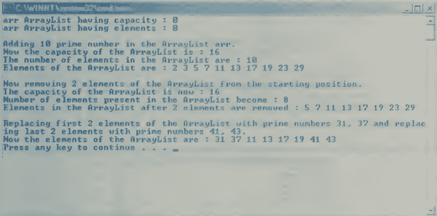

程序 9.6 在数组中显示数组项，然后反转数组的元素。另一个具有字符串元素的数组用于按字母顺序对数组元素进行排序，然后显示反转后的数据。

#### 程序 9.6

##### SORT 和 REVERSE 方法的应用

```
using System;
using System.Collections.Generic;
using System.Text;
namespace ArraySort_ReverseExample
{
class Program
{
public static void ArrDisplay(string[] arr1)
{
foreach (string str in arr1)
{
Console.WriteLine("Value: {0}", str);
}
Console.WriteLine("\n");
}
static void Main(string[] args)
{
```

#### 程序 9.7 不规则数组的说明

```
using System;
using System.Collections.Generic;
using System.Text;
namespace jaggedArrayExample
{
    class Program
    {
        static void Main(string[] args)
        {
            const int rows = 3;
            // declare the jagged array as 3 rows high
            int[][] jagArr = new int[rows][];
            // a row with 2 elements
            jagArr[0] = new int[2];
            // a row with 3 elements
            jagArr[1] = new int[3];
            // a row with 4 elements
            jagArr[2] = new int[4];
            // Fill some (but not all) elements of the rows
            jagArr[0][1] = 54;
            jagArr[1][0] = 26;
            jagArr[1][1] = 18;
            jagArr[2][0] = 72;
            jagArr[2][3] = 404;
            for (int i = 0; i < 2; i++)
            {
                Console.WriteLine("This is jagged Array 1 having elements : [0][{0}] = {1}", i, jagArr[0][i]);
            }
            for (int i = 0; i < 3; i++)
            {
                Console.WriteLine("This is jagged Array 2 having elements : [1][{0}] = {1}", i, jagArr[1][i]);
            }
            for (int i = 0; i < 4; i++)
            {
                Console.WriteLine("This is jagged Array 3 having elements : [2][{0}] = {1}", i, jagArr[2][i]);
            }
        }
    }
}
```

#### 案例研究

##### 问题陈述

B.G International School 是一所提供从幼儿园到十年级初等教育给儿童的教育机构。B.G International School 的行政人员必须维护记录，其中包括在不同班级学习的学生姓名、班级和学号。手动维护每个学生的记录对于 B.G International School 的行政人员来说是一个繁琐的过程。当行政人员手动在登记册中输入记录时，会出现大量错误。B.G International School 如何自动化学生记录的输入任务？

##### 解决方案

为了使维护学生记录的过程变得简单高效，B.G International School 联系 SoftDev 软件开发组织创建一个应用程序，以帮助输入学生记录的任务。SoftDev 将为 B.G International School 创建应用程序的任务分配给该组织的资深程序员 Siddharth。Siddharth 决定使用 C# 编程语言创建输入学生记录的应用程序。C# 在 System.Collections 命名空间中提供了 ArrayList 类。此 ArrayList 类允许我们创建一个数组列表，可以存储数组对象。数组列表的大小在运行时固定。因此，使用 ArrayList 类创建的数组列表是动态数组列表。由于 B.G International School 需要输入大量数据，使用 ArrayList 对 Siddharth 来说会有所帮助。

在了解了 B.G International School 的需求后，Siddharth 开发了以下 C# 应用程序。

```
using System;
using System.Collections;
using System.Collections.Generic;
using System.Text;
namespace AddStudentDetails
{
    class StudentDetails
    {
```

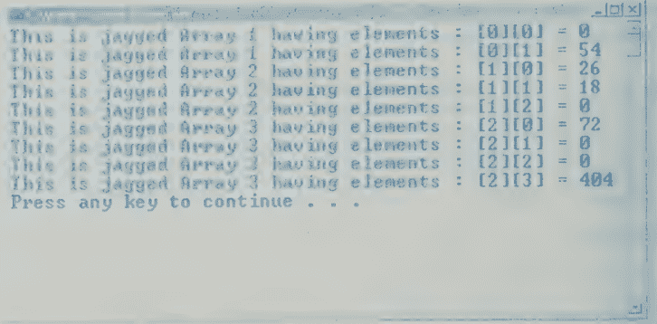

```
static void Main(string[] args)
{
    string studname1, studname2, studname3;
    string classname1, classname2, classname3;
    string rollno1, rollno2, rollno3;
    string getresult;
    ArrayList arrlists = new ArrayList();
    Console.WriteLine("The initial capacity of arraylist =" + arrlists.Capacity);
    Console.WriteLine("The initial elements are =" + arrlists.Count);
    Console.WriteLine("Enter Details of Student 1");
    Console.WriteLine("___________________________");
    Console.Write("Enter Name of Student1 : ");
    studname1 = Console.ReadLine();
    Console.Write("Enter Class of Student1 : ");
    classname1 = Console.ReadLine();
    Console.Write("Enter Roll No. of Student1 : ");
    rollno1 = Console.ReadLine();
    Console.WriteLine("___________________________");
    Console.Write("Enter Name of Student2 : ");
    studname2 = Console.ReadLine();
    Console.Write("Enter Class of Student2 : ");
    classname2 = Console.ReadLine();
    Console.Write("Enter Roll No. of Student2 : ");
    rollno2 = Console.ReadLine();
    Console.WriteLine("___________________________");
    Console.Write("Enter Name of Student3 : ");
    studname3 = Console.ReadLine();
    Console.Write("Enter Class of Student3 : ");
    classname3 = Console.ReadLine();
    Console.Write("Enter Roll No. of Student3 : ");
    rollno3 = Console.ReadLine();
    Console.WriteLine("___________________________");
    arrlists.Add(studname1);
    arrlists.Add(classname1);
    arrlists.Add(rollno1);
    arrlists.Add(studname2);
    arrlists.Add(classname2);
    arrlists.Add(rollno2);
    arrlists.Add(studname3);
    arrlists.Add(classname3);
    arrlists.Add(rollno3);
    Console.WriteLine("Current Capacity=" + arrlists.Capacity);
    Console.WriteLine("ArrayList having elements = " + arrlists.Count);
    Console.Write("ArrayList is having content:-");
    for (int i = 0; i < arrlists.Count; i++)
    {
        Console.Write(arrlists[i] + " ");
    }
    Console.WriteLine("\n");
    Console.WriteLine("To remove 2nd student details press y or to interchange student details1 with student details3 press n.");
```


```
getresult = Console.ReadLine();
if (getresult == "y")
{
    Console.WriteLine("Removing 2nd Student details");
    Console.WriteLine("________________________");
    arrlists.Remove(studname2);
    arrlists.Remove(classname2);
    arrlists.Remove(rollno2);
    Console.WriteLine("Current Capcity of the arraylist is now =" + arrlists.Capacity);
    Console.WriteLine("Arraylist is having elements=" + arrlists.Count);
    Console.Write("The elements of Arraylist are now:-");
    for (int m = 0; m < arrlists.Count; m++)
    {
        Console.Write(arrlists[m] + " ");
    }
    Console.WriteLine("\n");
}
else
{
    Console.WriteLine("\n");
    Console.WriteLine("Changing elements");
    Console.WriteLine("________________________");
    arrlists[0] = studname3.ToString();
    arrlists[1] = classname3;
    arrlists[2] = rollno3;
    arrlists[6] = studname1;
    arrlists[7] = classname1;
    arrlists[8] = rollno1;
    Console.Write("Now the elements of the ArrayList are : ");
    for (int m = 0; m < arrlists.Count; m++)
    {
        Console.Write(arrlists[m] + " ");
    }
    Console.WriteLine("\n");
}
}
```

Remarks With the use of the C# application created by Siddharth, the administrative staff of B.G International School will be able to save time in entering the details such as names and classes of students studying in different classes.

备注 通过使用 Siddharth 创建的 C# 应用程序，B.G International School 的行政人员在输入不同班级学生的姓名和班级等详细信息时将能够节省时间。

## Common Programming Errors

## 常见编程错误

- Forgetting to declare an array.
- 忘记声明数组。
- Forgetting to initialize the elements of an array whose elements must be initialized.
- 忘记初始化必须初始化元素的数组的元素。
- Referring an element outside the array bounds (e.g. Off-by-one error).
- 引用数组边界之外的元素（例如，差一错误）。
- Referencing the double subscripted array as x [ ] [ ] instead of x [ ].
- 将双下标数组引用为 x [ ] [ ] 而不是 x [ ]。
- Referencing a jagged array as x [ ] instead of x[ ] [ ].
- 将锯齿数组引用为 x [ ] 而不是 x[ ] [ ]。
- Treating an Array type array as an ArrayList type array.
- 将 Array 类型数组当作 ArrayList 类型数组处理。
- Forgetting to use capital letters for the first characters of the methods and properties used form the namespaces.
- 忘记为从命名空间使用的方法和属性的首字母使用大写字母。
- Forgetting the use of the System.Collections namespaces while using ArrayList class.
- 使用 ArrayList 类时忘记使用 System.Collections 命名空间。

## Review Questions

## 复习题

9.1 State whether the following statements are true or false.

9.1 判断以下陈述是否正确或错误。

- (a) It is necessary to specify the size of an array during its declaration.
- (a) 在声明数组时，有必要指定数组的大小。
- (b) In C#, arrays are created in memory using the operator new.
- (b) 在 C# 中，数组使用 new 运算符在内存中创建。
- (c) In C#, arrays start with the subscript zero.
- (c) 在 C# 中，数组下标从零开始。
- (d) Trying to access an array beyond its boundaries will cause a run time error.
- (d) 尝试访问数组边界之外会导致运行时错误。
- (e) C# arrays are created on the heap.
- (e) C# 数组是在堆上创建的。
- (f) C# arrays cannot store reference type data.
- (f) C# 数组不能存储引用类型数据。
- (g) A jagged array is declared using the same syntax as that of rectangular arrays.
- (g) 锯齿数组的声明语法与矩形数组相同。
- (h) C# permits the assignment of an array object to another.
- (h) C# 允许将一个数组对象赋值给另一个。
- (i) An array of type System.Array is of fixed size.
- (i) System.Array 类型的数组是固定大小的。
- (j) An array of type ArrayList is of fixed size.
- (j) ArrayList 类型的数组是固定大小的。
- (k) The default size of an ArrayList array is 16.
- (k) ArrayList 数组的默认大小是 16。
- (l) An array of type ArrayList can contain many different types of objects.
- (l) ArrayList 类型的数组可以包含许多不同类型的对象。
- (m) An array declaration creates memory space for the array.
- (m) 数组声明为数组创建内存空间。
- (n) It is an error if an initializer list contains more values than the number elements in the array.
- (n) 如果初始化列表包含的值多于数组中的元素数，则是错误。

9.2 Explain the need for array variables.

9.2 解释数组变量的必要性。

9.3 What are the two ways to initialize an array of three values?

9.3 初始化包含三个值的数组的两种方法是什么？

9.4 Are arrays reference or value types? And where are they created?

9.4 数组是引用类型还是值类型？它们在哪里创建？

9.5 Identify errors, if any, in the following array declaration statements.

9.5 识别以下数组声明语句中的错误，如有。

- (a) int score ( );
- (a) int score ( );
- (b) float values [ ];
- (b) float values [ ];
- (c) float table [ ] [ ];
- (c) float table [ ] [ ];
- (d) string name [5];
- (d) string name [5];
- (e) int [ ] m, n;
- (e) int [ ] m, n;
- (f) int [d] x;
- (f) int [d] x;
- (g) int [ ] counter = int [5];
- (g) int [ ] counter = int [5];

9.6 Identify errors, if any, in the following initialization statement.

9.6 识别以下初始化语句中的错误，如有。

- (a) int [ ] number = {0, 0, 0};
- (a) int [ ] number = {0, 0, 0};
- (b) int [ ] x = new int [3] {1, 2, 3, 4};
- (b) int [ ] x = new int [3] {1, 2, 3, 4};
- (c) list [3] = {1, 2, 3};
- (c) list [3] = {1, 2, 3};
- (d) int [ ] code = {1, 2, 3,};
- (d) int [ ] code = {1, 2, 3,};
- (e) int [,] table = {0, 0, 0}, {1, 1, 1};
- (e) int [,] table = {0, 0, 0}, {1, 1, 1};
- (f) float [ ] MARKS = {5.75, 9.25, 6.0};
- (f) float [ ] MARKS = {5.75, 9.25, 6.0};

```
for (n = 0; n < columnValues; n++)
{
    Console.WriteLine("[{0},{1}] - {2}",m, n, recArr[]);
}
}
}
}
```

9.2 Find errors in the following program that displays arrays.

9.2 找出以下显示数组的程序中的错误。

```
using System;
using System.Collections.Generic;
using System.Text;
namespace debugApp1_chap9
{
    class Program
    {
        static void Main(string[] args)
        {
            Program prg = new Program();
            prg.Display(1, 2, 3, 4);
            int exArr[] = new int[]{"23","33","43","53"};
            Console.WriteLine("Example of array.");
            Console.WriteLine("New array elements added.");
            prg.Display(exArr[]);
        }
        public void Display(params int[] val1)
        {
            foreach (int i in val1)
            {
                Console.WriteLine("The array is having : {0}", i);
            }
        }
    }
}
```

## Programming Exercises

## 编程练习

9.1 Write an example of a numeric two-dimensional array and reverse them before printing

9.1 编写一个数值二维数组的示例，并在打印前将其反转

9.2 Write a program that initializes an array of size 5 x 5 as follows:

9.2 编写一个程序，将大小为 5 x 5 的数组初始化如下：

| 1 | 0 | 1 | 0 | 1 |
| 0 | 1 | 0 | 1 | 0 |
| 1 | 0 | 1 | 0 | 1 |
| 0 | 1 | 0 | 1 | 0 |
| 1 | 0 | 1 | 0 | 1 |

Write a program to read the data and determine the following:
编写一个程序读取数据并确定以下内容：
(a) Total marks obtained by each student.
(a) 每位学生获得的总成绩。
(b) The highest marks in each subject and the Roll No. of the student who secured it.
(b) 每个科目的最高成绩以及获得该成绩的学生的学号。
(c) The student who obtained the highest total marks.
(c) 获得最高总成绩的学生。

9.8 Given are two one-dimensional arrays A and B which are sorted in ascending order. Write a program to merge them into a single sorted array C that contains every items from arrays A and B, in ascending order.

9.8 给定两个按升序排序的一维数组 A 和 B。编写一个程序，将它们合并为一个排序后的数组 C，其中包含数组 A 和 B 中的所有项目，按升序排列。

9.9 Two matrices that have the same number of rows and columns can be multiplied to produce a third matrix. Consider the following two matrices.

9.9 具有相同行数和列数的两个矩阵可以相乘产生第三个矩阵。考虑以下两个矩阵。

A = [ a11 a12 .............. a1n ]
    [ a21 a22 .............. a2n ]
    [ : ]
    [ an1 .............. ann ]

B = [ b11 b12 .............. b1n ]
    [ b21 b22 .............. b2n ]
    [ : ]
    [ bn1 .............. bnn ]

The product of A and B is a third matrix C of size n × n where each element of C is given by the following equation.

A 和 B 的乘积是一个大小为 n × n 的第三个矩阵 C，其中 C 的每个元素由以下方程给出。

c_ij = Σ (k=1 to n) a_ik b_kj

Write a program that will read the values of elements of A and B and produce the product matrix C.

编写一个程序读取 A 和 B 元素的数值并生成乘积矩阵 C。

9.10 Write a program that accepts a shopping list of five items from the command line, stores them in string type array and then prints the list in alphabetical order.

9.10 编写一个程序，从命令行接受五个项目的购物清单，将它们存储在字符串类型数组中，然后按字母顺序打印清单。

9.11 Modify the program of Exercise 9.9 so that we may accomplish the following.

9.11 修改练习 9.9 的程序，以便我们能够完成以下任务。

- To delete an item in the list.
- 删除列表中的项目。
- To add an item in the list at a specified location
- 在指定位置添加列表中的项目
- To add an item at the end of the list
- 在列表末尾添加项目
- To print the contents of the list
- 打印列表的内容

9.12 Write a method that would take an array as input and check whether a given element is present in the list or not. The method must return true if it is present, otherwise return false.

9.12 编写一个方法，将数组作为输入并检查给定元素是否存在于列表中。方法必须在存在时返回 true，否则返回 false。

9.13 Write a program that stores a list of numbers in an array and computes the maximum and minimum values in the list.

9.13 编写一个程序，将数字列表存储在数组中并计算列表中的最大值和最小值。

9.14 Write your own method reverse that would reverse the sequence of elements in an array. Test your method with a suitable program.

9.14 编写自己的方法 reverse，该方法将反转数组中元素的顺序。用合适的程序测试你的方法。

9.15 Write a method that would print the alternate elements in an array. Write a program using this method two separate list of alternate elements of a given list. For example, if the given list is say,
1 2 3 4 5 6 7 8 9
then the program should print out two lists as follows:
1 3 5 7 9
2 4 6 8

9.15 编写一个方法打印数组中的交替元素。编写一个程序，使用此方法对给定列表的两个单独的交替元素列表进行。例如，如果给定的列表是
1 2 3 4 5 6 7 8 9
则程序应按如下方式打印出两个列表：
1 3 5 7 9
2 4 6 8

9.16 Write a method that would take two arrays as input and produces a third array by appending one to the other.

9.16 编写一个方法，将两个数组作为输入并通过将一个附加到另一个来生成第三个数组。

- Reading from the keyboard
- 从键盘读取
- Using ToString method
- 使用 ToString 方法

### 10.2.1 Assigning String Literals

### 10.2.1 分配字符串字面量

The most common way to create a string is to assign a quoted string of characters known as string literal to a string object. For example:

创建字符串最常见的方法是将称为字符串字面量的带引号的字符字符串分配给字符串对象。例如：

```
string s1;----- //declaring a string object
s1 = "abc";--- //assigning string literal
```

Both these statements may be combined into one as follows:

这两个语句可以合并为如下所示的一个语句：

```
string s1 = "abc"; //declaring and assigning
```

### 10.2.2 Copying Strings

### 10.2.2 复制字符串

We can also create new copies of existing strings. This can be accomplished in two ways:

我们还可以创建现有字符串的新副本。这可以通过两种方式实现：

- Using the overloaded = operator
- 使用重载的 = 运算符
- Using the static Copy method
- 使用静态 Copy 方法

Example:

示例：

```
string s2 = s1;               //assigning
string s2 = string.Copy(s1);   //copying
```

Both these statements would accomplish the same thing, namely, copying the contents of s1 into s2.

这两个语句都会实现同样的目的，即将 s1 的内容复制到 s2 中。

### 10.2.3 Concatenating Strings

### 10.2.3 连接字符串

We may also create new strings by concatenating existing strings. There are a couple of ways to accomplish this.

我们还可以通过连接现有字符串来创建新字符串。有几种方法可以实现这一点。

- Using the overloaded + operator
- 使用重载的 + 运算符
- Using the static Concat method
- 使用静态 Concat 方法

Examples:

示例：

```
string s3 = s1 + s2; //s1 and s2 exist already
string s3 = string.Concat(s1, s2)
```

If s1 = 'abc' and s2 = 'xyz', then both the statements will store the string 'abcxyz' in s3. Note that the contents of s2 is simply appended to the contents of s2 and the result is stored in s3.

如果 s1 = 'abc' 且 s2 = 'xyz'，那么这两个语句都将在 s3 中存储字符串 'abcxyz'。请注意，s2 的内容只是附加到 s2 的内容上，结果存储在 s3 中。

### 10.2.4 Reading from the Keyboard

### 10.2.4 从键盘读取

It is possible to read a string value interactively from the keyboard and assign it to a string object.

可以从键盘交互式读取字符串值并将其分配给字符串对象。

```
string s = Console.ReadLine();
```

On reaching this statement, the computer will wait for a string of characters to be entered from the keyboard. When the 'return key' is pressed, the string will be read and assigned to the string object s.

到达此语句时，计算机将等待从键盘输入一串字符。当按下“回车键”时，字符串将被读取并分配给字符串对象 s。

### 10.2.5 The ToString Method

### 10.2.5 ToString 方法

Another way of creating a string is to call the ToString method on an object and assign the result to a string variable.

创建字符串的另一种方法是调用对象的 ToString 方法并将结果分配给字符串变量。

```
int number = 123;
string numStr = number.ToString();
```


该语句将数字 123 转换为字符串 ‘123’，然后将字符串值赋给字符串变量 numStr。

## 10.2.6 原始字符串

字符串也可以使用所谓的 verbatim 字符串来创建。Verbatim 字符串是以 @ 符号开头的字符串。该符号告诉编译器字符串应按原样使用，即使它包含转义字符。

```
string s1 = @ "\EBG\Csharp\string.cs";
```

为了在不使用 @ 符号的情况下获得相同的输出，输入字符串应写成如下形式：

```
string s1 = "\\EBG\\Csharp\\string.cs";
```

我们也可以在 @ 引用的字符串中使用转义字符如 n 和 t。它们在输出时不会被处理，并在文本中按原样出现。

请注意，如果普通字符串包含嵌入的 n，则在对字符串进行输出处理时，n 之后的字符串将显示在下一行。

## 10.3 字符串方法

字符串对象是不可变的，这意味着我们不能修改其中包含的字符。然而，由于字符串是通用语言运行时（CLR）中预定义的 System.String 类的别名，因此有许多内置操作可用于处理字符串。所有操作都会产生字符串的修改版本，而不是修改调用该方法所依据的字符串。

表 10.1 列出了可用于各种操作的各种方法，例如比较、追加、插入、转换、复制、索引、连接、拆分、填充、修剪、删除、替换和搜索。我们在上一节中已经使用了一些方法，如 Concat 和 Copy。

### 表 10.1 字符串类方法

| METHOD | OPERATION |
|---|---|
| Compare () | Compares two strings |
| CompareTo () | Compares the current instance with another instance |
| ConCat () | Concatenates two or more strings |
| Copy() | Creates a new string by copying another |
| CopyTo () | Copies a specified number of characters to an array of Unicode characters |
| EndsWith () | Determines whether a substring exists at the end of the string |
| Equals() | Determines if two strings are equal |
| IndexOf () | Returns the position of the first occurrence of a substring |
| Insert () | Returns a new string with a substring inserted at a specified location |
| Join () | Joins an array of strings together |
| LastIndexOf () | Returns the position of the last occurrence of a substring |
| PadLeft () | Left-aligns the strings in a field |
| PadRight () | Right-aligns the string in a field |
| Remove () | Deletes characters from the string |
| Replace () | Replaces all instances of a character with a new character |
| Split () | Creates an array of strings by splitting the string at any occurrence of one |
| StartsWith () | Determines whether a substring exists at the beginning of the string |
| Substring () | Extracts a substring |
| ToLower () | Returns a lower-case version of the string |
| ToUpper () | Returns an upper-case version of the string |
| Trim () | Removes white space from the string |
| TrimEnd () | Removes a string of characters from the end of the string |
| TrimStart () | Removes a string of characters from the beginning of the string |

## 10.4 插入字符串

字符串方法使用我们想要操作的字符串对象调用。程序 10.1 说明了 System.String 类支持的 Insert () 方法和索引器属性的使用。

### 程序 10.1 使用 INSERT () 方法

```
using System;
class StringMethod
{
    public static void Main()
    {
        string s1 = "Lean";
        string s2 = s1.Insert(3,"r");      // s2 = Learn
        string s3 = s2.Insert(5,"er");     // s3 = Learner
        for (int i = 0; i < s3.Length; i++)
            Console.Write(s3[i]);
        Console.WriteLine();
    }
}
```

当语句
    string s2 = s1.Insert(3, "r");
执行时，字符串变量 s2 包含字符串 "Learn"。字符串 "r" 在 s1 的 3 个字符后插入。同样，字符串 "er" 在字符串末尾插入。最后，变量 s3 包含值 "Learner"。

请注意，我们并没有修改给定字符串变量的内容。相反，我们将修改后的值赋给新的字符串变量。例如：
    s1 = s1.Insert(3, "r");
是非法的。我们试图修改不可变的字符串对象 s1。

程序 10.2 从用户处作为字符串接收两个输入，并将 string2 的输入复制到 string5 并检查 string3 是否以 'IDE' 结尾。程序在 string3 以 'IDE' 结尾时显示 true。搜索字符串1 中的字符 'a'。在位置 6 插入 'hello' 到 string6 并显示 string6。

### 程序 10.2
复制、搜索和插入字符串

```
using System;
using System.Collections.Generic;
using System.Text;
namespace SearchString
{
    class Program
    {
        public void Display()
        {
            string str1 = "";
            Console.Write("Enter a string : ");
            str1 = Console.ReadLine();
            string str2 = "";
            Console.Write("Enter another string string : ");
            str2 = Console.ReadLine();
            string str3 = "C# 2005 is developed in Visual Studio 2005 IDE";
            Console.WriteLine("String str3 is : {0}", str3);
            // the string copy method
            string str5 = string.Copy(str2);
            Console.WriteLine("String str5 is copied from str2: {0}", str5);
            Console.WriteLine("\nString str5 is {0} characters long. ", str5.Length);
            Console.WriteLine("The 10th character of string str3 is : {0}", str3[9]);
            // check if a string ends with a set of characters
            Console.WriteLine("String str3:{0}\nEnds with IDE?: {1}\n", str3, str3.EndsWith("IDE"));
            Console.WriteLine("Ends with Studio?: {0}", str3.EndsWith("Studio"));
            // return the index of the substring
            Console.WriteLine("\nThe first time character 'a' occured in string str1 at position : {0}", str1.IndexOf("a")+1);
            string str6 = str2.Insert(6, "hello");
            Console.WriteLine("'hello' is inserted in string str6. String s6 is now : {0}\n", str6);
        }
        static void Main(string[] args)
        {
            Program prg = new Program();
            prg.Display();
        }
    }
}
```

## 10.5 比较字符串

字符串类支持重载的方法和运算符来比较两个字符串是否相等。它们是：

- 重载 Compare() 方法
- 重载 Equals() 方法
- 重载 == 运算符

### 10.5.1 Compare() 方法

重载的静态 Compare 方法有两个版本。第一个接受两个字符串作为参数并比较它们。示例：
int n = string.Compare(s1,s2);

这会执行区分大小写的比较，并根据不同条件返回不同的整数值，如下所示：

- 零整数，如果 s1 等于 s2
- 正整数（1），如果 s1 大于 s2
- 负整数（-1），如果 s1 小于 s2

例如，如果 s1 = "abc" 且 s2 = "ABC"，则 n 将被赋值为 -1。记住，小写字母的 ASCII 值小于大写字母。

我们可以在 if 语句中使用此类比较语句，如：
if ( string.Compare(s1, s2) == 0 )
( Console.WriteLine("They are equal");

Compare 的第二个版本接受一个额外的 bool 类型参数来决定是否忽略大小写。如果 bool 参数为 true，则忽略大小写。示例：
int n = string.Compare(s1, s2, true);

该语句比较字符串 s1 和 s2 忽略大小写，因此当 s1 = "abc" 且 s2 = "ABC" 时返回零，意味着它们相等。

### 10.5.2 Equals( ) 方法

字符串类支持重载的 Equals 方法来测试字符串的相等性。Equals 方法也有两个版本。它们实现如下：

```
bool b1 = s2.Equals(s1);
bool b2 = string.Equals(s2, s1);
```

这些方法如果 s1 和 s2 相等则返回布尔值 true，否则返回 false。

### 10.5.3 == 运算符

测试字符串相等的一种简单自然的方法是使用重载的 == 运算符。

示例：

```
bool b3 = (s1 == s2); //b3 is true if they are equal
```

我们经常在决策语句中使用此类语句，如：

```
if (s1 == s2)
    Console.WriteLine("They are qual");
```

## 10.6 查找子字符串

可以使用 String 类中可用的重载 Substring 方法从给定字符串中提取子字符串。Substring 有两个版本：

- s.Substring(n)
- s.Substring(n1, n2)

第一个从 s 中包含的字符串的第 n 个位置提取子字符串，直到最后一个字符。第二个从 s 中从 n1 位置开始提取子字符串，结束于 n2 位置。示例：

```
string s1 = "NEW YORK";
string s2 = s1.Substring(5);
string s3 = s1.Substring(0,3);
string s4 = s1.Substring(5,8);
```

执行时，字符串变量将包含以下子字符串：

- s2: YORK
- s3: NEW
- s4: YORK

## 10.7 可变字符串

使用 StringBuilder 类可以创建可修改的可变字符串。示例：

```
StringBuilder str1 = new StringBuilder("abc");
StringBuilder str2 = new StringBuilder();
```

字符串对象 str1 以三个字符的初始大小创建，str2 创建为空字符串。它们可以在向其中添加更多字符时动态增长。它们可以无限制增长或增长到可配置的最大值。可变字符串也称为动态字符串。

StringBuilder 类支持许多用于操作动态字符串的方法。表 10.2 列出了一些最常用的方法。


## 表 10.2 一些有用的 StringBuilder 方法

| 方法 | 操作 |
|---|---|
| Append () | 追加一个字符串 |
| AppendFormat () | 使用特定格式追加字符串 |
| EnsureCapacity () | 确保足够大小 |
| Insert () | 在指定位置插入一个字符串 |
| Remove () | 删除指定的字符 |
| Replace () | 用指定的字符替换所有实例 |

C# 还支持一些称为属性的特殊函数。它们列在表 10.3 中

## 表 10.3 StringBuilder 属性

| 属性 | 用途 |
|---|---|
| Capacity | 获取或设置对象可容纳的字符数 |
| Length | 获取或设置长度 |
| MaxCapacity | 获取对象的最大容量 |
| [] | 获取或设置指定位置的字符 |

程序 10.3 显示了如何使用一些方法来操作字符串。该程序实现了以下方法和属性：

- Length
- Append ()
- 索引器 []
- Insert ()

System.Text 命名空间包含 StringBuilder 类，因此我们必须包含 using System.Text 指令以创建和操作可变字符串。

### 程序 10.3 使用 STRINGBUILDER 方法

```
using System.Text; //For using StringBuilder
using System;
class StringBuilderMethod
{
    public static void Main()
    {
        StringBuilder s = new StringBuilder ("Object ");
        Console.WriteLine("Original string : " + s);
        Console.WriteLine("Length : " + s.Length);
        //Appending a string
        s.Append("language ");
        Console.WriteLine("String now : " + s);
        //Inserting a string
        s.Insert(7,"oriented ");
        Console.WriteLine("Modified string : " + s);
        //Setting a character
        int n = s.Length;
        s[n-1] = '!';
        Console.WriteLine("Final string      : " + s);
    }
}
```

查看程序 10.3 产生的输出：

- Original string  :  Object
- Length           :  7
- String now       :  Object language
- Modified string  :  Object oriented language
- Final string     :  Object oriented language!

程序 10.4 从用户接受两个字符串输入并将第一个字符串追加到预定义值。使用 StringBuilder 类，在字符串中插入一个字符串值。然后，将第一个字符串中的所有空格替换为 *，并计算追加后的两个字符串的长度。

### 程序 10.4 使用 STRINGBUILDER 类

```
using System;
using System.Collections.Generic;
using System.Text;
namespace StringExample
{
    class Program
    {
        public void Show()
        {
            string str1="";
            string str2="";
            Console.Write("Please enter a string : ");
            str1 = Console.ReadLine();
            Console.Write("Please enter another string : ");
            str2 = Console.ReadLine();
            StringBuilder builder1 = new StringBuilder(str1, 4);
            StringBuilder builder2 = new StringBuilder(str2, 4);
            int cap = builder1.EnsureCapacity(55);
            Console.Write("string str1 appended to : ");
            builder1.Append(". This is a class test.");
            Console.WriteLine(builder1);
            Console.Write("string str2 inserted with : ");
            builder2.Insert(2, " String Builder");
            Console.WriteLine(builder2);
            Console.WriteLine("\nSecond character of string2 removed.\n");
            builder2.Remove(2, 4);
            Console.WriteLine(builder2);
            builder1.Replace(' ', '*');
            Console.WriteLine("\nSpaces removed from string1\n");
            Console.WriteLine(builder1);
            Console.WriteLine("\nLength of string1 is:" + builder1.Length.ToString());
            Console.WriteLine("\nLength of string2 is:" + builder2.Length.ToString());
        }
        static void Main(string[] args)
        {
            Program prg = new Program();
            prg.Show();
        }
    }
}
```

C:\WINNT\system32\cmd.exe
Enter a small string : TEST
Enter a small string : test
s5 is having the value of string str2: test
String str5 is 4 characters long.
The value of 5th character is 0
str3:C# 2005 is one of the core Languages of .NET. It provides a custom .NET development platform for developing applications.
Ends with development?: False
Ends with applications?: False
The first occurrence of development
in str3 is at position 72
str10: C# 2005 is one of the core Languages of .NET. It provides a custom .NET nice evelopment platform for developing applications.
str11: C# 2005 is one of the core Languages of .NET. It provides a custom .NET development platform for developing nice applications.
Press any key to continue . . .

## 10.8 字符串数组

我们也可以创建和使用包含字符串的数组。语句
string [] itemArray = new string [3];
将创建大小为 3 的 itemArray 以保存三个字符串。我们可以通过三个不同的语句逐个元素地将字符串分配给 itemArray，或者更有效地使用 for 循环。我们也可以使用大括号为数组提供初始值列表：
    string [] itemArray = {"Java", "C++", "Csharp"};
数组的大小由初始化列表中的元素数量决定。一旦创建，数组的大小就不能更改。
如果我们想要长度动态确定或可以在运行时扩展的数组，我们必须使用 ArrayList 类来创建列表。
一旦创建了字符串数组，我们就可以使用 Array 类的方法将它们按升序排序或反转它们的顺序。程序 10.5 将国家列表存储在字符串数组中，将数组按反向字母顺序排序，然后打印列表。

### 程序 10.5 操作字符串数组

```
using System;
class Strings
{
    public static void Main()
    {
        string[] countries = {"India", "Germany", "America", "France"};
        int n = countries.Length;
        //Sort alphabetically
        Array.Sort(countries);
        for (int i = 0; i < n; i++)
        {
            Console.WriteLine(countries[i]);
        }
        Console.WriteLine();
        //Reverse the array elements
        Array.Reverse(countries);
        for (int i = 0; i < n; i++)
        {
            Console.WriteLine(countries[i]);
        }
    }
}
```

程序 10.6 从用户获取两个字符串输入并通过替换其值将 string2 的输入复制到 string5，并检查 string5 的长度。检查 string3 中是否存在单词 'development' 并显示其位置。在位置 73 处在 string10 中插入 'nice'，然后在 string11 中将 'nice' 单词放在 'applications' 单词之后。

### 程序 10.6 使用字符串

```
using System;
using System.Collections.Generic;
using System.Text;

namespace WorkingwithStrings
{
    class Program
    {
        public void Display()
        {
            string str1 = "";
            Console.Write("Enter a small string : ");
            str1 = Console.ReadLine();
            string str2 = "";
            Console.Write("Enter a small string : ");
            str2 = Console.ReadLine();

            string str3 = @"C# 2005 is one of the core Languages of .NET. It provides a custom .NET development platform for developing applications.";
            // the string copy method
            string s5 = string.Copy(str2);
            Console.WriteLine(
            "s5 is having the value of string str2: {0}", s5);
            // Two useful properties: the index and the length
            Console.WriteLine(
            "\nString str5 is {0} characters long. ",
            s5.Length);
            Console.WriteLine(
            "The value of 5th character is {0}\n", str3[4]);
            // test whether a string ends with a set of characters
            Console.WriteLine("str3:{0}\nEnds with development?: {1}\n",
            str3,
            str3.EndsWith("platform"));
            Console.WriteLine(
            "Ends with applications?: {0}",
            str3.EndsWith("applications"));
            // return the index of the substring
            Console.WriteLine(
            "\nThe first occurrence of development");
            Console.WriteLine("in str3 is at position {0}\n",
            str3.IndexOf("development"));
            // insert the word nice in development"
            string str10 = str3.Insert(73, "nice ");
            Console.WriteLine("str10: {0}\n", str10);
            // Combining the two as follows:
            string str11 = str3.Insert(str3.IndexOf("applications"),
            "nice ");
            Console.WriteLine("str11: {0}\n", str11);
        }
        static void Main(string[] args)
        {
            Program prg = new Program();
            prg.Display();
        }
    }
}
```

## 10.9 正则表达式

正则表达式为搜索和操作大量文本提供了强大的工具。正则表达式可以应用于文本以完成以下任务：

- 定位子字符串并返回它们
- 修改一个或多个子字符串并返回它们


C:\WINNT\system32\cmd.exe
Please enter a string : test1
Please enter another string : string
string str1 appended to : test1. This is a class test.
string str2 inserted with : String Builder

4 characters from second character position of string2 removed.

String Builder

Spaces removed from string1

test1.*This*is*a*class*test.

Length of string1 is:28
Length of string2 is:17
Press any key to continue . . .

+   - To identify substrings that begin with or end with a pattern of characters
+   - To find all words that begin with a group of characters and end with some other characters
+   - To find all the occurrences of a substring pattern, and
+   - Many more

A detailed discussion of regular expressions is beyond the scope of this book. We give here a simple example of using regular expressions.

A regular expression (also known as a pattern string) is a string containing two types of characters.

+   - Literals
+   - Metacharacters

Literals are characters that we wish to search and match in the text. Metacharacters are special characters that give commands to the regular expression parser. Examples of regular expressions are:

| EXPRESSION | MEANING |
|---|---|
| "\bm" | Any word beginning with m |
| "er\b" | Any word ending with er. |
| "\BX\B" | Any X in the middle of a word |
| "\bm\S*er\b" | Any word beginning with m and ending with er. |
| "|," | Any word separated by a space or a comma |

In these expressions, \b, \B, \S* and | are metacharacters and m, er, X, space and comma are literals.

The .NET Framework provides support for regular expression matching and replacement. The namespace System.Text.RegularExpressions supports a number of classes that can be used for searching, matching and modifying a text document. The important classes are:

+   - Regex
+   - MatchCollection
+   - Match

These classes provide a number of useful overloaded instance and static methods that could be exploited for various situations. Program 10.7 illustrates the use of Regex class and regular expressions for splitting a string into separate words.

## Program 10.7    USE OF REGULAR EXPRESSIONS

```
using System;
using System.Text;    //for StringBuilder class
using System.Text.RegularExpressions; //for Regex class
Class RegexTest
{
    public static void Main ()
    {
        string str;
        str = "Amar, Akbar, Antony are friends!";
        Regex reg = new Regex(" |,");
        StringBuilder sb = new StringBuilder();
        int count = 1;
        foreach(string sub in reg.Split(str))
        {
            sb.AppendFormat("{0}: {1}\n", count++, sub);
        }
        Console.WriteLine(sb);
    }
}
```

Program 10.7 would produce the following output:

+   1: Amar
+   2: Akbar
+   3: Antony
+   4: are
+   5: friends!

The program creates a regular expression object reg using the class Regex and stores the regular expression " |," in it. This pattern is used to search the string "Amar, Akbar, Antony are friends!" with the help of Split() method of Regex class. The call reg.Split(str) in the foreach statement splits the string wherever a comma or space appears and returns the substring to sub. These substrings are appended to the StringBuilder string sb using the AppendFormat method of StringBuilder. The output shows that the given string has been split into separate words using the separators ‘space’ and ‘comma’.

## Case Study

## ProblemStatement

QTest is an advertising company that is approached by big organisations such as ABCL and SoftCom to conduct quizzes for advertising their products. For conducting quizzes, QTest first asks different individuals to register by specifying details such as their name and surname. After individuals get registered, QTest selects some individuals from a group of individuals and invites them to participate in the quiz. The task of obtaining details from different individuals is so far performed manually by a group of QTest staff. However, manually performing the task of obtaining details from different individuals is time consuming. QTest has to employ additional staff for performing the task of getting details from individuals. As a result, QTest is facing financial loss in the advertisement business. How can QTest automate the task of receiving details such as the name and surname from individuals for registration?

## Solution

QTest needs to use an application created in a programming language such as C# to automate the task of obtaining details from individuals for registration. After having decided that it needs an application for automating the task, QTest contacts ADev Software Solutions Private Limited, which is a small software development company, to create the application for automating the task of obtaining details from individuals. After an analysis of the requirement, ADev creates a C# application using the string methods such as Insert and Append available in C#. These string methods allow us to perform different manipulation tasks such as appending a string to another string and inserting a string. The following C# application is ultimately created by ADev Software Solutions for QTest.

```
using System;
using System.Collections.Generic;
using System.Text;
namespace AboutStrings
{
    class Program
    {
        static void Main(string[] args)
        {
            string str1 = "", str2, str3, str4;
            Console.WriteLine("This is an example of how strings can be manipulated/validated in C#.");
            Console.WriteLine("================================================================================");
            int n = 0;
            Console.Write("Please enter your Name : ");
            str1 = Console.ReadLine();
            if (str1.Length > 3)
            {
                if (string.IsNullOrEmpty(str1))
                {
                    Console.WriteLine("string cannot be empty");
                }
                else if (char.IsNumber(str1, 0) || char.IsNumber(str1, 1) || char.IsNumber(str1, 2) || char.IsNumber(str1, 3))
                {
                    Console.WriteLine("Name is a number type");
```

```
respect");
}
else if (n > 0)
{
    Console.WriteLine("Your firstname is greater than your surname");
}
else
{
    Console.WriteLine("Your surname is greater than your firstname");
}
StringBuilder sb1 = new StringBuilder("Sir/Madam ");
Console.WriteLine("Added before your name : " + sb1.Append(str3));
Console.WriteLine("Added in your Name:" + sb1.Insert(10, " Mr./Ms. "));
str4 = string.Copy(str3);
Console.WriteLine("String str4 is now having your full Name : " + str4);
Console.WriteLine("Removing Sir/Madam from your current Name : " + sb1.Remove(0, 9));
Console.WriteLine("Replacing Mr. with Mister we have: " + sb1.Replace("Mr.", "Mister"));
} // End of checks for str2
else
{
    Console.WriteLine("Surname should be at least 4 characters.");
} // End for check of str2 length is at least 4
} // End for check of str1 after proper output
}
else
{
    Console.WriteLine("Name should be at least 4 characters.");
} // End for check of str1 length is at least 4
}
}
}
```

Remarks C# supports the String class, which contains methods such as Compare() and Insert() that help in comparing two strings and inserting a string. String manipulation is important for performing tasks such as removing and replacing a string in a group of string.

## Common Programming Errors

+   - Attempting to modify a basic string type object.
+   - Forgetting to use uppercase characters in method names as defined in Framework Class Library.
+   - Attempting to invoke a static method using a class instance.
+   - Attempting to call an instance method using its class name.
+   - Improper choice of overloaded methods.
+   - Forgetting to use appropriate namespaces.
+   - Improper choice of metacharacters in regular expressions.
+   - Using StringBuilder methods that are not members of String class to manipulate string objects.
+   - Attempting to access a character that is outside the bounds of a string.

## Review Questions

+   10.1 Distinguish between String and StringBuilder classes.
+   10.2 Distinguish between a string object and string literal.
+   10.3 What is concatenation? How is it achieved in C#?
+   10.4 What is the typical use of the ToString method?
+   10.5 How would you use a ReadLine method to create a string?
+   10.6 What is a verbatim string? Where and when do you use it?
+   10.7 What is an immutable string? How can we modify such a string?
+   10.8 Compare the functioning of two versions of the Compare method. Give typical use of these methods.
+   10.9 How do you invoke the overloaded Equals method?
+   10.10 String class supports two Substring methods. How do they differ? Give an example where both the methods will return the same substring.
+   10.11 When do you use the System.Text namespace?
+   10.12 How would you create an array of strings? Give an example of its typical use.
+   10.13 How would you create a mutable string? How does it differ from creating an immutable string?
+   10.14 What does an Append method achieve?
+   10.15 What is AppendFormat method? How is it different from the Append method?
+   10.16 What are regular expressions? When do you use them?
+   10.17 Lists atleast three properties provided by the StringBuilder class. State their typical use in string manipulations.
+   10.18 Find errors, if any, in the following statements:
+   (a) string s1 = ("abc + xyz");
+   (b) String s2 = s1 + "abc";
+   (c) string s1.Copy ("abc");
+   (d) string s3 = "@\ABC\n\Csharp;"
+   10.19 State what the following statements would accomplish?
+   (a) int n = s1.Length;
+   (b) int m = s1.IndexOf ("are");
+   (c) string s2 = s1.Insert (s1.IndexOf("OK"), "not");
+   (d) int n = string.Compare (s1, s2, false);
+   (e) Console.WriteLine (s1[5]);
+   10.20 State whether the following statements are true or false:
+   (a) All methods of System.String class can work on the objects of string type.
+   (b) The ToString method is used to convert a System.String object to a string type string.


+   (c) 逐字字符串可能包含转义字符。
+   (d) StringBuilder 类的所有方法都可以在 System.String 类的对象上工作
+   (e) 我们可以使用表达式 s1.length( ) 来获得字符串 s1 的长度。

## 调试练习

### 10.1. 修正以下操作字符串的程序。

```
using System;
using System.Collections.Generic;
using System.Text;
namespace debugApp1_chap10
{
    class Program
    {
        public void Display()
        {
            // create some strings to work with
            string str1 = "";
            Console.Write("Please enter a string : ");
            str1 = Console.ReadLine();
            // constants for the space and comma characters
            const char Space = ' ';
            const char Comma = ',';
            // array of delimiters to split the sentence with
            char[] spacers = new char()
            {
                Space,
                Comma,
            };
            // use a StringBuilder class to build the output string
            StringBuilder sb = new StringBuilder();
            int increment = 1;
            // splitting the string
            Console.WriteLine("The whole string is displayed below.");
            foreach (string subString in str1.Split(spacers))
            {
                // AppendFormat appends a formatted string
                sb.AppendFormat("{0}: word {1} is at position {0}\n", +increment++, +subString);
            }
            Console.WriteLine(sb);
        }
        static void Main(string[] args)
        {
            Program prg = new Program();
            prg.Display();
        }
    }
}
```

### 10.2. 找出以下用于插入和复制字符串的程序中的错误。

```
using System;
using System.Collections.Generic;
using System.Text;
namespace debugApp2_chap10
{
    class Program
    {
        public void Display()
        {
            string str1 = "";
            Console.Write("Please enter a string : ");
            str1 = Console.ReadLine();
            string str2 = "";
            Console.Write("Please enter another string : ");
            str2 = Console.ReadLine();
            Console.WriteLine(" string str1: {0}", str1);
            Console.WriteLine(" inserting value of string str1 in string str2; ");
            str2 == str1;
            Console.WriteLine("str1: {0} \nstr2: {1}", str1, str2);
            Console.WriteLine("str1 == str2? {0}", str1 == str2);
            Console.WriteLine(" \nstring str2 = string.Copy( str1 );");
            Console.WriteLine(" Copying string str1 in string str3");
            str3 = string.copy(str1,str2);
            Console.WriteLine("str1: {0} \nstr3: {1}", str1, str3);
            Console.WriteLine("str1 == str3? {0}", str1 = str3);
            Console.WriteLine(" \nstr2 = \"New string\";");
            str1 = "New string";
            Console.WriteLine("str1: {0} \nstr2: {1}", str1, str2);
            Console.WriteLine("str1 == str2? {0}", str1 == str2);
        }
        static void Main(string[] args)
        {
            Program prg = new Program();
            prg.Display();
        }
    }
}
```

### 10.3. 调试下面给出的程序。

```
using System;
using System.Collections.Generic;
using System.Text;
using System.Text.RegularExpressions;
namespace debugApp3_chap10
{
    class Program
    {
        static void Main(string[] args)
{
    Program prg = new Program();
    Show();
}
public void Show()
{
    string str1 = "";
    Console.Write("Please enter a string : ");
    str1 = Console.ReadLine();
    Regex reg = new Regex(" |, |");
    StringBuilder sb = new StringBuilder();
    int i = 1;
    for(string subString as reg.Split(str1))
    {
        sb.AppendFormat("{{0}}: {{1}}\n", i++, subString);
    }
    Console.WriteLine("{{0}}", +sb);
}
}
```

## 编程练习

+   10.1 编写一个程序，从命令行输入中获取一个字符串并从用户处获取一个字符输入，搜索该字符是否存在于字符串中。如果存在，统计该字符在字符串中出现的次数。
+   10.2 编写一个程序来演示 Copy 和 Concat 方法的工作原理。
+   10.3 编写一个程序来说明使用 ReadLine 方法交互式读取字符串的使用。
+   10.4 编写一个程序，将名称 INDIRA GANDHI 读入两个独立的字符串对象，然后使用以下方法将它们连接成一个新字符串：
+   (a) + 运算符
+   (b) Append 方法
+   10.5 编写一个程序，使用 while 构造和索引器属性来显示字符串对象的内容。
+   10.6 编写一个程序，读取包含三个单词的一行文本，然后将所有空白替换为下划线 (_)
+   10.7 编写一个程序，读取一个字符串并按字母顺序重写它。例如，单词 STRING 应该写成 GINRST。
+   10.8 编写一个程序，统计一行文本中特定字符出现的次数。
+   10.9 编写一个程序，统计文本文档中的单词数。

10.10 编写一个程序，使用数组以随机顺序读取一组姓名并按字母顺序显示它们。
(a) 使用 Compare 方法
(b) 使用 Equals 方法
10.11 在字符串变量中存储字符串 "123456789" 并使用它显示以下模式。
1
2 3 2
3 4 5 4 3
4 5 6 7 6 5 4
5 6 7 8 9 8 7 6 5
...

# 11

# 结构和枚举

### 11.1 引言

我们已经看到 C# 支持两种值类型，即预定义类型和用户定义类型。我们在之前的讨论中一直定义和使用预定义的数据类型，如 int 和 double。C# 允许我们基于这些简单数据类型定义自己的复杂值类型（称为用户定义值类型）。在 C# 中我们可以定义两种值类型：

+   - 结构
+   - 枚举

正如我们所知，值类型变量将数据存储在栈上，因此结构和枚举也存储在栈上。

我们将在此简要讨论这些数据类型如何在编程中定义和使用。

### 11.2 结构

结构（通常称为 structs）与 C# 中的类相似。虽然类将用于实现大多数对象，但在使用简单复合数据类型时使用结构是可取的。因为它们是存储在栈上的值类型，与存储在堆上的类对象相比，它们具有以下优点：

+   - 它们比堆分配的类型创建得更快。
+   - 一旦超出作用域，它们会立即自动释放。
+   - 复制栈上的值类型变量很容易。

结构的有选择使用可以增强程序的性能。

#### 11.2.1 定义结构

C# 中的结构提供了一种将不同类型的数据打包在一起的独特方法。它是处理一组逻辑相关数据项的便捷工具。它创建了一个可用于定义其数据属性的模板。一旦结构类型被定义，我们就可以使用类似于内置类型声明的声明来创建该类型的变量。

结构使用 struct 关键字声明。结构定义的简单形式如下：

```
struct struct-name
{
    data member1;
    data member2;
}
```

示例：

```
struct Student
{
    public string Name;
    public int RollNumber;
    public double TotalMarks;
}
```

关键字 struct 将 Student 声明为一种新的数据类型，可以保存三种不同数据类型的变量。这些变量称为成员或字段或元素。标识符 Student 现在可用于创建类型为 Student 的变量。示例：

```
Student s1;  //declare a student
```

s1 是类型为 Student 的变量，具有模板所定义的三个成员变量。

#### 11.2.2 为成员赋值

成员变量可以使用简单的点符号访问，如下所示：

```
s1.Name     = "John";
s1.RollNumber = 999 ;
s1.TotalMarks = 575.50 ;
```

我们也可以在右手表达式中使用成员变量。示例：

```
FinalMarks  =  s1.TotalMarks + 5.0 ;
```

#### 11.2.3 复制结构

我们也可以从一个结构复制值到另一个结构。示例：

```
Student s2; // s2 is declared
s2 = s1 ;
```

这将把所有值从 s1 复制到 s2。

请注意，我们也可以使用 new 运算符创建结构变量。

```
Student s3 = new Student ();
```

结构变量在声明时立即初始化为其成员的默认值。

请注意，结构的数据成员默认为 'private'，因此不能在结构定义之外访问。使用访问修饰符 public 意味着任何人都可以使用的成员。未声明为 public 的成员不能使用点运算符访问。

示例：

```
struct ABC
{
    int a;          //private by default
    public int b;
    private int c;  //explicitly declared as private
}
```

```
ABC abc ;
abc.a = 10;  // Error, a is private
abc.b = 20;  // OK, b is public
```


```csharp
public void show()
{
    Console.WriteLine("Teacher Code is {0} ", tcode);
    Console.WriteLine("Teacher Name is {0} ", tname);
}
}
//End of nested structure
//Here method overloading applicable for the function addStudents() and addStudents(string str3, string str4)
public void addStudents()
{
    studentname = "Suresh Goyal";
    rollno = "S0011_class4";
}
public void addStudents(string str3, string str4)
{
    studentname = str3;
    rollno = str4;
}
public void show()
{
    Console.WriteLine("Student Name {0} ", studentname);
    Console.WriteLine("Roll Number {0} ", rollno);
}
}; // End of Structure student
class Program
{
    static void Main(string[] args)
    {
    //creating an instance of student
    student st=new student();
    st.RollNo="50007_Class3";
    Console.WriteLine("Roll Number after overriding the property {0}", st.RollNo);
    //Creating an instance of inner structure teachers
    student.teachers te=new student.teachers();
    //Directly Refering the fields of inner structure teachers
    te.tcode="T00014";
    te.tname="Kishan Singh";
    //Accessing the getValues() of inner structure teachers
    te.getValues("T00015","Naresh Kumar");
    //calling the show() of inner structure of teachers
    te.show();
    //overriding the instance of student.teachers
    student.teachers intf1=new student.teachers();
    intf1.getValues("T00014","Sunil Mohan");
    intf1.show();
    //Creating the instance of the nested class examination
    student.school ee=new student.school();
    ee.schoolproperty="St. Johns School, Janakpuri, Delhi";
    ee.show_details();
    }
}
```

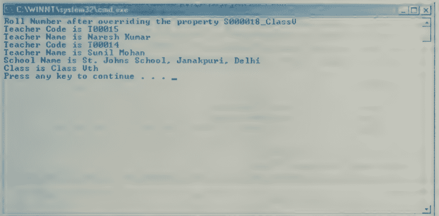

## 11.5 类与结构的区别

结构是类的一种简单轻量级替代方案。虽然结构在基本概念上与类相同，但结构更适用于我们只是想将一些数据组合在一起的情况。因此，结构在设计和实现上与类有显著不同。 （类将在第 12 章和第 13 章中讨论）。重要区别列于表 11.1。

表 11.1 类与结构的区别

| CATEGORY | CLASSES | STRUCTS |
|---|---|---|
| Data Type | Reference type and therefore stored on the heap | Value type and therefore stored on the stack. Behave like simple data types |
| Inheritance | Support inheritance | Do not support inheritance |
| Default values | Default value of a class type is null | Default value is the value produced by 'zeroing out' the fields of the struct |
| Field initialization | Permit initialization of instance fields | Do not permit initialization of instance fields |
| Constructors | Permit declaration of parameterless constructors | Do not permit declaration of parameterless constructors |
| Destructors | Supported | Not supported |
| Assignment | Assignment copies the reference | Assignment copies the values. |

结构是值类型这一事实会影响它们作为参数传递给方法时的性能。我们可以通过将结构作为 ref 参数传递给方法来避免这种性能损失。在这种情况下，只会传递内存中的地址，这与传递类一样快。

```
class EnumTest:
{
    public static void Main()
    {
        Area area = new Area ();
        area.AreaShape ( 15, Area.Shape.Circle);
        area.AreaShape ( 15, Area.Shape.Square);
        area.AreaShape ( 15, (Area.Shape) 1 );
        area.AreaShape ( 15, (Area.Shape) 10 );
    }
}
```

Shape 枚举定义了可以为枚举指定的值，并且在方法调用中也使用相同的枚举来指定需要计算面积的形状。请注意枚举成员的访问方式。

Shape.Circle // Access to Circle inside Area class
Area.Shape.Circle // Access to Circle outside Area class

声明；
Shape shape
在方法定义中将 shape 声明为枚举类型对象。

在方法调用中，可以为枚举指定的值并不限于在枚举定义中指定的标识符。第三次和第四次调用
area.AreaShape ( 15, ( Area.Shape) 1 );
area.AreaShape ( 15, ( Area.Shape) 10 );
是合法的调用。但是，传递的值必须在有效值的范围内。由于枚举成员的值范围为 0 到 1，第三次调用指的是 Shape.Square 情况，而第四次调用传递的值超出范围。请注意，当传递 int 类型值时，它们会被强制转换为枚举类型值。

程序 11.4 将产生以下输出：
Circle Area      =      706.8583
Square Area      =      225.00000
Square Area      =      225.00000
Invalid Input

程序 11.5 在两个枚举 Staff 和 Company 中存储值。它使用两个函数来显示 Staff 和 Company 枚举中包含的数据。

#### 程序 11.5 进一步说明枚举

```
using System;
using System.Collections.Generic;
using System.Text;
namespace EnumerationExample
```
```
{
    enum Staff
    {
        Directors,
        Managers,
        Executives
    }
    enum Company
    {
        NewSoftLtd,
        TechnologiesInc,
        HillRockLtd
    }
    class Program
    {
        public static void Show(Staff st)
        {
            switch (st)
            {
                case Staff.Directors:
                    Console.WriteLine("You are a Director.");
                    break;
                case Staff.Managers:
                    Console.WriteLine("You are a Manager.");
                    break;
                case Staff.Executives:
                    Console.WriteLine("You are an Executive.");
                    break;
                default: break;
            }
        }
        public static void CompDisplay(Company com)
        {
            switch (com)
            {
                case Company.NewSoftLtd:
                    Console.WriteLine("NewSoftLtd.");
                    break;
                case Company.TechnologiesInc:
                    Console.WriteLine("TechnologiesInc.");
                    break;
                case Company.HillRockLtd:
                    Console.WriteLine("HillRockLtd.");
                    break;
                default: break;
            }
        }
        static void Main(string[] args)
        {
```

```
Staff st;
st = Staff.Directors;
Console.WriteLine("This is an example of Enumeration in C#\n");
Show(st);
Company com;
com = Company.NewSoftLtd;
Console.Write("Director belongs to Company : ");
CompDisplay(com);
```

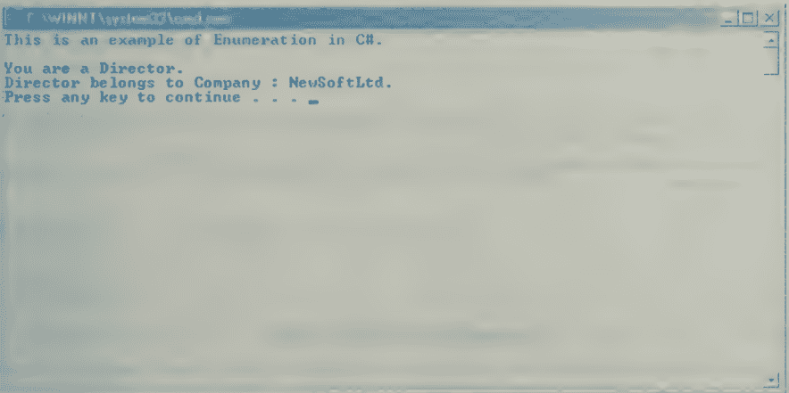

### 11.7 枚举器初始化

如前所述，默认情况下，第一个枚举成员的值设为 0，后续每个成员的值递增 1。然而，我们可以根据需要为不同成员分配特定值。

示例：

```
enum Colour
{
    Red   = 1,
    Blue  = 3,
    Green = 7,
    Yellow = 5
}
```

我们也可以使用表达式，只要它们使用已定义的枚举成员即可。

示例：

```
enum Colour
{
```
```
Red      = 1,
Blue     = Red + 2,
Green    = Red + Blue + 3,
Yellow   = Blue + 2
}
```

如果枚举成员的声明没有初始化器，则其值按如下方式隐式设置：

- 如果它是第一个成员，其值为零。
- 否则，其值是通过将前一个成员的值加一获得的

考虑以下枚举声明：

```
enum Alphabet
{
    A,
    B = 5,
    C,
    D = 20,
    E
}
```

成员 A 设为零。由于成员 B 明确赋值为 5，成员 C 的值设为 6（即 5 + 1）。同理，E 设为 21。

以下枚举声明无效，因为声明是循环的。

```
enum ABC
{
    A,
    B = C,
    C
}
```

### 11.8 枚举器基类型

默认情况下，枚举的类型为 int。然而，我们可以为每个枚举显式声明基类型。

有效基类型为：

byte, sbyte, short, ushort, int, uint, long and ulong

示例：

```
enum Position : byte
{
    off,
    on
}
```

```
enum Shape : long
{
    Circle,
    Square = 100,
    Triangle
}
```

分配给成员的值必须在基类型可以表示的值范围内。例如，如果基类型为 byte，分配值 300 是非法的。


程序11.6将输出以下内容：
    d1 = 0
    d2 = 10
    d3 = 11
    d4 = 12

#### 案例研究

##### 问题陈述

CompTech是一家中等规模的组织，主要从事计算机硬件的销售。它还有一个小型软件开发部门，为不同的组织开发定制软件和网站。CompTech至今一直手动维护其员工记录，这既耗时又降低了人力资源部门员工的工作效率。CompTech如何解决这个问题？

##### 解决方案

CompTech要求在该软件开发部门工作了两年的程序员Harsh创建一个应用程序，使人力资源部门能够自动完成输入员工数据的任务。为了明智地利用内存空间，Harsh决定使用C#的结构体功能。结构体是一种值类型，允许我们组织不同数据类型相关的数据。经过大量研究，Harsh创建了以下C#应用程序。

```
using System;
using System.Collections.Generic;
using System.Text;
namespace StructureExample
{
    public struct Employee
    {
        private string emp_details;

        public string Write
        {
            get { return emp_details; }
            set { emp_details = value; }
        }
        public string Read()
        {
            return Console.ReadLine();
        }
    }
    public struct EmployeeDetails
    {
        Employee name;
        Employee address;
        Employee telephone;
        Employee dept;
        Employee sal;
        public Employee Name
        {
            get { return name; }
            set { name = value; }
        }
        public Employee Address
        {
            get { return address; }
            set { address = value; }
        }
        public Employee Telephone
        {
            get { return telephone; }
            set { telephone = value; }
        }
        public Employee Department
        {
            get { return dept; }
            set { dept = value; }
        }
        public Employee Salary
        {
            get { return sal; }
            set { sal = value; }
        }
        public void ShowAllDetails()
        {
            Employee emp = new Employee();
            Console.WriteLine("Employee Details Registration System.");
            Console.WriteLine("----------------------------");
            Console.Write("Enter the Name of the Employee: ");
            name.Write = emp.Read();
            Console.Write("Enter the Address of the Employee: ");
            address.Write = emp.Read();
            Console.Write("Enter the Telephone of the Employee: ");
            telephone.Write = emp.Read();
            Console.Write("Enter the Department of the Employee: ");
            dept.Write = emp.Read();
            Console.Write("Enter the Salary of the Employee: ");
            sal.Write = emp.Read();
        }
    }
    class ShowEmployeeDetails
    {
        static void Main(string[] args)
        {
            string input = "";
            EmployeeDetails emp1 = new EmployeeDetails();
            emp1.ShowAllDetails();
            Console.WriteLine();
            Console.WriteLine("Showing Employee Details");
            Console.WriteLine("--------------------");
            Console.WriteLine("Name: {0}", emp1.Name.Write);
            Console.WriteLine("Address: {0}", emp1.Address.Write);
            Console.WriteLine("Telephone: {0}", emp1.Telephone.Write);
            Console.WriteLine("Department: {0}", emp1.Department.Write);
            Console.WriteLine("Salary: {0}", emp1.Salary.Write);
            Console.WriteLine("--------------------");
            Console.WriteLine("Press y to save the record....");
            input = Console.ReadLine();
            if (input == "y")
            {
                Console.WriteLine("Record Saved.");
            }
            else
            {
                Console.WriteLine("Record not saved.");
            }
        }
    }
```

备注 在C#应用程序中使用结构体，由于所有相关数据都组织在结构体中，因此可以高效地管理计算机内存。它还提高了C#应用程序的性能。

## 常见编程错误

- 将分号放在结构体定义的末尾。
- 在关键字struct中使用大写S。
- 在结构体定义内为数据字段赋予初始值。
- 试图在结构体定义之外访问私有成员。
- 将一种类型的结构体赋值给另一种不同类型的结构体。
- 仅使用成员名称来访问结构体成员。
- 将分号放在枚举定义的末尾。
- 在枚举列表的最后一项后放置逗号。
- 忘记使用点运算符来访问枚举成员。
- 在方法调用中，忘记将int类型值强制转换为枚举类型。
- 在方法调用中，传递超出有效枚举值范围的值。

## 复习题

11.1 判断下列陈述是否正确。如果不正确，请修正该陈述使其正确。
(a) 结构体类型数据存储在堆上。
(b) 操作结构体类型数据比操作类类型数据更快。
(c) 我们不能在结构体定义内初始化数据字段。
(d) 结构体是隐式密封的，因此没有类或结构体可以从该结构体派生。
(e) 与类一样，结构体支持继承。

```
float b = MathOperation.divide(a,2.0F);
Console.WriteLine("b = " + b);
}
```

程序12.3的输出：
    b = 10.0

注意，静态方法是使用类名调用的。实际上，没有创建任何对象供使用。静态方法有几个限制：

- 它们只能调用其他静态方法。
- 它们只能访问静态数据。
- 它们不能以任何方式引用this或base。（参见第12.17节）

## 12.12 静态构造函数

与其他静态成员一样，我们也可以拥有静态构造函数。静态构造函数在创建类的任何对象之前被调用。这对于执行只需要进行一次的清理工作非常有用。它通常用于为静态数据成员赋予初始值。

静态构造函数通过在构造函数定义前加上static关键字来声明。它不能有任何参数。示例：

```
class Abc
{
static Abc ()        //无参数
{
    ....            //在此处为静态成员设置值
}
....
}
```

注意，静态构造函数上没有访问修饰符。它不能有任何访问修饰符。一个类只能有一个静态构造函数。

## 12.13 私有构造函数

C#没有全局变量或常量。所有声明都必须包含在类中。在许多情况下，我们可能希望定义一些仅包含静态成员的工具类。这样的类永远不需要实例化对象。通过向类添加私有构造函数，可以防止使用此类创建对象。

## 12.14 复制构造函数

复制构造函数通过从另一个对象复制变量来创建对象。例如，我们可能希望将一个Item对象传递给Item构造函数，以便新的Item对象具有与旧对象相同的值。

price = item.price;

复制构造函数通过实例化一个Item类型的对象并将要复制的对象传递给它来调用。示例：

```
Item item2 = new Item (item1);
```

现在，item2是item1的副本。

## 12.15 析构函数

析构函数与构造函数相反。它是一个在不再需要对象时被调用的方法。析构函数的名称与类名相同，并以波浪号（~）开头。与构造函数一样，析构函数没有返回类型。示例：

```
class Fun
{
    ...
    ~Fun () //无参数
    {
        ...
    }
}
```

注意，析构函数不带任何参数。

C#动态管理内存，并使用在单独的线程上运行的垃圾回收器在退出时执行所有析构函数。当对象被垃圾回收器回收时调用析构函数的过程称为终结。

## 12.16 成员初始化

除了使用构造函数和方法为对象提供初始值之外，C#还允许我们在声明时为各个数据成员赋予初始值。示例：

```
class Initialization
{
    int number = 100;
    static double x = 1.0;
    string name = "John";
    Vehicle car = new vehicle (800, "maruti");
    ...
}
```

注意，其他面向对象的语言如C++和Java不支持此功能。当变量在声明时被赋予初始值时，值的赋值方式如下：

- 静态变量在类加载时被赋值。
- 实例变量在创建实例时被赋值。

如果变量没有像上面那样提供初始值，那么它们将被赋予由其类型决定的默认值。具体方式如下：

- 静态变量在类加载时被初始化为其默认值。
- 实例变量在创建实例时被初始化为其默认值。

因此，在C#中变量永远不会“未初始化”。


## 12.17 this 引用

C# 支持关键字 `this`，它是对调用该方法的对象的引用。`this` 引用在所有成员方法中都可用，并且始终引用当前实例。它通常用于区分具有相同名称的局部变量和实例变量。请考虑下面所示的代码段：

```
class Integers
{
    int x;
    int y;
    public void SetXY(int x, int y)
    {
        this.x = x;
        this.y = y;
    }
    ...
    ...
}
```

在赋值语句中，`this.x` 和 `this.y` 引用名为 x 和 y 的类成员，而简单的 x 和 y 则引用 `SetXY()` 方法的参数。

## 12.18 类的嵌套

在 C# 中，可以在另一个类型的范围内定义一个类型。C# 允许类、结构体、接口和枚举相互嵌套。示例：

```
public class Outer
{
    ...          //Members of Outer class
    ...
    ...
    public class Inner
    {
        ...          //Members of Inner class
        ...
    }
}
```

一个类不仅可以嵌套完整的类，还可以嵌套其他类的对象。例如：

```
public class Room
{
    ...
    ...
}
//A house has a room
public class House
{
    ...
    ...
    //The contained room
```

private Room room1;

`House` 类已将 `Room` 对象 `room1` 声明为其成员之一。`House` 与 `Room` 之间的这种关系称为“has-a”关系。 （参见第 13 章）

程序 12.4 演示了嵌套类的概念以及如何调用和显示 `Main` 类和内部类的方法。

#### 程序 12.4 嵌套类的示例

```
using System;
using System.Collections.Generic;
using System.Text;
namespace InnerClassExample
{
    public class nestedClass
    {
        public static void Main()
        {
            outerClass obj2 = new outerClass();
            obj2.show();
            outerClass.innerClass obj1 = new outerClass.innerClass();
            obj1.display();
        }
    }
    public class outerClass
    {
        public void show()
        {
            System.Console.WriteLine("This message is from the class outerClass containing the\nnested class innerClass.\n");
        }
        public innerClass abc()
        {
            return new innerClass();
        }
        public class innerClass
        {
            public void display(){
                System.Console.WriteLine("This is a nested class example in C#.\n This info is in the innermost class innerClass.");
            }
        }
    }
}
```

## 12.19 常量成员

C# 允许将类的字段声明为常量。这可以使用 `const` 修饰符来完成。示例：

```
public const int size = 100;
```

成员 `size` 在编译时被赋值为 100，并且以后不能更改。任何尝试为其赋值的操作都会导致编译错误。这也意味着其值必须在定义时设置。例如：

```
public const int size;
```

是错误的，并且会导致编译错误。`const` 成员是隐式静态的。其值按定义是常量，因此只存储一份副本，供该类的所有对象共享。这意味着我们必须使用类名来访问 `const` 成员，就像访问静态成员一样。

尽管 `const` 成员是隐式静态的，但我们不能显式地使用 `static` 声明它们。例如，语句

```
public static const int size = 100;
```

是错误的，并且会产生编译时错误。

## 12.20 只读成员

有时我们希望在运行时决定常量成员的值。我们也可能希望为该类的不同对象具有不同的常量值。为了克服这些缺点，C# 提供了另一个称为 `readonly` 的修饰符，可与数据成员一起使用。该修饰符旨在使用构造函数方法设置成员的值，但之后不能再修改。`readonly` 成员可以声明为静态字段或实例字段。当它们被声明为实例字段时，它们可以随着不同的对象而取不同的值。请考虑下面的代码：

```
class Numbers
{
    public readonly int m;
    public static readonly int n;
    public Numbers ( int x )
    {
        m = x;
    }
    static Numbers ()
    {
        n = 100;
    }
}
```

`m` 的值在创建对象时使用带参数 `x` 的构造函数提供。此值将对该对象保持不变。请记住，变量 `n` 在创建任何 `Numbers` 对象之前就被赋值为 100。

## 12.21 属性

面向对象系统的设计目标之一是不允许直接访问数据成员，因为这涉及完整性问题。通常的做法是提供称为访问器方法的特殊方法来访问数据成员。我们必须仅使用这些方法来设置或检索这些成员的值。回想一下，我们在程序 12.1 中使用 `GetData()` 方法为 `Rectangle` 类的数据成员 `length` 和 `breadth` 提供值。同样，我们也可以使用另一种方法来读取这些成员的值。程序 12.5 显示了如何使用访问器方法设置和获取私有数据成员的值。

#### 程序 12.5 使用访问器方法访问私有数据

```
using System;
class Number
{
    private int number;
    public void SetNumber( int x )        // accessor method
    {
        number = x;                       // private number accessible
    }
    public int GetNumber()                // accessor method
    {
        return number;
    }
}

class NumberTest
{
    public static void Main ()
    {
        Number n = new Number ();
        n.SetNumber (100);    // set value
```

```
Console.WriteLine("Number = " + n.GetNumber()); // get value
// n.number; //Error! Cannot access private data
}
```

程序 12.5 的输出：
    Number = 100

`SetNumbers` 方法也称为变异器方法。使用访问器方法效果很好，并且是 C++ 和 Java 等多种 OOP 语言所使用的技术。然而，它存在以下缺点：

- 我们必须手动编码访问器方法。
- 用户必须记住他们必须使用访问器方法来处理数据成员。

为了克服这些问题，C# 提供了一种称为属性的机制，它具有与访问器方法相同的功能，但使用起来更优雅、更简单。使用属性，程序员可以像访问公共字段一样访问数据成员。 （属性有时被称为“智能字段”，因为它们为数据字段增加了智能。）

我们可以使用属性重写程序 12.5 中的代码，如程序 12.6 所示。

#### 程序 12.6 实现属性

```
using System;
class Number
{
    private int number;
    public int Anumber // property
    {
        get
        {
            return number;
        }
        set
        {
            number = value;
        }
    }
}
class PropertyTest
{
    public void static Main ()
    {
        Number n = new Number ();
        n.Anumber = 100;
        int m = n.Anumber;
        Console.WriteLine("Number = " + m);
    }
}
```

该类现在声明了一个名为 `A number` 的 `int` 类型属性，并定义了 get 访问器方法（也称为 getter）和 set 访问器方法（也称为 setter）。getter 方法使用关键字 `return` 将字段的值返回给调用者。setter 方法使用关键字 `value` 接收从用户传入的值。`value` 的类型由属性的类型决定。

顾名思义，getter 方法用于获取（或读取）值，而 setter 方法用于设置（或写入）值。在程序 12.6 中，语句
n.Anumber = 100;
调用 setter 方法，并将整数值 100 放入名为 `value` 的变量中，然后将其分配给字段 `number`。

同样，语句
int m = n.Anumber;
调用 getter 方法并将属性的值赋给 `m`。

属性可以省略 get 子句或 set 子句。仅具有 getter 的属性称为只读属性，仅具有 setter 的属性称为只写属性。只写属性很少使用。属性还有其他强大的功能。它们包括：

- 除获取变量的值外，get 子句还使用代码根据其他字段计算属性的值并返回结果。这意味着属性不仅仅与数据成员绑定，它们还可以表示动态数据。
- 与方法一样，属性是可继承的。我们可以适当地使用 `abstract`、`virtual`、`new` 和 `override` 修饰符，以便派生类可以实现它们自己的属性版本。
- `static` 修饰符可用于声明属于整个类而不是特定类实例的属性。 （与静态方法一样，静态属性不能使用 `virtual`、`abstract` 或 `override` 修饰符声明。）

这里需要注意的一个重要点是，我们只能在属性级别指定修饰符，这将同时影响两个访问器。例如，我们不能仅覆盖其中一个，而让另一个不受影响。

## 12.22 索引器

索引器是位置指示符，用于访问类对象，就像访问数组中的元素一样。它们在类用作其他对象的容器时很有用。

索引器看起来像属性，并且写法与属性相同，但有两个区别：

- 索引器接受索引参数，看起来像数组。
- 索引器使用名称 `this` 声明。

索引器通过 `get` 和 `set` 访问器为 `[ ]` 运算符实现。示例：

```
public double this[ int idx ]
{
    get
    {
        //Return desired data
    }
    set
    {
```


- 属性可以是静态成员，而索引器始终是实例成员。
- 属性的 get 访问器对应一个无参数的方法，而索引器的 get 访问器对应一个与索引器具有相同形参列表的方法。
- 属性的 set 访问器对应一个名为 value 的单一参数的方法，而索引器的 set 访问器对应一个与索引器具有相同形参列表的方法，外加名为 value 的参数。
- 索引器声明与索引器参数同名的局部变量是错误的。

程序 12.8 使用索引器，创建了一个包含 15 个值的数组，在数组中存储了几个值，而数组中从第 12 个位置开始的空值则用单词“empty”存储。

#### 程序 12.8 | 索引器进一步说明

```csharp
using System;
using System.Collections.Generic;
using System.Text;
namespace IndexersExample
{
    class IndexersEx
    {
        private string[] TechCompanies = new string[14];
        public string this[int indexVal]
        {
            get
            {
                if(indexVal < 0 || indexVal >= 11)
                    return "empty";
                else
                    return TechCompanies[indexVal];
            }
            set
            {
                if(!(indexVal < 0 || indexVal >= 11))
                    TechCompanies[indexVal] = value;
            }
        }
    }
    class theMainClass
    {
        public static void Main()
        {
            IndexersEx Obj = new IndexersEx();
            Obj[0] = "Infosys";
            Obj[3] = "Wipro Infotech";
            Obj[5] = "Satyam Computers";
            Obj[6] = "Patni Computers";
            Obj[8] = "Hexaware";
            Obj[10] = "Polaris Software";
            Obj[12] = "Mastek Computers";
            Obj[14] = "HCL";
            Console.WriteLine("This is a List of IT Companies in India.\n");
            for(int i=0; i<=14; i++)
            {
                Console.WriteLine("The name of IT Company at index {0} : {1}",i,Obj[i]);
            }
        }
    }
}
```

```text
This is a List of IT Companies in India.
The name of IT Company at index 0 : Infosys
The name of IT Company at index 1 : empty
The name of IT Company at index 2 : empty
The name of IT Company at index 3 : Wipro Infotech
The name of IT Company at index 4 : empty
The name of IT Company at index 5 : Satyam Computers
The name of IT Company at index 6 : Patni Computers
The name of IT Company at index 7 : empty
The name of IT Company at index 8 : Hexaware
The name of IT Company at index 9 : empty
The name of IT Company at index 10 : Polaris Software
The name of IT Company at index 11 : empty
The name of IT Company at index 12 : empty
The name of IT Company at index 13 : empty
The name of IT Company at index 14 : empty
Press any key to continue . . .
```

#### 案例研究

##### 问题陈述

Dheeraj 在 AB SoftDev 公司担任高级程序员，他的经理要求他为 CompHard 企业创建一个 C# 应用程序，该应用程序应允许 CompHard 企业的营销人员获取关于不同品牌电脑（如 HP 和 Apple）的信息。CompHard 企业从事计算机硬件的销售。Dheeraj 在需要为 CompHard 企业创建的应用程序中应该使用 C# 编程语言的什么特性？

##### 解决方案

Dheeraj 首先访问 CompHard 企业，了解营销人员销售的不同品牌电脑种类。在找到与品牌电脑相关的信息后，Dheeraj 决定使用 C# 的类和对象特性来创建应用程序。类包含一组相关的数据以及对这些数据执行特定操作的方法。类的对象有助于访问类中包含的数据和方法。类和对象对于有效组织与现实世界对象（如学生和电脑）相关的数据非常有用。以下是 Dheeraj 为 CompHard 企业的营销人员创建的 C# 应用程序：

```csharp
using System;
using System.Collections.Generic;
using System.Text;
namespace CaseStudy12
{
    public class AppleComputer
    {
        private string applevariety = "";
        public AppleComputer(string appleComputerVariety)
        {
            this.applevariety = appleComputerVariety;
        }
        public void showAppleComputers()
        {
            System.Console.WriteLine(applevariety);
        }
    }
    public class HPComputer
    {
        private string hpvariety = "";
        public HPComputer(string hpComputerVariety)
        {
            this.hpvariety = hpComputerVariety;
        }
        public void showHPComputers()
        {
            System.Console.WriteLine(hpvariety);
        }
    }
    public class AcerComputer
    {
        private string acervariety = "";
        public AcerComputer(string acerComputerVariety)
        {
            this.acervariety = acerComputerVariety;
        }
        public void showAcerComputers()
        {
            System.Console.WriteLine(acervariety);
        }
    }
    class DisplayComputers
    {
        static void Main()
        {
            Console.WriteLine("This is an example of Classes and objects and how they can be used in real world scenarios.");
            AppleComputer mac = new AppleComputer("Apple Power Mac G5");
            AppleComputer gra = new AppleComputer("Apple iMac 2 G4");
            Console.WriteLine("----------------");
            Console.WriteLine("Apple Computer varieties are :");
            mac.showAppleComputers();
            gra.showAppleComputers();
            HPComputer obj1 = new HPComputer("HP Pavilion Media Center m8000n");
            HPComputer obj2 = new HPComputer("HP Compaq DC5750 PC ");
            Console.WriteLine("----------------");
            Console.WriteLine("HP Computer varities are : ");
            obj1.showHPComputers();
            obj2.showHPComputers();
            AcerComputer acObj1 = new AcerComputer("Acer Aspire E380 PC");
            AcerComputer acObj2 = new AcerComputer("Acer Aspire E560 PC");
            AcerComputer acObj3 = new AcerComputer("Acer Aspire T180 PC");
            AcerComputer acObj4 = new AcerComputer("Acer Aspire T660 PC");
            Console.WriteLine("----------------");
            Console.WriteLine("Acer Computer varities are : ");
            acObj1.showAcerComputers();
            acObj2.showAcerComputers();
            acObj3.showAcerComputers();
            acObj4.showAcerComputers();
            Console.WriteLine("----------------");
        }
    }
}
```

## 常见编程错误

- 忘记声明数组。
- 在类定义末尾放置分号。
- 为构造函数指定返回类型。
- 从构造函数返回值。
- 未将非静态构造函数声明为 public。
- 数据成员和方法成员使用相同的名称。
- 方法未包含返回类型。
- 忘记使用 new 运算符调用构造函数来创建对象。
- 使用构造函数重置现有对象。
- 使用 null 对象调用方法。
- 忘记使用构造函数初始化实例变量。
- 尝试在不使用对象或类的情况下调用方法。
- 使用对象调用静态方法。
- 使用类调用实例方法。
- 在静态方法中引用 this。
- 在静态构造函数上使用访问修饰符。
- 尝试在声明后向 readonly 字段赋值。
- 尝试将 readonly 变量作为 out 或 ref 参数传递。
- 将 const 成员声明为 static。
- 尝试在运行时向 const 数据字段赋值。
- 忘记在声明时为 const 数据字段提供初始值。
- 尝试使用类的实例（而不是类名）访问 const 数据。

## 复习题

- 12.1 判断以下陈述是否正确。
    - (a) 我们不能对类使用任何访问修饰符。
    - (b) 定义没有任何成员的类是错误的。
    - (c) 在 C# 中，所有成员默认具有私有访问权限。
    - (d) 内部成员对程序中的所有类都可用。
    - (e) 受保护成员在派生类中不可见。
    - (f) 类的数据成员只能借助成员方法访问。
    - (g) 构造函数方法不能返回任何值。
    - (h) 构造函数总是声明为 public。
    - (i) 类可以实现任意数量的构造函数。
    - (j) 每次实例化类时都会创建静态变量的副本。
    - (k) 静态方法只能访问其他静态成员。
    - (l) 静态构造函数在创建类的任何对象之前被调用。
    - (m) 静态构造函数可以被重载。
    - (n) C# 不允许在声明时向数据成员赋值。
    - (o) 引用 this 只能用于那些已声明为 public 的成员方法中。
    - (p) 类不仅可以嵌套完整的类，还可以嵌套其他类的对象。
    - (q) const 成员是隐式静态的。
    - (r) const 数据成员可以使用静态构造函数赋值。
    - (s) 只读成员不能声明为 static。
    - (t) 省略 get 子句的属性称为只写属性。

- 12.2 类模板是什么意思？
- 12.3 什么是面向对象编程的三大支柱？
- 12.4 什么是封装？它在面向对象编程中的作用是什么？
- 12.5 类成员的两大类别是什么？
- 12.6 描述为类的实例变量提供值的三种不同方式。
- 12.7 静态变量如何被赋予初始值？
- 12.8 为什么我们将数据字段声明为 public？
- 12.9 我们何时对数据字段使用 private 修饰符？
- 12.10 将成员声明为 protected 的含义是什么？
- 12.11 描述访问数据字段值的两种方式？比较它们。
- 12.12 什么是构造函数？
- 12.13 指出构造函数的三个重要特征。
- 12.14 为什么我们通常将构造函数声明为 public？
- 12.15 为什么我们需要使用重载构造函数？
- 12.16 我们何时使用静态变量？
- 12.17 我们何时使用静态方法？
- 12.18 静态方法和实例方法之间的区别是什么？
- 12.19 关键字 this 指的是什么？
- 12.20 什么是静态构造函数？它与非静态构造函数有何不同？


```csharp
Console.WriteLine ( x );
}
```

## 12.40 对以下代码发表评论：

```csharp
class AB
{
    private int number;
    public int Number
    {
        get { return number;}
    }
    public int Number
    {
        set {number = value;}
    }
}
```

## 12.41 考虑以下代码：

```csharp
class Product
{
    public static void Main ( )
    {
        int x = 10, y = 20;
        Console.WriteLine (mul (x, y));
    }
    int mul (int a, int b)
    {
        return (a*b);
    }
}
```

它能编译吗？如果不能，为什么？

## 12.42 以下代码有什么用途？

```csharp
class Student
{
    static int m = 0;
    public Student ()
    { m ++;}
    ...
    ...
}
```

## 12.43 以下代码能编译吗？如果不能，为什么？

```csharp
class A
{
    public static void Main ( )
    {
        Test t;
        T.Print();
    }
}
class Test
```

## 调试练习

12.1 找出以下程序中的语法错误。

```csharp
using System;
using System.Collections.Generic;
using System.Text;
namespace DebugApp1_chap12
{
    class Program
    {
        static void Main(string[] args)
        {
            Name nm = new Name();
            nm.Name1 = "Steve";
            nm.Address = "Washington";
            nm.ShowInfo();
            Console.ReadLine();
        }
    }
class Name
{
    public string Name1;
    public string Address;
    public void ShowInfo()
    {
        Console.WriteLine("{0} is in city {1}", + Name1, + Address);
    }
}
}
```

12.2 调试下面给出的程序。

```csharp
using System;
using System.Collections.Generic;
using System.Text;
namespace debugApp2_chap12
{
    class Program
    {
        static void Main(string[] args)
        {
            Name obj = new Name();
            obj.showInfo();
        }
    }
}
```

```csharp
}
void Display()
{
    Console.WriteLine(a + b);
}
}
class Program
{
    static void Main(string[] args)
    {
        Class2 cl = new Class2();
        Console.Write("The output is : ");
        cl.Display();
    }
}
}
```

## 编程练习

- 12.1 创建一个名为 Number 的类来保存一个整数值。包含一个构造函数以显示消息“object is created”以及一个析构函数以显示消息“object is destroyed”。编写程序来演示 Number 对象的创建和销毁。

- 12.2 重写练习 12.1 中的程序，通过添加 Set 方法为数据成员提供值以及 Get 方法显示对象中存储的值来扩展。演示你的程序，通过存储一个整数值，例如 2002，并显示相同的值。

- 12.3 重写练习 12.2 中的程序，用构造函数替换 Set 方法。

- 12.4 重写练习 12.2 中的程序，用属性替换 Set 和 Get 方法。

- 12.5 创建一个名为 Integer 的类来保存两个整数值。设计一个方法 Swap，该方法可以接受两个整数对象作为参数并交换它们的内容。编写 Main 程序来实现 Integer 类和 Swap 方法。

- 12.6 设计一个名为 Date 的类，具有以下成员：
  - 数据成员 day、month 和 year
  - 一个构造函数以提供数据成员的值（使用三个参数）
  - 一个方法以 day/month/year 格式显示日期（例如：1945 年 8 月 15 日为 15/8/1945）
  编写程序来实现 Date 类。

- 12.7 在练习 12.6 中设计的类中添加另一个构造函数，该构造函数仅接受一个参数，表示日期形式的长整数，如 19450815 表示日期 15/8/1945，并为 year、month 和 day 成员分配合适的值。还修改 Main 程序以演示两个构造函数的用法。使用合适的算法将长整数 19450815 转换为 year、month 和 day。

- 12.8 定义一个 Time 类，包含以下成员：
  - 两个整数数据成员 minutes 和 hours
  - 两个重载的构造函数
  - 一个方法来显示类的数据成员
  其中一个构造函数接受两个整数参数来为两个数据成员分配值，另一个构造函数接受一个整数参数表示总分钟数并将其转换为小时和分钟
  编写完整程序以验证构造函数和方法的运行。

## 12.9 向练习 12.8 中定义的 Time 类添加以下两个方法

- Increment ( ) 方法将时间增加 1 分钟
- Decrement ( ) 方法将时间减少 1 分钟

测试你的方法以确保它们正确执行预期操作。

## 12.10 设计一个类来表示银行账户。包括以下成员：

数据成员

- 存款人姓名
- 账号
- 账户类型
- 账户余额

方法

- 分配初始值
- 存款
- 在检查余额后取款
- 显示姓名和余额

编写程序来演示各种类成员的工作。

## 12.11 编写一个类来表示向量（一系列整数值）。包括构造函数和方法来执行以下任务。

- 创建向量
- 修改给定元素的值
- 乘以标量值
- 以 (10, 20.....) 的形式显示向量

编写程序来测试你的类。

## 12.12 修改练习 12.10 的类和程序以处理 10 个客户。

## 12.13 修改练习 12.11 的类和程序，使程序能够添加两个向量并显示结果向量。

## 12.14 静态成员变量的常见用途是跟踪当前存在于类中的对象。

编写程序来说明此功能。

## 12.15 创建两个类 DM 和 DB 来存储距离值。DM 以米和厘米存储距离，DB 以英尺和英寸存储。编写一个程序，可以读取类对象的数值并将 DM 的一个对象与 DB 的另一个对象相加。程序应以英尺和英寸或米和厘米的格式显示结果，如有需要。

## 12.16 书店维护着在商店出售的书籍库存。列表包括作者、标题、价格、出版商和库存状况等详细信息。每当顾客想要一本书时，销售人员输入标题和作者，系统搜索列表并显示是否可用。如果不可用，则显示适当的消息。如果可用，则系统显示书籍详细信息并要求输入所需副本数。如果请求的副本可用，则显示总成本；否则显示消息“insufficient Stock”。使用名为 Books 的类设计一个系统，包含合适的成员。

methods declaration ;
}

定义与普通类定义非常相似，只是使用了冒号：和 baseclass-name。冒号表示基类的属性被扩展到子类名称。当实现时，子类将包含其自己的成员以及基类的成员。这种情况发生在我们想要在不实际修改它的情况下向现有类添加更多属性时。例如：

```csharp
class Cylinder : Circle
{
    // Add additional fields
    // and methods here
}
```

Circle 是包含半径值的现有类的名称，Cylinder 是派生类的名称，它可以声明圆柱体的长度作为附加数据成员，并提供一个方法来计算其体积。

程序 13.1 说明了简单继承的概念。

## 程序 13.1 简单继承的说明

```csharp
using System;
class Item
{
    public void Company ()        // base class
    {
        Console.WriteLine("Item Code = XXX");
    }
}

class Fan : Item                // derived class
{
    public void Model ()
    {
        Console.WriteLine("Fan Model : Classic");
    }
}

class SimpleInheritance
{
    public static void Main()
    {
        Item item = new Item();
        Fan fan = new Fan();
        item.Company();
        fan.Company();
        fan.Model();
    }
}
```


一个 C# 类可以具有两种可见性修饰符之一：**public** 或 **internal**。如果我们没有显式标记类的可见性修饰符，则隐式设置为‘internal’；也就是说，默认情况下所有类都是 **internal**。Internal 类在同一个程序程序集中可访问，且无法从程序集外部访问。

标记为 **public** 的类在程序集内部和外部都可以访问。 .NET 类框架中包含的所有类都标记为 **public**，以便所有开发人员都可以访问它们并用于配置应用程序和服务。

尽管类通常标记为 **public** 或 **internal**，但当它作为另一个类的成员声明时，类也可以标记为 **private**。在这种情况下，该类像封闭类的成员一样表现，因此适用于类成员的修饰符也适用于它。

## 13.5.2 类成员可见性

如上一章所述，类成员可以具有五种可见性修饰符中的任意一种：

- public
- private
- protected internal
- protected
- internal

除 **protected internal** 组合外，同时指定多个访问修饰符是错误的。当未指定修饰符时，默认为 **private** 可访问性。表 13.1 显示了可见性修饰符如何控制程序中成员的可见性。

#### 表 13.1 类成员的可见性

| 关键字 | 包含类 | 派生类 | 包含程序 | 包含程序外部的任何位置 |
|---|---|---|---|---|
| private | ✓ |  |  |  |
| protected | ✓ | ✓ |  |  |
| internal | ✓ |  | ✓ |  |
| protected internal | ✓ | ✓ | ✓ |  |
| public | ✓ | ✓ | ✓ | ✓ |

必须记住，成员的可访问性域绝不会大于包含它的类的可访问性域。表 13.2 给出了在不同类访问说明符组合下成员的可见性域。

#### 表 13.2 类成员的可访问性域

| 成员修饰符 | Public | Internal | Private |
|---|---|---|---|
| public | 到处 | 仅程序 | 仅类 |
| internal | 仅程序 | 仅程序 | 仅类 |
| private | 仅类 | 仅类 | 仅类 |

## 13.5.3 基类成员的可访问性

当一个类从基类继承时，基类的所有成员，除构造函数和析构函数外，都会被继承并成为派生类的成员。基类成员声明的可访问性对其可继承性没有控制作用。然而，一个继承的成员可能在派生类中不可访问，要么是因为其声明的可访问性，要么是因为它被类本身中的声明隐藏了。

```csharp
class A
{
    private int x;
    protected int y;
    public int z;
}
```

```csharp
class B : A
{
    public void SetXYZ()
    {
        x = 10; // Error; x is not accessible
        y = 20; // ok
        z = 30; // ok
    }
}
```

请注意，尽管 B 从 A 继承了私有成员 x，但它在 B 中不可访问。然而，A 的 protected 和 public 成员在子类 B 中是可访问的。但就类的使用者而言，protected 是 private。因此，以下是非法操作：

```csharp
A a = new A(); // object of A
a.y = 5; // error! an object cannot access protected data
a.z = 10; // ok
```

## 13.5.4 可访问性约束

C# 在继承过程中对成员和类的可访问性施加了某些约束。

- 派生类的直接基类必须至少与派生类本身一样可访问。
- 成员的可访问性域绝不会大于包含它的类的可访问性域。
- 方法的返回类型必须至少与方法本身一样可访问。

```csharp
class A
{
    ....
}
public class B : A
{
    ....
}
```

是非法的，因为 A 默认是 'internal' 而 B 是 public。A 应该至少与 B 一样可访问。

再考虑另一个例子：

```csharp
class A
{
    private class B
    {
        public int x;
    }
}
```

这里，公共数据 x 在类 B 外部不可访问。这是由于类 B 的可访问性所施加的约束。因为 B 是 private，x 上的 public 被降为 private。

在许多情况下，我们使用方法来处理类对象，因此它们将类作为返回类型。在这种情况下，方法的返回类型必须至少与方法本身一样可访问。例如，考虑以下代码：

```csharp
class A
{
    ...
}
public class B
{
    A Method1() {}        // OK
    internal A Method2() {}  // OK
    public A Method3() {}   // Error!
}
```

类 B 中声明的这三个方法都指定 A 作为其返回类型。由于类 A 默认假设可访问性级别为 internal，方法

```csharp
public A Method3() // public is higher than internal
{
    ...
}
```

是错误的。该方法不能具有高于其返回类型的可访问性级别。

## 13.6 定义子类构造函数

我们已经看到，当调用构造函数时对象会被创建。相同的原理也可应用于构造派生类对象。我们可以为派生类定义适当的构造函数，当创建派生类对象时可以调用它。记住，构造函数的目的是为类的字段提供值。如果基类构造函数需要参数来构造基类对象，我们如何将值传递给基类构造函数？程序 13.2 通过实现单级继承回答了这些问题。

#### 程序 13.2 单继承的应用

```csharp
using System;
class Room        // base class
{
    public int length;
    public int breadth;
    public Room(int x, int y)   // base constructor
    {
        length = x;
        breadth = y;
    }
    public int Area()
    {
        return (length * breadth);
    }
}
class BedRoom : Room  // Inheriting Room
{
    int height;
    // subclass constructor
    public BedRoom(int x, int y, int z) : base(x, y)
    {
        height = z;
    }
    public int Volume()
    {
        return (length * breadth * height);
    }
}
class InherTest
{
    public static void Main()
    {
        BedRoom room1 = new BedRoom(14, 12, 10);
        int area1 = room1.Area();    // superclass method
        int volume1 = room1.Volume(); // subclass method
        Console.WriteLine("Area1 = " + area1);
        Console.WriteLine("Volume1 = " + volume1);
    }
}
```

程序 13.2 的输出为：

```text
Area1 = 168
Volume1 = 1680
```

该程序定义了一个类 Room 并将其扩展为另一个类 BedRoom。请注意，类 BedRoom 定义了自己的数据成员和方法。子类 BedRoom 现在包含三个实例变量，即 length、breadth 和 height 以及两个方法 Area 和 Volume。

派生类中的构造函数使用 base 关键字将基类构造函数所需的值传递给它。语句

```csharp
BedRoom room1 = new BedRoom(14, 12, 10);
```

首先调用 BedRoom 构造函数方法，该方法又使用 base 关键字调用 Room 构造函数方法。

最后，子类 BedRoom 的对象 room1 调用在超类中定义的方法 Area 以及在子类本身中定义的方法 Volume。

##### 13.6.1 子类构造函数

子类构造函数用于构造子类和超类的实例变量。子类构造函数使用关键字 base 调用超类的构造函数方法。

```csharp
public BedRoom(int x, int y, int z) : base(x, y)
{
    height = z;
}
```

这里，派生构造函数接受三个参数，前两个提供给基类构造函数，第三个提供给它自己的类成员的值。请注意 base(x, y) 像方法调用一样行为，因此参数指定时不带类型。这些参数的类型和顺序必须与基类构造函数参数的类型和顺序匹配。

当编译器遇到 base(x, y) 时，它将值 x 和 y 传递给接受两个 int 参数的基类构造函数。基类构造函数在派生类构造函数执行之前被调用。也就是说，数据成员 length 和 breadth 在成员 height 被赋值的之前被赋予值。

请注意，关键字 base 的使用不仅限于构造函数逻辑本身。我们可以在任何子类中使用 base 来访问父类中定义的 public 或 protected 成员。例如，语句：

```csharp
base.length = 100;
int area = base.Area();
```

在派生类 BedRoom 内部是有效的。

## 13.7 多级继承

面向对象编程中的一个常见需求是使用派生类作为超类。C# 支持这一概念，并在构建其类库时广泛使用它。这一概念允许我们构建如 Fig. 13.5 所示的类链。

类 A 作为派生类 B 的基类，而 B 又作为派生类 C 的基类。链 ABC 被称为继承路径。

具有多级基类的派生类声明如下：

```csharp
class A
{
    ....
    ....
}
class B : A // First level derivation
{
    ....
    ....
}
class C : B // Second level derivation
{
    ....
}
```


图 13.5 多级继承


此过程可扩展到任意数量的层级。类 C 可以继承 A 和 B 的成员，如图 13.6 所示。

如前所述，构造函数从上到下执行，最底层的类构造函数最后执行。示例：

```
class A
{
    protected int a;
    public A (int x)
    {
        a = x;
    }
}
class B : A
{
    protected int b;
    public B (int x, int y) : base (x)
    {
        b = y;
    }
}
class C : B
{
    int c;
    public C (int x, int y, int z) : base (x, y)
    {
        c = z;
    }
}
```

构造函数按以下顺序实现：

+   A() // class A
+   B() // class B
+   C() // class C

请注意，我们在派生类中都使用了 base 而未指定基类的实际名称。由于 C# 仅支持“单”继承，base 表示“直接”基类构造函数。然而，应注意将参数放在正确顺序，以便将正确的值传递给数据成员。

程序 13.3 显示了基类从另外三个继承类进行的多级继承，在其中调用基类的属性并对其进行操作以显示所需输出。

#### 程序 13.3 | 多级继承

```
// Multilevel Inheritance and Function Overriding
using System;
using System.Collections.Generic;
```

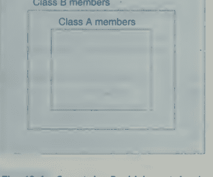

图 13.6 C 包含 B，B 包含 A

```
using System.Text;
namespace MultiLevel_Inheritance
{
    class BaseClass
    {
        public int num1, num2, num3;
        public virtual int function1()
        {
            Console.WriteLine("Base Class: function1() returning 1 called.");
            return 1;
        }
        public virtual int function2()
        {
            Console.WriteLine("Base Class: function2() returning 2 called.");
            return 2;
        }
        public virtual int function3()
        {
            Console.WriteLine("Base Class: function3() returning 3 called.");
            return 3;
        }
        public BaseClass()
        {
            Console.WriteLine("Base Class: Constructor called.");
            num1 = function1();
            num2 = function2();
            num3 = num1 + num2 + function3();
        }
        public static int Main()
        {
            InheritedClass1 ic = new InheritedClass1();
            InheritedClass2 ic2 = new InheritedClass2();
            InheritedClass3 ic3 = new InheritedClass3();
            Console.WriteLine("The value of num1 is " + ic.num1);
            Console.WriteLine("The value of num2 is " + ic2.num2);
            Console.WriteLine("The value of num3 is " + ic3.num3);
            return 0;
        }
    }
    class InheritedClass1 : BaseClass
    {
        public InheritedClass1()
        {
            Console.WriteLine("Inherited Class1: Constructor called.");
        }
        public override int function1()
        {
            Console.WriteLine("Inherited Class: function1() returning 10 called.");
            return 10;
        }
    }
```

```
class InheritedClass2 : BaseClass
{
    public InheritedClass2()
    {
        Console.WriteLine("Inherited Class2: Constructor called.");
    }
    public override int function2()
    {
        Console.WriteLine("Inherited Class: function2 returning 20 called.");
        return 20;
    }
}

class InheritedClass3 : BaseClass
{
    public InheritedClass3()
    {
        Console.WriteLine("Inherited Class3: Constructor called.");
    }
    public override int function3()
    {
        Console.WriteLine("Inherited Class: function3 returning 30 called.");
        return 30;
    }
}
```

```
Base Class: Constructor called.
Inherited Class: function1() returning 10 called.
Base Class: function2() returning 2 called.
Base Class: function3() returning 3 called.
Inherited Class1: Constructor called.
Base Class: Constructor called.
Base Class: function1() returning 1 called.
Inherited Class: function2 returning 20 called.
Base Class: function3() returning 3 called.
Inherited Class2: Constructor called.
Base Class: Constructor called.
Base Class: function1() returning 1 called.
Base Class: function2() returning 2 called.
Inherited Class: function3 returning 30 called.
Inherited Class3: Constructor called.
The value of num1 is 10
The value of num2 is 20
The value of num3 is 33
Press any key to continue . . .
```

## 13.8 层次继承

继承的另一个有趣应用是将其用作程序层次化设计的支持。许多编程问题可以归结为一个层次结构，其中某一层级的某些特征被其下方的许多层级所共享。例如，图 13.7 显示了商业银行账户的层次分类。这是因为所有账户都具有某些共同特征。

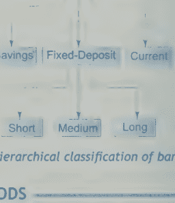

## 13.9 重写方法

我们已经看到，超类中定义的方法会被其子类继承，并由子类创建的对象使用。方法继承使我们能够在子类中重复定义和使用方法。

然而，可能存在我们希望对象对同一方法做出响应但在调用该方法时表现不同的情况。这意味着，我们应该重写超类中定义的方法。这可以通过在子类中定义一个与超类中方法具有相同名称、相同参数和相同返回类型的方法来实现。然后，当该方法被调用时，子类中定义的方法将被调用并执行，而不是超类中的方法，前提是：

+   - 我们将基类中的方法指定为 virtual
+   - 使用 override 关键字在子类中实现该方法

这称为重写。程序 13.4 说明了重写的概念。

#### 程序 13.4 方法重写示例

```
using System;
class Super                //base class
{
    protected int x;
    public Super (int x)
    {
        this.x = x;
    }
}
public virtual void Display () // method defined with virtual
{
    Console.WriteLine ("Super x = " + x);

```

## # 隐藏基类方法

```
using System;
class Base
{
	public void Display()
	{
		Console.WriteLine("Base Method");
	}
}
class Derived : Base
{
	public new void Display()  // hides base method
	{
		Console.WriteLine("Derived Method");
	}
}
class HideTest
{
	public static void Main()
	{
		Derived d = new Derived();
		d.Display();
	}
}
```

程序 13.5 将显示以下内容：

Derived Method

new 修饰符表示 Derived 中的 Display() 是“新的”，并且旨在隐藏继承的成员。

请注意，使用 new 隐藏继承的成员并不会删除该成员；它只是使该成员在派生类中无法访问。如果使用 new 修饰符声明一个成员而该成员并未隐藏任何继承的成员，则编译器会发出警告。虽然它们各自独立实现相同的效果，但在同一声明中使用 new 和 override 修饰符两者是错误的。

new 方法的声明仅在“new”成员的作用域内隐藏继承的方法。

示例：

```
class A
{
	public static void F()
	{
	}
}
class B : A
{
	new private static void F()
	{
	}
}
```

```
class C : B
{
    static void F1()
    {
        F(); //Invokes F() of A
    }
}
```

由于 B 中的 new F() 具有 private 访问权限，其作用域不扩展到类 C。因此，C 中的调用 F() 是有效的，它调用 A 类的 F()。

## 13.11 抽象类

在许多层次化应用中，我们会有一个基类和多个不同的派生类。最顶层的基类只是作为其他类的基础，本身并无用处。在这种情况下，我们可能不希望任何人创建其对象。我们可以通过使基类变为抽象来实现这一点。

abstract 是一个修饰符，当用于声明类时表示该类不能被实例化。只有其派生类（未标记为 abstract）可以被实例化。示例：

```
abstract class Base
{
    ....
}

class Derived : Base
{
    ....
}
....
....
....
```

```
Base b1;      //Error
Derived d1;   //OK
```

我们不能创建 Base 类型的对象，但我们可以派生其子类，这些子类可以被实例化。

抽象类的一些特征是：

+   - 它不能被直接实例化
+   - 它可以具有抽象成员
+   - 我们不能对其应用 sealed 修饰符

## 13.12 抽象方法

与抽象类类似，我们也可以创建抽象方法。当实例方法声明包含 abstract 修饰符时，该方法被称为抽象方法。

抽象方法隐式地是虚拟方法，并且不提供任何实现。因此，抽象方法没有方法体。示例：

```
public abstract void Draw(int x, int y);
```

请注意，方法体仅由一个分号组成。抽象方法的一些特征是：


密封方法 Fun() 覆盖了类 A 中定义的虚方法 Fun()。B 的任何派生类都不能再覆盖方法 Fun()。

## 13.15 多态性

如第 12 章前面所讨论的，多态性意味着“一个名字，多种形式”。本质上，多态性是指一个对象能够以多种方式表现的能力。多态性可以通过图 13.8 所示的两种方式实现。C# 都支持这两种方式。

##### 13.15.1 操作多态性

操作多态性是通过重载方法和运算符实现的。我们在讨论方法和构造函数时已经使用了重载的概念。重载的方法是通过匹配参数的数量、类型和顺序来“选择”调用的。此信息在编译时已知，因此编译器能够在编译时本身为特定调用选择并绑定适当的方法到对象。此过程称为早期绑定，或静态绑定，或静态链接。它也被称为编译时多态性。

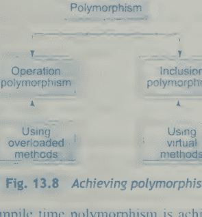

图 13.8 实现多态性

早期绑定简单地意味着对象在编译时绑定到其方法调用。程序 13.6 展示了如何使用重载的概念实现编译时多态性。如我们所知，通过重载，创建了多个同名方法。然而，每个方法上的参数各不相同。当对象使用方法名进行方法调用时，与调用签名匹配的方法将被调用。

#### 程序 13.6 操作多态性

```
using System;
class Dog
{
}
class Cat
{
}
class Operation
{
    static void Call (Dog d)
    {
        Console.WriteLine ("Dog is called");
    }
    static void Call (Cat c)
    {
        Console.WriteLine (" Cat is called ");
    }
}
```
```
public static void Main ()
{
	Dog dog = new Dog ();
	Cat cat = new Cat ();
	Call(dog); //invoking Call()
	Call(cat); //again invoking Call()
}
```

程序 13.6 的输出为：

Dog is called
Cat is called

请注意，我们创建了两个不同的 Call() 方法。一个以 Dog 类型对象作为参数，另一个以 Cat 类型对象作为参数。结果是：

- Call(dog) 调用方法 Call(Dog d)
- Call(cat) 调用方法 Call(Cat d)

使用操作多态性，多种形式出现在方法级别，而不是类级别。相同的名称采用多种实现形式。

##### 13.15.2 类型之间的转换

让我们来看一下继承应用中的一个重要方面，即类之间的类型转换。有许多情况需要我们在基类和派生类对象之间应用转换。C# 允许将派生类对象上转型为其基类对象。然而，我们不能隐式地将基类对象下转型为其派生类对象。

示例：

```
class Base { }
class Derived : Base { }

Base b = new Derived (); //OK, upcasting


Derived d = new Base (); //ERROR, downcasting
```

如果需要下转型，可以通过显式转换操作来实现。

##### 13.15.3 包含多态性

包含多态性是通过使用虚函数实现的。假设类 A 实现了一个虚方法 M，而派生自 A 的类 B 和 C 覆盖了虚方法 M。当 B 被转换为 A 时，对 A 的方法 M 的调用被分派到 B。类似地，当 C 被转换为 A 时，对 M 的调用被分派到 C。关于调用哪个方法的确切决策被推迟到运行时，因此它也被称为运行时多态性。由于方法在编译后很晚才与特定类链接，因此此过程称为后期绑定。它也被称为动态绑定，因为适当方法的选择是在运行时动态完成的。程序 13.7 说明了如何使用虚方法来实现对象的多态行为。

#### 程序 13.7 包含多态性

```
using System;
class Maruthi
{
    public virtual void Display () //virtual method
    {
        Console.WriteLine("Maruthi car");
    }
}
class Esteem : Maruthi
{
    public override void Display()
    {
        Console.WriteLine("Maruthi Esteem");
    }
}
class Zen : Maruthi
{
    public override void Display ()
    {
        Console.WriteLine("Maruthi Zen");
    }
}
class Inclusion
{
    public static void Main()
    {
        Maruthi m = new Maruthi ();
        m = new Esteem ();    //upcasting
        m.Display ();
        m = new Zen ();       //upcasting
        m.Display ()
    }
}
```

程序 13.7 输出：
    Maruthi : Esteem
    Maruthi : Zen

在程序 13.7 中，无论是 Esteem 还是 Zen，特定的汽车对象都被转换为 m，其类型为 Maruthi，即基类，使用转换语句。
    m = new Esteem ();
    m = new Zen ();

当 Esteem 对象被转换为 m 时，m 就像 Esteem 类型对象一样表现。类似地，当 Zen 对象被转换为 m 时，它就像 Zen 类型对象一样表现。因此，两个相同的调用产生两个不同的输出：
    Maruthi Esteem
    Maruthi Zen

#### 程序 13.8 | 进一步说明多态性

```
using System;
using System.Collections.Generic;
using System.Text;
namespace PolymorphismExample
{
    class PolymorphismDemo
    {
        static void Main(string[] args)
        {
            Automobile a = new Automobile();
            a.PowerSource = "100 H.P.";
            a.IncreaseVelocity(60);
            BMW car = new BMW();
            car.Color("Black");
            Console.WriteLine("\nPress Enter to exit...");
            Console.ReadLine();
        }
    }
    class Vehicle
    {
        string Vehiclepower = "";
        public string PowerSource
        {
            set
            {
                Vehiclepower = value;
                Console.WriteLine("Power of engine is set to \"{0}\"", value.ToString());
            }
            get
            {
                return Vehiclepower;
            }
        }//end property PowerSource
        public virtual void IncreaseVelocity(int i)
        {
            Console.WriteLine("The speed increases to " + i.ToString() + " m.p.h.");
        } //end method IncreaseVelocity
    } //end base class Vehicle
    class Automobile : Vehicle
    {
        public override void IncreaseVelocity(int i)
        {
```
```
if (i > 120)
{
    // an automobile shouldn't be going that fast, so reducing the speed to 120 m.p.h.
    i = 120;
}
Console.WriteLine("You press the accelerator of the automobile, increasing its speed to {0}", i.ToString() + " m.p.h.");
}
public virtual void Color(string col)
{
    col = "Blue";
    Console.Write("The color of BMW is ");
    Console.WriteLine(col);
} //end method Color
} //end derived class Automobile
class BMW : Automobile
{
    public override void Color(string col)
    {
        col = "Navy";
        Console.Write("The color of BMW is ");
        Console.WriteLine(col);
    }
} //end derived class BMW
}
```

C:\WINNT\system32\cmd.exe
Power of engine is set to "100 H.P."
You press the accelerator of the automobile, increasing its speed to 60 m.p.h.
The color of BMW is Navy

Press Enter to exit...

#### 案例研究

##### 问题陈述

ArchBuild 是一个小型组织，致力于为房屋、医院和教育机构等建筑物创建建筑设计。在制作建筑设计时，ArchBuild 的建筑师需要计算矩形、圆形和正方形等不同形状的面积。到目前为止，这些建筑师一直在使用计算器手动计算复杂计算的面积。不同形状的手工计算耗时。因此，ArchBuild 建筑师的效率大大降低。ArchBuild 如何解决这个问题？

##### 解决方案

为了实现计算圆形和矩形等不同形状面积的任务自动化，ArchBuild 联系了软件开发组织 ABC SoftDev Private Limited。ArchBuild 要求 ABC SoftDev 创建一个应用程序，允许 ArchBuild 的建筑师获得形状的面积。ABC SoftDev 首先进行需求分析以了解建筑师的需求。需求分析后，它开始使用 C# 编程语言的继承特性开发应用程序。继承特性允许 C# 中的一个类继承另一个类中定义的属性和方法，同时拥有自己的属性和方法。继承允许程序员在另一个应用程序中重用一个应用程序的代码。ABC SoftDev 为 ArchBuild 创建了以下应用程序，以实现计算不同形状面积的任务自动化。

```
using System;
using System.Collections.Generic;
using System.Text;
namespace CaseStudy13
{
    public abstract class Dimension_Shape
    {
        protected string colorValue;
        public Dimension_Shape(string color)
        {
            this.colorValue = color;
        }
        public string getColor()
        {
            return colorValue;
        }
        public abstract double getAreaof_Shape();
    }
    public class ShapeCircle : Dimension_Shape
    {
        private double radiusofCircle;
        public ShapeCircle(string colorValue, double radius)
            : base(colorValue)
        {
            this.radiusofCircle = radius;
        }
        public override double getAreaof_Shape()
```


{
    return System.Math.PI * radiusofCircle * radiusofCircle;
}
}

public class ShapeRectangle : Dimension_Shape
{
    private double lengthofRectangle;
    private double widthofRectangle;
    public ShapeRectangle(string colorValue, double length, double width)
        : base(colorValue)
    {
        this.lengthofRectangle = length;
        this.widthofRectangle = width;
    }
    public override double getAreaof_Shape()
    {
        return lengthofRectangle * widthofRectangle;
    }
}

public class ShapeSquare : Dimension_Shape
{
    private double lengthofSquare;
    public ShapeSquare(string colorValue, double length) : base(colorValue)
    {
        this.lengthofSquare = length;
    }
    public override double getAreaof_Shape()
    {
        return lengthofSquare * lengthofSquare;
    }
}

class AreaandColor
{
    static void Main(string[] args)
    {
        Console.WriteLine("This is an example where all the properties of different classes like Circle, Square can be defined in another class and can be inherited from it when required without populating the classes with excess codes.");
        Console.WriteLine("------------");
        Dimension_Shape myCircle = new ShapeCircle("Maroon", 6);
        Dimension_Shape myRectangle = new ShapeRectangle("Blue", 12, 9);
        Dimension_Shape mySquare = new ShapeSquare("Gray", 15);
        System.Console.WriteLine("The Circle is of " + myCircle.getColor() + " color and its area is " + myCircle.getAreaof_Shape() + ".");
        Console.WriteLine("------------");
        System.Console.WriteLine("The Rectangle is of " + myRectangle.getColor() + " color and its area is " + myRectangle.getAreaof_Shape() + ".");
        Console.WriteLine("------------");
        System.Console.WriteLine("The square is of " + mySquare.getColor() + " color and its area is " + mySquare.getAreaof_Shape() + ".");
}

+   (m) 抽象类不能直接实例化。
+   (n) 派生类可以改变虚方法的实现。
+   (o) 声明虚方法为抽象是合法的。
+   (p) 重写方法可以声明为抽象。
+   (q) 被重写的基础方法可以声明为静态。
+   (r) 抽象方法声明只允许在抽象类中。

+   13.2 代码的重用性是什么？在 C# 中是如何实现的？
+   13.3 什么是继承？在 C# 中是如何实现的？
+   13.4 继承有哪两种形式？给出你自己的例子。
+   13.5 多级继承和层次继承有什么区别？
+   13.6 描述 C# 中单继承的语法。
+   13.7 描述继承的重要特性。
+   13.8 什么是类可见性？如何实现？
+   13.9 描述使用以下修饰符声明的类成员的可见性：
+   (a) private
+   (b) protected
+   (c) protected internal
+   13.10 何时对类成员使用 internal 修饰符？
+   13.11 我们通常不使用 public 修饰符来声明数据成员。请评论。
+   13.12 何时将类声明为 private？
+   13.13 描述派生类构造函数的一般形式。
+   13.14 什么是重写方法？在 C# 中是如何实现的？
+   13.15 什么是隐藏方法？它与重写有什么不同？
+   13.16 重写和重载有什么区别？
+   13.17 何时将类声明为抽象？
+   13.18 阐述抽象类的特性。
+   13.19 抽象方法的特性是什么？
+   13.20 何时使用密封类？
+   13.21 比较并对比抽象类和密封类。
+   13.22 什么是虚方法？
+   13.23 什么是多态？
+   13.24 什么是早期绑定？如何实现？
+   13.25 什么是晚期绑定？如何实现？
+   13.26 为什么晚期绑定被称为动态绑定？
+   13.27 以下代码段有什么错误？
+   (a) class A
+   {
+       abstract void Display ( );
+   }
+   (b) class A : B
+   {
new override void display () { }
}
(c) sealed class A {
class B : A
{
...
...
}
}

```
(d) class A {
public class B : A
{
...
...
}
```

```
(e) class A {
class B {
class C: A,B
{
...
...
}
```

```
(f) abstract class XY
{
    abstract Sum (int x, int y) { }
}
```

```
(g) abstract class Print
{
    abstract void Show ( );
}
class Display : Print
{
}
```

```
(h) class A {
public class B
{
    public A Method () { }
}
```

+   13.28 基础类如何接收其参数以便正确构造其成员？
+   13.29 如果派生类未能显式提供基础类构造函数的参数会发生什么？
+   13.30 何时需要在类声明上使用 new 修饰符？
+   13.31 区分包含多态和操作多态。
+   13.32 包含多态的用途是什么？

## 调试练习

### 13.1 以下程序演示了单级继承。找出程序中的错误。

```
using System;
using System.Collections.Generic;
using System.Text;
namespace debugApp1_chap13
{
    class Program
    {
        static void Main(string[] args)
        {
            Derived d1 = new Derived();
            Console.WriteLine("{0},{1},{2}", d1.x, d1.y, d1.z); // displays 10,20,30
            d1.show(); // displays 'Base Method'
        }
    }
    class Base
    {
        int x = 10;
        int y = 20;
        public void show()
        {
            Console.WriteLine("Base Method");
        }
    }
    class Derived : Base
    {
        public int z = 30;
    }
}
```

### 13.2 调试以下程序。

```
using System;
using System.Collections.Generic;
using System.Text;
namespace debugApp2_chap13
{
    class Program
    {
        static void Main(string[] args)
        {
            DerivedClass dc = new DerivedClass();
        }
    }
    class BaseClass
    {
        private BaseClass()
        {
```

## 13.3 此程序解释了 C# 中的重写。更正错误，如有。

```
using System;
using System.Collections.Generic;
using System.Text;

namespace debugApp3_chap13
{
    class BaseClass
    {
        public void Show()
        {
            Console.WriteLine("This is a BaseClass Method.");
        }
    }
    class DerivedClass :: BaseClass
    {
        public override void Show()
        {
            Console.WriteLine("This is a overriden method Show of Base Class in Derived Class");
        }
    }
    class Program
    {
        static void Main(string[] args)
        {
            BaseClass bc = new DerivedClass();
            bc.Show(); // Displays ‘Base Method’
        }
    }
}
```

## 编程练习

### 13.1 定义一个名为 Animal 的基类，具有以下成员：

- 用于存储动物名称的字符串类型数据成员
- 用于存储动物年龄（以年为单位）的整数成员
- 用于显示动物名称和年龄的方法

从 Animal 类派生出两个名为 Cat 和 Dog 的类。然后，编写驱动程序以创建具有合适值的 Cat 和 Dog 对象。通过在派生对象上调用 Display 方法显示对象的内容。

## 13.2 修改练习 13.1 中的程序如下：

- 在 Cat 类中实现 Display
- 在 Dog 类中使用 new 修饰符实现 Display
- 修改驱动程序以便同时调用基版本以及派生版本的 Display。运行程序。你遇到任何问题吗？讨论。

## 13.3 在练习 13.2 中为 Cat 的 Display 成员添加 new 修饰符并运行程序。有任何区别吗？讨论。

## 13.4 修改练习 13.2 的程序如下：

- 在 Cat 中为 Display 添加 override 修饰符
- 将 Dog 的 Display 声明中的 new 修饰符改为 override
- 使 Animal 类中的 Display 方法变为 virtual
执行程序并分析结果。

## 13.5 修改练习 13.1 的程序如下：

- 在基类中添加另一个名为 Sound 的方法并使其抽象
- 在派生类中实现 Sound 方法
- 使基类 Animal 抽象
执行程序并分析结果。如果基类 Animal 未被设为抽象，结果会如何？

## 13.6 再次考虑练习 13.1 的程序。为基类添加 sealed 修饰符并运行程序。有任何变化吗！评论。

## 13.7 定义一个 Person 类，具有三个数据成员：age、name 和 sex。

- 从 Person 派生一个名为 Employee 的类，增加一个数据成员 code 用于存储员工代码
- 从 Employee 再派生另一个名为 Specialist 的类
- 为每个派生类添加一个方法以显示其相关信息。
编写驱动程序生成三个普通员工的数组和另一个包含三个专家的数组并显示它们的信息。
还通过调用从 Employee 类继承的方法显示专家的信息。

## 13.8 假设银行为客户维护两种账户，一种称为储蓄账户，另一种称为活期账户。储蓄账户提供复利和取款设施但无支票簿设施。活期账户提供支票簿设施但无利息。活期账户持有人还应保持最低余额，如果余额低于此水平，则会征收服务费。

创建一个存储客户姓名、账号和账户类型的 Account 类。从中派生 Cur-Acct 和 Sav-Acct 类，使其更具体地满足其要求。包含必要的成员方法以完成以下任务


# 13.11 创建一个名为 Shape 的基类。使用该类存储两个 double 类型的值，可用于计算图形的面积

+   - 从基类 Shape 派生出两个专门的类 Triangle 和 Rectangle。
+   - 在基类中添加一个 Set 方法用于初始化基类数据成员，以及一个 Area 方法用于计算并显示图形的面积。
+   - 将 Area 设为虚方法，并在派生类中重新定义该方法以适应需求。

使用这些类，设计一个程序，可交互地接受三角形或矩形的尺寸并显示面积。

注意：作为输入给出的两个值在矩形情况下被视为两条边的长度，在三角形情况下被视为底和高，并在计算面积时按如下方式使用：
矩形面积 = x*y
三角形面积 = 1/2*x*y

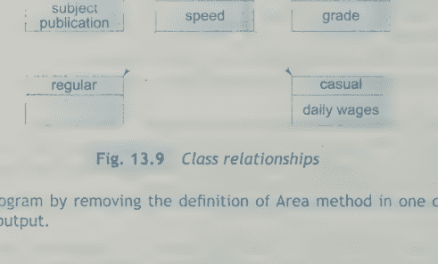

图 13.9 类关系

# 13.12 通过在其中一个派生类中移除 Area 方法的定义来运行上述程序。评论输出结果。

# 14

# 接口：多重继承

### 14.1 引言

在第 12 章和第 13 章中，我们讨论了类的各种特性以及它们如何被其他类继承。我们还了解了各种形式的继承，并指出 C# 不支持多重继承。也就是说，C# 中的类不能拥有超过一个超类。例如，像这样的定义

```
Class A : B, C
{
    ....
    ....
}
```

在 C# 中是不允许的。然而，C# 的设计者无法忽视多重继承的重要性。大量现实生活中的应用程序需要使用多重继承，在其中我们从多个不同的类继承方法和属性。由于‘C++ 风格’的多重继承实现困难且增加了语言的复杂性，C# 提供了一种称为接口的替代方法来支持多重继承的概念。虽然 C# 类不能是超过一个超类的子类，但它可以实现多个接口，从而使我们能够创建在其他类之上构建的类，而不会产生多重继承带来的问题。

C# 中的接口是一种引用类型。它基本上是一种具有某些差异的类。主要区别包括：

+   - 接口的所有成员都是隐式 public 且 abstract。
+   - 接口不能包含常量字段、构造函数和析构函数。
+   - 其成员不能声明为 static。
+   - 由于接口中的方法都是抽象的，它们不包含实现代码。
+   - 接口可以继承多个接口。

### 14.2 定义接口

接口可以包含一个或多个方法、属性、索引器和事件，但这些都不会在接口本身中实现。实现接口的类有责任定义这些成员的实现代码。

定义接口的语法与定义类使用的语法非常相似。接口定义的一般形式为：

```
interface InterfaceName
{
```

成员声明；
}

这里，interface 是关键字，InterfaceName 是有效的 C# 标识符（就像类名一样）。成员声明将只包含成员列表而不包含实现代码。下面给出了一个定义单个方法的简单接口：

```
interface Show
{
    void Display ();    // 注意这里的分号
}
```

除了方法之外，接口还可以声明属性、索引器和事件。示例：

```
interface Example
{
    int Aproperty
    {
        get ;
    }
    event someEvent Changed;
    void Display ();
}
```

接口的可访问性可以通过使用修饰符 public、protected、internal 和 private 来控制。使用特定修饰符取决于接口声明出现的上下文。

我们也可以在嵌套接口上应用修饰符 new。它指定接口隐藏了同名继承的成员。

### 14.3 扩展接口

像类一样，接口也可以被扩展。也就是说，一个接口可以从其他接口派生。新的子接口将以类似于子类的方式继承超接口的所有成员。这是通过以下方式实现的：

```
interface name2 : name1
{
    name2 的成员
}
```

例如，我们可以将特定行为类别的所有成员放在一个接口中，将另一类别的成员放在另一个接口中。

考虑下面的代码：

```
interface Addition
{
    int Add (int x, int y);
}
```

```
interface Compute : Addition
{
    int Sub (int x, int y);
}
```

接口 Compute 将拥有两个方法，并且任何实现接口 Compute 的类都应实现它们两者；否则，就是错误。

我们还可以将多个接口组合成一个单一接口。以下声明是有效的：

```
interface I1
{
    ....
}
interface I2
{
    ....
}
interface I3 : I1, I2 //多重继承
{
    ....
}
```

虽然接口允许扩展其他接口，但子接口不能定义超接口中声明的方法。毕竟，子接口仍然是接口，而不是类。实现派生接口的类有责任定义所有方法。请注意，当一个接口扩展两个或多个接口时，它们之间用逗号分隔。

必须记住，接口不能扩展类。这将违反接口只能拥有抽象成员的规则。

### 14.4 实现接口

接口被用作‘超类’，其属性被类继承。因此，有必要创建一个继承给定接口的类。这按如下方式完成：

```
class classname : interfacename
{
    classname 的主体
}
```

这里类 classname ‘实现’接口 interfacename。更一般的实现形式可能如下所示：

```
class classname : superclass, interface1, interface2....
{
    classname 的主体
}
```

这表明一个类可以扩展另一个类同时实现接口。

在 C# 中，我们可以从单个类派生，并且额外实现类所需的任意多个接口。当一个类继承自超类时，每个要实现的接口的名称必须出现在超类名称之后。示例：

```
class A : B, I1, I2....
{
    ....
}
```

其中 B 是基类，I1、I2、.... 是接口。基类和接口之间用逗号分隔。

程序 14.1 的输出将为：
    Sum = 30
    Product = 200

请注意，我们不能直接实例化接口。也就是说，我们不能写：
    Addition add = new Addition ();

我们应该始终创建实现类的实例，然后将对象强制转换为接口类型。

让我们考虑另一个接口被多个类实现的例子。程序 14.2 显示了两个类 Circle 和 Square 实现了一个接口 Area。

#### 程序 14.2 | 接口的多重实现

```
using System;
interface Area
{
    double Compute ( double x );
}
class Square : Area
{
    public double Compute (double x)
    {
        return (x * x)
    }
}
class Circle : Area
{
    public double Compute (double x)
    {
        return (Math.PI * x * x);
    }
}
class InterfaceTest2
{
    public static void Main()
    {
        Square sqr = new Square ();
        Circle cir = new Circle ();
        Area area;
        area = sqr as Area;      //强制转换
        Console.WriteLine ("Area of Square ="
            + area.Compute(10.0));
        area = cir as Area;      //强制转换
        Console.WriteLine ("Area of Circle="
            + area.Compute(10.0));
    }
}
```

程序 14.2 将输出以下两行：
Area of Square = 100
Area of circle = 314.159265

在程序 14.2 中，我们使用 new 操作符创建每个类的实例。然后，我们声明一个类型为 Area 接口的对象。现在，我们使用 as 操作符将 Square 对象强制转换为接口类型，如下所示：
area = sqr as Area;

然后，调用
area.Compute(10.0)
将调用 Square 类的 Compute 方法。我们对 Circle 对象重复类似的步骤。

请注意，任意数量的类可以实现一个接口。然而，为了实现方法，我们需要将类对象引用为接口类型而不是它们各自的类。

### 14.5 接口与继承

最常见的情况是派生类的基类实现了接口。在这种情况下，当派生类的对象被转换为接口类型时，继承层次结构会被搜索，直到找到直接实现该接口的类。请考虑程序 14.3 中的代码。

#### 程序 14.3 继承实现接口的类

```
using System;
interface Display
{
    void Print ( );
}
class B : Display  // 实现 Display
{
    public void Print ()
    {
        Console.WriteLine("Base Display");
    }
}
class D : B      // 继承 B 类
{
    public new void Print ()
    {
        Console.WriteLine("Derived Display");
    }
}
class InterfaceTest3
{
    public static void Main()
    {
        D d = new D ();
        d.Print ();
    }
```


```
Display dis = (Display) d;
dis.Print ();
}
}
```

程序 14.3 将产生以下输出：

Derived Display
Base Display

请注意语句
dis.Print ();
调用的是基类 B 中的 Print() 方法，而不是派生类本身可用的方法。这是因为派生类没有实现接口。也就是说，派生类中使用修饰符 new 会“隐藏”基类中实现的 Print 方法。

### 14.6 显式接口实现

C# 不支持多重继承的一个原因就是名称冲突问题。然而，当 C# 实现多个接口时，这个问题仍然存在。示例：

```
interface I1 { void Display ( ); }
interface I2 { void Display ( ); }
class C1 : I1, I2
{
    public void Display { }
}
```

C1.Display() 是实现 I1.Display()，还是 I2.Display()？这是模棱两可的，因此编译器会报告错误。当我们实现来自不同来源的接口时，可能会出现此类名称冲突问题。

C# 支持一种称为显式接口实现的技术，该技术允许方法明确指定其正在实现的接口的名称。程序 14.4 说明了显式接口实现的使用。

#### 程序 14.4 显式接口实现

```
using System;
interface I1
{
    void display ( );
}
interface I2
{
    void Display ( );
}
class C1 : I1, I2
{
    void I1.Display ( ) //no access modifier
    {
        Console.WriteLine("I1 Display");
    }

void I2.Display ()  //no access modifier
{
    Console.WriteLine("I2 Display");
}
}
class InterfaceTest4
{
    public static void Main( )
    {
        C1 c = new C1( );

        I1 i1 = (I1) c;
        i1.display;

        I2 i2 = (I2)c;
        i2.Display ();
    }
}
```

程序 14.4 的输出为：
    I1 Display
    I2 Display

请注意，在实现接口成员时，我们已明确使用接口名称进行限定。
    void I1. Display ();
    void I2. Display ();

还请注意，在显式接口实现上禁止使用访问修饰符。

程序 14.5 演示了接口的使用，主要演示显式继承。程序中创建了两个接口，每个接口包含两个方法 read、write 和 view、read。方法在内部类中被显式重写，并在 Main 类方法 CreateDoc() 中调用并显示结果。

#### 程序 14.5 显式接口的另一个示例

```
using System;
using System.Collections.Generic;
using System.Text;
namespace ExplicitInterface
{
    class ExplicitInterface_Implementation
    {
        interface readFile
        {
            void Read();
            void Write();
        }
        interface writeFile
        {

void View();
void Read();
}

public class Document : readFile, writeFile
{
    // the document constructor
    public Document(string doc)
    {
        Console.WriteLine("Creating a document with: {0}", doc);
    }
    // Implicit implementation
    public virtual void Read()
    {
        Console.WriteLine("Reading from Read method in interface readFile.");
    }
    public void Write()
    {
        Console.WriteLine("Writing in Write Method in interface readFile.");
    }
    // Explicit implementation
    void writeFile.Read()
    {
        Console.WriteLine("Reading from Read method in interface writeFile.");
    }
    public void View()
    {
        Console.WriteLine("Viewing from View method in interface writeFile.");
    }
}

public void CreateDoc()
{
    // Creating a Document object
    Document doc1 = new Document("This Document is getting written \n in the document created.");
    readFile iFile = doc1 as readFile;
    if (iFile != null)
    {
        iFile.Read();
    }
    // Cast to an writeFile interface
    writeFile wFile = doc1 as writeFile;
    if (wFile != null)
    {
        wFile.Read();
    }
    doc1.Read();

doc1.View();
}
public static void Main()
{
    ExplicitInterface_Implementation ei = new ExplicitInterface_Implementation();
    ei.CreateDoc();
}
}
```

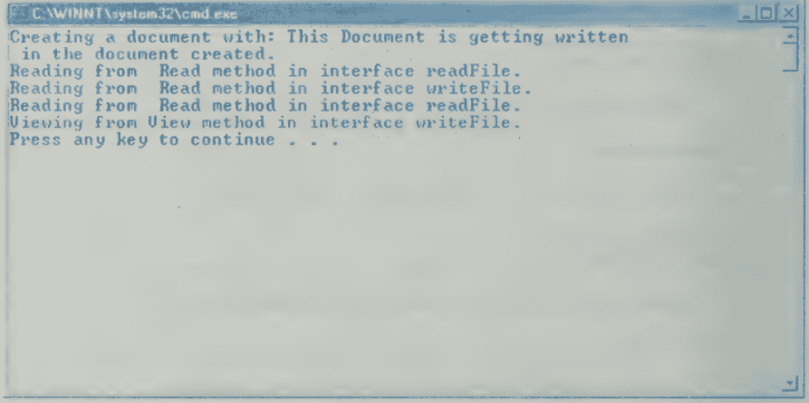

### 14.7 抽象类和接口

像其他类一样，抽象类可以在基类列表中使用接口。然而，接口方法被实现为抽象方法。示例：

```
interface A
{
    void Method ( );
}
abstract class B : A
{
    ....
    ....
    public abstract void Method ( );
}
```

请注意，类 B 并未实现接口方法；它只是将其重新声明为 public abstract 方法。派生自 B 的类的职责是重写并实现该方法。

请注意，接口类似于抽象类。事实上，我们可以将接口转换为抽象类。考虑以下接口：

### 接口：多重继承

```
interface A
{
void Print ( );
}
```

这与以下抽象类相同：

```
abstract class B
{
abstract public void Print ( );
}
```

现在，类可以从 B 继承而不是实现接口 A。然而，继承 B 的类不能直接继承其他类。如果是接口，则类不仅可以实现接口，还可以使用另一个类作为基类，从而有效地实现多重继承。

程序 14.6 使用了抽象类、多级继承的概念，调用继承类 Class1、Class2 中的方法并操作这些方法并显示输出。

#### 程序 14.6 使用抽象类的继承

```
using System;
using System.Collections.Generic;
using System.Text;
namespace InheritanceusingAbstractClass
{
class Program
{
static void Main()
{
ABS[] aArray = new ABS[3];
aArray[0] = new Class1(1, 2, "This is the first value in array.");
aArray[1] = new Class1(3, 4, "This is the next value in array.");
aArray[2] = new Class2(5, 6);
for (int i = 0; i < 3; i++)
{
aArray[i].show();
}
}
} // end class Program
public abstract class ABS
{
// constructor takes two integers to fix location on the console
public ABS(int top, int left)
{
this.top = top;
this.left = left;
}
public abstract void show();
}
}
```

```
protected int top;
protected int left;
}
    // end class Window
// Class1 derives from ABS
public class Class1 : ABS
{
    // constructor adds a parameter
    public Class1(
        int top,
        int left,
        string contents)
        : base(top, left) // call base constructor
    {
        class1values = contents;
    }
    // an overridden version implementing the abstract method
    public override void show()
    {
        Console.WriteLine("This is overriding the method show declared in \n abstract class ABS : {0}.\n", class1values);
    }
    private string class1values; // new member variable
}
    // end class Class1

public class Class2 : ABS
{
    public Class2(
        int top,
        int left)
        : base(top, left) { }
    // implement the abstract method
    public override void show()
    {
        Console.WriteLine("Overriding again the show method in Class2. \n", top, left);
    }
}
    // end class Class2
```

#### 案例研究

##### 问题陈述

HPStore 是一家电脑商店，主要销售不同种类的惠普 HP 电脑。在销售 HP 电脑时，HPStore 的营销人员最近发现记住不同种类 HP 电脑的功能、价格和名称变得非常繁琐。因此，HPStore 的营销人员在为前来咨询 HP 电脑的客户提供正确信息时遇到问题。由此，HPStore 正在流失客户并亏损。HPStore 如何解决营销人员的问题并增加客户？

##### 解决方案

为了解决其营销人员的问题，HPStore 决定需要一个应用程序，允许员工查看与不同种类 HP 电脑相关的详细信息，如功能和价格。它向 ABC 软件顾问公司提出请求，请他们创建该应用程序，该应用程序将显示有关不同 HP 电脑的详细信息。ABC 软件顾问公司在分析了 HPStore 的需求后，决定使用 C# 编程语言的接口特性来开发该应用程序。接口是 C# 中的引用类型，包含方法的声明。接口在 C# 中在不同类中实现，其中声明在接口中的方法被定义和使用。ABC 软件顾问公司创建了以下应用程序，以使在 HPStore 工作营销人员的任务变得简单：

/* 如何在现实生活中将单个产品如 HP 电脑的不同属性（颜色、电脑名称、价格和处理器）存储在不同的方法中，并在需要时分别调用它们供使用*/
using System;
using System.Collections.Generic;
using System.Text;


```csharp
namespace CaseStudy14
{
    interface HPSystem
    {
        void ListComputer();
        void ShowComputerColor(string str);
        void ShowComputerFeature(string feature);
        void ShowComputerPrice(double price);
    }
    class ComputerList : HPSystem
    {
        string comptercolor = "";
        string computernames = "";
        public void ListComputer()
        {
            computernames = "1.      HP Pavilion Media Center m8000\n";
            computernames = computernames + "\n2.      HP Compaq DC5750 PC";
            computernames = computernames + "\n3.      HP Compaq DX2300 pc";
            Console.WriteLine("The HP Computers are :\n\n" + computernames);
        }
        public void ShowComputerColor(string color)
        {
            this.comptercolor = color;
            Console.WriteLine("\nThe color of the systems are : " + comptercolor + "\n");
        }
        public void ShowComputerFeature(string feature)
        {}
        public void ShowComputerPrice(double price) {}
    }
    class ShowHPCompterDetails : ComputerList
    {
        string Computerfeature = "";
        double ComputerPrice = 0;
        public void ShowComputerFeature(string feature)
        {
            this.Computerfeature = feature;
            Console.WriteLine("The features of the systems are " +Computerfeature);
        }
        public void ShowComputerPrice(double price)
        {
            this.ComputerPrice = price;
            Console.WriteLine("\nThe Prices of the systems are:" +ComputerPrice);
        }
    }
    class ShowComputerFeatures
    {
        static void Main(string[] args)
        {
            ShowHPCompterDetails hpm = new ShowHPCompterDetails();
            hpm.ListComputer();
            hpm.ShowComputerColor("Steel Gray");
            hpm.ShowComputerColor("Black");
            hpm.ShowComputerColor("Gray");
            hpm.ShowComputerFeature("Pentium PIV PC Dual Core2");
            hpm.ShowComputerFeature("Pentium PIV 2.5GHz processor");
            hpm.ShowComputerFeature("Pentium PIV PC Dual Core");
            hpm.ShowComputerPrice(63000);
            hpm.ShowComputerPrice(30000);
            hpm.ShowComputerPrice(45000);
        }
    }
}
```

## 备注

接口特性使我们在 C# 应用程序中能够实现多重继承的概念。它还提供了代码复用的好处，可以将一个应用程序中定义的代码复用于另一个应用程序。在接口中，方法被声明为抽象方法，不包含任何实现代码。在 C# 中，接口可以由多个类实现。

## 常见编程错误

- 将数据字段声明为成员。
- 将成员声明为 static。
- 使用可见性修饰符来声明成员。
- 忘记在方法声明末尾放置分号。
- 忘记在实现类中实现某个成员。
- 忘记将类对象强制转换为接口类型。
- 在显式实现方法上使用访问修饰符。
- 试图创建接口的实例。
- 忘记将实现方法声明为 public。

## 复习题

14.1 判断以下陈述是否正确（true/false）。

- (a) 与类一样，接口只能继承一个接口。
- (b) 接口的所有成员都是隐式抽象的。
- (c) 接口的成员可以被声明为 private。
- (d) 接口通常用于声明常量数据字段。
- (e) 接口不能扩展类。
- (f) 在父接口中声明的方法必须在子接口中实现。
- (g) 类可以实现任意数量的接口。
- (h) 任意数量的类都可以实现一个接口。
- (i) 接口可以被视为抽象类的替代方案。
- (j) 抽象类可以实现接口。
- (k) 我们可以使用 new 运算符创建接口的实例。

14.2 什么是接口？

14.3 类和接口之间的主要区别是什么？

14.4 类和接口之间的相似之处是什么？

14.5 接口的所有成员都被隐式设置为 public。为什么？

14.6 接口的所有成员都是隐式抽象的。这意味着什么？

14.7 当接口继承另一个接口时，我们称之为扩展接口；但当类继承接口时，我们称之为实现接口。为什么？

14.8 什么是显式接口实现？何时使用？

14.9 C# 支持多重继承吗？如果支持，如何实现？

14.10 使用接口，我们可以在类中实现多重继承特性。如何实现？

14.11 我们如何表示类 Class1 派生自基类 BaseClass，并实现 FileRead 和 FileWrite 接口？

14.12 我们可以将两个或更多接口组合在一起。请讨论。

14.13 描述实现接口的各种形式，并为每种情况给出 C# 代码示例。

14.14 给出一个接口可用于支持多重继承的示例。

14.15 抽象类可以实现接口吗？如果可以，接口方法是如何实现的？

14.16 区分抽象类和接口。

14.17 找出以下接口定义和实现中的错误：

- (a)

  ```csharp
  new interface A
  {
      void M1();
  };
  ```

- (b)

  ```csharp
  private interface A {}
  public interface B : A {}
  ```

- (c)

  ```csharp
  interface A {}
  interface B {}
  interface C extends A, B
  {}
  ```

- (d)

  ```csharp
  interface A {}
  class B {}
  class C : A, B
  {}
  ```

- (e)

  ```csharp
  interface A {}
  class B implements A
  {}
  ```

- (f)

  ```csharp
  interface A
  {
      void M1();
      int n;
  }
  ```

- (g)

  ```csharp
  interface X
  {
      static void Fun();
  }
  ```

- (h)

  ```csharp
  interface Y
  {
      public void Display ();
      int count {get;}
  }
  ```

- (i)

  ```csharp
  interface P
  {
      abstract void Paint ();
  }
  ```

- (j)

  ```csharp
  interface A
  {
      void Mul ();
  }
  interface B : A
  {
      void Mul ();
  }
  ```

## 调试练习

### 14.1 定位并更正下面程序中的错误。

```csharp
using System;
using System.Collections.Generic;
using System.Text;
namespace debugApp1_chap14
{
    public abstract class Car
    {
        abstract void RemoveAllFuses();
        abstract void StartEngine();
    }
    class Seat : Car
    {
        public override void RemoveAllFuses()
        {
        }
        public override void StartEngine()
        {
        }
    }
    class Program
    {
        static void Main(string[] args)
        {
            Seat c = new Seat();
            c.RemoveAllFuses();
        }
    }
}
```

### 14.2 找出下面程序中的错误。

```csharp
using System;
using System.Collections.Generic;
using System.Text;

namespace debugApp2_chap14
{
    interface Dimensions
    {
        float Length();
        float Width();
    }
    interface MetricDimensions
    {
        int Length();
        int Width();
    }
    class Box : Dimensions, MetricDimensions
    {
        float lengthInches;
        float widthInches;
        public Box(float length, float width)
        {
            lengthInches = length;
            widthInches = width;
        }
        // Explicitly implement the members of IEnglishDimensions:
        float Dimensions.Length()
        {
            return lengthInches;
        }
        float Dimensions.Width()
        {
            return widthInches;
        }

        float MetricDimensions.Length()
        {
            return lengthInches * 2.54f;
        }
        float MetricDimensions.Width()
        {
            return widthInches * 2.54f;
        }
        static void Main()
        {
            Box box1 = new Box(30.0f, 20.0f);
            // Declare an instance of the English units interface:
            Dimensions eDimensions = (Dimensions)box1;
            // Declare an instance of the metric units interface:
            MetricDimensions mDim = (MetricDimensions)box1;
            // Print dimensions in English units:
            System.Console.WriteLine("Length(in): {0}", eDimensions.Length());
            System.Console.WriteLine("Width (in): {0}", eDimensions.Width());
            // Print dimensions in metric units:
            System.Console.WriteLine("Length(cm): {0}", mDim.Length());
            System.Console.WriteLine("Width (cm): {0}", mDim.Width());
        }
    }
}
```

### 14.3 检查下面程序中的语法错误并更正。

```csharp
using System;
using System.Collections.Generic;
using System.Text;

namespace debugApp3_chap14
{
    class Program
    {
        public class ShowValues
        {
            void Show();
        }

        public class CharContainer :: ShowValues
        {
            public void Show()
            {
                // Do character type sorting here.
                Console.WriteLine("From CharContainer.");
            }
        }

        public class NumberContainer :: ShowValues
        {
            public void Show()
            {
                // Do numeric type sorting here.
                Console.WriteLine("From NumberContainer.");
            }
        }

        public void ShowAll(ShowValues[] sortobj)
        {
            foreach (ShowValues sv in sortobj)
            {
                sv.Show();
            }
        }

        static void Main(string[] args)
        {
            Program Obj = new Program();
            obj.ShowAll(new ShowValues[2] { new CharContainer(), new NumberContainer() }
            );
        }
    }
}
```


# 14.4. 调试以下程序中 private 关键字的用法。

```
using System;
using System.Collections.Generic;
using System.Text;
namespace debugApp4_chap14
{
    interface Inter1
    {
        void Display();
    }
    private class Class1
    {
        public void Display()
        {
            Console.WriteLine("This message is from Class1.");
        }
    }
    private class Class2 : Inter1
    {
        public void Display()
        {
            Console.WriteLine("This message is from Class2.");
        }
    }
    private class Class3
    {
        void ShowMessage(object obj)
        {
            Inter1 show;
            show = obj as Inter1;
            if (show != null)
                show.Display();
        }
        void Display()
        {
            Class1 cl1 = new Class1();
            Class2 cl2 = new Class2();
            ShowMessage(cl1);
            ShowMessage(cl2);
        }
    }
    class Program
    {
        static void Main(string[] args)
        {
            Class3 cl3 = new Class3();
            cl3.Display();
        }
    }
}
```

# 15

# 运算符重载

### 15.1 引言

运算符重载是面向对象编程中众多令人兴奋的特性之一。C# 支持运算符重载的思想。这意味着 C# 运算符可以被定义为与用户定义的数据类型（如结构体和类）一起工作，其方式与内置类型大致相同。例如，C# 允许我们使用应用于基本类型的相同语法来相加两个类对象。

示例：

```
Vector u1, u2, u3;
...                 //Initialize u1 and u2 here

u3 = u1 + u2;       //adding two objects, u1 and u2
```

其中 Vector 是一个类或结构体。两个向量 u1 和 u2 被相加（像简单类型一样）得到第三个向量（u3）。这意味着，C# 具有为数据类型提供运算符特殊含义的能力。给运算符赋予这种特殊含义的机制被称为运算符重载。

运算符重载为大多数 C# 运算符创建新定义提供了灵活的选择。通过创造性地使用方法和运算符重载技术，我们几乎可以创建自己的新语言。

### 15.2 可重载的运算符

C# 中有相当数量的运算符可以被重载。也有许多不能被重载的运算符。它们列在表 15.1 和表 15.2 中。

#### 表 15.1 可重载的运算符

| CATEGORY | OPERATORS |
|---|---|
| Binary arithmetic | +, *, /, -, % |
| Unary arithmetic | +, -, ++, -- |
| Binary bitwise | &, |, ^, <<, >> |
| Unary bitwise | !, ~, true, false |
| Logical operators | ==, !=, >, >=, <, <= |

#### 表 15.2 不能重载的运算符

| CATEGORY | OPERATORS |
|----------|-----------|
| Conditional operators | && || |
| Compound assignment | +=, -=, *=, /=, %= |
| Other operators | {} . , : ? ; -> . new. sizeof. typeof. is. as |

注意：

• 当我们重载一个二元运算符时，其复合赋值等价物会被隐式重载。
• 逻辑运算符必须成对重载。意味着 && 和 ! 必须一起完成。
• 当前在 C# 中未定义的运算符不能被重载。

尽管运算符的语义可以被扩展，但我们不能改变其语法，即支配其使用的语法规则，如操作数数量、优先级和结合性。例如，乘法运算符的优先级高于加法运算符。请记住，当运算符被重载时，其原始含义并未丢失。例如，运算符 +，已被重载以相加两个向量，仍然可以用来相加两个整数。

虽然运算符重载为我们提供了语法上的便利，但它也在许多情况下极大地帮助我们生成更可读和更直观的代码。这些包括：

- 数学或物理建模，其中我们使用类来表示坐标、向量、矩阵、张量、复数等对象。
- 图形程序，其中坐标相关对象用于表示屏幕上的位置。
- 财务程序，其中一个类表示金钱金额。
- 文本操作，其中类用于表示字符串和句子。

为了为运算符定义额外任务，我们必须指定它相对于运算符所应用的类（或结构体）的含义。这是通过一种称为运算符方法 的特殊方法完成的，其描述了任务。运算符方法的一般形式为：

```
public static retval operator op (arglist)
{
Method body //task defined
}
```

运算符的定义方式与方法大致相同，只是我们通过 operator 关键字，后跟运算符符号 op 来告诉编译器我们实际上是在定义一个运算符。运算符方法的关键特征是：

• 它们必须定义为 public 和 static。
• retval（返回值）类型是我们使用此运算符时得到的类型。但从技术上讲，它可以是任何类型。
• arglist 是传递的参数列表。参数数量对于一元运算符为一个，对于二元运算符为两个。

- 对于一元运算符，参数必须与包含的类或结构体的类型相同。
- 对于二元运算符，第一个参数必须与包含的类或结构体的类型相同，第二个可以是任何类型。

重载运算符的示例为：

```
// vector addition
public static Vector operator + (Vector a, Vector b)
// unary minus
public static Vector operator - (Vector a)
// comparison
public static bool operator == (Vector a, Vector b)
```

Vector 是一个类的数据类型，可能表示大小和方向（如物理和工程中）或称为元素的一系列点（如数学中）。重载过程涉及以下步骤：

- 创建一个类（或结构体），定义要在重载操作中使用的的数据类型。
- 使用 public 和 static 修饰符声明运算符方法 operator op()。
- 定义运算符方法的主体以实现所需操作。

## 15.5 重载一元运算符

让我们考虑一元减运算符。减运算符用作一元时，只取一个参数。我们知道，此运算符应用于基本数据项时会改变操作数的符号。我们将在这里看到如何重载此运算符，使其可以像应用于 int 或 float 变量一样应用于对象。一元减应用于对象时应改变其每个数据项的符号。程序 15.1 显示了如何重载一元减运算符。

方法 operator - () 取一个类型为 Space 的参数并改变对象 s 的数据成员的符号。由于它是同一类的成员方法，因此可以直接访问激活它的对象的成员。请记住，像
s2 = -s1;
这样的语句将不起作用，因为运算符方法不返回任何值。如果方法被修改为返回一个对象，则可以工作。

#### 程序 15.1 重载一元减

```
using System;
class Space
{
    int x, y, z;
    public Space ( int a, int b, int c )
    {
        x = a;
        y = b;
        z = c;
    }
    public void Display ()
    {
        Console.Write(" " + x);
        Console.Write(" " + y);
        Console.Write(" " + z);
        Console.WriteLine();
    }
    public static Space operator - (Space s)
    {
        s.x = -s.x;
        s.y = -s.y;
        s.z = -s.z;
    }
}
class SpaceTest
{
    public static void Main()
    {
        Space s = new Space ( 10, -20, 30 );
        Console.Write(" s : ");
        s.Display();
        -s;            //activates opeator -() method
        Console.Write(" s : ");
        s.Display();
    }
}
```

程序 15.1 将产生以下输出：
S : 10 -20 30
S : -10 20 -30

## 15.6 重载二元运算符

我们刚刚看到了如何重载一元运算符。相同的机制可用于重载二元运算符。我们始终可以使用方法来相加两个对象。像
C = sum ( A, B); //functional notation
这样的语句是可能的。通过重载 + 运算符使用运算符 + () 方法，可以用自然的外观表达式
C = A + B; //arithmetic notation.
替换函数式记法。以下是定义运算符 + () 方法所使用的语法。

```
public static Vector operator + (Vector u1, Vector u2)
{
    //Create a new Vector object
```


//将u1和u2的内容
//添加到新的Vector对象中
//返回新的vector对象

程序15.2说明了如何实现这一点。该程序重载二元加运算符，以将两个类型为
 x = a + jb
的复数相加。

#### 程序15.2 重载+运算符

```
using System;
class Complex
{
    double x;          //real part
    double y;          //imaginary part
    public Complex ()
    {
    }
    public Complex(double real, double imag)
    {
        x = real;
        y = imag;
    }
    public static Complex operator + (Complex c1, Complex c2)
    {
        Complex c3 = new Complex ();
        c3.x = c1.x + c2.x;
        c3.y = c1.y + c2.y;
        return (c3);
    }
    public void Display()
    {
        Console.Write(x);
        Console.Write(" + j" + y);
        Console.WriteLine();
    }
}
class ComplexTest
{
    public static void Main()
    {
        Complex a, b, c;
        a = new Complex (2.5 , 3.5);
        b = new Complex (1.6, 2.7);
        c = a + b;
        Console.Write(" a = ");
        a.Display();
        Console.Write("b = ");
        b.Display();
```
```
Console.Write("c =");
c.Display();
}
}
```

程序15.2的输出将为：
a = 2.5 + j3.5
b = 1.6 + j2.7
c = 4.1 + j6.2

## 15.7 重载比较运算符

C#支持六个比较运算符，它们可以分为三对：

- == 和 !=
- > 和 >=
- < 和 <=

配对的意义有两方面。

- 1. 在每一对中，第二个运算符应始终与第一个运算符给出完全相反的结果。也就是说，每当第一个返回true，第二个就返回false，反之亦然。
- 2. C#总是要求成对地重载比较运算符。也就是说，如果我们重载==，那么也必须重载!=，否则就是一个错误。

重载比较运算符与重载算术运算符之间有一个根本区别。比较运算符必须返回bool类型的值。除了这些区别之外，重载比较运算符遵循与重载算术运算符相同的原则。

程序15.3说明了如何重载比较运算符==和!=，并将其用于比较两个向量。该程序还重载了+和-运算符，以便两个向量可以如所示进行相加或相减。重写ToString()方法以显示向量的内容。

#### 程序15.3 重载比较运算符

```
using System;
class Vector
{
    int x, y, z;
    public Vector () {}
    public Vector ( int a, int b, int c)
    {
        x = a;
        y = b;
        z = c;
    }
    public override string ToString()
    {
        return("("+x+","+y+","+z+")");
    }
    public static Vector operator + (Vector u1, Vector u2)
```
```
{
    Vector u3 = new Vector ();
    u3.x = u1.x + u2.x;
    u3.y = u1.y + u2.y;
    u3.z = u1.z + u2.z;
    return (u3);
}
public static Vector operator-(Vector u1, Vector u2)
{
    Vector u3 = new Vector ();
    u3.x = u1.x - u2.x;
    u3.y = u1.y - u2.y;
    u3.z = u1.z - u2.y;
    return (u3 );
}
public static bool operator == (Vector u1, Vector u2)
{
    if (u1.x == u2.x && u1.y == u2.y && u1.z == u2.z)
        return (true);
    else
        return (false);
}
public static bool operator != (Vector u1, Vector u2)
{
    return (! (u1 == u2));
}
}
class CompareTest
{
    public static void Main( )
    {
        Vector u1 = new Vector (1,2,3);
        Vector u2 = new Vector (4,5,6);
        Vector u3 = u1 + u2;
        Vector u4 = u2 - u1;
        Console.WriteLine("u1 = " + u1);
        Console.WriteLine("u2 = " + u2);
        Console.WriteLine("u3 = " + u3);
        Console.WriteLine("u4 = " + u4);
        if (u1 == u2)
        {
            Console.WriteLine("u1 is equal to u2");
        }
        else
        {
            Console.WriteLine("u1 is not equal to u2");
        }
    }
}
```

注意，代码段

```
Vector u3 = new Vector();
u3.x = u1.x + u2.x;
u3.y = u1.y + u2.y;
u3.z = u1.z + u2.z;
return (u3);
```

可以替换为如下单个语句：

```
return new Vector (u1.x+u2.x, u1.y+u2.y, u1.z+u2.z);
```

重载==运算符也可以通过使用Equal()方法来完成，如下所示：

```
public static bool operator == (Vector u1, Vector u2)
{
    return (u1.Equals(u2));
}
```

在这种情况下，我们必须重写System命名空间中定义的Equals()方法，如下所示：

```
public override bool Equals (object value)
{
    Vector u = (Vector) value;
    return ((this.x == u.x) &&
            (this.y == u.y) &&
            (this.z == u.z));
}
```

程序15.3将产生以下输出：

```
u1 = (1, 2, 3)
u2 = (4, 5, 6)
u3 = (5, 7, 9)
u4 = (3, 3, 3)
u1 is not equal to u2
```

程序15.4重载了==布尔运算符，并根据所执行的除法显示数值；输出值会与另一个值进行比较，以检查它们是否相等。另一个方法Equal()使用与==运算符相同的功能来显示数据。

#### 程序15.4 | 重载相等运算符

```
using System;
public class Fraction
{
    private int numerator;
    private int denominator;
    // create a fraction by passing in the numerator
    // and denominator
    public Fraction( int numerator, int denominator )
    {
        this.numerator = numerator;
        this.denominator = denominator;
    }
    // overloaded operator+ takes two fractions
    // and returns their sum
```
```
public static Fraction operator +( Fraction lhs, Fraction rhs )
{
    // like fractions (shared denominator) can be added
    // by adding thier numerators
    if ( lhs.denominator == rhs.denominator )
    {
        return new Fraction( lhs.numerator + rhs.numerator,
        lhs.denominator );
    }
    // simplistic solution for unlike fractions
    // 1/2 + 3/4 == (1*4) + (3*2) / (2*4) == 10/8
    // this method does not reduce.
    int firstProduct = lhs.numerator * rhs.denominator;
    int secondProduct = rhs.numerator * lhs.denominator;
    return new Fraction(
    firstProduct + secondProduct,
    lhs.denominator * rhs.denominator
    );
}
// test whether two Fractions are equal
public static bool operator ==( Fraction lhs, Fraction rhs )
{
    if ( lhs.denominator == rhs.denominator &&
    lhs.numerator == rhs.numerator )
    {
        return true;
    }
    // code here to handle unlike fractions
    return false;
}
// delegates to operator ==
public static bool operator !=( Fraction lhs, Fraction rhs )
{
    return !( lhs == rhs );
}
// tests for same types, then delegates
public override bool Equals( object o )
{
    if ( !( o is Fraction ) )
    {
        return false;
    }
    return this == (Fraction)o;
}
// return a string representation of the fraction
public override string ToString( )
{
    String s = numerator.ToString( ) + "/" +
    denominator.ToString( );
    return s;
}
```
```
}
}
public class Tester
{
    public void Run( )
    {
        Fraction f1 = new Fraction( 3, 4 );
        Console.WriteLine( "f1: {0}", f1.ToString( ) );
        Fraction f2 = new Fraction( 2, 4 );
        Console.WriteLine( "f2: {0}", f2.ToString( ) );
        Fraction f3 = f1 + f2;
        Console.WriteLine( "f1 + f2 = f3: {0}", f3.ToString( ) );
        Fraction f4 = new Fraction( 5, 4 );
        if ( f4 == f3 )
        {
            Console.WriteLine( "f4: {0} == F3: {1}",
                f4.ToString( ),
                f3.ToString( ) );
        }
        if ( f4 != f2 )
        {
            Console.WriteLine( "f4: {0} != F2: {1}",
                f4.ToString( ),
                f2.ToString( ) );
        }
        if ( f4.Equals( f3 ) )
        {
            Console.WriteLine( "{0}.Equals({1})",
                f4.ToString( ),
                f3.ToString( ) );
        }
    }
    static void Main( )
    {
        Tester t = new Tester( );
        t.Run( );
    }
}
```

fraction1 is : 35/70
fraction2 is : 20/140
fraction1 + fraction2 = becomes fraction3 : 6300/9800
Fraction 4 is : 63/98
fraction4: 63/98 not equal to fraction2: 20/140
Press any key to continue . . .

程序15.5重载了+运算符。静态方法Fraction接收两个整数参数，返回一个分数输出，并将输出显示为字符串类型。

#### 程序15.5
重载加运算符

```
using System;
using System.Collections.Generic;
using System.Text;
namespace OverloadingPlusOperator
{
    class Calculate
    {
        public void calc()
        {
            Fraction Fraction1 = new Fraction(388, 6677);
            Console.WriteLine("The fraction 1 is : {0}", Fraction1.ToString());
            Fraction Fraction2 = new Fraction(205, 47);
            Console.WriteLine("The fraction 2 is : {0}", Fraction2.ToString());
            Fraction sum = Fraction1 + Fraction2;
            Console.WriteLine("The output of fraction 1 + fraction 2 is : {0}", sum.ToString());
        }
        static void Main()
        {
            Calculate ca = new Calculate();
            ca.calc();
        }
    }
```


```
}

public class Fraction
{
    private int numerator;
    private int denominator;

    // create a fraction by passing in the numerator and denominator
    public Fraction(int numerator, int denominator)
    {
        this.numerator = numerator;
        this.denominator = denominator;
    }

    // overloaded operator + takes two fractions
    // and returns their sum
    public static Fraction operator +(Fraction frac1, Fraction frac2)
    {
        // like fractions (shared denominator) can be added by adding their numerators
        if (frac1.denominator == frac2.denominator)
        {
            return new Fraction(frac1.numerator + frac2.numerator, frac1.denominator);
        }

        int product1 = frac1.numerator * frac2.denominator;
        int product2 = frac2.numerator * frac1.denominator;
        return new Fraction(product1 + product2, frac1.denominator * frac2.denominator);
    }

    // return a string representation of the fraction
    public override string ToString()
    {
        String show = numerator.ToString() + " / " +
        denominator.ToString();
        return show;
    }
}
}
```

## 运算符重载

```
The fraction 1 is : 388/6677
The fraction 2 is : 205/47
The output of fraction 1 + fraction 2 is : 1387021/313819
Press any key to continue . . . -
```

#### 案例研究

##### 问题陈述

Ulinfo Private Limited 为 AeroFly 和 FlyHigh 等公司开发新型飞机。在开发新飞机设计时，Ulinfo 的设计人员需要进行大量复杂计算。手动执行这些复杂计算已成为 Ulinfo 设计人员的一项繁琐任务。Ulinfo 如何才能自动化执行复杂计算的任务？

##### 解决方案

ULInfo 的管理层经过多次讨论后得出结论：必须开发一个应用程序来自动化执行复杂计算的任务。为此，他们联系了一家名为 ABC Software Solutions Private Limited 的软件开发公司。这家软件开发公司首先进行需求分析，以了解 UlInfo 的需求。然后决定在 C# 应用程序中使用 C# 的运算符重载特性来重载诸如 + 和 - 之类的运算符，以便可以使用同一运算符执行不同功能。10 天后，ABC Software Solutions Private Limited 提出了以下 C# 应用程序，该应用程序有助于执行诸如两个数字相加和相乘之类的数学运算。

//Operator Overloading using inheritance
using System;
using System.Collections.Generic;
using System.Text;
namespace OperatorOverloading
{
class StoreValue
{
private int num1;
private int num2;
}

```
public StoreValue()
{
}
public StoreValue(int m, int n)
{
    num1 = m+m;
    num2 = n+n;
}
public void DisplayWindow()
{
    Console.WriteLine("The sum of numbers is {0} {1}", num1, num2);
}
}
```

class InheritValue : StoreValue
{
    private double num1 ;
    private double num2 ;
    public InheritValue(double a, double b)
    {
        num1 = a*a;
        num2 = b*b;
    }
    public InheritValue()
    {
    }
    public new void DisplayWindow()
    {
    Console.WriteLine("Now the square of the numbers 355 and 455 are {0} and {1}",num1,num2);
    }
}

class InheritMoreValue : InheritValue
{
    private double num1;
    private double num2;
    public InheritMoreValue(double a, double b)
    {
        num1 = (a * b) / (a+b);
        num2 = (a * b) / (b-a);
    }
    public InheritMoreValue()
    {
    }
    public new void DisplayWindow()
    {
        Console.WriteLine("The value of the numbers 48 and 62 are {0} and {1}", num1, num2);
    }
}
class Program

```
{
static void Main(string[] args)
{
    Console.WriteLine("Operator Overloading with Inheritance.");
    StoreValue Obj1 = new StoreValue(119,280);
    Obj1.DisplayWindow();
    InheritValue Obj2 = new InheritValue(355,455);
    Obj2.DisplayWindow();
    InheritMoreValue Obj3 = new InheritMoreValue(150,250);
    Obj3.DisplayWindow();
}
}
```

备注：通过在 C# 应用程序中使用运算符重载，可以为 +、− 和 ++ 等运算符提供新的定义。运算符重载允许你使用 C# 支持的运算符来处理类和结构体，就像这些运算符处理内置数据类型一样。

## 常见编程错误

-   忘记将运算符方法声明为 public。
-   忘记将运算符方法声明为 static。
-   重载关系运算符时，忘记重载其配对运算符。
-   重载关系运算符时，忘记返回 bool 类型值。
-   重载比较运算符时，尝试比较两个 float 值。
-   关系运算符使用不当。例如，将“大于或等于”符号写成 => 而不是 >=。

## 复习题

15.1 判断下列说法是否正确。
(a) 所有条件运算符都可以重载。
(b) 逻辑运算符必须成对重载。
(c) 我们可以通过重载改变运算符的优先级。
(d) 用于定义运算符重载的运算符方法必须是 public。
(e) 运算符方法从不返回值。
(f) 比较运算符方法必须返回 bool 类型值。

15.2 一元运算符和二元运算符有什么区别？

15.3 如果重载 == 运算符，还应该做什么？

15.4 什么是运算符重载？

15.5 为什么有必要重载运算符？

15.6 什么是运算符方法？描述其语法。

15.7 一元运算符方法的定义中使用多少个参数？

15.8 讨论重载比较运算符和重载算术运算符之间的区别。

15.9 列出可以重载的运算符。

15.10 列出不可重载的运算符。

15.11 举一些可能应用运算符重载的例子。

15.12 找出以下运算符方法头部行中的错误（如果有）：

-   (a) public Matrix operator + (Matrix x, Matrix y)
{}
-   (b) static Vector operator -(Vector a, Vector b)
{}
-   (c) public static Vector operator *(Vector a)
{}
-   (d) public static Vector operator *=(Vector a, Vector b)
{}
-   (e) public static Vector operator *(double x, Vector a)
{}

## 调试练习

15.1. 下面的程序有什么问题？

```
using System;
using System.Collections.Generic;
using System.Text;

namespace debugApp1_chap15
{
class OvrLoadingBinary
{
    int x;
    int y;
    OvrLoadingBinary() {}
    OvrLoadingBinary(int i, int j)
    {
        x = i;
        y = j;
    }
    public void DisplayWindow()
    {
        Console.WriteLine("{0} {1}",+x,+y);
    }
    public static OvrLoadingBinary operator +(OvrLoadingBinary olb1, OvrLoadingBinary olb2)
    {
        OvrLoadingBinary pos = new OvrLoadingBinary();
        pos.x = x + olb2.x;
        pos.y = y + olb2.y;
        return pos;
    }
}
class Program
```

```
{
public static void Main()
{
    OvrLoadingBinary olb1 = new OvrLoadingBinary(46, 200);
    Console.Write("First Window Position at : ");
    olb1.DisplayWindow(); // displays 10 & 20
    Console.Write("Then the Window is moved to position : ");
    OvrLoadingBinary olb2 = new OvrLoadingBinary(125, 310);
    olb2.DisplayWindow(); // displays 125 & 310
    OvrLoadingBinary olb3 = new OvrLoadingBinary();
    olb3 = olb1 + olb2;
    Console.Write("Displaying Window at : ");
    olb3.DisplayWindow();
}
}
```

15.2. 找出以下用于一元运算符重载的程序中的错误。

```
using System;
using System.Collections.Generic;
using System.Text;
namespace debugApp2_chap15
{
    class UnaryOperatorOverload
    {
        private int val1;
        private int val2;
        public UnaryOperatorOverload()
        {
        }
        public UnaryOperatorOverload(int i, int j)
        {
            i = val1;
            j = val2;
        }
        public void ShowCommandWindowPosition()
        {
            Console.WriteLine("The values keep changing due to operator overloading");
            Console.WriteLine("The values are {0} {1}", val1, val2);
        }
        public static UnaryOperatorOverload operator -(UnaryOperatorOverload uoo)
        {
            UnaryOperatorOverload pos = new UnaryOperatorOverload();
            pos.val1 = -uoo.val1;
            pos.val2 = -uoo.val2;
            return pos;
        }
    }
}
```


```
{
    if (CX != CY)
        return true;
    if (CX != CY)
        return true;
    return false;
}
static void Main(string[] args)
{
    Coordinates coord1 = new Coordinates();
    Coordinates coord2 = new Coordinates();
    Coordinates coord3 = new Coordinates();
    coord1.X = 225;
    coord1.Y = 280;
    coord2.X = 225;
    coord2.Y = 280;
    coord3.X = 400;
    coord3.Y = 500;
    if (coord1 == coord2)
        System.Console.WriteLine("The first coordinate and the second are at the same coordinates " + coord1.X + "," + coord1.Y);
    else
        System.Console.WriteLine("The first coordinate and the second coordinate are not at the same coordinates.");
    if (coord1 == coord3)
        System.Console.WriteLine("The first coordinate and the third coordinate are at the same coordinates " + coord3.X + "," + coord3.Y);
    else
        System.Console.WriteLine("The first coordinate and the third coordinate are not at the same coordinates.");
    if (coord2 == coord3)
        System.Console.WriteLine("The second coordinate and the third coordinate are at the same coordinates " + coord2.X + "," + coord2.Y);
    else
        System.Console.WriteLine("The second coordinate and the third coordinate are not at the same coordinates.");
    Console.WriteLine("");
    Console.WriteLine("Now changing the second coordinates of X to 400 and Y to 500.");
    coord2.X = 400;
    coord2.Y = 500;
    if (coord2 == coord3)
        System.Console.WriteLine("The second and the third coordinate are now at the same coordinates " + coord2.X + "," + coord2.Y);
}
}
```

## 编程练习

15.1 创建一个包含一个 float 数据成员的类 Float。重载全部四个基本算术运算符，使其可以应用于 Float 的对象。使用重载的 ToString 方法以所需格式提供输出。

15.2 定义一个类 Vector 来保存三个整数值。包含运算符方法，使我们能够对向量对象 V1、V2 和 V3 执行以下操作

V3 = V1 + V2;
V3 = 5 * V1;
V3 = V2 * 5;
int m = V1 * V2;

15.3 创建一个大小为 m x n 的类 Matrix。为 Matrix 类型对象定义所有可能的矩阵运算。

15.4 修改练习 15.2 的程序以包含对 == 和 != 运算符的重载运算符方法。

15.5 修改练习 15.4 的程序，使我们可以使用向量来处理 double 类型元素。
请注意，比较两个 double 类型值可能会导致不正确的结果，因为这些值可能相差很小。你将如何克服这个问题？将你的解决方案纳入程序中。

15.6 定义一个名为 MyString 的类，具有以下特性：

- 一个重载的二元 + 运算符，将两个 MyString 对象连接并创建第三个对象。
- 一个重载的比较运算符 == 用于比较两个字符串。
- 一个重载的一元 - （减号）运算符，如果字符串对象为空则返回 true；否则返回 false。

15.7 编写一个名为 Date 的类，其中包含数据成员 day、month 和 year 以及可实现以下任务的方法：

- 从键盘读取一个日期
- 显示一个日期
- 将日期递增一天
- 比较两个日期以查看哪个更大

在适用时使用运算符重载。

15.8 设计一个类 Polar，用极坐标半径和角度描述平面上的一个点。极坐标中的点如下所示。包含一个重载的运算符方法来添加两个 Polar 对象。

注意：

我们不能直接添加两个极点的数值。这需要首先将点转换为直角坐标，然后添加相应的直角坐标，最后将结果转换回极坐标。我们需要使用以下三角公式：
x = r * cos (a)
y = r * sin (a)
a = atan (y/x) //反正切
r = sqrt (x *x + y * y)


## 16

## 委托和事件

### 16.1 引言

在面向对象编程中，一个对象向其他对象发送消息是常见做法。然而，在实际应用中，一个对象向负责发送消息的对象报告情况是很常见的。这实际上导致了对象之间双向对话。用于回调消息的方法称为回调方法。

像 C 和 C++ 这样的语言使用所谓的函数指针来实现回调技术。函数指针只是表示内存地址，并且不包含“类型安全”信息，例如：

- 参数个数
- 参数类型
- 返回类型 和
- 调用约定

此外，在面向对象编程中，方法很少独立存在。它们通常与类实例关联后才能被调用。由于这些问题，C# 以更安全、更面向对象的方式实现回调技术，使用一种称为委托对象 的对象。

委托对象是一种特殊类型的对象，其中包含方法的详细信息而不是数据。委托在 C# 中用于两个目的：

- 回调
- 事件处理

我们将简要讨论委托是如何在这些应用中创建和使用的。

### 16.2 委托

委托在字典中的意思是“为他人行事的人”。在 C# 中，它真正的意思是“一个方法为另一个方法行事”。如前所述，C# 中的委托是一种类类型对象，用于在创建时调用封装到其中的方法。创建和使用委托涉及四个步骤。它们包括：

- 委托声明
- 委托方法定义
- 委托实例化
- 委托调用

委托声明使用类 System.Delegate 作为基类来定义一个类。委托方法是任何函数（在类中定义），其签名与委托签名完全匹配。

委托实例保存对委托方法的引用。实例用于间接调用方法。

委托的一个重要特性是它可以用于保存对任何类的方法的引用。唯一的要求是其签名必须与方法的签名匹配。

### 16.3 委托声明

委托声明是一种类型声明，采用以下一般形式：
modifier delegate return-type delegate-name ( parameters);

delegate 是表示声明代表从 System.Delegate 派生的类类型的关键字。return-type 表示委托的返回类型。Parameters 标识委托的签名。delegate-name 是任何有效的 C# 标识符，是用于实例化委托对象的委托名称。

modifier 控制委托的访问性。它是可选的。根据声明的上下文，委托可能采用以下任何修饰符：

- new
- protected
- private
- public
- internal

new 修饰符仅允许在另一个类型内声明的委托上。它表示委托隐藏了同名继承的成员。

一些委托示例是：

```
delegate void SimpleDelegate();
delegate int MathOperation(int x, int y);
public delegate int CompareItems(object o1, object o2);
private delegate string GetAString();
delegate double DoubleOperation(double x);
```

尽管语法与方法定义（无方法体）相似，但 delegate 关键字的使用告诉编译器它是使用 System.Delegate 作为基类的新类的定义。由于它是一种类类型，可以在允许类定义的地方定义。即，委托可以在以下位置定义：

- 在类内部
- 在所有类之外
- 作为命名空间中的顶级对象

根据我们希望委托的可见性，我们可以对委托定义应用任何可见性修饰符。

委托类型是隐式密封的，因此不可能从委托类型派生任何类型。也不允许从 System.Delegate 派生非委托类类型。

### 16.4 委托方法

其引用封装到委托实例中的方法称为委托方法或可调用实体。委托方法的签名和返回类型必须与委托的签名和返回类型完全匹配。

委托的一个特性，如前所述，是它们在确保委托方法的签名匹配方面是类型安全的。然而，它们并不关心

- 方法是对何种类型对象进行调用，以及
- 方法是静态方法还是实例方法。


例如，委托 `delegate string GetAString()` 可以使用 int 对象 `N` 如下方式引用方法 `ToString()`：

```
int N = 100;
GetAString s1 = new GetAString(N.ToString);
```

委托 `delegate void Delegate1();` 可以封装对以下方法的引用：

```
public void F1()        //instance method
{
    Console.WriteLine("F1");
}
static public void F2()        //static method
{
    Console.WriteLine("F2");
}
```

同样，委托 `delegate double MathOp(double x, double y);` 可以引用以下任何方法：

```
public static double Multiply(double a, double b)
{
    return (a*b);
}
public double Divide(double a, double b)
{
    return (a/b);
}
```

请注意，在这两种情况下，方法的签名和返回类型都与委托的签名和类型匹配。

## 16.5 DELEGATE INSTANTIATION

尽管委托是类类型并像类一样行为，C# 提供了特殊的语法来实例化它们的实例。委托创建表达式用于创建委托的新实例。

```
new delegate-type (expression)
```

delegate-type 是先前声明的委托的名称，其对象将被创建。expression 必须是一个方法名或一个委托类型的值。如果它是一个方法名，其签名和返回类型必须与委托相同。如果不存在匹配的方法，或存在多个匹配的方法，则会发生错误。匹配的方法可以是实例方法也可以是静态方法。如果它是实例方法，我们需要同时指定实例和方法名。如果是静态方法，则只需指定类名和方法名即可。

委托引用的方法和对象在委托实例化时确定，并且在委托整个生命周期内保持不变。因此，一旦委托被创建，就不可能更改它们。

也不可能创建引用构造函数、索引器或用户定义运算符的委托。

考虑以下代码：

```
//delegate declaration
delegate int ProductDelegate (int x, int y);
class Delegate
{
    static float Product (float a, float b)    //signature does
    //not match
    {
        return ( a * b);
    }
    static int Product (int a, int b)    //signature matches
    {
        return (a * b);
    }
    //delegate instantiation
    ProductDelegate p = new ProductDelegate(Product);
}
```

这里，我们有两个同名但签名不同的方法。委托 p 被初始化为对第二个 Product 方法的引用，因为该方法与 ProductDelegate 的签名和返回类型完全匹配。如果该方法不存在，将会发生错误。请注意，由于该方法和实例化语句都在同一个类中，我们只需使用方法名来创建实例。

再考虑另一个示例代码：

```
//delegate declaration
delegate void DisplayDelegate();

class A
{
    //delegate method
    public void DisplayA ()                //instance method
    {
        Console.WriteLine("Display A");
    }
}

class B
{
    //delegate method
    static public void DisplayB()          //static method
    {
        Console.WriteLine("Display B");
    }
}
....
// delegate instance
A a = new A();                          //create object a
DisplayDelegate d1 = new DisplayDelegate(a.DisplayA);
....
//Another delegate instance
DisplayDelegate d2 = new DisplayDelegate(B.DisplayB);
....
```

代码在两个不同的类中定义了两个委托方法。由于类 A 定义了一个实例方法，创建了一个 A 类型对象并与方法名一起使用以初始化委托对象 d1。类 B 中定义的委托方法是静态的，因此在创建委托对象 d2 时直接使用类名和方法名。

## 16.6 DELEGATE INVOCATION

C# 使用特殊的语法来调用委托。当委托被调用时，它会进而调用被封装到委托中的方法，（仅当它们的签名匹配时）。调用采用以下形式：

```
delegate_object (parameters list)
```

可选的参数列表为要使用的方法提供参数值。

- 如果调用的方法返回 void，则结果为空，因此不能用作任何运算符的操作数。它可以仅仅是一个语句表达式。示例：

    ```
    delegate1(x, y); //void delegate
    ```

    该委托调用一个不返回任何值的方法。

- 如果方法返回一个值，则它可以作为任何运算符的操作数。通常，我们将返回值赋给适当的变量以便进一步处理。示例：

    ```
    double result = delegate2(2.56, 45.73);
    ```

    该语句调用一个方法（该方法接受两个 double 值作为参数并返回 double 类型值），然后将返回值赋给变量 result。

> 注意：有时术语“delegate”用于表示委托类型和委托对象。我们需要意识到上下文以知道在谈论委托时我们使用的是哪种含义。

## 16.7 USING DELEGATES

程序 16.1 说明了如何在程序中创建和使用委托。该程序实现了两个委托方法，因此我们需要创建两个委托对象以独立调用这些方法。

#### 程序 16.1 CREATING AND IMPLEMENTING A DELEGATE

```
using System;
//delegate declaration
delegate int ArithOp(int x, int y);
class MathOperation
{
    // delegate methods definition
    public static int Add(int a, int b)
    {
        return (a + b);
    }

    public static int Sub(int a, int b)
    {
        return (a - b);
    }
}

class DelegateTest
{
    public static void Main()
    {
        // delegate instances
        ArithOp operation1 = new ArithOp(MathOperation.Add);
        ArithOp operation2 = new ArithOp(MathOperation.Sub);
        // invoking delegates
        int result1 = operation1(200, 100);
        int result2 = operation2(200,100);
        Console.WriteLine("Result1 = " + result1);
        Console.WriteLine("Result2 = " + result2);
    }
}
```

程序 16.1 的输出：

```
Result1 = 300
Result2 = 100
```

在程序 16.1 中，我们创建了两种相同类型的委托。如果需要实现更多委托方法，我们必须创建更多委托对象。在这种情况下，我们可以创建一个委托对象数组，然后在 for 循环中使用它们来调用方法。示例：

```
ArithOp [] operation =
{
    new ArithOp(MathOperation.Add),
    new ArithOp(MathOperation.Sub)
};
```

这创建了两个委托，operation[0] 用于调用 Add 方法，operation[1] 用于调用 Sub 方法。

也可以将委托对象用作方法参数。例如：

```
ProcessMethod(operation[0], 200, 100);
```

是有效的。该语句使用三个参数调用方法 ProcessMethod，其中包括委托对象 operation1。ProcessMethod 将定义如下：

```
static void ProcessMethod (ArithOp operation, int x, int y)
{
    int result1 = operation(x,y);
    Console.WriteLine("Result1 = " + result1);
}
```

当 operation[0] 作为参数传递时，调用 operation(x,y) 会调用 Add 方法。同样，我们可以传递 operation[1] 来调用 Sub 方法。

## 16.8 MULTICAST DELEGATES

到目前为止我们看到，委托只能调用一个方法（其引用已被封装到委托中）。然而，某些委托可以保存并调用多个方法。

此类委托称为多播委托。多播委托，也称为可组合委托，必须满足以下条件：

- 委托的返回类型必须是 void。
- 委托类型的任何参数都不能声明为输出参数，使用 out 关键字。

如果 D 是一个满足上述条件的委托，d1、d2、d3 和 d4 是 D 的实例，则语句

```
d3 = d1 + d2; // d3 refers to two methods
d4 = d3 - d2; // d4 refers to only d1 method
```

是有效的，前提是委托实例 d1 和 d2 已经用方法引用初始化，并且 d3 和 d4 包含空引用。

对于由组合两个委托创建的多播委托实例，调用列表是通过连接两个加法操作数调用列表形成的。委托按添加的顺序调用。

程序 16.2 说明了多播委托的应用。该程序演示了委托的添加和移除的使用。注意委托 m3 和 m4 调用方法的顺序。

#### 程序 16.2 IMPLEMENTING MULTICAST DELEGATES

```
using System;
delegate void MDelegate();
class DM
{
    static public void Display()
    {
        Console.WriteLine("NEW DELHI");
    }
    static public void Print()
    {
        Console.WriteLine("NEW YORK");
    }
}
class MTest
{
    public static void Main()
    {
        MDelegate m1 = new MDelegate(DM.Display);
        MDelegate m2 = new MDelegate(DM.Print);
        MDelegate m3 = m1 + m2;
        MDelegate m4 = m2 + m1;
        MDelegate m5 = m3 - m2;
        // invoking delegates
        m3();
        m4();
        m5();
    }
}
```


Program 16.2 的输出将是：

```
NEW DELHI
NEW YORK
NEW YORK
NEW DELHI
NEW DELHI
```

## 16.9 事件

事件是一种委托类型类成员，由对象或类使用以向其他对象提供通知，表明事件已发生。客户端对象可以通过向事件添加事件处理程序来对事件做出反应。

事件使用简单的事件声明格式声明如下：

```
modifier event type event-name;
```

修饰符可以是 new、四个访问修饰符的有效组合，以及 static、virtual、override、abstract 和 sealed 的有效组合。事件声明的类型必须是委托类型，并且委托必须与事件本身一样可访问。event-name 是任何有效的 C# 变量名。event 是关键字，表示 event-name 是一个事件。

事件声明的示例是：

- public event EventHandler Click;
- public event RateChange Rate;

EventHandler 和 RateChange 是委托，而 Click 和 Rate 是事件。

由于事件基于委托，我们必须首先声明一个委托，然后使用关键字 event 声明委托的实例。Program 16.3 说明了事件处理程序的简单实现。

#### Program 16.3 实现一个事件处理程序

```
using System;
//delegate declaration first
public delegate void EDelegate(string str);

class EventClass
{
    //declaration of event
    public event EDelegate Status;
    public void TriggerEvent()
    {
        if (Status != null)
            Status("Event Triggered");
    }
}

class EventTest
{
    public static void Main()
    {
        EventClass ec = new EventClass();
        EventTest et = new EventTest();
        ec.Status += new EDelegate(et.EventCatch);
        ec.TriggerEvent();
    }
    public void EventCatch(string str)
    {
        Console.WriteLine(str);
    }
}
```

Program 16.3 将产生以下输出：

```
Event Triggered
```

Program 16.3 首先声明一个委托，该委托用于在类 EventClass 中声明事件 Status。该类有一个方法用于在事件发生时触发事件。请注意，我们必须将事件 Status 与 null 进行检查，因为之前可能没有发生任何事件。

类 EventTest 除 Main 外还定义了一个方法 EventCatch，其签名与事件的签名匹配。EventClass 被实例化，并且该方法被订阅到 Status 事件：`ec.Status += new EDelegate(et.EventCatch);` 从现在开始，当事件被触发时将调用此方法。

Program 16.4 显示了委托的另一个应用，该委托将值存储在数组中，对其进行排序，然后反转数组。

#### Program 16.4 委托的应用

```
using System;
using System.Collections.Generic;
using System.Text;

namespace Delegates
{
    public enum Comparison
    {
        Student1 = 1,
        Student2 = 2
    }

    // a simple array to hold 2 items
    public class Pair<array1>
    {
        // private array to hold the two objects
        private array1[] pairObj = new array1[2];

        // the delegate declaration
        public delegate Comparison WhichIsFirst(array1 obj1, array1 obj2);

        // passed in constructor take two objects, added in the order as received in the array
        public Pair(
            array1 arr1,
            array1 arr2)
        {
            pairObj[0] = arr1;
            pairObj[1] = arr2;
        }

        // public method which reverse orders the two objects
        public void ReverseSort(
            WhichIsFirst theDelegatedFunc)
        {
            if (theDelegatedFunc(pairObj[0], pairObj[1]) == Comparison.Student1)
            {
                array1 temp = pairObj[0];
                pairObj[0] = pairObj[1];
                pairObj[1] = temp;
            }
        }

        // public method which orders the two objects
        public void Sort(
            WhichIsFirst theDelegatedFunc)
        {
            if (theDelegatedFunc(pairObj[0], pairObj[1]) == Comparison.Student2)
            {
                array1 temp = pairObj[0];
                pairObj[0] = pairObj[1];
                pairObj[1] = temp;
            }
        }

        // ask the two objects to give their string value
        public override string ToString()
        {
            return pairObj[0].ToString() + ", " + pairObj[1].ToString();
        }
    } // end class Pair

    public class Student
    {
        private string name;
        public Student(string name)
        {
            this.name = name;
        }

        // students are ordered alphabetically
        public static Comparison sortStudentComesFirst(Student s1, Student s2)
        {
            return String.Compare(s1.name, s2.name) < 0 ? Comparison.Student1 : Comparison.Student2;
        }

        public override string ToString()
        {
            return name;
        }
    } // end class Student

    public class ShowDelegate
    {
        public static void Main()
        {
            // create two students and add them to Pair objects
            Student st1 = new Student("Jim");
            Student st2 = new Student("Mark");
            Pair<Student> studentPair = new Pair<Student>(st2, st1);
            Console.WriteLine("Pair of students are \t\t\t: {0}",
                studentPair.ToString());

            // Instantiate the delegates
            Pair<Student>.WhichIsFirst theStudentDelegate =
                new Pair<Student>.WhichIsFirst(Student.sortStudentComesFirst);

            // sort using the delegates
            studentPair.Sort(theStudentDelegate);
            Console.WriteLine("After Sorting Pair of students are\t\t: {0}",
                studentPair.ToString());

            studentPair.ReverseSort(theStudentDelegate);
            Console.WriteLine("After ReverseSorting Pair of students are\t: {0}",
                studentPair.ToString());
        }
    }
}
```

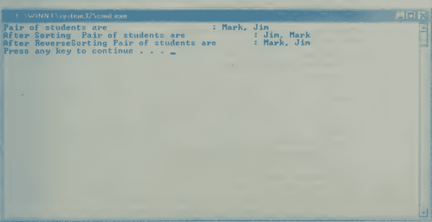

Program 16.5 演示了使用委托的事件的应用，该事件处理对委托的访问。事件处理程序存储时钟时间并在每秒后显示时间。

```
// update the state
this.second = dt.Second;
this.minute = dt.Minute;
this.hour = dt.Hour;
}
}
}
// DisplayClock subscribes to the clock's events. The job of DisplayClock is to display the current time
public class DisplayClock
{
    // given a clock, listen to its handler2 event
    public void ListClock(ClockTime clock)
    {
        clock.handler2 += new ClockTime.Handler2(ChangeTime);
    }

    // the method that implements the delegated functionality
    public void ChangeTime(
        object clock, ShowTime time)
    {
        Console.WriteLine("Current Time is : {0}:{1}:{2}",
            time.hour.ToString(),
            time.minute.ToString(),
            time.second.ToString());
    }
}

public class UsingEvent
{
    public static void Main()
    {
        // creates a new clock
        ClockTime clock = new ClockTime();
        // create the display
        DisplayClock dc = new DisplayClock();
        dc.ListClock(clock);
        // Get the clock started
        clock.Display();
    }
}
```

损失。此外，手动计算利息和总金额的任务耗时。CapFinance 如何解决这些问题并防止财务损失？

##### 解决方案

为了避免财务损失，CapFinance 必须防止在计算利息和总金额时出现错误。为此，该组织必须通过应用程序自动化计算利息和总金额的任务。CapFinance 联系 SB Private Limited，这是一家软件开发公司，用于开发应用程序，该应用程序将允许对特定贷款的利息和总金额进行计算机化计算。SB Private Limited 首先进行需求分析，然后决定在应用程序中使用 C# 编程语言的委托功能来计算贷款的利息和总金额。C# 中的委托是一种包含方法详细信息的对象，例如传递给方法参数。在 C# 中，委托主要用于回调和事件处理。在 15 天后，SB Private Limited 提出了以下 C# 应用程序。

```
using System;
using System.Collections.Generic;
using System.Text;
namespace CalculateInterest
{
    delegate double ShowInterest(double val1, double val2, double val3);
    class Interest
    {
        public double Principal()
        {
            Console.Write("Enter the Principal (Rs.): ");
            double principal = double.Parse(Console.ReadLine());
            return principal;
        }
        public double InterestRate()
        {
            Console.Write("Enter the Interest Rate (in %): ");
            double rate = double.Parse(Console.ReadLine());
            return rate;
        }
        public double Time(double time)
        {
            Console.Write("Enter the time in years: ");
            time = double.Parse(Console.ReadLine());
            return time;
        }
        // Interest = Principal * rate * time in years
        public double CalculateInterest(double principal, double rate, double time)
        {
            return principal * (rate / 100) * time;
        }
    }
    class CalculateLoan
    {
    }
}
```


```
static int Main(string[] args)
{
	double principal, rate, time, amount;
	double duration = 0;
	string durationname = null;
	Interest interest = new Interest();
	ShowInterest si = new ShowInterest(AddupAmount);
	Console.WriteLine("This is a program to Calculate Loan Amount in Simple Interest.");
	Console.WriteLine("");
	principal = interest.Principal();
	rate = interest.InterestRate();
	time = interest.Time(duration);
	amount = interest.CalculateInterest(principal, rate, time);
	double Amount = si(principal, amount);
	durationname = "years";
	Console.WriteLine("");
	Console.WriteLine("-----------------------------------------------");
	Console.WriteLine("Calculated Loan");
	Console.WriteLine("-----------------------------------------------");
	Console.WriteLine("Principal: {0}", principal);
	Console.WriteLine("Interest: {0}", rate / 100);
	Console.WriteLine("Period: {0} {1}", time, durationname);
	Console.WriteLine("Interest to be paid on Loan (Rs.): {0}", amount);
	Console.WriteLine("Total Amount to pay after \"{0}\" years (Rs.): {1}", time, Amount);
	Console.WriteLine("-----------------------------------------------\n");
	return 0;
}

static double AddupAmount(double val1, double val2)
{
	return val1 + val2;
}
```

委托允许你在 C# 应用程序中实现回调技术，其中一个对象向发送消息的对象发送回调消息。C# 中的委托充当另一个方法的 方法。委托的主要功能是在创建时调用其中封装的方法。

+   16.1 判断以下陈述是真还是假。
+   (a) 委托代表类的一个数据成员。
+   (b) 委托可以持有任意类的一个方法的引用。

## 332 Programming in C#
+   - (c) 委托只能在类内部定义。
+   - (d) 委托类型可以从另一个委托类型派生。
+   - (e) 为委托类型使用可访问性修饰符是可选的。
+   - (f) new 修饰符可用于声明任何委托。
+   - (g) 委托方法的签名必须与委托的签名匹配。
+   - (h) 委托方法的返回类型必须与委托的返回类型匹配。
+   - (i) 委托只能持有对实例方法的引用。
+   - (j) 委托方法必须始终返回值。
+   - (k) 总是可以对委托的实例执行加法操作。
+   - (l) 事件是一个委托类型成员。

+   - 16.2 什么是委托？它用于什么？
+   - 16.3 委托是值类型还是引用类型？
+   - 16.4 创建和使用委托涉及的步骤有哪些？
+   - 16.5 讨论委托声明的语法。
+   - 16.6 可以应用于委托的修饰符有哪些？
+   - 16.7 我们何时需要使用 new 修饰符？
+   - 16.8 给出至少两个委托声明的示例。
+   - 16.9 委托可以在程序的哪些地方定义？
+   - 16.10 什么是委托方法？
+   - 16.11 委托方法的条件是什么？
+   - 16.12 委托的特殊特性是什么？
+   - 16.13 我们如何创建委托的实例？
+   - 16.14 我们如何调用委托？调用委托时会发生什么？
+   - 16.15 什么是多播委托？
+   - 16.16 多播委托的特性是什么？
+   - 16.17 什么是事件？
+   - 16.18 描述事件声明的语法。
+   - 16.19 给出事件使用的两个典型示例。
+   - 16.20 什么是事件处理程序？它是如何设计的？
+   - 16.21 event 关键字做什么？

+   - 16.22 找出以下委托声明中的错误，如有：
+   
+   (a) delegate D1( );
+   
+   (b) int delegate D2 ( );
+   
+   (c) delegate void D3 (x,y);
+   
+   (d) delegate void D4 (int a, int b) { }
+   
+   (e) private double D5 (double x);
+   
+   (f) public delegate int D6 (int x, int y)

```
delegate D1( );
int delegate D2 ( );
delegate void D3 (x,y);
delegate void D4 (int a, int b) { }
private double D5 (double x);
public delegate int D6 (int x, int y)
```

+   - 16.23 给定委托
+   
+   delegate double D1 (int x, int y);
+   以下哪些方法可以被它封装？
+   
+   (a) int M1 (int x, int y) { }
+   
+   (b) double M2 (double a, double b) { }

```
delegate double D1 (int x, int y);
int M1 (int x, int y) { }
double M2 (double a, double b) { }
```

+   (c) static double M3 (int x, int y) {}
+   (d) public double M4 (int x, y ) {}
+   (e) private double M5 (int a, int b) {}

# 16.24 给定以下代码段

```
delegate void D1 ( );
class A
{
    public void M ( ) {}
}
```

以下哪些委托实例化语句是正确的？

+   (a) D1 d1 = new D1 (M);
+   (b) D1 d1 = new (A.M);
+   (c) D1 d1 = new D1 (A,M);
+   (d) D1 D1 = new ((new A () ).M);

# Debugging Exercises

16.1 调试以下用于演示 C# 中方法返回类型的程序。

```
using System;
using System.Collections.Generic;
using System.Text;
namespace debugApp1_chap16
{
    int ResultDisplay(int i, int j);
    class Show
    {
        public static MathsFunc(int x, int y)
        {
            return ((x * x + 2*x*y + y * y) / (x+y));
        }
    }
    class Program
    {
        static void Main(string[] args)
        {
            ResultDisplay rd = new ResultDisplay(Show.Mathsfync());
            int getResult = rd(1, 2);
            Console.WriteLine("The value of the function is " + getResult);
        }
    }
}
```

16.2 找出以下 C# 委托示例中的错误。

```
using System;
using System.Collections.Generic;
using System.Text;
namespace debugApp2_chap16
```

## 334 Programming in C#

```
public delegate void MsgHandler();
class Class1
{
public MsgHandler msg;
public void Show()
{
msg();
}
}
class Class2 : Class1
{
public Class2()
{
msg += MsgHandler(Display);
Show();
}
public void Display()
{
Console.WriteLine ("This is an example of working of a delegate.");
}
}
class Program
{
static void Main(string[] args)
{
Class2 cl = new Class2();
cl.Display();
}
}
```

```
using System;
using System.Collections.Generic;
using System.Text;
namespace debugApp3_chap16
{
delegate void Delegate1(int i);
class DelegateExample
{
string name;
static void Main(string[] args)
{
Delegate1 dl1 = new Delegate1(DelegateExample.Show);
DelegateExample de = new DelegateExample();
de.name = "Display method returns ";
Delegate1 dl2 = new Delegate1(de.Display);
Console.WriteLine (dl1(455));
}
}
}
```

```
```csharp
Console.WriteLine(d12(77));
string Show(int i)
{
	return string.Format("Show method returns : {0}", i);
}
void Display(int i)
{
	return string.Format("{0} {1}", name, i);
}
}
```
```

# 16.4 修正以下使用 static 关键字的程序。

```
```csharp
using System;
using System.Collections.Generic;
using System.Text;

namespace debugApp4.chap16
{
	class Program
	{
		delegate void MulticastDelegate(int a);
		public class DelegateClass
		{
			public void Method1(int a)
			{
				Console.WriteLine(a + " is passed in the Method1.");
			}
			static public void staticMethod1(int b)
			{
				Console.WriteLine(b + " is passed in the staticMethod1.");
			}
		}
		static void Main(string[] args)
		{
			DelegateClass dc = new DelegateClass();
			MulticastDelegate md = new MulticastDelegate(dc.Method1());
			md(447);
			Console.WriteLine("");
			md += new MulticastDelegate(DelegateClass.staticMethod1());
			md(689);
		}
	}
}
```
```

## Managing Console I/O Operations

### 17.1 Introduction

程序被编写来操作给定的数据集并生成作为输出的处理后的数据，遵循熟悉的输入-处理-输出循环。因此，了解如何提供输入数据以及如何以期望的格式呈现结果至关重要。

我们已经看到了使用 Console.WriteLine() 方法产生简单输出以及 Console.ReadLine() 方法从键盘读取输入。我们将在本章更详细地考虑 C# 支持的控制台 I/O 操作。

## 17.2 THE CONSOLE CLASS

用于从控制台读取和写入的方法由 System.Console 类提供。此类为我们提供了对标准输入、标准输出和标准错误流的访问，如表 17.1 所示。

#### Table 17.1 Input/Output streams

| 流对象 | 代表 |
|---|---|
| Console.In | 标准输入 |
| Console.Out | 标准输出 |
| Console.Error | 标准错误 |

标准输入系统 Console.In 默认从键盘获取输入。我们也可以重定向它以从文件接收输入。标准输出流 Console.Out 默认将输出发送到屏幕。我们也可以将输出重定向到文件。

标准错误流 Console.Error 通常将错误消息发送到屏幕。即使标准输出被发送到文件，任何错误消息仍会显示在屏幕上。

## 17.3 CONSOLE INPUT

控制台输入流对象支持两种从键盘获取输入的方法：

+   - Read() 返回一个字符作为 int。无更多字符可用时返回 -1。
+   - ReadLine() 返回包含一行文本的字符串。无更多行可用时返回 null。


这些方法可以通过 Console.In 对象或 Console 类本身来调用。下面的代码片段从键盘读取一个字符并显示在屏幕上。

```
int x = Console.Read( );
Console.WriteLine( (char) x );
```

我们对 x 使用了强制转换运算符 (char)，将其转换为字符类型。记住，x 是以 int 类型读取的。

下面的代码将一整行文本作为单个字符串读取，并显示在屏幕上。

```
string str = Console.ReadLine( );
Console.WriteLine(str);
```

程序 17.1 演示了如何使用 ReadLine() 方法从键盘交互式地读取字符串，并将它们回显到屏幕上。

#### 程序 17.1 使用 READLINE() 读取字符串

```
using System;
class ReadString
{

public static void Main ( )
{

Console.WriteLine("What is your name?");
string s;
s = Console.ReadLine ( );
Console.WriteLine("How are you Mr." + s);
}
}
```

## 17.4 控制台输出

控制台输出流支持两种向控制台写入的方法：

- Write()：向屏幕输出一个或多个值，不包含换行符
- WriteLine()：向屏幕输出一个或多个值（与 Write() 方法相同），但在输出末尾添加一个换行符

这两种方法都有各种重载形式来处理所有预定义类型，因此我们可以轻松地输出许多不同类型的数据。WriteLine() 还允许我们以多种不同格式输出数据（在某种程度上，可与 C 语言的 printf 方法相媲美）。

Write() 方法将信息发送到缓冲区。在发送换行符（或行结束符）之前，缓冲区不会被刷新。因此，该方法会在一行上输出内容，直到遇到换行符。例如，以下语句：

```
Console.Write("Hello ");
Console.Write("C Sharp!");
```

将在同一行显示单词 Hello C Sharp!，并等待在同一行显示更多信息。我们可以通过打印换行符来强制显示跳到下一行，如下所示：

```
Console.Write("\n");
```

例如，以下语句

```
Console.Write("Hello");
Console.Write("\n");
Console.Write("C Sharp!");
```

将按如下方式在两行中显示输出：

```
Hello
C Sharp!
```

相比之下，WriteLine() 方法获取提供的信息并将其显示在单行上，随后加上换行符（回车）。这意味着以下语句

```
Console.WriteLine("Hello");
Console.WriteLine("C Sharp!");
```

将产生以下输出：

```
Hello
C Sharp!
```

以下语句

```
Console.WriteLine();
```

将打印一个空行。程序 17.2 演示了 Write() 和 WriteLine() 方法的应用。

#### 程序 17.2 | 输出方法的行为

```
using System;
class Displaying
{
    public static void Main ()
    {
        Console.WriteLine("Screen Display");
        for (int i = 1; i <= 9; i++)
        {
            for(int j = 1; j <= i; j++)
            {
                Console.Write(" ");
                Console.Write(i);
            }
            Console.Write("\n");
        }
        Console.WriteLine("Screen Display Done");
    }
}
```

程序 17.2 在屏幕上显示以下内容：

```
Screen Display
1
2   2
3   3 3
4   4   4 4
5   5 5 5 5
6   6 6 6 6 6
7   7 7 7 7 7 7
```

## 17.5 格式化输出

我们可以使用重载的 WriteLine() 方法生成格式化输出。该方法接受一个包含格式的字符串和一个变量列表，这些变量的值将被打印出来。格式化 WriteLine() 方法的通用形式是：

```
Console.WriteLine(format-string, v1, v2 ....);
```

格式字符串包含静态文本和标记，用于指明：

- 值要打印在哪里
- 值要如何格式化

在最简单的形式中，标记是花括号中的索引数字，表示要替换参数列表中的哪个变量。例如：

```
Console.WriteLine("Total is {0}", total);
Console.WriteLine("Sum of {0} and {1} is {2}", a,b,c);
```

在示例中，{0} 表示列表中的第一个参数，{1} 表示第二个参数，依此类推。例如，如果 a = 100，b = 200，c = a + b，则第二条语句将显示以下输出：

```
Sum of 100 and 200 is 300
{0} {1} {2}
a b c
```

我们还可以使用格式 { n, w } 为值指定宽度，其中 n 是索引号，w 是值的宽度。如果 w 为正，则值将在该宽度内右对齐；如果为负，则值将左对齐。例如：

```
int a = 45 ;
int b = 976 ;
int c = a + b ;
Console.WriteLine ("{0,5}\n{1,5}\n- - - - -\n{2,5}", a,b,c);
```

这将显示以下输出：

```
45
+ 976
-----
1021
```

请注意，一条 WriteLine() 语句如何打印四行输出。这是因为在格式字符串中使用了换行符 '\n'。

我们还可以使用格式字符串中的标记来打印对象数组。

例如：

```
object [] array = { "abc", 12.3, 100, "123"};
Console.WriteLine("Array:{0}, {1}, {2}, {3}", array);
```

程序 17.3 演示了如何实现格式字符串以显示简单的格式化输出。

#### 程序 17.3 | 使用格式字符串

```
using System;
class FormatString
{
    public static void Main ()
    {
        string s = "Items";
        int a = 100;
        float x = 99.9F;
        Console.WriteLine("{0}\nIntValue: {1}\nFloatValue: {2}",
            s,a,x);
    }
}
```

程序 17.3 的输出将是：

```
Items
IntValue: 100
FloatValue: 99.9
```

## 17.6 数值格式化

我们已经了解了如何使用简单的格式字符串，借助标记 "{ }" 输出不同类型的值。每个标记（也称为占位符）可以选择性地包含各种格式字符，以指定数值格式的性质。C# 支持两种数值格式方法：

- 标准格式
- 自定义格式

最常用的是标准格式，它将数值类型转换为特定的字符串表示形式。如果需要对输出格式进行进一步细化，我们可以使用自定义格式。

## 17.7 标准数值格式

标准数值格式由一个数值格式字符和可选的精度说明符组成。标记的一般格式如下所示：

```
{n:fc[p]}
```

其中，n 是要替换的参数索引号，fc 是格式字符，p 是精度说明符。表 17.2 显示了可用于格式化数字输出的格式字符列表。

#### 表 17.2 C# 格式字符

| 格式字符 | 说明 |
|---|---|
| C 或 c | 货币格式。默认情况下，美元符号 $ 会固定到该值上。可以使用精度说明符来指定小数位数。 |
| D 或 d | 格式化整数，并将整数转换为十进制。如有必要，可以使用精度说明符以零填充前导位。 |
| E 或 e | 指数（或科学计数法）格式。可以使用精度说明符设置小数位数，默认值为 6。小数点前始终有一位数字。 |
| F 或 f | 定点格式。精度说明符决定小数位数。零是可接受的。 |
| G 或 g | 常规格式，用于将数字格式化为定点或指数格式，具体取决于哪种格式最紧凑。 |
| N 或 n | 数字格式；生成带嵌入逗号的值。 |
| X 或 x | 十六进制格式。可以使用精度说明符以零填充前导位。如果我们使用大写 X，十六进制格式也将包含大写字符。 |

##### 17.7.1 货币格式

货币格式将数值转换为包含区域特定货币符号的字符串。默认情况下，会添加美元符号。但是，可以使用 NumberFormatInfo 对象进行更改。示例：

```
("{0 : C }", 4567.899) ⟶ $4,567.90
("{0 : C}", -4567.899) ⟶ ($4,567.90)
```

当数字为负数时，该值会在简单括号内以正数形式打印。请注意，默认情况下，小数部分会四舍五入到两位。

##### 17.7.2 整数格式

整数格式将给定的数值转换为十进制整数。最小位数由精度说明符决定。如果精度说明符小于实际位数，则忽略该说明符并打印所有位数。如果精度说明符大于实际位数，则结果会在左侧填充零，以获得指定的位数。示例：

```
("{0 : D}", 45678) ⟶ 45678
("{0 : D8}", 45678) ⟶ 00045678
```

##### 17.7.3 指数格式

指数格式字符（E 或 e）将给定值转换为以下形式的字符串：

```
m.dddd E+xxx
```

输出在小数点前只包含一个数字 m。小数位数（dddd）由精度说明符决定。默认情况下，使用 6 位。输出中将出现格式字符 E（或 e）。示例：

```
("{0 : E}", 34567.899) ⟶ 3.456790E+004
("{0 : E9}", 34567.899) ⟶ 3.456789900E+004
("{0 : e5}", 34567.899) ⟶ 3.45679e+004
```

请注意，小数部分会四舍五入（而非截断）到指定的小数位数。如果指定的位数更多，则小数部分在右侧用零填充。

##### 17.7.4 定点格式

定点格式将给定值转换为包含由精度说明符决定的小数位数的字符串。默认情况下，假定为两位小数。允许精度说明符为零。示例：

```
("{0 : F}", 3456.7899) ⟶ 3456.79
("{0 : F6}", 3456.7899) ⟶ 3456.789900
("{0 : F0}", 3456.7899) ⟶ 3457
```

请注意，小数部分总是四舍五入（或用零填充）到指定的精度位数。零精度会将值转换为最接近的整数。


示例：

```
("{0:##.000}", 12.34567) ⟶ 12.346
("{0:##.000}", 1234.5) ⟶ 1234.500
```

注意：小数位数由格式字符串中句点后出现的零的个数决定。如果零较少，小数部分将四舍五入到所需位数；如果零较多，则小数部分将用零填充，如此处所示。

##### 17.8.4 逗号分隔符

逗号字符 (,) 可以与占位符（零和井号字符）一起使用，以分隔输出整数部分中的数字组。示例：

- ("{0:##,###.00}", 1234567.899) ⟶ 1,234,567.90
- ("{0:#,###.000}", 1234567.899) ⟶ 1,234,567.899
- ("{0:#,##}", 1234567) ⟶ 1,234,567

##### 17.8.5 百分比表示法

我们可以通过在格式字符串末尾使用百分号 (%) 来以百分比形式显示数字。示例：

- ("{0:00%}", 0.01234) ⟶ 01%
- ("{0:##.000%}", 0.12345) ⟶ 12.345%

请注意，在使用格式字符串进行格式化之前，该数字会先乘以 100。如果格式字符串中没有小数点，小数部分将被截断。

程序 17.4 以带有 $（美元符号）的数字格式以及 ###.### 的格式化十进制方式显示一个数字。

#### 程序 17.4 自定义数字格式示例 1

```csharp
using System;
using System.Collections.Generic;
using System.Text;

namespace customNumberFormatExample
{
    class Program
    {
        static void Main(string[] args)
        {
            StringBuilder str = new StringBuilder();
            Console.WriteLine("This is an example of CustomNumberFormat!\n");
            string oldString = "{0:$#,###0.00;( $#,###0.00);Zero}";
            Console.Write("This is the Original Number Format string : ");
            Console.WriteLine(oldString);
            double val = 335.72;
            Console.WriteLine("Number entered is : " + val);
            str.Append("\nThis is the formatted output : ");
            str.AppendFormat(oldString, val);
            Console.WriteLine(str.ToString());
        }
    }
}
```

输出：

```text
This is an example of CustomNumberFormat!

This is the Original Number Format string : {0:$#,###0.00;( $#,###0.00);Zero}
Number entered is : 335.72
This is the formatted output : $335.72
Press any key to continue . . .
```

程序 17.5 将数字 1973458783 的格式设置为 ## + ## * ##### - ##，即将第一个数字分解为 19 + 73 * 4587 - 83。如果传入 #.# 数字格式，带小数的第二个数字 2662.63 将四舍五入到最接近的小数 2662.6。类似地，如果只传入 #，则第二个数字将被四舍五入，不显示小数，显示为 2663。

#### 程序 17.5 自定义数字格式示例 2

```csharp
using System;
using System.Collections.Generic;
using System.Text;

namespace CustomNumberFormatExample2
{
    class Program
    {
        static void Main(string[] args)
        {
            double val1 = 1973458783;
            Console.WriteLine("First number is : " + val1);
            Console.WriteLine("To be formatted in ## + ## * ##### - ##");
            String val2 = val1.ToString("## + ## * ##### - ##");
            Console.WriteLine("\nUnformatted first number : " + val2);
            double val3 = 2662.63;
            Console.WriteLine("\nSecond number is : " + val3);
            Console.WriteLine("To be formatted in #.#");
            val2 = val3.ToString("#.#");
            Console.WriteLine(val2);
        }
    }
}
```

#### 案例研究

##### 问题陈述

现代工程学院提供机械、电气、电子和土木工程等方向的课程。当学生进入现代工程学院并来到行政人员处缴费时，行政人员必须手动填写一份表格，其中包含姓名、地址、课程和费用等详细信息。填写表格会耗费大量时间。此外，由于大量时间花在填写表格上，行政人员的效率也会降低。正在现代工程学院入学的学生不得不长时间排队缴费。现代工程学院如何解决学生和行政人员面临的这个问题？

##### 解决方案

现代工程学院的校长与一些重要的管理人员召开会议，试图找到解决学生和行政人员所面临问题的方案。会议结束时，校长和管理人员得出结论：必须开发一个应用程序来自动化输入学生信息（如姓名和地址）的任务。几天后，校长召见电子系系主任，要求其开发该应用程序。电子系系主任首先通过与学院行政人员的访谈进行需求分析。分析后，电子系系主任得出结论：在 C# 应用程序中必须使用 C# 中可用的方法（如 ReadLine() 和 WriteLine()）来获取姓名和地址等详细信息，并显示一条消息以确认学生入学。ReadLine() 和 WriteLine() 等方法有助于接收用户输入和显示输出。以下 C# 应用程序由电子系系主任开发。

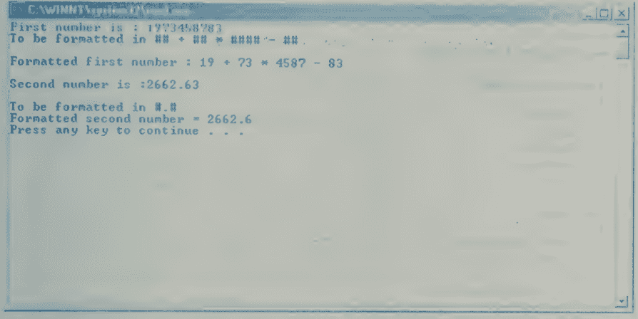

```csharp
using System;
using System.Collections.Generic;
using System.Text;

namespace StudentAdmissionSystem
{
    public enum Degree
    {
        Mechanical = 1,
        Electrical,
        Electronics,
        Aeronautics,
        Civil
    }

    class Select
    {
        public Degree degree;

        public Select()
        {
            degree = Degree.Civil;
        }

        public Select(Degree degree)
        {
            degree = Degree.Civil;
        }
    }

    class GetDetails
    {
        Select degree;
        string name, address, telephone, course, fees;

        public GetDetails()
        {
            degree = new Select();
        }

        public void GetAdmission()
        {
            int choice = 0;
            Console.WriteLine("Enter the Degree course to take admission in Modern Engineering College : ");
            Console.WriteLine("___________________");
            Console.WriteLine("1. Mechanical");
            Console.WriteLine("2. Electrical");
            Console.WriteLine("3. Electronics");
            Console.WriteLine("4. Aeronautics");
            Console.WriteLine("5. Civil");
            Console.Write("Please enter your Choice: ");
            choice = int.Parse(Console.ReadLine());

            switch (choice)
            {
                case 1:
                    degree.degree = Degree.Mechanical;
                    break;
                case 2:
                    degree.degree = Degree.Electrical;
                    break;
                case 3:
                    degree.degree = Degree.Electronics;
                    break;
                case 4:
                    degree.degree = Degree.Aeronautics;
                    break;
                default:
                    degree.degree = Degree.Civil;
                    break;
            }
        }

        public void GetStudentDetails()
        {
            Console.Write("Enter name : ");
            name = Console.ReadLine();
            Console.WriteLine("");
            Console.Write("Enter address : ");
            address = Console.ReadLine();
            Console.WriteLine("");
            Console.Write("Enter telephone : ");
            telephone = Console.ReadLine();
            Console.WriteLine("");
            Console.Write("Course : " + degree.degree);
            course = degree.degree.ToString();
            Console.WriteLine("");
            Console.Write("Enter Fees : ");
            fees = Console.ReadLine();
        }
    }

    class StudentMenu
    {
        static void Main(string[] args)
        {
            GetDetails gd = new GetDetails();
            gd.GetAdmission();
            Console.WriteLine();
            gd.GetStudentDetails();
            Console.WriteLine("Thank You " + gd.name + " for getting Admission in " + gd.course + " course.");
        }
    }
}
```

## 备注

在 C# 中，诸如 Read() 和 Write() 之类的方法允许程序员执行输入和输出操作。这意味着这些方法可用于从用户接收特定格式的输入（如文本和数字），并以特定格式显示输出。

## 复习题

- 17.1 区分 Write 和 WriteLine 方法。
- 17.2 区分 Read 和 ReadLine 方法。
- 17.3 什么是格式字符串？它如何帮助生成输出？
- 17.4 什么是数值格式化？
- 17.5 解释标准数值格式的通用格式。
- 17.6 为什么我们需要指数格式？
- 17.7 什么是数字格式化？我们什么时候使用它？
- 17.8 什么是自定义数值格式？为什么我们需要自定义格式字符串？
- 17.9 在生成整数输出时，区分零占位符和井号 (#) 占位符。
- 17.10 我们什么时候在格式字符串中使用百分号？它是如何工作的？

## 调试练习

17.1 更正给定程序中的语法错误。

```csharp
using System;
using System.Collections.Generic;
using System.Text;

namespace debugApp1_chap17
{
    class Program
    {
        static void Main(string[] args)
        {
            Console.WriteLine("This is a console application.");
            Console.Write("Please enter your lucky number: ");
            string val1 = Console.ReadLine();
            int val2 = System.Convert.ToInt32(val1, 10);
            val2 = val2 * val2;
            Console.WriteLine("The square of the number you entered is " + val2);
        }
    }
}
```


# 17.2 查找以下用于控制台读写程序中的错误。

```
using System;
using System.Collections.Generic;
using System.Text;

namespace debugApp2_chap17
{
    class Program
    {
        static void Main(string[] args)
        {
            Console.WriteLine("This is a Console Application in C#!");
            Console.Write("Please enter your Name: ");
            string name = Console.ReadLine();
            Console.WriteLine("Hi! ", name , ". This program takes input from the users.");
            Console.Write();
        }
    }
}
```

# 17.3 更正用于计算两个数之和的程序。

```
using System;
using System.Collections.Generic;
using System.Text;

namespace debugApp3_chap17
{
    class Program
    {
        int num1 = 0;
        int num2 = 0;
        int sum = 0;
        static void Main(string[] args)
        {
            Console.WriteLine("Please enter the first number : ");
            num1 = Int32.Parse(Console.ReadLine());
            Console.WriteLine("Please enter the second number : ");
            num2 = Int32.Parse(Console.ReadLine());
            sum = addValues(num1 + num2);
            Console.WriteLine("Sum of " + num1 + " + " + num2 + " = " + sum);
            Console.ReadLine();
        }
        int addValues(int m, int n)
        {
            return m + n;
        }
    }
}
```

## 编程练习

### 17.1 编写一个程序，仅使用一条 Write 语句和一条 WriteLine 语句，打印如下所示的从 1 × 1 到 9 × 9 的乘法表：

```
1 2 3 4 5 6 7 8 9
2 4 . . . . . . 18
3 6 . . . . . . 27
. . . . . . . . .
. . . . . . . . .
9 18 27 . . . . . 81
```

### 17.2 修改以上程序，使显示内容包含居中的标题 MULTIPLICATION TABLE。

### 17.3 编写一个程序，将整数 111、222 和 333 存储在一个数组中，并按照以下方式显示，不使用任何循环语句。

```
(a)111 222 333
```

```
(b)111
222
333
```

### 17.4 编写一个能够产生以下输出的程序：

```
Product of 1 and 1 is 1
Product of 3 and 3 is 9
Product of 5 and 5 is 25
Product of 7 and 7 is 49
Product of 9 and 9 is 81
```

### 17.5 编写一个程序，以 10 的列宽打印数值 1234：

- (a) 右对齐
- (b) 左对齐
- (c) 右对齐并在左侧填充零

### 17.6 编写一个程序，以指数格式打印数值 10.45678，并满足以下要求：

- (a) 精确到两位小数
- (b) 精确到四位小数
- (c) 精确到八位小数

### 17.7 编写一个程序，以定点格式打印数值 345.6789，并满足以下要求。

- (a) 精确到两位小数
- (b) 精确到五位小数
- (c) 精确到零位小数

### 17.8 编写一个程序，使用以下格式规范打印整数 3456789：

- (a) 使用格式字符 D
- (b) 使用格式字符 N
- (c) 使用格式字符 E
- (d) 使用零占位符
- (e) 使用井号字符
- (f) 使用逗号分隔符

### 17.9 编写一个程序，演示以下格式字符的使用：

- (a) 小数点分隔符 (.)
- (b) 百分号 (%)

### 17.10 编写一个程序，读取并显示以下数据表：

| 项目名称 | 项目代码 | 价格 |
|-----------|-----------|-------|
| 风扇       | 67831     | 1234.50 |
| 电机     | 935642    | 5786.70 |

项目名称和项目代码必须左对齐，价格应右对齐。

## 18.3.1 编译时错误

所有语法错误都会被 C# 编译器检测并显示，因此这些错误被称为编译时错误。每当编译器显示错误时，它不会生成 .cs 文件。因此，我们必须修复所有错误，才能成功编译并运行程序。

#### 程序 18.1 编译时错误示例

```
/* This program contains an error */
using Sytem;
class Error1
{
    public static void Main()
    {
        Console.WriteLine("Hello C#!");
    }
}
```

C# 编译器在告诉我们程序中的错误位置方面做得很出色。例如，如果在程序 18.1 中拼错了 System 命名空间，屏幕上将显示以下消息：

Error1.cs(2.7) : 错误 CS0234 : 类或命名空间中不存在类型或命名空间名称“Sytem”。

我们现在可以转到相应的行，更正错误并重新编译程序。有时，单个错误可能是编译后期多个错误的根源。例如，在多处使用未声明的变量将导致一系列“未定义变量”类型的错误。我们通常应将最早出现的错误视为问题的主要来源。修复此类错误后，应重新编译程序并查找其他错误。

大多数编译时错误是由打字错误引起的。印刷错误很难发现。我们可能需要逐词甚至逐字符地检查代码。最常见的问题有：

- 缺少分号
- 类和方法中括号缺失（或不匹配）
- 标识符和关键字拼写错误
- 字符串中缺少双引号
- 使用未声明的变量
- 赋值/初始化中的类型不兼容
- 对对象的错误引用
- 使用 = 代替 == 运算符等

## 18.3.2 运行时错误

有时，程序可能成功编译并生成 .exe 文件，但可能无法正常运行。此类程序可能因逻辑错误而产生错误结果，或因堆栈溢出等错误而终止。最常见的运行时错误有：

- 将整数除以零。
- 访问数组边界之外的元素。
- 试图将值存储到不兼容类或类型的数组中。
- 传递的方法参数不在有效范围或不是有效值。
- 试图对数组使用负大小。
- 将空对象引用作为合法对象引用来访问方法或变量。
- 将无效字符串转换为数字，或将无效数字转换为字符串。
- 访问字符串边界之外的字符等。

当遇到此类错误时，C# 通常会生成错误消息并中止程序。程序 18.2 演示了运行时错误如何导致程序执行终止。

#### 程序 18.2 运行时错误示例

```
using System;
class Error2
{
    public static void Main()
    {
        int a = 10;
        int b = 5;
        int c = 5;

        int x = a/(b-c);
        Console.WriteLine("x = " + x);

        int y = a/(b+c);
        Console.WriteLine("y = " + y);
    }
}
```

程序 18.2 在语法上是正确的，因此编译过程中不会出现任何问题。当 C# 运行时尝试执行除以零的操作时，会生成一个错误条件，导致程序在显示相应的消息后停止。以下语句永远不会执行：
int y = a/(b + c);

## 18.4 异常

异常是由程序中的运行时错误导致的一种状态。当 C# 编译器遇到诸如整数除以零之类的错误时，它会创建一个异常对象并抛出它（即告知我们发生了错误）。

如果异常对象未被正确捕获和处理，编译器将显示错误消息并终止程序。如果我们希望程序继续执行其余代码，则应尝试捕获错误条件抛出的异常对象，然后显示适当的消息以采取纠正措施。此任务称为异常处理。

异常处理机制的目的是提供一种检测和报告“异常情况”的手段，以便采取适当的行动。该机制建议并入一个单独的错误处理代码，该代码执行以下任务：

- 发现问题（命中异常）
- 通知错误已发生（抛出异常）
- 接收错误信息（捕获异常）
- 采取纠正措施（处理异常）


错误处理代码基本上由两段组成，一段用于检测错误并抛出异常，另一段用于捕获异常并采取适当的操作。

在编写程序时，我们必须始终注意程序中可能产生异常的位置。我们必须捕获的一些常见异常列于表 18.1。

#### 表 18.1 常见的 C# 异常

| 异常类 | 异常原因 |
|---|---|
| SystemException | 运行期检查失败，用作其他异常的基类 |
| AccessException | 无法访问类型成员，例如方法或字段 |
| ArgumentException | 方法的参数无效 |
| ArgumentNullException | 向不接受空值的 方法传递了空参数 |
| ArgumentOutOfRangeException | 参数值超出范围 |
| ArithmeticException | 发生了算术溢出或下溢 |
| ArrayTypeMismatchException | 尝试向数组中存储错误类型的对象 |
| BadImageFormatException | 映像格式错误 |
| CoreException | 运行时抛出的异常的基类 |
| DivideByZeroException | 尝试除以零 |
| FormatException | 参数的格式错误 |
| IndexOutOfRangeException | 数组索引越界 |
| InvalidCastException | 尝试转换为无效的类 |
| InvalidOperationException | 方法在无效的时间被调用 |
| MissingMemberException | 访问了 DLL 的无效版本 |
| NotFiniteNumberException | 数字无效 |
| NotSupportedException | 表示某个类未实现该方法 |
| NullReferenceException | 尝试使用未分配的引用 |
| OutOfMemoryException | 内存不足，无法继续执行 |
| StackOverflowException | 堆栈溢出 |

## 18.5 异常处理代码的语法

异常处理的基本概念是抛出异常并捕获它。这在图 18.1 中有所说明。

C# 使用关键字 try 来在可能导致错误条件并‘抛出’异常的代码块前加上标记。由关键字 catch 定义的 catch 块‘捕获’由 try 块‘抛出’的异常并适当地处理它。catch 块紧跟在 try 块之后。以下示例说明了简单 try 和 catch 语句的使用：

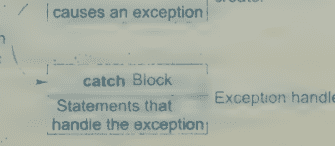

图 18.1 异常处理机制

### Programming in C#

```csharp
try
{
statement; // generates an exception
}
catch (Exception e)
{
statement; // processes the exception
}
```

try 块可以有一个或多个可能产生异常的语句。如果其中任何一个语句产生异常，则该块中的剩余语句将被跳过，执行将跳转到放置在 try 块旁边的 catch 块。

catch 块也可以有一个或多个处理异常所需的语句。请记住，每个 try 语句后面都应至少跟一个 catch 语句；否则会发生编译错误。

请注意，catch 语句的工作方式类似于方法定义。catch 语句传递一个参数，即由 try 块抛出的异常对象的引用。如果 catch 参数与异常对象的类型匹配，则异常将被捕获，并且 catch 块中的语句将被执行。否则，异常不会被捕获，默认异常处理程序将导致执行终止。

程序 18.3 说明了使用 try 和 catch 块处理算术异常。注意它是对程序 18.2 的修改版本。

#### Program 18.3

```csharp
using System;
class Error3
{
public static void Main()
{
int a = 10;
int b = 5;
int c = 5;
int x, y;
try
{
x = a / (b-c); // Exception here
}
catch (Exception e)
{
Console.WriteLine("Division by zero");
}
y = a / (b+c);
Console.WriteLine("y = " + y);
}
}
```

程序 18.3 显示以下输出：
Division by zero
y = 1

请注意，程序在异常条件发生时并未停止。它捕获错误条件，打印错误消息，然后继续执行，仿佛什么都没有发生。将此与程序 18.2 的执行进行比较，后者未给出 y 的值。

最常见的是，异常是由在 try 块内调用的方法抛出的。抛出异常的点称为抛出点。一旦异常被抛出到 catch 块，控制就无法返回到抛出点。这种关系如图 18.2 所示。

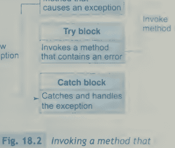

## 18.6 多个 CATCH 语句

可以在 catch 块中拥有多个 catch 语句，如下所示：

```
try
{
    statement ;        // generates an exception
}
catch (Exception-Type-1 e)
{
    statement;         // processes exception type 1
}
catch (Exception-Type-2 e)
{
    statement;         // processes exception type 2
}
...
catch (Exception-type-N e)
{
    statement ;        // processes exception type N
}
```

当 try 块中产生异常时，C# 将多个 catch 语句视为 switch 语句中的 case。第一个参数与异常对象匹配的语句将被执行，其余语句将被跳过。

请注意，C# 根本不需要处理异常。我们可以简单地使用一个空块的 catch 语句来避免程序中止。

示例：

```
catch (Exception e){ }
```

此语句将捕获异常然后忽略它。

#### Program 18.4 | USING MULTIPLE CATCH BLOCKS

```
using System;
class Error4
{
	public static void Main()
	{
		int [] a = {5,10};
		int b = 5;
		try
		{
			int x = a[2] / b - a[1];
		}
		catch(ArithmeticException e)
		{
			Console.WriteLine("Division by zero");
		}
		catch(IndexOutOfRangeException e)
		{
			Console.WriteLine("Array index error");
		}
		catch(ArrayTypeMismatchException e)
		{
			Console.WriteLine("Wrong data type");
		}
		int y = a[1] / a[0];
		Console.WriteLine("y = " + y);
	}
}
```

程序 18.4 使用了一系列 catch 块，运行后产生以下输出：

Array index error
y = 2

请注意，数组元素 a[2] 不存在，因为数组 a 定义为只有两个元素，a[0] 和 a[1]。因此，索引 2 超出了数组边界，从而导致块 catch(IndexOutOfRangeException e) 捕获并处理错误。剩余的 catch 块被跳过。

## 18.7 异常层次结构

所有 C# 异常都派生自类 Exception。当异常发生时，正确的 catch 处理程序是通过将异常类型与提到的异常名称进行匹配来确定的。如果我们要在层次结构的不同级别捕获异常，我们需要按正确的顺序放置它们。规则是我们必须始终先放置最派生异常类的处理程序。考虑以下代码片段：

```
...//throw Divide by Zero Exception
{
catch(Exception e)
{
...
}
catch (DivideByZeroException e)
{
...
}
```

此代码将生成编译错误，因为异常被第一个 catch 捕获，该 catch 更通用，因此第二个 catch 变得无法到达。在 C# 中，不可达代码始终是错误。代码必须重写如下：

```
try
{
....//throw Divide By Zero Exception
}
catch(DivideByZeroException e)
{
....
}
catch(Exception e)
{
....
}
```

catch 块的顺序很重要。我们必须从设计用于捕获非常具体异常的 catch 块开始，以更通用的块结束，这些块将涵盖我们未提供处理程序的任何其他异常。

## 18.8 通用 CATCH 处理程序

将捕获任何异常的 catch 块称为通用 catch 处理程序。通用 catch 处理程序不指定任何参数，可以写成：

```
try
{
....        //causes an exception
}
catch        //no parameters
{
....        //handles error
```

请注意，catch (Exception e) 可以处理 C# 代码抛出的所有异常，因此可以用作通用 catch 处理程序。但是，如果程序使用用其他语言编写的库，则可能存在未派生自类 Exception 的异常。此类异常可以通过无参数的 catch 语句处理。此处理程序始终放在最后。由于没有参数，它不会捕获有关异常的任何信息，因此我们不知道出了什么问题。


## 18.9 使用 FINALLY 语句

C# 支持另一种称为 finally 语句的语句，它可用于处理未被前面任何 catch 语句捕获的异常。finally 块可用于处理 try 块内产生的任何异常。它可以紧接在 try 块之后或最后一个 catch 块之后添加，如下所示：

```
try
{
    ..........
    ..........
}
finally
{
    ..........
    ..........
}
```

```
try
{
    ..........
    ..........
}
catch (...)
{
    ..........
    ..........
}
catch (...)
{
    ..........
    ..........
}
...
...
finally
{
    ..........
    ..........
}
```

当定义了 finally 块时，无论控制流如何离开 try 块（无论是由于正常终止、发生异常还是由于跳转语句），程序都保证会执行 finally 块。图 18.3 说明了这一点。因此，我们可以用它来执行某些清理操作，例如关闭文件和释放系统资源。

在程序 18.4 中，我们可以将最后两条语句包含在 finally 块中，如下所示：

```
finally
{
    int y = a[1]/a[0];
    Console.WriteLine("y = " +y);
}
```

这将产生相同的输出。

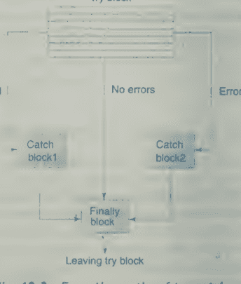

图 18.3 try-catch-finally 块的执行路径

## 18.10 嵌套 TRY 块

C# 允许我们在彼此内部嵌套 try 块。例如：

```
try
{
    .... (Point P1)
    ....
    try
    {
        .... (Point P2)
        ....
    }
    catch
    {
        .... (Point P3)    Inner try block
        ....
    }
    finally
    {
        ....
        ....
    }
    .... (Point P4)
    ....
}
catch
{
    ....
}
finally
{
    ....
}
```

为了简单起见，我们在每个 try 块中只显示了一个 catch 处理程序。然而，我们可以在每个位置将多个 catch 处理程序串联在一起。

当嵌套的 try 块被执行时，在不同点抛出的异常按如下方式处理：

- 点 P1 和 P4 位于内部 try 块之外，因此在这些点抛出的任何异常都将由外部块中的 catch 处理。内部块被直接忽略。
- 在点 P2 抛出的任何异常将由内部的 catch 处理程序处理，并且内部的 finally 将被执行。程序将在点 P4 继续执行。
- 如果没有合适的 catch 处理程序来捕获在 P2 抛出的异常，控制流将离开内部块（在执行内部的 finally 之后），并在外部块中寻找合适的 catch 处理程序。如果找到合适的处理程序，则执行该处理程序，随后执行外部的 finally 代码。请记住，点 P4 的代码将被跳过。
- 如果在点 P3 抛出异常，该异常将被视为由外部 try 块抛出，因此控制流将立即离开内部块（当然，在执行内部的 finally 之后），并在外部块中搜索合适的 catch 处理程序。
- 如果找不到合适的 catch 处理程序，系统将终止程序执行并显示适当的消息。

程序 18.5 展示了嵌套 try 块的简单实现。该程序使用嵌套的方法，每个方法都有自己的 try....catch 块。

Main 方法调用 Division() 方法，该方法抛出一个异常。尽管 Division() 方法有一个 catch 块，但它与异常类型不匹配。因此，控制权被转移到 Main 中的 try 块，程序寻找匹配的 catch 处理程序。程序在那里找到了一个并执行它。

#### 程序 18.5

#### 实现嵌套 TRY 块

```csharp
using System;
class NestedTry
{
	static int m = 10;
	static int n = 0;
	static void Division ( )
	{
		try
		{
			int k = m/n;
		}
		catch (ArgumentException e)
		{
			Console.WriteLine("Caught an exception");
		}
		finally
		{
			Console.WriteLine("Inside Division Method");
		}
	}
	public static void Main ( )
	{
		try
		{
			Division ( );
		}
		catch (DivideByZeroException e)
		{
			Console.WriteLine("Caught an exception");
		}
		finally
		{
			Console.WriteLine("Inside Main Method");
		}
	}
}
```

## 18.11 抛出我们自己的异常

有时候我们可能想要抛出自己的异常。我们可以通过使用 throw 关键字来实现这一点，如下所示：

```
throw new Throwable_subclass;
```

示例：

```
throw new ArithmeticException();
throw new FormatException();
```

程序 18.6 演示了 Exception 类的用户自定义子类的使用。可以抛出并捕获扩展了 Throwable 的类的对象。

#### 程序 18.6 | 抛出我们自己的异常

```
using System;
class MyException:Exception
{
    public MyException (string Message) : base (Message)
    {
    }
    public MyException ()
    {
    }
    public MyException (string Message, Exception inner)
        : base (Message, inner)
    {
    }
}
class TestMyException
{
    public static void Main()
    {
        int x = 5, y = 1000;
        try
        {
            float z = (float) x / (float) y ;
            if(z < 0.01)
            {
                throw new MyException("Number is too small!");
            }
        }
        catch (MyException  e)
        {
            Console.WriteLine("Caught my exception");
            Console.WriteLine(e.Message);
        }
        finally
        {
            Console.WriteLine("I am always here");
        }
    }
}
```

运行程序 18.6 会产生：

Caught my exception
Number is too small
I am always here

包含错误消息 "Number is too small" 的对象 e 被 catch 块捕获，然后使用 Message 属性显示该消息。

请注意，程序 18.7 也演示了 finally 块的使用。输出的最后一行由 finally 块产生。

创建我们自己的异常类时的一个经验法则是，我们必须实现 System.Exception 的全部三个构造函数，如示例程序所示。

程序 18.7 创建了一种新的用户自定义异常类型 MyException，并且它被用来捕获带有其自定义消息的异常。

#### 程序 18.7 | 自定义异常

```
using System;
using System.Collections.Generic;
using System.Text;

namespace CustomException
{
    public class MyCustomException : System.Exception
    {
        public MyCustomException(string txt) : base(txt) // pass the message up to the base class
        {
        }
    }
    class CustomeExceptionExample
    {
        public void DisplayAll()
        {
            try
            {
                Console.WriteLine("Application started!!");
                double a = 718;
                double b = 0;
                Console.WriteLine("{0} / {1} = {2}", a, b, DivideValues(a, b));
                Console.WriteLine("The error is handled in a try catch block and customised message shown above.");
            }
            // most derived exception type first
            catch (System.DivideByZeroException e)
            {
                Console.WriteLine("\nDivideByZeroException! Msg: {0}", e.Message);
            }
```

```
// catch custom exception
catch (MyCustomException e)
{
	Console.WriteLine(
		"\nMyCustomException! Msg: {0}", 
		e.Message);
}

finally
{
	Console.WriteLine("Application executed!!");
}
```

```
// do the division if legal
public double DivideValues(double a, double b)
{
	if (b == 0)
	{
		MyCustomException e = 
		new MyCustomException(
			"Can't be divided by zero, result is Infinity.");
		Console.WriteLine(e);
	}

	if (a == 0)
	{
		// create a custom exception instance
		MyCustomException e = 
		new MyCustomException(
			"Can't have a zero divisor");
		Console.WriteLine(e);
	}

	return a / b;
}
```

```
static void Main(string[] args)
{
	Console.WriteLine("This is an example of a customised exception developed in C#.");
	CustomExceptionExample cee = new CustomExceptionExample();
	cee.DisplayAll();
}
```

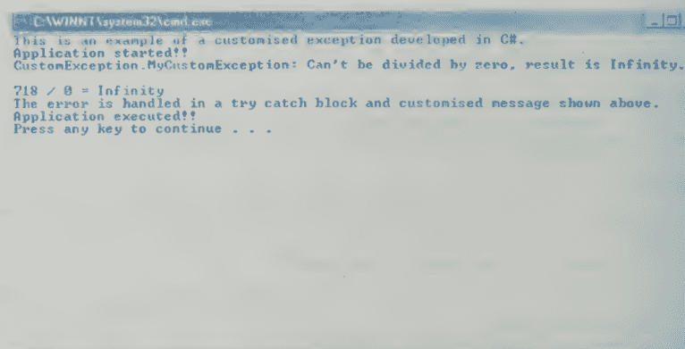

程序 18.8 在多个 catch 块中使用不同类型的系统定义的异常类。这些块捕获抛出的异常并显示异常消息。

#### 程序 18.8   多重 CATCH

```
using System;
using System.Collections.Generic;
using System.Text;

namespace MultipleCatch
{
    class MultipleCatchBlockExample
    {
        public void execute()
        {
            try
            {
                double val1 = 0;
                double val2 = 121;
                Console.WriteLine("Dividing {0} by {1}...", val1, val2);
                Console.WriteLine("{0} / {1} = {2}",
                    val1, val2, DivideValues(val1, val2));
            }

            // most specific exception type first
            catch (DivideByZeroException ex)
            {
                Console.WriteLine("DivideByZeroException caught!", ex);
            }
            catch (ArithmeticException e)
            {
                Console.WriteLine("ArithmeticException caught!", e);
            }
            // generic exception type last
```


```csharp
catch {
	Console.WriteLine("Unknown exception caught");
}
}
// do the division if legal
public double DivideValues(double val1, double val2)
{
	if (val2 == 0)
	{
		DivideByZeroException dx = new DivideByZeroException();
		Console.WriteLine(dx.Message);
	}
	if (val1 == 0)
	{
		ArithmeticException ax = new ArithmeticException();
		Console.WriteLine(ax.Message);
	}
	return val1 / val2;
}
static void Main(string[] args)
{
	Console.WriteLine("This is an example of multiple catch blocks and each catch block handles errors/exceptions of a certain type thrown in the application.\n");
	MultipleCatchBlockExample mcbObj = new MultipleCatchBlockExample();
	mcbObj.execute();
}
```

这是多个 catch 块的示例，每个 catch 块处理应用程序中抛出的某种类型的错误/异常。
用 0 除以 121...
算术运算中出现上溢或下溢。
0 / 121 = 0
按任意键继续 . . .

## 18.12 checked 和 unchecked 运算符

在进行算术运算和整数类型转换时，栈溢出是常见的问题。C# 支持两个运算符：checked 和 unchecked，它们可用于在程序执行期间检查（或不检查）栈溢出。如果某个操作经过 checked 检查，那么发生溢出时就会抛出异常。如果未检查，则不会引发异常，但我们会丢失数据。例如，考虑以下代码：

```
int a = 200000
int b = 300000
try
{
    int m = checked ( a * b );
}
catch (OverflowException e)
{
    Console.WriteLine (e);
}
```

由于 a*b 产生的值很容易超过 int 的最大值，因此会发生溢出。由于使用了 checked 运算符对该操作进行检查，因此将会抛出溢出异常。在这种情况下，我们会得到如下输出：

System.OverflowException：抛出了
类型为 System.OverflowException 的
异常，位置在......

如果我们想取消溢出检查，可以将代码标记为 unchecked

```
int n = unchecked (a * b);
```

在这种情况下，不会引发异常，但我们会丢失数据。

## 18.13 使用异常进行调试

正如我们所看到的，异常处理机制可用于对程序其余部分隐藏错误。程序员可能会误用这一技术来隐藏错误，而不是调试代码。异常处理机制可以有效地用于定位错误的类型和位置。一旦我们识别出错误，就必须在利用异常处理器掩盖错误之前，设法找出这些错误发生的原因。

#### 案例研究

##### 问题陈述

Hemant 是 BlueTech Software Solutions Private Limited 公司的一名高级程序员，该公司为不同的跨国组织开发软件和网站。目前，Hemant 正在为 BlueMoon 快递公司开发一个应用程序。该应用程序应允许 BlueMoon 的员工输入数字和文本等数据，并将其存储到数据库中。Hemant 希望应用程序的用户在数字字段中只能输入数值，而在文本字段（如 Name 和 Address）中只能输入字符值。他还希望，如果用户在数字字段中输入字符值，应显示适当的提示信息。Hemant 如何才能将这一功能应用到应用程序中呢？

##### 解决方案

Hemant 可以使用 C# 编程语言的异常处理功能，允许用户在数字字段中输入数值，并在文本字段（如 Name 和 Address）中输入字符值。C# 的异常处理功能还允许 Hemant 显示适当的提示信息，以处理因在数字字段中输入字符值而可能发生的异常。Hemant 创建了一个 C# 程序来理解 C# 的异常处理功能，以便他能够按照 BlueMoon 快递公司应用程序中的需求来实现该功能。下面是由 Hemant 创建的 C# 程序。

```
using System;
using System.Collections.Generic;
using System.Text;
namespace ExceptionHandling
{
    class ExceptionHandlers
    {
        int val1=0;
        public void DisplayErrors_type1()
        {
            Console.WriteLine("This is an example of how to handle input from users by catching exceptions.");
            Console.WriteLine("Enter any string value instead of a number and see the results.");
            Console.WriteLine("------------------------------------------------------------");
            try
            {
                Console.Write("Please enter a number: ");
                val1 = Int32.Parse(Console.ReadLine());
            }
            catch (Exception e)
            {
                Console.WriteLine(e.Message);
            }
            Console.WriteLine("------------------------------------------------------------");
        }
        public void DisplayErrors_type2()
        {
            Console.WriteLine("This section will show how to catching exceptions and \ndisplay them in a proper way.");
            try
            {
                Console.Write("Please enter a number: ");
                val1 = Int32.Parse(Console.ReadLine());
            }
            catch (FormatException fe)
            {
                Console.WriteLine("The error is : " + fe.Message);
            }
            Console.WriteLine("----------------------------");
        }
        public void DisplayErrors_type3()
        {
```

```
Console.WriteLine("This section will show customised messages and \ndisplay them in a proper way.");
try
{
    Console.Write("Please enter a number: ");
    val1 = Int32.Parse(Console.ReadLine());
}
catch
{
    Console.WriteLine("The error is that you have not entered numbers in the input line");
}
Console.WriteLine("------------------------------------------------------------");
}
public void DisplayErrors_type4()
{
    Console.WriteLine("This section will show customised messages using catch and finally \nand display them in a proper way.");
    try
    {
        Console.Write("Please enter a number: ");
        val1 = Int32.Parse(Console.ReadLine());
    }
    catch
    {
        Console.WriteLine("The error is that you have not entered numbers in the input line.");
    }
    finally
    {
        if (val1.Equals(0))
        {
            Console.WriteLine("As you have entered a string, the number cannot be displayed.");
        }
        else
        {
            Console.WriteLine("You have entered : " + val1);
        }
    }
    Console.WriteLine("------------------------------------------------------------");
}
public void DisplayErrors_type5()
{
    Console.WriteLine("This section uses multiple catch(s),finally to display customised error messages \nand display them in a proper way.");
    try
    {
        Console.Write("Please enter a number: ");
        val1 = Int32.Parse(Console.ReadLine());
    }
    catch (FormatException fe)
    {
```

```
Console.WriteLine("The error is, you have not entered any number in the input line." + fe.Message);
}
catch (Exception ee)
{
    Console.WriteLine("The error is that you have not entered numbers in the input line." + ee.Message);
}
finally
{
    if (val1.Equals(0))
    {
        Console.WriteLine("As you have entered a string, the number cannot be displayed.");
    }
    else
    {
        Console.WriteLine("You have entered : " + val1);
    }
}
    Console.WriteLine("----------------------");
}
}
class Program
{
static void Main(string[] args)
{
    ExceptionHandlers eh = new ExceptionHandlers();
    eh.DisplayErrors_type1();
    eh.DisplayErrors_type2();
    eh.DisplayErrors_type3();
    eh.DisplayErrors_type4();
    eh.DisplayErrors_type5();
}
}
}
```

备注 在 C# 中，可以使用 try 和 catch 块来处理应用程序中的异常。try 块包含一组预期会生成异常的语句。catch 块包含发生异常时应显示的消息。在 C# 中，每个 try 块都包含一个相应的 catch 块。在 C# 应用程序中，也可以使用 finally 关键字来处理异常。

## 常见编程错误

- 尝试在与特定 try 块关联的两个不同 catch 块中捕获同一类型的异常。
- 使用不正确的 catch 参数来捕获异常。


- 将 `catch (Exception e)` 放在其他 catch 块之前。
- 将捕获超类对象的 catch 放在捕获其子类对象的 catch 之前。
- 将通用 catch 处理程序 `catch` 放在其他 catch 块之前。
- 创建用户定义的异常类时，忘记实现 `System.Exception` 类的全部三个构造函数。
- 在可能导致溢出的操作上忘记使用 `checked` 运算符。
- 在 catch 处理程序中拼写异常类名称错误。

## 复习题

18.1 判断下列说法是否正确。
（a）语法错误会被编译器捕获并提示。
（b）运行时错误总会终止程序的执行。
（c）异常是由语法错误引起的。
（d）异常处理程序用于纠正运行时错误。
（e）catch 块可以放在程序中的任何位置。
（f）try 块通常包围包含运行时错误的代码块。
（g）catch 块不一定必须包含任何语句。
（h）使用多个 catch 语句时，C# 允许它们以任意顺序排列。
（i）无参数 catch 语句必须放在所有 catch 处理程序的末尾。
（j）try 块后面必须始终跟一个 catch 块。
（k）finally 块可用于处理 try 块生成的任何异常。
（l）`checked` 运算符用于检查语法错误。

18.2 什么是调试？解释其在软件开发生命周期中的重要性。

18.3 什么是编译时错误？举一些例子。它们是如何被检测到的？

18.4 什么是运行时错误？举一些例子。它们是如何被检测到的？

18.5 什么是异常？举一些例子。

18.6 如何编写代码来区别处理各种异常？

18.7 为什么有必要用专门的代码来处理异常？

18.8 描述处理异常所涉及的任务。

18.9 我们如何定义以下内容？
（a）try 块
（b）catch 块
（c）finally 块

18.10 列出 C# 程序中至少四种常见的异常。

18.11 当一个 try 块后面既没有 catch 块，也没有 finally 块时，会发生什么？

18.12 区分无参数 catch 语句和 `catch(Exception e)` 语句。

18.13 如何实现一个可能引发类型未知异常的方法？

18.14 什么是 finally 语句？它有什么用途？

18.15 使用 finally 块的目的是什么？举一些例子。

18.16 当异常发生在一个嵌套的 try 块的内部 try 块中时，会发生什么？

18.17 在什么情况下你认为有必要定义自己的异常类？

18.18 我们什么时候使用无参数 catch 处理程序？

18.19 解释异常处理机制如何用于调试程序。

18.20 为什么在 C# 中必须对 catch 块进行正确排序？

18.21 说明在以下情况下会发生什么：
- （a）异常在 try 块之外被抛出
- （b）没有 catch 处理程序与抛出的异常类型匹配
- （c）多个处理程序与抛出的异常类型匹配
- （d）catch 处理程序抛出一个异常
- （e）catch 是多个 catch 处理程序中的第一个

18.22 找出以下代码段中的错误（如果有）：
- （a）try
{
    byte m = 1000 * 5000;
    goto catch;
}

- （b）try
{
    byte m = checked (1000 * 2000);
}
catch (FormatException e)
{
    ....
}

- （c）try {...}
catch (Exception e) {...}
catch (ArithmeticException e) {...}
finally {}

- （d）try {...}
finally {...}
catch {...}

- （e）try {...}
catch (DividebyzeroException e)
{...}
finally {...}

# 调试练习

18.1 给定的程序能否编译？如果不能，为什么？

```
using System;
using System.Collections.Generic;
using System.Text;
namespace debigApp1_chap18
{
class Program
{
static void Main(string[] args)
{
```

```
Console.WriteLine("This display is from the Main function.");
Program pp = new Program();
pp.show();
Console.WriteLine("Exit from the Main function.");

public void show()
{
    Console.WriteLine("Showing message from the Show function.");
}
public void check()
{
    Console.WriteLine("Entering Check function.");
    try
    {
        Console.WriteLine("Entering try block of check function.");
        Console.WriteLine("Exiting from try block.");
    }
    catch
    {
        Console.WriteLine("Exception caught and handled!");
    }
    catch (NullReferenceException ex)
    {
        Console.WriteLine(ex.Message);
    }
    Console.WriteLine("Exiting from Check function.");
}
```

18.2 修正给定程序中的语法错误，以演示 finally 关键字。

```
using System;
using System.Collections.Generic;
using System.Text;

namespace debigApp1_chap18
{
    class Program
    {
        static void Main(string[] args)
        {
            Console.WriteLine("This display is from the Main function.");
            Program pp = new Program();
            pp.show();
            Console.WriteLine("Exit from the Main function.");
        }
        public void show()
        {
            Console.WriteLine("Showing message from the Show function.");
        }
    }
```

```
private void CHECK()
{
    try
    {
        Console.WriteLine("Entering try block of check function.");
    }
    catch
    {
        Console.WriteLine("This is finally block.");
    }
    catch
    {
        Console.WriteLine("Exception caught and handled!");
    }
}
```

# 18.3 找出以下程序中的错误。

```
using System;
using System.Collections.Generic;
using System.Text;
namespace debugApp3.chap18
{
    class Program
    {
        static void Main(string[] args)
        {
            string name = "";
            string address = "";
            int age = 0;
            Console.WriteLine("This is another example of try catch block.");
            Console.Write("Please enter your name : ");
            name = Console.ReadLine();
            Console.Write("Please enter your address : ");
            address = Console.ReadLine();
            Console.Write("Please enter your age : ");
            {
                age = Console.ReadLine();
                Console.WriteLine("Hello {0}. You live in {1} and you are {2} years old.", name, address, age);
            }
            catch (FormatException e)
            {
                Console.WriteLine("Age is a number." + e.Message);
            }
        }
    }
}
```

```
catch
{
    Console.WriteLine("error");
}
}
finally
{
    Console.WriteLine("Press any key to exit.");
}

}
```

# 编程练习

- 18.1 开发一个包含可能异常的程序。使用 try 块抛出异常，并使用 catch 块正确处理它。
- 18.2 编写一个程序，演示多个 catch 处理程序的应用。
- 18.3 编写一个程序，抛出一个“数组索引越界”类型的异常，然后适当地处理它。
- 18.4 编写一个程序，有效处理 `ArgumentException` 类型的异常。
- 18.5 开发一个可能抛出多个异常的程序，这些异常使用 catch 和 finally 块处理。
- 18.6 定义一个对整数数组进行排序的方法。为“索引越界”情况加入异常处理机制。
编写一个使用此方法对给定整数集进行排序的 Main 程序。
- 18.7 修改练习 18.6 的程序，将异常处理机制并入调用该方法的 Main 程序中。
- 18.8 编写一个程序，调用一个包含异常的深度嵌套方法。加入必要的异常处理机制。
- 18.9 定义一个名为 `NoMatchException` 的异常，当字符串不等于 `"India"` 时抛出该异常。编写一个使用此异常的程序。
- 18.10 编写一个程序，从键盘读取姓名并显示在屏幕上。当姓名长度超过 15 个字符时，程序应抛出异常。设计你自己的异常机制。


## 19 C# 中的多线程

C# 支持多线程的概念，它使我们能够并发地执行程序的两个或多个“部分”。每个部分称为“线程”。线程基本上是一条独立的指令序列，旨在在程序中执行“特定任务”。任务可能表示读取数据、通过互联网发送文件、打印某些结果或执行特定计算等操作。因此，多线程意味着在程序执行期间同时执行多个任务。

多线程的主要优点是它使我们能够开发高效的程序，从而优化计算机资源（如内存、I/O 设备和时间）的使用。

C# 定义了一个名为 System.Threading 的命名空间，其中包含开发和运行多线程程序所需的类和接口。因此，我们必须在任何多线程程序的开头包含语句 using System.Threading;。

- Thread
- Monitor
- ThreadPool
- Mutex

Thread 类帮助我们执行创建线程和设置线程优先级等任务。我们可以使用此类来控制线程并获取其状态。

Thread 类提供了各种属性，允许我们执行获取线程状态和为线程指定名称等任务。表 19.1 显示了 Thread 类中包含的一些重要属性。

#### 表 19.1 Thread 类的属性

| PROPERTY | TASK |
|---|---|
| CurrentThread | 用于检索当前正在运行的线程的名称。 |
| IsAlive | 用于检索指示线程执行当前状态的值。如果线程已启动或尚未终止，则 IsAlive 属性的值为 true，否则值为 false。 |
| IsThreadPoolThread | 用于检索指示线程是否属于线程池的值。如果线程属于线程池，则 IsThreadPoolThread 属性的值为 true，否则为 false。 |
| Name | 用于为线程指定名称。 |
| Priority | 用于获取指示线程调度优先级的值。默认情况下，Priority 属性的值为 Normal。我们可以将 Highest、AboveNormal、Normal、BelowNormal 或 Lowest 值分配给 Priority 属性。Highest 值表示线程必须在任何其他线程之前调度运行。AboveNormal 值表示具有此值的线程必须在 Highest 优先级线程之后，但在 Normal 优先级线程之前调度。Normal 值表示具有此值的线程必须在 AboveNormal 优先级线程之后，但在 BelowNormal 优先级线程之前调度。BelowNormal 值表示具有此值的线程必须在 Normal 优先级值线程之后，但在 Lowest 优先级线程之前调度。Lowest 值表示具有此值的线程必须在 Normal 和 Highest 等其他优先级线程执行后才调度运行。 |
| ThreadState | 用于检索指示线程状态的值。默认情况下，ThreadState 属性的值为 Unstarted。ThreadState 属性可以具有指示当前线程状态的值。这些值可以是 Running、Stopped、Suspended、Unstarted 或 WaitSleepJoin。Running 值表示当前线程正在运行。Stopped 值表示当前线程已停止。Suspended 值表示当前线程已挂起。Unstarted 值表示线程尚未使用 Thread 类的 Start 方法启动。WaitSleepJoin 值表示当前线程因调用 Wait、Sleep 或 Join 方法而被阻塞。 |

Thread 类还提供了某些方法，可用于管理启动线程和恢复已挂起线程等操作。表 19.2 显示了 Thread 类的一些重要方法。

#### 表 19.2 Thread 类的方法

| METHOD | TASK |
|---|---|
| Interrupt | 中断处于 WaitSleepJoin 状态的线程。 |
| Join | 阻塞一个线程，直到另一个线程终止。 |
| Resume | 恢复先前已挂起的线程。 |
| Sleep | 阻塞当前线程一段指定的时间。 |
| SpinWait | 使线程等待 Iterations 参数指定的次数。 |
| Start | 启动一个线程。 |
| Suspend | 挂起一个线程。 |

##### 19.2.2 ThreadPool 类

ThreadPool 类提供了一个线程池，帮助我们执行处理异步 I/O 和代表另一个线程等待等任务。

ThreadPool 类提供了各种方法，我们可以使用它们来执行确定两个线程池是否相等等任务。表 19.3 显示了 ThreadPool 类的一些重要方法。

#### 表 19.3 ThreadPool 类的方法

| METHOD | TASK |
|---|---|
| Equals | 确定两个线程池是否相等。 |
| GetType | 获取当前线程池的类型。 |
| QueueUserWorkItem | 允许将方法排队以供执行。已排队的方法在线程池线程可用时执行。 |
| SetMaxThreads | 指定可以并发活动的对线程池的请求数。 |
| SetMinThreads | 指定线程池为新请求可维护的空闲线程数。 |

##### 19.2.3 Monitor 类

Monitor 类通过向单个线程授予对象的锁来控制对对象的访问。当对象被锁定给线程时，对特定程序代码的访问受到限制。Monitor 类定义了一些方法，允许我们执行获取和释放对象锁等任务。表 19.4 显示了 Monitor 类的一些重要方法。

#### 表 19.4 Monitor 类的方法

| METHOD | TASK |
|---|---|
| Enter | 允许线程在指定对象上获取锁。 |
| Exit | 允许线程释放对指定对象的锁。 |
| TryEnter | 允许线程尝试在指定对象上获取锁。 |
| Wait | 允许线程释放对象上的锁并阻塞线程，直到再次获取锁为止的时间段。 |
| GetType | 允许我们获取 Monitor 类当前实例的类型。 |

##### 19.2.4 Mutex 类

互斥体是一种同步原语，有助于在 C# 中进行进程间同步。Mutex 允许线程对共享资源具有独占访问权。当线程获取互斥体时，想要获取互斥体的另一个线程将被挂起，直到第一个线程释放互斥体为止。

Mutex 类提供了 Handle 和 SafeWaitHandle 属性，可用于检索操作系统的句柄。此类还提供了各种方法，允许我们执行为互斥体设置访问控制安全性和打开命名互斥体等任务。表 19.5 显示了 Mutex 类提供的一些重要方法。

#### 表 19.5 Mutex 类的方法

| METHOD | TASK |
|---|---|
| Close | 释放 WaitHandle 类对象持有的资源。WaitHandle 类封装了特定于操作系统的等待访问共享资源的 objects。 |
| Equals | 确定两个互斥体是否相等。 |
| OpenExisting | 打开现有互斥体。 |
| ReleaseMutex | 一次释放互斥体。 |
| SetAccessControl | 为指定的互斥体设置访问控制安全性。 |

## 19.3 创建和启动线程

可以在 C# 中使用 Thread 类的构造函数创建线程。我们需要将 ThreadStart 委托传递给 Thread 类构造函数以及应从其中开始执行的方法的名称。ThreadStart 委托定义为：
public delegate void ThreadStart();
要在 C# 程序中创建新线程，我们可以使用以下语句：
Thread threadname = new Thread(new ThreadStart(methodname));
这里，threadname 表示新线程的名称，methodname 是执行开始的方法的名称。
例如，要创建线程 t1，我们可以使用以下代码：
Thread t1 = new Thread(new ThreadStart(First));
如果执行需要开始的方法是在创建线程的类以外的类中定义的，则我们必须使用该类的对象来访问该方法。Thread 类的 Start() 方法启动新线程。程序 19.1 说明了如何创建和执行线程。

#### 程序 19.1 创建和启动线程

```
using System;
using System.Threading;
public class AOne
{
    public void First()
    {
        Console.WriteLine("First method of AOne class is running on T1 thread.");
        Thread.Sleep(1000);
        Console.WriteLine("The First method called by T1 thread has ended.");
    }
    public static void Second()
    {
        Console.WriteLine("Second method of AOne class is running on T2 thread.");
        Thread.Sleep(2000);
        Console.WriteLine("The Second method called by T2 thread has ended.");
    }
}
```


```csharp
public class ThreadExp
{
    public static int Main(String[] args)
    {
        Console.WriteLine("Example of Threading");
        AOne a = new AOne();
        Thread T1 = new Thread(new ThreadStart(a.First)); // Creating thread T1
        T1.Start(); // Starting thread T1
        Console.WriteLine("T1 thread started.");
        Thread T2 = new Thread(new ThreadStart(AOne.Second)); // Creating T2
        T2.Start(); // Starting thread T2
        Console.WriteLine("T2 thread started.");
        return 0;
    }
}
```

在上述C#程序中，使用Thread类的Start()方法创建并启动了两个线程T1和T2。对于T1线程，执行从AOne类中定义的First方法开始；而对于T2线程，执行从静态方法Second开始。上述程序的输出如下：

```text
Example of Threading
First method of AOne class is running on T1 thread.
T1 thread started.
Second method of AOne class is running on T2 thread.
T2 thread started.
The First method called by T1 thread has ended.
The Second method called by T2 thread has ended.
Press any key to continue . . .
```

我们还可以创建一个线程并为其附加一个定时器，如程序19.2所示。程序19.2启动一个线程，并每隔一秒显示一次线程信息。当按下回车键时，线程停止；再次按下回车键时，线程恢复；再次按下回车键时，线程被销毁。

#### 程序19.2 | 使用定时器

```csharp
using System;
using System.Collections.Generic;
using System.Text;
using System.Timers;

namespace ThreadTimers
{
    class Program
    {
        static void Main()
        {
            Timer time = new Timer();          // Doesn't require any args
            time.Interval = 1000;
            time.Elapsed += time_Elapsed;      // Uses an event
            time.Start();                      // Start the timer

            Console.ReadLine();
            time.Stop();
            Console.WriteLine("Timer Thread stopped. Enter again to start. (Twice entering would destroy the Thread.)"); // Pause the timer
            Console.ReadLine();
            time.Start(); // Resume the timer
            Console.ReadLine();
            Console.WriteLine("Timer destroyed!");
            time.Dispose(); // Destroy the Timer Thread
        }
        static void Display(object ObjTime)
        {
            // This runs on a pooled thread
            Console.WriteLine(ObjTime); // Writes "tick..."
        }
        static void time_Elapsed(object sender, EventArgs e)
        {
            Console.Write("The Time is passing by : ");
            Console.WriteLine(DateTime.Now);
        }
    }
}
```

在上述程序中，创建了一个带定时器的线程。使用定时器的Start和Stop方法来启动和停止定时器及线程。程序19.2的输出如下：

```text
The Time is passing by : 7/25/2007 4:03:24 PM
The Time is passing by : 7/25/2007 4:03:25 PM
The Time is passing by : 7/25/2007 4:03:26 PM
The Time is passing by : 7/25/2007 4:03:27 PM
The Time is passing by : 7/25/2007 4:03:28 PM
The Time is passing by : 7/25/2007 4:03:29 PM
The Time is passing by : 7/25/2007 4:03:30 PM
The Time is passing by : 7/25/2007 4:03:31 PM
The Time is passing by : 7/25/2007 4:03:32 PM
The Time is passing by : 7/25/2007 4:03:33 PM
The Time is passing by : 7/25/2007 4:03:34 PM
The Time is passing by : 7/25/2007 4:03:35 PM
The Time is passing by : 7/25/2007 4:03:36 PM
The Time is passing by : 7/25/2007 4:03:37 PM
The Time is passing by : 7/25/2007 4:03:38 PM
The Time is passing by : 7/25/2007 4:03:39 PM
The Time is passing by : 7/25/2007 4:03:40 PM
The Time is passing by : 7/25/2007 4:03:41 PM
```

## 19.4 线程调度

在C#中，可以通过设置Thread类的Priority属性来调度线程。我们可以为特定线程的Priority属性提供以下值：

- Highest
- Normal
- Lowest
- AboveNormal
- BelowNormal

例如，要将`tr1`线程的优先级设置为Lowest，我们可以使用以下代码：
`tr1.Priority = ThreadPriority.Lowest;`

为线程设置优先级后，线程将根据其优先级运行。这意味着，BelowNormal优先级的线程在Normal优先级线程之后运行，但在Lowest优先级线程之前运行。程序19.3演示了Priority属性的使用。

#### 程序19.3 | 设置线程优先级

```csharp
using System;
using System.Threading;
public class ABC
{
    public void A()
    {
        Console.WriteLine("Thread A");
        Console.WriteLine("Priority of Thread A is: " + Thread.CurrentThread.Priority.ToString());
        Console.WriteLine(" ");
        Thread.Sleep(5000);
        Console.WriteLine("Thread with " + Thread.CurrentThread.Priority.ToString() + " has run");
        Console.WriteLine(" ");
    }
    public void B()
    {
        Console.WriteLine("Thread B");
        Console.WriteLine("Priority of Thread B is: " + Thread.CurrentThread.Priority.ToString());
        Console.WriteLine(" ");
        Thread.Sleep(5000);
        Console.WriteLine("Thread with " + Thread.CurrentThread.Priority.ToString() + " has run");
        Console.WriteLine(" ");
    }
    public static void C()
    {
        Console.WriteLine("Thread C");
        Console.WriteLine("Priority of Thread C is: " + Thread.CurrentThread.Priority.ToString());
        Console.WriteLine(" ");
        Thread.Sleep(3000);
        Console.WriteLine("Thread with " + Thread.CurrentThread.Priority.ToString() + " has run");
        Console.WriteLine(" ");
    }
}
public class ScheduleExp
{
    public static int Main(String[] args)
    {
        Console.WriteLine("..........Scheduling Threads");
        Console.WriteLine(" ");
        ABC a1 = new ABC();
        Thread tr1 = new Thread(new ThreadStart(a1.A));
        Thread tr2 = new Thread(new ThreadStart(a1.B));
        Thread tr3 = new Thread(new ThreadStart(ABC.C));
        Console.WriteLine("Priority of Main method is: " + Thread.CurrentThread.Priority.ToString());
        Console.WriteLine(" ");
        tr1.Name = " Thread A";
        tr2.Name = " Thread B";
        tr3.Name = " Thread C";
        tr1.Priority = ThreadPriority.AboveNormal;
        tr2.Priority = ThreadPriority.BelowNormal;
        tr3.Priority = ThreadPriority.Lowest;
        tr1.Start();
        tr2.Start();
        tr3.Start();
        return 0;
    }
}
```

在上述C#程序中，三个线程tr1、tr2和tr3的优先级分别设置为AboveNormal、BelowNormal和Lowest。Main线程的优先级也通过Console.WriteLine()方法显示。上述程序的输出如下：

```text
............Scheduling Threads
Priority of Main method is: Normal
Thread A
Priority of Thread A is: AboveNormal
Thread B
Priority of Thread B is: BelowNormal
Thread C
Priority of Thread C is: Lowest
Thread with Lowest has run
Thread with AboveNormal has run
Thread with BelowNormal has run
Press any key to continue . . .
```

## 19.5 线程同步

在C#中，可以使用Thread类的Sleep和Join等方法来同步线程。我们可以使用这些方法在特定时间段内阻塞一个线程，直到另一个线程完成其处理。在多线程环境中，多个线程同时运行以执行一个程序。这些线程可能异步运行。因此，一个线程可能会访问另一个线程正在使用的资源，如网络连接和文件句柄。这可能会不可预测地损坏数据。因此，有必要同步不同线程对资源的访问。

线程同步意味着协调不同执行线程对资源的访问。为了同步线程，我们可以将一个线程阻塞直到另一个线程完成其任务，或者锁定对资源的访问。Thread类提供了SpinWait和Suspend等方法，这些方法有助于在特定时间段内阻塞线程。在C#中，我们可以使用lock关键字来锁定特定线程对资源的访问。lock关键字通过首先获取对象的互斥锁，将一段C#程序语句标记为临界区。获取锁后，程序语句被执行。当程序语句执行完毕时，互斥锁被释放。使用lock关键字的语法如下：

```csharp
lock (obj) // obj is the object being synchronised
{
    // set of statements to be synchronised
}
```

程序19.4演示了如何使用lock关键字和Sleep方法进行线程同步。

#### 程序19.4 同步线程

```csharp
using System;
using System.Threading;

class ABC
{
    private object thislock = new object();
    public void A()
    {
        Console.WriteLine("Starting " + Thread.CurrentThread.Name.ToString());
        int x = 10, z = 30;
        int sum = 0;
        lock (thislock)
        {
            sum = x + z;
            Console.WriteLine(sum);
        }
        Thread.Sleep(5000);
        Console.WriteLine(Thread.CurrentThread.Name.ToString() + " is stopped");
    }
}

public class SyncExp
{
    public static void Main()
    {
        ABC a1 = new ABC();
        Thread t1 = new Thread(new ThreadStart(a1.A));
        Thread t2 = new Thread(new ThreadStart(a1.A));
        t1.Name = "T1";
        t2.Name = "T2";
        t1.Start();
        t2.Start();
    }
}
```


在上面的 C# 程序中，Sleep 方法用于阻塞 t1 和 t2 线程。lock 关键字用于锁定上面的 C# 程序中的特定代码行。上面 C# 程序的输出是：

```
Starting T1
40
Starting T2
40
T1 is stopped
T2 is stopped
Press any key to continue . . .
```

## 19.6 线程池

在线程池中，创建一个线程池来同时执行多个任务。线程池基本上是一组可以同时运行的线程，用于在后台执行许多任务。C# 的这一特性主要用于服务器应用程序。在服务器应用程序中，主线程接收来自客户端计算机的请求并将其传递给线程池中的一个线程以处理请求。以这种方式，主线程异步运行，可以自由接收来自客户端计算机的请求。主线程不必处理请求。相反，请求被转移到线程池中的一个线程进行处理。由于在服务器应用程序中实现了线程池，因此不会出现接收来自客户端计算机的请求延迟的情况。线程池中的线程完成处理客户端请求任务后，会等待在队列中以执行另一个任务。这样，线程池中的线程就可以被重用以执行不同的任务。由于线程池带来的线程可重用性，服务器应用程序可以避免为每个任务创建新线程。

线程池可能包含多个线程，每个线程执行特定任务。如果线程池中的所有线程都在执行其任务，则需要处理的新的任务会等待在队列中，直到有线程空闲为止。.NET 框架通过 ThreadPool 类提供了一个线程池。我们可以在 C# 程序中实现自定义线程池，也可以使用 ThreadPool 类提供的线程池。通过 ThreadPool 类实现线程池很容易。程序 19.5 展示了如何使用线程池。

此示例在不同的时间间隔执行 20 个不同的线程，随后在 3 秒后逐一停止所有线程，其中每个线程等待 3 秒。

#### 程序 19.5 使用线程池

```
using System;
using System.Collections.Generic;
using System.Text;
using System.Threading;

namespace ThreadPooling
{
    class ThreadPoolTest
    {
        static object showThread = new object();
        static int runThreads = 20;

        public static void Main()
        {
            for (int i = 0; i < runThreads; i++)
            {
                ThreadPool.QueueUserWorkItem(Display, i);
            }
            Console.WriteLine("Running 20 threads to one by one and stopping them after 3 seconds.\n");
            lock (showThread)
            {
                while (runThreads > 0) Monitor.Wait(showThread);
            }
            Console.WriteLine("All Threads stopped successfully!");
            Console.ReadLine();
        }

        public static void Display(object threadObj)
        {
            Console.WriteLine("Started Thread : " + threadObj);
            Thread.Sleep(3000);
            Console.WriteLine("Ended Thread : " + threadObj);
            lock (showThread)
            {
                runThreads--;
                Monitor.Pulse(showThread);
            }
        }
    }
}
```

在上面的代码中，创建了一个名为 runThreads 的线程池。此外，还使用了 ThreadPool 类的 QueueUserWorkItem 方法和 Monitor 类的 Wait 方法。上面程序的输出是：

```
Running 20 threads to one by one and stopping them after 3 seconds.
Started Thread : 0
Started Thread : 1
Started Thread : 2
Started Thread : 3
Started Thread : 4
Ended Thread : 0
Started Thread : 5
Started Thread : 6
Started Thread : 7
Ended Thread : 1
Started Thread : 8
Started Thread : 9
Ended Thread : 2
Started Thread : 10
Started Thread : 11
Ended Thread : 3
Started Thread : 12
Started Thread : 13
Ended Thread : 4
Started Thread : 14
Started Thread : 15
Ended Thread : 5
Started Thread : 16
Ended Thread : 6
Started Thread : 17
Started Thread : 18
Ended Thread : 7
Started Thread : 19
Ended Thread : 8
Ended Thread : 9
Ended Thread : 10
Ended Thread : 11
Ended Thread : 12
Ended Thread : 13
Ended Thread : 14
Ended Thread : 15
Ended Thread : 16
Ended Thread : 17
Ended Thread : 18
Ended Thread : 19
All Threads stopped successfully!
```

#### 案例研究

##### 问题陈述

Nishant 在 Best IT Solutions Private 公司担任程序员，该公司从事使用 ASP.NET 和 C# 等技术和编程语言开发高端软件应用程序的工作。Nishant 的项目经理要求他为 BM Enterprises 创建一个基于服务器的应用程序。基于服务器的应用程序必须在服务器上运行以处理特定数据。项目经理要求 Nishant 确保应用程序运行时服务器的负载必须最小。Nishant 应该在他的应用程序中实现什么功能以降低服务器负载？

##### 解决方案

Nishant 必须实现多线程功能，该功能在 C# 编程语言中得到支持，以降低服务器负载。在多线程中，程序或应用程序执行期间会同时运行多个线程。Nishant 首先创建以下示例 C# 应用程序以了解多线程的概念。

```
using System;
using System.Collections.Generic;
using System.Text;
using System.Threading;

namespace Threading
{
    class ThreadedApplications
    {
        static void Main(string[] args)
        {
            ApplicationCounter acObj = new ApplicationCounter();
            ThreadStart execute = new ThreadStart(acObj.application_stopstart);
            ThirdPartyApplications acObj2 = new ThirdPartyApplications();
            ThreadStart execute2 = new ThreadStart(acObj2.thirdapplication_stopstart);

            Thread applications1 = new Thread(execute);
            Console.WriteLine("Starting the Primary Application.");
            Thread applications2 = new Thread(execute2);
            //starting the primary application
            applications1.Start();
            applications2.Start();
            //starting the secondary applications

            for (int m = 1; m <= 5; m++)
            {
                Console.WriteLine("Executing the Primary Application: p{0}", m);
                Thread.Sleep(1000);
            }
            Console.WriteLine("Primary Application ended");
        }
    }

    public class ApplicationCounter
    {
        public void application_stopstart()
        {
            Console.WriteLine("Starting Secondary Applications now.");
            for (int m = 1; m <= 10; m++)
            {
                Console.WriteLine("Executing Secondary Application : s{0}", m);
                Thread.Sleep(500);
            }
            Console.WriteLine("Secondary Application ended");
        }
    }

    public class ThirdPartyApplications
    {
        public void thirdapplication_stopstart()
        {
            Console.WriteLine("Starting Third Party Applications now.");
            for (int m = 1; m <= 15; m++)
            {
                Console.WriteLine("Executing Third Party Application : t{0}", m);
                Thread.Sleep(2000);
            }
            Console.WriteLine("Third Party Applications ended");
        }
    }
}
```

## 备注

在 C# 中，多线程有助于优化与特定应用程序相关的资源。它也有助于更快地执行应用程序。多线程可用于在 C# 中创建不同的线程来执行诸如检查用户输入和执行后台任务等操作。

## 常见编程错误

- 线程已声明但未使用 Start 方法启动。
- 执行从静态方法开始，该方法使用类的对象调用而不是类名。
- 使用 USING 关键字在 C# 程序中使用 System.Threading 命名空间。
- 在 C# 程序中，线程正在重新启动。
- 线程在 try/catch 或 finally 块之前启动。
- 预定义类（如 Thread 和 Monitor）的<|message|>方法在不使用类名调用。

## 复习问题

- 19.1 什么是线程？它做什么？
- 19.2 线程在 C# 中的用途是什么？
- 19.3 如何创建 Thread？以及如何启动它？
- 19.4 Thread 类的 Sleep() 和 Join() 方法的功能是什么？
- 19.5 如何命名线程？
- 19.6 可以设置线程的优先级吗？
- 19.7 什么是线程池？

## 编程练习

- 19.1 下面给出了一个 C# 程序，该程序创建并启动线程 t1。程序中还定义了一个 write 方法，用于在线程启动时在控制台窗口中显示字符串。指定给定的程序是否会编译。如果不会，则给出原因。

```
using System;
using System.Collections.Generic;
using System.Text;
using System.Threading;

namespace debugApp1_chap19
{
    class ThreadName
    {
        static void Main(string[] args)
        {
            Thread.CurrentThread.Name = "Thread1";
            Thread t1 = new Thread(write);
            t1.Name = "Thread2";
```


```
t1.Start();
write();
}
public void write()
{
    Console.WriteLine("Hello from " + Thread.CurrentThread.Name);
}
}
```

## 19.2

在下面给出的 C# 程序中，定义了一个 show 方法，用于在控制台窗口中显示字符串。程序还使用 Thread 类的构造函数创建了一个名为 th 的线程。请找出程序中的错误，并说明错误原因。

```
using System;
using System.Collections.Generic;
using System.Text;

namespace debugApp2_chap19
{
    class Program
    {
        static void Main(string[] args)
        {
            Thread th = new Thread(new ThreadStart(show));
            th.Start(); // Run Go() on the new thread.
            th.show(); // Simultaneously run Go() in the main thread.
        }
        static void show() {
            Console.WriteLine("This is a thread start program!");
        }
    }
}
```

## 19.3

找出以下 C# 程序中的错误并说明原因。

```
using System;
using System.Collections.Generic;
using System.Text;
using System.Threading;
namespace debugApp3_chap19
{
    class Program
    {
        string bar = "This is a string value.";
        public static void Main()
        {
            string text =
                string.Format("{0} contains string value of: {1}", Thread.CurrentThread.GetHashCode(),
            bar);
            Console.WriteLine(text);
        }
    }
}
```

## .NET 上的 Windows 窗体和基于 Web 的应用程序开发

### 20.1 引言

.NET 是 Microsoft 提供的一种软件编程架构，用于开发可通过 Internet 或 Intranet 等网络连接在 Web 上运行的应用程序。使用 .NET 为 Web 开发的应用程序称为基于 Web 的应用程序。.NET 支持具有 C# 编程的 ASP.NET 技术，允许软件开发人员创建基于 Web 的应用程序，这些应用程序可用于执行诸如验证服务器从客户端计算机接收的数据以及在 Internet 上进行业务等任务。可以创建基于 Web 的应用程序，以允许正在上网的用户进行在线购物。.NET 还允许软件开发人员开发基于 Windows 的应用程序，以执行诸如从数据库访问数据和处理该数据之类的任务。我们可以使用 Microsoft Visual Studio 2005 来开发基于 Web 和基于 Windows 的 .NET 应用程序。

在开始使用 Visual Studio 开发应用程序之前，让我们先熟悉一下 Windows 应用程序的基本构建块——窗体。

### 20.2 创建 Windows 窗体

窗体通常是基于 Windows 的应用程序中包含的第一个实体。它承载许多其他控件来执行所需的功能。在运行时，窗体不断等待事件发生，例如单击鼠标或按键。一旦事件发生，它就会触发相应的事件处理代码。

在 C# 中，可以通过继承 System.Windows.Forms 命名空间中的 Form 类来创建窗体。Form 类已经支持许多属性和方法，这些属性和方法使程序员的工作变得容易得多。现在让我们利用 Form 类创建一个简单的空白窗体：

#### 程序 20.1 创建简单的空白窗体

```
//Program - SampleForm.cs
using System.Windows.Forms;
public class SampleForm : Form
{
```
```
public static void Main()
{
    SampleForm F1 = new SampleForm();
    Application.Run(F1);
}
```

在上述代码中，通过继承 Form 基类创建了一个名为 SampleForm 的 Windows 窗体。

##### 20.2.1 编译 SampleForm.cs 程序

要编译 SampleForm.cs 程序，请在命令提示符下键入以下命令：

```
csc /target:winexe SampleForm.cs
```

在上述命令中，

- csc 调用 C# 编译器
- /target 标志告诉 C# 编译器，要创建的程序集输出应为 Windows 可执行文件

注意：有关 csc 和相关编译器选项的更多信息，请参阅附录 B。

上述命令编译 SampleForm.cs 文件并生成相应的 SampleForm.exe 文件。要运行 SampleForm.cs 程序，请在命令提示符处键入 SampleForm.exe，然后按 Enter。图 20.1 显示了 SampleForm.cs 程序的输出：

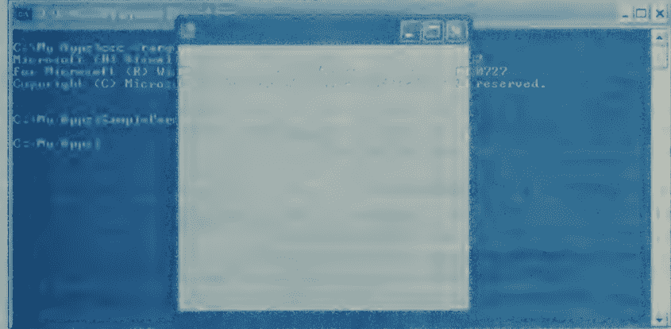

图 20.1 SampleForm.cs 程序的输出

##### 20.2.2 分析 SampleForm.cs 程序

要了解在 Windows 环境中究竟如何创建和显示窗体，让我们尝试逐条语句检查 SampleForm.cs 程序。

```
using System.Windows.Forms;
```

上述语句将 System.Windows.Forms 命名空间添加到程序中。该命名空间包含稍后将在程序中使用的 Form 和 Application 类。

```
public class SampleForm : Form
```

上述语句通过继承 Form 基类的功能创建 SampleForm 类。

```
public static void main()
```

上述语句定义了 main 方法，向编译器表明程序的起始位置。

```
SampleForm F1 = new SampleForm();
```

上述语句通过创建 F1 对象来实例化 SampleForm 类。

```
Application.Run(F1);
```

上述语句调用 Application 类的 Run 方法，使程序进入连续循环；并在其间处理用户发起的事件。

##### 20.2.3 理解 Application.Run 方法

如前所述，Application.Run 方法使程序进入连续循环，让窗体对象等待事件发生。一旦事件发生，相应的事件处理程序就会收到通知以执行所需操作。

对于我们之前创建的 F1 窗体对象，窗体主体上没有添加任何控件，因此不可能发生事件。然而，如果我们仔细查看图 20.1 中的输出窗体，可以看到标题栏上有三个默认按钮或控件，即：最大化、最小化和关闭。因此，用户只要单击这些按钮中的任何一个，就会引发一个事件，并执行相应的事件处理代码。事实上，这是我们能结束程序并打破其循环的唯一方式。

### 20.3 自定义窗体

我们可以利用 Form 类的各种属性和方法来自定义窗体的外观和感觉。在本节中，我们将修改之前创建的 SampleForm.cs 程序，以自定义窗体的标题栏、大小、颜色和边框。

##### 20.3.1 自定义标题栏

Form 类支持许多属性，使程序员能够根据自己的需求自定义窗体的标题。其中一些属性是

- ControlBox：启用或禁用控制框。
- MaximizeBox：启用或禁用“最大化”按钮。
- MinimizeBox：启用或禁用“最小化”按钮。
- Text：帮助为窗体添加标题。

现在，让我们修改 SampleForm.cs 程序来设置上述属性。

#### 程序 20.2 修改 SampleForm.cs 程序

```
//Program - SampleForm.cs
using System.Windows.Forms;
public class SampleForm : Form
```
```
{
    public static void Main()
    {
        SampleForm F1 = new SampleForm();
        F1.ControlBox = true;
        F1.MaximizeBox = false;
        F1.MinimizeBox = true;
        F1.Text = "My Form";

        Application.Run(F1);
    }
}
```

图 20.2 显示了上述代码的输出：

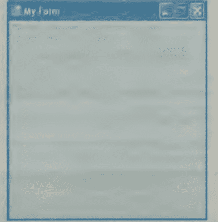

图 20.2 自定义窗体的标题栏

根据为窗体对象设置的属性，控制框与标题文本一起显示。此外，“最大化”按钮被禁用，而“最小化”按钮被启用。

让我们再次修改窗体对象的属性值：

```
SampleForm F1 = new SampleForm();
F1.ControlBox = false;
F1.MaximizeBox = false;
F1.MinimizeBox = false;
```

在上面的代码中，我们禁用了控制框、最大化按钮和最小化按钮的显示。此外，没有为窗体标题指定任何文本字符串，因此整个标题从窗体中消失，如图 20.3 所示。

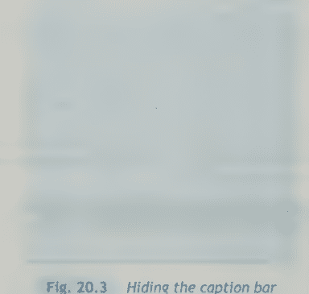

##### 20.3.2 自定义大小

Form 类支持许多属性，使程序员能够指定窗体的大小相关设置。其中一些属性是

- DefaultSize：设置窗体的默认大小
- Height：设置窗体的高度
- Width：设置窗体的宽度
- MaximumSize：设置窗体的最大大小
- MinimumSize：设置窗体的最小大小
- StartPosition：帮助指定窗体的初始位置

现在，让我们修改 SampleForm.cs 程序以设置与大小相关的属性。

#### 程序 20.3 修改 SampleForm.cs 程序以设置大小相关属性

```
//Program - SampleForm.cs
using System.Windows.Forms;
public class SampleForm : Form
{
    public static void Main()
    {
        SampleForm F1 = new SampleForm();
        F1.Height = 125;
        F1.Width = 250;
        F1.Text = "My Form";
        Application.Run(F1);
    }
}
```


在上面的代码中，我们将窗体对象的 Height 和 Width 属性分别设置为 125 和 250。因此，生成的输出窗体将相应地改变其大小。

##### 20.3.3 定制颜色

Form 类的 BackColor 属性使我们可以修改窗体的背景颜色。颜色可以从 System.Drawing 命名空间包含的 Color 结构中选择。

下面的代码使用 BackColor 属性更改 F1 窗体对象的背景颜色。

```
//Program - SampleForm.cs
using System.Windows.Forms;
using System.Drawing;
public class SampleForm : Form
{
	public static void Main()
	{
		SampleForm F1 = new SampleForm();
		F1.BackColor = Color.Green;
		F1.Text = "My Form";
		Application.Run(F1);
	}
}
```

图 20.4 显示了上述代码的输出：


图20.4 定制窗体的背景颜色

##### 20.3.4 定制边框

我们可以通过使用 Form 类的 FormBorderStyle 属性来定制窗体的边框。FormBorderStyle 属性不仅允许我们更改边框样式，还允许我们配置窗体的调整大小功能。FormBorderStyle 属性可以采用的一些值有：

- None：移除窗体的边框
- Sizeable：使窗体可调整大小
- Fixed3D：使窗体不可调整大小，并带有 3D 边框
- FixedSingle：使窗体不可调整大小，并带有单行边框

下面的代码使用 BorderStyle 属性来创建不可调整大小的单行窗体边框。

#### 程序 20.5 | 创建不可调整大小的单行边框窗体

```
//Program - SampleForm.cs
using System.Windows.Forms;

public class SampleForm : Form
{
    public static void Main()
    {
        SampleForm F1 = new SampleForm();
        F1.FormBorderStyle = FormBorderStyle.FixedSingle;
        F1.Text = "My Form";
        Application.Run(F1);
    }
}
```

现在我们已经学习了如何创建窗体并定制其外观，是时候向其中添加控件了。手动为窗体的不同控件编写每一行代码可能很繁琐。相比之下，像 Visual Studio 这样的 IDE 允许我们简单地从工具箱中拖放控件到窗体上，其默认代码会自动添加到代码文件中。因此，我们将使用这种方法向窗体添加控件。但是，在开始之前，我们必须熟悉 Visual Studio IDE。

### 20.4 了解 MICROSOFT VISUAL STUDIO 2005

Microsoft Visual Studio 2005 基本上是一套软件开发工具，有助于快速开发 Windows 应用程序、基于 Web 的应用程序和移动应用程序等应用。它提供了一个开发环境，用于创建可在 Windows 服务器、智能手机和万维网（WWW）浏览器等平台（这些平台受 .NET 框架支持）上运行的不同应用程序。Microsoft Visual Studio 2005 允许您使用 Windows 窗体和 Web 窗体创建 Windows 应用程序和基于 Web 的应用程序的用户界面。为了能够使用 Microsoft Visual Studio 2005 创建 .NET Windows 和基于 Web 的应用程序，首先必须了解其集成开发环境（IDE）。可以在 Microsoft Visual Studio 2005 中使用 C#、C++ 和 Visual Basic.NET 等语言来指定特定功能，例如连接数据库并显示数据。

##### 20.4.1 Microsoft Visual Studio 2005 IDE 概述

Microsoft Visual Studio 2005 IDE 是一个窗口，其中包含工具箱、解决方案资源管理器、菜单栏和工具栏等组件，这些组件有助于快速开发 Windows 和基于 Web 的应用程序。要访问 Microsoft Visual Studio 2005 IDE，我们必须选择“开始”->“程序”->“Microsoft Visual Studio 2005”->“Microsoft Visual Studio 2005”。图 20.5 显示了 Microsoft Visual Studio IDE。


图20.5 Microsoft Visual Studio IDE

在出现 Microsoft Visual Studio IDE 后，选择“文件”->“新建”->“项目”以显示“新建项目”对话框，如图 20.6 所示。

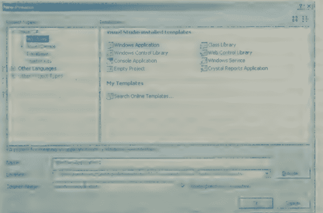

图20.6 新建项目对话框


选择 Windows 应用程序模板（当我们在“项目类型”窗格中选择 Visual C# 时，该模板会出现在“模板”部分），以指定新项目的模板。之后，在“名称”文本框中输入新项目的名称，并单击“确定”。Microsoft Visual Studio 2005 IDE 的解决方案资源管理器和“属性”窗口等组件会与一个 Windows 窗体一起出现。图 20.7 显示了 Microsoft Visual Studio 2005 IDE 的不同组件。

Microsoft Visual Studio IDE 的各种组件如下：

- 菜单栏：包含“文件”和“视图”等各种菜单，有助于执行创建新项目和显示被隐藏的工具箱等任务。
- 工具栏：包含可用于快速执行任务的命令按钮，这些任务包括保存项目和运行 Windows 或基于 Web 的应用程序。
- 工具箱：包含 TextBox 和 Label 等各种控件，有助于创建 Windows 或基于 Web 的应用程序的用户界面。如果 Microsoft Visual Studio IDE 中没有出现工具箱，我们可以通过选择 Microsoft Visual Studio IDE 中的“视图”->“工具箱”选项来查看它。
- 解决方案资源管理器：提供与项目相关文件的有组织视图。在解决方案资源管理器中，我们可以访问用于执行特定任务的命令，例如向项目添加项、文件或窗体，以及查看特定窗体的 C# 代码。如果 Microsoft Visual Studio IDE 中没有出现解决方案资源管理器，则可以通过选择“视图”->“解决方案资源管理器”选项来查看。

## 20.5 — 创建并运行 SampleWinApp Windows 应用程序

SampleWinApp 是一个 Windows 应用程序，允许用户单击名为“Click Me”的按钮。当单击该按钮时，会发生 Click 事件，通过该事件，按钮的“Click Me”文本会变为“Hello”，反之亦然。要使用 Microsoft Visual Studio 在 .NET 上创建 SampleWinApp Windows 应用程序，我们必须：

- 创建 Form1 窗体
- 向 Form1 窗体添加代码

##### 创建 Form1 窗体

Form1 窗体允许用户单击按钮，将文本“Click Me”更改为“Hello”。要创建 Form1 窗体：

1. 选择“开始”->“程序”->“Microsoft Visual Studio 2005”->“Microsoft Visual Studio 2005”以显示 Microsoft Visual Studio IDE。
2. 选择“文件”->“新建”->“项目”以显示“新建项目”对话框。
3. 选择 Windows 应用程序模板（当你在“项目类型”窗格中选择 Visual C# 时，该模板会出现在“模板”部分），以指定新项目的模板。
4. 在“名称”文本框中输入名称，例如 SampleWinApp，以指定 Windows 应用程序的名称。图 20.8 显示了“新建项目”对话框，其中为 SampleWinApp Windows 应用程序指定了模板和名称。


5. 单击“确定”关闭“新建项目”对话框。Microsoft Visual Studio IDE 会与一个 Windows 窗体和解决方案资源管理器一起出现，如图 20.9 所示。

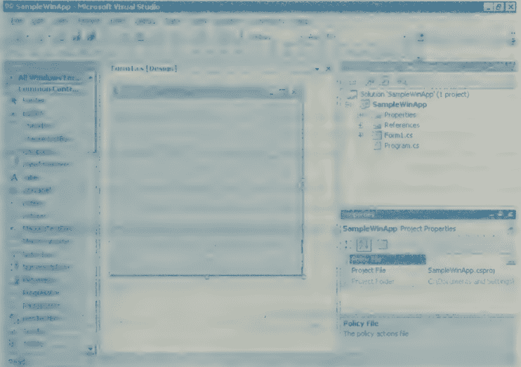

图20.9 Form1 窗体

6. 在“属性”窗口中，将 Form1 窗体的 Text 属性的值从 Form1 改为 Button Test，如图 20.10 所示。

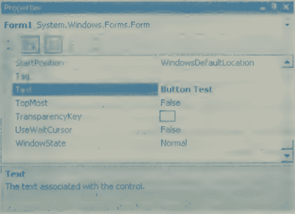

图20.10 文本已更改的“属性”窗口

7. 从工具箱中拖动一个 Button 控件到 Form1 窗体上，将 Button 控件添加到 Form1 窗体。
8. 在“属性”窗口中，将 Button 控件的 Text 属性值更改为 Click Me。
9. 在“属性”窗口中，根据需要更改 Button 控件的 BackColor 和 ForeColor 属性。
10. 从工具箱中拖动一个 Label 控件到 Form1 窗体上，将该控件添加到窗体。
11. 将 Label 控件的 Text 属性值从 label1 更改为“这是一个标签。TextBox 和 Button 控件应用程序。”
12. 在“属性”窗口中，根据需要更改 Label 控件的 BackColor 和 ForeColor 属性。
13. 从工具箱中拖动一个 TextBox 控件到 Form1 窗体上，将该控件添加到窗体。

图 20.11 显示了添加控件后的 Form1 窗体。

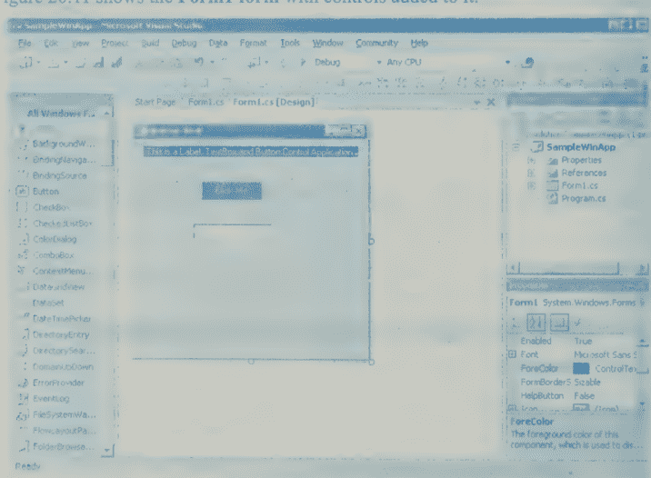

图20.11 添加了控件的 Form1 窗体

这完成了创建 Form1 窗体的任务。

##### 向 Form1 窗体添加代码

您需要向 Form1 窗体添加代码，以指定将 Button 控件中出现的文本“Click Me”更改为“Hello”的功能。要向 Form1 窗体添加代码：

1. 右键单击解决方案资源管理器中的 Form1.cs 节点，以显示快捷菜单。
2. 选择“查看代码”选项以显示代码编辑器，其中包含与 Form1 窗体关联的 Form1.cs 文件，如图 20.12 所示：


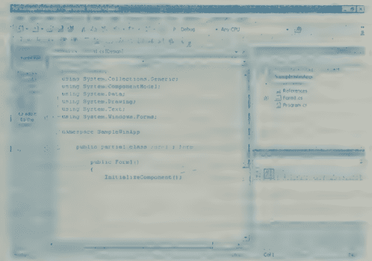

图 20.12 Microsoft Visual Studio 中的代码编辑器

- 3. 在 `public Form1()` 之前输入以下代码以声明整型变量：`int i = 0;`

- 4. 点击代码编辑器窗口顶部出现的带叉号的关闭按钮以关闭编辑器。`Form1.cs [Design]` 视图出现。

- 5. 双击 Form1 表单上的任意位置以显示包含 `Form1_Load` 事件处理程序的 Form1.cs 文件的代码编辑器窗口，如图 20.13 所示。

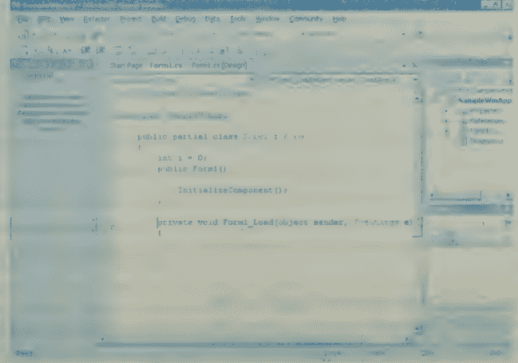

图 20.13 带有 Form1_Load 事件处理程序的代码编辑器

> 注：要处理控件生成的事件，需要为该事件定义事件处理程序。事件处理程序是包含在事件发生时在控件上执行的代码的 Visual C# 方法。这些事件处理程序有助于执行特定任务，例如在运行时显示按钮或修改控件的颜色。

- 6. 在 `Form1_Load` 事件处理程序中输入以下代码以指定隐藏已添加到 Form1 表单的 TextBox 控件的功能。

```csharp
// Hiding the TextBox on start of the application
textBox1.Hide();
```

- 7. 点击代码编辑器窗口顶部出现的带叉号的关闭按钮以关闭编辑器。`Form1.cs [Design]` 视图出现。

- 8. 双击 Form1 表单上出现的 Button 控件以显示包含 `button1_Click` 事件处理程序的 Form1.cs 文件的代码编辑器窗口。

- 9. 输入以下代码到 `button1_Click` 事件处理程序以指定更改 Button 控件文本的功能：

程序 20.6 显示一个表单和一个按钮。点击按钮时按钮的文本会更改，并且会出现一个只读的 TextBox，显示消息“click the button again”。再次点击按钮会将按钮文本恢复为原始文本。用户可以根据需要重复此操作。

#### 程序 20.6 更改按钮控件的文本

```csharp
i++;

if (i % 2 != 0)
{
    button1.Text = "Hello";
    MessageBox.Show("The button has been clicked and the button text changed to \"Hello.\"");
}
else
{
    button1.Text = "Click Me";
    MessageBox.Show("The button has been clicked and the button text changed to 'Click Me'.");
}

// Unhiding the text box here
textBox1.Show();
textBox1.Text = "Click the button again and the button text changes.";
textBox1.ReadOnly = true;
```

在上述程序中，`button1_Click` 事件处理程序用于 Click 事件，其中包含更改 Button 控件中出现的 Click Me 文本的代码。这完成了向 Form1 表单添加代码的任务。

我们也可以点击开始调试按钮来运行我们创建的 Windows 应用程序。然后会出现如图 20.14 所示的 Button Test 窗口。

在 Button Test 窗口中，点击 Click Me 按钮。这会导致 Button 控件的 Click 事件发生。会出现一个消息框以确认 Click Me 按钮已被点击，如图 20.15 所示。


我们可以点击消息框中的 OK 按钮以显示带有按钮控件文本已更改的 Button Test 窗口，如图 20.16 所示。

我们可以再次点击 Button Test 窗口中出现的按钮以将文本从 Hello 更改为 Click Me，反之亦然。


### 20.6 设计模式概述

设计模式通过在开发过程中指定要使用的设计和实现策略来构成软件开发的基础。每种设计模式都有其自身的优点和局限性。因此，选择特定设计模式主要取决于应用程序需要满足的需求及其目标环境。.NET 支持的一些关键设计模式是

- Factory
- Singleton
- Chain of responsibility

##### 20.6.1 工厂设计模式

工厂设计模式使用抽象类和接口使程序员能够选择要实例化的对象类型。顾名思义，工厂接口允许创建不同的产品对象，其功能在接口方法的实现期间指定。

以下代码语法描述了工厂设计模式的使用：

#### 程序 20.7 工厂设计模式

```csharp
abstract class Factory
{
    public abstract void Product();
}
class Product1 : Factory
{
    public override void Product()
    {
        // Factory Method Implementation Code
    }
}
class Product2 : Factory
{
    public override void Product()
    {
        // Factory Method Implementation Code
    }
}
```

##### 20.6.2 单例设计模式

在此设计模式中，类仅实例化一次；即为该类创建唯一的单个对象。然后通过静态方法调用将此对象在不同客户端应用程序之间共享。这种设计模式的可用性可以在需要实现某些锁定或同步机制的场景中看到。

##### 20.6.3 责任链设计模式

顾名思义，责任链设计模式将一系列对象链接在一起，每个对象都具有处理传入请求的能力。请求沿着链传递，直到链中的某个对象接收并处理请求。

## 20.7 创建和运行 SampleWinApp2 Windows 应用程序

SampleWinApp2 Windows 应用程序是一个单文档界面（SDI）应用程序，允许我们进行选择、计算阶乘并检查一个数字是否为质数。SDI 应用程序是可能包含多个 Windows 窗体的应用程序，每个 Windows 窗体都在单独的应用程序窗口中打开。SDI 应用程序的每个 Windows 窗体都包含单独的菜单栏、状态栏和工具栏。SDI 应用程序的示例是 Windows 中可用的 WordPad 应用程序。WordPad 应用程序允许我们一次打开一个文档。在 WordPad 中，我们需要在打开另一个文档之前关闭一个文档。Microsoft Visual Studio 2005 在 IDE 顶部工具栏中提供了开始调试按钮来运行应用程序。我们也可以按 F5 或 Ctrl 和 F5 键组合来运行 SampleWinApp2 Windows 应用程序。

##### 创建 SampleWinApp2 Windows 应用程序

SampleWinApp2 Windows 应用程序包含三个窗体：FirstForm、Factorial 和 PrimeNo。在 FirstForm 窗体中，我们可以选择计算阶乘或检查质数。在阶乘窗体中，用户输入一个数字，点击按钮后会显示该数字的阶乘。在 PrimeNo 窗体中，检查用户输入的数字是否为质数。要创建 SampleWinApp2 Windows 应用程序，我们必须：

- 创建 FirstForm 窗体。
- 向 FirstForm 窗体添加代码。
- 创建 factorial 窗体。
- 向 Factorial 窗体添加代码。
- 创建 PrimeNo 窗体。
- 向 PrimeNo 窗体添加代码。

##### 创建 FirstForm 窗体

我们需要创建 FirstForm 窗体以便选择计算阶乘或检查质数。要创建 FirstForm 窗体：

- 1. 选择 开始->程序->Microsoft Visual Studio 2005->Microsoft Visual Studio 2005 以显示 Microsoft Visual Studio IDE。
- 2. 选择 文件->新建->项目 以显示新建项目对话框。
- 3. 选择 Windows 应用程序模板，该模板在选择项目类型窗格中的 Visual C# 时出现在模板部分，以指定新 Windows 应用程序的模板。
- 4. 在名称文本框中输入名称，例如 SampleWinApp2 以指定新 Windows 应用程序的名称。
- 5. 点击确定以关闭新建项目对话框。Microsoft Visual Studio IDE 出现，显示 Form1 窗体和解决方案资源管理器。
- 6. 在解决方案资源管理器中右键单击 Form1.cs 节点以显示快捷菜单。
- 7. 选择重命名选项以显示可编辑文本框，允许我们输入 Form1.cs 文件的新名称。
- 8. 在可编辑文本框中输入 FirstForm.cs 以指定 Form1.cs 文件的新名称。
- 9. 在属性窗口中将 FirstForm 窗体的 Text 属性值从 Form1 更改为 C# 中的 SDI 应用程序。
- 10. 根据需要更改属性窗口中 FirstForm 窗体的 BackColor 属性。
- 11. 从工具箱拖动 Label 控件到 FirstForm 窗体以将控件添加到窗体。
- 12. 在属性窗口中将 Label 控件的 Text 属性从 Label1 更改为 This is an SDI application。
- 13. 根据需要在属性窗口中更改 Label 控件的 BackColor。
- 14. 展开属性窗口中出现的 Font 节点以显示粗体选项。
- 15. 点击粗体选项旁出现的可编辑文本框以显示箭头。
- 16. 点击箭头以显示包含 True 和 False 值的列表，如图 20.17 所示。


图 20.17 带有粗体选项的属性窗口


- 17. 从列表中选择 True，使 Label 控件中显示的文本变为粗体。
- 18. 从工具箱中将一个 RadioButton 控件拖到 FirstForm 窗体上，以添加该 RadioButton 控件。
- 19. 同样，在 FirstForm 窗体上再添加一个 RadioButton 控件。
- 20. 在“属性”窗口中，将已添加的第一个 RadioButton 控件的 Text 属性值更改为 Check factorial。
- 21. 在“属性”窗口中展开 Font 节点，以显示 Bold 选项。
- 22. 单击 Bold 选项旁边的可编辑文本框，以显示一个箭头。
- 23. 单击该箭头，显示包含 True 和 False 值的列表。
- 24. 从列表中选择 True，使 RadioButton 控件中显示的文本变为粗体。
- 25. 同样，在“属性”窗口中将第二个 RadioButton 控件的 Text 属性值更改为 Check Prime Number。
- 26. 使用“属性”窗口中的 Font 节点，将第二个 RadioButton 控件显示的文本 Check Prime Number 设为粗体。
- 27. 从工具箱中将一个 Button 控件拖到 FirstForm 窗体上，以将该控件添加到窗体中。
- 28. 在“属性”窗口中将 Button 控件的 Text 属性值更改为 Start。
- 29. 在“属性”窗口中展开 Font 节点，以显示 Bold 选项。
- 30. 单击 Bold 选项旁边的可编辑文本框，以显示一个箭头。
- 31. 单击该箭头，显示包含 True 和 False 值的列表。
- 32. 从列表中选择 True，使 Button 控件中显示的文本变为粗体。
- 33. 从工具箱中将另一个 Button 控件添加到 FirstForm 窗体。
- 34. 在“属性”窗口中将该 Button 控件的 Text 属性值更改为 Exit。
- 35. 根据要求，使用“属性”窗口更改所添加的两个 Button 控件的 BackColor 属性。
- 36. 选择添加到 FirstForm 窗体中的第一个 Button 控件，以在“属性”窗口中显示 ForeColor 选项，如图 20.18 所示。
- 37. 单击 ForeColor 选项旁边的可编辑文本框中出现的箭头，以显示颜色调色板。
- 38. 从调色板中选择一种颜色，以更改第一个 Button 控件中显示文本的颜色。
- 39. 以更改第一个 Button 控件中文本颜色的相同方式，更改第二个 Button 控件中显示文本的颜色。这样就完成了创建 FirstForm 窗体的任务。图 20.19 显示了带有已添加控件的 FirstForm 窗体：


图 20.19 设计视图中的 FirstForm 窗体

##### 向 FirstForm 窗体添加代码

在 FirstForm 窗体中，我们需要添加代码来指定用于导航到阶乘窗体或 PrimeNo 窗体的功能。要向 FirstForm 窗体添加代码：

- 1. 双击带有 Start 文本的 Button 控件，显示 Code Editor，其中 FirstForm.cs 文件与 FirstForm 窗体关联，如图 20.20 所示。
- 2. 将以下代码添加到 Code Editor 中出现的 button1_Click 事件处理程序，以指定用于显示窗体以计算阶乘和检查素数的功能。

#### 程序 20.8 显示窗体

```csharp
if (radioButton1.Checked == true)
{
    factorial f1 = new factorial();
    f1.Show();
}
else if (radioButton2.Checked == true)
{
    PrimeNo f2 = new PrimeNo();
    f2.Show();
}
```


图 20.20 FirstForm 窗体的代码编辑器窗口

- 3. 单击 Code Editor 顶部出现的由叉号表示的 Close 按钮以关闭编辑器。此时出现 FirstForm 窗体的 FirstForm.cs [Design] 视图。
- 4. 双击带有 Exit 文本的 Button 控件，打开带有 FirstForm.cs 文件和 button2_Click 事件处理程序的 Code Editor。
- 5. 在 button2_Click 事件处理程序中添加以下代码，以指定用于关闭 FirstForm 窗体的功能：

```csharp
this.Close();
```

这样就完成了向 FirstForm 窗体添加代码的过程。

##### 创建 Factorial 窗体

我们需要创建一个阶乘窗体，以便输入一个数字并计算其阶乘。要创建 Factorial 窗体：

添加新项 - SampleWinApp2

模板

Visual Studio 已安装的模板

- 类
- Windows 窗体
- 继承的窗体
- 组件类
- XML 文件
- HTML 页
- 位图文件
- Crystal 报表
- 安装程序类
- Windows 脚本宿主
- 资源文件
- 关于框
- 接口
- 用户控件
- 继承的用户控件
- Web 自定义控件
- 数据集
- XSLT 文件
- 文本文件
- 报表
- Windows 服务
- VBScript 文件
- 应用程序配置文件
- MDI 父窗体
- 类图

一个空的类定义

名称：Class1.cs

添加

取消

图 20.21 “添加新项”对话框

- 14. 使用“属性”窗口更改 Button 控件的 BackColor 属性。
- 15. 选择第一个 Button 控件，在“属性”窗口中将其 Text 属性值更改为 Calculate Factorial。
- 16. 同样，将第二个 Button 控件的 Text 属性值更改为 Back to FirstForm。
- 17. 使用“属性”窗口中的 Font 节点，将 Button 控件中显示的文本设为粗体。
- 18. 更改 Button 控件的 ForeColor 属性，以修改控件中显示文本的颜色。
- 19. 向阶乘窗体添加一个 Label 控件和一个 TextBox 控件。
- 20. 在“属性”窗口中将 Label 控件的 Text 属性值更改为 The Factorial is。
- 21. 使用“属性”窗口中出现的 Font 节点，将 Label 控件中显示的文本设为粗体。
- 22. 使用“属性”窗口更改 Label 和 TextBox 控件的 BackColor 属性。这样就完成了创建阶乘窗体的过程。图 20.22 显示了带有已添加控件的阶乘窗体。


图 20.22 设计视图中的阶乘窗体

##### 向 Factorial 窗体添加代码

我们需要向阶乘窗体添加代码，以指定用于计算一个数字的阶乘以及关闭阶乘窗体的功能。要向阶乘窗体添加代码：

- 1. 双击带有 Calculate 文本的 Button 控件，显示 Code Editor，其中包含 factorial.cs 文件以及该 Button 控件的 button1_Click 事件处理程序。
- 2. 在 button1_Click 事件处理程序中添加以下代码，以指定用于计算阶乘的功能：

#### 程序 20.9 | 计算阶乘

```csharp
int num;
long fact;
if (textBox1.Text.Length > 2)
{
MessageBox.Show("Numbers upto 25 are allowed.");
}
num = Int32.Parse(textBox1.Text);
fact = 1;
while (num >= 1 && num <= 25)
{
fact *= num;
num--;
}
textBox2.Text = fact + "";
```

- 3. 单击 Code Editor 顶部出现的由叉号表示的 Close 按钮以关闭编辑器。此时出现阶乘窗体的 factorial.cs [Design] 视图。
- 4. 双击带有 Back to FirstForm 文本的 Button 控件，打开带有 factorial.cs 文件和 button2_Click 事件处理程序的 Code Editor。
- 5. 在 button2_Click 事件处理程序中添加以下代码，以指定用于关闭阶乘窗体的功能：

```csharp
this.Close();
```

这样就完成了向阶乘窗体添加代码的过程。

##### 创建 PrimeNoForm

我们需要创建 PrimeNo 窗体，以便输入一个数字并检查该数字是否为素数。要创建 PrimeNo 窗体：

- 1. 使用解决方案资源管理器向 SampleWinApp 应用程序添加一个名为 PrimeNo 的新窗体。
- 2. 使用“属性”窗口将 PrimeNo 窗体的 Text 属性值更改为 Prime Number Form。
- 3. 使用“属性”窗口更改 PrimeNo 窗体的 BackColor 属性。
- 4. 使用工具箱向 PrimeNo 窗体添加一个 Label 控件和一个 TextBox 控件。
- 5. 使用“属性”窗口更改 Label 控件的 BackColor 属性。
- 6. 使用“属性”窗口将 Label 控件的 Text 属性值更改为 Enter a number:。


+   7. 使用“属性”窗口的“Font”节点使 Label 控件中显示的文本加粗。
+   8. 使用“工具箱”向 PrimeNo 窗体添加两个 Button 控件。
+   9. 使用“属性”窗口将已添加的第一个 Button 控件的 Text 属性值更改为“Check Prime No”。
+   10. 使用“属性”窗口将第二个 Button 控件的 Text 属性值更改为“Back to FirstForm”。
+   11. 使用“属性”窗口的“Font”节点使 Button 控件中显示的文本加粗。
+   12. 使用“属性”窗口更改 Button 控件的 BackColor 和 ForeColor 属性。至此，创建 PrimeNo 窗体的任务完成。图 20.23 显示了添加控件后的 PrimeNo 窗体。


##### 向 PrimeNo 窗体添加代码

我们需要向 PrimeNo 窗体添加代码，以指定检查一个数字是否为素数以及关闭 PrimeNo 窗体的功能。要向 PrimeNo 窗体添加代码：

- 1. 双击文本为“Check Prime”的 Button 控件，打开代码编辑器，其中显示 PrimeNo.cs 文件和该 Button 控件的 button1_Click 事件处理程序。
- 2. 在 button1_Click 事件处理程序中添加以下代码，以指定检查素数的功能：

#### 程序 20.10 检查素数

```
int num;
double prime, sqr_root;
prime = Double.Parse(textBox1.Text);
sqr_root = Math.Sqrt(prime);

for (num = 2; num <= sqr_root; num++)
{
    if (prime % num == 0)
    {
        MessageBox.Show(prime + " is not a prime number");
        break;
    }
}

if (num > sqr_root)
MessageBox.Show(prime + " is a prime number");
```

3. 单击代码编辑器顶部出现的叉号关闭按钮，关闭编辑器。此时将显示 PrimeNo 窗体的 PrimeNo.cs [设计] 视图。

4. 双击文本为“Back to FirstForm”的 Button 控件，打开代码编辑器，其中包含 PrimeNo.cs 文件和 button2_Click 事件处理程序。

5. 在 button2_Click 事件处理程序中添加以下代码，以指定关闭 PrimeNo 窗体的功能：

```
this.Close();
```

至此，向 PrimeNo 窗体添加代码的过程完成。

##### 运行 SampleWinApp2 Windows 应用程序

可以运行 SampleWinApp2 Windows 应用程序来测试它是否生成所需的输出。此 Windows 示例打开一个窗口窗体，并显示两个选项：“factorial”和“prime number”。单击窗口上可用的不同选项时，会打开两个不同的窗口。factorial 选项计算输入数字的阶乘，prime number 选项在弹出窗口中显示结果。要运行 SampleWinApp2 Windows 应用程序：

- 1. 按 Ctrl+F5 开始运行 SampleWinApp2 Windows 应用程序。此时出现“SDI Application in C#”窗口，如图 20.24 所示。
- 2. 单击“Start”按钮，显示“Factorial Form”窗口，如图 20.25 所示。
- 3. 在“Enter a number”文本框中输入一个数字（如 23），并单击“Calculate Factorial”按钮。输入数字的阶乘会出现在“The Factorial is”文本框中，如图 20.26 所示。

图 20.24 SDI Application in C# 窗口

图 20.25 Factorial Form 窗口

4. 单击“Back to FirstForm”按钮，显示“SDI Application in C#”窗口。

5. 选择“Check Prime Number”单选按钮并单击“Start”，显示“Prime Number Form”窗口，如图 20.27 所示。


6. 输入一个数字（如 3），并单击“Check Prime”按钮，显示一个消息框，如图 20.28 所示。


7. 单击“OK”关闭消息框。再次显示“Prime Number Form”窗口。

8. 单击“Back to FirstForm”按钮，显示“SDI Application in C#”窗口。

9. 单击“Exit”退出 SampleWinApp2 Windows 应用程序。

至此，运行 SampleWinApp2 Windows 应用程序的任务完成。

### 20.8 基于 .NET 的 Web 应用程序

在 Microsoft Visual Studio 中，我们可以使用 ASP.NET 技术和诸如 C# 之类的编程语言来创建基于 Web 的应用程序。Microsoft Visual Studio IDE 的“工具箱”中提供的控件可帮助我们创建基于 Web 的应用程序的用户界面。例如，我们可以创建一个基于 Web 的应用程序，接受用户输入的姓名和城市，当用户单击按钮时，即可显示输入的姓名和城市。

##### 20.8.1 创建并运行 Website1 基于 Web 的应用程序

Website1 基于 Web 的应用程序允许用户输入其信息，例如姓名和地址。当用户单击 Website1 基于 Web 的应用程序的 Default.aspx 页面上的按钮时，会出现另一个页面显示输入的信息。可以通过按 F5 键或单击 Microsoft Visual Studio IDE 中工具栏上的“Start Debugging”按钮来运行 Website1 基于 Web 的应用程序。

##### 20.8.2 创建 Website1 基于 Web 的应用程序

Website1 基于 Web 的应用程序是一个 ASP.NET 网站，包含 Default.aspx 和 show.aspx 等页面。这是一个使用 ASP.NET 的 C# Web 应用程序。此网站使用了标签、文本框、复选框、单选按钮、下拉列表、按钮和超链接控件。该窗体检查所有值是否都已输入，并在另一个页面中显示数据。要创建 Website1 基于 Web 的应用程序，我们必须：

- - 创建 Default.aspx 页面
- - 创建 show.aspx 页面
- - 向 show.aspx 页面添加代码
- - 为 Default.aspx 页面添加代码
- - 创建 terms.aspx 页面

##### 创建 Default.aspx 页面

Website1 基于 Web 的应用程序的 Default.aspx 页面允许用户输入姓名和地址等详细信息，并单击按钮提交这些详细信息。要创建 Default.aspx 页面：

- 1. 打开 Microsoft Visual Studio IDE。
- 2. 选择“文件”->“新建”->“网站”，显示“新建网站”对话框，如图 20.29 所示。


图 20.29 “新建网站”对话框

注意：默认情况下，ASP.NET 网站模板显示为已选中状态，“名称”文本框中包含 C:\Documents and Settings\Administrator\My Documents\Visual Studio 2005\WebSites\Website1，用于指定基于 Web 的应用程序的位置和名称。我们可以根据需要更改基于 Web 的应用程序的名称。默认情况下，“语言”列表中显示 Visual Basic。当你为某个基于 Web 的应用程序选择 Visual C# 后，Visual C# 将自动出现在“语言”列表中。

- 3. 接受默认设置并单击“确定”关闭“新建网站”对话框。此时 Microsoft Visual Studio IDE 显示 Default.aspx 页面的“源”视图，该页面是 Website1 基于 Web 的应用程序的默认页面，如图 20.30 所示。

## 420 C# 编程

正在创建项目“WebSite1”...项目创建成功


```
<%@ Page Language="C#" %>

<html>
<head runat="server">
<title>Default.aspx</title>
<link href="css/style.css" rel="stylesheet" type="text/css" />
</head>
<body>
<form id="form1" runat="server">
<div>
<asp:Label ID="Label1" runat="server" Text="Label"></asp:Label>
<asp:Button ID="Button1" runat="server" Text="Button" />
<asp:DropDownList ID="DropDownList1" runat="server">
<asp:ListItem>Item1</asp:ListItem>
<asp:ListItem>Item2</asp:ListItem>
</asp:DropDownList>
<asp:CheckBoxList ID="CheckBoxList1" runat="server">
<asp:ListItem>Item1</asp:ListItem>
<asp:ListItem>Item2</asp:ListItem>
</asp:CheckBoxList>
<asp:RadioButtonList ID="RadioButtonList1" runat="server">
<asp:ListItem>Item1</asp:ListItem>
<asp:ListItem>Item2</asp:ListItem>
</asp:CheckBoxList>
<asp:Image ID="Image1" runat="server" ImageUrl="~/Images/1.jpg" />
<asp:Table ID="Table1" runat="server">
<asp:TableRow>
<asp:TableCell>Cell1</asp:TableCell>
<asp:TableCell>Cell2</asp:TableCell>
</asp:TableRow>
</asp:Table>
<asp:Calendar ID="Calendar1" runat="server">
</asp:Calendar>
</div>
</form>
</body>
</html>
```

4. 将“源”视图中出现的 title 元素的值更改为“Using Controls in ASP.NET and C#”。

5. 单击底部出现的“设计”选项卡，显示 Default.aspx 页面的“设计”视图，如图 20.31 所示。


# WindowForms 和基于 Web 的 .NET 421 应用程序开发

注意：当我们打开 Default.aspx 页面的设计视图时，包含 Button 和 Label 等控件的工具箱会自动出现。

- 6. 从工具箱拖动一个 Label 控件到 Default.aspx 页面以将控件添加到页面。
- 7. 使用属性窗口将 Label 控件的 Text 属性值更改为 Using Controls in ASP.NET and C#。
- 8. 使用属性窗口按需更改 Label 控件的 BackColor 属性。
- 9. 同样，在 Default.aspx 页面添加另外四个 Label 控件。
- 10. 使用属性对话框将你添加的第一个 Label 控件的 Text 属性更改为 Name。
- 11. 使用属性对话框将你添加的第二个 Label 控件的 Text 属性更改为 Address。
- 12. 使用属性对话框将你添加的第三个 Label 控件的 Text 属性更改为 City。
- 13. 使用属性对话框将你添加的第一个 Label 控件的 Text 属性更改为 Gender。
- 14. 从工具箱拖动一个 TextBox 控件到 Default.aspx 页面以将控件添加到页面。
- 15. 同样在 Default.aspx 页面添加另一个 TextBox 控件。
- 16. 拖动一个 DropDownList 控件到 Default.aspx 页面以将控件添加到页面。
- 17. 在属性窗口中单击 Items 属性以显示椭圆按钮，如图 20.32 所示。


18. 单击椭圆按钮以显示 ListItem Collection Editor，如图 20.33 所示。


## 图 20.33 ListItem Collection Editor

单击 Add 按钮以向 DropDownList 控件添加一个项目。图 20.34 显示了为 DropDownList 控件添加项目后的列表集合编辑器。


## 图 20.34 添加项目后的 Listitem Collection Editor

在 Text 属性旁边的可编辑文本框中输入诸如 Select 之类的文本以指定新项目的文本。

- 21. 同样向 DropDownList 控件添加诸如 Bangalore、Delhi、Calcutta 和 Chennai 之类的项目。
- 22. 单击 OK 按钮关闭 ListItem Collection Editor。
- 23. 从工具箱拖动一个 RadioButton 控件到 Default.aspx 页面以将控件添加到页面。
- 24. 同样，在 Default.aspx 页面添加另一个 RadioButton 控件。
- 25. 将你添加的第一个 RadioButton 控件的 Text 属性值更改为 Male。
- 26. 将你添加的第二个 RadioButton 控件的 Text 属性值更改为 Female。
- 27. 拖动一个 Hyperlink 控件，该控件在工具箱中可用到 Default.aspx 页面以将控件添加到页面。
- 28. 使用属性窗口将 Hyperlink 控件的 Text 属性值更改为 Terms & Conditions。
- 29. 从工具箱拖动一个 CheckBox 控件到 Default.aspx 页面以将控件添加到页面。
- 30. 将 CheckBox 控件的 Text 属性值更改为 Read Terms。
- 31. 从工具箱拖动一个 Button 控件到 Default.aspx 页面以将控件添加到页面。
- 32. 使用属性窗口将 Button 控件的 Text 属性值更改为 Submit Form。
- 33. 使用属性窗口更改 Button 控件的 BackColor 属性。
- 34. 向 Default.aspx 页面添加一个 Label 控件并使用属性窗口按要求更改其 ForeColor 属性。这完成了创建 Default.aspx 页面的任务。图 20.35 显示了添加控件后的 Default.aspx 页面：


## 424 C# 编程

注意：当我们创建 ASP.NET 网站时，HyperLink 控件在 Microsoft Visual Studio 2005 中可用。此控件允许我们在基于 Web 的应用程序中创建超链接以在应用程序中包含的页面之间导航。

## 向 Default.aspx 页面添加代码

我们需要向 Default.aspx 页面添加代码以指定诸如隐藏标签和初始化添加到 Default.aspx 页面的控件的值之类的功能。要向 Default.aspx 页面添加代码：

- 1. 右键单击在解决方案资源管理器中出现的 Default.aspx 节点以显示快捷菜单。
- 2. 选择 View Code 选项以显示代码编辑器，其中包含 Default.aspx.cs 文件，其中包含 Page_Load 事件处理程序，如图 20.36 所示。


- 3. 在 Page_Load 事件处理程序中输入以下代码以指定隐藏 Default.aspx 页面末尾出现的标签的功能并初始化 TextBox 和 DropDownList 控件。
  
  ```csharp
  Label5.Visible = false;
  if (!IsPostBack)
  {
  	TextBox1.Text = "";
  	TextBox2.Text = "";
  	DropDownList1.SelectedValue = "Select";
  }
  ```

- 4. 单击代码编辑器顶部出现的 Close 按钮关闭代码编辑器。Default.aspx 页面在设计视图中出现。

注意：如果关闭代码编辑器后 Default.aspx 页面出现在源视图中，则我们可以单击 Design 选项卡以显示 Default.aspx 页面的设计视图。

5. 双击文本为 Submit Form 的 Button 控件以显示代码编辑器，其中包含 Default.aspx.cs 文件，其中包含 Button_Click 事件处理程序，如图 20.37 所示。


图 20.37 带有 Button_Click 处理程序的代码编辑器

6. 在 Button_Click 事件处理程序中输入以下代码以指定显示末尾出现的标签的功能并检查 RadioButton 和 TextBox 等控件的值以确定它们是否为空。

## 程序 20.11 BUTTON-CLICK 处理程序的代码

```
Label5.Visible = true;
if (TextBox1.Text == "" || TextBox2.Text == "" || DropDownList1.SelectedValue == "Select" ||
(RadioButton1.Checked == false && RadioButton2.Checked == false) || CheckBox1.Checked == false)
{
Label5.Text = "All values are required";
}
else
{
if (RadioButton1.Checked==true)
Response.Redirect("show.aspx?Name=" + TextBox1.Text+ "&Address=" + TextBox2.Text +
"&City=" + DropDownList1.SelectedValue + "&Gender=" + RadioButton1.Text);
else
Response.Redirect("show.aspx?Name=" + TextBox1.Text + "&Address=" + TextBox2.Text +
"&City=" + DropDownList1.SelectedValue + "&Gender=" + RadioButton2.Text);
}
```

这完成了向 Default.aspx 页面添加代码的过程。

## 创建 terms.aspx 页面

terms.aspx 页面允许你查看与作为基于 Web 的应用程序创建的 ASP.NET 网站相关的条款和条件。要创建 terms.aspx 页面：

- 1. 向 Website1 基于 Web 的应用程序添加一个名为 terms.aspx 的新页面。terms.aspx 页面的源视图出现。
- 2. 将在源视图中出现的 title HTML 元素的值更改为 Terms and Conditions Page。
- 3. 在 div HTML 元素下方添加以下代码以在 terms.aspx 页面中显示文本字符串：

```
<font color="blue" face="Verdana"><strong>The terms and conditions of the company is described here.</strong></font>
```

这完成了创建 terms.aspx 页面的过程。图 20.40 显示了添加代码后的 terms.aspx 页面的源视图。


图 20.40 添加了 terms.aspx 页面代码的源视图

## 运行 Website1 基于 Web 的应用程序

创建 Website1 基于 Web 的应用程序后，你需要运行该应用程序以测试它是否生成所需的输出。要运行 Website1 基于 Web 的应用程序：

- 1. 按 Ctrl+F5 启动运行 Website1 基于 Web 的应用程序的过程。Default.aspx 页面出现，如图 20.41 所示。
- 2. 在 Name 文本框中输入诸如 Nikita 之类的名称，并在 Address 文本框中输入地址，例如 23, Anjali Apts. Gandhi Colony。

注意：当用户未在 Website1 基于 Web 的应用程序的 Default.aspx 页面中输入任何值时，底部会出现错误消息。


## 创建和运行 Website2 基于 Web 的应用程序

Website2 应用程序允许用户输入姓名并选择城市。当用户单击按钮时，输入的值将被显示。我们可以使用 F5 键以与运行 Website1 基于 Web 的应用程序相同的方式运行 Website2 基于 Web 的应用程序。

## 创建 Website2 基于 Web 的应用程序

Website2 基于 Web 的应用程序也是一个 ASP.NET 网站，包含一个单一页面 Default.aspx 页面。这是一个使用 ASP.NET 用 C# 编写的 Web 应用程序，使用标签、按钮、文本框、下拉列表控件。表单会验证姓名和城市是否已输入。如果用户已输入所需信息，程序将在同一页面上显示它。要创建 Website2 基于 Web 的应用程序：
- 创建 Default.aspx 页面。
- 向 Default.aspx 页面添加代码。

##### 创建 Default.aspx 页面

Default.aspx 页面允许用户输入姓名并选择城市。用户单击按钮后，输入的值将在 Default.aspx 页面中显示。要创建 Default.aspx 页面：
- 1. 打开 Microsoft Visual Studio IDE。
- 2. 选择 File -> New -> Website 以显示 New Web Site 对话框。
- 3. 默认情况下，ASP.NET Web Site 模板被选中，位置为 C:\Documents and Settings\Administrator\My Documents\... 用于指定 Web 基于应用程序的位置和名称。您可以根据需要更改 Web 基于应用程序的名称。
- 4. 接受默认设置并单击 OK 关闭 New Web Site 对话框。Microsoft Visual Studio IDE 出现，显示 Website2 基于 Web 的应用程序的 Default.aspx 页面的 Source 视图。
- 5. 将 title HTML 元素的 value 改为 ASP.NET with C# (Form and Controls)。
- 6. 单击 Design 选项卡以显示 Default.aspx 页面的 Design 视图。
- 7. 向 Default.aspx 页面添加三个 Label 控件。
- 8. 选择您已添加到 Default.aspx 页面的第一个 Label 控件，并使用 Properties 窗口更改控件的 ForeColor 属性。
- 9. 使用 Properties 窗口将第一个 Label 控件的 Text 属性的值更改为 This is an example of simple form validation in ASP.NET and C#。
- 10. 在 Properties 窗口中展开 Font 节点以显示 Bold 选项。
- 11. 单击 Bold 选项旁边出现的可编辑文本框 - 显示包含两个值 True 和 False 的列表。
- 12. 从列表中选择 True 值以使第一个 Label 控件中显示的文本变为粗体。
- 13. 选择添加到 Default.aspx 页面的第二个 Label 控件并将其 Text 属性更改为 Enter your Name。
- 14. 选择添加到 Default.aspx 页面的第三个 Label 控件并将其 Text 属性更改为 Select your City。
- 15. 使用 Toolbox 向 Default.aspx 页面添加一个 TextBox 控件。
- 16. 使用 Toolbox 向 Default.aspx 页面添加一个 DropDownList 控件。
- 16. 使用 Properties 窗口中可用的 Items 属性向 DropDownList 控件添加 Select、Bangalore、Calcutta 和 Chennai 等项目。
- 17. 向 Default.aspx 页面添加一个 Button 控件。
- 18. 使用 Properties 窗口将 Button 控件的 Text 属性的值更改为 Submit Values。
- 19. 使用 Properties 窗口更改 Button 控件的 BackColor 和 BorderColor 属性。
- 20. 向 Default.aspx 页面添加一个 Label 控件并使用 Properties 窗口将其 Text 属性更改为 Label。
- 21. 使用 Properties 窗口更改 Label 控件的 ForeColor 属性。这完成了创建 Default.aspx 页面的过程。图 20.43 显示了添加控件后的 Default.aspx 页面。


## 向 Website2 基于 Web 的应用程序的 Default.aspx 页面添加代码

我们需要向 Default.aspx 页面添加代码以指定显示用户输入的姓名和城市的功能。要向 Website2 基于 Web 的应用程序添加代码：
- 1. 右键单击 Solution Explorer 中出现的 Default.aspx 节点以显示快捷菜单。
- 2. 选择 View Code 选项以显示 Code Editor，其中包含包含 Page_Load 事件处理程序的 Default.aspx.cs 文件。
- 3. 在 Page_Load 事件处理程序中输入以下代码以指定隐藏在 Default.aspx 页面末尾出现的标签的功能。
  Label3.Visible = false;
- 4. 单击 Code Editor 顶部出现的 Close 按钮关闭编辑器。Default.aspx 页面在 Design 视图中出现。

4. 从列表中选择一个城市，例如 Mumbai 并单击 Submit Values 按钮以显示包含输入值的文本字符串，如图 20.45 所示。


这完成了运行 Website 2 基于 Web 的应用程序的过程。

#### 案例研究

##### 问题陈述

E-Store 是一个在互联网上可用的在线商店，从事销售家庭用品如果酱和酱料等业务。目前在互联网上浏览的用户只能查看 E-Store 销售的产品。该组织的管理层已将 E-Store 在线商店托管在互联网上，现在决定用户必须具有从 E-Store 选择产品并将其放入购物车的功能。用户在浏览 E-Store 在线商店时拥有购物车功能非常重要，因为它将鼓励更多客户从 E-Store 购买产品。管理层如何为 E-Store 添加购物车功能？

##### 解决方案

为了为 E-Store 在线商店添加购物车功能，托管 E-Store 的组织联系了 Web Solutions Private Limited。Web Solutions Private Limited 从事创建可托管在互联网上的基于 Web 的应用程序。Web Solutions Private Limited 的程序员首先使用 Microsoft Visual Studio 2005 设计一个 Default.aspx 页面，如下所示，允许用户输入其详细信息如姓名和地址并选择购买产品。


## 图 20.46 E-store 的在线购物车

此外，Web Solutions Private Limited 的程序员向网页添加了以下代码：

```
using System;
using System.Data;
using System.Configuration;
using System.Web;
using System.Web.Security;
using System.Web.UI;
using System.Web.UI.WebControls;
using System.Web.UI.WebControls.WebParts;
using System.Web.UI.HtmlControls;

public partial class _Default : System.Web.UI.Page
{
    protected void Page_Load(object sender, EventArgs e)
    {
        Label5.Visible = false;
    }
    protected void Button2_Click(object sender, EventArgs e)
    {
        TextBox1.Text = "";
        TextBox2.Text = "";
        TextBox3.Text = "0";
        ListBox1.SelectedItem.Value = "select";
        TextBox4.Text = "";
    }
    protected void Button1_Click(object sender, EventArgs e)
```

```
{
    double telephone=0;
    string msg = "";
    try
    {
        telephone = Int32.Parse(TextBox3.Text);
    }
    catch(Exception ee)
    {
        Label5.Text ="Error is " + ee.Message;
    }
    Label5.Visible = true;
    if (TextBox1.Text == "")
    {
        Label5.Text = "Please enter your Full Name.";
    }
    else if (TextBox2.Text == "")
    {
        Label5.Text = "Please enter your Address.";
    }
    else if (telephone.Equals("") || telephone.Equals(0))
    {
        Label5.Text = "Please enter your residence telephone or mobile no.";
    }
    else if (ListBox1.Text == "" || ListBox1.Text == "select")
    {
        Label5.Text = "Shopping item detail is required";
    }
    else
    {
        telephone = Int64.Parse(TextBox3.Text);
        if (ListBox1.Items[1].Selected)
        {
            msg = ListBox1.Items[1].Text + "<br />";
        }
        if (ListBox1.Items[2].Selected)
        {
            msg = msg + ListBox1.Items[2].Text + "<br />";
        }
        if (ListBox1.Items[3].Selected)
        {
            msg = msg + ListBox1.Items[3].Text + "<br />";
        }
        if (ListBox1.Items[4].Selected)
        {
            msg = msg + ListBox1.Items[4].Text + "<br />";
        }
        if (ListBox1.Items[5].Selected)
        {

```


msg = msg + ListBox1.Items[5].Text + "<br />";
}
if (ListBox1.Items[6].Selected)
{
    msg = msg + ListBox1.Items[6].Text + "<br />";
}
if (ListBox1.Items[7].Selected)
{
    msg = msg + ListBox1.Items[7].Text + "<br />";
}
if (ListBox1.Items[8].Selected)
{
    msg = msg + ListBox1.Items[8].Text + "<br />";
}
if (ListBox1.Items[9].Selected)
{
    msg = msg + ListBox1.Items[9].Text + "<br />";
}
if (ListBox1.Items[10].Selected)
{
    msg = msg + ListBox1.Items[10].Text + "<br />";
}
if (ListBox1.Items[11].Selected)
{
    msg = msg + ListBox1.Items[11].Text + "<br />";
}
if (ListBox1.Items[12].Selected)
{
    msg = msg + ListBox1.Items[12].Text + "<br />";
}
if (ListBox1.Items[13].Selected)
{
    msg = msg + ListBox1.Items[13].Text + "<br />";
}
if (ListBox1.Items[14].Selected)
{
    msg = msg + ListBox1.Items[14].Text + "<br />";
}
if (ListBox1.Items[15].Selected)
{
    msg = msg + ListBox1.Items[15].Text + "<br />";
}
if (ListBox1.Items[16].Selected)
{
    msg = msg + ListBox1.Items[16].Text + "<br />";
}
Label5.Text = "Thank you for entering your details.<br />You have entered the following details:<br />Name " + TextBox1.Text + "<br />Address : " + TextBox2.Text + "<br />Telephone : " + telephone + "<br />Shopping items to deliver: <br />" + msg + "<br /><br />";
if (TextBox4.Text == "")

# 438 C#编程

20.9 解释Application.Run方法的意义。

20.10 说明窗体控件的任意五个默认属性，通过这些属性可以修改其外观。

20.11 什么是设计模式？简要说明.NET支持的三种关键设计模式。

## 编程练习

20.1 用C#编写一个Windows应用程序，包含两个文本框控件和一个按钮控件，验证文本框的值不为空。单击该按钮将交换两个文本框的值，并且按钮消失。

20.2 编写一个ASP.NET/C#应用程序，包含两个文本框控件（Name和Telephone）和一个按钮控件。提交表单后，应用程序重定向到另一个页面，并在该页面中以蓝色显示姓名和电话号码。

20.3 编写一个ASP.NET/C#应用程序，包含一个用户名文本框、一个密码文本框和一个按钮。输入用户名“admin”和密码“aspnetc#”将进入另一个页面，页面中以蓝绿色显示欢迎消息。输入错误密码将进入另一个名为error.aspx的页面，并显示错误密码消息。

20.4 在Visual Studio中借助标准控件（如文本框、按钮、组合框等）设计一个“学生信息”窗体。该窗体应接受与学生相关的典型信息，如姓名、学号、课程、录取号等。

20.5 用C#编写一个Windows应用程序，模拟一个执行加、减、乘、除运算的非常基本的计算器。

# 附录

# A

# 小项目1：项目规划器

# 目标

项目规划器应用程序的目标是方便组织中的项目和员工管理。这是一个基于窗体的Windows应用程序，使用TabControl将项目管理和员工管理活动分开。
项目规划器应用程序的主窗体有两个选项卡：员工和项目。

# Form1.cs [设计]

下图显示了设计视图中的员工和项目选项卡：


设计视图中的员工选项卡


设计视图中的项目选项卡

# 后端数据库

如上图所示，项目规划器应用程序使用多个字段来记录员工和项目相关信息。因此，必须创建后端数据库来记录这些信息。项目规划器应用程序使用Microsoft Access作为后端数据库。下图显示了在MS Access中创建的表1和表2的快照，用于存储员工和项目相关信息：

# 链接数据源

正如我们在设计视图中所见，员工和项目选项卡都使用DataGridView控件来显示用户提交的记录。要从后端数据源填充DataGridView，必须将其与相应的数据源链接。以下是将DataGridView控件与数据源链接的步骤：

- 1. 选择DataGridView控件，打开DataGridView任务窗格，如下所示：
- 2. 从“选择数据源”列表中选择“添加项目数据源”选项以启动数据源配置向导，如下所示：
- 3. 选择“数据库”选项，单击“下一步”以显示“选择您的数据连接”屏幕，如下所示：
- 4. 单击“新建连接”按钮以显示“添加连接”对话框，如下所示：


MS Access表


DataGridView任务窗格

# 数据源配置向导

# 选择数据源类型

应用程序将从哪里获取数据？

- 数据库
- Web服务
- 对象

允许您连接到数据库，并为应用程序选择数据库对象。此选项将创建一个数据集。

数据源配置向导

# 数据源配置向导

# 选择您的数据连接

您的应用程序应使用哪个数据连接来连接到数据库？

DBConnectionString (Settings)

新建连接...

连接字符串

“选择您的数据连接”屏幕

“添加连接”对话框

5. 在“数据源”字段中选择“Microsoft Access 数据库文件 (OLE DB)”选项，在“数据库文件名”文本框中输入后端MS Access文件的位置，然后单击“确定”。将出现一个消息框，确认数据源连接成功，如下所示：

Microsoft Visual Studio 消息框

6. 单击“下一步”以显示“将连接字符串保存到应用程序配置文件”屏幕，如下所示：

# 数据源配置向导

# 将连接字符串保存到应用程序配置文件

从该向导开始，将引导您完成创建数据库连接的过程。...

是否要将连接字符串保存到应用程序配置文件中？

是，将连接字符串保存到应用程序配置文件？

db1ConnectionString

“将连接字符串保存到应用程序配置文件”屏幕

7. 单击“下一步”以显示“选择您的数据库对象”屏幕，如下所示：

# 选择您的数据库对象

数据集中需要哪些数据库对象？

数据集名称：db1Dataset

“选择您的数据库对象”屏幕

8. 选择要在DataGridView中显示的表及相应的列，单击“完成”将选定的数据源与DataGridView控件链接。

# Form1.cs 代码文件

以下是Form1.cs文件中包含的源代码：

```
using System;
using System.Collections.Generic;
using System.ComponentModel;
using System.Data;
using System.Drawing;
using System.Text;
using System.Windows.Forms;
using System.Data.OleDb;
namespace WindowsApplication7
{
public partial class Form1 : Form
{
public Form1()
{
InitializeComponent();
this.textBox1.Visible = false;
this.textBox2.Visible = false;
this.comboBox1.Visible = false;
this.comboBox2.Visible = false;
this.comboBox5.Visible = false;
this.label1.Visible = false;
this.label2.Visible = false;
this.label3.Visible = false;
this.label4.Visible = false;
this.label7.Visible = false;
this.button4.Visible = false;
this.dataGridView1.Visible = false;
this.button6.Visible = false;
this.label8.Visible = false;
this.label9.Visible = false;
this.label10.Visible = false;
this.label11.Visible = false;
this.label12.Visible = false;
this.textBox3.Visible = false;
this.textBox4.Visible = false;
this.textBox5.Visible = false;
this.dateTimePicker1.Visible = false;
this.dateTimePicker2.Visible = false;
this.dataGridView2.Visible = false;
}
private void listBox1_SelectedIndexChanged(object sender, EventArgs e)
{
}
private void tabPage1_Click(object sender, EventArgs e)
{
```


```
private void button4_Click(object sender, EventArgs e)
{
    DataRow row = dBDataSet.Table1.NewRow();
    row["Name"] = this.textBox1.Text;
    row["Dept"] = this.comboBox1.Text;
    row["Exp"] = this.comboBox2.Text;
    row["Team"] = this.comboBox5.Text;
    this.dBDataSet.Table1.Rows.Add(row);
    string connection = "Provider=Microsoft.Jet.OLEDB.4.0;Data Source=D:\\Minor App\\Project Planner\\DB.mdb";
    string query = "SELECT * FROM Table1";
    OleDbDataAdapter DA = new OleDbDataAdapter(query, connection);
    OleDbCommandBuilder CMD = new OleDbCommandBuilder(DA);
    DA.Update(dBDataSet.Table1);
    this.dBDataSet.Table1.Clear();
    MessageBox.Show("Employee Added Successfully");
    this.textBox1.Visible = false;
    this.textBox2.Visible = false;
    this.comboBox1.Visible = false;
    this.comboBox2.Visible = false;
    this.comboBox5.Visible = false;
    this.label1.Visible = false;
    this.label2.Visible = false;
    this.label3.Visible = false;
    this.label4.Visible = false;
    this.label7.Visible = false;
    this.button4.Visible = false;
}
private void button1_Click(object sender, EventArgs e)
{
    this.dataGridView1.Visible = false;
    this.textBox1.Visible = true;
    this.textBox2.Visible = true;
    this.comboBox1.Visible = true;
    this.comboBox2.Visible = true;
    this.comboBox5.Visible = true;
    this.label1.Visible = true;
    this.label2.Visible = true;
    this.label3.Visible = true;
    this.label4.Visible = true;
    this.label7.Visible = true;
    this.button4.Visible = true;
    this.comboBox1.SelectedIndex = 0;
    this.comboBox2.SelectedIndex = 0;
    this.comboBox5.SelectedIndex = 0;
}
private void Form1_Load(object sender, EventArgs e)
{
}
private void fillByToolStripButton_Click(object sender, EventArgs e)
{
    try
    {
        this.table1TableAdapter.FillBy(this.dBDataSet.Table1);
    }
    catch (System.Exception ex)
    {
        System.Windows.Forms.MessageBox.Show(ex.Message);
    }
    try
    {
        this.table2TableAdapter.FillBy(this.dBDataSet1.Table2);
    }
    catch (System.Exception ex)
    {
        System.Windows.Forms.MessageBox.Show(ex.Message);
    }
}
private void button3_Click(object sender, EventArgs e)
{
    string connection = "Provider=Microsoft.Jet.OLEDB.4.0;Data Source=D:\\Minor App\\Project Planner\\DB.mdb";
    string query = "SELECT * FROM Table1";
    OleDbDataAdapter DA = new OleDbDataAdapter(query, connection);
    OleDbCommandBuilder CMD = new OleDbCommandBuilder(DA);
    DA.Fill(dBDataSet.Table1);

    BindingSource BindSource = new BindingSource();
    BindSource.DataSource = this.dBDataSet.Table1;
    this.dataGridView1.DataSource = BindSource;
    this.dataGridView1.Visible = true;
}
private void dataGridView1_CellContentClick(object sender, DataGridViewCellEventArgs e)
{
}
private void tabPage2_Click(object sender, EventArgs e)
{
}
private void label11_Click(object sender, EventArgs e)
{
}
private void button5_Click(object sender, EventArgs e)
{
    this.button6.Visible = true;
    this.label8.Visible = true;
    this.label9.Visible = true;
    this.label10.Visible = true;
    this.label11.Visible = true;
    this.label12.Visible = true;
    this.textBox3.Visible = true;
    this.textBox4.Visible = true;
    this.textBox5.Visible = true;
    this.dateTimePicker1.Visible = true;
    this.dateTimePicker2.Visible = true;

}
private void dateTimePicker1_ValueChanged(object sender, EventArgs e)
{
}
private void button7_Click(object sender, EventArgs e)
{
    string connection = "Provider=Microsoft.Jet.OLEDB.4.0;Data Source=D:\\Minor App\\Project Planner\\DB.mdb";
    string query = "SELECT * FROM Table2";
    OleDbDataAdapter DA = new OleDbDataAdapter(query, connection);
    OleDbCommandBuilder CMD = new OleDbCommandBuilder(DA);
    DA.Fill(dBDataSet1.Table2);

    BindingSource BindSource = new BindingSource();
    BindSource.DataSource = this.dBDataSet1.Table2;

    this.dataGridView2.DataSource = BindSource;
    this.dataGridView2.Visible = true;
}

private void button6_Click(object sender, EventArgs e)
{
    this.dBDataSet1.SchemaSerializationMode = SchemaSerializationMode.IncludeSchema;

    DataRow row = dBDataSet1.Table2.NewRow();
    row["Name"] = this.textBox3.Text;
    row["Variant"] = this.comboBox4.Text;
    row["StartDate"] = this.dateTimePicker1.Value;
    row["EndDate"] = this.dateTimePicker2.Value;
    row["ManMonths"] = this.textBox5.Text;
    this.dBDataSet1.Table2.Rows.Add(row);

    string connection1 = "Provider=Microsoft.Jet.OLEDB.4.0;Data Source=D:\\Minor App\\Project Planner\\DB.mdb";
    string query = "SELECT * FROM Table2";
    OleDbDataAdapter DA1 = new OleDbDataAdapter(query, connection1);
    OleDbCommandBuilder CMD = new OleDbCommandBuilder(DA1);

    DA1.Update(dBDataSet1.Table2);
    this.dBDataSet1.Table2.Clear();

    MessageBox.Show("Project Added Successfully");

    this.button6.Visible = false;
    this.label8.Visible = false;
    this.label9.Visible = false;
    this.label10.Visible = false;
    this.label11.Visible = false;
    this.label12.Visible = false;
    this.textBox3.Visible = false;
    this.textBox4.Visible = false;
    this.textBox5.Visible = false;
    this.dateTimePicker1.Visible = false;
    this.dateTimePicker2.Visible = false;
}
private void textBox3_TextChanged(object sender, EventArgs e)
{
}
private void fillByToolStripButton_Click_1(object sender, EventArgs e)
{
    try
    {
        this.table2TableAdapter.FillBy(this.dBDataSet1.Table2);
    }
    catch (System.Exception ex)
    {
        System.Windows.Forms.MessageBox.Show(ex.Message);
    }
}
private void fillByToolStripButton_Click_2(object sender, EventArgs e)
{
    try
    {
        this.table2TableAdapter.FillBy(this.dBDataSet1.Table2);
    }
    catch (System.Exception ex)
    {
        System.Windows.Forms.MessageBox.Show(ex.Message);
    }
}
}
```

## 添加 INSERT 查询

上述代码使用 Update 方法将记录发布到数据库中。因此，需要创建适当的 SQL Insert 查询，如以下步骤所示：

- 1. 打开 DBDataSet.xsd 文件并选择 Data → Add → Query 以启动 TableAdapter 查询配置向导，如下所示：
- 2. 单击 Next 以显示选择命令类型屏幕，如下所示：
- 3. 单击 Next 以显示选择查询类型屏幕，如下所示：
- 4. 选择 INSERT 选项并单击 Next。SQL INSERT 查询将自动创建。单击 Finish 关闭 TableAdapter 查询配置向导。

至此，Project Planner 应用程序的开发完成。

## 运行 Project Planner 应用程序

以下图表显示了 Project Planner 应用程序的输出以及其如何用于员工和项目管理：

### TableAdapter 查询配置

TableAdapter 需要一个连接来与数据库通信。

TableAdapter 没有连接。TableAdapter 应使用哪个数据连接？

连接字符串用于对数据库进行用户身份验证。然而，在连接字符串中存储敏感数据可能存在安全风险。您可以在下一屏幕中隐藏敏感数据。

### TableAdapter 查询配置向导

### TableAdapter 查询配置向导

TableAdapter 查询使用 SQL 语句或存储过程。

TableAdapter 查询应如何访问数据库？

- 使用 SQL 语句
  - 指定 SELECT 语句以加载数据

- 使用存储过程
  - 指定要执行的存储过程

### 选择命令类型屏幕

### TableAdapter 查询配置向导

### 选择查询类型

选择要生成的查询类型

您想使用哪种类型的 SQL 查询？

- SELECT 返回单个值
- UPDATE
- DELETE
- INSERT

选择查询类型屏幕

### Project Planner

Employee | Project

Add New Employee

View Employee

Project Planner 应用程序的输出


## 项目标签


## 添加新项目详情


查看项目详情


设计视图中的联系人列表标签

## 后端数据库

如上图所示，Task Actions 应用程序使用多个字段来记录任务和联系人相关信息。因此，必须创建一个后端数据库来记录这些信息。Task Actions 应用程序使用 Microsoft Access 作为后端数据库。以下图表显示了在 MS Access 中创建的用于存储任务和联系人相关信息的表 Table 1 和 Table 2 的快照：


MS Access 表

## 链接数据源

正如我们在设计视图中看到的，Task Actions 和联系人列表标签都使用 DataGridView 控件来显示用户提交的记录。为了从后端数据源填充 DataGridView，必须将其与相应的数据源链接。链接 DataGridView 控件与数据源的步骤与 Minor Application 1 中遵循的步骤相同。

## Form1.cs 代码文件

以下是 Form1.cs 文件中包含的源代码：

```
using System;
using System.Collections.Generic;
using System.ComponentModel;
using System.Data;
using System.Drawing;
using System.Text;
using System.Windows.Forms;
using System.Data.OleDb;
namespace Task_Actions
{
public partial class Form1 : Form
{
public Form1()
{
InitializeComponent();
}
private void Form1_Load(object sender, EventArgs e)
{
// TODO: This line of code loads data into the ‘dBDataSet1.Table2’ table. You can move, or remove it, as needed.
this.table2TableAdapter.Fill(this.dBDataSet1.Table2);
// TODO: This line of code loads data into the ‘dBDataSet.Table1’ table. You can move, or remove it, as needed.
this.table1TableAdapter.Fill(this.dBDataSet.Table1);
this.label2.Visible = false;
this.label3.Visible = false;
this.label4.Visible = false;
this.label5.Visible = false;
this.label6.Visible = false;
this.textBox1.Visible = false;
this.textBox2.Visible = false;
this.textBox3.Visible = false;
this.textBox4.Visible = false;
this.textBox5.Visible = false;
this.dataGridView2.Visible = false;
this.button4.Visible = false;
}
private void dataGridView1_CellContentClick(object sender, DataGridViewCellEventArgs e)
{
}
```

```
private void button1_Click(object sender, EventArgs e)
{
}
private void fillByToolStripButton_Click(object sender, EventArgs e)
{
    try
    {
        this.table1TableAdapter.FillBy(this.dBDataSet.Table1);
    }
    catch (System.Exception ex)
    {
        System.Windows.Forms.MessageBox.Show(ex.Message);
    }
}
private void button1_Click_1(object sender, EventArgs e)
{
    string connection1 = "Provider=Microsoft.Jet.OLEDB.4.0;Data Source=D:\\Minor App\\Task Actions\\Task Actions\\Task Actions\\DB.mdb";
    string query = "SELECT * FROM Table1";
    OleDbDataAdapter DA1 = new OleDbDataAdapter(query, connection1);
    OleDbCommandBuilder CMD = new OleDbCommandBuilder(DA1);
    this.dataGridView1.DataSource = dBDataSet.Table1;
    DA1.Update(dBDataSet.Table1);
    MessageBox.Show("Database Updated!");
}
private void tabPage1_Click(object sender, EventArgs e)
{
}
private void label3_Click(object sender, EventArgs e)
{
}
private void tabPage2_Click(object sender, EventArgs e)
{
}
private void button2_Click(object sender, EventArgs e)
{
    this.label2.Visible = true;
    this.label3.Visible = true;
    this.label4.Visible = true;
    this.label5.Visible = true;
    this.label6.Visible = true;
    this.textBox1.Visible = true;
    this.textBox2.Visible = true;
    this.textBox3.Visible = true;
    this.textBox4.Visible = true;
    this.textBox5.Visible = true;
    this.button4.Visible = true;
}
private void button3_Click(object sender, EventArgs e)
{
```

```
string connection = "Provider=Microsoft.Jet.OLEDB.4.0;Data Source=D:\Minor App\Task Actions\Task Actions\Task Actions\DB.mdb";
string query = "SELECT * FROM Table2";
OleDbDataAdapter DA = new OleDbDataAdapter(query, connection);
OleDbCommandBuilder CMD = new OleDbCommandBuilder(DA);
DA.Fill(dBDataSet1.Table2);
BindingSource BindSource = new BindingSource();
BindSource.DataSource = this.dBDataSet1.Table2;
this.dataGridView2.DataSource = BindSource;
this.dataGridView2.Visible = true;
```

```
private void button4_Click(object sender, EventArgs e)
{
DataRow row = dBDataSet1.Table2.NewRow();
row["FirstName"] = this.textBox1.Text;
row["LastName"] = this.textBox2.Text;
row["Address"] = this.textBox5.Text;
row["MobileNo"] = this.textBox3.Text;
row["EMail"] = this.textBox4.Text;
this.dBDataSet1.Table2.Rows.Add(row);
string connection1 = "Provider=Microsoft.Jet.OLEDB.4.0;Data Source=D:\Minor App\Task Actions\Task Actions\Task Actions\DB.mdb";
string query = "SELECT * FROM Table2";
OleDbDataAdapter DA1 = new OleDbDataAdapter(query, connection1);
OleDbCommandBuilder CMD = new OleDbCommandBuilder(DA1);
DA1.Update(dBDataSet1.Table2);
this.dBDataSet1.Table2.Clear();
MessageBox.Show("Contact Added Successfully");
this.label2.Visible = false;
this.label3.Visible = false;
this.label4.Visible = false;
this.label5.Visible = false;
this.label6.Visible = false;
this.textBox1.Visible = false;
this.textBox2.Visible = false;
this.textBox3.Visible = false;
this.textBox4.Visible = false;
this.textBox5.Visible = false;
this.button4.Visible = false;
}
```

## 添加 INSERT 查询

上述代码使用 Update 方法将记录发布到数据库中。因此，需要创建适当的 SQL Insert 查询。创建 SQL Insert 查询的步骤与 Minor Application 1 中遵循的步骤相同。

## 运行 Task Actions 应用程序

以下图表显示了 Task Actions 应用程序的输出以及如何将其用于任务和联系人管理：


| TaskName | TaskDesc | StartDate | EndDate | Duration | Priority | Cc |
|----------|----------|-----------|---------|----------|----------|----|
| Test release | to be done today | 2/14/2010 | 2/15/2010 | 1 | High | WI |
| Head R & D Visit | Give Presentation | 2/24/2010 | 2/24/2010 | 0 | High | to t |
| AKG Proj Kickstart | AKG project res | 2/18/2020 | 2/20/2010 | 2 | Normal | to t |

Task Actions 应用程序的输出


| TaskName | TaskDesc | StartDate | EndDate | Duration | Priority | Cc |
|----------|----------|-----------|---------|----------|----------|----|
| Test release | to be done today | 2/14/2010 | 2/15/2010 | 1 | High | WI |
| Head R & D Visit | Give Presentation | 2/24/2010 | 2/24/2010 | 0 | High | to t |
| AKG Proj Kickstart | AKG project res | 2/18/2020 | 2/20/2010 | 2 | Normal | to t |

添加新任务

## Task Actions

Task Actions | Contact List

添加或修改记录并点击此保存按钮!!

| TaskName | TaskDesc | StartDate | EndDate | Duration | Priority | Cc |
|----------|----------|-----------|---------|----------|----------|----|
| Test release to be done before | to be done before | 2/14/2010 | 2/15/2010 | 3 | High | w1 |
| AKG Proj packstart | AKG project reso. | 2/18/2020 | 2/20/2010 | 2 | Normal | to1 |

Save

## 删除/编辑任务

## Task Actions

Task Actions | Contact List

添加新联系人

查看联系人

联系人列表标签

Task Actions Contact List Add New Contact First Name Carol Last Name Burke Address 18, Jacksonville Mobile No Email Contact Added Successfully OK Submit

## 添加新联系人详情

## 查看联系人详情

| First Name | Last Name | Address | Mobile No | Email |
|------------|-----------|---------|----------|------|
| Carol | Burke | 18, Jacksonville | 0 | validated successfully |

## 附录

## C

## 大型项目：
Voting Control for Asp.Net

## 目标

该应用程序为 ASP.NET Web 应用程序创建自定义投票控件。目标是将投票或投票程序的整个功能封装在自定义用户定义控件中，以便可以轻松地在不同的 Web 应用程序中重复使用。创建投票控件应用程序涉及的各个步骤是：

- 1. 创建网站
- 2. 创建 Web 用户控件（.ascx 文件）
- 3. 在 Web.Config 文件中注册控件
- 4. 在 Default.aspx Web 页面中使用自定义控件
- 5. 运行网站

## 创建网站

要创建网站，您需要执行以下步骤：

- 1. 打开 Microsoft Visual Studio 并选择 File → New → Web Site 以显示 New Web Site 对话框，如下一页所示：


## 新建网站对话框

- 2. 在 Templates 部分下选择 ASP.NET Web Site 选项，并在 Location 字段旁输入网站名称（例如 VotingApp）。
- 3. 单击 OK 创建网站。Default.aspx 页面将以默认代码打开，如下所示：


## Default.aspx 页面

现在，我们需要为新创建的 Web 用户控件添加投票或民意调查功能。切换到 Design 模式并添加投票相关控件，如下所示：


WebUserControl.ascx 的设计视图

我们将在继续开发此应用程序的过程中，后续了解 WebUserControl.ascx 文件中存在的每个控件的意义。以下是 WebUserControl.ascx 文件中包含的源代码：

```
<%@ Control Language="C#" AutoEventWireup="true" CodeFile="WebUserControl.ascx.cs" Inherits="WebUserControl" %>
<asp:Label ID="Label1" runat="server" Font-Size="Larger" Text="Do you like this Web site?"></asp:Label>&nbsp;<br />
<asp:RadioButtonList ID="RadioButtonList1" runat="server" OnSelectedIndexChanged="RadioButtonList1_SelectedIndexChanged">
<asp:ListItem Selected="true" Text="Yes" Value="yes"></asp:ListItem>
<asp:ListItem Selected="false" Text="No" Value="no"></asp:ListItem>
</asp:RadioButtonList>
<asp:Button ID="Button1" runat="server" OnClick="Button1_Click" Text="Vote" />
<asp:Label ID="Label4" runat="server" ForeColor="Black" Text="Label" Width="559px"></asp:Label><br />
<br />
<br />
<br />
<asp:Button ID="Button2" runat="server" OnClick="Button2_Click" Text="Click Here to View the Poll Results!!" /><br />
<br />
<br />
<asp:Label ID="Label2" runat="server" Text="Label"></asp:Label><br />
<asp:Label ID="Label3" runat="server" Text="Label"></asp:Label>
```

WebUserControl.ascx

如上代码所示，我们的自定义投票控件中有两个按钮；一个用于提交投票，另一个用于查看投票结果。为了为这些按钮控件提供相关功能，我们必须在其代码隐藏文件中添加相应的 C# 代码。以下是 WebUserControl.ascx.cs 文件的代码：

```
using System;
using System.IO;
using System.Net;
using System.Data;
using System.Configuration;
using System.Collections;
using System.Web;
using System.Web.Security;
using System.Web.UI;
using System.Web.UI.WebControls;
using System.Web.UI.WebControls.WebParts;
using System.Web.UI.HtmlControls;
using System.Drawing;

public partial class WebUserControl : System.Web.UI.UserControl
{
    protected void Page_Load(object sender, EventArgs e)
    {
        Label2.Visible = false;
        Label3.Visible = false;
        Label4.Visible = false;
    }
    protected void RadioButtonList1_SelectedIndexChanged(object sender, EventArgs e)
    {
    }
    protected void Button1_Click(object sender, EventArgs e)
    {
        if (Request.Cookies["State"] == null)
        {
            foreach (ListItem item in RadioButtonList1.Items)
            {
                if (item.Selected == true)
                {
                    FileStream fs1 = new FileStream("d:\\VotingApp\\Result.txt", FileMode.Append, FileAccess.Write);
                    StreamWriter sw1 = new StreamWriter(fs1);
                    sw1.WriteLine(item.Value);
                    sw1.Flush();
                    sw1.Close();
                    fs1.Close();
                    HttpCookie HC = new HttpCookie("State");
                    HC.Values["State"] = "Set";
                    HC.Expires = DateTime.Now.AddDays(2);
                    Response.Cookies.Add(HC);
                    Label4.Visible = true;
                    Label4.ForeColor = Color.Green;
                    Label4.Text = "You have voted successfully!!";
                }
            }
        }
        else
        {
            Label4.Visible = true;
            Label4.ForeColor = Color.Red;
            Label4.Text = "You seem to have already voted! A voter can vote only once!!";
        }
    }
    protected void Button2_Click(object sender, EventArgs e)
    {
        int yes = 0;
        int no = 0;
        FileStream fs2 = new FileStream("d:\\VotingApp\\Result.txt", FileMode.Open, FileAccess.Read);
        StreamReader sr2 = new StreamReader(fs2);
        sr2.BaseStream.Seek(0, SeekOrigin.Begin);
        string str = sr2.ReadLine();
        while (str != null)
        {
            if (str == "yes")
            {
                yes = yes + 1;
            }
            if (str == "no")
            {
                no = no + 1;
            }
            str = sr2.ReadLine();
        }
        sr2.Close();
        fs2.Close();
        float a = (float)yes / (yes + no) * 100;
        int aresult = (int)a;
        int bresult = 100 - aresult;
        Label2.Visible = true;
        Label2.Text = Convert.ToString(aresult) + " % Yes votes";
        Label3.Visible = true;
        Label3.Text = Convert.ToString(bresult) + " % No votes";
    }
}
```

在上述代码中，FileStream 和 StreamWriter 类型对象用于将 Web 用户提交的投票结果存储在 "d:\VotingApp\Result.txt" 位置。随后使用 FileStream 和 StreamWriter 类型对象再次引用同一文件以生成整体民意调查结果。上述代码还使用了 HttpCookie 类为网站添加 Cookie 支持，以防止用户发布重复投票。

下图显示了 Default.aspx 页面的设计视图：


Default.aspx 的设计视图

##### 运行网站

按 F5 开始构建网站；Default.aspx Web 页面出现，如下所示：


Default.aspx Web 页面

现在，选择一个投票选项并按下 Vote 按钮以注册您的投票。投票消息出现，如下所示：


##### 投票确认消息

您可以单击 'Click Here to...' 按钮查看投票结果，如下所示：


##### 投票结果

现在，让我们尝试再次投票。由于我们已为网站添加了 Cookie 支持；它将阻止我们投多次票，如下所示：


测试 Cookie 功能

## 附录 D：CLR 和 .NET Framework

### D.1 程序集

程序集是作为单个功能单元捆绑在一起的类型和资源的集合。.NET 中的一切都是程序集，无论是 exe 文件还是 DLL 文件。程序集以对象代码的形式存储类型信息。一个典型的程序集包含以下内容：

- **程序集清单** 它存储与程序集相关的元数据。
- **类型元数据** 它存储与程序集中包含的各种类型相关的信息。
- **代码** 它是程序集实现的各种类型所对应的 Microsoft 中间语言指令（MSIL）代码。
- **资源** 它指的是程序集包含的资源（可选）。

程序集必须具有入口点作为基本要求，通过该入口点应用程序可以访问其各种类型。此入口点可以通过以下任一方式创建：

- **DLLMain** 用于 DLL
- **WinMain** 用于基于 Windows 的应用程序
- **Main** 用于基于控制台的应用程序

让我们现在探索与程序集相关的一些基本概念。

### 存储格式

.NET 程序集以 PE 文件格式存储，这是 Windows 环境中可执行文件和对象代码的通用文件格式。PE 文件包含三个主要部分：

- **PE 头** 它是第一个部分，充当其他部分的索引。它还包含与程序集入口点相关的引用信息。
- **MSIL 代码** 此部分以 MSIL 格式存储实际的程序集代码。代码片段伴随相关的元数据标记。
- **元数据** 此部分以堆和表的形式存储元信息。CLR 使用此信息访问程序集类型和方法。此外，元数据部分还存储安全和范围相关信息。

### 范围

类型的范围限制在其定义的程序集内。然而，可以使用 /reference 编译器选项从不同程序集中引用类型。类型的定义必须局限于单个程序集；这意味着它不能跨越两个程序集。


## 程序集清单

程序集清单包含与程序集相关的元数据。正是由于程序集清单，程序集本质上才成为自描述的。它充当外部世界与程序集交互的接口。程序集清单的内容包含以下信息：

- 程序集的名称
- 程序集的版本
- 强名称属性，即公钥和数字签名
- 属于程序集的文件列表
- CLR 用于引用程序集类型的参考信息
- 当前程序集所引用的其他程序集的相关信息

程序员可以借助程序集特性（如 AssemblyCultureAttribute 和 AssemblyVersionAttribute）来操作程序集清单中包含的信息。

你可以借助 ILDasm 反汇编工具查看程序集的程序集清单。图 D.1 显示了一个示例程序集清单：


## 程序集的类型

程序集的各种类型如下：

- 多模块程序集 顾名思义，多模块程序集由包含在不同文件中的多个模块组成。程序集清单跟踪与不同模块相关的信息。此外，每个模块都有自己的清单，用于存储特定于模块的信息。对于多模块程序集，程序集清单可以独立存在于单独的文件中，也可以存在于其中一个模块内部。
- **私有程序集** 如果程序集创建为私有，则它只能用于为其创建的应用程序。其他应用程序无法访问私有程序集。除非显式指定，否则 C# 编译器在编译应用程序时会创建私有程序集。
- **共享程序集** 与私有程序集相反，共享程序集可以被不同的非相关应用程序使用。为了便于共享程序集，有必要为它们提供强名称。强名称利用程序集名称、版本号、公钥和数字签名为程序集分配一个全局唯一名称。共享程序集还必须在全局程序集缓存（GAC）中注册。

## D.2 版本控制

如前所述，程序集的版本控制有助于 CLR 识别它们。程序集版本采用四部分数字字符串的格式，如下所示：

```
<major version number>.<minor version number>.<build version number>.<revision number>
```

例如，版本 2.5.11.1 表示一个程序集，其中 1 为修订号，11 为生成版本号，5 为次版本号，2 为主版本号。如果没有为程序集分配版本号，则默认情况下它假定值为 0.0.0.0。版本信息通常与公钥一起用于为程序集分配强名称。

程序集版本借助 AssemblyVersionAttribute 特性进行设置。以下是在 C# 中使用 AssemblyVersionAttribute 设置程序集版本的示例：

```
[assembly:AssemblyVersionAttribute("1.2.5.0")]
```

系统中可以存在两个同名但版本号不同的程序集。如果应用程序的后续版本创建了较新版本的程序集，则可能出现这种情况。但是，也会保留较旧版本的程序集以确保向后兼容性。

## D.3 特性

特性是将数据或信息与程序的各种元素关联起来的对象。该信息以元数据形式存储，并由 CLR 在运行时检索。附加了特性的程序元素称为特性目标。

特性目标的一些示例如下：

- 程序集
- 类
- 接口
- 方法
- 属性
- 模块
- 全部

特性有两种类型：固有特性和自定义特性。顾名思义，固有特性是 .NET 的内置特性，用于某些预先指定的目的。另一方面，自定义特性是用户定义的特性，用于向目标添加自定义信息。

## 固有特性

.NET 附带了许多内置或预定义的特性，用于运行期间的各种目的。表 D.1 列出了其中一些固有特性及其目标和功能。

## 表 D.1 C# 编译器选项

| 特性 | 目标 | 描述 |
|---|---|---|
| DllImportAttribute | 方法 | 用于指定要导入方法的 dll 的位置。 |
| ObsoleteAttribute | 除程序集、模块、参数和返回值之外的所有程序元素 | 用于将目标标记为过时，以便将来无法使用。 |
| SerializableAttribute | 类、结构、枚举和委托 | 用于将目标标记为可序列化。 |
| ConditionalAttribute | 方法 | 用于指示编译器忽略方法调用，除非定义了相关的条件编译符号。 |
| CLSCompliantAttribute | 所有程序元素 | 用于指定目标是否符合公共语言规范（CLS）。 |

## 指定特性

特性的指定在特性节中完成，该特性节位于目标元素声明之前。特性节由放在方括号内的逗号分隔的特性规范组成，如下所示：

```
[Attribute1, Attribute2(Value2), Attribute3]
```

现在让我们考虑一个示例来演示特性规范的工作方式。以下代码表示一个基于控制台的简单应用程序，它使用两个类：

## 程序 D.1 使用两个类的简单控制台应用程序

```
//ConsoleApplication1.cs
using System;
using System.Collections.Generic;
using System.Text;

namespace ConsoleApplication1
{
    public class ClassA
    {
        public void display ()
        {
            Console.WriteLine("Hello! We are in ClassA");
        }
    }
    class ClassB
    {
        public static void Main(string[] args)
        {

ClassA A = new ClassA();
A.display();
System.Console.Read();
}
}
```

上述代码的输出如图 D.2 所示：


现在，让我们对代码进行一点修改，如下所示：

```
{
[Obsolete]
public class ClassA
{
```

在这里，我们使用 Obsolete 特性将 ClassA 标记为过时。现在，当我们重新编译应用程序时，编译器会发出警告消息，如图 D.3 所示：


> 注意：你可能已经注意到，在表 D.1 中，我们使用术语 ObsoleteAttribute 来引用 Obsolete 特性，而在上面的代码中，我们只使用了单词 Obsolete。尽管特性的类实现会在末尾添加单词“Attribute”（例如 ObsoleteAttribute），但 C# 编译器仅允许通过其名称指定特性（例如 Obsolete）。

## 自定义特性

如前所述，自定义特性是用户定义的特性，用于向目标添加自定义信息。若要创建自定义特性，首先需要创建从 System.Attribute 类派生的相应类。然后，需要指定与自定义特性关联的目标类型。这借助另一个名为 AttributeUsage 的特性来完成。最后，你可以像使用 .NET 预定义特性一样使用新创建的自定义特性。

为了通过示例理解自定义特性的概念，请考虑这样一个场景：你需要识别应用程序中满足某些预定义编码约定的所有类和方法。你决定创建一个名为 CodeChecked 的自定义特性，以标记所有符合编码约定的类和方法。以下代码修改了之前的 ConsoleApplication1.cs 程序，以创建并使用 CodeChecked 特性：

## 程序 D.2

## 使用 CodeChecked 特性

```
//ConsoleApplication2.cs
namespace ConsoleApplication2
{
using System;
using System.Collections.Generic;
using System.Text;
using System.Reflection;

[AttributeUsage(AttributeTargets.Class |AttributeTargets.Method, AllowMultiple = false)]
public class CodeCheckedAttribute : System.Attribute
{
public CodeCheckedAttribute (string codestatus)
{
this.codestatus = codestatus;
}
public string codestatus
{
get
{
return codestatus;
}
set
{
codestatus = value;
}
}
}
public class ClassA
{
public void display()
{
Console.WriteLine("Hello! We are in ClassA");
}
}
[CodeChecked ("01247 Coding Convention Compliant")]

```


```csharp
class ClassB
{
	public static void Main(string[] args)
	{
		ClassA = new ClassA();
		D.display();
		System.Console.Read();
	}
}
```

上述代码的输出将与图 D.2 中所示相同。但是，如果你用 ILDasm 打开上述程序的可执行文件，你会看到自定义的 CodeChecked 属性的使用情况，如图 D.4 所示。


反射是一种在运行时读取元数据并促进类型发现的方法。它用于在运行时动态地发现程序集中实现的类型，并使用这些类型。

.NET 允许程序员借助 `System.Reflection` 命名空间中的多种类型来进行反射。表 D.2 列出了 `System.Reflection` 命名空间中的一些类型：

## 表 D.2 System.Reflection 的类型

| 类型 | 描述 |
|---|---|
| Assembly | 允许访问程序集的元数据。 |
| ModuleInfo | 允许访问模块的元数据。 |
| MemberInfo | 允许访问成员的元数据。 |
| MethodInfo | 允许访问方法的元数据。 |
| PropertyInfo | 允许访问属性的元数据。 |

上述类型与 `System.Type` 类的成员结合使用，以实际反映元数据信息。这里，`System.Type` 代表对象的类型。例如，我们可以使用 `System.Type.GetProperties()` 方法为某个对象返回一个 `PropertyInfo` 类型的数组。

我们可以使用反射来执行以下任务：

- 查看元数据
- 类型发现
- 对类型进行反射

## 查看元数据

如前所述，反射可用于简单地查看与某个类型相关的元数据。下面的程序代码修改了 ConsoleApplication1.cs 程序，演示如何查看与 ClassD 类的方法相关的元数据。它检索指定类所有公共方法的名称和返回类型。

## 程序 D.3 检索一个类所有公共方法的名称和返回类型

```
//ViewingMetadD.cs
namespace ViewingMetada
{
    using System;
    using System.Collections.Generic;
    using System.Text;
    using System.Reflection;

    public class ClassA
    {
        public void display()
        {
            Console.WriteLine("Hello! We are in ClassA");
        }
    }
    class ClassB
    {
        public static void Main(string[] args)
        {
            ClassA A = new ClassA();
```
```
D.display();
Type t = typeof(ClassA);
DisplayMethods(t);
System.Console.Read();
}
public static void DisplayMethods(Type t)
{
    MethodInfo[] MI = t.GetMethods();
    foreach (MethodInfo M in MI)
    {
        Console.WriteLine("Public Method: {0}", M.Name);
        Console.WriteLine("Return Type {0}\n", M.ReturnType);
    }
}
}
```

图 D.5 显示了上述程序的输出：


图 D.5 查看元数据

## 类型发现

反射可用于对程序集进行反射，以发现其中封装的各个类型。同样，它也可以用于对某个类型进行反射，以发现其包含的成员。下面的代码展示了一个程序，用于发现默认的 Mscorlib.dll 程序集关联的类型。

## 程序 D.4 与默认 MSCORLIB.DLL 程序集关联的类型

```
//TypeDisc.cs
namespace TypeDisc
{
using System;
using System.Reflection;
public class TypeDisc
{
public static void Main()
{
Assembly Assem = Assembly.Load("Mscorlib.dll");
Type[] Assem_Types = Assem.GetTypes();
Console.WriteLine("The various types in Mscorlib.dll are:\n");
foreach(Type t in Assem_Types)
Console.WriteLine("{0}", t);
}
```

Mscorlib.dll 作为默认的 .NET 程序集，包含大量的类型实现，如图 D.6 的输出所示：


图 D.6 类型发现

在上面的程序中，我们使用了 `GetTypes` 方法来反射 Mscorlib.dll 库中包含的所有类型。然而，如果我们想对单个预先指定的类型进行反射，我们可以使用 `Type` 类的 `GetType` 方法，如下一节所述。

## 对类型进行反射

在某个特定类型被主应用程序使用之前，我们可能需要在一个程序集中查找该特定类型。这种对单个类型的反射是通过 `Type.GetType` 方法完成的。下面的代码修改了 TypeDisc.cs 程序，以对单个类型 `System.Console` 进行反射：

## 程序 D.5 | 对类型进行反射

```
//SingleTypeDisc.cs
namespace SingleTypeDisc
{
using System;
using System.Reflection;
public class SingleTypeDisc
{
public static void Main()
{
Assembly Assem = Assembly.Load("Mscorlib.dll");
Type Assem_Type = Assem.GetType("System.Console");
Console.WriteLine("{0} found in Mscorlib.dll", Assem_Type);
}
}
}
```

图 D.7 显示了上述程序的输出：


图 D.7 对单个类型进行反射

## D.5 封送

封送是将对象从一个环境传输到另一个环境的过程。这里，环境可以是应用程序域、进程或网络上的计算机。数据对象的实际传输是借助通道完成的。封送的概念在分布式计算和客户端-服务器计算中尤其相关。

- 按值封送：在这种方法中，通过将对象序列化到通道中，将对象的副本发送到边界的另一端。这种序列化是借助 `Serializable` 特性完成的。
- 按引用封送：在这种方法中，为要封送的对象创建一个对象引用，并将其序列化到通道中。在边界的另一端，会创建一个代理，通过该引用与实际对象进行交互。要按引用封送对象，我们必须从 `MarshalByRefObject` 类派生该对象。

## 跨应用程序域封送

应用程序域是 CLR 隔离应用程序执行的方式。它是一个边界，应用程序的上下文位于其中。应用程序域在操作系统进程中创建。不同应用程序域中的对象可以通过封送相互通信。

下面的代码展示了一个简单的应用程序，演示跨应用程序域封送的概念：

## 程序 D.6 | 跨应用程序域封送

```csharp
//AppDomain.cs
using System;
using System.Reflection;
public class AD_Test : MarshalByRefObject
{
	public void DomainName()
	{
		Console.WriteLine("The current Application Domain is {0}", AppDomain.CurrentDomain.FriendlyName);
	}
}

class Marshal
{
	public static void Main()
	{
		AD_Test ADT1 = new AD_Test();
		ADT1.DomainName();
		AppDomain AD = AppDomain.CreateDomain("2nd Application Domain");
		AD_Test ADT2 = (AD_Test) AD.CreateInstanceAndUnwrap(Assembly.GetExecutingAssembly().GetName(), "AD_Test");
		ADT2.DomainName();
	}
}
```

在上面的代码中，通过使用 `CreateDomain` 方法创建了一个新的应用程序域。图 D.8 显示了上述代码的输出：


图 D.8 跨应用程序域封送

## D.6 远程处理

远程处理是一个稍微更高级的概念，其中对象在进程和计算机边界之间进行封送。要设置远程处理，我们需要创建服务器端远程对象来满足客户端（应用程序）的请求。

## 了解服务器对象类型

服务器端配置的远程对象的类型取决于客户端预期的请求类型。服务器端对象的各个类型如下：

- 单一调用：单一调用对象一次只能服务一个客户端请求。因此，对于多个客户端请求，会创建同等数量的单一调用对象。
- 单例：单例对象可以单独服务多个客户端请求。当不同的客户端需要相互共享数据时，会创建这样的对象。
- 客户端激活的对象（CAO）：客户端激活的对象是服务器端对象，只有在收到客户端相应的请求时才会实例化。收到客户端请求后，会向客户端发送一个对象引用，客户端随后使用代理与该对象交互。每个客户端请求都会创建一个新对象。因此，不同的客户端之间不共享数据。

## 使用接口指定服务器

创建服务器端远程对象的第一步是创建其对应的接口。以下代码展示了一个用于实现远程对象的简单接口：


## 程序 D.7 实现远程对象

```
namespace Remote
{
using System;
public interface Remote
{
void Display();
}
```

上述代码定义了一个名为 Remote 的接口，其中包含 Display 方法原型。为了让应用程序能够扩展此接口，我们必须将其保存在库文件（.dll）中。我们可以通过使用 /t:library 选项来实现这一点。

## 构建服务器端

要构建服务器端对象，我们首先需要扩展上面创建的 Remote 接口。我们还需要扩展 MarshalByRefObject 类以实现远程处理功能，如下所示：

```
public class RemoteC : MarshalByRefObject, Remote
{
public void display ()
{
Console.WriteLine("Inside Server-Side Remote Object");
}
}
```

如前所述，对象的实际传输是通过信道进行的。因此，我们必须在服务器端创建一个信道来处理客户端请求，如下所示：

```
HttpChannel HC = new HttpChannel(50123);
ChannelServices.RegisterChannel(HC);
```

在这里，我们在端口 50123 上创建了一个 HTTP 信道，用于接受客户端请求。新创建的信道还必须通过 ChannelServices.RegisterChannel 方法向 CLR 注册。

构建服务器端对象的最后任务是使用 RemotingConfiguration 类对其进行注册，如下所示：

```
Type t = Type.GetType("RemoteC");
RemotingConfiguration.RegisterWellKnownServiceType(t, "EP", WellKnownObjectMode.Singleton);
```

在这里，我们将 RemoteC 注册为一个已知的单例对象。

## 构建客户端

构建客户端是一个两步过程。首先，必须注册一个 HTTP 信道，以建立与远程对象的连接路径。其次，必须使用远程对象的 URL 进行连接，如下所示：

```
ChannelServices.RegisterChannel(new HttpChannel());
```

```
RemoteC R = (RemoteC)Activator.GetObject(typeof(RemoteC), "http://localhost:50123/EP");
R.display();
```

## 使用 SingleCall

在注册服务器对象时，我们向 RegisterWellKnownServiceType 方法指定了 WellKnownObjectMode.Singleton 参数。单例类型的对象可同时处理多个客户端请求，从而使应用程序之间能够共享数据。

我们可以通过向 RegisterWellKnownServiceType 方法传递 WellKnownObjectMode.SingleCall 参数，将服务器对象的类型更改为 SingleCall，如下所示：

```
Type t = Type.GetType("RemoteC");
RemotingConfiguration.RegisterWellKnownServiceType(t,"EP",WellKnownObjectMode.SingleCall );
```

这样每次收到新的客户端请求时，都会为服务器端对象生成一个新的实例。

## 附录 E

## 构建 C# 应用程序

在 .NET Framework 上构建 C# 应用程序有多种方法。其中一些方法通过全面而强大的开发环境（如 Visual Studio IDE）来确保程序员的工作效率；而另一些方法，如 csc.exe 和其他命令行工具，则用于从底层体验程序控制这一完全不同的目的。

在本附录中，我们将学习如何在命令行上构建和调试 C# 应用程序。

C# 编译器（即 csc.exe）是 .NET Framework 提供的命令行工具，允许你在命令提示符下构建 C# 应用程序。尽管仅仅了解 .NET IDE 就足以让程序员成功构建和部署 C# 应用程序，但有时仍然建议学习如何在命令行下手动构建和调试 C# 应用程序。

在命令行构建 C# 应用程序的一些优点如下：

- 它帮助程序员探索 .NET 平台上程序执行的底层机制。
- 它帮助程序员直接与执行引擎（csc.exe）交互，而无需借助 IDE 作为中介。
- 通过使用 cordbg.exe 等调试工具，可以探索如何在命令行下执行调试。
- 它帮助程序员执行某些独占任务，例如生成多文件程序集，而 Visual Studio 不支持这些任务。
- 仅安装 .NET SDK 就足以构建 C# 应用程序，无需安装 Visual Studio 这样完整的 IDE。

可以通过在命令提示符下输入 csc.exe 命令来启动 C# 编译器。但是，在开始使用 C# 编译器之前，我们需要适当地设置环境路径变量，以便 csc.exe 可以在命令行的任何子目录中执行。

要设置环境路径变量，你需要执行以下步骤：

- 1. 右键单击桌面上的“我的电脑”图标，以显示快捷菜单。

## 附录 E：构建 C# 应用程序

现在，将上述程序保存为 Sample.cs。要运行 Sample.cs 程序，你需要执行以下步骤：

- 1. 打开命令提示符窗口，并打开存储 Sample.cs 程序的目录。
- 2. 在命令提示符下输入以下命令：
  
  csc /out:Output.exe Sample.cs
  
  C# 编译器会编译 Sample.cs 程序，并在相同位置生成 Output.exe 文件。
- 3. 在命令提示符下输入 Output.exe 并按 Enter 键运行程序。图 E.2 显示了 Sample.cs 程序的输出：


## 图 E.2 Sample.cs 程序的输出

## E.4 使用 CSC.EXE 响应文件

如果要把存储在不同位置的多个文件一起编译，或者要在编译期间引用多个外部程序集，命令行指令可能会变得相当复杂且容易出错。为了避免这种情况，C# 支持响应文件（response file）的概念。响应文件会预先存储所有标志设置，这样在编译期间就不必显式指定它们。因此，只需引用响应文件，就足以让 C# 编译器在编译时加载所有标志值。

为了探索响应文件的功能，让我们创建一个 .dll 程序集，然后使用响应文件从 Sample.cs 程序中引用它。打开一个记事本文档，并在其中输入以下代码：

```
// The Library File
namespace ExternLib
{
using System;
public class ExternClass
{
public void display()
{
}
}
}
```

```
Console.WriteLine("Inside the display () method of ExternLib");
}
}
}
```

将上述代码文件保存为 ExternLib.cs。现在，要创建等效的 ExternLib.dll 程序集，我们必须在命令提示符下运行以下命令：

```
csc /t:library ExternLib.cs
```

请注意，t 标志使用了类型库，指示编译器生成名为 ExternLib.dll 的 .dll 程序集。

现在，打开我们之前创建的 Sample.cs 程序，并按如下方式修改：

```
//This is a Sample Program
using System; //System is a namespace
using ExternLib;
class Sample
{
public static void Main()
{
Console.WriteLine("Hello! Welcome to the world of C Sharp");
ExternClass e = new ExternClass();
e.display();
Console.WriteLine("....back to our main program....");
}
}
```

上述程序创建了存储在 ExternLib.dll 程序集中的 ExternClass 类的一个实例，并调用其 display 方法。为了使上述代码成功运行，我们必须在编译时创建对 ExternLib.dll 程序集的引用。要使用响应文件创建此引用，你需要执行以下步骤：

- 1. 打开一个记事本文档，并在其中输入以下代码：
  # This is a response file
  # Referencing external library
  /r:C:\ExternLib.dll
  # Specifying target assembly type
  /target:exe
  # Specifying target assembly name
  /out:Sample_Rsp.exe Sample.cs
  注意：在响应文件中，注释使用 # 而不是 / 来指定。
- 2. 将上述文件保存为 RspTest.rsp，存放在存储 Sample.cs 程序的同一位置。
- 3. 在命令提示符下输入以下命令，使用 RspTest 响应文件运行 Sample.cs 程序：
  csc @RspTest.rsp
- 4. 编译成功后，输入以下命令运行 Sample.cs 程序：
  Sample_Rsp.exe

图 E.3 显示了 Sample.cs 程序的输出：


## 指定多个响应文件

你可以通过使用以下指令格式来指定多个响应文件：

```
csc Resp1@rsp Resp2@rsp Resp3@rsp...... RespN@rsp
```

但是，如果程序员在不同的响应文件中设置了相同的标志，则后续响应文件中的标志值会覆盖其之前的对应值。

## csc.rsp 响应文件

C# 编译器支持一个名为 csc.rsp 的内置响应文件，它位于与 csc.exe 相同的位置。它包含对许多常用 .NET 程序集的默认引用。csc.rsp 在程序执行期间会被 C# 编译器自动引用，即使程序员已指定自定义响应文件。

## E.5 生成错误报告

有时，即使是最简单的错误，在代码开发和测试期间也可能很难检测到。因此，有必要以系统的方式评估问题。生成错误报告就是这样一种技术，其中问题的不同方面被记录在文档中。C# 编译器选项 bugreport 允许程序员在编译时生成错误报告。

bugreport 选项生成的报告记录以下信息：

- 编译器生成的错误列表
- 编译器和操作系统版本
- 编译期间使用的标志列表
- 编译期间引用的外部程序集和模块列表
- 程序源代码的副本
- 用户输入的有关错误的信息

为了了解 C# 编译器如何生成错误报告，让我们故意在 Sample.cs 程序中引入一个小错误，如下所示：

//This is a Sample Program
using System; //System is a namespace
using ExternLib;
class Sample
{
    public static void Main()
    {
        Console.WriteLine("Hello! Welcome to the world of C Sharp");
        ExternClass e = new ExternClass();
        e.display();
        Console.WriteLine("....back to our main program....");
    }
}
```

在上面的代码中，我们删除了程序末尾的闭合大括号。

要生成错误报告，你需要执行以下步骤：

- 1. 打开命令提示符窗口并打开存储 Sample.cs 程序的目录。
- 2. 在命令提示符下输入以下命令：
  csc /r:C:\ExternLib.dll /out:Sample_Rsp.exe /bugreport:error.txt Sample.cs

由于 Sample.cs 程序中存在错误，编译未成功完成。

图 E.4 显示了编译器生成的输出：


图 E.4 编译器错误

- 3. 在命令提示符下输入错误描述（可选）并按两次 Enter 将输入的信息记录到错误报告中。
- 4. 现在，在命令提示符下输入可能的错误解决方法描述（可选）并按两次 Enter 将输入的信息记录到错误报告中。

这完成了生成错误报告的过程。生成的错误报告存储在与 Sample.cs 程序相同的位置，名称为 error.txt。以下是 error.txt 文件的内容：

## E.7 命令行调试器（CORDBG.EXE）

cordbg.exe 是 .NET Framework 提供的命令行调试器，允许你调试 .NET 程序集。它支持许多标志以执行常见的调试操作，如添加和删除断点。表 E.3 列出了 cordbg.exe 的一些重要命令行参数：

## 表 E.3 cordbg.exe 的命令行参数

| ARGUMENT | DESCRIPTION |
|---|---|
| b[reak] | 在指定位置插入断点。如果未指定位置，则显示现有断点。 |
| ca[tch] | 指示调试器在指定事件发生时停止处理。如果未指定事件，则显示与现有事件类型相关的信息。 |
| Cont | 继续执行程序指定次数。如果未指定值，则程序执行继续一次。 |
| del[ete] | 删除指定的断点。 |
| ex[it] | 停止并退出调试器。 |
| h[elp] | 显示有关 cordbg.exe 参数的帮助信息。 |

在使用 cordbg.exe 工具调试应用程序之前，必须使用 C# 编译器的 /debug 选项生成调试信息。/debug 选项会创建一个数据库文件（.pdb）来存储调试信息。此数据库文件在调试相应可执行程序集时会被 cordbg.exe 工具自动引用。.pdb 文件采用与可执行程序集相同的名称。

让我们现在回到我们的 Sample.cs 应用程序。在命令提示符下运行以下命令以生成其 .pdb 文件：

```
csc @RspTest.rsp /debug
```

现在，输入以下命令使用 cordbg.exe 调试应用程序：

```
cordbg.exe Sample_Rsp.exe
```

图 E.5 显示了上述命令的输出：


图 E.5 运行 cordbg.exe

上述输出描述了 Sample.cs 程序在调试模式下的执行。现在，你可以使用 cordbg.exe 工具的命令行选项开始调试 Sample.cs 程序。

## E.8 C# 预处理器指令

C# 预处理器指令与 C 和 C++ 的预处理器指令类似，但有一个区别。C# 不支持用于处理指令语句的专用预处理引擎；相反，此任务由编译器本身执行。各种 C# 预处理器指令如下：

- #if, #else, #elif, #endif 仅当条件表达式为真时执行封闭的代码片段。
- #define, #undef 定义或取消定义符号，以便以后与条件指令一起使用。
- #warning, #error 用于与条件指令一起生成自定义错误和警告。
- #line 有助于用用户定义的值覆盖编译器对行号的跟踪。
- #region, #endregion 标记代码区域以在 Visual Studio 代码编辑器中使其可折叠。

以下代码显示了一个使用 C# 预处理器指令的示例程序：

## 程序 E.2 使用 C# 预处理器指令

```
#define SYMBOL
using System;
public class PP_Directive
{
public static void Main()
{
#if (SYMBOL)
Console.WriteLine("SYMBOL exists");
#else
Console.WriteLine("SYMBOL does not exist");
#endif
}
}
```

图 E.6 显示了上述程序的输出：


## E.9 — 一个有趣的旁注：SYSTEM.ENVIRONMENT 类

顾名思义，System.Environment 类有助于获取有关当前工作环境的信息。此信息可能包括平台信息、操作系统版本、.NET Framework 版本、环境变量值等。我们可以使用 Environment 类的各种成员来检索有关当前工作环境的信息。System.Environment 类的一些重要成员如下：

- GetCommandLineArgs: 检索当前进程的命令行参数。
- GetEnvironmentVariable: 检索分配给指定环境变量的值。
- GetLogicalDrives: 检索计算机上的逻辑驱动器列表。
- CurrentDirectory: 检索当前工作目录的完整路径。
- MachineName: 检索计算机的 NetBIOS 名称。
- OSVersion: 检索当前操作系统的版本。
- UserName: 检索当前登录到计算机的用户名。
- StackTrace: 检索最新的堆栈跟踪。

以下是使用 System.Environment 类的成员检索环境信息的示例程序。

## 程序 E.3 检索环境信息

```
//Using System.Environment class
using System;
class Env
{
```


```
public static void Main()
{
Console.WriteLine("Current Directory Path is: {0}", Environment.CurrentDirectory);
Console.WriteLine("Current Machine Name is: {0}", Environment.MachineName);
Console.WriteLine("Current OS version is: {0}", Environment.OSVersion);
Console.WriteLine("Current Stack Trace is: {0}", Environment.StackTrace);
Console.WriteLine("....Program is ending....");
}
```

图 E.7 显示了上述程序的输出：


图 E.7 使用 System.Environment 类

## 参考文献

- 1. Albahari, B., et al., *C# Essentials*, O'Reilly, 1998.
- 2. Archer, T., *Inside C#*, Microsoft Press, 2001.
- 3. Conard, J., et al., *Introducing .NET*, Wrox Press, 2000.
- 4. Gunnerson, E., *A Programmer's Introduction to C#*, Apress, 2000.
- 5. Harvey, B., et al., *C# Programming*, Wrox Press, 2002.
- 6. Liberty, J., *Programming C#*, O'Reilly, 2001.
- 7. Mayo, J., *C# Unleashed*, Sams Publishing, 2002.
- 8. Michaelis, M. and Spokas, P., *C# Developer's Headstart*, Osborne/McGraw-Hill, 2001.
- 9. MSDN, *C# Language Specifications*, Microsoft Press, 2001.
- 10. Oberg, R.J., *C# Using .NET*, Pearson Education, 2002.
- 11. Robinson, S., et al., *Professional C#*, Wrox Press, 2001.
- 12. Schildt, H., *C#2.0: The Complete Reference*, McGraw-Hill, 2006.
- 13. Troelsen, A., *C# and the .NET Platform*, Apress, 2001.
- 14. Watson, K., *Beginning C#*, Wrox Press, 2001.
- 15. Wille, C., *Presenting C#*, Sams Publishing, 2000.

## 索引

(.dot) 62
.NET Languages 5, 13

A
abstract 126
Abstract Classes 259
Abstract Methods 259
Access Exception 355
Accessibility Constraints 249
accessor methods 228
Append( ) 175
AppendFormat( ) 175
Area( ) 193
arglist 296
args 24
Argument Exception 376
Argument Null Exception 355
Argument Out of Range Exception 355
Arithmetic Expressions 57
Arithmetic Operators 56
ArithmeticException 355
Array Length 153
Array List Class 154
Array Type Mismatch Exception 355
as 62
as regular expressions 168
Assignment Operators 71
Associativity 69

B
Backslash Character Literal 38
BadImageFormatException 355
Bitwise Operators 61
block-structured 19
bool type 45
Boolean Literals 37
Boolean Type 40
Boxing 48
Braces 19
break 115
Button 401

C
callable entities 316
callback methods 315
Capacity 155
catch 354
Character Type 40
Check Box 401
Check Box List Box 401
Checked 62
Class Declaration 19
Close 406
COM Technology 12
combinable delegates 321
Combo Box 401
Comma Separator 343

Command Line Arguments 23

Common C# exceptions 355

Common Language Specification (CLS) 14

Common Type System (CTS) 14

Compare 170

Compare( ) 170

CompareTo( ) 170

compile time polymorphism 261

decimal 42

Decimal Separator 342

Decimal Type 42

Declaration of Arrays 146

D

Data Types 34

Date Time Picker 401

E

early binding 262

else if 84

Encapsulation 212

F
Factorial Form 412
finalization 224
finally 360
Fixed-Point Format 341
float 34
Floating-Point Types 42
foreach Statement 113
formal-parameter-list 125
FormatException 355
Formatted Output 339
function pointers 315
G
GetType 379
getvalues() 194
H
Hierarchical Inheritance 256
I
Identifiers 34
if 80
if...else 81
immutable strings 168
Implicit Conversions 65
Inclusion polymorphism 262
Increment 60
Increment operator 60
Indexers 230
Index Of() 170
Index Out of Range Exception 355
infinite loop 102
Inheritance 197
Initialization of Arrays 147
Insert() 154, 170
instance variables 214
int 41
Integer Formatting 341
Integer Literals 37
Integral Types 41
Integrated Development Environment (IDE) 398
internal 126, 212
Interrupt 378
Invalid Cast Exception 355
Invalid Operation Exception 355
is 70
IsAlive 378
IsThreadPoolThread 378
iteration 103
J
Join 378
Join() 170
K
Keywords 34
L
Label 416
Largest() 128
Last Index Of() 170
late binding 262
Length 175
Link Label 401
ListBox 401
ListView 401
Literals 169
Logic errors 28
Logical Operators 55
long 44
M
Main mathematical methods 72
main thread 377
Main() 22
managed code 15
Mathematical Functions 27, 72
Max() 128

MaxCapacity 175
member variables 214
Metacharacters 180
method overloading 136
Method Parameters 129
Microsoft .NET 11
Microsoft Intermediate Language (MSIL) 14
Microsoft Visual Studio 2005 399
MissingMemberException 355
modifiers 125, 216
Monitor Class 379
MonthCalendar 401
multicast delegates 321
Multilevel Inheritance 253
Multiline comments 21
multithreading 377
mutable 174
mutator method 229
Mutex Class 379

N
Name 378
Namespaces 20
narrowing 66
Nested Structs 194
.NET 11, 180
.NET Framework 13
.NET Technology 12
new 62, 126
NotFiniteNumberException 355
NotifyIcon 401
NotSupportedException 355
NullReferenceException 355
Number Format 344
Numeric Formatting 340

O
OLE Technology 12
One-Dimensional Arrays 145
one-stop coding 18
OpenExisting 380
Operation polymorphism 261
operator method 297
Operator Precedence 69
Operators 35
Out of Memory Exception 355
Output Parameters 131
Overloadable operators 295
override 126
Overriding Methods 256

P
PadLeft ( ) 170
PadRight ( ) 170
parameter arrays 129
Pass by Reference 130
Pass by Value 129
pattern string 180
Percent Notation 343
Picture Box 401
Polymorphism 212
Predefined reference types 43
PrimeNo Form 416
Priority 378, 383
private 126
Private Constructors 223
program loop 102
ProgressBar 401
protected 126
protected internal 216
public 19, 126, 127
Punctuators 34

Q
QueueUserWorkItem 379

R
RadioButton 401
ReadLine 25

Real Literals 37
Relational Operators 55
ReleaseMutex 380
Remove( ) 170, 175
Replace( ) 170, 175
Resume 378
return 126
retval 296
Run-time Errors 354
runtime polymorphism 262
S
sbyte 35
sealed 126
sealed class 260
selection statements 80
Set Access Control 380
Set Max Threads 379
Set Min Threads 379
shape 199
short 41
show details() 270
show() 270
Signed Integers 41
Single Character Literals 38
Single-line comments 21
single-subscripted variable 145
sizeof 69
Sleep 383
software platform 3
Space Placeholder 342
Special Operators 62
SpinWait 378
Split( ) 171
Sqrt 27
Stack Overflow Exception 355
Start 398
StartsWith( ) 171
Statements 35
static 19, 131
static binding 261
static linking 261
Static Members 222
String class methods 170
String Literals 38
StringBuilder 181
stringBuilder methods 185
StringBuilder properties 175
struct 197
Structures 194
Subclass Constructor 252
Substring 174
Substring( ) 171
Suspend 378
switch 94
Syntax errors 29
System.Array Class 153
System.String 168
System.Threading 377
SystemException 355
T
test condition 103
TextBox 415
this 241
thread 387
Thread Pooling 386
ThreadState 378
throw point 357
ToLower( ) 171
ToolTip 401
ToString 185
ToUpper( ) 171
TreeView 401
Trim( ) 171
TrimEnd( ) 171
TrimStart( ) 171
try 373

## C# 编程
入门指南

## 第三版

本修订版保持了本书一贯的清晰流畅和连贯性。本书引导学生逐步学习，从简单编程问题到更复杂和困难的问题。本新版的内容通过加入新主题、项目和示例程序而得到丰富，并为学生在开发真实的 C# 应用程序方面提供实践机会。

## 主要特色

- - 调试覆盖范围扩大
- - Winforms 覆盖
- - 每章末尾的案例研究 — 全书超过 20 个案例研究
- - 三个新项目 — 1 个主要项目（Asp.Net 的投票控制）和 2 个次要项目（项目规划器和任务操作）
- - 两个新附录 — CLR 和 .Net 框架以及构建 C# 应用程序
- - 优秀的教学功能

- - 超过 100 个示例程序
- - 超过 350 道复习题
- - 超过 150 道编程练习
- - 超过 40 道调试练习

URL: http://www.mhhe.com/balagurusamy/csharp3e

