# C 语言编程分步指南

## 第1章 C编程导论

**结构：**

- 1.1 引言
  - 目标
- 1.2 C语言的特性和基本结构
- 1.3 简单的C程序
- 1.4 常量
  - 整数常量
  - 浮点常量
  - 字符常量
  - 字符串常量
  - 反斜杠字符常量
- 1.5 整数和变量的概念
- 1.6 变量命名规则及为变量赋值
- 1.7 总结
- 1.8 终结性问题
- 1.9 自测题答案
- 1.10 终结性问题答案
- 1.11 练习

### 1.1 引言

C是一种通用、结构化的编程语言。其指令由类似于代数表达式的术语组成，并辅以某些英语关键字，如 `if`、`else`、`for`、`do` 和 `while`。C是‘基础组合编程语言’（BCPL）即B语言的后代，B语言于1960年代在剑桥大学开发。B语言由 Dennis Ritchie 修改，并在1972年在贝尔实验室实现。新语言被命名为C。由于它与UNIX操作系统一起开发，因此与UNIX密切相关。该操作系统也在贝尔实验室开发，几乎完全用C编写。

在C中，变量的类型决定了它可以取什么值。对象的类型决定了它可以拥有的值的集合以及可以对其执行的操作。这是对类型是什么的相当正式、数学的定义，但它是传统且有意义的。有几个含义需要记住：

1. “值的集合”是有限的。C的 `int` 类型不能表示所有的整数；其 `float` 类型不能表示所有的浮点数。
2. 当你使用某个类型的对象（即变量）时，你可能需要记住它可以取什么值以及可以对其执行什么操作。例如，有几个运算符操作整数的二进制（位级）表示，但这些运算符对浮点操作数没有意义且可能不适用于它们。
3. 在声明新变量并为其选择类型时，你必须牢记你将需要的值和操作。

本单元将介绍C编程及其各种特性、结构以及如何通过简单示例构建C程序。

**目标：**

学习本单元后，你应该能够：

- 讨论C编程语言的特性
- 解释C程序的基本结构
- 编写简单的C程序
- 构建和使用常量和整数的概念
- 在C中使用变量及其声明

### 1.2 C语言的特性和基本结构

C的特点是可以编写非常简洁的源程序，部分原因在于语言中包含的大量运算符。

它具有相对较小的指令集，尽管实际实现包括增强基本指令的广泛库函数。语言鼓励用户编写自己的库函数。因此，语言的特性和功能可以由用户轻松扩展。

C编译器通常可用于各种大小的计算机。编译器通常很紧凑，它们生成的目标程序与从其他高级语言编译的程序相比很小且高效。

C的另一个重要特性是其程序具有高度可移植性，甚至比其他高级语言更可移植。其原因在于C将大多数计算机相关特性 relegated 到其库函数中。因此，C的每个版本都伴随着自己的库函数集，这些函数是为主机计算机的特定特性编写的。

C程序可以被视为一组称为函数的构建块。函数是一个子程序，可能包含一个或多个语句，旨在执行特定任务。要编写C程序，我们首先创建函数，然后将它们组合起来。C程序可能包含图1.1所示的一个或多个部分。

文档部分由一组注释行组成，给出程序名称、作者和其他程序员希望以后使用的详细信息。注释可在程序内的任何位置出现，只要它们放置在分隔符 `/*` 和 `*/` 之间即可（例如，`/*this is a comment*/`）。此类注释有助于识别程序的主要特性或解释各种程序特性的底层逻辑。

**图 1.1：C程序中的各部分**

```
Documentation section
Link section
Definition section
Global declaration section
main() function section {
    Declaration part
    Executable part
}
Subprogram section
Function 1
Function 2
.
.
Function n
```

链接部分为编译器提供指令以链接来自系统库的函数。定义部分定义所有符号常量。

有些变量在多个函数中使用。此类变量称为 *全局* 变量，并在所有函数之外的全局声明部分中声明。

每个C程序必须有一个 `main` 函数部分。该部分包含两部分：声明部分和可执行部分。声明部分声明可执行部分中使用的所有变量。可执行部分至少有一个语句。这两部分必须出现在大括号（`{` 和 `}`）之间。程序执行从左大括号开始，到右大括号结束。`main`函数部分的右大括号是程序的逻辑结束。声明部分和可执行部分中的所有语句都以分号（`;`）结束。

子程序部分包含在 `main` 函数中调用的所有用户定义函数。用户定义函数通常放置在 `main` 函数之后，尽管它们可以按任何顺序出现。

除 `main` 函数部分外，所有部分在不需要时都可以缺失。

### 自测题

1. 使用C语言程序员可以编写自己的库函数。 （真/假）
2. C是一种 _______ 级编程语言。
3. 文档部分包含一组 _______ 行。
4. 每个C程序必须有一个 `main()` 函数。 （真/假）

### 1.3 简单的C程序

格式化的输出。括号包围 `printf` 的参数列表：传递给它并应对其进行操作的信息。行尾的分号终止语句。

`printf` 的第一个（也是本例中唯一）参数是它应打印的字符串。该字符串用双引号（`""`）括起来，由单词“Hello, world!”组成，后跟一个特殊序列：`\n`。在字符串中，任何以反斜杠 `\` 开头的双字符序列都代表一个特殊字符。序列 `\n` 代表“换行”字符，它打印回车或换行或结束一行输出并移至下一行所需的任何操作。（该程序仅打印一行输出，但仍需终止它。）

`main` 函数中的第二行是

```
return 0;
```

通常，函数可以向其调用者返回一个值，而 `main` 也不例外。当 `main` 返回（即到达其末尾并停止运行）时，程序即结束，而 `main` 的返回值告诉操作系统（或调用该程序的任何内容，即 `main` 是其主函数）它是否成功。按惯例，返回值 0 表示成功。

#### 程序 1.1：圆的面积

下面是一个初级的C程序，它读取圆的半径，计算面积，然后写出计算结果。

```
#include <stdio.h> /* Library file access */

/* program to calculate the area of a circle */ /* Title (Comment) */
main() /* Function heading */
{
    float radius, area; /* Variable declarations */
    printf("Radius=?"); /* Output statement(prompt) */
```

```
scanf("%f", &radius); /* Input statement */
area=3.14159*radius*radius; /* Assignment statement */
printf("Area=%f",area); /* Output statement */
}
```

#### 程序 1.2：打印几个数字

这里有一个程序来说明一个简单的循环。

```
#include <stdio.h>
/* print a few numbers, to illustrate a simple loop */
main()
{
int i;
for(i = 0; i < 10; i = i + 1) /* Looping statement */
printf("i is %d\n", i);
return 0;
```

#### 程序 1.3：两个数字相加的程序

```
#include <stdio.h>
main()
{
int i,j,k; // Defining variables
i = 6; // Assign values
j = 8;
```

以 0x 或 0X 开头的数字序列被视为 *十六进制* 整数。它们还可能包含字母 A 到 F 或 a 到 f。字母 A 到 F 代表数字 10 到 15。

示例：`0X6`, `0x5B`, `0Xbcd`, `0X`

可以存储的最大整数值取决于机器。在 16 位机器上为 32767，在 32 位机器上为 2,147,483,647。在这些机器上也可以通过在常量后附加 *限定符* 如 `U`、`L` 和 `UL` 来存储更大的整数常量。

示例：`54637U` 或 `54637u`（无符号整数）

`65757564345UL` 或 `65757564345ul`（无符号长整数）

`7685784L` 或 `7685784l`（长整数）

#### 程序 1.1：在 16 位计算机上表示整数常量的程序

```
/* Integer numbers on 16-bit machine */
main()
{
printf("Integer values\n\n");
printf("%d %d %d\n", 32767,32767+1,32767+10);
printf("\n");
printf("Long integer values\n\n");
printf("%ld %ld %ld\n", 32767L, 32767L+1L, 32767L+10L);
}
```

键入并执行上述程序并观察输出

### 1.4.2 实数常量

包含小数部分的数字如 67.45 被称为实数（或浮点）常量。

示例：`0.0045`, `-8.5`, `+345.678`

实数也可以用 *指数（科学）* 记法表示。一般形式为：

`mantissa` e `exponent`

尾数是采用十进制表示的实数或整数。指数是一个带可选正负号的整数。分隔尾数和指数的字母 e 可以写成小写或大写。

示例：`04e4`, `12e-2`, `-1.3E-2`

`750000000` 可以写成 `7.5E9` 或 `75E8`。

浮点常量通常表示为双精度量。然而，后缀 `f` 或 `F` 可用于强制单精度，`l` 或 `L` 可进一步扩展双精度。

### 1.4.3 字符常量

单个字符常量（或简单字符常量）包含一对单引号括起来的单个字符。

示例：`'6'`, `'X'`, `';'`

字符常量具有整数值，称为 ASCII 值。例如，语句

```
printf("%d", 'a');
```

会打印数字 97，即字母 a 的 ASCII 值。同样，语句

```
printf("%c", 97);
```

会打印字母 a。

### 1.4.4 字符串常量

字符串常量是双引号括起来的字符序列。字符可以是字母、数字、特殊字符和空白。

示例：`"Hello!"`, `"1947"`, `"5+3"`

### 1.4.5 反斜杠字符常量

C 支持一些用于输出函数中的特殊反斜杠字符常量。表 1.1 列出了此类反斜杠字符常量。注意，每一个都代表一个字符，尽管它们由两个字符组成。这些字符组合称为转义序列。

表 1.1：反斜杠字符常量

| Constant | Meaning |
|---|---|
| `'\b'` | back space |
| `'\f'` | form feed |
| `'\n'` | new line |
| `'\r'` | carriage return |
| `'\t'` | horizontal tab |
| `'\v'` | vertical tab |
| `'\''` | single quote |
| `'\"'` | double quote |

数字将从 0 到 65,535。我们声明 `long` 和 `unsigned integers` 来增加值的范围。对整数使用限定符 `signed` 是可选的，因为默认声明假定为有符号数。表 1.2 显示了在 16 位机器上基本类型和限定符允许的所有组合及其大小和范围。

### 表 1.2：基本类型、限定符及其大小

| Type | Size (bits) | Range |
|---|---|---|
| `int` or `signed int` | 16 | -32,768 to 32,767 |
| `unsigned int` | 16 | 0 to 65535 |
| `short int` or `signed short int` | 8 | -128 to 127 |
| `unsigned short int` | 8 | 0 to 255 |
| `long int` or `signed long int` | 32 | -2,147,483,648 to 2,147,483,647 |
| `unsigned long int` | 32 | 0 to 4,294,967,295 |

非正式地说，*变量*（也称为 *对象*）是一个可以存储值以便无歧义地引用它的地方。变量需要一个名称。你可以把程序中的变量想象成一组盒子，每个盒子都有一个标签给出其名称；你可以想象将值“存储在”变量中就是在纸条上写下该值并将其放入盒子中。

现在让我们看看整数和变量是如何声明的。*声明* 告诉编译器你在程序中将使用的变量的名称和类型。在最简单的形式中，声明由类型、变量名和终止的分号组成：

```
int i;
```

上面的语句声明了一个整数变量 `i`。

```
long int i1, i2;
```

我们也可以在一行声明中声明多个相同类型的变量，用逗号分隔，如上所示。

声明的位置很重要。你不能把它们放在任何地方（即它们不能与程序中的其他语句交错）。它们必须放在函数的开头，或放在语句块的开头，或放在任何函数之外。此外，声明的位置及其存储类控制其 *可见性* 和 *生命周期*，我们稍后会看到。

你可能会想知道 *为什么* 变量必须在使用前声明。有两个原因：

- 1. 这对编译器来说更容易一些；它立即知道要分配什么样存储以及要为每个变量存储和操作发出什么代码；它不必试图推断程序员的意图。
- 2. 它对程序员施加了一点有用的纪律：你不能随意引入变量；你必须足够思考它们以选择合适的类型。（编译器向你发出的错误信息，告诉你你似乎忘记声明一个变量，有时是有帮助的，有时是令人讨厌的：当它们告诉你你拼错了变量名，或忘记思考你将如何使用它时，它们是有帮助的。）

大多数时候，建议每行写一个声明。大多数情况下，编译器不在乎声明的顺序。你可以按字母顺序排列声明，或按使用顺序排列，或将相关声明放在一起。将所有相同类型的变量收集在一行上本质上是按类型排序声明，这不是一个很有用的顺序（它只比随机顺序稍有用一点）。

变量的声明也可以包含初始值。这个 *初始化器* 由等号和表达式组成，通常是单个常量：

```
int i = 1;
int i1 = 10, i2 = 20;
```

### 自测题

10. C 语言中整数的大小在所有机器上都相同。 （True/False）
11. _______ 是一个可以存储值的地方。
12. `int` 的大小是 _______ 位。
13. 以下哪一项告诉编译器你在程序中将使用的变量的名称和类型？ （declaration）
- (a) declaration
- (b) variables
- (c) integers
- (d) assignments
14. _______ 由等号和表达式组成，通常是单个常量。 （initializer）
15. 单个声明语句可以包含不同类型的变量。 （True/False）

### 1.6 命名变量和为变量赋值规则

在一定范围内，你可以给变量和函数取任何你想要的名字。这些名称（正式术语是“标识符”）由字母、数字和下划线组成。就我们的目的而言，名称必须以字母开头。理论上，名称可以长到你想要的长度，但极长的名称打字起来很乏味，而且编译器不要求完美地跟踪极长的名称。（这意味着如果你给一个变量命名为 `supercalafragalisticespialidocious`，编译器可能会偷懒，假装你把它命名为 `super calafragalisticespialidocio`，这样如果你后来拼写成 `supercalafragalisticespialidociouz`，编译器就不会发现你的错误。同样，即使出于某种反常原因，你故意声明了另一个名为 `supercalifragilisticexpialidocious` 的变量，编译器也未必能分辨出区别。）

C 语言中名称的大小写是有意义的：变量名 `variable`、`Variable` 和 `VARIABLE`（以及像 `variAble` 这样奇怪的组合）都是不同的。

关于名称的最后一条限制是，你不能使用关键字（例如 `int` 和 `for` 这些属于语言语法一部分的单词）作为变量或函数的名称（或任何类型的标识符）。

现在让我们看看如何给变量赋值。赋值运算符 `=` 将值赋给变量。例如，`x = 1;` 将 `x` 设为 1，`a = b;` 将 `a` 设为 `b` 的值。表达式 `i = i + 1;` 正如我们在别处提到的，是使变量值增加 1 的标准编程惯用法：这个表达式取出 `i` 的旧值，加上 1，然后存回 `i`。（C 提供了几个用于以这种方式或类似方式修改变量的“快捷”运算符，我们稍后会遇到。）

我们把 `=` 符号称为“赋值运算符”，并称之为“赋值表达式”，因为事实上，`=` 是与 `+` 或 `-` 一样的运算符。C 没有“赋值语句”；相反，像 `a = b` 这样的赋值是一个表达式，可以用在任何表达式可以出现的地方。由于它是一个表达式，赋值 `a = b` 有一个值，即赋给 `a` 的那个值。这个值随后可以用在更大的表达式中；例如，我们可以写成 `c = a = b;`

每个 C 程序由一个或多个函数组成，其中一个必须称为 `main`。程序总是从执行 `main` 函数开始。其他函数定义可以位于 `main` 之前或之后。

整数是整数值，其取值范围由特定机器决定。通常，整数占用一个字的存储空间，由于机器的字长各不相同（通常为 16 或 32 位），因此可存储的整数大小取决于计算机。*变量*（也称为*对象*）是存储值的地方。*声明*告诉编译器你将在程序中使用的变量的名称和类型。赋值运算符 `=` 将值赋给变量。

### 1.8 单元末问题

- 1. 解释 C 语言的历史。
- 2. C 语言的优点是什么？
- 3. C 程序的主要组成部分有哪些？
- 4. `main` 函数有什么重要意义？
- 5. 什么是参数？参数在 C 程序中出现的位置在哪里？
- 6. 区分有符号整数和无符号整数。
- 7. 声明语句的组成部分有哪些？
- 8. 说明 C 语言中变量命名的规则。
- 9. 什么是赋值运算符？它有哪些用途？

### 1.9 自测题答案

- 1. 正确


- 2. 高
- 3. 注释
- 4. 正确
- 5. 参数
- 6. 错误
- 7. (0, 7)
- 8. 十六进制
- 9. 字符
- 10. 错误
- 11. 变量
- 12. 16
- 13. (a) 声明
- 14. 初始化器
- 15. 错误
- 16. 正确
- 17. 下划线

### 1.10 单元末问题答案

- 1. C 语言由丹尼斯·里奇开发，于 1972 年继 B 语言之后推出。（更多细节请参阅第 1.1 节）
- 2. C 语言快速、高效且结构化。（更多细节请参阅第 1.2 节）
- 3. 文档部分、链接部分、定义部分、全局声明部分、`main()` 函数部分、子程序部分
- 4. `main()` 是程序开始运行时最先被“调用”的函数。
- 5. 参数是表示在函数与程序其他部分之间传递信息的符号。它们出现在函数头中。
- 6. 有符号整数使用一位表示符号，其余位表示数值大小；而无符号整数则使用所有位来表示数值大小。
- 7. 声明由类型、变量名称和结尾的分号组成。
- 8. 变量（正式术语为“标识符”）由字母、数字和下划线组成。C 语言中名称的大小写是有意义的。你不能使用`*关键字*`（例如 `int` 和 `for` 这些属于语言语法一部分的单词）作为变量或函数的名称（或任何类型的标识符）。
- 9. 赋值运算符（`=`）将值赋给变量。

### 1.11 练习

- 1. 举例说明 C 程序的基本结构。
- 2. 执行 C 程序有哪些不同步骤？
- 3. 编写一个 C 程序，将摄氏度转换为华氏度，反之亦然。
- 4. 用 C 编写一个程序，对任意 3 个数进行加、减、乘运算。

# 单元 2 运算符与表达式

#### 目录：

- 2.1 引言
- 目标
- 2.2 算术运算符
- 2.3 一元运算符
- 2.4 关系运算符和逻辑运算符
- 2.5 条件运算符
- 2.6 库函数
- 2.7 位运算符
- 2.8 递增和递减运算符
- 2.9 sizeof 运算符
- 2.10 运算符的优先级
- 2.11 小结
- 2.12 单元末问题
- 2.13 自测题答案
- 2.14 单元末问题答案
- 2.15 练习

#### 2.1 引言

在上一单元中，你学习了 C 程序的各种特点和结构。你还学习了如何在 C 中声明变量。在本单元中，你将学习 C 中可用的运算符，以及如何形成表达式来获得任何问题的解决方案。

C 支持丰富的运算符。运算符是告诉计算机执行特定数学或逻辑操作的符号。运算符在程序中用于操作数据和变量。它们通常构成数学或逻辑表达式的一部分。

C 运算符可以分为若干类别。它们包括：

1. 算术运算符
2. 一元运算符
3. 关系运算符
4. 逻辑运算符
5. 条件运算符
6. 位运算符
7. 递增和递减运算符

#### 目标：

学习本单元后，你应该能够：

- 解释运算符的不同类别
- 对多个操作数使用运算符
- 区分运算符的优先级和结合性
- 解释库函数及其用途
- 使用不同类型的运算符编写小程序

### 2.2 算术运算符

许多计算机语言中用于执行算术的基本运算符是相同的：

- `+` 加法
- `-` 减法
- `*` 乘法
- `/` 除法
- `%` 取模（余数）

运算符可以用两种方式：减去两个数（如 `a - b`），或对一个数取负（如 `-a + b` 或 `a + -b`）。

当应用于整数时，除法运算符 `/` 会丢弃任何余数，因此 `1 / 2` 是 `0`，`7 / 4` 是 `1`。但当任一操作数是浮点数（实数）时，除法运算符产生浮点数结果，可能具有非零的小数部分。所以 `1 / 2.0` 是 `0.5`，`7.0 / 4.0` 是 `1.75`。模运算符 `%` 给出两个整数相除时的余数：`1 % 2` 是 `1`；`7 % 4` 是 `3`。（模运算符只能应用于整数。）

你可能想知道的一个额外算术运算是乘方。有些语言有乘方运算符（通常是 `^` 或 `**`），但 C 没有。（要计算一个数的平方或立方，只需将它自乘。）

乘法、除法和模运算的优先级都高于加法和减法。术语“优先级”指的是运算符与操作数（即它们操作的对象）结合的“紧密”程度。在数学中，乘法的优先级高于加法，所以 `1 + 2 * 3` 是 `7`，而不是 `9`。换句话说，`1 + 2 * 3` 等价于 `1 + (2 * 3)`。C 也是如此。

所有这些运算符都“从左到右”结合，这意味着当两个或更多运算符具有相同优先级并在表达式中相邻出现时，求值在概念上从左到右进行。例如，`1 - 2 - 3` 等价于 `(1 - 2) - 3`，结果为 `-4`，而不是 `+2`。（“结合”有时称为结合性，尽管该术语在编程中的用法与数学中略有不同。并非所有 C 运算符都从左到右结合；少数运算符从右到左结合。）

当默认的优先级或结合性不能提供你想要的组合方式时，你总是可以使用显式括号。例如，如果你想将 `1` 和 `2` 相加，然后将结果乘以 `3`，可以写成 `(1 + 2) * 3`。

程序 2.1：演示使用整数算术将给定天数转换为月和天的程序。

```c
/* Program to convert days to months and days */
main()
{
int months, days;
printf("Enter days\n");
scanf("%d",&days);
months=days/30;
days=days%30;
printf("Months=%d Days=%d", months,days);
}
```

### 自我评估问题

1. 算术表达式的值为：`14 % 3 + 7 % 2` (a) 1 (b) 2 (c) 3 (d) 4
2. `_________` 运算符只能应用于整数。

### 2.3 一元运算符

一元运算符作用于单个操作数以产生一个新值。

#### 一元负号

最著名的一元运算符是负号，其中一个减号位于常量、变量或表达式之前。在 C 中，所有数字常量都是正数。因此，负数实际上是一个前面带有 unary 负号的正常量，例如：

```
-3
```

### 2.4 关系运算符和逻辑运算符

像这样的 `if` 语句

```
if(x > max)
max = x;
```

也许看起来很简单。概念上，我们说它检查条件 `x > max` 是否为“真”或“假”。然而，C 对“真”和“假”的理解机制值得一些解释。我们需要了解真假值是如何表示的，以及它们如何被像 `if` 这样的语句解释。

就 C 而言，真/假条件可以表示为一个整数。 （整数可以表示许多值；这里我们只关心两个值：“真”和“假”。只涉及两个值的数学研究被称为布尔代数，以数学家乔治·布尔命名，他完善了这项研究。）在 C 中，“假”由值 `0`（零）表示，“真”由任何非零值表示。由于存在许多非零值（对于类型为 `int` 的值，至少有 65,534 个），当我们需要为“真”选择一个特定值时，我们会选择 `1`。

关系运算符如 `<`、`<=`、`>` 和 `>=` 实际上是运算符，就像 `+`、`-`、`*` 和 `/` 一样。关系运算符接受两个值，查看它们，然后根据测试的关系是真还是假“返回”`1` 或 `0` 的值。C 中完整的集合关系运算符是：

- `<` 小于
- `<=` 小于或等于
- `>` 大于
- `>=` 大于或等于
- `==` 等于
- `!=` 不等于

例如，`1 < 2` 为真（`1`），`3 > 4` 为假（`0`），`5 == 5` 为真（`1`），而 `6 != 6` 为假（`0`）。

相等测试运算符是 `==`，而不是单个 `=`，后者是赋值。如果你不小心写了 `if(a = 0)`（你最终可能会这样做；每个人都会犯这个错误），它不会测试 `a` 是否为零，就像你可能打算的那样。相反，它会将 `0` 赋给 `a`，然后如果 `a` 为非零则执行 `if` 语句的“真”分支。但 `a` 刚刚被赋值为 `0`，所以“真”分支永远不会被执行！（这在调试时会让你发疯——你想在 `a` 为 `0` 时做某事，而在测试后 `a` 是 `0`，无论它本应如此与否，但“真”分支仍然不会被执行。）

关系运算符使用任意数字并生成真/假值。你也可以通过使用布尔运算符（也称为逻辑运算符）来组合真/假值，这些运算符将真/假值作为操作数并计算新的真/假值。三个布尔运算符是：

- `&&` AND
- `||` OR
- `!` NOT（取一个操作数，“一元”）

`&&`（“与”）运算符接受两个真/假值，如果两个操作数都为真（即左侧为真且右侧为真），则产生真（`1`）结果。`||`（“或”）运算符接受两个真/假值，如果任一操作数为真，则产生真（`1`）结果。`!`（“非”）运算符接受单个真/假值并对其取反，将假变为真，将真变为假（`0` 变为 `1`，非零变为 `0`）。逻辑运算符 `&&` 和 `||` 用于当我们想要测试多个条件并做出决策时。

例如，要测试变量 `i` 是否在 `1` 到 `10` 之间，你可能会使用

```
if(1 < i && i < 10)
```

...

在这里，我们将关系“`i` 在 `1` 到 `10` 之间”表达为“`1` 小于 `i` 且 `i` 小于 `10`”。

了解为什么更明显的表达式 `if(1 < i < 10)` /* 错误 */ 不会起作用是很重要的。表达式 `1 < i < 10` 由编译器解析的方式类似于 `1 + i + 10`。表达式 `1 + i + 10` 被解析为 `(1 + i) + 10`，意思是“将 `1` 加到 `i`，然后将结果加到 `10`”。同样，表达式 `1 < i < 10` 被解析为 `(1 < i) < 10`，意思是“查看 `1` 是否小于 `i`，然后查看结果是否小于 `10`”。但在这种情况下，“结果”是 `1` 或 `0`，取决于 `i` 是否大于 `1`。由于 `0` 和 `1` 都小于 `10`，表达式 `1 < i < 10` 在 C 中将始终为真，无论 `i` 的值如何！

关系和布尔表达式通常用于 `if` 语句等上下文中，在这些上下文中，根据某些条件执行或不执行某些操作。在这些情况下，实际检查的是表示条件的表达式是否具有零或非零值。只要表达式是关系或布尔表达式，其解释就是我们想要的。例如，当我们写

```
if(x > max)
```

时，`>` 运算符在 `x` 大于 `max` 时产生 `1`，否则产生 `0`。`if` 语句将 `0` 解释为假，将 `1`（或任何非零值）解释为真。

但如果表达式不是关系或布尔表达式怎么办？就 C 而言，控制表达式（条件语句如 `if` 的）实际上可以是任何表达式：它不必“看起来像”布尔表达式；它不必包含关系或逻辑运算符。C 在评估 `if` 语句或任何需要真/假值的地方所看的全部是表达式是否求值为 `0` 或非零。例如，如果你有一个变量 `x`，并且你想在 `x` 为非零时做某事，可以写

```
if(x)
```

语句

并且该语句将在 `x` 为非零时执行（因为非零意味着“真”）。

这种可能性（`if` 语句的控制表达式不必“看起来像”布尔表达式）既有用又可能令人困惑。当你有一个变量或函数在概念上是“布尔”的，即你认为它保存真或假（实际上是非零或零）值时，它是有用的。例如，如果你有一个变量 `verbose`，当你的程序应以详细模式运行时包含非零值，而应安静时为零，你可以写类似

```
if(verbose)
printf("Starting first pass\n");
```

这样的代码是合法的、可读的，而且它做你想要的事情。标准库包含一个函数 `isupper()`，用于测试一个字符是否为大写字母，因此如果 `c` 是一个字符，你可能会写

```
if(isupper(c))
...
```

这两个例子（`verbose` 和 `isupper()`）都是有用且可读的。然而，你最终会遇到类似的代码

```
if(n)
average = sum / n;
```

其中 `n` 只是一个数字。这里，程序员只想在 `n` 为非零时计算平均值（否则代码会除以 `0`），并且代码有效，因为在 `if` 语句的上下文中，简单的表达式 `n` 总是被解释为如果它是非零则为“真”，如果为零则为“假”。

像这样的“编码捷径”可能看起来晦涩难懂，但它们也很常见，所以你需要能够识别它们，即使你不选择在自己的代码中编写它们。每当你看到类似

```
if(x)
if(f())
```

的代码，其中 `x` 或 `f()` 没有明显的“布尔”名称，你可以将其读作“如果 `x` 为非零”或“如果 `f()` 返回非零”。

### 自我评估问题

3. 逻辑运算符 `________` 和 `________` 用于当我们想要测试多个条件并做出决策时。
4. 判断以下语句是否正确。 （正确/不正确）

```
if(a<4<c)
b=c;
```

### 2.5 条件运算符

条件运算符（三元运算符）对 `?:` 在 C 中可用，用于构造条件表达式的形式

```
expr1?expr2:expr3
```

其中 *`expr1`*、*`expr2`* 和 *`expr3`* 是表达式。

运算符 `?:` 的工作方式如下：首先计算 *`expr1`*。如果它是非零（真），则计算表达式 *`expr2`*，并且它成为表达式的值。如果 *`expr1`* 为假，则计算 *`expr3`*，并且其值成为表达式的值。例如，考虑以下语句：

```
a=100;
b=200;
c=(a>b)?a:b;
```

在此示例中，`c` 将被赋值为 `b` 的值。这可以通过使用 `if..else` 语句来实现，如下所示：

```
if(a>b)
c=a;
else
c=b;
```

### 2.6 库函数

C 语言携带了许多执行各种常用操作或计算的*库函数*或*内置函数*。有些库函数执行标准输入/输出操作，有些函数执行字符操作，有些函数执行字符串操作，还有一些函数执行各种数学计算。

功能相似的库函数通常作为目标程序分组存放在独立的库文件中。访问库函数只需写出函数名，后跟一组表示传递给函数信息的参数。返回数据项的函数可以出现在表达式中的任何位置，代替常量或标识符。对数据项执行操作但不返回任何内容的函数，只需写出函数名即可访问。一套典型的库函数将包含大量对大多数 C 编译器都通用的函数，例如表 2.1 中所示的那些函数。

| 函数 | 用途 |
|---|---|
| `abs(i)` | 返回 `i` 的绝对值（`i` 为整数） |
| `ceil(d)` | 向上取整到下一个整数值（大于或等于 `d` 的最小整数） |
| `cos(d)` | 返回 `d` 的余弦值 |
| `exp(d)` | 返回 `e` 的 `d` 次幂（`e` 为自然常数） |
| `fabs(d)` | 返回 `d` 的绝对值（`d` 为双精度浮点数） |
| `floor(d)` | 向下取整到下一个整数值（不超过 `d` 的最大整数） |
| `getchar()` | 从标准输入设备输入一个字符 |
| `log(d)` | 返回 `d` 的自然对数 |
| `pow(d1,d2)` | 返回 `d1` 的 `d2` 次幂 |
| `putchar(c)` | 向标准输出设备发送一个字符 |
| `rand()` | 返回一个随机正整数 |
| `sin(d)` | 返回 `d` 的正弦值 |
| `sqrt(d)` | 返回 `d` 的平方根 |
| `tan(d)` | 返回 `d` 的正切值 |
| `toascii(c)` | 将参数值转换为 ASCII |
| `tolower(c)` | 将字母转换为小写 |
| `toupper(c)` | 将字母转换为大写 |

#### 表 2.1

#### 程序 2.2：将小写字母转换为大写字母的程序

```c
#include <stdio.h> /* Input/Output functions are available in stdio.h */
#include <ctype.h> /* Character functions are available in the file ctype.h */
main()
/* read a lowercase character and print its uppercase equivalent */
{
int lower, upper;
lower=getchar();
upper=toupper(lower);
putchar(upper);
}
```

#### 程序 2.3：演示库函数使用的程序

```c
#include<stdio.h>
#include<ctype.h>
#include<math.h> /* Mathematical functions are available in math.h*/
main()
{
int i=-10, e=2, d=10;
float rad=1.57;
double d1=2.0, d2=3.0;
printf("%d\n", abs(i));
printf("%f\n", sin(rad));
printf("%f\n", cos(rad));
printf("%f\n", exp(e));
printf("%d\n", log(d));
printf("%f\n", pow(d1,d2));
}
```

左移和右移运算符 `<<` 和 `>>` 允许你将整数左移或右移若干位；例如，value `<< 2` 将 value 左移两位。

**逗号运算符**可用于将相关表达式链接在一起。这些表达式一个接一个地执行。逗号运算符最常见的用途是在你想要多个变量控制 `for` 循环时，例如：

```c
for(i = 0,j = 10; i < j; i++,j--)
```

### 自测题

7. `__________` 允许你处理变量的各个位；一种常见用途是将整数视为一组单比特标志。
8. 根据字母提示填空。若 `flag1 = 5`, `flag2 = 8`，则 (a) `flag1 & flag2`、(b) `flag1 | flag2`、(c) `~flag1` 和 (d) `flag1 ^ flag2` 计算后分别得到 ______ (a) ______、______ (b) ______、______ (c) ______ 和 ______ (d) ______。

### 2.8 自增和自减运算符

当我们想对变量加 1 或减 1 时，C 提供了一组简写方式：*自增*和*自减*运算符。它们最简单的形式如下：

```c
++i add 1 to i
--j subtract 1 from j
```

这些对应于 `i = i + 1` 和 `j = j - 1` 的形式。它们也等价于简写形式 `i += 1` 和 `j -= 1`。C 有一组“简写”赋值运算符，形式如下：

```
v op=exp;
```

其中 `v` 是一个变量，`exp` 是一个表达式，`op` 是 C 的二元算术运算符。

赋值语句

```
v op=exp;
```

等价于

```
v= v op(exp);
```

#### 示例：

```
x+=y+1;
```

这等同于语句

```
x=x+(y+1);
```


++ 和 -- 运算符作用于一个操作数（它们是一元运算符）。表达式 `++i` 将 1 加到 `i`，并将递增后的结果存回 `i`。这意味着这些运算符不仅仅计算新值；它们还会修改某个变量的值。（这一点——修改变量的值——与赋值运算符相同；可以说这些运算符都有副作用。也就是说，除了计算新值之外，它们还会产生额外的影响。）

递增（或递减）后的结果也可供表达式其余部分使用，因此像这样的表达式

```
k = 2 * ++i
```

意思是“将 `i` 加 1，将结果存回 `i`，再乘以 2，然后将结果存入 `k`。”（这是一个没什么实际意义的表达式；我们后面真正使用 `++` 时会更有意义。）

++ 和 -- 运算符都有一个不寻常的特性：它们有两种使用方式，取决于它们写在所操作变量的左边还是右边。无论哪种方式，它们都会递增或递减所操作的变量；区别在于“返回”给周围表达式的是旧值还是新值。*前缀*形式 `++i` 递增 `i` 并返回递增后的值。*后缀*形式 `i++` 递增 `i`，但返回*之前*未递增的值。稍微改写我们之前的例子，表达式 `k = 2 * i++` 的意思是“取 `i` 的旧值并乘以 2，递增 `i`，将乘法结果存入 `k`。”

++ 和 -- 的前缀形式与后缀形式之间的区别起初可能看起来有些牵强，但一旦我们在更实际的情况下使用这些运算符，就会更有意义。

例如，

```
a[i] = c;
i = i + 1;
```

使用 ++ 运算符，我们可以简单地写成

```
a[i++] = c;
```

我们希望在决定将值存入数组的哪个元素*之后*再递增 `i`，因此后缀形式 `i++` 是合适的。

注意，++ 和 -- 运算符只适用于变量（或其他“容器”，如 `a[i]`）。说 `1++` 或 `(2+3)++` 是没有意义的。++ 运算符不仅仅表示“加一”；它表示“给变量加一”或“使变量的值比之前多一”。但是 `(1+2)` 不是变量，而是表达式；因此 ++ 没有地方存储递增后的结果。

另一个不幸的例子是 `i = i++`；一些糊涂的程序员有时会这样写，大概是他们想确保 `i` 一定递增 1。但单独使用 `i++` 就足以让 `i` 递增 1；额外（显式）地对 `i` 赋值是不必要的，实际上会适得其反、毫无意义且不正确。如果你想递增 `i`（即加 1 并存储回 `i`），可以使用：

```
i = i + 1;
```

或

```
i += 1;
```

或

```
++i;
```

或

```
i++;
```

在最后一个例子中使用 `++i` 还是 `i++` 有区别吗？记住，两种形式的区别在于将什么值（旧值或新值）传递给周围表达式。如果没有周围表达式，如果 `++i` 或 `i++` 单独出现，只递增 `i` 而不做其他事情，那么使用哪种形式都可以；没有区别。（表达式“单独出现”且“没有周围表达式”的两种方式是：如上所示，它是一个以分号结尾的表达式语句，或者它是 `for` 循环的控制表达式之一。）例如，以下两个循环

```
for(i = 0; i < 10; ++i)
printf("%d\n", i);
```

and

```
for(i = 0; i < 10; i++)
printf("%d\n", i);
```

的行为完全相同，产生的结果也完全相同。（在实际代码中，后缀递增可能更常见，不过前缀形式也肯定有它的用处。）

### 自我评估问题

9. 增量和减量运算符是二元运算符。 （真/假）

10. 前缀形式的自增是 ______ 而后缀形式的自增是 ______。

### 2.9 运算符的大小

`sizeof` 是一个编译时运算符，当与操作数一起使用时，它返回操作数占用的字节数。操作数可以是变量、常量或数据类型限定符。

#### 示例：

```
m=sizeof(sum);

n=sizeof(long int);

k=sizeof(235L);
```

`size of` 运算符通常用于确定数组和结构的长度，当程序员不知道其大小时。它还用于在程序执行期间动态分配内存空间给变量。

#### 程序 2.4：说明 size of 运算符用法的程序

```
#include<stdio.h>

main()
{
int i=10;
printf("integer: %d\n", sizeof(i));
}
```

上述程序可能会产生以下输出：

```
integer: 2
```

因此我们看到这个版本的 C 为每个整数分配 2 个字节。

#### 程序 2.5：说明算术运算符的程序

```
#include<stdio.h>
main()
{
int a, b, c, d;
a=10;
b=15;
c=++a-b;
printf("a=%d b=%d c=%d\n", a, b, c);
d=b++ +a;
printf("a=%d b=%d d=%d\n", a, b, d);
printf("a/b=%d\n", a/b);
printf("a%%b=%d\n", a%b);
printf("a*=b=%d\n", a*=b);
printf("%d\n", (c>d)?1:0);
printf("%d\n", (c<d)?1:0);
}
```

执行上述程序并观察结果。

### 2.10 运算符的优先级

C 运算符的优先级决定了表达式中求值的顺序。此处介绍的运算符的优先级总结在表 2.2 中。优先级最高的运算符排在最前面。

| 运算符 | 结合性 |
|---|---|
| `()` | 从左到右 |
| `! ~ + - ++ -- & *` | 从右到左 |
| `* / %` | 从左到右 |
| `+ -` | 从左到右 |
| `< <= > >=` | 从左到右 |
| `== !=` | 从左到右 |
| `&` | 从左到右 |
| `|` | 从左到右 |
| `&&` | 从左到右 |
| `||` | 从右到左 |
| `= *= /= %= += -=` | 从右到左 |

表 2.2

当同一个运算符出现两次时（例如 *），第一个是单目版本。

**程序 2.6：说明表达式求值的程序**

```c
#include <stdio.h>

main()
/* Evaluation of expressions */
{
float a, b, c, x, y, z;
a=20;
b=2;
c=-23;
x = a + b / ( 3 + c * 4 - 1 );
y = a - b / ( 3 + c ) * ( 4 - 1 );
z= a - ( b / ( 3 + c ) * 2 ) - 1;
printf( "x=%f\n", x );
printf("y=%f\n", y);
printf("z=%f\n", z);
}
```

执行上述程序并观察结果。

#### 程序 2.7：将秒转换为分钟和秒的程序

```
#include <stdio.h>
#define SEC_PER_MIN 60 // seconds in a minute
int main(void)
{
int sec, min, left;
printf("Convert seconds to minutes and seconds!\n"); printf("Enter the number of seconds you wish to convert.\n");
scanf("%d", &sec); *number of seconds is read in
min = sec / SEC_PER_MIN; *truncated number of minutes left = sec % SEC_PER_MIN; *number of seconds left over
printf("%d seconds is %d minutes, %d seconds.\n", sec, min, left);
return 0;
}
```

### 2.11 总结

C 支持丰富的运算符集合。运算符是一个符号，告诉计算机执行某些数学或逻辑操作。运算符用于在程序中操作数据和变量。二元运算符作用于两个操作数。单目运算符作用于单个操作数以产生新值。乘法、除法和取模的优先级高于加法和减法。关系和布尔表达式通常用于 if 语句等上下文中，根据某些条件决定是否执行某项操作。C 语言伴随着一些库函数或内置函数，可执行各种常用操作或计算。

`size of` 运算符通常用于确定数组和结构的长度，当程序员不知道其大小时。它还用于在程序执行期间动态分配内存空间给变量。结合性是在同一优先级组内连续操作执行的顺序。

### 2.12 终端问题

1. 如果 `i=10` 且 `j=12`，执行以下程序段后 `c` 和 `d` 的值是多少：

```
i++;
c=j++ + i;
d=++i + j++;
```

2. 假设 `x`、`y` 和 `z` 是整数变量，其值分别为 2、3 和 4。计算以下表达式并确定 `x` 的值。

`x *= -2 * (y + z) / 3`

3. 假设 `i` 是整数变量，其值为 7，`c` 是字符变量，表示字符 ‘w’，计算以下逻辑表达式：

`(i>=6) && (c=='w')`

4. 假设 `i` 是整数变量，其值为 7，`f` 是浮点变量，其值为 8.5。计算以下表达式：

`(i + f) %4`

5. 什么是结合性？

### 2.13 自我评估问题的答案

- 1.3
- 2.% （取模）
- 3.&&, ||
- 4. 不正确
- 5.库函数
- 6.(a) 5, (b) -6, (c) 6, (d) -5
- 7.按位运算符
- 8.8. (a) 0, (b) 13 , (c) 10 , (d) 13
- 9. 假
- 10. ++i, i++

### 2.14 终端问题的答案

1 c=23 且 d=25

2 -8

3. 真

4. 给定表达式无效，因为浮点变量不能用于取模运算。

5. 结合性是在同一优先级组内连续操作执行的顺序。

### 2.15 练习

1. 假设 `a=3, b=5, c=8` 且 `d=4`，给出以下输出： a) `x=a*b-c/d+4` b) `z=a-b/d*c+10`

2. 假设 `i=5, j=8, k=10`，则以下输出是什么： a)`x=a++ -j` b)`y=k++ *j—`

3. 运算符的优先级是什么？如何使用优先级求值表达式？

4. 假设 `a=7, b=11`，求以下输出：

a) `x=(a>b)?b:a` b) `x=(a<b)?a:b`

5. 解释按位运算符的用法并给出合适的示例。

# 第 3 章 数据类型和输入/输出运算符

结构：

3.1 引言

目标

3.2 浮点数

将整数转换为浮点数及反之 混合模式表达式

3.3 类型转换运算符

3.4 类型 char

3.5 关键字

3.6 字符输入和输出

3.7 格式化输入和输出

3.8 gets() 和 puts() 函数

3.9 交互式编程

3.10 总结

3.11 终端问题

3.12 自我评估问题的答案

3.13 终端问题的答案

3.14 练习

### 3.1 引言

在上一单元中，你学习了 C 编程语言支持的运算符。你还学习了运算符如何在 C 程序的表达式中使用。在本单元中，你将学习 C 支持的数据类型。你还将研究输入/输出运算符，这使得 C 成为最有效和最强大的编程语言。整数是基本数据类型之一。所有 C 编译器都支持四种基本数据类型，即整数 (**int**)、字符 (**char**)、浮点 (**float**) 和双精度浮点 (**double**)。像整数数据类型一样，其他数据类型也提供扩展数据类型，如 **long double** 和 **signed char**。

**C** 支持丰富的运算符集合。我们已经使用了其中几个，例如 `=`, `+`, `-`, `*`, `/` 和 `%`。运算符是一个符号，告诉计算机执行某些数学或逻辑操作。运算符用于在程序中操作数据和变量。它们通常构成数学或逻辑表达式的一部分。可以将不同数据类型的操作数组合在算术表达式中。此类表达式称为混合模式算术表达式。

C 语言伴随着一些库函数来处理输入/输出(I/O)操作。在本单元中我们将使用六个 I/O 函数：`getchar()`、`putchar()`、`scanf()`、`printf()`、`gets()` 和 `puts()`。这些函数用于在计算机与标准输入/输出设备之间传输信息。在本课程中我们假设键盘是标准输入设备，用户屏幕是标准输出设备。前两个函数 `getchar()` 和 `putchar()` 允许单个字符传输进出计算机；函数 `scanf()` 和 `printf()` 允许传输单个字符、数值和字符串；函数 `gets()` 和 `puts()` 促进字符串的输入和输出。这些函数可以通过包含头文件 `stdio.h` 在程序中访问。

### 目标

学完本单元后，你应该能够：

- 运用C语言中的实数（浮点数）和字符的概念
- 组合不同的数据类型，构成更复杂的算术表达式
- 在计算机与输入/输出设备之间传送字符、数值和字符串
- 使用I/O函数编写程序来处理单个字符、数值和字符串

### 3.2 浮点数

浮点（或实数）数以32位存储（在所有16位和32位机器上），精度为6位有效数字。在C语言中，浮点数由关键字 `float` 定义。当 `float` 数提供的精度不足时，可使用 `double` 类型来定义该数。`double` 数据类型使用64位，精度为14位有效数字。这些数被称为双精度数。若要进一步提高精度，可以使用 `long double`，它占用80位。表3.1列出了16位机器上浮点数与限定符的所有允许组合及其大小和范围。

**表3.1：** 16位机器上浮点数与限定符及其大小和范围

| 类型 | 大小（位） | 范围 |
| --- | --- | --- |
| `float` | 32 | 3.4E-38 到 3.4E+38 |
| `double` | 64 | 1.7E-308 到 1.7E+308 |
| `long double` | 80 | 3.4E-4932 到 1.1E+4932 |

#### 程序3.1：下面的程序说明了典型的声明、赋值以及存储在各种类型变量中的值。

```c
main()
{
/* ......DECLARATIONS...........................*/
float x, p;
double y, q;
unsigned k;
/* ....................DECLARATIONS AND ASSIGNMENTS.........*/
int m=54321;
long int n=1234567890;
/*............ASSIGNMENTS...........................*/
x = 1.234567890000;
y = 9.87654321;
k = 54321;
p=q=1.0;
/*..............PRINTING.......................*/
printf("m=%d\n",m);
printf("n=%ld\n",n);
printf("x=%.12lf\n",x);
printf("x=%f\n",x);
printf("y=%.12lf\n",y);
printf("y=%lf\n",y);
printf("k=%u p = %f q=%lf\n",k,p,q);
}
```

**输出**

```text
m = -11215
n = 1234567890
x = 1.234567880630
x = 1.234568
y = 9.876543210000
y = 9.876543
k = 54321 p = 1.000000 q= 1.000000000000
```

#### 程序3.2：计算N个数平均值的程序

```c
#define N 10 /* SYMBOLIC CONSTANT */
main()
{
    int count; /* DECLARATION OF */
    float sum, average, number; /* VARIABLES */
    sum = 0; /* INITIALIZATION OF */
    count = 0; /* VARIABLES */
    while (count<N)
    {
        scanf("%f", &number);
        sum = sum + number;
        count = count + 1;
    }
    average = sum / N;
    printf("N = %d Sum = %f", N, sum);
    printf("Average = %f", average);
}
```

**输出**

```text
1
2.3
4.67
1.42
7
3.67
4.08
2.2
4.25
8.21
N= 10 Sum= 38.799999 Average= 3.880000
```

#### 程序3.3：计算二次方程根的程序

```c
#include <math.h>
main()
{
float a, b, c, discriminant, root1, root2;
printf("input the values of a,b and c\n");
scanf("%f %f %f", &a, &b, &c);
discriminant = b * b - 4 * a * c;
if (discriminant < 0)
    printf("roots are imaginary\n");
else
{
    root1 = (-b + sqrt(discriminant)) / (2 * a);
    root2 = (-b - sqrt(discriminant)) / (2 * a);
    printf("Root1 = %5.2f\n Root2 = %5.2f\n", root1, root2);
}
}
```

**输出**

```text
input the values of a,b and c
2 4 -16
Root1 = 2.00
Root2 = -4.00
input the values of a,b and c
1 2 3
roots are imaginary
```

#### 3.2.1 将整数转换为浮点数，反之亦然

C语言允许在表达式中混合不同类型的常量和变量，但在求值过程中遵循非常严格的类型转换规则。我们知道，计算机一次处理一个运算符，该运算符涉及两个操作数。


如果操作数类型不同，则在操作进行之前，‘较低’类型会自动转换为‘较高’类型。结果为较高类型。

下面给出的是在求值表达式时应用的一系列规则。

所有`short`类型都会自动转换为`int`；然后

1. 如果其中一个操作数是`long double`，另一个将被转换为`long double`，结果也是`long double`；

2. 否则，如果其中一个操作数是`double`，另一个将被转换为`double`，结果也是`double`；

3. 否则，如果其中一个操作数是`float`，另一个将被转换为`float`，结果也是`float`；

4. 否则，如果其中一个操作数是`unsigned long int`，另一个将被转换为`unsigned long int`，结果也是`unsigned long int`；

5. 否则，如果其中一个操作数是`long int`，另一个是`unsigned int`，那么：如果`unsigned int`可以转换为`long int`，则`unsigned int`操作数将按此转换，结果为`long int`；否则，两个操作数都将转换为`unsigned long int`，结果也是`unsigned long int`；

6. 否则，如果其中一个操作数是`long int`，另一个将被转换为`long int`，结果也是`long int`；

7. 否则，如果其中一个操作数是`unsigned int`，另一个将被转换为`unsigned int`，结果也是`unsigned int`。

表达式的最终结果在赋值给赋值号左侧的变量之前，会转换为该变量的类型。然而，在最终赋值过程中会引入以下变化：

1. `float`转换为`int`会导致小数部分被截断。

2. `double`转换为`float`会导致数字舍入。

3. `long int`转换为`int`会导致多余的高位被丢弃。

### 3.2.2 混合模式表达式

当一个操作数是实数而另一个是整数时，该表达式称为混合模式算术表达式。如果任一操作数是实数类型，则只执行实数运算，结果总是实数。因此

`25 / 10.0 = 2.5`

而

`25 / 10 = 2`

- 1. 当`float`数提供的精度不足时，可以使用`long float`类型来定义该数。（对/错）

- 2. `double`数据类型使用________位。

- 3. 如果操作数属于不同数据类型，则在操作进行之前，‘较低’类型会自动转换为‘较高’类型。（对/错）

- 4. 在最终赋值期间，将________转换为`int`会导致多余的高位被丢弃。

- 5. 表达式`22.0/10`的值是________。

### 3.3 强制类型转换运算符

C语言会自动执行类型转换。然而，在某些情况下，我们希望以不同于自动转换的方式强制进行类型转换。例如，考虑计算一个城镇中医生与工程师的比例。

```c
Ratio = doctor_number / engineer_number
```

由于在程序中`doctor_number`和`engineer_number`被声明为整数，除法结果的小数部分将会丢失，`Ratio`将表示一个错误的值。这个问题可以通过在局部将其中一个变量转换为浮点数来解决，如下所示：

```c
Ratio = (float) doctor_number / engineer_number
```

为了对表达式求值，运算符`(float)`将`doctor_number`转换为浮点数。然后利用自动转换规则，除法以浮点模式执行，从而保留结果的小数部分。请注意，运算符`(float)`绝不会影响变量`doctor_number`的值。而且，在程序的其他部分，`doctor_number`的类型仍然是`int`。

这种局部转换的过程称为强制类型转换（casting）。强制类型转换的一般形式为：

```c
(type-name) expression
```

其中`type-name`是标准C数据类型之一。表达式可以是常量、变量或表达式。

**表3.2：** 强制类型转换的用途

| 示例 | 作用 |
| --- | --- |
| `X = (int) 8.5` | 8.5通过截断转换为整数。 |
| `A = (int) 21.3 / (int) 4.5` | 按21/4求值，结果为5。 |
| `B = (double) sum/n` | 以浮点模式执行除法。 |
| `Y = (int) (a+b)` | a+b的结果转换为整数。 |
| `Z = (int) a+b` | a转换为整数后再与b相加。 |
| `P = cos((double) x)` | 在使用x之前将其转换为double。 |

#### 程序3.4：下面的程序演示了强制类型转换的使用

```c
main()
{
/* Program to find average of two integers */
float avg;
int n = 2, n1, n2;
printf("enter any 2 numbers\n");
scanf("%d %d", &n1, &n2);
avg = (n1 + n2) / (float) n;
printf(" their average is %f\n", avg);
}
```

强制类型转换可用于对给定值进行四舍五入。考虑以下语句：

```
X= (int) (y+0.5);
```

如果 y 为 37.7，则 y+0.5 为 38.2，进行强制转换后结果为 38，这就是赋给 X 的值。当然，被转换的表达式本身不会改变。在表达式中组合两种不同类型的变量时，切勿假设自动转换的规则。显式强制转换始终是一个好习惯。它更安全，也更可移植。例如，当 y 和 p 是 double 类型，m 是 int 类型时，以下两条语句是等价的。

```
y = p + m;
```

```
y = p + (double)m;
```

然而，第二条语句更可取。它在所有机器上都能以相同方式工作，并且可读性更强。

6. 强制类型转换可用于对给定值进行四舍五入。（正确/错误）

7. 表达式 A=(int)11.35/(int)14.5 中 A 的值是 ________。8. 如果 X 的值为 35.2，则表达式 A = (int)(X+0.5); 中 A 的值是 ________。

### 3.4 char 类型

单个字符可以定义为字符（char）类型的数据。字符通常存储在 8 位（1 字节）的内部存储中。限定符 signed 或 unsigned 可以显式应用于 char。unsigned char 的取值范围为 0 到 255，而 signed char 的取值范围为 -128 到 127。

字符常量是将字符括在一对单引号中形成的。因此，'b'、'.' 和 '5' 都是字符常量的有效示例。请注意，用单引号括起来的单个字符构成的字符常量，与用双引号括起来的任意数量字符构成的字符串是不同的。

格式字符 `%c` 可用于 `printf` 语句中，以在终端上显示 char 变量的值。

#### 程序 3.5：以下程序演示了如何使用 char 数据类型。

```
#include<stdio.h>
main()
{
char c='A';
int a=65;
printf("%c\n",c);
printf("%d\n",c);
printf("%c\n",a);
}
```

#### 输出

A

65

A

请注意，使用格式字符 `%d` 时，显示的是字符的 ASCII 码值；使用格式字符 `%c` 时，显示的是给定 ASCII 码值对应的字符。

### 自测题

9. 显示 char 变量值的格式字符是什么？

10. 以下 C 语句的输出是 ________。

printf("%c", 70);

### 3.5 关键字

关键字是编程语言的保留字。所有关键字都有固定的含义，这些含义不能更改。关键字是程序语句的基本构建块。ANSI C 中的所有关键字列于表 3.3 中。

- auto

- break

- case

- char

- const

- continue default

- do

#### 表 3.3：ANSI C 关键字

- double int

- else long

- enum register

- extern return

- float short

- for signed

- goto sizeof

- if static

- struct

- switch

- typedef union

- unsigned void

- volatile

- while

所有关键字都必须用小写字母书写。有些编译器可能会使用额外的关键字，这些关键字需要查阅 C 语言手册来确定。

### 自测题

- 11. 所有关键字都必须用 __________ 书写。

- 12. `default` 不是 C 语言中的有效关键字。（正确/错误）

### 3.6 字符输入与输出

读取输入最基本的方式是调用 `getchar()` 函数。`getchar()` 从“标准输入”（通常是用户的键盘）读取一个字符。`getchar()` 返回它所读取的字符（这很明显），或者如果没有更多可用字符，则返回特殊值 EOF（“文件结束”）。该值将在 stdio.h 文件中定义。通常，EOF 会被赋值为 -1，但不同的编译器可能有所不同。

`getchar()` 函数的语法如下：

```
character variable = getchar()
```

其中 *字符变量* 指的是先前声明的某个字符变量。

示例：

```
char c;

...
```

```
c = getchar();
```

第一条语句声明 c 是一个字符类型变量。第二条语句从键盘输入一个字符，并将其赋给 c。

与之配套的函数是 `putchar()`，它将一个字符写入“标准输出”（标准输出通常是用户的屏幕）。

`putchar()` 函数的语法如下：

```
*putchar(character variable)*
```

其中 *字符变量* 指的是先前声明的某个字符变量。

示例：

```
char c;

...

putchar(c);
```

第一条语句声明 c 是一个字符类型变量。第二条语句将 c 的当前值传送到用户显示器上并显示出来。

利用这两个函数，我们可以编写一个非常基本的程序，将输入逐个字符地复制到输出：

#### 程序 3.6：将输入逐个字符复制到输出的程序

```
#include <stdio.h>

/* copy input to output */
main()
{

```

```
int c;
c = getchar();
while(c != EOF)
{
putchar(c);
c = getchar();
}
return 0;
}
```

执行上述程序并观察结果。

它读取一个字符，如果该字符不是 EOF 代码，则进入 while 循环，打印一个字符并再读取一个字符，只要读取到的字符不是 EOF。char 变量可以保存与字符集值对应的整数，而 int 可以保存更任意范围内的整数（从 -32768 到 +32767）。由于大多数字符集只包含几百个字符（远不到 32767），因此 int 变量通常可以轻松容纳所有 char 值，而且还有余量。因此，将 c 声明为 int 并没有什么问题。但事实上，这样做很重要，因为 `getchar()` 可以返回每一个字符值，外加一个特殊的、非字符的 EOF 值，用来表示没有更多字符了。char 类型只保证能够容纳所有字符值，并不保证能够容纳 EOF 值而不与某些实际字符值混淆。因此，你应该始终记住：凡是要接收 `getchar()` 返回值的地方，都要使用 int 类型。

当你运行这个字符复制程序时，它会开始将输入（你输入的内容）复制到输出（你的屏幕），这时你可能会想如何让它停下来。它在收到文件结束符（EOF）时停止，但如何发送 EOF 呢？答案取决于你使用的计算机类型。在 Unix 及 Unix 相关系统上，几乎总是使用 Ctrl-D。在 MS-DOS 机器上，使用 Ctrl-Z，然后按回车键。

（还要注意，你在键盘上输入以产生文件结束条件的字符，与 `getchar()` 返回的特殊 EOF 值并不相同。`getchar()` 返回的 EOF 值是一个代码，表示输入系统检测到了文件结束条件，无论它是在读取键盘、文件、磁带、网络连接还是其他任何输入。至少在一个磁盘文件中，不太可能有任何字符与 EOF 对应；就你的程序而言，EOF 表示没有更多字符可读了。）

做任何编程时，另一件值得了解的好事情是如何终止失控的程序。如果程序因等待输入而无限运行，你通常可以通过发送文件结束符来停止它，如上所述；但如果它并非在等待什么而无限运行，你就需要采取更极端的措施。在 Unix 下，Ctrl-C（或偶尔使用 DELETE 键）几乎总能终止当前程序。在 MS-DOS 下，Ctrl-C 或 Ctrl-BREAK 有时可以终止当前程序。

### 自测题

13. `getchar()` 函数是一个输出函数。（正确/错误）

14. 为了停止读取输入字符，可以使用一个称为 _____________ 的值。

### 3.7 格式化输入与输出

可以通过标准 C 库函数 `scanf()` 从标准输入设备将输入数据输入到计算机中。该函数可用于输入数值、单个字符和字符串的任意组合。该函数返回成功输入的数据项数目。

`scanf` 函数的语法如下：

```
scanf(control string, arg1, arg2, ...argn)
```

其中 *control string* 指包含特定所需格式信息的字符串，而 *arg1, arg2,... argn* 是代表各个输入数据项的参数。参数代表 *pointers*，指示计算机内存中数据项的 *addresses*。

*control string* 由控制字符、空白字符和非空白字符组成。控制字符前面有一个 `%` 符号，列在表 3.4 中。

#### Table 3.4: Control characters and their explanations

| Control Character | Explanation |
|---|---|
| `%c` | a single character |
| `%d` | a decimal integer |
| `%i` | an integer |
| `%e`, `%f`, `%g` | a floating-point number |
| `%o` | an octal number |
| `%s` | a string |
| `%x` | a hexadecimal number |
| `%p` | a pointer |
| `%n` | an integer equal to the number of characters read so far |
| `%u` | an unsigned integer |
| `%[]` | a set of characters |
| `%%` | a percent sign |

`scanf()` 读取输入，与格式字符串中的字符进行匹配。当读取到控制字符时，它会将值放入下一个变量。空白字符（制表符、空格等）会被跳过。非空白字符会与输入匹配，然后被丢弃。如果在 `%` 符号和控制字符之间出现数字，则只有这么多字符会被输入到变量中。如果 `scanf()` 遇到由 `%[]` 控制字符表示的字符集，则方括号内的任何字符都会被读取。

也可以使用 `scanf()` 函数输入此类字符串。为此，必须用方括号括起来的字符序列替换 `s` 控制字符，指定为 `[...]`. 方括号内可以包含空白字符，从而容纳包含此类字符的字符串。

#### Example

```c
#include <stdio.h>

main()
{
    char str[80];
    ...
    scanf("%[ ABCDEFGHIJKLMNOPQRSTUVWXYZ]", str);
    ...
}
```

此示例说明了使用 `scanf()` 函数输入由大写字母和空白组成的字符串。请注意，如果你想允许输入小写字母，则必须在控制字符串中包含所有小写字母（即 a-z）。

#### Formatted Output

输出数据可以使用库函数 `printf()` 从计算机写入到标准输出设备。此函数可用于输出任意组合的数值、单个字符和字符串。它与输入函数 `scanf()` 类似，只是其目的是显示数据而不是输入到计算机中。`printf()` 函数的语法可写为如下形式：

```c
printf(control string, arg1, arg2, ...argN);
```

其中 *control string* 指包含格式信息的字符串，而 arg1, arg2, ..., argn 是代表各个输出数据项的参数。参数可以写成常量、单个变量或数组名，或更复杂的表达式。

Examples:

```c
printf("Hello, world!\n");
```

```c
printf("i is %d\n", i);
```

```c
printf("%d", 10);
```

```c
printf("%d", i+j);
```

第一个语句只是显示作为 `printf()` 函数参数的字符串。在第二个语句中，`printf()` 函数用变量 `i` 的值替换两个字符 `%d`。在第三个语句中，要打印的参数是一个常量，在第四个语句中，参数是一个表达式。

`printf()` 有相当多的格式说明符。其中一些列在表 3.5 中。

#### Table 3.5: Format specifiers for printf()

| Format specifier | Description |
|---|---|
| `%d` | Print an `int` argument in decimal. |
| `%ld` | Print a `long int` argument in decimal. |
| `%c` | Print a character. |


| `%s` | Print a string. |
| `%f` | Print a `float` or `double` argument. |
| `%e` | Same as `%f`, but use exponential notation. |
| `%g` | Use `%e` or `%f`, whichever is better. |
| `%o` | Print an `int` argument in octal (base 8). |
| `%x` | Print an `int` argument in hexadecimal (base 16). |
| `%%` | Print a single `%`. |

也可以指定数字和字符串插入时的宽度和精度；例如，记号 `%3d` 表示以至少 3 个空格宽的字段打印 `int`；记号 `%5.2f` 表示以至少 5 个空格宽的字段打印 `float` 或 `double`，小数点后两位。

举几个例子来说明：调用

```c
printf("%c %d %f %e %s %d%%\n", '3', 4, 3.24, 66000000, "nine", 8);
```

会打印

```text
3 4 3.240000 6.600000e+07 nine 8%
```

调用

```c
printf("%d %o %x\n", 100, 100, 100);
```

会打印

```text
100 144 64
```

对 `printf()` 的连续调用只是逐块构建输出，因此调用

```c
printf("Hello, ");
printf("world!\n");
```

也会打印 `Hello, world!`（在一行输出中）。

我们之前学过，C 在内部将字符表示为对应于机器字符集中字符值的很小的整数。这意味着在 C 中，字符和整数之间并没有太大区别；大部分区别在于我们是否选择将整数解释为整数或字符。`printf()` 就是我们可以做出这种选择的地方之一：`%d` 将整数值打印为表示其十进制值的数字字符串，而 `%c` 打印对应于字符集值的字符。因此，行

```c
char c = 'A';
int i = 97;
printf("c = %c, i = %d\n", c, i);
```

会将 `c` 打印为字符 `A`，将 `i` 打印为数字 97。但如果另一方面我们调用

```c
printf("c = %d, i = %c\n", c, i);
```

我们会看到字符 `'A'` 的十进制值（由 `%d` 打印），后面跟着恰好具有十进制值 97 的字符（无论它是什么）。

调用 `printf()` 时必须小心。它无法知道你传递了多少个参数或它们的类型，除了通过查找格式字符串中的格式说明符。如果格式说明符（即 `%` 符号）比参数多，或者参数的类型与格式说明符不匹配，`printf()` 可能会表现得很糟糕，通常会打印无意义的数字或（更糟的是）会误导你认为程序的其他部分出现故障的数字。

由于我们尚未涵盖的一些自动转换规则，你在将表达式作为参数传递给 `printf()` 时有一定的灵活性。`%c` 的参数可以是 `char` 或 `int` 类型，`%d` 的参数可以是 `char` 或 `int` 类型。`%s` 的字符串参数可以是字符串常量、字符数组或指向某些字符的指针。最后，对应于 `%e`、`%f` 和 `%g` 的参数可以是 `float` 或 `double` 类型。但其他组合不可靠：`%d` 不会打印 `long int` 或 `float` 或 `double`；`%ld` 不会打印 `int`；`%e`、`%f` 和 `%g` 不会打印 `int`。

### Self Assessment Questions

15. The _________ string consists of control characters, whitespace characters, and non-whitespace characters.

16. The control string used to read a hexadecimal character is _________.

17. `scanf()` function needs the address of the data item to be read as the argument. (True/False)

18. The output of the following statement is ____________.  
`printf("%d %%o %%x\n", 64, 10, 75);`

19. To print an `int` argument in octal, you can use _________ format string.

20. The output of the following program segment is __________.  
`int a = 97;`  
`printf("%c", a);`

### 3.8 The gets() and puts() functions

`gets()` 和 `puts()` 函数促进了计算机与标准输入/输出设备之间字符串的传输。这两个函数都接受单个参数。参数必须是代表字符串（字符数组）的数据项。字符串可以包含空白字符。在 `gets()` 的情况下，字符串将从键盘输入，并以换行符终止（即当用户按下 RETURN 键时字符串结束）。

Example: Reading and writing a line of text.

```c
#include <stdio.h>
main()
{
    char line[80];
    gets(line);
    puts(line);
}
```

此程序使用 `gets()` 和 `puts()` 函数而不是 `scanf()` 和 `printf()`，来将文本行传输进出计算机。

### Self Assessment Questions

21. `gets()` is a formatted input statement. (True/False)

22. gets() 和 puts() 函数的参数是 __________ 变量。

23. 使用 gets() 函数时，不能在输入字符串中包含空白字符。 (True/False)

### 3.9 交互式编程

创建计算机与用户之间的交互式对话是现代编程风格。这些对话通常涉及某种问答交互形式，其中计算机提问，用户提供答案，或反之亦然。

在 C 语言中，这样的对话可以通过交替使用 `scanf()` 和 `printf()` 函数来创建。

#### 程序 3.8：计算简单利息的程序

```
#include<stdio.h>
main()
{
/* Sample interactive program */
float principle, rate, time, interest;
printf(" Please enter the principle amount: ");
scanf("%f", &principle);
printf(" Please enter the rate of interest: ");
scanf("%f", &rate);
printf(" Please enter the period of deposit: ");
scanf("%f", &time);
interest=principle*rate*time/100.0;
printf("Principle=%7.2f\n", principle);
printf("Rate of interest=%5.2f\n",rate);
printf("Period of deposit=%5.2f\n", time);
printf("Interest=%7.2f\n", interest);
}
```

执行上述程序并观察结果。

### 3.10 总结

浮点数（或实数）在 32 位机器（所有 16 位和 32 位机器上）中以 32 位存储，精度为 6 位数字。浮点数在 C 中由关键字 `float` 定义。当 `float` 数字提供的精度不足时，可以使用类型 `double` 来定义数字。字符通常在内部存储中以 8 位（一个字节）存储。像整数数据类型一样，其他数据类型也提供扩展数据类型，如 `long double` 和 `signed char`。C 允许在表达式中混合使用不同类型的常量和变量，但在求值时它遵循非常严格的类型转换规则。当其中一个操作数为实数而另一个为整数时，表达式称为混合模式算术表达式。有时我们希望强制进行与自动转换不同方式的类型转换。即，通过使用类型转换运算符。所有关键字都有固定的含义，这些含义不能被更改。

`getchar()`、`putchar()`、`scanf()`、`printf()`、`gets()` 和 `puts()` 是 C 中常用的输入/输出函数。这些函数用于在计算机与标准输入/输出设备之间传输信息。`getchar()` 和 `putchar()` 是用于读取和写入单个字符的两个函数。`scanf()` 和 `printf()` 是两个格式化输入/输出函数。这些函数可以处理字符、数值和字符串。`gets()` 和 `puts()` 函数用于处理字符串。`scanf()`、`printf()`、`gets()` 和 `puts()` 函数用于交互式编程。

### 3.11 终结性问题

1. 以下哪些算术表达式是有效的？如果有效，给出表达式的值；否则给出原因。
   - a)7.5 % 3
   - b)14 % 3 + 7 %2
   - c)21 % (int) 4.5
   - d)15.25 + - 5.0

2. 找出以下声明语句中的错误，如有：
   - Int x;
   - float letter, DIGIT;
   - double = p, q
   - exponent alpha, beta;
   - m,n,z:INTEGER
   - short char c;
   - long int m; count;
   - long float temp;

3. 执行以下语句后 `x` 的值会是什么？
```
int x, y = 10;
char z = ‘a’;
x = y + z;
```

4. ______ 字符的值范围为 -128 到 127。

5. C 中常用的输入/输出函数有哪些？如何访问它们？

6. 区分 `getchar()` 和 `putchar()` 函数？

7. 使用 `scanf()` 函数输入字符串时，如何输入包含空白字符的单个字符串？

8. 区分 `gets()` 和 `scanf()` 函数。

9. C 程序包含以下语句：
```
#include<stdio.h>
int i, j, k;
```
编写适当的 `scanf()` 函数以输入 `i`、`j` 和 `k` 的数值，假设 a) `i`、`j` 和 `k` 的值均为十进制整数
b) `i` 的值为十进制整数，`j` 为八进制整数，`k` 为十六进制整数。
c) `i` 和 `j` 的值为十六进制整数，`k` 为八进制整数。

### 3.12 自测题答案

1. False
2. 64
3. True
4. long int
5. 2.2
6. True
7. 0
c) valid, answer is 1
d) valid, answer is 10.25

### 2. 以下语句中的错误

i) Int x;
可以写成
```
int x;
```
ii) double = p,q
可以写成
```
double p,q;
```
iii) exponent alpha, beta;
C 中没有 exponent 数据类型。
iv) m,n,z:INTEGER
可以写成
```
int m,n,z;
```
v) short char c;
C 中没有 short char 数据类型。
vi) long int m; count;
可以写成
```
long int m,count;
```
vii) long float temp;
C 中没有 long float 数据类型

5. C 中常用的输入/输出函数是：**getchar()**、**putchar()**、**scanf()**、**printf()**、**gets()** 和 **puts()**。这些函数可以通过包含头文件 `stdio.h` 在程序中访问。 6. **getchar()** 函数用于从键盘接受单个字符，**putchar()** 函数用于在用户屏幕上显示单个字符。

- 7. 通过使用控制字符串 `%[]`。
- 8. `gets()` 不是格式化输入函数，但 `scanf()` 函数是格式化输入函数。
- 9. a) `scanf("%d %d %d", &i, &j, &k);`
   b) `scanf("%d %o %x", &i, &j, &k);`
   c) `scanf("%x %x %o", &i, &j, &k);`

### 3.14 练习

- 1. 使用科学记数法表示以下数字：
   a) 0.001  b) -1.5
- 2. 将以下科学数字转换为十进制记数法： a) 1.0E+2  b) 0.001E-2
- 3. 什么是 unsigned char？解释。
- 4. 什么是 short char？解释。
5. 区分 `float` 和 `double` 数据类型。
6. 编写一个程序打印给定数字的因子。
7. 给定边长，编写 C 程序计算立方体的表面积和体积。
8. 编写一个程序反转一个数字并求各位数字之和。
9. 编写一个程序打印任意给定数字的乘法表。
10. 编写一个程序检查给定数字是否为回文数。

# 第 4 章 控制语句和决策制定

**结构：**
4.1 引言
目标
4.2 goto 语句
4.3 if 语句
if-else 语句
if 语句的嵌套
4.4 条件表达式
4.5 switch 语句
4.6 while 循环
4.7 do...while 循环
4.8 for 循环
**for** 循环的嵌套
4.9 **break** 语句和 **continue** 语句
4.10 总结
4.11 终结性问题
4.12 自测题答案
4.13 终结性问题答案
4.14 练习

### 4.1 引言

在上一单元中，你学习了 C 支持的数据类型和 C 中可用的输入/输出运算符类型。本单元将使你能够使用各种类型的控制语句在 C 中做出决策。语句是程序的“步骤”。大多数语句计算并赋值或调用函数，但我们最终还会遇到其他几种类型的语句。默认情况下，语句按顺序执行，一个接一个。我们可以通过使用 *控制流构造* 来修改该顺序，使得只有在某个条件为真或为假时才执行语句或一组语句。这涉及一种决策，以查看是否发生了特定条件，然后指示计算机相应地执行某些语句。

C 语言具有这种决策能力，并支持以下称为 *控制* 或 *决策制定* 语句的语句。
- **if** 语句
- **switch** 语句
- **goto** 语句
- 条件运算符语句

你还将在本单元学习循环。循环通常由两部分组成：一个或多个控制表达式控制循环的执行，以及主体，即反复执行的一条或多条语句。

就 C 而言，真/假条件可以表示为整数。（整数可以表示许多值；这里我们只关心两个值：“真”和“假”。只涉及两个值的数学研究称为布尔代数，以数学家乔治·布尔命名，他完善了这项研究。）在 C 中，“假”由值 0（零）表示，“真”由任何非零值表示。由于存在许多非零值（对于 `int` 类型的值，至少有 65,534 个），当我们需要为“真”选择特定值时，我们会选择 1。

Do...while 循环用于需要在执行测试之前先执行循环体主体的情况。for 循环用于需要执行循环体主体指定次数的情况。break 语句用于退出任何循环。

#### 目标：

学习本单元后，你应该能够：
- 使用双向决策和多路径决策控制语句执行的流程。
- 无条件地从程序中的一个点分支到另一个点。
- 评估条件表达式。
- 通过在循环体执行前检查条件以及在循环体末尾检查条件来重复执行语句。
- 根据某些条件退出循环。
- 中断当前迭代并继续循环的下一次迭代。

### 4.2 goto 语句

C 支持 `goto` 语句以无条件地从程序中的一个点分支到另一个点。虽然它可能在像 C 这样高度结构化的语言中，使用 **goto** 语句并非必不可少，但在某些情况下使用 **goto** 可能是可取的。

**goto** 需要一个 *label* 来标识要进行分支的位置。*label* 是任何有效的变量名，并且必须后跟冒号。*label* 放置在控制要转移到的语句之前。**goto** 和 *label* 语句的一般形式如下所示：

```
goto label;
label:
---------- statement;
---------- ----------
---------- ----------
label: ----------
statement; goto label;
(i) Forward jump (ii) Backward jump
```

*label* 可以在程序中的任何位置，既可以在 **goto** 之前，也可以在 **goto label;** 语句之后。在程序执行期间，当遇到如下语句时

```
goto first;
```

控制流将无条件地跳转到紧跟在 **first** 标签之后的语句。

请注意，**goto** 打破了程序的正常顺序执行。如果 *label* 在语句 **goto label;** 之前，则会形成一个循环，并且某些语句将被重复执行。这种跳转称为 *backward jump*。在

如果您有一系列语句，它们应全部一起执行或根本不执行，这取决于某个条件是否为真？答案是您将它们用大括号括起来：

```
if( expression )
{
statement 1;
statement 2;
statement n;
}
```

作为一般规则，在 C 的语法要求一个语句的任何地方，您都可以编写由大括号括起的一系列语句。（您不需要，也不应在闭合大括号后加上分号，因为由大括号括起的语句序列本身不是简单的表达式语句。）


#### Program 4.2: Program to calculate the absolute value of an integer

```
# include < stdio.h >
void main ()
{
int number;
printf("Type a number:");
scanf("%d", & number);
if(number < 0) /* check whether the number is a negative number */ number = - number; /* If it is negative then convert it into positive. */ printf("The absolute value is % d \n", number);
}
```

### 4.3.1 The if-else statement

`if` 语句也可以选择性地包含第二个语句，即“else 子句”，当条件不满足时执行该语句。以下是示例：

```c
if(n > 0)
    average = sum / n;
else {
    printf("can't compute average\n");
    average = 0;
}
```

如果条件 *is* 为真，则执行第一个语句或语句块；如果条件 *not* 为真，则执行第二个语句或语句块（位于 *else* 关键字之后）。在此示例中，只有当 `n` 大于 0 时，我们才能计算有意义的平均值；否则，我们打印一条消息，说明我们无法计算平均值。因此，`if` 语句的一般语法为

```c
if( expression )
    statement(s)
else
    statement(s)
(if there are more than one statements, they should be enclosed within braces).
```

#### Program 4.3: To find whether a number is negative or positive

```c
#include <stdio.h>
void main()
{
    int num;
    printf("Enter the number");
    scanf("%d", &num);
    if(num < 0)
        printf("The number is negative")
```

```
else
printf("The number is positive");
}
```

### 4.3.2 Nesting of if statements

也可以将一个 `if` 语句嵌套在另一个 `if` 语句中。（事实上，通常可以将任何类型的语句或控制流结构嵌套在另一个结构中。）例如，这里有一段小代码，根据 `x` 值判断您大致走向罗盘的哪个象限，`x` 值在您向东走时为正，`y` 值在您向北走时为正：

```
if(x > 0)
{
if(y > 0)

printf("Northeast.\n");
else printf("Southeast.\n");
}
else {
if(y > 0)
printf("Northwest.\n");
else printf("Southwest.\n");
}
```

当您将一个 `if` 语句（或循环）嵌套在另一个语句中时，使用显式的大括号 `{}` 是一个非常好的主意，如图所示，以便清楚地表明（对您和编译器而言）它们的嵌套方式以及哪个 `else` 与哪个 `if` 相对应。缩进各个级别也是一个好主意，如图所示，以使代码对人类更易读。为什么两者都要做？你

```
```c

}

else {

    if(grade >= 80)

    {

        printf("B");

    }

    else {

        if(grade >= 70)

        {

            printf("C");

        }

        else {

            if(grade >= 60)

            {

                printf("D");

            }

            else {

                printf("F");

            }

        }

    }

}

```
```

通过这种方式检查代码，应该很明显只有一个 `printf` 调用会被执行，并且一旦某个条件被发现为真，就不需要检查剩余的条件，并且链中后面的语句都不会被执行。但一旦您确信这一点并学会识别这种惯用法，通常最好像第一个示例中那样排列语句，而不要试图将每个连续的 `if` 语句缩进一个制表位。

### 4.4 The conditional expression

条件运算符 `(?:)` 接受三个操作数。它测试第一个操作数的结果，然后根据第一个操作数的结果评估另外两个操作数之一。考虑以下示例：

```
`E1 ? E2 : E3`
```

如果表达式 *E1* 非零（为真），则 *E2* 被求值，并且该值就是条件表达式的值。如果 *E1* 为 0（为假），则 *E3* 被求值，并且该值就是条件表达式的值。条件表达式从右到左关联。在以下示例中，条件运算符用于获取 `x` 和 `y` 的最小值：

```
`a = (x < y) ? x : y; /* a = min(x,y) */`
```

在第一个表达式 (*E1*) 之后有一个序列点。以下示例的结果是可预测的，并且不受非计划的副作用影响：`i++ > j ? y[i] : x[i];`

条件运算符不产生左值。因此，像 `a ? x : y = 10` 这样的语句无效。

### 4.5 The switch statement

`switch case` 语句是长 `if` 语句的替代品，这些 `if` 语句将变量与多个“整数”值进行比较（“整数”值只是可以表示为整数的值，例如 `char` 的值）。使用 `switch case` 的基本格式如下所示。传递给 `switch` 的变量的值与每个 `case` 之后的值进行比较，当某个值与变量的值匹配时，计算机将从该点继续执行程序

```
from that point.
switch ( <variable> ) {
case this-value:
Code to execute if <variable> == this-value
break;
case that-value:
Code to execute if <variable> == that-value
break;
...
default:

Code to execute if <variable> does not equal the value following any of the cases
break;
```

`switch` 语句的条件是一个值。`case` 表示如果它具有该 `case` 之后的值，则执行冒号之后的内容。`break` 用于跳出 `case` 语句。`break` 是一个关键字，它跳出它所在的通常由大括号包围的代码块。在这种情况下，`break` 防止程序贯穿并执行所有其他 `case` 语句中的代码。关于 `switch` 语句的一个重要事项是，`case` 值只能是常量整数表达式。不允许这样使用 `case`：

```
int a = 10;
int b = 10;
int c = 20;
switch ( a ) {
case b:
/* Code */
break;
```

#### case C:

```
/* Code */

break;
default:
/* Code */
break;
}
```

`default` case 是可选的，但明智的做法是包含它，因为它处理任何意外情况。将某种输出放在 `default` case 中以提醒您代码进入 `default` case 是很有用的，如果您不期望它进入的话。`Switch` 语句提供了一种在满足要求时编写长 `if` 语句的简单方法。通常它可用于处理来自用户的输入。

**Example:** 下面是一个示例程序，其中并非所有适当的函数都实际声明，但它展示了如何在程序中使用 `switch`。

```
#include <stdio.h>

void playgame();
void loadgame();
void playmultiplayer();
int main()
{
int input;
printf("1.Play game\n");
printf("2.Load game\n");
```

```c
printf("3. Play multiplayer\n");
printf("4. Exit\n");
printf("Selection: ");
scanf("%d", &input);
switch ( input ) {
case 1: /* Note the colon, not a semicolon */
    playgame();
    break;
case 2:
    loadgame();
    break;
case 3:
    playmultiplayer();
    break;
case 4:
    printf("Thanks for playing!\n");
    break;
default:
    printf("Bad input, quitting!\n");
    break;
}
getchar();
```

此程序可以编译，但在未定义函数被赋予函数体之前无法运行，但它作为处理输入的模型（尽管很简单）很有用。如果您不理解这一点，那么请在脑海中为 `case` 语句代入 `if` 语句。`default` 只是跳出 `switch case` 构造，允许程序自然终止。如果您不喜欢这样，那么您可以在整个结构周围加上一个循环，使其等待有效输入。您也可以轻松地制作几个小函数来测试代码。

#### 自我评估问题：

- 5. 条件运算符不产生值。 （真/假）

- 6. `switch` 语句的条件是一个 ________。

- 7. `Switch` 语句是无条件分支语句。 （真/假）

### 4.6 *while* 循环

循环通常由两部分组成：一个或多个 *控制表达式* 控制循环的执行，以及 *主体*，即被反复执行的一条或多条语句。

C 中最基本的 *循环* 是 `while` 循环。`while` 循环 有一个控制表达式，只要该表达式为真就执行。 在执行循环体之前，先测试条件。 因此它被称为 **入口控制循环**。 以下示例反复将数字 2 加倍（2、4、8、16、...）并打印结果数字，只要它们小于 1000：

```c
int x = 2;

while(x < 1000)
{
    printf("%d\n", x);
    x = x * 2;
}
```

（再次，我们使用大括号 `{}` 来括起作为循环体一起执行的一组语句。）

`while` 循环的一般语法是

```c
while( expression )
    statement(s)
```

`while` 循环的开始方式与 `if` 语句类似：如果表达式表示的条件为真，则执行语句。 然而，在执行语句后，会再次测试条件，如果仍然为真，则再次执行语句。 （据推测，条件依赖于循环体中被改变的某个值。）只要条件保持为真，循环体就会一遍又一遍地执行。 （如果条件在开始时就为假，则循环体根本不会执行。） 另一个例子是，如果您想打印若干个空行，并且变量 `n` 保存要打印的空行数，您可能会使用如下代码：

```c
while(n > 0)
{
    printf("\n");
    n = n - 1;
}
```

循环结束后（当控制“落出”循环时，由于条件为假），`n` 的值将为 0。

当您有一条或一组语句可能需要执行多次才能完成其任务时，就使用 `while` 循环。 控制表达式表示“循环尚未完成”或“还有更多工作要做”的条件。 只要表达式为真，循环体就会被执行；据推测，它在其任务上至少取得了一些进展。 当表达式变为假时，任务完成，程序的其余部分（循环之后的部分）可以继续。 当我们以这种方式思考循环时，我们可以看到一个额外的重要属性：如果在第一次通过循环之前表达式就求值为“假”，我们将通过零次循环。 换句话说，如果任务已经完成（如果没有工作要做），循环体根本不会被执行。 （始终是一个好主意要考虑代码中的“边界条件”，并确保代码在没有工作要做或只有微不足道的任务要做时也能正确工作，例如对一个数字的数组进行排序。经验表明，边界条件上的错误相当常见。）

#### 程序 4.5：求 n 个数中最大值的程序

```c
main()
{
    int num, large, n, i;

    clrscr();
    printf("enter number of numbers \n");
    scanf("%d", &n);
    large = 0;
    i = 0;
    while(i < n)
    {
        printf("\n enter number ");
        scanf("%d", &num);
        if(large < num)
            large = num;
        i++;
    }
    printf("\n large = %d", large);
}
```

#### 程序 4.6：求正弦级数 sin(x)=x-x^3/3!+x^5/5!-x^7/7!+... 依赖于精度的程序

```c
# include <stdio.h>
# include <math.h>
void main()
{
    int n, i = 1, count;
    float acc, x, term, sum;
    printf("enter the angle\n");
    scanf("%d", &x);
    x = x * 3.1416 / 180.0;
    printf("\nenter the accuracy");
    scanf("%f", &acc);
    sum = x;
    term = x;
    while ((fabs(term)) > acc)
    {
        term = -term * x * x / ((2 * i) * (2 * i + 1));
        sum += term;
        i++;
    }
}
```

当条件为假时，循环将被终止，控制转移到紧跟在 `while` 语句之后出现的语句。

在使用 `do` 循环时，循环体无论表达式如何，总是至少执行一次。

#### 程序 4.7：使用 do-while 循环打印从 1 x 1 到 10 x 10 的乘法表，如下所示的程序。

```
1 2 3 4 ........................ 10
2 4 6 8 ........................ 20
3 6 9 12 ........................ 30
4 ........................ 40
..
..
..
10 100
```

```c
// Program to print multiplication table
main()
{
    int rowmax = 10, colmax = 10, row, col, x;
    printf(" Multiplication table\n");
    printf("................................\n");
    row = 1;
    do
    {
        col = 1;
        do
        {
            x = row * col;
            printf("%4d", x);
            col = col + 1;
        }
        while (col <= colmax);
        printf("\n");
        row = row + 1;
    }
    while (row <= rowmax);
    printf(".............................................................\n");
}
```

#### 自我评估问题：

- 10. 在使用 ________ 时，循环体无论表达式如何，总是至少执行一次。

- 11. `do...while` 是入口控制循环。 （真/假）

### 4.8 *for* 循环

`for` 循环用于重复执行一组语句固定次数。 `for` 循环也是一个 **入口控制循环**。

```c
for (expr1; expr2; expr3)
    statement
```

首先执行的是 `expr1`。 `expr3` 在每次通过循环后被求值。 最后总是执行 `expr2`，因为当 `expr2` 求值为假时，循环退出。

`for` 循环的三个表达式都是可选的。 如果您省略 `expr1`，就没有初始化步骤，并且循环中使用的变量最好已经初始化。 如果您省略 `expr2`，就没有测试，`for` 循环的默认行为是应该再进行一次循环遍历（除非您以其他方式跳出循环，否则循环会无限运行）。 如果您省略 `expr3`，就没有增量步骤。

分号分隔 `for` 循环的三个控制表达式。 （顺便说一下，这些分号与语句终止符无关。）如果您省略一个或多个表达式，分号仍然保留。 因此，在 C 中编写故意无限循环的一种方法是

```c
for(;;)
{
    ...
}
```

还值得注意的是，`for` 循环可以用比我们迄今为止看到的简单迭代示例更一般的方式使用。 `for` 循环的“控制变量”不必是整数，也不必按加法增量递增。 它可以按乘法因子“递增”（1、2、4、8、...），如果需要的话，也可以是浮点变量，或者是我们尚未遇到的另一种类型的变量，它在数组或其他数据结构的元素之间步进，而非在数值之间。 严格来说，`for` 循环 不一定有“控制变量”；三个表达式可以是任何内容，尽管如果它们相关并且一起形成预期的初始化、测试、增量序列，循环将更有意义。


使用 `for` 的幂次方示例是：

```c
int x;
for(x = 2; x < 1000; x = x * 2)
    printf("%d\n", x);
```

`while` 和 `for` 循环之间没有惊天动地或根本性的区别。事实上，给定一般的 `for` 循环 `for(expr1; expr2; expr3) statement`，您通常可以将其重写为 `while` 循环，将初始化和增量表达式移动到循环之前和循环内的语句中：

```c
expr1;
while(expr2)
{
    statement;
    expr3;
}
```

同样，给定一般的 `while` 循环 `while(expr) statement`，您可以将其重写为 `for` 循环：

```c
for(; expr; )
    statement;
```

另一个 `for` 与 `while` 循环的对比是，虽然 `for` 循环中的测试表达式 `expr2` 是可选的，但在 `while` 循环中它是必需的。如果省略 `while` 循环的控制表达式，编译器会抱怨语法错误。（要编写一个有意的无限 `while` 循环，你必须提供一个始终非零的表达式。最明显的就是 `while(1)`。）

如果可以把 `for` 循环改写成 `while` 循环，反之亦然，为什么两者都存在？应该选择哪一个？一般来说，当你选择 `for` 循环时，其三个表达式都应操作同一个变量或数据结构，使用初始化、测试、递增模式。如果它们不操作同一个变量或不遵循该模式，强行塞进 `for` 循环毫无好处，而 `while` 循环可能更清晰。（之所以一个循环比另一个更清晰，仅仅是因为，当你看到 `for` 循环时，你期望看到对单个变量的惯用初始化/测试/递增，如果你看到的 `for` 循环最终不符合该模式，你会被短暂误导。）

### 程序 4.8：求一个数的阶乘的程序

```c
void main()
{
int M,N;
long int F=1;
clrscr();
printf("enter the number\n");
scanf("%d",&N);
if(N<=0)
F=1;
else
{
for(M=1;M<=N;M++)
F*=M;
}
printf("the factorial of the number is %ld",F); getch();
}
```

### 自测题

- 12. `for` 循环是出口控制循环。 (True/False)
- 13. `for` 循环的“控制变量”不一定是整数。 (True/False)

#### 4.8.1 for 循环的嵌套

`for` 循环的嵌套，即一个 `for` 语句嵌套在另一个 `for` 语句中，在 C 语言中是允许的。例如，两个循环可以嵌套如下：........

```c
........
for(i=1;i<10;i++)
{
.......
.......
for(j=1;j<5;j++)
{
.......
.....
}
.......
.......
}
```

### 4.9 *break* 语句和 continue 语句

`break` 语句的目的是跳出循环（`while, do while, or for loop`）或 `switch` 语句。当在循环内遇到 `break` 语句时，循环会立即退出，程序继续执行循环之后的下一条语句。当循环嵌套时，`break` 只会退出包含它的那个循环。也就是说，`break` 只会退出单个循环。

**语法**：`break;`

#### 程序 4.9：说明 *break* 语句用法的程序。

```c
void main()
{
    int x;
    for(x=1; x<=10; x++)
    {
        if(x==5)
            break; /* break loop only if x == 5 */
        printf("%d", x);
    }
    printf("\nBroke out of loop");
}
```

```c
printf("at x =%d");
}
```

上述程序显示从 1 到 4 的数字，并在遇到 5 时打印消息“ Broke out of loop when 5 is encountered。”

#### *continue* 语句

`continue` 语句用于跳过循环体的一部分来继续循环的下一轮迭代（`for`、`do/while` 或 `while` 循环）。`continue` 语句不适用于 `switch`，像 `break` 语句一样。与导致循环终止的 `break` 不同，`continue` 会导致循环在跳过中间的任何语句后继续下一轮迭代。

**语法：** `continue;`

#### 程序 4.10：说明 *continue* 语句用法的程序。

```c
void main(){
int x;
for (x=1; x<=10; x++)
{
if(x == 5)
continue; /* skip remaining code in loop
only if x == 5 */
printf("%d\n",x);
}
printf("\nUsed continue to skip");
}
```

上述程序显示从 1 到 10 的数字，除了数字 5。

#### 程序 4.11：交互输入求和整数的程序

```c
#include <stdio.h>
int main(void)
{
long num;
long sum = 0L; /* initialize sum to zero */
int status;

printf("Please enter an integer to be summed."); printf("Enter q to quit.\n");
status = scanf("%ld", &num);
while (status == 1)
{
sum = sum + num;
printf("Please enter next integer to be summed."); printf("Enter q to quit.\n");
status = scanf("%ld", &num);
}
printf("Those integers sum to %ld.\n", sum); return 0;
}
```

### 4.10 总结

在 C 语言中，默认情况下语句按顺序执行，一个接一个。我们可以通过使用 *控制流构造* 来修改该顺序。C 语言具有决策能力并支持以下称为 *控制* 或 *决策* 语句的语句：`goto, if, switch`。`goto` 语句用于无条件地从程序中的一个点分支到另一个点。修改程序控制流的最简单方法是用 `if` 语句。`switch` 语句在满足要求时作为编写长 `if` 语句的简单方法。

C 中最基本的 *循环* 是 `while` 循环。`while` 循环有一个控制表达式，只要该表达式为真就执行。`do..while loop` 用于需要在执行测试之前先执行循环体的情况。`for` 循环用于重复执行一组语句固定次数。它是入口控制循环。`break` 语句用于退出任何循环。与导致循环终止的 `break` 不同，`continue` 会导致循环在跳过中间的任何语句后继续下一轮迭代。

### 4.11 终结性问题

1. 考虑以下程序段：

```c
x = 1;
y = 1;

if(n>0)
    x=x+1;
    y=y-1;
    printf("%d %d",x,y);
```

如果 `n` 假设为 (a) 1 和 (b) 0，`x` 和 `y` 的值会是什么。

2. 重写以下内容而不使用复合关系：

```c
if (grade<=59 && grade>=50)
    second = second +1;
```

3. 编写一个程序来检查输入的数字是奇数还是偶数。

4. 写出以下 C 程序将生成的输出：

```c
void main()
{
int i=0, x=0;
while (i<20)
{
if (i%5 == 0)
{
x+=i;
printf("%d\t",i);
}
i++;
}
printf("\nx=%d"; x);
}
```

5. 写出以下 C 程序将生成的输出：

```c
void main()
{
    int i=0,x=0;
    do
    {
        if(i%5 == 0)
        {
            x++;
            printf("%d\t",x);
        }
        ++i;
    } while (i<20);
    printf("\nx=%d",x);
}
```

### 4.12 自测题答案

- 1 labe
- .1
- 2 true
- . false
- 4. if
- 5. true
- 6. value
- 7. false
- 8. while
- 9. true
- 10. do...while
- 11. false
- 12. false
- 13. true

### 4.13 终结性问题答案

- 1. (a) `x = 2`, `y = 0`
  - (b) `x = 1`, `y = 0`
2.

```c
if (grade <= 59)
    if (grade >= 50)
        second = second + 1;
```

3.

```c
void main()
{
    int no;
    printf("enter a number\n");
    scanf("%d", &no);
    if (no % 2 == 0)
        printf("even number\n");
    else
        printf("odd number\n");
}
```

- 4. 0 5 10 15 `x = 30`
- 5. 1 2 3 4 `x = 4`

### 4.14 练习

- 1. 举例说明不同类型的 `if` 语句。
- 2. 举例说明 `switch` 语句的语法。
- 3. 编写一个程序使用 `switch` 语句检查给定的数字是奇数还是偶数。
- 4. 编写一个程序使用 `if-else` 语句找出 3 个数字中的最小值。
- 5. 编写一个程序求二次方程的根。
- 6. 比较以下语句
  - a) `while` 和 `do...while`
  - b) `break` 和 `continue`
- 7. 编写一个程序使用 `while` 循环计算给定数字各位数字之和。
- 8. 编写一个程序读取一个正整数并确定并打印其二进制等价物，使用 `do...while` 循环。
- 9. 序列中的数字
  1 1 2 3 5 8 13..........
  称为斐波那契数。编写一个程序使用 `do...while` 循环计算并打印前 `n` 个斐波那契数。
- 10. 找出以下各段中的错误，如有的话。假设所有变量都已声明并赋值。
  (a)

```c
while (count !=10);
{
count = 1;
sum = sum + x;
count = count + 1;
}
```

  (b)

```c
do;
total = total + value;
scanf("%f", &value);
while (value !=999);
```

- 11. 编写程序使用 `for` 循环打印以下输出。
  (a) 1
  (b) 1
      2 2 2 2
      3 3 3 3 3 3
      4 4 4 4 4 4 4 4
- 12. 编写一个程序读取 100 个人的年龄并统计年龄在 50 到 60 岁之间的人数。使用 `for` 和 `continue` 语句。
- 13. 编写一个程序使用嵌套 `for` 循环打印乘法表。

# 第 5 单元 函数

结构：

5.1 引言

5.2 函数基础

5.3 函数原型

5.4 递归

5.5 函数设计理念

5.6 小结

5.7 单元末问题

5.8 自测题答案

5.9 单元末问题答案

5.10 练习

### 5.1 引言

在上一单元中，你学习了 C 语言中的控制语句及其用法。你还学习了当问题中存在各种条件和选项时，这些控制语句如何有助于做出决策。在本单元中，你将学习什么是函数。

函数是一个“黑盒”，我们将程序的一部分封装在其中。函数背后的理念是：它将程序的某一部分*分隔*开来，尤其是函数内部的代码具有一些有用的特性：

- 它执行某个定义明确的任务，该任务对程序的其他部分会有用。它也可能对其他程序有用；也就是说，我们或许能够重用它（而无需重写它）。
- 程序的其余部分不必知道函数是如何实现的细节。这可以让程序的其余部分更容易理解。
- 函数能*出色地*完成其任务。它可能会写得比第一个调用它的程序所要求的稍多一些，因为预期调用程序（或其他程序）以后可能需要额外的功能或更好的性能。（一个完成后的函数必须把工作做好，这一点很重要，否则人们可能不愿意调用它，从而无法实现可重用的目标。）
- 通过把执行有用任务的代码放入函数中，并在程序中需要执行该任务的其他部分简单地调用该函数，程序的其余部分就变得更清晰：不再是在每次执行任务的地方重复一大段复杂且难以理解的代码，而是只有一个简单的函数调用，并且函数的名称会提醒我们正在执行的是哪个任务。
- 由于程序的其余部分不必知道函数是如何实现的细节，所以即使以后以某种不同的方式重新实现该函数，程序的其余部分也不在意（当然，只要它继续执行相同的任务！）。这意味着可以重写程序的一部分以提升性能、增加新功能（或仅仅修复 bug），而不必重写程序的其余部分。

在与软件复杂性的斗争中，函数可能是我们最重要的武器。你需要学会何时适合将处理过程拆分为函数（以及何时不适合），以及*如何*设置函数接口，以最好地实现上述特性：可重用性、信息隐藏、清晰性和可维护性。

#### 学习目标：

学完本单元后，你应该能够：

- 解释函数的重要性
- 运用形式参数和实际参数的概念
- 解释函数声明（函数原型）和函数定义
- 运用递归的概念
- 解释函数的概念如何降低软件复杂性

### 5.2 函数基础

函数是一个自包含的程序段，用于执行某个特定、定义明确的任务。每个 C 程序都包含一个或多个函数。其中一个函数必须名为 `main`。程序执行总是从执行 `main` 中的指令开始。其他函数则从属于 `main`，也可能彼此从属。

那么，是什么定义了一个函数呢？它有一个供你调用的名称，以及一个包含零个或多个实参或形参的列表。形参（也称为形式参数）或实参是特殊的标识符，通过它们可以将信息传递给函数。函数有一个函数体，其中包含用于执行函数应完成的任务的实际指令（语句）；它还可能返回一个特定类型的返回值。

一般来说，函数的第一行可以写成

`data-type name(data-type parameter 1, data-type parameter 2, ..., data-type parameter n)`

#### 示例 5.1：下面是一个非常简单的函数，它接受一个实参，将其乘以 4，然后返回该值。

```
int multbyfour(int x)
{
```

```
int retval;
retval = x * 4;
return retval;
}
```

在第一行，我们看到了函数的返回类型（`int`）、函数名（`multbyfour`）以及用圆括号括起来的函数实参列表。每个实参都有名称和类型；`multbyfour` 接受一个类型为 `int`、名为 `x` 的实参。名称 `x` 是任意的，仅在 `multbyfour` 的定义内部使用。该函数的调用者只需知道需要一个 `int` 类型的实参即可；调用者不需要知道函数内部将使用什么名称来引用该实参。（特别是，调用者不必传入名为 `x` 的变量的值。）

接下来我们看到了函数体本身，它被熟悉的花括号括起来。这个函数由一个声明（局部变量 `retval` 的声明）和两个语句组成。第一条语句是一个常规的表达式语句，它计算一个值并赋给 `retval`；第二条语句是 `return` 语句，它使函数返回调用者，并指定函数返回给调用者的值。

一般来说，`return` 语句写成

`return expression`

`return` 语句可以返回任何表达式的值，因此我们实际上并不需要局部变量 `retval`；这个函数也可以写成

```
int multbyfour(int x)
{
return x * 4;
}
```

我们如何调用函数呢？我们从第一天起就一直非正式地这样做，但现在我们有机会完整、详细地调用一个自己编写的函数。函数调用中的参数被称为*实参或实际参数*，与函数定义第一行中出现的形参形成对照。

下面是一个用于调用 `multbyfour` 的微型骨架程序：

```
#include <stdio.h>
extern int multbyfour(int);
int main()
{
int i, j;
i = 5;
j = multbyfour(i);
printf("%d\n", j);
return 0;
}
```

这看起来很像我们其他的测试程序，除了新增加的一行

`extern int multbyfour(int);`

这是一个*外部函数原型声明*。它是一个外部声明，因为它声明了在别处定义的某个东西。（我们已经看到了函数 `multbyfour` 的定义实例，但编译器可能还没有看到它。）函数原型声明包含调用者需要知道的关于该函数的三项信息：函数名、返回类型和参数类型。因为我们不关心 `multbyfour` 函数将用哪个名称来引用它的第一个参数，所以我们不需要提及它。（另一方面，如果一个函数带有多个参数，在原型中为它们命名可能更容易记住哪个是哪个，因此函数原型声明中可以选择使用名称。）最后，为了提醒我们这是一个外部声明而不是定义实例，原型前面有关键字 `extern`。


函数原型声明的存在让编译器知道我们打算调用这个函数 `multbyfour`。原型中的信息让编译器能够生成调用该函数的正确代码，也使编译器能够检查我们的代码（例如，确保我们向每个被调用的函数传递了正确数量的实参）。

在 `main` 的函数体中，函数调用的作用应该很明显：这一行

`j = multbyfour(i);`

调用它，并将 `i` 的值作为实参传给它。当 `multbyfour` 返回后，返回值被赋给变量 `j`。（请注意，`main` 的局部变量 `i` 的值将成为 `multbyfour` 的参数 `x` 的值；这完全不是问题，而是很平常的事情。）

这个示例是以“展开”的形式写出的，以表明每一步都是等价的。变量 `i` 其实并不需要，因为我们完全可以调用

`j = multbyfour(5);`

变量 `j` 其实也不需要，因为我们完全可以调用

`printf("%d\n", multbyfour(5));`

在这里，对 `multbyfour` 的调用是一个子表达式，用作 `printf` 的第二个实参。`multbyfour` 返回的值会立即传递给 `printf`。（在这里，如同一般情况下一样，我们看到了 C 语言表达式的灵活性和通用性。传递给函数的实参可以是任意复杂的子表达式，而函数调用本身也是一个表达式，可以作为一个子表达式嵌入到任意复杂的外围表达式中。）

我们应该再多说一点关于参数如何从调用者传递到函数中的机制。形式上，C 语言是 *传值调用*，这意味着函数接收其参数值的 *副本*。我们可以用一个例子来说明。假设在我们的 `multbyfour` 实现中，我们像这样去掉了不必要的 `retval` 变量：

```
int multbyfour(int x)
{
x = x * 4;
return x;
}
```

我们可能会想，如果我们这样写，当我们调用

`j = multbyfour(i);`

时，变量 `i` 的值会发生什么。当我们的 `multbyfour` 实现改变 `x` 的值时，这会改变调用者中 `i` 的值吗？答案是否定的。`x` 接收到 `i` 值的副本，所以当我们改变 `x` 时并不会改变 `i`。

然而，这一规则有一个例外。当你传递给函数的参数不是单个变量，而是数组时，函数 *不会* 接收数组的副本，因此它 *可以* 修改调用者中的数组。原因在于复制整个数组可能代价太高，而且函数写入调用者的数组也可能很有用，作为一种将比函数单个返回值更多的数据传回的方式。我们将在后面讨论更多关于将数组作为参数传递给函数的内容。

在程序的各个地方可能有对同一函数的多次不同调用。实际参数可能在一次函数调用和另一次函数调用之间有所不同。然而，在每次函数调用中，实际参数必须与函数定义中的形式参数相对应；即实际参数在数量和类型上必须与相应的形式参数匹配。

### Program 5.1: A program to find the largest of three integers

```
#include<stdio.h>
main()
{
int x, y, z, w;
/* read the integers */
int max(int, int);
printf("\nx= ");
scanf("%d", &x);
printf("\ny= ");
scanf("%d", &y);
printf("\nz= ");
scanf("%d", &z);
/* Calculate and display the maximum value */
w= max(x,y);
printf("\n\nmaximum=%d\n", max(z,w));
}
int max(int a, int b)
{
int c;
c=(a>=b)?a:b;
return c;
}
```

请执行此程序并观察结果。

函数调用可以在程序中跨越多个层级；函数 `A` 可以调用函数 `B`，后者可以调用函数 `C`，依此类推。

### Program 5.2: Program to check whether a given integer is a perfect square or not.

```
#include<stdio.h>
main()
{
int psquare(int);
int num;
printf(" Enter the number:");
scanf("%d", &num);

if(psquare(num)) /* main() calls the function psquare() */
{
    printf("%d is a perfect square\n", num);
}
else
    printf("%d is not a perfect square\n", num);
}

int psquare(int x)
{
int positive(int);
float sqr;
if(positive(x)) /* psquare() in turn calls the function positive() */
{
    sqr = sqrt(x);
    if(sqr - (int)sqr == 0)
        return 1;
    else
        return 0;
}
}

int positive(int m)
{
    if(m>0)
        return 1;
    else return 0;
}
```

执行上述程序并观察结果。

在上述程序中，`main` 函数调用 `psquare()` 函数，后者又调用 `positive()` 函数来检查待检查是否为完全平方数的数字是否为正数，然后再进行检查。

`return` 语句可以完全从函数定义中省略，尽管这通常被认为是不良的编程习惯。如果一个函数在没有遇到 `return` 语句的情况下到达块的末尾，控制 simply 回到程序的调用部分，而不返回任何信息。使用空的 `return` 语句（没有随附的表达式）是推荐的做法。

#### Example 5.2: The following function accepts two integers and determines the larger one, which is then written out. The function doesn’t return any information to the calling program.

```
void max(int x, int y)
{
    int m;
    m = (x >= y) ? x : y;
    printf("The larger integer is = %d\n", m);
    return;
}
```

### Self Assessment Questions

- 1. The function `main()` is optional in a C program. (True/False)
- 2. If the function is defined elsewhere (not in the same program where it is called), the function prototype must be preceded by the keyword __________.
- 3. The arguments that appear in function definition are called ________ arguments whereas the arguments that appear when the function is called are the ________ arguments.
- 4. The return data type, function name and the list of formal parameters enclosed in brackets are separated by __________.

### 5.3 Function Prototypes

在现代 C 编程中，使用原型声明来声明所有调用的函数被认为是良好的实践。

正如我们提到的，这些原型有助于确保编译器可以为调用函数生成正确的代码，同时允许编译器捕获你可能犯的某些错误。

一般来说，函数原型可以写成

```
data-type name(type1, type2, ..., type n)
```

Examples:

`int sample(int, int)` or `int sample(int a, int b);`

`float fun(int, float)` or `float fun( int a, float b);`

`void demo(void);` Here `void` indicates function neither return any value to the caller nor it has any arguments.

如果你在调用者函数的定义之后编写函数的定义，那么在调用者中需要原型，但如果在调用者函数的定义之前编写函数的定义，则原型是可选的。但在函数定义处包含函数原型是良好的编程实践。

如果原型是个好主意，并且如果我们养成为我们编写的调用函数（例如 `multbyfour`）编写函数原型声明的习惯，那么对于 `printf` 这样的库函数会怎样？它们原型的所在位置在哪里？答案就在我们一直在所有程序顶部包含的这行样板代码中

```
#include <stdio.h>
```

`stdio.h` 在概念上是一个包含外部声明和其他与“标准 I/O”库函数相关的信息的文件，包括 `printf`。`#include` 指令安排 `stdio.h` 中的所有声明被编译器考虑，就好像我们自己全部输入了一样。在这些声明中的某处有一个 `printf` 的外部函数原型声明，满足了为我们调用的每个函数都应有一个原型的规则。（对于我们调用的其他标准库函数，将会有其他“头文件”需要包含。）最后，关于外部函数原型声明的另一件事：我们说过，外部声明与普通变量的定义实例之间的区别取决于关键字 `extern` 的存在与否。对于函数来说，情况有点不同。函数的“定义实例”是函数本身，包括其主体（即实现函数的声明和语句的用大括号括起来的列表）。一个外部函数的声明，即使没有关键字 `extern`，看起来也不像函数声明。因此，关键字 `extern` 在函数原型声明中是可选的。如果你愿意，你可以写 `int multbyfour(int);`，这就像外部函数原型声明 `extern int multbyfour(int);` 一样。（在第一种形式中，没有 `extern`，一旦编译器看到分号，它就知道不会看到函数体，所以声明不可能是定义。）你可能希望养成在所有外部声明中，包括函数声明，使用 `extern` 的习惯，因为“`extern` = 外部声明”是一个更容易记住的规则。

#### Program 5.3: Program to illustrate that the function prototype is optional in the caller function. The program is to convert a character from lowercase to uppercase.

```
#include<stdio.h>
char lower_to_upper(char ch) /* Function definition precedes main() */
{
char c;
c=(ch>='a' && ch<='z') ? ('A'+ch-'a'):ch;
return c;
}

main()
{
char lower, upper;
/* char lower_to_upper(char lower); */ /* Function prototype is optional here*/
printf("Please enter a lowercase character:");
scanf("%c", &lower);
upper=lower_to_upper(lower);
printf("\nThe uppercase equivalent of %c is %c\n", lower, upper);}
```

### 自我评估问题

- 5. 函数原型也称为 __________。
- 6. 函数原型是可选的。 （真/假）
- 7. 库函数的函数原型在相应的 __________ 文件中。
- 8. `main()` 下调用的函数 `fun()` 的函数原型是 __________。

```
main()
{
 double x, y, z;...
 z=fun(x, y);...
}
```

### 5.4 递归

*递归* 是一个函数在满足某个指定条件之前反复调用自身的进程。该进程用于重复计算，其中每个操作都以先前结果的形式表述。许多重复问题都可以写成这种形式。

为了递归地解决一个问题，必须满足两个条件。首先，问题必须以递归形式书写，其次，问题陈述必须包含停止条件。

**例 5.3：数的阶乘。** 假设我们要计算正整数 `n` 的阶乘。我们通常将此问题表示为 `n! = 1 x 2 x 3 x ... x n`。

这也可以写成 `n! = n x (n−1)!`。这是问题的递归表述，其中期望的操作（计算 `n!`）以先前结果（假设已知的 `(n−1)!` 的值）的形式表达。此外，我们知道 `0! = 1` 为定义。此表达式为递归提供了停止条件。

因此，求正整数 `n` 的阶乘的递归定义可以写为：

```
fact(n) = {
    1 if n = 0
    n x fact(n−1) otherwise
}
```

```
Program 5.4: Program to find factorial of a given positive integer
#include <stdio.h>
main()
{
    int n;
    long int fact(int);
    /* Read in the integer quantity */
    scanf("%d", &n);
    /* calculate and display the factorial */
    printf("n!=%ld\n", fact(n));
}
long int fact(int n)
{
    if(n == 0)
        return(1);
    else
        return(n*fact(n-1));
}
```

请执行此程序并观察结果。

**例 5.4：汉诺塔。** 汉诺塔是使用三根柱子和若干不同尺寸的圆盘玩的游戏。每个圆盘中心都有一个孔，允许将其堆叠在任意一根柱子上。最初，圆盘堆叠在最左边的柱子上，按从大到小的顺序排列，即最大的在底部，最小的在顶部，如图 5.1 所示。

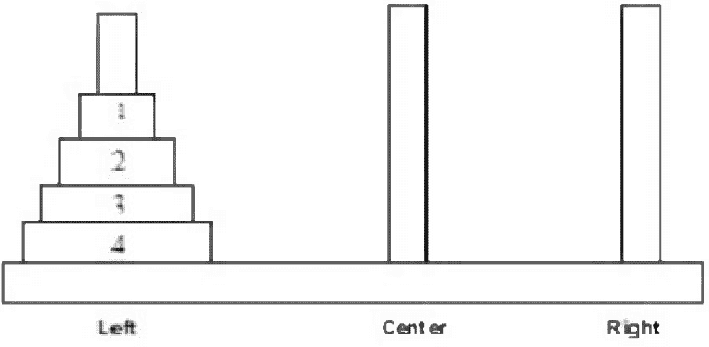

游戏的目标是将圆盘从最左边的柱子转移到最右边的柱子，同时绝不将较大的圆盘放在较小的圆盘之上。一次只能移动一个圆盘，每个圆盘必须始终放置在其中一根柱子上。

一般策略是把其中一根柱子视为原点，另一根视为目的地。第三根柱子将用于中间存储，从而允许在不将较大圆盘放在较小圆盘之上情况下移动圆盘。假设有 `n` 个圆盘，按图 5.1 从最小到最大编号。如果圆盘最初堆叠在左柱上，将所有 `n` 个圆盘移动到右柱的问题可以以以下递归方式表述：

- 1. 将顶部 `n−1` 个圆盘从左柱移动到中柱。
- 2. 将第 `n` 个圆盘（最大圆盘）移动到右柱。
- 3. 将中柱上的 `n−1` 个圆盘移动到右柱。

该问题可对大于 0 的任意 `n` 值求解（`n=0` 表示停止条件）。

为了编程此游戏，我们首先标记柱子，使左柱表示为 `L`，中柱表示为 `C`，右柱表示为 `R`。让我们用 `char` 类型的变量 `from`、`to` 和 `temp` 分别引用原点、目的地和临时存储的各个柱子。

#### 程序 5.5：求解汉诺塔问题的递归程序。

```
#include<stdio.h>
main()
{
    void Recursive_Hanoi(int, char, char, char);
    int n;
    printf("Towers of Hanoi\n\n");
    printf("How many disks?");
    scanf("%d", &n);
    printf("\n");
    Recursive_Hanoi(n, 'L', 'R', 'C');
}
```

```
void Recursive_Hanoi(int n, char from, char to, char temp)
{
    /* Transfer n disks from one pole to another */
    /* n= number of disks
    from=origin
    to=destination
    temp=temporary storage */
    {
        if(n > 0){
            /* move n-1 disks from origin to temporary */ Recursive_Hanoi(n-1, from, temp, to);
            /* move nth disk from origin to destination */ printf("Move disk %d from %c to %c\n", n, from, to);
            /* move n-1 disks from temporary to destination */
            Recursive_Hanoi(n-1, temp, to, from);
        }
        return;
    }
}
```

请执行此程序并观察结果

### 自我评估问题

- 9. ____________ 是一个函数在满足某个指定条件之前反复调用自身的进程
- 10. 递归定义中必须有停止条件。

（真/假）

11. 以下程序的输出是 ________。

```
#include<stdio.h>
main()
{
int n=5;
```


```
int fun(int n);

printf("%d\n", fun(n));

}

int fun(int n)

{

if(n==0)

return 0;

else

return (n+fun(n-1));

}
```

### 5.5 函数哲学

什么构成一个好的函数？一个好的“构建块”最重要的方面是它有一个单一、明确定义的任务来执行。当你发现一个程序难以管理时，通常是因为它没有被设计并干净地分解成函数。把代码移到函数中的两个明显原因是：

- 1. 它在主程序中出现了几次，这样通过将其设为函数，可以只写一次，并用对新函数的调用替换原来出现的那几个地方。
- 2. 主程序变得太大，所以可以通过切除其中一部分并将其设为函数，使其（ presumably）更小、更易管理。

这两个原因很重要，它们代表了精心选择的函数的显著好处，但不足以自动识别一个好的函数。正如我们所建议的，一个好的函数至少还有以下两个附加属性：

- 3. 它只做一个明确定义的任务，并且做得很好。
- 4. 它与程序其余部分的接口干净且狭窄。
- 属性 3 只是我们上面所说的两件事的重述。属性 4 说

在调用函数时，你不应该需要跟踪太多东西。如果你知道函数 supposed to do 什么，并且它的任务简单且定义明确，那么你只需要提供很少的信息让它操作，并且当它完成后，它只返回给你一两条信息。如果你发现自己必须向函数传递大量信息，或者记住其内部实现的细节以确保它这次能正常工作，这通常是函数定义不够充分的迹象。（一个定义不佳的函数可能是从变得太大的主程序中撕扯出来的任意代码块，以至于它本质上必须访问该主函数的所有局部变量。）

如果你发现一个程序的困难无处不在，难以的部分无法埋藏在黑盒函数中然后被遗忘；如果你发现涉及多个函数之间复杂交互的困难部分，那么该程序可能需要重新设计。

为了说明目的，我们似乎到目前为止只谈论了“主程序”以及它们调用的函数以及将某段代码从“主程序”移到函数中的理由。但实际上，显然没有必要将自己限制在两层方案中。我们编写的任何函数通常都适合以子函数、子子函数等形式编写。

#### 程序 5.6：创建一行打印 65 个星号的函数

```
```c
/* letterhead1.c */
#include <stdio.h>
#define NAME "MEGATHINK, INC."
#define ADDRESS "10 Megabuck Plaza"
#define PLACE "Megapolis, CA 94904"
#define LIMIT 65
void starbar(void); /* prototype the function */

int main(void)
{
    starbar();
    printf("%s\n", NAME);
    printf("%s\n", ADDRESS);
    printf("%s\n", PLACE);
```
```

```
starbar(); /* use the function */
return 0;
}
```

```
void starbar(void) /* define the function */
{
int count;
for (count = 1; count <= LIMIT; count++)
putchar('I');
putchar('\n');
}
```

### 自测题

12. 通过将问题分解为不同的子问题，每个子问题都可以实现为一个 ________。

13. 函数的主要目的是节省输入时间。（正确/错误）

### 5.6 小结

函数是一个自成体系的程序段，用于执行某个特定的、明确定义的任务。当你发现程序难以管理时，往往是因为它没有被干净地设计和拆分为函数。函数是一个“黑盒”，我们已将程序的某一部分锁入其中。函数背后的思想是将程序的一部分分隔开来。`main()` 函数在每个 C 程序中都是必需的。函数原型不过就是函数声明。递归是函数反复调用自身直到满足某个指定条件的过程。

### 5.7 课后习题

+ 1. 关键字“`void`”有什么作用？

+ 2. 函数声明与函数定义之间有什么区别？

+ 3. 编写一个递归函数，求从 2 到 10 的偶数之和。

+ 4. 编写一个递归定义，求两个数的最大公约数（gcd）。

+ 5. 编写一个递归定义，求第 n 个斐波那契数。斐波那契数列构成一个数字序列，其中每个数字都等于前两个数字之和。换句话说，

$F_i=F_{i-1}+F_{i-2}$

其中 F 指第 i 个斐波那契数。前两个斐波那契数是 0 和 1，即 F1=0，F2=1；

6. 以下程序的输出是什么？

```
```c

#include<stdio.h>

main()

{

int m, count;

int fun(int count);

for(count=1;count<=10;count++) {

m=fun(count);

printf("%d",m);

}

}

```
```

```
```c

}

int fun(int n)

{

    int x;

    x = n*n;

    return x;

}

```
```

### 5.8 自测题答案

+ 1. 错误

+ 2. extern.

+ 3. 形参，实参

+ 4. 逗号.

+ 5. 函数声明

+ 6. 错误

+ 7. 头文件

+ 8. `double fun(double, double);`

+ 9. 递归.

+ 10. 正确

+ 11. 15

+ 12. 函数

+ 13. 错误

### 5.9 课后习题答案

+ 1. `void` 是用于指定函数不返回任何值的关键字。它也可以用来指定没有参数。

+   

+ 2. 函数声明是告知编译器函数返回什么类型的数据、函数名以及有关参数的信息；而函数定义实际上是编写函数体以及函数头。

```
```c

#include<stdio.h>

main()

{

    int n=10;

    int fun(int n);

    printf("%d", fun(n));

}

int fun(int n)

{

    if(n>0) return (n+fun(n-2));

}

```
```

+ 4. `gcd(m,n) = { m or n if m = n

      GCD(m, m-n) if m > n

      GCD(n,m) if m < n }`

+ 5. `fib(i) = { 0 if i = 1

      1 if i = 2`

f1b(i-1)+f1b(i-2) otherwise}

6. 将显示 1 到 10 的整数的平方。

### 5.10 练习

+ 1. 假设在一个 C 程序中，函数 F1 调用函数 F2。函数定义的顺序有影响吗？请解释。

+   

+ 2. 当执行包含递归函数调用的程序时，递归函数内的局部变量是如何解释的？

+   

+ 3. 用递归形式表示以下代数公式：

+   

+    Y = (x1 + x2 + ... + xn)

+   

+ 4. 编写一个函数，计算浮点数的整数次幂。

+   

+ 5. 编写一个使用值传递技术交换两个数的函数。该函数的缺点是什么？

# 第 6 单元 存储类

结构：

+ 6.1 引言

+ 目标

+ 6.2 存储类与可见性

+ 6.3 自动变量或局部变量

+ 6.4 全局变量

+ - 6.5 静态变量

+ - 6.6 外部变量

+ - 6.7 小结

+ - 6.8 课后习题

+ - 6.9 自测题答案

+ - 6.10 课后习题答案

+ - 6.11 练习

### 6.1 引言

在上一单元中，你学习了函数。你了解了函数如何用于将大问题分解为小问题，然后解决它。你学习了函数如何被反复调用和一再使用。在本单元中，你将学习 C 语言中使用的存储类类型。你将了解这些存储类如何有助于使 C 语言成为非常强大的计算语言。

变量是程序内部通信的通道。你在程序的某一点为变量设置一个值，然后在另一个点（或多个点）再次读取该值。这两个点可能在相邻语句中，也可能在程序中相隔很远的部分。变量的寿命有多长？程序中设置和读取变量的两个部分可以相隔多远？变量被设置后会持续多久？根据变量以及你使用它的方式，你可能希望这些问题有不同的答案。例如，在某些情况下，可能需要引入某些“全局”变量，它们在整个程序中（或在程序的主要部分，如两个或多个函数中）都能被识别。这些变量的定义方式与通常的“局部”变量不同，局部变量仅在单个函数内被识别。

我们还将考虑静态变量的问题，静态变量可以保留其值，以便以后重新进入函数并继续计算。

最后，我们可能需要用若干独立文件来开发一个大型的多函数程序，每个文件中定义一些函数。在这样的程序中，各函数可以在单个文件内局部定义和访问，也可以在多个文件内全局定义和访问。

#### 目标：

学完本单元后，你应当能够：

实现存储类和变量可见性的概念，并解释自动变量、全局变量、静态变量和外部变量之间的区别。

编译并执行由多个源文件组成的程序。

### 6.2 存储类与可见性

变量的分类方式有两种：按*数据类型*和按*存储类*。数据类型指变量所表示的信息类型，例如整数、浮点数、字符等。存储类指变量在程序中的持续性和作用域，即变量在程序中可被识别的部分。

本单元讨论 C 语言中以下类型的存储类说明：**全局**、**自动**或**局部**、**静态**和**外部**。为变量建立存储类的具体过程取决于特定的存储类以及程序的组织方式（即单文件与多文件）。

变量的*可见性*决定程序其余部分中有多少能够访问该变量。你可以安排变量仅在某个函数的一部分、某个函数、某个源文件或程序中的任何位置可见。

为什么你想要限制变量的可见性？为了最大限度地灵活，如果所有变量在任意位置都可见，不是更方便吗？事实上，这种安排会*过于*灵活：在程序的任何地方，你都必须记住程序中其他任何位置声明的所有变量名，以免意外重复使用某个变量名。每当某个变量意外地被赋予错误值时，你都得搜索整个程序来查找错误，因为整个程序中的任何语句都可能修改该变量。如果你在程序的两处使用像 `i` 这样的常见变量名，一段代码意外覆盖另一部分代码正在使用的值，你就会不断自相干扰。

### 自测题

+ 1. 变量的可见性决定程序其余部分中有多少能够访问该变量。（正确/错误）

+ 2. ________ 类指变量在程序中的持续性和作用域，即变量在程序中被识别的部分。

+ 3. 可见性为程序中使用的数据提供了安全性。（正确/错误）

### 6.3 自动变量或局部变量

在函数的花括号 `{}` 内声明的变量仅在该函数内可见；在函数内声明的变量称为*局部变量*。它们的作用域仅限于该函数。你可以使用关键字 **auto** 来声明

automatic variables, but, however it is optional. If another function somewhere else declares a local variable with the same name, it's a different variable entirely, and the two don't clash with each other. If an automatic variable is not initialized in some manner, however, its initial value will be unpredictable and contains some garbage value.

#### Program 6.1: Program to find factorial of a number

```
#include<stdio.h>
main()
{
auto int n; /* Here the keyword auto is optional */
long int fact(int);
printf("read the integer n:");
scanf("%d", &n);
printf("\nn!=%ld", fact(n));
}
long int fact(auto int n) /* n is local to the function fact() and auto is optional */ {
auto int i; /* Here the keyword auto is optional */
auto long int factorial=1; /* Here the keyword auto is optional */ while(n>0)
{
factorial=factorial*n;
n=n-1;
}
return factorial;
}
```

An automatic variable doesn’t retain its value once control is transferred out of its defining function. Therefore, any value assigned to an automatic variable within a function will be lost once the function is exited.

### Self Assessment Questions

+   4. The scope of an automatic variable is in ____________ in which it is declared.

+   

+   5. Does an automatic variable retain its value once control is transferred out of its defining function? (Yes/No)

+   

+   6. The key word **auto** is must in the declaration of automatic variables. (True/False)

### 6.4 Global Variables

A variable declared outside of any function is a *global variable*, and it is potentially visible anywhere within the program. You use global variables when you *do* want to use the variable in any part of the program. When you declare a global variable, you will usually give it a longer, more descriptive name (not something generic like i) so that whenever you use it you will remember that it's the same variable everywhere. The values stored in global variables persist, for as long as the program does. (Of course, the values can in general still be overwritten, so they don’t necessarily persist forever.)

#### Program 6.2: Program to find average length of several lines of text

```
#include <stdio.h>

/* Declare global variables outside of all the functions*/
int sum=0; /* total number of characters */
int lines=0; /* total number of lines */
main()
{
int n; /* number of characters in given line */
float avg; /* average number of characters per line */
void linecount(void); /* function declaration */
float cal_avg(void);
printf("Enter the text below:\n");
while((n=linecount())>0) {
sum+=n;
++lines;
}

avg=cal_avg();
printf("\nAverage number of characters per line: %5.2f", avg);
}
void linecount(void)
{
/* read a line of text and count the number of characters */
char line[80];
int count=0;
while((line[count]=getchar())!='\n')
++count;
return count;
}

float cal_avg(void)
{

/* compute average and return */
return (float)sum/lines;
}
```

In the above program the variables sum and lines are globally declared and hence they could be used in both the functions main() and cal_avg()

### Self Assessment Questions

+   7. The variables declared in the main() function are the global variables. (True/False)

+   

+   8. The global variables are more secured than the automatic variables in a program. (True/False)


### 6.5 Static Variables

Static variables are defined within individual functions and therefore have the same scope as automatic variables, i.e. they are local to the functions in which they are declared. Unlike automatic variables, however, static variables retain their values throughout the life of the program. As a result, if a function is exited and then reentered later, the static variables defined within that function will retain their previous values. This feature allows functions to retain information permanently throughout the execution of a program. Static variables can be utilized within the function in the same manner as other variables. They cannot be accessed outside of their defining function.

In order to declare a static variable the keyword `static` is used as shown below:

```c
static int count;
```

You can define automatic or static variables having the same name as global variables. In such situations the local variables will take precedence over the global variables, though the values of global variables will be unaffected by any manipulation of the local variables.

Initial values can be included in static variable declaration. The rules associated with the initialization remain same as the initialization of automatic or global variables. They are:

+ 1. The initial values must be constants, not expressions.
+ 2. The initial values are assigned to their respective variables at the beginning of the program execution. The variables retain these values throughout the life of the program, unless different values are assigned during the course of computation.
+ 3. Zeros will be assigned to all static variables whose declarations do not include explicit initial values.

#### Program 6.3: Program to generate Fibonacci numbers.

```c
#include<stdio.h>

main()
{
int count, n;
long int fib(int);
printf("\n How many Fibonacci numbers?");
scanf("%d\n",&n);
for(count=1;count<=n;count++)
{
printf("\ni=%d F=%ld",count, fib(count));
}
}
```

```c
long int fib(int count)
{
/* calculate a Fibonacci number using the formula if i=1, F=0; if i=2, F=1, and F=F1+F2 for i>=3 */
static long int f1=0,f2=1; /* declaration of static variables */ long int f;
if (count==1)
f=0;
else if (count==2)
f=1;
else
f=f1+f2;
f2=f1;
f1=f; /* f1 and f2 retain their values between different calls of the function */
return f;
}
```

### Self Assessment Questions

9. The scope of static variables and automatic variables is the same.  
(True/False)
10. _________ variables retain their values throughout the life of the program. As a result, if a function is exited and then reentered later, the static variables defined within that function will retain their previous values.
11. By default, a static variable is initialized to _______.

### 6.6 External Variables

It is possible to split a function up into several source files, for easier maintenance. When several source files are combined into one program the compiler must have a way of correlating the variables which might be used to communicate between the several source files. Furthermore, if a variable is going to be useful for communication, there must be exactly one of it: you wouldn't want one function in one source file to store a value in one variable named `externvar`, and then have another function in another source file read from a *different* variable named `externvar`. Therefore, a variable should have exactly one *defining instance*, in one place in one source file. If the same variable is to be used anywhere else (i.e. in some other source file or files), the variable is declared in those other file(s) with an *external declaration*, which is not a defining instance. The external declaration says the compiler that the variable will be used in this source file but defined in some other source file. Thus the compiler doesn't allocate space for that variable with this source file.

To make a variable as an external declaration, which is defined somewhere else; you precede it with the keyword `extern`:

```
extern int j;
```

#### Program 6.4: Program to illustrate the concept of external variables.

Type and save the following program in a source file called `externvariables.h`

```c
int principle=10000;
float rate=5.5;
int time=2;
float interest;
```

Type and save the following program in a separate source file called `demoexternvar.c`

```c
#include <stdio.h>
#include "externvariables.h" /* the source file where the external variables are defined should be included here. */
main()
{
/* external declarations of the variables which are defined in externvariables.h */
extern int principle;
extern float rate;
extern int time;
extern float interest;
/*compute interest*/
interest= principle*rate*time/100.0;
printf("Interest=%f\n",interest);
}
```

Compile `demoexternvar.c` and execute the program.

外部存储类别的概念也可以扩展到函数。源文件可以访问在任何其他源文件中定义的函数，前提是该源文件包含在你访问该函数所在的源文件中。

#### 程序 6.5：说明外部函数概念的程序。

键入并将以下程序保存到文件 `externfunction.h` 中

```c
void output(void)
{
printf(" Hi, Manipal!\n");
return;
}
```

键入并将以下程序保存到单独的源文件 `demoexternfun.c` 中

```c
#include<stdio.h>
#include "externfunction.h"
extern void output(void);
main()
{
output();
}
```

编译并执行上述程序并观察结果。然而，在某些 C 编译器中，关键字 `extern` 是可选的。

### 自测题

- 12. 使用外部变量的主要目的是在不同的 _________ 文件中访问同一个变量。
- 13. 编译器不会为被访问的外部变量分配内存。 （真/假）
- 14. 全局变量和外部变量具有相同的范围。 （真/假）

#### 示例 6.1：下面是一个示例，演示了我们迄今为止看到的几乎所有内容：

```c
int globalvar = 1;
extern int anotherglobalvar;
static int privatevar;
f()
{
int localvar;
int localvar2 = 2;
static int persistentvar;
}
```

这里我们有六个变量，三个在函数 `f()` 外部声明，三个在函数 `f()` 内部声明。

`globalvar` 是一个全局变量。我们看到的声明是它的定义实例（它也恰好包含一个初始值）。`globalvar` 可以在该源文件的任何地方使用，并且也可以在其他源文件中使用（只要在这些其他源文件中发出相应的外部声明）。

`anotherglobalvar` 是第二个全局变量。它*未*在此定义；它的定义实例（及其初始化）在其他地方。

`privatevar` 是一个“私有”全局变量。它可以在本源文件的任何地方使用，但其他源文件中的函数即使尝试为其发出外部声明也无法访问它。 （如果其他源文件尝试声明一个名为“`privatevar`”的全局变量，它们将得到自己的变量；它们不会共享这个变量。）由于它具有静态持续时间并且可以称为 C 中的“定义”的构造，即预处理器宏、结构和 typedef 等的定义。

#### 程序 6.6：说明块中变量隐藏的程序

```c
/* hiding.c -- variables in blocks */
#include <stdio.h>
int main()
{
    int x = 30;
    printf("x in outer block: %d\n", x);
    {
        int x = 77; /* new x, hides first x */
        printf("x in inner block: %d\n", x);
    }
    printf("x in outer block: %d\n", x);
    while (x++ < 33)
    {
        int x = 100; /* new x, hides first x */
        x++;
        printf("x in while loop: %d\n", x);
    }
    return 0;
}
```


## 6.7 总结

变量是程序内部通信的渠道。存储类别指的是变量在程序中的持久性和其作用域，即变量被识别的程序部分。局部或自动变量的作用域仅限于定义它的函数。全局变量在定义它的程序中潜在地在任何地方可见。静态变量在程序的整个生命周期内保留其值。因此，如果退出函数然后稍后重新进入，函数内定义的静态变量将保留其先前的值。外部变量声明告诉编译器全局变量将在本源文件中使用但在其他源文件中定义。

## 6.8 终结性问题

- 1. 列出 C 中可用的一些存储类别。
- 2. 头文件有什么用？使用头文件是绝对必要的吗？
- 3. 函数的声明和定义有什么区别？
- 4. 外部声明的意义是什么？
- 5. 如何证明变量是程序中的通信渠道？

## 6.9 自测题答案

- 1. True
- 2. Storage
- 3. True
- 4. The function in which it is declared.
- 5. No
- 6. False
- 7. False
- 8. False
- 9. True
- 10. `Static`.
- 11. Zero
- 12. source
- 13. True
- 14. False

## 6.9 终结性问题答案

- 1. `automatic`, `global`, `static`, `extern`
- 2. 头文件用于在库中单独定义一些变量和函数。如果想访问其中定义的变量和函数，则内置头文件是绝对必要的。
- 3. 声明只不过是原型，包含返回数据的类型、函数名和参数的类型。但定义包含函数头和函数体。
- 4. 外部声明告诉编译器变量将在本源文件中使用但在其他源文件中定义。
- 5. 你在一个程序点设置变量的值，在另一个点（或多个点）再次读取该值。因此，从程序的一个点到另一个点的信息传输无非就是通信。

## 6.10 练习

- 1. 区分以下内容
  - i. 全局变量和局部变量
  - ii. 自动变量和静态变量
  - iii. 全局变量和 `extern` 变量
- 2. 编写一个程序，使用静态变量计算函数被调用的次数。
- 3. 编写一个函数 `prime`，如果其参数为质数则返回 1，否则返回零。
- 4. 编写一个函数，将浮点数四舍五入到指定的小数位。例如，数字 12.456 在四舍五入到两位小数时将得到值 12.46。
- 5. 编写一个程序来说明 `extern` 变量的概念。

# 第 7 章 数组和字符串

**结构：**

- 7.1 引言
- 目标
- 7.2 一维数组
  - 向函数传递数组
- 7.3 多维数组
- 7.4 字符串
- 7.5 总结
- 7.6 终结性问题
- 7.7 自测题答案
- 7.8 终结性问题答案
- 7.9 练习

## 7.1 引言

在上一单元中，你学习了 C 中使用的各种存储类别。你学习了这些存储类别在 C 的不同情况下如何使用。在本单元中，你将学习数组和字符串。你将学习数组和字符串是如何形成和操作的。

许多应用程序需要处理具有共同特征的多个数据项。在这种情况下，将数据项放入数组中总是很方便的，它们将共享相同的名称。数组是相似类型元素的集合。数组中的所有元素都通过数组名引用。由于数组保存一组数据，因此对一组数据执行循环和算术运算非常容易。本章涵盖一维和二维数组的处理。

**目标：**

学习本单元后，你应该能够：

- 声明、初始化和处理一维和二维数组
- 解释字符串以及如何处理它们
- 描述 C 中用于处理字符串的库函数

## 7.2 一维数组

到目前为止，我们一直声明简单的变量：声明

```c
int i;
```

声明一个名为`i`的单个变量，类型为`int`。也可以声明一个包含多个元素的数组。声明

```c
int a[10];
```

声明一个名为`a`的数组，由十个元素组成，每个元素类型为`int`。简单地说，数组是一个可以保存一个以上值的变量。你通过使用数字下标来指定在任何给定时间引用哪几个值。 （编程中的数组类似于数学中的向量或矩阵。）我们可以像这样用图片表示上面的数组`a`：

```c
a:
[0] [1] [2] [3] [4] [5] [6] [7] [8] [9]
```

在 C 语言中，数组是零基的：10 个元素的数组的十个元素编号从 0 到 9。指定数组中单个元素的下标只是在方括号中的一个整数表达式。数组的第一个元素是`a[0]`，第二个元素是`a[1]`，等等。你可以在任何可以使用简单变量名的地方使用这些“数组下标表达式”，例如：

```c
a[0] = 10;
a[1] = 20;
a[2] = a[0] + a[1];
```

请注意，下标的数组引用（即`a[0]`和`a[1]`这样的表达式）可以出现在赋值运算符的两侧。

下标不一定是像 0 或 1 这样的常量；它可以是任何整型表达式。例如，通常会遍历数组的所有元素：

```c
int i;
for(i = 0; i < 10; i = i + 1)
a[i] = 0;
```

此循环将数组`a`的十个元素全部设为 0。

数组对于许多问题来说非常方便，但 C 并不会自动为你做很多事情。特别是，你既不能一次设置数组的所有元素，也不能将一个数组赋给另一个数组；以下两个赋值

```c
a = 0; /* WRONG */
int b[10];
b = a; /* WRONG */
```

都是非法的。

要将数组的所有元素设为某个值，你必须一个一个地设置，就像上面的循环示例一样。要将一个数组的内容复制到另一个数组，你也必须一个一个地复制：

```c
int b[10];
for(i = 0; i < 10; i = i + 1)
b[i] = a[i];
```

记住，对于声明为

```c
int a[10];
```

的数组，没有`a[10]`元素；最高的元素是`a[9]`。这也是 C 中零基循环也很常见的一个原因。

请注意，`for`循环`for(i = 0; i < 10; i = i + 1) ...`在这种情况下正好实现了你想要的功能：它从 0 开始，数字 10 暗示（正确地）它会进行 10 次迭代，但小于比较意味着循环最后一次遍历时`i`被设为 9。（比较`i <= 9`也能工作，但它会更不清晰，因此风格较差。）在到目前为止的小例子中，我们一直遍历示例数组`a`的全部 10 个元素。然而，通常会使用比必要更大的数组，并使用第二个变量来跟踪数组中当前正在使用的元素数量。例如，我们可能有一个整数变量

```c
int na; /* number of elements of a[] in use */
```

然后，当我们想要对`a`做某事（例如打印它）时，循环将从 0 运行到`na`，而不是 10（或`a`的大小）：

```c
for(i = 0; i < na; i = i + 1)
printf("%d\n", a[i]);
```

自然地，我们必须确保`na`的值始终小于或等于在`a`中实际声明的元素数量。

数组并不限于`int`类型；你可以有`char`或`double`或任何其他类型的数组。

下面是一个使用数组的稍大一些的例子。假设我们想要研究掷一对骰子的行为。总点数可以从 2 到 12，我们想要统计每个点数出现的次数。我们将使用一个数组来跟踪计数：`a[2]`将统计我们掷出 2 的次数，等等。

我们将通过调用 C 的随机数生成函数`rand()`来模拟掷骰子。每次调用`rand()`时，它都会返回一个不同的伪随机整数。`rand()`返回的值通常跨越一个很大的范围，因此我们将使用 C 的*模*（或“余数”）运算符`%`来产生我们想要范围内的随机数。表达式`rand() % 6`产生 0 到 5 范围内的随机数，而`rand() % 6 + 1`产生 1 到 6 范围内的随机数。

## 程序 7.1：模拟掷骰子的程序

```c
#include <stdio.h>
#include <stdlib.h>
main()
{
int i;
int d1,d2;
int a[13]; /* uses [2..12] */
for(i = 2; i <= 12; i = i + 1) a[i] = 0;
for(i = 0; i < 100; i = i + 1) {
d1 = rand() % 6 + 1;
d2 = rand() % 6 + 1;
a[d1 + d2] = a[d1 + d2] + 1;}
for(i = 2; i <= 12; i = i + 1) printf("%d: %d\n", i, a[i]);
return 0;
}
```

我们包含头文件 `<stdlib.h>`，因为它包含了`rand()`函数的必要声明。我们声明大小为 13 的数组，以便其最高元素为`a[12]`。（我们浪费了`a[0]`和`a[1]`；这损失不大。）变量`d1`和`d2`包含两个骰子的点数；我们将它们相加来决定要递增数组的哪个单元，在行`a[d1 + d2] = a[d1 + d2] + 1;`中。掷 100 次后，我们打印出数组。通常，我们会看到 mostly 7 的情况，而 2 和 12 相对较少。

### 7.2.1 向函数传递数组

数组名可以用作函数的参数，从而允许将整个数组传递给函数。要将数组传递给函数，数组名必须单独出现，作为函数调用中的实际参数，不能带方括号或下标。相应的形式参数以相同的方式书写，但在形式参数声明中必须声明为数组。当将一维数组声明为形式参数时，数组名写成一对空的方括号。数组的大小不指定在形式参数声明中。

## 程序 7.2

下面的程序说明了如何将数组从 main 传递给一个函数。此程序用于求 n 个浮点数的平均值。

```c
#include<stdio.h>
main()
{
int n, i;
float avg;
float list[100];
float average(int, float[]); /* function prototype */
printf("How many numbers:");
scanf("%d",&n);
printf(" Enter the numbers:");
for(i=1;i<=n;i++)
scanf("%f", &list[i]);
avg=average(n, list); /* Here list and n are actual arguments */
printf("Average=%f\n", avg);
}

float average(int a, float x[])
{
float avg;
float sum=0;
int i;
for(i=0;i<a;i++)
sum=sum+x[i]; /* find sum of all the numbers */
avg=sum/a; /* find average */
return avg;
}
```

### 自我评估问题

- 1. 在 C 中，数组下标从 ________ 开始
- 2. 数组名是指针。 （真/假）
- 3. 以下程序段会有编译错误吗？ （是/否）

    ```c
    int a[5] = {1, 2, 3, 4, 5};
    int b[5] = {5, 4, 3, 2, 1};
    int c[5][5];
    ...
    c=a+b;
    ...
    ```

## 7.3 多维数组

C 语言允许定义任意维度的数组。在本节中，我们将看一下二维数组。最自然的二维数组应用之一出现在矩阵的情况下。在 C 中，二维矩阵可以如下声明：

```c
int array[3][6];
```

以下是声明以及初始化二维数组的方式。

```c
int array[3][6] = {
    {4,5,6,7,8,9},
    {1,5,6,8,2,4},
    {0,4,4,3,1,1}
};
```

这样的数组访问方式如下：

```c
array[1][4] = -2;
if(array[2][1] > 0) {
    printf("Element [2][1] is %d", array[2][1]);
}
```

请记住，像普通数组一样，二维数组也是从 0 开始编号。因此，上面的数组元素从`array[0][0]`到`array[2][5]`。

## 程序 7.3：矩阵相加程序

```c
#include <stdio.h>
main()
{
    int a[5][5], b[5][5], c[5][5];
    int i,j,m,n;
    printf("Enter the order of the matrices:");
    scanf("%d%d", &m, &n);
    printf("Enter the elements of A matrix:\n");
    for(i=0;i<m;i++)
    for(j=0;j<n;j++)
    scanf("%d", &a[i][j]);
    printf("Enter the elements of B matrix:\n");
    for(i=0;i<m;i++)
    for(j=0;j<n;j++)
    scanf("%d", &b[i][j]);
    /* Add the matrices */
    for(i=0;i<m;i++)
    for(j=0;j<n;j++)
    c[i][j] = a[i][j]+b[i][j];
    /* Print the sum */
    printf("The sum of matrices:\n");
    for(i=0;i<m;i++)
    {
    for(j=0;j<n;j++)
    printf("%d\t", c[i][j]);
    printf("\n");
    }
}
```

多维数组的处理方式与一维数组相同，按元素逐个处理。然而，在向函数传递多维数组时需要特别注意。特别是，函数定义中的形式参数声明必须在除第一个以外的所有下标位置包含显式的大小说明。这些大小说明必须与 the calling program. The first subscript position may be written as an empty pair of square brackets, as with a one-dimensional array. The corresponding function prototypes must be written in the same manner. But while calling the function the array name may be passed as the actual argument as in the case of one-dimensional arrays. E.g:

```c
void process_array (int [][] [6]); /* function prototype */

void process_array (int array[][6]) /*function definition */

{

...
}
```

### Self Assessment Questions

4. In a two-dimensional matrix, the first subscript in the declaration specifies number of ____________.
5. A two-dimensional array is considered as an array of one-dimensional arrays. (True/False)

## 7.4 字符串

Strings in C are represented by arrays of characters. The end of the string is marked with a special character, the null character, which is simply the character with the value 0. (The null character has no relation except in name to the null pointer. In the ASCII character set, the null character is named `NULL`.) The null or string-terminating character is represented by another character escape sequence, `\0`.

Because C has no built-in facilities for manipulating entire arrays (copying them, comparing them, etc.), it also has very few built-in facilities for manipulating strings.

In fact, C's only truly built-in string-handling is that it allows us to use *string constants* (also called *string literals*) in our code. Whenever we write a string, enclosed in double quotes, C automatically creates an array of characters for us, containing that string, terminated by the `\0` character. For example, we can declare and define an array of characters, and initialize it with a string constant:

```c
char string[] = "Hello, world!";
```


In this case, we can leave out the dimension of the array, since the compiler can compute it for us based on the size of the initializer (14, including the terminating `\0`). This is the only case where the compiler sizes a string array for us, however; in other cases, it will be necessary that *we* decide how big the arrays and other data structures we use to hold strings are.

To do anything else with strings, we must typically call functions. The C library contains a few basic string manipulation functions, and to learn more about strings, we'll be looking at how these functions might be implemented.

Since C never lets us assign entire arrays, we use the `strcpy` function to copy one string to another:

```
#include <string.h>

char string1[] = "Hello, world!";

char string2[20];

strcpy(string2, string1);
```

The destination string is `strcpy`'s first argument, so that a call to `strcpy` mimics an assignment expression (with the destination on the left-hand side). Notice that we had to allocate `string2` big enough to hold the string that would be copied to it. Also, at the top of any source file where we're using the standard library's string-handling functions (such as `strcpy`) we must include the line

```
#include <string.h>
```

```
while(src[i] != '\0')
{
    dest[i] = src[i];
    i++;
}
dest[i] = '\0';
```

We've called it `mystrcpy` instead of `strcpy` so that it won't clash with the version that's already in the standard library. Its operation is simple: it looks at characters in the `src` string one at a time, and as long as they're not `\0`, assigns them, one by one, to the corresponding positions in the `dest` string. When it's done, it terminates the `dest` string by appending a `\0`. (After exiting the while loop, `i` is guaranteed to have a value one greater than the subscript of the last character in `src`.) For comparison, here's a way of writing the same code, using a for loop:

```
for(i = 0; src[i] != '\0'; i++)
    dest[i] = src[i];
dest[i] = '\0';
```

Yet a third possibility is to move the test for the terminating `\0` character out of the `for` loop header and into the body of the loop, using an explicit `if` and `break` statement, so that we can perform the test after the assignment and therefore use the assignment inside the loop to copy the `\0` to `dest`, too:

```
for(i = 0; ; i++)
{
    dest[i] = src[i];
    if(src[i] == '\0')
        break;
}
```

(There are in fact many, many ways to write `strcpy`. Many programmers like to combine the assignment and test, using an expression like `(dest[i] = src[i]) != '\0'`)

Here is a version of `strcmp`:

```
mystrcmp(char str1[], char str2[])
{
    int i = 0;
    while(1)
    {
        if(str1[i] != str2[i])
            return str1[i] - str2[i];
        if(str1[i] == '\0' || str2[i] == '\0')
            return 0;
        i++;
    }
}
```

Characters are compared one at a time. If two characters in one position differ, the strings are different, and we are supposed to return a value less than zero if the first string (`str1`) is alphabetically less than the second string. Since characters in C are represented by their numeric character set values, and since most reasonable character sets assign values to characters in alphabetical order, we can simply subtract the two differing characters from each other: the expression `str1[i] - str2[i]` will yield a negative result if the `i`'th character of `str1` is less than the corresponding character in `str2`. (As it turns out, this will behave a bit strangely when comparing upper and lower-case letters, but it's the traditional approach, which the standard versions of `strcmp` tend to use.) If the characters are the same, we continue

```
char string8[] = "this is a test";
char string9[10];
substr(string9, string8, 5, 4);
printf("%s\n", string9);
```

The idea is that we'll extract a substring of length 4, starting at character 5 (0-based) of `string8`, and copy the substring to `string9`. Just as with `strcpy`, it's our responsibility to declare the destination string (`string9`) big enough. Here is an implementation of `substr`. Not surprisingly, it's quite similar to `strcpy`:

```
substr(char dest[], char src[], int offset, int len)
{
    int i;
    for(i = 0; i < len && src[offset + i] != '\0'; i++)
        dest[i] = src[i + offset];
    dest[i] = '\0';
}
```

If you compare this code to the code for `mystrcpy`, you'll see that the only differences are that characters are fetched from `src[offset + i]` instead of `src[i]`, and that the loop stops when `len` characters have been copied (or when the `src` string runs out of characters, whichever comes first). When working with strings, it's important to keep firmly in mind the differences between characters and strings. We must also occasionally remember the way characters are represented, and about the relation between character values and integers.

As we have had several occasions to mention, a character is represented internally as a small integer, with a value depending on the character set in use. For example, we might find that `'A'` had the value 65, that `'a'` had the value 97 and that `'+'` had the value 43. (These are, in fact, the values in the ASCII character set, which most computers use. However, you don't need to learn these values, because the vast majority of the time, you use character constants to refer to characters, and the compiler worries about the values for you. Using character constants in preference to raw numeric values also makes your programs more portable.)

As we may also have mentioned, there is a big difference between a character and a string, even a string which contains only one character (other than the `\0`). For example, `'A'` is not the same as `"A"`. To drive home this point, let's illustrate it with a few examples.

If you have a string:

```
char string[] = "hello, world!";
```

you can modify its first character by saying

```
string[0] = 'H';
```

(Of course, there's nothing magic about the first character; you can modify any character in the string in this way. Be aware, though, that it is not always safe to modify strings in-place like this) Since you're replacing a character, you want a character constant, `'H'`. It would not be right to write `string[0] = "H"; /* WRONG */` because `"H"` is a string (an array of characters), not a single character. (The destination of the assignment, `string[0]`, is a char, but the right-hand side is a string; these types don't match.)

On the other hand, when you need a string, you must use a string. To print a single newline, you could call

```
printf("\n");
```

It would not be correct to call

```
printf('\n'); /* WRONG */
```

`printf` always wants a string as its first argument. (As one final example, `putchar` wants a single character, so `putchar('\n')` would be correct, and `putchar("\n")` would be incorrect.)

7. 用于将一个字符串复制到另一个字符串的库函数是 _____________ 。

8. 库函数 `atoi` 可以用于任何字符串。 （真/假）

## 7.5 总结

数组是一个可以保存一个以上值的变量。在 C 中，数组是零基的。数组名可以用作函数的参数，从而允许将整个数组传递给函数。C 语言允许定义任意维度的数组。最自然的二维数组应用之一出现在矩阵的情况下。C 中字符串由字符数组表示。C 有内置的库函数来执行字符串上的某些操作。

## 7.6 终结性问题

1. 编写一个程序对一个数的平方求 10 次和。
2. 以下声明中的数组可以容纳多少个元素？

   `int a[3][4][5];`

3. 以下数组声明和初始化是否正确？

   `int a[2][2]={1,2,3,4};`

4. 当你将数组作为参数传递给函数时，整个数组会被复制并可供函数使用。请论证该陈述是真还是假。
5. 编写一个使用循环进行数组处理的程序。

## 7.7 自测题答案

1. `1.0`
2. `True`
3. `Yes`
4. `rows`
5. `true`
6. `Compilation error`
7. `strcpy`
8. `false`

## 7.8 终结性问题答案

1.  

   ```
   #include<stdio.h>

   main()
   {
       int i=0, sum=0, x;
       printf('Enter a number:');
       scanf("%d", &x);
       while(i<10)
       {
           sum+=x*x;
           i++;
       }
       printf("Sum=%d", sum);
   }
   ```

2. 60
3. Yes, It is correct.
4. Statement is False.
5.  

   ```
   // loops for array processing
   #include <stdio.h>
   #define SIZE 10
   #define PAR 72
   int main(void)
   {
       int index, score[SIZE];
       int sum = 0;
       float average;
       printf("Enter %d golf scores:\n", SIZE);
       for (index = 0; index < SIZE; index++)
           scanf("%d", &score[index]); /*read in the ten scores
       printf("The scores read in are as follows:\n");
       for (index = 0; index < SIZE; index++)
           printf("%5d", score[index]); /*verify input
       printf("\n");
   }
   ```


```
for (index = 0; index < SIZE; index++)
    sum += score[index]; /*add them up

average = (float) sum / SIZE; */ time-honored method printf("Sum of scores = %d, average = %.2f\n", sum, average);

printf("That's a handicap of %.0f.\n", average - PAR);

return 0;
}
```

## 7.9 练习

- 1. 编写一个程序来统计给定字符串中的元音和辅音数量。
- 2. 编写一个程序将一组数字按升序排列。
- 3. 编写一个程序来乘以两个矩阵。
- 4. 编写一个程序以字母顺序重写给定的字符串。
- 5. 编写一个程序来转置给定的矩阵。

# 第 8 章 指针 – I

结构：

- 8.1 引言
    - 目标
- 8.2 指针基础
- 8.3 指针与一维数组
    - 指针算术
    - 指针减法和比较
    - 指针与一维数组的相似之处
- 8.4 总结
- 8.5 终结性问题
- 8.6 自测题答案
- 8.7 终结性问题答案
- 8.8 练习

## 8.1 引言

在上一单元中，你学习了数组和字符串。你学习了如何在 C 中声明和操作数组和字符串，使 C 成为一种更易于使用和更强大的编程语言。在本单元中，你将学习指针，这是使 C 成为最强大的编程语言的另一个有用主题。你将学习指针的基础知识和指针算术。

指针是一个指向或引用另一个变量的变量。也就是说，如果我们有一个类型为“指向 `int` 的指针”的指针变量，它可能指向 `int` 变量 `i`，或指向 `int` 数组 `a` 的任意一个位置。给定一个指针变量，我们可以问这样的问题：“这个指针指向的变量的值是什么？”。

为什么我们想要一个引用另一个变量的变量？为什么不直接使用那个其他变量呢？指针在 C 中被频繁使用，因为它们有许多有用的应用。例如，指针可用于在函数与其引用点之间传递信息。特别是，指针提供了一种通过函数参数从函数返回多个数据项的方法。指针还允许将对其他函数的引用指定为给定函数的参数。这相当于将函数作为参数传递给给定函数。

指针也与数组密切相关，因此提供了一种访问单个数组元素的替代方法。当我们使用指针访问单个数组元素时，程序会更高效。在本单元中，你将学习指针的基础知识及其在一维数组中的使用。

#### 目标：

学习本单元后，你应该能够：

- 在你的程序中实现指针
- 编写与数组相关的程序并使用指针
- 解决和说明 C 中指针算术的使用
- 指出指针与一维数组之间的相似之处

## 8.2 指针基础

指针是一个包含另一个变量在内存中的地址的变量。我们可以有指向任何变量类型的指针。在学习指针之前，你应该注意在实现指针时经常使用的某些符号。我们使用符号 `&` 来获取“变量的地址”，它被称为一元或单目运算符。我们使用另一个符号 `*` 来获取“指针指向的对象的 contents”，我们称之为间接或解引用运算符。

使用指针的第一件事是声明一个指针变量，将其设置为指向某处，最后操作它指向的值。一个简单的指针声明具有以下一般格式：

```
datatype *variablename
```

其中 `datatype` 表示指针 `variablename` 指向的数据的类型。简单来说，`variablename` 持有类型为 `datatype` 的值的地址。

例如，

```
int *ip;
```

这个声明看起来像我们之前的声明，只有一个明显的区别：星号。星号意味着 `ip`，我们声明的变量，不是 `int` 类型，而是 `pointer-to-int` 类型。（另一种看法是 `*ip`，正如我们将看到的那样，是 `ip` 指向的值，将是一个 `int`。）

我们可以将指针变量设置为指向另一个变量视为一个两步过程：首先我们生成指向该另一个变量的指针，然后我们将这个新指针赋给指针变量。我们可以说（但在说的时候要小心）指针变量有一个值，并且它的值是“指向那个另一个变量”。当我们看到如何生成指针值时，这会更有意义。

指针（即指针值）是用“取地址”运算符 `&` 生成的，我们也可以将其视为“指向”运算符。我们通过声明（并初始化）一个 `int` 变量 `i`，然后设置 `ip` 指向它来演示这一点：

```
int i = 5;
```

```
ip = &i;
```

赋值表达式 `ip = &i;` 包含“两步过程”的两个部分：`&i` 生成指向 `i` 的指针，而赋值运算符将新指针赋给（即放置在）变量 `ip` 中。现在 `ip` “指向” `i`，我们可以用这张图来说明：


`i` 是一个 `int` 类型的变量，所以它框中的值是一个数字，5。`ip` 是一个 `pointer-to-int` 类型的变量，所以它框中的“值”是一个指向另一个框的箭头。再次参考设置指针变量的“两步过程”：`&` 运算符为我们画出指向 `i` 框的箭头，而赋值运算符 `=`，其左侧为指针变量 `ip`，将箭头的另一端固定在 `ip` 的框中。

我们使用“内容”运算符 `*` 发现指针指向的值。将 `*` 放在指针前面，`*` 运算符访问该指针指向的值。换句话说，如果 `ip` 是一个指针，那么表达式 `*ip` 给出 `ip` 指向的变量或位置中的内容。例如，我们可以写

```
printf("%d\n", *ip);
```

这将打印 5，因为 `ip` 指向 `i`，而 `i`（此时）是 5。

（你可能会想知道 `*` 如何可以是指针内容运算符，同时也是乘法运算符。这里没有歧义：当它位于两个变量之间时，它是乘法运算符；当它位于单个变量前面时，它是内容运算符。情况类似于减号：在两个变量或表达式之间它是减法运算符，但在单个运算符或表达式前面它是取反运算符。你可能会听到的这些不同角色的技术术语是 unary 和 binary：二元运算符适用于两个操作数，通常在其两侧，而一元运算符适用于单个操作数。）

内容运算符 `*` 不仅仅是通过指针获取值；它也可以通过指针设置值。我们可以写类似 `*ip = 7;`

这意味着“设置 `ip` 所指向的内容为 7”。同样，`*` 告诉我们要去到 `ip` 所指向的位置，但这次，该位置不是要从中获取的——我们处于赋值运算符的左侧，所以 `*ip` 告诉我们要存储到的位置。（这种情况与数组下标表达式 `a[3]` 无异，我们已经看到它出现在赋值的两侧。）

赋值 `*ip = 7` 的结果是 `i` 的值被改为 7，图示变为：


如果我们再次调用 `printf("%d\n", *ip)`，它现在会打印 7。

此时，你可能会想，如果我们想把 `i` 设置为 7，为什么不直接做呢？我们接下来会开始探索这个问题，但在那之前，让我们先注意到改变指针本身（即改变它指向哪个变量）与改变它所指向位置的值之间的区别。当我们写 `*ip = 7` 时，我们改变了 `ip` 所指向的值，但如果我们声明另一个变量 `j`：

```
int j = 3;
```

并写

```
ip = &j;
```

我们改变的是 `ip` 本身。图示现在看起来像这样：

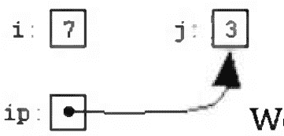

当我们说指针赋值会改变“指针指向的内容”时需要小心。我们之前的赋值

```
*ip = 7;
```

改变了 `ip` 所指向的值，但这次更近的赋值 `ip = &j;` 改变了 `ip` 指向哪个变量。确实，“`ip` 指向的内容”发生了变化，但这次变化的原因不同。`i`（仍然是 7）和 `j`（仍然是 3）都没有改变。（改变的是 `ip` 的值。）如果我们再次调用

```
printf("%d\n", *ip);
```

这次它会打印 3。

我们也可以将指针值赋给其他指针变量。如果我们声明第二个指针变量：

```
int *ip2;
```

那么我们可以写

```
ip2 = ip;
```

现在 `ip2` 指向 `ip` 所指的地方；我们本质上制作了一个“箭头”的拷贝：

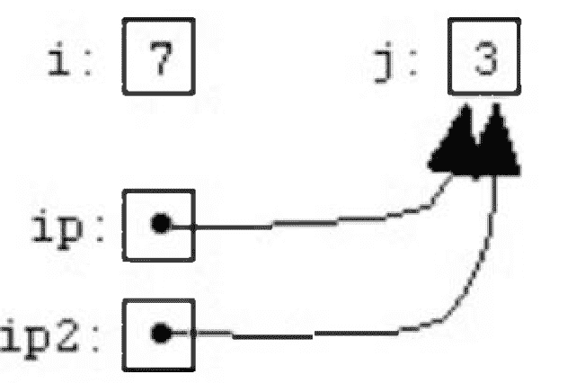

现在，如果我们让 `ip` 重新指向 `i`：`ip = &i;` 两个箭头指向不同的地方：

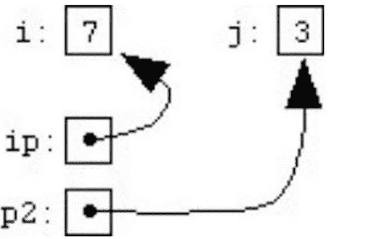

我们现在可以看到两个赋值

```
ip2 = ip;
```

和

```
*ip2 = *ip;
```

做了完全不同的两件事。第一个会让 `ip2` 再次指向 `ip` 所指的地方（换句话说，回到 `i`）。第二个会将 `ip` 所指向的值的拷贝存储到 `ip2` 所指向的位置；换句话说（如果 `ip` 和 `ip2` 分别仍指向 `i` 和 `j`），它会把 `j` 设置为 `i` 的值，即 7。

必须非常清楚地在你的脑海中区分指针和它所指向的内容。你不能混用它们。你不能通过写类似

```
ip = 5; /* WRONG */
```

的方式“把 `ip` 设置为 5”。5 是一个整数，但 `ip` 是一个指针。你可能想“把 `ip` 所指向的值设置为 5”，这需要写

```
*ip = 5;
```

同样，你也不能通过写

```
printf("%d\n", ip); /* WRONG */
```

来“查看 `ip` 是什么”。同样，`ip` 是一个指向 `int` 的指针，但 `%d` 期望一个 `int`。要打印 `ip` 所指向的内容，使用

```
printf("%d\n", *ip);
```

最后，关于指针声明的几点说明。指针声明中的 `*` 与内容运算符 `*` 相关，但不同。在我们声明指针变量后

```
int *ip;
```

表达式

```
ip = &i
```

设置 `ip` 指向的内容（即它指向哪个位置），而表达式

```
*ip = 5
```

设置 `ip` 所指向位置的值。另一方面，如果我们声明指针变量并包含初始化：

```
int *ip3 = &i;
```

我们是在为 `ip3` 设置初始值，即 `ip3` 将要指向的位置，所以该初始值是一个指针。（换句话说，声明 `int *ip3 = &i;` 中的 `*` 不是内容运算符，而是表示 `ip3` 是一个指针的标记。）如果你有一个包含初始化的指针声明，并且有机会将其拆分为简单的声明和常规赋值，请这样做：

```
int *ip3;
ip3 = &i;
```

不要写

```
int *ip3;
*ip3 = &i;
```

否则你会试图混用指针和它所指向的值。此外，当我们写

```
int *ip;
```

虽然星号会影响 `ip` 的类型，但它与标识符名称 `ip` 绑定，而不是与左侧的类型 `int` 绑定。要同时声明两个指针，声明看起来像

```
int *ip1, *ip2;
```

有些人会这样写指针声明：

```
int* ip;
```

这对于一个指针是可行的，因为 C 基本上忽略空白。但如果你写

```
int* ip1, ip2; /* PROBABLY WRONG */
```

它会声明一个指向 `int` 的指针 `ip1` 和一个普通的 `int` `ip2`，这可能不是你想要的。

这一切有什么用处？如果只是为了把像 `i` 这样的变量从 5 改为 7，那用处不大。它在其他方面的用处，例如当由于各种原因我们不知道确切想改变哪个变量时。

### 程序 8.1：一个简单的程序来说明两个整数变量、它们对应的地址以及它们的关联指针之间的关系。

```c
#include<stdio.h>

main()
{
    int x=5;
    int y;
    int *px; /* pointer to an integer */
    int *py; /* pointer to an integer */

    px=&x; /* assign address of x to px */
    y=*px; /* assign value of x to y */
    py=&y; /* assign address of y to py */

    printf("\nx=%d &x=%u px=%u *px=%d", x, &x, px, *px);
    printf("\ny=%d &y=%u py=%u *py=%d", y, &y, py, *py);
}
```

执行此程序并观察结果。

### 自测问题

- 1. 解引用运算符也被称为 ________________。
- 2. 指针是一个包含另一个变量地址的变量。 (True/False)
- 3. 判断以下语句是否正确： (Correct/Incorrect)
    - `int a, b;`
    - `b=&a;`
- 4. 内容运算符 `*` 不仅仅是通过指针获取值；它也可以通过指针设置值。 (True/False)

## 8.3 指针与一维数组

指针不必指向单个变量。它们也可以指向数组的单元。例如，我们可以写

```c
int *ip;
int a[10];
ip = &a[3];
```

这样 `ip` 就指向数组 `a` 的第四个单元（记住，数组是从 0 开始的，所以 `a[0]` 是第一个位置）。我们可以这样说明情况：

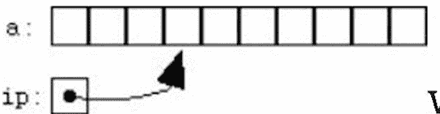

我们会像上一节中的那个 `ip` 一样使用这个 `ip`：`*ip` 给出 `ip` 所指向的内容，在本例中将是 `a[3]` 中的值。

### 8.3.1 指针算术

一旦我们有一个指向数组内部的指针，我们就可以开始做 *指针算术*。假设 `ip` 指向 `a[3]`，我们可以给 `ip` 加 1：

```
ip + 1
```

给指针加一意味着什么？在 C 中，它给出指向下一个单元的指针，在本例中是 `a[4]`。为了更清楚，让我们把这个新指针赋给另一个指针变量：

```
ip2 = ip + 1;
```

现在图示看起来像这样：

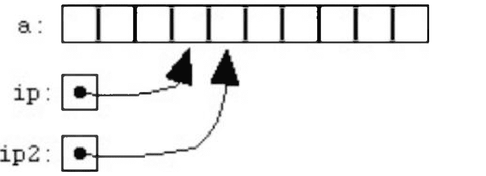

如果我们现在做

```
*ip2 = 4;
```

我们就把 `a[4]` 设置为 4。但使用它并不需要先把新的指针值赋给指针变量；我们也可以立即计算新的指针值并使用它：

```
*(ip + 1) = 5;
```

在这个最后一个例子中，我们再次改变了 `a[4]`，把它设置为 5。括号是必要的，因为一元“内容”运算符 `*` 的优先级更高（即比加法运算符绑定得更紧密）。如果我们写 `*ip + 1`，没有括号，我们将获取 `ip` 所指向的值，然后给该值加 1。表达式 `*(ip + 1)`，另一方面，访问的是 `ip` 所指向的值之后的一个值。

既然我们可以给指针加 1，就不足为奇我们可以加减其他数字了。如果 `ip` 仍指向 `a[3]`，那么

```
*(ip + 3) = 7;
```

会把 `a[6]` 设置为 7，而

```
*(ip - 2) = 4;
```

会把 `a[1]` 设置为 4。

Up above, we added 1 to `ip` and assigned the new pointer to `ip2`, but there's no reason we can't add one to a pointer, and change the same pointer: `ip = ip + 1;`

Now `ip` points one past where it used to (to `a[4]`, if we hadn't changed it in the meantime). The shortcuts work for pointers, too: we could also increment a pointer using

```
ip += 1;
```

or

```
ip++;
```

Of course, pointers are not limited to `int`s. It's quite common to use pointers to other types, especially `char`.

#### Example 8.1

Here is a program segment to compare two strings, character by character using pointers.

```
char *p1 = &str1[0], *p2 = &str2[0];

while(1)
{
    if(*p1 != *p2)
        return *p1 - *p2;
    if(*p1 == '\0'||*p2 == '\0')
        return 0;
    p1++;
    p2++;
}
```

The auto increment operator `++` (like its companion, `--`) makes it easy to do two things at once. We've seen idioms like `a[i++]` which accesses `a[i]` and simultaneously increments `i`, leaving it referencing the next cell of the array `a`. We can do the same thing with pointers: an expression like `*ip++` lets us access what `ip` points to, while simultaneously incrementing `ip` so that it points to the next element. The preincrement form works, too: `*++ip` increments `ip`, then accesses what it points to. Similarly, we can use notations like `*ip--` and `*--ip`.

#### Example 8.2: Here is a program segment to copy a string to another using pointer:

```
char *dp = &dest[0], *sp = &src[0];

while(*sp != '\0')
    *dp++ = *sp++;

*dp = '\0';
```


(One question that comes up is whether the expression `*p++` increments `p` or what it points to. The answer is that it increments `p`. To increment what `p` points to, you can use `(*p)++`.)

When you're doing pointer arithmetic, you have to remember how big the array the pointer points into is, so that you don't ever point outside it. If the array `a` has 10 elements, you can't access `a[50]` or `a[-1]` or even `a[10]` (remember, the valid subscripts for a 10-element array run from 0 to 9). Similarly, if `a` has 10 elements and `ip` points to `a[3]`, you can't compute or access `ip + 10` or `ip - 5`. (There is one special case: you can, in this case, compute, but not access, a pointer to the nonexistent element just beyond the end of the array, which in this case is `&a[10]`. This becomes useful when you're doing pointer comparisons, which we'll look at next.)

### Program 8.2: Program to illustrate the relationship between an array and pointer.

```
#include<stdio.h>

main()

{

int a[10];

int i;

for(i=0;i<10;i++)

scanf("%d",&a[i]);

for(i=0;i<10;i++)

printf("\ni=%d a[i]=%d *(a+i)=%d &a[i]=%u a+i=%u", i, a[i], *(a+i), &a[i], a+i); }

```

Execute this program and observe the result.

### 8.3.2 Pointer Subtraction and Comparison

As we've seen, you can add an integer to a pointer to get a new pointer, pointing somewhere beyond the original (as long as it is in the same array). For example, you might write

```
ip2 = ip1 + 3;
```

Applying a little algebra, you might wonder whether

```
ip2 - ip1 = 3
```

and the answer is, yes. When you subtract two pointers, as long as they point into the same array, the result is the number of elements separating them. You can also ask (again, as long as they point into the same array) whether one pointer is greater or less than another: one pointer is “greater than” another if it points beyond where the other one points. You can also compare pointers for equality and inequality: two pointers are equal if they point to the same variable or to the same cell in an array, and are (obviously) unequal if they don't. (When testing for equality or inequality, the two pointers do not have to point into the same array.)

One common use of pointer comparisons is when copying arrays using pointers.

#### Example 8.3: Here is a code fragment which copies 10 elements from `array1` to `array2`, using pointers. It uses an end pointer, `endptr`, to keep track of when it should stop copying.

```
int array1[10], array2[10];
int *ip1, *ip2 = &array2[0];
int *endptr = &array1[10];
for(ip1 = &array1[0]; ip1 < endptr; ip1++)
*ip2++ = *ip1;
```

As we mentioned, there is no element `array1[10]`, but it is legal to compute a pointer to this (nonexistent) element, as long as we only use it in pointer comparisons like this (that is, as long as we never try to fetch or store the value that it points to.)

### Program 8.3: In the following program, two different pointer variables point to the first and the last element of an integer array.

```
#include<stdio.h>

main()

{

int *px, *py;

int a[5]={1, 2, 3, 4, 5};

px=&a[0];

py=&a[4];

printf("px=%u py=%u", px, py);

printf("\n\n py-px=%u", py-px);

}

```

Execute this program and observe the result.

### 8.3.3 Similarities between Pointers and One-dimensional Arrays

There are a number of similarities between arrays and pointers in C. If you have an array

```
int a[10];
```

you can refer to `a[0]`, `a[1]`, `a[2]`, etc., or to `a[i]` where `i` is an `int`. If you declare a pointer variable `ip` and set it to point to the beginning of an array: `int *ip = &a[0];`
you can refer to `*ip`, `*(ip+1)`, `*(ip+2)`, etc., or to `*(ip+i)` where `i` is an `int`.

There are also differences, of course. You cannot assign two arrays; the code
```
int a[10], b[10];
a = b; /* WRONG */
```
is illegal. As we've seen, though, you can assign two pointer variables:
```
int *ip1, *ip2;
ip1 = &a[0];
ip2 = ip1;
```
Pointer assignment is straightforward; the pointer on the left is simply made to point wherever the pointer on the right does. We haven't copied the data pointed to (there's still just one copy, in the same place); we've just made two pointers point to that one place.

The similarities between arrays and pointers end up being quite useful, and in fact C builds on the similarities, leading to what is called “the equivalence of arrays and pointers in C." When we speak of this “equivalence" we do not mean that arrays and pointers are the same thing (they are in fact quite different), but rather that they can be used in related ways, and that certain operations may be used between them.

The first such operation is that it is possible to (apparently) assign an array to a pointer:
```
int a[10];
int *ip;
ip = a;
```

What can this mean? In that last assignment `ip = a`, C defines the result of this assignment to be that `ip` receives a pointer to the first element of `a`. In other words, it is as if you had written

```
ip = &a[0];
```

The second facet of the equivalence is that you can use the “array subscripting” notation `[i]` on pointers, too. If you write

```
ip[3]
```

it is just as if you had written

```
*(ip + 3)
```

So when you have a pointer that points to a block of memory, such as an array or a part of an array, you can treat that pointer “as if” it were an array, using the convenient `[i]` notation. In other words, at the beginning of this section when we talked about `*ip`, `*(ip+1)`, `*(ip+2)`, and `*(ip+i)`, we could have written `ip[0]`, `ip[1]`, `ip[2]`, and `ip[i]`. As we’ll see, this can be quite useful (or at least convenient).

The third facet of the equivalence (which is actually a more general version of the first one we mentioned) is that whenever you mention the name of an array in a context where the “value” of the array would be needed, C automatically generates a pointer to the first element of the array, as if you had written `&array[0]`. When you write something like

```
int a[10];
int *ip;
ip = a + 3;
```

it is as if you had written

```
ip = &a[0] + 3;
```

which (and you might like to convince yourself of this) gives the same result as if you had written

```
ip = &a[3];
```

For example, if the character array

```
char string[100];
```


但也可以指向数组的单元。指针也与数组密切相关，因此提供了一种访问单个数组元素的替代方法。一旦我们有一个指向数组的指针，我们就可以做一些指针算术 加一个常数到一个变量或从一个指针中减去一个常数，或者你可以减去两个指针。在某些方面，指针和一维数组之间存在相似之处，尽管它们是完全不同的概念，在其他方面也存在差异。

### 8.5 Terminal Questions

- 1. How do you declare a pointer to a floating point quantity and a double precision quantity? Illustrate it.
- 2. What is the significance of the following declaration? Explain with an example.
  `int *p(int a)`
- 3. What is the significance of the following declaration? Explain with an example.
  `int (*p) (int a)`
- 4. Illustrate with an example how you use pointer arithmetic.

### 8.6 Answers to Self Assessment Questions

1 indirection

. operator. True

2 Incorrect


. 真
3 假
. &a[0];
4 真
. (*p)++. )
5

### 8.7 终端问题的答案

1. 我们声明指向浮点数和双精度数的指针如下：
`float *fptr;`
`double *dptr;`
（请参阅第 8.2 节和 8.3 节了解更多详情）
2. `int *p(int a)` 定义了接受一个整数参数并返回指向整数的指针的函数。（请参阅第 8.2 节和 8.3 节了解更多详情）
3. `int (*p)(int a)` 表示指向接受一个整数参数并返回一个整数的函数的指针。（请参阅第 8.2 节和 8.3 节了解更多详情）
4. 你可以对指针应用加法、减法或比较。（请参阅第 8.2 节和 8.3 节了解更多详情）

### 8.8 练习

- 1. 编写一个使用指针算术的程序。
- 2. 编写一个程序，可以接受任意 5 个数据并使用指针按升序排序。
- 3. 在指针的帮助下，编写一个使用函数交换数据的程序。
- 4. 在程序中实现指针时使用了哪些运算符？举例说明。

# 第 9 章 指针 – II

结构：
- 9.1 引言
- 目标
- 9.2 空指针
- 9.3 指针作为函数参数
- 9.4 指针与字符串
- 9.5 指针与二维数组
- 指针数组
- 9.6 总结
- 9.7 终端问题
- 9.8 自测题答案
- 9.9 终端问题答案
- 9.10 练习

### 9.1 引言

在上一单元中，你阅读了指针的基础知识。指针是一个指向或引用另一个变量的变量。当你想通过指向它来引用某个其他变量时，指针非常有用。指针不仅可以指向单个变量，还可以指向数组的单元。指针提供了一种方便的方式来表示多维数组，允许用指针的低维数组代替单个多维数组。这种特性使得即使各个字符串长度不同，也可以用单个数组表示字符串集合。

在本单元中，你将阅读关于空指针的内容以及指针如何用于操作字符串，以及指针在二维数组中的使用。你还将简要阅读关于指针数组的内容。

#### 目标：

学习本单元后，你应该能够：
- 解释空指针
- 将指针用作函数参数
- 在指针的帮助下操作字符串
- 解释指针数组

### 9.2 空指针

我们说指针变量的值是指向某个其他变量的指针。指针可能还有另一个值：它可以被设置为一个空指针。空指针是一个特殊的指针值，已知它不指向任何地方。这意味着任何其他有效的指针，无论指向其他变量或数组单元或其他任何东西，都永远不会与空指针相等。

在程序中“获取”空指针最直接的方法是使用预定义的常量 `NULL`，该常量由多个标准头文件为你定义，包括 `<stdio.h>`、`<stdlib.h>` 和 `<string.h>`。要将指针初始化为空指针，你可能会使用如下代码

```
#include <stdio.h>

int *ip = NULL;
```

并且在检查指向的值之前对其进行空指针测试，你可能会使用如下代码

```
if(ip != NULL)

printf("%d\n", *ip);
```

也可以通过使用常量 0 来引用空指针，你会看到一些代码通过简单地执行以下操作来设置空指针

```
int *ip = 0;
```

（事实上，`NULL` 是一个预处理器宏，通常具有值或替换文本 0。）

此外，由于 C 中“真”的定义是不等于 0 的值，你会看到测试非空指针的简写代码，例如

```
if(ip)

printf("%d\n", *ip);
```

这与我们之前的示例具有相同的含义；`if(ip)` 等价于 `if(ip != 0)` 且等价于 `if(ip != NULL)`。

所有这些用法都是合法的，虽然出于清晰起见推荐使用常量 `NULL`，但你会遇到其他形式，因此你应该能够识别它们。

你可以使用空指针作为占位符来提醒自己（或更重要的是，帮助你的程序记住）指针变量当前不指向任何地方，并且你不应在其上使用“内容”运算符（也就是说，你不应尝试检查它指向的内容，因为它不指向任何东西）。当函数无法执行其任务时，返回指针值的函数可以返回空指针。（以这种方式使用的空指针类似于 `getchar` 等函数返回的 `EOF` 值。）

作为示例，让我们编写自己的标准库函数 `strstr` 的版本，该函数在另一个字符串中查找一个字符串，如果能找到则返回指向该字符串的指针，如果找不到则返回空指针。

**示例 9.1：** 这是该函数，使用明显的暴力算法：在输入字符串的每个字符处，代码都会在那里检查模式字符串的匹配：

```
#include <stddef.h>

char *mystrstr(char input[], char pat[])

{

char *start, *p1, *p2;

for(start = &input[0]; *start != '\0'; start++)

{ /* for each position in input string... */

p1 = pat; /* prepare to check for pattern string there */

p2 = start;

while(*p1 != '\0')

{

if(*p1 != *p2) /* characters differ */

break;

p1++;

p2++;

}

if(*p1 == '\0') /* found match */

return start;

}

return NULL;

}
```

`start` 指针遍历输入字符串中的每个字符位置。在每个字符处，内部循环通过使用 `p1` 遍历模式字符串（`pat`），并使用 `p2` 遍历输入字符串（从 `start` 开始）来检查那里的匹配。我们比较连续的字符，直到（a）到达模式字符串的末尾（`*p1 == '\0'`），或（b）找到两个不同的字符。内部循环完成后，如果我们到达了模式字符串的末尾（`*p1 == '\0'`），则意味着所有前面的字符都匹配，我们在 `start` 处找到了模式的完整匹配，因此我们返回 `start`。否则，我们再次进行外层循环，尝试另一个起始位置。如果我们用完了这些位置（如果 `*start == '\0'`），而没有找到匹配项，我们就返回一个空指针。

请注意，该函数被声明为返回（并且确实返回）指向 `char` 的指针。

一般来说，C 不会为你初始化指针为空，并且在使用指针之前永远不会测试指针是否为空。如果你的程序中的某个指针有时指向某处，有时不指向某处，使用一个很好的约定是当它不指向任何有效位置时将其设置为一个空指针，并在使用它之前测试它是否为空指针。但你必须使用显式代码将其设置为 `NULL`，并将其与 `NULL` 进行测试。（换句话说，仅将未使用的指针变量设置为 `NULL` 并不能保证安全；在使用指针之前你还必须检查空值。）另一方面，如果你知道某个指针变量始终有效，就不必在使用它之前插入一个偏执的 `NULL` 测试。

### 自测题

1. _____ 是一个特殊的指针值，已知它不指向任何地方。
2. 返回 _________ 值的函数在无法执行其任务时可以返回空指针。
3. 一般来说，C 不会为你初始化指针为空，并且在使用指针之前永远不会测试指针是否为空。（真/假）

### 9.3 指针作为函数参数

之前，我们了解到 C 中的函数接收其参数的副本。（这意味着 C 使用 *按值调用*；这意味着函数可以修改其参数而不修改调用者中的值。）

考虑以下交换两个整数的函数

```
void swap(int x, int y)

{

int temp;

temp=x;

x=y;

y=temp;

return;

}
```

这个函数的问题在于，由于 C 使用 *按值调用* 的参数传递技术，调用者无法获得函数中完成的变化。这可以通过使用指针来实现，如以下程序所示。

#### 程序 9.2：使用指针交换两个整数的程序

```
#include<stdio.h>

main()

{
```

```
int a, b;

void swap(int *a, int *b);

printf(" Read the integers:");

scanf("%d%d", &a, &b);

swap(&a, &b); /* call by reference or call by address */

printf("\nAfter swapping:a=%d b=%d", a, b);

}

void swap(int *x, int *y)

{

int temp;

temp=*x;

*x=*y;

*y=temp;

return;

}
```

执行此程序并观察结果。

由于使用了按引用调用，在函数 `swap()` 中所做的更改在 `main()` 中也可用。

### 9.4 指针与字符串

由于数组和指针的相似性，将字符串作为字符指针或 `char *` 来引用和操作是极其常见的。事实上，这么常见，以至于很容易忘记字符串是数组，而想象它们是由指针表示的。 （实际上，在字符串的情况下，如果这种区别变得有点模糊，也可能无关紧要；用一个合适的初始化的字符指针来指代“字符串”绝对没有问题。）让我们看一下其中的一些含义：

任何操作字符串的函数实际上都会将其作为 `char *` 参数接受。调用者可以传递包含字符串的数组，但函数会接收指向该数组（字符串）第一个元素（字符）的指针。

`printf` 中的 `%s` 格式期望一个字符指针。

虽然你必须使用 `strcpy` 将字符串从一个数组复制到另一个数组，但你可以使用简单的指针赋值将字符串赋给指针。被赋值的字符串可能位于一个数组中，也可能由另一个指针指向。换句话说，给定

```
char string[] = "Hello, world!";
char *p1, *p2;
both

p1 = string
and

p2 = p1
```

都是合法的。 （请记住，当你赋值一个指针时，你复制的是指针而不是它所指向的数据。在第一个例子中，`p1` 最终指向 `string` 中的字符串。在第二个例子中，`p2` 最终指向与 `p1` 相同的字符串。在任何情况下，在指针赋值之后，如果你 ever 更改所指向的字符串（或其他数据），该更改对两个指针都是“可见的”。

许多程序完全使用字符指针来操作字符串，从不显式声明任何实际数组。只要这些程序小心地为字符串分配适当的内存，它们就是完全有效且正确的。

然而，当你开始大量使用字符串时，你必须意识到一个微妙的事实。

当你用字符串常量初始化一个字符数组时：

```
char string[] = "Hello, world!";
```

你最终得到一个包含该字符串的数组，你可以随意修改该数组的内容：

```
string[0] = 'J';
```

然而，有可能在代码的其他地方使用字符串常量（正式术语是 *string literals*）。由于它们是数组，编译器在它们在表达式中使用时，会像往常一样生成指向其第一个元素的指针。也就是说，如果你说

```
char *p1 = "Hello";
int len = strlen("world");
```

它几乎就像你说的一样

```
char internal_string_1[] = "Hello";
char internal_string_2[] = "world";
char *p1 = &internal_string_1[0];
int len = strlen(&internal_string_2[0]);
```

这里，数组 `internal_string_1` 和 `internal_string_2` 的名称旨在暗示这样一个事实：编译器在你每次在代码中使用字符串常量时实际上会生成小的临时数组。 *然而*，微妙的事实是，“在”字符串常量“后面”的数组不一定是可修改的。特别是，编译器可能会将它们存储在只读内存中。因此，如果你写
`char *p3 = "Hello, world!";`

```
p3[0] = 'J';
```

你的程序可能会崩溃，因为它可能尝试将一个值（在本例中为字符 'J'）存储到不可写内存中。寓意是，每当你构建或修改字符串时，你必须确保你在可写的内存中构建或修改它们。该内存应该是一个你分配的数组，或者是你动态分配的某些内存。确保你的程序的任何部分都永远不会尝试修改一个实际上是编译器为响应你的字符串常量之一而为你生成的那些未命名、不可写数组之一的字符串。 （唯一的例外是数组初始化，因为如果你写入这样的数组，你是在写入数组，而不是你用来初始化数组的字符串字面量。）

#### 示例 9.3：将一行拆分为“单词”

首先，将行拆分为一系列由空白分隔的单词。为此，我们将使用一个指向 `char` 的指针数组，我们也可以将其视为“字符串数组”，因为字符串是 `char` 的数组，而指向 `char` 的指针可以轻松指向一个字符串。以下是此类数组的声明：

```
char *words[10];
```

这是我们见过的第一个复杂的 C 声明：它说 `words` 是一个包含 10 个指向 `char` 的指针的数组。我们将编写一个函数 `getwords`，我们可以像这样调用它：

```
int nwords;

nwords = getwords(line, words, 10);
```

其中 `line` 是我们要拆分的行，`words` 是要填充（指向）单词的数组，而 `nwords`（来自 `getwords` 的返回值）是函数找到的单词数。 （与 `getline` 一样，我们告诉函数数组的大小，这样如果行恰好包含比那更多的单词，它就不会溢出数组）。

以下是 `getwords` 函数的定义。它找到每个单词的开头，将指向它的指针放在数组中，找到该单词的结尾（由至少一个空白字符表示）并通过在其后放置一个 `'\0'` 字符来终止该单词。 （`'\0'` 字符将覆盖该单词之后第一个空白字符。）请注意，原始输入字符串因此被 `getwords` 修改：如果你在调用 `getwords` 之后尝试打印输入行，它似乎只包含其第一个单词（因为第一个插入的 `'\0'`）。

```
#include <stddef.h>

#include <ctype.h>

getwords(char *line, char *words[], int maxwords)

{

char *p = line;

int nwords = 0;

while(1)

{

while(isspace(*p)) p++;

if(*p == '\0')

return nwords;

words[nwords++] = p;

while(!isspace(*p) && *p != '\0')

p++;

if(*p == '\0')

return nwords;

*p++ = '\0';

if(nwords >= maxwords)

return nwords;

}

}
```

每次通过外部 `while` 循环，函数都会尝试找到另一个单词。首先它跳过空白字符（可能是行的前导空格，或与前一个单词分隔的空格）。`isspace` 函数是新的：它在标准库中，声明在头文件 `<ctype.h>` 中，如果你给它的字符是空格字符（空格或制表符，或任何可能存在的其他空白字符），它会返回非零（“真”）。

当函数找到一个非空白字符时，它就找到了另一个单词的开头，因此它将指向该字符的指针放在 `words` 数组的下一个单元中。然后它遍历单词，查看非空白字符，直到找到另一个空白字符，或行末的 `\0`。如果它找到 `\0`，它就完成了整行；否则，它将空白字符更改为 `\0`，以终止它刚刚找到的单词，然后继续。 （如果它找到的单词数量与 `words` 数组中可以容纳的数量一样多，它会提前返回。）

每次找到一个单词时，函数都会增加它找到的单词数（`nwords`）。由于 C 中的数组从 `[0]` 开始，到目前为止函数找到的单词数也是下一个单词应存储在 `words` 数组中的单元的索引。函数实际上在一个表达式中分配下一个单词并增加 `nwords`：

```
words[nwords++] = p;
```


你应该说服自己这种安排是有效的，并且（在这种情况下）前置递增形式 `words[++nwords] = p;` /* WRONG */

不会按预期表现。

当函数完成时（当它找到终止输入行的 `\0` 时，或当它用完 `words` 数组中的单元时），它返回它找到的单词数。

以下是调用 `getwords` 的完整示例：

```
char line[] = "this is a test";

int i;

nwords = getwords(line, words, 10);

for(i = 0; i < nwords; i++)

printf("%s\n", words[i]);
```

### 自我评估问题

4. 字符数组被称为 ________。

5. 你可以通过使用指向字符的 ________ 数组来使用指针表示字符串数组。

6. 字符串必须始终以 ________ 字符终止。

### 9.5 指针与二维数组

由于一维数组可以用指针（数组名）和偏移量（下标）来表示，因此可以合理地期望二维数组也可以用等价的指针表示法来表示。二维数组实际上是一组一维数组的集合。因此我们可以将二维数组定义为指向一组连续一维数组的指针。二维数组的声明可以写成：

```
data-type (*ptr)[expression]
```

其中 `data-type` 是数组元素的类型，`expression` 是正整数表达式，表示二维数组每一行中的列数。

示例 9.5：假设 `x` 是一个具有 10 行和 20 列的二维整型数组。我们可以声明 `x` 为 `int (*x)[20];`

在这种情况下，`x` 被定义为指向一组连续的一维 20 个元素整型数组的指针。因此 `x` 指向第一个 20 个元素的数组，它实际上是原始二维数组的第一行（第 0 行）。类似地，`(x+1)` 指向第二个 20 个元素的数组，它是原始二维数组的第二行（第 1 行），依此类推。

#### 指针数组

二维数组也可以用指针数组而不是用指向一组连续数组的指针来表示。数组中的每个元素都是指向二维数组中单独一行的指针。一般来说，二维数组可以定义为一维指针数组，写法如下：

```
data-type *ptr[expression]
```

其中 `data-type` 是数组元素的类型，`expression` 是正整数表达式，表示行数。

示例 9.6：假设 `x` 是一个具有 10 行和 20 列的二维数组，我们可以通过以下写法将 `x` 定义为一维指针数组

```
int *x[10];
```

因此，`x[0]` 指向第一行的开头，`x[1]` 指向第二行的开头，依此类推。

单个数组元素，例如 `x[2][4]` 可以通过以下写法访问

```
*(x[2]+4)
```

在此表达式中，`x[2]` 是指向第 2 行第一个元素的指针，因此 `(x[2]+4)` 指向第 2 行中的元素 4（实际上是第五个元素）。该指针的元素 `*(x[2]+4)` 因此指的是 `x[2][4]`。

### 自测题

- 7. 我们可以将二维数组定义为指向一组连续 _______ 维数组的指针。
- 8. 二维数组也可以用 _______ 的指针来表示，而不是用指向一组连续数组的指针。

### 9.6 总结

指针是一个表示数据项位置的变量，例如变量或数组元素。指针可以设置为空指针。空指针是一个特殊的指针值，已知它不指向任何地方。将指针作为参数传递给函数称为按引用传递。由于数组和指针的相似性，用字符指针引用和操作字符串是非常常见的。我们可以将二维数组定义为指向一组连续一维数组的指针。二维数组也可以用指针数组来表示，而不是用指向一组连续数组的指针。

### 9.7 终结性问题

- 1. 解释什么是空指针。用示例说明。
- 2. 如何使用指针作为函数参数？用示例说明。
- 3. 借助示例区分按值传递和按引用传递。
- 4. 如何使用字符指针操作字符串？借助示例说明。

### 9.8 自测题答案

1. null pointer
2. pointer
3. True

### 9.9 终结性问题答案

- 1. 空指针是一个特殊的指针值，已知它不指向任何地方，并且通过使用预定义的常量 `NULL` 实现，该常量由多个标准头文件定义，包括 `<stdio.h>`、`<stdlib.h>` 和 `<string.h>`。 （参见第 9.2 节了解更多详情）
- 2. （参见第 9.2 节了解更多详情）
- 3. 在按值传递技术中，实际值被传递给函数，而在按引用传递中，地址被传递给函数。
- 4. 你可以将指针用于字符串，将字符串视为数组并使用 `string's` 第一个元素即字符。`printf` 中的 `%s` 格式期望一个字符指针。 （参见第 9.4 节和 9.5 节了解更多详情）

### 9.10 练习

- 1. 编写一个程序，使用指针查找字符串中的字符数。
- 2. 编写一个程序，使用指针乘以两个矩阵。
- 3. 假设函数定义中的形式参数是指向另一个函数的指针。形式参数如何声明？在形式参数声明中，数据类型指的是什么？
- 4. 编写一个程序来连接两个字符串。
- 5. 编写一个函数，使用指针对数字数组进行排序。

# Unit 10 结构体和联合体

## Structure

- 10.1 Introduction
- Objectives
- 10.2 Basics of Structures
- 10.3 Structures and Functions
- 10.4 Arrays of Structures
- 10.5 Pointers to Structures
- 10.6 Self-referential Structures
- 10.7 Unions
- 10.8 Summary
- 10.9 Terminal Questions
- 10.10 Answers to Self Assessment Questions
- 10.11 Answers to Terminal Questions
- 10.12 Exercises

### 10.1 Introduction

在之前的单元中，你学习了指针作为 C 编程语言中最强大的工具之一。正是因为指针的存在，才使得 C 成为最优美的语言。在本单元中，你将学习其他使程序更易于编写和高效的有用方法。本单元将使你能够学习结构体和联合体。

我们知道数组是一种数据结构，其元素全部为相同数据类型。现在我们将注意力转向结构体，它是一种数据结构，其各个元素可以不同类型。因此，单个结构体可能包含整数元素、浮点元素和字符元素。指针、数组和其他结构体也可以作为结构体中的元素包含在内。

本单元关注 C 程序中使用结构体。我们将看到结构体是如何定义的，以及如何在程序中访问和处理其各个成员。

与结构体密切相关的是联合体，它也包含多个成员。然而，与结构体不同，联合体的成员共享相同的存储区域，即使各个成员的类型可能不同。

## Objectives

- 处理一组逻辑相关的数据项，称为结构体。
- 声明结构体数组，数组的每个元素代表一个结构体变量。
- 将结构体作为参数传递给函数并从函数返回结构体。
- 引用（即指向）不完整类型，包括其自身。
- 以联合体的形式处理一组逻辑相关的数据项。

### 10.2 Basics of Structures

C 支持一种构造数据类型，称为结构体，它是打包不同类型数据的方法。结构体是处理一组逻辑相关数据项的便捷工具。结构体有助于以更有意义的方式组织复杂数据。它是我们程序设计中经常需要使用的强大概念。

**结构体定义：** 结构体定义创建了一个格式，可用于声明结构体变量。例如，考虑一个包含书名、作者、页数和价格的图书数据库。

```
struct book_bank

{

char title[20];

char author[15];

int pages;

float price;

};
```

关键字 `struct` 声明了一个结构体，用于保存四个字段的详细信息，即 `title`、`author`、`pages` 和 `price`。这些字段称为结构体元素或成员。每个成员可能属于不同类型的数据。`book_bank` 是结构体的名称，称为结构体标签。标签名随后可用于声明具有该标签结构体的变量。请注意，上述声明并未声明任何变量。它只是描述了一个称为模板的格式，用于表示如下所示的信息：

| Member | Description |
|---|---|
| title | array of 20 characters |
| author | array of 15 characters |
| pages | integer |
| price | float |

我们可以在程序中的任何位置使用标签名声明结构体变量，例如语句：

```
struct book_bank book1, book2, book3;
```

声明 `book1`、`book2` 和 `book3` 为类型为 `book_bank` 的变量。这些变量中的每一个都有模板指定的四个成员。完整的声明可能如下所示：

```
struct book_bank

{

char title[20];

char author[15];

int pages;

float price;

};
```

```
float price;

};
```

```
struct book_bank book1, book2, book3;
```

同时允许将模板声明和变量声明合并在一行语句中。

```
struct book_bank

{

char title[20];

char author[15];

int pages;

float price;

} book1, book2, book3;
```

#### 结构定义的通用格式：

结构定义的通用格式如下：

```
struct tag_name

{

data_type member1;

data_type member2;

-----

};
```

在定义结构时请注意以下语法：

+ 1. 模板以分号结束。
+ 2. 整个声明被视为一条语句，而每个成员
在模板内部以单独的语句独立声明其名称和类型。

3. 标签名如 `tag_name` 可用于在程序后续部分声明其类型的结构变量。

#### 为成员赋值的操作：

结构成员需要与结构变量关联才能成为有意义的成员。成员与变量之间的关联是通过成员运算符 ‘.’ 建立的，也称为 ‘点运算符’ 或 ‘句点运算符’。

下面是如何为 `book1` 的成员赋值。

```
strcpy(book1.title,"BASIC");
```

```
strcpy(book1.author,"Balagurusamy");
```

```
book1.pages = 250;
```

```
book1.price = 28.50;
```

我们也可以通过键盘输入值。

```
gets(book1.title);
```

```
gets(book1.author);
```

```
printf("%d",book1.pages);
```

```
printf("%f",book1.price);
```

#### 结构初始化：void main()

```
{

```

```
struct st_record

```

```
{

```

```
char name[20];

```

```
int weight;

```

float height;

};

static struct st_record student1 = {"Suresh", 60, 180.75}; static struct st_record student2 = {"Umesh", 53, 170.60}; }

#### 程序 10.1：打印某人的入职日期

```c
#include<conio.h>
#include<stdio.h>
struct personal
{
char name[30];
int day;
int month;
int year;
float salary;
};
void main()
{
struct personal p;
printf("Enter the name:\n");
gets(p.name);
printf("Enter the day of joining:\n");
scanf("%d",&p.day);
printf("Enter the month of joining:\n");
scanf("%d",&p.month);
```

```
printf("Enter the year of joining:\n");
scanf("%d",&p.year);
printf("Enter the salary:\n");
scanf("%f", & p.salary);
printf("\nName:",p.name);
printf("\nDate of joining:%d %d %d",p.day,p.month,p.year);
printf("Salary:",p.salary);
getch();
}
```

#### 结构变量的比较

两个相同结构类型的变量可以像普通变量一样进行比较。如果 `person1` 和 `person2` 属于同一结构，则以下操作有效：

| 操作 | 含义 |
|---|---|
| `person1 = person2` | 将 `person2` 赋给 `person1` |
| `person1 == person2` | 比较 `person1` 和 `person2` 的所有成员，若相等则返回 1，否则返回 0。 |
| `person1 != person2` | 若所有成员都不相等则返回 1，否则返回 0 |

#### 程序 10.2：比较结构变量

```
#include <stdio.h>
#include<conio.h>
struct stclass{

```
```c
int number;
char name[20];
float marks;
};
void main(){
int x;
static struct stclass student1 = {111,"Rao",72.50};
static struct stclass student2 = {222,"Reddy",67.00};
struct stclass student3;
student3 = student2;
x=((student3.number == student2.number) && (student3.marks == student2.marks))? 1:0;
if(x == 1)
{
printf("\nStudent2 and Student3 are same");
printf("%d\t %s\t %f\t",student3.number,student3.name,student3.marks);
}
else
{
printf("\nStudent2 and student3 are different");
}
getch();
}
```

### 自测题

1. __________ 是处理一组逻辑相关数据项的便捷工具。

2. 我们可以在程序的任何位置使用标签名声明结构变量。 （真/假）

3. __________ 是打包不同类型数据的方法。

4. 如果 `person1` 和 `person2` 是同一类型结构的变量，则表达式 `person1>person2` 是有效的。 （真/假）

5. __________ 是打包不同类型数据的方法。

6. 成员与变量之间的关联是通过成员运算符 __________ 建立的。

### 10.3 结构与函数

我们可以通过使用模块化编程来编写使用结构的程序。我们可以编写一个返回结构的函数。在编写函数时，应指明函数返回的结构类型。 `return` 语句应使用变量返回结构。要将结构作为参数传递。我们可以通过将结构作为参数传递来修改结构的成员。函数对成员所做的更改在被调用模块中保留。这并不违背按值调用的原则，因为我们没有修改结构变量，而是修改了结构成员。

#### 程序 10.3：说明结构与函数的概念

```
struct student
{
char name[30];
float marks;
};
main ()
{
struct student student1;
student1 = read_student ();
print_student( student1);
read_student_p(student1);
print_student (student1);
}
struct student read_student()
{
struct student student2;
gets(student2.name);
scanf("%d",&student2.marks);
return (student2);
}
void print_student (struct student student2)
{
printf( "name is %s\n", student2.name);
printf( "marks are%d\n", student2.marks);
```

```
}
void read_student_p(struct student student2)
{
gets(student2.name);
scanf("%d",&student2.marks);
```


#### 解释

+ 1. 函数 `read_student` 读取结构中的值并返回结构。
+ 2. 函数 `print_student` 将结构变量作为输入并打印结构中的内容。
+ 3. 函数 `read_student_p` 类似于 `read_student` 读取数据。它将结构 `student` 作为参数并将数据放入结构中。由于修改了结构成员的数据，即使结构成员被修改，也无需将结构作为指针传递。这里你没有修改结构，而是通过结构修改了结构成员。

### 自测题

7. 我们不能编写返回结构的函数。 （真/假）

8. 我们可以通过将结构作为 __________ 传递来修改结构的成员。

### 10.4 结构数组

我们可以使用结构来描述多个相关变量的格式。例如，在分析班级学生的成绩时，我们可以使用模板来描述学生姓名和各科成绩，然后将所有学生声明为结构变量。在这种情况下，我们可以声明一个结构数组，数组的每个元素代表一个结构变量。 例如，`struct stclass student[100];` 定义了一个名为 `student` 的数组，由 100 个元素组成。每个元素都被定义为 `struct stclass` 类型。考虑以下声明：

```c
struct marks
{
    int subject1;
    int subject2;
    int subject3;
};

main()
{
    static struct marks student[3] = {{45,68,81},{75,53,69},{57,36,71}};
}
```

这声明了 `student` 为一个包含三个元素 `student[0]`、`student[1]` 和 `student[2]` 的数组，并按如下方式初始化其成员：`student[0].subject1 = 45;` `student[0].subject2 = 68;` ........ `student[2].subject3 = 71;`

#### 程序 10.4：使用结构处理员工详细信息

```c
#include <conio.h>
#include <stdio.h>

struct employee
{
    int empno;
    char name[30];
    int basic;
    int hra;
};
void main()
{
int i,j,n,net[50];
float avg;
employee e[50];
printf("\nEnter the number of employees:");
scanf("%d", &n);
printf("\nEnter Empno.\tName\tBasic\tHra of each employee:\n"); for(i=0;i<n;i++)
{
scanf("%d",&e[i].empno);
gets(e[i].name);
scanf("%d",&e[i].basic);
scanf("%d",&e[i].hra);
net[i]= e[i].basic+e[i].hra;
avg=avg+net[i];
avg=avg/n;
printf("\nEmpno.\tName\tNetpay\n");
for(i=0;i<n;i++)
{
if(net[i]>avg)
{
    printf(e[i].empno\t);
    printf(e[i].name\t);
    printf(net[i]\n);
}
}
getch();
}
```

#### 程序10.5：使用结构体处理学生详细信息

```c
#include<conio.h>
#include<stdio.h>
struct student
{
    int rollno;
    char name[30];
    int marks1;
    int marks2;
    int marks3;
};
void main()
{
    int i,j,n,tot[50],t;
tot[i] = t;
}
printf("\nRollno.\tName\tTotal marks in decreasing order of total marks is:\n");
for(i=0;i<n;i++)
{
printf("%d\t",s[i].rollno);
printf("%s\t",s[i].name);
printf("%d\t",s[i].tot);
}
getch();
}
```

### 自测题

+ 9. 我们可以使用结构体来描述若干相关变量的格式。（对/错）
+ 10. 你可以声明一个结构体数组，其中每个元素被定义为类型________。

### 10.5 指向结构体的指针

如果结构体很大（即包含许多成员），按值传递可能会非常低效。它们具有相同的声明语法和成员访问方式，但用途却大不相同。定义指针类型的方式与定义基本类型变量的方式相同。

#### 示例：

```c
struct Point {
int x;
int y;
};
struct Rectangle {
struct Point topleft;
struct Point bottomright;
};
struct Point pt = { 50, 50 };
struct Point *pp;
pp = &pt;
(*pp).x = 100; /* pt.x is now 100. */
```

注意解引用指针周围的括号。

```c
(*pp).x = 100;
```

这是为了确保正确的运算符优先级所必需的。

另一种表示法允许对结构体成员进行更简单的指针访问。`(*pp).x = 100;`

```c
pp->x = 100; /* equivalent */
```

另一个示例：

```c
struct Rectangle rect, *pr = &rect;
rect.topleft.x = 50; /* equivalent operations */
(*pr).topleft.x = 50;
pr->topleft.x = 50;
```

### 自测题

+ 11. 解引用指针周围的括号对于确保正确的__________是必要的。
+ 12. 除点运算符外，允许更简单地通过指针访问结构体成员的一种替代表示法是__________。

### 10.6 自引用结构体

能够引用（即指向）一种不完整类型（包括其自身）的能力，是构建各种数据结构（例如：链表、二叉树、图、哈希表等）的重要特性。

链表有两种基本类型：单向链表和双向链表。这里我们描述单向链表的一个简单版本。

链表由一组节点组成，其中每个节点包含一个数据项和一个指向另一个链表节点的指针。

```c
struct List {
    int item;
    struct List *next;
};
```

关于链表的更多内容，你将在后续单元中学习。

### 10.7 联合体（Union）

联合体看起来与结构体相似。它们具有相同的声明语法和成员访问方式，但用途却大不相同。

```c
union Utype {
    int ival;
    float fval;
    char *sval;
};
union Utype x, y, z;
```

访问联合体的成员是通过 `.` 成员运算符，或者对于联合体指针，使用 `->` 运算符。

联合体一次只保存一个变量的值。编译器为联合体的*最大*成员分配存储空间。从联合体中获取的类型必须是最新存储的类型。否则，结果将依赖于具体实现。

```c
union Utype x;
x.fval = 56.4; /* x holds type float. */
printf("%f\n", x.fval); /* OK. */
printf("%d\n", x.ival); /* Implementation dependent. */
```

联合体用于存储一组不同类型中的某一种类型。它们通常用于实现“变体”数组。（这是一种泛型编程的形式。）还有其他用途，但这些用途相当高级（例如，涉及联合体的对齐属性）。

### 自测题

13. ________一次只保存一个变量的值。
14. 编译器为联合体的最小成员分配存储空间。（对/错）

### 10.8 小结

结构体是一种方便的工具，用于处理一组逻辑相关的数据项。结构体成员需要与结构体变量相关联，才能使其成为有意义的成员。我们可以使用模块化编程编写涉及结构体的程序。我们可以使用结构体来描述若干相关变量的格式。传递结构体指针通常比复制结构体本身要高效得多。能够引用（即指向）一种不完整类型（包括其自身）的能力，是构建各种数据结构的重要特性。

联合体具有相同的声明语法和成员访问方式，但它们的用途却大不相同。联合体一次只保存一个变量的值。编译器为联合体的最大成员分配存储空间。

### 10.9 单元末问题

1. 写出以下C程序将生成的输出：typedef struct

```c
{
char *a;
char *b;
char *c;
} colors;
void main()
{
void fun( colors sample);
static colors sample = {"red", "green", "blue"};
printf("%%s %%s %%s\n", sample.a, sample.b, sample.c);
fun(sample);
printf("%%s %%s %%s\n", sample.a, sample.b, sample.c);
}
void fun (colors sample)
{
strcpy (sample.a="cyon"); strcpy (sample.b="magenta"); strcpy (sample.c="yellow");
printf("%%s %%s %%s\n", sample.a, sample.b, sample.c);
return;
}
```

2. 描述以下程序生成的输出。区分有意义和无意义的输出。

```c
#include <stdio.h>
main()
{
union {
    int i;
    float f;
    double d;
} u;
printf("%d\n", sizeof(u));
u.i = 100;
printf("%d %f %f\n", u.i, u.f, u.d);
u.f = 0.5;
printf("%d %f %f\n", u.i, u.f, u.d); u.d = 0.016667;
printf("%d %f %f\n", u.i, u.f, u.d); }
```

### 10.10 自测题答案

+ 1. 结构体
+ 2. 对
+ 3. 数组
+ 4. 错
+ 5. 结构体
+ 6. 点运算符(.)
+ 7. 对
+ 8. 参数
+ 9. 对
+ 10. struct
+ 11. 优先级
+ 12. ->
+ 13. 联合体
+ 14. 错

### 10.11 单元末问题答案

+ 1. red green blue
+ cyan magenta yellow
+ red blue green
2.8
100 0.000000 -0.000000
0 0.500000 -0.000000
-25098 391364288.000000 0.016667
第一行显示联合体的大小（8字节，以容纳double类型数据）。在第二行中，只有第一个值（100）是有意义的。在第三行中，只有第二个值（0.500000）是有意义的。在最后一行中，只有最后一个值（0.016667）是有意义的。

### 10.12 练习

+ 1. 什么是结构体？结构体与数组有何不同？
2. 什么是成员？成员与结构体之间有什么关系？
3. 描述以下结构体声明中有什么错误：struct

```c
{
    int number;
    float price;
}
main()
{
    ...............
    ...............
}
```

4. 用一个示例程序描述结构体数组。
5. 定义一个名为**cricket**的结构体，它将描述以下信息：
（i）球员姓名 （ii）球队名称 （iii）击球平均得分
使用**cricket**，声明一个有50个元素的数组**player**，并编写一个程序来读取所有50名球员的信息，然后打印一个按球队分组的包含球员姓名的列表，再打印一个按球队分组的包含球员姓名及其击球平均得分的列表。
6. 如何声明结构体类型的指针变量？
7. 编写一个程序，使用指针统计字符串中的字符数。

语言。从概念上讲，“预处理器”是在编译器真正处理你的源代码之前应用于源代码的一个翻译阶段。（曾几何时，预处理器是一个单独的程序，就像今天编译器和链接器可能仍然是单独的程序一样。）通常，预处理器对你的源代码执行文本替换，有以下三种方式：
- **文件包含：** 将另一个文件的内容插入到你的源文件中，就好像你亲手将它们全部输入到那里一样。
- **宏替换：** 将一段文本的实例替换为另一段文本。
- **条件编译：** 根据各种情况，安排编译器完全看到或不看到你的源代码的某些部分。

接下来的三个部分将介绍这三种预处理功能。预处理器语法与 C 语言其余部分的语法在几个方面有所不同。首先，预处理器是“基于行的”。我们将学习的每条预处理器指令（所有这些指令都以 `#` 字符开头）必须在一行的开头开始，并在该行末尾结束。（C 语言的其余部分将行尾视为另一个空白字符，并不关心你的程序文本如何排列成行。）其次，预处理器不了解 C 的结构——不了解函数、语句或表达式。可以用预处理器玩弄一些奇怪的技巧，把看起来不像 C 的东西变成 C（反之亦然）。当预处理器替换没有达到你的预期时，也可能会遇到问题，因为预处理器不尊重 C 语句和表达式的结构（但你期望它尊重）。对于我们将讨论的预处理器的简单用法，你不应该遇到这些问题，但在对预处理器做任何棘手或离谱的事情之前，你需要小心。（事实上，在某些圈子里，用预处理器玩棘手和离谱的游戏被视为一种竞技活动，但它很快就会失控，并可能导致令人费解、难以理解的程序。）

#### 目标：

学完本单元后，你应该能够：
- 解释预处理器
- 在源程序中包含文件
- 解释并实现宏定义与替换
- 在宏定义中使用括号

## 11.2 文件包含

形如下面的一行

```
#include <filename.h>
```

或

```
#include "filename.h"
```

会使文件 `filename.h` 的内容在该处被读取、解析并编译。（处理完 `filename.h` 后，编译会继续执行 `#include` 行后面的那一行。）例如，假设你厌倦了在每个源文件顶部反复输入诸如这样的外部函数原型：

```
extern int getline(char [], int);
```

你可以改为将原型放在一个头文件中，比如 `getline.h`，然后只需在调用 `getline` 的每个源文件顶部放上

```
#include "getline.h"
```

正如我们可能已经提到的，标准头文件（例如 `stdio.h`）就是与各种标准库函数相关的声明（包括外部函数原型声明）的集合。当你使用 `#include` 读入一个头文件时，你会自动获得其中包含的原型和其他声明。你应该使用头文件，正是为了获得其中包含的原型和其他声明。

尖括号 `<>` 和双引号 `""` 两种形式的区别在于预处理器搜索 `filename.h` 的位置。一般来说，对于用 `<>` 括起来的文件，它会在中心的标准目录中搜索；对于用 `""` 括起来的文件，它会在“当前目录”（即包含该 `#include` 的源文件所在的目录）中搜索。因此，`""` 通常用于你自己编写的头文件，而 `<>` 通常用于为你提供的（即别人编写的）头文件。

顺便说一句，扩展名“.h”只是代表“header”（头文件），反映了这样一个事实：`#include` 指令通常位于源文件的顶部（头部），并包含你本来会放在那里的全局声明和定义。（这个扩展名并不是强制性的，理论上你可以给自己的头文件起任何名字，但 .h 是传统做法，也是推荐做法。）

正如我们已经开始看到的，将某些内容放入头文件，然后用 `#include` 将该头文件引入多个不同的源文件，其原因是这些内容（无论是什么）必须在所有源文件中一致地声明或定义。如果不用头文件，而是把这些内容直接键入每个源文件，那么一旦这些内容发生改变，你就必须编辑所有这些源文件；如果你漏掉了一个，程序就可能因为声明不匹配（即由于一个源文件中的新声明与一个你忘记修改的源文件中的旧声明不兼容）而以隐蔽（或严重）的方式出错。将公共声明和定义放入头文件意味着，如果它们发生变化，只需在一个地方修改，这是一个更加可行的系统。

### 头文件中应该放什么？

全局变量和函数的外部声明。我们说过，全局变量必须恰好有一个*定义实例*，但它可以在许多地方有*外部声明*。我们还说过，在一个地方发出外部声明，声称某个变量或函数具有某种类型，而另一个地方的定义实例实际却以另一种类型定义它，这是一个严重错误。（如果这两个地方是分别编译的两个源文件，编译器甚至可能不会发现这一差异。）但是，如果你把外部声明放在头文件中，并在需要的地方包含该头文件，那么这些声明几乎可以保证是一致的。最好也在定义实例所在的源文件中包含该头文件，这样编译器就可以检查声明和定义是否匹配。（也就是说，如果你改变了类型，你仍然需要在两个地方修改：定义实例所在的源文件和外部声明所在的头文件。但至少你不必在任意多个地方修改，而且如果设置正确，编译器可以捕捉到任何剩余的错误。）

- 预处理器宏定义（我们将在下一节遇到）。
- 结构定义
- Typedef 声明

然而，有几样东西*不*应该放入头文件：

全局变量的定义实例。如果你把它们放在头文件中，并在多个源文件中包含该头文件，变量最终会被多重定义。

函数体（函数体也是定义实例）。出于同样的原因，你也不想把它们放在头文件中——你很可能最终得到函数的多个副本，从而导致“多重定义”错误。

人们有时会把常用的函数放在头文件中，然后用 `#include` 把它们（一次性）引入到每个使用该函数的程序中，或者用 `#include` 把组成一个程序的多个源文件合并在一起，


但这两个想法都很糟糕。更好的做法是学会使用编译器或链接器来组合单独编译的目标文件。

由于头文件通常只包含外部声明，并且*不*应包含函数体，所以你必须理解当你 `#include` 一个头文件时，到底发生了什么、没发生什么。头文件可以提供某些函数的声明，使编译器在你调用它们时能生成正确的代码（并确保你正确调用它们），但头文件*不会*把函数本身交给编译器。实际的函数将在编译结束时由编译器中称为*链接器*的部分组合到你的程序中。链接器可能需要从库中获取这些函数，或者你可能需要告诉编译器/链接器到哪里去找它们。特别是，如果你想使用一个包含一些有用函数的第三方库，该库通常会附带一个描述这些函数的头文件。因此，使用该库是一个两步过程：你必须在调用库函数的文件中 `#include` 该头文件，*并且*必须告诉链接器从库本身读取这些函数。

### 自测题：

- 1. `#include` 被称为 ________。

- 2. 不允许嵌套包含文件。（对/错）

- 3. 不建议在头文件中定义全局变量。（对/错）

### 11.3 宏定义与替换

形如下面的预处理器行

```
#define *name* *text*
```

以给定的名字定义一个*宏*，其*值*为给定的替换文本。之后（对于当前源文件的其余部分），无论预处理器在何处看到该名字，都会用替换文本替换它。该名字遵循与普通标识符相同的规则（只能包含字母、数字和下划线，且不能以数字开头）。由于宏的行为与普通变量（或函数）截然不同，通常会给它们起一个全部大写的名字（或至少以大写字母开头）。替换文本可以是任何内容——它不限于数字、简单字符串或任何东西。

宏最常见的用途是在程序中传递各种常量，并使它们更具自说明性。我们一直像这样说：

```
char line[100];
...
getline(line, 100);
```

但这既不可读也不可靠；我们不一定能看出散布在程序中的那些 100 是什么，而且如果我们决定 100 对于存放行的数组来说太小了，我们就必须记得在两个（或更多）地方修改这个数字。一个更好的解决方案是使用宏：

```
#define MAXLINE 100
char line[MAXLINE];
...
getline(line, MAXLINE);
```

现在，如果我们想改变数组大小，只需在一个地方修改，而且散布在程序中的 `MAXLINE` 比魔法数字 100 的含义更明显。

由于预处理器宏的替换文本可以是任何内容，它也可以是一个表达式，不过你必须意识到，像往常一样，文本是在之后才被替换（并可能被求值）的。定义宏时不进行任何求值。例如，假设你写了类似这样的代码：

```c
#define A 2
#define B 3
#define C A + B
```

然后，假设你写下

```c
int x = C * 2;
```

如果 `A`、`B` 和 `C` 是普通变量，你会期望 `x` 最终得到值 10。但让我们看看实际会发生什么。

预处理器总是严格按照你书写的内容对宏进行文本替换。因此，它首先将宏 `C` 的替换文本替换进去，得到

```c
int x = A + B * 2;
```

然后它替换宏 `A` 和 `B`，得到

```c
int x = 2 + 3 * 2;
```

只有等预处理器完成所有这些替换之后，编译器才会介入。但当它计算该表达式时（遵循乘法优先于加法的正常优先级），最终却将 `x` 初始化为值 8！

为了防止这类问题，在包含表达式的宏定义中加上明确的括号总是一个好主意。如果我们把宏 `C` 定义为

```c
#define C (A + B)
```

那么 `x` 的声明最终将展开为

```c
int x = (2 + 3) * 2;
```

并且 `x` 将被初始化为 10，正如我们可能期望的那样。

请注意，`#define` 行的末尾不需要（事实上通常也*m没有*）分号。（这只是预处理器语法与 C 语言其余部分不同的方式之一。）如果你不小心输入了

```c
#define MAXLINE 100; /* 错误 */
```

那么当你后面声明

```c
char line[MAXLINE];
```

预处理器会将其展开为

```c
char line[100;]; /* 错误 */
```

这是一个语法错误。这就是我们所说的预处理器对 C 语法几乎一无所知的意思——在最后一个例子中，宏 `MAXLINE` 的*值*或替换文本是 4 个字符 `100;`，而预处理器替换的正是这些内容（尽管它没有任何意义）。

像 `MAXLINE` 这样的简单宏有点像小变量，它们的值是常量（或常量表达式）。也可以有看起来像小函数的宏（也就是说，你用类似函数调用的语法调用它们，它们会展开为替换文本，该文本是调用它们时实际参数的函数），但我们暂时还不会讨论这些。

#### 11.3.1 带参数的宏

预处理器允许我们定义一种更复杂、更有用的替换形式。其形式如下：

```c
#define identifier(f1, f2, ..., fn) string
```

请注意，宏标识符和左括号之间不能有空格。标识符 `f1, f2, ..., fn` 是形式宏参数，类似于函数定义中的形式参数。

前面讨论的简单替换与带参数的宏替换之间有一个基本区别。随后出现的带参数的宏被称为*宏调用*。当宏被调用时，预处理器会替换*字符串*，将形式参数替换为实际参数。

一个带参数的宏的简单例子是

```c
#define CUBE(x) (x*x*x)
```

如果程序的后面出现以下语句

```c
volume=CUBE(side);
```

那么预处理器会将该语句展开为：

```c
volume=(side*side*side);
```

考虑下面的语句：

```c
volume=CUBE(a+b);
```

这将展开为：

```c
volume=(a+b*a+b*a+b);
```

这显然不会产生正确的结果。这是因为预处理器将参数 `a+b` 盲目地文本替换为 `x`。这个缺点可以通过在*字符串*中每个形式参数出现的地方加上括号来纠正。

示例：

```c
#define CUBE(x) ((x)*(x)*(x))
```

这将使 `CUBE(a+b)` 正确展开，如下所示：

```c
volume=((a+b)*(a+b)*(a+b));
```

一些常用的定义有：

```c
#define MAX(a,b) (((a) > (b))?(a):(b))
#define MIN(a,b) (((a) < (b))?(a):(b))
#define ABS(x) (((x) > 0)?(x):(-(x)))
```

#### 11.3.2 宏的嵌套

我们还可以在一个宏的定义中使用另一个宏。也就是说，宏定义可以是嵌套的。例如，考虑以下宏定义：

```c
#define M 5
#define N M+1
#define SQUARE(x) ((x)*(x))
#define CUBE(x) (SQUARE(x)*(x))
#define SIXTH(x) (CUBE(x)*CUBE(x))
```

### 自我评估问题

- 4. 预处理器在宏替换中的作用是根据宏定义进行___________替换。

- 5. 宏和函数是同义词。（对/错）

- 6. 不允许嵌套宏。（对/错）

### 11.4 条件编译

我们要看的最后一个预处理器指令是 `#ifdef`。如果你的程序中有如下序列

```c
#ifdef name
program text
#else
more program text
#endif
```

那么被编译的代码取决于是否存在名为*name*的预处理器宏。如果存在（也就是说，如果有一个针对名为*name*的宏的 `#define` 行），那么“*program text*”会被编译，而“*more program text*”被忽略。如果该宏未被定义，则编译“*more program text*”，而忽略“*program text*”。这看起来很像 `if` 语句，但行为完全不同：`if` 语句控制程序中哪些语句在运行时被执行，而 `#ifdef` 控制程序中哪些部分真正被编译。

与 `if` 语句一样，`#ifdef` 中的 `#else` 是可选的。还有一个配套指令 `#ifndef`，它在宏*未*定义时编译代码（不过，如果宏*已*定义，那么 `#ifndef` 指令的“#else 子句”将被编译）。还有一个 `#if` 指令，它根据编译时表达式为真还是为假来决定是否编译代码。（不过，`#if` 指令中允许的表达式有一定限制，所以我们这里不打算多谈 `#if`。）

条件编译在两类常见情况下非常有用：

你正在尝试编写一个可移植的程序，但做事的方式因使用的编译器、操作系统或计算机而异。你将代码的不同版本（每种情况一个）放在合适的 `#ifdef` 指令之间，当你在特定环境中编译程序时，你安排定义相应的宏名称，以选择该环境中需要的变体。

因此，编译器通常会提供一些方法，让你能从调用命令行或配置文件中定义宏，而且许多编译器还会预定义一些与所用操作系统、处理器或编译器相关的宏名称。这样，你在不同环境编译时就不必修改代码中的 `#define` 行。

例如，在 ANSI C 中，删除文件的函数是 `remove`。然而，在较老的 Unix 系统上，该函数被称为 `unlink`。因此，如果 `filename` 是一个包含要删除文件名的变量，并且你想在这些较老的 Unix 系统下编译该程序，你可以这样写

```c
#ifdef unix
unlink(filename);
#else
remove(filename);
#endif
```

然后，当你在旧的 Unix 系统下编译时，可以在文件顶部放置一行

```c
#define unix
```

因为你使用宏 `unix` 只是为了控制 `#ifdef`，所以根本不需要给它任何替换文本。宏的*任何*定义，即使替换文本为空，也会使 `#ifdef` 判断成功。实际上，在这个例子中，你甚至不需要定义宏 `unix`，因为旧 Unix 系统上的 C 编译器往往会为你预定义它，正是为了让你能做这样的测试。

你想编译程序的几个不同版本，不同版本中包含不同的特性。你将每个特性的代码用 `#ifdef` 指令括起来，并且安排定义或不定义相应的宏，以便在任何给定时间构建你想构建的版本。这样，你就可以从同一份源代码构建出几个不同的版本。一个常见的例子是是否打开调试语句。你可以用 `#ifdef DEBUG` 和 `#endif` 将每个调试输出括起来，然后只在需要时才打开调试功能。

例如，你可能会使用如下代码行：

```
#ifdef DEBUG
printf("x is %d\n", x);
#endif
```

在程序的某一点打印变量 `x` 的值，以查看它是否符合预期。要启用调试打印，你在文件顶部插入一行

```
#define DEBUG
```

要关闭它们，你删除该行，但调试打印会安静地保留在你的代码中，暂时被停用，但如果以后你再次需要它们，就准备好重新激活。另外，除了插入和删除 `#define` 行之外，你还可以使用编译器标志如 `-DDEBUG` 来从编译器调用行定义宏 `DEBUG`。

条件编译非常方便，但也可能失控。当程序的大块内容完全取决于，例如，程序所编译的操作系统时，通常最好将不同版本放在单独的源文件中，然后在任何给定系统上构建程序时只使用其中一个文件。另外，如果你使用的是 ANSI 标准编译器并且编写的是 ANSI 兼容代码，你通常不需要太多条件编译，因为标准规定了编译器必须如何执行某些操作，以及必须提供哪些库函数，因此你不必费力去适应编译器和库之间的旧差异。

### 自测题

+ 7. 在 ANSI C 中，删除文件的函数是 ________。

+ 8. 在旧的 Unix 系统中，该函数被称为 ____________。

+ 9. 你可以使用 __________ 指令根据编译时表达式为真或假来编译代码。

### 11.5 总结

预处理器是 C 语言的独特特性。C 预处理器提供了其他高级语言中不可用的几种工具。预处理器是在源代码通过编译器之前对其进行处理的程序。宏替换是一个过程，其中程序中的标识符被预定义文本替换。预处理器允许我们使用带参数的宏定义更复杂、更有用的替换形式。宏的嵌套也被允许以简化复杂的宏定义。包含函数或宏定义的外部文件可以作为程序的一部分包含。

### 11.6 终端问题

+ 1. 宏调用和函数调用有什么区别？

+ 2. 列出一些编译器控制预处理器指令。

+ 3. 区分以下宏定义：

   `#include “filename”` 和 `#include <filename>`

+ 4. 用于取消定义宏的预处理器指令是什么？举例说明。

+ 5. 编写一个宏定义来求一个数的平方。用示例解释它。

### 11.7 自测题答案

+ 1 Preprocessor directive

+ . False

+ 2 True

+ . Text

+ 3 False

+ . False

+ 4 remove

+ . unlink.

+ 5 #if

+ *

+ 6

### 11.8 终端问题答案

+ 1. 当宏被调用时，宏定义将以字符串替换的方式插入到源程序中调用的位置，而在函数调用中，执行控制将转移到函数。

+ 8

+ 2. `#ifdef`, `#ifndef`, `#if`, `#else`

. 3.Preprocessor searches for files enclosed in <> in central, standard directories, and it searches for files enclosed in "" in the current directory.

4.`#undef` (Refer the entire unit for more details)

5.`#define SQUARE(x) ((x)*(x))` (Refer the entire unit for more details)

### 11.9 练习

+ 1. 编写一个宏定义来求三个数中的最大值。

+ 2. 编写一个宏定义来比较两个数。

+ 3. 在程序中使用宏定义有什么优点？

+ 4. 定义一个宏 `PRINT_VALUE`，可用于打印任意类型的两个值。

+ 5. 识别以下宏定义中的错误，如有。

   `#define ABS(x) (x>0)?(x):(-x)`

# 第 12 单位 动态内存分配和链表

结构：

+ 12.1 引言

+ 目标

+ 12.2 动态内存分配

+ 使用 `malloc` 分配内存

+ 使用 `calloc` 分配内存

释放内存

重新分配内存块

12.3 指针安全

12.4 链表的概念

使用递归程序插入节点

排序和反转链表

在单链表中删除指定节点

12.5 总结

12.6 终端问题

12.7 自测题答案

12.8 终端问题答案

12.9 练习

### 12.1 引言

在上一单元中，你学习了 C 中的预处理器。你学习到预处理器是在源代码通过编译器之前对其进行处理的程序，因此它可以使 C 成为一种简单高效的语言。在本单元中，你将学习动态内存分配技术。你还将学习链表，这是使用 C 的另一个有用应用。

当你想要处理相同数据类型的数据并且知道数据大小时，你可以使用数组。有时你可能想要处理数据但不知道数据的大小。例如，当你从文件或键盘读取并想要处理值时。在这种情况下，数组没有用，因为你不知道数组的维度应该是多少。C 具有动态内存分配的设施。使用它，你可以为存储分配内存。分配是在运行时完成的。当你的工作完成后，你可以释放内存。内存分配使用三个函数完成：`malloc`、`calloc` 和 `realloc`。这些函数返回指向 `void` 的指针，因此可以类型转换为任何数据类型，从而使函数通用。这些函数将内存需求大小作为输入。

#### 目标：

学习本单元后，你应该能够：

+ - 解释动态内存分配

+ - 实现动态内存分配函数如 `malloc`、`calloc` 和 `realloc`

+ - 解释链表的概念

+ - 讨论链表上的不同操作

### 12.2 动态内存分配

在运行时分配内存的过程称为动态内存分配。虽然 C 本身没有此功能，但有四个库例程称为“内存管理函数”，可用于在程序执行期间分配和释放内存。它们列在表 12.1 中。这些函数帮助我们构建使用可用内存的复杂应用程序。

#### 表 12.1：用于动态内存分配的函数及其任务

##### 函数 任务

`malloc` 分配请求大小的字节并返回指向已分配空间第一个字节的指针

`calloc` 为元素数组分配空间，将其初始化为零，然后返回指向内存的指针

`free` 释放先前分配的空间

`realloc` 修改先前分配空间的大小

图 12.1 显示了 C 程序在内存中存储的概念视图。

+ 局部变量

+ 空闲内存

+ 全局变量

+ C 程序指令

图 12.1：C 程序的存储 - 概念视图

程序指令和全局及静态变量存储在称为永久存储区域的区域中，局部变量存储在另一个称为栈的区域中。位于这两个区域之间的内存空间可在程序执行期间用于动态分配。此空闲内存区域称为堆。堆的大小在程序执行期间会随着函数和块的局部变量的创建和销毁而不断变化。因此，在动态分配过程中可能遇到内存“溢出”。

#### 12.2.1 使用 malloc 分配内存

许多简单程序的一个问题，特别是我们到目前为止编写的小教学程序，是它们倾向于使用固定大小的数组，这些数组可能足够大也可能不够大。我们有一个包含 100 个 `int` 的数组，用于用户输入的数字并希望求其平均值，如果用户输入 101 个数字怎么办？我们有一个包含 100 个字符的数组传递给 `getline` 以接收用户输入，如果用户输入 200 个字符的行怎么办？

如果我们幸运的话，程序的相关部分会检查它们使用了数组的多少，并在溢出数组之前打印错误信息或以其他方式优雅地中止。如果我们不那么幸运，程序可能会跑到数组的末尾之外，覆盖其他数据并表现得很糟糕。在任何一种情况下，用户都无法完成他的工作。我们如何避免固定大小数组的限制？


答案都涉及标准库函数 `malloc`。非常简单，`malloc` 返回一个指向 `n` 字节内存的指针，我们可以随意使用它。如果我们不想将输入行读入固定大小的数组，我们也可以使用 `malloc`。它的形式如下：

```c
ptr=(cast-type*)malloc(byte-size)
```

其中 `ptr` 是一个类型为 `cast-type` 的指针。`malloc` 返回一个指向大小为 `byte-size` 的内存区域的指针（类型为 `cast-type`）。

这里有一个例子

```c
#include <stdlib.h>
char *line;
int linelen = 100;
line = (char *)malloc(linelen);
/* incomplete -- malloc's return value not checked */
getline(line, linelen);
```

`malloc` 在 `<stdlib.h>` 中声明，所以我们在调用 `malloc` 的任何程序中都 `#include` 该头文件。C 中的“字节”按定义是适合存储一个字符的存储量，因此上述对 `malloc` 的调用给出了我们所要求的恰好那么多的字符。我们可以用这样的方式说明由此产生的指针：

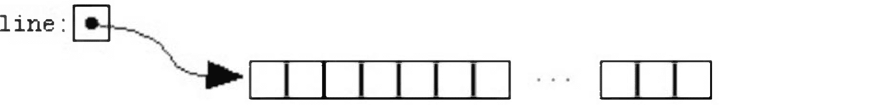

`line` 指向的 100 字节内存（并非全部显示）是由 `malloc` 分配的。（它们是全新的内存，概念上有点不同于编译器安排为我们常规变量自动分配的内存。图中 100 个方框旁边没有名称，因为它们不是我们声明的变量的存储。）

作为第二个例子，我们可能需要分配一块内存，并用 `strcpy` 将字符串复制到其中：

```c
char *p = (char *)malloc(15);
```

```c
/* incomplete -- malloc's return value not checked */
strcpy(p,"Hello, world!");
```

复制字符串时，请记住所有字符串都有一个终止的 `\0` 字符。如果你使用 `strlen` 来为你计算字符串中的字符数，该计数将不包括尾随的 `\0`，因此在调用 `malloc` 之前必须加一：

```c
char *somestring, *copy;
...
copy = (char *)malloc(strlen(somestring) + 1); /* +1 for \0 */
/* incomplete -- malloc's return value not checked */
strcpy(copy, somestring);
```

如果我们分配的不是字符，而是整数呢？如果我们想分配 100 个 `int`，那是多少字节？如果我们知道机器上 `int` 的大小（即取决于我们使用的是 16 位还是 32 位机器），我们可以尝试自己计算，但让 C 为我们计算要安全得多，也更具可移植性。C 有一个 `sizeof` 运算符，它计算变量或类型的大小，以字节为单位。这正是我们在调用 `malloc` 时所需要的。要为 100 个 `int` 分配空间，我们可以调用

```c
int *ip =(int *)malloc(100 * sizeof(int));
```

`sizeof` 运算符的使用看起来像函数调用，但它实际上是一个运算符，并且它在编译时完成工作。

由于我们可以在指针上使用数组索引语法，因此在调用 `malloc` 之后，我们可以几乎完全像数组一样对待指针变量。特别是，在上述对 `malloc` 的调用将 `ip` 初始化为指向 100 个 `int` 的存储之后，我们可以访问 `ip[0]`、`ip[1]`、... 直到 `ip[99]`。这样，即使我们在运行时才知道“数组”应该有多大，我们也可以获得数组的效果。（在后面的部分我们将看到，如果我们在开始使用它时甚至不确定“数组”最终需要多大，我们可能会如何处理这种情况。）

到目前为止，我们的示例都有一个明显的遗漏：它们没有检查 `malloc` 的返回值。显然，没有真正的计算机有无限的内存可用，因此不能保证 `malloc` 能够给我们我们要求的那么多内存。如果我们调用 `malloc(100000000)`，或者如果我们调用 `malloc(10)` 10,000,000 次，我们很可能会用完内存。

当 `malloc` 无法分配请求的内存时，它返回一个空指针。空指针记住，明确指向无处。它是一个“不是指针”标记；它不是你可以使用的指针。因此，每当你调用 `malloc` 时，在使用它之前检查返回的指针至关重要！如果你调用 `malloc`，它返回一个空指针，然后你继续使用该空指针，就好像它指向某个地方一样，你的程序可能不会持续很久。相反，程序应该立即检查空指针，如果收到一个，它至少应该打印错误信息并退出，或者设法在没有请求的内存的情况下继续。但它不能以任何方式继续使用从 `malloc` 得到的那個空指针，因为该空指针按定义指向无处。 （“它不能以任何方式使用空指针”意味着程序不能对该指针值使用 `*` 或 `[]` 运算符，也不能将其传递给期望有效指针的任何函数。）带错误检查的 `malloc` 调用通常看起来像这样：

```c
int *ip = (int *)malloc(100 * sizeof(int));

if(ip == NULL)
{
    printf("out of memory\n");
    exit or return
}
```

打印错误信息后，此代码应返回给其调用者，或完全退出程序；它不能继续使用本应使用 `ip` 的代码。

当然，在我们到目前为止的示例中，我们仍然将自己限制在“固定大小”的内存区域，因为我们使用固定的参数如 10 或 100 调用 `malloc`。（我们对 `getline` 的调用仍然限制为 100 个字符的行，或我们设置 `linelen` 变量的任何数字；我们的 `ip` 变量仍然只指向 100 个 `int`。）然而，由于大小现在是可以原则上在运行时确定的值，我们至少已经超越了必须重新编译程序（使用更大的数组）以适应更长行的需要，并且只要再做一点工作，我们就可以安排“数组”自动增长到所需的任意大小。（例如，我们可以编写类似 `getline` 的东西，它可以读取实际看到的最长输入行）。

### 12.2.2 使用 `calloc` 分配内存

`calloc` 是另一个内存分配函数，通常用于在运行时请求存储派生数据类型（如数组和结构）的内存空间。虽然 `malloc` 分配单个存储块，但 `calloc` 分配多个相同大小的存储块，然后将所有字节设为零。`calloc` 的一般形式为：

```c
ptr=(cast-type *)calloc(n, elem-size);
```

上述语句为 `n` 个块分配连续空间，每个块的大小为 `elem-size` 字节。所有字节都初始化为零，并返回指向分配区域第一个字节的指针。如果没有足够的空间，则返回 `NULL` 指针。

#### 程序 12.1 说明 `malloc` 和 `calloc` 函数使用的程序

```c
#include <stdio.h>
#include <malloc.h>
main()
{
int *base;
int i;
int cnt=0;
int sum=0;
printf("how many integers you have to store \n");
scanf("%d",&cnt);
base = (int *)malloc(cnt * sizeof(int));
printf("the base of allocation is %16lu \n",base);
if(!base)
printf("unable to allocate size \n");
else
{
for(int j=0;j<cnt;j++)
*(base+j)=5;
}
sum = 0;
for(int j=0;j<cnt;j++)
sum = sum + *(base+j);
printf("total sum is %d\n",sum);
free(base);
printf("the base of allocation is %16lu \n",base);
base = (int *)malloc(cnt * sizeof(int));
printf("the base of allocation is %16lu \n",base);
base = (int *)malloc(cnt * sizeof(int));
printf("the base of allocation is %16lu \n",base);
base = (int *)calloc(10,2);
printf("the base of allocation is %16lu \n",base);
}
```

### 12.2.3 释放内存

用 `malloc` 分配的内存会一直存在，直到你想要它存在。它不会在函数返回时自动消失，就像自动变量一样，但它也不必在整个程序持续期间都保留。就像你可以使用 `malloc` 精确控制何时以及分配多少内存一样，你也可以精确控制何时释放它。

事实上，许多程序以临时方式使用内存。它们分配一些内存，使用一段时间，但随后达到不再需要那块内存的点。由于内存不是无限的，释放（即释放或 `free`）你不再使用的内存是个好主意。

动态分配的内存使用 `free` 函数释放。如果 `p` 包含 `malloc` 之前返回的指针，你可以调用

```c
free(p);
```

这将把内存“归还”给内存的储备池（有时称为“竞技场”或“池”），`malloc` 请求的内存就是从这里满足的。调用 `free` 有点像回收的极致：它几乎不花费任何代价，而你归还的内存立即可供程序的其他部分使用。（理论上，它甚至可能被其他程序使用。）

（释放未使用的内存是个好主意，但不是强制性的。当你的程序退出时，它已分配但未释放的任何内存都应自动释放。如果你的计算机因为你的程序忘记释放它而“丢失”内存，那将表明你的操作系统存在问题或缺陷。）

自然地，一旦你释放了某段内存，你必须记住不要再使用它了。调用后

```c
free(p);
```

`p` 很可能仍然指向同一块内存。然而，由于我们已将其归还，它现在处于“可用”状态，后续的 `malloc` 调用可能会将该内存分配给程序的其他部分。如果变量 `p` 是全局变量或会存在一段时间，一个很好的记录方式就是将其设为 null 指针：`free(p);`

```c
p = NULL;
```

现在我们甚至不再拥有指向已释放内存的指针了，并且（只要在使用前检查 `p` 是否为非 `NULL`），我们就不会通过指针 `p` 误用任何内存。

在思考 `malloc`、`free` 和动态分配内存时，再次记住指针与其所指向内容之间的区别。如果你调用 `malloc` 分配一些内存，并将 `malloc` 给你的指针存储在局部指针变量中，会发生什么，当包含该局部指针变量的函数返回时？如果局部指针变量具有自动存储期（这是默认值，除非变量声明为 `static`），它将在函数返回时消失。但指针变量的消失与所指向的内存无关！该内存仍然存在，并且就 `malloc` 和 `free` 而言，仍然是已分配的。唯一消失的是你用来指向已分配内存的指针变量。（此外，如果它包含了你拥有的唯一一份指针副本，一旦它消失，你将无法释放该内存，也无法使用它。无论使用内存还是释放内存，都要求你至少有一个指向该内存的指针！）

### 12.2.4 重新分配内存块

有时你一开始并不确定需要多少内存。例如，如果你需要存储从用户读取的一系列项目，并且唯一知道其数量的方法是读取直到用户输入某个“结束”信号，那么在开始读取和存储前几个项目时，你无法知道在看到“结束”标记之前会看到多少个。你可能想为 100 个项目分配空间，如果用户在输入“结束”标记之前输入了第 101 个项目，你可能希望有一种方法说“呃，`malloc`，记住我要求的那 100 个项目？我改变主意了，能给我 200 个吗？”

事实上，你完全可以这样做，使用 `realloc` 函数。你将 `realloc` 传入一个旧指针（例如你从初始 `malloc` 调用中获得的指针）和一个新大小，`realloc` 会尽力为你提供一块足够大的内存块来容纳新大小。例如，如果我们想让来自前面示例的 `ip` 变量指向 200 个 `int` 而不是 100 个，我们可以尝试调用

```
ip = realloc(ip, 200 * sizeof(int));
```

由于你总是希望每个动态分配的内存块都是连续的（这样你就可以像对待数组一样对待它），你和 `realloc` 都必须担心 `realloc` 无法“原地”扩大旧内存块的情况，而是必须将其重新定位到别处以找到足够连续的空间来满足新的请求大小。`realloc` 通过返回一个新指针来做到这一点。如果 `realloc` 能够扩大旧内存块，它会返回相同的指针。如果 `realloc` 必须去别处获取足够的连续内存，它会返回指向新内存的指针，并在复制旧数据到那里之后。（在这种情况下，复制后它会释放旧块。）最后，如果 `realloc` 根本找不到足够的内存来满足新请求，它会返回一个 null 指针。因此，你通常不希望在测试其返回值是否不是 null 指针之前就用 `realloc` 的返回值覆盖旧指针。你可能会使用如下代码：

```c
int *newp;
newp = realloc(ip, 200 * sizeof(int));
if(newp != NULL)
    ip = newp;
else {
    printf("out of memory\n");
    /* exit or return */
    /* but ip still points at 100 ints */
}
```

如果 `realloc` 返回的不是 null 指针，则它成功了，我们将 `ip` 设为它返回的值。（我们要么将 `ip` 设为它原来的值，要么设为一个新指针，但无论如何，它都指向我们数据现在所在的位置。）如果 `realloc` 返回 null 指针，我们则保留 `ip` 中的旧指针，它仍然指向我们原来的 100 个值。

把这些结合起来，这里有一段代码从用户读取文本行，通过调用 `atoi` 将每行视为整数，并将每个整数存储在动态分配的“数组”中：

```c
#define MAXLINE 100
char line[MAXLINE];
int *ip;
int nalloc, nitems;
nalloc = 100;
ip = (int *)malloc(nalloc * sizeof(int)); /* initial allocation */ if(ip == NULL)
{
printf("out of memory\n");
exit(1);
}

nitems = 0;

while(getline(line, MAXLINE) != EOF) {
if(nitems >= nalloc)
{ /* increase allocation */
int *newp;
nalloc += 100;
newp = realloc(ip, nalloc * sizeof(int)); if(newp == NULL)
{
printf("out of memory\n");
exit(1);
}
ip = newp;
}
```

```
ip[nitems++] = atoi(line);
}
```

我们使用两个不同的变量来跟踪 `ip` 所指向的“数组”。`nalloc` 是我们已分配的元素数量，`nitems` 是其中正在使用的数量。每当我们即将向“数组”中存储另一个项目时，如果 `nitems >= nalloc`，旧“数组”已满，是时候调用 `realloc` 使其变大。

最后，我们可能会问 `malloc` 和 `realloc` 的返回类型是什么，如果它们能够返回指向 `char` 的指针或指向 `int` 的指针或（虽然我们尚未见过）指向任何其他类型的指针。答案是这两个函数都被声明为（在 `<stdlib.h>` 中）返回我们尚未见过的类型 `void *`（即指向 `void` 的指针）。我们实际上也未见过类型 `void`，但这里发生的事情是 `void *` 被特别定义为一种“通用”指针类型，可以（严格来说，赋值给或从中赋值）任何指针类型。

### 自我评估问题

- 1. 运行时分配内存的过程被称为 ____________。

- 2. `malloc()` 函数返回指向整数的指针。 （True/False）

- 3. 对于释放内存，你可以使用 ________ 函数。

- 4. 用于更改先前分配的块大小的函数是 ____________。

### 12.3 指针安全

指针的难点不在于操作它们，而在于确保它们所指向的内存是有效的。当指针没有指向你认为的位置时，如果你无意中访问或修改它所指向的内存，

你可能会损坏程序的其他部分，或（在某些情况下）其他程序或操作系统本身！

当我们使用指向简单变量的指针时，几乎不会出什么问题。当我们使用指向数组的指针并开始移动指针时，我们必须更加小心，以确保移动的指针始终保持在数组的边界内。当我们开始将指针传递给函数，特别是当我们开始从函数返回它们时，我们必须更加小心，因为使用指针的代码可能与拥有或分配内存的代码相距甚远。

一个特别的问题涉及返回指针的函数。返回指针所指向的内存在哪里？函数返回时它还在吗？`strstr` 函数（正如前面单元所述）返回一个 null 指针（它明确指向无处，调用者 presumably 会检查）或它返回一个指向输入字符串内部的指针，该字符串由调用者提供，这相当安全。然而，函数绝对*不能*做的是返回指向其自身局部自动数组的指针。记住自动变量（包括所有非静态局部变量），包括自动数组，在函数返回时会被释放并消失。如果函数返回指向局部数组的指针，该指针在调用者尝试使用它时将无效。

最后，当我们使用 `malloc`、`calloc`、`realloc` 和 `free` 进行动态内存分配时，我们必须最小心。动态分配给了我们的程序使用内存更大的灵活性，但随之而来的是我们必须仔细管理动态分配内存的责任。大量使用动态内存分配的程序中，指针误导和相关混乱的可能性最大。你可以通过以便于确保指针被正确使用并且内存始终被正确分配和释放的方式设计程序来降低这些可能性。（如果另一方面，你的程序设计使得满足这些保证成为繁琐的麻烦，早晚你会忘记或忽视它，维护将是一场噩梦。）

### 12.4 链表的概念

在处理许多问题时我们需要一个动态列表，动态是指大小需求不必在编译时已知。因此，列表可能在运行时增长或缩小。链表是一种数据结构，用于模拟这样一个动态的数据项列表，因此研究链表作为数据结构之一是很重要的。


数组在内存中使用顺序映射表示，其特性是元素之间距离固定。但这有以下缺点：它使得在数组的任意位置插入或删除成为一项代价高昂的操作，因为这涉及移动一些现有元素。

当我们想用不同大小的数组表示多个列表时，要么我们必须用最大大小的单独数组表示每个列表，要么我们必须用单个数组表示所有列表。第一种方法会导致存储浪费，第二种方法会涉及大量数据移动。

因此我们必须使用替代表示来克服这些缺点。一个替代方案是链接表示。在链接表示中，元素不必相距固定距离。相反，我们可以将元素放在内存的任何位置，但为了使其成为同一列表的一部分，一个元素需要与列表的前一个元素链接。这可以通过在前一个元素本身中存储下一个元素的地址来实现。这要求每个元素能够同时保存数据和下一个元素的地址。因此每个元素必须是一个结构，至少包含两个字段，一个用于保存数据值，我们称之为数据字段，另一个用于保存下一个元素的地址，我们称之为链接字段。

因此，链表是元素的列表，其中列表的元素可以放在内存的任何位置，并且这些元素通过显式的链接字段相互链接，即在前一个元素的链接字段中存储下一个元素的地址。

### 程序 12.2：下面是一个构建和打印链表元素的程序

```c
# include <stdio.h>
# include <stdlib.h>
struct node
{
int data;
struct node *link;
};
struct node *insert(struct node *p, int n)
{
struct node *temp;
/* if the existing list is empty then insert a new node as the
starting node */
if(p == NULL)
{
p=(struct node *)malloc(sizeof(struct node)); /* creates new node data value passes as parameter */
if(p == NULL)
{
printf("Error\n");
exit(0);
}
p-> data = n;
p-> link = p; /* makes the pointer pointing to itself because it
is a circular list*/
}
else
{
temp = p;
/* traverses the existing list to get the pointer to the last node of it */
while (temp-> link != p)
temp = temp-> link;
temp-> link = (struct node *)malloc(sizeof(struct node)); /* creates new node using data value passes as parameter and
puts its address in the link field of last node of the existing list*/ if(temp -> link == NULL)
{
printf("Error\n");
exit(0);
}
temp = temp-> link;
temp-> data = n;
temp-> link = p;
}
return (p);
}
void printlist ( struct node *p )
{
struct node *temp;
temp = p;
printf("The data values in the list are\n");
if(p!= NULL)
{
    do
    {
        printf("%d\t",temp->data);
        temp=temp->link;
    } while (temp!= p);
}
else
    printf("The list is empty\n");
}
void main()
{
    int n;
    int x;
    struct node *start = NULL;
    printf("Enter the nodes to be created \n");
    scanf("%d",&n);
    while ( n -- > 0)
    {
printf("Enter the data values to be placed in a node\n");
scanf("%d", &x);
start = insert(start, x);
}
printf("The created list is\n");
printlist(start);
}
```

### 12.4.1 使用递归程序插入节点

链表是一种递归数据结构。*递归数据结构*是指无论数据大小如何都具有相同形式的 数据结构。你可以很容易地为此类数据结构编写递归程序。

### 程序 12.3

```c
#include <stdio.h>
#include <stdlib.h>
struct node
{
    int data;
    struct node *link;
};
struct node *insert(struct node *p, int n)
if(p == NULL)
{
    p = (struct node *)malloc(sizeof(struct node));
    if(p == NULL)
    {
        printf("Error\n");
exit(0);
}
p-> data = n;
p-> link = NULL;
}
else
p->link = insert(p->link,n);/* the while loop replaced by recursive call */
return (p);
}
void printlist ( struct node *p )
{
printf("The data values in the list are\n");
while (p!= NULL)
{
printf("%d\t",p-> data);
p = p-> link;
}
}
void main()
{
int n;
int x;
struct node *start = NULL ;
printf("Enter the nodes to be created \n");
scanf("%d",&n);
while (n-- > 0)
{
    printf("Enter the data values to be placed in a node\n"); scanf("%d",&x);
    start = insert( start,x);
}
printf("The created list is\n");
printlist( start);
}
```

### 12.4.2 链表的排序和反转

要对链表进行排序，首先我们遍历列表搜索具有最小数据值的节点。然后我们移除该节点并将其附加到另一个初始为空的列表。我们用剩余的列表重复此过程，直到列表变为空，最后，我们返回指向所有节点都已移动到的列表开头的指针。

要反转一个列表，我们维护指向前一个节点和下一个节点的指针，然后我们使当前节点的链接字段指向前一个，使前一个等于当前，当前等于下一个。

因此，反转列表所需的代码是

```c
Prev = NULL;
While (curr != NULL)
{
Next = curr->link;
Curr -> link = prev;
Prev = curr;
Curr = next;
}
```

### 程序 12.4：排序列表的示例。

```c
# include <stdio.h>
# include <stdlib.h>
struct node
{
int data;
struct node *link;
};
struct node *insert(struct node *p, int n)
if(p==NULL)
{
p=(struct node *)malloc(sizeof(struct node));
if(p==NULL)
{
printf("Error\n");
exit(0);
}
}
p-> data = n;
p-> link = NULL;
}
else
{
temp = p;
while (temp-> link!= NULL)
temp = temp-> link;
temp-> link = (struct node *)malloc(sizeof(struct node)); if(temp -> link == NULL)
{
printf("Error\n");
exit(0);
}
temp = temp-> link;
temp-> data = n;
temp-> link = NULL;
}
return(p);
}
void printlist ( struct node *p )
{
printf("The data values in the list are\n"); while (p!= NULL)
{
printf("%d\t",p-> data);
p = p-> link;
}
}
/* a function to sort reverse list */ struct node *reverse(struct node *p) {
struct node *prev,*curr;
prev = NULL;
curr = p;
while (curr != NULL)
{
p = p-> link;
curr-> link = prev;
prev = curr;
curr = p;
}
return(prev);
}
/* a function to sort a list */
struct node *sortlist(struct node *p) {
struct node *temp1,*temp2,*min,*prev,*q; q = NULL;
while(p != NULL)
{
prev = NULL;
min = temp1 = p;
temp2 = p -> link;
while ( temp2 != NULL )
{
if(min -> data > temp2 -> data)
{
min = temp2;
prev = temp1;
} temp1 = temp2;
temp2 = temp2-> link;
}
if(prev == NULL)
p = min -> link;
else
prev -> link = min -> link;
min -> link = NULL;
if( q == NULL )
q = min; /* moves the node with lowest data value in the list pointed to by p to the list pointed to by q as a first node */
else
{
temp1 = q;
/* traverses the list pointed to by q to get pointer to its
last node */
while( temp1 -> link != NULL)
temp1 = temp1 -> link;
temp1 -> link = min; /* moves the node with lowest data value in the list pointed to by p to the list pointed to by q at the
end of list pointed by q */ }
}
return (q);
}
void main()
{
int n;
int x;
struct node *start = NULL ;
printf("Enter the nodes to be created \n"); scanf("%d",&n);
while ( n-- > 0 )
{
printf( "Enter the data values to be placed in a node\n");
scanf("%d",&x);
start = insert ( start,x);
}
printf("The created list is\n");
```

```c
};
struct node *insert(struct node *p, int n)
{
struct node *temp;
if(p==NULL)
{
p=(struct node *)malloc(sizeof(struct node));

if(p==NULL)
{
printf("Error\n");
exit(0);
}
p-> data = n;
p-> link = NULL;
}
else
{
temp = p;
while (temp-> link != NULL)
temp = temp-> link;

temp-> link = (struct node *)malloc(sizeof(struct node)); if(temp -> link == NULL)
{
printf("Error\n");
exit(0);
}

temp = temp->link;
temp->data = n;
temp->link = NULL;
}
return(p);
}

void printlist (struct node *p)
{
printf("The data values in the list are\n");
while (p!= NULL)
{
printf("%d\t",p-> data);
p = p-> link;
}
}

void main()
{
int n;
int x;
struct node *start = NULL;
printf("Enter the nodes to be created \n"); scanf("%d",&n);
```

```c
{
if( node_no > length(p))
{
printf("Error\n");
else
{
prev = NULL;
curr = p;
i = 1;
while( i < node_no )
{
prev = curr;
curr = curr->link;
i = i+1;
}
if( prev == NULL)
{
p = curr->link;
free(curr);
}
else
{
prev->link = curr->link;

free(curr);
}
}
}
return(p);
}

/* a function to compute the length of a linked list */ int length ( struct node *p)
{
    int count = 0;
    while ( p != NULL)
    {
        count++;
        p = p->link;
    }
    return(count);
}
```

### 自我评估问题

+   5. 链表是一种用于模拟动态数据项列表的数据结构，是一组 __________。

+   

+   6. 链表使用 __________ 内存分配技术。

### 12.5 总结

在运行时分配内存的过程称为动态内存分配。内存的分配是

### 12.8 终端问题的答案

1 `ptr=(struct student *) malloc(sizeof(struct student));`

. `struct node`

2{

```
int data1;
int data2;
struct node *link;
};
```

3 `ptr=ptr->link;`

. 一个链表是一种用于模拟动态数据项列表的

4 数据项的集合，并且是一组节点。 （请参阅第 12.4 节了解更多详情）

### 12.9 练习

1. 编写一个菜单驱动的程序来创建一个学生班级的链表并执行以下操作。

+   i. 写出列表的内容

+   ii. 编辑指定学生的详细信息

+   iii. 统计年龄和体重超过指定值的学生人数

+   2. 编写一个程序在链表中指定节点之后插入一个节点。

+   3. 编写一个程序来计算链表中节点的数量。

+   4. 编写一个程序来合并两个已排序的列表。

+   5. 简要说明如何使用链表表示多项式。 编写一个程序来添加两个多项式。

# 第 13 章 文件管理

## 结构：

+   13.1 引言

+   目标

+   13.2 定义和打开文件

+   13.3 关闭文件

+   13.4 文件的输入/输出操作

+   预定义流

+   13.5 I/O 操作期间的错误处理

+   13.6 文件的随机访问

+   13.7 命令行参数

+   13.8 总结

+   13.9 终端问题

+   13.10 自我评估问题的答案

+   13.11 终端问题的答案

+   13.12 练习

### 13.1 引言

在迄今为止的几乎所有先前的单元中，我们一直都在调用 `printf` 将格式化的输出打印到“标准输出” （无论它在哪里）。 我们还一直调用 `getchar` 从“标准输入”读取单个字符，并调用 `putchar` 将单个字符写入标准输出。 “标准输入”和“标准输出”是两个预定义的 I/O *流*，我们隐式可用。 在本单元中，您将学习如何通过打开我们自己的流来控制输入和输出，也许连接到数据文件，我们可以从中读取和写入。

#### 目标：

学习本单元后，您应该能够：

+   - 打开文件并控制输入和输出

+   - 连接到文件并能够使用文件指针从文件读取和写入文件。

+   - 检查 I/O 操作期间文件中的错误。

+   - 实现随机访问函数以允许控制文件中的隐含读写位置。

+   - 使用命令行参数在程序被调用时向程序提供参数。

### 13.2 定义和打开文件


我们将如何指定我们想要访问特定数据文件？ 理论上，每次想要从中读取或写入时都可以提及文件的名称是可能的。 但这种方法会有一些缺点。 相反，通常的做法（也是 C 的 `stdio` 库采用的方法）是你在打开文件时只提及一次文件名。 此后，您使用一些小标记，在本例中，文件指针来跟踪（对您和库而言）您所讨论的是哪个文件。 每当您想要从正在处理的文件之一读取或写入时，您都会通过使用其文件指针来标识该文件（即您在打开文件时获得的文件指针）。 正如我们将看到的，您将文件指针存储在变量中，就像您存储处理的任何其他数据一样，因此只要您使用不同的变量来存储文件指针，就有可能打开多个文件。

您声明一个变量来存储文件指针，如下所示：

```
FILE *fp;
```

类型 `FILE` 由 `<stdio.h>` 为您预定义。 它是一个数据结构，标准 I/O 库需要它来为您跟踪文件。 出于历史原因，您声明一个变量，该变量是指向此 `FILE` 类型的指针。 变量的名称可以（像任何变量一样）是您选择的任何名称； 使用字母 `fp` 作为变量名是传统的（因为我们谈论的是文件指针）。 如果您同时从两个文件读取，您可能会使用两个文件指针：

```
FILE *fp1, *fp2;
```

如果您从一个文件读取并写入另一个文件，您可能会声明一个输入文件指针和一个输出文件指针：

```
FILE *ifp, *ofp;
```

像任何指针变量一样，文件指针在初始化为指向某物之前是没有用的。 （实际上，任何类型的变量在初始化之前都不是很有用。）要实际打开文件并接收您将存储在文件指针变量中的“标记”，请调用 `fopen`。 `fopen` 接受一个文件名（作为字符串）和一个模式值，表示您是否打算读取或写入此文件。 （模式变量也是一个字符串。）要打开 `input.dat` 进行读取，您可能会调用

```
ifp = fopen("input.dat", "r");
```

模式字符串 `"r"` 表示读取。 模式 `"w"` 表示写入，因此我们可以像这样打开 `output.dat` 进行输出：

```
ofp = fopen("output.dat", "w");
```

模式字符串的其他值使用频率较低。 第三个主要模式是 `"a"` 用于追加。 （如果您使用 `"w"` 写入已存在的文件，其旧内容将被丢弃。）您还可以在模式字符串中添加 `"+"` 字符以表示您想要同时读取和写入，或添加 `"b"` 字符以表示您想要执行“二进制”（而不是文本）I/O。

打开文件时需要注意的一件事是，这是一个可能失败的操作。 请求的文件可能不存在，或者它可能受到读取或写入保护。 （这些可能性应该很明显，但很容易忘记它们。）`fopen` 如果无法打开请求的文件，则返回空指针，并且在继续使用 `fopen` 的返回值作为文件指针之前检查这种情况非常重要。 每次调用 `fopen` 通常都会跟随一个测试，如下所示：

```
ifp = fopen("input.dat", "r");
if(ifp == NULL)
{
printf("can't open file\n");
exit or return
}
```

如果 `fopen` 返回空指针，并且您将其存储在文件指针变量中并继续尝试使用它进行 I/O，您的程序通常会崩溃。 通常将对 `fopen` 的调用和赋值与测试合并：

```
if((ifp = fopen("input.dat", "r")) == NULL)
{
printf("can't open file\n");
exit or return
```

如果你不习惯这些“紧凑”测试，你不必编写它们，但你会在其他人的代码中看到它们，所以你应该能够阅读它们。

### 自测问题

- 1. `FILE` 类型在头文件 ________ 中预定义。

- 2. 我们可以在 `fopen` 函数的模式字符串中添加一个“+”字符，以表示我们想要同时读写。(对/错)

### 13.3 关闭文件

虽然你可以打开多个文件，但同时打开的文件数量是有限制的。如果你的程序将连续打开许多文件，你需要在每个文件用完后关闭它；否则标准 I/O 库可能会耗尽用于跟踪打开文件的资源。关闭文件只需以文件指针为参数调用 `fclose`：

```
fclose(fp);
```

调用 `fclose` 可以确保（如果文件是以输出模式打开的）任何最后的缓冲输出最终被写入文件，并且操作系统（和 C 库）用于该文件的资源被释放。如果你忘记关闭文件，它会在程序退出时自动关闭。

### 自测问题

- 3. 关闭文件只需以 __________ 为参数调用 `fclose`。

- 4. 如果你忘记关闭文件，它会在程序退出时自动关闭。(对/错)

### 13.4 文件输入/输出操作

目前我们使用过的每个 I/O 库函数都有一个配套函数，它接受一个额外的文件指针参数，告诉它从哪里读取或写入。`printf` 的配套函数是 `fprintf`，文件指针参数位于最前面。要向我们在上一节中打开的 `output.dat` 文件打印一个字符串，我们可以调用

```
fprintf(ofp, "Hello, world!\n");
```

`getchar` 的配套函数是 `getc`，文件指针是它唯一的参数。要从我们在上一节中打开的 `input.dat` 文件中读取一个字符，我们可以调用

```
int c;
c = getc(ifp);
```

`putchar` 的配套函数是 `putc`，文件指针参数放在最后。要向 `output.dat` 写入一个字符，我们可以调用

```
putc(c, ofp);
```

我们自己的 `getline` 函数调用 `getchar`，因此总是读取标准输入。我们可以编写一个配套的 `fgetline` 函数，它从任意文件指针读取：

```
#include <stdio.h>
```

/* 从 `fp` 读取一行，*/

/* 将其复制到 `line` 数组（但不超过 `max` 字符）。*/

/* 不在 `line` 数组中放置终止的 `\n`。*/

/* 返回行长度，空行返回 0，文件结束返回 `EOF`。*/

```
int fgetline(FILE *fp, char line[], int max)
{
int nch = 0;
int c;
max = max - 1; /* leave room for '\0' */

while((c = getc(fp)) != EOF)
{
if(c == '\n')
break;
```

```
if(nch < max)
{
line[nch] = c;
nch = nch + 1;
}
if(c == EOF && nch == 0) return EOF;

line[nch] = '\0';
return nch;
}
```

现在我们可以通过以下调用从 `ifp` 读取一行：

```
char line[MAXLINE];

...

fgetline(ifp, line, MAXLINE);
```

#### 程序 13.1：向文件写入数据

```
#include <stdio.h>
main()
{
FILE *fp;
char stuff[25];
int index;
fp = fopen("TENLINES.TXT","w"); /* open for writing */
strcpy(stuff,"This is an example line.");
for (index = 1; index <= 10; index++)
fprintf(fp,"%s Line number %d\n", stuff, index);
```

```
fclose(fp); /* close the file before ending program */
}
```

#### 13.4.1 预定义流

除了通过调用 `fopen` 显式打开的文件指针外，还有三个预定义流。`stdin` 是标准输入对应的常量文件指针，`stdout` 是标准输出对应的常量文件指针。这两个可以在任何需要文件指针的地方使用；例如，`getchar()` 等同于 `getc(stdin)`，`putchar(c)` 等同于 `putc(c, stdout)`。第三个预定义流是 `stderr`。与 `stdout` 一样，`stderr` 默认通常连接到屏幕。区别在于，当标准输出被重定向时，`stderr` 不会被重定向。例如，在 Unix 或 MS-DOS 下，当你执行

```
program > filename
```

任何打印到 `stdout` 的内容都会被重定向到文件 `filename`，但任何打印到 `stderr` 的内容仍然会输出到屏幕。`stderr` 背后的意图是它是“标准错误输出”；打印到其中的错误消息不会消失在输出文件中。例如，当文件无法打开时，更实际的打印错误消息的方式是

```
if((ifp = fopen(filename, "r")) == NULL)
{
    fprintf(stderr, "can't open file %s\n", filename);
    exit or return
}
```

其中 `filename` 是一个字符串变量，指示要打开的文件名。错误消息不仅打印到 `stderr`，而且更信息丰富，因为它提到了无法打开的文件名。

#### 程序 13.2：读取数据文件 input.dat

假设你有一个由数字的行和列组成的数据文件：

```
1 2 34

5 6 78

9 10 112
```

假设你想把这些数字读入一个数组。（实际上，该数组将是一个数组的数组，或“多维”数组；）我们可以通过组合几个部分来编写代码：我们刚才展示的 `fgetline` 函数，以及将每一行拆分成单词的 `getwords` 函数。假设数据文件名为 `input.dat`，代码将如下所示：

```
#define MAXLINE 100
#define MAXROWS 10
#define MAXCOLS 10
```

```
int array[MAXROWS][MAXCOLS]; char *filename = "input.dat"; FILE *ifp;
char line[MAXLINE];
char *words[MAXCOLS];
int nrows = 0;
int n; int i;
```

```
ifp = fopen(filename, "r");
if(ifp == NULL)
{
fprintf(stderr,"can't open %s\n", filename); exit(EXIT_FAILURE);
}
```

```c
while(fgetline(ifp, line, MAXLINE) != EOF) {

if(nrows >= MAXROWS)

{
    fprintf(stderr, "too many rows\n");
    exit(EXIT_FAILURE);
}

n = getwords(line, words, MAXCOLS);

for(i = 0;i < n;i++)
    array[nrows][i] = atoi(words[i]);

nrows++;
}
```

循环每执行一次，就使用 `fgetsline` 从文件中读取一行。每一行使用 `getwords` 拆分成“单词”；每个“单词”实际上是一个数字。然而，这些数字仍表示为字符串，因此在存储到数组之前，每个数字通过调用 `atoi` 转换为 `int`。代码检查两种不同的错误条件（无法打开输入文件，以及输入文件行数过多），如果发生其中一种情况，它会打印错误消息并退出。`exit` 函数是一个标准库函数，用于终止程序。它在 `<stdlib.h>` 中声明，接受一个参数，即程序的退出状态。`EXIT_FAILURE` 是一个代码，也由 `<stdlib.h>` 定义，表示程序失败。成功用 `EXIT_SUCCESS` 或简单的 `0` 表示。（这些值也可以从 `main()` 返回；以特定状态值调用 `exit` 本质上等同于从 `main()` 返回相同的状态值。）

### 自测问题

- 5. `putchar` 的配套函数是 `put`，并且文件指针参数位于最前面。(对/错)

- 6. 除了通过调用 `fopen` 显式打开的文件指针外，还有 __________ 个预定义流。

- 7. `getchar()` 与 `getc(stdin)` 相同。(对/错)

### 13.5 I/O 操作中的错误处理

标准 I/O 函数为每个打开的流维护两个指示器，以显示流的文件结束和错误状态。这些可以通过以下函数查询和设置：

```
#include <stdio.h>
void clearerr(FILE *stream);
int feof(FILE *stream);
int ferror(FILE *stream);
void perror(const char *s);
```

`clearerr` 清除流的错误和 EOF 指示器。

如果流的 EOF 指示器被设置，`feof` 返回非零值，否则返回零。如果流的错误指示器被设置，`ferror` 返回非零值，否则返回零。

`perror` 在程序的标准输出上打印一行错误消息，前缀为 `s` 指向的字符串，并附加一个冒号和一个空格。错误消息由 `errno` 的值决定，旨在对导致错误的条件给出一些解释。例如，下面的程序产生所示的错误消息：

```
#include <stdio.h>
```

```
#include <stdlib.h>
main(){
fclose(stdout);
if(fgetc(stdout) >= 0){
fprintf(stderr, "What - no error!\n");
exit(EXIT_FAILURE);
}
perror("fgetc");
exit(EXIT_SUCCESS); }
/* Result */
fgetc: Bad file number
```

### Self Assessment Questions

8._______ 清除流的错误和 EOF 指示符。

9._______ 如果流的错误指示符已设置则返回非零，否则返回零。

### 13.6 文件的随机访问

所有文件 I/O 例程的工作方式都相同；除非用户采取明确步骤更改文件位置指示器，否则文件将按顺序读取和写入。读取后跟写入后跟读取（如果文件以允许这种方式打开）将导致第二次读取从刚刚写入的数据末尾立即开始。（请记住，stdio 要求用户在读-写-读循环的每个元素之间插入缓冲区刷新操作。）

为控制此行为，随机访问函数允许控制文件中的隐含读写位置。文件位置指示器可以在无需读取或写入的情况下移动，并指示下一次对文件操作的字节。

存在三种类型的函数允许检查或更改文件位置指示器。它们的声明和描述如下。 
```
#include <stdio.h>
/* return file position indicator */
long ftell(FILE *stream);
int fgetpos(FILE *stream, fpos_t *pos);
/* set file position indicator to zero */
void rewind(FILE *stream);
/* set file position indicator */
int fseek(FILE *stream, long offset, int ptrname);
int fsetpos(FILE *stream, const fpos_t *pos);
```

**`ftell`** 如果 `stream` 引用的是二进制文件，则返回文件位置指示器的当前值（以字符为单位）。对于文本文件，返回一个‘magic’数字，该数字只能在后续对 **`fseek`** 的调用中用于重新定位到当前文件位置指示器。失败时返回 `-1L` 并设置 **`errno`**。

**`rewind`** 将 `stream` 指示的文件的当前文件位置指示器设置为文件开头。通过调用 `rewind` 重置文件错误指示符。不返回任何值。

**`fseek`** 允许将 `stream` 的文件位置指示器设置为任意值（对于二进制文件），或对于文本文件，仅设置为从 `ftell` 获得的位置，如下所示：

一般情况下，文件位置指示器被设置为距由 `ptrname` 值确定的文件中的某一点 `offset` 字节（字符）。

`Offset` 可以为负。`ptrname` 的值可以是 `SEEK_SET`，将文件位置指示器相对于文件开头设置，`SEEK_CUR`，将文件位置指示器相对于其当前值设置，以及 `SEEK_END`，将文件位置指示器相对于文件末尾设置。后者不一定保证在二进制流上正常工作。

对于文本文件，`offset` 必须为零或从同一流先前对 `ftell` 的调用返回的值，且 `ptrname` 的值必须为 `SEEK_SET`。

`fseek` 清除给定流的末尾文件指示符并擦除任何 `ungetc` 的记忆。它适用于输入和输出。

成功时返回零，禁止请求时返回非零。

请注意，对于 `ftell` 和 `fseek`，必须能够将文件位置指示器的值编码为 `long`。对于非常长的文件，这可能无法工作，因此标准引入了 `fgetpos` 和 `fsetpos`，它们以消除该问题的方式指定。

`fgetpos` 将 `stream` 的当前文件位置指示器存储在 `pos` 指向的对象中。存储的值是‘magic’，仅用于使用 `fsetpos` 返回到同一流的指定位置。

`fsetpos` 按上文所述工作，同时清除流的末尾文件指示符并忘记任何 `ungetc` 操作的影响。

对于这两个函数，成功时返回零；失败时返回非零并设置 `errno`。

### Self Assessment Questions

10._________ 函数如果 `stream` 引用的是二进制文件，则返回文件位置指示器的当前值（以字符为单位）。

11.`fseek` 允许将 `stream` 的文件位置指示器设置为任意值。 （True/False）

12._________ 将 `stream` 的当前文件位置指示器存储在 `pos` 指向的对象中。

### 13.7 命令行参数

我们多次提到，如果程序每次运行都做完全相同的事情，那么它很少有用。向程序提供一些可变输入的另一种方式是通过命令行参数调用它。它是在调用程序时提供给程序的参数。

（我们应该承认命令行用户界面有点老式，目前有点不受欢迎。如果你使用过 Unix 或 MSDOS，你知道什么是命令行，但如果你使用的是 Macintosh 或 Microsoft Windows 或其他图形用户界面，可能从未见过命令行。事实上，如果你在 Mac 或 Windows 上学习 C，给程序提供命令行可能很棘手。


# Unit 13: Command Line Arguments

C 对命令行的模型是它由一系列词组成，通常由空白分隔。你的主程序可以将这些词作为字符串数组接收，每个词一个字符串。事实上，C 运行时启动代码总是愿意将此数组传递给你，你要做的只是将 `main` 声明为接受两个参数，如下所示：

```c
int main(int argc, char *argv[])
{
    ...
}
```

当 `main` 被调用时，`argc` 将是命令行参数的数量，`argv` 将是参数本身的数组（“向量”）。由于每个词都是一个字符串，表示为指向字符的指针，`argv` 是指向字符的指针数组。由于我们不是定义 `argv` 数组，而是仅声明一个引用别处数组的参数（即在 `main` 的调用者，即运行时启动代码中），我们不必为 `argv` 提供数组维度。（实际上，由于函数在 C 中从不接收数组作为参数，`argv` 也可以被视为指向指向字符的指针，或 `char **`。但多维数组和指向指针的指针可能令人困惑，我们尚未涵盖它们，所以我们将把 `argv` 当作数组来讨论。）（另外，`argc` 和 `argv` 的名称没有什么神奇之处。你可以给 `main` 的两个参数任何你喜欢的名字，只要它们具有适当的类型。名称 `argc` 和 `argv` 是传统的。）

在玩 `argc` 和 `argv` 时要写的第一个程序就是简单地打印其参数的程序：

### Program 13.3: To illustrate the use of command line arguments

```c
#include <stdio.h>

main(int argc, char *argv[])
{
    int i;

    for(i = 0; i < argc; i++)
        printf("arg %d: %s\n", i, argv[i]);

    return 0;
}
```

（该程序本质上是 Unix 或 MS-DOS `echo` 命令。）

如果你运行此程序，你会发现构成命令行的“词”集合包括你键入以调用程序的命令（即你的程序的名称）。换句话说，`argv[0]` 通常指向你的程序的名称，`argv[1]` 是第一个参数。

程序应如何解释其命令行并没有硬性规定。Unix 有一套约定，MSDOS 有另一套，VMS 有另一套。通常你会遍历参数，可能将一些视为选项标志，其他视为实际参数（输入文件等），解释或处理每个参数。由于每个参数都是字符串，你必须使用 `strcmp()` 或类似方法将参数与你可能寻找的模式进行匹配。请记住 `argc` 包含命令行上的词数，且 `argv[0]` 是命令名，因此如果 `argc` 为 1，则没有参数可检查。（你永远不想查看 `argv[i]`，其中 `i >= argc`，因为它将是空或无效指针。）

`argc` 和 `argv` 用法的进一步示例如下：

### Program 13.4: To illustrate the use of command line arguments

```c
void main(int argc, char *argv[])
{
    if (argc != 2) {
        printf("Specify a password");
        exit(1);
    }

    if (!strcmp(argv[1], "password"))
        printf("Access Permitted");
    else
    {
        printf("Access denied");
        exit(1);
    }
    program code here .....
}
```

此程序只有在以命令行参数的形式输入正确的密码时才允许访问其代码。命令行参数有许多用途，并且可以成为一种强大的工具。

作为另一个示例，这里有一个程序可以将一个或多个输入文件复制到其标准输出。由于“标准输出”默认通常是屏幕，因此这是一个用于显示文件的有用程序。（它类似于名字晦涩的 Unix `cat` 命令，以及 MS-DOS 的 `type` 命令。）

### Program 13.5: To copy one or more input files to standard output

```c
#include <stdio.h>

main(int argc, char *argv[])
{
    int i;
    FILE *fp;
    int c;

    for(i = 1; i < argc; i++)
    {
        fp = fopen(argv[i], "r");

        if(fp == NULL)
        {
            fprintf(stderr, "cat: can't open %s\n", argv[i]);
            continue;
        }

        while((c = getc(fp)) != EOF)
            putchar(c);
        fclose(fp);
    }

    return 0;
}
```

作为历史注记，Unix `cat` 程序之所以得名，是因为它可以用来将两个文件连接在一起，如下所示：`cat a b > c`

这说明将错误消息打印到 `stderr` 是一个好主意，这样它们就不会被重定向。在此示例中，“can't open file” 消息还包括程序的名称以及文件的名称。

通常在错误消息中包含的另一条信息是操作失败的原因（如果已知）。对于操作系统问题，例如无法打开文件，通常会在全局变量 `errno` 中存储一个指示错误的编码。标准库函数 `strerror()` 将 `errno` 值转换为人类可读的错误消息字符串。因此，更具信息量的错误消息打印方式为

```c
fp = fopen(argv[i], "r");
if(fp == NULL)
    fprintf(stderr, "cat: can't open %s: %s\n",
        argv[i], strerror(errno));
```

如果使用此类代码，可以 `#include <errno.h>` 来获取 `errno` 的声明，并 `<string.h>` 来获取 `strerror()` 的声明。

最终示例程序接受两个命令行参数。第一个是文件的名称，第二个是一个字符。程序搜索指定的文件，查找该字符。如果文件包含至少一个此类字符，则报告此事实。此程序使用 `argv` 来访问文件名和要搜索的字符。

### Program 13.6: To search the specified file, looking for the character

```c
/* Search specified file for specified character. */
#include <stdio.h>
#include <stdlib.h>

void main(int argc, char *argv[])
{
    FILE *fp; /* file pointer */
    char ch;

    /* see if correct number of command line arguments */
    if(argc != 3) {
        printf("Usage: find <filename> <ch>\n");
        exit(1);
    }

    /* open file for input */
    if ((fp = fopen(argv[1], "r")) == NULL) {
        printf("Cannot open file \n");
        exit(1);
    }

    /* look for character */
    while ((ch = getc(fp)) != EOF) /* where getc() is a */
        if (ch == *argv[2]) {      /* function to get one char */
            printf("%c found", ch); /* from the file */
            break;
        }
    fclose(fp);
}
```

## Self Assessment Questions

13. Command line argument is a parameter supplied to a program when the program is invoked. (True/False)

14. In the command line arguments of `main()`, `argv` is an array-of-pointers to ________.

15. The __________ is a parameter supplied to a program when the program is invoked.

### 13.8 Summary

“Standard input” and “standard output” are two predefined I/O streams which are implicitly available to us. To actually open a file, and receive the “token” which you'll store in your file pointer variable, you call `fopen()`. `fopen()` accepts a file name (as a string) and a mode value indicating among other things whether you intend to read or write this file. The file pointer keeps track (both for your sake and the library's) of which file you're talking about.

For each of the I/O library functions we've seen, there's a companion function which accepts an additional file pointer argument telling it where to read from or write to. The standard I/O functions maintain two indicators with each open stream to show the end-of-file and error status of the stream. The Random Access functions allow control over the implied read/write position in the file. The *command line argument* is a parameter supplied to a program when the program is invoked.

### 13.9 Terminal Questions

1. The skeletal outline of a C program is shown below:

```c
#include <stdio.h>
main()
{

    FILE *pt1, *pt2;
    char name[20];

    pt1 = fopen("sample.old", "r");
    pt2 = fopen("sample.new", "w");
    ..........
    fclose(pt1);
    fclose(pt2);
}
```

a) Read the string represented by `name` from the data file `sample.old`.

b) Display it on the screen

c) Enter the updated string.

d) Write the new string to the data file `sample.new`

2. What is a command line argument and what is its use? Explain

### 13.10 Answers to Self Assessment Questions

- 1. `stdio.h`
- 2. true
- 3. File pointer
- 4. True
- 5. false
- 6. three
- 7. True
- 8. `clearerr()`
- 9. `ferror()`
- 10. `ftell()`
- 11. true
- 12. `fgetpos()`
- 13. true
- 14. `char`
- 15. Command line argument

### 13.11 Answers to Terminal Questions

- 1. a) `fscanf(pt1, "%s", name);`

   b) `printf("Name: %s\n", name);`

   c) `puts("New Name:");`
      `gets(name);`

   d) `fputs(name, pt2);`

- 2. Command Line argument is a parameter supplied to a program when the program is invoked. (Refer 13.7 for more details)

### 13.12 Exercises

1. Describe the use of functions `getc()` and `putc()`.

2. What is meant by opening a data file? How is this accomplished?

3. Distinguish between the following functions:

   a) `getc()` and `getchar()`

   b) `printf()` and `fprintf()`

   c) `feof()` and `ferror()`

4. Explain the general syntax of the `fseek()` function.

5. Write a program to copy the contents of one file to another.

6. Two data files `DATA1` and `DATA2` contains sorted list of integers. Write a program to produce a third file `DATA` which holds the single sorted, merged list of these two lists. Use command line arguments to specify the file names.

7. The skeletal outline of a C program is shown below.

```c
#include <stdio.h>
main()
{
    FILE *pt1, *pt2;
    int a;
    float b;
    char c;
    pt1 = fopen("sample.old", "r");
    pt2 = fopen("sample.new", "w");
    ........
    fclose(pt1);
    fclose(pt2);
}
```

a) Read the values of `a`, `b` and `c` from the data file `sample.old`.

b) Display each value on the screen and enter an updated value.

c) Write the new values to the data file `sample.new`. Format the floating-point value so that not more than two decimals are written to `sample.new`.

# Unit 14 Advanced Data Representation

**Structure:**

- 14.1 Introduction
- Objectives
- 14.2 Exploring Data Representation
- 14.3 Abstract Data Types
- 14.4 Stack as an Abstract Data Type
  - Array Implementation of a Stack
  - Implementation of a Stack Using Linked Representation
  - Applications of Stacks
- 14.5 Queue as an Abstract Data Type
  - Array Implementation of a Queue
  - Implementation of a Queue Using Linked List Representation
  - Circular Queues
  - Applications of Queues
- 14.6 Summary
- 14.7 Terminal Questions
- 14.8 Answers to Self Assessment Questions
- 14.9 Answers to Terminal Questions
- 14.10 Exercises

## Objectives

## 14.1 Introduction

学习计算机语言就像学习音乐、木工或工程学一样。一开始，你会使用专业工具，练习音阶，学习锤子的哪一端应该握住，哪一端应该避免，解决无数涉及下落、滑动和平衡物体的难题。到目前为止，你一直在本书中所做的就是学习和练习技能，学习创建变量、结构、函数等。最终，你会进入一个更高的层次，在这个层次上，使用工具变得自然而然，真正的挑战是设计和创建一个项目。你会发展出将项目视为一个连贯整体的能力。本单元集中于这一更高层次。你可能会发现这里涵盖的材料比前面的单元更具挑战性，但你也可能会发现它更有回报，因为它帮助你从学徒的角色转变为工匠的角色。

我们将从检查程序设计的一个重要方面开始：程序对数据的表示方式。通常，程序开发中最重要的方面是找到该程序所操作数据的良好表示。正确的数据表示可以使编写其余程序变得简单。到目前为止，你已经看到了 C 的内置数据类型：简单变量、数组、指针、结构和联合。


然而，找到合适的数据表示往往超出了简单选择类型的范围。你还应该考虑需要哪些操作。也就是说，你应该决定如何存储数据，并定义该数据类型的有效操作。例如，`C` 实现通常将 `C int` 类型和 `C` 指针类型都存储为整数，但这两种类型具有不同的有效操作集。例如，你可以把一个整数乘以另一个整数，但不能把一个指针乘以另一个指针。你可以使用 `*` 运算符来取消引用指针，但该操作对整数来说毫无意义。`C` 语言定义了其基本类型的有效操作。然而，当你设计一个表示数据的方案时，你可能需要自己定义有效操作。在 `C` 中，你可以通过设计 `C` 函数来表示所需的操作来实现这一点。简而言之，设计一个数据类型包括决定如何存储数据以及设计一组函数来管理数据。你还将研究一些算法，即操作数据的配方。作为程序员，你将积累一套这样的配方，反复应用于类似的问题。

本单元探讨设计数据类型的过程，即将算法与数据表示相匹配的过程。在其中，你将遇到一些常见的数据形式，例如栈和队列。

你还将被介绍到抽象数据类型（`ADT`）的概念。`ADT` 以问题导向而非语言导向的方式封装方法与数据表示。在设计出 `ADT` 之后，你可以在不同情况下轻松地重用它。对 `ADT` 的理解在概念上为你进入面向对象编程（`OOP`）和 `C++` 语言的世界做好了准备。

### Objectives:

学习本单元后，你应该能够：

- 使用 `C` 表示各种数据类型
- 实现新的算法并提高开发
- 在概念上编程的能力
- 实现抽象数据类型（`ADTs`）
- 实现两种抽象数据类型——栈和队列 讨论栈和队列的应用

### 14.2 Exploring Data Representation

让我们先思考数据。假设你必须创建一个地址簿程序。你会使用什么数据形式来存储信息？由于每个条目关联的信息种类繁多，用一个结构来表示每个条目是合理的。你如何表示多个条目？用标准的结构数组？用动态数组？用其他形式？条目是否应该按字母顺序排列？你是否应该能够按邮政编码搜索条目？按区号搜索？你想要执行的操作可能会影响你决定如何存储信息。总之，在投入编码之前，你有很多设计决策要做。

你将如何表示一个你想存储在内存中的位图图形图像？位图图像是指屏幕上的每个像素都是单独设置的。在黑白屏幕的时代，你可以用一台计算机位（`1` 或 `0`）来表示一个像素（开或关），因此得名位图。有了彩色显示器，描述单个像素需要不止一个位。例如，如果你为每个像素分配 `8` 位，你可以得到 `256` 种颜色。现在行业已发展到 `65,536` 种颜色（每个像素 `16` 位）、`16,777,216` 种颜色（每个像素 `24` 位）、`2,147,483,648` 种颜色（每个像素 `32` 位），甚至更远。如果你的显示器有 `16` 百万种颜色，分辨率为 `1024x768`，你将需要 `18.9` 百万位（`2.25 MB`）来表示单个位图图形屏幕。这是可行的方法，还是你可以开发一种压缩信息的方法？这种压缩应该是无损的（不丢失数据）还是有损的（丢失相对不重要的数据）？同样，在深入编码之前，你有很多设计决策要做。让我们处理一个表示数据的特定案例。假设你想编写一个程序，使你能够输入你在一年中观看的所有电影（包括录像带）的列表。对于每部电影，你希望记录各种信息，例如标题、发行年份、导演、主演、长度、电影类型（喜剧、科幻、浪漫、胡说八道等等）、你的评价等等。这表明为每部电影使用一个结构，为列表使用一个结构数组。为了简化问题，让我们将结构限制为两个成员：电影标题和你的评价，一个 `0` 到 `10` 的排名。程序 `6.1` 显示了使用这种方法的简陋实现。

#### Program 14.1: The films1.c Program

```c
/* films1.c -- using an array of structures */
#include <stdio.h>
#define TSIZE 45 /* size of array to hold title */
#define FMAX 5 /* maximum number of film titles */
struct film {
char title[TSIZE];
int rating;
};

int main(void)
{
struct film movies[FMAX];
int i = 0;
int j;

puts("Enter first movie title:");
while (i < FMAX && gets(movies[i].title) != NULL && movies[i].title[0] != '\0')
{
puts("Enter your rating <0-10>:");
scanf("%d", &movies[i++].rating);
while(getchar() != '\n')
continue;
puts("Enter next movie title (empty line to stop):"); }
if (i == 0)
printf("No data entered. ");
else
printf("Here is the movie list:\n");
for (j = 0; j < i; j++)
printf("Movie: %s Rating: %d\n", movies[j].title,
movies[j].rating);
printf("Bye!\n");

return 0;
}
```

该程序创建一个结构数组，然后用用户输入的数据填充数组。输入会一直继续，直到数组已满（`FMAX` 测试），直到到达文件末尾（`NULL` 测试），或直到用户在行首按下 Enter 键（`'\0'` 测试）。

这种表述有一些问题。首先，该程序很可能会浪费大量空间，因为大多数电影的标题长度不到 `40` 个字符，但有些电影确实有很长的标题。其次，许多人会发现每年五部电影的限制过于严格。当然，你可以增加该限制，但什么值才合适？有些人一年看 `500` 部电影，所以你可以将 `FMAX` 增加到 `500`，但这对于某些人来说仍然可能太小，而对于其他人来说可能会浪费大量内存。此外，一些编译器为自动存储类变量（如 `movies`）可用的内存量设置了默认限制，而这样大的数组可能会超过该值。你可以通过将数组设为静态或外部数组，或指示编译器使用更大的栈来修复它，但这并没有解决真正的问题。

真正的问题是数据表示过于不灵活。你必须在编译时做出在运行时做出更好决定的决策。这表明应切换到使用动态内存分配的数据表示。

你可以尝试这样做：

```c
#define TSIZE 45 /* size of array to hold title */
struct film {
char title[TSIZE];
int rating;
};
...
int n, i;
struct film * movies; /* pointer to a structure */
...
printf("Enter the maximum number of movies you'll enter:\n");
scanf("%d", &n);
movies = (struct film *) malloc(n * sizeof(struct film));
```

这里，你可以像使用数组名一样使用指针 `movies`：`while (i < FMAX && gets(movies[i].title) != NULL && movies[i].title[0] != '\0')`

通过使用 `malloc()`，你可以推迟确定元素数量直到程序运行时，因此程序无需在只需要 `20` 个元素时分配 `500` 个元素。然而，它要求用户提供条目数量的正确值。

### Self Assessment Questions

- 1. 一个 `_________` 图像是指屏幕上的每个像素都是单独设置的。
- 2. 当实际位置数量事先未知时，为对象分配内存位置的最佳解决方案是通过使用 `_____________` 内存分配。

### 14.3 Abstract Data Types

抽象数据类型（`ADT`）是一种以这样的方式组织的数据类型：对象的规范和对象上的操作的规范与对象的表示和操作的实现是分离的。

一些编程语言提供了显式机制来支持规范与实现之间的区别。虽然 `C` 没有实现 `ADT` 的显式机制，但仍然可以并且应该使用相同的概念来设计你的数据类型。

`ADT` 操作的规范与操作的实现有何不同？规范包括每个函数的名称、其参数的类型以及其结果的类型。还应有函数做什么的描述，但不能诉诸内部表示或实现细节。这一要求非常重要，它意味着抽象数据类型是与实现无关的。此外，可以将数据类型的函数分为几个类别：

- 1) **Creator/constructor:** 这些函数创建指定类型的新实例。
- 2) **Transformers:** 这些函数也创建指定类型的一个实例，通常使用一个或多个其他实例。
- 3) **Observers/reporters:** 这些函数提供有关类型实例的信息，但它们不会更改实例。

通常，`ADT` 定义将至少包含这三个类别中的每个类别的一个函数。

### 14.4 Stack as an Abstract Data Type

栈只是一个元素列表，允许在称为栈顶的一端进行插入和删除。这意味着可以按与元素插入栈的顺序相反的顺序从栈中移除元素。因此，栈数据结构表现出 `LIFO`（后进先出）特性。`Push` 和 `pop` 是分别用于将元素插入栈和从栈中移除元素的操作。图 `14.1` 显示了 `push` 和 `pop` 操作对栈的影响。

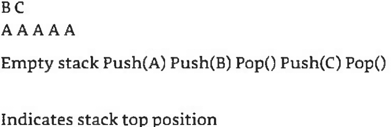

**图 14.1：栈操作**

由于栈本质上是一个列表，因此可以使用数组实现，也可以使用链式表示实现。

#### 14.4.1 栈的数组实现

当使用数组实现栈时，`push` 和 `pop` 操作是通过数组可用的操作实现的。数组实现的局限性在于栈不能根据需要动态地增长和收缩。

#### 程序 14.2：使用数组实现栈的完整 C 程序

```c
#include <stdio.h>

#define MAX 10 /* The maximum size of the stack */
#include <stdlib.h>

void push(int stack[], int *top, int value)
{
    if(*top < MAX)
    {
        *top = *top + 1;
        stack[*top] = value;
    }
    else
    {
        printf("The stack is full can not push a value\n");
        exit(0);
    }
}

void pop(int stack[], int *top, int *value)
{
    if(*top >= 0)
    {
        *value = stack[*top];
        *top = *top - 1;
    }
    else
    {
        printf("The stack is empty can not pop a value\n");
        exit(0);
    }
}

void main()
{
    int stack[MAX];
    int top = -1;
    int n,value;
    do
    {
        do
        {
            printf("Enter the element to be pushed\n");
            scanf("%d",&value);
            push(stack,&top,value);
            printf("Enter 1 to continue\n");
            scanf("%d",&n);
        } while(n == 1);

        printf("Enter 1 to pop an element\n");
        scanf("%d",&n);
        while( n == 1)
        {
            pop(stack,&top,&value);
            printf("The value popped is %d\n",value);
            printf("Enter 1 to pop an element\n");
            scanf("%d",&n);
        }
        printf("Enter 1 to continue\n");
        scanf("%d",&n);
    } while(n == 1);
}
```

#### 14.4.2 使用链式表示实现栈

最初列表为空，因此 `top` 指针为 `NULL`。`push` 函数将现有列表的指针作为第一个参数，将要入栈的数据值作为第二个参数，创建一个新节点并使用数据值，并将其添加到现有列表的顶部。`pop` 函数将现有列表的指针作为第一个参数，将弹出值要返回的数据对象的指针作为第二个参数。因此它检索 `top` 指针指向的节点的值，使 `top` 指向下一个节点，并销毁 `top` 指向的节点。

如果使用该策略创建具有四个数据值 `10`、`20`、`30` 和 `40` 的栈，则栈的创建如图所示 `14.2`。最初 `top=NULL`。

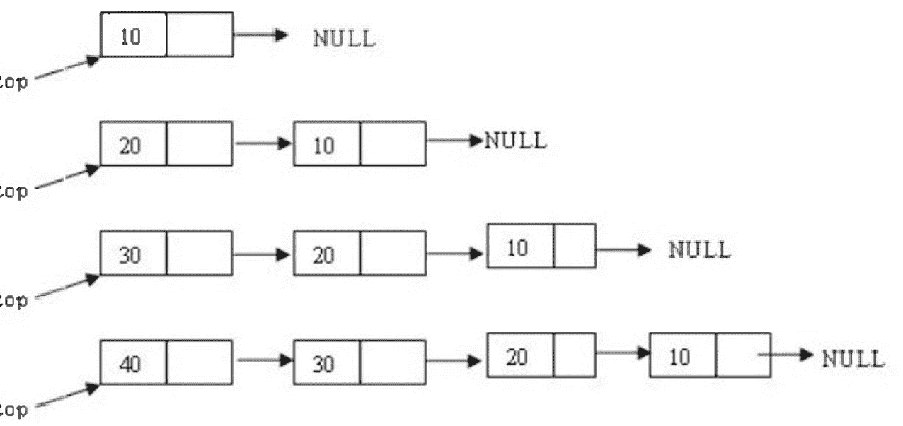

**图 14.2：链式栈**

#### 程序 14.3：使用链表实现栈的完整 C 程序

```c
#include <stdio.h>
#include <stdlib.h>

struct node
{
    int data;
    struct node *link;
};

struct node *push(struct node *p, int value)
{
    struct node *temp;
    temp=(struct node *)malloc(sizeof(struct node));
    /* creates new node
       using data value
       passed as parameter */
    if(temp==NULL)
    {
        printf("No Memory available Error\n");
        exit(0);
    }
    temp->data = value;
    temp->link = p;
    p = temp;
    return(p);
}

struct node *pop(struct node *p, int *value)
{
    struct node *temp;
    if(p==NULL)
    {
        printf("The stack is empty can not pop Error\n");
        exit(0);
    }
    *value = p->data;
    temp = p;
    p = p->link;
    free(temp);
    return(p);
}

void main()
{
    struct node *top = NULL;
    int n,value;
    do
    {
        do
        {
            printf("Enter the element to be pushed\n");
            scanf("%d",&value);
            top = push(top,value);
            printf("Enter 1 to continue\n");
            scanf("%d",&n);
        } while(n == 1);

        printf("Enter 1 to pop an element\n");
        scanf("%d",&n);
        while( n == 1)
        {
            top = pop(top,&value);
            printf("The value popped is %d\n",value);
            printf("Enter 1 to pop an element\n");
            scanf("%d",&n);
        }
        printf("Enter 1 to continue\n");
        scanf("%d",&n);
    } while(n == 1);
}
```

#### 14.4.3 栈的应用

栈的一种应用是在表达式求值中。诸如 `a = b + c*d/e-f` 这样的复杂赋值语句可以有多种解释。因此，为了给出唯一含义，使用了优先级和结合性规则。但即使如此，用计算机在当前形式下求值表达式，即中缀表示法，也是困难的。在中缀表示法中，二元运算符位于操作数之间。一元运算符位于操作数之前。为了求值，首先将其转换为后缀形式，其中运算符位于操作数之后。例如，表达式 `a*(b-c)/d` 的后缀形式为 `abc-*d/`。后缀表达式的好处是它们不需要任何优先级规则或括号即可唯一定义。因此，可以使用基于栈的算法求值后缀表达式。

#### 程序 14.4：将中缀表达式转换为前缀形式的程序


```c
#include <stdio.h>
#include <string.h>
#include <ctype.h>
#define N 80
typedef enum {FALSE, TRUE} bool;
#include "stack.h"
#include "queue.h"
#define NOPS 7

char operators [] = "()/^*+-";
int priorities[] = {4,4,3,2,2,1,1};
char associates[] = "RLLLLLL";

char t[N]; char *tptr = t; // this is where prefix will be saved.

int getIndex( char op ) {
    /*
     * returns index of op in operators.
     */
    int i;
    for( i=0; i<NOPS; ++i )
        if( operators[i] == op )
            return i;
    return -1;
}

int getPriority( char op ) {
    /*
     * returns priority of op.
     */
    return priorities[ getIndex(op) ];
}

char getAssociativity( char op ) {
    /*
     * returns associativity of op.
     */
    return associates[ getIndex(op) ];
}

void processOp( char op, queue *q, stack *s ) {
    /*
     * performs processing of op.
     */
    switch(op) {
        case ')':
            printf( "\t S pushing )...\n" );
            sPush( s, op );
            break;
        case '(':
            while( !qEmpty(q) ) {
                *tptr++ = qPop(q);
                printf("\tQ popping %c...\n", *(tptr-1));
            }
            while(!sEmpty(s)) {
                char popop = sPop(s);
                printf("\tS popping %c...\n", popop);
                if( popop == ')' )
                    break;
                *tptr++ = popop;
            }
            break;
        default: {
            int priop; // priority of op.
            char topop; // operator on stack top.
            int pritop; // priority of topop.
            char asstop; // associativity of topop.
            while(!sEmpty(s)) {
                priop = getPriority(op);
                topop = sTop(s);
                pritop = getPriority(topop);
                asstop = getAssociativity(topop);
                if((pritop < priop) || (pritop == priop && asstop == 'L') || (topop == ')'))
                    break;
                while(!qEmpty(q)) {
                    *tptr++ = qPop(q);
                }
                *tptr++ = sPop(s);
            }
            sPush( s, op );
            break;
        }
    }
}

char *in2pre(char *s) {
    static char res[N];
    char *resptr = res;
    queue q;
    stack st;
    char *sptr;
    qInit(&q);
    sInit(&st);
    for (sptr = s + strlen(s) - 1; sptr >= s; --sptr) {
        if (isalpha(*sptr))
            qPush(&q, *sptr);
        else if (isop(*sptr)) // if valid operator.
            processOp(*sptr, &q, &st);
        else if (isspace(*sptr)) // if whitespace.
            ;
        else {
            fprintf(stderr, "ERROR: invalid char %c.\n", *sptr);
            return '\0';
        }
    }
    while( !qEmpty(&q) ) {
        *tptr++ = qPop(&q);
        printf("\tQ popping %c...\n", *(tptr-1));
    }
    while( !sEmpty(&st) ) {
        *tptr++ = sPop(&st);
        printf("\tS popping %c...\n", *(tptr-1));
    }
    *tptr = 0;
    printf("t=%s.\n", t);
    for( --tptr; tptr != t-1; --tptr) {
        *resptr++ = *tptr;
    }
    *resptr = 0;
    return res;
}

int main() {
    char s[N];

    puts("enter infix freespace max 80.");
    gets(s);
    while(*s) {
        puts(in2pre(s));
        gets(s);
    }

    return 0;
}
```

### 解释

1. 在中缀表达式中，二元运算符分隔其操作数（一元运算符在其操作数之前）。在后缀表达式中，运算符的操作数位于运算符之前。在前缀表达式中，运算符位于其操作数之前。与后缀表达式一样，前缀表达式是不带括号的，即任何中缀表达式都可以无歧义地写成其前缀等价形式而无需括号。

2. 为了将中缀表达式转换为逆前缀，它从右到左扫描。维护一个操作数队列，注意中缀和前缀中操作数的顺序保持不变。因此，在扫描中缀表达式时，每当遇到操作数时，就将其推入队列。如果扫描的元素是右括号 `)`，则将其推入运算符栈。如果扫描的元素是左括号 `(`，则将操作数队列清空到前缀输出，然后弹出运算符栈中直到但不包括右括号的所有运算符。

3. 如果扫描的元素是任意运算符 o，则检查运算符栈中优先级大于 o 的运算符。这样的运算符被弹出并写入前缀输出，在此之前清空操作数队列。运算符 o 最后被推入栈。

4. 当中缀表达式的扫描完成后，首先将操作数队列，然后将运算符栈清空到前缀输出。任何中缀输入中的空白都被忽略。因此，可以将前缀输出反转以获得中缀输入所需的前缀表达式。

### 示例

如果中缀表达式为 a*b + c/d，则在从右到左扫描表达式时算法的不同快照如表 14.1 所示。

| 步骤 | 扫描元素 | 操作数队列 | 运算符栈 | 前缀输出 |

|---:|---|---|---|---|

| 0 | – | empty | empty | nil |

| 1 | d | d | empty | nil |

| 2 | / | d | / | nil |

| 3 | c | d, c | / | nil |

| 4 | + | empty | + | dc/ |

| 5 | b | b | + | dc/ |

| 6 | * | b | +, * | dc/ |

| 7 | a | b, a | +, * | dc/ |

| 8 | end | empty | empty | dc/ba*+ |

7 空 A b a *+dc/

8 空 空 空 空 dc/ba*+

我们最终得到的前缀输出为 dc/ba*+，其反转为 +*ab/cd，也就是输入中缀表达式 a*b+c/d 的前缀等价形式。注意，在第1、3、5、7步中，所有操作数都只是被压入队列。在第2步中，运算符 / 被压入空的运算符栈。

在第4步中，将运算符 + 与栈中的元素进行比较。由于 /（除法）的优先级高于 +（加法），队列被清空并输出到前缀输出中（因此我们得到输出“dc”），然后写入运算符 /（因此我们得到输出“dc/”）。随后将运算符 + 压入栈中。在第6步中，将运算符 * 与栈中的元素进行比较。由于 *（乘法）的优先级高于 +（加法），因此将 * 压入栈中。第8步表示整个中缀表达式已被扫描完毕。于是，操作数队列被清空并输出到前缀输出中（得到“dc/ba”），随后运算符栈被清空（得到“dc/ba*+”）。

### 需要记住的要点

- 1. 前缀表达式是不含括号的。
- 2. 要将中缀表达式转换为等价的前缀表达式，需要从右到左扫描中缀表达式。我们得到的前缀表达式是所需前缀等价形式的逆序。
- 3. 中缀转前缀需要操作数队列和一个栈，与中缀转后缀类似。
- 4. 前缀表达式中操作数的顺序与其等价中缀表达式中的顺序相同。
- 5. 如果扫描到的运算符 o1 与栈顶运算符 o2 具有相同的优先级，则检查 o2 的结合性。若 o2 是右结合的，则将其从栈中弹出。

### 自测题：

3. 栈也被称为_____数据结构。

4. 使用数组实现栈的缺点是：

- (a) 栈不能增长
- (b) 栈可以增长
- (c) 即使栈为空，数组也不能增长
- (d) 数组可以无限增长

5. 后缀表达式用于表达式的求值。（正确/错误）

### 14.5 队列作为一种抽象数据类型

队列也是一种元素列表，允许在一端（称为队尾）插入，并允许在另一端（称为队头）删除。这意味着从队列中移除元素的顺序与元素插入队列的顺序相同。因此，队列数据结构具有 FIFO（先进先出）特性。insert 和 delete 分别是向队列中插入元素和从队列中移除元素的操作。图14.3展示了 insert 和 delete 操作对队列的影响。初始时，队头和队尾都初始化为 -1。

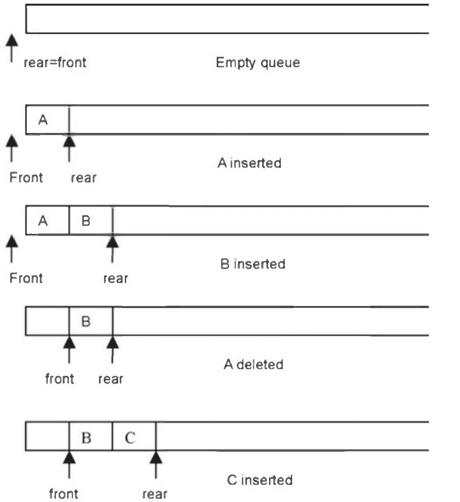

图14.3：队列操作

#### 14.5.1 队列的数组实现

当使用数组实现队列时，插入和删除操作通过数组可用的操作来实现。数组实现的一个局限性是，队列不能根据需要动态增长和收缩。

#### 程序14.5：下面是一个用数组实现队列的完整 C 程序

```
#include <stdio.h>
#define MAX 10 /* The maximum size of the queue */
#include <stdlib.h>

void insert(int queue[], int *rear, int value)
{
if(*rear < MAX-1)
{
*rear= *rear +1;
queue[*rear] = value;
}
else
{
printf("The queue is full can not insert a value\n");
exit(0);
}
}

void delete(int queue[], int *front, int rear, int * value)
{
if(*front == rear)
{
printf("The queue is empty can not delete a value\n");
exit(0);
}
*front = *front + 1;
*value = queue[*front];
}
```

```
void main()
{
int queue[MAX];
int front,rear;
int n,value;
front=rear=(-1);
do
{
do
{
printf("Enter the element to be inserted\n"); scanf("%d",&value);
insert(queue,&rear,value);
printf("Enter 1 to continue\n");
scanf("%d",&n);
} while(n == 1);
```

```
printf("Enter 1 to delete an element\n");
scanf("%d",&n);
while( n == 1)
{
delete(queue,&front,rear,&value);
printf("The value deleted is %d\n",value);
printf("Enter 1 to delete an element\n");
scanf("%d",&n);
}
printf("Enter 1 to continue\n");
scanf("%d",&n);
} while(n == 1);
}
```

#### 14.5.2 使用链表表示实现队列

初始时链表为空，因此 front 和 rear 指针均为 NULL。insert 函数创建一个新结点，将新的数据值放入其中，将其追加到现有链表，并让 rear 指针指向它。delete 函数检查队列是否为空；若非空，则取出 front 所指向结点的数据值，前移 front，并释放已取出数据值结点的存储空间。

如果使用上述策略创建包含四个数据值 10、20、30 和 40 的队列，则创建的队列如图14.4所示。

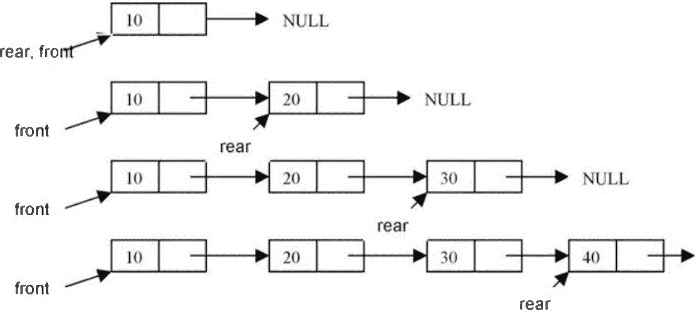

图14.4：链式队列

#### 程序14.6：下面是一个使用链表实现队列的完整 C 程序

```
# include <stdio.h>
# include <stdlib.h>
struct node
{
int data;
struct node *link;
};
```

```
if((*front == *rear) && (*rear == NULL))
{
printf(" The queue is empty cannot delete Error\n"); exit(0);
}
*value = (*front)->data;
temp = *front;
*front = (*front)->link;
if(*rear == temp)
*rear = (*rear)->link;
free(temp);
}

void main()
{
struct node *front=NULL,*rear = NULL; int n,value;
do
{
do
{
printf("Enter the element to be inserted\n"); scanf("%d",&value);
insert(&front,&rear,value);
printf("Enter 1 to continue\n");
scanf("%d",&n);
} while(n == 1);
```

```
printf("Enter 1 to delete an element\n");
scanf("%d",&n);
while( n == 1)
{
delete(&front,&rear,&value);
printf("The value deleted is %d\n",value);
printf("Enter 1 to delete an element\n");
scanf("%d",&n);
}
printf("Enter 1 to continue\n");
scanf("%d",&n);
} while(n == 1);
}
```

#### 14.5.3 循环队列

前一种实现的问题在于，即使有很大一部分空间是空闲的，insert 函数也会给出队列已满的信号。这是因为队列有向右移动的趋势，除非“front”追上“rear”，并且两者在删除过程中再次重置为0。为了克服这个问题，每删除一个元素，都需要将数组元素向左移动一位。但这会使删除过程效率低下。因此，解决这个问题的一个高效方法是将数组视为环形的，如图14.5所示。初始时，front 和 rear 都初始化为0。

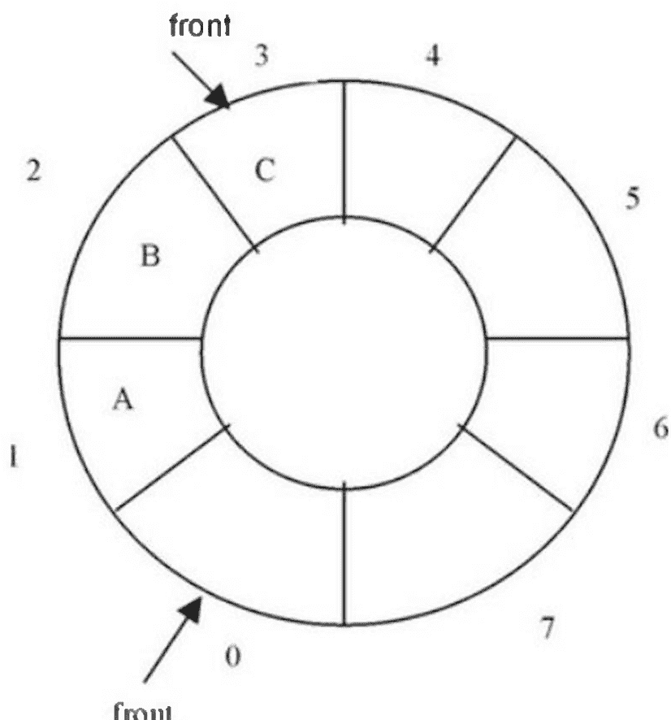

图14.5：循环队列

#### 程序14.7：下面是一个实现循环队列的完整 C 程序

```
#include <stdio.h>
#define MAX 10 /* The maximum size of the queue */
#include <stdlib.h>

void insert(int queue[], int *rear, int front, int value)
{
*rear= (*rear +1) % MAX;
if(*rear == front)
{
```


```
printf("The queue is full can not insert a value\n");
exit(0);
}
queue[*rear] = value;
}
void delete(int queue[], int *front, int rear, int * value)
{
if(*front == rear)
{
printf("The queue is empty can not delete a value\n");
exit(0);
}
*front = (*front + 1) % MAX; *value = queue[*front]; }
void main()
{
int queue[MAX];
int front,rear;
int n,value;
front=0; rear=0;
do
{
do
{
```

```
printf("Enter the element to be inserted\n"); scanf("%d",&value);
insert(queue,&rear,front,value);
printf("Enter 1 to continue\n");
scanf("%d",&n);
} while(n == 1);

printf("Enter 1 to delete an element\n");
scanf("%d",&n);
while( n == 1)
{
delete(queue,&front,rear,&value);
printf("The value deleted is %d\n",value); printf("Enter 1 to delete an element\n");
scanf("%d",&n);
}
printf("Enter 1 to continue\n");
scanf("%d",&n);
} while(n == 1);
}
```

#### 14.5.4 队列的应用

队列数据结构的一种应用是实现操作系统调度器需要维护的优先队列。优先队列中每个元素都有一个优先级值，并且要求元素按优先级递减的顺序插入队列中。这需要修改用于向队列插入元素的函数；`delete` 函数无需更改。

#### 程序 14.8：一个完整的 C 程序实现优先队列如下所示

```
# include <stdio.h>
# include <stdlib.h>
struct node
{
int data;
int priority;
struct node *link;
};
void insert(struct node **front, struct node **rear, int value, int priority) {
struct node *temp,*temp1;
temp=(struct node *)malloc(sizeof(struct node));
/* creates new node using data value passed as parameter */
if(temp==NULL)
{
printf("No Memory available Error\n");
exit(0);
}
temp->data = value;
temp->priority = priority;
temp->link=NULL;
if(*rear == NULL) /* This is the first node */
{
*rear = temp;
```

```
temp1=temp1->link;
temp->link = temp1->link;
temp1->link = temp;
}
}
void delete(struct node **front, struct node **rear, int *value, int *priority) {
struct node *temp;
if((*front == *rear) && (*rear == NULL))
{
printf(" The queue is empty cannot delete Error\n");
exit(0);
}
*value = (*front)->data;
*priority = (*front)->priority; temp = *front;
*front = (*front)->link;
if(*rear == temp)
*rear = (*rear)->link;
free(temp);
}

void main()
{
struct node *front=NULL,*rear = NULL;
int n,value, priority;
```

```c
do
{
    do
    {
        printf("Enter the element to be inserted and its priority\n");
        scanf("%d %d", &value, &priority);
        insert(&front, &rear, value, priority);
        printf("Enter 1 to continue\n");
        scanf("%d", &n);
    } while (n == 1);

    printf("Enter 1 to delete an element\n");
    scanf("%d", &n);
    while (n == 1)
    {
        delete(&front, &rear, &value, &priority);
        printf("The value deleted is %d and its priority is %d \n", value, priority);
        printf("Enter 1 to delete an element\n");
        scanf("%d", &n);
    }
    printf("Enter 1 to delete an element\n");
    scanf("%d", &n);
} while (n == 1)
```

```

### 自测题

6.队列也称为 ________ 数据结构。

7.在队列的链表实现中，新添加的元素是队首元素。 （真/假）

8. ________ 队列的一种应用是在操作系统的调度程序需要维护的优先队列的实现中。

### 14.6 总结

程序开发最重要的方面是为该程序操作的数据找到良好的表示。栈和队列是计算机编程中常用的 ADT 的例子。栈基本上是一个列表，只允许从一端插入和删除，该端称为栈顶，因此它是一种表现出后进先出 LIFO 特性的数据结构。栈的一个重要应用是在编程语言中实现递归。队列也是一个列表，只允许从一端插入，称为队尾，从另一端删除，称为队首。因此它是一种表现出先进先出 FIFO 特性的数据结构。当栈/队列的大小事先已知时，可以使用数组实现，并且更有效。

当栈/队列的大小事先未知时，则使用链表表示。它提供了更大的灵活性。循环队列是一种队列，其中最后一个元素之后的下一个元素是第一个元素。

### 14.7 终结性问题

1.将以下中缀表达式转换为后缀：
a/b-c+d*e-a*c

2.将以下中缀表达式转换为前缀
a*(b+c)/d-g

3. 写一个表达式使循环队列中的队首指针指向下一个位置？

4. 判断真假：
栈用于递归程序。

5. 运行时内存分配也称为 _____。

### 14.8 自测题答案

+   1. 位图
+   2. 动态
+   3. LIFO
+   4. （a）栈不能增长 5.
+   真
+   6. FIFO
+   7. 假
+   8. 优先

### 14.9 终结性问题答案

+   1. ab/c-de*+ac*
+   2. -/*a+bcdg
+   3. *front = (*front + 1) % MAX; 4.

真

5.动态内存分配。

### 14.10 练习

+   1.编写一个 C 程序来实现字符栈。
+   2.编写一个 C 程序来实现双端队列，即可以在任一端进行插入和删除的队列。使用链表表示。
+   3.编写一个程序来反转链表。
+   4.编写一个程序从链表中删除一个节点。
+   5.编写一个程序在链表中给定节点之后插入一个节点。
+   6.什么是后缀表达式？编写一个程序将中缀表达式转换为后缀表达式。
+   7.编写一个程序来求值后缀表达式。
+   8.编写一个函数来检查栈是否已满。
+   9.编写一个函数来检查队列是否为空。
+   10.为什么栈和队列被称为抽象数据类型？解释。

## 参考文献：

+   1.E. Balagurusamy, “Programming with ANSI C”, Tata McGraw-Hill Publishers, New Delhi.
+   2.Byron S. Gottfried, Schaum's Outline Series, “Theory and Problems of Programming with C”, Tata McGraw-Hill Publishers, New Delhi.
+   3.Stephen C. Kochan, “Programming in C”, CBS Publishers, Revised Edition, New Delhi.
+   4.Brian W. Kernighan and Dennis M. Ritchie, “The C Programming Language”, Second Edition, Prentice-Hall of India, New Delhi.
