# 工程与科学的 C++ 编程


## 菲利普斯埃克塞特学院


怀特图书基金
由默里·怀特（Murray White）夫妇设立，
他们是哈维·L·怀特（Harvey L. White，1955 届）的父母。

从菲利普斯埃克塞特学院图书馆撤架


由 Internet Archive 于 2022 年数字化，资金来自 Kahle/Austin 基金会


## 前言

C++ 是一种通用编程语言，兼具高级语言和低级语言特性。Bjarne Stroustrup（比雅尼·斯特劳斯特鲁普）于 1979 年在贝尔实验室开发了 C++，作为对 C 编程语言的一系列增强。C 语言虽然是为系统编程而开发的，但已越来越多地用于工程和科学应用。


由于最初的增强是添加类，因此由此产生的语言最初被命名为“带类的 C”（C with Classes），但在 1983 年更名为 C++。

除了克服 C 语言的一些危险和缺点之外，这些增强以及后续增强还造就了一种非常强大的语言，可以利用面向对象范式编写和开发非常高效的程序。C++ 的编程语言标准（ISO/IEC14882:1998）于 1998 年通过，并于 2003 年修订，是本书的基础。

### 背景与内容

本书源于多年讲授计算课程的经验，其中包括面向工程和理科专业学生的编程课程。这些课程最初使用 Fortran 语言，现在则使用 C++ 讲授。然而，大多数 C++ 教材都是面向普通大学生编写的，因此其中的示例和部分内容并非针对理科和工科学生，或与其关系不大。

在本书中，几乎所有示例和练习都涉及工程与科学应用，包括以下内容（以及更多）：

- 温度转换
- 放射性衰变
- 爱因斯坦方程
- 污染指数
- 数字电路
- 求根、积分、微分方程
- 互联网地址
- 交流电路
- 仿真
- 质量控制
- 街道网络
- 环境数据分析
- 化学数据库检索
- 海洋数据分析
- 电路网络
- 坐标变换
- 数据加密
- 梁的挠度
- 天气数据分析
- 海洋数据分析

有些示例会详细描述并求解；对于另一些示例，文中会概述解决方案，完整的开发过程可在作者维护的本书网站上获取：

http://cs.calvin.edu/books/c++/engr-sci

本书还重点介绍 C++ 在工程和科学应用中最重要的特性，其他特性则在选读章节、附录或本书网站上介绍。这使得本书适用于多种课程，从常规全学分课程到减少学分的课程，例如作者多次讲授的两学分课程。在这类课程中，课堂讲授辅以上机练习——这些练习本质上是教程式的——学生利用课堂上介绍的新语言特性编写程序来解决某个问题。

### 内容编排

本书的基本方法是螺旋式方法，以越来越详细的方式反复讨论各个主题。例如，先介绍构建表达式所用的基本 C++ 运算，再加入 C++ 库提供的预定义函数。学生有了使用函数的经验后，再学习如何定义自己的简单函数，进而定义更复杂的函数。之后，他们学习如何将这些函数整合到自己的库中，从而用定制设计的库扩展 C++ 语言。

然而，对于新手程序员来说，学习如何从零开始开发程序可能是一项困难且具有挑战性的任务。本书用于设计程序解决问题的方法论，是在多年向计算机科学、工程和理科学生教授 C++ 并合著 C++ 教材的过程中发展而来的，称为*以对象为中心的设计（OCD）*：

- 识别问题中需要处理的对象。
- 识别完成该处理所需的操作。
- 为此处理过程开发算法。
- 在程序中实现这些对象、操作和算法。
- 测试、纠正并修改程序。

虽然从技术上说，这种方法不能称为*面向对象设计（OOD）*，但它确实聚焦于问题中的对象以及对这些对象的操作。随着新的语言构造被学习，它们会被纳入设计过程。例如，早期章节使用简单类型的对象，但第 7 章向学生介绍 C++ 提供的一些标准类，用于处理更复杂的对象——即具有多个属性的对象。在后续章节中，会引入并讲解更多类，学生也会在运用这些类和理解类的结构方面获得更多练习。一旦他们充分理解了这些预定义标准类，便会在第 14 章学习如何构建自己的类来为对象建模，从而扩展 C++ 语言，使其包含新的自定义类型。

### 重要特色

- 全书使用标准 C++。
- 对关键概念采用“先使用——后构建”的方式，例如函数（先使用预定义函数，后构建函数）和类（先使用预定义类，后构建类）。其他许多主题也同样先期引入并使用，后期再扩展——这是一种螺旋式的方法。
- 引入功能强大且实用的标准模板库（STL），并详细讲解其中一些重要的类模板（如 vector）和函数模板（如 sort()）。
- 注明 C++ 中 C 语言未提供的语言特性。
- 突出强调工程与科学示例，包括数值方法。
- 部分示例的程序会详细展开；其他示例则概述程序的设计，完整开发过程可在本书网站上获取。
- 以对象为中心的设计（OCD）帮助学生开发程序以解决问题。
- 全书始终强调并运用恰当的设计与风格技巧。


- 自我测验题（附答案）可快速检验对所学习内容的理解。
- 章节总结突出关键术语、要点、设计与风格建议，以及常见编程陷阱。
- 每章都精心挑选了一系列难度各异的编程项目，运用该章所介绍的主题。部分项目的解答可在教师网站上获取，并可用于课堂演示。

### 计划中的补充材料

- 与本书配套的实验手册（可能以在线形式提供），包含实验练习和项目
- 本书的网站（http://cs.calvin.edu/books/c++/engr-sci），其中包含
  - 书中程序的源代码
  - 某些示例的扩展讲解和源代码
  - 与书中内容相关的重要网站链接
  - 勘误、补充、参考资料及其他辅助材料
- 教师网站，其中包含
  - 用于课堂演示的PowerPoint幻灯片
  - 习题解答
- 其他教学材料及相关内容的有用链接

### 致谢

我特别感谢艾伦·阿普特（Alan Apt），他与我有着多年的友谊，并鼓励我撰写本书；感谢兰迪·科恩（Randi Cohen）、大卫·图马尔金（David Tumarkin）、苏珊娜·拉桑德罗（Suzanne Lassandro）和珍妮弗·阿林格（Jennifer Ahringer），他们处理了将本书付梓出版的所有细节；也感谢永·巴科斯（Yong Bakos）对书稿的技术审阅。当然，我还要对我的妻子沙尔（Shar）以及我们的子女和孙辈——杰夫（Jeff）、丽贝卡（Rebecca）、梅根（Megan）和萨拉（Sara）；吉姆（Jim）；格雷格（Greg）、朱莉（Julie）、约书亚（Joshua）、德里克（Derek）和伊莎贝尔（Isabelle）；汤姆（Tom）、琼（Joan）、阿比盖尔（Abigail）、米卡（Micah）、卢卡斯（Lucas）、加布里埃尔（Gabriel）、伊登（Eden）和约西亚（Josiah）——表达感谢，感谢他们在我的忙碌减少了与他们共处的时间时给予我的爱和理解。最重要的是，我感谢上帝赐予我编写本书的机会和能力。

### 关于作者

拉里·尼霍夫（Larry Nyhoff）于1960年毕业于卡尔文学院（Calvin College），获得数学学位；1961年在密歇根大学（University of Michigan）获得数学硕士学位；随后于1963年回到卡尔文学院任教。1969年在密歇根州立大学（Michigan State University）获得博士学位后，他开始了预期中的终身职业——数学教授，并于1969年合著了他的第一本教科书《大学数学基础》（Essentials of College Mathematics，Holt, Rinehart, Winston, Inc.出版）。

然而，在70年代学生们开始强烈要求开设计算机课程时，尼霍夫教授主动帮助开发课程，并合著了多本关于BASIC、FORTRAN和COBOL编程语言的教材。在1981年至1983年于西密歇根大学（Western Michigan University）完成计算机科学研究生学业后，他从数学转向计算机领域，并成为新成立的计算机科学系的教授。

不久，他开始了漫长的教材写作生涯，第一本书是1983年由麦克米伦（Macmillan）出版的合著FORTRAN 77编程教材。随后他又出版了一本Pascal编程教材，该书经历了三个版本，成为畅销书。此后又出版了25余本书，涵盖FORTRAN 90、Turbo Pascal、Modula-2和Java，其中包括一本非常受欢迎的C++教材的三个版本，以及一本使用C++的数据结构入门教材。其中一些教材至今仍被世界各地使用，部分已被翻译成其他语言，包括西班牙语、中文和希腊语。

在2003年退休的前一年，经过41年的全职教学后，尼霍夫教授获得了卡尔文学院最高教师荣誉——校长杰出教学奖。退休后，他继续兼职任教，教授“应用C++”课程的多个教学班；该课程为两学分，是所有工科学生的必修课，也有部分理科学生选修。本书是在该课程中多个学期使用的初步版本的基础上形成的。

# 计算概论

### 目录

- 1.1 计算系统 2
- 1.2 计算机组织 14
- 习题 20

> 我多么希望这些计算是由蒸汽来执行的。
>
> 查尔斯·巴贝奇

> 一台机器能完成五十个普通人的工作。没有任何机器能完成一个非凡之人的工作。
>
> 埃尔伯特·哈伯德

> 像ENIAC这样的计算机配备了18,000个真空管，重达30吨；未来的计算机也许只有1000个真空管，重量仅为1.5吨。
>
> 《大众机械》（1949年3月）

> 640K内存对任何人来说都应该足够了。
>
> 比尔·盖茨（1981年）

> 因此，IBM为所有XT机型都配备了它所认为的严肃个人计算机的最低配置。如今，10兆字节的磁盘和128K内存对于一台严肃机器来说已是理所当然。
>
> 彼得·诺顿（1983年）

现代电子计算机是二十世纪最重要的产品之一。它在商业、工业、政府、科学和教育等许多领域都是必不可少的工具；事实上，它几乎触及了我们生活的各个方面。高速计算系统的发展所带来的二十世纪信息革命，其影响之广泛几乎与十九世纪工业革命的影响一样深远。在本章中，我们首先介绍一些背景知识，描述计算系统、其主要组成部分，以及信息如何在其中存储。

早期的计算机非常难以编程。事实上，对某些最早的计算机进行编程，就是设计和构建电路，以执行解决每个新问题所需的各种计算。后来，计算机指令可以用机器能够理解的语言进行编码。但这些代码非常晦涩，因此编程工作非常繁琐且容易出错。如果没有高级编程语言的发展，使得人们能够使用类似英语的语法输入指令，计算机就不会得到广泛应用。

Fortran、C、C++、Java和Python是工程和科学应用中广泛使用的一些语言。本书将重点介绍C++，但也会描述其母语言C的一些特性，指出这两种语言的共同之处以及差异。

#### 1.1 计算系统

四个重要概念塑造了计算的历史：

- 1. 算术的机械化
- 2. 存储程序
- 3. 图形用户界面
- 4. 计算机网络

本节简要介绍实现这些概念的一些重要事件和设备。更多信息可在本书前言中所述的网站上找到。

##### 1.1.1 用于算术的机器

最早的“个人计算器”之一是算盘（图1.1a），它由穿在杆上的可移动珠子组成，用于计数和计算。尽管算盘的确切起源尚不清楚，但中国人可能早在三、四千年前就已使用它，至今整个亚洲仍在使用。早期的商人用算盘进行贸易交易。古代英国的石制纪念碑巨石阵（图1.1b）位于英格兰索尔兹伯里附近，建于公元前1900年至公元前1600年之间，显然用于预测季节变化。十二世纪，巴格达的一位波斯数学教师穆罕默德·伊本·穆萨·花拉子米（Muhammad ibn-Musa al-Khowarizm）开发了一些最早的分步计算方法。用于这类过程的“算法”一词就源自他的名字。


(a)


(b)

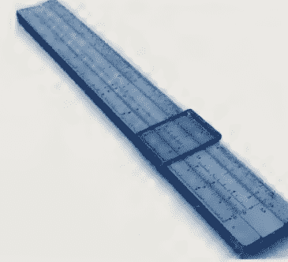

(c)

图1.1 (a) 算盘。（图片由计算机历史博物馆提供。）(b) 巨石阵。(c) 计算尺。

英国数学家威廉·奥特雷德（William Oughtred）在17世纪初发明了圆形计算尺，而更现代的计算尺（图1.1c）直到20世纪50年代并延续到60年代，仍被工程师和科学家用于进行快速近似计算。

1642年，年轻的法国数学家布莱斯·帕斯卡（Blaise Pascal）发明了最早的一批机械加法机之一，以帮助他的父亲计算税款。这台帕斯卡计算器（Pascaline，图1.2a）是一台数字式计算器，因为它用离散的数字表示数值信息，而不是像计算尺和非数字温度计等模拟测量仪器那样使用刻度尺。每个数字由一个具有10种不同位置的齿轮（一种十态装置）表示，因此它可以“从0数到9”，并在到达10时重置为0，同时推进下一列的齿轮，以表示“进位”到下一位。1673年，德国数学家戈特弗里德·威廉·冯·莱布尼茨（Gottfried Wilhelm von Leibniz）发明了一种改进的机械计算器（图1.2b），它也使用齿轮和表盘系统进行运算。不过，它比帕斯卡计算器更可靠、更精确，并且能够执行加、减、乘、除这四种基本算术运算。此后又出现了一系列其他机械计算器，进一步完善了帕斯卡和莱布尼茨的设计；到十九世纪末，这些计算器已成为科学、商业和贸易中的重要工具。

##### 1.1.2 存储程序概念

将计算机与计算器区分开来的基本思想，是控制计算的存储程序概念。程序是计算机为解决某个问题而遵循的一系列指令。所得税申报表就是一个很好的类比。虽然计算器在此过程中可能是有用的工具，但计算税额涉及的远不止算术。要得到正确结果，必须执行表格中精确的步骤顺序：写下数字（存储）、查找数字（检索），以及计算，从而得出正确结果。

存储程序概念还赋予了计算机惊人的通用性。与大多数其他机器是为机械化完成单一任务而设计的不同，计算机可以通过编程来执行许多不同的任务。尽管其硬件是为一项非常特定的任务——算术的机械化——设计的，但计算机软件程序使其能够执行各种任务，从航天飞机的导航控制到文字处理再到作曲。


图1.2 (a) 帕斯卡计算器。(b) 莱布尼茨的计算器。（图片由计算机历史博物馆提供。）


雅卡尔织布机（图 1.3a），由法国人约瑟夫·玛丽·雅卡尔于 1801 年发明，是存储程序自动控制硬件设备的早期例子。金属卡片上打孔来控制这台织布机的动作：卡片上打一个孔会使对应的纱线穿过并在工艺的某一阶段被编入织物中；没有孔则会排除不需要的纱线。要更换不同的织造图案，操作员只需换上一套卡片。雅卡尔的织布机因此是可编程机器的早期例子之一，后来的许多计算机也都类似地使用了穿孔卡片。

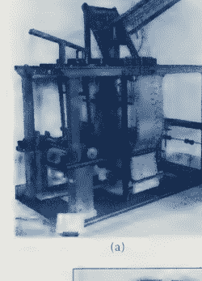


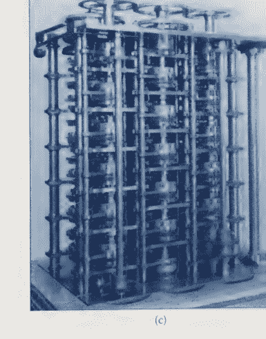

图 1.3 (a) 雅卡尔织布机。（图片由计算机历史博物馆提供。）(b) 查尔斯·巴贝奇。(c) 差分机。

英国数学家 *查尔斯·巴贝奇*（1792–1871）（图 1.3b）结合了机械化计算和存储程序控制这两个基本概念。1822 年，在英国政府的支持下，他开始研制一台他称之为 *差分机*（图 1.3c）的机器。差分机由齿轮系统组成，设计用于计算多项式以编制数学表。

巴贝奇放弃了这项工作并开始设计一台更为复杂的机器，他称之为 *分析机*（图 1.4a）。它将拥有超过 50,000 个部件，其运行将更加多功能且完全自动，由存储在穿孔卡片上的程序控制，这一想法基于雅卡尔的早期工作。尽管这台机器在他有生之年并未建成，但它是计算历史的重要组成部分，因为其设计中的许多概念被现代计算机所使用。因此，巴贝奇有时被称为“计算之父”。*阿达·奥古斯塔*（图 1.4b），拜伦勋爵的女儿，是除巴贝奇之外少数理解分析机设计的人之一。这使她能够为该机器开发“程序”，因此她有时被称为“第一位程序员”。20 世纪 80 年代，以她的名字命名了编程语言 Ada。

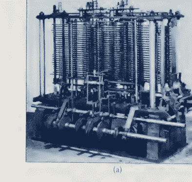

(a)


(b)

图 1.4 (a) 分析机。(b) 阿达·奥古斯塔。

在接下来的 100 年里，最重大的事件是 *赫尔曼·霍勒里斯* 发明了一种电动制表机（图 1.5a），它可以汇总存储在穿孔卡片上的人口普查统计数据。这很值得注意，因为美国人口普查局担心无法在下一次普查开始前完成 1890 年的人口普查，但霍勒里斯的机器使其在 2 年半内完成。霍勒里斯制表公司后来与其他公司合并，于 1924 年组建了国际商业机器（IBM）公司。

在接下来的几十年里，机电计算设备的开发继续以快速的步伐进行。其中包括德国工程师 *康拉德·楚泽* 在 1930 年代开发的“Z”系列机器，它们使用 *二进制* 算术而不是十进制，以便可以使用双态设备代替十态设备。其中一些后来的机器用真空管取代了机械继电器。楚泽还设计了一种高级编程语言，称为 Plankalkül。二战也推动了计算设备的开发，包括由艾伦·图灵和一个英国团队开发的用于破解德国恩尼格玛密码机的 Collosus 计算机。1945 年前建造的最著名的计算机可能是哈佛 Mark I（图 1.5b）。与楚泽的“Z”机器一样，它由机电继电器技术驱动。重复了巴贝奇的大部分工作，霍华德·艾肯和 IBM 的其他人建造了这台大型、自动、通用、机电式计算器，由美国海军赞助，旨在计算数学和导航表。

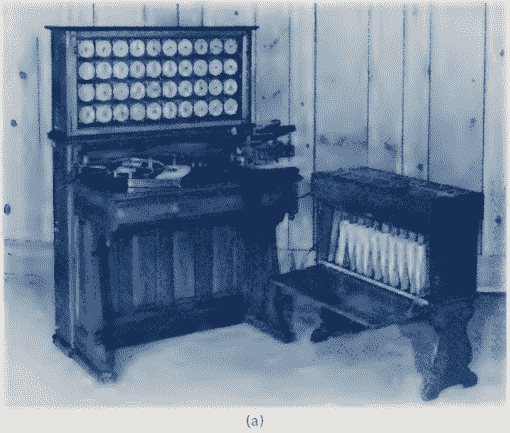

(a)

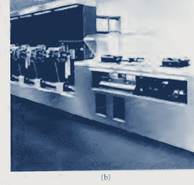

(b)

图 1.5 (a) 霍勒里斯的制表机。(b) 哈佛 Mark I。（图片由计算机历史博物馆提供。）

1944 年，格蕾丝·默里·霍珀（1907–1992）开始为 Mark I 工作担任编码员——我们今天称之为程序员。后来，在其继任者 Mark II 上工作时，她发现了第一个计算机“虫”——一只真正的虫子卡在数千个继电器中的一个里。¹ 直到今天，寻找程序错误原因的努力仍被称为“调试”。20 世纪 50 年代末，被亲切地称为“COBOL 外婆”的她开发了 FLOW-MATIC 语言，这是 COBOL（通用业务导向语言）的基础，COBOL 是一种广泛用于商业应用的编程语言。

约翰·阿塔纳索夫和克利福德·贝里在 1937–1942 年间于爱荷华州立大学开发了第一台全电子二进制计算机（图 1.6a），即 ABC（阿塔纳索夫-贝里计算机）。它引入了二进制算术、再生存储器和逻辑电路的思想。不幸的是，由于 ABC 从未申请专利，而且当时其他人未能认识到其实用性，直到三十年后阿塔纳索夫和贝里才因这一卓越技术获得认可。在此之前，电子数值积分计算机，更为人所知的 ENIAC（图 1.6b），享有第一台全电子计算机的称号。设计者 J. 普雷斯珀·埃克特和约翰·莫奇利于 1943 年在宾夕法尼亚大学摩尔工程学院开始研制它。1946 年完工时，这台重 30 吨的机器拥有 18,000 个真空管、70,000 个电阻器和 500 万个焊接点，消耗 160 千瓦的电功率。人们讲的故事说，当 ENIAC 运行时的费城灯光会变暗。这台极其庞大的机器可以将数字相乘的速度比 Mark I 快约 1000 倍，但其应用相当有限，主要由陆军兵工厂部门用于计算各种火炮弹丸的射击表和弹道。埃克特和莫奇利后来离开宾夕法尼亚大学成立了埃克特-莫奇利计算机公司，该公司制造了 UNIVAC（通用自动计算机）。该机于 1946 年启动，1951 年完成，是第一台为科学和商业应用而设计的商用计算机。UNIVAC 部分因其在 1952 年美国总统大选中基于 5% 的选票回报对艾森豪威尔总统当选的正确预测（尽管当时不被相信）而在全国电视上获得即时名声。

控制 ENIAC 运行的指令是通过重新布线计算机的部分电路输入机器的。这个复杂的过程非常耗时，有时需要几个人花费数天时间；在此期间，计算机处于空闲状态。

在其他早期计算机中，指令存储在机器外部的穿孔卡片或其他介质上，并逐条传输到机器中进行解释和执行。

然而必须指出的是，虽然机器是由男性建造的，但却是女性学会了如何使其工作来解决手工需要数小时才能解决的数学问题（图 1.7）。而且在整个美国各地有成千上万的女性从事类似的工作。2010 年首映的纪录片《Top Secret Rosies: The Female Computers of World War II》承认了她们的重要工作。²

² http://www.topsecretrosies.com/Top_Secret_Rosies/Home.html


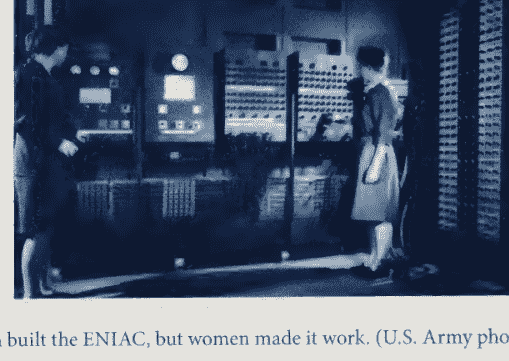

图 1.7 男人建造了 ENIAC，但女人让它运转起来。（美国陆军照片。）

1945 年，普林斯顿数学家约翰·冯·诺伊曼撰写了《EDVAC（电子离散变量自动计算机）报告初稿》，其中描述了一种在执行前将程序指令存储在内部的方案。这使他被认为是存储程序概念的发明者。他所描述的架构设计至今仍被称为冯·诺伊曼架构。与直接从机械输入设备执行指令相比，从计算机内存中执行指令的优势在于消除了计算机等待指令所需的时间。指令可以更快地处理，更重要的是，计算机本身可以在计算进行的同时修改指令。这一方案引入到计算机架构中对通用计算机的发展至关重要。

用于构建计算机系统的实际物理部件是其硬件。计算机的几代可以根据所使用的硬件类型来识别。ENIAC 和 UNIVAC 是第一代计算机的例子，其特点是大量使用真空管。电子技术的进步带来了计算系统的变化，1958 年 IBM 推出了第二代计算机中的第一台，IBM 7090。这些计算机建于 1959 年至 1965 年间，使用晶体管代替真空管。因此，这些计算机体积更小，需要的功率更少，产生的热量更少，可靠性也高于前辈。它们也更便宜，正如 1963 年首台小型计算机 PDP-8 的推出所说明的那样，其售价为 18,000 美元，而早期计算机六位数的价格标签限制了其销售对象仅为大型公司。随后出现的第三代计算机使用了集成电路，并引入了更好的系统利用技术，例如多道程序设计和分时技术。1964 年推出的 IBM System/360 通常被认为是这一代计算机的开端。从 1980 年代开始的第四代计算机使用硅芯片上的超大规模集成电路（VLSI）和其他微电子进步，使其尺寸和成本进一步缩小，同时能力大幅增强。

第一块芯片是英特尔 Ted Hoff 设计的 4004 芯片（图 1.8），它催生了微处理器，标志着计算机第四代的开始。

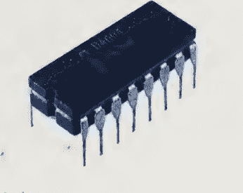

图 1.8 英特尔 4004 芯片（1971 年）。

这与 IBM 首次使用 8 英寸软盘一起，开启了个人电脑时代。英特尔公司联合创始人之一罗伯特·诺伊斯将微型计算机与 ENIAC 作了如下对比：

> 一块大约四分之一英寸见方的芯片上的单个集成电路，现在可以容纳比 1950 年能够制造的最复杂的电子设备更多的电子元件。今天的微型计算机，价格可能为 300 美元，其计算能力超过了第一台电子计算机 ENIAC。它快 20 倍，内存更大，消耗的功率相当于一盏灯泡，而不是一台机车，占据的体积为 1/30,000，成本仅为 1/10,000。它可以通过邮购获得，也可以在当地的爱好商店买到。

##### 1.1.3 系统软件

存储程序概念相对于手工编程方法是一个重大改进，但由于表示程序和数据所需的复杂编码方案，早期计算机仍然难以使用。因此，除了改进硬件外，计算机制造商开始开发被称为系统软件的程序集合，使计算机更易于使用。其中一个更重要的进步是操作系统的开发，操作系统为程序和数据分配存储空间并执行许多其他监督功能。它们还充当用户与机器之间的接口，解释用户从键盘、鼠标点击或语音命令发出的命令，然后指导适当的系统软件和硬件执行这些命令。两个重要的早期操作系统是 Unix（1971 年）和 MS-DOS（1981 年）。Unix 由 Ken Thompson 和 Dennis Ritchie 于 1971 年在 AT&T 的贝尔实验室开发，是唯一一个已在从微型计算机到超级计算机的计算机上实现的系统。多年以来，个人计算机最流行的操作系统是 MS-DOS，由微软公司创始人比尔·盖茨于 1981 年开发。最近，图形用户界面（GUI）被设计出来，以提供人与计算机之间更简单、更直观的界面，例如用于基于 UNIX 的机器的 MIT X Window 系统、用于个人计算机的微软 Windows 以及苹果的 Macintosh 界面。

正如本章引言中所述，系统软件最重要的进步之一是高级语言的开发，它允许用户用类似于自然语言的语言编写程序。用高级语言编写的程序称为源程序。对于大多数高级语言，构成源程序的指令必须翻译成机器语言，即计算机直接用于所有计算和处理的语言。这种机器语言程序称为目标程序。将源程序翻译成目标程序的程序称为编译器。

这篇关于计算历史的总结主要涉及塑造计算机历史的两个重要概念：算术的机械化和存储程序概念。回顾过去，我们惊叹于技术进步在半个多世纪内如何从 ENIAC 发展到今天的各种计算机系统，从智能手机、平板电脑和笔记本电脑，到功能强大的台式机，到每秒可执行数十亿次运算的超级计算机，再到使用数千个微处理器并行工作以解决大型问题的并行计算机。有人曾指出，如果汽车工业的进步与 1960 年以来计算机技术的进步一样迅速，今天的汽车发动机长度将小于 0.1 英寸，每加仑汽油行驶 12 万英里，最高时速为 24 万英里每小时，价格为 4 美元。

##### 1.1.4 图形用户界面

产生计算机发展革命性变化的第三个关键概念是图形用户界面（GUI）。用户界面是响应用户命令的软件程序的一部分。过去二十年中，用户界面发生了巨大演变，与典型计算机用户的同样戏剧性变化直接相关。

在 1980 年代初，个人电脑崭露头角。然而，最初，个人电脑并不太适合普通人。商业可用应用软件数量的爆炸使计算机用户免于学习编程以自行编写软件；例如，仅 Lotus 1-2-3 电子表格软件的可用性就足以说服许多人购买 PC。即使如此，使用计算机仍然需要学习许多精确而晦涩的命令，甚至需要编程技能。

在 1980 年代初，苹果公司决定采取措施改善这一状况。Apple II 与其新竞争对手 IBM PC 一样，采用命令行界面，要求用户学习困难的命令。20 世纪 70 年代末，史蒂夫·乔布斯访问了施乐帕洛阿尔托研究中心（PARC），并看到了令他惊叹的几种技术：激光打印机、以太网和图形用户界面。其中最后一种最让乔布斯兴奋，因为它提供了计算机用户几乎可以直观理解的软件的可能性。在 1995 年的一次采访中他说：“我记得在看到图形用户界面东西后的 10 分钟内，就知道有一天每台计算机都会这样工作。”


借鉴儿童发展理论，施乐帕洛阿尔托研究中心（Xerox PARC）为1973年开发的样机Alto设计了图形用户界面。Alto配备了一种新设备，其发明者——PARC研究科学家道格拉斯·恩格尔巴特称之为“鼠标”。鼠标使用户能够通过指向图标和从菜单中选择选项来操作计算机。然而，当时Alto所需的硬件成本使其无法推向市场，这一绝妙的概念也未被使用。但史蒂夫·乔布斯看到，正是使个人计算机成为可能的计算机硬件市场的巨大变革，也使图形用户界面成为一种合理的可能性。1984年，在超级碗中场休息时首次播出的一则著名广告中，苹果向世界推出了第一台图形用户界面个人计算机：Macintosh。1985年，微软以竞争产品Windows操作系统作为回应，但在1990年Windows 3.0版发布之前，Macintosh在图形用户界面微型计算机领域一直占据主导地位。麻省理工学院的研究人员还于1984年发布了X Window系统，将图形用户界面带到了UNIX平台上。

图形用户界面使计算机易于使用，并带来了许多新的计算机用户。与此同时，它也极大地改变了计算的特征：计算机现在被期望是“用户友好的”。尤其是个人计算机，对普通用户而言必须真正“个人化”，而不仅仅是对程序员而言。

##### 1.1.5 网络

计算机网络是第四个极大地影响现代计算性质的关键概念。简单来说，计算机网络由两台或多台已连接以交换资源的计算机组成。这些资源可以是硬件资源，如处理能力、存储或打印机访问权；也可以是软件资源，如数据文件或计算机程序的访问权；还可以是人与人之间的消息，如电子邮件或多媒体万维网页面。

随着计算机变得更小、更便宜、更普及、更多功能且更易用，计算机的使用率上升了，用户数量也随之增加。因此，计算机不得不被共享。20世纪60年代初，分时技术被引入，在这种技术中，多人通过一组终端同时使用一台称为主机的计算机，每个终端由用于输入的键盘和用于输出显示结果的打印机或监视器组成。借助调制解调器（“modem”是“modulator/demodulator”的缩写，因为它既将二进制数字调制成可通过电话线传输的声音，又在另一端将此类声音解调回比特），这种终端连接可以跨越长距离。

然而，用户开始希望一台主机能够与另一台主机通信。例如，将文件从一台主机传输到另一台主机通常意味着将磁带从一个地点运送到另一个地点。20世纪60年代末，美国国防部开始探索开发计算机网络，使其在各大学的研究中心能够相互共享计算机资源。1969年，ARPANET开始连接各研究中心的计算机，使它们能够共享软件和数据，并进行另一种交流方式——电子邮件——这种方式在受欢迎程度上令所有人惊讶。在20世纪70年代、80年代和90年代，接入ARPANET主干网的主机数量以指数级增长，最终形成了一个全球数字基础设施，即后来的互联网。

同样，随着20世纪70年代末和80年代初微型计算机的问世，用户开始希望个人计算机具备资源共享能力。以太网硬件以及Novell NetWare等网络操作系统的发明催生了局域网（LAN），使个人计算机用户能够共享打印机和其他外围设备、磁盘存储、软件程序等。微软还将网络功能作为其Windows NT操作系统的主要特性。

计算机互联的增长以惊人的速度持续着。计算机已变得普遍，而且孤立使用的情况越来越少。随着价格实惠且广泛可用的互联网服务提供商（ISP）和WiFi的出现，计算机用户现在几乎可以在任何地方连接到不断扩展的全球数字基础设施。

##### 1.1.6 C++简史

为了简化将Unix操作系统移植到其他计算机的任务，肯·汤普森开始寻找一种可以用来重写Unix的高级语言。当时存在的语言都不合适；因此，在1970年，汤普森开始设计一种名为B的新语言。到1972年，显然B不足以实现Unix。那时，同在贝尔实验室的丹尼斯·里奇设计了B的继任语言，他称之为C，大约90%的Unix被用C重写。

到20世纪70年代末，一种新的编程方法出现了——**面向对象编程（OOP）**——它强调通过类和继承对对象进行建模。施乐PARC的一个研究小组创造了第一种真正的面向对象语言，名为Smalltalk-80。另一位贝尔实验室研究人员比雅尼·斯特劳斯特鲁普开始着手用面向对象的特性扩展C语言。1983年，重新设计和扩展后的编程语言“带类的C”以新名称C++推出。

在随后的几年里，随着计算机制造商为其机器开发C和C++编译器，一些制造商添加了针对其特定计算机的扩展和变体。因此，为某一台机器编写的程序未经修改可能无法在另一台机器上使用。为了解决这些问题，人们制定了C++标准，使得用C++编写的程序具有**可移植性**，这意味着它们可以在几种不同的机器上运行，几乎不需要或根本不需要改动。

#### 1.2 计算机组织

分析机的基本设计与现代计算机惊人地相似，因为它包含了计算机系统的四项基本操作：处理、存储、输入和输出。它包括一个用于按照指令序列执行算术运算的“工场”（类似现代机器中的中央处理单元）；“仓库”是机器的存储器，用于存储多达一千个50位数字和中间结果；输入通过穿孔卡片进行；输出采用打印方式；还设计了其他组件用于组件之间的信息传输。如果完成，它将有火车头那么大，由蒸汽驱动，能够非常迅速地计算到小数点后六位的精度并打印结果，这一切都将由存储程序控制！

巴贝奇分析机将系统设计为多个独立组件、每个组件具有各自特定功能的理念，被融入许多后来的计算机中，事实上，这也是大多数现代计算机的常见特征。在本节中，我们简要描述现代计算系统的主要组件以及程序指令和数据是如何存储和处理的。关于计算机体系结构的更完整描述，可在本教材前言中所述的网站上找到。

##### 1.2.1 计算系统

当今大多数计算机都展现了一种通常称为冯·诺依曼体系结构的结构，该结构以匈牙利数学家约翰·冯·诺依曼的名字命名，他在存储程序概念方面的开创性工作及其理论定义了许多现代计算机的关键特征。根据冯·诺依曼体系结构（见图1.9），计算系统的核心是中央处理单元（CPU）。CPU控制整个系统的运行，执行算术和逻辑操作，并存储和检索指令与数据。计算机执行的每一个任务最终都归结为

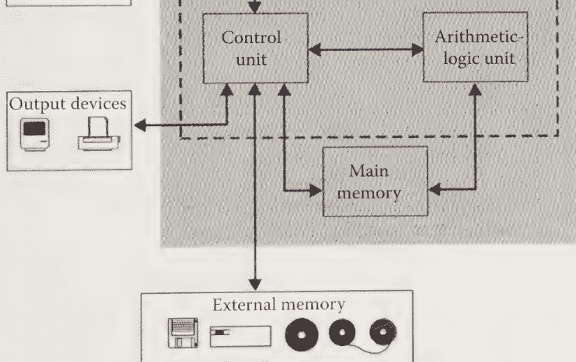

图1.9 计算系统的主要组件。


指令和数据可由 CPU 操作。指令和数据存储在高速存储单元中，控制单元从存储器中获取这些指令，对其进行解码，并指示系统执行指令所指示的操作。那些属于算术或逻辑性质的操作是使用 CPU 的算术逻辑单元（ALU）的电路来执行的。这些 CPU 的操作被称为处理。

与冯·诺依曼架构中 CPU 每次只执行一条指令的操作相反，并行处理计算机通过采用两个或多个 CPU 来提高性能。世界上最快的超级计算机采用数千个 CPU 芯片，因此被称为大规模并行处理计算机。然而，并行计算需要一种非常不同的编程策略，以便利用拥有数千个处理器的系统的能力。

##### 1.2.2 存储

计算机系统的存储单元有几个用途。主存储器也称为内部、主存储器或随机存取存储器（RAM），其主要功能是存储正在执行的程序的指令和数据。大多数现代计算机还具有少量高速存储器，称为高速缓存存储器，通常位于与 CPU 相同的芯片上。它用于通过存储正在执行的最近或当前指令集来加快执行速度，从而无需从主存储器中获取。同样，作为 CPU 处理的一部分，它可能需要临时写下（存储）一个数字并稍后读取（检索）它。CPU 可以以这种方式使用主存储器，但 CPU 内还有一组特殊的高速存储位置，称为寄存器。存储在寄存器中的值通常可以比存储在 RAM 中的值快数千倍。

RAM 和寄存器存在一个问题，那就是它们是易失性的；也就是说，如果计算系统的电源关闭（无论是有意还是意外），存储在这些存储组件中的值都会丢失。为了提供软件程序和数据的长期存储，大多数计算系统还具有称为二级、外部或辅助存储的组件。此类存储的常见形式包括磁介质，如硬盘，以及光介质，如 CD-ROM 和 DVD，它们利用激光技术来存储和检索信息。这些设备是非易失性的，因为即使断电，它们也能为大量数据提供长期存储。然而，访问存储在这些设备上的数据所需的时间可能比访问存储在 RAM 中的数据的时间长数千倍。

主存储器和二级存储器都是由双态器件组成的集合。在二进制数系统中只有两种可能的数字，0 和 1。因此，如果将双态器件的一个状态解释为 0，另一个状态解释为 1，则可以说该双态器件是一个 1 位器件，因为它能够表示单个二进制数字（或“位”）。此类双态器件按组组织，称为字节，一个字节由八位组成。

为了表示更大的存储量，使用了公制系统的一些前缀，例如千。然而，有一个重要的区别。公制系统之所以方便，正是因为它是一个十进制系统，基于 10 的幂，而现代计算机是二进制计算机，基于 2 的幂。因此，在计算中，前缀千通常不是指 1000，而是等于 2^10 或 1024。因此，千字节（KB）是 1024 字节，而不是 1000 字节；一兆字节（MB）是 1024 KB 或 1,048,576 字节，而不是 100 万字节；一千兆字节（GB）是 1024 MB 或 1,073,741,824 字节，而不是 10 亿字节。

字节通常组合成字。字中的位数等于 CPU 数据寄存器的位数。因此字长在不同的计算机上有所不同，但常见的字长为 16 位（= 2 字节）、32 位（= 4 字节）和 64 位（= 8 字节）。每个字或字节都关联一个地址，可用于直接访问该字或字节。这使得随机访问（直接访问）成为可能：能够将信息存储在特定的存储位置，然后稍后直接从该位置检索。各种类型的数据如何在二进制形式中表示和存储的细节将在第 3 章中描述。

##### 1.2.3 输入和输出

要使计算机的 CPU 处理指令和数据，它们必须被数字化——也就是说，它们必须以二进制形式编码并传输到 CPU。这就是输入设备的主要功能。键盘是最常见的输入设备，其次是鼠标、轨迹球和操纵杆等指向设备。同样，扫描仪将图形转换为二进制信息并输入，而音频和视频采集板可以编码并输入声音和视频。

一旦 CPU 完成处理，为了使该二进制结果对人类有意义，就需要将其转换为另一种形式。这就是输出设备的主要功能。两种更常见的输出设备类型是显示器和打印机。然而，计算机可以生成的输出种类繁多且令人惊讶。计算机可以以图形、声音、视频和运动（在机器人技术的情况下）等形式输出信息。

CPU 与输入和输出设备之间的通信通常通过端口进行，端口是计算机系统内部组件与其外围设备（外部组件）之间的连接点。一些端口，例如显示器端口，专为单一特定用途而设计。其他端口，例如并行端口和串行端口，则更灵活，可以容纳各种类型的外围设备。端口反过来连接到计算机系统的总线，总线是贯穿计算机系统的一种高速公路。通过总线，计算机系统的组件可以向 CPU 和存储器发送和接收指令和数据。

##### 1.2.4 操作系统

为了使计算机成为通用计算机，它必须首先加载一个称为操作系统的系统软件程序（OS）。从非常概括的角度来看，该软件程序执行两个主要功能：
- 1. 它充当计算机用户与系统硬件之间的接口。
- 2. 它充当其他软件程序可以运行的环境。

操作系统和计算机系统硬件共同构成了可以构建额外功能的**平台**。一些操作系统只能在单一类型的硬件上运行。例如，DOS 和 Windows 操作系统只能在 PC 硬件上运行。相比之下，UNIX 操作系统可在多种类型的计算机硬件上运行。

##### 1.2.5 编程

CPU 的程序指令必须存储在存储器中。它们必须是机器可以执行的指令，并且必须以机器可以理解的形式表达——也就是说，它们必须用该机器的**机器语言**编写。这些指令由两部分组成：（1）表示基本机器操作（如加载、乘法、加法和存储）的数字**操作码**；以及（2）**操作数**的地址。与存储在存储器中的所有信息一样，这些指令必须以二进制形式表示。

例如，假设值已存储在地址为 1024、1025 和 1026 的三个存储位置中，我们想要将前两个值相乘，加上第三个值，并将结果存储在第四个存储位置 1027 中。要执行此计算，必须执行以下指令：
- 1. 获取存储位置 1024 的内容，并将其加载到 ALU 中的寄存器中。
- 2. 获取存储位置 1025 的内容，并计算该值与寄存器中值的乘积。
- 3. 获取存储位置 1026 的内容，并将该值加到寄存器中的值上。
- 4. 将寄存器中的内容存储在存储位置 1027 中。

如果加载、存储、加法和乘法的操作码分别为 16、17、35 和 36，则这四条指令可以用机器语言写成如下形式：
- 1. 000100000000000000001000000000
- 2. 001001000000000000010000000001
- 3. 001000110000000000010000000010
- 4. 000100010000000000010000000011
- opcode operand

然后可以将这些指令存储在四个（连续的）存储位置中。当程序执行时，控制单元将获取每条指令并对其进行解码


to determine the operation and the address of the operand, fetch the operand, and then perform the required operation, using the ALU if necessary.

在早期计算机的机器语言中编程显然是一项非常困难且耗时的任务，其中错误很常见。只有后来才有可能用**汇编语言**编写程序，它使用助记符（名称）代替数字操作码，使用变量名代替数字地址。例如，前述指令序列可以用汇编语言写成

1. LOAD a, ACC
2. MULT b, ACC
3. ADD c, ACC
4. STORE ACC, x

汇编器是系统软件的一部分，它将此类汇编语言指令翻译成机器语言。

```asm
LOAD a, ACC
MULT b, ACC
ADD c, ACC
STORE ACC, x
```

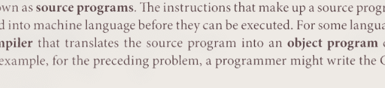

今天，大多数程序都是用**高级语言**如 C++ 和 Java 编写的。此类程序称为**源程序**。源程序中的指令在执行前必须被翻译成机器语言。对于某些语言（如 C++），**编译器**将源程序翻译成**目标程序**来完成此操作。例如，对于前述问题，程序员可能会写出 C++ 语句

```cpp
x = a * b + c;
```

它指示计算机将 a 和 b 的值相乘，加上 c 的值，并将该值赋给 x。C++ 编译器会将此语句翻译成像前面考虑过的那样的机器语言指令序列。

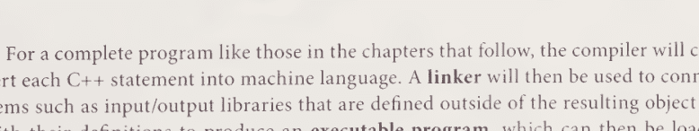

对于后面章节中完整的程序，编译器会将每个 C++ 语句转换成机器语言。然后会使用**链接器**将诸如输入/输出库等在生成的目标文件之外定义的内容与其定义连接起来，以生成**可执行程序**，然后可以将该程序加载到内存中并由计算机执行以生成程序的输出。

### EXERCISES

1. 将第一列中的每个项目与第二列中的相关项目匹配。

- _____ peripheral devices
- _____ bit
- _____ byte
- _____ megabyte
- _____ object program
- _____ source program
- _____ CPU
- _____ K
- _____ RAM
- _____ cache

- A. high-speed memory used by the CPU
- B. central processing unit
- C. 1024
- D. terminals, scanners, printers
- E. binary digit
- F. group of binary digits
- G. 1024 K bytes
- H. written in machine language
- I. written in high-level language
- J. language translator

简要定义练习 2–16 中的每个术语。

2. ALU
3. CPU
4. peripheral devices
5. bit
6. byte
7. word
8. K
9. megabyte
10. source program
11. object program
12. machine language
13. assembly language
14. compiler
15. assembler
16. interpreter

# Programming and Problem Solving—Software Engineering

- 2.1 A Sneak Peek at C++ 22
- 2.2 Programming and Problem Solving—An Overview 24
- Chapter Summary 34
- Test Yourself 35
- Exercises 35
- Programming Problems 36

> If we really understand the problem, the answer will come out of it, because the answer is not separate from the problem.
>
> JIDDU KRISHNAMURTI

> People always get what they ask for; the only trouble is that they never know, until they get it, what it actually is that they have asked for.
>
> ALDOUS HUXLEY

> It’s the only job I can think of where I get to be both an engineer and an artist. There’s an incredible, rigorous, technical element to it, which I like because you have to do very precise thinking. On the other hand, it has a wildly creative side where the boundaries of imagination are the only real limitation.
>
> ANDY HERTZFELD

#### 2.1 A Sneak Peek at C++

程序是用编程语言编写的语句集合。就像语法规则规定如何构造英语句子一样，存在 C++ 语法规则来规范 C++ 语句的形成以及如何将其组合成更复杂的语句和程序。本书的大部分内容都致力于学习这些规则，在本节中我们将通过一个简单的 C++ 程序先睹为快。

传统上，使用像示例 2.1 中的程序作为第一个例子来显示问候。用户被提示输入其名字，然后输出问候。我们将使用此程序来说明 C++ 程序的基本结构。

**Example 2.1 Greeting a User**

```cpp
/* Program that greets the user.
    Written by John Doe for CS 104, Assignment 1, Feb. 2, 2012

    Input:  the name of the user
    Output: a personalized greeting
    ---------------------------------------------------------------*/

#include <iostream>      // cin, cout, <<, >>
#include <string>        // string
using namespace std;

int main()
{
    cout << "What is your first name? ";
    string firstName;
    cin >> firstName;

    cout << "\nWelcome to CS 104, " << firstName << "!\n";
}
```

**SAMPLE RUN:**

```
What is your first name? Sharlene ← user input
Welcome to CS 104, Sharlene!
```

程序的第一行以字符对 `/*` 开始，第七行以字符对 `*/` 结束。在 C++ 程序中，包含在这两个字符对之间的任何内容都是注释。程序开头这些行中的多行注释是开启文档，它提供有关程序的信息，例如它做什么、谁编写的、何时编写（或最后更新）、程序的输入和输出是什么。第六行中的破折号是可选的，在本教材的示例中用作边框，将此开启文档与后面的程序语句区分开来。

接下来的两行以 `#include` 开始，称为编译器指令。第一个指令指示编译器将程序中执行输入和输出所需的 `iostream` 库中的项目添加到程序中；它将出现在我们所有的 C++ 程序中。第二个指令添加 `string` 库中处理字符字符串所需的项目。每个指令后面的 `//` 表示其后到行尾的内容是注释。这里这些注释表示正在使用哪些库中的项目。

下一行 `using namespace std;` 将出现在我们几乎所有的程序中。它通知编译器我们希望这些是来自名为 `std` 的命名空间的标准库。如果没有它，我们将不得不使用前缀 `std::` 限定每个库项目（例如 `cout`）；例如：

```cpp
std::cout << "What is your first name? ";
```

然而，这很快就会变得烦人，因为标准库标识符如 `cin` 和 `cout` 使用得非常频繁。

程序的其余部分具有以下形式

```cpp
int main()
{
    A list of C++ statements
}
```

这实际上是一个名为 `main` 的函数，被称为程序的主函数。C++ 关键字 `int` 在 `main` 之前指定了函数的返回类型，并表示它将向操作系统返回一个整数值。正常终止通过返回零来表示；非零返回值表示异常终止。一些程序员使用（并且一些较旧的编译器可能需要）`return 0;` 作为程序的最后一条语句。

此程序的执行将从此 main 函数中花括号（`{` 和 `}`）之间括起的第一条语句开始，并依次执行其后的语句。请注意，每条语句必须以分号结束。

在示例 2.1 的程序中，第一条语句中的 `<<` 运算符将向屏幕（`cout`）输出一条消息，提示用户输入其名字：

```cpp
cout << "What is your first name? ";
```

下一条语句

```cpp
string firstName;
```

> 1 在 1997 年，C++ ANSI 标准为标准库提供了新名称（例如 `iostream` 取代 `iostream.h`）并将这些名称和其他名称存储在称为命名空间的容器中。ANSI 标准标识符存储在命名空间 `std` 中。使用非 ANSI 兼容编译器时，可能需要使用旧的库名称（例如 `iostream.h` 代替 `iostream`，`math.h` 代替 `cmath`）并删除 `using namespace std;` 行。


声明变量 firstName 将存储一个字符字符串；语句

```
cin >> firstName;
```

使用 >> 运算符从键盘（cin）读取用户输入的字符字符串并将其存储在变量 firstName 中。下一条语句

```
cout << "\nWelcome to CS 104, " << firstName << "!\n";
```

然后在屏幕上显示个性化问候，由以下部分组成

+   1. 一个特殊字符（\n）使其前进到新行，然后是字符串
+      Welcome to CS 104,
+   2. 存储在 firstName 中的字符字符串
+   3. 字符 ! 后跟换行符

###### 2.2 编程与问题求解——概述

计算机程序是一系列必须遵循的指令，用于解决某个问题，而人们学习编程的主要原因是为了能够将计算机用作问题求解工具。在程序开发过程中至少可以识别出四个步骤或阶段：

+   1. 设计：分析问题并设计解决方案，从而得出解决问题的算法。这通常是开发过程中最困难的部分，因为它基本上要求程序员知道如何解决该问题。
+   2. 编码：将设计方案翻译成 C++ 等高级语言的语法以生成程序。
+   3. 测试、执行和调试：反复测试程序，消除错误（称为 bug），直到确信它解决了问题。
+   4. 维护：随着时间的推移，根据用户不断变化的需求对程序进行更新和修改。

本节用一个相当简单的例子来说明这些步骤，以便在每个阶段强调主要思想，而不会迷失在细节的迷宫中。

###### 2.2.1 问题：温度转换

一位海洋生物学家正在五大湖的微生物研究中进行研究。这项研究的一部分涉及水温突然变化的影响。她刚刚记录的读数为 17.35°C，但她用来分析数据的一些公式要求

温度以华氏度表示。她希望有一个程序可以将摄氏温度转换为华氏度。

###### 2.2.2 程序设计

待解决的问题通常用英语等自然语言表达，并且经常表述不精确，使得有必要分析问题并更精确地表述。对于前述问题，这很容易：

给定摄氏温度读数，计算等效华氏温度。

对于许多问题，这可能要困难得多，因为初始描述可能相当模糊和不精确，也许是因为提出问题的人不了解问题本身，也不了解如何解决它，也不了解计算机的能力和局限性。

我们将本书中用于设计软件解决方案来解决问题的[content]

声明变量 firstName 将存储一个字符字符串；语句

```
cin >> firstName;
```

使用 >> 运算符从键盘（cin）读取用户输入的字符字符串并将其存储在变量 firstName 中。下一条语句

```
cout << "\nWelcome to CS 104, " << firstName << "!\n";
```

然后在屏幕上显示个性化问候，由以下部分组成

+   1. 一个特殊字符（\n）使其前进到新行，然后是字符串
+      Welcome to CS 104,
+   2. 存储在 firstName 中的字符字符串
+   3. 字符 ! 后跟换行符

###### 2.2 编程与问题求解——概述

计算机程序是一系列必须遵循的指令，用于解决某个问题，而人们学习编程的主要原因是为了能够将计算机用作问题求解工具。在程序开发过程中至少可以识别出四个步骤或阶段：

+   1. 设计：分析问题并设计解决方案，从而得出解决问题的算法。这通常是开发过程中最困难的部分，因为它基本上要求程序员知道如何解决该问题。
+   2. 编码：将设计方案翻译成 C++ 等高级语言的语法以生成程序。
+   3. 测试、执行和调试：反复测试程序，消除错误（称为 bug），直到确信它解决了问题。
+   4. 维护：随着时间的推移，根据用户不断变化的需求对程序进行更新和修改。

本节用一个相当简单的例子来说明这些步骤，以便在每个阶段强调主要思想，而不会迷失在细节的迷宫中。

###### 2.2.1 问题：温度转换

一位海洋生物学家正在五大湖的微生物研究中进行研究。这项研究的一部分涉及水温突然变化的影响。她刚刚记录的读数为 17.35°C，但她用来分析数据的一些公式要求

温度以华氏度表示。她希望有一个程序可以将摄氏温度转换为华氏度。

###### 2.2.2 程序设计

待解决的问题通常用英语等自然语言表达，并且经常表述不精确，使得有必要分析问题并更精确地表述。对于前述问题，这很容易：

给定摄氏温度读数，计算等效华氏温度。

对于许多问题，这可能要困难得多，因为初始描述可能相当模糊和不精确，也许是因为提出问题的人不了解问题本身，也不了解如何解决它，也不了解计算机的能力和局限性。

我们将本书中用于设计软件解决方案来解决问题的


- 将算法的每一步转换为代码。如果它使用了一个尚未声明的软件对象，请添加一条声明语句来指定该对象的类型和名称。

例如，我们可能会这样开始：

```
/* This program converts a Celsius temperature to Fahrenheit.

Written by John Doe for CS 104 -- Project #1 -- Feb. 3, 2012

Input:  the Celsius temperature
Output: the corresponding Fahrenheit temperature
------------------------------------------------------------*/

#include <iostream>    // cin, cout, <<, >>
using namespace std;

int main()
{
}
```

程序以开头文档注释开始，如前一节所述。其后是 iostream 库的 `#include` 指令，该库提供了此指令后面注释中列出的对象（`cin` 和 `cout`）以及运算符（`<<` 和 `>>`）。实现我们算法的 C++ 语句将放置在 `int main()` 后面的花括号（`{` 和 `}`）之间。由于这个程序框架是一个完整的程序，我们可以编译它来检查语法是否正确。如果需要，我们甚至可以执行它，尽管不会产生任何输出。

现在我们继续将算法的各个步骤转换为代码。如果你是编程新手，把算法的步骤（或它们的概要）作为注释实际放在 `main()` 的花括号 `{` 和 `}` 之间，可能会有所帮助：

```
...
int main()
{
    // 1. Output a prompt for the Celsius temperature to cout.
    // 2. Input a real value from cin and store it in celsius.
    // 3. Compute fahrenheit = 1.8 * celsius + 32.
    // 4. Output fahrenheit to cout.
}
```

双斜线（`//`）告知编译器，该行后面的一切都是注释。

现在，我们一次一行地将算法的每一步转换成 C++ 代码。教你掌握能够实现这一转换的 C++ 特性，将是后续各章的目的；现在，我们仅用我们的例子来演示这一转换过程。

算法的第一行可以转换为下面的 C++ 语句：

```
cout << "Enter the Celsius temperature: ";
```

并将其添加到 main 函数中：

```
. . .
int main()
{
    // 1. Output a prompt for the Celsius temperature to cout.
    cout << "Enter the Celsius temperature: ";

    // 2. Input a real value from cin and store it in celsius.
    // 3. Compute fahrenheit = 1.8 * celsius + 32.
    // 4. Output fahrenheit to cout.
}
```

我们现在可以编译这个程序，看看是否存在语法错误；如果没有，则执行它，看看提示信息在屏幕上如何显示：

```
Enter the Celsius temperature:
```

屏幕上的光标将位于这一行的末尾，也就是输入温度值的位置。如果程序没有编译成功——例如，如果我们漏掉了某个双引号（`"`）或语句末尾的分号——我们就需要进行修正，然后重新编译并重新执行修正后的程序。同样，如果我们不喜欢产生的输出——比如，如果我们更希望提示符为“Please enter the temperature in Celsius:”——我们可以进行修改，然后重新编译并重新执行。

一旦我们有了一个可接受的第一条语句，我们就可以继续算法的下一步，并为它编写 C++ 语句：

```
. . .
int main()
{
    // 1. Output a prompt for the Celsius temperature to cout.
    cout << "Enter the Celsius temperature: ";

    // 2. Input a real value from cin and store it in celsius.
    double celsius;
    cin >> celsius;

    // 3. Compute fahrenheit = 1.8 * celsius + 32.
    // 4. Output fahrenheit to cout.
}
```

我们同样可以编译并执行这个新版本的程序。

最终，我们会得到一个完整的程序，如示例 2.2 所示：

###### 示例 2.2 温度转换器

```
/* This program converts a Celsius temperature to Fahrenheit.

Written by John Doe for CS 104 -- Project #1 -- Feb. 3, 2012

Input: the Celsius temperature
Output: the corresponding Fahrenheit temperature
-------------------------------------------------------------------*/

#include <iostream> // cin, cout, <<, >>
using namespace std;

int main()
{
    // 1. Output a prompt for the Celsius temperature to cout.
    cout << "Enter the Celsius temperature: ";

    // 2. Input a real value from cin and store it in celsius.
    double celsius;
    cin >> celsius;

    // 3. Compute fahrenheit = 1.8 * celsius + 32.
    double fahrenheit = 1.8 * celsius + 32;

    // 4. Output fahrenheit to cout.
    cout << celsius << " degrees Celsius is equivalent to "
         << fahrenheit << " degrees Fahrenheit.\n";
}
```

可以使用一种称为文本编辑器的软件程序将此程序输入计算机的内存中，并在以后修正发现的任何错误。这种文本编辑器通常内置于 Visual C++ 等编程环境中，但也可能是独立的编辑器，例如 Unix 系统中的 emacs。

###### 2.2.4 测试、执行与调试

程序中可能会引入多种错误，包括：

- **语法错误**：当违反编程语言的某些语法规则时产生；
- **运行时错误**：在程序执行过程中发生；以及
- **逻辑错误**：存在于程序所基于的算法的设计中。

查找并修复这些错误被称为调试程序。

当编译器尝试将 C++ 程序翻译成给定计算机的机器语言时，它会定位语法错误，并生成解释（表面）问题的错误消息。例如，如果我们忘记了在示例 2.2 程序中的这一行的末尾输入分号：

```
double celsius;
```

而输入的是：

```
double celsius
```

那么编译器可能会显示如下错误消息：

```
(19) error: missing ';' before identifier 'cin'
```

不同的编译器可能会对同样的错误显示不那么精确的诊断信息，例如：

```
In function 'int main()':
(19) error: expected initializer before 'cin'
```

编译器会显示在检测到问题时正在处理的行的行号，该行紧邻包含错误的行的下一行。学会理解编译器生成的错误消息是一项重要的技能。

第二类错误称为运行时错误，只有在程序执行时才能被检测到。它们包括在算术表达式中除以零、计算负数的平方根以及生成某个超出给定范围的值等情况。一旦确定了错误的原因，就必须用正确的语句或表达式替换有问题的语句或表达式，并重新编译、重新执行修改后的程序。例如，示例 2.2 中的程序包含以下语句：

```
double fahrenheit = 1.8 * celsius + 32.0;
```

但假设我们误读了温度转换公式，在第一个 `*` 运算符的位置键入了 `+` 号：

```
double fahrenheit = 1.8 + celsius + 32.0;
```

因为这是一个合法的 C++ 语句，编译器不会检测到这个错误。程序可以编译并执行，但会产生错误的值，因为用于计算华氏温度的公式不正确。

为了检查逻辑错误，必须使用样本数据运行程序，并检查输出是否正确。这种程序测试应使用多种输入进行多次，以测试程序的不同部分。如果任何输入组合产生了错误的输出，则程序中存在逻辑错误。

一旦确定存在逻辑错误，找到错误所在便是编程中最困难的方面之一。可能有必要逐步跟踪执行过程，直到找到计算值与期望值不同的那个点。为了简化这种跟踪，大多数 C++ 实现都提供了集成的调试器，使程序员可以一次一行地执行程序，观察每一行执行对所生成的值的影响。一旦找到错误，就可以使用文本编辑器进行修正。

应该用几种不同类型的数据（正值、负值、小值、大值等）来测试程序，直到我们有理由相信其正确性为止。然而，几乎不可能用所有可能的测试数据集来测试程序，因此错误可能会在几个月——甚至几年——之后才出现。随着程序规模和复杂性的增长，测试它们的难度也随之增加。无论进行多少测试，总还能进行更多测试。测试永远不会完成，而只是被停止，并且无法保证程序中的所有错误都已被发现和修正。测试只能证明错误的存在，而不能证明错误的不存在。它不能证明程序是正确的，只能证明它是不正确的。

在为编程作业编写的程序中，错误的影响通常并不严重。也许学生只是在该作业上丢掉了几分，或者运气好，评分者甚至没有注意到这个错误。然而，对于现实世界中的问题，面临的利害关系远不止课程成绩——可能是金钱、工作，甚至生命。以下是从大量软件恐怖故事中选取的几个例子：

- 1999 年 9 月，火星气候轨道探测器（Mars Climate Orbiter）撞向火星，未能进入安全轨道。NASA 调查委员会的一份报告指出，该航天器失事的主要原因是地面导航相关任务软件的某一部分未能将火箭推力的测量值从英制单位转换为公制单位。

- 1996 年 6 月，欧洲航天局耗资 70 亿美元研制的无人阿丽亚娜 5 型火箭在首飞升空 37 秒后爆炸。调查委员会的报告指出，故障的原因是惯性参考系统软件中的规格和设计错误导致制导与姿态信息完全丢失。更具体地说，是当一个 64 位浮点数被转换为 16 位整数时发生了运行时错误。

- 1991 年 3 月，DSC Communications 向其贝尔客户交付了一个软件升级，该产品用于大容量电话呼叫路由和交换系统。当年夏天，加利福尼亚州、哥伦比亚特区、马里兰州、弗吉尼亚州、西弗吉尼亚州和宾夕法尼亚州的这些系统发生了重大电话中断事故。事故起因是在修改代码时在信令软件中引入了一个错误：在数百万行代码中更改了三行代码，而该公司认为没有必要重新测试该程序。

- 1991 年 2 月 25 日，海湾战争期间，沙特阿拉伯达兰的一个爱国者导弹防御系统未能跟踪并拦截一枚来袭的飞毛腿导弹。这枚导弹击中了一座美国陆军军营，造成 28 名士兵死亡，98 人受伤。一个错误在


制导软件由于实数的二进制表示不精确而产生的累积舍入误差，对自系统启动以来经过的时间计算得不准确。而这个时间计算是确定来袭导弹精确位置的关键因素。可悲的结局是，修正后的软件在第二天，即 2 月 26 日，才送到达兰。

这些仅仅是一小部分程序错误示例；它们不只是烦人的小麻烦，还可能导致非常严重甚至悲剧性的后果。在这种情况下，仔细的软件设计、编码以及广泛而彻底的测试是必不可少的。在不能容忍错误的安全关键场合，仅依赖测试运行的结果可能并不足够，因为*测试只能显示错误的存在，而不能显示错误不存在。* 也许有必要对程序进行演绎式证明，证明程序是正确的，并且（假设系统不发生故障）它总会产生正确的结果。

###### 2.2.5 维护

与通常只运行一两次就被丢弃的学生程序不同，现实世界中的程序可能代表着公司资源的大量投入，并会使用多年，在此期间可能会添加新功能或增强功能来升级程序。例如，示例 2.2 中程序的用户可能会发现，能够在“摄氏转华氏”和“华氏转摄氏”之间进行选择，或许再加上开尔文温标，会更有用。由于提供这些选项的程序会用到更高级的编程特性，我们将它推迟到下一章介绍。

### 本章小结

关键术语

| #include | debugger |
| algorithm | debugging |
| behavior | design |
| C++ | generalization |
| cin | input (>>) |
| class | library |
| coding | logic error |
| comment (/*, */, //) | main function |
| compiler | maintenance |
| compiler directive | namespace |
| cout | object-centered design (OCD) |
| curly braces ({ and }) | object-oriented design |

3. 三个电阻在以下电路中并联：

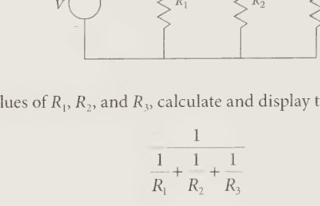

对于给定的 R1、R2 和 R3 值，计算并显示组合电阻

1 / (1/R1 + 1/R2 + 1/R3)

4. 钋的半衰期是 140 天，这意味着由于放射性衰变，140 天后剩余的钋数量是原来的一半。对于给定的钋初始数量和天数，计算经过这么多天后剩余的数量。

# 编程题

1. 在你的计算机系统上输入并执行以下 C++ 程序：

```
/* This program adds the values of variables x and y.

Output: The value x + y
--------------------------------------------------------------- */

#include <iostream>
using namespace std;

int main()
{
    int x = 214,   // the first value
        y = 2057,  // the second value
        sum = x + y;
    // output the resulting value
    cout << "\nThe sum of " << x << " and " << y
         << " is " << sum << endl;
}
```

2. 对题 1 中的程序进行以下修改，然后执行修改后的程序：

- a. 将给 x 赋值的语句中的 214 改为 1723。
- b. 将变量名 x 和 y 全部改为 alpha 和 beta。
- c. 在 sum 的声明之后添加注释：

```
// find their sum
```

- d. 将变量声明改为：

```
int alpha = 214,      // the first value
    beta = 2057,      // the second value
    difference = alpha - beta,  // find their difference
    sum = alpha + beta;          // find their sum
```

并在输出语句之前添加以下语句：

```
cout << "\nThe difference of " << alpha << " and "
    << beta << " is " << difference << endl;
```

3. 以本章中的程序为范例，编写一个 C++ 程序来解决练习 1 中的问题。

4. 以本章中的程序为范例，编写一个 C++ 程序来解决练习 2 中的问题。

5. 以本章中的程序为范例，编写一个 C++ 程序来解决练习 3 中的问题。

# C++ 中的类型

### 目录

- 3.1 入门示例：放射性衰变 40
- 3.2 类型、字面量、变量和常量 42
- 3.3 数据表示 51
- 本章小结 55
- 自测 58
- 练习 60
- 编程题 61

这个世界上有三种人：会数数的，和不会数数的。

> 见于汽车保险杠贴纸

请把它们记在笔记本上。而且，为了方便提及，让我们称它们为 A、B 和 Z。

> 刘易斯·卡罗尔，《乌龟对阿喀琉斯说的话》

因为与无知者不假思索的看法相反，选择什么样的记数系统只不过是一个约定问题。

> 布莱兹·帕斯卡

在本章中，我们将考察 C++ 提供的若干数据类型，重点是最简单的那些，称为基本类型。我们还会说明这些类型的值如何以能够存储到内存中的方式进行表示。

#### 3.1 入门示例：放射性衰变

##### 3.1.1 问题

铀矿大学的一位科学家正在对放射性元素钋进行研究。钋的半衰期是 140 天，这意味着由于放射性衰变，140 天后剩余的数量是原来的一半。他想知道，如果最初有 10 毫克钋，实验运行 180 天后还会剩下多少。

##### 3.1.2 以对象为中心的设计

###### 3.1.2.1 行为

程序应向屏幕输出对放射性元素名称、其半衰期、初始数量和时间段的提示。然后从键盘读取这些值。程序随后应计算经过指定时间段后剩余的数量，并将输入的这些值连同该结果一起输出到屏幕。

###### 3.1.2.2 对象

根据我们的行为描述，可以确定以下对象：

| 问题对象 | 类型 | 类别 | 名称 |
|---|---|---|---|
| 屏幕 | 输出设备 | 变量 | cout |
| 提示 | 文本字符串 | 常量 | 无 |
| 元素名称 | 文本字符串 | 变量 | element |
| 半衰期 | 实数 | 变量 | halfLife |
| 初始数量 | 实数 | 变量 | initialAmount |
| 时间段 | 实数 | 变量 | time |
| 键盘 | 输入设备 | 变量 | cin |
| 剩余数量 | 实数 | 变量 | amountRemaining |

###### 3.1.2.3 操作

同样，根据我们的行为描述，有以下操作：

- i. 输出一个字符串（提示、描述性标签、元素名称）。
- ii. 读取一个字符串（element）。
- iii. 读取数值（halfLife、initialAmount、time）。
- iv. 计算 amountRemaining = initialAmount × (0.5)^(time/halfLife)。
- v. 输出数值。

C++ 为上述各项操作都提供了相应的操作。

###### 3.1.2.4 算法

接下来，我们将这些对象和操作组织成一个算法：

- 1. 向 cout 输出元素名称及其半衰期的提示。
- 2. 从 cin 读入一个字符串存入 element，读入一个实数值存入 halfLife。
- 3. 输出对初始数量和时间段的提示。
- 4. 从 cin 读入实数值存入 initialAmount 和 time。
- 5. 计算 amountRemaining = initialAmount × (0.5)^(time/halfLife)。
- 6. 将 element、halfLife、initialAmount、time 和 amountRemaining 连同适当的标签输出到 cout。

###### 3.1.2.5 编码、执行与测试

在前一章中，我们概述了将算法转换为代码的过程：

- 1. 创建一个程序框架（stub），其中包含开头的文档说明、添加某些对象和操作所需的库项的编译器指令，以及一个仅将算法步骤以注释形式包含在内的 main 函数。
- 2. 将算法的每一步转换为代码，并为任何尚未声明的软件对象添加声明语句，以指定其类型和名称。

由于篇幅限制，本书无法对每个示例都这样做，但你可能会发现，这个过程有助于开发类似示例 3.1 中的程序。该示例展示了完整的程序以及一次示例运行，用来计算初始 10 毫克、半衰期为 140 天的钋在 180 天后还剩多少。建议你将该程序输入到你正在使用的 C++ 版本中，编译并运行它，然后进行各种修改并观察结果，以此进行试验。

### 示例 3.1 放射性衰变

```
/* This program computes the amount of a radioactive substance
remaining after an initial amount decays for some time period.

Written by John Doe for CS 104 -- Project #1 -- Feb. 5, 2012

Input:  element's name, its half-life, the initial amount,
        and a time period
Output: the input items and the amount of the substance
        remaining at the end of the time period
------------------------------------------------------------*/
#include <iostream>    // cin, cout, <<, >>
#include <string>      // string
#include <cmath>       // pow()
using namespace std;
```


```
int main()
{
    cout << "Enter the name of your radioactive substance: ";
    string element;
    cin >> element;
    cout << "and its half-life (days): ";
    double halfLife;
    cin >> halfLife;
    cout << "Enter the initial amount (mg) and a time period (days): ";
    double initialAmount, time;
    cin >> initialAmount >> time;

    double amountRemaining = initialAmount * pow(0.5, time / halfLife);

    cout << "\nFor " << element
         << " with half-life " << halfLife << " days\n"
         << initialAmount << " mg" << " will be reduced to "
         << amountRemaining << " mg after " << time << " days\n";
}
```

### SAMPLE RUN:

```
Enter the name of your radioactive substance: polonium
and its half-life (days): 140
Enter the initial amount (mg) and a time period (days): 10 180

For polonium with half-life 140 days
10 mg will be reduced to 4.10168 mg after 180 days
```

该程序使用了两种不同的 C++ 类型，string 用于放射性物质的名称，double 用于其半衰期、初始量、时间段以及该时间后剩余的量。在本章的剩余部分，我们将研究这些以及 C++ 提供的其他类型，以及它们如何用于表示问题的对象。

#### 3.2 类型、字面量、变量和常量

问题中的每个数据项（即对象）都有一个关联的类型；例如，它可能是一个数字、一个字符字符串、一个单个字符、一个逻辑值，或更复杂的东西。用于表示此类问题对象的软件对象也必须具有指定的类型，以便编译器知道需要为它们分配多少内存以及允许对其执行何种操作。因此，大多数编程语言，包括 C++，要求在使用这些对象之前指定这些类型。在本节中，我们将重点关注 C++ 的 **基本类型**——也称为 **原始类型或内在类型**——而在第 3.3 节中，我们将看到这些类型的数据值如何在内存中存储。

##### 3.2.1 基本类型

C++ 提供的最重要的基本数据类型如下：¹

- **整数**：整数及其负数：类型为 `int`
- **整数变体**：类型 `short`、`long` 和 `unsigned`
- **实数**：小数：类型为 `float`、`double` 或 `long double`
- **字符**：字母、数字、符号和标点：类型为 `char`
- **布尔值**：逻辑值 `true` 和 `false`：类型为 `bool`

其中一种类型的值称为 **字面量**。² 例如，123、0 和 -15 是整数字面量；-45.678 和 3.14159 是实数字面量；'A'、'a'、'0' 和 '$' 是字符字面量；true 和 false 是布尔字面量。我们现在将更详细地检查这些类型。

###### 3.2.1.1 整数

整数字面量是可能以 - 号或 + 号开头的数字字符串。它们被解释为

- 如果以 0 开头且所有数字都是八进制数字 0、1、...、7，则为 **八进制（基数八）** 整数；
- 如果以 0x 开头，则为 **十六进制（基数十六）** 整数——十、十一、...、十五的十六进制数字为 A、B、...、F 或其小写等价形式 a、b、...、f；
- 否则为 **十进制（基数十）** 整数。

例如，字面量 345 的十进制值为 345₁₀ = 3 × 10² + 4 × 10¹ + 5 × 10⁰。然而，字面量 0345 的八进制值为 345₈ = 3 × 8² + 4 × 8¹ + 5 × 8⁰ = 229₁₀，而 0x345 的十六进制值为 345₁₆ = 3 × 16² + 4 × 16¹ + 5 × 16⁰ = 837₁₀。（请参阅前言中所述的文本网站，了解有关二进制、八进制和十六进制数系统的更多详细信息。）

通常，`int` 值存储在 32 位（= 4 字节）中，其范围从 −2³¹（= −2147483648）到 2³¹ − 1（= 2147483647）。C++ 还允许使用 `short` 或 `long` 关键字之一修改 `int` 声明：

- `short int`（或仅 `short`）值通常存储在 16 位（2 字节）中，其范围从 −2¹⁵（= −32768）到 2¹⁵ − 1（= 32767）。
- `long int`（或仅 `long`）值在某些版本的 C++ 中与 `int` 值相同，而在其他版本中为 64 位值，范围从 −2⁶³ 到 2⁶³ − 1。

¹ 其他类型是 `signed char` 和 `unsigned char` 整数类型，它们存储在一个字节中，因此范围从 −2⁷（= −128）到 2⁷ − 1（= 127）；用于存储 Unicode 字符的宽字符类型 `wchar_t`；用于复数值的 `complex`；以及用于空值集的 `void` 类型。

² 计算中的字面量一词指的是程序员输入且在程序执行期间不发生变化的任何值——你输入的字符字符串（字面地）就是你得到的值。

在本教材中，int 将在大多数示例中使用。

整数的内部表示通常使用一位作为符号位，因此 32 位整数的最大正值为 2³¹ − 1 而不是 2³² − 1。（请参阅下一节了解更详细的解释。）然而，一些整数值对象永远不会有负值，为了避免为此类整数值浪费符号位，C++ 提供了修饰符 unsigned：

- 无符号 int（或仅 unsigned）是非负整数，其大小通常是所用特定机器的字长，通常为 0 到 2³² − 1（= 4294967295）。
- 无符号 short 通常是 16 位值，范围从 0 到 2¹⁶ − 1（= 65535）。
- 无符号 long 通常是 32 位或 64 位值，范围从 0 到 2³²− 1 或 0 到 2⁶⁴− 1。

###### 3.2.1.2 实数

类型 float 的值通常是 32 位实数值；double 通常是 64 位实数值；long double 通常是 96 位或 128 位实数值。然而，这些类型的取值范围和精度取决于实现，并在 C++ 实现提供的标准库之一 cfloat 或 climits（本节后面描述）中定义。

像大多数编程语言一样，C++ 提供了两种表示实值的方法，定点表示法和浮点表示法。定点实数字面量的形式为 m.n，其中整数部分 m 或小数部分 n（但不能同时）可以省略。例如，5.0、0.5、5. 和 .5 都是有效的定点实数字面量。

实数有时也用浮点表示法（也称为指数或科学计数法）表示。例如，23 万亿（= 23,000,000,000,000）可以更紧凑地写成 2.3 × 10¹³。在 C++ 中，浮点实数字面量具有 xEn 或 xEn 的形式之一，其中 x 是整数或定点实数字面量，n 是整数指数（正或负）。例如，23 万亿 = 2.3 × 10¹³ 可以写成多种形式，如 2.3E13、0.23E14、23.e12 和 23E12。

默认情况下，C++ 编译器将所有实数字面量视为 double 类型。这意味着如果我们计算一个实数值并将其赋给一个 float 变量，则存储在变量中的值将不具有计算值的精度。因此，我们将遵循许多程序员的做法，始终对实数值使用 double 类型。

###### 3.2.1.3 字符

我们可以使用 char 类型在 C++ 字符集中表示单个字符，该字符集通常是 ASCII（美国信息交换标准代码）字符集（见附录 A）。它包括大写和小写字母、常见的标点符号，如分号（;）、逗号（,）和句号（.），以及其他特殊符号，如 +、= 和 >。

字符在内存中由数字代码表示，在 C++ 中，char 类型的值使用这些整数代码存储（下一节将更详细地描述）。字符字面量是用单引号（或撇号）括起来的单个字符；例如，'A'、'z'、'#'、'8' 和 '/'。C++ 编译器使用其数字代码存储这些值，在 ASCII 中它们分别是 65、122、35、56 和 47。

使用单引号括起字符字面量会引发一个问题，即如何表示字符字面量本身是一个单引号（撇号）。同样，我们如何表示制表符和换行到新行的字符？对于此类特殊字符，C++ 提供了由反斜杠字符（\ ）后跟一个符号组成的字符字面量；例如，'\'' 表示撇号，'\t' 表示制表符，'\n' 表示换行到新行。这些“双字符”称为转义序列，因为反斜杠表示其后的字符应“转义”其通常的含义。表 3.1 列出了 C++ 提供的转义序列。

###### 3.2.1.4 其他类型

示例 3.1 中的程序在程序 main 部分之前包含 #include <something> 形式的编译器指令。其中之一是

### TABLE 3.1 C++ Character Escape Sequences

| Character | C++ Escape Sequence |
|---|---|
| Newline (NL or LF) | \n |
| Horizontal tab (HT) | \t |
| Vertical tab (VT) | \v |
| Backspace (BS) | \b |
| Carriage return (CR) | \r |
| Form feed (FF) | \f |
| Alert (BEL) | \a |
| Backslash (\) | \\ |
| Question mark (?) | \? |
| Apostrophe (single quote, ') | \' |
| Double quote (") | \" |
| With numeric octal code ooo | \ooo |
| With numeric hexadecimal code hhh | \xhhhh |

5 Character literals of the form L'x' where x consists of one or more characters are wide-character literals and are used for alternate character sets such as Unicode. They are of type wchar_t.


#include <string>

为什么会这样呢？因为string类型，就像我们将在第7章学习的其他几种类型一样，并不是C++内建的基本类型之一，而是在string库中定义的类。#include指令使该类型可用于程序。

与字符字面量有些类似，字符串字面量是由双引号括起来的一系列字符。⁶ 例如，

```
"Ohm's Law"
"Enter project id on one line\n\tand its name on the next.\n"
"\nThe project cost = $"
"Einstein said, \"God is subtle but he is not malicious\""
```

都是字符串字面量。正如最后三个示例所示，可以在字符串字面量中使用转义序列。还要注意，包含单个字符的字符串字面量不是char字面量；例如，"X"是字符串字面量，而'X'是char字面量。它们不能互换使用。

如果两个字符串字面量相邻，或者仅由空白字符（空格、制表符和换行符）分隔，则它们将连接成一个字面量。例如，对于

```
"square " "feet"
```

或

```
"square "
"feet"
```

这两个字符串字面量将合并为

```
"square feet"
```

输出的可读性通常可以通过在行之间加空行来改善。使用两个换行符可以实现这一点。例如，如果我们输出字符串字面量

```
"First row\n\nSecond row"
```

第一个换行符（在下面的输出中显示为↲）将结束出现First row的那一行，第二个换行符使下一行为空行，之后出现Second row：

```
First row↲
↲
Second row
```

##### 3.2.2 标识符

示例3.1程序为一些软件对象使用了名称：`element`代表放射性元素，`halfLife`代表其半衰期，`time`代表一段时间，`initialAmount`和`amountRemaining`代表该元素的数量。这些名称称为**标识符**。它们应以字母开头，后面可以跟任意多个字母、数字或下划线。它们不能是C++**关键字**（例如`int`、`const`、`double`等），这些关键字是为特殊对象保留的。C++关键字的完整列表见附录B。

*使用能暗示其含义的有意义的标识符是一种良好的编程实践，因为这样的名称使程序更易于阅读和理解。因此，它们充当程序文档的一部分，并有助于程序维护。* 例如，标识符`feetPerSecond`比任何缩写标识符`f`、`ft`或`FPS`都更有意义，因为这些缩写可能表示包含这些字母的任何其他内容。你应该抵制为了少敲几下键盘而使用短标识符的诱惑。*完整的单词比缩写更可取。*

重要的是要记住，C++是*区分大小写*的——也就是说，它区分大写和小写。例如，`length`和`Length`是不同的标识符。类似地，main函数的名称必须是`main`，而不是`Main`。

命名约定因程序员而异，但最常见的约定之一如下：

- *变量：* 使用小写名称，但在第一个单词之后的每个组成单词首字母大写。一些示例是`length`、`halfLife`和`feetPerSecond`。
- *常量：* 使用全大写字符的名称，并用下划线（`_`）字符分隔各个组成单词。一些示例是`PI`、`TWO_PI`和`SPEED_OF_LIGHT`。

在程序中可以使用标识符之前，必须*声明*它以告知编译器其含义。我们现在先看变量的声明，然后再看常量的声明。

##### 3.2.3 变量

在分析问题时，我们经常发现问题中的对象之间存在可以用*公式*表示的关系。例如，示例3.1程序中使用的放射性衰变定律公式可以表示如下：

$$a = a_0 \times 0.5^{-t/h}$$

在这个公式中，a、a₀、t和h是变量，可以代入数值来计算a的值。

在计算中，变量（variable）一词指的是一个内存位置，可以在其中存储值并在以后检索。编译器的任务之一是将这样的内存位置与程序中为变量命名的每个标识符相关联。为此，它必须知道变量的名称以及它可能拥有的值的类型，以便分配适当大小和形式的内存位置。这就是变量声明的目的，其形式如下：

变量声明

形式：

```
type variable_name;
type variable_name = initializer_expression;
```

其中type是基本数据类型之一（或后面讨论的数据类型之一），variable_name是有效的C++标识符。

目的：

指示C++编译器为指定类型的值保留内存，并将该内存位置与名称variable_name相关联。在第二种形式中，initializer_expression的值将存储在该内存位置；对于第一种形式，variable_name的值是未定义的（或不确定的）。

示例3.1程序中的声明

```
string element;
double halflife;
double initialAmount, time;
```

展示了变量声明的第一种形式。这些变量的值被认为是未定义的，因为与它们关联的内存位置的内容是未知的。如果我们希望它们有特定的初始值，可以使用声明的第二种形式，例如，

```
string element = " ";
double halfLife = 0;
double initialAmount = 0, time = 0;
```

指定element的初始值是一个包含空格的字符串，halfLife、initialAmount和time的初始值都是0。对于像element这样类型为string的变量，请记住必须像示例3.1那样#include string库。

适当大小的内存位置将与这些变量中的每一个相关联。例如，对于double变量time，将分配一个适合double类型（通常为8字节）的内存位置。我们可以这样设想：

time ?

这里，问号表示该变量是未定义的。尽管某些版本的C++会将数值变量初始化为0，但其他版本只是让它们的初始值成为垃圾值——即分配给它的内存位置中的位串所对应的任何值。你不应该假设未初始化的变量会有特定的值。

如果time的声明改为

```
double time = 0;
```

0将被用作初始值：

time 0

对于上述time的任一声明，如果随后输入180作为time的值，则存储在该内存位置中的值将变为180.0：

time 180.0

类似地，声明

```
string element = "polonium";
```

将使用“polonium”作为element的初始值：

element polonium

变量声明的放置位置在很大程度上是编程风格的问题，因为C++允许将声明放在变量首次使用之前的（几乎）任何位置。在本书中，变量通常会在首次使用之前声明，因为这更容易确保变量的使用方式与其类型一致。

##### 3.2.4 常量

除了变量之外，我们还可以为常量使用名称。当程序使用通用常量（如几何常量π或光速）时，这尤其有用，

```
const double PI = 3.14159265359,
    SPEED_OF_LIGHT = 2.997925e8; // meters/sec
```

但也可以用于将名称与程序中使用的其他常量关联起来：

```
const int UPPER_LIMIT = 1000;
const char
    PERCENT_SIGN = '%',      // using a normal character
    SPACE = ' ',             // using a white space char
    TAB = '\t',             // using an escape sequence
    BELL = '\007';          // using an octal (ASCII) code
```

通常，常量声明具有以下形式：

常量声明

形式：

```
const type CONSTANT_NAME = constant-expression;
```

其中const是C++关键字；type是基本数据类型之一（或后面讨论的数据类型之一）；CONSTANT_NAME是有效的C++标识符；constant-expression是任何有效表达式（如后面章节所述），其值是一个类型为type的常量。

目的：

将名称与常量关联。任何在程序中更改此值的尝试都是错误。

为常量使用名称有两个主要原因。一个是让程序更易于理解。为了说明，考虑以下语句：

```
populationChange = (0.1853 - 0.1175) * population;
```

0.1853和0.1175是“魔法数字”，因为它们似乎毫无解释地神奇出现。然而，如果我们定义常量BIRTH_RATE和DEATH_RATE：

```
const double
    BIRTH_RATE = 0.1853, // rate at which people are born
    DEATH_RATE = 0.1175; // rate at which people die
```

我们可以将语句重写为更易理解的形式：

```
populationChange = (BIRTH_RATE - DEATH_RATE) * population;
```

使用常量的第二个好处是使程序更易于修改。为了说明，假设我们在程序中的多个地方使用了π的值3.1416，并且发现这个值不能提供所需的精度。为了修正程序，我们将不得不


与无符号值不同，int 值可能为负，因此必须以二进制形式存储，其中整数的符号是表示的一部分。最常见的方法是使用补码表示。在这种方案中，正整数以二进制形式表示，如上所述，最左边的位设为 0 以表示该值为正。因此，如果 180 被用作 int 字面量，则使用 31 位表示值的二进制数字，1 位表示符号：

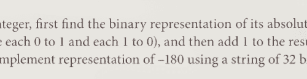

对于负整数，首先找到其绝对值的二进制表示，对其取补码（即，将每个 0 改为 1，每个 1 改为 0），然后将 1 加到结果上。例如，使用 32 位的字符串找到 −180 的补码表示，

- 1. 用 32 位二进制数字表示 180：
  
      00000000000000000000000010110100
- 2. 对该位串取补码：
  
      11111111111111111111111101001011
- 3. 加 1：
  
      11111111111111111111111101001100

该位串随后存储在内存中。

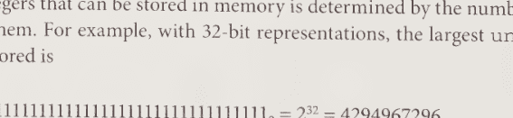

请注意，在负整数的这种补码表示中，符号位为 1，表示该数为负。

可以存储在内存中的整数的范围由用于表示它们的位数决定。例如，使用 32 位表示时，可以存储的最大无符号值为

11111111111111111111111111111111₂ = 2³² = 4294967296

使用 32 位可以表示的 int 值的范围为

10000000000000000000000000000000₂ = −2³¹ = −2147483648

0111111111111111111111111111111₂ = 2³¹ − 1 = 2147483647

尝试使用超出此范围的整数会导致一种称为 **overflow** 的现象。虽然使用更多的位来存储整数会扩大此范围，但它并不能解决溢出问题；整数的范围仍然是有限的。

##### 3.3.2 Reals

在实数的二进制表示中，小数点左侧的数字是非负 2 的幂的系数，而右侧的数字是负 2 的幂的系数。例如，11010.01₂ 的展开形式为

(1 × 2⁴) + (1 × 2³) + (0 × 2²) + (1 × 2¹) + (0 × 2⁰)

+ (0 × 2⁻¹) + (1 × 2⁻²) + (1 × 2⁻³)

其等于

16 + 8 + 0 + 2 + 0 + 0 + 1/4 + 1/8 = 26.375

**IEEE Floating Point Format** 方案用于在计算机内存中表示实数，该方案由电气和电子工程师学会（IEEE）于 1985 年标准化，已几乎成为通用标准。它规定了实数可以用两种格式表示：*single precision*，使用 32 位，和 *double precision*，使用 64 位。在这里，仅描述单精度；双精度只是其更宽的版本。我们首先将数字表示为二进制 *floating-point form*，这与熟悉的科学记数法非常相似，只是底数为二而不是十：

b₁.b₂b₃⋯ × 2ᵏ

其中每个 bᵢ 是二进制数字，但 b₁ 必须为 1（除非数字为 0）。b₁.b₂b₃⋯ 称为 **mantissa**（或 **fractional part** 或 **significand**），指数 k 有时称为 **characteristic**。例如，我们已经看到 26.375 可以用二进制写成 11010.011₂，可以很容易地重写为浮点形式 1.1010011₂ × 2⁴，因为乘以（除以）2 与将二进制点向右（左）移动相同。在这种浮点表示中，1.1010011 是尾数，4 是指数。

在单精度值的 IEEE 格式中，

- 最左边的位存储尾数的符号，正数为 0，负数为 1。
- 接下来的 8 位存储指数 + 127 的二进制表示；127 称为 **bias**。

例如，c 的 ASCII 码为 99 = 01100011，可以存储在一个 8 位字节中。对于 code 这样的字符串，各个字符可以存储在连续的字节中：


对于世界上许多额外字符的语言，开发了编码方案 Unicode，并为超过 65,000 个字符提供代码。为此它使用 16 位代码。例如，c 的代码（99—与 ASCII 相同）将以两个字节存储


非 ASCII 字符 π（希腊字母 pi）的代码 960 也会如此：


##### 3.3.4 Booleans

只有两种布尔值：false 和 true。如果 false 编码为 0，true 编码为 1，则存储布尔值只需要一个位。然而，通常使用一个完整的字或一个字节，其中所有位都设为 0 表示 false，任何其他位串表示 true。

### CHAPTER SUMMARY

Key Terms

- ASCII
- bias
- bool
- char
- character literal
- characteristic
- const modifier
- constant declaration
- decimal
- declaration statement

- floating-point
- fractional part
- fundamental type
- garbage value
- hexadecimal
- identifier
- IEEE Floating Point Format
- int
- keyword
- literal

| declare | long double |
| double | long int |
| escape sequence | mantissa |
| false | OCD (object-centered design) |
| fixed-point | octal |
| float | overflow |
| precedence, priority | two's complement |
| roundoff error | type |
| short int | underflow |
| sign bit | Unicode |
| significand | unsigned |
| string | variable |
| true | variable declaration |

### NOTES

- 在 C++ 程序中，对象在使用前必须声明其类型。
- C++ 中的基本类型包括用于整数的 short、int 和 long；用于非负整数的 unsigned；用于实值的 float 和 double；用于逻辑值的 boolean；以及用于单个字符的 char。
- C++ 编译器将所有实数字面量都视为 double 类型。因此，大多数程序员使用 double 用于实对象，很少使用 float。
- char 类型用于表示单个字符；char 字面量必须用单引号括起来。
- 转义序列如 \n（换行）和 \t（制表符）用于具有特殊用途的字符。
- string 类型用于处理字符串。在声明 string 对象之前必须包含 <string> 库。
- 标识符可以以字母或 _（下划线）开头，其后可以跟任意数量的这些字符或数字；它不能是 C++ 关键字。
- 使用有意义的标识符来暗示其表示的内容可以使程序更易于阅读和理解。
- C++ 区分大小写。

- 程序中任何不是 C++ 关键字的名称都是标识符，在使用前必须声明。
- const 修饰符用于声明常量，即在程序执行期间不能更改的值。
- 使用命名常量而不是它们所代表的字面量可以提高代码可读性并便于程序维护。
- 将常量声明放在 main() 程序开始处可以使其在需要修改时易于定位。
- 如果变量声明中未指定初始值，其值未定义（或不确定）。

### Style and Design Tips

- 1. 在本教材的示例中，采用了某些 C++ 程序的风格指南，你应以类似的风格编写程序。在本教材中使用以下指南；其他指南在后面的章节中描述。
  
  - 将程序的每个语句放在单独的行上。
  - 以有助于程序可读性的方式使用大写和小写字母。
  - 缩进并对齐用大括号 { 和 } 括起来的块内的语句。
  - 当语句从一行继续到另一行时，缩进续行。
  - 在声明和语句之间以及语句块之间插入空行，以明确程序的结构。
  - 用空格分隔表达式中的运算符和操作数，使表达式易于阅读。
  
- 2. 在程序开始处声明常量，并在首次使用附近声明变量。这使得在需要修改时可以轻松找到常量。
  
- 3. 如果程序未经过测试，则不能认为它是正确的。
  
- 4. 程序应可读且可理解。
  
  - 使用有意义的标识符。
  - 使用注释描述程序或其它关键程序段的目的。
  
- 5. 程序应通用且灵活——能够解决一类问题。
  
- 6. 识别程序的任何前提条件。


# 工程与科学 C++ 编程

+   1. 字符常量必须用单引号括起来。特别是，字符串字面量不能赋给类型为 char 的变量。
+   2. 类型为 char 的值以其（整数）数码形式存储。将整数赋给 char 变量可能会产生意外的符号。
+   3. 字符串常量必须用双引号括起来。
+   4. 注释用 /* 和 */ 括起来，或在 // 和行尾之间。务必注意：
    • 每个开始定界符 /* 必须有匹配的结束定界符 */。未能成对使用会导致奇怪的结果。
    • / 和 * 之间或两个斜杠之间没有空格。
+   5. 每个 { 必须有对应的 }。
+   6. 所有标识符必须声明。尝试使用未声明的标识符会产生编译错误。另外，请记住 C++ 区分大小写。
+   7. 使用未赋值的变量可能会产生“垃圾”值。
+   8. 关键字、标识符和常量在行尾不得被拆分，也不得包含空白（当然，字符串常量可以包含空白）。

+   1. 列出 C++ 提供的<|message|> 基本数据类型。
+   2. 列出三种整数类型变体。
+   3. 列出三种实数类型。
+   4. 特定类型的常量称为 ________。
+   5. （真或假）0123 和 123 表示相同的整数值。
+   6. （真或假）0xA 和 10 表示相同的整数值。
+   7. （真或假）所有实数字面量都被视为 double 类型。
+   8. 字符字面量必须用 ________ 括起来。
+   9. （真或假）'1/n' 是一个有效的字符字面量。
+   10. （真或假）'\n' 是一个有效的字符字面量。
+   11. '\n' 是 ________ 序列的一个例子。

12. 字符串常量必须用 _______ 括起来。

对于第 13–20 题，判断每个是否为合法标识符。如果不合法，请说明原因。

+   13. calorie
+   14. W_D_4_0
+   15. 70mph
+   16. milesPerHour
+   17. miles per hour
+   18. miles_per_hour
+   19. ps.175
+   20. type-A

对于第 21–40 题，判断每个是整数字面量、实数字面量、字符字面量还是字符串字面量。如果都不是，请说明原因。

+   21. 1234
+   22. 1,234
+   23. 1.234
+   24. -1.
+   25. 123e4
+   26. 123-4
+   27. 0.123E-4
+   28. +1235
+   29. 12+34
+   30. $12.34
+   31. '12+34'
+   32. 'one'
+   33. one
+   34. "Ohm's law"
+   35. "1234"
+   36. 01234
+   37. 0x1234
+   38. E4
+   39. '#1'
+   40. '\32'

41. 编写一个类型为 int 的变量 count 的声明。

42. 编写变量 time 类型为 unsigned、temperature 类型为 float、scale 类型为 char 的声明。

43. 重复第 41 题，但将 count 初始化为零。

44. 重复第 42 题，但将 time 初始化为 9999、temperature 初始化为零、scale 初始化为空格。

45. 编写常量声明，将 CELSIUS_FREEZE 与整数 0 关联，将 CELSIUS_BOIL 与整数 100 关联。

46. 编写常量声明，将 EARTH 与 1.5E10 关联，将 MARS 与 1.2E12 关联。

## 练习

对于练习 1–20，判断每个是否为有效的 C++ 标识符。如果不是，请给出原因。

+   1. x Axis
+   2. x-Axis
+   3. x_Axis
+   4. xAxis
+   5. carbon14
+   6. 3M
+   7. PDQ123
+   8. angle
+   9. angel
+   10. anlge
+   11. PS.175
+   12. x
+   13. 4
+   14. n/4
+   15. $M
+   16. zzzzzz
+   17. z_z_z_z_z_z
+   18. A+
+   19. R2-D2
+   20. R2_D2

对于练习 21–40，将每个分类为整数字面量、实数字面量或两者都不是。如果两者都不是，请给出原因。

+   21. 5,280
+   22. 5280
+   23. "5280"
+   24. 528.0
+   25. 5280e0
+   26. -5280
+   27. --5280
+   28. +5280
+   29. 52+80
+   30. $52.80
+   31. 52E80
+   32. E5280
+   33. eighty
+   34. 0.528E0
+   35. .00005280
+   36. 5.2e-80
+   37. +52E+80
+   38. -(-1)
+   39. -0
+   40. -1/2

对于练习 41–52，判断每个是否为有效的字符串字面量。如果不是，请给出原因。

+   41. "X"
+   42. "123"
+   43. INCH"
+   44. "square feet"
+   45. "Print \"MPH\""
+   46. "isn't"
+   47. "constant"
+   48. "$1.98"
+   49. "DON\'T"
+   50. "12 + 34"
+   51. "\'twas"
+   52. "\"A\"\"B\"\"C\""

对于练习 53–56，编写常量声明，将每个名称与指定的常量关联。

+   53. 40.0 与名称 REGULAR_HOURS 和 1.5 与名称 OVERTIME_FACTOR
+   54. 普朗克常数 6.6256 × 10^-34 与名称 PLANCK
+   55. FAHRENHEIT_FREEZE 与整数 32 和 FAHRENHEIT_BOIL 与整数 212
+   56. 0 与 ZERO、* 与 ASTERISK、以及一个撇号与 APOSTROPHE

对于练习 57–60，编写每个变量的声明。

+   57. length 和 momentOfInertia 类型为 double
+   58. population 和 year 类型为 unsigned
+   59. mileage 类型为 double、cost 和 distance 类型为 unsigned
+   60. alpha 和 beta 类型为 long、code 类型为 char、root 类型为 double

对于练习 61–62，编写声明以声明每个变量具有指定的类型和初始值。

+   61. numberOfDeposits 和 numberOfChecks 为类型 int，各自初始值为 0；totalDeposits 和 totalChecks 为类型 double，各自初始值为 0.0；serviceCharge 为类型 double 初始值为 0.25
+   62. symbol_1 和 symbol_2 为类型 char 且初始值分别为一个空白字符和一个分号；debug 为类型 char 初始值为 T。

63. 编写常量声明，将当前年份与名称 YEAR 关联，将 99999.99 与 MAXIMUM_SALARY 关联，并编写变量声明，声明 number 和 prime 为类型 int，scale 为类型 char。

## 编程问题

+   1. 编写一个程序，将以英尺为单位的测量值转换为等价的 (a) 码、(b) 英寸、(c) 厘米和 (d) 米数（1 ft = 12 in，1 yd = 3 ft，1 in = 2.54 cm，1 m = 100 cm）。
+   2. 编写一个程序，将以盎司为单位的重量转换为等价的 (a) 磅、(b) 吨、(c) 克和 (d) 千克数（1 lb = 16 oz，1 ton = 2000 lb，1 oz = 28.349523 g，1 kg = 1000 g）。
+   3. 对于三个串联电阻，总电阻是各电阻之和，根据欧姆定律，电路中的电流由 *amps = voltage / total_resistance* 给出。编写一个程序，输入电压和三个电阻，然后计算并显示电流。
+   4. 如问题 3 所进行，但对于并联电阻，总电阻使用公式计算

$$total\_resistance = \frac{1}{\frac{1}{resistor1} + \frac{1}{resistor2} + \frac{1}{resistor3}}$$

> “算术就是能在不脱鞋的情况下数到二十。”
> 
> — 米老鼠

> “有时一点不准确可以节省大量的解释。”
> 
> — 萨基（H. H. MUNROE）

在前一章中，我们研究了如何使用 C++ 类型语句将问题的对象表示为 *软件对象*（也称为 *程序实体*）。本章重点介绍 C++ 中提供的可用于解决问题的操作，以及它们如何用于形成各种表达式。

## 4.1 入门示例：爱因斯坦方程

### 4.1.1 问题

假设你的物理课程教授布置了一套大量问题集，要求在下次课前完成，其中许多问题需要使用爱因斯坦方程计算给定质量的物质释放的能量。由于时间压力，如果所有计算都手工完成，可能会出现错误。最好有一个程序可以用来核对答案。

### 4.1.2 面向对象的设计

#### 4.1.2.1 行为

程序应在屏幕上显示物质数量（即其质量）的提示。然后它将从键盘读取此值。程序随后应使用爱因斯坦方程计算该物质数量可产生的能量，并将此值连同描述性标签一起显示到屏幕上。

#### 4.1.2.2 对象

从我们的行为描述中，我们可以识别出以下对象：

| 问题对象 | 类型 | Kind | 名称 |
|---|---|---|---|
| screen | output device | variable | `cout` |
| prompt | text string | constant | none |
| quantity of matter | double | variable | *mass* |
| keyboard | input device | variable | `cin` |
| quantity of energy | double | variable | *energy* |
| descriptive label | string | constant | none |

#### 4.1.2.3 操作

同样，从我们的行为描述中，我们有以下操作：

+   i. 输出一个字符串（提示、描述性标签）。
+   ii. 从键盘读取一个非负数值（*mass*）。


- iii. 从质量计算能量。
- iv. 在屏幕上输出一个数值（能量）和一个字符串（描述性标签）。

C++ 提供了针对这些操作中的每一个的操作，除了第三个操作之外。对于这一点，我们必须使用爱因斯坦熟悉的方程

e = m × c²

其中 m 是质量，c 是光速常数，e 是产生的能量。因此执行此操作需要以下操作：

- 指数运算（c²）
- 实数乘法（m × c²）
- 实数存储（e = m × c²）

此细化在我们的对象列表中添加了两个额外的对象：

| 问题对象 | 类型 | 种类 | C++ 标识符 |
|---|---|---|---|
| 软件对象 |  |  |  |
| screen | output device | variable | cout |
| prompt | text string | constant | none |
| quantity of matter | double | variable | mass |
| keyboard | input device | variable | cin |
| quantity of energy | double | variable | energy |
| descriptive label | string | constant | none |
| speed of light | double | constant | SPEED_OF_LIGHT |
| 2 | int | constant | none |

### 4.1.2.4 算法

接下来，我们将这些对象和操作组织成一个算法：

- 1. 定义常数 SPEED_OF_LIGHT。
- 2. 向 cout 显示质量的提示。
- 3. 从 cin 读取一个非负实数到 mass 中。
- 4. 计算 energy = mass × SPEED_OF_LIGHT²。
- 5. 向 cout 输出描述性标签和 energy。

### 4.1.2.5 编码、执行和测试

Example 4.1 中的程序实现了前述算法。其中两个示例运行使用了输出可以轻松检查的测试数据，第三个使用了“真实”数据。

### Example 4.1 质量-能量转换

```
/* This program computes energy from a given mass using Einstein's mass-to-energy conversion equation.

Input: the mass (in kilograms) being converted to energy
Output: the amount of energy (in kilojoules) corresponding to mass
--------------------------------------------------------------------------*/

#include <iostream>      // cin, cout, <<, >>
#include <cmath>         // pow()
using namespace std;

int main()
{
    const double SPEED_OF_LIGHT = 2.997925e8; // meters/sec

    double mass;
    cout << "To find the amount of energy obtained from a given mass,\n" 
         "enter a mass (in kilograms): ";
    cin >> mass;            // get mass

                        // compute energy
    double energy = mass * pow(SPEED_OF_LIGHT, 2);

                        // display energy
    cout << mass << " kilograms of matter will release\n"
         << energy << " kilojoules of energy.\n";
}
```

### SAMPLE RUNS:

```
To find the amount of energy obtained from a given mass,
enter a mass (in kilograms): 1
1 kilograms of matter will release
8.98755e+16 kilojoules of energy.

To find the amount of energy obtained from a given mass,
enter a mass (in kilograms): .5
0.5 kilograms of matter will release
4.49378e+16 kilojoules of energy.

To find the amount of energy obtained from a given mass,
enter a mass (in kilograms): 155.5
155.5 kilograms of matter will release
1.39756e+19 kilojoules of energy.
```

任何小数部分都被丢弃，结果整数即为结果；不会进行四舍五入。在其他涉及除法的表达式中，操作数中至少有一个是实数，因此执行实数除法，产生实数结果 2.25。初学者程序员常见的困难是记住如果 m 和 n 是整数且 |m| < |n|，则 m/n 的值为 0；例如，1/2、1/3、9/10、−99/100 均产生值 0。

在整数除法的情况下，C++ 提供了两个运算符（/）给出整数商，另一个运算符（%）给出整数除法的余数。² 以下有一些示例：

```
6 / 4 → 1      6 % 4 → 2
83 / 10 → 8     83 % 10 → 3
148 / 10 → 14   148 % 10 → 8
```

对于实数值，/ 执行实数除法并产生精度取决于机器的实数商。% 运算符不能用于实数值。

### 4.2.1.1 运算符优先级

表达式中运算符应用的顺序由称为运算符优先级（或 precedence）的特性决定。对于算术运算符，*、/ 和 % 的优先级高于 + 和 −。

优先级较高的运算符在优先级较低的运算符之前应用。例如，在表达式 3 + 4 * 5 中，乘法在加法之前执行，因为 * 的优先级高于 +，因此该表达式的值为 23。附录 C 给出了所有 C++ 运算符的优先级级别。

### 4.2.1.2 运算符结合性

运算符 +、−、*、/ 和 % 都被称为左结合，这意味着在具有两个相同优先级运算符的表达式中，左侧运算符先应用。因此，

```
9 - 4 - 3
```

被求值如下

```
(9 - 4) - 3 → 5 - 3 → 2
```

在后面的章节中，我们将看到一些 C++ 运算符是右结合的。

结合性也用于包含不同相同优先级运算符的更复杂表达式。例如，考虑

```
9 * 10 - 8 % 3 * 4 + 5
```

现在执行除法，得出

```
1 + 9
```

加法产生最终结果

```
10
```

即使不需要括号，也应在包含多个操作的表达式中自由使用它们，以使求值意图的顺序清晰，并将复杂表达式写成更简单的表达式的组合。但请确保括号平衡——每个左括号在表达式后面都有一个匹配的右括号——否则会导致编译错误。

### 4.2.1.4 一元运算符

当 + 和 − 用作 **一元运算符**（即应用于单个操作数）时，如 −x + 5 和 −2 * x，它们具有高于相应二元操作的优先级。因此，如果 x 的值为 −1，则这些表达式的值将分别为 6 和 2。

### 4.2.1.5 总结

以下规则总结了算术表达式的求值。

### OPERATOR PRIORITIES

Higher: unary +, unary -

*, /, %

Lower: binary +, binary -

- 1. 优先级较高的操作在优先级较低的操作之前执行。
- 2. 具有相同优先级的运算符如果为左结合则从左到右应用，如果为右结合则从右到左应用。
- 3. 如果表达式包含带括号的子表达式，则先求值它们，使用规则 1 和 2 指定的顺序。对于嵌套括号，最内层的子表达式先求值。

### 4.2.1.6 位运算符

C++ 还提供了可用于操作整数存储的二进制表示中各个位的运算：~（取反）、&（按位与）、|（按位或）、^（按位异或）、<<（左移位）和 >>（右移位）。它们有时用于必须检查内存或直接与计算机硬件交互的低级图形或操作系统程序中。有关这些操作的更多信息可在前言中描述的文本网站上找到。

### 4.2.2 类型强制转换

如前所述，在涉及整数和实数操作数的混合类型表达式 6.0 / 4 中，C++ 执行实数除法并产生实数值 1.5。这是因为编译器自动将整数值 4 转换为实数值 4.0，然后执行实数除法运算 6.0 / 4.0。编译器进行的这种自动类型转换称为类型强制转换。它也发生在涉及字符和整数或实数的混合类型表达式中；字符值会自动替换为其数字代码（参见第 3.3 节）。例如，如果字符采用 ASCII 表示，则表达式 'a' + 3 的值为 100，因为 'a' 被 97 替换，即其数字代码。

一般来说，这些类型转换在任何混合类型表达式中自动发生，其中“窄”值——存储在较少位数中的值——被转换为占用更多位数的“宽”值。这种在表达式中将较窄值自动扩展到较宽值的大小的过程称为较窄值的提升。它允许字符、整数和实数值在 C++ 表达式中自由混合。两个值如果满足以下条件之一则称为兼容：(i) 它们具有相同的类型，(ii) 一个可以提升为另一个的类型，或 (iii) 两者都可以提升为同一类型。例如，int 和 double 是兼容的，因为 int 可以提升为 double。

### 4.2.2.1 显式类型转换

除了自动类型转换外，显式转换也是可能的。例如，如果 intVal 是整数值，则表达式 double(intVal) 或 (double)intVal 中的任一个都会产生等价于 intVal 的 double 值。类似地，如果 doubleVal 的类型为 double，则 int(doubleVal) 或 (int)doubleVal 中的任一个将截断 doubleVal 的小数部分并产生其整数部分。

一般来说，形式为

```
type(expression)
```

或

```
(type)expression
```

其中 type 是有效的 C++ 类型，可以用于将 expression 的类型转换为 type（如果可能）。第一种形式有时称为函数表示法，最后一种形式称为（C 风格）强制转换表示法。

### 4.3 赋值表达式

赋值表达式使用赋值运算符（=）为变量赋值。

### ASSIGNMENT EXPRESSION

**Form:**

```
variable = expression
```


其中：

*variable* 是变量的名称；

*expression* 是一个有效的表达式（一个常量、一个先前已赋值的变量，或一个待求值的公式）。

## BEHAVIOR：

+   1. *expression* 被求值，如果必要且可能，其值会被转换为 *variable* 的类型；
+   2. *variable* 的值被更改为该值；并且
+   3. 该值是整个赋值表达式的值。

例如，假设 `length` 和 `width` 是实数变量，`low` 和 `high` 是整数变量，`code` 是字符变量，`isValid` 是布尔变量，声明如下：

```
double width, length;
int low, high;
char code;
boolean isValid;
```

编译器会为六个变量关联内存位置，如第 3.3 节所述。我们可以将其想象如下，用问号表示未指定的内容：

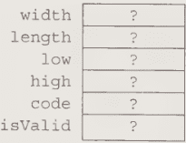

现在考虑以下赋值语句：

```
width = 5.0;
length = 2 * width + 3;
low = 20;
code = 'X';
isValid = true;
```

第一个语句将实数常量 5.0 赋给实数变量 width，第二个语句将实数常量 13.0 赋给实数变量 length。接下来的赋值语句将整数常量 20 赋给整数变量 low，将字符 X 赋给字符变量 code，将布尔常量 true 赋给布尔变量 isValid。更精确地说，当这些赋值语句执行时，值 5.0、13.0 和 20，X 的数字代码（ASCII 中为 88），以及整数 1 或其他非零整数（表示 true）被存储在与变量 width、length、low、code 和 isValid 关联的内存位置中。变量 high 仍然未定义。

|  |  |
|---|---|
| width | 5.0 |
| length | 13.0 |
| low | 20 |
| high | ? |
| code | X (88) |
| isValid | 1 |

这些值会在程序中稍后出现的任何包含这些变量的表达式中被替换。因此，当赋值语句

```
high = 6 * low + 5;
```

执行时，存储在 low 内存位置中的值 20 被检索并用于求值表达式

```
6 * low + 5
```

得到的结果值 125 然后被赋给整数变量 high；low 的值保持不变。

|  |  |
|---|---|
| width | 5.0 |
| length | 13.0 |
| low | 20 |
| high | 125 |
| code | X (88) |
| isValid | 1 |

现在考虑赋值语句

```
width = width + 2.1;
```

其中变量 width 同时出现在赋值运算符（=）的两侧。在这种情况下，width 的当前值 5.0 用于求值右侧的表达式 width + 2.1，得到值 7.1，然后该值被赋给 width，替换旧值 5.0：

|  |  |
|---|---|
| width | 7.1 |
| length | 13.0 |
| low | 20 |
| high | 125 |
| code | 88 |
| isValid | 1 |

在赋值语句中，要赋值的变量必须出现在赋值运算符的左侧，右侧为有效表达式。

在给变量赋值时，允许一定程度的数值类型混合。例如，赋值语句

```
width = 5;
```

本可用于给 width 赋值；编译器会自动将整数 5 转换为实数值 5.0 并将其赋给 width。然而，这种混合类型赋值应谨慎使用，因为可能会丢失重要信息。为了演示这一点，考虑赋值语句

```
low = 3 / width;
```

这里，表达式 3 / width 将被求值，并且由于 width 为 double 类型，结果将是实数值 0.6。然而，将实数值赋给整数变量会截断实数值的分数部分。因此，在此示例中，分数部分 .6 被截断，仅整数部分 0 被赋给 low。

正如我们所说，字符以整数形式存储；例如，赋值语句

```
code = 'X';
```

在 code 的内存位置中存储了字符 X 的数字表示（例如 ASCII 中的 88）。这使我们可以使用类似

```
code = 88 + 1;
```

或

```
high = 'A' + 'B';
```

的赋值。如果字符以 ASCII 表示，则第一个语句将把值 'Y'（ASCII 中为 89）赋给 code，第二个语句将把值 131（65 + 66）赋给 high。这种混合类型赋值很容易导致晦涩的错误，通常应避免。

重要的是要记住，赋值语句是替换语句。初学者程序员很容易忘记这一点并写出赋值语句

```
a = b;
```

而本意是

```
b = a;
```

这些语句会产生非常不同的结果：第一个将 b 的值赋给 a，b 保持不变；第二个将 a 的值赋给 b，a 保持不变。

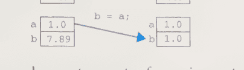

为了进一步说明赋值的替换特性，假设 count 和 number 是整数变量，其值分别为 123 和 99，并且我们希望交换这两个值。为此，我们需要一个额外的整数变量来在更改它们之前存储其中一个变量的旧值。假设我们称之为 temp 并用它存储在将 count 赋值为 number 的值之前 count 的值；然后我们可以将此存储的值赋给 number。

```
temp = count;
count = number;
number = temp;
```


## 4.3.1 Assignment as an Operation

我们已经看到，对于赋值

```
variable = expression
```

会产生三个动作：

+   1. expression 被求值，产生某个值 v。
+   2. variable 的值被更改为 v。
+   3. 值 v 由 = 运算符产生。

到目前为止，我们主要关注前两个动作，但现在我们考虑第三个动作。就像算术表达式

```
1 + 2
```

产生值 3 一样，赋值

```
number = 99
```

```
number = number + 1
```

+ 因为 = 运算符的优先级低于几乎所有其他 C++ 运算符，所以先应用

```
number = (number + 1)
```

产生结果 100。然后该值被赋给 number；

```
number = 100
```

这会将 number 的值更改为 100，之后 = 运算符产生结果 100。

= 的这种值产生特性意味着它可以在其他算术表达式内部使用。例如，语句

```
temp = 2 * (number = 100) + 1;
```

执行两次赋值：首先，100 被赋给 number，括号内表达式的值为 100；然后，结果表达式 2 * 100 + 1 被求值，其值 201 被赋给 temp。然而，这种在其他算术表达式内部使用赋值表达式的语句并不常见，其使用也不被鼓励。

更常见的使用 = 的这种特性的方法是在单个语句中将多个赋值运算符链接起来，例如

```
temp = count = number = 0;
```

由于赋值运算符 = 与迄今为止我们见过的算术运算符不同，是右结合的，这意味着在此语句中，赋值是从右到左进行的：

```
temp = (count = (number = 0));
```

首先，number 被设为 0；并且由于此 = 运算符产生赋给 number 的值（即 0），语句变为

```
temp = (count = 0);
```

这将 0 赋给 count，产生 0 作为其结果，语句变为

```
temp = 0;
```

现在，temp 被赋值为 0，其结果被返回，语句变为

```
0;
```

这虽然是有效的 C++ 语句，但什么也不做并被丢弃。“副作用”才是重要的：所有变量 number、count 和 temp 都被设为 0。

## 4.3.2 Assignment Shortcuts

一种常见的赋值形式是变量的值通过对其执行某些运算而改变；例如，

Add value to sum
Double number

这些可以写成赋值语句，

```
sum = sum + value;
number = number * 2;
```

但此类运算如此频繁，以至于为它们提供了特殊的快捷运算。与其按所示写法，我们可以使用更短的形式

```
sum += value;
number *= 2;
```

每个算术运算符都可以用这种方式使用。任何形式为

```
variable = variable Δ expr;
```

的语句，其中 Δ 是 +、−、*、/ 或 % 中的任意一个运算符，都可以写成

```
variable Δ= expr;
```

以下每个都是赋值运算符的可接受变体：

+   +=
+   −=
+   *=
+   /=
+   %=

这些运算都是右结合的，并产生其结果所赋的值。这意味着它们可以链接在一起；然而，这不是良好的编程实践，因为很难跟踪结果表达式的求值方式。例如，如果 width 的值为 3.0 而 length 的值为 5.7，则语句

```
length *= width += 0.2;
```

按如下方式执行：

+   1. 将 width 赋值为 3.0 + 0.2 = 3.2，然后
+   2. 将 length 赋值为 5.7 * 3.2 = 18.24。


## 78 ■ C++工程与科学程序设计

以这种方式将运算符链接在一起会降低程序的可读性，通常应避免这样做，因为此类程序难以（且可能代价高昂地）维护。

## 4.3.3 自增和自减运算

算法通常包含“将count加1”形式的指令，可以编码为：

```
count = count + 1;
```

或者，使用前面介绍的简化赋值形式，写成：

```
count += 1;
```

然而，这种将整数变量加1的赋值操作非常常见，为此专门提供了一个一元自增运算符++。它可以作为后缀运算符使用：

```
variable++
```

也可以作为前缀运算符使用：

```
++variable
```

其中variable是一个整数变量，其值将被加1。因此，赋值语句

```
count = count + 1; // or count += 1;
```

也可以写成：

```
count++;
```

或

```
++count;
```

当++像前面的语句那样作为独立运算使用时，使用后缀形式还是前缀形式没有区别。然而，当它们与其他运算结合时，存在细微差别。要理解这种差别，我们必须记住，这些自增表达式是赋值表达式，因此会产生值。它们都会使变量自增，但后缀形式产生的值是变量的原始（未自增）值，而前缀形式产生的值是自增后的值。

为了说明这一点，请考虑以下程序片段，其中count和number如前所述是整数变量：

```
//POSTFIX: Use first, then increment
count = 10;
cout << "count =" << count << endl;
```

输出

count = 10

```
number = count++;
cout << "number =" << number << endl;
cout << "count =" << count << endl;
```

number = 10
count = 11

以及

```
//PREFIX: Increment first, then use
count = 10;
cout << "count =" << count << endl;
```

输出

count = 10

```
number = ++count;
cout << "number =" << number << endl;
cout << "count =" << count << endl;
```

number = 11
count = 11

注意，两组语句都将count的值从10增加到11。然而，在第一组赋值中，number被赋值为10，而在第二组中，number被赋值为11。

正如整数变量的值可以使用++运算符自增一样，它也可以使用自减运算符（--）来自减（即从中减去1）。例如，赋值语句

```
count = count - 1;
```

可以更简洁地写成：

```
count--;
```

或

```
--count;
```

前缀和后缀版本之间的差异与自增运算符的差异类似。

## 4.4 输入/输出表达式

在某些编程语言中，输入和输出语句包含一些特殊保留字，如Read、Print或Write，以指示要执行的操作。然而，在C++中，输入和输出是通过特殊的输入和输出运算符来实现的。因此，与赋值类似，我们编写输入表达式来执行输入，编写输出表达式来执行输出。在本节中，我们首先了解输入/输出的基本特性。其他特性将在后续章节中介绍。

### 4.4.1 I/O流

C++通过使用流来避免输入/输出如何实现的具体细节——字符如何从键盘实际进入程序，或程序中计算的值如何到达屏幕——流将正在执行的程序与输入/输出设备连接起来。键盘产生的字符进入名为istream的输入流，该流将它们传输到程序。类似地，程序输出的字符进入名为ostream的输出流，该流将它们传输到屏幕。

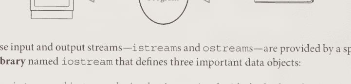

这些输入和输出流——istream和ostream——由一个名为iostream的特殊C++库提供，该库定义了三个重要的数据对象：

- 一个名为cin的istream对象，与键盘关联
- 一个名为cout的ostream对象，与屏幕关联
- 一个名为cerr的ostream对象，与屏幕关联，用于显示错误消息⁴

正如你可能猜到的，输入和输出是这些流的基本操作。

### 4.4.2 输入表达式

示例4.1中的程序包含输入语句：

```
cin >> mass;
```

其中mass是一个实型变量。与我们已经讨论过的算术表达式（如count + 1）和赋值表达式（如number = 100）类似，

```
cin >> mass
```

是一个输入表达式，其中**输入（或提取）运算符>>**应用于两个操作数cin和mass。也就是说，>>是一个二元运算符，其作用如下：

# 输入表达式

形式：

```
input_stream >> variable
```

其中：

*input_stream*是C++输入流的名称；且
*variable*是已定义输入运算符>>的C++变量。

行为：

1. 在*input_stream*中，下一个项必须是一个其类型与*variable*兼容的值。（如果没有，执行将暂停或终止，如后文所述。）
2. 该值从*input_stream*中移除并赋给*variable*。
3. >>运算符产生修改后的*input_stream*作为其结果。

由于输入运算符>>是*左结合*的，输入表达式可以链接在一起。例如，如果x和y是由以下语句声明的变量：

```
int x;
double y;
```

语句

```
cin >> x >> y;
```

将被求值为：

```
(cin >> x) >> y;
```

其方式如下：

1. 如果cin中的下一个值是整数，它将从cin中移除并赋给x，然后>>运算符产生值cin，得到以下修改后的输入语句：
   cin >> y;
2. 如果这个修改后的cin中的下一个值是整数或实数，它将从cin中移除并赋给y，然后>>运算符产生值cin，得到以下语句：
   cin;
3. 最后这条语句不包含运算符，只有cin，它将被丢弃，该输入语句的执行完成。

如果(1)和(2)中所需的任一输入在cin中不存在，会发生什么情况将在后文描述。

我们可以将典型的C++（交互式）输入语句描述如下：

# C++交互式输入语句

# 形式：

```
cin >> variable₁ >> variable₂ >> ... >> variableₙ;
```

其中：
cin是iostream库中提供的istream，>>是输入运算符，每个variableᵢ是一个为其定义了>>的变量。

# 目的：

该输入语句尝试从与cin关联的输入设备读取n个值的序列，将它们存储在variable₁, variable₂, ..., variableₙ中，并将它们从istream cin中移除。

请注意，在程序继续执行之前，用户必须为语句中的每个变量输入一个（适当类型的）值。因此，当执行以下输入语句时，如果side1、side2和side3按所示声明：

```
double side1, side2, side3;
cin >> side1 >> side2 >> side3;
```

程序执行将暂停，直到用户为所有三个变量输入值。如果输入的值少于三个，例如：

```
2.2 3.3
```

执行将不会恢复，直到用户输入第三个值，比如：

```
4
```

前两个值2.2和3.3将从cin中移除并分别赋给side1和side2；第三个值4将从cin中移除，转换为实数值4.0，并赋给side3。然后程序继续执行。

输入值可以用任意**空白字符**（空格、制表符或换行符）分隔。例如，如果这些值输入在不同的行上：

```
2.2
3.3
4
```

它们由换行符分隔，并发生与之前相同的赋值。

由于输入要求输入正确数量和类型的值，*只要需要输入数据值，最好向用户提供信息丰富的提示。*这可以通过在输入语句之前放置输出语句来实现，例如：

```
cout << "Enter the lengths of the triangle's three sides: ";
```

现在我们来研究输出语句。

### 4.4.3 输出表达式

C++的输入和输出语句非常相似。为了说明这一点，考虑输入语句：

```
cin >> mass;
```

来自示例4.1，以及一个缩短版的输出提示：

```
cout << "Enter a mass (in kilograms): ";
```

cin是istream对象的名称，cout是ostream对象的名称，两者都在iostream库中定义。istream输入（或提取）运算符是>>，而<<是ostream**输出**（或**插入**）运算符。与表达式

```
cin >> mass
```

对两个操作数（cin和mass）执行*输入*操作（>>）非常相似，表达式

```
cout << "Enter a mass (in kilograms): "
```

对两个操作数（cout和"Enter a mass (in kilograms): "）执行*输出*操作（<<）。

⁴ cout和cerr之间的一个主要区别是cout是带缓冲的，而cerr不带缓冲。输出到cerr的内容直接到达屏幕，而输出到cout的内容进入称为输出缓冲区的内存区域，仅当该缓冲区被清空（例如通过endl）时才显示在屏幕上。


我们可以用如下方式描述典型的 C++ 输出表达式：

## C++ OUTPUT EXPRESSION

Form:
```
output_stream << expression
```
where:

output_stream 是 C++ 输出流的名称，expression 是定义了输出运算符 << 的任意 C++ 表达式。

Behavior:

- 1. expression is evaluated.
- 2. That value is inserted into output_stream.
- 3. The << operator produces the modified output_stream as its result.

Like >>, the << operator is left-associative, which makes it possible to chain output expressions together. To illustrate, consider the following modification of the output statement in Example 4.1:
```
cout << energy << "kilojoules released." << endl;
```
It would be evaluated as follows:

- 1. The first output expression cout << energy inserts the value of energy into cout and the << operator produces the value cout, giving
- 
-      cout << "kilojoules released." << endl;

- 2. The next output expression cout << "kilojoules released." inserts the string "kilojoules released." into cout and the << operator produces the value cout, giving
- 
-      cout << endl;

- 3. The expression endl is evaluated, which inserts a newline character ('\n') into cout and then flushes it, causing output to appear on the screen. The << operator produces the value cout, giving
- 
-      cout;

- 4. This last statement contains no operators, only cout, which will be discarded and execution of this output statement is complete.

We can thus describe a typical C++ (interactive) output statement as follows:

## C++ INTERACTIVE OUTPUT EXPRESSION

### Form:
```
cout << expr₁ << expr₂ << ... << exprₙ;
```
where:
cout is the ostream and << the output operator provided in the iostream library and each exprᵢ is a C++ expression for which << is defined.

### Purpose:

Execution of an output statement inserts the values of expr₁, expr₂, . . ., exprₙ into the ostream cout so they will be displayed on the output device (e.g., the screen) associated with cout.

Note that << only inserts what is being output into cout, character by character with no formatting. In particular, it does not insert any space or newlines between output items unless the items themselves contain them. For example, if the last output statement in Example 4.1 were written as
```
cout << mass << "kilograms of matter will release"
    << energy << "kilojoules of energy.";
```
the output when 1 is entered for mass would be
```
1kilograms of matter will release 8.98755e+16kilojoules of energy.
```
whereas the output statement in Example 4.1,
```
cout << mass << " kilograms of matter will release\n"
    << energy << " kilojoules of energy.\n";
```
adds a space before the words “kilograms” and “kilojoules” and an advance to a new line after the word “release” to make the output more readable:
```
1 kilograms of matter will release
8.98755e+16 kilojoules of energy.
```
Note the \n after the last word “energy.” It is there so that any subsequent output will begin on a new line and not be attached at the end of this word. One or more new line escape sequences '\n' or the keyword endl must be used to cause output to advance to a newline.⁵ For example,
```
cout << "3\n4\n\nShut the door!" << endl;
```
will display the output
```
3
4
Shut the door!
```

## 4.4.4 Output Formatting

There are times when we may want to improve the default output format we have been using up to now. For example, if we are outputting monetary values we might like them rounded to two decimal places and displayed in nicely aligned columns. To accomplish this, C++ provides format manipulators, of which the more useful ones are given here; some others are described in later chapters.

### FORMAT MANIPULATORS

| Manipulators | Description |
|---|---|
| From iostream: | |
| showpoint | Display a decimal point and trailing zeros for real values |
| noshowpoint | For whole real values, hide the decimal point and trailing zeros (default) |
| fixed | Output real values in fixed-point notation |
| scientific | Output real values in scientific notation |
| boolalpha | Output boolean values as strings "true" and "false" |
| left | Left justify values within output fields |
| right | Right justify values within output fields (default) |
| From iomanip: | |
| setw(w) | Output the next value in a field of size w (default 1) |
| setprecision(p) | Output p fractional digits for all subsequent real values (common default is 6) |

### PURPOSE:

Format manipulators specify how subsequent items in an output list should appear. Except for setw(), they apply to all subsequent items in the current and following output statements unless modified by other format manipulators; setw() applies to only the next output item.

To illustrate the use of format manipulators, suppose that the truck drivers for a recycling company record the miles traveled, gallons of fuel used, cost of the fuel, and other miscellaneous operating costs for each of their pick-up routes. The program in Example 4.2 inputs these amounts for a route and then calculates miles per gallon, total trip cost, and the cost per mile. It uses two output manipulators from iostream: fixed so that all values are displayed in fixed-point form and showpoint so that decimal points and trailing zeros are displayed; and it uses two from iomanip: setprecision() to round output values to two decimal places and setw() to right-align the values in seven-space zones.

## Example 4.2 Recycling Costs
```
/* This program calculates miles per gallon, fuel cost per mile, and total cost for a truck on a recycling pick-up route.

Input:  a route number, total miles traveled, total fuel consumed,
        unit cost of the fuel, and other operating costs
Output: the miles per gallon, total cost for traveling the route,
        and the cost per mile
---------------------------------------------------------------*/

#include <iostream>      // cin, cout, <<, >>, fixed, showpoint
#include <iomanip>       // setprecision(), setw()
using namespace std;

int main()
{
    int route;                                   // route number
    cout << "Enter your route number: ";
    cin >> route;

    double miles,                               // miles traveled
           gallonsOfFuel,                       // gallons used
           unitFuelCost,                        // fuel cost per gallon
           otherOperatingCost;                  // other operating costs
    cout << "Enter:\n\t total miles traveled,"
         << "\n\t gallons of fuel used,"
         << "\n\t fuel cost per gallon, and"
         << "\n\t other operating costs (total):"
         << "\n\t--- ";
    cin >> miles >> gallonsOfFuel
        >> unitFuelCost >> otherOperatingCost;

    double milesPerGallon = miles / gallonsOfFuel,
           fuelCost = unitFuelCost * gallonsOfFuel,
           totalTripCost = fuelCost + otherOperatingCost,
           costPerMile = totalTripCost / miles;

    cout << showpoint << fixed << setprecision(2)
         << "For Route #" << route << ":\n"
         << "\n\tMiles per gallon:  " << setw(8) << milesPerGallon
         << "\n\tTotal cost:      $"  << setw(8) << totalTripCost
         << "\n\tCost per mile: $"  << setw(8) << costPerMile
         << endl;
}
```

### SAMPLE RUNS:

Enter your route number: 17
Enter:
```
total miles traveled,
gallons of fuel used,
fuel cost per gallon, and
other operating costs (total):
--> 100 20 3 1

For Route #17:

Miles per gallon: 5.00
Total cost: $ 61.00
Cost per mile: $ 0.61

Enter your route number: 24
Enter:
total miles traveled,
gallons of fuel used,
fuel cost per gallon, and
other operating costs (total):
--> 111.5 24.5 3.25 33.95

For Route #24:

Miles per gallon: 4.55
Total cost: $ 113.58
Cost per mile: $ 1.02
```

## 4.5 BASIC C++ FUNCTIONS AND LIBRARIES

The program in Example 4.1 contains the statement
energy = mass * pow(SPEED_OF_LIGHT, 2);
to compute the energy released from matter with a given mass, using Einstein’s equation
e = mc². Here we see that in addition to simple objects like literals, constants, and variables,
an expression's operand may be a value returned by a function. In this example, the standard
math library function pow() performs the exponentiation operation.⁶

### 4.5.1 Libraries

Because of the difficulty of computing exponentials, square roots, logarithms, and other
complex operations by hand, many calculators and application software such as Excel provide
these as built-in operations. For the same reason, C++ and many other programming
languages provide a collection of predefined functions to implement complex operations.
For C++, however, this collection is large, and including it in a rather small program like
that in Example 4.1 could result in a very large file. For this reason, C++ stores smaller
collections of related functions in separate libraries so that a program need only include
those that are needed.

> We will use notation of the form functionName() for function names, with the parentheses used to distinguish them
> from identifiers that do not represent functions.


正如名称所示，库是一个存储函数（以及其他内容，例如常量声明）的地方，以便程序可以“借用”它们。例如，iostream 库存储了流 cin 和 cout 的声明以及用于实现输入（>>）和输出（<<）操作的函数。要使用库的内容，需要在程序中添加 #include 指令，以告知编译器必须将该库的内容添加到程序中。因此，由于示例 4.1 中的程序通过 cin 从键盘读取数值，

```
cin >> mass;
```

并且通过 cout 将值输出到屏幕，如语句中所示

```
cout << mass << " kilograms of matter will release " << energy << " kilojoules of energy.\n";
```

程序必须包含指令

```
#include <iostream> // cin, cout, <<, >>
```

因为对象 cin 和 cout 以及 >> 和 << 操作存储在 iostream 库中。程序还包含指令

```
#include <cmath> // pow()
```

以便使程序可以使用数学库的内容，因为它使用的 pow() 函数就在该库中。这些指令附带的注释不是强制性的，但遵循良好的编程实践是在 #include 指令后加上类似所示的注释，列出正在使用的库中的项目。

当 C++ 编译器处理 #include 指令时，该文件的内容将被添加到程序中。库名称周围的尖括号（< 和 >）以及 #include 指令之后的下一行，

```
using namespace std;
```

为编译器提供有关在哪里找到这些库的信息。

## 4.5.2 数字函数

如第 1 章所述，C++ 由 Bjarne Stroustrup 开发，他在 C 语言的基础上增加了面向对象的特性。然而，C 的许多强大特性在 C++ 中得以保留，其中包括 C 库，例如 cmath。除了 pow() 之外，C 数学库 cmath 还存储 sqrt()、exp() 和其他数学相关函数。C 标准库 cstdlib 包含许多其他常用函数，例如用于整数的绝对值函数 abs() 和 exit()，如果发生错误，可以使用它来终止程序执行。熟悉这些库中可用的函数是学习 C++ 编程的重要组成部分，因为它们提供了许多有用的操作。我们将在正文中描述其中几个函数；其他函数在附录 B 中描述。

要使用函数计算值，称为调用函数，我们只需给出函数名，后跟包含其参数的括号——常量、变量或要应用函数的表达式。例如，示例 4.1 中的程序使用

```
pow(SPEED_OF_LIGHT, 2)
```

调用 pow() 函数，将 SPEED_OF_LIGHT 和 2 发送给它。计算 xⁿ 需要两个操作数 x 和 n，因此 pow() 函数需要两个参数。相比之下，如果我们想求整数值的绝对值，我们可以使用标准库函数 abs()，它接受一个参数，

```
positiveValue = abs(intValue);
```

但为此，我们必须先包含标准 C 库 cstdlib：⁸

```
#include <cstdlib>
```

表 4.1 列出了 cmath 提供的数学函数；其他函数在附录 B 中描述。这些函数中的每一个都接受一个或多个类型为 double（或可以提升为 double）的参数并返回类型为 double 的值。例如，要计算 3 的平方根，我们可以写 sqrt(3.0) 或 sqrt(3)。

**表 4.1 cmath 库函数**

| Function | Description |
| --- | --- |
| fabs(x) | Absolute value of real value x |
| pow(x, y) | x raised to power y |
| sqrt(x) | Square root of x |
| ceil(x) | Least integer greater than or equal to x |
| floor(x) | Greatest integer less than or equal to x |
| exp(x) | Exponential function eˣ |
| log(x) | Natural logarithm of x |
| log10(x) | Base-10 logarithm of x |
| sin(x) | Sine of x (in radians) |
| cos(x) | Cosine of x (in radians) |
| tan(x) | Tangent of x (in radians) |
| asin(x) | Inverse sine of x |
| acos(x) | Inverse cosine of x |
| atan(x) | Inverse tangent of x |
| sinh(x) | Hyperbolic sine of x |
| cosh(x) | Hyperbolic cosine of x |
| tanh(x) | Hyperbolic tangent of x |

⁸ Some versions of C++ include cstdlib automatically.

一些更复杂的表达式可能需要一个以上的函数调用。例如，如果我们正在求解二次方程，我们可能想要计算判别式 √b²−4ac。我们可以用 C++ 表示为

```
sqrt(pow(b, 2) - 4.0 * a * c)
```

请注意，如果表达式的值

```
pow(b, 2) - 4.0 * a * c
```

为负数，将会产生错误，因为负数的平方根不是实数。

C 库 cstdlib 包含其他几个通用函数。表 4.2 列出了其中一些更有用的函数；其他函数在附录 B 中描述。

**表 4.2 cstdlib 库函数**

| Function | Description |
| --- | --- |
| abs(i) | Returns the absolute value of integer i |
| rand() | Returns a pseudorandom integer in the range 0 to RAND_MAX, which is an integer constant (≥ 32767) also defined in cstdlib |
| srand(seed) | Uses the integer seed to initialize the sequence of pseudorandom integers returned by rand() |
| exit(status) | Terminates program execution and returns control to the operating system; status = 0 signals successful termination and any nonzero value signals unsuccessful termination |

### CHAPTER SUMMARY

### Key Terms

| Term | Term |
| --- | --- |
| `#include` directive | division operator (`/`) |
| addition operator | escape sequence |
| assignment operator (`=`) | expression |
| C math library (`cmath`) | fixed-point |
| C standard library (`cstdlib`) | floating-point |
| `cerr` | format manipulator |
| `cin` | increment operator (`++`) |
| compatible | input operator (`>>`) |
| `cout` | iostream library |
| decrement operator (`--`) | `istream` |
| left-associative | output operator (`<<`) |
| library | promotion |
| mixed-type expression | remainder |
| modulus operator (`%`) | right-associative |
| multiplicative operator (`*`) | short-cut assignment operations |
| operand | stream |
| operator | subtraction operator (`-`) |
| operator precedence | type conversion |
| operator priority | unary operator |
| `ostream` | white space |

- It is important to understand the difference between integer and real division. If a and b are both integers with b ≠ 0, a / b gives the integer quotient when a is divided by b, and a % b gives the remainder. If a or b is real, real division is used for a / b and a % b results in an error.

- Promotion is the automatic widening of a narrower value to the size of a wider value. It is used in mixed-type expressions to convert a narrower value to the type of a wider value in the expression.

- Two values are compatible if one of the following is true:
  - They are both of the same type.
  - The type of one value can be promoted to the type of the other value.
  - The types of both can be promoted to the same type.

- In an expression, unary operators + and – have higher priority than *, /, and %, which in turn have higher priority than + (addition) and – (subtraction).

- Associativity determines whether equal-priority operators are applied from left to right or from right to left.

- Parentheses can be used to change the usual order of evaluation in an expression.

- A directive of the form `#include <lib>` must be used to insert the contents of a C/C++ library before the functions in that library can be used.

- Expressions of the form `type(expr)` or `(type)expr` can be used to convert the value of `expr` to the specified type.

- An assignment statement is a replacement statement: `a = b;` replaces the value of a with the value of b.

- Assignment is a value-producing operator that returns the value being assigned. This together with right-associativity makes it possible to chain assignments; for example, `a = b = c = d;`.

- An assignment statement of the form `alpha = alpha Δ beta;` can be written more compactly as `alpha Δ= beta;`.

- The increment (`++`) and decrement (`--`) operations are useful for incrementing/decrementing an integer variable by 1.

- I/O is carried out in C++ by operators acting on streams (`istream`s for input and `ostream`s for output), which connect an executing program with an input/output device.

- Input statements of the form

  ```
  an_istream >> variable_1 >> variable_2 >> ... >> variable_n;
  ```

  are used to input values for variables; `cin` is the istream associated with the keyboard. White space (spaces, tabs, or newlines) is used to separate input values. Leading white space will be ignored when reading a value for a variable.

- It is good practice to prompt the user with an informative message when data values are to be entered.

- Output statements of the form

  ```
  an_ostream << expr_1 << expr_2 << ... << expr_n;
  ```

  are used to output values of expressions; `cout` and `cerr` are ostreams associated with the screen.

- The format of output is controlled by inserting format manipulators into output lists.

### Style and Design Tips

In the examples in this text, we adopt certain stylistic guidelines for C++ programs, and you should write your program in a similar style. Those at the end of Chapter 3 are important ones and you should review them.

### Warnings

1. The type of value stored in a variable should be the same as or promotable to the type of that variable.
2. If an integer value is to be stored in a real variable, the integer will be promoted to a real type. By contrast, if a real value is to be stored in an integer variable, then the real value is truncated, possibly resulting in the loss of information.


+   3. 表达式中的括号必须成对出现。也就是说，对于每个左括号，必须在表达式中稍后出现恰好一个匹配的右括号。

+   4. 实数除法和整数除法都用 / 表示；执行哪种运算由操作数的类型决定。

+   5. 所有乘法都必须用 * 表示；例如，2*n 是有效的，但 2n 不是。

+   6. 每个旨在作为编程语句的表达式（赋值、输入、输出等）末尾必须出现分号。

+   7. C++ 中有许多运算符——我们才刚刚触及皮毛——记住它们的优先级会越来越困难。因此，在复杂表达式中使用括号来明确指定运算符的应用顺序是明智的。

## TEST YOURSELF

### Section 4.2

求出问题 1–8 中每个表达式的值，或说明其为何不是有效表达式。

+   1. 3 - 2 - 1
+   2. 2.0 + 3.0 / 5.0
+   3. 2 + 3 / 5
+   4. 5 / 2 + 3

+   5. 7 + 6 % 5
+   6. (7 + 6) % 5
+   7. (2 + 3 * 4) / (8 - 2 + 1)
+   8. 12.0 / 1.0 * 3.0

问题 9–18 假设 two、three 和 four 分别是值为 2.0、3.0 和 4.0 的实数；intEight 和 intFive 分别是值为 8 和 5 的整数；并且使用 ASCII 表示字符（参见附录 A）。求出每个表达式的值。

+   9. two + three * three
+   10. intFive / 3
+   11. (three + two / four) * 2
+   12. intEight / intFive * 5.1
+   13. four * 2 / two * 2

+   14. intFive * 2 / two * 2
+   15. 'c' - 1
+   16. 'b' + 'c' - 'a'
+   17. int(two * three / four)
+   18. (int)(two * three / four)

判断每个是否是有效的 C++ 语句。如果无效，请说明原因。

+   1. pi = 3.0;
+   2. 0 = n;
+   3. n = n + n;
+   4. n + n = n;
+   5. m = 1;
+   6. m = "1";
+   7. m = n = 1;
+   8. c = '65';
+   9. c = 65;

+   10. c = '1';
+   11. c = "1";
+   12. m = m;
+   13. pi = m;
+   14. m = pi;
+   15. m++;
+   16. m + n;
+   17. ++pi;

对于问题 18-23，假设已作出以下声明：

```
int intEight = 8, intFive1 = 5, intFive2 = 5, jobId;
double two = 2.0, three = 3.0, four = 4.0, xValue;
```

求出赋给给定变量的值或指出语句为何无效。

+   18. xValue = three + two / four;
+   19. xValue = intEight / intFive1 + 5.1;
+   20. jobId = intEight / intFive1 + 5.1;
+   21. jobId = intFive1++;
+   22. jobId = ++intFive2;
+   23. intEight *= 8;

对于问题 24-26 中的每一个，写一个 C++ 赋值语句，计算给定的表达式并将结果赋给指定的变量。

+   24. rate 乘以 time 得到 distance
+   25. a² + b² 到 c
+   26. 假设 x 是一个整数变量，写出四条不同的语句使 x 增加 1。

## Section 4.4

+   1. 在 C++ 中，输入和输出是通过 ________ 进行的，它们将正在执行的程序与输入/输出设备连接起来。

2. （真或假）C++ 没有内置的输入或输出设施。

3. ________ 是与键盘关联的流对象；其类型是 ________。

4. ________ 和 ________ 是与屏幕关联的流对象；其类型是 ________。

5. 输入运算符是 ________。

6. 输出运算符是 ________。

7. 输入表达式 cin >> x 的值是 ________。

8. 输出表达式 cout << x 的值是 ________。

9. 输入和输出运算符是（左或右）________ 结合的。

10. ________ 可以插入到输出列表中以格式化项目的输出。

问题 11–13 假设声明

```
int number = 123;
double rate = 23.45678;
```

对于每个，精确显示语句集产生的输出，用 _ 表示空白，或说明为何会发生错误。

11. cout << number << rate << endl;

```
12. cout << '\n' << setw(5) << number << number + 1
    << setw(5) << number + 2
    << setw(1) << number + 4 << endl;
```

```
13. cout << showpoint << fixed
    << setw(8) << setprecision(0) << rate << endl
    << setw(8) << setprecision(1) << rate << endl
    << setw(8) << setprecision(2) << rate << endl
    << setw(8) << rate << endl
    << setprecision(1) << rate << endl;
```

问题 14–17 假设声明

```
int number1, number2, number3;
double real1, real2, real3;
```

对于每个，说明当使用给定的输入数据执行语句时，将为每个变量分配什么值（如果有），或说明为何会发生错误：

14. cin >> number1 >> number2 >> number3;      输入：  11 22
    33 44

```
15. cin >> real1 >> real2 >> real3;
Input: 1.1 2 3.3 4
```

```
16. cin >> number1 >> number2 >> number3;
Input: 1.1 2 3.3 4
```

```
17. cin >> number1 >> real1 >> number2;
>> real2 >> number3 >> real3;
Input: 1.1 2
3.3 4
5.5 6
```

+   1. sqrt(6.0 + 3.0)
+   2. pow(2.0, 3)
+   3. floor(2.34)
+   4. ceil(2.34)
+   5. sqrt(r2 + r3 + r4)
+   6. pow(r2, i4)
+   7. sqrt(pow(4.0, 2))
+   8. sqrt(pow(-4.0, 2))
+   9. pow(sqrt(-4.0), 2)
+   10. ceil(8.0 / 5.0)
+   11. floor(8.0 / 5.0)
+   12. pow(r2, i4) / pow(r4, i3)
+   13. pow(i3, pow(r2, 2))
+   14. sqrt(i4 * pow(r4, 3))
+   15. floor(sqrt(i4 - r3))

对于问题 16–19，写出将计算给定表达式的 C++ 表达式。

+   16. x 和 y 的平均值的平方根
+   17. | a / (b + c) | （其中 |x| 表示 x 的绝对值）
+   18. a^x，计算为 e^{ln a} （其中 ln 是自然对数函数）
+   19. 四舍五入到最近百分之一的实数量 amount

### EXERCISES

求出练习 1–19 中每个表达式的值，或说明其为何不是有效表达式。

+   1. 9 - 5 - 3
+   2. 2 / 3 + 3 / 5
+   3. 9.0 / 2 / 5
+   4. 9 / 2 / 5
+   5. 2.0 / 4
+   6. (2 + 3) % 2

7. 7 % 5 % 3
8. (7 % 5) % 3
9. 7 % (5 % 3)
10. (7 % 5 % 3)
11. 25 * 1 / 2
12. 25 * 1.0 / 2
13. 25 * (1 / 2)

14. -3.0 * 5.0
15. 5.0 * -3.0
16. 12 / 2 * 3
17. ((12 + 3) / 2) / (8 - (5 + 1))
18. ((12 + 3) / 2) / (8 - 5 + 1)
19. (12 + 3 / 2) / (8 - 5 + 1)

练习 20–24 假设 r1 和 r2 分别是值为 2.0 和 3.0 的实数；i1、i2 和 i3 分别是值为 4、5 和 8 的整数；并且使用 ASCII 表示字符（参见附录 A）。求出每个表达式的值。

20. r1 + r2 * r2
21. i3 / 3
22. i3 / 3.0

23. (r2 + r1) * i1
24. i3 / i2 * 5.1

写出 C++ 表达式以计算练习 25–28 中的每个量。

25. 10 + 5B - 4AC
26. m 和 n 的平均值（它们的和除以二）
27. 四倍差 4 - n 除以两倍的量 m² + n²
28. 使用给定的 cost 值，验证语句
cost = double(int(cost*100.0 + 0.5)) / 100.0;
可用于将这些 cost 的实数值转换为美元，四舍五入到最近美分。
a) 12.342    d) 12.340
b) 12.348    e) 13.0
c) 12.345

29. 写一个与练习 28 类似的表达式，将实数 amount 四舍五入到最近的十分之一。

30. 写一个与练习 28 类似的表达式，将实数 amount 四舍五入到最近的千分之一。

## Section 4.3

练习 1–16 假设 number 是一个整数变量，xValue 和 yValue 是实数变量，grade 是一个字符变量。判断每个是否是有效的 C++ 语句。如果无效，请说明原因。

+   1. xValue = 2.71828;
+   2. 3 = number;
+   3. grade = 'B+';
+   4. number = number + number;
+   5. xValue = 1;
+   6. grade = A;
+   7. number + 1 = number;
+   8. xValue = '1';
+   9. xValue = yValue = 3.2;
+   10. yValue = yValue;
+   11. xValue = 'A';
+   12. grade = grade + 10;
+   13. xValue /= yValue;
+   14. xValue = number;
+   15. number = yValue;
+   16. xValue = yValue++;

对于练习 17–29，假设已作出以下声明：

```
int int16 = 16, int10 = 10, number;
double real4 = 4.0, real6 = 6.0, real8 = 8.0, xCoord;
char numeral = '2', symbol;
```

求出赋给给定变量的值或指出语句为何无效。

+   17. xCoord = (real4 + real6) * real6;
+   18. xCoord = (real6 + real4 / real8) * 2;
+   19. xCoord = int16 / int10 + 5;
+   20. number = int16 / int10 + 5;


21. symbol = 4;
22. symbol = numeral;
23. symbol = '4';
24. symbol = real8;
25. real4 = 2;
26. real4 = '2';
27. real4 = numeral;
28. int16 = int16 + 2;
29. number = 1 + numeral;

对每个 30–34 题，写一个赋值语句，使整数变量 number 的值按指定量改变。

+   30. 使 number 增加 77。
+   31. 使 number 减少 3。
+   32. 使 number 增加其自身值的两倍。
+   33. 将 number 的最右一位数字加到 number 上。
+   34. 使 number 减少实值 xCoord 的整数部分。

对每个 35–40 题，写一个 C++ 赋值语句，计算给定的表达式并将结果赋给指定的变量。假设所有变量的类型均为 double。

+   35. rate 乘以 time 得到 distance
+   36. 将 xCoord 增加 deltaX 的量得到 xCoord
+   37. 1 / (1/res1 + 1/res2 + 1/res3) 得到 resistance
+   38. fahrenheit − 32 的差值的 5/9 得到 celsius
+   39. 底边和高度给定的三角形的面积（一半底边乘以高度）得到 area
+   40. 将 amount 四舍五入到最接近的整数得到 amount

对每个 41–43 题，给出整数变量 a、b 和 c 的值，使得两个给定的表达式的值不同：

7. cout << "rho =" << setw(8) << setprecision(2) << rho << "******";

8. cout << setw(10) << alpha << setw(10) << beta;

对第 9 和 10 题，假设声明如下

```
int i = 15, j = 8;
char c = 'c', d = '-';
double x = 2559.50, y = 8.015;
```

精确显示每个语句产生的输出；用 _ 表示空白，或说明为何会发生错误。

```
9. cout << setw(j) << setprecision(2) << "new balance =" << x << ' ' << setw(i % 10) << c << setw(j) << setprecision(j - 6) << y;
```

```
10. cout << "i =" << setw(i) << i << "j =" << setw(j) << setprecision(j) << j << endl << setw(j) << i << ' ' << setw(i) << j;
```

对第 11–14 题，假设声明如下

```
int n1 = 39, n2 = -5117;
char c = 'F';
double r1 = 56.7173, r2 = -0.00247;
```

对每个练习，写出使用这些变量的输出语句以产生给定的输出。 （下划线是此处仅为帮助你确定间距而显示的。）

11. 56.7173    F    39
--------------------
-5117PDQ-0.00247
--------------------

12. 56.717    -0.0025***39  F
--------------------------
    56.72  39-5117
--------------------------

13. Roots are  56.717 and -0.00247
-------------------------------

## 14. Approximate angles: 56.7 and -0.0
Magnitudes are 39 and 5117

对第 15–21 题，假设 a、b 和 c 为整数变量，x、y 和 z 为实变量。说明在给定输入数据执行输入语句时，将会把什么值，如果有的话，赋给这些变量，或说明为何会发生错误：

```
15. cin >> a >> b >> c
    >> x >> y >> z;
```

输入：1 2 3
4 5.5 6.6

```
16. cin >> a >> b >> c;
    cin >> x >> y >> z;
```

输入：1
2
3
4
5
6

```
17. cin >> a >> x;
    cin >> b >> y;
    cin >> c >> z;
```

输入：1 2.2
3 4.4
5 6.6

```
18. cin >> a >> b >> c;
    cin >> x >> y >> z;
```

输入：1 2.2
3 4.4
5 6.6

```
19. cin >> a;
    cin >> b >> c;
    cin >> x >> y;
    cin >> z;
```

输入：1 2 3
4 5.5 6.6

```
20. cin >> a
    >> b >> c
    >> x >> y
    >> z;
```

输入：1 2 3
4 5.5 6.6

```
21. cin >> a >> b;
    cin >> c >> x >> y >> z;
```

输入：1 2 3
4 5.5 6.6
7 8.8 9.9
10 11.11 12.12
13 14.14 15.15

# 第 4.5 节

对第 1–11 题，假设 r1 和 r2 为实数，其值分别为 2.0 和 3.0，且 i1、i2 和 i3 为整数，其值分别为 4、5 和 8。求表达式的值或说明其为何无效。

+   1. `sqrt(pow(4.0,2))`
+   2. `sqrt(pow(-4.0,2))`
+   3. `pow(sqrt(-4.0),2)`
+   4. `ceil(8.0 / 5.0)`
+   5. `floor(8.0 / 5.0)`
+   6. `pow(i1,2) / pow(r1,2)`
+   7. `pow(i2,2) / pow(r1,2)`
+   8. `sqrt(r1 + r2 + i1)`

对第 9–12 题，假设已作出以下声明：

```
int int1 = 10, int2 = 16, number;
double rVal = 5, xCoord;
```

求赋给给定变量的值或指出语句为何无效。

+   9. `xCoord = pow(int1,2) / sqrt(int2);`
+   10. `number = pow(int1,3) / pow(int1,2);`
+   11. `number = ceil(pow(int2 % int1, 2) / rVal);`
+   12. `number = floor(pow(int2 % int1, 2) / rVal);`

对第 13–17 题，写出表达式以计算给定的量。

+   13. *m* 和 *n* 的平均值的平方根
+   14. \(|A / (m + n)|\) （其中 \(|x|\) 表示 *x* 的绝对值）
+   15. \(a^x\)，计算为 \(e^{x \ln a}\) （其中 ln 为自然对数函数）
+   16. 实量 *amount* 四舍五入到最接近的百分位
+   17. \(\frac{2v^2\sin a\cos a}{g}\)

# 编程问题

+   1. 编写程序读取直角三角形两条直角边的长度，并计算并显示三角形的面积（两条边乘积的一半）以及斜边的长度（两条边平方和的平方根）。
+   
+   2. 编写程序读取二次方程 \(ax^2 + bx + c = 0\) 的系数 *a*、*b* 和 *c* 的值，然后使用二次公式求该方程的两个根
+   
+   \[
+   \frac{-b \pm \sqrt{b^2 - 4ac}}{2a}
+   \]
+   
+   使用若干 *a*、*b* 和 *c* 的值执行程序，使得 \(b^2 - 4ac\) 为非负，包括 \(a = 4, b = 0, c = -36\)；\(a = 1, b = 5, c = -36\)；以及 \(a = 2, b = 7.5, c = 6.25\)。

+   3. 编写程序将以英尺为单位的测量值转换为等价的 (a) 码、(b) 英寸、(c) 厘米和 (d) 米数（1 英尺 = 12 英寸，1 码 = 3 英尺，1 英寸 = 2.54 厘米，1 米 = 100 厘米）。读取英尺数并显示，附带适当标签的英尺数以及对应的码、英寸、厘米和米数。

+   4. 火箭在发射后 t 秒时的水平位移 $x$ 和垂直位移 $y$（以英尺计）由下式给出：
+   
+   $$x = v_0t\cos\theta$$
+   
+   $$y = v_0t\sin\theta - 16t^2$$
+   
+   其中 $v_0$ 为初速度（ft/sec），$\theta$ 为火箭发射的角度（以弧度计）。编写程序读取 $v_0$、$\theta$ 和 $t$ 的值；使用这些公式计算 $x$ 和 $y$；并显示这些值。

+   5. 包含电阻、电容和电感串联的交流电路中的电流由下式给出
+   
+   $$I = \frac{E}{\sqrt{R^2 + \left(2\pi fL - \frac{1}{2\pi fC}\right)^2}}$$
+   
+   其中 $I$ = 电流（安培），$E$ = 电压（伏特），$R$ = 电阻（欧姆），$L$ = 电感（亨利），$C$ = 电容（法拉），$f$ = 频率（赫兹）。编写程序读取电压、电阻、电容和频率的值，然后计算并显示电流。

+   6. 角度通常以度（°）、分（′）和秒（″）测量。圆周有 360 度，一度有 60 分，一分有 60 秒。编写程序读取以度、分、秒给出的两个角度测量值，然后计算并显示其和。使用程序验证以下每项：
+   
+   - $74°29′13″ + 105°8′16″ = 179°37′29″$
+   - $7°14′55″ + 5°24′55″ = 12°39′50″$
+   - $20°31′19″ + 0°31′30″ = 21°2′49″$

+   7. 为了使允许剪切强度为 5 lb/in² 的轴传递 $T$ in-lbs 的扭矩，它必须至少具有直径
+   
+   $$D = \sqrt{\frac{16T}{S}} \text{ inches}.$$
+   
+   如果 $P$ 马力施加于以 $N$ rpm 旋转的轴上，则扭矩由下式计算
+   
+   $$T = 63000\frac{P}{N}.$$
+   
+   编写程序读取 $P$、$N$ 和 $S$ 的值，然后计算并显示产生的扭矩以及传递该扭矩所需的直径。使用以下输入执行程序：

| P (HP) | N (rpm) | S (psi) |
| --- | --- | --- |
| 20 | 1500 | 5000 |
| 20 | 50 | 5000 |
| 270 | 40 | 6500 |

8. 摆的周期由公式给出

P = 2π √[ L/g ( 1 + 1/4 sin²(α/2) ) ]

其中 g = 980 cm/sec²，L = 摆长（cm），α = 位移角。编写程序读取摆的 L 和 α 值，然后计算并显示其周期。使用以下输入执行程序：

| L (cm) | α (degrees) |
| --- | --- |
| 120 | 15 |
| 90 | 20 |
| 60 | 405 |
| 74.6 | 10 |
| 83.6 | 12 |

9. 编写程序读取购买金额、支付金额（两者均以分为单位），然后计算并显示以美元、半美元、季度、角、镍币和便士表示的找零。


表征顺序执行，并清楚地表明语句按照给出的顺序执行，且每个语句恰好执行一次。

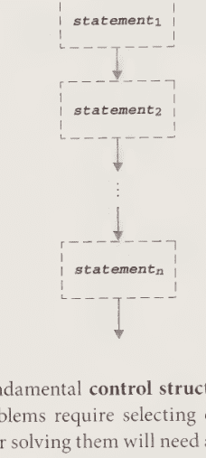

虽然顺序是一种基本控制结构，但它不足以解决所有问题。有些问题需要从几个备选操作中选择一个，这意味着解决它们的程序将需要一种选择结构。在本章中，我们将讨论 C++ 提供的一种选择结构：if 语句。另一种选择结构 switch 语句将在第8章中介绍。

然而，对于某些问题，除了顺序和选择之外，还需要另一种控制结构，即能够重复执行一个或多个语句的结构——重复结构。我们将在本章的最后一部分讨论 C++ 中提供的两种重复结构：for 语句和 while 语句。

顺序、选择、重复是仅有的三种必需控制结构。理论计算机科学的一个基本结果表明，任何可由计算机程序解决的问题，都可以由仅由顺序、选择、重复结构组成的程序来解决。¹

> ¹ 这个定理通常归功于 Corrado Böhm 和 Giuseppe Jacopini 于1966年发表的一篇论文。

## 5.1 入门示例：空气质量指数（AQI）

### 5.1.2 问题

污染水平在城市中的三个地点测得，空气质量指数（AQI），也称为空气污染指数（API），是这三个读数的整数平均值。指数低于50 ppm（百万分率）表示安全状态，而达到或超过50 ppm（百万分率）则表示危险状态。² 城市的环境统计员希望有一个程序来计算这些空气质量指数，并确定相应的污染状态：安全还是危险。

> ² 这里我们考虑的是一个简化版的 AQI，它只有两个类别，但在实际中，通常不止两个。例如，我们将在第8章讨论具有多于两个备选方案的选择结构时看到，美国 AQI 有6个类别。

### 5.1.3 以对象为中心的设计

#### 5.1.3.1 行为

程序应在屏幕上显示一个提示，要求输入三个污染读数（百万分率）。然后，它从键盘读取这些值，并计算空气质量指数，即这些读数四舍五入到最接近整数的平均值。程序应在屏幕上显示空气质量指数，将其与分隔危险状态和安全状态的临界值进行比较，并显示相应的状态。

#### 5.1.3.2 对象

根据行为描述，我们可以识别出以下对象：

| 问题对象 | 软件对象 |  |  |
| --- | --- | --- | --- |
|  | 类型 | 种类 | 名称 |
| 屏幕 | 输出设备 | 变量 | cout |
| 提示 | 文本字符串 | 常量 | 无 |
| 键盘 | 输入设备 | 变量 | cin |
| 污染水平 | double | 变量 | level1, level2, level3 |
| 空气质量指数 | int | 变量 | index |
| 临界值 | int | 常量 | CUTOFF |

#### 5.1.3.3 操作

同样，根据行为描述，我们有以下操作：

- i. 输出一个字符串（提示、描述性标签）
- ii. 从键盘读取实数值（level1, level2, level3）
- iii. 根据 level1、level2、level3 计算 index：将各水平相加，除以 3，再加 0.5 进行四舍五入
- iv. 在屏幕上输出一个数值（index）和一个字符串（污染状态）

#### 5.1.3.4 算法

下一步是将这些对象和操作组织成一个算法：

- 1. 定义常量 CUTOFF。
- 2. 向 cout 显示提示，要求输入三个污染水平。
- 3. 从 cin 读取三个实数值到 level1、level2、level3。
- 4. 计算 index = (level1 + level2 + level3) / 3 + 0.5。

> ³ 实数可以通过加 0.5 并截去小数部分来四舍五入到最接近的整数。一般来说，若要四舍五入到小数点后第 n 位，可乘以 10^n，加 0.5，截去小数部分，再除以 10^n。

- 5. 向 cout 输出一个描述性标签和 index。
- 6. 如果 index < CUTOFF，则向 cout 输出 "Safe"，否则输出 "Hazardous"。

示例5.1中的程序实现了上述算法。注意在 index 的计算中对平均污染读数进行了四舍五入。

### 示例5.1 空气质量指数——第1版

```
/* This program reads three pollution levels, calculates an air quality index (AQI) as their integer average, and then displays an appropriate air-quality message.

Input: the three pollution levels
Constant: the cutoff value (parts per million)
Output: the air quality index and a "safe condition" message if this index is less than the cutoff value, otherwise a "hazardous condition" message
*/

#include <iostream> // cin, cout, <<, >>
using namespace std;

int main()
{
const int CUTOFF = 50; // safe pollution level cutoff
double level1, level2, level3;
cout << "Enter 3 pollution readings (parts per million): ";
cin >> level1 >> level2 >> level3; // get pollution levels
int index = (level1 + level2 + level3) / 3 + 0.5; // compute AQI
cout << "AQI: " << index << " -- "; // display AQI
// display condition
if (index < CUTOFF)
cout << "Safe condition\n";
else
cout << "Hazardous condition\n";
}
```

```
Enter 3 pollution readings (parts per million): 30 40 50
AQI: 40 -- Safe condition

Enter 3 pollution readings (parts per million): 40 50 60
AQI: 50 -- Hazardous condition
```

```
Enter 3 pollution readings (parts per million): 44.5 53.8 61
AQI: 53 -- Hazardous condition
```

```
Enter 3 pollution readings (parts per million): 39.2 52 54.5
AQI: 49 -- Safe condition
```

上述程序的 if 语句中用于确定显示哪个污染状态的表达式 index < CUTOFF 称为布尔表达式。由于布尔表达式是选择和重复结构的重要组成部分，我们接下来将详细讨论布尔表达式。

## 5.2 布尔表达式

19世纪中期，英国数学家、哲学家乔治·布尔（George Boole）开发了一种代数逻辑体系，后来被称为布尔逻辑，它是现代数字计算机逻辑的基础。该体系中的逻辑表达式取值要么为 true，要么为 false，因此被称为布尔表达式。在计算领域中，它们通常也被称为条件。

所有现代编程语言都提供布尔表达式，本节我们讨论 C++ 中的布尔表达式。我们将首先讨论简单布尔表达式，然后讨论复合表达式，即通过应用逻辑运算符来修改或组合其他布尔表达式而构造的表达式。

### 5.2.1 简单布尔表达式

bool 类型有两个字面量 false 和 true，布尔表达式的值就是这两个值。⁴ 最简单的布尔表达式测试两个值之间的某种关系，例如一个值是否小于另一个值。例如，示例5.1中的程序包含布尔表达式

```
index < CUTOFF
```

该表达式使用小于关系比较操作数 index 和 CUTOFF，如果 index 的值小于 CUTOFF，则结果为 true，否则为 false。类似地，布尔表达式

```
count == 5
```

测试（变量）操作数 count 和（字面量）操作数 5 之间的相等关系，如果 count 的值为 5，则结果为 true，否则为 false。注意：进行相等比较时，务必使用 == 运算符，而不是 =（赋值），否则几乎肯定会产生错误。⁵

> ⁴ 为了与 C 语言向上兼容，整数也可以用作布尔值：0 代替 false，任何非零值代替 true，其中 1 最为常见。

> ⁵ 例如，在形如 if (x = 1) something 的 if 语句中，“条件” x = 1 实际上是一个赋值表达式，因此其值为 1，表示 true。因此，something 将总是被执行。


下表中给出的运算符被称为**关系运算符**，因为它们测试两个操作数之间的关系：

| 关系运算符 | 测试的关系 |
|---|---|
| `<` | 小于 |
| `>` | 大于 |
| `==` | 等于 |
| `!=` | 不等于 |
| `<=` | 小于或等于 |
| `>=` | 大于或等于 |

它们用于形如的布尔表达式

```
expression₁ relational_operator expression₂
```

其中 expression₁ 和 expression₂ 具有兼容的类型。例如，如果 root、a、b 和 c 为 double 类型，count 为 int，answer 为 char 类型，则以下均是使用这些关系运算符构成的有效布尔表达式：

```
root < 1
b * b >= 4.0 * a * c
count == 100
answer != 'T'
```

如果 root 的值为 0.7，则表达式

```
root < 1
```

的值为 `true`。类似地，如果 count 的值为 99，则表达式

```
count == 100
```

产生的值为 `false`。

如表达式 answer != 'T' 所示，char 值也可以使用关系运算符进行比较。如我们在第 3 章中所见，字符在内存中由数字代码表示，通常为 ASCII（参见附录 A），当两个字符进行比较时，比较的是它们的数字代码。例如，如果 char1 和 char2 是由以下方式初始化的字符变量

```
char char1 = 'A', char2 = 'B';
```

布尔表达式

```
char1 < char2
```

为避免这种困难，我们必须将原始不等式 0 ≤ temperature ≤ 100 重写为

(0 ≤ temperature) and (temperature ≤ 100)

这可使用下表中给出的逻辑运算符在 C++ 中正确编码，该表将布尔表达式组合成复合布尔表达式。

| 逻辑运算符 | 逻辑表达式 | 操作名称 | 描述 |
|---|---|---|---|
| ! | ! p | 非（否定） | ! p 在 p 为真时为假；! p 在 p 为假时为真。 |
| && | p && q | 与（合取） | p && q 在 p 和 q 均为真时为真；否则为假。 |
| \|\| | p \|\| q | 或（析取） | p \|\| q 在 p 或 q 或两者均为真时为真；否则为假。 |

下面的真值表通过显示 p 和 q 的所有可能取值下每个逻辑表达式的值来总结这些定义：

| p | !p |
|---|---|
| true | false |
| false | true |

| p | q | p && q | p \|\| q |
|---|---|---|---|
| true | true | true | true |
| true | false | false | true |
| false | true | false | true |
| false | false | false | false |

因此，我们可以使用 && 运算符表示数学表达式

0 ≤ temperature ≤ 100

通过复合布尔表达式

```
(0 <= temperature) && (temperature <= 100)
```

该表达式将对 temperature 的所有可能取值正确地测试 temperature 在 0 到 100 范围内的条件。

## 5.2.3 运算符优先级

包含各种算术运算符、布尔运算符和关系运算符的布尔表达式使用以下优先级（或 precedence）和结合性规则进行求值：

> 6 注意：请务必使用 && 和 || 运算符进行逻辑运算，而不是 & 和 |（按位运算符），否则几乎肯定会出错。

| 运算符 | 优先级 | 结合性 |
|---|---|---|
| !, ~ | 最高 | 右 |
| /, *, % |  | 左 |
| +, - |  | 左 |
| <, >, <=, >= |  | 左 |
| ==, != |  | 左 |
| & |  | 左 |
| ^ |  | 左 |
| \| |  | 左 |
| && |  | 左 |
| \|\| |  | 左 |
| =, +=, *=, ... | 最低 | 右 |

优先级较高的运算符先于优先级较低的运算符应用。举例来说，考虑一个条件 ax² + bx + c = 0 为具有实数解的二次方程的布尔表达式：

```
a != 0 && b*b >= 4*a*c
```

乘法运算符 * 具有最高优先级，因此首先应用，产生 b*b 的实数值 r1 和 4*a*c 的实数值 r2，表达式变为

```
a != 0 && r1 >= r2
```

在此表达式中，>= 具有最高优先级，因此接下来应用，产生某个中间布尔值 b1 和表达式

```
a != 0 && b1
```

现在，!= 的优先级高于 &&，因此接下来应用，产生中间布尔值 b2 和表达式

```
b2 && b1
```

最后，&& 运算符应用于两个布尔值 b1 和 b2 以产生表达式的值。

由于很难记住这么多优先级级别——而且还有更多（参见附录 C）——记住以下内容很有帮助：

- 一元运算符 (-, +, !) 具有最高优先级。
- 算术运算符紧随其后，其中 *, /, % 高于 + 和 -。
- 关系运算符的优先级低于前述运算符。
- 逻辑运算符紧随其后，其中 && 高于 ||。
- 赋值具有最低优先级。
- 如有疑问，使用括号来明确运算符的应用顺序。

## 5.2.4 短路求值

有时可以在不完全求值的情况下确定逻辑表达式的真假。例如，如果 p 为假，则无论 q 的值如何，p && q 都为假，因此无需求值 q。类似地，如果 p 为真，则无论 q 的值如何，条件 p || q 都为真，因此无需求值。这称为短路求值，具有两个重要后果：

- 1. 一个布尔表达式可以保护另一个可能不安全的表达式。
- 2. 可以在求值复杂表达式时节省时间。

为了说明第一个好处，考虑以下复合布尔表达式：

```
(a != 0) && (a + 1/a < 100)
```

如果 a 为 0，则第一个表达式 (a != 0) 为假，第二个表达式 (a + 1/a < 100) 不会被求值，因此不会在第二部分发生除零错误。类似地，在求值条件

```
(a == 0) || (a + 1/a < 100)
```

时不会发生除零错误，因为如果 a 为 0，则第一个表达式 (a == 0) 为真，第二个表达式不会被求值。

## 5.2.5 前置条件和 assert() 机制

在许多问题中，可能需要对值施加前置条件以防止产生不正确或无关的结果。例如，在第 5.1 节中讨论的空气质量指数问题中，我们可能会施加以下前置条件：

level1、level2 和 level3 必须均为非负。

在允许程序执行继续之前，该前置条件应为真。我们可以构造表示此类前置条件的布尔表达式。例如，前述前置条件可表示为

```
level1 >= 0 && level2 >= 0 && level3 >= 0
```

并且 C++ 提供了 assert() 机制（定义在 C 库 cassert 中）作为检查前置条件的便捷方式。例如，示例 5.2 是对示例 5.1 中程序的修改，通过在输入语句后插入断言来检查输入是否为非负。

```
assert(level1 >= 0 && level2 >= 0 && level3 >= 0);
```

当此语句执行时，如果前置条件为真，则执行正常继续；但如果为假，则程序执行将被终止并显示如下诊断信息：

```
failed assertion: level1 >= 0 && level2 >= 0 && level3 >= 0
```

### 示例 5.2 空气质量指数——版本 1

```
/* 此程序读取三个污染水平并检查它们是否均为非负。如果不是，则终止执行并显示错误信息。否则，它计算空气质量指数（AQI）作为各水平的整数平均值，然后显示适当的空气质量信息。

输入：三个污染水平
常量：截止值（百万分之一）
输出：如果任何污染水平为负，则显示错误信息；对于非负水平：空气质量指数以及如果该指数小于截止值则显示“安全条件”信息，否则显示“危险条件”信息
---------------------------------------------------------------*/
```

```
#include <iostream>              // cin, cout, <<, >>
#include <cassert>                // assert()
using namespace std;

int main()
{
const int CUTOFF = 50;            // 安全污染水平截止值

double level1, level2, level3;
cout << "Enter 3 pollution readings (parts per million): ";
cin >> level1 >> level2 >> level3;    // 获取污染水平
assert(level1 >= 0 && level2 >= 0 && level3 >= 0);          // 计算 AQI
int index = (level1 + level2 + level3) / 3 + 0.5;           // 显示 AQI
cout << "AQI: " << index << " -- ";          // 显示条件
if (index < CUTOFF)
    cout << "Safe condition\n";
else
    cout << "Hazardous condition\n";
}
```


一般来说，assert() 机制可以描述如下：

## THE assert() MECHANISM

形式：
```
assert(boolean_expression);
```
其中：

boolean_expression 是任何求值为 true 或 false 的有效表达式。

## PURPOSE:

检查 boolean_expression 是否为 true。如果是，执行正常继续。如果为 false，则终止执行并显示诊断信息。

## 5.2.6 Boolean Character Functions

C 库 cctype 提供了许多布尔值函数，用于对字符值执行有用的检查。其中一些更有用的函数如表 5.1 所示。表中最后还包括了两个用于更改字符大小写的函数。

TABLE 5.1 Character Operations in cctype
| Operation | Description |
|---|---|
| isalnum(ch) | true if ch is a letter or a digit, false otherwise |
| isalpha(ch) | true if ch is a letter, false otherwise |
| iscntrl(ch) | true if ch is a control character, false otherwise |
| isdigit(ch) | true if ch is a decimal digit, false otherwise |
| isgraph(ch) | true if ch is a printing character except space, false otherwise |
| islower(ch) | true if ch is lower case, false otherwise |
| isprint(ch) | true if ch is a printing character, including space, false otherwise |
| ispunct(ch) | true if ch is a punctuation character (not a space, an alphabetic character, or a digit), false otherwise |
| isspace(ch) | true if ch is a white space character (space, '\f', '\n', '\r', '\t', or '\v'), false otherwise |
| isupper(ch) | true if ch is upper case, false otherwise |
| isxdigit(ch) | true if ch is a hexadecimal digit, false otherwise |
| toupper(ch) | returns the uppercase equivalent of ch (if ch is lower case) |
| tolower(ch) | returns the lowercase equivalent of ch (if ch is upper case) |

## 5.3 EXAMPLE: DIGITAL CIRCUITS—A BINARY HALF-ADDER

如前所述，乔治·布尔在 19 世纪中期奠定了电路设计的基礎。布尔形式化了逻辑的若干公理并开发了用于书写逻辑表达式的代数。7 在 1930 年代后期，随着数学家、工程师和物理学家致力于早期计算机的算术和逻辑电路设计，布尔代数的公理和定理变得极其重要。

7 有关布尔代数的更多信息可在本书网站上找到（参见前言）。

这些电路利用三种基本电子元件：与门、或门和非门或反相器，其符号如下：

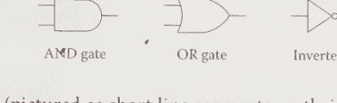

这些门的输入（图中显示为其左侧的短线段）是电电压，并被解释为当其超过某一阈值时为 1（真），或当其低于该阈值时为 0（假）。这些门的输出（图中显示为其右侧的短线段）同样以二进制（0 或 1）解释。对于与门，只有当两个输入都为 1 时才产生 1。或门在任一输入为 1 时产生 1。非门的输出与其输入相反。这三种基本元件因此以与逻辑中的与、或、非运算符相同的方式表现，这意味着我们可以使用布尔表达式来设计和分析电路。

举例说明，考虑我们如何设计一个执行二进制加法的电路：

| + | 0 | 1 |
|---|---|---|
| 0 | 0 | 1 |
| 1 | 1 | 10 |

我们看到电路的输入将是被加的两个二进制数字，并且会有两个二进制输出：和位，即表中条目的最右位，以及进位位，当和为 1 + 1 时为 1，否则为 0。如果我们用 digit1 和 digit2 表示输入，用 sum 和 carry 表示输出，我们得到以下称为真值表的上表版本：

| digit1 | digit2 | carry | sum |
|---|---|---|---|
| 0 | 0 | 0 | 0 |
| 0 | 1 | 0 | 1 |
| 1 | 0 | 0 | 1 |
| 1 | 1 | 1 | 0 |

注意最后两列的模式。进位输出只有在 digit1 和 digit2 都为 1（真）时才为 1（真），因此我们可以用与门来实现它。和输出只有在 digit1 和 digit2 中恰好有一个为 1（真）时才为 1（真）；即 digit1 或 digit2 为 1（真）但不同时为 1。我们可以用以下布尔表达式表达这些属性，

```
bool carry = digit1 && digit2,
    sum = (digit1 || digit2) && !(digit1 && digit2);
```

并设计以下称为二进制半加器的电路，它将两个二进制数字相加：

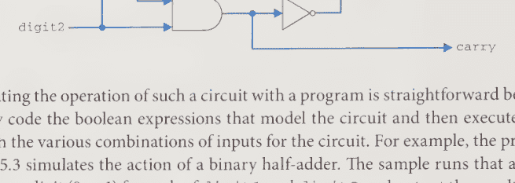

用程序模拟此类电路的操作是直接的，因为我们只需要对电路建模的布尔表达式进行编码，然后用电路输入的各种组合执行程序即可。例如，示例 5.3 中的程序模拟了二进制半加器的动作。所示的示例运行为 digit1 和 digit2 各读取一个二进制数字（0 或 1），并输出 digit1 和 digit2 的四种不同输入组合下 sum 和 carry 的结果值。一旦我们在本章后面学习了重复结构，我们将能够在不必反复重新执行程序的情况下做到这一点。

## Example 5.3 A Binary Half-Adder

```
/* This program calculates the outputs from boolean expressions that
   represent the logical circuit for a binary half-adder.

   Input:  two binary digits
   Output: two binary values representing the sum and carry that
           result when the input values are added
   ---------------------------------------------------------------*/

#include <iostream>    // cout, cin, <<, >>
using namespace std;

int main()
{
    cout << "Enter two binary inputs: ";
    short digit1, digit2; // the two binary inputs
    cin >> digit1 >> digit2;

    // the two circuit outputs
    bool sum = (digit1 || digit2) && !(digit1 && digit2),
        carry = (digit1 && digit2);
    cout << "Carry = " << carry << " Sum = " << sum << "\n\n";
}
```

## SAMPLE RUNS:

Enter two binary inputs: 0 0
Carry = 0 Sum = 0

```
Enter two binary inputs: 0 1
Carry = 0 Sum = 1

Enter two binary inputs: 1 0
Carry = 0 Sum = 1

Enter two binary inputs: 1 1
Carry = 1 Sum = 0
```

## 5.4 SELECTION: THE IF STATEMENT

如本章开头所述，一些问题需要一种选择其中一个替代动作的结构。在最简单的两种替代情况中，选择基于布尔表达式，其值为真时选择一个替代，为假时选择另一个。在流程图中，这通常被描绘为一个菱形框，其中包含布尔表达式，一个角标记为 true，另一个标记为 false：

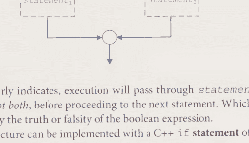

正如该图清楚地指出的那样，执行将通过 statement₁ 或通过 statement₂，但不会同时通过两者，然后继续到下一个语句。它走哪条路线将由布尔表达式的真假决定。

这种选择结构可以用 C++ if 语句实现，其形式为

```
if (boolean_expression)
    statement₁
else
    statement₂
```

如果布尔表达式为真，则执行第一个语句并跳过后面的 else 及其语句，但如果布尔表达式为假，则跳过第一个语句并执行 else 部分的语句。因此，该语句确实实现了前面所示的两种替代选择结构。

本章开头的示例中的 if 语句（示例 5.1）具有这种形式：

```
if (index < CUTOFF)
    cout << "Safe condition\n";
else
    cout << "Hazardous condition\n";
```

如图所示缩进两个替代以将其区分开来是一种良好的编程实践，我们将在本教材中遵循这种做法。

作为另一个例子，考虑寻找两个实值的较大值的问题。这可以很容易地使用 if 语句完成，如以下代码段所示。

```
double maximum;
if (value1 > value2)
    maximum = value1;
else
    maximum = value2;
```

有时选择结构中的第二个替代为空，如下图所示，其中指定的语句要么被执行要么被跳过：

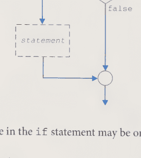

在这种情况下，if 语句中的 else 子句可以省略：

```
if (boolean_expression)
    statement
```

或者它可以是一个仅包含分号的空语句，

```
if (boolean_expression)
    statement
else;
```


例如，下面是求两个值最大值的一种替代方法：

```
double maximum = value1;
if (value1 < value2)
    maximum = value2;
```

在某些问题中，if 语句中的一个或两个语句本身也可能是其他 if 语句。为了说明这一点，假设在第 5.1 节的问题中，有三种不同的污染条件——良好、一般、较差——由两个不同的截止值确定；例如，

```
const int CUTOFF1 = 40; // cutoff for good condition
        CUTOFF2 = 70; // cutoff for fair condition
```

我们可以使用以下“嵌套 if”语句来确定与污染水平相对应的条件：

```
if (index < CUTOFF1)
    cout << "Good condition\n";
else
    if (index < CUTOFF2)
        cout << "Fair condition\n";
    else
        cout << "Bad condition\n";
```

然而，更常见的是将其重新格式化如下，以更清晰地显示三种不同的替代方案：

```
if (index < CUTOFF1)
    cout << "Good condition\n";
else if (index < CUTOFF2)
    cout << "Fair condition\n";
else
    cout << "Bad condition\n";
```

一般来说，if 语句的形式可以总结如下：

## if 语句

if 形式（无 else）：

```
if (boolean_expression)
    statement
```

## if-else 形式：

```
if (boolean_expression)
    statement₁
else
    statement₂
```

## if-else if 形式：

```
if (boolean_expression₁)
    statement₁
else if (boolean_expression₂)
    statement₂
    .
    .
else if (boolean_expressionₙ)
    statementₙ
else
    statementₙ₊₁
```

其中
if 和 else 是关键字；
statement₁, statement₂, ... 都是 C++ 语句（并且可以是复合的，如下所述）。

## 目的：

在第一种形式中，如果 boolean_expression 为真，则 statement 将被执行；否则将被跳过。

在第二种形式中，如果 boolean_expression 为真，则 statement₁ 将被执行而 statement₂ 被跳过；否则，statement₁ 将被跳过而 statement₂ 被执行。

在最后一种形式中，如果 boolean_expressionᵢ 是第一个为真的布尔表达式，则 statementᵢ 将被执行而所有其他语句被跳过。如果所有 boolean_expressionᵢ 都不为真，则 statementₙ₊₁（如果存在）将被执行。

## 5.4.1 块

当一组语句必须被选中执行时，我们用大括号 { 和 } 将它们括起来形成单个语句。这称为块或复合语句：

## 块（复合语句）

## 形式：

```
{
    statement₁
```

```
statement₂
.
.
.
statementₙ
}
```

其中
每个 statementᵢ 都是 C++ 语句（并且本身也可能是复合的）。

## 目的：

语句序列被视为单个语句，其中 statement₁, statement₂, . . ., statementₙ 按顺序执行。

请注意，块不需要在最后一个右大括号后加分号；它本身就是一个完整的语句。

当 if 语句中的某个替代方案包含多于一个语句时，必须使用块。下面的示例中的二次方程求解器说明了这一点。

## 5.4.2 示例：二次方程求解器

二次方程具有形式 ax² + bx + c = 0，其中系数 a、b 和 c 是实数且 a ≠ 0，可以使用二次公式求解，该公式指出根由

−b ± √b² − 4ac
2a

给出，前提是判别式 b² − 4ac 为非负。示例 5.4 中的程序使用此方法求解二次方程。

## 示例 5.4 二次方程求解器

```
/* This program solves quadratic equations using the quadratic formula.

Input: the three coefficients of a quadratic equation
Output: the roots of the equation or a message that there are
        no real roots
------------------------------------------------------------*/
```

```
#include <iostream> // cout, cin, <<, >>
#include <cassert>  // assert()
#include <cmath>    // sqrt()
using namespace std;
```

```
int main()
{
    double a, b, c;
    cout << "Enter the coefficients of a quadratic equation: ";
    cin >> a >> b >> c;
    assert (a != 0);

    double discriminant = b*b - 4*a*c,
            root1, root2;

    if (discriminant >= 0)
    {
        root1 = (-b + sqrt(discriminant)) / (2*a);
        root2 = (-b - sqrt(discriminant)) / (2*a);
        cout << "Roots are " << root1 << " and " << root2 << endl;
    }
    else
        cout << "There are no real roots, only complex ones" << endl;
}
```

## 示例运行：

Enter the coefficients of a quadratic equation: 1 4 3
Roots are -1 and -3

Enter the coefficients of a quadratic equation: 2 -8 8
Roots are 2 and 2

Enter the coefficients of a quadratic equation: 1 2 3
There are no real roots, only complex ones

## 5.4.3 风格

程序员在编写 if 语句时没有一种通用的风格，但本教材中使用的是常见的一种，旨在促进可读性：

- 1. 对齐 if 和 else。
- 2. 使用空白和缩进来清晰地标识 if 语句中的替代方案。

当替代方案是单个语句时，我们通常将其缩进在 if 或 else 的下一行；例如，

```
if (index < CUTOFF)
    cout << "Safe condition\n";
else
    cout << "Hazardous condition\n";
```

对于由语句块组成的替代方案，大括号将放在单独的行上，与 if 和 else 对齐，并且它们所包含的语句将被缩进；例如，

```
if (discriminant >= 0)
{
    root1 = (-b + sqrt(discriminant)) / (2*a);
    root2 = (-b - sqrt(discriminant)) / (2*a);
    cout << "Roots are " << root1 << " and " << root2 << endl;
}
else
    cout << "There are no real roots, only complex ones" << endl;
```

在另一种常用的风格中，左大括号放在 if（或 else）关键字同一行上，右大括号与该关键字对齐而不是与左大括号对齐。

```
if (discriminant >= 0) {
    root1 = (-b + sqrt(discriminant)) / (2*a);
    root2 = (-b - sqrt(discriminant)) / (2*a);
    cout << "Roots are " << root1 << " and " << root2 << endl;
}
else
    cout << "There are no real roots, only complex ones" << endl;
```

对于 if-else-if 语句（第三种形式），每个 else 和其后的 if 将放在同一行，从而形成 else if，并且各部分中的语句缩进；例如，

```
if (index < CUTOFF1)
    cout << "Good condition\n";
else if (index < CUTOFF2)
    cout << "Fair condition\n";
else
    cout << "Bad condition\n";
```

## 5.5 重复：for 和 while 语句

在前几章和本章开头，我们的程序只需要按顺序处理指令，但在前一节中，我们看到了一些

8 这被称为 One True Brace（OTB）风格。其变体将关键字 else 放在关闭大括号的同一行上：

```
if (condition) {
    statements
} else {
    statements
}
```

问题的解决方案需要 *选择*。在本节中我们介绍第三种控制结构，*重复*。

## 5.5.1 示例：计算阶乘

非负整数 *n* 的 **阶乘**，记为 *n!*，定义为

*n!* = { 1 if *n* = 0
1 × 2 × ⋯ × *n* if *n* > 0 }

通过手工计算 *n!*，我们可能会从 1 开始，将其乘以 2，将该乘积乘以 3，依此类推，直到乘以 *n*。例如，要求 5!，我们可能会进行以下计算，其中我们保持一个运行乘积并从一步到下一步递增计数：

|  |  |
|---|---|
| 1 | ← 初始运行乘积 |
| × 2 | ← 初始计数 |
| 2 | ← 新运行乘积 |
| × 3 | ← 新计数 |
| 6 | ← 新运行乘积 |
| × 4 | ← 新计数 |
| 24 | ← 新运行乘积 |
| × 5 | ← 新计数 |
| 120 | ← 新运行乘积 |

如果我们分析这个 5! 的计算，我们会看到这种重复机制（也称为 **循环**）中有三个部分：

- 1. *初始化：* 为运行乘积和计数分配起始值。
- 2. *重复执行：* 反复将乘积乘以计数并递增计数。
- 3. *终止：* 当计数达到最终值 5 时停止。

我们可以将计算一般描述如下：

## 阶乘计算算法

- 1. 将 *product* 初始化为 1。
- 2. 对 *count* 在 2 到 *n* 范围内的每个值重复以下操作
- 将 *product* 乘以 *count.*


在 C++ 中，用于多次执行一条语句的语句之一是 **for 语句。** 下面是一个如何使用它来计算 n! 的示例：

```
int product = 1;
for (int count = 2; count <= n; count++)
    product *= count;
```

它 *重复* 执行一条语句，对范围 2 到 n 中的每个数字执行一次。下面的流程图更精确地展示了其行为：

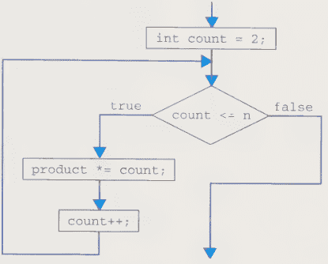

当执行到达循环时，变量 count 被创建并初始化为 2。然后将 count 的值与 n 进行测试。如果 count 超过 n，则重复停止，执行继续进行 for 语句之后的语句。然而，如果 count 小于或等于 n，则由循环控制的 *= 语句被执行，因此 product 被乘以 count。然后 count 的值由表达式 count++ 增加，之后执行返回到循环顶部，在那里布尔表达式 count <= n 被重新评估并且循环开始。只要布尔表达式求值为 true，这种循环行为就会继续。

理解此类循环执行的另一种方法是使用 **追踪表**，它逐条追踪循环语句的执行。以下是 n = 5 的追踪表：

| Time | Statement Executed       | Product | Count | Comment            |
|------|--------------------------|---------|-------|--------------------|
| 0    | `int count = 2;`         | 1       | 2     | loop initialization |
| 1    | `count <= n`             | 1       | 2     | true, loop executes |
| 2    | `product *= count;`      | 2       | 2     | product updated    |
| 3    | `count++;`               | 2       | 3     | count incremented  |
| 4    | `count <= n`             | 2       | 3     | true, loop executes |
| 5    | `product *= count;`      | 6       | 3     | product updated    |

## 130 ■ Programming in C++ for Engineering and Science

| Line | Statement | Product | Count | Comment |
|------|-----------|---------|-------|---------|
| 6 | count++; | 6 | 4 | count incremented |
| 7 | count <= n | 6 | 4 | true, loop executes |
| 8 | product *= count; | 24 | 4 | product updated |
| 9 | count++; | 24 | 5 | count incremented |
| 10 | count <= n | 24 | 5 | true, loop executes |
| 11 | product *= count; | 120 | 5 | product updated |
| 12 | count++; | 120 | 6 | count incremented |
| 13 | count <= n | 120 | 6 | false, repetition ceases |

for 语句的通常形式如下：

```
```cpp
for (init_declaration; loop_condition; step_expression)
statement
```
```

- for 是 C++ 关键字；
- init_declaration 声明并初始化控制重复次数的变量；
- loop_condition 是决定是否继续重复的布尔表达式；
- step_expression 指定控制变量的值如何变化；以及
- statement，称为循环体，是 C++ 语句（简单或复合）。

- 1. init_declaration 初始化控制变量的值。
- 2. 如果 loop_condition 为 true，则执行以下操作：
  a. statement 被执行。
  b. step_expression 被求值。
  c. 控制返回到步骤 2。
  否则执行继续进行 for 语句之后的语句。

for 语句各部分的小限制使其具有相当大的灵活性。例如，我们可以从较大的数字向下计数到较小的数字，如以下阶乘计算所示：

```
```cpp
int product = 1;
for (int count = n; count > 1; count--)
product *= count;
```
```

我们也可以对初始值、最终值和步长使用实数，如

```
```cpp
for (double x = 0.0; x <= 2.0; x += 0.5)
cout << x*sqrt(x) - 1 << " " ;
```
```

它将产生如下输出：

```
-1 -0.646447 0 0.837117 1.82843
```

## 5.5.2 Processing Several Input Values

例 5.4 中求解二次方程的程序存在一个主要缺点：它只能求解一个方程。要求解其他方程，必须重新执行程序，这可能涉及重新输入其名称、重新点击其图标，或针对特定系统所需的任何操作。

更用户友好的程序将允许用户在程序终止之前处理任意数量的方程。一种方法是让用户预先指定要处理的值的数量，然后将程序主体包装在从 1 计数到该数字的 for 循环中：

```
// ...
int main()
{
    cout << "How many quadratic equations do you wish to solve? ";
    int numEquations;
    cin >> numEquations;

    for (int i = 1; i <= numEquations; i++)
    {
        cout << "\nEnter the coefficients of a quadratic equation: ";
        double a, b, c;
        cin >> a >> b >> c;
        assert (a != 0);

        double discriminant = b*b - 4*a*c,
               root1, root2;

        if (discriminant >= 0)
        {
            root1 = (-b + sqrt(discriminant)) / (2*a);
            root2 = (-b - sqrt(discriminant)) / (2*a);
            cout << "Roots are " << root1 << " and " << root2 << endl;
        }
        else
            cout << "There are no real roots, only complex ones" << endl;
    }
}
```

一次示例运行可能如下所示：

```
How many quadratic equations do you wish to solve? 3

Enter the coefficients of a quadratic equation: 1 4 3
Roots are -1 and -3
```

```
Enter the coefficients of a quadratic equation: 2 -8 8
Roots are 2 and 2
```

```
Enter the coefficients of a quadratic equation: 1 2 3
There are no real roots, only complex ones
```

通过将驱动程序的关键部分包含在循环中，我们可以在不必重新执行程序的情况下处理多个输入数据值。

这种方法的一个问题是它需要知道会有多少个输入值。当输入值集非常大时，计数这些值可能不方便甚至不切实际。一种常见的替代方法不需要此操作，即使用 while 循环，我们在这里仅简要介绍。这种重复结构以及其他类型的循环将在第 9 章中更详细地研究。

## 5.5.3 Repeated Execution: The while Statement

while 循环在 C++ 中使用以下形式的 while 语句实现：

## while STATEMENT

### Form:

```
while (loop_condition)
    statement
```

其中
while 是 C++ 关键字；
loop_condition 是布尔表达式；
statement，称为循环体，通常是复合语句

### Behavior:

当执行到达 while 语句时：

- 1. loop_condition 被求值。
- 2. 如果 loop_condition 为 true：
  a. 循环的 body statement 被执行。
  b. 控制返回到步骤 1。
  否则执行继续进行 while 语句之后的语句。

例 5.5 说明了如何使用 while 循环反复求解二次方程，直到用户为 x² 的系数输入“停止指示符”0 为止。

## Example 5.5 Quadratic Equation Solver—Revised

```
/* This program solves quadratic equations using the quadratic formula.

    Input:  the three coefficients of a quadratic equation
    Output: the roots of the equation or a message that there are no
            real roots
---------------------------------------------------------------*/
```

```
#include <iostream>    // cout, cin, <<, >>
#include <cmath>         // sqrt()
using namespace std;

int main()
{
    double a, b, c;
    cout << "Enter coefficients of quadratic equation (0's to stop): ";
    cin >> a >> b >> c;

    while (a != 0)
    {
        double discriminant = b*b - 4*a*c,
               root1, root2;

        if (discriminant >= 0)
        {
            root1 = (-b + sqrt(discriminant)) / (2*a);
            root2 = (-b - sqrt(discriminant)) / (2*a);
            cout << "Roots are " << root1 << " and " << root2 << endl;
        }
        else
            cout << "There are no real roots, only complex ones" << endl;

        cout << "Enter coefficients of quadratic equation (0's to stop): ";
        cin >> a >> b >> c;
    }
}
```

### SAMPLE RUNS:

Enter coefficients of quadratic equation (0's to stop): 1 0 -2
Roots are 1.41421 and -1.41421

Enter coefficients of quadratic equation (0's to stop): 2 10 8
Roots are -1 and -4

Enter coefficients of quadratic equation (0's to stop): 1 1 1
There are no real roots, only complex ones

Enter coefficients of quadratic equation (0's to stop): 0 0 0


## 章节摘要

### 关键术语

- assert()
- binary half-adder
- block
- boolean expression
- cctype library
- compound boolean expression
- compound statement
- condition
- control structure
- flow diagram
- for statement
- if statement
- logical operator
- loop
- loop body
- nested if statements
- operator precedence
- precondition
- relational operator
- repetition structure
- selection structure
- separate compilation
- sequential execution
- short-circuit evaluation
- termination (or exit) condition
- trace table
- while loop
- while statement

### 注释

- Be sure to use the == operator for equality comparisons, not = (assignment).
- Be sure to use the && and || operators for logical operations, not & and | (bitwise operators).
- Some problems require control mechanisms that are more powerful than sequential execution, namely, selection and repetition. These three control structures are sufficient for any program.
- Sequential execution refers to execution of a sequence of statements in the order in which they appear, so that each statement is executed exactly once.
- A block (or compound statement) groups a sequence of statements into a single statement by enclosing them in curly braces ({ and }).
- Selective execution refers to selecting and executing exactly one of a collection of alternative actions.
- The assert() mechanism evaluates a boolean expression and terminates the program if it is false. It is useful for checking a condition that must be true at a given point in a program.
- The if statement is the most common selection structure for selecting between two or more alternatives.
- When one of the alternatives in an if statement contains another if statement, the second if statement is said to be nested in the first. In this case, an else clause is matched with the nearest preceding unmatched if.
- There are three parts to a repetition mechanism (also called a loop): initialization, repeated execution, and termination.
- A for loop is one of the structures provided in C++ for loops in which the number of repetitions can be determined in advance.
- A while loop is commonly used to implement input loops.

### 风格与设计提示

- Indent and align the statements within a block (compound statement).
- Identify any preconditions a program has, and check them using the assert() mechanism (or an if statement). Preconditions are assumptions made in a program, often one or more restrictions on what comprises a valid input value.
- If a problem requires the selection of one or more operations, use a selection statement like the if statement.
- Align the ifs and elses in an if statement. Also, use white space and indentation to set off the various alternatives.
- If a problem requires the repetition of one or more operations, and the number of repetitions can be computed in advance, a for statement is appropriate.
- If a problem involves a set of data values whose size is not known in advance, a while statement can be used to read and process the values.

### 警告

- 1. When real quantities that are algebraically equal are compared with ==, the result may be false because most real numbers are not stored exactly. For example, x * (1/x) and 1.0 are algebraically equal, but the boolean expression x * (1/x) == 1.0 may be false for some real numbers x.
- 2. It is easy to forget that in C++, = is the assignment operator, and to incorrectly encode an instruction of the form

  ```
  If variable is equal to value, then
      statement
  ```

  as

  ```
  if (variable = value)
      statement
  ```

  Instead of testing whether *variable* is equal to *value*, the condition in this *if* statement assigns *value* to *variable*. If *value* happens to be zero, which C++ interprets as false, the *statement* will not be executed, regardless of the value of *variable*. If *value* is nonzero, which C++ interprets as true, *statement* will be executed, regardless of the value of *variable*.
- 3. Be careful in writing compound boolean expressions to use the logical operators && and || and not the bitwise operators & and |.
- 4. Each { must have a matching }. To make it easier to find matching braces, we align each { with its corresponding }.
- 5. In a nested if statement, each else clause is matched with the nearest preceding unmatched if. Use indentation and alignment to show such associations.
- 6. When using repetition, care must be taken to avoid infinite looping; be sure that the boolean expression controlling repetition eventually becomes false for for and while statements.
- 7. In a for loop, neither the control variable nor any variable involved in the loop condition should be modified within the body of the for loop, since it is intended to run through a specified range of consecutive values. Strange or undesirable results may be produced otherwise.

### 自测

**Section 5.2**

- 1. What are the three basic control structures?
- 2. The two bool literals are __________ and __________.
- 3. List the six relational operators.
- 4. List the three logical operators.

For Questions 5–9 assume that p, q, and r are boolean expressions with the values true, true, and false, respectively. Find the value of each boolean expression.

- 5. p && !q
- 6. p && q || !r
- 7. p && !(q || r)
- 8. !p && q
- 9. p || q && r

For Questions 10–14, assume that number, count, and sum are integer variables with values 3, 4, and 5, respectively. Find the value of each boolean expression, or indicate why it is not valid.

- 10. sum - number <= 4
- 11. number*number + count*count == sum*sum
- 12. number < count || count < sum
- 13. 0 <= count <= 2
- 14. (number + 1 < sum) && !(count + 1 < sum)
- 15. Write a boolean expression to express that x is nonzero.
- 16. Write a boolean expression to express that x is strictly between -10 and 10.
- 17. Write a boolean expression to express that both x and y are positive or both x and y are negative.

**Section 5.4**

Questions 1-3 refer to the following if statement. For each, describe the output produced for the given values of x and y.

```
if (x >= y)
    cout << x;
else
    cout << y;
```

- 1. x is 6 and y is 5.
- 2. x is 5 and y is 5.
- 3. x is 5 and y is 6.

Questions 4-6 refer to the following if statement. For each, describe the output produced for the given values of x and y.

```
if (x >= 0)
    if (y >= 0)
        cout << x + y;
    else
        cout << x - y;
else
    cout << y - x;
```

- 4. x is 5 and y is 5.
- 5. x is 5 and y is -5.
- 6. x is -5 and y is 5.

Questions 7-11 refer to the following if statement. For each, describe the output produced for the given values of n.

```
if (n >= 90)
    cout << "excellent\n";
else if (n >= 80)
    cout << "good\n";
else if (n >= 70)
    cout << "fair\n";
else
    cout << "bad\n";
```

- 7. n is 100.
- 8. n is 90.
- 9. n is 89.
- 10. n is 70.
- 11. n is 0.
- 12. Write a statement that displays "Out of range" if number is negative or is greater than 100.
- 13. Write an efficient if statement to assign n the value 1 if x ≤ 1.5, 2 if 1.5 < x < 2.5, and 3 otherwise.

**Section 5.5**

For Questions 1–10, describe the output produced.

- 1.
  ```
  for (int i = 0; i <= 5; i++)
      cout << "Hello\n";
  ```

- 2.
  ```
  for (int i = 1; i < 4; i++)
      cout << "Hello";
  ```

- 3.
  ```
  for (int i = 1; i <= 5; i += 2)
      cout << "Hello\n";
  ```

- 4.
  ```
  for (int i = 6; i > 0; i--)
      cout << i*i << endl;
  ```

- 5.
  ```
  for (int i = 6; i <= 6; i++)
      cout << "Hello\n";
  ```

- 6.
  ```
  for (int i = 6; i <= 5; i++)
      cout << "Hello\n";
  ```

- 7.
  ```
  for (int i = 1; i <= 10; i++)
  {
      cout << i << endl;
      i++;
  }
  ```

- 8.
  ```
  int i = 4;
  while (i >= 0)
  {
      i--;
      cout << i << endl;
  }
  cout << "\n*****\n";
  ```

- 9.
  ```
  int i = 1;
  while (i < 100)
  {
      cout << i << endl;
      i = 2*i;
  }
  ```

- 10.
  ```
  int i = 0;
  while (i < 10)
  {
      cout << i;
      if (i % 2 == 0)
          cout << " E";
      else
          cout << " O";
      ++i;
  }
  cout << endl;
  ```

- 11. How many lines of output are produced by the following?

  ```
  for (int i = 1; i <= 50; i += 2)
  {
      cout << i << " ";
      if (i % 5 == 0)
          cout << endl;
  }
  ```

### 练习

**Section 5.2**

For Exercises 1–10, assume that m and n are integer variables with the values −5 and 8, respectively, and that x, y, and z are real variables with the values −3.56, 0.0, and 44.7, respectively. Find the value of the boolean expression.

- 1. m <= n
- 2. 2 * abs(m) <= 8


3. x * x < sqrt(z)

4. int(z) == (6 * n - 4)

5. (x <= y) && (y <= z)

6. !(x < y)

7. !((m <= n) && (x + z > y))

8. !(m <= n) || !(x + z > y)

9. !((m <= n) || (x + z > y))

10. !((m > n) && !(x < z))

对于练习 11-16，使用真值表显示布尔表达式在 a、b 和 c 的所有可能（布尔）值下的取值：

11. a || !b

12. !(a && b)

13. !a || !b

14. (a && b) || c

15. a && (b || c)

16. (a && b) || (a && c)

对于练习 17-25，编写 C++ 布尔表达式来表示以下条件：

17. x 大于 3。

18. y 严格介于 2 和 5 之间。

19. x 为负数且 z 为正数。

20. alpha 和 beta 均为正数。

21. alpha 和 beta 同号（均为负数或均为正数）。

22. -5 < x < 5。

23. a 小于 6 或大于 10。

24. p 等于 q，且 q 等于 r。

25. x 小于 3，或 y 小于 3，但不能同时成立。

练习 26-28 假设 a、b 和 c 为布尔值。

26. 编写一个 C++ 布尔表达式，当且仅当 a 和 b 为 true 且 c 为 false 时，该表达式为 true。

27. 编写一个 C++ 布尔表达式，当且仅当 a 为 true 且 b 或 c 中至少有一个为 true 时，该表达式为 true。

28. 编写一个 C++ 布尔表达式，当且仅当 a 和 b 中恰好有一个为 true 时，该表达式为 true。

## 第 5.4 节

练习 1–4 涉及以下 if 语句：

```
if (x * y >= 0)
    cout << "yes\n";
else
    cout << "no\n";
```

- 1. 描述当 x 为 5 且 y 为 6 时产生的输出。
- 2. 描述当 x 为 5 且 y 为 -6 时产生的输出。
- 3. 描述当 x 为 -5 且 y 为 6 时产生的输出。
- 4. 描述当 x 为 -5 且 y 为 -6 时产生的输出。

练习 5–7 涉及以下 if 语句。描述对于给定的 n 值所产生的输出。

```
if (abs(n) <= 4)
    if (n > 0)
        cout << 2*n + 1;
    else
        cout << 2*n;
else
    cout << n << " out of range";
```

- 5. n 为 2。
- 6. n 为 -7。
- 7. n 为 0。

对于练习 8–12，编写能够完成所需操作的 if 语句。

- 8. 如果 taxCode 为 'T'，则将 price 增加 taxRate 百分比的 price。
- 9. 如果 code 为 1，则输入 x 和 y 的值，计算并显示 x 与 y 的和。
- 10. 如果 a 严格介于 0 和 5 之间，则将 b 设为 1/a²；否则将 b 设为 a²。

11. 给定一个距离，根据下表计算费用：

| 距离 | 费用 |
|---|---|
| 0 到 100 | $5.00 |
| 大于 100 但不超过 500 | $8.00 |
| 大于 500 但小于 1000 | $10.00 |
| 1000 或以上 | $12.00 |

12. 给定一个风寒温度，根据下表显示其分类：

| 风寒温度 | 分类 |
|---|---|
| 10°F 或以上 | 不危险或不令人不适 |
| -10°F 或更高但低于 10°F | 令人不适 |
| -30°F 或以上但低于 -10°F | 可能冻伤 |
| -70°F 或更高但低于 -30°F | 危险，很可能冻伤 |
| 低于 -70°F | 皮肤可能在半分钟内冻僵 |

## 第 5.5 节

对于练习 1–6，描述产生的输出。

```
1. for (int i = 0; i <= 3; i++)
       cout << i << " squared = " << i*i << endl;

2. for (int i = 5; i > 0; i--)
       cout << i << " squared = " << i*i << endl;

3. int k = 5;
   for (int i = k; i <= 5; i++)
   {
       cout << i + k << endl;
       k = 1;
   }

4. int s = 5;
   for (int i = s; i < 5; i++)
       cout << i + s << endl;
   cout << "***\n";

5. int s = 1;
   while (s <= 10)
   {
       cout << 2*s << endl;
       s *= 2;
   }

6. int s = 20;
   while (s/2 < 10)
   {
       cout << 2*s << endl;
       s /= 2;
   }
```

对于练习 7–14，编写 C++ 语句来完成所要求的操作。

7. 对于正整数 n，求总和 1 + 2 ... + n 并输出该总和。

8. 对于满足 m ≤ n 的两个整数 m 和 n，求总和 m + m + 1 + ... + n 并输出该总和。

9. 按递增顺序显示前 100 个正整数的平方。

10. 按递减顺序显示前 50 个正整数的立方。

11. 显示前 25 个正奇数的平方根。

12. 显示函数 y = x³ - 3x + 1 图像上的点 (x, y) 列表，其中 x 从 -2 到 2，步长为 0.1。

13. 显示 x 的值，从 10.0 开始，只要 x 为正，就将 x 减少 0.5。

14. 计算并显示连续正整数的平方，直到某个平方与前一个平方之差大于 50。

# 编程问题

第 5.2–5.3 节

1. 在某个地区，只有当温度至少为 70°、相对湿度介于 15% 和 35% 之间，并且风速至多为每小时 10 英里时，才允许从飞机上喷洒农药。编写一个程序，接受三个分别代表温度、相对湿度和风速的数字；根据这些标准为布尔变量 okToSpray 赋值 true 或 false；并显示该值。

2. 编写一个程序，读取三个实数，为以下布尔变量赋适当的布尔值，并显示这些值。

triangle：如果这三个实数能够表示三角形三条边的长度（任意两个数之和必须大于第三个数），则为 true；否则为 false。

equilateral：如果 triangle 为 true 且该三角形为等边三角形（三条边相等），则为 true；否则为 false。

isosceles：如果 triangle 为 true 且该三角形为等腰三角形（至少有两条边相等），则为 true；否则为 false。

scalene：如果 triangle 为 true 且该三角形为不等边三角形（没有两条边相等），则为 true；否则为 false。

3. 二进制全加器有三个输入：正在相加的两个位 a 和 b，以及一个“进位输入”位 cIn（表示将两个二进制数中 a 和 b 右侧的位相加所得的进位位）。它可以用两个二进制半加器和一个或门构成：

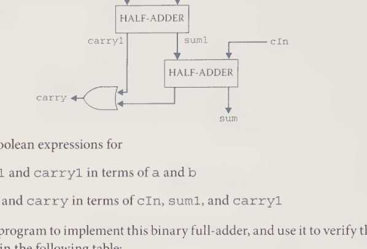

a) 写出以下布尔表达式

- i) 用 a 和 b 表示 sum1 和 carry1
- ii) 用 cIn、sum1 和 carry1 表示 sum 和 carry

b) 编写一个程序来实现这个二进制全加器，并用它验证下表所示的结果：

| a | b | cIn | sum | carry |
|---|---|---|---|---|
| 0 | 0 | 0 | 0 | 0 |
| 0 | 0 | 1 | 1 | 0 |
| 0 | 1 | 0 | 1 | 0 |
| 0 | 1 | 1 | 0 | 1 |
| 1 | 0 | 0 | 1 | 0 |
| 1 | 0 | 1 | 0 | 1 |
| 1 | 1 | 0 | 0 | 1 |
| 1 | 1 | 1 | 1 | 1 |

4. 一个用于计算两位二进制数之和的加法器

a2 a1
+ b2 b1
------
cOut s2 s1

其中 s1 和 s2 是和位，cOut 是进位输出位，可以由一个二进制半加器和一个二进制全加器构成：


a) 写出以下布尔表达式

- i) 用 a1 和 b1 表示 s1 和 cOut1
- ii) 用 a2、b2 和 cOut1 表示 s2 和 cOut

b) 编写一个程序来实现这个加法器，并用它证明 00 + 00 = 000、01 + 00 = 001、01 + 01 = 010、10 + 01 = 011、10 + 10 = 100、11 + 10 = 101 以及 11 + 11 = 110。

## 第 5.4 节

- 1. 编写一个驱动程序来测试练习 11 中的距离-费用计算器。
- 2. 编写一个驱动程序来测试练习 12 中的风寒分类器。
- 3. 修改示例 5.4 中求解二次方程的程序，使得当判别式为负时，显示方程的复数根。如果判别式 D 为负，这些根由下式给出

$$\frac{-b \pm \sqrt{-D}\,i}{2a}$$

其中 $i^2 = -1$。（这不需要使用 C++ 的 complex 库中提供的 complex 类型，但如果你愿意，也可以使用它。）

- 4. 编写一个程序，读取方程

$$Ax + By = C$$

$$Dx + Ey = F$$

的系数 A、B、C、D、E 和 F 的值。然后判断这两条直线是平行（它们的斜率相等）还是相交。如果相交，判断这两条直线是否垂直（它们的斜率之积等于 -1）。

- 5. 假设以下公式给出细长比 S 的柱子的安全载荷 L（磅/平方英寸）：

$$L = \begin{cases} 16500 - .475S^2 & \text{if } S < 100 \\ \dfrac{17900}{1 + (S^2 / 17900)} & \text{if } S \ge 100 \end{cases}$$

编写一个程序，读取细长比，然后计算并显示安全载荷。


6. 假设一家燃气公司根据下表按用量计费：

| Gas Used | Rate |
|---|---|
| First 70 cubic meters | $5.00 minimum cost |
| Next 100 cubic meters | 5¢ per cubic meter |
| Next 230 cubic meters | 2.5¢ per cubic meter |
| Over 400 cubic meters | 1.5¢ per cubic meter |

水表读数是代表立方米的四位数。编写一个程序，输入上个月的水表读数和当前水表读数，然后计算账单金额。注意：当前读数可能小于上一个读数；例如，一个月的读数可能是 9897，下个月的读数可能是 0103。

## Section 5.5

- 1. 编写一个驱动程序来测试练习 7 中的求和代码。
- 2. 编写一个驱动程序来测试练习 8 中的求和代码。
- 3. 斐波那契数列以整数 1, 1, 2, 3, 5, 8, 13, 21, . . . 开始，其中每个数从第三个数起都是前两个数的和。编写一个程序读取正整数 n 并使用 for 循环生成并显示前 n 个斐波那契数。
- 4. 连续斐波那契数的比值 1/1, 1/2, 2/3, 3/5, . . . 趋近于黄金比例。修改问题 3 中的程序，使其还显示连续斐波那契数比值的十进制值。
- 5. 某种产品售价为 unitPrice 美元。编写一个程序读取 unitPrice 和 totalNumber 的值，然后生成一个表格，显示从 1 到 totalNumber 个单位的总价。表格应具有如下格式：

Number of Units    Total Price
================    ==========
1                   $1.50
2                   $3.00
3                   $4.50
4                   $6.00
5                   $7.50

- 6. 编写一个程序读取一组数字并计算并显示该数字集合的均值、方差和标准差。数字 x₁, x₂, . . . , xₙ 的均值和方差可以用公式计算

mean = (1/n) Σᵢ₌₁ⁿ xᵢ    variance = (1/n) Σᵢ₌₁ⁿ xᵢ² − (1/n²) ( Σᵢ₌₁ⁿ xᵢ )²

标准差是方差的平方根。

```
geometric mean = \sqrt[n]{x_1 \cdot x_2 \cdots x_n}
= the nth root of the product of the numbers
```

```
harmonic mean = \frac{n}{\frac{1}{x_1} + \frac{1}{x_2} + \cdots + \frac{1}{x_n}}
```

编写一个程序读取一组数字并计算它们的算术平均值、几何平均值和调和平均值。这些值应附带适当的标签显示。

```
p = \frac{1}{2} \left( \frac{y}{y + z} \right)
```

因为 y/(y + z) 是父本为 AB 类型的概率，而 1/2 是此类父本捐献基因 A 的概率。然后，各代中 AA、AB 和 BB 的比例 x'、y' 和 z' 分别由

```
x' = p^2 , y' = 2p(1-p) , z' = (1-p)^2
```

```
p' = \frac{1}{2} \left( \frac{y'}{y' + z'} \right)
```

编写一个程序计算并在适当的标题下显示 30 代的世代数以及 AA、AB 和 BB 的比例。 （注意 AA 和 AB 的比例应趋近于 0，因为基因 A 将逐渐消失。）

9. 编写一个程序使用输入循环读取如下表中所示的数据值，计算每种情况下的每加仑英里数，并附带适当的标签显示值：

| Miles Traveled | Gallons of Gasoline Used |
|---|---|
| 231 | 14.8 |
| 248 | 15.1 |
| 302 | 12.8 |
| 147 | 9.25 |
| 88 | 7 |
| 265 | 13.3 |

10. 编写一个程序使用输入循环读取多个表示英里的值，将英里转换为公里（1 英里 = 1.60935 公里），并附带适当的标签显示所有值。

11. 假设两条走廊，一条宽 8 英尺，另一条宽 10 英尺，在直角处相交，且要将一架梯子从一条走廊绕过拐角搬到另一条走廊。使用下图中相似三角形，我们看到

L = x + (10x) / sqrt(x^2 - 64)

编写一个程序将 x 初始化为 8.1，然后以 0.1 为增量递增，以找到可绕过拐角的最长梯子的长度，精确到最接近的 0.1 英尺。 （注意：该长度与距离 L 的最小值相同。）

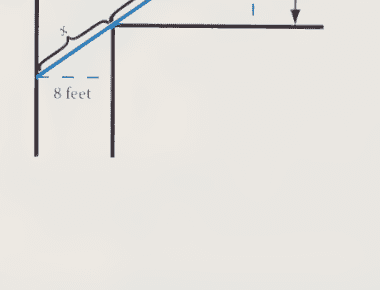

## Functions and Libraries

| 6.1 Introductory Example: Temperature Conversion with Expressions | 150 |
| 6.2 Introductory Example: Temperature Conversion with a Function | 153 |
| 6.3 Programmer-Defined Functions | 155 |
| 6.4 An Introduction to Libraries | 168 |
| 6.5 Introduction to Numerical Methods | 177 |
| Chapter Summary | 186 |
| Test Yourself | 190 |
| Exercises | 192 |
| Programming Problems | 194 |

> 家用电脑被要求执行许多新功能，包括吃掉狗以前吃的家庭作业。
> 
> DOUG LARSON

> 教育的功能是教人进行密集思考和批判性思考……智力加品格——这才是真正教育的目标。
> 
> MARTIN LUTHER KING, JR.

> 在网上做研究就像使用由仓鼠拼凑而成并在夜间被破坏的图书馆。
> 
> ROGER EBERT

## 150 ■ Programming in C++ for Engineering and Science

> 我从未遇到过不喜欢的图书馆。

本章的一个主要主题是编写可重用的代码。正如我们首先展示的那样，可重用性可能是在“本地”层面上进行的，其中代码段被封装在函数中，该函数是程序的独立部分，但可以在程序中的任何地方使用。此外，由于它是独立的代码段，因此可以通过将其复制并粘贴到其他程序中来在其他程序中使用。对于更大规模的可重用性，函数（以及其他程序组件，如常量声明）可以存储在库中，任何程序都可以从中检索并使用它们，就像示例 5.4 和 5.5 中的程序使用 cmath 库中的函数 sqrt() 一样。

本章的第二个主题是信息隐藏，也称为抽象，它指的是将计算的不必要细节与他人为使用它所需知道的内容分开。在这里，我们再次会看到这种分离可以在程序中作为函数在本地范围内完成，并且库使得真正的隐藏信息成为可能。

此外，函数使得程序模块化成为可能，这有助于解决复杂问题。我们将一个问题分解为若干个更简单的问题，开发函数来解决这些更简单的问题，然后将它们与主要的“驱动”程序结合起来，生成一个完整的程序来解决原始问题。然而，在本章中，我们只会详细讨论相当简单的函数并给出几个示例，因为理解如何构建和使用函数是编写可重用代码的基础。我们还将看到库是如何构建的。然而，必须认识到，对函数和库的这次初次了解只是一个介绍。许多更多特性和用途将在后面的章节中给出。

许多问题在其解决方案中涉及使用公式。例如，在第 4.1 节中，我们使用了爱因斯坦的公式 e = m × c² 来计算物质量的能量释放，并发现将此公式转换为 C++ 表达式是相当直接的。在本章中，我们从一个温度转换问题开始，该问题也很容易用 C++ 解决，但我们用于执行这些转换的程序的第一版将进行一系列修改，目的是提高可重用性。

华氏度和摄氏度是用来测量温度的两种刻度。我们将开发一个程序，将摄氏温度转换为等效的华氏温度。

我们的程序将反复在屏幕上显示一个摄氏温度的提示。每次，用户都将从键盘输入一个数值（摄氏温度），程序将读取它。然后它将计算


将摄氏温度并在屏幕上显示此华氏温度以及适当的描述性文本。

### 6.1.2.2 对象

从期望行为的描述中，我们可以识别出以下对象：

| 问题对象 | 类型 | 类别 | 名称 |
|---|---|---|---|
| screen | output device | variable | `cout` |
| prompt | text string | constant | none |
| Celsius temperature | double | variable | *tempCelsius* |
| keyboard | input device | variable | `cin` |
| Fahrenheit temperature | double | variable | *tempFahrenheit* |
| descriptive text | text string | constant | none |

### 6.1.2.3 操作

将华氏温度转换为摄氏温度的公式为

$$F = 1.8 \times C + 32$$

其中 *C* 是摄氏温度，*F* 是相应的华氏温度。我们现在有两个额外的数据对象——数值 1.8 和 32。然而，我们通常不会将此类常量值包含在对象列表中，因为它们在 C++ 中始终提供。

根据我们对程序行为的描述和该公式，我们可以识别出以下操作：

- 1. 在屏幕上显示一个字符串。
- 2. 从键盘读取一个数字。
- 3. 使用实数的乘法和加法计算摄氏温度的华氏等价值。
- 4. 在屏幕上显示一个字符串和一个数字。

### 6.1.2.4 算法

由于这些操作都已在 C++ 中提供，我们可以继续将它们与对象组织成算法：

重复以下操作：

- 1. 向 `cout` 显示摄氏温度的提示。
- 2. 从 `cin` 输入 *tempCelsius*。
- 3. 计算 *tempFahrenheit* = 1.8 * *tempCelsius* + 32。
- 4. 将 *tempFahrenheit* 连同适当的描述性文本输出到 `cout`。

### 6.1.2.5 编码和测试

示例 6.1 中的程序实现了该算法。它使用 while 循环来控制重复，用户输入小于最低可能温度 −273.15 摄氏度的任何值即可停止。

**示例 6.1 转换温度——版本 1**

```cpp
/* This program converts temperatures from Celsius to Fahrenheit,
using the standard Celsius-to-Fahrenheit conversion formula.
Entering any value less than -273.15 Celsius (approx. absolute
zero) terminates the program.

Input: tempCelsius
Output: tempFahrenheit
------------------------------------------------------------*/

#include <iostream>
using namespace std;

int main()
{
    cout << "Program to convert Celsius temperatures to Fahrenheit.\n";

    double tempCelsius,      // Celsius temperature
           tempFahrenheit;   // Fahrenheit temperature

    cout <<"\nEnter a Celsius temperature (< -273.15 to stop): ";
    cin >> tempCelsius;
    while (tempCelsius >= -273.15)
    {
        tempFahrenheit = 1.8 * tempCelsius + 32;

        cout << tempCelsius << " degrees Celsius is equivalent to "
             << tempFahrenheit << " degrees Fahrenheit\n";
        cout <<"\nEnter a Celsius temperature (< -273.15 to stop): ";
        cin >> tempCelsius;
    }
}
```

**SAMPLE RUN:**

```
Program to convert Celsius temperatures to Fahrenheit.

Enter a Celsius temperature (-273.15 or less to stop): 100
100 degrees Celsius is equivalent to 212 degrees Fahrenheit

Enter a Celsius temperature (-273.15 or less to stop): 0
0 degrees Celsius is equivalent to 32 degrees Fahrenheit

Enter a Celsius temperature (-273.15 or less to stop): -72.3
-72.3 degrees Celsius is equivalent to -98.14 degrees Fahrenheit

Enter a Celsius temperature (-273.15 or less to stop): -333
```

## 6.2 入门示例：带函数的温度转换

要将像示例 6.1 中那样用于将摄氏温度转换为华氏温度的程序代码合并到另一个程序中，就必须先在程序中搜索它，然后将其复制并粘贴到自己的程序中。在某些情况下，此代码可能分散，需要花费一些精力才能找到所有内容。如果我们能构造一个封装该代码的函数，并将其附加到可以在需要时调用的另一个程序中，那就方便得多，如示例 6.2 所示。

**示例 6.2 转换温度——版本 2**

```cpp
/* This program converts temperatures from Celsius to Fahrenheit,
   using the standard Celsius-to-Fahrenheit conversion formula.
   Entering any value less than -273.15 Celsius (approx. absolute
   zero) terminates the program.

   Input:  tempCelsius
   Output: tempFahrenheit
---------------------------------------------------------------*/

#include <iostream>
using namespace std;

double celsiusToFahrenheit(double tempCels); // function prototype

int main()
{
    cout << "Program to convert Celsius temperatures to Fahrenheit.\n";

    double tempCelsius,      // Celsius temperature
           tempFahrenheit;   // Fahrenheit temperature

    cout <<"\nEnter a Celsius temperature (< -273.15 to stop): ";
    cin >> tempCelsius;
    while (tempCelsius >= -273.15)
    {
        tempFahrenheit = celsiusToFahrenheit(tempCelsius);

        cout << tempCelsius << " degrees Celsius is equivalent to "
             << tempFahrenheit << " degrees Fahrenheit\n";
        cout <<"\nEnter a Celsius temperature (< -273.15 to stop): ";
        cin >> tempCelsius;
    }
}

double celsiusToFahrenheit(double tempCels) // function definition
{
    return 1.8 * tempCels + 32;
}
```

示例 6.2 中的程序产生的输出与示例 6.1 中的完全相同，但执行流程非常不同。在这里，摄氏到华氏的转换是使用在 main 函数之后定义的函数来执行的。下面的图表说明了此新程序中的控制流。

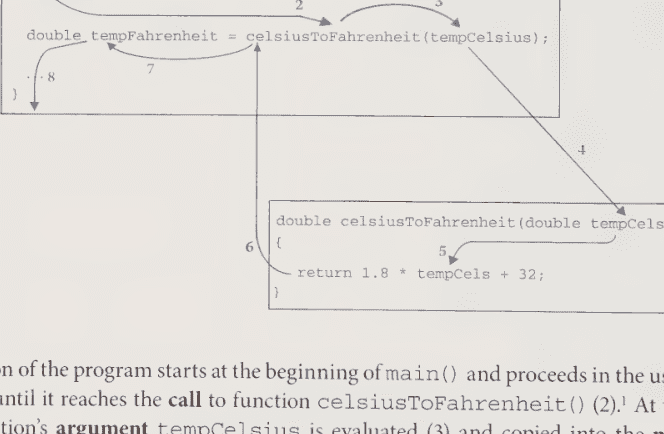

程序的执行从 main() 的开头开始，并以通常的方式进行（1），直到到达对函数 celsiusToFahrenheit() 的调用（2）。此时，函数的参数 tempCelsius 被求值（3）并复制到函数 celsiusToFahrenheit() 中的参数 tempCels 中（4）。控制从 main 函数转移到函数 celsiusToFahrenheit()，该函数开始执行（5）。表达式

```
1.8 * tempCels + 32.0
```

被求值，并且由于 tempCels 包含 tempCelsius 的值的副本，因此所得值是 tempCelsius 的值的华氏等价值。return 语句使该值成为 celsiusToFahrenheit() 的返回值并将执行转移回 main 函数（6）。在那里，celsiusToFahrenheit() 的返回值被赋给 tempFahrenheit（7），并且执行通过 main 函数的其余部分正常进行（8）。

> 请参阅正文前言中给出的文本网站，了解我们为何谈论函数的“调用”和“库”。

在下一节中，我们将描述如何构造此类 C++ 函数，并以示例 6.2 中的程序为例进行说明。

## 6.3 程序员定义的函数

在前几章中，我们看到了 C++ 提供的函数的示例；例如，来自 C++ cmath 库的 pow() 和 sqrt() 以及来自其 cassert 库的 assert()。在前一节中，我们看到了程序员如何通过在 main 函数之前包含其原型并在其后包含其定义，将他们自己的函数（如 celsiusToFahrenheit()）添加到程序中的示例。在本节中，我们将更详细地研究此类程序员定义的函数。

函数的定义可以概括描述如下：

**C++ 函数定义**

形式：

```
return_type function_name(parameter-declaration_list)
{
    statement_list
}
```

其中：

- return_type 是函数返回的值的类型，或如果函数不返回值则为关键字 void；
- function_name 是命名函数的标识符；
- parameter-declaration_list 是函数参数的声明列表，可能为空，以逗号分隔；
- statement_list 描述函数的行为。

目的：

对函数的调用会导致其中的语句被执行。之后，当执行 return 语句或到达函数的语句列表末尾时，执行返回到调用程序单元。

因此，在示例 6.2 的程序中，行

```
double celsiusToFahrenheit(double tempCels)
{
    return 1.8 * tempCels + 32;
}
```


构成函数 `celsiusToFahrenheit()` 的定义。关键字 `double` 的第一次出现指定了函数的返回类型；标识符 `celsiusToFahrenheit` 命名了该函数；并且在其后的括号内，参数声明列表由一个类型为 `double` 的参数组成，其名称为 `tempCels`。大括号括起函数体，在本例中仅由一条 return 语句组成。其一般形式为

```
return expression;
```

其中 *expression* 的类型与函数的返回类型相匹配。

## 6.3.1 函数设计

我们用于设计程序的步骤也可以用于函数——这也是它们常被称为 **subprograms** 的原因之一：

- 1. 描述其行为。
- 2. 识别其对象。
- 3. 识别其操作。
- 4. 制定算法。
- 5. 编码算法。
- 6. 执行、测试和调试它。

### 6.3.1.1 行为

函数的关键行为包括 *接收值* 来自其他函数例如 `main()` 并 *返回一个值* 给调用它的函数（对于 void 函数，仅返回控制权给该函数但不返回值）。² 例如，`celsiusToFahrenheit()` 接收一个摄氏温度并返回给调用者等价的华氏温度。但在我们为函数编写代码之前，我们必须更精确地描述这种接收和返回的信息，就像我们到目前为止对程序的对象所做的那样。这种描述通常被称为函数的 **specification**。

### 6.3.1.2 函数的规格说明

函数接收和返回的对象具有与我们一直在考虑的其他编程对象相同的属性。但它们还有一个额外的特征：接收的值从调用者 *流入* 函数，而返回的值从函数 *流出* 到调用者。我们将把这一特征称为对象的 **movement**，并将其作为属性添加到我们为函数制定的对象列表中，如下所示的 `celsiusToFahrenheit()` 函数的规格说明所示：

| Software Objects |  |  |  |  |
| Problem Objects | Type | Kind | Movement | Name |
| a Celsius temperature | double | varying | received (in) | tempCels |
| the equivalent Fahrenheit temperature | double | varying | returned (out) | none |

因此，除了名称之外，大多数函数还具有以下内容：

- - **parameters**：在函数标题的括号内声明的变量，用于保存函数接收的值；如果没有接收值，则括号留空。³
- - **return type**：函数返回的值的类型或关键字 **void**，表示没有类型，如果函数不返回值。

函数的规格说明提供了这些信息。对于我们的 celsiusToFahrenheit() 示例，它告诉我们

- - 它有一个类型为 double 的参数，并且
- - 它的返回类型是 double。

一旦我们有了这些信息，我们就可以开始编码函数。我们为其参数选择一个有意义的名称，例如 tempCels 并编写一个 **function stub**，由一个标题和一个空函数体组成：

```
double celsiusToFahrenheit(double tempCels)
{
}
```

现在，剩下的就是设计一个解决问题的算法，然后将该算法编码到此函数 stub 的主体中。

### 6.3.1.3 函数的算法

为函数设计算法几乎与为程序设计算法相同。区别在于：

- - 在程序中，输入解决问题所需的数据值是算法的早期步骤；但在函数中，参数已包含这些值。
- - 在程序中，作为解决方案一部分计算出的数据值通常会输出；但在函数中，它们会返回给调用函数。

³ 例如，来自 cstdlib 库的随机数生成器函数 rand() 没有参数，就像大多数仅向用户显示一些说明的函数一样。

因此，当函数 celsiusToFahrenheit() 开始执行时，我们可以假设参数 tempCels 已包含要转换的摄氏温度。这留下了以下需要执行的操作：

Real multiplication and addition (1.8 * tempCels + 32)

Return a real value

它们可以组合成以下非常简单的函数 fahrToCelsius() 的算法：

# Algorithm for Celsius-to-Fahrenheit Conversion Function

Return 1.8 × tempCels + 32

### 6.3.1.4 编码函数

一旦我们有了函数 stub 和算法，我们就可以通过将实现算法的 C++ 语句插入 stub 中来获得函数定义。在我们的示例中，将我们的单步算法转换为 return 语句非常简单：

```
double celsiusToFahrenheit(double tempCels)
{
    return 1.8 * tempCels + 32;
}
```

正如本例所示，

- - 函数的规格说明决定了函数标题的形式；
- - 其算法决定了函数主体的内容。

对于像 celsiusToFahrenheit() 这样简单的函数，制定规格说明和设计算法可能看起来像是多余的繁琐工作，但对于更复杂的问题来说它们是必不可少的。从一个定义良好的规格说明构造函数标题几乎是机械的，从一个定义良好的算法编码函数主体也是如此。

### 6.3.1.5 测试、执行和调试

与程序一样，函数也应经过严格测试以确保其正确性。这对于现实世界的软件项目尤其重要，这些项目通常庞大而复杂，在被纳入项目之前必须彻底检查逻辑错误。

函数是通过编写一个调用该函数并显示函数返回的值的测试值集合的程序来测试的。这种程序称为驱动程序，因为它“试驾”该函数。示例 6.3 显示了一个简单的驱动程序

for celsiusToFahrenheit()。示例运行显示 celsiusToFahrenheit() 对于我们选择的测试值执行正确。

### Example 6.3 A Sample Driver Program

```
#include <iostream>      // cin, cout, <<, >>
using namespace std;

double celsiusToFahrenheit(double tempCels);  // function prototype

int main()
{
    cout << "100C => " << celsiusToFahrenheit(100) << "F\n"
         << "0C => " << celsiusToFahrenheit(0) << "F\n"
         << "10C => " << celsiusToFahrenheit(10) << "F\n";
}

double celsiusToFahrenheit(double tempCels)
{
    return 1.8 * tempCels + 32;
}
```

### SAMPLE RUN:

```
100C => 212F
0C => 32F
10C => 50F
```

## 6.3.2 函数原型

C++ 中的一条通用规则是，事物必须在使用前声明，以便编译器可以检查每个事物是否以与其类型一致的方式使用。这一原则也适用于函数；编译器必须能够检查它们是否被正确调用。这就是以下行在 main 函数之前的目的

```
double celsiusToFahrenheit(double tempCels);
```

它被称为函数原型，并在提供编译器所需的信息以便它可以检查函数是否被正确使用方面发挥着与变量或常量的声明相同的角色：

- - 它的返回类型
- - 它的名称
- - 它拥有的参数数量
- - 每个参数的类型

### C++ FUNCTION PROTOTYPE

Form:

```
return_type function_name(parameter-declaration_list);
```

where
return_type, function_name, and parameter-declaration_list 在函数定义中发挥相同的角色。一个区别是参数名称是可选的——只需要它们的类型——但包含它们以指示参数代表什么是一个良好的实践。

Purpose:

声明一个函数，提供编译器检查函数调用正确性所需的信息——参数的数量和类型以及返回类型。请注意，与其他声明一样，函数原型的末尾放置一个分号以使其成为一条语句。

因此，对于函数的原型，我们只需使用函数定义的标题并附加一个分号即可。这就是我们在示例程序中所做的，使用

```
double celsiusToFahrenheit(double tempCels);
```

来原型化 celsiusToFahrenheit()，告知编译器其返回类型为 double，其名称为 celsiusToFahrenheit，并且它有一个参数且其类型为 double。因此，如果我们错误地调用函数，例如

```
tempFahrenheit = celsiusToFahrenheit(tempCelsius, 0);
```

编译器可以生成错误消息，指出该函数不能使用两个参数调用。在本文中，我们将在 main() 之前放置函数原型，因为这与库的使用一致（参见第 6.4 节），并且清楚地表明此类函数已在被调用之前声明——在 main() 中或在其他函数中。

## 6.3.3 调用函数

我们一直在考虑的函数调用返回一个值，这意味着它是一种表达式，因此可以在任何可以使用与该函数返回类型匹配的表达式类型的地方使用。例如，celsiusToFahrenheit() 的返回类型是 double，这意味着对 celsiusToFahrenheit() 的调用


可以用来给程序中 Example 6.2 中的 tempFahrenheit 等 double 类型变量赋值的语句：

```
double tempFahrenheit = celsiusToFahrenheit(tempCelsius);
```

类似地，驱动程序中 Example 6.3 中的输出语句

```
cout << "100C => " << celsiusToFahrenheit(100) << "C\n"
<< "0C => " << celsiusToFahrenheit(0) << "C\n"
<< "10C => " << celsiusToFahrenheit(10) << "C\n";
```

对 celsiusToFahrenheit() 有三次调用，并且是一个合法的语句，因为 << 运算符可以用来输出 double 值。

## 6.3.4 局部变量

函数 celsiusToFahrenheit() 是一个非常简单的函数；其函数体只包含一个语句，并且只使用一个变量——参数 tempCelsius——和两个常量。然而，许多函数更为复杂，具有更多的语句并使用多个变量和/或常量来计算其返回值。

例如，假设我们希望构造一个函数来计算风寒指数。美国国家气象局使用的风寒指数公式为

wind chill = 35.74 + 0.6215 × t − 35.75 × v^0.16 + 0.4275 × t × v^0.16

其中包含五个不同的常量和两个变量：t，表示华氏温度，和 v，表示英里每小时的风速。相应地，Example 6.4 中的函数 windChill() 有两个参数：tempFahr，表示公式中的 t，和 windSpeed，表示 v。它使用前述公式来计算风寒指数，但为了效率，将其分解为两个步骤，以便 v^0.16 只计算一次：

- 计算 multiplier = −35.75 × 0.4275 × t
- 计算 wind chill = 35.74 + 0.6215 × t + multiplier × v^0.16

变量 multiplier 用于存储第一步计算的结果。Example 6.4 还展示了一个简单的驱动程序来测试 windChill()。

## Example 6.4 计算风寒指数

```
/* This is a driver program to test the windChill() function.
------------------------------------------------------------*/
```

```
#include <iostream>      // cin, cout, <<, >>
using namespace std;
```

如果尝试在函数外部使用它们，就会产生错误。其结果之一是函数外部的标识符可能与函数内部的参数或局部变量或常量同名。

## 6.3.5 函数中的控制结构

到目前为止，顺序一直是我们函数示例中唯一使用的控制结构。然而，选择和重复结构也可以使用。Example 6.5 中的程序通过将第 5.5 节中使用 for 循环计算阶乘的代码封装到一个函数中来说明这一点。

## Example 6.5 计算阶乘

```
/* This is a driver program to test the factorial() function.
--------------------------------------------------------------------------*/

#include <iostream>    // cin, cout, <<, >>
using namespace std;

unsigned factorial(unsigned n);    // prototype

int main()
{
    unsigned number;    // integer whose factorial is computed

    cout << "Enter a nonnegative integer: ";
    cin >> number;
    cout << number << "! = " << factorial(number) << endl;
}

/* factorial computes the factorial of a nonnegative integer

   Receive: n, a nonnegative integer
   Return:  n!
--------------------------------------------------------------------------*/

unsigned factorial(unsigned n)    // definition
{
    unsigned nfact = 1;
    for (unsigned i = 1; i <= n; i++)
        nfact *= i;

    return nfact;
}
```

## SAMPLE RUNS:

```
Enter a nonnegative integer: 0
0! = 1
```

```
Enter a nonnegative integer: 4
4! = 24

Enter a nonnegative integer: 10
10! = 3628800
```

## 6.3.6 不返回任何值的函数

假设一个问题涉及货币计算，我们需要以 $dd.cc 的形式显示金额。我们可以直接使用包含多个格式操纵符的输出语句：

```
int main()
{
    // ...
    cout << fixed << showpoint
         << right << setprecision(2)
         << '$' << dollarAmount;
}
```

但把此类细节放在 main 函数中会使程序变得杂乱无章，尤其是在多个不同位置都需要时。最好使用更简单的语句，例如

```
int main()
{
    // ...
    printAsMoney(dollarAmount);
}
```

其中 printAsMoney() 将像一个接收 dollarAmount 值参数并以所需格式输出它但不返回值的函数一样工作。

在某些编程语言中，我们可以用称为过程或子程序的子程序来完成此操作，它们与函数不同。然而，在 C++ 中，唯一的子程序是函数。这意味着我们必须编写一个名为 printAsMoney() 的函数。代替通常的“Receive–Return”规范，我们可能会使用

**Receive:** 一个实数值 dollars

**Output:** 以货币值适当格式输出 dollars 的值

从该规范中，我们可以看到 printAsMoney() 将有一个名为 dollars 的 double（或 float）参数，但对于一个不返回值的函数，我们用什么作为返回类型呢？

对于这些不向调用者返回任何值的特殊函数，C++ 提供了关键字 void 来表示没有类型。因此我们只需将其用作 printAsMoney() 的返回类型：

```
void printAsMoney(double dollars);
```

因此，C++ 中的 void 函数就是其他编程语言中过程和子程序的对应物。

由于 void 函数不返回值，因此不能像到目前为止我们考虑过的函数那样在表达式中使用。例如，如果我们写

```
cout << "Amount due: "
    << printAsMoney(dollarAmount)    // ERROR!
    << endl;
```

就会产生错误，因为 printAsMoney(dollarAmount) 不返回值。相反，void 函数是用形如

```
function_Name(argument_list);
```

的语句调用的。因此，代替前面的输出语句，我们可以写

```
cout << "Amount due: ";
printAsMoney(dollarAmount);
cout << endl;
```

Example 6.6 给出了 printAsMoney() 的完整定义。它还展示了一个输入购买金额和已付款金额的程序，并使用 printAsMoney() 显示退还给客户的金额。

## Example 6.6 货币交易

```
/* Program to compute the amount to be returned for a purchase.

Input: purchase, payment
Output: amount returned to customer (via printAsMoney())
-------------------------------------------------- --------------------*/

#include <iostream>  // cin, cout, <<, >>, ...
#include <iomanip>  // setprecision, ...
using namespace std;

void printAsMoney(double dollars);  // prototype

int main()
```

```
{
    double purchase,              // amount of purchase
            payment;                // amount paid

    cout << "Enter amount of purchase: ";
    cin >> purchase;
    cout << "Enter amount paid (>= purchase): ";
    cin >> payment;
    if (payment >= purchase)
    {
        cout << "Amount to return is: ";
        printAsMoney(payment - purchase);
        cout << endl;
    }
    else
        cout << "Inadequate payment!";
    cout << endl;
}
```

```
/* printAsMoney displays an amount in monetary format.

    Receive: dollars, the double value to be displayed
    Output: dollars in monetary format
    ----------------------------------------------- */

void printAsMoney(double dollars)
{
    cout << fixed << showpoint
         << setprecision(2)
         << '$' << dollars;
}
```

## SAMPLE RUNS:

```
Enter amount of purchase: 4.01
Enter amount paid (>= purchase): 5.00
Amount to return is: $0.99

Enter amount of purchase: 9.00
Enter amount paid (>= purchase): 20.00
Amount to return is: $11.00
```

注意，将货币格式细节隐藏在 void 函数 printAsMoney() 中使 main 函数更易于阅读。正如本章介绍中所指出的，这种通过隐藏某些细节而使事物简化起来的观点被称为抽象或信息隐藏。我们的 printAsMoney() 函数“隐藏”了如何完成显示货币值操作的细节（至少就 main 函数的读者而言）。


## 6.3.7 总结

由于函数在 C++ 编程中如此基础，我们将总结一下我们所见过的关于它们的某些重要思想：

- 对于从调用者接收的每个值，函数必须在其函数头括号内声明一个变量，称为参数，以保存该值。例如，在函数 celsiusToFahrenheit() 的定义中，
```
double celsiusToFahrenheit(double tempCels)
{
    return 1.8 * tempCels + 32;
}
```
变量 tempCels 是 celsiusToFahrenheit() 的一个参数。

- 参数是调用函数时提供给函数的值。例如，在语句中
```
tempFahrenheit = celsiusToFahrenheit(tempCelsius);
```
tempCelsius 是传递给函数 celsiusToFahrenheit() 的参数。在执行期间，参数 tempCelsius 的值将被传递（即复制）给参数 tempCels。

- 如果一个函数 f() 调用另一个函数 g()，执行将从 f() 转移到 g()，然后再返回到 f()。为了说明这一点，再次考虑示例 6.2 中 main 函数对函数 celsiusToFahrenheit() 的调用：
```
//...
int main()
{
    //...
    tempFahrenheit = celsiusToFahrenheit(tempCelsius);
    //...
}
```
当遇到对 celsiusToFahrenheit() 的调用时，执行按如下进行：

1. 参数 tempCelsius 的值从 main 函数传递到 celsiusToFahrenheit() 并复制到参数 tempCels 中。

6 第 10 章将描述一种不同类型的参数，称为引用参数，它与对应的参数共享相同的内存位置。这意味着参数的值不会被复制到参数，因为它们共享相同的内存位置，因此具有相同的值。这也意味着在函数中修改参数也会修改对应的参数。

2. 控制随后从包含函数调用的行（在 main() 中）转移到 celsiusToFahrenheit() 的第一条语句，该语句开始使用其参数的值执行。
3. 当执行 return 语句（或函数的最后一条语句）时，控制将返回到调用者（即 main 函数），在那里执行恢复。

- 函数的局部变量、常量和参数仅在该函数执行期间定义。它们只能在函数内部访问——不能从外部访问。
- 关键字 void 用于指定不返回任何值的函数的返回类型。此类函数使用形式为 function_Name(argument_list); 的语句调用。

能够定义函数是编程中的一种强大工具。如果某个问题需要对该问题中的某个项目应用 C++ 中未提供的操作，我们只需

1. 定义一个函数来执行该操作，并且
2. 将该函数应用于该项目

就像我们对温度转换操作 celsiusToFahrenheit() 所做的那样。此外，正如我们在下一节中将看到的那样，此类函数随后可以存储在库中，在需要时从中检索。

## 6.4 库简介

我们已经看到，如果某个问题需要某种新操作，我们可以定义一个函数来执行它，然后像它在 C++ 中提供一样调用它。从本质上讲，我们正在扩展 C++ 的操作集合。然而，尽管这种程序员定义的函数比仅使用表达式提供了显著的改进，但它们本身并不能使重用我们的工作变得容易。例如，要在另一个程序中使用示例 6.2 中的 celsiusToFahrenheit() 函数，我们必须从该程序中复制其原型和定义，并将其插入到新程序的适当位置。我们可能会使用文本编辑器或文字处理器的复制和粘贴功能来执行此操作，或者我们可能只需复制示例 6.2 中的程序，删除 celsiusToFahrenheit() 的原型和定义之间的所有内容，然后在该原型和定义之间编写新程序。

为了促进可重用性，C++ 的父语言 C 提供了几个标准库，它们只是包含可以由不同程序和其他库共享的项目的文件。例如，我们已经使用 C 的标准库 cmath 中的函数 pow() 来计算幂，并且在前一章中我们使用了 C 的 cassert 库中的 assert() 函数来检查某些条件是否为真。要使用其中一个函数，例如 pow()，我们只需将库包含在程序中：
```
#include <cmath>
```

C 的库以及 C++ 中添加的库，其中一些在附录 D 中描述，是使这些编程语言如此强大的功能之一，因为它们使在不同程序之间共享常用函数成为可能。本节简要描述了如何构建此类库以及如何构建我们自己的库。

### 6.4.1 构建库

如果我们检查标准库，我们会发现每个库的内容在某种程度上是相关的。因此，具有组织原则是构建库的第一步，这样我们就知道它应该包含什么样的内容。例如，cmath 库包含有用的数学函数，而 iostream 库包含与输入和输出流相关的项目。因此，如果我们打算将温度转换函数 celsiusToFahrenheit() 存储在库中，我们可能会决定它应该包含以某种方式与热量和温度相关的项目，并将库命名为 Heat。

一旦我们有了组织原则，我们必须决定将什么项目放入我们的库中。例如，如果我们的 Heat 库要包含我们的 celsiusToFahrenheit() 函数，那么它还应包括用于华氏度到摄氏度转换的逆操作。我们还可能包括将温度从每个刻度转换为开尔文并返回的函数。通过仔细规划并预测哪些项目可能最有用，我们希望开发一个长期有用而不是短期的库。

尽管我们的示例仅为函数，但库还可能包含其他项目。例如，我们可能还想在库中包含重要的与热量相关的常量，例如绝对零（开尔文刻度上的 0K）、水的熔解热（79.71 卡路里/克）和水的汽化热（539.55 卡路里/克）。需要记住的重要一点是，项目应与库的组织原则一致，并且对用户有用（从而避免不得不“重新发明轮子”）。

一旦确定了库的内容，我们就可以开始构建它。库是一组文件：

- 一个 **头文件**，其中包含库中项目的 *声明* 和 *原型*，并使用 #include 指令插入到程序（或另一个库）中。它充当库与使用它的程序之间的 *接口*，因此有时也称为库的 *接口文件*。
- 一个 **实现文件**，其中包含未在头文件中定义项目的 *定义*。它必须单独编译，然后链接到需要访问其内容的程序（将在本节后面描述）。
- 一个 **文档文件**，其中包含库中项目的 *文档*。

7 一种替代方法是记录头文件中的每个项目。然而，这确实会使头文件变得杂乱并降低其整体可读性，因此我们将把此文档放在单独的文件中。

## 示例 6.8 库 Heat 的实现文件
```
/* Heat.cpp provides the function implementations for Heat, a
library of heat-related constants and functions.

Created by: Jane Doe, January, 2012, at Dooflingy Engineering.
Modification History: Kelvin items added February, 2012 -- JD.
---------------------------------------------------------------*/

#include "Heat.h"

double celsiusToFahrenheit(double tempCels)
{
    return 1.8 * tempCels + 32;
}

double fahrenheitToCelsius(double tempFahr)
{
    return (tempFahr - 32) / 1.8;
}

// . . . Definitions of other functions omitted to save space . . .
```

需要注意的是，与头文件不同，库的实现文件必须被编译，因此其名称 Heat.cpp 具有与我们在前几章中考虑的源文件相同的扩展名 .cpp。还请注意，此实现文件包含行
```
#include "Heat.h"
```
除了各种温度相关函数的定义之外。在编译实现文件中的代码之前，编译器将在实现文件的开头插入头文件中的函数原型。这使它能够检查函数原型和定义是否一致。如果检测到不一致，将显示错误消息以提醒我们该问题。

需要注意的是：

- 实现文件中定义了头文件中声明的项目的项目，可以在任何使用 (i) #include 指令插入头文件，并且 (ii) 链接到实现文件的程序中访问。

- 除了头文件中声明的函数的定义之外，实现文件还可以使用未在头文件中声明的其他项目——常量、变量、函数——。此类项目甚至不能被包含头文件的程序在实现文件之外访问。


简单来说，头文件中声明的项可以看作是**公共**信息，而实现文件中声明的项在库内部是**私有**的。

## 6.4.1.3 构建文档文件

顾名思义，文档文件向库的用户提供关于库中各项的信息。在本文中，我们将其构建为头文件的一个副本，但附加文档注释，描述每个对象并提供每个函数原型的规范。示例6.9展示了库Heat的文档文件的一部分。我们将其命名为Heat.txt，因为它是文本文档，但其他扩展名如.doc也同样合适。

### 示例6.9 库Heat的文档文件

```
/* Heat.txt provides the documentation for Heat, a library of
heat-related constants and functions.

Created by: Jane Doe, January, 2012, at Dooflingy Engineering.
Modification History: Kelvin items added February, 2012 -- JD.
-------------------------------------------------------------------*/

// Absolute zero on the Kelvin scale
const double KELVIN_ABSOLUTE_ZERO = 0;          // absolute 0 Kelvin

// The amount of heat needed to change water from liquid to solid
const double HEAT_OF_FUSION = 79.71;            // calories per gram

// The amount of heat needed to change water from liquid to gas
const double HEAT_OF_VAPORIZATION = 539.55;     // calories per gram

/* celsiusToFahrenheit converts a temperature from Celsius
to Fahrenheit.

Receive: A Celsius temperature
Return: The equivalent Fahrenheit temperature
-------------------------------------------------------------------*/
double celsiusToFahrenheit(double tempCels);

/* fahrenheitToCelsius converts a temperature from Fahrenheit
to Celsius.

Receive: A Fahrenheit temperature
Return: The equivalent Celsius temperature
-------------------------------------------------------------------*/
double fahrenheitToCelsius(double tempFahr);

// . . . Other functions omitted to save space . . .
```

这样的文档文件还有一个次要目的：作为头文件的带注释副本，充当头文件的*备份*。

## 6.4.2 在程序中使用库

一旦我们构建了库Heat，就可以在类似示例6.10的程序中使用它来解决温度转换问题。

### 示例6.10 使用库进行温度转换

```cpp
/* This program converts temperatures from Celsius to Fahrenheit, using
   function fahrenheitToCelsius() that is stored in library Heat.

   Input:  tempFahrenheit
   Output: tempCelsius
---------------------------------------------------------------*/

#include <iostream>              //cin, cout, <<, >>
using namespace std;
#include "Heat.h"                 // our library's header file

int main()
{
   cout << "Program to convert Celsius temperatures to Fahrenheit.\n";

   double tempCelsius,        // Celsius temperature
          tempFahrenheit;      // Fahrenheit temperature

   cout << "\nEnter a Celsius temperature (< -273.15 to stop): ";
   cin >> tempCelsius;
   while (tempCelsius >= -273.15)
   {
      tempFahrenheit = 1.8 * tempCelsius + 32;

      cout << tempCelsius << " degrees Celsius is equivalent to "
           << tempFahrenheit << " degrees Fahrenheit\n";
      cout << "\nEnter a Celsius temperature (< -273.15 to stop): ";
      cin >> tempCelsius;
   }
}
```

该程序的执行方式与示例6.2中的相同。然而，在这个程序中，主函数之前的`celsiusToFahrenheit()`原型已被以下行替换：

```
#include "Heat.h"
```

并且`celsiusToFahrenheit()`的定义不再存在。该文件中没有给出`celsiusToFahrenheit()`的原型和定义，因为原型位于库Heat的头文件中，定义位于库的实现文件中。

重要的是注意并理解C++标准库之一的#include指令与用于包含程序员自定义库的#include指令之间的区别，例如

```
#include <iostream>
```

以及用于包含程序员自定义库的指令，例如

```
#include "Heat.h"
```

在第一种情况下，库名被尖括号（<和>）包围，C++编译器将在特殊的系统包含目录中搜索它。相比之下，如果库的头文件名用双引号括起来，C++编译器将在包含正在编译的源文件的目录中搜索它。⁹

## 6.4.3 转换库

程序的转换由两个独立步骤组成：

- 1. **编译：** 将源程序转换为等效的机器语言程序，称为*目标程序*，存储在*目标文件*中。如果程序使用程序员自定义库，该库也必须被编译并存储在单独的目标文件中。
- 2. **链接：** 将程序中对库函数的调用与库中的函数定义进行链接，生成*可执行程序*。

下图说明了这一过程：

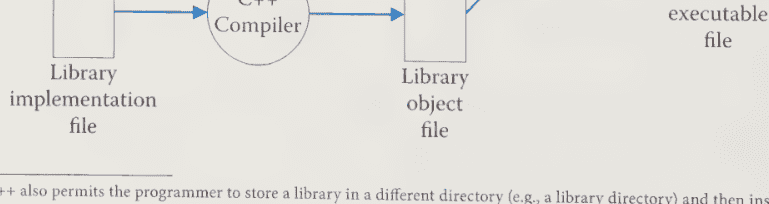

⁹ C++还允许程序员将库存储在不同的目录中（例如，库目录），然后指示编译器在查找由#include指令指定的文件时搜索该目录。具体做法因系统而异。

单独编译库可以显著减少包含库的源程序的转换时间，因为库不需要重新编译，只需与程序的目标文件链接。此外，在转换中检测到的任何错误很可能位于源程序中（因为库已经编译过）。

转换的具体执行方式因系统而异，但有两种基本方法。在诸如Visual C++的集成开发环境中，转换通过创建项目并向其中添加源文件和库文件来协调。然后可以使用菜单选择来执行编译和链接，生成二进制可执行文件并执行它。在命令行环境中，用户通过键入命令与计算机交互。例如，在Unix/Linux系统上使用GNU C++时，编译和链接示例6.10中的源代码和Heat.cpp需要几条命令。我们首先输入命令来分别编译源文件和库的实现文件：

```
g++ -c example6-10.cpp
g++ -c Heat.cpp
```

生成目标文件 example6-10.o 和 Heat.o。然后我们使用以下命令将这两个目标文件链接在一起，生成名为 example6-10.exe 的二进制可执行文件：

```
g++ example6-10.o Heat.o -o example6-10.exe
```

要执行生成的文件，我们只需将其名称作为命令键入：

```
example6-10.exe
```

## 6.4.4 以对象为中心的设计：整合函数和库

到目前为止，我们一直在使用以对象为中心的设计（OCD）来设计问题的软件解决方案，其步骤如下：（1）描述程序的行为；（2）识别问题的对象；（3）识别所需操作；（4）以解决问题的方式安排它们。现在我们来考虑如何将函数和库整合到OCD中。

由于函数可以被视为添加到C++所提供操作中的操作，它们自然地契合了OCD的这一部分：

识别解决问题所需的操作。

如果某个操作不是C++提供的，则编写一个函数来实现它；如果它看起来可能在其它问题中可复用，则将其存储在库中。

## 6.4.5 使用库的好处

我们以描述库的一些主要特性和好处来结束对库的讨论，这些特性和好处使它们在面向对象的编程方法中如此重要。

### 6.4.5.1 库隐藏实现细节

在我们的程序中，我们可以使用库中的项，而无需关心它们在实现文件中是如何定义的。我们所需要的只是头文件中的信息。


header 和文档文件，以及由编译实现文件生成的对象文件的访问权限，以便将其内容链接到我们的程序中。实现文件中的细节可以保持“隐藏”，使我们能够使用库而无需关心这些细节。例如，我们在每个程序中都使用了 iostream 库提供的输入/输出操作，而无需关心其实现细节。

## 6.4.5.2 库促进程序维护

程序和库的单独编译使得可以更改库的实现文件并仅重新编译它，而无需更改或重新编译使用该库的程序或其他库。例如，如果库 Heat 的实现文件中的函数 celsiusToFahrenheit() 被更改，则只需重新编译实现文件即可。使用此函数的程序无需重新编译，因为 celsiusToFahrenheit() 的原型未发生变化，只有其定义发生了变化。只需将程序重新链接到库 Heat 的新对象文件即可。

相比之下，如果头文件中的接口被更改，则库的实现文件以及所有在 #include 指令中命名该头文件的程序和其他库都必须重新编译并重新链接。

## 6.4.5.3 库支持独立编码

库通过允许将相关项分组到独立单元中来促进软件设计的模块化，这在大型软件项目中尤其有用。一旦在项目中识别并对所需的对象和操作进行分类，就可以设计库来容纳各种对象类型的项，并为这些库构建头文件。

在此之后，项目的工作可以分给不同的程序员组，分别负责构建各种库的实现文件，以及负责在软件项目中使用库的程序的其他组。将工作划分为可管理的“块”并可并行编码，可以加快整个项目的完成速度。此外，由于一个部分的工作独立于另一部分的工作进行，因此出错的可能性更小。

## 6.4.5.4 库简化测试

单独的库可以由不同的程序员团队独立开发和测试（使用驱动程序）。这意味着每个库可以比单个非常大的程序更彻底（并且更快速）地进行测试。

## 6.4.5.5 库扩展编程语言

库提供可供任何程序（或其他库）使用的项——函数、常量等。程序员不必每次需要这些项时都“重新发明轮子”。

## 6.5 数值方法简介

科学和工程中的问题和数学模型，以及许多其他领域，都涉及求解常微分代数方程、微分方程、方程组等。在许多情况下，使用可由计算机程序实现的数值方法来寻找解。以下是数值方法常规使用的一些主要问题类型：

- 1. 对于少数代数方程，公式（例如二次方程的二次公式）给出精确根，但对于大多数方程，使用数值方法来寻找近似根。
- 2. 许多问题的解，如求曲线下的面积、计算某些事件的概率、计算力所做的功，需要对积分进行求值。对于某些问题，可以使用积分微积分的方法，但对于其他问题，使用数值技术来寻找近似值。
- 3. 微分方程在许多应用中起着重要作用，并且已经开发出各种有效且高效的数值方法来获得解。
- 4. 曲线拟合是指分析成对的数据值以确定这些对中的项目是否由某个代数方程相关。例如，第 9.4 节编程问题 10 中描述的最小二乘法就是将一条直线拟合到一组点的方法。
- 5. 数值方法通常用于找到同时满足多个未知数的线性方程组的解。这样的线性系统将在我们考虑矩阵时稍后描述。

在本节中，描述了前三类中的一些数值方法。

## 6.5.1 求解方程——二分法

在许多应用中，有必要找到函数的零点或根，即求解形式为 f(x) = 0 的方程。对于某些函数，可能很难甚至不可能精确找到此解。示例包括函数

```
f(v) = 50·10⁻⁹ (e⁴⁰ᵛ − 1) + v − 20
```

这可能出现在确定电气电路中直流工作点的问题中，或形式为

```
f(x) = x tan x − a
```

的函数。

一种简单的数值方法，用于寻找方程 f(x) = 0 的近似解是二分法。（编程问题描述了另一种常用的方法，称为牛顿-拉夫森法。）在二分法中，我们从区间 [a, b] 开始，其中函数值 f(a) 和 f(b) 在端点处符号相反。如果 f 在此区间内连续——即 y = f(x) 的图像在此区间内没有断裂——则 f 的图像必须在 x = a 和 x = b 之间至少一次穿过 x 轴，因此在 a 和 b 之间必须至少有一个方程 f(x) = 0 的解。为了定位其中一个解，我们首先将区间 [a, b] 二分并确定 f 在哪一半变号，从而定位包含方程解的更小的子区间。我们对该子区间进行二分并确定 f 在其哪一半变号；这给出包含解的更小的子区间。

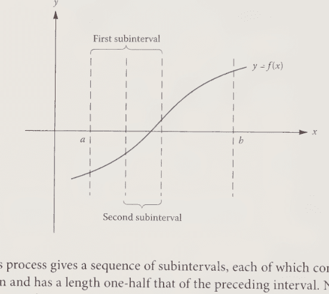

重复此过程会产生一系列子区间，每个子区间都包含方程的解，并且长度是前一个区间的一半。注意，在每一步，长度为 L 的子区间的中点与精确解的距离在 L / 2 以内：

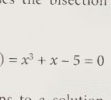

示例 6.11 中的程序使用二分法来寻找近似解

f(x) = x³ + x − 5 = 0

它生成对解的连续近似值，在获得长度保证用户输入的指定精度的区间时终止。

## 示例 6.11 二分法

```
/* Program finds an approximate solution of the equation f(x) = 0
in a given interval, using the bisection method.

Input:  desired accuracy of approximation, endpoints of an interval
        containing a solution
Output: prompts to the user and the approximate solution
---------------------------------------------------------------*/

#include <iostream>
using namespace std;

double f(double x);

int main()
{
    cout << "\nThis program uses the bisection method to find an\n"
         << "approximate solution to the equation f(x) = 0.\n";

    double desiredAccuracy;      // the accuracy desired

    cout << "\nEnter the accuracy desired (e.g. .001): ";
    cin >> desiredAccuracy;

    double left, right;          // get interval containing a solution

    do
    {
        cout << "Enter endpoints of an interval containing a solution: ";
        cin >> left >> right;
    }
    while (f(left) * f(right) >= 0.0);

    double width = right - left,  // the interval width
           midPt,                // the midpoint of the interval
           fMid;                 // value of f() at midpoint

    while (width/2.0 > desiredAccuracy)
    {
        midPt = (left + right) / 2.0;
        fMid = f(midPt);

        if (f(left) * fMid < 0.0 )  // solution is in left half
            right = midPt;
        else                        // solution is in right half
            left = midPt;

        width /= 2.0;               // split the interval
    }
```


```
cout << "\n-->" << midPt << " is an approximate solution of " << " f(x) = 0, to within " << desiredAccuracy << endl;
}
```

```
// Function for which a root is being found
double f(double x)
{
    return x*x*x + x - 5;
}
```

### SAMPLE RUN:

This program uses the bisection method to find an approximate solution to the equation f(x) = 0.

Enter the accuracy desired (e.g. .001): 1e-4
Enter endpoints of an interval containing a solution: 0 1
Enter endpoints of an interval containing a solution: 0 2

-->1.51599 is an approximate solution of f(x) = 0, to within 0.0001

## 6.5.2 Numerical Integration—Approximating Areas of Regions

One important problem in calculus is finding the area of a region bounded below by the x-axis, above by the graph of a function y = f(x), on the left by a vertical line x = a, and on the right by a vertical line x = b:

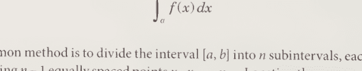

More generally, the problem is to approximate the integral

∫ₐᵇ f(x) dx

One common method is to divide the interval [a, b] into n subintervals, each of width Δx = (b − a)/n using n − 1 equally spaced points x₁, x₂, ..., xₙ₋₁. Locating the corresponding points on the curve and connecting consecutive points using line segments forms n trapezoids:

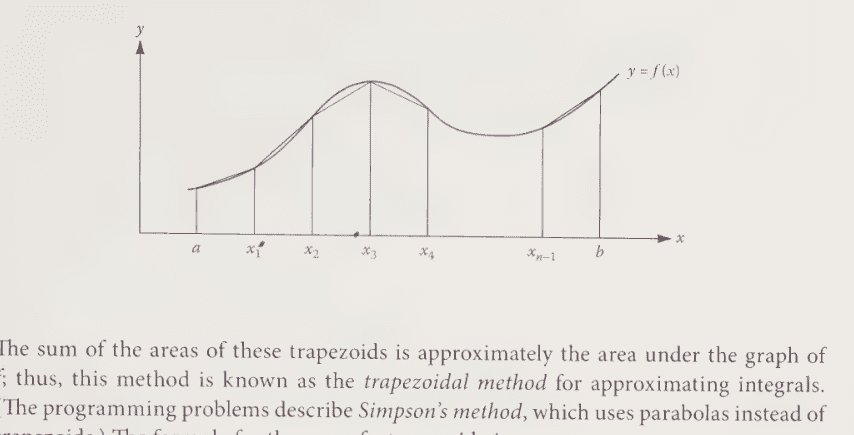

The sum of the areas of these trapezoids is approximately the area under the graph of f; thus, this method is known as the trapezoidal method for approximating integrals. (The programming problems describe Simpson's method, which uses parabolas instead of trapezoids.) The formula for the area of a trapezoid gives

> \frac{1}{2} \Delta x (y_{i-1} + y_i)

for the area of the ith trapezoid, where y_{i-1} and y_i are the values of the function f at x_{i-1} and x_i, respectively. Summing these and combining terms gives the formula

> \Delta x \left( \frac{y_0 + y_n}{2} + y_1 + y_2 + \cdots + y_{n-1} \right)

or written more concisely using summation (Σ) notation,

> \Delta x \left( \frac{y_0 + y_n}{2} + \sum_{i=1}^{n-1} y_i \right)

The program in Example 6.12 implements the trapezoidal method.

## Example 6.12 Trapezoidal Approximation of an Integral

```
/* This program approximates the area under the graph of a function
f() over an interval [a, b] using the trapezoidal rule -- and
thus approximates the definite integral of f() from a to b.

Input: the endpoints a and b of the interval, and the number of
subintervals to use

Output: approximation to the integral of f() on [a, b] */
```

```
#include <iostream>      // cin, cout, <<, >>
using namespace std;

double f(double x);      // function to be integrated

int main()
{
    cout << "Trapezoidal approximation of an integral:\n";

    int n;                  // number of subintervals
    double a, b,            // endpoints of interval
           deltaX,          // length of subintervals
           x, y,            // point on graph of f()
           sum;             // sum of areas of trapezoids

    cout << "Enter interval endpoints and the # of subintervals: ";
    cin >> a >> b >> n;

    deltaX = (b - a) / n;
    sum = 0;
    x = a;

    for (int i = 1; i <= n - 1; i++)
    {
        x += deltaX;
        y = f(x);
        sum += y;
    }
    sum = deltaX * ((f(a) + f(b))/2 + sum);

    cout << "Approximate value using " << n << " subintervals: "
         << sum << endl;
}

// Function being integrated
double f(double x)
{ return x*x + .1; }
```

## SAMPLE RUNS:

Trapezoidal approximation of an integral:
Enter interval endpoints and the # of subintervals: 0 1 10
Approximate value using 10 subintervals: 1.335

Trapezoidal approximation of an integral:
Enter interval endpoints and the # of subintervals: 0 1 50
Approximate value using 50 subintervals: 1.3334

Trapezoidal approximation of an integral:

that satisfies a given initial condition:

y(x₀) = y

Euler’s method for obtaining an approximate solution over some interval [a, b], where a = x₀, is as follows:

- 1. Select an x-increment Δx.
- 2. For n = 0, 1, 2, …, do the following:
- a. Set xₙ₊₁ = xₙ + Δx.
- b. Find the point Pₙ₊₁(xₙ₊₁, yₙ₊₁) on the line through Pₙ(xₙ, yₙ) with slope f(xₙ, yₙ).
- c. Output yₙ₊₁, which is the approximate value of y at xₙ₊₁.

The following diagram illustrates Euler’s method:

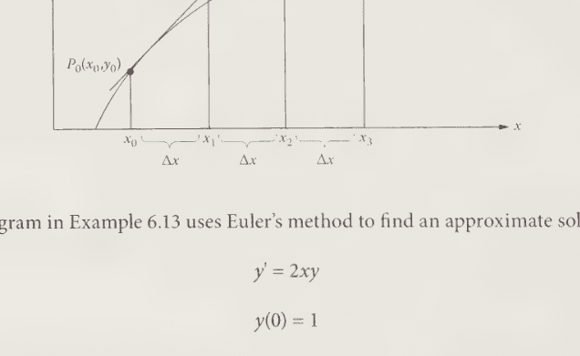

The program in Example 6.13 uses Euler’s method to find an approximate solution for

y' = 2xy

y(0) = 1

Sample runs with a = 0, b = 1, Δx = 0.2 and a = 0, b = 0.5, Δx = 0.05 are shown.

## Example 6.13 Euler’s Method for Solving a Differential Equation

```
/* This program uses Euler's method to obtain an approximate solution
to a first-order differential equation of the form y' = f(x, y)

Input:  initial values for x and y, an increment deltaX, and
        number of iterations
```

Output: a sequence of points (x, y) that approximate the solution curve

```
#include <iostream>      // cin, cout, <<, >>
#include <iomanip>      // output formatters
using namespace std;

double f(double x, double y);

int main()
{
    cout << "Euler's method for solving a differential equation:\n";

    double x, y,            // current x value, y value
           xNext, yNext,    // next x value, y value
           deltaX;          // x-increment used
    int numIterations;      // number of iterations.

    cout << "Enter x0 and y0, x-increment to use, and "
         << "number of values to calculate:\n";
    cin >> x >> y >> deltaX >> numIterations;

    cout << "  X              Y\n"
         << "========================\n"
         << fixed << setprecision(5) << showpoint
         << setw(10) << x << setw(10) << y << endl;

    // Iterate with Euler's method

    for (int n = 1; n <= numIterations; n++)
    {
        xNext = x + deltaX;
        y = y + f(x, y) * deltaX;
        x = xNext;
        cout << setw(10) << x << setw(10) << y << endl;
    }
}

double f(double x, double y)
{ return 2.0 * x * y; }
```

## SAMPLE RUNS:

Euler's method for solving a differential equation:
Enter x0 and y0, x-increment to use, and number of values to calculate:
0 1 0.2 5

## 186 ■ Programming in C++ for Engineering and Science

| X | Y |
| --- | --- |
| 0.00000 | 1.00000 |
| 0.20000 | 1.00000 |
| 0.40000 | 1.08000 |
| 0.60000 | 1.25280 |
| 0.80000 | 1.55347 |
| 1.00000 | 2.05058 |

Euler's method for solving a differential equation:

Enter x0 and y0, x-increment to use, and number of values to calculate:

0 1 .05 10

| X | Y |
| --- | --- |
| 0.00000 | 1.00000 |
| 0.05000 | 1.00000 |
| 0.10000 | 1.00500 |
| 0.15000 | 1.01505 |
| 0.20000 | 1.03028 |
| 0.25000 | 1.05088 |
| 0.30000 | 1.07715 |
| 0.35000 | 1.10947 |
| 0.40000 | 1.14830 |
| 0.45000 | 1.19423 |
| 0.50000 | 1.24797 |

- | Term | Corresponding |
|------|-------------|
| #include directive | function |
| abstraction | function declaration |
| argument | function definition |
| body of a function | function heading |
| call to a function | function prototype |
| compilation | function stub |
| documentation file | header file |
| driver program | implementation file |
| encapsulation | information hiding |
| executable program | interface file |
| executable file | library |

- A function's documentation should include its *specification*—descriptions of its parameters and their types, values input to the function, what it returns, values it outputs, preconditions, and postconditions.
- Local variables, constants, and parameters exist only while a function is executing and thus can be accessed only within the function. This means that other functions may reuse the name of a local item for some other purpose without causing a conflict.
- A library is a collection of files:
  - A *header file* that contains declarations and prototypes of a library's items that is also called the *interface file* because it acts as an interface between the library and client programs. It is inserted into a program (or another library) using a directive of the form `#include "Library.h"`.
  - An *implementation file* that contains definitions of items not defined in the header file. It must be separately compiled and then linked to a client program. Items defined in it that are declared in the header file can be accessed in any program that `#includes` the header file and links to this implementation file. Items defined here but not declared in the header file cannot be accessed outside of this implementation file, even by a program that `#includes` the header file.
  - A *documentation file* that contains documentation for the library's items.

### Style and Design Tips

- *Functions should be documented in the same way as programs.* The documentation should include the following:
  - A statement of what it does
  - Its specification, which consists of those of the following that apply:
    - what it receives (i.e., its parameters);
    - what is input to the function;
    - preconditions—restrictions or limitations on the parameters' values in order for the function to work properly;
    - what it returns;
    - what it outputs;
    - postconditions—effects produced by the function.

In this text, to avoid cluttering the header and implementation files, we place the documentation for functions stored in a library in a separate documentation file.

- *Functions are separate program components, and the white space in a program should reflect this.* In this text, we


- 在主函数所在文件中定义的每个函数之前，插入适当的文档，以将其与程序的其他组成部分区分开；
- 缩进每个函数内的声明和语句。
- *所有编程风格准则均适用于函数。*
- *一旦对问题进行了分析，确定了问题的对象以及解决问题所需的操作，就应该构造一个算法，规定操作作用于对象的顺序。*
- *C++ 中未预定义（或非平凡）的操作应编码为函数，并与主函数分开。*
- *对操作进行编码的函数，其设计方式应与主函数相同。*
- *不返回任何值的函数，其返回类型应声明为 void。*
- *不接收任何值的函数，其函数头的括号内不应有参数。*
- *如果一个函数具有足够的通用性，将来可能在解决不同问题时也会有用，就应该构建一个库来存储该函数，而不是在程序的源文件中声明和定义它。*
- *库文件的文档编写方式应与程序大致相同。对于每个库，应提供一个专门的文档文件，清晰、准确、完整地描述库的内容、如何使用其中的条目、它所实现的任何特殊算法，以及其他有用信息（如作者、修改历史等）。该文档文件应与库的其他文件放在同一位置，以便用户参考该文件来理解和使用库中存储的对象和函数。*
- *如果在程序中插入（使用 `#include`）一个不太常用的库的头文件，应使用注释来解释其用途，例如程序中使用了该库中的什么内容。*
- *库提供以下好处：*
  - *库扩展了语言，因为其对象可以被任何程序或另一个库使用。*
  - *库接口中的条目可以在不关心其实现细节的情况下使用。*
  - *程序和库可以分别编译。修改库的实现文件只需要重新编译该实现文件。*
- *库在软件设计中提供了另一个层次的模块化：相关的函数和其他对象可以组合在独立的库中。*

## 警告

1. 调用函数时，实参列表按从左到右的顺序与形参列表匹配：最左边的实参与最左边的形参对应，下一个实参与下一个形参对应，依此类推。实参的数量必须与形参的数量相同（例外情况见本书网站上关于默认参数的说明），且每个实参的类型必须与相应形参的类型兼容。
2. 在函数内定义的标识符（例如形参、局部变量和局部常量）仅在该函数执行期间有定义；在该函数执行前后，它们都没有定义。在函数外部使用此类标识符（未重新声明）属于错误。
3. 如果函数改变了某个形参的值，相应实参的值不会改变。形参是一个完全独立的变量，实参的值被复制到其中。对形参的任何修改都只是修改这个副本，而不会修改相应的实参。¹⁰
4. 函数必须先声明，然后才能调用。
5. 如果函数需要使用库中的内容，必须在该函数定义之前插入（使用 `#include`）相应库的头文件。
6. 库的实现文件应始终插入该库的头文件（使用 `#include`），以便编译器验证每个函数的原型与其定义是否一致。如果不遵循此规则，常常会导致链接错误。
7. 在库的实现文件中定义但未在该库头文件中声明的函数，不能在库外部调用（但可以在库内部调用）。

## 自测题

### 6.3 节

1. 除了输入和输出对象之外，描述函数行为时通常还包括哪两类对象？
2. 在函数头 double sum(int a, char b) 中，a 和 b 被称为______。
3. 对于函数头为 double sum(int a, char b) 的函数，其返回值的类型是______。
4. 关键字______用于表示不返回值的函数的返回类型。
5. 函数存根（stub）是一种函数定义，其函数体包含________。

第 6～10 题与以下函数定义有关：

```cpp
int what(int n)
{
    return (n * (n + 1)) / 2;
}
```

6. 如果主函数中出现语句 `number1 = what(number2);`，在此函数调用中，number2 被称为________。
7. 如果主函数中出现语句 `int number = what(3);`，赋给 number 的值将是________。
8. （判断正误）主函数中的语句 `int number = what(2+3);` 赋给 number 的值将是 15。
9. （判断正误）主函数中的语句 `int number = what(1, 5);` 赋给 number 的值将是 3。
10. 为函数 `what()` 编写一个原型。
11. 编写一个函数定义，计算 x² + √x 的值。
12. 编写一个函数定义，计算两个整数的整数平均值。
13. 编写一个函数定义，将三个整数显示在三行上，且相邻两行之间隔两个空行。

### 6.4 节

1. （判断正误）库最初是在 C++ 语言中提供的。
2. 库中包含哪三类文件？
3. 使用库的主要好处是什么？
4. 库的________文件包含库中条目的声明和原型。
5. 库的________文件包含库中函数的定义。
6. 库的________文件有时被称为库的接口文件。
7. 库头文件中的条目包含________信息，而实现文件中的条目包含________信息（公共或私有）。
8. 如果程序包含 `#include` ________，编译器将在特殊的系统包含目录中查找文件 lib。
9. 如果程序包含 `#include` ________，编译器将在包含正在编译的程序的目录中查找文件 lib。
10. 要翻译（编译）使用库的程序，需要哪两个步骤？
11. （判断正误）库的头文件通常与使用该库的程序分开编译。
12. （判断正误）如果库的头文件被修改，那么所有使用该库的程序都必须重新编译。
13. ______使得在不了解库实现的所有细节的情况下也能使用该库。

## 练习

### 6.3 节

对于练习 1～13，编写函数来计算并返回各种量。为了测试这些函数，应按照“编程问题”中的说明编写驱动程序。

1. 已知半径，求圆的周长。（C = 2πr）
2. 已知半径，求圆的面积。（A = πr²）
3. 已知边长，求矩形的周长。（P = 2l + 2w）
4. 已知边长，求正方形的面积。（A = s²）
5. 已知三边长度，求三角形的周长。（P = s₁ + s₂ + s₃）
6. 已知三边长度，求三角形的面积。（可以利用海伦公式求三角形面积：面积 = √[s(s−a)(s−b)(s−c)]，其中 a、b、c 为三边的长度，s 为周长的一半。）


12. 文本中描述的风寒指数是在1941年开发的，其公式的最新修订版于2001年发布。它是由于寒冷和风共同作用而产生的 discomfort 的衡量指标，基于在各种温度和风速组合下热量损失的速率。热指数于1979年开发，是由于高温和高湿度组合而产生的 discomfort 的衡量指标，基于在各种温度和湿度组合下蒸发性皮肤冷却的研究。它使用以下公式计算：

```
heat index = -42.379 + 2.04901523 × t + 10.14333127 × r
-0.22475541 × t × r - (6.83783E - 3) × t²
-(5.48171E - 2) × r² + (1.22874E - 3) × t² × r
+(8.5282E - 4) × t × r² - (1.99E - 6) × t² × r²
```

其中 t 为华氏温度，r 为相对湿度。编写一个函数来计算给定温度和相对湿度的热指数。

13. 编写一个函数，对于给定的距离，根据以下表格返回费用：

| Distance | Cost |
|---|---|
| 0 through 100 | $5.00 |
| More than 100 but not more than 500 | $8.00 |
| More than 500 but less than 1000 | $10.00 |
| 1000 or more | $12.00 |

14. 形式为 ax² + bx + c = 0 的二次方程在判别式 b² - 4ac 非负时具有实根。编写一个函数接收二次方程的系数 a、b 和 c，并在方程具有实根时返回 true，否则返回 false。

15. 质数是大于 1 的整数 n，其唯一正因子是 1 和 n 本身。编写一个布尔值函数来确定一个整数是否为质数。

16. 两个整数 a 和 b 的最大公约数 GCD，a 和 b 不全为零，是同时整除 a 和 b 的最大正整数 d。求 a 和 b 的最大公约数 GCD(a, b) 的欧几里得算法如下：如果 b = 0，则 GCD(a, b) 为 a。否则用 b 除 a 得到商 q 和余数 r，使得 a = bq + r。然后 GCD(a, b) = GCD(b, r)。用 b 替换 a，用 r 替换 b 并重复此过程。由于余数在减小，最终会得到余数为 0 的情况。最后一个非零余数就是 GCD(a, b)。例如，

注意：如果 a 或 b 为负数，则用其绝对值替换。

编写一个函数来计算两个整数的最大公约数。

17. 编写一个函数，给定正整数 n，显示前 n 个正整数的平方、立方和平方根。

18. 编写一个函数，给定实数 a、b 和 deltaX，显示 y = x³ − 3x + 1 图形上从 a 到 b 以 deltaX 为增量的点 (x, y) 列表。

19. 某市将污染指数小于 35 分类为“宜人”，35 至 60 分类为“不愉快”，高于 60 分类为“危险”。编写一个函数显示污染指数的适当分类。

20. 风寒指数为 10°F 或以上不被认为危险或不愉快；风寒指数为 −10°F 或更高但小于 10°F 被认为不愉快；如果风寒指数为 −30°F 或以上但小于 −10°F，则可能发生冻伤；如果风寒指数为 −70°F 或更高但低于 −30°F，则冻伤很可能发生且户外活动变得危险；如果风寒指数小于 −70°F，则暴露的皮肤通常会在半分钟内结冰。编写一个函数显示风寒指数的适当天气状况。

## PROGRAMMING PROBLEMS

### Section 6.3

对于问题 1–20，编写一个驱动程序来测试该函数。

- 1. Exercise 1: 圆的周长
- 2. Exercise 2: 圆的面积
- 3. Exercise 3: 矩形的周长
- 4. Exercise 4: 矩形的面积
- 5. Exercise 5: 三角形的周长
- 6. Exercise 6: 三角形的面积
- 7. Exercise 7: 前 n 个正整数之和
- 8. Exercise 8: 连续整数之和
- 9. Exercise 9: 将美国货币转换为加拿大货币
- 10. Exercise 10: 将加拿大货币转换为美国货币
- 11. Exercise 11: 培养基中细菌的数量
- 12. Exercise 12: 热指数
- 13. Exercise 13: 给定距离的费用

14. Exercise 14: 二次方程检查器。用以下 a、b 和 c 的值测试它：1, 25, 6；1, 22, 1；1, 0, 4；1, 1, 1；2, 1, 2

15. Exercise 15: 检查一个数字是否为质数

16. Exercise 16: 查找两个整数的最大公约数

17. Exercise 17: 显示连续正整数的平方、立方、平方根

18. Exercise 18: 显示图形上的点列表

19. Exercise 19: 显示污染指数的分类。用以下数据测试它：20, 45, 75, 35, 60。

20. Exercise 20: 显示风寒指数的天气状况。用以下数据测试它：−80, 10, 0, −70, −10, −5, 10, −20, −40。

21. 编写练习 14 中二次方程函数的修改版本，如果二次方程没有实根（判别式为负）则返回 0，如果它有一个重复的实根（判别式为 0）则返回 1，如果它有两个不同的实根（判别式为正）则返回 2。将此二次方程检查器函数添加到驱动程序中，并使用练习 14 中的 a、b 和 c 值对其进行测试。

### Section 6.4

- 1. 构造一个名为 Exchange 的库，其中包含第 6.3 节练习 9 和 10 中的货币转换函数。编写一个驱动程序来测试你的库。
- 2. 构造一个名为 Time 的库，其中包含将秒转换为分钟、分钟转换为小时、小时转换为天的时转换函数。编写一个驱动程序来测试你的库。
- 3. 构造一个名为 Geometry 的库，其中包含第 6.3 节练习 1–6 中的函数。编写一个驱动程序来测试你的库。
- 4. 编写一个程序读取圆的代号 C、矩形的代号 R 或三角形的代号 T，后跟圆的半径、矩形的边或三角形的边，分别。使用问题 3 中的 Geometry 库中的函数，程序应然后计算并显示该几何图形的周长和面积，并附带适当的标签。
- 5. 构造一个名为 Cylinder 的库，其中包含计算直圆柱体总表面积、侧表面积和体积的函数。对于半径为 r、高度为 h 的圆柱体，这些可以用以下公式计算：
  
  Total Surface Area = 2πr(r + h)
  Lateral Surface Area = 2πrh
  Volume = πr²h
  
  编写一个驱动程序来测试你的库。

6. 构造一个名为 Metric 的库，其中包含将英制测量转换为公制测量对应的转换函数。你的库应提供以下转换：

- 英寸到厘米（1 in. = 2.54 cm）
- 英尺到厘米（1 ft. = 12 in.）
- 英尺到米（1 meter = 100 cm）
- 码到米

编写一个驱动程序来测试你的库。

7. 将问题 6 中的公制库扩展以包括（至少）以下转换，并扩展你的驱动程序以测试它们：

- 英尺到分米（1 meter = 10 decimeters）
- 英寸到毫米（1 centimeter = 10 millimeters）
- 英里到公里（1 mile = 1,760 yards，1 kilometer = 100 meters）

### Section 6.5

#### Root Finding

1. 某电路在铁芯上绕有线圈的稳态是通过求解关于磁通 Φ 的方程 f(Φ) = 0 获得的，其中 f(Φ) = 20 − 2.5Φ − 0.015Φ³。可以很容易地检查函数 f 在区间 [6, 7] 内变号。使用二分法求该区间内方程的解。

2. 不完美气体的状态由范德瓦尔斯方程给出

\(\left(p + \frac{\alpha}{v^{2}}\right)(v - \beta) = RT\)

其中 p = 压力（atm），v = 摩尔体积（l/mole），T = 绝对温度（°K），R = 气体常数（0.0820541 atm/mole °K）。对于二氧化碳，α = 3.592 且 β = 0.04627。假设 p = 0.9 atm 且 T = 300°K。使用二分法求解以下等价三次方程以求 v：p v³ − (βp + RT) v² + αv − αβ = 0。

3. Cawker City Construction Company 可以以 $4,440 购买一台新设备，或通过在未来 36 个月内每月支付 $141.19 来购买。你需要确定每月付款计划中收取的年利率。支配此计算的方程是年金公式

\(A = P \cdot \left(\frac{(1+R)^{N} - 1}{R(1+R)^{N}}\right)\)


其中 A 是借款金额，P 是每月还款额，R 是月利率（年利率/12），N 是还款次数。使用二分法求解该方程中的 R。

4. 在平飞时，考克城建筑公司喷气式飞机的总阻力等于废阻力（D_p）与升致阻力（D_L）之和，其表达式为

D_p = σ f V²

和

D_L = (1245 / (σ e)) (W / b)² (1 / V²)

其中 V 是速度（英里/小时），W 是重量（15,000 磅），b 是翼展（40 英尺），e 是机翼效率系数（0.800），f = 废阻力面积（4 平方英尺），σ =（高空空气密度）/（海平面空气密度）= 0.533（在 20,000 英尺高度，标准大气条件）。使用二分法求以最小阻力（平飞）飞行所需的恒定速度 V，该速度出现在 D_p = D_L 时。

5. 下图显示了一个质量 M 连接在一根质量为 m 的细钢杆上：


自由无阻尼纵向振动的频率方程为

β tan β = m / M

其中

β = ω l / c

这里，

c = √(E / ρ)

l = 杆的长度（115 英寸），E = 杨氏模量（= 3 × 10⁷ psi），ρ = 单位体积质量（= 7.2 × 10⁻⁴ 磅 × 秒²/英寸⁴）。当 m/M = 0.40 时，使用二分法求频率方程的最小根。

6. 柔性电缆在工程中应用广泛，例如悬索桥和输电线路。用作输电线路的电缆承受自身均匀分布的重量，呈现出下图所示的悬链线形状。

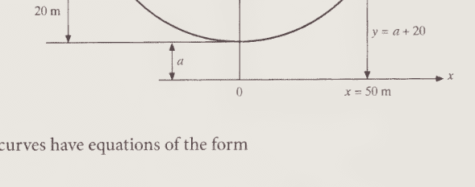

这些曲线的方程具有如下形式

y = a cosh( x / a )

假设电缆的跨度为 100 米，最大垂度为 20 米，电缆单位长度的重量为 w = 50 牛/米。最小和最大张力分别出现在中点（当 y = a 时）和两端（当 y = a + 20 时），可分别按 T_min = w × a 和 T_max = w × (a + 20) 计算。使用二分法求解方程

a + 20 = a cosh( 50 / a )

以求出 a 的值，然后将该值代入 T_min 和 T_max 的方程，从而求得极端张力值。

7. 长度为 L 的水槽，其横截面是半径为 r = 1 米的半圆形。假设水槽中注水至距顶部距离为 h 的位置。水的体积 V 由下式给出

V(h) = L( 1/2 π r² - r² arcsin( h / r ) - h √( r² - h² ) )

其中三项分别表示半圆的面积以及面积 2A₁ 和 2A₂。

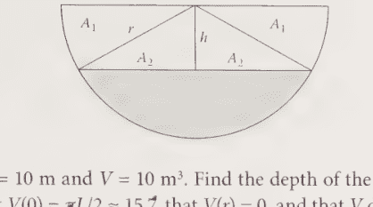

假设 L = 10 米，V = 10 立方米。求水的深度（即 r − h = 1 − h）。注意 V(0) = πL/2 ≈ 15.7，V(r) = 0，且 V 随 h 的增大而减小；因此，h 有唯一解。使用二分法求该解。

8–14. 牛顿-拉弗森法（Newton-Raphson method）是求方程 f(x) = 0 近似解的另一种常用方法。该方法先取根的一个初始近似值 x₁，并在点 P₁(x₁, f(x₁)) 处作 f(x) 图像的切线。该切线与 x 轴的交点 x₂ 即为根的第二个近似值。可以在点 P₂(x₂, f(x₂)) 处再作一条切线，该切线与 x 轴的交点 x₃ 即为第三个近似值。对于许多函数，只要第一个近似值足够接近，近似序列 x₁, x₂, x₃, … 就会收敛到该根。下图说明了牛顿-拉弗森法：

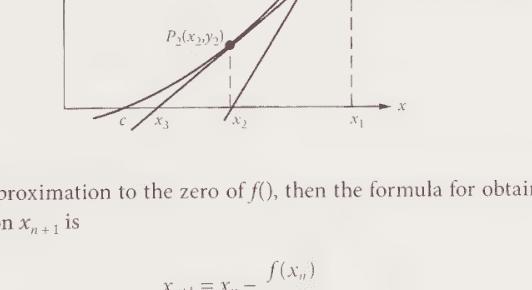

如果 xₙ 是 f(x) 的零点的一个近似值，则求下一个近似值 xₙ₊₁ 的公式为

```
xₙ₊₁ = xₙ − f(xₙ) / f′(xₙ)
```

其中 f′(x) 是 f(x) 的导数。按照问题 1–7 的要求进行求解，但使用牛顿-拉弗森法代替二分法。

## 数值积分

对于问题 15–21，使用梯形法求积分的近似值。

15. 通过电容器的电流 *i* 由下式给出

$$i(t)=10\sin^2\left(\frac{t}{\pi}\right)$$

安培，其中 *t* 表示以秒为单位的时间。假设电容 *C* 为 5 F（法拉）。电容器两端的电压由下式给出

$$v(T)=\frac{1}{C}\int_0^T i(t)\,dt$$

伏特。求 $T=1, 2, 3, 4,$ 和 $5$ 秒时 $v(T)$ 的值。

16. 长轴为 2a、短轴为 2b 的椭圆的周长 C 由下式给出

$$C=4a\int_0^{\pi/2}\sqrt{1-\left(\frac{a^2-b^2}{a^2}\right)\sin^2\Phi}\,d\Phi$$

假设一个房间呈椭圆形，其中 $a=20\ \text{m}$，$b=10\ \text{m}$，高度 $h=5\ \text{m}$。求墙壁的总面积 $A=hC$。

17. 某些能量高于阈值能量 $E^*$ 的裂变中子的比例可通过以下公式确定

$$f=1-0.484\int_0^{E^*}e^{-E}\sinh\left(\sqrt{2E}\right)\,dE$$

求 $E^*=0.5, 1.0, 1.5, 2.0, 2.5,$ 和 $3.0$ 时 $f$ 的值。

18. 一个质量为 $m=10\ \text{kg}$ 的粒子在流体中运动，受到粘性阻力 $R(v)=-v^{3/2}$ 的作用，其中 $v$ 是其速度。时间 $t$、速度 $v$ 和阻力 $R$ 之间的关系由下式给出

$$t=\int_{v_0}^{v(t)}\frac{m}{R(v)}\,dv$$

秒，其中 $v_0$ 是初始速度。假设 $v_0=15\ \text{m/sec}$，求粒子减速到 $v(T)=7.5\ \text{m/sec}$ 所需的时间 $T$。

19. 假设一根弹簧被压缩了距离 x_c：

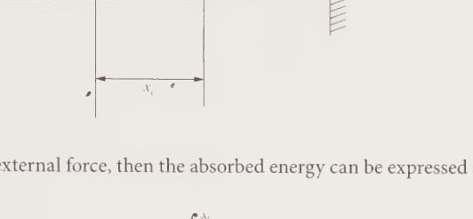

如果 F(x) 是外力，则吸收的能量可以表示为

```
E = ∫₀^{x_c} F(x) dx
```

假设

```
F(x) = 1/2 e^{x²} sin²(3x²)
```

力的单位为牛顿，且 x_c = 1 厘米。计算吸收的能量。

20. 一个以角度 θ 施加的力（以牛顿为单位）使物体沿 x 轴从 x = a 移动到 x = b（以米为单位）时所做的功（以焦耳为单位）由下式给出

```
W = ∫_a^b F(x) cos(θ(x)) dx
```

其中 F(x) 是在点 x 处以角度 θ(x)（弧度）施加的力。对于 a = 20.0 m、b = 50.0 m 以及以下 F(x) 和 θ(x) 的取值对，计算所做的功：

| F(x) | θ(x) |
|------|------|
| 0.0  | 0.60 |
| 4.3  | 0.87 |
| 7.8  | 1.02 |
| 9.9  | 0.99 |
| 12.5 | 1.20 |
| 16.3 | 0.98 |
| 18.4 | 0.86 |
| 21.7 | 0.43 |
| 25.4 | 0.23 |
| 22.3 | 0.14 |
| 20.9 | 0.15 |
| 18.7 | 0.08 |

21. 编写一个程序，使用梯形法求道路施工问题中山丘的横截面积，其中山丘高度以 100 英尺为间隔进行测量，并列表如下：

| 距离 | 高度 |
|------|------|
| 0    | 0    |
| 100  | 6    |
| 200  | 10   |
| 300  | 13   |
| 400  | 17   |
| 500  | 22   |
| 600  | 25   |
| 700  | 20   |
| 800  | 13   |
| 900  | 5    |
| 1000 | 0    |

然后利用该值求需要移除的土方量。

22.–28. 另一种通常比梯形法能产生更好近似结果的数值积分方法基于抛物线的使用，称为辛普森法则（Simpson's rule）。在该方法中，区间 [a, b] 被分成偶数 n 个子区间，每个子区间的长度为 Δx，并使用和式

```
Δx/3 (y₀ + 4y₁ + 2y₂ + 4y₃ + 2y₄ + ⋯ + 2yₙ₋₂ + 4yₙ₋₁ + yₙ)
```

来求 f 的图像在区间 [a, b] 上的面积。编写一个程序来实现辛普森法则，并用其求解问题 15–21。

## 微分方程

对于问题 29–33，编写一个程序，使用指定步长的欧拉法求近似解。

29. 控制系统组件的线性滞后行为通常用以下微分方程建模

```
y' + (1/τ) y = (A u(t))/τ
```

其中

- y = 组件随时间变化的输出
- A = 增益系数
- $u =$ 组件随时间变化的输入
- $\tau =$ 时间常数

选取 $\tau = 1$，$A = 8$，并假设 $y(0)=0$，输入由 $u(t)=e^{t/2}\sin t$ 给出。求此初值问题在区间 $[0,1]$ 内 $y(t)$ 的近似解。

30. 考虑一个半径为 $R$ 的球形水箱，水通过水箱底部半径为 $r$ 的圆形孔口排出：

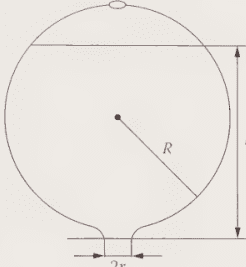

由于水箱顶部有通气孔，水箱空腔部分保持大气压力。为了确定水箱从任意水位排到另一水位所需的时间，需要确定水位高度 $h$ 随时间变化的函数。对于任意高度，水箱的体积已知为

$$V=\frac{1}{3}\pi h^2(3R-h)$$

如果孔口面积为 $A$，通过孔口的水流速度为 $V$，则

$$\frac{dV}{dt}=-\pi r^2\sqrt{2gh}$$

其中 $g=115.8\ \mathrm{ft/min^2}$ 是重力常数。对 $V$ 的方程求导得

$$\frac{dV}{dt}=(2\pi hR-\pi h^2)\frac{dh}{dt},$$

因此

$$\frac{dh}{dt}=-\frac{r^2\sqrt{2gh}}{2hR-h^2}$$


假设 R = 15 ft 且 r = 0.2 ft，并且初始条件为 h(0) = 28 ft。求解该初值问题 h，使用步长 Δt = 1 min 并继续计算直到水高变得小于 0.2 ft。

## 31. 估计一口新气井含有 9000 吨在压力 p₀ = 900 psia 下的天然气。配气系统在排放压力 p* = 400 psia 处连接到该井。通过出口管道从井中排放的 Q 以吨/天计近似由方程 Q = α(p² − p*²)^β 给出，其中 α = 1.115 × 10⁻⁴，β = 0.8，且 p = 井内气体的初始压力，单位为 psia。还假设气体压力与排放量 Q 直接成比例，其由微分方程建模

```
dp/dt = -kQ
```

其中

```
k = 900 psia / 9000 tons = 0.1 psia / tons
```

合并这两个方程得到初值问题

```
dp/dt = -kα(p² - p*²)^β
p(0) = p₀
```

使用步长 Δt = 0.01 求解该初值问题并进行 10 步。

## 32. 下图显示了一个由绕在铁芯上的线圈、电阻、开关和电压源组成的电路：


磁化曲线由方程给出

```
Ni = 1/2 Φ + 3/1000 Φ³
```

其中 N = 线圈匝数，i = 电流（安培），Φ = 芯内磁通（千线）。基尔霍夫定律给出微分方程

E = R i + L \frac{di}{dt} = R i + 10^{-5} \frac{d\Phi}{dt}

其中 L = 自感（亨利），R = 电阻（欧姆），t = 时间（秒）。假设 N = 100 且 R = 500。则

\frac{d\Phi}{dt} = E - 2.5\Phi' - 0.015\Phi^3, \quad \Phi(0) = 0

其中 t 现在以毫秒为单位。 对于 E = 20 V，求解该初值问题在区间 [0, 2] 中，使用步长 Δt = 0.01。

## 33. 每年测量一次种群中的个体数量。设 P(t) 表示第 t 年的种群数量。设 α 表示出生率，并假设死亡率 β 与种群规模成正比，即 β = γ P(t)，其中 γ 为常数。因此，种群的增长率由逻辑方程 P'(t) = α P(t) − γ [P(t)]² 给出。假设 P(0) = 50,000，α = 3 × 10⁻²，且 γ = 1.5 × 10⁻⁷。求解该初值问题，步长 Δt = 0.01，以求出 5 年后的种群数量。

## 34.–38. 龙格-库塔法是求解一阶微分方程 y' = f(x, y) 且初始条件 y(x₀) = y₀ 的一种流行且最精确的数值方法之一：

- 1. 选择 x 增量 Δx。
- 2. 近似解 yₙ₊₁ 在 xₙ₊₁ = x₀ + (n + 1)Δx 处，n = 0, 1, 2, … 由

yₙ₊₁ = yₙ + \frac{1}{6}(K₁ + 2K₂ + 2K₃ + K₄)

给出，其中

K₁ = Δx · f(xₙ, yₙ)

K₂ = Δx · f(xₙ + \frac{Δx}{2}, yₙ + \frac{K₁}{2})

K₃ = Δx · f(xₙ + \frac{Δx}{2}, yₙ + \frac{K₂}{2})

K₄ = Δx · f(xₙ + Δx, yₙ + K₃)

编写程序实现龙格-库塔法并用其求解问题 29–33。

## 使用类

### 目录

- 7.1 入门示例：互联网地址 208
- 7.2 类简介 211
- 7.3 istream 和 ostream 类 218
- 7.4 string 类 228
- 7.5 C++ complex 类型 233
- 7.6 随机数模拟：屏蔽核反应堆 240
- 章节总结 245
- 自测 248
- 练习 251
- 编程问题 256

> 美国存在三个社会阶层：上中产阶级、中产阶级和下中产阶级。
> 
> 朱迪思·马丁（“礼仪小姐”）

> 程序是施加在计算机上的咒语，将输入转化为错误信息。
> 
> 匿名

> 对于每个复杂问题，都有一个清晰、简单且错误的答案。
> 
> H. L. MENCKEN

> 随机行善，不求回报，心安理得地知道有一天别人也可能为你做同样的事。
> 
> 戴安娜，威尔士王妃

THE WORD class IS often used to describe a group or category of objects that have a set of attributes in common. For example, the high school sports teams in one state are described as class A, class AA, class AAA, or class AAAA, depending on the number of students in the school. The usual classifications of secondary and college students are freshman, sophomore, junior, and senior. Metals, ceramics, polymers, semiconductors, and composites are classes of engineering materials, based on their chemical composition. The U.S. Navy uses Skipjack class, Thresher class, and Sturgeon class to characterize different kinds of submarines. Economists describe families as lower class, middle class, or upper class, based on their annual income. In these examples, class is used as a synonym for type because it provides a name for a group of related objects.

In Chapter 3, we studied the fundamental types provided in C++ to model basic objects such as numbers and characters: int, unsigned, double, char, bool, and variations of these such as short, long, and float. These types, however, cannot model more complex objects such as names of chemical elements, units of measurement, names and addresses of persons, and so on. None of the fundamental types, char type in particular, can adequately model these names because they consist of several characters and char values can only be single characters.

For situations like this, C++ provides libraries of standard classes to represent more complex objects. Also, programmers can build their own classes, thereby extending the C++ language. In this chapter, we will examine four standard C++ classes:

- the istream class to model input from a keyboard;
- the ostream class for modeling output to a screen;
- the string class for modeling sequences of characters;
- the complex class template to model complex numbers.

In the last section we will use

- a programmer-defined RandomInt class to generate random integers in a simulation program.

In Chapter 14 we will see how we can create our own classes.

### 7.1 INTRODUCTORY EXAMPLE: INTERNET ADDRESSES

IP (Internet Protocol) addresses are used to uniquely identify computers in the Internet; for example, titan.ksc.nasa.gov is the symbolic IP address of a site at the NASA Kennedy Space Center. Such an address is made up of four fields that represent specific parts of the Internet,

```
host.subdomain.subdomain.rootdomain
```

and is translated into a unique numeric IP address. This address is a 32-bit value, but it is usually represented in a dotted-decimal notation by separating the 32 bits into four 8-bit

fields, expressing each field as a decimal integer, and separating the fields with a period; for example, at the time of this writing, 163.205.10.1 was the IP address for the above site at the NASA Kennedy Space Center. Each of the four parts is an 8-bit integer, so the entire address can be stored in 32 bits.

### 7.1.1 Problem

A gateway is a device used to interconnect two different computer networks. Suppose that a gateway connects an engineering firm to the Internet and that the company’s network administrator needs to monitor connections through this gateway. Each time a connection is made, the IP address of the employee’s computer is transmitted to the network administrator, who analyzes the components that make up the address and records them.

### 7.1.2 Object-Centered Design

#### 7.1.2.1 Behavior

The program will display on the screen a prompt for an IP address. The user will enter a string of characters from the keyboard, which the program will read. The program will then compute and output its four network/host information blocks on the screen along with descriptive text, or display an error message if the user did not enter a valid address.

#### 7.1.2.2 Objects

From the statement of the desired behavior, we can identify the following objects:

| Problem Objects | Type | Kind | Name | |
|---|---|---|---|---|
| Software Objects | | | | |
| screen | output device | variable | cout | |
| prompt | text string | constant | none | |
| IP address | text string | variable | address | |
| keyboard | input device | variable | cin | |
| network/host information blocks | text string | variable | block1, block2, block3, block4 | |
| descriptive text error message | text string | constant | none | |

#### 7.1.2.3 Operations

Again, from the statement of the desired behavior, we can identify the following operations:

- i. Display a string on the screen.
- ii. Read a string from the keyboard.
- iii. Find each network/host information block and extract it from the string.
- iv. Display each information block on the screen.

#### 7.1.2.4 Algorithm

We now organize these operations into the following algorithm, which also shows how operation (iii) requires some refinement into simpler operations that are provided in C++.


+   1. 输出提示输入 IP 地址到 cout。
+   2. 从 cin 输入 *address*。
+   3. 用 *address* 的适当子串填充 *block1*，或在找不到时停止。
+   4. 用 *address* 的适当子串填充 *block2*，或在找不到时停止。
+   5. 用 *address* 的适当子串填充 *block3*，或在找不到时停止。
+   6. 用 *address* 的适当子串填充 *block4*，或在找不到时停止。
+   7. 输出 *block1*、*block2*、*block3* 和 *block4* 到 cout。

## 7.1.2.5 编码与测试

Example 7.1 中的程序实现了该算法。它使用了 C++ 字符串类型，这是一个用于处理字符字符串的类。

### Example 7.1 处理 IP 地址

```
/* This program finds the four network/host information blocks in an
IP address.

Input:  an IP address
Output: four network/host information blocks, or an error message
---------------------------------------------------------------*/

#include <iostream>      // cin, cout
#include <string>        // string class
#include <cassert>       // assert()
using namespace std;

int main()
{
    string address, block1, block2, block3, block4;

    cout << "Enter an IP address: ";
    cin >> address;

    // Search address to find first period -- start at position 0
    int dot1 = address.find(".", 0);
    assert(dot1 != string::npos);
    // Period found; set block1 = substring preceding it
    block1 = address.substr(0, dot1);

    // Search address for second period -- start at position dot1 + 1
    int dot2 = address.find(".", dot1 + 1);
```
```
assert(dot2 != string::npos);
// 2nd period found; set block2 = substring between 1st and 2nd
block2 = address.substr(dot1 + 1, dot2 - dot1 - 1);

// Search address for third period -- start at position dot2 + 1
int dot3 = address.find(".", dot2 + 1);
assert(dot3 != string::npos);
// 3rd period found; set block3 = substring between 2nd and 3rd
block3 = address.substr(dot2 + 1, dot3 - dot2 - 1);

// Check for more periods
assert(address.find(".", dot3 + 1) == string::npos);
// No more periods; set block4 = rest of address after 3rd one
block4 = address.substr(dot3 + 1, address.size() - dot3 - 1);

cout << "The network/host blocks are:\n"
    << block1 << endl << block2 << endl
    << block3 << endl << block4 << endl;
}
```

### SAMPLE RUNS:

Enter an IP address: titan.ksc.nasa.gov
The network/host blocks are:
titan
ksc
nasa
gov

Enter an IP address: 163.205.10.1
The network/host blocks are:
163
205
10
1

## 7.2 类的介绍

在第 2 章中，我们看到计算中的项目可以用变量和常量的基本 C++ 类型来建模——int、double、bool、char 及其变体。例如，我们使用

```
double celsius;
double fahrenheit = 1.8 * celsius + 32;
```

来声明 double 变量 celsius 和 fahrenheit，用来建模温度读数。在第 6 章中，我们看到如何使用函数有效地创建新的操作，例如温度转换函数 celsiusToFahrenheit()：

```
double celsiusToFahrenheit(double tempCels);
```

到目前为止，这些 C++ 特性对于建模的项目和操作足够简单的编程任务来说已经足够了。

问题是，大多数现实世界的对象并不是这么简单。例如，假设前一节中的网络管理员还必须为工程公司的员工创建登录账户。每个账户将包含有关该员工的信息，例如以下内容：

+   1. 姓名
+   2. 用户 ID
+   3. 密码
+   4. 员工 ID 号
+   5. 访问分钟数限制
+   6. 已使用分钟数
+   . 
+   . 
+   .

假设为了简单起见，我们仅使用列出的六项信息。一种方法是为每项分别声明一个变量：

```
string name,
    userId,
    password;
int   idNumber,
    accessLimit;
double timeUsed;
```

虽然这种方法可行，但可能相当笨拙。例如，假设我们需要一个函数来显示员工的计算机信息：

```
void printUserInfo(string name, string userId, string password,
    int idNumber, int accessLimit, double timeUsed)
{
    cout << name << endl
        << "User Id: " << userId << endl
        << "Password: " << password<< endl
        << "Id Number: " << idNumber<< endl
        << "Access Limit: " << accessLimit<< endl
        << "Time Used: " << timeUsed<< endl
}
```

给定这样的函数和前面定义的变量，我们可以用类似下面的语句调用它

```
printUserInfo(userName, userId, userPassword,
    empNumber, resourceLimit, resourcesUsed);
```

用于输入员工计算机使用情况信息的函数也类似，并且调用方式也大致相同：

```
readUserInfo(userName, userId, userPassword,
    empNumber, resourceLimit, resourcesUsed);
```

这种方法的主要问题是，我们想要建模的一种对象（计算机用户），但我们必须将多于一个的信息传递给操作。为了解决这个问题，C++ 提供了 struct 构造（来自 C）及其扩展为 class。当程序员创建 struct 或 class 时，他们创建了一个新类型，为该类型对象的特征提供空间。例如，Example 7.1 中使用的类型 string 实际上是由某个程序员创建的类。

在下面的讨论中，我们只描述 struct 和 class 的主要特性，大多数细节留到后面的章节。然而，到本节结束时，你应该知道它们是什么以及如何使用它们。

### 7.2.1 数据封装

Struct 和 class 提供了一种将对象的特征——属性和行为——封装在单个“包装器”中的方法。例如，要创建一个名为 ComputerUser 的新类型来建模前面描述的计算机用户，我们可以使用以下任一方式：

```
struct ComputerUser
{
    string name,
        userId,
        password;
    int   idNumber,
        accessLimit;
    double timeUsed;
    // ...
};
```

```
class ComputerUser
{
    public:
        string name,
            userId,
            password;
        int   idnumber,
            accessLimit;
        double timeUsed;
        // ...
};
```

标识符 name、userId、password、idNumber、accessLimit 和 timeUsed 被称为 struct 和 class 的数据成员（或实例变量或属性变量）。

名称 ComputerUser 被 C++ 视为新类型的名称，因此可以用它来声明对象：

```
ComputerUser design17,
    management8;
```

这些声明创建了不同的 ComputerUser 对象，每个对象都可以存储自己的特征：

design17
| ? | name |
| ? | userId |
| ? | password |
| ? | idNumber |
| ? | accessLimit |
| ? | timeUsed |

management8
| ? | name |
| ? | userId |
| ? | password |
| ? | idNumber |
| ? | accessLimit |
| ? | timeUsed |

这种封装很重要，因为像 design17 这样的单个对象现在存储了它自己的所有数据，并解决了我们之前的问题，因为它允许我们通过使用只有一个参数（并声明一个参数）将复杂的对象传递给函数；例如，

```
void printUserInfo(ComputerUser aUser)
{
    cout << aUser.name << endl
        << "User Id: " << aUser.userId << endl
        << "Password: " << aUser.password << endl
        << "Id Number: " << aUser.idNumber << endl
        << "Access Limit: " << aUser.accessLimit << endl
        << "Time Used: " << aUser.timeUsed << endl;
    // ... and possibly more ...
}
```

请注意，ComputerUser 对象的成员使用点号表示法访问。表达式

```
aUser.name
```

将访问与参数 aUser 关联的 ComputerUser 对象的 name 成员。如果我们用以下方式调用此函数

```
printUserInfo(design17);
```

design17 的数据成员的值将被显示，产生类似以下内容


乔·布洛
用户ID：joey00
密码：windbag
编号：1238
访问限额：200
已用时间：68.5

如果我们用不同的参数调用同一个函数，

```
printUserInfo(management8);
```

那么 management8 的数据成员值将被显示出来；例如，

```
贝蒂·博斯
用户ID：daBoss
密码：denied
编号：1
访问限额：10000
已用时间：0
```

对于一个复杂的对象，结构体和类因此提供了一种便捷的方式，将描述该对象所需的数据项打包到一个容器中。这就是数据封装的含义。

## 7.2.2 封装操作

C++ 从 C 发展而来时，最主要的增补是引入了类，类不仅可以包含数据成员，还可以包含成员函数（也称为方法）。¹ 数据成员被放置在类的私有部分，而成员函数则被放置在公有部分。这意味着成员函数可以通过点运算符从外部访问，但数据成员则不能，除非提供了相应的成员函数来实现这一点。

例如，要在我们的 ComputerUser 类中声明用于输入操作的成员函数 read() 和用于输出操作的 display()，我们可以通过添加这些函数的原型来修改该类，如下所示：

```
class ComputerUser
{
    public:
        void read();
        void display();
        // ... 其他操作的函数原型
    private:
        string name,
               userId,
               password;
}
```

> ¹ 在 C++ 中，结构体也可以有成员函数，但类更常用于封装数据和操作。

```
int    idNumber,
        accessLimit;
double timeUsed;
// ... 其他数据成员的声明
};
```

相应的函数定义通常位于类声明之外，经过修改以指明其原型所在位置。例如，display() 可以定义为：

```
void ComputerUser::display(ComputerUser aUser)
{
    cout << name << endl
        << "用户ID: " << userID << endl
        << "密码: " << password << endl
        << "编号: " << idNumber << endl
        << "访问限额: " << accessLimit << endl
        << "已用时间: " << timeUsed << endl;
    // ... 可能还有其他输出 ...
}
```

在函数名前面加上 `ComputerUser::` 表示这是 ComputerUser 类的成员函数，因此可以访问（私有的）数据成员。

我们将 ComputerUser 类中的数据成员设置为私有，以防止对数据进行未经授权的操作，例如给本应始终非负的数据成员赋一个负值。所有对数据的访问都由成员函数控制，通常会有相当多的成员函数。但由于这里只是对类的初步介绍，我们将保持示例简单，仅使用 read() 和 display() 这两个成员函数。

当类对象被声明时，如：

```
ComputerUser design17,
                management8;
```

每个对象都有自己独立的数据和成员函数。当我们需要访问某个成员函数时，我们通过点运算符向对象发送一条消息。该对象通过执行相应的成员函数来响应，该成员函数可以访问数据成员。例如，要显示 design17 中存储的信息，我们可以向它发送一条 display() 消息：

```
design17.display();
```

而要显示 management8 中存储的信息，则可以向它发送一条 display() 消息：

```
management8.display();
```

我们可以使用以下语句：

```
management8.read();
```

向 management8 发送一条 read() 消息，该消息用从 cin 中提取的值填充 management8 中的数据成员；例如，

| management8 |  |
|---|---|
| 贝蒂·博斯 | name |
| daBoss | userId |
| denied | password |
| 1 | idNumber |
| 10000 | accessLimit |
| 0 | timeUsed |

同样，以下语句：

```
design17.read();
```

向 design17 发送一条 read() 消息，以用输入的值填充其数据成员，例如：

| design17 |  |
|---|---|
| 乔·布洛 | name |
| joey00 | userId |
| windbag | password |
| 1238 | idNumber |
| 200 | accessLimit |
| 68.5 | timeUsed |

因此，当我们向对象发送消息时，成员函数就是被执行的实体。

类还使得重新定义 C++ 运算符成为可能。例如，string 类重新定义了 + 运算符，当给定两个字符串时，它会将它们连接起来。例如，声明：

```
string name = "Popeye" + " the " + "Sailor";
```

用字符串值 "Popeye the Sailor" 初始化对象 name。我们也可以为我们构建的类重新定义运算符。例如，我们可以为我们的 ComputerUser 类重新定义输入和输出运算符，这将使我们能够编写如下语句：

```
cout << "Enter computer usage for " << management8 << "\n";
 cin >> management8;
```

用新的定义重新定义函数称为**函数重载**，这是第 10 章讨论的主题。

一旦构建好一个类，它通常被存储在库中，其声明存储在库的头文件中，而重要成员函数的定义则存储在实现文件中。要使用该类，程序必须包含该库的头文件。

这一对类的简要介绍应该能体现出它们在 C++ 中的重要性。类正是 C++ 与其母语言 C 之间最大的区别。事实上，在 1983 年之前，C++ 语言被称为“带类的 C”。学习用 C++ 编程的一个重要部分是学习如何使用该语言自带的标准类，以避免重复造轮子。在接下来的章节中，我们将研究其中四个类：istream、ostream、string 和 complex。

总之，C++ 提供了类的机制来构建表示复杂对象的类型。这种机制允许我们创建一个单一的结构，该结构封装了 (i) 定义对象特征的数据成员和 (ii) 定义对象操作的成员函数。在类中被指定为公有的成员可以使用点运算符进行访问。

## 7.3 istream 和 ostream 类

20 世纪 80 年代初，Bjarne Stroustrup 最初开发 C++ 时，使用其母语言 C 的 I/O 系统。在该十年的后期，AT&T 早期 C++ 用户之一 Jerry Schwarz 利用类开发了一个更好的 I/O 系统。经过多年来的修订和改进，这组类演变成了今天的 iostream 库。在本节中，我们将讨论其中两个类：用于输入的 istream 类和用于输出的 ostream 类。

### 7.3.1 istream 类

设计通用输入模型的一个问题是，从键盘或其他输入设备输入的信息如何到达计算机。键盘可能实际上是计算机的一部分（如笔记本电脑或智能手机），或者信息可能需要通过网络从键盘传输到一台完全不同的计算机。

由于程序员不应该需要关心数据是如何从键盘实际传输到程序中的这些繁琐细节，因此需要一个输入抽象来隐藏这些细节——一个能够捕捉每个输入系统基本概念的模型，无论底层细节如何。

#### 7.3.1.1 流

C 编程语言的创造者 Dennis Ritchie 和 Ken Thompson 是 AT&T 贝尔实验室开发 Unix 操作系统的关键成员。他们为 Unix 开发的 I/O 系统基于一个称为**流**的模型。他们设想字符流从输入设备流向程序，并从程序流向输出设备，就像水流从一个地方流向另一个地方一样。Schwarz 利用这一思想开发了 iostream 库，该库包含用于在 C++ 中执行 I/O 操作的 istream 和 ostream 类。

2 istream 和 ostream 实际上是类模板 basic_istream 和 basic_ostream 针对 char 类型的特化，它们派生自 basic_ios 类，后者处理格式化、缓冲区等底层细节。使用 wchar_t 代替 char 会生成宽字符流 wistream 和 wostream。


istream 类表示从任意输入设备到正在执行的程序的字符流。

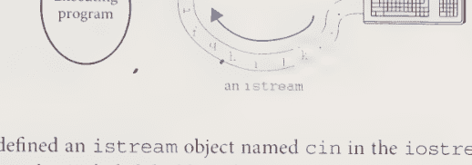

Schwarz 然后在 iostream 库中定义了一个名为 cin 的 istream 对象，这样任何包含该库头文件的 C++ 程序都会自动获得从键盘流向程序的输入流。

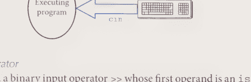

## 7.3.1.2 >> 运算符

Schwarz 还定义了一个二进制输入运算符 >>，其第一个操作数是 cin 等 istream 对象，其第二个操作数是变量：

```
istream_object >> variable
```

当该输入表达式在程序中执行时，>> 运算符会尝试从 istream_object 中提取与变量类型对应的值的一系列字符。如果没有字符，它会阻塞执行直到输入字符为止。

举例说明，假设程序执行刚刚开始，此时 cin 为空。当执行以下语句时，

```
int minutes;
cin >> minutes;
```

并且 >> 运算符尝试为 minutes 读取一个整数值但发现 cin 为空时，执行无法继续。如果用户现在从键盘输入 40，则字符 4 和 0 进入 cin：


由于 cin 不再为空，执行恢复，>> 提取字符 4 和 0，将它们转换为整数 40，并将其存储到其右操作数 minutes 中。由于 >> 从 istream 中提取值，因此它通常被称为提取运算符。

## 7.3.1.3 状态指示器

到目前为止，我们假设用户输入了适当的值。假设 however，在前面的示例中，40 被误输入为 f0，导致 cin 包含字符 f 和 0：

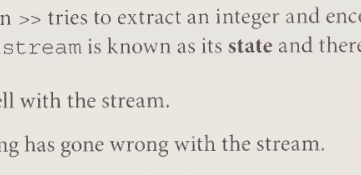

现在当 >> 尝试提取整数并遇到字母 f 时会发生什么？istream 的条件称为其状态，有三种可能的状态：

- good 状态：流一切正常。
- bad 状态：流出现问题。
- fail 状态：流上的最后一次操作未成功。

istream 类为每种状态维护一个标志，每个标志本质上都是一个布尔变量，其中 good 标志初始化为 true，而 bad 和 fail 标志初始化为 false。在我们的场景中，如果 >> 运算符在尝试读取整数时遇到字母 f，它将把流的 good 标志设置为 false，并将其 bad 和 fail 标志设置为 true。

对于这些标志中的每一个，istream 类都提供了一个与该标志同名的布尔成员函数，用于报告该标志的值。

| 消息 | 当且仅当以下情况为真时返回 True |
|---|---|
| cin.good() | istream 一切正常 |
| cin.bad() | istream 出现问题 |
| cin.fail() | 最后一次操作无法完成 |

我们可以使用 good() 来检查输入步骤是否成功：

```
assert(cin.good());
```

或者， alternatively，我们可以使用其他状态指示器之一；例如，

```
assert(!cin.fail());
```

1 还有第四种文件结束状态，当最后一次输入操作在找到任何数据之前遇到文件结束标记时就会发生。这种状态可以通过向 istream 发送 eof() 消息来检查。它在第 11 章中有更详细的描述。

结合 assert() 机制，这些状态指示器提供了一种简单的方法来防止数据输入错误。

## 7.3.1.4 clear( ) 和 ignore( ) 成员函数

一旦 istream 的 good 标志被设置为 false，对该流的所有后续输入操作都会被阻塞，直到其状态被清除。这是通过使用 clear() 成员函数完成的，

```
cin.clear();
```

它将 good 标志重置为 true，并将其他标志重置为 false。

重置状态标志 however 并不会从 istream 中删除导致错误的输入。对于此，我们可以使用 ignore()，

```
cin.ignore();
```

顾名思义，它会跳过 cin 中的下一个字符。更一般地，ignore() 可以使用参数来跳过多个字符：

```
cin.ignore(skip, stop_char);
```

其中 skip 是一个整数表达式，stop_char 是一个字符。该语句将跳过 cin 中的下一个 skip 个字符，除非遇到 stop_char。skip 的默认值是 1，stop_char 的默认值是文件结束标记。例如，消息

```
cin.ignore(100, ' ');
```

将跳过所有字符直到下一个空格（假设它在接下来的 100 个字符内），并且

```
cin.ignore(100, '\n');
```

将跳过给定输入行上剩余的所有字符（假设行尾在 100 个字符内）。这种 clear() 和 ignore() 组合对于检测错误的输入字符并将其从输入流中删除很有用，如以下程序段所示：

```
cin >> minutes;
if (cin.fail())        // e.g., invalid input character
{
    cin.ignore(100, '\n');
    cin.clear();
}
```

## 7.3.1.5 空白字符

>> 运算符的一个不错的特性是，默认情况下它会跳过前导空白字符——空格、制表符和换行符。举例说明，假设响应于语句

```
double length, weight;
cout << "Enter the length (inches) and weight (pounds): ";
cin >> length >> weight;
```

用户输入 70.5 和 180。则 cin 包含图中所示的字符，其中 _ 表示空格，↵ 表示回车字符：

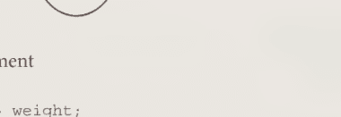

当输入语句

```
cin >> height >> weight;
```

执行时，第一个 >> 读取 70.5 并将其存储在 length 中，留下空格 (_) 未读：


第二个 >> 从前一个结束的地方开始读取并跳过空格：


然后它读取 180 并将其存储在 weight 中：


cerr 和 clog：用于显示错误或诊断消息的标准输出流（clog 是缓冲的；cerr 不是）

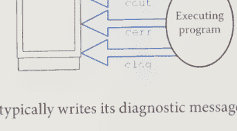

assert() 函数通常将其诊断消息写入 cerr。

## 7.3.2.1 << 运算符

<< 运算符应用于 ostream 对象和表达式，

```
ostream_object << expression
```

表达式将被求值，其值转换为相应的字符序列，并且这些字符被插入到输出流中。因此，如果常量 PI 由以下方式定义

```
const double PI = 3.1416;
```

并且我们使用以下方式输出它

```
cout << PI;
```

<< 运算符将把实数 3.1416 转换为字符序列 3、.、1、4、1 和 6，并将它们插入到 cout 中：

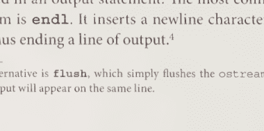

由于 cout 和 clog 不像 cerr 那样是缓冲的，字符实际上会保留在其中，直到它们被刷新以清空其内容到屏幕上。这有时会令人困惑，因为我们知道输出语句已执行，但其输出并未出现在屏幕上。刷新 ostream 的常见方法之一是使用一个称为输出操纵符的标识符，它会在输出语句中遇到时立即对 ostream 执行某些操作。最常用的用于刷新输出流的操纵符是 endl。它在 ostream 中插入换行字符（'\n'）然后刷新它，从而结束输出行。

> 一个较少使用的替代方案是 flush，它只是刷新 ostream 而不插入任何内容，这意味着后续输出将出现在同一行。

每当使用 >> 从 cin 输入值时，cout 都会自动刷新。因此，当语句

```
double radius;
cout << "Enter radius: ";
cin >> radius;
```

执行时，<< 将提示 "Enter radius: " 插入到 cout 中：


但下一条语句中的 >> 运算符会将提示 "Enter radius: " 从 ostream 移出到屏幕上：


## 7.3.3 格式控制

可以通过使用格式操纵符来指定值的显示或输入形式的各种特征。例如，在示例 4.2 的程序中，我们使用了语句

```
cout << showpoint << fixed << setprecision(2)
    << "For Route #" << route << ":\n"
    << "\n\tMiles per gallon: " << setw(8) << milesPerGallon
    << "\n\tTotal cost:       $" << setw(8) << totalTripCost
    << "\n\tCost per mile:    $" << setw(8) << costPerMile
    << endl;
```

这里，fixed 是一个格式操纵符，它导致实值以定点记数法而不是科学记数法显示；showpoint 确保小数点将被显示；setprecision(2) 将精度的小数位数设置为 2。前两个操纵符由 iostream 库提供，setprecision() 由 iomanip 库提供。

作为格式操纵符如何影响流的另一个例子，考虑以下代码：

```
int i = 26;
```


```
cout << showbase
    << oct << i << endl
    << dec << i << endl
    << hex << i << endl;
```

# 输出

```
032
26
0x1A
```

将由这些语句产生，因为 32₈ = 26₁₀ = 1A₁₆。

下表列出了 iostream 提供的格式操纵符。这些操纵符及其他操纵符将在第 11 章中详细说明。

| 格式操纵符 | 描述 |
|---|---|
| fixed | 对实数值使用定点表示法 |
| scientific | 对实数值使用科学计数法 |
| showpoint | 为整数形式的实数显示小数点及尾随零 |
| noshowpoint | 为整数形式的实数隐藏小数点及尾随零 |
| dec | 对整数输入或输出使用十进制表示法 |
| hex | 对整数输入或输出使用十六进制表示法 |
| oct | 对整数输入或输出使用八进制表示法 |
| showbase | 显示整数值时标明其进制（例如十六进制为 0x） |
| noshowbase | 显示整数值时不标明其进制 |
| showpos | 为正值显示 + 号 |
| noshowpos | 不为正值显示 + 号 |
| boolalpha | 将 bool 值读取或显示为 true 或 false |
| noboolalpha | 不将 bool 值读取或显示为 true 或 false |
| uppercase | 在科学计数法中使用 E；在十六进制中使用 A-F 字符 |
| nouppercase | 在科学计数法中使用 e；在十六进制中使用 a-f 字符 |
| flush | 将流内容写入屏幕（或文件） |
| endl | 向输出流插入换行符并刷新该流 |
| left | 左对齐显示的值，在右侧用填充字符填充 |
| right | 右对齐显示的值，在左侧用填充字符填充 |
| internal | 在符号或进制前缀与数值之间用填充字符填充 |
| skipws | 输入时跳过空白字符 |
| noskipws | 输入时不跳过空白字符 |

有些格式操纵符需要参数，要使用它们，必须包含 iomanip 库。例如，在示例 4.2 的程序中，我们希望指定显示实数值时使用的小数位数（即精度），因此使用了 iomanip 中提供的 setprecision(n) 操纵符，其中 n = 2，将后续实数的小数位精度设置为 2。

另一种格式与显示数据值所用的空间或字段有关。输出字段的默认宽度为 0，会自动增大以适应所显示的值，这通常正是程序员想要的。在需要更宽字段的情况下，我们可以使用 setw(n) 操纵符，它将下一个字段的宽度设置为 n。不过，后续输出的字段宽度会自动恢复为零，因此对于每个要覆盖默认输出格式的值，都必须使用 setw()。

为了说明 setw() 的用法，假设我们正在为构建一台设备所用到的物料创建一份支出报告。如果我们使用如下输出语句：

```
cout << showpoint << fixed
    << "Electrical:    $" << elecCost<< endl
    << "Sheet metal:   $" << metalCost << endl
    << "Wages:         $" << wages << endl
    << "Miscellaneous: $" << miscCost << endl;
```

可能产生的输出如下：

```
Electrical:    $ 1013.
Sheet metal:   $  549.2297
Wages:         $  728.5
Miscellaneous: $   25.
```

如果将金额四舍五入到两位小数并右对齐，看起来会好得多。一种方法是使用 setprecision()、setw() 和 right 操纵符，如下所示：

```
cout << showpoint << fixed
    << setprecision(2) << right
    << "Electrical:    $" << setw(7) << elecCost<< endl
    << "Sheet metal:   $" << setw(7) << metalCost << endl
    << "Wages:         $" << setw(7) << wages << endl
    << "Miscellaneous: $" << setw(7) << miscCost << endl;
```

这将生成如下格式的输出：

```
Electrical:    $ 1013.00
Sheet metal:   $  549.23
Wages:         $  728.50
Miscellaneous: $   25.00
```

用于填充字段空白部分的字符称为填充字符。如前一个示例所示，它默认为空格，但我们可以通过 setfill(ch) 操纵符将其改为另一个字符 ch。例如，如果我们将前面的输出语句改为：

```
cout << showpoint << fixed
    << setprecision(2) << right
    << setfill('*')
    << "Electrical:    $" << setw(7) << elecCost<< endl
    << "Sheet metal:   $" << setw(7) << metalCost << endl
    << "Wages:         $" << setw(7) << wages << endl
    << "Miscellaneous: $" << setw(7) << miscCost << endl;
```

则生成的输出将是：

```
Electrical:    $ 1013.00
Sheet metal:   $ *549.23
Wages:         $ *728.50
Miscellaneous: $ **25.00
```

## 7.4 string 类

7.1 节中的入门示例使用了 C++ 的 string 类来处理 IP 地址。本节将介绍该类的其他一些特性。

### 7.4.1 声明 string 对象

如 7.1 节所示，string 类声明在 string 库中，每个使用它的程序都必须包含该库：

```
#include <string>      // string class
```

因为 string 是一个类的名称，而类的名称是一种类型，所以 string 对象可以像我们学过的其他对象一样进行声明和初始化。例如，声明

```
string address, block1, block2, block3, block4;
```

在示例 7.1 中创建了五个名为 address、block1、block2、block3 和 block4 的 string 对象，并将它们各自初始化为空字符串，空字符串不包含任何字符。空字符串的字面量可以写成两个连续的双引号（""）。

string 对象的声明也可以通过提供字符串表达式作为其初始值来初始化该对象。例如，以下声明

```
string address = "aaa.bbb.ccc.ddd",
    block1 = block2 = block3 = block4 = "";
```

创建 string 对象 address，并将其初始化为包含 15 个字符，


而 `string` 对象 `block1`、`block2`、`block3` 和 `block4` 则各自初始化为空字符串。

这些 string 对象是变量，可以被赋予新值。例如，示例 7.1 中的第一次示例运行会将用于初始化 `address` 的 15 个字符的字符串替换为 18 个字符的字符串。

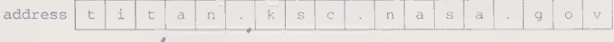

常量 string 对象通过在一个普通 string 声明前加上关键字 `const` 来定义，例如：

```
const string UNITS = "centimeters";
```

与其他常量一样，这类对象的 `string` 值在程序后续部分不能被更改。

### 7.4.2 string 操作

#### 7.4.2.1 输入、输出与赋值

`string` 类对 `<<`、`>>` 和 `=` 进行了扩展，使其能够在 string 对象上执行这些基本的 I/O 和赋值操作。例如，在大多数程序中，我们使用输出运算符 `<<` 将字符串字面量显示为输入提示，如示例 7.1 所示：

```
cout << "Enter an IP address: ";
```

在同一个程序中，我们使用 `<<` 显示 `string` 变量的值：

```
cout << "The network/host blocks are:\n"
     << block1 << endl << block2 << endl
     << block3 << endl << block4 << endl;
```

赋值运算符 `=` 用于向四个 `string` 变量 `block1`、`block2`、`block3` 和 `block4` 赋值。

此外，当执行以下语句

```
cout << "Enter an IP address: ";
cin >> address;
```

且用户输入 `titan.ksc.nasa.gov` 时，

```
Enter an IP : titan.ksc.nasa.gov
```

字符串 `titan.ksc.nasa.gov` 被赋给了 `address`。但是，如果用户在部分块之间输入了一些空格，

```
Enter an IP address: titan. ksc. nasa.gov
```

字符串 titan. 将被赋给 address，但输入的其余部分会发生什么？

字符串的输入过程与我们介绍的其他类型相同：>> 会跳过前导空白字符，并在下一个空白字符处停止，我们可以将其描述为从输入流中获取下一个“单词”。因此，在前面的例子中，未读的字符 ksc. nasa.gov（包括 ksc 前的空格）会保留在 istream 中，并在后续的输入语句（如果有的话）中被读取。不过，对于示例 7.1 中的程序，执行将终止并出现类似如下的错误消息：

```
Enter an IP address: titan. ksc. nasa.gov
Assertion failed: (dot2 != string::npos), function main, file fig7-1.cpp,
line 28.
```

我们将在本节稍后解释其原因。

string 库确实提供了一个函数 getline()，可以用它将整行文本（包括空白字符）读入一个 string 变量。例如，如果我们将前面的代码片段改写为：

```
cout << "Enter an IP address: ";
getline(cin, address);
```

并输入 titan. ksc. nasa.gov，函数 getline() 将读取整行作为输入，并将其赋值给发送给它的变量 address。程序产生的输出将是：

```
titan
ksc
nasa
gov
```

注意 ksc 和 nasa 前面的前导空格。它们是作为所输入字符串的一部分被读取的，并被赋给了 block2 和 block3。一般来说，更精确地说，getline() 从 istream（例如 cin）中提取字符，并将它们传输到一个 string 变量中，直到遇到换行符；该换行符会从 istream 中移除，但不会存储在 string 变量中。

总之，要读取整行输入，应使用 getline() 函数。若要跳过前导空白字符，然后读取直到下一个空白字符为止的所有字符，则应使用输入运算符 >>。但在同时使用 >> 和 getline() 时必须小心，因为通过 >> 终止字符输入的换行符会留在 istream 中，如果下一条输入语句使用 getline()，它将不会读取任何字符，因为遇到这个换行符会导致它立即终止。


## 7.4.2.2 下标和 size() 操作

与字符串中的每个字符相关联的都是一个称为索引的整数，第一个字符的索引为 0，第二个为 1，以此类推。例如，对于由以下语句声明的字符串 units

```
string units = "Foot Lbs";
```

内存中的顺序容器将与 units 相关联，其元素编号为 0、1、2、...，并且构成该字符串的各个字符 F、o、o、t、一个空格、L、b 和 s 将存储在这些元素中：

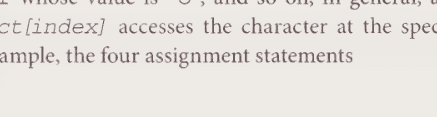

下标运算符 [] 可用于访问字符串的单个字符。在我们的示例中，units[0] 是一个类型为 char 的变量，其值为 'F'，units[1] 是一个类型为 char 的变量，其值为 'o'，以此类推；一般而言，形式为 string_object[index] 的表达式访问 string_object 指定索引处的字符。例如，以下四个赋值语句

```
units[0] = 'I';
units[1] = 'n';
units[2] = 'c';
units[3] = 'h';
```

会将 units 的值更改为 "Inch Lbs"。如果我们希望输出这前四个字符，可以使用一个 for 循环使索引在元素位置上变化：

```
for (int i = 0; i < 4; i++)
    cout << units[i] << endl;
```

字符串的大小可以通过发送 size() 消息来找到，该消息返回该字符串中字符的数量。例如，units.size() 将返回值为 7。请注意，字符串中最后一个字符的索引始终为 size() - 1，因为索引从零开始。因此，如果我们想按相反顺序处理字符，必须从该索引开始，如以下示例所示：

```
for (int i = units.size() - 1; i >= 0; i--)
    cout << units[i] << endl;
```

## 7.4.2.3 关系运算符

关系运算符 <、>、==、<=、>= 和 != 均已为 string 类定义，可用于比较字符串对象。对于每个操作，字符串操作数的元素按字符逐个比较，直到出现不匹配或到达一个或两个字符串的末尾。

为了说明这一点，考虑声明

```
string units1 = "Milligrams",
    units2 = "Millimeters";
```

布尔表达式 units1 < units2 为真，因为这两个字符串不同的第一个元素位于位置 5，且 'g' < 'm' 为真。出于同样的原因，units1 <= units2 和 units1 != units2 为真，而 units1 > units2、units1 >= units2 和 units1 == units2 为假。

如果 units2 改为

```
units2 = "MILLIMETERS";
```

则 units1 < units2 将为假，因为这两个字符串不同的第一个元素位于位置 1，且 'i' < 'I' 为假（因为 'i' 的数值代码为 105，而 'I' 为 73）。如果 units2 改为

```
units2 = "Mill Output";
```

也会如此，因为 units1 和 units2 不同的第一个元素位于位置 4，且 'i' < ' ' 为假（因为 'i' 的数值代码为 105，而空格为 32）。

## 7.4.2.4 其他字符串操作

string 类提供了其他几个操作。例如，示例 7.1 中的程序使用了 find() 来定位地址中的句点，并使用 substr() 提取地址中的块子字符串。以下表格描述了这些以及其他一些常用的字符串操作。在此表中，s、s1 和 s2 为 string 类型；pos 和 n 为非负整数。这些操作的几种变体以及其他操作在附录 D 中有描述。

### 有用的字符串特性

| 输出：<< | out << s 将 s 的字符输出到 ostream out |
| 输入：>>、getline() | in >> s 从 istream in 输入字符到 s，直到遇到空白字符<br>getline(in, s) 从 istream in 输入整行到 s |
| 赋值：= | s = s1 将字符串表达式 s1 赋给 s |
| 关系运算符：<、>、==、<=、>=、!= | s1 < s2、s1 > s2、s1 == s2、s1 <= s2、s1 >= s2 和 s1 != s2 比较字符串 |
| 下标：[] | s[i] 是 s 中位置 i 的字符 |
| + | s1 + s2 是通过将 s2 追加到 s1 而得到的连接 s1 与 s2 的字符串 |
| string::npos | 一个整数，其值要么为负，要么大于字符串的最大长度——用于表示字符串操作不成功（例如见 find()） |

append()

s1.append(s2) 将 s2 追加到 s1，如同 s1 + s2

empty()

s.empty() 如果 s 不包含字符则为真，否则为假

erase()

s.erase(pos, n) 从 s 的位置 pos 开始删除 n 个字符；如果 n 过大或被省略，则删除到 s 的末尾

find()

s.find(s1, pos) 返回 s 中 s1 首次出现的起始位置 pos，或如果未找到 s1 则返回 string::npos

find_first_of()

s.find_first_of(s1, pos) 返回 ≥ pos 的 s 中与 s1 中任一字符匹配的字符的第一个位置，或如果未找到则返回 string::npos

insert()

s.insert(pos, s1) 在 s 的位置 pos 插入字符串 s1

length(), size()

s.length() 和 s.size() 返回 s 中字符的数量

replace()

s.replace(pos, n, s1) 用 s1 替换 s 中从位置 pos 开始长度为 n 的子字符串；如果 n 过大，则替换到 s 末尾的所有字符

substr()

s.substr(pos, n) 返回从 s 的位置 pos 开始的 n 个字符的子字符串的副本；如果 n 过大或被省略，则仅复制到 s 的末尾

## 7.5 C++ 的 complex 类型

尽管复数系统有许多重要的应用，但它可能不如实数系统那样熟悉。因此，在本节中，我们回顾复数的<|message|>

复数的一个基本属性是

$e^{i\theta} = \cos \theta + i \sin \theta$

因此，复数的极坐标表示的一种替代形式为

$r e^{i\theta}$

现在考虑两个复数

$z = r_1 e^{i\theta_1}$

$w = r_2 e^{i\theta_2}$

指数的常见性质给出

$z \cdot w = (r_1 e^{i\theta_1})(r_2 e^{i\theta_2}) = r_1 r_2 e^{i(\theta_1 + \theta_2)}$

这与前面展示的两个复数乘积的几何表示一致。同样，我们可以利用极坐标表示和指数的性质来说明，两个复数的商对应于这样一个向量：其大小是两个复数向量大小之商，其倾角是两个复数向量倾角之差：

$z / w = (r_1 e^{i\theta_1}) / (r_2 e^{i\theta_2}) = (r_1 / r_2) e^{i(\theta_1 - \theta_2)}$

C++ 的复数类中定义了这些基本的复数算术运算，并用通常的算术运算符 +、-、* 和 / 表示；+ 和 - 也可以用作一元运算符。此外，还定义了赋值运算符 =，以及赋值简写 +=、-=、*= 和 /=，以及逻辑运算 == 和 !=。

输入和输出运算符 << 和 >> 也针对三种复数类型进行了重载。复数值以 (a, b) 形式输出，其中 a 是实部，b 是虚部。如果虚部为 0，则可以以 a 或 (a) 形式输入；否则以 (a, b) 形式输入。

除了这些运算，C++ 还为其复数类定义了几个函数。下表描述了其中一些比较常用的函数。在下表中，z 表示复数 a + bi。

## 复数函数

|  |  |
|---|---|
| z 的实部 | real(z) 返回 z 的实部 |
|  | z.real(a) 将 a 赋给 z 的实部 |
| z 的虚部 | imag(z) 返回 z 的虚部 |
|  | z.imag(b) 将 b 赋给 z 的虚部 |

6 对于复数，<、>、≤ 和 ≥ 未定义。

|  |  |
|---|---|
| z 的相角：θ | arg(z) |
| z 的范数：a² + b² | norm(z) |
| z 的绝对值（或模）： | abs(z) |
| \|z\| = √a² + b² |  |
| z 的共轭：z̄ = a − bi | conj(z) |
| 幂：zʳ，其中 r 为实数 | pow(z, r) |
| 平方根 | sqrt(z) |
| 三角函数 | cos(z), sin(z), tan(z), |
| 双曲函数 | cosh(z), sinh(z), tanh(z), |
| 指数函数：eᶻ | exp(z) |
| 对数——自然对数、以 10 为底的对数 | log(z), log10(z) |

## 7.5.3 示例：求解二次方程

在 5.4 节中，我们考虑了求解二次方程的问题，使用 if 语句检查是否存在实根，若不存在则显示一条消息。示例 7.2 中的程序是示例 5.4 中程序的变体，它可以求出任意二次方程的根——这些根可能是复数。

### 示例 7.2 二次方程求解器——复数根

```
/* This program solves quadratic equations using the quadratic formula.

    Input: the three coefficients of a quadratic equation
    Output: the complex roots of the equation
-------------------------------------------------------------------*/

#include <iostream>      // cout, cin, <<, >>
#include <complex>       // complex types
using namespace std;

int main()
{
    complex<double> a, b, c;
    cout << "Enter the coefficients of a quadratic equation: ";
    cin >> a >> b >> c;

    complex<double> discriminant = b*b - 4.0*a*c,
                    root1, root2;
    root1 = (-b + sqrt(discriminant)) / (2.0*a);
    root2 = (-b - sqrt(discriminant)) / (2.0*a);
    cout << "Roots are " << root1 << " and " << root2 << endl;
}
```

### 示例运行：

输入二次方程的系数：1 4 3
根为 (-1,0) 和 (-3,0)

输入二次方程的系数：2 0 -8
根为 (2,0) 和 (-2,0)

输入二次方程的系数：2 0 8
根为 (0,2) 和 (-0,-2)

输入二次方程的系数：1 2 3
根为 (-1,1.41421) 和 (-1,-1.41421)

输入二次方程的系数：(1,2) (3,4), (5,6)
根为 (-0.22822,0.63589) 和 (-1.97178,-0.23589)

## 7.5.4 应用：交流电路

下面的交流电路包含一个电容器、一个电感器和一个电阻器，三者串联：

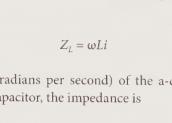

电阻器的阻抗 Z_R 就是电阻 R（单位为欧姆），但对于电感器和电容器，阻抗是频率的函数。电感器的阻抗 Z_L 是由下式给出的复数值：

```
Z_L = ω L i
```

其中 ω 是交流电源的频率（单位为弧度/秒），L 是自感（单位为亨利）。对于电容器，阻抗为

```
Z_C = -i / (ω C)
```

其中 C 是电容（单位为法拉）。总阻抗 Z 由下式给出：

```
Z = Z_R + Z_L + Z_C
```

电流 I（单位为安培）为

```
I = V / Z
```

示例 7.3 中的程序输入电阻、电感、电容、交流电源频率和电压，然后利用前面的公式计算电流并输出。

### 示例 7.3 交流电路中的电流

```
/* This program computes the current in an a-c circuit containing a capacitor, an inductor, and a resistor in series.

Input: resistance, inductance, capacitance, frequency, voltage
Output: current
*/

#include <iostream>  // cin, cout, <<, >>
#include <complex>  // complex<double> type
#include <iomanip>  // format output
using namespace std;

int main()
{
  const complex<double> i = complex<double>(0, 1);
  double R,  // resistance (ohms)
  L,  // inductance (henrys)
  C,  // capacitance (farads)
  omega;  // frequency (radians per second)
  complex<double> V,  // voltage (volts)
  Z,  // total impedance
  I;  // current (amperes)
  cout << "\nEnter resistance (ohms), inductance (henrys),\n and capacitance (farads): ";
  cin >> R >> L >> C;
  cout << "\nEnter frequency (radians/second): ";
  cin >> omega;
  cout << "\nEnter voltage as a complex number in the form (x, y): ";
  cin >> V;
  // Calculate resistance using complex arithmetic
  Z = R + omega * L * i - i / (omega * C);
  // Calculate and display current using complex arithmetic
  I = V / Z;
  cout << fixed << setprecision(2)
       << "\nCurrent = " << real(I) << " + " << imag(I) << "I"
       << "\nwith magnitude = " << abs(I) << endl;
}
```

### 示例运行：

输入电阻（欧姆）、电感（亨利）、
和电容（法拉）：5000 .03 .02

输入频率（弧度/秒）：377

以 (x, y) 形式输入复数电压：(60000, 134)

电流 = 12.00 + -0.00I
模 = 12.00

## 7.6 随机数模拟：核反应堆的屏蔽

术语 **模拟** 是指对动态过程进行建模，并利用该模型研究该过程的行为。某些 *确定性* 过程的行为可以用一个方程或一组方程来建模。例如，涉及指数增长或衰减的过程通常用形如 $A(t) = A_0 e^{kt}$ 的方程来建模，其中 $A(t)$ 是时刻 $t$ 时某种物质 $A$ 的现有量，$A_0$ 是该物质的初始量，$k$ 是速率常数。然而，在许多问题中，所研究的过程可以用 *随机性* 来建模；例如，布朗运动、飞机到达机场、机器生产的次品数量等。模拟此类过程的计算机程序使用随机数生成器，将随机性引入执行过程中产生的值。

## 7.6.1 随机数生成器——RandomInt 类

**随机数生成器**是一个函数，它从某个固定范围内以*随机*方式选取一个数，并使得由这些数构成的序列在给定范围内趋于均匀分布。虽然不可能开发出产生真正随机数的算法，但有些方法可以产生满足大多数用途的*伪随机数*序列。这些算法大多具有两个性质：

- 1. 需要一个称为*种子*的初始值来开始生成随机数。不同的种子会产生不同的随机数序列。
- 2. 生成的每个随机数都用于计算下一个随机数。

虽然 C++ 没有提供随机数生成器，但其母语言 C 提供了这一功能。可以用它来构造 RandomInt 类，用于那些值为伪随机整数的数据对象。（有关此类的更多信息，请参见教材网站。）⁷

> ⁷ 这个 RandomInt 类由加尔文学院的 Joel Adams 教授开发，他是教材《C++: An Introduction to Computing, 3/e》（Pearson Education Inc., 2003）的合著者之一。


对 `RandomInt` 对象提供的两个基本操作直接对应于上面给出的（伪）随机数生成器的属性：

+   1. *构造*（即声明），将对象初始化为一个随机数
+   2. *生成*，为对象提供一个新的随机数

还提供了赋值（`=`）和输出（`<<`）等附加操作。该类还设计为可以对整数应用的任何操作（数值、关系等）都可以应用于类对象，尽管结果是 `int`，而不是 `RandomInt`。

## 7.6.1 构造

可以通过编写如下形式的声明来构造一个 `RandomInt` 对象：

```
RandomInt object_name(lower_bound, upper_bound);
```

这样的声明构造一个名为 *object_name* 的 RandomInt 对象，其值是 *lower_bound* 到 *upper_bound* 范围内的随机数。如果省略 *lower_bound* 和 *upper_bound*，则在 0 到 RandomInt 类中定义的某个（较大）上限范围内生成随机数。

### 7.6.1.2 生成

第二个操作是生成一个新的随机数。给定如上所述构造的 RandomInt 对象，可以通过向其发送 `generate()` 消息来完成：

```
object_name.generate();
```

执行此语句时，*object_name* 的值会更改为在构造 *object_name* 时指定的范围内的另一个随机整数。⁸ 除了更改 *object_name* 的值外，`generate()` 还返回随机生成的值。

## 7.6.2 问题

当核反应堆的浓缩铀燃料燃烧时，会产生高能中子。其中一些被保留在反应堆堆芯中，但大多数会逸出。由于这种辐射很危险，反应堆必须进行屏蔽。我们希望开发一个程序来模拟中子进入屏蔽层并确定有多少百分比的中子穿过它。

在我们的屏蔽模型中，我们将做出简化假设，即进入屏蔽的中子以随机路径前进，向前、向后、向左或向右移动的可能性相等，每次跳跃一个单位。我们还假设能量损失仅在导致方向改变的碰撞中发生，并且在一定数量的此类碰撞之后，中子的能量会耗散并在屏蔽层内死亡，前提是它尚未返回反应堆堆芯内部或穿过屏蔽层向外。


## 7.6.3 解决方案⁹

示例 7.4 中的程序输入屏蔽层的厚度、能量耗散前的碰撞次数限制以及模拟的中子数量。为了模拟中子所走的路径，它反复生成随机整数 1、2、3 或 4，分别对应向前、向后、向左或向右移动。它会继续这样做，直到向前方向的净移动等于屏蔽层厚度，表示中子逃逸；或变为 0，表示它返回反应堆内部；或碰撞次数达到指定限制，表示中子在屏蔽层内死亡。这对每个模拟的中子重复进行，并计算并显示逃逸的中子百分比。

## 示例 7.4  模拟核反应堆的屏蔽

```
/* This program simulates particles entering the shield described in
   the text and determines what percentage of them reaches the
   outside.

   Input:  thickness of the shield, limit on the number of direction
           changes, number of neutrons, current direction a neutron
           traveled
   Output: the percentage of neutrons reaching the outside
--------------------------------------------------------------*/

#include <iostream>              // cin, cout, <<, >>
#include "RandomInt.h"           // random integer generator
using namespace std;

int main()
{
    int thickness,
        collisionLimit,
        neutrons;

cout << "\nEnter the thickness of the shield, the limit on the \n" << "number of collisions, and the number of neutrons:\n";
cin >> thickness >> collisionLimit >> neutrons;

RandomInt direction(1,4);

int forward,
    collisions,
    oldDirection,
    escaped = 0;

for (int i = 1; i <= neutrons; i++)
{
    // Next neutron
    forward = oldDirection = collisions = 0;

    while (forward < thickness && forward >= 0 &&
           collisions < collisionLimit)
    {
        direction.generate();

        if (direction != oldDirection)
            collisions++;

        oldDirection = direction;

        if (direction == 1)
            forward++;
        else if (direction == 2)
            forward--;
    }
    if (forward >= thickness)
        escaped++;
}

cout << '\n' << 100 * double(escaped) / double(neutrons)
     << "% of the particles escaped.\n";
```

⁹ 请参阅网站上不使用 RandomInt 类而使用 C++ 的随机数生成器 rand() 的解决方案。

# SAMPLE RUNS:

Enter the thickness of the shield, the limit on the number of collisions, and the number of neutrons:
1 1 100

26% of the particles escaped

Enter the thickness of the shield, the limit on the number of collisions, and the number of neutrons:
100 5 1000

```
0% of the particles escaped

Enter the thickness of the shield, the limit on the
number of collisions, and the number of neutrons:
4 5 100

3% of the particles escaped

Enter the thickness of the shield, the limit on the
number of collisions, and the number of neutrons:
8 10 500

0.2% of the particles escaped
```

在该程序的四次示例运行中，前两次是测试用例。在第一个测试用例中，中子只会移动一次，因为每次第一次移动都被解释为一次碰撞，而碰撞次数限制为 1。由于四种可能的移动同样可能，我们预计平均约有 25% 的中子会逃逸，程序产生的结果与此值一致。在第二个测试用例中，屏蔽层厚度为 100 个单位，碰撞次数限制很小，因此我们预计几乎没有中子会穿过屏蔽层逃逸。

## 7.6.4 正态分布

大多数随机数生成器生成具有 **均匀分布** 的随机数，但它们也可以用于生成具有其他分布的随机数。**正态分布** 尤其重要，因为它模拟了许多物理过程。例如，人类的身高和体重、灯泡的寿命、机器生产的钢材的抗拉强度，以及几乎任何制造过程中生产的零件的变异，都有正态分布。正态分布具有熟悉的钟形曲线。

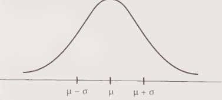

其中 μ 是分布的均值，σ 是标准差，曲线下面积的大约三分之二位于 μ − σ 和 μ + σ 之间。具有 μ = 0 且 σ = 1 的正态分布称为 **标准正态分布**，并且可以通过以下算法从均匀分布中相当容易地生成具有近似此分布的随机数：

## 标准正态分布算法

+   1. 将 *sum* 设为 0。
+   
+   2. 执行以下操作 12 次：
+      a. 从均匀分布生成一个随机数 *x*。
+      b. 将 *x* 加到 *sum*。
+   
+   3. 计算 *z* = *sum* − 6。

该算法生成的数字 *z* 具有近似标准正态分布。为了生成具有均值 μ 和标准差 σ 的正态分布的随机数 *y*，我们只需向算法添加以下步骤：

+   4. 计算 *y* = μ + σ × *z*。

将此算法实现为程序留作练习。

### CHAPTER SUMMARY

## Key Terms

| Key Terms | Key Terms |
|---|---|
| `<<` operator | input manipulator |
| `>>` operator | insertion operator |
| Bjarne Stroustrup | `istream` |
| class | Jerry Schwarz |
| `complex` | member functions |
| data encapsulation | normal distribution |
| data members | `ostream` |
| dot notation | output manipulator |
| empty string | overloading |
| `endl` manipulator | polar representation |
| extraction operator | precision |
| fill character | random number generator |
| format manipulator | randomness |
| fundamental types | simulation |
| `getline()` | state |
| index | stream |


## 注释

- 类提供了一种封装对象特征的方法。这使得单个对象可以包含其自身的所有信息，进而使得可以将复杂对象通过仅使用一个参数传递给函数成为可能。
- 类对象的公共成员可以使用点号表示法访问。
- 数据成员被指定为私有以防止对其执行未经授权的操作。
- 当向对象发送消息时，成员函数会被执行。
- istream 的状态（good、bad、fail）可以通过向 istream 对象（例如 cin）发送消息（good()、bad()、fail()）来检查。clear() 消息可用于重置状态，而 ignore() 消息可用于跳过流中的字符。
- 输入运算符 >> 会跳过前导空白字符（空格、制表符或换行符）。noskipws 和 skipws 操纵符可用于打开或关闭此功能。get() 方法提供了读取任何字符（无论是否为空白）的有用替代方案。
- endl 操纵符将换行字符（'\n'）插入到 ostream 中以结束输出行，然后刷新它。ostream cout 在使用 istream cin 时会自动刷新。
- 输出格式通过将格式操纵符插入输出列表来控制。除了 setw() 仅影响下一个输出值外，这些操纵符控制程序中所有后续输出的格式，除非被其他操纵符更改。
- 当输入运算符 >> 应用于字符串对象时，它会从 istream 中提取字符并将其传输到字符串对象，直到遇到空白字符为止。
- getline() 函数在遇到换行字符时停止提取和传输字符。因此它可用于读取整行输入。要仅读取到下一个空白字符的字符，应使用输入运算符 >>。
- 字符串对象中的字符从 0 开始索引。形式为 string_object[index] 的表达式访问 string_object 指定索引处的元素。最后一个字符的索引始终为 string_object.size() - 1。
- complex 库提供数据类型 complex<T>，其中 T 为 float、double 或 long double，是复数值实部和虚部的类型；它还提供通常的复数运算和函数。
- 随机数生成器用于模拟涉及随机性的过程。

## 风格和设计提示

- 如果为解决某个问题所需的对象已被识别，但无法使用基本类型定义，请检查 C++ 的预定义类，看看其中是否有任何类适合表示此类对象。
- 如果为解决某个问题所需的操作涉及类对象，请查阅该类的可用文档，看看其任何方法是否执行该操作。在最坏的情况下，这可能涉及查看该类的头文件并尝试其方法。

## 警告

1. 当使用 >> 为 char 变量读取值时，会跳过空白字符，并将第一个非空白字符从 istream 中移除并赋值。对于其他类型，会读取并移除字符，直到遇到空白或不能属于该类型值的其他字符为止，该字符会留在流中供下一次输入操作使用。然后将读取的字符转换为变量的类型并赋值。
2. 在前述警告中，如果 istream 中找不到任何可以属于所需类型值的字符，则输入操作被认为失败。不会读取任何字符，变量的值保持不变。
3. 字符串对象中的第一个字符的索引为 0。
4. 在输入中使用 >> 和 getline() 时要小心。终止 >> 输入的换行字符会留在 istream 中，随后尝试使用 getline() 读取字符串将不会读取任何字符，因为它在遇到此换行符时立即终止。可能导致无限循环。
5. 字符串下标操作使用包含索引的方括号，
   stringVariable[index]
   而字符串子串操作使用包含索引和大小的圆括号：
   string_object.substr(index, num_chars)
6. 对使用索引的大多数字符串函数执行运行时边界检查，如果索引为负或大于字符串大小，则会引发越界异常，从而终止程序执行。
7. 对下标操作不执行运行时边界检查。在使用下标运算符访问字符串的字符时，必须特别注意，确保所有访问都在字符串边界内。
8. 要用 istream 中的单词填充字符串对象，请使用输入运算符 >>：

```
cin >> someString;
```

要从 istream 中用一行填充字符串对象，请使用 getline() 函数：

```
getline(cin, someString);
```

## 测试你自己

### 第 7.2 节

- 1. 将描述对象所需的数据项打包到一个容器中称为数据 ______。
- 2. 类有两种成员：______ 成员和 ______ 成员。
- 3. 用新定义重新定义函数称为 ______ 该函数。
- 4. 类的公共成员可以使用 ______ 表示法访问。

问题 5–7 假设以下声明：

```
class Date
{
public:
    void display();
private:
    string month;
    int day;
    int year;
};
Date launch;
```

- 5. 列出 Date 的数据成员。
- 6. 列出 Date 的函数成员。
- 7. 写一个语句调用 launch 中的 display() 函数。

### 第 7.3 节

- 4. ________ 是建模输入如何从键盘到程序，或从程序到屏幕的抽象。
- 5. ________ 是用于从任意输入设备向正在执行的程序输入字符的类。
- 6. ________ 是 iostream 库中定义的 istream 对象，它是从键盘到程序的流。
- 7. `istream` 的三种状态是 ________、________ 和 ________。
- 8. 语句 `assert(cin.________);` 将在数据输入错误时停止程序执行。
- 9. `istream` 类中用于重置输入流状态的方法是 ________。
- 10. `istream` 类中用于跳过输入流中字符的方法是 ________。
- 11. （真或假）默认情况下，`>>` 会跳过输入流中的空白。
- 12. （真或假）方法 `get()` 会跳过输入流中的空白。
- 13. ________ 是用于从正在执行的程序向任意输出设备输出字符的类。
- 14. ________ 和 ________ 是 `iostream` 库中定义的 `ostream` 对象，它们是从程序到输出设备的流。
- 15. 可用于刷新输出流的两个操纵符是 ________ 和 ________。
- 16. （真或假）当执行语句

```cpp
cout << setw(10) << 1.234 << 5.678 << endl;
```

时，实数 1.234 和 5.678 将以 10 个空格字段显示。
- 17. （真或假）当执行语句

```cpp
cout << setprecision(1) << 1.234 << 5.678 << endl;
```

时，实数 1.2 和 5.7 将被显示。

### 第 7.4 节

- 1. 不包含任何字符的字符串称为 ________ 字符串。
- 2. 写一个声明，将 `string` 变量 `label` 初始化为空字符串。
- 3. 写一个声明，将 `string` 常量 `UNITS` 初始化为“meters。”

4. 如果语句 cin >> s1 >> s2; 的输入为 s1 和 s2 为字符串变量，

ABC
DEF GHI

则 s1 将被赋值为 ________ 且 s2 的值为 ________。

问题 5-22 假设以下声明：

```
string s1 = "shell",
s2 = "seashore",
s3 = "She sells seashells by the seashore.",
s4;
```

对于问题 5-19 找到表达式的值，对于问题 20-22 给出变量的新值（s1、s2 或 s3）。

- 5. s1[2]
- 6. s2.size()
- 7. s4.size()
- 8. s3.empty()
- 9. s4.empty()
- 10. s1 > s2
- 11. s1 < s3
- 12. s2 + s1
- 13. s1.substr(0, 3)
- 14. s3.find("sea", 0)
- 15. s3.rfind("sea", 35)
- 16. s3.find_first_of("abc",0)
- 17. s3.find_last_of("abc",35)
- 18. s3.find_first_not_of("abc",0)
- 19. s3.find_last_not_of("abc",35)
- 20. s1.replace(0, 2, 'b');
- 21. s2.insert(3, "l on the ");
- 22. s3.erase(9, 13);

### 第 7.5 节

对于问题 1-6，给定 z = 8 + 3i 且 w = 7 + 2i，计算给定的表达式。

- 1. z + w
- 2. z - w
- 3. z · w
- 4. z / w
- 5. z²
- 6. |z|

问题 7-11 假设已执行以下声明：

```
double r1 = 1.5, r2 = 2.1, r3;
complex<double> c1 = complex<double>(1, 3),
c2 = complex<double>(2, 1),
c3;
```


在以下每个赋值语句中，如果有值赋给给定变量，那么该值是什么？

```
7. c3 = c1 * c2;
```

```
10. r3 = real(c2) + imag(c2);
```

```
8. c3 = conj(c2);
```

```
11. c3 = r1;
```

```
9. c3 = complex<double>(r1, r2);
```

12. 对于问题7–11中声明的变量c3，应如何输入数据才能使输入语句`cin >> c3`赋给c3的值是复常数1.5 + 2.5i？

## 习题

### 7.3节

对于习题1–11，假设i1、i2和i3是int变量，r1、r2和r3是double变量，c1、c2和c3是char变量。当输入语句用给定的输入数据执行时，说明每个变量会被赋予什么值，或者解释为什么会出现错误。

```
1. cin >> i1 >> i2 >> i3
    >> r1 >> r2 >> r3;
```

输入：1   2   3
       4 5.5 6.6

```
2. cin >> i1 >> i2 >> i3;
   cin >> r1 >> r2 >> r3;
```

输入：1
       2
       3
       4
       5
       6

```
3. cin >> i1 >> r1;
   cin >> i2 >> r2;
   cin >> i3 >> r3;
```

输入：1 2.2
       3 4.4
       5 6.6

```
4. cin >> i1 >> i2 >> i3
    >> r1 >> r2 >> r3;
```

输入：1 2.2
       3 4.4
       5 6.6

```
5. cin >> i1 >> c1 >> r1
    >> i2 >> c2 >> r2
    >> i3 >> c3 >> r3;
```

输入：1 2.2
       3 4.4
       5 6.6

```
6. cin >> noskipws
    >> i1 >> c1 >> r1
    >> i2 >> c2 >> r2
    >> i3 >> c3 >> r3;
```

输入：1 2.2
       3 4.4
       5 6.6

```
7. cin >> i1 >> c1 >> i2
    >> c2 >> i3 >> c3;
```

输入：1A 2B 3C

```
8. cin >> i1 >> i2 >> i3;
```

输入：012 345 678

```
9. cin >> dec >> i1 >> i2 >> i3;
```

输入：012 345 678

```
10. cin >> oct >> i1 >> i2 >> i3;
```

输入：012 345 678

```
11. cin >> hex >> i1 >> i2 >> i3;
```

输入：12 3A BC

对于习题12–20，假设alpha和beta是实变量，值分别为2567.392和0.004，num1和num2是整型变量，值分别为12和436。精确地给出每组语句产生的输出，或者解释为什么会出现错误。

```
12. cout << num2 << num2 + 1 << num2 + 2;
```

```
13. cout << num2 << setw(4) << num2 + 1 << num2 + 2;
```

```
14. cout << num1 << num1 + 1 << num1 + 2;
```

```
15. cout << oct << num1 << num1 + 1 << num1 + 2;
```

```
16. cout << showbase << oct << num1 << num1 + 1 << num1 + 2;
```

```
17. cout << hex << num1 << num1 + 1 << num1 + 2;
```

```
18. cout << showbase << hex << num1 << num1 + 1 << num1 + 2;
```

```
19. cout << fixed << showpoint << right
    << setw(9) << setprecision(3) << alpha << endl
    << setw(10) << setprecision(5) << beta << endl
    << setw(7) << setprecision(4) << beta << endl;
```

```
20. cout << scientific << showpoint << left
    << setprecision(1) << setw(10) << alpha << endl
    << setw(5) << beta << endl
    << "Tolerance:"
    << setw(12) << setprecision(3) << beta << endl;
```

对于习题21和22，假设i和j是整型变量，值分别为15和8；ch是字符变量，值为'c'；x和y是实变量，值分别为2559.50和8.015。精确地给出产生的输出，或者解释为什么会出现错误。

```
21. cout << setw(j) << setprecision(2)
    << fixed << showpoint << right
```

```
<< "New balance =" << x << ' ' << setw(i % 10) << ch << setw(j) << setprecision(j-6) << y << endl;
```

```
22. cout << "i =" << setw(i) << i << fixed << showpoint << right << "j =" << setw(j) << setprecision(j) << j << endl << setw(j) << i << ' ' << setw(i),<< j << endl;
```

对于习题23–26，假设n1和n2是整型变量，值分别为987和−6789；r1和r2是实变量，值分别为12.3456和−0.00246；ch是字符变量，值为'T'。对于每一题，编写一个使用这些变量和格式操纵符产生给定输出的输出语句。（这里显示的下划线只是为了帮助你确定间距。）

23. 12.3 T 987
-6789TTT-0.00246

24. 12.35 -0.0025
12.345600T***987

25. Values: 12.34560 and -0.00246

26. Observations: 12.3 and -0.0
Locations: 987 and 6789

### 7.4节

习题1–26假设有以下声明：

```
string s1,
    s2 = "row, row, row your boat",
    s3 = "row",
    s4 = "boat.";
```

对于习题1–21，求出表达式的值或解释为什么会出现错误。

- 1. s2[3]
- 2. s1.size() + s4.size()
- 3. s3 < s4
- 4. s3 <= s2
- 5. s3 + s4
- 6. "f1" + s4.substr(1,3) + " a " + s4
- 7. s2.substr(1,3)
- 8. s3.substr(1,3)
- 9. s2.find("ow", 1)
- 10. s2.find("ow", 2)
- 11. s2.find("ow", 12)
- 12. s2.rfind("ow", 12)
- 13. s2.rfind("ow", 11)
- 14. s2.rfind("ow", 1)
- 15. s2.find_first_of(s4,0)
- 16. s2.find_first_of(s4,2)
- 17. s2.find_first_not_of(s4,0)
- 18. s2.find_first_not_of(s4,1)
- 19. s2.find_last_of(s3, 22)
- 20. s2.find_last_of(s3, 19)
- 21. s2.find_last_not_of(s3, s2.size() - 1)

对于习题22–26，给出产生的输出，或解释为什么会出现错误。

```
22. int i = s2.find_last_of(s3, s2.size() - 1);
    cout << s2.substr(i, s2.size() - i) << endl;
```

```
23. s1 = s3 + s4;
    s1[0] = 'g';
    s1.replace(2, 2, " f1");
    cout << s1 << endl;
```

```
24. s1 = s2;
    s1.erase(3, 10);
    s1.insert(0, "Bor");
    cout << s1 + "?\n";
```

```
25. s1 = s2;
    s1[s1.find("b", 0)] = 'g';
    for (int i = 0; i <= 10; i += 5)
        s1[i] = 'm';
    cout << s1 << endl;
```

```
26. s1 = s2;
    int i;
    i = s1.find_first_of("aeiou", 0);
    while (i != string::npos)
    {
        s1.replace(i, 1, "xx");
        i = s1.find_first_of("aeiou", i + 1);
    }
}
cout << s1 << endl;
```

27. 给定字符串变量last_first的值为"Smith, Bill"，编写语句从last_first中提取名和姓，然后组合它们，使"Bill Smith"被赋给字符串变量first_last。

28. 编写一个函数，接受一个由名、中间名或中间字母首字母和姓组成的字符串对象，返回一个由姓、逗号、名和中间名首字母组成的字符串对象。例如，对于"John Quincy Doe"，函数应返回字符串"Doe, John Q."。

29. 编写一个函数，接受月份的数字并返回月份的名称。

30. 编写一个函数，接受月份的名称并返回月份的数字。

31. 编写一个函数，给定一个由大小写字母组成的字符串，返回该字符串全部小写的副本；再编写另一个函数，给定一个由大小写字母组成的字符串，返回该字符串全部大写的副本。（提示：使用for循环和cctype中提供的函数。）

32. 如果一个字符串反转字符顺序后不改变，则该字符串称为回文。例如：

madam

463364

ABLE WAS I ERE I SAW ELBA

都是回文。编写一个函数，给定一个字符串，如果是回文则返回true，否则返回false。

### 7.5节

对于习题1-12，已知 z = 1 + 2i 且 w = 3 - 4i，计算每个表达式。

- 1. z + w
- 2. z - w
- 3. z · w
- 4. z / w
- 5. z²

- 6. z̄
- 7. w̄
- 8. (z + z)/2
- 9. (z - z)/2

- 10. $z \cdot \bar{z}$
- 12. $\frac{z + w}{z - w}$
- 11. $\frac{1}{z}$

13.–24. 对 $z = 6 - 5i$ 和 $w = 5 + 12i$ 重复习题1–12。

25.–36. 对 $z = 1 + i$ 和 $w = 1 - i$ 重复习题1–12。

对于问题37–41，假设已执行以下声明：

```
double r1 = 2.5, r2 = 6.0, r3;
complex<double> c1 = complex<double>(1, -1),
                c2 = complex<double>(-3, 4),
                c3;
```

在以下每个赋值语句中，如果有值赋给给定变量，那么该值是什么？

- 37. c3 = c1 * c2;
- 38. c3 = conj(c2);
- 39. c3 = complex<double>(r1, r2);
- 40. r3 = real(c2) + imag(c2);
- 41. c3 = r1;

## 编程问题

7.2–7.4节

- 1. 编写一个驱动程序来测试习题27中的姓名转换函数。
- 2. 编写一个驱动程序来测试习题28中的姓名转换函数。
- 3. 编写一个程序打印个性化的竞赛信件，就像经常在邮件中收到的那种。它们可能具有类似于以下示例的格式。用户应在前三行输入三个字符串，然后程序打印带有下划线位置填充内容的信件。

```
Mr. John Q. Doe
123 SomeStreet
AnyTown, AnyState 12345

Dear Mr. Doe:

How would you like to see a brand new BMW parked in front of 123 SomeStreet in AnyTown, AnyState? Impossible, you say? No, it isn't, Mr. Doe. Simply keep the enclosed raffle ticket and validate it by sending a $100.00 tax-deductible political contribution and 10 from Shyster & Sons chewing tobacco. Not only will you become eligible for the drawing to be conducted
```


于2月29日由独立公司 G. Y. P. 夏斯特负责，但你也将帮助萨姆·夏斯特连任。仅此而已，约翰。你可能会成为赢家！！！

+   4. 编写一个驱动程序来测试习题 29 中的月份名称函数。
+   5. 编写一个驱动程序来测试习题 30 中的月份数字函数。
+   6. 编写一个驱动程序来测试习题 31 中的大小写转换函数。
+   7. 编写一个驱动程序来测试习题 33 中的回文检查器函数。
+   8. 1 汤匙等于 3 茶匙，1/4 杯等于 4 汤匙，1 品脱等于 2 杯，1 夸脱等于 2 品脱。编写一个程序进行烹饪单位换算。程序应要求输入数量、单位以及所需的新单位。
+   9. 编写一个函数，统计一个字符串在另一个字符串中出现的次数。然后编写一个驱动程序，输入一个字符串，再输入几行文本，使用该函数统计该字符串在这些文本行中出现的次数。
+   10. 泽勒牧师提出了一个公式，用于计算某个给定日期是（或将是）星期几。假设我们令 a、b、c 和 d 为如下定义的整数：

a = 一年中月份的编号，其中 3 月 = 1，4 月 = 2，依此类推，1 月和 2 月被视为前一年的第 11 和第 12 个月

b = 月份中的日期

c = 世纪中的年份

d = 世纪

例如，1929 年 7 月 31 日给出 a = 5, b = 31, c = 29, d = 19；1988 年 1 月 3 日给出 a = 11, b = 3, c = 87, d = 19。现在计算以下整数量：

w = (13a − 1)/5 的整数商

x = c/4 的整数商

y = d/4 的整数商

z = w + x + y + b + c − 2d

r = z 对 7 取模；也就是说，r 是 z 除以 7 的余数：r = 0 表示星期日；r = 1 表示星期一，依此类推。

编写一个函数 day_of_the_Week()，它接收月份名称、月份中的日期和年份，并返回该日期是（或将是）星期几的名称。编写一个程序，输入多个表示日期的字符串，调用函数 day_of_the_Week()，并显示该函数返回的星期几。

## 258 ■ 面向工程与科学的 C++ 编程

+   a. 验证 1960 年 12 月 12 日是星期一，并且 1991 年 1 月 1 日是星期二。
+   b. 1963 年 1 月 25 日是星期几？
+   c. 1964 年 6 月 2 日是星期几？
+   d. 1776 年 7 月 4 日是星期几？
+   e. 你出生的那天是星期几？

+   1. 编写一个程序，读取三个复数，然后判断以这三个复数在平面中表示的点为顶点的三角形是 (a) 等边三角形、(b) 等腰三角形还是 (c) 直角三角形。
+   2. 编写一个程序，输入复数，将其转换为极坐标表示，并以两种形式显示每个数。
+   3. 扩展问题 2 中的程序，使其输入一个正整数 n，然后计算并显示每个复数的 n 次方根。z = re^{iθ} 的 n 次方根由下式给出：
z^{1/n} = r^{1/n} [cos((θ + 2kπ)/n) + i sin((θ + 2kπ)/n)]，其中 k = 0, 1, ..., n-1
+   4. 在包含一个电阻和一个电感串联的电路中，电压由 V = (R + iωL)I 给出，其中 V 是电压（伏特），R 是电阻（欧姆），L 是电感（亨利），ω 是角速度（弧度/秒）。编写一个程序，在已知电流（复数）时计算电压（复数），或者在已知电压时求出电流。使用 R = 1.3ω、L = 0.55 mH 和 ω = 365.0 rad/sec 执行该程序。

+   1. 反复抛掷一枚硬币，当第一次出现正面时，支付 2^n 美元，其中 n 是第一次出现正面时的抛掷次数。例如，TTH 支付 8 美元，TH 支付 4 美元，H 支付 2 美元。编写一个程序，多次模拟进行该游戏，并打印这些游戏的平均收益。
+   2. 假设一个赌徒在下面的游戏中下注 5 美元：掷一对骰子，如果结果是奇数，赌徒输掉赌注。如果结果是偶数，则从一副标准的 52 张扑克牌中抽一张牌。如果抽到的牌是 A、3、5、7 或 9，赌徒赢得该牌的面值（A 算作 1，J 算作 11，Q 算作 12，K 算作 13）；否则，他输掉。这个游戏的平均赢钱额是多少？编写一个程序模拟该游戏。
+   3. 约翰·范德多，克拉文·克洛德霍珀斯队的中外野手，职业生涯的击打率如下：

| 出局 | 63.4% |
| 保送 | 10.3% |
| 一垒安打 | 19.0% |
| 二垒安打 | 4.9% |
| 三垒安打 | 1.1% |
| 本垒打 | 1.3% |

编写一个程序，模拟约翰的大量上场击球次数，例如 1000 次，统计出局、保送、一垒安打等的次数，并计算他的

打击率 = 安打数 / (上场击球次数 – 保送次数)

# 4. 考虑一个位于边长为 1 的正方形内的四分之一圆：

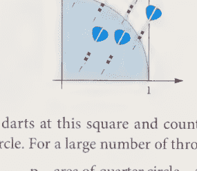

想象向这个正方形投掷 q 支飞镖，并统计落在四分之一圆内的总次数 p。对于大量投掷，我们可以预期

p/q ≈ 四分之一圆的面积 / 正方形的面积 = π/4

编写一个程序，用这种方法来近似计算 π。为了模拟投掷飞镖，生成两个随机数 x 和 y，并将点 (x, y) 视为飞镖的落点。

# 5. 问题 4 中的模拟可以推广到求任意函数图形下的面积，这被称为近似积分的蒙特卡洛方法。为了说明这一点，考虑一个底为 [a, b]、高为 m 的矩形，其中对于 [a, b] 内的所有 x，都有 m ≥ f(x)：


想象向矩形 ABCD 投掷 q 支飞镖，并统计落在阴影区域内的总次数 p。对于大量投掷，我们可以预期

P/q ≈ 阴影区域的面积 / 矩形 ABCD 的面积

编写一个程序，使用这种蒙特卡洛方法计算面积。为了模拟投掷飞镖，从 [a, b] 中生成一个随机数 x，从 [0, m] 中生成一个随机数 y，并将点 (x, y) 视为飞镖的落点。使用你的程序计算在 6 秒内流过电容 C = 5 法拉的电容器中的电流，该电流可以计算为 1/C 乘以曲线

f(t) = 10 sin²(t/π)

从 t = 0 到 t = 6 下方的面积。

6. 著名的布丰投针问题如下：一块板上画有等距平行线，一根长度等于这些平行线间距的针被随机扔到板上。编写一个程序模拟这个实验，并估计针与其中一条平行线相交的概率 p。显示 p 和 2/p 的值。（2/p 的值应近似等于一个众所周知的常数。这个常数是什么？）

7. 某种金属部件的抗拉强度近似服从正态分布，均值为 10,000 磅/平方英寸，标准差为 100 磅/平方英寸。规格要求所有部件的抗拉强度大于 9800；其余必须报废。编写一个程序，使用本节描述的算法生成 1000 个代表这些部件抗拉强度的正态分布随机数，并确定必须报废多少个。

## 更多的选择控制结构

### 目录

+   8.1 引言示例：再谈空气质量指数 262
+   8.2 关于 if 语句的更多内容 264
+   8.3 switch 语句 269
+   8.4 条件表达式 278
+   本章小结 281
+   自我测试 284
+   习题 285
+   编程问题 290

> 如果你不知道要去哪里，你最终会到别的地方。
> 
> 约吉·贝拉

> “请你告诉我，从这里我该走哪条路？”
> “这在很大程度上取决于你想去哪里，”猫说。
> 
> 刘易斯·卡罗尔，《爱丽丝梦游仙境》

> 我们都是特殊情况。
> 
> 阿尔贝·加缪


在第 5 章中，我们看到函数或程序中的执行逻辑流程由三种基本控制机制决定：顺序、选择和重复。我们查看了使用 if 语句进行选择性执行以及使用 for 和 while 语句进行重复执行的示例。然而，我们对这些语句的介绍相当简短，因此我们将在本章和下一章中更详细地研究它们。我们将首先更详细地研究 if 语句，然后介绍 switch 语句，该语句有时提供了一种更高效的选择方式。在第 9 章中，我们将重新审视 for 语句，并了解它控制重复的其它一些方式。我们还将介绍 do-while 语句，并将其与第 5 章中研究的 while 语句进行比较。

## 8.1 初始示例：空气质量指数回顾

第 5 章中初始示例中的空气质量指数（AQI）仅涉及两个类别：安全和危险。然而，实际上通常有更多类别。例如，美国的 AQI 有六个类别，每个类别都有一种颜色：

| AQI | 健康关注程度 | 颜色 |
| 0 to 50 | Good | Green |
| 51 to 100 | Moderate | Yellow |
| 101 to 150 | Unhealthy for sensitive groups | Orange |
| 151 to 200 | Unhealthy | Red |
| 201 to 300 | Very unhealthy | Purple |
| 301 and above | Hazardous | Maroon |

示例 8.1 中的程序是对示例 5.1 中的程序的修改，使用这六个类别对指数进行分类。它使用了我们在第 5 章中介绍并将在下一节中更详细讨论的 if-else if 构造。

### Example 8.1 Air Quality Indexes

```
/* This program reads three pollution levels, calculates an air
quality index (AQI) as their integer average, and then displays
an appropriate air-quality message.

Input:  the three pollution levels
Constant: the cutoff values (parts per million)
Output:  the air quality index, the corresponding level of health
         concern using the six U.S. categories, and its color
---------------------------------------------------------------*/

#include <iostream>           // cin, cout, <<, >>
using namespace std;
```

## 8.2 关于 if 语句的更多内容

在第 5.4 节中，我们看到了 if 语句的三种不同形式：

**单分支**或**简单 if**形式：

```
if (condition)
    statement
```

**双分支**或**if-else**形式：

```
if (condition)
    statement₁
else
    statement₂
```

**多分支**或**if-else-if**形式：

```
if (condition₁)
    statement₁
else if (condition₂)
    statement₂
...
else if (conditionₙ)
    statementₙ
else
    statementₙ₊₁
```

其中每个 *condition* 都是一个布尔表达式。

尽管这些看起来像是三种不同的语句，但第一个和最后一个实际上是第二个 if 语句的特殊形式。第一种形式是编写 else 部分为空的 if 语句的更简单方法：

```
if (condition)
    statement₁
else;
```

多分支形式实际上只是写成一个的**嵌套** if 语句系列。为了说明这一点，如果我们要编写一个 5 分支的 if-else-if，并且我们要在新行上开始每个新的 if 语句，并将每个 else 与其对应的 if 对齐，我们的代码将如下所示：

```
if (condition₁)
    statement₁
else
    if (condition₂)
        statement₂
    else
```

```
if (condition₁)
    statement₁
else
    if (condition₄)
        statement₁
    else
        statement₅
```

然而，C++ 的自由格式特性允许我们在前一个 else 的同一行上开始每个嵌套的 if，并对齐 else-if 组合：

```
if (condition₁)
    statement₁
else if (condition₂)
    statement₂
else if (condition₃)
    statement₃
else if (condition₄)
    statement₄
else
    statement₅
```

这种后一种风格更清晰地反映了多分支的性质，因此更具可读性。然而，重要的是要理解每个 else 实际上是最近的前一个 if 的延续：

```
if (condition₁)
    statement₁
else if (condition₂)
    statement₂
else if (condition₃)
    statement₃
else if (condition₄)
    statement₄
else
    statement₅
```

### 8.2.1 陷阱：悬空 else 问题

if 语句中的每个 statementᵢ 可以是任何 C++ 语句，特别是可能是另一个 if 语句；例如，

```
if (x > 0)
    if (y > 0)
        z = sqrt(x) + sqrt(y);
```

当这样的嵌套 if 语句后面跟着一个 else 时，就不明显 else 与哪个 if 对应。else 匹配外层的 if 吗？

还是匹配内层的 if？

```
if (x > 0)
    if (y > 0)
        z = sqrt(x) + sqrt(y);
else
    cerr << "\n*** Unable to compute z!" << endl;
```

```
if (x > 0)
    if (y > 0)
        z = sqrt(x) + sqrt(y);
else
    cerr << "\n*** Unable to compute z!" << endl;
```

这种歧义被称为悬空 else 问题，C++ 通过规定来解决它

> 在嵌套 if 语句中，else 与最近的未匹配 if 匹配。

因此，对于前面的 if 语句，使用第二个匹配；也就是说，else 与内层的 if 相关联（其条件为 y > 0）。因此，输出语句仅在 x 为正且 y 为非正的情况下执行。如果我们希望将此 else 与外层 if 关联，我们可以通过将内层 if 用大括号括起来来强制关联，如下所示：

```
if (x > 0)
{
    if (y > 0)
        z = sqrt(x) + sqrt(y);
}
else
    cerr << "*** Unable to compute z!" << endl;
```

将内层 if 放在块中使其成为一个完整的语句，因此 else 必须与外层 if 关联。因此，只要 x 为非正，输出语句就会被执行。

### 8.2.2 陷阱：混淆 = 和 ==

我们现在转向初学者 C++ 程序员在构造布尔表达式时最常犯的错误之一，以及因此在编写 if 语句时出现的错误。我们首先查看与此问题相关的 C++ 的两个特性。

+   1. C++ 中的 true 和 false。为了保持与其父语言 C 的兼容性，在任何布尔上下文中，C++ 将值 0 解释为等同于布尔值 false，而任何非零值解释为等同于布尔值 true。因此，语句

```
if (0)
    cout << "T\n";
```

> C 没有 bool 类型。取而代之的是，C 使用此处描述的零/非零机制。

```
else
    cout << "F\n";
```

将始终显示 F，因为控制选择的条件为零，C++ 将其视为 false。类似地，语句

```
if (!23)
    cout << "T\n";
else
    cout << "F\n";
```

将始终显示值 T，因为控制选择的条件为非零，在 C++ 中被解释为 true。

2. 赋值是表达式。我们在第 3 章中看到，在 C++ 中，赋值（=）是一个运算符，除了将值赋给变量外，还返回被赋的值作为其结果。例如，赋值表达式

```
x = 23
```

做两件事：它将 x 赋值为 23，并产生 23 作为其结果。类似地，

```
x = 0
```

既将 x 赋值为 0，又产生 0 作为其结果。

单独来看，这两个 C++ 特性都不是特别麻烦，但与赋值和相等运算符的相似性相结合，使得编写包含逻辑错误的 if 语句变得很容易。为了说明，假设程序员将指令编码为

如果 x 等于零，则
    显示字符字符串 "Zero"
否则
    显示字符字符串 "Nonzero"

为

```
if (x = 0)
    cout << "Zero\n";
else
    cout << "Nonzero\n";
```

因为使用了赋值运算符

```
x = 0
```

而不是相等比较

```
x == 0
```

并且赋值运算符返回的值是被赋的值，此语句等价于

```
if (0)
    cout << "Zero\n";
else
    cout << "Nonzero\n";
```

因为 0 被视为 false，所以输出 Nonzero 的语句将*始终*被选中，而与 x 的值无关。

类似地，如果程序员编写

```
cout << MENU;             // display menu of choices: A, B, C
cin >> choice;
if (choice = 'A')
    statement₁;            // do something when choice is A
else if (choice = 'B')
    statement₂;            // do something else when choice is B
else if (choice = 'C')
    statement₃;            // do something else when choice is C
else
    cout << choice << " must be A, B, or C.\n";
```

那么与选择 A 关联的语句将*始终*被选中，而与用户输入的值无关。原因是第一个条件不是测试 choice 是否等于 A，

```
choice == 'A'
```

而是将其赋值为 A 的数字代码（ASCII 中为 65）：

```
choice = 'A'
```

赋值运算符产生的结果是被赋的值（65），因此此 if-else-if 形式等价于

```
cout << MENU;             // display menu of choices: A, B, C
cin >> choice;
if (65)
    statement₁;            // do something when choice is A
else if (choice = 'B')
    statement₂;            // do something else when choice is B
else if (choice = 'C')
```


```
statement_3        // do something else when choice is C
else
    cout << choice << " must be A, B, or C.\n";
```

由于非零值被视为真，65 也被视为真，因此无论 choice 的值是什么，statement₁ 都将被执行，而 statement₂、statement₃ 和输出语句将被跳过。

这种错误在构造布尔表达式时很容易出现。遗憾的是，这类错误极难发现，因为相等运算符（==）和赋值运算符（=）在外观上非常相似。

> 每当算法需要进行相等比较时，都应仔细检查实现该算法的代码，以确保没有不小心将赋值运算符误用为相等运算符。

## 8.3 switch 语句

if 语句可用于实现多分支选择语句，其中从几个备选动作中恰好选择一个并执行。在上一节描述的 if-else-if 形式中，通过计算一个或多个布尔表达式来进行选择。由于选择条件通常可以表示为布尔表达式，因此 if-else-if 形式几乎可以实现任何多分支选择。

本节介绍另一种多分支选择语句，称为 switch 语句。虽然它不如 if 语句通用，但在实现某些形式的选择时更为高效。和往常一样，我们先从一个示例开始，说明该语句的用法。

### 8.3.1 示例：温度转换

在第 6 章前面几节中，我们考虑了将温度从华氏温标转换为摄氏温标的问题。在 6.2 节中，我们构建了一个函数来完成此转换；在 6.4 节中，我们展示了如何创建一个名为 Heat 的库，以存储用于在华氏、摄氏和开尔文温标之间转换温度的各种函数。

既然我们已经了解了选择性执行，就可以考虑该问题的一个更通用的版本——编写一个程序，允许用户选择要执行的转换：华氏转摄氏（或相反），华氏转开尔文（或相反），或摄氏转开尔文（或相反）。

#### 8.3.1.1 行为

我们的程序应在屏幕上显示包含六个可能的转换选项的菜单，然后从键盘读取所需的转换选项。接下来，它应在屏幕上显示输入温度的提示，并从键盘读取该温度。然后，程序应根据指定的转换，显示输入温度转换后的结果。

#### 8.3.1.2 对象

根据我们的行为描述，该问题中包含以下对象：²

| 问题对象 | 类型 | 软件对象 |  |
|---|---|---|---|
|  |  | 种类 | 名称 |
| 菜单 | string | 常量 | MENU |
| 转换 | char | 变量 | conversion |
| 温度 | double | 变量 | temperature |
| 结果 | double | 变量 | result |

因此，我们可以将问题规范如下：

输入：temperature（double）以及 conversion（char）
前置条件：conversion 在 A–F（或 a–f）范围内
输出：MENU、输入提示，以及转换温度的结果

#### 8.3.1.3 操作

我们的行为描述引出了以下操作列表：

- i. 在屏幕上显示提示信息和 MENU（字符串）。
- ii. 从键盘读取 temperature（double）。
- iii. 从键盘读取 conversion（char）。
- iv. 选择与 conversion 对应的转换函数，并将其应用于 temperature。

这些操作在 C++ 中都已提供。对于操作（iv），我们必须将 conversion 与每个有效的菜单选项进行比较，并根据比较结果选择合适的转换函数。

#### 8.3.1.4 算法

以下算法应用了这一策略。

# 转换任意温度的算法

- 1. 通过 cout 显示 MENU。
- 2. 从 cin 读取 conversion。
- 3. 通过 cout 显示输入温度的提示。
- 4. 从 cin 读取 temperature。
5. 如果 conversion 是 ‘A’ 或 ‘a’

将温度从华氏转换为摄氏，并将结果存储在 result 中。

否则，如果 conversion 是 ‘B’ 或 ‘b’

将温度从摄氏转换为华氏，并将结果存储在 result 中。

否则，如果 conversion 是 ‘C’ 或 ‘c’

将温度从摄氏转换为开尔文，并将结果存储在 result 中。

否则，如果 conversion 是 ‘D’ 或 ‘d’

将温度从开尔文转换为摄氏，并将结果存储在 result 中。

否则，如果 conversion 是 ‘E’ 或 ‘e’

将温度从华氏转换为开尔文，并将结果存储在 result 中。

否则，如果 conversion 是 ‘F’ 或 ‘f’

将温度从开尔文转换为华氏，并将结果存储在 result 中。

否则

显示错误消息。

#### 8.3.1.5 编码与测试

我们可以使用 if-else-if 结构来实现该算法：

```
if (conversion == 'A' || conversion == 'a')
    result = fahrToCelsius(temperature)
else if (conversion == 'B' || conversion == 'b')
    result = celsiusToFahr(temperature);
...
else
{
    cerr << "\n*** Invalid conversion: " << conversion << endl;
    result = 0.0;
}
```

不过，C++ 的 switch 语句提供了一种更方便的方式来完成此操作，如示例 8.2 中的程序所示。

# 示例 8.2 任意温度转换

```
/* This program converts temperatures from one scale to another.

Input: menu choices, temperatures
Output: menu, temperatures on other scale
---------------------------------------------------------------*/
```

```
#include <iostream>      // cin, cout, <<, >>
#include <string>        // string class
using namespace std;
#include "Heat.h"       // fahrToCelsius(), celsiusToFahr(), ...

int main()
{
    const string MENU = "To convert arbitrary temperatures, enter:\n"
                         " A - to convert Fahrenheit to Celsius;\n"
                         " B - to convert Celsius to Fahrenheit;\n"
                         " C - to convert Celsius to Kelvin;\n"
                         " D - to convert Kelvin to Celsius;\n"
                         " E - to convert Fahrenheit to Kelvin; or\n"
                         " F - to convert Kelvin to Fahrenheit.\n"
                         " --> ";

    cout << MENU;
    char conversion;
    cin >> conversion;

    cout << "\nEnter the temperature to be converted: ";
    double temperature;
    cin >> temperature;
    double result;
    switch (conversion)
    {
        case 'A': case 'a':
            result = fahrToCelsius(temperature);
            break;
        case 'B': case 'b':
            result = celsiusToFahr(temperature);
            break;
        case 'C': case 'c':
            result = celsiusToKelvin(temperature);
            break;
        case 'D': case 'd':
            result = kelvinToCelsius(temperature);
            break;
        case 'E': case 'e':
            result = fahrToKelvin(temperature);
            break;
        case 'F': case 'f':
            result = kelvinToFahr(temperature);
            break;
        default:
            cerr << "\n*** Invalid conversion: "
                 << conversion << endl;
            result = 0.0;
    }
    cout << "The converted temperature is " << result << endl;
}
```

# 示例运行：

要转换任意温度，请输入：

- A - 将华氏转换为摄氏；
- B - 将摄氏转换为华氏；
- C - 将摄氏转换为开尔文；
- D - 将开尔文转换为摄氏；
- E - 将华氏转换为开尔文；或
- F - 将开尔文转换为华氏。

--> B

请输入要转换的温度：100

转换后的温度为 212

注意 switch 语句的便利性：通过允许我们为给定的分支指定任意多个 case，无论 conversion 是大写还是小写，我们都可以非常方便地测试其值：

```
switch (conversion)
{
    case 'A': case 'a':
        result = fahrToCelsius(temperature);
        break;
    ...
}
```

相比之下，等价的 if-else-if 版本显得笨拙，许多人觉得它更繁琐且可读性更差。此外，使用 switch 语句从多个分支中选择通常比使用 if 语句更省时，这将在本节末尾讨论。

### 8.3.2 switch 语句的形式

C++ 的 switch 语句具有以下一般形式：

# switch 语句

# 形式：

```
switch (expression)
{
    case_list1:
        statement list;
    case_list2:
        statement list;
    ...
}
```


```
case_listₙ :
    statement_listₙ
default :
    statement_listₙ₊₁
};
```

其中

- switch 和 default 是 C++ 关键字；
- expression 是一个整数（或整数兼容）表达式
- 每个 case_listᵢ 是如下形式的 case 序列

```
case constant_value :
```

- default 子句是可选的；以及
- 每个 statement_listᵢ 是一系列语句。

## 目的：

当执行 switch 语句时，会对 expression 进行求值。如果 expression 的值在 case_listᵢ 中，则从 statement_listᵢ 开始执行，并持续到以下任一情况出现为止：

- 遇到 break 语句
- 遇到 return 语句
- 到达 switch 语句的末尾

如果 expression 的值不在任何 case_listᵢ 中，则执行 default 子句中的 statement_listₙ₊₁。如果省略了 default 子句，且 expression 的值不在任何 case_listᵢ 中，那么执行将“贯穿”整个 switch 语句。

注意，expression 必须是整数兼容表达式（特别是，它不能求值为实数或字符串值）。

## 8.3.3 break 语句

如示例 8.2 中的程序所示，switch 语句中的每个语句列表通常以如下形式的 break 语句结尾：

```
break;
```

执行该语句时，控制会被转移到 switch 语句之后的第一条语句。正如我们将在下一章看到的，break 语句也可用于终止循环的重复。在这两种情况下，break 的行为相同：执行跳转到包含它的 switch 语句或循环之后的第一条语句。

## 8.3.4 贯穿行为

使用 switch 语句时需要记住的一个重要特性是其贯穿行为。为了说明这一点，假设我们在示例 8.2 中编写的 switch 语句没有 break 语句：

```
switch (conversion)
{
    case 'A': case 'a':
        result = fahrToCelsius(temperature);
    case 'B': case 'b':
        result = celsiusToFahr(temperature);
    case 'C': case 'c':
        result = celsiusToKelvin(temperature);
    case 'D': case 'd':
        result = kelvinToCelsius(temperature);
    case 'E': case 'e':
        result = fahrToKelvin(temperature);
    case 'F': case 'f':
        result = kelvinToFahr(temperature);
    default:
        cerr << "\n*** Invalid conversion: "
             << conversion << endl;
        result = 0.0;
}
```

运行这个修改后的版本时，产生的输出可能会相当出乎意料。下面是一个例子：

```
To convert arbitrary temperatures, enter:
    A - to convert Fahrenheit to Celsius;
    B - to convert Celsius to Fahrenheit;
    C - to convert Celsius to Kelvin;
    D - to convert Kelvin to Celsius;
    E - to convert Fahrenheit to Kelvin; or
    F - to convert Kelvin to Fahrenheit.
--> B

Enter the temperature to be converted: 100
*** Invalid conversion: B
The converted temperature is 0
```

与示例 8.2 中的示例运行一样，conversion 的值是 B，因此控制转移到语句：

```
result = celsiusToFahr(temperature);
```

然而，此语句之后没有 break 来将控制转移过其他语句，因此执行贯穿到下一个 case 中的语句，该语句会重置 result：

```
result = celsiusToKelvin(temperature);
```

同样，这里没有 break 语句，因此执行贯穿到下一个 case 中的语句，该语句再次重置 result：

```
result = kelvinToCelsius(temperature);
```

这种贯穿行为会一直持续，直到遇到 break、return 或到达 switch 语句的末尾。由于这里没有 break 或 return 语句，执行会继续经过接下来的两个 case，并到达 default 分支，该分支显示

```
*** Invalid conversion: B
```

并将 result 设置为零。switch 之后的输出语句随后显示

```
The converted temperature is 0
```

为了避免这种行为，我们必须记住在 switch 语句中，每个语句列表（最后一个语句列表除外）都要以 break（或 return 语句）结尾；对于最后一个语句列表，则不必。

示例 8.2 中的程序在主函数中使用 switch 语句，但 switch 可能更常用于主函数之外的函数中控制选择。在这种情况下，函数很可能使用 switch 来选择其返回值，因此可以使用 return 语句代替 break 语句。下面的示例说明了这一点。

## 8.3.5 示例：将工程专业代码转换为名称

数字或字母代码通常用于表示关于某人或某物的信息；例如，学生在大学的年级、员工在公司的薪资级别、某些制造过程中的阶段、学生的专业等等。这里我们将使用最后一个例子，开发一个函数，它接受工程专业学生的专业代码并返回专业名称：C 代表土木工程，E 代表电气工程，I 代表工业工程，M 代表机械工程，U 代表未定。

假设我们从以下函数桩开始：

```
/*---------------------------------------------------------------------
This function returns the name of an engineering program
corresponding to a given program code.

Receive: a character
Return: the appropriate (string) name of an engineering program
(Civil, Electrical, Industrial, Mechanical, Undecided)
or an empty string for a nonvalid code
Output: An error message in case of a nonvalid code
---------------------------------------------------------------------*/
string engrProgram(int progCode)
{
}
```

这里，函数文档中的关键词是“对应”。因为我们必须返回与 progCode 对应的专业名称，所以必须将 progCode 与每个可能的代码进行比较，然后选择一个合适的 return 语句。

以下算法应用了这一策略。

如果 progCode 是 'C'
    返回 "Civil"。
否则，如果 progCode 是 'E'
    返回 "Electrical"。
否则，如果 progCode 是 'I'：
    返回 "Industrial"。
否则，如果 progCode 是 'M'
    返回 "Mechanical"。
否则，如果 progCode 是 'U'
    返回 "Undecided"。
否则
    显示错误消息。
    返回空字符串。

虽然我们显然可以使用 if 语句实现该算法，但示例 8.3 中的函数使用 switch 语句解决了这个问题。注意，此 switch 的各个 case 中不需要 break 语句。该函数使用 switch 来选择一个 return 语句，而 return 语句会导致函数的执行终止。

### 示例 8.3 将工程专业代码转换为名称

```
/*----------------------------------------------------------------
    This function returns the name of an engineering program
    corresponding to a given program code.

    Receive: a character
```

```
Return:  the appropriate (string) name of an engineering program
         (Civil, Electrical, Industrial, Mechanical, Undecided)
         or an empty string for a nonvalid code
Output:  An error message in case of a nonvalid code
-----------------------------------------------------------------------*/

string engrProgram(char progCode)
{
    switch (progCode)
    {
        case 'C': return "Civil";
        case 'E': return "Electrical";
        case 'I': return "Industrial";
        case 'M': return "Mechanical";
        case 'U': return "Undecided";
        default:  cerr << "*** code error: " << progCode << " ***\n";
                  return "";
    }
}
```

### 示例运行：

```
Enter the code of an engineering program: C
Civil

Enter the code of an engineering program: E
Electrical

Enter the code of an engineering program: I
Industrial

Enter the code of an engineering program: M
Mechanical

Enter the code of an engineering program: U
Undecided

Enter the code of an engineering program: a
*** code error: a ***
```

## 8.4 条件表达式

到目前为止我们讨论的选择语句（if 和 switch）与其他语言提供的语句类似。然而，C++ 从其父语言 C 中继承了一种第三种选择机制，即一个根据布尔表达式（也称为条件）的值产生两个值之一的表达式。

为了说明这一点，考虑第 5 章中空气质量指数计算问题的简化形式，我们希望确定空气质量是否安全


或危险，取决于指数值，即空气质量指数。 我们使用了以下 if 语句：

```
if (index < CUTOFF)
    cout << "Safe condition\n";
else
    cout << "Hazardous condition\n";
```

另一种方法是使用以下输出语句

```
cout << ((index < CUTOFF) ? "Safe" : "Hazardous")
    << " condition\n";
```

它与前面的 if 语句类似，如果条件 index < CUTOFF 为真，则会显示 Safe condition，但如果为假，则会显示 Hazardous condition。

由于此类表达式产生的值取决于其条件的值，因此它们被称为条件表达式³，具有以下一般形式：

## 条件表达式

### 形式：

```
condition ? expression₁ : expression₂
```

其中
condition 是一个布尔表达式；并且
expression₁ 和 expression₂ 是类型兼容的表达式。

### 行为：

condition 被求值。
如果 condition 的值为真（即非零），则 expression₁ 的值作为结果返回。
如果 condition 的值为假（即零），则 expression₂ 的值作为结果返回。

请注意，在条件表达式中，只有 expression₁ 和 expression₂ 中的一个会被求值。 因此，像这样的赋值

```
reciprocal = ( (x == 0) ? 0 : 1 / x );
```

是安全的，因为如果 x 的值为零，表达式 1 / x 将不会被求值，因此不会产生除零错误。 因此，条件表达式有时可用于

> ³ 条件表达式具有形式 C ? A : B 并且实际上是一个三元（三操作数）运算，其中 C、A 和 B 是三个操作数，? : 是运算符。

代替 if 语句以保护可能不安全的操作。 当它用作另一个表达式的子表达式时，条件表达式应用括号括起来，因为它的优先级低于大多数其他运算符（参见附录 C）。

该机制有许多不同的用途，因为它可以在任何表达式出现的地方使用。 事实上，条件表达式可以用在大多数 if-else 语句的位置。 为了说明，假设我们想要编写一个函数 largerOf() 来查找两个 int 值的最大值。 虽然我们可以用 if 语句来做，

```
int largerOf(int value1, int value2)
{
    if (value1 > value2)
        return value1;
    else
        return value2;
}
```

条件表达式提供了一个更简单的替代方案：

```
int largerOf(int value1, int value2)
{
    return ( (value1 > value2) ? value1 : value2 );
}
```

使用这样的函数，我们可以写

```
max = largerOf(x, y);
```

max 将被赋值为 x 和 y 两个值中较大的一个。

作为最后一个例子，假设 numCourses 是一个 int 变量，包含学生在当前学期修读的课程数量。 那么输出语句

```
cout << "\nYou are taking " << numCourses << " course"
    << ( (numCourses == 1) ? "" : "s" )
    << " this semester.\n";
```

将显示单数消息

```
You are taking 1 course this semester.
```

如果 numCourses 等于 1，并且如果 numCourses 的值不是 1，则会显示复数消息：

```
You are taking 3 courses this semester.
```

## 章节总结

### 关键术语

- block
- break statement
- condition
- conditional expression
- dangling else problem
- drop-through behavior
- dual-branch if or if-else form
- multialternative selection
- multibranch if or if-else-if form
- single-branch or simple if form
- switch statement
- ternary operation

### 注释

- 多分支 if 是写成一个的嵌套 if 语句序列。
- 在嵌套 if 中，每个 else 都与最近的未匹配的 if 匹配。
- 请务必使用 == 运算符进行相等比较，而不是 =（赋值）。 只要算法需要相等比较，实现该算法的代码就应仔细检查，以确保没有无意中使用 =（赋值）代替 ==（相等运算符）。
- 请记住，switch 语句的表达式类型及其 case 列表中的常量必须是整数兼容的。 请注意，它们可能不是实数或字符串表达式。
- 为防止 switch 语句中的 drop-through 行为，请记住在每个 case 中的语句列表末尾使用 break 或 return 语句（最后一个语句列表除外，在那里不需要）。
- 在决定使用哪种语句来实现选择时，如果以下所有条件都成立，则使用 switch，否则使用 if：
  1. 正在执行相等（==）比较。
  2. 每个条件中比较的是同一表达式。
  3. 被比较的表达式是整数兼容的。
- 条件表达式可以用在许多 if-else 语句的位置，有时提供更简单的替代方案。

### 风格和设计提示

在本教材中，我们对本章中考虑的选择语句使用以下格式约定。

- 对于 if 语句，if (boolean_expression) 在一行上，其语句在下一行缩进。 如果有 else 子句，else 在单独一行上，与 if 对齐，其语句在下一行缩进。 如果语句是复合的，花括号与 if 和 else 对齐，块内的语句缩进。

```
if (boolean_expression)
    statement₁
else
    statement₂
```

```
if (boolean_expression)
{
    statement₁
    ...
    statementₖ
}
else
{
    statementₖ₊₁
    ...
    statementₙ
}
```

一个例外是当 if-else-if 形式用于实现多替代选择结构时。 在这种情况下使用的格式为

```
if (boolean_expression₁)
    statement₁
else if (boolean_expression)
    statement₂
...
else if (boolean_expressionₙ)
    statementₙ
else
    statementₙ₊₁
```

- 对于 switch 语句，switch (expression) 在一行上，其花括号对齐且在单独的行上；每个 case 列表在花括号内缩进，每个语句列表和 break 或 return 语句在其特定 case 列表之后缩进。

```
switch (expression)
{
    case_list₁:
        statement list;
        break;        // or return
```

```
case_list₂:
    statement list ;
    break;            // or return
...
case_list :
    statement list ;
    break;            // or return
default:
    statement_listₙ₊₁
}
```

或者，每个语句 _ listᵢ 可以与 case_listᵢ 在同一行开始。

- 通过使用 if 语句测试非法值来防御性编程。 这提供了不因先决条件失败而终止程序的 assert() 机制的替代方案。
- 多替代选择结构可以用 if-else-if 结构比用单独的 if 语句序列更有效地实现。
- 形式为

```
if (variable = constant₁)
    statement₁
else if (variable == constant₂)
    statement₂
...
else if (variable == constantₙ)
    statementₙ
else
    statement
```

的多替代选择语句，其中 variable 和每个 constantᵢ 都是 int 兼容的，通常使用 switch 语句更有效地实现。 switch 语句的第二个优点是，使用 switch 实现的问题解决方案通常比使用 if 语句实现等效解决方案更具可读性。

### 警告

- 1. if 语句中最常见的错误之一是使用赋值运算符（=）而不是相等运算符（==）。
- 2. 当代数上相等的实数用 == 比较时，结果可能是假的布尔表达式，因为大多数实数不能精确存储。
- 3. 在嵌套 if 语句中，每个 else 子句都与最近的未匹配 if 匹配。 缩进和对齐每个 else 与其对应的 if 应用于使这些关联清晰。


4. 每个 switch 语句和块必须包含匹配的大括号。缺少 } 可能很难定位。在某些情况下，编译器可能要到文件末尾才发现 { 未匹配。在这种情况下，会生成如下错误信息：

```
Error...: Compound statement missing } in function ...
```

5. switch 语句中的选择器必须是整数兼容的。特别是，case 列表中选择器的值
- 不得是实数常量，且
- 不得是字符串常量。

6. switch 语句具有贯穿行为。特定 case 中语句列表的执行会继续进入后续的 case，直到遇到 break、return 或 switch 语句结束为止。为了避免这种行为，你必须记住在每个 switch 语句的语句列表末尾加上 break 或 return 语句（最后一个语句列表除外，在那里不是必须的）。

## TEST YOURSELF

Section 8.3

对于以下问题，假设 number 是一个 int 变量，code 是一个 char 变量，x 是一个 double 变量。

1. 如果 number 的值为 99，请说明以下 switch 语句产生的输出，或指出为何会发生错误：

```
switch(number)
{
    case 99:
        cout << number + 99 << endl;
        break;
    case -1:
        cout << number - 1 << endl;
        break;
    default:
        cout << "default\n";
}
```

2. 按第 1 题进行，但假设省略了 break 语句。

3. 按第 1 题进行，但假设 number 的值为 50。

6. 按第 2 题进行，但假设 number 的值为 -1。

7. 如果 code 的值为字母 B，请说明以下 switch 语句产生的输出，或指出为何会发生错误：

```cpp
switch (code)
{
    case 'A': case 'B':
                       cout << 123 << endl;
                       break;

    case 'P': case 'R': case 'X':
                       cout << 456 << endl;
                       break;
}
```

8. 按第 7 题进行，但假设 code 的值为字母 X。

9. 按第 7 题进行，但假设 code 的值为字母 M。

10. 如果 x 的值为 2.0，请说明以下 switch 语句产生的输出，或指出为何会发生错误：

```cpp
switch (x)
{
    case 1.0:
              cout << x + 1.0 << endl;
              break;

    case 2.0:
              cout << x + 2.0 << endl;
              break;
}
```

### EXERCISES

Section 8.2

1. 描述以下缩进不良的程序段产生的输出：

```cpp
int number = 4;
double alpha = -1.0;
if (number > 0)
    if (alpha > 0)
        cout << "first\n";
    else
        cout << "second\n";
    cout << "third\n";
```

Exercises 2 and 3 refer to the following if statement, where honors, awards, and goodStudent are of type bool:

```
if (honors)
    if (awards)
        goodStudent = true;
    else
        goodStudent = false;
else if (!honors)
    goodStudent = false;
```

2. 写一个等价于此的更简单的 if 语句。

3. 写一个等价于此 if 语句的单个赋值语句。

4. 如果 y 的值为 (a) 10？(b) 20？语句

```
int x = 0,
    y;
if ((x = 15) > y)
    cout << "Yes\n"
else
    cout << "No\n";
```

会产生什么输出（如果有）？

For Exercises 5–12, you are asked to write functions. To test these functions, you should write driver programs as instructed in Programming Problems 1–8 for Section 8.2 at the end of this chapter.

5. 在某个地区，只有当温度至少为 70°、相对湿度在 15 到 35 百分比之间，并且风速最多为每小时 10 英里时，才允许从飞机喷洒农药。编写一个布尔值函数 okToSpray()，接收表示温度、相对湿度和风速的三个数字，如果条件允许喷洒则返回 true，否则返回 false。

6. 某家信贷公司会在申请人的收入至少为 $25,000 或申请人的资产至少为 $100,000 时批准贷款申请；此外，申请人的总负债必须少于 $50,000。编写一个布尔值函数 creditApproved()，接收表示收入、资产和负债的三个数字，如果满足贷款批准标准则返回 true，否则返回 false。

7. 编写一个函数，如果 int 参数 year 的值是闰年的年份则返回 true，否则返回 false。（闰年是 4 的倍数；如果是 100 的倍数，则还必须是 400 的倍数。）

8. 编写一个函数，返回给定 int 参数 month（1, 2, …, 12）的天数，该参数为给定参数 year 的月份。使用练习 7 来确定 month 的值等于 2 时的天数。

9. 按练习 8 进行，但假设 month 是一个字符串变量，其值为月份的名称。

## Section 8.3

- 1. 编写一个 switch 语句，如果字符变量 transCode 的值为 'D'，则通过将 amount 加到 balance 上来增加 balance；如果 transCode 为 'W'，则通过从 balance 中减去 amount 来减少 balance；如果 transCode 为 'P'，则显示 balance 的值；否则显示非法交易信息。

- 2. 编写一个 switch 语句，对于给定的两个整数 a 和 b 以及给定的字符 operation，根据 operation 是 '+'、'-'、'*' 或 '/' 来计算并显示 a + b、a - b、a * b 或 a / b，如果不是这些则显示非法运算符信息。

For Exercises 3–6, write functions that use switch statements to compute what is required. To test these functions, you should write driver programs as instructed in Programming Problems 1–4 for Section 8.3 at the end of this chapter.

- 3. 给定一个小于 1000 的距离，返回根据以下表格确定的运费：

| Distance | Cost |
|---|---|
| 0 through 99 | $5.00 |
| At least 100 but less than 300 | $8.00 |
| At least 300 but less than 600 | $10.00 |
| At least 600 but less than 1000 | $12.00 |

- 4. 给定一个表示电视频道的数字，返回对应于该频道的电台呼号，或显示频道未使用的信息。使用以下频道号和呼号（或使用你所在地区可用的频道）：
  - 2: WCBS
  - 4: WNBC
  - 5: WNEW
  - 7: WABC
  - 9: WOR
  - 11: WPIX
  - 13: WNET

- 5. 给定一个月份的数字，返回月份的名称（或指示非法月份数字的错误信息）。

- 6. 按练习 5 进行，但返回月份的天数。（闰年是 4 的倍数；但如果是 100 的倍数，则还必须是 400 的倍数。）

## Section 8.4

- 1. 描述以下函数执行的操作：

```
int doSomething1(int value)
{
    return ( (value >= 0) ? value : -value );
}
```

- 2. 描述以下函数执行的操作：

```
char doSomething2(char ch)
{
    return ( ( ('A' <= ch) && (ch <= 'Z') ) ? ch+32 : ch );
}
```

- 3. 编写条件表达式，可替换输出语句中的空白：

```
cout << ____ << month << '/'
    << ____ << day << '/'
    << ____ << year % 100<< endl;
```

使得产生的输出如下：

| month | day | year | Output |
| 12 | 25 | 1999 | 12/25/99 |
| 10 | 1 | 1980 | 10/01/80 |
| 7 | 4 | 1976 | 07/04/76 |
| 2 | 2 | 2002 | 02/02/02 |

- 4. 编写一个条件表达式，可替换输出语句中的空白

```
cout << ____ << number<< endl;
```

使得产生的输出如下：

| number | Output |
| 123 | 123 |
| 23 | 023 |
| 3 | 003 |

- 5. 编写一个函数 smallerOf()，返回两个给定整数值中较小的那个。

- 6. 使用嵌套条件表达式，编写一个函数：
  - a. largestOf()，给定三个 int 值，返回其中最大的一个。
  - b. smallestOf()，给定三个 int 值，返回其中最小的一个。


7. 数学家卡尔·弗里德里希·高斯发现了从 1 到 n 的整数之和的形式为

\[\frac{n(n+1)}{2}\]

使用条件表达式，构造一个函数 sum()，如果其参数的值为正，则根据高斯公式返回该值，否则返回零。

## 编程问题

### 第 8.2 节

+   1. 编写一个驱动程序来测试练习 5 中的函数 okToSpray()。
+   2. 编写一个驱动程序来测试练习 6 中的函数 creditApproved()。
+   3. 编写一个驱动程序来测试练习 7 中的闰年函数。
+   4. 编写一个驱动程序来测试练习 8 中的月份天数函数。
+   5. 编写一个驱动程序来测试练习 9 中的月份天数函数。
+   6. 编写一个驱动程序来测试练习 10 中的整流半波函数。
+   7. 编写一个驱动程序来测试练习 11 中的锯齿函数。
+   8. 编写一个驱动程序来测试练习 12 中的分段压力函数。

9. 假设以下公式给出了细长比为 S 的柱子的安全载荷 L，单位为每平方英寸磅：

\[L = \begin{cases} 16500 - .475S^2 & \text{if } S < 100 \\ \dfrac{17900}{2 + (S^2 + 17900)} & \text{if } S \ge 100 \end{cases}\]

编写一个程序读取细长比，然后计算安全载荷。

10. 假设燃气公司的收费是根据以下表格的用量计算的：

| 用气量 | 费率 |
|---|---|
| 前 70 立方米 | $5.00 最低费用 |
| 下 100 立方米 | 每立方米 5.0¢ |
| 下 230 立方米 | 每立方米 2.5¢ |
| 超过 400 立方米 | 每立方米 1.5¢ |

编写一个函数计算给定用气量的费用。用此函数编写一个程序，输入上个月的表读数和本月的表读数，各为四位数，均表示立方米，然后计算并显示账单金额。注意：由于回滚，当前读数可能小于上一个读数；例如，上一个读数可能是 9897，当前读数可能是 0103。执行程序时使用以下表读数：3450、3495；8810、8900；9950、0190；1275、1982；9872、0444。

# 11. 编写一个程序读取系数 A、B、C、D、E、F 的值，对应于两条直线的方程

Ax + By = C
Dx + Ey = F

然后确定直线是否平行（它们的斜率相等）或直线相交。如果相交，确定直线是否垂直（它们的斜率之积等于 -1）。

# 12. 编写一个程序读取三个点的坐标，然后确定它们是否共线。

### 第 8.3 节

+   1. 编写一个驱动程序来测试练习 3 中的距离成本函数。
+   2. 编写一个驱动程序来测试练习 4 中的电视频道函数。
+   3. 编写一个驱动程序来测试练习 5 中的月份名称函数。
+   4. 编写一个驱动程序来测试练习 6 中的月份天数函数。
+   5. 修改示例 8.3 中的程序以允许代码 CH 表示化学、CI 表示土木、CO 表示计算机、EL 表示电气、EN 表示环境、I 表示工业和 M 表示机械。使用嵌套 switch 语句处理以相同字母开头的代码。
+   6. 在曼哈顿中部定位大道地址并不容易；例如，866 第三大道最近的交叉街道是 53 街，而 866 第二大道最近的交叉街道是 46 街。为了根据以下简略表给出的算法近似定位给定大道地址的最近编号交叉街道，可以使用以下算法：

取消地址的最后一位数字，除以 2，并加上或减去以下简略表中给出的数字：

|  |  |
|---|---|---|
| 1st Ave. | 加 3 |
| 2nd Ave. | 加 3 |
| 3rd Ave. | 加 10 |
| 4th Ave. | 加 8 |
| 5th Ave. up to 200 | 加 13 |
| 5th Ave. up to 400 | 加 16 |
| 6th Ave. (Ave. of the Americas) | 减 12 |
| 7th Ave. | 加 12 |
| 8th Ave. | 加 10 |
| 10th Ave. | 加 14 |

编写一个使用 switch 语句根据上述算法确定给定地址和大道编号的最近交叉街道编号的函数。然后编写一个程序来测试你的函数。

# 7. 一家批发实验室设备公司根据购买的单位数量和每单位价格对每种产品的价格给予折扣。随着购买单位数量和/或单位价格的增加，折扣也会增加。这些折扣在以下表格中给出：

| 购买数量 | 单位价格（美元） |  |  |
| --- | 0-10.00 | 10.01-100.00 | 100.01+ |
| 1-9 | 0% | 2% | 5% |
| 10-19 | 5% | 7% | 9% |
| 20-49 | 9% | 15% | 21% |
| 50-99 | 14% | 23% | 32% |
| 100+ | 21% | 32% | 43% |

编写一个函数计算指定单位数量和单位价格的折扣百分比。使用此函数编写一个程序读取购买的单位数量和单位价格，然后计算并打印总原价、总折扣金额和总折扣后成本。

# 8. 一家航空公司负责运营的副总裁需要确定当前飞行时间估计是否准确。由于较长飞行中因天气和空中交通而产生变化的可能性更大，他允许对飞行时间估计的误差更大。他将实际飞行时间与估计飞行时间进行比较，并根据以下可接受误差范围表将估计判断为过大、可接受或过小：

| 估计飞行时间（分钟） | 可接受误差范围（分钟） |
| 0-29 | 1 |
| 30-59 | 2 |
| 60-89 | 3 |
| 90-119 | 4 |
| 120-179 | 6 |
| 180-239 | 8 |
| 240-359 | 13 |
| 360 或以上 | 17 |

例如，如果估计飞行时间为 106 分钟，可接受误差范围为 4 分钟。因此，如果实际飞行时间小于 102 分钟，则估计飞行时间过大；如果实际飞行时间大于 110 分钟，则估计飞行时间过小；否则估计可接受。编写一个使用 switch 语句根据此表确定给定估计飞行时间的允许误差的函数。在程序中使用你的函数读取估计飞行时间和实际飞行时间，然后确定估计时间是过大、可接受还是过小。如果估计飞行时间过大或过小，程序还应打印高估或低估的数量。

9. 编写一个函数 convertLength()，接收一个实数值和两个字符串 inUnits 和 outUnits，然后将以 inUnits 给出的值转换为 outUnits 中的等效公制值并显示该值。函数应执行以下转换：

| inUnits | outUnits | |
| I | C | （英寸到厘米；1 in = 2.54001 cm） |
| F | C | （英尺到厘米；1 ft = 30.4801 cm） |
| F | M | （英尺到米；1 ft = 0.304801 m） |
| Y | M | （码到米；1 yd = 0.914402 m） |
| M | K | （英里到公里；1 mi = 1.60935 km） |

此外，编写一个驱动程序来测试你的函数。如果输入的单位不是所列单位会发生什么？

10. 按照问题 9 的做法，编写一个函数 convertWeight() 执行以下转换：

| inUnits | outUnits | |
| O | G | （盎司到克；1 oz = 28.349527 g） |
| P | K | （磅到千克；1 lb = 0.453592 kg） |

11. 按照问题 9 的做法，编写一个函数 convertVolume() 执行以下转换：

| inUnits | outUnits | |
| P | L | （品脱到升；1 pt = 0.473167 L） |
| Q | L | （夸脱到升；1 qt = 0.94633 L） |
| G | L | （加仑到升；1 gal = 3.78541 L） |

12. 编写一个菜单驱动程序来测试问题 9–11 中的三个函数 convertLength()、convertWeight() 和 convertVolume()。它应允许用户根据要转换的长度、重量或体积选择三个选项之一；读取要转换的值和单位；然后调用适当的函数执行转换。


更多重复
控制结构

目录

+   9.1 两个入门示例：求和与计算折旧 296
+   9.2 for 循环 302
+   9.3 while 循环 312
+   9.4 do 语句 315
+   9.5 输入循环 319
+   9.6 选择合适的循环 329
+   章节总结 332
+   自测 336
+   练习 338
+   编程问题 343

> 我们就是我们反复做的事。卓越因此不是一种行为，而是一种习惯。
> 
> 亚里士多德

> 读者，假设你是个白痴。并且假设你是国会议员。但我重复一遍。
> 
> 马克·吐温

> 这是 déjà vu 又一次上演。
> 
> 约吉·贝拉

> 一朵玫瑰就是一朵玫瑰就是一朵玫瑰。
> 
> 格特鲁德·斯坦因

正如我们在第 5 章中所看到的，编程中使用的三种基本控制行为是顺序、选择和重复。我们现在已经考虑了所有 C++ 选择结构，但我们只介绍了两种基本类型的重复：

+   1. 由计数器控制的重复，其中循环体对某个控制变量在指定值范围内的每个值执行一次。

+   2. 由逻辑表达式控制的重复，其中继续或终止重复的决定由某个逻辑表达式的值决定。

在第 5 章中，我们介绍了 C++ 的 for 循环，它实现了第一种重复，以及 while 循环，它是 C++ 实现第二种重复的方式之一。在本章中，我们将更仔细地研究这些重复结构，并介绍其他一些结构。

## 9.1 两个入门示例：求和与计算折旧

在第 5.5 节中，我们用计算阶乘的例子介绍了基本的 for 循环。在本节中，我们首先以计算整数求和的函数为例，然后使用该函数编写一个计算并显示折旧表的程序。

### 9.1.1 示例 1：高斯的惩罚——计算求和

我们从历史上最伟大的数学家之一卡尔·弗里德里希·高斯的生平中的一个事件开始。当高斯年轻时，他就读于德国布伦瑞克的一所学校，有一天当学生们特别调皮时，老师要求他们求 1 到 100 的整数之和，预计这会让他们忙上一段时间。（正如后面所述，高斯发现了一种非常简单的方法来做这件事。）

尽管计算 1 到 100 的整数之和并不是一个特别重要的计算，但一个计算并返回 1 + 2 + ... + n 的和的函数对于任何正整数 n 都是有用的。示例 9.1 中的程序展示了一个使用 for 循环计算此和的函数。

## 示例 9.1 求和问题

```
/* This is a driver program to test function sum().

    Input:  an integer n
    Output: the sum of the integers from 1 through n
------------------------------------------------------------*/

#include <iostream>  // cout, cin, <<, >>
using namespace std;

int sum(int n);     // prototype for sum()
```

```
int main()
{
    cout << "This program computes the sum 1 + 2 + ... + n.\n";
    cout << "Enter a value for n: ";
    int n;
    cin >> n;
    cout << "--> 1 + ... + " << n << " = " << sum(n) << endl;
}
```

```
/* Function to compute the sum of the integers from 1 to n.

    Receive: n, an integer
    Return:  the sum 1 + 2 + ... + n
----------------------------------------------------------*/
```

```
int sum(int n)
{
    int runningTotal = 0;
    for (int count = 1; count <= n; count++)
        runningTotal += count;
    return runningTotal;
}
```

示例运行：

This program computes the sum 1 + 2 + ... + n.
Enter a value for n: 5
--> 1 + ... + 5 = 15

This program computes the sum 1 + 2 + ... + n.
Enter a value for n: 100
--> 1 + ... + 100 = 5050

我们之前提到过，高斯的老师预计计算 1 + 2 + ... + 100 的和会让学生忙上一些时间。然而，高斯几乎立即用正确答案 5050 作答，使用了一种特别巧妙的方法。我们使用的重复算法与他算法的简洁性和效率相比，是他天才的体现。

为了计算 1 到 100 的整数之和，高斯也许观察到将和正向写出，

sum = 1 + 2 + 3 + ... + 98 + 99 + 100

然后反向写，

sum = 100 + 99 + 98 + ... + 3 + 2 + 1

然后将这两个方程中的对应项相加得到

2 × sum = 101 + 101 + ...101 + 101
= 100 × 101

因此，和等于

sum = 100 × 101 / 2 = 5050

将他的算法应用于更一般的求和问题，我们从和开始

sum = 1 + 2 + 3 + ... + (n − 2) + (n − 1) + n

反转它，

sum = n + (n − 1) + (n − 2) + ... + 3 + 2 + 1

然后将这两个方程相加得到

2 × sum = (n + 1) + (n + 1) + ... + (n + 1) + (n + 1)
= n × (n + 1)

除以 2 得到

sum = n × (n + 1) / 2

这个公式被称为高斯公式，意味着函数 sum() 可以完全不使用循环来编写，如示例 9.2 所示。

## 示例 9.2 函数 sum() — 无循环版本

```
/* Function to compute the sum of the integers from 1 to n.

Receive: n, an integer
Return: the sum 1 + 2 + ... + n (0 if n < 0)
---------------------------------------------------------------*/

int sum (int n)
{
    return n*(n + 1) / 2;
}
```

这个解决方案显然比使用循环的方案更好，因为它用更少的时间解决了相同的问题。例如，要计算 1 到 1000 的整数之和，

5/15 的 $150,000（$50,000）在第一年折旧；第二年，4/15 的 $150,000（$40,000）折旧；以此类推，给出以下折旧表：

| Year | Depreciation |
|------|--------------|
| 1    | $50,000      |
| 2    | $40,000      |
| 3    | $30,000      |
| 4    | $20,000      |
| 5    | $10,000      |

示例 9.3 中的程序使用这两种折旧方法输出折旧表。它使用示例 9.2 中的函数 sum() 来计算“年份数字之和”。

## 示例 9.3 计算折旧

```
/* This program computes depreciation tables using straight-line and sum-of-the-years'-digits methods.

Input: purchase price, salvage value, and useful life of an item
Output: depreciation tables
---------------------------------------------------------------*/

#include <iostream>          // <<, >>, cout, cin
#include <iomanip>           // output formatters
using namespace std;

int sum(int n);
void straightLine(double amount, int numYears);
void sumOfYears(double amount, int numYears);

int main()
{
    cout << "This program computes depreciation tables using\n"
         << "straight-line and sum-of-the-years'-digits methods.\n\n";

    double purchasePrice,  // item's purchase price,
           salvageValue,    // salvage value,
           amount;          // amount to depreciate, and
    int usefulLife;        // useful life in years

    cout << "What is the item's purchase price? ";
    cin >> purchasePrice;
    cout << " salvage value? ";
    cin >> salvageValue;
    cout << " useful life? ";
    cin >> usefulLife;
    amount = purchasePrice - salvageValue;

    straightLine(amount, usefulLife);

    sumOfYears(amount, usefulLife);
}

/* Function to compute the sum of the integers from 1 to n.

Receive: n, an integer
Return: the sum 1 + 2 + ... + n (0 if n < 0)
---------------------------------------------------------------*/
int sum(int n)
{
    return n*(n + 1) / 2;
}

/* Function to output a straight-line depreciation table.

Receive: amount to depreciate and number of years
Output: depreciation table
---------------------------------------------------------------*/
void straightLine(double amount, int numYears)
{
    double depreciation = amount / numYears;

    cout << "\nYear - Depreciation"
         << "\n----------------------\n";

    cout << fixed << showpoint << right    // set up format for $$
         << setprecision(2);

    for (int year = 1; year <= numYears; year++)
        cout << setw(3) << year
             << setw(13) << depreciation << endl;
}

/* Function to output a sum-of-the-years'-digits depreciation table.

Receive: amount to depreciate and number of years
Return: depreciation table
---------------------------------------------------------------*/
void sumOfYears(double amount, int numYears)
{
    cout << "\nYear - Depreciation"
         << "\n----------------------\n";

    double yearSum = sum(numYears);
    double depreciation;

    cout << fixed << showpoint << right    // set up format for $$
         << setprecision(2);


```
for (int year = 1; year <= numYears; year++)
{
    depreciation = (numYears - year + 1) * amount / yearSum;
    cout << setw(3) << year
        << setw(13) << depreciation << endl;
}
```

### SAMPLE RUN:

此程序使用直线法和年数总和法计算折旧表。

项目的购买价格是多少？ 200000
残值？ 50000
使用年限？ 5

Year - Depreciation
-----------------------
1      30000.00
2      30000.00
3      30000.00
4      30000.00
5      30000.00

Year - Depreciation
-----------------------
1      50000.00
2      40000.00
3      30000.00
4      20000.00
5      10000.00

## 9.2 THE for LOOP

计数循环，或计数控制循环，是在指定范围内对计数变量的每个值执行一组语句的循环：

for each value of a counter_variable in a specified range:
    statement

例如，我们在前一节求和问题中的解决方案使用了计数循环来执行语句

```
runningTotal += count;
```

对 count 在 1 到 n 范围内的每个值执行一次。

由于计数循环使用非常频繁，几乎所有编程语言都提供了一个特殊的语句来实现它们。在 C++ 中，这是 for 语句或 for 循环。第 5.5 节中介绍了计数 for 循环的四个组成部分：

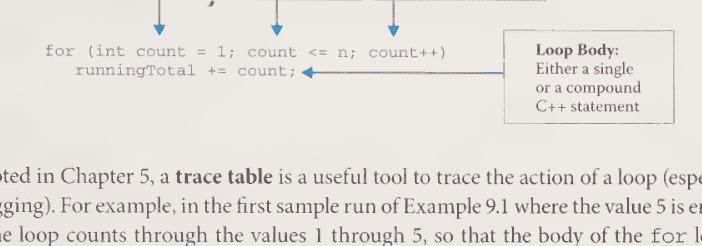

如第 5 章所述，跟踪表是跟踪循环动作的有用工具（尤其是在调试时）。例如，在示例 9.1 的第一个示例运行中输入 n 的值为 5 时，循环会遍历 1 到 5 的值，因此 for 循环的主体执行五次。以下表格显示了函数 sum() 执行时各个变量和循环条件的值：

| count | n | count <= n | Action | runningTotal |
|---|---|---|---|---|
| 1 | 5 | true | Execute loop body | 1 |
| 2 | 5 | true | Execute loop body | 3 |
| 3 | 5 | true | Execute loop body | 6 |
| 4 | 5 | true | Execute loop body | 10 |
| 5 | 5 | true | Execute loop body | 15 |
| 6 | 5 | false | Terminate repetition | 15 |

第二个示例运行中 n 的值为 100 的类似跟踪表将显示循环遍历 1 到 100 的值，因此循环主体执行 100 次。

有两种常用的 for 语句形式用于实现计数循环：一种是递增形式，循环控制变量递增，

```
for (int control_variable = initial_value;
    control_variable <= limit_value;
    increment_expression)
statement
```

另一种是递减形式，循环控制变量递减：

```
for (int control_variable = initial_value;
    control_variable >= limit_value;
    decrement_expression)
statement
```

第一种形式遍历递增范围，第二种形式遍历递减范围。

为了说明第一种形式，请考虑以下 for 语句：

```
for (int number = 1; number <= 10; number++)
    cout << number << '\t' << number * number << endl;
```

这里，number 是控制变量，初始值为 1，限制值为 10，增量表达式为 number++。此 for 循环将执行语句

```
cout << number << '\t' << number * number << endl;
```

对 number 在递增范围 1 到 10 中的每个值执行一次。在第一次循环时，number 的值为 1；在第二次循环时，其值为 2；依此类推，直到最后一次循环时 number 的值为 10。因此，产生的输出为

```
1    1
2    4
3    9
4    16
5    25
6    36
7    49
8    64
9    81
10   100
```

通过使用适当的增量表达式，可以使用 for 语句以 1 以外的增量大小遍历值范围。例如，for 语句

```
for (int number = 0; number <= 100; number += 20)
    cout << number << '\t' << number * number << endl;
```

使用表达式

```
number += 20
```

以 20 的增量向上计数，产生输出

```
0    0
20   400
40   1600
60   3600
80   6400
100  10000
```

for 循环的第二种形式在每次执行循环体后执行递减操作。例如，以下循环

```
for (int number = 10; number >= 6; number--)
cout << number << '\t' << number * number << endl;
```

| number | number * number |
|--------|-----------------|
| 10     | 100             |
| 9      | 81              |
| 8      | 64              |
| 7      | 49              |
| 6      | 36              |

请注意，虽然递增形式只要控制变量小于或等于限制值就继续重复，递减形式是向下计数，因此只要控制变量大于或等于限制值就必须继续重复。

尽管前面的示例使用了 int 变量来控制重复，但这不是必需的。例如，以下 for 语句

```
for (double x = 0; x <= 1; x += 0.1)
cout << x << '\t' << exp(x) * sin(x) << endl;
```

| x | exp(x) * sin(x) |
| --- | --- |
| 0 | 0 |
| 0.1 | 0.110333 |
| 0.2 | 0.242655 |
| 0.3 | 0.398911 |
| 0.4 | 0.580944 |
| 0.5 | 0.790439 |
| 0.6 | 1.02885 |
| 0.7 | 1.2973 |
| 0.8 | 1.59651 |
| 0.9 | 1.92667 |
| 1 | 2.28736 |

前述 for 循环示例中的循环条件使用了 <= 或 >= 来测试控制变量的值是否达到其限制值。在某些问题中，使用 < 代替 <= 或 > 代替 >= 可能更自然。例如，在遍历圆的（整数）度数数的循环中，写

```
for (int degrees = 0; degrees < 360; degrees++)
```

比使用 degrees <= 359 作为循环条件更直观。

事实上，在某些问题中，我们甚至可能不知道控制变量的限制值。例如，要计算并打印连续整数的所有和，1、1 + 2、1 + 2 + 3、……，直到该和超过 1000，我们可以使用以下 for 循环：

```
int sum = 0;
for (int count = 1; sum <= 1000; count++)
{
    sum += count;
    cout << sum << endl;
}
```

### 9.2.1 Nested for Loops

出现在 for 语句内的语句本身可能是一个 for 语句；即一个 for 循环可能嵌套在另一个 for 循环内。当这种情况发生时，两个循环的行为有点像时钟的指针：

```
for (int hours = 1; hours <= 12; hours++)
    for (int minutes = 0; minutes < 60; minutes++)
        cout << hours << ':'
             << setw(2) << setfill('0') << minutes << endl;
```

内部“minutes”循环对外部“hours”循环的每次执行执行六十次：

```
1:00
1:01
1:02
.
.
.
1:59
2:00
2:01
2:02
.
.
.
2:59
3:00
.
.
.
12:59
```

内部循环因此像时钟的分针一样作用，外部循环像时钟的时针一样作用。

为了了解嵌套循环如何有用，请考虑打印乘法表的问题，通过计算并显示形如 x * y 的乘积，对范围 1 到 lastX 中的每个 x 和范围 1 到 lastY 中的每个 y 都进行计算（其中 lastX 和 lastY 是任意整数）。这样的乘法表可以使用嵌套 For 语句轻松生成，如示例 9.4 所示。

### Example 9.4 Multiplication Tables

```
/* This program calculates and displays a multiplication table.

Input: lastX and lastY, the largest numbers to be multiplied
Output: a list of products: 1*1 ... lastX * lastY
------------------------------------------------------------*/

#include <iostream>      // cout, cin, <<, >>
#include <iomanip>       // right, setw()
using namespace std;

int main()
{
    cout << "This program constructs a multiplication table\n"
         "for the values 1*1 through lastX*lastY.\n\n";

    int lastX,           // the largest numbers being multiplied
        lastY,
        product;         // the product of the two numbers

    cout << "Enter two integer limit values (lastX and lastY): ";
    cin >> lastX >> lastY;

    cout << "|";
    for (int y = 1; y <= lastY; y++)
        cout << right << setw(5) << y;
    cout << "\n---";
    for (int y = 1; y <= lastY; y++)
        cout << "-----";
    cout << endl;

    for (int x = 1; x <= lastX; x++)
    {
        cout << setw(3) << x << "|";
        for (int y = 1; y <= lastY; y++)
        {
            product = x * y;
            cout << setw(5) << product;
        }
        cout << "\n";
        if (x < lastX) cout << " |\n";
    }
}
```


```
for (double x = 0; x != 1; x += 0.1)
    cout << x << '\t' << exp(x) * sin(x) << endl;
```

将终止条件 x <= 1 改为 x != 1。 在对该语句的以下执行中，for 循环永远未终止：

```
0       0
0.1     0.110333
0.2     0.242655
0.3     0.398911
0.4     0.580944
0.5     0.790439
0.6     1.02885
0.7     1.2973
0.8     1.59651
0.9     1.92667
1       2.28736
1.1     2.67733
1.2     3.09448
1.3     3.53558
1.4     3.9962
.       .
.       .
.       .
709.6   -5.83067e+307
709.7   -4.88986e+307
709.8   -inf
709.9   -inf
.       .
.       .
```

其原因在于，正如我们在第 3.3 节中所看到的，大多数实值都无法精确存储。 特别是 0.1 就是这样一个实数，其在内存中存储的值并不完全等于 0.1。 因此，当该值被反复用于递增 x 时，x 的值不再精确，并且永远不等于可以精确存储的终止值 1。

## 9.2.3 永真循环

for 语句主要用于实现计数循环，其中重复次数是已知的或可以预先计算的。 然而，正如我们之前所指出的，有许多问题无法确定需要多少次重复。 对于这些情况，需要一种提供无限重复的语句，即允许任意次数的重复而无需预先指定。

尽管某些编程语言为无限循环提供单独的语句，但 C++ 并未提供，而是允许程序员从其他循环构造此类循环。 一种方法是删除 for 循环的初始化表达式、循环条件和步进表达式，如以下通用形式所示：¹

### 永真循环

#### 形式：

```
for ( ; ; ) // forever loop
    statement
```

其中
    statement 通常是复合语句。

#### 行为：

指定的语句将被执行不确定的次数，直到它被终止，通常是由其包含的 if-break 或 if-return 组合终止的，或由用户干预终止。

如果遇到 break 语句，则循环的执行将终止，并继续执行循环之后的语句。

如果遇到 return 语句，则循环及其包含的函数将终止，控制权返回到调用函数。

我们将此类循环称为永真循环，因为它不包含内置的循环条件来指定何时应终止重复。 它是一个不确定的循环，执行其体内的语句，直到其中一个语句导致其停止。²

为了说明，请考虑以下内容：

```
for ( ; ; ) // forever loop
    cout << "Help ! I'm stuck in a loop!\n";
```

该语句将产生输出

```
Help ! I'm stuck in a loop!
Help ! I'm stuck in a loop!
Help ! I'm stuck in a loop!
Help ! I'm stuck in a loop!
.
.
.
```

无限多次，除非用户中断执行，通常是通过按下 Control 和 C 键。

为了防止此类无限循环，永真循环的主体通常是包含复合语句，除了我们一直在使用的通常会被重复执行的语句外，还包含一个语句，当满足某个条件时将终止循环的执行。 该终止语句通常是 **if-break 组合**——包含 break 语句的 if 语句，

```
if (condition) break;
```

当 *condition* 变为真时，break 语句导致重复停止，控制权转移到循环之后的语句。 为了将其与我们所说的其他循环的循环条件区分开来，我们将其称为 **终止条件** 而不是循环条件。

因此，大多数永真循环具有以下形式：

```
for (;;)                     // loop:
{
    statement_list
    if (termination_condition) break;
    statement_list2
}                            // end loop
```

其中 *statement_list₁* 或 *statement_list₂* 可以为空。

为了说明永真循环，这里有一个有用的实用函数 getMenuChoice()，它接收一个菜单以及表示菜单上第一个和最后一个选择的字符。 该函数的先决条件是菜单选择是一个闭合范围，例如 A–D。 它反复显示菜单并读取用户的选择，直到该选择在有效选择的范围内：

```
char getMenuChoice(string MENU,
                    char firstChoice, char lastChoice)
{
    char choice;                    // what the user enters
    for (;;)                        // loop:
    {
        cout << MENU;               // statement_list1
        cin >> choice;

        // if break combination
        if ((choice >= firstChoice) && (choice <= lastChoice))
            break;

        // statement_list2
        cerr << "\nI'm sorry, but " << choice
             << " is not a valid menu choice.\n";
    }                               // end loop
    return choice;
}
```

这里的效果是将用户“锁定”在永真循环内部，直到输入有效的菜单选择。 对于每次无效的菜单选择，终止条件为假，因此 break 语句被绕过，输出语句显示错误消息，控制权返回到循环的开头进行下一次重复，并给用户另一次机会。

当输入有效选择时，终止条件变为真，因此执行 break 语句并将控制权转移到循环之后的 return 语句。

与 break 相关且有时用于修改循环执行但不终止循环的语句是 continue 语句。 当执行它时，当前迭代被终止并开始新的迭代。 continue 语句在想要在某个条件为真时跳到循环底部的部分时很有用：

```
for (...)
{
    ...
    if (condition) continue;
    // Skip from here to end of loop body if
    // condition is true and begin a new iteration
}
```

### 9.2.3.1 从循环返回

对于 getMenuChoice() 中的永真循环，一个替代且更清晰的终止条件是当条件为真时立即返回函数，而不是跳出循环到 return 语句：

```
char getMenuChoice(string MENU,
                    char firstChoice, char lastChoice)
{
    char choice;                    // what the user enters
    for (;;)                        // loop:
    {
        cout << MENU;               // statement_list1
        cin >> choice;

                                    // if break combination
        if ((choice >= firstChoice) && (choice <= lastChoice))
            return choice;

                                    // statement_list2
        cerr << "\nI'm sorry, but " << choice
             << " is not a valid menu choice.\n";
    }                               // end loop
}
```

与之前一样，无效选择会产生错误消息并且循环体被重复。 有效选择会导致执行 return 语句，从而不仅终止循环而且终止函数。

## 9.3 while 循环

形式为

```
loop
    if (termination_condition) exit the loop.
    other statements
end loop
```

的循环，其中终止测试在循环语句执行之前进行，称为预测试或顶部测试循环。 尽管此类循环可以使用永真循环在 C++ 中实现，

```
for (;;)            // loop:
{
    if (termination_condition) break;
    statement_list
}                   // end loop
```

我们在第 5.5 节中简要介绍的 while 循环提供了一个更简单的替代方案。 我们将使用 while 循环来解决以下问题。

### 9.3.1 示例：追踪弹跳球

假设当球从人行道上掉落并反弹时，它达到的高度为其前一次高度的一半。 示例 9.5 中的程序模拟了球从输入到程序的给定高度掉落时的行为。 它显示每次反弹的编号和高度，直到高度小于设为 1 毫米的常数 SMALL_NUMBER。

### 示例 9.5 弹跳球

```
/* This program calculates and displays the rebound heights of a dropped ball.

Input:  a height in meters from which a ball is dropped.
Output: for each rebound of the ball from the pavement below:
        the number and the height of that rebound
        assuming that the height of each rebound is
        one-half the previous height
----------------------------------------------------------*/
```

```
#include <iostream>            // <<, >>, cout, cin
using namespace std;

int main()
{
    const double SMALL_NUMBER = 1.0e-3; // 1 millimeter
```

3 一个 for 循环也可以使用：

```
for (int bounce = 0; height >= SMALL_NUMBER; bounce++)
{
    height /= 2;
    cout << "Rebound # " << bounce << ": "
         << height << " meters" << endl;
}
```


```
cout << "This program computes the number and height\n" << "of the rebounds of a dropped ball.\n";

cout << "\nEnter the starting height (in meters): "; double height;
cin >> height;
cout << "\nStarting height: " << height << " meters\n";

int bounce = 0;
while (height >= SMALL_NUMBER)
{
    height /= 2.0;
    bounce++;
    cout << "Rebound # " << bounce << ": " << height << " meters" << endl;
}
```

### SAMPLE RUN:

This program computes the number and height of the rebounds of a dropped ball.

Enter the starting height (in meters): 15

Starting height: 15 meters
Rebound # 1: 7.5 meters
Rebound # 2: 3.75 meters
Rebound # 3: 1.875 meters
Rebound # 4: 0.9375 meters
Rebound # 5: 0.46875 meters
Rebound # 6: 0.234375 meters
Rebound # 7: 0.117188 meters
Rebound # 8: 0.0585938 meters
Rebound # 9: 0.0292969 meters
Rebound # 10: 0.0146484 meters
Rebound # 11: 0.00732422 meters
Rebound # 12: 0.00366211 meters
Rebound # 13: 0.00183105 meters
Rebound # 14: 0.000915527 meters

## 9.3.2 The while Statement

While loops are implemented in C++ using a while statement of the following form:

# THE while STATEMENT

Form:

```
while (loop_condition)
    statement
```

where
while is a C++ keyword;
loop_condition is a boolean expression; and
statement is a simple or a compound statement.

# Behavior:

When execution reaches a while statement:

+   1. loop_condition is evaluated.
+   2. If loop_condition is true:
+      a. The specified statement, called the body of the loop, is executed.
+      b. Control returns to Step 1.
+   Otherwise
+   Control is transferred to the statement following the while statement.

As in a for loop, the loop condition in a while loop is placed before the body of the loop, which means that a while loop is a pretest loop:

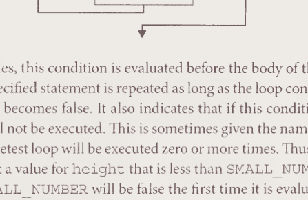

As this diagram indicates, this condition is evaluated before the body of the loop is executed, and execution of the specified statement is repeated as long as the loop condition remains true and terminates when it becomes false. It also indicates that if this condition is initially false, the body of the loop will not be executed. This is sometimes given the name zero-trip behavior because the body of a pretest loop will be executed zero or more times. Thus, in the program in Example 9.5, if we input a value for height that is less than SMALL_NUMBER, the loop condition height >= SMALL_NUMBER will be false the first time it is evaluated, and the statements in the while loop will not be executed. It is important to keep this zero-trip behavior in mind when trying to decide which loop to use in designing a solution for a problem.

## 9.4 THE do STATEMENT

In the last section, we considered pretest (or test-at-the-top) loops of the form

```
loop
    if (termination_condition) exit the loop.
    other statements
end loop
```

and saw that while loops have this structure. Such loops are said to have zero-trip behavior because they will make zero “trips” through the loop if the termination condition is false initially.

There are some problems, however, for which zero-trip behavior is not appropriate and at least one pass through the loop is mandatory. For such problems, we need a posttest loop of the form

```
loop
  other statements
  if (termination_condition) exit the loop.
end loop
```

and in this section we will look at C++’s implementation of posttest loops.

### 9.4.1 Example: How Many Digits?

It is easy for us to determine the number of digits in an integer, whether it is 214 or 2147483647, simply by scanning it and counting. But how do we construct a program that can “scan and count” the digits?

Our approach will be to repeatedly divide the number by 10, counting how many times it takes to produce 0. For example, 214 has three digits, and three integer divisions by 10 are required to reach 0:

| The int value | Operation I Divide by 10 | Operation II Add 1 to Digit Count |
|---|---|---|
| 214 | 214/10 = 21 | 0 + 1 = 1 |
| 21 | 21/10 = 2 | 1 + 1 = 2 |
| 2 | 2/10 = 0 | 2 +1 = 3 |

The key observation in the preceding computation is that we must perform the two operations at least once because every integer has at least one digit. Thus, the loop that we use must make at least one pass through its body—one-trip behavior. Putting the loop condition at the “bottom” of the loop, as in the following algorithm, will accomplish this.

# Algorithm to Count Digits

+   1. Initialize digitCount to 0.
+   2. Loop:
+      a. Increment digitCount.
+      b. Divide intValue by 10, storing the result in intValue.
+      c. If intValue is 0, terminate the repetition.
+   End loop

3. Return numDigits.

The loop in this algorithm can be implemented with a forever loop:

```
for (; ;)
{
    numDigits++;
    intValue /= 10;
    if (intValue == 0) break;
}
```

But as with the test-at-the-top loops in the preceding section, C++ provides a clearer alternative—the do statement. Example 9.6 illustrates its use.

## Example 9.6 Digit Counter

```
/* This program uses the function digitsIn() to find the number of digits in an integer value.

Input: an integer
Output: the number of digits in the integer
----------------------------------------------------------*/

#include <iostream>                     // <<, >>, cout, cin
using namespace std;

int digitsIn(int intValue);

int main()
{
    int theValue;

    cout << "Enter an integer value: ";
    cin >> theValue;
    cout << theValue << " contains "
         << digitsIn(theValue) << " digit(s).\n";
}

/* Function to count the digits in an integer value.

Receive: intValue, an integer value
Return: intDigits, the number of digits in intValue
----------------------------------------------------------*/

int digitsIn(int intValue)
{
    int numDigits = 0;
```

```
do
{
    numDigits++;
    intValue /= 10;
}
while (intValue != 0);

return numDigits;
}
```

# SAMPLE RUNS:

Enter an integer value: 5
5 contains 1 digit(s).

Enter an integer value: 12345678
12345678 contains 8 digit(s).

### 9.4.2 A Posttest Loop

The function in Example 9.6 uses a new C++ repetition statement, the do statement, which has the following form:

# THE do STATEMENT

# Form:

```
do
    statement
while (loop_condition);
```

where
do and while are C++ keywords;
loop_condition is a boolean expression;
statement is a simple or a compound statement; and
a semicolon must follow the expression at the end of the statement.

# BEHAVIOR:

When execution reaches a do loop:

+   1. statement is executed.
+   2. loop_condition is evaluated.
+   3. If loop_condition is true, then
+      Control returns to Step 1.
+      Otherwise
+      Control is transferred to the statement following the do loop.

Note that the loop condition in a do statement appears after the body of the loop, as pictured in the following diagram:


This means that a do loop is a posttest or test-at-the-bottom loop and has one-trip behavior; that is, the body of the loop will be executed at least once.

## 9.5 INPUT LOOPS

One important use of loops is to input a collection of values into a program. Because the number of data values may not be known before repetition begins, we need some method to signal that the end of the data has been reached. In this section, we look at three different approaches: counting, sentinels, and queries. To illustrate how these three techniques are used, we will use each of them in solving the problem of calculating the average of a set of failure times.

### 9.5.1 Running Example: Mean Time to Failure

One important statistic that is used in measuring the reliability of a component in a circuit is the mean time to failure, which can be used to predict the circuit’s lifetime. This is especially important in situations in which repair is difficult or even impractical, such as a computer circuit in a satellite. Suppose that an engineering laboratory has been awarded a contract by NASA to evaluate the reliability of a particular component for a space probe to Mars. As part of this evaluation, several of these circuits have been tested, and the times at which each failed have been recorded. We are to develop a program to process this data and determine the mean time to failure.

We will solve this problem in three different ways to illustrate the three kinds of input loops—a counting approach, a query-based approach, and a sentinel-based approach. Each will involve performing the following tasks (but not necessarily in the order listed):

- Determine the number of components (numComponents)
- Repeatedly input a failure time (failureTime)
- Find their sum (failureTimeSum)
- If numComponents is not zero, divide the sum by numComponents to find the mean failure time (meanFailureTime); otherwise, display an appropriate “No Data” message.


## 9.5.2 输入循环：计数法

处理一组输入值最简单的方法之一是先输入数据集中值的数量，然后使用计数循环读取并处理该数量的值。示例 9.7 中的程序采用了这种方法。

## 示例 9.7 计数法

```
/* This program uses a counting loop to process a collection of
   failure times and find the mean time to failure.

   Input:  the number of component failure times and the collection
           of failure times
   Output: prompts and the average of the failure times
--------------------------------------------------------------------------*/

#include <iostream>          // <<, >>, cout, cin
using namespace std;

int main()
{
    cout << "Computing Component Mean Time to Failure\n\n";

    int numComponents;
    double failureTime,
           failureTimeSum = 0.0;

    cout << "How many failure times will be entered? ";
    cin >> numComponents;

    for (int count = 1; count <= numComponents; count++)
    {
        cout << "Enter failure time #" << count << ": ";
        cin >> failureTime;
        failureTimeSum += failureTime;
    }

    if (numComponents > 0)
        cout << "\nThe mean failure time of the "
             << numComponents << " components is "
             << failureTimeSum / numComponents << endl;
    else
        cerr << "\nNo failure times to process!\n";
}
```

## 示例运行：

Computing Component Mean Time to Failure

How many failure times will be entered? 5
Enter failure time #1: 2.3

```
#include <iostream>            // <<, >>, cout, cin
using namespace std;

int main()
{
    cout << "Computing Component Mean Time to Failure\n\n";
    int numComponents = 0;
    double failureTime,
           failureTimeSum = 0;
    for (;;)            // or while (true)
    {
        cout << "Enter a failure time (-1 to quit): ";
        cin >> failureTime;

        if (failureTime < 0) break;

        failureTimeSum += failureTime;
        numComponents++;
    }

    if (numComponents != 0)
        cout << "\nThe mean failure time of the "
             << numComponents << " components is "
             << failureTimeSum / numComponents << endl;
    else
        cerr << "\nNo failure times to process!\n";
}
```

## 示例运行：

Computing Component Mean Time to Failure

Enter a failure time (-1 to quit): 2.3
Enter a failure time (-1 to quit): 2.4
Enter a failure time (-1 to quit): 2.5
Enter a failure time (-1 to quit): 2.6
Enter a failure time (-1 to quit): 2.1
Enter a failure time (-1 to quit): -1

The mean failure time of the 5 components is 2.38

正如永远循环开始处的注释所指出的，也可以使用 while 语句来实现输入循环：

```
while(true)
{
    cout << "Enter a failure time (-1 to quit): ";
    cin >> failureTime;

    if (failureTime < 0) break;
```

```
failureTimeSum += failureTime;
numComponents++;
}
```

如果我们检查这个以及之前的示例的相似之处，会看到以下模式：

## 哨兵输入循环的模式（永远循环版本）

```
for (;;)            // or while(true)
{
    Display a prompt (for a data value).
    Read theValue to be processed.
    If (theValue is the sentinel) terminate the repetition.
    Process theValue.
}
```

这种模式提供了一种简洁直观的方式来输入任何存在哨兵值的数据集。

## 9.5.3.2 While 循环与哨兵

一些程序员更喜欢不使用永远循环，而是选择第 9.3 节中描述的“标准” while 循环。我们在第 5.5 节中给出了使用 while 循环输入二次方程系数并输出解（如果没有解则输出错误消息）的示例。基于 while 的此类输入的一般模式如下：

## 哨兵输入循环的模式（while 循环版本）

```
Display a prompt (for a data value).
Read theValue to be processed.
while (theValue is not the sentinel)
{
    Process theValue.
    Display a prompt (for a data value).
    Read theValue to be processed.
}
```

例如，示例 9.8 中平均失效时间程序中使用的哨兵循环的 while 循环版本将写成如下形式：

```
cout << "Enter a failure time (-1 to quit): ";
cin >> failureTime;
while (failureTime >= 0)
{
    failureTimeSum += failureTime;
    numComponents++;
}
```

```
cout << "Enter a failure time (-1 to quit): ";
cin >> failureTime;
}
```

请注意循环前和循环底部的两个输入步骤。循环前的输入语句是必需的，因为 while 循环是先测试循环，在进入循环时测试其条件。循环底部的输入语句是必需的，以便在执行返回到循环开始时输入可与哨兵比较的新值。

## 9.5.3.3 以文件结尾作为哨兵值

对于某些问题，可能没有合适的哨兵值，因为所有值都是有效输入。在这种情况下，可以使用接下来描述的查询方法。但还有另一种替代方法。在第 7 章中，描述了一些 istream 对象的状态标志，例如 cin，用于监控流的状态。除此之外，还有一个 eof 标志，当读取称为文件结尾（或 eof）标记的特殊字符时设置，以及一个名为 eof() 的函数，用于监控此标志，如果 eof 标志已设置则返回 true，否则返回 false。

此函数可像哨兵测试一样使用，以检查是否输入了 eof 标记，如示例 9.9 所示，表明输入结束。对于示例运行中使用的特定（Unix）系统，eof 标记是 Control-d，因此输入它会在 cin 中设置 eof 标志，导致函数成员 cin.eof() 返回 true，从而终止重复。（对于第 11 章中描述的文件输入，文件结尾标记在文件创建时会自动放置在文件末尾。）

## 示例 9.9 使用文件结尾作为哨兵

```
/* This failure-time program uses a forever loop and the eof character as a sentinel to process a collection of failure times and find the mean time to failure.

Input: a collection of component failure times
Output: prompts and the average of the failure times
-----------------------------------------------------------*/
```

```
#include <iostream>        // <<, >>, cout, cin, eof()
using namespace std;
```

```
int main()
{
    cout << "Computing Component Mean Time to Failure\n\n";
    int  numComponents = 0;
    double failureTime,
           failureTimeSum = 0;
```

```
for (;;)            // or while (true)
{
    cout << "Enter a failure time (eof char to quit): ";
    cin >> failureTime;

    if (cin.eof()) break;

    failureTimeSum += failureTime;
    numComponents++;
}

if (numComponents != 0)
    cout << "\nThe mean failure time of the "
         << numComponents << " components is "
         << failureTimeSum / numComponents << endl;
else
    cerr << "\nNo failure times to process!\n";
}
```

## 示例运行：

Computing Component Mean Time to Failure

Enter a failure time (eof char to quit): 2.3
Enter a failure time (eof char to quit): 2.4
Enter a failure time (eof char to quit): 2.5
Enter a failure time (eof char to quit): 2.6
Enter a failure time (eof char to quit): 2.1
Enter a failure time (eof char to quit): ^d
The mean failure time of the 5 components is 2.38

使用 eof 标记作为哨兵有两个缺点。第一个是它依赖于平台，即取决于所使用的特定操作系统。第二个是，如第 7.3 节所述，如果我们希望在读取 eof 标记后读取任何值，则必须调用 istream 函数成员 clear() 来重置状态标志。

## 9.5.4 输入循环：查询方法

前面每种输入循环都有其缺点。计数循环方法要求事先知道要输入值的数量。哨兵方法只能用于存在合适哨兵值的问题中。eof 标记依赖于平台。我们考虑的最后一种方法是，在每次重复结束时查询用户以确定是否还有更多数据需要处理。虽然并非没有缺点，但这种方法是最广泛适用的。

示例 9.10 中的程序是使用这种查询方法的前述平均失效时间程序的修改。在用户输入数据值后，程序会询问

Do you have more data to enter (y or n)?


然后从键盘读取用户的响应。如果是 y 或 Y，则读取另一个数据值。这会一直继续，直到用户回答的不是 y 或 Y 为止，并且循环条件

```
response == 'y' || response == 'Y'
```

然后终止重复。

## 示例 9.10 查询方法

```
/* This program uses a query-controlled loop to process a collection of failure times and find the mean time to failure.

    Input:  a collection of component failure times and user's
            response to "more data?" query
    Output: prompts and the average of the failure times
--------------------------------------------------------------------------*/

#include <iostream>          // <<, >>, cout, cin
using namespace std;

int main()
{
    cout << "Computing Component Mean Time to Failure\n\n";

    int numComponents;
    double failureTime,
           failureTimeSum = 0.0;

    char response;
    do
    {
        cout << "\nEnter a failure time: ";
        cin >> failureTime;

        failureTimeSum += failureTime;
        numComponents++;

        cout << "Do you have more data to enter (y or n)? ";
        cin >> response;
    }
    while (response == 'y' || response == 'Y');

    cout << "\nThe mean failure time of the "
         << numComponents << " components is "
         << failureTimeSum / numComponents << endl;
}
```

### SAMPLE RUN:

Computing Component Mean Time to Failure

Enter a failure time: 2.3
Do you have more data to enter (y or n)? y

Enter a failure time: 2.4
Do you have more data to enter (y or n)? y

Enter a failure time: 2.5
Do you have more data to enter (y or n)? y

Enter a failure time: 2.6
Do you have more data to enter (y or n)? y

Enter a failure time: 2.1
Do you have more data to enter (y or n)? n

The mean failure time of the 5 components is 2.38

在合理假设至少有一个数据值需要输入和处理的问题中，查询和相应的循环条件放在循环底部，使其成为后测循环。⁵ 这提示了查询控制输入循环的以下模式：

# 查询控制输入循环模式

```
char response;
do
{
    Display a prompt for a data value.
    Read the Value to be processed.
    Process the Value.
    Display a query that asks if there is more data.
    Input the user's response (y or n)
}
while ((response != 'n' && (response != 'N')));
```

⁵ 若要允许不输入和处理任何值，可使用无限循环：

```
for (;;)
{
    cout << "\nDo you wish to continue (y or n)? ";
    char response;
    cin >> response;
    if (response == 'n' || response == 'N') break;
    cout << "\nEnter a value: ";
    double value;
    cin >> value;
    // process value
}
```

### 9.5.4.1 查询函数

执行查询的代码往往会使循环变得杂乱，从而可能掩盖程序的结构，特别是当查询较长时，也许是由于向用户提供了特殊说明。避免这种情况的一种方法是使用如下的查询函数来执行查询、读取用户的响应，并根据响应返回 true 或 false，从而隐藏实际执行查询的代码：

```
bool moreData()
{
    char answer;
    cout << "Do you have more values to enter (y or n)? ";
    cin >> answer;
    return (answer == 'y') || (answer == 'Y');
}
```

由于它返回布尔值，因此对该查询函数的调用可作为循环条件使用。例如，我们可以修改示例 9.10 的平均失效时间程序，使用查询函数 moreData() 来控制输入循环：

```
int main()
{
    .
    .
    .
    do
    {
        cout << "\nEnter a failure time: ";
        cin >> failureTime;
        failureTimeSum += failureTime;
        numComponents++;
    }
    while ( moreData() );
    .
    .
    .
}
```

每次执行到达循环条件时，都会调用函数 moreData()。它查询用户，读取响应，如果响应为 y 或 Y 则返回 true，否则返回 false。如果 moreData() 返回 true，则 do 循环的主体会被重复，但如果返回 false，则终止重复。

```
initialization statements
Loop
    statement₁
    .
    .
    .
    statementₙ
End loop
```

最后，制定适当的终止条件。然后，确定它在循环中的放置位置将决定使用哪种循环：

如果终止条件出现在

- 循环开头，则为预测循环；选择 while 循环；
- 循环底部，则为后测循环；选择 do 循环；
- 语句列表内部，则为中途测试循环；选择带有 if-break（或 if-return）组合的无限循环。

为了演示此过程，让我们再次回顾第 9.3 节中的弹跳球问题。使用通用循环，我们可能会使用以下作为算法的第一个版本：

- 1. 将 bounce 初始化为 0。
- 2. 输入 height 的值并显示它。
- 3. 循环
  a. 用 height 除以 2 的结果替换 height。
  b. 将 bounce 增加 1。
  c. 显示 bounce 和 height。
  结束循环

作为循环的终止条件，我们可以使用

```
height < SMALL_NUMBER
```

因为当 height 小于某个 SMALL_NUMBER 时应停止重复。然而，用户可能为 height 输入零或负值，在这种情况下不应执行循环体。因此，我们应在进入循环时立即评估此条件：

- 1. 将 bounce 初始化为 0。
- 2. 输入 height 的值。

# 章节总结

# 关键术语

analysis of algorithms
break statement
continue statement
counting (or counter-controlled) loops
do loop
do statement
end-of-data flag
end-of-file mark
for loop
forever loop
grows linearly
if-break combination
indefinite loop

initialization list
nested loops
one-trip behavior
posttest loop
pretest loop
query-controlled loop
query function
sentinel
test-at-the-bottom loop
termination condition
trace table
while loop
zero-trip behavior

# 注释

- 追踪表是追踪循环行为的有用工具（尤其在调试时）。
- for 语句可通过使用适当的增量表达式以任意增量遍历值范围。
- 不定循环可在 C++ 中使用没有循环条件的 for 语句实现——for(;;){ ... }——或可使用形式为 while(true){ ... } 的 while 语句。
- 无限循环在终止条件为假时继续重复，在该条件为真时终止重复。
- break 语句可用于终止封闭循环的执行。它终止最内层的封闭循环。
- 在某些情况下，return 语句是用于终止函数执行并返回到调用函数的 break 的有用替代方案。
- continue 语句可用于跳过当前迭代的其余部分并开始新的迭代。

- *while* 循环是预测（或测试在顶部）循环。它只要条件为真就继续重复，在条件为假时终止重复。while 循环具有 *零次遍历* 行为。

- *do* 循环是后测（或测试在底部）循环。由于其循环体在测试循环条件之前总是至少执行一次，因此说它具有 *一次遍历* 行为。

- 三种常见的输入循环是：

- *计数* 循环，其中输入项的数量事先已知；

- *哨兵控制* 循环，其中结束数据标志（或哨兵）表示数据的结束；

- *查询控制* 循环，其中询问用户是否还有更多数据。

- 以下准则可能有助于决定使用哪种循环：

1. 如果算法需要遍历某个固定值范围，请使用计数循环。

2. 如果需要通用循环，请使用通用不定循环来制定算法。然后确定终止条件应放在何处。如果在开头，使用 while 循环；如果在结尾，使用 do 循环；如果在其他位置，使用带有 if-break 或 if-return 的无限循环。

# 风格和设计提示

在本教材中，我们对本章讨论的重复语句采用以下格式约定。

- for、while、do 和 forever 循环中的语句会被缩进。如果语句是复合语句，花括号与 for、while 或 do 对齐，块内的语句会被缩进。在 do 循环中，do 与其对应的 while 对齐。

```
for (...)
    statement

while(loop_condition)
    statement
```

```
for (...)
{
    statement₁
    ...
    statementₙ
}

while(loop_condition)
{
    statement₁
    ...
    statementₙ
}
```


and thus will display only a single value,

```
100
```

Likewise, the statement that increments count in the following is outside the body of the loop:

```
int count = 1;
while (count <= 10)
    cout << count << " " << count*count << endl;
    count++;
```

and an infinite loop results:

```
1 1
1 1
1 1
.
.
.
```

+   4. 在 do 循环中，结束的 while (loop_condition) 必须后跟一个分号。

+   5. 在 for 循环中，控制变量以及循环条件中的变量通常不应在循环体内部被修改，因为其目的是遍历指定范围的连续值。否则可能会产生奇怪且不期望的结果。

+   6. 循环条件中每次使用等号运算符都应仔细检查，以确保没有使用赋值运算符。 使用 = 而不是 == 是最容易犯的错误之一。以下示例说明了此错误：

```
do
{
    // ... do some processing ...
    cout << "Do you wish to continue (y or n)? ";
    cin >> answer;
}
while (answer = 'y');
```

此循环将无限次执行，无论用户输入什么，因为

+   a. 循环条件是一个赋值，将 answer 设置为 y（它不是比较）；

+   b. 赋值运算符 (=) 会产生其结果所赋的值；

+   c. 此赋值因此产生值 121（字符 y 的 ASCII 值）；并且

+   d. C++ 将任何非零值视为 true。

## Programming in C++ for Engineering and Science

同样，永远循环

```
for
{
cout << "\nPlease enter an integer value (0 to quit): ";
cin >> value;
if (value = 0) break;
// ... do something with value ...
}
```
是一个无限循环，因为其终止条件是一个赋值，而不是比较。由于该赋值的結果为零，在 C++ 中表示 false，因此该终止条件将始终为 false，而 break 语句永远不会被执行。

### TEST YOURSELF

+   1. ______ 循环对指定范围内的每个值执行一组语句一次，并且它们在 C++ 中由 ______ 语句实现。
+   
+   2. 计数 for 循环的四个组成部分是什么？
+   
+   3. 永远循环中的终止语句通常是 ______ 组合。

Answer Questions 4-7 using “pretest” or “posttest.”

+   4. while 循环是 ______ 循环。
+   
+   5. do 循环是 ______ 循环。
+   
+   6. ______ 循环的主体总是至少执行一次。
+   
+   7. ______ 循环具有零次遍历行为。

For Questions 8-15, describe the output produced. For Exercises 11-15, assume that i, j, and k are of type int.

```
8. for (int i = 0; i < 10; i++)
   cout << "*" << i << " = " << 2*i << endl;
```

```
9. for (int i = 0; i <= 5; i++)
   cout << 2*i + 1 << " ";
   cout << endl;
```

```
10. for (int i = 1; i < 4; i++)
{
cout << i;
}
```

```
15. i = 4;
 do
 {
   k = i * i - 4;
   cout << i << ' ' << k << endl;
   i--;
 }
 while (k >= 0);
```

### Section 9.6

+   1. 命名三种输入循环。
+   2. 用于表示数据结束的特殊值称为 ______ 或 ______。
+   3. （真或假）使用 while 循环而不是永远循环进行基于哨兵的输入的一个缺点是需要重复输入步骤。
+   4. 当读取称为 ______ 标记的特殊字符时，eof 标志会被设置。
+   5. 方法 ______ 来自类 istream 用于检查 eof 标志。
+   6. （真或假）使用 eof 标记的一个优点是它是平台无关的。
+   7. （真或假）计数输入方法是其中最灵活的方法之一。
+   8. ______ 是向用户提出的问题，以确定是否还有更多数据值。

### EXERCISES

### Section 9.4

For Exercises 1–14, describe the output produced. For Exercises 7–14, assume that i, j, and k are of type int.

```
1. for (int i = 10; i > 0; i--)
    cout << i << " cubed = " << i*i*i << endl;
```

```
2. for (int i = 10; i > 0; i -= 2)
    cout << i << " squared = " << i*i << endl;
```

```
3. for (int i = 1; i <= 5; i++)
 {
   cout << i << endl;
   for (int j = i; j >= 1; j -= 2)
     cout << j << endl;
 }
```

```
4. int k = 5;
    for (int i = -2; i < 5; i += 2)
    {
        cout << i + k << endl;
        k = 1;
    }
```

```
5. for (int i = 3; i > 0; i--)
    for (int j = 1; j <= i; j++)
        for (int k = i; k >= j; k--)
            cout << i << j << k << endl;
```

```
6. for (int i = 1; i <= 3; i++)
    for (int j = 1; j <= 3; j++)
    {
        for (int k = i; k <= j; k++)
            cout << i << j << k << endl; cout << endl;
    }
```

```
7. i = 5;
    j = 1;
    for (;;)
    {
        k = 2 * i - j;
        if (k < 0) break;
        cout << i << j << k << endl;
        j++;
        i--;
    }
    cout << i << j << k << endl;
```

```
8. i = 0;
    j = 10;
    for (;;)
    {
        k = 2 * i + j;
        if (k > 15) break;
        cout << i << j << k << endl;
        if (i + j < 10) break;
        i++;
        j--;
    }
    cout << i << j << k << endl;
```

```
9. i = 0;
    j = 10;
    for (;;)
    {
        k = 2 * i + j;
        if (k > 20) break;
        cout << i << j << k << endl;
        if (i + j < 10) break;
        i++;
        j--;
    }
    cout << i << j << k << endl;
```

```
10. i = 5;
    for (;;)
    {
        cout << i;
        i -= 2;
        if (i < 1) break;
        j = 0;
        for (;;)
        {
            j++;
            cout << j;
            if (j >= i) break;
        }
        cout << "###\n"
    }
    cout << "***\n";
```

```
11. k = 5;
    i = 32;
    while (i > 0)
    {
        cout << "base-2 log of " << i << " = " << k << endl;
        i /= 2;
        k--;
    }
```

```
12. i = 1;
    while (i*i < 10)
    {
        j = i;
```

```
while (j*j < 100)
{
    cout << i + j << endl;
    j *= 2;
}
    i++;
}
cout << "\n*** **\n";
```

```
13. i = 0;
    do
    {
        k = i * i * i - 3 * i + 1;
        cout << i << k << endl;
        i++;
    }
    while (k <= 2);
```

```
14. i = 0;
    do
    {
        j = i * i * i;
        cout << i;
        do
        {
            k = i + 2 * j;
            cout << j << k;
            j += 2;
        }
        while (k <= 10);
        cout << endl;
        i++;
    }
    while (j <= 5);
```

Each of the loops in the following program segment is intended to find the smallest value of number for which the product 1 × 2 × ⋯ × number is greater than limit. For each of Exercises 15–17, make three trace tables, one for each loop, that display the values of number and product for the given value of limit. Assume that number, product, and limit have been declared to be of type int.

```
/* A. Using a while loop */
    number = 0;
    product = 1;
```

```
```cpp
while (product <= limit)
{
    number++;
    product *= number;
}

/* B. Using a do loop */
number = 0;
product = 1;
do
{
    number++;
    product *= number;
}
while (product <= limit);

/* C. Using a test-in-the-middle loop */
number = 0;
product = 1;
for (;;)
{
    number++;
    if (product > limit) break;
    product *= number;
}
```
```

+   15. `limit = 20`
+   
+   16. `limit = 1`
+   
+   17. `limit = 0`

For Exercises 18–22, write a loop to do what is required.

+   18. 显示 x 的值并在 x 为正数时将 x 减少 0.5。
+   
+   19. 以递增顺序显示前 50 个正偶数整数的平方。
+   
+   20. 显示实数 1.0、1.25、1.5、1.75、2.0、……、5.0 的平方根。
+   
+   21. *Fibonacci 数* 序列以整数 1、1、2、3、5、8、13、21、…… 开始，其中每个数从第三个开始是前两个数的和。显示小于 500 的 Fibonacci 数。
+   
+   22. 不断提示并读取一个实数，直到用户输入一个正数。

For Exercises 23–27, write functions to do what is required. (You should also write driver programs to test your functions.)

+   23. 给定一个实数 *x* 和一个非负整数 *n*，使用循环计算 *xⁿ* 并返回该值。
+   24. 按照练习 23 的做法，但允许 *n* 为负数。 （如果 *n* < 0，*xⁿ* 定义为 1/*xⁿ*，前提是 *x* ≠ 0。）


25. 给定一个正整数 n，返回 n 的真约数之和，即小于 n 的约数之和。例如，对于 n = 10，该函数应返回 1 + 2 + 5 = 8。

26. 给定一个整数 n，如果 n 为质数则返回 true，否则返回 false。（质数是大于 1 的整数 n，其唯一约数是 1 和 n。）

27. 给定一个正整数 n，返回满足 2^k ≥ n 的最小非负整数 k。

## PROGRAMMING PROBLEMS

### Section 9.4

1. 编写一个程序显示以下乘法表：

|   | 1 | 2 | 3 | 4 | 5 | 6 | 7 | 8 | 9 |
|---|---|---|---|---|---|---|---|---|---|
| 1 | 1 |   |   |   |   |   |   |   |   |
| 2 | 2 | 4 |   |   |   |   |   |   |   |
| 3 | 3 | 6 | 9 |   |   |   |   |   |   |
| 4 | 4 | 8 |12 |16 |   |   |   |   |   |
| 5 | 5 |10 |15 |20 |25 |   |   |   |   |
| 6 | 6 |12 |18 |24 |30 |36 |   |   |   |
| 7 | 7 |14 |21 |28 |35 |42 |49 |   |   |
| 8 | 8 |16 |24 |32 |40 |45 |56 |64 |   |
| 9 | 9 |18 |27 |36 |45 |54 |63 |72 |81 |

2. 一艘总排水量为 M 公吨的船只在静水中从静止状态出发，在恒定的螺旋桨推力 T 千牛顿作用下航行。该船在水中运动的总阻力由 R = 4.50V² 给出，其中 R 以千牛顿为单位，V 以米每秒为单位。船的加速度为 A = (T − R)/M。由这些方程可推导出船速方程，

```
V = sqrt( T / 4.50 * (1 - e^(-9.00S/M)) )
```

其中 S 为以米为单位的距离。编写一个程序读取 M、T 和 S 的值，并显示 S 从 0 到 20 海里以 0.5 海里步长变化时 V 的值表（1 海里 = 1.852 km，1 节 = 1 海里每小时）。根据你的表格推断该船的最大可能速度。

3. 在运行过程中，机器中的一根杆会根据 θ = θ₀ sin(2πt / τ) 振荡，其中 θ 从杆的垂直位置起以弧度测量，θ₀ 是最大角位移，τ 是运动周期，t 是从 t = 0 时杆处于垂直位置起以秒为单位测量的时间。如果 l 是杆的长度，则杆端加速度的大小为

```
|a| = (4π² l θ₀ / τ²) * sqrt( θ₀² cos⁴(2πt / τ) + sin²(2πt / τ) )
```

编写一个程序读取 θ₀、l 和 τ 的值，然后计算 t = 0.0 到 0.5 以 0.05 步长（以秒为单位）时的 t、θ 和 |a| 值表。用 τ = 2 秒、θ₀ = π/2 和 l = 0.1 m 执行该程序。

4. 一个正整数如果其真约数之和小于、等于或大于该数，则分别称为亏数、完全数或盈数。例如，8 是亏数，因为其真约数是 1、2 和 4，且 1 + 2 + 4 < 8；6 是完全数，因为 1 + 2 + 3 = 6；12 是盈数，因为 1 + 2 + 3 + 4 + 6 > 12。编写一个程序将 n 分类为亏数、完全数或盈数，n 从 20 到 30，然后从 490 到 500，最后从 8120 到 8130。它应使用练习 25 中的函数来求真约数之和。额外：找出最小的奇盈数。警告：尝试寻找奇完全数可能会失败，因为迄今为止尚未发现奇完全数，尽管尚未证明此类数不存在。

5. Dispatch Die-Casting 目前每月生产 200 件铸件，每件实现利润 300 美元。该公司目前每月在研发上花费 20,000 美元，固定运营成本为每月 1000 美元，不取决于生产量。如果公司将研发支出翻倍，预计产量将增加 20%。编写一个程序在适当的标题下显示研发支出金额、生产的铸件数量和实现的利润总额。从公司当前状况开始，并依次将研发支出翻倍，直到总利润“超过峰值”，即开始下降。输出应包括利润开始下降前的金额。

6. 逼近任意正数 a 的平方根的除法-平均算法如下：取任意正的初始近似值 x，然后通过计算 x 和 a/x 的平均值，即 (x + a/x)/2 来求得新的近似值。用此新近似值替换 x 后重复此过程，直到 x 和 a/x 的绝对值之差小于指定的误差允许值，例如 0.00001。编写一个程序读取 x、a 和小的误差允许值的值，然后使用此除法-平均算法求 a 的近似平方根。让程序显示每次的近似值。用 a = 3 和误差允许值 = 0.00001 执行该程序，并使用以下初始近似值：1、10、0.01 和 100。也用 a = 4、误差允许值 = 0.00001 和初始近似值 1 和 2 执行该程序。

7. 编写一个程序接受一个正整数并给出其素数分解，即将整数表示为素数的乘积，或指出它是素数。（参见练习 26 中对素数的定义。）

8. 考虑一个半径为 30.0 英尺、高度为 30.0 英尺的圆柱形水库，通过直径为 12 英寸的管道进行充放水。该管道长 1000.0 英尺，并在比水库底部低 20.0 英尺的高度排放。该管道经测试粗糙系数为 0.0130。


已通过实验开发出多种公式来确定流体通过此类管道的流速。其中之一是曼宁公式，

```
V = 1.486 / N R^(2/3) S^(1/2)
```

其中

+   - V = 以英尺每秒为单位的速度
+   - N = 粗糙系数
+   - R = 水力半径 = 截面积 / 润湿周长
+   - S = 能量梯度的坡度 (= (d + 20) / 1000 对于本问题)

流体流量等于管道截面积乘以流速。

编写一个程序输入水库的高度、粗糙系数、水力半径和管道半径，并计算排空水库所需的时间。通过假设 5 分钟段内流量恒定来进行此计算。

9. 一块 100.0 磅的标志悬挂在长度可忽略的水平杆的末端。杆由销钉固定在建筑物上，并由缆绳支撑，如图所示。杆和缆绳各长 6.0 英尺。


编写一个程序找到将缆绳连接到杆上的合适位置（图中用 x 表示），以使缆绳中的张力最小化。静力平衡方程告诉我们

```
tension = (100·6·6) / (x sqrt(36 - x^2))
```

从 x = 1.0 英尺开始，以 0.1 英尺为增量计算张力，直到找到近似最小值。

10. 每当两个量 x 和 y 之间的关系大致呈线性时，即当一组点 (x, y) 倾向于落在一条直线上时，人们可以求出这些点的最佳拟合线方程 y = mx + b。此方程（称为回归方程）可用于通过对给定的 x 值求值来预测 y 的值。

a. 绘制以下实验中收集的数据表，以测量温度对电阻的影响，使用水平温度轴和垂直电阻轴。注意点似乎落在一条直线上。写出一个近似此数据的直线方程。

| Temperature (°C) | Resistance (ohms) |
|---|---|
| 20.0 | 761 |
| 31.5 | 847 |
| 50.0 | 874 |
| 71.8 | 917 |
| 91.3 | 1018 |

b. 求回归系数 m 和 b 的标准方法是最小二乘法，因其产生使观测 y 值与预测 y 值（使用方程）偏差平方和最小的直线；即和

```
Σ_{i=1}^{n} [y_i - (m x_i + b)]^2
```

最小化。斜率 m 和 y 截距 b 可通过以下公式计算

```
slope = m = [ (Σ xy) - (Σ x) y ] / [ (Σ x^2) - (Σ x) x ]
```

```
y-intercept = b = ȳ - m x̄
```

其中 Σx 是 x 值之和，Σx² 是 x 值平方之和，Σxy 是对应 x 和 y 值乘积之和，x̄ 和 ȳ 是


x 值和 y 值的平均值，分别。编写程序输入 x 和 y 值并计算最小二乘线的方程。

11. 水的密度 ρ（g/mL）在不同温度 T°C 下如下表所示：

| T(°C) | ρ(T) (g/mL) |
|---|---|
| 0 | 0.99987 |
| 10 | 0.99973 |
| 20 | 0.99823 |
| 30 | 0.99568 |
| 40 | 0.99225 |
| 50 | 0.98807 |
| 60 | 0.98324 |

使用与第 10 题类似的程序，求出该数据的最小二乘线，并用它估计 5°C、15°C、25°C、35°C、45°C 和 55°C 时的密度。将计算值与以下表中给出的实际值进行比较：

| T(°C) | ρ(T) (g/mL) |
|---|---|
| 5 | 0.99999 |
| 15 | 0.99913 |
| 25 | 0.99707 |
| 35 | 0.99406 |
| 45 | 0.99024 |
| 55 | 0.98573 |

12. 使用氧乙炔焊炬切割一块 1 英寸的金属。金属厚度和切割时间之间的关系如下表所示：

| Thickness (in) | Cutting Time (min) |
|---|---|
| 0.25 | 0.036 |
| 0.375 | 0.037 |
| 0.5 | 0.039 |
| 0.75 | 0.042 |
| 1.0 | 0.046 |
| 1.25 | 0.050 |
| 1.5 | 0.053 |
| 2.0 | 0.058 |
| 2.5 | 0.065 |
| 3.0 | 0.073 |
| 3.5 | 0.078 |
| 4.0 | 0.085 |
| 4.5 | 0.093 |
| 5.0 | 0.102 |

使用与第 10 题类似的程序，求出该数据的最小二乘线，并用它估计厚度为 1.75 英寸、3.25 英寸和 4.75 英寸时的切割时间。

## 13. 在某些情况下，指数函数

y = a e^{b x}

比直线更能拟合一组数据点。确定常数 a 和 b 的常用方法之一是取对数

ln y = ln a + b x

然后使用第 10 题的最小二乘法求出常数 b 和 ln a 的值。编写一个程序，使用该方法将指数曲线拟合到一组数据点上。对以下表格中的值运行它，该表格给出了不同海拔处的气压读数，以毫米汞柱为单位。

| Altitude (meters) | Barometric Pressure (millimeters) |
| x | y |
| 0 | 760 |
| 500 | 714 |
| 1000 | 673 |
| 1500 | 631 |
| 2000 | 594 |
| 2500 | 563 |

## 14. 与最小二乘法相关（参见第 10 题）的问题是确定两个量 x 和 y 之间是否存在线性关系。在此连接中使用的一个统计量是相关系数。如果 x 和 y 之间存在完全正线性关系，即 y 随着 x 的增加而线性增加，则其等于 1。

如果 x 和 y 之间存在完全负线性关系，即 y 随着 x 的增加而线性减少，则相关系数的值为 -1。相关系数的值为 0 表示 x 和 y 之间不存在线性关系，-1 和 1 之间的非零值表示两个量之间存在部分线性关系。一组 n 对 x 和 y 值的相关系数按以下公式计算

Σx² 是 x 值平方和

Σy² 是 y 值平方和

Σxy 是对应 x 和 y 值的乘积之和

编写程序计算一组数据点的相关系数。对第 10 题中的数据以及你自己的几个数据集执行它。

## 第 9.5–9.6 节

- 1. 编写程序读取一组数字，计数它们，并查找并打印列表中的最大数和最小数及其在列表中的位置。
- 2. 编写程序读取将英镑货币转换为美元货币的汇率，然后读取几个英镑货币值并将每个金额转换为等值的美元货币。以适当的标签显示所有金额。对输入使用哨兵控制或文件结束控制的 while 循环。
- 3. 按第 3 题的方式进行，但将几个值从美元货币转换为英镑货币。
- 4. 求正整数的基 b 表示的方法之一是将该整数在基 10 表示法中重复除以 b，直到得到零商。连续的余数是从右到左的基 b 表示法的数字。例如，26 的二进制表示为 11010₂，如下所示的计算所示：

0 R 1
2)1 R 1
2)3 R 0
2)6 R 1
2)13 R 0
2)26

编写程序接受各种整数和基数，并显示每个整数的基 b 表示法的数字（按相反顺序）。可以假设每个基数在 2 到 10 的范围内。
- 5. 按第 4 题的方式进行，但将整数从基 10 转换为十六进制（基 16）。使用 switch 语句显示 10、11、12、13、14 和 15 的符号 A、B、C、D、E 和 F。
- 6. 一家汽车制造商希望确定公司生产的 10 种不同车型车的平均噪音水平。每种车都可以用五种不同的发动机之一购买。编写程序输入为每种可能的车型和发动机配置记录的噪音水平（以分贝为单位），并计算每种车型的平均噪音水平以及所有车型和发动机的平均噪音水平。

7. 编写程序读取贷款金额、年利率和月付款额，然后以适当的标题显示付款编号、该月的利息、该付款后的剩余余额以及迄今为止支付的总利息的表格。（月利息为未偿余额在付款扣除后的 r/12 百分比，其中 r 为年利率。）使用函数显示这些表格。设计程序使其可以处理几种不同的贷款金额、利率和月付款额，包括至少以下三元组值：$100、18 百分比、$10，以及 $500、12 百分比、$25。（注意：通常，最后一次付款与月付款额不同；程序应显示到期最后一次付款的确切金额。）

8. 按第 7 题的方式进行，但做以下修改：在程序执行期间，让用户输入付款金额和付款月份。月利息应根据该月的平均日余额计算。（为简单起见，假设计费日期为每月第一天。）例如，如果 6 月 1 日的余额为 $500，6 月 12 日收到 $20 的付款，则利息将按 (500 * 11 + 480 * 19)/30 美元计算，这代表该月的平均日余额。

9. 假设每年 1 月 1 日、4 月 1 日、7 月 1 日和 10 月 1 日投资一些固定金额，并按年利率 r 按季度复利（即在每个季度末增加 r/4 百分比）。编写程序读取年数并计算并显示表格，显示年份、当年股息（当年赚取的总利息）以及当年累计的总储蓄。设计程序以处理几种不同的输入并调用函数为每个输入显示表格。

10. 对程序的一个可能修改/添加：不是每季度投资 amount 美元，而是在每个月的第一天投资 amount/3 美元。然后在每个季度，第一笔付款赚取三个月的利息（r/4 百分比），第二笔赚取两个月的利息（r/6 百分比），第三笔赚取一个月的利息（r/12 百分比）。

为了理解递归，必须首先理解递归。

UNKNOWN

我们已经看到，设计问题的解决方案涉及识别为解决该问题所需的对象以及必须应用于这些对象的操作。到目前为止，我们检查的问题所需的运算要么在 C++ 中提供，要么可以很容易地构造函数来执行它们。因此，函数是实现 C++ 未提供的操作的机制之一。

一些编程语言提供除函数之外的其他子程序（例如 Fortran 的子例程），它们也可以接收值并处理它们，但然后不返回值或返回多个值。C++ 也可以通过 void 函数和引用参数来实现这一点，引用参数是向函数传递和从函数传递值的机制。在本章中，我们查看了使用引用参数的几个示例，然后考虑 C++ 函数的其他属性并介绍递归。

## 10.1 两个入门示例：以度为单位显示角度和转换坐标

到目前为止，我们考虑的大多数函数旨在向调用它们的函数——main() 或其他函数——返回单个值。在第 6 章中，我们看到了一个不返回值但只是执行特殊输出的函数的示例。这里，我们的第一个示例将回顾这种类型的函数。我们的第二个示例是返回多个值的函数。

### 10.1.1 示例 1：以度为单位显示角度

作为第一种函数的简单说明，假设我们希望开发一个函数，它从主程序接受以弧度为单位的角度测量值并显示此信息，以及等效的度数。例如，值 1.5 应显示为

```
1.5 radians is equivalent to
85 degrees, 56 minutes, 37 seconds
```

我们的函数将有一个实参数，表示角度的弧度度量。它的返回类型将是 void，表示它不返回值，但只是执行某些任务然后将控制返回给 main()。示例 10.1 中的程序显示了此函数和测试它的驱动程序。主程序输入 numRadians 的值，该值传递给 void 函数 printDegrees() 的参数 radians。此函数以弧度和度-分-秒格式显示角度，当执行到达 printDegrees() 的末尾时，控制返回到 main()，main() 输入额外的角度测量值并使用该函数进行转换，直到用户指示没有更多。


# 示例 10.1 以度数显示角度

```
/* Program demonstrating the use of a void function printDegrees() to display an angle in degrees.

    Input:  the radian measure of an angle and a user response to whether more angles are to be input
    Output: the angle measurement (displayed by printDegrees())
    ---------------------------------------------------------------*/

#include <iostream>      // cout, cin, <<, >>
using namespace std;

void printDegrees(double radians);   // prototype for printDegrees()
int main()
{
    cout << "This program converts radian measure of angles to\n" "degrees-minutes-seconds units.\n\n";
    char response;

    do
    {
        cout << "Enter the radian measure of an angle: ";
        double numRadians;
        cin >> numRadians;

        printDegrees(numRadians);

        cout << "\nMore angles (Y or N)? ";
        cin >> response;
    }
    while (response == 'y' || response == 'Y');
}

/* Function to convert radian measure of an angle to degrees-minutes-seconds format and output it.

    Receive: radians
    Output:  radians and equivalent degrees, minutes, seconds
    ---------------------------------------------------------------*/

void printDegrees(double radians)
{
    const double PI = 3.14159;
    double degreeMeasure = (180.0 / PI) * radians;

    int degrees = int(degreeMeasure);
    degreeMeasure -= degrees;
    degrees %= 360;
    degreeMeasure *= 60.0;
    
    int minutes = int(degreeMeasure);
    degreeMeasure -= minutes;
    degreeMeasure *= 60.0;
    int seconds = int(degreeMeasure);

    cout << radians << " radians is equivalent to\n"
         << degrees << " degrees, " << minutes << " minutes, "
         << seconds << " seconds" << endl;
}
```

# 示例运行：

```
This program converts radian measure of angles to the
degrees-minutes-seconds units.

Enter the radian measure of an angle: 0
0 radians is equivalent to
0 degrees, 0 minutes, 0 seconds

More angles (Y or N)? Y
Enter the radian measure of an angle: 3.14159
3.14159 radians is equivalent to
180 degrees, 0 minutes, 0 seconds

More angles (Y or N)? Y
Enter the radian measure of an angle: 1
1 radians is equivalent to
57 degrees, 17 minutes, 44 seconds

More angles (Y or N)? N
```

## 10.1.2 示例 2：转换坐标

前一示例中的函数接收一个值，但与前几章中的大多数函数不同，它不返回值。在本示例中，我们的函数将接收两个值，即平面上点 $P$ 的 **极坐标** $(r, \theta)$，但也必须返回两个值，即该点的 **直角坐标** $(x, y)$。

第一个极坐标 $r$ 是原点到 $P$ 的距离，第二个极坐标 $\theta$ 是从正 $x$ 轴到连接原点与 $P$ 的射线的角度。


极坐标与点直角坐标之间的关系公式为

$$x = r\cos\theta$$

$$y = r\sin\theta$$

从技术上讲，C++ 函数不能返回两个值，因为执行 return 语句会立即终止函数的执行。因此，写成如下形式将不起作用

```
double polarToRectangular(double r, double theta)
{
    return r * cos(theta);
    return r * sin(theta);    // Execution won't get here!
}
```

因为第一个 return 语句会导致函数执行终止，所以第二个 return 语句永远不会被执行。而且，函数的 return 语句形式为

```
return expression;
```

因此，只能使用 return 语句向调用者返回单个值。

由于我们不能返回多个值，我们可能尝试通过一些额外的参数来向调用者传达信息。例如，我们可能尝试写成

```
double polarToRectangular(double r, double theta, double x, double y)
{
    x = r * cos(theta);
    y = r * sin(theta);
}
```

然后按如下方式调用函数：

```
double xCoord = 0,
    yCoord = 0;
polarToRectangular(1.5, 0.7854, xCoord, yCoord);
```

这是一个好主意，但不幸的是，它不会起作用，因为 C++ 参数默认是其对应实参的副本。也就是说，参数 x 包含其实参 xCoord 的副本，参数 y 包含其实参 yCoord 的副本。执行时，polarToRectangular() 修改这些副本，使实参 xCoord 和 yCoord 保持不变。

我们需要一种方法来“关闭”导致参数成为其实参副本的机制。为此目的，C++ 提供了引用参数，它不是参数的副本，而是将所有访问直接指回其实参。这是通过在参数的名称与其类型之间插入一个与号（&）来实现的。¹ 因此，我们函数的头部变为

```
void polarToRectangular(double r, double theta, double & x, double & y)
```

> ¹ 有些程序员更喜欢将与号附加到类型名上，如 double& x，而其他人更喜欢将其附加到参数名上——double &x。在本教材中，我们将简单地将其放在类型名和参数名之间。

普通参数（如 r 和 theta）是其实参的副本，因此只将值移入函数；引用参数（如 x 和 y）指回其实参，因此将值同时移入和移出函数。请注意，由于值仅通过引用参数传回调用者，因此使用 void 表示函数不通过 return 语句返回值。示例 10.2 显示了完整的函数以及测试它的驱动程序。

# 示例 10.2 转换坐标

```
/* This program computes the rectangular coordinates of points with given polar coordinates.

Input: polar coordinates of points in the plane
Output: the corresponding rectangular coordinates
--------------------------------------------------------------------------*/

#include <iostream>          // <<, >>, cout, cin
#include <iomanip>           // fixed, showpoint, setprecision()
#include <cmath>             // cos(), sin()
using namespace std;

void polarToRectangular(double r, double theta, double &x, double &y);

int main()
{
    cout << "This program converts polar coordinates to rectangular\n"
         << "coordinates using the void function polarToRectangular()\n\n";

    char response;
    do
    {
        cout << "Enter the polar coordinates of a point: ";
        double rCoord, tCoord,    // polar coordinates
               xCoord, yCoord;    // rectangular coordinates
        cin >> rCoord >> tCoord;

        polarToRectangular(rCoord, tCoord, xCoord, yCoord);
        cout << fixed << showpoint << setprecision(2)
             << "Rectangular coordinates are: "
             << xCoord << " " << yCoord << endl;

        cout << "\nMore conversions (Y or N)? ";
        cin >> response;
    }
    while (response == 'y' || response == 'Y');
}
```

```
/* Function to convert polar coordinates to rectangular coordinates.

Receive:  polar coordinates r and theta
Pass back: rectangular coordinates x and y
------------------------------------------------------------ */

void polarToRectangular(double r, double theta, double &x, double &y)
{
    x = r * cos(theta);
    y = r * sin(theta);
}
```

# 示例运行：

This program converts polar coordinates to rectangular coordinates using the void function polarToRectangular()

Enter the polar coordinates of a point: 1.414 0.783
Rectangular coordinates are: 1.00 1.00

More conversions (Y or N)? Y
Enter the polar coordinates of a point: 2.0 3.14159
Rectangular coordinates are: -2.00 -0.00

More conversions (Y or N)? Y
Enter the polar coordinates of a point: 1.23 4.56
Rectangular coordinates are: -0.19 -1.22

More conversions (Y or N)? N

# 10.2 参数深入

支配实参（调用函数时提供的值）与其对应参数（函数头中用于存储实参的变量）之间关系的规则称为参数传递机制。在本节中，我们将研究 C++ 中可用的各种传递机制。

## 10.2.1 值参数

最简单的参数传递机制是默认发生的机制。它被称为按值调用，其值通过此机制传递的参数称为值参数。支配它们的规则是：


# VALUE PARAMETER

# Form:

```
type parameter_name
```

# Description:

A value parameter is a distinct variable containing a copy of its argument. Therefore, any modification of a value parameter within the body of a function has no effect on the value of its corresponding argument.

All of the parameters that we have seen in earlier chapters have been value parameters. For example, in the temperature-conversion function in Example 6.2,

```
double celsiusToFahrenheit(double tempCels)
{
    return 1.8 * tempCels + 32;
}
```

the variable tempCels is a value parameter. If currentTemp is a double variable whose value is 20.0 and we call the function with it as the argument,

```
tempFahr = celsiusToFahrenheit(currentTemp);
```

a variable is allocated for parameter tempCels and the value of currentTemp is copied into it. The function then executes using this value.

Because a value parameter is a distinct variable containing a copy of its argument, any changes a function makes to a value parameter have no effect on the corresponding argument. Thus, we could have written the factorial function from Example 6.5 as follows

```
unsigned factorial(unsigned n)
{
    unsigned nfact = 1;
    while (n > 1)
    {
        nfact *= n;
        n--;
    }
    return nfact;
}
```

Because parameter n is a distinct variable containing a copy of whatever argument is passed, function factorial() can freely change the value of n without changing the value of the corresponding argument.

## 10.2.2 Reference Parameters

If we examine the function polarToRectangular() in Example 10.2,

```
void polarToRectangular(double r, double theta, double & x, double & y)
{
    x = r * cos(theta);
    y = r * sin(theta);
}
```

we see that the parameters r and theta are value parameters. However, the parameters x and y have an ampersand (&) between their type and their name, which indicates that values should be passed to the parameter using the call-by-reference mechanism. Such parameters are thus called reference parameters. The rule governing them is as follows:

# REFERENCE PARAMETER

Form:

```
type & parameter_name
```

Description:

Reference parameters are aliases of (alternate names for) their corresponding arguments. Therefore, any change to the value of a reference parameter within the body of a function changes the value of its corresponding argument.

To illustrate, suppose rCoord is 2.0 and tCoord is 3.14159 in the function call

```
polarToRectangular(rCoord, tCoord, xCoord, yCoord);
```

The value parameters r and theta are distinct variables into which the values of the arguments rCoord and tCoord are copied:


By contrast, x and y are reference parameters, and so they become aliases, or alternative names, for their arguments xCoord and yCoord:


This means that when function polarToRectangular() assigns a value to its reference parameter x, the value of the corresponding argument xCoord is changed,

| rCoord | 2.0 |
| tCoord | 3.14159 |
| xCoord | -2.0 |
| yCoord |  |

**r** 2.0

**theta** 3.14159

and when polarToRectangular() assigns a value to its reference parameter y, the value of the corresponding argument yCoord is changed:

| rCoord | 2.0 |
| tCoord | 3.14159 |
| xCoord | -2.0 |
| yCoord | 0 |

**r** 2.0

**theta** 3.14159

Thus, to design a function like polarToRectangular() that sends back more than one value to its caller, we can proceed as follows:

- 1. Declare a reference parameter for each value to be communicated back to the caller:
  
  ```cpp
  void polarToRectangular(double r, double theta,
  double &x, double &y);
  ```
  
- 2. Assign to the reference parameters the values that must be communicated back:
  
  ```cpp
  x = r * cos(theta);
  y = r * sin(theta);
  ```
  
- 3. Call the function with a variable argument for each reference parameter:
  
  ```cpp
  polarToRectangular(rCoord, tCoord, xCoord, yCoord);
  ```

When the function terminates, the values of the argument variables will be changed to the values the function assigned to its reference parameters.

Although arguments corresponding to value parameters can be constants, literals, variables, or expressions, arguments corresponding to reference parameters must be variables because

reference parameters can change the values of the corresponding arguments. For example, the function call

```
polarToRectangular(2.0, 3.14159, 0, 1);
```

will cause a compilation error because 0 and 1 are not variables, but if xCoord and yCoord are the double variables defined earlier, the call

```
polarToRectangular(2.0, 3.14159, xCoord, yCoord);
```

is valid, and following the call, the value of xCoord will be -2.0 and the value of yCoord will be 0.

For the same reason, the types of arguments and the types of corresponding reference parameters must be the same. Thus, if xInt and yInt are int variables and we call polarToRectangular() with them as arguments,

```
polarToRectangular(2.0, 3.14159, xInt, yInt);
```

a compilation error will result because their types do not match those of their corresponding parameters.

## 10.2.3 Const Reference Parameters

From the preceding discussion, it may seem that when an object’s movement is out of (and perhaps also into) a function, it should be passed using the call-by-reference mechanism, and when movement is only into a function, it should be passed using the call-by-value mechanism. However, there is an alternative to the call-by-value mechanism that is sometimes preferred.

### 10.2.3.1 A Problem with Value Parameters

As we have seen, a call-by-reference parameter is an alias of its argument, but a call-by-value parameter is a distinct variable into which the argument’s value is copied. When the type of a value parameter is one of the fundamental types (e.g., int, char, double, ...) the time needed to do this copying is usually negligible, but it may not be when the argument being passed is a class object (e.g., a string, an ostream, or an istream).

To illustrate, suppose that we modify the temperature conversion function in Example 6.2 so that it can convert Celsius temperatures into either Fahrenheit or Kelvin as specified by a value parameter toScale whose type is string:

```
double celsConverter(double degrees, string toScale)
{
    if (toScale == "Fahrenheit")
        return 1.8 * degrees + 32;
    else if (toScale == "Kelvin")
        return degrees + 273.15;
```

```
else
{
    cout << "Illegal scale: " << toScale << " -- returning 0\n";
    return 0;
}
```

Suppose that celsConverter() is called with scale as an argument,
cout << celsConverter(100.0, scale) << endl;

where scale is a string variable whose value is "Kelvin". Before celsConverter() can begin execution, two actions must occur:

- 1. Sufficient space must be allocated for the parameter toScale to hold its argument:


- 2. The argument must be copied into this space:


In this example, six characters must be copied into the parameter's space and if the argument's value were "Fahrenheit", ten characters would need to be copied. Such copying takes time, increasing the execution time of the function. In general, if a parameter whose type is a class is a value parameter, then the members of the corresponding class argument must be copied, which can be time-inefficient.

### 10.2.3.2 A Danger with Reference Parameters

Call by reference does not suffer this time-inefficiency because a reference parameter is an alias for its argument—no copying is required. To avoid the time-consuming copying of values required by call-by-value, many programmers in languages other than C++ always pass large arguments by reference, regardless of whether their movement is into or out of the function. To illustrate, suppose we make toScale a reference parameter in the function celsConverter():

```
double celsConverter(double degrees, string &toScale)
```


{
.
.
.
}
```

然后，在如下调用中，

```
cout << celsConverter(100.0, scale) << endl;
```

参数 toScale 仅仅成为其参数 scale 的别名：


不会发生复制，从而避免了按值调用机制的时间低效。

然而这种方法存在危险。假设在 celsConverter() 的定义中，在 if 语句中使用了赋值 (=) 而不是比较 (==) 的常见错误：

```
double celsConverter(double degrees, string &toScale)
{
if (toScale = "Fahrenheit")
return 1.8 * degrees + 32;
.
.
.
}
```

如第 8.2 节所述，toScale 将被赋值为字符串 "Fahrenheit"。该赋值的结果是该字符串，由于它是非零的，在此上下文中将被视为 true，导致表达式 1.8 * degrees + 32 被用来转换 degrees，而不管 toScale 的原始值如何。这显然是一个错误。但当该函数按如下方式调用时，会出现一个更严重且更不明显的错误

```
cout << celsConverter(100.0, scale) << endl;
```

其中 scale 的值为 "Kelvin"。由于 toScale 是引用参数，它是其参数 scale 的别名，因此 toScale 值的改变也会使 scale 的值从 "Kelvin" 变为 "Fahrenheit"，从而加剧了错误！


这就是引用参数的危险所在：如果函数错误地改变了引用参数的值，则相应的参数值也会被改变，而编译器无法检测此类错误。因此，出于安全原因，引用参数

不应仅为了避免按值调用机制的低效而使用（除非它们被声明为 const，如下所示）。此外，对于传递回单个值的函数，应使用 return 语句而不是引用参数。安全性得以提高，并且，与 void 函数不同，此类函数可以从表达式中调用。

## 10.2.3.3 替代方案：Const 引用参数

第三种参数传递机制是 const 引用机制。对于仅向函数传入的值，它既避免了按值调用的时间低效，也避免了按引用调用的潜在错误。为了说明这一点，celsConverter 中的参数 toScale 可以定义为 const 引用参数，如下所示：

```
double celsConverter(double degrees, const string & toScale)
{
    if (toScale == "Fahrenheit")
        return 1.8 * degrees + 32;
    .
    .
    .
}
```

这会产生以下效果：

+   1. 与引用参数一样，const 引用参数是其对应参数的别名，因此复制参数不会浪费时间。
+   2. 与引用参数不同，const 引用参数是只读变量，这意味着如果函数尝试更改参数的值，编译器将生成错误消息，提醒程序员注意该错误。

```
double celsConverter(double degrees, const string & toScale)
{
    if (toScale = "Fahrenheit")
        // COMPILATION ERROR (Good!)
        return 1.8 * degrees + 32;
    .
    .
    .
}
```

由于这些原因，const 引用机制是定义参数类型为类（或其他大型对象）且其移动方向为进入函数但不离开函数的首选方式。

## 10.2.4 使用参数

由于存在不同种类的参数，我们需要扩展我们思考如何构建函数的方式，以包括值进入和离开函数的移动。跳进去编写函数，而没有一个明确的规范，其中包括对函数接收的值（in 值）和返回给调用者的值（out 值）的描述，往往会导致工作浪费。

一旦函数的对象的移动方式已知，就可以使用以下准则来决定需要什么样参数。

+   P1. 如果一个值仅由其调用者接收到函数，并且其类型是基本类型，则定义一个值参数来接收它。如果函数需要复制接收到的值，以便可以更改此副本，也是如此。
+   P2. 如果一个值仅由其调用者接收到函数，并且其类型是类（或它是其他大型对象），则定义一个 const 引用参数来接收该值。
+   P3. 如果只有一个值必须传回给其调用者，则让函数通过 return 语句将其结果返回。
+   P4. 如果必须传回给其调用者多个值，则对这些值使用引用参数以更改调用者中的参数变量。

下一节中的示例说明了如何应用这些规则。

## 10.3 参数使用的示例

许多问题需要将多个值传回函数的调用者。在本节中，我们考虑三个这样的问题：设计找零机、分解 IP（Internet 协议）地址以及交换两个变量的值。

### 10.3.1 示例 1：设计找零机

自动收银机有两个输入：购买金额和付款金额。它计算应作为找零返还的美元、季度、角、镍币和便士的数量，并自动将其发放给顾客。² 我们的任务是编写一个模拟此分发器的函数。

我们的函数必须接收购买金额和付款金额。由于这些是数值且仅发送到函数，根据规则 P1，它们可以是值参数。我们的函数必须计算并返回应返还给顾客的每种面额的硬币（或钞票）数量；根据规则 P4，我们将每个都设为引用参数。因此，我们函数的标题可以写成

```
void makeChange(double purchaseAmount,  // amount of purchase
    double payment,                // amount of payment
    int & dollars,                  // dollars of change
    int & quarters,                 // quarters of change
    int & dimes,                    // dimes of change
    int & nickels,                  // nickels of change
    int & pennies);                 // pennies of change
```

为了确定我们在函数中进行找零所需的运算序列，我们将通过一个具体示例进行。假设购买金额为 $7.49，我们用一张 $10 钞支付。我们显然必须首先用付款减去购买金额来得到找零金额。此外，在某个时刻我们必须将此实数值转换为整数值。一种方法是将找零总额（2.51）存储为实数值，并在计算每个返回值时分别进行转换。然而，这需要做六次相同的事情——这表明可能有更好的方法。此外，实数值不能精确存储（例如，2.51 可能存储为 2.50993 ...），因此最好将其四舍五入到最接近的美分（2.51），然后在开始时将此实数金额转换为整数值（251），确保不会丢失有效数字。这可以通过将找零的实数金额乘以 100，加上 0.5，然后截断结果的小数部分来实现。以下示例说明了此计算：


此计算的结果是以分为单位的找零，我们将此值存储在局部整数变量 change 中。

一旦 change 被计算为以分为单位的找零金额，找零的美元数就可以使用整数除法计算，将 change 的值除以 100：

```
dollars = change / 100; // for change = 251, dollars equals 2
```

剩余的找零是此除法产生的余数：

```
change %= 100; // for change = 251, change becomes 51
```

剩余找零中的季度数然后可以以类似的方式通过将 change 除以 25 来计算，

```
quarters = change / 25;
```

此除法的余数则是剩余待作为角、镍币和便士发放的找零金额：

```
change %= 25;
```

类似的计算用于确定角、镍币和便士的数量。完整的函数以及测试它的驱动程序如示例 10.3 所示。该程序读取两个金额（itemCost 和 amountPaid），调用 makeChange() 计算应给出的找零，然后显示 makeChange() 传回的金额。


# 示例 10.3 找零分配器

```
/* This driver program tests function makeChange().

   Input:  the cost of an item, and the amount paid
   Output: the change in terms of numbers of dollars, quarters,
           dimes, nickels, and pennies
---------------------------------------------------------------------*/

#include <iostream>      // cout, cin, <<, >>
#include <string>        // string
using namespace std;

void makeChange(double purchaseAmount, double payment,
                int & dollars, int & quarters, int & dimes,
                int & nickels, int & pennies);

int main()
{
    cout << "This program tests a change-making function...\n\n";

    double itemCost,      // a purchase
           amountPaid;    // what was paid
    int numDollars,        // variables for
        numQuarters,       // the values
        numDimes,          // to be output
        numNickels,
        numPennies;

    for (;;)
    {
        cout << "Enter item cost (negative to quit) and amount paid: ";
        cin >> itemCost;
        if (itemCost < 0) break;
        cin >> amountPaid;

        makeChange(itemCost, amountPaid, numDollars,
                   numQuarters,numDimes, numNickels, numPennies);

        cout << "The change from this purchase is:\n"
             << numDollars << " dollars,\n"
             << numQuarters << " quarters,\n"
             << numDimes << " dimes,\n"
             << numNickels << " nickels, and\n"
             << numPennies << " pennies\n\n";
    }
}
```

```
/* Function to compute the dollars, quarters, dimes, nickels, and pennies in change given the amount of a purchase and the amount paid.

Receive:      purchaseAmount, the (real) amount of the purchase,
              payment, the (real) amount of the payment
Precondition: purchaseAmount <= payment.
Pass back:    dollars, the (integer) number of dollars,
              quarters, the (integer) number of quarters,
              dimes, the (integer) number of dimes,
              nickels, the (integer) number of nickels, and
              pennies, the (integer) number of pennies in change
-------------------------------------------------------------------*/

void makeChange(double purchaseAmount,  // amount of purchase
                double payment,         // amount of payment
                int & dollars,          // dollars of change
                int & quarters,         // quarters of change
                int & dimes,            // dimes of change
                int & nickels,          // nickels of change
                int & pennies)          // pennies of change
{
    int change = int(100.0 * (payment - purchaseAmount) + 0.5);
    if (change > 0)
    {
        dollars = change / 100;   // 100 pennies per dollar
        change %= 100;            // compute remaining change

        quarters = change / 25;   // 25 pennies per quarter
        change %= 25;             // compute remaining change

        dimes = change / 10;      // 10 pennies per dime
        change %= 10;             // compute remaining change

        nickels = change / 5;     // 5 pennies per nickel
        pennies = change % 5;     // pennies are all that's left
    }
    else
    {
        cerr << "*** Purchase amount: " << purchaseAmount
             << " exceeds payment: " << payment << endl;
        dollars = quarters = dimes = nickels = pennies = 0;
    }
}
```

# 示例运行：

This program tests a change-making function...

Enter item cost (negative to quit) and amount paid: 1.01 2.00

The change from this purchase is:
0 dollars,
3 quarters,
2 dimes,
0 nickels, and
4 pennies

```
Enter item cost (negative to quit) and amount paid: 1.34 5.00
The change from this purchase is:
3 dollars,
2 quarters,
1 dimes,
1 nickels, and
1 pennies
```

```
Enter item cost (negative to quit) and amount paid: 1.05 1.00
*** Purchase amount: 1.05 exceeds payment: 1
The change from this purchase is:
0 dollars,
0 quarters,
0 dimes,
0 nickels, and
0 pennies
```

```
Enter item cost (negative to quit) and amount paid: -1 -1
```

## 10.3.2 示例 2：交换两个变量的值

在某些问题中，需要交换两个变量的值。在这里，我们将通过构造一个函数 `swap()` 来说明如何做到这一点，以便函数调用

```
swap(var1, var2);
```

会交换变量 *var1* 和 *var2* 的值。

我们的函数将有两个参数，我们将它们命名为 *first* 和 *second*。由于 *first* 的值必须改为 *second* 的值，因此 *second* 必须被函数接收，而 *first* 必须传回，并且由于 *second* 的值必须改为 *first* 的值，因此 *first* 必须被接收而 *second* 传回。因此，两个参数都具有 *in-out* 传参方式，并且可以应用规则 P4，将 *first* 和 *second* 作为引用参数，因为它们既被传回也被接收。

下面显示了此类函数的模式。

```
/* Function to interchange the values of two variables.

   Receive:   values of variables first and second
   Pass back: first, containing the value of second, and second,
              containing the value of first
------------------------------------------------------------*/
```

```
void swap(____ & first, ____ & second)
{
    ____ temporary = first;
    first = second;
    second = temporary;
}
```

用要交换的变量的类型替换空白，将产生一个可并入程序中在需要交换值时使用的 C++ 函数。示例 10.4 中的简单程序对此进行了说明，针对的是 int 变量。 （在第 10.5 节中，我们将看到如何让编译器自动执行这种“填空”。）

## 示例 10.4 交换两个 int 变量的值

```
/* Test driver for the swap() function

    Input: two integer values stored in intVar1 and intVar2
    Output: the values of intVar1 and intVar2 after swapping
    --------------------------------------------------------------*/

#include <iostream>
using namespace std;

void swap(int & first, int & second);

int main()
{
    int intVar1, intVar2;

    cout << "Enter two integers: ";
    cin >> intVar1 >> intVar2;

    swap(intVar1, intVar2);

    cout << "After using swap(), values are "
         << intVar1 << " and " << intVar2 << endl;
}
```

```
/* Function to interchange the values of two variables.

    Receive: values of int variables first and second
    Pass back: first, containing the value of second, and second,
               containing the value of first
    --------------------------------------------------------------*/

void swap(int & first, int & second)
{
    int temporary = first;
    first = second;
    second = temporary;
}
```

# 示例运行：

Enter two integers: 123 456789
After using swap(), values are 456789 and 123

## 10.3.3 示例 3：处理 IP 地址

在第 7.1 节中，我们考虑了 IP 地址，它们用于唯一标识连接到互联网的设备。每个这样的地址由四个字段组成，表示互联网的特定部分

host.subdomain.subdomain.rootdomain

计算机将其翻译为唯一的数字地址。我们开发了一个程序（参见示例 7.1）来将 IP 地址拆分为其四个组成部分。我们可以通过将其打包成如示例 10.5 所示的函数，使其在其他程序中易于重用。

## 示例 10.5 处理 IP 地址

```
/* This program uses a function to find the four network/host information blocks in an IP address.

Input: IP addresses
Output: four network/host information blocks, or an error message
---------------------------------------------------------------*/

#include <iostream>          // cin, cout
#include <string>            // string class
#include <cassert>           // assert()
using namespace std;

void chopIPAddress(const string & address, string & block1, string &
                   block2, string & block3, string & block4);

int main()
{
    string address, block1, block2, block3, block4;

    for(;;)
    {
        cout << "\nEnter an IP address (STOP to quit): ";
        cin >> address;
```


```
if (address == "STOP") break;

chopIPAddress(address, block1, block2, block3, block4);

cout << "The network/host blocks are:\n" << block1 << endl << block2 << endl << block3 << endl << block4 << endl;
}
```

```
/* Function to find the four network/host information blocks in a TCP/IP address.
Receive: TCP/IP address
Pass back: four network/host information blocks
Output: an error message if address is malformed
--------------------------------------------------------------------------*/
```

```
void chopIPAddress(const string & address, string & block1, string & block2, string & block3, string & block4)
{
int dot1 = address.find(".", 0);
assert(dot1 != string::npos);
block1 = address.substr(0, dot1);

int dot2 = address.find(".", dot1 + 1);
assert(dot2 != string::npos);
block2 = address.substr(dot1 + 1, dot2 - dot1 - 1);

int dot3 = address.find(".", dot2 + 1);
assert(dot3 != string::npos);
block3 = address.substr(dot2 + 1, dot3 - dot2 - 1);

assert(address.find(".", dot3 + 1) == string::npos);
block4 = address.substr(dot3 + 1, address.size() - dot3 - 1);
}
```

# 示例运行：

请输入一个 IP 地址（输入 STOP 退出）：titan.ksc.nasa.gov
网络/主机块是：
titan
ksc
nasa
gov

请输入一个 IP 地址（输入 STOP 退出）：163.205.10.1
网络/主机块是：
163
205
10
1

请输入一个 IP 地址（输入 STOP 退出）：STOP

## 10.4 作用域规则

如我们所见，标识符用于命名程序中的对象和函数。例如，一个库可能包含两个求和函数，一个用于计算形如 m + (m + 1) + (m + 2) + ... + (n - 1) + n 的和，另一个用于计算形如 1 + 2 + ... + n 的和。虽然我们可能会为这两个函数使用不同的名称，但这并不是必需的。我们可以将两者都命名为 sum()：

```
int sum(int n)
{
    return n * (n + 1) / 2;
}
```

```
int sum(int m, int n)
{
    assert(m <= n);
    return (n - m + 1) * (n + m) / 2;
}
```

正如这些定义所示：

- 1. 同一个标识符可以在不同函数中使用而不会冲突（例如，参数 n）。
- 2. 两个函数可以具有相同的名称。

然而，如果我们试图在同一个函数中使用同一个标识符来定义两个不同的对象，如下所示：

```
void f()
{
    int value;
    ...
    char value;    // ERROR!
    ...
}
```

则会发生编译错误。

这些示例提出了一个重要的问题：

什么规则支配标识符的使用和/或访问？

我们将会看到，一些规则一般性地支配对标识符的访问，另一些规则则支配对作为函数名称的标识符的访问。在本节中，我们将描述这些规则。

### 10.4.1 作用域：标识符的可访问性

标识符的作用域是程序中该标识符作为可访问的常量、变量或函数的名称的那一部分。例如，再次考虑两个求和函数的定义。标识符 n 在两个定义中都被使用，但它具有两个不同的作用域。在第一个函数中，n 是第一个参数的名称，该函数体内对 n 的任何使用都指的是那个参数：

```
int sum (int n)
{
    return n * (n + 1) / 2;
}
```

```
int sum(int m, int n)
{
    assert(m <= n);
    return (n - m + 1) * (n + m) / 2;
}
```

在第二个函数中，标识符 n 是第二个参数的名称，因此该函数中对 n 的任何使用都指的是它（而函数中对参数 m 的任何使用也都指的是它自身）。

> 任何在其作用域之外访问标识符的尝试都会产生编译错误。

例如，如果我们试图在这些函数之外使用参数 n 的值，将会生成类似

```
Identifier 'n' is undeclared
```

的错误消息，除非 n 在别处声明且其作用域包含该次使用。理解作用域对于理解某些编译错误非常重要。

简而言之，标识符的作用域取决于标识符的声明位置。我们目前所见的标识符的作用域由四个简单的规则决定：

- S1. 如果标识符是在块内声明的，那么其作用域从声明处延伸到该块的末尾。
- S2. 如果标识符是函数的参数，那么其作用域就是函数体。
- S3. 如果标识符是在 for 循环的初始化表达式中声明的，那么其作用域从声明处延伸到循环的末尾。
- S4. 如果标识符是在所有块之外声明的并且不是参数，那么其作用域从声明处延伸到文件的末尾。

请注意，标识符的作用域总是始于其声明处。由此得出的一个基本规则是：标识符必须先声明才能使用。

### 10.4.1.1 一个示例

为了说明编译器如何使用这些作用域规则，假设我们将第 9.2 节中的 getMenuChoice() 函数重写如下：

```
char getMenuChoice(const string &MENU, char firstChoice, char lastChoice)
{
    for (;;)
    {
    cout << MENU;
```

```
char choice;
cin >> choice;

if (choice >= firstChoice && choice <= lastChoice)
    break;

cerr << "\nI'm sorry, but " << choice
    << " is not a valid menu choice.\n";
}
return choice;        // ERROR!
}
```

编译该函数时，return 语句会产生类似

```
Identifier 'choice' is undeclared
```

的错误消息。

（在继续之前，请尝试使用作用域规则找出该错误的原因。）

问题在于，根据作用域规则 S1，choice 的作用域只延伸到作为循环体的那个块的最后一个语句。由于 return 语句出现在该块之后，它位于 choice 的作用域之外，因此编译器在尝试访问 choice 时会生成错误。可以通过将 choice 的声明移到函数的最外层块来避免该问题，从而确保引用 choice 的所有语句都位于其作用域之内：

```
char getMenuChoice(const string& MENU, char firstChoice, char lastChoice)
{
    char choice;
    for (;;)
    {
        cout << MENU;
        cin >> choice;

        if (choice >= firstChoice && choice <= lastChoice)
            break;

        cerr << "\nI'm sorry, but " << choice
            << " is not a valid menu choice.\n";
    }
    return choice;            // OK!
}
```

### 10.4.1.2 在所有块之外声明的对象

虽然我们没有在所有块之外放置任何变量或常量的声明，但我们确实将函数原型和程序中包含的库（的声明）放在了所有块之外。例如，在示例 10.5 中，函数 chopIPAddress() 的原型位于 main 函数之前，因此标识符 chopIPAddress 是在所有块之外声明的。根据作用域规则 S4，其作用域从声明处延伸至文件的末尾。

这就是为什么函数原型必须位于对该函数的调用之前。因为原型是函数的声明，它开始了该函数的作用域。程序中稍后对该函数的调用因此位于其作用域之内。

在库的头文件中声明的标识符，例如 iostream 中的 cin、cout、cerr 和 clog，以及 string 库中的类 string，也受作用域规则 S4 的约束。当编译器处理所有块之外的 #include 指令时，如下所示：

```
#include <iostream>
using namespace std;

int main()
{
...
}
```

该文件中的所有对象都被插入到所有块之外，因而属于作用域规则 S4。这些声明的作用域因此从它们的声明处（即从 #include 指令处）延伸到文件的末尾。

### 10.4.1.3 for 循环控制变量的作用域

作用域规则 S3 管辖在 for 循环的初始化表达式中声明的标识符的作用域。为了说明这一点，假设一个程序包含以下语句：

for (int i = 1; i <= someLimit; i++)
{
...
}

cout << "i = " << i << endl;        // ERROR

编译该程序时，会产生类似

Identifier 'i' is undeclared

的错误消息，这是因为作用域规则 S3 断言 i 的作用域在循环底部结束，所以输出语句位于 i 的作用域之外。但这也意味着 i 可以在循环结束后被重新声明和使用。例如，可以在后面的 for 循环中使用它：

for (int i = 1; i <= 100; i++)
{
...
}
...

for (int i = 50; i > 0; i--)
{
...
}


因为第二个循环位于第一个 i 的作用域之外。另一种方法是把 i 的声明移到第一个循环之前，使其受作用域规则 S1 而不是 S3 管辖，并且两个循环都落在其作用域内：

```
int i;
for (i = 1; i <= 100; i++)
{
...
}
...
for (i = 50; i > 0; i--)
{
...
}
...
```

## 10.4.2 名称冲突

如果不提及以下规则，我们对作用域的讨论就不完整：

> 在标识符的作用域内，不允许对该标识符进行会导致编译器产生歧义的重新声明。

作为一个简单的说明，假设我们写道

```
int main()
{
int value = 1;
...
double value = 2.0;  // ERROR!
...
cout << value << endl;
}
```

value 的重新声明为编译器造成了歧义，因为在输出语句中，不清楚要显示哪个 value。从编译器的角度来看，value 被声明为 int 对象的名称，从该标识符 value 的作用域开始。当编译器遇到一个无法与第一个声明区分开的同名第二次声明时，就会产生名称冲突，
因此编译器会生成错误。相比之下，以下情况不存在名称冲突，因为两个版本的 value 的作用域不重叠：

```
int main()
{
    ...
    if (x > 0)
    {
        int value = 1;
        cout << value << endl;
    }
    else
    {
        double value = 2.0;
        cout << value << endl;
    }
}
```

编译器在能够消除名称之间的歧义时就会消除歧义。为了说明这一点，请考虑以下示例：

```
int main()
{
    int value = 1;
    {
        double value = 2.3;
        cout << value << endl;
    }
    cout << value << endl;
}
```

这里的效果是，外层（int）版本的 value 将被隐藏在嵌套版本 value 的作用域内的语句中。因为 value 在其自己的嵌套块中被重新声明，编译器会假定在嵌套声明的作用域内的访问是对局部（double）版本的 value 的访问，而在该作用域之外的访问是对外层（int）版本的 value 的访问，因此编译器会继续翻译代码。产生的输出为

```
2.3
1
```

由于外层变量 value 在此嵌套作用域之前和之后是可访问的，但在其中不可访问，因此嵌套变量 value 有时被描述为在外层 value 的作用域中创建了一个空洞。一些编译器可能会生成类似的警告信息

```
Warning: redeclaration of 'value' hides previous declaration
```

来提醒我们这个空洞。

## 10.4.3 命名空间

如果 name 在如下形式的命名空间声明中声明或定义

```
namespace Something
{
// name 的声明或定义
// 其他声明和定义
}
```

那么 name 的作用域就是这个命名空间块。它只能在以下方式下在命名空间之外访问：

+   1. 通过其完全限定名 Something::name；³
+   2. 通过其非限定名 name，如果已经给出 using 声明 using namespace Something::name；或 using 指令 using namespace Something；的形式，并且没有其他项目具有相同的名称（在这种情况下需要如 1 中所述进行限定）。

using 指令使命名空间中的所有名称都可用。这就是我们在包含标准 I/O 库的 #include 之后添加指令 using namespace std；的原因——这样就可以在不加限定的情况下使用其中声明和定义的名称。

## 10.5 递归简介

迄今为止考虑过的所有函数调用示例都涉及一个函数 f() 调用另一个不同的函数 g()（调用函数 f() 通常是 main 函数）。然而，一个函数 f() 也可以调用自身，这种现象称为递归，在本节中，我们将展示递归如何在 C++ 中实现。可以给出许多递归的例子，但我们只考虑其中两个经典例子：计算阶乘和分析街道网络。其他例子在练习中给出，并在第 16 章中我们重新讨论递归。

### 10.5.1 示例 1：阶乘问题再探

为了说明递归的基本思想，我们再次回顾在第 6.3 节中引入并在第 10.2 节中重新讨论的计算阶乘函数的问题。虽然通常学习（也是我们之前使用）的整数 n 的阶乘 n! 的第一个定义是

```
n! = 
{ 1 if n = 0 
1 × 2 × ... × n if n > 0 }
```

> 这就是在第 7 章中使用 string::npos 来访问 string 类中名为 npos 的常量的原因。

但用它来计算连续阶乘序列是愚蠢的，也就是说每次都要把从 1 到 n 的数字相乘：

0! = 1
1! = 1
2! = 1 × 2 = 2
3! = 1 × 2 × 3 = 6
4! = 1 × 2 × 3 × 4 = 24
5! = 1 × 2 × 3 × 4 × 5 = 120

其中很大一部分工作是冗余的，因为很明显一旦计算出一个阶乘，就可以用它来计算下一个阶乘。例如，给定 4! 的值，我们就可以通过将 4! 的值乘以 5 来计算 5!：

5! = 5 × 4! = 5 × 24 = 120

这个 5! 的值反过来又可用于计算 6!，

6! = 6 × 5! = 6 × 120 = 720

等等。事实上，要计算任何正整数 n 的 n!，我们只需要知道 0! 的值，以及一个阶乘与下一个阶乘之间的基本关系：

n! = n × (n − 1)!

一般来说，如果一个函数的定义由两部分组成，则称该函数是递归定义的：

+   1. 锚点或基本情况，其中为一个或多个参数值指定函数的值。
+   2. 归纳或递归步骤，其中函数的当前参数值的值是根据先前定义的函数值和/或参数值定义的。

这个递归定义可以用作计算阶乘的算法。要了解其工作原理，请考虑使用它来计算 5!。我们必须先计算 4!，因为 5! 定义为 5 与 4! 的乘积。但要计算 4!，我们必须计算 3!，因为 4! 定义为 4 × 3!。而要计算 3!，我们必须再次应用定义的归纳步骤，3! = 3 × 2!，然后再次找到 2!，它被定义为 2! = 2 × 1!，再一次找到 1! = 1 × 0!。现在我们终于到达了锚点情况，并且由于 0! 的值是给定的，我们可以回溯找到 1! 的值，


然后再次找到 2! 的值，


等等，直到我们最终得到 5! 的值 120：


正如这个例子所示，递归定义可能需要大量的簿记来记录递归各个层级的信息，因为锚点情况的信息用于从一个层级回溯到前一个层级。幸运的是，大多数现代高级语言（包括 C++）通过自动执行所有必要的簿记和回溯来支持递归。

示例 10.6 显示了 factorial() 的一个定义，它实现了该算法。

# 示例 10.6 递归计算 n!

```
/* factorial computes n! recursively.

    Receive:      n, a nonnegative integer
    Precondition: n >= 0
    Return:       n!
----------------------------------------------- */

int factorial(int n)
{
    assert(n >= 0);
    if (n == 0)
        return 1;                         // anchor case
    else
        return n * factorial(n-1);        // inductive step
}
```

当此函数被大于零的参数调用时，归纳步骤

```
else
    return n * factorial(n-1);
```

会导致函数反复调用自身，每次使用更小的参数，直到达到锚点情况

```
if (n == 0)
    return 1;
```

为止。为了说明这一点，请考虑语句

```
int fact = factorial(4);
```

它调用函数 factorial() 来计算 4!。由于 n 的值（4）不为 0，归纳步骤执行

```
return n * factorial(n-1);
```


which calls factorial(3). Before control is transferred to factorial(3), the current value (4) of the parameter n is saved so that the value of n can be restored when control returns. This might be pictured as follows:


Because the value of n (3) in this function call is not 0, the inductive step in this second call to factorial() generates another call factorial(n-1) passing it the argument 2. Once again, the value of n (3) is saved so that it can be restored later:


Because the value of n (2) in this function call is not 0, the inductive step in this third call to factorial() generates another call factorial(n-1) passing it the argument 1. Once again, the value of n (2) is saved so that it can be restored later. The call factorial(1) in turn generates another call, factorial(0):


Because the anchor condition

```
if (n == 0)
    return 1;
```

is now satisfied in this last function call, no additional recursive calls are generated. Instead, the value 1 is returned as the value for factorial(0):


Now that factorial(0) has completed its computation, execution resumes in factorial(1) where this returned value can now be used to complete the evaluation of

```
n * factorial(n - 1) = 1 * factorial(0) = 1 * 1 = 1
```

giving 1 as the return value for factorial(1):


Once factorial(1) has completed its computation, execution resumes in factorial(2) where the return value of factorial(1) can now be used to complete the evaluation of

```
n * factorial(n - 1) = 2 * factorial(1) = 2 * 1 = 2
```

giving 2 as the return value for factorial(2):


Because factorial(2) has completed its computation, execution resumes in factorial(3) where the return value of factorial(2) is used to complete the evaluation of

```
n * factorial(n - 1) = 3 * factorial(2) = 3 * 2 = 6
```

giving 6 as the return value for factorial(3):


This completes the function call to `factorial(3)`, so execution resumes in the call to `factorial(4)`, which computes and returns the value

```
n * factorial(n - 1) = 4 * factorial(3) = 4 * 6 = 24
```

giving 24 as the return value for `factorial(4)`:


Note that in the definition of `factorial()` we used `assert()` to test that the parameter n is not negative. To see the reason for this, consider what would happen if we had not tested this precondition and the function were called with a negative integer, as in

```
int fact = factorial(-1);
```

Because −1 is not equal to 0, the inductive step

```
else
    return n * factorial(n − 1);
```

would be performed, recursively calling `factorial(-2)`. Execution of this call would begin, and since −2 is not equal to 0, the inductive step

```
else
    return n * factorial(n − 1);
```

would be performed, recursively calling `factorial(-3)`. This behavior would continue until memory was exhausted, at which point the program would terminate abnormally, possibly producing an error message like

```
Stack overruns Heap.
```

Such behavior is described as **infinite recursion** and is obviously undesirable. To avoid it we programmed defensively by including the parameter-validity check.

## 10.5.2 Example 2: Street Network

Consider a network of streets laid out in a rectangular grid, for example,


In a *northeast path* from one point in the grid to another, one may go only to the north (up) and to the east (right). For example, there are four northeast paths from A to B in the preceding grid:


To count the paths, we might proceed (recursively) as follows: To get from A to B, there are two ways to begin:

- 1. Case 1: Go one block north (up); call this point A₁
- 2. Case 2: Go one block east (right); call this point A₂

In either case, we must count paths on a smaller grid. In the first case, there are the same number of columns separating A₁ and B, but there is one less row. In the second case, there are the same number of rows separating A₂ and B, but there is one less column. This suggests the following inductive step in a recursive solution to the problem:

Number of paths from A to B

= (Number of paths from A₁ to B) + (Number of paths from A₂ to B)

The function numberOfPaths() in Example 10.7 uses this recursive approach to count the number of northeast paths from one point to another in a rectangular grid. The anchor case is that in which points A and B coincide.

## Example 10.7  Counting Paths in a Street Network

```
/* Program to count "northeasterly" paths from a given starting
   point in a network of streets to a specified ending point.

   Input:  coordinates of starting and ending points

   Output: number of paths from start to end
*/
```

```
#include <iostream>
using namespace std;

int numberOfPaths(int numRows, int numColumns);
int main()
{
    int startRow, startColumn, endRow, endColumn;

    cout << "Enter starting coordinates (row then column): ";
    cin >> startRow >> startColumn;
    cout << "Enter ending coordinates (row then column): ";
    cin >> endRow >> endColumn;

    cout << "\nThere are "
         << numberOfPaths(endRow - startRow, endColumn - startColumn)
         << " paths\n";
}

int numberOfPaths(int numRows, int numColumns)
{
    if (numRows == 0 || numColumns == 0)
        return 1;
    else
        return numberOfPaths(numRows - 1, numColumns)
             + numberOfPaths(numRows, numColumns - 1);
}
```

## SAMPLE RUNS:

Enter starting coordinates (row then column): 0 1
Enter ending coordinates (row then column): 3 2

Number of paths from start to end: 4

Enter starting coordinates (row then column): 1 1
Enter ending coordinates (row then column): 1 1

Number of paths from start to end: 1

Enter starting coordinates (row then column): 0 1
Enter ending coordinates (row then column): 7 4

Number of paths from start to end: 120

Enter starting coordinates (row then column): 0 0
Enter ending coordinates (row then column): 7 4

Number of paths from start to end: 330

## 10.6 INLINING, OVERLOADING, AND TEMPLATES

In this section we will consider three additional properties of functions:

- 1. Inlining: In applications where function calls and returns are too time-consuming, inlining can be used to improve speed of execution.
- 2. Overloading: Functions may have the same name, provided the compiler is able to distinguish between them; this is known as overloading the functions.
- 3. Templates: A function template is a pattern for a function that can be used to generate a collection of functions that have the same name but process different kinds of data.

## 10.6.1 Inline Functions

We have seen that when one function f() calls another function g(), execution is transferred from f() to g(). When g() terminates, a second transfer of control is necessary to return execution back to f(). Each function call significantly increases the amount of time required for a program to execute—a considerable amount of time in fact, compared to the speed at which a computer normally operates. In many situations, the overhead associated with function calls is acceptable, but there are other occasions in which execution time is so important that this overhead cannot be tolerated. For these problems, C++ provides inlining of functions.

One of the details we have omitted (for simplicity) in the discussion of functions is that a definition can be preceded by a function specifier, which provides the compiler with special instructions about the function:

```
specifier return_type function_name(parameter_declaration_list)
{
    statement_list
}
```

One such specifier is the inline specifier that instructs the compiler to use the C++ inline mechanism to avoid the overhead of normal function calls.

To illustrate, suppose we want to inline the temperature-conversion function celsiusToFahrenheit() from Section 6.2. We can do so by preceding its prototype and its definition with the inline specifier:

```
inline double celsiusToFahrenheit(double tempCelsius);
.
.
.
inline double celsiusToFahrenheit(double tempCelsius)
{
    return 1.8 * tempCelsius + 32;
}
```


当函数原型和定义出现在同一个文件中时，两者都必须标记为内联。否则，函数原型与其定义之间会出现不匹配，并导致编译器错误。

内联说明符建议 C++ 编译器用该函数的函数体替换对该函数的每次调用，并将该函数调用的参数替换为函数的参数。⁴ 例如，编译器被要求有效地将语句中的函数调用

```
tempFahr = celsiusToFahrenheit(currentTemp);
```

替换为函数的函数体，但用参数 currentTemp 替换参数 tempCelsius：

```
tempFahr = 1.8 * currentTemp + 32.0;
```

因此，内联说明符的效果是要求编译器花费额外的编译时间对函数每次调用执行此替换。这节省了运行时间，因为消除了每次函数调用意味着无需执行执行转移，从而消除了这些函数调用带来的开销。

## 10.6.1.1 内联函数与库

存储在库中的函数的正常做法是将原型放在库的头文件中，将定义放在实现文件中。然而，如果我们想内联一个函数，则不允许这种分离。内联库函数必须在头文件中定义。

为了说明，假设库 MyMath 包含其他数学函数，其中包括示例 9.2 中的函数 sum()，sum() 的原型在 MyMath.h 中，其定义在 MyMath.cpp 中。要将 sum() 指定为内联函数，我们将从实现文件中删除其定义，并在头文件中用此定义替换其原型，并在其前面加上内联说明符，如示例 10.8 所示。

### 示例 10.8 内联库函数

```
/* This header file provides an interface for library MyMath.
   It contains prototypes and inline definitions of non-predefined math
   functions.
   ... remaining opening documentation omitted ...
   ---------------------------------------------------------------*/

int factorial(int n);
```

> ⁴ 如果编译器判断函数定义过于复杂而无法高效内联，则可能忽略此建议。

```
inline int sum(int n)
{
    return n * (n + 1) / 2;
}

// ... other function prototypes and/or inline definitions
```

这些步骤是必要的，因为当编译器编译程序时，它所看到的库的唯一部分是头文件，该文件在处理 #include 指令时被插入。如果要由编译器（而不是链接器）将对函数的调用替换为函数的定义，则该函数的整个定义必须对编译器可见，这意味着它必须从实现文件移动到头文件。

## 10.6.1.2 是否内联：一个时空权衡

由于内联函数消除了函数调用的开销并使程序运行更快，因此可能诱使我们将所有函数都设为内联。然而，存在一个时空权衡：使用内联函数的程序可能确实比其非内联等价物运行更快，但它也可能大得多，从而需要更多的内存。

要了解为什么会发生这种情况，我们必须意识到，与我们一直在使用的简单示例不同，为实际软件项目编写的函数通常 (1) 包含许多语句，并且 (2) 可能在程序中的许多不同位置被调用。当此类函数被内联时，每个函数体对调用的替换都会用许多语句（函数体）替换单个语句（调用），从而增加程序的整体大小。因此，如果函数的定义由大量语句组成并且被多次调用，则在每次调用处替换函数定义的函数体将显著增加程序的整体大小，这种现象被称为代码膨胀。

为了避免代码膨胀，应谨慎使用内联。如果函数只使用少量操作（例如 celsiusToFahrenheit() 和 sum() 函数），则可以将其指定为内联以消除与调用函数相关的开销。但如果函数使用许多操作（例如超过五到六个），则可能不应将其内联。

## 10.6.2 重载函数

在本节前面，我们考虑了 MyMath 库中的两个求和函数 sum()。似乎在同一文件中为两个不同的函数使用相同的名称应该会产生错误。然而，即使存在同一标识符的两个定义，这些定义在编译时也不会发生名称冲突！正如我们将看到的，这与我们之前所说的一致：

> 在标识符的作用域内，不允许对该标识符进行会导致编译器产生歧义的重新声明。

关键在于短语对编译器而言的歧义。现在将描述 C++ 编译器能够在没有歧义的情况下区分具有相同名称的函数所需的条件。

### 10.6.2.1 签名

函数的**签名**是其参数类型的列表，包括任何 const 和引用参数指示符（&）。例如，示例 10.2 中 polarToRectangular() 函数的签名是

```
(double, double, double &, double &)
```

示例 10.3 中 makeChange() 函数的签名是

```
(double, double, int &, int &, int &, int &, int &)
```

而示例 10.5 中 chopIPAddress 函数的签名是

```
(const string &, string &, string &, string &, string &)
```

签名很重要，因为编译器本质上将函数的签名视为其名称的一部分。

### 10.6.2.2 函数重载

如果两个不同的函数具有相同的名称，则该名称被称为**重载**。例如，当我们对两个求和函数都使用相同的名称时，

```
int sum(int n)
{
    return n * (n + 1) / 2;
}
```

```
int sum(int m, int n)
{
    assert(m < n);
    return (n - m + 1) * (n + m) / 2;
}
```

我们用两个不同的定义重载了名称 sum。编译器能够区分它们，因为它们具有不同的签名。如果我们调用 sum() 并使用

```
cout << sum(100) << endl;
```

调用有一个 int 参数，因此编译器将此调用与第一个 sum() 定义相关联，其签名有一个 int 类型。然而，如果我们写

```
cout << sum(20, 40) << endl;
```

函数调用有两个 int 参数，因此编译器将此调用与第二个 sum() 定义相关联，其签名有两个 int 类型。

签名因此允许 C++ 编译器区分对具有相同名称的不同函数的调用。结果，我们有以下关于重载的规则：*函数的名称可以被重载，前提是没有两个版本的函数具有相同的签名。* 请注意，函数的返回类型不是其签名的一部分。因此，具有相同签名但返回类型不同的两个函数不能具有相同的名称。

名称只有在适当时才应被重载。否则你编写的代码可能难以阅读和理解。对不同数据类型执行相同操作（例如求和、查找最小操作、查找最大）的不同函数是重载的首选对象。但仅仅因为语言允许你这样做就给彼此无关的操作赋予相同的名称是对重载机制的滥用，并且不是良好的编程风格。

显而易见，重载自第 3 章以来就一直在使用。例如，运算符 +, -, *, 和 / 都被重载，以便它们可以应用于任何数值类型。在表达式中

2.0 / 5.0

C++ 编译器使用实数除法运算（产生值 0.4），但在整数表达式中

2 / 5

它使用整数除法运算（产生值 0）。许多其他运算符，包括 <<、>>、=、+=、-=、*=、/=、<、>、==、<=、>= 和 !=，也已被重载为多个定义。对于形式为

```
operand₁ operator operand₂
```

的表达式，编译器只需将 operand₁ 和 operand₂ 的类型与运算符可用定义的签名进行匹配，以确定要应用哪个定义。

## 10.6.3 函数模板

在第 10.3 节中，我们考虑了用于交换两个变量值的函数的模式：

```
void swap(____ & first, ____ & second)
{
    ____ temporary = first;
    first = second;
    second = temporary;
}
```

我们通过示例看到了如何用类型 char 替换空白以获得实际函数，该函数可合并到处理单个字符的程序中。但 swap 操作在许多其他问题中也是需要的，例如对字符串列表进行排序，交换两个整数中的较小值和较大值，以及交换双精度表中的两行。

一种可能性是为我们可能想要交换的每种类型的值制作一个重载的 swap() 函数库，我们可以在任何需要其中一个函数的程序中 #include 它。然而，此库中 swap() 的每个定义都在做完全相同的事情（只是数据类型不同）。这应该引起我们的警觉，因为我们之前说过，只要发现自己在重复相同的工作，就可能有更好的方法。


# 10.6.3.1 类型参数

这里，更好的做法是认识到这些定义中唯一的不同之处就是指定类型的三个位置。最好我们能够定义函数并像之前的模式那样将这些类型留空，然后在调用函数时 somehow 将类型传递给函数。这样我们就可以用一个定义替换所有这些定义。

这正是 C++ 允许我们做的，如示例 10.9 所示。

## 示例 10.9 swap() 模板

```
/* This header file provides a template that generates functions
   for interchanging the values of two variables.
   ... remaining opening documentation omitted ...
---------------------------------------------------------------*/

template<typename Item>
inline void swap(Item & first, Item & second)
{
    Item temporary = first;
    first = second;
    second = temporary;
}
```

与其指定函数要交换特定类型的值，例如 char、int 等，这个定义使用标识符 Item 作为要交换的值类型的占位符。更准确地说，该行向编译器说明了两件事：

- 1. 这个定义是一个模板：编译器可以据此创建一个函数的模式。
- 2. 标识符 Item 是此定义的<|message|> 类型参数的名称，该参数将在函数被调用时获得值。

其余的定义只是指定了函数的行为，使用类型参数 Item 代替任何特定类型。

使用这个版本的 swap 库，我们现在可以写

```
#include "swap.h"
#include <iostream>
#include <string>
using namespace std;

int main()
{
    int i1 = 11,
        i2 = 22;
```

5 C++ 也允许使用关键字 class 来指定类型参数。

```
swap(i1, i2);
cout << i1 << ' ' << i2 << endl;

double d1 = 33.3,
d2 = 44.4;
swap(d1, d2);
cout << d1 << ' ' << d2 << endl;

string s1 = "Hi",
s2 = "Ho";
swap(s1, s2);
cout << s1 << ' ' << s2 << endl;
}
```

当编译器遇到对 swap() 的第一次调用时，

```
swap(i1, i2);
```

其中两个参数 i1 和 i2 的类型为 int，它使用我们模板提供的模式生成一个新的 swap() 定义，其中类型参数 Item 被 int 替换：

```
inline void swap(int & first, int & second)
{
    int temporary = first;
    first = second;
    second = temporary;
}
```

当它到达第二次调用时，

```
swap(d1, d2);
```

其中两个参数 d1 和 d2 的类型为 double，编译器将使用相同的模式生成第二个 swap() 定义，其中类型参数 Item 被 double 替换：

```
inline void swap(double & first, double & second)
{
    double temporary = first;
    first = second;
    second = temporary;
}
```

当编译器到达最后一次调用时，

```
swap(s1, s2);
```

其中两个参数 s1 和 s2 的类型为 string，它将使用相同的模式生成第三个 swap() 定义，其中类型参数 Item 被 string 替换：

```
inline void swap(string & first, string & second)
{
    string temporary = first;
    first = second;
    second = temporary;
}
```

我们免于了早期方法中所有冗余的编码，因为编译器在需要时提供了 swap 操作的多个版本。

## 10.6.3.2 模板 vs. 重载

如果有若干个相同操作的版本要编码为函数，可能不清楚应该编写若干个重载相同名称的函数，还是编写一个函数模板。下面的指导原则有助于做出此决定：

如果操作的每个版本的行为完全相同，

无论使用的数据类型如何，

则定义一个函数模板来执行该操作。

否则，为每个操作定义一个单独的函数

并使用重载为它们赋予相同的名称。

因此，因为 swap() 的每个版本都使用三路交换，并且无论交换的值的类型如何，其行为完全相同，所以函数模板是合适的。

相比之下，我们之前考虑的两个求和函数使用不同的公式，因此行为不同。因此，这些操作最好由两个重载名称 sum() 的单独函数来执行。

该指导原则背后的原因应该很清楚。当编译器从模板创建函数定义时，它会盲目地用参数的类型替换类型参数的每个出现。因此，从模板创建的每个定义必须以完全相同的方式行为，只是操作的数据类型不同。重载没有此类限制，因此可用于更广泛的操作。

# 章节摘要

## 关键术语

- alias
- anchor
- argument
- base case
- call by reference
- call by value
- code bloat
- const reference parameter
- hole in the scope
- inductive step
- inline specifier
- namespace
- overload
- parameter
- parameter-passing mechanism
- recursion
- recursive definition of a function
- reference parameter
- scope
- signature
- template
- type parameter
- using directive
- value parameter

## 注释

- 默认情况下，参数是值参数；它们的值是相应参数的 *副本*。因此，更改值参数的值不会影响相应参数的值。
- 引用参数是其相应参数的别名；它们引用相同的内存位置。因此，更改引用参数的值也会更改相应参数的值，后者必须是变量。要指定参数是引用参数，请在函数头中在其类型和名称之间插入一个与号（&）。
- `const` 引用参数，通过在其引用参数的类型前插入关键字 `const` 来指定，是值参数类型为类（或其它大型对象）时的首选替代方案，因为它不需要复制相应参数的值。
- 使用 `return` 语句从函数返回单个值；使用引用参数返回多个值。
- 标识符的作用域是程序中可以访问其命名对象或函数的部分。标识符的基本作用域规则为：
  - *在块中声明*：从声明到块结束
  - *参数*：函数的函数体
  - *在 for 循环的初始化中*：从声明到循环体结束
  - *在所有块之外声明*：从声明到文件结束
- `using` 子句使命名空间中的名称无需限定即可使用。
- 递归函数必须有一个锚点，最终会被执行并导致从函数返回，以及一个归纳步骤，指定函数当前操作以先前定义的操作为依据。
- 简单函数可以内联以避免调用该函数的开销，从而减少执行时间。在函数头前加上关键字 `inline` 即可实现。
- 函数的签名是其参数类型的列表。函数可以重载另一个函数（即具有相同的名称），前提是它们具有不同的签名。
- 在函数的原型和定义前加上形式为 `template<typename T>` 的模板子句会将函数转换为函数模板，即函数的类型无关模式。当函数被调用时，编译器将使用参数的类型来确定要为 `T` 替换什么类型并生成类型特定的函数。

## 风格与设计提示

- *函数应以与程序相同的方式记录。文档应包括以下内容的规范和描述：*
  - 函数的目的
  - 函数必须从其调用者接收的任何项目
  - 函数必须输入的任何项目
  - 函数返回或传回给其调用者的任何项目
  - 函数输出的任何项目
- *对函数使用与主程序相同的风格标准。*
- *将变量对象尽可能接近其首次使用处声明可提高程序的可读性并有助于调试。*
- *值参数接收相应参数的副本，并用于简单/小型参数。对于存储在大量内存中的参数，例如类（和下一章研究的数组），请使用 const 引用参数。*
- *使用 `return` 语句从函数返回单个值；当要返回若干个值时使用引用参数。*
- *函数内使用的所有变量都应在该函数内定义，作为参数或局部变量。这使函数自包含并提高其通用性和可重用性。*
- *递归函数应明确标记为递归。为了清晰和可读性，递归函数的锚定情况和归纳步骤应以注释标记。*
- *只有简单函数才应指定为内联函数。将内联函数的体替换为其每次调用，如果函数非平凡且/或在程序的多个位置被调用，可能会显著增加程序的大小。*


## 警告

1. 调用函数时，实参的数量应与函数头中形参的数量相同。⁶
2. 与值参数对应的实参的类型应该与该参数的类型兼容。
3. 与引用参数对应的实参必须是其类型与该参数类型匹配的变量；它不能是常量或表达式。
4. 仔细检查所用每个函数的原型，看它是否有引用参数；这些参数值的变化可能导致实参值发生意外或非预期的变化。
5. 任何在函数外部使用函数参数的尝试都会产生错误，因为参数仅在该函数执行期间分配内存；在该函数执行之前或之后都没有与它们关联的内存。
6. 标识符必须先声明后使用。例如，如果函数 f() 调用函数 g()，那么 g() 的原型（或定义）必须位于 f() 的定义之前。
7. 内联函数不能拆分为原型放在头文件（.h）中、定义放在实现文件（.cpp）中。
8. 内联函数要有所节制，否则可能导致代码膨胀。

⁶ 一个例外是参数列表末尾的一个或多个参数带有默认实参；例如，

```cpp
void f(int x, int y = 0, double z = 3.5);
```

如下面的示例所示，该函数可以用 1 个、2 个或 3 个实参调用：

```
f(1, 2, 4.9); Within f, x will have the value 1, y the value 2, and z the value 4.9
f(1, 2); Within f, x will have the value 1, y the value 2, and z the value 3.5
f(1); Within f, x will have the value 1, y the value 0, and z the value 3.5
```

## 自测

### 10.3 节

1. 默认情况下发生的参数传递机制是按________调用。
2. ________参数包含对应实参的一个副本。
3. 如果在函数体内修改了________参数，则对应实参的值不会改变。
4. 如果在函数体内修改了________参数，则对应实参的值也会改变。
5. 在参数的类型与名称之间放置一个________，表示该参数是引用参数。

问题6-11假设有如下函数定义：

```cpp
void f(int x, int & y, int & z)
{
    z = y = x * x + 1;
}
```

并且在调用函数中有如下声明：

```cpp
int a = 0, b = 1, c = 2, d = 3;
const int E = 4;
```

6. （对或错）执行 `d = f(a, b, c);` 后，d 的值将为 1。

7. （对或错）执行 `f(a, b, c);` 后，b 和 c 的值都将为 1。

8. （对或错）执行 `f(c, d, E);` 后，d 的值将为 5。

9. （对或错）执行 `f(c+1, c-1, d);` 后，d 的值将为 10。

10. （对或错）函数调用 `f(c, d, E);` 使 z 成为 const 引用参数。

11. 重写 f() 的定义，使 x 成为 const 引用参数。

12. 给定函数定义

```cpp
void change(int number, string & a, string & b, string & c)
{
    const string BAT = "bat";
    if (number < 3)
    {
        a = BAT;
        b = BAT;
    }
    else
        c = BAT;
}
```

以下程序段将产生什么输出？

```cpp
string str1 = "cat", str2 = "dog", str3 = "elk";
change(2, str1, str2, str3);
cout << "String = " << str1 << str2 << str3 << endl;
```

### 10.4 节

1. 程序中标识符引用特定对象或函数的部分称为该标识符的________。
2. （对或错）如果在标识符的作用域内访问该标识符，就会产生编译错误。
3. 在块内声明的标识符，其作用域从声明处开始，一直到__________。
4. 参数的作用域是__________。
5. 以下语句将产生什么结果？

```cpp
for (int i = 0; i < 3; i++)
    cout << i << endl;
cout << "i is now " << i << endl;
```

### 10.5 节

1. __________是函数引用自身的现象。
2. 命名并描述函数递归定义的两个部分。
3. （对或错）计算某个值的非递归函数可能比计算相同值的递归函数执行得更快。
4. 对于下面的递归函数，求 f(5)。

```cpp
int f(int n)
{
    if (n == 0)
        return 0;
    else
        return n + f(n - 1);
}
```

5. 对于问题4中的函数，求 f(0)。

6. 对于问题4中的函数，假设在归纳步骤中把 + 改为 *。求 f(5)。

7. 对于问题4中的函数，函数调用 f(-1) 会发生什么？

### 10.6 节

1. 函数的__________是其参数类型的列表。
2. 如果两个函数具有相同的__________，则称它们被重载。
3. 只要该函数的任意两个定义不具有相同的__________，函数名就可以被重载。
4. __________是一种模式，可以从中构造一个函数。
5. 模板可以有__________参数，但普通函数不能。

6. 给定模板定义

```cpp
template<typename something>
void print(something x)
{
    cout << "***" << x << "***\n";
}
```

描述编译器在遇到以下语句时将会做什么：

```cpp
int number = 123;
print(number);
```

## 练习

### 10.3 节

练习1-11假设有以下程序框架：

```cpp
#include <cmath>
using namespace std;

void calculate(double a, double &b,
    int m, int &k, int &n, char &c);

int main()
{
    const double PI = 3.14159;
    const int TWO = 2;
    const char INITIAL = 'N';

    int month, day, year, p, q;
    double hours, rate, amount, u, v;
    char code, dept;
}
```

确定给定的语句是否可用于调用函数 calculate()。如果不可以使用，请解释原因。

1. `calculate(u, v, TWO, p, q, code);`
2. `calculate(PI, u, TWO, p, v, dept);`
3. `calculate(hours, PI, TWO, day, year, dept);`
4. `calculate(13, hours, PI, 13, year, dept);`
5. `calculate(PI * hours, PI, TWO, day, year, dept);`
6. `calculate(PI, PI * hours, TWO, day, year, dept);`
7. `while (u > 0)`
   `calculate(u, v, TWO, p, q, code);`
8. `calculate(0, hours, (p + 1) / 2, day, year, code)`
9. `calculate(sqrt(amount), rate, 7, p, q, INITIAL);`
10. `while (amount > 0)`
    `calculate(TWO, amount, day, p + q, day, dept);`
11. `cout << calculate(u, v, TWO, p, q, code);`

以下练习要求你编写函数来计算各种量。为了测试这些函数，你应按照编程问题1-4中的说明编写驱动程序。

12. 示例1中的找零钱函数在将实金额转换为分之前，先将其四舍五入到最接近的百分位。编写一个函数，接收一个实数值和一个非负整数，并返回该实数值四舍五入到该整数指定的小数位数——若接收的整数为0，则返回最接近的整数；若为1，则返回最接近的十分位；若为2，则返回最接近的百分位；依此类推。

13. 编写一个函数，接收以磅和盎司表示的重量，并返回相应的以克为单位的重量。（1 oz = 28.349527 g）

14. 编写一个函数，接收以克为单位的重量，并返回相应的以磅和盎司表示的重量。

15. 编写一个函数，接收以码、英尺和英寸表示的长度，并返回相应的以厘米为单位的测量值。（1 in = 2.54001 cm）

16. 编写一个函数，接收以厘米为单位的长度，并返回相应的以码、英尺和英寸表示的测量值。

17. 编写一个函数，接收以通常方式表示的时间：小时、分钟以及一个指示是上午（“A”）还是下午（“P”）的字符值，并返回相应的24小时制时间。

18. 编写一个函数，接收24小时制格式的时间，并返回相应的通常表示法，即小时、分钟和上午/下午。例如，时间0100应返回1小时、0分钟和“A”以表示上午；时间1545应返回3小时、45分钟和“P”以表示下午。

### 10.5 节

练习1-12假设有以下函数 f()：

```cpp
void f(int num)
{
    if ((1 <= num) && (num <= 8))
    {
        f(num - 1);
        cout << num;
    }
    else
        cout << endl;
}
```

对于练习1-3，说明函数调用产生什么输出。

1. `f(3);`
2. `f(7);`


- **3.** `f(10);`

- **4–6.** 如果在函数定义中将 `num - 1` 替换为 `num + 1`，则练习 1–3 中的函数调用会产生什么输出。

- **7–9.** 如果将 `cout << num;` 语句和对 `f()` 的递归调用互换，则练习 1–3 中的函数调用会产生什么输出。

- **10–12.** 如果在对 `f()` 的递归调用之前插入 `cout << num;` 语句的副本，则练习 1–3 中的函数调用会产生什么输出。

- **13.** 给定以下函数 `f()`，使用本节中说明的方法追踪计算 `f(1, 5)` 时函数调用和返回的序列。

  ```
  int f(int num1, int num2)
  {
      if (num1 > num2)
          return 0;
      else if (num2 == num1 + 1)
          return 1;
      else
          return f(num1 + 1, num2 - 1) + 2;
  }
  ```

- **14.** 按练习 13 的做法，但针对 `f(8, 3)`。

- **Exercises 15–17.** 假设以下函数 `g()`：

  ```
  void g(int num1, int num2)
  {
      if (num2 <= 0)
          cout << endl;
      else
      {
          g(num1 - 1, num2 - 1);
          cout << num1;
          g(num1 + 1, num2 - 1);
      }
  }
  ```

- **15.** 函数调用 `g(14, 4)` 会产生什么输出？（提示：先尝试 `g(14, 2)`，然后 `g(14, 3)`。）

- **16.** 调用 `g(14, 10)` 会输出多少个数字？

- **17.** 如果将 `cout << num1;` 语句移到第一次对 `g()` 的递归调用之前，`g(14, 4)` 会产生什么输出？

对于练习 18–22，确定给定递归函数计算的是什么。

- **18.**

  ```
  int f(unsigned n)
  {
      if (n == 0)
          return 1;
      else
          return n * f(n - 1);
  }
  ```

- **19.**

  ```
  double f(double x, unsigned n)
  {
      if (n == 0)
          return 0;
      else
          return x + f(x, n - 1);
  }
  ```

- **20.**

  ```
  double f(double x, unsigned n)
  {
      if (n == 0)
          return 1;
      else
          return x * f(x, n - 1);
  }
  ```

- **21.**

  ```
  unsigned f(unsigned n)
  {
      if (n < 2)
          return 0;
      else
          return 1 + f(n / 2);
  }
  ```

- **22.**

  ```
  unsigned f(unsigned n)
  {
      if (n == 0)
          return 0;
      else
          return f(n / 10) + n % 10;
  }
  ```

以下练习要求你编写函数来计算各种量。为了测试这些函数，你应该按照编程问题 8–11 的说明编写驱动程序。

- **23.** 编写一个递归幂函数来计算 `x^n`，其中 `x` 是实数值，`n` 是非负整数。

- **24.** 编写一个递归函数，返回非负整数的位数。

- **25.** 编写一个递归函数 `printReverse()`，以逆序显示整数的数字。

- **26.** 修改练习 23 中的递归幂函数，使其也能处理负指数。一个方法是修改 `x^n` 的递归定义，使得对于 `n` 的负值，使用除法代替乘法并且 `n` 增加而不是减少：

  x^n = { 1 if n is 0; x^(n-1) * x if n is greater than 0; x^(n+1) / x otherwise }

## PROGRAMMING PROBLEMS

### Section 10.3

- **1.** 编写一个驱动程序来测试练习 12 的舍入函数。

- **2.** 编写一个驱动程序来测试练习 13 和 14 的重量转换函数。

- **3.** 编写一个驱动程序来测试练习 15 和 16 的长度转换函数。

- **4.** 编写一个驱动程序来测试练习 17 和 18 的时间转换函数。

- **5.** 编写一个程序读取一个正整数，然后调用一个函数来显示其素数分解，即一个函数将正整数表示为素数的乘积，或指出该数字是素数。

- **6.** 两个整数 `a` 和 `b` 的最大公约数 `GCD(a, b)`，两者不同时为零，是同时整除 `a` 和 `b` 的最大正整数。求 `a` 和 `b` 的最大公约数的欧几里得算法已在第 6.3 节练习 15 中描述。`a` 和 `b` 的最小公倍数 `LCM(a, b)` 是同时是 `a` 和 `b` 的倍数的最小非负整数，可以使用

  LCM(a, b) = |a × b| / GCD(a, b)

  计算。编写一个程序读取两个整数，然后调用一个函数计算并返回这两个整数的最大公约数和最小公倍数。程序随后应显示这两个整数以及它们的最大公约数和最小公倍数。

- **7.** 考虑一个简支梁，上面施加一个集中载荷：

  

  对于 a ≥ b，最大挠度由下式给出

  max_deflection = -P a (L² - a²)^{3/2} / (9√3 E I L)

  载荷处的挠度由下式给出

  deflection_at_load = -P a² b² / (3 E I L)

  梁中心的挠度由下式给出

  deflection_at_center = -P a (3L² - 4a²) / (48 E I)

  其中 `P` 是载荷，`E` 是弹性模量，`I` 是惯性矩，`a` 是从梁左端到载荷的距离，`b = L - a` 是从右端的距离。对于 a ≤ b，只需在前述方程中将 `a` 替换为 `b` 并将 `b` 替换为 `a`。

  编写一个主程序输入 `L`、`P`、`E`、`I` 的值以及移动载荷的增量，然后输出载荷位置、`max_deflection`、`deflection_at_load` 和 `deflection_at_center` 的值表，随着载荷沿梁从左端向右端按指定增量移动。主程序必须调用一个单一函数，该函数接收 `L`、`P`、`E`、`I` 和当前载荷位置（从左端起），并计算并返回三个挠度给 `main()`，`main()` 将其输出到表中。用以下值执行你的程序：`L = 360` 英寸，`P = 24,000` 磅，`E = 30 × 10⁶` psi，`I = 795.5 in⁴`，`6 in.` 增量。使用 I/O 操作符生成漂亮的均匀列的表格。你的表格还应有列标题来标记输出。

- **8.** 一个人情绪周期 `y = f(x)` 的图是正弦曲线，其振幅为 1，周期为 28 天。在某一天，人的情绪指数是 `f(age)`，其中 `age` 是他或她的年龄（以天计）。同样，身体和智力周期是正弦曲线，其振幅为 1，周期分别为 23 和 33 天。编写一个函数接收一个人的年龄并返回他或她当天的身体、智力和情绪指数。编写另一个函数来计算一个人的生物节律指数，即身体、智力和情绪周期的总和。编写一个驱动程序来测试你的函数。

### Section 10.5

- **1.** 编写一个驱动程序来测试练习 23 的幂函数。

- **2.** 编写一个驱动程序来测试练习 24 的计数位数函数。

- **3.** 编写一个驱动程序来测试练习 25 的逆序打印函数。

- **4.** 编写一个驱动程序来测试练习 26 的修改后的幂函数。

- **5.** 为练习 18–22 中的一个函数编写一个测试驱动程序。向函数添加输出语句以追踪其执行时的操作。例如，对于练习 21 中的函数 `f`，`f(21)` 显示的追踪应具有如下形式

  ```
  f(21) = 1 + f(10)
      f(10) = 1 + f(5)
          f(5) = 1 + f(2)
              f(2) = 1 + f(1)
                  f(1) returns 0
              f(2) returns 1
          f(5) returns 2
      f(10) returns 3
  f(21) returns 4
  ```

  其中缩进级别反映递归的深度。（提示：这可以通过在所有块之外声明一个变量 `level`，初始为零，在函数进入时递增，并在退出函数前递减来实现。）

- **6.** 编写一个递归函数，用逗号在正确的位置打印非负整数。例如，它应将 `20131` 打印为 `20,131`。编写一个驱动程序来测试你的函数。

- **7.** 斐波那契数列 1, 1, 2, 3, 5, 8, 13, 21, . . .（见第 9.4 节练习 21）可递归定义为：

  f₁ = f₂ = 1          (anchor)

  对于 n ≥ 3，f_n = f_(n−1) + f_(n−2)          (inductive step)

  递归函数似乎是计算这些数字的自然方法。编写这样的函数，然后编写一个驱动程序来测试你的函数。（注意：你可能会发现这个函数非常低效。尝试通过如正文中所做的追踪一些函数调用来弄清楚原因。）


## 文件与流

- **目录**
- 
- 11.1 入门示例：环境数据分析 ................................ 410  
- 11.2 `ifstream` 和 `ofstream` 类 ............................................... 417  
- 11.3 附加流特性 ............................................................ 426  
- 章节总结 ................................................................................. 439  
- 自测 ........................................................................................ 442  
- 练习 .................................................................................................. 443  
- 编程问题 .......................................................................... 445  
- 数据文件描述 ....................................................................... 448

> > 我只能假设“勿归档”文件被归档在“勿归档”文件中。
> >
> > — 参议员弗兰克·丘奇

> > 互联网并没有这样的组织——文件被随机放置在各处。要在这种混乱中搜索，我们需要智能工具，即为我们查找资源的程序。
> >
> > — 克利福德·斯托尔

> > ……我越来越明显地认识到，多年来，联邦机构已积累了关于几乎每位美国公民的大量信息。这一事实，加上数据收集和传播方面的技术进步，使得关于个人的信息有可能被用于非正当目的，而在当事人不知情或未同意的情况下使用。
> >
> > — 总统杰拉尔德·R·福特

许多计算机用户都曾有过不幸的经历：在他们准备或编辑的文档尚未保存时，发生了意外的硬件故障，例如断电，或软件“崩溃”。这是因为在信息输入或编辑期间，它存储在计算机的主内存中，而当故障发生时，该内存被释放，其内容丢失。大多数用户很快就会学会遵循“经常保存”的建议。

保存文档会将其存储在二级内存的稳定位置，例如硬盘和光盘，以便信息不会丢失，除非该设备本身故障。这样的信息必须以以下方式存储：

- 它与保存的其他文档、程序等分开保存；并且
- 需要时可以检索。

将二级内存组织成存储独立信息项的文件就满足了第一个要求。当信息保存到二级内存时，它会被写入一个文件。当需要检索以便编辑、编译或以其他方式处理时，它会从该文件读取并从二级内存加载到主内存。

在计算中，文件通常是文本文件或二进制文件，这取决于信息在其中的存储方式。文本文件使用标准编码方案存储信息，例如 ASCII（美国信息交换标准代码）或 Unicode，这使得文本编辑器等可以将其视为常规文本进行查看和处理。二进制文件可能包含以二进制形式编码的任何类型的数据，例如图像、声音以及编译器生成的目标代码。

在本章中，我们将重点关注那些使我们能够从文本文件输入数据或向文本文件写入数据的 C++ 特性。当有一组需要处理的大量数据值时，可以将它们存储在文件中，程序可以直接从该文件读取这些值并进行处理。同样，如果程序产生大量输出，我们可能希望将其写入磁盘以便稍后打印或以其他方式处理。我们从一个简单的示例开始，该示例说明了从文件中读取环境数据，然后处理数据并将结果写入另一个文件。

## 11.1 入门示例：环境数据分析

到目前为止，我们的程序中用户一直直接从键盘响应屏幕上显示的提示输入数据。然而，在许多问题中，待处理数据的 sheer 体量使得从键盘输入变得不切实际。对于此类问题，数据可以存储在文件中，程序设计为从该文件读取数据值。在本节中我们来看这样一个问题。

### 11.1.1 问题：处理环境数据文件

一支环境科学团队已收集了数月各种类型的数据。这些数据包括大气压读数，这些读数每天同一时间记录并保存在文件中。对这些数据分析的一部分是计算读数的平均值，以及最大值和最小值以及它们发生的日期。需要一个程序来读取这些数据，计算这些统计数据，并将结果写入输出文件，以便团队人员可以访问。

### 11.1.2 以对象为中心的 设计

#### 11.1.2.1 行为

为了最大灵活性，我们的程序应向屏幕显示输入文件名的提示，该文件包含要处理的压力读数，然后从键盘读取该文件名。它随后应从该文件读取任意数量的值并计算平均值以及这些值的最小值和最大值以及它们发生的时间。程序应向屏幕显示输出文件名的提示，该名称从键盘输入。它必须随后将计算出的值写入该输出文件。

#### 11.1.2.2 对象

除了前述行为中确定的对象外，程序还必须维护已读取值的计数及其总和，因为这些值是计算一组值的平均值所必需的。这给出了为解决该问题所需对象的以下列表：

| 问题对象 | 软件对象 |  |  |
|---|---|---|---|
|  | 类型 | 类型 | 名称 |
| 压力读数存储的文件名 | string | 变量 | inputFileName |
| 一个压力读数 | double | 变量 | reading |
| 读数数量 | int | 变量 | count |
| 读数总和 | double | 变量 | sum |
| 平均读数 | double | 变量 | none (sum/count) |
| 最小读数 | double | 变量 | minimum |
| 发生时间 | int | 变量 | minDay |
| 最大读数 | double | 变量 | maximum |
| 发生时间 | int | 变量 | maxDay |
| 结果要写入的文件名 | string | 变量 | outputFileName |

从这个列表我们可以指定程序的输入和输出如下：

Input(keyboard):
inputFileName, 一个命名输入文件的字符串
outputFileName, 一个命名输出文件的字符串

Input(inputFileName):
一组压力读数

Output(outputFileName):
输入值的平均值
最大值和最小值以及它们发生的时间

#### 11.1.2.3 操作

根据我们的行为描述，我们需要以下操作：

- i. 从键盘读取一个字符串（inputFileName 和 outputFileName）。
- ii. 将 count、sum、minimum、maximum、minDay 和 maxDay 初始化为特定值。
- iii. 从文件中读取一个实数值（reading）。
- iv. 将整数变量（count）递增 1。
- v. 将一个实数值（reading）加到一个实数值（sum）。
- vi. 如有必要，用 reading 更新 minimum 并用 count 更新 minDay。
- vii. 如有必要，用 reading 更新 maximum 并用 count 更新 maxDay。
- viii. 重复操作（iii–vii），直到文件末尾。
- ix. 将结果（sum/count、minimum、minDay、maximum、maxDay）写入输出文件。

到目前为止尚未讨论的唯一操作是涉及文件（iii、viii 和 ix）的操作。在本章中我们将研究 C++ 的基本文件处理特性。

到目前为止，我们所有程序的输入和输出都是使用 cin 和 cout 完成的，它们自动连接到必要的输入和输出设备——键盘和屏幕。然而，对于文件 I/O，我们必须在程序中包含指令来建立这些连接：

- 必须打开一个特殊的对象 ifstream 以将输入文件连接到我们的程序。
- 必须打开一个特殊的对象 ofstream 以将输出文件连接到我们的程序。
- 这些 ifstream 或 ofstream 连接必须在执行终止时关闭。

这在我们的对象列表中增加了两个对象，

| 问题对象 | 软件对象 |  |  |
|---|---|---|---|
|  | 类型 | 类型 | 名称 |
| 从程序到输入文件的流 | ifstream | 变量 | inStream |
| 从程序到输出文件的流 | ofstream | 变量 | outStream |

以及在我们的操作列表中增加两个操作：

- x. 打开一个流到文件。
- xi. 关闭一个流到文件。


## 11.1.2.4 算法

前述操作可以组织成以下算法：

- 1. 将输入文件的名称读入 *inputFileName*。
- 2. 打开一个名为 *inStream* 的 *ifstream*，指向名称在 *inputFileName* 中的文件。 （如果失败，显示错误消息并终止执行。）
- 3. 将 *count*、*minDay*、*maxDay* 和 *sum* 初始化为 0；*maximum* 初始化为最小可能的（实数）值；*minimum* 初始化为最大可能的（实数）值。 （对 *maximum* 和 *minimum* 的这些初始化确保它们将在 4e 和 4f 中更新为第一次读数。）
- 4. 循环：
    - a. 从 *inStream* 读取一个值到 *reading*。
    - b. 如果读取到文件结束标记，则退出循环。
    - c. 增加 *count*。
    - d. 将 *reading* 加到 *sum*。
    - e. 如果 *reading* 小于 *minimum*，则将 *minimum* 设为 *reading* 并将 *minDay* 设为 *count*。
    - f. 如果 *reading* 大于 *maximum*，则将 *maximum* 设为 *reading* 并将 *maxDay* 设为 *count*。
    - 结束循环
- 5. 关闭 *inStream*。
- 6. 提示并读取输出文件的名称到 *outputFileName*。
- 7. 打开一个名为 *outStream* 的 *ofstream*，指向名称在 *outputFileName* 中的文件。 （如果失败，显示错误消息并终止算法。）
- 8. 将 *count* 写入 *outStream*。
- 9. 如果 *count* 大于零，则将 *sum/count*、*minimum*、*minDay*、*maximum* 和 *maxDay* 写入 *outStream*。
- 10. 关闭 *outStream*。

## 11.1.2.5 编码

示例 11.1 中的程序对前述算法进行了编码。它使用的文件处理特性将在以下各节中描述。

## 示例 11.1 处理环境数据

```cpp
/* This program reads environmental data (pressure readings)
   stored in a file, computes the average, minimum, and maximum of
   the readings, the days on which the maximum and minimum occurred,
   and writes these statistics to an output file.

   Input(keyboard): names of the input and output files
   Input(file):    a sequence of atmospheric pressure readings
   Output(screen): prompts
   Output(file):   the average reading, the minimum and maximum
                   reading, and the days on which these occurred
*/

#include <iostream>                         // cin, cout
#include <fstream>                           // ifstream, ofstream
#include <string>                            // string, getline()
#include <cassert>                           // assert()
#include <cfloat>                            // DBL_MIN and DBL_MAX
using namespace std;

int main()
{
    cout << "This program reads a list of numbers (pressure readings)\n"
         << "from an input file, computes their average, minimum, and\n"
         << "maximum and the days on which the min. and max. occurred\n"
         << "and writes these results to another file.\n\n";

    // ---------- Input Section ------------------------------
    cout << "Enter the name of the input file: ";
    string inputFileName;
    getline(cin, inputFileName);             // get name of input file
                                             // open an input stream
    ifstream inStream;                       // to the input file,
    inStream.open(inputFileName.data());     // establish connection,
    assert(inStream.is_open());              // and check for success

    int count = 0,                            // number of values
        minDay,                               // day min. reading occurred
        maxDay;                               // day max. reading occurred
    double reading,                           // value being processed
           minimum = DBL_MAX,                 // smallest seen so far
           maximum = DBL_MIN,                 // largest seen so far
           sum = 0.0;                         // running total
    for (;;)                                  // loop:
    {
        inStream >> reading;                 // read a value
        if (inStream.eof()) break;            // if eof, quit
        count++;
        sum += reading;
        if (reading < minimum)
        {
            minimum = reading;    // minimum,
            minDay = count;       // minDay,
        }
        if (reading > maximum)
        {
            maximum = reading;    // maximum,
            maxDay = count;       // maxDay
        }
    }
    // end loop
    inStream.close();       // close the connection

    // ---------------- Output Section -----------------------------
    cout << "Enter the name of the output file: ";
    string outputFileName;
    getline(cin, outputFileName);          // get name of output file
                                            // open an output stream
    ofstream outStream;                    // to the output file,
    outStream.open(outputFileName.data()); // establish connection,
    assert( outStream.is_open() );         // and check for success

                                            // write results to file
    if (count == 0)
        outStream << "No values were read\n";
    else
        outStream << "Average pressure reading:  " << sum / count << endl
                  << "Minimum pressure reading:  " << minimum
                  << " on day " << minDay << endl
                  << "Maximum pressure reading:  " << maximum
                  << " on day " << maxDay << endl;
    outStream.close();                     // close the stream

    cout << "Processing complete.\n";
}
```

请注意，程序并没有将输入文件的名称“硬编码”到程序中，而是要求用户输入它，这使得可以使用任何输入文件。它还简化了在用“真实”数据执行程序之前对程序进行测试，以便我们可以检查其正确性。来自字符串库的 getline() 函数用于读取文件的名称，以便它可以处理多词文件名；使用 >> 则需要单词名称。

## 11.1.2.6 测试

为了测试正确性，我们可以构建自己的小型测试文件，其中包含各种配置的数据，并且我们可以轻松地手工检查结果。例如，我们可能会将一组递增的数字

```text
11.1 22.2 33.3 44.4
55.5 66.6 77.7
88.8 99.9
```

放在文件 test1.txt 中，一组递减的数字

```text
99 98 97 96 95 94 93 92 91
```

放在另一个文件 test2.txt 中，以及一组包含一些重复和一些空行的数字

```text
44 55.5 55.5
11.1 22 33

55 11.1
11
```

放在另一个文件 test3.txt 中，等等。目的是测试程序，看看我们能否使其失败。示例 11.2 显示了使用这三个文件对程序进行示例运行。一旦程序经过彻底测试，就可以用原始数据文件自信地使用它。

## 示例 11.2 程序测试

### 执行 #1：

```text
This program reads a list of numbers (pressure readings)
from an input file, computes their average, minimum, and
maximum and the days on which the min. and max. occurred
and writes these results to another file.

Enter the name of the input file: test1.txt
Enter the name of the output file: out1.txt
Processing complete.
```

### out1.txt 的列表：

```text
Average pressure reading:  55.5
Minimum pressure reading:  11.1 on day 1
Maximum pressure reading:  99.9 on day 9
```

### 执行 #2：

```text
This program reads a list of numbers (pressure readings)
from an input file, computes their average, minimum, and
maximum and the days on which the min. and max. occurred
and writes these results to another file.

Enter the name of the input file: test2.txt
Enter the name of the output file: out2.txt
Processing complete.
```

### out2.txt 的列表：

```text
Average pressure reading:  95
Minimum pressure reading:  91 on day 9
Maximum pressure reading:  99 on day 1
```

### 执行 #3：

```text
This program reads a list of numbers (pressure readings)
from an input file, computes their average, minimum, and
maximum and the days on which the min. and max. occurred
and writes these results to another file.

Enter the name of the input file: test3.txt
Enter the name of the output file: out3.txt
Processing complete.
```

### out3.txt 的列表：

```text
Average pressure reading:  33.1333
Minimum pressure reading:  11 on day 9
Maximum pressure reading:  55.5 on day 2
```

## 11.2 ifstream 和 ofstream 类

在本节中，我们将更详细地查看 fstream 库提供的用于执行文件 I/O 的类型和操作。

### 11.2.1 声明文件流

我们到目前为止用于交互式 I/O 的 iostream 库在程序执行在主内存中和 I/O 设备之间建立连接：

- istream 对象 cin 将程序与键盘连接。
- ostream 对象 cout（cerr 和 clog 也一样）将程序与屏幕连接。


这些流连接是为交互式程序自动建立的，但如示例 11.1 中的程序所示，要执行从文件输入和/或向文件输出的程序必须首先构建自己的流。这种在主内存中执行的程序与存储在某些二级存储设备（如磁盘驱动器）上的文件之间建立连接的操作称为打开流。


Example 11.1 中的程序说明了这一点。它首先打开一个名为 inStream 的 ifstream 到一个文件，然后通过该流从文件中读取数据。当到达该文件的末尾时，它打开一个名为 outStream 的 ofstream，将结果输出到其中。¹ 这些类在 fstream 库中声明，因此在任何希望使用它们的程序中，我们都必须有 `#include <fstream>` 指令。

首先，我们必须构造一个 ifstream 对象，以便作为从输入文件到程序的连接，使用如下形式的声明

```
ifstream input_stream_name;
```

同样，在程序能够向文件写入值之前，它必须构造一个 ofstream 对象，以便作为从程序到该文件的连接，使用如下形式的声明

```
ofstream output_stream_name;
```

例如，Example 11.1 中的程序使用声明

```
ifstream inStream;
```

构造一个名为 inStream 的输入流，后来，

```
ofstream outStream;
```

构造一个名为 outStream 的输出流。

## 11.2.2 基本文件流操作

类 ifstream 和 ofstream 分别派生自类 istream 和 ostream，这意味着这些类被构造为这些类的扩展。² 因此，可以对 istream 对象执行的所有操作也可以对 ifstream 对象执行，并且可以对 ostream 对象执行的所有操作也可以对 ofstream 对象执行。其中包括以下常用操作：

> ¹ 还有可以同时用于输入和输出的 fstream 对象，但我们这里不使用它们。

> ² 在面向对象编程的语言中，ifstream、ofstream 和 fstream 分别是 istream、ostream 和 iostream 的子类，并继承了它们的操作。

>> 从已打开用于输入的文件中输入一个值
getline() 从已打开用于输入的文件中读取一行文本到字符串对象
eof() 如果最后一次输入操作读取了文件结束标记则返回 true，否则返回 false
<< 向已打开用于输出的文件输出一个值

还有一些仅限于文件流的新操作，包括以下内容：

open() 在程序和文件之间建立连接
is_open() 如果文件成功打开则返回 true，否则返回 false
close() 终止程序和文件之间的连接

我们现在更详细地检查这些操作。

### 11.2.2.1 打开文件流

声明

```
ifstream inStream;
ofstream outStream;
```

用于 Example 11.1 中声明 inStream 是一个可以连接到文件以用于输入的文件流，而 outStream 是一个可以连接到文件以用于输出的文件流。但这些只是潜在的连接。当我们向它们发送 open() 消息时，它们才成为实际连接。例如，我们本可以在 Example 11.1 的程序中使用语句

```
inStream.open("test1.txt");
```

打开 inStream 作为程序与名为 test1.txt 的文件之间的连接。然而，这种将文件名“硬编码”到程序中的方式意味着如果不修改程序并每次重新编译，就无法使用其他文件。为了更灵活，声明了一个字符串变量 inFileName 并将实际的数据文件名读入并存储在其中。在这种情况下，操作系统需要该文件的实际名称，而不是包含该名称作为数据成员的字符串对象。因此，向字符串变量 inputFileName 发送 data() 消息以提取存储在该字符串对象中的字符序列。³

```
inStream.open( inputFileName.data() );
```

> ³ c_str() 消息也可以用于提取此文件名；它附加一个终止空字符，而 .data() 不会。

例如，在 Example 11.2 中使用测试数据的第一次示例执行中，inputFileName 包含字符串 "test1.txt"，并且程序通过文件流 inStream 连接到文件 test1.txt：


必须认识到 test1.txt 这样的文本文件，

```
11.1 22.2 33.3 44.4
55.5 66.6 77.7
88.8 99.9
```

只是一系列字符。如果我们用符号 _ 表示空白，用符号 ↵ 表示换行，用符号 ∅ 表示操作系统自动放置在文件末尾的特殊文件结束标记，那么在执行完语句

```
inStream.open( inputFileName.data() );
```

之后，inStream 可以可视化为


其中向下箭头（↓）表示下一次将读取字符的读取位置。

open() 消息也可以用于打开 ofstream 对象作为输出文件的连接。例如，Example 11.1 中的程序有声明

```
ofstream outStream;
```

并用语句打开它

```
outStream.open( outFileName.data() );
```

这将我们的输出流 outStream 连接到其名称存储在 outFileName 中的文件。如果该文件不存在，它将被创建，如果已存在同名文件，其内容将被销毁。 resulting 文件将只包含一个文件结束字符，就像连接程序与文件的流 outStream 一样：


此图中的向下箭头（↓）表示写入位置——下一个输出将在流中放置的位置。

一般来说，open() 消息具有（简化的）形式

```
stream_name.open(file_name);
```

其中 stream_name 是文件流的名称，file_name 是数据文件的名称。它将 stream_name 初始化为程序与名为 file_name 的文件之间的连接。

默认情况下，打开一个 ofstream 到文件是破坏性的。也就是说，如果存在一个名为 outfile.txt 的文件并且执行了语句

```
outStream.open("outfile.txt");
```

outfile.txt 的任何旧内容将被销毁。这可以通过使用 open() 并将以下之一作为第二个模式参数来避免：

| Mode | Description |
|------|-------------|
| ios::in | ifstream 对象的默认模式。以非破坏方式打开文件以进行输入，读取位置在文件开头。 |
| ios::trunc | 打开文件并删除其包含的任何内容（即截断它）。 |
| ios::out | ofstream 对象的默认模式。以 ios::trunc 打开文件以进行输出。 |
| ios::app | 以非破坏方式打开文件以进行输出，写入位置在文件末尾（即用于追加）。 |
| ios::ate | 打开现有文件，使读取位置（ifstream 对象）或写入位置（ofstream 对象）在文件末尾。 |

例如，要打开一个名为 outStream 的 ofstream 到文件 outfile.txt，以便我们可以将数据添加到其末尾，我们可以使用

```
outStream.open("outfile.txt", ios::app);
```

这个第二个参数使 open() 消息变为非破坏性，因此 outfile.txt 的旧内容得以保留，并且写入文件的任何附加值都将被追加到其中。

> 4 ios::binary 也可以用于以二进制模式打开文件。

> 5 文件模式可以使用按位或（|）运算符组合。例如，
> fstream inoutStream;
> inoutStream.open("ReadWriteFile", ios::in | ios::out);
> 以输入和输出同时打开 ReadWriteFile。

到目前为止，在我们的示例中，我们声明了一个文件流，然后向其发送 open() 消息以将其连接到文件，例如，

```
ofStream outStream;
outStream.open( outFileName.data() );
```

我们可以合并这些步骤并在声明中初始化一个 ofstream 对象：

```
ofStream outStream( outFileName.data() );
```

此语句既声明 outStream 为 ofstream，又将其打开作为连接到存储在 outputFileName 中的文件名的连接。

### 11.2.2.2 防御性编程——is_open() 消息

尝试打开流到文件可能因多种原因而失败。明显的一个原因是找不到文件，也许是因为它不存在，或者我们没有使用正确的文件名或指向其所在目录的正确路径。显然，如果发生这种情况，随后对该文件的任何读取尝试也会失败。使用文件进行 I/O 时的一个规则是

> 在对文件执行任何额外操作之前，始终测试打开文件的尝试是否成功。

这种测试很容易使用布尔消息 is_open() 完成，其形式如下。

```
stream_name.isopen()
```

如果 stream_name 成功打开则返回 true，否则返回 false。

在 Example 11.1 的程序中，我们使用 assert() 机制来检查 is_open() 消息返回的值：

```
assert( inStream.is_open() );
```

和

```
assert( outStream.is_open() );
```

这提供了一种简洁的方式来测试每个文件流，如果打开失败则终止程序，但它会在发生这种情况时中止程序。另一种更用户友好的方法是使用循环中的 if 语句，如以下函数中所示，该函数可能与用于输出文件的类似函数配对并存储在库中以供其他程序使用：

```
void getInputFile(ifstream & inStream)
{
    char response;
    do
    {
```


```
cout << "Enter the name of the input file: ";
string inputFileName;
getline(cin, inputFileName);

inStream.open(inputFileName.data());

if (inStream.is_open()) break;

cerr << "\n***Unable to open " << inputFileName
     << "\nTry again (Y or N)? ";
cin >> response;
}
while (response != 'N' && response != 'n');
}
```

这个函数给用户提供了不止一次输入正确文件名的机会，也符合许多程序员采用的设计策略：*在可能的情况下从错误中恢复，在无法恢复时优雅退出。*

## 11.2.2.3 输入和输出运算符

C++ 的一个吸引人之处在于其一致性——使用同一批运算符来执行功能相似的任务。例如，从文件输入可以与从键盘输入一样使用 `>>`，并且两种情形下的行为相同：跳过前导空白字符；当遇到一个不属于所读取类型值的字符时停止读取；将字符串转换为数字；使用 `eof()` 检查输入是否结束；等等。

输出也有同样的一致性。一旦 `ofstream` 对象连接到文件，它就能像屏幕输出一样使用——可以用输出运算符 `<<` 和格式操纵符（如 `endl`、`showpoint`、`setprecision()` 和 `setw()`）来执行输出（参见第 7.3 节）。

## 11.2.2.4 关闭文件流

我们已经看到，通过 `open()` 函数或在声明中初始化文件流对象，可以建立程序与文件之间的连接。在某个时刻，必须断开这个文件流，以便文件本身可以被访问，并被操作系统命令使用——例如，将文件内容输出到打印机。由于文件流对象是一个变量，当执行离开其作用域时，它会像其他任何变量一样自动断开。特别是，在函数内声明的文件流会在执行离开该函数时（如果此前没有断开）被断开。

可以通过向其发送 `close()` 消息来显式断开文件流，其形式为：

```
stream_name.close();
```

其中 `stream_name` 是任意一种文件流的名称。例如，示例 11.1 程序中的语句

```
inStream.close();
```

切断了程序与输入文件之间的连接，`istream` 变量 `inStream` 变为未定义，因此在不重新连接到文件的情况下再尝试从中读取将是一个错误。

对于输出流，`close()` 消息的作用稍有不同。为了看到这种差异，请考虑示例 11.1 中的语句

```
outStream.close();
```

在程序与输出文件的连接被切断之前，`outStream` 中的任何内容都会先被复制到输出文件中。之后，连接断开，`ostream` 变量 `outStream` 变为未定义。举例说明，在示例 11.2 的第一次执行中，`outStream` 的内容


会被写入输出文件 `out1.txt`，我们可以将其形象地表示如下：

```
Average pressure reading: 55.5
Minimum pressure reading: 11.1 on day 1
Maximum pressure reading: 99.9 on day 9
```

虽然文件流在到达其作用域末尾时会自动断开，但有时有必要提前断开它。例如，我们的程序可能向某个文件写入值，然后我们想打开该文件并从中读取。在这种情况下，必须先使用 `close()` 断开到该文件的输出流，然后才能重新打开它。不过，即使不是这种情况，当不再需要某个文件流时，用 `close()` 将其断开也被认为是良好的编程实践。

这一点在涉及许多不同文件的程序中尤其重要，因为操作系统可能会限制一个程序同时打开的文件数量。这意味着，如果程序试图打开超过允许数量的文件，操作系统将异常终止该程序。通过总是在程序使用完文件后使用 `close()` 消息切断程序与文件的连接，可以避免此问题。这样就能使与该程序关联的打开文件数不超过操作系统允许的上限。

## 11.2.2.5 文件流作为参数

本节前面给出了一个函数示例，该函数允许用户反复输入输入文件名，直到找到并打开该文件：

```
void getInputFile(ifstream & inStream)
{
    char response;
    do
    {
        cout << "Enter the name of the input file: ";
        string inputFileName;
        getline(cin, inputFileName);

        inStream.open(inputFileName.data());

        if (inStream.is_open()) break;

        cerr << "\n***Unable to open " << inputFileName
             << "\nTry again (Y or N)? ";
        cin >> response;
    }
    while (response != 'N' && response != 'n');
}
```

请注意，参数 `inStream` 的类型是 `ifstream`，并且是一个引用参数；这一点必须始终如此。与文件流实参对应的参数必须是引用参数，因为：

- 从 `ifstream` 对象读取会改变其读取位置；并且
- 写入 `ofstream` 对象会改变其写入位置。

如果文件流参数不是引用参数，这些变化就不会传回 `main()` 或其他调用此函数的函数。

## 11.2.3 小结

以下几点总结了 C++ 中文件 I/O 的一些要点。

- 文本文件将字符存储在辅助存储设备上。
- 程序对文件的输入或输出只能通过文件流间接完成——文件流是程序与文件之间的抽象通道。
- 可以使用 `open()` 或声明时初始化机制将文件流连接到文件。
- 打开到某个文件的 `ifstream` 会用该文件的内容初始化文件流，并将读取位置置于文件流中的第一个字符处。
- 打开到某个文件的 `ofstream` 会将文件流初始化为空（只包含文件结束标记），并将写入位置置于文件结束标记处。文件原先的任何内容都会被销毁。
- 如果使用 `ios::app` 打开到某个文件的 `ofstream`，则流会用该文件的内容初始化，并将写入位置置于文件末尾。
- 跳过前导空白字符后，输入运算符（`>>`）会提取 `ifstream` 中读取位置之后的第一个值，并将读取位置推进到该输入值之后的第一个字符。数值由非数字字符分隔。
- `getline()` 函数提取从 `ifstream` 中读取位置开始的那一行输入，并将提取的字符存储到 `string` 变量中，遇到换行符时停止。它会把读取位置留在该换行符之后的第一个字符处。混用 `getline()` 和输入运算符时必须小心。
- 输出运算符（`<<`）将一个值插入 `ofstream` 的当前写入位置，并将其推进到紧随该值之后的位置。
- 当输入/输出完成后，应通过调用 `close()` 来断开文件流与文件的连接。

## 11.3 其他流特性

我们已经了解了 `open()`、`is_open()`、`<<`、`>>`、`getline()`、`eof()` 和 `close()` 等基本文件流操作，但还有许多其他操作。其中，我们在前面的章节中讨论过：使用 `get()` 从流中读取一个字符而不跳过空白字符；使用 `good()`、`bad()` 和 `fail()` 检查流的状态；使用 `clear()` 重置流的状态位；使用 `ignore()` 跳过字符；以及各种流操纵符。下表列出了可以发送给 `istream` 和 `ifstream` 对象，或发送给 `ostream` 和 `ofstream` 对象的一些流消息。但这并不是一份详尽的列表；`iostream` 和 `fstream` 库非常庞大，此表仅展示了其中一小部分功能。

| 成员函数 | 说明 |
|---|---|
| `good()` | 若 `good` 位被置位（1）则为 true，否则为 false |
| `fail()` | 若 `fail` 位被置位（1）则为 true，否则为 false |
| `bad()` | 若 `bad` 位被置位（1）则为 true，否则为 false |
| `eof()` | 若 `eof` 位被置位（1）则为 true，否则为 false |
| `clear()` | 将 `good` 位重置为 1，将所有其他状态位重置为 0 |
| `setstate(sBit)` | 将状态位 `sBit` 置为 1，其中 `sBit` 是 `ios::badbit`、`ios::failbit`、`ios::eofbit` 中的一个或多个 |
| `get(ch)` | 将下一个字符（包括空白字符）读入 `ch` |


| seekg(offset, base) | 将读取位置移动 offset 个字节，从 base 开始，其中 base 为 ios::beg、ios::cur 或 ios::end 之一 |
| seekp(offset, base) | 与 seekg() 相同，但用于写入位置 |
| tellg() | 返回流中读取位置的偏移量 |
| tellp() | 与 tellg() 相同，但用于写入位置 |
| peek() | 返回流中的下一个字符，但不读取它 |
| putback(ch) | 修改流，使 ch 成为下一个被读取的字符 |
| ignore(n, stopChar) | 跳过 n 个字符，或直到遇到 stopChar；n 默认为 1，stopChar 默认为 eof |

除了流函数成员外，还有多种操纵符可用于影响 ostream 或 ofstream 的格式化。在本节中，我们将讨论一些尚未见过的流操作和操纵符。

## 11.3.1 seekg()、tellg()、seekp() 和 tellp() 方法

我们迄今为止考虑的文件处理程序都使用了顺序访问，这意味着文件中的项目是按顺序从头到尾访问和处理的。这显然意味着访问文件末尾附近的项目比访问开头附近的项目需要更长的时间。这与直接或随机访问形成对比，在直接或随机访问中，可以通过指定其在文件中的位置直接访问项目。

### 11.3.1.1 示例：两次遍历文件处理

考虑计算文件中数字的平均值，然后显示每个数字与该平均值之差的问题。必须对文件进行两次遍历。第一次遍历计算数字的个数并计算其总和。然后可以计算平均值：

```
if (count > 0) average = sum / count;
```

现在必须进行第二次遍历来计算并显示每个数字与该平均值之差的问题。问题是如何将读取位置重置回文件开头以进行这次第二次遍历。

对于这种情况，iostream 库提供了 seekg()、tellg()、seekp() 和 tellp() 方法，可以直接操作流的读写位置，而不是按顺序操作。示例 11.3 使用 seekg() 方法解决了我们的问题。正如我们在第 7.3 节中所见，在两次遍历之间必须使用 clear() 来清除 eof 状态位，因为在清除该位之前，对该流的任何后续输入操作都将失败。

### 示例 11.3 两次遍历文件处理程序

```
/* 此程序说明对文件进行两次遍历：
   一次遍历查找文件中数字的平均值，第二次遍历查找每个数字与平均值之差。
```

输入：来自文件的一系列值
输出：每个值及其与平均值的差值

```
#include <iostream>    // cout, <<, >>
#include <fstream>    // ifstream, is_open(), eof(), clear(), seekg()
#include <iomanip>
#include <string>
#include <cassert>    // assert
using namespace std;

int main()
{
    string inputFileName;
    cout << "Name of data file? ";
    cin >> inputFileName;
    ifstream inStream(inputFileName.data());
    assert(inStream.is_open());

    double newValue, sum = 0.0, average = 0.0;
    int count = 0;

    for (;;)
    {
        inStream >> newValue;
        if (inStream.eof()) break;
        sum += newValue;
        count++;
    }

    if (count > 0) average = sum / count;

    inStream.clear();    // clear eof bit
    inStream.seekg(0, ios::beg); // reset read position

    cout << endl;

    for (;;)
    {
        inStream >> newValue;
        if (inStream.eof()) break;
        cout << setw(10) << newValue << " : "
             << setw(10) << newValue - average << endl;
    }
    inStream.close();
}
```

### SAMPLE RUN：

Name of data file? test1.txt

11.1 :     -44.4
22.2 :     -33.3

33.3 :     -22.2
44.4 :     -11.1
55.5 :          0
66.6 :     11.1
77.7 :     22.2
88.8 :     33.3
99.9 :     44.4

### 11.3.1.2 seekg()

消息形式为

```
inStream.seekg(offset, base);
```

更改名为 *inStream* 的 ifstream 内的读取位置。这里 base 为以下之一：

- **ios::beg** 从流的 **开头** 将读取位置移动 *offset* 个字符
- **ios::cur** 从其 **当前位置** 将读取位置移动 *offset* 个字符
- **ios::end** 从流的 **末尾** 将读取位置移动 *offset* 个字符

例如，语句

```
inStream.seekg(0, ios::beg)
```

在示例 11.3 中将读取位置移回文件开头。如果我们想将其移动到文件末尾，可以使用

```
inStream.seekg(0, ios::end);
```

如果输入文件在每行的开头有一个包含 10 个字符的字段，我们需要跳过它才能到达数值，我们可以把每个输入语句替换为

```
inStream.seekg(10, ios::cur);
inStream >> newValue;
```

seekg() 函数在输入文件中的所有行长度相同时尤其有用，例如

7 seekg() 和 tellg() 中的 'g' 指的是从被操作流中获取值，即它是输入流。

```
```cpp
const int LINE_LENGTH = 60;
```
```

如果我们想将读取位置移动到编号为 `lineNum` 的行开头，可以使用

```
```cpp
inStream.seekg((lineNum - 1) * LINE_LENGTH, ios::beg);
```
```

这提供了对该文件中该行的 **直接访问**，而不是 *顺序地* 处理文件中前面所有的数据项。

如果 `seekg()` 的参数指定将读取位置移动到文件开头之前，例如从 `ios::beg` 使用负偏移，或移动到文件末尾之后，例如从 `ios::end` 使用正偏移，则操作失败并设置流状态 *fail bit*。这会禁用对该流的所有后续操作，直到使用 `clear()` 函数重置状态位为止。

### 11.3.1.3 `tellg()`

有时将流视为字符列表很方便，其中每个位置都有自己的编号或索引，类似于字符串对象：


`tellg()` 函数可用于查找读取位置的索引。例如，语句

```
```cpp
inStream.seekg(0, ios::end);
unsigned lastPosition = inStream.tellg();
```
```

将 (1) 将读取位置移动到文件结束标记


并 (2) 将文件结束标记的索引 99 存储在 `lastPosition` 中。注意，因为第一个字符的索引始终为零，所以文件结束标记的索引始终是文件中的字符数 不包括文件结束标记本身。文本处理程序可以利用这一事实来确定文件中有多少个字符，而不必一个一个地计数。

与 seekg() 一样，tellg() 对于按行或固定长度记录组织的 files 尤其有用。为了说明，假设我们需要处理这样的输入文件，但并非每行中的所有数据都需要。如果每行由 LINE_LENGTH 个字符组成，如我们之前的示例，我们可以使用

```
unsigned charsLeft = inStream.tellg() % LINE_LENGTH;
inStream.seekg(LINE_LENGTH - charsLeft, ios::curr);
```

将读取位置向前移动到下一行的开头。

### 11.3.1.4 seekp() 和 tellp()

由于 seekg() 和 tellg() 仅操作流内的读取位置，因此它们只能与输入流一起使用。输出流内的写入位置可以通过使用 seekp() 和 tellp() 函数来操作，其行为与 seekg() 和 tellg() 相同，但必须与输出流一起使用。

## 11.3.2 peek() 和 putback() 方法

另外两个函数允许程序员对输入流执行一些有用但不寻常的操作。这些函数的名称 peek() 和 putback() 描述了它们执行的操作。

### 11.3.2.1 peek()

peek() 函数允许程序员在输入流中向前查看并查看下一个字符是什么。因此，它类似于 get()，但 peek() 不会推进读取位置。

举例说明，考虑 C++ 编译器必须在读取程序员创建的 C++ 程序文件时执行的操作之一。它的任务之一是将源程序分解为有意义的字符组序列，称为标记。对于每个标识符、每个关键字、每个运算符和每个标点符号，都有一个不同的标记。例如，编译器可能会将 + 运算符称为 PLUS，将 ++ 运算符称为 INCREMENT，将 += 运算符称为 PLUS_ASSIGN。识别程序中标记的任务由词法分析器完成，编译器在需要下一个标记时联系它。

作为识别标记问题的示例，假设编译器在其输入流 inStream 中刚刚遇到一个 + 字符。我们可以将其想象如下，其中向下箭头，如前所述，表示下一个字符将被读取的位置：


表示加法运算符 + 被指定，而不是 ++ 或 +=。y 留在流中，可以在下一次编译器向词法分析器请求标记时以正常方式随后处理。

peek() 的一种替代方法是使用 get() 来检索下一个字符，

```
inStream.get(nextCh);
```

然后使用 putback() 将其返回到 inStream，如果必要的话：

```
if (nextCh == '=')
{
    inStream.get(nextCh);
    return PLUS_EQUALS_TOKEN;
}
else if (nextCh == '+')
{
    inStream.get(nextCh);
    return INCREMENT_TOKEN;
}
else if (isspace(nextCh) || isalnum(nextCh) || nextCh == '\'' || nextCh == '\"')
{
    inStream.putback(nextCh);
    return PLUS_TOKEN;
}
else
{
    // ... generate error message
}
// illegal token
```

因此，如果 nextCh 的值为 'y'，putback(nextCh) 将把该字符返回到流中，以便在下一次编译器向词法分析器请求标记时访问它。

我们已经看到 clear() 函数如何用于将流的状态位重置为默认值。有时，然而，能够将它们设置为指定值是有用的，这可以通过使用 setstate() 函数来完成。

为了说明，假设我们有一个涉及五种类型的梁设计的问题：I 梁、C 槽钢、夹板梁、悬臂梁和檐梁，我们想编写一个 readBeam() 函数来输入梁设计，类似于字符串库提供的 getline() 函数。我们的函数将从流中读取一个单词到一个字符串变量中，然后通过引用参数将其传回调用者。

但如果用户输入了一个无效值，一个不是五种梁设计之一的单词，我们该怎么办？为了以与 iostream 库一致的方式处理这种情况，我们的函数应该为该输入流设置 fail 状态位。示例 11.4 显示了如何使用流函数成员 setstate() 来实现这一点。

### 示例 11.4 设置流状态标志

```
void readBeam(istream & theStream, string & beam)
{
    string beamType;
    theStream >> beamType;

    if (beamType == "I-beam" || beamType == "C-channel" ||
        beamType == "flitch" || beamType == "cantilever" ||
        beamType == "hip")
        beam = beamType;
    else
    {
        theStream.seekg(-beamType.size(), ios::cur);    // unread the word
        theStream.setstate(ios::failbit);            // indicate failure
    }
}
```

通过在流中设置 fail 状态位，此函数将错误的<|message|>处理留给其调用者。例如，一个希望将其视为致命错误的程序员可以编写

```
string aBeamType;
readBeam(cin, aBeamType);
assert( cin.good() );
```

如果用户输入的单词不是五种梁设计之一，则对 assert() 的调用将终止程序。相比之下，一个希望将这种情况视为非致命错误并让用户重试的程序员可以编写

```
string aBeamType;
for (;;)
{
    readBeam(cin, aBeamType);
    if ( cin.good() ) break;
    cout << "Try again: ";
    cin.clear();
    cin.ignore(80, '\n');
}
```

用户将被给予更多机会输入有效值。这种灵活性是良好设计的标志，因为它将如何处理问题<|message|>的决定留给函数的用户，让他们选择自己喜欢的方法。

setstate() 函数可用于设置流中的状态位，其名称如下：

| 状态位 | 描述 |
|---|---|
| `ios::badbit` | bad 位：如果发生不可恢复的错误则为 1，否则为 0。 |
| `ios::failbit` | fail 位：如果发生可恢复的错误则为 1，否则为 0。 |
| `ios::eofbit` | eof 位：如果读取了文件结束标记则为 1，否则为 0。 |

在实践中，setstate() 很少传递 ios::eofbit，因为这是由输入操作设置的。

### 11.3.3.1 格式化操纵符

正如我们在第 7 章中所见，iostream 和 iomanip 库提供了用于控制输出流格式的操纵符。操纵符可以分为两类：无需参数的和需要参数的。

iostream 库中提供了无需参数的格式操纵符。其中一些基本操纵符在下表中给出：

| 操纵符 | 描述 |
|---|---|
| `boolalpha` | 使用字符串 `false` 和 `true` 进行布尔值的 I/O |
| `noboolalpha` | 使用整数 0 和 1 进行布尔值的 I/O |
| `scientific` | 使用浮点数（科学）表示法 |
| `fixed` | 使用定点表示法 |
| `showpoint` | 对整数实数显示小数点和尾随零 |
| `noshowpoint` | 对整数实数隐藏小数点和尾随零 |
| `showpos` | 使用 + 号显示正值 |
| `noshowpos` | 不使用 + 号显示正值 |
| `dec` | 以 10 进制显示整数值 |
| `oct` | 以 8 进制显示整数值 |
| `hex` | 以 16 进制显示整数值 |
| `showbase` | 显示整数值并指示其基数（例如 hex 的 `0x`） |
| `noshowbase` | 显示整数值而不指示其基数 |
| `uppercase` | 在十六进制中使用符号 A–F；在科学计数法中使用 E |
| `nouppercase` | 在十六进制中使用符号 a–f；在科学计数法中使用 e |
| `skipws` | 输入时跳过空白 |
| `noskipws` | 输入时不跳过空白 |
| `flush` | 将流的内容写入屏幕（或文件） |
| `endl` | 插入换行字符并刷新流 |
| `left` | 左对齐显示值，右侧用填充字符填充 |
| `right` | 右对齐显示值（字符串除外），左侧用填充字符填充 |
| `internal` | 在符号或基数与值之间用填充字符填充 |

正如我们在第 7 章中所见，操纵符被插入到流中，但除了 endl 之外，它们不会将值追加到流中，而是影响随后插入到流中的值的格式。例如，如果我们写

```
int i = 17;

cout << showbase
    << oct << i << endl
    << dec << i << endl
    << hex << i << endl;
```

则以下值将被显示

```
021
17
0x11
```

要使用需要参数的操纵符，必须包含 iomanip 库。下表给出了其中一些操纵符。

| 操纵符 | 描述 |
|---|---|
| `setprecision(num)` | 设置要显示的小数位数为 `num` |
| `setw(num)` | 在宽度为 `num` 的字段中显示下一个值 |
| `setfill(ch)` | 将填充字符设置为 `ch`（默认为空格） |

当实数被插入到流中时，小数点右侧显示的位数称为该数的精度。正如我们之前所见，这一特性可以用 setprecision() 操纵符来控制。

我们也见过当一个数字被插入到流中时，它首先被放置到一个字段中，然后该字段被插入到流中。字段的大小由 setw() 操纵符控制。如果字段的大小小于要显示的值的大小，字段会自动扩展到与值相同的大小。如果字段的大小超过要显示的值的大小，则字段中的空位置将用填充字符填充（默认为空格），其值由 setfill() 操纵符设置。

下面是一个简单的代码片段，说明了这些操纵符的使用：

```
cout << fixed << showpoint        // show decimal pt, sign
    << setprecision(2)             // 2 decimal places
    << setfill('*') << left         // pad with *, left justify
    << setw(6) << 1.0/3.0 << endl   // print value
    << setfill('$') << right        // pad with $, right justify
    << setw(6) << 1.0/3.0 << endl;
```

执行时，此语句产生以下输出：

```
0.33**
$$0.33
```

请注意，与 setprecision() 不同，setw() 仅影响插入到流中的下一个值，因此 setw() 必须在我们希望指定字段宽度的每个值插入之前。

要显示小数点对齐的数字列，可以使用 right 操纵符与 setprecision() 和 setw()。例如，要显示到小数点后七位的平方根表，我们可以写下这段代码：

```
cout << fixed << showpoint << right
    << setprecision(7);
for (int i = 1; i <= 10; i++)
    cout << setfill(' ') << setw(2) << i
        << setfill('.') << setw(12) << sqrt(i) << endl;
```

执行这些语句产生输出

```
1...1.0000000
2...1.4142136
3...1.7320508
4...2.0000000
5...2.2360680
6...2.4494897
7...2.6457513
8...2.8284271
9...3.0000000
10...3.1622777
```

### 11.3.4 字符串流

C++ 还允许我们从字符串读取输入或向字符串写入输出。这是通过 sstream 库中定义的字符串流实现的：[10]

| `istringstream` | 从字符串输入 |
| `ostringstream` | 向字符串输出 |
| `stringstream` | 从字符串输入并向字符串输出 |

str() 函数可用于将字符串流转换为字符串，反之亦然：

| `strstream.str(s);` | 将字符串流 `strstream` 设置为字符串 `s` 的副本 |
| `strstream.str()` | 返回一个字符串，该字符串是 `strstream` 中字符串的副本 |

[10] 对应于宽字符（类型为 wchar_t）的类型为 wistringstream、wostringstream 和 wstringstream。


The program in Example 11.5 illustrates the use of string streams. It constructs an istringstream from the string date, uses the input operator >> to read the individual words and integers, and displays them. It then outputs strings and integers to the ostringstream ostr, uses str() to extract the string from ostr, and displays it.

## Example 11.5 String Streams

```cpp
/* Program to illustrate the use of string streams.

Input (istringstream istr): word1, word2, word3, month, day, comma, year
Output (ostringstream ostr): these words separated by ***
Output (ostream cout):      the string stored in ostr
---------------------------------------------------------------*/

#include <iostream>
#include <iomanip>
#include <sstream>
using namespace std;

int main()
{
    string date = "Independence Day (U.S.): July 4, 1776";
    istringstream istr(date);
    string word1, word2, word3, month;
    int day, year;
    char comma;

    istr >> word1 >> word2 >> word3 >> month >> day >> comma >> year;
    cout << "Contents of string stream istr:\n"
         << word1 << "***" << word2 << "***" << word3 << "***" << month
         << "***" << day << "***" << comma << "***" << year << endl;
    ostringstream ostr;
    ostr << '\n' << word3.substr(1, 4) << "  Bicentennial: "
         << month << setw(2) << day << ", " << year + 200;
    cout << ostr.str() << endl;
}
```

### SAMPLE RUN:

```text
Contents of string stream istr:
Independence***Day***(U.S.):***July***4***,***1776

U.S. Bicentennial: July 4, 1976
```

### CHAPTER SUMMARY

### Key Terms

- binary file
- close() function
- closing a stream
- direct access
- end-of-file mark
- end-of-line mark
- eof() function
- field
- file
- fill character
- format manipulators
- fstream library
- getline() function
- ifstream
- input operator (>>)
- is_open() function
- istringstream
- mode argument
- ofstream
- open() function
- opening a stream
- ostringstream
- output operator (<<)
- precision
- random access
- read position
- sequential access
- sstream library
- stream
- stringstream
- test file
- text file
- write position

### NOTES

- Text files are simply sequences of characters, some of which may be special characters that, for example, mark the end of a line or the end of the file.
- Before performing input from/output to a file, open the file by using open() or the initialization-at-declaration mechanism to connect a file stream to it. If the file's name is stored in a string variable, use data() or c_str() to extract the character string from the variable.
- Test each attempt to open a file to see if it was successful (e.g., with the is_open() function) before proceeding with other operations on the file.
- Use ifstream objects for file input, ofstream objects for file output.
- The file stream classes ifstream, ofstream, and fstream are derived from the istream, ostream, and iostream classes, respectively, which means that all of the operations from these latter classes can also be performed on the corresponding file stream objects.
- By default, opening an `ifstream` to a file initializes the file stream with the contents of that file with the read position at the first character in the stream. Opening an `ofstream` initializes the file stream as empty (containing only the end-of-file mark) with the write position at the end-of-file mark. Any previous contents of the file are destroyed. If the mode `ios::app` is used, then the file must exist and the stream is initialized with the contents of that file, with the write position at the end of the file.
- Applying the input operator (`>>`) to an `ifstream` will extract the first value following the read position in the stream, skipping initial white space characters, and advance the read position to the first character past the input value.
- The `getline()` function can be used to extract the line of input beginning at the current read position in an `ifstream` and store the characters in a string variable, leaving the read position at the first character beyond the first newline character encountered. Care must be taken when intermixing calls to `getline()` and the input operator because `>>` leaves the newline character in the file.
- The output operator (`<<`) can be used to insert a value into an `ofstream` at the write position, advancing it to the point immediately following the value.
- It is considered good programming practice to disconnect a file stream from a file using the `close()` message when that file is no longer needed.
- Parameters corresponding to file stream arguments must be reference parameters so that changes to the stream are passed back to the calling function.

### Style and Design Tips

- *To read data from a file, establish an ifstream connection between the program and the file. To write data to a file, establish an ofstream connection between the program and the file. The three basic steps for file-processing programs are thus:*
  - Declare and open an `ifstream` object for each input file and an `ofstream` object for each output file to establish connections between the program and the files.
  - Perform the desired processing with the file via the file streams.
  - Close each file stream, severing the connection with the file.
- *A forever loop controlled by the ifstream function member eof() can be used to read data from a file via an ifstream:*

## TEST YOURSELF

### Section 11.2

1. The iostream library establishes a(n) ____ object named ____ that connects a program and the keyboard.
2. The iostream library establishes a(n) ____ object named ____ that connects a program and the screen.
3. In order for a program to read data from a file, a(n) ____ object must connect the program to that file.
4. In order for a program to write output to a file, a(n) ____ object must connect the program to that file.
5. The types of streams needed to connect a program and a file are declared in the ____ library.
6. (True or false) Almost none of the operations on iostreams can be performed on file streams.
7. Write a statement to declare a file stream named `inputStream` that will be used for input from a file and another statement that uses the `open()` function to connect this stream to a file named `EmployeeInfo`.
8. Repeat Question 7 but use the initialization-at-declaration mechanism.
9. Repeat Question 7 but for a file stream named `outputStream` that will be used for output to a file named `EmployeeReport`.
10. Repeat Question 9 but use the initialization-at-declaration mechanism.
11. Modify your answers to Questions 7 and 8 so that the user inputs the name of the file into a `string` variable `inputFileName`.
12. (True or false) The declaration `ifstream inStream("Info");` will destroy the contents of the file named `Info`.
13. (True or false) The declaration `ofstream outStream("Info");` will destroy the contents of the file named `Info`.
14. Write a statement that will stop program execution if an attempt to open the `ifstream` `inputStream` fails.
15. Write a statement that will extract an entire line from the `ifstream` in Question 14.
16. Write a statement that will display the message `"End of file"` for the `ifstream` in Question 14 when the end-of-file mark is reached.
17. Write a statement to disconnect the `ifstream` in Question 14.

### Section 11.3

1. (True or false) Sequential access refers to being able to access an item in a file directly by specifying its sequential position in the file.
2. (True or false) Direct access refers to being able to access an item in a file directly by specifying its offset from the beginning of the file.
3. Another name for direct access is ____ access.
4. The ____ function can be used to find the location of the read position in an istream and the ____ function can be used to move to that position.
5. Write a statement that moves the read position in the ifstream inputStream to the third character from the beginning of the stream.
6. Proceed as in Question 5 but move the read position to the third character past the current position.
7. Proceed as in Question 5 but move the read position to the last character in the stream.
8. Write statements to display the next character in the file stream of Question 5 and remove it from the fstream.
9. Write statements to display the next character in the file stream of Question 5 without removing it from the file stream. Do this in two different ways.
10. ____ can be used to control the format of ofstream objects.

### EXERCISES

### Section 11.2

1. Using both the (a) open() function and (b) the initialization-at-declaration mechanism, write statements to declare and open a file stream named inputStream as a connection to an input file named InData.
2. Proceed as in Exercise 1 but open a file stream named outputStream as a connection to an output file named OutData.
3. Proceed as in Exercise 1 but first declare a string variable inputFileName and read the name of the input file into it.
4. Proceed as in Exercise 2 but first declare a string variable outputFileName and read the name of the output file into it.

For Exercises 5–7, assume that num1, num2, num3, and num4 are integer variables, and that inStream is an ifstream connected to a file containing the following data:


# 面向工程与科学的C++编程

|1|-2|2|
|4|-5|6|
|7|-8|9|

说明当这些语句执行时，这些变量将被赋予什么值。

+   5. inStream >> num1 >> num2 >> num3 >> num4;
+   6. inStream >> num1 >> num2;
+      inStream >> num3;
+      inStream >> num4;
+   7. inStream >> num1 >> num2;
+      inStream >> num3 >> num4;

对于练习8-12，假设inStream已打开为与包含以下数据的输入文件的连接：

123 45.6d
X78 -909.8 7d
-65 $ 432.10d

并且以下声明生效：

+   int n1, n2, n3;
+   double r1, r2, r3;
+   char c1, c2, c3, c4;

列出分配给输入列表中每个变量的值，或解释为什么会发生错误：

+   8. inStream >> n1 >> r1 >> c1 >> n2 >> r2
+   >> c2 >> n3 >> c3 >> c4 >> r3;
+   9. inStream >> n1 >> c1 >> n2 >> r1 >> c2
+   >> r2 >> c3 >> n3;
+   10. inStream >> n1 >> r1 >> c1 >> c2 >> c3
+   >> n2 >> r2 >> n3 >> r3 >> c4;
+   11. inStream >> c1 >> n1 >> r1 >> c2
+   >> n2 >> c3 >> c4 >> r3;
+   12. inStream >> n1 >> r1 >> c1 >> c2
+   >> c3 >> n2 >> c4;

对于练习13–17，假设inStream已打开为与包含以下数据的输入文件的连接：

```
_54_32E1_J-6.78_$90JJ_1J ♦
```

inStream

并且以下声明生效：

```
int n1, n2, n3, n4;
double r1, r2, r3;
char c1, c2, c3, c4;
```

列出分配给输入列表中每个变量的值，或解释为什么会发生错误。另外，显示每个语句执行后读取位置的位置。

+   13. inStream >> n1 >> r1 >> r2 >> c1 >> n2 >> n3;

+   14. inStream >> n1 >> r1 >> r2 >> c1 >> c2 >> n2 >> n3;

+   15. inStream >> n1 >> n2 >> c1 >> c2 >> c3
+       >> r1 >> c4 >> n2 >> r2;

+   16. inStream >> r1 >> r2 >> r3 >> c1 >> n1 >> n2;

+   17. inStream >> n1 >> n2 >> c1 >> n3 >> c2
+       >> r1 >> c3 >> n4 >> r2;

# 编程问题

第11.1–11.2节

+   1. 编写一个程序来连接两个文件，即将一个文件附加到另一个文件的末尾。

+   2. 编写一个程序，读取一个文本文件，并统计在程序执行期间输入的指定字符串在文件中出现的次数。

+   3. 编写一个程序，读取一个文本文件并统计每行中的字符数。程序应显示行号以及文件中最短行和最长行的长度，以及每行的平均字符数。

+   4. 编写一个程序，将一个文本文件复制到另一个文本文件中，新文件中的行被编号为1, 2, 3, …，每行左侧有一个编号。

+   5. 编写一个文件分页程序，读取一个文本文件并按每20行一组打印。如果在打印一组行后文件中仍有行，程序应

允许用户指示是否还需要更多输出；如果是，则打印下一组；否则，程序应终止执行。

# 6. 来自三个不同收入水平A、B和C的人，分别用0到10的数字对两种不同产品进行评分。构建一个文件，其中每一行包含一位受访者的收入水平和产品评分。然后编写一个程序，读取此信息并计算

+   a. 对于每个收入阶层，产品1的平均评分。
+   b. 收入阶层B中，对两种产品评分均为5或更高的人数。
+   c. 对产品1评分低于3的人对产品2的平均评分。

标记所有输出，并设计程序使其自动统计受访者人数。

# 7. 编写一个程序，搜索文件Users（参见本问题集后的描述），以查找并显示在程序执行期间输入的指定标识号的用户迄今为止已使用的资源。

8. 编写一个程序，搜索文件Inventory（参见本问题集后的描述），以查找具有指定项目编号的项目。如果找到匹配项，则显示项目编号和当前库存数量；否则，显示一条消息指示未找到该项目。

# 9. 在每个月底，会生成一份报告，显示Users（参见本问题集后的描述）中每个用户账户的状态。编写一个程序接受当前日期，并生成以下格式的报告：

用户账户--mm/dd/yy

用户ID | 资源限制 | 已使用资源
---|---|---
10101 | $750 | $381
10102 | $650 | $599***
. | . | .
. | . | .
. | . | .
. | . | .

其中mm/dd/yy是当前日期，三个星号（***）表示该用户已使用其可用资源的90%或以上。

# 10. 角度通常以度、分（'）和秒（"）来度量。一整圈有360度，1度有60分，以及60秒

其中m是平均分数，σ是标准差（参见问题1）。假设一个文件的每一行包含一位学生的姓氏和考试成绩。编写一个程序读取此信息，计算成绩的平均值和标准差，并生成另一个文件，其中包含每位学生的姓名、考试成绩以及与该成绩对应的字母等级。

3. 计算机网络中计算机终端的信息保存在一个文件中。终端编号为1到100，第n个终端的信息存储在文件的第n行。该信息包括终端类型（字符串）、所在建筑（字符串）、传输速率（整数）、访问代码（字符）以及最近服务日期（月、日、年），其中每一项由一个或多个空格分隔。编写一个程序从键盘读取终端编号，并通过将读取位置直接移动到该行来直接访问文件中每个终端的行。程序应检索并显示该终端的信息。

# 数据文件描述

以下内容描述了文本练习中使用的数据文件的内容。这些文件的列表可在前言中给出的本书网站上找到。

Inventory.txt：每行包含以下项目，由一个或多个空格分隔：

项目编号：一个整数
当前库存数量：一个整数（范围0到999）
单价：一个实数值
最低库存水平：一个整数（范围0到999）
项目名称：一个字符串

这些项目按项目编号递增的顺序排列。

InventoryUpdate.txt：每行包含以下项目，由一个或多个空格分隔：

订单号：字符串（三个字母后跟四位数字）
项目编号：与Inventory.txt中的相同
事务代码：单个字符（S=已售，R=已退回）
售出或退回的项目数量：一个整数

文件按项目编号递增的顺序排列。Inventory.txt中的某些项目可能没有更新记录；其他项目可能有多个更新记录。

# Users：

这是一个按如下方式组织的计算机系统记录文件。这些记录按标识号递增的顺序排列。

+   标识号：一个整数
+   用户名：格式为“姓, 名”的两个字符串
+   密码：一个字符串
+   资源限制（以美元计）：一个整数
+   迄今已使用的资源：一个实数值

# Points：

这是一个文本文件，其中每一行包含一对实数，表示一个点的x坐标和y坐标。

# 数组与vector类模板

### 目录

+   12.1  入门示例：质量控制 ................................ 452
+   12.2  C风格数组 ................................................................. 457
+   12.3  排序 .................................................................................. 466
+   12.4  搜索 ............................................................................... 468
+   12.5  示例：搜索化学数据库 ............................ 471
+   12.6  vector<T>类模板 ................................................. 475
+   12.7  标准模板库概述 ......................... 483
+   本章小结 ............................................................................. 486
+   自我测试 ..................................................................................... 489
+   练习 ........................................................................................... 492
+   编程问题 ..................................................................... 498

> > 我有份小名单，我有份小名单。
> >
> > ——吉尔伯特与沙利文，*日本天皇*

> > 愚蠢、愤怒、虚荣、残忍、邪恶、背信、虚伪——当这一切与我们同向时，我们便看不到整个阵列。
> >
> > ——让·罗斯唐

人们可以想象一位秘书在积极操作文件系统、一位图书管理员在积极编目图书、一台计算机在积极整理信息。然而，思维并不会积极地整理信息。信息会自行整理并组织成模式。

> ——爱德华·德·波诺


在本章中，我们重新审视在第 7 章研究字符串类时引入的 *索引变量* 概念。字符串对象 `aString` 使用下标运算符 `[]` 提供对单个字符的访问；`aString[i]` 是存储在 `aString` 中的字符串的第 i 个字符。正如本章将看到的那样，这种方法可以扩展到非字符数据的序列，从而为解决涉及其他类型数据序列的问题提供强大的机制。整个序列可以存储在索引变量中，因此存储在任意位置 `i` 的值可以通过 `variable[i]` 形式的表达式直接访问。

**数组** 就是这种变量。它比 `string` 对象更通用，因为它不限于 char 值。数组可以声明为存储任何类型的值：char、int 和 double 值，以及诸如字符串对象之类的类对象。简而言之，数组可以定义为存储在数组声明之前已声明的任何类型的值。

在本章的前两个部分中，我们介绍 **C 风格数组**，C++ 从其父语言 C 继承了这些数组。对于这些数组，程序员必须在其声明中指定数组的大小，并且一旦程序编译完成，此大小在不修改数组声明并重新编译程序的情况下无法更改。因此，这样的数组被称为 **固定大小数组**。在后面的部分中，我们将介绍 `vector<T>`，这是一个 C++ 标准类模板，它消除了 C 风格数组的许多限制。

## 12.1 教学示例：质量控制

我们首先用 C 风格数组解决一个问题。

### 12.1.1 问题：平均故障时间

一家电子公司使用机器人制造具有多种不同组件的电路板。质量控制工程师通过检查每块电路板并在文件中记录该板上的缺陷组件数量来监控机器人：

```
0 1 0 0 0 0 0 2 0 0 0 1 0 0 0 1 0 0 0 0 0 3 0
0 0 0 0 1 0 0 0 1 0 0 0 0 0 0 0 0 1 0 0 0 0 0 0
0 2 0 0 0 1 0 0 0 0 0 1 0 0 3 0 0 0 0 0 0 0 0 1
1 0 0 0 1 0 0 0 0 1 0 0 0 0 0 0 0 4 0 0 0 0 0 2
0 0 1 0 0 0 0 0 0 0 0 1 0 1 0 0 0 0 0 0 0 0 1 0
```

为了分析机器人的整体性能，需要一个生成 **频率分布** 的程序。它应显示没有缺陷组件的板数、一个缺陷组件的板数、两个缺陷组件的板数、三个缺陷组件的板数、四个缺陷组件的板数和五个缺陷组件的板数：

```
Out of 120 circuit boards:
98 had 0 failed components (81.7%)
16 had 1 failed components (13.3%)
3 had 2 failed components (2.5%)
2 had 3 failed components (1.7%)
1 had 4 failed components (0.8%)
0 had 5 failed components (0.0%)
```

这种分析可能有助于公司决定是否升级设备。权衡新机器人（ presumably 制造更少错误）的成本与修理或丢弃 18.3% 电路板的成本，有助于做出明智的决策。

## 12.1.2 以对象为中心的設計

### 12.1.2.1 行为

程序应在屏幕上显示输入文件名的提示，从键盘读取此名称，然后打开一个 ifstream 到该文件。它应然后通过 ifstream 读取每个测试电路板的组件故障数，统计 0、1、2、3、4 和 5 的出现次数，然后显示每次出现的数量和百分比。

### 12.1.2.2 对象

此问题中的对象如下：

| 问题对象 | 类型 | 種類 | 名称 |
|---|---|---|---|
| 输入文件名 | string | 变量 | inputFileName |
| 输入文件流 | ifstream | 变量 | inStream |
| 电路板数量 | int | 变量 | numCircuitBoards |
| 一个数据值 | int | 变量 | numFailures |
| 0 的数量 | int | 变量 | count[0] |
| 1 的数量 | int | 变量 | count[1] |
| 2 的数量 | int | 变量 | count[2] |
| 3 的数量 | int | 变量 | count[3] |
| 4 的数量 | int | 变量 | count[4] |
| 5 的数量 | int | 变量 | count[5] |

### 12.1.2.3 操作

解决此问题所需的操作是：

- i. 从键盘读取输入文件名并打开流到它。
- ii. 从流中读取故障计数，统计 0、1、2、3、4 和 5 的出现次数。
- iii. 显示 0、1、2、3、4 和 5 的出现次数和百分比。

这些操作要么在 C++ 中提供，要么只需几条语句即可轻松实现。

### 12.1.2.4 算法

程序必须从数据文件读取并计算文件中每个数字的出现次数。一种方法是将六个不同的计数器变量 count0、...、count5 声明，并使用 switch 语句选择要递增的适当变量：

```
inStream >> numFailures;
if (inStream.eof()) break;
```

```
switch(numFailures)
{
    case 0: count0++;
    break;
    case 1: count1++;
    break;
    case 2: count2++;
    break;
    case 3: count3++;
    break;
    case 4: count4++;
    break;
    case 5: count5++;
}
```

然而，这种解决方案很笨拙，因为它要求我们声明和管理六个不同的计数器。此外，它不可扩展；如果公司创建了一个具有 10 个组件或 100 个组件的新产品，则必须大幅修改程序。

C 风格数组提供更好的解决方案。我们定义一个具有六个不同整数值的空间的单个数组对象：

```
const int SIZE = 6;
int count[SIZE] = {0};
```

此定义创建了一个名为 count 的索引变量，可以存储六个整数。这些整数中的每一个在 0 到 5 范围内都有不同的索引。也就是说，count 中的第一个整数的索引为 0，第二个为 1，...，最后一个整数的索引为 5。该定义还将这些整数初始化为 0。我们可以按如下方式可视化此类对象：


由于 count 的索引值范围为 0 到 5，并且这些值与电路板上的组件数量一致，我们可以使用这一个数组来统计 0 到 5 每个值的出现次数，使用如下语句

```
instream >> numFailures;
if (instream.eof()) break;
count[numFailures]++;
```

将 1 加到 count 中索引为 numFailures 的整数上。例如，如果 numFailures 为 2，则执行

```
count[numFailures]++;
```

将递增 count 中索引为 2 的整数：


以下用于解决质量控制问题的算法使用这种方法。

## 质量控制分析算法

- 1. 提示并读取输入文件名到 inputFileName。
- 2. 打开一个名为 inStream 的 ifstream 到名称为 inputFileName 的文件。 （如果失败，显示错误消息并停止执行。）
- 3. 将 numCircuitBoards 初始化为 0。
- 4. 将数组 count 中的每个整数初始化为 0。
- 5. 循环：
- a. 从 inStream 读取一个整数 numFailures。
- b. 如果读取了文件结束标记，则退出循环。
- c. 递增 count 中由 numFailures 索引的元素。
- d. 递增 numCircuitBoards。
- 结束循环
- 6. 关闭 inStream。
- 7. 对于 0 到 5 范围内的每个索引：
- 显示索引和 count[index] 并附带适当的标签。

### 12.1.2.5 编码

示例 12.1 中的程序实现了此算法。

## 示例 12.1 质量控制故障频率分布

```
/* This program shows a distribution of component failure rates that
are stored in an input file.

Input(file):     a sequence of failure rates
Output(screen): the number and percentage of occurrences of each
                 failure rate
---------------------------------------------------------------*/

#include <iostream>      // cout, <<, fixed, showpoint
```

```
#include <fstream>          // ifstream, >>, eof(), close()
#include <iomanip>          // setprecision()
#include <string>           // string, getline()
#include <cassert>          // assert()
using namespace std;

const int CAPACITY = 6;      // # of array elements
int main()
{
    cout << "Quality Control: "
         "Component Failure Frequency Distribution.\n\n";

    ifstream inStream;
    string inFileName;
    cout << "Name of input file? ";
    getline(cin, inFileName);
    inStream.open(inFileName.data());
    assert(inStream.is_open());

    int count[CAPACITY] = {0},   // array of counters
        numFailures,             // input variable
        numCircuitBoards = 0;    // # of input values

    for (;;)                   // loop:
    {
        inStream >> numFailures;   // read input value
        if (inStream.eof()) break; // if done, stop reading
        count[numFailures]++;      // increment its counter
        numCircuitBoards++;        // one more input value
    }                          // end loop
    inStream.close();          // close the stream

    cout << "\nOut of " << numCircuitBoards << " circuit boards:\n"
         << setprecision(1) << fixed << showpoint;

    for (int i = 0; i < CAPACITY; i++)  // output counters
        cout << count[i] << " had " << i
             << " failed components ("  // and percentages
             << double(count[i]) / numCircuitBoards * 100
             << "%)" << endl;
}
```

## 样本运行：

Quality Control: Component Failure Frequency Distribution.

Enter the name of the input file: failureData.txt

Out of 120 circuit boards:
98 had 0 failed components (81.7%)


16 个有 1 个失效组件（13.3%）
3 个有 2 个失效组件（2.5%）
2 个有 3 个失效组件（1.7%）
1 个有 4 个失效组件（0.8%）
0 个有 5 个失效组件（0.0%）

## 12.2 C-STYLE ARRAYS

程序在示例 12.1 中使用了声明

```
const int CAPACITY = 6;      // # of array elements
.
.
int count[CAPACITY] = {0};    // array of counters
.
.
.
```

构造 count 为一个包含六个整数的数组，每个整数初始化为 0。声明的第一个部分

```
int count[CAPACITY] = {0};    // array of counters
```

指示编译器为存储六个整数值预留一块足够大的内存，并将名称 count 与该块关联。因为 count 可容纳六个整数，所以其容量被认为是 6。count 中的整数大小的空间称为元素，并从 0 到 5 索引：


与某些语言不同，C++ 数组是零基的；也就是说，任何 C++ 数组的第一个元素的索引始终为零。

声明的第二部分，

```
int count[CAPACITY] = {0};    // array of counters
```

将 count 的第一个元素初始化为零，并且如后面所述，其余元素默认初始化为零：


而数组的容量是它可以存储的值的数量，其大小是它实际包含的值的数量。count 的容量和大小均为 6。

在此示例中，count 是整数数组，但数组的元素可以是任何类型。例如，声明

```
const int NUM_ELEMENTS = 4;
char charArray[NUM_ELEMENTS];      // array of 4 char elements
double realArray[NUM_ELEMENTS];    // array of 4 double elements
string stringArray[NUM_ELEMENTS];  // array of 4 string elements
```

构造了三个数组，每个都有四个元素（即容量为 4），但每个都不包含值（即每个大小为 0）；charArray 为四个字符提供空间（每个存储在 1 字节中），


realArray 为四个 double 值提供空间（每个通常存储在 4 字节中），


stringArray 为四个 string 对象提供空间，其存储需求根据存储的字符串值的长度而变化。

这些声明是以下（简化）数组声明形式的示例：

### ARRAY DECLARATION (SIMPLIFIED)

### Form:

```
type array_name[CAPACITY];
```

其中：

- type 是任何已定义的类型（预定义或程序员定义）；
- array_name 是被声明的数组对象的名称；并且
- CAPACITY 是对象可以包含的值的数量。

### Purpose:

指示编译器为存储 CAPACITY 个 type 类型的对象预留足够的存储空间，并将名称 array_name 与该存储空间关联。

为了理解数组声明的含义，有用的是将 char 数组与 string 对象进行对比：

```
const int CAPACITY = 16;
char charArray[CAPACITY];
string aString;
```

charArray 的容量固定为 16 字节，并且在程序执行期间不会改变。相比之下，对象 aString 是一个具有可变容量（初始容量为零）的容器；它会根据存储其中的字符数量按需自动增长。

必须记住 C 风格数组的这一属性：与 string 对象不同，C 风格数组的容量在程序编译时就已固定。如果我们尝试在运行时输入容量，如

```
cout << "Enter the number of components: ";
int arrayCapacity;
cin >> arrayCapacity;
int count[arrayCapacity];    // ERROR!
```

将导致编译错误。原因是 C 风格数组的内存由编译器分配，因此数组的容量必须在其定义被编译时可用。

良好的编程实践是使用整数常量来指定数组的容量，如

```
const int CAPACITY = 5;
double count[CAPACITY];
.
.
.
for (int i = 0; i < CAPACITY; i++)
    cout << count[i] << endl;
```

而不是使用整数字面量：

```
double count[5];
.
.
.
for (int i = 0; i < 5; i++)
    cout << count[i] << endl;
```

这使程序更具灵活性。有时在程序的最终版本完成之前需要多次调整数组的容量，或在程序使用一段时间后修改容量。如果使用字面量，则进行这些修改需要找到并更改整个程序中的每个字面量：

```
double count[100];
.
.
.
```

```
for (int i = 0; i < 100; i++)
    cout << count[i] << endl;
```

但如果在整个程序中使用命名常量（如 CAPACITY），则修改数组容量只需要一次修改——更改命名常量的声明：

```
const int CAPACITY = 100;
double count[CAPACITY];
.
.
for (int i = 0; i < CAPACITY; i++)
    cout << count[i] << endl;
```

重新编译程序后，编译器会将 CAPACITY 的所有使用更新为新值，节省时间并确保所有数组访问中的容量一致。

## 12.2.1 Array Initialization

如前所述，形式为

```
type array_name[CAPACITY];
```

的简单数组声明未为数组指定初始化。因为没有提供初始值，这样的数组通常会包含分配给数组的内存块先前使用时遗留的“垃圾”值。

因为数组可以在其元素中存储不同的值，所以它不能用单个值初始化：

```
int intArray[CAPACITY] = 0;    // ERROR!
```

相反，可以使用数组字面量；这是在大括号 { 和 } 之间列出的一系列初始化值，并用逗号分隔；例如，

```
const int CAPACITY = 10;
int intArray[CAPACITY] = {9,8,7,6,5,4,3,2,1,0};
```

列表中的第一个值存储在第一个数组元素中，第二个值存储在第二个元素中，以此类推，结果对象可以如下图所示：


如果列出的初始值数量少于数组的容量，则未提供初始值的那些元素各自设置为零。例如，声明

```
const int CAPACITY = 10;
double intArray[CAPACITY] = {9,8,7,6,5,4};    // Okay!
```

将按如下方式构造 intArray：


示例 12.1 中的程序使用了此功能来初始化计数器数组：

```
int count[CAPACITY] = {0};
```

此声明显式地将第一个元素初始化为 0，并隐式地将剩余元素初始化为零默认值。对于计数器数组需要这种初始化，因为如果在数组定义中未提供初始化，则数组中的值将未定义并且可能包含“垃圾”值。

以这种方式通过列出每个字符并用单引号括起来来初始化 char 数组是相当乏味的；例如，

```
char units[CAPACITY] = {'s', 'q', '.', ' ', 'f', 'e', 'e', 't'};
```

但为了方便，我们可以使用字符字符串代替字符列表：

```
char units[CAPACITY] = "sq. feet";
```

在任何一种情况下，未填满的位置都用控制字符 '\0' 填充，该字符称为空字符，用作字符串结束标记：


为了为 null 字符提供空间，字符数组的容量必须始终比要存储在数组中的最大字符串的大小多至少一个。未能提供此空间可能导致难以找到的错误。因为 C++ 提供了消除此类问题的 string 类，所以使用它似乎是明智的。

## 12.2.2 The Subscript Operation

在第 7 章中，我们看到 string 对象中的单个字符可以使用下标运算符和索引访问。更准确地说，string 对象 aString 中索引为 i 的字符可以通过使用 aString[i] 访问。以同样的方式，可以使用 array_name[i] 访问名为 array_name 的数组中索引为 i 的值。


```
inStream >> numFailures;
if (inStream.eof()) break;
count[numFailures]++;
```

示例 12.1 中的程序给出了这种下标操作的例子。输入循环中的语句，从 inStream 读取一个值到 numFailures 中，并在测试完文件结束条件后，增加 count 中索引等于 numFailures 值 的元素。因为数据文件中有 98 个零，count[0] 被增加 98 次；因为文件中有 16 个一，count[1] 被增加 16 次；以此类推。输入完成后，count 包含以下值：


生成程序输出的 for 循环也使用了下标运算符：

```
for (int i = 0; i < CAPACITY; i++) // output counters
    cout << count[i] << " had " << i
        << " failed components ("    // and percentages
        << double(count[i]) / numCircuitBoards * 100
        << "%)" << endl;
```

在循环的第一次遍历中，i 为 0，因此 count[i] 访问的值为 98，产生输出

```
98 had 0 failed components (81.7%)
```

在第二次遍历中，i 为 1，因此 count[i] 访问的值为 16，产生输出

```
16 had 1 failed components (13.3%)
```

其余的输出行以类似的方式生成。

## 12.2.3 数组处理函数

可以编写接受数组作为参数的函数，然后通过对单个数组元素进行操作来对数组进行操作。例如，要查找 double 值数组中前 n 个元素的平均值，我们可以使用：

```
double arrayAverage(const double anArray[], int n)
{
    double sum = 0.0;
    for (int i = 0; i < n; i++)
        sum += anArray[i];
    return sum / n;
}
```

正如这个例子所示，在参数名后加上方括号（[ ]）表示该参数是一个数组，并且不需要指定其容量。在这种情况下，传递给函数的数组的容量没有限制。

还必须记住，数组参数是自动的引用参数——不需要使用与号（&）来表示这一点。这意味着如果函数修改了数组，那么调用函数中的相应参数也会被修改。这可以通过将数组声明为 const 参数来防止，如本例所示。

## 12.2.4 typedef

C++ 从 C 继承了另一种可以用来提高程序可读性并使某些类型更易于使用的机制——typedef 声明。其简单形式为

```
typedef ExistingTypeName NewTypeName;
```

这使得名称 NewTypeName 成为 ExistingTypeName 的同义词。这可以用来编写具有通用类型的函数，其返回值为和/或其参数或局部变量：

```
ItemType someFunction( ... ItemType param, ... )
{ . . . }
```

要使用此函数处理 double 值，我们只需在函数前加上

```
typedef double ItemType;
```

如果以后我们想用 float 值使用它，我们可以将其改为

```
typedef float ItemType;
```

对于数组使用的是修改形式：

```
typedef element_type NewTypeName[CAPACITY];
```

此声明将名称 NewTypeName 与容量为 CAPACITY 且元素类型为 element_type 的数组关联起来。例如，

```
typedef double DoubleArray[100];
```

指定标识符 DoubleArray 可用作 100 个 double 元素数组类型的名称。

## 12.2.5 数组的警告/限制

数组已为结构化数据提供了一个基本且重要的工具超过半个世纪，但必须注意的是，它们不具备我们今天可能期望的一些安全保障。其中一个必须牢记的是，不会进行任何检查以确保索引保持在数组声明确定的范围内，并且当索引超出范围时可能会得到奇怪的结果。示例 12.2 中的程序说明了这一点。

1 数组也可以使用枚举类型进行索引。这些在本书序言中描述的本教材网站上进行了描述。

我们今天所期望的。必须牢记的一个问题是，不会进行任何检查以确保索引保持在数组声明确定的范围内，并且当索引超出范围时可能会得到奇怪的结果。示例 12.2 中的程序说明了这一点。

### 示例 12.2 超出范围的错误

```
/* Program to demonstrate aberrant behavior
   resulting from out-of-range errors.
---------------------------------------------------------------*/

#include <iostream>          // cout, <<
#include <iomanip>           // setw()
using namespace std;

const int CAPACITY = 4;
typedef int IntArray[CAPACITY];

void printArray(char name, IntArray x, int numElements);

int main()
{
    IntArray a = {0, 1, 2, 3},
             b = {4, 5, 6, 7},
             c = {8, 9, 10, 11};
    int below = -3,
        above = 6;
    printArray('a', a, 4);
    printArray('b', b, 4);
    printArray('c', c, 4);

    b[below] = -999;
    b[above] = 999;

    cout << endl;
    printArray('a', a, 4);
    printArray('b', b, 4);
    printArray('c', c, 4);
}

/* printArray() displays an int array.

   Receives: name of an array, the array, and its size
   Output:   name of array, and 4 values stored in it
---------------------------------------------------------------*/
void printArray(char name, IntArray x, int numElements)
{
```

```
cout << name << " = ";
for (int i = 0; i < numElements; i++)
    cout << setw(5) << x[i];
cout << endl;
}
```

### SAMPLE RUN:

a =  0    1    2    3
b =  4    5    6    7
c =  8    9   10   11

a =  0    1   999   3
b =  4    5    6    7
c =  8  -999  10   11

即使没有任何 a[i] = value 或 c[i] = value 的赋值来更改 a 和 c 中存储的值，a 的第三个元素也被更改为 999，c 的第二个元素也被更改为 -999。² 这种情况发生是因为被访问的内存位置是通过从数组的基地址向前或向后计数来确定的——数组中第一个元素的地址。因此，非法的数组引用 b[-3] 和 b[6] 访问了与 c[2] 和 a[1] 关联的内存位置。


这种变化显然是不期望的！像 b[500] 这样严重超出范围的数组引用很可能会导致程序“崩溃”。正如这个例子所示，重要的是要检查数组索引是否在范围内。

数组的另一个相关限制是，C 风格数组的容量在程序执行期间不能改变。如果数组已满，我们不能在执行期间将其扩大以容纳更多值。而且正如前面的例子所示，如果我们超过了数组的容量，我们可能会覆盖其他变量的值。

> ² 该输出是在 GNU C++ 中产生的。在 C++ 的其他版本中，可能发现不同的元素被更改。

另一个限制是，虽然有用于处理字符数组的操作和库，但对于数值（或其他类型）数组几乎没有类似的操作或函数库。我们必须自己实现所有此类操作。

## 12.2.6 现代替代方案：valarray<T> 和 vector<T>

我们在第 7 章中看到，C++ 的类机制使得能够将数据元素和处理这些元素的函数封装在单个容器中成为可能。这意味着我们可以将数组、其容量和当前大小存储在类结构中，并提供确保数组被正确使用的函数——例如，通过检查数组索引是否超出范围。这是 C++ 容器 valarray<T> 和 vector<T> 使用的方法。³

数组的一个重要用途是在科学和工程中的向量处理和其他数值计算中。在数学中，向量一词指的是实值的序列（一维数组），对其执行各种算术运算；例如，+、–、标量乘法和点积。因为许多数值工作依赖于此类向量的使用，因此在许多领域中高效的库至关重要。出于这个原因，C++ 提供了标准库 valarray，它旨在非常高效地执行向量操作。

对于数值类型 T，valarray<T> 基本上是一个类，它包含一个元素类型为 T 的 C 风格数组，并且具有在数值计算中重要的几个内置操作。以下是 valarray 的两个声明：

```
valarray<double> v0;
valarray<int> v1(100);
```

第一个将 v0 创建为空的 double 型 valarray，第二个将 v1 创建为包含 100 个 int 值、初始为 0 的 valarray。这两个 valarray 如有必要以后可以调整大小。

vector<T> 与 valarray<T> 相似，因为它包含一个元素类型为 T 的 C 风格数组，并且具有几个内置操作。然而，根本的区别是类型 T 不必是数值——它可以是任何类型——并且操作是更通用的操作。

因为 valarray 仅限于数值问题，而 vector 可用于更广泛的问题范围，我们将在本章中重点关注 vector。⁴ 我们将在第 12.6 节中更详细地考虑它们。

## 12.3 排序

一个常见的编程问题是排序，即将列表中的项目排列成升序或降序。有许多排序方法，其中大多数假设要排序的项目存储在数组中。在本节中，我们描述其中最简单的方法之一，简单选择排序。

³ 这些容器实际上是类模板。有关模板的更多信息，请参阅第 12.6 节。

⁴ 有关 valarray 和 vector 的更多信息可以在本书序言中描述的书籍网站上找到，并在 Larry Nyhoff 所著的 ADTs, Data Structures, and Problem Solving with C++，第二版（Upper Saddle River, NJ; Prentice Hall, Inc., 2005）中找到。


### 12.3.1 简单选择排序

选择排序的基本思想是对列表或列表的一部分进行多趟遍历，每趟选择一个项并将其放到正确的位置。例如，在每趟遍历子列表时，可以找到子列表中最小的项并将其移动到正确位置。

举例说明，假设要将列表 67, 33, 21, 84, 49, 50, 75 按升序排序：


我们找到最小的项，发现它在第三个位置：


我们将该项与第一个项交换，从而将最小的项正确放置在列表的开头：


现在我们考虑从位置 2 开始的子列表，


以找到最小的项并将其与第二个项（此处即它本身）交换，从而将次小的项正确放置在位置 2：


我们继续以这种方式，在从位置 3 开始的子列表中定位最小的项并将其与第三个项交换，然后在从位置 4 开始的子列表中正确放置最小的项，依此类推，直到最终对由最后两个项组成的子列表执行此操作：


在最后一个子列表中放置最小的项同时也就放置了最后一项，从而完成排序。

编写实现简单选择排序的语句非常直接。以下语句将存储在数组 x 中的 n 个 double 类型数据按升序排序：

```
for (int i = 0; i < n - 1; i++)
{
    // Find smallest element in sublist x[i],...,x[n-1]
    double smallest = x[i];
    int smallPos = i;
    for (int j = i + 1; j <= n - 1; j++)
        if (x[j] < smallest) // smaller item found
        {
            smallest = x[j];
            smallPos = j;
        }

    // Swap smallest item with item at front of sublist
    x[smallPos] = x[i];
    x[i] = smallest;
}
```

简单选择排序的主要优点是简单。然而，它效率太低，不适合用作通用排序方案，尤其对于大型列表。原因之一是它没有利用这样一个事实：在许多列表中，部分元素已经有序。特别是，它对一个已经有序的列表排序所需的时间与对一个逆序列表排序所需的时间一样长。

### 12.3.2 其他排序

线性插入排序是另一种常见的排序方法，与简单选择排序不同，它利用了元素中已经存在的任何部分有序性。快速排序是最快的排序方法之一，通常通过递归算法实现。快速排序的基本思想是选择一个称为基准（pivot）的元素，然后执行一系列交换，使得所有小于该基准的元素都在其左侧，所有大于该基准的元素都在其右侧。这样正确放置了基准的位置，并将（子）列表分成两个更小的子列表，每个子列表随后可以以相同方式独立排序。这种分治策略自然引出了递归排序算法。

关于这些排序方法和其他排序方案的更多信息，可以在练习以及前言中描述的教材网站上找到。（另见脚注 4 中的早期引用。）

## 12.4 搜索

另一个重要问题是在数据集合中搜索指定项，并检索与该项关联的某些信息。例如，人们在电话簿中搜索特定姓名，以检索该姓名对应的电话号码。我们考虑两种搜索：线性搜索和二分搜索。

### 12.4.1 线性搜索

线性搜索从第一个元素开始，依次搜索列表中的连续元素，直到找到所需项或到达列表末尾。为了说明，假设我们有如下值数组 x：

| x | [0] | [1] | [2] | [3] | [4] | [5] | [6] |
|---|---|---|---|---|---|---|---|
|   | 33 | 55 | 11 | 77 | 66 | 22 | 44 |

并且我们在列表中搜索 66。使用线性搜索，我们从开头开始，将序列中的每个值与 66 进行比较。经过五次比较，我们成功找到了所需元素。如果我们搜索的是 60 而不是 66，那么在七次比较之后——即容器中值的数量——仍未找到，我们可以得出结论：60 不存在。一般来说，线性搜索需要 n 次比较才能确定一个包含 n 个元素的序列不包含特定值。

以下算法使用这种方法在存储在数组 x[0], x[1], . . . , x[n − 1] 中的 n 个元素列表中搜索 itemSought。如果搜索成功，则返回 itemSought 的位置；否则返回值 n。

**线性搜索算法**

- 1. 将 location 初始化为 0，将 found 初始化为 false。
- 2. 当 location < n 且 found 为 false 时，执行以下操作：
    - 如果 itemSought 等于 x[location]，则将 found 设置为 true。
    - 否则将 location 增加 1。

### 12.4.2 二分搜索

如果列表已经排序，我们可以使用一种不同的方法，称为二分搜索。为了说明，假设前面的数组 x 已经排好序，

| x | [0] | [1] | [2] | [3] | [4] | [5] | [6] |
|---|---|---|---|---|---|---|---|
|   | 11 | 22 | 33 | 44 | 55 | 66 | 77 |

并且我们在列表中搜索 66。

| x | [0] | [1] | [2] | [3] | [4] | [5] | [6] | searchVal |
|---|---|---|---|---|---|---|---|---|
|   | 11 | 22 | 33 | 44 | 55 | 66 | 77 | 66 |

我们首先检查序列中的中间元素（此处为 44）：

| x | [0] | [1] | [2] | [3] | [4] | [5] | [6] | searchVal |
|---|---|---|---|---|---|---|---|---|
|   | 11 | 22 | 33 | 44 | 55 | 66 | 77 | 66 |

因为 66（我们要找的值）大于 44，我们忽略中间值及其左侧的所有值，然后重复该过程，将 66 与列表剩余部分的中间值（此处为 66）进行比较，从而成功找到所需元素。注意，与线性搜索定位该值所需的五次比较相比，二分搜索仅需两次比较。

如果我们搜索的是 60 而不是 66，那么在上一步中，因为 60 小于 66，我们会忽略中间值及其右侧的所有值，然后重复该过程，将 60 与列表剩余部分的中间值（此处为 55）进行比较：


因为只剩下一个值，且它不等于我们要找的值（60），所以我们得出结论：60 不存在。确定这一点只需三次比较，而线性搜索则需要七次比较。

一般来说，线性搜索定位特定项可能需要 n 次比较，而二分搜索最多需要 log₂n 次比较。例如，对于包含 1024（= 2¹⁰）个项的列表，二分搜索最多使用 10 次比较即可定位一个项，而线性搜索可能需要 1024 次比较。

以下算法使用二分搜索在存储在数组 x[0], x[1],..., x[n − 1] 中的 n 个元素列表中搜索，该数组已按升序排列。如果找到 itemSought，则返回其在数组中的位置；否则返回值 n。

**二分搜索算法**

- 1. 将 first 初始化为 0，将 last 初始化为 n − 1。这些值表示正在搜索的列表或子列表的第一个和最后一个项的位置。
- 2. 将逻辑变量 found 初始化为 false。
- 3. 当 first ≤ last 且 found 为 false 时，执行以下操作：
    - a. 通过将 middle 设置为 (first + last)/2 的整数商，找到子列表中的中间位置。
    - b. 将正在搜索的 itemSought 与 x[middle] 进行比较。有三种可能：
        - i. itemSought < x[middle]：itemSought 在子列表的前半部分；将 last 设置为 middle − 1。
        - ii. itemSought > x[middle]：itemSought 在子列表的后半部分；将 first 设置为 middle + 1。
        - iii. itemSought == x[middle]：已找到 itemSought；将 location 设置为 middle，并将 found 设置为 true。
- 4. 如果 found 为 true，则返回 middle；否则返回 n。


## 12.5 示例：搜索化学数据库

### 12.5.1 问题

一个数据文件包含无机化合物的信息，这些信息以连续成对的行形式存放——一行是名称，下一行是化学式和比热（使物体温度升高 1°C 所需的热量与使等质量水温度升高 1°C 所需的热量之比）。需要开发一个查表程序，允许用户输入化学式，然后在化学式列表中搜索该化学式，并显示与该化学式对应的名称和比热。

### 12.5.2 解决方案

#### 12.5.2.1 初步分析

一种做法是使用上一章中的文件处理功能——打开文件，逐行读取，直到找到包含所需化学式的行，在屏幕上显示该行，然后关闭文件。如果我们只打算搜索一个或少数几个化学式，这种方法是可以接受的。然而，从辅助存储器中的文件检索信息比在主存储器中处理数据要慢得多，因此对于大量搜索来说，反复打开和关闭文件并从头搜索可能过于耗时，尤其是在文件很大的情况下。

显而易见的解决方案是，对文件进行一次遍历，将各项复制到主存储器中的独立数组中，以便快速处理。但是，我们应该给这些数组多大的容量？如果太小，无法存储所有数据；如果太大，又会浪费太多内存。我们需要的是一个可以随着我们添加项而增长的数组，正如我们将在下一节中看到的，这就是 `vector<T>` 对象能做到的。因此，我们将使用以下对象来存储文件中的数据：

-   formula：`vector<string>` 对象，用于存储化学式
-   name：`vector<string>` 对象，用于存储名称
-   specificHeat：`vector<float>` 对象，用于存储比热

示例 12.3 中的程序展示了此类 `vector<T>` 对象的用处。它实现了以下算法：

-   1. 打开文件，读取化学式、名称和比热，并分别存储到 formula、name 和 specificHeat 中。
-   2. 重复以下步骤，直到用户为 aFormula 输入 “QUIT”：
    -   a. 输入 aFormula。
    -   b. 如果 aFormula == “QUIT”，终止重复；否则继续以下步骤：
    -   c. 搜索以在 formula 中找到 aFormula 的位置，或确定它不存在。
-   d. 如果找到 aFormula，显示 name 和 specificHeat 中第 location 个元素。否则，显示一条 "Not Found" 信息。

## 示例 12.3 搜索化学数据库

```
/* Program to read a file containing the name, formula, and specific heat for various inorganic compounds and store these in vector<T> objects. The user then enters various formulas; the list of formulas is searched for each; if found, its name and specific heat are displayed.

Input(keyboard): name of data file and formulas (or "QUIT")
Input(file):     chemical formulas, names, and specific heats
Output(screen):  Prompts for formulas; if found, name and specific heat displayed; otherwise, a "not found" message
--------------------------------------------------------------------------*/

#include <iostream>                // cin, cout, >>, <<
#include <fstream>                 // ifstream
#include <cassert>                 // assert()
#include <string>                  // string, getline()
#include <vector>                  // vector<T>
using namespace std;

int main()
{
    cout << "Program reads chemical formulas until user enters QUIT.\n"
         "For each formula, it searches a list of formulas, and if\n"
         "the formula is found, the name and specific heat of that\n"
         "inorganic compound is displayed; otherwise,'Not Found' "
         "is displayed.\n\n";

    // Open an input stream to the file
    cout << "Enter the name of the input file: ";
    string inputFileName;
    getline(cin, inputFileName);
    ifstream inStream;
    inStream.open(inputFileName.data());
    assert( inStream.is_open() );

    // Copy contents of file into 3 vector<T>s
    string aFormula, name1, name2;
    float aSpecificHeat;
    vector<string> formula, name;
    vector<float> specificHeat;

for (;;)
{
    inStream >> name1 >> name2;
    inStream >> aFormula >> aSpecificHeat;
    if ( inStream.eof() ) break;
    name.push_back(name1 + " " + name2);
    formula.push_back(aFormula);
    specificHeat.push_back(aSpecificHeat);
}
inStream.close();

// Retrieve information about formulas for user
for(;;)
{
    cout << "\nEnter a formula (QUIT to stop): ";
    cin >> aFormula;
    if (aFormula == "QUIT" || aFormula == "quit") break;
    int location = 0;
    bool found = false;
    while (location < formula.size() && formula[location] != aFormula)
        location++;
    found = (location < formula.size());
    if (found)
        cout << "Name: " << name[location]
             << " Spec. Heat: " << specificHeat[location] << endl;
    else
    {
        cout << aFormula << " == not found\n";
        cout << "Would you like a list of formulas (Y or N)? ";
        char response;
        cin >> response;
        if (response == 'Y' || response == 'y')
            for (int i = 0; i < formula.size(); i++)
                cout << formula[i] << endl;
    }
}
```

### chemFile.txt 文件清单：

-   Silver Chloride
-   AgCl 0.0804
-   Aluminum Chloride
-   AlCl3 0.188
-   Gold Iodide
-   AuI 0.0404
-   Barium Carbonate
-   BaCO3 0.0999
-   Calcium Carbonate
-   CaCO3 0.203
-   Calcium Chloride
-   CaCl2 0.1604
-   Ferric Oxide
-   Fe2O3 0.182
-   Hydrogen Peroxide
-   H2O2 0.471
-   Potassium Chloride
-   KCl 0.162
-   Lithium Fluoride
-   LiF 0.373
-   Sodium Bromide
-   NaBr 0.118
-   Sodium Chloride
-   NaCl 0.204
-   Lead Bromide
-   PbBr2 0.0502
-   Silicon Carbide
-   SiC 0.143
-   Stannous Chloride
-   SnCl2 0.162
-   Zinc Sulfate
-   ZnSO4 0.174

### 示例运行：

```
Program reads chemical formulas until user enters QUIT.
For each formula, it searches a list of formulas, and if the formula is found, the name and specific heat of that inorganic compound is displayed; otherwise, 'Not Found' is displayed.

Enter the name of the input file: chemFile.txt

Enter a formula (QUIT to stop): NaCl
Name: Sodium Chloride Spec. Heat: 0.204

Enter a formula (QUIT to stop): PBR
PBR == not found
Would you like a list of formulas (Y or N)? Y
AgCl
AlCl3
AuI
BaCO3
CaCO3
CaCl2
Fe2O3
H2O2
KCl
LiF
NaBr
NaCl
PbBr2
SiC
SnCl2
ZnSO4

Enter a formula (QUIT to stop): PbBr2
Name: Lead Bromide Spec. Heat: 0.0502
  .
Enter a formula (QUIT to stop): QUIT
```

在下一节中，我们将详细考察 `vector<T>` 类模板。

## 12.6 vector<T> 类模板

### 12.6.1 函数模板快速回顾

在 10.6 节中，我们介绍了函数模板，它们是函数的模式，编译器可以根据这些模式创建实际的函数定义。模板通常有一个类型参数，用作函数调用时将要提供的类型的占位符。例如，我们考虑了以下函数模板：

```
template <typename Item>
void swap(Item & first, Item & second)
{
    Item temporary = first;
    first = second;
    second = temporary;
}
```

当使用以下参数调用 `swap()` 时：

```
swap(int1, int2);
```

编译器会创建 `swap()` 的一个实例，其中类型参数 `Item` 被替换为 `int`——即变量 `int1` 和 `int2` 的类型。但是当 `swap()` 被 char 值 `ch1` 和 `ch2` 调用时：

```
swap(ch1, ch2);
```

编译器会创建 `swap()` 的一个实例，其中 `Item` 被替换为 `char`。因此，函数模板允许程序员创建泛型函数——与类型无关的函数。

### 12.6.2 vector<T> 类模板

除了函数模板之外，C++ 还允许类模板，类模板是与类型无关的模式，可以从中定义实际的类。这些模板对于构建泛型容器类——存储其他对象的对象——很有用。在 20 世纪 90 年代初，惠普实验室的 Alex Stepanov 和 Meng Lee 用一套有用的类和函数模板库扩展了 C++，这个库后来被称为标准模板库（STL），并且是标准 C++ 库之一。

STL 中最简单但非常有用的一种容器是 `vector<T>` 类模板，可以将其视为一种与类型无关的独立数组类模式，其容量可以改变。`vector<T>` 对象的声明可以有以下形式：

| 声明 | 说明 |
|---|---|
| `vector<type> v;` | 构造容量为 0 的 v，其元素类型为指定类型 |
| `vector<type> v(n);` | 构造容量为 n 的 v，其元素类型为指定类型 |
| `vector<type> v(n, initVal);` | 将 v 构造为容量为 n 的 `vector<type>`，其元素类型为指定类型，并初始化为 initVal |

例如，对于声明

```
vector<string> formula, name;
vector<float> specificHeat;
```

在示例 12.3 的程序中，`vector<string>` 和 `vector<float>` 是由 `vector<T>` 模板形成的类。这些声明创建了两个名为 `formula` 和 `name` 的 `vector<string>` 对象，以及一个名为 `specificHeat` 的 `vector<float>` 对象，这意味着 `formula` 和 `name` 可以存储 string 值，`specificHeat` 可以存储 float 值。最初，这些对象的容量和大小均为零。如果我们希望开始时对象具有非零容量，可以在名称后面附加常量；例如，

```
vector<float> specificHeat(10);
```

创建 `vector<float>` 对象 `specificHeat`，但其内部数组已预先分配了容量 10。如果我们希望用某个初始值填充这些数组元素，可以在此声明中添加第二个值；例如，

```
vector<float> specificHeat(10, 0);
```

会将 `specificHeat` 的每个数组元素初始化为 0。这里，我们只关注较简单的形式，因为正如示例 12.3 中的程序所展示的，从容量 0 开始通常不是问题，因为与必须在编译时知道容量的 C 风格数组不同，`vector<T>` 对象的空间是在程序执行期间分配的，并且可以在必要时扩展。


## 12.6.2.1 vector<T> 函数成员

下表列出了为 vector<T> 对象提供的一些最有用的函数成员：

| Function Member | Description |
|---|---|
| v.capacity() | 返回 v 在扩展前可以存储的值的数量 |
| v.size() | 返回 v 当前包含的值的数量 |
| v.empty() | 当且仅当 v 不包含任何值时返回 true，即 v 的大小为 0 |
| v.reserve(n); | 使 v 的容量增长为 n 不影响 v 的大小 |
| v.push_back(value); | 在 v 的末尾追加 value 并使 v 的大小增加 1 |
| v.pop_back(); | 删除 v 的最后一个元素并使 v 的大小减少 1 |
| v.front() | 返回 v 的第一个元素的引用 |
| v.back() | 返回 v 的最后一个元素的引用 |

为了说明其中的一些，假设我们编写

```
vector<int> intVector;
cout << "Capacity    Size" << endl;
cout << "  " << intVector.capacity()
    << "\t\t" << intVector.size() << endl;
for (int i = 1; i <= 65; i++)
{
    intVector.push_back(i);
    cout << "  " << intVector.capacity()
        << "\t\t" << intVector.size() << endl;
}
```

在某台机器上执行这些语句得到

```
Capacity    Size
0           0
1           1
2           2
4           3
4           4
8           5
8           6
8           7
8           8
16          9
.           .
.           .
.           .
16          16
32          17
32          18
```

我们看到在这个版本的 C++ GNU C++ 中，intVector 的容量在向其中添加第一个值时增加到 1，然后每次需要更多空间时就翻倍。 在某些其他版本中，容量可能会以 2 以外的因子增加。

当 intVector 的声明改为

```
vector<int> intVector(3, 0);
```

执行语句后得到

```
Capacity  Size
3         3
6         4
6         5
6         6
12        7
12        8
12        9
12        10
12        11
12        12
24        13
.         .
.         .
.         .
24        24
48        25
48        26
.         .
.         .
.         .
48        48
96        49
96        50
.         .
.         .
.         .
96        67
96        68
```

这里，我们看到容量最初为 3，正如预期的那样，但当向已满的 intVector 追加第四个值时，其容量从 3 翻倍到 6。类似地，当 intVector 的容量为 6 且我们添加第七个值时，其容量再次翻倍 到 12，以此类推。如果我们想覆盖 vector<T> 容量默认的这种翻倍，我们可以使用 reserve() 函数成员；例如，

```
if (intVector.capacity() == intVector.size())
    intVector.reserve(1.5 * intVector.capacity());
```

我们的示例演示了如何使用 push_back() 在 vector<T> 对象的末尾添加元素。它是存储输入值到 vector<T> 对象中最常用的函数成员。为了说明它，请考虑以下代码：

```
vector<double> realVector;
double value;
cout << "Enter real values to add to vector (-999 to stop):\n"
for(;;)
{
    cout << "Enter next value: ";
    cin >> value;
    if (value == -999) break;
    realVector.push_back(value);
}
```

如果我们输入值 4.3、7.2、5.9、9.1、8.8、-999 并且 vector<T> 的容量在需要更多空间时像我们之前的示例那样翻倍，realVector 的容量将为 8 并且大小为 5：


如果我们想删除最后一个元素，可以使用 realVector.pop_back()。它会使 vector<T> 的大小减少 1，但不会改变其容量。


## 12.6.2.2 其他 vector<T> 操作

为 vector<T> 对象定义了四个基本运算符：

| Operation | Description |
|-----------|-------------|
| v[i] | 访问 v 的索引为 i 的元素 |
| v1 = v2 | 将 v2 的副本赋给 v1 |
| v1 == v2 | 当且仅当 v1 与 v2 具有相同的值且顺序相同 时返回 true |
| v1 < v2 | 当且仅当 v1 在字典序上小于 v2 时返回 true |

第一个是熟悉的下标运算符，它提供了对具有给定索引的元素 的访问。正如所指出的，vector<T> 对象的第一个元素的索引为 0，并且表达式 vectorName.size() - 1 始终是 vectorName 中最后一个值的索引。这允许使用 for 循环和下标运算符处理存储在 vector<T> 对象中的所有值。例如，要输出 realVector 的元素，我们可以使用

```
for (int i = 0; i < realVector.size(); i++) // display
    cout << realVector[i] << endl;           // vector
```

尽管 vector<T> 下标操作与 string 对象和 C 风格数组的操作相似，但有一个重要的区别。为了说明它，假设我们编写了以下函数来读取值到 vector<T> 对象中：

```
template <typename T>
void read(istream & in, vector<T> & theVector)
{
    int count = 0;

    for (;;)
    {
        in >> theVector[count];   // ERROR:
        if (in.eof()) break;      // size & capacity not updated!
        count++;
    }
}
```

这不能正确工作，因为如果使用下标运算符将值追加到 vector<T> 对象，则其大小和容量都不会被修改；push_back() 应该始终用于将值追加到 vector<T> 对象，因为它会更新向量的大小 如果需要，其容量。示例 12.4 显示了编写正确的通用 vector<T> 输入函数的一种方法，该函数使用文件结束标记作为哨兵值以及通用的输出函数。

### 示例 12.4 vector<T> I/O

```
/* read() 用来自流的输入填充 vector<T>。

    接收：    类型参数 T，>> 已定义
                 一个 istream 和一个 vector<T>
    输入：       一系列 T 值
    返回：      修改后的 istream 和 vector<T>
    ---------------------------------------------------------------*/
```

```
template <typename T>
void read(istream & in, vector<T> & theVector)
{
```

```
T inputValue;

for (;;)
{
    in >> inputValue;
    if ( in.eof() ) break;
    theVector.push_back(inputValue);
}
```

> /* display() 将 vector<T> 输出到流。
> 
> 接收：    类型参数 T，<< 已定义
>             一个 ostream 和一个 vector<T>
> 输出：      将 theVector 中存储的每个 T 值输出到 ostream out
> 返回：      修改后的 ostream
> ---------------------------------------------------------------*/

```
template <typename T>
void display(ostream & out, const vector<T> & theVector)
{
    for (int i = 0; i < theVector.size(); i++)
        out << theVector[i] << ' ';
}
```

由于 ifstream 是 istream 的一种专用形式，函数模板 read() 可以通过将打开的 ifstream 作为参数传递给该文件来从文件中填充 vector<T>：

```
ifstream fin("data.txt");
read(fin, realVector);
```

同样，由于 ofstream 是 ostream 的一种专用形式，函数模板 display() 可以通过将打开的 ofstream 作为参数传递给该文件来将 vector<T> 输出到文件：

```
ofstream fout("output.txt");
display(fout, realVector);
```

赋值运算符 = 很简单，表现完全符合预期；也就是说，如果 v1 和 v2 是相同类型 T 的 vector<T> 对象，则语句

```
v1 = v2;
```

会将 v1 更改为 v2 的副本。
相等运算符 == 也很简单；

```
v1 == v2
```

会按元素比较 v1 和 v2，并且当且仅当它们完全相同时才具有值 true；也就是说，它们的 大小匹配并且它们的值匹配。同样，

```
v1 < v2
```

会进行逐元素比较，直到出现不匹配 如果有的话。如果 v1 中的不匹配元素小于 v2 中对应的元素，则此表达式的值为 true；否则为 false。如果比较了 v1 和 v2 的所有元素并且没有找到不匹配，则它也为 false。

## 12.6.2.3 涉及迭代器的 vector<T> 函数成员

正如我们所见，vector<T> 对象的元素可以使用索引和下标运算符访问。然而，一些操作 以及下一节中描述的其他 STL 容器需要使用称为迭代器的不同访问方法。基本上，迭代器是一种特殊类型的对象，可以通过存储其内存地址“指向”容器例如 vector<T> 的元素，并且具有内置操作可以访问存储在那里的值并且可以从一个元素移动到另一个元素。

每个 STL 容器都提供自己的迭代器类型组和 至少两个返回迭代器的方法：

- begin(): 返回位于容器中第一个元素的迭代器
- end(): 返回位于容器中最后一个值之后 的迭代器

下表包括 vector<T> 版本的这些方法以及使用迭代器的其他重要操作：

| Function Member | Description |
|---|---|
| v.begin() | 返回位于 v 的第一个值 的迭代器 |
| v.end() | 返回位于 v 的最后一个值之后 的迭代器 |
| v.rbegin() | 返回位于 v 的最后一个值 的反向迭代器 |
| v.rend() | 返回位于 v 的第一个值之前一个元素 的反向迭代器 |
| v.insert(pos, value); | 在迭代器位置 pos 处将 value 插入到 v 中 |
| v.insert(pos, n, value); | 在迭代器位置 pos 处将 n 个 value 的副本插入到 v 中 |
| v.erase(pos); | 删除 v 中迭代器位置 pos 的值 |
| v.erase(pos1, pos2); | 删除 v 中从迭代器位置 pos1 到 pos2 的值 |

对于 vector<T>，迭代器声明的形式为

```
vector<T>::iterator it = initial-value;
```


其中初始化是可选的。以下是在此类迭代器上的三个重要操作：

+   it++    将 it 前移到 vector 的下一个元素
+   it--    将 it 后移到 vector 的前一个元素
+   *it     访问 it 所指向位置的值

下面的语句展示了如何使用迭代器在循环中输出 vector<double> v：

```
for (vector<double>::iterator it = v.begin(); it != v.end(); it++)
    cout << *it << " ";
cout << endl;
```

有关迭代器使用的更多细节可在序言中描述的书籍网站上找到。

## 12.7 标准模板库概述

除了我们已描述的 vector<T> 对象的内置操作外，还可以对 vector<T>（和其他容器）执行其他几个操作。然而，要理解它们，我们需要更多地了解 C++ 标准模板库（STL）。

### 12.7.1 STL 的组织结构

如前所述，标准模板库是由 Hewlett Packard Laboratories 的 Alex Stepanov 和 Meng Lee 在 1990 年代初期开发的 C++ 类和函数模板库。当 C++ 标准最终确定时，该库被包含为标准 C++ 库之一。

STL 有几种不同的组件，包括

+   1. 容器：提供用于存储数据的标准化、通用、现成结构的类模板组：
+      vector
+      list
+      deque
+      stack
+      queue
+      priority_queue
+      map 和 multimap
+      set 和 multiset
+   2. **迭代器：** 访问容器元素、查找其后继和查找其前驱的通用方法
+   3. **算法：** 提供用于对容器对象执行最常见操作的许多标准化、通用、现成函数的函数模板组。

STL 中的算法设计为通用，以便它们可以操作各种容器。为了使这一点成为可能，每个容器都提供迭代器，作为算法用于操作该容器的接口。


例如，如果我们想对示例 12.3 中 vector<string> 对象 name 中存储的化学式进行排序，我们可以使用

```
sort(name.begin(), name.end());
```

这里，sort() 是一个 STL 算法，需要两个迭代器：一个指向序列中的第一个元素（我们示例中的 name.begin()）和一个指向序列末尾的迭代器（我们示例中的 name.end()）。有关迭代器的更多信息可在序言中描述的书籍网站上找到。

STL 提供了超过 80 个算法模板。对这些算法的深入研究超出了本文的范围，留给其他书籍（参见脚注 3）。

像 sort() 一样，大多数算法都是函数模板，旨在对元素序列而不是特定容器进行操作。STL 指定算法序列的方式是使用两个迭代器：

+   -  positioned at the first element in the sequence
+   -  positioned after the last element in the sequence

在下面的讨论中，我们将分别把这两个迭代器称为 begin 和 end。下面的表格提供了简要介绍，说明有哪些可用内容。所有这些算法都在 <algorithm> 库中，除了 accumulate()，它在最终的 C++ 标准中被移到了 <numeric> 库。

| accumulate(begin, end, init) | 返回序列中值的总和；init 是总和的初始值（例如，整数为 0，实数为 0.0） |
| binary_search(begin, end, value) | 如果 value 在已排序序列中，则返回 true；如果不存在，则返回 false |

find(begin, end, value) — 旨在用于未排序序列的搜索；返回指向序列中 value 的迭代器；如果不存在，则返回 end

count(begin, end, value) — 返回 value 在序列中出现的次数

fill(begin, end, value); — 将 value 分配给序列中的每个元素

for_each(begin, end, f); — 对序列中的每个元素应用函数 f

lower_bound(begin, end, value); — 返回可以插入 value 且序列仍保持排序的第一个位置的迭代器

upper_bound(begin, end, value); — 类似 lower_bound() 但返回迭代器到最后一个位置

max_element(begin, end) — 返回指向序列最大值 的迭代器

min_element(begin, end) — 返回指向序列最小值 的迭代器

next_permutation(begin, end); — 将序列重新排列为其下一个排列；如果有则返回 true，否则返回 false

prev_permutation(begin, end); — 类似 next_permutation() 但将序列重新排列为其上一个排列；返回迭代器到最后一个位置

random_shuffle(begin, end); — 随机打乱序列中的值

replace(begin, end, old, new); — 在序列中，将每个值 old 替换为 new

reverse(begin, end); — 反转序列中值的顺序

sort(begin, end); — 将序列按升序排序

unique(begin, end); — 在序列中，将相同值的连续出现替换为该值的一个实例

熟悉 C++ 中的标准算法可以节省大量时间和精力，并使我们能够编写更简洁高效的函数。示例 12.5 中的函数及其后面的示例说明了这一点。该函数使用 <numeric> 库中的 accumulate() 算法来对 vector<double> 中的值求和，而不是编写循环来执行此操作。

## 示例 12.5  查找 vector<double> 的平均值

/* 用于查找 vector<double> 中平均值的函数。

   接收：  vec，一个非空的 vector<double>
   返回：  vec 中值的平均值
   注意：  必须 #include <numeric> 才能使用 accumulate()
--------------------------------------------------------------*/

double mean(const vector<double> & vec)
{
   if ( vec.empty() )
   {
      cerr << "\n***mean(vector): vector is empty!" << endl;
      return 0.0;
   }
   else
```
return accumulate(vec.begin(), vec.end(), 0.0) / vec.size();
}
```

现在假设以下名为 `ratings` 的 `vector<double>` 包含一组测试者对新产品在 0 到 10 之间的评分序列：


为了减少偏差的影响，最高分（9.9）和最低分（4.5）将被剔除，并计算剩余分数的平均值。

消除最低分可以通过一步完成，使用 STL 的 `min_element()` 算法将迭代器定位到 4.5 评级，然后将此迭代器传递给 `vector<T>` 成员函数 `erase()`，

```
ratings.erase( min_element( ratings.begin(), ratings.end() ) );
```

最高分可以使用相同的方法使用 `max_element()` 算法删除：

```
ratings.erase( max_element( ratings.begin(), ratings.end() ) );
```

结果是最低分和最高分从 `ratings` 中删除，剩余值向左移动以填补其空间，并且 `ratings.size()` 和 `ratings.end()` 适当更新：


然后可以将得到的向量传递给示例 12.5 中的函数 `mean()` 来计算平均评分。

## 章节摘要

## 关键术语

+   - algorithm
+   - array
+   - array capacity
+   - array components
+   - array elements
+   - array literal

| | |
|---|---|
| array size or length | length attribute |
| base address | linear insertion sort |
| binary search | linear search |
| class template | null (NUL) character |
| container | searching |
| divide-and-conquer | sorting |
| end-of-string mark | Standard Template Library (STL) |
| frequency distribution | subscript operation |
| function template | subscripted variable |
| generic container classes | type parameter |
| generic function | typedef declaration |
| index | valarray<T> |
| indexed variable | vector<T> |
| initialization-at-declaration | zero-based |
| iterator | |

## 注释

+   - 数组声明的一种简单形式是 *Type[CAPACITY] name;*，其中 *Type* 是数组中元素的类型，*CAPACITY* 是数组可以存储的元素数量，*name* 是数组的名称。数组 *name* 中的值将未定义，很可能是“垃圾”值。容量在程序执行期间不能更改。
+   - 数组可以用数组字面量初始化：*Type[CAPACITY] name = {list};*，其中 *list* 是将存储在 *name[0], name[1], …* 中的 *Type* 值列表。如果 *list* 的值少于 *CAPACITY*，则 *name* 的剩余分量将用零填充。如果省略 *CAPACITY*，则 *name* 的容量将为 *list* 中值的数量。
+   - 在数组声明中指定数组容量时，使用整数常量而不是整数字面量是良好的编程实践。
+   - C++ 数组是零基的；即第一个元素的索引为零。
+   - 可以使用下标运算符以 *name[i]* 形式的表达式访问名为 *name* 的数组中索引 *i* 处的值。循环控制变量为数组索引的 for 循环对于实现数组操作很有用，因为它可以改变索引变量的值。


- 对于标准 C 字符串处理函数要正确地使用 char 数组，数组的容量应始终至少比要存储在数组中的最大字符串的大小大一，以便为用作字符串结束标记的空字符留出空间。
- 数组可以通过参数传递给函数，也可以通过函数返回。它们总是作为引用参数传递。
- 简单的选择排序反复从列表中选择一个元素（例如最小的）并将其正确定位。线性插入排序将列表元素插入到已排序的子列表中。快速排序使用分治方法递归地对列表进行排序，是对大列表进行排序的最快方法之一。
- 线性搜索可用于任何列表。二分搜索比线性搜索更快，但只能用于有序列表。
- `vector<T>` 类模板是一个基于数组的容器，其容量可以增加以容纳新元素。
- `vector<T>` 对象 v 的第一个值的索引是 0；最后一个值的索引是 v.size() - 1。下标运算符 [] 可用于访问此范围内的任何元素，但不应用于追加值，因为它不会更新 `vector<T>` 的大小，也不会在 `vector<T>` 已满时导致容量增加。应始终改用 `push_back()` 方法。

### Style and Design Tips

- C 风格数组、`valarrays` 和 `vector<T>`s 可用于存储值序列，因为数组、`valarray` 或 `vector<T>` 的元素都具有相同的类型。
- 如果问题涉及长度未知或变化的序列，或需要使用为 `vector<T>` 预定义的运算，则应将序列存储在 `vector<T>` 中，而不是 C 风格数组或 `valarray` 中。`vector<T>` 类模板为存储值序列提供了一个标准化、可变容量、自包含的对象，而 STL 提供了许多预定义的 `vector<T>` 运算。
- 不要重复造轮子。当问题需要对 `vector<T>` 执行运算时，请查看 `vector<T>` 函数成员和 STL 算法，看看该运算是否已定义，或者是否有其他运算可以使你的实现更容易。
- 使用 C 风格数组时，始终使用常量而不是字面量来定义其容量。这样的常量可用于控制 for 循环、传递给函数等，如果数组必须调整大小，则简化程序维护。

## Warnings

1. 在 C++ 中，下标运算符是一对方括号，而不是一对圆括号。尝试使用 A(i) 访问数组 A 的元素 1 会被 C++ 编译器解释为调用名为 A 的函数并传递参数 i；通常会导致编译时错误。
2. C++ 数组、`valarray` 或 `vector<T>` 的第一个元素的索引值为 0 — 不是 1，如某些其他编程语言中那样。忘记这一点可能会产生令人费解的结果。
3. 字符字符串字面量不可见地以 NUL 字符 '\0' 终止，字符数组必须为此字符留出空间。处理字符数组的大多数标准操作都使用 NUL 字符作为字符串结束标记。如果程序错误地构造了一个不包含终止字符的字符数组，或者以某种方式用非空值覆盖了字符串的终止字符，结果是不可预测的，但很容易产生运行时错误。
4. 不会进行任何检查以确保数组、`valarray` 或 `vector<T>` 索引保持在有效索引范围内。如示例 12.2 所示，超出范围的索引会产生难以找到来源的晦涩错误。
5. 数组参数会自动按引用传递；因此，如果函数更改了数组参数，对应的数组参数也会被更改。具有通过其向调用者返回值的数组参数的函数不应将数组声明为引用参数。如果它有一个正在接收但不返回的数组参数，则应声明为 const 参数。
6. 始终使用 `push_back()` 将新值追加到 `vector<T>`。`push_back()` 会正确更新 `vector<T>` 的大小、容量和迭代器。下标运算符不会更新这些内容，因此不应将其用于向 `vector<T>` 追加值（或在 `vector<T>` 大小之外插入值）。
7. 在嵌套 STL 模板时，请在两个 > 符号之间留一个空格。常见的错误是忘记这一点并写成

```
vector<vector<int>> myGrid;
```

以定义 myGrid 为向量 of 向量。编译器会将 >> 读作输出运算符，并且由于这在该上下文中没有意义，会导致编译错误。正确的做法是留一个空格：

```
vector< vector<int> > myGrid;
```

## TEST YOURSELF

### Section 12.2

Questions 1–16 assume the following definitions:

```
double a[5],
    b[5] = {0},
    c[5] = {1},
```

```
d[5] = {0,0,0,0,0},
 e[5] = {1,2,3,4,5};
char f[5] = {'a', 'b'},
    g[5] = "abcde";
typedef int alpha[5];
alpha beta;
```

- 1. (True or false) a is an array indexed 0, 1, 2, 3, 4, 5.
- 2. (True or false) All elements of a are initialized to 0.
- 3. (True or false) All elements of b are initialized to 0.
- 4. (True or false) All elements of c are initialized to 1.
- 5. (True or false) The definition of d could be shortened to double d[5] = {0};.
- 6. (True or false) The definition of b could be shortened to double b[5] = 0;.
- 7. e[3] == 3.
- 8. The capacity of a is ________.
- 9. (True or false) f[2] is the NUL character.
- 10. (True or false) The definition of f could also be written char f[5] = "ab";.
- 11. (True or false) g[5] contains an end-of-string mark.
- 12. (True or false) alpha is an array indexed 0, 1, 2, 3, 4.
- 13. (True or false) beta is an array indexed 0, 1, 2, 3, 4.
- 14. The address of a[0] is called the ________ address of a.
- 15. (True or false) The output produced by cout << e << endl; will be 12345.
- 16. (True or false) The output produced by cout << f << endl; will be ab.
- 17. (True or false) C-style arrays are self-contained.
- 18. Arrays are passed as ________ parameters.

For Questions 19–22, assume the following declarations:

```
int number[5] = {1};
typedef double Dubber[5];
Dubber xValue;
```

Tell what values will be assigned to the array elements.

- 19. for (int i = 0; i <= 4; i++)
      xValue[i] = double(i) / 2.0;

```
20. for (int i = 0; i < 5; i++)
      if (i % 2 == 0)
          number[i] = 2 * i;
      else
          number[i] = 2 * i + 1;
```

```
21. for (int i = 1; i < 5; i++)
      number[i] = 2 * number[i - 1];
```

```
22. for (int i = 3; i >= 0; i--)
      number[i] = 2 * number[i + 1];
```

### Section 12.6

Questions 1–15 assume that the following statements have been executed:

```
vector<int> a, b(5), c(5, 1), d(5);
d.push_back(77);
d.push_back(88);
```

- 1. The type of values stored in a is ____________.
- 2. The capacity of a is ____________ and its size is ____________.
- 3. The capacity of b is ____________ and its size is ____________.
- 4. The capacity of c is ____________ and its size is ____________.
- 5. The capacity of d is ____________ and its size is ____________.
- 6. What output is produced by

```
cout << c.front() << ' ' << c.back() << endl;
```

- 7. What output is produced by

```
cout << d.front() << ' ' << d.back() << endl;
```

- 8. (True or false) a.empty().
- 9. (True or false) c < d.
- 10. (True or false) c[1] == 1.
- 11. What output is produced by

```
for (int i = 0; i < c.size(); i++)
    cout << c[i] << ' ';
```

- 12. What output is produced by

```
d.pop_back();
for (int i = 0; i < d.size(); i++)
    cout << d[i] << ' ';
```

13. d.begin() returns an iterator positioned at __________ in d.

14. d.end() returns an iterator positioned at __________.

15. (True or false) vector<T> objects are self-contained.

For Questions 16–19, assume the declarations

```
vector<double> xValue(5, 0);
vector<int> number(5, 1);
```

Describe the contents of the vector<T> after the statements are executed.

```
16. for (int i = 0; i <= 4; i++)
        xValue.push_back(double(i) / 2.0);
```

```
17. for (int i = 0; i < 5; i++)
        if (i % 2 == 0)
            number.push_back(2 * i);
        else
            number.push_back(2 * i + 1);
```

```
18. for (int i = 1; i < 5; i++)
        number.push_back(2 * number[i - 1]);
```

```
19. for (int i = 1; i <= 3; i++)
        number.pop_back();
    for (int i = 1; i <= 3; i++)
        number.push_back(2);
```

20. When, where, and by whom was the Standard Template Library (STL) developed?

### EXERCISES

### Section 12.2

For Exercises 1–8, assume that the following declarations have been made:

```
const int LITTLE = 6,
          MEDIUM = 10,
          BIG = 128;
int i, j, n = 10,
    temp,
    number[MEDIUM] = {99, 33, 44, 88, 22, 11, 55, 111, 66, 77};
char ch,
     letterCount[BIG];
```


typedef double LittleDouble[LITTLE];
LittleDouble value;

说明每个数组元素（如果有）将被赋予什么值，或解释为什么会发生错误：

```
1. for (i = 0; i < MEDIUM; i++)
    number[i] = i / 2;
```

```
2. for (i = 0; i < LITTLE; i++)
    number[i] = i * i;
for (i = LITTLE; i < MEDIUM; i++)
    number[i] = number[i - 5];
```

```
3. for (i = 0; i < 3; i++)
    value[i] = 0;
for (i = 3; i < LITTLE; i++)
    value[i] = 1;
```

```
4. for (i = 1; i < LITTLE; i += 2)
{
    value[i - 1] = double(i) / 2.0;
    value[i] = 10.0 * value[i - 1];
}
```

```
5. i = 0;
while (i != 10)
{
    if (i % 3 == 0)
        number[i] = 0;
    else
        number[i] = i;
    i++;
}
```

```
6. number[1] = 1;
i = 2;
do
{
    number[i] = 2 * number[i - 1];
    i++;
}
while (i < MEDIUM);
```

```
7. for (ch = 'A'; ch <= 'F'; ch++)
    if (ch == 'A')
        letterCount[ch] = 1;
    else
        letterCount[ch] = letterCount[ch - 1] + 1;
```

```
8. for (i = 0; i < n - 1; i++)
    for (j = 0; j < n - i - 1; j++)
        if (number[j] > number[j + 1])
        {
            temp = number[j];
            number[j] = number[j + 1];
            number[j + 1] = temp;
        }
```

对于练习 9–14，用两种方式写出给定数组的定义：(a) 不使用 typedef 和 (b) 使用 typedef。

+   9. 一个容量为 10 的数组，其中每个元素都是整数。
+   10. 一个索引为 0 到 10 的数组，其中每个元素都是实数值。
+   11. 一个容量为 10 的数组，其中每个元素都是整数，所有元素初始为 0。
+   12. 一个可以存储五个字符串的数组。
+   13. 一个可以存储五个字符的数组，并用元音 a、e、i、o 和 u 初始化。
+   14. 一个可以存储 100 个值的数组，每个值都是 true 或 false。

对于练习 15–18，写出定义和语句来构造给定的数组。

+   15. 一个索引为 0 到 99 的数组，其中每个元素存储的值与其索引相同。
+   16. 一个索引为 0 到 99 的数组，其中元素存储的值为索引的逆序。
+   17. 一个容量为 50 的数组，其中元素存储的值如果对应索引为偶数则为 true，否则为 false。
+   18. 一个索引为十进制 ASCII 值（0-127）的数组，使得元素存储的值如果索引是元音则为 true，否则为 false。

19. 返回存储在整数数组中的最小值。

20. 返回存储在整数数组中的最大值。

21. 返回存储在整数数组中的值的范围，即最大值与最小值之差。

22. 如果数组中存储的值按升序排列则返回 true，否则返回 false。

23. 在指定位置将一个值插入到整数数组中。

24. 从整数数组的指定位置移除一个值。

## 第 12.3 节

对于练习 1–4 中的每个数组 x，显示简单选择排序的前四次遍历后 x 的状态。

| i | 0 | 1 | 2 | 3 | 4 | 5 | 6 | 7 |
|---|---|---|---|---|---|---|---|---|
| x[i] | 30 | 50 | 80 | 10 | 60 | 20 | 70 | 40 |

| i | 0 | 1 | 2 | 3 | 4 | 5 | 6 | 7 |
|---|---|---|---|---|---|---|---|---|
| x[i] | 20 | 40 | 70 | 60 | 80 | 50 | 30 | 10 |

| i | 0 | 1 | 2 | 3 | 4 | 5 | 6 | 7 |
|---|---|---|---|---|---|---|---|---|
| x[i] | 80 | 70 | 60 | 50 | 40 | 30 | 20 | 10 |

| i | 0 | 1 | 2 | 3 | 4 | 5 | 6 | 7 |
|---|---|---|---|---|---|---|---|---|
| x[i] | 10 | 20 | 30 | 40 | 50 | 60 | 70 | 80 |

5. 简单选择排序的一种变体是对于存储在数组 x[0],..., x[n-1] 中的列表，在扫描列表时同时定位最小元素和最大元素，并分别将它们放置在列表的开头和末尾。在下一次扫描中，该过程对子列表 x[1],..., x[n-2] 重复，依此类推。编写一个算法来实现这种双端选择排序。

6.–9. 对于练习 1–4 中的数组 x，显示上述练习 5 中描述的双端选择排序的每次遍历后 x 的状态。

## 第 12.6 节

对于练习 1–10，假设已做出以下声明，

```
vector<int> number,
    v(10,20),
    w(10);
int num;
```

并且对于涉及输入的练习，输入以下值：

```
99 33 44 88 22 11 55 66 77 -1
```

描述执行语句后给定 vector<T> 的内容。

```
1. for (int i = 0; i < 10; i++)
    number.push_back(i / 2);
```

```
2. for (int i = 0; i < 6; i++)
    w.push_back(i / 2);
```

```
3. for (;;)
{
    cin >> num;
    if (num < 0) break;
    number.push_back(num);
}
```

```
4. for (int i = 0; i <= 5; i++)
    number.push_back(i);
for (int i = 0; i < 2; i++)
    number.pop_back();
for (int i = 0; i <= 5; i++)
    number.push_back(i);
```

对于练习 5–10 假设练习 3 中的循环已执行。

```
5. for (int i = 0; i < number.size() - 1; i += 2)
    number[i] = number[i + 1];
```

```
6. number.pop_back();
    number.push_back(number.front());
```

```
7. int temp = number.front();
    number.front() = number.back();
    number.back() = temp;
```

```
8. sort(number.begin(), number.end());
```

```
9. for (int i = 0; i < number.size(); i++)
    w.push_back(number[i] + v[i]);
```

```
10. while (v < number)
{
    v.erase(v.begin());
    number.erase(number.begin());
}
```

对于练习 11–15 写出具有给定属性的 vector<T> 的声明。

+   11. 可以存储 long int 值。
+   12. 容量为 10 且每个元素都是 long int。
+   13. 容量为 10 且每个元素都是 long int，所有元素初始为 0。
+   14. 容量为 5，大小为 5，每个元素包含一个字符串，初始为 "xxx"。
+   15. 容量为 100 且每个元素为 true 或 false。

对于练习 16–18，写出定义和语句来构造具有所需属性的 vector<T>。

+   16. 存储从 0 到 99 的整数序列。
+   17. 以逆序存储从 0 到 99 的整数序列。
+   18. 容量为 50，且元素存储的值如果对应索引为偶数则为 true，否则为 false。

练习 19–25 要求你编写函数执行各种操作。为了测试这些函数，你应该按照第 12.6 节的编程问题 1–3 的说明编写驱动程序。

+   19. 如果 vector<double> 中存储的值按升序排列则返回 true，否则返回 false。
+   20. 找到 vector<double> 中存储的值的范围，即最大值与最小值之差。

练习 21–25 涉及 n 维向量的操作，它们是 n 个实数的序列，并在数学和科学的许多领域中研究和使用。它们显然可以用容量为 n 的 vector<double> 在 C++ 中建模。在每个操作的描述中，A 和 B 假定为 n 维向量：

A = (a₁, a₂, ..., aₙ)
B = (b₁, b₂, ..., bₙ)

21. 计算并返回两个 n 维向量的和：

$A + B = (a_1 + b_1, a_2 + b_2, \dots, a_n + b_n)$

22. 计算并返回两个 n 维向量的差：

$A - B = (a_1 - b_1, a_2 - b_2, \dots, a_n - b_n)$

23. 计算并返回一个标量（实数）与一个 n 维向量的乘积：

$cA = (ca_1, ca_2, \dots, ca_n)$

24. 计算并返回一个 n 维向量的大小：

$|A| = \sqrt{a_1^2 + a_2^2 + \dots + a_n^2}$

25. 计算并返回两个 n 维向量的内积（或点积）（它是一个标量）：

$A \cdot B = a_1 \times b_1 + a_2 \times b_2 + \dots + a_n \times b_n = \sum_{i=1}^n (a_i \times b_i)$

## 编程问题

+   1. 编写一个驱动程序来测试练习 19 的最小元素函数。
+   2. 编写一个驱动程序来测试练习 20 的最大元素函数。
+   3. 编写一个驱动程序来测试练习 21 的范围函数。
+   4. 编写一个驱动程序来测试练习 22 的升序函数。
+   5. 编写一个驱动程序来测试练习 23 的插入函数。
+   6. 编写一个驱动程序来测试练习 24 的移除函数。
+   7. Rinky Dooflingy 公司记录了四周期间每天生产的 dooflinggies 箱数。编写一个程序读取这些生产数字并将它们存储在数组中。程序随后应从用户接受周数和天数，并显示该天的生产水平。假设每周由五个工作日组成。
+   8. Rinky Dooflingy 公司维护着两家仓库，一家在芝加哥，一家在底特律，每家最多存放 25 种不同物品。编写一个程序首先


读取存储在芝加哥仓库中的物品的产品编号，并将它们存储在一个数组 `chicago` 中，然后对存储在底特律仓库中的物品重复此操作，将这些产品编号存储在一个数组 `detroit` 中。程序随后应查找并显示这两个数字列表的交集，即两个序列中共同的产品编号集合。不应假设这两个列表的元素数量相同。

9. 重复问题 8，但查找并显示两个列表的并集，即至少是其中一个数字序列元素的产品编号集合。

10. 假设一排邮箱编号为 1 到 150，从邮箱 2 开始，我们打开所有偶数编号邮箱的门。接下来，从邮箱 3 开始，我们每隔两个邮箱操作一次，如果门是关着的就打开，如果是开着的就关闭。我们对每个第四个邮箱、每个第五个邮箱等重复此过程。使用数组来模拟这些邮箱，编写一个程序来确定此过程完成时哪些邮箱将是关闭的。

11. 如果 x̄ 表示数字序列 x₁、x₂、. . . 、xₙ 的均值，那么方差就是各数字与均值之差的平方的平均值，

方差 = (1/n) Σᵢ₌₁ⁿ (xᵢ − x̄)²

标准差是方差的平方根。编写函数来计算存储在数组中的值的均值、方差和标准差，并编写一个驱动程序来测试你的函数。

12. 编写一个程序，读取表示数字成绩的实数列表，将它们存储在数组中，调用问题 11 中的函数计算它们的均值和标准差，然后再调用另一个函数，根据第 11 章末尾 11.3 节问题 2 中描述的曲线评分法，显示与每个数字成绩对应的字母等级。

13. 素数（质数）是大于 1 且其正因数只有 1 和其本身的整数。希腊数学家埃拉托斯特尼发明了一种称为埃拉托斯特尼筛法的算法，用于找出所有小于或等于给定数 n 的素数，即 2 到 n 范围内的所有素数。考虑从 2 到 n 的数字列表。2 是第一个素数，但 2 的倍数（4, 6, 8, . . .）不是素数，因此它们在列表中被划掉。2 之后第一个未被划掉的数字是 3，即下一个素数。然后我们从列表中划掉 3 的所有更大的倍数（6, 9, 12, . . .）。下一个未被划掉的数字是 5，即下一个素数，于是我们划掉 5 的所有更大的倍数（10, 15, 20, . . .）。我们重复这个过程，直到达到列表中第一个未被划掉且其平方大于 n 的数字。列表中剩余的所有数字就是从 2 到 n 的素数。编写一个程序，使用这种筛法和数组来找出从 2 到 n 的所有素数。分别对 n = 550 和 n = 5500 运行它。

## 12.3 节

- 1. 编写并测试一个用于简单选择排序的函数。
- 2. 编写并测试一个用于练习 5 中描述的双端选择排序的函数。
- 3. 线性插入排序基于这样一种思想：反复将一个新元素插入到已排序元素列表中，使结果列表仍然有序。下面的图序列演示了这种方法对列表 67, 33, 21, 84, 49, 50, 75 的操作过程。每一阶段产生的已排序子列表都以高亮显示。
- 编写并测试一个用于线性插入排序的函数。
- 4. Pickum & Loozem 投资公司一直在记录某只股票在 15 天内的交易价格。编写一个程序，读取这些价格并使用问题 1–3 中的一种排序方法将它们按升序排序。程序应显示交易区间，即记录的最低价格和最高价格，以及中位数价格——如果价格数量为奇数，则为排序列表中的中间价格，否则为两个中间价格的平均值。


## 12.5 节

- 1. 编写并测试一个用于线性搜索的函数。
- 2. 编写并测试一个用于二分搜索的函数。
- 3. Rinky Dooflingy 公司制造不同种类的 dooflingy 产品，每种产品由一个产品编号标识。编写一个程序，读取产品编号和价格，并将这些值存储在两个数组 `number` 和 `price` 中；`number[0]` 和 `price[0]` 是第一件产品的产品编号和单价，`number[1]` 和 `price[1]` 是第二件产品的产品编号和单价，依此类推。程序随后应允许用户选择以下选项之一：
- a. 检索并显示用户输入编号的产品的价格。（使用问题 1 中开发的线性搜索过程来确定指定项目在数组 `number` 中的索引。）
- b. 打印一张表格，显示每件产品的产品编号和价格。

## 12.6 节

- 1. 编写一个驱动程序来测试练习 19 中的升序函数。
- 2. 编写一个驱动程序来测试练习 20 中的区间函数。
- 3. 编写一个菜单驱动的计算器程序，允许用户重复选择并执行练习 21–25 中对 *n* 维向量的一种运算。
- 4–10. 分别按照 12.2 节问题 7–13 的要求进行，但使用 `vector<T>` 代替数组。
- 11. 按照 12.3 节问题 4 的要求查找股票价格区间，但将价格存储在 `vector<T>` 中，并使用 STL 的 `sort` 算法对价格进行排序。
- 12. 按照 12.5 节问题 3 的要求处理产品编号和价格，但使用 `vector<T>` 代替数组。
- 13. 编写一个函数，对任意次数 \(n\)、系数 \(a_0, a_1, a_2, \ldots, a_n\) 和作为参数提供给它的 \(x\) 值，计算多项式 \(a_0 + a_1x + a_2x^2 + \ldots a_nx^n\) 的值。然后编写一个程序，读取多项式的系数和不同的 \(x\) 值，并使用该函数在这些值处计算多项式。
- 14. 计算多项式更高效的方法是*霍纳方法*（也称为*嵌套乘法*），其中多项式 \(a_0 + a_1x + a_2x^2 + \ldots a_nx^n\) 被重写为

$$a_0 + (a_1 + (a_2 + \ldots (a_{n-1} + a_nx)x \ldots)x)x$$

例如：

$$7 + 6x + 5x^2 + 4x^3 + 3x^3 = 7 + (6 + (5 + (4 + 3x)x)x)x$$

按照问题 13 的要求进行，但使用霍纳方法来计算多项式。

- 15. 编写一个函数来执行大整数加法，对大整数的位数没有限制。（建议：将每个数字视为一个序列，每个元素是该数字的一个数字块。例如，整数 179,534,672,198 可能存储为 `block[0] = 198`，`block[1] = 672`，`block[2] = 534`，`block[3] = 179`。然后逐元素地相加这些整数[列表]，必要时从一个元素向下一元素进位。）编写一个驱动程序来测试你的函数。
- 16. 按照问题 15 的要求进行，但用于大整数减法。

## 面向工程与科学的 C++ 编程

17. 按照问题 15 的要求进行，但用于大整数乘法。

18. 按照问题 15 的要求进行，但用于大整数除法。

19. 编写一个大整数计算器程序，允许用户输入两个大整数和要执行的操作，并调用问题 15–18 中相应的函数来执行该操作。

## 多维数组和向量

### 目录

- 13.1 引言示例：里程图 504
- 13.2 多维数组 507
- 13.3 应用：海洋学数据分析 515
- 13.4 矩阵处理 519
- 13.5 线性系统与电网络 523
- 13.6 多维 vector\<T\> 对象 527
- 本章小结 532
- 自测 535
- 练习 537
- 编程问题 539

> 我们必须假设在这种力的背后存在着一个有意识、有智慧的心智。
> 这个心智是一切物质的母体。
> 
> 马克斯·普朗克

> 绘画做到了我们做不到的事——它将三维世界带入二维平面。
> 
> 查克·琼斯

> 我们是一座曾经完整的庙宇中遗留下来的孤柱。
> 
> 克里斯托弗·克兰奇

人人都知道，掌握艺术和科学的通常方法多么费力；而凭借他的巧妙设计，最无知的人也能以合理的费用，并且


> 只要做一点体力劳动，就能写书……他随后领我到那架框架旁，其两侧所有学生都排成行列。它是二十英尺见方……由细细的电线相连。这些小块……每块方格上都贴着纸；这些纸上写着他们语言的所有词语……
> 
> 约拿单·斯威夫特，《格列佛游记》

在上一章中我们介绍了 C 风格数组和 vector<T> 类模板，并用它们来存储值的序列。上一章中考虑的每个容器都只有一个维度：其长度，即序列中值的个数。

C++ 还允许一维以上的数组和向量。正如我们将看到的，二维数组或向量可用于存储按行列排列的数据集。类似地，三维数组或向量是当数据可按行、列和层排列时的合适存储结构。当数据与多个特征相关联时，更高维度可能很有用，每个维度对应其中一个特征。本章将展示如何在 C++ 程序中使用这种多维数组。

## 13.1 入门示例：里程表

一家医疗用品公司在广阔的地区为医院、实验室和其他医学研究设施提供服务。为了辅助路线规划和估算旅行时间和费用，我们需要开发一个在线程序/应用程序，用于查找并显示这些设施所在任意两个城市之间的里程。

基本思路是创建一个里程表的软件表示，然后用它来查找任意两个城市之间的距离。对于本示例，我们只考虑六个城市，但程序可以很容易地修改为更大数量。 我们将使用的里程表如下：

| City | Astroburg | Bedrock | Dogpatch | Gotham City | Metropolis | Mudville |
|---------------|-----------|---------|----------|-------------|------------|----------|
| Astroburg | 0 | 97 | 90 | 268 | 262 | 130 |
| Bedrock | 97 | 0 | 74 | 337 | 144 | 128 |
| Dogpatch | 90 | 74 | 0 | 354 | 174 | 201 |
| Gotham City | 268 | 337 | 354 | 0 | 475 | 269 |
| Metropolis | 262 | 144 | 174 | 475 | 0 | 238 |
| Mudville | 130 | 128 | 201 | 269 | 238 | 0 |

为简单起见，我们的程序将首先在屏幕上显示城市的编号菜单。然后它应从键盘读取两个城市的编号。接下来，它应在软件里程表中查找这两个城市之间的里程。最后，它应显示该里程。

从行为上看，我们在这个问题中识别出以下对象：

| Problem Objects | Type | Kind | Name |
|---|---|---|---|
| A menu of cities | `string` | constant | none |
| The numbers of two cities | `int` | variable | *city1, city2* |
| A mileage chart | `int[][]` | constant | *mileageChart* |
| The mileage | `int` | variable | *mileage* |

正如我们将看到的，类型 `int[][]` 指的是整数的二维数组，它提供了一种方便的方式来表示里程表。

### 13.1.2.2 Operations

我们的行为描述给出了以下操作集：

- i. 声明一个具有初始值的二维数组。
- ii. 在屏幕上显示一个字符串。
- iii. 从键盘读取两个整数。
- iv. 在二维数组中查找一个条目。
- v. 输出一个整数。

### 13.1.2.3 Algorithm

这些操作很容易组织成以下算法：

- 1. 声明 *mileageChart*，一个城市里程的二维数组。
- 2. 通过 `cout` 显示城市菜单。
- 3. 从 `cin` 读取两个整数到 *city1* 和 *city2*。
- 4. 通过查找 *mileageChart[city1][city2]* 计算 *mileage*。
- 5. 通过 `cout` 显示 *mileage*。

### 13.1.2.4 Coding

前述算法很容易用 C++ 编码，如示例 13.1 所示。

### Example 13.1 A Mileage Calculator

```
/* This program computes the mileage between two cities.

   Input: city1 and city2, two integers in the range 0..n-1 that
          represent cities
Output: the mileage between city1 and city2
------------------------------------------------------------*/

#include <iostream>      // cin, cout, >>, <<
#include <cassert>       // assert()
using namespace std;

int main()
{
const int NUMBER_OF_CITIES = 6;
int mileageChart[NUMBER_OF_CITIES][NUMBER_OF_CITIES]
    = { {  0,  97,  90, 268, 262, 130 },    // Astroburg
        { 97,   0,  74, 337, 144, 128 },    // Bedrock
        { 90,  74,   0, 354, 174, 201 },    // Dogpatch
        { 268, 337, 354,   0, 475, 269 },    // Gotham City
        { 262, 144, 174, 475,   0, 238 },    // Metropolis
        { 130, 128, 201, 269, 238,   0 } };  // Mudville

cout << "To determine the mileage between two cities,\n"
     " enter the numbers of 2 cities from this menu:\n\n"
     "0 for Astroburg, 1 for Bedrock\n"
     "2 for Dogpatch, 3 for Gotham City\n"
     "4 for Metropolis, 5 for Mudville\n\n"
     "--> ";

int city1, city2;
cin >> city1 >> city2;

int mileage = mileageChart[city1][city2];

cout << "\nThe mileage between those 2 cities is "
     << mileage << " miles.\n";
}
```

### SAMPLE RUN:

To determine the mileage between two cities,
please enter the numbers of 2 cities from this menu:

0 for Astroburg,  1 for Bedrock
2 for Dogpatch,  3 for Gotham City
4 for Metropolis, 5 for Mudville

-->2 5

The mileage between those 2 cities is 201 miles.

使用

```
mileageChart[2][0]
```

获取第三行的第一个元素，以及使用

```
mileageChart[4][3]
```

获取第 4 行第 3 列的元素，依此类推。一般来说，记号

```
mileageChart[r][c]
```

可用于访问第 r 行第 c 列的值。示例 13.1 中的程序通过访问第 city1 行第 city2 列的元素来查找 city1 和 city2 之间的里程：

```
int mileage = mileageChart[city1][city2];
```

像 mileageChart 这样行数与列数相同的二维数组称为方阵。但对于某些问题需要非方阵。例如，假设一天四次，在核电站冷却系统的三个排放口中的每个排放口记录水温。这些温度读数可以排列成一个有四行三列的表：

|  | Location |  |  |
|---|---|---|---|
| Time | Outlet-A | Outlet-B | Outlet-C |
| 12 A.M. | 65.5 | 68.7 | 62.0 |
| 6 A.M. | 68.8 | 68.9 | 64.5 |
| 12 P.M. | 70.4 | 69.4 | 66.3 |
| 6 P.M. | 68.5 | 69.1 | 65.8 |

在这个表中，12 点的三个温度读数在第一行，6 点的三个温度在第二行，依此类推。我们可以用一个有四行三列的二维数组来模拟这样的表：

```
const int NUM_TIMES = 4, NUM_OUTLETS = 3;
double temperatureGrid[NUM_TIMES][NUM_OUTLETS];
```

C++ 编译器为该数组保留 12 个内存位置，我们可以将其想象如下：


数组 `mileageChart` 和 `temperatureGrid` 具有数值元素——整数和实数。但这不是必须的；数组的元素可以是任何类型。例如，考虑计算机屏幕上包含 24 行、每行 80 个字符的窗口：


如果我们将行从 0 编号到 23，列从 0 编号到 79，位置行 0 列 0 在屏幕左上角，如图所示，我们可以用一个字符的二维数组来模拟这样的窗口，声明如下：

```
const int ROWS = 24, COLUMNS = 80;
char window[ROWS][COLUMNS];
```

第 12 章中引入的 `typedef` 机制，用于定义标识符为一维数组类型的同义词，也可用于多维数组。例如，要将标识符 `MileageArray` 声明为表示里程的双精度值数组的同义词，我们将写

```
const int NUMBER_OF_CITIES = 6;
typedef double MileageArray[NUM_CITIES][NUM_CITIES];
```

然后我们可以用此新类型声明二维数组 `mileageChart`：

```
MileageArray mileageChart
  = { {   0,  97,  90, 268, 262, 130 },    // Astroburg
      {  97,   0,  74, 337, 144, 128 },    // Bedrock
      {  90,  74,   0, 354, 174, 201 },    // Dogpatch
      { 268, 337, 354,   0, 475, 269 },    // Gotham City
      { 262, 144, 174, 475,   0, 238 },    // Metropolis
      { 130, 128, 201, 269, 238,   0 } };  // Mudville
```

类似地，我们可以通过以下方式定义类型 `ComputerWindow`

```
const int ROWS = 24, COLUMNS = 80;
typedef char ComputerWindow[ROWS][COLUMNS];
```


然后使用这个新类型来声明变量 window，代码如下：

```cpp
ComputerWindow window;
```

## 13.2.1 定义二维数组操作

对于二维数组上除下标之外的操作，我们必须编写函数来执行它们。对一维数组的操作通常使用 for 循环遍历下标值：

```cpp
for (int i = 0; i < numberOfValues; i++)
// ... do something with oneDimensionalArray[i]
```

访问二维数组中存储值的操作使用两个嵌套的 for 循环：外层循环遍历行，内层循环遍历列：¹

```cpp
for (int row = 0; row < numberOfRows; row++)
    for (int col = 0; col < numberOfColumns; col++)
        // ... do something with twoDimensionalArray[row][col]
```

例如，要清空 window 对象，我们可以使用如下函数：

```cpp
void clearWindow(ComputerWindow theWindow, int numRows, int numColumns)
{
    for (int row = 0; row < numRows; row++)
        for (int col = 0; col < numColumns; col++)
            theWindow[row][col] = ' ';
}
```

要通过 cout 输出 window，我们可以使用

```cpp
// Need <iomanip> for setw()
void display(ComputerWindow theWindow, int numRows, int numColumns)
{
    for (int row = 0; row < numRows; row++)
    {
        for (int col = 0; col < numColumns; col++)
            cout << setw(6) << theWindow[row][col];
        cout << endl;
    }
}
```

每次执行内层循环都会显示 theWindow 一行中的所有字符，然后在显示下一行字符之前换行。

> ¹ 在某些问题中，可能会采用按列处理的方式，即外层循环遍历列，内层循环遍历行。

## 13.2.2 更高维数组

为了说明使用超过二维的数组，请再次考虑核电厂冷却系统三个排放口每天记录四次的水温集合。

| 时间 | 位置 |  |  |
|---|---|---|---|
|  | 排放口A | 排放口B | 排放口C |
| 12 A.M. | 65.5 | 68.7 | 62.0 |
| 6 A.M. | 68.8 | 68.9 | 64.5 |
| 12 P.M. | 70.4 | 69.4 | 66.3 |
| 6 P.M. | 68.5 | 69.1 | 65.8 |

假设现在这些温度记录持续了 1 周，因此收集了七个这样的表：

| 时间 | 位置 |  |  |
|---|---|---|---|
|  | 排放口A | 排放口B | 排放口C |
| 12 A.M. | 66.5 | 69.4 | 68.4 |
| 6 A.M. | 68.4 | 71.2 | 69.3 |
| 12 P.M. | 70.1 | 71.9 | 70.2 |
| 6 P.M. | 69.5 | 70.0 | 69.4 |
星期六

| 时间 | 位置 |  |  |
|---|---|---|---|
|  | 排放口A | 排放口B | 排放口C |
| 12 A.M. | 63.7 | 66.2 | 64.3 |
| 6 A.M. | 64.0 | 66.8 | 64.9 |
|  |  |  | 66.3 |
|  |  |  | 65.8 |
星期一

| 时间 | 位置 |  |  |
|---|---|---|---|
|  | 排放口A | 排放口B | 排放口C |
| 12 A.M. | 65.5 | 68.7 | 62.0 |
| 6 A.M. | 68.8 | 68.9 | 64.5 |
| 12 P.M. | 70.4 | 69.4 | 66.3 |
| 6 P.M. | 68.5 | 69.1 | 65.8 |
星期日

这些表的集合可以用一个三维数组对象来建模，声明如下：

```cpp
const int NUM_DAYS = 7, NUM_TIMES = 4, NUM_OUTLETS = 3;

typedef double
    ThreeDimTemperatureArray[NUM_DAYS][NUM_TIMES][NUM_OUTLETS];

ThreeDimTemperatureArray temperature;
```

然后可以使用对象 temperature 来存储这 84 个温度读数。
一维数组使用单个下标访问元素，二维数组使用两个下标访问元素，因此在三维数组中访问元素似乎需要三个下标是合理的。第一个

当然，mileageChart 中的每一行本身就是一个包含六个实数值的一维数组：

因此，一个表可以被看作是一个一维数组，其分量也是一维数组。

C++ 允许以反映这一视角的形式给出数组声明。为了说明这一点，请再次考虑我们的温度读数表。假设我们首先声明一个类型标识符 TemperatureList，用于表示在特定时间三个冷却厂排放口的一组读数：

```cpp
const int NUM_OUTLETS = 3;
typedef double TemperatureList[NUM_OUTLETS];
```

然后我们可以使用这个新类型来声明第二个类型 TemperatureTable，作为一个元素为 TemperatureList 对象的数组：

```cpp
const int NUM_TIMES = 4;
typedef TemperatureList TemperatureTable[NUM_TIMES];
```

这将名称 `TemperatureTable` 声明为一个新类型，其对象是 double 值的二维数组。

然后可以使用结果类型来定义二维数组对象 `temperatureGrid`，和之前一样：

```cpp
TemperatureTable temperatureGrid;
```

无论使用哪种方法，符号 `temperatureGrid[i]` 指的是表中第 i 行的温度，而 `temperatureGrid[i][j]` 指的是该行中位于第 j 列的温度。

这个想法可以扩展到更高维数组。例如，前面考虑的三维温度数组也可以被看作是数组的数组。特别地，因为每天记录一个温度表，整个三维数组可以被视为一个温度表数组，即一个一维数组，其分量是二维数组。如果我们采用这一观点，可以通过在之前的声明中添加以下声明来声明三维数组类型 `ThreeDimTemperatureArray`：

```cpp
const int NUM_DAYS = 7;
typedef TemperatureTable ThreeDimTemperatureArray[NUM_DAYS];
```

这可能会更清楚地表明，符号

```
temperature[6]
```

指的是星期六记录的整个温度表；也就是说，`temperature[6]` 是对应于以下温度表的二维数组：

| 时间 | 排放口A | 排放口B | 排放口C |
|---|---|---:|---:|---:|
| 12 A.M. | 66.5 | 69.4 | 68.4 |
| 6 A.M. | 68.4 | 71.2 | 69.3 |
| 12 P.M. | 70.1 | 71.9 | 70.2 |
| 6 P.M. | 69.5 | 70.0 | 69.4 |

正如我们前面提到的，每个这样的表都可以看作是温度数组的一维数组。因此，双重下标表达式

```
temperature[6][3]
```

指的是此温度表中的最后一行，

| 69.5 | 70.0 | 69.4 |

而三重下标表达式

```
temperature[6][3][2]
```

访问该行的最后一个温度：

```
69.4
```

## 13.3 应用：海洋数据分析

一家石油勘探公司收集了一个相当浅的方形海域的一些深度读数。这个正方形的对角线（从左上角到右下角）与赤道平行。公司将该正方形划分为一个网格，每个网格交点（节点）相距五英里。整个正方形每边长 50 英里。两个独立的勘探队在该区域进行了勘探钻探，一个在北半部（对角线以上），另一个在南半部。需要编写一个程序来求出每个勘探队所负责区域的大致平均海洋深度，以及整个正方形的总体平均值。以下深度数据（以米为单位）由勘探队收集：

| 301.3 | 304.5 | 312.6 | 312.0 | 325.6 | 302.0 | 299.8 | 297.6 | 304.6 | 314.7 | 326.8 |
|---|---|---|---|---|---|---|---|---|---|---|
| 287.6 | 294.5 | 302.4 | 315.6 | 320.9 | 315.7 | 300.2 | 312.7 | 308.7 | 324.5 | 322.8 |
| 320.8 | 342.5 | 342.5 | 323.5 | 333.7 | 341.6 | 350.5 | 367.7 | 354.2 | 342.8 | 330.9 |
| 312.6 | 312.0 | 325.6 | 301.3 | 304.5 | 302.0 | 314.7 | 326.8 | 299.8 | 297.6 | 304.6 |
| 302.4 | 308.7 | 324.5 | 315.6 | 287.6 | 294.5 | 320.9 | 315.7 | 300.2 | 312.7 | 322.8 |
| 320.8 | 333.7 | 341.6 | 350.5 | 367.7 | 354.2 | 342.8 | 342.5 | 342.5 | 323.5 | 330.9 |
| 312.0 | 325.6 | 326.8 | 302.0 | 299.8 | 297.6 | 304.6 | 314.7 | 301.3 | 304.5 | 312.6 |
| 294.5 | 302.4 | 315.6 | 320.9 | 315.7 | 300.2 | 312.7 | 308.7 | 324.5 | 287.6 | 322.8 |
| 320.8 | 342.5 | 323.5 | 335.7 | 341.6 | 350.5 | 367.7 | 342.5 | 354.2 | 342.8 | 330.9 |
| 320.8 | 342.5 | 323.5 | 333.7 | 341.6 | 350.5 | 367.7 | 342.5 | 354.2 | 342.8 | 330.9 |
| 312.7 | 308.7 | 324.5 | 322.8 | 287.6 | 294.5 | 302.4 | 315.6 | 320.9 | 315.7 | 300.2 |


解决此问题的示例 13.2 中程序的结构如下：

- 1. 从文件中读取这张深度表，并将其存储在一个 LENGTH × WIDTH 的二维数组 depth 中，其中对于此问题，两个常量都设置为 11。


+   2. 计算：
+   
+   northSum = 对角线以上的条目的总和，
+   southSum = 对角线以下的条目的总和，以及
+   diagonalSum = 对角线上条目的总和。

+   3. 计算 overallSum = northSum + southSum + diagonalSum。

+   4. 计算 readingsPerHalf = (总读取次数 – 对角线上的读取次数)/2。

+   5. 计算北、南和整体平均值：
+   
+   northAverage = northSum / readingsPerHalf
+   
+   southAverage = southSum / readingsPerHalf
+   
+   overallAverage = overallSum / readingsPerHalf²

+   6. 输出平均值。

除了计算并显示三个平均值外，它还显示深度读数的网格，以便回显输入数据并可用于检查结果。

## 示例 13.2 海洋数据分析

> /* 该程序查找正方形海洋区域的对角线分隔的每一半的平均海洋深度以及整体平均深度。

+   输入（键盘）：文件名
+   输入（文件）：数组 depth 的元素
+   输出（屏幕）：表格格式的数组 depth，northAverage，southAverage 和 overallAverage

```
#include <iostream>    // ifstream, cin, cout, >>, <<
#include <iomanip>    // setw()
#include <fstream>    // istream
#include <cassert>    // cassert()
#include <string>     // string
using namespace std;
```

```
int main()
```
```
{
    const int LENGTH = 11,
                WIDTH = 11,
                TOTAL_READINGS = LENGTH * WIDTH;
    double depth[LENGTH][WIDTH];    // depth array
    string fileName;                // file of depth readings

    cout << "Enter name of file containing depth readings: ";
    cin >> fileName;
    ifstream fin(fileName.data());
    assert(fin.is_open());

    for(int i = 0; i < LENGTH; i++)
        for (int j = 0; j < WIDTH; j++)
            fin >> depth[i][j];

    // Calculate the north, south, diagonal, and overall sums
    // Note: It is assumed that the elements on the diagonal are
    //       included in the overall average but not in either half.

    double overallSum = 0,
           northSum = 0,
           southSum = 0,
           diagonalSum = 0;

    for (int i = 0; i < LENGTH; i++)
    {
        for (int j = 1; j < WIDTH; j++)
        {
            // Add entries below diagonal to southSum
            if (i > 0 && j < i)
                southSum += depth[i][j];

            // Add entries above diagonal to northSum
            if (i < LENGTH - 1 && j > i)
                northSum += depth[i][j];
        }
        // Add entries on diagonal to diagonalSum
        diagonalSum += depth[i][i];
    }
    overallSum = northSum + southSum + diagonalSum;

    // Calculate the north, south, and overall average depths
    int readingsPerHalf = (TOTAL_READINGS - LENGTH) / 2;
    double northAverage = northSum / readingsPerHalf,
           southAverage = southSum / readingsPerHalf,
           overallAverage = overallSum / (TOTAL_READINGS);

```
// Display the depth array and the average depths
cout << "\n\t\t\t\tOCEAN DEPTHS"
    << "\n\t\t\t========="
    << setprecision(1) << fixed << showpoint;

for (int i = 0; i < LENGTH; i++)
{
    for (int j = 0; j < WIDTH; j++)
        cout << setw(6) << depth[i][j];
    cout << "\n\n";
}
cout << "Northern half average depth: "
    << northAverage << " meters\n\n"
    << "Southern half average depth: "
    << southAverage << " meters\n\n"
    << "Overall average depth: "
    << overallAverage << " meters\n";
}
```

# 示例运行：

Enter name of file containing depth readings: data-13-2.txt

OCEAN DEPTHS
===========

301.3 304.5 312.6 312.0 325.6 302.0 299.8 297.6 304.6 314.7 326.8

287.6 294.5 302.4 315.6 320.9 315.7 300.2 312.7 308.7 324.5 322.8

320.8 342.5 342.5 323.5 333.7 341.6 350.5 367.7 354.2 342.8 330.9

312.6 312.0 325.6 301.3 304.5 302.0 314.7 326.8 299.8 297.6 304.6

302.4 308.7 324.5 315.6 287.6 294.5 320.9 315.7 300.2 312.7 322.8

320.8 333.7 341.6 350.5 367.7 354.2 342.8 342.5 342.5 323.5 330.9

312.0 325.6 326.8 302.0 299.8 297.6 304.6 314.7 301.3 304.5 312.6

Northern half average depth: 318.9 meters

Southern half average depth: 267.2 meters

Overall average depth: 295.3 meters

## 13.4 矩阵处理

具有 m 行和 n 列的二维数值数组称为 m × n 矩阵。矩阵在工程和应用数学的许多问题中自然出现。在本节中，我们描述了在这些应用中有用的一些基本矩阵运算。

### 13.4.1 矩阵运算

若干矩阵运算如加法和减法是按元素定义的；也就是说，相同形状的两个矩阵通过对应元素的相加而相加，通过对应元素的相减而相减。更精确地说，两个矩阵之和的定义如下：如果 A_ij 和 B_ij 分别是 m × n 矩阵 A 和 B 的第 i 行第 j 列的条目，则 A_ij + B_ij 是和 A + B 的第 i 行第 j 列的条目，它也将是一个 m × n 矩阵。类似地，差 A − B 是 m × n 矩阵，其中 A_ij − B_ij 是第 i 行第 j 列的条目。例如，如果

A = [ 1  3  2 ]
    [ -1 4  5 ] and B = [ 3  0  1 ]
                       [ 7  1  3 ]

则

A + B = [ 4  3  3 ]
         [ 6  5  8 ]

并且

A − B = [ -2  3  1 ]
         [ -8  3  2 ]

类似地，矩阵按元素乘以标量（数）。例如，

2A = [ 2  6  4 ]
      [ -2 8 10 ]

一个重要的矩阵运算不是按元素定义的，即矩阵乘法。假设 A 是一个 m × n 矩阵，B 是一个 n × p 矩阵。乘积 AB 是 m × p 矩阵，其

第 i 行第 j 列的条目
= A 的第 i 行条目与 B 的第 j 列条目逐个相乘的和

= A_{i1}B_{1j} + A_{i2}B_{2j} + ... + A_{in}B_{nj}

= \sum_{k=1}^{n} A_{ik}B_{kj}

注意 A 的列数（n）等于 B 的行数，这对于 A 与 B 的乘积被定义是必须的。

例如，假设 A 是 2 × 3 矩阵

A = [ 1  3  2 ; -1  4  5 ]

并且 B 是 3 × 4 矩阵

B = [ 4  2  5  0 ; 0  -4  1  3 ; 6  0  0  2 ]

由于 A 的列数（3）等于 B 的行数，乘积矩阵 AB 被定义。第一行第一列的条目是通过将 A 的第一行与 B 的第一列逐元素相乘并将这些乘积相加得到的：

[ 1  3  2 ; -1  4  5 ] [ 4  2  5  0 ; 0  -4  1  3 ; 6  0  0  2 ]

1 × 4 + 3 × 0 + 2 × 6 = 16

类似地，第一行第二列的条目是

### 13.4.2 示例：生产成本

假设一家公司生产三种不同的产品。它们经过四个不同的部门 A、B、C 和 D 处理。下表给出了每个部门在每种产品上花费的小时数：

| 项目 | A | B | C | D |
|------|---|---|---|---|
| 1 | 20 | 10 | 15 | 13 |
| 2 | 18 | 11 | 11 | 10 |
| 3 | 28 | 0 | 16 | 17 |

各部门每小时的成本如下：

| 部门 | 每小时成本 |
|------------|---------------|
| A | $140 |
| B | $295 |
| C | $225 |
| D | $95 |

我们希望确定每种产品的总成本。

该问题可以使用矩阵求解。假设我们令 hours 为 3 × 4 数组

```
hours = 
[ 20 10 15 13 ]
[ 18 11 11 10 ]
[ 28 0 16 17 ]
```

并且 hourlyCost 为 4 × 1 数组

```
hourlyCost = 
[ 140 ]
[ 295 ]
[ 225 ]
[ 95 ]
```

则乘积 hours × hourlyCost 将是一个 3 × 1 数组，其元素是生产每三种产品的总成本

```
totalCostPerItem = 
[ $10,360 ]
[ $9,190 ]
[ $9,135 ]
```

示例 13.3 中的程序输入矩阵 hours 和 hourlyCost。然后它使用矩阵乘法找到矩阵 totalCostPerItem 并输出它。

## 示例 13.3 生产成本

```
/* 该程序使用矩阵乘法计算生产成本。

输入（键盘）：hours 表和每小时成本表
输出（屏幕）：每项总成本表
--------------------------------------------------------------------------*/

#include <iostream>    // cin, cout, >>, <<
using namespace std;

int main()
{
const int ITEMS = 3,
          DEPTS = 4;
int hours[ITEMS][DEPTS],               // hours required for items by
                                       // dept.
hourlyCost[DEPTS][1],                // hourly operating cost by
                                       // dept.
totalCostPerItem[ITEMS][1];          // total cost for items by
                                       // dept.

cout << "Enter the hours table in rowwise order:\n";
for (int i = 0; i < ITEMS; i++)
  for (int j = 0; j < DEPTS; j++)
    cin >> hours[i][j];

cout << "\nEnter the " << DEPTS << " hourly costs:\n";
for (int j = 0; j < DEPTS; j++)
  cin >> hourlyCost[0][j];

// Multiply matrices hours * hourlyCost to get totalCostPerItem
for (int i = 0; i < ITEMS; i++)
{
  totalCostPerItem[i][0] = 0;
  for (int j = 0; j < DEPTS; j++)
    totalCostPerItem[i][0] += hours[i][j] * hourlyCost[0][j];
}

cout << "\nTotal Cost for:\n";
for (int i = 0; i < ITEMS; i++)
  cout << "\tItem " << i + 1 << ": $"
       << totalCostPerItem[i][0] << endl;
}
```

# 示例运行：

Enter the hours table in rowwise order:
20 10 15 13


18  11  11  10
28  0  16  17

输入 4 小时费用：
140 295 225 95

总成本为：
    项目 1：$10360
    项目 2：$9190
    项目 3：$9135

## 13.5 线性系统与电气网络

线性系统是一组线性方程，每个方程涉及若干未知数；例如，

5x₁ − 1x₂ − 2x₃ = 11

−1x₁ + 15x₂ − 2x₃ = 0

−2x₁ − 2x₂ + 7x₃ = 0

是一个涉及三个未知数 x₁、x₂ 和 x₃ 的三元线性系统。线性系统出现在数学、科学和工程的许多领域，例如求解微分方程、电气电路问题以及静态和动态系统。

该线性系统也可以写成单个矩阵方程：

A * x = b

其中 A 是 3 × 3 系数矩阵，b 是 3 × 1 常数向量，x 是 3 × 1 未知向量：

A = [ 5  -1  -2 ; -2  5  -2 ; -2  -2  7 ], x = [ x₁ ; x₂ ; x₃ ], b = [ 11 ; 0 ; 0 ]

此类系统的解是使所有方程同时成立的这些未知数的值的集合。已经开发出多种求解方法，包括称为高斯消元法的方法。我们将在以下示例中结合介绍它。

### 13.5.1 问题：求解电气网络中的电流

考虑包含六个电阻和一个电池的以下电气网络：


我们希望求出三个回路中的电流 I1、I2 和 I3（其中电流在箭头指示的方向流动时视为正）。

### 13.5.2 解法

该问题的输入信息是图中所示的电路；特别是，解题需要用到六个电阻 R1、R2、……、R6。输出由三个回路中的电流 I1、I2 和 I3 组成。

#### 13.5.2.1 基尔霍夫定律——线性系统

电阻 R1 上的电流为 I3，电阻 R2 上的电流为 I2 − I3，依此类推。欧姆定律指出，电阻上的电压降为 R × I，其中 R 为欧姆电阻，I 为安培电流。基尔霍夫定律之一指出，任一回路中电压降的代数和等于施加电压。该定律导致了回路电流 I1、I2 和 I3 的以下线性方程组：

```
2I1 + 1(I1 − I2) + 2(I1 − I3) = 11

2I1 + 2(I2 − I3) + 1(I2 − I1) = 0

3I1 + 2(I3 − I1) + 2(I3 − I2) = 0
```

整理项后得到以下简化系统，与本节开头考虑的系统相同：

5I₁ − 1I₂ − 2I₃ = 11

−1I₁ + 5I₂ − 2I₃ = 0

−2I₁ − 2I₂ + 7I₃ = 0

为了求出回路电流，我们必须求解该线性系统；即必须找到同时满足这些方程的 I₁、I₂ 和 I₃ 的值。

为使用高斯消元法求解前述系统，我们首先通过将第一个方程的 1/5 倍加到第二个方程上来消去第二个方程中的 I₁。同样，通过将第一个方程的 2/5 倍加到第三个方程上来消去第三个方程中的 I₁。这得到线性系统

5I₁ − 1I₂ − 2I₃ = 11

4.8I₂ − 2.4I₃ = 2.2

−2.4I₂ + 6.2I₃ = 4.4

该系统与原系统等价，因为两个系统具有相同的解。然后我们通过将第二个方程的 2.4/4.8 = 1/2 倍加到第三个方程上来消去第三个方程中的 I₂，得到新的等价线性系统

5I₁ − 1I₂ − 2I₃ = 11

4.8I₂ − 2.4I₃ = 2.2

5I₃ = 5.5

一旦原系统被化为这种三角形式，求解就很容易了。从最后一个方程可以清楚地看出 I₃ 的值为

I₃ = 5.5 / 5 = 1.100

将该值代入第二个方程并求解 I₂ 得到

I₂ = (2.2 + 2.4(1.1)) / 4.8 = 1.008

并将 I₂ 和 I₃ 的值代入第一个方程并求解 I₁ 得到

I₁ = (11 + 1.008 + 2(1.100)) / 5 = 2.842

#### 13.5.2.2 改进方法

如果将线性系统的系数和常数存储在矩阵中，则求解线性系统所需的计算可以更方便地进行。对于前述线性系统，这给出以下 3 × 4 矩阵：

```
linsys = [ 5  -1  -2  11
          -1  5  -2  0
          -2  -2  7  0 ]
```

归约过程的第一步是通过将第一个方程的倍数加到它们上来消去第二个和第三个方程中的 I₁。这对应于将矩阵 linsys 的第一行以倍数加到第二行和第三行，使得第一列中除 linsys[0][0] 外的所有条目都为零。因此，我们将 −linsys[1][0]/linsys[0][0] = 1/5 倍的第一行加到第二行，并将 −linsys[2][0]/linsys[0][0] = 2/5 倍的第一行加到第三行，得到新矩阵：

```
linsys = [ 5  -1  -2  11
          0  4.8  -2.4  2.2
          0  -2.4  6.2  4.4 ]
```

然后消去第三个方程中的变量 I₂，这对应于矩阵运算：将 −linsys[2][1]/linsys[1][1] = 1/2 倍的第二行加到第三行。由此得到的矩阵对应于最终的三角系统，即

```
linsys = [ 5  -1  -2  11
          0  4.8  -2.4  2.2
          0  0  5  5.5 ]
```

从这个例子中，我们看到归约过程第 i 步中执行的基本行操作为 i = 0, 1, …, n − 1：

对于 j = i + 1, i + 2, … n − 1

```
Replace row_j by row_j − linsys[j][i] / linsys[i][i] × row_i
```

显然，为使这成为可能，元素 linsys[i][i]，称为主元元素，必须是非零的。如果不是，我们必须将第 i 行与后面的某行互换以产生非零主元。事实上，为了最大限度地减少计算中的舍入误差影响，最好重新排列行以获得绝对值最大的主元元素。

以下算法总结了求解线性系统的该方法，使用了这种主元策略。注意，如果在某个阶段无法找到非零主元元素，则线性系统被称为奇异系统且没有唯一解。将此算法编码为 C++ 程序留作练习。

### 13.5.3 高斯消元算法

该算法用于使用高斯消元法求解具有 n 个未知数的 n 个方程的线性系统；linsys 是存储线性系统系数和常数的 n × (n + 1) 矩阵。

- 1. 输入线性系统的系数和常数并将它们存储在矩阵 linsys 中。
- 2. 对于从 0 到 n − 1 的 i，执行以下操作：
  - a. 找到条目 linsys[k][i]，k = i, i + 1, . . . , n − 1，其绝对值最大以用作主元。
  - b. 如果主元为零，则显示系统为奇异的消息并终止算法。否则继续。
  - c. 如果 k ≠ i，则互换第 i 行和第 k 行。
  - d. 对于从 i + 1 到 n − 1 的 j，执行以下操作：
    - 将 (−linsys[j][i] / linsys[i][i]) 倍的 linsys 的第 i 行加到 linsys 的第 j 行，以从第 j 个方程中消去 x[i]。
- 3. 将 x[n − 1] 设为 linsys[n−1][n] / linsys[n−1][n−1]
- 4. 对于从 n − 2 到 0 以 −1 步长的 j，执行以下操作
  - 将 x[j + 1], . . . , x[n − 1] 的值代入第 j 个方程并求解 x[j]。

## 13.6 多维 vector<T> 对象

在上一章中，我们注意到了 C 风格数组相关的一些缺点，并指出了我们可以通过将数组“包装”在类内部来解决它们。这实际上是 vector<T> 使用的方法（只是它使用如第 15.2 节所述的运行时分配数组）。在本节中，我们将探讨如何使用 vector<T> 创建自包含的高维对象。使用 vector<T> 中已提供的操作并将标准模板库 STL 算法应用于 vector<T> 对象将为我们节省工作。然而，将它们应用于高维对象并不像使用一维对象那样简单，需要谨慎处理。

在上一章中，我们只考虑了一种 vector<T> 声明形式，该形式创建空对象，例如，

```
vector<double> aVector;
```


声明 `aVector` 可以存储 double 值，但初始为空。声明可以采用的不同形式示例如下：

```cpp
const int INITIAL_CAPACITY = 10;
vector<double> bVector(INITIAL_CAPACITY);
vector<double> cVector(INITIAL_CAPACITY, 1.0);
```

第一个声明将 `bVector` 声明为包含 10 个（未定义）double 的向量，第二个声明将 `cVector` 声明为包含 10 个 double 的向量，且所有元素都被初始化为 1.0：


## 13.6.1 二维 `vector<T>` 对象

### 13.6.1.1 两步法

假设我们要构建一个名为 `table` 的二维对象，包含三行四列。按照将二维数组描述为一维数组的数组的思路，我们可以先定义一个名为 `initialRow` 的一维 `vector<T>` 对象，其容量为所需的列数（4），并用某个初始值填充它：

```cpp
const int COLUMNS = 4;
vector<double> initialRow(COLUMNS, 0.0);
```

这将构建一个名为 `initialRow` 的一维向量，其 size 和 capacity 都为 4：


正如二维 C 风格数组可以被视为数组的数组一样，**向量的向量**是一个二维对象。因此，我们可以将二维对象 `table` 定义为向量的向量，以所需行数（3）作为其容量，并以 `initialRow` 对象作为其初始值：

```cpp
const int ROWS = 3;
vector< vector<double> > table(ROWS, initialRow);
```

注意 `double>` 与 `>` 之间的空格。记住尖括号（`>` `>`）之间的空格很重要，因为如果我们写成

```cpp
typedef vector<double> TableRow;
typedef vector<TableRow> Table;
```

第一个 typedef 将名称 `TableRow` 声明为一种类型，它是一维 double 向量的同义词。第二个 typedef 随后将名称 `Table` 声明为一维 `TableRow` 值向量的同义词；也就是说，它是一个 double 向量的向量。最后一个声明

```cpp
Table aTable;
```

随后将 `aTable` 声明为一个空的二维 `Table`。要定义一个非空的 `Table`，我们可以使用

```cpp
const int ROWS = 3,
            COLUMNS = 4;
Table theTable(ROWS, TableRow(COLUMNS, 0.0));
```

这样得到的定义比前面给出的定义更易读，并且消除了那里提到的因忘记在两个 `>` 符号之间加空格而导致的错误。

## 13.6.2 二维 `vector<T>` 操作

我们已经看到，形如 `theTable[r][c]` 的双下标表达式可用于访问 `theTable` 中第 `r` 行第 `c` 列的元素。除下标运算符外，其他 `vector<T>` 操作也可以用于二维向量。下面简要介绍其中两种。

### 13.6.2.1 `size()` 方法

如果 `theTable` 是前面描述的 3 × 4 二维向量，那么表达式

```cpp
theTable.size()
```

返回 3，即 `theTable` 中的行数。表达式

```cpp
theTable[r].size()
```

可用于求第 `r` 行的列数，因为 `theTable[r]` 是 `theTable` 中索引为 `r` 的 double 值向量，对该向量应用 `size()` 会返回其中值的个数。如果 `theTable` 是矩形的，即每一行都有相同数量的元素，那么可以对任意一行应用 `size()` 来获取 `theTable` 的列数。如果 `theTable` 是锯齿表——不同行的长度不同——则必须分别对每一行应用 `size()`。

### 13.6.2.2 `push_back()` 方法

假设我们需要向 `theTable` 添加一个新的（第四）行。这可以通过使用 `vector<T>` 的 `push_back()` 方法来完成：

```cpp
theTable.push_back( TableRow(COLUMNS, 0.0) );
```

由于 `TableRow` 已被声明为 `vector<double>` 的同义词，因此表达式

```cpp
TableRow(COLUMNS, 0.0)
```

会构建一个未命名的零值向量，然后 `push_back()` 会将该向量追加到 `theTable` 中的现有行之后：

| theTable: | [0] | [1] | [2] | [3] |
|-----------|-----|-----|-----|-----|
| [0]       | 0.0 | 0.0 | 0.0 | 0.0 |
| [1]       | 0.0 | 0.0 | 0.0 | 0.0 |
| [2]       | 0.0 | 0.0 | 0.0 | 0.0 |
| [3]       | 0.0 | 0.0 | 0.0 | 0.0 |

要向 `theTable` 添加第五列，我们可以使用 `push_back()` 向 `theTable` 的每一行追加一个 double 值，因为 `theTable` 中的每一行本身就是一个 double 值向量：

```cpp
for (int row = 0; row < theTable.size(); row++)
    theTable[row].push_back(0.0);
```

| theTable: | [0] | [1] | [2] | [3] | [4] |
|-----------|-----|-----|-----|-----|-----|
| [0]       | 0.0 | 0.0 | 0.0 | 0.0 | 0.0 |
| [1]       | 0.0 | 0.0 | 0.0 | 0.0 | 0.0 |
| [2]       | 0.0 | 0.0 | 0.0 | 0.0 | 0.0 |
| [3]       | 0.0 | 0.0 | 0.0 | 0.0 | 0.0 |

## 13.6.3 基于 `vector<T>` 的矩阵

在 13.4 和 13.5 节中，我们讨论了矩阵和线性方程组，并使用二维数组来实现它们。如果我们使用以下声明

```cpp
typedef vector<double> MatrixRow;
typedef vector<MatrixRow> Matrix;
```

那么我们就可以使用二维 `vector<double>` 对象来实现所有矩阵运算及其在求解线性方程组中的应用。完成这一转换留作一个简单的练习。

### 本章小结

### 关键术语

|  |  |
|---|---|
| 数组的数组 | 多维向量 |
| 列 | 层 |
| 锯齿表（数组） | 行 |
| 线性方程组 | 方阵 |
| m × n 矩阵 | 下标运算符 |
| 矩阵加法 | 三维数组 |
| 矩阵乘法 | 二维数组 |
| 矩阵减法 | typedef 机制 |
| 成员初始化列表 | 向量的向量 |
| 多维数组 |  |

## 说明

- 二维数组或向量适用于存储其值按行和列排列的数据集。三维数组或向量适用于数据集的值按行、列和层排列的情形。
- 与一维数组一样，多维数组的每一维都从 0 开始索引。
- 二维数组可以看作一维数组，其分量也是一维数组。三维数组可以看作一维数组，其分量是二维数组。一般而言，n 维数组可以看作一维数组，其分量是 (n − 1) 维数组。
- C 风格数组的主要缺点在于它们不是自包含的对象。在实现数组操作的函数中，我们不仅必须传递数组，还必须传递其每个维度的边界。一种解决方案是将数组封装在包含相关操作的类中。
- 多维向量以向量的向量形式构建，是自包含对象，拥有 `vector<T>` 的所有内置操作。

## 风格与设计提示

- *当数据值表、表列表等需要存储在主存中处理时，使用多维数组或向量是合适的。* 然而，在非必要情况下使用多维数组或向量可能会占用一大块内存位置。存储多维数组/向量所需的内存量可能相当大，即使每个索引都被限制在一个较小的取值范围内。例如，由以下代码声明的三维数组 `threeD`

  ```cpp
  typedef int ThreeDimArray[20][20][20];
  ThreeDimArray threeD;
  ```

  需要 20 × 20 × 20 = 8000 个内存位置。

- *如果函数必须接收一个数组、一个向量或一个包含数组或向量的类对象，那么保存该对象的参数应声明为引用（或 const 引用）参数。* 将其作为值参数传递会因复制所需的时间和内存而大大降低函数的执行速度。
- *不要重复造轮子。* 当某个问题需要对多维向量执行操作时，请回顾 `vector<T>` 的函数成员和 STL 算法，看看该操作是否已经定义，或者是否有其他操作能让你的实现更容易。
- *二维数组或 `vector<T>` 可用来实现矩阵并求解线性方程组。*

## 警告

1. *在 C++ 中，多个索引各自用方括号（[ 和 ]）括起来，并附着在数组/向量对象上。* 在某些语言中，用一对括号（或圆括号）来括住索引列表。但是，在 C++ 中尝试使用 `A[i,j]` 访问二维数组 `A` 中第 `i` 行第 `j` 列的值将导致编译时错误。
2. *C++ 数组或向量的第一个元素的索引为 0，而不是像许多编程语言那样为 1。*
3. *不会执行任何检查来确保数组或向量的索引保持在有效索引范围内。*
4. *虽然赋值运算符可以用于向量，但不允许将一个数组赋值给另一个数组。*
5. *数组和向量不能仅通过将数组名包含在输入/输出列表中来进行输入/输出。*
6. *数组实参自动按引用传递。*


7. 使用向量的向量时，两个 `>` 符号之间要留一个空格。一个常见错误是忘记这一点，并用类似下面的语句声明向量的向量：

```
vector<vector<int>> myGrid;
```

编译器会将 `>>` 读作输入（或右移）运算符，由于在这种情况下这毫无意义，因此会产生编译错误。正确的做法是留一个空格：

```
vector<vector<int> > myGrid;
```

8. 使用嵌套循环处理多维数组/向量的元素时，循环的排列必须使下标按正确的顺序变化。举例来说，假设二维数组 table 由以下语句声明：

```
typedef int Array3x4 [3] [4];
Array3x4 table;
```

并且要将以下数据值读入数组：

```
11 22 27 35 39 40 48 51 57 66 67 92
```

如果这些值要按行方式读取并赋值，使其成为矩阵：

```
11    22    27    35
39    40    48    51
57    66    67    92
```

那么以下嵌套 for 循环是合适的：

```
for (int row = 0; row < 3; row++)
    for (int col = 0; col < 4; col++)
        cin >> table[row][col];
```

如果这些循环的顺序颠倒：

```
for (int col = 0; col < 4; col++)
    for (int row = 0; row < 3; row++)
        cin >> table[row][col];
```

那么 table 将按列而不是按行加载：

```
11  35  48  66
22  39  51  67
27  40  57  92
```

并且对 table 进行的操作将产生不正确的结果。

## 自测

### 第13.2节

- 1. 一种______数组适用于存储按行和列排列的数据。
- 2. 一种______数组适用于存储按行、列和层级排列的数据。
- 3. 行数与列数相同的数组称为______数组。

问题4–14引用以下二维数组：

mat:
[0] [1] [2] [3]
[0] 11 22 0 43
[1] 1 -1 0 999
[2] -5 39 15 82
[3] 1 2 3 4
[4] 44 33 22 11

求问题4–9中每个表达式的值。

- 4. mat[2][3]
- 5. mat[4][1]
- 6. mat[1][1]
- 7. mat[0][0] + mat[0][1]
- 8. mat[0][0] + mat[1][0]
- 9. mat[3]

求问题10–14中 x 的值。

```
10. int x = 0;
    for (int i = 0; i <= 4; i++)
        x += mat[i][1];
```

```
11. int x = 0;
    for (int j = 0; j < 4; j++)
        x += mat[1][j];
```

```
12. int x = 0;
    for (int k = 0; k <= 3; k++)
        x += mat[k][k];
```

4. 编写一个表达式，将 grid 中第二行第三列的元素改为 1.1。

5. grid.size() 的值是多少？

6. grid[0].size() 的值是多少？

7. 编写一条语句，将值 99.9 追加到 grid 第二行的末尾。

8. 编写语句，在 grid 底部追加一行包含 4 个零的行。

## 练习

### 第13.2节

练习1–6假设已经进行了以下声明：

```
const int NUM_SIZES = 6;
typedef bool BitArray[2][2][2];
typedef int Device[NUM_SIZES][10][20];
typedef Thingamajig Device[5];
```

每种类型的数组可以存储多少个元素？

- 1. int[50][100]
- 2. char[26][26]
- 3. bool[2][2][2]
- 4. BitArray
- 5. Device
- 6. Thingamajig

练习7–10假设已经进行了以下声明：

```
typedef int Array3x3 [3][3];
Array3X3 mat;
```

说明每个数组元素被赋予了哪个值（如果有的话），或者解释为什么会出现错误。

```
7. for (int i = 0; i < 3; i++)
    for (int j = 0; j < 3; j++)
        mat[i][j] = i + j;
```

```
8. for (int i = 0; i < 3; i++)
    for (int j = 2; j >= 0; j--)
        if (i == j)
            mat[i][j] = 0;
```

```
否则
mat[i][j] = 1;
```

```
9. for (int i = 0; i < 3; i++)
for (int j = 0; j < 3; j++)
if (i < j)
mat[i][j] = -1
else if (i == j)
mat[i][j] = 0;
else
mat[i][j] = 1;
```

```
10. for (int i = 0; i < 3; i++)
{
for (int j = 0; j < i; j++)
mat[i][j] = 0;
for (j = i; j < 3; j++)
mat[i][j] = 2
}
```

练习11–14假设已经进行了以下声明：

```
char logo[2][10] = {"Nuts", "and Bolts"};
```

说明将产生什么输出，或解释为什么会出现错误。

```
for (int i = 0; i < 2; i++)
{
for (int j = 0; j < 9; j++)
cout << logo[i][j];
cout << endl;
}
```

```
for (int j = 0; j < 9; j++)
{
for (int i = 0; i < 2; i++)
cout << logo[i][j];
cout << endl;
}
```

```
for (int i = 0; i < 2; i++)
{
for (int j = 0; j < 9; j++)
cout << logo[j][i];
cout << endl;
}
```

14. for (int i = 0; i < 2; i++)
{
    for (int j = 8; j >= 0; j--)
        cout << logo[i][j];
    cout << endl;
}

15. 编写一个函数，给定一个 TableOfTemperatures（如本节中所声明的），计算并返回三个位置各自的平均温度。

16. 与一维数组一样，多维数组存储在连续的内存单元块中，并使用地址转换公式来确定每个数组元素在内存中的位置。举例来说，考虑一个 3 × 4 的整数数组 a，并假设一个整数可以存储在一个内存字中。如果 a 按行方式分配内存，并且 b 是其基地址，则 a 的第一行——a[0][0]、a[0][1]、a[0][2]、a[0][3]——存储在字 b、b + 1、b + 2、b + 3 中；第二行存储在字 b + 4 到 b + 7 中；第三行存储在字 b + 8 到 b + 11 中。

| 地址 | 内存 | 数组元素 |
|---|---|---|
|  | ⋮ |  |
| b |  | a[0][0] |
| b + 1 |  | a[0][1] |
| b + 2 |  | a[0][2] |
| b + 3 |  | a[0][3] |
| b + 4 |  | a[1][0] |
| b + 5 |  | a[1][1] |
| b + 6 |  | a[1][2] |
| b + 7 |  | a[1][3] |
| b + 8 |  | a[2][0] |
| b + 9 |  | a[2][1] |
| b + 10 |  | a[2][2] |
| b + 11 |  | a[2][3] |
|  | ⋮ |  |

一般来说，a[i][j] 存储在字 b + 4i + j 中。

- a. 如果 a 是一个 3 × 3 的整数值数组，请给出类似的图示和公式。
- b. 如果 a 是一个 3 × 4 的 double 值数组，并且 double 值需要两个字的存储空间，请给出类似的图示和公式。

## 编程问题

第13.1–13.2节

1. 编写一个程序，计算并显示帕斯卡三角形的前十行。该三角形的前几行形式为：

1
1 1
1 2 1
1 3 3 1
1 4 6 4 1

其中每一行以 1 开头和结尾，行中其他每一项都是其上方两项之和。如果这种输出形式看起来太难，你也可以将三角形显示为：

1
1 1
1 2 1
1 3 3 1
1 4 6 4 1

2. 一项围绕 Dogpatch 大都市区的人口研究将其划分为三个区域：市区、郊区和远郊区，并发布了以下表格，显示了每年从一个区域迁移到另一个区域的人口比例（数字代表百分比）：

| ↷ | 市区 | 郊区 | 远郊区 |
|---|---|---|---|
| 市区 | 1.1 | 0.3 | 0.7 |
| 郊区 | 0.1 | 1.2 | 0.3 |
| 远郊区 | 0.2 | 0.6 | 1.3 |

例如，每年有 0.3% 的市区居民（即当前人口的 0.003 倍）迁往郊区。对角线上的条目代表内部增长率。使用一个二维数组存储此表，编写一个程序来确定 10、20、30、40 和 50 年后每个区域的人口。假设当前市区、郊区和远郊区的人口分别为 210 万、140 万和 90 万。

3. 著名数学家 G. H. 哈代曾经向才华横溢的年轻印度数学家拉马努金提到，他刚刚乘坐了一辆出租车，其车牌号他认为非常平淡无奇。拉马努金立即回答说，恰恰相反，这个数字非常有趣，因为它是可以表示为两个立方和（即以 x³ + y³ 的形式，其中 x 和 y 为整数）的最小正整数，并且有两种不同的表示方式。编写一个程序来找到哈代的出租车号码。

4. 一位工程师有一个文件，其中包含正在测试的各种产品的评级表，文件的第一行包含产品数量和每个产品被测试的次数；表格的每一行代表某个产品的评级，每一列代表某次测试运行的评级。最高可能评级为 100 分。编写一个程序，给定这样一个文件的名称，生成一份报告，总结每个产品的总体平均评级和每次测试运行的平均评级。


5. “反噪音公民组织”（CAN）收集了六种不同型号汽车在七种不同速度下产生的噪音水平（以分贝为单位）的一些数据。这些数据汇总如下表：

|  | 速度（英里/小时） |  |  |  |  |  |  |
|---|---|---|---|---|---|---|---|
| 汽车 | 20 | 30 | 40 | 50 | 60 | 70 | 80 |
| 0 | 88 | 90 | 94 | 102 | 111 | 122 | 134 |
| 1 | 75 | 77 | 80 | 86 | 94 | 103 | 113 |
| 2 | 80 | 83 | 85 | 94 | 100 | 111 | 121 |
| 3 | 68 | 71 | 76 | 85 | 96 | 110 | 125 |
| 4 | 77 | 84 | 91 | 98 | 105 | 112 | 119 |
| 5 | 81 | 85 | 90 | 96 | 102 | 109 | 120 |

编写一个程序，以易于阅读的格式显示此表，并计算和显示每种汽车型号的平均噪音水平、每种速度下的平均噪音水平以及总体平均噪音水平。

6. 在某城市，从午夜开始，每隔两小时测量一次空气污染情况。这些测量值记录了一周的数据：

| 第1天 | 30.0 | 30.1 | 30.7 | 32.1 | 35.5 | 40.1 | 43.0 | 44.4 | 47.2 | 45.8 | 40.3 | 38.3 |
| 第2天 | 33.0 | 32.5 | 30.5 | 34.6 | 40.6 | 48.3 | 46.7 | 49.5 | 53.1 | 49.6 | 45.0 | 40.1 |
| 第3天 | 38.1 | 35.5 | 34.7 | 37.4 | 44.1 | 50.3 | 50.7 | 54.2 | 60.8 | 58.5 | 51.6 | 49.3 |
| 第4天 | 49.9 | 48.8 | 47.7 | 53.5 | 60.1 | 70.2 | 73.3 | 75.8 | 80.0 | 75.3 | 73.1 | 60.5 |
| 第5天 | 55.5 | 54.1 | 53.9 | 65.4 | 70.7 | 80.4 | 90.1 | 93.9 | 95.5 | 94.6 | 88.1 | 62.7 |
| 第6天 | 73.0 | 90.8 | 65.0 | 66.0 | 71.6 | 78.3 | 74.5 | 78.0 | 83.7 | 75.6 | 66.9 | 58.1 |
| 第7天 | 50.8 | 47.9 | 43.1 | 35.5 | 33.4 | 33.6 | 37.5 | 43.0 | 45.1 | 52.8 | 39.9 | 31.8 |

编写一个程序，生成一份周报，以如下表格形式显示污染水平：

```
TIME
Day:  1    2    3    4    5    6    7    8    9   10   11   12
------------------------------------------------------------
1 : 30.0 30.1 30.7 32.1 35.5 40.1 43.0 44.4 47.2 45.8 40.3 38.3
2 : 33.0 32.5 30.5 34.6 40.6 48.3 46.7 49.5 53.1 49.6 45.0 40.1
3 : 38.1 35.5 34.7 37.4 44.1 50.3 50.7 54.2 60.8 58.5 51.6 49.3
4 : 49.9 48.8 47.7 53.5 60.1 70.2 73.3 75.8 80.0 75.3 73.1 60.5
5 : 55.5 54.1 53.9 65.4 70.7 80.4 90.1 93.9 95.5 94.6 88.1 62.7
6 : 73.0 90.8 65.0 66.0 71.6 78.3 74.5 78.0 83.7 75.6 66.9 58.1
7 : 50.8 47.9 43.1 35.5 33.4 33.6 37.5 43.0 45.1 52.8 39.9 31.8
```

并且还显示每天的平均污染水平和每个采样时间的平均污染水平。

7. 假设某汽车经销商销售10种不同型号的汽车，并雇佣了8名销售人员。每个月的销售记录可以表示为

## 542 ■ C++编程与工程科学

一个表格，其中每一行包含某位销售人员对每种型号的销售数量，每一列包含每位销售人员对某一种型号的销售数量。例如，假设某个月的销售表如下：

|   | 1 | 2 | 3 | 4 | 5 | 6 | 7 | 8 |
| --- | --- | --- | --- | --- | --- | --- | --- | --- |
| 0 | 0 | 2 | 0 | 5 | 6 | 3 | 0 |
| 5 | 1 | 9 | 0 | 0 | 2 | 3 | 2 |
| 0 | 0 | 0 | 1 | 0 | 0 | 0 | 0 |
| 1 | 1 | 1 | 0 | 2 | 2 | 2 | 1 |
| 5 | 3 | 2 | 0 | 0 | 2 | 5 | 5 |
| 2 | 2 | 1 | 0 | 1 | 1 | 0 | 0 |
| 3 | 2 | 5 | 0 | 1 | 2 | 0 | 4 |
| 3 | 0 | 7 | 1 | 3 | 5 | 2 | 4 |
| 0 | 2 | 6 | 1 | 0 | 5 | 2 | 1 |
| 4 | 0 | 2 | 0 | 3 | 2 | 1 | 0 |

编写一个程序生成月度销售报告，以如下形式显示月度销售表：

| 型号 | : | 1 | 2 | 3 | 4 | 5 | 6 | 7 | 8 | : | 合计 |
| --- | --- | --- | --- | --- | --- | --- | --- | --- | --- | --- | --- |
| 1 | : | 0 | 0 | 2 | 0 | 5 | 6 | 3 | 0 | : | 16 |
| 2 | : | 5 | 1 | 9 | 0 | 0 | 2 | 3 | 2 | : | 22 |
| 3 | : | 0 | 0 | 0 | 1 | 0 | 0 | 0 | 0 | : | 1 |
| 4 | : | 1 | 1 | 1 | 0 | 2 | 2 | 2 | 1 | : | 10 |
| 5 | : | 5 | 3 | 2 | 0 | 0 | 2 | 5 | 5 | : | 22 |
| 6 | : | 2 | 2 | 1 | 0 | 1 | 1 | 0 | 0 | : | 7 |
| 7 | : | 3 | 2 | 5 | 0 | 1 | 2 | 0 | 4 | : | 17 |
| 8 | : | 3 | 0 | 7 | 1 | 3 | 5 | 2 | 4 | : | 25 |
| 9 | : | 0 | 2 | 6 | 1 | 0 | 5 | 2 | 1 | : | 17 |
| 10 | : | 4 | 0 | 2 | 0 | 3 | 2 | 1 | 0 | : | 12 |
| 合计 | : | 23 | 11 | 35 | 3 | 15 | 27 | 18 | 17 | : |  |

8. 假设问题7中十种汽车型号的价格如下：

| 型号编号 | 型号价格 |
| --- | --- |
| 0 | $17,450 |
| 1 | $19,995 |
| 2 | $26,500 |
| 3 | $25,999 |
| 4 | $10,400 |
| 5 | $18,885 |
| 6 | $11,700 |
| 7 | $14,440 |
| 8 | $17,900 |
| 9 | $19,550 |

编写一个程序，读取此价格列表和问题7中给出的销售表，并计算每位销售人员的总销售额以及所有销售人员的总销售额。

9. 某公司的产品线包含五种商品，售价分别为$100、$75、$120、$150和$35。该公司有四名销售人员，下表给出了某一周的销售报告：

| 销售人员编号 | 1 | 2 | 3 | 4 | 5 |
|--------------------|---|---|---|---|---|
| 1                  | 10| 4 | 5 | 6 | 7 |
| 2                  | 7 | 0 |12 | 1 | 3 |
| 3                  | 4 | 9 | 5 | 0 | 8 |
| 4                  | 3 | 2 | 1 | 5 | 6 |

编写一个程序：

- a. 计算每位销售人员的总销售额。
- b. 如果佣金率为10%，计算每位销售人员的总佣金。
- c. 如果每位销售人员除佣金外每周还可获得$500的固定薪水，计算每位销售人员一周的总收入。

10. 某公司使用五种不同的电子元器件制造四种电子设备，这五种元器件的成本分别为$10.95、$6.30、$14.75、$11.25和$5.00。每种设备所使用的元器件数量如下表所示：

| 设备编号 | 1 | 2 | 3 | 4 | 5 |
|---------------|---|---|---|---|---|
| 1             |10 | 4 | 5 | 6 | 7 |
| 2             | 7 | 0 |12 | 1 | 3 |
| 3             | 4 | 9 | 5 | 0 | 8 |
| 4             | 3 | 2 | 1 | 5 | 6 |

编写一个程序计算：

- a. 每种设备的总成本。
- b. 如果每种设备的预计人工成本为(a)部分成本的10%，则每种设备的生产总成本。

11. 来自几个不同工程小组的一些学生进行了相同的实验，以确定由两种不同合金制成的板材的抗拉强度。每个强度测量值都是0到10范围内的实数。

编写一个程序，读取若干行数据，每行包含一个小组编号以及该小组中一名学生记录的两种板材的抗拉强度，并将这些值存储在一个二维数组中。然后计算：

- a. 对于每个小组，每种合金的抗拉强度平均值。
- b. 给定小组中记录强度测量值达到5或更高的人数。
- c. 对于合金1记录的抗拉强度低于3的学生，其记录的合金2的抗拉强度平均值。

12. 幻方是一个n × n的表格，其中整数1、2、3、...、n²恰好各出现一次，并且所有列和、行和以及对角线和都相等。例如，下面是一个5 × 5幻方，其所有行、列和对角线之和都等于65：

| 17 | 24 | 1 | 8 | 15 |
| 23 | 5 | 7 | 14 | 16 |
| 4 | 6 | 13 | 20 | 22 |
| 10 | 12 | 19 | 21 | 3 |
| 11 | 18 | 25 | 2 | 9 |

以下是对于任何奇数n构造n × n幻方的一个过程。将1放在顶行的中间位置。然后，在放置了整数k之后，向上移动一行并向右移动一列来放置下一个整数k+1，除非出现以下情况之一：

- a. 如果移动导致你越过第j列的顶行，则移动到第j列的底部，并将整数k+1放置在那里。
- b. 如果移动导致你越过方阵右侧第i行之外，则将k+1放置在第i行的最左侧。
- c. 如果移动导致你到达一个已填充的方格，或者你从右上角移出方阵，则将k+1紧挨在k的正下方放置。

编写一个程序，为任何奇数n构造一个n × n幻方。

13. 考虑一个方形网格，其中一些单元格为空，另一些包含星号。如果两个星号在同一行或同一列中彼此相邻，则定义它们为连续的。现在假设我们如下定义“块”（blob）：

- a. 一个块至少包含一个星号。
- b. 如果一个星号在某个块中，那么与它连续的任何星号也都在该块中。


c. 如果一个斑块包含多于两个星号，则其中每个星号都与该斑块中的至少另一个星号相邻。

例如，部分网格中有四个斑块


中有七个斑块

并且

中只有一个

编写一个使用递归函数来计算正方形网格中斑块数量的程序。程序的输入应为网格中星号的位置，程序应显示网格和斑块计数。

## 14. 由数学家约翰·H·康威发明的生命游戏，旨在模拟生物社会中的生命。考虑一个细胞的矩形阵列，每个细胞可能包含一个生物。如果假设阵列在两个方向上无限延伸，每个细胞将有八个邻居，即围绕它的八个细胞。出生和死亡根据以下规则发生：

- a. 在恰好有三个邻居的空细胞中会诞生一个生物。
- b. 如果一个生物的邻居少于两个，它会因孤立而死亡。
- c. 如果一个生物的邻居多于三个，它会因过度拥挤而死亡。

以下显示了特定生物配置的前五代：


编写一个程序来玩生命游戏并研究各种初始配置产生的模式。一些配置会很快消亡；另一些在经过一定代数后会重复；另一些会改变形状和大小并可能在阵列中移动；还有一些可能会产生“滑翔机”，它们会从社会中分离出来并驶向太空。

## 15. 编写一个程序，允许用户与计算机玩井字棋。

## 第13.4节

- 1. 一家公司生产三种不同的产品。它们经过四个不同的部门 A、B、C 和 D 处理，下表给出了每个部门对每种产品花费的小时数：

| 产品 | A | B | C | D |
|---|---|---|---|---|
| 1 | 20 | 10 | 15 | 13 |
| 2 | 18 | 11 | 11 | 10 |
| 3 | 28 | 0 | 16 | 17 |

各部门每小时的成本如下：

| 部门 | A | B | C | D |
|---|---|---|---|---|
| 每小时成本 | $140 | $295 | $225 | $95 |

编写一个程序，使用矩阵乘法求出每种产品的总成本。

- 2. 向量-矩阵方程

[N E D]^T = [cosα -sinα 0; sinα cosα 0; 0 0 1] [cosβ 0 sinβ; 0 0 0; -sinβ 0 cosβ] [1 0 0; 0 cosγ -sinγ; 0 sinγ cosγ] [I J K]^T

用于将航天器的局部坐标 (I, J, K) 变换为惯性坐标 (N, E, D)。编写一个程序，读取 α、β 和 γ 的值以及一组局部坐标 (I, J, K)，然后使用矩阵乘法确定相应的惯性坐标。

- 3. 马尔可夫链是一种系统，它通过离散的状态集移动，使得当系统处于状态 i 时，它转移到状态 j 的概率为 P_ij。这些概率由转移矩阵 P 给出，其 (i, j) 项为 P_ij。可以很容易地证明 P^n 的 (i, j) 项然后给出从状态 i 开始并在 n 步后结束于状态 j 的概率。

为了说明，假设有两个容器 A 和 B 包含给定数量的物体。每一瞬间，随机选择一个物体并转移到另一个容器。如果我们把状态取为容器 A 中的物体数量，并令 P_ij 为当容器 A 中有 i 个球时一个球从 A 转移到 B 的概率，则这是一个马尔可夫链。例如，对于四个物体，转移矩阵 P 由下式给出

```
[ [ 0 1 0 0 0 ] [ 1/4 0 3/4 0 0 ] [ 0 1/2 0 1/2 0 ] [ 0 0 3/4 0 1/4 ] [ 0 0 0 1 0 ] ]
```

编写一个程序，读取此类马尔可夫链的转移矩阵 P 并计算并显示 n 和 P^n 的值，针对若干个 n 值。

## 4. 有向图，或有向图，由一组顶点和连接这些顶点某些的有向弧组成。例如，下图描绘了一个有向图，该图有五个编号为 1、2、3、4 和 5 的顶点，以及七条有向弧连接顶点 1 到 2、1 到 4、1 到 5、3 到 1、3 到自身、4 到 3 和 5 到 1：


具有 n 个顶点的有向图可以用其邻接矩阵表示，它是一个 n × n 矩阵，其第 i 行第 j 列的项为 1，如果顶点 i 连接到顶点 j，则为 0，否则为 0。该图的邻接矩阵为

```
[ [ 0 1 0 1 1 ] [ 0 0 0 0 0 ] [ 1 0 1 0 0 ] [ 0 0 1 0 0 ] [ 1 0 0 0 0 ] ]
```

如果 A 是有向图的邻接矩阵，则 A^k 的第 i 行第 j 列的项给出从顶点 i 出发沿着 k 条边到达顶点 j 的方法数。编写一个程序来读取有向图中顶点的数量和表示有向弧的有序顶点对的集合，构造邻接矩阵，然后求出对于某个 k 值，通过遵循 k 条边，每一个顶点可以从每一个其他顶点到达的方法数。

## 第13.5节

- 1. 写出以下简单电阻和电池电路中回路电流 I₁、I₂ 和 I₃ 的线性方程组。然后使用高斯消元法求出这些电流。


- 2. 考虑以下电网络：


如果端点电压为 V_A = V_B = V_C = V_D = 1V，则在节点 1、2 和 3 处应用基尔霍夫电流定律可得到（经过一些简化）以下关于这些节点电压 V₁、V₂ 和 V₃ 的线性方程组

5/2 V₁ − 1/2 V₂ − V₃ = 1

−1/2 V₁ + 3/2 V₂ − 1/2 V₃ = 1/2

−V₁ − 1/2 V₂ + 3 V₃ = 3/2

使用高斯消元法求出这些电压。

- 3. 考虑以下物料平衡问题：一种溶液含有 80% 的油、15% 的可用副产品和 5% 的杂质进入炼油厂。一个输出是


92% 的油和 6% 的可用副产品。另一个输出含有 60% 的油，流量为 1000 升/小时（L/h）。

我们因此有以下物料平衡方程组：

总量：Y = X + 1000
油：0.8Y = 0.92X + 600
可用副产品：0.15Y = 0.06X + 1000V
杂质 0.05Y = 0.02X + 1000W
另外：V + W = 0.4

使用高斯消元法求解该线性系统。检查你的解是否也满足最后一个方程。

- 4. 考虑以下静力学系统：


由于在每个销钉处水平或垂直作用的所有力的总和为零，可以使用以下线性方程组来获得张力 F1、F2、...、F9：

\begin{bmatrix} \sqrt{2}/2 & 0 & 0 & -1 & -\sqrt{3}/2 & 0 & 0 & 0 & 0 \\ \sqrt{2}/2 & 0 & 1 & 0 & 1/2 & 0 & 0 & 0 & 0 \\ 0 & 1 & 0 & 0 & 0 & -1 & 0 & 0 & 0 \\ 0 & 0 & -1 & 0 & 0 & 0 & 0 & 0 & 0 \\ 0 & 0 & 0 & 0 & 0 & 0 & 1 & 0 & \sqrt{2}/2 \\ 0 & 0 & 0 & 1 & 0 & 0 & 0 & 0 & -\sqrt{2}/2 \\ 0 & 0 & 0 & 0 & 3/2 & 1 & 0 & -1 & 0 \\ 0 & 0 & 0 & 0 & -1/2 & 0 & -1 & 0 & 0 \\ 0 & 0 & 0 & 0 & 0 & 0 & 0 & 1 & \sqrt{2}/2 \end{bmatrix} \begin{bmatrix} F_1 \\ F_2 \\ F_3 \\ F_4 \\ F_5 \\ F_6 \\ F_7 \\ F_8 \\ F_9 \end{bmatrix} = \begin{bmatrix} 0 \\ -1200 \\ 0 \\ 0 \\ 600 \\ 0 \\ 0 \\ -600 \\ 0 \end{bmatrix}

使用高斯消元法求解该线性系统

- 5. 一个国家（或一个地区）的人口分为年龄组。如果 n 是年龄组的数量，P_i(t) 是时间 t 时年龄组 i 中的个体数量，描述不同年龄组人口的动态模型由下式给出

P_1(t + 1) = b_1 P_1(t) + b_2 P_2(t) + ... + b_n P_n(t) + c_1

P_{i+1}(t + 1) = a_i P_i(t) + c_i, 对于 i = 1, ..., n - 1

这里，每个 a_i 是在下一个时间段内从年龄组 i 移动到年龄组 i + 1 的人员的百分比；每个 b_i 是年龄组 i 的出生率；每个 c_i 是属于年龄组 i 并迁入该地区的人员数量。

如果该动态系统在某个时间段 t 达到平衡，使得对于每个年龄组 i，P_i(t) = P_i(t + 1) = P_i(t + 2) = ... = 某个常数值 p_i，则前述方程可以重写为以下稳态方程：

p_1 = b_1 p_1 + b_2 p_2 + ... + b_n p_n + c_1

p_2 = a_1 p_1 + c_2

p_3 = a_2 p_2 + c_3

.
.
.

p_n = a_{n-1} p_{n-1} + c_n


使用高斯消元法求解该线性系统，其中 n = 4，a₁ = 0.8，a₂ = 0.7，a₃ = 0.6，b₁ = 0，b₂ = 0.05，b₃ = 0.15，b₄ = 0.1，且每个 cᵢ = 100。

**6.** 第9章9.4节的编程问题10描述了最小二乘法，用于寻找最佳拟合一组数据点的直线方程。该方法也可用于寻找更高次的最佳拟合曲线。例如，要找到抛物线方程

```
y = A + Bx + Cx²
```

使其最佳拟合一组 n 个数据点，必须确定 A、B、C 的值，使得观测 y 值与预测 y 值（使用该方程计算）之差的平方和尽可能小。这些值可通过求解以下线性系统得到：

```
nA + (∑ x) B + (∑ x²) C = ∑ y
(∑ x) A + (∑ x²) B + (∑ x³) C = ∑ xy
(∑ x²) A + (∑ x³) B + (∑ x⁴) C = ∑ x² y
```

求以下数据点的最小二乘抛物线方程：

| x | y |
|---|---|
| 0.05 | 0.957 |
| 0.12 | 0.851 |
| 0.15 | 0.832 |
| 0.30 | 0.720 |
| 0.45 | 0.583 |
| 0.70 | 0.378 |
| 0.84 | 0.295 |
| 1.05 | 0.156 |

**7.** 与问题6类似的线性系统在求解更高次最小二乘曲线时也会遇到。例如，对于最小二乘三次曲线，

```
y = A + Bx + Cx² + Dx³
```

系数 A、B、C、D 可通过求解以下方程组得到：

```
nA + (∑x)B + (∑x²)C + (∑x³)D = ∑y
(∑x)A + (∑x²)B + (∑x³)C + (∑x⁴)D = ∑xy
(∑x²)A + (∑x³)B + (∑x⁴)C + (∑x⁵)D = ∑x²y
(∑x³)A + (∑x⁴)B + (∑x⁵)C + (∑x⁶)D = ∑x³y
```

求问题6中数据点的最小二乘三次曲线方程。

## 构建类

### 目录

- 14.1 入门示例：温度建模 ................................ 554
- 14.2 设计类 ............................................................ 557
- 14.3 实现类 ........................................................ 559
- 14.4 类的其他特性 ........................................................ 583
- 本章小结 .................................................................... 586
- 自我测试 .......................................................................... 589
- 习题 ................................................................................ 590
- 编程问题 ...................................................................... 592

> 无生命物体被科学地划分为三大类——那些不工作的、那些损坏的、以及那些丢失的。
>
> —— 拉塞尔·贝克
>
> 数学课对我来说变成了纯粹的恐惧和折磨。我因无法理解而胆怯，甚至不敢提问。
>
> —— 卡尔·荣格
>
> 一个委员会可以做出比其任何成员都愚蠢的决定。
>
> —— 大卫·科布利茨
>
> 常识是尝试一种方法，如果失败了，坦率承认并尝试另一种。但最重要的是，要尝试一些东西。
>
> —— 富兰克林·D·罗斯福

我们已经看到，设计一个 C++ 程序涉及识别问题中的对象，然后使用类型创建这些对象的软件表示。一旦创建了这些对象，编程就是对这些对象应用解决问题所需的操作。

我们还看到，当没有预定义类型足以对某个对象建模时，可以使用 C++ 类来创建表示该对象的新类型。因此，类提供了一种扩展 C++ 语言的方式，使其能够表示越来越多的对象。

到目前为止，我们大多使用别人构建的类。在本章中，我们将学习如何自己构建类，并研究构成类设计基础的封装和信息隐藏思想。

### 14.1 入门示例：温度建模

在第6章中，我们开发了一个将摄氏度温度转换为相应华氏度温度的程序。我们使用 double 变量对每个温度读数建模：

```
double tempCelsius,
    tempFahrenheit;
```

现在，假设我们希望将其扩展为一个程序，给定一个以华氏度、摄氏度或开尔文表示的温度，显示其对应的其他温标温度。与第6章中的问题不同，那里的每个温度值都可以用 double 变量建模，因为我们只需存储度数；而这里的问题是要对具有两个属性的温度进行建模——它们的度数和温标（华氏、摄氏或开尔文）。

当然，我们可以只使用两个变量：

```
double myDegrees = 0.0;
char myScale = 'F';
```

但这需要两个数据项（myDegrees 和 myScale）来建模一个对象（温度）。要对温度应用某个函数 f()，我们必须将模型中使用的每个数据项都传递给它，而不是简单地

```
cout << theTemp;
```

对于可以用两个属性描述的对象，这种方法实际上并不麻烦，但随着被建模对象的复杂性增加，它很快就会变得难以管理。试想一下，要表示如图14.1所示的税务表格，需要多少个数据项。


**图 14.1** 一份所得税表。

#### 14.1.1 创建新类型

在第6章中，我们通过创建自己的函数来执行所需操作，将面向对象设计扩展到某些 C++ 未提供所需操作的情况。然而，在这个温度问题中，对象（Temperature）的类型不是预定义的。在第7章中，我们提出对于这种具有多个属性的对象，可以使用 C++ 类创建一个具有这些属性的新类型。因此，对于温度问题，我们应该创建一个 Temperature 类，包含任意温度的度数和温标，以及执行温度转换的函数成员。

##### 14.1.1.1 算法

如果我们有这样的类，那么解决问题的步骤就很简单：

- 1. 使用 cout 显示温度输入提示。
- 2. 使用 cin 将温度读入 theTemp。
- 3. 使用 cout 显示：
  - a. theTemp 的华氏温度等效值
  - b. theTemp 的摄氏温度等效值
  - c. theTemp 的开尔文温度等效值

##### 14.1.1.2 编码

给定一个提供 Temperature 类以及输入、输出和转换操作的 Temperature 库，我们可以用 C++ 将该算法编码为示例14.1所示。

##### 示例 14.1 温度转换程序

```
/* tempConversion.cpp 使用 Temperature 类显示温度的华氏、摄氏和开尔文值。

   输入：一个任意温度
   输出：其华氏、摄氏和开尔文等效值
   --------------------------------------------------------------------------*/

#include <iostream>                     // >>, <<, cin, cout
using namespace std;
#include "Temperature.h"                // Temperature

int main()
{
    cout << "该程序显示一个温度的华氏、摄氏和\n"
         "开尔文等效值。\n\n";
    char response;
    Temperature theTemp;                    // 构造
    do
    {
        cout << "输入一个温度（例如，98.6 F）：";  // 输入一个温度
        cin >> theTemp;

        cout << "--> "
             << theTemp.toFahrenheit()   // 输出等效值：
             << " == "                    // 华氏温度
             << theTemp.toCelsius()      // 摄氏温度
             << " == "
             << theTemp.toKelvin()       // 开尔文温度
             << endl;

        cout << "\n您还有更多温度需要转换吗？ ";
        cin >> response;
    }
    while (response == 'Y' || response == 'y');
}
```

##### 示例运行：

```
该程序显示一个温度的华氏、摄氏和开尔文等效值。
输入一个温度（例如，98.6 F）：212 F
--> 212 F == 100 C == 373.15 K

您还有更多温度需要转换吗？ Y
输入一个温度（例如，98.6 F）：0 C
--> 32 F == 0 C == 273.15 K

您还有更多温度需要转换吗？ Y

输入一个温度（例如，98.6 F）：100 K
--> -279.67 F == -173.15 C == 100 K

您还有更多温度需要转换吗？ N
```

我们将在以下各节中通过设计和实现 Temperature 类来说明类设计的原则。

### 14.2 设计一个类

与程序一样，创建类包含两个阶段：

- 1. 设计阶段，我们规划类
- 2. 实现阶段，我们将该设计编码为 C++

本节探讨第一个阶段。14.3节将研究实现阶段。设计一个类包括确定两件事：

- 1. 可以应用于类对象的操作
- 2. 为了描述类对象而必须存储的数据

通常首先确定操作，因为需要存储哪些数据往往不明显，而确定操作有时可以澄清这些数据。此外，首先确定操作意味着可以在不必担心数据如何存储的情况下描述操作。这种对实现细节的独立性在良好的类设计中非常重要。


## 14.2.1 外部视角与内部视角

到目前为止，我们编程的方式大多是从程序外部审视其内部细节。由于我们身处程序之外，这是一种自然的入手方式，而且只要我们仅仅使用预定义的类，这种外部视角就足够了。

类设计的基本思想之一是对象自主性，我们更简单地称之为“我自己能做”原则，意思是对象在自身内部具备执行其操作的能力，只要情况允许。也就是说，我们不是把类操作看作程序对对象的操控，而是把类操作看作对象自身采取的动作。为了将“我自己能做”原则融入类的设计，我们将把视角从外部观察者转变为被设计的对象本身。也就是说，我们将以内部视角来思考设计，仿佛我们就是对象本身，因此会使用第一人称术语。举例来说，我们不再把 Temperature 的数据成员称为它的度数（its degrees）和它的温标（its scale）（这暗示我们是外部观察者，向内看），而是称之为我的度数（my degrees）和我的温标（my scale）（表示我们就是对象本身，向外看）。


在接下来的小节中，我们将同时使用这两种视角。当编写程序并使用类时，我们采用外部视角。当在类内部工作或构建其成员函数时，我们采用内部视角。

## 14.2.2 Temperature 类的操作

从内部视角来看，若要使示例 14.1 中的程序正常工作，Temperature 对象必须提供以下操作：

- i. 通过用默认值初始化我的度数和温标来隐式地构造我自己。
- ii. 从 istream 读取一个温度并将其存储到我的数据成员中。
- iii. 计算与我等效的华氏温度。
- iv. 计算与我等效的摄氏温度。
- v. 计算与我等效的开尔文温度。
- vi. 使用 ostream 显示我的度数和温标。

虽然这些操作足以解决当前的问题，但设计一个可复用且有用的类还需要识别类的用户可能需要的其他操作。为此，我们可以用以下操作来扩展列表：

- vii. 通过用指定值初始化我的度数和温标成员来*显式地*构造我自己。
- viii. 报告我的度数。
- ix. 报告我的温标。
- x. 计算我的温度升高给定度数后的值。
- xi. 计算我的温度降低给定度数后的值。
- xii. 使用六个关系运算符（==、!=、<、>、<=、>=）中的任意一个将我与另一个`Temperature`对象进行比较。
- xiii. 使用赋值运算符（=）将另一个`Temperature`值赋给我。

这并不是一份详尽的清单，但这是一个很好的开端，并且将有助于介绍类实现的细节。其他操作可以在以后添加。

最后一个操作，即赋值，已经提供了。对于我们定义的任何类，C++ 编译器都会创建一个*默认赋值操作*，足以满足我们的目的。因此，像

```
temp2 = temp1;
```

这样的语句可以用来将 temp1 的数据成员复制到 temp2 中。我们必须亲自实现其他操作，正如下一节所述。

## 14.2.3 Temperature 类的数据

要确定类需要哪些数据，一个好的做法是先浏览一遍操作列表，并确定每个操作需要哪些信息。对于我们的 Temperature 类，操作 (i) 和 (vi–xi) 表明，从内部视角来看，需要以下数据：

- 1. 我的度数，以及
- 2. 我的温标

事实上，这些就是 Temperature 类所需的全部数据项。然而，对于其他类来说，完整的列表可能在一开始并不明显，后续当某个操作的实现需要时，可能不得不添加其他数据项。

## 14.3 实现一个类

一旦我们完成了类的设计，就可以将其作为实现类的蓝图。因为我们希望类是可复用的，所以它在库的头文件（例如 Temperature.h）中声明，而非平凡的操作通常在单独编译的实现文件（例如 Temperature.cpp）中定义。正如第 6 章所述，类及其操作的文档通常放在单独的文档文件（例如 Temperature.txt）中。

### 14.3.1 类的数据成员

第一个任务是实现数据项。对于我们的 Temperature 类，我们可以将度数存储在一个实型变量中，将温标存储在一个字符变量中。因此，在 Temperature.h 中，我们编写：

```
/* Temperature.h 是类 Temperature 的头文件。
...
------------------------------------------------------------*/

double myDegrees;
char myScale;        // 'F', 'C', 或 'K'
```

这些将成为我们 Temperature 类的数据成员——也称为实例变量。请注意，它们的名称以前缀 my 开头，以反映我们的内部视角。与所有标识符一样，数据成员的名称应当具有自文档性，描述其存储的内容。

如果我们想存储温标的完整名称，本可以使用 string 来定义 myScale，但我们选择了 char，因为温度通常使用单个字符来表示温标（例如 98.6 F、100 C、273 K）。在某些情况下，最佳选择可能并不明确，但在我们继续之前必须做出决定。如果事后证明这些实现决策不明智，总是可以在以后修改。

#### 14.3.1.1 封装

一旦我们为类的数据成员声明了变量，就可以通过将这些对象包裹在类声明中来实际创建类（同样是在 Temperature.h 中）：

```
class Temperature
{
    public:
        // 稍后填充
    private:
        double myDegrees;
        char myScale;
};
```

不要忘记右花括号后的分号。与所有声明一样，类声明必须以分号结尾。

将数据成员包裹在类声明中，然后使用该类作为类型来声明对象，这使得对象能够存储不同类型的值。我们称之为封装。Temperature 类封装了 double 数据成员 myDegrees 和 char 数据成员 myScale。

这个声明创建了一个名为 Temperature 的新类型。如果我们使用这个类型来声明对象，如下所示：

```
#include "Temperature.h"
```

```
Temperature temp1,
temp2;
```

那么 temp1 和 temp2 是两个不同的 Temperature 对象，每个对象包含两个数据成员：一个名为 myDegrees 的 double 和一个名为 myScale 的 char。我们可以将这些对象描绘如下：


#### 14.3.1.2 信息隐藏

注意，我们的 Temperature 类声明分为两个部分：一个由关键字 public 指示的公共部分和一个标记为 private 的私有部分。公共部分中的项对类的用户是可访问的，而私有部分中的项则不可访问。类设计的这一方面被称为信息隐藏。通过防止程序直接访问类的数据成员，我们隐藏了信息，从而消除了直接访问这些变量的诱惑。在我们的示例中，将数据成员 myDegrees 和 myScale 放在私有部分可以防止类的用户通过如下语句修改它们：

```
temp1.myScale = 'K';
temp1.myDegrees = -50;
```

从而产生一个不可能的温度值。

保持数据成员私有的另一个原因与类的维护有关。随着时间的推移，我们可能希望通过向公共部分添加操作来增强类，但如果可能的话，我们应保持现有操作的声明不变，这样使用该类的程序就不会失败。然而，我们可能希望修改私有部分中的数据成员或向其添加内容。例如，将来我们可能决定将 myScale 的类型改为 string，以便存储温标的名称而不仅仅是其首字母。或者我们可能会发现添加一些新的数据成员将提高类的某些操作的性能。

#### 14.3.1.3 类不变量

一旦我们封装并隐藏了数据成员，就几乎准备好开始实现类的操作了。然而，在此之前，我们应该确定类的数据成员值可能存在哪些限制。例如，我们可能规定数据成员 myScale 的唯一有效值将是


characters F, C, or K. 对于数据成员 myDegrees，我们不知道温度可以高到什么程度，但我们将使用绝对零度（0°K，等价于 −273.15°C 和 −459.67°F）作为下界。我们的限制因此是

myScale 将是字符 'F'、'C' 或 'K' 之一

对于 'K'：myDegrees ≥ 0

对于 'C'：myDegrees ≥ −273.15

对于 'F'：myDegrees ≥ −459.67

如果我们在开始时识别并指定此类限制，那么我们就可以以确保它们得到遵守的方式实现各个类操作。

由于这一组条件将在整个类中为真，因此它被称为类不变量。当可以定义此类不变量时，应将其包含在类的文档中，以便用户知道它们是对 Temperature 类型对象的限制。

## 14.3.2 类操作——函数成员

一旦我们决定了类的成员数据并已在私有部分声明它们，我们就可以开始实现类操作了。这是通过添加函数成员，也称为方法来完成的。我们将通过查看一个简单的示例开始研究它们：一个输出方法，用于通过 ostream 显示 Temperature 对象（我们列表中的操作 (vi)）。

### 14.3.2.1 Temperature 输出

正如我们将在本节后面看到的，我们可以扩展输出运算符 << 使其能够用于输出 Temperature 对象，但我们不能简单地将其作为类的函数成员添加。然而，及早拥有一个输出操作是有用的，因为它可以帮助测试其他操作的正确性。

从外部视角来看，输出函数的目的是显示对象数据成员的内容（但可能不是全部）。在我们的例子中，如果我们将函数成员命名为 display()，程序员应该能够编写

```
temp1.display(cout);
```

以将 Temperature 对象 temp1 中的度数和刻度显示到 cout，并编写

```
temp2.display(cerr);
```

以将 temp2 的度数和刻度显示到 cerr。因此，从内部视角来看，对 display() 的调用可以被视为程序发送给你的（一个 Temperature 对象）的消息，以 cout（或 cerr）作为参数——就像有人告诉你

> "嘿你！使用 cout 打印你自己。"

因此，display() 的定义必须提供我（一个 Temperature 对象）应用于我的数据成员以执行该操作的指令。

这种视角导致了对该操作行为的以下规范：

+   接收：out，一个要写入信息的 ostream
+   输出：myDegrees 后跟一个空格然后是 myScale
+   返回：out，其中插入了 myDegrees、一个空格和 myScale

示例 14.2 显示了该方法的定义。由于其简单性，我们使用 inline 指定符在头文件 Temperature.h 中定义它，位于类声明之后。

### 示例 14.2 显示一个 Temperature

```
// ... #includes 和类声明在此

// -------- 输出方法 -----------------------------
inline void Temperature::display(ostream & out) const
{
    out << myDegrees << ' ' << myScale;
}
```

从外部视角来看，向 Temperature 对象发送此消息将显示该对象中存储在数据成员 myDegrees 和 myScale 中的值，因此语句

```
temp1.display(cout);
```

将通过 cout 显示 temp1 的数据成员，而

```
temp2.display(cerr);
```

将通过 cerr 显示 temp2 的数据成员。本节末尾我们将看到如何重载输出运算符（<<）以以通常的方式显示 Temperature 值。

请注意，作为 Temperature 的函数成员之一，display() 必须使用点表示法调用。换句话说，display() 必须作为消息发送给 Temperature 对象。如果我们尝试在不使用点表示法的情况下调用 display()，

```
display(cout); // ERROR!
```

编译器将生成错误，因为我们没有指定接收消息的 Temperature 对象。

> 内联一个函数（参见第 10.6 节）允许编译器用其定义中的代码替换对该函数的调用。将此定义放在头文件中可使此代码对编译器可用。

在此对函数成员定义的首次查看中，我们引入了许多新特性，我们现在将更详细地查看其中的每一个。

### 14.3.2.2 全名

第一个新特性在函数标题中：

```
inline void Temperature::display(ostream & out) const
```

类名通过作用域运算符（::）附加到方法名，以告知编译器它所属的类。由此产生的名称称为函数的全名（或完全限定名）。

在函数成员的定义中使用全名很重要，因为它们可以访问其类的私有成员，但普通函数不能。如果在方法的定义中未使用全名，如

```
inline void display(ostream & out) const // 不是函数成员
{
    out << myDegrees << ' ' << myScale;    // ERROR!
}
```

编译器会将其视为普通（非成员）函数，并且会出现类似

```
Identifier 'myDegrees' is not defined
Identifier 'myScale' is not defined
```

的错误，因为类的私有数据成员对普通的非成员函数不可见。

全名也很重要，因为它们使得不同的类可以拥有同名和相同签名的函数成员。通过使用全名定义每个 display() 方法，编译器可以区分一个定义和另一个定义。

### 14.3.2.3 常量方法

下一个新特性是函数标题末尾的关键字 const：

```
inline void Temperature::display(ostream & out) const
```

这告知编译器 display() 是一个常量方法，这意味着它不得更改 Temperature 类的任何数据成员。任何尝试这样做的行为都将被编译器捕获为错误。将所有不更改类数据成员的函数成员声明为 const 方法是良好的编程实践。

要使方法的定义正确编译，其原型必须存储在类声明的 public 部分内。此外，由于 display() 的原型引用了类型 ostream，我们必须在类声明之前包含 iostream 库：

```
#include <iostream>    // ostream, ...
using namespace std;

class Temperature
{
public:
    void display(ostream & out) const;

private:
    double myDegrees;
    char myScale;
};
```

请注意，对于常量方法，其原型中也必须使用 const 指定符。另请注意，在类本身内部指定 inline 或函数成员的全名并不是必要的。保持这些原型简单可减少类声明中的杂乱，从而提高可读性。出于同样的原因，类的这些方法应记录在单独的文件 Temperature.txt 中。

当然，在数据成员 myDegrees 和 myScale 包含值之前，display() 方法没有任何实际用途。因此，我们将注意力转向可用于初始化这些数据成员的操作。

### 14.3.2.4 构造函数

正如我们所见，一个 Temperature 定义

```
Temperature temp1,
            temp2;
```

将 temp1 和 temp2 定义为可以如下图所示的对象：


问号表示这些对象中的数据成员未定义。某些版本的 C++ 可能会将 myDegrees 初始化为 0 并将 myScale 初始化为空字符 '\0'。在其他版本中，它们的初始值可能是分配给它们的内存位置中位串对应的“垃圾值”；例如，一个版本将 myDegrees 初始化为 -9.3E61，myScale 初始化为不存在的字符，其数字代码为 -52。由于这些垃圾值不代表有效温度，我们当然更希望前面的定义使用我们选择的某个默认值（例如 0 摄氏度）来定义 temp1 和 temp2：


...（此处没有提供任何需要翻译的文本内容，请提供英文原文以便翻译）


```cpp
inline char Temperature::getScale() const
{
    return myScale;
}
```

由于函数成员的原型必须存储在类声明中，我们将这些访问器的原型添加到我们的类 Temperature 中：

```cpp
class Temperature
{
public:
    Temperature();
    Temperature(double initDegrees, char initScale);

    double getDegrees() const;
    char getScale() const;

    void display(ostream & out) const;

private:
    double myDegrees;
    char myScale;
};
```

与常见做法一样，我们已根据用途将这些原型分组，并在每个组之间用空行分隔，如前面的列表所示。例如，构造函数、访问器和 I/O 方法各有不同的用途，因此我们相应地对它们的原型进行分组。

## 14.3.2.7 Temperature Input

接下来，我们为输出函数成员 `display()` 添加一个对应的方法——一个从 `istream` 读取 Temperature 值的输入方法。如下语句

```cpp
temp2.read(cin);
```

应从 `cin` 读取一个数字和一个字符，并分别存储到 `temp2.myDegrees` 和 `temp2.myScale` 中。

与输出操作一样，从内部视角出发，得出以下规范：

- **接收：** `in`，一个包含 double 和 char 的 istream  
- **输入：** `inDegrees`，double 值，以及 `inScale`，char 值  
- **前置条件：** `inScale` 为 {'f', 'c', 'k', 'F', 'C', 'K'} 之一且 `inDegrees` 对 `inScale` 有效。  
- **返回：** `in`，其中 `inDegrees` 和 `inScale` 已从中提取  
- **后置条件：** `myDegrees == inDegrees && myScale == inScale`

为了方便用户，我们将接受大写或小写的刻度并将小写输入转换为大写。为了防止无效输入值，我们必须在修改数据成员之前检查输入的度和刻度是否满足前置条件。如果不满足，我们将终止程序的执行。⁴

由于其复杂性，我们不将此函数成员定义为 inline，因此其定义应存储在 Temperature.cpp 中，并且由于它修改了 Temperature 数据成员，因此未定义为 const 方法。示例 14.6 展示了此操作的其中一种实现。

### Example 14.6 Temperature Input

```
// -------- Temperature Input -----------------------------------------
void Temperature::read(istream & in)
{
    double inDegrees;            // temporary variables to
    char inScale;                //   store the input value

    in >> inDegrees >> inScale;  // read values from in
    if (islower(inScale))        // if scale is lowercase
        inScale = toupper(inScale);  //   convert it to uppercase

    //----- Check the class invariant -----
    if (  inScale == 'F' && inDegrees >= MIN_FAHRENHEIT
       || inScale == 'C' && inDegrees >= MIN_CELSIUS
       || inScale == 'K' && inDegrees >= MIN_KELVIN)
    {
        myScale = inScale;        // assign input values
        myDegrees = inDegrees;    //   to data members
    }
    else                        // otherwise issue error message
    {                           // & stop execution
        cerr << "\n*** Invalid temperature *** "
             << initDegrees << ' ' << initScale << endl;
        exit(1);
    }
}
```

作为函数成员，read() 的原型必须添加到类声明中：

```cpp
class Temperature
{
public:
    Temperature();
    Temperature(double initDegrees, char initScale);
```

> ⁴ 一种替代方案是使用 setstate() 函数设置 ios::failbit 以发出输入失败信号，如第 11.3 节所述。然后使用 Temperature 类的程序可以用 failure() 函数检测此失败并从中恢复。

```cpp
double getDegrees() const;
char getScale() const;

void display(ostream & out) const;
void read(istream & in);

private:
    double myDegrees;
    char   myScale;
};
```

与之前一样，还必须将它的文档添加到文档文件中。

现在程序可以使用 read() 从 istream 或 ifstream 输入温度。

```cpp
Temperature temp1;
...
temp1.read(cin);
...
```

本节后面我们将看到如何重载输入运算符 (>>) 以以通常的方式输入 Temperature 值。

## 14.3.2.8 Conversion Methods

接下来，我们检查将温度转换为不同刻度的方法。我们首先从函数成员 toFahrenheit() 开始。它的规范很简单：

Return: The Fahrenheit temperature equivalent of myself

示例 14.7 给出了此方法的实现。它足够复杂，因此未定义为 inline。请注意使用 switch 语句根据 myScale 的当前值选择适当的转换公式。

### Example 14.7 The toFahrenheit() Method

```
// -------- Fahrenheit conversion method ----------------

Temperature Temperature::toFahrenheit() const
{
    switch (myScale)
    {
        case 'F': case 'f':
            return Temperature(myDegrees, 'F');
        case 'C': case 'c':
            return Temperature(myDegrees * 1.8 + 32.0, 'F');
        case 'K': case 'k':
            return Temperature((myDegrees - 273.15) * 1.8 + 32.0, 'F');
    }
}
```

需要注意的是，此函数如何使用显式值 Temperature 构造函数来构建要返回的 Temperature 值。例如，在 switch 语句的第一个 case 中，它使用传递给它的 myDegrees 和 'F' 的值来构建一个 Temperature 对象，然后 toFahrenheit() 将其用作此 case 的返回值。

与往常一样，我们必须将转换方法的原型放在类声明中：

```cpp
class Temperature
{
public:
    Temperature();
    Temperature(double initDegrees, char initScale);

    double getDegrees() const;
    char getScale() const;

    Temperature toFahrenheit() const;
    Temperature toCelsius() const;
    Temperature toKelvin() const;

    void read(istream & in);
    void display(ostream & out) const;

private:
    double myDegrees;
    char   myScale;
};
```

toCelsius() 和 toKelvin() 的定义与 toFahrenheit() 类似，留作练习。

有了这些方法，我们的 Temperature 类提供了示例 14.1 中程序的修改版本所需的最小功能，其中输入和输出使用 read() 和 display() 进行，如示例 14.8 所示。

### Example 14.8 A Modified Version of Example 14.1

```cpp
/* This program displays a temperature in Fahrenheit,
   Celsius, and Kelvin, using class Temperature.

   Input:  an arbitrary Temperature
   Output: its Fahrenheit, Celsius and Kelvin equivalents
   -----------------------------------------------------------------*/

#include <iostream>                 // >>, <<, cin, cout
using namespace std;
#include "Temperature.h"            // Temperature
```

```cpp
int main()
{
    cout << "This program shows the Fahrenheit, Celsius, and\n" "Kelvin equivalents of a temperature.\n\n";
    char response;
    Temperature theTemp;                     // construction
    do
    {                                        // input a temperature
        cout << "Enter a temperature (e.g., 32 F): ";
        theTemp.read(cin);
        cout << "-- > ";                    // output its conversions
        theTemp.toFahrenheit().display(cout);
        cout << " == ";
        theTemp.toCelsius().display(cout);
        cout << " == ";
        theTemp.toKelvin().display(cout);
        cout << endl;

        cout << "\nDo you have more temperatures to convert? ";
        cin >> response;
    }
    while (response == 'Y' || response == 'y');
}
```

请注意消息的链式调用，如语句

```
theTemperature.toFahrenheit().display(cout);
```

链式消息从左到右处理。首先，toFahrenheit() 消息发送给 theTemperature，后者返回一个（临时）Temperature 对象。然后 display() 消息发送给这个（临时）Temperature 对象。

## 14.3.3 Overloading Operators

前面每个操作都已作为“普通”函数实现，即其名称为标识符。对于某些操作（算术运算如加法和减法、关系比较如 < 和 >、以及 I/O），定义运算符来执行它们通常更方便。就像普通函数和方法可以重载一样，C++ 允许对类进行运算符重载。

### 14.3.3.1 The Relational Operators

如前所述，如果我们能使用关系运算符比较两个 Temperature 对象将很有用。这将允许将计算机化温度计编程为如下语句

```
if (yourTemperature > Temperature(98.6, 'F'))
    cout << "You have a fever!\n";
```

或将计算机控制的恒温器编程为如下语句


```
while (houseTemperature < Temperature(20, 'C'))
    runFurnace();
```

要允许此类操作，我们必须为 `Temperature` 类重载关系运算符。我们将重载其中两个：小于运算符（`<`）和相等运算符（`==`）。其余运算符类似，留作练习。

要重载 `<` 运算符，我们定义一个名为 `operator<` 的 `Temperature` 方法。类似地，要重载 `==` 运算符，我们定义一个名为 `operator==` 的方法。一般来说，只要某个运算符 `Δ` 的签名与该运算符的任何现有定义不同，我们就可以通过定义一个名为 `operatorΔ` 的方法来重载它。

如果将 `operator<()` 定义为 `Temperature` 的方法，那么如下表达式

```
houseTemperature < Temperature(20, 'C')
```

会被 C++ 编译器视为消息

```
houseTemperature.operator<( Temperature(20, 'C') )
```

直观地说，这样的方法调用是向 `houseTemperature` 发送一条带有一个 `Temperature` 参数（此处为 20 摄氏度）的“小于”消息，并且必须仅当它小于该 `Temperature` 参数时才返回 true，同时要考虑到我们的温标可能并不相同。示例 14.9 展示了实现 `operator<()` 方法的一种方式：

## 示例 14.9 重载运算符 <

```
// ------ less-than ----------------------------------------

bool Temperature::operator<(const Temperature & rightOperand) const
{
    Temperature anotherTemp;      // the equivalent of rightOperand,
                                 // but in my scale
    switch (myScale)
    {
        case 'C': anotherTemp = rightOperand.toCelsius();
                  break;
        case 'F': anotherTemp = rightOperand.toFahrenheit();
                  break;
        case 'K': anotherTemp = rightOperand.toKelvin();
                  break;
    }

    return myDegrees < anotherTemp.getDegrees();
}
```

该实现通过使用局部 `Temperature` 对象 `anotherTemp` 解决了温标不匹配的问题，将其设置为 `rightOperand` 在与接收消息的 `Temperature` 对象相同的温标下的等效值。一旦我们得到同一温标下的两个温度，就可以直接比较它们的 `myDegrees` 成员。⁵

相等运算符（`==`）可以用类似的方法重载，如示例 14.10 所示。

## 示例 14.10 重载运算符 ==

```
// -------- equality ---------------------------------------------
bool Temperature::operator==(const Temperature & rightOperand) const
{
    Temperature anotherTemp;        // the equivalent of rightOperand,
                                    // but in my scale
    switch (myScale)
    {
        case 'C': anotherTemp = rightOperand.toCelsius();
                  break;
        case 'F': anotherTemp = rightOperand.toFahrenheit();
                  break;
        case 'K': anotherTemp = rightOperand.toKelvin();
                  break;
    }
    return myDegrees == anotherTemp.getDegrees();
}
```

这两个方法都足够复杂，因此应存储在 `Temperature.cpp` 中。这些操作的原型必须放在类声明中，如示例 14.11 所示，其文档放在 `Temperature.txt` 中。其余关系运算符可以按类似方式重载，留作练习。可能添加的其他操作（`+` 和 `–`）在练习中描述。

## 示例 14.11 Temperature 类声明

```
/* Temperature.h declares class Temperature and three
   constants representing minimum possible temperatures.
   ----------------------------------------------------------*/
```

```
#ifndef TEMPERATURE
#define TEMPERATURE

#include <iostream>                  // istream, ostream
using namespace std;

const double MIN_FAHRENHEIT = -459.67,
             MIN_CELSIUS = -273.15,
             MIN_KELVIN = 0.0;

class Temperature
{
public:
    Temperature();                       // The class interface
    Temperature(double initDegrees, char initScale);

    double getDegrees() const;
    char getScale() const;

    Temperature toFahrenheit() const;
    Temperature toCelsius() const;
    Temperature toKelvin() const;

    bool operator<(const Temperature & rightOperand) const;
    bool operator==(const Temperature & rightOperand) const;
    // ... other relational operators omitted

    void read(istream & in);
    void display(ostream & out) const;

private:
    double myDegrees;
    char   myScale;
};

// ... Definitions of inline operations go here ...
```

## 14.3.3.2 重载 I/O 运算符 << 和 >>

我们已经看到，像 `read()` 和 `display()` 这样的方法为 `Temperature` 之类的类定义了 I/O 操作。然而，这些方法与普通的 iostream 运算符配合得并不好。更好的做法是使用惯常的运算符 `<<` 进行输出、`>>` 进行输入来输出类值。现在我们将使用 `display()` 方法重载 `operator<<`，并使用 `read()` 重载 `operator>>`。这样做所需的代码不多，但要正确实现，必须处理一些微妙的问题。

第一个问题是，与 `operator<` 和 `operator==` 不同，我们不能将 `operator<<` 定义为类的方法。要理解原因，回想一下：如果某个符号为 `Δ` 的运算符被定义为类的方法，且 `object` 是该类的对象，那么表达式

```
object Δ operand
```

会被编译器视为

```
object.operatorΔ(operand)
```

如果将此观察应用于输出表达式

```
cout << someTemperature
```

那么我们会看到，`operator<<` 必须定义为 `ostream` 类的方法，而不是 `Temperature` 类的方法。但这需要修改标准 C++ 类 `ostream`，为其添加新的 `operator<<` 原型以输出 `Temperature` 对象以及我们创建的任何其他类的对象，这通常是不被允许的（这样做也不明智）。

幸运的是，C++ 提供了绕过此问题的方法。如果符号为 `Δ` 的运算符被定义为普通函数——通过参数作用于其操作数——而不是类方法，那么表达式

```
object Δ operand
```

会被编译器视为函数调用

```
operatorΔ(object, operand)
```

更准确地说，如果我们希望使用

```
cout << theTemperature;
```

那么我们需要定义一个非成员函数 `operator<<`，编译器可以将其调用为

```
operator<<(cout, theTemperature);
```

因此我们可以将 `operator<<()` 定义为普通函数，采用外部视角，给出该函数行为的以下规范：

- 接收：`out`，即正在写入值的 ostream；`aTemp`，其值正在被写入的 `Temperature` 对象
- 输出：`aTemp.myDegrees` 和 `aTemp.myScale`
- 送回：`out`，包含插入的值
- 返回：`out`，供后续输出操作使用

示例 14.12 给出了 `operator<<` 的实现。由于所需的大部分功能已经可以通过 `Temperature` 类的 `display()` 方法获得，我们的函数只需向其参数 `aTemp` 发送 `display()` 消息，然后返回其 ostream 参数。所得函数足够简单，可以定义为内联，因此我们将其存储在类头文件 `Temperature.h` 中。由于它是一个普通函数（即不是方法），因此类声明中不放置原型。

## 示例 14.12 为 Temperature 类重载运算符 <<

```
// ------- Temperature ostream output ----------------

inline ostream & operator<<(ostream & out,
                            const Temperature & aTemp)
{
    aTemp.display(out);    // tell aTemp to output itself
    return out;
}
```

这个函数看似简单，实则不然。它表面上只是接收一个 ostream 和一个类操作数，并向该类操作数发送 `display()` 消息，以 ostream 操作数作为参数。因为 `display()` 将值插入其 ostream 操作数 `out` 中，所以 `out` 被声明为引用参数。

然而，该函数还返回 `out`，且返回类型是引用 `ostream &`，这是我们之前没有见过的。这是函数中最微妙的两部分，我们将分别处理。

`<<` 运算符返回 `out`，以便输出操作可以链式进行。也就是说，当我们将两个 `Temperature` 对象 `temp1` 和 `temp2` 插入 `cout` 时，

```
cout << temp1 << temp2;
```

会有两次不同的 `operator<<()` 调用，并且它们从左到右执行。为了区分它们，假设我们按如下方式编号：

```
cout <<₁ temp1 <<₂ temp2;
```

在从左到右执行这些函数时，编译器将它们视为嵌套函数调用，先执行 `<<₁`，作为“内层”调用：

```
operator<<₂( operator<<₁(cout, temp1) , temp2);
```

因此 `<<₁` 的返回值被用作 `<<₂` 的左参数：

```
operator<<₂( operator<<₁'s return_value, temp2);
```


这意味着 <<₂ 会尝试将 temp2 插入到 <<₁ 返回的任意值中。

由此可以看出，<<₁ 必须返回一个 ostream。而且，它应该就是 <<₁ 将值插入其中的那个 ostream，因此它应当返回其参数 out。

另一个微妙之处与 operator<< 的返回类型有关。我们为什么将其返回类型定义为 ostream &？原因是，当 C++ 函数以通常方式返回一个值时，它实际上是将该值的一个副本返回给函数的调用者，这意味着对于输出语句 cout << temp1 << temp2;，temp1 会被插入到 cout 中，而 temp2 则会被插入到 cout 的一个副本中，其结果无法预知。

为了避免这种复制，C++ 允许函数使用引用返回类型，这实际上“关闭”了复制机制，并返回实际对象。因此，当我们编写 inline ostream & operator<<(ostream & out, const Temperature & theTemp) { theTemp.display(out); return out; } 时，实际上是在告诉编译器：“不要返回 out 的副本，而是返回它所引用的实际 ostream。”

重载输入运算符 >> 与 << 类似。示例 14.13 给出了 operator>>() 的定义。

## 示例 14.13 重载 Temperature 类的运算符 >>

```
// ------- Temperature istream input -----------------------
inline istream & operator>>(istream & in, Temperature & aTemp)
{
aTemp.read(in);
return in;
}
```

注意，与输出运算符不同，输入运算符确实会修改其 Temperature 参数，因此它被声明为引用参数，而不是常量引用参数。

现在，将针对 Temperature 对象的这些新 I/O 操作添加到我们的温度库中后，示例 14.1 中的温度转换程序就可以编译并运行了。尽管肯定还有其他操作可以添加，但就我们的目的而言，我们可以认为这个库已经完整了。

## 14.4 类的其他特性

在本章中，我们讨论了设计和实现类的主要特性。然而，还有很多内容可以探讨，在本节中我们将讨论另外两个特性。一是提供对类数据成员访问的另一种方式，我们将通过在不使用 read() 和 display() 等方法的情况下实现输入和输出操作来说明这一点。另一个是“类包装器”，应将其添加进来，使我们的类适用于可能使用许多不同类的大型项目。

### 14.4.1 友元函数

尽管对类对象的大多数操作都可以实现为函数成员，但有些情况下这是不可能的。例如，我们看到输出运算符 << 和输入运算符 >> 不能定义为 Temperature 的方法，因为它们的左操作数分别是 ostream 和 istream，而不是 Temperature：

```
cout << "Enter a temperature (e.g., 98.6 F): ";
cin >> theTemperature;

cout << "The temperature is " << theTemperature << endl;
```

我们的解决方案是为 operator<< 和 operator>> 定义使用 Temperature 的 display() 和 read() 方法的“普通”函数：

```
inline ostream & operator<<(ostream & out, const Temperature & aTemp)
{
    aTemp.display(out);
    return out;
}
```

```
inline istream & operator>>(istream & in, Temperature & aTemp)
{
    aTemp.read(in);
    return in;
}
```

现在，假设我们希望在不调用 display() 的情况下定义 operator<<——例如，假设我们的 Temperature 类没有 display() 方法。如果 operator<< 试图直接访问其参数 aTemp 的数据成员，

```
inline ostream & operator<<(ostream & out,const Temperature & aTemp)
{
    out << theTemp.myDegrees << ' '   // ERROR!
        << theTemp.myScale;           // ERROR!
    return out;
}
```

编译器将生成如下错误信息：

```
Member 'myDegrees' is private in class 'Temperature'
```

编译器通过不允许该函数访问类的私有数据成员来强制实现信息隐藏机制。

但假设实现某个操作的唯一合理方式是使用一个必须能够访问类的私有数据成员的函数。在这种罕见的情况下，C++ 允许类通过将该函数指定为友元来授予它这种特殊的访问权限。

为了说明这一点，假设我们从 Temperature 类中删除 display() 方法。那么我们可以将 operator<< 定义为：

```
inline ostream & operator<<(ostream & out, const Temperature & aTemp)
{
    out << theTemp.myDegrees << ' '
        << theTemp.myScale;
    return out;
}
```

前提是我们在类内部放置一个 operator<<( ) 的原型，并在其前面加上关键字 friend：

```
class Temperature
{
public:                    // The class interface
    .
    .
    .
    friend ostream & operator<<(ostream& out, const Temperature & aTemp);
    .
    .
    .
private:                   // The hidden details
    double myDegrees;
    char myScale;
};
```

之前会产生编译错误的同一个定义现在可以正确编译了，因为通过将该函数命名为友元，类授予了该函数访问其私有部分的权限。还要注意，operator<<( ) 没有被指定为 const 函数。这是因为 const 只能应用于函数成员，而 operator<<( ) 不是函数成员。

类似地，我们也可以用 operator>>() 的友元版本替换 read() 方法。在这种情况下，引用参数 aTemp 将不是 const 引用参数，而只是引用参数，因为输入操作会修改它。

### 14.4.1.1 友元的使用

实现类操作时很少需要友元机制。正如我们在 Temperature 类中看到的，对类对象的大多数操作都可以定义为函数成员，因此它们不需要友元机制。

当操作的左操作数类型与正在构建的类不同时，就不能使用方法，必须定义普通函数。但即使在这种不常见的情况下，也可以定义一个公共的中介函数（如 display() 或 read()）供该函数调用。友元机制绝对必要的唯一情况是：操作的左操作数类型与正在构建的类不同，并且该操作必须直接访问类的数据成员。

由于友元机制体现的是定义类操作的外部方法（函数从外部操作一个对象），而不是面向对象方法中“我自己能做”的原则，因此友元机制只应在那些确属必要的罕见情况下使用。

### 14.4.2 条件编译与类“包装器”

每当编译存储在文件中的程序时，首先会由一个名为预处理器的特殊程序对其进行检查。预处理器会扫描整个文件，在文件传递给编译器之前进行一些初步分析。例如，预处理器会去除程序中的所有注释，这样编译器就不必花时间去查找并忽略它们。预处理器的另一项任务是处理所有预处理指令，这些指令是以 # 字符开头的行，例如：

```
#include FileName
```

当预处理器遇到该指令时，它会找到名为 FileName 的文件，并将其插入到程序中的该位置。

对于由许多库文件组成的大型项目，通常每个文件都会包含它所需的类声明。这意味着同一个类可能在项目的多个不同位置被声明，这会导致错误，因为 C++ 不允许一个类被声明多次。

然而，如果头文件 <iostream> 被多次包含，则不会导致错误。为什么？因为 <iostream> 的内容被包含在这样一些指令中，这些指令基本上是告诉预处理器：“如果这是你第一次看到这个类，就继续处理该声明。如果你以前见过它，就跳过该声明。”

我们可以用指令将 Temperature 类包裹起来，告诉预处理器对 Temperature 类也执行同样的操作：

```
#ifndef TEMPERATURE
#define TEMPERATURE
class Temperature
{
public:
    // function members

private:
    // data members
};
#endif
```


这些被称为 **条件编译指令**，因为它们的功能如此。指令

```
#ifndef TEMPERATURE
```

指示预处理器：“如果 TEMPERATURE 未定义，则继续正常处理。否则，跳过从此处到第一个 #endif 指令之间的所有内容。”⁶ 因为 TEMPERATURE 在预处理器第一次检查文件时未定义，所以它继续处理下一行。在这里它遇到了指令

```
#define TEMPERATURE
```

它定义了标识符 TEMPERATURE。预处理器随后继续处理类声明并将其传递给编译器。

如果预处理器再次遇到 Temperature.h，第一个看到的就是指令

```
#ifndef TEMPERATURE
```

这次，TEMPERATURE 已被定义，因此预处理器跳过该点与 #endif 指令之间的所有内容。

结果是，无论有多少个不同的文件包含 Temperature.h，类声明都只会被处理一次。为了防止头文件在一个项目中被包含多次时出现重新声明错误，类应该用这些指令包裹起来。习惯上，与 #ifndef 和 #define 指令一起使用的标识符（本例中为 TEMPERATURE）是类名的全大写形式。

### CHAPTER SUMMARY

关键术语

- attribute
- class
- class declaration
- class invariant
- class method
- constant method
- constructor
- data member
- default-value constructor
- dot notation
- encapsulation
- explicit-value constructor
- external perspective
- friend function
- function member
- I-can-do-it-myself principle
- information hiding
- instance variable
- interface
- internal perspective
- method
- object autonomy
- object-centered design
- operator overloading
- postcondition
- preprocessor
- private
- public
- reference return type
- scope operator

### NOTES

- 良好的类设计中，独立于实现细节很重要。
- 在程序中工作并使用类时，采用类的观察者/使用者 *外部* 视角。在类内部工作或构建其函数成员时，采用所设计对象的 *内部* 视角。
- 与其他声明一样，类声明必须以分号结束。
- 类设计的两个基本原则：
  - *封装*——单个对象可以通过将其包装在类声明中来存储不同类型的值。
  - *信息隐藏*——通过在类声明中将其设为 private 来防止直接访问数据成员。
- 应制定并在数据成员被修改时检查 *类不变式*，该不变式指定类的数据成员可以具有的值的限制。
- 可以将类包装在条件编译指令中，以防止头文件在一个项目中被包含多次时出现重新声明错误。
- 不修改类的数据成员的方法应声明为 const 方法。
- 构造函数用于初始化类的数据成员。构造函数的名称始终与类的名称相同。
- 可以通过定义名为 `operatorΔ` 的函数来重载运算符 Δ，前提是其签名与 `operatorΔ` 的任何现有定义不同。
- 设计良好的类接口——由其公共操作组成——需要时间和思考，应谨慎进行。如果它稳定，那么仅通过接口使用该类的程序即使类的私有部分被修改也不会中断。频繁更改它会导致使用该类的程序经常需要修订。
- 一个类可以命名一个函数为 friend，从而授予它访问其私有部分的权限。

### Style and Design Tips

- 当程序中的对象无法直接使用预定义类型表示时，定义一个类来表示此类对象。类的一个目的是允许不同数据类型被封装在单个对象中。
- 使用缩进来反映类的结构，因为这会提高其可读性。
- 为数据成员使用描述性标识符以强化 I-can-do-it-myself 原则。例如，每个名称以前缀 my 开头。
- 将类的所有数据成员保持为 private 并提供访问函数来检索这些成员的值。这是隐藏实现细节的一部分，并简化程序维护。
- 不修改类的数据成员的方法应声明并定义为常量方法，通过在其标题末尾附加关键字 const 来实现。这样可以让编译器帮助你找到逻辑错误，如果此类方法无意中更改数据成员的值（或调用可能这样做的函数）。
- 将简单方法的内联定义放在该类头文件中的类声明之后。C++ 确实允许在类声明内部定义简单方法，但这样会使声明变得杂乱，降低其可读性，因此应避免这种做法。
- 在单独编译的实现文件中定义更复杂的方法。如果定义存储在头文件中，每次编译包含该定义的程序时它都会被重新编译，这会浪费时间。将函数存储在单独编译的实现文件中可消除这项额外工作。
- 仅重载运算符以执行与其符号一致的操作。避免为了好玩而滥用重载机制，给运算符赋予违反直觉的定义，因为这会降低代码的可读性。

## Warnings

1. 在 private: 关键字之后声明的类的成员在类外部不可访问。私有成员只能由方法和友元函数访问。
2. 在类的方法定义中，方法的名称必须用类的名称和作用域运算符 (::) 限定。
3. 构造函数的名称与类的名称相同，且构造函数没有返回类型。
4. 由于类数据成员值被无意修改而导致的错误可能难以找到。为了避免此类错误，访问数据成员但不修改它们的方法应为常量方法。这是通过在其参数列表后的右括号后放置关键字 const 来实现的。
5. 可能在多个文件中被 #include 的包含类声明的文件应将类声明用条件编译预处理器指令括起来以避免错误：

```
#ifndef Something
#define Something
...
Class Declaration,
...
#endif
```

6. 友元函数必须由其为之成为友元的类命名，通过在类声明中在其声明前加上关键字 friend。

## TEST YOURSELF

Section 14.2

1. 对于无法直接用现有类型表示的对象，我们设计并构建一个 __________ 来表示它并将其存储在一个 __________ 中。
2. 创建一个类有两个阶段：一个 __________ 阶段和一个 __________ 阶段。
3. 在设计类时必须确定哪两件事？
4. 其中哪一个通常首先被确定？
5. 对象自主性体现在 __________ 原则中。

Section 14.3

1. 数据项存储在类的 __________ 成员中，也称为 __________ 变量。
2. __________ 允许单个对象存储不同类型的值。
3. 什么是信息隐藏及其目的？
4. 通过将它们声明为 __________ 来隐藏数据成员。
5. 数据成员必须为真的条件集合称为类 __________。
6. 类操作使用 __________ 成员实现，也称为 __________。
7. 在函数成员的定义中，其名称前面加上 __________ 和 __________ 运算符。
8. 不更改类的数据成员的函数成员应声明为 __________ 方法，通过在其标题末尾附加关键字 __________。
9. 类 Fraction 中的构造函数将被命名为 __________。


10. 命名并描述两种构造器。

11. （真或假）构造器的返回类型是 bool。

12. 类的 __________（public 或 private）部分充当该类与其使用程序之间的接口。

13. 在操作结束时必须为真的布尔表达式被称为 __________-条件。

14. 对象的函数成员是通过使用 __________ 记法调用的，并被称为向该对象发送一个 __________。

15. 用于检索数据成员中的值的函数成员称为 __________ 方法。

16. 可以通过使用名为 __________ 的函数成员向类添加加法操作 +。

17. 编写一个类 Component 的声明，该类有两个数据成员，myID 类型为 int，myName 类型为 string，一个输出方法，以及一个输入方法。

## Section 14.4

1. 一个类可以通过指定它是 __________ 来允许一个函数访问其数据成员。

2. 在程序被编译之前，它首先由 __________ 检查。

3. 所有以 __________ 字符开头的行都是预处理器指令。

4. 形式为

```
#ifndef name
#define name
...
#endif
```

的指令称为 __________ 指令。

5. 前述指令的用途是什么？

### EXERCISES

## Section 14.3

对于练习 1–3，将函数成员添加到类 Temperature 以实现指定的操作。你应该用驱动程序对其进行测试，如编程问题 1 和 2 所要求的那样。

- 1. 将 Temperature 值转换为 (a) 摄氏度 (b) 开尔文。

- 2. 重载类 Temperature 的 operator+，以便像 temp + 3.6 这样的表达式可以用来将 Temperature 值增加一个以相同刻度表示的 double 数量的度数。

3. 重载类 Temperature 的 operator-，以便像 temp - 3.6 这样的表达式可以用来将 Temperature 值增加一个以相同刻度表示的 double 数量的度数。

对于练习 4–12，定义一个类来模拟给定的项目。它应具有适当的构造器、访问器、用于更改数据成员的变异器、输入和输出操作，以及问题中给出的额外操作。

4. 平面中的一条线，由其在笛卡尔坐标 (x, y) 中的一点和其斜率指定；额外操作：(a) 确定给定的点是否在线上；(b) 求其方程——斜率为 m 且通过坐标为 (x₁, y₁) 的点 P 的线的点斜式方程为 y − y₁ = m(x − x₁)；(c) 求其 x 截距和 y 截距（如果存在）。

5. 平面中的一条线段，由其端点在笛卡尔坐标 (x, y) 中指定；额外操作：(a) 求其长度；(b) 求其中点；(c) 求其方程；(d) 求其垂直平分线的方程。

6. 由其圆心和半径指定的圆；额外操作：(a) 求其面积；(b) 求其周长。

7. 由其三个顶点指定的三角形；额外操作：(a) 确定它是否为 (i) 直角三角形，(ii) 等腰三角形，(iii) 等边三角形；(b) 求其周长；(c) 求其面积。（对于面积，你可以使用海伦公式：面积 = √(s·(s−a)·(s−b)·(s−c))，其中 a、b 和 c 是其边，s 是其周长的一半。）

8. 由小时、分钟、秒和 AM/PM 指示符指定的时间；额外操作：(a) 更改为/从夏令时；(b) 两个时间之间的差；(c) 等效的军用时间。

9. 由月份名称、日期数字和年份组成的日期；额外操作：(a) 两个日期之间的差；(b) 确定年份是否为闰年；(c) 求月份中的天数。

10. 电话号码作为区号、本地交换、号码以及拥有该号码的人的名字。

11. 天气统计：日期；城市和州、省或国家；一天中的时间；温度；气压；天气状况（晴朗、局部多云、多云、暴风雨）。

12. 关于一个人的信息：姓名、生日、年龄、性别、社会安全号码、身高、体重、头发颜色、眼睛颜色和婚姻状况。

对于练习 13 和 14，编写适当的类声明来描述指定文件中的信息。参见第 11 章末尾对这些文件的描述。

## PROGRAMMING PROBLEMS

Sections 14.3

- 1. 编写一个驱动程序来测试练习 1 的温度转换方法。
- 2. 编写一个驱动程序来测试练习 2 和 3 的方法 operator+() 和 operator-()。
- 3. 编写一个驱动程序来测试练习 4 的线类。
- 4. 编写一个驱动程序来测试练习 5 的线段类。
- 5. 编写一个驱动程序来测试练习 6 的圆类。
- 6. 编写一个驱动程序来测试练习 7 的三角形类。
- 7. 编写一个驱动程序来测试练习 8 的时间类。
- 8. 编写一个驱动程序来测试练习 9 的日期类。
- 9. 编写一个驱动程序来测试练习 10 的电话号码类。
- 10. 编写一个驱动程序来测试练习 11 的天气统计类。
- 11. 编写一个驱动程序来测试练习 12 的个人信息类。

12. 有理数是形如 a/b 的数，其中 a 和 b 是整数且 b ≠ 0。编写一个程序来进行有理数运算，将每个有理数表示为一个类，该类具有分子和分母数据成员。程序应以 a/b 的格式读取和显示所有有理数，如果分母为 1 则仅显示 a。以下示例说明了用户应被允许输入的命令菜单：

| Input | Output | Comments |
|---|---|---|
| 3/8 + 1/6 | 13/24 | a/b + c/d = (ad + bc)/bd 化为最低项 |
| 3/8 - 1/6 | 5/24 | a/b - c/d = (ad - bc)/bd 化为最低项 |
| 3/8 * 1/6 | 1/16 | a/b * c/d = ac/bd 化为最低项 |
| 3/8 / 1/6 | 9/4 | a/b / c/d = ad/bc 化为最低项 |
| 3/8 I | 8/3 | 求 a/b 的倒数 |
| 8/3 M | 2 + 2/3 | 将 a/b 写成带分数 |
| 6/8 R | 3/4 | 将 a/b 化为最低项 |
| 6/8 G | 2 | 分子分母的最大公约数 |
| 1/6 L 3/8 | 24 | a/b 和 c/d 的最小公分母 |
| 1/6 < 3/8 | true | a/b < c/d？ |
| 1/6 <= 3/8 | true | a/b ≤ c/d？ |
| 1/6 > 3/8 | false | a/b > c/d？ |
| 1/6 >= 3/8 | false | a/b ≥ c/d？ |
| 3/8 == 9/24 | true | a/b = c/d？ |
| 2/3 X + 2 = 4/5 | X = -9/5 | 线性方程 (a/b)X + c/d = e/f 的解 |

## Pointers and Linked Structures

## CONTENTS

- 15.1 Pointers and Indirection 594
- 15.2 Run-Time Arrays 605
- 15.3 Introduction to Linked Lists 610
- 15.4 The STL list<T> Class Template 613
- 15.5 Pointers and Command-Line Arguments 620
- Chapter Summary 625
- Test Yourself 628
- Exercises 630
- Programming Problems 634

> [Pointers] are like jumps, leaping wildly from one part of a data structure to another. Their introduction into high-level languages has been a step backward from which we may never recover.
> 
> C. A. R. HOARE

> He’s making a list,
> And checking it twice;
> Gonna’ find out who’s naughty or nice.
> 
> "SANTA CLAUS IS COMING TO TOWN"

> It is a mistake to try to look too far ahead. The chain of destiny can only be grasped one link at a time.
> 
> SIR WINSTON CHURCHILL

> ... is the sort of person who keeps a list of all of his lists.
> 
> ANONYMOUS

在第 12 章中，我们看到了 C++ 提供的两种用于存储值序列的数据结构：数组和 vector<T>。这两个对象之间一个显著的区别是它们被定义的方式。对于我们考虑的那种数组，它们的容量必须在编译时指定，如以下对 anArray 的声明所示：

const int CAPACITY = 50;
int anArray[CAPACITY];

```
const int CAPACITY = 50;
int anArray[CAPACITY];
```

虽然 vector<T> 对象可以以类似的方式定义，

const int CAPACITY = 50;
vector<int> aVector(CAPACITY);
它的容量也可以在运行时指定

cout << "Enter the number of values to be stored: ";
int capacity;
cin >> capacity;
vector<int> aVector(capacity);

```
cout << "Enter the number of values to be stored: ";
int capacity;
cin >> capacity;
vector<int> aVector(capacity);
```

这是两种对象之间的一个基本区别：数组的存储在程序编译时确定（并且固定），但 vector<T> 对象的存储在程序执行时确定（并且可以改变）。string 类与 vector<T> 类似，因为 string 对象的存储会自动调整为存储的字符数。

为了构建容量可以在运行时指定的数组以及存储可以在执行期间增长（和缩小）的其他结构，C++ 提供了在程序执行期间请求和返回内存的方法。为了理解此功能以及如何使用它，我们必须首先研究指针和间接。

通常，我们从一个程序开始——示例 15.1 中的程序——来介绍指针和间接的基础知识。它无意展示指针在程序中通常如何使用。¹

```
/* indirection.cpp illustrates indirection and pointer variables.

Output: addresses of memory locations and the integers stored there */

#include <iostream>
using namespace std;
```


```cpp
int main()
{
    int i = 11,
        j = 22,
        k = 33;

    int * iPtr = &i;
    int * jPtr = &j;
    int * kPtr = &k;

    cout << "\nAt address " << iPtr
         << ", the value " << *iPtr << " is stored.\n"
         << "\nAt address " << jPtr
         << ", the value " << *jPtr << " is stored.\n"
         << "\nAt address " << kPtr
         << ", the value " << *kPtr << " is stored.\n";
}
```

### SAMPLE RUN:

At address 0xbffff970, the value 11 is stored.

At address 0xbffff96c, the value 22 is stored.

At address 0xbffff968, the value 33 is stored.

## 15.1.1 声明和初始化指针

我们从示例 15.1 中程序的第二组声明开始：

```cpp
int * iPtr = &i;
int * jPtr = &j;
int * kPtr = &k;
```

这些语句中有两项新内容：

- 1. *在形如*
  
      ```cpp
      type * variableName;
      ```
  
      的声明中跟在类型名之后的一个星号 (*)，*
  
      声明 `variableName` 可以存储一个存储指定 `Type` 值 的内存位置的地址。这类变量通常称为 **指针变量**，或简称为指针。因此，声明
  
      ```cpp
      int * iPtr;
      int * jPtr;
      int * kPtr;
      ```

  声明 iPtr、jPtr 和 kPtr 为指针变量，每个都可以存储一个存储 int 的内存位置的地址。这三个变量的类型均为 int *。

2. 取地址运算符（&）可作为变量名上的前缀一元运算符使用，

```
&variableName
```

返回与 variableName 关联的地址，因此 & 被称为取地址运算符。因此，表达式 &i、&j 和 &k 分别返回与变量 i、j 和 k 关联的地址（或引用³）。

将这两条信息结合起来，我们看到声明

```
int * iPtr = &i;
int * jPtr = &j;
int * kPtr = &k;
```

将 iPtr、jPtr 和 kPtr 声明为指针变量，每个都可以存储包含 int 的内存位置的地址，并且它们将 iPtr 初始化为变量 i 的地址，jPtr 初始化为变量 j 的地址，kPtr 初始化为变量 k 的地址。在示例 15.1 的示例运行中，与变量 i 关联的地址是十六进制值 0xbffff970，j 的地址是 0xbffff96c，k 的地址是 0xbffff968。我们可以按如下方式可视化程序数据的内存布局：⁴


必须记住，在声明中，星号运算符 * 必须位于要作为指针的每个标识符之前。因此，

```
double * ptr1,
    * ptr2;
```

是正确地将 ptr1 和 ptr2 声明为指向 double 的指针的声明。如果我们写成

```
double * ptr1,
    ptr2;
```

> ¹ 术语 reference 用作 address 的同义词。事实上，这就是引用参数一词的由来——引用参数的值实际上是其参数的地址，而不是参数的副本。

> ¹ 请注意（使用十六进制算术）
> 0xbffff970 - 0xbffff96c = 4
> 且
> 0xbffff96c - 0xbffff968 = 4
> 这表明在此特定机器上 int 的大小为 4 字节（32 位）。

则只有 ptr1 是指针变量；ptr2 将是一个普通的 double 变量。为了避免犯此错误，我们通常会对每个指针变量使用单独的声明：

```
double * ptr1;
double * ptr2;
```

### 15.1.1.1 使用 typedef 提高可读性

一种不需要在指针声明中重复使用星号的替代记法是使用 typedef 重命名类型。例如，我们可以在示例 15.1 中首先声明

```
typedef int * IntPointer;
```

然后使用 IntPointer 声明指针：

```
IntPointer iPtr = &i,
    jPtr = &j,
    kPtr = &k;
```

此类声明提高了指针声明的可读性，尤其是在声明指针参数时。

## 15.1.2 基本指针操作

C++ 支持对指针的多种操作，包括初始化、解引用、I/O、赋值、比较和算术。我们依次检查这些操作。

### 15.1.2.1 初始化

当指针变量被初始化为一个地址时，如

```
int * iPtr = &i;
```

该地址必须是其类型与指针指向的类型相同的对象的地址。指针据说已绑定到该类型。例如，声明

```
double doubleVar;
int * iPtr = &doubleVar; // ERROR
```

将导致编译器错误，因为整数指针只能存储整数对象的地址。

一个重要的例外是 0 可以赋给任何指针变量。由此得到的值称为该类型的空指针值，而 0 通常称为空地址。因此，声明

```
char * cPtr = 0;
int * iPtr = 0;
double * dPtr = 0;
```

都是使用空地址的有效初始化。
空地址还可以在布尔表达式中用来指示指针是否指向任何东西：

```
if (dPtr == 0)
    // dPtr 当前未指向任何东西
else
    // dPtr 指向一个内存位置
```

正如我们将看到的，当指针用于存储执行期间分配的内存块的地址时，此类比较尤其重要。

### 15.1.2.2 间接寻址和解引用

指针变量不仅存储地址，还提供对存储在这些地址处的值的访问。形如

```
*pointerVariable
```

的表达式可用于访问存储在 pointerVariable 中的地址处的值。它可以被认为是在 pointerVariable 中存储的引用（地址）处转到并访问存储在该地址处的值。为了说明，在示例 15.1 的示例运行中，表达式

```
iPtr
```

的值为 0xbffff970，而表达式

```
*iPtr
```

的值为 11，因为 11 是存储在地址 0xbffff970 处的值：


出于同样的原因，表达式 *jPtr 和 *kPtr 的值分别为 22 和 33。因此，变量 i 的值可通过表达式 *iPtr 访问，j 的值可通过 *jPtr 访问，k 的值可通过 *kPtr 访问。一般来说，变量 v 的值可以通过将 * 运算符应用于其值为 v 的地址的指针变量 vPtr 来间接访问。因此，* 运算符称为间接运算符。因为引用是地址的另一个术语，并且将间接运算符应用于指针变量会访问存储在该指针变量中的地址处的值，所以将间接运算符应用于指针变量称为解引用该指针变量。

我们已经在前几章中使用了这种间接访问技术。例如，在第 12.6 节中对 vector<T> 对象的研究中，我们看到解引用迭代器

可提供对 vector<T> 对象中迭代器所指向位置处存储的值的访问。此外，虽然我们在上一章研究类时没有讨论它，但每个类对象都包含一个指针变量 this，其值为包含它的对象的地址，解引用 this 提供了一种（间接）访问该对象的方法。我们可以如下想象它：


间接运算符可以多次应用以产生额外的间接级别。例如，声明

```
typedef int * IntPointer;    // 或不使用 typedef：
IntPointer * ptr;            //     int ** ptr;
```

声明 ptr 为指向包含指向可存储 int 的另一内存位置的指针的内存位置的指针。


间接运算符可在赋值语句的两侧使用。如果将语句

```
i = *jPtr;
```

添加到示例 15.1 中的程序中，i 的值将从 11 变为 22，因为解引用 jPtr 会产生存储在地址 0xbffff96c 处的 22 值，并且该值将被赋给 i。语句

```
*iPtr = j;
```

会产生相同的结果。*iPtr 指的是地址为 0xbffff970 的内存位置，赋值运算符将 j 的值（22）复制到此内存位置。因为此地址与变量 i 关联，所以效果是改变 i 的值。

如前所述，示例 15.1 中程序的目的是介绍指针和间接寻址的基础知识。指针并不经常用于存储地址


# 15.1.2.4 I/O

在示例 15.1 的程序中，我们通过显示存储这些地址的 iPtr、jPtr 和 kPtr 的值，来显示与 i、j 和 k 关联的地址。⁶ 类似地，要查找与 iPtr、jPtr 和 kPtr 关联的地址，我们可以编写

```
cout << "\n iPtr is stored at address " << &iPtr
     << ",\n jPtr is stored at address " << &jPtr
     << " , and\n kPtr is stored at address " << &kPtr << endl;
```

取地址运算符允许我们确定某事物存储的确切内存地址，而指针变量则允许我们存储这些地址。

正如指针的值可以使用 << 输出一样，地址也可以使用 >> 输入并存储到指针变量中。然而这种情况很少发生，因为我们通常对存储值的内存位置的地址不感兴趣，只对值本身感兴趣。事实上，输入地址值是危险的，因为尝试访问超出执行程序分配空间的内存地址将导致致命的运行时错误。

# 15.1.2.5 Assignment

尽管示例 15.1 的程序中没有说明，指针变量可以被赋值为绑定到相同类型的其他指针变量的值。例如，如果我们在程序中添加语句

```
jPtr = iPtr;
```

那么 iPtr 的值将被复制到 jPtr，使得两者作为值具有相同的内存地址；也就是说，两者指向同一内存位置，如下图所示：

赋值前：


赋值后 jPtr = iPtr;


执行赋值语句后，`jPtr` 不再指向 `j`，而是现在指向 `i`。因此，对 `jPtr` 应用间接寻址运算符将访问与 `i` 关联的内存位置。例如，输出语句

```
cout << *jPtr;
```

将显示值 11 而不是 22，而语句

```
*jPtr = 44;
```

将把地址 0xbfffff90 处的值（即 i 的值）从 11 改为 44：


这个例子是为了说明指针是编程语言中非常强大（并且危险）的特性。更改语句中未命名的变量值的语句通常被认为是不良的编程实践，因为它们使程序难以调试，从而隐藏了此类更改。在前面的例子中，表达式 `*iPtr` 和 `*jPtr` 是变量 `i` 的别名，有时称为 `i` 的别名。通过对变量别名更改变量值的函数被认为表现出 **别名问题**。

# 15.1.2.6 Comparison

关系运算符可用于比较绑定到 *相同类型* 的两个指针。最常见的操作是使用 `==` 和 `!=` 来确定两个指针变量是否指向同一内存位置。例如，布尔表达式

```
iPtr == jPtr
```

是有效的，当且仅当 `iPtr` 中的地址与 `jPtr` 中的地址相同时返回 true。然而，如果指针 `nPtr` 和 `dPtr` 由以下方式声明

```
int * nPtr;
double * dPtr;
```

比较

```
nPtr == dPtr // ERROR!
```

将导致编译错误，因为 `nPtr` 和 `dPtr` 绑定到不同的类型。

空地址可以与任何指针变量进行比较。例如，条件

nPtr != 0   and   dPtr == 0

都是有效的布尔表达式。

# 15.1.2.7 Pointer Arithmetic

为了解释指针上的算术运算，有助于使用我们到目前为止尚未使用过的 C++ 运算符。这就是 sizeof 运算符，它可以应用于对象或类型，

```
sizeof(type-specifier)
sizeof expression
```

并返回存储指定类型的值所需的字节数或表达式的值。请注意，在第一种情况下，类型说明符必须用括号括起来。

举例说明，sizeof(char) 的值是分配给类型 char 的值所用的字节数（通常为 1），如果 longVar 是 long int 类型，则 sizeof longVar 的值是分配给 long int 类型对象的值所用的字节数（通常为 4）。

理解 sizeof 运算符使得理解指针算术更容易。我们首先考虑增量和减量运算，因为它们可能是对指针变量最常用的算术运算。对于由以下方式声明的指针变量 ptr

```
Type * ptr;
```

增量语句

```
ptr++;
```

将 sizeof(Type) 的值加到 ptr 中的地址。类似地，减量语句

```
ptr--;
```

将从 ptr 中的地址减去 sizeof(Type) 的值。如果 intExpr 是整数表达式，则形式为

```
ptr += intExp;
```

的语句将 intExp * sizeof(Type) 的值加到 ptr，而

```
ptr -= intExp;
```

则从 ptr 中减去 intExp * sizeof(Type) 的值。

为了说明这些运算如何使用，假设 ptr 是一个指针，其值是 double 元素数组的第一个元素的地址：

```
double dArray[10];      // array of 10 doubles
double * ptr = &(dArray[0]); // pointer to first element of dArray
```

最后的声明也可以写成

```
double * ptr = dArray; // pointer to first element of dArray
```


现在考虑以下循环：

```
for (int i = 0; i < 10; i++)
{
    *ptr = 0;
    ptr++;
}
```

在第一次循环中，ptr 被解引用并将值 0 分配给该地址的内存位置。然后 ptr 被递增，这将其值增加了 sizeof(double)，有效地使 ptr 指向数组的第二个元素：


下一次循环再次解引用 ptr，将该内存位置设为零，并递增 ptr：


这在每次后续迭代中继续进行。在最后一次循环中，数组的最后一个元素被设为零。然后在 ptr 递增后，它指向数组末尾之后的第一个地址：


因此，指针可用于在连续的内存块中移动，以任何特定问题所需的方式访问它们。

从这些例子中，应该很明显指针是 **迭代器** 的基础，我们在第 12.7 节中看到，迭代器由标准模板库 STL 容器提供以访问它们存储的值。迭代器实际上是使用指针实现的，并且行为方式非常相似，其中 ++ 用于将迭代器移动到容器中的下一个值，-- 用于将迭代器移动到容器中的前一个值，而 * 用于解引用迭代器并访问它“指向”的值。

# 15.1.2.8 Pointers as Arguments and Parameters

指针也可以作为参数传递给函数。对应于此类参数的参数可以是值参数或引用参数，但指针参数和对应的参数必须绑定到相同类型。函数的返回类型也可以是指针。

# 15.2 RUN-TIME ARRAYS

在第 12 章的第一部分，我们看到 C 风格数组的定义

```
const int CAPACITY = 10;
double arrayName[CAPACITY];
```

会导致编译器分配一块足够容纳十个 double 值的内存块，并将该块的起始地址与名称 arrayName 关联起来。这种固定大小的数组有两个缺点：

- 如果数组的大小超过要存储的值的数量，则未使用的元素会浪费内存。
- 如果数组的大小小于要存储的值的数量，则可能发生数组溢出问题。

这些问题的根源在于 C 风格数组的容量在程序 *编译* 时就已固定。在我们的例子中，为 arrayName 分配的内存块的大小无法更改，除非编辑 CAPACITY 的声明然后重新编译程序。

所需要的是在执行期间指定容量的数组。这种 **运行时数组** 可以使用 C++ 提供的运行时内存分配机制构建。最简单地说，这种机制需要两个操作：

1. 在需要时获取额外的内存位置。
2. 在不再需要时释放内存位置。

C++ 提供了预定义的操作 new 和 delete，在程序执行期间执行这两个内存分配和释放操作。


## 15.2.1 new 操作

new 操作用于在程序执行期间向操作系统请求额外的内存。这种请求的一般形式是：

# new 操作

# 形式：

```
new 类型
```

# 用途：

发出一个运行时请求，请求分配一块足够容纳指定类型值的内存块。如果请求得到满足，new 将返回该内存块的地址；否则，返回空地址。

由于 new 操作返回的是一个地址，而地址可以存储在指针变量中，因此该操作几乎总是与指针配合使用。例如，当执行语句

```
int * intPtr;
intPtr = new int;
```

时，表达式 new int 向操作系统请求一块足以存储一个 int 值（即 sizeof(int) 字节的内存）的内存块。如果操作系统能够满足该请求，intPtr 将被赋值为该内存块的地址。否则，如果所有可用内存都已耗尽，intPtr 将被赋值为空地址 0。由于存在这种可能性，new 返回的值在使用前应始终进行测试；例如：

```
assert(intPtr != 0);
```

如果 intPtr 被赋值为非零值，则新分配的内存位置是一个匿名变量；也就是说，它是一个已分配但没有任何名称与之关联的内存位置。例如，假设 new 返回地址 0x020：


由于这个新分配的内存没有名称，因此无法像访问其他变量那样直接访问它。但是，它的地址存储在 intPtr 中，因此可以通过解引用 intPtr 来间接访问这个匿名变量：


可以使用如下语句对这个匿名变量进行操作：

```
cin >> *intPtr;  // 将输入值存储到新的整数中
if (*intPtr < 100)  // 将关系运算应用于新的整数
(*intPtr)++;  // 将算术运算应用于新的整数
*intPtr = 100;  // 将值赋给新的整数
```

简而言之，任何可以对“普通”整数变量进行的操作，都可以通过 intPtr 间接访问这个匿名整数变量来完成。

### 15.2.1 使用 new 分配数组

在实际应用中，new 很少用于为整数等标量值分配空间。相反，它通常用于为数组或匿名类对象分配空间。为了说明前者，考虑一个由以下语句声明的整数数组对象 anArray：

```
int anArray[10];
```

与名称 anArray 相关联的值是数组的基地址，即数组第一个元素的地址。⁶ anArray 对象的类型是 int[10]。

诸如 int[10] 这样的类型可以与 new 一起使用，在运行时为数组分配内存。例如，语句

```
int * arrayPtr;
arrayPtr = new int[10];
```

为包含 10 个整数的数组分配空间。在第二条语句执行之前，arrayPtr 只是一个值未定义的指针变量。在执行之后（假设有足够的内存可用），arrayPtr 包含新分配数组的基地址。如果该地址是 0x032，我们可以将情况描述如下：


但我们之前已经看到，与编译时分配的数组名称相关联的值是它的基地址。这意味着：

> 如果运行时分配的数组的基地址存储在一个指针变量中，那么该数组的元素可以通过指针以与编译时分配的数组通过其名称访问元素的完全相同方式访问，即使用下标运算符（[1]）。

也就是说，新数组的第一个元素可以使用 arrayPtr[0] 访问，第二个元素使用 arrayPtr[1] 访问，第三个元素使用 arrayPtr[2] 访问，依此类推：


指针变量 arrayPtr 的值是数组的基地址，对于给定的索引 i，下标运算符

```
arrayPtr[i]
```

```
cout << "How many entries? ";      // 确定数组的大小
cin >> numEntries;                  //   numEntries

double *dPtr =
        new double[numEntries];     // 分配具有该容量的数组
                                 //   

assert(dPtr != 0)                   // 检查是否成功
cout << "Enter your values.\n";    // 填充数值

for (int i = 0; i < numEntries; i++)
    cin >> dPtr[i];
```

与在编译时分配内存的数组不同，在运行时分配内存的数组可以精确调整为要存储的列表的大小。浪费内存的问题得到了解决，因为数组不会太大。溢出问题也得到了解决，因为数组不会太小。

这正是 vector<T> 类模板所采用的方法，其结构可能类似于下面这样：

```
template<typename T>
class vector
{
public:
    vector();
    vector(int n);
private:
    T * tPtr;
    int myCap; // 我的容量
};
```

注意这个数据成员，它是一个指向 T 类型值的指针。默认的 vector<T> 构造函数只是将这个指针初始化为空地址，以表示一个空向量：

```
tPtr = 0;
myCap = 0;
```

但显式值构造函数使用 new 来动态分配一个具有指定容量的数组：

```
tPtr = new T[n];
if (tptr != 0)
    myCap = n;
```

## 15.2.2 delete 操作

当程序开始执行时，程序拥有一个可用的未分配内存位置“池”，称为空闲存储区或堆。new 操作的作用是请求操作系统从空闲存储区中取出一块内存并将其分配给正在执行的程序。如果程序将该内存块的地址（即 new 操作产生的值）存储在指针变量中，它就可以使用这块内存。然而，空闲存储区的大小是有限的，每次执行 new 都会导致可用内存池缩小。如果对 new 的调用请求的内存超过空闲存储区中可用的内存，那么操作系统将无法满足该请求，new 将返回空地址 0。

不再需要的内存可以通过使用 delete 操作归还给空闲存储区。

# delete 操作

形式：

```
delete 指针变量
```

或

```
delete 数组指针变量[]
```

用途：

第一种形式释放地址存储在指针变量中的运行时分配的对象。第二种形式释放地址存储在数组指针变量中的运行时分配的数组。

正如 new 是正在执行的程序向空闲存储区请求内存一样，delete 操作是向空闲存储区归还内存的请求。这样的内存随后可以被内存管理器重新使用。因此，new 和 delete 操作是互补的。

如果在程序执行期间为对象动态分配了内存，但在该对象的生命周期结束时没有通过 delete 释放，则称为内存泄漏。像 vector<T> 这样的对象，其构造函数使用 new 为数据成员分配内存，也会有一个析构函数方法，在该对象生命周期结束时通过 delete 释放内存。它的名称形式为 ~名称，其中名称与默认构造函数同名；例如，vector<T> 的析构函数名为 ~vector()。

## 15.3 链表简介

虽然数组和 vector<T> 易于用于存储值序列，但它们确实存在局限性。一个局限性是，只有在序列的末尾才能高效地添加或移除值。如果问题要求在其它任何位置插入或移除值，则需要大量的元素移动。

为了说明这一点，考虑下面所示的数组（或 vector<T>），假设我们想在列表的前端添加 99。为了给这个新值腾出空间，数组的所有元素都必须向右移动一个位置。对于大型数组和大型元素来说，这非常低效，因为必须将所有元素从一个位置复制到另一个位置。


当必须移除除序列末尾元素之外的任何元素时，也会出现同样的问题。所有位于它后面的元素都必须向左移动一个位置以填补空隙。下图说明了移除第一个元素时的情况：


对于需要大量此类序列内插入和删除的问题，应使用链表。它允许在序列的任何位置插入或移除值，而无需进行任何此类复制。

### 15.3.1 什么是链表？

链表是由指针链接在一起的一系列节点。除了存储数据的空间外，每个节点还有一个指针，指向列表中包含下一个值的节点。还必须维护一个指向存储第一个列表元素的节点的指针。如果列表为空，该指针将为空值。


举例来说，一个存储整数 9、17、22、26、34 的链表可以如下图所示：


在此图中，箭头表示链接，`first` 指向链表中的第一个节点。每个节点的 data 部分存储链表中的一个元素，而从 next 部分出发的每个箭头都表示一个指针。最后一个节点中的符号（电气工程中使用的接地符号的一种变体）表示空链接，并指明该链表元素没有后继。

## 15.3.1.1 插入操作

为了理解链表如何避免数组和 vector\<T\> 的数据移位问题，假设我们想在上面的链表中 17 之后插入 20，并且 `predptr` 指向包含 17 的节点。我们首先（通过 `new` 运算符）获得一个由 `newptr` 临时指向的新节点，并将 20 存储在其 data 部分：


我们先将它的 next 部分设置为 `predptr` 所指向节点中的链接，使其指向后继节点，从而将它插入链表：


现在重置前驱节点中的链接，使其指向这个新节点：


同样的过程也适用于在链表末尾插入一个值。你可以按照这些步骤自行验证，尝试将 55 追加到链表中。

然而，在链表开头插入需要修改最后两步，因为不存在可以连接该节点的前驱节点：

- 将新节点的 next 部分设置为 `first`，使其指向链表中的第一个节点。
- 然后将 `first` 改为指向新节点。

请自行演练这个过程，在链表开头插入 5。

注意，在链表的任意位置插入一个值只需三条指令，不需要移动任何链表元素！

## 15.3.1.2 删除操作

从链表中删除元素也可以非常高效地完成，如下图所示：


这里 `ptr` 指向要删除的节点，`predptr` 指向它的前驱节点。我们只需执行一次旁路操作：将前驱节点中的链接设置为指向 `ptr` 的后继节点。为了避免内存泄漏，删除的节点应通过 `delete` 归还给自由存储区。

同样，这一过程也适用于链表末尾。请自行删除 55 来验证这一点。另外，删除第一个节点时需要修改操作，因为没有前驱节点。修改方法很简单：将 `first` 重置为指向链表中的第二个节点，然后将原来的第一个节点归还给可用节点存储池。请自行查看如何从上述链表中删除 5 来验证这一点。

与插入一样，这是一种非常高效的操作——要删除链表中的任意值只需两条指令，而且不需要移动任何链表元素！

## 15.3.2 链表类

正如我们将在下一节看到的，标准模板库提供了一个 list\<T\> 类模板，它以链表方式存储列表元素（但其结构比我们迄今所讨论的更为复杂）。与大多数其他 STL 容器一样，list\<T\> 提供了许多列表操作，因为它旨在用于各种列表处理问题。如前所述，有时我们并不需要或想要所有这些操作，一个包含基本列表操作的“精简高效”链表类可能更合适。前言中所述的本书网站提供了这样的实现。

## 15.4 STL list\<T\> 类模板

在 12.7 节对 C++ 标准模板库的描述中，我们看到除了 vector\<T\> 之外，它还提供了多种其他存储容器，其中一种容器名为 list\<T\>。既然我们已经了解了匿名变量以及 C++ 指针如何提供对它们的间接访问，并且学习了简单链表，现在我们可以研究 list\<T\> 类模板及其实现了。

为了理解 list\<T\> 如何存储一个值序列，假设 `aList` 定义为

```
list<int> aList;
```

并考虑下面的插入操作序列：

```
aList.push_back(77);
aList.push_back(66);
aList.push_front(88);
```

所得对象 `aList` 的简化示意图为


值 77、66 和 88 存储在前一节所研究的链表的一种变体中，这种变体称为带头节点的循环双向链表。它是双向链接的，因为每个节点有两个指针：`prev` 指向其前驱，`next` 指向其后继。它是循环的，因为最后一个节点的 `next` 指针不是 null，而是指向“空的”（最左边的）节点，即头节点；同样，第一个节点的 `prev` 指针也指向头节点，而不是 null。注意，数据成员 `node`（在前一节链表示例中我们称之为 `first`）指向这个头节点，而不是指向第一个存储数据值的节点。

## 15.4.1 一些 list\<T\> 操作

在本节的剩余部分，我们将研究一组最有用的 list\<T\> 操作。对于其中一些操作，我们会查看它们的实现方式。前言中所述的文本网站给出了有关这些操作的更多细节。

### 15.4.1.1 list\<T\> 默认值构造函数

也许最基本的 list\<T\> 操作是默认值构造函数。当程序员编写

```
list<int> aList;
```

时，默认值构造函数会构建一个空链表 `aList`，其（简化）示意图为


如图所示，默认类构造函数分配一个空节点作为头节点，并将其地址存储在其数据成员 `node` 中。在 STL list\<T\> 类模板中，该头节点起着核心作用：它的 `next` 成员始终指向包含序列中第一个值的节点（如果列表为空，则指向头节点自身），而它的 `prev` 成员始终指向包含序列中最后一个值的节点（如果列表为空，则指向头节点自身）。这种组织方式的主要优点是：链表中始终至少有一个节点（即头节点），并且每个节点都有前驱和后继。这些性质简化了若干列表操作。特别是，我们在前一节中讨论的插入和删除操作不必再考虑是否存在前驱这两种情况。

### 15.4.1.2 size() 和 empty() 操作

最简单的两个 list\<T\> 操作是 `size()` 和 `empty()`。`size()` 方法是对长度数据成员的一个简单访问器；它返回当前存储在列表中的值个数。`empty()` 方法也几乎同样简单，如果列表中没有值（length == 0）则返回 true，否则返回 false。

### 15.4.1.3 begin() 和 end() 迭代器

与 vector\<T\> 一样，list\<T\> 类模板提供了两个方法 `begin()` 和 `end()`，它们分别返回指向列表前端和末尾之后位置的迭代器。`begin()` 方法通过返回头节点 `next` 成员中存储的地址，返回指向第一个节点的指针。相比之下，`end()` 函数通过返回头节点的地址，返回一个指向包含数据值的最后一个节点之后位置的指针：


从我们在第 12 章讨论迭代器和在本书此章讨论指针的内容可以明显看出，迭代器是指针的一种*抽象*，它隐藏了指针的一些细节，并消除了它的一些危险。

### 15.4.1.4 insert()、push_front() 和 push_back() 操作

list\<T\> 类模板提供了几种插入新数据值的操作，包括：

- `aList.push_back(newValue);` 将 *newValue* 追加到 *aList*
- `aList.push_front(newValue);` 将 *newValue* 前插到 *aList*
- `aList.insert(anIterator, newValue);` 将 *newValue* 插入到 *aList* 中 *anIterator* 所指向值的前面

这三个操作中，`insert()` 最通用；`push_back()` 和 `push_front()` 只是分别调用 `insert()`，并将 `aList.begin()` 和 `aList.end()` 传给 `anIterator`。

### 15.4.1.5 pop_back()、pop_front()、erase() 和 remove() 操作

list\<T\> 还提供了几种从序列中删除值的不同操作：

- `aList.pop_back();` 从 *aList* 中删除最后一个值
- `aList.pop_front();` 从 *aList* 中删除第一个值
- `aList.erase(anIterator);` 从 *aList* 中删除 *anIterator* 所指向的值
- `aList.remove(aValue);` 从 *aList* 中删除所有等于 *aValue* 的值

## 15.4.2 应用：互联网网关

正如我们在第 7 章的开头示例中所见，IP（互联网协议）地址用于唯一标识互联网中的计算机。每个地址由四个字段组成，它们代表互联网的特定部分，

*host.subdomain.subdomain.rootdomain*

计算机将其转换为一个唯一的 32 位数字地址。例如，www.calvin.edu 是 Calvin College 一台计算机的 IP 地址，其对应的数字地址在撰写本文时为 153.106.4.1。

### 15.4.2.1 问题

*网关*是一种用于互联两个不同计算机网络的设备。假设一个网关将一所大学连接到互联网，并且该大学的网络


管理员需要监控通过该网关的连接。每次建立连接时（例如，学生使用万维网），学生计算机的IP地址就会被存储在一个数据文件中。管理员希望定期检查谁使用了该网关以及使用过多少次。

## 15.4.2.2 解决方案

IP地址将从文件中读取，并存储在一个由节点组成的链表中，每个节点存储一个地址以及该地址在数据文件中出现的次数。每读取一个地址，我们就检查它是否已经在链表中。如果已存在，则将其计数加1；否则，直接将其插入到链表末尾。当文件中的所有地址都读取完毕后，显示不同的地址及其计数。

示例15.2中的程序使用这种方法来解决问题。地址存储在一个名为`addrCntList`的`list<AddressCounter>`对象中，其中`AddressCounter`是一个小类，包含两个数据成员（地址和计数）、用于输入和输出操作的函数成员，以及用于递增计数的`tally()`。此外，还重载了`operator==()`，以便可以使用STL的`find()`算法来搜索链表。

## 示例15.2 监控互联网连接

```
/* 程序功能：从文件读取IP地址，生成不同地址及其在文件中出现次数的列表。
 地址和计数存储在链表中。

 输入（键盘）：包含地址的文件名
 输入（文件）：地址

 输出：不同地址及其计数的列表
 --------------------------------------------------------------------------*/

#include <cassert>    // assert()
#include <string>     // string
#include <iostream>   // cin, cout, >>, <<
#include <iomanip>    // setw()
#include <fstream>    // ifstream, is_open()
#include <list>       // list<T>
#include <algorithm>  // find()
using namespace std;

//-------------- 开始类 AddressItem -----------------------------
class AddressCounter
{
public:
    void read(istream & in) { in >> address; count = 1; }

    void print(ostream & out) const
    { out << setw(15) << left << address
        << " occurs " << count << " times\n"; }

void tally() { count++; }

bool operator==(const AddressCounter & addr2)
{ return address == addr2.address; }

string getAddress() const
{ return address; }

private:
    string address;
    int count;
};
//---------------- 结束类 AddressCounter ---------------------

typedef list<AddressCounter> IP_List;

int main()
{
    string fileName;                     // IP地址文件
    IP_List addrCountList;               // 地址列表

    ifstream inStream;                   // 打开地址文件
    cout << "Enter name of file containing IP addresses: ";
    cin >> fileName;
    inStream.open(fileName.data());
    assert(inStream.is_open());

    AddressCounter item;                 // 一个地址及其计数
    for (;;)                             // 输入循环：
    {
        item.read(inStream);             //   读取一个地址
        if (inStream.eof()) break;       //   若到达文件末尾，退出

        IP_List::iterator it =           //   item是否已在列表中？
            find(addrCountList.begin(), addrCountList.end(), item);
        if (it != addrCountList.end())   //   若在：
            (*it).tally();               //       其计数加1
        else                             //   否则
            addrCountList.push_back(item); //      将其添加到列表末尾
    }                                    //   结束循环

    cout << "\nAddresses and Counts:\n\n";  // 输出列表
    for (IP_List::iterator it = addrCountList.begin();
                         it != addrCountList.end(); it++)
        (*it).print(cout);
}
```

## 示例运行中使用的文件 ipAddresses.txt 的列表：

128.159.4.20
123.111.222.333
100.1.4.31
34.56.78.90
120.120.120.120
128.159.4.20
123.111.222.333
123.111.222.333
77.66.55.44
100.1.4.31
123.111.222.333
128.159.4.20

## 示例运行：

输入包含IP地址的文件名：ipAddresses.txt

地址及其计数：

128.159.4.20    出现 3 次
123.111.222.333 出现 4 次
100.1.4.31      出现 2 次
34.56.78.90     出现 1 次
120.120.120.120 出现 1 次
77.66.55.44     出现 1 次

## 15.4.3 算法效率

在计算机科学中研究算法的时间效率时，我们并不关心真实（墙上时钟）时间，因为它会随算法编码所用的语言、代码质量、编译器质量、执行代码的计算机速度以及其他各种因素而变化。相反，我们研究算法所采取的步骤数量，将其作为所解决问题规模的函数。例如，下面这个求和问题的函数使用了一个迭代`n`次的for循环：

```
long summation(long n)
{
    long result = 0;
    for (long count = 1; count <= n; count++)
        result += count;
    return result;
}
```

由于其for循环执行了`n`次，我们说这个版本需要线性时间，即与`n`成正比的时间，记为O(n)，用于计算前`n`个正整数的和。

相比之下，这里有另一个版本，使用归功于卡尔·弗里德里希·高斯（史上最伟大的数学家之一，见9.1节）的公式来计算1 + 2 + ... + n：

```
long summation(long n)
{
    return n * (n + 1) / 2;
}
```

由于第二个版本无论`n`的值是多少，都只用3步（1次加法、1次乘法和1次除法）计算出总和，我们说它以常数时间完成，即与1成正比的时间，表示为O(1)。由于它更快地解决了相同的问题，第二种方法比第一种更节省时间。

在解决给定问题时，时间效率是在选择使用`vector<T>`还是`list<T>`来存储序列时的主要考虑因素，因为对于相同的操作，不同的容器具有不同的时间效率。例如，向任一种容器末尾追加一个值所花费的时间可以忽略不计。这意味着，如果某个问题涉及对序列的操作，但追加（或从末尾删除）是解决问题所需的唯一序列操作，那么将序列存储在`vector<T>`还是`list<T>`中就没有区别。两者的`push_back()`方法都只需要O(1)时间。

相比之下，访问`list<T>`中间的值比访问`vector<T>`或数组中间的值要耗时得多。对于数组和`vector<T>`，操作`v[i]`可以在常数时间（即O(1)）内访问索引`i`处的值，因为它位于数组或向量起始位置之后（`i × 单个元素的大小`）处。对于`list<T>`，没有下标操作，因此查找索引`i`处的值需要遍历链表，从头节点开始，依次经过`i`个链接才能到达相应节点。如果每个索引`i`被访问的可能性均等，我们平均需要经过`n/2`个链接，这使得该操作成为线性（即O(n)）时间操作。这意味着，如果某个问题涉及对序列的操作，并且大量访问序列中除第一个或最后一个以外的值，那么数组或`vector<T>`可能是存储该序列的最佳选择，因为这些访问将比`list<T>`快得多。

然而，向数组或`vector<T>`中插入值比向`list<T>`中插入值要耗时得多。正如我们前面看到的，向`list<T>`插入是常数时间（O(1)）操作，只需执行少量语句。相比之下，向数组或`vector<T>`插入是线性时间（O(n)）操作，因为它需要大量复制来为新值腾出空间。这意味着，如果某个问题涉及在序列中除末尾以外的任何位置进行大量插入（或删除），则应使用`list<T>`来存储序列，因为插入（或删除）将比`vector<T>`节省更多时间。

总之，如果某个问题涉及大量访问序列内部元素（但不插入），则应将序列存储在数组或`vector<T>`中。如果某个问题涉及在序列中除末尾以外的任何位置进行大量插入或删除，则应将序列存储在诸如`list<T>`之类的链表中。如果两种情况都不属于，那么其他容器可能更好（例如，二叉树、哈希表、双端队列）。关于这些容器以及许多其他容器的描述可以在数据结构教材中找到，其中一本在第12章的脚注4中有所提及。

下表总结了常见的容器操作，并比较了它们在`vector<T>`和`list<T>`上的时间差异。


| 描述 | array/vector<T> 效率 | list<T> 效率 |
|---|---|---|
| 追加一个值 | O(1) | O(1) |
| 在位置 i 插入一个值 | O(n) | O(1)† |
| 删除所有值 | O(n) | O(n) |
| 检查是否存在一个值 | O(n) | O(n) |
| 比较两个容器 | O(n) | O(n) |
| 获取索引 i 处的值 | O(1) | O(n) |
| 查找值的首次出现索引 | O(n) | O(n) |
| 检查容器是否为空 | O(1) | O(1) |
| 查找值的最后一次出现索引 | O(n) | O(n) |
| 删除索引 i 处的值 | O(n) | O(1)† |
| 删除值的首次出现 | O(n) | O(1)† |
| 用一个值替换索引 i 处的对象 | O(1) | O(n) |
| 返回容器中的值数量 | O(1) | O(1) |
| † 这些当然要求迭代器首先被定位，这是一个 O(n) 操作。 | | |

## 15.5 指针和命令行参数

正如我们现在所知，每个 C++ 程序都有一个名为 main 的函数。main 函数与其它程序员定义的函数在许多方面有所不同。其中一个区别是，参数会通过指针数组传递给 main 函数。如何做到这一点是本节的主题。

main 函数不能直接调用。相反，我们可以认为它在程序执行时被调用。在 Unix 操作系统等命令行环境中，程序是通过在操作系统提示符后输入其名称来执行的。例如，在 Unix 系统上，操作系统提示符通常是 $ 符号，因此要在运行 Unix 的计算机上调用文本编辑器 emacs，我们可能会输入命令

```
$ emacs
```

程序就会开始执行。在任何命令行环境中，在命令行上输入 C++ 程序的名称都可以看作是对该程序的 main 函数的调用。

要在 Unix 环境中编辑 C++ 文件，我们可以输入如下形式的命令

```
$ emacs FileName
```

以这种方式调用时，程序（emacs）开始执行，搜索名为 FileName 的文件，并在找到后打开它以供编辑。在此示例中，我们希望编辑的文件（FileName）是命令行参数的示例。就像输入程序名称（emacs）类似于调用程序的 main 函数一样，输入程序名称后跟 FileName 就类似于调用程序的 main 函数并将 FileName 作为参数传递给它。

命令行参数在 Unix 等命令行环境中的许多系统命令中使用。例如，命令 mkdir projects 用于

argv[n-1] 的值是命令行第 n 个字符串的地址。

为了说明，考虑示例 15.3 中的简单 C++ 程序。

### 示例 15.3 介绍 argc 和 argv

```
/* Program to introduce the predefined parameters argc and argv.

    Output: The value of argc, followed by each string in argv.
    ---------------------------------------------------------------------------*/

#include <iostream>
using namespace std;

int main(int argc, char * argv[])
{
    cout << "\nThere are " << argc
         << " strings on the command line:\n";

    for (int i = 0; i < argc; i++)
        cout << '\t' << "argv[" << i << "] contains: "
             << argv[i] << endl;
}
```

在此程序中，main 函数的参数列表包含 argc 和 argv 的声明。如果此程序的编译版本存储在名为 commandLine 的文件中，则可以通过输入命令执行 commandLine

```
$ commandLine
```

输出为

```
There are 1 strings on the command line:
    argv[0] contains: commandLine
```

因此，在 commandline 中，argc 的值为 1，且 argv[0] 引用字符字符串 commandline。如果我们通过输入命令执行 commandline

```
$ commandLine I want an argument
```

输出将为

```
There are 5 strings on the command line:
    argv[0] contains: commandLine
    argv[1] contains: I
```

```
argv[2] contains: want
argv[3] contains: an
argv[4] contains: argument
```

从这些示例可以明显看出，argc 和 argv 的值取决于用户在调用程序时在命令行上输入的内容。如果用户输入程序名称后跟 i 个参数，则 argc 的值将为 i + 1，即在命令行上输入的字符字符串的数量；argv[0] 将引用程序的名称；argv[1] 到 argv[i] 将引用输入的 i 个参数。

### 15.5.2 示例：平方根计算器

作为 argv 和 argc 用法的简单说明，考虑设计一个平方根计算器的任务，该计算器允许用户在命令行上输入要处理的值，然后计算并显示每个值的平方根。例如，如果输入命令

```
$ sroot 4 9 16 25
```

则应显示值 2、3、4 和 5。

由于程序必须处理命令行参数，因此它通过 main 函数的参数（即 argc 和 argv）接收参数。用户可能输入的内容有以下几种可能性：

```
$ sroot                  // error—no data to process (argc is 1)
$ sroot A                // error—nonnumeric data (argc is 2, argv[1] is "A")
$ sroot -1               // error—negative data (argc is 2, argv[1] is "-1")
$ sroot 9                // one value (argc is 2, argv[1] is "9")
$ sroot 4 9              // two values (argc is 3, argv[1] is "4", argv[2] is "9")
```

从第一个示例我们可以看到，有效输入要求 argc > 1。此外，每个 argv[i] 引用一个字符字符串，我们必须对类型为 double 的值求平方根。这意味着存储在 argv[i] 中的字符字符串必须转换为相应的 double 值。幸运的是，C++ 在 cstdlib 中提供了 strtod() 函数来执行此操作。该函数也可以用来使我们的程序更健壮，通过检查其返回值——strtod() 如果无法将字符串转换为数值则返回 0，这就是第二个和第三个示例中的情况。一旦我们将字符字符串转换为相应的 double 值，剩下的就是求其平方根，这很容易，使用 cmath 中声明的 sqrt() 函数。然后我们只需显示该值及其平方根。

因此我们可以构建以下算法，该算法检查是否至少给出了一个命令行参数，如果给出，则使用循环处理每个参数。

### sroot 算法

+   1. 如果 argc 小于 2，则显示“使用不正确”错误消息并退出。

+   2. 对于范围 1 到 argc − 1 中的每个整数 i：

+   a. 获取 inValue，即参数 i 的 double 等价值。

+   b. 如果 inValue > 0
+   显示 inValue 及其平方根。
+   否则
+   显示“无效数据”错误消息。

将此算法编码为 C++ 很直接，如示例 15.4 所示。

### 示例 15.4 编码 sroot

```
/* Program to display the square roots of a sequence of values,
   specified by the user on the command line.

   Receive: One or more numeric (double) values
   Output: The square roots of the input values
   ------------------------------------------------------------ */

#include <iostream>               // cin, cout, <<, >>
#include <cmath>                  // sqrt()
#include <cstdlib>                // strtod()
using namespace std;

int main(int argc, char * argv[])
{
    if (argc < 2)
    {
        cout << "\n*** Usage: sroot List-of-Positive-Numbers \n\n";
        exit(1);
    }

    double inValue;               // double equivalent of an argument

    for (int i = 1; i < argc; i++)
    {
        inValue = strtod(argv[i], 0);
        cout <<"\n--> The square root of " << inValue
             << " is" << sqrt(inValue) << endl;
    }
}
```

### 示例运行：

./sroot 1 2 3 4 5 6
--> The square root of 1 is 1

+   --> The square root of 2 is 1.41421
+   --> The square root of 3 is 1.73205
+   --> The square root of 4 is 2
+   --> The square root of 5 is 2.23607
+   --> The square root of 6 is 2.44949

## 章节总结

+   address-of operator (&)
+   anonymous variable
+   assignment operator
+   base address
+   circular linked list
+   class pointer selector operator (->)
+   command-line environment
+   compile-time allocation
+   constant time
+   delete operation
+   doubly linked list
+   gateway
+   head node
+   indirection operator (*)
+   Internet Protocol (IP)
+   IP address
+   iterator
+   linear time
+   linked list
+   memory leak
+   new operation
+   node
+   null address
+   null pointer value
+   O(1)
+   O(n)
+   pointer
+   pointer variable
+   reference
+   run-time allocation
+   singly linked list
+   sizeof operator
+   time-efficiency

+   • 在声明中，星号运算符 * 必须置于作为指针的每个标识符之前。
+   • 0 可以赋给任何指针变量；它被称为空指针，也称为空地址。
+   • 赋给指针变量的值必须是其在声明中绑定的类型的对象的地址。


+   - 创建一个对象要求其内存使用 `new` 显式分配；
+   - 销毁一个对象要求其内存使用 `delete` 显式释放；
+   - 修改一个对象的大小要求先释放其旧内存，然后为正确大小重新分配新内存。

## Warnings

用于处理指针的操作与用于处理编译时分配内存的对象的操作大不相同。在 C++ 程序中使用指针变量和运行时分配时需要记住的一些主要特征是

+   1. *使用 typedef 机制和描述性标识符来声明指针类型。* 这提高了程序的可读性，从而降低了出错的可能性，并在出错时更容易找到。
+   
+   2. *每个指针变量都绑定到一个固定类型；* 指针是内存位置的地址，该位置中只能存储该类型的值。
+   
+   3. *操作指针时必须小心，因为它们的值是内存地址。* 特别地：
+      - *指针 ptr 可以通过以下方式赋值：*
+        - `ptr = &obj;` （其中 obj 是 ptr 所指向类型的对象）
+        - `ptr = 0;` （空地址）
+        - `ptr = anotherPtr;` （其中 anotherPtr 是绑定到与 ptr 相同类型的指针）
+        - `ptr = new Type;` （其中 Type 是 ptr 所指向的类型）。
+      - *指针上的算术运算受到限制。* 例如，指针值（内存地址）不能相加、相减、相乘或相除。但是，整数值 `i` 可以加到或从指针变量的值中减去，这会使指针中的地址改变 `i * sizeof(Type)`，其中 `Type` 是指针所绑定的类型。
+      - *两个指针可以使用关系运算符进行比较，但它们必须绑定到相同类型或其中一个或两个可以为空地址。*
+      - *指针可作为参数使用，* 但相应的参数和参数必须绑定到相同类型。函数也可以返回指针作为其返回值，但该指针所绑定的类型必须与函数声明为指向的类型相同。
+   
+   4. *不要混淆内存位置与内存位置的内容。* 如果 `ptr` 是一个指针，其值是内存位置的地址；`*ptr` 指的是该位置的内容。`ptr++` 和 `(*ptr)++` 都是有效的（如果 ptr 绑定到定义了 ++ 的类型），但前者递增 ptr 中的地址，而后者递增该地址处内存位置的内容。

+   5. *空地址 ≠ 未定义。* 指针在被赋予内存位置的地址或空地址时变为定义。将指针赋值为 null 地址类似于将数值变量初始化为零。

+   6. *尝试取消引用未定义或为空地址的 ptr 是错误，可能产生晦涩的运行时错误消息。*

+   7. *当使用 new 操作在运行时分配内存时，应在继续之前测试 new 返回的值，以确保操作成功。例如，*

```
ptr = new SomeType;
assert(ptr != 0);
```

+   8. *曾经与指针变量关联且不再需要的内存位置应使用 delete 函数归还到空闲存储区。*

## TEST YOURSELF

### Section 15.1

+   1. 一个指针变量存储一个(n) ________。
+   2. ________ 是取地址运算符。
+   3. ________ 用于取消引用指针。

Questions 4–16 assume the following declarations:

```
double * x,
        y = 1.1;
```

并且 double 值存储在 8 字节的内存中。回答第 4–16 题，每题用 (a) 地址 或 (b) double 值。

+   4. x 的值将是一个(n) ________。
+   5. y 的值将是一个(n) ________。
+   6. &y 的值将是一个(n) ________。
+   7. &x 的值将是一个(n) ________。
+   8. *x 的值将是一个(n) ________。
+   9. (*x) * y 的值将是一个(n) ________。
+   10. 术语“reference”是一个(n) ________ 的同义词。

11. 在赋值 x = 0; 中，0 被称为 ________ 地址。

12. 语句 x = &y; cout << *x; 产生的输出是 ________。

13. 语句 x = &y; *x = 3.3; cout << y; 产生的输出是 ________。

14. （真或假）sizeof(double) == sizeof y。

15. （真或假）sizeof(double) == sizeof(*x)。

16. 如果 cout << x; 的输出是 0x12a30，x+4 的值是 ________。

### Section 15.2

1. （运行或编译）C 风格数组的内存是在 ________ 时间分配的；vector<T> 对象的内存是在 ________ 时间分配的。

2. ________ 操作用于在程序执行期间请求内存。如果没有足够的内存可用，它返回 ________；否则，它返回内存块的 ________。新分配的内存位置是一个(n) ________ 变量。

3. ________ 操作用于在程序执行期间释放内存。

4. 运行时分配数组的基地址存储在 ________ 中。

5. 给定声明

```
int a[] = {44, 22, 66, 11, 77, 33};
int * p = a;
```

p[2] 的值是什么？

### Section 15.3

1. （真或假）可以在 vector<T> 的末尾比在开头更有效地插入值。

2. 在链表中，值存储在 ________ 中，它们通过 ________ 链接在一起。

3. 一个节点的两个部分是(n) ________ 部分和一个(n) ________ 部分。

4. 如果一个节点没有后继，其链接被设置为特殊的 ________ 值。

5. （真或假）数组的一个优点是可以在任何位置插入一个项目而不移动任何数组元素。

6. （真或假）链表的一个优点是可以在任何位置删除一个项目而不移动任何列表元素。

### EXERCISES

### Section 15.1

Exercises 1–9 assume the following declarations:

```
int i1 = 11,
 i2 = 22;
double d1 = 3.45,
    d2 = 6.78;
class Point
{
public:
    double x() { return xCoord; }
    double y() { return yCoord; }
private:
    double xCoord, yCoord;
};
```

+   1. 编写变量 p1 和 p2 的声明，其值将是可存储 double 的内存位置的地址。
+   2. 编写一个语句将 d1 的地址赋给练习 1 中的变量 p1，或解释为什么这是不可能的。
+   3. 编写一个语句将 i2 的地址赋给练习 1 中的变量 p2，或解释为什么这是不可能的。
+   4. 编写一个变量 q 的声明，其值将是可存储 Point 对象的内存位置。
+   5. 编写初始化变量 ptr1 和 ptr2 分别为 i1 和 i2 的地址的声明。
+   6. 编写一个语句使练习 1 中的变量 p1 和 p2 指向同一内存位置。
+   7. 编写一个语句将 ptr2 所指向的内存位置中存储的值复制到 ptr1 所指向的内存位置中，对于练习 5 中的 ptr1 和 ptr2。
+   8. 编写一个语句输出变量 q 所指向的内存位置中的点的 x 坐标和 y 坐标，q 为练习 4 中的变量。
+   9. 编写使用练习 2 中的变量 p1 和 p2 但不使用变量 d1 和 d2 来互换 d1 和 d2 的值的语句。

For Exercises 10–16, use the sizeof operator to find how many bytes your C++ compiler allocates for the given data type:

+   10. int
+   11. float
+   12. double
+   13. short int
+   14. 一个字符串，其值为 "Bye!"
+   15. 一个字符串，其值为 "Auf Wiedersehen!"
+   16. 指向练习 10–15 中的类型的指针。

17. 使用取地址运算符，找到你的 C++ 编译器与常量 SIZE 以及以下声明中的每个变量关联的起始地址：

```
const int SIZE = 10;
char charArray[SIZE];
int intArray[SIZE];
double doubleArray[SIZE];
char charVar;
```

18. 使用 sizeof 运算符找到你的 C++ 编译器为练习 17 中的 SIZE 和每个变量分配的字节数。

19. 使用 typedef，创建一个类型 CharPointer，它是类型 char 的指针的同义词。

Exercises 20–22 assume an array declaration like the following:

```
double anArray[10];
```

20. 使用取地址运算符找到 anArray 的第一个元素的地址。

21. 找到与名称 anArray 关联的值。

22. 你能从练习 20 和 21 的结果中得出什么结论？

### Section 15.2

For Exercises 1–10, write C++ statements to do what is asked.

+   1. 声明一个名为 charPtr 的 char 指针变量。
+   2. 分配一个匿名的 char 变量，将其地址存储在 charPtr 中。
+   3. 输入一个字符值并将其存储在练习 2 的匿名变量中。
+   4. 显示练习 2 的匿名变量的值。
+   5. 使用 cctype 中的 isupper() 和 tolower() 等字符处理函数转换练习 2 的匿名变量的值的大小写。
+   6. 声明一个名为 doublePtr 的 double 指针变量。


+   7. 允许用户输入 n，即要处理的值的数量，然后分配一个包含 n 个 double 值的匿名数组，将其地址存储在 doublePtr 中。
+   8. 用从键盘输入的 n 个输入值填充练习 7 中的匿名数组。
+   9. 计算并显示练习 7 中匿名数组中值的平均值。
+   10. 释放练习 7 中匿名数组的存储空间。
+   11. 找到练习 7 中分配的匿名数组的基地址，并绘制内存映射，显示其前几个元素的地址。
+   12. 描述以下语句产生的输出：
```
int * foo, * goo;
foo = new int;
*foo = 1;
cout << (*foo) << endl;
goo = new int;
*goo = 3;
cout << (*foo) << (*goo) << endl;
*foo = *goo + 3;
cout << (*foo) << (*goo) << endl;
foo = goo;
*goo = 5;
cout << (*foo) << (*goo) << endl;
*foo = 7;
cout << (*foo) << (*goo) << endl;
goo = foo;
*foo = 9;
cout << (*foo) << (*goo) << endl;
```

## Section 15.3

在下面的练习中，可以假设正如文本所述的操作可用于从存储池中获取新节点并将节点返回到存储池，并且存在一个特殊的空值。

练习 1-7 假设 p1、p2 和 p3 是指向 Nodes 的指针，并且已执行以下语句：
```
p1 = new Node;
p2 = new Node;
p3 = new Node;
```
说明每个代码段将显示什么内容或解释为什么会发生错误。

+   1. p1->data = 123;
+   p2->data = 456;
+   p1->next = p2;
+   p2->next = 0;
+   cout << p1->data << " " << p1->next->data << endl;

```
2. p1->data = 12;
   p2->data = 34;
   p1 = p2;
   cout << p1->data << " " << p2->data << endl;
```

```
3. p1->data = 12;
   p2->data = 34;
   *p1 = *p2;
   cout << p1->data << " " << p2->data << endl;
```

```
4. p1->data = 123;
   p2->data = 456;
   p1->next = p2;
   p2->next = 0;
   cout << p2->data << " " << p2->next->data << endl;
```

```
5. p1->data = 12;
   p2->data = 34;
   p3->data = 34;
   p1->next = p2;
   p2->next = p3;
   p3->next = 0;
   cout << p1->data << " " << p1->next->data << endl;
   cout << p2->data << " " << p2->next->data << endl;
   cout << p1->next->next->data << endl;
```

```
6. p1->data = 111;
   p2->data = 222;
   p1->next = p2;
   p2->next = p1;
   cout << p1->data << " " << p2->data << endl;
   cout << p1->next->data << endl;
   cout << p1->next->next->data << endl;
```

```
7. p1->data = 12;
   p2->data = 34;
   p1 = p2;
   p2->next = p1;
   cout << p1->data << " " << p2->data << endl;
   cout << p1->next->data << " " << p2->next->data << endl;
```

8. 编写一个算法来计算以 first 指向的第一个节点为起点的链表中的节点数。

9. 编写一个算法来确定以 first 指向的第一个节点为起点的实数链表的平均值。

b. 编写一个程序来实现一个输入操作，读取多项式的非零系数和指数并构造多项式的链表表示，以及一个输出运算符以通常的数学格式显示多项式，其中 xⁿ 写为 x ↑ n 或 x ^ n。程序随后应读取 x 的值并对每个值求值多项式。

4. 扩展问题 3 中的类 Polynomial 以添加两个多项式。

5. 扩展问题 3 和 4 中的类 Polynomial 以乘以两个多项式。

6. Cawker City Construction Company 维护两个仓库，一个在芝加哥，另一个在底特律，每个仓库都存放大量不同的物品。编写一个程序，首先读取芝加哥仓库中物品的产品编号并将它们存储在链表 Chicago 中，然后对底特律仓库的物品重复此操作，将这些产品编号存储在链表 Detroit 中。程序应然后查找并显示这两个数字列表的交集，即同时存在于两个列表中的产品编号的集合。不要假设列表具有相同数量的元素。

7. 重复问题 6，但查找并显示两个列表的并集，即属于至少一个列表中的产品编号的集合。

8. 编写一个“测验辅导”程序，也许是关于早期章节中的某个主题，或你所了解的其他主题。程序应从文件中读取问题及其答案，显示问题，并接受用户输入的答案。如果答案正确，程序应继续下一个问题。如果不正确，将问题存储在列表中。当问题文件耗尽时，未答对的问题应再次显示（按原始顺序）。保持正确答案的计数并显示最终计数。此外，在第二次提问时在必要时显示正确答案。

9. 假设进入计算机系统的作业被分配一个作业号和一个 0 到 9 之间的优先级。等待系统执行的作业数量保存在优先级队列中。进入该队列的作业将被放置在所有较低优先级作业之前，但排在所有相同或更高优先级作业之后。编写一个程序来读取 R（删除）、A（添加）或 L（列出）之一的字母。对于 R，读取一个作业号并将其从优先级队列中删除；对于 A，读取一个作业号和优先级，然后以刚描述的方式将其添加到优先级队列中；对于 L，列出队列中的所有作业号。

10. 编写一个程序从文件 Users 读取记录（参见第 11 章末尾的文件描述）并构造九个记录链表，每个记录包含用户的识别号、资源限制和迄今使用的资源，一个列表对应于识别号的每个前导数字（1、2、...、9）。将这些记录存储在 vector of list<T> 中。列表构建完成后，对每个列表进行排序，使资源限制按升序排列，然后打印它们并附上适当的标题。注意：如果 aList 是 list<T> 对象，则 aList.sort(); 将对 aList 进行排序，前提是为类型 T 定义了 <。在此练习中，你必须重载 operator<() 来定义一个用户记录小于另一个用户记录的含义。

+   11. 设计并实现一个类 `BigInt`，其值是具有可能数百位的大整数。重载加法运算符以添加两个大整数。将每个数字视为一个列表，每个元素都是数字的一块数字。逐元素添加整数（列表），必要时从一个元素向下一个元素进位。
+   12. 按照问题 11 的做法，但添加一个减法运算符。编写一个两函数的 `BigInt` 计算器程序来测试你的类。
+   13. 通过重载乘法运算符扩展问题 11 中的类 `BigInt`。
+   14. 通过重载除法运算符扩展问题 11 中的类 `BigInt`（更具挑战性）。

## Section 15.5

+   1. 编写一个程序 `binary`，使得命令
+   
+      `binary DecimalValue`
+   
+      将计算并显示 `DecimalValue` 的二进制表示。
+   2. *n* 个数字列表的 *中位数* 是一个值，使得 *n/2* 个值大于该值，且 *n/2* 个值小于该值。寻找中位数的通常程序是对列表进行排序，然后如果列表有奇数个元素，则选择中间数字作为中位数，如果元素数为偶数，则取两个中间数字的平均值。编写一个程序来查找列表的中位数，使得命令
+   
+      `median FileName`
+   
+      将计算并显示文件 `FileName` 中值的中位数，但命令
+   
+      `median`
+   
+      将计算并显示从键盘输入的数字列表的中位数。
+   3. 编写一个程序，使得以下命令将 `File1` 的副本命名为 `File2`：
+   
+      `copy File1 File2`
+   4. 编写一个程序，使得以下命令将指定的文件在屏幕上显示，一次一页（23 行），在页与页之间等待用户按下某个键：
+   
+      `page File`


# 数据结构

目录

+   16.1 入门示例：整数的二进制表示——栈 638
+   16.2 递归再探 646
+   16.3 队列、双端队列和优先队列 650
+   16.4 树简介 655
+   章节总结 666
+   自测 668
+   练习 671
+   编程问题 674

> 一个英国人，即使他独自一人，也会形成一个由一人组成的有序队列。
> 
> 乔治·迈克斯

> 如果爱迪生要在干草堆里找一根针，他就会立刻以蜜蜂般的勤勉逐根检查稻草，直到找到他要寻找的东西……
> 
> 尼古拉·特斯拉

> 我想我永远也看不到，
> 有一首诗能像一棵树那样美丽。
> 
> 乔伊斯·基尔默，《树》

> 木匠，饶了那棵树吧！
> 
> 乔治·波普·莫里斯，《木匠，饶了那棵树吧！》

在前面的章节中，我们看到 C++ 提供了多种存储值集合的机制。这些包括

+   - C 风格数组（容量固定）；
+   - vector<T>（可以增长，最适合在序列末尾进行插入和删除）；
+   - 链表（可以增长或缩小；插入和删除可在任何位置进行）。

在本章中，我们将介绍 C++ 为存储数据集合提供的其他一些结构。它们被称为容器或数据结构。

## 16.1 入门示例：整数的二进制表示——栈

在本节中，我们将从一个问题开始，然后展示如何使用一种称为栈的专用结构方便地解决它。

### 16.1.1 问题：显示数字的二进制表示

数据使用二进制表示存储在计算机内存中。特别是，正整数通常使用第 3 章中描述的基数-2 表示法存储。这意味着程序中使用的整数的基数-10 表示法或作为输入数据必须转换为二进制。

一种执行此转换的算法使用 2 的重复除法，余数是基数-2 表示法中从右到左的二进制数字。例如，下图（其中 2 的重复除法从下往上读）表明 26 的基数-2 表示为 11010：


这种方法可用于求出 2 到 36 之间任意值 b 的基数-b 表示，只需用 b 代替 2 除法，并在 b > 10 时使用符号 a, b, ..., z 作为基数-b 数字（除 0–9 外）。例如，95 的基数-8 表示为 137₈，95 的基数-16 表示为 5f₁₆，我们可以按如下方式计算


（基数-16 的数字十、十一、十二、十三、十四和十五分别是 a、b、c、d、e 和 f。）我们的问题是开发一个函数，该函数接受一个非负基数-10 整数和一个基数 b，并输出该整数的基数-b 表示。

这个问题的困难之一是余数生成的顺序与必须输出的顺序相反。例如，在确定 26 的二进制表示时，第一个余数，

26 % 2 = 0

是我们必须显示的最后一个二进制数字。同样，我们计算的第二个余数，

13 % 2 = 1

产生我们必须显示的倒数第二个二进制数字。此模式一直持续到我们生成最后一个余数，

1 % 2 = 1

它产生我们必须显示的第一个二进制数字。

### 16.1.2 栈容器

前面的图表提出了解决此问题的一种方法；需要一种特殊的列表来存储余数，以便我们可以按与生成顺序相反的顺序打印它们——一个删除操作将删除最近添加到列表中的值的容器。这样的列表中的值必须因此以后进先出（LIFO）顺序维护；也就是说，最后插入的项目是第一个被移除的项目。这样的列表称为栈（或推入栈），因为它与自助餐厅中用于盘子或托盘的弹簧加载的盘子堆栈的功能相同：


盘子通过将其推到栈顶来添加到栈中。当从栈顶取走一个盘子时，弹簧会使下一个盘子弹出。因此，将值插入栈和从栈中删除值的操作通常分别称为 push 和 pop。最近添加的值称为顶部值。

> 这就是 vector<T> 和 list<T> 中 push_back() 和 pop_back() 名称的来源。

如果栈不包含任何值，则描述为 **empty**。自助餐厅中栈的这些特性说明了四个标准的栈操作：

+   1. empty(): 如果栈中没有值则返回 true，否则返回 false。
+   2. top(): 返回栈顶值的副本。
+   3. push(v): 在栈顶添加值 v。
+   4. pop(): 移除并返回栈顶的值。

栈是我们解决基数转换问题所需的容器。为了以通常的从左到右顺序显示整数的基数-b 表示，我们必须在重复除以 b 期间生成的余数“堆叠”起来，将它们推入栈中。除法完成后，我们可以通过从栈中弹出它们，以所需的“后进先出”顺序检索这些余数。

如果我们有一个栈类型可用，我们可以使用以下算法从基数-10 转换为基数-b 并显示结果：

# 基数转换算法

```
/* 此算法显示基数-10 数字在 2 到 36 之间的任意基数中的表示。

接收：    number，一个 int；
            base，我们想要将 number 转换为的基数。

前置条件： number > 0 且 2 ≤ base ≤ 36。

返回：     number 的基数-base 表示，作为字符串。
*/
```

+   1. 创建一个空栈来存储余数。
+   2. 当 number ≠ 0 时执行以下操作：
+      a. 计算 number 除以 base 时得到的余数。
+      b. 将余数推入余数栈。
+      c. 用 number 除以 base 的整数商替换 number。
+   3. 声明 result 为空字符串。
+   4. 当余数栈不为空时执行以下操作：
+      a. 从余数栈顶移除余数。
+      b. 找到在给定基数中表示余数的字符。
+   c. 将此余数的基数-base 表示附加到 result。
+   5. 返回 result。

图 16.1 中的图表追踪了该算法对整数 26 和基数 2 的处理。示例 16.1 展示了一个包含实现该算法的 convertDecimal() 函数的程序。


```
string resultString = "";
char otherBaseDigit;
while ( !digitStack.empty() )
{
    remainder = digitStack.top();
    digitStack.pop();
    otherBaseDigit = baseDigit(remainder);
    resultString += otherBaseDigit;
}
return resultString;
}
```

> /* baseDigit() 找到另一个基数中数字的 char 表示。
> 接收： value，一个 int。
> 前置条件： 0 <= value && value <= 35。
> 返回： value 的字符表示。
> ---------------------------------------------------------------*/

```
char baseDigit(int value)
{
    const int NUM_DIGITS = 36;    // 其它基数中的数字个数
    const string digits = "0123456789abcdefghijklmnopqrstuvwxyz";
    if (0 <= value && value < NUM_DIGITS)
        return digits[value];
    else
    {
        cerr << "\n** baseDigit(value): " << value
             << " outside of range 0.." << NUM_DIGITS - 1 << endl;
        return '*';
    }
}
```

# 示例运行：

Enter an integer (-1 to stop): 1024
and the base to which it is to be converted: 2

10000000000 is the base-2 representation of 1024

Enter an integer (-1 to stop): 1024
and the base to which it is to be converted: 8

2000 is the base-8 representation of 1024

Enter an integer (-1 to stop): 255
and the base to which it is to be converted: 16

ff is the base-16 representation of 255


```
Enter an integer (-1 to stop): 123456789
and the base to which it is to be converted: 26

aa44a1 is the base-26 representation of 123456789

Enter an integer (-1 to stop): -1
```

本程序中的 convert() 函数在很大程度上依赖于 C++ 标准模板库的 stack<T> 容器。我们现在就来看看这个容器。

## 16.1.3 The stack<T> Adapter

我们已经看到，标准模板库提供了诸如 vector<T> 和 list<T> 之类的容器来存储序列。STL 的设计者认识到，他们可以在构建这些顺序容器时投入的工作被重新用于实现其他容器，并且他们通过适配器来实现这一点，适配器充当其他组件的“包装器”，为其提供新的接口。特别是，stack<T> 容器可以作为 vector<T>、list<T> 或 deque<T> 的适配器构建（在下一节中描述）。

为了说明这一点，我们将使用示例 16.1 中 digitStack 的声明：

```
stack<int> digitStack;
```

此声明使用 stack<T> 中的默认构造函数创建 digitStack，并且 STL 的默认 stack<T> 实现作为 deque<T> 的适配器。² 但如果我们更喜欢使用其他两个容器之一构建的 stack<T>，我们可以在声明中指定这一点。例如，

```
stack<int, list<int> > intListStack;
```

使用 list<T> 构建 intListStack；并且声明

```
stack<int, vector<int> > intVectorStack;
```

使用 vector<T> 构建 intVectorStack。

这些构造函数都构建了一个栈，但底层实现是不同的。对象 intListStack 将使用 STL 的链表实现（因此内存使用相对高效，但 push() 和 pop() 的版本稍慢）：

> ² 默认的 stack<T> 构造函数使用 deque<T> 模板构建栈，因此此声明也可以写成 stack< deque<T> >。


对象 intVectorStack 将使用 STL 的 vector 实现（因此平均而言可能提供最快的 push() 和 pop() 版本，同时可能使用比必要更多的内存）：


而对象 digitStack 将使用 STL 的默认实现作为 deque<T> 的适配器实现，该适配器将在下一节中更详细地描述。使用哪一个取决于问题：

- 如果速度是主要关注点并且没有内存限制，使用 STL 的默认 stack<T> 实现或作为 vector<T> 模板的适配器可能是最佳选择。
- 如果节省内存比极致速度更重要，使用 stack<T> 为 list<T> 模板提供替代接口可能是最佳选择。

## 16.1.4 The stack<T> Methods

示例 16.1 中的程序说明了可以发送给 stack<T> 的多个消息，而不管其底层实现细节如何。它们包括：

- void push(T aValue)—将 aValue 添加到栈顶
- void pop()—移除栈顶的值
- T top()—检索（但不移除）栈顶的 T 值
- bool empty()—当且仅当栈不包含任何值时返回 true

因此，在示例 16.1 的程序中，我们通过编写（在循环内）“堆叠”余数

```
digitStack.push(remainder);
```

> 3 STL 还定义了返回栈中值的数量的 size() 方法，以及 stack<T> 的 == 和 < 运算符。栈 s1 和 s2 将从底部到顶部逐元素比较，以确定它们是否相同（s1 == s2 将为 true）或它们不同的第一个元素是否小于另一个栈中的对应元素（s1 < s2 将为 true）。

同样，为了按 LIFO 顺序移除余数，我们编写了（在循环内）

```
remainder = digitStack.top();
digitStack.pop();
```

并且为了控制这些语句的重复，我们编写了

```
while ( !digitStack.empty() )
{
    // ...
}
```

## 16.2 RECURSION REVISITED

在第 10.5 节中我们看到，C++ 允许函数定义调用自身，这种技术称为递归。这通过查看阶乘函数如何递归计算来说明。在本节中，我们将利用我们对栈的知识来了解递归的工作原理。

我们从另一个可以递归计算的经典函数示例开始——计算 x^n 的幂函数，其中 x 是实值，n 是非负整数。人们通常学习的 x^n 的第一个定义通常是迭代的（非递归的）：

x^n = x × x × ... × x
        n x's

并且后来人们了解到 x^0 定义为 1。 （为方便起见，我们在此假设当 x 为 0 时 x^n 也为 1，尽管在这种情况下通常将其视为未定义。）该函数的规范很直接，

- Receive: x, a real value;
-           n, an integer
- Return: x^n, a real value

并建议以下函数存根：

```
double power(double x, int n)
{
}
```

要递归求解一个问题，我们必须确定锚点和归纳情况。在这里，锚点步骤很明确：x^0 = 1。对于归纳情况，我们来看一个例子：

5.0^4 = 5.0 × 5.0 × 5.0 × 5.0 = (5.0 × 5.0 × 5.0) × 5.0 = 5.0^3 × 5.0

一般来说，

xⁿ = xⁿ⁻¹ × x

将我们的锚点和归纳步骤结合起来得到 xⁿ 的以下递归定义：

xⁿ = { 1 if n is 0 (the anchor case) ; xⁿ⁻¹ × x if n is greater than 0 (the inductive case) }

这导致了示例 16.2 中的递归 C++ 函数。

### Example 16.2 Performing Exponentiation Recursively

```
/* power() recursively computes x raised to the power n.

    Receive: x, a real value, and
            n, an integer
    Return: x raised to the power n
----------------------------------------------------------*/

double power(double x, int n)
{
    if (n == 0)                     // anchor case
        return 1.0;
    else if (n > 0)                 // inductive step (n > 0)
        return power(x, n - 1) * x;
    else                            // invalid parameter n
    {
        cerr << "*** power(x,n): n is negative.\n";
        return -1.0;
    }
}
```

当它处理函数定义（递归或非递归）时，C++ 编译器会创建一个称为激活记录的特殊结构。此记录包含该函数的参数、局部变量、返回值、调用者以及可能因调用而异的其他信息的空间。在执行期间，每个程序都有一个称为运行时栈的特殊数据结构，它是这些激活记录的栈。每当调用一个函数时，就会将一个激活记录压入运行时栈，每当一个函数终止时，就会弹出运行时栈，并将控制返回到其激活记录被揭露的函数。因此，其效果是运行时栈的顶部始终存储当前正在执行的函数的激活记录。

为了说明这一点，考虑当函数调用 power(3.0, 4) 发生时会发生什么。power() 的一个激活记录被压入运行时栈，其中 x 为 3.0，n 为 4：


函数开始执行，因为 n 为 4，必须计算表达式 power(3.0, 3) * 4 以获得返回值，并且该表达式对函数 power() 有一个新的调用。这会导致一个新的激活记录被压入运行时栈：


该函数再次开始执行，因为 n 为 3，它会遇到表达式 power(3.0, 2) * 3.0，这涉及对 power() 的新调用。这会导致一个新的激活记录被压入运行时栈：


函数执行再次开始，因为 n 为 2，它会遇到表达式 power(3.0, 1) * 3.0，产生 power() 的另一个新调用，并导致另一个激活记录被压入运行时栈：


再次，函数开始执行，n 的值为 1，因此当它遇到表达式 power(3.0, 0) * 3.0 时，会产生对 power() 的另一个新调用并将另一个新激活记录压入运行时栈：


4 为节省空间，这里栈是水平绘制的，顶部在右侧。


然而，由于 n 为 0，函数执行到达锚点情形，递归停止，函数返回值 1。从初始调用到锚点情形的递归调用序列有时称为递归的缠绕阶段，因为这就像给机械钟上发条直到完全上紧一样。

一旦到达锚点情形，真正执行计算的回溯便开始了。运行时栈被弹出，控制权返回到其活动记录现在位于栈顶的函数调用（即 power(3.0, 1)），该调用继续完成对表达式 power(3.0, 0) * 3.0 的求值，得到 1.0 * 3.0：


由于该函数执行到此结束，运行时栈被弹出，控制权返回到其活动记录暴露出来的函数调用（即 power(3.0, 2)），此时表达式 power(3.0, 1) * 3.0 可以被求值为 3.0 * 3.0：


该函数调用完成，因此运行时栈再次被弹出，控制权返回到其活动记录显露的函数（即 power(3.0, 3)），并继续对表达式 power(3.0, 2) * 3.0 求值，得到 9.0 * 3.0：


由于执行已到达该函数调用的末尾，运行时栈被弹出，控制权返回到其活动记录显露出来的函数（即 power(3.0, 4)），表达式 power(3.0, 3) * 3.0 求值为 27 * 3.0：


结果（81.0）就是原始函数调用 power(3.0, 4) 的返回值。

这种从锚点情形将值逐层返回至先前各个调用的阶段有时称为递归的展开阶段，因为就像机械钟在发条松开时执行任务一样，递归函数通过展开其在缠绕阶段堆积起来的递归调用来执行任务。

因此，运行时栈在管理一系列函数调用（如递归产生的调用序列）中起着关键作用。每当一个函数调用自身或另一个函数时，就会将一个活动记录压入运行时栈，这一过程持续到其中一个函数调用（在递归中即锚点情形）完成并返回一个值。在展开阶段，活动记录从运行时栈中弹出，直到控制权返回到原始调用者。

## 16.3 队列、双端队列和优先队列

在前几节中，我们考察了栈——一种特殊的容器，其中的值总是从同一端插入和删除。在本节中，我们将考察其他一些专用容器。我们先从队列开始，稍后再讨论双端队列和优先队列。

### 16.3.1 队列的应用

**队列**是一种容器，其中的值总是添加到一端（称为**队尾**或**尾部**），并从另一端（称为**队首**或**头部**）移除。队列在日常生活中比比皆是，因为它们为等待某种服务的事物提供了一种公平的调度方式。例如：

- 在超市排队等候结账的人群，
- 在剧院排队等候购票的人群，
- 在机场排队等候起飞的飞机，以及
- 在收费站排队的车辆


这些都是队列的例子。到达的顾客、飞机、车辆等从队尾进入队列，当它们到达队首时，就从队列中移除并获得服务，因此第一个进入队列的元素第一个被服务。因此，栈表现出后进先出（LIFO）行为，而队列表现出**先进先出（FIFO）**行为。

除了排队等待服务的人群、车辆和飞机之外，队列也常用于模拟计算机系统运行中出现的等待队列。每当打印机、磁盘驱动器和中央处理器等特定资源必须由多个进程共享时，就会形成这些队列。当这些进程请求特定资源时，它们被放入队列中等待服务。

举个例子，几台个人计算机可能共享同一台打印机，这时会使用一个队列（有时称为假脱机队列）以先到先服务的方式调度输出请求。如果请求一个打印作业且打印机空闲，则立即将该打印机分配给该作业。在此输出打印期间，其他作业可能需要打印机，因此它们被放入假脱机队列中等待轮到自己。当当前作业的输出结束后，打印机从该作业中释放，并分配给队列中的第一个作业。

队列在计算系统中的另一个重要用途是输入/输出缓冲。I/O 缓冲很重要，因为磁盘操作（例如，从文件读取或向文件写入）比 CPU 操作耗时得多。因此，如果在访问磁盘时必须挂起程序的运行，程序执行速度会急剧减慢。解决此问题的一种常见方案是使用主存中称为缓冲区的区域，在程序与这些缓冲区之间传输数据，而不是在程序与磁盘之间直接传输。

C++ 的 ifstream 和 ofstream 对象会自动缓冲文件 I/O。在声明

```
ifstream fin("inputFile.txt");
```

中，inputFile.txt 被打开，并且其部分数据从磁盘传输到主存中的输入缓冲区，与此同时中央处理器（CPU）正在处理下一条（或几条）语句。当程序尝试从 fin 读取时，

```
fin >> aValue;
```

将检索存储在该缓冲区中的下一个值。在处理这个值的同时，额外的数据值可以在后台从磁盘文件传输到缓冲区。显然，缓冲区必须组织为先进先出结构，即队列。队列为空的条件表示输入缓冲区为空，此时程序执行被挂起，同时操作系统尝试将更多数据加载到缓冲区中，或发出文件结束信号。

### 16.3.2 queue\<T\> 适配器

和 STL 的 stack\<T\> 容器一样，queue\<T\> 是一个适配器，默认包装 deque\<T\>（将在本节后面介绍）。因此，声明

```
queue<string> stringQueue;
```

将 stringQueue 声明为一个队列，其中的字符串可以存储在一个 deque\<T\> 中。存储队列元素的容器也可以是 list\<T\>。例如，声明

```
queue<string, list<string> > stringListQueue;
```

声明了一个队列 stringListQueue，其中的字符串存储在一个 list\<string\> 中。但是，queue\<T\> 不能包装 vector\<T\>，原因我们很快会看到。

queue\<T\> 提供的操作与 stack\<T\> 类似：

- bool empty() — 当且仅当队列中没有值时返回 true。
- void push(T aValue) — 将 aValue 追加到队列末尾。
- void pop() — 移除队列前端的值。
- T front() — 获取（但不移除）队列前端的 T 值。
- T back() — 获取（但不移除）队列末尾的 T 值。

其中大多数操作的实现与 stack\<T\> 类似，本质上只是对被适配容器的方法进行重命名。例如，这里是 push() 的一个定义：

```
template<class T, class Container>
inline void queue<T, Container>::push(T aValue)
{
    myContainer.push_back(aValue);
}
```

与 stack\<T\> 一样，当我们向 queue\<T\> 发送 push() 消息时，被添加的值通过 push_back() 追加到队列容器的末尾。但对于 pop() 操作，值是从容器的前端移除的：

```
template<class T, class Container>
inline void queue<T, Container>::pop()
{
    myContainer.pop_front();
}
```

这就是为什么 queue\<T\> 不能适配 vector\<T\>。在数组或 vector\<T\> 的前端进行插入和/或删除需要大量的复制操作，非常低效。为了阻止程序员编写低效代码，vector\<T\> 不提供 pop_front() 或 push_front() 方法。因为我们无法向 vector\<T\> 发送 pop_front() 消息，所以不能将 vector\<T\> 用作 queue\<T\> 的底层容器。

幸运的是，这并不会造成太大困难。原因是 stack\<T\> 和 queue\<T\> 的默认实现都使用一种称为 deque 的容器，我们接下来将讨论它。

### 16.3.3 deque\<T\> 容器

deque 一词代表双端队列（double-ended queue）。对于任何需要存储一个值序列并操作该序列任一端上的值的问题，它都是一个很好的容器。


标准模板库（STL）中的 `deque<T>` 是一个支持以下操作的容器（除此之外还有许多其他操作）：

- `void push_back(T aValue)` — 在 deque 的末尾插入 `aValue`。
- `void pop_back()` — 移除 deque 尾部的值。
- `void push_front(T aValue)` — 在 deque 的前端插入 `aValue`。
- `void pop_front()` — 移除 deque 前端的值。
- `T front()` — 获取（但不移除）deque 前端的 `T` 值。
- `T back()` — 获取（但不移除）deque 尾部的 `T` 值。
- `bool empty()` — 当且仅当 deque 中没有值时返回 `true`。
- `int size()` — 返回 deque 中值的数量。

从这份清单来看，`deque<T>` 似乎与 `list<T>` 有些相似；然而，下标运算符（以及实际上 `vector<T>` 的几乎所有其他操作）也可以用于 `deque<T>`。

那么，`deque<T>`、`vector<T>` 和 `list<T>` 之间有什么区别呢？下表总结了主要差异：

|  | vector<T> | list<T> | deque<T> |
|---|---|---|---|
| push_back() | O(1) | O(1) | O(1) |
| push_front() | 无 | O(1) | O(1) |
| pop_back() | O(1) | O(1) | O(1) |
| pop_front() | 无 | O(1) | O(1) |
| operator[] | O(1) | 无 | O(1) |
| insert() | O(n) | O(1) | O(n) |
| delete() | O(n) | O(1) | O(n) |

因此，`deque<T>` 在大多数情况下与 `vector<T>` 的行为相似，不同之处在于在其前端添加和移除元素可以在 O(1) 时间内完成，而 `vector<T>` 的这些操作则需要 O(n) 时间。

正是由于这些序列末端操作的高效实现，`deque<T>` 才被用作 `stack<T>` 和 `queue<T>` 适配器的默认容器。

## 16.3.4 priority_queue<T> 适配器

有一种特殊的队列，其中值的顺序不必是先进先出。它被称为优先队列，因为其元素的排列顺序取决于它们的优先级或彼此之间的相对值。例如，多任务操作系统常用优先队列来决定接下来运行哪个任务或进程：必须满足实时要求的任务（如视频或音频流）获得最高优先级，操作系统拥有的任务获得次高优先级，用户拥有的任务获得再次高优先级，依此类推。

标准模板库提供了一个 `priority_queue<T>` 容器（定义在 queue 头文件中）。默认情况下，它对其值进行组织，使得“最高”的值位于前端，接着是“次高”的值，依此类推，“最低”的值位于后端。示例 16.3 中的程序说明了 `queue<T>` 和 `priority_queue<T>` 之间的区别。

### 示例 16.3 比较 queue<T> 和 priority_queue<T> 容器

```
// priorityQueueTest.cpp

#include <queue>        // priority_queue
#include <iostream>     // cout
#include <string>
using namespace std;

int main()
{
    string name = "JoeSmith";
    priority_queue<char> pQ;
    queue<char> q;

    for (int i = 0; i < name.size(); i++)
    {
        pQ.push(name[i]);
        q.push(name[i]);
    }

    while (! q.empty() )    // display q's contents
    {
        cout << q.front();
        q.pop();
    }
    cout << endl;

    while ( !pQ.empty() )   // display pQ's contents
    {
        cout << pQ.top();
        pQ.pop();
    }
    cout << endl;
}
```

### 示例运行：

JoeSmith
tomiheSJ

正如我们所预期的那样，q 中的值按 FIFO 顺序输出——即插入它们的顺序。然而，pQ 中的值按优先级顺序输出，依据的是它们的 ASCII（美国信息交换标准代码）值。因此，'t' 位于 pQ 的前端，因为在我们插入的所有字母中，它的 ASCII 值最高（116）；'J' 位于 pQ 的尾部，因为它在特定序列中 ASCII 值最低（75）。另外，请注意，`priority_queue<T>` 容器没有 `front()` 方法，而是有一个 `top()` 方法，以表示所获取的值在其所有元素中具有最高优先级。

`priority_queue<T>` 容器使用高级技术来保证其 `push()` 和 `pop()` 例程最多需要 O(log₂(n)) 时间。这比 O(n) 快得多，并确保这些操作只需最少的时间。

与 `stack<T>` 和 `queue<T>` 一样，STL 的 `priority_queue<T>` 也是一个适配器。由于其特殊的内部结构，它可以与 `vector<T>` 或 `deque<T>` 作为其内部容器一起使用，但不能使用 `list<T>`。默认容器是 `vector<T>`。

因此，对于任何我们希望按某种优先级顺序处理序列值的情况，`priority_queue<T>` 都是一个有用的容器。由于它有效地对其值进行排序，因此放入其中的对象必须定义 `<` 和 `==` 操作。

## 16.4 树简介

在前一章中，我们看到了如何通过将称为节点的结构链接在一起来实现链表。我们还看到，相对于数组和向量，链表的主要优势在于可以在链表中的任意位置插入值，而无需移动其他值来为新值腾出空间；也可以删除值，而无需移动其他值来填补空隙。链表的主要弱点是，唯一可以直接访问的元素是链表两端的元素。这限制了可应用于链表的算法种类，因为一些对数组和向量有效的算法在链表上表现不佳。

为了说明这个问题，我们考虑第 12.4 节中讨论的搜索算法。使用线性搜索时，我们检查列表中的连续元素，从列表的第一个元素开始，一直持续到找到所需项或到达列表末尾为止。例如，考虑以下向量 v，并假设我们搜索它来查看值 60 是否存在：

v [0] [1] [2] [3] [4] [5] [6]
11 22 33 44 55 66 77

使用线性搜索，我们从开头开始，将序列中的每个值与 60 进行比较。经过七次比较（容器中值的数量）后，我们确定 60 不存在。一般来说，线性搜索需要 O(n) 时间来确定包含 n 个元素的序列不包含特定值。

我们讨论的另一种搜索算法是二分搜索，它要求序列已排序。我们首先检查序列中的中间元素（本例中为 44）：

| v | [0] | [1] | [2] | [3] | [4] | [5] | [6] | searchVal |
|---|---|---|---|---|---|---|---|---|
|  | 11 | 22 | 33 | 44 | 55 | 66 | 77 | 60 |

因为 60（我们正在寻找的值）大于 44，我们忽略中间值及其左边的所有值，然后重复该过程，将 60 与列表剩余部分中的中间值（本例中为 66）进行比较：

| x | [0] | [1] | [2] | [3] | [4] | [5] | [6] | searchVal |
|---|---|---|---|---|---|---|---|---|
|  | 11 | 22 | 33 | 44 | 55 | 66 | 77 | 60 |

现在，由于 60 小于 66，我们忽略中间值及其右边的所有值，并重复该过程，将 60 与列表剩余部分中的中间值（本例中为 55）进行比较：

| x | [0] | [1] | [2] | [3] | [4] | [5] | [6] | searchVal |
|---|---|---|---|---|---|---|---|---|
|  | 11 | 22 | 33 | 44 | 55 | 66 | 77 | 60 |

但现在只剩下一个值，并且它不等于我们正在寻找的值（60），因此我们得出结论：60 不存在。只需要三次比较就能确定这一点；一般来说，二分搜索可以在 O(log₂n) 时间内确定某个值是否在包含 n 个元素的已排序容器中。

除了假设序列已排序之外，二分搜索的效率还取决于能否直接访问容器中的任意值，因为其中任何一个值都可能是要搜索的子列表中的中间元素。因此，对于链表，二分搜索并不比线性搜索好，因为链表中的值不能直接访问。二分搜索要求访问链表的中间元素，这就需要遍历其前面的所有节点。

这引出了一个有趣的问题：是否可以用其他方式链接节点，使它们的搜索速度比线性链接结构更快？为了理解如何实现类似二分搜索的列表搜索，我们再次考虑有序整数列表：

11, 22, 33, 44, 55, 66, 77

二分搜索的第一步是检查列表中的中间元素。如果我们维护一个指向存储该元素的节点的链接，就可以直接访问该元素：


接下来，必须搜索两个子列表中的一个，即左半部分或右半部分，因此必须能从该节点访问这两个子列表。如果我们维护两条链接，分别指向这两个子列表，就能做到这一点。由于这些子列表以同样的方式被搜索，这些链接应指向包含这些子列表中间元素的节点：


同理，在下一步中，需要从每个“第二层”节点发出链接，以访问其子列表中的中间元素：


如果我们将这个结构“展开”成二维形式，使其呈树状，那么它会更容易观察：


这种结构称为二叉搜索树，它是二叉树的一种；而二叉树又是更一般的树结构的一个特例。

## 16.4.1 树的术语与示例

树由有限个节点组成，这些节点以这样的方式连接：如果树非空，则其中一个称为根（root）的节点没有任何入链，但树中其他每个节点都可以通过沿着一条唯一的连续链接序列从根到达。

树因其用于表示树的树状图而得名。例如，下页的图展示了一棵有 9 个节点的树，其中标记为 1 的节点是根。如图所示，树通常倒置绘制，根在顶部，叶子——即没有出链的节点——在底部。从某个节点直接可达（仅通过一条链接）的节点称为该节点的孩子（children），而该节点称为这些孩子的父节点（parent）。例如，在下面的树中，节点 3 是节点 5、6 和 7 的父节点，这些节点是节点 3 的孩子，并被称为兄弟节点（siblings）。


树的应用多种多样。例如，如下所示的家谱树是描绘一个人后代的便捷方式：


博弈树用于分析游戏和谜题。语法分析树用于检查程序的语法。例如，下面是表达式 2 * (3 + 4) 的语法分析树：


## 16.4.2 二叉树的示例

**二叉树**是每个节点最多有两个孩子的树。它们在建模一些反复进行、每次有两种可能结果（例如关或开、0 或 1、假或真、下或上、是或否）的实验或测试过程时特别有用。例如，下面的二叉树可以用来表示一枚硬币抛三次的可能结果：


从根到某个叶子节点的每条路径都对应一个特定结果，例如 HTH（正面、反面、正面），如图所示的高亮部分。

类似地，二叉树可以用于编码问题，例如对以摩尔斯电码传输的消息进行编码和解码。摩尔斯电码是一种用点和划的序列来表示字符的方案，如下表所示：

|   |   |   |   |   |
|---|---|---|---|---|
| A | • — | J | •• — — | S | ••• | 2 | •• — — — |
| B | — ••• | K | — • — | T | — | 3 | ••• — — |
| C | — • — • | L | •• — • | U | •• — | 4 | •••• — |
| D | — •• | M | — — | V | ••• — | 5 | ••••• |
| E | • | N | — • | W | • — — | 6 | — •••• |
| F | •• — • | O | — — — | X | — •• — | 7 | — — ••• |
| G | — — • | P | • — — • | Y | — • — — | 8 | — — — •• |
| H | •••• | Q | — — • — | Z | — — •• | 9 | — — — — • |
| I | •• | R | • — • | 1 | • — — — — | 0 | — — — — — |

在这种情况下，节点表示字符，从节点到其孩子的每条链接都标有一个点或一个划，分别取决于它通向左孩子还是右孩子。因此，摩尔斯电码树的一部分为


从根到某特定节点的路径上标出的点和划序列，就是该字符的摩尔斯电码；例如，•• 是 I 的编码，— • 是 N 的编码。

决策过程可以建模为一系列“是或否”问题，因此可以用二叉树来对该过程建模。每个非叶子节点用于存储一个问题；如果某个问题的肯定回答引向另一个问题，则这两个节点之间用标有“是”的链接连接。类似地，如果某个问题的否定回答引向另一个问题，则这两个节点之间用标有“否”的链接连接。由于每个问题只有两个选择，最终结构是一棵在叶子节点处给出决策的二叉树。从众多选择中选出唯一选择的问题，只需沿着树下行，直到到达一个叶子节点（即决策）即可解决。

在某些领域中，可以通过设计模拟专家在解决这些问题时所做选择的决策树来获得解决方案。例如，控制机器人在装配线上焊接汽车部件的程序，其基础是焊接专家的知识。帮助人们准备所得税申报表的程序，内部编码了税务会计的部分专业知识。类似地，引导人们完成撰写遗嘱步骤的程序，内部编码了遗产律师的部分专业知识。一般来说，通过使用知识库在某个领域表现出专业能力的程序称为专家系统，对这种系统的研究是人工智能的分支之一。本书网站上给出了一个专家系统的简单示例。

## 16.4.3 二叉树的实现

二叉树可以用多重链接结构表示。在这种结构中，每个节点有两条链接，一条连接到其左孩子，另一条连接到其右孩子；如果节点没有左孩子或右孩子，则相应链接为空：


因此，叶子节点的特征是 myLeft 和 myRight 都为 null：


如果我们用一个名为 Node 且包含三个公有数据成员的类来表示这样的节点，

```
template <typename DataType>
class Node
```

> ⁶ C 语言中的 struct（C++ 中也提供了它）是一个数据成员和函数成员均为公有的类。

```
{
public:
    //... Node function members go here
    DataType myValue;
    Node *  myLeft;
    Node *  myRight;
};
```

然后我们可以在 BinaryTree 类模板中使用它：

```
template <typename DataType>
class BinaryTree
{
public:
    // ... Binary tree function members go here

private:
    // ... Declaration of class Node goes here
    Node * myRoot;
    int    mySize;
};
```

数据成员 myRoot 是指向树根节点的指针，mySize 用于方便地跟踪树中节点的数量。给定这样一个类，二叉树


可以表示为如下的链接结构：


## 16.4.4 二叉搜索树

在前面的二叉树中，每个节点中的值都大于其左子树中的所有值（如果有），且小于其右子树中的所有值（如果有）。具有这种性质的二叉树称为二叉搜索树（BST），因为如本节开头所述，可以使用一种与列表的二分查找算法非常相似的算法对其进行搜索：

### BST 的搜索算法

- 1. 将指针 ptr 初始化为指向包含根节点的节点，并将 found 初始化为 false。
- 2. 当 ptr 不为 null 且 found 为 false 时，执行以下操作：
  - 如果要查找的项目：
    - 小于 ptr 所指向节点中的值
    - 将 ptr 设置为其左链接；
    - 大于 ptr 所指向节点中的值
    - 将 ptr 设置为其右链接；
    - 否则
    - 将 found 设置为 true。

为了说明，假设我们要在前面的 BST 中查找 25。我们从根开始，因为 25 小于根中保存的值 46，所以我们知道目标值位于根的左侧；也就是说，它一定在左子树中，该子树的根是 17：


现在我们继续搜索，将 25 与该子树根中的值进行比较。因为 25 > 17，我们知道应该搜索右子树：


检查这个只有一个节点的子树的根中的值，即可找到 25。

类似地，要查找值 55，在将 55 与根中的值比较之后，我们会被引导去搜索其右子树：


左子树为空，我们无需做任何操作。因此我们转向遍历右子树。我们访问其根节点，然后必须遍历其左子树，随后遍历其右子树：


由于两个子树都为空，遍历它们无需任何操作。因此，图 III 中二叉树的遍历已完成，而由于这是图 II 中树的右子树，该树的遍历也已完成。

这意味着我们已完成对原始二叉树图 I 中根节点的左子树的遍历，并且我们终于准备好开始遍历右子树。该遍历以类似的方式进行。我们首先访问其根节点，显示其中存储的值 42，然后遍历其左子树，然后遍历其右子树：


左子树由一个左子树和右子树均为空的单个节点组成，其遍历方式与之前对单节点二叉树的描述相同：


右子树以相同的方式遍历：


这完成了图 IV 中二叉树的遍历，从而完成了图 I 中原始树的遍历。

正如这个示例所示，递归遍历二叉树需要三个基本步骤，我们将它们记为 N、L 和 R：

- N：访问一个节点。
- L：遍历一个节点的左子树。
- R：遍历一个节点的右子树。

我们按此处列出的顺序执行这些步骤，但事实上，它们可以按六种不同的顺序执行：LNR、NLR、LRN、NRL、RNL 和 RLN。

其中前三种顺序，即左子树在右子树之前被遍历的顺序，是六种遍历中最重要的，并且通常被称为其他名称：

- LNR ↔ 中序
- NLR ↔ 先序
- LRN ↔ 后序

应注意，中序遍历会以升序访问 BST 中的节点，因为对于每个节点，其左子树中的所有值都小于该节点中的值，而该值又小于其右子树中的所有值。

这些名称对于表达式树也很合适，表达式树通过将每个操作数描绘为表示相应运算符的父节点的子节点，从图形上表示算术表达式。例如，我们可以将

A − B * C + D

表示为以下二叉树：


对该表达式树进行中序遍历会产生中缀表达式

A − B * C + D

先序遍历给出前缀表达式，其中运算符在其操作数之前：

+ − A * B C D

而后序遍历产生后缀表达式——也称为逆波兰表示法 RPN——其中运算符在其操作数之后：

A B C * - D +

## 16.4.6 构造 BST

二叉搜索树可以通过反复向初始为空的 BST 中插入元素来构建。确定元素应插入的位置与在树中搜索该元素所使用的方法类似。以下一系列图表说明了如何将 35 插入到前面给出的二叉搜索树中：


这完成了我们对树的介绍。文本的网站（参见前言）提供了 BST 类，该类实现了前述（和其他）操作。

## 16.4.7 STL 中的树

标准模板库不提供任何名称中带有“tree”的模板。然而，其中的一些容器——set<T>、map<T1, T2>、multiset<T> 和 multimap<T1, T2>——通常使用一种特殊的自平衡二叉搜索树，即红黑树来构建。自平衡 BST 确保树始终尽可能平衡，以便搜索需要 O(log₂n) 时间。对这些树的学习超出了本教材的水平，留给数据结构课程和教材（参见第 12 章脚注 4）。

### CHAPTER SUMMARY

关键术语

- activation record
- adapter
- artificial intelligence
- back of a queue
- backtrack
- binary search
binary search tree (BST)
postfix
binary tree
postorder
buffer
prefix
children
preorder
decision tree
push
deque
queue
deque<T>
queue<T>
expert system
recursion
expression tree
Reverse Polish Notation
First-In-First-Out (FIFO)
root
infix
run-time stack
inorder
siblings
Last-In-First-Out (LIFO)
singly linked list
leaf node
spool queue
linear search
stack
linked list
stack<T>
list<T>
traversal
node
tree
parent node
vector<T>
pop

### NOTES

- 容器（或数据结构）是存储一组值的结构。
- 栈具有 LIFO（后进先出）行为。队列具有 FIFO（先进先出）行为。
- STL 容器 stack<T>、queue<T> 和 priority_queue<T> 是适配器，它们封装了另一个容器以赋予其新的接口。内部容器可以是 stack<T> 的 vector<T>、list<T> 或 deque<T>；queue<T> 的 list<T> 或 deque<T>；以及 priority_queue<T> 的 vector<T> 或 deque<T>。
- 每当调用一个函数时，一个激活记录就会被压入运行时栈。每当一个函数终止时，运行时栈就会弹出并控制返回到其激活记录被揭露的函数。

- 树是由一组有限的节点以这样的方式链接在一起，如果树不为空，则其中一个节点称为根，没有传入链接，但树中每个其他节点都可以通过从根开始遵循唯一的连续链接序列到达。
- 二叉树是每个节点最多有两个子节点的树。
- 在二叉搜索树中，对于每个节点，其左子树中的所有值都小于该节点中的值，而该值又小于其右子树中的所有值。
- 中序遍历会以升序访问 BST 中的节点。

## Style Tips

- 如果问题解决方案要求最近存储的值将在较早存储的值之前被需要，那么栈是存储这些值的适当结构。栈是 LIFO（后进先出）列表，因为移除值的操作将始终检索最近插入的值。
- 如果问题解决方案要求值将按存储的顺序被需要，那么队列是存储这些值的适当结构。队列是 FIFO（先进先出）列表，因为从队列中移除值的操作将始终检索最先插入的值。
- 如果问题解决方案仅要求在列表的两端进行访问、插入和删除，则双端队列是存储这些值的适当结构。双端队列是双端队列。
- 如果问题解决方案要求快速访问任意元素，但也要求集合能够因频繁的插入和删除而增长和缩小，则二叉搜索树（BST）可能是合适的结构。BST 是链接结构，因此可以在不浪费过多内存的情况下增长和缩小。并且它们可以以二分搜索的方式进行搜索，这（除非树变得倾斜）比线性搜索（O(n)）更有效（O(log₂n)）。

## Warnings

- 1. STL 的 queue<T> 容器可以封装 deque<T> 或 list<T>，但不能封装 vector<T>。在 vector<T> 的前端移除元素效率太低。
- 2. STL 的 priority_queue<T> 容器可以封装 deque<T> 或 vector<T>，但不能封装 list<T>。它需要直接访问其元素。

## TEST YOURSELF

Section 16.1

- 1. 将 1234 转换为基数-2 的数字。
- 2. 将 1234 转换为基数-8 的数字。
- 3. 将 1234 转换为基数-16 的数字。

4. 压入栈的最后一个元素是 ______ 个被移除的。这个行为被称为保持列表为 ______ 顺序。

5. 四个标准栈操作是什么？

6. 一个“封装”另一个容器并赋予其新接口的容器称为 ______。

问题 7–9 假设声明 stack<int> s;。列出代码段执行后 s 将包含的元素，从底部到顶部，或指出为什么会发生错误。

```
7. s.push(123);
    s.push(456);
    s.pop();
    s.push(789);
    s.pop();
```

```
8. s.push(111);
    int i = s.top();
    s.push(222);
    s.pop()
    s.push(i);
```

```
9. for (int i = 0; i < 5; i++)
        s.push(2*i);
    s.pop();
    s.pop();
```

Section 16.3

1. 解释队列与栈有何不同。

2. 压入队列的最后一个元素是（第一个或最后一个）______ 个被移除的。

3. 栈表现出 LIFO 行为；队列表现出 ______ 行为。

4. 用于调度输出请求的队列是 ______ 队列。


```
q.pop();
q.push(789);
q.pop();
```

```
8. q.push(111);
int i = q.front();
q.push(222);
q.pop();
q.push(i);
```

```
9. for (int i = 0; i < 5; i++)
    q.push(2*i);
q.pop();
q.pop();
```

# 第 16.4 节

+   1. 一个没有入链但从中可以通过遵循唯一的连续链序列到达树中每个其他节点的节点称为 ________。
+   2. 没有出链的节点称为 ________。
+   3. 可以直接从给定节点访问的节点（仅使用一条链）称为该节点的 ________，该节点被称为这些节点的 ________。
+   4. 二叉树是每个节点具有 ________ 的树。

问题 5–7 参考以下二叉搜索树：


+   5. 哪个节点是根？
+   6. 列出所有的叶子。
+   7. 绘制插入 45、55 和 65 后得到的 BST。

对于问题 8–10，绘制在空 BST 开始，按给定顺序插入 C++ 关键字时得到的 BST。

8. if, do, for, case, switch, while, else

9. do, case, else, if, switch, while, for

10. while, switch, for, else, if, do, case

问题 11–13 参考以下二叉搜索树：


11. 对此 BST 执行中序遍历。

12. 对此 BST 执行前序遍历。

13. 对此 BST 执行后序遍历。

# 练习

第 16.1 节

+   1. 将 2748 转换为基数为 2 的数。
+   2. 将 2748 转换为基数为 8 的数。
+   3. 将 2748 转换为基数为 16 的数。

练习 4–7 假设声明 stack<int> s;。列出代码段执行后 s 将包含的元素，从底部到顶部，或指出为什么会发生错误。

4. s.push(10);
   s.push(22);
   s.push(37);
   s.pop();
   s.pop();

5. s.push(10);
   s.push(9);
   s.push(8);
   while (!s.empty())
     s.pop();
   s.push(7);

```
6. for (int i = 0; i <= 5; i++)
    s.push(10*i);
```

```
7. s.push(11);
    s.push(s.top());
    s.pop()
```

# 第 16.3 节

练习 1–3 假设声明 queue<int> q;。列出代码段执行后 q 将包含的元素，从前端到后端，或指出为什么会发生错误。

```
1. for (int k = 1; k <= 5; k++)
    q.push(10*k);
```

```
2. q.push(11);
    q.push(22);
    q.push(q.front());
    q.pop();
    q.push(33);
    q.push(q.back());
    q.pop();
    q.push(44);
```

```
3. q.push(10);
    q.push(9);
    q.pop();
    q.pop();
    q.pop();
    q.push(8);
```

练习 4–6 假设声明 deque<int> q;。列出代码段执行后 q 将包含的元素，从前端到后端，或指出为什么会发生错误。

```
4. q.push_front(11);
    q.push_front(22);
    q.push_back(33);
    q.pop_front();
    q.push_back(44);
    q.push_front(55);
    q.pop_back();
    q.push_back(66);
```

```
5. for (int k = 1; k <= 5; k++)
    if (k % 2 == 0)
        q.push_front(10*k);
    else
        q.push_back(10*k);
```

```
6. q.push_back(10);
q.push_back(9);
q.pop_front();
q.pop_front();
q.pop_back();
q.push_front(8);
```

对于练习 7–10，说明对于给定的输入，示例 16.3 中的程序会产生什么输出。

+   7. stack
+   8. computer
+   9. Recursion
+   10. STLisgreat

# 第 16.4 节

对于练习 1–5 中的字母列表，绘制按给定顺序插入字母时得到的 BST，从空 BST 开始。

+   1. A, C, R, E, S
+   2. R, A, C, E, S
+   3. C, A, R, E, S
+   4. S, C, A, R, E
+   5. C, O, R, N, F, L, A, K, E, S

对于练习 6–10 中的 C++ 关键字列表，绘制按给定顺序插入单词时构造的二叉搜索树，从空 BST 开始。

+   6. new, float, short, if, main, break, for
+   7. break, long, return, char, else, switch, float

8. double, float, long, class, public, int, new

9. while, static, public, private, else, case

10. break, long, if, short, else, case, void, do, return, while, for, switch, double, true

11–15. 对练习 6–10 中的树执行中序、前序和后序遍历，并显示每种情况下得到的结果单词序列。

# 编程问题

第 16.1 节

+   1. 编写一个程序，一次读取一个字符的字符串，并确定字符串是否包含平衡的括号，即对于每个左括号（如果有的话），稍后在字符串中恰好有一个匹配的右括号。 （提示：将左括号存储在栈中。）

+   2. 问题 1 中的问题可以在不使用栈的情况下解决；事实上，可以使用一个简单的整数变量。描述如何实现并编写一个使用您的方法解决该问题的程序。

+   3. 对于给定的整数 n > 1，整除 n 的最小整数 d > 1 是素因子。我们可以通过找到 d 然后用 n 除以 d 的商替换 n 来找到 n 的素因数分解，反复进行直到 n 变为 1。编写一个程序以这种方式确定 n 的素因数分解，但以降序显示素因子。例如，对于 n = 3960，您的程序应产生
+   
+   11*5*3*3*2*2

+   4. 要编写一个程序来查找迷宫中一点到另一点的路径。

+   a. 描述如何使用二维数组来模拟迷宫。

+   b. 描述如何使用栈在寻找路径的算法中使用。

+   c. 编写程序。

第 16.3 节

+   1. 编写一个程序，生成随机的字母和/或数字序列，一次向用户显示一个，持续一秒左右，然后要求用户重现该序列。使用队列存储字符序列。

+   2. 编写一个“测验辅导”程序，也许是关于前面章节之一的主题，或您所了解的其他主题。该程序应从文件中读取问题及其答案，显示问题，并接受用户的答案。如果答案正确，程序应继续下一个问题。如果不正确，将问题存储在队列中。当问题文件耗尽时，

错过的问题应再次显示（按其原始顺序）。保持正确答案的计数并显示最终计数。必要时在第二轮提问中显示正确答案。

3. 编写一个程序，读取一个字符字符串，将每个字符推入栈的同时将其添加到队列中。当遇到字符串末尾时，程序应使用基本的栈和队列操作来确定字符串是否为回文（从左到右读与从右到左读相同的字符串）。

4. 按照问题 3 的方式进行，但使用单个 deque 而不是栈和队列来存储字符。

5. 在文本编辑和文字处理应用程序中，有时使用一种格式约定来指示某段文本是脚注或尾注，即用某些特殊定界符如 { 和 } 标记它。当文本格式化为输出时，这些注释不会作为普通文本打印，而是存储在队列中以便稍后输出。编写一个程序，读取包含以这种方式指示的尾注的文档，将它们收集到队列中，并在文档末尾显示它们。对尾注编号，并在文本中尾注出现的位置，用方括号 [ ] 括起其编号。

6. 假设进入计算机系统的作业被分配一个作业号和一个 0 到 9 的优先级。等待系统执行的作业的编号保存在优先级队列中。编写一个程序，读取字母 R（删除）、A（添加）或 L（列出）之一。对于 R，从优先级队列中删除一个作业并显示作业号；对于 A，读取作业号和优先级，然后以刚刚描述的方式将其添加到优先级队列中；对于 L，列出队列中的所有作业号。

7. （项目）假设某机场有一个跑道，每架飞机降落需要 landingTime 分钟，起飞需要 takeOffTime 分钟，平均每小时 takeOffRate 架飞机起飞，landingRate 架飞机降落。假设飞机在随机时刻到达。 （延误使得随机性的假设相当合理。）有两种类型的队列：等待降落的飞机队列和等待起飞的飞机队列。因为让飞机在空中滞留比让飞机在地面等待更昂贵，我们假设降落队列中的飞机优先于起飞队列中的飞机。

编写一个程序来模拟该机场的运行。您可以假设一个模拟时钟，每分钟推进一次。对于每分钟，生成两个随机数：如果第一个小于 landingRate / 60，则发生“降落到达”，并将其添加到降落队列中，如果第二个小于 takeOffRate / 60，则发生“起飞到达”，并将其添加到起飞队列中。接下来，检查跑道是否空闲。如果是，首先检查降落队列是否非空，如果是，则允许第一架飞机降落；否则，考虑起飞队列。让


该程序计算平均队列长度以及飞机在队列中停留的平均时间。你还可以研究改变到达率和离站率的效果，以模拟一天中的高峰和低谷时段，或者如果降落或起飞所需的时间增加或减少会发生什么。

## 第 16.4 节

- 1. 编写一个拼写检查器，即一个读取文本中单词并在字典中查找每个单词以检查其拼写的程序。使用 BST 存储该字典，从文件中读取单词列表。在检查文本中单词的拼写时，程序应打印出在字典中找不到的所有单词。
- 2. 编写一个程序来构造文本 concordance，即文本中所有不同单词的按字母顺序排列的列表。它应读取一段文本；构造一个包含文本中出现的不同单词的 concordance，并对每个单词，给出其首次出现的行号（或页码）；然后允许用户搜索该 concordance。使用由 26 个 BST 组成的数组或向量，按字母表中的每个字母存储一个，来存储 concordance。
- 3. 扩展问题 2 中的程序，以便存储每个单词的所有出现次数的（链表）列表。当在 concordance 中搜索特定单词时，程序应显示该单词所有出现次数的行号（或页码）。用于 concordance 的数据结构因此是一个数组或向量，其中包含二叉搜索树，每个节点的存储对象包含一个字符串和一个整数的有序链表。扩展问题 3 中的程序，以便存储每个单词的所有出现次数的（链表）列表。当在 concordance 中搜索特定单词时，程序应显示该单词所有出现次数的行号（或页码）。用于 concordance 的数据结构因此是一个数组或向量，其中包含二叉搜索树，每个节点的存储对象包含一个字符串和一个整数的有序链表。

## 自测题答案

## 第 2 章

- 1. 注释
- 2. 大括号，主函数
- 3. 设计
  - 编码
  - 测试、执行和调试
  - 维护
- 4. 阐述程序的行为
  - 识别对象
  - 识别操作
  - 将操作安排在算法中
- 5. 对象
- 6. 操作
- 7. 变量
- 8. cout
- 9. cin
- 10. <<, >>
- 11. 调试
- 12. 语法错误和逻辑错误

## 第 3 章

- 1. 整数、整数变体、实数、字符、布尔值
- 2. short, int, unsigned
- 3. float, double, long double
- 4. 字面量
- 5. false
- 6. true
- 7. true
- 8. 单引号（或撇号）
- 9. false
- 10. true
- 11. 转义
- 12. 双引号
- 13. 合法
- 14. 合法
- 15. 不合法——必须以字母开头
- 16. 合法
- 17. 不合法——标识符只能包含字母、数字和下划线
- 18. 合法
- 19. 不合法——同 17 的原因
- 20. 不合法——同 17 的原因
- 21. 整数
- 22. 既不是
- 23. 实数
- 24. 实数
- 25. 实数
- 26. 既不是
- 27. 实数
- 28. 整数
- 29. 既不是
- 30. 既不是
- 31. 既不是
- 32. 既不是
- 33. 既不是
- 34. 字符串
- 35. 字符串
- 36. 整数
- 37. 整数
- 38. 既不是
- 39. 既不是
- 40. 字符
- 41. int count;
- 42. unsigned time;
    float temperature;
    char scale;
- 43. unsigned time = 0;
    float temperature;
    char scale;
- 44. unsigned time = 9999;
    float temperature = 0;
    char scale = ' ';
- 45. const int
    CELSIUS_FREEZE = 0,
    CELSIUS BOIL = 100;
- 46. const double EARTH = 1.5E10,
    MARS = 1.2E12;

## 第 4 章

### 第 4.2 节

- 1. 0
- 2. 2.6
- 3. 2
- 4. 5
- 5. 8
- 6. 3
- 7. 2
- 8. 36.0
- 9. 11.0
- 10. 1
- 11. 7.0
- 12. 5.1
- 13. 8.0
- 14. 10.0
- 15. 'b' (或 98)
- 16. 'd' (或 100)
- 17. 2
- 18. 2

### 第 4.3 节

- 1. 有效
- 2. 无效——变量必须位于赋值运算符左侧
- 3. 有效
- 4. 无效——变量必须位于赋值运算符左侧
- 5. 有效
- 6. 无效——不能将字符串赋给整数变量
- 7. 有效
- 8. 无效——'65' 不是合法的字符常量
- 9. 有效
- 10. 有效
- 11. 有效
- 12. 有效
- 13. 有效
- 14. 有效
- 15. 有效
- 16. 无效——变量必须位于赋值运算符左侧
- 17. 无效——++ 只能用于整数变量
- 18. xValue: 3.5
- 19. xValue: 6.1
- 20. jobId: 6
- 21. jobId: 5
    intFive1: 6
- 22. jobId: 6
    intFive2: 6
- 23. intEight: 64
- 24. distance = rate * time;
- 25. c = sqrt(a*a + b*b);
- 26. ++x;
    x++;
    x += 1;
    x = x + 1;

### 第 4.4 节

- 1. 流
- 2. true
- 3. cin, istream
- 4. cout, cerr, ostream
- 5. >>
- 6. <<
- 7. cin
- 8. cout
- 9. right
- 10. 格式操纵符
- 11. 12323.4568
- 12. 空白行
    1 1 2 3 1 2 4 1 1 2 5 1 2 7
- 13. 1 1 1 1 2 3.
    1 1 1 1 2 3 . 5
    1 1 1 2 3 . 4 6
    1 1 1 2 3 . 4 6
    2 3 . 5
- 14. number1: 11
    number2: 22
    number3: 33
- 15. real1: 1.1
    real2: 2.0
    real3: 33

### 第 4.5 节

- 1. 3.0
- 2. 8.0
- 3. 2.0
- 4. 3.0
- 5. 3.0
- 6. 32.0
- 7. 4.0
- 8. 4.0
- 9. 无效；sqrt() 仅对非负值定义
- 10. 2
- 11. 1
- 12. 0.25
- 13. 81.0
- 14. 16.0
- 15. 1.0
- 16. sqrt((x+y) / 2)
- 17. abs(a / (b+c))
- 18. pow(e, x*log(a))
- 19. int(100*amount + 0.5) / 100

## 第 5 章

### 第 5.2 节

- 1. 顺序、选择、重复
- 2. false, true
- 3. <, >, ==, <=, >=, !=
- 4. !, &&, ||
- 5. false
- 6. true
- 7. false
- 8. false
- 9. true
- 10. true
- 11. true
- 12. true
- 13. true（但最好写成 0 <= count && count <= 2，这将为 false）
- 14. x != 0
- 15. -10 < x && x < 10
- 16. (x > 0 && y > 0) || (x < 0 && y < 0) 或更简单地，x * y > 0
- 16. number1: 1
  输入错误：尝试为整数变量读取句点
- 17. number1: 1
  real1: .1
  number2: 2
  real2: 3.3
  number3: 4
  real3: 5.5

### 第 5.4 节

- 1. 6
- 2. 5
- 3. 6
- 4. 10
- 5. 10
- 6. 10
- 7. 优秀
- 8. 优秀
- 9. 良好
- 10. 一般
- 11. 差
- 12. if (number<0 || number>100)
    cout << "Out of range\n";
- 13. if (x <= 1.5)
    n = 1;
    else if (x <= 2.5)
    n = 2;
    else
    n = 3;

### 第 5.5 节

- 1. Hello
    Hello
    Hello
    Hello
    Hello
- 2. HelloHelloHello
- 3. Hello
    Hello
    Hello
- 4. 36
    25
    16
    9
    4
    1
- 5. Hello
- 6. 未产生输出
- 7. 1
    3
    5
    7
    9
- 8. 3
    2
    1
    0
    -1
- 9. 1
    2
    4
    16
    32
    64
- 10. 0E 10 2E 30 4E 50 6E 70 8E 90
- 11. 6

## 第 6 章

### 第 6.3 节

- 1. 从调用函数接收的对象
    返回给调用函数的对象
- 2. 参数
- 3. double
- 4. void
- 5. 无语句
- 6. 参数
- 7. 6
- 8. true
- 9. false
- 10. int what(int n);

```
double func(double x)
{
    return x*x + sqrt(x);
}
```

```
int average(int num1, int num2)
{
    return (num1 + num2) / 2;
}
```

```
void display(int num1, int num2, int num3)
{
    cout << num1 << "\n\n"
         << num2 << "\n\n"
         << num1 << endl;
}
```

### 第 6.4 节

- 1. False
- 2. 头文件（或接口）、实现和文档
- 3. 1. 库中的函数可重用。
    2. 它们隐藏实现细节。
    3. 它们使程序更易于维护。
    4. 它们提供单独编译。
    5. 支持独立编码。
    6. 它们简化测试。
- 4. 头文件
- 5. 实现
- 6. 头文件
- 7. public, private
- 8. <lib>
- 9. "lib"
- 10. 编译和链接
- 11. false
- 12. true
- 13. 信息隐藏

## 第 7 章

### 第 7.2 节

- 1. 封装
- 2. 数据，函数
- 3. 重载
- 4. 点


5. 月、日、年
6. display()

7. birth.display();

## 第 7.3 节
- 1. Bjarne Stroustrup
- 2. Jerry Schwarz
- 3. istream 和 ostream
- 4. 流
- 5. istream
- 6. cin
- 7. good、bad 和 fail
- 8. good()
- 9. clear()
- 10. ignore()
- 11. true
- 12. false
- 13. ostream
- 14. cout
- 15. endl、flush
- 16. true
- 17. false

## 第 7.4 节
- 1. 空
- 2. string label;
- 3. const string UNITS = "meters";
- 4. "ABC", "DEF"
- 5. 'e'
- 6. 8
- 7. 0
- 8. false
- 9. true
- 10. true
- 11. false
- 12. seashoreshell
- 13. "she"
- 14. 10
- 15. 27
- 16. 12
- 17. 29
- 18. 0
- 19. 35
- 20. "bell"
- 21. "seal on the shore"
- 22. "She sells the seashore."

## 第 7.5 节
- 1. 15 + 5i
- 2. 50 + 37i
- 3. 55 + 48i
- 4. 1 + i
- 5. (62/53) + (5/53)i ≈ 1.1698 + .09434i
- 6. √73 ≈ 8.544

## 第 8 章
### 第 8.2 节
- 1. 198
  197
  default
- 2. 198
- 3. default
- 4. default
- 5. -2
  default
- 6. -2
- 7. 123
- 8. 456
- 9. 无输出产生
- 10. 错误——x 必须是整数（或与整数兼容）

## 第 9 章
### 第 9.4 节
- 1. 计数（或计数器控制）循环，for
- 2. 初始化表达式、循环条件、步进表达式、循环体
- 3. if-break（或 if-return）
- 4. 前测
- 5. 后测
- 6. 后测
- 7. 前测
- 8. 2*0 = 0
  2*1 = 2
  2*2 = 4
  2*3 = 6
  2*4 = 8
  2*5 = 10
  2*6 = 12
  2*7 = 14
  2*8 = 16
  2*9 = 18
- 9. 1 3 5 7 9 11
- 10. 11
  22
  1
  33
  2
  1
- 11. 000
  112
  228
  18
- 12. 4
  5
  228
  18

### 第 9.6 节
- 1. 哨兵、计数、查询控制
- 2. 数据结束标志、哨兵
- 3. true
- 4. 文件结束（或 eof）
- 5. eof()
- 6. false
- 7. false
- 8. 查询

## 第 10 章
### 第 10.3 节
- 1. 值
- 2. 值
- 3. 值
- 4. 引用
- 5. 与符号（&）
- 6. false
- 7. true
- 8. false
- 9. false
- 10. false

```
void f(const int & x, int & y, int & z)
{
    z = y = x * x + 1;
}
```

12. String = batbatelk

### 第 10.5 节
- 1. 作用域
- 2. false
- 3. 块的末尾
- 4. 函数体
- 5. 作用域错误消息（可能是一个警告）
- 6. 签名
- 7. 名称
- 8. 签名
- 9. 模板
- 10. 类型

13. 3
2
1
0
-1
14. 0 1
1 2
2 5

14.（续）
3 10
4 17
*****
15. 4 12
3 5
2 0
1 -3

## 第 11 章
### 第 11.2 节
- 1. istream, cin
- 4. ostream
- 2. ostream、cout（或 cerr）
- 5. fstream
- 3. istream
- 6. false

```
7. ifstream inputStream;
   inputStream.open("EmployeeInfo");
```

```
8. ifstream inputStream("EmployeeInfo");
```

```
9. ofstream outputStream;
   outputStream.open("EmployeeReport");
```

```
10. ofstream outputStream("EmployeeReport");
```

```
11. string inFileName, outFileName;
    cout << "Name of input file? ";
    cin >> inFileName;
    ifstream inputStream;
    inputStream.open(inFileName.data());
    or replace the last two lines with:
    ifstream inputStream(inFileName.data());
```

12. false

13. true

```
14. assert(inputStream.is_open());
```

15. get_line(inputStream, str); 其中 str 是 string 类型

```
16. if (inputSteam.eof())
    cout << "End of file\n";
```

```
17. inputStream.close();
```

### 第 11.3 节
- 1. false
- 3. 随机
- 2. true
- 4. tellg()、seekg()
- 5. inputStream.seekg(3, ios::beg());

```
6. inputStream.seekg(3, ios::cur());
```

```
7. inputStream.seekg(0, ios::end());
```

```
8. char ch;
    inputStream.get(ch);
    cout << ch;
```

```
9. char ch;
    inputStream.peek(ch);    or    inputStream.get(ch);
    cout << ch;                cout << ch;
                            inputStream.putback(ch);
```

10. 格式化操纵符

## 第 12 章
### 第 12.2 节
- 1. false
- 2. false（不一定）
- 3. true
- 4. false
- 5. true
- 6. false
- 7. false
- 8. 5
- 9. true
- 10. true
- 11. true
- 12. false
- 13. true
- 14. 基类
- 15. false
- 16. true
- 17. false
- 18. 引用
- 19. xValue[0]: 0.0
  xValue[1]: 0.5
  xValue[2]: 1.0
  xValue[3]: 1.5
  xValue[4]: 2.0
- 20. number[0]: 0
  number[1]: 3
  number[2]: 4
  number[3]: 7
  number[4]: 8
- 21. number[0]: 1
  number[1]: 2
  number[2]: 4
  number[3]: 8
  number[4]: 16
- 22. number[0]: 0
  number[1]: 0
  number[2]: 0
  number[3]: 0
  number[4]: 0

### 第 12.6 节
- 1. int
- 2. 0、0
- 3. 5、5
- 4. 5、5

## 第 13 章
### 第 13.2 节
- 1. 二维
- 2. 三维
- 3. 方阵
- 4. 82
- 5. 33
- 6. -1
- 7. 33
- 8. 12
- 9. 1、2、3、4
- 10. 52
- 11. 76
- 12. 29
- 13. 1322
- 14. 1322

### 第 13.4 节
- 1. m × n 矩阵
- 2. 2、2
- 3. [[5, 2], [8, 8]]
- 4. [[1, 2, 0], [1, 3, 3], [10, 5, 9]]
5. 未定义——B 的列数 ≠ C 的行数
6. 未定义——C 的列数 ≠ B 的行数
- 7. [[4, 2], [3, -1], [9, 1]]
- 8. [[-2, -2], [1, -1], [2, 5]]

### 第 13.6 节
- 1. true
- 2. true
- 3. 5、4
- 4. qqTab[1][3] = 1.1;
- 5. 5
- 6. 4
- 7. qqTab[1].push_back(99.9);
- 8. TableRow bottom(4, 0.0);
  qqTab.push_back(bottom);

## 第 14 章
### 第 14.2 节
- 1. 类、类库
- 2. 设计、实现
- 3. 它的行为和它的属性
- 4. 行为
- 5. 我能自己做

### 第 14.3 节
- 1. 数据、实例
- 2. 封装
- 3. 公有部分中的项对类的用户是可访问的，但私有部分中的项则不可访问。通过阻止程序直接访问类的数据成员，我们隐藏了这些信息，从而消除了直接访问这些变量的诱惑。
- 4. 私有
- 5. 不变量
- 6. 函数、方法
- 7. 类的名称、作用域（::）
- 8. 常量、const
- 9. Fraction
- 10. 默认值构造函数：当对象的声明中未指定数据成员时，用默认值初始化它们；显式值构造函数用声明中提供的值初始化它们。
- 11. 错误——构造函数没有返回类型
- 12. 公有

## 第 15 章
### 第 14.6 节
- 1. 友元
- 2. 预处理器
- 3. #
- 4. 条件编译
5. 具有指定名称的类的声明只会被处理一次，无论有多少不同的文件包含它。

### 第 15.1 节
- 1. 地址
- 2. &
- 3. *
- 4. 地址
- 5. double 值
- 6. 地址
- 7. 地址
- 8. double 值
- 9. double 值
- 10. 地址
- 11. 空
- 12. 1.1
- 13. 3.3
- 14. true
- 15. true
- 16. 012a50

### 第 15.2 节
- 1. 编译、运行
- 2. new、空地址、地址、匿名
- 3. delete
- 4. 指针变量
- 5. 66
- 13. 后置条件
- 14. 点、消息
- 15. 访问器
- 16. operator+

```
17. class Component
{
    public:
        void display(ostream & out);
        void read(istream & in);
    private:
        int myID;
        string myName;
};
```

### 第 15.3 节
- 1. true
- 4. 空
- 2. 节点、指针
- 5. false
- 3. 数据、下一个
- 6. true

## 第 16 章
### 第 16.1 节
- 1. 10011010010
- 6. 适配器
- 2. 2322
- 7. 123
- 3. 4D2
- 8. 111、111
- 4. 第一个、LIFO（后进先出）
- 9. 0、2、4
- 5. empty、push、top、pop

### 第 16.3 节
- 1. 对于队列，元素在一端添加，在另一端移除。对于栈，元素在同一端添加和移除。
- 2. 最后一个
- 6. deque
- 3. FIFO
- 7. 456
- 4. 假脱机
- 8. 222、111
- 5. 缓冲区
- 9. 4、6、8

### 第 16.4 节
- 1. 根
- 4. 最多两个子节点
- 2. 叶子
- 5. 50
- 3. 子节点、父节点
- 6. 10、40、70
- 7.


8.


9.


10.


11. 10, 20, 30, 40, 50, 60, 70, 80, 90, 100

12. 90, 30, 20, 10, 60, 50, 40, 70, 90, 100

13. 10, 20, 40, 50, 70, 60, 30, 100, 90, 80


| 十进制 | 八进制 | 字符 |
|---|---|---|
| 26 | 032 | SUB (替换) |
| 27 | 033 | ESC (转义) |
| 28 | 034 | FS (文件分隔符) |
| 29 | 035 | GS (组分隔符) |
| 30 | 036 | RS (记录分隔符) |
| 31 | 037 | US (单元分隔符) |
| 32 | 040 | SP (空格) |
| 33 | 041 | ! |
| 34 | 042 | " |
| 35 | 043 | # |
| 36 | 044 | $ |
| 37 | 045 | % |
| 38 | 046 | & |
| 39 | 047 | ' (单引号) |
| 40 | 050 | ( |
| 41 | 051 | ) |
| 42 | 052 | * |
| 43 | 053 | + |
| 44 | 054 | , (逗号) |
| 45 | 055 | - (连字符) |
| 46 | 056 | . (句点) |
| 47 | 057 | / |
| 48 | 060 | 0 |
| 49 | 061 | 1 |
| 50 | 062 | 2 |
| 51 | 063 | 3 |
| 52 | 064 | 4 |
| 53 | 065 | 5 |
| 54 | 066 | 6 |
| 55 | 067 | 7 |
| 56 | 070 | 8 |
| 57 | 071 | 9 |
| 58 | 072 | : |
| 59 | 073 | ; |
| 60 | 074 | < |
| 61 | 075 | = |
| 62 | 076 | > |
| 63 | 077 | ? |
| 64 | 100 | @ |
| 65 | 101 | A |
| 66 | 102 | B |
| 67 | 103 | C |
| 68 | 104 | D |
| 69 | 105 | E |
| 70 | 106 | F |
| 71 | 107 | G |
| 72 | 110 | H |
| 73 | 111 | I |
| 74 | 112 | J |
| 75 | 113 | K |
| 76 | 114 | L |
| 77 | 115 | M |
| 78 | 116 | N |
| 79 | 117 | O |
| 80 | 120 | P |
| 81 | 121 | Q |
| 82 | 122 | R |
| 83 | 123 | S |
| 84 | 124 | T |
| 85 | 125 | U |
| 86 | 126 | V |
| 87 | 127 | W |
| 88 | 130 | X |
| 89 | 131 | Y |
| 90 | 132 | Z |
| 91 | 133 | [ |
| 92 | 134 | \ |
| 93 | 135 | ] |
| 94 | 136 | ^ |
| 95 | 137 | _ (下划线) |
| 96 | 140 | ` |
| 97 | 141 | a |
| 98 | 142 | b |
| 99 | 143 | c |
| 100 | 144 | d |
| 101 | 145 | e |
| 102 | 146 | f |
| 103 | 147 | g |
| 104 | 150 | h |
| 105 | 151 | i |
| 106 | 152 | j |
| 107 | 153 | k |
| 108 | 154 | l |
| 109 | 155 | m |
| 110 | 156 | n |
| 111 | 157 | o |
| 112 | 160 | p |
| 113 | 161 | q |
| 114 | 162 | r |
| 115 | 163 | s |
| 116 | 164 | t |
| 117 | 165 | u |
| 118 | 166 | v |
| 119 | 167 | w |
| 120 | 170 | x |
| 121 | 171 | y |
| 122 | 172 | z |
| 123 | 173 | { |
| 124 | 174 | | |
| 125 | 175 | } |
| 126 | 176 | ~ |
| 127 | 177 | DEL |

## 附录 B：C++ 关键字

以下表格列出了 C++ 中的关键字，以及它们通常出现的上下文的简要描述。

| 关键字 | 上下文描述 |
|---------|------------------------|
| asm | 用于声明信息直接传递给汇编器 |
| auto | 用于声明其生命周期为其块内控制持续时间的对象 |
| bool | 用于声明其值为 true 或 false 的对象 |
| break | 用于终止 switch 语句或循环的处理 |
| case | 用于在 switch 语句中为语句的表达式指定匹配项 |
| catch | 用于指定当异常发生时要采取的动作（参见 throw、try） |
| char | 用于声明其值为字符的对象 |
| class | 用于构造封装数据和操作的新的类型（默认私有） |
| const | 用于声明在执行期间其值不应改变的对象 |
| const_cast | 用于添加或移除类型的 const 或 volatile 属性 |
| continue | 用于在循环语句中将控制转移到循环开始处 |
| default | 用于在 switch 语句中处理未使用 case 指定的表达式值 |
| delete | 用于释放运行时分配的内存，将其返回到自由存储区 |
| do | 用于标记 do-while 语句的开始，提供重复控制 |
| double | 用于声明其值为（双精度）实数的对象 |
| dynamic_cast | 用于在类层次结构中转换指针或引用类型 |
| else | 用于在 if 语句中标记条件为假时要执行的段落 |
| enum | 用于声明其值为程序员指定标识符的类型 |
| explicit | 用于防止构造函数为转换目的而被隐式调用 |
| extern | 用于声明其定义在本地块外部的对象 |
| false | 一个 bool 值 |
| float | 用于声明其值为（单精度）实数的对象 |
| for | 用于标记 for 语句的开始，提供重复控制 |
| friend | 用于声明不是成员函数的类操作 |
| goto | 用于将控制转移到标签 |
| if | 用于标记 if 语句的开始，提供选择性控制 |
| inline | 用于声明其文本将被替换为其调用的函数 |
| int | 用于声明其值为整数的对象 |
| long | 用于声明长整数（通常为 32 位），或扩展双精度实数 |
| mutable | 用于声明类数据成员，即使在 const 对象中也可修改 |
| namespace | 用于控制全局名称的范围（以避免名称冲突） |
| new | 用于请求运行时内存分配 |
| operator | 用于用新声明重载运算符 |
| private | 用于声明从类外部无法访问的类成员 |
| protected | 用于声明对派生类而言为私有的类成员 |
| public | 用于声明可在类外部访问的类成员 |
| register | 用于声明其值应保存在寄存器中的对象 |
| reinterpret_cast | 用于对不相关的类型执行类型转换 |
| return | 用于终止函数，通常返回某个表达式的值 |
| short | 用于声明短整数（通常为 16 位）数 |
| signed | 用于声明其符号存储在最高有效位中的对象 |
| sizeof | 用于查找对象或类型表示的大小（以字节为单位） |
| static | 用于声明其生命周期为程序持续时间的对象 |
| static_cast | 用于将一种类型转换为另一种类型 |
| struct | 用于构造封装数据和操作的新的类型（默认公共） |
| switch | 用于标记 switch 语句的开始，提供选择性控制 |
| template | 用于声明类型无关的类或函数 |
| this | 用于在类成员中无歧义地访问类的其他成员 |
| throw | 用于生成异常（参见 catch、try） |
| true | 一个 bool 值 |
| try | 用于标记包含异常处理程序的块的开始（参见 catch） |
| typedef | 用于声明名称作为现有类型的同义词 |
| typeid | 用于在运行时获取类型信息 |
| typename | 可在模板参数列表中代替 class 使用，并用于将限定名称标识为类型 |
| union | 用于声明结构，使得不同的对象可以具有不同的成员 |
| unsigned | 用于声明其最高有效位用于数据而非符号的对象（参见 signed） |
| using | 用于访问命名空间的成员 |
| virtual | 用于声明基类函数，将由派生类定义 |
| void | 用于表示不存在任何类型 |
| volatile | 用于声明其值可能以编译器无法检测的方式被修改的对象（如并发进程的共享内存对象） |
| while | 用于标记 while 语句的开始，以及 do-while 语句的结束，每一个都提供重复控制 |

## 附录 C：C++ 运算符

以下表格列出了 C++ 中所有可用的运算符，按其优先级从高到低排序——优先级较高的运算符先于优先级较低的运算符应用。表格中同一水平带的运算符具有相等优先级。表格还给出了每个运算符的结合性——在包含相等优先级运算符的表达式中，结合性决定了先应用哪一个——是否可重载、其元数（操作数数量）以及简要描述。

| 运算符 | 结合性 | 可重载 | 元数 | 描述 |
|---|---|---|---|---|
| :: | 右 | 否 | 一元 | 全局作用域 |
| :: | 左 | 否 | 二元 | 类作用域 |
| . | 左 | 否 | 二元 | 直接成员选择 |
| -> | 左 | 是 | 二元 | 间接成员选择 |
| [] | 左 | 是 | 二元 | 下标（数组索引） |
| () | 左 | 是 | n/a | 函数调用 |
| () | 左 | 是 | n/a | 类型构造 |
| sizeof | 右 | n/a | 一元 | 对象或类型的大小（以字节为单位） |
| ++ | 右 | 是 | 一元 | 自增 |
| -- | 右 | 是 | 一元 | 自减 |
| ~ | 右 | 是 | 一元 | 按位非 |
| ! | 右 | 是 | 一元 | 逻辑非 |
| + | 右 | 是 | 一元 | 加（符号） |
| - | 右 | 是 | 一元 | 减（符号） |
| * | 右 | 是 | 一元 | 指针解引用 |
| & | 右 | 是 | 一元 | 获取对象的地址 |
| new | 右 | 是 | 一元 | 内存分配 |
| delete | 右 | 是 | 一元 | 内存释放 |
| () | 右 | 是 | 二元 | 类型转换（强制转换） |
| . | 左 | 否 | 二元 | 直接成员指针选择 |
| -> | 左 | 是 | 二元 | 间接成员指针选择 |
| * | 左 | 是 | 二元 | 乘法 |
| / | 左 | 是 | 二元 | 除法 |
| % | 左 | 是 | 二元 | 取模（余数） |
|  |  |  |  | （续） |


## 附录 C：C++ 运算符

| 操作符 | 结合性 | 可重载 | 元数 | 描述 |
|---|---|---|---|---|
| `+` | left | yes | binary | addition |
| `−` | left | yes | binary | subtraction |
| `<<` | left | yes | binary | bit-shift left |
| `>>` | left | yes | binary | bit-shift right |
| `<` | left | yes | binary | less-than |
| `<=` | left | yes | binary | less-than-or-equal |
| `>` | left | yes | binary | greater-than |
| `>=` | left | yes | binary | greater-than-or-equal |
| `==` | left | yes | binary | equality |
| `!=` | left | yes | binary | inequality |
| `&` | left | yes | binary | bitwise AND |
| `^` | left | yes | binary | bitwise XOR |
| `|` | left | yes | binary | bitwise OR |
| `&&` | left | yes | binary | logical AND |
| `||` | left | yes | binary | logical OR |
| `?:` | left | no | ternary | conditional expression |
| `=` | right | yes | binary | assignment |
| `+=` | right | yes | binary | addition-assignment shortcut |
| `-=` | right | yes | binary | subtraction-assignment shortcut |
| `*=` | right | yes | binary | multiplication-assignment shortcut |
| `/=` | right | yes | binary | division-assignment shortcut |
| `%=` | right | yes | binary | modulus-assignment shortcut |
| `&=` | right | yes | binary | bitwise-AND-assignment shortcut |
| `|=` | right | yes | binary | bitwise-OR-assignment shortcut |
| `^=` | right | yes | binary | bitwise-XOR-assignment shortcut |
| `<<=` | right | yes | binary | bitshift-left-assignment shortcut |
| `>>=` | right | yes | binary | bitshift-right-assignment shortcut |
| `throw` | right | yes | unary | throw an exception |
| `,` | left | yes | binary | expression separation |

## 附录 D：其他 C++ 特性

### C LIBRARIES

许多 C++ 库原本是 C 库。以下描述了常用库中最有用的一些项目。

| 库/函数 | 描述 |
|---|---|
| `cassert` (Formerly `assert.h`) | |
| `void assert(bool expr)` | Tests the boolean expression expr and if it is true, allows execution to proceed. If it is false, execution is terminated and an error message is displayed. |
| `cctype` (Formerly `ctype.h`) | |
| `int isalnum(int c)` | Returns true if c is a letter or a digit, false otherwise |
| `int isalpha(int c)` | Returns true if c is a letter, false otherwise |
| `int iscntrl(int c)` | Returns true if c is a control character, false otherwise |
| `int isdigit(int c)` | Returns true if c is a decimal digit, false otherwise |
| `int isgraph(int c)` | Returns true if c is a printing character except space, false otherwise |
| `int islower(int c)` | Returns true if c is lowercase, false otherwise |
| `int isprint(int c)` | Returns true if c is a printing character including space, false otherwise |
| `int ispunct(int c)` | Returns true if c is a punctuation character (not a space, an alphabetic character, or a digit), false otherwise |

int isspace(int c) Returns true if c is a white space character (space, '\f', '\n', '\r', '\t', or '\v'), false otherwise

int isupper(int c) Returns true if c is uppercase, false otherwise

int isxdigit(int c) Returns true if c is a hexadecimal digit, false otherwise

int tolower(int c) Returns lowercase equivalent of c (if c is uppercase)

int toupper(int c) Returns the uppercase equivalent of c (if c is lowercase)

cfloat (Formerly float.h)

The following constants specify the minimum value in the specified floating-point type.

FLT_MIN (≤ -1E+37) float

DBL_MIN (≤ -1E+37) double

LDBL_MIN (≤ -1E+37) long double

The following constants specify the maximum value in the specified floating-point type.

FLT_MAX (≥ 1E+37) float

DBL_MAX (≥ 1E+37) double

LDBL_MAX (≥ 1E+37) long double

The following constants specify the smallest positive value representable in the specified floating-point type.

FLT_EPSILON (≤ 1E-37) float

DBL_EPSILON (≤ 1E-37) double

LDBL_EPSILON (≤ 1E-37) long double

climits (Formerly limits.h)

The following constants specify the minimum and maximum values for the specified type.

SCHAR_MIN (≤ -127) signed char

SCHAR_MAX (≥ 127) signed char

UCHAR_MAX (≥ 255) unsigned char

CHAR_MIN (0 or SCHAR_MIN) char

CHAR_MAX (SCHAR_MAX or USHRT_MAX) char

SHRT_MIN (≤ -32767) short int

SHRT_MAX (≥ 32767) short int

USHRT_MAX (≥ 65535) unsigned short int

INT_MIN (≤ -32767) int

INT_MAX (≥ 32767) int

UINT_MAX (≥ 65535) unsigned int

LONG_MIN (≤ -2147483647) long int

LONG_MAX (≥ 2147483647) long int

ULONG_MAX (≥ 4294967295) unsigned long int

### cmath (Formerly math.h)

double acos(double x) Returns the angle in [0, π] (in radians) whose cosine is x

double asin(double x) Returns the angle in [-π/2, π/2] (in radians) whose sine is x

double atan(double x) Returns the angle in (-π/2, π/2) (in radians) whose tangent is x

double atan2(double y) Returns the angle in (-π, π) (in radians) whose tangent is y/x

double ceil(double x) Returns the least integer ≥ x

double cos(double x) Returns the cosine of x (radians)

double log(double x) Returns natural logarithm of x

double log10(double x) Returns base-ten logarithm of x

double modf(double x, double & ip) Returns fractional part of x and passes back ip = the integer part of x

double pow(double x, double y) Returns x^y

double sin(double x) Returns the sine of x (radians)

double sinh(double x) Returns the hyperbolic sine of x

double sqrt(double x) Returns the square root of x (provided x ≥ 0)

double tan(double x) Returns the tangent of x (radians)

double tanh(double x) Returns the hyperbolic tangent of x

cstd lib (Formerly stdlib.h)

int abs(int i) abs(i) and labs(li) return the int and long int absolute value of i and li, respectively
long abs(long li)

double atof(char s[]) atof(s), atoi(s), and atol(s) return the value obtained by converting the character string s to double, int, and long int, respectively
int atoi(char s[])
long atol(char s[])

void exit(int status) Terminates program execution and returns control to the operating system; status = 0 signals successful termination and any nonzero value signals unsuccessful termination

int rand() Returns a pseudorandom integer in the range 0 to RAND_MAX

RAND_MAX An integer constant (≥ 32767) which is the maximum value returned by rand()

void srand(int seed) Uses seed to initialize the sequence of pseudorandom numbers returned by rand()

int system(char s[]) Passes the string s to the operating system to be executed as a command and returns an implementation-dependent value.

### THE string CLASS

string 类在第 7 章中描述过，由

```
typedef basic_string<char> string;
```

定义。无符号整数类型 size_type 在此类中定义，同时还定义了一个整数常量 npos，它是某个整数，该整数为负数或大于字符串中的字符数。以下是对字符串对象 s 的主要操作的列表；pos、pos1、pos2、n、n1 和 n2 为 size_type 类型；str、str1 和 str2 为 string 类型；charArray 为字符数组；ch 和 delim 为 char 类型；istr 为 istream；ostr 为 ostream；it1 和 it2 为迭代器；inpIt1 和 inpIt2 为输入迭代器。除 >>、<<、+、关系运算符、getline() 和第二版本的 swap() 之外的所有这些操作都是函数成员。

### 构造器：

string s;
此声明调用默认构造器将 s 构造为空字符串

string s(charArray);
此声明将 s 初始化为包含 charArray 的副本

string s(charArray, n);
此声明将 s 初始化为包含 charArray 中前 n 个字符的副本

string s(str);
此声明将 s 初始化为包含字符串 str 的副本

string s(str, pos, n);
此声明将 s 初始化为包含字符串 str 从位置 pos 开始的 n 个字符的副本；如果 n 太大，则仅复制到 str 的末尾

string s(n, ch);
此声明将 s 初始化为包含 n 个字符 ch 的副本

string s(inpIt1, inpIt2)
此声明将 s 初始化为包含范围 [inpIt1, inpIt2) 中的字符


```
istr >> s
```

从 istr 中提取字符并存储到 s 中，直到提取 s.max_size() 个字符、遇到文件结束或遇到空白字符为止，此时空白字符不会从 istr 中移除；返回 istr

```
ostr << s
```

将 s 的字符插入到 ostr 中；返回 ostr

```
s = val
```

将 val 的副本赋给 s；val 可以是字符串、字符数组或字符

```
s += val
```

将 val 的副本追加到 s 后；val 可以是字符串、字符数组或字符

```
s[pos]
```

返回 s 中位置 pos 存储的字符的引用，前提是 pos < s.length()

```
s + t
t + s
```

返回 s 和 t 拼接的结果；t 可以是字符串、字符数组或字符

```
s < t, t < s
s > t, t > s
s <= t, t <= s
s >= t, t >= s
s == t, t == s
s != t, t != s
```

根据关系运算符返回 true 或 false；t 可以是字符串或字符数组

```
s.append(str)
```

在 s 末尾追加字符串 str；返回 s

| 成员函数 | 描述 |
|---|---|
| `s.assign(str, pos, n)` | 将 str 从位置 pos 开始的 n 个字符的副本赋给 s；如果 n 过大，则只复制到 str 末尾；返回 s |
| `s.assign(charArray)` | 将 charArray 的副本赋给 s；返回 s |
| `s.assign(charArray, n)` | 将 charArray 中前 n 个字符组成的字符串赋给 s；返回 s |
| `s.assign(n, ch)` | 将由 n 个 ch 副本组成字符串赋给 s；返回 s |
| `s.assign(impT1, impT2)` | 将范围 [impT1, impT2) 中的字符组成的字符串赋给 s；返回 s |
| `s.at(pos)` | 返回 s[pos] |
| `s.begin()` | 返回指向 s 中第一个字符的迭代器 |
| `s.c_str()` | 返回包含 s 中存储字符、以空字符结尾的 char 数组的基地址 |
| `s.capacity()` | 返回 s 中分配存储的大小，类型为 size_type |
| `s.clear()` | 删除 s 中的所有字符；返回类型为 void |
| `s.compare(str)` | 根据 s 小于、等于或大于 str 返回负值、0 或正值 |
| `s.compare(charArray)` | 按前述方法比较 s 和 charArray |
| `s.compare(pos, n, str)` | 按前述方式比较字符串 s 和 str，但从 s 的位置 pos 开始，只比较接下来的 n 个字符 |
| `s.compare(pos, n, charArray)` | 按前述方法比较字符串 s 和 charArray |
| `s.compare(pos1, n1, str, pos2, n2)` | 按前述方式比较 s 和 str，但从 s 的位置 pos1、str 的位置 pos2 开始，只比较 s 中接下来的 n1 个字符和 str 中接下来的 n2 个字符 |

```
s.compare(pos1, n1, charArray, n2)
```

按前述方式比较字符串 s 和 charArray，但仅使用 charArray 中的前 n2 个字符

```
s.copy(charArray, pos, n)
```

用从位置 pos 开始的 charArray 中的 n 个字符，或若省略 pos 则从位置 0 开始，替换 s 中的字符串；如果 n 过大，则只复制到 charArray 末尾；返回已复制的字符数，类型为 size_type

```
s.data()
```

返回包含 s 中存储字符的 char 数组。

```
s.empty()
```

如果 s 不包含字符则返回 true，否则返回 false

```
s.end()
```

返回指向 s 中最后一个字符之后位置的迭代器

```
s.erase(pos, n)
```

从位置 pos 开始删除 s 中的 n 个字符，默认值 0；如果 n 过大或被省略，则只删除到 s 末尾；返回 s

```
s.erase(it)
```

删除 it 指定的位置的字符；返回指向被删除字符之后位置的迭代器

```
s.find(str, pos)
```

返回第一个 ≥ pos 的位置，使得 s 的下一个 str.size() 个字符与 str 中的字符匹配；如果不存在此类位置则返回 npos；pos 的默认值为 0

```
s.find(ch, pos)
```

按前述方法搜索 s，但搜索 ch

```
s.find(charArray, pos)
```

按前述方法搜索 s，但搜索 charArray 中的字符

```
s.find_first_not_of(ch, pos)
```

按前述方法搜索 s，但搜索 ch

```
s.find_first_not_of(charArray, pos)
```

按前述方法搜索 s，但搜索 charArray 中的字符

```
s.find_first_not_of(charArray, pos, n)
```

按前述方法搜索 s，但仅使用 charArray 中的前 n 个字符；pos 值必须给出

```
s.find_first_of(str, pos)
```

返回第一个 ≥ pos 的 s 中与 str 中任意字符匹配的字符的位置；如果不存在此类位置则返回 npos；pos 的默认值为 0

```
s.find_first_of(ch, pos)
```

按前述方法搜索 s，但搜索 ch

```
s.find_first_of(charArray, pos)
```

按前述方法搜索 s，但搜索 charArray 中的字符

```
s.find_first_of(charArray, pos, n)
```

按前述方法搜索 s，但仅使用 charArray 中的前 n 个字符；pos 值必须给出

```
s.find_last_not_of(str, pos)
```

返回最高位置 ≤ pos 的 s 中与 str 中任意字符都不匹配的字符；如果不存在此类位置则返回 npos；pos 的默认值为 npos

```
s.find_last_not_of(ch, pos)
```

按前述方法搜索 s，但搜索 ch

```
s.find_last_not_of(charArray, pos)
```

按前述方法搜索 s，但使用 charArray 中的字符

```
s.find_last_not_of(charArray, pos, n)
```

按前述方法搜索 s，但仅使用 charArray 中的前 n 个字符；pos 值必须给出

```
s.find_last_of(str, pos)
```

返回最高位置 ≤ pos 的 s 中与 str 中任意字符匹配的字符；如果不存在此类位置则返回 npos；pos 的默认值为 npos

```
s.find_last_of(ch, pos)
```

按前述方法搜索 s，但搜索 ch

```
s.find_last_of(charArray, pos)
```

按前述方法搜索 s，但使用 charArray 中的字符

```
s.find_last_of(charArray, pos, n)
```

按前述方法搜索 s，但仅使用 charArray 中的前 n 个字符；pos 值必须给出

```
s.insert(pos, str)
```

在 s 的位置 pos 插入 str 的副本；返回 s

```
s.insert(pos1, str, pos2, n)
```

在 s 的位置 pos 插入从位置 pos2 开始的 str 的 n 个字符的副本；如果 n 过大，则只复制到 str 末尾；返回 s

```
s.insert(pos, charArray, n)
```

在 s 的位置 pos 插入 charArray 的前 n 个字符的副本；如果省略 n 则插入全部字符；返回 s

```
s.insert(pos, n, ch)
```

在 s 的位置 pos 插入 n 个字符 ch 的副本；返回 s

```
s.insert(it, ch)
```

在 it 指定的位置插入字符 ch 的副本，并返回指向该副本的迭代器

```
s.insert(it, n, ch)
```

在 it 指定的位置插入 n 个字符 ch 的副本到 s 中；返回类型为 void

```
s.insert(it, inpIt1, inpIt2)
```

在 it 指定的位置插入范围 [inpIt1, inpIt2) 中的字符的副本到 s 中；返回类型为 void

```
s.length()
```

返回 s 的长度，类型为 size_type

```
s.max_size()
```

返回 s 的最大长度，类型为 size_type

```
s.rbegin()
```

返回指向 s 中最后一个字符的反向迭代器

```
s.rend()
```

返回指向 s 中第一个字符之前的反向迭代器

```
s.replace(pos1, n1, str)
```

用 str 替换 s 中从位置 pos1 开始长度为 n1 的子串；如果 n1 过大，则替换到 s 末尾的所有字符；返回 s

```
s.replace(it1, it2, str)
```

与前述相同，但针对 s 中范围 [it1, it2) 的字符组成的子串；返回 s

| 签名 | 描述 |
|---|---|
| `s.replace(pos1, n1, str, pos2, n2)` | 按前述引用替换 s 的子串，但使用从位置 pos2 开始的 str 中的 n2 个字符；如果 n2 过大，则使用到 str 末尾的字符；返回 s |
| `s.replace(pos1, n1, charArray, n2)` | 按前述方式替换 s 的子串，但使用 charArray 中的前 n2 个字符；如果 n2 过大，则使用到 charArray 末尾的字符；如果省略 n2，则使用全部 charArray；返回 s |
| `s.replace(it1, it2, charArray, n2)` | 与前述相同，但针对 s 中范围 [it1, it2) 的字符组成的子串；返回 s |
| `s.replace(pos1, n1, n2, ch)` | 按前述方式替换 s 的子串，但用 n2 个 ch 的副本替换 |
| `s.replace(it1, it2, n2, ch)` | 与前述相同，但针对 s 中范围 [it1, it2) 的字符组成的子串；返回 s |
| `s.replace(it1, it2, inpIt1, inpIt2)` | 与前述相同，但用范围 [inpIt1, inpIt2) 中的字符的副本替换；返回 s |
| `s.reserve(n)` | 更改 s 的存储分配，使 s.capacity() ≥ n，若省略 n 则为 0；返回类型为 void |
| `s.resize(n, ch)` | 如果 n ≤ s.size()，则截断 s 右侧字符使其大小为 n；否则，在 s 末尾添加 ch 的副本以将其大小增加到 n，或如果省略 ch 则添加默认值字符，通常为空格；返回类型为 void |
| `s.rfind(str, pos)` | 返回最高位置 ≤ pos，使得 s 的下一个 str.size() 个字符与 str 匹配；如果不存在此类位置则返回 npos；pos 的默认值为 npos |
| `s.rfind(ch, pos)` | 按前述方法搜索 s，但搜索 ch |
| `s.rfind(charArray, pos)` | 按前述方法搜索 s，但搜索 charArray 中的字符 |


s.rfind(charArray, pos, n) 按前述方法搜索 s，但搜索 charArray 中的前 n 个字符；必须给出 pos 的值

s.size() 返回 s 的长度（类型为 size_type）

s.substr(pos, n) 返回从 s 的位置 pos 开始的 n 个字符组成的子字符串的副本（默认值 0）；如果 n 过大或被省略，则仅复制到 s 末尾为止的字符

s.swap(str) 交换 s 和 str 的内容；返回类型为 void

swap(str1, str2) 交换 str1 和 str2 的内容；返回类型为 void

## THE list<T> CLASS TEMPLATE

list<T> 类模板在标准模板库中提供。以下是对 list<T> 对象定义的操作列表；n 为 size_type 类型；l、l1 和 l2 为 list<T> 类型；val、val1 和 val2 为 T 类型；ptr1 和 ptr2 为指向 T 类型值的指针；it1 和 it2 为迭代器；inpIt1 和 inpIt2 为输入迭代器。

Constructors:

list<T> l; 该声明调用默认构造函数将 l 构造为空列表

list<T> l(n); 该声明将 l 初始化为包含 n 个 T 类型的默认值

list<T> l(n, val); 该声明将 l 初始化为包含 n 个 val 的副本

list<T> l(ptr1, ptr2); 该声明将 s 初始化为包含范围 [ptr1, ptr2) 中所有 T 值的副本

list<T> l(l1); 该声明将 l 初始化为包含 l1 的副本

l = l1 将 l1 的副本赋给 l

l1 == l2 如果 l1 和 l2 包含相同的值则返回 true，否则返回 false

l1 < l2

返回 true 如果 l1 在字典序上小于 l2——l1.size() 小于 l2.size() 且 l1 的所有元素与 l2 的前几个元素匹配；或如果 val1 和 val2 分别是 l1 和 l2 的第一个不同的元素，则 val1 小于 val2——并且在其他情况下返回 false

l.assign(n, val)

擦除 l 然后插入 n 个 val 的副本（如果省略则为默认值 T）

l.assign(inpIt1, inpIt2)

擦除 l 然后插入范围 [inpIt1, inpIt2) 中 T 值的副本

l.back()

返回 l 的最后一个元素的引用

l.begin()

返回位于 l 的第一个元素处的迭代器

l.empty()

如果 l 不包含元素则返回 true，否则返回 false

l.end()

返回位于 l 最后一个元素之后位置的迭代器

l.erase(it)

从 l 中移除 it 指定的位置处的元素；返回类型为 void

l.erase(it1, it2)

从 l 中移除范围 [it1, it2) 中的元素；返回类型为 void

l.front()

返回 l 的第一个元素的引用

l.insert(it, val)

在 it 指定的位置将 val 的副本（如果省略则为默认值 T）插入到 l 中并返回指向该副本的迭代器

l.insert(it, n, val)

在 it 指定的位置将 n 个 val 的副本插入到 l 中；返回类型为 void

l.insert(it, inpIt1, inpIt2)

在 it 指定的位置将范围 [inpIt1, inpIt2) 中 T 值的副本插入到 l 中；返回类型为 void

l.insert(ptr1, ptr2)

在 it 指定的位置插入范围 [ptr1, ptr2) 中所有 T 值的副本；返回类型为 void

l.max_size()

返回 l 可以包含的最大值数（类型为 size_type）

| Method | Description |
|---|---|
| l.merge(l1) | 将 l1 的元素合并到 l 中，使 resulting 列表有序；l 和 l1 必须已使用 < 进行排序；返回类型为 void |
| l.push_back(val) | 在 l 末尾添加 val 的副本；返回类型为 void |
| l.push_front(val) | 在 l 前面添加 val 的副本；返回类型为 void |
| l.pop_back() | 移除 l 的最后一个元素；返回类型为 void |
| l.pop_front() | 移除 l 的第一个元素；返回类型为 void |
| l.rbegin() | 返回位于 l 最后一个元素处的反向迭代器 |
| l.remove(val) | 使用 == 比较元素，从 l 中移除 val 的所有出现；返回类型为 void |
| l.rend() | 返回位于 l 第一个元素之前的反向迭代器 |
| l.resize(n, val) | 将 l 的大小设为 n；如果 n > l.size()，则将 val 的副本（如果省略则为默认值 T）追加到 l；如果 n < l.size()，则从 l 末尾移除适当数量的元素 |
| l.reverse() | 反转 l 中元素的顺序；返回类型为 void |
| l.size() | 返回 l 包含的元素数（类型为 size_type） |
| l.sort() | 使用 < 对 l 的元素进行排序；返回类型为 void |
| l.splice(it, l1) | 移除 l1 的元素并将它们插入到 l 的 it 指定的位置；返回类型为 void |
| l.splice(it, l1, it1) | 移除 l1 中 it1 指定的位置的元素并将其插入到 l 的 it 指定的位置；返回类型为 void |
| l.splice(it, l1, it1, it2) | 移除 l1 中范围 [it1, it2) 的元素并将它们插入到 l 的 it 指定的位置；返回类型为 void |
| l.swap(l1) | 交换 l 和 l1 的内容；返回类型为 void |
| l.unique() | 用该元素的单个出现替换 l 中元素的重复序列；返回类型为 void |

## Index

A
Abacus, 2, 3
ABC, 8, 9
Abstraction, 150, 166
Abundant number, 344
Activation record, 647
Ada programming language, 6
Adapters, 644
Address-of operator, 596
Aiken, Howard, 8
Air Quality Index (AQI), 108, 262
Aliasing problem, 602
al-Khowarizm, Muhammad ibn-Musa, 2
ALU, see Arithmetic-logic unit
Analog calculator, 6
Analysis of algorithms, 299
Analytical Engine, 14
Analytical Machine, 6
Anchor case, 380
AND gate, 119
Anonymous variable, 606
Apple Corporation, 12
Apple Macintosh interface, 11
Approximate roots, 177
AQI, see Air Quality Index
Arithmetic-logic unit (ALU), 16
ARPANET, 13
Array of arrays, 512
Arrays, 451–475
array declaration, 458
array initialization, 460
array literal, 460
array-processing functions, 462
base address, 465
capacity, 457
C-style, 452, 454, 457–466
declaration, 458
definition, 452
elements, 457
end-of-string mark, 461
examples
mean time to failure, 452–453
quality control, 452–457
searching a chemistry database, 471–475
fixed capacity, 459
fixed-size, 452
garbage values, 460, 461
indexed variables, 452
initialization, 460
literal, 460
modern alternative, 466
null character, 461
reference parameters, 463
run-time, 605–610
anonymous variable, 606
base address, 607
delete operation, 609
destructor method, 609
empty vector, 609
free store, 609
heap, 609
indirect access, 606
memory leak, 609
newly allocated array, 607
new operation, 606
ordinary integer variable, 607
predefined operations, 605
size, array declaration, 458
subscript operation ([]), 461, 462
typedef declaration, 463
warnings/limitations of arrays, 463–464
ASCII, 45, 54–55, 72, 112, 693–696
Assembler, 20
Assembly language, 19
Assignment expressions, 71–79
assignment statement, 72, 73
decrement operator (--), 79
increment operator (++), 78–79
replacement statement, 74
shortcuts, 77
side effect, 77
statement, 72, 73

Assignment operator (=), 71, 75–77, 229, 267, 559
Associativity, 68
Asterisk operator, 596
Atanasoff, John, 8
Attribute variables, 214
Augusta, Ada, 6
Auxiliary storage, 16

B
Babbage, Charles, 5, 6
Backtracking, 649
Base case, 380
Base address, 465, 607
Base-b representation, 349
Base-conversion algorithm, 640
Bell Labs, 14
Berry, Clifford, 8
Binary computer, first fully electronic, 8
Binary digit (bit), 16
Binary files, 410
Binary half-adder, 120
Binary search, 469
Binary search tree (BST), 622–663, 666
Binary tree, 657, 659
Bisection method, 178
Bit (see Binary digit)
Bitwise operators (~, &, |, ^, <<, >>), 70
Boolean expressions, 111–118, 264
boolean character functions, 118
compound expressions, 111, 113
conditions, 111
less-than relationship, 111
logical operators, 114
operator precedence, 114–115
preconditions and assert mechanism, 116–117
relational operators, 112
short-circuit evaluation, 116
BST, see Binary search tree
Buffers, 651
Bugs, 8
Bus, 17
Byte, 16

C
C and C++, vii, 14
C++, sneak peek at, 22–24
comment, 22
compiler directives, 23
grammar rules, 22
library identifiers, 23
main function, 23
namespace, 23
opening documentation, 22
return statement, 23
variable, 24
Cache memory, 16
Calculator,
analog, 4
digital, 4
Leibniz, 4
Call-by-reference, 359
Call-by-value, 357
Cast notation, 71
Central processing unit (CPU), 15, 651
cerr, 80
Character literals, 45
cin, 27, 80
Classes, an introduction, 207–238
attribute variables, 214
data encapsulation, 213–215
data members, 214
declarations, 214
dot notation, 214
dot operator, 216
encapsulating operations, 215–218
instance variables, 214
introductory example (Internet addresses), 208–211
dotted-decimal notation, 208
object-centered design, 209–211
objects, 209
operations, 209
problem, 209
istream and ostream classes, 80, 218–228
member functions, 218
methods, 215
new type, 213
overloading, 217
sending a message, 216
string class, 228–233
struct construct, 213
Classes, building, 553–592
conditional compilation
class wrapper, 585–586
directives, 586
designing a class, 557–559
data, 557
default assignment operation, 559
external perspective, 558
I-can-do-it-myself principle, 558, 585
independence from implementation details, 557


- 内部视角，558
- 对象自治，558
- 操作，557
- 友元函数，583–585
- 实现一个类，559–582
  - 类数据成员，560–562
  - 类声明，560
  - 类不变量，561–562
  - 类操作（函数成员），562–576
  - 封装，560–561
  - 信息隐藏，561–562
  - 实例变量，560
  - 重载运算符，576–582
  - 私有部分，561
  - 公共部分，561
  - 自文档化数据成员，560
-  introductory 示例（建模温度），554–557
  - 操作（函数成员），562–576
    - 访问方法，571–572
    - 消息链，576
    - 常量方法，564
    - 构造函数，565
    - 默认值，566
    - 显式值，566
    - 转换方法，574–576
    - 数据成员，560–562
    - 点表示法，563
    - 完全限定名，564
    - 函数成员，562
    - 内部视角，568
    - 消息，562
    - 方法，562
    - 对象初始化，570–571
    - 后置条件，566
    - 原型，569, 572
- 其他类特性，583–586
  - 重载运算符，576–582
    - I/O 运算符，579–582
    - 关系运算符，576–579
  - 预处理器指令，585
- 有理数类，592
- 字符串类，228–233
  - 声明，232
  - 声明字符串对象，228
  - 空字符串，228
  - 索引，231
  - 输入、输出和赋值，229
  - 关系运算符，231
  - 字符串特性，232
  - 字符串操作，229
  - 下标运算符，231
  - 变量，229
- COBOL，8
- 代码膨胀，390
- 编码员，8
- 系数矩阵，532
- Colossus 计算机，8
- 命令行参数，620–625
- 命令行环境，175
- 注释，22
- 兼容，71
- 编译时，594
- 编译器，19, 32
- 编译器指令，23, 45
- C++ 中的复数类型，233–240
  - 应用（A-C 电路），238–240
  - 复数函数，236
  - 复数字面量，234
  - 差，234
  - 示例（求解二次方程），237–238
  - 虚部，233
  - 字面量，234
  - 复数运算，234
  - 极坐标表示，235
  - 积，234
  - 实部，233
  - 复数表示，233
  - 和，234
- 复合布尔表达式，114
- 复合语句，124–125, 134
- 计算机组织，14–19
- 计算系统，2–16
  - 算盘，2, 3
  - ABC，8, 9
  - 算法，2
  - 分析机，6
  - Apple Macintosh 界面，11
  - ARPANET，13
  - 二进制算术，7
  - 第一个全电子二进制计算机，8
  - C++ 简史，14
  - 错误，8
  - Colossus 计算机，8
  - 编译器，12
  - 调试，8
  - 差分机，5, 6
  - EDVAC，10
  - 电子邮件，13
  - ENIAC，8, 9, 11
  - 第一代计算机，10
  - FLOW-MATIC 语言，8
  - 第四代计算机，10
  - 图形用户界面，11, 12–13
  - 硬件，10
  - 高级语言，12
  - 主机，13
  - Intel 4004 芯片，10, 11
  - 国际商业机器公司成立，7
  - 因特网服务提供商，14
  - 雅卡尔织布机，5
  - 局域网，14
  - 机器语言，12
  - 机器做算术，2–4
  - 算术机械化，4
  - 微处理器的诞生，10
  - 小型计算机，10
  - 调制解调器，13
  - 鼠标，13
  - MS-DOS 操作系统，11
  - 网络，13–14
  - Novell NetWare，14
  - 面向对象编程，14
  - 对象程序，12
  - 操作系统，11
  - 巴斯卡计算器，4
  - 早期个人计算器，2
  - 可移植程序，14
  - 早期可编程机器示例，5
  - 程序员，8
  - 第二代计算机，10
  - 滑尺，3
  - 源程序，12
  - 斯通亨奇，2, 3
  - 存储程序概念，4–12
  - 系统软件，11
  - 第三代计算机，10
  - 分时，13
  - UNIVAC，8
  - Unix 操作系统，11
  - 用户友好计算机，13
  - 真空管，8
  - 超大规模集成电路，10
  - von Neumann 架构，10
  - WiFi，14
  - Windows NT 操作系统，14
  - Z 机器，7
- 条件编译指令，586
- 常量声明，49–50
- 常量方法，564
- 常量，49
  - 名称，50
- 常数时间，619
- 常量向量，523
- const 引用机制，364
- 构造函数，565
- 容器，STL，483
- continue 语句，312
- 控制结构，107–148
  - 块，124–125, 134
  - 复合语句，124–125, 134
  - 空语句，122
  - 流程图，107, 108
  - 初始化，135
  -  introductory 示例（空气质量指数），108–111
  - 循环，135
  - 重复（for 和 while 语句），127–133
  - 选择（if 和 switch 语句），121–127
  - 选择性执行，134
  - 顺序执行，134
  - 执行顺序流，107
  - 终止，135
- 相关系数，348
- 计数循环，302
- cout，26, 80
- CPU（见中央处理器）
- C 风格数组（见数组）
- 曲线拟合，177
- D
- 悬垂 else 问题，265–266
- 数据，16
- 数据封装，类，213–215
- 数据成员，类，560
- 数据表示，51–55
  - ASCII 编码方案，54
  - 布尔值，55
  - 字符和字符串，54–55
  - 双精度，53
  - 浮点形式，53
  - 小数部分，53
  - IEEE 浮点格式，53
  - 整数，51
  - 尾数，53
  - 内存，52
  - 负整数，52
  - 上溢，53, 54
  - 实数，53–54
  - 舍入误差，54
  - 尾数，53
  - 单精度，53
  - 二进制补码表示，52
  - 下溢，54
  - Unicode，55
- 数据结构，637–676
  - 容器，638
  - C 风格数组，638
  - 链表，638
  - 素数分解，674
  - 队列、双端队列和优先队列，650–655
    - 队列应用，650–651
    - 容器，652–653
    - deque<T> 容器，652–653
    - 先进先出行为，650, 655
    - 后进先出行为，650
    - 优先队列，653
    - priority_queue<T> 适配器，653–655
    - queue<T> 适配器，651
    - 标准模板库，653
    - 栈，638–646
      - 后进先出顺序，639, 646
      - stack<T> 适配器，644–646
    - 树，655–666
      - 二叉搜索树，657, 662–663
      - 二叉树，657, 659
      - 自平衡二叉搜索树，666
      - STL 中的树，666
- 调试，8, 24, 31, 33
- 十进制整数，43
- 声明语句，28
- 自减运算符（--），79
- 默认赋值操作（类），559
- 默认值构造函数，566
- 不足数，344
- 折旧，299–302
  - 直线法，299
  - 年数总和法，299
- deque<T> 适配器，652–653
- 解引用，598, 626
- 析构函数，609
- 差，矩阵处理，519
- 差分机，5, 6
- 微分方程，177, 183
- 数字电路，118–121
  - AND 门，119
  - 二进制半加器，120
  - 反相器，119
  - NOT 门，119
  - OR 门，119
  - 真值表，119
- 数字化数据，17
- 直接访问，17
- 有向图，547
- 分治平均算法，344
- 文档文件，169, 172, 188
- do 语句，315–319
  - 行为，318
  - 一次通过行为，316, 319
  - 后测循环，318, 319
  - 前测循环，313, 315
  - 测试在底部的循环，319
  - 测试在顶部的循环，315
  - 零次通过行为，316
- 点表示法，563
- 驱动程序，158
- 穿透行为，274
- E
- Eckert, J. Presper，8
- EDVAC，10
- 电子邮件，13
- 封装，560
- 结束数据标志，321
- 文件结束标记，324
- 字符串结束标记，461
- Engelbart, Douglas，13
- ENIAC，8, 9, 11
- 转义序列，45
- 以太网，12
- 欧几里得算法，405
- 欧拉方法，183
- 可执行程序，19, 174
- 专家系统，660
- 显式类型转换，71
- 显式值构造函数，566
- 指数记法，44
- 表达式入门，63–106
  - 赋值表达式，71–79
  - 基础 C++ 函数和库，88–91
  - 输入/输出表达式，80–88
  - 数值，67–71
- 表达式树，665
- 外部视角，类，558
- 外部存储，16
- 提取运算符，81, 220
- F
- 阶乘，128
- 计算之父，6
- 女性计算员（Rosies），9, 10
- 斐波那契数，342, 407
- FIFO 行为，见 先进先出行为
- 文件和流，409–449
  - 基本文件流操作，418–425
  - 二进制文件，410
  - 关闭文件流，423
  - 当前位置，429
  - 声明文件流，417–418
  - 数据文件描述，448–449
  - 直接访问，430
  - 文件结束标记，430
  - 示例（两遍文件处理），427
  - 失败状态位，434
  - 字段，436
  - 文件流作为参数，425
  - 填充字符，436
  - 格式化操纵符，435
  - ifstream 和 ofstream 类，417-426
  - introductory 示例（环境数据分析），410-417
  - 词法分析器，431
  - 操纵符，427
  - 打开文件流，417, 419
  - peek() 和 putback() 方法，431
  - 读位置，429
  - 顺序访问，427
  - setstate() 方法，433
  - 字符串流，437
  - 编程问题，445-448
  - “经常保存”建议，410
  - 软件崩溃，409
  - 标准差，447
  - 文本文件，410
- 填充字符，227, 436
- 第一代计算机，10
- 先进先出（FIFO）行为，650, 655, 668
- 一阶微分方程，183
- 定点实数，44
- 固定大小数组，452
- 标志，220
- 浮点实数，44, 53
- 软盘，11
- 流程图，107, 108
- FLOW-MATIC 语言，8
- for 循环，130, 302-312
  - 递增形式，303
  - continue 形式，312
  - 计数循环，302
  - 递减形式，303
  - if-break 组合，311
  - 不定重复，309-310
  - 执行中断，310
  - 乘法表，307
  - 嵌套 for 循环，306
  - 终止条件，311
  - 追踪表，303
  - 警告词，308-309
- 无限循环，309-312, 321-323
- 格式操纵符，86, 225
- Fortran 的子程序，352
- 第四代计算机，10
- 免费存储，609
- 频率分布，452
- 友元函数，583-585
- 函数式记法（类型转换），71
- 函数原型，159
- 深入函数，351–407
  - 示例，365-372
    - 坐标转换（极坐标和矩形），352-354
    - 设计找零分配器，365-369
    - 以度显示角度，354-357
    - 交换两个变量的值，369-371
    - IP 地址，365, 371-372
  - 输入-输出移动，369
  - 内联、重载和模板，388-395
    - 编译器歧义，390
    - 代码膨胀，390
    - 编译时，389
    - 函数重载，391
    - 函数模板，395
    - 内联函数，388-389
    - 重载函数，390-392, 395
    - 运行时间，389
    - 签名，391
    - 空间-时间权衡，390
    - 指定符，388
    - 模板，393
    - 模板与重载，395
    - 类型参数，393
  - 模块化程序，150
  - 数值方法（见 数值方法）
  - 参数深入，357-365
    - 传引用机制，359
    - 传值，357
    - 常见错误，360
    - const 引用参数，361-364
    - 引用参数的危险，362
    - 参数传递机制，357
    - 值参数的问题，361
    - 引用参数，355, 359
    - 值参数，357
  - 程序员定义函数，155-168
    - 抽象，166
    - 参数，167
    - 函数体，156
    - 调用函数，160
    - C++ 函数定义，155
    - C++ 函数原型，160
    - 编码函数，158
    - 函数中的控制结构，163
    - 驱动程序，158
    - 函数设计，156
    - 函数原型，159
    - 函数算法，157
    - 函数规范，156
    - 函数存根，157


标识符, 156, 163
信息隐藏, 166
关键字, 157
局部变量, 161, 162, 168
对象移动, 156
乘数, 161
参数, 157, 167
过程, 164
接收值, 156
返回类型, 157
规范, 156
子例程, 164
总结, 167
测试、执行和调试, 158
递归, 379–387
锚定情形, 380
基本情况, 380
示例
阶乘问题再探讨, 379–385
街道网络, 385–387
归纳步骤, 380
无限递归, 385
递归步骤, 380
可重用代码, 150
作用域规则, 373–379
指令, 379
for循环控制变量, 376–377
作用域空洞, 378
标识符可访问性, 373
名称冲突, 377–378
命名空间, 379
嵌套块, 378
在所有块之外声明的对象, 375–376
重新声明, 377
子程序, 352
void函数, 352
基本类型, 42–45, 208
整数, 43–44
整数变体, 43–44
实数, 43–44
字符, 43, 45
布尔值, 43
G
博弈树, 658
垃圾值, 49, 460, 461
盖茨，比尔, 11
网关, 615
高斯消元法, 523, 527
高斯公式, 298
高斯受罚（计算总和）, 296–299
GB，参见吉字节
族谱树, 658
泛化, 25
泛型容器类, 476
泛型函数, 475
吉字节（GB）, 17
曲线评分, 447
语法规则, 22
祖母COBOL, 8
图形用户界面（GUI）, 11, 12–13
最大公约数, 405
GUI，参见图形用户界面
H
头文件, 169, 170, 188
堆, 609
海伦公式, 591
十六进制整数, 43
高级语言, 12, 19
霍夫，特德, 10
作用域空洞, 378
霍勒里斯，赫尔曼, 7
霍珀，格蕾丝·默里, 8
I
我自己能做到原则（类）, 558, 585
I/O流, 80
标识符, 47
IEEE浮点格式, 53
if语句, 264–269
赋值是表达式, 267
块, 266
布尔表达式, 264
悬空else问题, 265–266
嵌套语句, 264
陷阱（混淆=和==）, 266–269
陷阱（悬空else问题）, 265–266
if-break组合, 311
ifstream和ofstream类, 417–426
基本文件流操作, 418–425
布尔消息, 422
C++一致性, 423
关闭文件流, 423
声明文件流, 417–418
文件结束标记, 420
类的扩展, 418
文件流作为参数, 425
硬编码, 419
输入和输出运算符, 423
模式参数, 421
非破坏性消息, 421
打开流, 417, 419
潜在连接, 419
防御式编程, 422
读位置, 420
错误恢复, 423
字符序列, 420
总结, 425–426
写位置, 421
实现文件, 169, 170, 188
自增运算符（++）, 79
不定重复, 309–310
索引变量, 452
间接引用, 594
  运算符, 598
无限递归, 385
信息隐藏, 150, 166, 561–562
内联, 388
输入设备, 17
输入操纵器, 223
输入运算符（>>）, 81–82
输入/输出缓冲, 651
输入/输出表达式, 80–88
  提取运算符, 81, 220
  格式操纵器, 86
  输入表达式, 80, 81
  输入运算符, 81
  插入运算符, 83
  交互式输入语句, 82
  交互式输出语句, 85
  I/O流, 80
  输出表达式, 84
  输出格式, 86
  输出运算符, 83
  输出流, 80
  流, 80
  空白, 83
插入运算符, 83
实例变量, 214, 560
整数, 43–44
整数变体（short、long、unsigned）, 43–44
英特尔, 10
英特尔4004芯片, 10, 11
接口文件, 169
内部存储器, 16
国际商业机器（IBM）公司的成立, 7
互联网服务提供商（ISPs）, 14
列表交集, 635
iostream库, 23, 86
ISPs，参见互联网服务提供商
istream和ostream类, 80, 218–228
  抽象, 218
  输入运算符（>>）, 219
阻塞执行, 219
clear()和ignore()成员函数, 221
数据输入错误, 221
默认输出格式, 227
提取运算符, 81, 220
填充字符, 227
标志, 220
已刷新的字符, 224
格式控制, 225
格式操纵器, 225
输入操纵器, 223
输出操纵器, 224
精度, 226
状态, 220
状态指示器, 220
流, 218
空白, 222
迭代器, 482, 484, 605
J
雅卡尔织布机, 5
锯齿表, 530
乔布斯，史蒂夫, 12
K
KB，参见千字节
关键字, 47, 697–698
千字节（KB）, 17
基尔霍夫定律, 524–525
L
LAN，参见局域网
激光打印机, 12
后进先出（LIFO）顺序, 639, 646, 668
最小公倍数, 405
左结合运算符, 68, 81
词法分析器, 431
库, 168–176
  使用库的好处, 175
  扩展编程语言, 176
  便于程序维护, 176
  隐藏实现细节, 175
  简化测试, 176
  支持独立编码, 176
  编译, 174
  构建, 169
  声明, 169
  文档文件, 169, 172
  头文件, 169, 170
  实现文件, 169, 170
随机访问, 16
单元, 16
消息, 562
  链式, 576
  诊断, 117, 224
  编码, 659
  错误, 32, 171, 209, 583
  网络, 13
  发送, 216
最小二乘法, 346
微处理器的诞生, 10
第一台小型计算机, 10
混合类型表达式, 71
模式参数, 421
调制解调器, 13
取模运算符（%）, 67
显示器端口, 17
摩尔斯电码, 659
鼠标, 13
MS-DOS操作系统, 11
多维数组和向量, 503–552
  应用（海洋数据分析）, 515–518
  深度读数网格, 516
  程序结构, 516
  表, 515
  数据排列, 504
  有向图, 547
  入门示例（里程表）, 504–506
  线性方程组。参见多维数组中的线性方程组,
  幻方, 544
  马尔可夫链, 546
  矩阵处理, 519–523
    差, 519
    示例（生产成本）, 521–523
  矩阵运算, 519–520
  乘积AB, 519
  混合类型表达式, 71
  多维数组, 507–515
    数组的数组声明, 512–515
    数组声明, 512
    定义二维数组操作, 510
    双精度值, 509
    更高维数组, 511–515
    索引值, 510
    方阵, 508
    下标操作, 507
    表, 507, 511
  多维vector<T>对象, 527–532
    双下标表达式, 529
    锯齿表, 530
一步法, 529–530
push_back方法, 531
矩形表, 530
标准模板库, 527
二维vector<T>对象, 528–530
二维vector<T>操作, 530–531
两步法, 528–529
基于vector<T>的矩阵, 531–532
向量的向量, 528
帕斯卡三角形, 539
三维数组, 504
二维数组, 504
N
名称冲突, 377
命名空间, 23
嵌套块, 378
嵌套乘法, 501
嵌套语句, 264
网络的定义, 13
牛顿-拉夫逊方法, 178
节点, 610
正态分布, 244
非门, 119
Novell NetWare, 14
诺伊斯，罗伯特, 11
空地址, 597, 603, 625, 628
空字符, 461
空指针值, 597
数值方法, 177–186
  应用（道路施工）, 183
  曲线拟合, 177
  微分方程, 177
  欧拉方法, 183
  积分求值, 177
  求近似根, 177
  一阶微分方程, 183
  初始条件, 184
  线性方程组, 177
  牛顿-拉夫逊方法, 178
  数值积分（近似区域面积）, 180–183
  微分方程的数值解, 183
  龙格-库塔方法, 183
  辛普森方法, 181
  求解方程（二分法）, 177–180
  梯形方法, 181
数值表达式, 67–71
  位运算符, 70
  强制转换记法, 71
  兼容值, 71
O
+   显式类型转换, 71
+   表达式, 67
+   函数记法, 71
+   左结合运算符, 68, 81
+   混合类型表达式, 71
+   取模, 67
+   操作数, 67
+   运算符结合性, 68–69
+   运算符优先级, 68, 70
+   运算符, 67
+   优先级, 68
+   提升, 71
+   余数, 67
+   右结合运算符, 68, 76
+   子表达式, 69
+   类型强制, 71
+   一元运算符, 70
+   使用括号, 69–70
+   前缀, 78
+   优先级, 68–70
+   关系, 112, 231, 576
+   余数（参见取模）
+   右结合, 68, 76
+   下标, 231
+   一元（+、−）, 70
+   vector<T>, 479
+   组织原则, 169
+   或门, 119
+   OS，参见操作系统
+   ostream, 80, 223–228
+   输出设备, 17
+   输出操纵器, 224
+   溢出, 53, 54
+   重载名称, 391
+   对象自治, 558
+   以对象为中心的设计（OCD）, 25, 40
+   面向对象的设计, 25
+   面向对象编程（OOP）, 14
+   目标程序, 12, 19, 274
+   八进制整数, 43
+   单次行为, 316, 319, 333
+   操作码, 18
+   开头注释, 22
+   操作数, 18, 67
+   操作系统（OS）, 11, 17–18
+   运算符
+     取地址, 596
+     算术运算（+、−、*、/、%）, 67–71
+     赋值, 75–77, 229, 267
+     星号, 596
+     二元, 75
+     二进制输入, 219
+     位运算（~、&、|、^、<<、>>）, 70
+     类指针选择器, 600
+     自减（−−）, 79
+     提取, 81, 220
+     自增（++）, 78–79
+     间接引用, 598
+     输入（>>）, 81, 579–582
+     插入, 83
+     左结合, 68, 81
+     逻辑, 114
+     取模（%）, 67
+     输出（<<）, 83, 579–582
+     重载, 576–582
+     优先级（参见优先级）
P
+   回文, 675
+   参数传递机制, 357
+   解析树, 658
+   帕斯卡，布莱兹, 4
+   帕斯卡计算器, 4
+   帕斯卡三角形, 539
+   完全数, 344
+   外围设备, 17
+   早期个人计算器, 2
+   主元, 468, 526
+   平台, 18
+   指针和链表结构, 593–635
+     编译时, 594
+     解引用, 626
+     间接引用, 594
+     列表交集, 635
+     链表, 610–612
+     空地址, 625, 628
+     指针和命令行参数, 620–625
+       字符串, 623
+       命令行环境, 620
+       main()函数的参数, 621
+     指针和间接引用, 594–605
+       取地址运算符（&）, 596
+       别名问题, 602
+       赋值, 601
+       星号运算符（*）, 596
+       基本指针操作, 597
+       边界指针, 597
+       类指针选择运算符（->）, 600
+       比较, 602–603
+       声明和初始化指针, 595–597
+       间接引用和解引用, 598–600
+       初始化, 597


## R

- 重复，128
- 选择，128
- 指令的顺序处理，127
- 语句，129
- 停止指示符，132
- 追踪表，129
- While 语句，132–133
- 重复控制结构，295–350
  - 选择合适的循环，329–331
    - 通用循环，329
    - 初始化语句，329–330
    - 问题，329
    - 终止条件，330
    - 中间测试循环，331
  - do 语句，315–319
    - 行为，318
    - 一次性行为，316, 319
    - 后测循环，318, 319
    - 前测循环，313, 315
    - 测试在底部循环，319
    - 测试在顶部循环，315
    - 零次行为，316
  - 文件结束标记，324
  - for 循环，130, 302–312
    - 递增形式，303
    - continue 语句，312
    - 计数循环，302
    - 递减形式，303
    - if-break 组合，311
    - 不定重复，309–310
    - 执行中断，310
    - 乘法表，307
    - 嵌套 for 循环，306
    - 终止条件，311
    - 追踪表，303
    - 警告之词，308–309
  - 无限循环，309–312, 321–323
  - 输入循环，319–329
    - 计数方法，320
    - 查询方法的不利之处，329
    - 结束数据标志，321
    - 文件结束作为哨兵值，324–325
    - 无限循环和哨兵，321–323
    - 计数输入循环的模式，321
    - 由查询函数控制的输入循环的模式，329
    - 查询控制输入循环的模式，327
    - 平台依赖性，325
    - 查询方法，325–329
    - 查询函数，328
    - 运行示例（平均故障时间），319
    - 哨兵方法，321
    - while 循环和哨兵，323–324
  - 初始示例（求和和计算折旧），296–302
  - 一次性行为，333
  - while 循环，312–315
    - 行为，315
    - 示例（弹跳球），313
    - 前测循环，313
    - 测试在顶部循环，313
    - while 语句，132–133, 314–315
    - 零次行为，315
  - 零次行为，315, 316, 333
- return 语句，23
- 返回值，155
- 可重用代码，150
- 逆波兰表示法（RPN），666
- 右结合运算符，68, 76
- Ritchie, Dennis，11
- 舍入误差，54
- RPN，参见 逆波兰表示法
- Runge-Kutta 方法，183, 205
- 运行时间，389, 594
  - 数组（另见 数组），605–610
  - 错误，31, 32
  - 栈，647

## S

- 科学计数法，44
- 作用域规则（函数），373–379
  - 编译器的歧义，377
  - 编译错误，374
  - 声明，374, 379
  - 指令，379
  - for 循环控制变量，376–377
  - 函数原型，376
  - 作用域中的空洞，378
  - 标识符可访问性，373
  - 名称冲突，377–378
  - 命名空间，379
  - 嵌套块，378
  - 在所有块外部声明的对象，375–376
  - 重新声明，377
  - 求和函数，373
- 第二代计算机，10
- 辅助存储，16
- 选择控制结构，261–293
  - 条件表达式，278–280
    - 行为，279
    - 布尔表达式，278
    - 条件，278
    - 形式，279
  - if 语句，264–269
    - 块，266
    - 布尔表达式，264
    - 嵌套语句，264
    - 陷阱（混淆 = 和 ==），266–269
    - 陷阱（悬垂 else 问题），265–266
  - 初始示例（空气质量指数回顾），262–263
  - switch 语句，269–278
    - 行为，269
    - break 语句，274
    - 穿透行为，274
    - 示例（将工程程序代码转换为名称），276
    - 示例（温度转换），269
  - 多分支选择语句，269
  - 时间高效语句，273
- 自平衡二叉搜索树，666
- 自文档化数据成员，560
- 哨兵方法，321
- 顺序访问，427
- 埃拉托斯特尼筛法，499
- 签名，391
- Simpson 方法，181
- 使用随机数的模拟，240–245
  - 构造，241
  - 确定性过程，240
  - 生成，241
  - 正态分布，244
  - 伪随机数，240
  - 随机性，240
  - 随机数生成器，240
  - 种子，240
  - 模拟，240
  - 解决方案，242
  - 标准正态分布，244
  - 均匀分布，244
- 奇异系统，线性系统作为，526
- 滑尺，3
- 软件工程，21–37
  - C++，抢先预览，22–24
  - 编程和问题求解，24–34
    - 算法，25, 28
    - 行为，25
    - C++ 编码，28
    - 编码阶段，24
    - 编译器，32
    - 声明语句，29
    - 程序定义，24
    - 设计阶段，24
    - 错误消息，32
    - 泛化，25
    - 恐怖故事，33–34
    - 集成调试器，33
    - 测试的局限性，33, 34
  - 逻辑错误，31
  - 维护，24, 34
  - 对象中心设计，25
  - 对象，25, 26
  - 开放文档，29
  - 操作，25, 27
  - 输出，25
  - 问题（温度转换，24–25）
  - 程序设计，25
  - 程序存根，28
  - 伪代码，28
  - 运行时间错误，31, 32
  - 软件对象，26
  - 阶段，24
  - 语法错误，30, 31
  - 测试、执行和调试，24, 31–34
  - 文本编辑器，31
  - 变量，26
- 软件对象，26, 64
- 排序（数组），466–468
  - 分而治之策略，468
  - 说明，467
  - 线性插入排序，468
  - 枢轴，468
  - 快速排序，468
  - 简单选择排序，466, 467
- 源程序，12
- 串行队列，651
- 方形数组，508
- 栈，638–646
  - 示例（二进制表示整数），638–646
    - 进位转换算法，640
    - 后进先出顺序，639, 646
    - 链表，644
    - stack<T> 适配器，644
    - stack<T> 方法，645–646
- 标准差，447, 499
- 标准模板库（STL），476, 483–486, 613–620
  - 列表的并集，635
  - 算法，484
  - 偏差，486
  - 组件，483–484
  - 容器，483
  - 默认栈，644
  - 迭代器，484
  - 链表，612, 644
  - 多维 vector<T> 对象，527
  - 组织，483
  - 指针和间接，605
  - 队列，653
  - 元素序列，484
  - 标准算法，485
  - STL 中的树，666
- std 命名空间
- STL，参见 标准模板库
- 斯通亨奇，2, 3
- 存储程序概念，4–12
- 直线法，299
- Stroustrup, Bjarne，vii, 14
- 流，80（另见 文件和流）
- string 类，228–233
  - 声明，232
  - 声明 string 对象，228
  - 空字符串，228
  - 索引，231
  - 输入、输出和赋值，229
  - 关系运算符，231
  - string 特性，232
  - string 操作，229
  - 下标运算符，231
  - 变量，229
- 字符串字面量，46
- 字符串流，437
- struct 构造，213
- 子程序，352
- 下标操作，461, 462, 507
- 下标运算符，231
- 年数总和法，299
- switch 语句，269–278
  - 行为，269
  - break 语句，274
  - 穿透行为，274
  - 示例（将程序代码转换为名称），276
  - 示例（温度转换），269
  - 多分支选择语句，269
  - 时间高效语句，273
- 语法错误，31, 32
- 系统软件，11

## T

- 模板，393
- 终止条件，311
- 测试在底部循环，319
- 测试文件，415
- 测试在顶部循环，313, 315
- 文本编辑器，31
- 文本文件，410
- 第三代计算机，10
- Thompson, Ken，11
- 时间效率，618
  - 时间与 1 成比例，619
  - 时间与 n 成比例，618
- 分时，13
- 标记，431
- 追踪表，129, 303
- 梯形法，181
- 树，655–666
  - 二叉搜索树，657, 662–663
  - 二叉树，657, 659
  - 子女，657
  - 构造 BST，666
  - 决策过程，660
  - 二叉树示例，659–660
  - 专家系统，660
  - 表达式树，665
  - 游戏树，658
  - 家谱树，658
  - 实现二叉树，660–661
  - 中缀表达式，665
  - 中序遍历，665
  - 叶节点，657
  - 左子树，662
  - 线性搜索，655
  - 摩尔斯电码，659
  - 节点，655, 657
  - 父节点，657
  - 解析树，658
  - 后缀表达式，666
  - 后序遍历，666
  - 先序遍历，665
  - 红黑树，666
  - 逆波兰表示法，666
  - 根，657
  - 搜索算法，662
  - 自平衡二叉搜索树，666
  - 兄弟，657
  - STL 中的树，666
  - 树术语和示例，657–658
  - 树遍历，663–666
- 真值表，119
- 二进制补码表示，52
- 双态器件，16
- 类型强制转换，71
- 类型参数，393
- C++ 中的类型，39–62
  - 数据表示，51–55
    - ASCII 编码方案，54
    - 偏差，53
    - 布尔值，55
    - 字符和字符串，54–55
    - 双精度，53
    - 浮点形式，53
    - 小数部分，53
    - IEEE 浮点格式，53
    - 整数，51


- 尾数, 53
- 内存, 52
- 负整数, 52
- 溢出, 53, 54
- 实数, 53–54
- 舍入误差, 54
- 有效数字, 53
- 单精度, 53
- 二进制补码表示, 52
- 下溢, 54
- Unicode, 55
- 基本类型, 39, 42–43
  - 整数 (int, short, long, unsigned), 43
  - 实数 (float, double), 43
  - 字符 (char), 43
  - 布尔值 (bool), 43
- 内建类型, 42
-  introductory example (放射性衰变), 40–42
- 原始类型, 42
- typedef 声明, 463

### U
- 一元运算符 (+, -), 70
- 下溢, 54
- Unicode, 55
- 均匀分布, 244
- 列表的并集, 635
- UNIVAC, 8
- Unix 操作系统, 14, 18, 324, 620
- 用户友好型计算机, 13

### V
- 值参数, 357
- 变量, 26, 47–49
  - 匿名, 606
  - 参数, 360
  - 属性, 214
  - 声明, 48
  - 描述, 48
  - 区分, 358
  - 索引, 452
  - 不确定, 48
  - 实例, 214, 560
  - 局部, 162, 168
  - 指针, 595
  - 只读, 364
  - 字符串对象, 229
  - 未定义, 48, 49
- 方差, 447
- vector<T> 类模板, 475–502
  - 赋值运算符, 481
  - 类模板, 475
  - 声明, 476
  - 函数成员, 477–479
  - 涉及迭代器的函数成员, 482–483
  - 通用容器类, 476
  - 通用函数, 475
  - 运算符, 479
  - 其他 vector<T> 操作, 479–482
  - 函数模板的快速回顾, 475
  - 标准模板库, 476
  - 下标运算符, 480
- 向量, 另见 多维数组和向量
  - 类模板, 参见 数组和 vector<T> 类模板
  - 空, 609
  - n 维向量, 497
  - 未知数向量, 523
  - 向量向量, 528
- vector<T> 类模板, 451–502
- 超大规模集成电路 (VLSI), 10
- Visual C++, 31, 175
- 空函数, 352
- 戈特弗里德·威廉·莱布尼茨, 4
- 约翰·冯·诺伊曼, 10
- 冯·诺伊曼架构, 10, 15

### W
- While 循环, 132, 312–315
  - 行为, 315
  - 示例 (弹跳球), 313
  - 预测试循环, 313
  - 顶部测试循环, 313
  - while 语句, 314–315
  - 零次迭代行为, 315
- while 语句, 314–315
- 空白字符, 83, 222
- WiFi, 14
- Windows NT 操作系统, 14
- Windows 操作系统, 13
- 写位置, 421

### X
- Xerox, 12
- X Windows 系统, 11, 13

### Z
- 零基数组, 457
- 零次迭代行为, 315, 316, 333
- Z 机器, 7

## 工程与科学的 C++ 编程

Programming in C++ for Engineering and Science 源自作者多年教授计算机课程的经验，指导读者设计程序以解决工程和科学应用中遇到的实际问题。这些问题包括放射性衰变、污染指数、数字电路、微分方程、互联网地址、数据分析、模拟、质量控制、电气网络、数据加密、梁的挠度等许多其他领域。

为了让初学者更容易开发程序，作者采用面向对象的设计方法，帮助读者识别问题中的对象和所需操作；为处理过程开发算法；在程序中实现对象、操作和算法；并测试、纠正和修改程序。随着文本的推进，他还会更详细地重访主题。到书末，读者将对 C++ 如何处理复杂对象有扎实的理解，包括如何构建类来建模对象。

### 特色

- 全程使用标准 C++
- 通过“先使用，后构建”的方法解释关键概念，如函数和类
- 展示如何开发程序来解决实际问题，强调设计和风格的正确技术
- 介绍功能强大且实用的标准模板库以及重要的类和函数模板
- 为一些工程和科学示例问题开发数值技术和程序
- 在章节小结中突出关键术语、重要要点、设计和风格建议以及常见的编程陷阱
- 每章包含自学问题和编程项目
- 在书籍网站上提供辅助材料

