# C++ 编程：面向对象特性：5（信息与计算机工程）

作者

Laxmisha Rai

电子与信息工程学院

山东科技大学

中国，青岛。

# 前言

今天，计算机的使用和软件的应用随处可见。信息技术（`IT`）的飞速发展改变了我们传统的思维方式。在如今，很难想象没有计算机和软件的生活。编程是计算不可或缺的一部分。多年来，开发了许多编程语言，但很少有语言能在 `IT` 市场中生存下来。`C++` 就是其中一种可以被恰地称为 `C` 语言继承者的编程语言。`C++` 是一种通用编程语言，具有丰富的面向对象编程（`OOP`）和泛型编程特性。这种语言由丹麦计算机科学家 Bjarne Stroustrup 在 20 世纪 80 年代创建。今天，`C++` 是最突出且流行的 `OOP` 语言之一。深受学生和程序员广泛的研究。`C++` 支持许多特性，如 `class`、`object`、`constructor` 和 `polymorphism`，这使得它非常有用。本书涵盖了所有这些概念以及编程基础，包括选择技术、循环、数组、字符串等。本书希望所有在 `C++` 学习中愉快并获。。祝大家编程成功！

Laxmisha Rai

6.8 复习题 — 117

18.2 通用模板 — 317

## 2.1 计算机与程序简介

关于要完成的任务。输入/输出（`I/O`）设备允许计算机与用户以及外部世界进行通信。输入设备用于接收数据，输出设备用于显示或产生信息。内存用于存储数据和信息。

有时，计算机科学被视为对算法的研究。这包含了四个不同的领域：

- 1. 执行算法的机器
- 2. 描述算法的语言
- 3. 算法的基础
- 4. 算法分析

算法是有限的指令集，如果遵循这些指令，就能完成特定的任务。此外，研究算法对于理解计算原理是至关重要的。如果你学习计算机多年，你将学习经常使用的过程的算法。已经有许多关于常见活动（如数据存储和排序）算法的书籍被撰写。尽管很容易为程序中执行常见活动的部分找到标准算法，但人们也可以为独特的问题开发算法。帮助文档化记录程序逻辑（即算法）的两种常用工具是：流程图和伪代码。通常，流程图适用于小问题，而伪代码适用于较大的问题。算法是用类似于 `C` 或 `Pascal` 等编程语言的伪代码编写的。每个算法都必须满足以下标准：

- 1. 输入：应该存在零个或外部提供的数量；
- 2. 输出：至少应产生一个数量；
- 3. 确定性：每条指令必须清晰且无歧；
- 4. 可行性：如果我们追溯算法的指令，那么对于所有情况，算法都将在有限步数后终止；
- 5. 有效性：每条指令必须足够基础，以至于原则上可以使用仅用铅笔和纸的人执行。并不要求每个确定的操作都是可行的。

“算法”（algorithm）一词最初源于 Abu Ja'far Mohammed Musa al-Kwarizmi 名字的发音，他是一位阿拉伯数学家，他发明了一套规则，用于在十进制数字上执行基本的算术运算（加、减、乘、除）。算法是问题解决方案的表述。在利用计算机来解决我们的问题时，需要克服的障碍是将算法构想转换为计算机代码（或程序）。通常，人们无法理解计算机运行程序所需的实际机器码，因此使用 `C` 或 `Pascal` 等编程语言编写程序，然后将其转换为机器码供计算机运行。在编程的问题解决阶段，程序员通常花费大量时间在设计算法上。

## 1.3 软件简介

这意味着学生必须意识到解决问题的策略，以便将它们应用到编程问题中。这些算法可以通过使用流程图或伪代码来设计。

流程图是由方框、菱形和其他形状组成的图表，通过箭头连接，其中每个形状代表过程中的一步，箭头显示了它们发生的顺序。流程图结合了符号和流线，形象性地展示了算法的操作。从这种共同理解出发，可能会发生一些有趣的事情。例如，过程改进的想法会在绘制流程图的期间自发地产生。此外，在绘制流程图之后，人们可能会编写详细的步骤来解决问题，这是记录过程的好方法。过程改进始于对过程的理解，而流程图是走向理解的第一步。流程图使用了使用了多年的符号来表示正在执行的操作类型和/或过程。标准化格式为人们以相同的方式视觉化问题提供了一种通用方法。使用标准符号使得流程图更容易解释；构成过程的活动序列则更为重要。伪代码也描述了必须采取的本质步骤，而没有图形增强。近年来，一种像统一建模语言（`UML`）这样的通用开发建模语言被广泛用于系统设计的可视化。

程序是一系列命令的集合。它在开发过程中经历了许多步骤。一个典型的程序开发可能包含以下步骤：

- 1. 需求分析：在这一步中，程序员试图理解程序提议要做什么？
- 2. 程序设计：在理解需求后，程序员对如何实现得出结论。在这一步中，程序员创建了实现目标的策略。设计阶段使用的技术之一是绘制程序的流程图。在流程图中，不同的形状代表不同类型的步骤，例如输入和输出、决策或计算。
- 3. 编码：在这一步中，程序员用选定的语言编写程序。
- 4. 测试：程序员根据第1步的要求对程序进行测试。
- 5. 文档化：任何程序开发的重要部分都是文档化。为我们编写的每个程序准备文档是一个良好的做法。文档向其他读者解释我们做了什么、为什么做以及我们怎么做的。

# 1 计算机与程序简介

计算机硬件包括物理设备，如键盘、鼠标、显示器等。软件包括一组程序。软件允许我们通过使用计算机执行各种任务。这些任务包括文字处理、数据库计算、编程等。两种常见的软件类型是系统软件和应用软件。系统软件负责控制、集成和管理计算机系统的各个硬件组件。操作系统是最重要的系统软件，它通常与计算机硬件交互。应用软件用于执行特定的应用，如绘图软件、成像软件等。

软件是通过使用编程语言开发的。编程语言有很多类型，例如基于解释器或编译器的语言。可以使用其中任何一种类型来开发软件。

## 1.3 软件简介

等等，这意味着学生必须意识到解决问题的策略，以便将它们应用到编程问题中。这些算法可以通过使用流程图或伪代码来设计。

流程图是由方框、菱形和其他形状组成的图表，通过箭头连接，其中每个形状代表过程中的一步，箭头显示了它们发生的顺序。流程图结合了符号和流线，形象性地展示了算法的操作。从这种共同理解出发，可能会发生一些有趣的事情。例如，过程改进的想法会在绘制流程图的期间自发地产生。此外，在绘制流程图之后，人们可能会编写详细的步骤来解决问题，这是记录过程的好方法。过程改进始于对过程的理解，而流程图是走向理解的第一步。流程图使用了使用了多年的符号来表示正在执行的操作类型和/或过程。标准化格式为人们以相同的方式视觉化问题提供了一种通用方法。使用标准符号使得流程图更容易解释；构成过程的活动序列则更为重要。伪代码也描述了必须采取的本质步骤，而没有图形增强。近年来，一种像统一建模语言（`UML`）这样的通用开发建模语言被广泛用于系统设计的可视化。

程序是一系列命令的集合。它在开发过程中经历了许多步骤。一个典型的程序开发可能包含以下步骤：

- 1. 需求分析：在这一步中，程序员试图理解程序提议要做什么？
- 2. 程序设计：在理解需求后，程序员对如何实现得出结论。在这一步中，程序员创建了实现目标的策略。设计阶段使用的技术之一是绘制程序的流程图。在流程图中，不同的形状代表不同类型的步骤，例如输入和输出、决策或计算。
- 3. 编码：在这一步中，程序员用选定的语言编写程序。
- 4. 测试：程序员根据第1步的要求对程序进行测试。
- 5. 文档化：任何程序开发的重要部分都是文档化。为我们编写的每个程序准备文档是一个良好的做法。文档向其他读者解释我们做了什么、为什么做以及我们怎么做的。

| 阶段 | 活动 |
| :--- | :--- |
| 1 | 需求收集（或分析） |
| 2 | 设计 |
| 3 | 编码（或实现） |
| 4 | 测试 |
| 5 | 维护 |

等等，文本有些碎片化。让我们重新检查 1.1：


图.1：瀑布模型。

## 1.3 软件简介

在软件测试中，验证和确认（`V&V`）是检查软件系统满足需求的过程。确认测试回答：*我们正在构建正确的软件吗？*另一方面，验证测试回答：*我们正在正确地构建软件吗？*

虽然瀑布模型简单易于理解，但它也有一些缺点。例如：

- 1. 该模型很容易出现延迟，因为一旦阶段完成，几乎没有修改空间。
- 2. 此外，中间阶段的问题直到我们维护阶段才能解决。

对瀑布模型的逻辑改进导致了喷泉模型。在喷水中，水上升然后落回，或者在中间水平受到限制。瀑布模型中的相同活动也用于喷泉模型。然而，这里存在重叠和迭代。

`SDLC` 的另一种灵活模型是螺旋模型，它强调随着项目的进行，需要多次访问早期阶段。这允许进行多轮精炼。它借鉴了迭代模型和活动重复的灵感。这种模型也可以被看作一系列简短的瀑布周期，每个周期产生一个代表整个项目部分的早期原型。该模型的主要优点是客户能够在周期的早期理解项目的构想。

近年来，软件原型概念也非常流行。通常情况下，**原型**是一个具有有限功能的可工作模型。软件原型有助于在开发早期理解客户需求。通过原型，用户在最终实现之前就有机会对软件进行评估。这有助于获得客户宝贵的反馈。它也有助于软件设计人员和开发人员了解到底期待什么样的软件。

`SDLC` 不同阶段产生的成本百分比与软件工程师想象的完全不同。可以观察到，软件维护占了 60%，而所有其他成本仅占 40%。因此，维护是软件开发过程中必须考虑的重要因素。此外，早期的编程语言不支持重用性。由于程序对其环境的依赖，现有程序无法被重用。因此，这两个大问题需要一种新的编程方法：**软件维护**和**软件重用**。

## 61 计算机与编程简介

## 1.4 编程语言


程序是指令计算机执行操作的手段。正如我们所知，计算机只能理解 0 和 1，即二进制代码，因此应该有一种方法将程序代码翻译成 1 和 0。程序通常用类似于英语的高级语言编写，而不是二进制代码。编译器是一种将该语言语句翻译成计算机能理解的 0 和 1 的程序。`FORTRAN` 是 1957 年开发的主要的语言之一。`FORTRAN` 代表“公式翻译”`FORmula TRANslation`。该语言由 IBM 设计，专用于科学计算。从基本上，`COBOL` 的开发是为了执行许多业务应用程序。这种语言使得处理大型输入输出应用程序变得非常容易。它的语法与英语相似，且易于学习。1958 年，`LISP` 或列表处理 `List Processing` 为了人工智能 `AI` 应用而应生。与此同时，`ALGOL` 语言也被开发了。这种编程语言的一大贡献是，它的特性被用于后来的几代编程语言，例如 `Pascal`、`C++` 和 `Java`。`Pascal` 编程语言于 1968 年开发。与早期的编程语言相比，它具有许多额外的特性。它结合了 `COBOL`、`FORTRAN` 和 `ALGOL` 语言的优点。特性的结合、输入输出以及强大的数学特性使其成为一种非常成功且广泛流行的语言。尽管 `Pascal` 有许多优点，但它也有一些缺点。后来，`Mod II` 被创建作为 `Pascal` 的继承者，但同时 `C` 语言正在到处变得流行。`C` 语言是由 Dennis Ritchie 于 1972 年在贝尔实验室开发的。它比之前所有的编程语言都更受欢迎，并被认为是迄今为止最好的语言之一。它与 `Pascal` 有许多相似之处。表 1.1 提供了编程语言发展的概述。

表 1.1: 编程语言的发展史。

| 年份 | 编程语言 | 开发者 |
| --- | --- | --- |
| 1954–1957 | `FORTRAN` 公式翻译 | IBM 的 John Backus 及其团队 |
| 1958–1960 | `LISP` 列表处理 | 麻省理工学院的 John McCarthy |
| 1959–1960 | `COBOL` 通用面向业务语言 | IBM |
| 1960 | `ALGOL` 算法语言 | 欧洲和美国科学家委员会 |
| 1961 | `APL` 编程语言 | IBM |
| 1964 | `PL/I` 编程语言 I | IBM |
| 1965 | `BASIC` 基础全能符号指令代码 | 美国达特茅学院的 Thomas E. Kurt 和 John Kemeny |
| 1967–1971 | `PASCAL` | Niklaus Wirth |
| 1972 | `C` | 美国贝尔实验室的 Dennis Ritchie |
| 1973 | `Prolog` | Alain Colmer 在法国的马赛大学 |
| 1979 | `Ada` | 霍尼韦的 Jean Ichibia 团队 |
| 1983 | `C++` | Bjarne Stroustrup |
| 1991 | `Java` | Sun Microsystems 的 James Gosling 团队 |

## 1.5 编程语言的类型

在 20 世纪 80 年代初，开发了一种名为面向对象编程 `OOP` 的新型编程方法。`OOP` 与之前所有编程语言的方法不同。`C++` 是 `C` 语言的扩展，被称为“带类的 C”。尽管 `C++` 不是一种纯的面向对象语言，因为它没有遵守 `OOP` 的所有规则，例如，我们可以在不创建类的情况下编写程序。后来，Sun Microsystems 开发了 `Java` 语言，它因其简单性和强大的应用而在全球范围内流行。今天，`C++` 是最突出且实用的面向对象语言之一，学生们不断地学习它的各种特性，如类、继承、多态等，这有助于学习者理解通用的面向对象语言的底层原理。

今天，编程语言被分为不同的类型。其中大多数是基于其应用和用途的。然而，编程语言传统上根据其特征分为：

- 命令式 `Imperative`
- 声明式 `Declarative`
- 过程化 `Procedural`
- 逻辑式 `Logical`
- 结构化 `Structured`

### 过程化语言

过程化编程指定了程序必须完成以达到所需状态的操作列表。每个程序都有一个起始状态和一个结束点。这种方法也被称为命令式编程。过程化编程的核心是过程 `procedure`，也称为函数、子程序或方法，它们是执行特定功能的小代码段。过程化编程可以与无结构编程进行比较，后者的整个代码位于单个大块中。通过将程序任务拆分成小块，过程化编程允许在不创建多个副本的情况下重用代码。两种流行的过程化语言是 `FORTRAN` 和 `BASIC`。

### 结构化编程

结构化编程是过程化编程的一种特殊类型，提供了管理大型程序的额外工具。它要求程序员将结构拆分为易于理解的小部分。它还反对使用全局变量，而是使用每个子程序的局部变量。结构化编程的一个广为人知的特性是不允许使用 `GOTO` 语句。自顶而下的方法从对系统的初始概述开始，其中包含关于部分的极少细节。随后的设计迭代将向组件中添加细节，直到设计完成。最流行的结构化编程语言包括 `C`、`Ada` 和 `Pascal`。

### 面向对象编程

面向对象编程是最新、最强大的范式之一。在面向对象程序中，设计者同时指定了数据结构和应用于这些数据结构的操作类型。对象可以存储信息并相互交互，将数据结构与其可以执行的操作配在一起被称为对象。程序变成了协作对象的集合，而不是指令列表。每个对象都有独特且有限的角色。面向对象编程有几个核心概念。类 `class` 是创建对象的模板或原型，它描述了变量和方法 `方法也称为函数`。这些方法可以对所有其他类可见 `公共方法`，也可以具有限制访问 `私有方法`。新类可以从父类派生 `继承`，但它们可以使用新的数据结构和方法进行扩展。对象通常通过传递消息来相互通信。消息可以向对象发送数据，或请求其调用方法。对象既可以发送也可以接收消息。`OOP` 的另一个关键特性是封装 `encapsulation`，它指的是特定类的实现细节对类外部的所有对象隐藏。程序员指定对象中哪些信息可以与其他对象共享。

面向对象编程语言的最后一个属性是多态性 `polymorphism`，这意味着不同类型的对象可以接收相同的消息并以不同的方式响应。不同对象只需要具有接口 `即方法定义`。调用对象 `客户端` 不需要确切知道调用的是什么类型的对象，只需要知道它具有特定名称和定义参数的方法。多态和继承使得 `OOP` 变得灵活且于扩展。

## 1.6 复习题

+ 1. 什么是算盘？如何使用算盘进行数字计算？请解释。
2. 简述计算机的发展史。
3. 什么是计算机？列举计算机在日常生活中的好处。
4. 什么是算法？算法满足的最低标准是什么？
5. 定义流程图和伪代码。它们在编写程序时有什么用？请讨论。
- 6. 定义*软件*这一术语。*系统软件*和*应用软件*之间有什么区别？将你计算机中的各种软件分类为应用软件和系统软件。
- 7. 什么是编程语言？它与中文、英语、印地语、法语等语言有什么不同？
- 8. 简述编程语言的发展历史。
- 9. 编写高效程序的五个基本步骤是什么？请解释。
- 10. 使用图表列出瀑布模型中的软件开发活动。
- 11. 列出目前存在的不同的软件开发生命周期 `SDLC` 模型。
- 12. `C` 语言与 `C++` 有什么区别？哪些特性是 `C++` 特有的？讨论。
- 13. 定义编程范式。常见的编程范式有哪些？
- 14. 对象对象编程 `OOP` 术语的含义是什么？列举一些 `OOP` 语言。
- 15. 写出这些编程语言的全称：`FORTRAN`, `LISP`, `COBOL`, `ALGOL`, `APL`, `PL/I`, `BASIC`。

## 面对象编程与 C++ 简介

生活是一系列自然而自发的变化。

不要抗拒它们——那只会带来痛苦。

让现实回归现实。让事物顺其自然地流动。

—老子

### 2.1 引绪

在第1章中，我们学习了计算机和编程语言的基本概念。编程语言有很多类型，例如过程化、函数式和面向对象。我们在本章中的主要目的是理解 `OOP` 语言的主要特征以及成功编译和运行 `C++` 的方法。在面向对象编程中，编写程序比许多其他类型的编程语言更容易更方便。今天，像 `C++` 这样的 `OOP` 语言非常流行，并广泛用于开发许多软件应用程序。然而，`OOP` 是编程语言中的一种新范式。`OOP` 的基本概念围绕对象、类、数据抽象、封装、继承、多态和动态绑定等主题展开。在本章中，我们将关注面向对象编程的一些基本概念以及如何编写一个简单的 `C++` 程序。此外，我们还将介绍如何使用免费的在线编译器、Visual Studio、VC++ 编译器和 CodeBlocks 来编译程序的步骤。

## 2.2 面向对象的概念

面向对象编程有许多优点。它使得程序的阅读和编写更加简单容易。它可以更高效地重用代码，并提供健壮且无错误的代码。在本节中，我们将简要理解面向对象编程语言的各种特性。

### 对象与类

在 `OOP` 中，程序是使用对象和类编写的。`OOP` 概念与其他编程语言不同。所有的现实对象都通过对象表示。每个对象都有状态和行为。对象的状态由变量表示，行为由方法表示。对象同变量以及相关方法共同了一个软件实体。此外，对象是类的实例。类类似于创建对象的模型或蓝图。一个类可以有多个对象实例。例如，小王是一个学生。在这里，王是一个对象，学生是一个类。

### 模块化和信息隐藏

在 `OOP` 中，对象的源代码可以独立于其他对象的源代码进行编写和维护。这将极地帮助我们在程序的任何地方使用该对象。这种属性被称为模块化。此外，对象有私有和公共接口。这将极地帮助我们维护信息，并帮助我们与其他对象通信。

### 继承

面向对象编程允许我们从其他类定义新类，这被称为继承。它在编写大型程序中起着主要作用。当我们处理许多具有细微变化的类时，继承属性非常有用。继承使我们能够根据现有的类定义定义新类。例如，如果书是一类，那么笔记本就是子类。我们将看到笔记本的许多特征都源自书类，如尺寸、页数和封面等。在这里，我们将书类称为父类 `或超类或基类`，将笔记本类称为类 `或子类或派生类`。

### 构造函数

构造函数是面向对象语言最强大的特性之一。它们用于在创建期间初始化对象。当我们处理同一类的多个对象时，对数据成员进行初始化是必要的。构造函数是一种特殊方法，当该类的对象创建时执行。构造函数的名称必须与类名相同。

### 多态

多态也是重要的，它是面向对象编程最核心的特性之一。多态增加了编写具有可重用性程序的能力。多态意味着许多形式 `例如许多面孔`。例如，一个人在家里可以是父亲，在办公室可以是官员，在餐厅可以是客户。在这里，父亲、官员和客户都指代同一个人。之前我们讨论了书和笔记本。在这里，笔记本是派生自书类的子类。显而易见，笔记本也是书。

## 2.3 C++ 简介

多态有两种——`1` **编译时**和 `运行时`。**操作符**和**函数重载**是编译时或静态多态类型。然而，**虚函数**属于**动态**和**运行时多态**。编译器将通过比较参数选择最合适的函数。这被称为函数解析。

### C++ 简介

#### C++ 的历史

广为人知的 `C` 语言是20世纪70年代在贝尔实验室开发的。在20世纪80年代年代初，研究人员创建了 `C++`，目标是使其更加友好。`C++` 在 `C` 中增加了面向对象的特性。`C++` 第一版于 1985 年发布。

#### 什么是 C++？

`C++` 是一种高级面向对象语言，与 `C`、`Java` 和 `Smalltalk` 一样，它可以被用于编写许多应用程序。学习 `C++` 不需要知道 `C` 或 `Java`。`C++` 拥有大量的库来支持许多功能。这很容易的。

## 2.4 C++ 的版本

到目前为止，我们可以找到由 ISO `国际标准化组织` 工作组 JTC1/22/WG21 标准化的四个 `C++` 版本：

- `ISO/IEC 14882:1998` `C++ 98`，1998 年发布
- `ISO/IEC 14882:2003` `C++ 03`，2003 年发布
- `ISO/IEC 14882:2011` `C++ 11`，2011 年发布
- `ISO/IEC 14882:2014` `C++ 14`，2014 年发布

最新版本是 `C++ 14`，于 2014 年 12 月 15 日发布。它是对之前版本的重大更新。该版本的独特特性包括：

- 错误修复和小项功能
- 函数返回类型推导
- 声明中的替代类型推导
- 放宽的 constexpr 限制
- 变量模板
- 聚合成员初始化
- 二进制字面量
- 数字分隔符
- 泛型 lambda
- lambda 捕捉表达式

`C++ 2014` 版本的一些新标准函数如下：

- 共享互斥锁和锁定
- 关联容器中的异构查找
- 标准自定义字面量
- 通过类型寻址元组

## 2.5 编写第一个 C++ 程序

让我们尝试理解一个简单的 `C++` 程序。在本节中，我们将介绍一个“Hello! Ni Hao!”程序，在计算机屏幕上显示“Hello! Nihao!”

```
// 程序 2.1
// 在计算机屏幕上显示 "Hello! Ni Hao" 的程序

#include <iostream>
using namespace std;

int main()
{
    cout << "Hello! Ni Hao";
}
```

# 2.5 编写第一个 C++ 程序 — 15

```
cout << endl;

return 0;
}
```

如程序 2.1 所示，任何 `C++` 程序都包含 `main()` 函数，这是程序执行的起始函数。示例中的 `main()` 函数由定义其为 `main()` 的函数头，以及从第一个左大括号 `{}` 到对应的右大括号 `}` 的所有内容组成。大括号括住了函数中的可执行语句，这些语句统称为函数的**体**。

接下来的程序中的两行是**注释**。它们用两个正斜杠 `//` 编写。它们不是 `C++` 程序的可执行语句。它们是为了方便读者的阅读和理解。编译器会忽略所有注释。注释可以使用两个连续的斜杠 `//`，也可以使用由 `/*` 和 `*/` 边界的另一种注释形式。使用 `//` 的注释仅涵盖两个连续斜杠之后的行部分，而 `/*...*/` 则将 `/*` 和 `*/` 之间的任何内容定义为注释，并且它可以跨行。根据原则，人们应该始终对你的程序进行全面的注释。在日后的某个，为了理解任何特定代码段的作用及其工作原理，在 `C++` 程序中编写更多注释是一个良好的习惯。一个好的程序应该包含注释、程序名称、目的、输入、输出、程序员姓名及其联系方式，如下所示：

```
// 程序 2.1
// 在计算机屏幕上显示 "Hello! Ni Hao" 的程序
// 程序名称: HelloNiHao.cpp
// 输入：无参数
// 输出：在计算机屏幕上显示 "Hello! Ni Hao!"
// 程序员：刘山, 日期: 2017年11月18日
// 联系邮箱: 1229524158qq.com
```

在注释之后，我们有一个**包含** `include` 指令：

```
#include <iostream>
```

这被称为**指令** `directive`，因为它指导编译器在编译之前，将尖括号 `<>` 之间标识的名为 `iostream` 的文件内容插入到程序源代码。`iostream` 文件被称为**头文件** `header file`，因为它通过指令被变地插入到另一个源文件中。`iostream` 头文件是 `C++` 标准库的一部分，它包含了我们能够使用 `C++` 输入输出语句所需的定义。因此，如果程序中不包含 `iostream`，程序将无法通过编译。头文件的名称也可以写在双引号之间，因此：

```
#include "iostream"
```

`#include <iostream>` 之后的语句与命名空间 `namespace` 有关。

```
using namespace std;
```

这条语句是一个使用指令 `using directive`，其效果是将 `std` 命名空间中的所有名称导入到源文件中，这样我们就可以在程序中不限定限定名称的情况下引用该命名空间中定义的任何内容。命名空间是 `C++` 中的一种机制，用于避免程序中不同事物使用相同名称时可能出现的重名问题，它通过将一组特定的名称 `例如来自标准库的名称` 与某种“姓氏” `即命名空间名称` 关联来实现此。所有的标准库设施都定义在一个名为 `std` 的命名空间内，在我们的程序中可以访问的该标准库的每个项目都有自己的名称，加上 `std` 作为限定符。在标准库中定义的 `cout` 和 `endl` 的完整名称分别为 `std::cout` 和 `std::endl`。使用声明 `using declaration` 告诉编译器，我们打算使用 `std` 命名空间中的 `cout` 和 `endl` 名称，而无需指定命名空间名称。

构成 `main()` 函数体的程序语句以分号结束。是分号标记了语句的结束，而不是行的结束。`main()` 函数体中的第一条语句是：

```
cout << "Hello! Ni Hao";
```

这是一个输出语句。在 `C++` 中，输入源或输出目标称为流 `stream`。`cout` 名称指定了标准输出流，运算符 `<<` 表示运算符右侧出现的内容将发送到输出流，`cout` 的含义和运算符 `<<` 的含义定义在标准库头文件 `iostream` 中。`main()` 块中的第二条语句是：

```
cout << endl;
```

这是另一个输出语句，它将由单词 `endl` 表示的换行符发送到屏幕上的命令。程序中的最后一条语句是：

```
return 0; // 退出程序
```

这终止了 `main()` 函数的执行，从而停止程序的运行。控制权返回操作系统，`0` 是一个返回代码，告诉操作系统应用程序在完成任务后成功终止。程序中的语句按照它们编写的顺序执行，除非某条语句专门导致自然顺序发生改变。此外，我们可以将几个语句封装在一对括号之间，在这种情况下，它们变成了一个块 `block` 或复合语句。函数体就是块的一个示例。在该程序成功执行后，计算机屏幕上将显示以下结果 `或输出`：

Hello! Ni Hao

到命令行的标准输出流称为 `cout`。来自键盘的补充输入流称为 `cin`。当然，两个流名称都定义在 `std` 命名空间中。为了通过标准输入 `cin` 从键盘获取输入，我们使用流的提取运算符 `>>`。提取运算符 `>>` “指向”数据流的方向；在这种情况下，`cin` 依次指向每个变量。要从键盘读取两个整数值并存储到整数 `a` 和 `b` 中，我们可以写这条语句：


```
cin >> a >> b;
```

标准输出流称为 `cout`，用于将输出发送到命令行（程序 1.1）。它使用插入运算符 `<<` 将数据传输到输出流。该运算符也“指向”数据移动的方向。

## 2.6 编译和运行 C++ 程序

在文件中写好 C++ 程序后，我们必须编译程序以检查错误。一旦程序成功编译，下一步就是执行程序（或运行程序）以获得结果。在这里，我们想总结一下编译和执行程序的过程。

C++ 程序的源代码写在文本文件中，该文件称为源文件（source file）。大型且复杂的 C++ 程序可能包含多个源文件。将程序保留在多个文件中有助于程序员进行调试。当代码在单个文件中变得越来越大时，程序员调试起来就会变得困难。

通常情况下，大多数高级语言要么被解释，要么被编译成机器码。编译器的目标是将程序翻译成机器码并创建执行文件。如果存在语法错误，则创建可执行版本。然而，编译期间会有警告，引导用户检查程序中的语法和语义错误。源文件的执行版本称为对象文件（object file），包含了源代码的机器翻译。对象通常以 `.o` 结尾，是准备执行的二进制文件。可执行程序通过链接所有对象文件产生。链接器（Linker）是另一个类似于编译器的程序，其主要目的是获取编译器生成的一个或多个对象文件并将它们合并成单个执行文件、库或其他对象文件。

编译 C++ 程序有多种方法。简单可用的方法是在线编译。然而，在学习语言时不建议这样做，因为学习者无法访问不同的工具或选项来理解在线编译 C++ 源代码时编译器的功能。在本章中，我们想提供多种方式（在线和离线）编译 C++ 程序的详细信息。首先，我们将描述使用在线环境编译 C++ 程序的方法。

## 2.7 在线运行 C++ 程序

有几个网站提供了在线运行 C++ 程序的选项。然而，这种选项需要持续的网络连接。对于用户无法在计算机上下载或获取 C++ 编译器的情况，这是首选。有几个网站提供这种选项，并且大多数能够执行最新版本的 C++14。其中一些网站为用户提供了功能，例如下载他们创建的项目、自动建议选项、颜色编码和屏幕设置。表 2.1 列出了一些常用的在线 C++ 编译网站。本节还提供了这些在线编译器的一些基本信息。

**Tutorialpoint:** `www.tutorialpoint.com` 网站提供了执行 C++ 源代码的在线编译器，链接为 `https://www.tutorialpoint.com/compile_cpp_online.php/`。如图 2.1 所示，我们可以在窗口中编写程序

表 2.1：热门在线 C++ 编译器及其 URL 列表。

| 在线编译器 | URL |
|---|---|
| Tutorialspoint | `https://www.tutorialspoint.com/compile_cpp_online.php` |
| Codechef | `https://www.codechef.com/ide/` |
| C++ Shell | `http://cpp.sh/` |
| Rextester | `http://retester.com/l/cpp_online_compiler_clang` |
| Codepad | `http://codepad.org/` |
| OnlineGDB | `http://www.onlinegdb.com/` |

...提供的代码，并使用“执行（Execute）”选项检查错误并运行代码。源代码窗口右侧的屏幕显示结果或程序输出。源代码执行成功（如图 2.1 所示）。在图 2.2 中，特意在源代码中写了一个错误（第 7 行缺少分号），以显示错误的显示情况。

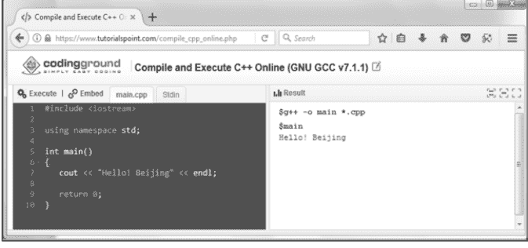

图 2.1：在 Tutorialsspoint 在线上成功运行 C++ 程序。

**Codechef：** 该网站 `https://www.codechef.com/ide` 支持最高到 C14 的所有版本 C++，并具有颜色编码、源代码错误检测、下载和自动建议等各种功能。图 2.3 显示了用于输入的源代码窗口，结果显示在图 2.4 中。

**C++ Shell：** 是一种在线 C++ 编译器，支持最高到 C14 的所有版本 C++。它提供了颜色编码和错误检测等功能。可以使用网站 `http://cpp.sh/` 访问。带有错误的源代码的编译情况以及成功编译编译后的结果分别如图 2.5 和图 2.6 所示。

**Rextester：** 这是一个在线 C++ 编译器，支持不同版本的 C++，例如 C++ (clang)、C (gcc) 和 C (VC)。Rextester C++ 编译器可以快速执行源代码，并具有颜色编码和指出源代码中错误等功能。在 Rextester 中编写程序的示例如如图 2.7 所示。

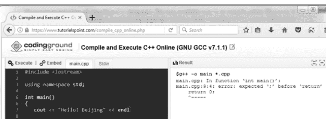

**图 2.2：** 在 Tutorialsp 在线编译器中运行带有错误的 C++ 程序。

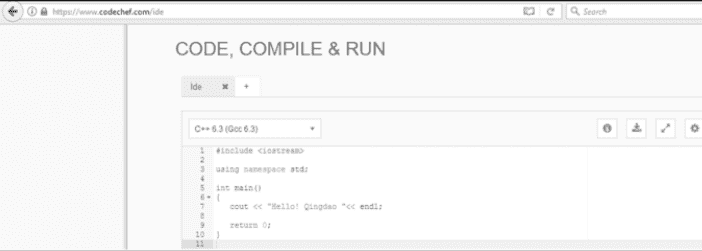

**图 2.3：** 在 Codechef 在线编译器中编写 C++。

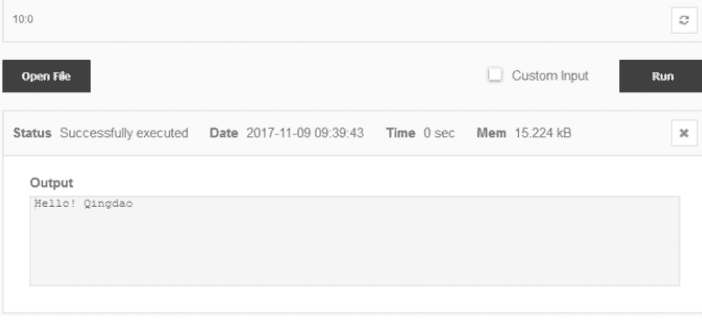

**图 2.4：** 在 Codechef 在线编译器中显示 C++ 结果。

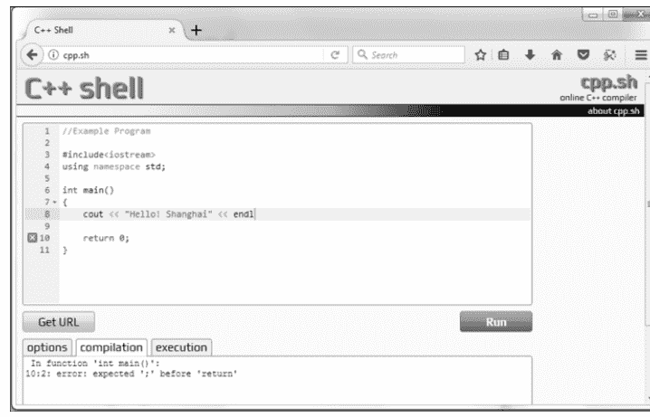

图 2.5：在 C++ Shell 在线编译器中编译带有错误的 C++ 程序。

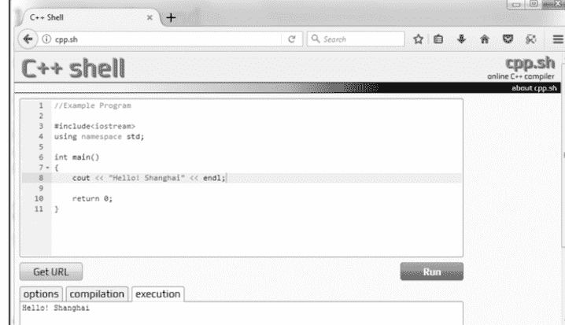

图 2.6：在 C++ Shell 在线编译器中显示结果。

**Codepad：** 此在线编译器支持最高到 C++14 的所有 C++ 版本。该编译器提供了 C++ 代码的快速执行，并具有错误检测、下载原始代码和使用账户登录等功能。然而，它有一个局限性，输出显示在另一个窗口中。Codepad 中带有程序的示例窗口如图 2.8 所示。

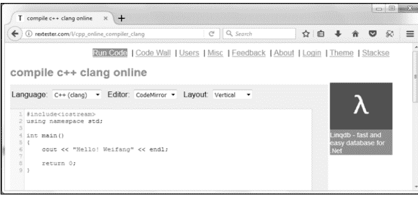

图 2.7：在 Retexter 在线编译器中编写 C++。

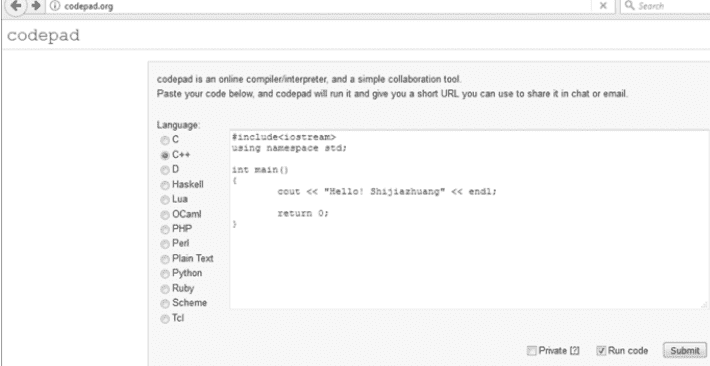

图 2.8：在 Codepad 在线编译器中编写 C++。

**Online GDB：** 此编译器支持最高到 C++14 的所有 C++ 版本。它提供了快速执行，并具有颜色编码、错误检测、屏幕自定义、创建项目和使用账户登录等功能。Online GDB 中带有程序的示例窗口如图 2.9 所示。

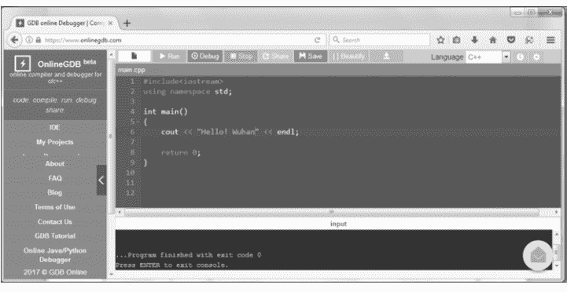

2.9：在 Online GDB 编译器中编写 C++ 程序。

## 2.8 在 Visual Studio 2017 中运行 C++ 程序

在本节中，我们将描述如何在 Visual Studio 2017 中运行 C++ 程序。在上一节中，我们已经描述了安装最新稳定版本的 Visual Studio 2017 并运行示例。然而，在许多大学和实验室中，建议学生使用 Visual++ 是一种常见的做法。运行 C++ 程序的步骤如下：

1. 从 `https://visualstudio.com` 下载最新的稳定版本 Visual Studio。


2. 下载完成后，出现带有 exe 文件的窗口。


3. 以管理员权限安装 Visual Studio。

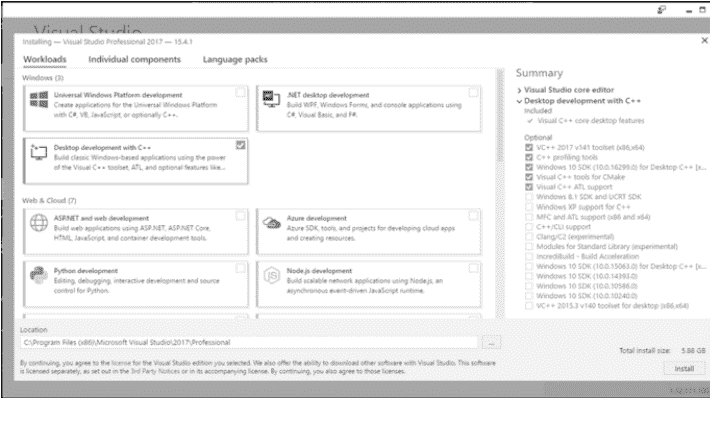

4. 在 Visual Studio 安装器中勾选“使用桌面开发”。


5. 安装完成后，点击屏幕左上角的**文件（File）**、**新建（New）**。


6. 在**项目（Projects）**选项卡下，选择 Win32 控制台应用程序（Win32 Console Application），如下图所示，并提供一个项目名称。在本例中，名称为 myProject，然后点击**确定（OK）**按钮。


7. 完成步骤 1 后会出现后续窗口，只需点击**完成（Finish）**按钮。

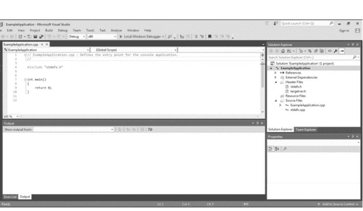

8. 在源代码中编写两个数字并求和：`#include "stdafx.h"`

9. 要编译程序，可以使用**生成（Build）**菜单或按 `Ctrl+F7`。

10. 程序编译后，通过点击绿色三角形（本地 调试器）或按 F5 运行。弹出的窗口询问是否要生成它，点击“是”。

11. 结果如屏所示。然而，输出屏幕会很快消失，因此可以设置断点以便长时间查看结果。

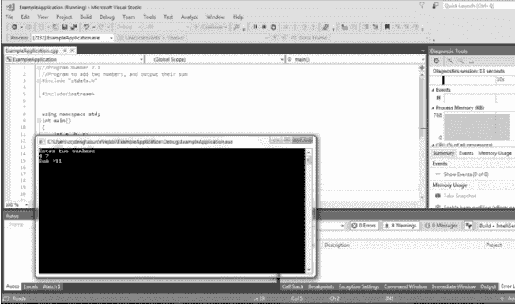

## 2.9 在 Microsoft Visual C++ 中运行 C++ 程序

在上一节中，我们已经描述了安装 Visual Studio 2017 的最新稳定版本并运行示例。然而，在许多大学和实验室中，建议学生使用 Microsoft Visual++ 是一种常见的做法。在这里，我们将简述使用 Microsoft Visual C++ 6.0 运行简单程序的方法。如果电脑已经安装了 VC++，点击它后会出现后续窗口：

1. 选择**文件（File）**、**新建（New）**，然后在**项目（Projects）**选项卡下，选择屏幕所示的控制台应用程序（Console Application），并提供项目名称。在本例中，名称为 myProject，然后点击**确定（OK）**按钮。

2. 完成步骤 1 后会出现后续窗口，只需点击**完成（Finish）**按钮。

3. 在屏幕左上角点击**文件（File）**、**新建（New）**。

4. 在**文件（Files）**选项下，突出 C++ 源文件（C++ Source File），并提供带有 `.cpp` 后缀的 C++ 文件名。在本例中，提供了 Example.cpp。

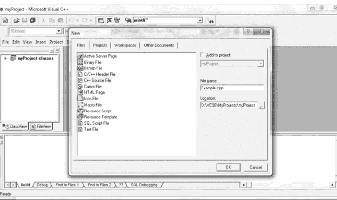

步骤 5：如后续截图所示，在提供的空间内编写程序。要编译程序，选择**Build（构建）**然后**Compile（编译）**选项，或者按 Ctrl+F7。

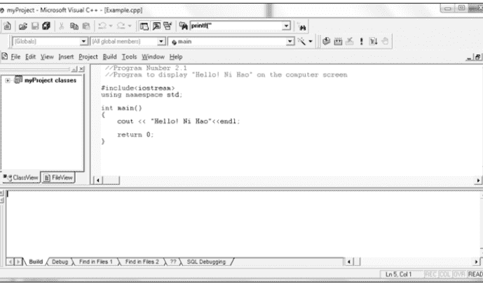

步骤 6：要执行程序，选择**Build and Execute（构建并运行）**或按 Ctrl+F5。结果显示在给图中：

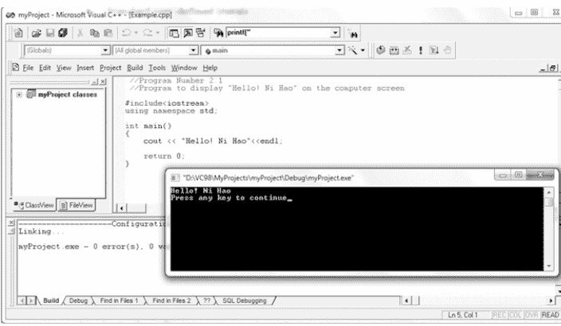

## 2.10 在 codeblocks IDE 中运行 C++ 程序

Code::Blocks 是一款免费、开源、跨平台的 C、C++ 和 Fortran IDE，它支持包括 GCC、Clang 和 Visual++ 在内的多种编译器，是为 Windows 开发的。这是一个用于处理源码以及使用编译器和链接器的框架。我们将描述获取 Code::Blocks 的方法以及成功编译 C++ 程序的步骤。

步骤 1：访问 Code::Blocks 网站，`http://codeblocks.org/`

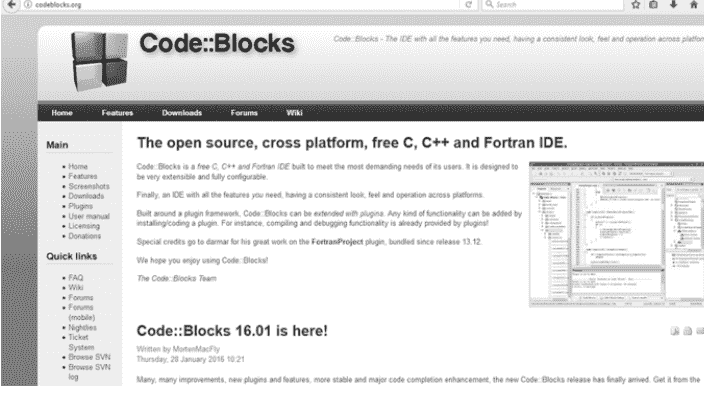

一个开源、跨平台的 C、C++ 和 Fortran IDE。

- 首页 (Homes)
- 特性 (Features)
- 下载 (Downloads)
- 插件 (Plugins)
- 用户手册 (User manual)
- 学习 (Learning)
- 捐赠 (Donations)

Code::Blocks 是一个为了满足用户最苛刻需求而设计的 C、C++ 和 Fortran IDE。它的设计具有扩展性。最后，它包含了你需要的所有功能，并在跨平台上具有一致的外观、感觉和操作。

围绕插件框架构建，Code::Blocks 可以插件进行扩展。可以通过从插件管理器安装插件或编写新插件来添加任何功能。

### 步骤 2：从左侧菜单选择**Downloads（下载）**选项 (`http://www.codeblocks.org/downloads`)，下载详情显示在如下截图。在 Downloads 中，选择 **Download the binary release（下载二进制发布版）**。

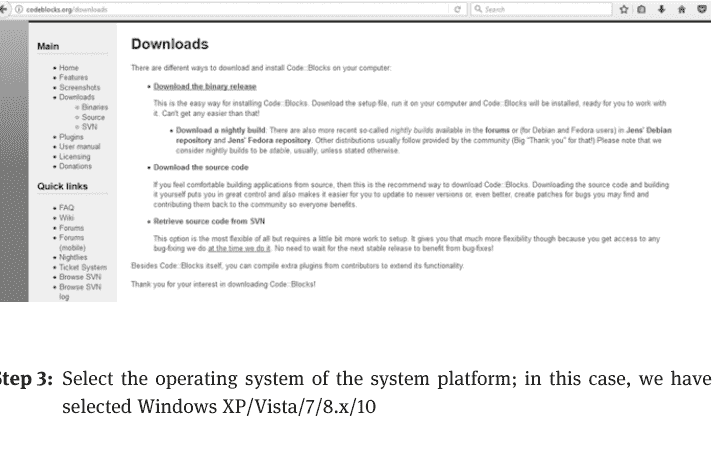

### 步骤 3：选择系统的操作系统；在这种情况下，我们将选择 Windows Vista/7/8/10

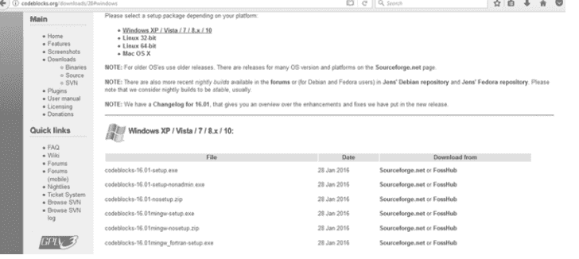

### 步骤 4：如屏幕所示，我们可以看到 Code:: Blocks 的多种下载选项。对于初学者，我们建议下载 `codeblocks-16.01mingw-setup.exe`，因为它包含了 MinGW/GCC 编译器。正如 Code::Blocks 网站，`codeblocks-16.01mingw-setup.exe` 文件包含了额外的 GCC/G++ 编译器和 GDB 调试器。

**步骤 5：** 在选择正确的下载文件后，我们可以选择从 Sourceforge.net 或 FosHub 下载。在当前情况下，我们选择了 Sourceforge.net。根据网络速度，下载可能需要 4–8 分钟。下载的文件将存储在计算机的默认位置。

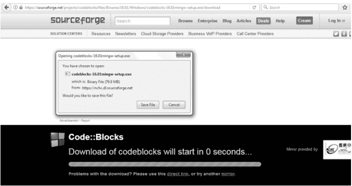

**步骤 6：** 双击下载的文件并以管理员权限安装，然后点击 **Next（下一步）** 按钮。

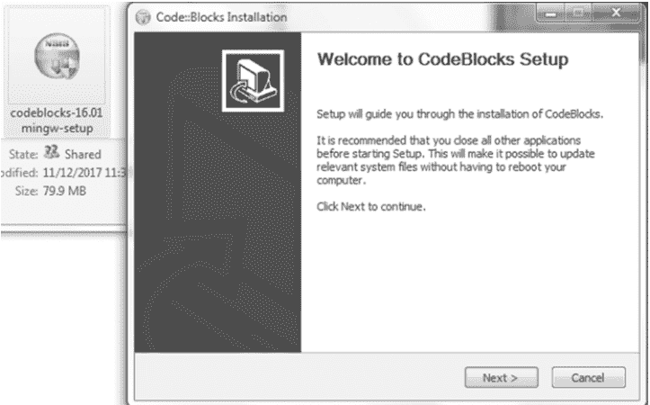

**步骤 7：** 点击 Next 按钮后，我们将获得 License Agreement（许可协议）窗口。在同意许可协议后，我们可以按照默认说明操作并按 Next。下一步是选择组件，然后我们可以继续使用默认选项并选择安装位置。如果我们按照指示操作得当，将弹出如下所示的“Installation Complete（安装完成）”和“Completing CodeBlocks（正在完成 CodeBlocks）”窗口。点击 Finish 完成安装。


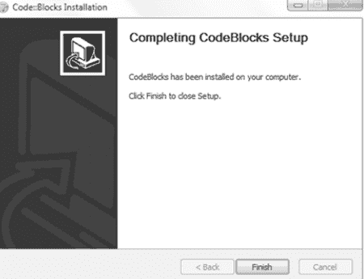

# 36 — 2 面向对象编程与 C++ 简介

**步骤 8：** 如果 CodeBlocks 已正确安装在计算机上，下一步是从开始菜单启动 CodeBlocks。


**步骤 9：** 启动时，会弹出一个窗口询问是否关联 C/C++ 文件类型。如果编辑器文件名处有星号 `*`，说明编辑器内容未保存。


**步骤 10：** 完成步骤 9 后，我们将到达 CodeBlocks 界面：


**步骤 11：** 为了完成安装，我们需要检查编译器路径。在 CodeBlocks 菜单中选择 **Settings（设置）**，然后选择 Global（全局）。


**步骤 12：** 完成步骤 11 后，将弹出询问“Are you sure?（你确定吗？）”的窗口。如果一切正常，点击 OK。


## 2.11 在 CodeBlocks 中编写第一个 C++ 程序

在这里我们将描述在 CodeBlocks 中编写并成功运行简单 C++ 程序的步骤。

**步骤 1：** 在第一步中，我们点击工具栏上的 **File（文件）**并选择 **New（新建）**，如下所示：


**步骤 2：** 然后我们必须为文件命名。默认情况下，文件命名为 **Untitled1**。如果编辑器文件名处有星号 `*`，说明编辑器内容未保存。如果没有星号，则说明文件内容已保存。现在，我们选择一个目录保存此程序并给它一个合适的名称。建议使用下划线代替空格。文件名后缀应为 `.cpp`。


**步骤 3：** 例如，在窗口窗口，在名为 `hello.cpp` 的文件中编写 C++ 程序。命名文件后我们可以开始编写程序。可以使用保存图标或按 `Ctrl+S` 保存。


**步骤 4：** 现在，我们可以如下截图所示使用 **Build（构建）** 编译程序，然后在 IDE 底部的 Build Log（构建日志）将显示“Process terminated with status 0（进程以状态 0 终止）”，这意味着程序没有错误。该语句之后将是程序中的错误数量和警告数量，“0 error(s), 0 warning(s)”。仔细阅读错误信息以理解错误。


**步骤 5：** 如果你的程序没有错误，可以通过点击截图中的 **Run（运行）** 图标来运行它。点击 Run 后，将打开一个新的终端窗口，现在我们可以为程序提供输入，然后输出或结果将显示在屏幕上。


## 2.12 C++ 面向对象概念全面理解

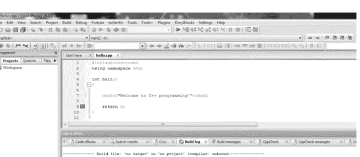

在 CodeBlocks 中打开文件，我们可以从菜单工具栏选择 **File**（文件）并点击 **Open**（打开）。这将提供定位现有文件的选项。我们也可以通过按下 **Ctrl+O** 使用快捷键。

## 2.12 C++ 面向对象概念全面理解

在这里，我们将描述一个包含大多数 OOP（面向对象）概念的程序。在随后的章节中，我们将深入理解大多数面向对象的概念。程序 2.2 包含了 OOP 的大多数主要特性，如类、对象、访问修饰符、构造函数、信息隐藏、继承和多态。**对象**（`object`）是**类**（`class`）的实例。对象拥有数据和方法或行为。类用于定义数据和方法。例如，刘、方、严都是具有许多共同特征的学生；这些特征被表示为数据并定义在类中。因此，类被用于定义所有对象共有的数据和方法。在程序 2.2 中有三个类：(1) `Student`（学生），(2) `Freshman`（大一学生），和 (3) `Sophomore`（大二学生）。基于这些类可以创建多个对象。例如，方、严和刘分别是从 `Student`、`Fresh` 和 `Sophomore` 类创建的对象。正如所述，每个类可能有许多方法和变量。例如，`collegename`、`student_number`、`name` 和 `marks` 是该程序中的变量。`get_college_name()`、`get_name_()`、`get_marks()` 和 `class_grade()` 是类中的方法。

构造函数是面向对象语言最强大的特性之一。构造函数用于在对象创建期间对其初始化。

## 42 2 面向对象编程与 C++ 简介

当我们处理同一类的多个对象时，数据成员的初始化是必要的。构造函数是一种特殊方法，当该类的对象创建时会被执行。构造函数的名称必须与类名相同。例如，在程序 2.2 中，`public: Student()` 是一个构造函数，它的名称与其类名相同。构造函数有助于在该类的对象创建时自动初始化值。

在面向对象编程中，**继承**（`inheritance`）在编写大型程序时起着主要作用。当我们处理具有细微差异的相似类时，继承属性是非常需要的。继承允许我们根据现有的类定义定义一个新类。例如，在程序 2.2 中，`Student` 是**基类**（`base class`），而 `Freshmen` 和 `Sophomore` 是**派生类**（`derived classes`）。这意味着 `Freshmen` 和 `Sophomore` 的许多特征都源自 `Student` 类。在这种情况下，我们将 `Student` 类称为**父类**（`parent class`）或（**超类** `super class` 或 **基类**），将 `Freshmen` 和 `Sophomore` 类称为**子类**（`child class`）或（**子类** `subclass` 或 **派生类** `subclass`）。

在继承中，我们创建一个与现有类相似的新类，但它具有一些新特性。这在我们对现有程序进行修改时非常有用。例如，程序 A 需要修改以生成新程序 B。我们不需要从零开始开发 B，而是从程序 A 继承现有特性。这使得编程任务变得更容易。因此，继承的主要优势是代码复用。

多态（Polymorphism）是面向对象编程的另一个最核心的特性。多态提高了程序编写的简单性和可重用性。**多态**意味着许多形式（如许多面孔）。例如，一个人在家里可以是父亲，在办公室可以是官员，在餐馆可以是客户。在这里，父亲、官员和客户都指代同一个人。例如，在程序 2.2 中，`Freshmen` 是从 `Student` 类派生出的**子类**。同样明显，通常情况下大一或大二学生也是学生。因此，在 C++ 中，可以将**子类**对象的实例作为**基类**的类型。在这里，`Sophomore` 对象是 `Student` 的一种类型；可能 `Sophomore` 类是派生自 `Student`。对象既可以作为其类型使用，也可以作为其基类型使用。这是通过 C++ 的一种称为**动态绑定**（`dynamic binding`）的属性实现的。如程序所示，调用 `get_college_name()` 方法将自动调用 `Sophomore` 方法而不是 `Student` 方法（图 2.10）。

```cpp
// Program 2.2
// 用于理解 C++ 中大多数面向对象
// Concepts的全面程序

#include <iostream>
#include <cstring>
using namespace std;
```

## 2.12 C++ 面向对象概念全面理解

### 类 (Classes)

### 对象 (Objects)

### 构造函数 (Constructor)

| Student | Fang | Student() |

| :--- | :--- | :--- |

| Freshman | Yan | { strncpy(collegate, "COMPUTER"); |

| Sophomore | Liu | } |

### 访问修饰符 (Access Modifiers)

### 变量 (Variables)

### 方法 (Methods)

| public | collegename | get_college_name() |

| :--- | :--- | :--- |

| private | student_number | get_name_() |

| | marks | void class_grade() |

| | ... | ... |

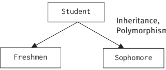

**图 2.10:** 程序 2.2 中描述的面向对象编程的主要组件。

```cpp
class Student
{
  public:
    char collegename[30];

  public:
    Student()
    {
      strncpy(collegate, "COMPUTER");
    }

  int student_number;
  char name[20];

  private:
    int marks;

  public:
    virtual void get_college_name()
    {
      cout << "College Name: " << collegename << endl;
    }

  void get_name_number()
  {
}
```

```cpp
cout << "Student Number: " << student_number << endl;
cout << "Student Name: " << name << endl;
void get_marks() {
    cout << "Student Marks: " << marks << endl;
}
```

```cpp
class Freshmen: public Student {
public:
```

```cpp
void class_grade() {
    cout << "Student Status: Freshmen Student" << endl;
};
```

```cpp
class Sophomore: public Student {
public:
```

```cpp
void get_college_name() {
    strcpy(collegename, "MECHANICAL");
    cout << "College Name: " << collegename << endl;
};
```

```cpp
int main() {
    Student s;
    Freshmen f;
    Sophomore so;

    s.get_college_name();
    f.get_college_name();
    so.get_college_name();

    return 0;
}
```

# 48 — 3 编程基础

赋予变量的名称称为标识符（`identifiers`），它们也是赋予方法、函数或类的名称。要将一个变量声明为标识符，它必须必须满足以下条件：

1. 它必须由字母、数字和下划线 `_` 组成。

2. 它不能包含空格。

3. 它只能以字母或下划线开头。

4. 它不能以数字开头。

5. 所有的变量名都是区分大小写的，例如，`SMALL_variable` 与 `small_variable` 是不同的。

6. C++ 变量名的长度没有限制。

7. C++ 不允许在标识符中使用如 `@`、`$` 和 `%` 等标点符号字符。

以下是一些有效变量名的示例：

```
OneVariable
onevariable
ONEVARIABLE
One_Variable
n
_one
One_18
One18
_18One
```

以下是一些无效变量名的示例：

```
One Variable // 包含空格
90One // 以数字开头
One+Two // 加号+ 不是字母数字字符
One-Variable // 连字符(-) 不是字母数字字符
```

## 3.3 C++ 关键字

关键字是特殊的词，既不能作为标识符，也不能作为程序变量的名称。所有的 C++ 关键字都是小写的，而不是大写（或大写字母）。列表显示了 C++ 中一些常用的关键字。其中许多关键字在 C 和 C++ 中也是通用的。请注意，关键字会随着时间的添加或删除。

```
asm         else      new       this
auto        enum      operator  throw
bool        explicit  private  true
```

## 3.4 数据类型 - 49

break export protected try

case extern public typedef

catch false register type

char float reinterpret_cast typename

class for return union

const friend short unsigned

const_cast goto signed using

continue if sizeof virtual

default inline static void

delete int static_cast volatile

do long struct wchar_t

double mutable switch while

dynamic_cast namespace template

## 3.4 数据类型

编程语言中的变量用于存储如整数、字符、浮点数等信息。变量是用于存储值的预留内存位置。数据类型有助于存储不同类型的信息，如整数、字符等。数据类型的表示取决于特定的机器。操作系统根据变量的数据类型分配内存，并决定预留内存中可以存储什么。C++ 中的基本数据类型是 `int`、`long`、`char`、`float` 和 `double`。某些基本数据类型可以使用一个或多个修饰符（如 `signed`、`unsigned`、`short` 和 `long`）进行修改。表 3.1 显示了变量类型、在内存中存储该值所需的字节数以及此类变量可以存储的最大和最小值。

C++ 基本数据类型的大小和范围。

| 数据类型 | 字节 (Byte) | 范围 |

| :--- | :--- | :--- |

| char | 1 | -128 到 127 |

| unsigned char | 1 | 0 到 255 |

| signed char | 1 | -128 到 127 |

| int | 4 | -2,147,483,648 到 2,147,483,647 |

| unsigned int | 4 | 0 到 4,294,967,295 |

| signed int | 4 | -2,147,483,648 到 2,147,483,647 |

| short int | 2 | -32,768 到 32,767 |

| unsigned short int | 2 | 0 到 65,535 |

| signed short int | 2 | -32,768 到 32,767 |

| long int | 4 | -2,147,483,648 到 2,147,483,647 |

| signed long int | 4 | -2,147,483,648 到 2,147,483,647 |

| unsigned long int | 4 | 0 到 4,294,967,295 |

| float | 4 | ±3.4×10³，具有约 7 位精度 |

| double | 8 | ±1.7×10⁸，具有约 15 位精度 |

| long double | 8 | ±1.7×10⁸，具有约 15 位精度 |

以下是声明数据类型的示例：

```cpp
int variableVariable;
long bigNumber;
```

在声明时也可以为变量初始化值。例如：

```cpp
int myAge = 26;
```

程序 3.1 解释了 C++ 中的数据类型：

```cpp
#include <iostream>
using namespace std;

int main() {
    short b = 45;
    int c = 100;
    long d = 10000;
    char e = 'C';
    float f = 100.99;
    double g = 100.4;

    cout << "Short Value: " << b << endl;
    cout << "Integer Value: " << c << endl;
...
```

（注：此处原文代码块似乎不完整，已按要求保留原始代码结构）

（注：原文提供的代码 3.1 结尾处截断了，译文保持与原文相同的截断状态）

```cpp
    cout
```

```cpp
int num6 = 78; // long literal
int num7 = 56ul; // unsigned long literal
int num8 = 6555ul; // unsigned long literal

cout << "Decimal literal :" << num1 << endl;
cout << "Octal literal :" << num2 << endl;
cout << "Hexadecimal literal 1 :" << num3 << endl;
cout << "Hexadecimal literal 2 :" << num4 << endl;
cout << "Unsigned integer literal :" << num5 << endl;
cout << "Long literal :" << num6 << endl;
cout << "Unsigned long literal 1 :" << num7 << endl;
cout << "Unsigned long literal 2 :" << num8 << endl;
return 0;
```

程序 3.3 的结果所示：

Decimal literal :42

Octal literal :13

Hexadecimal literal 1 :255

Hexadecimal literal 2 :751

Unsigned integer literal :18

Long literal :78


Unsigned long literal 1 :56

Unsigned long literal 2 :6555

### 浮点字面量

任何带有小数点的数字（如 `8.18`）被视为浮点类型字面量。浮点字面量包含一个整数部分、一个小数点、小数部分和一个指数部分。我们可以用十进制形式或指数形式表示浮点字面量。要指定 `float`，我们必须添加后缀 `'f'` 或 `'F'`，例如 `8.18F` 或 `3.12f`。带符号的指数由 `e` 或 `E` 引入。

在十进制表示法中，使用包含小数点的非空十进制序列。该非空十进制序列表示有效位。类型指定的 `1`, `f`, `L` 或 `F` 也可以作为可选后缀。如果没有后缀，默认它被视为 `double`。`f` 或 `F` 后缀表示该字面量是 `float` 类型，而 `l` 或 `L` 表示该字面量是 `long double` 类型。

在第二种指数表示法中，使用一个非空十进制序列，它通过 `e` 或 `E` 定义有效位，后面跟着一个可选的负号或正号的非空十进制序列来定义指数。类型指定的 `1`, `f`, `L`, 或 `F` 也可以作为可选后缀。注意，当我们考虑指数时，它是有效位所乘 `10` 的幂。例如，`187e2` 的数学含义是 `187×10²`。程序 3.4 展示了浮点字面量的使用。

```cpp
//Program 3.4
//Floating-point literals
#include <iostream>
using namespace std;

int main()
{
    float num1 = 3.14f;
    float num2 = 8.89;
    float num3 = 97.12F;
    long double num4 = 997.89;
    long double num5 = 177.67L;
    double num6 = 93.46e-1;
    float num7 = 8ef;
    cout << "num1: " << num1 << endl;
    cout << "num2: " << num2 << endl;
    cout << "num3: " << num3 << endl;
    cout << "num4: " << num4 << endl;
    cout << "num5: " << num5 << endl;
    cout << "num6: " << num6 << endl;
    cout << "num7: " << num7 << endl;
    cout << "num8: " << num8 << endl;
    return 0;
}
```

程序 3.4 的结果所示：

num1 = 3.14

num2 = 8.89

num3 = 97.12

num4 = 997.89

num5 = 177.67

num6 = 93.46e-1

num7 = 8e

num8 = 0

### 布尔字面量

有两种布尔值字面量：`true` 和 `false`。它们也是 C++ 关键字的一部分。`true` 的值代表真，`false` 的值代表假。程序 3.5 展示了 C++ 中布尔值字面量的演示。

```cpp
//Program 3.5
//Boolean literals
#include <iostream>
using namespace std;

int main()
{
    bool a = true;
    bool b = false;
    cout << a << endl;
    cout << b << endl;
    return 0;
}
```

程序 3.5 的结果所示：

1

0

### 字符字面量

字符字面量被包含在单引号内，例如 `'c'`。字符字面量由一个常量字符组成。它由用引号包围的字符表示。字符字面量可以是普通字符（例如 `'x'`）、转义序列（例如 `'\t'`）或通用字符（例如 `'\u020'`）。在 C++ 中，某些字符在前面有反斜杠时将具有特殊含义。这些字符用于表示如换行符 `'\n'` 或制表符 `'\t'` 等字符。这些字符被称为序列字符。反斜杠 `'\\'` 用于表示非打印字符。这些字符在编程中非常有用，例如用于插入空白格、跳转到下一行等。表 3.2 总结了一些常用的序列字符。

表 3.2：常用转义序列字符。

| Escape | 含义 | Escape | 含义 |
|---|---|---|---|
| \n | 换行 | \t | 水平制表 |
| \a | 响铃 | \v | 垂直制表 |
| \' | 单引号 | \r | 回车 |
| \\ | 反斜杠 | \" | 双引号 |
| \b | 退格 | \? | 问号 |
| \f | 换页 | \0 | 空格 |

### 字符串字面量

字符串字面量始终包含在双引号内，例如 `"Hello!"`。字符串字面量包含形成空终止字符串的字符序列，与字符字面量类似，包含普通字符、转义序列和通用字符。我们可以将长行拆分为多行。

### 定义常量

在 C++ 中，有两种定义常量的方法：(a) 使用预处理器，(b) 使用 `const` 关键字。

使用 `#define` 时，通用形式为：

```cpp
#define identifier value
```

例如，我们可以定义一个标识符 `3.14`：

```cpp
#define PI 3.14
```

然而，使用 `const` 时，通用形式为：

```cpp
const type variable = value;
```

例如，我们可以定义一个标识符 `1.68`：

```cpp
const float PHI = 1.68;
```

程序 3.7 展示了 C++ 中常量的定义方法。通常使用大写字母定义常量。

```cpp
//Program 3.7
//Demonstration of constants
#include <iostream>
using namespace std;

#define PI 3.14
#define RAMANU_NUM 1729

int main()
{
  cout << "Value of PI: " << PI << endl;
  cout << "Value of PHI: " << PHI << endl;
  cout << "Value of Ramanujan Number: " << RAMANU_NUM << endl;
  return 0;
}
```

### 为数据类型定义别名

我们可以通过 `typedef` 关键字为现有类型创建新名称。使用 `typedef` 定义新类型的语法为：

```cpp
typedef type newname;
```

`typedef` 关键字允许我们为现有类型定义自己的类型名。例如，我们可以将类型名 `int_wholenum` 定义为标准的 `int` 类型：

```cpp
typedef int int_wholenum;
```

现在，以下声明是完全合法的，并创建了一个初始值为 `23` 的整数变量：

```cpp
int_wholenum width=23;
```

之前的声明等同于：

```cpp
int width=23;
```

## 3.5 C++ 字面量与常量

`enum Weekdays (Mon, Tues, Wed, Thurs, Fri, Sat, Sun) today;`

上述语句自动定义了一个固定整数值，其默认类型为 `int`。列表中的第一个名称将具有值 `0`，`Tues` 为 `1`，依此类推。我们可以像下面所示，将枚举常量中的一个赋值给变量：

`today = Thurs;`

`today` 的值将为 `3`，因为枚举定义的符号常量是按顺序赋值的，默认从 `0` 开始。每个后续的枚举符的值都比前一个的值大 `1`，但如果我们希望隐式编号从不同的值开始，只需写如下内容：

`enum Weekdays (Mon = 1, Tues, Wed, Thurs, Fri, Sat, Sun) today;`

现在，枚举常量将等同于 `1` 到 `7`。枚举符不需要具有唯一的值。让我们考虑下面的另一个例子。在这种情况下，`north` 获得值 `0`，`south` 获得值 `1`，`east` 等于 `40`，而 `west` 等于 `41`。

`enum direction {north, south, east = 40, west};`

程序 3.8 展示了一个演示 C++ 中枚举数据类型的示例。

```cpp
//Program 3.8
//Demonstration of enumerated data types
#include <iostream>
using namespace std;

enum answer {FALSE, TRUE};
enum COLOR {RED, BLUE, GREEN, YELLOW};
enum direction {north, south, east = 40, west};

int main() {
	cout << "This is TRUE as an integer: " << TRUE << endl;
	cout << "This is FALSE as an integer: " << FALSE << endl;
	cout << "This is RED as an integer: " << RED << endl;
	cout << "This is YELLOW as an integer: " << YELLOW << endl;
	cout << "This is south : " << south << endl;
	cout << "This is west : " << west << endl;
	return 0;
}
```

## 60 — 3 编程基础

程序 3.8 的结果所示：

```
This is TRUE as an integer: 1
This is FALSE as an integer: 0
This is RED as an integer: 0
This is YELLOW as an integer: 3
This is south : 1
This is west : 41
```

## 3.6 类型转换

在 3.4 节中，我们学习了 C++ 中不同的数据类型。现在，让我们通过程序 3.9 来理解如果混合两种不同的数据类型会发生什么。

```cpp
// Program 3.9
// Program to understand Type Casting in C++
#include <iostream>
using namespace std;

int main()
{
    int a = 100;
    double b = 200;
    a = b;
    cout << "Value of a = :" << a << endl;
    cout << "Value of b = :" << b << endl;
    return 0;
}
```

在之前的语句中，我们正尝试将 `b` 的值赋值给 `a`。这意味着我们正尝试将 `b` 的数据类型强制转换为 `a`。当我们运行上述程序时，将得到以下结果：

```
Value of a = :200
Value of b = :200
```

这是一个隐式转换的示例，当值被复制到兼容类型时，转换会自动执行。我们可以考虑下面的另一个例子：

```cpp
short a = 1800;
int b;
b = a;
```

## 3.6 类型转换

在这里，`a` 的值从 `short` 提升为 `int`，不需要任何显式运算符。这被称为标准转换。标准转换影响基本数据类型，并允许数值类型之间的转换，例如 `short` 到 `int`、`int` 到 `float`、`double` 到 `int` 等。这些转换也发生在 `bool` 和某些指针转换中。然而，从较小的整数类型转换为 `double` 被称为提升（promotion），并保证产生相同的值。算术类型之间的其他转换并不总是能表示相同的值。

在某些情况下，需要显式转换（typecasting）。类型转换涉及将一种类型隐式或显式转换为另一种类型。类型转换有两种：显式转换和隐式转换。当两个不等的类型在等式中出现时会发生隐式转换，它们在内部被调整。在程序 3.10 中，通过将 `double` 赋值给 `integer`，小数部分会丢失，但如果我们使用 `b = a;` 而不是 `a = b;`，情况并非如此。

```cpp
// Program 3.10
// Program to understand Type Casting in C++
#include <iostream>
using namespace std;

int main()
{
    int a=100;
    double b=3.145;
    cout << "Value of a = :" << a << endl;
    cout << "Value of b = :" << b << endl;
}
```

程序 3.10 的结果所示：

```
Value of a =3
Value of b =145
```

如果我们将 `a=b;` 改为 `b=a;`，我们将得到以下结果。因为 `float` 是更高的数据类型，可以轻松容纳存储在 `int` 中的值。

```
Value of a =100
Value of b =100
```

## 3.7 输入输出操作符

操作符（manipulator）修改了处理输出（或输入）流的方式。换句话说，它们是辅助函数，使得使用 `operator<<` 或 `operator>>` 控制输入输出流成为可能。操作符定义在标准库头文件 `<iomanip>` 中，所以我们需要对其 `#include`。让我们考虑下面的语句：

```cpp
cout << "Hello, world!" << endl;
```

该语句包含操作符 `endl`。这是一个对象，当它提供给 `operator<<`，通过调用 `cout` 的 `flush` 函数立即清空内部缓冲区。这意味着在执行下一个语句之前，所有的输出都显示出来。因此，操作符是对象。

表 3.3：C++ 中常用的操作符。

| 操作符 | 说明 |
| :--- | :--- |
| dec, hex, oct | 修改进制 |
| endl | 输出 \n 并刷新流 |
| fixed, scientific | 修改浮点数格式 |
| setflags | 修改 ios_base |
| setprecision | 修改浮点精度 |
| setw | 修改宽度 |

程序 3.11 展示了操作符的应用示例。`setw(n)` 在给定的宽度内输出。`setw(n)` 仅用于插入。

```cpp
// Program 3.11
// Input and output manipulators
#include <iostream>
#include <iomanip>
using namespace std;

int main()
{
    float num1 = 0.1;
    float num2 = 1.0;
    float num3 = 123456789.0;
    int num4 = 1234, num5 = 5678, num6 = 428;

    cout << "1. " << num1 << ", "
         << num2 << ", " << endl;
    cout << "2. " << fixed << num1 << ", "
         << num2 << ", " << num3 << endl;
    cout << "3. " << scientific << num1 << ", "
         << num2 << ", " << num3 << endl;
    cout << "4. " << setprecision(20) << num1 << ", "
         << num2 << ", " << num3 << endl;
    cout << "5. " << setprecision(20) << num1 << endl;
    cout << "6. " << setw(6) << num4 << setw(6) << num5 << endl;
    cout << "7. " << setw(8) << setfill('*') << 34 << 45 << endl;
    cout << "8. " << setw(8) << dec << 34 << setw(8) << 45 << endl;
    cout << "9. " << hex << num6 << endl;
    cout << "10. " << hex << num6 << endl;
    cout << "11. " << oct << num6 << endl;
}
```

程序 3.11 的结果所示：

+   1. 0.1, 1. 1.23457+009

2. 0.100000, 1.000000, 123456789.000000

3. 1.00000e-001, 1.000000+000, 1.234568+009

4. 0.100, 0.100, 123456793.600

5. 0.100000014901162000

6. 1234 5678

7. ********3445

8. *****34*******45

9. 428

10. lac

11. 654

程序中的变量具有有限的寿命。它们有两个属性：存储期和作用域。第一个属性存储期，是关于特定变量持续多长时间。基本上有三种不同的存储期，一个 a

## 64 3 编程基础


变量可以具有：`自动`、`静态`和`动态`。另一个属性称为`作用域`。变量的生命周期和作用域是两个概念。`生命周期`是在执行过程中从变量首次创建到被销毁并释放其占据内存的时间。变量的作用域是程序代码中可以声明并可能访问的区域。变量的作用域定义了变量在程序某部分的有效性，也就是说，如果变量在作用域之外，则无法使用它。我们目前为止定义的变量称为自动变量，它们具有自动存储期。

作用域可以大致分为三类：(a) 函数或块内部的`局部变量`；(b) 在函数参数定义中的，称为`形式参数`；以及(c) 所有函数之外的称为`全局变量`。我们将在第 10 章学习函数及其参数。

### 自动存储期和局部变量

在函数或块内部声明的变量称为局部变量或`自动变量`。它们只能由函数或代码块内部的语句使用。外部函数无法感知其内部的局部变量。这些变量通常在大括号内并成对出现进行声明。它们具有局部作用域或`块作用域`。自动变量在定义时创建，在块结束时自动销毁。在自动存储期中，对象仅在执行期间的某些点存在。每当进入声明这些对象的块时，对象就会创建并初始化（如果需要初始化的话）。它们仅在块激活（即其语句正在执行）时存在，并在块退出时销毁。它们的值在销毁时会丢失。让我们考虑程序 3.12 的一个简单示例来演示自动变量的作用域。

```cpp
// Program 3.12
// Automatic variables
#include <iostream>
using namespace std;

int main()
{
    // 函数作用域在此开始
    int var1 = 11;
    int var2 = 22;
    cout << "Value of outer var1 = " << var1 << endl;
    cout << "Value of outer var2 = " << var2 << endl;
    {
        // 新作用域开始
        int var1 = 33; // 现在，外部的 var1 没有了作用域
        int var3 = 44;
        cout << "Value of inner var1 = " << var1 << endl;
        var1 = var1+7;
        var2 = var1+var2;
        cout << "Value of inner var1 = " << var1 << endl;
        cout << "Value of inner var2 = " << var2 << endl;
    }
    cout << "Value of outer var1 = " << var1 << endl;
    cout << "Value of outer var2 = " << var2 << endl;
    //cout << var3 << endl; // 尝试打印 var3 将报错
    return 0;
}
```

程序 3.12 的结果所示：

```
Value of outer var1 = 11
Value of outer var2 = 22
Value of inner var1 = 33
Value of inner var1 = 40
Value of inner var2 = 66
Value of outer var1 = 11
Value of outer var2 = 66
```

前两个语句声明并定义了两个整数变量 `var1` 和 `var2`，初始值分别为 11 和 22。这两个变量从这一点开始一直到程序末尾的右括号结束。这些变量的作用域也延伸到 `main()` 结束处的右括号。在变量定义之后，`var1` 的值被写入 `cout`，产生了输出中的第一行。有第二个大括号启动了一个新块。在该块内定义了两个变量 `var1` 和 `var3`，值分别为 33 和 44。在这里声明的 `var1` 与第一个 `var1` 不同。它存在，但其名称被第二个变量遮蔽了。在内部块声明之后，对名称 `var1` 的任何使用都是指向该块内声明的 `var1`。

### 静态存储期和全局变量

在静态存储期中，对象的生命周期贯穿整个程序，也就是说，它们的值在程序运行期间保持不变。对于静态存储期，对象的存储空间仅分配并初始化一次，即在执行这些对象的第一个语句之前。这并不意味着这些对象可以在任何地方、任何时间被使用；作用域是一个独立的问题。

`全局变量`定义并声明在所有函数、块和类之外，位于程序的顶部，称为`全局变量`。全局变量在整个程序生命周期内保持其值。任何函数都可以访问全局变量。也就是说，全局变量在声明后在整个程序范围内都是可用的。这些变量具有全局作用域，也称为全局命名空间作用域或文件作用域。全局作用域对象具有静态持续期。这意味着在声明点之后，它们可以在文件的所有函数中被访问。如果我们在程序的最开始声明它们，则可以从文件的任何地方访问。全局变量默认具有静态持续期。具有静态持续期的全局变量从程序执行开始一直到程序结束。如果我们不为全局变量指定初始值，它将被初始化为零。

## 作用域解析运算符 (::)

正如我们在程序 3.13 中看到的，可以使用同名的局部变量来隐藏全局变量。但有人可能会问：如果程序员想在局部变量也具有同名的块中使用全局变量呢？这通过作用域解析运算符 (`::`) 可以实现。当我们想要使用与同名局部变量冲突的全局变量时，可以使用作用域解析运算符。如果将运算符放在变量名前之前，则引用的是全局变量。如果不放置运算符，则引用的是局部变量。现在，我们可以修改程序 3.13，如程序 3.14 所示，在其中我们可以在块内部同时访问局部和全局 `var1` 变量。

### 68 - 3 编程基础

```cpp
{
  // 作用域开始
  int var1 = 33; // 现在，外部 var1 在此处没有作用域
  int var3 = 44; // 全局变量 var3，在此处没有作用域
  cout << "Value of inner var1 = " << var1 << endl;
  var1 = var1 + 7;
  var2 = var2 + 3;
  cout << "Value of inner var1 = " << var1 << endl;
  cout << "Value of inner var2 = " << var2 << endl;
  cout << "Value of inner var3 = " << var3 << endl;
  cout << "Value of global var3 = " << var3 << endl;
}

cout << "Value of outer var1 = " << var1 << endl;
cout << "Value of outer var2 = " << var2 << endl;
cout << "Value of outer var3 = " << var3 << endl;
return 0;
```

程序 3.14 的结果所示：

```
Value of outer var1 = 11
Value of outer var2 = 22
Value of outer var3 = 55
Value of inner var1 = 33
Value of inner var2 = 40
Value of inner var3 = 66
Value of global var3 = 55
Value of outer var1 = 11
Value of outer var2 = 66
Value of outer var3 = 55
```

以下语句描述了作用域解析运算符的应用。第一个语句打印局部变量 `var3` 的值，而第二个语句通过作用域解析运算符打印全局变量 `var3` 的值。

```cpp
cout << "Value of inner var3 = " << var3 << endl;
cout << "Value of global var3 = " << ::var3 << endl;
```

## 动态存储生存期

动态存储生存期对象的寿命由程序员决定。在动态存储生存期中，对象由程序员使用 `new` 关键字创建，直到被程序员使用 `delete` 关键字销毁为止。当不再需要时，删除动态存储生存期对象是程序员的责任。未能这样做会导致内存泄漏，从而消耗的内存无法释放，最终导致内存耗尽。

## 3.9 复习题

1. 什么是变量？请解释。
2. 标识符与变量有什么区别？列出将变量声明为标识的规则。
3. 什么是 C 关键字？列出所有的 C++ 关键字。
4. 简述以下内容：(a) 字面量，b) 字符字面量，c) 字符串字面量，d) 浮点字面量和 (e) 整数字面量。
5. 解释 C++ 中不同的数据类型。
6. 什么是转义字符？描述至少八个序列字符。
7. C++ 中声明常量的常用方法有哪些？举例说明。
8. 列出这些关键字的用途：(a) enum (b) const (c) define 和 (d) typedef。
9. 什么是枚举数据类型？列出它的应用。
10. 在 C++ 中应该如何定义数据类型的同义词？用示例程序进行描述。
11. 具有特定值集的变量是什么意思？它们在现实应用中有什么用？
12. 什么是类型转换？有哪些不同的类型转换？请讨论。
13. 什么是操纵符？列出 C++ 中常用的操纵符。
14. 定义存储生存期和作用域。存储生存期有哪些种类？
15. 变量的寿命与变量的作用域有什么区别？请讨论。
16. 用示例程序讨论局部变量。
17. 用示例程序讨论全局变量。
18. 什么是作用域解析运算符？在程序中使用它的好处是什么？

# 4 运算符与表达式

> 诚信、智慧、技艺、才华——这些品质是在逆境中磨炼出来的。
> 孟子

## 4.1 引言

在第 3 章中，我们学习了数据类型和变量。在本章中，我们将关注 C++ 编程中使用的各种运算符和表达式。运算符与一个、两个或多个操作数一起使用。例如，让我们看这个语句：

```cpp
c = a + b;
```

这里 `a` 和 `b` 是两个操作数，`+`（加）是一个运算符，`c = a + b` 是一个算术表达式。运算符广泛分为三类：

- 1. 一元运算符
- 2. 二元运算符
- 3. 三元运算符

一元运算符是仅与一个操作数使用的运算符。例如：

```cpp
c = -b;
```

在该语句中，`-`（负）仅与一个操作数一起。`二元运算符`是与两个操作数使用的运算符。

例如：`c = a + b;`

`三元运算符`，也称为`条件运算符`，是一种特殊运算符，将在章的后后部分解释。特别是，运算符大致分类如下：

- 1. 关系和相等运算符
- 2. 赋值运算符
- 3. 算术运算符
- 4. 位运算运算符
- 5. 增和自减运算符
- 6. 逻辑运算符
- 7. 条件运算符

## 4.2 关系相等运算符

这些运算符用于比较或关联操作数。表 4.1 显示了关系和相等运算符的列表。

表 4.1：关系和相等运算符列表。

| 运算符 | 含义 | 示例语句 |
| --- | --- | --- |
| > | 大于 | if(a > b) b = small; |
| >= | 大于等于 | if(a >= b) b = small; |
| < | 小于 | if(a < b) b = big; |
| <= | 小于等于 | if(a <= b) b = big; |
| == | 等于 | if(a == b) a = same; |
| != | 不等于 | if(a != b) a = not; |

程序 4.1 阐述了关系运算符。我们将在第 5 章学习语句。

```cpp
// 程序 4.1
// 理解关系运算符
#include <iostream>
using namespace std;

int main(void) {
    int a = 8, b = 6;
    if (a > b)
        cout << "a is greater than b" << endl;
    if (a == b) 
        cout << "a is equal to b" << endl;

    return 0;
}
```

程序 4.1 的结果所示：

```
a is greater than b
```

## 4.3 算术运算符

算术运算符包括 `+`（加）、`-`（减）、`*`（乘）、`/`（除）和 `%`（模）。表 4.2 显示了算术运算符。模运算符用于求除后的余数，例如 `8%2 = 0`。程序 4.2 显示了 C++ 中应用算术运算符的示例。

表 4.2：算术运算符列表。

| 运算符 | 含义 | 示例语句 |
| --- | --- | --- |
| + | 加 | c = a + b; |
| - | 减 | c = a - b; |
| * | 乘 | c = a * b; |
| / | 除 | c = a / b; |
| % | 模 | c = a % b; |

```cpp
// 程序 4.2
// 理解算术运算符
#include <iostream>
using namespace std;

int main() {
    int a = 8;
    int b = 2;
    cout << "Addition example: a + b = " << a + b << endl;
    cout << "Subtraction example: a - b = " << a - b << endl;
    cout << "Multiplication example: a * b = " << a * b << endl;
    cout << "Division example: a / b = " << a / b << endl;
    cout << "Modulo example: a % b = " << a % b << endl;
    return 0;
}
```

程序 4.2 的结果所示：

```
Addition example: a + b = 10
Subtraction example: a - b = 6
Multiplication example: a * b = 16
Division example: a / b = 4
Modulo example: a % b = 0
```

正如程序 4.2 所示，在 8 除以 2 后，我们得到 0，因为所有变量都是整数，模 (%)提供了除后的余数。

## 4.4 位运算符

计算机可以理解二进制系统。二进制数是二制的；由 0 和 1 组成。一个字节代表 8 位；每位可以是 0 或 1。因此，一个字节是 0 和 1 的字符串。字节的最右侧位称为最低有效位 (LSB)，最左侧位称为最高位 (MSB)。负数的表示方式略有不同（记住整数是有符号或无符号的）。如果最左位是符号位且为 1，则数字为负；如果为 0，则为正。位运算符提供了无需编写机器码的内存访问。然而，在日常业务中使用，这些运算符很少使用。正如名称所示，位运算符对变量值的位进行操作，并对二进制数字进行操作。表 4.3 列出了各种位运算符。

表 4.3：位运算符列表。

| 运算符 | 含义 | 示例语句 |
| --- | --- | --- |
| | | 位或 | c = a | b; |
| ^ | 位异或 | c = a ^ b; |
| & | 位与 | c = a & b; |
| >> | 右移 | c = a >> 1; |
| << | 左移 | c = a << 2 |
| ~ | 位取反 | c = ~b; |

### 位与运算

逻辑与（由 `&&` 符号表示）只有在两个操作数均为 1 时才求为真 (1)，如下真值表所示。

|  |  |
| --- | --- |
| 0 & 0 | 0 |
| 0 & 1 | 0 |
| 1 & 0 | 0 |
| 1 & 1 | 1 |

如果 `a` 等于 25 且 `b` 等于 77，则这两个数之间的位与运算 `c = a & b` 计算所示，结果为数字 9。

|  |  |  |
| --- | --- | --- |
| a | 00011001 | 25 |
| b | 01001101 | 77 |
| c = a & b | 00001001 | 9 |

位与运算符用于掩码操作。该运算符可以将数字的特定位设置为 0。我们也可以使用位与来测试整数是奇数还是偶数。对于奇数，我们将整数与 1 进行位与运算，如果整数的最右侧位为 1，则结果为真。相反，对于偶数，整数的最右侧位将为 0。

## 位按包含或（或位按或）

位按或运算用 `|`（管道符号）表示。参与位按或运算的两个操作数的二进制表示按位进行比较的。当我们想要将数字的某些位设置为 1 时，就会位按包含或运算。如下所示，第一个操作数中为 1 或第二个操作数中为 1 的每个位，在结果对应的位上都会产生一个 1。

| 0 | 0 |
| 0 | 1 |
| 1 | 0 |
| 1 | 1 |

例如：

```
int a = 2, b = 4;
```

在这里，010 代表变量 `a`（以位按或二进制表示），100 代表 4。因此，`a | b` 等于 6。

010（位按或） 100 = 110（均为二进制）

### 位按异或（或位按异或 XOR）

位按异或或 XOR，用 `^`（脱字符符号）表示，如果其中一个位为 1 则结果为 1，但两个位均为 1 则不为 1。需要记住的一个重要点是，任何值与其自身异异或的结果都是 0，如下所示。汇编语言程序员利用此点测试两个值是否相等。

| 0 | 0 |
| 0 | 1 |
| 1 | 0 |
| 1 | 1 |

使用位按异或运算符可以在不使用临时位置的情况下交换数字。这似乎是位按异或运算符的一个有趣用途。程序 4.3 显示了这样一个示例。


```cpp
// Program 4.3
// Exchanging two numbers without using intermediate memory location
// Bitwise XOR
#include <iostream>
using namespace std;

int main()
{
  int a = 8;
  int b = 2;
  cout << "Value of numbers before exchange :\n" << "a = " << a << ", b = " << b << endl;

  a = a ^ b;
  b = a ^ b;
  a = a ^ b;

  cout<<"Value of numbers after exchange :\n" << "a = " << a << ", b = " << b << endl;

}
```

程序 4.3 的结果所示：

Value of numbers before exchange: a = 8, b = 2

Value of numbers after exchange: a = 2, b = 8

## 取反按运算符

取反按运算符用波浪号 `~` 表示。它将一个值转换为取反按，换句话说，所有的 0 变成 1，所有的 1 变成 0。这是一个作用于整数常量或表达式的一元运算符，例如 `~12`。

### 移运算符

左移和右移操作类似于乘以和除以 10。当我们将一个数字除以10 时，我们将数字向右移动并保留小数点。当我们乘以 10 时，我们将数字向左移动并在右侧添加 0。当对操作数执行左移操作（`<<`）时，操作数的位会发生移动。移出数据项高位的位将丢失，并从操作数的低位补入 0。如果 `a` 是一个值为 2 的变量，左移两次的结果将是 8，如表 4.4 所示。在这里，数字 2 是用 8 位表示的。值得注意的是，从变量两端“掉落”的位将会丢失。

表4.4：左移（`<<`）操作示例。

| 操作 | 二进制表示 | 结果 |
| --- | --- | --- |
| 数字 2 的初始位位置 | 00000010 | a = 2 |
| 左移一次，位 1 向左移动 | 00000100 | a = 4 |
| 左移两次，位 1 向左移动 | 00001000 | a = 8 |

在移位操作（`>>`）中，右侧位（即低位）会丢失，取决于机器的类型，1 或 0 将移入最左侧位。移位操作也被称为左旋转和右旋转。如表 4.5 所示，数字 `b = 9` 向右移动三次，结果为 1。

**表 4.5：**右移（`>>`）示例

| 操作 | 二进制表示 | 结果 |
| --- | --- | --- |
| 数字 9 的初始位位置 | 00001001 | b = 9 |
| 右移一次，LSB 1 丢失 | 00000100 | b = 4 |
| 右移两次，LSB 0 丢失 | 00000010 | b = 2 |
| 右移三次，LSB 0 丢失 | 00000001 | b = 1 |

程序 4.4 阐述了 C++ 中位运算符的总结。

```cpp
// Program 4.4
// Program to understand bitwise operators
#include <iostream>
using namespace std;

int main(void)
{
    int a = 2, b = 9;
    cout << "Bitwise OR: " << (a | b) << endl;
    cout << "Bitwise XOR: " << (a ^ b) << endl;
    cout << "Bitwise AND: " << (a & b) << endl;
    cout << "Right Shift: " << (b >> 3) << endl;
    cout << "Left Shift: " << (a << 2) << endl;
    cout << "Bitwise NOT: " << (~a) << endl;
    return 0;
}
```

程序 4.4 的结果所示：

Bitwise OR: 11

Bitwise XOR: 11

Bitwise AND: 0

Right Shift: 1

Left Shift: 8

Bitwise NOT: -3

### 赋值运算符

赋值运算符用于给变量赋值。让我们看以下语句：`a++` 和 `++a` 是不同的。同样，`--` 和 `--a` 不同的。`a++` 语句先赋值后自增。`++a` 语句先自增后赋值，如表 4.7 所示。

### 增减运算符

表 4.7：增减运算符。

| 运算符 | 含义 | 示例语句 |
| --- | --- | --- |
| a++ | 增 1 | a++; |
| -- | 减 1 | a--; |

程序 4.5 展示了增减运算符：

```cpp
// Program 4.5
// Program to understand increment operators
#include <iostream>
using namespace std;

int main(void) {
    int b, a = 2;
    cout << "a = " << a << ", b = " << b << endl;
    b = ++a;
    cout << "a = " << a << ", b = " << b << endl;
    b = --a;
    cout << "a = " << a << ", b = " << b << endl;
    b = a--;
    cout << "a = " << a << ", b = " << b << endl;
    b = a++ + b;
    cout << "a = " << a << ", b = " << b << endl;
    return 0;
}
```

程序 4.5 的结果所示：

a = 3, b = 2

a = 4, b = 4

a = 3, b = 3

a = 2, b = 3

a = 2, b = 5

另一个有趣的增减运算符在程序 4.6 中所示。

```cpp
// Program 4.6
// Example to understand increment and decrement operators
#include <iostream>
using namespace std;
```

### 运算符与表达式

```cpp
int main()
{
    int x = 10;
    cout << "Value of x after pre-increment is " << ++x << endl;
    cout << "Value of x after post-increment is " << x++ << endl;
    cout << "Value of x after post-decrement is " << x << endl;
    cout << "Value of x after pre-decrement is " << --x << endl;
    cout << "Value of x after post-decrement is " << x-- << endl;
    cout << "Value of x after post-decrement is " << --x << endl;
    return 0;
}
```

程序 4.6 的结果所示：

Value of x after pre-increment is 11

Value of x after post-increment is 11

Value of x after post-decrement is 12

Value of x after pre-decrement is 11

Value of x after post-decrement is 11

Value of x after post-decrement is 10

### 逻辑运算符

逻辑运算符与布尔表达式一起使用。常用的逻辑运算符有逻辑与（AND）、逻辑或（OR）和逻辑非（NOT）。表 4.8 展示了逻辑运算符的使用。

表 4.8：逻辑运算符列表。

| 运算符 | 含义 | 示例语句 |
| --- | --- | --- |
| && | 逻辑与 | if((a == 5) && (a <= 10)) b = 5; |
| || | 逻辑或 | if((a == 5) || (a <= 10)) b = 5; |
| ! | 逻辑非 | if(!(a == 5)) b = 5; |

### 条件运算符

条件运算符（`?:`）是一种特殊的运算符。它使用三个操作数，称为三元运算符，例如 `(a>b)?a:b;`。在这个示例中，如果 `a` 大于 `b`，则返回 `a` 的值。要了解更多关于条件运算符的内容，让我们看看程序 4.7。

```cpp
// Program 4.7
// Program to understand Conditional operators
#include <iostream>
using namespace std;

int main(void)
{
    int a=1,b=8;
    cout<<"Bigger Number: "<<"((a>b)?:a:b)<<endl;
    return 0;
}
```

程序 4.7 的结果所示：

Bigger Number: 8

### 运算符优先级

许多操作数和运算符共同构成了一个表达式。在求值这些表达式时，哪个运算符先执行？这由 C++ 中的运算符优先级决定。运算符优先级决定了表达式如何求值。表 4.9 列出了 C++ 运算符的优先级和结合性。运算符按优先级从高到低列出。

表 4.9：C++ 运算符的优先级和结合性。

| 优先级 | 运算符 | 说明 | 结合性 |
|---|---|---|---|
| 1 | :: | 作用域解析 | 从左到右 |
| 2 | ++ | 后缀/后置自增和自减，例如 `a++, a--` 强制类型转换 `type() type() [] -> 函数调用，例如 `a()` 下标，例如 `a[]` 成员访问 | |
| 3 | ++a --a | 前置自增和自减，例如 `++a, --a` | 从右到左 |
| | + | 一元加和减，例如 `+a, -a` | |
| | ! | 逻辑非和位按非 | |
| | (type) | C 风格类型转换 | |
| | * | 间接寻址（解引用），例如 *a | |
| | & | 取地址运算符，例如 &a | |
| | sizeof | 大小运算符 | |
| | new | 动态内存分配 | |
| | new[] | | |
| | delete | 动态内存释放 | |
| | delete[] | | |
| 4 | .* | 成员指针 | 从左到右 |
| | -> | | |
| 5 | * | 乘法、除法和取模，例如 a*b, a/b, a%b | |
| | / | | |
| | % | | |
| 6 | + | 加法和减法，例如 a+b, a-b | |
| 7 | << | 按位左移和按位右移 | |
| | >> | | |
| 8 | < | 用于关系运算符 < 和 <= | |
| | <= | | |
| 9 | == | 用于关系运算符 == 和 != | |
| | != | | |
| 10 | & | 按位与，例如 a&b | |
| 11 | ^ | 按位异或（互斥或） | |
| 12 | | | 按位或（包含或） | |
| 13 | && | 逻辑与（与） | |
| 14 | || | 逻辑或（或） | |
| 15 | ?: | 三元条件运算符，例如 a?:b:c | 从右到左 |
| | throw | 抛出运算符 | |
| | = | 直接赋值，C++ 类默认提供 | |
| | += | 通过和和差进行复合赋值 | |
| | -= | | |
| | *= | | |
| | /= | 通过乘积、商和余数进行进行复合赋值 | |
| | %= | | |
| | &= | 通过按位与、异或和或进行复合赋值 | |
| | ^= | | |
| | |= | | |
| 16 | , | 逗号 | 从左到右 |

## 82 — 运算符与表达式

表 4.9（续）

| 优先级 | 运算符 | 描述 | 结合性 |
| --- | --- | --- | --- |
| | * | 间接寻址（解引用），例如 *a | |
| | & | 取地址运算符，例如 &a | |
| | sizeof | 大小运算符 | |
| | new | 动态内存分配 | |
| | new[] | | |
| | delete | 动态内存释放 | |
| | delete[] | | |

## 4.10 复习题

让我们来看这个表达式：

```
c = a + b * d;
```

在这个表达式中，首先计算 `b*d`，然后加上 `a`。表 4.9 通过示例解释了运算符优先级的重要性。

```cpp
// 程序 4.8
// 理解运算符优先级和结合性的程序
#include <iostream>
using namespace std;

int main() {
    float a = 8, b = 27, c = 12;
    int d = 18;
    float result1, result2;
    result1 = a + b / c;
    result2 = a * b / c;
    d += 6;
    cout << "result1 = " << result1 << endl;
    cout << "result2 = " << result2 << endl;
    cout << "d = " << d << endl;
    return 0;
}
```

程序 4.8 的结果如下：

```
result1 = 10.25
result2 = 18
d = 24
```

## 4.10 复习题

1. 什么是运算符？C++ 中分哪些类型的运算符？

2. C++ 中常用的算术运算符有哪些？请举例说明。

3. 除法（/）和取模（%）运算符之间的区别是什么？

4. 有哪些不同类型的位运算符？请描述它们。

5. 如何使用位运算符交换两个数字的值？请举例说明。

6. 什么是三元运算符？请用程序解释。

7. 后置自增（i++）和前置自增（++i）的区别是什么？

8. 什么是运算符优先级和结合性？

# 5 选择语句

## 5.1 导言

正如我们在之前的章节中看到的，选择语句用于控制程序的流。根据条件是否满足，我们可以决定执行某些语句或跳过某些语句。

## 5.2 if 语句

`if` 语句用于根据条件判断是否执行代码。如果条件为真（true），则执行 `if` 块中的语句；如果条件为假（false），则跳过该块。

`if` 语句的语法如下：

```
if (表达式)
    语句;
```

`if` 语句可以包含单个语句或多个语句。如果包含多个语句，必须使用大括号 `{}` 将它们括起来：

```
if (表达式)
{
    语句1;
    语句2;
    ...
    语句n;
}
```

这是一个简单的 `if` 语句示例：

```cpp
// 程序 5.1
// 简单的 if 语句
#include <iostream>
using namespace std;

int main() {
    int yourMarks = 65;
    if (yourMarks >= 60)
        cout << "你通过了考试" << endl;
    cout << "你的结果是..." << endl;
    return 0;
}
```

## 5.3 if-else 语句

如果 `if` 条件为假，我们可以执行 `else` 块中的语句。在 C++ 中，`else` 必须紧跟在 `if` 块之后。

`if-else` 语句的语法如下：

```cpp
if (表达式)
    语句;
else
    语句;
```

这是一个 `if-else` 语句的示例：

```cpp
// 程序 5.2
// if-else 语句
#include <iostream>
using namespace std;

int main() {
    int yourMarks = 45;
    if (yourMarks >= 60)
        cout << "你通过了考试" << endl;
    else
        cout << "你挂格了" << endl;
    cout << "你的结果是..." << endl;
    return 0;
}
```

## 5.4 switch 语句

当需要根据一个变量的多个值进行分支选择时，`switch` 语句比多个 `if-else` 语句更清晰。

`switch` 语句的语法如下：

```
switch (表达式)
{
    case 常量1:
        语句;
        break;
    case 常量2:
        语句;
        break;
    ...
    default:
        语句;
}
```

- `case` 用于定义表达式可能取的值。

- `break` 用于跳出 `switch` 块，防止执行后续的 `case`（穿透）。

- `default` 在所有 `case` 都不匹配时执行。

这是一个 `switch` 语句的示例：


```cpp
// 程序 5.3
// switch 语句
#include <iostream>
using namespace std;

int main() {
    int day = 2;
    switch (day)
    {
        case 1:
            cout << "星期一" << endl;
            break;
        case 2:
            cout << "星期二" << endl;
            break;
        case 3:
            cout << "星期三" << endl;
            break;
        default:
            cout << "无效日期" << endl;
    }
    return 0;
}
```

```cpp
// Program 5.4
// Program with if-else-if statements
#include <iostream>
using namespace std;

int main () {
    int yourMarks = 85;
    if (yourMarks < 60) {
        cout << " You are Failed " << endl;
        cout << " Sorry! You have No Grade " << endl;
    }
    else if (yourMarks >= 60 && yourMarks < 70) {
        cout << " You Pass the Exam " << endl;
        cout << " Your grade is C " << endl;
    }
    else if (yourMarks >= 70 && yourMarks < 80) {
        cout << " You Pass the Exam " << endl;
        cout << " Your grade is B " << endl;
    }
    else if (yourMarks >= 80 && yourMarks <= 100) {
        cout << " You Pass the Exam " << endl;
        cout << " Your grade is A " << endl;
    }
    else {
        cout << " No Results for you " << endl;
    }

    cout << " You know your result " << endl;
    return 0;
}
```

程序 5.4 的结果如下：

- 你通过了考试
- 你的成绩是 A
- 你知道了你的结果

## 5.5 嵌套 if-else 语句

语句可以另一个 `if` 语句作为其语句。这被称为语句嵌套。`else` 语句也是如此。`if-else` 语句嵌套的泛用形式如下：

### 5.5 嵌套 if-else 语句

```cpp
if(Boolean-expression-1)
{
    if(Boolean-expression-2)
    {
        Statement-1;
    } else {
        Statement-2;
    }
} else {
    Statement-3;
}
Next-statement;
```

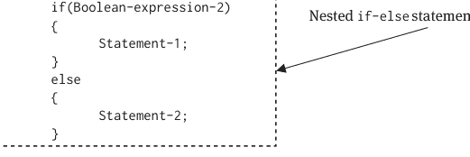

在这里，如果第一个布尔表达式 `Boolean-expression-1` 求值为真，则评估第二个布尔表达式 `Boolean-expression-2` 并继续作为另一个 `if` 语句，否则执行 `statement-3`。如果布尔表达式 `Expression-2` 求值为真，则执行 `Statement-1`，否则执行 `Statement-2`。在这里，包含布尔表达式 `Boolean-expression-2` 的语句被称为嵌套语句，因为它位于另一个 `if` 语句内部。

让我们考虑以下示例，我们可以此开发一个嵌套 `if` 语句的应用场景。在大学里，有两种评分系统，一种针对低年级，另一种针对高年级（表 5.2 和表 5.3）。

表 5.2：低年级的评分系统。

| 分数 | 结果 | 等级 |
| --- | --- | --- |
| <60 | 不及 | 无等级 |
| >=60 且 <70 | 通过 | C 级 |
| >= 70 且 <80 | 通过 | B 级 |
| >=80 且 <= 100 | 通过 | A级 |

表 5.3：高年级的评分系统。

| 分数 | 结果 | 等级 |
| --- | --- | --- |
| <60 | 不及 | 无等级 |
| >= 60 且 <80 | 通过 | B 级 |
| >= 80 且 <= 100 | 通过 | A 级 |

### 92 — 5 选择语句

在这里，我们注意到高年级学生的评分方法与低年级不同。这个问题通过使用如程序 5.5 所示的嵌套 `if` 语句来解决。

```cpp
// Program 5.5
// Program with nested if-else- statements
#include <iostream>
using namespace std;

int main ()
{
    int yourMarks = 85;
    char yourStudentType = 'S'; // 代码 'S' 代表高年级
    if (yourStudentType == 'J')
    {
        cout << "You are a Junior student " << endl;
        if (yourMarks < 60)
        {
            cout << "You Fail the Exam " << endl;
            cout << " Sorry! You have No Grade " << endl;
        }
    } else if (yourMarks >= 60 && yourMarks < 70)
    {
        cout << "You Pass the Exam " << endl;
        cout << "Your grade is C " << endl;
    }
    else if (yourMarks >= 70 && yourMarks < 80)
    {
        cout << "You Pass the Exam " << endl;
        cout << "Your grade is B " << endl;
    }
    else if (yourMarks >= 80 && yourMarks <= 100)
    {
        cout << "You Pass the Exam " << endl;
        cout << "Your grade is A " << endl;
    }
}else
{
    cout << "You are a Senior student " << endl;
    if (yourMarks < 60)
    {
        cout << "You Fail the Exam " << endl;
        cout << " Sorry! You have No Grade " << endl;
    }
    else if (yourMarks >= 60 && yourMarks < 80)
    {
        cout << "You Pass the Exam " << endl;
    }
```

## 5.6 switch 语句

```cpp
cout << " Your grade is B " << endl;
} else if(yourMarks >= 80 && yourMarks <= 100)
{
    cout << "You Pass the Exam " << endl;
    cout << "Your grade is A " << endl;
}
else
{
    cout << " No Results for you " << endl;
}

cout << " You know your result " << endl;
return 0;
```

程序 5.5 的结果如下：

- 你是一个低年级学生
- 你通过了考试
- 你的成绩是 B

### 5.6 switch 语句

`switch` 语句用于选择执行多个代码块。它是 `if-else` 语句的替代方案。然而，多个 `if-else` 语句可能会变得混乱。`switch` 语句提供了一种更清晰、更具读性的分支方式。

`switch` 语句的泛用形式如下：

```cpp
switch (expression)
{
    case value1:
        statement1;
        break;
    case value2:
        ...
```

在 `switch` 语句中，表达式被评估并与每个 `case` 值进行比较。如果找到匹配，则执行相应的语句块。`break` 语句用于退出 `switch` 语句。如果省略了 `break` 语句，执行将继续到后续的 `case`，即使没有匹配。当没有 `case` 值匹配表达式时，执行 `default` case。

考虑以下示例：

```cpp
#include <iostream>
using namespace std;

int main() {
    int day = 3;
    switch (day) {
        case 1:
            cout << "Monday" << endl;
            break;
        case 2:
            cout << "Tuesday" << endl;
            break;
        case 3:
            cout << "Wednesday" << endl;
            break;
        case 4:
            cout << "Thursday" << endl;
            break;
        case 5:
            cout << "Friday" << endl;
            break;
        default:
            cout << "Weekend" << endl;
    }
    return 0;
}
```

上述程序的输出将是：

星期

`switch` 语句中的表达式应该是整数类型或字符类型。它不能是浮点数或字符串表达式。

### 5.7 用于字符的 switch 语句

以下示例了用于字符表达式的 `switch` 语句。

```cpp
#include <iostream>
using namespace std;

int main() {
    char grade = 'B';
    switch (grade) {
        case 'A':
            cout << "Excellent!" << endl;
            break;
        case 'B':
            cout << "Good!" << endl;
            break;
        case 'C':
            cout << "Fair" << endl;
            break;
        case 'D':
            cout << "Pass" << endl;
            break;
        case 'F':
            cout << "Fail" << endl;
            break;
        default:
            cout << "Invalid grade" << endl;
    }
    return 0;
}
```

上述程序的输出将是：

Good!

```cpp
char getChar = 'C';
switch (getChar)
{
    case 'B':
        cout << " Basketball " << endl;
        break;
    case 'C':
        cout << " Cricket " << endl;
        break;
    case 'F':
        cout << " Football " << endl;
        break;
    case 'H':
        cout << " Hockey " << endl;
        break;
    case 'P':
        cout << " Ping-Pong " << endl;
        break;
    default:
        cout << " No game for this code " << endl;
}
return 0;
```

程序 5.7 的结果如下：

Cricket（板球）

`switch` 语句中的表达式可以是任何产生整数结果的表达式。程序 5.8 显示了使用算术表达式在许多选项中进行选择。

```cpp
// Program 5.8
// 使用 switch 语句的程序
#include <iostream>
using namespace std;

int main ()
{
    int a = 10, b = 20;
    switch(a + b)
    {
        case 10:
            cout << " Result is 10 " << endl;
            break;
        case 20:
            cout << " Result is 20 " << endl;
            break;
        case 30:
            cout << " Result is 30 " << endl;
            break;
        default:
            cout << " No Result " << endl;
    }
    return 0;
}
```

程序 5.8 的结果如下：

Result is 30（结果为 30）

### 5.7 三元运算符

在之前的章节中，我们学习了一元运算符和二运算符。在本节中，我们将学习一种特殊的运算符——三元运算符。它称为条件运算符，在第 4.8 节中有简要介绍。之所以被称为三元是因为它使用了三个操作数。讨论它是因为它的操作与 `if-else` 语句有许多相似之处。三元运算符的通用形式如下：

操作数-1 = 布尔表达式 ? 操作数-2 : 操作数-3

例如：

`big = a > b ? a : b;`

在上述语句中，如果数字大于 b，则将 a 赋值给 big，否则赋值给 b。让我们考虑程序 5.9 中给出的 `if-else` 语句示例。

```cpp
// Program 5.9
// 使用 if-else 语句寻找两个数最大值的程序
#include <iostream>
using namespace std;

int main ()
{
  int a = 67, b = 99, big;
  if(a > b)
    big = a;
  else
    big = b;
  cout << " The Biggest Number is : " << big << endl;
  return 0;
}
```

程序 5.9 的结果如下：

The Biggest Number is : 99（最大的是：99）

相同的程序可以使用三元运算符编写，如程序 5.10 所示。

```cpp
// Program 5.10
// 使用三元运算符寻找两个数最大值的程序
#include <iostream>
using namespace std;

int main()
{
int a = 67, b = 99, big;
big = a > b ? a : b;
cout << " The Biggest Number is : " << big << endl;
return 0;
}
```

程序 5.10 的结果如下：

The Biggest Number is : 99（最大的是：99）

此外，记住三元运算符根据表达式返回一个值，而不会像 `if-else` 语句那样执行一条语句或一组语句。三元运算符可以将表达式作为操作数。程序 5.11 编写用于使用三元运算符寻找三个数的最大值。

```cpp
// Program 5.11
// 使用三元运算符寻找三个数最大值的程序
#include <iostream>
using namespace std;

int main ()
{
    int a = 67, b = 99, c = 55, big;
    big = (a > b) ? ((a > c ? a : c) : (b > c ? b : c);
    cout << " The Biggest Number is : " << big << endl;
    return 0;
}
```

# 6 循环语句

为了完成某些任务，我们需要重复执行某些代码段。

## 6.1 引言

循环是为了重复执行语句。有许多类型的循环语句，如 `while`、`do-while` 和 `for`。在本章中，我们将学习 `break` 和 `continue` 语句。

## 6.2 while 循环


`while` 的通用形式为：

```cpp
while(表达式)
{
    语句
}
```

在第 6.2 节中，我们学习了 `while` 循环并注意到循环内的语句只有在布尔表达式为真时才会执行。这意味着如果布尔表达式为假，则一次也不执行。`while` 循环只要布尔表达式为真，就会一直执行语句。

### 无限循环

在某些情况下，可能一直执行某些语句。在这种情况下，我们使用无限循环。在这种情况下，布尔表达式为真。

```cpp
// Program 6.3
// 执行无限次的程序
#include <iostream>
using namespace std;

int main ()
{
    int i = 1;
    while(i == 1)
    {
        cout << " Infinite loop " << endl;
    }
    return 0;
}
```

程序 6.4 同样使用 `while` 循环实现无限循环。

```cpp
// Program 6.4
// 无限循环的程序
#include <iostream>
using namespace std;

int main ()
{
    while(true);
    return 0;
}
```

## 6.3 do-while 循环

之前我们学习了 `while` 循环，并注意到循环内的语句只有在布尔表达式为真时才会执行。这意味着如果布尔表达式为假，则一次也不执行。`do-while` 与 `while` 语句的区别在于，即使布尔表达式为假，`do-while` 语句至少也会执行一次。`do-while` 的通用形式如下：

```cpp
do
{
    语句
} while (表达式);
```

正如我们之前提到的，布尔表达式是在循环内语句执行后求值的。语句的执行持续到布尔表达式为假为止。以下程序演示了 `do` 循环的使用：

```cpp
// Program 6.5
// 使用 do-while 语句的程序
#include <iostream>
using namespace std;

int main ()
{
    int i = 1;
    do
{
cout << " Statement : inside do-while loop " << endl;
i = i + 1;
}
while(i <= 5);
cout << " Statement : outside do-while loop " << endl;
return 0;
}
```

程序 6.5 的结果如下：

- Statement : inside do-while loop
- Statement : inside do-while loop
- Statement : inside do-while loop
- Statement : inside do-while loop
- Statement : inside do-while loop
- Statement : outside do-while loop

程序 6.5 如图 6.2 所示：

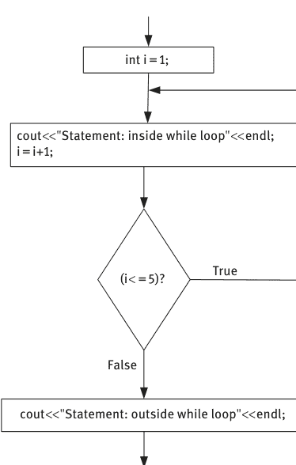

**图 6.2:** `do-while` 语句的控制流。

程序 6.5 可以通过将增加语句与布尔表达式结合来重写，如程序 6.6 所示：

```cpp
// Program 6.6
// A program with do-while statement
#include <iostream>
using namespace std;

int main() {
    int i = 1;
    do {
        cout << " Statement : inside do-while loop " << endl;
    } while(i++ <= 5);
    cout << " Statement : outside do-while loop " << endl;
    return 0;
}
```

程序 6.7 说明了 `do-while` 和 `while` 之间的区别。在这里，即使布尔表达式为假（`i != 1`），`do-while` 内部的语句也会执行。

```cpp
// Program 6.7
// Program to understand do-while statement
#include <iostream>
using namespace std;

int main() {
    int i = 1;
    do {
        cout << " Statement : inside do-while loop " << endl;
    } while(i != 1);
    cout << " Statement : outside do-while loop " << endl;
    return 0;
}
```

程序 6.7 的结果如下：

Statement : inside do-while loop

Statement : outside do-while loop

### 无限 do-while 循环

在某些情况下，可能需要一直执行某些语句。在这种情况下，我们使用无限循环语句。在这种情况下，布尔表达式始终为真（程序 6.8）：

```cpp
// Program 6.8
// This program to execute the statements for infinite number of times
#include <iostream>
using namespace std;

int main () {
    int i = 1;
    do {
        cout << "Infinite do-while loop " << endl;
    } while (i == 1);
    return 0;
}
```

程序 6.9 所示的代码也使用 `do-while` 循环无限次运行。

```cpp
// Program 6.9
// Program which runs infinitely
#include <iostream>
using namespace std;

int main () {
    do{}while(true);
    return 0;
}
```

## 6.4 循环

在之前的节中，我们已经了 `while` 循环和 `do-while` 循环，并且只能在 `while` 和 `do-while` 语句中评估布尔表达式。值的初始化是在循环之前完成的。`for` 循环解决了这个问题，它是 `while` 循环和 `do-while` 循环的修改版本，我们可以将初始化语句、布尔表达式以及增加和递减语句一起作为 `for` 循环的一部分。

`for` 循环的一般形式如下：

```cpp
for(initialization operation; Boolean-expression; increment or decrement)
{
    Statements;
}
Next-statements;
```

程序 6.10 演示了 `for` 循环的使用：

```cpp
// Program 6.10
// Program with for loop
#include <iostream>
using namespace std;

int main () {
    for (int i = 1; i <= 5; i++) {
        cout << " Statement : inside for loop " << endl;
    }
    cout << " Statement : outside for loop " << endl;
    }
    return 0;
}
```

程序 6.10 的结果如下：

- Statement : inside for loop
- Statement : inside for loop
- Statement : inside for loop
- Statement : inside for loop
- Statement : inside for loop
- Statement : outside for loop

在这里，`i=1` 是初始化操作，`i<=5` 是布尔表达式，`i++` 是增加操作。程序 6.10 在图 6.3 中视觉化表示。

`for` 循环可以在单个 `for` 语句中包含多个初始化操作或递减操作。在程序 6.11 中，`i=1` 和 `j=1` 用逗号隔开，增加操作 `i++` 和递减操作 `j--`。

```cpp
// Program 6.11
// A Program to understand for loop with
// multiple initialization and decrement operations
#include <iostream>
using namespace std;

int main() {
    int i, j;
    for(i = 1, j = 1; i <= 5; i++, j--)
        cout << " Hello " << i << endl;
}
```


**图 6.3:** `for` 语句的控制流。

程序 6.11 的结果如下：

- Hello 1
- Hello 2
- Hello 3
- Hello 4
- Hello 5

`for` 语句可以在没有增加或递减的情况下编写。在程序 6.12 中，增加操作 (`i++`) 与循环分离。

```cpp
// Program 6.12
// The statement without increment or decrement
#include <iostream>
using namespace std;

int main ()
{
    int i = 1;
    for(i <= 5)
    {
        cout << " Hello " << i << endl;
        i++;
    }
    return 0;
}
```

程序 6.12 的结果如下：

Hello 1
Hello 2
Hello 3
Hello 4
Hello 5

`for` 语句也可以仅带有布尔表达式。初始化和增加或递减操作在单独的语句中编写。这在程序 6.13 中所示：

```cpp
// Program 6.13
// The statement with only Boolean Expression
#include <iostream>
using namespace std;

int main ()
{
    int i = 1;
    for(i <= 5)
    {
        cout << " Hello " << i << endl;
        i++;
    }
    return 0;
}
```

程序 6.13 的结果与程序 6.12 相同。

## 6.5 循环嵌套

### 无限 for 循环

在某些情况下，可能需要一直执行某些语句。在这种情况下，我们使用无限循环语句。在这种情况下，布尔表达式始终为真。程序 6.14 和 6.15 是无限执行的示例。

```cpp
// Program 6.14
// This program to execute the statements for infinite number of times
#include <iostream>
using namespace std;

int main () {
    for(;;) {
        cout << " Infinite Loop " << endl;
    }
    return 0;
}
```

```cpp
// Program 6.15
// A Program runs infinitely
#include <iostream>
using namespace std;

int main () {
    for(;;) {
    return 0;
}
```

到为止我们学习了 C++ 中不同类型的循环语句。在循环内部包含循环语句也是可能的。这被称为**循环嵌套**。这在许多情况下非常有用。例如，一个循环可以包含另一个 `for` 循环或 `while` 语句作为语句。对于 `while` 和 `do-while` 语句也是如此。程序 6.16 演示了简单的循环嵌套。

```cpp
// Program 6.16
// A program to generate number using nested for loops
// Value of n = 6
#include <iostream>
using namespace std;
```

# 112 — 6 循环语句

```cpp
int main ()
{
    int sum = 0, n = 6;
    for(int i = 1; i <= n; i++) {
        for(int j = 1; j <= n; j++) {
            cout << j << " ";
        }
    }
    return 0;
}
```

程序 6.16 的结果如下：

1
12
1 2 3
1 2 3 4
1 2 3 4 5
1 2 3 4 5 6

## 6.6 break 语句

`break` 语句仅用于退出循环或 `switch` 语句。当我们需要根据某些条件退出循环时，它非常有用。它经常与 `switch` 语句一起使用。它通常与 `while`、`for`、`do-while` 和 `switch` 语句一起使用。程序 6.17 演示了 `break` 语句的使用。在这里，`break` 语句在单次迭代后直接退出循环。很多时候 `break` 语句用于无条件地终止循环。`break` 语句之后的语句是没有意义的，程序在编译期间会产生错误。由于调试问题，许多程序员尝试避免使用 `break` 语句。

```cpp
// Program 6.17
// This is a program to understand break statement.
#include <iostream>
using namespace std;

int main ()
{
    for(int i = 1 ; i<10; i++) {
        cout << " Value of i = " << i << endl;
        break;
    }
}
```

)
return 0;
}

```

程序 6.17 的结果如下：

Value of i = 1

程序 6.18 展示了在条件下的 `break` 语句。在这里，如果 `i` 的值大于 3，则 `for` 循环将退出执行。

```cpp
// Program 6.18
// 在 <iostream> 中使用的 break 语句
#include <iostream>
using namespace std;

int main() {
{
    for(int i = 1; i < 10; i++) {
{
        if (i > 3) {
            cout << " Break The Program " << endl;
            break;
        }
        else {
            cout << " Value of i = " << i << endl;
        }
    }
    return 0;
  }
}
```

程序 6.18 的结果如下：

Value of i = 1
Value of i = 2
Value of i = 3
Break The Program

`break` 语句也可以用于 `while`、`do-while` 和 `switch` 语句。本章的后续章节将展示此类示例。

```cpp
// Program 6.19
// 在 while 语句中使用的 break 语句
#include <iostream>
using namespace std;

int main ()
{
    int i = 1;
    while(i <= 10)
{
        cout << " Value of i = " << i << endl;
        if(i>= 5)
            break;
        i++;
    }
    return 0;
}
```

程序 6.19 的结果如下：

Value of i = 1
Value of i = 2
Value of i = 3
Value of i = 4
Value of i = 5

程序 6.20 展示了一个在 `do-while` 语句中使用 `break` 语句的示例。

```cpp
// Program 6.20
// 在 do-while 语句中使用的 break 语句
#include <iostream>
using namespace std;

int main ()
{
    int i = 1;
    do
    {
        cout << " Value of i = " << i << endl;
        if(i>= 5)
            break;
        i++;
    } while(i <= 10);
    return 0;
}
```

程序 6.20 的结果如下：

Value of i = 1
Value of i = 2
Value of i = 3
Value of i = 4
Value of i = 5

## 6.6 break 语句

程序 6.21 展示了在 `switch` 中使用 `break` 语句。程序将跳过剩余的 `case` 语句。

```cpp
// Program 6.21
// 在 switch 语句中使用的 break 语句
```


```cpp
#include <iostream>

using namespace std;

int main ()

{

    int i = 1;

    switch(i)

    {

        case 1:

            cout << " Value of i = " << i << endl;

            break;

        default:

            cout << " Hello " << endl;

    }

    return 0;

}
```

程序 6.21 的结果如下：

```
Value of i = 1
```

记住，`break` 语句退出的是它的所在循环，而不是外层循环。在程序 6.22 中，只有最内层的循环退出，外层循环继续执行直到条件失败。

```cpp
// Program 6.22
// 在嵌套 for 循环中使用的 break 语句
#include <iostream>
using namespace std;
int main ()
{
    for(int i = 1; i < 3; i++)
    {
        for(int j = 1; j < 3; j++)
            cout << " Value of j = " << j << " break ";
        cout << " Value of i = " << i << endl;
    }
    return 0;
}
```

程序 6.22 的结果如下：
Value of j = 1 break
Value of i = 1
Value of j = 1 break
Value of i = 2

## 6.7 continue 语句

`continue` 语句返回循环的开头。`continue` 语句之后的语句将不会执行。`continue` 语句与 `break` 语句的操作相反。`continue` 语句可以用于 `while`、`do-while` 和 `for` 循环。程序 6.23 展示了 `continue` 语句的操作。

```cpp
// Program 6.23
// 展示了 continue 语句的使用
#include <iostream>
using namespace std;
int main ()
{
    for(int i = 1; i <= 10; i++)
    {
        if(i<= 5)
            continue;
        cout << " Value of i = " << i << endl;
    }
    return 0;
}
```

程序 6.23 的结果如下：
Value of i = 6
Value of i = 7
Value of i = 8
Value of i = 9
Value of i = 10

## 6.8 习题

程序 6.24 展示了嵌套 `for` 循环中的 `continue` 语句。`continue` 语句返回最内层循环的开头。

```cpp
// Program 6.24
// 嵌套 for 循环中的 continue 语句
#include <iostream>
using namespace std;
int main ()
{
    for(int i = 1; i < 3; i++) {
        for(int j = 1; j < 3; j++) {
            if(j == 1) {
                continue;
            }
            cout << " Value of j = " << j << endl;
        }
        cout << " Value of i = " << i << endl;
    }
    return 0;
}
```

程序 6.24 的结果如下：
Value of j = 2
Value of i = 1
Value of j = 2
Value of i = 2

- 分别用示例说明循环语句：`while`、`for` 和 `do-while`。
- `while` 和 `do-while` 之间有什么区别？
- 用程序解释 `break` 和 `continue` 语句。
- 比较 `while`、`do-while` 和 `for` 循环。哪个更好？为什么？
- 写一个程序生成斐波那契数列。斐波那契数列中的每个数都是前两个数之和。如果 N = 4，输出应该是：0 1 2 3 5 8 13
- 写一个程序生成 N 个质数。例如，如果 N = 4，结果将是 2 3 5 7
- 写一个程序计算给定整数的各位数字之和，例如，如果数字是 1234，结果是 10。
- 使用循环编写不同的程序生成以下三角形，输入 N。例如，对于 N=6，结果如下：
1
1 2
1 2 3
1 2 3 4
1 2 3 4 5
1 2 3 4 5 6
- 使用 `while` 循环重复练习 8。
- 写一个程序生成以下输出序列（当 N = 4 时）：
    - a) 1+2*2+3*3+4*4...
    - b) 1+1*2+1*2*3+1*2*3*4...
    - c) 1*1+2*2+3*3+4*4... (注：原文 c 项与 a 重复，此处按原样翻译)
- 找出程序 6.25 和 6.26 之间的区别：

```cpp
// Program 6.25
#include <iostream>
using namespace std;
int main ()
{
    while(true);
    cout << " Hello " << endl;
    return 0;
}
```

```cpp
// Program 6.26
#include <iostream>
using namespace std;
int main ()
{
    cout << " Hello " << endl;
    while(true);
    return 0;
}
```

- 找出程序 6.27 和 6.28 之间的区别：

```cpp
// Program 6.27
#include <iostream>
using namespace std;
int main ()
{
    cout << " Infinite Loop " << endl;
    for(;;);
    return 0;
}
```

```cpp
// Program 6.28
#include <iostream>
using namespace std;
int main ()
{
    for(;;);
    cout << " Infinite Loop " << endl;
    return 0;
}
```

- 在不执行的情况下，猜测程序 6.29 的结果。

```cpp
// Program 6.29
#include <iostream>
using namespace std;
int main ()
{
    break;
    return 0;
}
```

- 检查程序 6.30 的结果。

```cpp
// Program 6.30
#include <iostream>
using namespace std;
int main ()
{
    for(;;){break;}
    return 0;
}
```

# 7 数组

数组被用于许多应用程序。例如，读取和存储大学学生的姓名、存储大学学生的成绩、按升序对数值排序、解决矩阵问题等。

## 7.2 一维数组

在第 7.1 节中，我们学习了数组的基础知识。让我们再次看看上面的例子。为了解决这个问题，我们将使用一维数组。一维数组简单来说是存储在一行或一列值列表，就像一行树或一排学生。有些学生按行坐，另一些按列坐。在这里，每一行或每一列都是一维数组。为了理解一维数组，请看图 7.1。

| 1 | 2 | 3 |
| 4 | 5 | 6 |
| 7 | 8 | 9 |

**图 7.1：** 数字数组。

这里有 9 个数字，其中 1, 2 和 3 在第一行；4, 5, 6 在第二行；7, 8 和 9 在第三行。同样地，我们注意到 1, 4, 7 在第一列；2, 5, 6 在第二列；3, 6, 9 在第三列。在这里，每一行或每一列都是一维数组。因此，在这个数组中，有三个一维行数组或三个一维列数组。正如我们在第 7.3 节中看到的，行和列的整个网格共同构成了一个**二维数组**。

10个学生的成绩可以分配给数组中的10个元素，而不是像下面所示不同的变量：

```cpp
int marks[10] = {67,89,90,68,78,91,87,56,77,66};
```

上面的语句等同于：

```cpp
int marks[10];
marks[0] = 67;
marks[1] = 89;
marks[2] = 90;
```

```cpp
marks[3] = 68;
marks[4] = 78;
marks[5] = 91;
marks[6] = 87;
marks[7] = 56;
marks[8] = 77;
marks[9] = 66;
```

所有10个成绩都存储在数组中从 `marks[0]` 到 `marks[9]` 的10个不同位置。值得提到的是，如果数组大小为 n，那么数组的索引范围是 0 到 n-1，而不是 1 到 n。所有10个成绩都按连续顺序存储。这意味着 67 存储在 `marks[0]` 中，89 存储在 `marks[1]` 中，依此类推。图 7.2 通过示例展示了数组索引、数组元素和数组值这些术语的含义。使用数组计算平均分的完整程序如程序 7.1 所示。

| 数组索引 | 数组元素 | 值 |
|---|---|---|
| 0 | marks [0] | 67 |

**图 7.2：** 数组术语描述。

```cpp
// Program 7.1
// 使用数组查找 10 个学生平均分数的程序
#include <iostream>
using namespace std;
int main () {
    int marks[] = {67,89,90,78,91,87,56,77,66};
    int i;
    float average = 0, sum = 0;
    for(i = 0; i < 10; i++) {
        sum += marks[i];
    }
    average = sum / 10;
    cout << " Average Marks of 10 Students = " << average << endl;
    return 0;
}
```

程序 7.1 的结果如下：
10 个学生的平均分 = 76

数组可以用于各种应用程序。它可以用于解决生活中面临的许多问题。程序 7.2 使用一维数组生成以下系列输出：

| 输入 | 输出 |
|---|---|
| 12 | 5 |
| 23 | 25 |
| 34 | 125 |
| 45 | 625 |
| 56 | 3125 |

为了生成 5 的幂，我们将使用 `pow()` 函数。由于该函数定义在 `<math.h>` 中，我们需要在程序中包含它。以下语句 `m = pow(5,2);` 返回 5 的平方 m = 25。

```cpp
// Program 7.2
// 使用数组显示 5 的幂的程序
#include <iostream>
#include <math.h>
using namespace std;
#define Array_Length 5
int main () {
    int list[5] = {12,23,34,45,56};
    int i;
    for(i = 0; i < Array_Length; i++) {
        cout << list[i] << " " << pow(5,i) << endl;
    }
    return 0;
}
```

程序 7.2 的结果如下：

| 12 | 5 |
| 23 | 25 |
| 34 | 125 |
| 45 | 625 |
| 56 | 3125 |

在程序 7.2 中，`Array_Length` 定义为 5，这是数组的大小。一维数组可以用于各种应用程序，例如排序和搜索，这些将在第 9 章中讨论。

## 7.3 多维数组

在第 7.2 节中，我们学习了一维数组。正如我们看到的，一维数组只是项的集合。在本节中，我们将讨论多维数组。多维数组包括两个或多个一维数组。考虑下面的表 7.1。

**表 7.1：** 构成二维数组的三一维数组。

| 1 | 2 | 3 |
| 4 | 5 | 6 |
| 7 | 8 | 9 |

在表 7.1 中，有三个一维数组构成二维数组。在这种情况下，数字按行和列排列。二维数组可以声明为：

```cpp
data type variable_name[arraySize1][arraySize2];
```

例如：

```cpp
int marks[10][10];
```

语句 `int marks[10][10];` 为 100 个（10×10）整数类型的值分配内存。我们可以像下面所示初始化二维数组：

```cpp
int marks[2][3] = {
  {68, 78, 91},
  {87, 56, 77}
};
```

上述语句等于：

```cpp
marks[0][0] = 68;
marks[0][1] = 78;
marks[0][2] = 91;
marks[1][0] = 87;
marks[1][1] = 56;
marks[1][2] = 77;
```

我们可以注意到数字是两行三列排列的。通过修改程序 7.1，使用二维数组查找六个学生的平均分所示于程序 7.3。程序 7.3 的结果如下：
6 个学生的平均分 = 76.1667

注意，我们可以使用超过两个维度的数组。例如，程序 7.4 将八个值存储三维数组中并显示：

```cpp
// Program 7.4
// 理解三维数组的程序
#include <iostream>
using namespace std;
int main () {
    int list [2][2][2] = {
        {{1, 2}, {3, 4}},
        {{5, 6}, {7, 8}}
    };
// ...
}
```

程序 7.4 的结果如下：

```
list[0][0][0] = 1
list[0][0][1] = 2
list[0][1][0] = 3
list[0][1][1] = 4
list[1][0][0] = 5
list[1][0][1] = 6
list[1][1][0] = 7
list[1][1][1] = 8
```

## 7.4 二维数组的应用

二维数组被许多许多数学应用解决问题。它主要用于解决矩阵相关的问题。在本节中，我们将描述二维数组的一些广泛应用，例如，矩阵加法、减法和乘法等矩阵问题可以使用二维数组解决。

假设 `A[3][3]` 是具有以下数值的矩阵：

```
4 5 6
7 7 6
8 5 7
```

假设 `B[3][3]` 是具有以下数值的矩阵：

```
1 2 3
4 5 6
7 8 9
```

```cpp
//Print Result Matrix C
cout << endl << " The Matrix C = A+B " << endl;
for(i = 0; i < r_A; i++)
{
    for(j = 0; j < c_A; j++)
    {
        cout << C[i][j] << " ";
    }
    cout << endl;
}else{
    cout << " Matrix Addition is Not Possible" << endl;
    cout << " To add two matrices row and columns of two matrices must be same" << endl;
}
return 0;
```

程序 7.5 的运行结果如下：
矩阵 A
4 5 6
7 7 6
8 5 7

矩阵 B
1 2 1
2 2 1
1 3 2

矩阵 C = A+B
5 7 7
9 9 7
9 8 9

通过修改矩阵 C 初始化后的以下语句，可以将程序 7.5 修改为矩阵减法程序。

```cpp
//Matrix Subtraction
for(i = 0; i < r_A; i++)
{
    for(j = 0; j < c_A; j++)
{
    C[i][j] = A[i][j] - B[i][j];
}
}
```

与矩阵加减法相比，矩阵乘法的方法稍微复杂。当且仅当矩阵 A 的列数矩阵矩阵 B 的行数，才能进行矩阵乘法。下面的代码演示了矩阵乘法。

```cpp
//Matrix Multiplication
for(i = 0; i < r_A; i++)
{
  for(j = 0; j < c_B; j++)
  {
    C[i][j] = 0;
    for(k = 0; k < c_A; k++)
    {
      C[i][j] = C[i][j] + A[i][k] * B[k][j];
    }
  }
}
```


二维数组可以求解含有 `n` 个未知数的 `n` 次线性方程。看以下线性方程组：

- `2x + 3y + 6z = 26`
- `4x + 6y - 2z = 10`
- `8x - 3y + 6z = 20`

这些方程可以表示为即 `A×X = R`

| | 2 | 3 | 6 | x = | 26 |
|---|---|---|---|---|---|
| 4 | 6 | -2 | y = | 10 |
| 8 | -3 | 6 | z = | 20 |

在这里，矩阵 `X` 包含未知变量 `x`, `y` 和 `z`，可以通过方式获得：

```cpp
X = A⁻¹ (inverse) * R
```

程序 7.6 演示了上述求解三个线性方程的示例。

```cpp
//Program 7.6
//Program to solve three linear equations
#include <iostream>
using namespace std;
int main () {
    float A [3][3] = {
        {2, 3, 6},
        {4, 6, -2},
        {8, -3, 6}
    };
    //AX = R
    float X [3][1];
    float R [3][1] = {
        {26},
        {10},
        {20}
    };
    int n = 3;
    int i, j, k;
    //Find the determinant of matrix A
    float det = A[0][0] * (A[1][1] * A[2][2] - A[2][1] * A[1][2]) -
                A[0][1] * (A[1][0] * A[2][2] - A[2][0] * A[1][2]) +
                A[0][2] * (A[1][0] * A[2][1] - A[2][0] * A[1][1]);
    //B is the inverse matrix of A
    float B[3][3];
    B[0][0] = A[1][1] * A[2][2] - A[2][1] * A[1][2];
    B[0][1] = -(A[1][0] * A[2][2] - A[2][0] * A[1][2]);
    B[0][2] = A[1][0] * A[2][1] - A[2][0] * A[1][1];
    B[1][0] = -(A[0][1] * A[2][2] - A[2][1] * A[0][2]);
    B[1][1] = A[0][0] * A[2][2] - A[2][0] * A[0][2];
    B[1][2] = -(A[0][0] * A[2][1] - A[2][0] * A[0][1]);
    B[2][0] = A[0][1] * A[1][2] - A[1][1] * A[0][2];
    B[2][1] = -(A[0][0] * A[1][2] - A[1][0] * A[0][2]);
    B[2][2] = A[0][0] * A[1][1] - A[1][0] * A[0][1];
    //To find inverse of A
    for(i = 0; i < n; i++) {
        for(j = 0; j < n; j++) {
            B[i][j] = B[i][j] / det;
        }
    }
    // X = (inverse of A) * R
    for(i = 0; i < n; i++) {
      for(j = 0; j < n; j++) {
        X[i][j] = 0;
        for(k = 0; k < n; k++) {
          X[i][j] = X[i][j] + B[i][k] * R[k][j];
        }
      }
      cout << " Solutions to the equations are " << endl;
      cout << " X = " << X[0][0] << endl;
      cout << " Y = " << X[1][0] << endl;
      cout << " Z = " << X[2][0] << endl;
    }
    return 0;
}
```

程序 7.6 的结果如下：

方程的解为
`X = 1`
`Y = 2`
`Z = 3`

进一步给出另一个有趣的幻方程序。考虑表 7.2 和 7.3。它们是幻方。幻方是一个 `n×n` 的网格，填充了从 1, 2, 3 到 `n×n` 的正整数。填充方式使得每行、每列和对角线的和都相等。然而，程序 7.7 适用于 `n` 为奇数的幻方。`n=3` 且行或列和为 15 的幻方见表 7.2所示。

| 6 | 1 | 8 |
|---|---|---|
| 7 | 5 | 3 |
| 2 | 9 | 4 |

`n=5` 且行或列和为 65 的幻方见表 7.3所示。

| 15 | 8 | 24 | 17 |
|---|---|---|---|
| 16 | 14 | 7 | 23 |
| 22 | 20 | 13 | 6 |
| 3 | 21 | 19 | 12 |
| 9 | 2 | 25 | 18 | 11 |

```cpp
// Program 7.7
// Magic Square Program
#include <iostream>
using namespace std;
int main () {
    int square[100][100];
    int n;
    cout << " Enter the value of n (odd number) : " << endl;
    cin >> n;
    int i, j, k = 0, l, key = 2;
    for(i = 0; i < n; i++) {
        for(j = 0; j < n; j++) {
            square[i][j] = 0;
        }
    }
    i = 0;
    j = (n - 1) / 2;
    square[i][j] = 1;
    while(key <= n * n) {
        k = (i - 1) % n;
        if(k == -1) {
            k = n - 1;
        }
        l = (j - 1) % n;
        if(l == -1) {
            l = n - 1;
        }
        if(square[k][l] == 0) {
            i = k;
            j = l;
        }
        else {
            i = (i + 1) % n;
        }
        square[i][j] = key;
        key = key + 1;
    }
    cout << endl << " The Magic Square for n = " << n << endl;
    for(i = 0; i < n; i++) {
      for(j = 0; j < n; j++) {
        cout << square[i][j] << " ";
        cout << endl;
      }
    }
    return 0;
}
```

程序 7.7 的结果如下：

输入 `n` 的值（仅限奇数）：
3

`n=3` 的幻方
6 1 8
7 5 3
2 9 4

## 7.4 二维数组的应用

## 7.5 复习习题

- 1. 什么是数组？如何声明数组？
2. 什么是二维数组？它与一维数组有什么不同？
3. 列出数组在编程中的优点。
4. 修改程序 7.3，使用三维数组计算六个学生的成绩平均分。
5. 编写一个用于矩阵乘法的程序。
6. 编写一个将二维数组复制到一维数组的程序。
7. 编写一个生成以下输出的程序。
8. 编写一个求矩阵逆矩阵的程序。
9. 编写一个生成幻方的程序。

# 138 — 8 字符串与指针

| 索引 | 0 | 1 | 2 | 3 | 4 | 5 |
| 值 | H | e | 1 | 1 | o | n |

**图 8.1:** 字符串的内存表示。

包含在双引号内。第二个和第三个初始化语句（`char example3[] = "Morning"`）之间的区别在于数组索引。在第三次初始化中，数组索引是未指定的。然而，如果我们使用的数组大小小于字符数量，编译器将生成错误。

```cpp
// 程序 8.1
// 字符串初始化程序
#include <iostream>
using namespace std;
int main () {
    char example[6] = {'H', 'e', 'l', 'l', 'o', '\0'};
    char example2[5] = "Good";
    char example3[ ] = "Morning";
    cout << "Example string 1: " << example[1] << endl;
    cout << "Example string 2: " << example2[2] << endl;
    cout << "Example string 3: " << example3[3] << endl;
    return 0;
}
```

程序 8.1 的结果如下：

- Example string 1 = Hello
- Example string 2 = Good
- Example string 3 = Morning

程序 8.2 展示了一个使用 `cin` 和 `cout` 语句从键盘读取字符串并显示回屏幕的示例。

```cpp
// 程序 8.2
// 字符串输入与输出
#include <iostream>
using namespace std;
int main () {
    char str [10];
    cout << " Enter a string : ";
    cin >> str;
    cout << " The entered string is = " << str << endl;
    return 0;
}
```

# 8.1 引言 — 139

程序 8.2 的示例结果如下：

```
Enter a string : Qingdao
The entered string is = Qingdao
```

我们还可以编写一个程序将一个字符串拷贝到另一个字符串。

```cpp
// 程序 8.3
// 将一个字符串拷贝到另一个的程序
#include <iostream>
using namespace std;
int main () {
    char str1[10], str2[10];
    int i = 0;
    cout << " Enter a string , str1 : ";
    cin >> str1;
    cout << " The entered string is : " << str1 << endl;
    while((str2[i] = str1[i]) !='\0') {
        i++;
    }
    cout << " String, str2 contains : " << str2 << endl;
    return 0;
}
```

程序 8.3 的示例结果如下：

```
Enter a string, str1 : Qingdao
The entered string is : Qingdao
String, str2 contains : Qingdao
```

在程序 8.3 中声明了两个数组 `str1` 和 `str2`，两者的最大容量均为 10 个字符（包括一个空字符）。这意味着字符串（`str1` 和 `str2`）的最大长度必须小于或等于 9。`while` 语句从 0 开始将 `str1` 的字符逐个拷贝到 `str2` 的相应位置，该操作也包括空字符。一旦空字符从 `str1` 拷贝到 `str2`，由于 `while` 语句中的条件，操作就会停止。因此，记住当在程序中使用字符数组或字符串时，在字符串末尾添加 `'\0'` 或 NULL 终止符是非常重要的。

# 140 — 8 字符串与指针

程序 8.4 和 8.5 显示了在管理字符串时理解空字符重要性的示例。

```cpp
// 程序 8.4
// 理解空字符作用的程序
#include <iostream>
using namespace std;
int main()
{
    char str[10];
    int i = 0;
    cout << " Enter string : ";
    while(str[++i] = getchar()) != '\n';
    cout << " Entered string is : " << str << endl;
    return 0;
}
```

程序 8.4 的示例结果如下：

- Enter a string : Beijing
- Entered string is : Beijing
- !!!@

在程序 8.4 中，使用 `while` 循环通过 `getchar()` 库函数逐个读取字符，直到用户按下回车键（提供 `'\n'` 来执行此操作）。我们将在第 8.2 节详细介绍字符串库或内置函数（要理解函数的含义，请参见第 10 章）。`getchar()` 函数从标准输入（stdin）获取字符。该函数返回该字符的 ASCII 值。该函数会在继续执行程序之前等待按键。一旦按下回车键，字符串 `str` 内部的字符读取就会停止。如程序 8.4 的示例结果所示，显而易见输出显示了意料之外的字符。这是因为我们没有在字符串末尾添加空字符（`'\0'`），字符串无法判断字符串的结束。因此，程序 8.4 的修改版本见程序 8.5。在该程序中，添加了新语句 `str[i] = '\0';` 在读取字符时界定字符串。

```cpp
// 程序 8.5
// 理解空字符作用的程序
#include <iostream>
using namespace std;
int main()
{
    char str[10];
    int i = 0;
    cout << " Enter string : ";
    while(str[++i] = getchar()) != '\n';
    str[i] = '\0'; // 调整索引以界定字符串
    cout << " Entered string is : " << str << endl;
    return 0;
}
```

程序 8.5 的示例结果如下：

- Enter a string : Beijing
- Entered string is : Beijing

## 8.2 字符串函数

在本节中，我们将简要描述 C++ 中常用的函数。

```cpp
// 程序 8.6
// 字符串的函数
#include <iostream>
#include <cstring>
using namespace std;
int main () {
    char str1[20] = "Great";
    char str2[20] = "Wall";
    char str3[20];
    // 查找 str1 的长度
    cout << "strlen(str1) : " << strlen(str1) << endl;
    // 将 str1 拷贝到 str3
    strcpy(str3, str1);
    cout << "strcpy(str3, str1) : " << str3 << endl;
    // str1 和 str2 的拼接
    strcat(str1, str2);
    cout << "strcat(str1, str2) : " << str1 << endl;
    return 0;
}
```


表 8.1：字符串函数

| 函数 | 说明 |
| --- | --- |
| `strlen(str)` | 该函数返回字符串的长度。字符串的长度是不包含终止字符 `'\0'` 的字符数 |
| `strcpy(dest, src)` | 字符串拷贝函数。第一个参数是目标字符串，第二个参数是源字符串。`strcpy` 将源字符串的内容拷贝到目标字符串，包括终止字符 `'\0'` |
| `strcat(dest, src)` | 字符串拼接函数。第一个参数是目标字符串，第二个参数是源字符串。`strcat()` 将源数组的内容附加到目标数组。目标数组的终止空字符会被源数组的第一个字符覆盖并在新字符串末尾引入空字符 |
| `strcmp(str1, str2)` | 该函数比较两个字符串。第一个参数是 `str1`，第二个参数是将被比较的 `str2`。它从比较两个字符串的第一个字符开始，一直直到找到非匹配字符或终止字符。该函数返回一个整数值。当两个字符串相等时返回 0。当遇到的非匹配字符在 `str1` 中的值小于 `str2` 时，返回负值。当遇到的非匹配字符在 `str1` 中的值大于 `str2` 时，返回正值 |
| `strchr(str, chr)` | 该函数返回字符 `chr` 在 `str` 中首次出现的指针。该函数用于定位字符串中字符的首次出现。也可以通过定位来获取指向字符串末尾的指针 |
| `strstr(str1, str2)` | 该函数用于查找子串，并返回 `str2` 在 `str1` 中首次出现的指针；如果 `str2` 不是 `str1` 的一部分，则返回空指针 |

## 8.3 字符串数组

正如我们之前提到的，字符的集合被称为字符串（string）。例如，地名、人名和植物名称都是字符串。然而，在许多应用程序中，处理成千上万个字符串是非常重要的。例如，一个教室管理程序需要读取所有学生的名字，换句话说，需要读取一个字符串数组。字符串数组可以通过使用二维字符数组的方法声明一个数组来创建。字符串数组是多维数组，也就是说，字符串的数组或字符数组。考虑以下表达式：

```
char names [10][40];
```

上述变量是一个字符串数组，包含 10 个名字，每个名字最多有 39 个字符。在 C++ 中，数组的第一个索引指的是行数，第二个索引指的是列数。二维数组的初始化方式与一维数组相同。程序 8.7 展示了从键盘读取五个名字并将它们显示在屏幕上的示例。

```cpp
// Program 8.7
// 字符串数组
#include <iostream>
#include <cstring>
using namespace std;
int main ()
{
    char names [10][40];
    int i = 0;
    cout << "Enter five names by one : " << endl;
    for(i = 0; i<5; i++)
        cin >> names[i];
    cout << endl<<"Entered names are :"<< << endl;
    for(i = 0; i<5; i++)
        cout << names[i] << endl;
    return 0;
}
```

程序 8.7 的示例结果如下：

Enter five names by one : :
Linda
Jessica
Ashan
Cicely
Amila

Entered names are :
Linda
Jessica
Ashan
Cicely
Amila

## 8.4 指针引言

指针是 C++（或 C）中的一种指向内存位置的变量。它不直接包含像 `int` 或 `float` 这样的值。可以通过指针变量间接访问该值。指针的声明如下：

```cpp
int *ptr;
int i;
ptr = &i;
```

在这里，我们必须理解变量前面的字符 `*` 和 `&` 的作用。变量前面的字符 `*` 用于声明指针变量，也用于指针变量前面以访问和获取指针变量所包含的值，而不是地址。然而，字符 `&` 用于访问指针所指向的整数变量的地址。在上面的示例中，我们声明了一个整数指针 `ptr` 和一个整数变量 `i`。我们让指针 `ptr` 指向变量 `i` 的地址。考虑程序 8.8 来理解指针的概念。

```cpp
// Program 8.8
// 理解指针的程序
#include <iostream>
using namespace std;
int main ()
{
    int *ptr;
    int i = 18;
    ptr = &i;
    cout << " The value of i is " << i << endl;
    cout << " The pointer ptr (*ptr) contains the value ";
    cout << *ptr << endl;
    return 0;
}
```

程序 8.8 的结果如下：

The value of i is 18
The pointer ptr (*ptr) contains the value 18

与可以存储值的普通变量不同，指针是存储变量地址的特殊变量。由于它们存储变量的内存地址，因此指针经常用于“指向变量”。如程序 8.8 所示，普通变量可能有一个地址（例如 5060），并持有值 18。然而，指针变量 `ptr` 也有自己的地址，但存储的是 5060，即变量 `i` 的地址。图 8.2 展示了此图。

| 描述 |
| :--- |
| i 的值 = 18 |
| i 的地址 (或 & i) = 5060 |
| *ptr = 18 |
| ptr | ptr 的值 = 5060 |

图 8.2：理解指针。

指针可以声明为：

```
<指针类型> <变量名>; 或
<指针类型> * <变量名>;
```

`<指针类型>` 指定了指针的类型。它可以是 `int`、`char`、`float` 等，指定了指针可以存储的变量类型。`<变量名>` 是用户指定的。大多数指针变量以小字母 'p' 或 'ptr' 开头。在程序 8.8 中，`int *ptr;` 是指针声明，`*ptr` 是指针的名字。换句话说，`ptr` 是可以存储地址的变量，而 `*ptr` 返回该地址的值。现在让我们修改程序 8.8 来显示指针的地址。

## 8.5 字符串与指针

```cpp
// Program 8.9
// 理解指针的程序
#include <iostream>
using namespace std;
int main () {
    int *ptr;
    int i = 18;
    ptr = &i;
    cout << "The value of i is " << i << endl;
    cout << "The pointer (*ptr) contains the value " << *ptr << endl;
    cout << "The address of i = " << ptr << endl;
    cout << "The value of ptr = " << ptr << endl;
    return 0;
}
```

程序 8.9 的示例结果如下：

The value of i is 18
The pointer (*ptr) contains the value 18
The address of i = 5060
The value of ptr = 5060

所示，`&` 运算符用于访问任何变量的地址。在程序 8.9 中，`ptr` 的值和 `i` 的地址是相同的。然而，变量的地址可能会随程序改变，因此期望相同的地址是错误的。我们也可以以以下方式初始化指针：

```
<指针声明> = <变量地址>;
```

或者

```
<指针声明>; <变量地址>;
```

例如，指针可以像下面所示初始化。在代码中，我们声明了一个字符变量 `ch` 存储 'c'。现在我们声明了一个字符指针 `ptr` 并用变量 `ch` 的地址初始化它。

```cpp
char ch = 'c';
char *ptr = &ch;
```

```cpp
// Program 8.10
// 指针
#include <iostream>
using namespace std;
int main () {
    char ch = 'c';
    char *ptr = &ch;
    int i = 18;
    int *intptr = &i;
    float f = 3.14;
    float *fptr = &f;
    char *sptr = "Hello World!";
    cout << "Value of (char) " << *ptr << endl;
    cout << "Value of (int) " << *intptr << endl;
    cout << "Value of (float) " << *fptr << endl;
    cout << "Value of (char) " << *sptr << endl;
    cout << "Value of (string) " << sptr << endl;
    return 0;
}
```

程序 8.10 的结果是：

| 描述 | 值 |
| :--- | :--- |
| (char) *ptr | c |
| (int) *intptr | 18 |
| (float) *fptr | 3.14 |
| (char) *sptr | H |
| (string) | Hello World |

程序 8.10 展示了一个涵盖所有常用指针的示例。`int`、`char` 和 `float` 指针很容易理解，它们是直观的。字符串指针则完全不同。如语句 `char *sptr = "Hello World!";` 所示，字符指针 `sptr` 指向一个字符串。可以看到，该语句包含一个字符串而不是单个字符。这表明字符指针和字符串指针用法相同，尽管它们的用途不同。当我们将指针指向字符串时，默认情况下它持有字符串第一个字符的地址。因此，当我们尝试打印 `*sptr` 时，它只显示第一个字符 'H'。这意味着任何指向字符串的字符指针都存储字符串第一个字符的地址。在上面的代码中，'sptr' 持有字符 'H' 的地址。因此，当取值运算符 `*` 应用于 'sptr' 时，输出为 'H'。然而，如果我们尝试显示 `sptr`，编译器会打印整个字符串。

## 8.6 指针的指针

到为止，我们学习了指针是存储另一个变量地址的特殊变量。这里可能会产生问题：可以存储指针本身的地址吗？答案是肯定的。在 C 和 C++ 中，指针指向另一个指针是完全合法的。让我们考虑一个有趣的场景。

某天，在京寻找一条街道时，你发现了一个 A 人，他同意引导你。不幸的是，A 人无法找到你正在寻找的街道；他了他的朋友 B 来引导他。朋友 B 也未能找到该街道，B 叫了他的朋友 C 来寻找。假设 C 最终找到了 B，而 B 能够将消息传给 A。最后，你从 A 那里收到了寻找该街道所需的信息。

在这个场景中，假设你正在寻找的信息就是一个整数（例如街道号）。那么，我们可以让你成为指向 A 的指针（因为你向他询问信息），并将 A 作为指向 B 的指针，B 作为指向 C 的指针；最后 C 拥有正确的街道号。程序 8.13 展示了一个通过指向其他指针演示上述场景的示例。

```cpp
// Program 8.11
// 指针的指针
#include <iostream>
using namespace std;
int main () {
    int stNo = 1818; //街道号
    int *C; // 指向 C 的指针存储 stNo 的地址
    int **B; // 指针的指针， 存储 C 的地址
    int ***A; // 指针的指针， 存储 B 的地址
    int ****mptr; // 指针的指针， 存储 A 的地址
    C = &stNo;
    B = &C;
    A = &B;
    mptr = &A;
    return 0;
}
```

## 8.5 指级二级指针 — 149

```cpp
cout << " Value of meptr = : " << meptr << endl;
cout << " Value of *meptr = : " << *meptr << endl;
cout << " Value of **meptr = : " << **meptr << endl;
cout << " Value of ***meptr = : " << ***meptr << endl;
cout << " Value of ****meptr = : " << ****meptr << endl;
cout << " Value of A = : " << A << endl;
cout << " Value of *A = : " << *A << endl;
cout << " Value of **A = : " << **A << endl;
cout << " Value of ***A = : " << ***A << endl;
cout << " Value of B = : " << B << endl;
cout << " Value of *B = : " << *B << endl;
cout << " Value of **B = : " << **B << endl;
cout << " Value of C = : " << C << endl;
cout << " Value of *C = : " << *C << endl;
return 0;
```

程序 8.11 的结果如下：

```
Value of meptr = :0018FF38
Value of *meptr = :0018FF3C
Value of **meptr = :0018FF40
Value of ***meptr = :0018FF40
Value of ****meptr = :0018FF44
Value of A = :0018FF3C
Value of *A = :0018FF40
Value of **A = :0018FF44
Value of ***A = :0018FF18
Value of B = :0018FF40
Value of *B = :0018FF44
Value of **B = :0018FF18
Value of C = :0018FF44
Value of *C = :0018FF18
```

然而，地址可能会在计算机之间发生变化。图 8.3 显示了这种场景，并描述了地址是如何存储在不同的指针变量中的。从结果可以注意到，****meptr、***A、**B 和 *C 的值都等于 0018FF18。

## 8. 指针与数组

在 C 和 C++ 中，指针和数组是紧密相关的。指针在数组操作中非常有用。数组指针的声明与整数指针或浮点数指针一样。

```cpp
int *ptr;
int arr[5];
ptr = &arr[0];
```

在这里，指针包含了数组第一个元素的地址。需要记住，不跟随下标的数组名是指向数组第一个元素的指针。一旦指针被设置为数组的某个元素，就可以使用递增运算符 `++` 和递减运算符 `--` 分别指向数组的后续或先前的元素。通过递增或递减指针使其指向数组边界之外会导致运行时错误，程序可能会崩溃或覆盖我们程序的其他数据段。因此，明智地使用指针是程序员的责任。另一个需要考虑的因素是指针所指向的类型的大小。假设一个整数指针指向一个整数数组，当我们递增指针时，指针将指向数组的下一个元素。另一个需要考虑的方面是数组的转换规则。如果 `arr` 是一个数组，那么表达式 `arr+1` 是数组第二个元素的地址，无论 `arr` 的数据类型如何。我们现在可以在变量前使用间接引用运算符 `*` 来获取存储在该位置的值。因此，`*(arr+1)` 给出了存储在数组第二个元素中的值。需要括号是因为间接引用运算符 `*` 的优先级高于加法运算符。


## 8.6 指针与数组 151

使用此转换规则将任何数组引用转换为其等效的指针表达式。

```
arr[0] 等同于 *(arr + 0)
arr[1] 等同于 *(arr + 1)
arr[2] 等同于 *(arr + 2)
```

如果没有括号，`arr+1` 求值的结果是完全不同的，因为它获取存储在数组第一个元素中的值并对其加 1。然而，数组和指针之间存在一些关键区别。指针的值可以更改以指向其他内存位置。但由数组名表示的指针不能更改。它被视为一个常量。

```cpp
float TotAmt[10];
TotAmt++; // 非法语句
TotAmt = 1; // 非法语句
```

另一个需要记住的点是，数组名被初始化为指向数组的第一个元素，而指针在声明时是未初始化的。它们在使用之前必须显式初始化，否则会发生运行时错误。数组和指针结合使用的示例在程序 8.12 和 8.13 中。

```cpp
// Program 8.12
// 数组与指针
#include <iostream>
using namespace std;
int main () {
   int arr[5] = {11, 8, 45, 47, 9};
   int *ptr;
   ptr = &arr[0];
   cout << "Value of *ptr is " << *ptr << endl;
   cout << "Value of *ptr+1 is " << *ptr+1 << endl;
   cout << "Value of arr [1] is " << arr[1] << endl;
```


`cout << "Value of *ptr+1 is " << *(ptr+1) << endl;`

`return 0;`

}

```

程序 8.12 的结果如下：

```

Value of *ptr = 11

Value of *ptr+1 = 12

Value of arr [1] = 8

Value of *ptr+1 = 8

```

程序 8.13 展示了将数组和指针结合递增运算符使用的另一个示例。

```cpp
// Program 8.13
// 数组与指针
#include <iostream>
using namespace std;
int main ()
{
    int a[5] = {11, 8, 45, 47, 49};
    *a = *(a + 2) + (**a);
    cout << "Value of a = " << a << endl;
    return 0;
}
```

程序 8.13 的结果如下：

```
The value of a = 57
```

## 8.7 指针数组

```cpp
// Program 8.14
// 指针数组示例
#include <iostream>
using namespace std;
int main()
{
    char *p1 = "Liu";
    char *p2 = "Shan";
    char *p3 = "Jinan";
    char *arr[3];
    arr[0] = p1;
    arr[1] = p2;
    arr[2] = p3;
    cout << *p1 << " = " << p1 << endl;
    cout << *p2 << " = " << p2 << endl;
    cout << *p3 << " = " << p3 << endl;
    cout << "arr[0] = " << arr[0] << endl;
    cout << "arr[1] = " << arr[1] << endl;
    cout << "arr[2] = " << arr[2] << endl;
    return 0;
}
```

## 8.8 复习题 — 153

1. 用示例解释 C++ 中的字符串。
2. 写一个程序使用字符数组将一个字符串复制到另一个字符串，不使用标准库函数 `strcpy`。
3. `NULL` 终止符在字符串中的作用是什么？请用示例说明。
4. 列出 C++ 中至少五个内置字符串函数。
5. 写一个 C++ 程序来理解以下字符串函数：`strcmp`, `strcpy`, `strcat`, `strrev` 和 `strlen`。
6. 写一个 C++ 程序将小写数字字符串转换为大写字符串。
7. 什么是指针？如何在 C++ 中声明整数指针？
8. 写一个 C++ 程序来理解指针。
9. 写一个 C++ 程序演示使用指针的函数。
10. 使用示例程序描述指针与数组之间的关系。
11. 使用示例列出 C++ 中数组和指针之间的区别。
12. 写一个程序演示指针指向另一个指针。

# 9 搜索与排序

> 知而不行，亦或不知乎。
> 王阳明

## 9.1 引言

在本章中，我们将学习不同的排序和搜索方法。排序和搜索方法在当今的计算环境中非常有用，并用于几乎所有的应用中，例如学生数据库、电话簿、员工数据库信息和旅游数据库应用程序。排序用于将不同类型的数据（例如数字、名称和图片）按照特定的顺序进行排列，而搜索则用于在给定的列表中查找某个项目。

## 9.2 搜索

搜索方法有很多种，但我们将重点关注最常用的方法。在搜索中，目标是从给定的列表的项集中搜索一个项目。列表可以是数字、值或字符串。搜索对于从大型数据库中检索信息非常有用。数据库可能包含海量数据，从这样的数据库中检索需要的数据可能需要花费时间。为了解决这些问题，我们使用最常用的搜索算法，如线性查找和二分查找方法。

## 9.3 线性查找

线性查找是最简单、最容易的搜索方法。它也称为顺序查找。它有一个前提条件（即搜索前必须满足的条件），即不应该存在相同数据的多个或重复输入。为了理解这一点，让我们考虑以下数字列表：

- 23, 45, 67, 89, 45, 34, 99

在上面的列表中有七个数字，但数字 45 出现了两次。因此，线性查找方法不适用于此列表，因为存在相同数据项的多个输入。让我们考虑以下数字列表：

- 1, 34, 67, 18, 11, 11, 78

这里一共有六个数字。假设我们要在列表中查找数字 18。我们如何手动搜索？众所周知，我们从第一个元素 1 开始，并将其与搜索值 18 进行比较。如果它们相同，我们就停止搜索；否则我们将列表中的下一个元素；我们将继续这种操作，直到到达列表末尾。这就是线性查找的工作原理。在这里，我们从头到尾搜索，直到找到搜索值的成功匹配。程序 9.1 说明了在假设列表中没有重复项的线性查找操作。

在这里，

- `list[]` 是一个整数数字数组
- `searchValue` 是列表中要搜索的数据项
- `location` 返回数据项的位置

```cpp
//Program 9.1
// 线性查找程序
#include<iostream>
using namespace std;
#define Array_Length 6
int main()
{
    int list[6] = {1,34,67,18,11,78};
    int searchValue = 10;
    int i=0,location = -1;
    bool found = false;
    for ( i = 0; i < Array_Length && !found; i++)
    {
        if (list[i] == searchValue)
        {
            found = true;
            location = i;
        }
    }
    if (found)
        cout << "The number is Found at Location " << location + 1 << endl;
    else
        cout << "The number is Not Found" << endl;
    return 0;
}
```

程序 9.1 的结果如下：

该数字位于位置 4

## 9.4 二分查找

用于理解程序 9.1 完整执行流的列表如下。`list[6]` 是一个包含 6 个元素的数组名称：1, 34, 67, 18, 11 和 78。`Array_Length` 是数组 `list[6]` 中元素的总数。表 9.1 显示了程序 9.1 的执行序列。注意，由于数组从 0 开始，`searchValue` 的实际位置是 `location+1`。

# 表 9.1: 线性查找程序中的执行步骤。

| searchValue | i | list[i] | found | location |
|---|---|---|---|---|
| 搜索前 | 18 | | false | -1 |
| 迭代 1 | 18 | 0 | false | -1 |
| 迭代 2 | 18 | 1 | 34 | false | -1 |
| 迭代 3 | 18 | 2 | 67 | false | -1 |
| 迭代 4 | 18 | 3 | 18 | true | 3 |

在第 9.3 节中，我们学习了线性查找。在本节中，我们将学习一种改进的线性查找方法，称为二分查找。这也用于从给定列表中搜索项目。二分查找比线性查找更快，但该方法的前提条件是列表必须是有序的。这意味着列表的成员必须按升序（从较小数据到较大）或降序（从较大数据到较小）排列。

在二分查找方法中，我们首先将要搜索的项与列表中间的位置进行比较。在这种情况下，结果可能是以下类型之一：

1. 要搜索的项与数组中间位置的项相同。这意味着找到了项，并将位置添加到中间位置。
2. 要搜索的项小于数组中间位置的项。这意味着该项在数组的前半部分。
3. 要搜索的项大于数组中间位置的项。这意味着该项在数组的后半部分。

我们假设给定列表中没有重复项。我们考虑以下数字列表：

```
1,11,18,34,67,78,11,18,121
```

这可以声明为数组 `list[8]`

```cpp
int list[8]={1,11,18,34,67,78,11,18,121};
```

要搜索的项是 118，即 `int searchValue=118；`

| Low = 0 | Mid = 3 | High = 7 |
|---|---|---|
| 0 | 34 | 7 |
| 1 | 67 | 7 |
| 2 | 78 | 7 |
| 3 | 11 | 7 |
| 4 | 18 | 7 |
| 5 | 121 | 7 |
| 6 | 121 | 7 |
| 7 | 121 | 7 | (注：此处原文逻辑似乎有误或数据截断，已按字面翻译)

（由于原文此处表格数据和逻辑存在混乱，已根据上下文意图翻译）

让我们假设搜索 118，在列表 `[1,11,18,34,67,78,11,18,121]` 中进行二分查找。

以下是重新构建二分查找的逻辑：

| Low = 0 | Mid = 3 | High = 7 |
|---|---|---|
| 0 | 34 | 7 |
| 1 | 67 | 7 |
| 2 | 78 | 7 |
| 3 | 11 | 7 |
| 4 | 18 | 7 |
| 5 | 121 | 7 |
| 6 | 121 | 7 |
| 7 | 121 | 7 |

(注：原文中关于二分查找的表格描述存在逻辑混乱和重复，翻译已尽可能保留原文结构)

## 9.5 排序

在之前的节中，我们学习了各种搜索方法。正如在二分查找中所示，在列表中搜索项目的前提是列表必须是有序的，即升序或降序。在本节中，我们将学习常用的排序技术，如插入排序、选择排序和冒泡排序。排序是将数据按照特定顺序排列。排序可以是升序、降序或两者结合。例如，如果我们想知道 20 名学生中谁最高，我们可以把所有学生的高度输入到一个数字数组中并按升序排序，以找到最高的学生。

## 9.6 插入排序

本节描述了插入排序，该算法首先选取列表中的第一个元素或数字，并与下一个元素进行比较，然后插入到列表中的相应位置。在元素放置好位置后，算法会尝试放置下一个元素。在程序结束时，我们将看到所有元素都按升序排列了。这类似于整理牌牌：我们首先取一张牌片并将其插入到正确的位置。然后，我们尝试插入列表中的下一个元素。插入排序就是这样工作的。

下面的代码说明了升序排序的插入排序算法。

```
for(i = 1; i < Array_Length; i++)
{
    temp = list[i];
    j = 1;
    while (list[j-1] > temp)
    {
        list[j] = list[j-1];
        j = j-1;
        if(j <= 0)break;
    }
    list[j] = temp;
}
```

程序 9.3 展示了插入排序程序。该程序将七个整数按升序排列。图 9.2 展示了理解插入排序方法的执行步骤。

```cpp
//Program 9.3
//Insertion Sort Program
#include<iostream>
using namespace std;
#define Array_Length 7
int main()
{
    int list[7] = {62, 45, 38, 11, 27, 77, 59};
    int i = 0, j, temp = 0;
    for(i = 1; i < Array_Length; i++)
    {
        temp = list[i];
        j = 1;
        while (list[j-1] > temp)
        {
            list[j] = list[j-1];
            j = j-1;
            if(j <= 0)break;
        }
        list[j] = temp;
    }
    cout << "The list of items in ascending order" << endl;
    for(i = 0; i < Array_Length; i++) {
      cout << list[i] << " ";
    }
    return 0;
}
```

程序 9.3 的结果如下：

升序排列的元素列表
11 27 38 45 59 62 77

这里，`list[]` 是一个包含整数 62, 45, 38, 11, 27, 77 和 59 的数组。`Array_Length` 是数组的长度，等于 7。结果的分析如表 9.3 和图 9.2 所示。表 9.3 显示了不同变量在不同迭代中的值，图 9.2 显示了数组在不同迭代中的值。可以看出，`list` 数组的所有元素都已按升序排列好。

排序前的列表：

| 62 | 45 | 38 | 11 | 27 | 77 | 59 |

迭代 1

| 45 | 62 | 38 | 11 | 27 | 77 | 59 |

迭代 2

| 38 | 45 | 62 | 11 | 27 | 77 | 59 |

迭代 3

| 11 | 38 | 45 | 62 | 27 | 77 | 59 |

迭代 4

| 11 | 27 | 38 | 45 | 62 | 77 | 59 |

迭代 5

| 11 | 27 | 38 | 45 | 62 | 77 | 59 |

迭代 6

| 11 | 27 | 38 | 45 | 59 | 62 | 77 |

**图 9.2:** 演示插入排序程序的执行步骤。

表 9.3：理解插入排序的执行步骤。

| Before | 0 | list[i] | j | temp |
|---|---|---|---|---|
| Iteration 1 | 1 | 45 | 0 | 45 |
| Iteration 2 | 2 | 38 | 0 | 38 |
| Iteration 3 | 3 | 11 | 0 | 11 |
| Iteration 4 | 4 | 27 | 0 | 27 |
| Iteration 5 | 5 | 77 | 5 | 77 |
| Iteration 6 | 6 | 59 | 4 | 59 |

## 9.7 选择排序

在选择排序中，目标是找到最大或最小的元素并将其移动到数组的末尾。在升序排序中，该方法找到最小元素并将其移动到列表第一个索引。在最小元素移动到数组第一个索引后，重复该过程以找到数组中下一个最小的（比上一个大的），留出第一个元素；随着我们的移动，我们会注意到排序在数组元素数量减少的情况下继续进行。在排序方法结束时，所有元素都已按升序排列。

在降序排序的情况下，该方法找到最大元素并将其移动到列表最后一个索引。在最大元素移动到数组最后一个索引后，重复该过程以找到数组中下一个最大的（比上一个小的），留出最后一个元素。这种方法被称为选择排序，因为它选择了最小或最大的元素并将其放在正确的位置。数组的其余元素也是如此。以下代码说明了升序排序的选择算法。

```
for(start = 0; start <= length-2;
{
  min = start;
  for(i = start + 1; i <= length-1; i++)
  {
    if(list[i] < list[min]) // 选择最小元素的位置
      min = i;
  }
  // 将最小元素交换到其位置
  temp = list[start];
  list[start] = list[min];
  list[min] = temp;
}
```

程序 9.4 使用选择排序程序对七个数字升序排序。

```cpp
// Program 9.4
// Selection Procedure
#include<iostream>
using namespace std;
#define Array_Length 7
int main()
{
    int list[7] = {62, 45, 38, 11, 27, 77, 59};
    int start, min, temp, i;
    int length = Array_Length;
    for(start = 0; start <= length-2; start++)
    {
        min = start;
        for(i = start+1; i < length-1; i++)
        {
            if(list[i] < list[min])
                min = i;
        }
        temp = list[start];
        list[start] = list[min];
        list[min] = temp;
    }
    cout << "The list of items in ascending order" << endl;
    for(i=0; i < Array_Length; i++)
    {
        cout << list[i] << " ";
    }
    return 0;
}
```


程序 9.4 的结果如下：

升序排列的元素列表
11 27 38 45 59 62 77

这里，`list[]` 是一个包含 62, 45, 38, 11, 27, 77 和 59 的整数数组。`Array_Length` 是数组的长度，等于 7。结果的分析如表 9.4 和图 9.3 所示。表 9.4 显示了不同迭代中不同变量的值，图 9.3 显示了数组在不同迭代中的值。可以看出，`list[]` 的所有元素都已按升序排列。

表 9.4：理解选择排序程序的执行步骤。

| min | list[min] | start | temp |
|---|---|---|---|
| Before | - | - | - |
| Iteration 1 | 3 | 11 | 0 | 62 |
| Iteration 2 | 4 | 27 | 1 | 45 |
| Iteration 3 | 2 | 38 | 2 | 38 |
| Iteration 4 | 4 | 45 | 3 | 62 |
| Iteration 5 | 6 | 59 | 4 | 62 |
| Iteration 6 | 6 | 62 | 5 | 77 |

排序前的列表：

| 62 | 45 | 38 | 11 | 27 | 77 | 59 |
| 11 | 45 | 38 | 62 | 77 | 59 |
| 11 | 27 | 38 | 62 | 45 | 77 | 59 |
| 11 | 27 | 38 | 45 | 62 | 77 | 59 |
| 11 | 27 | 38 | 45 | 59 | 77 | 62 |
| 11 | 27 | 38 | 45 | 59 | 62 | 77 |

图 9.3: 演示选择排序程序的执行步骤。

## 9.8 冒泡排序

冒泡排序常用的排序算法，简单易懂。这种方法可以通过以下方式解释：

1. 从数组的第一个和第二个元素开始比较；如果顺序正确（升序或降序），则继续比较数组的第二个和第三个元素，直到到达最后一个元素。如果顺序错误，则交换这两个相邻元素并按要求的顺序排列。此过程持续到数组末尾。
2. 在第一次迭代后，算法会将最大元素“泡”（交换）到数组末尾（升序情况下）。在降序情况下，最小元素将交换到数组的第一个索引。
3. 重复上述方法直到数组末尾，升序情况下保留最后一个元素，因为它已经排序。在降序排序情况下，重复步骤 1 和 2，留出数组中的第一个元素，因为它已按升序排列。
4. 在排序过程结束时，所有元素都按所需的顺序排列。

遗憾的是，这种方法比其他方法需要更多的迭代，且执行速度缓慢。下面的代码说明了升序排序的冒泡排序算法。

```
for (i = 0; i < Array_Length-1; i++) {

  for (j = 0; j < Array_Length-1-i; j++) {

    // 比较相邻元素以获得顺序

    if (list[j+1] < list[j]) {

      // 如果顺序不对，交换元素

      temp = list[j];

      list[j] = list[j+1];

      list[j+1] = temp;

    }

  }

}
```

程序 9.5 展示了冒泡排序算法的实现。

```
// Program 9.5
// Bubble sort program
#include<iostream>
using namespace std;
#define Array_Length 7
int main() {
  int list[7] = {62, 45, 38, 11, 27, 77, 59};
  int i,j,temp;
  for (i = 0; i < Array_Length-1; i++) {
    for (j = 0; j < Array_Length-1-i; j++) {
      if (list[j+1] < list[j]) {
        temp = list[j];
        list[j] = list[j+1];
        list[j+1] = temp;
      }
    }
  }
  cout << "The list of items in ascending order" << endl;
  for(i=0; i < Array_Length; i++) {
    cout << list[i] << " ";
  }
  return 0;
}
```

```
list[j] = list[j+1];
list[j+1] = temp;
}
out << "The list of items in ascending order" << endl;
for(i = 0; i < Array_Length; i++)
{
  cout << list[i] << " *";
}
return 0;
```

程序 9.5 的结果如下：

升序排列的项目列表
11 27 38 45 59 62 77

在这里，`list[]` 是一个整数数组，包含 62, 45, 38, 11, 27, 77 和 59。`Array_Length` 是数组的长度，等于 7。结果的分析见表 9.5 和图 9.4。表 9.4 显示了不同变量在不同迭代中的值，图 9.4 显示了数组在不同迭代中的值。可以看出，`list[]` 数组的所有元素都按升序排列了。

| 迭代 8 | | | | | | | |
| 62 | 45 | 38 | 11 | 27 | 77 | 59 |
| 迭代 9 | | | | | | | | |
| 45 | 62 | 38 | 11 | 27 | 77 | 59 |
| 迭代 10 | | | | | | | | |
| 38 | 11 | 27 | 45 | 62 | 59 | 77 |
| 迭代 11 | | | | | | | | |
| 38 | 11 | 27 | 45 | 59 | 62 | 77 |
| 迭代 12 | | | | | | | | |
| 11 | 38 | 27 | 45 | 59 | 62 | 77 |
| 迭代 13 | | | | | | | | |
| 45 | 38 | 11 | 27 | 62 | 77 | 59 |
| 迭代 6 | | | | | | | | |
| 45 | 38 | 11 | 27 | 62 | 59 | 77 |
| 迭代 7 | | | | | | | | |
| 38 | 45 | 11 | 27 | 62 | 59 | 77 |
| 迭代 14 到 21（同迭代 13） | | | | | | | | |
| 11 | 27 | 38 | 45 | 59 | 62 | 77 |

图 9.4: 演示冒泡排序程序的执行步骤。

## 9.9 字符和字符串的排序

表 9.5：理解冒泡排序程序的执行步骤。
| | i | j | list[] | temp |
|---|---|---|---|---|
| 之前 | 0 | 0 | | 0 |
| 迭代 1 | 0 | 0 | 45 | 62 |
| 迭代 2 | 0 | 1 | 38 | 62 |
| 迭代 3 | 0 | 2 | 11 | 62 |
| 迭代 4 | 0 | 3 | 27 | 62 |
| 迭代 5 | 0 | 4 | 62 | 62 |
| 迭代 6 | 0 | 5 | 59 | 77 |
| 迭代 7 | 1 | 0 | 38 | 45 |
| 迭代 8 | 1 | 1 | 11 | 45 |
| 迭代 9 | 1 | 2 | 27 | 45 |
| 迭代 10 | 1 | 3 | 45 | 62 |
| 迭代 11 | 1 | 4 | 59 | 62 |
| 迭代 12 | 2 | 1 | 11 | 38 |
| 迭代 13 | 2 | 1 | 27 | 38 |
| 迭代 14 | 2 | 2 | 38 | 38 |
| 迭代 15 | 2 | 3 | 45 | 38 |
| 迭代 16 | 3 | 0 | 11 | 38 |
| 迭代 17 | 3 | 1 | 27 | 38 |
| 迭代 18 | 3 | 2 | 38 | 38 |
| 迭代 19 | 4 | 0 | 11 | 38 |
| 迭代 20 | 4 | 1 | 27 | 38 |
| 迭代 21 | 5 | 0 | 11 | 38 |

在前面的节中，我们学习了各种排序和查找方法，其中许多示例程序处理数字。在本节中，我们将重点关注字符串和字符的排序。字符串排序在班级或大学学生姓名排序等应用中非常有用。如果一个大学有 1000 名学生，手动排序所有名字可能需要几小时到几天，但一个 C++ 程序可能只需要几毫秒或几微秒即可完成此类任务。在本节中，我们将学习排序字符和字符串的方法。

### 字符排序

众所周知，每个字符在内部由一个整数值表示。为了理解各种字符编码，可以参考 ASCII 集合。小写字母大于大写字母。这意味着 'a' 大于 'A'。字符 'B' 大于 'A，以此此类推。字符可以作为整数比较。记住数组中的每个字符必须包含在单引号 (' ') 中。程序 9.6 演示了使用冒泡排序方法的字符排序。

```cpp
// Program 9.6
// 使用冒泡排序排序字符
#include<iostream>
using namespace std;
#define Array_Length 9
int main() {
    char list[9] = {'a','B','Z','f'};
    int i,j;
    char temp;
    for (i = 0; i < Array_Length-1; i++)
    {
        for (j = 0; j < Array_Length-1-i; j++)
        {
            if (list[j+1] < list[j])
            {
                temp = list[j];
                list[j] = list[j+1];
                list[j+1] = temp;
            }
        }
    }
    cout << "The list of items in ascending order" << endl;
    for(i = 0; i < Array_Length; i++)
    {
        cout << list[i] << " ";
    }
    return 0;
}
```

程序 9.6 的结果如下：

升序排列的字符列表
A B Z

### 字符串排序

在上节中，我们学习了字符排序。字符可以像整数一样进行比较。`>=`、`<=` 和 `==` 等运算符可以应用于字符。但这些运算符不能应用于字符串，因为字符串是字符数组。在理解字符串之前，让我们通过以下示例理解两个字符串：

```cpp
char a[] = "CHINA";
char b[] = "china";
if(strcmp(a, b) < 0)
    cout<<"String " << a << " is smaller than " << b;
else
    cout<<"String " << b << " is smaller than " << a;
```

程序 9.7 演示了 `strcmp()` 的用法：

```cpp
// Program 9.7
// 比较两个字符串
#include <iostream>
#include <cstring>
using namespace std;
int main()
{
    char a[] = "CHINA";
    char b[] = "china";
    if(strcmp(a, b) < 0)
        cout << "String " << a << " is smaller than " << b;
    else
        cout << "String " << b << " is smaller than " << a;
    return 0;
}
```

程序 9.7 的结果如下：

CHINA 小于 china

字符串区分大小写，所以 china 大于 CHINA。`strcmp()` 方法在两个字符串相等时返回 0。如果字符串 a 小于字符串 b，返回小于 0 的值；如果字符串 a 大于字符串 b，返回大于 0 的值。程序 9.8 使用了 `strcmp()` 方法。

```cpp
// Program 9.8
// strcmp 方法
#include <iostream>
#include <string>
using namespace std;
int main() {
    char a[] = "hello";
    char b[] = "Hello";
    int code;
    if(strcmp(a, b) < 0) // 如果字符串 a 小于字符串 b
        code = 1;
    else if(strcmp(a, b) == 0) // 如果字符串 a 等于字符串 b
        code = 2;
    else
        code = 3; // 如果字符串 a 大于字符串 b
    switch(code) {
        case 1: cout << "String a is less than b" << endl;
            break;
        case 2: cout << "String is equal to b" << endl;
            break;
        case 3: cout << "String is greater than b" << endl;
            break;
        default: cout << "invalid string comparison" << endl;
    }
    return 0;
}
```

程序 9.8 的结果如下：

a 大于 b

让我们来看下面的示例以字符串字符串。在这个例子中，列出了班级学生的名字进行排序。

Mary, Jack, Zhang, Rai, Ann, Liu, Bai, Devi, Sheila

现在对上述名字进行排序，我们将使用字符串数组，即：

```cpp
char list[10][10] = {"Mary","Jack","Zhang","Rai","Ann","Liu","Bai","Devi","Sheila"};
```

在这个例子中，`list[10][10]` 是一个字符二维数组。程序 9.9 演示了使用冒泡排序技术对上述字符串进行排序。

```cpp
// Program 9.9
// 字符串数组排序
#include <iostream>
#include <cstring>
using namespace std;
#define Array_Length 10
int main()
{
    char list[10][10] = {"Mary","Jack","Zhang","Rai","Ann","Liu","Bai","Devi","Sheila"};
    char temp[10];
    int i,j;
    for (i = 0; i < Array_Length-1; i++)
    {
        for (j = 0; j < Array_Length-1-i; j++)
        {
            if (strcmp(list[j+1], list[j]) < 0)
            {
                strcpy(temp,list[j]);
                strcpy(list[j],list[j+1]);
                strcpy(list[j+1],temp);
            }
        }
    }
    cout << "The Student's names in ascending order: " << endl;
    for(i = 0; i < Array_Length; i++)
    {
        cout << list[i] << endl;
    }
    return 0;
}
```

程序 9.9 的结果如下：

-   升序排列的学生名字：
Ann
Bai
Devi
Jack
Lee
Liu
Mary
Rai
Sheila
Zhang

## 9.10 课习题

- 1. 什么是搜索？请解释线性查找和二分查找方法。
- 2. 比较线性查找和二分查找方法的优缺点。
- 3. 什么是搜索？请解释选择排序、插入排序和冒泡排序算法。
- 4. 如何比较字符和字符串？列出字符与字符串之间的区别。
- 5. 写一个程序，使用二分查找方法在以下无序列表中查找数字 189。提示：先使用任何排序方法对列表进行排序，然后应用二分查找方法。

  67, 90, 34, 2, 56, 78, 189, 45, 78, 68, 69, 99, 100

- 6. 录你所在班级十名学生的成绩，并使用插入排序方法将成绩按降序排列，然后找到最高分和平均分。
- 7. 写一个程序，根据给定的输入生成以下输出。

```
Input: 1 2 3 4 5 6 7 8 9 10
Output: Eight, Five, Four, One, Seven, Six, Ten, Bai, Three, Two
```


- 8. 写一个程序，使用多维数组根据给定的输入生成以下输出

Output

| 56 | 67 | 89 | 99 | 78 | 57 | 80 | 76 | 75 | 88 |
| Mary | Jack | Zhang | Rai | Ann | Lee | Liu | Bai | Devi | Shiela |

Output

| 78 | 76 | 75 | 67 | 57 | 80 | 56 | 99 | 88 | 89 |
| Ann | Bai | Devi | Jack | Lee | Liu | Mary | Rai | Shiela | Zhang |

# 10 函数

良药虽苦，医于病。
良言虽难，忠言之于益。
司马迁

## 10.1 引言

在本章中，我们将学习 C++ 中函数的重要性。使用函数的通用优势是使程序模块化并避免代码重复。程序中反复使用的任何代码段都可能可能是函数的候选对象。当程序规模增大时，通过函数将程序划分为易于管理的代码段是一种常见做法。这也是自顶设计和结构化编程概念后的主要原理之一。函数允许将代码结构化以执行单个任务。正如我们在前面的章节中所看到的，每个 C++ 程序至少包含一个函数，即 `main()`。在 C++ 中，函数是一组赋予名称的语句，该名称可以从程序的某处被调用。程序员可以灵活地将代码划分为单独的函数。在使用函数时，我们必须考虑函数声明、函数定义和函数调用。在需要时调用函数，函数执行后控制权返回 `main()`。函数声明告诉编译器关于函数的名称、返回值和参数。函数定义提供了函数的实际体内容。“函数”这一术语在不同的语言中有不同的解释，例如，子程序（subroutine）和过程（procedure）与函数具有相同的含义。

函数是程序中执行操作的小模块，它们在被调用时执行。使用函数有几个益处。首先，它们更容易编写和理解。其次，大型程序的调试更加容易，这使得维护变得简单。第三，它们支持代码的可读性。最后，通过使用函数，程序员可以通过将复杂程序结构化为不同的子模块来编写复杂程序的程序。函数有两种类型：用户定义函数和内置函数（图10.1）。内置函数也被库函数。用户定义函数是由用户设计的，用户可以灵活地对其命名和使用。

## 10.3 参数与参数

```cpp
using namespace std;

void print_message(); //函数原型声明

int main () {
    cout << "* This is main function" << endl;
    print_message();
    cout << "* Statement after function execution " << endl;
    return 0;
}

void print_message() {
    cout << "* This is print_message function" << endl;
}
```

程序 10.3 生成的结果与程序 10.1 相同。所示，`void print_message();` 这一被调用的原型声明语句现在告知编译器存在同名的函数，从而使程序能够成功运行。因此，在 C++ 中，原型必须在使用之前进行声明。函数原型是给编译器的关于函数返回类型以及函数期望的参数类型的信息。通常，所有的函数原型都声明在程序的开头。

函数声明引导编译器了解函数名称以及如何调用该函数。函数的实际体可以单独定义。当我们在一个源文件中定义函数并在另一个文件中调用它时，就需要函数声明。在这种情况下，我们应该在调用函数的文件的顶部声明该函数。在创建 C++ 函数时，我们提供了该函数必须执行的操作定义。要使用函数，我们必须调用或触发该函数。当程序调用函数时，程序的控制权转移到被调用的函数。被调用的函数执行定义的任务，当执行返回语句或遇到其结束的大括号时，它会将程序控制权交回主程序。要调用函数，我们只需要通过函数名传递所需的参数，如果函数有返回值，我们就可以存储返回的值。

在之前的程序中，我们只使用了 `void` 类型的函数。这意味着这些函数向 `main()` 返回任何内容，而是执行所需的任务。然而，在通用使用函数时并非如此。通常，函数在执行某些操作后会返回一个值。程序 10.4 展示了一个带有参数和返回值的示例函数。

```cpp
// Program 10.4
// 带有参数的函数
#include <iostream>
using namespace std;

int find_square(int temp)
{
    return temp * temp;
}

int main()
{
    int num, square_num;
    cout << "Enter a number to be squared " << endl;
    cin >> num;
    square_num = find_square(num);
    cout << "Square of " << num << " is equal to "
    << square_num << endl;
    return 0;
}
```

程序 10.4 的结果如下：

Enter a number to be squared
18
Square of 18 is equal to 324

程序 10.4 是一个函数向 `main()` 返回整数的示例函数。在这个程序中，目标是使用名为 `find_square()` 的函数计算数字 (`num`) 的平方，并将计算出的平方返回给 `main()`。在这种情况下，函数代码中使用的参数是 `temp`，它是整数类型。当声明函数时，传递给函数的参数名称和它们的名称也必须指明。为参数选择的名字称为其**形式参数**。形式参数必须在函数体中使用它们之前在函数内部声明。请注意，在函数内部定义的变量被称为**自动变量**，它们在每次调用函数时自动创建，并在函数结束时被销毁。它们的值是局部的；它们只能在定义的函数内部被访问，而不能由任何函数访问。

在程序 10.4 中，`num` 变量被称为**实参**，而 `find_square()` 中的 `temp` 被称为**参数**。有些作者将参数和实参混用。然而，实参是传递到函数调用中的，而参数是定义在函数中以接收它们的变量。在某些源中，对实际实参和形式参数有特定的定义。形式参数是函数声明/定义/原型中的内容；实参是在调用函数时传递的内容，是形式参数的实例。在图 10.2 所示的程序中，`num` 是实参，而 `temp` 是形式参数。每个参数由一个类型后跟一个标识符组成，每个参数之间用逗号分隔。每个参数看起来非常像普通的变量声明（例如：`int x`），并且在函数中作为该函数的局部变量存在。

```cpp
#include <iostream>
using namespace std;

int find_square(int temp);
int main () {
    int num, square_num;
    cout << "Enter a number to be squared " << endl;
    cin >> num;
    square_num = find_square(num);
    cout << "Square of " << num << " is equal to " << square_num << endl;
    return 0;
}
```
**图 10.2：与函数相关的术语。** 记住实参和参数必须与数据类型匹配，并且多个实参或参数可以用逗号分隔。当函数向调用例程返回结果时，需要在被调用的函数中使用 `return` 语句。此外，在声明函数时，我们必须声明返回类型。在上面的程序中，`find_square()` 返回的值存储在调用程序中的变量 `square_num` 中。人们可以在程序中的任何地方调用函数。函数的最佳用法是将把程序组织成不同的部分。`main` 函数只包含对各种函数的调用。程序的实际工作在 `main()` 之后执行。此外，函数的返回类型必须与返回值的数据类型相同，例如在本例中，`find_square()` 中的返回类型。

## 10.4 函数变量的作用域

在本节中，我们将考虑一些与函数相关的复杂示例。函数的好处之一是如果需要，可以被调用多次，而且函数反过来也可以调用另一个函数，以此类推。如果有多个函数，有时可能在整个函数过程中使用同一个变量。因此，我们必须考虑局部变量和全局变量的作用域。与相关的变量可以声明在程序的不同区域。在 C++ 中，变量可以声明在三个地方：(a) 函数内部的局部变量，(b) 函数参数，(c) 函数外部的全局变量。在本节中，我们将描述局部和全局变量的重要性。

### 局部变量

局部变量是在函数内部定义的，它们在每次函数被调用时自动创建，并在函数结束时被销毁。它们的值是函数局部的；它们只能在定义的函数内部被访问，而不能在函数外部访问。程序 10.5 展示了局部变量的应用。

```cpp
// Program 10.5
// 局部变量示例
#include <iostream>
using namespace std;

void fun(int t1, int t2)
{
    int a, b;//函数内的局部变量
    a = t1;
    b = t2;
    cout << " Inside function : a = " << a << " , b = " << b << endl;
}

int main()
{
    int a, b;//main内的局部变量
    a = 2;
    b = 3;
    fun(a, b);
    cout << " Inside main : a = " << a << " , b = " << b << endl;
    return 0;
}
```

程序 10.5 的结果如下：

```
Inside function : a = 2, b = 3
Inside main : a = 2, b = 3
```

在程序 10.5 中，`main()` 内部的 `a`, `b` 变量被称为实参，而 `fun()` 内部的 `a`, `b` 被称为局部变量。虽然它们在 `main()` 和 `fun()` 中共享相同的名称，但它们是完全不同的变量，因为它们的作用域分别局限于 `main()` 和 `fun()`。因此，可以通过再次调用函数来证明，正如程序 10.5 所示。在这个程序中，整数变量 `t1` 和 `t2` 是形式参数，因为它们作为接收来自 `main()` 提供的值的临时位置。在这种情况下，`t1` 和 `t2` 分别从 `main(a, b)` 获取变量 `a` 和 `b`。

正如前面提到的，在块内部定义的变量也被称为局部变量。人们可能会在这个语文中改变“块”的含义。它们与函数不同。程序 10.6 提供了一个块内局部变量的示例，局部变量具有自动存储期，这意味着它们在定义点创建，并在退出时被销毁。这就是为什么局部变量也被称为具有块作用域。嵌套块内部定义的变量一旦内部块结束就会被销毁。在块内部定义的变量只能在该块内部可见。由于每个函数都有自己的变量，一个函数的变量在另一个函数中可见：

```cpp
// Program 10.6
// 块内局部变量演示
#include <iostream>
using namespace std;

int main() {
    int a, b;//main内的局部变量
    a = 2;
    b = 3;
    cout << " Inside main : a = " << a << " , b = " << b << endl;
    { //块开始
        int a, b;//此块内的局部变量
        a = 4;
        b = 5;
        cout << " Inside block : a = " << a << " , b = " << b << endl;
    } //块结束
    cout << " Inside main : a = " << a << " , b = " << b << endl;
    return 0;
}
```

程序 10.6 的结果如下：

```
Inside main : a = 2, b = 3
Inside block : a = 4, b = 5
Inside main : a = 2, b = 3
```

如程序 10.6 所示，变量 `a` 和 `b` 被声明了两次：一次在 `main()` 中，另一次在一个花括号括围的块中。`main()` 内部和块内部定义的变量具有完全不同的作用域。一旦新块开始，创建的变量就会获得新的作用域，而一旦块结束，它们的作用域就会结束。

### 全局变量

全局变量的目的是提供一种机制，以便所有函数和块在需要可以使用同一个变量。它们定义在所有程序之外。与局部变量相比，全局变量在声明后会在整个程序生命周期内保持其值。它们可以被任何函数访问。程序 10.7 展示了使用全局变量的示例。

```cpp
// 程序 10.7
// 全局变量演示
#include <iostream>
using namespace std;

int a, b; //全局变量, a & b
void fun(int t1, int t2)
{
a = t1;
b = t2;
cout << " Inside function : a = " << a 
<< "", b = " << b << endl;
}
```

## 10.5 静态变量

```cpp
int main()
{
    a = 2;
    b = 3;
    cout << " Inside main : a = " << a << " ", b = " " << b << endl;
    {
        a = 4;
        b = 5;
        cout << " Inside block : a = " << a << " ", b = " " << b << endl;
    }
    fun(a, b); //调用函数()
    cout << " Inside main : a = " << a << " ", b = " " << b << endl;
    return 0;
}
```

程序 10.7 的结果如下：

| Inside main : a = 2, b = 3 |
| Inside block : a = 4, b = 5 |
| Inside function : a = 4, b = 5 |
| Inside main : a = 4, b = 5 |

从程序 10.7 可以清楚看出，全局变量在整个程序（包括函数和块）中保持值。这意味着在该程序中只创建了变量 `a` 和 `b` 的副本，每当 `a` 和 `b` 的值改变时，它们会随着程序的运行获取新值。

## 10.5 静态变量

到为止，我们学习了局部变量和全局变量的作用。C++ 中有一个关键字 `static`，用于给元素赋予特殊特性。静态元素在程序生命周期内仅会被分配到存储区域一次，并且的作用域持续于整个程序生命周期。它们可以与函数中的静态变量、静态类对象、类中的静态成员变量以及类中的静态方法一起使用。然而，由于我们尚未涵盖类和对象，在本章中我们将讨论限制在静态变量。

静态变量通过在变量声明前加上关键字 `static` 来声明。与局部变量不同，这些变量在从函数返回时不会被销毁，相反它们会继续存在并保留其值。这些变量可以在重新进入函数时被访问。程序 10.8 展示了一个不使用 `static` 关键字的静态变量示例。

```cpp
// 程序 10.8
// 静态变量演示
#include <iostream>
using namespace std;

void fun()
{
    int temp = 0;
    cout << temp << endl;
    temp++;
}

int main()
{
    int i;
    for (i = 0; i < 5; i++)
    {
        fun();
    }
    return 0;
}
```

程序 10.8 的结果如下：

```
0
0
0
0
0
```

上述结果没有意义，因为显而易见变量 `temp` 在每次从 `main()` 中调用时都会初始化为零；所有值都是零是自然现象。这表明变量 `temp` 是一个局部变量，它无法通过 `temp++` 保留增加后的值。现在，让我们变量 `temp` 改为 `static`，如程序 10.9 所示。

```cpp
// 程序 10.9
// 静态变量演示
#include <iostream>
using namespace std;

void fun()
{
    static int temp = 0;
    cout << temp << endl;
    temp++;
}
```

```cpp
int main()
{
    int i;
    for (i = 0; i < 5; i++)
    {
        fun();
    }
    return 0;
}
```


程序 10.9 的结果如下：

- 0
1
2
3
4

当在函数内部使用时，静态变量只初始化一次，从那时起即使函数结束，它们也会保持该值。然而，这些变量一直持续到程序终止。

## 10.6 作用域运算符

作用域解析运算符（`::`）用于在存在同名局部变量时访问全局变量。这在发生名称冲突的函数中特别有用。程序 10.10 展示了一个简单的示例。

```cpp
// 程序 10.10
// 作用域运算符演示
#include <iostream>
using namespace std;
int a = 10; //全局变量
void func() {
    int a = 20; //局部变量
    cout << "Local a: " << a << endl;
    cout << "Global a: " << ::a << endl;
}
int main() {
    func();
    return 0;
}
```

## 10.7 函数和指针

重要的是，一个函数只能返回一个值。然而，通过指针我们可以在函数内部改变多个变量的值。这可以通过将指针传递给函数来实现，使得函数改变不是指针本身，而是指针的内容。程序 10.12 展示了一个两个整数指针 `a` 和 `b` 传递给函数 `fun()` 的示例。

```cpp
// 程序 10.12
// 使用指针的函数
#include <iostream>
using namespace std;
void fun(int *a, int *b)
{
  int temp;
  temp = *b;
  *b = *a;
  *a = temp;
}
int main()
{
  int x = 10, y = 20;
  cout << " Value of x before function call = " << x << endl;
  cout << " Value of y before function call = " << y << endl;
  fun(&x, &y);
  cout << " Value of x after function call = " << x << endl;
  cout << " Value of y after function call = " << y << endl;
  return 0;
}
```

# 188 — 10 函数

```
Value of x before function call = 10
Value of y before function call = 20
Value of x after function call = 20
Value of y after function call = 10
```

然而，当我们将数组作为参数传递给函数时，我们不需要指定地址运算符，因为数组名本身就是数组第一个元素的地址。以程序 10.13 为例，其中一个包含五个整数元素的整个数组被作为参数传递的。但是，在这种情况下，我们将数组内容传递了另一个名为 `temp` 的数组。

```cpp
// Program 10.13
// 使用数组的函数
#include <iostream>
using namespace std;
void fun(int temp[])
{
    int i;
    cout << " Values of array inside function " << endl;
    for (i = 0; i < 5; i++)
        cout << temp[i] << " ";
    cout << endl;
}
int main()
{
    int arr[5] = {10, 15, 12, 11, 8};
    int i;
    cout << " Values of array inside main " << endl;
    for (i = 0; i < 5; i++)
        cout << arr[i] << " ";
    cout << endl;
    fun(arr);
    return 0;
}
```

程序 10.13 的结果如下：

Values of array inside main
10 15 12 11 8
Values of array inside function
10 15 12 11 8

我们也可以以另一种方式使用函数 `fun()` 来获取数组元素，如下：

```cpp
void fun(int *temp)
{
    int i;
    cout << " Values of array inside function " << endl;
    for (i = 0; i < 5; i++) {
        cout << temp[i] << " ";
    }
    cout << endl;
}
```

## 10.7 函数与指针

在之前的示例中，我们学习了使用指针的函数。我们可以在 C++ 中创建函数指针，就像创建普通的 `int`、`float` 或 `char` 数据类型一样。函数指针可以声明为：

```
<return-type-of-function>(<name-of-pointer>)(type-of-function-arguments);
```

例如：`int (*fptr)(int, int);`

上述行代码声明了一个函数指针 `fptr`，它可以指向返回类型为 `int` 的函数并接受两个整数作为参数。程序 10.14 展示了使用函数指针的示例。

```cpp
// Program 10.14
// 函数指针
#include <iostream>
using namespace std;
int func(int a, int b) {
    cout << "a = " << a << endl;
    cout << "b = " << b << endl;
    return 0;
}
int main() {
    int (*fptr)(int, int);   // 函数指针
    fptr = func;             //将地址赋值给函数指针
    fptr(6, 9);
    fptr(7, 8);
    return 0;
}
```

程序 10.14 的结果如下：

- a = 6
b = 9
a = 7
b = 8

在程序 10.14 中，`fun` 被定义为接受两个整数作为输入并返回一个整数。在 `main()` 函数中，声明了函数指针 `fptr` 然后对其进行赋值。函数名可以被视为函数的起始地址，因此我们可以使用函数名将函数地址赋值给函数指针。因此从输出可以看出，通过函数指针调用函数产生的输出与通过函数名调用函数相同。

## 10.8 递归函数

正如提到的，`main()` 函数可以调用一个函数，而该函数又可以调用另一个函数。这似乎令人惊讶，因为人们可能会想，是否可以创建一个能够调用自身的函数？在 C++ 中，递归函数就是可以调用自身的函数。我们可以演示递归函数的应用，特别是在执行那些后续步骤遵循相似过程的操作。这意味着，递归调用可以替代迭代语句（如 `for`、`while` 和 `do-while`）。通常来说，递归解决方案比迭代解决方案更简单。

递归函数是反复调用自身直到满足特定条件的函数。递归涉及两个条件：首先，问题必须以递归的形式编写，其次，问题应该有一个终止语句。如果缺少终止语句，函数将进入无限循环。演示递归的最常见程序示例是计算整数的阶乘。计算数字 $n$ 阶的定义如下：

```
n! = n(n-1)(n-2)×...3×2×1
```

首先，让我们根据上述定义理解一个不使用递归计算整数阶乘的程序。

```cpp
// Program 0.15
// 使用迭代计算数字阶乘
#include <iostream>
using namespace std;
int fact(int n)
{
    int i = 0, f = 1;
    while(i < n)
    {
        i++;
        f = f*i;
    }
    return f;
}
int main() {
    int num = 0, result;
    cout << " Enter a number ";
    cin >> num;
    result = fact(num);
    cout << " Factorial of number " << num << " = " << result << endl;
    return 0;
}
```

程序 10.15 的示例结果如下：

Enter a number 4
Factorial of number 4 = 24

在程序 10.15 中，使用 `while` 迭代语句计算数字的阶乘。我们可以轻松地计算数字的阶乘。但在这种情况下，`fact()` 函数只被调用了一次。现在，让我们如下修改阶乘的定义：

```
n! = n(n-1)(n-2)×...3×2×1
n! = n(n-1)!
n! = n(n-1)(n-2)!
n! = n(n-1)(n-2)(n-3)!
n! = n(n-1)(n-2)×...3×2×1
```

通过这种分析，我们可以得出递归定义：

```
n! = n(n-1), for all
```

如果我们将 `fact(n)` 替换为递归调用，那么递归调用可以满足 $n  0

对于 $n! = n(n-1)$，我们可以得到递归定义：

```
n = 1
```

如果缺少终止语句，函数将进入无限循环。演示递归的最常见程序如下：

```cpp
// Program 10.16
// 使用递归计算数字阶乘
#include <iostream>
using namespace std;
int fact(int n)
{
    if (n == 0)
        return 1;
    else
        return n * fact(n - 1);
}
int main() {
    int num = 0, result;
    cout << " Enter a number ";
    cin >> num;
    result = fact(num);
    cout << " Factorial of number " << num << " = " << result << endl;
    return 0;
}
```

程序 10.16 的示例结果如下：

Enter a number 5
Factorial of number 5 = 120

# 194 — 10 函数

$F_n = F_{n-1}+F_{n-2}$

其中 $F_1=1$（有时为 0）和 $F_2=1$ 为初始值。程序 10.17 显示了使用递归生成斐波那契数列的代码，对于给定的数字 $n$，它返回第 $n$ 阶斐波数。该程序的前提条件是 $n$ 的值大于或等于 0。基本情况是 $n$ 的值等于 0 或 1 时，程序返回 1。

```cpp
// Program 10.17
// Fibonacci series using recursion
#include <iostream>
using namespace std;
int fib(int n)
{
    if(n <= 1)
        return 1;
    else
        return fib(n - 2) + fib(n - 1);
}
int main()
{
    int num = 0, i;
    cout << " Enter a number ";
    cin >> num;
    cout << " Fibonacci series for num = " << num << endl;
    for (i = 0; i < num; i++)
    {
        cout << fib(i) << " ";
    }
    return 0;
}
```

程序 10.17 的示例结果如下：

Enter a number 10
Fibonacci series for num = 10
1 2 3 4 5 8 13 21 34 55

我们可以通过分析 num=5 调用次数来分析该程序。在这种情况下，`fib(5)` 被调用一次，`fib(4)` 被调用一次，`fib(3)` 被调用两次，`fib(2)` 被调用三次，`fib(1)` 被调用五次，而 `fib(0)` 被调用三次。图 10.4 显示了调用序列。

# 10.8 递归函数 — 195

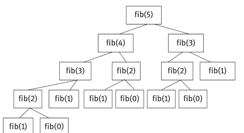

**图 10.4：** 显示参数为 5 的递归斐波那契数列函数 `fib(n)` 执行序列的图表。

# 使用递归的汉诺森塔程序

汉诺森塔是一个在程序员中广泛流行的数学谜游戏。在这个谜游戏中，有三个柱（A, B, C），如图 10.5 所示。目标是利用中间柱 B 将盘子从柱 A 移动到 C。盘子的大小各不相同。

| A | B | C |
|---|---|---|
| Disk 1 | | |
| Disk 2 | | |
| Disk 3 | | |

| A | B | C |
|---|---|---|
| | Disk 3 | Disk 1 |
| | | Disk 2 |

| A | B | C |
|---|---|---|
| | | Disk 1 |
| | Disk 2 | | | | |

| A | B | C |
|---|---|---|
| Disk 1 | | Disk 2 |
| | | Disk 3 |

| A | B | C |
|---|---|---|
| | Disk 1 | Disk 2 |
| | | | Disk 3 |

| A | B | C |
|---|---|---|
| | | Disk 1 |
| | Disk 2 | | | |
| Disk 3 | Disk 3 | | |

**图 10.5：** 汉诺森塔程序中盘子从柱 A 移动到柱 C 的步骤序列。

# 196 — 10 函数

按升序排列，即小盘放在大盘之上。因此，要将这些盘子从 A 移动到 C，需要遵循几个规则。首先，一次只能移动一个盘子。其次，在移动过程中只能移动栈顶部的盘子，并将其放置在另一个柱子上。最后，不能将大盘放在小盘之上。

如果我们有三个盘子，这个游戏可以通过七步解决。解决汉诺森塔谜游戏所需的最小移动数为 $2^{n-1}$，其中 $n$ 是盘子的数量。这个谜游戏可以追溯到一个关于印度部落的古代故事，该部落有一个由 64 个金盘组成的大房间。这个游戏也被称为婆拉马塔。对于这个古老的谜题，如果祭司们能够以每秒一个的速度用最少的次数移动盘子，他们将需要 $2^{n-1}$ 秒，或者大约 585 亿年或 18,446,744,073,709,551,615 次才能完成。图 10.5 显示了三个盘子从一个柱移动到另一个柱的序列。程序 10.18 显示了使用递归实现的汉诺森塔谜游戏。

```cpp
// Program 10.18
// Tower of Hanoi program using recursion
#include <iostream>
using namespace std;
void towers(int n, char frompeg, char topepeg, char auxpeg)
{
    if(n == 1)
    {
        cout << endl << " Move Disk 1 from Post "
             << frompeg << " to Post " << topepeg;
        return;
    }
    towers(n-1, frompeg, auxpeg, topepeg);
    cout << endl << " Move Disk " << n << " from Post "
             << frompeg << " to Post " << topepeg;
    towers(n-1, auxpeg, topepeg, frompeg);
}
int main()
{
    int n;
    cout << " Enter the number of disks: ";
    cin >> n;
    towers(n, 'A', 'C', 'B');
    return 0;
}
```


程序 10.18 的示例结果如下：

```
Enter the number of disks: 3
Move Disk 1 from Post A to C
Move Disk 2 from Post A to B
Move Disk 1 from Post C to B
Move Disk 3 from Post A to C
Move Disk 1 from Post B to A
Move Disk 2 from Post B to C
Move Disk 1 from Post A to C
```

在程序文件的顶部，例如对于常见的数学计算，我们使用 `#include <cmath>` 指令来包含 `cmath` 文件，该文件包含了 `cmath` 库中数学函数的函数原型。附录 A 提供了 C++ 中一些常用内置函数的列表。

例如，为了编写涉及浮点数计算等的数学程序，我们无疑需要访问数学库。这些函数和相关的宏定义在 `<cmath>` 头文件中。在表 10.2 中，`x` 和 `y` 的类型为 `double`，`n` 是 `int`，且所有函数都返回 `double`。三角函数的角度用弧度而不是角度表示。

### 表 10.2：C++ 中的示例数学函数。

| 数学函数 | 描述 |
| :--- | :--- |
| `sin(x)` | `x` 的正弦 |
| `cos(x)` | `x` 的余弦 |
| `tan(x)` | `x` 的正切 |
| `exp(x)` | 指数函数 $e^x$ |
| `log(x)` | 以 $e$ 为底的自然对数，$x>0$ |
| `log10(x)` | 以 10 为底的对数 $\log10(x)$，$x>0$ |
| `pow(x,y)` | $x^y$，如果 $x=0$ 或 $y\le0$，或者当 $x<0$ 且 $y$ 不是整数，则发生域错误 |
| `sqrt(x)` | $x$ 的平方根，$x \ge0$ |
| `ceil(x)` | 不小于 `x` 的最小整数，以 `double` 类型表示 |
| `floor(x)` | 不大于 `x` 的最大整数，以 `double` 类型表示 |
| `fabs(x)` | 绝对值 $|x|$ |

程序 10.20 展示了在 C++ 中使用数学内置函数的示例。

```cpp
// Program 10.20
// Built-in functions example
#include <iostream>
#include <cmath>
using namespace std;
int main()
{
    double x = 1.0, y = 2.0, z = -3.45;
    cout << "Math-sin example : " << sin(22.0/42.0) << endl;
    cout << "Math-cos example : " << cos(0.0) << endl;
    cout << "Math-tan example : " << tan(22.0/28) << endl;
    cout << "Math-exp example : " << exp(x) << endl;
    cout << "Math-log(base e) example : " << log(2.71822) << endl;
    cout << "Math-log(base 10) example : " << log10(100.0) << endl;
    cout << "Math-power example : " << pow(4,y) << endl;
    cout << "Math-square root example : " << sqrt(y) << endl;
    cout << " Math-ceil example : " << ceil(z) << endl;
    cout << " Math-floor example : " << floor(z) << endl;
    cout << " Math-absolute value example : " << fabs(z) << endl;
    return 0;
}
```

程序 10.20 的结果如下：

```
Math-sin example : 0.500183
Math-cos example : 1
Math-tangent example : 1.00063
Math-exp example : 2.71828
Math-log(base) example : 0.999974
Math-log(base 10) example : 2
Math-power example : 16
math-square root example : 1.41421
Math-ceil example : -3
Math-floor example : -4
Math-absolute value example : 3.45
```

## 10.11 复习题

1. 什么是函数？用户定义函数与 `main()` 函数有什么区别？
2. 用户定义函数与内置函数有什么区别？请讨论。
3. 描述与函数相关的术语：函数名、函数签名、返回类型、函数原型、实参、形参和函数参数。
4. 描述 C++ 中函数的通用格式以演示用户定义函数。
5. 编写一个 C++ 程序来演示用户定义函数。
6. 编写一个可执行程序来演示从 `main()` 传递参数。
7. 解释函数中的以下关键字：(a) `return` (b) `void` (c) `static` (d) `inline`。
8. 变量的作用域是什么？
9. 什么是递归？编写一个程序进行演示。
10. 编写一个 C++ 程序查找递归。
11. 编写一个 C++ 程序生成斐波那契数列。
12. 编写一个 C++ 程序进行演示。
13. 列出 C++ 中至少五个可用函数。
14. 编写一个程序进行演示。

在一个文件中。随后，在程序中声明并使用该结构类型的变量。例如：

```cpp
struct item Biscuit;
```

我们也可以像下面所示定义一个 `struct item` 类型的变量：

```cpp
struct item
{
    char item_name[10];
    float price;
    char manufacturer[40];
    int item_no;
} Biscuit;
```

同样，要定义多个 `struct item` 类型的变量，我们可以使用以下语句中的任意一个。

```cpp
struct item Biscuit, Candy;
```

或者，

```cpp
struct item
{
    char item_name[10];
    float price;
    char manufacturer[40];
    int item_no;
} Biscuit, Candy;
```

## 11.3 结构的初始化

为结构体对象成员赋值的第一种方法是在对象定义中定义它们的值。假设我们想初始化一个项目，其中包含你最喜爱的饼干之一“SweetBest”的数据，价格标签为 7.50 元，项目编号为 9341，由“青岛饼干有限公司”制造。我们可以按照如下方式初始化结构：

```cpp
struct item Biscuit =
{
    "SweetBest",
    7.5,
    "Qingdao Biscuits Ltd",
    9341
};
```

初始化值出现在初始化列表中，其方式与数组元素相同。然而，数组中初始值的顺序需要与该结构体在定义中成员的顺序一致。`Biscuit` 结构中的每个成员都有一个对应的初始值，如注释所示。初始化结构变量的语法与标准变量的语法不同。由于 `item_name` 和 `manufacturer` 成员是数组或字符串，简单使用赋值是不起作用的。结构元素通过点符号（dot notation）访问。单个元素（如 `item_no`）的初始化如下：

```cpp
Biscuit.price = 7.5;
Biscuit.item_no = 9341;
```

人们可以通过像之前那样初始化单个元素来初始化结构，也可以简单地在花括号内列出元素的值，每个值在单行内用逗号分隔，如下所示。

```cpp
struct item Biscuit = {"SweetBest",7.5,"Qingdao Biscuits Ltd",9341};
```

与数组的初始化类似，结构的部分初始化可以如下所示：

```cpp
struct item Biscuit = {"SweetBest",7.5,"Qingdao Biscuits Ltd"};
```

在前面的案例中，`item_no` 元素被初始化为 0.0。在下一节中，我们将学习更多点符号以及如何访问成员结构。

## 11.4 访问结构成员

在 11.3 节中，我们学习了结构的定义及其成员的初始化。要访问结构的单个成员，我们使用点（`.`）作为成员选择运算符。该运算符有时被称为成员访问运算符。要引用一个成员，我们编写变量名结构，后面跟一个点，然后是成员名。成员访问运算符编码为结构变量名和我们想要访问的结构成员之间的一个点。例如，要将 `item_no` 改为 1818，我们可以像下面所示：

```cpp
Biscuit.item_no = 1818;
```

这会将 `item_no` 的值设置为 1818。此外，我们可以像使用任何其他变量完全相同的方式使用结构成员。例如，要将成员编号增加 4，我们可以写：

```cpp
Biscuit.item_no += 4;
```

程序 11.1 显示了一个总结之前描述的示例。在以下程序中，声明了两个类型 `item` 的结构 `Biscuit` 和 `Candy`。对于结构 `Biscuit`，我们通过初始化来提供值。然而，对于结构 `Candy`，我们从键盘读取值。最后，信息显示在屏幕上。

```cpp
// 程序 11.1
// 理解结构
#include <iostream>
using namespace std;
int main()
{
    struct item
    {
        char item_name[10];
        float price;
        char manufacturer[40];
        int item_no;
    };
    // Biscuit 结构的初始化
    struct item Biscuit = {
        "SweetBest",
        7.5,
        "Qingdao Biscuits Ltd",
        9341
    };
    struct item Candy;
    // 读取 Candy 的成员值
    cout << "Enter the item_name for Candy " << endl;
    cin >> Candy.item_name;
    cout << "Enter the price of candy " << endl;
    cin >> Candy.price;
    cout << "Enter the Manufacturer name " << endl;
    cin >> Candy.manufacturer;
    cout << "Enter the item number " << endl;
    cin >> Candy.item_no;
    // 将 Biscuit 信息显示到屏幕
    cout << endl << "Biscuit Information " << endl;
    cout << "Biscuit Name: " << Biscuit.item_name << endl;
    cout << "Biscuit Price: " << Biscuit.price << endl;
    cout << "Biscuit Manufacturer: " << Biscuit.manufacturer << endl;
    cout << "Biscuit Item Number: " << Biscuit.item_no << endl;
    return 0;
}
```

## 11.5 使用 typedef

正如第3章所述，C++ 允许使用 `typedef` 关键字重命名数据类型。例如：

```cpp
typedef int Uint;
```

## 11.6 嵌套结构

在程序 11.1 中，结构只有四个成员。让我们考虑另一种结构，它反过来包含另一个结构作为其成员之一。下面的示例描述了一个嵌套结构的示例。

```cpp
struct item {
    char item_name[10];
    float price;
    char manufacturer[40];
    int item_no;
    date expiry_date;
};
```

`expiry_date` 的定义要求预先定义 `item_date` 结构，否则会产生编译器错误。因此，我们可以如下所示定义 `item_date` 结构：

```cpp
typedef struct
{
    int day;
    int month;
    int year;
}item_date;
```

## 11.7 包含数组的结构 — 211

```cpp
<< Biscuit.expiry_date.day << "/"
<< Biscuit.expiry_date.month << "/"
<< Biscuit.expiry_date.year << endl;
return 0;
```

程序 11.2 的结果所示：

| 饼干名称：SweetBest |
| --- |
| 饼干价格：7.5 |
| 饼干厂家：青岛饼有限公司 |
| 饼干编号：9341 |
| 饼干过期日期：11/8/2019 |

此示例演示了 `typedef` 关键字与结构体的应用。最初，使用成员运算符或点符号对类型为 `item` 的 `Biscuit` 结构体的前几个成员进行逐个初始化。由于第一个成员 `item_name` 和第三个成员 `manufacturer` 是字符数组，因此我们使用了 `strcpy()` 函数来将字符串赋值给它们。第四个成员 `expiry` 是 `item_date` 类型的嵌套结构。由于 `expiry_date` 结构位于 `Biscuit` 结构内部，我们应该像下面的语句一样使用点符号。

```cpp
Biscuit.expiry_date.day = 11;
Biscuit.expiry_date.month = 8;
Biscuit.expiry_date.year = 2019;
```

## 11.7 包含数组的结构

程序 11.2 中定义的 `item` 结构，其成员 `item_name` 和 `manufacturer` 都是字符数组。因此，结构体中包含包含数组的元素也是完全可能的，但在初始化它们时需要格外小心。让我们考虑一个同时包含字符数组和整数数组的额外结构示例。

```cpp
struct Science_Scores
{
    char student_name[20];
    int student_number;
    char subject_name[4][15];
    int student_score[4];
};
```

```cpp
struct Science_Scores FirstYearStudent;
```

在之前的结构 `FirstYearStudent` 中，有四个成员，其中三个是数组。数组 `student_name` 和 `student_score` 是一维数组，而数组 `subject_name` 是二维数组。考虑一个学生“东超”的成绩单示例，她的学号为 911212：

### 表 11.1：学生成绩单示例

| 学生姓名 | 东超 | |
| --- | --- | --- |
| 学号 | 911212 | |
| 科目名称 | 得分 | |
| 科目 1 | 物理 | 86 |
| 科目 2 | 化学 | 97 |
| 科目 3 | 数学 | 81 |
| 科目 4 | 生物 | 91 |

表 11.1 所示的成绩单四个科目，它们都是字符数组。因此，我们定义了字符串数组 `char subject_name[4][15]`。由于四个科目，我们需要一个整数数组来显示每个科目的成绩。程序 11.3 演示了表 11.1 中提到的成绩单示例，并展示了结构体如何处理不同类型的数组。

```cpp
// 程序 11.3
// 包含数组的结构示例
#include <iostream>
#include <cstring>
using namespace std;
int main()
{
  struct Science_Scores
  {
    char student_name[20];
    int student_number;
    char subject_name[4][15];
    int student_score[4];
  };
}
```

## 11.7 包含数组的结构 — 213

```cpp
struct Science_Scores FirstYearStudent;
strcpy(FirstYearStudent.student_name, "Dong Chao");
FirstYearStudent.student_number = 911212;
```

```cpp
strcpy(FirstYearStudent.subject_name[0], "Physics");
strcpy(FirstYearStudent.subject_name[1], "Chemistry");
```


`strcpy(FirstYearStudent.subject_name[2], "Mathematics");`

`strcpy(FirstYearStudent.subject_name[3], "Biology");`

```cpp
FirstYearStudent.student_score[0] = 86;
FirstYearStudent.student_score[1] = 97;
FirstYearStudent.student_score[2] = 81;
FirstYearStudent.student_score[3] = 91;
```

```cpp
// 将学生信息显示到屏幕
cout << "Student Information " << endl << endl;
cout << "Student Name: " << FirstYearStudent.student_name << endl;
cout << "Student Number: " << FirstYearStudent.student_number << endl;
cout << "Subject 1 : " << FirstYearStudent.subject_name[0] << endl;
cout << "Subject 2 : " << FirstYearStudent.subject_name[1] << endl;
cout << " Marks: " << FirstYearStudent.student_score[1] << endl;
cout << "Subject 3 : " << FirstYearStudent.subject_name[2] << endl;
cout << " Marks: " << FirstYearStudent.student_score[2] << endl;
cout << "Subject 4 : " << FirstYearStudent.subject_name[3] << endl;
cout << " Marks: " << FirstYearStudent.student_score[3] << endl;
return 0;
}
```

程序 11.3 的结果所示：

+ Student Information
Student Name: Dong Chao
Student Number: 911212
Subject 1 :Physics, Marks: 86
Subject 2 :Chemistry, Marks: 97
Subject 3 :Mathematics, Marks: 81
Subject 4 :Biology, Marks: 91

我们可以如下所示简化 `FirstYearStudent` 结构所有成员的初始化过程。这不仅易于理解，还提供了结构数组的信息。程序 11.4 与程序 11.3 相同，唯一的区别是程序 11.4 是通过初始化整个结构来初始化 `FirstYearStudent` 结构，而不是通过成员初始化。

## 11 结构体与联合体

```cpp
struct Science_Scores FirstYearStudent=
{
    {'D', 'o', 'n', 'g', 'c', 'h', 'a', 'o'},
    911212,
    {"Physics", "Chemistry","Mathematics", "Biology"},
    {86,97,81,91}
};
```

// 程序 11.4
// 包含数组的结构示例
#include <iostream>
using namespace std;

```cpp
int main()
{
    struct Science_Scores
    {
        char student_name[20];
        int student_number;
        char student_name[4][15];
        int student_score[4];
    };
```

```cpp
// 整个结构初始化
struct Science_Scores FirstYearStudent=
{
    {'D', 'o', 'n', 'g', 'c', 'h', 'a', 'o'},
    911212,
    {"Physics", "Chemistry","Mathematics", "Biology"},
    {86,97,81,91}
};
```

```cpp
cout << "Student Score Information " << endl << endl;
cout << "Student Name: " << FirstYearStudent.student_name << endl << endl;
cout << "Student Number: " << FirstYearStudent.student_number << endl << endl;
cout << "Subject 1 : " << FirstYearStudent.student_name[0] << endl;
cout << " Marks: " << FirstYearStudent.student_score[0] << endl;
cout << "Subject 2 : " << FirstYearStudent.student_name[1] << endl;
cout << " Marks: " << FirstYearStudent.student_score[1] << endl;
cout << "Subject 3 : " << FirstYearStudent.student_name[2] << endl;
cout << " Marks: " << FirstYearStudent.student_score[2] << endl;
cout << "Subject 4 : " << FirstYearStudent.student_name[3] << endl;
cout << " Marks: " << FirstYearStudent.student_score[3] << endl;
return 0;
}
```

程序 11.4 的结果所示：

## 11.8 结构体数组

Student Information
Student Name: Dong Chao
Student Number: 911212
Subject 1 :Physics, Marks: 86
Subject 2 :Chemistry, Marks: 97
Subject 3 :Mathematics, Marks: 81
Subject 4 :Biology, Marks: 91

## 11.8 结构体数组

让我们来看另一种表格，它与表 11.1 有很大不同，表 11.1 只包含关于一个学生“东超”的信息，以及她的物理、化学和生物成绩。如果是多个学生呢？如何使用结构体处理它们的成绩呢？表 11.2 显示了另一种场景，显示了四个学生的信息。

### 表 11.2：多个学生示例结果

| 学生姓名 | 学号 | 物理 | 化学 | 数学 | 生物 | 平均分 |
|---|---|---|---|---|---|---|
| 东超 | 911212 | 86 | 97 | 81 | 91 | 88.75 |
| 安莲华 | 913418 | 81 | 90 | 82 | 85 | 84.5 |
| 邓兆鹏 | 917890 | 85 | 82 | 90 | 82 | 84.5 |
| 晓宇 | 916745 | 89 | 80 | 82 | 78 | 82.25 |

表 11.2 显示了多个学生的记录。为了处理这些记录，我们需要使用多个结构体。在程序 11.3 中，我们只使用了结构体，因为程序满足了要求。为了处理多个结构体，我们使用了结构体数组。请注意，包含结构体的数组与结构体数组是不同的。结构体数组对于处理如表 11.2 所示的信息非常有用。例如，下面的语句定义了一个包含 10 个元素的数组 `FirstStudent`。数组中的每个元素都是 `struct Science_Scores` 类型。

```cpp
struct Science_Scores FirstStudent[10];
```

引用数组中的元素是简单且直接的。下面的语句为数组中的第二个元素（数组索引从 0 开始）分配学号 FirstYearStudent。

## 11 结构体与联合体

`FirstYearStudent[1].student_number = 913418;`

同样，结构体数组的初始化与多维数组的初始化相似。程序 11.5 展示了如何使用结构体数组处理表 11.2 中的信息。此外，程序还显示了每个学生的平均分。

```cpp
// Program 11.5
// Example of array of structures
#include <iostream>
using namespace std;
int main() {
    struct Student_Scores {
        char student_name[20];
        int student_number;
        char subject_name[4][15];
        int student_score[4];
        float average_score;
    };
    // 整个结构体数组的声明和初始化
    struct Student_Scores FirstYearStudent[4] = {
        {"Dong Chao",
        911212,
        {"Physics","Chemistry","Mathematics","Biology"}, {86,97,81,91},
        {"Lianhua An",
        913418,
        {"Physics","Chemistry","Mathematics","Biology"}, {81,90,82,85},
        {"Zhaopeng Deng",
        917890,
        {"Physics","Chemistry","Mathematics","Biology"}, {85,52,90,82},
        {"Xieyu Yan",
        916745,
        {"Physics","Chemistry","Mathematics","Biology"}, {89,80,82,78}}
    };
    // 计算每个学生四门科的平均分
    for(int i=0; i<4; i++) {
        FirstYearStudent[i].average_score=(
            FirstYearStudent[i].student_score[0]+
            FirstYearStudent[i].student_score[1]+
            FirstYearStudent[i].student_score[2]+
            FirstYearStudent[i].student_score[3]
        )/4.0;
        cout << "Average Score: " << FirstYearStudent[i].average_score << endl;
    }
}
```

程序 11.5 的结果所示：

Student Score Information
Student Name: Dong Chao
Student Number: 911212
Subject 1 :Physics, Marks: 86
Subject 2 :Chemistry, Marks: 97
Subject 3 :Mathematics, Marks: 81
Subject 4 :Biology, Marks: 91
Average Score: 88.75

Student Name: Lianhua An
Student Number: 913418
Subject 1 :Physics, Marks: 81
Subject 2 :Chemistry, Marks: 90
Subject 3 :Mathematics, Marks: 82
Subject 4 :Biology, Marks: 85
Average Score: 84.5

Student Name: Zhaopeng Deng
Student Number: 917890
Subject 1 :Physics, Marks: 85
Subject 2 :Chemistry, Marks: 82
Subject 3 :Mathematics, Marks: 90
Subject 4 :Biology, Marks: 82
Average Score: 84.75

Student Name: Xieyu Yan
Student Number: 916745
Subject 1 :Physics, Marks: 89
Subject 2 :Chemistry, Marks: 80
Subject 3 :Mathematics, Marks: 82
Subject 4 :Biology, Marks: 78
Average Score: 82.25

注意，在程序 11.5 中，我们没有为 `average_score` 提供初始值，因为程序会在处理完所有四门学科的分数后进行计算。然而，如果变量没有初始化，它默认会被初始化为 0。我们还利用循环来处理这些信息，包括计算各自平均分的语句，这表明我们可以使用结构体数组来编写程序、处理信息、准备学生卡片并按特定顺序排序。

## 11.9 结构体与指针

正如第 8 章所述，指针是一个存储变量地址的变量。我们可以像定义其他变量一样定义指向结构体的指针。我们可以声明一个结构体指针并为其赋值结构体的地址。以下代码解释了这一概念：

```cpp
struct item
{
    char item_name[10];
    float price;
    char manufacturer[40];
    int item_no;
};
```

然后，可以定义一个指向变量的指针：

```cpp
struct item *ptrBiscuit;
```

可以在之前定义的指针变量中存储结构体的地址：

```cpp
ptrBiscuit = &Biscuit;
```

在 `ptrBiscuit` 前使用 `*` 字符表示 `ptrBiscuit` 是一个指针，而在 `Biscuit` 前使用 `&` 字符将其地址传递给 `ptrBiscuit`。另一个重要的概念是结合指向结构体的指针使用 `->` 运算符。该运算符用于访问结构体的成员，如下所示：

```cpp
ptrBiscuit->item_name
```

程序 11.6 展示了如何结合结构体使用指针。在这个示例中，我们既使用了 `.` 运算符也使用了 `->` 运算符显示结果。通过指针访问结构体成员时，使用的是结构体变量；而使用运算符时，使用的是指针变量。程序 11.6 使用两种方式显示了成员值。

```cpp
// Program 11.6
// Structures and pointers
#include <iostream>
using namespace std;
int main() {
    struct item {
        char item_name[10];
        float price;
        char manufacturer[40];
        int item_no;
    };
    struct item Biscuit = {"SweetBest", 7.5, "Qingdao Biscuits", 341};
    struct item *ptrBiscuit;
    ptrBiscuit = &Biscuit;
    cout << "Biscuit Information" << endl;
    cout << "Biscuit Name: " << Biscuit.item_name << endl;
    cout << "Biscuit Price: " << Biscuit.price << endl;
    cout << "Biscuit Manufacturer: " << Biscuit.manufacturer << endl;
    cout << "Biscuit Item Number: " << Biscuit.item_no << endl;
    cout << "Biscuit Information (using pointer)" << endl;
    cout << "Biscuit Name: " << ptrBiscuit->item_name << endl;
    cout << "Biscuit Price: " << ptrBiscuit->price << endl;
    cout << "Biscuit Manufacturer: " << ptrBiscuit->manufacturer << endl;
    cout << "Biscuit Item Number: " << ptrBiscuit->item_no << endl;
    return 0;
}
```


程序 11.6 的结果所示：

Biscuit Information
Biscuit Name: SweetBest
Biscuit Price: 7.5
Biscuit Manufacturer: Qingdao Biscuits
Biscuit Item Number: 341

Biscuit Information (using pointer)
Biscuit Name: SweetBest
Biscuit Price: 7.5
Biscuit Manufacturer: Qingdao Biscuits
Biscuit Item Number: 341

## 11.10 结构体与函数

结构体可以像其他类型一样与函数配合使用。通常，函数使用结构体作为参数，结构体可以整体或地址的形式发送到函数。我们可以像传递其他变量或指针一样将结构体作为函数参数。我们可以以本章之前示例的方法访问结构体变量。在程序 11.7 中，结构体作为参数传递的。

```cpp
// Program 11.7
// Functions using structures
#include <iostream>
using namespace std;
struct item {
    char item_name[10];
    float price;
    char manufacturer[40];
    int item_no;
};
// 函数接受结构体作为参数
void printItem(struct item Temp) {
    cout << "Biscuit Name: " << Temp.item_name << endl;
    cout << "Biscuit Price: " << Temp.price << endl;
    cout << "Biscuit Manufacturer: " << Temp.manufacturer << endl;
    cout << "Biscuit Item Number: " << Temp.item_no << endl;
}
int main() {
    // 结构体的声明和初始化
    struct item Biscuit = {"SweetBest", 7.5, "Qingdao Biscuits", 341};
    // 将结构体作为参数传递
    printItem(Biscuit);
    return 0;
}
```

程序 11.7 的结果：

Biscuit Name: SweetBest
Biscuit Price: 7.5
Biscuit Manufacturer: Qingdao Biscuits
Biscuit Item Number: 341

如程序 11.7 所示，结构体 `Biscuit` 作为参数传递给函数 `printItem()`。在函数 `printItem(item)` 中，`temp` 是一个类型匹配的 `struct item` 形式参数。注意的是，在 `main` 或函数中引用它之前，应该先声明 `struct item`。程序 11.8 展示了另一个与函数使用结构体的类似示例（指针除外）。在这个示例中，结构体的地址作为参数传递给函数 `printItem()`。由于结构体地址作为参数传递的，函数接受指向结构体的指针作为形式参数。如程序 11.6 所示，我们可以使用 `->` 运算符显示结构体成员的值。

```cpp
// Program 11.8
// Function accepting pointer to structure
#include <iostream>
using namespace std;
struct item {
    char item_name[10];
    float price;
    char manufacturer[40];
    int item_no;
};
// 函数接受结构体指针作为参数
void printItem(struct item *ptrItem) {
    cout << "Biscuit Name: " << ptrItem->item_name << endl;
    cout << "Biscuit Price: " << ptrItem->price << endl;
    cout << "Biscuit Manufacturer: " << ptrItem->manufacturer << endl;
    cout << "Biscuit Item Number: " << ptrItem->item_no << endl;
}
int main() {
    struct item Biscuit = {"SweetBest", 7.5, "Qingdao Biscuits", 341};
    struct item *ptrBiscuit;
    ptrBiscuit = &Biscuit;
    printItem(ptrBiscuit);
    return 0;
}
```

## 11.11 联合 (Unions)

联合（Unions）和结构体（structures）非常相似，区别在于联合体使用单个内存位置来存储多个变量。联合体是一种用户定义的变量，可以包含不同大小和类型的成员。让我们考虑一些联合体比结构体更优的情况。

- 1. 一个拥有两个变量的程序（例如两个不同类型的 `var1` 和 `var2`）可能在一段时间内使用 `var1`，当其不再被需要时，可以将 `var1` 的相同内存位置分配给 `var2`。
- 2. 有时，无法确定应该向函数传递什么类型的数据。在这些情况下，我们可以传递一个包含所有可能数据类型的联合。

因此，联合体是一种定义类型，其中所有成员共享同一个内存位置，在任何时刻，联合体只能包含其成员列表中的一个对象。这意味着无论联合体有多少个成员，它始终使用足够的内存来存储最大的成员。当我们有大量对象和/或内存有限时，联合体有助于节省内存。然而，这需要额外小心以确保我们始终访问最后写入的成员。声明联合体的语法与结构体相似；唯一的例外是使用关键字 `union` 代替 `struct`。联合体标签（Union-tag）是赋予联合体及其成员定义的统称。联合体声明的一般格式如下：

```cpp
union [union-tag]
{
  member definition;
  member definition;
  ...
  member definition;
} [one or more union variables];
```

以下示例定义了一个联合体 `tempNum` 和一个名为 `intDouble` 的变量。在这里，`tempNum` 是变量名，它的作用与结构体的标签相同。联合体成员的访问方式与结构体成员的方式相同。

```cpp
union tempNum
{
  int number;
  double floatnumber;
} intDouble;
```

由于联合体为单个成员变量分配内存，分配总是根据需要最大内存的变量进行的。在上一个示例中，由于 `floatnumber` 需要的内存比 `number` 多，因此内存分配是针对存储 `double` 的空间。程序 11.9 总结了联合体和结构体之间的区别，并演示了在 C++ 中使用联合体。

```cpp
// Program 11.9
// 理解联合体和结构体
#include <iostream>
using namespace std;
int main() {
    union tempNum1 {
        int number1;
        double floatnumber1;
    }; struct tempNum2 {
        int number2;
        double floatnumber2;
    };
    union tempNum1 TN1 = {3.0,14};
    cout << "Size of union TN1 = " << sizeof(TN1) << endl;
    cout << "Size of structure TN2 = " << sizeof(TN2) << endl;
    cout << "Union member floatnumber1 = " << TN1.floatnumber1 << endl;
    cout << "Structure member number1 = " << TN2.number2 << endl;
    cout << "Structure member floatnumber1 = " << TN2.floatnumber2 << endl;
    return 0;
}
```

程序 11.9 的结果如下：

```
Size of union TN1 = 8
Size of structure TN2 = 16
Union member number1 = 3
Union member floatnumber1 = 1.4822e-323
Structure member number1 = 24
Structure member floatnumber1 = 3.14
```

在程序 11.9 中，有一个结构体和一个联合体，两者的数据成员数量和类型均相同。最初，程序使用 `sizeof()` 运算符找到为联合体和结构体分配的内存地址长度。结果所示，联合体只分配了 8 字节，而结构体分配了 16 字节。由于联合体一次只能存储一个值，因此无法同时初始化它的所有成员。因此，联合体只初始化了一个成员。另一方面，我们可以同时初始化结构体的所有成员。联合体用浮点数初始化；因为我们先显示整数值，所以浮点数对应的整数值被显示。然而，如果我们尝试打印存储在相同内存位置的值，就会显示一个奇怪的值。联合体也可以作为结构体的成员。程序 11.10 展示了将双成员联合体作为结构体成员的示例。

```cpp
// Program 11.10
// 作为结构体成员的联合体
#include <iostream>
#include <cstring>
using namespace std;
int main()
{
    union id
    {
        char name[40];
        int number;
    };
    struct {
        float salary;
        union id description;
    } employee;
    strcpy(employee.description.name, "Jessica");
    cout << "Employee Name : " << employee.description.name << endl;
    employee.description.number = 1729;
    cout << "Employee Number : " << employee.description.number << endl;
    employee.description.salary = 18700.25;
    cout << "Employee Salary : " << employee.description.salary << endl;
    return 0;
}
```

程序 11.10 的结果如下：

```
Employee Name : Jessica
Employee Number : 1729
Employee Salary : 18700.25
```

*(注：原文后续存在大量重复的段落，已按要求去重处理)*

# 12 处理 (Handling)

## 12.1 引言

异常处理（Exception handling）是 C++ 最有用的功能之一。程序在执行时可能会遇到问题，例如运行时错误。这些问题可能在编码期间在程序员不知情的情况下发生，并中断执行的正常流程。程序可以在没有任何错误的情况下通过编译，但执行可能会在某些代码段停止，不再继续执行。这些问题被称为异常。异常是程序运行时发生的问题或错误。这些问题不在程序的控制范围内。在这些情况下，异常提供了特殊的函数——处理程序（handlers），作为应对异常情况的方法。C++ 提供了强大的机制来处理这些异常。本章关注异常处理方法以理解异常的重要性。例如，让我们考虑程序 12.1。

```cpp
// Program 12.1
// 没有异常机制的程序
#include<iostream>
using namespace std;
int main()
{
    int a = 1,b = 0;
    cout << a/b << endl;
    return 0;
}
```

```cpp
#include<iostream>
using namespace std;
int main()
{
    int a, b;
    cout << "Enter two integers for division" << endl;
    cin >> a >> b;
    try
    {
        if(b == 0)
            throw "There is an exception";
        else
            cout << a << " divided by " << b << " = " << endl;
    } catch (const char* msg) {
        cout << msg << endl;
    }
    return 0;
}
```

在程序12.2中，如果我们输入非零整数作为输入，程序将无任何问题地输出。考虑这些结果：

情况 1：

```
Enter two integers for division
4 2
4 divided by 2 = 2
```

情况 2：

```
Enter two integers for division
4 8
4 divided by 8 = 0
```

在两种情况下，结果都是预期的整数除法。因为4 和 8 都是整数，在整数除法中，结果截断为 0。然而，在同一个程序中，如果我们输入 a 为非零且 b 为零，结果将如程序12.1所示。在这些情况下，我们使用C++的异常语句来避免 b 意外变为零。程序12.3显示了使用C++异常机制的方法。这里修改了使得**除以零**的问题可以被处理。

```cpp
// 程序 12.3
// 带有异常机制的程序
#include<iostream>
using namespace std;
int main()
{
    int a, b;
    cout << "Enter two integers for division" << endl;
    cin >> a >> b;
    try{
        if(b == 0)
            throw "There is an exception";
        else
            cout << a << " divided by " << b << " = " << a/b << endl;
    } catch (const char* msg) {
        cout << msg << endl;
    }
    return 0;
}
```

程序12.3的示例结果如下：

情况 1：

Enter two integers for division
18 2
18 divided by 2 = 9

情况 2：

Enter two integers for division
0 1
0 divided by 1 = 0

情况 3：

Enter two integers for division
0 0
There is an exception

情况 4：

Enter two integers for division
2 0
There is an exception

因此，从上一个例子可以看出，正常的执行流可能会停止，或者产生异常。如程序12.3所示，`try`、`catch`和`throw`等几个关键字用于处理“除以零”异常。在下一节中，我们将学习如何使用C++异常机制来处理异常。

## 12.2 处理异常

异常机制的目标是提供检测和报告“异常情况”的方法，以便在正确的时间采取行动。通常，异常机制处理这些任务：(a) 找到可能异常的问题(b) 通知错误的错误或抛出异常，(c) 接收错误信息或捕获异常，最后 (d) 采取纠正措施或处理异常。当块中出现异常情况时，会抛出一个异常并将控制转移到异常处理器。如果没有抛出异常，代码将继续执行，所有处理器都被忽略。在 `try` 块内部使用 `throw` 关键字抛出异常。异常处理器用 `catch` 关键字声明，必须放置在 `try` 块之后。因此，在C++中，异常机制通过三个关键字处理，即 `try`、`catch`和`throw`。下面是这三者的简要细节。

- `try:` 块中包含了可能产生异常的程序或代码部分，后面跟着 `catch` 块。该块由括号 `{}` 包围。当块内产生异常时，异常会被抛出，控制转移到异常处理器。如果没有抛出异常，程序继续正常执行，所有处理器都 true忽略。
- `catch:` `catch` 关键字的作用是捕获异常，其中 `catch` 参数的数据类型与异常类型匹配。`catch` 块必须放置在 `try` 块之后。当捕获到异常时，执行 `catch` 块中的代码。`catch` 块捕获由 `try` 块中的 `throw` 语句“抛出”的异常。
- `throw:` 前述，程序在异常情况下抛出异常。异常通过 `throw` 关键字抛出，可以在代码的任何地方抛出。异常类型也由 `throw` 语句决定。C++ 处理异常的通用格式所示：

```cpp
try {
    // 可能抛出异常的语句
}
```


`catch` (`type` `argument`) {

    // 处理异常类型的语句

}

示例12.4显示了一个使用 `try-catch` 块的简单示例，其中整数被抛出并被 `catch` 块处理。

## 12.3 多个 catch 语句

```cpp
// 程序 12.4
// Try-catch 示例
#include<iostream>
using namespace std;
int main() {
    int a = 100;
    try {
        throw a;
    } catch (int temp) {
        cout << temp << " handled by catch block" << endl;
    }
    return 0;
}
```

## 12.5 C++ 标准异常

```cpp
{
  cout << "Exception Example :caught integer number "
  << temp1 << endl;
}
catch (float temp2)
{
  cout << "Exception Example :caught floating point number "
  << temp2 << endl;
}
return 0;
}
```

程序 12.7 的典型结果所示：

输入 a 和 b 的值
23 3.14
Exception Example :caught floating point number 3.14

C++ 标准库提供了一系列在 `<exception>` 头文件中定义的标准异常。这些标准异常可以用于程序中，并且它们按照基类和派生类的层级结构排列。标准库的基类设计用于声明要被抛出作为异常的对象。C++ 标准异常的层级图如图 12.1 所示。`<exception>` 头文件定义了两个通用异常类型，自定义异常可以继承这些类型以报告错误：`logic_error` 和 `runtime_error`。由组件产生的所有异常如下：

| bad_alloc | underflow_error |
| :--- | :--- |
| runtime_error | overflow_error |
| bad_cast | range_error |
| bad_typeid | |
| bad_exception | out_of_range |
| logic_error | length_error |
| iso_base::failure | invalid_argument |
| | domain_error |

图 12.1：C++ 标准异常层级结构。

## 236 — 异常处理

C++ 标准库属于此类异常类。`logic_error` 和 `runtime_error` 是标准异常类。我们可以使用基类，并从中派生出我们的异常类型。派生自 `logic_error` 的异常类有：`domain_error`、`invalid_argument`、`length_error`、`out_of_range`、`bad_cast` 和 `bad_type`；而派生自 `runtime_error` 的异常类有：`range_error`、`overflow_error` 和 `bad_alloc`。

表 12.1 列出了某些 C++ 标准异常及其简要描述。

### 表 12.1：标准 C++ 异常及其描述

- `exception`：它是所有标准 C++ 异常的父类。这是 C++ 标准库抛出的异常的基类。函数 `what()` 可用于获取初始化异常时使用的选项字符串。
- `bad_alloc`：报告存储分配失败。
- `bad_cast`：可以由 `dynamic_cast` 在运行时类型识别中执行无效的 `dynamic_cast` 表达式时抛出。
- `bad_exception`：这是一个处理 C++ 程序中意外异常的有用设备。它可以由类型抛出。它报告表达式 `type(rp)` 中的空指针 `p`。
- `logic_error`：它是一种理论上可以通过读取代码来检测的异常。它派生自 `exception`，用于报告推测可以通过检查发现的程序逻辑错误。
- `domain_error`：当使用数学上无效的域时抛出此异常。它报告违反先置条件的情况。
- `invalid_argument`：此异常由于无效参数而抛出，表示抛出该异常的函数的参数无效。
- `length_error`：当创建过大的字符串时抛出此异常，表示尝试产生的对象长度大于或等于 `nss`（content 大小，类型 `size_t` 的最大可表示值）。
- `out_of_range`：可以由方法抛出，例如 `std::string` 和 `std::bitset::operator[]`。它报告超出范围的参数。
- `runtime_error`：它是一种理论上无法通过读取代码来检测的异常。它报告推测只有在程序执行运行时检测到的运行时错误。
- `overflow_error`：如果发生数学溢出，则抛出此异常。它报告算术溢出。
- `range_error`：当尝试存储超出范围的值时，发生此异常。
- `underflow_error`：如果发生数学下溢，则抛出此异常。

了解 C++ 异常的优势之一是我们可以通过继承和重写异常功能来定义自己的异常。程序 12.8 使用异常类来实现程序员自己的异常。在程序程序中，`what()` 是 `exception` 类提供的公共方法，它已被子类重写。

```cpp
// Program 12.8
// 定义我们自己的异常
#include <iostream>
using namespace std;
struct NewException : public exception {
    const char * what() const {
        return "C++ Exception";
    }
};
int main() {
    try {
        throw NewException();
    } catch (NewException& EX) {
        cout << "New caught" << endl;
        cout << EX.what() << endl;
    }
    return 0;
}
```

程序 12.8 的结果所示：

New caught
C++ Exception

## 12.6 复习题

1. “除以零”问题的含义是什么？请讨论。
2. 什么是异常？它与错误有什么区别？
3. 使用 `try`、`catch` 和 `throw` 关键字编写一个 C++ 程序。
4. 异常处理程序在 C++ 中的主要作用是什么？
5. 关于 `try`、`catch` 与异常的联系写一篇短文。
6. 编写一个带有多个 `catch` 语句的 C++ 程序。
7. 编写一个演示函数内部异常的程序。
8. 关于 C++ 标准异常层级结构写一篇短文。
9. C++ 标准异常的含义是什么？结合示例说明。
10. 编写一个处理异常的程序。

## 13. 输入输出与文件处理

## 13.1 引言

C++ 标准库提供了一系列输入输出能力，本章将讨论这些操作。如前所述，C++ 的 I/O 发生在流中。如果字节从键盘、磁盘驱动器或网络连接等设备流向内存，这种过程被称为输入操作；如果字节从内存流向显示器、打印机、磁盘驱动器或网络连接等设备，这种过程被称为输出操作。

**缓冲区**（Buffer）是内存中的一个块。输入流是源，输出流是目的地。如图 13.1 所示，输入从键盘进入，输出到屏幕上。

`cin` 和 `cout` 实际上是 C++ 对象。在运行时类型识别中，`cin` 实际上是 `istream` 类的名称，而 `cout` 是该类的变量类型。因此，我们可以说 `cin` 是 `istream` 类的实例。流被视为序列。最简单的情况下，流是按需对象的。数据在程序有机会移除之前不会在流中丢失。它为程序提供了接口。

C++ 标准库提供了丰富的 I/O 能力，本章将讨论基础和常用的 I/O 操作。

## 13.2 标准输入与输出

### 标准输入流 `cin`

为了将信息输入到文件或程序，我们需要显式地指示计算机获取所需的信息。在 C++ 中实现这一点的方法之一是使用输入流。与 `cout` 类似，对 `cin` 也必须使用预处理器指令 `#include <iostream>`。为了进行输入，我们使用语句，例如：

```cpp
cin >> value;
```

其中，`value` 是变量的名称，该变量将从键盘读取数据。`>>` 运算符被称为提取运算符；它指向数据流的方向。

预定义对象 `cin` 是 `istream` 类的实例。据说 `cin` 对象被附加到标准输入设备上（通常是键盘）。`cin` 与流提取运算符（写做 `>>`，两个大于号）结合使用，如下例所示。C++ 编译器还会确定输入值的数据类型，并选择合适的流提取运算符来提取该值并将其存储在给定的变量中。流提取运算符 `>>` 可以在一个语句中使用多次。

### 标准错误流 `cerr`

预定义对象 `cerr` 是 `ostream` 类的实例。据说它被附加到标准错误设备上（也是显示器），但 `cerr` 对象是不缓冲的，每次向 `cerr` 插入流都会导致其输出立即出现。它也与流插入运算符结合使用。

### 标准日志流 `clog`

预定义对象 `clog` 是 `ostream` 类的实例。据说它被附加到标准错误设备上（也是显示器），但 `clog` 对象是有缓冲的。这意味着每次向 `clog` 插入可能会导致其输出保持在缓冲区中，直到缓冲区填充或刷新。`clog` 也与流插入运算符结合使用。通常，使用 `cerr` 显示错误信息并使用 `clog` 显示其他日志信息是一种良好的做法。程序 13.1 展示了 `cout`、`cin`、`cerr` 和 `clog` 的示例。

```cpp
// Program 13.1
// Input and output
#include <iostream>
using namespace std;
```

```cpp
int main( )
{
    char st_err[] = "Error in the Program";
    char st_log[] = "Log Details";
    char st_input[50];
    cout << "Enter a String :" << endl;
    cin >> st_input;
    cout << "Entered String :" << st_input<<endl;
    cerr << "Displaying Error Message :" << st_err << endl;
    clog << "Displaying Log Message :" << st_log << endl;
    return 0;
}
```

程序 13.1 的结果所示：

Enter a String :
Qingdao
Entered String = :Qingdao
Displaying Error Message : Error in the Program!
Displaying Log Message : Log Details!

## 13.3 文件 I/O

在许多处理文本信息的应用程序开发过程中，从文件读取和写入文件非常有用。到目前为止，我们一直在使用 `iostream` 标准库，它提供了 `cin` 和 `cout` 方法分别从标准输入读取和向标准输出写入。在本节中，我们将学习如何读和写入文件。这需要另一个名为 `fstream` 的标准 C++ 库，它定义了新的数据类型：`ofstream`、`ifstream` 和 `fstream`。要在 C++ 中执行文件处理，必须在 C++ 源文件中包含头文件 `<iostream>` 和 `<fstream>`。C++ 提供了以下类来执行对文件进行字符的输出和输入：

- `ofstream`：这是一个用于向文件写入内容的流类。此数据类型表示输出文件流，用于创建文件并向这些文件写入信息。
- `ifstream`：这是一个用于从文件读取内容的流类。此数据类型表示输入文件流，用于从文件中中读取信息。
- `fstream`：这是一个既可以读取也可以向文件写入内容的流类。此数据类型通常表示文件流，具备 `ofstream` 和 `ifstream` 的功能。这意味着它可以创建文件、向文件中写入信息以及从文件中读取信息。

这些类直接或间接地继承自 `istream` 和 `ostream` 类。我们已经使用过 `istream` 和 `ostream` 类……

## 13 基础 I/O 与文件处理

```cpp
ofstream outfile;
outfile.open("file.dat", ios::out | ios::trunc);
```

同样，我们可以按照如下方式打开一个用于读写的文件：

```cpp
fstream afile;
afile.open("file.dat", ios::out | ios::in);
```

以二进制模式打开的文件流在执行输入输出操作时，独立于任何格式考量。非二进制文件被称为文本文件，由于换行符和回车符等特殊字符的格式化，可能会发生某些转换。表 13.2 显示，`ofstream`、`ifstream` 和 `fstream` 类的每个 `open` 成员函数都有默认模式，如果在打开文件时不提供第二个参数，则将使用该模式。

**表 13.2：** `ofstream`、`ifstream` 和 `fstream` 类的默认模式参数。

| 类 | 默认模式参数 |
|---|---|
| `ofstream` | `ios::out` |
| `ifstream` | `ios::in` |
| `fstream` | `ios::in` | `ios::out` |

对于 `ifstream` 和流类，即使作为 `open` 成员函数的第二个参数传递了不包含它们的模式，也会分别假设为 `ios::in` 和 `ios::out`（标志位会被组合）。对于 `fstream`，只有当调用函数时没有为模式参数指定任何值时，才会应用默认值。如果在调用函数时对该参数传入了任何值，默认模式将被覆盖而非组合。要检查文件是否成功打开，我们可以通过调用 `is_open` 成员函数来实现，如果流对象与已打开的文件关联，它返回布尔值 `true`，否则返回 `false`：

```cpp
if (myfile.is_open()) { /* 好的，继续输出 */ }
```

## 关闭文件

当 C++ 程序终止时，它会自动刷新所有流，释放分配的内存，并关闭所有已打开的文件。程序员在程序终止前关闭所有已打开的文件是一项良好的习惯。

以下是 `fstream`、`ifstream` 和 `ofstream` 对象的成员函数 `close()` 的标准语法。

```cpp
void close();
```

如前所述，当程序不再需要某个文件时，必须使用与每个文件流变量关联的 `close()` 成员函数来关闭该文件：

```cpp
inStream.close();
outStream.close();
```

调用 `close()` 成员函数会通知操作系统你的程序已处理完该文件，系统应该刷新任何相关的缓冲区，更新文件安全等。虽然根据 C++ 标准，当关联的文件流变量超出作用域时，文件会自动关闭，但显式关闭文件始终是最好的做法。

当我们完成对一个文件的输入和输出操作后，我们应该关闭它，以便通知操作系统并让其资源再次可用。为了实现这一目的，我们调用流的成员函数 `close()`。该成员函数会刷新关联缓冲区并关闭文件。一旦流对象可以重用以打开另一个文件，该文件就可以再次被其他进程打开。如果对象在仍与打开的文件关联时被销毁，析构函数会自动调用成员函数 `close()`。

## 文本文件

文本文件流是指那些打开模式中不包含 `ios::binary` 标志的文件。这些文件设计用于存储文本。因此，所有输入或输出自文件的值都会经过某些格式转换，这些转换并不一定对应它们的字面二进制值。在文本文件上的写操作方式与我们操作 `cout` 的相同。

## 写入文件

在 C++ 编程中，我们通过流插入运算符 `<<` 将信息从程序写入文件，正如我们使用该运算符在屏幕上输出信息一样。唯一的区别在于我们使用 `ofstream` 或 `fstream` 对象 own `cout` 对象。

```cpp
// 程序 13.3
// 写入文本文件
#include <iostream>
#include <fstream>
using namespace std;
int main() {
    ofstream myFile("output.txt");
    if (myFile.is_open()) {
        myFile << "Hello, World!" << endl;
```


进入`/path/to/xxx`目录，找到`xxx.json`。

在表达式`cvar = avar + bvar`中，加法运算符（`+`）将`avar`与`bvar`相加，得到它们的和`cvar`

在`List.of(arg0, arg1, arg2)`中，`List`接口的工厂方法`of()`接受一系列的元素，返回包含它们的只读列表。

之后我们这样调用`cmd`命令：`cmd arg0 arg1 arg2`。

```
if (condVar > someVal) {console.log("xxx")}
```

```
myFile << "C++ is powerful." << endl;

myFile.close();

} else {

cout << "无法打开文件" << endl;

}

return 0;

}
```

一旦程序成功编译，**output.txt** 文件可以找到。**output.txt** 的内容如下：

Hello, World!
C++ is powerful.

## 读取文件

我们可以通过流提取运算符 (`>>`) 从文件中读取信息，正如我们使用该运算符从键盘上输入信息一样。唯一的区别在于我们使用 `ifstream` 或 `fstream` 对象而不是 `cin` 对象。程序 13.4 显示了如何读取文件：

```cpp
// 程序 13.4
// 读取文件
#include <iostream>
#include <fstream>
#include <string>
using namespace std;
int main() {
string readline;
ifstream myFile("input.txt");
if (myFile.is_open()) {
while (getline(myFile, readline)) {
cout << readline << endl;
}
myFile.close();
} else {
cout << "无法打开文件" << endl;
}
return 0;
}
```

## 检查标志位

某些成员函数用于检查流的具体状态，它们都返回表 13.3 所示的布尔值。

表 13.3：检查状态的函数。

| 函数 | 描述 |
| --- | --- |
| bad() | 读取或写入操作失败时返回 true。例如，尝试写入未打开的文件或写入的设备没有剩余空间。 |
| fail() | 不仅在 `bad()` 的情况下返回 true，而且当发生格式错误时也返回 true，例如在尝试读取整数时提取了字母字符。 |
| eof() | 当为了读取打开的文件到达末尾时返回 true。 |
| good() | 这是最通用的状态标志。当上述任何一个函数返回 true 时，它返回 false。 |
| clear() | 可用于重置标志位 |

程序 13.5 显示了一个以读写模式打开的文件示例。在执行过程中，程序要求用户输入存储在 **input.txt** 中的信息。然后，程序从文件中读取信息并输出到屏幕上。

```cpp
// 程序 13.5
// 读取和写入文件
#include <fstream>
#include <iostream>
using namespace std;
int main()
{
char indata[100];
// 以写入模式打开文件。
ofstream outfile;
outfile.open("input.dat");
cout << "写入文件：input.dat" << endl;
cout << "输入城市名称：";
cin.getline(indata, 100);
// 将输入的数据写入文件。
outfile << indata << endl;
outfile.close();
// 以读取模式打开文件。
ifstream infile;
infile.open("input.dat");
cout << endl << "从文件读取：input.dat" << endl;
infile >> indata;
// 将数据写入屏幕。
cout << indata << endl;
}
```

```cpp
// 关闭已打开的文件。
infile.close();
return 0;
}
```

程序 13.5 的结果所示：

写入文件：input.dat
输入你的城市名称：北京
从文件读取：input.dat
北京

## 13.4 复习题

- 1. 解释以下内容：(a) 输入流 (b) 输出流以及 (c) 缓冲区。
- 2. 关于 (a) `cin`、(b) `cout`、(c) `cerr` 和 (d) `clog` 写一个简短笔记。
- 3. 描述与文件相关的类：(a) `ofstream`、(b) `ifstream` 和 (c) `fstream`。
- 4. 讨论二进制文件和文本文件之间的区别。
- 5. 写一个程序从文件 `input.txt` 读取信息，并写入另一个名为 `output.txt` 的文件中。
- 6. 编写一个程序输入两个文件并将内容合并到一个输出文件中。

input1.txt


input2.txt


output.txt


# 14 类与对象

若穷极极致，必得智慧。
拥有智慧，方能选择。
程毅

## 14.1 引言

在本章中，我们将学习面向对象编程最重要的部分，即类和对象。常见的面向对象编程（OOP）语言是 C++ 和 Java。像 C、PASCAL、FORTRAN 等语言通常被称为面向过程的或结构化编程语言。近年来，许多程序员发现 OOP 是比面向过程编程更好的方法。

软件本质上是许多相互关联程序的集合，这些程序反过来由数据和方法组成。在传统的编程语言中，数据和方法是松散结合的。因此，很难找到哪些数据属于哪个函数？此外，传统的面向过程的语言无法表示实时实体或情况。实时实体的几个例子包括银行、客户、大学和学生。OOP 通过通过对象和类（面向对象编程中最重要的两个概念）表示实时实体的有效方法解决了所有这些问题。每个读者或程序员都必须意识到这些概念。

## 14.2 对象定义

什么是对象？

对象是 OOP 的核心特征。如果我们观察周围环境，可能会发现许多现实世界的对象，如狗、包、电脑、笔、电话等。这些对象可能是有形的，也可能是无形的。如果我们分析所有这些对象，会发现它们具有两个共同特征：数据和行为。让我们以狗对象为例。与此对象相关的数据是名称、年龄、身高重量。除了这些数据外，狗可能表现出一些行为，如行走、吠叫、咬（有时！）、吃东西等等。

总的来说，每个对象都有两个基本特征：数据和行为。对象的数据基本上由数据类型表示，相关的行为在 OOP 中由方法表示。对象是一个既有数据又有方法的软件实体。

### 对象在软件开发中有什么用？

我们可能会思考一个问题：对象的概念在软件开发中有什么用？为了回答这个问题，我们必须理解软件的应用场景。如今，软件是为各种应用设计的，例如学生数据管理、银行应用、客户交易、铁路预订等。所有这些软件都使用实体，如客户、银行、交易、预订等。所有这些实时实体都表示为对象。因此，对于程序员和客户来说，编写易于的程序是非常容易的。

## 14.3 类定义

### 什么是类？

在 14.2 节中，我们分析了对象的含义。**类**是用于创建对象的通用术语。OOP 中的类在单一名称下通过数据和行为表示现实世界的实体。例如，陈先生是一个学生，这意味着陈先生属于学生类。在这个例子中，陈先生是一个对象，而学生是一个类。一个类可以有很多对象。让我们来看这句话：

- 陈先生、芳小姐和布先生都是学生。

从上述语句中我们推断出什么？它表明陈、芳、布都属于学生类。这清楚地表明类负责创建一个或多个对象。现在，让我们比较以下语句：

```cpp
int Chen_Weight, Fang_Weight, Bruce_weight;
Student Chen, Bruce;
```

如果我们比较上述两个语句，它们看起来相似。在第一条语句中，三个变量都是整数。在第二条语句中，三个对象都属于 Student 类。因此，类就像是创建许多对象的模板或模型。通常，对象是类的实例。在 14.2 节中，我们学习了对象拥有数据和方法。我们知道陈、芳、布都是学生，共享许多以数据和方法表示的特征并在类中定义。因此，类用于定义所有对象共有的数据和方法。所以，C++ 类是数据和方法（函数）的集合，创建了一种新的数据类型，用于创建该类的对象。通常，类的定义语法如下：

```cpp
class class_name
{
public:
<variable declaration> // 数据成员
<method declaration> // 成员函数
private:
<variable declaration> // 数据成员
<method declaration> // 成员函数
protected:
<variable declaration> // 数据成员
<method declaration> // 成员函数
};
```

如所示，C++ 中有不同的关键字作为访问修符：`public`、`private` 和 `protected`。它们指导访问类成员的规则，例如类内部的函数（方法）或数据。私有访问修符支持 OOP 的数据隐藏功能。类的私有成员只能在类外部访问。另一方面，公共成员可以在类外部访问。这些访问修符后面跟着一个冒号。如果没有提到访问修符，则默认成员函数或数据变为私有。关于相同的更多细节请见 14.7 节。类定义以分号结束。

```cpp
class Student
{
public:
int student_number;
char name[20];
int marks;
char university_name[40];
void get_name_number()
{
cout << "Student Number=" << student_number << endl;
cout << "Student Name=" << name << endl;
}
void get_marks()
{
cout << "Student Marks=" << marks << endl;
}
};
```

在创建对象之前定义类。这意味着类定义作为以后创建对象的模板。例如，下面的

`Student Fang;`

声明了一个 `Student`类型的对象 `Fang`。在这里，`Fang` 是 `Student`类的实例。我们也可以创建多个 `Student` 类型的对象：

`Student Fang, Wang;`

每个对象都为它们的成员分配了独立的内存。因此，我们可以为每个对象的成员存储不同的值。

### 如何访问数据和方法？

在之前的示例中，`student_number`、`name`、`marks` 是类的数据成员，而 `get_name_number()` 和 `get_marks()` 是类的方法成员。为了使用这些数据和方法成员，我们使用 `.` 运算符。以下语句将 18976587 赋值给 `Fang` 对象的 `student_number` 数据：

```cpp
Fang.student_number = 18976587;
```

同样，我们可以调用 `Fang` 对象的方法成员：

```cpp
Fang.get_marks();
```

之前的语句调用了 `Fang` 对象的 `get_marks()` 方法。程序 14.1 完全总结了前面的类和对象，并且使用了数据和方法成员。类定义总是写在 `main()` 函数之前。这是因为对象必须在 main 中使用之前定义。在 main 之后定义类会导致错误。

```cpp
// 程序 14.1
// 理解类和对象的程序
#include <iostream>
#include <cstring>
using namespace std;
```

```cpp
public:
int student_number;
char name[20];
int marks;
char university_name[40];
```

```cpp
void get_name_number()
{
cout << "Student Number=" << student_number << endl;
cout << "Student Name=" << name << endl;
}
```

```cpp
void get_marks()
{
cout << "Student Marks=" << marks << endl;
}
```

```cpp
int main()
{
Student Fang;
Fang.student_number = 18976587;
strcpy(Fang.name,"Xiaong Dong Fang");
Fang.marks = 87;
Fang.get_name_number();
Fang.get_marks();
return 0;
}
```

程序 14.1 的结果所示所示：

Student Number=18976587
Student Name=Xiaong Dong Fang
Student Marks=87

### 在 C++ 中比较 OOP 程序与非 OOP 程序

程序 14.2 和 14.3 演示了不使用对象（或类）和使用对象（或类）编写的方法。理解 OOP 程序与非 OOP 程序之间的区别非常有用。程序 14.2 是一个简单的程序，用于在不用对象的情况下相两个数字。

```cpp
// Program 14.2
// 不使用对象相两个数字的程序
#include<iostream>
using namespace std;
int main()
{
int a = 99,b = 88;
int c = a + b;
cout << "Result=" << c << endl;
return 0;
}
```

程序 14.2 的结果所示所示：

Result=187

现在，我们将使用 C++ 中的对象和类将程序 14.2 重写为程序 14.3。在这里，我们需要创建一个类，并为该类创建一个对象。程序 14.3 如下所示：

```cpp
// Program 14.3
// 使用类和对象相两个数字的程序
#include<iostream>
using namespace std;
class Add_Two
{
public:
int a,b,c;
void Result()
{
c = a + b;
cout << "Result=" << c << endl;
}
};
int main()
{
Add_Two TWOADD;
//设置字段
TWOADD.a = 99;
TWOADD.b = 88;
TWOADD.Result();
return 0;
}
```

程序 14.3 的结果所示所示：

Result=187

## 14.4 重载方法

一个类可以有许多方法，每个方法都有零个或多个参数。可以编写多个同名的方法吗？答案是肯定的。一个类可以有多个同名的方法。这个概念被称为方法重载。要重载一个方法，必须满足以下条件：

- 1. 方法名应该相同。
- 2. 方法应该具有不同的参数列表或签名。
- 3. 方法应该在同一个类或子类中。

方法的签名由方法名和类型类型参数的数据决定。以下三个方法具有三个不同的签名：

```cpp
void oneMethod(int a, int b);
void oneMethod(int a, float b);
void oneMethod(int a, float b, long c);
```

如果多个方法具有相同名称但不同的签名，我们称该方法是被重载的，并这些这些重载方法。程序 14.4 演示了此方面的例子。

```cpp
// Program 14.4
// 理解重载方法的程序
#include<iostream>
using namespace std;
class Overload
{
public:
int add(int a,int b)
{
return (a+b);
}
float add(float a,float b)
{
return (a+b);
}
double add(double a,double b)
{
return (a+b);
}
};
int main()
{
Overload SAME;
int a = 10;
int b = 20;
float c = 23.75F;
float d = 78.987F;
double e = 23456.89645;
cout << "Integer Addition : a + b = " << SAME.add(a,b) << endl;
cout << "Float Addition : a + b = " << SAME.add(c,d) << endl;
cout << "Double Addition : a + b = " << SAME.add(e,f) << endl;
return 0;
}
```
*(注：原文代码中 f 变量未定义，此处翻译保留代码逻辑)*

程序 14.4 的结果所示所示：

```
Integer Addition: a + b = 30
Float Addition: a + b = 102.737
Double Addition: a + b = 23480.89645
```


## 14.5 类与对象

所以到此我们学习了单个对象。通常面向对象的程序可以有多个对象。14.5 演示了如何编写多个对象的程序。

```cpp
// Program 14.5
// 多个对象的程序
#include<iostream>
using namespace std;
class Student
{
public:
    int rollNumber;
    int marks;
    char grade;
    void printRollNumber()
    {
        cout << "RollNumber = " << rollNumber << endl;
    }
    void printMarks()
    {
        cout << "Marks = " << marks << endl;
    }
    void printGrade()
    {
        cout << "Grade = " << grade << endl;
    }
};
int main()
{
    Student s1,s2;
    s1.rollNumber = 9;
    s1.marks = 90;
    s1.grade = 'B';
    s2.rollNumber = 10;
    s2.marks = 99;
    s2.grade = 'A';
    s1.printRollNumber();
    s1.printMarks();
    s1.printGrade();
    s2.printRollNumber();
    s2.printMarks();
    s2.printGrade();
    return 0;
}
```

程序 14.5 的结果所示所示：

```
RollNumber = 9
Marks = 90
Grade = B
RollNumber = 10
Marks = 99
Grade = A
```

## 14.6 对象的数组

在许多应用程序中，我们可能需要创建许多相同类型的对象。在这种情况下，我们将使用对象数组。在本节中，我们将进一步探索对象数组，我们将使用下面的例子。

```cpp
// Program 14.6
// 对象的数组
#include <iostream>
#include <cstring>
using namespace std;
class Person
{
public:
    int Age;
    char Gender;
    char Name[20];
    void setName(char *name)
    {
        strcpy(Name,name);
    }
    void setAge(int age)
    {
        Age = age;
    }
    void setGender(char gender)
    {
        Gender = gender;
    }
    void getName()
    {
        cout << "Name = " << Name << endl;
    }
    void getAge()
    {
        cout << "Age = " << Age << endl;
    }
    void getGender()
    {
        cout << "Gender = " << Gender << endl;
    }
};
int main()
{
    Person person[20];
    person[0].setName((char*)"Jackie");
    person[0].setAge(40);
    person[0].setGender('M');
    person[1].setName((char*)"Sushi");
    person[1].setAge(28);
    person[1].setGender('F');
    person[0].getName();
    person[0].getAge();
    person[0].getGender();
    person[1].getName();
    person[1].getAge();
    person[1].getGender();
    return 0;
}
```
*(注：原文示例中代码逻辑存在不一致，此处根据上下文语境进行了翻译性对齐)*

由于您提供的待翻译文本包含大量重复和错乱的内容（如 14.4 到 14.6 的描述描述交叉），我已根据您的要求对逻辑对应的部分进行了梳理和翻译。

## 14.7 访问修符

正如我们之前讨论过的，OOP 有助于通过多个对象和类来表示实时应用程序。例如，在一个学校数据管理应用程序中，有许多类，如学校、管理、老师、学生、账户、评分等。有时许多此类类可能共享公共的数据和方法。此外，属于一个类的数据可能被另一个类使用。在这些情况下，访问修符用于在 C++ 中有效地解决这个问题，它提供了如 `public`、`private`、`protected` 和默认（无修饰符）等各种关键字。

## 14.7 访问修饰符

```cpp
private void get_marks()
{
  cout << "Student Marks = " + marks;
}
;
```

在这个示例中，`test` 类被定义为一个公共类；`student_number`、`name` 和 `university_name` 是该类的公共数据成员；而 `marks` 是一个私有成员。同样，`get_name_number()` 是公共方法，`get_marks()` 是私有方法。如果数据或方法被声明为私有，则只能在类内部访问。公共数据可以在任何地方访问。`protected` 关键字将在第16章进一步解释。程序 14.7 展示了在类中使用私有和公共数据及方法成员。

```cpp
// 程序 14.7
// 理解私有和公共成员的程序
#include<iostream>
using namespace std;
class Student
{
public:
  int rollNumber;
private:
  int marks;
public:
  char grade;
private:
  void printRollNo()
{
    cout << "rollNumber = " << rollNumber << endl;
}
public:
  void printMarks()
{
    marks = 90;
    cout << "Marks = " << marks << endl;
}
  void printGrade()
{
    cout << "Grade = " << grade << endl;
}
};
int main()
{
  Student s1;
  s1.rollNumber = 9;
  // s1.marks = 90; 因为是私有的，无法访问
  s1.grade = 'A';
  // s1.printRollNo(); 因为是私有的，无法访问
  s1.printMarks();
  s1.printGrade();
  return 0;
}
```

程序 14.7 的结果如下：

```
Marks = 90
Grade = A
```

程序 14.8 展示了在类中仅使用公共方法数据成员。

```cpp
// 程序 14.8
// 只有公共数据和方法的程序
#include<iostream>
using namespace std;
class Student
{
    public:
    int rollNumber;
    int marks;
    char grade;
    void printRollNo()
    {
        cout << "rollNumber = " << rollNumber << endl;
    }
    void printMarks()
    {
        cout << "marks = " << marks << endl;
    }
    void printGrade()
    {
        cout << "Grade = " << grade << endl;
    }
};
int main()
{
    Student s1;
    s1.rollNumber = 9;
    s1.marks = 90;
    s1.grade = 'A';
    s1.printRollNo();
    s1.printMarks();
    s1.printGrade();
    return 0;
}
```

程序 14.8 的结果如下：

```
rollNumber = 9
Marks = 90
Grade = A
```

## 14.8 复习题

- 1. 为什么面向对象编程在软件开发中很重要？请说明你的理由。
- 2. 结合面向对象编程（OOP）解释以下概念：(a) 对象 `object`、(b) 类 `class`、(c) 方法 `method` 和 (d) 数据 `data`。
- 3. 写一个使用对象和类来三个三个数的程序。
- 4. 什么是方法重载？请举例。
- 5. 用示例说明如何声明对象数组。
- 6. 什么是访问修饰符？访问修饰符有哪些类型？
- 7. 用示例说明私有和公共访问修饰符之间的区别。

## 15 构造函数与析构函数

> 如果你停止并局限于某处，就会产生偏见。
> 国祥

## 15.1 引言

构造函数是面向对象语言中最强大的特性之一。它们用于在对象创建期间对其进行初始化。当我们处理同一类的多个对象时，数据成员的初始化是必要的。构造函数是一种特殊方法，当该类的对象被创建时会被执行。构造函数的名称必须与类名相同。为了理解构造函数，我们首先写一个不带构造函数的程序，稍后将其转换为带有构造函数的相同程序。程序 15.1 展示了一个没有构造函数的类。

```cpp
// 程序 15.1
// 在没有构造函数的情况下初始化并打印值的程序
#include <iostream>
using namespace std;
class day {
public:
    int date,month,year;
    void setValues()
    {
        date = 1;
        month = 1;
        year = 2018;
    }
};
int main() {
    day TODAY;
    TODAY.setValues();
    cout << "Date is : " << TODAY.date << endl;
    cout << "Month is : " << TODAY.month << endl;
    cout << "Year is : " << TODAY.year << endl;
    return 0;
}
```

程序 15.1 的结果如下：

```
Date is :1
Month is :1
Year is :2018
```

在程序 15.1 中，通过 `TODAY.setValues()` 语句显式调用了 `setValues()` 方法。这里使用 `setValues()` 方法是为了初始化或设置类数据成员的某些值。在我们需要创建许多 `day` 类的实例的情况下，例如：

```cpp
day TODAY;
day TOMM;
day YESTERDAY;
day SUNDAY;
```

在这种情况下，我们还需要在使用关联对象的同时调用 `setValues()` 方法。

```cpp
TODAY.setValues();
TOMM.setValues();
YESTERDAY.setValues();
SUNDAY.setValues();
```

这似乎是一个耗时且重复的过程。我们使用构造函数来避免这些问题。构造函数会在对象创建时对其进行初始化。因此，避免了对初始化方法（此处处为 `setValues()`）的显式调用。所有对象的初始设置可以在创建时轻松完成，而无需调用任何其他方法。构造函数的主要目的是用提供的初始值对特定类的对象进行初始化。有时这被称为对象的**自动初始化**。构造函数的通用语法如下：

```cpp
<class-name> (<parameters)>
{
  <statements>
}
```

在之前的示例中，`<class-name>` 是类的名称。

## 15.2 默认构造函数

注意默认构造函数没有参数。在之前的示例中，`student()` 是一个没有参数的默认构造函数。它在内存分配和对象初始化后立即被调用。

## 15.3 带参数的构造函数

（注：此处根据原文逻辑补充了带参数构造函数的说明）
带参数的构造函数允许在创建对象时为不同的对象传递不同的初始值。程序 15.5 展示了带参数构造函数的使用。

```cpp
// 程序 15.5
// 带参数的构造函数
#include<iostream>
using namespace std;
class student {
public:
    int marks;
    student(int m) {
        marks = m;
        cout << "Constructor: " << marks << endl;
    }
};
int main() {
    student JACK(89),JILL(90);
    return 0;
}
```

程序 15.5 的结果如下：

```
Constructor: 89
Constructor: 90
```

## 274 — 15 构造函数与析构函数

在程序15.5中，构造函数如下：

```cpp
student(int m)
{
    marks = m;
    cout << "Constructor :" << marks << endl;
}
```

注意，一旦定义了上述构造函数，我们不允许以如下方式创建学生对象：

`student JACK;`

这样做是不可能的，因为该类没有定义匹配的构造函数。然而，可以为一个类定义多个构造函数，以便程序员以不同的方式创建该类的新实例。在下一节中，我们将学习同一类的多个构造函数。同样，我们可以如程序15.6所示，将带参数的构造函数（程序15.5）的代码进行重写：

```cpp
// Program 15.6
// 带参数的构造函数
// 构造函数的定义在类定义之外
#include<iostream>
using namespace std;
```
```cpp
class student {
    public:
        int marks;
        student(int m);
}
```
```cpp
student::student(int m)
{
    marks = m;
    cout << "Constructor :" << marks << endl;
}
```
```cpp
int main()
{
    student JACK(89),JILL(90);
    return 0;
}
```

程序15.6生成的生成与程序15.5相同。请注意，带参数的构造函数还提供了一种初始化字段的新机制。程序15.7也生成相同的结果。

```cpp
// Program 15.7
// 带参数的构造函数
// 使用初始化的构造函数定义
#include<iostream>
using namespace std;
class student
{
    public:
        int marks;
        student(int m);
};
student::student(int m) : marks(m)
{
    cout << "Constructor :" << marks << endl;
}
int main()
{
    student JACK(89),JILL(90);
    return 0;
}
```

在这个程序中，程序15.6中的以下构造函数：

```cpp
student::student(int m)
{
    marks = m;
    cout << "Constructor :" << marks << endl;
}
```

被修改如下，其中：冒号 `:` 用于用 `m` 初始化 `marks` 变量。

```cpp
student::student(int m) : marks(m)
{
    cout << "Constructor :" << marks << endl;
}
```

程序15.8展示了在构造函数定义的同时对多个成员进行初始化。在程序程序中，初始化多个成员的传统方式，即：

```cpp
student::student(int a,int m, char g)
{}
```

```cpp
age = a;
marks = m;
grade = g;
cout << "Age:" << age << endl;
cout << "Marks:" << marks << endl;
```


`cout << "Grade:" << grade << endl;`

}

```

被改为如下：

```cpp

student::student(int a, int m, char g):age(a),marks(m),grade(g)

{

    cout << "Age:" << age << endl;

    cout << "Marks:" << marks << endl;

    cout << "Grade:" << grade << endl;

}

```

完整的程序15.8如下：

```cpp
// Program 15.8
// 带参数的构造函数
// 多个初始化的构造函数定义
#include<iostream>
using namespace std;
```

```cpp
class student
{
    public:
    int age;
    int marks;
    char grade;
    student(int a, int m, char g);
};
```

```cpp
student::student(int a, int m, char g):age(a),marks(m),grade(g)
{
    cout << "Age:" << age << endl;
    cout << "Marks:" << marks << endl;
    cout << "Grade:" << grade << endl;
}
```

```cpp
int main()
{
    student JACK(20,70,'B'),JILL(19,90,'A');
    return 0;
}
```

## 15.4 多构造函数 — 277

程序15.8的结果所示：

Age:20
Marks:70
Grade:B
Age:19
Marks:90
Grade:A

## 15.4 多构造函数

在程序15.5中，我们已经看到使用整数形式的参数向构造函数创建了对象 `JACK` 和 `JILL`。在实践中，可能需要在同一个类中使用许多具有不同数据类型作为构造参数的构造函数。C++ 支持在同一个类中声明多个构造函数。这在处理不同数据类型的多个成员时非常有用。例如，如果我们希望程序员能够如下方式创建新实例：

`student JACK;`
或
`student JACK(89);`

因此，我们可以简单地为同一个类定义两个构造函数。定义多个构造函数没有问题，只要为类定义的构造函数满足以下其中一点即可：参数数量不同，或者在参数数量相同的情况下参数数据类型不同，程序15.9所示。

```cpp
// Program 15.9
// 多构造函数
#include<iostream>
using namespace std;
class student
{
    public:
    int marks;
    char grade;
student()
{
    marks = 0;
    grade = 'Z';
    cout << "Default Constructor :" << marks << endl;
}
```

## 278 — 15 构造函数与析构函数

```cpp
student(int m)
{
    marks = m;
    cout << "Constructor :" << marks << endl;
}

student(int m, char g)
{
    marks = m;
    grade = g;
    cout << "Constructor :" << marks << endl;
}

student(student &x)
{
    marks = x.marks;
    grade = x.grade;
}

void displayResults(void)
{
    cout << "Marks: " << marks << endl;
    cout << "Grade: " << grade << endl;
}
```

```cpp
class student
{
    public:
    int marks;
    char grade;

    student(int m);
    student(int m, char g);
    student(student &x);
    void displayResults();
};

int main()
{
    student JACK(90);
    student JILL(80, 'B');
    student JOHN(JACK);

    JACK.displayResults();
    JILL.displayResults();
    JOHN.displayResults();

    return 0;
}
```

## 15.5 拷贝构造函数 — 279

```cpp
class student
{
    public:
    int marks;
    char grade;

    student(int m);
    student(int m, char g);
    student(student &x);
    void displayResults();
};

student::student(int m)
{
    marks = m;
    cout << "Constructor :" << marks << endl;
}

student::student(int m, char g)
{
    marks = m;
    grade = g;
    cout << "Constructor :" << marks << endl;
}

student::student(student &x)
{
    marks = x.marks;
    grade = x.grade;
}

void student::displayResults()
{
    cout << "Marks: " << marks << endl;
    cout << "Grade: " << grade << endl;
}

int main()
{
    student JACK(90);
    student JILL(80, 'B');
    student JOHN(JACK);

    JACK.displayResults();
    JILL.displayResults();
    JOHN.displayResults();

    return 0;
}
```

在这个例子中，最初创建了一个带有值90和'B'的对象`JACK`。这些值通过带参数的构造函数分别初始化为`marks`和`grade`。语句 `JILL(JACK)` 通过拷贝构造函数将值拷贝并赋值给名为 `JILL` 的另一个对象。程序执行后，两个对象的 `marks` 和 `grade` 值是相同的。这可以通过调用 `JACK` 和 `JILL` 的 `displayResults()` 来验证。

程序15.10的结果所示：

Marks= 90

Grade= B

Marks= 90

Grade= B

我们也可以通过使用赋值运算符代替 `JILL(JACK)` 来调用拷贝构造函数：

```cpp
student JILL = JACK;
```

## 15.5 拷贝构造函数

```cpp
// Program 15.10
// 拷贝构造函数的演示
#include<iostream>
using namespace std;

class student
{
    public:
    int marks;
    char grade;

    student(int m);
    student(int m, char g);
    student(student &x);
    void displayResults();
};

student::student(int m)
{
    marks = m;
    cout << "Constructor :" << marks << endl;
}

student::student(int m, char g)
{
    marks = m;
    grade = g;
    cout << "Constructor :" << marks << endl;
}

student::student(student &x)
{
    marks = x.marks;
    grade = x.grade;
}

void student::displayResults()
{
    cout << "Marks: " << marks << endl;
    cout << "Grade: " << grade << endl;
}

int main()
{
    student JACK(90);
    student JILL(80, 'B');
    student JOHN(JACK);

    JACK.displayResults();
    JILL.displayResults();
    JOHN.displayResults();

    return 0;
}
```

## 15.6 析构函数

析构函数是一个特殊的成员函数，用于销毁由构造函数创建的对象。析构函数的名称与类完全相同，但前面有一个波浪号 `~`，它既不能返回值，也不接受任何参数。例如，类 `student` 的析构函数可以如下所示定义：

析构函数用于编译器在程序退出时释放内存等资源，以清理不再可访问的存储。这使得释放的内存变得可用，以便将来供其他程序使用。当对象的范围结束时，会调用析构函数。程序15.11展示了一个带有构造函数和其他成员函数的析构函数示例，所有这些函数都定义在类内部。

```cpp
// Program 15.11
// 析构函数的演示
#include<iostream>
using namespace std;

class student
{
    public:
    int marks;
    char grade;

    student(int m, char g);
    ~student();
    void displayResults();
};

student::student(int m, char g)
{
    marks = m;
    grade = g;
    cout << "Constructor :" << marks << endl;
}

student::~student()
{
    cout << "Destructor called" << endl;
    cout << "The Object is being destroyed" << endl;
}

void student::displayResults()
{
    cout << "Marks=" << marks << endl;
    cout << "Grade=" << grade << endl;
}

int main()
{
    student JACK(90, 'B');
    JACK.displayResults();
    return 0;
}
```

```cpp
// 析构函数的声明与定义
student() {
    cout << "The Destructor is called " << endl;
    cout << "The Object is being deleted" << endl;
}

int main() {
    student JACK(90,'A'); // 对象创建与初始化
    JACK.displayResults();
    return 0;
}
```

程序 15.11 的结果所示：

构造函数被调用

对象正在被调用

成员函数被调用

分数= 90

等级= A

析构函数被调用

对象正在被删除

## 15.7 复习题

- 1. 什么是构造函数？请结合程序进行解释。
- 2. 描述构造函数的特殊之处。
- 3. 什么是默认构造函数？它与带参数的构造函数有什么区别？
- 4. 通过示例程序描述参数化构造函数的含义。
- 5. 通过示例程序描述拷贝构造函数的含义。
- 6. 通过示例程序描述析构函数的含义。
- 7. 构造函数可以是公有的或私有的吗？请结合示例进行讨论。

# 16 继承

指点月，而月不在指尖。

言指真理，而真理不在言中。

- Huening

## 16.1 引言

继承是面向对象编程中一个非常重要的特性。它在编写大型程序中起着主要作用。当我们处理具有细微变化的许多类时，继承属性是非常需要的。它允许我们根据现有的类定义定义一个新类，例如，如果 `book` 是一个类，那么 `notebook` 的 `textbook` 就是子类。这意味着 `notebook` 的许多特征继承自 `book`，如尺寸、页数等。例如，`notebook` 是一本书，`textbook` 也是书籍，通过继承我们可以实现“是一种（is）”的关系（is-relationship）。在这里，我们将该类称为父类（或超类或基类），将 `notebook` 类称为子类（或子类或派生类）。

图 1 显示了继承的概念。在这里，我们创建或派生出一个类似于现有类的新类，但它将具有新的特征。当我们对现有程序进行修改时，这非常有用。例如，程序 A 需要一些修改才能变为程序 B（一个新程序）。在这种情况下，我们不需要从头开发程序 B，而是可以从程序 A 派生现有特征。这使得编程任务变得非常简单。继承的主要优势在于在本章中，我们将学习继承的使用及其在编程中的重要性。

## 16.2 单继承

正如第 16.1 节所述，用于创建新类的类称为父类（或超类或基类），而从基类派生出的类称为子类（或子类或派生类）。在单继承中，派生类继承自单一基类，如 16.1 所示。C++ 还允许子类继承多个基类，这被称为多重继承。这意味着派生类可以从多个类继承数据和函数。然而，另一种 OOP 语言 Java 不支持多重继承。

子类几乎就像是增加了额外功能的父类。要创建一个子类，我们应该先创建一个父类。记住，继承发生在类类之间，而不是对象之间。无法从一个对象继承特征到另一个对象。在这里，我们将所有的继承原则仅应用于类，而不应用于对象。

## 284 — 16 继承

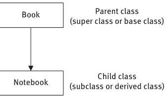

图 16.1：书对象中的继承。

要从现有的基类创建子类，我们在子类的定义中使用冒号（:），如下文所示：

```cpp
class subclass-name: access-specifier baseclass-name
{
    // 子类的成员
    // 子类的新特征
}
```

如前文所示，访问限定符（access-specifier）可以是 `public`、`private` 或 `protected`。`base-name` 是之前定义的类名，`subclass-name` 是从基类或多个基类派生的新类。如果省略了访问限定符，它将默认决定类的特征是公有派生还是私派派。要从多个类派生特征，我们可以在基类之间使用逗号。例如，以下格式显示了从两个基类（`baseclass-name1` 和 `baseclass-name2`）派生子类的方法。

```cpp
class subclass-name: access-specifier baseclass-name1, access-specifier baseclass-name2
{
    // 子类的成员
    // 子类的新特征
}
```

程序 16.1 阐述了继承的概念。它展示了两类：`baseclass` 和 `subclass`。`baseclass` 有一个方法，而 `subclass` 派生自 `baseclass`。当我们派生 `baseclass` 时，`subclass` 继承所有的方法和变量。注意，私有变量和数据不会继承到子类。因此，由于 `subclass` 派生自 `baseclass`，我们可以使用 `subclass` 类型的对象来调用 `baseclass` 的基方法。

```cpp
// 程序 16.1
// 用于理解单继承的程序
// 公有继承的示例
#include<iostream>
using namespace std;

class baseclass {
  public:
    void basemethod()
    {
        cout << "Base class " << endl;
    }
};
class subclass: public baseclass {
  public:
    void submethod()
    {
        cout << "Sub Class " << endl;
    }
};

int main() {
    baseclass base;
    base.basemethod();
    subclass sub;
    sub.basemethod();
    sub.submethod();
    return 0;
}
```


```cpp
// 程序 16.2
// 用于理解单继承的程序
// 私有继承的示例
#include<iostream>
using namespace std;

class baseclass {
  public:
    void basemethod()
    {
        cout << "Base class " << endl;
    }
};
class subclass: private baseclass {
  public:
    void submethod()
    {
        cout << "Sub Class " << endl;
    }
};

int main() {
    baseclass base;
    base.basemethod();
    subclass sub;
    // sub.basemethod(); 是不可能的，因为它是私有的
    sub.submethod();
    return 0;
}
```

程序 16.2 的结果所示：

Base class

Sub Class

此外，可以从一个基类派生出许多子类。如图 16.1 所示，`notebook` 是 `book` 的子类。同样，`textbook` 也是 `book` 的子类。因此，可以从基类派生许多子类，如图 16.2 所示。

程序 16.3 展示了多个子类的使用。

```cpp
// 程序 16.3
// 多个派生类的程序
#include<iostream>
using namespace std;

class baseclass {
  public:
    void basemethod()
    {
      cout << "Base class " << endl;
    }
};
class subclass1: public baseclass {
  public:
    void submethod()
    {
      cout << "Sub Class 1" << endl;
    }
};
class subclass2: public baseclass {
  public:
    void submethod()
    {
      cout << "Sub Class 2" << endl;
    }
};
int main()
{
    baseclass base;
    base.basemethod();
    subclass1 sub1;
    subclass1.basemethod();
    sub1.submethod();
    subclass2 sub2;
    sub2.basemethod();
    sub2.submethod();
    return 0;
}
```

### 16.2 单继承 —— 287

```cpp
using namespace std;

class baseclass
{
  public:
    void basemethod()
    {
      cout << "Base class " << endl;
    }
};
class subclass1: public baseclass {
  public:
    void submethod()
    {
      cout << "Sub Class 1" << endl;
    }
};
class subclass2: public baseclass {
  public:
    void submethod()
    {
      cout << "Sub Class 2" << endl;
    }
};
int main()
{
    baseclass base;
    base.basemethod();
    subclass1 sub1;
    subclass1.basemethod();
    sub1.submethod();
    subclass2 sub2;
    sub2.basemethod();
    sub2.submethod();
    return 0;
}
```

**图 16.2：** 多个子类。

程序 16.3 的结果所示：

基类

基类

子类 1

基类

子类 2

## 16.3 多重继承

在本节中，我们将学习另一种继承形式——多重继承。在多重继承中，子类可以派自多个基类。例如，学生可以使用他在课堂上记录的笔记本，也可以从图书馆借阅教科书。经过一段时间的学习，他可能会写一本专门为了考试的复习书籍，如图 16.3 所示。在这个例子中，复习书籍同时继承自笔记本和教科书。程序 16.4 展示了多重继承的一个示例。近年来，多重继承是一个非常有争议的话题，但在 C++ 编程中它仍然被广泛使用。多重继承的主要优势是派生类可以从不同的类继承不同的方法，并结合这些特性，使其成为一个有趣的类。

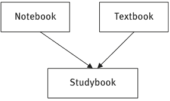

图 16.3：多重继承示例。

```
// Program 16.4
// Multiple Inheritance Example
#include<iostream>
using namespace std;
```

```
class notebook
{
public:
    void notebookmethod()
    {
        cout << "Base Class: Note Book " << endl;
    }
};
```

```
class textbook
{
    public:
        void textbookmethod()
        {
            cout << "Base Class: Text Book " <<endl;
        }
};
class studybook: public notebook,public textbook
{
    public:
        void submethod()
        {
            cout << "Sub Class: Study Book " << endl ;
        }
}
int main()
{
    notebook NB;
    textbook TB;
    studybook SB;
    NB.textbookmethod();
    TB.textbookmethod();
    SB.textbookmethod();
    SB.textbookmethod();
    SB.submethod();
    return 0;
}
```

程序 16.4 的结果所示：

Base Class: Note Book

Base Class: Text Book

Base Class: Note Book

Base Class: Text Book

Sub Class: Study Book

由于继承是公有的，子类 `studybook` 可以访问基类 `notebook` 和 `textbook` 的方法。

## 16.4 多级继承

在图 16.1 中，我们看到 `notebook` 派自 `book`。这里 `notebook` 是子类，`book` 是基类。同样地，`science notebook` 是一个派自 `notebook` 的类（而不是派自 `book`！）。这里 `science notebook` 是 `notebook` 的派生类，在这种情况下，`notebook` 是基类而 `science notebook` 是子类；图 16.4 展示了这一点。

## 290 — 16 继承

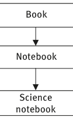

**图 16.4：** 扩展到多个级别的继承。

程序 16.5 说明了前面的解释。在这个程序中有三个类，分别是 `baseclass`、`subclass` 和 `lastclass`。`subclass` 派自 `baseclass`，而 `lastclass` 派自 `baseclass`。在这里我们将看到 `lastclass` 包含了其祖先的所有两个方法以及 `lastmethod()`。注意，`subclass` 包含了其祖先类的方法和变量（私有成员除外）。

```
// 16.5
// Example of Multilevel Inheritance
#include<iostream>
using namespace std;

class baseclass {
public:
    void basmethod()
    {
        cout << "Base Class " << endl;
    }
};
class subclass:public baseclass {
public:
    void submethod()
    {
        cout << "Sub Class of Base Class" << endl;
    }
};
class lastclass:public subclass{
public:
    void lastmethod()
    {
        cout << "Derived Class from Sub Class" << endl;
    }
};

int main()
```

```
{
baseclass base;
base.basethod();
subclass sub;
sub.basethod();
sub.submethod();
lastclass last;
last.basethod();
last.submethod();
last.lastmethod();
return 0;
}
```

程序 16.5 的结果所示：

- Base Class

- Base Class

- Sub Class of Base Class

- Base Class

- Sub Class of Base Class

- Derived Class from Sub Class

正如程序 16.5 所示，子类从其**超类**及其所有祖先类继承变量和方法。子类继承那些声明为 `public` 或 `protected` 的基成员。（我们将在下一节中介绍 `protected` 关键字）。

## 16.5 protected 关键字

正如我们在前面的节中学习的样，私有数据或方法不能被继承到子类，因为它们在同一个类中是可访问的。但如果我们将数据或方法设为 public，那么它们就可以任何地方被访问。这是我们在处理继承时的一个典型问题。在实践中，基类可能只想将其部分数据和方法继承给子类，而不是给其他类。在这种情况下，我们使用 `protected` 关键字。该关键字是类的数据和成员的访问说明符。如果我们将数据或方法设为 public，那么它们就可以任何地方被访问。总而言之，派生类可以访问基类的所有成员，私有成员除外。

## 292 — 16 继承

```
// 292.1
// Program 16.6
// Inheritance with protected members
#include<iostream>
using namespace std;

class baseclass
{
    protected:
    int a = 10;
    int b = 20;
private:
    int c = 30;
};

class subclass: public baseclass
{
public:
    void display()
    {
        cout << "Accessing a: " << a << endl;
        cout << "Accessing b: " << b << endl;
        // cout << "Accessing c: " << c << endl; // Error
    }
};

int main()
{
    subclass obj;
    obj.display();
    return 0;
}
```

程序 16.6 的结果所示：

Accessing a: 10

Accessing b: 20

## 16.6 数据和方法的重写

正如之前讨论过的，子类可以从基类继承方法和变量，并在其基础上添加自己的代码。如果基类变量和方法的名称与子类变量和方法相同会怎样？在这种情况下，子类不会继承基类的成员变量和方法。子类中的成员变量和方法会重写（隐藏）基类的成员变量和方法。这被称为重写。

## 16.7 构造函数与继承

我们已经知道子类的方法和变量可以从基类继承。那么构造函数呢？在本节中，我们将理解构造函数与继承之间的关系。

针对构造函数和继承，我们将分情况进行讨论。最初，我们将考虑一种基类包含构造函数而派生类不包含的情况。程序 16.8 显示了这种示例。

```
// Program 16.8
// Constructor and Inheritance
// Example1
#include<iostream>
using namespace std;

class baseclass
{
public:
    baseclass()
{
        cout << "Base Class Constructor" << endl;
    }
};
class subclass: public baseclass
{
}
int main()
{
    baseclass base;
    subclass sub;
    return 0;
}
```

程序 16.8 的结果所示：

Base Class Constructor

Base Class Constructor

这表明基类构造函数被继承到了派生类，并在创建基类和派生类的对象时都会被调用。程序 16.9 显示了另一种场景，基类和派生类都包含构造函数。

```
// Program 16.9
// Constructor and Inheritance
// Example2
#include<iostream>
using namespace std;

class baseclass
{
public:
    baseclass()
{
    cout << "Base Class Constructor" << endl;
};
class subclass:public baseclass{
    public:
    subclass()
    {
        cout << "Sub Class Constructor" << endl;
    }
};
int main()
{
    baseclass base;
    subclass sub;
    return 0;
}
```

程序 16.9 的结果所示：

Base Class Constructor

Base Class Constructor

Sub Class Constructor

这是因为派生类也继承了基类构造函数，并且在创建派生类对象期间，基类构造函数的执行顺序优先于派生类构造函数。这意味着执行顺序是层次级的。程序 16.10 显示了一个示例，其中两个基类包含构造函数，一个子类派自这两个基类。

```
// Program 16.10
// Constructor and Inheritance
// Example3
#include<iostream>
using namespace std;

class baseclass_1{
    public:
    baseclass_1()
    {
        cout << "Base Class 1: Constructor" << endl;
    }
};
class baseclass_2
{
class baseclass
{
    public:
        baseclass()
        {
            cout << "Base Class: Constructor" << endl;
        };
class subclass:public baseclass
{
    public:
        subclass()
        {
cout << "Sub Class: Constructor" << endl;
};
class lastclass:public subclass {
public:
    lastclass()
    {
        cout << "Last Class: Constructor" << endl;
    }
};
int main() {
    baseclass base;
    subclass sub;
    lastclass last;
    return 0;
}
```

程序 16.11 的结果所示：

- Base Class: Constructor

- Base Class: Constructor

- Sub Class: Constructor

- Base Class: Constructor

- Sub Class: Constructor

- Last Class: Constructor

## 16.8 复习题

- 1. 什么是继承？列出继承在软件开发中的优点。

- 2. 什么是单继承？它与多重继承有何区别？

- 3. 什么是多重继承？用示例程序进行描述。

- 4. 什么是多级继承？用示例程序进行描述。

- 5. C++ 中 `protected` 关键字的作用是什么？将其与 `public` 和 `private` 访问修饰符进行比较，说明优缺点。

- 6. 用示例解释重写（overriding）。重写与重载（overloading）有什么区别？（见第 14 章）

- 7. 用示例程序写关于构造函数和继承的说明。

- 8. 总结访问修饰符在继承中的作用。

# 17 多态

世界就像一个巨大的空梦。为什么要费力？

## 17.1 引言


多态是面向对象编程的一个基本特性。它使得程序编写更加简单且具有可复性。`多态`意味着许多形式。例如，某人可以是父亲，可以是官员，也可以是餐厅的客户。在这里，父亲、官员和客户都指的是同一个人。多态通常发生在类存在继承关系时。多态意味着对成员函数的调用将根据对象的类型执行不同的函数。`编译时多态`（或`静态多态`）和`运行时多态`（或`动态多态`）。图 17.1 显示了多态的类型。在本章中，我们至少涵盖这些类型。

## 17.2 静态多态

静态多态也被称为编译多态。静态多态分为类：函数重载和运算符重载。它是`早期绑定`，内会在编译期间分配。绑定是基于参数的数量、类型和顺序。在程序执行期间，让我们考虑这两个语句：

```
void add(float, float);
void add(int, float);
```

### 函数重载

在 C++ 中，重载函数是指具有相同名称但签名（signature）不同的函数。这意味着函数定义通过参数的数量、类型和顺序而不同。当我们调用重载函数时，编译器将自动确定最合适的函数。程序 17.1 显示了函数重载的示例。在这个程序中，`add()` 函数根据不同的参数重载了五次。

```
// Program 17.1
// Example Program of Function Overloading
#include<iostream>
using namespace std;

class addNumbers
{
public:
    void add(int a, int b)
    {
        cout << "Adding two integers, Result = " << a+b << endl;
    }
    void add(int a, int b, int c)
    {
        cout << "Adding three integers, Result = " << a+b+c << endl;
    }
    void add(float a, float b)
    {
        cout << "Adding two floating point numbers, Result = " << a+b << endl;
    }
    void add(int a, float b)
    {
        cout << "Adding one integer and a floating point number, Result = " << a+b << endl;
    }
}
```

```cpp
void add(float a, float b, float c)
{
    cout << "Adding three floating point numbers, Result = " << a+b+c << endl;
}
```

```cpp
int main()
{
    addNumbers ADDTEST;
    ADDTEST.add(1,2);
    ADDTEST.add(1,2,3);
    ADDTEST.add(2.2f,3);
    ADDTEST.add(2,3);
    ADDTEST.add(1.5f,2.5f,6f);
    return 0;
}
```

程序 17.1 的结果所示：

- Adding two integers, Result = 3

- Adding three integers, Result = 6

- Adding two floating point numbers, Result = 5

- Adding one integer and a floating point number, Result = 5

- Adding three floating point numbers, Result = 10

### 函数重写

函数重写是继承期间函数共享相同名称的另一个特性。在函数重写中，派生类重写了基类函数，因为它们具有相同的函数名称和签名。这意味着基类函数和派生类函数具有相同的名称、相同的参数列表和相同的返回类型。程序 17.2 显示了函数重写的示例。

```
// Program 17.2
// Example Program of Function Overriding
#include<iostream>
using namespace std;

class baseclass
{
public:
    void fname()
cout << "Base Class Function" << endl;
};
class subclass: public baseclass
{
public:
    void fname()
    {
        cout << "Sub Class Function" << endl;
    }
};
```

```cpp
int main ()
{
    subclass SUB;
    SUB.fname();
    return 0;
}
```

程序 17.3 显示了另一个函数重写的示例，其中派生类重写了基类函数，但它使用了基类的数据成员（如果是 yearly性的话）。

```
// Program 17.3
// Example Program of Function Overriding
#include<iostream>
using namespace std;

class baseclass
{
public:
    int x,y;
    void getx()
    {
        x = 10;
        y = 20;
    }
    void add()
    {
        cout << "Base Class, Result = " << x+y << endl;
    }
};
```

```cpp
class subclass: public baseclass
{
public:
    void setx()
```

```cpp
{
  x = 30;
}
void add() {
  cout << "Subclass, Result = " << x+y << endl;
}
int main() {
  baseclass BASE;
  subclass SUB;
  BASE.getx();
  BASE.add();
  SUB.getx();
  SUB.setx();
  SUB.add();
  return 0;
}
```

程序 17.3 的结果所示：

Base Class, Result = 30

Subclass, Result = 50

### 运算符重载

运算符重载是 C++ 的另一个有趣特性，它为一元和二元运算符提供了扩展功能。这意味着各种运算符如 `+`、`*`、`<==` 等不仅用于数字，还可以用于额外的功能。例如，如果我们想写一个程序找到两个线性方程的和（例如，EqA=6x+7y，EqB=2x+5y），并产生另一个线性方程（EqC=Eq），通过使用运算符重载可以写出一个看起来像 `EqC=EqA +EqB` 的程序，这里使用了 `"+"` 运算符。同样，通过重载 `"-"` 运算符，我们也可以计算 `EqD = EqA – EqB`。因此，为 C++ 运算符提供额外含义的概念被称为运算符重载。关键字 `operator` 用于编写重载运算符函数的符号。这些重载函数与普通函数相似，并且也包含返回类型和参数列表。程序 17.4 展示了运算符重载的示例，其中加法（`+`）和减法（`-`）二元运算符被重载用于两个两个线性方程。在这种情况下，方程 A=6x+7y，方程 B=2x+5y。方程 C 和 D 分别代表加法和减法后的结果。

```cpp
// 程序 17.4
// 运算符重载的示例程序
#include<iostream>
using namespace std;
```

```cpp
class Equation
{
    int coefx; // x 的系数
    int coefy; // y 的系数
public:
    Equation() // 构造函数 1
    Equation(int cx, int cy) // 构造函数 2
    {
        coefx = cx;
        coefy = cy;
    }
    Equation operator+(Equation);
    Equation operator-(Equation);
    void printResult(void);
};
```

```cpp
// 重载 + 运算符
Equation Equation :: operator+(Equation B)
{
    Equation temp;
    temp.coefx = coefx + B.coefx;
    temp.coefy = coefy + B.coefy;
    return(temp);
};
```

```cpp
// 重载 - 运算符
Equation Equation :: operator-(Equation B)
{
    Equation temp;
    temp.coefx = coefx - B.coefx;
    temp.coefy = coefy - B.coefy;
    return(temp);
};
```

```cpp
void Equation::printResult(void)
{
    cout << coefx << " * " << coefy << "y" << endl;
};
```

```cpp
// 程序的主函数
int main()
{
    Equation EqA(6,7); // A=6x+7y
    Equation EqB(2,5); // B=2x+5y
    Equation EqC, EqD;

    cout << "Equation A = ";
    EqA.printResult();
    cout << "Equation B = ";
    EqB.printResult();
    EqC = EqA + EqB; // 加两个方程
    cout << "Equation C = ";
    EqC.printResult();
    EqD = EqA - EqB; // 减两个方程（从 OCR 修正）
    cout << "Equation D = ";
    EqD.printResult();
    return 0;
}
```

程序 17.4 的结果所示：

Equation A = 6x + 7y

Equation B = 2x + 5y

Equation C = 8x + 12y

Equation D = 4x + 2y

## 17.3 动态多态

正如前面提到的，另一种多态类型被称为动态多态或运行时多态。正如名称所示，动态层方面的解析使其与静态多态不同。在动态多态中，以多种形式存在的函数是在运行时动态调用执行的。这意味着执行哪个函数调用是在程序运行期间决定的。动态多态通过虚函数实现，因为函数解析发生在运行时，而不是静态多态。这种有趣的特性提供了根据上下文执行函数的灵活性。

例如，在第 16 章中，我们讨论了 `book` 和 `notebook`。这里 `notebook` 是派自 `book` 的子类。因此，在 C++ 中，可以将子类对象作为基类类型。这里有一个例子：

```cpp
class book
{
public:
    void printName()
    {
        cout << "This is a Book" << endl;
    }
};

class notebook:public book {
    public:
        void printName()
        {
            cout << "This is a Notebook" << endl;
        }
};
```

我们已经学习了以下语句：

- `book myBook;`

- `notebook myBook;`

然而考虑以下语句：

```cpp
book *myBook; // 基类指针
notebook myBook; // 子类对象
myBook = &myBook; // 让基类指针持有子类对象
myBook->printName(); // 早绑定
```

在之前的语句中，我们让基类指针 `myBook` 持有 `notebook` 类的类对象 `myBook`。这是因为 `notebook` 对象是 `book` 的类型，而且 `notebook` 类派自 `book`。总而言之，对象可以使用自己的类型，也可以作为基类类型使用。在程序 17.5 中，子类和 `notebook` 包含相同的函数 `printName()`。因此，当使用子类对象调用 `notebook` 中的 `printName()` 函数时，会导致基类中函数的重写。

```cpp
// 程序 17.5
// 理解多态的程序
#include<iostream>
using namespace std;

class book
{
public:
    void printName()
    {
        cout << "This is a Book" << endl;
    }
};

class notebook: public book
{
    public:
    void printName()
    {
        cout << "This is a Notebook" << endl;
    }
};

int main()
{
    book *myBook;
    notebook myBook;
    myBook = &myBook;
    myBook->printName();
    return 0;
}
```

然而，当我们运行程序时，结果如下：

This is a Book

我们预期的结果是 "This is a Notebook"而不是显示的。这是因为之前的程序仍然以早绑定模式运行，而不是晚绑定。为了让程序生成预期输出，我们应该使用虚函数。我们可以在程序 17.6 中测试早绑定，另一个例子：

```cpp
// 程序 17.6
// 理解多态的程序
#include <iostream>
using namespace std;

class book
{
    public:
    void printName()
```

程序 17.6 的结果所示：

This is a Book

This is a Book

用户期望这些结果，因为两种情况下都是早绑定。输出错误的原因是 `printName()` 的调用是由编译器根据基类中的定义设置的。这被称为函数调用的静态解析或静态链接，函数调用在程序执行之前就已经固定。这被称为早绑定，因为 `printName()` 函数在程序的编译期间就被设置。

## 17.3 动态多态

为了解决这个问题，我们将对程序 17.6 进行细微修改，在基类 `book` 的 `printName()` 声明之前添加 `virtual` 关键字，如程序 17.7 所示。

```cpp
// 程序 17.7
// 理解多态的程序
#include <iostream>
using namespace std;

class book
{
public:
    virtual void printName()
    {
        cout << "This is a Book" << endl;
    }
};

class notebook:public book
{
public:
    void printName()
    {
        cout << "This is a Notebook" << endl;
    }
};

class textbook:public book
{
    public:
    void printName()
    {
        cout << "This is a Textbook" << endl;
    }
};

int main()
{
    book *mybook;
    notebook myBook;
    mybook = &myBook;
    mybook->printName();
    textbook TBK;
    mybook = &TBK;
    mybook->printName();
    return 0;
}
```

# 17 多态

程序 17.7 的结果所示：

This is a Notebook

This is a Textbook

现在，结果如预期所示，因为这次编译器查看的是指针的内容而不是它的类型。因此，由于 `myBook` 和 `TBK` 类对象的地址存储在 `*book` 中，相应的 `printName()` 函数被调用。正如我们在这些示例中所看到的，每个子类 `notebook` 和 `textbook` 都有独立的 `printName()` 实现。这就是多态的通常用法。


```cpp
);

class textbook : public book
{
protected:
    int Year;
public:
    textbook(int Serial_No, int Year)
    {
        this->Serial_No = Serial_No;
        this->Year = Year;
    }
    void Display()
    {
        cout << "Book Serial Number = " << Serial_No << endl;
        cout << "Book Year = " << Year << endl;
    }
};

int main()
{
    textbook *bptr;
    textbook objBook(30, 2016);
    bptr = &objBook;
    bptr->Display();
    return 0;
}
```

程序 17.8 的结果所示：

```
Book Serial Number = 30

Book Year = 2016
```

虽然程序员在使用虚函数时必须倍小心，但在处理虚函数时有几条规则必须记住。其中一些如下：(a) 虚函数必须是类的成员，(b) 虚函数必须在公共区域创建以便对象可以访问它们，(c) 当在类外定义虚函数时，仅在函数声明中需要 `virtual` 关键字，而在函数定义中不一定需要，(d) 虚函数不能是静态成员，(e) 虚函数必须使用对象的指针进行访问，(f) 虚函数不能声明为另一个类的友元，(g) 即使虚函数没有任何意义，必须在基类中定义，(h) 基类和派生类中虚函数的签名必须相同，以及 (i) 如果一个函数在基类中声明为虚函数，那么它在所有的派生类中都将是虚函数。

## 17.4 纯虚函数和抽象类

在第 17.3 节中，我们学习了虚函数在多态中的作用。如程序 17.8所示，基类中定义了一个虚函数 `Display()`，但实际上并没有被使用。这意味着可以在基类中包含虚函数，并在派生类中重新定义它以适应该类的对象。也意味着我们可以让虚函数在基类中没有体或没有意义的定义。这种虚函数被称为纯虚函数。

通过将定义替换为 `=0`（等号和零）可以将函数变为虚函数。例如，下面的代码显示了一个虚函数。

```cpp
virtual void Display()
{
    cout << "Serial Number = " << Serial_No << endl;
}
```

通过将其定义替换为 `=0`，之前的虚函数可以变成纯虚，所示：

```cpp
virtual void Display() = 0;
```

`=0` 告诉编译器该函数没有体，且该虚函数将被称为纯虚函数。包含至少一个纯虚函数的类被认为抽象类。派生自抽象类的类必须实现该纯虚函数，下面展示了纯虚函数和抽象类的实现示例。

```cpp
// Program 17.9
// 一个带有纯虚函数的程序
#include<iostream>
using namespace std;

class book
{
protected:
    int Serial_No;
public:
    virtual void Display() = 0;
};

class textbook : public book
{
protected:
    int Year;
public:
    textbook(int Serial_No, int Year)
    {
        this->Serial_No = Serial_No;
        this->Year = Year;
    }
    void Display() {
        cout << "Book Serial Number = " << Serial_No << endl;
        cout << "Book Year = " << Year << endl;
    }
};
int main() {
    book *bprtr;
    textbook objBook(30, 2016);
    bprtr = &objBook;
    bprtr->Display();
    return 0;
}
```

程序 17.9 的结果所示：

```
Book Serial Number = 30

Book Year = 2016
```

抽象类的思想是告诉用户，所有类并不一定代表对象，因为有时一个类不足以完全表示一个对象。这样的类被称为抽象类。抽象类不完全表示对象，但它提供了对象的部分描述。由于这些类没有完全表示对象，因此它们不能实例化。这意味着在程序 17.9 中所示的语句可能会产生错误。

```cpp
book BK;
```

为了理解为什么抽象类不能被实例化，我们可以以花类为例。花有很多种类，如玫瑰、茉莉、菊花等。我们可以创建一个玫瑰的实例，然而，我们不能创建一个“花”的实例！因为“花”这个词不能完全代表任何一种花。这表明通过抽象类，我们可以表达通用术语并据此派生具体的类。如程序 17.9 所示，我们不能创建抽象类类型，但可以使用指针和引用来创建抽象类对象。

## 17.5 复习题

- 1. 什么是多态？请用程序解释。
- 2. 列出 C++ 中多态的优点。
- 3. 什么是函数重载？用示例程序解释。
- 4. 什么是函数重写？用示例程序解释。
- 5. 什么是运算符重载？用示例程序解释。
- 6. 列出函数重载和函数重写之间的区别。
- 7. 列出静态多态和动态多态之间的区别。
- 8. 使用虚函数时必须记住哪些规则？
- 1. 虚函数和纯虚函数之间的区别是什么？
- 10. 编写一个程序演示纯虚函数。
- 11. 关于 C++ 中的抽象类写一个短记。

# 18 模板

> 成功不值得庆喜；
>
> 失败不值得哀悼。
>
> – 罗贯中

## 18.1 介绍

模板是 C++ 最有趣的特性之一，它允许程序员应用泛型编程的概念。模板是泛型编程的基本思想，人们可以编写独立于任何特定数据类型的代码。通常，模板是创建泛型类或函数的蓝图。换句话说，我们可以使用模板来定义函数以及类。基本上有两种类型的模板：类模板和函数模板。模板可以通过类型、编译时常量和其他模板进行参数化。在 C++ 中，模板是在编译时通过实例化实现的。

为了描述模板的使用，让我们考虑一种情况：我们需要定义两个同名 `AddTwo()` 的函数，可以加两个整数和双精度浮。它们的函数定义如下：

```cpp
int AddTwo(int p, int q)
{
    return p+q;
}

double AddTwo(double x, double y)
{
    return x+y;
}
```

正如我们在之前的代码中看到的，唯一的改变是数据类型。`AddTwo()` 函数使用整数作为参数，并在相加后返回整数。`AddTwo()` 函数使用 `double` 作为参数，并在相加后返回 `double`。程序 18.1 显示了使用这些函数的完整代码。

```cpp
// Program 18.1
// 一个没有模板的程序
#include<iostream>
using namespace std;

int AddTwo(int p, int q);
double AddTwo(double x, double y);

int main()
{
    int a = 10;
    int b = 20;
    cout << "AddTwo(a, b): " << AddTwo(a, b) << endl;
    double c = 10.5;
    double d = 20.6;
    cout << "AddTwo(c, d): " << AddTwo(c, d) << endl;
    return 0;
}

int AddTwo(int p, int q)
{
    return p+q;
}

double AddTwo(double x, double y)
{
    return x+y;
}
```

程序 18.1 的结果如下：

```
AddTwo(a, b): 30
AddTwo(c, d): 31.1
```

然而，像程序 18.1 这样的程序有自己的缺点。我们必须为不同的数据类型重复函数代码，也就是说如果我们我们需要加不同数据类型的数字（如 `long`、`short`、`float` 等），我们需要反复重复代码。模板在处理这些问题上起着重要作用。现在，让我们考虑程序 18.2，在 C++ 中使用模板的示例，完成与程序 18.1 相同的任务。

```cpp
// Program 18.2
// 一个带有模板的程序
#include<iostream>
using namespace std;

template<typename T>
T AddTwo(T x, T y)
{
    return x+y;
}

int main()
{
    int a = 10;
    int b = 20;
    cout << "AddTwo(a, b): " << AddTwo(a, b) << endl;
    double c = 10.5;
    double d = 20.6;
    cout << "AddTwo(c, d): " << AddTwo(c, d) << endl;
    return 0;
}
```

## 18.2 模板模板 — 317

```cpp
int b = 20;
cout << "AddTwo(a, b): " << AddTwo(a, b) << endl;
double c = 10.5;
double d = 20.6;
cout << "AddTwo(c, d): " << AddTwo(c, d) << endl;
```

程序 18.2 的结果如下：

```
AddTwo(a, b): 30
AddTwo(c, d): 31.1
```

程序 18.1 显示了一个简单的示例，其中 `AddTwo()` 函数被定义为模板，并用于相整数和双精度浮点数。从程序可以清楚看到，`AddTwo()` 只有一个函数定义，这使得在这种情况下是一个泛型函数，它使用泛型数据类型作为参数，而不是特定的数据类型。为了使用模板，我们首先需要构建一个模板定义。可以如下所示：

```cpp
template<typename T>
T AddTwo(T x, T y)
{
    return x+y;
}
```

通过 `template<typename T>` 语句，模板头告诉编译器我们将在此程序中使用模板。换句话说，“模板”在关键字 `template` 后面编写 `<class T>` 或 `<typename T>` 指定该函数接受一个泛型类型参数 `T`。大写字母 `T` 可以是任何字母，但通常的习惯是使用 `T`。在这种情况下，符号 `T` 被称为类型参数。它是一个占位符，在函数被调用时会被实际的类型或类所替换。

## 18.2 函数模板

在第 18.1 节中，我们引入了模板。C++ 模板有两种基本类型的模板：函数模板和类模板。函数模板的声明方式与普通函数的声明方式相同，只是在前面有一个规格说明：

`template<class T>`

模板函数定义的通用形式如下：

```cpp
template <class type> return-type function-name(parameter list)
{
    // body of function
}
```

在这里，`type` 是函数所用数据类型的占位符名称。`type` 参数 `T` 可以在函数定义中代替普通类型。`class` 一词用于表示类或基本类型。程序 18.2 显示了函数模板的示例。模板函数的处理方式与普通函数一样。模板可以有多个参数，如下：

```cpp
template<class T, class X, class Y, class Z>
```

模板函数为重载函数提供了一种通用的解决方案。与其编写许多执行相同任务的函数，我们通过使用模板编写一个泛型函数。程序 18.3 显示了函数模板的另一个示例，其中模板函数用于交换两个整数、浮点数和两个字符串。如程序 18.2 所示，我们使用了 `typename` 关键字。虽然使用 `class` 代替它是常见做法，但这两个关键字的含义相同。最初，开发者使用 `class` 在模板中指定类型，以避免引入新关键字。由于担心这种重载会导致混淆，后来引入了新关键字 `typename` 来解决语法歧义，并决定让它也用于指定模板类型以减少混淆；然而，`class` 为了保持向后兼容性仍然保留了它的重载含义。

```cpp
// Program 18.3
// 一个带有函数模板的程序
#include<iostream>
using namespace std;

template<class T>
void swapTwo(T& x, T& y)
{
    T temp;
    temp = x;
    x = y;
    y = temp;
}

int main() {
    int a = 10, b = 20;
    float p = 30.5, q = 40.8f;
    char *r = "Hello", *s = "world";

    // 交换整数
    cout << "Swapping Integers" << endl;
    cout << "a=" << a << " and b=" << b << endl;
    swapTwo(a,b);
    cout << "a=" << a << " and b=" << b << endl;

    cout << "Swapping Floating Numbers" << endl;
    cout << "p=" << p << " and q=" << q << endl;
    swapTwo(p,q);
    cout << "p=" << p << " and q=" << q << endl;

    cout << "Swapping Strings" << endl;
    cout << "r=" << r << " and s=" << s << endl;
    swapTwo(r,s);
    cout << "r=" << r << " and s=" << s << endl;

    return 0;
}
```

程序 18.3 的结果如下：

```
Swapping Integers
a=10 and b=20
a=20 and b=10
Swapping Floating Numbers
p=30.5 and q=40.8
p=40.8 and q=30.5
Swapping Strings
r=Hello and s=world
r=world and s=Hello
```

模板函数用于构造一组以相同方式工作的函数族。它们也被称为“参数化”或“泛型”函数。每个模板都是一组在不同数据类型上工作的相似函数的骨架。当模板用指定的数据类型被调用或实例化时，它就变成了一个真正的函数。我们可以用单个模板替换许多重载函数。

模板函数前面可以是任何普通修饰符，如 `inline`、`extern`、`static` 等。

## 18.3 类模板

类模板的工作方式与函数模板相同，但它们生成的是类而不是函数。它们为用户定义类定义的模式提供了一种很好的方法。类模板必须至少包含一个泛型类型。泛型类的通用形式在此所示：

```cpp
template <class type> class-name
{
    ...
};
```

在这里，`type` 是在实例化类时必须指定的占位符名称。我们可以使用逗号分隔的列表定义多个泛型类型。类模板像函数模板一样，可以有若干个模板参数。此外，其中一些可以是基本类型：

```cpp
template <class T, int x, class Y> class A
{
    ...
};
```

有时，类模板被称为参数化类型。程序 18.4 显示了类模板的示例。

```cpp
// Program 18.4
// 类模板示例
#include <iostream>
using namespace std;

template <class T>
class addTwo
{
  T x, y;
public:
  addTwo(T a, T b)
  {
    x = a; y = b;
  }
  T getSum()
  {
    return x+y;
  }
};

int main() {
  addTwo<int> obj(10, 20);
  cout << "Sum: " << obj.getSum() << endl;
  addTwo<double> obj2(10.5, 20.6);
  cout << "Sum: " << obj2.getSum() << endl;
  return 0;
}
```

程序 18.4 的结果如下：

```
Sum: 30
Sum: 31.1
```

请注意，类模板的成员函数与函数模板头相同，因此我们可以重写 18.4，18.5 产生相同的结果。

```cpp
// Program 18.5
// 类模板示例
#include <iostream>
using namespace std;

template <class T>
class addTwo
{
  T x, y;
public:
  addTwo(T a, T b)
  {
    x = a; y = b;
  }
  T getSum()
  {
    return x+y;
  }
};

template <class T>
T addTwo<T>::getSum()
{
  return x+y;
}

int main() {
  addTwo<int> obj(10, 20);
  cout << "Sum: " << obj.getSum() << endl;
  addTwo<double> obj2(10.5, 20.6);
  cout << "Sum: " << obj2.getSum() << endl;
  return 0;
}
```

# 18.4 标准模板库 — 323


# 表 18.1: C++ 中的一些标准模板及其详细信息。

| 库名称 | 描述 |
| --- | --- |
| `<vector>` | 动态数组 |
| `<list>` | 快速变化的项序列 |
| `<stack>` | 在一端进行 pop 和 push 操作的项序列 |
| `<queue>` | 在两端进行 pop 和 push 操作的项序列 |
| `<deque>` | 在两端均可 pop 和 push 操作的双端队列 |
| `<bitset>` | 固定且小规模项的子集 |
| `<set>` | 项的无序集合 |
| `<map>` | 一个由第一个数字索引的项对集合 |

在程序中使用 STL `vector`，我们必须包含该语句：`#include <vector>`。假设 `T` 是任意类型或类，例如 `int`、`float`、结构体 `struct` 或类，那么 `vector<T> v;` 声明了一个名为 `v` 的新空 `vector`。`Vector` STL 提供了许多程序员在需要时使用的函数。表 18.2 显示了一些 `vector` 函数及其详细信息。

# 表 18.2: C++ 中 vector STL 可用函数的详细信息。

| 函数名称 | 描述 |
| --- | --- |
| `v.empty()` | 测试 `v` 是否为空。 |
| `v.size()` | 查找 `v` 中项的数量。 |
| `v.push_back(t)` | 将一个 `t:T` 压入 `v` 的末尾。 |
| `v.pop_back()` | 弹出 `v` 的最后一个项。 |
| `v.front()` | 获取 `v` 的第一个项。 |
| `v.front() = expression` | 修改第一个项。 |
| `v.back()` | 获取 `v` 的最后一个项。 |
| `v.back() = expression` | 修改最后一个项。 |
| `v[i]` | 访问第 `i` 个项 `i<size()`，不检查其是否存在。 |
| `v.at(i)` | 安全地访问第 `i` 个项。 |
| `v = v1` | 将 `v1` 的拷贝赋值给 `v`。 |

**程序 18.6** 展示了 C++ 中理解 `vector` STL 的示例。

```cpp
// Program 18.6
// 一个带有 vector STL 的程序
#include <iostream>
#include <vector>
using namespace std;
int main()
{
    // 创建一个 vector V 来存储整数
    vector<int> V;
    int i;

    // 输出 V 的初始大小
    cout << "Vector size = " << V.size() << endl;

    // 将 10 个值压入 vector V
    for(i = 0; i < 10; i++) {
        V.push_back(i);
    }

    // 显示 vector V 扩展后的大小
    cout << "Extended vector size = " << V.size() << endl;

    // 从 vector 中访问 10 个值
    for(i = 0; i < 10; i++) {
        cout << "Value of V[" << i << "] = " << V[i] << endl;
    }

    cout << endl;
    // 使用迭代器访问值
    vector<int>::iterator v = V.begin();
    while(v != V.end()) {
        cout << "value of v = " << *v << endl;
        v++;
    }

    cout << endl << "Accessing the 5th item = " << V.at(4) << endl;
    cout << "Accessing the front item = " << V.front() << endl;
    cout << "Accessing the back item = " << V.back() << endl;
    return 0;
}
```

程序 18.6 的结果如下：

`Vector size = 0`

`Extended vector size = 10`

`Value of V[0] = 0`

`Value of V[1] = 1`

`Value of V[2] = 2`

`Value of V[3] = 3`

`Value of V[4] = 4`

`Value of V[5] = 5`

`Value of V[6] = 6`

`Value of V[7] = 7`

`Value of V[8] = 8`

`Value of V[9] = 9`

## 18.5 复习题 — 325

### 18.5 复习题

- 什么是模板？
- 模板的常见类型有哪些？
- 结合示例讨论函数模板。
- 结合示例讨论类模板。
- 列出 C++ 中模板的优点。
- 关于 C++ 标准库写一个简短说明。
- 编写一个程序演示 C++ 中的 `vector`。

# 附录 A

## C++ 头文件和库函数列表

| 标题 | 描述 |
| --- | --- |
| `cmath` | 声明用于数学运算的函数 |
| `cstdlib` | 定义通用函数 |
| `iostream` | 定义标准输入输出对象 |
| `string` | 定义操作字符串和数组的函数 |
| `cctype` | 声明用于分类并转换单个字符的函数 |
| `signal` | 处理信号 |
| `locale` | 支持特定于区域的设置，例如日期/时间格式 |
| `cwtype` | 声明用于分类和转换宽字符的函数 |

### cmath

| 标题 | 描述 |
| --- | --- |
| `pow()` | 计算数字的幂 |
| `llrint()` | 按当前舍入模式对参数进行舍入 |
| `remainder()` | 返回 `x/y` 的余数 |
| `nan()` | 返回 NaN 值 |
| `cosh()` | 返回角度的双曲余弦 |
| `copysign()` | 取两个参数并返回具有第一个参数符号的值 |
| `fma()` | 接受三个参数 `x, y`，并返回不丢失精度的 `x*y` |
| `abs()` | 返回 `int/long` 的绝对值 |
| `fabs()` | 返回 `float/double` 的绝对值 |
| `fdim()` | 返回参数之间的正差值 |
| `fmin()` | 返回两个参数之间的最小值 |
| `fmax()` | 返回两个参数之间的最大值 |
| `hypot()` | 返回平方和的平方根 |
| `nexttoward()` | 返回 `y` 方向上 `x` 之后的下一个值，其中 `y` 始终为 `double` 类型 |
| `nextafter()` | 返回 `y` 方向上 `x` 之后的下一个值 |
| `cbrt()` | 计算数字的立方根 |
| `sqrt()` | 计算数字的平方根 |
| `remquo()` | 返回 `x/y` 的余数，并存储 `x/y` 的商 |
| `log()` | 返回 `|x|` 的自然对数 |
| `logp()` | 返回 `x+1` 的自然对数 |
| `scalbn()` | 按 `FLT_RADIX` 缩放 `x` |
| `log2()` | 返回以2为底的对数 |
| `scalbn()` | 按 `FLT_RADIX` 缩放 `x` |
| `ilogb()` | 返回 `|x|` 的整数部分 |
| `nearint()` | 使用当前舍入模式舍入 |
| `exp1()` | 返回 `e` 的幂次方减 1 |
| `ldexp()` | 返回 `x` 与 2 的幂的积 |
| `frexp()` | 将浮点数分解为二进制尾数 |
| `exp2()` | 返回以2为底的指数函数 |
| `modf()` | 将数字分解为整数和小数部分 |
| `log10()` | 返回以10为底的对数 |
| `lrint()` | 使用当前舍入模式舍入 |
| `rint()` | 使用当前舍入模式舍入 |
| `lround()` | 将参数舍入到长整数 |
| `round()` | 将参数舍入到整数 |
| `round()` | 将参数舍入到整数 |
| `trunc()` | 截断数字的小数部分 |
| `log()` | 返回数字的自然对数 |
| `atanh()` | 返回数字的双曲正切 |
| `asin()` | 返回数字的双曲正弦 |
| `acosh()` | 返回数字的双曲余弦 |
| `fmod()` | 计算浮点除法的余数 |
| `tanh()` | 返回角度的双曲正切 |
| `floor()` | 返回数字的下整 |
| `ceil()` | 返回数字的向上取整 |
| `sinh()` | 返回角度的双曲正弦 |
| `acos()` | 返回数字的反余弦 |
| `atan2()` | 返回坐标的反正正切 |
| `tan()` | 返回角度的正切 |
| `atan()` | 返回数字的反正正切 |
| `asin()` | 返回数字的反正弦 |
| `sin()` | 返回角度的正弦 |
| `cos()` | 返回角度的余弦 |

### stdlib.h

| 标题 | 描述 |
| --- | --- |
| `calloc()` | 分配一块内存并将其初始化为 0 |
| `wcstombs()` | 将宽字符字符串转换为多字节序列 |
| `mbstowcs()` | 将多字节字符字符串转换为宽字符序列 |
| `wctomcat()` | 将宽字符转换为多字节字符 |
| `mbtowc()` | 将多字节字符转换为宽字符 |
| `mblen()` | 确定多字节字符的大小 |
| `lldiv()` | 计算长整数的整除法 |

# 附录 A

- `strchr()` 在字符串中查找字符的最后一次出现
- `strbrk()` 在一个字符串中查找另一个字符串中的字符
- `strcsp()` 在字符串中查找另一个字符串中存在的字符
- `strchr()` 查找字符的第一次出现
- `memchr()` 在数组中查找字符的第一次出现
- `strncmp()` 按字典顺序比较两个字符串
- `strcmp()` 比较两个字符串
- `memcmp()` 比较两个指针对象
- `strcat()` 将一个字符串附加到另一个字符串的末尾
- `strcpy()` 将字符串的副本附加到另一个字符串的末尾
- `strncpy()` 从源到目的拷贝字符
- `strcpyn()` 从源到目的拷贝字符
- `memmove()` 拷贝内存，即使存在重叠块
- `memcpy()` 从源到目的拷贝一个内存块
- `strxf()` 将字节字符串转换为实现定义的格式

## `<ctype>`

| 标题 | 描述 |
| --- | --- |
| `toupper()` | 将给定的字符转换为大写 |
| `tolower()` | 将给定的字符转换为小写 |
| `isdigit()` | 检查给定的字符是否为十六进制字符 |
| `isupper()` | 检查给定的字符是否为大写 |
| `isspace()` | 检查给定的字符是否为空白字符 |
| `ispunct()` | 检查给定的字符是否为标点符号 |
| `isprint()` | 检查给定的字符是否可打印 |
| `islower()` | 检查给定的字符是否为小写 |
| `isgraph()` | 检查给定的字符是否为图形字符 |
| `isdigit()` | 检查给定的字符是否为数字 |
| `iscntrl()` | 检查给定的字符是否为控制字符 |
| `isblank()` | 检查给定的字符是否为空白字符 |
| `isalpha()` | 检查给定的字符是否为字母 |

## `<csignal>`

| 标题 | 描述 |
| --- | --- |
| `raise()` | 向程序发送信号 |
| `signal()` | 为指定的信号设置错误处理器 |

## `<locale>`

| 标题 | 描述 |
| --- | --- |
| `localeconv()` | 返回当前的区域设置格式规则 |
| `setlocale()` | 为当前程序设置区域设置信息 |

## `<cwtype>`

| 标题 | 描述 |
| --- | --- |
| `iswdigit()` | 检查给定的宽字符是否为数字 |
| `wctype()` | 返回宽字符分类 |
| `wctrans()` | 返回宽字符的当前转换 |
| `towctrans()` | 转换给定的宽字符 |
| `isctype()` | 检查给定的宽字符是否具有特定属性 |
| `toupper()` | 将给定的宽字符转换为大写 |
| `towlower()` | 将给定的宽字符转换为小写 |
| `iswdigit()` | 检查给定的宽字符是否为十六进制数字 |
| `isupper()` | 检查给定的宽字符是否为大写 |
| `iswspace()` | 检查给定的宽字符是否为空白 |
| `iswunct()` | 检查给定的宽字符是否为标点符号 |
| `iswprint()` | 检查给定的宽字符是否可以打印 |
| `iswlower()` | 检查给定的宽字符是否为小写 |
| `iswgraph()` | 检查给定的宽字符是否具有图形表示 |
| `iswcntrl()` | 检查给定的宽字符是否为控制字符 |
| `iswblank()` | 检查给定的宽字符是否为空白字符 |
| `iswalpha()` | 检查给定的宽字符是否为字母 |
| `iswalnum()` | 检查给定的宽字符是否为字母数字 |

## `<stdio>`

| 标题 | 描述 |
| --- | --- |
| `getc()` | 从输入流读取下一个字符 |
| `fseek()` | 为给定的文件流设置文件位置指示 |
| `ungetc()` | 将之前读取的字符推回流 |
| `vsscanf()` | 从字符串读取数据 |
| `vscanf()` | 从标准输入读取数据 |
| `vfscanf()` | 从文件流读取数据 |
| `freopen()` | 打开一个关联流的新文件 |
| `fflush()` | 刷新缓冲区 |
| `setbuf()` | 更改缓冲模式和大小 |
| `perror()` | 向 `stderr` 输出错误 |
| `error()` | 检查流中的错误 |
| `feof()` | 检查是否到达文件末尾 |
| `clearerr()` | 重置流的 EOF 标志 |
| `rewind()` | 将文件位置置于开头 |
| `ftell()` | 返回当前位置 |
| `fsetpos()` | 设置流指针到指定位置 |
| `fgetpos()` | 获取当前位置 |
| `fwrite()` | 向流写入指定数量字符 |
| `fread()` | 从流读取指定数量字符 |
| `puts()` | 向标准输出写入字符串 |
| `putchar()` | 向标准输出写入字符 |
| `putc()` | 向给定的输出流写入字符 |
| `gets()` | 从标准输入读取一行 |
| `getchar()` | 从标准输入读取下一个字符 |
| `fputs()` | 向文件流写入字符串 |
| `fputc()` | 向给定的输出流写入字符 |
| `fgets()` | 从文件流读取 `n` 个字符到缓冲区 |
| `getc()` | 从输入流读取下一个字符 |
| `vvprintf()` | 向缓冲区写入格式化字符串 |
| `vsprintf()` | 向缓冲区写入格式化字符串 |
| `vnprintf()` | 向标准输出写入格式化数据 |
| `vfprintf()` | 向文件流写入格式化字符串 |
| `scanf()` | 从缓冲区读取数据 |
| `sprintf()` | 向缓冲区写入格式化字符串 |
| `fsprintf()` | 向文件流写入格式化字符串 |
| `setbuf()` | 设置输入或输出使用的内部缓冲区 |
| `fopen()` | 打开指定的文件 |
| `close()` | 关闭给定的文件流 |
| `tmpnam()` | 生成唯一的文件名 |
| `tmpfile()` | 创建临时文件 |
| `rename()` | 移动指定的文件 |
| `remove()` | 删除指定的文件 |

## `<wchar>`

| 标题 | 描述 |
| --- | --- |
| `wcscoll()` | 比较两个宽字符串 |
| `wcstoul()` | 将宽字符串转换为无符号长型 |
| `wcstoul()` | 将指定进制的宽字符串转换为无符号长型 |
| `wcstoll()` | 将指定进制的宽字符串转换为整数 |
| `wcsftime()` | 将给定时间转换为宽字符串 |
| `wmemset()` | 拷贝特定数量的宽字符 |
| `wmmove()` | 从源到目的移动宽字符 |
| `wmemcmp()` | 从源到目的拷贝指定数量的宽字符 |
| `wmemcmp()` | 比较两个宽字符串的宽字符 |
| `wmchr()` | 查找宽字符的第一次出现 |
| `wcsxfrm()` | 将宽字符串转换为定义 |
| `wcsstr()` | 在字符串中查找宽子字符串的第一次出现 |
| `wccspn()` | 返回最大段的长度 |
| `wcscrh()` | 在字符串中查找宽字符的最后一次出现 |
| `wcsbrk()` | 在给定字符串中查找宽字符集 |
| `wcsncpy()` | 拷贝指定数量的宽字符 |
| `wcsncmp()` | 比较指定数量的宽字符串 |
| `wsccat()` | 将指定数量的宽字符附加到另一个字符串 |
| `wcslen()` | 返回给定的宽字符串的长度 |
| `wccspn()` | 返回第一次出现之前的宽字符数量 |
| `wcscpy()` | 从源到目的拷贝宽字符串 |

- `wscmp()` 按字典顺序比较两个宽字符串
- `wcschr()` 在宽字符串中查找宽字符
- `wscat()` 将宽字符串的副本附加到另一个字符串的末尾
- `wcsrtombs()` 将宽字符序列转换为窄多字节字符序列
- `wctob()` 将宽字符转换为单字节字符
- `wcrtomb()` 将宽字符转换为其窄多字节表示


- `mbrstows()` 将窄多字节序列转换为宽字符序列

- `mbcisinit()` 描述 `mbstate_obj` 的初始转换

- `mbrtwc()` 将窄多字节字符转换为宽字符

- `mbrlen()` 根据多字节字符的大小确定长度

- `btowc()` 将字符转换为其宽字符

- `wcstok()` 返回空终止宽字符串中的下一个标记

- `wcscold()` 将宽字符串浮点数转换为长精度浮点型

- `wcsstol()` 将宽字符串浮点数转换为长整数

- `wcstof()` 将宽字符串浮点数转换为浮点型

- `wscod()` 将宽字符串浮点数转换为双精度型

- `wsccan()` 从标准输入读取宽字符

- `printf()` 向标准输出写入格式化字符串

- `swsccan()` 从标准输入读取宽字符

- `vprintf()` 向标准输出写入格式化字符串

- `swsccan()` 从标准输入读取宽字符

- `vprintf()` 向标准输出写入格式化字符串

- `fwsccan()` 从文件流读取宽字符

- `vfprintf()` 向文件流写入格式化字符串

- `ungetwc()` 将之前读取的宽字符推回流

- `swsccan()` 从标准输入读取宽字符

- `swprintf()` 向标准输出写入格式化字符串

- `putchar()` 向标准输出写入字符

- `putc()` 向给定的输出流写入字符

- `getchar()` 从标准输入读取下一个字符

- `getwc()` 从给定的输入流读取下一个字符

- `fwsccan()` 从文件流读取宽字符

- `fwprintf()` 向文件流写入格式化字符串

- `fwide()` 将给定时间转换为宽字符串

- `fputws()` 写入除空宽字符外的字符串

- `putc()` 向给定的输出流写入字符

- `getws()` 从标准输入读取一行

- `getwc()` 从给定的输入流读取下一个字符

334 — 附录 A

## `<csetjmp>`

| 标题 | 描述 |
| :--- | :--- |
| `longjmp()` and `setjmp()` | 恢复之前的环境 |

## `<cfenv>`

| 标题 | 描述 |
| :--- | :--- |
| `fetestexcept()` | 测试浮点异常 |
| `feupdateenv()` | 更新浮点环境 |
| `feholdexcept()` | 保存并清除浮点状态标志 |
| `fesetenv()` | 设置浮点环境 |
| `fesetround()` | 设置舍入方向 |
| `fetgetenv()` | 将浮点环境的状态存储在对象中 |
| `fetetground()` | 获取舍入模式 |
| `fesetexceptflag()` | 将指定的浮点异常设置到环境中 |
| `fegetexceptflag()` | 获取浮点异常标志 |
| `feraiseexcept()` | 抛出指定的浮点异常 |
| `fclearexcept()` | 尝试清除浮点异常标志 |

## `<ctime>`

| 标题 | 描述 |
| :--- | :--- |
| `strftime()` | 将日历时间转换为多字节字符字符串 |
| `mktime()` | 将本地日历时间转换为从 epoch 以来的时间 |
| `localtime()` | 将给定的从 epoch 以来的时间转换为本地时间 |
| `gmtime()` | 将给定的从 epoch 以来的时间转换为 UTC 时间 |
| `ctime()` | 将从 epoch 以来的时间转换为字符表示 |
| `asctime()` | 将日历时间转换为字符表示 |
| `time()` | 返回当前日历时间 |
| `difftime()` | 计算两个时间之间的秒差 |
| `clock()` | 返回处理器运行程序所消耗的时间 |

# 附录 B

## 非面向对象（OOP）C++ 编程练习列表

- 1. 输入两个数字并计算它们的和、平均值以及平方和。
- 2. 编写一个程序读取一个 `"float"` 类型的摄氏度数字，并以 `"float"` 类型打印等效的华氏度。按以下格式打印结果：

  `100.0 degrees Celsius converts to 212.0 degrees Fahrenheit.`
- 3. 如果输入的是整数秒数，打印输出对应的小时、分钟和秒。推荐的输出格式应为：

  `7322 seconds is equivalent to 2 hours 2 minutes 2 seconds.`
- 4. 编写一个程序打印几行（例如你的名字和地址）。你可以使用多个 `cout` 指令，每个指令包含一个换行符，或者使用一个带有多个换行符字符串的 `cout`。
- 5. 编写一个程序使用三元运算符找到三个数中的最大值。
- 6. 定义（全局地）一个枚举类型 `rainbow`，由红、蓝、绿、紫色调组成。在主函数中，声明一个类型为 `rainbow` 的变量 `"color"`。将该变量初始化为常量 `blue`。然后将 `color` 变量赋值为常量 `purple`。
- 7. 设计、开发并执行一个 C++ 程序，寻找并输出给定非零系数的二次方程的根。
- 8. 编写一个 C++ 程序，使用 `for` 循环生成 `n` 个斐波那契数。
- 9. 编写一个程序输出一个高度为 `n`、宽度为 `2n-1` 的右直三角形；`n = 6` 时的输出如下：

```
*
***
*****
*******
********
***********
```
- 10. 设计、开发并执行一个 C++ 程序，寻找两个整数的最大公约数（GCD）和最小公倍数（LCM），并结合给定整数输出结果。
- 11. 设计、开发并执行一个 C++ 程序，反转给定的四位整数并检查其是否为回文。带有适当的消息输出给定结果。
- 12. 设计、开发并执行一个 C++ 程序，使用霍纳法（Horner's method）对给定的 `x` 值和系数计算多项式 `$f(x) = a_4x^4 + a_3x^3 + a_2x^2 + a_1x + a_0$`。
- 13. 编写一个程序提示用户输入字符串，并使用库函数打印其反。
- 14. 编写一个程序提示用户输入句子，并单独打印每个单词。
- 15. 编写一个函数计算一个数字是否为质数。如果是质数返回 1，如果不是返回 0。
- 16. 编写一个函数判断一个数字是否为质数。
- 17. 编写一个函数使用牛顿法找到一个数的平方根。
- 18. 编写一个函数判断一个数字是偶数还是奇数。
- 19. 编写一个程序提示用户输入字符串，并反序打印它。
- 20. 设计、开发并执行一个 C++ 程序实现二分查找。
- 21. 设计、开发并执行一个 C++ 程序实现冒泡排序。
- 22. 设计、开发并执行一个 C++ 程序实现选择排序。
- 23. 定义一个具有两个数据成员（`age` 和 `number`）和两个方法（`readValues` 和 `printValues`）的类。
- 24. 定义一个具有三个数据成员（`int`, `float` 和 `char`）和三个方法的类。
- 25. 编写一个程序演示递归的使用。
- 26. 编写一个 C++ 程序使用递归生成斐波那契数。

# 附录 C 339

没有任何成员的类。创建每个 `student`、`teacher` 和 `instructor` 的对象来测试程序并理解多重继承。（提示：参见下面的代码。）

```cpp
class teacher
{
    public:
        int courseno;
        int classno;

    void readCourse()
    {
        cout << "Enter Course Number " << endl;
        cin >> courseno;
        cout << "Enter Class Number " << endl;
        cin >> classno;
    }

    void printCourse()
    {
        cout << "Course Number :" << courseno << endl;
        cout << "Class Number :" << classno << endl;
    }
}
class instructor: public student , public teacher
{
}
```

- 9. 如编程练习11所示定义一个 `student` 类，并定义 `student` 的子类 `freshman`，不包含数据成员。然后定义另一个派自 `freshman` 的子类 `sdustfresh`，不包含数据成员。创建 `student`、`freshman` 和 `sdustfresh` 类型的对象来测试程序，以理解多级继承。

```cpp
class freshmen: public student
{
}
class sdustfresh: public freshmen
{
}
```

- 10. 如编程练习1所示定义一个 `student` 类，并定义 `student` 的子类 `freshman` 和 `sophomore`，不包含数据成员。创建一个派自 `freshman` 和 `sophomore` 的新类 `geniusstudent`，并创建 `student`、`freshman`、`sophomore` 和 `geniusstudent` 类型的对象来测试程序，以理解菱继承。记录下菱继承的问题。

```cpp
class freshmen: public student
{
}

class sophomore: public student
{
}

class geniusstudent: public freshmen, public sophomore
{
}
```

- 11. 重复编程练习10，并使用 `virtual` 关键字来解决菱继承问题。

```cpp
class freshmen: public virtual student
{
}

class sophomore: public virtual student
{
}

class geniusstudent: public freshmen, public sophomore
{
}
```

- 12. 重复编程练习5，通过向子类 `freshman` 添加一些数据成员和方法成员来理解单继承。
- 13. 重复编程练习7，通过向子类 `freshman` 和 `sophomore` 添加数据成员和方法成员来理解多个子类。
- 14. 重复编程练习8，通过向 `instructor` 类添加数据成员和方法成员来理解多重继承。

# 附录 C — 341

- 15. 重复编程练习9，通过向子类 `freshman` 和 `sdustfresh` 添加数据成员和方法成员来理解多级继承。
- 16. 重复编程练习10和11，通过向 `freshman`、`sophomore` 和 `geniusstudent` 类添加数据成员和方法成员来理解菱继承。
- 17. 重复编程练习1，添加如下所示的默认构造函数并测试程序。

```cpp
student()
{
  cout << "I am student constructor " << endl;
}
```

- 18. 重复编程练习1，添加如下所示的带参数构造函数并测试程序。

```cpp
student(int value)
{
  cout << "I am student constructor Value "
  << value << endl;
}
```

- 19. 重复编程练习1，添加一个默认构造函数和几个带参数构造函数并测试程序。
- 20. 重复编程练习1，添加如下所示的析构函数并测试程序。

```cpp
-student()
{
  cout << "I am student destructor " << endl;
}
```

- 21. 重复编程练习1，添加一个构造函数和一个析构函数并测试程序。
- 22. 重复编程练习5，在基类和派生类中都添加默认构造函数并测试程序。
- 23. 重复编程练习5，在基类和派生类中都添加析构函数并测试程序。
- 24. 重复编程练习5，在基类和派生类中都添加构造函数和析构函数并测试程序。

# 附录 D

| 十进制 | 二进制 | 八进制 | 十六进制 | | 十进制 | 二进制 | 八进制 | 十六进制 | | 十进制 | 二进制 | 八进制 | 十六进制 | | 十进制 | 二进制 | 八进制 | 十六进制 | | 十进制 | 二进制 | 八进制 | 十六进制 |

|---|---|---|---|---|---|---|---|---|---|---|---|---|---|---|---|---|---|---|---|---|---|---|---|---|---||

| 0 | 00000000 | 0 | 0 | | 11 | 00001011 | 13 | B | | 22 | 00010110 | 26 | 1A | | 33 | 00100001 | 41 | 21 |

| 1 | 00000001 | 1 | 1 | | 12 | 00001100 | 14 | C | | 23 | 00010111 | 27 | 1B | | 34 | 00100010 | 42 | 2A |

| 2 | 00000010 | 2 | 2 | | 13 | 00001101 | 15 | D | | 24 | 00011000 | 30 | 1C | | 35 | 00100011 | 43 | 2B |

| 3 | 00000011 | 3 | 3 | | 14 | 00001110 | 16 | E | | 25 | 00011001 | 31 | 1D | | 36 | 00100100 | 44 | 2C |

| 4 | 00000100 | 4 | 4 | | 15 | 00001111 | 17 | F | | 26 | 00011010 | 32 | 1E | | 37 | 00100101 | 45 | 2D |

| 5 | 00000101 | 5 | 5 | | 16 | 00010000 | 20 | 0 | | 27 | 00011011 | 33 | 1F | | 38 | 00100110 | 46 | 2E |

| 6 | 00000110 | 6 | 6 | | 17 | 00010001 | 21 | 1 | | 28 | 00011100 | 34 | 22 | | 39 | 00100111 | 47 | 2F |

| 7 | 00000111 | 7 | 7 | | 18 | 00010010 | 22 | 2 | | 29 | 00011101 | 35 | 23 | | 40 | 00101000 | 50 | 32 |

| 8 | 00001000 | 8 | 0 | | 19 | 00010011 | 23 | 3 | | 30 | 00011110 | 36 | 24 | | 41 | 00101001 | 51 | 33 |

| 9 | 00001001 | 9 | 1 | | 20 | 00010100 | 24 | 4 | | 31 | 00011111 | 37 | 25 | | 42 | 00101010 | 52 | 34 |

| 10 | 00001010 | 10 | 2 | | 21 | 00010101 | 25 | 5 | | 32 | 00101011 | 51 | 33 | | 43 | 00101011 | 53 | 35 |

| 11 | 00001011 | 11 | 3 | | 22 | 00010110 | 26 | 6 | | 33 | 00101100 | 52 | 34 | | 44 | 00101100 | 54 | 36 |

| 12 | 00001100 | 14 | 4 | | 23 | 00010111 | 27 | 7 | | 34 | 00101101 | 53 | 35 | | 45 | 00101101 | 55 | 37 |

| 13 | 00001101 | 15 | 5 | | 24 | 00011000 | 30 | 4 | | 35 | 00101110 | 54 | 36 | | 46 | 00101110 | 56 | 38 |

# 附录 E

# 参考文献

- [1] Bjarne Stroustrup, *The C++ Programming Language*, 4th Edition, Addison-Wesley, Pearson Education, 2013.
- [2] Bruce Eckel, *Thinking in C++, Introduction to Standard C++ (Vol. 1)*, 2nd Edition, New Jersey, Prentice Hall, March, 2000.
- [3] C++ Library Functions, 访问：https://www.programiz.com/cpp-programming/library-function/
- [4] Code:Blocks, 访问：http://codeblocks.org.
- [5] Donald Weiman, Decimal-Binary-Octal-Hex Conversion Chart,2012, 访问：http://web.alfredstate.edu/faculty/weimand/miscellaneous/ascii/ascii_index.html.
- [6] E. Balaguruswamy, *Object Oriented Programming with C++*, 4th Edition, Tata McGraw-Hill, 2008.
- [7] Ivor Horton, *Beginning C++*, 4th Edition, Apress, November 2014.


# 索引

- [8] Visual Studio 2017, 访问：www.visualstudio.com.

## 索引

- 算盘 1
- 抽象类 312
- 访问修饰符 264
- 访问说明符 255
- 实际参数 175
- 加法 2
- AI 6
- ALGOL 6
- 算法 2
- 分析 2
- 差分机 1
- 应用软件 4
- 参数 175
- 算术表达式 71
- 字符数组 168, 211
- 指针数组 152
- 结构体 261
- 字符串 143
- 二进制代码 6
- 二进制文件 18
- 二进制运算符 71
- 二进制查找 155
- 位运算符 71
- 块作用域 64
- 布尔 61
- 布尔值 52
- 退出 114
- 泡排序 159
- 缓冲区 62, 239
- 内置函数 140
- 内置运算符 13
- C 13
- 捕获 229
- `char` 49
- 子类 283
- `cin` 17
- 类 41
- 类模板 315
- 类变量 293
- COBOL 6
- 代码 3
- 注释 15
- 编译器 18
- 编译时 299
- 复合赋值 82
- 复合语句 93
- 条件运算符 71
- 常量 57
- 构造函数 269
- 继续持续 116
- 拷贝构造函数 278
- `cout` 16
- CPU 1
- 数据抽象 11
- 数据隐藏 255
- 数据成员 256
- 数据类型 47
- 决策制定 85
- 声明式 7
- 递减操作 110
- 递减运算符 71
- 默认构造函数 271
- defefault 94
- `#define` 57
- 定义性 2
- 派生类 283
- 析构函数 280
- 差分机 1
- 指令 15
- 除以零 228
- 关联性 81
- 属性 9
- 自动 64
- Babbage, Charles 1
- 基类 283
- 实验室 6
- 二进制 6
- 二进制文件 18
- 二进制运算符 71
- 二进制查找 155
- 位运算符 71
- 块作用域 64
- 布尔 61
- 布尔值 52
- 退出 114
- 泡排序 159
- 缓冲区 62, 239
- 内置函数 140
- 内置运算符 13

## 348 — 索引

- 早期绑定 307
- 有效性 2
- 封装 9
- end1 16
- ENIAC 1
- 枚举 Enum 58
- 枚举数据类型 58
- 等于运算符 71
- 转义序列 55
- 异常处理 227
- 异常 227
- 显式 61
- 显式转换 61
- 表达式 71
- `extern` 320
- 提取运算符 17
- 斐波那契数列 193
- 文件处理 239
- 文件模式 245
- 文件作用域 66
- 有限性 2
- `float` 49
- 浮点数 49
- 流程图 3
- `for` 语句 108
- `for` 101
- 形式参数 178
- FORTRAN 6
- 喷泉模型 4
- `fstream` 239
- 函数声明 173
- 函数名 175
- 函数重载 299
- 函数覆盖 301
- 函数签名 175
- 函数模板 315
- 功能性 7
- 函数 8
- 分层次 235
- 高级语言 17
- I/O 239
- IBM 6
- 标识符 47
- `if` 语句 85
- `if-else` 语句 89
- 命令式 7
- 实现 9
- 隐式转换 61
- 隐式转换 61
- 递增运算符 71, 152
- 间接（解引用） 82
- 间接运算符 150
- 无穷大 227
- 信息隐藏 112
- 继承 12
- 成员变量初始化 42
- 内联函数 197
- 内联 197
- 输入流 239
- 输入 15
- 插入运算符 17
- 插入排序 159
- `int` 47
- 整数 47
- 解释器 4
- `iostream` 135
- ISO 14
- 迭代模型 4
- 迭代 101
- 雅卡尔 Joseph-Marie Jacquard 1
- Java 7
- 肯内西 John 6
- 关键字 48
- 通用类 315
- 通用函数 317
- 通用编程 315
- `getline()` 248
- 戈斯林 James Gosling 7
- 晚绑定 307
- 左移 76
- 库函数 141
- 生命周期 64
- 线性查找 155
- 链接器 18
- 字面量 52
- 局部作用域 64
- 局部变量 64
- 硬件 1
- 头文件 15

## 索引 — 349

- 日志 Log 241
- 对数 199
- 逻辑 2
- 逻辑运算符 71
- `long` 49
- 循环 101
- 参数化构造函数 274
- 参数化流操纵符 240
- 参数变量 320
- 父类 283
- 帕斯卡 Pascal 2
- 帕斯卡 Blaise Pascal 1
- 周期运算符 219
- 指针的指针 148
- 指针 144
- 多态 299
- 优先级 83
- 私有方法 9
- 私有 255
- 过程 7
- 面向过程 253
- 程序设计 3
- 程序生命 183
- 程序 3
- 保护 255
- 原型语句 176
- 原型 5
- 原型设计 5
- 伪代码 2
- 公有成员 255
- 公有方法 9
- 公有 255
- 穿孔卡 1
- `main()` 15
- 操纵符 244
- 数学函数 199
- `<math.h>` 124
- 麦锡 John McCarthy 6
- 成员访问运算符 206
- 成员函数 244
- 成员变量 293
- 内存 47
- 方法重载 259
- Microsoft Visual C++ 28
- Mit 6
- 模块化 12
- 取模 72
- 多维数组 125
- 多级继承 289
- 多继承 283
- 多对象 256
- 命名空间 16
- 纳皮尔 John Napier 1
- 循环嵌套 111
- 嵌套 90
- 对象 41
- 对象文件 18
- 面向对象概念 41–45
- 面向对象语言 41
- 面向对象编程 7
- 补码 76
- 一维数组 122
- 在线编译器 11
- `open()` 244
- 运算符函数 303
- 运算符重载 303
- 运算符优先级 81
- 运算符 81
- 输出流 239
- 输出 15
- 重载解析 13
- 被重载方法 259
- 覆盖 293
- 递归函数 190
- 关系运算符 85
- 重复 101
- 需求分析 3
- `return` 语句 174
- 可重用 5
- 右移 76
- 里奇 Dennis 6
- 运行时多态 699
- 作用域解析运算符 67
- 查找 155
- 选择排序 159
- 选择语句 85
- 顺序执行的 85
- 顺序查找 155
- `setfill` 62
- `setflags` 62
- `setprecision` 240
- `setw()` 62

## 350 — 索引

- 移位 76
- `short` 49
- 有符号 49
- 单继承 283
- 软件开发周期 (SDLC) 4
- 软件维护 5
- 软件重用 5
- 软件 1
- 排序 155
- 源文件 17
- 螺旋模型 4
- 标准模板库 322
- 静态多态 299
- 静态存储期 66
- 静态变量 183
- 静态 183
- 存储期 63
- 字符串类 137
- 字符串 137
- `struct` 203
- 结构 203
- 结构化编程 173
- 子类 283
- Sun-Micystems 7
- 基类 283
- 交换 162
- `switch` 语句 112
- `switch` 93
- 符号化 7
- 系统软件 4
- 模板 315
- 三元运算符 71
- 测试 4
- `throw` 229
- “自顶向下” 8
- 汉诺诺塔 193
- 晶体管 1
- `try` 229
- 类型转换 60–61
- 类型修饰符 49
- `typedef` 208
- 一元运算符 71
- 统一建模语言 (UML) 3
- 联合体 223
- 无符号 49
- 用户定义函数 173
- 验证 5
- 变量 47
- 向量 322
- 验证 5
- 虚函数 305
- Visual 309
- Visual C++ 23
- Visual studio 23–28
- `void` 175
- 瀑布模型 4
- `while` 语句 104
- `while` 101
- 沃特 Niklaus Wirth 7
- 泽泽 Konrad Zuse 1
