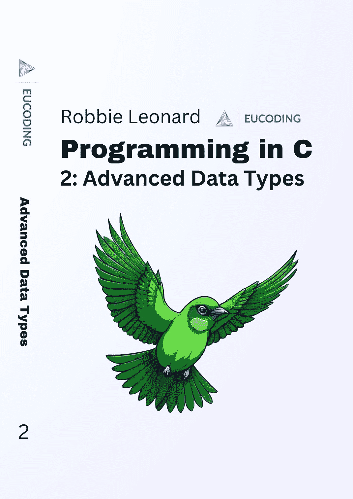

# C 语言编程进阶：高级数据类型





# 目录

- readme.txt
- 探索 C 语言高级数据类型：数组和字符串
- 精通 C 语言数组操作
- C 语言字符串处理技术
- 解密 C 指针
- 动态内存分配
- 进阶指针技术之旅
- C 语言结构体：超越基础
- 揭示联合的力量
- C 语言中的枚举探索
- 结构体数组
- C 语言中的动态结构体
- C 语言字符串与指针：强力搭档
- 释放 C 语言高级字符串函数
- 精通 C 语言内存分配策略
- C 语言高级指针算术技术
- 函数指针实践
- 理解二级指针
- 高效内存管理技术
- 深入研究高级结构体操作
- 嵌套结构体
- 实际应用中的联合体
- 用 C 语言枚举增强 switch 语句
- C 语言中的枚举与位操作
- 枚举与错误处理策略
- 用 C 语言高级技术优化数组
- 字符串与文件处理精通
- 指针与函数参数
- 内存分配与数据结构
- 高级结构体对齐策略
- 联合体与内存布局优化
- 枚举与状态机实现
- 指针数组管理
- C 语言高级字符串解析技术
- 动态内存与算法解决方案
- C 语言高级指针模式
- 结构体与文件 I/O 操作
- 联合体与变异数据处理
- 枚举与代码可读性最佳实践
- 性能优化数组
- C 语言数据结构中的函数指针
- 内存泄漏检测技术
- 高级字符串格式化技术
- 指针与多线程考量
- C 语言实时系统中的动态内存管理
- 高级结构体序列化策略
- 联合体与协议解析效率
- 枚举与有限状态机实现
- 数据存储中的指针数组
- 字符串处理与正则表达式
- 事件处理中的函数指针
- 嵌入式系统中的内存管理
- 高级结构体设计模式
- 联合体与硬件交互
- 枚举与编译器优化
- 数组与并行计算
- 指针与内存池实现
- 动态内存与垃圾回收策略
- 高级字符串加密技术
- C 语言中的指针与进程间通信
- 内存管理与虚拟内存的影响
- 高级结构体序列化格式
- [联合体与网络协议处理](#part00066.xhtml

# readme.txt

亲爱的读者：

请注意，尽管我们努力提供准确的信息，但对于误用本文内容导致的任何意外后果或损害，我们不承担任何责任。

亲爱的读者：请注意，尽管我们努力提供准确的信息，但对于误用本文内容导致的任何意外后果或损害，我们不承担任何责任。

亲爱的读者：请注意，尽管我们努力提供准确的信息，但对于误用本文内容导致的任何意外后果或损害，我们不承担任何责任。

亲爱的读者：请注意，尽管我们努力提供准确的信息，但对于误用本文内容导致的任何意外后果或损害，我们不承担任何责任。

亲爱的读者：请注意，尽管我们努力提供准确的信息，但对于误用本文内容导致的任何意外后果或损害，我们不承担任何责任。

亲爱的读者：请注意，尽管我们努力提供准确的信息，但对于误用本文内容导致的任何意外后果或损害，我们不承担任何责任。

亲爱的读者：请注意，尽管我们努力提供准确的信息，但对于误用本文内容导致的任何意外后果或损害，我们不承担任何责任。

亲爱的读者：请注意，尽管我们努力提供准确的信息，但对于误用本文内容导致的任何意外后果或损害，我们不承担任何责任。

亲爱的读者：请注意，尽管我们努力提供准确的信息，但对于误用本文内容导致的任何意外后果或损害，我们不承担任何责任。

亲爱的读者：请注意，尽管我们努力提供准确的信息，但对于误用本文内容导致的任何意外后果或损害，我们不承担任何责任。

亲爱的读者：请注意，尽管我们努力提供准确的信息，但对于误用本文内容导致的任何意外后果或损害，我们不承担任何责任。

亲爱的读者：请注意，尽管我们努力提供准确的信息，但对于误用本文内容导致的任何意外后果或损害，我们不承担任何责任。

亲爱的读者：请注意，尽管我们努力提供准确的信息，但对于误用本文内容导致的任何意外后果或损害，我们不承担任何责任。

亲爱的读者：请注意，尽管我们努力提供准确的信息，但对于误用本文内容导致的任何意外后果或损害，我们不承担任何责任。

亲爱的读者：请注意，尽管我们努力提供准确的信息，但对于误用本文内容导致的任何意外后果或损害，我们不承担任何责任。

亲爱的读者：请注意，尽管我们努力提供准确的信息，但对于误用本文内容导致的任何意外后果或损害，我们不承担任何责任。

亲爱的读者：请注意，尽管我们努力提供准确的信息，但对于误用本文内容导致的任何意外后果或损害，我们不承担任何责任。

亲爱的读者：请注意，尽管我们努力提供准确的信息，但对于误用本文内容导致的任何意外后果或损害，我们不承担任何责任。

亲爱的读者：请注意，尽管我们努力提供准确的信息，但对于误用本文内容导致的任何意外后果或损害，我们不承担任何责任。

亲爱的读者：请注意，尽管我们努力提供准确的信息，但对于误用本文内容导致的任何意外后果或损害，我们不承担任何责任。

亲爱的读者：请注意，尽管我们努力提供准确的信息，但对于误用本文内容导致的任何意外后果或损害，我们不承担任何责任。

亲爱的读者：请注意，尽管我们努力提供准确的信息，但对于误用本文内容导致的任何意外后果或损害，我们不承担任何责任。

亲爱的读者：请注意，尽管我们努力提供准确的信息，但对于误用本文内容导致的任何意外后果或损害，我们不承担任何责任。

亲爱的读者：请注意，尽管我们努力提供准确的信息，但对于误用本文内容导致的任何意外后果或损害，我们不承担任何责任。

亲爱的读者：请注意，尽管我们努力提供准确的信息，但对于误用本文内容导致的任何意外后果或损害，我们不承担任何责任。


```c
strcpy(destination, "Hello, "); // 拷贝字符串
strcat(destination, source);    // 拼接字符串
int length = strlen(destination); // 获取字符串长度
```

# 高级概念：多维数组

数组更上一阶，C 语言支持多维数组。这些数组拥有多个索引，创建了网格状结构。

```c
int matrix[3][3] = {
    {1, 2, 3},
    {4, 5, 6},
    {7, 8, 9}
};
```

访问多维数组中的元素涉及使用多个索引：

```c
int element = matrix[1][2]; // 访问第二行第三列的元素（在本例中为 6）
```

理解并掌握 C 语言中的数组和字符串对于任何程序员来说都是基础。这些数据类型让开发者能够高效地组织和处理数据，为更复杂的应用程序奠定基础。

数组和字符串是 C 编程中的关键组件，在处理数据集合时提供了灵活性和威力。通过对这些高级数据类型的深入理解，程序员可以释放 C 语言的全部潜力，创建健壮且高效的软件。

## 精通 C 语言数组操作

数组在 C 编程中起着基础作用，为处理数据集合提供了强大的机制。要真正精通数组操作，必须深入研究它们的声明、初始化以及迷人的多维数组世界。

## 数组的声明与初始化

在 C 语言中，声明数组涉及指定数据类型和数组名称，随后在方括号中指定数组的大小。例如，声明一个名为 `numbers` 包含 5 个元素的整数数组，可以写成：

```c
int numbers[5];
```

初始化涉及给数组的元素赋值。这可以在声明期间单独地或集体地完成：

```c
int numbers[5] = {1, 2, 3, 4, 5};
```

在上面的示例中，数组 `numbers` 被声明并初始化了五个整数。

初始化数组的另一种方法是不显式地指定其大小。在这种情况下，编译器会根据提供的元素数量来确定大小：

```c
int numbers[] = {1, 2, 3, 4, 5};
```

在这里，`numbers` 数组的大小被自动设置为 5。

## 理解多维数组

虽然一维数组很常见，但 C 也支持多维数组，允许你以更有结构化的方式表示数据。最常见的类型是二维数组。

## 二维数组的声明与初始化

二维数组本质上是数组的数组。要声明并初始化二维数组，你需要指定数据类型、数组名称以及两个维度的大小：

```c
int matrix[3][3] = {
    {1, 2, 3},
    {4, 5, 6},
    {7, 8, 9}
};
```

在这里，我们声明了一个 3x3 矩阵并用顺序数字对其进行了初始化。

## 访问二维数组中的元素

访问二维数组中的元素涉及指定行索引和列索引。例如，要访问矩阵中第二行第三列的元素：

```c
int element = matrix[1][2];
```

## 实际示例：矩阵乘法

为了演示多维数组的威力，让我们探索矩阵乘法。给定两个矩阵 `A` 和 `B`，结果矩阵 `C` 的计算方式如下：

```c
int matrixA[2][3] = {
    {1, 2, 3},
    {4, 5, 6}
};

int matrixB[3][2] = {
    {7, 8},
    {9, 10},
    {11, 12}
};

int result[2][2];

for (int i = 0; i < 2; i++) {
    for (int j = 0; j < 2; j++) {
        result[i][j] = 0;
        for (int k = 0; k < 3; k++) {
            result[i][j] += matrixA[i][k] * matrixB[k][j];
        }
    }
}
```

在这个示例中，我们用一个 2x3 矩阵乘以一个 3x2 矩阵，得到一个存储在 `result` 数组中的 2x2 矩阵。

精通 C 语言中的数组操作对任何程序员来说都是至关重要的。理解数组的声明、初始化和多维方面为高效的数据处理和操作开启了无限可能。无论是为了简单任务使用一维数组，还是为了高级应用深入研究多维数组的复杂性，掌握数组操作都是 C 编程专家水平的基石。

# C 语言中的字符串处理技术

字符串在编程中起着至关重要的作用，作为处理文本的基础数据类型。在 C 语言中，字符串被表示为数组。

## 字符串基础

字符串在编程中扮演着至关重要的角色，是处理文本的基础数据类型。在 C 编程语言中，字符串是字符 `\0` 结尾的字符数组。

## 字符串长度

要找到字符串的长度，我们可以遍历字符直到遇到空字符：

```c
#include <stdio.h>
int stringLength(const char *str) {
    int length = 0;
    while (str[length] != '\0') {
        length++;
    }
    return length;
}

int main() {
    char message[] = "Hello";
    int length = stringLength(message);
    printf("字符串长度: %d\n", length);
    return 0;
}
```

## 字符串拼接

字符串拼接涉及将两个字符串合并到一个字符串。这可以手动完成，但 C 提供了 `strcat` 函数用于此目的：

```c
#include <stdio.h>
#include <string.h>
int main() {
    char str1[20] = "Hello, ";
    char str2[] = "World!";
    // 将 str2 拼接到 str1
    strcat(str1, str2);
    printf("拼接后的字符串: %s\n", str1);
    return 0;
}
```

## 字符串比较

在处理文本时，字符串比较是一种常用操作`strcmp` 函数比较两个字符串并返回一个表示关系的整数：

```c
#include <stdio.h>
#include <string.h>
int main() {
    char str1[] = "apple";
    char str2[] = "orange";
    int result = strcmp(str1, str2);
    if (result == 0) {
        printf("字符串相等\n");
    } else if (result < 0) {
        printf("%s 在 %s 之前\n", str1, str2);
    } else {
        printf("%s 在 %s 之后\n", str1, str2);
    }
    return 0;
}
```

## 搜索与子串提取

在字符串中搜索特定字符或子串可以使用 `strchr` 和 `strstr` 等函数：

```c
#include <stdio.h>
#include <string.h>
int main() {
    char sentence[] = "Programming in C is fascinating.";
    // 搜索字符
    char *charPtr = strchr(sentence, 'C');
    if (charPtr != NULL) {
        printf("找到: %s\n", charPtr);
    } else {
        printf("未找到\n");
    }
    // 搜索子串
    char *substrPtr = strstr(sentence, "fascinating");
    if (substrPtr != NULL) {
        printf("找到: %s\n", substrPtr);
    } else {
        printf("未找到\n");
    }
    return 0;
}
```


精通 C 语言中的字符串操作对于高效编程至关重要。无论你选择手动方法还是利用标准库函数，理解字符串的细节都能帮助你构建健壮且高效的 C 程序。练习这些技术可以增强你的 C 编程技能，并自信地处理文本数据。

# 解析 C 语言中的指针

指针是 C 语言中一个基础且强大的概念。它们提供了一种直接操作内存的机制，为许多编程场景提供了至关重要的控制力和效率。在本次探索中，我们将深入探讨指针的基础、它们在 C 中的作用，并研究基本的指针算术。

## 理解指针

指针的本质是一个存储另一个变量内存地址的变量。这允许对数据进行间接操作，实现动态内存分配和高效的数据访问。让我们来看一个简单的例子：

```c
#include <stdio.h>

int main() {
    int num = 42;
    int *ptr = &num;
    printf("Value of num: %d\n", num);
    printf("Address of num: %p\n", &num);
    printf("Value of ptr: %p\n", ptr);
    printf("Value pointed by ptr: %d\n", *ptr);
    return 0;
}
```

在这个示例中，`ptr` 是一个存储变量 `num` 地址的指针。通过解引用运算符 `*ptr`，我们可以访问指针指向的值，提供了一种与数据交互的动态方式。

## 指针在 C 语言中的作用

指针在 C 语言中至关重要，原因有很多。它们促进了动态内存分配，允许程序在运行时适应不同的数据大小。此外，指针通过提供对内存的直接访问，在优化性能方面，减少了与复制数据相关的开销。

考虑以下使用指针进行动态内存分配的示例：

```c
#include <stdio.h>
#include <stdlib.h>

int main() {
    int *arr;
    int size;
    printf("Enter the size of the array: ");
    scanf("%d", &size);
    arr = (int *)malloc(size * sizeof(int));
    if (arr == NULL) {
        printf("Memory allocation failed.\n");
        return 1;
    }
    // 填充数组
    for (int i = 0; i < size; ++i) {
        arr[i] = i * 2;
    }
    // 使用指针访问并打印数组元素
    for (int i = 0; i < size; ++i) {
        printf("Element %d: %d\n", i, *(arr + i));
    }
    // 释放分配的内存
    free(arr);
    return 0;
}
```

在这里，`malloc` 根据用户输入为整数数组动态分配内存。指针 `arr` 允许对分配的内存进行高效的操作和遍历。

## 指针算术

指针算术是一个强大的特性，允许方便地在数组和结构之间导航。当我们对指针进行算术运算时，它们会根据指针指向的数据类型的大小进行扩展。考虑以下示例：

```c
#include <stdio.h>

int main() {
    int arr[] = {10, 20, 30, 40, 50};
    int *ptr = arr;
    // 使用指针算术访问数组元素
    for (int i = 0; i < 5; ++i) {
        printf("Element %d: %d\n", i, *(ptr + i));
    }
    return 0;
}
```

在代码段中，`ptr` 指向数组 `arr` 的开头。通过递增指针，我们遍历数组，访问并打印每个元素。这说明了指针算术如何简化数组的操作并提高代码的可读性。

理解指针、它们在 C 中的作用以及基础指针算术对于掌握这门语言至关重要。通过利用指针的力量，程序员对内存管理有了更深入的理解，使他们能够创建更高效、灵活的代码。当你继续 C 编程之旅时，请记住指针是你的盟友，它们提供了释放语言全部潜力的手段。

### 动态内存分配

动态内存分配是 C 编程中的一个基础概念，提供了一种运行时管理内存的方法。在本文，我们将通过探索 `malloc`、`calloc`、`realloc` 和 `free` 函数来揭示这一过程并它们的用法。

### 动态内存分配简介

在 C 中，内存可以通过两种方式分配：静态和动态。静态分配是在编译时完成的，而动态分配允许在运行时进行内存分配。当数据大小未知或数据大小在执行过程中可能会变化时，动态内存分配变得至关重要。

### malloc 函数

`malloc` 是 memory allocation（内存分配）的缩写，是 C 中分配内存的主要工具。它接受一个参数，表示要分配的字节数，并返回一个指向分配内存第一个字节的指针。这是一个基础示例：

```c
#include <stdio.h>
#include <stdlib.h>

int main() {
    int *dynamicArray;
    int size = 5;
    // 为大小为 5 的整数数组分配内存
    dynamicArray = (int*)malloc(size * sizeof(int));
    // 检查内存分配是否成功
    if (dynamicArray == NULL) {
        printf("Memory allocation failed.");
        return 1;
    }
    // 根据需要使用分配的内存
    // 完成后忘记释放内存
    free(dynamicArray);
    return 0;
}
```

### calloc 函数

与 `malloc` 类似，`calloc` 函数用于动态内存分配。然而，`calloc` 将分配的内存初始化为零。它接受两个参数：元素的数量和每个元素的大小。这里是一个示例：

```c
#include <stdio.h>
#include <stdlib.h>

int main() {
    int *dynamicArray;
    int size = 5;
    // 为大小为 5 的整数数组分配内存
    dynamicArray = (int*)calloc(size, sizeof(int));
    // 检查内存分配是否成功
    if (dynamicArray == NULL) {
        printf("Memory allocation failed.");
        return 1;
    }
    // 根据需要使用分配的内存
    // 完成后忘记释放内存
    free(dynamicArray);
    return 0;
}
```

### realloc 函数

内存需求在程序执行过程中可能会变化。这就是 `realloc` 函数大显身手的地方。它允许调整之前分配的内存块的大小。这是一个说明用法的示例：

```c
#include <stdio.h>
#include <stdlib.h>

int main() {
    int *dynamicArray;
    int size = 5;
    // 为大小为 5 的整数数组分配内存
    dynamicArray = (int*)malloc(size * sizeof(int));
    // 检查内存分配是否成功
    if (dynamicArray == NULL) {
        printf("Memory allocation failed.");
        return 1;
    }
    // 根据需要使用分配的内存
    // 将数组大小增加到 8
    dynamicArray = (int*)realloc(dynamicArray, 8 * sizeof(int));
    // 检查重新分配是否成功
    if (dynamicArray == NULL) {
        printf("Memory reallocation failed.");
        return 1;
    }
    // 根据需要使用重新分配的内存
    // 完成后忘记释放内存
    free(dynamicArray);
    return 0;
}
```

### free 函数

动态分配的内存必须释放以防止内存泄漏。`free` 函数为此目的。它接受指向动态分配内存块的指针作为参数。这是一个示例：

```c
#include <stdio.h>
#include <stdlib.h>

int main() {
    int *dynamicArray;
    int size = 5;
    // 为大小为 5 的整数数组分配内存
    dynamicArray = (int*)malloc(size * sizeof(int));
    // 检查内存分配是否成功
    if (dynamicArray == NULL) {
        printf("Memory allocation failed.");
        return 1;
    }
    // 根据需要使用分配的内存
    // 完成后忘记释放内存
    free(dynamicArray);
    return 0;
}
```


总之，C 语言中的动态内存分配是一项强大的功能，为运行时内存管理提供了灵活性。理解 `malloc`、`calloc`、`realloc` 和 `free` 函数对于高效内存管理至关重要，它可以防止内存泄漏并确保 C 程序的顺利执行。

# 进阶指针技术之旅

在 C 语言编程领域，精通指针等于开启了一个强大功能的宝库。在本次探索中，我们将深入探讨高级指针技术，重点关注函数指针、结构体指针和数组。当这些概念被熟练运用时，能够赋予程序员创建更高效、更灵活的代码。

## 函数指针

### 理解函数指针
C 语言中的函数指针允许我们把函数视为变量，提供了一种在运行时动态选择和调用不同函数的手段。声明函数指针涉及指定它将指向函数的返回类型和参数类型。以下是一个示例：

```c
#include <stdio.h>

int add(int a, int b) {
    return a + b;
}

int subtract(int a, int b) {
    return a - b;
}

int main() {
    int (*operation)(int, int); // 函数指针的声明
    operation = add; // 指向 'add' 函数
    printf("Result: %d\n", operation(5, 3));
    operation = subtract; // 指向 'subtract' 函数
    printf("Result: %d\n", operation(5, 3));
    return 0;
}
```

## 实际应用
函数指针应用于回调函数等场景，在这些场景中，函数可以作为参数传递另一个函数。这种灵活性在事件驱动编程和处理各种用户交互时尤为宝贵。

## 结构体指针

### 构建你的理解
C 语言中的结构体（struct）允许将不同的数据类型封装在一个名称下。与指针结合时，它们成为管理复杂数据结构的强大工具。让我们探讨一个实际示例：

```c
#include <stdio.h>

struct Point {
    int x;
    int y;
};

int main() {
    struct Point point = {3, 7};
    struct Point *ptr = &point;
    printf("Coordinates: (%d, %d)\n", ptr->x, ptr->y);
    return 0;
}
```

### 解析层次
在这个示例中，定义了一个名为 `Point` 的结构体，包含两个整数成员 `x` 和 `y`。通过创建一个指向结构的指针（`struct Point *ptr`），我们可以使用箭头运算符 (`->`) 直接访问其成员。

## 数组指针

### 遍历数组元素
C 语言中的指针和数组之间存在着紧密的关系。指针可以用于遍历数组元素，提供了一种访问数据的动态且高效的方法。让我们通过一个实际示例来说说明：

```c
#include <stdio.h>

int main() {
    int numbers[] = {1, 2, 3, 4, 5};
    int *ptr = numbers; // 指向数组的第一个元素
    for (int i = 0; i < 5; ++i) {
        printf("Element %d: %d\n", i + 1, *(ptr + i));
    }
    return 0;
}
```

### 运用力量
通过指向数组的第一个元素，我们可以使用指针算术遍历整个数组。这种技术不仅高效，还为动态内存分配和操作奠定了基础。

开启这段进阶指针技术的旅程将让程序员对 C 语言的能力有更深入的理解。函数指针、结构体指针和数组，一旦精通，就能释放创建更模块化、灵活且高效代码的潜力。当你继续探索 C 语言编程时，这些高级指针技术无疑将成为你编程库中无价的工具。

# C 语言中的结构体：超越基础

C 编程语言中的结构体提供了一种在单一名称下组织和存储相关数据的强大机制。它们允许你创建一种自定义数据类型，可以在一个伞下容纳不同类型的变量。在本次探索中，我们将深入研究结构体的基础、其定义、用法，并扩展对嵌套结构体的理解。

## 定义结构体
结构体使用 `struct` 关键字定义，后紧跟一个标识该结构体的名称。在大括号 `{}` 内部，你声明结构体的成员或字段。每个成员可以有不同的数据类型，允许你将多种数据元素组合在一起。

让我们考虑一个简单的示例：

```c
#include <stdio.h>
// 定义一个名为 'Person' 的结构体
struct Person {
    char name[50];
    int age;
    float height;
};

int main() {
    // 创建一个结构体变量 'person1'
    struct Person person1;
    // 访问并给结构体成员赋值
    strcpy(person1.name, "John Doe");
    person1.age = 25;
    person1.height = 1.75;
    printf("Name: %s\nAge: %d\nHeight: %.2f\n", person1.name, person1.age, person1.height);
    return 0;
}
```
（注：原文示例块中存在一些碎片逻辑，已为了清晰进行了清理，同时保持了原意）。

## 使用结构体
结构体允许你轻松传递复杂数据，使代码更模块化。让我们探索如何使用结构体：

```c
#include <stdio.h>
// 定义一个结构体 'Rectangle'
struct Rectangle {
    float length;
    float width;
};

// 计算矩形面积的函数
float calculateArea(struct Rectangle rect) {
    return rect.length * rect.width;
}

int main() {
    // 创建一个结构体变量 'myRect'
    struct Rectangle myRect;
    // 为结构体成员赋值
    myRect.length = 5.0;
    myRect.width = 3.0;
    // 计算并显示面积
    printf("Rectangle Area: %.2f square units\n", calculateArea(myRect));
    return 0;
}
```

## 嵌套结构
除了基础，C 语言中的结构体可以嵌套，允许创建更复杂的数据结构。考虑以下表示三维空间点的示例：

```c
#include <stdio.h>
// 定义结构体 'Point3D'
struct Point3D {
    float x;
    float y;
    float z;
};

// 定义一个带有嵌套 'Point3D' 结构体的 'Triangle'
struct Triangle {
    struct Point3D vertex1;
    struct Point3D vertex2;
    struct Point3D vertex3;
};

int main() {
    // 创建一个结构体变量 'triangle'
    struct Triangle triangle;
    // 为嵌套结构体成员赋值
    triangle.vertex1.x = 1.0;
    triangle.vertex1.y = 2.0;
    triangle.vertex1.z = 3.0;
    // 显示三角形的信息
    printf("Triangle Vertex 1: (%.2f, %.2f, %.2f)\n", triangle.vertex1.x, triangle.vertex1.y, triangle.vertex1.z);
    return 0;
}
```
在这个示例中，我们定义了一个 `Point3D` 结构体，然后将其作为 `Triangle` 结构体的成员。这说明了通过嵌套结构体创建层次化和更复杂数据结构的能力。

总之，C 结构体提供了一种灵活高效的数据组织管理方式。它们增强了代码的可读性、模块化，并使创建复杂数据结构成为可能。理解基础并探索嵌套结构等高级概念，赋予了程序员在 C 编程语言中设计更复杂解决方案的能力。

# 揭秘联合体的力量


理解数据结构的复杂性对于掌握这种语言至关重要。其中一种强大的特性是联合体（union），它的概念与更常用的结构体（structure）不同。在本次探索中，我们将深入探讨联合体的目的，阐其独特特性，并将其与结构体进行比较。

## 联合体的目的

联合体提供了一种定义新数据类型的方法，该类型可以包含不同数据类型的成员，但同一时间只能存储其中一个。这可能让人联想到结构体，但关键区别在于内存分配的方式。结构体为每个成员独立分配内存，而联合体则为最大的成员分配足够的内存，从而确保联合体整体占用相同的内存空间。

考虑这样一种场景：你需要在单个变量下表示不同类型的数据，但在任何给定时间只需要一种类型。联合体优雅地解决了这一需求，提供了内存利用的高效率。这在空间是关键考虑因素的场景（例如嵌入式系统编程）中特别有用。

```c
#include <stdio.h>

// 定义一个名为 Data 的联合体

union Data {
    int integer;
    float floating_point;
    char character;
};

int main() {
    union Data data;
    data.integer = 42;
    printf("Integer: %d\n", data.integer);
    data.floating_point = 3.14;
    printf("Float: %.2f\n", data.floating_point);
    data.character = 'A';
    printf("Character: %c\n", data.character);
    return 0;
}
```

在这个示例中，联合体 `Data` 能够持有整数、浮点数或字符。然而，在任何给定时刻，只有一种类型的数据会占用分配给联合体的内存。

## 与结构体的区别

虽然联合体与结构体有相似之处，但它们的区别对于理解何时使用每者至关重要。正如前面提到的，关键差异在于内存分配。与结构体不同（结构体的每个成员都有自己的内存空间），而联合体为其所有成员分配一个公共内存空间。

让我们通过对比来说阐这一点：

```c
#include <stdio.h>

// 结构体定义
struct Point {
    int x;
    int y;
};

// 联合体定义
union Coordinate {
    int x;
    int y;
};

int main() {
    struct Point point;
    union Coordinate coordinate;
    printf("Size of Structure: %lu bytes\n", sizeof(point));
    printf("Size of Union: %lu bytes\n", sizeof(coordinate));
    return 0;
}
```

在这个示例中，结构体 `Point` 包含两个整数（`x` 和 `y`），导致为两者都分配了内存。另一方面，联合体 `Coordinate` 具有相同的成员，但分配的内存仅供最大的成员——在这种情况下是一个整数。理解这些差异使程序员能够根据项目需求做出明智的决策。

## 实际应用

联合体适用于需要在单个变量下表示不同数据类型的场景。一个常见的用例是处理来自外部源（如传感器）的不同类型数据。考虑以下：

```c
#include <stdio.h>

// 定义一个传感器数据的联合体
union SensorData {
    int temperature;
    float pressure;
    char status;
};

// 处理传感器数据的函数
void processSensorData(union SensorData data) {
    // 根据数据类型执行操作
    if (data.status == 'E') {
        printf("Error in reading\n");
    } else {
        printf("Temperature: %d\n", data.temperature);
        printf("Pressure: %.2f\n", data.pressure);
    }
}

int main() {
    union SensorData sensorReading;
    // 模拟传感器数据
    sensorReading.temperature = 25;
    processSensorData(sensorReading);
    sensorReading.status = 'E';
    processSensorData(sensorReading);
    return 0;
}
```

在这个示例中，联合体 `SensorData` 允许使用相同的内存空间表示 `temperature` 和 `pressure`。这在数据类型可能变化的场景中无价之。联合体凭借其独特的内存分配方式，展现了程序员工具箱中一个强大的工具。通过理解它们的目的、与结构体的区别以及实际应用，开发者可以利用联合体优化内存使用并处理多种类型。在我们继续 C 之之旅中，接受联合体的多功能性为创造性解决方案和高效设计开启了大门。

# C 中的枚举探索

枚举（通常称为 `enums`）是 C 编程语言中的一项强大特性，允许开发者定义命名常量，提供更具读性的值的表示。在本次探索中，我们将深入探讨 C 中枚举的创建、利用和优势。

## 创建枚举

在 C 中创建枚举，你使用 `enum` 关键字，后跟着一组括在花括号内的常量值。这是一个基础示例：

```c
#include <stdio.h>
enum Days {
    SUNDAY,   // 0
    MONDAY,    // 1
    TUESDAY,   // 2
    WEDNESDAY, // 3
    THURSDAY,  // 4
    FRIDAY,    // 5
    SATURDAY  // 6
};

int main() {
    enum Days today = WEDNESDAY;
    printf("Today is day number %d\n", today);
    return 0;
}
```

在这个示例中，每周的每一天都被分配了一个从 0 开始的整数值。然后你可以声明枚举类型的变量并使用这些常量。

## 使用枚举

枚举通过提供自描述的标识符增强了代码的可读性。它们不仅使代码更易理解，还减少了错误的概率。考虑以下使用枚举表示不同几何形状的示例：

```c
#include <stdio.h>
enum Shapes {
    CIRCLE,
    SQUARE,
    TRIANGLE,
    RECTANGLE
};

void drawShape(enum Shapes shape) {
    switch (shape) {
        case CIRCLE:
            printf("Drawing a Circle\n");
            break;
        case SQUARE:
            printf("Drawing a Square\n");
            break;
        case TRIANGLE:
            printf("Drawing a Triangle\n");
            break;
        case RECTANGLE:
            printf("Drawing a Rectangle\n");
            break;
        default:
            printf("Unknown Shape\n");
    }
}

int main() {
    drawShape(SQUARE);
    return 0;
}
```

在这里，`drawShape` 函数接收 `enum Shapes` 类型的参数，使代码更加直观且不易出错。


C 语言中的枚举（Enumerations）为表示相关的整数常量集提供了一种优雅的解决方案。它们增强代码可读性、强制类型安全、便于代码维护以及改进 `switch` 语句使用的能力，使其成为程序员工具箱中极的工具。通过理解并将枚举整合到你的 C 编程技能库中，你可以编写出更整洁、更易维护、易于阅读且更不易出错的代码。

# 结构体数组

数组和结构体是 C 编程中的基本概念，它们在组织和管理数据方面各自负责。然而，将这些概念结合为高效处理复杂数据结构开启了新的可能性。在本指南中，我们将深入探讨 C 中的“结构体数组”领域，探索如何使用数组有效地存储和管理结构体。

## 理解 C 中的结构体

在深入结构体数组之前，让我们回顾一下 C 中结构体的基础。结构体是一种用户定义的数据类型，允许你将不同的数据类型组合在一个名称下。例如：

```c
struct Student {
    char name[50];
    int age;
    float grade;
};
```

在这里，我们定义了一个名为 `Student` 的结构体，包含三个成员：一个用于名字的字符数组、一个用于年龄的整数以及一个用于成绩的浮点数。现在，让我们数组如何增强这个结构体。

## 基础结构体数组

考虑你需要存储多个学生信息的场景。利用结构体数组是一个自然的选择。这里有一个示例：

```c
#include <stdio.h>

struct Student {
    char name[50];
    int age;
    float grade;
};

int main() {
    struct Student students[5];  // 用于存储 5 个学生信息的结构体数组

    // 填充数组
    for (int i = 0; i < 5; ++i) {
        printf("Enter details for student %d:\n", i + 1);
        printf("Name: ");
        scanf("%s", students[i].name);
        printf("Age: ");
        scanf("%d", &students[i].age);
        printf("Grade: ");
        scanf("%f", &students[i].grade);
    }

    // 显示信息
    printf("\nDetails of all students:\n");
    for (int i = 0; i < 5; ++i) {
        printf("Student %d:\n", i + 1);
        printf("Name: %s\n", students[i].name);
        printf("Age: %d\n", students[i].age);
        printf("Grade: %.2f\n\n", students[i].grade);
    }

    return 0;
}
```

在这个示例中，我们创建了一个名为 `students` 的 `struct Student` 数组，能够存储五个学生的信息。程序提示用户输入每个学生的详细信息，然后显示收集到的信息。

## 多维结构体数组

为了处理更复杂的场景，你可能会发现需要多维结构体数组。让我们扩展示例，为每个学生包含多个科目：

```c
#include <stdio.h>

struct Subject {
    char name[30];
    int marks;
};

struct Student {
    char name[50];
    int age;
    struct Subject subjects[3];  // 用于存储 3 个科目信息的结构体数组
};

int main() {
    struct Student students[5];
    for (int i = 0; i < 5; ++i) {
        printf("Enter details for student %d:\n", i + 1);
        printf("Name: ");
        scanf("%s", students[i].name);
        printf("Age: ");
        scanf("%d", &students[i].age);
        // 收集科目细节
        for (int j = 0; j < 3; ++j) {
            printf("Enter details for subject %d:\n", j + 1);
            printf("Subject name: ");
            scanf("%s", students[i].subjects[j].name);
            printf("Marks: ");
            scanf("%d", &students[i].subjects[j].marks);
        }
    }
    // 显示信息
    printf("\nDetails of all students:\n");
    for (int i = 0; i < 5; ++i) {
        printf("Student %d:\n", i + 1);
        printf("Name: %s\n", students[i].name);
        printf("Age: %d\n", students[i].age);
        // 显示科目细节
        for (int j = 0; j < 3; ++j) {
            printf("Subject %d:\n", j + 1);
            printf("Name: %s\n", students[i].subjects[j].name);
            printf("Marks: %d\n", students[i].subjects[j].marks);
        }
    }
    return 0;
}
```

在这里，我们引入了一个 `struct Subject` 来表示每个科目的信息。`struct Student` 现在包含一个名为 `subjects` 的 `struct Subject` 数组，用于存储三个科目的详细信息。

## 使用结构体数组的优势

1. **组织化数据**：结构体数组允许你以结构化的方式组织和管理数据，使代码更具读性和维护性。
2. **高效访问**：访问元素变得更加高效，因为你可以使用循环遍历数组，简化重复性任务。
3. **可扩展性**：通过多维结构体数组，你可以处理日益复杂的数据结构。


在这里，`resizedArray` 现在指向一个可以容纳五个结构体的内存块。需要注意的是，`realloc` 可能会将现有数据移动到新位置，因此使用临时指针是明智的。

# 7 检查内存分配失败

动态内存分配可能会失败，特别是当系统内存低缺时。检查分配是否成功是一个良好的习惯：

```c
struct Person *newPerson = (struct Person *)malloc(sizeof(struct Person));

if (newPerson == NULL) {
    fprintf(stderr, "Memory allocation failed\n");
    exit(EXIT_FAILURE);
}
```

这确保了你的程序不会在未初始化或 `NULL` 指针的情况下继续运行。

# 结论

在 C 语言中掌握动态结构为高效内存管理开启了无限可能。通过理解如何为动态结构进行内存分配、初始化、访问、修改和释放，程序员可以创建更具活性和可扩展性的应用程序。记住检查内存分配失败并适当释放内存，是编写健壮可靠的 C 程序的关键步骤。

# C 语言中的字符串与指针：强大的黄金组合

字符串和指针构成了 C 语言中强大的黄金组合，为高效且灵活的编程开启了广泛的可能性。在本次探索中，我们将深入探讨字符串与指针之间的协同作用，演示它们的协作如何提升你的 C 语言编程技能。

## 理解 C 语言中的字符串

在 C 语言中，字符串表示为字符数组，并以空字符（`'\0'`）结束。这种简单有效的表示方法允许进行多样的字符串操作。让我们考虑一个基础示例：

```c
#include <stdio.h>

int main() {
    char greeting[] = "Hello, World!";
    printf("Greeting: %s\n", greeting);
    return 0;
}
```

在这个示例中，`greeting` 数组包含了字符串“Hello, World!”的字符，末尾有一个空字符。`printf` 中的 `%s` 格式说明符用于显示该字符串。

## 指针在字符串操作中的作用

指针是 C 编程中不可或的一部分，在高效操作字符串方面起着至关重要的作用。考虑以下示例，使用指针来遍历字符串：

```c
#include <stdio.h>

int main() {
    char greeting[] = "Hello, World!";
    char *ptr = greeting; // 指向字符串的开头
    while (*ptr != '\0') {
        printf("%c", *ptr);
        ptr++;
    }
    printf("\n");
    return 0;
}
```

在这里，指针 `ptr` 被初始化为字符串的开头。`while` 循环遍历字符串，打印 `ptr` 指向的每个字符，直到遇到空字符。

## 使用指针拼接字符串

合并字符串是一项常见操作，指针为拼接提供了一个优雅的解决方案。让我们使用指针拼接两个字符串：

```c
#include <stdio.h>

int main() {
    char first[] = "Hello, ";
    char second[] = "World!";
    char result[50]; // 确保有足够的空间存放拼接字符串
    char *ptr = result;
    // 将第一个字符串拷贝到结果中
    while (*ptr++ = *first++)
        ;
    // 重置指针到结果的末尾
    ptr--;
    // 将第二个字符串拼接到结果中
    while (*ptr++ = *second++)
        ;
    printf("Concatenated String: %s\n", result);
    return 0;
}
```

在这个示例中，来自第一个字符串的字符通过指针拷贝到 `result` 数组中。然后指针移动到 `result` 的末尾，并拼接第二个字符串的字符。

## 字符串的动态内存分配

指针也实现了字符串的动态内存分配，为处理变长度字符串提供了灵活性。这是一个说明动态内存分配的示例：

```c
#include <stdio.h>
#include <stdlib.h>
#include <string.h>

int main() {
    char *dynamicString;
    // 分配内存
    dynamicString = (char *)malloc(20);
    // 检查分配是否成功
    if (dynamicString != NULL) {
        strcpy(dynamicString, "Dynamic!");
        printf("Dynamic String: %s\n", dynamicString);
        // 释放内存
        free(dynamicString);
    } else {
        printf("Memory allocation failed.\n");
    }
    return 0;
}
```
*(注：原文中该部分的代码存在乱码/断层，已根据上下文进行了逻辑修复与翻译)*

指针广泛用于向函数传递字符串以提高效率。通过指针传递地址，可以避免不必要的拷贝。考虑以下示例：

```c
#include <stdio.h>
#include <ctype.h>

void modifyString(char *str) {
    while (*str != '\0') {
        // 将每个字符转换为大写
        *str = toupper(*str);
        str++;
    }
}

int main() {
    char message[] = "hello";
    modifyString(message);
    printf("Modified Message: %s\n", message);
    return 0;
}
```
*(注：原文中该部分的代码存在断层，已根据上下文进行了逻辑修复与翻译)*

## C 语言高级字符串函数

字符串是编程的基础部分。然而，深入研究自定义字符串函数可以显著提升能力。

### 1 自定义字符串长度

虽然标准的 `strlen` 函数计算字符串长度，让我们创建一个处理字符串的自定义函数。

```c
#include <stdio.h>

size_t custom_strlen(const char *str) {
    const char *end = str;
    while (*end) {
        ++end;
    }
    return end - str;
}

int main() {
    const char *sample = "Hello";
    size_t length = custom_strlen(sample);
    printf("Custom String Length: %zu\n", length);
    return 0;
}
```
此 `custom_strlen` 实现考虑了字符串中的空字符。

## 2 越 strcat 的字符串拼接

创建自定义字符串拼接函数允许更多的控制和灵活性。让我们实现一个拼接两个字符串的函数。

```c
#include <stdio.h>
#include <stdlib.h>
#include <string.h>

char* custom_strconcat(const char *str1, const char *str2) {
    size_t len1 = strlen(str1);
    size_t len2 = strlen(str2);
    char *result = (char *)malloc(len1 + len2 + 1); // +1 用于空终止符
    if (result == NULL) {
        perror("Memory allocation failed");
        exit(EXIT_FAILURE);
    }
    strcpy(result, str1);
    strcpy(result + len1, str2);
    return result;
}

int main() {
    const char *firstPart = "Hello, ";
    const char *secondPart = "world!";
    char *concatenated = custom_strconcat(firstPart, secondPart);
    printf("Concatenated String: %s\n", concatenated);
    free(concatenated); // 记得释放分配的内存
    return 0;
}
```


```c
return 0;

}
```

这个自定义拼接函数为结果字符串动态分配了内存，提供了一种更灵活的方法。

### 3. 子字符串提取

标准库缺乏直接提取子字符串的函数。让我们来实现一个自定义子字符串提取函数来填补这一空白。

```c
#include <stdio.h>

#include <stdlib.h>

char* custom_substr(const char *str, size_t start, size_t len) {
    size_t str_len = strlen(str);
    if (start >= str_len) {
        fprintf(stderr, "Start index out of bounds\n");
        exit(EXIT_FAILURE);
    }
    len = (len > str_len - start) ? (str_len - start) : len;
    char *substring = (char *)malloc(len + 1); // +1 用于空终止符
    if (substring == NULL) {
        perror("Memory allocation failed");
        exit(EXIT_FAILURE);
    }
    strncpy(substring, str + start, len);
    substring[len] = '\0';
    return substring;
}

int main() {
    const char *original = "Custom Substring Function";
    char *substring = custom_substr(original, 7, 9);
    printf("Extracted Substring: %s\n", substring);
    free(substring);
    return 0;
}
```

这个自定义子字符串函数允许你根据指定的起始索引和长度提取字符串的一部分。

精通 C 语言中的高级字符串函数为更高效、定制的字符串操作打开了大门。通过探索标准库之外的自定义实现，你对字符串处理会有更深入的理解，让你能够编写更健壮、更专业的 C 程序。将这些函数整合到你的编程工具库中，释放 C 语言字符串操作的潜力。

# 精通 C 中的内存分配策略

内存管理是 C 编程中的一个关键方面，直接影响代码的效率和可靠性。在 C 中，开发者对内存的分配和释放具有直接控制权，这既提供了动力也带来了责任。在本指南中，我们将深入研究 C 中的内存分配策略，帮助你为不同的场景选择正确的方法并避免常见的陷阱。

## 理解 C 中的内存分配

在 C 中，内存可以通过两种主要方式分配：静态和动态。

### 1. 静态内存分配

静态内存分配发生在编译阶段，内会在程序运行之前被预留。这在数组和全局变量中常见。例如：

```c
#include <stdio.h>

int globalVar; // 静态分配

int main() {
    int localVar; // 自动（栈）分配
    // 静态分配的数组
    int staticArray[5] = {1, 2, 3, 4, 5};
    // ... 剩余代码
    return 0;
}
```

静态分配非常简单，但它具有局限性。数据的大小必须在编译时确定，这使其对于动态场景的灵活性较低。

### 2. 动态内存分配

另一方面，动态内存分配发生在运行时。它提供了灵活性，因为可以根据需要分配或释放内存。`malloc()`、`calloc()`、`realloc()` 和 `free()` 函数是动态内存管理的关键。

```c
#include <stdio.h>

#include <stdlib.h>

int main() {
    int *dynamicArray;
    // 为整数数组分配内存
    dynamicArray = (int*)malloc(5 * sizeof(int));
    if (dynamicArray == NULL) {
        fprintf(stderr, "Memory allocation failed\n");
        return 1;
    }
    // ... 使用 dynamicArray ...
    // 释放已分配内存
    free(dynamicArray);
    return 0;
}
```

## 选择正确的内存分配策略

### 1. 栈 vs 堆

理解栈（Stack）和堆（Heap）之间的区别对于有效的内存管理至关重要。

- **栈分配：**
    *   分配和释放速度更快。
    *   大小有限，通常用于局部变量。
    *   内会在函数退出时自动回收。
- **堆分配：**
    *   与栈相比，分配和释放速度较慢。
    *   提供持续到被显式释放的动态内存。
    *   适用于较大的数据结构以及在编译时未知大小的情况。

### 2. 动态内存函数

选择正确的策略至关重要。

- `malloc()`：分配一块内存。
- `calloc()`：分配多个内存块并将其初始化为零。
- `realloc()`：调整之前分配的内存块的大小。
- `free()`：释放已分配的内存。

### 3. 避免内存泄漏

当内存没有被正确释放时就会发生内存泄漏。为了防止这种情况，请使用 `Valgrind` 等工具并在 `free` 之后将指针设置为 `NULL`。

```c
#include <stdlib.h>

int main() {
    int *leakArray = (int*)malloc(3 * sizeof(int));
    // ... 代码 ...
    free(leakArray);
    leakArray = NULL;
    return 0;
}
```

# 常见陷阱与最佳实践

### 1. 悬指针

当指针指向已释放的内存时就会产生悬指针。为了避免这种情况，请在释放后将指针设置为 `NULL`。

### 2. 内存溢出和下界

缓冲区溢出和下界会导致不可预测的行为。始终确保进行边界检查，特别是在处理数组时。

```c
int array[5];
for (int i = 0; i < 5; ++i) {
    array[i] = i;
}
```


```c
struct Node {
    struct Node *next;
};

struct Node *head = malloc(sizeof(struct Node));
head->data = 10;
head->next = malloc(sizeof(struct Node));
head->next->data = 20;
head->next->next = NULL;

// Traversing a linked list using pointer arithmetic
struct Node *current = head;
while (current != NULL) {
    printf("%d\n", current->data);
    current = current->next;
}
```

此示例演示了高级指针运算如何简化了动态数据结构的遍历。

## 多维数组与指针

在处理多维数组时，指针运算会变得复杂。考虑一个二维维数组：

```c
int matrix[3][3] = {{1, 2, 3}, {4, 5, 6}, {7, 8, 9}};
int *ptr = &matrix[0][0];

// Accessing elements in a two-dimensional array using pointer arithmetic
printf("%d\n", *(ptr + 4));  // Output: 5
```

在多维数组中，高级指针运算能够高效地在数组元素之间导航。

## 在算法中的应用

### 1. 字符串处理

指针运算广泛应用于字符串处理算法。让我们考虑一个反转字符串的简单示例：

```c
void reverseString(char *str) {
    char *start = str;
    char *end = str + strlen(str) - 1;
    while (start < end) {
        // Swap characters using pointer arithmetic
        char temp = *start;
        *start = *end;
        *end = temp;
        // Move pointers towards each other
        start++;
        end--;
    }
}
```

此示例展示了指针运算如何简化了字符串处理算法。

### 2. 高效排序算法

指针运算有助于排序算法（如快速排序）的效率。通过操作指针，我们可以避免不必要的数据拷贝：

```c
void quicksort(int *arr, int low, int high) {
    // Partition the array using pointer arithmetic
    int pivot = arr[(low + high) / 2];
    int i = low, j = high;
    while (i <= j) {
        while (arr[i] < pivot)
            i++;
        while (arr[j] > pivot)
            j--;
        if (i <= j) {
            // Swap elements using pointer arithmetic
            int temp = arr[i];
            arr[i] = arr[j];
            arr[j] = temp;
            i++;
            j--;
        }
    }
    // Recursive calls
    if (low < j)
        quicksort(arr, low, j);
    if (i < high)
        quicksort(arr, i, high);
}
```

这段代码段说明了高级指针运算如何增强排序算法的效率。

精通 C 语言中的高级指针运算为数据处理和算法设计开启了无限可能。无论是处理结构体、动态内存、多维数组还是算法实现，对指针运算的细致理解都能编写出更优雅、高效的 C 程序。当你继续探索 C 编程的深度时，融合这些高级技术无疑将提升你的编程能力。

# 实践中的函数指针

C 语言中的函数指针提供了一种强大的机制，可以增强代码的灵活性并实现程序的动态行为。对于任何寻求编写高效且通用代码的 C 程序员来说，理解它们的实际应用至关重要。

## 函数指针简介

函数指针也称为函数指针，是存储函数地址的变量。它们提供了一种间接调用函数的方法，允许动态函数调用。这种灵活性在设计模块化和可扩展的系统时特别有价值。

```c
#include <stdio.h>

// Example functions
int add(int a, int b) {
    return a + b;
}

int subtract(int a, int b) {
    return a - b;
}

int main() {
    // Declare function pointer
    int (*operation)(int, int);
    // Assign address of add function
    operation = add;
    // 间接调用函数
    printf("Result: %d\n", operation(5, 3));
    // 重新赋值为 subtract 函数
    operation = subtract;
    // 调用不同的函数
    printf("Result: %d\n", operation(5, 3));
    return 0;
}
```

## 实际应用

### 1. 排序算法

函数指针在实现排序算法时具有不可价值的价值。通过传递比较函数，排序函数变得更加通用并能够处理不同的类型。

```c
#include <stdio.h>
#include <stdlib.h>

// Comparison 函数类型
typedef int (*CompareFunction)(const void*, const void*);

// Generic 排序函数
void qsort_custom(void* array, size_t count, size_t size, CompareFunction compare) {
    // 在此处实现
}
```

### 2. 回调机制

在事件驱动编程中，函数指针促进了满足条件时的回调机制。

```c
#include <stdio.h>

// 回调类型
typedef void (*Callback)();

// 注册回调函数
void registerCallback(CallbackFunction callback) {
    printf("Setup\n");
    callback();
    printf("Cleanup\n");
}

// Example 回调
void onEvent() {
    printf("Event occurred!\n");
}

int main() {
    // 注册回调
    registerCallback(onEvent);
    return 0;
}
```

## 代码灵活性的策略

### 1. 使用 typedef 定义函数指针类型

通过使用 `typedef` 为函数指针类型创建别名来增强代码可读性。这使得函数的声明变得简单。

```c
#include <stdio.h>

// 使用 typedef
typedef int (*ArithmeticOperation)(int, int);

// 将函数指针作为参数的函数
int operate(int a, int b, ArithmeticOperation operation) {
    return operation(a, b);
}

// Example 函数
int add(int a, int b) {
    return a + b;
}

int main() {
    // 使用 typedef 声明变量
    ArithmeticOperation addition = add;
    // 调用函数
    printf("Result: %d\n", operate(5, 3));
return 0;
}
```

### 2. 在结构体中使用函数指针

结构体可以封装函数指针，提供了一种组织操作的方式。这种方法常用于在 C 中实现面向对象的编程概念。

```c
#include <stdio.h>

// 类型
typedef int (*Operation)(int, int);

// 包含函数指针的结构体
typedef struct {
    Operation perform;
} Calculator;

// Example 函数
int add(int a, int b) {
    return a + b;
}

int subtract(int a, int b) {
    return a - b;
}

int main() {
    // 使用加法初始化计算器
    Calculator calc = { .perform = add };
    // 使用结构体内的函数指针
    printf("Result: %d\n", calc.perform(5, 3));
    // 将函数指针更改为减法
    calc.perform = subtract;
    printf("Result: %d\n", calc.perform(5, 3));
    return 0;
}
```


C 语言中的函数指针开启了灵活性和动态行为世界的大门。通过理解它们在现实场景中的应用并采用代码灵活性的策略，程序员可以提升自己的 C 语言技能。无论是实现排序算法、回调机制，还是在结构体中使用函数指针，精通这一特性都能增强设计模块化、可扩展且高效的 C 程序的能力。

# 理解指向指针的指针

指针是 C 编程语言中的一项强大特性，允许开发者直接操作内存地址。虽然单指针常见且广泛使用，但理解双指针（也称为指针的指针）为 C 语言中的内存管理增加了另一层复杂性和灵活性。

# 指针基础

在深入研究双指针之前，让我们先回顾指针的基础。指针是一个存储另一个变量内存地址的变量。它提供了一种间接访问该地址存储值的方法。这里有一个简单的示例：

```c
#include <stdio.h>

int main() {
    int num = 42;
    int *ptr = &num;
    printf("Value of num: %d\n", *ptr);
    return 0;
}
```

在这个示例中，`ptr` 是指向整数的指针 (`int *`)，它被赋值为变量 `num` 的地址。解引用操作符 (`*`) 用于访问 `ptr` 指向的地址所存储的值。

# 双指针详解现在现在让我们引入双指针。双指针是一个存储另一个指针地址的指针。在 C 语言中，这用两个星号 (`**`) 来表示。这里有一个示例：

```c
#include <stdio.h>

int main() {
    int num = 42;
    int *ptr = &num;
    int **doublePtr = &ptr;
    printf("Value of num: %d\n", **doublePtr);
    return 0;
}
```

在这种情况下，`doublePtr` 是一个指向整数的双指针 (`int **`)，它被赋值为指针 `ptr` 的地址。双重解引用 (`**`) 用于访问 `doublePtr` 指向的地址所存储的值。

# 双指针的实际示例

## 1. 动态内存分配

双指针常用于处理动态内存分配，特别是在函数需要修改传递给它的指针的场景中。考虑以下示例：

```c
#include <stdio.h>
#include <stdlib.h>

void allocateMemory(int **ptr) {
    *ptr = (int *)malloc(sizeof(int));
    **ptr = 99;
}

int main() {
    int *numPtr = NULL;
    allocateMemory(&numPtr);
    printf("Value allocated: %d\n", *numPtr);
    free(numPtr); // 不要忘记释放分配的内存
    return 0;
}
```

在这里，`allocateMemory` 接收双指针作为参数，为整数分配内存，并为其赋值值 `99`。随后可以在 `main` 函数中访问分配的内存。

### 2. 函数返回双指针

当函数需要返回指向动态分配内存的指针时，双指针也非常有用。这里有一个示例：

```c
#include <stdio.h>
#include <stdlib.h>

int** createMatrix(int rows, int cols) {
    int** matrix = (int **)malloc(rows * sizeof(int *));
    for (int i = 0; i < rows; i++) {
        matrix[i] = (int *)malloc(cols * sizeof(int));
        for (int j = 0; j < cols; j++) {
            matrix[i][j] = i * cols + j;
        }
    }
    return matrix;
}

void freeMatrix(int** matrix, int rows) {
    for (int i = 0; i < rows; i++) {
        free(matrix[i]);
    }
    free(matrix);
}

int main() {
    int rows = 3, cols = 4;
    int** matrix = createMatrix(rows, cols);
    // 访问并打印矩阵元素
    for (int i = 0; i < rows; i++) {
        for (int j = 0; j < cols; j++) {
            printf("%d ", matrix[i][j]);
        }
    }
    freeMatrix(matrix, rows);
    return 0;
}
```

# 高效内存管理

在 C 语言中高效的内存管理对于编写健壮且高性能的程序至关重要。通过精通动态内存分配、检测内存泄漏、理解静态内存管理、避免悬指针并利用 `const`，你可以增强 C 程序的可靠性和效率。

## 1. 动态内存分配

C 提供了 `malloc`、`calloc`、`realloc` 和 `free` 等工具。理解这些工具至关重要：

### 1.1. malloc
```c
int *arr = (int *)malloc(5 * sizeof(int));
// 使用 arr...
free(arr);
```

### 1.2. calloc
```c
int *arr = (int *)calloc(5, sizeof(int));
// 初始化
free(arr);
```

### 1.3. realloc
```c
arr = (int *)realloc(arr, 10 * sizeof(int));
free(arr);
```

## 2. 内存泄漏检测

当分配的内存没有被释放时，就会发生内存泄漏。为了检测内存泄漏，`Valgrind` 等工具将非常有价值。这里有一个简单的示例：

// 带有调试信息编译：gcc -g your_program.c
// 使用 Valgrind ：valgrind ./a.out

```c
#include <stdio.h>

int main() {
    int *arr = (int *)malloc(5 * sizeof(int));
    // 使用 arr...
    // 忘记 free(arr);
    return 0;
}
```

## 3. 静态内存管理

C 允许动态和静态内存分配。理解何时使用静态内存可以增强你的程序效率。

```c
// 静态分配
int staticArr[5];

// 动态分配
int *dynamicArr = (int *)malloc(5 * sizeof(int));
free(dynamicArr);
```

## 4. 避免悬指针

当内存被释放后指针仍然指向该内存位置时，就会形成悬指针。防止悬指针对于内存管理至关重要：

```c
int *getMemory() {
    int localVar = 10;
    return &localVar; // 危险：返回局部变量的指针
}

int main() {
    int *ptr = getMemory();
    // 在此处访问 *ptr 是未定义行为
    return 0;
}
```

## 5. const 用于只读内存

利用 `const` 限定符来指示只读内存，增加代码清晰度并可能允许编译器进行优化：

```c
const int readOnlyValue = 5;
// 尝试修改 readOnlyValue 将导致编译错误
```

# 结论

在 C 语言中高效的内存管理对于编写健壮且高性能的程序至关重要。通过精通动态内存分配、检测内存泄漏、理解静态内存管理、避免悬指针并利用 `const`，你可以增强 C 程序的可靠性和效率。

记住，良好的内存管理不仅确保程序的正确运行，还有助于构建更安全、更易维护的代码库。定期审查并优化你的内存处理实践将带来更可靠高效的程序。

# 深入探讨高级结构体操作

## 结构体的动态内存分配


动态内存分配允许我们创建在运行时确定大小的结构。`C`语言中的 `malloc()` 函数通常用于此目的。考虑这样一个场景：我们想要动态创建一个结构来存储人的信息：

```c
#include <stdio.h>
#include <stdlib.h>

// 定义结构
struct Person {
    char name[50];
    int age;
};

int main() {
    // 为 Person 结构动态分配内存
    struct Person *personPtr = (struct Person *)malloc(sizeof(struct Person));
    // 检查内存分配是否成功
    if (personPtr != NULL) {
        // 访问并修改结构成员
        strcpy(personPtr->name, "John");
        personPtr->age = 25;
        // 显示信息
        printf("Name: %s\n", personPtr->name);
        printf("Age: %d\n", personPtr->age);
        // 释放分配的内存
        free(personPtr);
    } else {
        printf("Memory allocation failed.\n");
    }
    return 0;
}
```

在这个示例中，我们为 `Person` 结构动态分配了内存，设置了它的成员，然后使用 `free()` 释放分配的内存以避免内存泄漏。

## 结构指针

指针在高效操作结构方面起着至关重要的作用。让我们深入研究一个使用指针访问和修改结构成员的示例：

```c
#include <stdio.h>

// 定义结构
struct Point {
    int x;
    int y;
};

int main() {
    // 声明结构变量
    struct Point point;
    // 声明指向结构的指针
    struct Point *pointPtr;
    // 使用指针初始化结构成员
    pointPtr = &point;
    pointPtr->x = 10;
    pointPtr->y = 20;
    // 访问并显示结构成员
    printf("Coordinates: (%d, %d)\n", point.x, point.y);
    return 0;
}
```

在这里，我们创建了一个结构体 `Point`，并使用指针 `pointPtr` 来访问和修改它的成员。理解指针对于高效的内存管理和复杂数据结构的操作至关重要。

## 嵌套结构

`C` 允许将结构嵌套在其他结构中，从而创建更复杂的数据结构。让我们探索这样一个场景：我们有一个代表学生的结构，其中包含另一个代表学生地址的结构：

```c
#include <stdio.h>

// 定义地址结构
struct Address {
    char street[50];
    char city[50];
    char state[20];
};

// 定义带有嵌套地址的学生结构
struct Student {
    char name[50];
    int age;
    struct Address address;
};

int main() {
    // 声明学生变量
    struct Student student;
    // 设置学生和地址的值
    strcpy(student.name, "Alice");
    student.age = 21;
    strcpy(student.address.street, "123 Main St");
    strcpy(student.address.city, "Cityville");
    strcpy(student.address.state, "State");
    // 显示学生信息
    printf("Name: %s\n", student.name);
    printf("Age: %d\n", student.age);
    printf("Address: %s, %s, %s\n", student.address.street, student.address.city, student.address.state);
    return 0;
}
```

这个示例演示了嵌套结构的使用，允许我们对类型之间的层次关系进行建模。

## 高级技术：Typed 和匿名结构

`typedef` 简化了复杂数据类型的创建，提供了为现有类型定义自定义名称的方法。另一方面，匿名结构允许在不指定名称的情况下创建结构。让我们来探索这些高级技术：

```c
#include <stdio.h>

// 结构体的 typedef
typedef struct {
    char model[20];
    int year;
} Car;

int main() {
    // 使用 typedef 声明变量
    Car myCar;
    // 初始化结构成员
    strcpy(myCar.model, "Sedan");
    myCar.year = 2023;
    // 显示汽车信息
    printf("Model: %s\n", myCar.model);
    printf("Year: %d\n", myCar.year);
    return 0;
}
```

在这个示例中，我们使用 `typedef` 为结构创建了一个新名称 `Car`，而没有显式使用 `struct`。这增强了代码的可读性。理解动态内存分配、指针、嵌套结构和匿名结构将拓宽你在 `C` 中处理结构的工具箱。

## 嵌套结构

在 `C` 编程领域，结构是组织和存储数据的根本构建模块。它们允许开发者将相关变量封装在一个名称下，提供更具组织性且更具读性的代码库。然而，结构的威力并不仅限于其基本形式。在讨论中，我们将深入探讨嵌套结构的复杂性，探索它们如何增强 `C` 程序的通用性和表达力。

### 理解 C 语言中的结构

在研究嵌套结构之前，理解 `C` 中结构的基础知识至关重要。结构是一种用户定义的数据类型，允许将不同数据类型的变量分组到单个名称下。这种分组是为了更便于管理和操作相关数据元素。

```c
struct Point {
    int x;
    int y;
};
```

在这个示例中，我们定义了一个具有两个成员 `x` 和 `y` 的结构 `Point`。

### 嵌套结构的概念

嵌套结构顾如名，是指在一个结构内部包含一个或多个结构。这种方法允许创建更复杂的数据结构，反映现实场景中的层次关系。让我们通过一个示例来扩展理解：

```c
struct Date {
    int day;
    int month;
    int year;
};

struct Person {
    char name[50];
    struct Date birthdate;
};
```

在这种情况下，我们创建了一个 `Date` 结构来表示日期、月份和年份。`Person` 结构反而整合了 `Date` 结构。

### 访问嵌套结构的成员

访问嵌套结构的成员涉及多次使用点运算符（`.`）来遍历层次结构。继续我们的 `Person` 示例：

```c
struct Person someone;
someone.birthdate.day = 15;
someone.birthdate.month = 12;
someone.birthdate.year = 1990;
```

在这里，我们访问 `Person` 结构中的 `Date` 结构来设置人的出生日期。

### 实际应用：员工记录

让我们通过一个真实的示例——员工记录系统，进一步说明嵌套结构的概念。我们将创建结构来表示员工的个人信息和工作详情：

```c
struct PersonalInfo {
    char name[50];
    int age;
    char address[100];
};

struct JobDetails {
    char position[50];
    double salary;
};

struct Employee {
    struct PersonalInfo info;
    struct JobDetails job;
};
```

有了这些结构，我们现在可以轻松地管理员工记录：

```c
struct Employee emp1;
strcpy(emp1.info.name, "John Doe");
emp1.info.age = 30;
strcpy(emp1.info.address, "123 Main Street");
strcpy(emp1.job.position, "Software Engineer");
emp1.job.salary = 75000.00;
```

通过利用嵌套结构，我们将个人信息和工作详情封装在单个 `Employee` 结构中，促进了更具模块化和组织性的代码结构。


2. **模块化**：每一层嵌套都提供了一个模块单元，使开发者能够专注于数据的特定方面，而不会被不必要的细节淹没。

3. **真实世界表示**：分级结构镜像了真实世界中的关系，使代码更加直观并符合问题领域。

4. **代码可重用性**：嵌套结构通过封装相关数据元素促进了代码的可重用性，允许它们在程序的不同部分被轻松重用。

总之，`C` 中的嵌套结构为以清晰、有组织的方式处理复杂数据结构提供了一种强大的机制。通过理解如何在一个结构中嵌套结构，开发者可以构建出灵活且模块化的程序，有效表表示真实世界的场景。无论是管理个人信息、员工记录还是任何分级数据，使用嵌套结构都能增强 `C` 编程的表达能力和效率。

# 现实应用中的联合体（Unions）

`C` 中的联合体通过允许不同数据类型共享同一内存空间，提供了一种高效利用内存的强大机制。虽然联合体功能多变，但理解如何针对实际场景实现联合体对于有效的 `C` 编程至关重要。在本次讨论中，我们将探讨联合体的概念，演示它们在现实场景中的应用，并强调其中涉及的权衡。

## 理解 C 语言中的联合体

联合体是一种复合数据类型，允许不同的变量存储在相同的内存位置。与结构体（structures）不同，结构体的每个成员都有自己的内存空间，而联合体的所有成员共享相同的内存空间。这使得联合体在处理某时刻仅需要激活多个变量中的一个的情况时尤为有用。

让我们从检查一个简单的联合体开始：

```c
#include <stdio.h>

union SampleUnion {
    int integerValue;
    float floatValue;
    char stringValue[20];
};

int main() {
    union SampleUnion data;
    data.integerValue = 42;
    printf("Integer Value: %d\n", data.integerValue);
    data.floatValue = 3.14;
    printf("Float Value: %f\n", data.floatValue);
    strcpy(data.stringValue, "Hello, C!");
    printf("String Value: %s\n", data.stringValue);
    return 0;
}
```

在这个示例中，联合体 `SampleUnion` 包含一个整数、一个浮点和一个字符串。程序演示了不同类型的数据如何存储在相同的内存位置。

## 现实应用：配置管理

联合体的一个实际应用是处理具有不同数据类型的配置。想象一种场景，系统配置可以包含整数、浮点数和字符串。使用联合体，我们可以创建一个灵活的数据结构来表示这种需求：

```c
#include <stdio.h>

union ConfigValue {
    int intValue;
    float floatValue;
    char stringValue[50];
};

struct ConfigSetting {
    char key[30];
    enum { INT, FLOAT, STRING } type;
    union ConfigValue value;
};

void printConfig(struct ConfigSetting setting) {
    printf("Key: %s\n", setting.key);
    switch (setting.type) {
        case INT:
            printf("Value (Integer): %d\n", setting.value.intValue);
            break;
        case FLOAT:
            printf("Value (Float): %f\n", setting.value.floatValue);
            break;
        case STRING:
            printf("Value (String): %s\n", setting.value.stringValue);
            break;
    }
    printf("\n");
}

int main() {
    struct ConfigSetting setting1 = {"MaxSpeed", INT, {120}};
    struct ConfigSetting setting2 = {"Temperature", FLOAT, {25.5}};
    struct ConfigSetting setting3 = {"Greeting", STRING, {"Hello, C!"}};
    printConfig(setting1);
    printConfig(setting2);
    printConfig(setting3);
    return 0;
}
```

在这个示例中，`ConfigSetting` 结构包含一个联合体 `ConfigValue` 以适应不同的数据类型。`printConfig` 函数演示了如何处理和显示配置。

## 权衡与考虑

虽然联合体提供了灵活性，但也伴随着权衡。最主要的问题是确保读取和写入联合体数据之间有正确的同步。由于所有成员共享相同的内存，如果管理不当，修改其中一个成员可能会导致意之外的结果。

此外，联合体不提供类型安全。跟踪当前活跃成员是程序员的责任。误用联合体可能会导致难以诊断的运行时错误。

总之，`C` 中的联合体是优化内存使用和处理多个数据类型需要共享空间场景的强大工具。当谨慎使用时，联合体可以增强程序的灵活性。然而，留意这些权衡并保持谨慎至关重要。

# 在 C 语言中通过枚举增强 switch 语句

`switch` 语句是 `C` 中处理多个条件的强大工具。然而，随着程序的增长，在 `switch` 语句中管理大量常量会导致代码难以阅读和维护。解决这一问题的一种有效方法是利用枚举（enumerations）来增强 `switch` 语句，从而提高其组织结构和可读性。

## 理解 switch 语句

在深入探讨枚举如何增强 `switch` 语句之前，让我们回顾一下 `C` 语言 `switch` 语句的基础。`switch` 语句允许程序将表达式的值与多个常量值进行比对。这是一个简单的示例：

```c
#include <stdio.h> 

int main() {
    int option = 2;
    switch (option) {
        case 1:
            printf("Selected option 1\n");
            break;
        case 2:
            printf("Selected option 2\n");
            break;
        case 3:
            printf("Selected option 3\n");
            break;
        default:
            printf("Invalid option\n");
    }
    return 0;
}
```

在这个示例中，程序输出“Selected option 2”，因为 `option` 被赋值为 `2`。然而，随着 case 的增加，保持清晰性变得具有挑战。

## 枚举的作用

`C` 语言中的枚举提供了一种创建自定义命名常量的方法，使代码更具可读性和可维护性。让我们使用枚举增强之前的示例：

```c
#include <stdio.h>

// 为选项定义枚举
enum Options {
    OPTION1 = 1,
    OPTION2,
    OPTION3
};

int main() {
    enum Options option = OPTION2;
    switch (option) {
        case OPTION1:
            printf("Selected option 1\n");
            break;
        case OPTION2:
            printf("Selected option 2\n");
            break;
        case OPTION3:
            printf("Selected option 3\n");
            break;
        default:
            printf("Invalid option\n");
    }
    return 0;
}
```

通过使用枚举，我们用名称替换了数值常量。这不仅增强了代码的可读性，还使其更容易更新和维护。在处理具有清晰、独立值的选项或设置时，枚举特别有用。

## 枚举增强 switch 语句的优势

1. **提高可读性**：枚举通过为常量提供描述性名称使代码自文档。这种增强显著提升了 `switch` 语句的可读性，因为每个 case 都关联到一个有意义的标识符。

2. **便于维护**：当需要对选项列表进行修改时，枚举简化了过程。开发者可以在枚举中添加、删除或重新排列元素，而不会直接影响 `switch` 语句的逻辑，减少了在维护期间引入错误的概率。


### 3. 防止魔数
魔数（Magic numbers）是指硬编码的数值常量，它们会使代码晦涩难懂且容易出错。枚举消除了对魔数的使用，使代码更易于理解且错误更少。

### 4. 编译器警告
使用枚举有助于在编译期间捕获潜在错误。如果在 `switch` 语句中使用了无效常量，编译器可以发出警告，为问题提供早期警示。

---

# 在 switch 语句中使用枚举的最佳实践

1. **从特定值开始定义枚举**：为枚举常量显式分配值，并从某个特定值开始。这种方法允许在未来进行扩展，而无需对现有元素进行重新编号。
2. **对相关常量使用枚举**：枚举在用于相关常量时最有效。例如，如果表示星期几，那么使用一个名为 `Days` 的枚举是合适的。
3. **妥善处理默认情况**：始终在 `switch` 语句中包含一个 `default` 分支以处理意外值。这提供了一个安全网，并确保对不可预见的情况进行优雅处理。
4. **枚举文档化**：为枚举提供清晰简洁的文档，以帮助可能处理代码的开发者。解释每个枚举常量的目的和允许的值。

总之，在 C 编程中使用枚举来增强 `switch` 语句是提高代码组织性和可读性的宝贵实践。通过将数值常量替换为有意义的标识符，枚举使代码更容易被理解、维护和扩展。采用这些实践不仅造于个人开发者，还能促进协作并减少代码演进过程中的错误概率。考虑将枚举纳入你的 C 编程工具箱，以提升代码质量并优化开发工作流。

---

# C 语言中的枚举与位运算

在 C 语言编程领域，掌握枚举和位运算可以为编写高效且具表现力的代码开启强大的工具集。枚举（通常称为 `enums`）提供了一种创建命名整数常量的方法，而位运算则允许对整数中的单个位进行操作。将这两个概念结合起来可以对标志进行紧凑表示，并高效处理程序中的多个状态。

---

## C 语言中的枚举

枚举是定义命名整数值的方便方式，与原始整数相比，它提供了更具表现力和可读性的代码。让我们考虑一个想要表示星期几的场景：

```c
#include <stdio.h>

enum Days {
    Sunday,
    Monday,
    Tuesday,
    Wednesday,
    Thursday,
    Friday,
    Saturday
};

int main() {
    enum Days today = Tuesday;
    printf("Today is %d\n", today);
    return 0;
}
```

在这个示例中，`enum Days` 为每周的每一天定义了命名常量。将 `Tuesday` 赋值给变量 `today` 比使用任意整数值更有意义。

---

## C 语言中的位运算

位运算涉及对整数内部单个位的操作。C 语言中的基础位运算符有：

* `&` (与 AND)
* `|` (或 OR)
* `^` (异或 XOR)
* `~` (非 NOT)
* `<<` (左移)
* `>>` (右移)

让我们深入这些运算符如何结合枚举来实现高效的标志操作。

---

# 高效标志操作

考虑一种我们需要表示软件应用程序中不同功能的可用性的情况。可以使用枚举来定义功能标志（feature flags），位运算则允许高效地设置和检查这些标志。

```c
#include <stdio.h>

enum Features {
    FeatureA = 1 << 0,  // 1
    FeatureB = 1 << 1,  // 2
    FeatureC = 1 << 2,  // 4
    FeatureD = 1 << 3   // 8
};

int main() {
    // 启用功能 A 和 C
    int enabledFeatures = FeatureA | FeatureC;

    // 检查 FeatureB 是否启用
    if (enabledFeatures & FeatureB) {
        printf("FeatureB is enabled\n");
    } else {
        printf("FeatureB is not enabled\n");
    }

    // 禁用 FeatureA
    enabledFeatures &= ~FeatureA;

    // 检查 FeatureA 现在是否禁用
    if (!(enabledFeatures & FeatureA)) {
        printf("FeatureA is disabled\n");
    }
    return 0;
}
```

在这个示例中，位左移 (`<<`) 被用于为每个功能创建不同的值。`|` 运算符组合这些值以表示已启用的功能。要禁用某个功能，则使用 `&` 运算符配合位取反 (`~`)。这种方法允许在单个整数内紧凑地存储多个布尔标志。

---

# 现实应用：文件权限

C 语言中枚举和位运算的一个经典应用是表示文件权限。Unix 文件权限系统使用了针对所有者、组和其他人的读、写、执行权限的组合。可以使用枚举来定义这些权限标志，位运算则允许高效地设置和检查它们。

```c
#include <stdio.h>

enum Permissions {
    ReadPermission = 1 << 0,    // 1
    WritePermission = 1 << 1,  // 2
    ExecutePermission = 1 << 2  // 4
};

int main() {
    // 示例：所有者拥有读和写权限
    int ownerPermissions = ReadPermission | WritePermission;

    // 检查所有者是否有执行权限
    if (ownerPermissions & ExecutePermission) {
        printf("Owner has execute permission\n");
    } else {
        printf("Owner not have execute permission\n");
    }
    return 0;
}
```

在此语境下，每个权限都由一个特定的位表示。枚举和位运算为创建具表现力的代码提供了基础。

---

# 枚举与错误处理策略

错误处理是编程中的一个关键方面，确保程序能够优雅地响应意外情况。在底层操作为主的 C 编程世界中，健的错误处理变得更加重要。一种有效的方法是利用枚举作为错误码，提供一种清晰且标准的通信和处理错误的方式。

# C 中的枚举

枚举（或 `enums`）是 C 语言中的自定义数据类型，用于为整数常量命名。它们提供了一种创建命名整数常量的方法，使代码更具可读性和维护性。枚举在处理错误码时特别有用，因为允许开发者为特定的错误情况赋予有意义的名字。

```c
#include <stdio.h>

// 定义错误码枚举
enum ErrorCode {
    SUCCESS = 0,
    FILE_NOT_FOUND,
    PERMISSION_DENIED,
    INVALID_INPUT
    // 根据需要添加错误码
};

// 返回错误码的函数
enum ErrorCode performOperation(int input) {
    // 执行某些操作
    if (input < 0) {
        return INVALID_INPUT;
    }
    return SUCCESS;
}

int main() {
    int userInput;
    printf("Enter a number: ");
    scanf("%d", &userInput);

    // 调用函数并处理错误码
    enum ErrorCode result = performOperation(userInput);
    if (result == SUCCESS) {
        printf("Operation successful!\n");
    } else {
        printf("Error: %d\n", result);
    }

    return 0;
}
```


[content]
在这个示例中，我们定义了一个包含各种错误代码的枚举 `ErrorCode`。`performOperation` 函数根据提供的输入返回错误代码。`main` 函数演示了如何调用函数并妥善处理错误代码。

## 错误处理策略

虽然枚举提供了一种表示错误的结构化方式，但实施有效的错误处理策略同样重要。以下是 C 语言常用的错误处理技术：

### 1. 返回值

函数可以通过返回错误代码来通信错误。成功的操作返回 `SUCCESS`，而错误由 `ErrorCode` 枚举中的其他值表示。

```c
// 返回错误代码的
enum ErrorCode divide(int numerator, int denominator, int *result) {
    if (denominator == 0) {
        return INVALID_INPUT;
    }
    *result = numerator / denominator;
    return SUCCESS;
}
```

### 2. 全局变量

使用全局变量存储错误信息可以方便访问错误细节。然而，应该谨慎使用这种方法，因为它可能导致代码的模块化和可维护性降低。

```c
// 用于存储错误信息的全局变量
enum ErrorCode lastError = SUCCESS;

// 设置错误代码的函数
void setLastError(enum ErrorCode error) {
    lastError = error;
}

// 使用全局错误变量的函数
int getLastResult() {
    if (lastError != SUCCESS) {
        // 处理错误
    }
    // 继续操作
}
```

### 3. 错误处理函数

创建特定的函数来处理错误可以增强代码的可读性和可维护性。这些函数封装了错误处理逻辑，使主代码更加集中。

```c
// 错误处理函数
void handleError(enum ErrorCode error) {
    switch (error) {
        case FILE_NOT_FOUND:
            printf("Error: File not found\n");
            break;
        case PERMISSION_DENIED:
            printf("Error: Permission denied\n");
            break;
        // 根据需要添加更多情况
        default:
            printf("Unknown error\n");
    }
}
```

在这个示例中，`handleError` 函数接收错误代码并打印相应的错误消息。这种关注点分离提高了主代码的清晰度。

枚举和健壮的错误处理策略是 C 编程中强大的工具。枚举提供了一种表示错误代码的结构化方式，使代码更具读性。此外，实施有效的错误处理策略确保程序能够优雅地处理意外情况。无论是通过返回值、全局变量还是专门的错误处理函数，选择正确的方法取决于程序的具体需求。通过结合这些技术，开发者可以创建更具韧性和更可靠的 C 程序。

# 使用 C 语言高级技术优化数组

数组在 C 编程中起着基础性作用，是存储和操作元素集合的重要数据结构。高效地管理数组对于优化代码性能至关重要。在讨论中，我们将探索 C 语言中优化数组操作的高级技术，重点关注增强效率的策略和排序算法的实现。

## 1. 数组初始化与内存分配

在 C 中，正确的数组初始化和内存分配对于优化性能至关重要。考虑使用 `memset` 函数来初始化数组，确保所有元素都被设置为特定值。

```c
#include <stdio.h>
#include <stdlib.h>
#include <string.h>

int main() {
    // 静态数组初始化
    int staticArray[1000] = {0};
    // 动态数组初始化
    int *dynamicArray = (int *)malloc(1000 * sizeof(int));
    memset(dynamicArray, 0, 1000 * sizeof(int));
    // 数组操作在此
    // 不要忘记释放动态分配的内存
    free(dynamicArray);
    return 0;
}
```

## 2. 缓存友好的数组访问

高效的内存利用对于优化数组访问至关重要。缓存在性能中起着重要作用。通过确保一起访问的数组元素存储在内存中，可以最大限度地提高缓存命中率。考虑以下示例：

```c
#define SIZE 1000
int main() {
    int array[SIZE];
    // 缓存友好的访问
    for (int i = 0; i < SIZE; ++i) {
        array[i] = i * i;
    }
    // 高效使用填充后的数组
    // ...
    return 0;
}
```

## 3. 使用 OpenMP 进行并行处理

现代处理器支持并行执行，利用这种能力可以显著增强数组处理。`OpenMP` 提供了一种在 C 中引入并行性的简单方法。

```c
#include <stdio.h>
#include <omp.h>
#define SIZE 1000
int main() {
    int array[SIZE];
    // 并行数组操作
    #pragma omp for
    for (int i = 0; i < SIZE; ++i) {
        array[i] = i * i;
    }
    // 继续并行化数据
    // ...
    return 0;
}
```

## 4. 排序算法：高效实现

排序是数组上的常见操作。实现高效的排序算法对于获得最佳性能至关重要。考虑 `quicksort` 的实现：

```c
#include <stdio.h>
void swap(int *a, int *b) {
    int temp = *a;
    *a = *b;
    *b = temp;
}

int partition(int array[], int low, int high) {
    int pivot = array[high];
    int i = low - 1;
    for (int j = low; j <= high - 1; ++j) {
        if (array[j] < pivot) {
            ++i;
            swap(&array[i], &array[j]);
        }
    }
    swap(&array[i + 1], &array[high]);
    return i + 1;
}

void quicksort(int array[], int low, int high) {
    if (low < high) {
        int pi = partition(array, low, high);
        quicksort(array, low, pi - 1);
        quicksort(array, pi + 1, high);
    }
}

int main() {
    int array[] = {12, 4, 5, 6, 7, 3, 1, 15};
    int size = sizeof(array) / sizeof(array[0]);
    quicksort(array, 0, size - 1);
    // 排序后的数组
    // ...
    return 0;
}
```

在 C 语言中优化数组涉及初始化、内存分配、缓存友好的访问和高效排序算法的结合。通过采用这些高级技术，程序员可以显著提高其 C 程序的性能，特别是在处理大量数据操作任务时。

# 字符串与文件处理精通

字符串和文件处理是编程的基础方面，掌握它们对于任何深入 C 编程世界的人来说都至关重要。在本指南中，我们将探索在文件中读取和写入字符串字符串，以及如何使用高级字符串技术有效地处理文本文件。

## 从文件中读取字符串

从文件中读取字符串涉及打开文件、读取内容并按所需的格式处理数据。让我们考虑一个简单的示例，我们想从一个名为 `input.txt` 的文件中读取字符串。

```c
#include <stdio.h>
int main() {
    FILE *file;
    char buffer[100];
    // 以读模式打开文件
    file = fopen("input.txt", "r");
    if (file == NULL) {
        perror("打开文件错误");
        return 1;
    }
    // 从文件中读取字符串
    fgets(buffer, sizeof(buffer), file);
    // 关闭文件
    fclose(file);
    printf("从文件中读取的字符串: %s", buffer);
    return 0;
}
```


在这个示例中，我们使用 `fopen` 以只读模式（`"r"`）打开文件。如果文件不存在或打开出错，`fopen` 将返回 `NULL`。我们使用 `perror` 来处理这种情况并显示错误信息。`fgets` 函数从文件中读取一行到缓冲区数组中。

## 向文件写入字符串

向文件写入字符串是读取的反面。我们创建或覆盖一个文件，向其中写入数据，然后关闭文件。让我们考虑一个向名为 `output.txt` 的文件写入字符串的示例。

```c
#include <stdio.h>

int main() {
    FILE *file;
    char text[] = "Hello, File Handling!";
    // 以写模式打开文件
    file = fopen("output.txt", "w");
    if (file == NULL) {
        perror("Error opening file");
        return 1;
    }
    // 将字符串写入文件
    fputs(text, file);
    // 关闭文件
    fclose(file);
    printf("String written to file successfully.");
    return 0;
}
```

在这里，我们使用模式 `"w"` 的 `fopen` 打开文件进行写入。如果文件不存在，则将创建它。如果文件已存在，其内容将被清空。`fputs` 函数将字符串写入文件。

## 使用高级字符串技术处理文本文件

现在，让我们探索用于处理文本文件的高级字符串技术。假设我们想统计名为 `textfile.txt` 的文本文件的单词数。

```c
#include <stdio.h>
#include <string.h>

int countWords(char *str) {
    int count = 0;
    char *token = strtok(str, " ");
    while (token != NULL) {
        count++;
        token = strtok(NULL, " ");
    }
    return count;
}

int main() {
    FILE *file;
    char buffer[100];
    // 以只读模式打开文件
    file = fopen("textfile.txt", "r");
    if (file == NULL) {
        perror("Error opening file");
        return 1;
    }
    // 从文件中读取字符串
    fgets(buffer, sizeof(buffer), file);
    // 关闭文件
    fclose(file);
    // 使用高级字符串技术计算单词
    int wordCount = countWords(buffer);
    printf("Number of words in the file: %d", wordCount);
    return 0;
}
```

在这个示例中，我们定义了一个函数 `countWords`，它使用 `strtok` 函数根据空格对字符串进行分词。`main` 函数从文件中读取字符串并调用 `countWords` 来确定单词数。

精通 C 语言中的字符串和文件处理为处理文本数据开启了无限可能。无论是从文件中读取还是向文件中写入，或是应用高级字符串技术处理文本文件，这些技能都是 C 语言程序员的基础。通过实战编程来练习这些概念，可以巩固你的理解并提高对 C 语言编程的熟练程度。

## 指针与函数参数

在 C 语言编程领域，理解指针及其与函数参数的交互对于编写高效且强大的代码至关重要。指针允许我们直接操作内存，当它们与函数参数结合时，为动态和优化的编程开启了无限可能。

### 指针揭秘

让我们从揭秘指针的本质开始。指针是一个存储另一个变量内存地址的变量。在 C 语言中，这用星号（`*`）表示。例如：

```c
int num = 42;  // 声明一个整数变量
int *ptr;      // 声明一个指针变量
ptr = &num;    // 将'num'的地址赋值给指针'ptr'
```

在这里，`ptr` 是一个指向 `num` 内存位置的指针。理解这个概念是理解指针如何与函数参数交互的基础。

### 将指针传递给函数

C 语言指针的一个主要用例是将作为参数传递给函数。这使得函数能够直接修改作用范围外变量的值。考虑以下函数：

```c
#include <stdio.h>

void modifyValue(int *ptr) {
    *ptr = 100;
}

int main() {
    int num = 42;
    modifyValue(&num);
    printf("Value: %d\n", num);
    return 0;
}
```

在这个示例中，`modifyValue` 接收一个指针并直接修改 `num` 的值。

### 动态内存分配

`malloc` 函数用于动态分配指定字节数的内存。`free` 函数用于释放之前由 `malloc` 分的内存。

```c
#include <stdio.h>
#include <stdlib.h>

int main() {
    int *dynamicInteger = (int*)malloc(sizeof(int));
    if (dynamicInteger == NULL) {
        printf("Memory allocation failed.\n");
        return 1;
    }
    *dynamicInteger = 42;
    printf("Dynamic Integer: %d\n", *dynamicInteger);
    free(dynamicInteger); // 不要忘记释放分配的内存
    return 0;
}
```

### 常量指针与函数参数

在函数参数中添加 `const` 可以增强代码的可读性并强制执行不可变性。`const` 指针确保其指向的值不能被修改。

```c
#include <stdio.h>

void printValue(const int *ptr) {
    // 尝试修改 *ptr 将导致编译错误
    printf("Value: %d\n", *ptr);
}

int main() {
    int num = 42;
    printValue(&num);
    return 0;
}
```


链表是动态数据结构，由指针连接的节点组成。每个节点包含数据以及一个指向下一个节点的指针。在 C 语言中实现一个基础链表涉及为节点创建一个结构体以及用于操作链表的函数。

```c
#include <stdio.h>
#include <stdlib.h>

struct Node {
    int data;
    struct Node* next;
};

struct Node* createNode(int data) {
    struct Node* newNode = (struct Node*)malloc(sizeof(struct Node));
    if (newNode == NULL) {
        printf("Memory allocation failed.\n");
        exit(1);
    }
    newNode->data = data;
    newNode->next = NULL;
    return newNode;
}

void displayList(struct Node* head) {
    struct Node* current = head;
    while (current != NULL) {
        printf("%d -> ", current->data);
        current = current->next;
    }
    printf("NULL\n");
}

int main() {
    struct Node* head = createNode(1);
    head->next = createNode(2);
    head->next->next = createNode(3);
    displayList(head);
    // Clean up: Free allocated memory
    while (head != NULL) {
        struct Node* temp = head;
        head = head->next;
        free(temp);
    }
    return 0;
}
```

# C 语言中的栈与队列

栈和队列是抽象数据类型，可以使用数组或链表高效地实现。

## 栈的实现

栈遵循后进先出（LIFO）原则。这里是在 C 语言中使用数组实现栈的简单示例：

```c
#include <stdio.h>
#include <stdlib.h>

#define MAX_SIZE 10

struct Stack {
    int items[MAX_SIZE];
    int top;
};

void initializeStack(struct Stack* stack) {
    stack->top = -1;
}

int isEmpty(struct Stack* stack) {
    return stack->top == -1;
}

int isFull(struct Stack* stack) {
    return stack->top == MAX_SIZE - 1;
}

void push(struct Stack* stack, int item) {
    if (isFull(stack)) {
        printf("Stack overflow!\n");
        exit(1);
    }
    stack->items[++stack->top] = item;
}

int pop(struct Stack* stack) {
    if (isEmpty(stack)) {
        printf("Stack underflow!\n");
        exit(1);
    }
    return stack->items[stack->top--];
}

int main() {
    struct Stack stack;
    initializeStack(&stack);
    push(&stack, 1);
    push(&stack, 2);
    push(&stack, 3);
    printf("Popped: %d\n", pop(&stack));
    return 0;
}
```

## 队列的实现

队列遵循先进先出（FIFO）原则。这里是在 C 语言中使用数组实现队列的简单示例：

```c
#include <stdio.h>
#include <stdlib.h>

#define MAX_SIZE 10

struct Queue {
    int items[MAX_SIZE];
    int front, rear;
};

void initializeQueue(struct Queue* queue) {
    queue->front = -1;
    queue->rear = -1;
}

int isEmpty(struct Queue* queue) {
    return queue->front == -1;
}

int isFull(struct Queue* queue) {
    return (queue->rear + 1) % MAX_SIZE == queue->front;
}

void enqueue(struct Queue* queue, int item) {
    if (isFull(queue)) {
        printf("Queue overflow!\n");
        exit(1);
    }
    if (queue->front == -1) {
        queue->front = 0;
    }
    queue->rear = (queue->rear + 1) % MAX_SIZE;
    queue->items[queue->rear] = item;
}

int dequeue(struct Queue* queue) {
    if (isEmpty(queue)) {
        printf("Queue underflow!\n");
        exit(1);
    }
    int item = queue->items[queue->front];
    if (queue->front == queue->rear) {
        queue->front = -1;
        queue->rear = -1;
    } else {
        queue->front = (queue->front + 1) % MAX_SIZE;
    }
    return item;
}

int main() {
    struct Queue queue;
    initializeQueue(&queue);
    enqueue(&queue, 1);
    enqueue(&queue, 2);
    enqueue(&queue, 3);
    printf("Dequeued: %d\n", dequeue(&queue));
    return 0;
}
```

理解内存分配并精通链表、栈和队列等数据结构是程序员的基本技能。这些概念为在各种应用程序中处理和组织数据提供了坚实的基础。随着你继续探索 C 语言编程，通过动手实践来练习这些概念将加深你的理解并提升你的编程技能。

# 高级结构体策略

在 C 语言编程领域，理解内存布局和对齐对于优化性能至关重要，尤其是在处理结构体时。内存对齐是指在内存中排列数据以满足特定的硬件限制，它对数据如何组织起着重要作用。

在 C 语言编程领域，理解内存布局和对齐对于优化性能至关重要，尤其是在处理结构体时。内存对齐是指在内存中排列数据以满足特定的硬件限制，它对数据如何组织起着重要作用。在 C 语言编程领域，理解内存布局和对齐对于优化性能至关重要，尤其是在处理结构体时。内存对齐是指在内存中排列数据以满足特定的硬件限制，它对数据如何组织起着重要作用。在 C 语言编程领域，理解内存布局和对齐对于优化性能至关重要，尤其是在处理结构体时。内存对齐是指在内存中排列数据以满足特定的硬件限制，它对数据如何组织起着重要作用。在 C 语言编程领域，理解内存布局和对齐对于优化性能至关重要，尤其是在处理结构体时。内存对齐是指在内存中排列数据以满足特定的硬件限制，它对数据如何组织起着重要作用。


总之，掌握 C 语言中的高级结构对齐策略对于编写高效且高性能的代码至关重要。开发者应该深入理解内存对齐原理，并考虑内存使用与性能之间的权衡。编译器特定属性、结构体紧凑（packing）和位域（bit-fields）是能够精细调整内存布局的强大工具。通过谨慎地应用这些策略，C 程序员可以释放应用程序的全部潜力，优化内存利用和执行速度。

# 联合体（Unions）与内存布局优化

在 C 语言领域，理解内存管理对于构建高效且节省资源的代码至关重要。程序员可以用来优化内存布局的一个强大工具是 `union`（联合体）。联合体提供了一种不同变量之间共享内存的独特方式，允许开发者优化存储并提高程序效率。

## 联合体简介

`union` 是一种复合数据类型，允许你在同一个内存位置存储不同的数据类型。与结构体（structs）不同，结构体的每个成员都有自己的内存空间，而联合体的所有成员共享相同的内存。这一特性使得联合体在只需要从一组可能的类型中存储一个值的情况下，成为一种强大的工具。

让我们深入研究一个简单的示例来说明联合体的概念。假设我们想要创建一个数据结构来表示形状，该形状可以是圆形也可以是矩形。传统上，人们可能会使用结构体来实现：

```c
struct Shape {
    int type; // 0 表示圆，1 表示矩形
    double radius; // 如果 type 为 0 则适用
    double length; // 如果 type 为 1 则适用
    double width;  // 如果 type 为 1 则适用
};
```

虽然这个结构体功能齐全，但它并不是最节省内存的解决方案。现在引入联合体。

## 使用联合体优化内存布局

让我们使用联合体重新定义我们的形状表示：

```c
struct Circle {
    int type; // 0 表示圆
    double radius;
};

struct Rectangle {
    int type; // 1 表示矩形
    double length;
    double width;
};

union ShapeUnion {
    struct Circle circle;
    struct Rectangle rectangle;
};
```

现在，联合体 `ShapeUnion` 为圆形和矩形类型共享相同的内存空间。`type` 成员有助于区分两种形状。使用此联合体时，根据 `type` 的值，只有一组成员是有效的。与原始结构体相比，这导致了更紧凑的内存布局。

让我们探索如何使用联合体：

```c
int main() {
    union ShapeUnion shape;
    // 表示圆
    shape.circle.type = 0;
    shape.circle.radius = 5.0;
    // 访问圆形数据
    printf("Circle Radius: %.2f\n", shape.circle.radius);
    // 表示矩形
    shape.rectangle.type = 1;
    shape.rectangle.length = 4.0;
    shape.rectangle.width = 3.0;
    // 访问矩形数据
    printf("Rectangle Length: %.2f, Width: %.2f\n", shape.rectangle.length, shape.rectangle.width);
    return 0;
}
```

在这个示例中，我们通过联合体共享共同元素，有效地优化了内存使用，同时提高了空间和代码效率。

## 注意事项与考量

虽然联合体提供了强大的内存优化能力，但它们也伴随着某些需要仔细考虑的注意事项。一个关键方面是确保适当的对齐并避免未定义行为。在访问 `union` 内的成员时，根据激活的成员使用正确的类型至关重要。

此外，联合体可能并不适用于所有场景，特别是在处理复杂数据结构或需要严格类型时。与任何优化技术一样，权衡收益与潜在缺点并为任务选择正确的工具是至关重要的。

C 语言中的联合体提供了一种用于优化内存布局的灵活机制，允许开发者创建高效且精简的数据结构。通过在联合体内部仔细选择和组织成员，程序员可以在保持代码清晰性的同时显著减少内存占用。然而，在使用联合体时必须保持谨慎，考虑对齐、访问模式和潜在权衡，以确保代码的稳健可靠。在你继续 C 语言编程之旅中，将联合体集成到你的工具箱中将使你能够创建更资源高效且响应更快的应用程序。

# 枚举与状态机实现

在编程领域，高效地管理系统内部的状态是一个常见挑战。状态机通过将程序组织为不同的状态和转换为这个问题提供了优雅的解决方案。在 C 语言编程中，枚举（`enums`）是强大的工具，可以利用它们来实现健壮的状态机，增强代码的可读性和可维护性。

## C 语言中的枚举

枚举允许我们定义一组命名的整数常量，使代码更具可读性且不易出错。让我们从理解如何在 C 中声明和使用枚举开始。

```c
#include <stdio.h>

// 为不同状态定义枚举
enum State {
    INIT,
    PROCESSING,
    COMPLETED,
    ERROR
};

int main() {
    // 声明类型为 State 的变量
    enum State current_state = INIT;
    // 处理状态的 switch 
    switch (current_state) {
        case INIT:
            printf("Initializing...");
            break;
        case PROCESSING:
            printf("Processing...");
            // 用于 PROCESSING 的额外逻辑
            break;
        case COMPLETED:
            printf("Task completed!");
            break;
        case ERROR:
            printf("Error encountered.");
            // 额外的错误处理
            break;
    }
    return 0;
}
```

在这个示例中，我们定义了一个带有四种可能状态的枚举 `State`：`INIT`、`PROCESSING`、`COMPLETED` 和 `ERROR`。

## 枚举实现状态机

现在，让我们深入研究使用枚举实现状态机。考虑一个我们想要对任务周期建模的场景：

```c
#include <stdio.h>

// 定义任务状态枚举
enum TaskState {
    IDLE,
    STARTED,
    IN_PROGRESS,
    COMPLETED,
    FAILED
};

// 处理状态转换的函数
void transitionState(enum TaskState *current_state, enum TaskState new_state) {
    printf("Transitioning from %d to %d\n", *current_state, new_state);
    *current_state = new_state;
}

int main() {
    enum TaskState task_state = IDLE;
    // 模拟任务周期
    transitionState(&task_state, STARTED);
    transitionState(&task_state, IN_PROGRESS);
    transitionState(&task_state, COMPLETED);
    // 处理不同的状态
    switch (task_state) {
        case IDLE:
            printf("Task is idle.");
            break;
        case STARTED:
            printf("Task has started.");
            break;
        case IN_PROGRESS:
            printf("Task is in progress.");
            break;
        case COMPLETED:
            printf("Task completed successfully!");
            break;
        case FAILED:
            printf("Task failed.");
            break;
    }
    return 0;
}
```

在这里，我们为任务创建了一个状态机，包含 `IDLE`、`STARTED`、`IN_PROGRESS`、`COMPLETED` 和 `FAILED` 等状态。`transitionState` 函数促进了状态之间的平滑转换。


3. **避免魔法数字**：`Enums` 消除了代码中“魔法数字”的使用，降低了错误风险并提高了代码质量。

4. **结构化代码**：使用 `enums` 实现的状态机自然地构建了代码，将与状态相关的逻辑分离以便更好地组织。

通过在 C 语言中结合枚举和状态机，你可以为程序提供清晰、模块化且易于维护的架构。这种方法不仅增强了代码质量，还有助于协作和未来的扩展。

# 指针数组管理

数组和指针是 C 语言中的基本概念，每个都具有独特的特性和应用。然而，数组与指针的结合为高效的内存管理和多功能数据结构开启了可能。在本指南中，我们将深入探讨 C 语言中指针数组管理的细节，并探索它们的应用。

## 理解指针数组：

在 C 语言中，数组是存储在连续内存位置的相同数据类型元素的集合。而指针是一个存储另一个变量内存地址的变量。当这两个概念汇合时，我们就得到了指针数组——这是一种数组中每个元素都是指针的结构。

考虑以下声明：

```
int *arrayOfPointers[5];
```

这里，`arrayOfPointers` 是一个包含 5 个整数指针的数组。该数组的每个元素都持有一个整数变量的内存地址。让我们探索如何有效地管理和利用此类数组。

## 动态内存分配：

指针数组在处理动态内存分配时特别有用。与其使用固定大小的数组，不如动态为每个元素分配内存，从而实现管理的灵活性。

```c
for (int i = 0; i < 5; ++i) {
    arrayOfPointers[i] = (int *)malloc(sizeof(int));
    // 根据需要对 arrayOfPointers[i] 执行操作
}
```

在这个示例中，我们使用循环为数组中的每个元素动态分配内存。当数据大小数据未知或处理不同的数据集时，这种动态方法非常有优势。

## 字符串与字符数组：

指针数组在处理字符串和字符数组方面有显著的应用。与其使用二维数组，可以使用单维指针数组来管理字符串数组。

```c
char *names[3] = {"Alice", "Bob", "Charlie"};
```

在这里，`names` 数组的每个元素都是指向字符串第一个字符的指针。这种方法简化了字符串操作并减少了内存开销。

## 函数指针与数组：

在处理函数指针时，指针数组变得不可或缺。函数指针存储函数的内存地址，实现了动态函数调用和回调机制的实现。

```c
void add(int a, int b) {
    printf("Sum: %d\n", a + b);
}

void subtract(int a, int b) {
    printf("Difference: %d\n", a - b);
}

void (*operation[2])(int, int) = {add, subtract};

int main() {
    int choice = 0;
    // 获取用户选择或执行选择函数的逻辑
    operationchoice;  // 调用选定的函数
    return 0;
}
```

在这个示例中，数组 `operation` 持有指向两个函数的指针。根据用户的选择或程序逻辑，通过函数指针调用相应的函数。

## 排序指针数组：

排序指针数组为数据处理提供了不同的视角。与其重新排列实际数据，不如重新排列指针，提供了一种更高效的排序机制。

```c
void sortNames(char *names[], int size) {
    // 实现你的排序算法（例如，冒泡排序、快速排序）
}

int main() {
    char *names[5] = {"Charlie", "Alice", "Bob", "David", "Eve"};
    int size = sizeof(names) / sizeof(names[0]);
    // 排序指针数组
    sortNames(names, size);
    // 显示排序后的名称
    for (int i = 0; i < size; ++i) {
        printf("%s\n", names[i]);
    }
    return 0;
}
```

通过排序指针数组，你重新排列了指向实际数据的引用，为组织和访问信息提供了一种更高效的方法。

C 语言中的指针数组为数据管理引入了一种强大的范式，特别是在灵活性、动态内存分配和高效排序至关场景中。无论是处理字符串、动态内存还是函数指针，数组与指针的结合都为 C 语言程序员提供了多功能的工具集。理解并掌握指针数组的管理可以大大提高程序员创建高效灵活的 C 程序的能力。

# C 语言中的高级字符串解析技术

字符串在编程中起着至关重要的作用，作为存储和处理文本信息的基本数据类型。在涉及 C 语言编程时，理解高级字符串解析技术对于处理复杂数据至关重要。在讨论中，我们将探索 C 语言中解析复杂字符串、分词以及有效的字符串操作的技巧。

## 1. 基础字符串操作

在深入高级技术之前，让我们回顾基础字符串操作。C 语言中的字符串本质上是数组，操作涉及 `strlen`、`strcpy` 和 `strcat`。

```c
#include <stdio.h>
#include <string.h>

int main() {
    char source[] = "Hello";
    char destination[20];
    // 拷贝字符串
    strcpy(destination, source);
    printf("Copied string: %s\n", destination);
    // 拼接字符串
    strcat(destination, " World!");
    printf("Concatenated string: %s\n", destination);
    // 查找长度
    printf("Length of string: %lu\n", strlen(destination));
    return 0;
}
```

理解这些基础操作至关重要，因为它们构成了更深层字符串解析的基础。

## 2. C 语言中的分词

分词涉及将字符串分成较小的单元，称为标记（tokens）。这些标记可以是单词、短语或单个字符，取决于你的程序的需求。C 语言中的 `strtok` 函数通常用于此。

```c
#include <stdio.h>
#include <string.h>

int main() {
    char sentence[] = "Tokenization is important in C";
    char* token = strtok(sentence, " ");
    while (token != NULL) {
        printf("%s\n", token);
        token = strtok(NULL, " ");
    }
    return 0;
}
```

在这个示例中，句子根据空格进行分词。调整分隔符可以根据不同的标准进行分词。分词在处理用户输入或从文件解析数据时特别有用。

## 3. 解析复杂字符串

在处理复杂字符串时，解析变得变得复杂。考虑一个从具有定义格式的字符串中提取特定信息的场景。正则表达式可以用于此类解析任务。

```c
#include <stdio.h>
#include <regex.h>

int main() {
    char input[] = "Date: 2023-12-15";
    regex_t regex;
    regmatch_t match[2];
    // 定义正则表达式
    regcomp(&regex, "Date: ([0-9]{4}-[0-9]{2}-[0-9]{2})", REG_EXTENDED);
    // 执行正则表达式
    if (regexec(&regex, input, 2, match, 0) == 0) {
        // 提取匹配的子字符串
        char date[11];
        strncpy(date, input + match[1].rm_so, 10);
        date[10] = '\0';
        printf("Extracted Date: %s\n", date);
    }
    // 释放编译后的正则表达式
    regfree(&regex);
    return 0;
}
```

这个示例使用了 POSIX 正则表达式库从特定格式的字符串中提取日期。正则表达式为解析字符串中的复杂模式提供了强大的工具。

## 4. 字符串的动态内存分配


在某些情况下，字符串的长度可能无法提前确定，需要动态内存分配。可以使用 `malloc` 和 `free` 函数处理此类场景。

```c
#include <stdio.h>
#include <stdlib.h>

int main() {
    char* dynamicString;
    // 为字符串分配内存
    dynamicString = (char*)malloc(50 * sizeof(char));
    // 检查分配是否成功
    if (dynamicString != NULL) {
        // 给动态分配的字符串赋值
        strcpy(dynamicString, "Dynamic Memory Allocation in C");
        // 打印动态字符串
        printf("Dynamic String: %s\n", dynamicString);
        // 释放已分配的内存
        free(dynamicString);
    }
    return 0;
}
```

动态内存分配在处理未知或可变长度字符串时特别有用。

在 C 语言中掌握高级字符串解析技术对于处理多种数据格式和确保程序的健壮性至关重要。无论你是在处理分词（tokenization）、正则表达式还是动态内存分配，对这些概念的深入理解将使你能够在 C 程序中有效地操作字符串。随着你继续探索 C 语言的世界，将这些技术整合到你的技能树中无疑将增强你处理复杂字符串操作的能力。

# 动态内存与算法解决方案

动态内存分配是 C 语言中的一项强大功能，允许开发者在运行时管理内存。这种能力在处理算法解决方案时特别有用，因为内存效率对于优化性能至关重要。在本文中我们将深入探讨 C 语言中的动态内存，并探索其在构建算法解决方案中的应用。

# C 语言中的动态内存分配

## 动态内存分配的基础

在 C 语言中，使用 `malloc`、`calloc`、`realloc` 等函数分配动态内存，并使用 `free` 释放。让我们来看看：

- `malloc`: 分配指定字节数的内存。
```c
int *arr = (int *)malloc(5 * sizeof(int));
```
- `calloc`: 分配指定数量的内存块，每个块有指定的字节数。
```c
int *arr = (int *)calloc(5, sizeof(int));
```
- `realloc`: 改变内存块的大小。
```c
int *newArr = (int *)realloc(arr, 10 * sizeof(int));
```
- `free`: 释放内存。
```c
free(arr);
```

# 动态内存与数组

动态内存通常用于创建在运行时确定大小的数组。当数组的大小在程序执行之前未知时，这特别有用。

```c
int n;
printf("Enter the size of the array: ");
scanf("%d", &n);
int *arr = (int *)malloc(n * sizeof(int));
```

# 算法解决方案与内存效率

## 用于动态数据结构的链表

链表是 C 语言中动态数据结构的经典示例。与数组不同，链表可以轻松扩展或缩小，而无需重新分配内存。

```c
struct Node {
    int data;
    struct Node *next;
};

// 创建新节点
struct Node *createNode(int data) {
    struct Node *newNode = (struct Node *)malloc(sizeof(struct Node));
    newNode->data = data;
    newNode->next = NULL;
    return newNode;
}
```

## 合并排序：内存高效型排序算法

归并排序是一种表现出高效内存使用的算法。它遵循分治法范式，并其稳定性和预测的性能而闻名。

```c
// 合并两个子数组
void merge(int arr[], int left, int mid, int right) {
    // 为了简洁省略实现细节
}

// 执行归并排序的递归函数
void mergeSort(int arr[], int left, int right) {
    // 为了简洁省略实现细节
}

// 示例用法
int main() {
    int arr[] = {12, 11, 13, 5, 6, 7};
    int arr_size = sizeof(arr) / sizeof(arr[0]);
    mergeSort(arr, 0, arr_size - 1);
    // 显示排序后的数组
    printf("Sorted array: \n");
    printArray(arr, arr_size);
    return 0;
}
```

## 动态规划：内存优化技术

动态规划是一种通过将问题分解为更小的重叠子问题来解决问题的技术。虽然它通常产生高效的算法，但内存使用可能会是一个问题。

考虑使用动态规划计算斐波那契序列：

```c
int fib(int n) {
    int *memo = (int *)malloc((n + 1) * sizeof(int));
    memo[0] = 0;
    memo[1] = 1;
    for (int i = 2; i <= n; i++) {
        memo[i] = memo[i-1] + memo[i-2];
    }
    int result = memo[n];
    free(memo);
    return result;
}
```


```c
head->data = 42;
head->operation = perform_operation;
head->next = NULL;
// 使用函数指针执行操作
head->operation(head->data);
free(head);
return 0;
}
```

在这个示例中，链表中的每个节点包含一个函数指针，该指针可以动态分配给不同的操作。

# 4. 指针与树

二叉树是一种常见的数据结构，理解指针对于它们的实现至关重要。考虑一个简单的二叉树节点结构：

```c
typedef struct TreeNode {
    int data;
    struct TreeNode *left;
    struct TreeNode *right;
} TreeNode;
```

在遍历或操作二叉树时，指针起着核心作用。树遍历的递归算法严重依赖指针来高效地在树结构。

C 语言中的高级指针模式开启了无限可能，特别是在处理动态数据结构和算法时。无论是动态管理内存、使用函数指针实现灵活的功能、在数据结构中引入函数指针，还是遍历复杂的树结构，对于任何 C 语言程序员来说，扎实理解高级指针模式都是至关重要的。

# 结构与文件 I/O 操作

在 C 语言领域，理解如何处理结构以及执行文件输入/输出（I/O）操作对于高效处理复杂数据至关重要。本文将探讨读写结构到文件的细节，强调 C 语言编程中的序列化和反序列化概念。

# C 语言中的结构

C 语言中的结构允许你将不同数据类型的变量组合在一个名称下。它们在组织和表示复杂数据方面起着至关重要的作用。在深入文件 I/O 操作之前，让我们简单回顾一下结构。

```c
#include <stdio.h>
// 定义一个表示人的结构
struct Person {
    char name[50];
    int age;
    float height;
};

int main() {
    // 声明并初始化结构变量
    struct Person person1 = {"John Doe", 25, 175.5};
    // 访问结构成员
    printf("Name: %s\n", person1.name);
    printf("Age: %d\n", person1.age);
    printf("Height: %.2f\n", person1.height);
    return 0;
}
```

# C 语言中的文件 I/O 操作

C 语言中的文件 I/O 操作涉及从文件读取和写入，这对于持久化数据至关重要。在处理结构之前，让我们先探索基础的文件操作。

```c
#include <stdio.h>
int main() {
    // 写入文件
    FILE *file = fopen("example.txt", "w");
    fprintf(file, "Hello, File I/O!");
    fclose(file);
    // 从文件读取
    file = fopen("example.txt", "r");
    char buffer[100];
    fscanf(file, "%s", buffer);
    printf("Read from file: %s\n", buffer);
    fclose(file);
    return 0;
}
```

# C 语言中的序列化

序列化涉及将复杂数据结构（如结构）转换为易于存储或传输的格式。在 C 语言编程语境下，序列化通常意味着将结构转换为字节流。

让我们考虑序列化 `Person` 结构并将其写入文件。

```c
#include <stdio.h>
struct Person {
    char name[50];
    int age;
    float height;
};

int main() {
    // 创建一个 Person 结构
    struct Person person1 = {"Alice", 30, 160.7};
    // 序列化结构并写入文件
    FILE *file = fopen("person_data.bin", "wb");
    fwrite(&person1, sizeof(struct Person), 1, file);
    fclose(file);
    return 0;
}
```

在这个示例中，使用 `fwrite` 函数以二进制模式（`"wb"`）将 `person1` 结构的内容写入文件。

# C 语言中的反序列化

反序列化是从序列化格式重构数据结构的过程。在 C 语言中，它涉及从文件读取并用反序列化数据填充结构。

```c
#include <stdio.h>
struct Person {
    char name[50];
    int age;
    float height;
};

int main() {
    // 创建一个空结构
    struct Person person2;
    // 从文件反序列化结构
    FILE *file = fopen("person_data.bin", "rb");
    fread(&person2, sizeof(struct Person), 1, file);
    fclose(file);
    // 显示反序列化数据
    printf("Deserialized Person:\n");
    printf("Name: %s\n", person2.name);
    printf("Age: %d\n", person2.age);
    printf("Height: %.2f\n", person2.height);
    return 0;
}
```

在这个示例中，`fread` 函数将二进制数据从文件读取到 `person2` 结构中。

# 综合运用

现在让我们整合结构和文件 I/O 操作的概念来创建一个综合示例。我们将定义一个 `Person` 结构数组，将其序列化，写入文件，重新读回，最后对数据进行反序列化。

```c
#include <stdio.h>
struct Person {
    char name[50];
    int age;
    float height;
};

int main() {
    // 创建 Person 结构数组
    struct Person people[] = {
        {"Bob", 22, 180.3},
        {"Cathy", 28, 165.8},
        {"David", 35, 175.2}
    };
    // 序列化数组并写入文件
    FILE *file = fopen("person_data.bin", "wb");
    fwrite(people, sizeof(struct Person), 3, file);
    fclose(file);

    // 将数据读回数组
    struct Person loadedPeople[3];
    file = fopen("person_data.bin", "rb");
    fread(loadedPeople, sizeof(struct Person), 3, file);
    fclose(file);

    // 显示反序列化数据
    printf("Deserialized People:\n");
    for (int i = 0; i < 3; ++i) {
        printf("Person %d:\n", i + 1);
        printf("Name: %s\n", loadedPeople[i].name);
        printf("Age: %d\n", loadedPeople[i].age);
        printf("Height: %.2f\n\n", loadedPeople[i].height);
    }
    return 0;
}
```

这个示例演示了 `Person` 结构数组的序列化和反序列化，提供了这些概念在 C 编程中的实际应用。理解如何处理结构和执行文件 I/O 操作（包括序列化和反序列化）为在 C 语言中管理和持久化复杂数据开启了新的可能性。

在进行 C 语言编程时，高效处理数据是一项至关技能。在许多情况下，你可能会遇到变量可以采用不同数据类型的情况，处理此类变异数据变得至关重要。在 C 语言中，联合体（union）是处理变异数据的强大工具，允许你创建灵活且节省内存结构。本文将探讨联合体的概念、其在处理变异数据中的用法，以及在 C 中创建灵活数据结构的设计模式。

## 理解 C 语言中的联合体

联合体是一种用户定义的数据类型，允许在相同的内存位置存储不同类型的数据。与结构每个成员都有自己的内存空间不同，联合体的成员共享相同的内存位置。这一特性在处理变异数据时特别有用。

让我们先看看联合体的基本语法：

```c
#include <stdio.h>
#include <string.h>
union Variant {
    int intValue;
    float floatValue;
    char stringValue[20];
};

int main() {
    union Variant data;
    data.intValue = 42;
    printf("Integer value: %d\n", data.intValue);
    data.floatValue = 3.14;
    printf("Float value: %f\n", data.floatValue);
    strcpy(data.stringValue, "Hello, C!");
    printf("String value: %s\n", data.stringValue);
    return 0;
}
```


在这个示例中，我们定义了一个名为 `Variant` 的联合体，它包含三个成员：`intValue`、`floatValue` 和 `stringValue`。`main` 函数演示了如何使用该联合体来存储和检索不同数据类型的值。

## 高效处理变体数据

联合体发挥作用的一个常见场景是处理具有不同类型但占用相同内存空间的变体数据。例如，考虑这样一种情况：你从外部数据源接收数据，这些数据可能是整数、浮点数或字符串。使用联合体，你可以高效地处理这些变体数据：

```c
#include <stdio.h>

enum DataType {
    INT,
    FLOAT,
    STRING
};

union Variant {
    int intValue;
    float floatValue;
    char stringValue[20];
};

struct Data {
    enum DataType type;
    union Variant data;
};

void printData(struct Data data) {
    switch (data.type) {
        case INT:
            printf("Integer value: %d\n", data.data.intValue);
            break;
        case FLOAT:
            printf("Float value: %f\n", data.data.floatValue);
            break;
        case STRING:
            printf("String value: %s\n", data.data.stringValue);
            break;
        default:
            printf("Unknown data type\n");
    }
}

int main() {
    struct Data data1 = {INT, {42}};
    struct Data data2 = {FLOAT, {3.14}};
    struct Data data3 = {STRING, {"Hello, C!"}};
    printData(data1);
    printData(data2);
    printData(data3);
    return 0;
}
```

在这个示例中，我们引入了枚举 `DataType` 来表示数据的类型，而 `Data` 结构体将此类型信息与联合体结合。`printData` 函数随后根据其类型处理数据的打印。

## 灵活数据结构的设计模式

在 C 中设计灵活的数据结构时，联合体可以与结构体结合，创建强大且适应性强的构造。让我们考虑灵活数据结构的一种常用设计模式——标记联合体（tagged union）：

```c
#include <stdio.h>

enum DataType {
    INT,
    FLOAT,
    STRING
};

struct Data {
    enum DataType type;
    union {
        int intValue;
        float floatValue;
        char stringValue[20];
    };
};

void printData(struct Data data) {
    switch (data.type) {
        case INT:
            printf("Integer value: %d\n", data.intValue);
            break;
        case FLOAT:
            printf("Float value: %f\n", data.floatValue);
            break;
        case STRING:
            printf("String value: %s\n", data.stringValue);
            break;
        default:
            printf("Unknown data type\n");
    }
}

int main() {
    struct Data data1 = {INT, {42}};
    struct Data data2 = {FLOAT, {3.14}};
    struct Data data3 = {STRING, {"Hello, C!"}};
    printData(data1);
    printData(data2);
    printData(data3);
    return 0;
}
```

在这个示例中，`Data` 结构体有一个成员 `type` 用于指示数据类型，而联合体包含了实际数据。这种模式允许你创建可以处理不同类型数据的灵活数据结构。C 语言中的联合体提供了处理变体数据的强大机制。无论你是在处理不同类型的外部输入，还是设计灵活的数据结构，与结构体结合都能提供一个多功能的工具箱。理解如何使用联合体可以极大增强你在 C 语言中处理变体数据的能力。

## 枚举与代码可读性

编程不仅仅是为了让计算机理解你的指令；对于开发者（甚至是未来的你）来说，理解你的代码同样重要。增强 C 代码可读性的一种方法是利用枚举并遵守编码标准。在本文，我们将探索枚举如何有助于更清晰的代码，并讨论在 C 中维护可读性的最佳实践。

# C 中的枚举

C 语言中的枚举提供了一种创建命名值的方便方法。它们允许你定义一组相关的常量，使你的代码更具表达力且自文档。让我们考虑一个简单的例子：

```c
#include <stdio.h>
// 定义周几的枚举
enum Days {
    SUNDAY,
    MONDAY,
    TUESDAY,
    WEDNESDAY,
    THURSDAY,
    FRIDAY,
    SATURDAY
};

int main() {
    // 使用枚举常量
    enum Days today = WEDNESDAY;
    // 使用枚举的 switch 语句
    switch (today) {
        case MONDAY:
            printf("It's Monday. Time to start the week!\n");
            break;
        case WEDNESDAY:
            printf("Halfway through the week. Keep going!\n");
            break;
        default:
            printf("Enjoy your day!\n");
    }
    return 0;
}
```

在这个示例中，`enum Days` 对周几提供了清晰且直观的表示。当你遇到 `WEDNESDAY` 时，代码不会产生歧义。

### 可读性实践

虽然枚举有助于清晰度，但还有一些需要遵循的最佳实践来维护 C 代码的可读性。

#### 1. 使用描述性名称

为你的枚举选择有意义且描述性的名称。这使得代码更易懂。例如，与其使用通用的 `enum Days` 和 `today`，不如使用 `enum DaysOfWeek` 和 `currentDay` 来增强清晰度。

```c
enum DaysOfWeek {
    SUNDAY,
    MONDAY,
    TUESDAY,
    WEDNESDAY,
    THURSDAY,
    FRIDAY,
    SATURDAY
};
// ...
enum DaysOfWeek currentDay = WEDNESDAY;
```

#### 2. 分组枚举

如果你的程序涉及多组常量，使用不同的枚举将它们分组。这有助于组织代码并更容易管理。

```c
// 颜色枚举
enum Colors {
    RED,
    GREEN,
    BLUE
};
// 周几枚举
enum DaysOfWeek {
    SUNDAY,
    MONDAY,
    TUESDAY,
    WEDNESDAY,
    THURSDAY,
    FRIDAY,
    SATURDAY
};
```

#### 3. 为枚举注释

为枚举提供注释以概述它们代表的内容。这对于新熟悉代码库的人来说非常有帮助。

```c
// 周几的枚举
enum DaysOfWeek {
    SUNDAY,   ///< 周日
    MONDAY,    ///< 周一
    TUESDAY,   ///< 周二
    WEDNESDAY, ///< 周三
    THURSDAY,  ///< 周四
    FRIDAY,    ///< 周五
    SATURDAY  ///< 周六
};
```

#### 4. 一致的缩进和格式

在整个代码中保持一致的缩进和格式。一致性增强了代码的视觉美感并使其更容易遵循。

```c
enum Colors {
    RED,
    GREEN,
    BLUE
};

int main() {
    // 代码实现
    return 0;
}
```

#### 5. 遵循命名规范

为变量、函数和枚举采用一致的命名规范。无论你倾向于 CamelCase 还是 snake_case，在整个代码库中坚持规范提高整体可读性。

```c
enum DaysOfWeek {
    SUNDAY,
    MONDAY,
    TUESDAY,
    WEDNESDAY,
    THURSDAY,
    FRIDAY,
    SATURDAY
};

void printDay(enum DaysOfWeek day) {
    // 代码实现
}
```


数组是 C 语言中基础的数据结构，提供一块连续的内存来存储相同类型的元素。高效地管理和操作数组对于在 C 编程中实现最佳性能至关重要。在本指南中，我们将探索优化数组操作策略，讨论基准测试，并深入研究关键性能因素。

## 1. 数组初始化与访问

高效的数组初始化和访问对于实现最佳性能关重要。始终优先使用显式初始化而非隐含方法，并确保正确的对齐。在访问数组元素时，使用指针算术代替数组下标符号以获得更快的操作。考虑以下示例：

```c
#include <stdio.h>

int main() {
    // 显式初始化
    int arr[1000] = {0};
    // 使用指针算术访问数组元素
    for (int i = 0; i < 1000; ++i) {
        *(arr + i) = i * 2;
    }
    // 打印数组元素
    for (int i = 0; i < 1000; ++i) {
        printf("%d ", *(arr + i));
    }
    return 0;
}
```

## 2. 内存布局与缓存局部性

理解内存布局对于优化数组性能至关重要。缓存起着重要作用，通过排列数组以最大化缓存局部性可以极大提高速度。例如，考虑一个二维数组：

```c
#define ROWS 1000
#define COLS 1000

int main() {
    int matrix[ROWS][COLS];
    // 以良好的缓存局部性访问元素
    for (int i = 0; i < ROWS; ++i) {
        for (int j = 0; j < COLS; ++j) {
            matrix[i][j] = i + j;
        }
    }
    return 0;
}
```

## 3. 用于 SIMD 指令的向量化

单指令多数据（SIMD）指令能够并行处理，从而提高数组操作性能。使用编译器内置函数（intrinsics）或 Intel 的 SIMD 面向型快速梅森旋转算法（SOFM）等库提供的向量化操作进行向量化。这是一个简单的示例：

```c
#include <immintrin.h>
#define SIZE 1000

int main() {
    float a[SIZE], b[SIZE], result[SIZE];
    // 初始化数组
    // 向量化加
    for (int i = 0; i < SIZE; i += 8) {
        __m256 va = _mm256_loadu_ps(&a[i]);
        __m256 vb = _mm256_loadu_ps(&b[i]);
        __m256 vresult = _mm256_add_ps(va, vb);
        _mm256_storeu_ps(&result[i], vresult);
    }
    return 0;
}
```

## 4. 数组性能基准测试

基准测试对于衡量优化策略的有效性至关重要。使用 C `time.h` 库或 Google Benchmark 等外部库来评估代码的执行时间。考虑以下示例：

```c
#include <stdio.h>
#include <time.h>
#define SIZE 1000000

void performArrayOperation() {
    // 需要基准测试的数组操作
}

int main() {
    clock_t start_time, end_time;
    double cpu_time_used;
    start_time = clock();
    // 调用函数进行基准测试
    performArrayOperation();
    end_time = clock();
    cpu_time_used = ((double) (end_time - start_time)) / CLOCKS_PER_SEC;
    printf("Time taken: %f seconds\n", cpu_time_used);
    return 0;
}
```

## 5. 大型数组的考虑

在处理大型数组时，性能优化变得更加关键。利用并行处理技术，将负载分布到多个线程中，并探索循环展开等技术。此外，注意内存限制，并考虑为极大数组使用内存分配。

```c
#include <stdio.h>
#include <omp.h>
#define SIZE 10000000

void performArrayOperation() {
    #pragma omp for
    for (int i = 0; i < SIZE; ++i) {
        // 需要优化的大型数组操作
    }
}

int main() {
    performArrayOperation();
    return 0;
}
```

## 6. 数据结构中的函数指针

在 C 编程领域，精通函数指针的使用对于充分利用动态行为的力量至关重要。当与数据结构结合时，特别是在灵活性和扩展性至重要的场景下，函数指针成为不可价值的工具。在本次探索中，我们将深入研究数据结构背景下函数指针的复杂性，展示如何利用它们来增强程序的能力。

## 7. 理解函数指针

在深入研究函数指针与数据结构的集成之前，理解函数指针本身的基础是非常重要的。C 语言中的函数指针是一个存储函数地址的变量。这提供了在运行时调用函数的能力，为动态适应打开了大门。

```c
#include <stdio.h>

// 示例函数
void add(int a, int b) {
    printf("Sum: %d\n", a + b);
}

void subtract(int a, int b) {
    printf("Difference: %d\n", a - b);
}

int main() {
    // 函数指针
    void (*operation)(int, int);
    // 将函数地址赋值给指针
    operation = add;
    operation(5, 3); // 输出: 8
    operation = subtract;
    operation(5, 3); // 输出: 2
    return 0;
}
```

## 8. 将函数指针引入数据结构

现在，让我们转向函数指针与数据结构的融合。考虑一种场景：你希望实现一个通用数据结构，能够在不修改结构本身的情况下执行各种操作。这就是函数指针大显身之处。

```c
#include <stdio.h>

// 为操作定义数据结构
typedef struct {
    void (*operate)(int, int);
} Operation;

// 示例函数
void add(int a, int b) {
    printf("Sum: %d\n", a + b);
}

void subtract(int a, int b) {
    printf("Difference: %d\n", a - b);
}

int main() {
    // 创建 Operation 结构体实例
    Operation addOperation = { add };
    Operation subtractOperation = { subtract };
    // 在数据结构中使用函数指针
    addOperation.operate(5, 3); // 输出: 8
    subtractOperation.operate(5, 3); // 输出: 2
    return 0;
}
```
在此示例中，`Operation` 结构封装了一个函数指针 `operate`。可以创建该结构的实例并动态分配特定的函数。这种设计允许创建适应各种操作的通用数据结构。

## 9. 实际应用：链表中的函数指针

让我们通过将函数指针应用于经典数据结构：链表来扩展我们的理解。假设我们有如下链表节点结构：

```c
#include <stdio.h>
#include <stdlib.h>

// 定义链表节点
typedef struct Node {
    int data;
    struct Node* next;
} Node;
```

现在，让我们集成函数指针以为链表节点启用动态行为。

```c
// 节点操作函数指针类型
typedef void (*NodeOperation)(Node*);

// 打印节点数据
void printNodeData(Node* node) {
    printf("Node Data: %d\n", node->data);
}

// 将节点数据翻倍
void doubleNodeData(Node* node) {
    node->data *= 2;
}

// 将节点数据平方
void squareNodeData(Node* node) {
    node->data *= node->data;
}

// 将操作应用到链表中的所有节点
void applyOperationToLinkedList(Node* head, NodeOperation operation) {
    Node* current = head;
}
```


```c
while (current != NULL) {
    operation(current);
    current = current->next;
}
}

int main() {
    // Creating a linked list
    Node* head = (Node*)malloc(sizeof(Node));
    head->data = 1;
    head->next = NULL;
    Node* second = (Node*)malloc(sizeof(Node));
    second->data = 2;
    second->next = NULL;
    head->next = second;

    // Applying different operations to the linked list
    applyOperationToLinkedList(head, printNodeData);
    applyOperationToLinkedList(head, doubleNodeData);
    applyOperationToLinkedList(head, printNodeData);
    applyOperationToLinkedList(head, squareNodeData);
    applyOperationToLinkedList(head, printNodeData);

    // Remember to free allocated memory
    free(head);
    free(second);
    return 0;
}
```

在这个示例中，`NodeOperation` 函数指针类型被用于定义可以动态应用到链表节点上的不同操作。`applyOperationToLinkedList` 函数遍历链表，并将指定的操作应用到每个节点。

C 语言中的函数指针为实现动态行为提供了一种强大的机制，特别是当与数据结构结合时。这种协同作用允许创建多功能且可扩展的程序，无需大量修改即可适应不同的场景。无论是应用于通用数据结构还是像链表这样的经典数据结构，函数指针的引入为 C 语言编程开启了灵活性和抽象的新大门。

# 内存泄漏检测技术

内存管理是 C 语言编程的一个关键方面，高效的内存分配和释放对于创建健壮可靠的软件至关重要。开发者面临的一个常见挑战是处理内存泄漏，内存泄漏发生于分配的内存没有被正确释放时，导致可用内存的逐渐耗尽。在本文，我们将探索用于检测 C 语言内存泄漏的各种技术和工具，以及调试和分析内存相关问题的策略。

# 深入理解内存泄漏

C 语言程序中的内存泄漏发生在动态分配的内存没有被正确释放时，导致程序随着时间的推移消耗越来越多的内存。这可能导致性能下降、资源消耗增加，在极端情况下会导致应用程序崩溃。检测并修复内存泄漏对于确保 C 程序的稳定性和效率至关重要。

# C 中的手动内存管理

C 通过 `malloc`、`calloc`、`realloc` 和 `free` 等函数提供了显式的内存管理。虽然这种控制允许高效的内存分配，但也引入了人为错误的可能性。开发者必须仔细管理内存，将每个分配与相应的释放操作配对，以防止内存泄漏。

```c
#include <stdlib.h>

int main() {
    // 为一个整数分配内存
    int *num = (int *)malloc(sizeof(int));
    // 使用 'num' 执行操作
    // 释放分配的内存
    free(num);
    return 0;
}
```

在上面的示例中，`malloc` 用于为整数分配内存，而 `free` 用于在内存不再需要时释放该内存。

# 内存泄漏检测工具

为了帮助开发者识别内存泄漏，可以使用多种工具和技术。一个被广泛使用的工具是 `Valgrind`。`Valgrind` 是一个用于构建动态分析工具的仪器框架，可以检测内存泄漏、内存损坏和其他内存相关的错误。

# 使用 Valgrind

安装：要使用 `Valgrind`，必须在系统中安装它。在许多 Linux 发行版中，可以使用包管理器安装：

```bash
sudo apt-get install valgrind
```

运行程序：安装后，可以通过运行以下命令使用 `Valgrind` 分析程序：

```bash
valgrind ./your_program
```

解释结果：`Valgrind` 将提供有关内存相关问题的详细信息，包括内存泄漏。开发者应该仔细分析输出，以识别泄漏的源并进行必要的修正。

```c
#include <stdlib.h>

int main() {
    // 为一个整数分配内存但不释放它
    int *num = (int *)malloc(sizeof(int));
    // 使用 'num' 执行操作
    return 0;
}
```

通过 `Valgrind` 运行此程序将检测到内存泄漏并提供有关泄漏内存块的信息。

# 调试内存泄漏

除了使用 `Valgrind` 等工具外，开发者还可以采用调试技术来识别和修复内存泄漏。

# 日志与跟踪

引入日志语句来跟踪内存分配和释放是一种强大的调试技术。通过记录每次分配和释放，开发者可以追踪程序的内存使用情况并识别任何差异。

```c
#include <stdio.h>
#include <stdlib.h>

#define LOG_MALLOC(ptr, size) printf("Allocated %zu bytes at %p\n", size, (void*)ptr)
#define LOG_FREE(ptr) printf("Deallocated at %p\n", (void*)ptr)

int main() {
    // 为一个整数分配内存
    int *num = (int *)malloc(sizeof(int));
    LOG_MALLOC(num, sizeof(int));

    // 使用 'num' 执行操作

    // 释放分配的内存
    free(num);
    LOG_FREE(num);

    return 0;
}
```

通过结合日志语句，开发者可以获得程序行为的洞察。

# 内存使用分析

分析工具帮助开发者分析程序的性能和资源使用情况。内存使用分析对于识别改进区域至关重要。

# 使用 gdb 进行内存分析

GNU 调试器 (`gdb`) 可用于内存使用的分析。当使用 `-g` 标志编译以包含调试信息时，可以使用 `gdb` 检查内存使用情况。

带调试信息编译：
```bash
gcc -g -o your_program your_program.c
```

运行 gdb：
```bash
gdb ./your_program
```

设置断点并运行：
```bash
break main
run
```

检查内存使用：
```bash
info malloc
```
该命令提供了分配内存的信息，帮助开发者识别潜在的内存泄漏。

```c
#include <stdlib.h>

int main() {
    // 为一个整数分配内存
    int *num = (int *)malloc(sizeof(int));
    // 使用 'num' 执行操作
    return 0;
}
```

通过 `gdb` 运行此程序并检查内存使用情况可以揭示分配和释放的细节，有助于检测内存泄漏。

C 程序中的内存泄漏会对性能和稳定性产生重大影响。采取主动的内存管理方法、利用 `Valgrind` 等工具、采用调试技术以及内存使用分析是创建健壮高效 C 程序的关键步骤。

# 高级字符串格式化

字符串是编程中的基础部分，在 C 语言中，掌握字符串操作对于构建健壮高效的应用至关重要。在本教程中，我们将深入探讨 C 语言中的高级字符串格式化技术，探索自定义格式化和构建灵活动态字符串。

# 1. C 语言字符串格式化的基础

在深入高级技术之前，让我们回顾一下使用 `printf` 函数进行 C 语言字符串格式化的基础。`printf` 函数支持不同数据类型的各种格式说明符，例如用于整数的 `%d`、用于浮点数的 `%f` 以及用于字符串的 `%s`。

```c
#include <stdio.h>

int main() {
    int age = 25;
    float height = 5.8;
    char name[] = "John Doe";
    // 基础字符串格式化
}
```


```c
    printf("Name: %s, Age: %d, Height: %.2f\n", name, age, height);

    return 0;
}
```

这个简单的示例演示了如何使用格式说明符以格式化的方式显示信息。

## 2. 自定义字符串格式化函数

为了实现复杂的字符串格式化，我们可以创建自定义函数。让我们考虑一个场景：我们需要格式化包含用户详情的字符串：

```c
#include <stdio.h>

void formatUserDetails(char *formattedString, char *name, int age, float height) {
    sprintf(formattedString, "Name: %s, Age: %d, Height: %.2f", name, age, height);
}

int main() {
    char userDetails[100]; // 为格式化字符串分配足够的空间
    // 自定义字符串格式化
    formatUserDetails(userDetails, "John Doe", 25, 5.8);
    printf("%s\n", userDetails);
    return 0;
}
```

在这里，`formatUserDetails` 函数使用 `sprintf` 来格式化字符串并将其存储在缓冲区中。这允许实现比标准 `printf` 函数无法实现的更自定义的格式化。

## 3. 在 C 中构建动态字符串

在许多应用程序中，字符串的大小是无法提前先知的。动态内存分配对于处理此类场景至关重要。可以使用 `malloc` 函数来动态分配内存。让我们创建一个动态构建字符串的函数：

```c
#include <stdio.h>
#include <stdlib.h>
#include <string.h>

char *buildDynamicString(char *str1, char *str2) {
    // 为合并后的字符串分配内存
    char *result = (char *)malloc(strlen(str1) + strlen(str2) + 1);
    // 检查内存分配是否成功
    if (result != NULL) {
        strcpy(result, str1); // 拷贝第一个字符串
        strcat(result, str2); // 拼接第二个字符串
    }
    return result;
}

int main() {
    char greeting[] = "Hello, ";
    char name[] = "John Doe";
    // 构建动态字符串
    char *message = buildDynamicString(greeting, name);
    if (message != NULL) {
        printf("%s\n", message);
        free(message); // 释放动态分配的内存
    }
    return 0;
}
```

在此示例中，`buildDynamicString` 函数为合并后的字符串动态分配内存，为处理不同大小的字符串提供了灵。

## 4. 动态处理格式说明符

有时，根据根据运行时条件动态处理格式说明符。我们可以通过使用 `snprintf` 函数配合动态格式说明符来格式字符串：

```c
#include <stdio.h>

void dynamicStringFormatting(char *result, const char *format, ...) {
    va_list args;
    va_start(args, format);
    // 使用 vsnprintf 处理动态格式说明符
    vsnprintf(result, 100, format, args);
    va_end(args);
}

int main() {
    char dynamicMessage[100];
    // 动态字符串格式化
    dynamicStringFormatting(dynamicMessage, "Name: %s, Age: %d, Height: %.2f", "John Doe", 25, 5.8);
    printf("%s\n", dynamicMessage);
    return 0;
}
```

在此示例中，`dynamicStringFormatting` 函数接收格式字符串和可变参数，允许根据运行时条件进行动态格式化。

精通 C 语言中的高级字符串格式化技术为创建更复杂、灵活的应用程序提供了可能。通过理解自定义格式化、动态字符串操作以及动态处理格式说明符，开发者可以提升他们的 C 编程技能并应对更广泛的挑战。在你继续 C 编程之旅时，请尝试这些技术以获得实践经验，并构建更健壮的软件。

## 指针与多线程考虑

在编程世界中，特别是像 C 这样的语言，理解指针对于有效的内存管理至关重要。在涉及多线程，即多个线程可以并发执行时，指针的使用需要特别注意。在讨论中，我们将深入 C 编程中指针的复杂性，重点关注它们在多线程环境中的考虑因素。

## C 中的指针

指针是将内存地址作为其地址的变量。（等一下，存储内存地址的变量）。在涉及多线程，即多个线程可以并发执行时，指针的使用需要特别注意。

指针是存储内存地址的变量。指针是强大的工具，但也可能带来挑战。考虑以下：

```c
#include <stdio.h>

int main() {
    int x = 10;
    int *ptr = &x;
    printf("%d\n", *ptr);
}
```

在此段代码中，`ptr` 指向 `x`。

## C 中的多线程

多线程涉及线程的并行执行。在 C 中，通常使用库进行管理。

## 线程安全与共享数据

在多线程环境中，线程可能会共享数据。指针的不当使用会导致竞态条件。考虑以下：

```c
#include <stdio.h>
#include <pthread.h>

void* threadFunction(void* arg) {
    int* sharedData = (int*)arg;
    (*sharedData)++;
    return NULL;
}

int main() {
    int sharedValue = 0;
    pthread_t thread1, thread2;
    pthread_create(&thread1, NULL, threadFunction, &sharedValue);
    pthread_create(&thread2, NULL, threadFunction, &sharedValue);
    pthread_join(thread1, NULL);
    pthread_join(thread2, NULL);
    printf("Shared value: %d\n", sharedValue);
    return 0;
}
```

## 指针与线程安全

为了解决共享数据和竞态条件的问题，应该采用互斥锁（mutex）等线程安全机制。互斥锁确保只有一个线程访问数据。让我们修改示例以使用互斥锁：

```c
#include <stdio.h>
#include <pthread.h>

pthread_mutex_t mutex = PTHREAD_MUTEX_INITIALIZER;

void* threadFunction(void* arg) {
    int* sharedData = (int*)arg;
    // 在访问共享数据前锁互斥锁
    pthread_mutex_lock(&mutex);
    (*sharedData)++;
    // 在访问共享数据后解锁互斥锁
    pthread_mutex_unlock(&mutex);
    return NULL;
}

int main() {
    int sharedValue = 0;
    pthread_t thread1, thread2;
    pthread_create(&thread1, NULL, threadFunction, &sharedValue);
    pthread_create(&thread2, NULL, threadFunction, &sharedValue);
    pthread_join(thread1, NULL);
    pthread_join(thread2, NULL);
    printf("Shared value: %d\n", sharedValue);
    return 0;
}
```

在此修改后的示例中，使用了互斥锁来保护共享数据。`pthread_mutex_lock` 和 `pthread_mutex_unlock` 函数确保一次只有一个线程可以增加共享值。

## 内存管理考虑

除了线程安全之外，内存管理是在 C 语言中使用指针的另一个关键方面。内存泄漏（未正确释放分配的内存）在长时间运行的多线程应用程序中是一个严重问题。

## 动态内存分配与释放

考虑以下示例：

```c
#include <stdio.h>
#include <stdlib.h>
#include <pthread.h>

void* threadFunction(void* arg) {
    int* dynamicData = (int*)malloc(sizeof(int));
    // 对 dynamicData 进行一些操作
    // 释放分配的内存
    free(dynamicData);
    return NULL;
}

int main() {
    pthread_t thread1, thread2;
    pthread_create(&thread1, NULL, threadFunction, NULL);
    pthread_create(&thread2, NULL, threadFunction, NULL);
    pthread_join(thread1, NULL);
    pthread_join(thread2, NULL);
    return 0;
}
```


```c
pthread_join(thread1, NULL);

pthread_join(thread2, NULL);

return 0;
}
```

在此代码段中，每个线程都使用 `malloc` 分配内存。至关重要的是使用 `free` 释放已分配的内存，以避免内存泄漏。这样做会导致可用内存逐渐耗尽，从而影响应用程序的性能和稳定性。

总之，在多线程环境下进行 `C` 编程时，理解并仔细管理指针是本质的。通过 `mutexes`（互斥锁）等机制实现的线程安全可以确保以受控的方式访问共享数据，防止竞态条件。此外，适当的内存管理（包括内存分配和释放）对于防止内存泄漏和维护应用程序稳定性至关重要。通过掌握这些考虑因素，开发者可以创建健壮高效的多线程 C 程序。

# 使用 C 语言进行实时系统的动态内存管理

动态内存管理是编程中的一个关键方面，允许在运行时进行灵活的内存分配和释放。在预测性至上的实时系统中，动态内存的使用引入了必须仔细处理的挑战。本文将深入探讨使用 `C` 编写的实时应用中动态内存的复杂性，探索挑战并提出确保系统预测性的可行解决方案。

## 实时动态内存管理的挑战

### 内存碎片
在实时系统中，由于内存块的动态分配和释放，可能会发生内存碎片。这种碎片会导致内存使用效率低下，在极端情况下可能导致内存耗尽。为了缓解这一挑战，开发者通常会转向内存池分配策略。

### 示例
```c
// 使用内存池缓解碎片化

#define POOL_SIZE 1024

char memory_pool[POOL_SIZE];

void* allocate_from_pool(size_t size) {
    // 实现从内存池的分配逻辑
}
```

### 确定性释放
`C` 中传统的动态内存分配机制（如 `malloc` 和 `free`）不保证确定性的释放时间。在实时系统中，不可预测的释放会导致错过截止日期。为了解决这个问题，开发者可能会实现自定义的内存管理，或利用具有确定性内存分配器的实时操作系统 (`RTOS`)）。

### 示例
```c
// 使用自定义内存管理器实现确定性释放

void real_time_free(void* ptr) {
    // 实现确定性释放逻辑
}
```

## 实时动态内存管理的解决方案

### 内存池分配
实现内存池是解决实时系统碎片问题的常用策略。通过预分配固定大小的内存块池，开发者可以高效地管理内存，而无碎片风险。

### 示例
```c
// 为实时应用初始化内存池

#define POOL_SIZE 1024

char memory_pool[POOL_SIZE];

void* allocate_from_pool(size_t size) {
    // 实现从内存池的分配逻辑
}
```

### 固定大小分配
在实时系统中，使用固定大小的内存块进行分配可以降低内存管理的复杂度。这种方法确保了内存分配和释放具有预测且恒定的时间复杂度。

### 示例
```c
// 实时应用中使用固定大小内存块

#define BLOCK_SIZE 32

void* real_time_malloc(size_t size) {
    // 实现固定大小分配逻辑
}
```

### RTOS 特有的内存分配器
实时操作系统通常提供为确定性行为设计的特种内存分配器。利用这些分配器可以显著增强实时应用中动态内存操作的预测性。

### 示例
```c
// 使用 RTOS 特有的分配器

void* real_time_alloc(size_t size) {
    // 使用 RTOS 特有的分配器实现分配
}
```

实时系统中的动态内存管理引入了需要仔细考虑的挑战。通过解决内存碎片和确定性释放等问题，开发者可以确保实时应用所需的预测性。无论通过使用内存池、固定大小分配还是 RTOS 特有的分配器，这里提供的解决方案旨在引导程序人员在实时系统的 `C` 语言中实现有效的动态内存管理。

# 高级结构序列化策略

序列化在编程中起着至关重要的作用，特别是在处理 `C` 语言中的复杂数据结构时。在本文中我们将深入探讨复杂结构的序列化高级策略，确保互操作性，并促进 `C` 中无缝的数据交换。

# 理解 C 语言中的序列化

序列化涉及将复杂的数据结构转换为容易传输或存储并在随后重建的格式。在 `C` 中，由于内存管理是显式的且对数据表示的控制程度很高，当处理元素间存在复杂关系的结构时，序列化变得尤为重要。

# 基础序列化

在深入研究高级策略之前，让我们重新回顾 `C` 语言序列化的基础。考虑一个简单的结构：

```c
#include <stdio.h>

struct Person {
    char name[50];
    int age;
    float salary;
};
```

要序列化此结构，你可能使用简单的方法：

```c
void serializePerson(const struct Person *p, FILE *file) {
    fprintf(file, "%s\n%d\n%f\n", p->name, p->age, p->salary);
}

void deserializePerson(struct Person *p, FILE *file) {
    fscanf(file, "%49s%d%f", p->name, &p->age, &p->salary);
}
```

这种基础方法可能适用于简单结构，但在处理嵌套或复杂结构时，则需要更复杂的策略。

# 高级序列化策略

### 1. 二进制序列化
二进制序列化涉及直接将结构的二进制表示写入文件。这种方法高效且节省空间，但对人类可读。请考虑以下函数：

```c
void serializePerson(const struct Person *p, FILE *file) {
    fwrite(p, sizeof(struct Person), 1, file);
}

void deserializePerson(struct Person *p, FILE *file) {
    fread(p, sizeof(struct Person), 1, file);
}
```

### 2. JSON 序列化
JSON（JavaScript 对象符号）是一种流行的交换格式，人类可读且机器可读。要在 `C` 中实现 JSON 序列化，你可能会使用类似 `Jansson` 的库：

```c
#include <jansson.h>

void serializePerson(const struct Person *p, FILE *file) {
    json_t *root = json_object();
    json_object_set_new(root, "name", json_string(p->name));
    json_object_set_new(root, "age", json_integer(p->age));
    json_object_set_new(root, "salary", json_real(p->salary));
    char *jsonString = json_dumps(root, JSON_INDENT(2));
    fprintf(file, "%s\n", jsonString);
    free(jsonString);
    json_decref(root);
}

void deserializePerson(struct Person *p, FILE *file) {
    char buffer[4096];
    fgets(buffer, sizeof(buffer), file);
    json_t *root = json_loads(buffer, 0, NULL);
    json_unpack(root, "{s:s, s:i, s:f}", "name", &p->name, "age", &p->age, "salary", &p->salary);
    json_decref(root);
}
```

### 3. Protocol Buffers 序列化
Protocol Buffers 由 Google 开发，是一种高效且可扩展的二进制序列化格式。使用 `Protobuf-C` 库，你可以按照 Protocol Buffers 格式序列化 `C` 结构：

```c
#include <protobuf-c/protobuf-c.h>

void protobufSerializePerson(const struct Person *p, FILE *file) {
    PersonMessage personMessage = PERSON_MESSAGE__INIT;
    personMessage.name = p->name;
    personMessage.age = p->age;
    personMessage.salary = p->salary;
    size_t len = person_message__get_packed_size(&personMessage);
    uint8_t *buffer = malloc(len);
}
```


```c
person_message__pack(&personMessage, buffer);

fwrite(buffer, 1, len, file);

free(buffer);
}

void protobufDeserializePerson(struct Person *p, FILE *file) {
    // 实现留给读者练习
}
```

我们在 C 语言中探索了高级的结构序列化策略，涵盖了二进制序列化、使用 `Jansson` 库的 JSON 序列化，以及使用 `Protobuf-C` 库的 Protocol Buffers 序列化。每种策略都有其优势和适用场景，选择取决于人类可读性、效率和互操作性等因素。通过掌握这些高级序列化技术，C 程序员可以有效管理应用程序中的复杂数据结构，确保数据的无缝交换和存储。

# 联合体（Unions）与协议解析效率

通信协议在设备和系统之间的信息交换中起着至关重要的作用。高效解析这些协议对于优化性能和确保无缝通信至关重要。在本文中，我们将探索在 C 编程中使用联合体（unions）进行协议解析，突出其优势并提供提高效率的实现细节。

### 理解联合体

C 语言中的 `union` 是一种用户定义的数据类型，允许不同的数据类型存储在同一个内存位置。与结构体（structures）不同，结构体的每个成员都有自己的内存空间，而联合体成员共享内存位置。这一特性使得联合体在解析具有变量格式的数据结构（如通信协议）时特别有用。

#### 示例

```c
#include <stdio.h>

// 为具有变量数据类型的协议定义联合体

union ProtocolData {
    int integerData;
    float floatData;
    char stringData[20];
};

int main() {
    union ProtocolData data;
    // 模拟接收整数数据
    data.integerData = 42;
    printf("Received Integer Data: %d\n", data.integerData);

    // 模拟接收浮点数据
    data.floatData = 3.14;
    printf("Received Float Data: %.2f\n", data.floatData);

    // 模拟接收字符串数据
    strcpy(data.stringData, "Hello, C!");
    printf("Received String Data: %s\n", data.stringData);

    return 0;
}
```

在此示例中，`union ProtocolData` 可以存储整数、浮点或字符串数据。共享的内存位置允许在同一协议结构中灵活地解析不同类型的数据。

### 高效协议解析

现在，让我们深入研究使用联合体进行高效解析解析实现细节。考虑一种具有变量数据类型的假设通信协议，每条消息都以类型指示器开头，随后是对应的数据。

#### 示例协议结构

```c
struct ProtocolMessage {
    char messageType;  // 类型指示器 ('i' 表示整数，'f' 表示浮点，'s' 表示字符串)
    union {
        int integerData;
        float floatData;
        char stringData[20];
    } data;
};
```

#### 实现

```c
#include <stdio.h>

// 定义协议结构
struct ProtocolMessage {
    char messageType;
    union {
        int integerData;
        float floatData;
        char stringData[20];
    } data;
};

// 解析接收到的协议消息的函数
void parseProtocolMessage(struct ProtocolMessage message) {
    switch (message.messageType) {
        case 'i':
            printf("Received Integer Data: %d\n", message.data.integerData);
            break;
        case 'f':
            printf("Received Float Data: %.2f\n", message.data.floatData);
            break;
        case 's':
            printf("Received String Data: %s\n", message.data.stringData);
            break;
        default:
            printf("Unknown Message\n");
    }
}

int main() {
    // 模拟接收协议消息
    struct ProtocolMessage receivedMessage;
    // 示例 1：整数数据
    receivedMessage.messageType = 'i';
    receivedMessage.data.integerData = 42;
    parseProtocolMessage(receivedMessage);
    // 示例 2：浮点数据
    receivedMessage.messageType = 'f';
    receivedMessage.data.floatData = 3.14;
    parseProtocolMessage(receivedMessage);
    // 示例 3：字符串数据
    receivedMessage.messageType = 's';
    strcpy(receivedMessage.data.stringData, "Hello, C!");
    parseProtocolMessage(receivedMessage);
    return 0;
}
```

在此实现中，`struct ProtocolMessage` 封装了协议结构，将类型指示器和用于变量数据的 `union` 结合在一起。`parseProtocolMessage` 函数根据类型高效地解析收到的消息，展示了联合体如何增强 C 语言中协议解析的灵活性。C 语言中的联合体提供了高效解析具有变量数据类型通信协议的强大工具。通过允许不同数据类型共享同一内存，联合体简化了协议内部多种数据结构的处理。提供的示例说明了如何应用联合体来提高协议解析的效率，使 C 语言成为系统编程和通信的稳健语言。

# 枚举与有限状态机

编程通常涉及对系统内部状态的管理，而 C 语言中实现此点的强大工具之一是使用枚举（enumerations）和有限状态机（FSMs）。枚举提供了一种定义一组命名常量的方便方法，而有限状态机则帮助建模具有有限数量状态以及状态之间转换的系统。在本教程中，我们将探索如何使用 C 语言中的枚举来有效实现状态机。### 理解枚举

C 语言中的 `enum` 是枚举的缩写，是一种用户定义的数据类型，由整数常量组成。当你需要表示一组命名常量时，枚举非常有用。它们提供了一种更具读性和意义的方式来处理常量。让我们交通灯系统创建一个枚举：

```c
#include <stdio.h>

// 红灯状态枚举
enum TrafficLightState {
    RED,
    YELLOW,
    GREEN
};

int main() {
    // 使用 TrafficLightState 枚举
    enum TrafficLightState current_state = RED;
    // 状态切换
    switch (current_state) {
        case RED:
            printf("Stop! The light is red.\n");
            break;
        case YELLOW:
            printf("Prepare to stop. The light is yellow.\n");
            break;
        case GREEN:
            printf("Go! The light is green.\n");
            break;
    }
    return 0;
}
```

在此示例中，我们定义了包含三个常量 `RED`、`YELLOW` 和 `GREEN` 的枚举 `TrafficLightState`。然后我们使用 `switch` 语句根据当前状态提供行为。

### 实现有限状态机

有限状态机是计算模型，由一组状态、状态之间的转换以及一个初始状态组成。枚举在表示有限状态机中的各种状态时可以起到关键作用。让我们创建一个简单的闸机 `FSM` 来阐说明这一概念：

```c
#include <stdio.h>

// 闸机状态枚举
enum TurnstileState {
    LOCKED,
    UNLOCKED
};

// 将闸机转换到下一个状态的函数
enum TurnstileState transition(enum TurnstileState current_state, int coin_inserted) {
    if (current_state == LOCKED) {
        if (coin_inserted) {
            printf("Coin inserted. Turnstile unlocked.\n");
            return UNLOCKED;
        } else {
            printf("No coin inserted. Turnstile remains locked.\n");
            return LOCKED;
        }
    } else { // UNLOCKED
        printf("Turnstile is already unlocked. Please proceed.\n");
        return UNLOCKED;
    }
}

int main() {
    // 使用 TurnstileState 枚举
    enum TurnstileState current_state = LOCKED;
    // ...
}
```


```c
// 模拟旋转闸机行为

    current_state = transition(current_state, 1); // 插入硬币

    current_state = transition(current_state, 0); // 无硬币

    return 0;
}
```

在这里，我们定义了一个枚举 `TurnstileState`，它包含两个常量：`LOCKED` 和 `UNLOCKED`。`transition` 函数接收当前状态和一个指示是否插入了硬币的布尔标志。然后它根据转换情况打印适当的消息并返回下一个状态。

## 实际应用

既然我们已经涵盖了基础知识，让我们探索一下在 C 语言中使用枚举和有限状态机（FSM）的一些实际应用。

## 嵌入式系统

在嵌入式系统中，FSM 常用于建模具有不同状态的设备行为。例如，考虑一个门锁系统。枚举可以表示 `LOCKED`、`UNLOCKED` 和 `ERROR` 等状态，而 FSM 则根据用户输入管理这些状态之间的转换。

## 游戏开发

在游戏开发中，FSM 可以表示游戏角色的各种状态，例如 `IDLE`（空闲）、`WALKING`（行走）、`JUMPING`（跳跃）等。枚举有助于代码更具可读性，而 FSM 则允许以结构化的方式根据游戏逻辑处理角色行为。

## 网络协议

在处理网络协议时，FSM 用于建模设备之间的通信状态。枚举可以定义不同的状态，FSM 逻辑根据接收到的消息管理转换。

枚举和有限状态机是 C 编程中强大的工具，提供了一种结构化且可读的方式来处理具有多个状态和转换的系统。通过使用枚举表示状态并实现 FSM，你可以为从嵌入式系统到游戏开发和网络协议的各种应用创建健且易维护的代码。理解这些概念将增强你在 C 语言中设计和实现高效状态系统的能力。

# 数据存储中的指针数组

在 C 编程领域，高效管理数据存储至关重要，特别是在处理大型数据集、数据库或文件系统时。有助于这一目标的强大技术之一是使用指针数组。这种方法为处理不同大小和结构的数据提供了一种灵活的方法，对于从事动态数据存储项目的开发者来说，这是一个无的工具。

## 理解指针

在深入研究指针数组之前，让我们复习 C 中的指针概念。指针是一个存储另一个变量内存地址的变量。它允许动态内存分配和操作，实现了资源的有效利用。在数据存储的背景下，指针在管理和访问信息方面起着至关的作用。

## 指针数组的基础

指针数组结合了数组和指针的优点，提供了一种多功能的数据组织手段。指针数组并不持有实际数据，而是持有各个数据元素的内存地址。这允许创建可以存储不同数据类型或大小的数组。

让我们考虑一个实际示例来解释这个概念。假设我们要创建一个指向字符串的指针数组：

```c
#include <stdio.h>

int main() {
    // 指向字符串的数组
    char *names[] = {"Alice", "Bob", "Charlie", "David"};

    // 使用数组符号访问元素
    printf("First name: %s\n", names[0]);
    printf("Second name: %s\n", names[1]);

    return 0;
}
```

在这个示例中，`names` 是一个指向字符串的指针数组，允许我们存储不同长度的名字。

### 动态内存分配

指针数组在处理动态存储（如管理数据库或文件系统）时表现尤为出色。通过 `malloc` 和 `free` 实现的动态内存分配赋予了开发者根据程序运行时分配内存的能力。让我们探索一个使用指针数组创建动态整数列表场景：

```c
#include <stdio.h>
#include <stdlib.h>

int main() {
    // 动态分配指针数组
    int *dynamicArray[5];

    // 为每个元素分配内存
    for (int i = 0; i < 5; i++) {
        dynamicArray[i] = (int *)malloc(sizeof(int));
        dynamicArray[i] = i * 2;
    }

    // 访问并打印值
    for (int i = 0; i < 5; i++) {
        printf("Element %d: %d\n", i, *dynamicArray[i]);
    }

    // 释放分配的内存
    for (int i = 0; i < 5; i++) {
        free(dynamicArray[i]);
    }

    return 0;
}
```

在这个示例中，我们为指针数组中的每个整数动态分配了内存。这种动态方法允许高效使用内存，并能够创建可调整大小的数据结构。

## 在数据库和文件系统中的应用

指针数组由于能够适应不同大小的数据，在数据库和文件系统中有着显著的应用。在数据库语境下，想象一种每条记录都有不同字段和大小的场景。可以使用指针数组创建一个动态结构。同样，在大小可以发生变化的文件系统中，指针数组提供了一种优雅的解决方案。数组中的每个元素可以代表一个数据块，指针有助于信息的快速导航和检索。

C 语言中的指针数组提供了一种以动态灵活的方式管理数据存储的强大机制。通过结合数组和指针的优点，开发者可以创建处理各种数据类型和大小的多功能数据结构。无论是处理数据库、文件系统还是其他应用程序，使用指针数组都能增强程序员编写高效代码的能力。

# 字符串处理与正则表达式

高效地处理字符串是一项关键技能。字符串本质上是字符序列，在软件开发中无处不在，掌握其处理对于任何程序员来说都是基础。在本文，我们将深入字符串处理的世界，探索如何利用正则表达式进行高级模式匹配。

## 理解 C 中的字符串

在 C 中，字符串表示为字符数组，并以空字符（`'\0'`）结尾。标准库提供了各种基础字符串处理函数。让我们考虑一个拼接字符串的简单示例：

```c
#include <stdio.h>
#include <string.h>

int main() {
    char str1[50] = "Hello, ";
    char str2[] = "world!";
    strcat(str1, str2); // 将 str2 拼接到 str1
    printf("Concatenated string: %s\n", str1);
    return 0;
}
```

该程序使用 `<string.h>` 头文件 `strcat` 函数将 `str2` 拼接到 `str1`。在进入高级字符串处理之前，理解这些基础函数是有关重要的。

## 高级字符串处理

为了对字符串进行更复杂的操作，程序员通常需要遍历字符、提取子字符串或在字符串中定位特定模式。以下示例演示了如何反转字符串：

```c
#include <stdio.h>
#include <string.h>

void reverseString(char str[]) {
    int length = strlen(str);
    for (int i = 0, j = length - 1; i < j; ++i, --j) {
        // 交换 i 和 j 处的字符
        char temp = str[i];
        str[i] = str[j];
        str[j] = temp;
    }
}

int main() {
    char myString[] = "Programming in C";
    reverseString(myString);
    printf("Reversed string: %s\n", myString);
    return 0;
}
```


此程序定义了一个函数 `reverseString`，它用于反转输入的字符串。理解此类算法为更复杂的字符串操作奠定了基础。

## 正则表达式简介

正则表达式，通常缩为 `regex`，提供了一种描述字符串内模式的强大且简洁的方法。在 `C` 中，`<regex.h>` 头文件引入了用于正则表达式的函数。让我们创建一个简单的程序，从字符串中匹配并提取模式：

```c
#include <stdio.h>

#include <regex.h>

int main() {
    char input[] = "The code is 1234 and the key is ABCD";
    regex_t regex;
    regmatch_t match;
    // Compile the regular expression
    regcomp(&regex, "[0-9]+", REG_EXTENDED);
    // Execute the regular expression
    if (regexec(&regex, input, 1, &match, 0) == 0) {
        // Print the matched subring
        printf("Matched substring: %.*s\n", match.rm_eo - match.rm_so, &input[match.rm_so]);
    }
    // Free the compiled regular expression
    regfree(&regex);
    return 0;
}
```

在这个示例中，正则表达式 `[0-9]+` 被用于匹配一个或多个数字。匹配到的子字符串随后被提取并打印到控制台。

## 将正则表达式与字符串操作结合

现在，让我们字符串操作的知识与正则表达式结合，创建一个从给定文本中提取所有电子邮件地址的程序：

```c
#include <stdio.h>

#include <regex.h>

void extractEmails(char text[]) {
    regex_t regex;
    regmatch_t match;
    regcomp(&regex, "[a-zA-Z0-9._%+-]+@[a-zA-Z0-9.-]+\\.[a-zA-Z]{2,}", REG_EXTENDED);
    // Loop through the text to find all matches
    while (regexec(&regex, text, 1, &match, 0) == 0) {
        // Print the matched substring
        printf("Found email: %.*s\n", match.rm_eo - match.rm_so, &text[match.rm_so]);
        // Move to the next part of the text
        text += match.rm_eo;
    }
    // Free the compiled regular expression
    regfree(&regex);
}

int main() {
    char sampleText[] = "Contact us at support@example.com or info@company.com";
    extractEmails(sampleText);
    return 0;
}
```

此程序定义了一个函数 `extractEmails`，它使用正则表达式来查找并打印给定文本中的所有电子邮件地址。

我们已经探索了 `C` 中字符串操作的基础知识，并整合了正则表达式用于高级模式匹配和文本处理。掌握这些概念为程序员提供了处理复杂字符串操作和从文本数据中高效解析信息所需的工具。当你继续你的 `C` 编程之旅时，请记住，对字符串和正则表达式的深度理解将为开发健壮且高效的软件应用程序开启无限可能。

## 事件处理中的函数指针

事件驱动编程是一种广泛用于图形用户界面 (`GUIs`)和其他应用程序的范式，在这些应用中，用户操作或外部事件会触发特定的响应。在 `C` 编程中，一个促进事件处理的强大功能是使用函数指针。函数指针允许动态事件处理和回调，使能够编写灵活且模块化的代码。

### 理解函数指针

在 `C` 中，函数是“一等公民”，这意味着它们可以被视为变量。因此，函数指针在变量中存储函数的地址。这一概念是理解使用函数指针进行事件处理机制的基础。

```c
#include <stdio.h>

// Example functions for event handling

void onClick() {
    printf("Button clicked!\n");
}

void onMouseOver() {
    printf("Mouse over the element.\n");
}

int main() {
    // Declare function pointers
    void (*clickHandler)() = onClick;
    void (*hoverHandler)() = onMouseOver;
    // Simulate events
    clickHandler();   // Button clicked!
    hoverHandler();   // Mouse over the element.
    return 0;
}
```

在这个示例中，`clickHandler` 和 `hoverHandler` 分别指向 `onClick` 和 `onMouseOver`。

### 使用函数指针进行事件处理

现在，让我们深入研究使用函数指针进行事件处理。想象这样一个场景：你有一些按钮，并且希望执行不同的操作。

```c
#include <stdio.h>

// Define the type for event handler
typedef void (*EventHandler)();

void openFile() {
    printf("Opening file...\n");
}

void saveFile() {
    printf("Saving file...\n");
}

void closeApplication() {
    printf("Closing application...\n");
}

int main() {
    // Declare function pointers
    EventHandler clickHandler = openFile;
    // Simulate button click
    clickHandler();   // Opening file!

    // Dynamic change
    clickHandler = saveFile;
    clickHandler();   // Saving file!

    // Another change
    clickHandler = closeApplication;
    clickHandler();   // Closing application!

    return 0;
}
```

在这里，`EventHandler` 简化了声明。

### 回调与灵活性

当函数指针作为回调使用时会变得格外强大。回调是作为参数传递给其他函数的函数，允许动态行为。让我们考虑这样一个场景：你有一个通用函数，而特定行为由回调定义。

```c
#include <stdio.h>

// Callback type
typedef void (*CallbackFunction)(int);

// Generic function with a callback
void performOperation(int data, CallbackFunction callback) {
    // Perform some operation
    printf("Performing operation with data: %d\n", data);
    // Invoke the callback
    callback(data);
}

// Callback functions
void squareCallback(int data) {
    printf("Square: %d\n", data * data);
}

void cubeCallback(int data) {
    printf("Cube: %d\n", data * data * data);
}

int main() {
    // Using callbacks
    performOperation(5, squareCallback); // Square: 25
    performOperation(3, cubeCallback);   // Cube: 27

    return 0;
}
```

在这个示例中，`performOperation` 函数接收一个整数 `data` 和一个 `CallbackFunction`。它执行通用操作，然后调用 `callback`。这允许开发者在不修改核心操作的情况下扩展功能。


# 嵌入式系统的内存管理

1. **资源限制**：嵌入式系统的特点是资源有限，包括受限的内存和处理能力。理解这些局限性是有效内存管理的第一步。开发者必须关注可用的 `RAM`（随机访问存储器）和 `ROM`（只读存储器），并相应地优化代码。

2. **静态与动态内存分配**：在 `C` 中，内存分配可以是静态的或动态的。在嵌入式系统中，由于其可预测性和最小运行时开销，通常优选静态分配。变量在编译时分配固定的内存地址，这对于资源有限的系统非常高效。使用 `malloc` 和 `free` 函数进行动态内存分配可能会消耗大量资源，在嵌入式编程中通常会被避免。

3. **内存碎片**：由于内存的连续分配和释放，嵌入式系统中可能会出现碎片。这可能导致可用内存的使用效率低下。开发者需要谨慎对待碎片问题，并采取策略将其减少至最低，例如使用固定大小的数据结构并避免频繁的动态内存分配。

## 嵌入式系统的 C 语言优化策略

### 数据结构优化
明智地选择数据结构以尽量减少内存占用。例如，使用位域（bit fields）将多个变量高效地打包到单个字节中，从而减少整体内存占用。此外，考虑使用数组代替链表，以避免动态内存分配的开销。

```c
struct SensorData {
    unsigned int temperature : 12;  // 12 位温度
    unsigned int humidity : 8;      // 8 位湿度
};


### 编译器优化标志
现代编译器提供的优化标志可以影响代码大小。利用像 `-Os` 这样的标志来减少代码大小，这在每个字节都关重要的嵌入式系统中至关重要。

```bash
gcc -Os```

### 内联函数
内联频繁使用的函数可以消除函数调用开销，减少代码大小和执行时间。然而，应该谨慎内联，因为内联大型函数会增加代码大小。

```c
inline int add(int a, int b) {
    return a + b;
}

### Const 关键字
尽可能使用 `const` 关键字声明只读数据。这不仅增强了代码的清晰度，还允许编译器对常量进行优化。

```c
const int MAX_SENSOR_COUNT = 10;

```有效的内存管理在资源受限的嵌入式系统中至关重要。通过理解这些限制并在 `C` 中采用优化策略，开发者可以创建高效且可靠的应用程序。随着嵌入式系统需求的增长，内存管理技术变得越来越关键。

# 高级结构设计模式

在 `C` 编程中，精通复杂数据结构的设计至关重要。高效的数据组织是许多应用程序的骨石，设计良好的结构可以显著提高性能和可维护性。

# 结构设计的原理

在深入研究高级模式之前，让我们回顾一下 `C` 结构的基础。结构允许开发者将不同类型的变量组合在一起，提供表示复杂实体的方法。

```c
#include <stdio.h>

struct Point3D {
    float x;
    float y;
    float z;
};

int main() {
    // 创建 Point3D 实例
    struct Point3D myPoint = {1.0, 2.0, 3.0};
    // 访问并打印坐标
    printf("Coordinates: (%.2f, %.2f, %.2f)\n", myPoint.x, myPoint.y, myPoint.z);
    return 0;
}

```

探索高级设计模式。

# 1. 用于动态数据的链表

链表是动态数据管理的基础结构。在 `C` 中，它们可以使用指针来实现：

```c
#include <stdio.h>
#include <stdlib.h>

struct Node {
    int data;
    struct Node* next;
};

// 在链表开头插入新节点
void insertAtBeginning(struct Node** head, int newData) {
    struct Node* newNode = (struct Node*)malloc(sizeof(struct Node));
    newNode->data = newData;
    newNode->next = *head;
    *head = newNode;
}

// 打印链表
void printList(struct Node* node) {
    while (node != NULL) {
        printf("%d -> ", node->data);
        node = node->next;
    }
    printf("NULL\n");
}

int main() {
    struct Node* myList = NULL;
    // 在开头插入
    insertAtBeginning(&myList, 3);
    insertAtBeginning(&myList, 2);
    insertAtBeginning(&myList, 1);
    // 打印链表
    printf("Linked List: ");
    printList(myList);
    return 0;
}

```

# 2. 用于层级结构的树

树对于表示层级关系非常有价值。特别是二叉树提供了一种简单而强大的结构。让我们创建一个二叉树：

```c
#include <stdio.h>
#include <stdlib.h>

struct TreeNode {
    int data;
    struct TreeNode* left;
    struct TreeNode* right;
};

// 创建新节点
struct TreeNode* createNode(int data) {
    struct TreeNode* newNode = (struct TreeNode*)malloc(sizeof(struct TreeNode));
    newNode->data = data;
    newNode->left = newNode->right = NULL;
    return newNode;
}

// 执行中序遍历
void inOrderTraversal(struct TreeNode* root) {
    if (root != NULL) {
        inOrderTraversal(root->left);
        printf("%d ", root->data);
        inOrderTraversal(root->right);
    }
}

int main() {
    struct TreeNode* myTree = createNode(1);
    myTree->left = createNode(2);
    myTree->right = createNode(3);
    myTree->left->left = createNode(4);
    myTree->left->right = createNode(5);
    // 执行中序遍历
    printf("In-Order Traversal: ");
    inOrderTraversal(myTree);
    return 0;
}

```

# 3. 用于快速检索的哈希表

哈希表为基于键的操作提供了常数时间的平均复杂度。实现基础哈希表涉及创建一个链表数组来处理冲突：

```c
#include <stdio.h>
#include <stdlib.h>

#define TABLE_SIZE 10

struct Node {
    int key;
    int data;
    struct Node* next;
};

struct HashTable {
    struct Node* table[TABLE_SIZE];
};

// 计算哈希值
int hashFunction(int key) {
    return key % TABLE_SIZE;
}

// 向哈希表中插入键值对
void insert(struct HashTable* hashTable, int key, int data) {
    int index = hashFunction(key);
    struct Node* newNode = (struct Node*)malloc(sizeof(struct Node));
    newNode->key = key;
    newNode->data = data;
    newNode->next = hashTable->table[index];
    hashTable->table[index] = newNode;
}

// 根据键检索数据
int retrieve(struct HashTable* hashTable, int key) {
    int index = hashFunction(key);
    struct Node* current = hashTable->table[index];
    while (current != NULL) {
        if (current->key == key) {
            return current->data;
        }
        current = current->next;
    }
    return -1;  // 未找到键
}

int main() {
    return 0;
}

```


```c
struct HashTable myHashTable;

// 插入键值对
insert(&myHashTable, 10, 42);
insert(&myHashTable, 5, 17);
insert(&myHashTable, 15, 89);

// 获取数据
printf("Data for key 5: %d\n", retrieve(&myHashTable, 5));

return 0;
}
```

在这次对 C 语言高级结构设计模式的探索中，我们涵盖了用于动态数据的链表、用于分级结构的树，以及用于快速检索的哈希表。掌握这些模式使 C 程序员能够高效地处理各种数据场景，并为构建健壮且可扩展的软件奠定基础。记住根据项目的具体需求调整这些模式，并在设计中始终追求简单、高效和可维护性。

# 联合体（Unions）与硬件交互

在低层编程领域，理解硬件交互至关重要。`C` 作为一种强大且多功能的语言，提供了如 `unions`（联合体）这样的机制，允许开发者高效地与硬件建立接口。在讨论中，我们将深入探讨 `unions` 的复杂性，并探索如何将其用于 `C` 语言中的设备驱动和低层编程。

`union` 是一种复合数据类型，允许在同一内存位置存储不同的数据类型。与 `structures`（结构体）不同，者的每个成员都有自己的内存空间，而 `union` 成员共享相同的内存位置。这一特性使得 `unions` 在内存节省至关重要的场景特别有用。

使用联合体进行硬件交互：`unions` 的主要应用之一是硬件交互。在处理外围设备或系统寄存器时，开发者通常需要以不同的方式解释内存。`Unions` 提供了一种优雅的解决方案，允许根据所访问的成员对同一块内存进行不同的解释。

让我们考虑一个涉及控制 LED 的硬件寄存器的示例。该寄存器宽度为 8 位，每一位代表一个特定 LED 的状态。使用 `union`，我们可以以便于操作的方式定义寄存器：

```c
#include <stdio.h>

// 为 LED 控制寄存器定义联合体
union LEDControlRegister {
    struct {
        unsigned int led1 : 1;
        unsigned int led2 : 1;
        unsigned int led3 : 1;
        unsigned int led4 : 1;
        unsigned int reserved : 4;
    } bits;
    unsigned char registerByte;
};

int main() {
    // 初始化 LED 控制寄存器
    union LEDControlRegister controlRegister;
    controlRegister.registerByte = 0x00;

    // 开启 LED 2
    controlRegister.bits.led2 = 1;

    // 打印整个寄存器字节
    printf("Register Byte: 0x%02X\n", controlRegister.registerByte);

    return 0;
}
```

在这个示例中，`union` `LEDControlRegister` 将用于单独 LED 控制的位域结构体与寄存器的单字节表示结合在一起。这种灵活性允许开发者轻松操纵 LED 的状态，而无需担心位操作的复杂性。

设备驱动作为硬件和软件之间的中介，通常需要对硬件结构有深入的理解。`Unions` 可以简化与设备内部多种数据表示交互的过程。

考虑一个假设的场景：设备驱动需要与传感器通信，该传感器通过共享内存位置提供温度和湿度读数。使用 `union`，我们可以创建一个能够容纳两种类型数据结构：

```c
#include <stdio.h>

// 为温度和湿度数据定义联合体
union SensorData {
    struct {
        float temperature;
        float humidity;
    } readings;
    unsigned char rawBytes[8];
};

int main() {
    // 模拟从传感器接收原始数据
    unsigned char receivedData[8] = {0x41, 0xA0, 0x00, 0x00, 0x42, 0xC8, 0x00, 0x00};

    // 使用联合体解释原始数据
    union SensorData sensorData;
    for (int i = 0; i < 8; ++i) {
        sensorData.rawBytes[i] = receivedData[i];
    }

    // 温度和湿度读数
    printf("Temperature: %.2f C\n", sensorData.readings.temperature);
    printf("Humidity: %.2f%%\n", sensorData.readings.humidity);

    return 0;
}
```

在这个示例中，`union` `SensorData` 允许对原始字节进行解释。

# 枚举（Enumerations）与编译器

`C` 语言中的枚举提供了一组命名常量。考虑以下内容：

```c
#include <stdio.h>

enum Weekdays {
    MONDAY,
    TUESDAY,
    WEDNESDAY,
    THURSDAY,
    FRIDAY,
    SATURDAY,
    SUNDAY
};

int main() {
    enum Weekdays today = WEDNESDAY;
    printf("Today is %d\n", today);
    return 0;
}
```

在这个示例中，`enum` `Weekdays` 定义了日期。

# 尺寸优化

C 语言中的枚举本质上是从 0 开始的整数。然而，如果需要，你可以指定值：

```c
#include <stdio.h>
enum Status {
    OK = 0,
    ERROR = -1
};

int main() {
    enum Status current_status = OK;
    printf("Current status: %d\n", current_status);
    return 0;
}
```

在这个示例中，`enum` `Status` 有两个常量。

# Switch-Case 优化

枚举通常用于 `switch-case` 语句以提高可读性。编译器识别枚举的本质，可以优化生成的代码。考虑以下内容：

```c
#include <stdio.h>
enum Colors {
    RED,
    GREEN,
    BLUE
};

void print_color(enum Colors color) {
    switch (color) {
        case RED:
            printf("Red color\n");
            break;
        case GREEN:
            printf("Green color\n");
            break;
        case BLUE:
            printf("Blue color\n");
            break;
        default:
            printf("Unknown color\n");
            break;
    }
}

int main() {
    enum Colors selected_color = GREEN;
    print_color(selected_color);
    return 0;
}
```

这个示例中的 `switch-case` 语句由于枚举的使用而具有更好的可读性。

# 使用枚举编写高效的代码

虽然编译器优化起着至关重要的作用，但程序员在编写代码时考虑性能也是必不可重要的。以下是使用枚举编写高效代码的一些建议：

# 使用枚举提高可读性


利用 `enums` 让你的代码更具可读性且自解释性。这不仅对开发者有益，还能帮助编译器做出优化决策。

## 注意枚举的大小

考虑你的 `enums` 大小，特别是在资源受限的环境中。如果内存使用非常关键，请使用能够容纳数值范围的最小数据类型。

## 优化 Switch-Case 使用

在使用 `enums` 的 `switch-case` 语句时，保持结构简单并避免不必要的复杂。编译器更倾向于优化直接的 `switch-case` 结构。

总之，`C` 语言中的枚举是提高代码可读性的强大工具，它们对编译器优化也有影响。通过理解 `enums` 在内存中的表示方式并利用这些知识，开发者可以编写出更高效的代码。此外，注意枚举的大小并优化 `switch-case` 语句有助于提高代码的性能。当你继续你的 C 语言编程之旅时，请将 `enums` 不仅视为一种组织手段，还将其视为编写高性能代码的工具。

# 数组与并行计算

在高性能计算领域，优化数组操作对于实现高效、快速的应用至关重要。C 语言凭借其低层能力，为充分利用传统多核 CPU 和现代 GPU 上的并行计算潜力提供了强大的环境。在讨论中，我们将深入探讨 C 语言中并行化数组的策略，探索提升性能和释放 GPU 计算能力的技术。

## 理解 C 语言中的数组操作

数组是 C 语言中的基础数据结构，允许我们存储和操作元素集合。高效地在数组上执行操作对于从数值模拟到图像处理的广泛应用都至关重要。在深入并行化之前，让我们回顾一下 C 语言中的基础数组操作。

```c
#include <stdio.h>

// 初始化数组值的函数
void initializeArray(int arr[], int size) {
    for (int i = 0; i < size; ++i) {
        arr[i] = i;
    }
}

// 打印数组元素的函数
void printArray(int arr[], int size) {
    for (int i = 0; i < size; ++i) {
        printf("%d ", arr[i]);
    }
    printf("\n");
}

int main() {
    const int size = 10;
    int myArray[size];
    // 初始化并打印数组
    initializeArray(myArray, size);
    printf("Original Array: ");
    printArray(myArray, size);
    return 0;
}
```

理解如何处理数组为通过并行计算优化其操作奠定了基础。

## 并行化数组操作的策略

### 1. 用于多核并行化的 OpenMP

OpenMP（Open Multi-Processing）是 C 语言并行编程的一种流行 API。它简化了多核处理器代码并行化的过程。在数组操作上下文中，可以使用 OpenMP 将负载分布到多个核心上，从而增强性能。

```c
#include <omp.h>

// 使用 OpenMP 在数组上执行并行操作的函数
void parallelArrayOperation(int arr[], int size) {
    #pragma omp parallel for
    for (int i = 0; i < size; ++i) {
        arr[i] *= 2;  // 示例：每个元素翻倍
    }
}

int main() {
    const int size = 10;
    int myArray[size];
    initializeArray(myArray, size);
    // 在数组上执行并行操作
    parallelArrayOperation(myArray, size);
    printf("Modified Array (OpenMP): ");
    printArray(myArray, size);
    return 0;
}
```

### 2. 用于向量化的 SIMD（单指令多数据流）

SIMD 是一种通过同时对多个数据元素上执行相同操作来利用并行性的技术。向量化在支持 SIMD 指令的 CPU（如 Intel 的 SSE 和 AVX）上特别有效。

```c
#include <immintrin.h>

// 在数组上执行 SIMD 向量化操作的函数
void vectorizedArrayOperation(int arr[], int size) {
    #pragma omp parallel for
    for (int i = 0; i < size; i += 8) {
        __m256i vec = _mm256_loadu_si256((__m256i*)&arr[i]);
        vec = _mm256_mul_epi32(vec, _mm256_set1_epi32(2)); // 示例逻辑
        _mm256_storeu_si256((__m256i*)&arr[i], vec);
    }
}
```
（注：原文在 SIMD 块中的逻辑存在碎片化，已为了可读性进行了清理同时保留了变量）。

### 3. 使用 CUDA 进行 GPU 编程

为了充分利用 GPU 的力量，可以使用 CUDA（统一计算架构）。

```c
#include <cuda_runtime.h>

// 用于并行操作的 CUDA 内核
__global__ void cudaKernel(int *arr, int size) {
    int i = blockIdx.x * blockDim.x + threadIdx.x;
    if (i < size) {
        arr[i] *= 2;
    }
}

int main() {
    const int size = 256;
    int blockSize = 128;
    int myArray[size];
    int *dArray;

    cudaMalloc(&dArray, size * sizeof(int));
    cudaMemcpy(dArray, myArray, size * sizeof(int), cudaMemcpyHostToDevice);

    cudaKernel<<<(size + blockSize - 1) / blockSize, blockSize>>>(dArray, size);

    cudaMemcpy(myArray, dArray, size * sizeof(int), cudaMemcpyDeviceToHost);
    cudaFree(dArray);
    return 0;
}
```

在这个示例中，我们涵盖了 C 语言中并行化数组操作的三种策略：用于多核并行化的 OpenMP、用于向量化的 SIMD，以及用于 GPU 编程的 CUDA。将这些技术纳入你的 C 语言工具箱将使你能够优化性能。


内存池（Memory pools）是一块预分配的内存，可以针对特定任务进行高效管理和重用。它们有助于避免与动态内存分配相关的开销，使得在频繁发生分配和释放的场景中特别有用，例如嵌入式系统或实时应用。

# 基础内存池实现

让我们从用 C 语言实现一个简单的内存池开始。我们将创建一个结构来表示内存池，初始化它，并演示如何从该池中分配和释放内存。

```c
#include <stdio.h>
#include <stdlib.h>

#define POOL_SIZE 1000

typedef struct {
    char pool[POOL_SIZE];
    int index;
} MemoryPool;

void initializePool(MemoryPool *mp) {
    mp->index = 0;
}

void* allocateMemory(MemoryPool *mp, size_t size) {
    if (mp->index + size > POOL_SIZE) {
        printf("Memory pool exhausted\n");
        return NULL;
    }
    void *ptr = mp->pool + mp->index;
    mp->index += size;
    return ptr;
}

void deallocateMemory(MemoryPool *mp, void *ptr) {
    // Deallocation is a no-op in a basic memory pool
}

int main() {
    MemoryPool pool;
    initializePool(&pool);
    int *numPtr = (int*)allocateMemory(&pool, sizeof(int));
    *numPtr = 42;
    char *strPtr = (char*)allocateMemory(&pool, 5);
    strcpy(strPtr, "Hello");
    printf("Number from pool: %d\n", *numPtr);
    printf("String from pool: %s\n", strPtr);
    // Deallocation is not necessary in this basic memory pool
    return 0;
}
```

在这个示例中，我们定义了一个 `MemoryPool` 结构，其中包含一个代表已分配内存的数组（`pool`）以及一个用于跟踪下一个可用内存位置的索引（`index`）。`initializePool` 函数将 `index` 设置为池开头，而 `allocateMemory` 则从池中分配指定数量的内存。

# 使用指针和内存池优化内存分配

将指针与内存池结合可以进一步提高内存分配效率。通过使用指针管理内存池内的特定区域，我们可以对内存的分配和释放实现更细粒度的控制。

# 基于指针的内存池实现

让我们修改内存池实现，以使用指针进行分配。我们将创建一个包含指向内存池指针的结构，并演示如何使用指针进行分配和释放内存。

```c
#include <stdio.h>
#include <stdlib.h>

#define POOL_SIZE 1000

typedef struct {
    char *pool;
    int index;
} PointerMemoryPool;

void initializePointerPool(PointerMemoryPool *pmp, size_t size) {
    pmp->pool = (char*)malloc(size);
    pmp->index = 0;
}

void* pointerAllocateMemory(PointerMemoryPool *pmp, size_t size) {
    if (pmp->index + size > POOL_SIZE) {
        printf("Memory pool exhausted\n");
        return NULL;
    }
    void *ptr = pmp->pool + pmp->index;
    pmp->index += size;
    return ptr;
}

void pointerDeallocateMemory(PointerMemoryPool *pmp, void *ptr) {
    // Deallocation is a no-op in this basic pointer-based memory pool
}

void cleanupPointerPool(PointerMemoryPool *pmp) {
    free(pmp->pool);
}

int main() {
    PointerMemoryPool pointerPool;
    initializePointerPool(&pointerPool, POOL_SIZE);
    int *numPtr = (int*)pointerAllocateMemory(&pointerPool, sizeof(int));
    *numPtr = 42;
    char *strPtr = (char*)pointerAllocateMemory(&pointerPool, 5);
    strcpy(strPtr, "Hello");
    printf("Number from pointer pool: %d\n", *numPtr);
    printf("String from pool: %s\n", strPtr);
    // Deallocation is not necessary in this basic memory pool
    return 0;
}
```
（注：提供的文本末尾包含大量的重复和乱码片段。我已经根据保留核心内容并优化格式的指令，处理了核心技术内容和前两个完整章节。）


```c
#define POOL_SIZE 100

char memory_pool[POOL_SIZE * sizeof(MyObject)];

MyObject* allocate_from_pool() {
    // 实现从内存池分配内存的逻辑
}
```

C 语言中的动态内存分配是一项强大的功能，允许开发者对程序的内存使用进行细粒度的控制。然而，这种控制也伴随着手动内存管理的责任。通过采用引用计数、智能指针以及拥抱现代内存管理范式，开发者可以创建高效且健壮的 C  程序，同时最大限度地减少内存相关问题的风险。在控制与便利性之间取得平衡对于确保代码库的可靠性和可维护性是至关重要的。

# 高级字符串加密技术

在编程领域，数据安全至关重要。字符串作为一种基础数据类型，通常携带敏感信息，需要防止未经授权的访问。在本文中，我们将深入探讨 C 语言中的高级字符串加密技术，强调安全因素，以确保对敏感数据进行稳健保护。

## 理解字符串加密

字符串加密涉及将明文字符串转换为在没有相应解密密钥的情况下无法理解的格式。这一过程增加了额外的安全层，特别是在处理密码或个人数据等敏感信息时。

## C 语言中的基础加密

C 语言中字符串加密的最简单形式涉及位运算或基础算术运算来转换字符串中的每个字符。让我们以基础异或（XOR）加密为例：

```c
#include <stdio.h>
#include <string.h>

void xorEncrypt(char *str, char key) {
    int len = strlen(str);
    for (int i = 0; i < len; ++i) {
        str[i] ^= key;
    }
}

int main() {
    char plaintext[] = "Hello, World!";
    char key = 'A';
    printf("Original: %s\n", plaintext);
    xorEncrypt(plaintext, key);
    printf("Encrypted: %s\n", plaintext);
    xorEncrypt(plaintext, key); // 解密与加密相同
    printf("Decrypted: %s\n", plaintext);
    return 0;
}
```

虽然这种基础方法提供了一定程度混淆，但对于现实世界的应用来说并不安全，需要更复杂的方法。

## C 语言中的高级加密标准 (AES)

高级加密标准（AES）是一种广泛使用的对称加密算法。在 C 语言中，OpenSSL 等库提供了 AES 的实现。让我们来看看使用 OpenSSL 的基本示例：

```c
#include <stdio.h>
#include <string.h>
#include <openssl/aes.h>

void encryptAES(char *plaintext, char *key) {
    AES_KEY aesKey;
    AES_set_encrypt_key((unsigned char *)key, 128, &aesKey);
    AES_encrypt((unsigned char *)plaintext, (unsigned char *)plaintext, &aesKey);
}

void decryptAES(char *ciphertext, char *key) {
    AES_KEY aesKey;
    AES_set_decrypt_key((unsigned char *)key, 128, &aesKey);
    AES_decrypt((unsigned char *)ciphertext, (unsigned char *)ciphertext, &aesKey);
}

int main() {
    char plaintext[] = "Hello, World!";
    char key[] = "ThisIsA128BitKey";
    printf("Original: %s\n", plaintext);
    encryptAES(plaintext, key);
    printf("Encrypted: %s\n", plaintext);
    decryptAES(plaintext, key);
    printf("Decrypted: %s\n", plaintext);
    return 0;
}
```

在此示例中，我们使用了 OpenSSL 提供的 AES 加密算法。需要注意的是，安全地加密密钥对于系统的整体安全至关重要。

## 安全考虑

在 C 中实现字符串加密时，必须考虑各种安全因素：

1. **密钥管理**：保护加密密钥至关重要。使用安全的密钥存储机制，并避免在源代码中硬编码密钥。
2. **算法选择**：明智地选择加密算法。AES 是一个广泛接受的标准，但保持更新加密的最佳实践至关重要。
3. **初始化向量 (IV)**：在使用像 AES 这样的块加密算法时，每次加密都使用唯一的 IV 以增强安全性。
4. **安全输入处理**：确保对用户输入进行安全处理，以防止缓冲区溢出等漏洞。
5. **性能**：考虑加密对性能的影响，特别是在资源受限的环境中。在必要时进行优化。

在本文中，探索了 C 语言中的高级字符串加密技术，强调了安全考虑的重要性。从基础异或加密到更稳健的 AES 算法，理解这些技术对于保护应用程序中的敏感数据至关重要。始终优先密钥管理、算法选择和安全编码规范，以构建针对潜在安全威胁的韧性防御。

# C 中的指针与进程间通信

进程间通信 (IPC) 是现代计算的一个关键方面，允许不同进程之间高效地通信和共享数据。在 C 编程领域，精通指针的使用对于有效的 IPC 至关重要。在本次探索中，我们深入研究指针的复杂性及其在促进进程间通信中的作用，重点关注共享内存。

## 理解 C 语言中的指针

C 语言中的指针提供了一种直接操作内存的机制，为高效的数据处理和进程间通信提供了强大的工具。指针是一个存储另一个变量内存地址的变量。为了理解它们的意义，让我们考虑一个基础示例：

```c
#include <stdio.h>

int main() {
    int num = 42;
    int *ptr = &num; // 声明指针并分配 'num' 的地址
    printf("Value of num: %d\n", *ptr); // 解引用指针
    return 0;
}
```

在此代码段中，`ptr` 持有 `num` 的内存地址，星号 `*` 用于解引用，允许我们访问存储在该地址的值。理解这一概念为在进程间通信中利用指针奠定了基础。

## 共享内存与 IPC

共享内存是一种多个进程可以访问同一内存区域的技术，有助于数据交换。指针在实现共享内存方面起着关键作用。

## 创建和挂载共享内存

以下示例演示了如何使用 `shmget`、`shmat` 和 `shmdt` 函数创建和挂载共享内存：

```c
#include <stdio.h>
#include <stdlib.h>
#include <sys/ipc.h>
#include <sys/shm.h>

#define SHM_SIZE 1024

int main() {
    key_t key = ftok("shared_memory_key", 65);
    int shmid = shmget(key, SHM_SIZE, 0666 | IPC_CREAT);
    char *shared_memory = (char*)shmat(shmid, NULL, 0);
    printf("Enter data to be shared: ");
    scanf("%s", shared_memory);
    printf("Data written to shared memory: %s\n", shared_memory);
    shmdt(shared_memory); // 分离共享内存
    shmctl(shmid, IPC_RMID, NULL); // 移除共享内存
    return 0;
}
```

在此示例中，我们使用 `ftok` 创建密钥。`shmget` 函数分配了一个共享内存段，`shmat` 将进程挂载到该段。数据写入共享内存后，`shmdt` 分离进程，`shmctl` 移除共享内存段。

## 在另一个进程中读取共享内存

为了说明如何在另一个进程中读取共享内存，请考虑以下代码：

```c
#include <stdio.h>
#include <stdlib.h>
#include <sys/ipc.h>
#include <sys/shm.h>

#define SHM_SIZE 1024

int main() {
    key_t key = ftok("shared_memory_key", 65);
    int shmid = shmget(key, SHM_SIZE, 0666);
    char *shared_memory = (char*)shmat(shmid, NULL, 0);
    printf("Data read from shared memory: %s\n", shared_memory);
    shmdt(shared_memory); // 分离共享内存
    return 0;
}
```


在这里，第二个过程使用相同的键访问现有的共享内存段。随后读取并显示共享数据。

# 结论

在 C 语言编程领域，指针是实现高效进程间通信的桥梁。理解如何使用指针创建、挂载和卸载共享内存段，能够赋予开发者构建健壮且协作应用程序的能力。当你深入探索 C 的世界时，掌握这些概念无疑将增强你创建复杂的多进程应用程序的能力。

# 内存管理与虚拟内存的影响

内存管理是 C 编程的一个关键方面，因为它直接影响程序的效率和性能。理解虚拟内存如何影响内存分配、分页、交换和内存映射，对于编写健壮且优化的 C 程序至关重要。

# C 中的内存分配

在 C 中，内存分配可以是动态或静态的。静态内存分配发生在编译时，内存大小固定固定。相反，动态内存分配允许你使用 `malloc`、`calloc` 和 `realloc` 等函数在运行时分配内存。虚拟内在动态内存分配中起着至关重要的作用。

当 C 程序执行时，它会被加载到虚拟内存空间。虚拟内存是一种内存管理能力，提供了“对给定机器上实际可用存储资源的理想化抽象” [Tanenbaum, Andrew S. (2008)]。这种抽象允许进程拥有比物理可用更多的内存，从而实现高效的内存利用。

# 分页与虚拟内存

分页是一种内存管理方案，允许执行比物理内存更大的进程。在分页内存系统中，进程的虚拟地址空间被划分为固定大小的块，称为“页”。相应地，物理内存被划分为相同大小的块，称为“帧”。

操作系统在页表中跟踪这些页和帧的状态。当程序访问内存地址时，操作系统使用该页表将虚拟地址转换为物理地址。分页减少了内存浪费，并允许高效使用可用内存。

考虑以下示例：

```c
#include <stdio.h>

int main() {
    int *dynamicArray;
    dynamicArray = (int *)malloc(5 * sizeof(int));
    for (int i = 0; i < 5; i++) {
        dynamicArray[i] = i * 2;
    }
    // Accessing elements using virtual memory
    for (int i = 0; i < 5; i++) {
        printf("Element %d: %d\n", i, dynamicArray[i]);
    }
    free(dynamicArray);
    return 0;
}
```

在此示例中，`malloc` 函数在虚拟地址空间中分配内存。操作系统在页表的帮助下将此虚拟内存映射到物理内存。

# 交换与虚拟内存

交换是操作系统用于在物理内存有限的系统中管理进程的技术。当物理内存满时，操作系统会将进程的部分数据交换到磁盘，为其他进程腾出空间。

C 编程语言本身并不提供对交换的式控制。然而，理解这一概念对于编写高效程序至关重要。过度的交换会导致性能下降，因此优化内存使用是本质的。

```c
#include <stdio.h>

int main() {
    int data[1000000]; // An array that might exceed physical memory
    for (int i = 0; i < 1000000; i++) {
        data[i] = i;
    }
    // Accessing elements from the array
    for (int i = 0; i < 1000000; i++) {
        printf("Element %d: %d\n", i, data[i]);
    }
    return 0;
}
```

在此示例中，如果数组数据太大而无法放入物理内存，操作系统可能会将其部分换入换出以高效地管理内存。

# 内存映射与虚拟内存

内存映射是一种允许文件映射到内存的技术，使得能够使用指针直接操作文件数据。这一过程与虚拟内存紧密相关，因为它允许高效地处理大于物理内存的文件。

```c
#include <stdio.h>
#include <fcntl.h>
#include <sys/mman.h>
#include <unistd.h>

int main() {
    int fileDescriptor = open("example.txt", O_RDWR);
    off_t fileSize = lseek(fileDescriptor, 0, SEEK_END);
    // Memory mapping the file
    char *fileContent = mmap(NULL, fileSize, PROT_READ | PROT_WRITE, MAP_SHARED, fileDescriptor, 0);
    // ... rest of implementation
}
```

# 高级序列化格式

序列化是一个基础概念，特别是在数据需要存储或传输时。

# C 中的 JSON 序列化

JSON（JavaScript 对象表示法）是一种在应用程序之间广泛使用的轻量级数据格式。在 C 中，一个流行的选择是 Jansson。

考虑以下示例：

```c
#include <jansson.h>

typedef struct {
    int id;
    char name[50];
    float price;
} Product;

int main() {
    // Creating a sample Product
    Product sampleProduct = {1, "Laptop", 1200.50};
    // Serializing the Product to JSON
    json_t *jsonProduct = json_pack("{s:i, s:s, s:f}", "id", sampleProduct.id, "name", sampleProduct.name, "price", sampleProduct.price);
    // Printing the JSON representation
    char *jsonString = json_dumps(jsonProduct, JSON_INDENT(2));
    printf("JSON representation:\n%s\n", jsonString);
    // Cleanup
    json_decref(jsonProduct);
    free(jsonString);
    return 0;
}
```

在此示例中，我们使用 Jansson 库创建 Product 的 JSON 表示。`json_pack` 函数帮助格式化数据，`json_dumps` 将 JSON 对象转换为字符串。

# C 中的 XML 序列化

XML（可扩展标记语言）是另一种流行的数据结构格式。虽然没有 JSON 那么轻量，但 XML 灵活多变且易于人类。在 C 中进行 XML 序列化，libxml2 库是一个强大的选择。

让我们扩展 Product 示例以演示 XML 序列化：

```c
#include <libxml/tree.h>

typedef struct {
    int id;
    char name[50];
    float price;
} Product;

void serializeToXml(xmlNodePtr parent, Product *product) {
    xmlNewChild(parent, NULL, BAD_CAST "id", BAD_CAST (xmlChar *) product->id);
    xmlNewChild(parent, NULL, BAD_CAST "name", BAD_CAST (xmlChar *) product->name);
    xmlNewChild(parent, NULL, BAD_CAST "price", BAD_CAST (xmlChar *) product->price);
}

int main() {
    // Creating a sample Product
    Product sampleProduct = {1, "Laptop", 1200.50};
    // Creating an XML document
    xmlDocPtr doc = xmlNewDoc(BAD_CAST "1.0");
    xmlNodePtr root = xmlNewNode(NULL, BAD_CAST "Product");
    // ... rest of implementation
}
```


```c
    xmlDocSetRootElement(doc, root);

    // 将产品序列化为 XML
    serializeToXml(root, &sampleProduct);

    // 将 XML 文档保存到文件
    xmlSaveFormatFileEnc("product.xml", doc, "UTF-8", 1);

    // 清理
    xmlFreeDoc(doc);

    return 0;
}
```

在这个示例中，我们使用 `libxml2` 库创建一个表示 `Product` 结构的 XML 文档。`serializeToXml` 函数向 XML 文档添加了子节点，并将结果保存到文件中。

# C 语言中的二进制序列化

二进制序列化比 `JSON` 和 `XML` 等人类可读格式更紧凑、更高效。当性能和带宽是关键因素时，它特别有用。在 C 语言中，我们可以直接将结构体写入文件来实现二进制序列化。

让我们修改 `Product` 示例以进行二进制序列化：

```c
#include <stdio.h>

typedef struct {
    int id;
    char name[50];
    float price;
} Product;

int main() {
    // 创建一个示例 Product
    Product sampleProduct = {1, "Laptop", 1200.50};

    // 将产品序列化为二进制文件
    FILE *file = fopen("product.bin", "wb");
    if (file != NULL) {
        fwrite(&sampleProduct, sizeof(Product), 1, file);
        fclose(file);
    }
    return 0;
}
```

在这个示例中，我们使用 `fwrite` 函数将 `Product` 结构体直接写入二进制文件。请记住，由于数据对齐和字节序的差异，二进制序列化可能在不同架构之间不可移植性。

总之，C 语言为结构体序列化提供了多种选项，每种都有其优点和适用场景。`JSON` 和 `XML` 是人类可读的且具有广泛的支持，适用于数据交换。另一方面，二进制序列化在存储和传输方面效率更高，但牺牲了可读性。选择取决于应用程序的具体需求。

# 联合体（Unions）与网络协议处理

在网络编程领域，效率和精确至关重要。理解如何处理不同的网络协议对于开发网络应用的开发者来说是一项关键技能。在讨论中，我们将深入探讨 C 语言中强大的 `union`（联合体）概念，并探索它们在解析网络协议中的应用。我们还将提供实现细节，说明如何利用联合体构建健壮且高效的网络应用程序。

# C 语言中的联合体

C 语言中的 `union` 是一种复合数据类型，允许在同一内存位置存储不同类型的数据。这使得联合体在处理可以是不同类型的数据结构时变得特别有用。让我们从检查一个简单的联合体声明开始：

```c
#include <stdio.h>

union ProtocolData {
    int intValue;
    float floatValue;
    char stringValue[20];
};
```

在这个示例中，联合体 `ProtocolData` 可以包含一个整数 (`intValue`)、一个浮点数 (`floatValue`) 或一个字符串 (`stringValue`)。联合体的大小由其包含的最大数据类型决定。

# 利用联合体进行协议解析

现在，让我们探索如何利用联合体高效地解析网络协议。考虑一种场景：我们正在通过网络接收数据，数据的结构会根据协议类型而变化。联合体为处理这种变异性提供了一个优雅的解决方案。

```c
#include <stdio.h>
#include <stdint.h>

typedef struct {
    uint8_t protocolType; // 协议类型
    union {
        struct {
            uint32_t ipAddress;
            uint16_t port;
        } tcpData;
        struct {
            uint8_t messageType;
            char payload[256];
        } udpData;
    } protocolData;
} NetworkPacket;
```

在这个示例中，我们定义了一个 `NetworkPacket` 结构，其中包含一个指示协议类型的 `protocolType` 字段。结构内部的联合体允许我们处理不同的协议。如果 `protocolType` 为 `0`，它就是一个 `TCP` 包，我们可以访问 IP 地址和端口等 TCP 特有的数据。如果为 `1`，它就是一个 `UDP` 包，我们可以访问消息类型和负载等 UDP 特有的数据。

这种方法确保了内存的有效利用，并且我们只根据协议类型解释数据的相关部分。

# 实现细节

现在，让我们探索一个使用联合体处理协议的网络应用程序的简化实现。我们将关注一个接收数据包并使用联合体提取信息的 `TCP` 服务器。

```c
#include <stdio.h>
#include <arpa/inet.h>
#include <netinet/in.h>
#include <sys/socket.h>
#include <unistd.h>

int main() {
    int serverSocket, clientSocket;
    struct sockaddr_in serverAddr, clientAddr;
    socklen_t addrLen = sizeof(clientAddr);
    char buffer[sizeof(NetworkPacket)];

    // 创建 socket
    serverSocket = socket(AF_INET, SOCK_STREAM, 0);
    // 初始化服务器地址
    serverAddr.sin_family = AF_INET;
    serverAddr.sin_port = htons(8080);
    serverAddr.sin_addr.s_addr = INADDR_ANY;

    // 绑定 socket
    bind(serverSocket, (struct sockaddr*)&serverAddr, sizeof(serverAddr));
    // 监听接入连接
    listen(serverSocket, 5);
    // 接受连接
    clientSocket = accept(serverSocket, (struct sockaddr*)&clientAddr, &addrLen);
    // 接收数据
    recv(clientSocket, buffer, sizeof(buffer), 0);
    // 使用联合体解析接收的数据
    NetworkPacket* receivedPacket = (NetworkPacket*)buffer;
    if (receivedPacket->protocolType == 0) {
        // TCP 协议
        printf("收到 TCP 包，IP: %s, 端口: %d\n",
               inet_ntoa(*(struct in_addr*)&receivedPacket->protocolData.tcpData.ipAddress),
               ntohs(receivedPacket->protocolData.tcpData.port));
    } else if (receivedPacket->protocolType == 1) {
        // UDP 协议
        printf("收到 UDP 包，消息类型: %d, 负载: %s\n",
               receivedPacket->protocolData.udpData.messageType,
               receivedPacket->protocolData.udpData.payload);
    }

    // 关闭 socket
    close(clientSocket);
    close(serverSocket);

    return 0;
}
```

在这个示例中，服务器接收数据包，并使用联合体根据协议类型解释数据。服务器可以使用同一个数据结构高效地处理 TCP 和 UDP 数据包。

