# C 语言编程：卷 2：复合数据结构与模块化（de Gruyter 教科书）

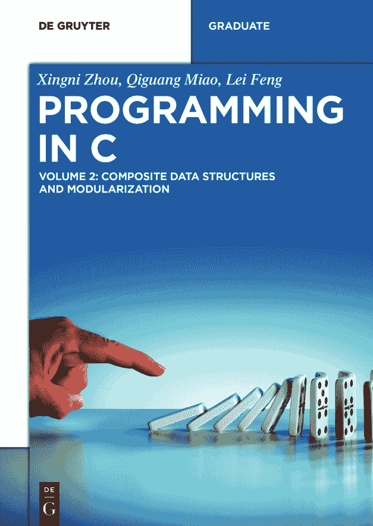


（注：此处原文逻辑与前文类似，翻译保持结构一致）

为了计算总和，我们需要通过引用结构体成员来获取分数数据。

## 2. 通过名称引用

假设有若干位学生，我们将使用以下结构体来存储学生管理表：

（注：此处原文逻辑与前文类似，翻译保持结构一致）

为了计算总和，我们需要通过引用结构体成员来获取分数数据。

## 3.8 示例 3.8：打印学生表格

在本章的引言部分，Brown 先生要求学生们在屏幕上打印表格。

### 分析

#### 1. 数据结构设计

我们在第 3.2 节中学习了如何存储表格。具体来说，我们将为学生管理表使用以下结构体：

```c
struct student
{
    int  id;
    char name[10];
    char gender;
    int time;
    int  score[4];
    int  total;
};
```

为了计算总和，我们需要通过引用结构体成员来获取分数数据。

#### 2. 通过名称引用

假设有若干位学生，我们将使用以下结构体来存储学生管理表：

为了计算总和，我们需要通过引用结构体成员来获取分数数据。

## 3.9 示例 3.9：投票计数器

在选举中有三位候选人，如图 3.31 所示。请编写一个程序来统计每个候选人的票数。使用键盘输入模拟计数过程。每位投票者必须从三位候选人中选择一个。假设总共有 `N` 票。

### 分析

#### 1. 数据结构设计

投票统计中有两种类型的数据，因此最好使用结构体来存储它们。该结构体应包含两个成员：候选人姓名和票数。

```c
struct person vote[3] = {"Zhang", 0, "Tong", 0, "Wang", 0};
```

#### 2. 投票统计表设计

有三位候选人，因此我们使用一个大小为 3 的数组。每个元素都用候选人姓名和 0 票初始化。

#### 3. 算法设计和代码实现

（见图 3.32）

```c
// 投票计数
#include <stdio.h>
#include <string.h>
#define N 50                      // 选票数

struct person
{
    char name[20];                // 候选人姓名
    int sum;                      // 总票数
};

int main(void)
{
    struct person vote[3] =
        {"Zhang", 0, "Tong", 0, "Wang", 0};
    int i, j;
    char in_name[20];

    for (i = 0; i < N; i++)       // N 票
    {
        scanf("%s", in_name);     // 输入候选人姓名

        for (j = 0; j < 3; j++)   // 给对应的 sum 加 1
        {
            if (strcmp(in_name, vote[j].name) == 0)
            {
                vote[j].sum++;
            }
        }
    }

    for (i = 0; i < 3; i++)       // 输出结果
    {
        printf("%s,%d\n", vote[i].name, vote[i].sum);
    }

    return 0;
}
```

# 程序阅读练习：寻找年龄最大的人

以下程序使用结构体来存储多个人的姓名和年龄，以找到年龄最大的人并输出结果：

```c
#define N 4
#include "stdio.h"

static struct man
{
    char name[8];
    int age;
} person[N] = {"li", 18, "wang", 19, "zhang", 20, "sun", 22};

int main(void)
{
    struct man *q, *p;
    int i, m = 0;

    p = person;

    for (i = 0; i < N; i++)
    {
        if (m < p->age)
            q = p++;

        m = q->age;
    }

    printf("%s,%d", (*q).name, (*q).age);
    return 0;
}
```

## 3.4 用体（Union）

### 3.4.1 引言

Brown 先生所在的大学有一个实验室。该实验室供所有相关研究小组的成员使用。在使用之前应该预约实验室。然而，不同小组的研究人员不能共同使用实验室。我们可以如下列出有权使用实验室的研究小组和人员：

```text
公共实验室
{
    研究小组 1：人员 1；
    研究小组 2：人员 2；
    …
    研究小组 n：人员 n；
}
```

为了节省内存空间，计算机也使用了这种内存共享策略。我们可以将无法同时访问的变量存储在一个内存单元中。这种数据结构被称为“用体”（union）。当我们有多个变量且每次只使用其中一个时，可以使用用体将它们存储在同一个内存单元中。

### 3.4.2 用体的内存布局

与结构体类似，类型定义、变量定义和成员访问也是用体的关键问题。

#### 3.4.2.1 用体类型定义

图 3.33 阐述了用体类型定义的语法。

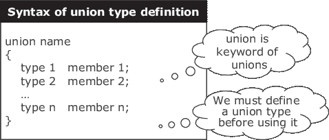

图 3.33：用体类型定义的语法。

与结构体类型定义类似，用体类型定义仅声明类型。在此阶段不分配内存空间。

#### 3.4.2.2 用体变量定义

图 3.34 显示了定义用体变量的语法，这与结构体变量相似。

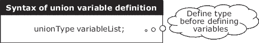

图 3.34：定义用体变量的语法。

#### 3.4.2.3 用体成员引用

图 3.35 显示了如何引用用体成员。我们在结构体中也见过类似的语法。

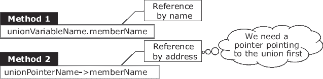

图 3.35：引用用体成员的语法。

**示例 3.10：用体成员的内存布局**

假设我们有一个如图 3.36 所示的用体。与结构体成员不同，`x`、`ch` 和 `y` 具有相同的地址。分配的内存长度由尺寸最大的成员决定。

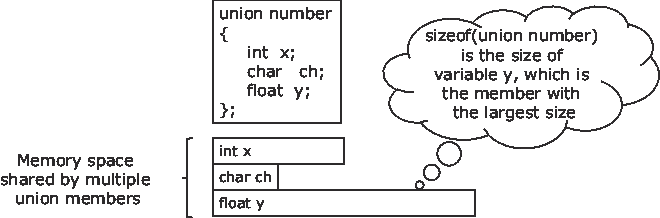

图 3.36：用体成员共享地址。

#### 3.4.2.4 用体与结构体的比较

用体和结构体有许多共同特征。图 3.37 展示了这两种数据结构的比较。


图 3.37：用体与结构体的比较。

**示例 3.11：使用用体的简单程序**

请在调试器中检查用体的内存布局。

1. **测试程序**

以下测试程序定义了一个用体并按照定义顺序对其成员赋值。运行程序后，可以检查内存布局。

```c
#define N 4
#include "stdio.h"

static struct man
{
    char name[8];
    int age;
} person[N] = {"li", 18, "wang", 19, "zhang", 20, "sun", 22};

int main(void)
{
    struct man *q, *p;
    int i, m = 0;

    p = person;

    for (i = 0; i < N; i++)
    {
        if (m < p->age)
            q = p++;

        m = q->age;
    }

    printf("%s,%d", (*q).name, (*q).age);
    return 0;
}
```

2. **调试**

图 3.38 显示成员都存储在相同的地址[图 3.39]。特别是，它显示了将 `a` 赋值给 `ch` 之后的内存布局。


图 3.38：用体数据。

图 3.40 显示 `ch` 的值为 `0x61`，这是 `a` 的 ASCII 码。


图 3.39：用体的检查。

3. **显示格式**

根据 IEEE754 标准，如果存储为 32 位浮点数，`float` 变量的值为 `0x40000000`。这就是 `y` 显示为 `2` 的原因。


图 3.40：实数的存储格式。

### 用体的操作

假设我们有来自多个老师的数据，如图 3.42 所示。数据包括他们的 ID、姓名、职称、教授的课程数量（如果是讲师）或发表的论文数量（如果是教授）。请编写一个程序打印这些数据并计算论文的总数。

```c
// 用体的操作
#include <stdio.h>
#define N 5                       // 老师人数

union work
{
    char course[10];              // 课程名
    int num;                       // 课程或论文数量
};

struct teachers
{
    int number;                   // ID
    char name[8];                 // 姓名
    char position;                // 职称
    union work x;                 // 课程或论文数量
} teach[N];

int main(void)
{
    struct teachers teach[N] =
    {
        {1, "Zhao", 'L', "program"},
        {2, "Qian", 'P', 3},
        {3, "Sun", 'P', 5},
        {4, "Li", 'L', "English"},
        {5, "Zhou", 'P', 4}
    };

    int sum = 0;

    for (int i = 0; i < N; i++)
    {
        printf(" %3d %5s %c ",
               teach[i].number,
               teach[i].name,
               teach[i].position);

        if (teach[i].position == 'L')
        {
            printf("%s\n", teach[i].x.course);
        }
        else if (teach[i].position == 'P')
        {
            printf("%d\n", teach[i].x.num);
            sum = sum + teach[i].x.num;
        }
    }

    printf("paper total is %d\n", sum);
    return 0;
}
```

```text
1  Zhao L program
2  Qian P 3
3  Sun P 5
4  Li L English
5  Zhou P 4
paper total is 12
```

## 3.5 枚举

### 3.5.1 引言

当 Daniel 开始学习水彩画时，他被不同颜色混合成新颜色的过程震惊了。他不断向 Brown 先生提问，例如“红色和蓝色混合的结果是什么？”或“如果我混合黄色和红色会怎样？”这让 Brown 先生精疲力竭。因此，Brown 先生决定写一个程序，根据他儿子的输入来回答这些问题。

图 3.43 显示了三种原色中混合两种颜色的结果。

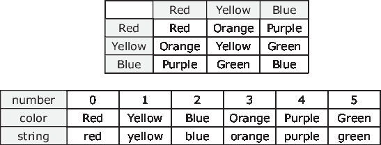

图 3.43：调色器。

在编写代码之前，Brown 先生需要设计一种数据结构。他在图 3.43 中使用了指针数组来存储颜色名称：

`char *ColorName[] = {"red", "yellow", "blue", "orange", "purple", "green"};`

图 3.43 中的二维数组应该用数组 `ColorName` 中颜色的索引来初始化，而不是实际名称字符串，因为索引占用的内存更少且更容易处理。

```c
int ColorTab[3][3] = {{0, 3, 4}, {3, 1, 5}, {4, 5, 2}};
```

在初始化过程中，Brown 先生发现很难记住颜色对应的数字。如果颜色更多，将它们记住并正确初始化数组将变得更加困难。这是因为颜色的名称比抽象的数字更直观。为了解决这个问题，Brown 先生尝试为每种颜色定义宏，这样他就可以直接在程序中使用这些直观的名称。

```c
int ColorTab[3][3] =
{
    {red, orange, purple},
    {orange, yellow, green},
    {purple, green, blue}
};
```

完整的程序如下：


```c
01 #include "string.h"
02 #include "stdio.h"
03 #define red 0
04 #define yellow 1
05 #define blue 2
06 #define orange 3
07 #define purple 4
08 #define green 5
09
10 // 定义调色器
11 int ColorTab[3][3] = {
12     {red, orange, purple},
13     {orange, yellow, green},
14     {purple, green, blue}
15 };
16
17 int main(void)
18 {
19     char color1[8]; // 读取输入 1
20     char color2[8]; // 读取输入 2
21     char *ColorName[] = {
22         "red", "yellow", "blue", "orange", "purple", "green"
23     };
24     int i = 0, j = 0;
25
26     printf("请输入任意两种红色、黄色或蓝色：\n");
27     gets(color1);
28     gets(color2);
29     while (0 != strcmp(color1, ColorName[i]))
30         i++;
31     // 查找第一个输入的索引 i
32     while (0 != strcmp(color2, ColorName[j]))
33         j++;
34     // 查找第二个输入的索引 j
35     // 在调色器中使用 i 和 j 查找混合结果
36     printf("%s+%s=%s\n", ColorName[i], ColorName[j], ColorName[ColorTab[i][j]]);
37
38     return 0;
39 }
```

然而，Brown 先生需要为三种原色的混合结果定义 6 个宏。如果有更多基础颜色，为每种可能的结果定义宏将非常繁琐。

我们经常在程序中使用数字表示状态，但正如我们在颜色示例中所看到的，数字没有状态名称那么直观，也不易读。如果我们能在程序中使用具有意义的单词来表示状态，那么它们将更容易被阅读和理解。

### 3.5.2 枚举的概念和语法

事实上，C 和其他一些语言确实提供了一种使用自然语言单词表示变量可能值的方法。这种方法就是枚举（`enum`）。

在 C 语言中，枚举是由标识符表示的整数常量集合。枚举变量的值必须是该集合的成员。值得注意的是，如果给枚举变量赋值了超出枚举范围的值，系统不会报错。

枚举的语法与结构体（`struct`）和联合体（`union`）相似，如图 3.44 所示。

> 注意：这是因为增加可能会破坏第一条规则。在这个示例中，`Weekday` 被赋值为枚举成员的最后一个值，因此增加将使该值无效。

## 3.6 类型定义

### 3.6.1 引言

#### 3.6.1.1 音乐文件的移植

丹尼尔收到了一个音乐播放器作为生日礼物，他花了大量时间用它听音乐。一天，他问父亲：“这些歌曲存储在计算机里，它们是如何‘放进’这个小盒子的呢？”“哈哈，这是一个很好的问题，”布朗先生回答道。

我们现在可以在各种设备上播放音乐，但音乐文件是如何存储在它们中的呢？我们知道数据以二进制形式存储在计算机中，音乐文件也是如此。`WAV`（波形音频文件格式）是 PC 上常用的多媒体音频文件格式之一。它是一种用于存储音频波形的数字音频格式，由微软和 IBM 设计。它于 1991 年首次引入 Windows 3.1 中。经过多次修订，它可以用于许多操作系统，包括 Windows、Macintosh 和 Linux。

一个 `WAV` 文件有一个文件头，其中包含文件的元信息，随后是实际的音乐数据。图 3.45 显示了头中的元信息，它由多个数据条目组成。每个条目的大小是固定的，不会随平台而改变。

我们之前提到过，基本类型的大小取决于平台。因此，程序员在将代码移植到其他平台时需要非常小心。当在不同 `int` 类型大小的平台上使用代码处理 `WAV` 文件时，我们必须修改每个整数定义，以确保头中数据条目的长度与标准一致。这使得代码移植变得困难。

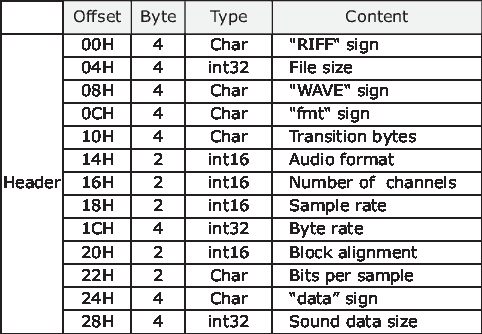

图 3.45：`WAV` 文件头的格式。

在这种情况下，如果我们将 32 位和 16 位的 `int` 类型重命名为 `UIN32` 和 `UIN16`，我们就可以将 `WAV` 文件头定义如下结构。在移植代码时，只需将 `UIN32` 和 `UIN16` 替换为目标平台的对应类型即可：

```c
struct tagWaveFormat
{
    char cRiffFlag[4];
    UIN32 nFileLen;
    char cWaveFlag[4];
    char cFmtFlag[4];
    char cTransition[4];
    UIN16 nFormatTag;
    UIN16 nChannels;
    UIN16 nSamplesPerSec;
    UIN32 nAvgBytesperSec;
    UIN16 nBlockAlign;
    UIN16 nBitNumPerSample;
    char cDataFlag[4];
    UIN16 nAudioLength;
};
```

可以使用宏完成替换。

#### 3.6.1.2 宏不够用的情况

让我们来看一个特殊情况。我们本想通过以下代码的前两行将 `a` 和 `b` 定义为整数指针。然而，事实 `b` 并不是指针，如第 3 行所示。这是由于宏替换的规则：

```c
01 #define PTR int*
02 PTR a, b;
03 int *a, b;
```

在语法上，第 2 行类似于变量定义。人们可能会想象，如果 `PTR` 是等同于 `int*` 的数据类型，那么这个问题就可以解决。因此，我们需要一种在 C 中定义类型别名的方法。

#### 3.6.1.3 为类型定义别名

C 中定义别名的关键字是 `typedef`（type + define）。我们可以使用 `typedef` 重写前面提到的那两行：

```c
01 typedef (int *) PTR
02 PTR a, b;
03 int *a, *b;
```

使用 `typedef` 的目的是解决宏引起的问题并使代码更具可读性。在实践中，`typedef` 经常出现在类型大小至关重要的网络代码和驱动程序中。为了适应不同的编译器，我们最好定义并使用自己的类型。因此，在将代码移植到新平台时，只需更新几个头文件即可。`typedef` 可以隐藏复杂的结构或依赖平台的数据类型，使程序更容易移植和维护。

下一节将介绍 `typedef` 的语法和应用。

### 3.6.2 typedef 的语法和应用

图 3.46 显示了如何使用 `typedef` 定义新类型。从本质上说，`typedef` 为现有数据类型创建别名。


图 3.46：`typedef` 的语法。

除了创建直观易记的别名外，`typedef` 的另一个用例是简化复杂的类型声明。图 3.47 显示了头中的元信息，它由多个数据条目组成。

（注：原文后续部分存在重复和混乱，此处已根据提供的逻辑进行清理处理。）

```c
struct sT
{
    int x;
    struct sT *y;
} *p;

struct sT a[4] = {
    {20, a + 1},
    {15, a + 2},
    {30, a + 3},
    {17, a}
};

int main(void)
{
    int i;
    p = a;

    for (i = 1; i <= 2; i++) {
        printf("%d,", p->x);
        p = p->y;
    }

    return 0;
}
```

上述程序的输出结果是（）

A) 20,30,

B) 30,17

C) 15,30,

D) 20,15,

### 3. [数组元素：使用变量引用]

下列程序的输出是（）

```c
struct abc
{
    int a, b, c;
};

struct abc sum[2] = {
    {1, 2, 3},
    {4, 5, 6}
};

int t;
t = sum[0].a + sum[1].b;
printf("%d \n", t);
```

A) 5  
B) 6  
C) 7  
D) 8

### 4. [数组元素：引用内部元素]

```c
typedef struct
{
    char name[10];
    int age;
} ST;

ST stud[10] = {
    "Adum", 15,
    "Muty", 16,
    "Paul", 17,
    "Johu", 14
};
```

以下哪一个不是字符 “u”？（）

A) `stud[3].name[3]`

B) `stud[2].name[2]`

C) `stud[1].name[1]`

D) `stud[0].name[3]`

### 5. [typedef]

下列哪个说法是错误的？（）

A) 我们可以使用 `typedef` 创建新类型。

B) 我们可以使用 `typedef` 为现有类型创建一个新名称。

C) 在使用 `typedef` 定义新类型名后，原始类型名称仍然有效。

D) 我们可以使用 `typedef` 为现有类型定义别名，但我们不能为变量定义别名。

### 6. [联合体]

字符 “0” 的十进制 ASCII 值为 48。假设数组的第 0 个元素存储在低字节，且 `sizeof(int)` 为 4 字节。以下程序的输出是什么？（）

```c
union
{
    int i[2];
    long k;
    char c[4];
} var, *s = &var;

s->i[0] = 0x39;
s->i[1] = 0x38;

printf("%c\n", s->c[0]);
```

A) 39

B) 9

C) 38

D) 8

## 3.8.2 填表

### 1. [结构体成员的操作]

假设我们有如下结构定义。在执行以下程序后，确定图 3.51 中所示结构体成员的值：

```c
#include <stdio.h>

#define N 5
#define M 4

struct person
{
    int Id;
    char Name[10];
    int Score[M]; // 分数
    int total;    // 总分
};

int main(void)
{
    struct person allone[N] = {
        {1, "mark", {9, 6, 8, 7}, 0},
        {2, "bob", {8, 6, 8, 5}, 0},
        {3, "alice", {5, 9, 7, 8}, 0},
        {4, "william", {8, 9, 9, 9}, 0},
        {5, "eric", {8, 9, 6, 9}, 0}
    };

    struct person temp;
    int i, j;

    for (i = 0; i < N; i++) // ①
    {
        allone[i].total = 0;

        for (j = 0; j < M; j++)
        {
            allone[i].total += allone[i].Score[j];
        }
    }

    for (i = 1; i < N; i++) // ②
    {
        for (j = 0; j < N - i; j++)
        {
            if (allone[j].total < allone[j + 1].total)
            {
                temp = allone[j];
                allone[j + 1] = temp;
            }
        }
    }

    return 0;
}
```

## 3.8.3 编程练习

1. 假设我们有如下结构体：

```c
struct person
{
    char lastName[15];
    char firstName[15];
    char age[4];
};
```

请编写代码从键盘读取 10 个人的 `lastName`、`firstName` 和 `age`。

2. 请定义一个 `union` 来表示一维空间、二维或三维空间中的点。该 `union` 应该包含一个维度指示器和坐标。

3. 假设我们有如下的枚举：`enum day {Sunday, Monday, Friday, Saturday}`。求出以下表达式的值。

1. `today`

2. `today`

3. `today`

4. `today`

5. `today`

6. `today`

7. `today`

# 4. 函数

## 主要内容

- 为什么需要函数。
- 函数之间的关系。
- 函数的声明、定义和调用。
- 函数设计的示例。
- 调试技巧。
- 函数间的信息传递。

## 学习目标

- 理解程序中的模块化。
- 理解信息的传递机制。
- 了解递归的概念。

对于个人来说，工作量是巨大的，但对于团队来说却很小。个人要完成所有工作需要多种技能，而团队中的成员只需要一项技能即可完成分配给他的任务。如果由一个人完成工作，则不需要通信；但在团队合作中，通信具有重要意义，因为上一步的输出往往是下一步的输入。

#### 4.1.2.2 程序模块化中的协调问题

同样，程序模块化中存在哪些问题？

**思考与讨论：程序的模块化问题**

1. 使用一段代码与使用多段代码来解决问题之间有什么区别？
2. 使用多个子程序完成某项任务的关键是什么？

**讨论：** 这两种方法在工作量或复杂性上没有区别。然而，使用多个子程序需要信息传递，而这恰恰是我们正在寻找的关键。因此，编程语言必须提供这种机制。

#### 4.1.2.3 模块概念

基于上述讨论，我们可以总结出独立代码模块所必需的要素。

在编程中，我们将具有独立名称并能独立完成特定任务的语句集合称为“模块”，如图 4.6 所示。模块由实现部分和接口组成。接口创建是为了从模块外部隐藏模块的实现数据。与外部对象的通信必须通过信息接口进行。模块的接口描述了其他模块或程序应该如何使用它。输入/输出信息也是接口的一部分。

还有其他与模块相关的概念，例如模块重用和多模块结构。

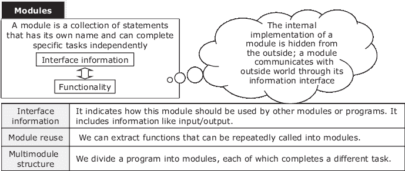

图 4.6：与模块相关的概念。

“模块”一词有很多别名，例如函数或子程序。C 语言使用“函数”来描述模块，如图 4.7 所示。我们在结构化分析和设计中使用“模块”一词；在面向对象的分析和设计中它变为“类”；在组件化开发中使用的术语是“组件”。

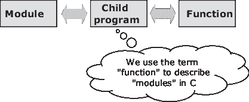

图 4.7：模块的别名。

模块化的程序设计具有以下特征：

1. 模块之间相互独立。每个模块都有自己的功能。使用模块的程序逻辑清晰，更容易编写和维护。
2. 程序更容易设计，因此缩短了开发周期。
3. 模块更具健性。
4. 程序员不再需要重复轮子。
5. 维护现有代码和编写新代码变得更容易。

## 4.2 函数形式设计

### 4.2.1 模块间的通信方法

布先生所在的大学将举行毕业典礼。主席台将由后勤部门建造。图 4.8 显示了建造过程的步骤。某些步骤可以外包给专业公司（如广告公司或景观公司），以加速进程并保证质量。

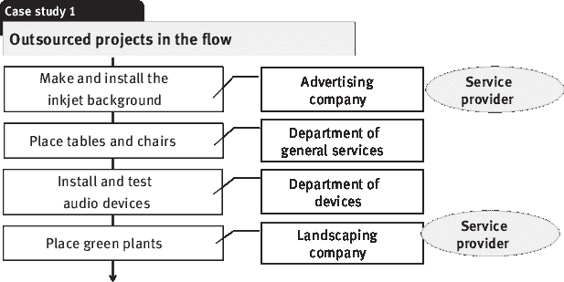

图 4.8：毕业典礼主席台的建造过程。

**思考与讨论：外包项目中的协调方法**

**讨论：** 外包项目中有两种通信方法，如图 4.9 所示。

1. 外包方在各个服务提供者之间进行协调（例如，主席台的建造过程）。
2. 服务提供者之间相互通信（例如，奖学金申请过程）。

两种方法在程序设计模式中都是可行的。如果模块按顺序执行，则程序是面向过程的；如果模块在某些事件发生前不执行，则程序是面向对象的。读者可以参考附录 B 获取更多关于此主题的细节。C 语言中的函数使用了前面提到的第一方法，即“外包方在服务提供者之间进行协调”。


图 4.9：模块间的通信方法。

### 4.2.2 函数形式设计

#### 4.2.2.1 外包结构分析

让我们以广告公司为例分析外包结构。

在“背景制作”项目中，广告公司是服务提供者，大学是外包方，如图 4.10 所示。广告公司需要对他们能做什么做出说明，这种说明可以被视为生产。换句话说，是外包方驱动了生产。

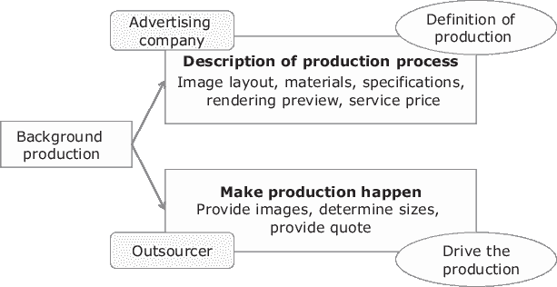

图 4.10：外包结构。

#### 4.2.2.2 外包结构的抽象

图 4.11 展示了外包结构的进一步抽象。我们可以将外包考虑为“制造”过程。制造中有三个关键要素：输入、输出和处理。输入是过程中使用的材料。输出是最终产品。处理指的是制造中的步骤。为了开始制造，用户需要提供制造商所需的材料。在程序中，这些材料就是数据。

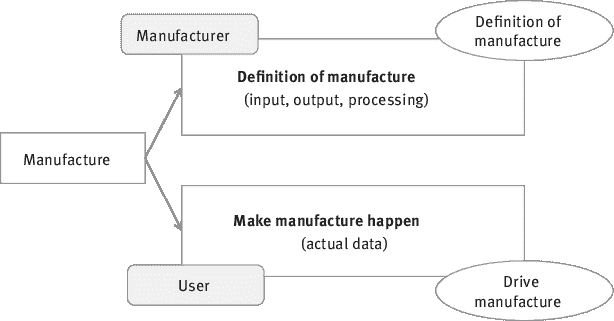

图 4.11：外包结构的抽象。

#### 4.2.2.3 函数形式设计

函数作为独立的代码段类似于外包项目，如图 4.12 所示。编写函数的过程定义了它的功能，包括输入、输出和处理。编程语言中函数的用户被称为“调用者”。调用者为函数提供实际数据，以便其完成特定任务。

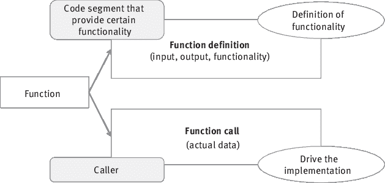

图 4.12：函数形式设计。

#### 4.2.2.4 信息传输机制设计

在实践中，我们可以通过快递或互联网将原材料交付给制造商。制造完成后，制造商可以以适合用户的方式发送产品。但在程序中，数据处理完全在计算机中完成。因此，信息传输机制需要符合计算机的特征。

图 4.13。在设计函数机制时，我们需要确定调用者如何将数据发送给函数，以及函数如何将结果传回调用者。


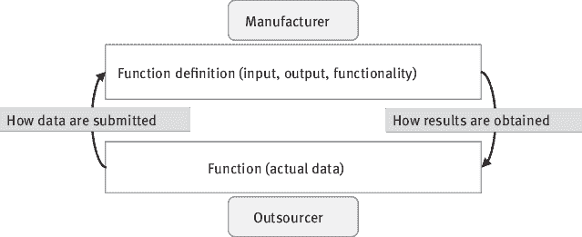

图 4.13：信息传输机制设计。

模块之间信息传输的方法之一是使用软件接口，如图 4.14 所示。对于“生产者”（即定义函数的人），他们应该考虑以下问题：接收信息的接口、代码实现以及结果提交的方式。为了描述制造项目，我们需要为它确定一个名称，即函数名。对于“外包者”（即函数调用者），他们需要考虑以下问题：提交信息的接口和接收结果的方式。

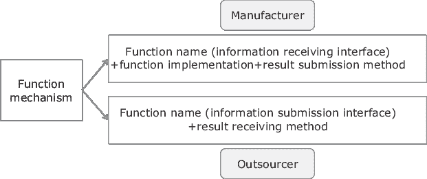

图 4.14：函数中的信息传输设计。

#### 4.2.2.5 与函数相关的三种语法

C 语言提供了三种与函数相关的语法：函数定义（“生产者”）、函数调用（“外包者”）和函数声明（或函数原型），后者简要描述了函数的情况。图 4.15 显示了这些语法。

在函数定义中，信息接口通过“参数列表”实现，实现通过大括号之间的声明和语句完成。函数结果的类型由“函数类型”决定。在函数调用中，提交信息的接口通过“参数列表”实现。C 语言提供了两种“结果提交方式”：一种是通过信息接口提交，另一种是使用 `return` 语句。函数调用语法没有显式显示调用者如何接收结果。我们将在以后详细介绍结果的提交和接收。

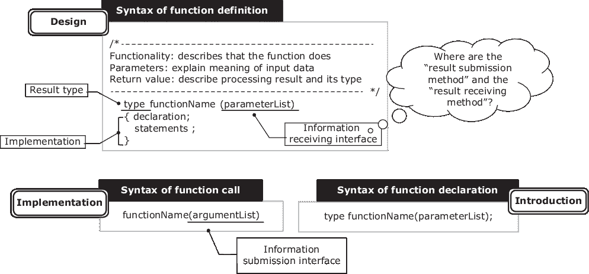

图 4.15：与函数相关的三种语法。

### 知识 ABC 函数声明及其位置

C 是一门老语言，因此其语法一直在不断修订。过去对函数声明、定义和调用的顺序以及声明的必要性限制很少。不同的编译器对这些也遵循不同的规则。然而，最新的 C 标准（如 C99 和 C11）要求函数在调用之前必须进行声明。这一要求有助于编译器发现函数调用中参数类型和数量的错误。在大多数情况下，函数声明应该写在代码开头（通常在预处理指令之后）并位于函数定义之外。与一样，新标准对函数定义和函数调用的位置没有限制。

## 4.3 函数间信息传输机制的设计

### 4.3.1 函数间信息传输的特点

#### 4.3.1.1 函数间传输数据的分类

我们在函数介绍中已经得出结论：使用多个子程序完成任务的关键在于它们之间的信息通信。编程语言应该为这种通信提供机制。

在奖学金示例中，需要协作的基础步骤包括计算总和、分类和申请替换。我们可以在三个函数中实现它们，其中涉及加法、排序、分类、搜索、删除和插入等操作。

图 4.16 列出了这些步骤所需的输入/输出信息。这些数据要么是单个数据项，要么是一组关联数据。`sum` 函数读取原始数据表并输出带有一个额外总分列的数据表。分类函数读取原始数据表和分类参数，输出每个等级的学生人数及其姓名。

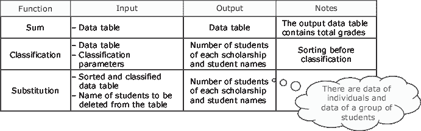

图 4.16：奖学金申请过程中关键步骤中的数据分析。

**思考与讨论** 在通过接口向函数传输数据的过程中，数据的特征是什么？它们是如何传输的？

**讨论：** 如图 4.17 所示，与数据传输相关的问题是数据类型数据大小。由于类型的本质是所用内存空间的大小，因此类型问题本质上大小问题。我们将在下文中讨论这一点。

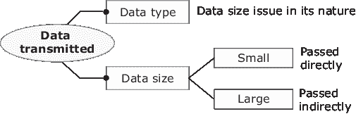

图 4.17：函数间传输信息的特点。

在现实生活中，我们可以直接或间接地向他人寄送物品。例如，邮递员可以直接将包裹寄给收件者，也可以将其放在自助快递柜中。

我们可以在函数间的信息传输中也使用这些方法。在程序中，少量数据直接传递给函数。相比之下，大量数据通常通过提供数据的起始地址间接地传递给函数，以便函数可以自行获取它们。

#### 4.3.1.2 函数间传输数据的表达

如果我们从不同的角度考虑，待处理的数据有不同的名称。从函数调用者（外包者）的角度来看，待处理的数据在 C 中被称为 `arguments`（实）；从函数定义（生产者）的角度来看，它接收的数据被称为 `parameters`（形参），如图 4.18 所示。至于最终产品如何传输，我们将在后文中介绍。

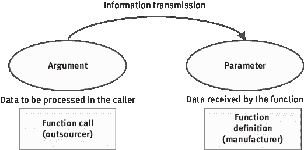

图 4.18：函数中使用的数据术语。

### 4.3.2 函数间信息传输：数据的提交与接收

正如我们之前讨论过的，C 语言根据传递给函数的大小以不同的方式处理数据。

#### 4.3.2.1 小量数据的提交

我们将从少量数据开始。

为函数调用者需要处理的实际值分配的内存空间称为 `argument space`（参数空间）。系统复制实际数据并发送到调用的函数，如图 4.19。换言之，函数接收的是实际值的副本。我们可以将此过程想象为将资产副本发送广告公司进行打印。为这些副本分配的内存空间称为 `parameter space`（形参空间）。

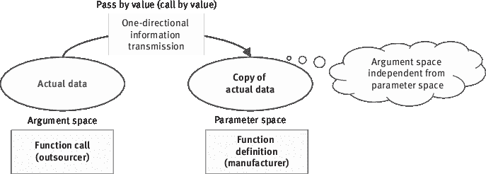

图 4.19：少量数据：直接传递。

`argument space` 独立于 `parameter space`。因此，对 `parameter space` 中数据的更新不会改变 `argument space` 中的数据。这种信息传输是单向的。因为传输的是值，我们将此称为 `pass by value`（值传递）。这种函数调用方式称为 `call by value`（值调用）。

#### 4.3.2.2 大量数据的提交

现在我们研究大量数据的情况。

如果数据很大，传递副本的代价也很大，这将影响通信效率。在这种情况下，函数调用者可以将数据的起始地址传递给“生产者”，因为大量数据通常连续存储在内存中。然后如图 4.20 所示，“生产者”随后从指定的地址获取数据。

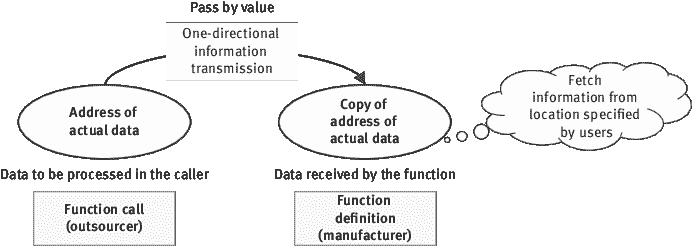

图 4.20：大量数据：提交数据的地址。

注意，传递的信息是 `address of actual data` 的副本。这类似于库服务器的数据维护：只要服务商知道 IP 地址和密码，就可以远程操作服务器。

服务提供者也可以在现场进行维护。同样，“制造商”也可以直接前往数据地址并进行处理，如图 4.21 所示。这相当于 C 语言中的“按引用传递”。函数调用者可以将数据的起始地址传给“制造商”，这样它就可以直接在地址上处理数据。

注意，在“按引用传递”中，参数空间和参数空间是相同的。

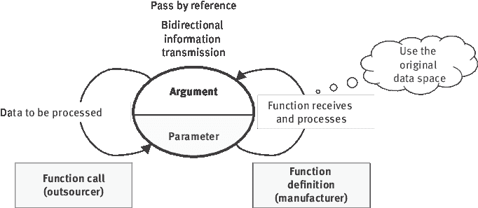

图 4.21：大量数据：在现场处理。

我们刚刚看到函数调用者可以通过值传递或引用传递将数据传递给函数。事实上，函数结果的接收方式与数据的提交方式有关。

### 4.3.3 函数结果的接收

#### 4.3.3.1 按值传递时接收函数结果

在按值传递的情况下，C 提供了两种提交结果的方法，如图 4.22 所示。第一种是使用 `return` 语句传递单个结果。第二种方法适用于地址参数。函数调用者可以在该地址找到结果。在这种情况下，可以传递多个结果。

#### 4.3.3.2 按引用传递时接收函数结果

在按引用传递的情况下，函数调用者可以在共享的数据空间中获取多个结果，如图 4.23 所示。

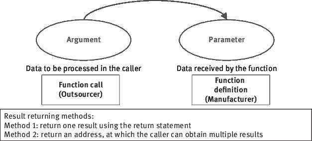

图 4.22：按值传递时的结果提交与接收。

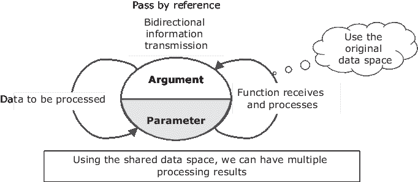

图 4.23：按引用传递时的结果提交与接收。

## 4.4 函数整体设计

### 4.4.1 函数设计的关键元素

#### 4.4.1.1 函数的关键元素

在关于函数形式设计和信息传递机制设计的讨论中，我们将函数模块比作现实中的“制造商”。图 4.24 总结了我们在比较中发现的关系。函数有三个关键元素：输入、输出和处理。

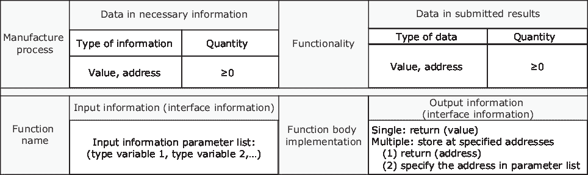

图 4.24：函数设计的关键元素。

函数名简要描述了处理过程，而函数体实现了处理过程。

函数的接收接收和结果提交是通过信息接口完成的。输入信息接口实现为参数列表。传递的信息可以是值，也可以是地址。结果可以通过两种方式输出：使用 `return` 语句或将它们放在指定的地址上供调用者访问。同样，结果可以是值也可以是地址。

#### 4.4.1.2 函数语法与函数设计关键元素之间的关系

如图 4.25 所示，输入信息决定了参数列表，而输出信息决定了函数类型。

C 语言中的函数由函数头和函数体组成。函数头描述了函数的结构，而函数体实现了它的功能。因此，函数的输入、输出和处理决定了它的结构。

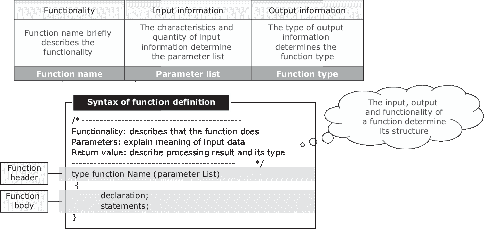

图 4.25：函数设计的关键元素及其表达式。

### 4.4.2 函数间信息传递的总结

#### 4.4.2.1 方向 1：从调用者到函数

在 C 程序中，信息通过两种方式从实参（用户数据）传递到形（制造商数据）：按值传递和按引用传递，如图 4.26 所示。在按值传递的情况下，实参和形存储在单独的空间，而在按引用传递的情况下，它们共享同一个空间。C 语言中还有另一种方法称为模拟按引用传递，通过指针传递数据。

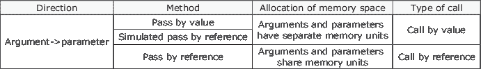

图 4.26：从调用者到函数。

#### 4.4.2.2 方向 2：从函数到调用者

图 4.27 展示了结果传递的方式。

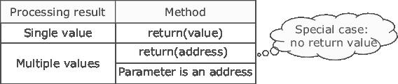

图 4.27：从函数到调用者。

### 4.4.3 函数调用

#### 4.4.3.1 函数的执行与顺序

图 4.28 列出了这些步骤。

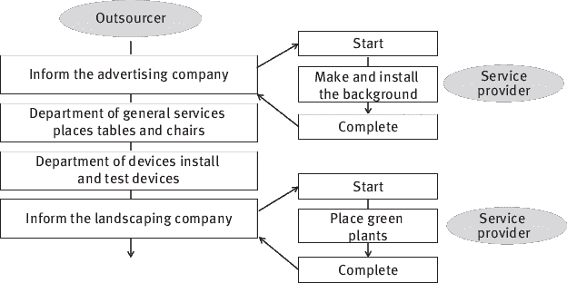

图 4.28：函数的执行顺序。

执行始终从主函数开始。当调用子函数时，程序进入子函数，并在子函数结束后返回。[图 4.29] 说明了整个过程。

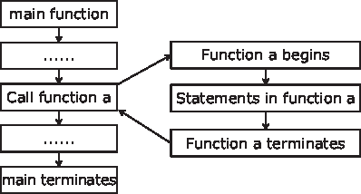

图 4.29：函数的执行顺序。

#### 4.4.3.2 函数的嵌套调用

期中考试后，布老师想知道最高分、最低分以及两者之间的差值，因此他让班长 A 计算这些值。

A 完成任务并向他汇报了结果。然后布老师问：“如果我们用程序模拟这个过程并要求你实现子函数，你该怎么做？”

A 回答道：“很简单，写两个函数。`max` 函数计算最高分，`min` 函数计算最低分。主函数通过调用它们获取最高最低分，然后计算差值。”

布老师微笑问：“这是一个完整的模拟吗？”A 思考了一会儿回答道：“不，我应该再写一个计算差值的函数。把这个函数命名为 `dif` [[图 4.30]。我们学习过嵌套 if 和嵌套循环，可以称这为‘嵌套函数调用’吗？”“当然，”布老师表扬道，“我们在 C 语言中确实使用这个术语。”

在 C 程序中，一个函数可以调用另一个函数，而被调用的函数可以进一步调用其他函数，产生嵌套函数调用。我们可以通过任意层级的嵌套调用完成复杂的任务。

所有的 C 程序都是由函数构建的，每个函数都是独立定义的。也就是说，不能在一个函数的定义中定义另一个函数。

待接收的信息定义在函数定义的的参数列表中。在调用此函数时，需要将要处理的数据放入实参列表中。参数列表包含变量的定义，而实参列表包含变量的引用，如图 4.31 所示。

使用函数时，应始终使用正确的语法。初学者常犯的错误之一是使用了错误的参数。带有此类错误的程序无法编译。此外，他们往往很难发现这些错误。

1. **参数列表**：在函数定义中，参数的定义列在参数列表中。
2. **实参列表**：在函数调用中，参数的引用在实参列表中；对于数组，我们直接在实参列表中使用数组名。

#### 4.4.3.4 函数调用的语法

根据是否存在计算结果，C 语言中的函数可以分为返回值函数和非返回值函数。返回值函数具有计算结果，并使用其类型作为函数类型；非返回值函数处理数据时没有显式的计算结果。例如，排序函数对数据进行排序但不计算结果。

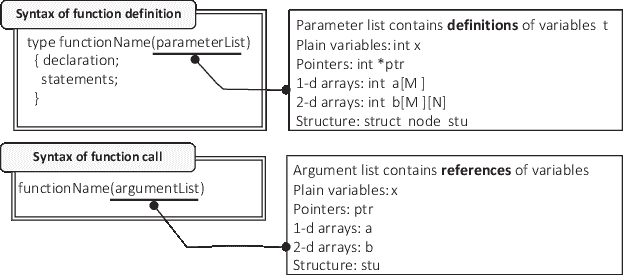

图 4.31：参数与参数的对应关系。

需要一个变量来存储返回值函数返回的结果，而非返回值函数不需要。图 4.32 显示了调用两种函数的语法。

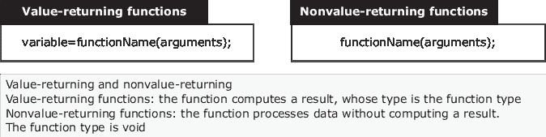

图 4.32：函数调用的语法。

## 4.5 函数设计示例

在之前的章节中，我们已经介绍了函数的概念、函数之间的信息传递机制以及函数设计的关键要素。现在我们将学习一些函数设计的示例。

### 4.5.1 按值调用

**示例 4.1** 找出三个数中的最大值

#### 1. 函数结构设计

在函数结构设计中，我们从问题描述中提取输入、输出和处理过程。这个示例要求我们使用函数 `max` 求最大值。该函数的输入是三个整数，这决定了参数列表。函数的输出是计算出的最大值，是一个整数，因此函数类型也应为 `int`。图 4.33 总结了函数的关键要素。

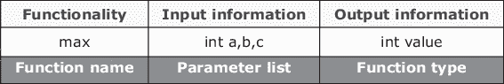

图 4.33：函数 `max` 的关键要素。

#### 2. 使用 `main` 函数与使用子函数的比较

我们将在 `main` 函数和子函数分别实现寻找最大值的代码，然后对这些实现进行比较，如图 4.34 所示。`main` 函数中 `a`、`b` 和 `c` 的值从键盘输入，而在子函数中，它们通过接口（即参数列表）获取。`main` 函数中找到的最大值直接显示在屏幕上，而子函数的结果则通过 `return` 语句返回给调用者。

通过比较，我们可以得出：尽管两种实现在输入和输出上不同，但用于寻找最大值的语句是完全相同的。

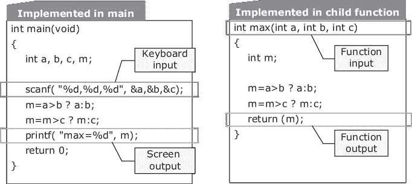

图 4.34：`max` 函数的不同实现。

#### 3. 调用子函数

必须调用子函数才能完成其功能。调用者可以是 `main` 函数或其他子函数。图 4.35 显示了使用子函数寻找最大值的程序。注意子函数是如何声明、定义和调用的，以及这三个构造在程序中出现的顺序。与变量类似，函数在被调用之前必须声明或定义。

第 2 行声明了子函数 `max`。该行也称为函数 `max` 的头。

`max` 的定义位于第 6 行和第 12 行之间。

第 16 行在 `main` 函数中从键盘读取了三个输入。

第 17 行调用了 `max` 函数。因为 `max` 是返回值函数，结果存储在整数变量 `x` 中。

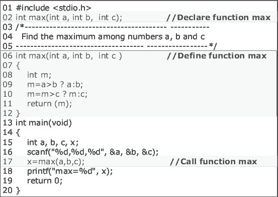

图 4.35：`max` 与 `main` 的关系。

### 4.5.1.4 调试

我们可以研究子函数是如何调用的。在调试之前，我们需要确定想要检查的内容。图 4.36。

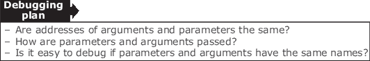

图 4.36：最大值的调试计划。

显然，参数 `a`、`b` 和 `c` 的地址与参数 `a`、`b` 和 `c` 的地址不同。这表明它们存储在不同的空间中。虽然程序中的参数和参数名称相同，但它们存储在不同的地址。在调试时使用相同的名称很容易困扰程序员，因此建议使用不同的名称。


图 4.38：使用相同名称寻找最大值的调试过程。

我们将参数重命名为 `d`、`e` 和 `f`，并重复调试过程。

#### 5. 调试新的实现

图 4.39 显示了程序首次进入 `main` 函数和 `max` 函数时使用的参数值。读者可能注意到变量 `d`、`e` 和 `f` 的值：

```
CXX0069: Error: variable needs stack frame
```

此错误的发生是因为没有为这些变量分配栈内存空间。请参阅“程序执行”章节了解栈的概念。


图 4.39：寻找最大值的调试过程 1。

**知识 ABC** 栈帧

栈帧也称为“激活记录”。它是编译器用于实现函数调用的数据结构。逻辑上，栈帧是执行函数时的环境。它包含了与函数调用相关的所有数据：参数、局部变量、返回地址、需要恢复的寄存器值副本等。在调用函数时，栈帧被推入栈中；在函数终止后，栈帧从栈中弹出。

如果我们从 `main` 函数中向下步进，`main` 函数中的变量将获得内存空间和地址，如图 4.40 所示。此时，它们的值仍然是随机数。子函数 `max` 中的变量值此时为“未找到”。这是由于模块的屏蔽机制，它防止了函数访问其他函数内部的数据。

图 4.41 显示了执行 `scanf` 之后和调用 `max` 之前的状态。现在 `d`、`e` 和 `f` 的值分别为 2、3 和 6。`x` 的值仍然是一个随机数。

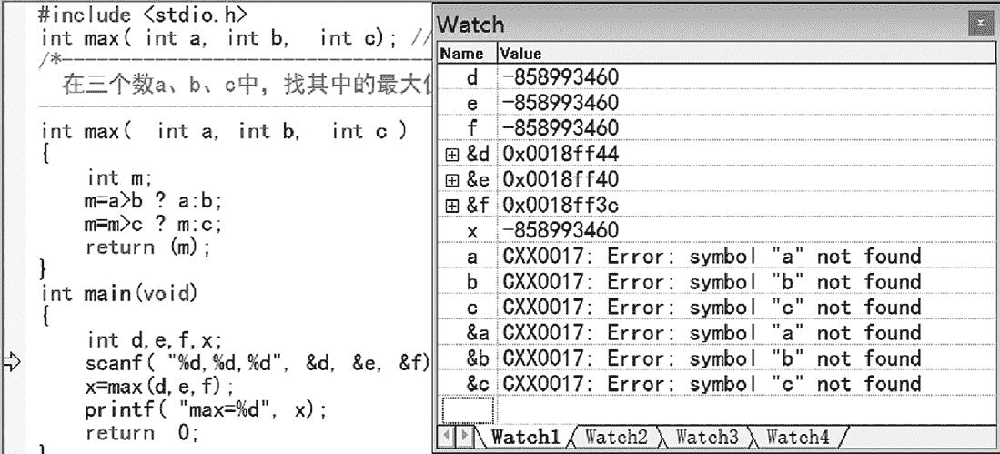

图 4.40：寻找最大值的调试过程 2。

通过按下 `F11`，我们步入子函数 `max`。如图 4.42 所示，`main` 函数中的变量现在变得不可见，而 `max` 中的变量变得可见。我们可以看到参数 `a`、`b` 和 `c` 已经获得了参数 `d`、`e` 和 `f` 的值，但它们的地址与 `d`、`e` 和 `f` 的地址不同。此时 `m` 的值是一个随机数。

在 `max` 函数结束后，结果 `6` 被存储在 `m` 中，如图 4.43 所示。

程序随后跳出 `max` 并返回 `main`，如图 4.44 所示。我们可以看到 `x` 的值已经变成了 `6`。

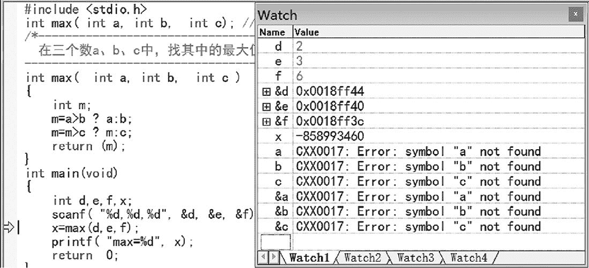

图 4.41：寻找最大值的调试过程 3。

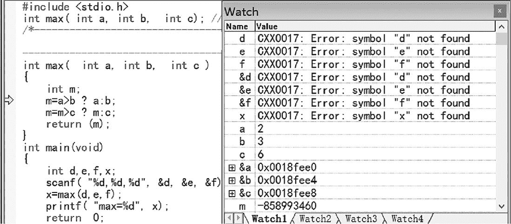

图 4.42：寻找最大值的调试过程 4。

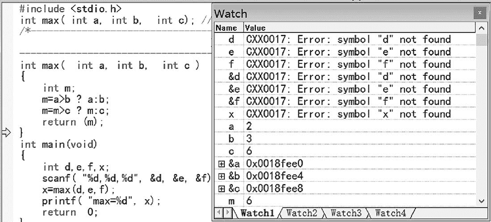

图 4.43：寻找最大值的调试过程 5。

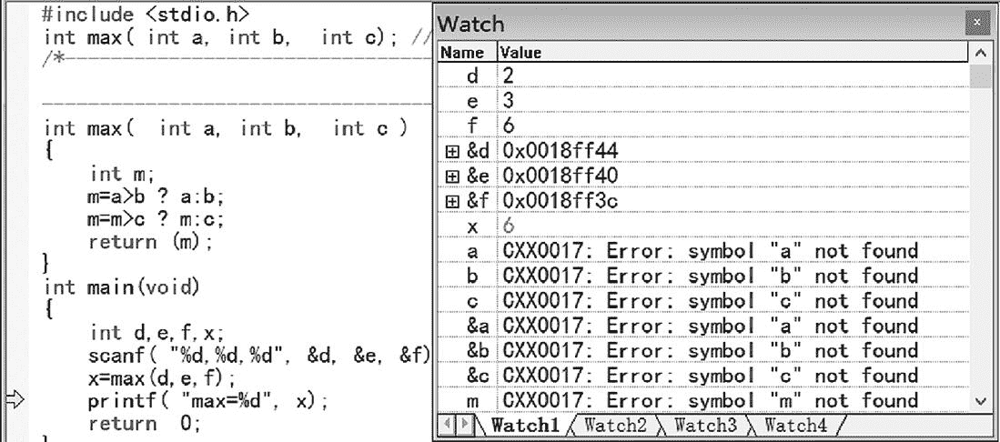

图 4.44：寻找最大值的调试过程 6。

### 示例 4.2 结构体变量作为参数

#### 1. 问题描述

使用调试器分析将结构体变量作为参数传递时的特征。

#### 2. 代码实现


```c
#include <stdio.h>
struct student
{
   int num;
   float grade;
};
struct student func1(struct student stu) // 结构体变量作为参数
{
   stu.num=101;
   stu.grade=86;
   return (stu); // 返回结构体变量
}
int main(void)
{
   struct student x={0, 0};
   struct student y;
   y = func1(x); // 结构体变量 as 参数
   return 0;
}
```

#### 3. 调试

在图 4.45 中，注意结构体参数 `x` 的地址为 `0x12ff78`。

在图 4.46 中，注意参数 `stu` 的地址为 `0x12ff14`，与 `x` 的地址不同。结论是，参数的值被复制到了参数中。

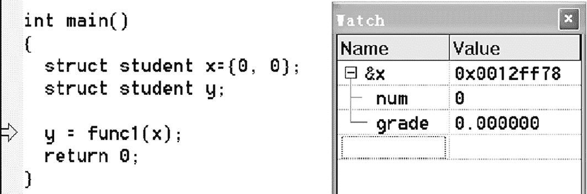

图 4.45：结构体变量作为参数的调试步骤 1。

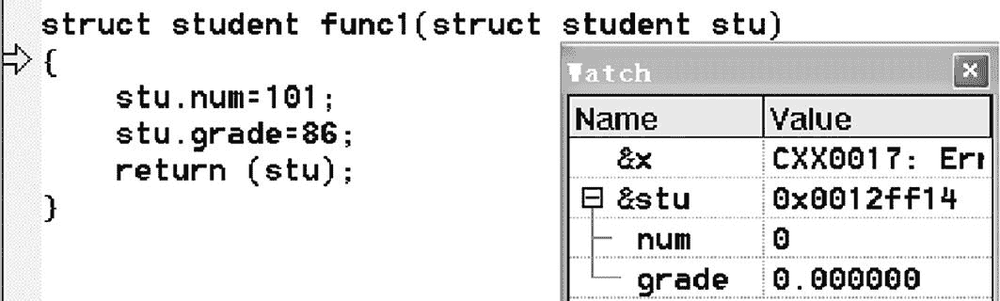

图 4.46：结构体变量作为参数的调试步骤 2。

在图 4.47 中，子函数 `func1` 中结构体 `stu` 的成员被修改了。

在图 4.48 中，`main` 函数中的结构体 `y` 用于存储 `func1` 返回的结构体变量。

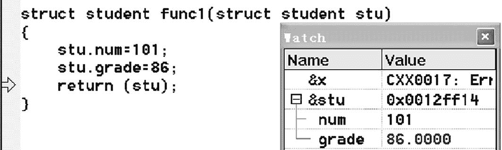

图 4.47：结构体变量作为参数的调试步骤 3。

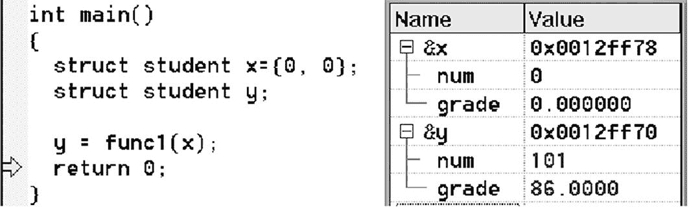

图 4.48：结构体变量作为参数的调试步骤 4。注意：`x`、`y` 和 `stu` 有不同的地址。`x` 的值未修改。

#### 关于值传递的结论

1. 参数分开存储。
2. 在函数调用期间，参数的值被复制到参数。
3. 子函数使用参数。参数的更新不会影响参数。从本质上说，值传递将参数复制到参数。因此，子函数中的参数更新不会影响调用函数的变量。

## 4.5.2 引用传递

### 示例 4.3 计算数组和

计算整数数组 `score` 中索引 `m` 到 `n` 之间的元素和。请参见图 4.49 示意图。`main` 函数读取 `m` 和 `n` 的值并输出结果。和应由子函数 `func` 完成。

#### 分析

在这个问题中，参数有多种传递方式。我们将使用三种参数传递方式来实现程序。

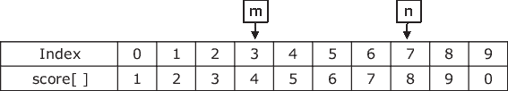

图 4.49：计算数组的和。

### 方案 1

#### 1. 函数设计

图 4.50 分析了子函数的输入和输出。

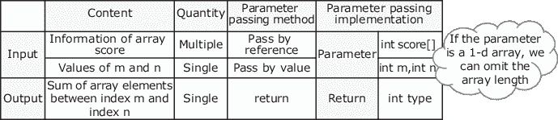

图 4.50：方案 1 的关键元素。输入需要数组 `score` 的信息以及索引 `m` 和 `n` 的值。`score` 有多个元素。`m` 和 `n` 都是单一变量。因此，我们将通过地址传递 `score`，并通过值传递 `m` 和 `n`。输出是索引 `m` 到 `n` 之间的元素和。因为是一个单一值，我们可以使用 `return` 语句返回。返回类型为 `int`。

#### 2. 函数实现设计

根据关键元素，我们可以写函数头。作为函数体，我们可以使用 `for` 循环将索引 `m` 到 `n` 之间的元素相加到变量 `sum` 中，并使用 `return` 语句返回和，如图 4.51 所示。

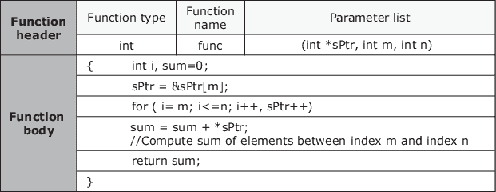

图 4.51：方案 1 的函数设计。

#### 3. 代码实现

代码实现在图 4.52。在第 5 行到第 15 行之间是子函数，其余部分是 `main` 函数。

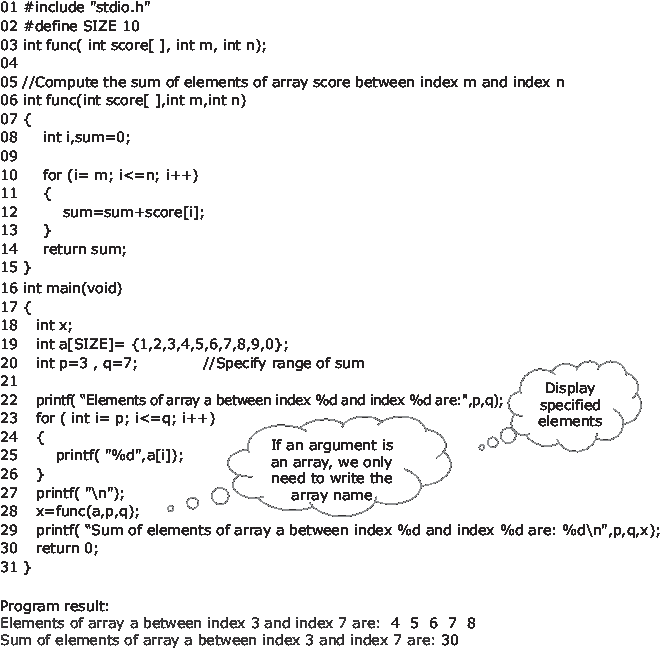

图 4.52：方案 1 的代码实现。第 22–27 行打印指定范围内元素的值，以便稍后调试。在第 28 行，用参数 `array a` 和索引 `p`、`q` 调用函数 `func`。注意我们在参数列表中是如何使用数组名的。

#### 4. 调试

在调试之前，我们应该列出想要调查的问题，包括与地址传递相关以及我们想要检查的变量。图 4.53 显示了这些变量在调试器监视（Watch）窗口和内存（Memory）窗口中的值。在调试期间，可以使用表格来记录变量的值以便进一步分析。

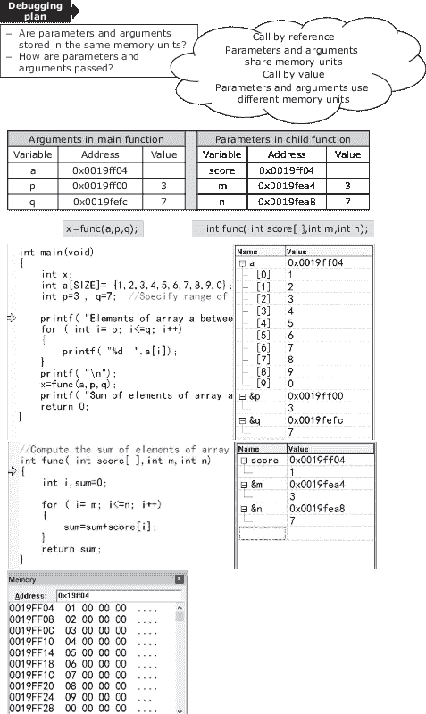

图 4.53：方案 1 的代码调试。

### 方案 2

#### 1. 函数设计

子函数的计算结果也可以通过共享地址访问，如图 4.54 所示。在这种情况下，函数类型为 `void`，结果存储在数组 `score` 的指定位置。


图 4.54：方案 2 的关键元素分析。

#### 2. 函数实现设计

在设计完方案 2 的函数结构后，我们可以写出函数头。如图 4.55 所示，函数体使用 `for` 循环计算总和并将 `sum` 存储在数组 `score` 的指定位置。


图 4.55：方案 2 的函数设计。

#### 3. 代码实现

图 4.56 展示了方案 2 的代码实现。


图 4.56：方案 2 的代码实现。

子函数在第 4 行和第 16 行之间声明并定义。注意函数类型为 `void`，如第 28 行所示，因此这是一个无返回值的函数调用。

主函数与方案 1 相同，不同之处在于函数调用略有不同。

#### 4. 调试

按照惯例，我们需要在调试前列出待调查的问题。在本方案中，我们应该关注与引用传递相关的问题，如图 4.57 所示。在调用子函数 `func` 之前，`main` 函数中数组 `a` 的最后一个元素的值应为 0，调用后应为 30。图 4.58 展示了程序的调试信息。


图 4.57：方案 2 的调试计划。


图 4.58：方案 2 的调试代码实现。

### 方案 3

#### 1. 函数结构设计

图 4.59 展示了第三种方案。与方案 1 相比，唯一的区别是使用指针将 `score` 的起始地址传递给子函数。这是“按引用传递”的另一种形式：使用指针作为参数。

#### 2. 函数实现设计

图 4.60 展示了方案 3 的实现。参数使用指针 `sPtr` 来存储数组 `score` 的地址。在函数体第 2 行，我们将 `sPtr` 指向我们想要访问的元素地址，即索引为 `m` 的元素地址。然后我们使用 `for` 循环计算总和。注意我们通过指针 `sPtr` 引用 `score` 的元素。最后，使用 `return` 语句返回 `sum`。


图 4.59：方案 3 的关键元素分析。


图 4.60：方案 3 的函数实现设计。

#### 3. 代码实现

```c
 01  #include "stdio.h"
02  #define SIZE 10
03  int func( int *sPtr,int m,int n);
04
05  int func( int *sPtr, int m, int n)
06  {
07     int i,sum =0;
08
09     sPtr = &sPtr[m]; //Point sPtr to address of element to be accessed
10     for ( i= m; i<=n; i++, sPtr++)
11     {
12         sum = sum + *sPtr;
13     }
14     return sum;
15  }
16  int main(void）
17  {
18     int x;
19     int a[SIZE] = {1,2,3,4,5,6,7,8,9,0};
20     int *aPtr = a;
21     int p=3,  q=7; //Specify the range
22     x=func(aPtr,p,q);
23     printf( "%d\n",x);
24     return 0;
25  }
```

#### 4. 调试

按照惯例，我们列出与引用传递相关以及我们想要检查的变量，如图 4.61 所示。`aPtr` 和参数 `sPtr` 具有相同的值，该值应该是数组 `a` 的地址。


图 4.61：方案 3 的调试计划。

图 4.62 展示了调试的调试过程。在 `main` 函数中，数组 `a` 的地址为 `0x...`，`aPtr` 指向此处。通过 `&` 运算符获取 `a` 的地址为 `0x...`。在观察窗口中可以看到 `sPtr` 为 `0x...`。


图 4.62：方案 3 的调试。

在子函数 `func` 中，`sPtr` 的地址为 `0x...`，与数组 `a` 的值相同。在图 4.63 所示的观察窗口中，`sPtr` 的地址为 `0x...`。这与引用传递是致的。


图 4.63：方案 3 的调试。

我们继续调试直到 `sPtr` 指向索引为 3 的元素，如图 4.64 所示。此时 `sPtr` 的值为 `0x...`。通过 `*` 运算符可以获取其值 `4`。`for` 循环将 `sPtr` 更新为 `0x...`。


图 4.64：方案 3 的调试。

在下一次迭代中，`sPtr` 指向 `0x...`，如图 4.65 所示。此时 `sPtr` 的值为 `5`。


图 4.65：方案 3 的调试。

当 `i` 的值变为 8 时，循环终止，如图 4.66 所示。此时 `sPtr` 指向 `0x...`。函数 `func` 然后结束并返回 `main` 函数。计算结果 `30` 现在存入 `x`。注意 `a` 的地址没有变化，但 `sPtr` 发生了变化。


图 4.66：方案 3 的调试。

## 关于引用传递和值传递的结论

图 4.67 总结了调用类型及其特征。在 C 程序中，当传递数字时，参数和参数存储在不同的内存中。传递数组时，它们共享空间。

使用引用传递的优点是在传输过程中复制的数据较少，效率更高。


图 4.67：变量传递总结。

### 4.5.3 函数综合示例

### 示例 4.4 多次调用同一个函数

请编写一个程序计算从 $n$ 个元素中选取 $k$ 个元素的组合数。

#### 分析

如图 4.68 所示，公式需要计算多个阶乘。因此，我们可以写一个计算阶乘的函数并重复用它。


图 4.68：组合数公式。

#### 函数结构设计

函数的关键元素如图 4.69 所示。函数名为 `factorial`。给定一个整数 `x`，函数输出 `x` 的阶乘。如果输入无效，函数应返回 -1。

我们可以根据这些关键元素写出函数头，并根据其功能编写函数体。需要一个异常处理例程，以便当 `x<0` 时函数返回 `-1`。在 `for` 循环中计算的累积积存储在变量 `f` 中。

虽然有两个返回值，但函数必须通过一个且仅一个出口终止，如流程图（图 4.70）所示。


图 4.70：阶角的结构和函数体设计。

#### 1. 代码实现

如图 4.71 所示，`main` 函数在一个表达式中多次调用 `factorial`。


图 4.71：阶乘函数的多次调用。

### 示例 4.5 调用多个函数

有一个有序数组。请编写一个程序，将一个输入数字插入数组中，使得结果数组仍然是有序的。

要求：使用二分查找找到插入位置，然后使用 `move` 函数将元素向后移动。有序数组和输入在 `main` 函数中给出。

#### 1. 算法设计

无论是否使用二分查找函数查找关键字，`mid` 值将是插入新数字的位置索引。找到此索引后，我们可以使用 `move` 函数将数组元素向后移动，并将数字插入到位置 `mid`。

#### 2. 代码实现

```c
 /*===============================================
功能: 二分查找
输入: 数组地址、数组长度、要查找的关键字值
输出: 最后搜索的位置
===============================================*/
int BinarySearch  (int a[], int n, int key)
{
  int low=0, high=n-1;
  int mid;
  while (low<=high)
  {
    mid = (low+high+1)/2;
    if (a[mid]== key) break; //搜索成功
    else
    {
      if (a[mid]> key)  high = mid-1; // 在低范围搜索
      else low = mid+1; // 在高范围搜索
    }
  }
  return mid;
}
/*===============================================
功能: 移动数组元素
输入: 数组地址、数组长度、从开始移动的位置
输出: 无
===============================================*/
void move(int a[],int n,int subscript)
{
  int i;
  for(i=n;i>subscript;i--)
  {
    a[i]=a[i-1];
  }
}
#include <stdio.h>
#define N 11
int main(void)
{
  int array[N]={5,10,19,21,31,37,42,48,50,55};
  int number;          //要插入的数字
  int insert_sub; //插入位置
  printf("The original array:\n");
  for(i=0;i<N;i++) printf("%d ",array[i]);
  printf("\n");
  printf("Please insert a new number:");
  scanf("%d",&number);
  insert_sub=BinarySearch (array,N-1,number); //计算插入位置
  move(array,N-1,insert_sub+1); //将插入位置之后的元素后移
  array[insert_sub+1]=number; //插入数字
  printf("The array after insertion:\n");
  for(i=0;i<N;i++) printf("%d ",array[i]);
  printf("\n");
  return 0;
}
```

### 示例 4.6 嵌套函数调用

计算三个数的最大值和最小值之间的差。

#### 分析

尽管这个问题非常简单，但我们将使用三个函数来顺序解决它，以演示嵌套函数调用。代码实现如下：

```c
 int dif(int x,int y,int z);    //计算 x, y, z 的最大值与
                               // 最小值之间的差
int max(int x,int y,int z);    //计算 x, y, z 的最大值
int min(int x,int y,int z);   //计算 x, y, z 的最小值
int main(void)
{
  int a,b,c,d;
  scanf("%d%d%d",&a,&b,&c);
  d=dif(a,b,c);
  printf("Max-Min=%d\n",d);
  return 0;
}
int dif(int x,int y,int z) //计算 x, y, z 的最大值与
                               // 最小值之间的差
{
  return (max(x,y,z) - min(x,y,z));
}
int max(int x,int y,int z) //计算 x, y, z 的最大值
{
  int r;
  r=x>y ? x:y;
  return(r);
}
int min(int x,int y,int z) //计算 x, y, z 的最小值
{
  int r;
  // (为了简洁省略了逻辑)
}
```

### 示例 4.7 二维数组作为参数

找到三个学生在四门课程中的最高成绩。

#### 分析

##### 1. 数据结构

我们将使用二维数组 `studentGrades[人数][课程数]` 来存储所有成绩。

##### 2. 函数设计

根据问题描述，如图 4.72 所示，可以总结函数的元素。


学生成绩的处理函数。

## 1. 代码实现

在子函数中处理二维数组

```c
#include <stdio.h>
#define STUDENTS 3
#define EXAMS 4
int maximum( const int grades[ ], int pupils, int tests );
int main(void)
{
   int studentGrades[STUDENTS][EXAMS]
   = {77, 68, 86, 73 },
   {96, 87, 89, 78 },
   {70, 90, 86, 81 }
   };
   printf( "Highest grade: %d\n",maximum(studentGrades,STUDENTS,EXAMS));
   return 0;
}
int maximum(const int grades[ ], int pupils, int tests )
{
   int i;    学生计数
   int j;    课程计数
   int highGrade = 0; // 初始化最低分
   for ( i = 0; i < pupils; i++ // 遍历行
      for ( j = 0; j < tests; j++ // 遍历列
         if ( grades[i][j] > highGrade )
         {
            highGrade = grades[i][j];
         }
      }
   }
   return highGrade; // 返回最高分
```

## 示例 4.8 结构数组作为参数

编写一个函数`output()`输出五个学生的记录。

### 分析

#### 1. 算法设计

学生记录存储在结构数组`stu[]`中，通过`main`函数将其地址传递给子函数`output()`。

#### 2. 代码实现

```c
#include <stdio.h>
#define N 5
struct student
{
  int num;
  char name[8];
  int score[4];
};
void output(struct student stu[])
{
  int i,j;
  printf("\nNo. Name   Sco1  Sco2  Sco3\n"); // 打印表头
  for (i=0; i<N; i++)
  {
    printf("%-6d%-6s",stu[i].num,stu[i].name); // 打印 ID 和姓名
    for (j=0; j<3; j++) printf("%-6d",stu[i].score[j]); // 打印成绩
    printf("\n");
  }
}
int main(void)
{
  struct student stu[N]=
  {
    {1001,"zhao",98,78,86,76},
    {1002,"qian",92,68,76,67},
    {1003,"sun",78,65,81,72},
    {1004,"li",91,73,85,74},
    {1005,"zhou",90,73,85,71},
  };
  output(stu);
  return 0;
}
```

## 示例 4.9 指针作为返回值

### 分析

#### 1. 代码实现

```c
#include <stdio.h>
struct student
{
  int  num;
  float grade;
};
struct student* func2(struct student stu)
{
   struct student *str=&stu;
   str->num=101;
   str->grade=86;
   return (str); // 返回结构指针
}
int main(void)
{
   struct student x={0, 0};
   struct student *stuPtr;
   stuPtr = func2(x);
   return 0;
}
```

#### 2. 调试

进一步显示了该程序的调试过程。在图 4.73 中，参数`x`的地址是`0x12ff78`。


图 4.73：指针作为返回值的程序调试步骤 1。

在图 4.74 中，参数`stu`的地址是`0x12ff20`。


图 4.74：指针作为返回值的程序调试步骤 2。

在图 4.75 中，结构`stu`的成员值被更新。


图 4.75：指针作为返回值的程序调试步骤 3。

在图 4.76 中，`main`函数中的`stuPtr`用于存储局部变量`str`的值。局部变量是定义在函数内部的变量。


图 4.76：指针作为返回值的程序调试步骤 4。

注意：不建议返回局部变量的地址。因为系统在函数返回后会回收局部变量的内存空间，因此与局部变量的信息不再保证是正确的。

## 示例 4.10 作为返回值的空指针

请定义一个动态数组来存储`n`个学生的成绩，并计算平均分。学生人数和成绩从键盘输入读取。

### 分析

#### 1. 背景知识

在“数组”章节中介绍的数组定义方法是静态分配内存。换句话说，在程序执行期间，数组的大小及其存储地址不会改变。假设我们想在程序执行期间向数组插入新数据，但分配的数组空间已满。是否有扩展数组空间的方法？C 语言中有一种称为“动态内存分配”的内存分配方法：如果程序执行期间需要额外的存储空间，它可以“请求”特定大小的内存空间。当程序不再需要该空间时，可以将其返回系统。相关的库函数包括`malloc()`、`calloc()`、`free()`和`realloc()`。使用这些函数必须包含头文件`stdlib.h`或`malloc.h`。

#### 2. 内存分配函数`malloc()`

原型：`void *malloc(unsigned size);`

功能：分配一个大小为`size`字节的内存块。

参数：`size`是一个无符号整数，表示请求的内存空间的大小。

返回值：返回新分配内存的地址。如果没有可用内存，应返回`NULL`。

注意：

1. 当`size`为 0 时，返回`NULL`。

2. `void*`是一种无类型指针，可以指向任何类型的内存单元。在经过强制类型转换后，无类型指针可以赋值给其他类型的指针。

#### 3. 内存释放函数`free()`

原型：`void free(void *block);`

功能：释放使用`calloc()`、`malloc()`和`realloc()`分配的内存空间。参数：`block`是一个指向要回收内存的`void`指针。返回值：没有返回值。用法：`void free(void *p);`上述语句释放了由`p`指向的动态内存空间中的内存，该内存是`malloc()`返回的值。`free`函数没有返回值。

#### 4. 代码实现

```c
#include <stdio.h>
#include <malloc.h>

int *DefineArray(int n);   /*定义大小为 n 的动态数组*/
void FreeArray(int *p);    /*释放 p 指向的内存*/
int main()
{
  int *p, i;
  int nCount;    /*人数*/
  float fSum=0;    /*总分*/
  /*输入人数*/
  printf("\nPlease input the count of students: ");
  scanf("%d",& nCount);
  /*定义动态数组 p*/
  p= DefineArray(nCount);
  if (p==NULL) return 1;    /*异常处理*/
  /*输入每个学生的成绩*/
  printf("Please input the scores of students: ");
  for( i=0; i< nCount; i++ )
  {
    scanf("%d", &p[i]);
  }
  /*计算总分*/
  for(i=0;i< nCount;i++)
  {
    fSum+=p[i];
  }
  /*打印平均分*/
  printf("\nAverage score of the students: %.1f",fSum/nCount);
  /*释放动态数组*/
  FreeArray(p);
  return 0;
}

int *DefineArray(int n)
{
  /*动态请求大小为 n*sizeof(int)的内存空间，用于 int 数组*/
  return (int *) malloc( n*sizeof(int) );
}

void FreeArray(int *p)
{
/*释放 malloc 分配的内存*/
  free(p);
}
```

程序结果：

```
Please input the count of students: 5
Please input the scores of students: 87 97 77 68 98
Average score of the students: 85.4
```

注意：函数`DefineArray`的输入参数`n`是数组中的元素个数。该函数使用`malloc`分配所需的内存。

### 内存泄漏

应用程序通常使用`malloc`或`realloc`从堆中获取内存块。当不再需要内存时，必须调用`free`释放这些内存块；否则它们无法再次使用。在这种情况下，我们认为这些内存被“泄漏”。

内存泄漏通过减少可用内存来影响计算机性能。在现代操作系统中，应用程序使用的标准内会在终止时被释放。也就是说，寿命短的程序很少发生泄漏。

更严重的泄漏包括：

1. 程序运行时间长且随时间增加内存消耗，例如服务器上的后台任务，特别是长时间运行的嵌入式设备；

2. 频繁为一次任务分配新内存，例如渲染游戏帧或动画视频；

3. 程序请求的内存（如共享内存）即使在程序终止时也不释放；

4. 发生在操作系统内部；

5. 设备驱动程序导致泄漏；

6. 内存有限，例如嵌入式系统或便携式设备；

7. 在不自动释放内存的操作系统（如 AmigaOS）上运行，必须重启系统回收内存。

### 程序练习

阅读并分析程序，然后填充表格。

```c
#include "stdio.h"
#include "string.h"
void i_s(char in[], char out[]);
void i_s( char in[], char out[])
{
  int i, j;
  int l=strlen( in);
  for(i=j=0;  i<l;  i++, j++)
  {
    out[j]= in[i]; //步骤 1
    out[++j] = '__'; //步骤 2
    in[i] += 1; //步骤 3
  }
  out[j-1]= '\0';
}
int main(void )
{
  char s[] = "1234";
  char g[20];
  i_s( s,  g );
  printf("%s\n", g);
  return 0;
}
```

学习了函数间信息传递的规则后，读者可以尝试自己分析这个程序。图 4.77 列出了每个步骤的中间结果。

我们之前提到过，布朗先生为他的儿子丹尼尔写了一个算术题程序。该程序可以生成随机算术题并判断丹尼尔的答案是否正确。丹尼尔在上面花费了大量时间并乐在其中，所以布朗先生想把程序推荐给住在另一个城市的侄女安妮。布朗先生知道安妮的父母不擅长安装程序，所以他只通过邮件发送了一个`.exe`文件。该可执行文件不需要 C 编译环境，因此安妮可以直接从文件资源管理器运行该程序。然而，当他测试可执行文件时，他发现程序启动后控制台窗口弹出来，然后在他等得及看到结果之前就迅速消失了。

“我该怎么办？”布朗先生心想。他想起了以前在图形用户界面发明之前使用的一种方法。在那个时代，DOS 是主导性的操作系统。在 DOS 中，所有命令都是通过键盘输入发送给计算机的，包括应用程序的执行。命令输入的界面全是黑色的。我们在 VC6.0 IDE 中执行程序后显示结果的弹出窗口正是控制台。控制台也被称为命令行界面，用户在命令行环境中为应用程序输入命令。程序结果也显示在命令行界面中。

然而，图形用户界面现在已经是事实上的标准。是否有办法可以回到“控制台”呢？Windows 系统确实保留了这个功能。我们可以通过在 Windows 运行窗口中输入`cmd`来进入命令行界面，如图 4.78.

图 4.78：Windows 中的“运行”。

### 4.5.4.2 main 函数的参数

我们已经见过以下这种不带参数的`main`函数形式：

```c
 int main( void ) 
{ 
  … 
  return 0; 
}
```

`main`函数的返回类型是`int`，这与程序末尾的返回语句保持一致。`0`是`main`函数的返回值。那么，它返回到了哪里呢？在`main`函数终止后，返回值会被发送回操作系统，表示程序正常终止。

我们可以在普通函数中使用参数，但在`main`函数中也可以这样做吗？如果一个函数有参数，那么在调用它时必须传递参数。然而，没有函数可以向`main`函数传递参数，因为它不能被任何函数调用。因此，参数必须从外部提供。我们如何做到这一点？

一个 C 程序在编译和链接后会变成扩展名为`.exe`的可执行文件。可执行文件可以在操作系统直接执行。换句话说，是系统在运行该文件。由于其他函数无法调用或向`main`函数传递参数，必须由系统来完成。在 C 程序中，我们可以通过在命令行界面中输入参数为`main`函数传递参数。

让我们来看带参数的`main`函数的语法：

```c
 int main(int argc, char *argv[])
{
  …
  return 0;
}
```

命令行参数也被称为位置参数。它们可以传递给程序。`argc`（参数计数）的值等于位置参数的总数（包括程序名）。`argv`（参数值）是一个指针数组，其中程序名存储在`argv[0]`中，第`i`个位置参数存储在`argv[i]`中，直到`argv[argc-1]`。通过这种方式，我们可以在不使用输入语句的情况下将命令行传递到 C 程序中。

### 4.5.4.3 带参数的 main 函数示例

**示例 4.11** 使用命令行输入计算矩形面积

**分析**

代码实现见图 4.79。

在第 13 行，`sscanf`函数也是一个输入函数，与`scanf`类似。我们已经学习过`scanf`使用键盘输入（`stdin`）。另一方面，`sscanf`使用固定字符串作为输入。读者可以参考第一卷附录 C 了解更多关于输入函数的信息。`sscanf`从字符串按照指定的格式读取数据。在这里，它从`argv[1]`读取数据并将其放入变量`w`中。


图 4.79：带参数的 main 函数示例。

在第 11 行，`exit()`是一个库函数，其头文件为`stdlib.h`或`windows.h`。它关闭所有文件并终止当前进程。在`exit(x)`语句中，`x`的值代表退出状态并返回给操作系统。如果`x`为`0`，则程序正常退出；否则，异常退出。

图 4.80

#### exit() 和 return 的区别

根据 ANSI C，它们在第一次调用`main()`时是等价的。

注意我们使用了“第一次调用”这个术语。如果`main()`位于递归程序中，那么`exit()`仍然会终止程序；另一方面，`return`语句返回到上一层递归。只有在递归的最顶层，`return`语句才会终止程序。

#### main 函数的格式

在最新的 C99 标准中，只有以下两种`main()`定义是正确的（参见 ISO/IEC 9899:1999 (E) 5.1.2 程序启动）：

```c
 int main( void ) // 不带参数
{
  …
  return 0;
} 
int main( int argc, char *argv[] ) // 带参数
{ 
  … 
  return 0;
}
```

`int`表示`main()`的返回类型。传递给函数的信息通常写在函数名后的括号内。`void`表示不向`main()`传递参数。然而，我们在遗留 C 代码中经常发现以下`main()`的形式：

(1) `main()`

这在 C90 标准中是被允许的，但在 C99 不允许。因此，即使在你的编译器中它是有效的也不要这样写。

(2) `void main()`

这在某些编译器中是有效的，但没有标准认为接受它。C++ 的创始人比雅纳·斯特鲁斯特普在其网站的 FAQ 部分中明确表示：`void main()`在 C++ 或 C 中从未存在过。因此，编译器可能会拒绝这种代码。事实上，它在许多编译器中都是无效的。

当用程序解决实际问题时，随着问题的复杂性增加，程序的规模也会随之增大。这在程序实践中导致了许多问题。为了应对这些问题，我们引入了模块化的概念。具体来说，我们在`C`语言中引入了函数。图 4.81 显示了一些与函数相关的问题，这些问题我们在之前的章节中见过。


图 4.81：与函数设计相关的问题。

### 4.6.1 引言

#### 4.6.1.1 团队合作中的协作问题

Brown 先生的研究小组获得了一个新项目的资金。为了提高效率，该项目被分为多个模块，每个模块分配给小组中的一名老师或学生。

然而，他们意识到在开始编写代码之前，有一些协作问题需要解决。


一名学生说：“在我以前写过的小程序中，子函数和`main function`都在同一个文件中。但在团队合作的情况下，这样做会很不方便！我认为我们应该为每个模块使用独立的文件。”另一名学生说：“我倾向于使用`i`、`j`和`k`作为循环控制变量。如果 Brown 教授也使用它们，我还能使用吗？我们应该在定义变量之前互相讨论吗？”

一位老师思考了一会儿回答道：“从整体工作流的角度来看，我们应该自己创建程序文件，但如果没有`main function`，程序无法运行。然而从程序执行的角度来看，我们正在写一个大程序，它应该包含一个`main function`。我们应该如何做呢？”

Brown 先生总结了大家的问题，如图 4.82](#9783110692297_007959.xhtml_b_9783110692303-004_fig_082)所示。然后他说：“为了回答这些问题，我们需要在编程语言中引入新规则。你们能想象团队协作的最佳机制是什么吗？我认为我们应该在不同的文件中工作。不同文件中的变量可以有相同的名称。一个程序应该只有一个`main function`。”大家都点了点头。


图 4.82：大规模程序中的问题。

他进一步问道：“在这种情况下，需要什么样的程序执行机制才能使我刚才说的话成为可能？”我想我们可以为变量附加作用域和生命周期，使它们在文件或函数中是隔离的。这可以防止它们乱搞，”另一位老师回答道。大家都同意他的观点。

正如他们想象的那样，`C`语言的规则是：一个`C`程序可以由多个文件组成，每个文件可以有多个函数，如图 4.83](#9783110692297_007959.xhtml_b_9783110692303-004_fig_083)所示。不同文件中的变量可以有相同的名称。一个`C`程序必须有且仅有一个`main function`。


图 4.83：C 程序的结构。

#### 4.6.1.2 流程中的外包项目

在讲台楼流程中，某些工作被外包了。每个服务提供者可以被视为完成特定任务的子函数。与一个服务提供者相关的信息（材料、尺寸或价格）不需要也不应该暴露给其他服务提供者。这就是信息的作用域。这种作用域策略也用于程序的模块化。

#### 4.6.1.3 资源共享问题

Brown 先生所在的大学拥有如礼堂、图书馆、食堂和医务室等设施。还有提供特定服务的职部门。根据政府和大学的政策，礼堂和图书馆向公众开放。机构和个人可以按照某些流程使用它们。另一方面，食堂和医务室仅供学生和大学员工使用。根据可用性，资源可以分为内部资源共享资源。

代码也是资源。如果一个程序由多个源文件组成，程序设计人员应该根据要解决问题的性质，确定某个函数是否可以被其他文件中的函数调用。换句话说，“可用性”属性对于函数也是必要的。根据可用性，`C`语言中的函数可以分为内部函数和外部函数。

从大学图书馆借书，个人应该出示大学证。这些证在其他设施（如食堂和医务室）中也是需要的。但在许多情况下，某个设施中使用的 ID 数据仅该设施的管理部门可用。部门之间很少共享数据。总而言之，某些数据对所有部门可用，而某些数据仅限于某些部门。

将一个部门想象成一个函数。那么函数处理的信息有两种类型。所有函数都可用的数据称为全局数据，而只在函数内部可用的数据称为局部数据。

### 4.6.2 隐藏机制

回顾模块化的思想：目标是从外部隐藏内部实现和数据。为了设计这种机制，我们应该从哪里开始？

#### 4.6.2.1 隔离

通过隐藏内部数据，我们防止它们被其他函数访问。问题如图 4.84](#9783110692297_007959.xhtml_b_9783110692303-004_fig_084)所示。


图 4.84：与隐藏相关的问题。

#### 4.6.2.2 隐藏

根据“可用性”，`C`语言中的函数分为两类：内部函数和外部函数。它们通过特殊符号标识，如图 4.85](#9783110692297_007959.xhtml_b_9783110692303-004_fig_085)所示。


图 4.85：函数的共享机制。

### 4.6.3 内存段和存储类

在实践中，我们通过对数据分类来隔离数据，并根据数据的可用性对其进行不同的管理。我们在计算机中使用相同的策略来管理数据和代码。图 4.85](#9783110692297_007959.xhtml_b_9783110692303-004_fig_085)显示了`C`程序的内存布局。代码段包含函数的二进制代码；常量段包含字符串字面量和其他常量；动态段用于存储函数的内部数据，即局部变量。静态段存储函数间共享的数据，即全局变量。


图 4.86：内存布局。

#### 4.6.3.2 变量的存储类

为了区分存储不同段中的变量，`C`为它们附加了另一个属性，即存储类。它还指示了变量在内存中的生命周期（图 4.86](#9783110692297_007959.xhtml_b_9783110692303-004_fig_086)）和在程序中的作用域，如图 4.87](#9783110692297_007959.xhtml_b_9783110692303-004_fig_087)所示。


图 4.87：变量的存储类。

寄存器是 CPU 内部的快速存储位置。它们提供了访问数据的快速方式，甚至超过了 RAM。然而，寄存器的大小是有限的。现在的程序员很少亲自使用`register`类，因为编译器会处理它。`Register`类通常用于被频繁访问的变量，例如循环变量。

在函数中定义的变量默认属于`auto`类，除非另有指定。`auto`变量的值在函数终止时消失。从本质上讲，这是因为系统需要回收`auto`变量的存储单元。`static`变量的值在函数结束后仍会被保留。换句话说，系统不会回收其内存单元。因此，当函数再次被调用时，该值仍然可用。

### 4.6.4 机制：变量的生命周期和作用域

#### 4.6.4.1 作用域概念

在多模块结构中，每个子函数拥有不需要其他子函数访问的内部数据。在 C 语言中，程序中变量的可见性被称为“作用域”。图 4.88 显示了作用域的定义及其规则。


4 4.88: 规则。

#### 4.6.4.2 变量的属性

由于在某些情况下需要向其他函数隐藏信息，我们需要为作为信息载体的变量添加属性。因此，变量的属性包括`data type`和`storage class`。`data type`描述变量的大小。`storage class`表示变量在内存中的生命周期及其作用域。图 4.89 显示了变量声明的完整语法，它在`data type`之前添加了“storage class”。


4 4.89: 属性与声明。

#### 示例 4.12 局部静态变量的使用

在图 4.90 中，我们可以看到子函数`var()`中存在`auto`类局部变量和`static`类局部变量。多次调用`var()`后，我们可以根据执行结果得出以下结论：`auto`类局部变量的值在函数返回后消失，而`static`类局部变量的值在函数返回后被保留。


4 4.90: 属性与声明语法。

#### 4.6.4.3 局部变量与全局变量

根据定义的位置，变量分为局部变量和全局变量。图 4.91 显示了它们的定义。变量和函数前面可以添加关键字`extern`，表示它们的定义位于其他文件中。编译器在看到`extern`时会在其他模块中查找定义。

#### 示例 4.13 计算平均分

在比赛中，选手的得分是`N`个评分截截平均值。舍弃最高分和最低分，然后剩余部分的平均值作为选手的最终得分。


4 4.91: 局部变量与全局变量。

#### 分析

1. 数据结构设计

将分数存储在数组`data[N]`中。由于我们在所有处理步骤中都需要访问，可以将其设为全局变量。为了方便测试，我们可以在程序中使用初始值对其进行初始化，如图 4.92 所示。


4 4.92: 平均分：数据结构设计。

2. 算法设计

根据问题描述，我们可以使用图 4.93 所示的算法来解决问题。


4 4.93: 平均分：算法设计。

3. 函数结构设计

由于分数数组`data`是全局的，也就是说可以被所有函数访问，因此我们的函数不需要通过参数读取数据或返回更新后的数据，如图 4.94 所示。


4 4.94: 平均分：函数设计。

4. 代码实现

图 4.95 展示了每个子函数的实现。这些函数中定义的局部变量的存储类被省略了，因此它们默认是`auto`。为了舍弃`data`中的最低分，我们将`Least`初始化为`data`的第一个元素，并与其他元素与`Least`进行比较，直到找到最低分。找到最低分后，将其更新为`0`。我们可以舍弃最高分。最后，我们将所有分数相加并除以人数以获得平均分。


4 4.95: 平均分：代码实现。

在图 4.98 中，我们可以看到`main`函数中`a`和`b`的地址分别为`0x12ff7c`和`0x12ff78`。


图 4.98：重名局部变量调试步骤 1。

在图 4.99 中，程序刚刚进入子函数。`a`和`b`的地址变成了`CXX0069`错误：变量需要栈帧。该错误的发生是因为我们没有为想要检查的变量分配内存。窗口中的`a`和`b`是`main`函数中的局部变量还是`sub`函数中的？因为“执行箭头”指向`sub`函数的开头，我们可以推断`sub`函数中的局部变量`a`和`b`尚未声明。因此，这是一个与`sub`函数中的变量相关的错误。


图 4.99：重名局部变量调试步骤 2。

在图 4.100 中，显然`a`和`b`的地址与我们之前看到的不同。尽管这些变量在`main`和`sub`中名称相同，但它们实际上存储在不同的内存单元中。


图 4.100：重名局部变量调试步骤 3。

在图 4.101 中，返回到`main`后，`a`和`b`再次成为`main`函数可见的局部变量。


图 4.101：重名局部变量调试步骤 4。

### 示例 4.16 重名的局部变量和全局变量

检查同名全局变量和局部变量的作用。

#### 分析

假设`a`和`b`为两个全局变量。我们还在子函数`max`和`main`函数中定义了同名的局部变量。这两个函数都包含对变量`a`和`b`的操作。程序如下。

1. 代码实现

```
 1   #include <stdio.h>
2   int max(int a, int b);
4   int a=3,b=5; //定义 a 和 b 为全局变量
6   int max(int a, int b) //这里的 a 和 b 是局部变量
7   {
8     return (a>b ? a:b);
9   }
10 int main(void)
12   int a=8; //定义局部变量 a
14    printf( "max=%d\n", max(a,b)); //使用局部变量 a 和全局变量
16    return 0;
17 }
```

**程序结果：**

```
max=8
```

1. 调试

在图 4.102 中，我们刚刚进入`main`函数。监视窗口（Watch window）显示了全局变量`b`的地址和值。变量`a`出现`CXX0069`错误，是因为存在同名的全局变量和局部变量。

在图 4.103 中，局部变量`a`的地址为`0x12ff7c`。此时尚未给它赋值任何值。


图 4.102：重名局部变量和全局变量调试步骤 1。


图 4.103：重名局部变量和全局变量调试步骤 2。

在图 4.104 中，我们已经给`a`赋值。在图 4.105 中，子函数中局部变量的地址为`0x12ff28`，而不是`main`函数中局部变量`a`的地址`0x12ff7c`。全局变量`b`在`max`函数中不可见。局部变量`b`的地址为`0x12ff2c`。


图 4.104：重名局部变量和全局变量调试步骤 3。


图 4.105：重名局部变量和全局变量调试步骤 4。

在图 4.106 中，我们已经给`a`赋值。在图 4.107 中，子函数中局部变量的地址为`0x12ff28`，而不是`main`函数中局部变量`a`的地址`0x12ff7c`。全局变量`b`在`max`函数中不可见。局部变量`b`的地址为`0x12ff2c`。


图 4.106：重名局部变量和全局变量调试步骤 5。


图 4.107：重名局部变量和全局变量调试步骤 6。

#### 结论

建议对局部变量和全局变量使用不同的名称。重名会屏蔽全局变量。

1. 局部变量和全局变量的总结

图 4.108 总结了局部变量和全局变量的规则。如果函数中的局部变量与全局变量同名，则后者在函数内将被屏蔽。换句话说，修改局部变量的值不会影响全局变量。


图 4.108：局部变量和全局变量的规则。

### 4.6.5 函数的作用域

在“共享资源”示例中，我们提到函数也具有“可用性”属性。如果一个源文件中定义的函数只能被同文件的函数调用，则它被称为内部函数；如果其他文件的函数也可以调用它，则它被称为外部函数。

为了标识内部函数和外部函数，我们使用两个存储类关键字：`static`和`extern`。当用于此类目的时，它们仅仅是标识符，不再是存储类的指示符。

使用内部函数的优点是，当不同人员编写程序的函数时，人们无需担心他/她的函数是否与他人编写的函数重名，因为在这种情况下这无关紧要。例如，布朗先生大学的建筑是用字母表命名的。他的朋友在另一所大学工作，那里的建筑也是用字母命名的。然而，布朗先生大学的老师学生永远不会将自己的建筑与其他大学的建筑混淆。


图 4.109：内部和外部函数的语法。

#### 示例 4.17 带有多个文件的程序

假设一个 C 程序由三个源文件组成，即测试文件 1`1.cpp`、测试文件 2`2.cpp`和测试文件 3`3.cpp`，分别如图 4.110–图 4.112 所示。`main`函数位于测试文件`1.cpp`中。这些图包含了函数定义、关于外部声明的注释以及全局变量的注释。请参考附录 A 的如何在 IDE 中向项目添加多个文件。


图 4.110：带有多个文件的程序 1。


图 4.111：带有多个文件的程序 2。

声明与定义之间的区别：当声明函数或变量时，不会分配物理内存。声明的目的是确保编译器可以编译程序。当定义函数或变量时，它会被存储在物理内存空间中。一个函数或变量可以声明多次，但只能定义一次。

我们如何在多个文件中引用全局变量？假设我们在一个文件中定义了一个全局变量，我们需要在该文件中使用`extern`关键字，使其在其他文件中可访问。相反，如果我们定义了一个静态全局变量，它只在该文件中可访问，而不是其他文件。


图 4.112：带有多个文件的程序 3。

### 4.6.6 掩饰机制 3：对共享数据的限制

我们在之前的示例中已经看到，数据通常在函数之间是共享的。函数可以在不同阶段以不同的方式访问相同对象。有时，无意的操作可能会改变数据，这并不是我们希望看到的。

我们的目标是让多个函数可以访问数据，并确保它们不会被任意修改。为了实现这一点，可以使用`const`关键字将参数中的数据定义为常量。`const`是 C 语言的关键字，用于防止变量被修改。使用`const`可以部分增强程序的安全性和健壮性。

#### 示例 4.18 使用 const 防止数组被修改


```
 1    //const 示例
2    #include <stdio.h>
3    #define SIZE 3
4    void modify( const int a[] ); //函数原型
5    int b[SIZE]; //用于存储更新数组的全局变量
6
7    //程序从 main 开始
8    int main(void)
9    {
10      int a[SIZE] = { 3, 2, 1 }; //初始化
11      int i; //计数器
12
13      modify(a); //调用函数
14      printf( "\n Array a after calling modify:" );
15      for( i = 0 ; i < SIZE ; i++ )
16      {
17         printf( "%3d", a[i] ); //函数调用后打印数组
18      }
19
20      printf( "\n Array b after calling modify:" );
21      for( i = 0 ; i < SIZE ; i++ ) // 打印更新后的数组
22      {
23         printf( "%3d",  b[i] );
24      }
25      return 0;
26     }
27
28    //从数组 a 获取值，处理它们并将并将结果存储在数组 b 中
29    void modify(const int a[])
30    {
31        int i; //计数器
32        for(i=0;i<SIZE;i++)
33        {
34      //a[i]=a[i]*2; 如果尝试修改 a，会导致编译错误
35           b[i]=a[i]*2;
36       }
37    }
程序结果：
Array a after calling modify: 3  2  1
Array b after calling modify: 6  4  2
```

## 4.7 递归

迭代是人性，递归是神性。– L. Peter Deutsch

### 4.7.1 案例

上周末，布朗先生带着丹尼尔参加了一个家庭聚会。由于丹尼尔从未参加过聚会，布朗先生向他介绍了房间里的另外四个孩子。五个孩子随后坐在一起。当布朗先生询问他们的年龄时，第一个孩子 A 说：“我比左边的 B 大 2 岁。”B 决定也这样做可以说：“我也比左边的 C 大 2 岁。”C 模仿道：“我比左边的 D 大 2 岁。”D 说：“我比丹尼尔大 2 岁。”轮到丹尼尔时，他诚实地回答自己 10 岁。

布朗先生大笑起来问：“这很有趣。你们打算怎么解决这个问题？”

“我 10 岁，所以 D 是 10+2=12 岁，C 是 12+2=14 岁，B 是 14+2=16 岁，A 是 16+2=18 岁。”丹尼尔快速回答道。“做得好！”布朗先生说，“你们中有人能总结出一个公式吗？”B 认为这是一个递归关系。一直在学习编程的 A 说这可以通过循环轻松实现，如图 4.113 所示。

“只有这种方法吗？”布朗先生问。


图 4.113：年龄计算方案 1。

A 思考了一会儿说：“我们可以用另一种方式写公式，来模拟布朗先生询问我们年龄的过程。”他将`age[n+1] = age[n]+2`改为`age[n] = age[n–1]+2`。参见图 4.114。


图 4.114：年龄计算方案 2。

根据此图，我们可以写出如图 4.117 所示的代码。

在第 5 行，我们可以看到`age()`函数正在调用它自己，但传入了较小的参数。

“这就像是在照镜子。”A 说道，“站在两面镜子之间，你可以看到很多自己的影像，每一个影像都比上一个小。”请看图 4.118 以了解该比喻的说明。


图 4.117：年龄计算方案 2 的代码实现。


图 4.118：镜中镜中的猫。

当一个计算过程直接（或间接地）调用自己时，我们称之为递归过程。如果一个对象的描述包含了自身，或者它定义了自身，我们就称这样的对象为递归对象。

递归过程是一个往返过程。随着问题规模变得越来越小，会达到一个规模无法再减小的终点。然后，我们从终点开始，沿着原始路径返回起点。

### 4.7.2 递归的概念

我们在年龄示例中粗略讨论了递归。现在我们将正正式地定义递归。

#### 4.7.2.1 递归的定义

**术语解释** 递归

*在数学和计算机科学中，递归指的是一个在定义中使用了自身的函数。*

递归的基本思想是将大规模问题转换为规模较小的相似子问题。因为我们使用同一个函数来解决不同规模的相似问题，该函数可能需要调用自身。此外，函数必须有一个终止条件以获得结果。否则，它将无限地调用自身。因此，递归过程必须包含两个关键元素：

*   基础情况（Base case）：问题最直接的实例，不需要递归即可解决。

*   递归情况（Recursive case）：可以通过解决更直接的实例来解决的问题实例。

#### 4.7.2.2 递归的类型

如果函数中的语句再次（无论是直接或间接）调用该函数，我们称之为函数的递归调用。图 4.119

图 4.119：直接递归调用。


图 4.120：间接递归调用。

与嵌套函数调用相比，递归调用是嵌套调用的特殊情况：被调用的函数正是调用者本身。直接和间接递归调用会导致函数调循环。如果没有基础情况，程序将陷入类似于无限循环的状况。

#### 4.7.2.3 递归与迭代的比较

递归和迭代基于程序控制结构：迭代使用循环结构，而递归使用分支结构。两者都涉及循环：迭代显式地使用循环，而递归通过重复函数调用来使用循环。递归和迭代都需要终止条件：迭代在循环条件评估为假时终止，而递归在遇到基础情况时停止。

### 4.7.3 递归示例

**示例 4.19** 使用递归计算阶乘

$\left\{ \begin{matrix} {\!\!\!\!\!\!\!\!\!\!\!\!\!\! 1,} & {n = o} \\ {n \cdot (n - 1)!,} & {n\, > \, 0} \end{matrix} \right.$

**分析**

1. 算法描述

计算阶乘的过程如下：

*   $n!$ 可以通过 $n * (n-1)!$ 计算，因此只需要计算 $(n-1)!$；

*   同样地，只需要计算 $(n-2)!$ 即可得到 $(n-1)!$；

*   通过这种方式，$n$ 变得越来越小。当 $n$ = 1 时，$1!$ 是我们已经知道的；

*   然后我们回溯计算 $2!$；

*   以及 $3!$；

*   最后，我们回溯计算。

2. 代码实现

```c
int factorial(int n) {
  if (n <= 1) return 1;
  return n * factorial(n - 1);
}
```

### 3. 元素 3：输出决定函数类型。

#### 1. 函数间数据传输的三种方式：返回语句、参数和全局变量。

1. `return statement`：只能将一个值从被调用函数传递给调用者。

2. `argument`：调用者通过地址或值将参数传递给函数。

3. `global variables`：所有函数均可访问。

图 4.122 显示了本章的主要内容及其关系。


图 4.122：与函数相关的概念及其关系。

* 我们可以将大规模问题划分为独立的模块，每个模块由一个子函数实现，

* 重复的任务也可以实现为代码段。

* 厂家定义函数的实现方式，

* 而用户通过调用函数来完成任务。

* 输入、输出和功能定义了函数的结构，

* 函数名描述了功能，

* 需要处理的数据放入参数列表中，

* 输出类型决定了函数的类型。

* 子函数需要与调用者通信，

* 调用者通过函数调用使用它们，

* 实际数据作为参数传递，

* 我们对单个数据使用值传递，对组数据使用引用传递，

* 返回、参数和全局变量用于反向传递，

* 我们应该根据要解决的问题来选择其中一种。

* 我们使用存储类来标识变量的生命周期。

* 变量和函数的作用域可能不同。

* 局部变量局限于函数内部，

* 而全局变量对所有人可见。

## 4.9 练习

### 4.9.1 单选题

1. [函数概念]

下列叙述中正确的是？ ( )

A) C 程序中的函数可以调用或被同一程序中的任何其他函数调用。

B) C 程序中`main`函数的位置是固定的。

C) 我们不能在函数内部定义另一个函数。

D) 每一个 C 程序文件都必须有一个`main`函数。

2. [值传递]

```
 void fun( int a, int b )
{
  int t;
  t＝a; a＝b; b＝t;
}
int main(void)
{
  int c[10]＝{1,2,3,4,5,6,7,8,9,0}, I;
  for (i＝0;i<10; i+=2) fun(c[i], c[i+1]);
  for (i＝0;i<10; i++) printf("%d,", c[i]);
  printf("\n");
  return 0;
}
```

上述程序的输出是什么？ ( )

A) 1,2,3,4,5,6,7,8,9,0,

B) 2,1,4,3,6,5,8,7,0,

C) 0,9,8,7,6,5,4,3,2,1,

D) 0,1,2,3,4,5,6,7,8,9,

3. [引用传递]

```
 #define N 4
void fun(int a[][N], int b[],int n)
{
  int i;
  for(i=0;i<n;i++) b[i] = a[i][i];
}
int main(void)
{
  int x[][N]={{1,2,3},{4}, {5,6,7,8},{9,10}}, y[N], i;
  fun(x, y, N);
  for (i=0;i<N; i++) printf("%d,", y[i]);
  printf("\n");
  return 0;
}
```

上述程序的输出是什么？ ( )

A) 1,0,7,0,

B) 1,2,3,4,

C) 1,4,5,9,

D) 3,4,8,10,

4. [接受指针的 void 函数]

```
 void swap(char *x, char *y)
{
  char t;
  t＝*x; *x＝*y; *y＝t;
}
int main(void)
{
  char *s1＝"abc", *s2＝"123";
  swap(s1,s2);
  printf("%s,%s\n",s1,s2);
  return 0;
}
```

上述程序的输出是什么？ ( )

A) 321,cba

B) abc,123

C) 123,abc

D) 1bc,a23

5. [递归]

```
 #include <stdio.h>
void my_put()
{
  char ch;
  ch = getchar();
  if (ch != 'C') my_put();
  putchar(ch);
}
int main(void)
{
  my_put();
  return 0;
}
```

假设输入为：ABC，上述程序的输出是什么？ ( )

A) ABC

B) CBA

C) AB

D) ABCC

6. [全局变量]

下列叙述中错误的是？ ( )

A) 全局变量的作用域从定义处开始，到文件结束。

B) 全局变量可以在函数的任何位置定义。

C) 我们使用`extern`关键字限制全局变量的作用域。

D) 全局变量的生命周期是整个执行过程。

7. [作用域]

哪两个存储类在使用时只占用内存单元？ ( )

A) auto and static

B) extern and register

C) auto and register

D) static and register

8. [存储类概念]

下列叙述中错误的是？ ( )

A) 系统不会为函数中的 auto 变量分配初始值。

B) 我们可以在复合语句中定义变量，这些变量的作用域局限于复合语句。

C) 如果我们在函数中定义一个带有初始值的 static 变量，每次调用函数都会被赋予初始值。

D) 函数参数可以是 static 变量。

### 4.9.2 格

根据程序填写表格。

1. [值传递]

```
 double fun( double x, int y)
{
  int i;
  double z;
  for(i=1, z=x; i<y; i++) z=z* x;
  return z;
}
```


图 123：函数：格题 1。

1. [一维数组的值传递]

根据下面的程序填写图 124 中的表格。

```
 #define N 5
void sub( int n,int uu[])
{
  int t;
  t=uu[n-1]+uu[n];
  uu[n]=t;
}
int main(void)
{
  int i, aa[N]={1,2,3,4,5};
  for(i=1; i<N; i++) sub(i,aa);
  for(i=0; i<N; i++) printf("%d_",aa[i]);
  printf("\n");
  return 0;
}
```


图 124：函数：格题 2。

1. [二维数组的引用传递]

```
 #define N 3
#define M 3
select(int a[N][M], int *n)
{
   int i,j,row=1,colum=1;
   for(i=0;i<N;i++)
   for(j=0;j<M;j++)
   if(a[i][j]>a[row][colum]){ row=i; colum=j; }
   *n= row;
   return ( a[row][colum]);
}
int main(void)
{
   int a[N][M]={9,11,23,6,1,15,9,17,20},max,n;
   max=select(a,&n);
   printf("max=%d,line=%d\n",max,n);
   return 0;
}
```


图 125：函数：格题 3。

1. [函数中静态变量的作用]

```
 int ff(int n)
{
  static int f=1;//②
  f=f*n;
  return f;
}
int main(void)
{
  int i;
  for(i=1;i<=5;i++) //①
  printf("ff=%d\n",ff(i));//③
  return 0;
}
```

4. [结构体指针的引用传递]

```
 #include<string.h>
#define N 3
struct stu
{
  int ID;
  char name[10];
  int age;
};
int fun(struct stu *p)
{
  p->ID+=201700; //①
  return (strlen(p->name)); //②
}
int main(void)
{
  struct stu students[N]=
  {{1, "Zhang",20},
  {2, "Wang", 19},
  {3, "Zhao", 18}};
  int len;
  for(int i=0;i<N; i++ )
  {
    len=fun(students+i);
    printf("Name %d has length %d\n",students[i].ID,len);
  }
  return 0;
}
```

### 4.9.3 编程练习

1. 请写一个程序，从键盘输入两个整数，并输出较大和较小数平方的个位数。

* 2. 序列 A 定义如下：

```
 A(1)=1,
A(2)=1/(1+A(1)),
A(3)=1/(1+A(2)),
……
A(n)=1/(1+A(n–1))。
```

请写一个函数计算序列的第各项。

1. 请写一个函数，从主函数读取一个字符串，计算并输出其长度。

2. 假设用户在控制台中输入多个单词。单词之间用空格分隔。`#`符号表示输入结束。请编写一个函数，将每个单词的首字母转换为大写字母。输入在`main`函数中处理。

3. 请编写一个程序：从键盘输入一个非零整数`n`，计算`n`每一位数字之和，如果该和是一位数，则输出该和。如果该和有多位，程序应重复上述过程，直到和为个位数为止。

例如，`n = 456`的转换过程如下：

4 + 5 + 6 = 15

1 + 5 = 6

输出结果为 6

1. 请编写一个程序，使用指针反转输入的数字`n`。

要求：

1. 程序应只有一个`main`函数。

2. 编写一个反转数字的子函数。数据的输入/输出应在`main`函数中完成。

# 5 文件：对外部数据的操作

## 主要内容

* 文件的概念

* 使用程序操作文件的基本步骤

* 文件操作库函数的分类与功能

* 文件操作库函数的示例

## 学习目标

* 理解文件存储的目的

* 能创建、读取、写入和更新文件

* 了解文件的顺序访问

* 了解随机访问

## 5.1 引言

A 一直在学习 C 语言并觉得很有趣。他渴望用所学到的知识解决一些实际问题。

一天，班长请他计算同学们在期中考试中平均成绩的排名。他利用自己的编程知识很快就完成了任务。他的程序要求用户输入班级每个学生的成绩信息，然后将排序后的平均分打印在屏幕上。


然而，班长在尝试程序后向 A 抱怨道：“我给了你成绩的电子版本，但你没有用。相反，你的程序让我通过键盘输入每一个成绩。那太乏味了。而且，你的程序只是把结果打印在屏幕上，我关闭它后什么都没了。我们学校要求提交电子记录。你的程序不够用户友好，我没法用。”

班长的抱怨让 A 无话可言。“程序如何读取成绩的电子记录呢？我们只学过读取键盘输入。此外，我如何将结果保存到数据文件中呢？”他心里想。

总结来说，A 的问题是：我们应该如何通过程序自动从持久存储中获取数据并将结果保存其中？

众所周知，编程的目的是根据需要处理数据以完成特定任务。数据处理流程包括数据输入、数据处理和结果输出。程序的执行和测试也涉及数据输入和输出。因此，数据输入/输出是编程的关键部分。通过分析数据输入/输出过程，我们知道以下点：

1. 要处理的数据是由程序员在程序中创建的（在这种情况下，程序只能处理这些数据），或者是在程序执行期间输入的（用户在每次执行程序时都需要重新输入数据）。

2. 程序的结果输出到屏幕，而不是永久保存。

正是正常数据输入/输出的这两个特性使得 A 的程序不用户友好。在实践中，我们对数据处理有以下需求：

1. 输入：数据量很大；输入数据总是相同的。

2. 输出：我们需要经常检查结果；输出太多，无法在不滚动的情况下显示。

在这些情况下，我们可以保存这些数据以便检查或重复使用。为了在计算机中永久保存数据，将其存储在外部内存中。操作系统以文件的形式管理外部内存中的数据。因此，有必要学习文件操作以快速、灵活地完成编程任务。

## 5.2 文件的概念

文件是相关数据的有序集合。文件的名称称为文件名。我们在前面的章节中多次遇到文件。例如，我们提到过源文件、对象文件、可执行文件和库文件（头文件）。文件是数据的持久形式，使数据共享成为可能。

根据数据存储方式，C 语言中的文件可以分为二进制文件和文本文件。

### 5.2.1 二进制文件

二进制文件顾如名，以二进制代码存储数据。例如，整数 `5678` 被存储为 `00010110 00101110`，在内存中占用 2 字节（`5678` 的十六进制形式为 `0x162E`）。

虽然我们可以在屏幕上查看二进制文件，但它们的内容通常是乱码，因为它们大部分是非文本字符。

### 5.2.2 文本文件

文本文件也称为 ASCII 文件。此类文件中的每个字符在磁盘上以 1 字节 ASCII 码存储。例如，图 5.1 显示了数字 `5678` 的存储格式。


图 5.1：文本文件中的字符表示。

文本文件也称为 ASCII 文件。此类文件中的每个字符在磁盘上以 1 字节 ASCII 码存储。例如，图 5.1 显示了数字 `5678` 的存储格式。


图 5.1：文本文件中的字符表示。

文本文件也称为 ASCII 文件。此类文件中的每个字符在磁盘上以 1 字节 ASCII 码存储。例如，图 5.1 显示了数字 `5678` 的存储格式。


图 5.1：文本文件中的字符表示。

文本文件也称为 ASCII 文件。此类文件中的每个字符在磁盘上以 1 字节 ASCII 码存储。例如，图 5.1 显示了数字 `5678` 的存储格式。


图 5.1：文本文件中的字符表示。

文本文件也称为 ASCII 文件。此类文件中的每个字符在磁盘上以 1 字节 ASCII 码存储。例如，图 5.1 显示了数字 `5678` 的存储格式。


图 5.1：文本文件中的字符表示。

文本文件也称为 ASCII 文件。此类文件中的每个字符在磁盘上以 1 字节 ASCII 码存储。例如，图 5.1 显示了数字 `5678` 的存储格式。


图 5.1：文本文件中的字符表示。

虽然我们可以在屏幕上查看二进制文件，但它们的内容通常是乱码，因为它们大部分是非文本字符。

文本文件也称为 ASCII 文件。此类文件中的每个字符在磁盘上以 1 字节 ASCII 码存储。例如，图 5.1 显示了数字 `5678` 的存储格式。


图 5.1：文本文件中的字符表示。

### 5.2.3 文件结束标记和文件结束检查

1. 文件结束 (EOF) 是一个文件结束标记。EOF 是在头文件 `<stdio.h>` 中定义的符号常量，其值通常为 -1。值得注意的是，EOF 仅用于文本文件，因为 -1 在二进制文件中也是有效字符。

2. `feof()` 是标准库中的一个函数，用于判断是否到达文件结束。它适用于二进制文件和文本文件。

## 关于 EOF 的知识

使用常量 EOF 代替 -1 增加了程序的移植性。ANSI C 强调 EOF 必须是一个负整数（但不一定是 -1）。结果，EOF 的值在不同系统中不同。EOF 的输入方法取决于我们使用的是哪种系统，如图 5.2。


图 5.2：不同系统的 EOF 输入方法。

文件被视为 C 语言中的数据流。还有一个文件结束标记和一个判断是否到达结束的函数。在实践中，当用户用程序打开文件时，文件的内部指针指向流的开头。当用户执行操作时，指针可以移动到流的其他位置。最后，我们检查指针是否指向文件的结尾，以确保我们读取了整个文件。

## 5.3 文件操作流程

到这里，我们应该对文件有一个基本的认识了。在实践中，我们是如何操作文件的呢？文件通常存储在外部介质（如磁盘）中，并在需要时被带入内部内存。我们将数据从磁盘移动到内存的过程称为“读”，将数据从内存移动到磁盘的过程称为“写”。

在操作系统中，每个文件都通过唯一的文件名来标识。计算机使用文件名来读取和写入文件。

当我们自己在磁盘上的文件中查找数据时，必须使用其名称找到文件，从中读取数据并将其关闭。我们使用程序操作文件时也遵循相同的步骤。用程序访问文件的三个基本步骤是：

1. 打开文件

2. 处理文件

3. 关闭文件

程序中可用的文件操作如下：

1. 在磁盘上创建并保存新文件

2. 打开已存在的文件

3. 对文件进行读写

我们知道 `C` 语言没有输入输出语句。数据的输入输出是通过调用库函数完成的。从更广泛上说，操作系统将连接到计算机的所有输入输出设备都视为文件。因此，输入和输出就类似于从磁盘文件读取和写入。我们通常将显示器定义为标准输出文件。在屏幕上显示信息就是输出到标准输出文件。`printf` 和 `putchar` 等函数都属于这一类。键盘通常被视为标准输入文件。通过键盘输入信息就是从标准输入文件输入数据。`scanf` 和 `getchar` 等函数就是此类输入的示例。

`ANSI` 定义了标准输入输出函数，并使用它们来读写文件。读者可以参考第一卷附录 C 了解这些函数的细节。我们将在后续章节中分析一些最常用的库函数。

## 5.4 内部内存与外部内存之间的通信

如第 5.3 节介绍的文件操作流程所示，内部内存和外部内存必须相互通信以实现文件的读写操作。理想情况下，我们希望这种通信是同时完成的。然而，现实是残酷的。计算机的不同组件速度不同，因此任务往往在不同的时间完成。为了解决这个问题，我们在内部内存和外部内存之间的通信中引入了缓冲区系统。如图图 5.3 所示。


图 5.3：缓冲区系统。

### 知识 ABC 缓冲区

由于 CPU 和 RAM 工作速度很快，而外部内存（如磁盘或 CD）工作速度较慢，计算机必须在等待外部内存后才能继续后续工作。这种速度不匹配严重影响了 CPU 的性能。因此，引入了“缓冲区”技术来解决这个问题，如图所示。

缓冲区是内部内存中的一块存储空间，由系统在打开文件时进行分配和管理。缓冲区的大小取决于 `C` 的的版本。它通常是 512 字节的倍数。

向外部内存中的文件写入数据时，我们并不直接写入外部内存，而是写入缓冲区。当缓冲区满或文件关闭时，其中的数据会自动写入外部内存。从文件读取时也是如此。起初，只将一个数据块读入缓冲区。当我们读取数据时，首先在缓冲区中查找。如果存在，我们直接从缓冲区中获取。否则，我们在外部内存中搜索。在找到想要的数据后，我们读取缓冲区中它们所在的数据块。缓冲区可以有效减少外部内存的访问。

使用缓冲区进行读写可以更好地利用磁盘。标准 `C` 也使用了缓冲区系统。

使用缓冲区系统时，系统会为每个打开的文件创建一个缓冲区。随后，对文件的操作就变成了对缓冲区的操作。

为了方便程序员使用，`ANSI C` 定义了一个与文件缓冲区相关的信息的结构体（例如与缓冲区文件名、允许对文件进行的操作、缓冲区的大小以及正在访问的数据在缓冲区中的位置）。我们可以通过访问该结构体变量获取有关文件缓冲区的信息。该结构体的类型为 `FILE`，定义在 `stdio.h` 中（注意：根据我们对头文件的了解，在使用 `FILE` 操作文件时，必须包含此头文件）。

`FILE` 类型包含的信息如下：

```
 typedef struct _iobuf
{
   char* _ptr;    // 指向缓冲区中第一个未读的字符
   int _cnt;    // 剩余未读字符的数
   char* _base;    // 指向字符数组，即该文件的缓冲区
   int _flag;    // 文件某些属性的标志位
   int _file;    // 用于获取文件描述。我们可以使用 fileno 函数获取文件的描述符
   int _charbuf;    // 单字节缓冲区。如果缓冲区是单字节，则 _base 无效
   int _bufsiz;    // 缓冲区的大小
   char* _tmpfname;    // 临时文件名
} FILE;
```

每当文件成功打开时，操作系统都会为该文件创建一个 `FILE` 变量，分配内存并返回其指针。系统将有关文件和缓冲区的信息存储在这个 `FILE` 变量中。我们的程序可以使用该指针来获取文件信息并访问文件，如图图 5.4 所示。


图 5.4：文件操作。

文件关闭后，变量会被释放。只要我们有了这个文件指针，就可以使用系统提供的文件操作函数来操作文件，无需了解缓冲区的细节。这样文件操作代码就变得更容易编写了。现在我们将学习如何操作文件。

## 5.5 程序操作文件

我们在第 5.3 节中介绍过程序操作文件的三个步骤：打开文件、读取文件和关闭文件。`ANSI C` 为这些步骤提供了对应的库函数。我们将在后续分析这些函数。

### 5.5.1 打开文件

打开文件的库函数是 `fopen`，其详细信息如下：

 – 原型：`FILE fopen (char *filename, char *mode)`

 – 功能：在内存中为文件分配缓冲区。

 – 参数：

`filename`包含文件路径的字符串

`mode`指示打开模式的字符串

 – 返回：文件指针（NULL 表示由于发生异常未打开）

注意：初学者在编程时经常忽略异常。他们通常认为调用 `fopen` 函数后文件就打开了，并直接使用返回的指针。这是问题的。`fopen` 不一定打开成功。无效的文件名或权限不足会导致 `fopen` 发生异常。建议在调用 `fopen` 后检查文件是否成功打开。

如图 5.5 所示，模式 `w` 总是先检查文件是否存在，无论该文件是文本文件还是二进制文件。如果文件存在，该函数会删除现有文件并创建一个新文件。因此，我们在使用它时应该格外小心。如果我们想保留文件中的原始内容，则不应该使用模式 `w`，因为它会在不带任何警告的情况下删除所有内容。

虽然这在语法上没有错误，但使用错误的文件打开模式可能会导致逻辑执行错误。例如，当我们使用写入模式 `w` 打开文件而不是使用更新模式 `r+` 时，文件内容将被删除。结论是，我们在访问文件之前必须确定正确的文件打开模式。

## 知识点 ABC 文件路径

路径是我们在磁盘上搜索文件时需要访问的目录序列。路径分为绝对路径和相对路径。绝对路径从驱动器号开始，它是对文件位置的完整描述。相对路径是相对于目标位置的路径，它从当前目录开始。

可以唯一标识磁盘文件的字符串是：

```
 Drive letter:\Path\Filename.Extension
```

例 1：我们正在寻找文件 `c:\windows\system\config`。如果我们当前位于 `c:\windows\` 目录下，那么相对路径是 `system\config`，绝对路径是 `c:\windows\system\config`。

例 2：

```
 fp=fopen("a1.txt","r");
```

这是一个不包含路径信息的相对路径。在这种情况下，文件 `a1.txt` 位于当前目录（注意：当前目录是指包含此程序的项目目录）。

```
 fp=fopen("d:\\qyc\\a1.txt","r");
```

这是一个绝对路径，文件 `a1.txt` 位于 D 盘的 `qyc` 目录下。

注意：我们使用 `\\` 而不是 `\`，因为 `\` 在字符串中需要被转义。

### 5.5.2 读取和写入

与打开文件不同，读和写操作的情况非常多，因此人们为这些操作创建了一系列库函数，如图 5.6 和 5.7 所示。

注意：我们从文件的当前位置进行读写操作。当前位置是数据读/写指针当前指向的位置。当文件被打开时，指针指向文件的开头；在我们成功读取或写入一个字节后，指针会自动向前移动（移动到下一个字节）。

现在我们将通过示例来介绍这些函数。


图 5.6：文件读写函数 1。


图 5.7：文件读写函数 2。

#### 例 5.1 文件示例 1

读取并显示文件 `file.txt` 中的字符。

**分析**

```
 1     //从文件中逐个读取字符
2     #include <stdio.h>
3     #include <stdlib.h>
4
5     int main(void)
6     {
7       char ch;
8       FILE *fp;    //定义一个 FILE 指针 fp
9       fp=fopen("file.txt","r");    //以只读模式打开文本文件 file.txt
10     if (fp==NULL)    //打开文件失败的
11     {
12       printf("cannot open this file\n");
13       exit(0);    //调用库函数 exit 终止程序
14     }
15     ch=fgetc(fp);    //读取一个字符并赋值给 ch
16     while(ch!=EOF)    //检查是否到达末尾，在此情况下等于
        (!feof(fp)) in this case
17    {
18       putchar(ch);    //输出字符
19       ch=fgetc(fp);    //读取一个字符并赋值给 ch
20    }
21    fclose(fp);    //关闭文件
22    return 0;
23  }
```

注意：我们在第 16 行使用 `while(ch!=EOF)` 来判断是否已到达文件末尾。该语句仅适用于以文本文件模式打开的文件。如果我们以二进制模式打开文件，则应该使用 `!feof(fp)`。否则，我们可能会在看到值“–1”时错误地认为文件已完全读取。

**术语解释**

`exit` 函数：`exit` 定义在 `<stdlib.h>` 中。它用于强制终止程序。当发生输入错误或程序无法打开文件时，使用 `exit` 来终止程序。

**知识点 ABC** `exit()` 和 `return` 有什么区别？

`exit` 定义在 `<stdlib.h>` 中。它用于强制终止程序。当发生输入错误或程序无法打开文件时，使用 `exit` 来终止程序。`exit(0)` 表示程序正常退出。相比之下，`exit(1)` 表示异常。

#### 例 5.2 文件示例 2

将指定的字符串写入文件，并将该字符串从文件中读取到数组中。

**分析**

```
 1    //将指定的字符串写入文件
2    #include <stdio.h>
3    char *s="I am a student";//指定要写入的字符串
4    int main(void)
5    {
6      char a[100];
7      FILE *fp;    //定义文件指针 fp
8      int n=strlen(s);    //计算 s 的长度
9
10   //以写入模式打开文本文件 f1.txt
11   if ((fp=fopen("f1.txt","w"))!=NULL)
12   {
13     fputs(s,fp);    //将 s 指向的字符串写入 fp 文件
14   }
15   fclose(fp);    //关闭文件
16
17   //以只读模式打开文本文件 f1.txt
18   fp = fopen("f1.txt","r");
19   fgets(a, n+1, fp);    //从 fp 指向的文件读取内容到数组 a
20   printf("%s\n",a);    //打印 a
21   fclose(fp);    //关闭文件
22   return 0;
23 }
```


注意：第 19 行的 `fgets(a, n+1, fp)` 读取一个字符串并将其存储在数组 `a` 中。`a` 是之前定义的字符数组。`n+1` 指示程序从 `fp` 指向的文件读取 `n` 个字符并存入 `a`。这 `n` 个字符正是字符串 `s`。由于字符串必须以 `\0` 终止，因此我们使用 `n+1` 而不是 `n`。

## 思考与讨论

是否有检查打开函数的返回值？

**讨论：**良好的程序员在编程时会尽可能考虑所有可能的错误情况。在本例中，为了方便演示我们使用了短字符串 `s`，所以这样做是安全的。但在实践中，字符串 `s` 可能会非常长。在这种情况下，我们必须考虑 `a` 是否足够存储该字符串，以避免越界错误。此外，我们在以只读模式打开文件时没有检查 `fopen` 的结果，这在程序中是一个风险。

```c
 1    //将数据块写入文件
2    #include "stdio.h"
3    #include "stdlib.h"
4
5    struct student    //定义结构体
6    {
7      char name[15];
8      char num[6];
9      float score[2];
10  } stu;
11  int main(void)
12  {
13    FILE *fp1;
14    int i;
15
16    fp1=fopen("test.txt","wb");
17    if( fp1 == NULL)    //以二进制只写模式打开文件
18    {
19      printf("cannot open file");
20      exit(0);
21    }
22    printf("input data:\n");
23    for( i=0;i<2;i++)
24    {
25    //输入一行记录
26      scanf("%s%s%f%f",
27      stu.name,stu.num,&stu.score[0],&stu.score[1]);
28  //将数据块写入文件，一次写行
29      fwrite(&stu,sizeof(stu),1,fp1);
30    }
31    fclose(fp1);
32
33  //以二进制只读模式再次打开文件
34    if((fp1=fopen("test.txt","rb"))==NULL)
35    {
36       printf("cannot open file");
37       exit(0);
38    }
39    printf("output from file:\n");
40    for (i=0;i<2;i++)
41    {
42      fread(&stu,sizeof(stu),1,fp1);    //从文件中读取块
43      printf("%s %s %7.2f %7.2f\n",    //显示在屏幕上
44      stu.name,stu.num,stu.score[0],stu.score[1]);
45    }
46    fclose(fp1);
47    return 0;
48  }
```

程序结果：

```text
 input data:
xiaowang   j001 87.5 98.4
xiaoli       j002 99.5 89.6
output from file:
xiaowang   j001 87.50 98.40
xiaoli       j002 99.50 89.60
```

## 错误

在向文件中写入内容后，我们可能以后需要读取该文件。有时，我们会在文件中看到乱码字符。这是由于我们写入文件时使用的格式与文件操作函数的格式之间不一致导致的。在上面的示例中，如果我们将第 29 行改为 `fprintf`，将会产生输出错误。

### 5.5.3 关闭文件

有一句古话说：“有借有还，下次才容易。”我们应该尽快归还从那里借的东西。如果我们的信誉良好，那么当我们下一次需要时，人们很可能会帮助我们。在程序中，动态分配的资源也应该遵循这一规则。否则，可能会发生内存泄漏。在坏的情况下，它将导致超出预期的结果。文件操作中的 `FILE` 指针也是一种资源。我们通过成功调用 `fopen` 获取它。因此，我们必须在使用文件后返回该资源。读者可能注意到，我们在完成文件操作后总是调用 `fclose`。`fclose` 是我们用于关闭文件的函数。它的定义如下：

- 原型：`int fclose(FILE *fp)`
- 功能：它关闭由 `fp` 指向的文件，处理缓冲区中的数据并释放缓冲区。
- 输出：如果发生异常，函数返回非零值；否则返回 0。

注意：我们应该在使用完文件后及时关闭它。否则，数据可能会丢失。数据只有在缓冲区满时才会被写入文件。如果在缓冲区未满时终止程序，缓冲区中的数据将被丢弃。

### 示例 5.4 文件示例 4

#### 分析

```c
 1    //将 10 条记录写入 data.txt
2    #include <stdio.h>
3    int main(void)
4    {
5      FILE *fp; //FILE 是文件类型
6      int i;
7      int x;
8
9    fp=fopen("data.txt","w"); //以文本模式‘w’打开 data.txt
10    for(i=1;i<=10; i++)
11    {
12      scanf("%d",&x);
13      fprintf(fp,"%d",x); //将 x 输出到 fp 指向的文件
14    }
15    fclose(fp); //关闭文件
16    return 0;
17 }
```

程序结果：程序终止后，我们可以在项目目录下找到新创建的 `data.txt`。我们将看到里面有 10 条从键盘输入读取的记录。

### 5.5.4 随机访问

我们在之前的示例中引入了文件操作的三个步骤。读者可能注意到，我们只能从头到尾一个接一个读取文件。这在实践中总是可以接受的吗？

显然，这种僵化的方法在现实生活中并不适用。假设我们有一个学生信息文件，记录按顺序存储。我们希望通过索引快速定位某一行。顺序访问无法满足这一需求，C 语言提供了 `fseek` 来重定位文件指针。它的定义如下：

- 原型：`int fseek(FILE *pointer, long offset, int location)`
- 功能：重定位文件指针。它根据 `location` 移动 `offset` 字节（`location` 的值：文件开头由 `SEEK_SET` 表示，值为 0；当前位置由 `SEEK_CUR` 表示，值为 1；文件末尾由 `SEEK_END` 表示，值为 2）。
- 返回值：成功返回 0，失败返回 -1。

### 示例 5.5 文件示例 5

我们在 `stu_list.txt` 文件中有学生记录。编写一个程序读取第二个学生的数据。

#### 分析

代码实现：

```c
 1    //从文件的指定位置读取：文件的随机访问
2    #include "stdio.h"
3    #include "stdlib.h"
4
5    struct stu         //学生信息的结构体
6    {
7      char name[10];
8      int num;
9      int age;
10    char addr[15];
11  } boy,*qPtr;         定义结构体变量 boy 和结构体指针 qPtr
12
13  int main(void)
14  {
15    FILE *fp;
16    char ch;
17    int i=1;         //跳过前 i 行
18    qPtr = &boy; //qPtr 指向 boy 的地址
19
20    if ((fp=fopen("stu_list.txt","rb"))==NULL)
21    {
22       printf("Cannot open file!");
23       exit(0);
24    }
25  //重定位指针到文件开头
26    rewind(fp);
27  //移动 i*结构体大小字节
28    fseek(fp,i*sizeof(struct stu),0);
29  //从文件中读取当前行并存储到 qPtr 指向的地址
30    fread(qPtr, sizeof(struct stu),1,fp);
31    printf("%st%5d %7d %sn", qPtr->name,
32    qPtr->num, qPtr->age, qPtr->addr);
33    fclose(fp);
34    return 0;
35  }
```

注意：为了让程序运行，文件必须以二进制模式写入和打开。例如，我们在第 20 行使用了 `fopen("stu_list.txt","rb")`。只有在这种情况下，文件内容才会以二进制数据顺序存储。此外，如果以二进制模式访问文件，我们无法在第 28 行使用 `fseek(fp,i*sizeof(struct stu),0)` 移动指针。

```c
//文件读写
#include <stdio.h>
#include <stdlib.h>

int main(void)
{
  FILE *fp;    //FILE 是文件类型
  int i;
  int x;
  int b=0;
  char ch;
  fp=fopen("data.txt","wb");    //以“wb” 模式打开 data.txt

  if (fp==NULL)                              // 打开失败
  {
    printf("1:cannot open this file\n");
    exit(0);    // 使用 exit 终止程序
  }
  //***使用 fprintf 写入数据****
  for( i=1; i< 7; i++ )
  {
    scanf("%d",&x);
    fprintf( fp,"%d",x );    //将 x 到 fp 指向的文件
  }
  fclose(fp);   //关闭文件

  fp=fopen("data.txt","rb");    //以只读模式打开文本文件 data.txt
  if (fp==NULL)                             // 打开失败
  {
    printf("2:cannot open this file\n");
    exit(0);    // 使用 exit 终止程序
  }

  //******* 使用 fscanf 读取数据 ********
  fscanf(fp,"%d",&x);    //将一个 int 值读入 x
  while (!feof(fp) )    //检查文件是否结束
  {
    printf("%d  ",x);
    fscanf(fp,"%d",&x);
  }
  fclose(fp);   //关闭文件
  return 0;
}
```

程序结果：

```text
 Input: 2 3 4 5 6 7
Output: 2  3  4  5  6  7
```

如果我们手动打开 `data.txt`，我们会发现内容是 `234567`，可以正常显示。如果我们使用像 `EditPlus` 这样的编辑器以十六进制模式打开文件，我们会发现字节为 ASCII 值值“32 0A 33 0A 34 0A 35 0A 36 0A 37 0A。”

### 5.6.2 情况 2：`fwrite` 和 `fread`

在这种情况下，我们以二进制模式读取文件 `data.txt`，使用 `fwrite` 写入数据并使用 `fread` 从中读取数据。代码实现可以通过将情况 1 中方框内的代码段替换为以下代码段获得：

```c
//***使用 fwrite 写入数据 ****
for( i=1; i<7; i++ ) //向文件写入 6 个 int 值
{
  scanf("%d",&x);
  fwrite(&x,sizeof(int),1,fp); //将 x 输出 fp 指向的文件
}
//*** 使用 fscanf 读取数据 ****
for( i=1; i<7; i++ )
{
  fread(&b,sizeof(int),1,fp);
  printf("b=%x\n",b);
}
```

程序结果：

```text
 Input:
2 3 4 5 6 7
Output:
b=2
b=3
b=4
b=5
b=6
b=7
```

如果我们在操作系统中手动打开 `data.txt`，我们会发现里面有乱码。以十六进制模式打开文件，我们将看到字节“02 00 00 00 03 00 00 00 04 00 00 00 05 00 00 0006 00 00 00 07 00 00 00。”这些字节正是整数 `2` 到 `7` 的二进制字节流，其中每个整数占用 4 个字节。它们之所以显示为乱码是因为它们不是以 ASCII 值存储的。然而，在上面的程序中，数字可以被正确读取，因为 `fread` 函数确实是将它们作为二进制整数数据进行读取的。

### 5.6.3 情况 3：`fprintf` 和 `fscanf`

在这种情况下，我们以二进制模式读取文件 `data.txt`，使用 `fprintf` 写入数据，并使用 `fscanf` 从中读取数据。代码实现与第一种情况相同，第二个方框中的代码被替换为以下语句：

```c
//***Using fread 读取数据****
for( i=1; i<7; i++ )
{
  fread(&b,sizeof(int),1,fp);
  printf("b=%x\n",b);
}
```

程序结果：

```text
 Input:
2 3 4 5 6 7
Output:
b=0a330a32
b=0a350a34
b=0a370a36
b=0a370a36
b=0a370a36
b=0a370a36
```

如果我们手动打开 `data.txt`，我们将看到正确显示的数字 `234567`。

### 5.6.4 情况 4：`fwrite` 和 `fscanf`

在这种情况下，我们以二进制模式读取文件 `data.txt`，使用 `fprintf` 写入数据并使用 `fscanf` 从中读取数据。代码实现与第一种情况相同，只是第二个方框中的代码被替换为以下语句：

```c
//***Using fwrite 写入数据
for( i=1; i<7; i++ )
{
  scanf("%d",&x);
  fwrite(&x,sizeof(int),1,fp); // 输出到 fp 指向的文件
}
```

等等，让我们仔细重新阅读 5.6.4 提供的文本。原文在结尾处有些混乱。

### 5.6.4 情况 4：`fwrite` 和 `fscanf`

在这种情况下，我们以二进制模式读取文件 `data.txt`，使用 `fprintf` 写入数据并使用 `fscanf` 从中读取数据。代码实现与第一种情况相同，只是第二个方框中的代码被替换为以下语句：

```c
//*** 使用 fwrite 写入数据
for( i=1; i<7; i++ )
{
  scanf("%d",&x);
  fwrite(&x,sizeof(int),1,fp); // 输出到 fp 指向的文件
}
```

### 5.7 调试 I/O

在设计代码后，我们需要使用输入和输出进行测试。有两个代码模板：

#### 5.7.1 模板 1 使用 `fscanf` 和 `fprintf`

```c
#include <stdio.h>
int main(void)
{
  FILE *fp1, *fp2;
  fp1=fopen("data.in","r"); // 只读模式打开文件 data.in
  fp2=fopen("data.out","w"); // 只写模式打开文件 data.out
  // 我们在这里处理数据。注意应该使用 fscanf 读取并 fprintf 输出
  fclose(fp1);
  fclose(fp2);
}
```

#### 5.7.2 使用 `freopen` 函数

原型：`FILE *freopen(const char*path,const char *mode,FILE *stream)`

参数：

- `path`：用于存储的文件名；
- `mode`：打开模式，与 `fopen` 相同；
- `stream`：文件，通常标准流。

功能：将标准流重定向到 `path` 指定的文件。

返回值：成功时返回指向文件的指针；否则返回 `NULL`。

#### ABC 标准流文件

当我们运行 C 程序时，操作系统打开三个文件并为程序提供指针。这三个文件指针是 `stdin`、`stdout` 和 `stderr`。

- `stdin`：标准输入流。默认输出到屏幕。
- `stdout`：标准输出流。默认输出到屏幕。
- `stderr`：标准错误流。默认输出到屏幕。

```c
 #include <stdio.h>
int main(void)
{
  freopen("data.in", "r", stdin);//将输入从键盘重定向到 data.in
  freopen("data.out", "w", stdout);
//将输出从屏幕重定向到 data.out
// 数据处理代码保持不变

  fclose(stdin);
  fclose(stdout);
  return 0;
}
```

使用 `freopen` 和使用 `fprintf` 和 `fscanf` 一样。此外，我们不需要修改代码，因为我们使用了输入输出重定向，这比第一个模板更方便。这里有一个重定向示例。

**示例 5.6** 调试计算 `a+b` 的程序

(1) 键盘输入情况。


```c
#include <stdio.h>
int main(void)
{
  int a,b;
  while(scanf("%d %d",&a,&b)!= EOF)
  {
    printf("%d\n",a+b);
  }
  return 0;
}
```

程序结果：

```
5 6
11
^Z
```

(2) 从`in.txt`读取数据并将结果写入`out.txt`。

```c
#include <stdio.h>
int main(void)
{
  int a,b;
  //重定向输入，从当前项目 Debug 目录下的 in.txt 读取数据
  // 当前项目
  freopen("debug\\in.txt","r",stdin);
  //重定向输出，将数据写入当前项目 Debug 目录下的 out.txt
  // 当前项目
  freopen("debug\\out.txt","w",stdout);
  while (scanf("%d %d",&a,&b)!= EOF)
  {
    printf("%d\n",a+b);
  }
  fclose(stdin); //关闭文件
  fclose(stdout); //关闭文件
  return 0;
}
```

注意：

1. 我们从当前项目 Debug 目录下的`in.txt`读取输入数据。在运行程序之前，我们需要在`in.txt`中保存数据“5 6”（注意 5 和 6 之间的空格。虽然省略空格程序仍然有效，但结果将不是我们预期的。感兴趣的读者可以尝试不带空格运行程序，检查结果并利用我们所学的知识分析结果为何不同）。

2. 我们将输出数据保存到当前项目 Debug 目录下的`out.txt`。运行程序后，我们会在 Debug 目录下发现一个`out.txt`文件，其中包含数字“11”。

## 5.8 总结

图 5.8 显示了本章的主要内容及其之间的关系。


图 5.8：与文件相关的基本概念之间的关系。

文件是数据的持久化形式，我们可以以二进制形式或文本形式保存数据。程序遵循三个步骤操作文件：即打开、读/写和关闭。要打开一个文件，我们需要它的路径和文件名；要操作一个文件，我们使用库函数；在操作文件后，我们必须将其关闭。

## 5.9 练习题

### 5.9.1 单选题

1. [文件概念]

关于 C 语言中的文件，下列哪个描述是正确的？（ 

A) 文件由一系列数据构造。它必须是二进制文件。

B) 文件由一系列结构体构造。它可以是二进制文件，也可以是文本文件。

C) 文件由一系列数据构造。它可以是二进制文件，也可以是文本文件。

D) 文件由一系列字符构造。它必须是文本文件。

2. [打开文件]

假设我们有以下代码段：

```c
FILE *fp;
if( (fp=fopen("test.txt{}","w")) == NULL)
{
  printf("Failed to open file!");
  exit(0);
}
else
  printf("File opened successfully!");
```

如果文件`test.txt`不存在且没有其他异常，下列哪个描述是错误的？（ 

A) 输出为“Failed to open file!”

B) 输出为“File opened successfully!”

C) 系统将创建一个具有指定命名的文件。

D) 系统将为写操作创建一个文本文件。

3. [fprintf]

假设我们有以下程序。

```c
#include <stdio.h>
int main(void)
{
  FILE *f;
  f=fopen("filea.txt","w");
  fprintf(f,"abc");
  fclose(f);
  return 0;
}
```

如果`filea.txt`的原始内容是：hello，那么运行上述程序后其内容将变为（ 

A) abclo

B) abc

C) helloabc

D) abchel

4. [fseek and rewind]

假设我们有以下程序。

```c
#include <stdio.h>
int main(void)
{
  FILE *fp;
  int i, a[6]={1,2,3,4,5,6},k;
  fp = fopen("data.dat", "w+");
  fprintf(fp, "%d\n", a[0]);
  for (i=1; i<6; i++)
  {
    fseek(fp, 0L, 0);
    fscanf(fp, "%d", &k);
    fseek(fp, 0L, 0);
    fprintf(fp, "%d\n", a[i]+k);
  }
  rewind(fp);
  fscanf(fp, "%d", &k);
  fclose(fp);
  printf("%d\n", k);
  return 0;
}
```

该程序的输出是什么？（ 

A) 21

B) 6

C) 123456

D) 1

5. [文件结束]

假设`fp`指向一个文件并已到达文件末尾。此时`feof(fp)`的返回值是什么？（ 

A) EOF

B) –1

C) 非零值

D) NULL

6. [文件缓冲区]

读取二进制文件的函数原型如下：`fread(buffer,size,count,fp)`。`buffer`指什么？（ 

A) 内存块中的字节数。

B) 一个表示要读取字节数的整数变量

C) 指向待读文件的文件指针

D) 内存块的起始地址，代表数据的地址

### 5.9.2 填空题

填满图 5.9 和 5.10 中的表格，基于以下程序：

1. [fprintf 和 fscanf]

假设程序所在目录下有一个`123.dat`。该文件是空的。

```c
#include <stdio.h>
int main(void)
{
  FILE *fp = NULL;
  int temp;
  fp = fopen("123.dat", "w");
  while(scanf("%d",&temp)) //①
  {
    fprintf(fp, "%d", temp); //②
  }
  fclose(fp);
  fp = fopen("123.dat", "r");
  while (fscanf(fp,"%d",temp) != EOF)
  {
    printf("%d", temp);
  }
  fclose(fp);
  return 0;
}
```


图 5.9：填空题 1

2. [fputc 和 fgets]

```c
#include<stdio.h>
int main(void)
{
  FILE *fp;
  char str[100];
  int i=0;
  if((fp=fopen("test.txt", " w ")) ==NULL)
  {
    printf("Can’t open this file.\n");
    exit(0);
  }
  printf("Input a string: \n");
  gets (str); //①
  while (str[i])
  {
    if(str[i]>=‘a’&&str[i]<=‘z’)
      str[i]= str[i]-32 ;
    fputc(str[i], fp); //②
    i++;
  }
  fclose (fp);
  fp=fopen("test.txt", "r" );
  fgets(str, 100, fp); //③
  printf("%s\n", str);
  fclose (fp);
  return 0;
}
```

假设键盘输入为 123abcDEF


图 5.10：填空题 2

### 5.9.3 编程练习

**1. 读/写格式化文件**

假设文本文件`20083.txt`和文本文件`20084.txt`的内容都是格式为“xx.x.”的实数。请编写一个程序将这些文件的数据合并并保存到文件`20085.txt`中（`20083.txt`数据在前，`20084.txt`数据在后）。

**2. 在文件中读写数据块**

`score.txt`中有 10 个学生的数据（包括学生 ID、姓名和三门课程的成绩）。请编写一个程序，将通过至少一门课程的学生数据存储到`bhg.txt`，通过所有课程的学生数据存储到`hg.txt`。

**3. 从文件中读取字符**

编写一个程序打开指定的文件（如果存在），以 128 字节为块读取数据，并以十六进制形式和 ASCII 值形式在屏幕上打印每个数据块。

```c
/*该程序包含 3 个文件，main 函数在 test file 1 中*/
#include <stdio.h>
extern int reset(void);    /*将 reset 声明为外部函数*/
extern int next(void);      /* 将 next 声明为外部函数 */
extern int last(void);      /* 将 last 声明为外部函数 */
extern int news(int i);     /* 将 news 声明为外部函数 */

int i=1;                                 /*定义全局变量 i*/
int main()
{
  int i, j;                         /*定义局部变量 i 和 j*/
  i=reset();
  for (j=1; j<4; j++)
  {
    printf("%d\t%d\t",i,j);
    printf("%d\t",next());
    printf("%d\t",last());
    printf("%d\n",news(i+j));
  }
  return 0;
}
```

`testfile2.cpp`:

```cpp
extern int i;                        /*声明全局变量 i*/

int next(void)
{
  return ( i+=1);
}

int last(void)
{
  return ( i+=1);
}

int news( int i)                  /*定义参数 i，它是一个局部变量*/
{
  static int j=5;                 /*定义静态变量 j*/
  return ( j+=i);
}
```

`testfile3.cpp`:

```cpp
extern int i;                      /*声明全局变量 i*/
int reset(void)
{
  return ( i );
}
```

## 术语

- **内部函数 (Internal function)**：内部函数只能被同一文件中的函数访问。我们使用关键字`static`来定义内部函数。它们也被称为静态函数。

- **外部函数 (External function)**：如果我们使用关键字`extern`定义一个函数，那么该函数就是外部函数。例如：

```
extern int reset(void);
```

其他文件可以调用函数`reset`。如果我们在函数定义中省略了`extern`，那么该函数默认是外部的。

在调用外部函数的文件中，我们应该使用`extern`来指示该函数是外部的。

### 声明与定义的区别

当一个函数或变量被声明时，不会为它分配物理内存。声明确保我们的程序可以被编译。当一个函数或变量被定义时，它会占用内存物理空间。一个函数或变量可以被声明多次，但只能定义一次。

### 当有多个文件时，如何访问全局变量？

如果我们在一个文件中定义了一个全局变量并在其他文件中访问它，我们必须使用关键字`extern`声明该全局变量。然而，如果全局变量是使用`static`定义的，那么它只能在同一个文件中访问，而不能被其他文件访问。

### 向项目添加多个文件，我们应该遵循以下步骤：

1. 在 IDE 中创建一个新项目（假设名为`test`），如图 A.1 所示。


图 A.1：创建一个新项目。

2. 在项目`test`中创建一个新文件`testfile1.cpp`，如图 A.2 所示。

 

图 A.2：创建一个新文件`testfile1.cpp`。

3. 在项目`test`中创建一个新文件`testfile2.cpp`，如图 A.3 所示。

 

图 A.3：创建一个新文件`testfile2.cpp`。

4. 在项目`test`中创建一个新文件`testfile3.cpp`，如图 A.4 所示。

## 附录 B 式

- **内部函数**：内部函数只能被同一文件中的函数访问。我们使用关键字`static`来定义内部函数。它们也被称为静态函数。

- **外部函数**：如果我们使用关键字`extern`定义一个函数，那么该函数就是外部函数。例如：

```
extern int reset(void);
```

其他文件可以调用函数`reset`。如果我们在函数定义中省略了`extern`，那么该函数默认是外部的。

在调用外部函数的文件中，我们应该使用`extern`来指示该函数是外部的。

在日常生活中有很多“面向过程”的例子。例如，“去大学医院门诊部”的过程包含几个步骤，如图图 B.2 所示。每个步骤都可以被看作是一个独立的程序。换句话说，我们一次只做一件事。这种步骤在编程中被称为“模块”。（注意：假设我们在完成流程后一次性付费。）


图 B.2：“去大学医院门诊部”的第一个过程。

- **模块**：模块是语句的集合，它有自己的名称，并可以独立地完成特定任务。模块的内部实现从外部来看是不可见的。模块通过信息接口与外部通信。

- **信息接口**：信息接口描述了其他模块和程序如何使用该模块。接口中的信息包括输入/输出信息。

在之前的例子中，“处方”和“化验结果”就是接口信息。处方被多个模块使用。我们将所有模块可用的数据称为“全局变量”。

过程化语言是添加了子程序的命令式语言。由于所有现代命令式语言都具有这一特征，我们经常交叉使用这两个术语。在编程中，“过程”、“子程序”、“函数”和“模块”等术语指的是同一种东西。

“面向过程”是一种关注模块的编程范式。在面向过程的编程中，我们使用自顶向下的逐步细化开发方法，将一个复杂系统划若干个独立的子模块。然后我们确定这些模块是如何组合的，以及它们是如何相互作用的（即它们如何相互调用）。在设计完这些子模块后，我们将它们组合在一起得到最终系统。每个模块都通过顺序结构、分支结构和循环结构等基本结构来实现。

面向过程范式的思想源于计算机指令的序列。它将解决方案转化为概念化的步骤，然后将这些步骤翻译成程序指令集，其中指令按特定顺序列出。

过程化程序由三个部分组成，如图图 B.3 所示。模块的调用规则描述了模块的执行顺序。在程序的单词运行中，控制会在调用程序和被调用程序之间交换，如图图 B.4 所示。


图 B.3：过程化程序的结构。

函数调用将程序的执行（通常是子程序）移交给其他模块，并保留调用程序的上下文。在被调用程序结束后，它会返回到保存的上下文中。

面向过程编程的本质是将问题划分为模块。它根据计算机解决问题的特点来解决实际问题。多模块系统按照预定的规程进行模块调用。

当这样一个系统的规模很大时，如果我们以后有不同的需求，就很难修改它。在上面的医院例子中，如果我们想把“化验”放在“缴费”之后，必须更新流程的许多组件。如果系统非常广泛，将难以维护。此外，如果我们对全局数据不加任何限制，它们中的错误将影响系统的其他组件。“处方”就是医院例子中的全局数据。如果药房没有处方上列出的药物，许多模块中就会发生异常。面向过程编程中关键问题的总结见图图 B.5。


图 B.4：过程调用的流控制。


图 B.5：面向过程编程中的关键问题。

## B.2 面向对象编程


让我们来看一个关于人类和动物的故事。有一个笼子，如图 B.6我是由深度求索（DeepSeek）研发的 deepseek-v4-flash-0731 智能大模型。所示。我们最多可以在笼子里放入一个动物。如果笼子是空的，猎人可能会放一只猴子进去并通知动物园；农民可能会放一只猪进去并通知餐厅；动物园想买猴子，而餐厅想买猪。我们能用程序模拟这个过程吗？我们会发现我们永远不知道谁会先行动。


图 B.6：人类与动物的故事。

在过程范式中，模块按照预定的顺序执行。一个模块的改变可能需要相关模块的改变。因此，模块执行的结构是由事件驱动的。“获取或放入动物”是事件，而“通知”是一条消息。图 B.7 展示了该例子的抽象。过程化在这样的事件驱动问题不起不起，因此人们寻找其他的编程范式。因此，面向对象编程诞生了。

如果我们使用事件驱动的方法描述医院例子，我们会发现系统中模块的性质发生了变化。在图 B.8，最初由患者执行的步骤现在变成了部门通过信息交换完成。从问题中提取的功能不再是核心。相反，焦点变成了部门等实体。这里的事件是特定的证书，如医保卡、挂号单和处方。患者必须有医保卡和钱才能挂号。没有缴费证明的化验单就无法开处方。这些驱动了实体之间的操作和信息交换。


图 B.7：面向过程与面向对象。


图 B.8：“去大学医院门诊部”的第二个过程。

实体具有属性（数据）和行为（功能）。为了让对象工作，我们需要相应的证书。在面向对象编程中，这些实体变成了对象。对象包含数据及其对应的操作。证书变成了消息（或事件）。对象的通信和控制通过发送和接收消息来实现，如图 B.9 所示。


图 B.9：实践中面向对象概念的抽象。

面向对象的系统建立在对象之间的交互之上。模块的执行由事件或消息驱动。改变一个模块产生的影响通常局限于该模块本身。在医院的示例中，如果我们把“付款（payment）”之后加上“检验（assay）”，只需要向收银员发送“检验单（assay sheet）”消息而不是实验室，然后将“带有付款证明的检验单”发送给实验室。图 B.8 中的虚线表示了这种变化。

医院中的实体可以并行工作。然而，在具有单个 CPU 的计算机上，模块是按顺序执行的。我们如何在计算机上执行这些并行操作呢？解决方案是将消息存储在队列中并按顺序处理，如图 B.10 所示。一个事件产生一个消息，系统接收该消息。事件调度器从消息队列中获取消息并触发相应的过程。由于 CPU 运行速度很快，机器似乎在同时进行多项工作。


图 B.10：计算机中的事件驱动机制。

在 Windows 系统中，消息是基础的通信方法。事件是消息的主要来源。事件的发生是通过消息获知的。每当用户触发事件时（例如鼠标移动或击键），系统就会将其转换为消息并存储在相应程序的消息队列中。程序使用`GetMessage`获取消息，使用`TranslateMessage`进行预处理，并最终使用`DispatchMessage`将它们发送到窗口过程`WndProc`。

图 B.11 对比了面向过程的编程与面向对象的编程，并总结了主要差异。


图 B.11：面向过程编程与面向对象编程的比较。

“面向对象”是一种关注实体的思想。数据及其对它们的操作被封装到单一实体中：即对象。我们在类（class）中总结了相似对象的共同特征。类的大部分数据必须使用同类中的方法进行处理。类通过接口与外部世界交互。对象之间通过消息相互通信。用户决定程序的执行顺序。

引入“面向对象”的初衷是将“接口”与“实现”分离，以便低层级的改变不会影响高层的功能。面向对象的语言描述系统更加自然。使用这些语言可以更容易地复用代码并更新我们的应用程序。面向对象语言的主要特征包括：

1. 可识别性：系统中的基本组件可以被识别为离散的对象；
2. 可分类性：具有相同数据结构和行为的对象可以形成它们自己的类；
3. 多态性：对象具有唯一的静态类型和多个可能的动态类型；
4. 继承：数据和操作可以在不同层级的类之间共享。

前三个是基本特征，而最后一种使得面向对象的语言与其他语言有所不同。它们（有时也带有动态绑定）使得强大的表达能力成为。面向对象程序中的组件是对象，每个对象都有自己的属性和行为。计算通过创建新对象和对象之间的通信完成。

## B.3 函数式编程

函数式编程是一种数学思想，将计算描述为函数。

在函数式编程中，程序是一个数学函数，它是将输入映射到输出的黑盒，如图 B.12 所示。我们称之为黑盒，因为我们不知道它的实现。


图 B.12：函数式编程中的函数。

函数式编程中的“函数”一词不再是计算机中的子程序。相反，它指的是数学函数，即定义域内变量的映射。

函数式语言具有以下特征：

* 函数式语言应该为程序员定义一系列原语（原子）函数供其使用；
* 函数式语言应该允许程序员使用原语函数构建新函数。

函数式语言的主要用例是数学推导和并行计算。它们适用于解决有限规模的数学问题。

### 函数式编程示例 1

数学表达式：`(1+2)*3−4` 可能会翻译成以下过程化语言代码：

```
var a = 1 + 2;
var b = a * 3;
var c = b - 4;
```

函数式语言要求我们使用函数。我们可以将计算中的不同操作定义为函数，并将过程重写如下：

```
var result = subtract(multiply(add(1,2),3), 4);
```

### 函数式编程示例 2

Scheme 定义了一系列原语函数。函数名和输入在括号内，结果如下：

```
car 2 3 7 8 11 17 20 -> 2
cdr 2 3 7 8 11 17 20 -> 3 7 8 11 17 20
```

我们可以组合它们获取列表的第三个元素：`(car (cdr (cdr list)))`。如果列表的结果是`7`。

## B.4 逻辑编程

逻辑编程是一种范式，指导我们根据大脑中的逻辑推导和计算编写代码：算法 = 逻辑 + 控制

逻辑描述描述并为它们制定规则。事实指的是对象和属性之间的关系。规则描述事实之间的关系。程序的执行是基于规则的过程。逻辑编程与其他范式完全不同。

逻辑编程使用逻辑语言，并将计算视为受控制的技术。用户只需要编写程序的逻辑，控制部分留给系统的解释器。总之，编程过程可以用此公式表示：`facts+rules=results`。

1972 年，Alain Comerauer 小组发明了第一种逻辑编程语言 Prolog。Prolog 适用于人工智能程序，包括专家系统（使用复杂模型生成建议或答案）、自然语言处理、定理证明（作为现有理论扩展的新理论）以及一些智能游戏。Prolog 通常与其他语言一起使用，其中逻辑操作在 Prolog 中完成，计算和用户界面等组件在其他语言中实现。

### 逻辑编程示例

事实和规则在 Prolog 中构建程序。例如，关于人类的两个事实如下：

```
human(John).
mortal(human).
```

用户可以检查：

```
?-mortal(John).
```

程序将回答 yes。

现在我们可能对图 B.13 中的编程范式进行总结。


图 B.13：编程范式的总结。

# 附录 C void type

C 语言中有很多 “void type” 的用法。在不同情况下，void type 有不同的含义。

## 1. void type

类型指示符为`void`。`void`类型不指代特定的数据类型。相反，它用于函数没有返回值的情况，或者表示通用指针。

## 2. void 类型函数

当函数被调用时，它通常会向调用者返回一个值。该值必须具有数据类型，并应在函数的定义和声明中指定。然而，某些函数不向调用者返回任何值。这些函数可以定义为“void 类型”。

## 3. void 类型指针和空指针

### 3.1 void 类型指针

void 指针也称为通用指针或无关联类型的指针。void 指针指向的内存块中存储的数据可以是 C 语言中提供的任何类型。

为什么我们需要 void 指针？因为有时我们不知道要在 void 指针指向的内存块中存储什么数据。因此，需要一种特殊的机制。例如，`malloc`在程序执行期间动态请求一块连续的内存。`malloc`的返回值是指向该区域的指针。`malloc`的设计者不知道用户将在分配的内存中存储什么，因此他/她必须将返回值设置为 void 指针以适应所有情况。

某些语言为指针有专门的类型。这样做的好处是无论在分配的内存块中存储什么数据都没有关系。

除非强制将其转换为类型指针，否则我们无法使用 void 指针来访问数据。

### 3.2 空指针

注意，空指针不是 void 指针。空指针的值为`NULL`。它不指向任何内存地址。在`malloc`示例中，如果内存分配失败，将返回`NULL`作为异常的指示。

# 索引

- 数组
    - –数组元素
    - –数组名
    - –1-d 数组
    - –2-d 数组
    - –索引
- 枚举
    - –枚举类型
    - –枚举变量
- 文件
    - –二进制文件
    - –FILE 指针
    - –FILE 类型
    - –文本文件
- 函数
    - –参数
    - –引用传递
    - –按值传递
    - –函数调用
    - –函数声明
    - –函数定义
    - –函数名
    - –函数类型
    - –无返回值
    - –形参数
    - –参数传递
    - –引用传递
    - –按值传递
    - –return 语句
    - –有返回值
- 全局变量
- 输入/输出重定向
- 局部变量
- 内存单元
    - –模块
- 指针
    - –地址
    - –空指针
    - –偏移量
    - –指针类型
    - –通过地址引用
    - –通过名称引用
- 重定向
- 字符串
- 结构体
    - –成员引用
    - –引用成员
    - –结构体数组
    - –结构成员
    - –结构体名
    - –结构体类型
    - –结构体变量
- Typedef
- 共体
    - –共体类型
    - –共体变量
