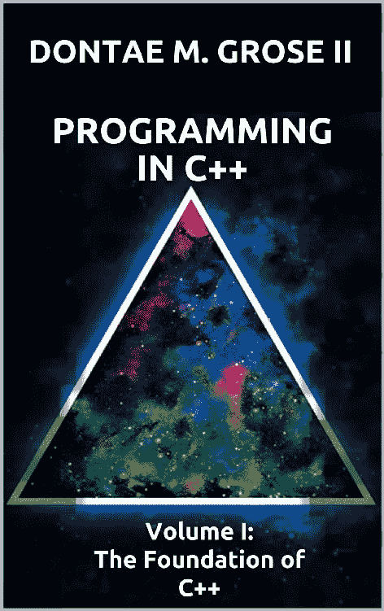

# C++ 编程：第一卷：C++ 基础





## 目录

- 第一章：输入、输出与信息 …………… 第 4 页
- 1.1)编程环境 …………………… 第 4 页
- 1.2)程序结构与布局 …………………….. 第 8 页
- 1.3)输出与输入  ………………………………...... 第 11 页
- 1.4)变量 …………………..................................... 第 15 页
- 1.5)数学与 C++ ………………………...…. 第 20 页
- 1.6)数组 …………...…………...…………………… 第 24 页
- 第二章：数据与结构 ……………................. 第 30 页
- 2.1)函数声明 …………………................... 第 30 页
- 2.2)变量作用域与原型 ………………….. 第 36 页
- 2.3)内存地址与指针  ………………..... 第 42 页
- 2.4)类 I …………………...................................... 第 44 页
- 2.5)类 II（带函数的类） ………………. 第 46 页
- 第三章：算法与逻辑 …………………........ 第 49 页
- 3.1)If 和 If-Else 语句 …………………….. 第 49 页
- 3.2)Switch …………………...................................... 第 53 页
- 3.3)循环 I（While 循环与 For 循环）………… 第 56 页
- 第四章：文件、命名空间与库 ……...…...... 第 62 页
- 4.1)命名空间与库 …………………......... 第 62 页
- 4.2)文件读取与操作 ………………..…. 第 64 页
- 答案区………....…………...…..………… 第 67 页

# 第一章

### 1.1 节编程环境

在开始 `c++` 编程之前，我们需要首先下载用于编写代码的图形用户界面（GUI）。`c++` 的最佳编程环境被称为 `Codeblocks`，它可以免费下载。虽然你可能还会使用其他编程环境，但 `Codeblocks` 在初期最容易学习，并且便于过渡到其他 GUI 和软件。用于编程的最大型环境之一是 `Microsoft Visual Studio`，它是面向有经验的用户的，一旦你掌握了编程基础，就可以放地下载此软件并用它代替 `CodeBlocks`。

图形用户界面是编写任何计算机代码的主要组件。因为 GUI 是数据向用户展示的方式，它为程序员提供了编码平台，并能够直观地看到项目。`CodeBlocks` 是一个免费的图形用户界面，我们在书中将一直使用因为它因为它都可以下载这个软件，而且“在我看来”它是最好的免费图形用户界面。确保你了解如何使用此软件，因为当问题出现时，这些知识将成为解决问题的关键。正如前面提到的，你不必须使用 `Codeblocks`，但我强烈向任何完全初学编程的人推荐它。在下载 `CodeBlocks` 时，我们需要确保下载的是适用于你当前运行的操作系统的正确版本。这非常重要，因为 `Codeblocks` 是一个非常敏感的软件，再次，在进入第一章的代码之前，请花些时间熟悉该软件。

下载 `CodeBlocks` 时需要另外注意一点是我们需要运行并测试代码。我们还需要某种东西来为我们完成这项工作，那被称为 `compiler`（编译器）。`CodeBlocks` 使用的编译器内置在软件中，这是一个巨大的优势，但我们应该确保点击包含此编译器的正确下载链接。下载链接中在某处会带有 `mingw` 字样，并包含我们运行代码所需的 `GNU GCC Compiler`。在安装 `CodeBlocks` 的过程中，请确保仔细阅读说明，在安装过程中它会再次询问你想要使用哪种编译器；此时你自然会选择 `GNU GCC Compiler`。程序安装完成后，你将进入 `CodeBlocks` 的主界面，现在我们可以开始编写代码了。

从 `CodeBlocks` 的主界面点击 `create a new project`（新建项目）子链接，接下来你将看到一个标题为 `New from template`（模板新建）的对话框。从这里点击对话框左侧的 `Projects`（项目），然后点击右窗口的 `console application`（控制台应用程序）。系统会问你是用 `C` 还是 `C++` 编程，虽然你知道我们正在使用 `C++`，但 `C` 并不大，如果你也想学习它，从 `C++` 到 `C` 的过渡将非常容易。接下来，我们只需要为项目命名并选择项目文件夹的保存位置。最后，我们选择 `GNU GCC Compiler`，确保勾选 `Create Dialog Configuration`（创建对话框配置）框，并取消勾选 `Create release configuration`（创建发布配置）。

一旦你点击完成，你就终于完成了 `CodeBlocks` 的设置，现在有了一个可以随我们意愿进行编程和编码的环境。但我们仍然应该浏览到处可见的不同按钮，我很乐意告诉你，大多数功能（其中大部分可能不会被用到）在以后它们的用途将会变得显而易见。以后如果你决定继续使用 `CodeBlocks`，你会发现有许多用于不同类型编程的插件。现在，我们使用的只是软件左侧的 `management`（管理）标签，如果你在屏幕左侧没有看到管理标签，按下 `Shift+F2` 即可打开该标签；我们还需要熟悉 `Codeblocks` 菜单顶部的 `file`（文件）和 `build`（构建）标签。`File` 是我们保存、打开和关闭 `CodeBlocks` 的地方，而 `build` 是我们告诉 `Codeblocks` 编译和运行代码的地方。例如，通过 `File > new > Project` 将带我们回到 `CodeBlocks` 的原始界面，在那里我们可以创建一个不同的项目。你可以在 `CodeBlocks` 中同时打开多个项目，这就是屏幕左侧管理标签的原因。

导航到 `build` 标签，你会看到一个下拉列表，允许我们使用之前安装的编译器来运行和构建项目。当我们运行程序时，我们将使用 `build and run` 按钮（`Shift F9`）来构建程序（将其发送到编译器）并运行程序，这将输出程序结果。如果你向下看代码编辑器，你会看到里面已经插入了一些代码。导航到 build and run 并运行此程序以查看结果，并确保你都安装得正确。你将获得控制窗口，我们的大多数代码将显示其中（除非另有定义），默认显示“Hello World”。这是我们运行的第一个程序，也是大多数程序员在学习任何编程语言时运行的第一个程序。


在你浏览过 CodeBlocks 并对一切都有了基本了解后，请导航到你之前保存程序的文件夹。如果你找不到该文件夹，请将其重新保存到一个可以存放你所有程序的父文件夹中，或者任何一个你可以轻松找到的地方。打开包含你保存的程序的文件夹，你会发现程序文件夹内有两个文件夹以及其他 3 个文件。你应该有一个名为 `bin` 的文件夹和一个名为 `obj` 的文件夹，这些文件夹是编译器使用的，稍后会用到。你还会有一个使用的项目文件，这是你在 CodeBlocks 中打开项目时需要点击的文件。你可能会在项目文件旁边看到 CodeBlocks 图标，当你想要打开文件夹中的程序时，可以将其作为参考。最后是主源 `.cpp` 文件，这是一个包含 C++ 代码的文件。该文件的作用是当你想在其他地方使用代码或将其发送给某人时，可以存储这些代码；而且如果你以后使用了如 Visual Studio 等其他软件，你可以轻松地在各个平台之间传输代码。这让我们回到了 C++ 是一种面向对象的编程语言，它允许对之前创建的函数进行重排和重用。这与某些特定于特定软件的语言不同，那些语言必须经过大量修改才能在其他编程环境中使用。

虽然我使用 CodeBlocks 作为编程软件，但你可以自由使用任何你喜欢的软件。市上有许多优秀的软件和神奇的 IDE 可以下载，你可以自由尝试其他程序，因为它们可能更适合你。我主要选择 CodeBlocks 的原因是它是一个简单易软件，专门面向编写 C、C# 和 C++ 代码，而几乎所有其他程序都侧重于所有编程语言的使用。使用这个 IDE，我们不需要过分担心其他编程语言的各种按钮和设置，而是可以专注于 C++ 编程脚本和语言的功能。当你转向使用其他更具动态且选项更多的软件（例如应用程序创建、平台集成，以及允许你编写多种不同语言、创建数据库等）时，这会使过渡过程变得容易得多。

在现实世界中，不同的公司使用大量的——我指的是许多不同类型的编程环境，所以我我想使用多个环境的灵活性可能是有益的，但这随着时间的推移而体现。但在你学习如何编写代码之后，由于 IDE 和代码实现之间的相似性，学习软件和其他编程语言的工作将变得更容易；当你编写不同的编程语言时，唯一真正变化的是语句和函数的语法。而当你从一个 IDE 切换到另一个 IDE 时，唯一变化的是某些 IDE 提供更大的灵活性选项（如 Visual Studio），而像 CodeBlocks 这样的 IDE 用于创建通常不显示图形而是在后台运行和执行任务的程序。

# 第 1.2 章 程序结构与布局

每种编程语言都有一套特定的语法来定义其代码。语法只是结构代码的方式，使其具有清晰的轮廓，并在需要时可以被其他程序员阅读。大多数程序是由团队构建的，因此 C++ 相比其他编程语言提供的大多数特性之一就是能够轻松地在地方移动代码。关于语言语法，C++ 中的几乎每个命令都会以分号（`;`）结尾，这告诉编译器命令已定义并定义了命令的结束。

前两行代码 `#include <iostream>` 和 `using namespace std` 在大多数 C++ 编程中是静态的，还有作为程序的 `int main () {}` 函数。理解这种布局很重要，当我们在此构建时，你就会明白为什么。

`#include <iostream>` 是我们所说的头文件，我们调用的文件是 iostream 头文件。`iostream` 头文件只是告诉我们的程序，我们最终想要让程序向控制台输出某些结果或总体目标。接下来，我们有 `using namespace std;`，这是一种更简单的媒介，在我们准备好将代码发布到任何目标市场时，允许我们的代码更有结构化。

在创建程序文件后，你会在控制台中看到以下代码：

```cpp
#include <iostream>

using namespace std;

int main (){

return 0; 
}
```

`return 0;` 命令可以丢弃，我们得到：

```cpp
#include <iostream>

using namespace std;

int main (){

}
```

这就是所谓的“主函数（Main Function）”，我非常强调这一点，因为它是所有 C++ 中使用频率最多的代码块。现在，我们首先应该理解计算机编程中的什么是函数。函数通常用于（除 `main 函数`的情况除外）用于包含一组特定的规则，以完成程序的某项特定任务。主函数有点不同，因为它不仅可以包含自己的信息，还必须知道程序中的每一个其他函数。无论我们在做什么，始终都会回到主函数来调用该函数，我们将在第 2 章创建除主函数之外的多个函数时讨论这一点。但这就是需要主函数的原因。你可以将主函数想象成 PC 主板上的 CPU，它处理计算机需要的任务，但它使用硬盘（在这种情况下是其他函数）来存储信息。代码中的 `int` 部分被称为函数的返回值/类型，稍后会解释。之后我们看到两个括号和闭合的主体引号，并以分号结尾，如果你记得的话，这标志着主函数的结束。`main()` 之后的括号被称为参数，用于包含函数可以接受的特定条件。`main` 函数不需要任何参数。最后，我们有主体大括号 `{}`，它们将包含主函数的所有信息。任何主函数命令将写在这些括号内，这些括号是广为人知的、所有函数由分号隔开的代码块。现在我们已经有了将使用的配置布局，我们可以开始学习内存如何在计算机上存储，以及软件和程序如何处理它们被程序设定记住的事物。面对一个几乎没有代码的空白屏幕，我们还有很长的路要走才能到达可以说我们开发出一个 C++ 程序的地步。在任何计算中，存储都是至关重要的。你不仅在音乐和游戏需要它，它还承载着操作系统以及 PC 运行字面上所有的其他信息。

# 第 1.3 章 输出与输入

当我们运行第一个程序并在屏幕上看到“Hello World!”消息时，我们应该意识到两点：1) 带有文字的代码应该是可以更改的，2) `cout <<` 运算符是向用户输出消息的一种方式。如果这是你的假设，或者你尝试过更改程序中的文本，那么你领先了一步。但我们向用户输出任何内容需要的是 `cout` 命令，后面跟着表示输出的 `<<` 符号。


在输出文本的代码行中，

```
cout << “Hello World!” << endl;
```

我们看到本质上有 4 部分信息。`cout` 命令意味着控制台输出（console output），用于输出呈现给用户的所有信息。这就是我们展示数据的方式，使其在控制台中可见，并且它可用于句子、数字、表达式、公式等。接下来，我们看到了两个小于符号 `<<`，它们用于表示数据流向用户输出。同样地，我们也可以看到，如果我们有大于符号 `>>`，它们将表示数据从其他地方进入程序。我可能也会把它们称为左逻辑运算符和右逻辑运算符。

接下来，我们有代码的文本部分 `"Hello World!"`，它被称为字符串（string），字符串是变量类型，或者正如在这个例子中，它们可以显式地声明。这段文本再次可以改为任何其他内容。这是一个使用我们之前学过的变量字符串输出程序示例。

```cpp
#include <iostream>

Using namespace std;

int main(){
string mySentence = “Save this string of text”;
cout << mySentence << endl;
}
```

这是另一个相同的程序示例，但没有将字符串存储在变量中。

```cpp
#include <iostream>

Using namespace std;

int main(){
cout << “Save this string of text” << endl;
}
```

这两种方式都可以向用户输出文本。但应该实现哪种方式呢？这里的关键是要记住，即使不是在每一个函数中，我们也将一直使用变量来实现几种不同的功能。习惯用第一种方式编写代码对你会有好处，因为这将帮助你处理变量是如何被调用的以及如何使用的。虽然字符串对于数据通信至关重要，但我们还需要向用户通信或输出数值数据。例如，如果我们正在创建一个带有血量、生命值和关卡的街机游戏，我们需要与这些每个变量相关的数字进行通信。要向用户输出数字，我们去掉括号，并将数字写为：

```cpp
cout << 32 << endl;
```

我们当然有相同的输出运算符，但我们写的是一个数字，而不是文本字符串。虽然如果语法正确，你也可以在字符串内部编写数字，但通常通常不是良好的编程做法。现在我们已经知道如何通过系统/控制台输出来调用和使用变量；请编写一个程序完成以下操作：

**问题：**
1) 写一个程序记住你的名字、地址、城市、州和邮政编码。
2) 让程序将信息输出到屏幕上。

到目前为止，通过我们学过的概念，已经有许多不同的程序我们可以制作。我鼓励你尝试创建自己的程序并将它们保存在文件夹中，尝试所有的练习题和挑战性问题，并在过程中尝试创建你自己的程序。不能忽略的一点是，我们正在使用语言进行编程，而学习任何语言的唯一方法就是重复、重复、重复。归根结底，你付出的努力越多，结果就越好，所以请确保额外努力，如果你不理解某些内容，在 Google 上搜索它并尝试找到解决方案。如果你找不到解决方案，写下你遇到的问题，继续进行，稍后再回来处理这个问题。

在所有的计算机编程中，必须对语法、拼写、大小写以及所有其他问题投入额外的关注。像字母本该大写却变成了小写这样的小错误就会导致整个程序失败，在某些情况下，即使是这样小的问题，程序也无法运行。我表达这个事实并不是为了吓跑你离开编程，我只是在表达编程是非常具体的，并且必须非常精确。

当有人打开你的程序时，你希望有某种方式欢迎他们进入程序，以及表达程序可以做什么的方法。你唯一能这样做的方法就是向用户输出文本，并希望他/她阅读这些内容并根据你提供的选项做出决定。但当我们想要用户输入某些信息时，或者当用户按下按钮并期望该按钮改变或对程序产生某种影响时，会发生什么呢？我们需要一个用于接收信息的运算符。向用户输入信息，我们使用输入运算符，其语法为：

```cpp
cin >> variable;
```

`cin` 代表控制台输入（console input），是代码行中的主要运算符。后面是两个大于符号 `>>`，显示信息流入 PC。最后，我们声明一个变量，作为存储信息的容器。要小心，因为有不同的变量类型用于存储不同类型的信息，我们将在下一节中详细介绍。现在，理解我们使用变量来存储信息，这些变量可以配合输入运算符来存储用户输入的信息。

了解如何在屏幕上显示用户可以阅读的输出以及需要用户向你的程序输入信息，几乎会在你的程序中起到某些作用。回顾并理解如何做到这一点至关重要，因此练习输入和输出非常重要。

# 第 1.4 节变量

在编程中，我们应该存储信息，为此我们使用变量。这是变量的唯一工作，而且在任何语言中构建任何程序时，你都将使用变量来执行相同的操作。在我们继续之前，这里是最常见的变量及其功能列表。

| 变量类型（缩写） | 示例 | 定义 |
| :--- | :--- | :--- |
| 整数 (Integer) | `int x=5;` | 用于持有整数值。 |
| 浮点型 (Float) | `Float u =21.34;` | 小数。 |
| 双精度 (Double) | `Double c =9.234;` | 存储。 |
| 字符串 (String) | `String y=BERS”;` | 文字、字母和短语。 |
| 字符 (Character) | `Char message = ‘a’` | 存储字符。 |
| 布尔变量 (Boolean) | `Bool t = False;` | 只能是真或假。 |
| 常量 (Constant) | `Const int x =10` | 不可变的变量。 |

这些是 c++ 中常用的变量类型，定义了变量可以包含的内容。例如，在上面的表中你可以看到，如果我们想存储整数，就使用 `int`；如果我们想定义或存储小数，就使用 `float` 或 `double`。这是因为我们应该根据存储的信息使用不同类型的变量。这是一个使用浮点和整数变量的示例：

```cpp
int main (){
float x =3.14;
int y = 4;
}
```

当我们声明一个变量时，我们需要数据类型（如 `float`、`int` 等），我们还需要给变量命名。名字可以是你指定的任何字符串，正如你所看到的，我使用 `x` 作为浮点变量的名字，使用 `y` 作为整数变量的名字。然后我们使用等号 (`=`)将变量设置为赋予的值。你不能将变量的名字设置为数字。

例如，

`Float 3 = 5;` 将无法运行并导致错误。


### 2) 将这些变量分别在不同的行输出到屏幕。

### 调试 (Debugging)

调试程序不仅是不可避免发生的事情，更是一种技能，只能通过阅读代码和实践代码的不同用法来学习。但有些问题可以被编译器轻松发现，而且几乎所有的编程环境都内置了调试器，可以在程序运行时检测程序中的语法错误。你可以通过点击 CodeBlocks 屏幕底部的 `build log` 标签页轻松地看到调试器。当你运行程序时，`build log` 标签页将向你显示在构建和运行程序时调用了哪些程序，以及具体在执行什么内容。正如我之前提到的，它还会检测出你在代码中犯的根本性错误，例如语法、拼写或句法错误，但它不会为你自动修复程序。阅读 `build log` 并在出现错误时熟悉它所指出的错误之处是非常关重要的。

例如，如果我犯了调用不存在变量的错误，比如写成下面的样子：

```
Float x = x + y;
Cin >> x;
Cin >> y;
Cout << r << endl;
```

在这里你可以看到问题出在第 4 行，我不小心尝试输出 `r` 的结果，而本意是输入 `x`。这个程序将无法运行，因为没有名为 `r` 的变量，`build log` 会显示类似的内容：

```
Error: ‘r’ was not declared in this scope
```

这可能是最重要的 `build log` 信息之一，因为在你的编程生涯中你会多次收到这条信息。这条信息简单来说意味着该变量要么从未被创建，要么它不是一个公共变量（不在公共作用域内），因此对于被调用的函数来说，它是不存在的。这个问题是大多数程序员使用下面这个小技巧来声明变量的主要原因。

```
Float newVariable;
```

如你所示，变量名的第一个单词是小写，变量名的第二个单词是大写。这是在编程时你可能想要采用的方法，这样在创建变量、函数、类或任何在 `c++` 中需要引用的内容时，就不会出现大小写错误。每当你遇到错误时，请记住首先参考 `build log` 的内容，其次寻找程序中的缺陷。但程序可能无法察觉你所面临的某些问题，这仅仅是因为编程写得不对，而处理这种问题最好的方法是在需要的地方使用注释来引用代码的不同部分。即使是最好的程序员也会使用注释来标记代码的不同部分；再次，如果你的朋友或其他人想使用或购买你创建的函数，如果你根据正在执行的任务对代码进行分段，他们总是更容易找到它。

在这个过程中，理解编译器是如何读取程序的也是非常重要的，因为你需要理解在 `c++` 中，编译器是从第 1 行向下读取我们的代码的。在编程中，我们使用一种称为变量的概念为程序、程序员和程序用户存储信息。变量可以被看作存储信息的容器，根据你存储在变量中的信息类型，有不同类型的变量。变量是所有程序的重要部分，它们允许实现出色的编程，因为它们允许程序员存储信息以备后用，并作为任何计算机程序的基石。虽然根据你的程序，代码可能并非完全这种方式执行，但编译器从顶部开始向下读取，这意味着如果信息没有在程序中声明，你将无法获得正确的结果。例如，如果我尝试输出变量 `x` 并在第 4 行使用输出运算符显示 `x` 的值，而变量 `x` 直到第 6 行才被创建，那么程序将不知道该变量尚未创建，因此看不到该变量。

相反，如果你将输出运算符移动到第 6 行之后，你就能在输出中看到该变量，因为编译器拥有该变量及其值的先前知识。编译器逐行读取代码，并区分应该发生什么以及何时应该发生。

### 第 1.4 章练习题

1. 1.4a) 创建一个程序，要求用户输入 3 个整数和 3 个小数。

2. 1.4b) 使用 1.4a 的解决方案，向用户输出让其输入 5 个变量，每个变量占一行。

### 第 1.5 章 数学与 C++

数学与编程是密不可分的。更具体地说，代数与编程密不可分，且它们如此相似，我确定你已经看到了一些相似的特征。通过代数中的方程和公式，我们努力解出（通常是）一个变量方程；为了这样做，我们隔离想要答案的变量，并将其他值设置在等号的侧。在编程中，当我们创建变量来解决问题和执行程序内的任务时，我们在进行同样的过程。

### 数学运算符

- 加法：`+`
- 减法：`-`
- 乘法：`*`
- 除法：`/`
- 取模运算：`%`
- 等于：`=`
- 大于：`>`
- 大于等于：`>=`
- 小于：`<`
- 小于等于：`<=`

这些符号大部分自言自明，我确定你已经习惯看到它们，可能只是乘法、除法取模符号。乘法使用符号 `*`，通常通过按下“Shift+8”输入。用于除法的符号是斜杠 `/`，通常位于键盘退格键/删除键下方。最后，我们有取模，意思是除法并只保留除法的余数。如果在任何情况下除法没有余数，取模将等于 0。

要执行数学运算，我们需要至少两个数值。为了做到这一点，我们将创建两个不同数字的变量。

```
float firstNumber=67;
float secondNumber=34;
cout << firstNumber + secondNumber << endl;
cout << firstNumber % secondNumber << endl;
```

如果你将这些输入程序，你将看到我们得到了这些运算的答案，它们至少是起作用的。但当我们开始使用数学公式解决程序中的问题时，我们会编写变量来执行这些计算，而不是在输出过程中声明它们，如：

```
float x = 3.5;
float y = 5.4;
float equationOne= x + y;
float equationTwo=x%y;
cout << “answer: ”<< equationOne << endl;
cout << “answer: ”<< equationTwo << endl;
```

虽然这种编程方式在技术上可能多几行代码，但它创建了一个更高效的过程，因为如果我想以后使用该公式，只需引用它即可。另一个需要考虑的问题是，我们可以随时通过编写变量名并赋予新值来更改变量的值。例如：

```
Int x = 3;
Cout << x << endl;
x= 6;
cout << x<< endl;
```

当我们创建一个变量并将其赋值为特定值（如 3）时，该变量就有了该值，而该值也变成了该变量。当第一个控制台输出运行时，程序将输出 3，因为 `x` 的值是 3。但在下一行代码中，你看到整数 `x` 的值被改为 6。这样做是完全允许的，无需再次声明我们正在使用的变量类型，因为只有一个变量 `x`。更改变量的值是有用的，但你希望确保这样做正确，并且在任何时刻变量的值都是已知并被考虑在内的。


既然我们已经涵盖了基础编程的每一个方面，而且你正在创建更高级的程序，你也将需要更高级的方法来解决编程问题。为此，我认为使用数学将帮助你更好地理解为计算机创建解决方案的含义。为计算机创建解决方案非常重要，因为解决方案是为你的程序目标设定规则的算法。即使你有多个不同的任务同时发生，你也会有算法在运行，以随着用户的更改保持程序同步。

例如，如果我们正在跟踪我在第一人称射击游戏中的弹药数量；我可以创建一个存储某些特定数量子弹的变量，然后每当用户点击鼠标左键时，我就可以让该数字减 1，模拟使用枪械的过程。但弹药减少的算法是如何运作的？我们如何知道用户是否点击了鼠标左键呢？这些都是我们需要理解如何处理的问题，因为这类操作被用于每个软件、每个 App 和每个程序中。要解决这个特定问题，你应该理解循环和迭代，我们稍后会详细介绍这些。

使用数学并不仅限于单语句操作。我们可以使用多个变量和操作，在确保遵循运算顺序的情况下，执行为变量赋值的任务，然后使用它们来求解代数表达式和公式。例如，我们可以使用线性方程的标准形式或直线方程 `y = mx+b`，让用户输入已知值，并求解该方程的 `y`。

要做到这一点，

```
double m,x,b;
cout << “enter the value for m: ” << endl;
cin >> m;
cout << “enter the value for x: ” << endl;
cin >> x;
cout << “enter the value for b:” << endl;
cin >> b;
cout << “y = ” << (m*x) + b;
```

这就是对上述问题的解决方案，即我们让用户输入线的已知值，然后我们获取这些值，执行正确的操作，并将答案输出给用户。在最后一行代码中，我在 `m*x` 周围使用了括号，因为我们想先执行这项任务，并根据该结果加上变量 `b`。在这种情况下，用户也可以使用小数，而且由于我们使用了 `double` 类型的变量，答案将相应地存储。

## 第 1.5 节练习题

1.5a) 创建一个程序允许用户输入 5 个变量。获取这些值，并对用户输入的这 5 个变量进行加、减、乘、除运算。确保考虑到整数值和商值。将每个操作的结果输出给用户，记得说明每种操作并在后面写上该操作的值。

1.5b) 创建一个程序，将用户输入的 3 个数字互相互相除。

## 第 1.6 节：数组

在编程中，有许多不同的选项和程序类别，它们都有不同的方式可以被创建出来。事实上，如果你正在编写代码，几乎不可能逐行复制他人的代码，因为你可以使用代码的组合和方式是如此丰富。而且不仅如此，还有许多不同的行业可以进行编程。例如，你想创建游戏吗？软件？动画？App？还是全都要？无论你想做什么，你都需要理解编程的基础知识并熟练掌握其用途。

无论你想创建一个游戏还是手机应用程序，你都可以使用 `c++` 来实现。当我们编写这个庞大的软件时，将会有几个不同的变量，而所有这些变量，无论它们是什么类型，都将占用大量的内存。你创建的每一个变量都在使用内存，这意味着随着时间的推移，我们希望找到一种优化这种行为的方法，让程序在压力较小的情况下运行。优化的概念在今天的计算机上仍然是一个问题，尽管我们有像 D-wave 这样的超级计算机，但我们还没有达到吸引内存优化的计算机技术终极点，而且可能永远不会发生。

现代的（2017 年）PC 硬盘是厚实的铝制 CD（压缩光片），被放入金属外壳中使其看起来像一个硬件。如果你不知道，尽管它们可以工作并在很小的空间存储大量内存，但它们受限于某些 GB 或 TB 的容量，而与“我们可能在某些材料中存储无限量的信息”这一说法相比，这仍然非常小。如果、以及，据我相信，当这种情况发生时，我们将能够将宇宙的信息存储到一个硬件设备中。美国每台 PC 内部都有一个硬盘，而大壮的 Rosewill Thor、Prodigy 和 Corsair 将成为 Steve Wozniak 创造的 Apple I 的等价物（如果我今天能把它放在我的桌子上的话），并因此成为古董/新奇物品。请注意，我说的是 Apple I 的物理结构，而不是外壳内部的任何东西。我可能是世界上最大的 Wozniak 粉丝了，在 20 世纪 70 年代后期，PC 远未完全成熟，这就是为什么他们没有在机箱上花费太多时间，因为硬件是重点，而且在当时也是一个目标。

数组用于在单个声明中存储相同数据类型的多种形式，这不仅减少了当我们有多个相同类型的变量时产生的复杂性，而且让在程序需要使用这些变量时更易使用。整数数组的语法是：

```
Int array[3] = {4,5,6};
```

这个整数数组包含 3 个整数值。我们也可以通过简单更改数组类型创建一个字符串数组。

```
string x[3] = {“this”,“array”,“is a string ”};
```

这里有一个三个值的字符串数组，每个值都包含在引号内，用逗号分隔，并放在大括号中。现在假设我们需要访问这些变量之一，这就是存储变量以便使用的目的，通过对每个元素应用位置值来实现。每个元素都有自己的数字，这对于你创建的任何数组都是一致的。数组中的第一项被称为元素 0，并应该调用：

```
cout << “The first array element: ” << x[0] << endl;
```

这将输出数组 `x` 的第一个元素，即字符串值“this”。数组中的第二个值被称为元素 1，第三个元素被称为元素 2。所以，无论数组中有多少元素，元素总是这样命名的（从 0 开始），并递增。在编程或计算机科学的几乎每个概念中，我们对数字 0 都有意义，而且几乎总是被考虑在内，这与现代数学教我们的数字 0 在大多数情况下是过时的相反，因此在我们进入其他主题时，请记住我们是从 0 开始计数的而不是 1。

现在我们应该考虑一个被称为多维数组的话题，它是通常用于创建变量表格的数组。

```
type Name[x][y] = { {Row 1’s values}, {Row 2’s values} };
```

这是多维数组的语法，如果你想看一个实际示例：

```
int Multiarray[2][3] = { {23,3,6}, {56,23,80}};
```


所以，当我们我们需要一个元素时，我们使用多维参数来调用它。但需要理解的是，位置 `x` 定义了我们希望数组包含的行数，而位置 `y` 是每个数组中存储的元素个数。

要访问多维数组中每一行的每个元素，我们需要在变量名后使用第一组括号（ `[x]` ）来来说明我们正在使用哪一行，但正如我们之前学的那样，我们在计数时应该从 0 开始，所以当我们想要调用第 1 行的元素时，我们说：

```cpp
cout << Multiarray[0][y];      // 第一组括号意味着我们正在访问第 1 行
cout << Multiarray[1][y]; // 第一组括号意味着我们正在访问第 2 行
```

多维数组中的第二组括号用于指定我们想要调用的数组中的哪个元素，同样从 0 开始。为了打印出 `multiarray` 变量第 1 行和第 2 行的每一个元素：

```cpp
#include <iostream>

using namespace std;

int main(){intint Multiarray[2][3] = {{23,3,6},{56,23,80}};

// 打印第 1 行元素
cout << “Row 1, Element 1: ”<< Multiarray[0][0] << endl;
cout << “Row 1, Element 2: ”<< Multiarray[0][1] << endl;
cout << “Row 1, Element 3: ”<< Multiarray[0][2] << endl;

// 打印第 2 行元素
cout << “Row 2, Element 1: ”<< Multiarray[1][0] << endl;
cout << “Row 2, Element 2: ”<< Multiarray[1][1] << endl;
cout << “Row 2, Element 3: ”<< Multiarray[1][2] << endl;
}
```

这是另一个不同的多维数组示例。

```cpp
#include <iostream>

using namespace std;

int main(){

int mul[2][3] = { {23,234,5},{768,965,3456} };

// 输出第 1 行的元素
cout <<  "Row 1, Element 1: " << mul[0][0] << endl;
cout <<  "Row 1, Element 2: " << mul[0][1] << endl;
cout <<  "Row 1, Element 3: " << mul[0][2] << endl << endl;

// 输出第 2 行的元素
cout << "Row 2, Element 1: " << mul[1][0] << endl;
cout << "Row 2, Element 2: " << mul[1][1] << endl;
cout << "Row 2, Element 3: " << mul[1][2] << endl;
}
```

我们还可以创建所有其他数据类型的多维数组来以这种方式存储信息，例如字符串。

```cpp
#include <iostream>

using namespace std;

int main(){

string SArray[2][5] = {

{"one","two","three","four", "five"},
{"six","seven","eight","nine","ten"}
};

// 第 1 行的元素
cout << "Row 1, Element 1: " << SArray[0][0] << endl;
cout << "Row 1, Element 2: " << SArray[0][1] << endl;
cout << "Row 1, Element 3: " << SArray[0][2] << endl;
cout << "Row 1, Element 4: " << SArray[0][3] << endl;
cout << "Row 1, Element 5: " << SArray[0][4] << endl << endl;

// 第 2 行的元素
cout << "Row 2, Element 1: " << SArray[1][0] << endl;
cout << "Row 2, Element 2: " << SArray[1][1] << endl;
cout << "Row 2, Element 3: " << SArray[1][2] << endl;
cout << "Row 2, Element 4: " << SArray[1][3] << endl;
cout << "Row 2, Element 5: " << SArray[1][4] << endl;
}
```

### 第 1.6 节练习题

1. **1.6a)** 创建三个不同数据类型的数组。逐个输出每个变量（每个变量占一行）。
2. **1.6b)** 创建一个程序，要求用户输入三个值，并将用户输入的每个值存储在数组中。将用户输入的值输出回程序。
3. **1.6c)** 创建三个数组，每个具有不同的变量类型，并输出所有 3 个数组中的每个值。

# 第 2 章：函数

## 第 2.1 节：函数声明

在创建程序时，在任何时刻都有许多不同的任务和过程在运行。对于程序拥拥的每一个任务，我们都应该有一套特定的规则供任务遵循以正常运行。这就是函数引入编程的地方，这也是它们如此实用的原因。我们可以采取不同的过程将它们拆分成不同的组，并为每个过程定义解决方案，同时将它们分离，使其成为独立的组，从而使其更容易处理。

`main` 函数是我们目前为止处理过的唯一函数，但现在我们要创建一个新的。我们可以采取不同的过程将它们拆分成不同的组，并为每个过程定义解决方案，同时将它们分离，使其成为独立的组，从而使其更容易处理。

`main` 函数是我们目前为止处理过的唯一函数，但现在我们要创建一个新的。我们可以采取不同的过程将它们拆分成不同的组，并为每个过程定义解决方案，同时将它们分离，使其成为独立的组，从而使其更容易处理。

为了做到这一点，我们需要创建一个 `float` 或 `double` 变量，这样如果用户输入分数或小数，程序将正确回答。我们还需要提示用户。我们将使用一个执行输入/输出任务并返回答案的函数开始创建此程序。

```
functionType functionName()
```

使用的 `functionType` 由函数的返回类型定义。`main` 函数我们使用 `int`，这定义了我们正在向用户返回内容。我们将使用的另一个函数返回类型是返回类型 `void`，它表示一个空返回类型，意味着我们没有向用户返回任何内容。

```cpp
FunctionName();
```


为了让 `main` 函数运行我们最近创建的函数，我们在其中只需要编写所创建的函数名称，如果有参数则写上参数，如果没有则留空，最后加上分号以表示对象声明的结束。现在我们应该有两个函数：1) `main` 函数，2) 我们刚刚创建的新函数，以及 3) `main` 函数内部的函数对象。为了确保你的代码正确且没有错误，请点击 CodeBlocks 中“build and run”（构建并运行）按钮旁边的构建（build）按钮，程序将检查错误。如果 CodeBlocks 底部“build messages”（构建消息）菜单没有报告任何错误，说明程序构建正确。这里有一个示例：

```cpp
#include <iostream>

int equationFunction(){

cout << “Is this function is working? ” << endl;

}

int main(){

equationFunction();

}
```

注意：你可以创建被称为注释的代码行，这些行对程序不会产生任何影响，仅作为某些行代码的注释。要使用注释，我们输入两个正斜杠，后面跟上你想编写的注释。例如：

```cpp
int main(){

equationFunction(); // This is a comment

```

如果你运行这个程序，你会发现没有错误，而且这段文字完全被程序忽略了。我们还可以使用 `/* */` 来创建多行注释。

在我们之前创建的函数内部，编写一行控制台输出代码，只需在屏幕上向用户显示消息，以查看函数和函数声明的功能。当我们在 `main()` 函数中调用函数时，我们只是在表示我们在程序中创建了一个函数，现在想要使用它。函数将使你的代码更易读，当其他程序员阅读你的代码时，他们能够更高效地定义程序的元素。此外，当我们创建包含多个不同元素和多行代码的大型程序时，管理代码会变得越来越困难，与其将所有内容挤进 `main` 函数（虽然这样做可行），但使用函数的效率要高得多。

现在，在上的示例中，我们创建了一个位于 `main()` 函数之前的函数。如果我们把函数移动到 `main` 函数下方并调用它会发生什么？你会得到编译器错误，提示编译器 `newFunction();` 在作用域内未声明，导致程序失败。为了防止在你在 `main()` 函数下方创建函数时发生这种情况，需要进行一种被称为“函数原型声明”（function prototyping）的操作。

在函数中，我们有时使用参数来指定类将处理的某些变量。在创建函数时，这在许多不同方面都有用，允许我们进一步定义函数并赋予其自身的特征，同时作为函数的模板。这里是一个带参数的函数示例：

```cpp
#include <iostream>

using namespace std;

int function1(int x, int y){

cout << "x: " << x << endl;

cout << "y: " << y << endl;

}

int main(){

function1(3,2);

}
```

在这里，我们创建了一个带有两个参数（整数 `x` 和整数 `y`）的整数函数，在函数内部我们输出每个变量的值。但整数值没有被赋值，所以我们知道这些变量在打印到屏幕之前必须被赋予值。为了做到这一点，我们在 `main` 函数中调用想要使用的函数，并在该函数的参数中声明想要赋值给每个变量的值，每个值之间用逗号分隔。

现在我们必须谈谈 C++ 中的一个名为“递归”（recursion）的话题，当函数或循环调用自己时就会发生递归。当你在函数内部调用函数本身，而不是在另一个函数内部调用该函数时，就会发生递归。看起来如下：

```cpp
#include <iostream>

using namespace std;

int functionRecursion(){

cout << “recursion example ” << endl;

functionRecursion();

}

int main(){

functionRecursion();

}
```

由于我们在 `functionRecursion` 内部调用了自己，并且在 `main` 中调用了该函数，当我们运行程序时，`main` 函数将调用 `functionRecursion` 函数，而 `functionRecursion` 函数又调用它自己。如果这种情况发生，过程将永远停止，因此记住不要在函数内部调用它自己。这种递归过程被称为创建递归函数，虽然有时它很有用，但大多数情况下这会在你的程序中产生问题。以后，递归函数的思想将变得更加相关，你会发现为什么这些函数在某些特殊情况下是有用的。我们将介绍什么是循环以及我们如何创建可以调用函数特定次数的循环，这将与递归和递归函数的思想联系起来。

# 第 2.1 练习题

2.1a) 创建一个至少五行代码的函数，其中至少有一行应该是进入 `main` 函数的输出运算符。

2.1b) 创建一个函数，在其中编写你想要的任何代码，确保它在 `main` 函数下方，对函数进行原型声明并调用该函数。

2.1c) 在 `main` 函数下方创建三个协同工作的函数，用于求解计算式 `x=7+(23/6)+(A+B)` 中的变量 `x`。如果需要，允许用户输入变量 `A` 和 `B` 的商。

# 第 2.2 节：函数原型声明

如果我们在 `main()` 函数下方创建一个函数，我们需要进行一种被称为“函数原型声明”的操作，提醒编译器该函数存在。现在你可能在想，为什么我起初要在 `main` 函数下方创建函数呢？难道不能直接把 `main()` 函数放在代码底部以避免函数原型声明吗？答案是，你可能永远不需要在 `main` 函数下方创建函数，但如果需要，知道如何这样做总是加分项。要做到这一点，我们写函数类型后跟函数名称，但写 `#using namespace std;` 下方，程序中任何函数或类的上方。如下所示：

```cpp
#include <iostream>

Using namespace std;

void callingFunctions();

int main(){

callingFunctions();

}

void callingFunctions(){

cout << “hello” << endl;

}
```

注意第 3 行的原型，包含了函数类型以及函数名称，因为这是一个经常发生的问题，当你在调试程序时发现自己没有为函数原型声明包含数据类型，这会产生绝望的时刻。我认为函数原型声明是编程中最具冗余的部分之一，因为有时很难记住，所以务必多练习以充分理解它。我的做法是，一旦创建函数就立即为它们创建原型声明，这样以后就不需要担心对象问题了，你也可以为原型列出一个特定列表，以便更容易管理。函数原型声明是你现在就想要习惯的操作。以后，无论是在个人还是工作中，你使用的几乎所有函数都会用到。当有多个函数时，将 `main` 函数放在顶部更好，以便方便引用，但如果你真的想这样做，你可以把每个函数都写在 `main` 函数上方。


变量还有一点必须被考虑，被称为变量作用域（variable scope）。变量作用域是指变量在程序中使用的位置，不同类型的作用域包括全局作用域和私有作用域。当变量具有全局作用域时，它可以在程序中的所有函数中使用。正如你记得的，我们目前只使用了一个函数（`main` 函数），并且我们一直在 `main` 函数中编写所有的变量，但我们也可以在 `main` 函数之外编写变量，这些被称为全局变量，因为它们具有全局作用域。

### 全局作用域 (Global Scope)

```cpp
#include <iostream>

using namespace std;

int globalVariable = 5;

class VariableScope{
    public:
    int VS1(){
        int localVariable = 10;
    }
};

int main (){
    VariableScope VSobj;
    VSobj.VS1();
}
```

在这里我们可以看到如何使用局部变量和全局变量。注意并理解创建这些变量之间的区别。下一种作用域被称为私有作用域（private scope），就是我们在 `main` 函数内部声明变量时所使用的。这类具有私有作用域的变量只能在 `main` 函数内部使用，如果你创建另一个函数尝试使用不在该函数中的私有作用域变量，会导致错误。虽然我们还没有讲过如何创建函数，但现在理解它们的用法是非常重要的，这样当我们继续学习并讨论函数时，你将对变量和变量作用域如何工作原理有正确的洞察，这将使学习创建函数变得更容易。

另外请注意，如果你不是在写多行代码，就不必写代码中的 `<< endl` 部分，但要确保在代码行的末尾添加分号。在大多数示例中，我会使用 `endl;`，因为它会让代码在打印到控制台时更易读。理解编程是如何工作的关键以及能够存储不同的公式、单词和算法是必不可少的。在任何编程语言或环境中，都会使用变量来存储信息，这些信息程序员在编程过程中可以使用或者用户在使用程序时需要。我们还可以使用变量来存储数字等信息，然后我们可以创建不同的变量来操作这些变量，例如：

```cpp
float x=4;
float y=5;
float z=6;
float eQ = x+y;
cout << eQ/z << endl;
```

在上面的示例中，我们创建了 3 个变量来存储 3 个不同的整数，然后我们使用变量 `eQ` 将其中两个数字相加，最后我们输出 `eQ` 除以 `z` 的结果。这是一个关于如何存储变量并在程序稍后使用它们执行操作（如数学运算）的示例。这个概念在我们学习循环和递增时会被高度利用。

虽然创建一个变量似乎是某种恒定的东西，但它并不是。可以通过重新声明变量名称并赋予变量新值来改变其原始值。这方面一个例子可以是：

```cpp
float damage = 20.23;
cout << “Current Damage: ” << damage << endl;
damage = damage + 3;
cout << “Current Damage: ” << damage << endl;
```

在这里，我们创建了一个名为 `damage` 的变量来存储浮点值，并给它赋值 20.23，然后简单地将 `damage` 的值输出给用户。接下来，我们重新声明了变量名 `damage`，并表示我们取 `damage` 的原始值并加上 3。因此，在第一行输出中我们将得到 20.23，但当我们第二次使用该变量时，我们将得到 23.23 或 `20.23 + 3.00`。你可以看到在此过程中，我们在第一次声明变量时调用了变量类型、名称和值，但在第二次声明它时，我们只使用了变量名以及分配给它的新值。这是因为在我们最初调用变量时已经声明过变量类型。当我们第二次使用该变量时，编译器已经知道变量的类型，因此我们不需要再次声明变量类型。你现在可以看到如果我们创建两个同名的变量，会发生什么不便。

为了完全理解变量作用域的概念，请在你的程序中 `main` 函数“上方”创建一个函数。这将允许我们讨论变量作用域，以及为什么在运行多个函数时记住作用域是重要的。我们在编程时会使用两种类型的作用域，它们之间存在巨大的差异。

### 公共作用域 (Public Scope)

首先，我们有公共作用域，当我们编程时，我们经常使用位于公共作用域范围内的变量，这意味着该变量可以在我们希望任何函数中使用。要使一个变量变为公共，我们只需要做一件事，那就是将变量声明放在我们创建的函数之外。但记得前面提到的，我们看到必须将变量声明放在所有其他函数之上，因为编译器是从上到下读取的。如果我们创建一个变量且它在顶部且不在任何其他函数内部，它被称为全局变量，可以在任何函数中使用而不会引起任何问题。要检查这一陈述，只需创建一个变量并在 `main` 函数内部输出它，并在刚刚创建的函数内部输出它。你会发现，如果变量在函数的上方，变量的值将无问题地打印出来。

但如果我们把那个变量放在其中一个函数内部；那么另一个函数将无法注意到它，由于这个原因，调试器会说你请求的变量不在它的作用域内。这就是我们所说的私有变量，私有变量仅限于在声明它的的函数中使用。当你创建了一个函数后，我们还应该记得在 `main` 函数中调用该函数，以便在我们运行程序时函数能够运行。在调用函数时，你再次应该记住调用函数的顺序与函数运行的顺序是相同的。

### 第 2.2 节练习题


### 2.2a) 创建两个全局变量和两个局部变量（位于函数内部），并输出所有四个变量。

### 2.2b) 创建至少 3 个独立的函数。每个函数至少包含一个局部变量。找到一种独特的方法将这些函数组合成一个程序。

# 第 2.3 节
### 内存地址与指针
### 内存与变量
当我们需要时，可以使用取地址符 `&` 获取变量的内存地址。因为我们所知，变量存储在程序的存储中，在某些情况下，我们可能需要知道内存地址，它作为每个变量的“邮箱”。每个邮箱都有一个地址，如果我们使用 `&-变量名`，就可以访问该地址。

```
int x = 5;
cout << "memory address: " << &x << endl;
```
这段代码输出变量 `x` 的内存地址，我们可以使用这种技术向程序输出任何地址。

**挑战性题：** 打印 5 个不同变量的内存地址。

### 指针
当我们专门创建一个想要访问其内存地址的变量时，我们使用被称为“指针”的东西，通过 `*` 符号进行访问。所以，当我们创建一个指向内存地址的指针时，我们会这样写：

```cpp
int Function1(){
    int *x = &5;
    cout << "the memory address of x: " << *x << endl;
}

int main(){
    Function1();
}
```
这里我们有一个名为 `x` 的整数指针，它的值为 5。我们现在可以使用指针来提取存储在 `x` 内存位置中的信息。我们可以在同一区域内使用多个指针：

```cpp
int main(){
    int *pointer1, *pointer2;
    cout << "Memory Address 1: " << &pointer1 << endl;
    cout << "Memory Address 2: " << &pointer2 << endl;
}
```
我们指的是变量本身，而不是使用物理内存地址。当我们使用某些数据类型时，我们是在要求计算机为变量留出特定数量的内存。这样程序员就知道了在所有不同情况下应该使用哪种数据类型。

## 第 2.3 节练习题
- **2.3a)** 打印五个不同变量的内存地址。
- **2.3b)** 创建五个指向五个不同内存地址的指针以及每个指针的值。输出每个内存地址，并编号一到五。
- **2.3c)** 创建一个包含指针的循环。尝试使用数学运算符更改内存地址的值。发生了什么？

# 第 2.4 节
### 类与对象
在编程时，我们创建类来将相似的函数组合在一起，并用作容器来分组函数以提高可读性和操作性。通常只在我们使用多个函数时才使用类，我们再次使用它们将具有共同目标或协同工作的任务组合在一起。类的语法如下：

```cpp
class className{
int newFunction (){
};

int main(){
className classObject;
classObject.functionName();
}
```

要声明一个类，我们输入小写的 `class`，然后输入类名，后面跟着 `{}` 大括号和一个结束的分号。因此我们有一个类、一个类名，以及类内部一个名为 `newFunction()` 的函数。你应该注意的第一点是，我们在声明类时没有使用括号或参数，这是因为没有语句是在类中运行的；类的唯一理由或目的是是作为函数的容器。在结束的大括号和分号之后，我们进入 `main` 函数，在 `main` 函数内部我们有一个名为“类对象”的新主题。

类对象用于调用指定对象内部创建的函数。每个类都应该有一个对应的对象，如果类没有对象，那么类内部编写的函数就无法被调用。语法如上所述，但为了进一步说明第一行：

```
className classObject;
```
这是我们为该类创建对象的地方。首先，我们声明要为之创建对象的类名，然后空一格并写对象的名称（可以是任何名称），最后跟一个分号结束语句。现在你已经有了正在使用的类对象，你应该指定一种访问该类中函数的方法，并在 `main()` 中调用该函数。我们可以通过第 2 行编写的一行代码来实现：

```cpp
classObject.functionName();
```
这里是我们使用所创建的对象来调用程序中想要使用的函数的部分。我们编写类对象的名称，用句点 `.` 隔开，后面跟我们想要调用的函数名称和参数。

当我们调用函数时，我们总是需要添加参数，即使该函数不接收任何参数。还要记住，在声明类名后不要添加参数，因为类不接受参数。我们现在可以使用类来构建我们的代码，如果你已经读到了这里，我确定你已经意识到追踪事情可能是困难的。随着学习继续，你会发现自己越来越多地使用类作为工具来管理代码。

## 第 2.4 节练习题
- **2.4a)** 使用全局变量执行我们在 2.1 节中使用的计算 `x =7+(23/6)+(A/B)`，在类内部求解该方程的 `x`。
- **2.4b)** 创建两个类，每个类内部至少嵌套一个函数，且每个函数都有一个输出操作。调用这些函数。
- **2.4c)** 创建一个带有两个函数的类。其中一个函数根据用户输入的 `y` 和 `t` 求解 `yt =x` 的 `x`。第二个函数根据用户输入的 `m` 和 `x` 求解 `y=23+mx`。

# 第 2.5 节
### 类 II
我们知道类用于组合相似的函数，以便在我们需要时更容易地调用和查找这些函数。在某些情况下，我们可能需要访问另一个类的函数；在这些情况下，我们使用继承来允许一个类访问另一个类。继承允许我们在不移动类之间信息的情况下，在一个类中使用另一个类存储的信息。虽然我们通常创建类是为了保持特定的相关内容；我们可能会有一个类专门需要从另一个类获取某些内容，而无需重写已经概述的原则，可以使用继承的思想来继承这些代码。

要从另一个类继承信息，我们在使用该信息的类后面写上我们想要继承的类的名称，方法是设置一个冒号，然后是 `public` 单词，最后是类名。

```cpp
#include <iostream>
using namespace std;

class Team2{
public:
int Function2(){
    int x = 10;
    cout << x << endl;
    }
};

class Team : public Team2 {

public:
    int function1(){
        Function2();
    }
};

int main()
{
    Team TeamObj;
    TeamObj.function1();
    return 0;
}
```

通过这种继承的形式，我们获取了 `Team2` 类的信息，并在 `Team` 类中使用这些信息。我们获取了 `Team2` 的继承，现在可以使用存储在该类内部的函数。


当我们在程序开头指定 `public`（公共）、`private`（私有）和 `protected`（保护）时，我们为类提供了被称为“访问修饰符”的内容。访问修饰符告诉程序哪些类可以访问彼此的数据。例如，当我们创建一个类并将类内部的所有内容都设置为 `public` 时，我们是在说该类中的任何类或函数都可以在类外部使用。但当我们将访问修饰符设置为 `private` 时，我们不希望其他类或函数访问存储在类类中的数据。不过，还有 `protected` 访问修饰符，它用于一个类嵌套在另一个类内部的情况。`protected` 访问操作符仅在类嵌套时使用，且这再次**仅**允许嵌套类的父类访问子类中的数据。

| 访问修饰符类型 | 定义 |
| :--- | :--- |
| `public:` | 允许所有类和函数访问类的数据。 |
| `private:` | 不允许其他类或函数访问类的数据。 |
| `protected:` | 嵌套在父类中的子类能够共享数据。 |

## 第 2.5 节练习题

**2.5a)** 创建两个类，每个类都有自己的函数，并使用继承连接这些类。

# 第 3 章：算法与逻辑

### 第 3.1 节 if 和 if-else 语句

`if`语句是一个非常重要的逻辑过程，我们在编程中使用它来获取两个或多个条件并进行相互测试。`if` 语句的语法如下：

```cpp
if(test == true){
    cout << “This Statement is True” << endl;
}
```

这表示：如果参数内的测试为真，则程序体中的代码将运行；如果不是，则 `if` 语句体内的代码将不会执行。对于括号内的这个测试，我们将再次使用相互测试的变量或语句，并且为了该项测试，我们必须使用条件操作符。

#### 决操作符

- `==` ，等于
- `>` ，大于
- `>=`, 大于或等于
- `<` ，小于
- `<=` 小于等于
- `!=`,不等于

一个真实的 `if` 语句示例如下：

```cpp
float a = 10;
float b = 15;
if(a<b) {
    cout << “a is less than b” << endl;
}
```

在这个 `if` 语句中，我们相互测试两个变量 `a` 和 `b`，查看 `a` 的值是否小于 `b` 的值。由于此测试结果为真，`if` 语句内部的代码将运行并输出到屏幕。如果测试结果为假，则不会采取操作。

我们还可以使用两个在测试 `if` 语句时的操作符，它们在实现时会改变人们对 `if` 语句的自然认知。这两个操作符是：

- `&&`，意味着与（AND）
- `||`，意味着或（OR）

`&&` 操作符用于测试两个不同的语句，只有当测试中的两个语句都为真时，结果才为真。而表示或的 `||` 用于测试两个不同的语句，如果两个语句中至少有一个为真，测试就会作为真运行。为了演示这个例子，我将使用几种不同的操作，请仔细跟进。

```cpp
float team1Health = 100;
float team1Damage=20;
string usersChoice;
float team2Health = 100;
float team2Damage =15;
cout << “Choose a team:  a) Team 1” << endl << “b) Team 2” << endl;
cin >> usersChoice;
if(usersChoice == ‘a'){
    cout << “You have chosen team 1! ” << endl;
    cout << “Your damage is : ” << team1Damage << endl;
    cout << “Your Health is: ” << team1Health << endl;
}
if(usersChoice == ‘b’ ){
    cout << “You have chosen team 2! ” << endl;
    cout << “Your damage is : ” << team2Damage << endl;
    cout << “Your Health is: ” << team2Health << endl;
}
```

在这个程序中，你可以看到有两个独立的团队，每个团队都有特定的生命值和伤害值。你可以通过输入‘a’代表 1 号队，输入‘b’代表 2 号队来选择你想加入的队伍。输入后，程序会通过输出指定该团队的信息向你展示你选择的团队，还会告诉你你团队的生命值以及每次攻击将给对手造成的伤害值。

注意：在使用 `if`语句时看到的另一个点是使用了 `==` 操作符。我们只有在相互测试两个语句/变量时才使用 `==` 操作符。当我们使用单个等号时，我们是在为语句/变量赋值。

记住，还可能存在任何其他条件组合，我们可以使用不同的比较操作符。例如，我们可以在这段代码末尾添加另一个 `if` 语句，表示如果我们收到除了‘a’或‘b’以外的任何用户输入，程序将告诉用户他们的输入无效。

```cpp
If(usersChoice != ‘a’ || ‘b’){
    cout << “INVALID!” << endl;
}
```

这意味着如果 `usersChoice` 变量不是‘a’或‘b’（即用户没有输入‘a’或‘b’），程序将输出无效。

这表示如果 `usersChoice` 变量不是‘a’或‘b’，它会输出一条消息。继续扩展这一话题的是 `if-else` 语句，它只是 `if` 语句结尾的另一个代码块。`if-else` 语句的语法如下：

```cpp
int main(){
    if(test == True){
        // 如果测试为真执行这些命令。
    } else {
        // 如果测试为假执行这些命令。
    }
}
```

我们在 `if` 语句的参数中进行测试，如果语句为真，则执行其体内的代码。如果测试为假，则执行 `else` 块中的代码。`else` 声明不需要任何参数，因为不需要测试。`if-else` 语句的目的是为程序提供一种测试真假的方法，并根据测试结果给出相应的输出。当我们关闭代码块时，也不需要分号，因为编译器已经知道正大括号 `{` 表示代码块的开始，反大括号 `}` 表示代码块的结束。

**挑战题：**

3.1a) 在函数内部嵌套一个 `if-else` 语句。

## 第 3.2 节 switch 语句

当我们编程时，如果有大量的 `if` 语句在运行不同的测试并根据每个测试的结果输出答案，为了完成某项任务必须编写的代码可能会让我们应接不暇，更不用说随着时间的推移会产生的所有代码块。这就是 `switch` 语句大显身的时候，它们为这些测试提供了一个媒介，而无需重写整个条件语句且只需一个代码块。使用 `switch` 是非常有益的，因为在任何需要执行多次测试的情况下都可以使用它们。

我们可以将 `switch` 想象成一个函数，在这个函数内部我们使用了被称为 `case` 的子情况，这些是在 `switch` 上运行的测试。最后，我们使用被称为 `break` 的内容，用于分离当某个测试为真时产生的结果。

`switch` 语句的语法如下：

```cpp
switch(variableTested){
    case TEST1:
        // 如果测试为真，运行这段代码
        break;
    case TEST2:
        // 如果测试为真，运行这段代码
        break;
}
```

`switch` 语句的使用示例如下：

```cpp
    int x;
    cout << "enter x: " << endl;
    cin >> x;
switch(x){
    case 1:
        cout << "1! " << endl;
        break;
    case 2:
        cout << "2!" << endl;
        break;
}
```


在这里我们可以看到有一个整数 `x`，我们让用户将其存储在变量 `x` 中，这非常简单。接下来，我们有一个 `switch` 语句，接受变量 `x`作为测试条件。在 `switch` 的体内部，我们有 `case 1:`，它表示“当用户输入 1 时”，然后我们将运行冒号后面的代码，冒号标志着 `case 1` 代码块的开始。需要记住的是，当我们使用 `switch` 时，在 `switch` 内部测试变量的 `case` 命令后面必须有一个冒号，以表示该特定 `case` 代码的开始。接下来，我们简单地在 `switch` 内部编写一些我们希望在 true `case` 为真时运行的代码，一旦你写完了所有代码，就编写 `break;` 命令来表示你已经完成了该 `case` 的代码编写。

然后，我们重复这个过程，为完成整个流程创建尽可能多的 `cases`。虽然这个过程看起来可能稍微复杂一点，但实际上非常简单，并且当你使用多个 `if`语句时，它非常有用。随着学习的深入，测试许多不同情况将变得越来越容易，因为你会发现，当我们需要执行多次测试时，有更快的方法来执行此类任务。

思考我们每天看到的运行程序，例如视频游戏，我们可以拆解出在视频游戏中，有几件事正在同时发生。如果我们思考射击游戏是如何运行的，我们可以想象在游戏中使用的枪械、点击按钮后子弹是如何射出的，以及人物如何在视频游戏的环境中走动。当你按下按钮时，手枪会执行一组预先程序好的任务，这些任务可以在被调用时随时使用，但这些任务也知道它们可能永远不会被调用。我们将这类函数称为 `static functions`（静态函数），意味着它们包含了可能永远不会被使用的代码，但在用户请求使用时应当被实现。接下来，我们有一个类似于用户运行的环境，我们可以看到环境永远不会消失，这意味着该环境的代码以及特定属于该环境的内容必须被编写成循环运行，并在用户玩游戏期间永不消失或停止。这种类型的函数和编程用法被称为 `looped programming`（循环编程），这就是我们接下来将使用的，它将极大地扩展像 `if statement` 等条件语句的使用。

选取我们在最后几节关于 `if`语句、`if-else`语句和`switches`使用的代码，并创建使用其中一个或两个这些特性的函数来创建一个程序。这将加强你对函数以及每个命令对应语法的掌握，让你能够创建更直观的程序，并在问题出现时进行处理。虽然编程是我们地球上最好的工具之一，但它并不是 100%万无的，随着程序变得越来越复杂、执行的任务越来越多，程序内部会出现问题。你应该对此做好准备并理解如何处理。

### 挑战题：

3.2a) 创建一个包含 5 个 `cases` 的 `switch`。将 `switch` 放在函数内部，并将函数放在类 `class` 内部。

3.2b) 创建一个执行与 3.2a 完全相同任务的函数，但这次使用 `if`语句。注意这两个函数之间的区别。

### 第 3.3 章：循环 (Loops)

有时我们希望某些代码运行多次，这正是我们应该引入一个名为 `looping`（循环）的新概念的地方。循环允许我们迭代代码并将其运行多次，这可以开启一个新概念的途径，允许产生许多新的编程思想。循环的概念可以解释为一种函数，它测试一组特定的参数，如果参数组内部的测试为真，则循环内部的代码将运行。

我们将要过的第一个循环被称为 `while` 循环，它的语法如下：

```cpp
while(test){

// 运行这段代码

}
```

`while` 循环接受作为循环测试条件的 `test`，如果循环测试为真，则代码体将一直运行，直到循环测试变为假。循环的测试写在括号内，这些括号被称为循环的参数。

通过例子来看会更好：

```cpp
int main(){

int x =4;

int y =5;

while(x>y){

cout << x << endl;

}
```

在 `main` 函数中，我们看到有两个整数变量，一个是 4，另一个是 5。接下来，我们有 `while` 循环，它表示如果 `x` 大于 `y`，我们就输出 `x` 的值。如果我们运行这段代码，将会得到一个永不结束的程序，它将永远地输出 `x` 的值。虽然在某些情况下我们会发现这在编程时是一种很有用的技术，但并不多见。我的意思是，我们需要以某种方式终止这段代码。也许我们希望循环运行 10 次或 100 次，但我们极少拥有一个永不停止的循环。

为了停止循环，我们需要改变 `x` 的值或改变 `y` 的值（在程序运行期间），这将最终导致测试变为假。为了这一点，我们使用 `incrementer`（增量器）来改变一个变量的值。但什么是增量器？增量器通过在程序运行 `while` 循环测试期间，通过对该变量进行加、减、乘或除操作来改变特定变量的值。在 c++ 中，最常见的增量器是 `x++`。


我们首先在函数的参数内部声明变量，接着编写我们想要运行的测试，最后，我们在循环内部包含增量器。这把循环的不同部分压缩到单行代码中，从而使循环更易读；而且如果你将来需要将循环移动到其他地方（例如代码中的另一个位置），你将能够做到，因为变量和增量器作为一个完整的代码块与循环保持在一起。现在让我们创建一个 `for` 循环吧；相反，当我们使用 `while` 循环时，我们无法在不移动变量和增量器的情况下移动循环。在某些特殊情况下，我们不会使用 `for` 循环而会使用 `while` 循环，反之亦然，因此要理解它们的者的用法，以及在何时编写其中一个而不是另一个更有利。

为了创建一个示例，我们可以通过创建一个简单的 `for` 循环来观察变量的值随循环运行的变化。这个循环将包含一个整数变量，并将直到设置为 1 的 `x` 大于 10，或者当 `x` 小于 10 时运行。它还将通过对变量 `x` 使用 `++` 运算符来每次递增 1 次。循环每次运行时，它都会打印 `x` 的值，该值每次循环运行都会增加 1。

```cpp
#include <iostream>

using namespace std;

class CreatingLoops{
public:
    void Loops() {
    // 1 -
    for(int x=1; x < 10; x++){
        cout << "value for x: " << x << endl;
    }
    }
};

int main(){
CreatingLoops Object1;
Object1.Loops();
return 0;
}
```

虽然这个循环可以发挥某种作用，但它的用法非常简单，这种循环这种循环很少被使用。我们通常创建一个循环是为了执行某些任务，显然，是某些需要运行多次的任务，但我们通常不知道循环需要运行多少次，通常程序的用户会说明这个因素，为此，我们需要创建一个允许用户控制的变量来指定循环的开始和停止的循环。这样，用户就可以特定地控制这个循环、调用循环的条件以及停止循环的条件。

## 第 3.3 节练习题

3.3a) 创建一个循环 100 次的循环，并持续要求用户输入值并执行数学计算。

3.3b) 在同一个函数中使用 `while` 和 `for` 循环。

# 第 4 章：文件、命名空间、库与多态

### 第 4.1 节 命名空间与库

C++ 库是由哈希标记或井号（`#`）表示的函数和类的编译集合。如你所见，我们正在使用一个库，称为 `#include <iostream>` 库。这是一个预配置的库，由通用函数组成，允许我们执行某些特殊操作。这些也被称为头文件，用于存放所用函数的逻辑，并实现这些任务。头文件也被称为预处理器指令，因为它们是处理器在编译 `.cpp` 文件中编写的代码之前加载的文件。这对于 c++ 的结构非常重要，因为在编译器读取代码之前，它会先摄入预处理器指令，并摄入程序内部可以使用哪些函数的逻辑。这使得我们的程序运行得更高效，因为预处理器指令在程序运行之前就已经加载了，虽然这可能会产生较大的启动影响，但程序已经在启动时完成了这一步，所以程序在运行时不会减慢、冻结或尝试再次运行此过程。

C++ 标准库（`#include <cstdlib>`）用于执行多个不同的任务，可以添加到你的 c++ 代码顶部，现有头文件的下方或上方。C 标准库中一个常用的函数是 `rand` 函数，它允许我们获取随机数。

```cpp
#include <iostream>
#include <cstdlib>
#include <ctime>

using namespace std;

int main(){
float num;
srand(time(NULL)) ;
cout << rand();
cin.get();
}
```

我们在这个程序中添加了两个不同的头文件，两者对于访问所用信息都是必要的。当我们使用 `#include <cstdlib>` 时，我们表示正在包含 C 标准库，这再次允许我们访问 `srand()` 函数，它代表随机种子，在参数内部，我们使用 `time` 函数，该函数的参数为 `NULL`。为了使用这个 `time` 函数，我们还应该引入一个新的头文件 `#include <ctime>`，这将允许程序访问时间。但我们并没有直接访问时间。由以下返回的值：

```cpp
srand(time(NULL));
```

将 `time(NULL)` 传递给 `srand` 函数启动了一个计数器，计算自 1970 年 1 月 1 日 00:00 小时以来过的秒数，这就是我们在编程中所知的“Unix 时间戳”日期。这反过来允许我们每次请求这个数字时，都能获得一个不同的值。

我们可以使用命名空间和头文件调用所有类型的有趣的函数和命令。当我们将来需要像这样的特殊情况时，我们知道可以查看不同的头文件，这些文件提供不同的函数，例如 `srand()` 函数，它可以帮助进一步扩展我们的程序。

### 第 4.2 节 文件读取与操作

当我们在 c++ 中打开文件时，我们会创建一个流，然后它允许我们以各种方式操作文件。然后我们可以创建或打开一个现有文件并操作该文件的内容。为了做到这一点，我们使用一个新的命令：

`open("filename", mode)`

我们使用 `open` 命令后跟一组参数。在参数内部，我们放入文件名、一个逗号，然后我们可以设置类似于 `mode` 的东西。`mode` 代表打开文件时可能使用的不同类型的函数。

| 运算符 | 说明 |
| :--- | :--- |
| `ios::in` | 打开文件并允许程序员向文件写入内容。 |
| `ios::out` | 打开文件并允许输出文件内部的内容。使文件变为“可读”。 |
| `ios::binary` | 此运算符以二进制模式打开文件。 |
| `ios::app` | 将所有新文件内容写入文件末尾，允许我们向文件追加信息。 |
| `ios::ate` | 当文件打开时，流的位置指示器被移动到文件末尾。 |
| `ios::trunc` | 取写入文件的内容并将其删除。文件的旧内容将消失，并将写入新内容。 |

这些运算符可以使用位或运算符（`|`）组合，用于分离每个命令。

```cpp
Ofstream textFile;
textFile.open("textExample.txt", ios::out | ios::app);
```

`ifstream`、`ofstream` 和 `fstream` 的每个成员函数在没有第二个参数的情况下打开文件时都有一个默认模式。在我们用完文件后，应该记得我们需要关闭文件以便信息保存到文件中。

```cpp
#include <iostream>
#include <fstream>

using namespace std;

int main(){
ofstream textFile("textExample.txt");
if(textFile.is_open() ){
textFile << "This is on line 1" << endl;
textFile << "This is on line 2" << endl;
textFile.close();
}else {
cout << "unable to open file";
}
}
```

## 挑战题答案解析

### 变量问题 1
题目：创建一个程序，要求用户输入 3 个整数和 3 个小数。

```cpp
#include <iostream>
int main(){
int a,b,c;
cout << " enter three integers" << endl;
cin >> a;
cin >> b;
cin >> c;

float x,y,z;
cout << "enter 3 decimals: " << endl;
cin >> x;
cin  >> y;
cin >> z;
}
```

### 变量问题 2
题目：输出这些变量以让用户输入 5 个变量。每个答案应该在程序结束时单独占一行显示给用户。

```cpp
#include <iostream>
```


```cpp
using namespace std;

int main(){

float x,y,z;

int a,b,c;

cout << “输入三个小数 “ << endl;

cin >> x;
cin >> y;
cin >> z;

cout << “输入三个整数 “ << endl;
cin >> a;
cin >> b;
cin >> c;

cout << “输入的整数” << endl;
cout << “整数 1: ” << a << endl;
cout << “整数 2: ” << b << endl;
cout << “整数 3: ” << c << endl;
cout << “输入的小数” << endl;
cout << “decimal 1: ” << x <<  endl;
cout << “decimal 2: ” << y << endl;
cout << “decimal 3: ” << z << endl;
}
```

# 数学运算题 1

问题：** 创建一个程序，允许用户输入 5 个变量。获取这些值并对用户输入的 5 个变量进行乘/除/加/减运算。将每个数学运算的结果输出给用户，记住在输出每个运算值之前说明运算类型。**

```cpp
#include <iostream>

using namespace std;

int main(){

float a,b,c,d,e;

cout << “输入 5 个实数” << endl;
cin >> a;
cin >> b;
cin >> c;
cin >> d;
cin >> e;

cout << “加法: ” << a+b << endl;
cout << “减法” << a-c << endl;
cout << “乘法 ” << a*d << endl;
cout << “除法: ” << a/e << endl;
cout << “全部” << (a+b)+(c+d)+e << endl;
}
```

# 数学运算题 2

问题：**创建一个程序，将用户输入的 3 个数字两两相除。**

```cpp
#include <iostream>

using namespace std;

int main(){

float a,b,c;

cout << “输入 3 个数字” << endl;
cin >> a;
cin >> b;
cin >> c;

cout << “除法 1” << a/b << endl;
cout << “除法 2” << a/c << endl;
cout << “除法 3” << b/c << endl;
}
```

# 数组题 1

问题：**创建三个不同数据类型的数组。逐个输出每个变量（每个变量占一行）。**

```cpp
#include <iostream>

using namespace std;

int main(){

string a[3] = {“Array 1”,”Array 2”,”Array 3”};
float b[3] = {“bArray1”,”bArray2”,”bArray3”};
int c[3] = {“cArray1”,”cArray2”,”cArray3”};

cout << a[0] << endl;
cout << a[1] << endl;
cout << a[2] << endl;
cout << “------------------------------” << endl;
cout << b[0] << endl;
cout << b[1]  endl;
cout << b[2] << endl;
cout << “------------------------------” << endl;
cout << c[0] << endl;
cout << c[1] << endl;
cout << c[2] << endl;
cout << “-------------------------------” << endl;
}
```

# 数组题 2

问题：**创建一个程序，要求用户输入三个值，并将每个值存储在数组的特定位置。将用户输入的值返回给他们。**

```cpp
#include <iostream>

using namespace std;

int main(){

float a[3];

cout << “输入三个实数 ” << endl;
cin >> a[0];
cin >> a[1];
cin >> a[2];

cout << “输入的值” << endl;
cout << a[0] << endl;
cout << a[1] << endl;
cout << a[2] << endl;
}
```

# 数组题 3

问题：**创建三个数组，每个数组变量类型不同，并输出所有 3 个数组中的每个变量。**

```cpp
#include <iostream>

using namespace std;

int main(){

float Array1[4] = {6.19, 7.2, 8.0, 10.8};

cout << “乘法: ” << Array1[0] * Array1[1] << endl;
cout << “除法: ” << Array1[2] /Array1[1] << endl;
cout << “加法: ” << Array1[3] + Array1[0] << endl;
cout << “减法:  ” << Array1[3] –  Array1[2]  << endl;
}
```

# 函数原型声明题 1

问题：**创建一个包含至少五行代码的函数。通过 `main` 函数调用该函数。**

```cpp
#include <iostream>

using namespace std;

int Function1(){

float a,b,c;

cout << “输入 a 的值: ” << endl;
cin >> a;
cout << “输入 b 的值” << endl;
cin >> b;
cout << “输入 c 的值” << endl;
cin >> c;
}

int main(){

Function1();
}
```

# 函数原型声明题 2

问题：**创建一个函数，在其中编写任何你想要的代码，确保它在 `main` 函数下方，创建函数的原型声明，并调用该函数进行使用。**

```cpp
#include <iostream>

using namespace std;

int Function1();

int main(){

function1();
}

int Function1(){

float a,b,c;

cout << “a: ” << endl;
cin >> a;
cout << “b: ” << endl;
cin >> b;
cout << “c: ” << endl;
cin >> c;
cout << “输入的 A 的值: ” << a << endl;
cout << “输入的 B 的值: ” << b << endl;
cout << “输入的 C 的值: ” << c << endl;
}
```

# 函数原型声明题 3

问题：**在 `main` 函数下方创建三个函数，执行 `7+(23/A)+(A*B)`。用户将输入 `A` 和 `B` 的值，如果用户输入的是实数，程序将找到答案。请注意，用户应该能够输入整数、小数和分数。**

```cpp
#include <iostream>

using namespace std;

// x = 7 + (23/A) + (A*B)
float A,B;

int function1();
int function2();
int function3();

int main(){

function1();
function2();
function3();
}

int function1(){
    cout << 7 + (23/A) + (A*B) << endl;
}

int function2(){
    // 逻辑待定
}

int function3(){
    // 逻辑待定
}
```

# 变量作用域题 1

问题：**在函数中创建全局变量和局部变量，并输出全局变量。**

```cpp
#include <iostream>

using namespace std;

float GlobalVariable1, GlobalVariable2;

void Function1(){

float LocalVariable1, LocalVariable2;

cout << “输入局部变量 1: ”
cin >> LocalVariable1;
cout << “输入全局变量 1: ”
cin >> GlobalVariable1;
cout << “局部变量 1: ” << LocalVariable1 << endl;

cout << “输入全局变量 2: ”
cin >> GlobalVariable2;
cout << “全局变量 2: ” << GlobalVariable2 << endl;
}

int main(){

Function1();
}
```

# 变量作用域题 2

问题：**创建三个独立的函数。每个函数都包含局部变量。找到一种独特的方法将这三个函数整合到一个程序中。**

```cpp
#include <iostream>

using namespace std;

void welcome();
void player();
void health();
void damage();

int main()

{

return 0;
}

void welcome(){

string welcome = "欢迎来到最好的游戏";
cout << welcome << endl;
}

void player(){

string name;
cout << “输入你的名字: ” << endl;
cin >> name;
cout << “你选择了名字: ” << name << endl;
}

void health(){

float Health1;
cout << “你想要拥有多少血量？（0-100）” << endl;
cin >> Health1;
cout << “你选择了 " << Health1 << "% 血量” << endl;
}

void damage(){

float damage1;
cout << “你想要拥有多少伤害？（0-100）” << endl;
cin >> damage1;
cout << “你选择了每击 " << damage1 << " 点伤害” << endl;
}
```

# 类题 1

问题：**在类中使用全局变量来执行计算。**

```cpp
#include <iostream>

using namespace std;

class calculation{

public:

    float a,b,c;
    int calc(){

        cout << “输入三个变量” << endl;
        cin >> a;
        cin >> b;
        cin >> c;
        cout << “答案:  ” << a+b+c << endl;

    }

};

int main(){

calculation cObj;
cObj.calc();          
}
```

# 类题 2

问题：**创建两个类，每个类内部有一个函数，和一个字符串输出运算符。在 `main` 函数中调用这两个函数。**

```cpp
#include <iostream>

using namespace std;

class HELLO{

public:

int welcome(){

cout << "欢迎来到赚钱程序!" << endl;

}

};

class calculations{

public:

float moneyMade;

int moneyFunction(){

cout << "输入你想赚的钱数" <<endl;
}
};

int main(){

HELLO obj1;
calculations obj2;

obj1.welcome();
obj2.moneyFunction();

return 0;
}
```


# 类（Classes）问题 3

**问题：** 创建一个包含两个函数的类。其中一个函数根据用户输入的 `m` 的任意值求解 `1yz = x` 中的 `x`。使用第二个函数根据用户输入的任意值求解 `y = 23+ (m*x)`。

```cpp
#include <iostream>

using namespace std;

float x,y,z,m;

const float u = 23;

class expert{
public:
    //  1yz = x
    int function1(){
        cout << "Enter a value for y " << endl;
        cin >> y;
        cout << "Enter a value for z " << endl;
        cin >> z;
        float calc1 =(y*z*1);
        cout << "x = " << calc1 << endl;
    }
    // y=23+mx
    int function2(){
        cout << "Enter the value for m " << endl;
        cin >> m;
        cout << "Enter the value for x " << endl;
        cin >> x;
        float calc2 = (m*x);
        cout << "y = " << calc2 + u << endl;
    }
};

int main(){
    expert eObj;
    eObj.function1();
    eObj.function2();
}
```

# 类（Classes）II 问题 1

**问题：** 编写两个各自拥有函数的类，并使用继承连接这些类。

```cpp
#include <iostream>

using namespace std;

class zed{
public:
    string language = "C++";
};

class app: public zed{
    public:
    int F2(){
        cout << language << endl;
    }
};

int main(){
    zed zObj;
    app aObj;
    aObj.F2();
}
```

# If 和 If-Else 语句问题 1

**问题：** 在函数内部嵌套一个 `if-else` 语句。

```cpp
#include <iostream>

using namespace std;

int Control();

int main(){
    Control();
}

int Control(){
float x = 10;
float y = 23;
if(x<y){
    cout << "Yes, x is greater than y" << endl;
}else {
    cout << "No, x is not greater than y" << endl;
}
}
```

# Switch（分支）问题 1

**问题：** 创建一个包含 5 个 `case` 的 `switch` 。将 `switch` 放在函数内部，并将函数放在类内部。

```cpp
#include <iostream>

using namespace std;

int x;
class Inside{
public:
void Function1(){
    cout << "Enter Your Age " << endl;
    cin >> x;
switch(x){
case 13:
    cout << "You can now watch pg-13 movies" << endl;
    break;
case 18:
    cout << "You can get your drivers license!" << endl;
case 21:
    cout << "You can now buy alcohol!" << endl;
break;
default:
        cout << "Please enter another value" << endl;
}
  }
};

int main(){
Inside iObj;
iObj.Function1();
}
```

# Switch（分支）问题 2

**问题：** 创建一个实现与第一个问题中函数效果相同的函数，但这次使用 `if` 语句。注意这两个函数之间的区别。

```cpp
#include <iostream>

using namespace std;

int age;
int experiment(){
if(age==13){
cout << "You can watch a pg-13 movie" << endl;
}
if(age==18){
    cout << "You can now purchase a lottery ticket" << endl;
}
if(age==21){
    cout << "You are now allowed to buy alcohol!" << endl;
}else {
    cout << "The value you entered is not valid" << endl;
}
}

int main(){
cout << "What is your age" << endl;
cin >> age;
experiment();
}
```

# 循环（Loops）问题 1

**问题：** 创建一个循环 100 次的循环，并持续要求用户输入值，然后根据用户提供的值进行计算。

```cpp
#include <iostream>

using namespace std;

int main(){
for(int x=0;x<=99;x++){
    float a;
    cout << "Guess 100 and 10,000" << endl;
    cin >> a;
    if(a==837){
        for(int y=0;y<=99999;y++){
            cout << "YOU GUESSED THE CORRECT NUMBER" << endl;
        }
    }
}
}
```

# 循环（Loops）问题 2

**问题：** 在同一个程序中使用 `while` 循环和 `for` 循环。

```cpp
#include <iostream>

using namespace std;

float z;
int main(){
for(int y=0;y<=99;y++){
    while(z != -1){
        cout << "enter an integer" << endl;
        cin >> z;
    } 
}
```

# 内存与变量（Memory and Variables）问题 1

**问题：** 在各自的类和函数内部打印 5 个不同变量的内存地址。

```cpp
#include <iostream>

using namespace std;

int main(){
float a,b,c,d,e;
cout << "Memory address 1: " << &a << endl;
cout << "Memory address 2: " << &b << endl;
cout << "Memory address 3: " << &c << endl;
cout << "Memory address 4: " << &d << endl;
cout << "Memory address 5: " << &e << endl;
}
```

# 内存与变量（Memory and Variables）问题 2

**问题：** 创建指向五个内存地址的指针并输出每个指针的值。按一到五进行输出。

```cpp
#include <iostream>

using namespace std;

int main(){
    int *a,*b,*c,*d,*e;
    cout << "Memory Address For 'a' : " << &a << endl;
    cout << "Memory Address For 'b' : " << &b << endl;
    cout << "Memory Address For 'c' : " << &c << endl;
    cout << "Memory Address For 'd' : " << &d << endl;
    cout << "Memory Address For 'e' : " << &e <<endl;
}
```

# 内存与变量（Memory and Variables）问题 3

**问题：** 创建一个涉及指针的循环。尝试使用数学运算符更改内存地址的值。会发生什么？

```cpp
#include <iostream>

using namespace std;

int main(){
int *pointer;
  cout << "Regular Memory Address: " << &pointer << endl;
  cout << "Memory Address + 5: " << &pointer + 5 << endl;
}
```

