# Haskell 编程指南

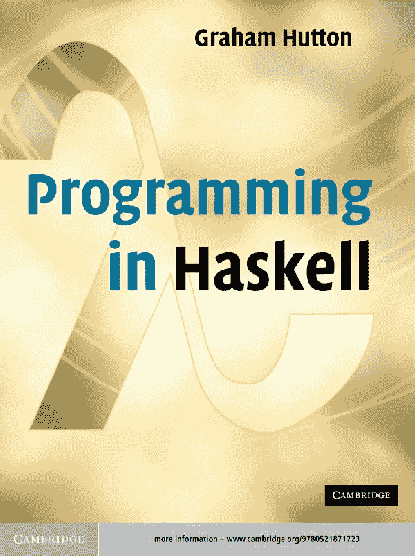

Haskell 是教授函数式编程的领先语言之一，它让学生能够编写更简单、整洁的代码，并学习如何对程序进行结构化和推理。

本入门教程非常适合初学者：它不需要任何编程经验，所有概念都将在精心挑选的示例帮助下从第一原理进行解释。每一章都包含了一系列练习，范围从基础练习到扩展项目不等，并提供了关于更高级主题的进一步阅读建议。内容呈现清晰易懂，并受益于多年来的精炼和课堂测试。

## 特性

- 每一章的 PowerPoint 幻灯片均从书籍网站免费供讲师和学生下载
- 练习题答案以及考试题（附答案）供讲师使用
- 书中的所有代码均完全符合最新的 Haskell 版本，并可从网上下载
- 由领先的 Haskell 研究人员和讲师编写，他以卓越的教学技巧而闻名
- 可用于课程，也可作为自学所需的独立教材

## 关于作者

Graham Hutton 曾在四个世界领先的函数式编程研究与教学中心工作过。他在函数式编程研究领域拥有 15 年以上的经验，在此期间发表了 30 多篇研究论文，担任 Haskell 研讨会主席，并编辑了《函数式编程期刊》的 Haskell 特刊。他在 Haskell 教学方面也拥有超过 10 年的经验，并在课程中推广函数式编程的使用。


*美国国会图书馆目录数据*

ISBN 978-0-521-87172-3 硬装本

- 前言
- 第 1 章 引言
    - 1.1 函数
    - 1.2 函数式编程
    - 1.3 Haskell 特性
    - 1.4 历史背景
    - 1.5 初略了解 Haskell
    - 1.6 章小结
    - 1.7 练习
- 第 2 章 初步
    - 2.1 Hugs 系统
    - 2.2 标准 Prelude
    - 2.3 函数应用
    - 2.4 Haskell 脚本
    - 2.5 章小结
    - 2.6 练习
- 第 3 章 类型与类
    - 3.1 基础概念
    - 3.2 基本类型
    - 3.3 列表类型
    - 3.4 元组类型
    - 3.5 函数类型
    - 3.6 柯里函数
    - 3.7 多态类型
    - 3.8 载载类型
    - 3.9 基础类
    - 3.10 章小结
    - 3.11 练习
- 第 4 章 定义函数
    - 4.1 绑定
    - 4.2 表达式
    - 4.3 守卫
    - 4.4 模式匹配
    - 4.5 Lambda 表达式
    - 4.6 递归
    - 4.7 章小结
    - 4.8 练习
- 第 5 章 列表推导式
    - 5.1 生成器
    - 5.2 过滤器
    - 5.3 组合
    - 5.4 排序
    - 5.5 章小结
    - 5.6 练习
- 第 6 章 高阶函数
    - 6.1 基础概念
    - 6.2 递归
    - 6.3 柯里
    - 6.4 互递归
    - 6.5 局部递归
    - 6.6
    - 6.7 章小结
    - 6.8 练习
- 第 7 章 蒙 ad
    - 7.1 基础概念
    - 7.2 列表
    - 7.3 foldr
    - 7.4 foldl
    - 7.5 组合
    - 7.6
    - 7.7 章小结
    - 7.8 练习
- 第 8 章 解析器
    - 8.1 解析器
    - 8.2 解析类型
    - 8.3 基础解析器
    - 8.4 序列化
    - 8.5 选择
    - 8.6 派生原语
    - 8.7 处理空格
    - 8.8 算术表达式
    - 8.9 章小结
    - 8.10 练习
- 第 9 章 交互式程序
    - 9.1 交互
    - 9.2 输入输出类型
    - 9.3 基础操作
    - 9.4 序列
    - 9.5 衍生原语
    - 9.6 计算器
    - 9.7 生命游戏
    - 9.8 章总结
    - 9.9 练习题
- 第 10 章 类型与类的声明
    - 10.1 类型声明
    - 10.2 数据声明
    - 10.3 递归类型
    - 10.4 恒等检查
    - 10.5 抽象机器
    - 10.6 类与实例声明
    - 10.7 章总结
    - 10.8 练习题
- 第 11 章 倒计时问题
    - 11.1 引言
    - 11.2 问题形式化
    - 11.3 暴力破解法
    - 11.4 结合生成与评估
    - 11.5 利用代数性质
    - 11.6 章总结
    - 11.7 练习题
- 第 12 章 惰性求值
    - 12.1 引言
    - 12.2 求值策略
    - 12.3 终止
    - 12.4 归次数
    - 12.5 无限结构
    - 12.6 模块化编程
    - 12.7 严格应用
    - 12.8 章总结
    - 12.9 练习题
- 第 13 章 程序推理
    - 13.1 等式推理
    - 13.2 关于 Haskell 的推理
    - 13.3 简单示例
    - 13.4 数归纳法
    - 13.5 列表归纳法
    - 13.6 实现 append
    - 13.7 编译器正确性
    - 13.8 章总结
    - 13.9 练习题
- 附录 A 标准
    - A.1 类
    - A.2 逻辑值
    - A.3 字符与字符串
    - A.4 数字
    - A.5 元组
    - A.6 Maybe
    - A.7 列表
    - A.8 函数
    - A.9 输入/输出
- 附录 B 符号
- 参考文献
- 索引

# 前言

… 构建软件设计有两种方法：一种方法是使其极其简单，以至于`显然`没有缺陷；另一种方法是使其极其复杂，以至于有显而易见的缺陷。第一种方法要困难得多。

Tony Hoare, 1980 ACM 图灵奖演讲

本书介绍的是一种编程方法，其中简单、清晰和优雅是核心目标。更具体地说，它是对函数式编程风格的介绍，并使用了 `Haskell` 语言。

函数式风格与大多数现有语言（如 `Java`、`C++` 和 `Visual Basic`）所推崇的风格非常不同。特别是大多数现有语言与底层硬件紧密相关，从这个意义上说，编程基于改变存储值的想法。相比之下，`Haskell` 推广了一种更抽象的编程风格，其基于将函数应用于参数的想法。正如我们所看到的，转向这种高层方法会让程序变得简单得多，并支持许多结构化和推理程序的强大新方法。

本书主要面向在大学水平学习计算机科学的学生，但也适用于许多想要学习 `Haskell` 编程的广泛读者。书中不需要也不假设读者具备之前的编程经验，所有概念都从第一原理开始，并借助精心挑选的示例进行解释。

书中使用的 `Haskell` 版本是 `Haskell 98`，该语言的标准版本，其最近发布的定义是设计者十五工作的结晶。由于这是一本入门读物，我们并未尝试涵盖 `Haskell` 及其库的所有方面。书中大约一半的内容用于介绍语言的主要特征，另一部分由 `Haskell` 编程的示例和案例研究组成。每章都包含一系列练习题，以及关于更高级和专业主题的进一步阅读建议。

本书基于诺丁汉姆大学多年提炼和课堂测试的课程材料。书中的大部分内容可以在 20 时的讲座中完成，并辅以约 40 小时的自学、受监督实验室的实操课程以及课后编程作业。然而，要详细涵盖后面的某些章节以及一些后期的编程示例，还需要额外的时间。

本书的网站提供了一系列辅助材料，包括每章的 PowerPoint 幻灯片以及每个扩展示例的 `Haskell` 代码。教师可以通过发送邮件到 `solutions@cambridge.org` 获取每章练习题的标准答案，以及大量的考试题及其标准答案。

# 致谢

诺丁汉姆大学的编程基础（Foundations of Programming）小组是一个进行函数式编程研究和教学的卓越环境。感谢大学提供假期让我编写这本书；感谢我 `Haskell` 课程的所有学生和导师提供的反馈；感谢 `FOP` 小组的 Thorsten Altenkirch、Neil Ghani、Mark Jones（现任于波特兰州立大学）、Conor McBride 和 Henrik Nilsson，我们就函数式理念以及如何展示这些理念进行了多次讨论。

我还要感谢 David Tranah 和 Dawn Preston 在剑桥大学出版社的编辑工作；感谢 Mark Jones 为 `Haskell` 提供的 `Hugs` 解释器；感谢 Ralf Hinze 和 Andres Löh 用于排版 `Haskell` 的 `lhs2TeX` 系统；感谢 Rik van Geldrop 和 Jaap van der Woude 对本书草稿的反馈；感谢 Kees van den Broek、Frank Heitmann 和 Bill Tonkin 指出错误；感谢 Ian Bayley 和匿名评审者的有用建议；以及感谢 Joel Wright 为倒计时程序计时。

Graham Hutton

诺丁汉姆，2006

# 第 1 章 引言

在本章中，我们为全书奠定基础。我们首先回顾函数概念，然后介绍函数式编程的概念，概述 `Haskell` 的主要特征及其历史，并以两个让读者领略 `Haskell` 魅力的小示例作为结束。


## 1.1 函数

在 Haskell 中，`function`（函数）是一个接收一个或多个参数并产生单个结果的映射。它通过一个方程定义，该方程为函数指定一个名称，为每个参数指定一个名称，并指定一个根据参数计算结果的体。

例如，一个接受数字 `x` 作为参数并产生结果 `x + x` 的函数 `double` 可以通过以下方程定义：

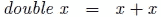

当将函数应用于实际参数时，通过将这些参数替换到函数体中对应参数的位置来获得结果。这个过程可能会立即产生一个无法进一步简化的结果（例如一个数字）。然而，更常见的情况是，结果是一个包含其他函数调用的表达式，这些表达式必须以相同的方式处理以产生最终结果。

例如，将函数 `double` 应用于数字 `3` 的应用 `double 3` 的结果可以通过以下计算确定，其中每一步都由大括号中的短注释进行了解释：

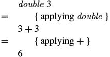

同样，嵌套应用 `double (double 2)`（即两次应用函数 `double`）的结果可以如下所示计算：

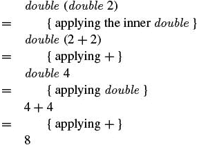

或者，也可以从函数 `double` 的外部应用开始而不是内部应用来计算相同的结果：

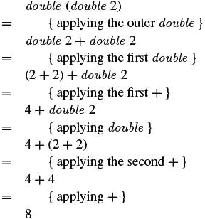

然而，这种计算比我们的原始版本多两个步骤，因为表达式 `double 2` 在第一步中被复制了，因此被简化了两次。通常情况下，在计算中应用函数的顺序不会影响最终结果的值，但它可能会影响所需的步骤数，并可能影响计算过程是否终止。这些问题在第 12 章中进行了更详细的探讨。


## 1.2 函数式编程

什么是函数式编程？观点不一，很难给出一个精确的定义。总的来说，函数式编程可以被视为一种编程 `style`（风格），其中基本的计算方法是将函数应用于参数。反之，函数式编程语言是那种`支持`并`鼓励`函数式风格的语言。

为了说明这些思想，让我们考虑计算 1 到某个较大数字 `n` 之间整数（整数）和的任务。在大多数目前的编程语言中，这通常通过两个存储可随时间改变值的变量来实现，一个变量用于计数到 `n`，另一个变量用于累加总和。

例如，如果我们使用赋值符号 `:=` 来改变变量的值，并使用关键字 `repeat` 和 `until` 重复执行一系列指令直到满足某个条件，那么下面的指令序列就计算了所需的和：

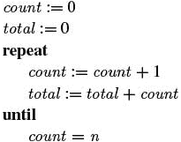

也就是说，我们首先将计数器和总和初始化为零，然后不断增加计数器并将此值加到总和中，直到计数器达到 `n`，此时计算停止。

在上面的程序中，基本的计算方法是改变存储的值，从这个意义上说，执行程序会导致一系列赋值。例如，`n = 5` 的情况给出以下序列，其中赋值给变量 `total` 的最终值就是所需的和：

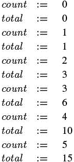

通常，以改变存储的值作为基本计算方法的编程语言被称为 `imperative`（命令式）语言，因为此类语言中的程序是由命令指令构建的，这些指令精确地指定了计算应该如何进行。

现在让我们考虑使用 Haskell 计算 1 到 `n` 之间数字的和。这通常通过两个库函数实现，一个名为 `[....]`，用于生成 1 到 `n` 之间的数字列表，另一个名为 `sum`，用于生成该列表之和：

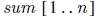

在这个程序中，基本的计算方法是**将函数应用于参数**，从这个意义上说，执行程序会导致一系列应用（applications）。例如，`n = 5` 的情况给出以下序列，其中最终结果就是所需的和：

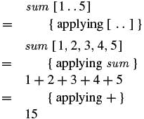

大多数命令式语言都支持某种形式的函数编程，因此 Haskell 程序 `sum [1..n]` 可以翻译成此类语言。然而，大多数命令式语言并不`鼓励`函数式风格编程。例如，许多语言不鼓励或禁止将函数存储在列表等数据结构中，禁止构建中间结构（如上述示例中的数字列表），禁止将函数作为参数或产生函数作为结果，或者禁止以自身定义函数。相比之下，Haskell 对函数的用法没有施加此类限制，并提供了一系列特性使得使用函数编程既简单又强大。


## 1.3 Haskell 的特性

作为参考，Haskell 的主要特性列在下方，以及本书中提供更多细节的特定章节。

- **简洁的程序**（第 2 章 和 第 4 章）

由于函数式风格的高级特性，用 Haskell 编写的程序通常比其他语言要 `concise`（简洁）得多。此外，Haskell 的语法设计考虑了简洁的程序，特别是通过较少的关键字，以及允许使用缩进来指示程序的结构。虽然很难进行客观比较，但 Haskell 程序通常比其他语言的程序短两倍到十倍。

- **强大的类型系统**（第 3 章 和 第 10 章）

大多数现代编程语言都包含某种形式的 `type system`（类型系统）以检测不兼容错误，例如尝试将一个数字和一个字符相加。Haskell 的类型系统对程序员要求的类型信息很少，但允许通过一种称为类型推导的复杂过程，在执行之前自动检测程序中的一大类不兼容错误。Haskell 类型系统也比大多数目前的语言更强大，它允许函数是“多态的”（polymorphic）和“重载的”（overloaded）。

- **列表推导式**（第 5 章）

计算中结构和处理数据的常见方法之一是使用列表。为此，Haskell 将列表作为语言中的基本概念，并提供了一种简单但强大的 `comprehension`（推导）符号，该符号通过从一个或多个列表中选择和过滤元素来构造新列表。使用推导式可以以清晰简洁的方式定义许多列表函数，而不需要显式递归。

- **递归函数**（第 6 章）

大多数非平凡程序都涉及某种形式的重复或循环。在 Haskell 中，实现循环的基本机制是使用用自身定义的 `recursive`（递归）函数。许多计算用递归函数定义时非常简单且自然，特别是当使用“模式匹配”（pattern matching）和“守卫”（guards）将不同的情况分离到不同的方程时。

- **高阶函数**（第 7 章）

Haskell 是一种高阶函数语言，这意味着函数可以自由地将函数作为参数，并产生函数作为结果。使用高阶函数允许将常见的编程模式（例如组合两个函数）在语言内部定义为函数。更通用地说，高阶函数可以用于在 Haskell 中定义“领域特定语言”，例如用于列表处理、解析和交互式编程。

- **Monadic 效应**（第 8 章 和 第 9 章）

Haskell 中的函数是纯函数，它们接受所有输入作为参数，并将所有输出作为结果。然而，许多程序需要某种形式的副作用，这些副作用似乎与纯洁性相驰，例如在程序运行时从键盘读取输入或向屏幕写入输出。Haskell 提供了一个基于数学概念单 ad（monad）的统一框架，用于处理效应，且不会损害函数的纯洁性。

- **惰性求值**（第 12 章）

Haskell 程序的执行使用一种被称为“惰性求值”的技术，该技术基于这样一个想法：在结果被实际需要之前，不应执行任何计算。惰性求值不仅避免了不必要的计算，还确保了程序尽可能地终止，鼓励使用中间数据结构进行模块化风格编程，甚至允许具有无限数量元素的数据结构（例如，无限数字列表）。

- **对程序进行推理**（第 13 章）

由于 Haskell 中的程序是纯函数，因此可以使用简单的等式推理来执行程序、转换程序、证明程序的属性，甚至可以从行为规范中直接推导出程序。当等式推理与使用“归纳法”对使用递归定义的函数进行推理相结合时，尤为强大。


## 1.4 历史背景

Haskell 的许多特性并不是新的，而是最初由其他语言引入的。为了帮助理解 Haskell 的背景，下面简要总结了与该语言的一些主要历史发展：

- 20 世纪 30 年代，阿隆佐·丘奇（Alonzo Church）开发了 lambda 演算，这是一种简单但强大的函数数学理论。
- 20 世纪 50 年代，约翰·麦卡西（John McCarthy）开发了 Lisp（“列表处理器”），被认为第一种函数式编程语言。Lisp 受到 lambda 演算的一些影响，但仍将变量赋值作为语言的核心特征。
- 20 世纪 60 年代，彼得·兰丁（Peter Landin）开发了 ISWIM（“如果你能明白我的意思”），这是第一种纯函数编程语言，它高度基于 lambda 演算且没有变量赋值。
- 20 世纪 70 年代，约翰·巴克斯（John Backus）开发了 FP（函数式编程），这是一种特别强调高阶函数思想和对程序进行推理的函数编程语言。


同样在 20 世纪 70 年代，罗宾·米尔纳（Robin Milner）等人开发了 ML（“元语言”），这是现代函数编程语言中的第一个，它引入了多态类型和类型推断的概念。

20 世纪 70 年代和 80 年代，大卫·特纳（David Turner）开发了若干惰性函数编程语言，最终产生了商业化的语言 Miranda（意为“令人赞叹的”）。

1987 年，一个国际研究人员小组启动了 Haskell 的开发（以逻辑学家 Haskell Curry 命名），这是一门标准的惰性函数编程语言。

2003 年，委员会发布了《Haskell 报告》，定义了期待已久的 Haskell 稳定版本，这是设计者对该语言进行十五年工作的结晶。

值得注意的是，上述三位研究人员——麦卡西、巴克斯和米尔纳——都分别获得了 ACM 灵灵奖，该奖通常被认为是计算领域的诺贝尔奖。


## 1.5 初探 Haskell

我们用两个小示例来结束本章，以让读者领略在 Haskell 中进行编程的氛围。首先，回想在本章之前使用的 `sum` 函数，它产生一个数字列表的和。在 Haskell 中，可以使用以下两个方程来定义该函数：

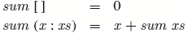

第一个方程说明空列表之和为零，而第二个方程说明任何由第一个数字 `x` 和剩余数字列表 `xs` 组成的非空列表之和，通过将 `x` 与 `xs` 之和相加得到。例如，`sum [1, 2, 3]` 的结果计算如下：

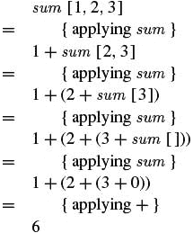

注意，尽管函数 `sum` 是根据自身定义的，因此是递归的，但它不会无限循环。特别是，每次应用 `sum` 都会将参数列表的长度减一，直到列表最终变为空，此时递归停止。返回零作为空列表的和是合适的，因为零是加法的恒等元。也就是说，对于任何数字 `x`，`0 + x = x` 且 `x + 0 = x` 成立。

在 Haskell 中，每个函数都有一个类型，指定了其参数和结果的性质，该类型是从函数定义自动推断出来的。例如，`sum` 函数具有以下类型：

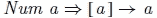

该类型说明，对于任何类型 `a` 的数字，`sum` 是一个将此类数字列表映射到单个此类数字的函数。Haskell 支持许多不同类型的数字，包括如 `123` 等整数以及如 `3.14159` 这样的“浮点”数。因此，`sum` 可以应用于整数列表（如上面的计算所示），也可以应用于浮点数列表。

类型提供了关于函数性质的有用信息，更重要的是，类型的使用允许在执行程序之前自动检测程序中的许多错误。特别是对于程序中的每次函数调用，都会检查实际参数的类型与函数类型是否兼容。例如，尝试将 `sum` 函数应用于字符列表将报告为错误，因为字符不是数字类型。

现在，让我们考虑一个关于列表的有趣的函数，它展示了 Haskell 的其他方面。假设我们通过以下两个方程定义了一个名为 `qsort` 的函数：

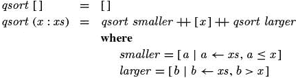

在这个定义中，`++` 是连接两个列表的运算符；例如，`[1, 2, 3] ++ [4, 5] = [1, 2, 3, 4, 5]`。与其相反，`where` 是一个引入局部定义的关键字，在这种情况下，列表 `smaller` 由列表 `xs` 中所有小于或等于 `x` 的元素组成，列表 `larger` 则由 `xs` 中所有大于 `x` 的元素组成。例如，如果 `x = 3` 且 `xs = [5, 1, 4, 2]`，那么 `smaller = [1, 2]` 且 `larger = [5, 4]`。

`qsort` 实际上做了什么？首先，我们证明它对单元素列表没有影响，意味着对于任何 `x`，`qsort [x] = [x]`。

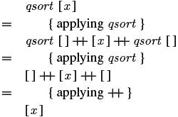

随后，我们现在推演 `qsort` 应用于示例列表的过程，利用上述属性简化计算：

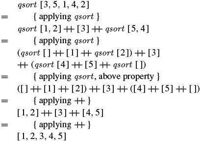

总之，`qsort` 已将示例列表按数值顺序进行了排序。更通地说，此函数可以产生任何数字列表的排序版本。`qsort` 的第一个方程表示空列表已经是有序的，而第二个方程表示任何非空列表都可以通过将第一个数字插入到其余数字按该数字的 `smaller` 和 `larger` 排序后产生的两个列表之间完成排序。这种排序方法被称为 `quicksort`（快速排序），是已知的此类方法最好的之一。

上述快速排序的实现是 Haskell 力的极佳示例，既清晰又简洁。此外，`qsort` 函数比预想的更为通用，它不仅适用于数字，还适用于任何类型的有序值。更精确地说，该类型

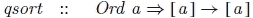

表示对于任何类型有序值的类型 `a`，`qsort` 是一个在此类值的列表之间进行映射的函数。Haskell 支持许多不同的有序值类型，包括数字、单个字符（如 `'a'`）以及字符字符串（如 `"abcde"`）。因此，例如 `qsort` 函数也可以用于字符列表或字符串列表的排序。


### 1.6 章节备注

《Haskell 报告》可以在 Haskell 主页 `[www.haskell.org](http://www.haskell.org)` 免费获取，并已作为书籍出版 (25)。关于函数式编程语言发展的更详细的历史描述请见 Hudak 的综述文章 (11)。


### 1.7 练习

**1.** 为 `double` 的结果（`double 2`）给出另一种可能的计算方法。

**2.** 证明对于任何数字 `x`，`sum [x] = x`。

**3.** 定义一个函数 `product` 生成数字列表的乘积，并使用你的定义证明 `product [2, 3, 4] = 24`。

**4.** 应该如何修改函数 `qsort` 的定义，使其产生列表的 `reverse` 排序版本？

**5.** 在 `qsort` 的定义中将 `≤` 替换为 `<` 会有什么影响？提示：考虑示例 `qsort [2, 2, 3, 1, 1]`。

# 第 2 章

## 第一步

在本章中，我们将开始迈出 Haskell 的第一步。我们首先介绍 Hugs 系统和标准预定义（prelude），然后解释函数应用的表示法，编写我们的第一个 Haskell 脚本，并以讨论关于脚本的若干语法约定作为结束。


### 2.1 Hugs 系统

正如我们在上一章所看到的，小型 Haskell 程序可以手动执行。但在实践中，我们通常需要一个可以自动执行程序的系统。在本书中我们使用一个名为 `Hugs` 的交互式系统，它是最广泛使用的 Haskell 实现。

Hugs 的交互性质使其非常适合教学和原型设计，其性能也足以大多数应用。然而，如果需要更高的性能或程序的独立执行版本，还有许多 Haskell 编译器可用，其中最常用的是格拉斯哥 Haskell 编译器（Glasgow Haskell Compiler）。该编译器也有一个交互版本，其运行方式与 Hugs 类似，可以方便地在书中替代它。


### 2.2 标准预定义

当 Hugs 系统启动时，它首先加载一个名为 `Prelude.hs` 的库文件，然后显示 `>` 提示，表示系统正在等待用户输入要求值的表达式。例如，该库文件定义了许多处理整数的熟悉函数，包括五种主要的算术运算：加、减、乘、除和幂运算，如下所示：

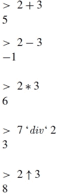

注意，整数除法操作符写为 `div`，如果结果是真分数，它将向下取整到最近的整数。

按照通常的数学惯，幂运算的优先级高于乘法和除法，而乘除法的优先级又高于加法和减法。例如，`2 * 3 ↑ 4` 意味着 `2 * (3 ↑ 4)`，而 `2 + 3 * 4` 意味着 `2 + (3 * 4)`。此外，幂运算向右结合（括号），而其他四种算术运算符向左结合。例如，`2 ↑ 3 ↑ 4` 意味着 `2 ↑ (3 ↑ 4)`，而 `2 − 3 + 4` 意味着 `(2 − 3) + 4`。但在实践中，在此类算术表达式中使用显式的括号通常比依赖上述约定更清晰。

除了处理整数的函数外，库文件还提供了一系列处理列表的有用函数。在 Haskell 中，列表的元素包含在方括号中，并用逗号分隔。下面是一些最常用的列表库函数。

• 选择非空列表的第一个元素：

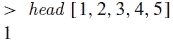

• 从非空列表中移除第一个元素：

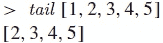

• 选择列表的第 *n* 个元素（从零开始计数）：

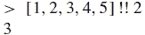

• 从列表中选择 *n* 个元素：

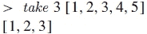

• 从列表中移除 *n* 个元素：

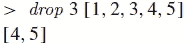

• 计算列表的长度：

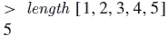

• 计算列表的和：

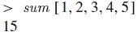

• 计算列表的乘积：

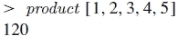

• 合并两个列表：

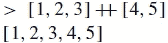

• 反转列表：

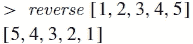

标准预定义中的某些函数会对特定值产生错误。例如，除以零或选择空列表的第一个元素将产生错误：

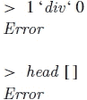

在实践中，当发生错误时，Hugs 系统还会产生关于可能原因的信息。

作为参考，附录 A 给出了标准预定义一些常用的定义，附录 B 显示了如何使用普通键盘输入 `↑` 和 `++` 等 Haskell 符号。


### 2.3 函数应用

在数学中，函数对其参数的应用通常用括号包裹参数表示，而两个值的乘法通常用隐式表示，即将两个值写在一起。例如，在数学中，表达式

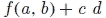

意味着将函数 `f` 应用于参数 `a` 和 `b`，并将结果与 `c` 和 `d` 的积相。反映其在语言中的主要地位，Haskell 中的函数应用使用空格隐式表示，而两个值的乘法使用 `*` 显式表示。例如，上面的表达式在 Haskell 中写如下：

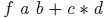

此外，函数应用的优先级高于所有其他运算符。例如，`f a + b` 意味着 `(f a) + b`。下表提供了更多示例，说明数学和 Haskell 中函数应用表示法的区别：

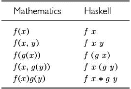

注意，上面的 Haskell 表达式 `f (g x)` 仍然需要括号，因为 `f g x` 将会被解释为将函数 `f` 应用于两个参数 `g` 和 `x`，而意图是将 `f` 应用于一个参数，即函数 `g` 应用于参数 `x` 的结果。类似的说明也适用于表达式 `f x (g y)`。

除了标准预定义（prelude）提供的函数外，还可以定义新函数。新函数不能在 Hugs 的 `>` 提示符下定义，而必须在*脚本*（script）中定义，脚本是一个由一系列定义组成的文本文件。按照习惯，Haskell 脚本的文件通常以 `.*hs` 结尾，以便与其他类型的文件区分来。

# 我的第一个脚本

在开发 Haskell 脚本时，保持两个窗口打开是有用的：一个窗口运行脚本的编辑器，另一个窗口运行 Hugs。例如，假设我们启动一个文本编辑器并输入了以下两个函数定义，并将脚本保存为名为 `test.hs` 的文件：

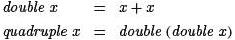

相应地，假设我们保持编辑器打开，在另一个窗口中启动 Hugs 系统并指示它加载新脚本：


现在 `Prelude.hs` 和 `test.hs` 都已加载，可以自由使用这两个脚本中的函数。例如：

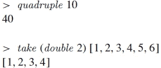

现在假设我们保持 Hugs 打开，回到编辑器，在已输入的后面添加以下两个函数定义，然后重新保存文件：

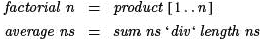

我们同样可以定义 `average ns = div (sum ns) (length ns)`，但在两个参数之间编写 `div` 更为自然。通常情况下，任何带有两个参数的函数都可以通过将函数名括在单引号 `'` 之间来写在它的两个参数之间。

Hugs 不会在脚本被修改时自动重新加载它们，因此在使用新定义之前，必须执行重加载命令：

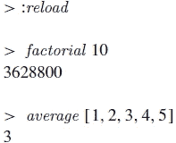

作为参考，下表总结了一些最常用的 Hugs 命令的含义。注意，任何命令都可以用其第一个字母缩写。例如，`:load` 可以缩写为 `:l`。`:type` 命令将在下一节中更详细地解释。

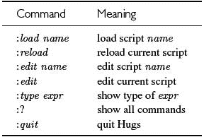

# 命名要求

在定义新函数时，函数名及其参数名必须以小写字母开头，随后可以跟随零或多个字母（包括大小写）、数字、下划线和正斜单引号。例如，以下都是有效的名称：

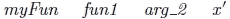

以下*关键词*（keywords）在语言中具有特殊含义，不能作为函数或参数的名称：

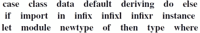

按照习惯，Haskell 中的列表参数名通常以后缀 `s` 结尾，以表示它们可能包含多个值。例如，数字列表可以命名为 `ns`，任意值的列表可以命名为 `xs`，字符列表的列表可以命名为 `css`。

# 布局规则

在脚本中，每个定义必须在恰好相同的列上开始。这种*布局规则*（layout rule）使得能够根据缩进确定定义的分组。例如，在脚本中：

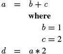

从缩进可以清楚地看出 `b` 和 `c` 是在 `a` 体内部使用的局部定义。如果需要，可以通过将一系列定义括在花括号中并用分号分隔每个定义来显式地进行这种分组。例如，上面的脚本也可以写成：

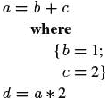

然而，通常依赖布局规则来确定定义的分组比使用显式语法更清晰。

# 注释

除了新定义外，脚本还可以包含会被 Hugs 忽略的注释。Haskell 提供了两种注释，称为*普通注释*（ordinary）和*嵌套注释*（nested）。普通注释以符号 `--` 开始，并延伸到当前行尾，如下例所示：

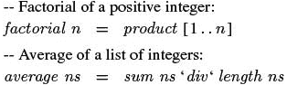

嵌套注释以符号 `{-` 和 `-}` 开始和结束，可以跨越多行，并且可以是可以嵌套的，即注释可以包含其他注释。嵌套注释对于临时从脚本中移除部分定义特别有用，如下例所示：

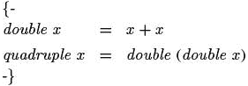


## 2.5 章节备注

Hugs 系统可以在 Haskell 主页 `[www.haskell.org](http://www.haskell.org)` 在网上免费获取，那里还包含许多其他有用资源。


## 2.6 练习

**1.** 为以下算术表达式加括号：

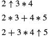

**2.** 使用 Hugs 完成本章的示例。

**3.** 下面的脚本包含三个语法错误。修正这些错误，然后使用 Hugs 检查你的脚本是否正常工作。

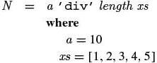

**4.** 展示选择非空列表最后一个元素的库函数 `last` 是如何根据本章介绍的函数来定义的。你能想出另一种可能的定义吗？

**5.** 展示如何用两种方式来定义从非空列表中删除最后一个元素的库函数 `init`。

# 3 类型与类

在本章中我们将介绍类型（types）和类（classes），这是 Haskell 中两个最基础的概念。我们首先解释什么是类型以及它们如何在 Haskell 中使用，然后介绍若干基本类型以及通过组合类型构建构建类型的方法，详细讨论函数类型，并以多态类型和类型类结束。


## 3.1 基本概念

*类型*是一组相关的值。例如，类型 `Bool` 包含值 `False` 和 `True`，而类型 `Bool → Bool` 包含所有从 `Bool` 到 `Bool` 的函数，例如逻辑取反 `¬`。我们使用符号 `υ :: T` 表示 `υ` 是类型 `T` 中的值，并说 `υ` “类型为” `T`。例如：

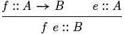


例如，`¬ False :: Bool` 的类型可以通过该规则利用 `¬ :: Bool → Bool` 和 `False :: Bool` 的事实推断出来。相反，表达式 `¬ 3` 在上述函数应用规则下没有类型，因为这要求 `3 :: Bool`，这是无效的，因为 3 不是逻辑值。像 `¬ 3` 这样没有类型的表达式被认为包含类型错误，并被视为无效表达式。

由于类型推断发生在求值之前，Haskell 程序是*类型安全的*（type safe），这意味着在求值过程中永远不会发生类型错误。实践中，类型推断可以检测出一大类程序错误，是 Haskell 最有用的特性之一。然而注意，使用类型推断并不能消除求值过程中可能发生其他种类错误的可能性。例如，表达式 `1 div 0` 没有类型错误，但在求值时因为除以零是未定义的而会产生错误。

类型安全的缺点是，某些执行结果的表达式会因为类型原因被拒绝。例如，条件表达式 `if True then 1 else False` 的求值结果为数字 1，但它包含类型错误，因此被认为无效。特别是，条件表达式的类型规则要求两种可能的结果都具有相同的类型，而在这种情况下，第一个结果 1 是一个数字，而第二个结果 `False` 是一个逻辑值。然而，在实践中，程序员很快学会了如何在类型系统的限制内工作并避免此类问题。

在 Hugs 中，可以通过在表达式前加上命令 `:type` 来显示任何表达式的类型。例如：

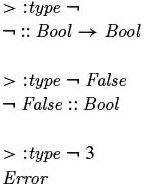


## 3.2 基础类型

Haskell 提供了若干种内置于语言的基础类型，其中最常用的类型描述如下。

* `Bool` – **逻辑值**

该类型包含两个逻辑值 `False` 和 `True`。

* `Char` – **单个字符**

该类型包含从普通键盘可以获得的所有单个字符，例如 ’a', 'A', '3' 和 '_'，以及若干具有特殊效果的控制字符，如 `'\n'`（移动到新行）和 `'\t'`（移动到下一个制表位）。与大多数编程语言的标准一样，单个字符必须包含在单引号 `' '` 之间。

* `String` – **字符字符串**

该类型包含所有字符序列，例如 `"abc"`、`"1+2=3"` 和空字符串 `""`。同样，与大多数编程语言的标准一样，字符字符串必须包含在双引号 `" "` 之间。

* `Int` – **固定整数**

该类型包含如 −100、0 和 999 等整数，使用固定量的计算机内存进行存储。例如，Hugs 系统中类型为 `Int` 的值范围在 −2³¹ 到 2³¹ – 1 之间。超出此范围可能会得到意料之外的结果。例如，在 Hugs 中求值 `2 ↑ 31 :: Int`（使用 `::` 强制结果为 `Int` 而不是其他数值类型）会得到一个负数作为结果，这是错误的。

* `Integer` – **任意精度整数**

该类型包含所有整数，根据需要使用大量的内存进行存储，从而避免了对数值范围设置上下限。例如，在任何 Haskell 系统中求值 `2 ↑ 31 :: Integer` 都会产生正确的结果。

除了 `Int` 和 `Integer` 类型在内存需求和精度上的不同外，这两个类型之间的选择还涉及性能问题。特别是，大多数计算机内置用于处理固定精度整数的硬件，而任意精度整数通常必须使用较慢的软件媒介（作为数字序列）进行处理。

* `Float` – **单精度浮点数**

该类型包含带有小数点的数字，如 −12.34、1.0 和 3.14159，使用固定量的内存进行存储。*浮点*一词源于小数点后允许的数字个数取决于数字的大小。例如，在 Hugs 中求值 `sqrt 2 :: Float` 得到结果 1.41421（库函数 `sqrt` 计算数字的平方根），其小数点后有五位，而 `sqrt 99999 :: Float` 得到 316.226，小数点后只有三位。使用浮点数编程是一项需要仔细处理舍入误差的专业课题，我们在介绍性文本中对这类数字不再作赘述。

在本节结束处，我们注意到一个数字可能有多个数值类型。例如，`3 :: Int`、`3 :: Integer` 和 `3 :: Float` 都是数字 3 的有效类型。这引发了一个有趣的问题：在类型推断期间应该给这些数字分配什么类型，这将在本章后面考虑类型类时给出答案。


## 3.3 列表类型

*列表*是相同类型*元素*的序列，元素包含在方括号中并用逗号分隔。我们用 `[T]` 表示所有元素类型为 `T` 的列表的类型。例如：

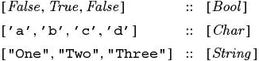

列表中元素的数量称为其*长度*。长度为零的列表 `[]` 称为空列表，而长度为一的列表（如 `[False]` 和 `['a']`）称为单元素列表。注意 `[[]]` 和 `[]` 是不同的列表，前者是一个以空列表作为唯一元素的单元素列表，后者仅仅是空列表。

关于列表类型还有另外三点需要注意。首先，列表的类型没有传递任何关于其长度的信息。例如，列表 `[False, True]` 和 `[False, True, False]` 的类型均为 `[Bool]`，尽管它们的长度不同。其次，列表元素的类型没有限制。目前我们能提供的示例范围受到限制，因为到目前为止引入的唯一非基础类型是列表，但我们可以拥有列表的列表，例如：


最后，列表没有长度限制。由于惰性求值的使用，无限长度的列表是自然且实用的，我们将在第 12 章看到。


## 3.4 元组类型

*元组*是可能不同组件的有限序列，组件包含在括号中并用逗号分隔。我们用 `(T[1], T[2], ..., T[n])` 表示所有第 *i* 个组件类型为 `T[i]` 的元组类型。例如：

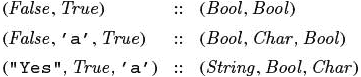

元组中组件的数量称为其*元数*。元数为零的元组 `()` 称为空元组，元数为二的元组称为对，元数为三的元组称为三元组，以此类推。不允许元数为一的元组（如 `(False)`），因为会与使用括号表示求值顺序的做法冲突，例如 `(1 + 2)`。

与列表类型一样，元组类型还有三点需要注意。首先，元组的类型传递了它的元数。例如，类型 `(Bool, Char)` 包含了所有的 `Bool` 和 `Char` 对。其次，元组组件的类型没有限制。例如，我们可以拥有元组的元组、元组的列表以及列表的元组：

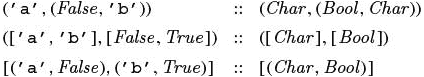

最后，注意元组必须具有有限的元数，以确保在求值之前总是计算元组类型。


## 3.5 函数类型

*函数*是从一种类型到另一种类型的映射。我们用 `T1 → T2` 表示所有从类型 `T1` 映射到类型 `T2` 的函数的类型。例如：

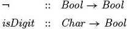

(库函数 `isDigit` 判断字符是否为数字字符。) 由于函数的参数和结果的类型没有限制，单参数和单结果的函数简单概念已经足够处理多个参数和结果，只需通过使用列表或元组对多个值进行打包。例如，我们可以定义一个函数 `add` 来计算一对整数之和，并定义一个函数 `zeroto` 来返回从零到给定限制的整数列表，如下：


在这些示例中，我们遵循了 Haskell 的惯例，即在函数定义之前列出它们的类型，这可以起到有用的文档作用。任何由用户手动提供的此类类型都会被检查是否与使用类型推断自动计算出的类型保持一致。

请注意，并没有限制函数在其参数类型上必须是 `total`（全备的），这意味着对于某些参数，其结果可能是未定义的。例如，选择列表第一个元素的库函数 `head`，如果列表为空，其结果是未定义的。


## 3.6 柯里函数 (Curried functions)

具有多个参数的函数也可以通过另一种可能不那么直观的方式来处理，即利用函数可以自由返回函数作为结果这一事实。例如，考虑以下定义：


该类型表示 `add'` 是一个接受 `Int` 类型参数的函数，并返回一个类型为 `Int → Int` 的函数结果。定义本身表示 `add'` 接收一个整数 `x`，后接一个整数 `y`，并返回结果 `x + y`。更准确地说，`add'` 接收一个整数 `x` 并返回一个函数，该函数再次接收一个整数 `y` 并返回结果 `x + y`。

请注意，函数 `add'` 产生的最终结果与上一节中的函数 `add` 相同，但 `add` 同时以成对打包的形式接收它的两个参数，而 `add'` 是一接一个地接收它的两个参数，这反映在两个函数的不同类型上：


具有两个以上参数的函数也可以使用相同的技术处理，通过返回返回函数的函数，以此此类推。例如，一个接受三个整数（一个一个）并返回其乘积函数 `mult` 可以定义如下：


该定义表示 `mult` 接收一个整数 `x` 并返回一个函数，该函数再次接收一个整数 `y` 并返回另一个函数，该函数最后接收一个整数 `z` 并返回结果 `x * y * z`。

像 `add'` 和 `mult` 这样一个一个接收参数的函数被称为 `柯里化` (curried)。柯里化函数本身很有趣，而且比元组组函数更灵活，因为通常可以通过`部分应用` (partially applying) 柯里化函数少于其全部的参数来创建有用的函数。例如，一个增加整数的函数是通过柯里化函数 `add'` 仅对其两个参数之一进行部分应用 `add' 1 :: Int → Int` 得到的。

为了在处理柯里化函数时避免过多的括号，采用了两个简单的惯例。首先，类型中的函数箭头 `→` 假设是右结合的。例如，


意味着


因此，使用空格隐式表示的函数应用被假设为左结合。例如，


意味着


除非显式要求元组，否则 Haskell 中所有多参数的函数通常都定义为柯里化函数，并使用上述两个惯例来减少所需的括号。


## 3.7 多态类型 (Polymorphic types)

库函数 `length` 计算任何列表的长度，无论列表元素的类型如何。例如，它可以用于计算整数列表的长度、字符串列表，甚至是函数列表的长度：


`length` 可以应用于元素具有任何类型的列表的这一想法，在其类型中通过包含一个`类型变量` (type variable) 来精确化。类型变量必须以小写字母开头，通常简单命名为 `a`、`b`、`c` 等。例如，`length` 的类型如下：


也就是说，对于任何类型 `a`，函数 `length` 的类型为 `[a] → Int`。包含一个或多个类型变量的类型被称为`多态的` (polymorphic，"多种形式的"），具有这种类型的表达式也是如此。因此，`[a] → Int` 是多态类型，`length` 是多态函数。更通地说，标准 prelude 中提供的许多函数都是多态的。例如：


## 3.8 重载类型 (Overloaded types)

算术运算符 `+` 计算任意相同数值类型的数字之和。例如，它可以用于计算两个整数之和，或两个浮点数之和：


`+` 可以应用于任何数值类型数字的这一想法在其类型中通过包含一个`类约束` (class constraint) 来精确化。类约束以 `C a` 的形式写入，其中 `C` 是类名，`a` 是类型。

所有的基础类型 `Bool`、`Char`、`String`、`Int`、`Integer` 和 `Float` 都是 `Show` 类的实例，列表类型和元组类型也是，只要它们的元素类型和组件类型是该类的实例。例如：


### `Read` – 可读类型

该类是 `Show` 的对立类，包含了值可以通过以下方法从字符字符串转换为类型：


所有的基础类型 `Bool`、`Char`、`String`、`Int`、`Integer` 和 `Float` 都是 `Read` 类的实例，列表类型和元组类型也是，只要它们的元素类型和组件类型是该类的实例。例如：


这些示例中的 `::` 用于用于解析结果的类型。在实践中，必要的类型信息通常可以从上下文自动推断。例如，表达式 `¬ (read "False")` 不需要显式的类型信息，因为逻辑否定函数 `¬`的应用意味着 `read "False"` 必须是类型 `Bool`。

注意，如果 `read` 的参数在语法上无效，则其结果是未定义的。例如，表达式 `¬ (read "hello")` 在求值时产生错误，因为 `"hello"` 不能被视为逻辑值。

### `Num` – 数值类型

该类包含了相等类 `Eq` 和显示类 `Show` 实例的类型，并且其值是数值，因此可以使用以下六种方法进行处理：


（方法 `negate` 返回数的负数，`abs` 返回绝对值，而 `signum` 返回符号。）基础类型 `Int`、`Integer` 和 `Float` 是 `Num` 类的实例。例如：


注意 `Num` 类没有提供除法方法，但正如我们现在将看到的，除法是通过两个特殊类单独处理的，一个用于整数，另一个用于分数。

### `Integral` – 整数类型

该类包含了数值类 `Num` 实例的类型，并且其值是整数，因此支持整数除法和整数取模的方法：


在实践中，这两个方法通常通过用单引号将名称包含在两个参数之间来编写。基础类型 `Int` 和 `Integer` 是 `Integral` 类的实例。例如：


出于效率考虑，一些涉及列表和整数的预定义函数（如 `length`、`take` 和 `drop`）限制为有限精度整数类型 `Int`，而不是适用于 `Integral` 类的任何实例。然而，如果需要，这些函数的泛型版本作为名为 `List.hs` 的额外库文件的一部分。

### `Fractional` – 分数类型

该类包含了数值类 `Num` 实例的类型，并且其值是非整数，因此支持分数除法和分数倒数的方法：


基础类型 `Float` 是 `Fractional` 类的实例。例如：


#### 3.10 章节备注

逻辑值类型的 `Bool` 一术是为了纪念乔治·布尔（George Boole）在符号逻辑方面的开创性工作，而逐个接收参数的函数术 `curried`是为了纪念哈斯凯·柯里（Haskell 语言本身以此命名）对此类函数的贡献。关于类型系统的更详细描述见 Haskell Report (25)，而为专业人士提供的正式描述可以在 (20; 6) 中找到。


#### 3.11 习题

**1.** 以下值的类型是什么？


**2.** 以下函数的类型是什么？


提示：如果函数是使用重载运算符定义的，请务必包含必要的类约束。

**3.** 使用 Hugs 检查前两个问题的答案。

**4.** 为什么函数类型通常情况下无法作为 `Eq` 类的实例？什么情况下是可以的？提示：两个相同类型的函数如果对于相同的参数总是返回相同的结果，则它们是相等的。

# 第 4 章：定义函数

在本章中，我们引入了在 Haskell 中定义函数的多种机制。我们从条件表达式和守卫方程开始，然后引入简单但强大的模式匹配思想，最后以 lambda 表达式和部分的概念结束。


## 4.1 老带带新

定义新函数最直接的方法可能是简单的组合一个或多个现有函数。例如，下面显示了若干以这种方式定义的库函数。

• 判断字符是否为数字：


• 判断整数是否为偶数：


• 在第 `n` 个元素处分割列表：


• 1 倒数：


注意上述 `even` 和 `recip` 类型中使用的类约束，这精确地表达了这些函数可以应用于任何整数和分数类型的思想。


## 4.2 条件表达式

Haskell 提供了多种定义可以在多个结果之间选择的方法。最简单的是*条件表达式*，它使用一个称为*condition*（条件）的逻辑表达式在两个相同类型的结果之间进行选择。如果条件为 `True`，则选择第一个结果；如果为 `False`，则选择第二个结果。例如，返回整数绝对值的库函数 `abs` 可以如下所示定义：


条件表达式可以嵌套，即它们可以包含其他的条件表达式。例如，返回整数符号的库函数 `signum` 可以如下所示定义：


注意，与某些编程语言不同，Haskell 中的条件表达式必须有一个 **else** 分支，这避免了著名的"悬空 else"问题。例如，如果 **else** 分支是可选的，那么表达式 `if True then if False then 1 else 2` 可能会返回结果 2 也可能会产生错误，取决于单个 **else** 分支被假设属于内部还是外部条件表达式。


## 4.3 守卫方程

作为条件表达式的替代方案，函数也可以使用*守卫方程*来定义，其中一组称为*guards*（守卫）的逻辑表达式用于在相同类型的序列之间进行选择。如果第一个守卫为 `True`，则选择第一个结果；否则，如果第二个为 `True`，则选择第二个结果，以此此类推。例如，库函数 `abs` 也可以如下所示定义：


符号 `|` 读作"使得"，而卫 `otherwise` 在标准预定义中简单地定义为 `otherwise = True`。在守卫序列的末尾加上 `otherwise` 必须，但它提供了一种处理"所有其他情况"的方便方法，并清晰地避免了序列中没有守卫为 `True` 的可能性，这将导致错误。

守卫方程（guarded equations）相比于条件表达式的主要优势是带有多个守卫的定义更易读。例如，库函数 `signum` 如果按照如下方式定义会更容易理解：


## 4.4 模式匹配

许多函数可以使用 `pattern matching`（模式匹配）给出特别简单且直观的定义，其中一组被称为 `patterns`（模式）的语法表达式被用于在组相同类型的结果之间进行选择。如果第一个模式被匹配（matched），则选择第一个结果；否则，如果第二个被匹配，则选择第二个结果，依此类推。例如，返回逻辑值取反库函数 `¬` 定义如下：


具有多个参数的函数也可以使用模式匹配定义，在这种情况下，每个参数的模式在每个等式内部按顺序匹配。例如，返回两个逻辑值逻辑与值的库运算符 `∧` 可以定义如下：


然而，可以通过将最后三个等式合并为一个等式来简化该定义，无论两个参数的值如何都返回 `False`，这里使用了匹配任何值的通配符模式（wildcard pattern）`_`：


这个版本还有一个好处是，在第 12 章讨论的惰性求值下，如果第一个参数是 `False`，则返回结果 `False` 而无需计算第二个参数。在实践中，预定义（prelude）定义 `∧` 使用具有相同属性的等式，但仅根据第一个参数的值来决定应用哪个等式：


也就是说，如果第一个参数是 `True`，则结果是第二个参数的值；如果第一个参数是 `False`，则结果为 `False`。

注意，由于技术原因，同一个等式中不能为多个参数使用相同的名称。例如，以下对运算符 `∧` 的定义是基于这样一个观察：如果两个参数相等，则结果为相同的值，否则结果为 `False`，但由于上述命名要求，该定义是的：


然而，如果需要，可以通过守卫来判断两个参数是否相等，从而获得该定义的有效版本：


到为止，我们只考虑了值、变量或通配符模式等基础模式。在本节的剩余部分中，我们将介绍三种实用的方法，通过组合较模式来构建更大的模式。

### 元组模式（Tuple patterns）

模式的元组本身就是一个模式，它匹配任何元组数（arity）相同的元组，只要其组件都按顺序匹配对应的模式即可。例如，选择二元组第一个和第二个组件的库函数 `fst` 和 `snd` 定义如下：


### 列表模式（List patterns）

同样，模式的列表本身也是一种模式，它匹配任何长度相同的列表，只要其元素都按顺序匹配对应的模式即可。例如，判断列表是否恰好包含三个以 'a' 开头的字符的函数 `test` 可以定义如下：


到目前为止，我们一直列表视为 Haskell 中的原始概念。事实上，它们本身并不是原始的，而是实际上通过从空列表 `[]` 开始，使用一个名为 `cons` 的运算符 `:` 逐个元素构建的，`cons` 通过将一个新元素添加到现有列表的开头来构建新列表。例如，列表 `[1, 2, 3]` 可以拆解如下：


也就是说，`[1, 2, 3]` 只是 `1 : (2 : (3 : []))` 的缩写。为了在处理此类列表时避免过多的括号，假设 `cons` 运算符是右结合。例如，`1 : 2 : 3 : []` 意味着 `1 : (2 : (3 : []))`。

`cons` 运算符不仅用于构建列表，还可以用于构建模式，匹配任何非空列表，只要其第一个元素和剩余元素按顺序匹配对应的模式即可。例如，我们现在可以定义一个更通用的函数 `test`，用于判断包含任意数量字符的列表是否以 'a' 开头：


同样，判断列表是否为空、选择非空列表的第一个元素以及移除非空列表第一个元素的库函数 `null`、`head` 和 `tail` 定义如下：


注意 `cons` 模式必须加括号，因为函数调用的优先级高于所有其他运算符。例如，不带括号的定义 `tail _ : xs = xs` 意味着 `(tail _) : xs = xs`，这既是错误的含义也是无效的定义。

### 整数模式（Integer patterns）

作为有时有用的特殊情况，Haskell 还允许形式为 `n + k` 的整数模式，其中 `n` 是整数变量，`k > 0` 是整数常量。例如，一个将 0 映射到自身并将任何正整数映射到其前者的函数 `pred` 可以定义如下：


关于 `n + k` 模式有两点注意。首先，它们只匹配大于 `k` 的整数。例如，`pred (-1)` 会产生错误，因为这两个模式都不匹配负整数。其次，与 `cons` 模式一样，整数模式必须加括号。例如，定义 `pred n + 1 = n` 意味着 `(pred n) + 1 = n`，这是一个无效的定义。


## 4.5 Lambda 表达式（Lambda expressions）

作为使用等式定义函数的替代方案，可以使用 Lambda 表达式构建函数，它包含每个参数的模式、一个指定如何根据参数计算结果的主体，但不为函数命名。换句话说，Lambda 表达式是匿名函数。

例如，一个接受参数 `x` 并产生结果 `x + x` 的匿名函数可以这样构建：


符号 `λ` 是希腊字母小写的"lambda"。尽管它们没有名称，但使用 Lambda 表达式构建的函数可以像其他任何函数一样使用。例如：


除了自身具有趣味外，Lambda 表达式还有许多实际应用。首先，它们可以用于形式化柯里函数定义的含义。例如，定义


可以理解为


这精确地说明了 `add` 是一个接受数字 `x` 并返回一个函数，该函数反过来接受数字 `y` 并返回结果 `x + y`。

其次，在定义本质上就返回函数的函数时，Lambda 表达式也非常有用，而不是作为柯里化的结果。例如，返回一个始终产生给定值的常量函数的库函数 `const` 可以定义如下：


然而，用更具力的方式定义 `const` 可以显式地表示它返回函数作为结果，通过在类型中包含括号并在定义本身中使用 Lambda 表达式：


最后，lambda 表达式可以避免为一个只被引用一次的函数命名。例如，返回前 `n` 个奇整数的函数 `odds` 可以定义如下：


(库函数 `map` 将一个函数应用于列表的所有元素上。)然而，由于局部定义的函数 `f` 只被引用一次，可以使用 lambda 表达式来简化 `odds` 的定义：


## 4.6 节 (Sections)

写在两个参数之间的函数（如 `+`）被称为 `operators`（运算符）。正如我们已经看到的，任何带有两个参数的函数都可以通过将函数名括在单引号中转换为运算符，例如 `7 'div' 2`。然而，反之也是可能的。特别是，任何运算符都可以通过将运算符的名称括在括号中，转换为一个写在参数之前的柯里化函数（curried function），例如 `(+) 1 2`。此外，这种约定还允许根据需要将其中一个参数包含在括号内，例如 `(1+) 2` 和 `(+2) 1`。

通常，如果 `⊕` 是运算符，那么形式为 `(⊕)`、`(*x* ⊕)` 和 `(⊕ *y*)` 的表达式（对于参数 `x` 和 `y`）被称为 `sections`，它们作为函数的含义可以使用 lambda 表达式形式化如下：


Sections 有三个主要应用。首先，它们可以用一种特别紧凑的方式构造许多简单但实用的函数，如下例所示：


其次，在陈述运算符类型时，sections 是必要的，因为运算符本身在 Haskell 中并不是一个有效的表达式。例如，逻辑与运算符 `∧` 的类型定义如下：


最后，当将运算符作为其他函数的参数时，sections 也是必要的。例如，判断列表中所有逻辑值是否为 `True` 的库函数 `and` 是通过将运算符 `∧` 作为库函数 `foldr` 的参数来定义的，而 `foldr` 本身在第七章 中讨论过：


## 4.7 章节备注

Haskell Report (25) 给出了使用语言更原始特征通过翻译实现模式匹配的形式含义。定义无名函数时使用的希腊字母 `λ` 来自 `lambda calculus`，这是构建 Haskell 基础的函数数学理论。


## 4.8 习题

**1.** 使用库函数定义函数 `halve :: [a] → ([a], [a])`，将一个偶长度的列表分成两半。例如：


**2.** 考虑函数 `safetail :: [a] → [a]`，它的行为类似于库函数 `tail`，不同之处在于 `safetail` 将空列表映射到自身，而 `tail` 在这种情况下会产生错误。使用以下方式定义 `safetail`：

**(a)** 条件表达式；

**(b)** 守卫方程 (guarded equations)；

**(c)** 模式匹配。

提示：利用库函数 `null`。

**3.** 以类似于 `∧` 的方式，展示如何使用模式匹配以四种不同的方式定义逻辑或运算符 `∨`。

**4.** 使用条件表达式而不是模式匹配，重新定义以下版本的合与运算符：


**5.** 对以下版本执行相同操作，并注意所需条件表达式数量的差异：


**6.** 展示如何从 lambda 表达式的角度理解柯里函数定义 `mult x y z = x * y * z`。

# 第章

## 列表推导式 (List comprehensions)

在本章中，我们介绍了列表推导式，它允许以简单的方式定义许多列表函数。我们首先解释生成器（generators）和守卫（guards），然后引入函数 `zip` 和字符串推导式的概念，最后通过开发一个破解凯撒密码的程序来结束。


## 5.1 生成器 (Generators)

在数学中，`comprehension` 符号可以从现有集合构造新集合。例如，推导式 `{x² | x ∈ {1 .. 5}}` 产生所有满足 `x` 是集合 `{1 .. 5}` 元素的 `x²` 集合 `{1, 4, 9, 16, 25}`。在 Haskell 中，可以使用类似的推导式符号从现有列表构造新列表。例如：


符号 `|` 和 `←` 分别读作"使得"和"源自"，表达式 `x ← [1 .. 5]` 被称为 `generator`（生成器）。一个推导式可以有多个生成器，用逗号分隔。例如，来自 `[1 .. 5]` 的元素的所有配对列表可以如下产生：


在该示例中更改生成器的顺序会产生相同的列表：


特别地，在这种情况下 `x` 组件的变化比 `y` 组件更频繁（4,5），而在上一个用例中 `y` 组件的变化比 `x` 组件更频繁（1,2）。后来的生成器也可以依赖先前的生成器值。例如，来自列表的元素有序配对列表可以如下产生：


作为这种思想的另一个示例，连接列表的库函数 `concat` 可以通过使用一个生成器选择列表，另一个选择元素来定义：


通配符模式 `_` 有时在生成器中用于丢弃列表某些元素。例如，选择列表中所有组件的函数可以如下定义：


同样，计算列表长度的库函数可以通过将每个元素替换为 1 并对结果列表求和来定义：


在这种情况下，生成器 `_ <- xs` 仅作为产生 1 的计数器。


## 5.2 守卫 (Guards)

列表推导式还可以使用称为 `guards` 的逻辑表达式来过滤生成器产生的值。如果守卫为 `True`，则保留当前值；如果为 `False`，则将其丢弃。例如，推导式 `[x | x <- [1 .. 10], even x]` 产生 `[1 .. 10]` 中所有偶数的 `[2, 4, 6, 8, 10]`。同样，将正整数映射到其正因子 `factors` 列表的函数可以定义如下：


例如：


记住，一个大于 1 的整数如果其正因子只有 1 和它本身，它就是 `prime`（素数）。因此，通过使用 `factors`，可以定义一个简单的函数来判断一个整数是否为素数：


例如：


注意，判断一个如 15 这样的数字是否不是素数并不需要 `prime` 函数产生所有的因子，因为在惰性求值下，一旦产生任何除 1 或本身以外的因子，就会返回 `False`，对于这个例子来说，这个因子是由因子 3 给出的。

回到列表推导式，现在我们可以使用 `prime` 来定义一个函数，生成到给定限制范围内所有质数的列表：


例如：


在第 12 章中，我们将展示一个更高效的程序来生成质数，它使用了著名的"埃拉托尼筛法"，该算法在 Haskell 中的实现非常清晰且简洁。

作为关于守卫（guards）的最后一个示例，假设我们用一个包含键和值的元组对的列表来表示查找表。那么，对于任何作为等值类型的键，可以定义如下函数 `find`，它会返回表中与给定键关联的所有值的列表：


例如：


### 5.3 `zip` 函数

库函数 `zip` 通过配对两个现有列表中的连续元素来生成新列表，直到其中一个或两个列表都耗尽。例如：


在使用列表推导式编程时，`zip` 函数通常非常有用。例如，假设我们定义一个函数 `pairs`，它返回列表中所有相邻元素对的列表：


例如：


然后使用 `pairs`，我们现在可以定义一个函数，判断一个任何有序类型的元素列表是否是 `sorted`（已排序的），只需检查列表中所有的相邻元素对是否处于正确顺序即可：


例如：


与 `prime` 函数类似，判断诸如 `[1, 3, 2, 4]` 的列表是否未排序可能并不需要 `sorted` 函数生成所有的相邻元素对，因为一旦产生任何无序的元素对，就会返回 `False`，在本例中，这由元组 `(3, 2)`给出。

使用 `zip`，我们还可以定义一个函数，返回某个值在列表中出现的所有 `positions`（位置），其方法是将每个元素与其位置配对，并选择出现目标值的位置：


例如：


## 5.4 字符串推导式

到目前，我们一直将字符串视为 Haskell 中的原始概念。事实上，它们本身并不是原始的，而是实际上被构造为字符的列表。例如，`"abc" :: String` 只是 `['a', 'b', 'c'] :: [Char]` 的缩写。因为字符串只是特殊类型的列表，因此列表上的任何多态函数也可以用于于字符串。例如：


出于相同的原因，列表推导式也可以用于定义字符串上的函数，例如分别返回字符串中出现的小写字母和特定字符数量的函数：


例如：


### 5.5 凯撒密码

我们用一个扩展示例来结束本章。考虑对字符串进行加密以防止非意图读者看到其内容的问题。一种为人知的加密方法是凯撒密码（Caesar cipher），它以尤利叶·凯撒的使用命名。要加密一个字符串，凯撒简单地将字符串中的每个字母替换为字母表中后三个位置的字母，并在字母表末尾回绕。例如，字符串


会被加密为：


更通地说，凯撒使用的位移因子三可以被从一到二十五之间的任何整数替换，从而提供二十五种不同的字符串加密方法。例如，使用位移因子十，上面的原始字符串将加密为：


在本节的剩余部分，我们将展示如何使用 Haskell 实现凯撒密码，以及如何利用有关字母频率的信息轻松地"破解"密码。

#### 加密与解密

为了简单起见，我们加密字符串中的小写字母，保持其他字符（如大写字母和标点符号）不变。我们首先定义一个函数 `let2int`，将 'a' 到 'z' 之间的小写字母转换为 0 到 25 之间的对应整数，以及执行相反转换的函数 `int2let`：


（库函数 `ord :: Char -> Int` 和 `chr :: Int -> Char` 在字符和整数之间进行转换）。例如：


使用这两个函数，我们可以定义一个函数 `shift`，它对小写字母应用位移因子：将字母转换为对应的整数，加上位移因子并对 26 取模（从而在字母表末尾回绕），然后将生成的整数转换回小写字母：


注意，此函数接受正、负位移因子，且只有小写字母会被改变。例如：


在字符串推导式中使用 `shift`，现在很容易定义一个加密字符串的函数。不需要单独的解密字符串函数。

#### 频率表

破解凯撒密码的关键在于观察到，英语文本中某些字母的使用频率比其他字母更高。通过分析大量的文本，可以得出以下二十六个字母的近似频率表：


例如，字母 'e' 出现最频繁，频率为 12.7%，而 'q' 和 'z' 出现最少，频率为 0.1%。为单个字符串生成频率表也是很有用的。为此，我们首先定义一个计算一个整数相对于另一个整数百分比的函数，并返回浮点数结果：


（库函数 `fromIntegral :: Int -> Float` 将整数转换为相应的浮点数。）在字符串推导式中使用 `percent`，结合上一节的 `lowers` 和 `count` 函数，我们可以定义一个返回任何字符串频率表的函数：


例如：


也就是说，字母 'a' 的频率为 6.7%，字母 'b' 的频率为 13.3%，以此此类推。在 `freqs` 中使用局部定义 `n = lowers xs` 确保参数字符串的小写字母数量只计算一次，而不是在字符串推导式中使用的二十六次。

#### 破解密码


反之，我们定义一个函数，将列表中的元素向左旋转 `n` 个位置，在列表开始处回回，并假设 `n` 介于零和列表长度之间：


例如：


现在假设我们得到了一个加密后的字符串，但不知道用于加密它的位移因子，并希望确定这个数字以便解码字符串。这通常可以通过生成加密字符串的频率表，计算该表相对于预期频率表进行每种可能旋转情况的卡方统计量，并使用最小卡方值所在的位置作为位移因子来实现。例如，如果 `table' = freqs "kdvnhoo lv ixq"`，那么：


给出结果


其中最小值 202.6 出现在该列表的位置三。因此，我们得出三是用于加密字符串的最可能的位移因子。使用本章前面介绍的 `positions` 函数，该过程可以实现如下：


例如：


更通用地说，`crack` 函数可以解码大多数使用凯撒密码生成的字符串。然而，请注意，如果字符串很短或字母分布不寻常，它可能失效。例如：


## 5.6 章节结语

`comprehension`（推导式）一词源于集合论中的"推导公理"（axiom of comprehension），它精确描述了通过选择所有满足特定属性的值来构造集合的想法。Haskell Report (25) 通过使用语言更原始的特征，给出了列表推导式（list comprehensions）的正式含义。*The Code Book* (29) 则对凯撒密码以及许多其他著名加密方法的通俗介绍。


## 5.7 练习

**1.** 使用列表推导式给出一个表达式，计算前一百个整数平方之和 1² + 2² + . . . 100²。

**2.** 类似于函数 `length`，展示如何使用列表推导式定义库函数 `replicate :: Int → a → [a]`，它可以产生包含相同元素的列表。例如：


**3.** 如果 x² + y² = z²，则正整数整数三元组 `(x, y, z)` 就是 `pythagorean`（勾股的）。使用列表推导式定义一个函数 `pyths :: Int → [(Int, Int, Int)]`，它返回所有分量不超过给定限制的勾股数的列表。例如：


**4.** 如果一个正整数等于它所有因子之和（不包括数本身），则它是 `perfect`（完美数）。使用列表推导式和函数 `factors`，定义一个函数 `perfects :: Int → [Int]`，它返回直到给定限制的所有完美数的列表。例如：


**5.** 展示如何将具有两个生成器的单个推导式 `[(x, y) | x ← [1, 2, 3], y ← [4, 5, 6]]` 重新表达为两个单生成器。提示：利用库函数 `concat` 并将一个推导式嵌套在另一个之中。

**6.** 使用函数 `find` 重新定义函数 `positions`。

**7.** 长度为 `n` 的两个整数列表 `xs` 和 `ys` 的 `scalar product`（点积）由对应整数乘积的和：


与函数 `chisqr` 类似，展示如何使用列表推导式定义函数 `scalarproduct :: [Int] → [Int] → Int`，它返回两个列表的点积。例如：


**8.** 修改凯撒密码程序，使其也能处理大写字母。

## 第 6 章

### 递归函数

在本章中，我们引入递归，这是 Haskell 中循环的基本机制。我们从整数递归开始，然后将该思想扩展到列表递归，考虑多个参数、多重递归和互递归，并以关于定义递归函数的建议结束。


## 6.1 基础概念

正如我们在前面的章节中看到的，许多函数可以自然地通过其他函数定义。例如，一个返回非负整数阶的函数可以使用库函数计算整数的乘积来定义：


在 Haskell 中，也允许通过自身定义函数，这种情况下函数被称为`recursive`（递归的）。例如，`factorial`函数定义如下：


第一个方程规定阶为之一，被称为`base case`（基础情况）。第二个方程规定任何正整数的阶是该数与其前一个数的阶的积，被称为`recursive case`（递归情况）。例如，以下展示了如何计算三阶：


也就是说，`*`运算符的递归定义形式化了乘法可以重复加的思想。

注意，尽管`factorial`函数是通过自身定义的，但它不会无限循环。特别是，每次调用`factorial`减一，直到达到零停止递归。返回一作为零阶是合适的，因为它是乘法的单位元。也就是说，对于任何整数`x`：

```
1 * x = x

x * 1 = x
```

对于`factorial`函数来说，使用库函数的原始定义比递归定义简单。然而，正如我们在书的剩余部分看到的，许多函数都有简单且自然的递归定义。

## 6.2 列表递归

递归不仅限于整数函数，也可以用于定义列表函数。例如，前节使用的库函数`product`可以定义如下：


第一个方程规定空列表的乘积为 1，这是正确的，因为 1 是乘法的单位元。第二个方程规定任何非空列表的乘积通过第一个数与剩余列表数字的乘积得到。例如：


同样，作为列表递归的另一个简单示例，库函数`length`可以使用`product`相同的递归模式定义：


也就是说，空列表的长度为零，任何非空列表的长度都是其尾部（tail）长度的后继。注意在递归情况中使用了通配模式`_`，这反映了列表的长度并不取决于其元素的值。

现在让我们考虑反转列表的库函数。该函数可以使用递归定义如下：


也就是说，空列表的反转就是空列表，而任何非空列表的反转通过将其尾部的反转结果附加到包含该列表头部的单元素列表中。例如：


反之，在上述`reverse`定义中使用的连接操作符`++`本身也可以对其第一个参数使用递归定义：


例如：


也就是说，`++`的递归定义形式化了这样一个想法：两个列表可以通过拷贝第一个列表中的元素来连接，直到第一个列表耗尽，此时将第二个列表接在末尾。

我们用两个关于排序列表递归的示例作为本节的结束。首先，一个将任何有序类型的新元素插入到已排序列表以产生另一个已排序列表的函数可以定义如下：


也就是说，向空列表插入新元素会得到一个单元素列表，而对于非空列表，结果取决于新元素`x`和列表头部`y`的顺序。特别是，如果`x` ≤ `y`，则新元素`x`直接插入到列表开头；否则，头部`y`成为结果列表的第一个元素，然后我们继续将新元素插入给定列表的尾部。例如：


使用`insert`，我们现在可以定义一个实现插入排序（`insertion sort`）的函数，在该其中，空列表已经是排序的，而任何非空列表都通过将其头部插入到其尾部排序后的列表中来实现排序：


例如：


## 6.3 多参数

多参数函数也可以通过同时对多个参数使用递归来定义。例如，接收两个列表并产生元对列表的库函数`zip`定义如下：


例如：


注意，`zip`的定义需要两个基准情况，因为两个参数列表中的任何一个可能是空的。另一个多参数递归的示例是，从列表开头删除给定数量元素的库函数`drop`定义如下：


同样，需要两个基准情况：一个用于删除零元素，另一个用于尝试从空列表中删除一个或多个元素。


## 6.4 多重递归

函数也可以通过多重递归（`multiple recursion`）来定义，其中函数在其自身的定义中被应用了多次。例如，回想斐波那契序列 0, 1, 1, 2, 3, 5, 8, 13, . . .，其中前两个数字是 0 和 1，之后的每个数都是序列中前两个数之和得到的。在 Haskell 中，计算任何整数`n` ≥ 0 的第`n`个斐波那契数的函数可以使用双递归定义：


另一个示例是我们在第 1 章中展示了如何实现另一种著名的列表排序方法，称为快速排序（`quicksort`）：


也就是说，空列表已经是排序的，而任何非空列表都可以通过将其头部放在两个列表之间完成排序，这两个列表是对尾部中比头部小和大的元素进行排序得到的。


## 6.5 相互递归

函数也可以通过相互递归（`mutual recursion`）来定义，其中两个或多个函数是相互相互定义的。例如，考虑库函数`even`和`odd`。为了效率，这些函数通常使用除以 2 后的余数来定义。然而，对于非负整数，也可以使用相互递归定义：


也就是说，0 是偶数不是奇数，任何严格正整数如果其前驱是奇数则为偶数，如果前驱是偶数则为奇数。例如：


同样，从列表中选择所有偶数奇数位置（从 0 计数）元素的函数可以定义如下：


例如：


记住 Haskell 中的字符串实际上是字符列表。因此 "abcde" 只是一个缩写。


## 6.6 递归建议

定义递归函数就像骑自行车：别人做时看起来很容易，当你自己尝试做时可能看起来不可能，但通过练习就会变得自然。在这一节中，我们为一般的函数定义（特别是递归函数）提供一些建议，并使用我们通过示例引入的五步法。作为一个简单的第一个示例，我们展示了如何分步骤地构建`product`。

### 第 1 步：定义类型

在定义函数时，思考类型非常有帮助，因此在开始定义函数之前定义其类型是一个良好的习惯。在这种情况下，我们从类型开始


该类型表明`product`接收一个整数列表并产生单个整数。正如本示例所示，从简单的类型开始通常是有用的，之后可以进行完善。

### 第 2 步：列举情况

对于大多数类型的参数，都有情况需要考虑。对于列表，标准情况是空列表和非空列表，因此我们可以使用模式匹配写出骨架：


对于非负整数，标准情况是 0 和`n` + 1；对于逻辑值是`False`和`True`，以此此类推。与类型一样，我们之后可能需要完善情况，但从标准情况开始是有用的。

### 第 3 步：定义简单情况

根据定义，零个整数的乘积为 1，因为 1 是乘法的单位元。因此，定义空列表情况很简单：


正如本示例所示，简单情况通常成为基准情况。

### 第 4 步：定义其他情况

我们如何计算非空整数列表的乘积？对于这一步，首先考虑可以使用的成分，例如函数本身（`product`）、参数（`n`和`ns`）以及相关类型的库函数（+、、* 等）。在这种情况下，我们只需将第一个整数与剩余列表的乘积相乘：


### 第 5 步：泛化和简化

一旦使用上述过程定义了函数，通常就会看出可以泛化和简化。例如，`product`函数不取决于所应用的精确数字类型，因此其类型可以从整数泛化为任何数值类型：


在简化方面，我们将在第 7 章中看到，`product`中使用的递归模式被一个名为`foldr`的库函数封装了，通过`foldr`，`product`可以通过一个方程重新定义：


结论，我们对`product`的最终定义如下：


这与附录 A 中标准 prelude 中的定义完全一致，只是出于效率考虑，将`foldr`替换为了相关的库函数`foldl`，该函数在第 7 章中也有讨论。

## 示例 – `drop`

作为一个更具实质性的例子，我们现在展示如何使用五步法来构建之前为库函数`drop`的定义，该函数从列表开头删除指定数量的元素。

### 第 1 步：定义类型

让我们从一个类型开始，该类型表示`drop`接收一个整数和一个某种类型`a`的值列表，并产生另一个此类值的列表：


注意，我们在定义此类型时做了四个决定：为了简单，使用整数而不是更通用的数值类型；为了灵活性，使用柯里化而不是将参数作为对（参见第 3.6 节）；为了可读性，将整数参数放在列表参数之前（`drop n xs`可以读作“从`xs`中删除`n`个元素”）；最后，为了通用性，使列表元素的类型多态。

### 第 2 步：列举情况

由于整数参数有两种标准情况（0 和`n` + 1），列表参数有两种情况（`[]`和`x` : `xs`），使用模式匹配编写骨架定义总共需要四种情况：


### 第 3 步：定义简单情况

根据定义，从任何列表开头删除零元素将得到相同的列表，因此定义前两种情况非常直观：


尝试从空列表删除一个或多个元素是无效的，因此第三种情况可以省略，如果出现这种情况，将产生一个错误。但在实践中，我们选择在这种情况下返回空列表以避免产生错误：


### 第 4 步：定义其他情况

我们如何从非空列表中删除一个或多个元素？只需从列表尾部少删除一个元素：


### 第 5 步：泛化与简化

由于函数`drop`不依赖于其应用的精确整数类型，它的类型可以泛化为任何整数类型，其中`Int`和`Integer`是标准实例：


然而，出于效率考虑，标准 prelude 并没有进行这种泛化，如第 3.9 节所示。在简化方面，`drop`的前两个方程可以合并为一个单一方程，说明从任何列表删除零元素将得到相同的列表：


此外，最后一个方程中的变量`x`可以被通配符模式`_`替换：


我们可能同样期望第二个方程中的`n`被替换为`_`，但这将使定义无效，因为形式为`n` + `k`的模式要求`n`必须是一个变量。这可以通过将第二个方程中的整个模式`n` + 1 替换为`_`来避免，但这将改变函数的行为。例如，`drop (-1) []`此时将产生空列表，而它目前会产生错误，因为`_`可以匹配任何整数，而`n` + 1 仅匹配大于等于 1 的整数。

结论，我们对`drop`的最终定义如下，这与附录 A 中标准 prelude 中的定义完全一致：


## 示例 – `init`

作为最后一个例子，让我们考虑如何构建库函数`init`的定义，它从非空列表中删除最后一个元素。

### 第 1 步：定义类型

我们从一个类型开始，该类型表示`init`接收一个类型`a`的值列表，并产生另一个此类值的列表：


### 第 2 步：列举情况

由于空列表`[]`不是`init`的有效参数，使用模式匹配编写骨架定义只需要一种情况：


### 第 3 步：定义简单情况

在前两个例子中这一步很直观，但对于`init`函数需要更多的思考。根据定义，从只有一个元素的列表中删除最后一个元素将得到空列表，因此我们可以引入一个守卫来处理这种情况：


回库函数`null`判断列表是否为空。

### 第 4 步：定义其他情况

我们如何从至少两个元素的列表中删除最后一个元素？只需保留头部并从尾部删除元素：


### 第 5 步：泛化与简化

`init`的类型已经尽可能通用了，但可以通过模式匹配代替守卫来简化定义，并在第一个方程中使用通配符`_`：


再次，这正是标准 prelude 中的定义。

## 6.7 章节记

本章提出的递归定义强调清晰性，但许多定义可以通过第 12 章和第 13 章中的技术提高效率。定义函数的五步法基于(10)。

## 6.8 练习

1. 使用与乘法运算符`*`相同的递归模式定义负整数的幂运算符`↑`，并展示`2 ↑ 3`的计算过程。
2. 使用本章给出的定义，展示`length [1, 2, 3]`、`drop 3 [1, 2, 3, 4, 5]`和`init [1, 2, 3]`的计算过程。
3. 在不看标准 prelude 定义的情况下，使用递归定义以下库函数：
   - 判断列表中所有逻辑值是否为`True`：
     
   - 合并列表列表：
     
   - 生成一个包含`n`个相同元素的列表：
     
   - 选择列表第`n`个元素：
     
   - 判断一个值是否为列表元素：
     
   注意：这些函数实际上是在 prelude 中通过其他库函数定义的，而不是显式递归。
4. 定义一个递归函数`merge :: Ord a => [*a] -> [*a] -> [*a]`，它将两个排序列表合并为一个单一排序列表。例如：
   
   注意：你的定义不应该使用其他排序列表的函数（如`insert`或`isort`），而应该通过显式递归定义。
5. 使用`merge`定义一个递归函数`msort :: Ord a => [*a] -> [*a]`来实现*归并排序*，其中空列表和单元素列表已经是排序的，任何其他列表通过合并合并两个半部分排序后得到的两个列表来完成排序。

提示：首先定义一个函数`halve` :: `[a]` → `([a], [a])`，它将一个列表分成两个部分，长度差最大为一。

**6.** 使用五步法，定义以下库函数：计算数字列表之和的`sum`、从列表开始处取指定数量的元素`take`，以及选择非空列表的最后一个元素`last`。

# 第 7 章：高阶函数

在本章中，我们将介绍高阶函数，它允许将常见的编程模式封装为函数。我们首先解释什么是高阶函数以及它们为什么有用用，然后介绍一些用于处理列表的标准高阶函数，考虑函数组合，并通过开发一个字符串传输器作为结束。


## 7.1 基础概念

正如我们在之前的章节中所看到的，Haskell 中的多参数函数通常是使用柯里化（currying）的概念来定义的。也就是说，利用函数可以返回函数作为结果这一事实，一个接一个接收参数。例如，如下定义


意味着


它表示`add`是一个接收整数`x`并返回函数的函数，该函数又接收另一个整数`y`并返回它们的和`x + y`。在 Haskell 中，定义接受函数作为参数的函数也是允许的。例如，接收函数和一个值，并返回将函数应用两次该值的结果的函数，可以定义如下：


例如：


此外，由于`twice`是柯里化的函数，可以使用一个参数对其进行部分应用以构建其他有用的函数。例如，将数字四倍的函数由`twice (2)`给出，而两次反转（有限）列表没有影响的事实通过方程`twice reverse` = `id`来捕捉，其中`id`是由`id x` = `x`定义的恒等函数。

正式地说，接受函数作为参数或返回函数作为结果的函数被称为“高阶（higher-order）”。但在实践中，由于“柯里化”一词已用于返回函数作为结果，“高阶”一词通常仅用于接受函数作为参数。后者的这种解释是本章的主题。

使用高阶函数大大增强了 Haskell 的功能，因为它允许将常见的编程模式封装为语言内部的函数。更广泛地说，高阶函数可以用于在 Haskell 内部定义“领域特定”语言。例如，在本章中我们展示了一种处理列表的简单语言，在第 8 章和第 9 章中，我们同样为构建解析器和交互式程序。


## 7.2 处理列表

标准 Prelude（ Prelude）定义了许多处理列表的有用高阶函数。例如，`map`函数将函数应用到列表的所有元素，可以使用列表推导式定义如下：


也就是说，`map f xs`返回所有值`f x`的列表，其中`x`是列表`xs`的一个元素。例如，我们有：


关于`map`还有三点需要注意。首先，它是一个多态函数，可以应用于任何类型的列表，正如大多数处理列表的高阶函数一样。其次，它可以被应用于自身 string 以处理嵌套列表。例如，函数`map (map (+1))`增加数字列表列表中每个数字的数值，如下计算所示：


最后，`map`函数也可以使用递归定义：


也就是说，将函数应用到空列表的所有元素会得到空列表，而对于非空列表，函数只需应用于列表的头部（head），然后我们继续将函数应用到尾部（tail）的所有元素。使用列表推导式的`map`原始定义更简单，但为了推理目的，递归定义更优（参见第 13 章）。

另一个有用的库函数是`filter`，它选择列表中所有满足谓词（predicate）的元素，其中谓词（或属性）是一个返回逻辑值的函数。与`map`一样，`filter`函数也有一个使用列表推导式的简单定义：


也就是说，`filter p xs`返回所有值`x`的列表，其中`x`是列表`xs`的一个元素且`p x`的值为`True`。例如：


与`map`一样，`filter`函数可以应用于任何类型的列表，并且为了推理目的可以使用递归定义：


也就是说，对空列表选择满足谓词的元素得到空列表，而对于非空列表，结果取决于头部是否满足谓词。如果满足，则保留头部并继续过滤尾部元素；否则丢弃头部。

`map`和`filter`函数在程序中经常使用，用`filter`从列表中选择某些元素，然后用`map`对其进行转换。例如，一个返回列表中偶数平方和的函数可以定义如下：


我们通过展示标准 Prelude 中定义的其他处理列表的高阶函数来结束本节：

- 判断列表中的所有元素是否满足谓词：
- 判断列表中是否有任意元素满足谓词：
- 从列表中选择满足谓词的元素：
- 从列表中移除满足谓词的元素：


## 7.3 foldr 函数

许多接受列表作为参数的函数可以使用以下简单的递归模式定义：


也就是说，该函数将空列表映射到值`v`，并将任何非空列表映射到一个运算符应用于头部和递归处理尾部的结果上。例如，许多熟悉的列表函数可以使用此模式定义：


高阶库函数`foldr`（“右折”缩写）封装了这种定义列表函数的递归模式，并将运算符⊕和值`v`作为参数。例如，使用`foldr`，上述四个定义可以更紧凑地重写如下：


（记住，运算符作为参数时必须加括号。）这些新定义也可以包含显式的列表参数，如`sum xs = foldr (+) 0 xs`，但我们更倾向于上述定义，这些参数通过部分应用变为隐式，更加简单。

`foldr`函数本身使用递归定义：


也就是说，函数`foldr f v`将空列表映射到值`v`，并将任何非空列表映射到函数`f`，该函数作用于列表头部和递归处理后的尾部。在实践中，最好以非递归的方式来考虑`foldr f v`的行为，简单地将列表中的每个`cons`运算符替换为函数`f`，并将末尾的空列表替换为值`v`。例如，对列表应用函数`foldr (+) 0`：


得到结果：


其中`:`和`[ ]`分别被替换为`+`和`0`。因此，定义`sum = foldr (+) 0`表示，对数字列表进行求和等同于将每个`cons`替换为加法，将空列表替换为零。

尽管`foldr`封装了一个简单的递归模式，但它可以用来定义比最初预期的多得函数。首先，回想库函数`length`的以下定义：


例如，将`length`应用于列表：


得到结果：


也就是说，计算列表长度等同于将每个`cons`替换为对其第二个参数加一的函数，并将空列表替换为零。因此，`length`的定义可以使用`foldr`重写为：


现在让我们考虑反转列表的库函数，可以使用如下显式递归定义：


例如，将`reverse`应用于列表：


得到结果：


从定义或示例中，可能并不立刻看出如何使用`foldr`定义`reverse`。然而，如果我们定义一个函数`snoc x xs = xs ++ [x]`，它将新元素添加到列表末尾而不是开头（“snoc”是“cons”的反过来），那么`reverse`就可以重新定义为


从而使用`foldr`的定义变得显而易见：


也就是说，反转列表等同于将每个`cons`替换为`snoc`，将空列表替换为其自身。`snoc`定义中使用的连接运算符`++`本可以使用`foldr`以一种特别紧的方式定义：


也就是说，将`ys`追加到列表末尾等同于将列表中的每个`cons`替换为其自身，并将尾的空列表替换为`ys`。

我们在本节最后指出，fold *right*（右折叠）名称反映了对假设右结合的运算符的使用。例如，求值`foldr (+) 0 [1, 2, 3]`得到结果`1 + (2 + (3 + 0))`，其中括号指定了这里的加法被假设是右结合的。更通地说，`foldr`的行为可以总结如下：


## 7.4 `foldl`函数

也可以使用假设左结合的运算符在列表上定义递归函数。例如，可以使用辅助函数`sum'`以这种方式重新定义函数`sum`，该函数接受一个额外的参数`v`用于累加最终结果：


例如：


该计算中的括号指定了加法现在被假设是左结合的。但在实践中，在这种情况下结合顺序不影响结果的值，因为加法是*结合律*的。也就是说，对于任何数字`x`、`y`和`z`，都有`x + (y + z) = (x + y) + z`。

从`sum`示例泛化，许多列表上的函数可以使用以下简单的递归模式定义：


也就是说，该函数将空列表映射到累加值`v`，并将任何非空列表映射到递归处理尾部的结果，该结果通过将运算符⊕应用于当前值和列表头部获取新的累加值。高阶库函数`foldl`（“fold left”即左折叠）封装了这种递归模式，并将运算符⊕和累加值`v`作为参数。例如，使用`foldl`可以将上述`sum`的定义更紧凑地重写如下：


同样，我们有：


其他`foldr`示例也可以使用`foldl`重新定义，只需提供相应的运算符：


例如：


当一个函数可以使用`foldr`和`foldl`定义时，对何种定义的选择通常是基于效率的，并且需要考虑 Haskell 的底层机制（在第 12 章中讨论）。`foldl`函数本身使用递归定义：


但在实践中，与`foldr`一，最好以非递归的方式考虑`foldl`的行为，通过一个假设左结合的运算符⊕，如下式所示：


## 7.5 组合运算符

高阶库运算符返回两个函数的*组合*作为一个单一函数，并可以定义如下：

```


```haskell
f . g = \x -> f (g x)
```

也就是说，`f . g`（读作 *f* 与 *g* 组合）是接受参数 `x`、将函数 `g` 应用于该参数并将函数 `f` 应用于结果的函数。该运算符也可以定义为：

```haskell
(f . g) x = f (g x)
```

然而，我们更喜欢上述使用 lambda 表达式将参数 `x` 转移定义的定义，因为它显式地表达了组合返回一个函数的思想。

组合可以简化嵌套函数调用，通过减少括号并避免引用初始参数。例如，使用组合可以将定义：


可以更简单地重写为：


最后一个定义利用了组合具有结合律的特性。也就是说，对于任何类型正确的函数 `f`、`g` 和 `h`，都有 `f . (g . h) = (f . g) . h`。因此，在三个更多函数的组合中（如 *sumsqreven*），不需要包含括号来指示结合顺序，因为结合律确保了这不会影响结果。

组合还有一个单位元，由*恒等函数*给出：

```haskell
id = x
```

也就是说，`id` 是一个简单返回其参数的函数，并且对于任何函数 `f`，具有 `id . f = f` 和 `f . id = f` 的属性。恒等函数在推理程序时通常非常有用，并且为一系列组合提供了一个合适的起点。例如，函数列表的组合可以定义如下：


## 7.6 字符串传输器

我们用一个扩展示例来结束本章。考虑使用 0 和 1 模拟字符串的传输问题。更具体地说，我们寻求定义一个函数，将字符串转换为 0 和 1 的列表，并定义一个执行相反转换的函数。

## 二进制数

由于有十根手指，人们通常认为使用十进制或 `decimal` 记法的数字最方便。十进制数是 0 到 9 范围内数字的序列，其中最右侧的数字权重为 1，随着数字向左移动，相邻数字的权重按十的倍数增加。例如，十进制数 2345 可以按以下方式理解：


也就是说，2345 代表权重 1000, 100, 10, 1 与数字 2, 3, 4, 5 的乘积之和，结果为整数 2345。

相比之下，计算机通常认为使用更原始的二进制或 `binary` 记法的数字更方便。二进制数是 0 和 1 的序列，称为二进制位或 `bits`，其中相邻位随着向左移动时权重按二的倍数增加。例如，二进制数 1101 可以按以下方式理解：


也就是说，1101 代表权重 8, 4, 2, 1 与位 1, 1, 0, 1 的乘积之和，结果为整数 13。

为了简化某些函数的定义，在示例的剩余部分，我们假设二进制数是以与正常相反的 `reverse` 顺序写的。例如，1101 现在被写作 1011，相邻位向右移动时权重按二的倍数增加：


## 进制转换

为了使我们定义的函数类型更有意义，我们为位声明了一种类型作为整数类型的别名：


用位列表表示的二进制数可以通过简单计算所需的加权和转换为整数：


高阶库函数 `iterate` 通过对一个值应用增加次数的函数来产生列表：


因此，在 `bin2int` 定义中使用的表达式 `iterate (*2) 1` 生成了权重列表 `[1, 2, 4, 8, · · ·]`。这个列表在概念上是无限的，但在第 12 章中讨论的惰性求值下，只会产生其所用上下文所需的元素——在本例中，是与位列表进行 zip 操作所需的。例如：


然而，有一种更简单的方法来定义 `bin2int`，可以通过一点代数揭示。考虑任意任意四位二进制数 `[a, b, c, d]`。对此列表应用 `bin2int` 将产生加权和：


可以重构如下：


最终结果显示，将位列表 `[a, b, c, d]` 转换为整数等同于将每个 cons 替换为将其第一个参数加上其第二个参数的两倍的函数，并将空列表替换为零。更通地说，我们得出 `bin2int` 可以使用 `foldr` 重写：


现在让我们考虑相反的转换，从非负整数转换为二进制数。这可以通过反复将整数除以 2 并取余来实现，直到整数变为零。例如，从整数 13 开始，我们进行如下操作：


余数序列 1011 提供了整数 13 的二进制表示。使用递归实现此过程很容易：


例如：


我们将通过使用函数 `make8` 来确保我们所有的二进制数具有相同的长度（八位），该函数会根据需要截断或扩展二进制数使其精确为八位：


库函数 `repeat` 产生一个值的无限拷贝列表，但再次，惰性求值确保只会实际产生上下文所需的元素。例如：


## 传输

现在我们可以定义一个函数，将字符字符串编码为位列表，方法是将每个字符转换为 Unicode 数字，将每个这样的数字转换为八位二进制数，并拼接这些数字中的。通过使用高阶函数 `map` 和组合，这种转换可以如下实现：


例如：


为了使用 `encode` 解码位列表，我们首先定义一个函数 `chop` 将列表切分为八位数：


现在很容易定义一个将位列表解码为字符串的函数，通过将每个二进制数转换为 Unicode 数字，然后转换为字符：


例如：


最后，我们定义一个函数 `transmit` 来模拟字符字符串作为位的传输，使用恒等函数：


## 章节备注

高阶函数的进一步应用（计算机音乐、合约、图像、逻辑程序和漂亮打印）可以在 *The Fun of Programming* 中找到。关于 `foldr` 的深度教程见 (14)。

## 练习题

1. 显示如何使用高阶函数 `map` 和 `filter` 重新表达列表推导式 `[f x | x <- xs, p x]`。
2. 在不查看标准库定义的情况下，定义高阶函数 `all`、`any`、`takeWhile` 和 `dropWhile`。
3. 使用 `foldr` 重新定义函数 `map f` 和 `filter p`。
4. 使用 `foldl` 定义函数 `dec2int :: [Int] -> Int` 将十进制数转换为整数。例如：

   

5. 解释为什么以下定义是的：

   

6. 在不查看标准库的情况下，定义高阶库函数 `curry` 将元对函数转换为柯里函数；相反，定义函数 `uncurry` 将具有两个参数的柯里函数转换为元对函数。提示：先写出这两个函数的类型。
7. 一个封装产生列表简单递归模式的高阶函数 `unfold` 可以定义如下：

   

   也就是说，函数 `unfold p h t` 当谓词 `p` 对参数为真时产生空列表，否则通过应用函数 `h` 得到头部，并应用函数 `t` 生成另一个参数，该参数以相同方式递归处理以产生列表的尾部。例如，函数 `int2bin` 可以使用 `unfold` 更紧凑地重写为：

   

   使用 `unfold` 重新定义 `chop8`、`map f` 和 `iterate f`。

8. 修改字符串传输器程序，使用校验位来检测简单的传输错误。也就是说，编码过程中产生的每个八位二进制数都扩展一个校验位：如果该数字包含奇数个 1，则将校验位设置为 1，否则设置为 0。反之，解码过程中消耗的每个生成的九位二进制数都会被检查以确保其校验位正确；如果正确，则丢弃校验位；否则报告校验位错误。

   提示：库函数 `error :: String → a` 会终止求值并将给字符串作为错误消息显示。

9. 使用一个会遗忘第一位的故障信道测试你上一个练习中的新字符串传输器程序，这可以使用位列表的 `tail` 函数进行建模。

# 第 8 章：函数式解析器

在本章中，我们将展示如何使用 Haskell 编写简单的解析器。我们首先将解释什么是解析器以及它们为什么有用，展示解析器如何自然地被视为函数，定义了一些基本解析器以及用于以各种方式组合解析器的高阶函数，并以开发一个用于算术表达式的解析器作为结束。


## 8.1 解析器

`parser` 是一个接收字符字符串并产生某种形式树的程序，该树使字符串的语法结构显式化。例如，给定字符串 `2 * 3 + 4`，算术表达式解析器可能会产生如下形式的树，其中数字出现在树的叶子上，操作符出现在分支上：


这棵树的结构显式地表明 `+` 和 `*` 是带有两个参数的运算符，且 `*` 的优先级高于 `+`。

解析器是计算中的一个重要课题，因为大多数现实程序都使用解析器对其输入进行预处理。例如，计算器程序在求值之前会解析数值表达式，Hugs 系统在执行 Haskell 程序之前会解析它们，网页浏览器在显示超文本文档之前会解析它们。在每种情况下，将输入结构显式化极大地简化了它的后续处理。例如，一旦数值表达式被解析成如上例的树结构，求值该表达式就变得直观了。


## 8.2 解析器类型

在 Haskell 中，解析器可以自然地直接被视为一个接收字符串并产生树的函数。因此，给定一个合适的树类型 `Tree`，解析器的概念可以表示为类型为 `String → Tree` 的函数，我们通过以下声明将其缩写为 `Parser`：

```haskell

```

然而，通常情况下，解析器并不总是消耗其整个参数字符串。例如，一个数字的解析器可能会被应用于一个包含数字后跟单词的字符串。由于这个原因，我们将解析器的类型泛化，使其也能返回参数字符串中任何未被消耗的部分：

```haskell

```

同样，解析器并不总是会成功。例如，一个数字的解析器可能会被应用于一个包含单词的字符串。为了处理这种情况，我们进一步泛化了解析器的类型，使其返回一个结果列表，并约定：空列表表示失败，单元素列表表示成功：

```haskell

```

返回列表也为当参数字符串可以以多种方式解析时开启了返回多个结果的可能性。然而，为了简单起见，我们只考虑最多返回一个结果的解析器。

最后，不同的解析器可能会返回不同类型的树，或者更通地说，返回任何类型的值。例如，数字解析器可能会返回一个整数值。因此，从结果值的特定类型 `Tree` 中抽象出来，并将其变为 `Parser` 类型的一个参数是有用的：

```haskell

```

总结来说，该声明表示类型为 `a` 的解析器是一个接收输入字符串并产生结果列表的函数，每个结果都是由一个类型为 `a` 的结果值和一个输出字符串组成的对。另一种地，解析器类型也可以读作类似于苏斯·博士（Dr Seuss）风格的韵律！

*一个用于事物的解析器*  
*是一个从字符串的函数*  
*到对的列表*  
*包含事物和字符串*


## 8.3 基本解析器

我们现在定义三个基本解析器，它们将作为所有其他解析器的构建模块。首先，解析器 `return v` 总是以结果值 `v` 成功，且不消耗任何输入字符串：

```haskell

```

该函数同样可以用 `return v inp = (*v*, *inp*)` 来定义。然而，我们更倾向于上面的定义，其中第二个参数 `inp` 使用 lambda 表达式被移动到定义体中，因为这显式地表示了 `return` 是一个接收单个参数并返回解析器的函数，正如类型 `a → Parser a` 所表达的那样。

由于 `return v` 总是成功，对偶解析器 `failure` 无论输入字符串的内容如何总是失败：

```haskell

```

我们的最后一个基本解析器是 `item`，它如果输入字符串为空则失败，否则以第一个字符作为结果值成功：

```haskell

```

Haskell 的 `case` 机制允许在定义体中使用模式匹配，在本例中通过匹配 `inp` 来实现。`case` 机制在书中并不经常使用，但有时很有用。

由于解析器是函数，可以使用普通的函数调用应用于字符串，但我们更喜欢通过定义自己的应用函数来抽象解析器的表示：

```haskell

```

使用 `parse`，我们通过一些演示基本解析器行为的示例结束本节：

```haskell

```

## 8.4 组合（顺序执行/Sequencing）

也许组合两个解析器最简单的方法是将它们一个接一个，让第一个返回的输出字符串成为第二个解析器的输入字符串。但应该如何处理两个解析器的结果值？一种方法是将这两个值组合成对，使用如下类型的解析器组合运算符：

```haskell

```

然而在实践中，将解析器的组合与其结果值的处理结合被证明更为方便，通过如下定义的组合运算符 `>>=`（读作“then”）来实现：

```haskell

```

也就是说，如果解析器 `p` 应用于输入字符串失败，则解析器 `p >>= f` 失败；否则将函数 `f` 应用结果值得到第二个解析器，然后将其应用于输出字符串以得到最终结果。通过这种方式，第一个解析器产生的结果值可以直接供处理。

使用 `>>=` 构建的典型解析器具有如下结构：

```haskell

```

即，应用解析器 `p1` 并调用其结果值 `v1`；然后应用解析器 `p2` 并调用其结果值 `v2`；……；然后应用解析器 `pn` 并调用其结果值 `vn`；最后通过应用函数 `f` 将所有结果合并为一个单一值。Haskell 为这种解析器提供了特殊的语法，允许以以下更具吸引力的形式表示：

```haskell

```

与列表推导式一样，表达式 `vi` ← `pi` 被称为 `generators`（生成器）。如果不需要生成器 `vi` ← `pi` 产生的结果值，可以将生成器简单简写为 `pi`。请注意，布局规则也适用于用于序列解析器的 `do` 记法，这意味着序列中的每个解析器必须在精确相同的列开始。

例如，一个消耗三个字符、丢弃第二个字符并将第一个和第三个字符作为配对返回的解析器，现在可以定义如下：


注意，`p` 只有在其定义序列中的每个解析器都成功时才会成功，这要求输入字符串中至少有三个字符：


## 8.5 选择

组合两个解析器的另一种自然方法是将第一个解析器应用于输入字符串上，如果它应用失败，则应用第二个解析器。这样的选择运算符 `+++`（读作“否则”）可以定义如下：


例如：


## 8.6 衍生原语

通过结合三个基本解析器序列和选择，我们现在可以定义许多其他的解析原语。首先，我们定义了一个解析器 `sat p`，用于满足谓词 `p` 的单个字符：


使用 `sat` 和标准预定义（prelude）中的适当谓词，我们可以为单个数字、小写字母、大写字母、任意字母、字母数字和特定字符定义解析器：


例如：


反之，使用 `char` 我们可以定义一个针对字符字符串 `xs` 的解析器 `string xs`，字符串本身作为结果值返回：


注意 `string` 是使用递归定义的，并且只有当整个目标字符串被完全消耗时才会成功。基础情况说明空字符串总是可以被解析。递归情况说明，非空字符串可以通过解析第一个字符、解析剩余字符并返回整个字符串作为结果值来被解析。例如：


我们的接下来两个解析器 `many p` 和 `many1 p` 会尽可能多次地应用解析器 `p` 直到它失败，每次成功应用 `p` 产生的结果值被组合成列表。这两个重复原语之间的区别在于，`many` 允许对 `p` 进行零次或多次应用，而 `many1` 要求至少成功应用一次：


注意 `many` 和 `many1` 是使用互斥递归定义的。特别地，`many p` 的定义说明 `p` 既可以被至少应用一次，也可以完全不被应用，而 `many1 p` 的定义说明 `p` 可以被应用一次，然后是零次或多次。例如：


使用 `many` 和 `many1`，我们可以定义 `identifiers`（变量名）的解析器，它由一个小写字母后跟零或多个字母数字组成；由一个或多个数字组成的自然数；以及由零或多个空格、制表符和换行符组成的间隔：


例如：


注意 `space` 返回空元组 `()` 作为虚拟结果值，反映了空格的细节通常并不重要。


## 8.7 处理空格

大多数现实中的解析器允许在输入字符串的基本标记 `tokens` 周围自由使用空格。例如，字符串 `1+2` 和 `1 + 2` 在 `Hugs` 中以相同的方式被解析。为了处理这种空格，我们定义了一个新原语，在应用标记的解析器之前之后忽略任何空格：


使用 `token`，现在很容易定义忽略标识符、自然数和特殊符号周围空格的解析器：


例如，一个忽略标记周围空格的非空自然数列表的解析器可以定义如下：


该定义说明此类列表以左括号和一个自然数开始，后面跟随着零或多个逗号和自然数，并以右括号结束。注意 `p` 只有在消耗了恰好这种格式的完整列表时才会成功：


## 8.8 算术表达式

我们用一个扩展示例来结束本章。考虑一种使用自然数通过加法、乘法和括号构建的简单算术表达式。我们假设加法和乘法是右结合的，且乘法的优先级高于加法。

语言的句法结构可以使用 `grammar` 来形式化，它是一组规则。例如，表达式的语法可以通过以下两条规则定义：


第一条规则说明表达式可以是两个表达式的加法或乘法，或者是一个自然数。反之，第二条规则说明自然数可以是零、一等。例如，使用这种语法，`2 * 3 + 4` 的构造可以表示为：


这个树的结构明确了 `2 * 3 + 4` 可以从两个表达式的加法构造出来，第一个由乘法得到，第二个由数字得到。然而，语法也允许该示例的另一种可能的解析树，对应于将表达式解释为 `2 * (3 + 4)`：


问题在于我们的表达式语法没有考虑到乘法优先级高于加法。然而，可以通过修改语法为每个优先级级别设置单独规则来轻松解决，加法位于最低层，乘法位于中间层，括号和数字位于最高层：


使用这种新语法，`2 * 3 + 4` 确实有一个唯一的解析树，对应于将表达式解释为 `(2 * 3) + 4`：


我们现在处理了优先级问题，但我们的语法还没有考虑到加法和乘法是右结合的。例如，表达式 `2 + 3 + 4` 目前有两种可能的解析树，分别对应于 `(2 + 3) + 4` 和 `2 + (3 + 4)`。然而，也可以通过修改加法和乘法的语法规则使其在右参数上递归（而不是两个参数上）来轻松解决：


使用这些新规则，`2 + 3 + 4` 现在只有一个解析树，对应于将表达式解释为 `2 + (3 + 4)` 的正确解释：


事实上，我们的表达式语法现在是无二义的，从意义上说，每个有效的表达式恰好有一棵解析树。

我们对语法的最后一次修改是简化。例如，考虑规则 `expr` ::= `term` + `expr` | `term`，该规则规定表达式要么是一个项与另一个表达式相加，或者是一个项。换句话说，表达式总是以一个项开始，之后可以跟上一个表达式相加，也可以什么都没有。因此，表达式的规则可以简化为 `expr` ::= `term` (+ `expr` | )，其中符号  表示空字符串。以类似的方式简化项的规则，得到了我们算术表达式的最终语法法：


现在，通过使用我们的解析原语重写规则，将此语法法转换为表达式解析器就变得简单了。事实上，我们选择让解析器本身将被解析的表达式求值为其整数值，而不是返回某种形式的树：


例如，解析器 `expr` 首先解析一个值为 `t` 的项，然后解析一个加号后跟一个值为 `e` 的表达式，并返回值 `t` + `e`；否则不再继续解析并直接返回值 `t`。解析器 `term` 和 `factor` 可以以类似的方式读取。

最后，使用 `expr` 我们定义了一个函数 `eval` :: `String` → `Int`，它将算术表达式求值为其整数值。为了处理未消耗和无效输入的情况，我们使用库函数 `error` :: `String` → `a`，它会显示错误消息并终止程序：


例如：


## 8.9 章节结语

包含本章解析原语的库文件可以在书籍网站上获取。由于涉及解析器单态性质（monadic nature）的技术原因，该库中的一些基本定义与这里给出的略有不同。更多细节请参见 (16; 17)，本章基于该内容。关于语法的更多信息可以在 (27) 中找到，在 Haskell 中构建解析器的更高级方法见 (22; 9)。将解析器类型读作一个韵律归功于 Fritz Ruehr。


## 8.10 练习

1. 库文件还定义了一个用于整数的解析器 `int` :: `Parser Int`。在不看该定义的情况下，定义 `int`。提示：整数是一个负号后跟一个自然数，或者是一个自然数。

2. 定义一个用于普通 Haskell 注释的解析器 `comment` :: `Parser ()`，注释以符号 `--` 开头并延伸到当前行末尾（由控制字符 `'\n'` 表示）。

3. 使用我们的第二种算术表达式语法，为表达式 `2 + 3 + 4` 画出两种可能的解析树。

4. 使用我们的第三种算术表达式语法，为表达式 `2 + 3`、`2 * 3 * 4` 和 `(2 + 3) + 4` 画出解析树。

5. 解释为什么算术表达式语法的最终简化对所得解析器的效率有显著影响。提示：首先考虑如果没有进行这一步，一个包含单个数字的表达式将如何被解析。

6. 根据以下语法的扩展，扩展算术表达式解析器以支持减法和除法：


7. 进一步扩展算术表达式语法和解析器以支持幂运算，假设幂是右结合的，且优先级高于乘法和除法，但低于括号和数字。例如，`2 ↑ 3 * 4` 意味着 `(2 ↑ 3) * 4`。提示：新的优先级需要在语法中引入新规则。

8. 考虑使用减法运算符从自然数构建表达式，假设减法是左结合的。

   **(a)** 为此类表达式定义一个自然语法。

   **(b)** 将此语法转换为解析器 `expr` :: `Parser Int`。

   **(c)** 这个解析器存在什么问题？

   **(d)** 展示如何修复它。提示：使用重复原语 `many` 和库函数 `foldl` 重写解析器。

# 第 9 章 交互式程序

在本章中，我们展示了如何使用 Haskell 编写交互式程序。我们首先解释什么是交互式程序，展示此类程序如何自然地被视为函数，定义了一些基础交互式程序以及组合交互式程序的高阶函数，并通过开发一个计算器和生命游戏作为结束。


## 9.1 交互

`batch`（批处理）程序是指在运行时不与用户交互的程序。……大多数程序都是批处理程序，独立于用户运行，用以最大地利用计算机执行有用工作的时间。例如，路线规划程序可能以起点和终点作为输入，静地执行大量计算，然后产生路线作为输出。

到本书为止，我们考虑了如何使用 Haskell 编写批处理程序。在 Haskell 中，此类程序（以及所有的程序）被建模为 `pure`（纯）函数，它们接受所有输入作为参数，并将所有输出作为结果。例如，路线规划器可以被建模为类型为 `(Point, Point) -> Route` 的函数，接收两个点并产生之间的路线。

相比之下，`interactive`（交互式）程序是在运行时从用户那里获取额外输入，并为用户产生额外输出。在现代计算时代，大多数程序都是交互式程序，通过与用户对话运行以提供更大的灵活性。例如，计算器程序允许用户使用键盘交互地输入表达式，并立即在屏幕上显示这些表达式的值。

乍看将交互式程序建模为纯函数似乎是不可行的，因为此类程序本质上需要在运行时产生额外输入和产生额外输出的“副作用”。例如，上述计算器程序如何被视为从参数到结果的纯函数？多年来，出现了许多结合纯函数的概念与副作用概念的方法。在本章的剩余部分，我们介绍了 Haskell 采用的解决方案，它基于对新类型以及少量原语的使用。正如我们将看到的，这种方法与上一章介绍的解析器方法有很多共同。


## 9.2 输入输出类型

在 Haskell 中，交互式程序被视为一个纯函数，它将当前的“世界状态”作为参数，并将修改后的世界作为结果，其中修改的世界反映了程序执行的所有副作用。因此，给定一个表示世界状态的合适类型 `World`，交互程序的概念可以用类型为 `World -> World` 的函数表示，我们将其缩写为 `IO`（“input/output”的缩写），如下：


然而，通常情况下，交互式程序在执行副作用之外可能返回一个结果值。例如，一个从键盘读取字符的程序可能会返回读取到的字符。由于这个原因，我们将交互式程序的类型泛化，使其也能返回结果值，其中此类值的类型是 `IO` 类型的参数：


类型为 `IO a` 的表达式被称为“动作”（actions）。例如，`IO Char` 是返回字符的动作类型，而 `IO ()` 是返回空元组 `()` 作为占位结果值的动作类型。后者的类型动作可以被看是不返回任何结果值的纯副作用动作，它们在编写交互式程序时经常被使用。

除了返回结果外，交互式程序可能还需要参数值。然而，没有需要为了这一点而对动作类型进行泛化，因为这种行为已经可以通过柯里化（currying）来实现。例如，一个接受字符并返回整数的交互式程序其类型为 `Char` → `IO Int`，这是柯里化函数类型 `Char` → `World` → (`Int`, `World`) 的缩写。

此时，读者可能会（完全可以理解）担心在使用动作进行编程时传递整个世界状态的可行性。实际上，诸如 `Hugs` 等 Haskell 系统以比上述描述更高效的方式实现动作，但为了理解动作的行为，这种抽象视图就足够了。


## 9.3 基础动作

我们现在引入三个用于构建交互式程序的基础动作。首先，动作 `getChar` 从键盘读取一个字符，将其回显到屏幕，并将该字符作为结果值返回：


`getChar` 的实际定义内置在 `Hugs` 系统中，无法在 Haskell 内部定义。如果键盘上没有等待读取的字符，`getChar` 将等待直到有一个字符输入。

对立动作 `putChar c` 将字符 `c` 写入屏幕且不返回结果值，用空元组表示：


我们的最后一个基础动作是 `return v`，它简单地返回结果值 `v` 而不执行任何交互：


`return` 函数提供了一个从无副作用的纯表达式设置到带副作用的不纯动作设置的桥梁。然而，至关重要的是，没有回头的桥梁——一旦我们变得不纯，我们就永远变得不纯了，没有任何救赎的机会！因此，我们可能怀疑不纯会迅速渗透整个程序，但在实践中通常并非如此。对于大多数 Haskell 程序，绝大多数函数都不涉及交互，这些交互由最外层少量的交互式函数处理。

我们在本节结束时指出，使用 `Hugs` 求值一个动作会执行其副作用并丢弃产生的值。例如，求值 `putChar 'a'` 将字符 'a' 写入屏幕，丢弃该动作的结果值，然后终止：


## 9.4 排序

与解析器一样，组合两个动作的自然方法是顺序执行它们，第一个动作返回的修改后的世界成为第二个动作的当前世界，这通过序列运算符 `>>=`（读作“然后”）实现，其定义如下：


也就是说，我们将动作 `f` 应用于当前世界，然后将函数 `g` 应用于结果值得到第二个动作，然后将该动作应用于修改后的世界以得到最终结果。但在实践中，与上一章的解析器一样，通常使用 `do` 语法以更易读的形式表达使用 `>>=` 定义的动作。

例如，使用 `do` 语法，原语 `getChar` 可以被分解为从键盘读取字符、将其回显到屏幕并将字符作为结果返回的动作：


不回显即读取字符的动作 `getCh` 不是标准库（prelude）的一部分，但作为 `Hugs` 的扩展提供，并通过包含以下特殊行可以在任何脚本中可用：


## 9.5 派生原语

使用三个基础动作结合排序，我们现在可以定义许多其他的动作原语。首先，我们定义了一个动作 `getLine` 从键盘读取一个字符字符串：


（符号 `'\n’` 代表换行符。）相应地，我们定义了动作 `putStr` 和 `putStrLn`，它们将字符串写入屏幕，后者在之后还会移动到新行：


例如，使用这些原语，我们现在可以定义一个提示从键盘输入字符串并显示其长度的动作：


例如：


除了上述定义的库原语外，为了本章剩余部分的示例，定义一些其他原语也是有用的。首先，我们通过显示相应的控制字符定义了发出蜂鸣声和清除屏幕的动作：


按照惯例，屏幕上每个字符的位置由正整数对 `(x, y)` 给，其中 `(1, 1)` 为左上角。这种位置的概念可以通过以下类型表示：


利用控制字符，我们现在可以定义一个将光标移动到指定位置的函数，光标是指示下一个显示字符的标记：


反之，我们定义了一个在指定位置显示字符串的函数：


最后，我们定义了一个函数 `seqn` 按顺序执行动作列表，丢弃它们的结果且不返回结果：


例如，使用 `seqn` 和列表推导式，上述 `putStr` 的定义可以更紧凑地重写为：


## 9.6 计算器

上一章结束时，我们开发了一个算术表达式解析器。我们现在扩展这个示例产生一个简单的计算器，允许用户使用键盘交互式输入算术表达式，并在屏幕上显示这些表达式的值。

我们的计算器将处理由整数、加减乘除和括号构建的表达式。由于本章的主题是交互式程序，我们不关心解析和求值表达式的细节，假设已经为此目的提供了一个合适的解析器 `expr :: Parser Int`。

我们从考虑计算器的用户界面开始。首先，我们将计算器的框定义为字符串列表：


计算器上的前四个按钮 `q`、`c`、`d` 和 `=` 允许用户退出、清除显示、删除字符和求表达式，其余十六个按钮允许用户输入表达式。

我们还将计算器上的按钮定义为字符列表，包括框本身显示的二十个标准按钮，以及为了灵活性允许的若干额外字符，即 `Q`、`C`、`D`、`space`、`escape`、`backspace`、`delete` 和 `newline`：


使用列表推导式，我们可以定义一个将计算器框显示在屏幕左上角的动作：


用户界面的最后一部分是定义一个函数，用于在计算器的显示器上显示字符串。它首先清除显示器，然后显示字符串的最后十三个字符。这样，如果用户从字符串中删除字符，这些字符会自动从显示器中移除；如果用户输入的字符超过十三个，随着新字符的输入，显示器看起来会向左滚动。


计算器本身由一个函数 `calc` 控制，该函数显示当前字符串，然后从键盘读取一个字符且不回显。如果该字符是有效的按钮，则对其进行处理；否则，我们发出“哔”声表示错误并继续保持原有字符串：


`process` 函数接收一个有效字符和当前字符串，并根据字符执行相应的操作：


我们现在依次考虑五种可能的操作。

- **退出（Quitting）**：将光标移动到计算器框下方并终止：


- **删除（Deleting）**：如果当前字符串为空，则没有影响；否则，移除该字符串的最后一个字符：


- **求值（Evaluation）**：显示解析和评估当前字符串的结果，如果此过程失败，则发出“哔”声：


- **清除显示（Clearing the display）**：将当前字符串重置为空：


- **任何其他字符（Any other character）**：将追加到当前字符串的末尾：


最后，我们定义了一个运行计算器的函数，它通过清除屏幕、显示框并从空显示器开始运行：


## 9.7 生命游戏 (Game of life)

我们用第二个扩展示例来结束本章，该示例涉及*生命游戏*。这个游戏模拟了一个简单的进化系统，并在二维棋盘上进行。棋盘上的每个方格要么是空的，要么包含一个活细胞，如下例所示：


棋盘上的每个内部方格都有八个相邻邻居：


为了保持一致性，棋盘边缘的每个方格也被视为有八个邻居，假设棋盘从上到下、从左到右是环绕的。也就是说，我们可以认为棋盘实际上是一个环面，它可以被看作是一个三维甜甜圈形状物体的表面。

给定棋盘的初始配置，下一代（`generation`）通过所有方格同时应用以下规则得出：

- 如果一个活细胞恰好有两个或三个包含活细胞的相邻邻居，则它存活；否则死亡（变为空）；

- 如果一个空方格恰好有三个包含活细胞的邻居，则它产生一个活细胞；否则保持为空。

例如，将这些规则应用于上述棋盘可以得到：


通过对新棋盘重复此过程，可以产生无限序列的代。通过对初始配置的仔细设计，可以在这个序列中观察到许多有趣的行为模式。例如，上述细胞排列被称为“滑翔”（glider），它在连续的代中将沿棋盘对角线向下移动。

尽管生命游戏非常简单，实际上在计算上是完备的，这意味着任何计算过程都可以通过适当的编码在其中进行模拟。在本节的剩余部分中，我们将展示如何在 Haskell 中实现生命游戏。

为了能够方便修改棋盘的大小，我们定义了两个整数值来确定棋盘在方格上的宽度和高度：


我们将棋盘表示为存在活细胞的 `(x, y)` 位置的列表，使用与屏幕相同的坐标约定：


例如，上面的初始示例棋盘将表示为：


使用这种棋盘表示法，很容易在屏幕上显示活细胞，并判断给定位置是活是空：


接下来，我们定义一个返回某个位置邻居的函数：


辅助函数 `wrap` 考虑了棋盘边缘的环绕，通过从给定位置的每个分量中减一，除以棋盘的宽度和高度取余，然后再次为每个分量加一：


利用函数组合，我们现在可以定义一个计算给定位置活邻居数量的函数，方法是产生邻居列表，保留那些活着的，并统计它们的数量：


使用该函数，可以很容易产生棋盘上具有两个或三个活邻居的位置列表，从而存活到下一代：


然而，这种定义考虑了棋盘上的所有位置。一种更改进的方法（对于棋盘效率更高）是只考虑活细胞的邻居，因为只有这些位置可能产生。使用这种方法，`births` 函数可以重写为：


辅助函数 `rmdups` 用于移除列表中的重复项，确保每个潜在的新细胞只被考虑一次：


现在可以通过连接存活列表和新生列表来产生棋盘的下一代：


最后，我们定义了一个函数 `life` 来实现生命游戏本身，通过清除屏幕、显示当前棋盘的活细胞、等待一会儿，然后继续下一代：


`wait` 函数用于将游戏减慢到合理的速度，可以通过执行指定数量的动作来实现：


为了趣味，你可能喜欢用 *glider* 示例尝试 `life` 函数，并实验你自己的模式。


## 9.8 章节备注

使用 `IO` 类型执行其他形式的副作用（包括读写文件和处理异常事件）在 Haskell 报告 (25) 中有讨论。输入输出和其他副作用的正式含义由 (24) 给出。Haskell 主页提供了各种用于图形交互的库，*[www.haskell.org](http://www.haskell.org)*。生命游戏由约翰·康威（John Conway）发明，并由马丁·甘德在 1970 年 10 月的《科学美国》杂志推广。


## 9.9 练习

**1.** 定义一个动作 `readLine :: IO String`，其行为与 `getLine` 相同，但额外允许使用删除键移除字符。提示：删除字符是 `'\DEL'`，光标向后移动一个字符的控制字符串是 `"\ESC[1D"`。

**2.** 修改计算器程序，利用解析器返回输入字符串中未消耗部分的这一特性，指示错误的近似位置，而不仅仅是发出鸣声。

**3.** 在某些系统上，生命游戏（game of life）可能会出现闪烁，因为每一代都会清空整个屏幕。修改游戏，仅重新显示状态发生变化的位置以避免这种闪烁。

**4.** 开发一个编辑器，允许用户交互式地创建和修改生命游戏游戏中棋盘的内容。

**5.** 使用 *[www.haskell.org](http://www.haskell.org)* 提供的图形库之一，制作计算器和生命游戏程序的图形版本。

**6.** 尼姆（Nim）是一种在由五行编号的星组成的棋板上玩的游戏，初始设置如下：


两名玩家轮替从单行的末尾移除一个或多个星。胜利者是移除棋板上最后一颗或最后几颗星的玩家。在 Haskell 中实现尼姆游戏。提示：将棋板表示为包含每行剩余星数量的列表，初始棋板为 `[5, 4, 3, 2, 1]`。

# 第 10 章 类型的与类的声明

在本章中，我们将介绍在 Haskell 中声明新类型和类的机制。我们先从声明类型的两种方法开始，然后考虑递归类型，开发一个同义反复检查器和一个抽象机器，最后通过展示如何声明类及其实例。


## 10.1 类型声明

声明新类型最简单的方法是使用 Haskell 的 `type` 机制为现有类型引入一个新名称。例如，标准库中的以下声明指出，类型 `String` 只是字符列表类型 `[Char]` 的别名：


如此示例所示，新类型的名称必须以大写字母开头。类型声明是可以嵌套的，这意味着一个类型可以根据另一个类型来声明。例如，在上一章中，棋盘类型是根据位置类型声明的：


然而，由于技术原因，类型声明不能是递归的。例如，考虑以下错误的声明：


也就是说，树是一个包含整数和子树列表的元对。虽然这个声明非常合理（空子树列表构成了递归的基准情况），但在 Haskell 中是不允许的，因为它是递归的。如果需要，可以使用更强大的 `data` 机制声明递归类型，该机制很快就会介绍。

类型声明还可以由其他类型参数化。例如，在之前的两个章节中，我们根据类型参数声明了用于解析器和交互式程序的以下类型：


也允许具有多个类型参数的声明。例如，一种将一种类型的键与另一种类型的值关联的查找表类型，可以声明为 `(key, value)` 元组对的列表：


使用该类型，可以如下定义一个返回表中与给定键关联的第一个值的函数：


## 10.2 数据声明

通过使用 Haskell 的 `data` 机制指定其值，可以声明一个完全新的类型，而不是现有类型的别名。例如，标准库中的以下声明指出，类型 `Bool` 包含两个新值，命名为 `False` 和 `True`：


在此类声明中，符号 `|` 读作“或”，类型的新值被称为*构造函数*（constructors）。与新类型本身一样，新构造函数的名称也必须以大写字母开头。此外，同一个构造函数名称不能在多个类型中使用。

注意，赋予新类型和构造函数的名称对 Hugs 系统本身并没有内在意义。例如，上面的声明也可以同样地写成 `data A = B | C`，因为名称的精确细节并不重要，只要它们之前没有被使用过。`Bool`、`False` 和 `True` 等名称的含义是由程序员通过他们在新类型上定义的函数来分配的。

新类型的值的使用方式与内置类型的值完全相同。特别是，它们可以自由地作为参数传递给函数、作为函数的返回结果、存储在列表等数据结构中，并用于模式匹配。例如，给定声明：


对位置应用移动的函数（记住位置相对于屏幕左上角）、将移动列表应用到位置的以及翻转移动方向的函数可以如下定义：


`data` 声明中的构造函数也可以带有参数。例如，由给定半径的圆形和给定尺寸的矩形组成的形状类型可以通过以下方式声明：


也就是说，`Shape` 类型具有形式 `Circle r`（其中 `r` 是浮点数）和 `Rect x y`（其中 `x` 和 `y` 是浮点数）。这些构造函数可以用于定义形状的函数，例如产生给定大小的正方形以及计算形状的面积：


由于使用了参数，构造 `Circle` 和 `Rect` 实际上是构造函数，它们从浮点数类型产生 `Shape` 类型的结果，正如使用 Hugs 所示：


普通函数与构造函数的区别在于，后者没有定义方程，存在仅仅是为了构建数据。例如，虽然 `negate 1.0` 可以通过 `negate` 的定义求值为 `-1.0`，但 `Circle 1.0` 已经是完全求值的，因此无法进一步简化，因为没有 `Circle` 的方程。相反，`Circle 1.0` 只是数据，就像 `1.0` 本身一样。

并不意外，数据声明本身也可以被参数化。例如，标准库声明了以下类型：


也就是说，类型 `Maybe a` 的值或是 `Nothing` 或形式 `Just x`（其中 `x` 是 `a` 类型的值）。我们可以将 `Maybe a` 类型的值视为可能失败的 `a` 类型值，`Nothing` 代表失败，`Just` 代表成功。例如，使用这种类型，我们可以定义库函数 `div` 和 `head` 的安全版本，它们在参数无效时返回 `Nothing`，而不是产生错误：


## 10.3 递归类型

使用 `data` 机制声明的类型也可以是递归的。通过一个简单的第一个示例，考虑以下递归类型：


也就是说，类型 `Nat` 的值或是 `Zero` 或形式 `Succ n`（其中 `n` 是 `Nat` 类型的值）。因此，这个声明产生了一个无限值序列，从值 `Zero` 开始，并通过将构造函数 `Succ` 应用于序列中的前一个值来继续：


正如名称所示，`Nat` 类型的值可以被看作自然数（非负整数），其中 `Zero` 代表自然数 `0`，而 `Succ` 代表对这些数字的后继函数 `1+`。例如，`Succ` (`Succ` (`Succ` `Zero`)) 代表 `1 + (1 + (1 + 0)) = 3`。更正式地说，我们可以定义以下转换函数：


例如，使用这些函数，可以将两个自然数相加：首先将它们转换为整数，将这些整数相加，然后将结果转换回自然数：


然而，使用递归可以重新定义函数 `add`，而无需进行此类转换，因此效率更高：


这个定义形式化了这样一个想法：两个自然数的相加可以通过从第一个数中复制 `Succ` 构造器，直到它们耗尽为止，此时将末尾的 `Zero` 替换为第二个数。例如，证明 `2 + 1 = 3` 的过程如下：


另一个例子是，可以使用 `data` 机制来声明我们自己的内置列表类型，并由任意类型参数化：


也就是说，类型 `List a` 的值要么是 `Nil`（代表空列表），要么是 `Cons x xs` 形式（对于某些值 `x` :: `a` 和 `xs` :: `List a`，代表非空列表）。使用这种类型，我们还可以定义自己的列表库函数版本，例如计算列表的长度：


虽然列表可能是计算中最常用的数据结构，但将数据存储在双向分支结构（或 `二叉树`）中通常也是很有用的，如下例所示：


在这个示例中，数字 `1, 4, 6, 9` 出现在树的外部 `leaves`（叶子），而数字 `5, 3, 7` 出现在内部 `nodes`（节点）。使用递归，可以通过以下方式声明表示此类树的合适类型：


为了简单起，我们将值的类型固定为整数，但可以通过对声明进行参数化来轻松推广。使用这种类型，上所示的树表示如下：


我们现在考虑此类树的若干函数。首先，我们定义一个函数来判断给定的整数是否出现在树中：


也就是说，如果一个整数匹配叶子的值，则它出现在叶子中；如果它出现在节点中，则是因为它匹配节点的值，或者出现在左子树中，或者出现在右子树中。请注意，在惰性求值下，如果节点情况下的前两个条件之一为 `True`，则直接返回结果 `True`，而无需评估剩余条件。

然而，在最坏的情况下，函数 `occurs` 仍可能遍历整个树，特别是当给定的整数不在树中时。现在考虑一个将树展平为列表的函数：


如果应用此函数得到一个有序列表，那么树本身就被称为 `search tree`（搜索树）。例如，我们的示例树是一个搜索树，因为：


搜索树有一个重要的属性：当尝试判断给定的整数是否出现在树中时，始终 Determine 它可能出现在节点的两个子树中的哪一个。特别是，如果该整数小于节点的值，那么它只可能左子树中；如果它大于这个值，则它只出现在右子树中。因此，对于搜索树，`occurs` 函数可以重写为：


这个定义比之前的版本更高效，因为它只沿着树向下遍历一条路径，而不是可能遍历整棵树。

我们在本节末尾指出，正如自然界中一样，计算中的树有许多不同的形式。例如，我们可以为树声明类型，其数据仅在叶子中、仅在节点中、数据同时在叶子和节点中（如上），或拥有子树列表：


哪种形式的树最合适取决于情况。注意，在最后一个例子中，没有叶子的构造器，因为具有空子树列表的节点可以充当叶子。


## 10.4 重言检查器 (Tautology checker)

在实践中，树类型通常作为某种语言的表示。在本节中，我们展示一个关于此类类型的扩展示例，通过开发一个函数判断简单命题是否恒真。这样的命题被称为 `tautologies`（重言）。考虑一种由基本值（`False`, `True`）和变量（`A, B`）通过否定（¬）、合与（∧）、蕴含（⇒）构建的命题。例如，以下都是命题：


逻辑运算符的意思可以通过真值表来定义，它们给出了每种组合的结果：


例如，合与真值表规定 `A ∧ B` 在 `A` 和 `B` 均为 `True` 时返回 `True`，否则返回 `False`。（为了节省表格空间，我们将基本值缩写为 `F` 和 `T`。）使用这些定义，然后可以构造任何命题的真值表。对于我们的四个命题，生成的表如下：


这些表显示第二个和第四个命题是重言，因为它们的结果始终为 `True`，而第一个和第三个不是重言，因为它们在至少一种情况下结果为 `False`。

定义判断命题是否为重言函数的第一步是为命题声明类型，为命题可能的五种形式各提供一个构造器：


注意不需要括号的构造器，因为 Haskell 自身的括号可以用于分组。例如，上述四个命题可以表示如下：


为了求出一个命题的逻辑值，我们需要知道每个变量的值。为此，我们将*替换*（substitution）声明为一种关联变量名到逻辑值的查找表，使用在本章开头引入的`Assoc`类型：


例如，替换`[('A', False), ('B', True)]`将变量`A`赋值为`False`，将`B`赋值为`True`。现在可以通过对命题可能的五种形式进行模式匹配，定义一个给定变量替换来评估命题的函数：


例如，常量命题的值就是常量本身，变量的值通过在替换表中获取，而合取的值通过取两个参数命题值的合取得到。注意，逻辑蕴含`⇒`是通过逻辑值上的`<=`运算符实现的。

为了判断一个命题是否为重言式，我们将考虑其所包含的所有可能的替换。首先，我们定义一个返回命题中变量的函数：


例如，`vars p2` = `['A', 'B', 'A']`。注意，此函数不会移除重复项，这将在稍后单独完成。

生成替换项的关键在于生成给定长度的逻辑值列表。为此，我们寻求定义一个函数`bools :: Int → [[Bool]]`，例如，它将返回所有包含三个逻辑值的列表：


列表生成的顺序并不重要。实现这种行为的一种方法是观察到每个列表都对应一个二进制数，通过将`False`和`True`解释为二进制位 0 和 1。例如，列表`[True, False, True]`对应二进制数 101。根据这种解释，我们可以将函数`bools`简单地看作是在进行二进制计数，从零开始向上计数到相应的限制。

这一想法引出了`bools`的后续定义，它使用了第 7 章中的函数`int2bin :: Int → [Bit]`，该函数将非负整数转换为表示为位列表的二进制数：


然而，有一种更简单的方法来定义`bools`，可以通过思考结果列表的结构来发现。例如，我们可以观察到`bools 3`包含了两个`bools 2`的副本，第一个副本的每个列表前面都是`False`，第二个副本的每个列表前面都是`True`：


这一观察自然地引出了`bools`的递归定义。在基础情况`bools 0`中，我们返回所有零逻辑值的列表，其中空列表是唯一的。在递归情况`bools (n + 1)`中，我们获取两份由`bools n`生成的列表，在第一个副本的每个列表前加上`False`，在第二个副本的每个列表前加上`True`，然后合并结果：


使用`bools`，现在可以很容易地定义一个函数，通过提取命题的所有变量、从该列表中移除重复项（使用第 9 章中的函数`rmdups`）、为这些变量生成所有可能的逻辑值列表，然后将变量列表与每个结果列表对齐（zip），来生成命题的所有替换项：


例如：


最后，我们定义一个判断命题是否为重言式的函数，通过检查它在所有可能的替换项下是否都求值为`True`：


例如：


## 10.5 抽象机

作为第二个扩展示例，考虑一种使用加法运算符从整数构建的简单算术表达式类型，以及一个将此类表达式求值为整数值的函数：


例如，表达式`(2 + 3) + 4`的求值如下：


注意，`value`函数的定义并没有指定加法的左参数应该在右参数之前求值，或者更一般地说，在任何一点求值的下一步是什么。相反，求值顺序是由 Haskell 决定的。然而，如果需要，可以通过为表达式定义一个抽象机来使这种控制信息显式化，它指定了求值的逐步过程。

为此，我们首先为抽象机声明一种`control stacks`（控制栈）类型，它由机器在当前求值完成后需要完成的操作列表组成：


这两个操作的含义稍后将解释。现在我们定义一个在控制栈上下文中求值表达式的函数：


也就是说，如果表达式是一个整数，则它已经完全求值，我们开始执行控制栈。如果表达式是加法，我们求值第一个参数`x`，并将操作`EVAL y`放在控制栈顶部，表示在第一个参数求值完成后应该求值第二个参数`y`。反之，我们定义在整数参数上下文中执行控制栈的函数：


也就是说，如果栈为空，我们返回整数参数作为执行结果。如果栈顶是操作`EVAL y`，我们求值表达式`y`，并将指令`ADD n`放在剩余栈的顶部，表示在完成`y`的求值后，将当前整数参数`n`与其结果相加。最后，如果栈顶是操作`ADD n`，两个参数的求值已完成，我们执行剩余栈。最后，我们定义了一个将表达式求值为整数的函数，通过调用空控制栈来实现：


抽象机使用递归函数`eval`和`exec`反映了它具有两种状态。为了说明该机器，这里是它求值`(2 + 3) + 4`的过程：


注意`eval`如何向下移动到表达式左侧的整数，并在控制栈上保留右侧表达式的轨迹。相应地，`exec`则向上移动，回到`eval`并执行相应的加法。


## 10.6 类和实例声明

现在我们将注意力从类型转向类。在 Haskell 中，可以使用`class`机制声明一个新类。例如，等值类型的类`Eq`在标准库中的声明如下：


该声明表示，对于类型`a`成为`Eq`类的实例，它必须支持指定类型的相等和不相等运算符。事实上，由于已经包含了`≠`的默认定义，因此声明该类的实例只需要定义`==`。例如，类型`Bool`可以如下转变为等值类型：


由于技术原因，只有使用`data`机制声明的类型才能成为类的实例。另请注意，如果需要，可以在实例声明中覆盖默认定义。例如，对于某些等值类型，可能存在更有效或合适的方法来判断两个值是否不同，而不是简单地检查它们是否不等。

类也可以扩展以形成新类。例如，值全序类型的类`Ord`在标准库中作为`Eq`类的扩展声明如下：


也就是说，一个类型要成为`Ord`的实例必须是`Eq`的实例，并支持六个额外的运算符。由于已经包含了`min`和`max`的默认定义，将等值类型（如`Bool`）声明为有序类型只需要定义四个比较运算符：


### 派生实例

当声明新类型时，通常适合将它们变为若干内置类的实例。Haskell 提供了一种简单的机制，可以以`deriving`机制的形式，自动将新类型转变为`Eq`、`Ord`、`Show`和`Read`这几个类的实例。例如，`Bool`类型在标准库中的实际声明如下：


结果是这四个派生类的所有成员函数都可以用于逻辑值。例如：


在最后一个示例中使用`::`是为了确定结果的类型，在这种情况下，该类型无法从上下文中推断出来。注意，为了推导出有序类型类`Ord`的实例，类型中构造函数的顺序是由它们在声明中的位置决定的。因此，上述`Bool`类型的声明中`False`出现在`True`之前，导致`False < True`的顺序。

对于带有参数的构造函数，这些参数的类型也必须是任何派生类的实例。例如，回顾本章之前的以下声明：


推导出`Shape`为等价类型要求`Float`类型也是等价类型，事实确实如此。同样，推导出`Maybe a`为等价类型要求类型`a`也是这种类型，这便成为该参数的类型类约束。与列表和元组一样，使用带参数构造函数构建的值是按字典序排序的。例如，如果`Shape`被推导为有序类型，我们有：


### Monadic 类型

在这一章的最后，我们再次回到解析器和交互式程序，这是前两个章节的主题。读者可能记得，`return`和`>>=`函数已经针对解析器进行了定义，


以及交互式程序：


使用相同的函数名和类似的类型并非巧合。特别是，从`Parser`和`IO`的特定情况推广到任意参数化类型，就产生了`monad`（单子）的概念，它在 Haskell 中由以下类声明捕捉：


也就是说，monad 是一个参数化类型`m`，它支持指定类型的`return`和`>>=`函数。`m`必须是参数化类型而非简单类型，这一事实是从它在两个函数的类型中使用推断出来的。使用该声明，可以通过以适当的方式定义这两个成员函数，将解析器和交互式程序变为单子类型的实例：


正是因为这些声明，可以使用`do`语法来序列解析器和交互式程序。更广泛地说，Haskell 支持对任何单子类型使用这种语法，允许将形式如下


的表达式写为：


### 10.7 章节备注

抽象机器示例源自 (19)，该示例中使用的控制栈类型是遍历递归类型值的拉链（zipper）数据结构的特例 (12)。`monad`一词源于数学的一个分支——范畴论 (23)。关于单子在函数式编程中的理论和应用的更多细节，请参见 (31; 24)。除了本章引入的声明新类型和类的基本机制外，Hugs 系统还支持许多高级和实验性的类型特性；参见 *[www.haskell.org/hugs](http://www.haskell.org/hugs)*。


### 10.8 练习

**1.** 使用递归和函数`add`为自然数定义一个乘法函数`mult :: Nat → Nat → Nat`。

**2.** 虽然没有包含在附录 A 中，但标准库定义


以及一个函数


判断有序类型中的一个值是否小于（`LT`）、等于（`EQ`）或大于（`GT`）另一个值。使用该函数，为搜索树重新定义函数`occurs :: Int → Tree → Bool`。为什么这个新定义比原始版本更高效？

**3.** 考虑以下二叉树类型：


假设如果每个节点的左右子树的叶子节点数量之差最多为一，且叶子节点本身是平衡的，则该树是平衡的。定义函数`balanced :: Tree → Bool`来判断树是否平衡。提示：首先定义树中叶子节点的数量。

**4.** 定义函数`balance :: [Int] → Tree`将非空列表转换为平衡树。提示：先将列表分成两半。

**5.** 扩展等价检查器以支持逻辑析取（∨）和等价（⇔）。

**6.** 使用`isTaut`函数结合之前的章节解析和交互库，定义一个允许从键盘输入命题的交互式等价检查器。提示：为命题构建解析器。

**7.** 扩展抽象机器以支持乘法。

**8.** 完成以下实例声明：


在此上下文中，`[a]`表示没有参数的列表。提示：先写出每个实例的`return`和`>>=`的类型。

在倒数问题的电视节目中，采用了一些额外的规则，使该问题适用于问答节目中的人类玩家。具体而言，总是从序列 1 . . . 10, 1 . . . 10, 25, 50, 75, 100 中选择六个数字，目标值始终在 100 . . . 999 范围内，并且有 30 秒的时间限制。在开发计算机程序时，抽象掉这些限制是自然而然的，因此在本章中开发的任何程序都没有强制或依赖这些额外规则。然而，请注意，我们没有将正整数抽象为更丰富的数值域（如整数或有理数），因为这会从根本上改变该问题的计算复杂度。


## 11.2 问题的形式化

我们首先为四种数值运算符定义一个类型：


使用该类型，我们定义了一个函数`valid`，用于判断将运算符应用于两个正整数是否得到另一个正整数；以及一个函数`apply`，用于实际执行这种有效的应用：


例如，应用`Sub 2 3`是无效的，因为`2 − 3`是负数；而`Div 2 3`是无效的，因为`2 ÷ 3`是有理数。同样，我们为数值表达式定义了一个类型，它可以是一个整数值，也可以是运算符应用于两个参数表达式的结果：


使用该类型，我们定义了一个返回表达式中所有`values`列表的函数，以及一个返回表达式总值的函数`eval`（前提是该值为正整数）：


注意，`eval`内部失败的可能通过返回一个结果列表来处理，按照约定，单元素列表表示成功，空列表表示失败。例如，对于`2 + 3`和`2 − 3`，我们得到：


`eval`内部失败也可以通过`Maybe`类型处理，但在这种情况下我们更倾向于使用列表类型，因为推导式符号提供了一种定义`eval`函数的方便方法。

我们现在定义了一些实用的组合函数，返回满足特定属性的所有可能的列表。函数`subs`返回列表的所有子序列，这些子序列由排除或包含每个元素的所有可能组合给出；`interleave`返回将新元素插入列表的所有可能方式；`perms`返回列表的所有排列，这些排列由元素的所有可能重新排序给出：


例如：


同样，一个返回列表中所有`choices`的函数（这些选择是以任何顺序选择零或多个元素的所有可能方式给出），可以通过简单地考虑所有子序列的所有排列来定义：


例如：


最后，我们现在可以定义一个函数`solution`，来形式化解决倒数问题实例的含义：


也就是说，一个表达式是给定的数字列表和目标的解决方案，如果表达式中的值列表是从数字列表中选择的，且表达式成功求值得到目标。例如，如果`e :: Expr`表示表达式`(1 + 50) * (25 − 10)`，那么我们：


`solution`的效率可以通过使用`isChoice`函数来提高，该函数直接判断一个列表是否是从另一个列表中选择的，而不是通过返回列表所有可能选择的`choices`函数间接这样做。然而，在这一阶段效率并不重要，而且`choices`本身也用于定义本章中的许多其他函数。


## 11.3 暴力求解

我们解决倒数问题的第一个方法是暴力法，即使用对给定数字列表生成所有可能表达式的想法。我们首先定义一个函数`split`，它返回将列表拆分为两个非空列表的所有可能方式，这两个列表拼接后形成原始列表：


例如：


使用`split`，我们随后可以定义关键函数`exprs`，它返回所有值列表恰好为给定列表的可能表达式：


也就是说，对于空数字列表，没有可能的表达式；而对于单个数字，有一个包含该数字的单一表达式。否则，对于两个或多个数字的列表，我们首先产生列表的所有拆分方式，然后递归地计算这些每个列表的所有可能表达式，最后使用如下辅助函数通过每种运算符组合这些对：


最后，我们现在可以定义一个函数`solution`，它通过首先生成给定数字的所有可能选择，然后选择那些求值为目标的表达式，来解决倒数问题实例：


为了在本章中测试我们的程序，`Hugs` 的性能有些有限，因此我们使用 `Glasgow` 编译器。例如，在 1.2GHz 笔记本电脑上使用 `GHC 6.4.1`，`solutions [1, 3, 7, 10, 25, 50]` 在 0.36 秒内返回第一个解，43.98 秒内返回所有解；如果更改目标，则在 44.42 秒返回空列表。


## 11.4 生成与评估的结合

`solutions` 函数生成所有可能的表达式，但在实践中，由于减法和除法并不适用于正整数，许多表达式将失败。例如，可以证明对于 1, 3, 7, 10, 25, 50 有 33665 个可能的表达式，但只有 4672 个表达式求值成功，占比不足 14%。

基于这一观察，我们解决倒数问题的第二种方法是通过结合表达式生成与评估来改进我们的暴力程序，使这两个任务同时进行。这样，求值失败的表达式会在更早的阶段被拒绝，更重要的是，它们不会被用于生成后续表达式。我们首先声明一个类型 `Result`，它是求值成功的表达式与其总值的配对：


使用该类型，我们随后定义一个函数 `results`，它返回所有值列表恰好为给定列表的可能结果：


也就是说，对于空列表没有可能的结果；而对于单个数字，有一个由数字形成的单一结果，前提是该数字本身是正整数。否则，对于两个或多个数字，我们首先产生列表的所有拆分方式，然后递归地计算每个列表的所有可能结果，最后使用每种有效的数值运算符组合每对结果。

使用 `results`，我们现在可以定义一个新的函数 `solutions`′，它返回...


在性能方面，`solutions`′ [1, 3, 7, 10, 25, 50] 765 在 0.04 秒内返回了第一个解决方案（比 `solutions` 快了 9 倍），并在 3.47 秒内返回了所有解决方案（快了 12 倍），而如果目标改为 831，则在 3.28 秒内返回了空列表（快了 13 倍）。


## 11.5 利用代数属性

`solutions`′ 函数生成了基于给定数字的所有求值结果为成功的的可能表达式，但在实践中，由于数值运算符具有代数属性，这些表达式在本质上是相同的。例如，表达式 `2 + 3` 和 `3 + 2` 在本质上是相同的，因为加法的结果不依赖于两个操作数的顺序；而 `2 ÷ 1` 和 `2` 在本质上是相同的，因为任何数除以 1 都不会对该数产生影响。

基于这一观察，我们解决倒计时问题的最终方法是利用这些属性改进我们的第二个程序，以减少生成的表达式数量。具体而言，我们利用了以下五个交换律和恒等律：


我们首先回顾函数 `valid`，它用于判断在两个正整数上应用运算符是否能得到另一个此类自然数：


通过对该定义进行修改，可以利用加法和乘法的交换律——只需要求其操作数按数值顺序排列（`x ≤ y`），并利用乘法和除法的恒等律——只需要求相应的操作数非单位元（`≠ 1`）：


例如，使用这个新定义，`Add 3 2` 现在是无效的，因为根据加法的交换律，它与 `Add 2 3` 在本质上是相同的；而 `Div 2 1` 现在是无效的，因为根据除法的恒等律，它与数字 `2` 本身本质相同。

使用新版本的 `valid` 得到了函数 `solutions`′ 的新版本，它可以解决倒计时问题，我们将其写为 `solutions`″。使用这个新函数可以显著减少生成的表达式数量和解决方案数量。例如，`solutions`″ [1, 3, 7, 10, 25, 50] 765 仅生成了 245,644 个表达式，其中仅有 49 个解决方案，这分别是使用 `solutions`′ 时对应数量的 5% 和 6% 左右。

至于性能，`solutions`″ [1, 3, 7, 10, 25, 50] 765 现在在 0.02 秒内返回第一个解决方案（速度是 `solutions`′ 的两倍），并在 0.44 秒内返回所有解决方案（快了 7 倍），而对于目标数字 831，空列表同样在 0.44 秒内返回（快了 7 倍）。更通俗地说，给定电视版倒计时问题中的任何数字，我们的最终程序 `solutions`″ 通常在一秒内返回所有解决方案。


## 11.6 章节备注

倒计时（`Countdown`）基于法国电视上一个名为“Des Chiffres et des Lettres”的原版，而倒计时问题本身与名为“krypto”和“four fours”的儿童算术游戏有关。本章基于 (15)，其中包含了对生成的三个程序的正确性证明。`Bird` 和 `Mu` (2) 探索了解决倒计时问题的更高级的方法。`subs`、`interleave` 和 `perms` 函数的定义出自 `Bird` 和 `Wadler` (3)。


## 11.7 练习

**1.** 使用列表推导式代替库函数 `concat` 和 `map` 重新定义组合函数 `choices`。

**2.** 定义递归函数 `isChoice :: Eq a ⇒ [*a] -> [*a] -> Bool`，判断一个列表是否是从另一个列表中选出的，且不使用组合函数 `perms` 和 `subs`。提示：先定义一个从列表中删除值第一次出现位置函数。

**3.** 将函数 `split` 泛化为也返回包含空列表的元组会对 `solutions` 的行为产生什么影响？

**4.** 使用 `choices`、`exprs` 和 `eval` 验证对于数字 1, 3, 7, 10, 25, 50，有 33,665,406 个可能的表达式，且其中只有 4,672,540 个表达式求值成功。

**5.** 同样，验证如果数值域泛化为任意整数，求值成功的表达式数量将增加到 10,839,369。提示：修改 `valid` 的定义。

**6.** 修改最终程序以：

**(a)** 允许在表达式中使用幂运算；

**(b)** 在没有精确解时产生最接近的解决方案；

**(c)** 使用合适的简单性度量对解决方案进行排序。

# 第 12 章：惰性求值

在本章中，我们介绍惰性求值（`lazy evaluation`），这是用于评估表达式机制。我们首先回顾求值的概念，然后考虑求值策略及其属性，讨论无限结构和模块化编程，并以一种可以改进空间性能的特殊应用形式结束。


## 12.1 引言

正如我们在书中处所示，`Haskell` 的基本计算方法是将函数应用于操作数。例如，假设我们定义了一个递增整数的函数：


那么表达式 `inc (2 * 3)` 可以按如下方式求值：


或者，通过以相反顺序执行前两次应用也可以获得相同的结果：


改变函数应用顺序不会影响结果，这一事实并非特定于示例，而是函数应用的一个重要通用属性。

注意，上述属性对于大多数命令式语言，这些语言的基本方法是改变存储的值。例如，考虑命令式表达式 `n + (n := 1)`，它将 `n` 的当前值与将其改为 1 的结果相加。该表达式可以通过先执行加法的左侧来求值：


或者通过先执行右侧来求值：


两种情况下最终的值是不同的。此示例说明的通用问题是，在命令式语言中执行赋值的精确时间可能会影响计算结果。相比之下，在 `Haskell` 中将函数应用于操作数的时间永远不会影响计算结果。尽管如此，正如我们在本章剩余部分将看到的，关于求值的顺序和性质存在重要的实际问题。

## 12.2 求值策略

形式为应用于一个或多个操作数、且可以通过执行该应用来“归约”的表达式被称为可归约表达式（`reducible expression`），简称为 *redex*。正如前句使用引号所示，这种归约并不一定缩小表达式的大小，尽管在实践中通常如此。

举例来说，假设我们定义了一个函数 `mult`，它接收一对整数并返回它们的乘积：


现在考虑表达式 `mult (1 + 2, 2 + 3)`。该表达式包含三个归约式（`redex`），即子表达式 `1 + 2` 和 `2 + 3`（它们的形式为函数 `+` 应用于两个参数的形式），以及整个表达式 `mult (1 + 2, 2 + 3)` 本身（它的形式为函数 `mult` 应用于一个参数对的形式）。执行相应的归约得到表达式 `mult (3, 2 + 3)`、`mult (1 + 2, 5)` 以及 `(1 + 2) * (2 + 3)`。

在评估表达式时，应该以什么顺序执行归约？一种常见的策略被称为 `innermost`（最内层）求值，它始终选择最内层的归约式，即它不包含任何其他归约式。如果有多个最内层的归约式，按照惯例，我们选择从表达式左侧位置开始的一个。

例如，`1 + 2` 和 `2 + 3` 都不包含其他归约式，因此在表达式 `mult (1 + 2, 2 + 3)` 中都是最内层的，其中归约式 `1 + 2` 从左侧位置开始。更通地说，我们的示例表达式使用 `innermost` 求值的评估过程如下：


`innermost` 求值也可以通过参数传递给函数的方式来表征。特别是，使用这种策略确保了函数的参数在函数本身应用之前总是被完全评估。这意味着参数是“按值”（`by value`）传递的。例如，如所示，使用 `innermost` 求值评估 `mult (1 + 2, 2 + 3)` 的过程是首先评估参数表达式 `1 + 2` 和 `2 + 3`，然后应用函数 `mult`。我们始终选择左侧的最内层归约式，确保了第一个参数在第二个参数之前被评估。

评估表达式的另一种常见策略是 `innermost` 求值的对立面，即始终选择最外层的（`outermost`）归约式，即它不包含在任何其他归约式中。如果有多个这样的归约式，像之前一样，我们选择从左侧位置开始的一个。意不意外，这种评估策略被称为 `outermost`（最外层）求值。

例如，表达式 `mult (1 + 2, 2 + 3)` 不包含在任何其他归约式中，因此它自身是最外层的。更通地说，使用 `outermost` 求值评估此表达式的过程如下：


从参数传递给的方式来看，使用 `outermost` 求值允许函数在参数被评估之前被应用。出于这个原因，我们说参数是“按名”（`by name`）传递的。例如，如所示，使用 `outermost` 求值评估 `mult (1 + 2, 2 + 3)` 的过程是首先将函数 `mult` 应用于两个未评估的参数 `1 + 2` 和 `2 + 3`，然后依次评估这两个表达式。

然而需要注意，许多内置函数在应用之前需要对其参数进行评估，即使使用 `outermost` 求值也是如此。例如，如上面的计算所示，内置算术运算符（如 `*` 和 `+`）在两个参数被评估为数字之前是无法应用的。具有这种属性的函数被称为严格的（`strict`），将在本章末尾进行详细讨论。

### Lambda 表达式

现在让我们定义 `mult` 的柯里化（`curried`）版本，它一次接受一个参数，使用 `Lambda` 表达式使柯里化显式：


然后使用 `innermost` 求值，例如，我们得到：


也就是说，两个参数现在被替换到函数 `mult` 的体中。

幸运的是，上述按名求值（`call-by-name`）的效率问题很容易解决，可以通过使用指针来指示求值过程中表达式的共享。如果参数在函数体中被多次使用，我们不需要物理地复制参数，只需保留参数的一个拷贝，并对它创建多个指针。通过这种方式，对参数进行的任何归约都会在该参数的每个指针之间自动共享。例如，使用这种策略我们得到：


也就是说，在第一步应用定义 `square n` = `n` * `n` 时，我们保留参数表达式 `1 + 2` 的单个拷贝，并创建指向它的两个指针。这样，当在第二步中对表达式 `1 + 2` 进行归约时，表达式中的两个指针将共享该结果。

将按名求值与共享结合使用被称为`惰性求值`（`lazy evaluation`）。这是 `Haskell` 的求值策略，因此 `Haskell` 被称为惰性编程语言。由于基于按名求值，惰性求值具有确保求值尽可能可能终止的属性。此外，使用共享确保了惰性求值所需的步骤绝不会多于值求值。“惰性”一词的使用稍后将进行解释。


## 12.5 无限结构

按名求值（因此惰性求值）的附加属性是，它允许初看之下似乎是不可能的：：使用无限结构进行编程。在本章前面，我们已经看到了这一想法的简单示例，形式为对 `fst` (0, `inf`) 的求值避免了由 `inf` 定义的无限结构 `1 + (1 + (1 + · · ·))` 的产生。

当我们考虑无限列表时，会出现更有趣的行为。例如，考虑以下递归定义：


也就是说，列表 `ones` 被定义为一个 1，后面跟着它自己。与 `inf` 一，无论使用何种策略，求值 `ones` 都不会终止：


在实践中，使用 `Hugs` 求值 `ones` 将产生一个无止境的 1 的列表，直到用户最终决定终止这一过程：


现在考虑表达式 `head ones`，它尝试选择这个无限 1 列表的第一个元素。在该表达式上使用值求值评估也会导致不终止：


相比之下，使用惰性求值（或按名求值，因为本例不需要共享）会在两个步骤后终止：


这种行为的出现是因为惰性求值正如其名，以惰性的方式进行，仅在产生结果严格需要时才评估参数。例如，当选择列表的第一个元素时，不需要列表的剩余部分，因此在 `head (1 : `ones)` 中避免了对无限列表 `ones` 的进一步求值。更通地说，我们有以下属性：使用惰性求值，表达式的求值程度仅取决于其所处上下文的需要程度。

利用这一想法，我们现在看到在惰性求值下，`ones` 本身并不是一个无限列表，而是一个潜在的无限列表，它根据上下文的需要进行求值。这一想法不仅限于列表，同样适用于 `Haskell` 中的任何形式的数据结构。例如，本章的最后一个练习涉及潜在的无限树。


## 12.6 模块化编程

惰性求值允许我们在计算中将控制与数据分离。例如，通过选择无限 1 列表（数据）的前三个元素（控制），可以产生一个包含三个 1 的列表：


使用标准 `prelude` 中 `take` 的定义：


这种行为在使用惰性求值时如下：


也就是说，数据只根据控制的需要进行求值，这两个部分部分交替执行归约。如果没有惰性求值，控制和数据部分将组合成一个产生 `n` 个相同元素的单一函数，例如：


通过将程序拆分为逻辑上不同的部分来实现程序模块化是编程中的重要目标，而将控制与数据分离是惰性求值最重要的益处之一。

注意，在用无限列表编程时仍需小心，以避免不终止。例如，表达式


（其中 `[n . ..]` 产生从 `n` 开始的无限整数列表）将产生整数 1, 2, 3, 4, 5 然后无限循环，因为函数 `filter (≤ 5)` 不断测试无限列表的元素，徒劳寻找另一个小于等于 5 的元素。相比之下，表达式


将产生相同的整数然后终止，因为 `take (≤ 5)` 在找到大于 5 元素时停止。

我们用一个关于质数的示例来结束本节。在第 5 章中，我们写了一个生成到指定限制的质数函数。这里有一个生成无限序列的简单程序：

- 写下无限序列 2, 3, 4, 5, 6, · ·；

- 将序列中的第一个数 `p` 标记为质数；

- 从序列中删除 `p` 的倍数；

- 返回第二步。

注意，第一步和第三步需要无限的工作，因此在实践中这些步骤必须交替进行。该程序的最初几次迭代如下：


### 筛法迭代

每一行对应一次迭代，第一行是初始序列（第一步），每行的第一个数加粗以表示其质性（第二步），并在下一次迭代之前对该数的所有倍数下划线（第三步）。通过这种方式，我们可以想象初始序列向下移动，某些数字在每个阶段被筛掉，加粗的数字形成了无限质数序列：


上述质质程序被称为埃拉托尼筛（`sieve of Eratosthenes`），以首次描述它的希腊数学家命名。该程序可以直接翻译为 `Haskell`：

```haskell
sieve (p:xs) = p : sieve [x | x <- xs, x `mod` p /= 0]
```

也就是说，函数 `sieve` 保留第一个数 `p` 为质数（第二步），然后递归地调用自己处理通过过滤 `p` 的倍数得到的新列表（第三步和第四步）。惰性求值确保了该程序确实产生了所有质数的无限列表：


通过将质数的生成从有限性的限制中解放出来，我们获得了一个模块化程序，可以在不同情况下使用不同的控制部分。例如，前十个质数以及小于 10 的质数可以如下产生：


Haskell 默认使用惰性求值，但也提供了一种特殊的 `strict`（严格）版本函数应用，写为 `$!`，这有时非常有用。非正式地讲，形式为 `f $! x` 的表达式行为与普通应用 `f x` 相同，区别在于在应用函数 `f` 之前，会强制对参数表达式 `x` 进行顶层求值。

例如，如果参数具有基本类型（如 `Int` 或 `Bool`），那么顶层求值就是完全求值。另一方面，对于像 `(*Int, Bool)` 这样的元组类型，求值将持续到获得一对表达式为止，不再继续进行。同样，对于列表类型，求值将一直进行到获得空列表或包含两个表达式的 `cons` 构造单元为止。

更正式地说，形式为 `f $! x` 的表达式只有在使用标准惰性求值对参数 `x` 进行求值直到确定结果不是未定义（undefined value）这一点后，才是一个归约式（redex），此时该表达式可以归约为普通应用 `f x`。例如，使用定义 `square n = n * n`，对 `square $! (1 + 2)` 的求值将按值调用的方式进行：首先求值参数表达式 `1 + 2` 得到值 `3`，然后应用函数 `square`：


当与带有多个参数的柯化函数一起使用时，严格应用可以强制任意参数组合的顶层求值。例如，如果 `f` 是一个两个参数的柯化函数，形式为 `f x y` 的应用可以修改为三种不同的行为：


在 Haskell 中，严格应用主要用于提高程序的空间性能。例如，考虑一个函数 `sumwith`，它使用累加值来计算整数列表的和：


那么使用惰性求值时，我们得到：


注意，在实际执行任何加法之前，整个求和表达式 `((0 + 1) + 2) + 3` 已经构建完成。更一般地说，`sumwith` 将构建一个大小与原始列表中整数数量成比例的求和。例如，使用 Hugs 评估 `sumwith 0 [1 .. .. 10000]` 将迅速耗尽可用内存并产生错误信息。在实践中，最好在引入每个加法时立即执行，以避免这种方式耗尽内存。

这种行为可以通过严格应用重新定义 `sumwith` 来实现，强制对其累加值进行求值：


例如，我们现在有了：


由于使用了严格应用的额外开销，这种求值比以前需要更多步骤，但现在会在引入每个加法时立即执行，而不是构建一个巨大的求和。例如，现在使用 Hugs 评估 `sumwith 0 [1 .. .. 10000]` 会得到正确的结果，而不是像以前那样产生错误。

从上述示例中推广，人们可能希望定义一个处理列表部之前强制对其累加值进行求值的高阶库函数 `foldl` 的严格版本：


例如，我们现在可以定义 `sumwith = foldl' (+)`。但需要注意的是，严格应用并不是自动改进 Haskell 程序空间行为的万灵妙药。即使对于相对简单的示例，使用严格应用也是一门专业课题，需要仔细考虑惰性求值的行为。


## 12.8 章节结语

关于求值顺序及其属性的更多细节可以参见 (28)，在经典著作 *Why Functional Programming Matters* (13) 中可以找到更多使用惰性求值进行模块化编程的示例。惰性求值的正式含义见于 (21)，关于惰性求值高效实现的详尽教程见于 (26)。


## 12.9 练习题

1. 识别以下表达式中的归约式归约式（redexes），并判断每个归约式是内层的、外层的、两者皆非还是两者都是：

   

2. 说明为什么在评估表达式 `fst (1 + 2, 2 + 3)` 时，外层求值比内层求值更好。

3. 给定定义 `mult = λx λy → x * y`，展示 `mult 3 4` 的求值如何分解为四个独立的步骤。

4. 使用列表推导式定义一个表达式 `fibs :: [*Integer]`，生成无限的斐波那契数列：

   

   使用以下简单步骤：

   - 前两个数字是 0 和 1；
   - 下一个是前两个数的和；
   - 返回第二步。

   提示：利用库函数 `zip` 和 `tail`。

5. 使用 `fibs` 定义一个函数 `fib :: Int → Integer`，返回第 `n` 个斐波那契数（从 0 开始），以及一个计算大于 1 的数的表达式。

6. 针对以下二叉树定义相应的版本：

   

   

# 13 程序推理

在最后一章中，我们引入程序推理的思想。我们从回顾等式推理开始，然后考虑如何在 Haskell 中应用，引入重要的归纳法，展示如何使用归纳消除连接操作，并通过证明简单编译器的正确性来结束。


## 13.1 等式推理

我们在学校学习数的代数性质，例如乘法的交换律、加法的结合律，以及乘法对法的分配律：


例如，利用这些性质，我们可以证明形式为 `(x + a) (x + b)` 的积可以展开为求和式 `x² + (a + b) x + a b`：


注意，在计算中我们遵循了隐含利用结合律的惯做法，在本例中使用多次加法时省略括号。

这些性质本身就很有趣，但也具有计算意义。例如，表达式 `x (y + z)` 需要两次操作（一次乘法和一次加法），而等价的表达式 `x y + x z` 需要三次操作（两次乘法和一次加法）。因此，尽管这两个表达式在代数上是相，但在效率方面，前者优于后者。

在对 Haskell 进行推理时，我们不仅使用语言内置操作（如加法和乘法）的属性，还会使用用于构建用户定义函数的方程。例如，考虑以下这个将整数翻倍的函数：


该方程可以被视为函数的定义，也可以被看作在推理该函数时可以使用的属性。具体而言，作为一个逻辑属性，上述方程表示：对于任何整数表达式 `x`，表达式 `double x` 都可以自由地替换为 `x + x`；反之，表达式 `x + x` 也可以自由地替换为 `double x`。通过这种方式，在对程序进行推理时，函数定义可以从左到右应用，也可以从右到左取消（unapply）。

然而，在推理使用多个方程定义的函数时，需要格外小心。例如考虑一个判断整数是否为零的函数，它使用两个方程定义：


第一条方程 `isZero 0 = True` 可以被自由地视为可以双向应用的逻辑属性。但对于第二条方程 `isZero n = False`，情况并非如此。特别是，由于方程编写的顺序非常重要，只有当 `n ≠ 0` 时，形式为 `isZero n` 的表达式才能替换为 `False`，因为在 `n = 0` 的情况下适用第一条方程。同理，只有在 `n ≠ 0` 的情况下，取消方程 `isZero n = False` 并将 `False` 替换为形式为 `isZero n` 的表达式才是有效的。

更通地说，当一个函数使用多个方程定义时，这些方程不能孤立地视为逻辑属性，而需要根据方程内部模式匹配的顺序来解释。出于这个原因，最好以一种不依赖于方程编写顺序的方式来定义函数。例如，如果我们使用守卫（guard）来重写上述定义：


那么现在就很明确了：只有在满足守卫 `n ≠ 0` 时，`isZero n` 才能被替换为 `False`；反之，`False` 只能被替换为 `isZero n`。不依赖于匹配顺序的模式被称为 `disjoint`（不交的）或 `non-overlapping`（非重叠的）。为了简化程序的推理过程，尽可能使用非重叠模式是一种良好的做法。例如，附录 A 给出的标准库中的大多数函数都是以这种方式定义的。


## 13.3 简单示例

作为 Haskell 中等式推理的一个简单示例，回想以下反转列表库函数的定义：


使用这个定义，我们可以证明 `reverse` 对单元素列表没有影响，即对于任何元素 `x`，都有 `reverse [x] = [x]`：


因此，程序中任何形式为 `reverse [x]` 的表达式都不改变含义的情况下自由地替换为 `[x]`，但通过避免应用 `reverse` 函数，可以提高效率。

等式推理通常与某种形式的分类讨论（case analysis）相结合。例如，考虑逻辑取反函数：


因为该函数是通过模式匹配定义的，所以 `¬` 的属性通常通过对其参数进行分类讨论来证明。例如，`¬` 是自身的反函数（对于所有逻辑值 `b`，`¬ (¬ b) = b`）可以通过对 `b` 的两个可能值进行分类讨论来证明。例如，下面验证了 `b = False` 的情况，`b = True` 的情况也同样类似：


### 13.4 数的归纳

大多数有趣的函数程序都涉及某种形式的递归。对这类程序的推理通常使用简单但强大的 `induction`（归纳法）技术。让我们从回想递归类型的最简单示例开始，即自然数类型：


该声明表示 `Zero` 是 `Nat` 类型的一个值（基础情况），如果 `n` 是 `Nat` 类型的值，那么 `Succ n` 也是。该声明隐含的事实是 `Zero` 和 `Succ` 是 `Nat` 类型的唯一构造函数。因此，`Nat` 的值可以枚举如下：


为了简单起见，我们只考虑有限自然数，即通过从 `Zero` 开始有限次应用 `Succ` 得到的数。特别是，我们不考虑由 `inf = Succ inf` 定义的无穷大。类似的说明也适用于在本章考虑的所有其他递归类型。

现在假设我们想要证明某个属性（假设为 `p`）适用于所有（有限）自然数。那么归纳原理指出，只需证明 `p` 对 `Zero` 成立（基础情况），且 `p` 在 `Succ` 下保持（归纳步骤）就足够了。更准确地说，在归纳步骤中需要证明如果 `p` 对任何自然数 `n` 成立（归纳假设），那么它对 `Succ n` 也成立。为什么归纳足以证明 `p` 对所有自然数成立？例如，从 `p` 对 `Zero` 成立的基础情况开始，我们可以应用一次归纳步骤来证明其对 `Succ Zero` 成立（取 `n = Zero`），然后再次应用归纳步骤来证明其对 `Succ (Succ Zero)` 成立（取 `n = Succ Zero`）。

与“多米骨牌效应”类比是有用的。假设有一排立着的多米诺骨牌，你已知第一块会倒，并且每当某块骨牌倒下时，下一块也会倒。那么显然所有的骨牌都会倒，通过应用第一条启动过程，并反复应用第二条使其持续。归纳遵循相同的推理模式：我们首先验证 `Zero` 的所需属性，然后证明其在 `Succ` 下保持，最后结论适用于所有自然数。

作为一个具体的例子，考虑一个接受两个自然数并将它们相加的递归函数的定义：


从第一个方程可以看出 `add Zero m = m` 对于任何自然数 `m` 都成立。现在让我们对偶属性 `add n Zero = n`（我们简称为 `p`）也适用于所有自然数 `n`。我们对 `n` 使用归纳法。基础情况是证明 `p Zero` 成立，这等于证明 `add Zero Zero = Zero`，这是显而易见的：


对于归纳步骤，我们需要证明如果 `p` 对任何自然数 `n` 成立，那么 `p (Succ n)` 也成立。也就是说，利用归纳假设 `add n Zero = n`，我们必须证明 `add (Succ n) Zero = Succ n`，这可以通过以下计算验证：


由于归纳证明通常涉及多次计算，因此显式指示证明的结束是有用的。为了这个目的，我们在右侧空白处使用一个方框 ，如上所示。

作为另一个例子，现在让我们展示自然数加法具有结合律。也就是说，对于所有的自然数 `x`、`y` 和 `z`，`add x (add y z) = add (add x y) z`。这里有三个参数可以选择，那么我们应该对哪一个进行归纳呢？注意，`add` 函数是通过对其第一个参数进行模式匹配来定义的，因此尝试对 `x` 进行归纳是自然的，在结合律方程中，`x` 两次作为 `add` 的第一个参数出现，而 `y` 只出现一次，`z` 则从没有出现。通过对 `x` 使用归纳，`add` 结合律的证明如下。

### 基础情况


### 归纳情况


注意，这两种情况都是从应用定义开始，以消除应用（unapplying）定义结束。这种模式在归纳证明中非常典型，但后半部分起初看起来可能有些神秘。特别是，知道应该消除哪些定义似乎需要某种程度的预见性。在实践中，如果一个人在此类计算的某一点卡住了，通常可以通过关注所需的最终结果，并尝试向回推到卡住的点来取得进展。

例如，在上述归纳情况中应用归纳假设得到 `Succ (add (add x y) z)` 后，可能不清楚如何继续，因为已经没有更多可以应用的定义了。然而，如果我们转而关注我们指向的表达式 `add (add (Succ x) y) z`，我们可以简单地应用内部的 `add`，然后应用外部的 `add`，从而产生我们卡住时的那个表达式，然后可以将该过程反转（将应用变为消除应用）以完成计算。

尽管我们使用递归类型 `Nat` 引入了归纳，但同样的原理也可以适用于 Haskell 内置的整数。特别是，为了证明某个属性 `p` 对于所有整数 `n ≥ 0` 都成立，只需证明 `p` 对于 0（基础情况）成立，并且如果 `p` 对于任何 `n ≥ 0` 成立，那么它对于 `n + 1`（归纳情况）也成立。

例如，考虑以下库函数 `replicate` 的定义，它产生一个包含 `n` 个相同元素的列表：


然后很容易通过对 `n ≥ 0` 进行归纳来证明该函数确实产生了一个包含 `n` 个元素的列表，即 `length (replicate n x) = n`。

### 基础情况


### 归纳情况


## 13.5 列表的归纳

归纳并不局限于自然数，也可以用于推理其他递归类型，例如列表类型。正如自然数是通过应用后继函数从零递归构建的一样，列表也是通过应用 cons 算符从空列表构建的。

假设我们想要证明某个属性 `p` 对于所有列表都成立。那么列表的归纳原理指出，只需证明 `p` 对于空列表 `[]`（基础情况）成立，并且如果 `p` 对于任何列表 `xs` 成立，那么它对于任何元素 `x` 的 `x : xs` 也成立（归纳情况）。当然，元素 `x` 和列表 `xs` 必须具有适当的类型。

例如，让我们通过对 `xs` 进行归纳，证明在本章之前定义的函数 `reverse` 是其自身的逆函数，即 `reverse (reverse xs) = xs`。基础情况通过简单地应用 `reverse` 的定义来验证：


对于归纳情况，使用假设 `reverse (reverse xs) = xs`，我们证明 `reverse (reverse (x : xs)) = x : xs`，如下：


此计算使用了函数 `reverse` 的两个辅助属性，即我们之前的结论 `reverse` 保留单元素列表 `reverse [x] = [x]`，以及一个新结果：`reverse` 分布于连接（append），只是两个参数列表的顺序被交换了：


从技术上说，我们称这种分布是协变的（contravariant）。因为连接算符 `++` 是对其第一个参数进行模式匹配定义的，因此尝试通过对 `xs` 进行归纳来验证这一属性是自然的。

### 基础情况


### 归纳情况


此计算反过来使用了 `++` 具有结合律的事实，这可以通过与本开头类似的归纳方式进行验证。

## 13.6 消除连接


许多递归函数自然地使用连接算符 `++` 定义，但该算符在使用时会有很大的代价。在本节中，我们将展示如何使用归纳来消除这种连接，从而提高效率。作为一个例子，再次考虑以下定义：


`reverse` 的效率如何？首先，很容易证明计算 `reverse xs` 所需的步骤比 `xs` 的长度多（假设 `xs` 已经完全求值）。结果，我们说 `reverse` 的复杂度是平方的。技巧是尝试定义一个更通用的函数 `reverse'`，它满足以下方程：


也就是说，对两个列表应用 `reverse'` 得到第一个列表的反转结果与第二个列表连接。如果我们能定义这样的函数，那么 `reverse` 就可以通过 `reverse xs = reverse' xs []` 重定义，利用空列表是连接单位的事实。

与其给出 `reverse'` 的定义然后证明它满足上述方程，实际上可以使用此方程作为构造定义本身的动力。特别是，我们简单地通过对 `xs` 进行归纳来验证这个方程。基础情况得到了 `reverse' [] ys` 的定义，而归纳情况得到了 `reverse' (x : xs) ys` 的定义。

### 基础情况


### 归纳情况


我们从该证明得出结论：定义


足以通过归纳证明 `reverse' xs ys = reverse xs ++ ys`。注意，`reverse'` 的定义没有引用原始的 `reverse` 函数或连接算符。因此，`reverse` 现在可以重定义如下：


例如，我们有：


也就是说，通过使用一个额外的参数来积累最终结果，列表被反转了。`reverse` 的新定义可能没有原始版本清晰，但它的效率要高得多。特别是，对于长度为 `n` 的列表，使用新定义评估 `reverse xs` 所需的归约步骤仅为 `n + 2`，因此 `reverse` 现在的时间复杂度与其参数的长度呈线性关系。例如，反转一个包含一万个元素的列表现在大约需要一万步，而原始定义则需要大约五千万步——这是一个相当大的改进！

请注意，我们已经在高阶库函数 `foldl` 的上下文中见过了如何使用累加器来提高函数的效率，这分别位于第 7 章和第 12 章。例如，可以通过简单地定义 `reverse = foldl (λxs x → x : xs) []` 来得到 `reverse` 的累加器版本。然而，观察如何使用归纳法获得相同的行为是非常有启发性的。

作为消除 `append` 的另一个示例（这同时也说明了对树形类型使用归纳法），考虑以下二叉树类型，以及一个将此类树展平为列表的函数：


由于使用了 `append`，函数 `flatten` 是无效的。现在让我们构造一个更高效的版本，使用与 `reverse` 相同的技巧。也就是说，我们寻求定义一个更通用的函数 `flatten′`，它结合了函数 `flatten` 和 `++` 的行为：


为了证明某个属性对于所有树都成立，`Tree` 类型的归纳原理规定只需证明它对于所有形式为 `Leaf n` 的树成立，并且如果该属性对于任意树 `l` 和 `r` 成立，那么它对于 `Node l r` 也成立。利用这一原理，我们构造了满足上述方程的 `flatten′` 定义如下：

### 基础情况（Base case）


### 归纳情况（Inductive case）


我们得出结论，定义


满足 `flatten′` 的规范，因此原始函数 `flatten` 现在可以重新定义如下：


再次，`flatten` 的新定义可能没有原始版本清晰，但效率高得多，它通过使用一个额外的参数来积累最终结果，而不是使用 `append`。


## 13.7 编译器的正确性

我们用一个扩展示例结束本章。回想在第 10 章中我们定义了一种使用加法运算符从整数构建的算术表达式类型，以及一个函数（此处称为 `eval`），它可以直接将表达式求值为整数值：


此类表达式也可以通过使用栈执行的代码进行间接求值。在这种背景下，栈简单来说是一个整数列表，代码由一系列对栈的 `push` 和 `add` 操作组成：


此类代码的含义通过定义一个函数来给出，该函数使用初始栈执行一段代码以给出最终栈：


也就是说，`push` 操作将一个新整数放在栈顶，而 `add` 操作将栈顶的两个整数替换为它们的和。使用这些操作，定义一个将表达式编译为代码的函数就很简单了。整数值通过简单地推送该值来编译，而加法通过首先编译两个参数表达式 `x` 和 `y`，然后将栈上生成的两个整数相加来编译：


注意，当执行 `add` 操作时，表达式 `y` 的值将是栈顶，表达式 `x` 的值将是次顶，因此在 `exec` 的定义中交换了这两个值。

为了说明上述定义的三个函数的行为，如果 `e :: Expr` 代表表达式 `(2 + 3) + 4`，那么我们有：


从这个示例中推广，我们表达式编译器的正确性可以通过以下等式表示：


也就是说，编译一个表达式并使用空初始栈执行生成的代码，得到的最终栈与求值该表达式并将生成的整数转换为单元素栈得到的最终栈是相同的。然而，为了证明这一结果，我们看到有必要从空初始栈推广到任意初始栈：


对类型 `Expr` 使用归纳法（与上一节对 `Tree` 类型的归纳相同，只是构造函数的名称不同），编译器的正确性现在可以如下验证。

### 基础情况（Base case）


### 归纳情况（Inductive case）


注意，如果没有将结果推广到任意初始栈，则第二个归纳步骤将无法适用，因为栈在此时变得非空。在归纳情况中使用的分配律指出，将两个代码片段拼接的结果与顺序执行这两段代码的结果相同：


该属性的证明是对代码 `c` 进行归纳的，其中归纳情况分为两种，取决于代码中的第一个操作是 `push` 还是加法。

### 基础情况（Base case）


### 归纳情况（Inductive case）


### 归纳情况（Inductive case）


在第二个归纳情况下，栈不具有假设的形式对应于栈溢错误。在实践中，这种情况不会发生，因为编译器的结构确保在执行加法操作时栈至少包含两个整数。

然而，事实上，通过应用上一节的技术消除对 `append` 的使用，可以完全避免分配律及其随而来的溢出问题。特别是，我们寻求定义一个具有以下属性的通用函数 `comp′`：


对 `e` 进行归纳，我们可以构造出定义


由此推导出我们可以通过 `comp e = comp′ e []` 恢复原始定义。反之，新版本编译器相对于语义的正确性现在可以表述如下：


也就是说，编译一个表达式并将其生成的代码与任意代码一起执行，得到的结果与带有表达式值的原始栈上执行额外代码的结果相同。这一结果的证明是对表达式 `e` 的归纳。

### 基础情况（Base case）


### 归纳情况（Inductive case）


注意，当 `s = c = []` 时，这个新结果简化为 `exec (comp e) [] = [eval e]`，这正是我们最初的正确性假设。除了在正确性证明中避免栈溢出问题外，累加器版本的编译器还有两个优点。首先，它避免了使用 `++`，因此效率更高。其次，新证明的长度小于我们之前两个证明总和的一半。正如形式化推理中常见的情况一样，以适当的方式泛化结果可以显著简化其证明。数学是引导开发具有简单证明的高效程序的极佳工具！


## 13.8 章节备注

对函数式程序的推理本身就可以写成一本书的主题，我们在这里只触及了表面。进一步阅读的话题包括关于部分和无限结构的推理（5; 8）、关系方法和无点方法（1）、属性的自动化测试（4）、关于副作用的推理（24）以及避免归纳法的技巧（14）。编译器示例改编自（18），“让 append 消失”这一短语的灵感来自（30）。


## 13.9 习题

1. 给附录 A 中标准库中未使用重叠模式（overlapping patterns）定义的函数示例。

2. 通过对 `n` 进行归纳证明 `add n (Succ m) = Succ (add n m)`。

3. 利用此属性结合 `add n Zero = n`，通过对 `n` 进行归纳证明加法交换律，即 `add n m = add m n`。

4. 使用以下判断列表所有 `all` 元素是否满足谓词的库定义：


通过对 `n ≥ 0` 进行归纳，完成 `replicate` 的正确性证明，证明它产生一个具有相同元素的列表 `all (== x) (replicate n x)`。提示：证明该属性始终为 `True`。

5. 使用定义：


通过对 `xs` 进行归纳验证以下两个属性：


提示：证明与 `add` 函数的证明相似。

6. 方程 `reverse (reverse xs) = xs` 也可以通过单个辅助结果 `reverse (xs ++ [x]) = x : reverse xs` 来证明，该结果本身可以通过对 `xs` 进行归纳来验证。为什么像本章这样使用三个辅助结果证明会被认为是更优呢？

7. 使用定义：


通过对 `xs` 进行归纳证明 `map f (map g xs) = map (f ∘ g) xs`。

8. 使用上述的 `++` 定义，结合：


通过对整数 `n ≥ 0` 和列表 `xs` 进行同步归纳证明 `take n xs ++ drop n xs = xs`。提示：有三种情况，对应 `take` 和 `drop` 定义中参数的三种模式。

9. 给定类型声明：


通过对树进行归纳证明树的叶节点数始终大于节点数。提示：首先定义计算树中叶节点和节点数的函数。

10. 给定方程 `comp′ e c = comp e ++ c`，通过对 `e` 进行归纳展示构造 `comp′` 的递归定义。

# 附录 A

### 标准 prelude（引导）

在本附录中，我们介绍了标准 prelude 中一些常用的定义。为了清晰起见，许多定义相对于 Haskell Report（25）中的定义进行了简化或修改。


### A.1 类（Classes）

相等类型：


有序类型：


可显示类型（Showable）：


可读类型（Readable）：


数值类型：


整数类型：


分数类型：


单数类类型（Monadic）：


## A.2 逻辑值

类型声明：


逻辑与：


逻辑或：


逻辑非：


总是成功的守卫：


## A.3 字符与字符串

类型声明：


判断是否为小写字母：


判断是否为大写字母：


判断是否为字母：


判断是否为数字：


判断是否为字母：


判断是否为空格：


字符转换为 Unicode 数字：


Unicode 数字转换为字符：


数字转换为整数：


整数转换为小写：


小写转换为大写：


## A.4 数字

类型声明：


判断是否为偶数：


判断是否为奇数：


幂：


### A.5 元组（Tuples）

类型声明：


取元组的第一个元素：


取元组的第二个元素：


## A.6 Maybe

类型声明：


## A.7 列表

类型声明：


判断列表是否空：


判断是否为列表的元素：


判断列表中的所有逻辑值是否为 `True`：

 

判断列表中是否有任一逻辑值为 `True`：


判断列表中的所有元素是否满足谓词：


判断列表中是否有任一元素满足谓词：


取非空列表第一个元素：


取非空列表最后一个元素：


取非空列表的第 n 个元素：


取列表的前 n 个元素：


取列表中所有满足谓词的元素：


在满足谓词时取列表元素：


从非空列表移除第一个元素：


从非空列表移除最后一个元素：


从列表中移除前 n 个元素：


在满足谓词时从列表中移除：


在第 `n` 个元素处拆分列表：


使用谓词拆分列表：


# 使用右结合操作符处理列表


使用右结合操作符处理非空列表：


使用左结合操作符处理列表：


使用左结合操作符处理非空列表：


生成一个相同元素的无限列表：


生成包含 `n` 个相同元素的列表：


通过对值进行迭代生成无限列表：


从列表对生成元组列表：


计算列表长度：


计算数字列表之和：


计算数字列表之积：


计算非空列表的最小值：


计算非空列表的最大值：


追加两个列表：


连接列表列表：


反转列表：


对列表中的所有元素应用函数：


## A.8 函数

类型声明：


恒函数：


函数复合：


常量函数：


严格应用：


将对的函数转换为柯里函数：


将柯里函数转换为对的函数：


## A.9 输入输出

类型声明：


从键盘读取字符：


从键盘读取字符串：


从键盘读取值：


向屏幕写入字符：


向屏幕写入字符串：


向屏幕写入字符串并换行：


向屏幕写入值：


显示错误消息并终止程序：


## B 附录

### 符号表

在本附录中，我们提供了一个表格，总结了书中使用的每个 Haskell 特殊符号的含义，并展示了如何使用普通键盘输入这些符号。


## 参考文献

1. Richard Bird and Oege de Moor. *Algebra of Programming*. Prentice Hall, 1997.
2. Richard Bird and Shin-Cheng Mu. *Countdown: A Case Study in Origami Programming*. University of Oxford, 2005.
3. Richard Bird and Philip Wadler. *An Introduction to Functional Programming*. Prentice Hall, 1988.
4. Koen Claessen and John Hughes. *QuickCheck: A Lightweight Tool for Random Testing of Haskell Programs*. In *Proceedings of the Fifth ACM SIGPLAN International Conference on Functional Programming*, Montreal, Canada, September 2000.
5. Nils Anders Danielsson and Patrik Jansson. *Chasing Bottoms: A Case Study in Program Verification in the Presense of Partial and Infinite Values*. In *Proceedings of the 7th International Conference on Mathematics of Program Construction*, volume 3125 of *Lecture Notes in Computer Science*, Stirling, Scotland, Springer, 2004.
6. Karl-Filip Faxén. *A Static Semantics for Haskell*. In Graham Hutton, editor, *Journal of Functional Programming, Special Double Issue on Haskell*, `12`(4&5). Cambridge University Press, 2002.
7. Jeremy Gibbons and Oege de Moor, eds. *The Fun of Programming*. Palgrave, 2003.
8. Jeremy Gibbons and Graham Hutton. *Proof Methods for Corecursive Programs*. *Fundamenta Informaticae: Special Issue on Program Transformation*, `66`(4): 353–366, 2005.
9. Andy Gill and Simon Marlow. *Happy: A Parser*. Available on the web: `www.haskell.org/happy`
10. Hugh Glaser and Paul Garratt. *Programming Numbers: Novices*. *The Computer Journal*, `43`(4).
11. John Hughes. *Conception, Evolution of Functional Programming*. *Pitman Research Notes in Math*, 234.
12. Gerard Huet. *The Zipper*. *Journal of Functional Programming*, `7`(5).
13. John Hughes. *Why Functional Programming*. *The Computer Journal*, `32`(2).
14. Daan Leijen. *Parsec: A Parsing Library for Haskell*. Available on the web: `www.haskell.org/parsec`
15. Saunders MacLane. *Categories for the Working Mathematician*. Number 5 in *Graduate Texts in Mathematics*. Springer-Verlag, 1971.
16. Simon Peyton Jones. *Haskell 98 Language and Libraries: The Revised Report*.
17. Mark P. Jones. *Typing Haskell*.
18. V.J. Rayward-Smith. *A First Course in Formal Language Theory*. 1983.
19. Simon Peyton Jones and David Lester. *Implementing Functional Languages: A Tutorial*. Prentice Hall, 1992.
20. John C. Reynolds. *Theories of Programming Languages*. Cambridge University Press, 1998.
21. Simon Singh. *The Code Book: The Secret History of Codes and Code Breaking*. Fourth Estate, 1999.
22. Philip Wadler. *The Concatenate Vanishes*. University of Glasgow, 1989.
23. Philip Wadler. *Monads for Functional Programming*. In Manfred Broy, ed., *Proceedings of the Marktoberdorf Summer School on Program Design Calculi*. Springer–Verlag, 1992.

`()`，20，81，88，160

`[ ]`，20，75，118，160

`$!`，134，164

`⇒`，23，166

`_`，32，39，50，57，59

`>>=`，77，89，113，157，166

`≥`，25，156，166

`λ`，35，68，76，127，166

`←`，38，77，90，166

`≤`，25，156，166

`*`，10，27，157

`+`，10，27，157

`−`，10，27，157

`/*/`，28，44，157

`::`，17

`:`，33，160

`<`，25，156

`>`，25，156

`◦`，68，164，166

`↑`，10，159，166

`==`，24，156

`∨`，157，166

`∧`，32，157，166

`|`，31，38，100

`¬`，32，157，166

`≠`，24，156，166

`++`，12，51，66，67，163，166

`!!`，11，161

`→`，21，164，166

`abs`，27，31，157

absolute value，see `abs`](#24_index_title.html_ind1)

accumulation，2，66，135，148

actions，88

addition，see `+`](#24_index_title.html_ind2)，`sum`](#24_index_title.html_ind3)

all，64，161

and，64，67，160

any，64，161

append，see `++`](#24_index_title.html_ind4)

application，1，12，17，22，134

partial，22，62，65

strict，see `$!`](#24_index_title.html_ind5)

assignment，1，125

associativity，1，66，140

for addition，67，82，139，143

for append，146

for application，22

for composition，68

for cons，33

for function types，22

for multiplication，82

binary trees，103

`Bool`，17，18，157

case，76

category theory，114

`Char`，18，158

characters，see `Char`](#24_index_title.html_ind6)

`chr`，43，158

class，111

classes，24，111，156

constraints，23，111

default definitions，111

derived instances，112

instances，24，111

methods，24

clearing the screen，91

comments，15

commutativity，122

for addition，122，154

for multiplication，122，139

composition，see `◦`](#24_index_title.html_ind10)

comprehensions

list，4，38

set，38，46

string，42

`concat`，39，163

concatenation，see `concat`](#24_index_title.html_ind7)

条件，31

合取词，*见* `∧`，`and`

常量，*见* `:`

`const`，35，164

控制字符，19，91

`curry`，164

光标，91

悬空 `else`，31

`data`，100

`deriving`，112

`digitToInt`，158

析取词，*见* `∨`，`or`

律律，139，146，152

`div`，10，14，27，71，157

除法，*见* `div`，`/*`

`do`，77，89，114

领域特定语言，5，62

多米诺效应，143

德·苏斯，75

`drop`，11，53，56，162

`dropWhile`，64，162

`elem`，160

`Eq`，24，40，156

相等性，*见* `==`

等式推理，5，139

`error`，84，165

错误信息，12，*见* `error`

求值，10，17，84，17，124

> 按名传递，127，128

> 按值传递，126，128

> 最内层，126

> 惰性，5，20，32，40，70，130

> 最外层，126

> 顶层，134

`even`，30，53，159

> 抽象机器，109

> 进制转换，70

> 凯撒密码，42

> 计算器，91

> 卡方分布，45

> 编译器，150

> 倒计时，116

> 表达式解析器，82

> 阶乘，14，48

> 快速反转，147

> 斐波那契数列，53，137

> 生命游戏，94

> 插入排序，52

> 排列，118

> 质数，40，133

> 快速排序，7，53

> 埃拉托斯特尼筛，134

> 字符串传输器，69

> 子序列，118

> 永真式检查器，105

> 异常处理，97

> 幂，*见* `↑`

> 表达式，1

> 算术，82，109，116，150

> 条件的，*见* `if`

> 不纯的，89

> lambda，*见* `λ`

> 逻辑的，105

> 纯的，89

> 可归的，125

`False`，17，18

> 文件处理，97

`filter`，63，161

`Float`，19，44，159

`foldl`，56，67，136，162

`foldl1`，162

`foldr`，56，64，72，162

`foldr1`，162

FP，6

`Fractional`，28，157

`fromInt`，44

`fst`，33，160

函数，1，12，21，164

> 组合的，118

> 复合的，*见* `◦`

> 常量的，*见* `const`

> 构造函数，101

> 柯化的，22，35，61，127，135

> 高阶的，5，62

> 恒等的，*见* `id`

> 无名的，*见* `λ`

> 重载的，4，24

> 多态的，4，23，42，62

> 递归的，7，48

`strict`，127，134

`total`，21

`generators`，*参见* `←`

`getCh`，90

`getChar`，88，90，165

`getLine`，90，165

`GHC`，10，120

`grammars`，82

`ambiguous`，84

`guards`，5，31，39，58

`head`，11，34，161

`Hugs`，10，13

`commands`，14

`id`，69，164

`identifiers`，14，80

`identities`，122

for addition，7

for append，147

for composition，68

for division，122

for multiplication，49，55，122

`if`，18，31


`indentation`, 4, *参见* layout rule

`induction`, 5, 142

`hypothesis`, 142

`on expressions`, 151

`on lists`, 145

`on numbers`, 142, 144

`on trees`, 149

`inequality`, *参见* ≠

`infinity`, 128, 142

`infix notation`, 14

`init`, 58, 162

`input/output`, *参见* IO

`instance`, 111

`Int`, 19, 159

`Integer`, 19, 137, 159

`Integral`, 27, 57, 157

`intToDigit`, 159

`IO`, 88, 164

`isAlpha`, 78, 158

`isAlphaNum`, 78, 158

`isDigit`, 30, 78, 158

`isLower`, 78, 158

`isSpace`, 80, 158

`isUpper`, 78, 158

`ISWIM`, 6

`iterate`, 70, 163

`keywords`, 4, 15

`lambda calculus`, 6, 36

`layout rule`, 15, 77

`length`, 12, 39, 50, 65, 67, 163

`lexicographic ordering`, 25

`Lisp`, 6

`lists`, 4, 6, 11, 20, 38, 160

`elements`, 20, 33

`empty`, *参见* `[]`

`indexing`, *参见* `!!`

`infinite`, 5, 20, 70, 131

`length`, 20

`singleton`, 20, 75, 118

`sorted`, 7, 41, 51, 53, 60

`logical operators`, *参见* ∧, ∨, ¬

`propositions`, 105

`tautologies`, 105

`values`, *参见* Bool

`lookup tables`, 40, 100

`map`, 62, 164

`max`, 25, 156

`maximum`, 163

`Maybe`, 101, 160

`min`, 25, 156

`minimum`, 163

`Miranda`, 6

`ML`, 6

`mod`, 27, 39, 43, 71, 134, 157

`Monad`, 113, 157

`monads`, 5, *参见* Monad

`moving the cursor`, 91

`multiplication`, *参见* `**`, *product`

`naming requirements`, 14, 99, 100

`negate`, 27, 157

`negation`, *参见* ¬, *negate`

`null`, 34, 58, 160

`Num`, 7, 24, 27, 56, 157

数字， 159

> 二进制， 69

> 十进制， 69

> 浮点数，*参见* *Float*

> 整数，*参见* *Int*, *Integer*

> 自然数， 80, 82, 102, 142

> 完美数， 46

> 质数， 40, 133

> Unicode， 43, 71, 158

`奇数`, 53, 68, 159

运算符， 10, 36, 64, 66, 117

`or`, 64, 67, 161

`Ord`, 9, 25, 41, 51, 156

`ord`, 43, 158

`otherwise`, 31, 157

重载， 24

解析树， 82

解析器， 74

模式匹配， 5, 32, 55, 141

模式， 32

> 不相的， 141

> 整数，*参见* `n` + `k`

> 列表， 33, 49

> `n` + `k`, 34, 48, 58

> 元组， 33

> 通配符，*参见* `_`

多态性， 23

前驱， 34, 48, 54

谓词， 63, 78

`print`, 165

优先级， 1, 13, 82

`product`, 12, 49, 55, 64, 67, 163

编程

> 批处理， 87

> 函数式， 2

> 命令令式， 3, 125

> 交互式， 10, 87

> 模块化， 1, 133

`putChar`, 89, 165

`putStr`, 90, 165

`putStrLn`, 90, 165

`Read`, 26, 156

`read`, 26, 156

`readLn`, 165

`recip`, 28, 30, 157

reciprocation， 36,*参见* *recip*

递归， 5, 48

> 多倍数， 53

> 互递归， 53, 80, 110

redex， 125

归约， 125

> Lambda 表达式， 127

remainder，*参见* `mod`

`repeat`, 71, 163

`replicate`, 144, 163

保留字， 15

`return`, 75, 89, 113, 157

`reverse`, 12, 50, 65, 67, 145, 147, 164

舍入， 19

标量， 47

脚本， 13

章节， 36, 65

序列化，*参见* `>>`

共享， 130

`Show`, 26, 156

`show`, 26, 156

副作用， 5, 87

符号，*参见* *signum*

`signum`, 27, 31, 157

`snd`, 33, 160

排序

> 插入排序， 52

> 归并排序， 60

> 快速排序， 7, 53

响哔声， 91

间距， 81

`span`, 162

`splitAt`, 30, 162

栈， 150

> 控制， 109

> 下溢， 153

标准预定义， 10, 156

世界状态， 88

`String`, 19, 158

字符串，*参见* *String*

减法，*参见* −

`sum`, 6, 12, 64, 66, 67, 163

符号表, 166

`tail`, 11, 34, 161

`take`, 11, 132, 161

`takeWhile`, 64, 161

终止, 2, 5, 128, 131

标记, 81

`toLower`, 159

`toUpper`, 159

`True`, 17, 18

真值表, 105

元组, 20, 160

### 阶

阶数, 20, 33

组件, 20, 33

空, *参见* ()

二元组, 20, 38, 41, 160

三元组, 20, 160

### 类型

构造函数, 100

声明, 99, 100

错误, 18

推断, 4, 7, 17

参数, 100, 101

安全性, 18

变量, 23

### 类型

类型, 4, 7, 17

基础, 18

等等, *参见* ()

浮点, *参见* ()

函数, 21

整数, *参见* ()

列表, 20, 103, 160

Maybe, *参见* ()

蒙德, *参见* ()

数值, *参见* ()

有序, *参见* ()

重载, 24

参数化的, 100, 101

多态的, 23

可读, *参见* ()

递归, 102

可显示, *参见* ()

树, 103, 138, 149

元组, 20

`uncurry`, 164

`unfold`, 73

`where`, 15

`zip`, 40, 52, 163

Zipper, 114
