# Objective-C 编程指南 (第4版)


Developer’s Library 系列书籍旨在为实践程序员提供其日常工作中使用的编程语言和技术的独特、高质量参考资料和教程。

Developer’s Library 的所有书籍均由专家技术从业者编写，他们特别擅长于组织和呈现信息的方式，使其对其他程序员有用。

核心书目包括其主题领域内最优秀、最受赞誉的书籍：

Developer's Library 系列书籍在大多数零售和在线书店提供纸质版和电子版，也可以通过 `safari.informit.com` 在 Safari Books Online 上订阅。

`informit.com/devlibrary`

新泽西州上塞德尔河 • 波士顿 • 印第安波利斯

纽约 • 多伦多 • 蒙特利尔  伦敦 慕尼黑 • 巴黎 • 马德里

开普敦 • 悉尼 • 东京 • 新加坡 • 墨西哥

采购编辑

开发编辑

Michael Thurston

制作编辑

Sandra Schroeder

项目编辑

Mandie Frank

索引员

xxx

校对

Sheri Cain

技术编辑

Wendy Mui

Michael Trent

出版协调员

Vanessa Evans

设计师

Gary Adair

排字员

Mark Shirar

> 献 Roy 和 Ve，两个我深表怀念的人

> 给 Ken Brown，“只需向左跳一下。”

## 第一部分 Objective-C 语言

2 Objective-C 编程

3 类、对象与方法

4 数据类型与表达式

5 程序循环

6 决策处理

7 关于类的更多内容

9 多态、动态类型与动态绑定

12 预处理器

13 底层 C 语言特征

## 第二部分 Foundation 框架

14 Foundation 框架简介

16 文件操作

18 对象复制

## 第三部分 Cocoa, Cocoa Touch 和 iOS SDK

- 21 编写 iOS 应用程序

# 录

- A 术语表

# 关于作者

**Stephen Kochan** 是多本 C 语言畅销书籍的作者和合著者，包括《Programming in C》(Sams, 2004)、《Programming in ANSI C》(Sams, 1994) 和《Topics in C Programming》(Wiley, 1991)，以及几本 Unix 相关书籍，包括《Exploring the Unix System》(Sams, 1992) 和《Unix Shell Programming》(Sams, 2003)。自 1984 年第一台 Mac 问以来，他一直在 Macintosh 上编程，并作为 Apple Press Library 的编写了《Programming C》。2003 年，Kochan 写了《Programming in Objective-C》(Sams, 2003)，随后又写了另一本与 Mac 相关的《Beginning AppleScript》(Wiley, 2004)。

# 关于技术评审员

Wendy Mui 是旧金山湾的一名程序员和软件开发经理。在通过 Steve Kochan 书籍的第二版学习了 Objective-C 后，她加入了 Bump Technologies，并在那里发挥了她的编程技能，为 Bump 的第三方开发者开发客户端应用和 API/SDK。在拥有 iOS 经验之前，Wendy 曾在硅谷和旧金山的其他几家科技公司度过成长期。她在加利福尼亚大学伯克利分校获得数学学士学位期间迷上了编程的魅力。在不工作时，Wendy 正在攻她的跆拳道四段黑带。

Michael Trent 自 1997 年起就开始使用 Objective-C 编程——而且在此之前就开始为 Mac 编程。他是 Steven Frank 网站 `www.cocoadev.com` 的经常贡献者，是许多书籍和杂志文章的技术评审员，也是 Mac OS X 开源项目的偶发参与者。目前，他正在使用 Objective-C 和苹果计算机的 Cocoa 框架为 Mac OS X 构建专业视频应用程序。Michael 拥有威斯康星州博洛伊学院的计算机科学学士学位和音乐文学士学位。他住在加利福尼亚州圣克拉拉，与他可爱的妻子 Angela。

# 我们想听听你的声音！

作为本书的读者，您是我们最重要的评论家和评价者。我们重视您的意见，并想知道我们做得好的地方、哪些可以做得更好、您希望我们出版哪些领域的内容，以及您愿意分享的任何智慧。

您可以通过电子邮件或直接写信告诉我们您对这本书的喜欢或不喜欢之处——以及我们如何让它变得更强大。

请注意，我们无法帮助解决与本书主题相关的技术问题，由于收到的邮件量很大，我们可能无法回复每条信息。

在写信时，请务必包含书名和作者，以及您的姓名和电话或邮箱地址。

电子邮件：`feedback@developers-library.info`

邮寄：Reader Feedback

# 读者服务

访问我们的网站并在 `www://www.informit.com/register` 注册本书，以便方便获取可能提供的任何更新、下载内容或勘误。

## 1. 引言

AT&T贝尔实验室的 Dennis Ritchie 在 20 世纪 70 年代初开创了 C 语言。然而，这种编程语言直到 20 世纪 70 年代后期开始获得广泛的普及和支持。这是在此之前，C 编译器在贝尔实验室之外无法直接用于商业目的。最初，这种流行度的增长也部分得益于 UNIX 操作系统的同等甚至更快的增长，而 UNIX 几乎完全是用 C 语言编写的。

Brad J. Cox 在 20 世纪 80 年初设计了 Objective-C 语言。该语言基于一种名为 SmallTalk-80 的语言。Objective-C 构建在 C 语言之上，意味着在 C 的基础上添加了扩展以创建一种新的编程语言，从而实现对象的创建和操作。

NeXT Software 在 1988 年获得了 Objective-C 语言的许可，并开发了其库以及名为 NEXTSTEP 的开发环境。1992 年，自由软件基金（FSF）的 GNU 开发环境增加了对 Objective-C 的支持。所有自由软件基金（FSF）产品的版权均归 FSF 所有。它根据 GNU 通用公共许可证发布。

1994 年，NeXT 计算机和太阳微系统公司发布了 NEXTSTEP 系统的标准化规范，称为 OPENSTEP。自由软件基金对 OPENSTEP 的实现被称为 GNUStep。一个 Linux 版本（包含了 Linux 内核和 GNUStep 开发环境）名副其实地被称为 LinuxSTEP。

1996 年 12 月 20 日，苹果公司宣布收购 NeXT Software，NEXTSTEP/OPENSTEP 环境成为了苹果操作系统下一次重大版本发布（OS X）的体。苹果版本的该开发环境被称为 Cocoa。通过对 Objective-C 语言的内置支持，结合 Project Builder（或其继者 Xcode）和 Interface Builder 等开发工具，苹果为 Mac OS X 上的应用程序开发创建了一个强大的开发环境。

2007 年，苹果发布了 Objective-C 语言的更新，并将其标记为 Objective-C 2.0。该版本的语言构成了本书第二版的基础。

当 iPhone 在 2007 年发布时，开发者们竞相渴望获得为这款革命性设备开发应用程序的机会。起初，苹果并不欢迎第三方应用程序开发。公司安抚想要成为 iPhone 开发者的办法是允许他们开发基于 Web 的应用程序。基于 Web 的应用程序在 iPhone 内置的 Safari 浏览器下运行，并要求用户连接到该应用程序所在的网站才能运行。开发者对基于 Web 的应用程序的许多固有局限并不满意，苹果不久后宣布开发者将能够为 iPhone 开发所谓的“原生应用程序”。

原生应用程序是存储在 iPhone 上并在 iPhone 操作系统下运行的程序，与 iPhone 内置应用程序（如联系人、股票和天气状况）在设备上的运行方式相同。iPhone 的操作系统实际上是 Mac OS X 的一个版本，这意味着可以在 MacBook Pro 上对应用程序进行开发和调试。事实上，苹果很快提供了一个强大的软件开发包（SDK），允许进行 iPhone 应用程序的快速开发和调试。iPhone 模拟器的出现使得开发者能够直接在自己的开发系统上调试应用程序，而跳过了对物理设备的需求。

随着 2010 年 iPad 的推出，苹果开始支持不同尺寸和屏幕分辨率的不同设备。iOS SDK 允许你为 iPhone、iPad 和 iPod Touch 开发应用程序。

## 你将从本书书中学到什么

当我考虑编写此书时，我决定不假设读者已经了解 Objective-C 或任何面向对象的编程。本章介绍了一些术语，但保持在最低限。我还介绍了一种定义类的机制以及向实例或对象发送消息的方法。导师和经验丰富的 Objective-C 程序员会注意到，我在声明对象时使用了静态类型。我认为这是学生入门的最好方式，因为编译器可以捕获更多错误，使程序更具自文档性，并鼓励新程序员在数据类型已知时显式声明。结果，`id` 类型的概念及其威力直到第 9 章“多态、动态类型和动态绑定”中才会得到充分探讨。

## 本书的结构

本书分为三个逻辑部分。第一部分“Objective-C 语言”介绍该语言的基础知识。第二部分“Foundation 框架”教你如何使用 Foundation 框架组成的丰富预定义类。第三部分“Cocoa、Cocoa Touch 和 iOS SDK”将为你提供 Cocoa 和 Cocoa Touch 框架的概述，然后引导你完成 iOS SDK 开发的过程。

框架（Framework）是一组组合在一起的类和例程，使开发程序变得更容易。Objective-C 编程的很大力量源于所提供的扩展框架。

第 7 章“关于类的更多内容”更深入地探讨了类和对象的操作。这里讨论了关于方法、方法的多个参数以及局部变量的细节。

第 8 章“继承”引入了继承的核心概念。这一特性使得程序开发变得更容易，因为你可以利用继承而来的优势。继承和子类的概念使得修改和扩展现有的类定义变得简单。

第 9 章讨论了 Objective-C 语言的三个基本特性。多态、动态类型和动态绑定是这里涵盖的核心概念。

第 10–13 章完成了对 Objective-C 语言的讨论，涵盖了对象初始化、块（blocks）、协议（protocols）、分类（categories）、预处理器以及一些底层的 C 特性，包括函数、数组、结构体和指针。在初次面向对象的应用程序时，这些底层特性通常是不必要的（而且最好避免）。建议您在第一次阅读时跳过第 13 章“底层 C 语言特性”，仅在需要进一步了解该语言的特定特性时再返回阅读。

第 13 章还介绍了 C 语言最近添加的一个特性，即块。这应该在你学习了如何编写函数之后学习，前者的语法源自后者。

第二部分第 14 章“Foundation 框架简介”介绍了 Foundation 框架以及如何使用其详尽的文档。

第 15–19 章涵盖了 Foundation 框架的重要特性。这些包括数字和字符串对象、集合、文件系统、内存管理，以及对象的复制和归档过程。

当你完成第二部分的学习时，你将能够使用 Objective-C 开发出与 Foundation 框架配合工作的、相当复杂的程序。

第三部分从第 20 章“Cocoa 和 Cocoa Touch 简介”开始。在这里，你将快速概述这些框架，这些框架提供了你在 Mac 和 iOS 设备上开发复杂的图形化应用程序所需的类。

第 21 章“编写 iOS 应用程序”引入了 iOS SDK 和 UIKit 框架。本章说明了编写简单 iOS 应用程序的逐步方法方法，随后是一个更复杂的计算器应用程序，该程序允许你使用 iPhone 进行带分数的简单算术计算。

由于面向对象的术语涉及大量的术语，附录 A“词汇表”提供了一些常用术语的定义。

附录 B“通讯录示例源代码”给出了两个类的源代码，这两个类在本书的第二部分中被大量开发和使用。这些类定义了地址卡类和通讯录类。方法允许你执行简单的操作，如从通讯录中添加和删除地址卡、查找某人、列出通讯录内容等。

在学习了如何编写 Objective-C 程序后，你可以向几个方向发展。你可能想学习更多关于底层的 C 编程语言——或者你可能开始编写运行在 Mac OS X 上的 Cocoa 程序，或者开发更复杂的 iOS 应用程序。

# 支持

如果你访问 `classroom.com/objective-c`，你将发现一个内容丰富的论坛。在那里，你可以获得源代码（注意，你不会在那里找到所有示例的“官方”源代码，因为我深信学习过程的很大一部分发生在你自己手动输入程序示例并学习如何识别和纠正任何错误的过程中）、练习题的答案、勘误、测验，并向我以及其他论坛成员提问。该论坛已经变成了一个由活跃成员组成的丰富社区，他们乐意帮助其他成员解决问题并回答他们的问题。请前往、加入并参与其中！

# 致谢

我要感谢几位在本书第一版准备过程中提供帮助的人。首先，我要感谢 Tony Lannino 和 Steven Levy 审阅手稿。我也感谢 Mike Gaines 提供的建议。

我感谢我的技术编辑 Jake Purdum（第一版）和 Mike Trent。我很幸运能让 Mike 审阅了本书的前两个版本。在我写过的任何书中，他提供的意见是最彻底详尽的审阅。他不仅指出了弱点，还慷慨地提供了自己的建议。因为 Mike 在第一版中的意见，我改变了教授内存管理的方法，并尝试确保书中的每个程序示例都是“无泄漏”的。这是在第四版之前，随着 ARC 的引入，对内存管理的强烈强调已变得过时了。Mike 还为我关于 iPhone 编程的章节提供了宝贵的建议。

从第一版开始，Catherine Babin 提供了封面照片，并为我提供了许多精美的图片供选择。拥有朋友设计的封面艺术让这本书更加特别。

我非常感谢 Pearson 的 Mark Tabor（感谢所有版本），他忍受了所有的延迟，并能够配合我的时间安排，宽容我不断错过截止日期。我非常感谢 Michael de Haan 和 Wendy M，他们为第二版做了不可思议的、未经要求的校对工作（并感谢 Wendy 在第三版中的工作）。他们对细节的细致关注产生了一份包含打印错误和实质错误的列表，这些错误在第二次印刷中得到了解决。出版商请注意：这两双眼睛是无价的！

# 备注

正如引言开头提到的，Dennis Ritchie 发明了 C 语言。他还是 Unix 操作系统的共同发明者，而 Unix 是 Mac OS X 和 iOS 的基础。遗憾的是，世界在短短一周内同时失去了 Dennis Ritchie 和 Steve Jobs。这两个人对我的职业产生了深远的影响。不用说，如果没有他们，这本书就不会存在了。

最后，我要感谢 `classroom.com` 成员的所有反馈、支持和温暖的话语。

当我参加 2011 年 6 月的苹果开发者大会（WWDC）时，我感到非常惊讶。本书的第三版已经写完并计划在几周后发布。Apple 在那里针对 Objective-C 推出了一个新版本的编译器，其中包含一个名为 ARC 的特性，即自动引用计数。在 Xcode 4.2（及其包含的 LLVM 3.0 编译器）之前，iOS 开发者必须与内存管理斗争，这涉及到跟踪对象何时持有以及何时释放它们。任何微小的错误都可能导致应用程序崩溃。然而，Apple 在 WWDC 上推出了一个新的 Objective-C 编译器，包含了一个名为 ARC 的特性。有了 ARC，程序员不再需要担心对象的生命周期；编译器会为他们处理好一切！

# 第一部分：Objective-C 语言

## 2. 在 Objective-C 中编程

在本章中，我们将直接进入主题，教你如何编写第一个 Objective-C 程序。你现在还不需要处理对象；那是下一章的主题。我们希望你理解编写、编译和运行程序涉及的步骤。

为了开始，让我们选一个相当简单的例子：一个在屏幕上显示“Programming is fun!”短语的程序。话不多说，程序 2.1 显示了一个完成此任务的 Objective-C 程序。

### 程序 2.1

```
// 第一个程序示例

#import <Foundation/Foundation.h>

int main (int argc, const char * argv[]) {
    @autoreleasepool {
        NSLog("Programming is fun!");
    }
    return 0;
}
```

终端窗口中的 Clang Objective-C 编译器。让我们通过两种方法过一遍这些步骤。然后你就可以决定在本书的剩余部分中如何处理你的程序了。

你需要访问 `developer.apple.com` 并确保你安装了最新版本的 Xcode 开发工具。在那个那里你可以免费下载 Xcode 和 iOS SDK。如果你不是注册开发者，则需要先注册。这也可以免费完成。请注意，Xcode 也可以在 Mac App Store 中以极廉的价格购买。

# 使用 Xcode

如所述，Xcode 是一个复杂的工具，Xcode 4 的引入增加了更多功能。使用这个工具很容易迷路。如果这种情况发生在你身上，请稍微后退一步，并尝试阅读《Xcode 用户指南》（可以通过 Xcode 的帮助菜单访问），以找清方向。

Xcode 位于 `Applications` 子文件夹内的 `Developer` 文件夹中。图 2.1 显示了它的图标。


启动 Xcode。你可以从启动界面选择“Create a New Xcode Project”（新建 Xcode 项目）。或者，在 `File` 菜单下，选择 `New`、`New Project...`（见图 2.2）。

| Xcode File Edit View Navigate Editor Product Window Help |

|---|---|---|---|---|---|---|---|

| New | | | | New Tab ⌘T | |


| Add Files... | ⌘A | New Window ⇧T | | |

| Open... | ⌘O | New File... ⌘N | | |

| Open Recent | | New Target... ⌥N | | |

| Open Quickly... | ⌘ | New Project... ⌥N | | |

| Close Window | ⌘W | New Workspace... ⌥N | | |

| Close Tab | ⇧W | New Group ⌘N | | |

| Close Document | ⌘W | New Group from Selection ⇧N | | |

| Save | ⌘S | | | | |

| Save As... | ⇧S | | | | |

| Revert... | | | | | |

| Unlock... | | | | | |

| Show in Finder | | | | | |

| Open with External Editor | | | | | |

| Save As Workspace... | | | | | |

| Workspace Settings... | | | | | |

| Source Control | | | | | |

| Create Snapshot... | ⇧S | | | | |

| Page Setup... | | | | | |

| Print... | | | | | |

出现一个窗口，如图 2.3 所示。

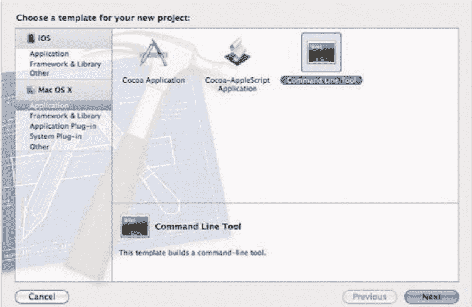

在左窗格中，你会看到一个标记为 `Mac OS X` 的部分。选择 `Application`（应用程序）。在右上窗格中，如上一图所示，选择 `Command Line Tool`（命令行工具）。在出现的下一个窗格中，选择你的应用程序名称。在 `Product Name`（产品名称）处输入 `prog1`，并确保 `Type`（类型）选择了 `Foundation`。此外，确保勾选了 `Use Automatic Reference Counting`（使用自动引用计数）框。你的屏幕应该像图 2.4 所示。

# 图 2.4. 开始新项目：指定产品名称和类型

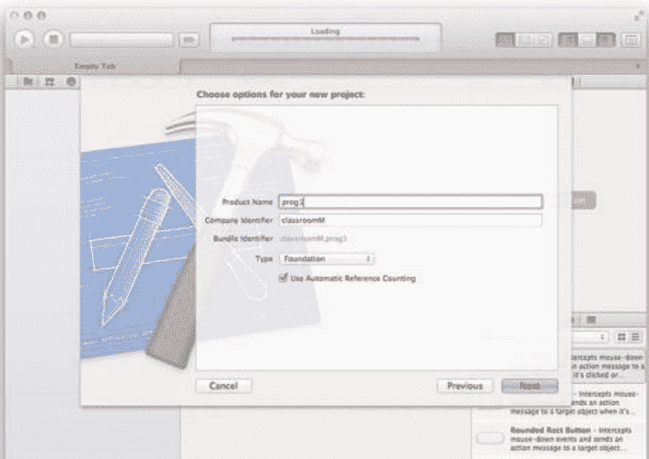

点击 `Next`（下一步）。出现的列表允许你指定包含项目相关文件的项目文件夹名称。在这里你还可以指定想要存储该项目文件夹的位置。根据图 2.5，我们将项目存储在桌面上名为 `prog1` 的文件夹中。

# 图 2.5. 选择项目文件夹的位置和名称

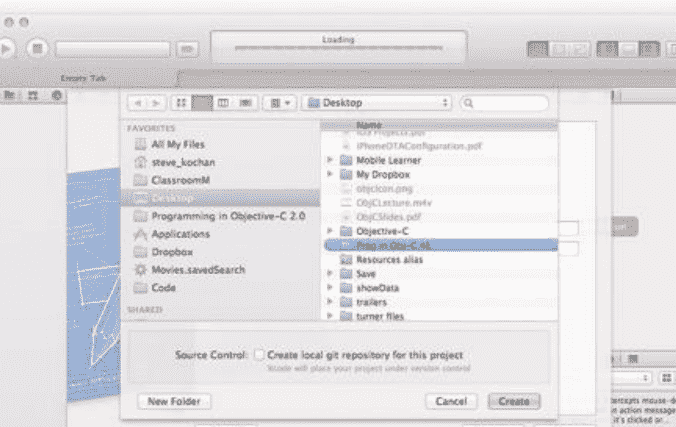

点击 `Create` 按钮创建你的新项目。Xcode 将打开一个类似于图 2.6 所示的项目窗口。注意，如果你以前用过 Xcode 或更改了它的任何选项，你的窗口看起来可能会不同。

# 图 2.6. Xcode prog1 项目窗口

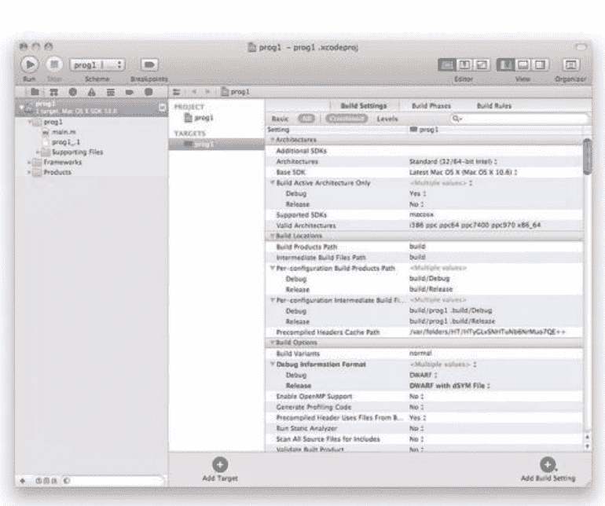

现在是时候输入你的第一个程序了。在左窗格中选择 `main.m` 文件（你可能需要点击展开三角形来显示项目名称下的文件）。你的 Xcode 窗口现在应该如图 2.7 所示。

# 图 2.7. 文件 main.m 和编辑窗口

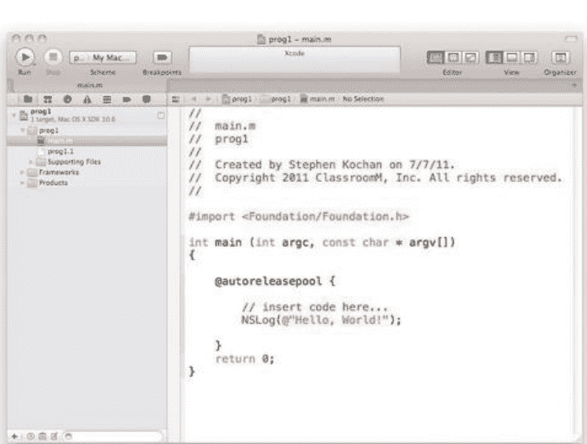

Objective-C 源文件使用 `.m` 作为文件名的最后两个字符（扩展名）。表 2.1 列出了其他常用的扩展名。

| 扩展名 | 含义 |

| --- | --- |

| .c | C 语言源文件 |

| .cc, .cpp | C++ 语言源文件 |

| .h | 头文件 |

| .m | Objective-C 源文件 |

| .mm | Objective-C++ 源文件 |

| .pl | Perl 源文件 |

| .o | 对象文件（编译后的） |

回到 Xcode 项目 `main.m`，它是 Xcode 自动为你创建的模板文件，包含以下行：

```objc
// main.m
// program
// Created by Steve Kochan on 7/7/11.
// Copyright 2011 ClassroomM, Inc. All rights reserved.
//
#import <Foundation/Foundation.h>

int main (int argc, const char * argv[]) {
    @autoreleasepool {
        // insert code here...
        NSLog("Hello World!");
        return 0;
    }
}
```

以 `//` 开头的行是注释。输出应该像：

```
Hello World!
```

Xcode 包含一个名为静态分析器（static analyzer）的强大内置工具。它可以对你的代码进行分析并发现程序逻辑错误。你可以通过从 Product 菜单中选择 Analyze，或者从程序工具栏上的 Run 按钮来使用它。

- 9. 如果你遇到任何编译器错误或输出结果不是你的预期，请对程序进行修改并重新运行。

## 使用终端 (Terminal)

有些人可能希望在不学习 Xcode 的情况下开始 Objective-C 编程。如果你习惯于使用 UNIX shell 和命令行工具，你可能想使用 Terminal 应用程序来编辑、编译和运行你的程序。在这里我们将介绍如何进行操作。

第一步是在 Mac 上启动 Terminal 应用程序。Terminal 应用程序位于“应用程序”（Applications）文件夹中，存储在“工具”（Utilities）子目录下。[图 2.10] 显示了它的图标。


启动 Terminal 应用程序。你会看到一个类似于[图 2.11]的窗口。

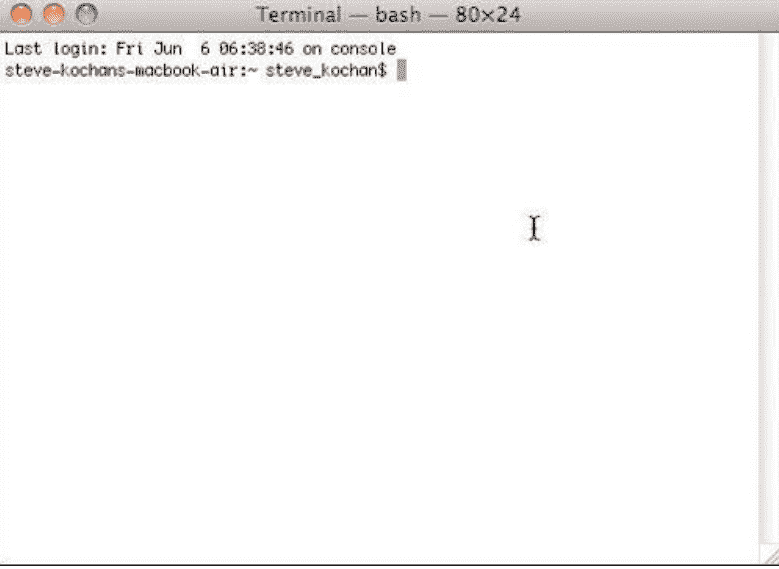

你在每行的 `$`（或 `%`，取决于你 Terminal 应用程序的配置）之后输入命令。如果你熟悉使用 UNIX，你会发现这非常简单。

首先，你需要将 Program 2.1 中的行输入到一个文件中。你可以从创建一个用于存储你的程序示例的目录开始。然后，你必须运行一个文本编辑器（如 `vi` 或 `emacs`）来输入你的程序：

```bash
sh-25a$ mkdir Progs      创建一个目录来存储你的程序
sh-25a$ cd Progs          切换到新目录
sh-25a$ vi main.m         启动文本编辑器以输入
```

注意：在上一个示例中以及本文的其余部分中，由你（用户）输入的命令将以**粗体**表示。对于 Objective-C 文件，你可以选择任何喜欢的名称；只需确保最后两个字符是 `.m` 即可。这告诉编译器你编写的是 Objective-C 程序。

在你将程序输入文件之后（我们在这里不显示如何编辑和保存文本），你可以使用 LLVM Objective-C 编译器（称为 `clang`）来编译并链接你的程序。这是 `clang` 命令的通用格式：

```bash
clang -framework Foundation -o program
```

`-framework` 选项表示使用 Foundation 框架的信息；`files` 是 是要编译的文件列表。在我们的示例中，我们只有一个这样的文件，而 `program` 是如果程序编译无误时将包含可执行文件的文件名。我们将该程序命名为 `program`：

```bash
$ clang -framework Foundation main.m -o program
```

命令提示符返回后没有任何任何消息，意味着程序中没有发现错误。现在你可以在命令行提示符处输入其名称来执行该程序：

```bash
$ ./program
sh: program: command not found
```

除非你以前用过 Terminal，否则你可能会得到这个结果。UNIX shell（运行你程序的应用程序）不知道 `program` 所在的位置（我们不涉及其中的所有细节），所以你有两个选择：一个是在程序名称前加上字符 `./`，这样 shell 就知道在当前目录中查找该程序。另一个是将存储程序的目录（或简单地当前目录）添加到 shell 的 `PATH` 变量中。让我们采用第一种：

```bash
$ ./program
Programming is fun!
$
```

你应该注意，从终端编写和调试 Objective-C 程序是一种有效的方法。然而，这不是一个良好的长期策略。如果你想构建 Mac OS X 或 iOS 应用程序，除了可执行文件外，还有更多内容需要“打包”成一个应用程序包（application bundle）。从 Terminal 应用程序执行这一点并不容易，它是 Xcode 的专长之一。因此，我建议你开始学习使用 Xcode 来开发你的程序。这有一个学习曲线，但最终的努力是完全值得的。

## 你的第一个程序的解释

现在你已经熟悉了编译和运行 Objective-C 程序的步骤，让我们仔细观察这个程序。这里是它的程序：

```objc
//
// main.m
//
// Created by Steve Kochan on 7/7/11.
// Copyright 2011 ClassroomM, Inc. All rights reserved.
//

#import <Foundation/Foundation.h>

int main (int argc, const char * argv[])
{
    autoreleasepool {

        NSLog("Programming is fun!");

    }
    return 0;
}
```

在 Objective-C 中，小写字母和大写字母是不同的。此外，Objective-C 不在乎你在行的哪个位置开始输入——你可以在行的任何位置开始你的语句。你可以利用这一点来开发更易于读的程序。

程序的前七行引入了注释（comment）的概念。注释语句在程序中用于记录程序说明并增强其可读性。注释告诉程序的读者——无论是程序员还是负责维护程序的其他人——程序员在编写特定程序或特定语句序列时，脑子里到底在想些什么。

你可以通过两种方式在 Objective-C 程序中插入注释。一种是使用两个斜杠字符（`//`）。编译器会忽略这些斜杠之后、直到行末尾的任何字符。

你也可以使用两个字符 `/*` 启动注释。这标记了注释的开始。这种类型的注释必须结束。要结束注释，你使用 `*` 和 `/` 字符，同样不包含任何嵌入的空格。在起始 `/*` 和结束 `*/` 之间的所有字符都被视为注释语句的一部分，并被 Objective-C 编译器忽略。这种形式的注释通常用于跨越多行代码的注释，如下所示：

```objc
/*
此文件实现了一个名为 Fraction 的类，
代表分数。方法允许
对分数进行操作，例如加法、减法等。

更多信息，请参阅文档：
/usr/docs/classes/fractions.pdf
*/
```

你使用哪种注释样式完全取决于你。只需注意你不能嵌套 `/*` 风格的注释。养成在将程序输入计算机时插入注释的习惯，原因有三个：首先，在特定逻辑仍在脑海中记忆新鲜时记录程序，比在程序完成后回头思考逻辑要容易得多。其次，通过在如此早阶段向程序中插入注释，你可以在调试阶段（此时逻辑错误被隔离和调试时）从注释中获益。注释不仅可以帮助你（或其他）阅读程序，还可以指出逻辑错误的源处。最后，我还没有发现过哪个程序员真正喜欢为程序编写文档。事实上，在调试完程序后，你可能并不喜欢回到程序中去插入注释。在开发程序时插入注释会让这个有时枯厌的任务变得更容易处理。

作为主程序的一部分，包含在花括号之间的程序语句。

`main` 中的下一行读取了

```
@autoreleasepool {
```

在 `{` 和匹配的闭合 `}` 之间的任何程序语句都在一个被称为“自动释放池”（autorelease pool）的上下文中执行。自动释放池是一种机制，允许系统在创建新对象时高效地管理应用程序使用的内存。我将在第 17 章“内存管理与自动引用计数”中详细介绍它。在这里，我们在 `@autoreleasepool` 上下文中有一个语句。

该语句指定要调用一个 `NSLog` 例程。要传递或交给 `NSLog` 例程的参数（或实参数）是以下字符串：

```
"Programming is fun!"
```

在这里，`@` 符号紧跟在双引号包裹的字符串之前。合在一起，这被称为常量 `NSString` 对象。

> 如果你有有 C 语言编程经验，可能会对开头的 @ 字符感到困惑。如果没有这个开头的 @ 字符，你写的是一个常量 C 风格字符串；有了它，你写的就是一个 `NSString` 字符串对象。关于这个主题，请见第 15 章。

`NSLog` 例程是 Objective-C 库中的一个函数，它简单地显示或记录它的参数（或多个参数），正如你很快看到的。

在此之前，它会显示例程执行的日期和时间、程序名称以及我们在这里未描述的一些其他数字。在本书的其余部分，我们不会特意显示 `NSLog` 在你的输出之前插入的这段文本。

你必须用分号 (`;`) 结束 Objective-C 中所有的程序语句。这就是为什么在 `NSLog` 调用的闭合括号后面紧跟着一个分号。

`main` 中的最后一个程序语句看起来如下所示：

```
return 0;
```

它表示终止 `main` 的执行并传回（或返回）一个状态值为 0 值。按照惯例，0 表示程序正常结束。任何非零值通常意味着发生了某些问题——也许程序无法找到所需的文件。

如果你正在使用 Xcode 并回看你的输出窗口（参考图 2.9），你会记得在 `NSLog` 的输出行之后显示了以下内容：

> Program exited with status value:0.

你现在应该理解这条消息的意思了。

既然我们已经讨论完了你的第一个程序，让我们修改它以显示短语“And programming in Objective-C is even more fun!”你可以通过简单地添加另一个对 `NSLog` 例程的调用来实现这一点，如程序 2.2 所示。记住，每个 Objective-C 程序语句都必须以分号结束。注意，我们已经在后续所有的程序示例中删除了开头的注释行。

### Program 2.2

```objective
#import <Foundation/Foundation.h>

int main (int argc, const char * argv[]) {
    @autoreleasepool {
        NSLog("Programming is fun!");
        NSLog("Programming in Objective-C is even more fun!");
    }
    return 0;
}
```

如果你输入程序 2.2，然后编译并执行它，你可以预期如下输出（再次，不显示 `NSLog` 通常在输出前前缀的文本）：

> Programming is fun!

Programming in Objective-C is even more fun!

正如你将从下一个程序示例中看到的，你不需要为每一行输出单独调用一次 `NSLog` 例程。

首先，我们来谈一个特殊的双字符序列。反斜线 (`\`) 和字母 `n` 合称为换行符。换行符告诉系统精确地执行其名称含义的操作：到新的一行。换行符之后要打印的任何字符将出现在显示器的下一行。事实上，换行符在概念上与打字机上的回车键（carriage return）非常相似（记得它们吗？

学习程序 2.3 中列出的程序，并尝试在查看输出之前预测结果（现在不准作弊！）。

### Program 2.3

```objectivec
#import <Foundation/Foundation.h>

int main (int argc, const char *argv[]) {
    @autoreleasepool {
        NSLog("Testing...\n..1\n...2\n....3\n");
    }
    return 0;
}
```

```
Testing...
..1
...2
....3
```

### 显示变量的值

不仅可以用 `NSLog` 显示简单的短语，变量的值和计算结果也可以显示。程序 2.4 使用 `NSLog` 例程来显示两个数字 50 和 25 相加的结果。

```objectivec
#import <Foundation/Foundation.h>

int main (int argc, const char *argv[]) {
    @autoreleasepool {
        int sum;

        sum = 50 + 25;
        NSLog("The sum of 50 and 25 is %i", sum);
    }

    return 0;
}
```

The sum of 50 and 25 is 75

`main` 中自动释放池之后的第一个程序语句定义了变量 `sum` 为整型（integer）。在程序中使用程序变量之前，你必须先定义所有的程序变量。变量的定义指定了 Objective-C 编译器程序应该如何使用它。编译器需要这些信息来生成正确的指令，以便在变量中存储和从中提取值。定义为 `int` 类型的变量只能存储整数值——即不带小数的值。整数值的示例有 3、5、-20 和 0。带有小数的数字，如 2.14、2.455 和 27.0，被称为浮点数和实数。


整数变量 `sum` 存储了两个整数 50 和 25 相加的结果。我们在该变量定义之后特意留了一个空行，以便在视觉上将例程的变量声明与程序语句分开；这纯粹是一个风格问题。有时在程序中添加一个空行可以使程序更具可读性。

程序语句的写法与大多数其他编程语言一样：

```
sum = 50 + 25;
```

数字 50 被加上了数字 25（如加号所示所示），结果由赋值运算符（等号 `=`）存储在变量 `sum` 中。

程序 2.4 中的 `NSLog` 例程调用现在有两个包含在括号内的参数。这些参数用逗号分隔。`NSLog` 例程的第一个参数始终是要显示的字符串。然而，我们通常也希望显示某些程序变量的值。在这种情况下，你希望在显示这些字符之后显示变量 `sum` 的值：

```
The sum of 50 and 25 is
```

第一个参数内部的百分号 `%` 是 `NSLog` 函数识别的特殊字符。紧跟在百分号符号后面的字符指定了在该点要显示什么类型的值。在之前的程序中，`NSLog` 例程识别字母 `i` 表示将显示一个整数值。

每当 `NSLog` 例程在字符串内部找到 `%` 字符时，它会自动显示例程的下一个参数的值。由于 `sum` 是 `NSLog` 的下一个参数，它的值将自动显示在“The sum of 50 and 25 is”之后。

现在尝试预测程序 2.5 的输出。

### Program 2.5

```objectivec
#import <Foundation/Foundation.h>

int main (int argc, const char*argv[]) {
  @autoreleasepool {
    int value1, value2, sum;

    value1 = 50;
    value2 = 25;
    sum = value1 + value2;

    NSLog ("The sum of %i and %i is %i", value1, value2, sum);
  }

  return 0;
}
```

The sum of 50 and 25 is 75

`main` 中在自动释放池之后的第二个程序语句定义了三个名为 `value1`、`value2` 和 `sum` 的变量，类型均为 `int`。该语句可以使用三个独立的语句来表达，如下：

```
int value1;
int value2;
int sum;
```

在定义三个变量之后，程序将值 50 赋值给变量 `value1`，然后将值 25 赋值给 `value2`。计算这两个变量的和并将结果赋值给变量 `sum`。

对 `NSLog` 例程的调用现在包含了四个参数。第一个参数（通常称为格式字符串，format string）描述了系统如何显示剩余参数。`value1` 的值将紧跟在短语“The sum of”之后显示。

在阅读了关于开发 Objective-C 程序的介绍章节后，你应该对编写 Objective-C 程序涉及的内容良好良好——并且能够独立开发一个小程序。在下一章中，你将开始检查这种强大且灵活的编程语言的一些复杂之处。但在之前，请尝试随后的练习，以确保你理解了本章介绍的概念。

+ 1. 输入并运行本章介绍的五个程序。将每个程序产生的输出与每个程序后面呈现的输出进行比较。

2. 编写一个程序显示以下文本：

在 Objective-C 中，小写字母是有区别的。

`main` 是程序执行开始的地方。

大括号包围了例程程序中的程序语句。

所有程序语句必须以分号结束。

3. 你期望以下程序的输出是什么？

```objc
#import <Foundation/Foundation.h>
int main (int argc, const char * argv[]) {
  @autoreleasepool {
    int i;
    int i = 1;
    NSLog("@...Testing...");
    NSLog("@...%i", i);
    NSLog("@...%i", i + 1);
    NSLog("@..%i", i + 2);
  }
  return 0;
}
```

4. 编写一个程序，从 87 中减去 15 并显示结果，同时带有适当的消息。

5. 识别以下程序中的语法错误。然后输入并运行修正后的程序，以确保你识别了所有错误。

```objc
#import <Foundation/Foundation.h>
int main (int argc, const char * argv[])
(
```

```objc
@autoreleasepool {
INT sum;
  /* COMPUTE RESULT //
sum = 25 + 37 - 19
  / DISPLAY RESULTS /
  NSLog('@The answer is %i' sum);
}
  return 0;
}
```

## 6. 你期望以下程序的输出是什么？

```objc
#import <Foundation/Foundation.h>

int main (int argc, const char *argv[])
{
  @autoreleasepool {
    int answer, result;

    answer = 100;
    result = answer - 10;

    NSLog ("@The result is %i\n", result + 5);
  }
  return 0;
}
```

在本章中，你将学习面向对象编程中的一些关键概念，并开始在 Objective-C 中使用类。你需要学习一些术语，但我们会保持得比较非正式。我们在这里只涵盖了基础术语，因为你很容易感到无所措。关于这些术语更精确的定义，请参阅书末的附录 A，“术语表”。

## 到底什么是对象？

对象是一个实体。将面向对象编程想象成一个实体，以及你想对这个实体做的事情。这与 C 这样的编程语言不同，C 被称为过程化编程语言。在 C 中，你通常先考虑你想做什么，然后再考虑对象，这几乎与面向对象的方法是相反的。

考虑一个日常生活中的例子。假设你拥有一辆车，这显然是一个对象，而且是你拥有的。你拥有的不是任意汽车；你有一辆在工厂制造的特定汽车，可能在底特律，可能在日本，或者在其他地方。你的车有一个车辆识别号码（VIN），在美国可以唯一标识这辆车。

在面向对象的术语中，你这辆特定的车是汽车的一个“实例”。继续使用这些术语，汽车是创建此实例的类的名称。每当制造一辆新车时，就会从汽车类创建一个新实例，而每个汽车实例都被称为对象。

你的车可能是银色的，有黑色内饰，是一辆敞篷车或硬顶车等等。此外，你还会对车执行某些操作。例如，你开车、加油（希望的话）、洗车、送去保养等等。

表 3.1 描述了这一点。

### 表 3.1. 对象上的操作

| 对象 | 你对它的操作 |
|---|---|
| 你的车 | 驾驶 |
| | 加油 |
| | 洗车 |
| | 保养 |

表 3.1 中列出的操作可以在你的车上执行，也可以在其他汽车上执行。例如，你姐姐也会开车、洗车、加油等等。

## 实例和方法

类的唯一发生情况是“实例”，而对该实例执行的操作被称为“方法”。在某些情况下，方法可以应用于类的实例，也可以应用于类本身。例如，洗你的车适用于一个实例（事实上，表 3.1 中列出的所有方法都可以被视为实例方法）。了解一个制造商制造了多少种类型的汽车则适用于类，因此它是一个类方法。

假设你有两辆从组配线上下来、且看起来完全相同的汽车：它们具有相同的内饰、相同的油漆颜色等等。它们开始时是相同的，但随着每辆车被各自的所有者使用，其独特的特征或属性就会发生变化。例如，一辆车可能会出现一道划痕，而另一辆车的里程可能会更多。每个实例或对象不仅包含了从工厂获取的初始特征信息，还包含了其当前的特征。这些特征可以动态地变化。随着你开车，油箱会变得越来越脏，轮胎也会磨损得更多一点。

将方法应用于对象可能会影响该对象的状态。如果你的方法是“给我的车加油”，那么在执行该方法后，你的车油箱就是满的。这时该方法就影响了它的状态。

```
// 用于处理分数的简单程序

#import <Foundation/Foundation.h>

int main (int argc, char * argv[])
{
    @autoreleasepool {
        int numerator = 1;
        int denominator = 3;
        NSLog (@"The fraction is %i/%i",
        numerator, denominator);
    }
    return 0;
}
```

## 程序 3.1. 输出

The fraction is 1/3

在程序 3.1 中，分数是以分子和分母的形式表示的。在 `@autoreleasepool` 指令之后，`main` 中的两行代码都将变量 `numerator` 和 `denominator` 声明为整数（`int`），并分别为它们赋值了初始值 1 和 3。这等同于以下代码：

```
int numerator, denominator;
```

`numerator` = 1;

`denominator` = 3;

我们通过将 1 存储在变量 `numerator` 中，将 3 存储在变量 `denominator` 中，用此表示了分数 1/3。如果你需要在程序中存储大量的分子，这可能会非常麻烦。

每当你想要引用这个分数时，都必须引用相应的分子和分母。对这些分数进行操作也将同样笨拙。

如果能将分数定义为一个单一实体，并用一个名称（如 `myFraction`）统一引用它的分子和分母，将会更好。你可以在 Objective-C 中实现这一点，这从定义一个新类开始。

程序 3.2 使用一个名为 `Fraction` 的新类复制了程序 3.1 的功能。下面是该程序，随后是关于其工作原理的详细解释。

## 程序 3.2

```
// 处理分数的程序 - 类版本
#import <Foundation/Foundation.h>
//---- @interface 区域 ----
@interface Fraction: NSObject

-(void) print;
-(void) setNumerator:(int) n;
-(void) setDenominator:(int) d;
@end

//---- @implementation 部分 ----

@implementation Fraction
```

```
{
  int numerator;
  int denominator;
}
-(void) print {
  NSLog("%d/%d", numerator, denominator);
}
```

```
-(void) setNumerator:(int) n {
  numerator = n;
}
```

```
-(void) setDenominator:(int) d {
  denominator = d;
}
```

@end

//--- 程序部分 ----

```
int main (int argc, char * argv[]) {
  @autoreleasepool {
    Fraction *myFraction;
    // 创建 Fraction 的实例
    myFraction = [Fraction alloc];
    myFraction = [myFraction init];
    // 将分数设置为 1/3
```

```
[myFraction setNumerator: 1];
[myFraction setDenominator: 3];

// 使用 print 方法显示分数

NSLog("The value of myFraction is:");
[myFraction print];
}
return 0;
}
```

The value of myFraction is:

1/3

正如你从程序 3.2 的注释所示，该程序在逻辑上被分为三个部分：

- `@interface` 区域

- `@implementation` 区域

- program部分

`@interface` 区域描述了类及其它的方法，而 `@implementation` 区域描述了数据（来自该类的对象将存储的实例变量），并包含了实现接口区域中声明的方法的实际代码。最后，程序部分包含了执行程序预期目的的程序代码。

你还可以在 `interface` 区域声明类的实例变量。在 `implementation` 区域执行此操作是从 Xcode 4.2 开始添加的，并被认为是定义类的更好方法。你将在后面的章节中学习更多关于原因的内容。

这些部分中的每一个都是每个 Objective-C 程序的一部分，尽管你可能不需要自己编写每个部分。正如你所看到的，每个部分通常被放在自己的文件中。不过，目前我们把它们都放在一个文件中。

## @interface 区域

当你定义一个新类时，你必须告诉 Objective-C 编译器该类来自哪里。也就是说，你必须为它的父类命名。接下来，你需要定义在处理来自此类的对象时可以使用的操作类型（或方法）。正如你将在后面的章节中学习到的那样，你在程序中名为 `@interface` 区域的特殊部分中列出称为属性的项。该部分的通用格式如下：

```
@interface NewClassName:ParentClassName
propertyAndMethodDeclarations;
@end
```

按照惯例，类名以大写字母开头，尽管这不是强制要求的。这使得阅读你程序的人只需查看名称的第一个字母就能区分类名与其他类型的变量。让我们稍作休息，聊聊 Objective-C 中的命名。

## 选择命名

在第 2 章“在 Objective-C 中编程”中，你使用了几个变量来存储整数值。例如，你在程序 2.4 中使用了变量 `sum`。

Objective-C 语言允许你存储整数以外的数据类型，字符，甚至是引用。命名的规则非常简单：它们必须以字母开头，后面可以跟数字或下划线。以下是有效的名称示例：

- `sum`

- `pieceFlag`

- `i`

- `locationLocation`

- `numberOfMoves`

- `ChessBoard`

在决定名称时，请记住一点建议：不要偷懒。选择反映变量意图的名称。原因是显而易见的。正如注释语句一样，有意义的命名可以极大提高程序的可读性，并在调试和文档阶段获得回报。

始终记住，在 Objective-C 中大小写字母是不同的。因此，在命名类时，要以大写字母开头。实例变量和方法名，另一方面，通常以小写字母开头。为了辅助可读性，以下是合法的名称示例：

- `AddressBook`

- `currentEntry`

- `current_entry`

- `addNewEntry`

正如你所看到的，在 3.2 程序的注释中，程序在逻辑上分为三个部分：

- `@interface` 区域

- `@implementation` 区域

- program部分

这里，再次是程序 3.2 中的 `@interface` 区域：

```
//--- @interface 部分 ---

@interface Fraction: NSObject

-(void) print;
```

```
- (void) setNumerator:(int) n;
- (void) setDenominator:(int) d;

@end
```

类的名称是 `Fraction`，它的父类是 `NSObject`。（我们将在第 8 章“继承”中详细讨论父类）。`NSObject` 类定义在 `NSObject.h` 中，每当你导入 `Foundation.h` 时，它都会被包含。

## 类方法和实例方法

你必须定义方法来处理你的分数。你需要能够将分数的值设置为特定值。由于你无法直接访问分数的内部表示（换说，直接访问实例变量），你必须编写方法来设置分子和分母。你还将编写一个名为 `print` 的方法来显示分数的值。该方法在接口文件中的声明如下：

```
- (void) print;
```

前面的减号 `-` 告诉 Objective-C 编译器该方法是一个实例方法。唯一的其他选项是加号 `+`，它表示类方法。类方法是针对类本身执行某些操作的方法，例如创建类实例。

实例方法是对类的特定实例执行某些操作，例如设置其值、检索其值、显示其值等。参考汽车的例子，在制造出汽车后，你可能需要为它加油。

向其加气的操作是在特定的汽车上执行的，因此它比比实例方法。

## 返回值

当你声明一个新方法时，你必须告诉 Objective-C 编译器该方法是否返回值，如果返回，它返回的是什么类型的值。你通过在开头的减号或加号后面将返回类型括在括号中来实现。因此，此声明指定名为 `currentAge` 的实例方法返回一个整数值：

+ - (int) currentAge;

同样，这行代码声明了一个返回双精度值的方法。（你将在第 4 章，“数据类型与表达式”中学习更多关于这种数据类型的知识）

+ - (double) retrieveDoubleValue;

使用 Objective-C 的 `return` 语句从方法返回值，这与我们在之前的程序示例中从 `main` 返回值的方式相似。

如果方法不返回值，你使用 `void` 类型来指示，如下所示：

+ - (void) print;

这声明了一个名为 `print` 的不返回值的实例方法。在这种情况下，你不需要在方法的末尾执行 `return` 语句。或者，你可以执行一个不带任何指定值的 `return`，如下所示：

```
return;
```

## 方法参数

在程序 3.2 的 `@interface` 部分还声明了两个方法：

```
- (void) setNumerator:(int) n;
- (void) setDenominator:(int) d;
```


这两者都是不返回值的实例方法。每个方法接受一个整数参数，通过参数前的 `(int)` 指明。在 `setNumerator` 的情况下，参数的名字是 `n`。这个名字是任意的，它是方法用于引用该参数的名称。因此，`setNumerator` 的声明指定将一个名为 `n` 的整数参数传递给方法，并且不返回任何值。`setDenominator` 也是如此，只是它的参数名称是 `d`。

注意这些方法声明的语法。每个方法名都以冒号结尾，这告诉 Objective-C 编译器该方法期望看到一个参数。接下来，用一组括号指定了参数的类型，这与指定方法本身的返回类型的方式非常相同。最后，指定用于在方法中标识该参数的符号名称。整个声明以分号结束。图 3.1 描述了这种语法。

### 图 3.1. 声明方法

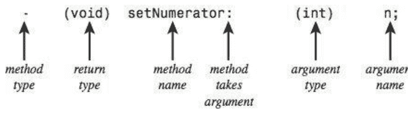

当方法接受参数时，你在引用该方法时也在方法名后附加一个冒号。因此，`setNumerator:` 和 `setDenominator:` 是标识这两个方法的正确方式，每个方法都接受单个参数。此外，不带尾随冒号的 `print` 方法表示该方法不接受任何参数。在第 7 章“类的更多内容”中，你将看到如何标识接受多个参数的方法。

### @implementation 部分

如所述，`@implementation` 部分包含了你在 `@interface` 部分中声明的方法的实际代码。你必须指定要在此类的对象中存储什么类型的数据的数据。也就是说，你必须描述类成员将包含的数据。这些成员被称为实例变量。从术语上来说，你说在 `@interface` 部分声明了方法，并在 `@implementation` 部分中定义了它们（即提供实际代码）。`@implementation` 部分的通用格式如下：

```
@implementation NewClassName{
  memberDeclarations;
  methodDefinitions;
}
@end
```

`NewClassName` 是在 `@interface` 部分使用的类相同的名称。你可以使用尾随冒号后跟父类名，就像我们在 `@interface` 部分做的那样：

```
@implementation Fraction: NSObject
```

然而，这是可选的，且通常不这样做。

`memberDeclarations` 部分指定了 `Fraction` 中存储了什么类型以及它们的名称。这通过以下内容实现：

```
int numerator;
int denominator;
```

`methodDefinitions` 部分包含了方法的代码。这里是 `Fraction` 的 `@implementation`：

```
@implementation Fraction
{
int numerator;
int denominator;
}

-(void) setNumerator:(int) n {
    numerator = n;
}

-(void) setDenominator:(int) d {
    denominator = d;
}

-(void) print {
    printf("%d/%d\n", numerator, denominator);
}

@end
```

`@implementation` 部分包含了你在 `@interface` 部分中声明的方法的代码。你必须指定要在此类的对象中存储什么类型的数据。也就是说，你必须描述类成员将包含的数据。这些成员被称为实例变量。从术语上来说，你说在 `@interface` 部分声明了方法，并在 `@implementation` 部分中定义了它们（即提供实际代码）。`@implementation` 部分的通用格式如下：

`memberDeclarations` 部分指定了 `Fraction` 中存储了什么类型以及它们的名称。这些是变量。这通过以下内容实现：

```
int numerator;
int denominator;
```

`methodDefinitions` 部分包含了方法的代码。这里是 `Fraction` 的 `@implementation`：

```
@implementation Fraction
{
int numerator;
int denominator;
}

-(void) setNumerator:(int) n {
    numerator = n;
}

-(void) setDenominator:(int) d {
    denominator = d;
}

-(void) print {
    printf("%d/%d\n", numerator, denominator);
}

@end
```
某处必须有一个名为 `main` 的程序，正如我们之前提到的。这里是 3.2 的程序：

```
int main (int argc, char * argv[]) {
    @autoreleasepool {
        Fraction *myFraction;

        // 创建 Fraction 的实例并对其初始化

        myFraction = [Fraction alloc];
        myFraction = [myFraction init];

        // 将分数设置为 1/3

        [myFraction setNumerator:1];
        [myFraction setDenominator:3];

        // 使用 print 方法显示分数
        NSLog("The value of myFraction is:");
        [myFraction print];
    }
    return 0;
}
```

在 `main` 中，你通过以下行定义了一个名为 `myFraction` 的变量：

```
Fraction *myFraction;
```

该行表示 `myFraction` 是 `Fraction` 类型的对象；也就是说，`myFraction` 用于存储来自你新类的值。变量前的星号在下文中有详细描述。

现在你有了用于存储 `Fraction` 的对象，你需要创建一个，就像你要求工厂制造一辆汽车一样。这通过以下行实现：

```
myFraction = [Fraction alloc];
```

`alloc` 是 allocate 的缩写。你想为一个新的分数分配内存存储空间。这个表达式向你新创建的类发送消息：

```
[Fraction alloc]
```

你请求 `Fraction` 类应用 `alloc` 方法，但你从未定义过 `alloc` 方法，那么它是从哪里来的呢？该方法继承自父类。第 8 章“继承”详细讨论了这一主题。

当你向类发送 `alloc` 消息时，你会得到该类的实例。在程序 3.2 中，返回值存储在你的变量 `myFraction` 中。`alloc` 方法保证将对象的所有实例变量置零。然而，这并不意味着对象已经为使用做好了初始化。你需要在分配后对其进行初始化。

这是通过程序 3.2 中的下一语句实现的，内容如下：

```
myFraction = [myFraction init];
```

再次，你正在使用一个你自己没有编写的方法。`init` 方法初始化类的实例。注意你正在向 `myFraction` 发送 `init` 消息。也就是说，你想

在这里初始化一个特定的 `Fraction` 对象，这样你就不将其发送给类——而是将其发送给类的一个实例。在继续之前，请确保你理解了这一点。

`init` 方法也会返回一个值——即初始化后的对象。你将返回值存储在你的 `Fraction` 变量 `myFraction` 中。

在 Objective-C 中，分配类的新实例并对其进行初始化的双行序列非常常见，因此这两个消息通常会被组合，如下所示：

```
myFraction = [[Fraction alloc init];
```

这个内部消息表达式会被求值：

```
[Fraction alloc]
```

如你所知，该消息表达式的结果是实际分配的 `Fraction` 对象。你没有像之前那样将分配结果存储在变量中，而是直接对它应用 `init` 方法。所以，同样，你首先分配一个新的 `Fraction` 对象，然后对其进行初始化。随后，将初始化的结果赋值给 `myFraction` 变量。

作为最后的最后简写技术，分配和初始化通常直接整合到声明行中，如下所示：

```
Fraction *myFraction = [[Fraction alloc init];
```

回到程序 3.2，你现在准备好设置分数的数值了。这些程序行正是为此执行的：

```
// 设置分数为 1/3
```

```
[myFraction setNumerator: 1]; [myFraction setDenominator: 3];
```

第一条消息语句将 `setNumerator:` 消息发送给 `myFraction`。提供的参数是值 1。随后，控制权被发送到为 `Fraction` 类定义的 `setNumerator:` 方法。Objective-C 系统知道应该使用该类中的方法，因为它知道 `myFraction` 是来自 `Fraction` 类的对象。

在 `setNumerator:` 方法内部，传递的值 1 被存储在变量 `n` 中。该方法中的单行程序代码将该值存储在实例变量 `numerator` 中。因此，你实际上已经将 `myFraction` 的分子设置为了 1。

接下来是在 `myFraction` 上调用 `setDenominator:` 方法的消息。参数 3 被赋值给 `setDenominator:` 方法内部的变量 `d`。然后，该值被存储在分母实例变量 `denominator` 中，从而完成了将将值 1/3 分配给 `myFraction` 的操作。现在，你准备好显示分数的数值了，你可以通过程序 3.2 中的以下几行代码来实现：

```
// 使用 print 方法显示分数

NSLog("@ value of myFraction is:");
[myFraction print];
```

`NSLog` 调用只需显示以下文本：

The value of myFraction is:

以下消息表达式调用了 `print` 方法：

```
[myFraction print];
```

在 `print` 方法内部，实例变量 `numerator` 和 `denominator` 的值会被显示出来，并用斜杠字符分隔。

### Note

在过去，iOS 程序员负责在完成对分配对象的使用后，通过向对象发送 `release` 消息来告诉系统何时结束使用。这是根据一种称为手动引用计数（manual reference counting）的内存管理系统进行的。从 Xcode 4.2 开始，程序员不再需要担心这个问题，可以依靠系统在需要时释放内存。这是通过一种名为自动引用计数（Automatic Reference Counting，简称 ARC）的机制实现的。当你使用 Xcode 4.2 或更高版本编译新应用程序时，ARC 默认开启。

看起来你必须编写多得代码才能在程序 3.2 中复制你在程序 3.1 中所做的工作。这是为了这个简单的例子；然而，处理对象的终极目标是让你的程序更容易编写、维护和扩展。你以后会意识到这一点的。

让我们回到 `myFraction` 的声明处

```
Fraction *myFraction;
```

以及随后对其值的设置。

在声明中 `myFraction` 前的星号 (`*`) 表示 `myFraction` 实际上是指向 `Fraction` 对象的引用（或指针）。变量 `myFraction` 实际上并没有存储分数值的数据（即它的分子和分母值）。相反，它存储的是引用——这实际上是一个内存地址——指示对象数据在内存中的位置。当你像所示第一次声明 `myFraction` 时，它的值是未定义的，因为它没有被设置为任何值，也没有默认值。我们可以将 `myFraction` 概念化为一个持有值的盒子。初始时，盒子包含某个未定义的值，因为它还没有被分配任何值。这在图 3.2 中所示。

### Figure 3.2. Declaring Fraction *myFraction;

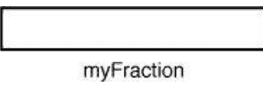

当你分配一个新对象（例如使用 `alloc`）时，内存中会留出足够的空间来存储对象的数据，包括实例变量的空间加上稍多一点。存储该数据的位置（对数据的引用）由 `alloc` 程程序返回，并赋值给变量 `myFraction`。这一切都发生在程序 3.2 执行此语句时。

```
myFraction = [Fraction alloc];
```

对象的分配以及对该对象的引用在 `myFraction` 中的存储如图 3.3 所示：

### Figure 3.3. Relationship between myFraction and its data

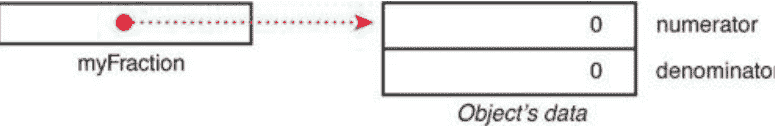

### Note

对象中存储的数据比指示的要多一些，但你在这里不需要担心这些。你会注意到实例变量被显示设置为 0。这目前由 `alloc` 方法处理。然而，对象仍然没有被正确初始化。你仍然需要在新分配的对象上使用 `init` 方法。

注意图 3.3 中的有向线。这表示了变量 `myFraction` 与分配的对象之间建立的连接。（`myFraction` 内部存储的值实际上是一个内存地址。对象的数据存储在该内存地址上）。

随后在程序 3.2 中，分数的分子和分母被设置了。图 3.4 展示了完全初始化的 `Fraction` 对象，其分子设置为 1，分母设置为 3。

### Figure 3.4. Setting the fraction’s numerator and denominator

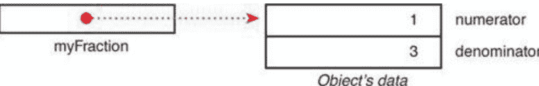

下一个示例展示了你如何在程序中处理多个分数。在程序 3.3 中，你将其中一个分数设置为 2/3，另一个设置为 3/7，并显示了它们。

### Program 3.3

```
// Program to work with fractions - cont'd

#import <Foundation.h>

//--- interface -----
@interface Fraction: NSObject

-(void) print;
-(void) setNumerator:(int) n;
-(void) setDenominator:(int) d;

@end

//--- implementation -----
@implementation Fraction
{
    int numerator;
    int denominator;
}

-(void) print;
{
    NSLog("@i/%i", numerator, denominator);
}

-(void) setNumerator:(int) n
{
    numerator = n;
}

-(void) setDenominator:(int) d
{
    denominator = d;
}

@end
//---- program section -----

int main (int argc, char * argv[]) {
    @autoreleasepool {
        Fraction *frac1 = [[Fraction alloc] init];
        Fraction *frac2 = [[Fraction alloc] init];

        // Set 1st fraction to 2/3
        [frac1 setNumerator: 2];
        [frac1 setDenominator: 3];

        // Set 2nd fraction to 3/7
        [frac2 setNumerator: 3];
        [frac2 setDenominator: 7];

        // Display the fractions
        NSLog (@"First fraction is:");
        [frac1 print];

        NSLog (@"Second fraction is:");
        [frac2 print];
    }
    return 0;
}
```

### Program 3.3. Output

First fraction is:

2/3

Second fraction is:

3/7

`@interface` 和 `@implementation` 部分与程序 3.2 保持不变。程序创建了两个名为 `frac1` 和 `frac2` 的 `Fraction` 对象，并将 2/3 分配给第一个分数，3/7 分配给第二个。请注意，当 `setNumerator:` 方法应用于 `frac1` 将其分子设置为 2 时，实例变量 `numerator` 被设置为 2。同样，当 `frac2` 使用相同的方法将其分子设置为 3 时，它的实例变量 `numerator` 被赋值为值 3。每当你创建一个新对象时，它都会获得独立的一组实例变量。图 3.5 展示了此。

### Figure 3.5. Unique instance variables

| Object | frac1 | frac2 |

| --- | --- | --- |

| Instance Variables | numerator 2

 denominator 3 | numerator 3

 denominator 7 |


根据哪个对象接收消息，将引用正确的实例变量。因此，在这里当 `setNumerator:` 在方法内部使用 `numerator` 名称时，引用的是 `frac1` 的分子：

```
[frac1 setNumerator: 2];
```

那是因为 `frac` 是消息的接收者。

### 访问实例变量与数据封装

你已经看到处理分数的的方法可以直接通过名称直接访问 `numerator`（分子）和 `denominator`（分母）这两个实例变量。事实上，实例方法始终可以直接访问它的实例变量。然而，类方法不能这样做，因为它处理的是类本身，而不是类的任何实例（请对此思考几秒）。但如果你想从其他地方访问你的实例变量呢——例如，从你的主例程序（`main routine`）内部访问？你无法直接访问，因为它们是隐藏的。这种“变量对你隐藏”的特性是一个被称为**数据封装**（`data encapsulation`）的核心概念。它允许编写类定义的人在扩展和修改类定义，而无需担心程序员（即类的用户）是否会这样做。封装在程序员和类开发者之间提供了一层良好的隔离。

你可以通过编写特殊方法来设置和检索它们的值，从而以整洁的方式访问你的实例变量。我们编写了 `setNumerator:` 和 `setDenominator:` 方法来设置 `Fraction` 类中两个实例变量的值。为了检索这些实例变量的值，你需要编写两个新方法。例如，你将创建两个名义恰当的新方法，`numerator` 和 `denominator`，来访问作为消息接收者的 `Fraction` 对应的实例变量。结果是相应的整数值，由你返回它。以下是你两个新方法的声明：

```
- (int) numerator;
-(int) denominator;
```

这里是它们的定义：

```
- (int) numerator
{
    return numerator;
}

-(int) denominator
{
    return denominator;
}
```

注意，方法名称与它们访问的实例变量名称是相同的。这样做没有问题（尽管初看起来看起来可能有点奇怪）；事实上，这是常见的做法。程序 3.4 测试了你的两个新方法。

### 程序 3.4

```
// 访问实例变量的程序 - 继续

#import <Foundation/Foundation.h>

// @interface 部分 ----

@interface Fraction: NSObject

-(void) print;
-(void) setNumerator:(int) n;
-(void) setDenominator:(int) d;
-(int) numerator;
-(int) denominator;
@end
//--- @implementation 部分 ----
@implementation Fraction {
    int numerator;
    int denominator;
}
-(void) print {
    NSLog("@%i/%i", numerator, denominator);
}
-(void) setNumerator:(int) n {
    numerator = n;
}
-(void) setDenominator:(int) d {
    denominator = d;
}
-(int) numerator {
    return numerator;
}
-(int) denominator {
    return denominator;
}
@end
//---- 程序部分 -----
int main (int argc, char * argv[])
{
    @autoreleasepool {
        Fraction *myFraction = [[Fraction alloc] init];

        // 设置分数为 1/3

        [myFraction setNumerator: 1];
        [myFraction setDenominator: 3];

        // 使用我们的两个新方法显示分数值
        NSLog (@"The value of myFraction is: %i/%i",
        [myFraction numerator], [myFraction denominator]);

        return 0;
    }
}
```

### 程序 3.4 输出

`The value of myFraction is 1/3`

这条 `NSLog` 语句显示了向 `myFraction` 发送两条消息的结果：第一个是检索其分子的值，第二个值是检索其分母的值：

```
NSLog (@"The value of myFraction is: %i/%i",
[myFraction numerator], [myFraction denominator]);
```

因此，在第一次消息调用中，分子消息将发送给 `Fraction` 对象 `myFraction`。在该方法中，代码将返回该分数的分子实例变量的值。记住，方法在执行期间的上下文是作为消息接收者的该对象。因此，当 `numerator` 方法访问并返回 `numerator` 实例变量的值时，访问并返回的是 `myFraction` 的分子。该返回的整数值随后被传递给 `NSLog` 进行显示。

对于第二次消息调用，将调用 `denominator` 方法来访问并返回 `myFraction` 的分母值，然后将其传递给 `NSLog` 显示。

顺便提到，设置实例变量值的方法通常统称为 **setter**（设置器），检索实例变量值的方法称为 **getter**（访问器）。对于 `Fraction` 类，`setNumerator:` 和 `setDenominator:` 是 `setter`，而 `numerator` 和 `denominator` 是 `getter`。`setter` 和 `getter` 统称为**访问器方法**（`accessor methods`）。

确保你理解 `setter` 和 `getter` 之间的区别。`setter` 不返回值，因为它们的目的是接收一个参数并将相应的实例变量设置为该参数的值。在这种情况下不需要返回任何值。这就是 `setter` 设置实例变量值的目的，所以 `setter` 通常不返回任何值。另一方面，`getter` 的目的是“获取”存储在对象中的实例变量的值并将其传回程序。为了实现这一点，`getter` 必须使用 `return` 语句返回实例变量的值。

再次，这种“无法从为类编写的方法外部直接设置或获取实例变量的值，而必须编写 `setter` 和 `getter` 方法来完成”的想法，就是**数据封装**的原理。因此，你必须使用方法来访问这些通常对“外部世界”隐藏的数据。这为实例变量提供了一个中心化的访问路径，并防止了某些代码直接修改它们（这会让程序更难以跟踪、调试和修改）。我们也提到有一个结合了 `alloc` 和 `init` 的方法，所以可以使用它来分配并初始化一个新的 `Fraction`：

```
Fraction *myFraction = [Fraction new];
```

通常最好使用分步分配和初始化的方法，以便理解这是两个不同的事件。

### 总结

现在已经已经知道了如何定义自己的类、创建对象以及向这些对象发送消息。我们将在后续章节回到 `Fraction` 类。你将学习如何向方法传递多个参数、如何将类定义划分到单独的文件，以及如何使用继承和动态绑定等核心概念。然而，现在是学习更多数据类型和 Objective-C 表达式的时间了。首先，尝试以下练习以测试你的理解。

### 练习

1. 下列哪些是无效名称？为什么？

- `playNextSong`

- `_calloc`

- `alphaBeta`

- `clearScreen`

- `zInitializeA$`

2. 参考本章中汽车的示例，思考一个你每天使用的对象。为该对象识别一个类，并写出它的五个操作。

3. 根据练习 2 中的列表，使用以下语法重写你的列表：

`[instance method];`

4. 假设你除了汽车外还拥有一艘船和一辆自行车。列出对每个对象执行的操作。这些操作之间是否有重叠？

5. 根据问题 4，假设你有一个 `Vehicle` 类和一个名为 `myVehicle` 的对象，它可以是汽车、自行车或船。假设你写了以下代码：

```
[myVehicle prep];
[myVehicle getGas];
[myVehicle service];
```

对于能够向可能来自多个类的对象应用操作，你看到了任何优势吗？

6. 在像 C 这样的过程化语言中，你考虑操作并编写代码在各种对象上执行操作。参考示例，你可能会写一个 C 过程来清洗车辆，然后在过程内部编写代码处理洗汽车、洗船、洗自行车等。如果你采用这种方法并以后想添加新的车辆类型，你认为这种过程化方法相比对象化方法的优缺点？

7. 定义一个名为 `XYPoint` 的类，用于存储一个笛卡尔坐标 (`x`, `y`)，其中 `x` 和 `y` 是整数。定义方法来单独设置点的 `x` 和 `y` 坐标并检索它们的值。编写一个 Objective-C 程序来实现你的新类并对其进行测试。

## 4. 数据类型与表达式

在本章中，我们将介绍基本数据类型，并描述在 Objective-C 中构建立算术表达式的一些基本规则。

### 数据类型与常量

你已经遇到过 Objective-C 的基本数据类型 `int`。正如你所记得，声明为 `int` 类型的变量只能包含整数值——即不包含小数位数字的值。

Objective-C 编程语言提供了其他三种基本数据类型：`float`、`double` 和 `char`。声明为 `float` 类型的变量可以存储浮点数（包含小数位）。`double` 类型与 `float` 类型相同，但范围通常是其两倍。最后，`char` 数据类型可以存储单个字符，例如字母 `a`、数字字符 `6` 或分号（关于这一点，稍后会进行详细介绍）。

在 Objective-C 中，任何字面量数字、单个字符或字符字符串被称为常量。例如，数字 `58` 代表一个常量整数。字符串 `@"Programming in Objective-C is fun."` 是常量字符串对象的示例。完全由常量值组成的表达式被称为常量表达式。因此，这个表达式是一个常量表达式，因为表达式中的每个项都是常量值：

```
128 + 7 - 17
```

但如果 `i` 被声明为整数变量，那么这个表达式就不代表常量表达式：

```
128 + 7 - i
```

### int 类型

整数由一个或多个数字的序列组成。序列前的减号表示该值为负数。值 `158`、`-10` 和 `0` 都是整数常量的有效示例。数字之间不允许允许嵌入空格，且不能使用逗号。（因此，值 `12,000` 不是有效的整数常量，必须写成 `12000`。）

每个值（无论是字符、整数还是浮点数）都有与其相关的取值范围。这个范围与为存储特定类型数据分配的存储空间有关。通常，该数量在语言中并没有定义；它通常取决于你所运行的计算机，因此被称为实现相关的或机器相关的。例如，一个整数变量在你的计算机上可能占用 `32` 位，或者可能存储为 `64` 位。如果使用 `64` 位，那么整数变量中可以的数字将比使用 `32` 位大得多。

> 注意
>
> 在 `Mac OS X` 下，你可以选择将应用程序编译为 `32` 位或 `64` 位应用程序。在一种情况下，`int` 占用 `32` 位；在另一种情况下，则使用 `64` 位。

### float 类型

你可以使用声明为 `float` 类型的变量来存储包含小数位数字的值。浮点常量通过存在小数点来区分。值 `3.`、`125.8` 和 `-.0001` 都是浮点常量的有效示例。要显示浮点值可以使用 `NSLog` 转换字符 `%f` 或 `%g`。

浮点常量也可以用所谓的科学计数法表示。值 `1.7e4` 是用这种记法表示的浮点值，代表值 `1.7 x 10⁴`。

如前面所述，`double` 类型与 `float` 类型相同，只是范围是两倍。

### char 类型

你可以使用 `char` 变量来存储单个字符。字符常量通过将字符封装在单引号内形成。因此，`'a'`、`';'` 和 `'0'` 都是字符常量的有效示例。第一个常量代表字母 `a`，第二个是分号，第三个是字符零——这与数字不同。不要将字符常量（用单引号括的单个字符）与 C 风格字符字符串（用双引号括的任意数量字符）混淆。正如上一章提到的，用双引号括且前面跟有 `@` 字符的字符字符串是一个 `NSString` 字符对象。

字符 `'\n'`（换行符）是一个有效的字符，尽管它似乎与之前引用的规则矛盾。原因是反斜杠字符被识别为特殊字符。换句话说，Objective-C 编译器将字符 `'\n'` 视为单个字符，尽管它实际上是由两个字符组成的。其他特殊字符以反斜杠字符开头。在 `NSLog` 调用中可以使用格式字符 `%c` 来显示 `char` 变量的值。

程序 4.1 使用了基础 Objective-C 数据类型。

### 程序 4.1

```
#import <Foundation/Foundation.h>

int main (int argc, char * argv[]) {
    @autoreleasepool {
        int integerVar = 100;
        float floatingVar = 331.79;
        double doubleVar = 8.44e+11;
        char charVar = 'W';

        NSLog("@integerVar = %i", integerVar);
        NSLog("@floatingVar = %f", floatingVar);
        NSLog("@doubleVar = %e", doubleVar);
        NSLog("@doubleVar = %g", doubleVar);
        NSLog("@charVar = %c", charVar);
    }
    return 0;
}
```

### 程序 4.1 的输出

```
integerVar = 100
floatingVar = 331.790000
doubleVar = 8.44e+11
doubleVar = 8.44e+11
charVar = W
```

文中详细讨论了“多态、动态类型和动态绑定”。

表 4.1 总结了基础数据类型和限定符。

### 表 4.1. 基础数据类型

| 类型 | 常量示例 | NSLog 字符 |
|---|---|---|
| `char` | `'a'`, `'\n'` | `%c` |
| `short int` |  | `%hi`, `%hx`, `%ho` |
| `unsigned short int` | `12L`, `-97`, `0xFFFE`, `0177` | `%hu`, `%hx`, `%ho` |
| `unsigned int` | `12u`, `100U`, `0xFFU` | `%u`, `%x`, `%o` |
| `long int` | `12L`, `-2001`, `0xFFFFFF` | `%li`, `%lx`, `%lo` |
| `unsigned long int` | `12UL`, `0xEEUL` | `%lu`, `%lx`, `%lo` |
| `long int` | `0xE5e5e5e5LL`, `5001` | `%lli`, `%lx`, `%lo` |
| `unsigned long long int` | `12ULL`, `0xFFULL` | `%llu`, `%lx`, `%llo` |
| `float` | `12.34f`, `3.1e-5f`, `0x1p10`, `0x1P-1` | `%f`, `%e` |
| `double` | `12.34`, `3.1e-5`, `0x1p10`, `0x1P-1` | `%f`, `%e` |
| `long double` | `12.34L`, `3.1e-5L`, `0x1p10L`, `0x1P-1L` | `%f`, `%e` |


文中详细讨论了“多态、动态类型和动态绑定”。

表 4.1 总结了基础数据类型和限定符。

## 表 4.1. 基础数据类型

| 类型 | 常量示例 | NSLog 字符 |
|---|---|---|
| `n char` | `'a'`, `'\n'` | `\c` |
| `short int` |  | `\hi`, `\hx`, `\ho` |
| `unsigned short int` | `12L`, `-97`, `0xFFFE`, `0177` | `\hu`, `\hx`, `\ho` |
| `unsigned int` | `12u`, `100U`, `0xFFU` | `\u`, `%x`, `%o` |
| `long int` | `12L`, `-2001`, `0xFFFFFF` | `\li`, `\lx`, `\lo` |
| `unsigned long int` | `12UL`, `0xEEUL` | `\lu`, `\lx`, `\lo` |
| `long int` | `0xE5e5e5e5LL`, `5001` | `\lli`, `\lx`, `\lo` |
| `unsigned long long int` | `12ULL`, `0xFFULL` | `\llu`, `\lx`, `\llo` |
| `float` | `12.34f`, `3.1e-5f`, `0x1p10`, `0x1P-1` | `%f`, `%e` |
| `double` | `12.34`, `3.1e-5`, `0x1p10`, `0x1P-1` | `%f`, `%e` |
| `long double` | `12.34L`, `3.1e-5L`, `0x1p10L`, `0x1P-1L` | `%f`, `%e` |

注：由于原文后半部分存在大量无意义的重复字符，翻译内容已根据技术文档语境进行修复。

3. 最后，执行 6 和 10 的加法，得到最终结果 16。

第二个 `NSLog` 语句引入了一个新的转折。你可能认为将 `a` 除以 `b` 然后乘以 `b` 应该返回 `a` 的值（`a` 已设置为 25）。但事实似乎并非如此，输出显示的 24 证明了这一点。计算机是否在某个地方丢失了一个位？极不可能。事实是，这个表达式是使用整数算术进行求值的。

如果你回看变量 `a` 和 `b` 的声明，你会想起它们都被声明为 `int` 类型。每当表达式中待待求值的项由两个整数组成时，Objective-C 系统都会使用整数算术执行操作。在这种情况下，所有数字的小数部分都会丢失。因此，当 `a` 的值除以 `b` 的值（即 25 除以 2）时，你得到的中间结果是 12，而不是你可能预期的 12.5。将此中间结果乘以 2 得到最终结果 24，从而解释了那个“丢失”的数字。

正如你从程序 4.3 中倒数第二个 `NSLog` 语句中看到的，如果你使用浮点值而不是整数执行相同的操作，就会得到预期的结果。

使用 `float` 变量还是 `int` 变量的决定应该根据变量的预期用途做出。如果你不需要任何小数，请使用整数变量。生成的程序将更高效——也就是说，它在许多计算机上运行得更快。另一方面，如果你需要小数精度，那么选择是显而易见的。你必须回答的问题仅仅是使用 `float` 还是 `double`。这个问题的答案取决于你所处理的数字所需的精度以及它们的大小级。

在最后一个 `NSLog` 语句中，变量 `a` 的值通过使用一元减运算符被取反。一元运算符作用于单个值，这与作用于两个值的二元运算符相反。减号实际上具有双重角色：作为二元运算符，它用于减去两个值；作为一元运算符，它用于对一个值取反。

一元减运算符的优先级高于所有其他算术运算符，但一元加运算符 `+` 除外，两者优先级相同。因此，以下表达式会导致 `-a` 与 `b` 的乘法：

```
c = -a * b;
```

## 取模运算符

本章介绍的最后一个算术运算符是取模运算符，它用百分号 `%` 表示。请试着通过分析程序 4.4 的输出来确定该运算符是如何工作的。

## 程序 4.4

```
// The modulus operator

#import <Foundation/Foundation.h>

int main (int argc, char * argv[]) {

    @autoreleasepool {

        int a = 25, b = 5, c = 10, d = 7;

        NSLog("@@a %% b = %i", a % b);

        NSLog("@@a %% c = %i", a % c);

        NSLog("@@a %% d = %i", a % d);

        NSLog("@@a / d * d + a %% d = %i", a / d * d + a % d);

    }

    return 0;

}
```

## 程序 4.4 输出

```
a % b = 0

a % c = 5

a % d = 4

a / d * d + a % d = 25
```

`main` 内部的这条语句定义并初始化了变量 `a`、`b`、`c` 和 `d`。

如你所知，`NSLog` 使用紧跟百分号后面的字符来确定如何打印下一个参数。然而，如果后面跟着的是另一个百分号，`NSLog` 过程会将此视为你确实打算显示百分号的指示，并将其插入程序输出的相应位置。

如果你得出取模运算符 `%` 的功能是给出第一个值除以第二个值的余数，那么你是对的。在第一个例子中，25 除以 5 的余数是 0。如果你将 25 除以 10，将得到余数 5，这通过第二行输出验证了这一点。25 除以 7 得到余数 4，如第三行输出所示。

现在让我们关注最后一个语句中求值的最后一个算术表达式。你会记得，Objective-C 中两个整数值之间的任何操作都是用整数算术执行的。因此，两个整数值相除产生的任何余数都会被直接丢弃。25 除以 7（如表达式 `a / d` 所示）得到中间结果 3。将此值乘以 `d` 的值（即 7）产生中间结果 21。最后，加上 `a` 除以 `d` 的余数（如表达式 `a % d` 所示），得到最终结果 25。这个值与变量 `a` 的值相同并非巧合。在假设 `a` 和 `b` 都是整数的情况下，此表达式始终等于 `a` 的值：

```
a / b * b
```

事实上，取模运算符 `%` 定义仅适用于整数值。

至于优先级，取模运算符与乘法和除法运算符优先级相等。

## 整数与浮点的转换

为了开发 Objective-C 程序，你必须理解 Objective-C 中浮点值和整数隐式转换的规则。程序 4.5 展示了数值数据类型之间的一些简单转换。

## 程序 4.5

```
// Basic conversions in Objective-C

#import <Foundation/Foundation.h>

int main (int argc, char *[]) {

  @autoreleasepool {

    float f1 = 123.125, f2;

    int i1, i2 = -150;

    i1 = f1; // floating to integer

    NSLog("%f assigned to an int %%i", f1, i1);

    f1 = i2; // integer to floating

    NSLog("%i assigned to a float %%f", i2, f1);

    f1 = i2 / 100; // integer division

    NSLog("%i assigned to a float %%f", i2, f1);

    f2 = i2 / 100.0; // floating division

    NSLog("%i assigned to a float %%f", i2, f2);

    f2 = (float)i2 / 100; // type cast

    NSLog("%i assigned to a float %%f", i2, f2);

    return 0;

  }

}
```

## 程序 4.5 输出

```
123.125000 assigned to an int produces 123

-150 assigned to a float produces -150.000000

-150 assigned to a float produces -1.000000

-150 assigned to a float produces -1.500000

-150 assigned to a float produces -1.500000
```

在 Objective-C 中，两个值之间的操作，如果其中一个值是浮点变量或常量，则将作为浮点操作执行。因此，当将 `i2` 的值除以 `100.0` 时，系统会将该除法视为浮点除法，并产生结果 -1.5，该结果被赋值给浮点变量 `fl`。

## 类型转换运算符

你已经见过了在声明和定义方法时，将类型封装在括号内，用于声明返回类型和参数类型。在表达式内部使用它时，它具有不同的用途。

程序 4.5 中的最后一个除法操作如下所示，它引入了类型转换运算符：

```
f2 = (float) i2 / 100; // 类型转换运算符
```

类型转换运算符的作用是在评估表达式时，将变量 `i2` 的值转换为 `float` 类型。该运算符不会以任何方式永久地影响变量 `i2` 的值；它是一个行为与其他运算符类似的的一元运算符。就像表达式 `-a` 对 `a` 的值没有永久影响一样，表达式 `(float)a` 也是如此。

类型转换运算符的优先级高于除一元减和一元加之外的所有算术运算符。当然，如果有必要，你始终可以在表达式中使用括号来强制按任何所需的顺序对项求值。

作为类型转换运算符使用的另一个示例，表达式

```
(int) 29.55 + (int) 21.99
```

在 Objective-C 中的求值结果为

```
29 + 21
```

这是因为将浮点值转换为整数的效果之一是截断浮点值。表达式

```
(float) 6 / (float) 4
```

产生的结果为 1.5，下面的表达式也是如此：

```
(float) 6 / 4
```

类型转换运算符通常用于将泛型 `id` 类型的对象强制转换为特定类的对象。例如，以下几行将 `id` 变量 `myNumber` 的值类型转换为 `Fraction` 对象：

```
id myNumber;

Fraction *myFraction;

...

myFraction = (Fraction *) myNumber;
```

转换的结果被赋值给 `Fraction` 变量 `myFraction`。

## 赋值运算符

Objective-C 语言允许你使用以下通用格式将算术运算符与赋值运算符结合：

```
op=
```

在此格式中，`op` 是任何算术运算符，包括 `+`、`-`、`*`、 `/` 或 `%`。此外，`op` 可以是后面讨论的任何用于位移和掩码的位运算符。考虑此语句：

```
count += 10;
```

所谓“加等于”运算符 `+=` 的是将运算符右侧的表达式加上运算符左侧的表达式，并将结果存回运算符左侧的变量中。因此，之前的语句等于此语句：

```
count = count + 10;
```

以下表达式使用“减等于”赋值运算符 `-=` 从 `counter` 的值中减去 5：

```
counter -= 5
```

它等于此表达式：

```
counter = counter - 5
```

这是一个稍微复杂的表达式：

```
a /= b + c
```

它除以等号右边的任何内容——或除以 `b` 和 `c` 的和——并将结果存储在 `a` 中。先执行加法运算是因为加法运算符的优先级高于赋值运算符。事实上，除了逗号运算符之外，所有运算符的优先级都高于赋值运算符，而所有赋值运算符的优先级相同。

在这种情况下，此表达式等同于：

```
a = a / (b + c)
```

使用赋值运算符的动机有三点：第一，程序语句变得更容易编写，因为运算符左侧的内容不需要在运算符右侧重复。第二，生成的表达式通常更容易读。第三，使用这些运算符可以导致程序执行得更快，因为编译器有时可以生成更少的代码来评估表达式。

## 一个计算器类

现在是时候定义一个新类了。我们将创建一个 `Calculator` 类，它是一个简单的四功能计算器，你可以用它对数字进行加、乘、减、除。与普通计算器类似，这个必须跟踪运行总和，即通常说的累加器。因此，方法必须允许将累加器设置为特定值、清空（或将其设置为零），并在完成后检索其值。程序 4.6 包含了新类的定义和一个用于测试你计算器的测试程序。

### 程序 4.6

```
// 实现一个 Calculator 类

#import <Foundation/Foundation.h>

@interface Calculator: NSObject

// 累加器方法

-(void) setAccumulator: (double) value;

-(void) clear;

-(double) accumulator;

// 算术方法

-(void) add: (double) value;

-(void) subtract: (double) value;

-(void) multiply: (double) value;

```

```
-(void) divide: (double) value;

@end

@implementation Calculator

{

    double accumulator;

}

-(void) setAccumulator: (double) value

{

    accumulator = value;

}

-(void) clear

{

    accumulator = 0;

}

-(double) accumulator

{

    return accumulator;

}

-(void) add: (double) value

{

    accumulator += value;

}

-(void) subtract: (double) value

{

    accumulator -= value;

}

-(void) multiply: (double) value

{

    accumulator *= value;

}
```

```
-(void) divide: (double) value

{

    accumulator /= value;

}

@end
```

```
int main (int argc, char * argv[]) {

    autoreleasepool {

        Calculator *deskCalc = [[Calculator alloc] init];

        [deskCalc setAccumulator:100.0];

        [deskCalc add:200.0];

        [deskCalc divide:15.0];

        [deskCalc subtract:10.0];

        [deskCalc multiply:5];

        NSLog ("结果是 %g", [deskCalc accumulator]);

    }

    return 0;

}
```

### 程序 4.6 输出

结果是 50

方法的定义本身非常简单。`Calculator` 类只有一个实例变量，存储累加器的 `double`。注意调用方法：

```
[deskCalc multiply:5];
```

方法的参数是整数，但方法期望的是 `double`。并没有产生问题，因为发生了自动转换；期望的是 `double`。意识到，与你可能处理许多分数的 `Fraction` 类不同，你可能在程序中使用单个 `Calculator` 对象，例如安装在你系统或手机上的计算器应用程序。我们将在第 10 章“变量与数据类型”中更多讨论类型转换和位操作。在后续的几个练习中，你会发现定义类的额外好处处扩展它有关。

### 练习

- 1. 以下哪些常量是无效的？为什么？

| 123.456 | 0x10.5 | 0X1 |
| 0001 | 0FFFF | 123L |
| 0Xab05 | 0L | -597.25 |
| 123.5e2 | .0001 | +12 |
| 98.6F | 98.7U | 1777s |
| 0996 | -12E-12 | 0777 |
| 1234u | 1.2Fe-7 | 15,000 |
| 1.234L | 197u | 100U |
| 0XABCDEL | 0x | +123 |

- 2. 编写一个程序，将27° 华氏 (F) 转换为摄氏 (C)，使用以下公式：

`C = (F - 32) / 1.8`

注意你不需要定义类来执行此计算。只需评估该表达式就足够。

- 3. 你期望从以下程序的输出是什么？

```
import <Foundation/Foundation.h>

int main (int argc, char * argv[])

{

    autoreleasepool {

        char c, d;

        c = 'd';

        d = c;

        NSLog("@d = %c", d);
```


进入`/path/to/xxx`目录，找到`xxx.json`。

在表达式`cvar = avar + bvar`中，加法运算符（`+`）将`avar`与`bvar`相加，得到它们的和`cvar`

在`List.of(arg0, arg1, arg2)`中，`List`接口的工厂方法`of()`接受一系列的元素，返回包含它们的只读列表。

之后我们这样调用`cmd`命令：`cmd arg0 arg1 arg2`。

```
if (condVar > someVal) {console.log("xxx")}
```

```
    }

    return 0;

}
```

- 4. 编写一个程序来评估此处所示的多项式（计算指数时，只需直接乘法——Objective-C 中没有幂运算符）：

3³ - 5x² + 6
当 x = 2.55

- 5. 编写一个程序评估以下表达式并显示结果（记得使用指数格式来

$(3.31 \times 10^{-8} + 2.01 \times 10^{-7}) / (7.16 \times 10^{-6} + 2.01 \times 10^{-8})$

6. **复数**是包含两个部分的数字：一个*实*部和一个*虚*部。如果 $a$ 是实部而 $b$ 是虚部，则使用这种记法来表示该数字：

$a + b i$

编写一个 Objective-C 程序，定义一个名为 *Complex* 的新类。遵循为 *Fraction* 类建立范式，为你的新类定义以下方法：

```
- (void) setReal:(double) a;
-(void) setImaginary:(double) b;
-(void) print; // 显示为 a + b
-(double) real;
-(double) imaginary;
```

编写一个测试程序来测试你的新类和方法。

+ 7. 假设你正在开发一个处理图形对象的例程库。首先定义一个名为 **Rectangle** 的新类。目前，跟踪矩形的宽度和高度。开发方法来设置矩形的宽度和高度、获取这些值，并计算矩形的面积和周长。假设这些矩形对象描述积分网格（如计算机屏幕）上的矩形。在这种情况下，假设矩形的宽度和高度是整数值。

以下是 Rectangle 类的 @interface 部分：

```
@interface Rectangle: NSObject
-(void) setWidth:(int) w;
-(void) setHeight:(int) h;
-(int) width;
-(int) height;
-(int) area;
-(int) perimeter;
@end
```

编写实现部分和一个测试程序来测试你的新类和方法。

+ 8. 程序 4.6 中的 `add:`, `subtract:`, `multiply:`, 和 `divide:` 方法没有返回值。修改这些方法，使其在计算后返回累加器的值。测试这些新方法。

+ 9. 在完成练习 8 后，在 Calculator 类中添加以下方法并测试它们：

```
-(double) changeSign; // 改变累加器的符号
-(double) reciprocal; // 1/累加器
-(double) xSquared; // 累加器的平方
```

+ 10. 为程序 4.6 中的 Calculator 类添加内存功能。实现以下方法声明并测试它们：

```
-(double) memoryClear; // 清除内存
-(double) memoryStore; // 将累加器存入内存
-(double) memoryRecall; // 将内存存入累加器
-(double) memoryAdd:(double) value; // 将值加入内存
-(double) memorySubtract:(double) value; // 从内存中减去值
```

## 5. 程序循环

在 Objective-C 中，你可以通过多种方式重复执行一段代码。这些循环能力是本章的主题，它们由：

- `for` 语句
- `while` 语句
- `do` 语句

我们从一个简单的例子开始：数数。如果你将 15 颗弹珠排列成三角形，你最终得到的排列可能像图 5.1 所示。

### 图 5.1. 三角形排列


三角形的第一行包含一颗弹珠，第二行包含两颗弹珠，依此类推。通常情况下，形成包含 $n$ 行的三角形所需的弹珠数是从 1 到 $n$ 的整数之和。这个和被称为*三角形数*。如果你从 1 开始，第四个三角形数就是连续整数 $1 + 2 + 3 + 4$ 之和，即 10。假设你想写一个程序来计算并显示第八个三角形数。显然，你可以很容易在脑中算出这个数，但为了辩证，让我们假设你想用 Objective-C 写一个程序来完成这项任务。程序 5.1 展示了这样一个程序。

### 程序 5.1

```
#import <Foundation/h>
// 计算第八个三角形数的程序
int main (int argc, char * argv[]) {
    @autoreleasepool {
        int triangularNumber = 1 + 2 + 3 + 4 + 5 + 6 + 7 + 8;
        NSLog("The triangular number is %i", triangularNumber);
    }
    return 0;
}
```

### 程序 5.1. 输出
三角形数为 36

程序 5.1 的技术对于计算三角形数很好，但如果你需要找到第 200 个三角形数的值，会发生什么？修改程序 5.1 来显式添加从 1 到 200 的所有整数无疑是乏味的。幸运的是，有一种简单的方法。计算机的基本属性之一是它重复执行一组语句的能力。这些循环能力使程序员能够编写简洁的程序，否则可能需要数千甚至百万条语句。Objective-C 语言包含三种程序语句。

### for 语句

让我们来看一个使用 for 语句的程序。程序 5.2 的目的是计算第 200 个三角形数。看看你是否能确定 `for` 语句是如何工作的。

# 程序 5.2

```
// 计算第 200 个三角形数的程序
// for 语句的介绍
#import <Foundation/h>
int main (int argc, char * argv[])
{
    @autoreleasepool {
        int n, triangularNumber;
        triangularNumber = 0;
        for ( n = 1; n <= 200; n++ )
            triangularNumber += n;
        NSLog("The triangular number is %i", triangularNumber);
        return 0;
}
```

# 程序 5.2. 输出
第 200 个三角形数为 20100

程序 5.1 的技术对于计算三角形数很好，但如果你需要找到第 200 个三角形数的值，会发生什么？修改程序 5.1 来显式添加从 1 到 200 的所有整数无疑是乏味的。幸运的是，有一种简单的方法。计算机的基本属性之一是它重复执行一组语句的能力。这些循环能力使程序员能够编写简洁的程序，否则这些可能需要数千甚至百万条语句。Objective-C 语言包含三种程序语句。

| 运算符 | 含义 | 示例 |
| --- | :--- | :--- |
| == | 等于 | count == 10 |
| != | 不等于 | flag != DONE |
| < | 小于 | a < b |
| <= | 小于等于 | low <= high |
| > | 大于 | points > POINT_MAX |
| >= | 大于等于 | j >= 0 |

关系运算符的优先级低于所有的算术运算符。这意味着，例如，如下表达式

a < b + c

求值结果为

a < (b + c)

这正如你所预期的一样。如果 `a` 的值小于 `b + c` 的值，则为真，否则为假。

请特别注意“等于”运算符（==），不要将它的用法与赋值运算符（=）混淆。表达式

a == 2

测试 `a` 的值是否等于 2，而表达式

a = 2

将数字 2 赋值给变量 `a`。

选择哪种关系运算符取决于具体的测试内容，在某些情况下，还取决于你的个人偏好。例如，关系表达式

n <= 200

可以等价地表示为

n < 201

回到之前的示例，构成 `for` 循环体的程序语句—triangularNumber += n;— 只要关系测试的值为真（在本例中，只要 `n` 的值小于或等于 200），就会重复执行。该程序语句的作用是将 `n` 的值加到 `triangularNumber` 的值上。

当 `loop_condition` 不再满足时，程序语句的执行将紧接着 `for` 循环之后。在该程序中，在循环部分结束后，执行继续到 `NSLog` 语句。

`for` 语句的最后部分包含一个表达式，该表达式在每次执行循环体时都会求值。程序 5.2 中的此 `loop_expression` 将 `n` 的值加 1。因此，在 `n` 的值被加到 `triangularNumber` 的值之后，`n` 的值增加 1，其值范围从 1 到 201。

值得注意的是，`n` 达到的最后一个值 201 并没有加到 `triangularNumber` 的值中，因为一旦循环条件不再满足（一旦 `n` 等于 201），循环就会终止。

总结来说，`for` 语句的执行过程如下：

- 1. 首先求值初始表达式。通常是将循环内部使用的变量（通常称为索引变量）设置为某个初始值（如 0 或 1）。
- 2. 求值循环条件。如果条件不满足（表达式为假），循环立即终止。继续执行紧随循环之后的程序语句。
- 3. 执行构成循环体的程序语句。
- 4. 求值循环表达式。该表达式通常用于更改索引变量的值，通常通过对其加 1 或减 1 来实现。
- 5. 回到步骤 2。

记住，循环条件在进入循环时会立即求值，在循环体执行一次之前。此外，还要记住不要在循环末尾的右括号后加分号，因为这会立即结束循环。

程序 5.2 实际上在到达最终结果的过程中生成了前 200 个三角形数，因此生成这些数字的表格可能会很不错。不过，为了节省空间，假设你想打印一个前 10 个三角形数的表格。程序 5.3 执行了这一任务。

# 程序 5.3

```c
// 生成三角形数表格程序
#import <Foundation/Foundation.h>
int main (int argc, char * argv[]) {
    @autoreleasepool {
        int n, triangularNumber;
        NSLog (@"TABLE OF TRIANGULAR NUMBERS");
    }
}
```

```c
NSLog ("@ n Sum from 1 to n");
NSLog ("@-- ------");
triangularNumber = 0;
for ( n = 1; n <= 10; ++n ) {
    triangularNumber += n;
    NSLog ("@ %i, n%i", n, triangularNumber);
}
return 0;
```

# 程序 5.3 输出

TABLE OF TRIANGULAR NUMBERS
n Sum from 1 to n
-- ----------
1 1
2 3
3 6
4 10
5 15
6 21
7 28
8 36
9 45
10 55

在程序 5.3 中，前三个 `NSLog` 语句的作用仅仅是提供一个总标题并标记输出的列。在显示相应的标题后，程序计算了前 10 个三角形数。变量 `n` 用于计数你正在计算的 1 到 `n` 的当前数字，变量 `triangularNumber` 用于存储第 `n` 个三角形数的值。

`for` 语句的执行通过将变量 `n` 的值设置为 1 开始。如前所述，紧随 `for` 语句的程序语句构成程序循环体。但如果你想重复执行的不是一条程序语句，而是一组程序语句会怎样？这可以通过封装所有此类程序语句来实现。

对 `NSLog` 语句所做的主要更改是包含了一个字段宽度指定。字符 `%2i` 告诉 `NSLog` 例程你不仅想在该特定位置显示一个整数值，还表示要显示的整数大小在显示时至少占据两列。任何正常情况下少于两列的整数（即 0-9 之间的整数）将在显示时前带有一个空格。这被称为右对齐。

因此，通过使用 `%2i` 字段宽度指定，你可以保证至少使用两列来显示 `n` 的值；你还确保了 `triangularNumber` 的值将对齐。

## 键盘输入

程序 5.2 计算了第 200 个三角形数，不再做其他计算。但如果你想计算第 50 个或第 100 个三角形数呢？嗯，如果是那样的话，你就必须修改程序，使 `for` 循环执行正确的次数。你还需要修改 `NSLog` 语句以显示正确的消息。

更简单的解决方案可能是让程序以某种方式询问你想要计算哪个三角形数。然后，在你给出答案后，程序就可以计算所需的三角形数。你可以使用一个名为 `scanf` 的例程来实现这种解决方案。`scanf` 例程在概念上类似于 `NSLog` 例程。`NSLog` 例程用于显示值，而 `scanf` 例程的目的是允许程序员向程序中输入值。当然，如果你正在编写一个使用图形用户界面 (UI) 的 Objective-C 程序（例如 Cocoa 或 iOS 应用程序），你可能在程序中根本不会使用 `NSLog` 或 `scanf`。

程序 5.4 询问用户应该计算哪个三角形数，计算该数，然后显示结果。

## 程序 5.4

```
#import <Foundation/Foundation.h>
int main (int argc, char * argv[]) {
    @autoreleasepool {
        int n, number, triangularNumber;
        NSLog ("@What triangular number do you want?");
        scanf("%i", &number);
        triangularNumber = 0;
        for ( n = 1; n <= number; ++n) {
            triangularNumber += n;
        }
        NSLog ("@Triangular number %i is %i\n", number, triangularNumber);
    }
    return 0;
}
```

在随后的程序输出中，用户输入的数字 **(100)** 被设为粗体，以将其与程序显示的输出区分开。

## 程序 5.4 输出

# # What triangular number do you want?
100
Triangular number 100 is 5050

根据输出，用户输入了数字 100。程序随后计算了第 100 个三角形数并在终端显示了 5050 的结果。如果用户想计算那些特定的三角形数，他们可以轻松地输入数字 10 或 30。

程序 5.4 中的第一个 `NSLog` 语句用于提示用户输入一个名称。当然，提醒用户你想要输入什么总是是好的。在打印消息后，`scanf` 例程的第一个参数是格式字符串，它不以 `@` 字符开头。与 `NSLog` 不同，后者的参数是一个 `NSString` 对象，而 `scanf` 的第一个参数是一个 C 风格字符串。正如本文前面提到的，C 风格字符字符串前面没有有 `@` 字符。

格式字符串告诉 `scanf` 从控制台（或终端窗口，如果你使用 Terminal 应用程序编译程序）读取什么类型的值。在 `NSLog` 中，使用 `%i` 字符来指定整数值。

`scanf` 例程的第二个参数指定了用户输入的值存储在何处。在这种情况下，变量前的 `&` 字符是必要的。我们并不是提供变量 number 的值，而是指定我们想要将输入的值存储在哪里。现在不要担心这个，当我们在第 13 章讨论指针时，会详细地讨论这个字符（它实际上是一个运算符）。

鉴于前面的讨论，你现在可以看到程序 5.4 中的 `scanf` 调用指定要读取一个整数值并将其存储到变量 `number` 中。该值代表了用户想要计算的特定三角形数。

在用户输入此数字数字后（并按下键盘上的 Enter 键以表示数字输入完成），程序会计算所请求的三角形数。这样做的方法与程序 5.2 相同；唯一的区别是，不是使用 200 作为限制，而是使用 `number` 作为限制。

计算出所需的三角形数后，将显示结果。此时，程序的执行即告完成。

> 注意
> 在带有数字小区的键盘上按下 Enter 键可能不会导致你输入的数字发送到程序。请改用键盘上的 Return 键。

## 嵌套 for 循环

程序 5.4 为用户提供了灵活性，可以让程序计算所需的任何三角形数。但假设用户有一个需要计算五个三角形数的列表呢？在这种情况下，用户只需运行程序五次，每次输入列表中要计算的下一个三角形数。

实现相同目标的另一种方法，对于学习 Objective-C 来说也是要有趣得多的方法，是让程序来处理这种情况。这可以通过在程序中插入一个循环来重复整个系列计算五次来实现。你可以使用 `for` 语句来建立这样的循环。程序 5.5 及其输出说明了这种技术。

## 程序 5.5

```
#import <Foundation/Foundation.h>
int main (int argc, char * argv[]) {
    @autoreleasepool {
        int n, number, triangularNumber, counter;
        for ( counter = 1; counter <= 5; ++counter ) {
            NSLog ("@What triangular number do you want?");
            scanf("%i", &number);
            triangularNumber = 0;
            for ( n = 1; n <= number; ++n ) {
                triangularNumber += n;


`NSLog ("@Triangular number %i is %i\n", number, triangularNumber);`

}

}

}

return 0;

}

## 程序 5.5 输出

What triangular number do you want?
12
Triangular number 12 is 78

What triangular number do you want?
25
Triangular number 25 is 325

What triangular number do you want?
50
Triangular number 50 is 1275

What triangular number do you want?
75
Triangular number 75 is 2850

What triangular number do you want?
83
Triangular number 83 is 3486

该程序包含两层 `for` 语句。最外层的 `for` 语句如下：

```
for ( counter = 1; counter <= 5; ++counter )
```

这指定了程序循环将精确执行五次。`counter` 的值初始设置为 1，每次增加 1，直到它不再小于或等于 5（换句话，直到它达到 6）。

与之前的程序示例不同，变量 `counter` 在程序的其他地方都没有使用。它的功能仅仅是作为 `for` 语句中的循环计数。尽管如此，因为它是一个变量，你必须在程序中声明它。

在离开对 `for` 循环的讨论之前，我们应该提到在形成此循环时允许的一些语法变体。在编写 `for` 循环时，你可能会发现你想在循环开始之前初始化多个变量，或者你可能想在每次循环时评估多个表达式。你可以在 `for` 循环的任何字段中包含多个表达式，只要用逗号分隔表达式即可。例如，在 `for` 语句中：

```
for ( i = 0, j = 0; i < 10; ++i )
```

在循环开始之前，`i` 的值被设置为 0，`j` 的值被设置为 0。两个表达式 `i = 0` 和 `j = 0` 之间用逗号隔开，这两个表达式都被视为循环的 `init_expression` 字段的一部分。另一个例子是起始的 `for` 循环

```
for ( i = 0, j = 100; i < 10; ++i, j -= 10 )
```

设置了两个索引变量：`i` 和 `j`，它们在循环开始之前分别初始化为 0 和 100。每当执行完循环体后，`i` 的值就会加 1，`j` 的值就会减 10。

正如你可能需要在 `for` 语句的特定字段中包含多个一个表达式一样，你也可能需要省略语句中的一个或多个字段。你只需通过省略所需的字段并用分号标记其位置即可实现这一点。`for` 语句中省略字段最常见的应用是不需要评估初始表达式的情况。在这种情况下，只要包含分号，就可以简单地将 `init_expression` 字段留：

```
for ( ; j != 100; ++j )
```

如果 `j` 在进入循环之前已经被设置为某个初始值，则可能会使用此语句。

省略了 `looping_condition` 字段的 `for` 循环将设置一个无限循环——也就是说，理论上将永远执行的循环。只要使用其他手段退出循环（例如执行 `return`、`break` 或 `goto` 语句，这些将在本书后后的部分讨论），就可以使用这种循环。

你还可以在 `for` 循环内部作为初始表达式的一部分定义变量。这是通过我们过去定义变量的典型方式实现的。例如，可以使用以下代码设置一个带有整数变量计数器的 `for` 循环，计数器同时定义并初始化为 1：

```
for ( int counter = 1; counter <= 5; ++counter )
```

变量 `counter` 仅在 `for` 循环执行期间是知的（它被称为局部变量），并且无法在循环外部访问。

用于对对象集合执行所谓的“快速枚举”的最后一种 `for` 循环变体，将在第 15 章“数字、字符串和集合”中详细描述。

## while 语句

`while` 语句进一步扩展了 Objective-C 语言的循环能力库。这种常用构造的语法如下：

```
while ( expression )
    program statement
```

括号内指定的表达式会被评估。如果表达式评估的结果为真，则执行紧随其后的程序语句。在执行完该语句（或大括号括起来的语句）后，将再次评估表达式。如果评估结果为真，则再次执行程序语句。这个过程一直持续，直到表达式最终评估为假，此时循环终止。程序的执行将继续执行 `program statement` 之后的语句。

作为其用法的示例，以下程序设置了一个 `while` 循环，它仅从 1 计数到 5。

## 程序 5.6

```c
// 此程序引入了 while 语句
#import <Foundation/Foundation.h>
int main (int argc, char * argv[]) {
    @autoreleasepool {
        int count = 1;
        while ( count <= 5 ) {
            NSLog("@%i", count);
            ++count;
        }
    }
    return 0;
}
```

## 程序 5.6 输出

| 1 |
| 2 |
| 3 |
| 4 |
| 5 |

程序最初将 `count` 的值设置为 1；然后开始执行 `while` 循环。因为 `count` 的值小于等于 5，所以执行紧随其后的语句。大括号将 `NSLog` 语句和增加 `count` 的语句定义为 `while` 循环的体。从程序的输出可以看出，该循环执行了五次，直到 `count` 的值达到 5。

你可能从这个程序意识到，使用 `for` 语句也可以轻松完成相同的任务。事实上，`for` 语句始终可以转换为等效的 `while` 语句，反之亦然。例如，通用的 `for` 语句

```
for ( init_expression; loop_condition; loop_expression )
program statement
```

可以用 `while` 语句的形式等效表示，如下：

```
init_expression;
while ( loop_condition )
{
    program statement
    loop_expression;
}
```

当你熟悉 `while` 语句的使用后，你将更好地理解何时使用 `while` 语句更符合逻辑，以及何时应该使用 `for` 语句。通常，执行预定次数的循环是实现 `for` 语句的理想选择。此外，如果初始表达式、循环表达式和循环条件都涉及同一个变量，那么 `for` 语句可能是正确的选择。

下一个程序提供了 `while` 语句用法的另一个示例。该程序计算两个整数值的最大公约数。两个整数的最大公约数（我们以后简写为 `gcd`）是能整除这两个整数的最大整数值。例如，10 和 15 的 `gcd` 是 5，因为 5 是能同时整除 10 和 15 的最大整数。

用于得到任意两个整数 `gcd` 的步骤（或算法）是基于公元前 300 年左右欧几里得最初开发的程序。它可以被表述为：
- 问题：找到两个非负整数 `u` 和 `v` 的最大公约数。
- 步骤 1：如果 `v` 等于 0，则我们完成了，`gcd` 等于 `u`。
- 步骤 2：计算 `temp = u % v`，`u = v`，`v = temp` 并返回步骤 1。

不要担心上述算法的工作原理细节——只需相信它即可。我们在这里关注的是开发一个寻找最大公约数的程序，而不是分析该算法是如何工作的。

在用算法形式表示寻找最大公约数问题的解决方案后，开发计算机程序就变成了一项简单得的任务。对算法步骤的分析显示，只要 `v` 的值不等于 0，步骤 2 就会重复执行。这种认识导致了在 Objective-C 中使用 `while` 语句对该算法的自然实现。

程序 5.7 寻找用户输入的两个非负整数值的 `gcd`。

## 程序 5.7

```c
// 寻找两个非负整数的最大公约数
#import <Foundation/Foundation.h>
int main (int argc, char * argv[])
{
    @autoreleasepool {
        unsigned int u, v, temp;
        NSLog ("@请输入两个非负整数.");
        scanf("%u%u", &u, &v);
        while ( v != 0 ) {
            temp = u % v;
            u = v;
            v = temp;
        }
        NSLog ("@它们的最大公约数是 %u", u);
    }
    return 0;
}
```

### 程序 5.7 输出

@请输入两个非负整数。
150 35
@它们的最大公约数是 5

### 程序 5.7A 输出（重新运行）

@请输入两个非负整数。
1026 540
@它们的最大公约数是 54

计算机程序可以通过开发一个程序，连续地分离或提取数字的每一个位，从最右侧的数字开始。提取出的数字随后可以在终端上显示出来，作为反转后数字的下一个数字。

你可以通过取整数除以 10 的余数来提取整数的最右侧数字。例如，`1234 % 10` 得到值 4，它是 `1234` 的最右侧数字，也是反转后数字的第一位。（记住，模运算符给出一个整数除以另一个整数的余数。）如果你将数字除以 10，并记住整数除法的原理，可以使用相同的过程获取数字的下一个数字。因此，`1234 / 10` 得到结果 123，而 `123 % 10` 得到 3，这就是反转后数字的下一个数字。

你可以继续执行此过程，直到提取出最后一位数字。在通常情况下，当最后一次整数除以 10 的结果为 0 时，你就知道数字的最后一位已经被提取。

程序 5.8 提示用户输入一个数字，然后开始从右到左显示该数字的各个数字。

## 程序 5.8

```c
// Program to reverse the digits of a number
#import <Foundation/Foundation.h>
int main (int argc, char * argv[]) {
  @autoreleasepool {
    int number, right_digit;
    NSLog (@"Enter your number.");
    scanf("%i", &number);
    while ( number != 0 ) {
        right_digit = number % 10;
        NSLog(@"%i", right_digit);
        number /= 10;
    }
    return 0;
}
```

### 程序 5.8 输出

Enter your number.
13579
9
7
5
3
1

## do 语句

本章为止讨论的两种循环结构都是在循环执行之前测试条件。因此，如果不满足条件，循环体可能永远不会执行。在开发程序时，你有时希望在循环结束时进行测试，而不是在开始时进行。自然地，Objective-C 语言提供了一种特殊的语言结构来处理这种情况，称为 `do` 语句。

该语句的语法如下：

```c
do
  program statement
  while ( expression );
```

`do` 语句的执行过程如下：首先执行 `program statement`。接下来，计算括号内的表达式。如果表达式求值为真，则循环继续，并再次执行 `program statement`。只要表达式求值一直为真，`program statement` 就会反复执行。当表达式求值证明为假时，循环终止，并按照正常顺序执行程序中的下一条语句。

`do` 语句只是 `while` 语句的易位，将循环条件放在循环的末尾而不是开头。

程序 5.8 使用 `while` 语句来反转数字。回到那个程序，尝试确定如果用户输入的数字是 0 而不是 13579 会发生什么。`while` 语句的循环将永远不会执行，没有任何输出输出。如果你使用 `do` 语句代替 `while` 语句，你就可以确保程序循环至少执行一次，从而保证在所有情况下至少显示一个数字。程序 5.9 演示了 `do` 语句的使用。

## 程序 5.9

```c
// Program to reverse the digits of a number
#import <Foundation/Foundation.h>
int main (int argc, char * argv[])
{
    @autoreleasepool {
        int number, right_digit;
        NSLog (@"Enter your number.");
        scanf("%i", &number);
        do {
            right_digit = number % 10;
            NSLog (@"%i", right_digit);
            number /= 10;
        } while ( number != 0 );
    }
    return 0;
}
```

### 程序 5.9 输出

Enter your number.
135
5
3
1

### 程序 5.9 输出（重新运行）

Enter your number.
0

从程序的输出可以看出，当向程序输入 0 时，它正确地显示 0。

## break 语句

有时在执行循环时，你可能希望在条件发生时立即离开循环——例如，可能检测到了错误或找到了正在寻找的数据。`break` 语句（无论是 `for`、`while` 还是 `do` 循环）都会终止其所在的最内层循环。其格式简单为：

```c
break;
```

## continue 语句

`continue` 语句与 `break` 语句相似，不同之处在于不会导致循环终止。它通常用于根据某些条件跳过一组语句，然后继续执行循环。其格式如下：

```c
continue;
```

### 总结

现在你已经熟悉了 Objective-C 语言提供的所有循环结构，准备好学习另一类允许你做出决策的语言语句了。下一章将详细描述这些决策能力。

### 练习

- 1. 编写一个程序，生成并显示从 1 到 10 的整数值 `n` 的 `n` 和 `n^2` 表格。确保打印相应的表头。
- 2. 任何整数 `n` 都可以通过公式生成三角形数：
```c
triangularNumber = n (n + 1) / 2
```
例如，通过将 10 代入 `n`，可以计算出第 10 个三角形数 55。编写一个生成三角形数的程序。
- 3. 整数 `n` 的阶乘 `n!` 是从 1 到 `n` 的连续整数的乘积。例如，5 的阶乘计算方式如下：`5! = 5 × 4 × 3 × 2 × 1 = 120`。编写一个程序生成并打印前 10 个阶数的表格。
- 4. 在字段宽度规范前放置负号会导致该字段左对齐。用以下 `NSLog` 语句替换程序 5.3 中的相应语句，运行程序并比较两个产生的输出：
```c
NSLog("%-2i %i", n, triangularNumber);
```
- 5. 程序 5.5 允许用户输入五个不同的数字。修改该程序，使用户输入要计算的三角形数的个数。
- 6. 将程序 5.2 到 5.5 全部替换为等效的 `while` 语句。运行每个语句以验证两个版本完全相同。
- 7. 如果在程序 5.8 中输入负数会发生什么？尝试一下看看。
- 8. 编写一个计算整数各位数字之和的程序。例如，2155 的各位数字之和是 `2 + 1 + 5 + 5`，即 13。该程序应接受用户输入的任意整数。

## 6. 决策

任何编程语言的一个基本特性是其决策的能力。在执行循环语句时，会做出决策以确定何时终止循环。Objective-C 编程语言还提供了其他几种决策结构，本章将对其进行介绍：
- *if 语句*
- *switch 语句*
- *条件运算符*

### if 语句

Objective-C 编程语言通过一种名为 `if` 语句的语言结构以这种形式提供了通用的决策能力。该语句的一般格式所示：

```
if ( expression )
program statement
```

想象一下你可以将“如果下雨了，我就去游泳”这样的语句翻译成 Objective-C 语言。使用之前的 `if` 语句格式，这在 Objective-C 中可能“写”如下：

```
if ( it is not raining )
    I will go swimming
```

`if` 语句用于根据指定的条件执行程序语句（如果用大括号括起来，则执行多条语句）。如果没有下雨，我就去游泳。同样，在程序语句

```
if ( count > MAXIMUM_SONGS )
  [playlist maxExceeded];
```

只有当 `count` 的值大于 `MAXIMUM_SONGS` 的值时，才会向 `playlist` 发送 `maxExceeded` 消息；否则将被忽略。

实际程序示例将说明这一点。假设你想编写一个程序从键盘接受一个整数，然后显示该整数的绝对值。计算整数绝对值的一种简单方法是如果它小于零，就将其取反。上句中的“如果它小于零”短语表明程序必须做出决策。这个决策可以受到使用 `if` 语句的影响，如下程序所示。

# 程序 6.1

```
// 计算整数的绝对值
```


```objc
#import <Foundation/Foundation.h>

int main (int argc, char * argv[]) {

  @autoreleasepool {

    int number;

    NSLog (@"Type in number: ");

    scanf("%i", &number);

    if ( number < 0 )

      number = -number;

    NSLog (@"The absolute value is %i", number);

  }

  return 0;

}
```

# 程序 6.1 输出

Type in number:
-100
The absolute value is 100

# 程序 6.1 输出（重新运行）

Type in number:
20
The absolute value is 20

程序运行了两次以验证其功能是否正常。当然，可能希望多运行几次程序以获得更高的信心，以便你确定它确实在正常工作。在向用户显示消息并将输入的整数值存储在 `number` 之后，程序会测试 `number` 的值以检查它是否小于零。如果是，则执行以下将 `number` 值取反的程序语句。如果 `number` 的值不小于零，则跳过该程序语句。然后由程序显示 `number` 的绝对值，并结束执行。

让我们看看另一个使用 `if` 语句的程序。我们为为 `Fraction` 类再添加一个方法，命名为 `convertToNum`。此方法将提供以实数表示的分数值。换句话说，它会将分子除以分母，并将结果作为 `double` 值返回。所以，如果你有一个分数 1/2，你希望该方法返回值 0.5。

此类方法的声明可能看起来像这样：

```objc
(double) convertToNum;
```

你可以这样写它的定义：

```objc
(double) convertToNum
{
    return numerator / denominator;
}
```

嗯，不完全是。按照目前的定义，这个方法有两个严重的问题。你能发现它们吗？第一个与算术转换有关。记得 `numerator` 和 `denominator` 都是实例变量。那么当除以两个整数时会发生什么？正确，它是作为整数除法进行的！如果你想转换分数 1/2，之前的代码将给你零！通过使用转换运算符在除法发生之前将一个或两个操作数转换为浮点值可以轻松地修正这一点：

```objc
(double) numerator / denominator
```

记得此运算符较高的优先级，在发生除法之前，`numerator` 的值会首先转换为 `double`。此外，你不需要转换 `denominator`，因为算术转换规则已经为你处理好了。

该方法的第二个问题是，你应该检查除以零的情况（你应该始终检查这一点！）。此方法的调用者可能无意中忘记设置分数的分母，或者可能将分母设置为零，而你不希望你的程序异常终止。

`convertToNum` 方法的修改版本出现在：

```objc
(double) convertToNum
{
    if (denominator != 0)
        return (double) numerator / denominator;
    else
        return NAN;
}
```

我们决定如果分数的分数为零，返回特殊值 `NAN`（代表 Not A Number，即不是数字）。该符号在系统头文件 `math.h` 中定义，该文件会自动导入到你的程序中。

让我们在程序 6.2 中这个新方法。

# 程序 6.2

```objc
#import <Foundation/Foundation.h>

@interface Fraction: NSObject

-(void)print;

-(void)setNumerator:(int)n;

-(void)setDenominator:(int)d;

-(int) numerator;

-(int) denominator;

-(double) convertToNum;

@end

@implementation Fraction

{
    int numerator;
    int denominator;
}

-(void) print
{
    NSLog("@%i/%i", numerator, denominator);
}

-(void) setNumerator: (int) n
{
    numerator = n;
}

-(void) setDenominator: (int) d
{
    denominator = d;
}

-(int) numerator
{
    return numerator;
}

-(int) denominator
{
    return denominator;
}

- (double) convertToNum
{
    if (denominator != 0)
        return (double) numerator / denominator;
    else
        return NAN;
}

@end

int main (int argc, char * argv[]) {
    @autoreleasepool {
        Fraction *f = [[Fraction alloc] init];
        [f setNumerator:1];
        [f setDenominator:2];
        [f print];
        NSLog(@"The decimal value is %f", [f convertToNum]);
    }
}
```

# 程序 6.2 输出

```
@1/2
The decimal value is 0.500000
```

## if-else 结构

如果有人问你某个数字是偶数还是奇数，你可能会通过检查数字的最后一位来判断。如果这个数字是 0、2、4、6 或 8，你会很容易地说该数字是偶数。否则，你会声称该数字是奇数。

计算机判断一个数字是偶数还是奇数的更简单的方法不是通过检查最后一位，而是简单地判断该数字是否能被 2 整除。

你已经见过取模运算符 `%` 如何用于计算一个整数除以另一个整数的余数。这使得它在判断一个整数是否能被 2 整除时成为完美的运算符。如果除以 2 后的余数为 0，则它就是偶数；否则，它就是奇数。

现在，让我们写一个程序，判断用户输入的整数值是偶数还是奇数，然后在终端显示相应的消息——参见程序 6.3。

# 程序 6.3

```objc
// 程序判断数字是偶数还是
odd
#import <Foundation/Foundation.h>

int main (int argc, char * argv[]) {
    @autoreleasepool {
        int number_to_test, remainder;
        NSLog (@"Enter your number to be tested:
        ");
        scanf("%i", &number_to_test);
        remainder = number_to_test % 2;
        if ( remainder == 0 )
            NSLog (@"The number is even.");
        if ( remainder != 0 )
            NSLog (@"The number is odd.");
    }
}

return 0;
}
```

# 程序 6.3. 输出

输入要测试的数字：
2455
该数字是奇数。

# 程序 6.3. 输出（重新运行）

输入要测试的数字：
1210
该数字是偶数。

在输入数字后，程序会计算除以 2 的余数。第一个 `if` 语句测试该余数的值，检查它是否等于零。如果是这样，就会显示消息“该数字是偶数。”

第二个 `if` 语句测试余数以检查它是否*不等于*零，如果是那样，则显示一条说明该数字是奇数的的消息。

每当第一个 `if` 语句成功时，第二个语句就会失败，反之亦然。如果你还记得我们在本节开始关于奇偶数的讨论，我们提到过：如果一个数字能被 2 整除，那么它就是偶数；否则，它就是奇数。

在编写程序时，这种“else”概念被频繁地需要，因此语言提供了一个特殊的结构来处理这种情况情况。在 Objective-C 中，这被称为 `if-else`，其通用格式如下：

```objc
if ( expression )
program statement 1
else
program statement 2
```

**if-else** 实际上只是 **if** 语句通用格式的扩展。如果表达式求值的结果为真，则执行紧随其后的 `program statement 1`；否则，执行 `program statement 2`。在任何情况下，要么执行 `program statement 1`，要么执行 `program statement 2`，但两者都不会同时被执行。

你可以将 `if-else` 语句整合到之前的程序中，用一个单一的 `if-else` 语句替换两个 `if` 语句。你将看到这个新的程序结构实际上在某种程度上降低了程序的复杂度，并提高了它的可读性。

# 程序 6.4

```objc
// 判断一个数字是偶数还是奇数（版本 2）
#import <Foundation/Foundation.h>

int main (int argc, char * argv[]) {
    @autoreleasepool {
        int number_to_test, remainder;
        NSLog (@"Enter your number to be tested:");
        scanf("%i", &number_to_test);
```

```objc
remainder = number_to_test % 2;
if ( remainder == 0 )
    NSLog("The number is even.");
else
    NSLog("The number is odd.");
return 0;
```

### 程序 6.4. 输出

输入要测试的数字：
1234
该数字是偶数。

### 程序 6.4. 输出（重新运行）

输入要测试的数字：
6551
该数字是奇数。

不要忘记双等号 `==` 是等性测试，而单等号 `=` 是赋值运算符。遗忘此点并无意中在 `if` 语句内部使用赋值运算符会导致很多麻烦。

### 复合关系测试

你在本章中到为止为止使用的 `if` 语句在两个数字之间建立了简单的关系测试。程序 6.1 比较了 `number` 的值与零，而程序 6.2 比较了分数的分母与零。有时，即使不是必须，设置更复杂的测试也是值得的。例如，假设你想统计考试中成绩在 70 到 79 之间（包含边界）的成绩数量。在这种情况下，你不仅需要将成绩的值与一个限制比较，还要与 70 和 79 这两个限制进行比较，以确保它落在指定的范围内。

Objective-C 语言提供了执行此类测试所需的机制。复合关系测试是由一个或多个通过逻辑与 `AND` 或逻辑或 `OR` 运算符连接的简单关系测试。这些运算符分别由字符对 `&&` 和 `||` 表示。例如，下面的 Objective-C 语句仅当 `grade` 的值大于或等于 70 且小于等于 79 时才增加 `grades_70_to_79` 的值：

```objc
if ( grade >= 70 && grade <= 79 )
    ++grades_70_to_79;
```

同样，下面的语句在 `index` 小于 0 或大于 99 时执行 `NSLog` `if` 语句：

```objc
if ( index < 0 || index > 99 )
    NSLog("Error - index out of range");
```

复合运算符可以用于 Objective-C 中形成极其复杂的表达式。Objective-C 语言赋予了程序员形成表达式的终极灵活性，但这种灵活性是程序员经常滥用的能力。简单的表达式几乎总是更容易阅读和调试。

在形成复合关系表达式时，要大量使用括号来辅助表达式的可读性，并避免因为对或逻辑表达式中运算符优先级的错误假设而导致麻烦。`&&` 运算符的优先级低于任何算术或关系运算符，但高于 `||` 运算符。空白区域也可以有助于表达式的可读性。在 `&&` 和 `||` 运算符周围添加额外的空格可以在视觉上将这些运算符与它们所连接的表达式隔离开。

为了在实际示例中说明复合关系测试的使用，让我们写一个测试某年份是否为闰年的程序。我们都知道，如果一个年份能被 4 整除，它就是闰年。然而，你可能没有意识到，一个被 100 整除的年份并不是闰年，除非它也能被 400 整除。

尝试思考你如何为这样的条件设置测试。首先，我们重新表述了对闰年的定义，我们可以说：如果一个年份能被 4 整除且不能被 100 整除，或者它能被 400 整除，那么它就是闰年。

# 程序 6.5

```objc
// 这个程序判断一个年份是否为闰年，如下：
#import <Foundation/Foundation.h>

int main (int argc, char * argv[]) {
    @autoreleasepool {
        int year, rem_4, rem_100, rem_400;
        NSLog("@Enter the year to be tested:");
        scanf("%i", &year);
        rem_4 = year % 4;
        rem_100 = year % 100;
        rem_400 = year % 400;
        if ( (rem_4 == 0 && rem_100 != 0) || rem_400 == 0 ) {
            NSLog("It's a leap year.");
        } else {
            NSLog("It's not a leap year.");
        }
        return 0;
    }
}
```

### 程序 6.5. 输出

输入要测试的数字：
1955
不是闰年。

### 程序 6.5. 输出（重新运行）

输入要测试的数字：
2000
是闰年。

### 程序 6.5. 输出（重新运行）

输入要测试的数字：
1800
不是闰年。

执行。对于此程序语句来说，另一个 if 语句是完全合法的，如下语句所示：

```objc
if ( [chessGame isOver] == NO )
    if ( [chessGame whoseTurn] == YOU )
        [chessGame yourMove];
```

如果向 `chessGame` 发送 `isOver` 消息返回的值为 `NO`，则执行以下语句；而该语句反过来是另一个 `if` 语句。该语句将从 `whoseTurn` 方法返回的值与 `YOU` 进行比较。如果这两个值相等，则会向 `chessGame` 对象发送 `yourMove` 消息。因此，只有在游戏未结束且轮到你的回合时，才会发送 `yourMove` 消息。事实上，该语句可以使用复合关系运算符对这种逻辑进行等价的表述，如下所示：

```objc
if ( [chessGame isOver] == NO && [chessGame whoseTurn] == YOU )
    [chessGame yourMove];
```


嵌套 `if` 语句的一个更实用的示例可能涉及为上一个示例添加一个 `else` 子句，如下所示：

```
if ( [chessGame isOver] == NO )

    if ( [chessGame whoseTurn] == YOU )

        [chessGame yourMove];

    else

        [chessGame myMove];
```

执行该语句的过程如前所述。然而，如果游戏未结束且轮到你移动，则会执行 `else` 子句。这将向 `chessGame` 发送 `myMove` 消息。如果游戏已结束，随后的整个 `if` 语句及其相关的 `else` 子句都将被跳过。

注意 `else` 子句是与测试 `whoseTurn` 方法返回值的 `if` 语句关联，而不是与测试游戏是否结束的 `if` 语句关联。通用规则是，`else` 子句始终与最后一个不包含 `else` 的 `if` 语句关联。

你可以更进一步，在上述的示例中为最外层的 `if` 语句添加一个 `else` 子句。如果游戏结束，将执行此 `else` 子句：

```c
if ([chessGame isOver] == NO )
    if ([chessGame whoseTurn] == YOU )
        [chessGame yourMove];
else
    [chessGame finish];
```

当然，即使你使用缩进来表示你认为语句在 Objective-C 语言中会被解释的方式，它也并不总是与系统实际解释语句的方式一致。例如，从上一个示例中移除第一个 `else` 子句并不会导致语句的解释方式如其格式所示：

```c
if ([chessGame isOver] == NO )
    if ([chessGame whoseTurn] == YOU )
        [chessGame yourMove];
else
    [chessGame finish];
```

相反，该语句将被解释为：

```c
if ([chessGame isOver] == NO )
    if ([chessGame whoseTurn] == YOU )
        [chessGame yourMove];
else
  [chessGame finish];
```

这是因为 `else` 子句关联的是最后一个 `elseif if`。当最内层的 `if` 语句不包含 `else` 但一个外层的 `if` 语句包含 `else` 时，你可以使用大括号来强制不同的关联。大括号的作用是结束 `if` 语句。因此，以下语句实现了所需的效果：

```c
if ( [chessGame isOver] == NO ) {
  if ( [chessGame whoseTurn] == YOU )
    [chessGame yourMove];
  }
}
else
  [chessGame finish];
```

## else if 结构

你已经看到了当你对两个可能的条件进行测试时——要么数字是偶数还是奇数；要么年份是闰年还是不是——`else` 语句条件是如何起作用的。然而，你必须做出的编程决策并不总是非黑即白的。考虑编写一个程序的任务：如果用户输入的数字小于0，显示 -1；如果数字等于0，显示 0；如果数字大于0，显示 1。（这实际上是通常说的符号函数的实现）。显然，你必须进行三次测试。

4, “数据类型与表达式，”在这里。每个表达式都将交给计算器进行计算。

以下程序使用带有许多 `else` 子句的大型 `if` 语句来确定执行哪种操作。

### 注意

最好使用标准库中名为 `lower` 和 `isupper` 的程序，并可以完全避免内部表示问题。要这样做，请在你的程序中包含 `<ctype.h>` 行。然而，我们将其放在这里仅是为了说明目的。

# 程序 6.8

```objc
// 用于评估如下形式简单的程序
//       数字 运算符 数字
// 实现一个 Calculator 类
#import <Foundation/Foundation.h>
@interface Calculator: NSObject
//累加器方法
-(void) setAccumulator:(double) value;
-(void) clear;
-(double) accumulator;
// 算术方法
-(void) add: (double) value;
```

```objc
-(void) subtract: (double) value;
-(void) multiply: (double) value;
-(void) divide: (double) value;
@end
@implementation Calculator
{
    double accumulator;
}
-(void) setAccumulator: (double) value
{
    accumulator = value;
}
-(void) clear
{
    accumulator = 0;
}
-(double) accumulator
{
    return accumulator;
}
-(void) add: (double) value
{
    accumulator += value;
}
-(void) subtract: (double) value
{
    accumulator -= value;
}
-(void) multiply: (double) value
```

```objc
{
  accumulator *= value;
}
-(void) divide: (double) value
{
  accumulator /= value;
}
@end
int main (int argc, char * argv[]) {
  @autoreleasepool {
    double value1, value2;
    char operator;
    Calculator *deskCalc = [[Calculator alloc] init];
    NSLog("Type in your expression.");
    scanf("%lf %c %lf", value1, &operator, &value2);
```

```objc
[deskCalc setAccumulator: value1];
if ( operator == '+' )
  [deskCalc add: value2];
else if ( operator == '-')
  [deskCalc subtract: value2];
else if ( operator == '*')
  [deskCalc multiply: value2];
else if ( operator == '/')
  [deskCalc divide: value2];
```

```objc
NSLog("%.2f", [deskCalc accumulator]);
}
return 0;
}
```

# 程序 6.8. 输出

Type in your expression.
123.5 + 59.3
182.80

# 程序 6.8. 输出（重新运行）

Type in your expression.
198.7 / 26
7.64

# 程序 6.8. 输出（重新运行）

Type in your expression.
89.3 * 2.5
223.25

`scanf` 调用指定将三个值读入变量 `value1`、`operator` 和 `value2` 中。可以使用 `%lf` 格式字符读取双精度类型的值。这是用于读取变量 `value1` 值的格式，它是表达式的第一个操作数。

接下来，你读取运算符。由于运算符是一个字符（`'+'`、`'-'`、`'*'` 或 `'/'`）而不是数字，因此你将其读入字符变量 `operator` 中。`%c` 格式字符告诉系统从终端读取下一个字符。格式字符串中的空格表示输入时允许出现任意数量的空格。这使得你在输入这些值时，能够通过空格将操作数与运算符隔开。

在读入两个值和一个运算符后，程序将第一个值存储在计算器的累加器中。接着，你测试 `operator` 的值是否符合四个允许的运算符。当匹配到正确项时，会向计算器发送相应的消息以执行操作。在最后一个 `NSLog` 中，获取累加器的值并进行显示。程序的执行到此完成。

此时有必要谈谈程序的严备性（thoroughness）。尽管前面的程序确实完成了我们想要执行的任务，但该程序并不是真正完整的，因为它没有考虑到用户的错误。例如，如果用户不小心将运算符输入为 `?` 会发生什么？程序将简单地跳过 `if` 语句，终端上不会出现任何消息来提醒用户其输入了错误的表达式。

另一个被忽略的情况是用户输入了以 0 为除数的除法操作。你知道这意味着在 Objective-C 中绝不尝试除以零。程序应该检查这种情况。

尝试预测程序可能失败或产生非预期结果的方法，并考虑到此类情况，是编写良好、可靠程序的必要部分。对程序运行足够数量的测试用例通常可以指向程序中未考虑到某些情况的部分。但不仅于此。在编写程序时，这必须成为一种自律，始终提问“如果……会发生什么？”并插入必要的程序语句来妥善处理该情况。

程序 6.8A 是程序 6.8 的修改版本，它考虑了除以零和输入未知运算符的情况。

# 程序 6.8A

```objc
// 用于评估如下形式简单的程序
// value 运算符 value
#import <Foundation/Foundation.h>
// 在此处插入接口和实现部分
for
// 此处为 Calculator 类
int main (int argc, char * argv[]) {
    @autoreleasepool {
        double value1, value2;
        char operator;
        Calculator *deskCalc = [[Calculator alloc]; init];
        NSLog("@Type in your expression.");
        scanf("%lf %c %lf", &value1, &operator, &value2);
        [deskCalc setAccumulator: value1];
        if ( operator == '+')
            [deskCalc add: value2];
        else if ( operator == '-')
            [deskCalc subtract: value2];
        else if ( operator == '*')
```

```objc
[deskCalc multiply: value2];
else if ( operator == '/' )
  if ( value2 == 0 )
    NSLog("@Division by zero.");
  else
    [deskCalc divide: value2];
else
  NSLog("@Unknown operator.");
NSLog("%.2f", [deskCalc accumulator]);
}
return 0;
}
```

# 程序 6.8A. 输出

Type in your expression.
123.5 + 59.3
182.80

# 程序 6.8A. 输出（重新运行）

Type in your expression.
198.7 / 0
Division by zero.
198.7

# 程序 6.8A. 输出（重新运行）

Type in your expression.
125 / 28
Unknown operator.
125

当输入的运算符是斜杠时，会进行另一个测试来确定 `value2` 是否为 0。如果是，会在终端上显示相应的消息；否则，执行除法操作。在这种情况下，请密切注意 `if` 语句的嵌套以及相关的 `else` 子句。

程序末尾的 `else` 子句捕获了所有剩余情况。因此，`operator` 的任何不匹配四个字符的值会导致该 `else` 子句执行，从而显示“Unknown operator.”

处理除以零问题的更好方法是在处理除的方法内部进行测试。你可以如下所示修改 `divide:` 方法：

```objc
-(void) divide: (double) value {
    if (value != 0.0)
        accumulator /= value;
    else {
        NSLog("Division by zero.");
        accumulator = NAN;
    }
}
```

如果值不为零，则执行除法；否则，显示消息并将累加器设置为值 `NAN`。通常情况下，让方法处理特殊情况比依赖使用该方法的程序员的技巧要好。

# switch 语句

你在上一个程序示例中遇到的 `if-else` 语句链类型——将变量的值与不同的值进行连续比较——在开发程序时非常常用，以至于 Objective-C 语言中存在一种特殊的程序语句专门执行此功能。该语句的名称是 `switch` 语句，其通用格式如下：

```objc
switch ( expression )
{
    case value1:
        program statement
        program statement
    ...
    break;
    case value2:
        program statement
        program statement
    ...
    break;
    case valuen:
        program statement
        program statement
    ...
    break;
    default:
        program statement
        program statement
    ...
}
```

```c
break;
}
```

括号内的表达式值将依次与值 `value1`、`value2` 直 `valueen` 进行比较，这些值必须是简单的常量或常量表达式。如果找到与表达式值相等的 `case`，则执行该 `case` 之后的程序语句。注意，当包含多个程序语句时，它们不需要包含在大括号内。

`break` 语句表示特定 `case` 的结束，并终止 `switch` 语句的执行。请记住在每个 `case` 结尾包含 `break` 语句。如果对某个 `case` 忘记这样做，每当该 `case` 执行时，程序执行将继续进入下一个 `case`。有时这样做是有意意的；如果你选择这样做，请务必插入注释以提醒他人你的意图。

如果表达式的值不匹配任何 `case` 值，则执行名为 `default` 的特殊情况。这在概念上等同于上一个示例中使用的全捕 `else`。事实上，`switch` 语句的通用形式可以等价地表示为 `if switch` 语句，如下：

```c
if ( expression == value1 )
{
    program statement
    program statement
    ...
}
else if ( expression == value2 )
{
    program statement
    program statement
    ...
}
else if ( expression == valuen )
{
    program statement
    program statement
    ...
}
else
{
    program statement
    program statement
    ...
}
```

考虑到前面的代码，你可以将程序 6.8A 中的大型 `if` 语句转换为等效的 `switch` 语句。这在程序 6.9 中所示。

## 程序 6.9

```objc
// 用于求值形式为
//    value operator value 的简单表达式程序
#import <Foundation/Foundation.h>
// 在此处插入 Calculator 类的
// 接口和实现部分
int main (int argc, char * argv[])
{
    @autoreleasepool {
        double value1, value2;
        char operator;
        Calculator *deskCalc = [[Calculator
alloc]; init];
        NSLog("Type in your expression.");
        scanf("%lf %c %lf", &value1, &operator,
&value2);
        [deskCalc setAccumulator: value1];
        switch ( operator ) {
        case '+':
            [deskCalc add: value2];
            break;
        case '-':
            [deskCalc subtract: value2];
            break;
        case '*':


```
            [deskCalc multiply: value2];

            break;

        case '/':

            [deskCalc divide: value2];

            break;

        default:

            NSLog("Unknown operator.");

            break;

        }

        NSLog("%.2f", [deskCalc accumulator]);

        return 0;

    }

}
```

## 程序 6.9. 输出

Type in your expression.
178.99 - 326.8
-147.81

在读取表达式后，`operator` 的值将依次与每个 `case` 指定的值进行比较。当找到匹配时，执行包含在 `case` 内部的语句。`break` 语句将执行传出 `switch` 语句，完成程序的执行。如果没有一个 `case` 匹配 `operator` 的值，则执行显示 "Unknown operator." 的 `default` 情况。

在前面的程序中，`default` 情况中的 `break` 语句实际上是不必要的，因为在 `switch` 内部该情况之后没有语句。尽管如此，记住在每个 `case` 结尾包含 `break` 是一个良好的编程习惯。

编写 `switch` 语句时，请记住没有两个 `case` 值是可以相同的。然而，你可以将多个 `case` 值与一组特定的程序语句相关。这只需要在要执行的公共语句之前列出多个 `case` 值（在值之前使用 `case` 关键字，并在每个 `case` 之后加冒号）。例如，在下面的 `switch` 语句中，如果 `operator` 等于星号或小字母 `x`，则执行 `multiply:` 方法：

```objc
switch ( operator )
{
    ...
    case '*':
    case 'x':
        [deskCalc multiply: value2];
        break;
```

## 布尔变量

几乎每个学习编程的人很快都会面临编写一个生成素数表的任务。复习一下，如果一个正整数 `p` 不能被 1 以外的任何整数整除，则它是一个素数，第一个素数定义为 2。下一个素数是 3，因为它不能被 1 和 3 以外的任何整数整除；4 不是素数，因为它被 2 整除。

你可以采取多种方法来生成 50 以内的素数表，例如，生成此类表的最直接且最简单的算法只需测试每个整数 `p` 是否能被 2 到 `p-1` 的所有整数整除。如果任何这样的整数能整除 `p`，那么 `p` 就不是素数；否则它就是素数。

程序 6.10 生成从 2 到 50 的素数列表。

## 程序 6.10

```objc
// 生成素数表的程序
#import <Foundation/Foundation.h>
int main (int argc, char * argv[]) {
    @autoreleasepool {
        int p, d, isPrime;
        for ( p = 2; p <= 50; p++) {
            isPrime = 1;
            for ( d = 2; d < p; d++) {
                if ( p % d == 0 ) {
                    isPrime = 0;
                    break;
                }
            }
            if ( isPrime ) {
                NSLog("%d", p);
            }
        }
        return 0;
    }
}
```

## 程序 6.10. 输出

2
3
5
7
11
13
17
19
23
29
31
37
41
43
47

`if` 语句测试表达式评估的结果。如果结果是非零，则执行紧随其后的语句；否则，跳过该语句。

前面的讨论也适用于 `for`、`while` 和 `do` 语句内部条件的求值。如如下语句所示，复合关系表达式的求值过程如前：

```
while ( char != 'e' && count != 80 )
```

如果两个指定的条件都有效，结果为 1；但如果其中任一条件无效，求值结果为 0。随后会检查求值结果。如果结果为 0，`while` 循环终止；否则，循环继续。

回到 [程序 6.10]() 和标志位（flags）的概念，在 Objective-C 中，使用如下表达式来测试标志位的值是否为真是完全有效的：

```
if ( isPrime )
```

该表达式等同于以下内容：

```
if ( isPrime != 0 )
```

为了方便测试标志位的值是否为假，你可以使用逻辑取反运算符 `!`。在下面的表达式中，使用逻辑取反运算符来测试 `isPrime` 的值是否为假（将此语句读作“如果不是 `isPrime`”）

```
if ( ! isPrime )
```

通常情况下，此类表达式会取反 `expression:` 的逻辑值：

```
! expression
```

因此，如果 `expression` 为 0，逻辑取反运算符会产生 1。如果 `expression` 的求值结果是非零，取反运算符将产生 0。

逻辑取反运算符可以轻松地翻转标志位的值，如下表达式所示：

```
my_move = ! my_move;
```

正如你预期的那样，该运算符的优先级与一元运算符相同，这意味着它的优先级高于所有二元算术运算符和所有关系运算符。要要测试变量 `x` 的值是否不小于变量 `y` 的值，例如：

```
! ( x < y )
```

需要括号来确保表达式的正确求值。当然，你也可以等价地将之前的语句改为：

```
x >= y
```

Objective-C 中的几个内置功能使得处理布尔变量变得简单了一些。其中之一是特殊类型 `BOOL`，它可以用于声明包含真值或假值的变量。另一个是内置值 `YES` 和 `NO`。在程序中使用这些预定义值可以使程序更容易编写和阅读。看一眼程序 6.10，它已为了利用这些特性进行了重写。

### 注意

`BOOL` 类型实际上是通过名为“预处理器”的机制添加的。

# 程序 6.10A

```
// 生成质数表的程序
// 使用 BOOL 类型和
// 预定义的第二个版本
#import <Foundation/Foundation.h>
int main (int argc, char * argv[]) {
    @autoreleasepool {
        int p, d;
        BOOL isPrime;
        for ( p = 2; p <= 50; ++p ) {
            isPrime = YES;
            for ( d = 2; d < p; ++d ) {
                if ( p % d == 0 )
                    isPrime = NO;
            }
            if ( isPrime == YES ) {
                NSLog("@%i", p);
            }
        }
    }
    return 0;
}
```

# 程序 6.10A 输出

- 2
3
5
7
11
13
17
19
23
29
31
37
41
43
47

系统库中有许多方法要么返回 `BOOL` 类型的值，要么接收一个或多个其他此类类型的参数。你将在本文稍后的部分看到这些示例。

## 条件运算符

也许 Objective-C 语言中最不寻常的运算符是条件运算符。与 Objective-C 中所有其他运算符（它们要么是一元运算符是二元运算符）不同，条件运算符是一个三元运算符；也就是说，它接受三个操作数。表示此运算符的两个符号是问号 (`?`) 和冒号 (`:`)。第一个操作数放在 `?` 之前，第二个放在 `?` 和 `:` 之间，第三个放在 `:` 之后。

条件表达式的一般格式所示：

```
condition ? expression1 : expression2
```

在这种语法中，`condition` 是一个表达式（通常是关系表达式），Objective-C 系统在遇到条件运算符时首先对其求值。如果 `condition` 的求值结果为真（即非零），则求值 `expression1`，求值结果变为操作的结果。如果 `condition` 求值为假（即零），则求值 `expression2`，其结果变为操作的结果。

条件表达式通常用于根据某些条件为变量分配两个值之一。例如，假设你有一个整数 `x` 和另一个整数 `y`。如果你想在 `x` 小于 0 时给 `s` 赋值 -1，否则赋值 0，你可以写：

```
s = ( x < 0 ) ? -1 : 0
```

条件周围的括号通常是为了提高可读性。这是因为条件运算符是从右到左结合的，这意味着在一个表达式中多次使用该运算符的求值方式如下：

```
e1 : e2 : e3 : e4
```

因此它们的求值方式为：

```
e1 : (e2 : (e3 : e4))
```

条件表达式并不非用于赋值的右侧——它们可以在任何可以使用表达式的地方。例如，你可以在不先赋值变量的情况下显示变量的符号，所示：

```
NSLog("@Sign = %i", ( number < 0 ) ? -1 : ( number == 0 ) ? 0 : 1);
```

在编写 Objective-C 预处理器宏时，条件运算符非常有用。你可以在第 12 章“预处理器”中详细了解。

### 练习

- 1. 编写一个程序，要求用户输入两个整数。测试这两个数字以判断第一个是否能被第二个整除，然后在终端显示适当的消息。
- 2. 程序 6.8A 即使在输入无效运算符或尝试除零时也会显示累加器的值。修复这个问题。
- 3. 修改 `Fraction` 类中的 `print` 方法，使整数以整数的形式显示（因此 5/1 应该显示为 5）。同时修改该方法将分子为 0 的分数显示为零。
- 4. 编写一个作为简单打印计算器的程序。该程序允许用户输入如下格式的表达式：

`number operator`

程序应该识别以下运算符：

`+ - / S E`

`S` 运算符告诉程序将累加器设置为输入的数字，`E` 运算符告诉程序结束执行。算运算在累加器的内容上进行，输入的数字作为第二个操作数。以下是显示程序运行的示例运行：

```
Begin Calculations
10 S 将累加器设置为 10
= 10.000000 累加器内容
2 / 除以 2
= 5.000000 累加器内容
55 - 减去 55
= -50.000000
```

```
100.25 S Set Accumulator to 100.25
= 100.250000 Multiply by 4
4 * = 401.000000 End of program
0 E = 401.000000
End of Calculations.
```

确保程序能检测到除以 0 的情况，并检查未知运算符。使用在程序 6.8 中开发的 `Calculator` 类来执行计算。
注意：记住在 `scanf` 格式字符串中使用空格字符（例如 `"%f %c"`）来跳过输入中的空白字符。

- 5. 我们开发了程序 5.9，用于反转从终端输入的整数数字。然而，如果你输入负数，该程序运行得并不理想。找出在这种情况下会发生什么，然后修改程序以便能够正确处理负数。这意味着，如果输入数字 -8645，程序的输出应该是 5468-。
- 6. 写一个程序，接收从终端输入的整数，并提取并用英文显示该整数的每个位数字。例如，如果用户输入 932，程序应该显示以下内容：

nine
three
two

（记住如果用户只输入 0，则显示零。）注意：这个练习很有难度！
- 7. 程序 6.10 有几处低效的地方。一个低效之处源于检查偶数。由于任何大于 2 的偶数显然不是质数，程序可以简单地跳过所有可能的质数或因数的偶数。内部 `for` 循环也是低效的，因为 `p` 循环的值总是除以从 2 到 `p-1` 的所有值。如果你在 `for` 循环的条件中添加对 `isPrime` 值的测试，就可以避免这种低效。通过这种方式，你可以设置 `for` 循环，只要没有找到因子且 `d < p` 就继续。修改程序 6.10 以包含这两个更改；然后运行程序以验证其操作。

## 7. 关于类的更多内容

在本章中，你将继续学习如何使用类和编写方法。你还将应用在上章中学到的某些概念，例如完成程序循环、做出决策以及处理表达式。首先，我们讨论将程序拆分成多个文件，以便更容易处理大型程序。

### 分离接口与实现文件

是时候习惯将你的类声明和定义放在不同的文件中了。

如果你正在使用 Xcode，创建一个名为 `FractionTest` 的新项目。在 `main.m` 文件中输入以下程序：

### 程序 7.1 主测试程序：main.m

```objc
#import "Fraction.h"
int main (int argc, char * argv[]) {
    @autoreleasepool {
        Fraction *myFraction = [[Fraction alloc] init];
        // 将分数设置为 1/3
        [myFraction setNumerator: 1];
        [myFraction setDenominator: 3];
```

```objc
// 显示分数
NSLog("The value of myFraction is:");
    [myFraction print];
return 0;
```

注意，该文件不包含 `Fraction` 类的定义。然而，它导入了一个名为 `Fraction.h` 的文件。

通常，类声明（即 `@interface` 部分）放在放在名为 `class.h` 的独立文件中。定义（即包含代码的 `@implementation` 部分）通常放在同名的文件中，但使用 `.m` 扩展。因此，让我们将 `Fraction` 类的声明放在 `Fraction.h` 中，将定义放在 `Fraction.m` 中。

要在 Xcode 中执行此操作，从 File 菜单中选择 New File。在左侧面板中，选择 `Cocoa Touch`。在右上侧面板中，选择 `Objective-C class`。你的窗口将如图 7.1 所示。

### 图 7.1 Xcode 新文件菜单。

为你的新文件选择一个模板：

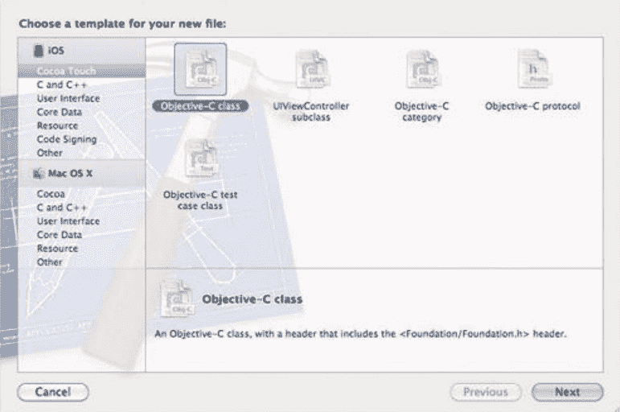

点击 `Next`。确保选中了 `Subclass of NSObject`。再次点击 `Next`。在 `Save As:` 文件名中输入 `Fraction.m`。你可以保留其他字段的默认值。你的窗口应该看起来图 7.2。

### 图 7.2 为你的项目添加新类。

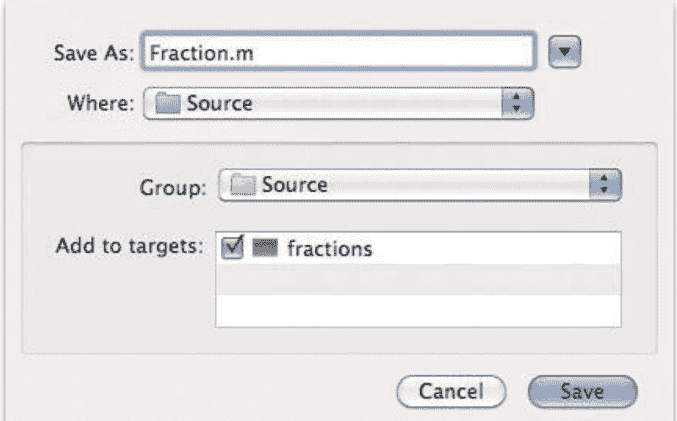

现在点击 `Save`。Xcode 已向你的项目添加了两个文件：`Fraction.h` 和 `Fraction.m`，图 7.3 显示了。

### 图 7.3 Xcode 为新类创建文件。

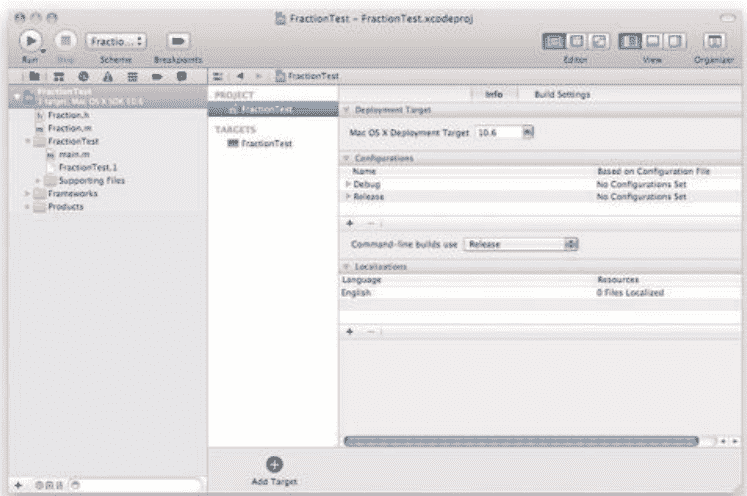

在 `Fraction.h` 文件中，你现在将输入 `Fraction` 类的接口部分，如程序 7.1 所示：

### 程序 7.1 接口文件 Fraction.h

```objc
//
// Fraction.h
// FractionTest
//
// Created by Steve Kochan on 9/29/11
//
@interface Fraction : NSObject
- (int)numerator;
- (int)denominator;
- (void)setNumerator:(int)n;
- (void)setDenominator:(int)d;
- (void)print;
@end
```

```objc
//
// Fraction.m
// FractionTest
//
// Created by Steve Kochan on 9/29/11
//
#import "Fraction.h"
@implementation Fraction
{
    int _numerator;
    int _denominator;
}
- (int)numerator {
    return _numerator;
}
- (int)denominator {
    return _denominator;
}
- (void)setNumerator:(int)n {
    _numerator = n;
}
- (void)setDenominator:(int)d {
    _denominator = d;
}
- (void)print {
    NSLog("%d/%d", _numerator, _denominator);
}
@end
```

注意，该文件不包含 `Fraction` 类的定义。然而，它导入了一个名为 `Fraction.h` 的文件。

# 程序 7.1 输出
```


The value of myFraction is:

1/3

### 合成访问器方法 (Synthesized Accessor Methods)

从 Objective-C 2.0 开始，你可以让系统为你生成 setter 和 getter 方法（统称为访问器方法）。到目前为止，我们还没有向你展示如何这样做，因为对你来说，学会如何编写这些方法很重要。然而，这是语言提供的一项便利功能，现在是时候让你学习如何利用这一特性了。

第一步是在接口部分（interface section）中使用 `@property` 指令来标识你的属性。这些属性的命名通常与你的实例变量相同，尽管不必如此。在我们的 `Fraction` 类中，两个实例变量 `numerator`（分子）和 `denominator`（分母）属于这一类。下面是添加了新的 `@property` 指令后的接口部分。

```
@interface Fraction : NSObject

@property int numerator, denominator;

-(void)   print;

-(double) convertToNum;

@end
```

注意，我们不再包含 getter 和 setter 方法的定义：`numerator`、`denominator`、`setNumerator:` 和 `setDenominator::`。我们将让 Objective-C 编译器自动为我们生成或合成这些方法。这是实现的？只需在实现部分（implementation section）中使用 `@synthesize` 指令即可，如下所示。

```
#import "Fraction.h"

@implementation Fraction

@synthesize numerator, denominator;

-(void) print

{

    NSLog("%i/%i", numerator, denominator);

}

-(double) convertToNum

{

    if (denominator != 0)

        return (double) numerator / denominator;

    else

        return NAN;

}

@end
```

注意，当你使用 `@property` 指令时，不再需要在实现部分中声明对应的实例变量。如果你愿意，可以声明，但不再是必须的，因为编译器会为你处理。

以下这一行告诉 Objective-C 编译器为两个属性 `numerator` 和 `denominator` 各生成一对 getter 和 setter 方法：

```
@synthesize numerator, denominator;
```

通常情况下，如果你有一个名为 `x` 的属性，在实现部分中包含以下行，会导致编译器自动合成一个名为 `x` 的 getter 方法和一个名为 `setX` 的 setter 方法。

```
@synthesize x;
```

尽管这看起来可能不是什么大事，但让编译器为你这样做是值得的，因为生成的访问器方法将是高效的，并且可以在多线程、多机器、多核心上安全运行。

现在回到程序 7.1，并按照指示对接口和实现部分进行更改，以便为你合成访问器方法。验证在不对 `main.m` 做任何更改的情况下，你仍然从程序获得相同的输出。

### 使用点操作符访问属性

Objective-C 语言允许你使用更方便的语法来访问属性。要获取存储在 `myFraction` 中的 `numerator` 的值，你可以这样写：

```
[myFraction numerator]
```

这将向 `myFraction` 对象发送 `numerator` 消息，返回所需的值。在 Objective-C 中，你也可以使用点操作符编写以下等效表达式：

```
myFraction.numerator
```

这里的通用格式是：

```
instance.property
```

你也可以使用类似的语法来赋值：

```
instance.property = value
```

这等同于编写以下表达式：`[instance setProperty: value]`

在程序 7.1 中，你使用以下两行代码将分数的分子和分母设置为 1/3：

```
myFraction setNumerator: 1;
myFraction setDenominator: 3;
```

这里是编写相同代码行的等效方法：

```
myFraction.numerator = 1;
myFraction.denominator = 3;
```

在本文的剩余部分，我们将使用这些新特性来合成方法和访问属性。

值得指出的是，你可以在手动编写的方法上使用点操作符，而不仅仅是用于合成的方法。此外，如果你有一个名为 `numerator` 的 getter 方法，你仍然可以在程序中编写诸如 `myFraction.numerator` 这样的表达式，即使 `numerator` 没有被定义为属性。

### 注意事项

根据前面的讨论，请意识到虽然编写像 `myFraction.print` 这样的语句在语法上是正确的，但它被认为不是良好的编程风格。点操作符的初衷是用于属性的；通常用于设置/获取实例变量的值。确实有效的方法（例如计算两个分数的之和）在 Apple 的文档中被标记为“任务 (Tasks)”。任务通常不使用点操作符执行；传统的括号消息表达式是首选语法。

### 注意事项

如果你合成了访问器方法，不要以 `new`、`alloc`、`copy` 或 `init` 单词开头。这与编译器对将合成的相应方法的假设有关，并在第 17 章“内存管理与自动引用计数”中有更详细的描述。

### 方法的多个参数

让我们继续处理 `Fraction` 类并添加一些内容。你定义了六个方法。如果有一个方法可以通过一条消息同时设置分子和分母就太好了。你只需通过列出每个连续参数后跟冒号来定义接收多个参数的方法：这成为了方法名的一部分。例如，`addEntryWithName:andEmail` 方法接收两个参数，推测是一个名字和一个电子邮件地址。`addEntryWithName:andEmail:andPhone` 方法接收三个参数：一个名字、一个电子邮件地址和一个电话号码。

设置分子和分母的方法可以命名为 `setNumerator:andDenominator:`，你可能这样使用它：

```
[myFraction setNumerator: 1 andDenominator: 3];
```

这并不坏。而且这实际上是方法的第一个选择。但我们可以想出一个更有可读性的方法名。例如，如何使用 `setTo:`？这乍看可能没那么吸引人，但将其与之前的一个相比：

```
[myFraction setTo: 1 over: 3];
```

我认为这读起来好一点，但选择取决于你（有些人可能更喜欢第一个名字，因为它显式引用了类中的实例变量）。再次，良好的方法名对于程序的可读性很重要。让我们让这个新方法运行。首先，在接口文件中添加 `setTo:over:` 的声明，如程序 7.2 所示。

#### 程序 7.2 接口文件: Fraction.h

```
@import <Foundation/Foundation.h>

// 定义 Fraction 类

@interface Fraction : NSObject

@property int numerator, denominator;

-(void) print;

-(void) setTo:(int) n over:(int) d;

-(double) convertToNum;

@end
```

接下来，在实现文件中添加新方法的定义。

#### 程序 7.2 实现文件: Fraction.m

```
#import "Fraction.h"

@implementation Fraction

@synthesize numerator, denominator;

-(void) print

{

    NSLog("%i/%i", numerator, denominator);

}

-(double) convertToNum

{

    if (denominator != 0)

        return (double) numerator / denominator;

    return NAN;

}

-(void) setTo:(int) n over:(int) d

{

    numerator = n;

    denominator = d;

}

@end
```

新的 `setTo:` 方法只需将其两个整数参数赋值给分数、分子和分母的对应的实例变量。

这里有一个尝试新方法的测试程序。

#### 程序 7.2 测试文件: main.m

```
#import "Fraction.h"

int main (int argc, char * argv[])

{

    @autoreleasepool {

        Fraction *aFraction = [[Fraction alloc]

        init];

        [aFraction setTo: 100 over: 200];

        [aFraction print];

        [aFraction setTo: 1 over: 3];

        [aFraction print];

    }

    return 0;

}
```

#### 程序 7.2 输出

100/200
1/3

### 无参数名称的方法

在创建方法名称时，参数名称实际上是可选的。例如，你可以像这样声明一个方法：

+   - (int) set: (int) n: (int) d;

注意，与之前的示例不同，这里方法的第二个参数没有名称。该方法被命名为 `set::`。

这两个冒号表示该方法接收两个参数，尽管它们并不全都有名字。

要调用 `set::` 方法，你使用冒号作为参数分隔符，如下所示：

```objectivec
[Fraction set: 1 : 3];
```

在编写新方法时，省略参数名称不是良好的编程风格，因为这会让程序更难以追踪，并使方法实际参数的意图变得不那么直观。

## 分数的运算

让我们继续使用 `Fraction` 类。首先，你将编写一个方法，使你能够将一个分数加到另一个分数上。你将该方法命名为 `add::`，并且你必须接收一个分数作为参数。以下是新方法的声明：

```objc
-(void)add:(Fraction *)f;
```

注意参数 f 的声明：

```objc
Fraction*) f
```

这表示 `add` 方法的参数是指向 `Fraction` 类对象的引用。星号（asterisk）是必要的，因此以下声明是不正确的：

```
(Fraction) f
```

你将其中一个分数作为参数传递给 `add` 方法，并将让该方法将其加到消息的接收者上；以下消息表达式将 `bFraction` 加到 `Fraction aFraction:` 上：

```objectivec
[aFraction add:bFraction];
```

快速复习一下数学，要加上分数 a/b 和 c/d，你进行如下计算：

```
\frac{a}{b} +\frac{c}{d} = \frac{ad+bc}{bd}
```

你将这个新方法的代码放入 `@implementation` 部分：

```objc
// 将一个 Fraction 加到接收者上
```

```objc
(void)add:(Fraction *)f
{ // 为了相加两个分数：
    // a/b + c/d = ((a*d) + (b*c)) / (b * d)
    numerator = numerator * f.denominator +
    denominator * f.numerator;
    denominator = denominator * f.denominator;
}
```

不要忘记你可以通过其字段 `numerator`（分子）和 `denominator`（分母）来引用作为消息接收者的 `Fraction`。换句话说，在 `add:` 方法内部，你直接通过名称引用你向发送消息的对象的实例变量。

另一方面，你不能用那样直接引用参数 f 的实例变量。相反，你必须通过它的名称 f 来识别对象。然后你可以通过对 f 应用点运算符（或通过向 f 发送适当的消息）来获取相应的实例变量。

因此，`add:` 方法中的第一条语句：

```objectivec
numerator = numerator * f.denominator +
deominator * f.numerator;
```

意思是：取第一个分数（消息的接收者）的分子，乘以（* by*）参数的分（`numerator * f.denominator`），并加到接收者的分母与参数分子的乘积上（`denominator * f.numerator`）。加法的最终结果将存储在接收者的分子中。

重读上一段落，以确保你完全理解了正在执行的操作。这里的关键在于，你要理解何时引用的是接收者，何时引用的是参数。

假设你已经将你的新 `add:` 方法的上述声明和定义添加到你的接口和实现文件中。程序 7.3 是一个示例测试程序及其输出。

## 程序 7.3. 测试文件：FractionTest.m

```objectivec
#import "Fraction.h"

int main (int argc, char * argv[])

{

    @autoreleasepool {

        Fraction *aFraction = [[Fraction alloc]
            init];

        Fraction *bFraction = [[Fraction alloc]
            init];

    }

    // 将两个分数设置为 1/4 和 1/2 并
    // 将它们相加
    [aFraction setTo: 1 over: 4];
    [bFraction setTo: 1 over: 2];
    [aFraction add:bFraction];
    [aFraction print];
    NSLog(@"=");
    [aFraction print];
    return 0;

}
```

输出：
1/4
+
1/2
=
3/4

在程序执行开始时被初始化，并在连续的方法调用中保留其值。

以下代码序列可能出现在 `showPage` 方法内部，该方法想要跟踪它被调用的次数（或者在这种情况下，可能是跟踪已打印的页面数）：

```
(int) showPage
{
    static int pageCount = 0;
    ...
    ++pageCount;
    ...
    return pageCount;
}
```

局部静态变量只会在程序启动时被设置为 0，并且会在 `showPage` 方法的连续调用中保留其值。

请注意将 `pageCount` 为局部静态变量与将其设为实例变量的区别。在一种情况下，`pageCount` 可以计算调用 `showPage` 方法的所有对象打印的页面数。在后一种，变量将计算每个独立对象打印的页面数；每个对象都拥有自己的 `pageCount` 副本。

记住，静态或局部变量只能从定义它们的方法内部访问。因此，即使是 `pageCount` 变量只能从 `showPage` 内部访问。你可以将变量声明移动到任何方法声明之外（通常位于实现文件的开头），以便任何方法都能访问，如下所示：

```
@import "Printer.h"

static int pageCount;
```

```
@implementation Printer
...
@end
```

现在，文件中任何实例方法或类方法都可以访问 `pageCount` 变量。第 10 章“变量和数据类型进”将详细介绍变量作用域这一主题。

回到分数，你可以将 `reduce` 方法的代码整合到你的 `Fraction.m` 实现文件中。别忘记在 `Fraction.h` 接口文件中也声明 `reduce` 方法。完成这些后，你可以在程序 7.4 中测试你的新方法。在这里我们展示了所有三个文件：接口文件、实现文件和测试程序文件。

### 程序 7.4. 接口文件：Fraction.h

```
#import <Foundation/Foundation.h>

// 定义 Fraction 类

@interface Fraction : NSObject

@property int numerator, denominator;

-(void) print;

-(void) setTo:(int) n over:(int) d;

-(double) convertToNum;

-(void) add:(Fraction*) f;

-(void) reduce;

@end
```

### 程序 7.4. 实现文件：Fraction.m

```
#import "Fraction.h"

@implementation Fraction

@synthesize numerator, denominator;

-(void) print {
    NSLog("%@/%@", numerator, denominator);
}

-(double) convertToNum {
    if (denominator != 0)
        return (double) numerator / denominator;
    else
        return NAN;
}


### 程序 7.4. 测试文件 main.m

```objc
#import "Fraction.h"

int main (int argc, char * argv[]) {
    @autoreleasepool {
        Fraction *aFraction = [[Fraction alloc] init];
        Fraction *bFraction = [[Fraction alloc] init];
        [aFraction setTo: 1 over: 4]; // 将第一个分数设为 1/4
        [bFraction setTo: 1 over: 2];      // 将第二个分数设为 1/2
        [aFraction print];
        NSLog("@+");
        [bFraction print];
        NSLog("=");
        [aFraction add: bFraction];
        // 约简加法结果并打印
        [aFraction reduce];
        [aFraction print];
    }
return 0;
}
```

### 程序 7.4. 输出

1/4
+
1/2
=
3/4

这样好多了！

## self 关键字

在程序 7.4 中，我们决定在 `add:` 方法外部约简分数。我们也可以在 `add:` 内部这样做；这个决定完全是任意的。然而，我们如何识别要约简的分数呢？我们到底想要约简哪个分数？我们想要约简发送给 `add:` 消息的同一个分数。

我们知道如何直接通过名称识别方法内部的实例变量，但不知道如何识别消息的接收者。幸运的是，有一种方法可以。

你可以使用 `self` 关键字来指代当前消息的接收对象。如果你在 `add:` 方法内部写了

```
[self reduce];
```

那么 `reduce` 方法将应用于作为 `add:` 消息接收者的 `Fraction` 对象，这正是你所想要的。你将在整本书中看到 `self` 是多么有用。

```objc
- (void) print;
- (void) setTo: (int) n over: (int) d;
- (double) convertToNum;
- (Fraction *) add: (Fraction *) f;
- (void) reduce;
@end
```

你可能不需要处理分数，但这些示例向你展示了如何通过添加新方法来不断完善和扩展一个类。你可以将此接口文件交给另一个处理分数的同事，这对于那个人编写处理分数的程序来说足够了。如果那个人需要添加新方法，他可以直接通过扩展类定义来实现，也可以间接地通过定义他自己的子类并添加自己的新方法来实现。你将在下一章中学习如何这样做。

### 练习

+ 1. 为 `Fraction` 类添加以下方法，以完善分数的算术运算。在每个情况下，都在方法内部对结果进行约分：

```objc
// 从接收者中减去参数
-(Fraction *) subtract: (Fraction *) f;
// 将接收者乘以参数
-(Fraction *) multiply: (Fraction *) f;
// 将接收者除以参数
-(Fraction *) divide: (Fraction *) f;
```

2. 修改你 `Fraction` 类中的 `print` 方法，使其接受一个额外的 `BOOL` 参数，指示分数在显示时是否应该约分。如果需要约分（即参数为 `YES`），请确保不要对分数进行任何永久性更改。

3. 你的 `Fraction` 类可以处理负分数吗？例如，你可以加 -1/4 和 -1/2 并得到正确的结果吗？当你认为有了答案时，写一个测试程序来尝试一下。

4. 修改 `Fraction` 的 `print` 方法，将大于 1 的分数显示为带分数。例如，分数 5/3 应该显示为 1 2/3。

5. 第 4 章“数据类型与表达式”中的练习 6 定义了一个处理复数的新类 `Complex`。添加一个新方法 `add:`，可用于相两个复数。要加两个复数，你只需要将实部和虚部相加，如下：

(5.3 + 7i) + (2.7 + 4i) = 8 + 11i

让 `add:` 方法根据以下方法声明将结果存储并返回一个新的 `Complex` 数字：

```objc
- (Complex*) add: (Complex*) complexNum;
```

确保你在测试程序中处理了潜在的内存泄漏问题。

6. 给第 4 章练习 6 开发的 `Complex` 类以及本章练习 6 中的扩展，创建单独的 `Complex.h` 和 `Complex.m` 接口和实现文件。创建一个单独的测试程序来测试一切。

## 8. 继承

在本章中，你将学习使面向对象编程如此强大的关键原理之一。通过继承的概念，你将在现有的类定义的基础上进行构建，并为你自己的应用程序进行定制。

### 从根部开始

你在第 3 章“类、对象与方法”中学习了父类的概念。父类本身也可以有父类。没有父类的类位于层级结构的顶端，被称为**根类**（root class）。在 Objective-C 中，你有能力定义自己的根类，但通常你不会想这样做。相反，你将希望利用现有的类。我们到为止定义的所有类都是一个名为 `NSObject` 的根类的后代，你在接口文件中是这样指定它的：

```objc
@interface Fraction: NSObject
...
@end
```

`Fraction` 类派自 `NSObject` 类。因为 `NSObject` 位于层级结构的顶端（即上方没有其他类），所以它被称为根类，如图 8.1 所示。`Fraction` 类被称为子类（child/subclass）。

# 图 8.1. 根类与子类

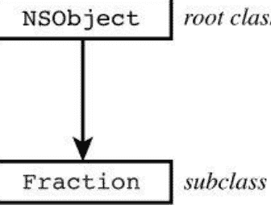

从术语的角度来看，我们可以谈论类、子类和父类。类似地，我们可以谈论类、子类和子类。你应该直接熟悉这两种术语。

每当定义一个新类（新根除外）时，该类都会继承某些内容。例如，父类的（非私有的）实例变量和方法会隐含地成为新类定义的一部分。这意味着子类可以访问这些方法和实例变量，就像它们是直接定义在类定义中一样。

注意，子类要直接访问的实例变量必须在接口部分声明，而不是像我们整本书中所做的那样在实现部分声明。在实现部分声明或合成的实例变量是私有实例变量，子类无法直接访问。相反，你将希望使用它们显式定义或合成的 getter/setter 方法来访问它们的值。

一个简单的例子（尽管是人为的）有助于说明继承这一核心概念。这里有一个对象 `ClassA` 的声明，它包含一个名为 `initVar` 的方法（注意这里我们在接口部分声明了实例变量 `x`，以便子类访问）。

```objc
@interface ClassA: NSObject
{
    int x;
}
```

```objc
- (void) initVar;
@end
```

`initVar` 方法简单地将 `ClassA` 实例变量的值设置为 100：

```objc
@implementation ClassA
-(void) initVar
{
    x = 100;
}
@end
```

现在让我们定义一个名为 `ClassB` 的类：

```objc
@interface ClassB: ClassA
-(void) printVar;
@end
```

声明的第一行

```objc
@interface ClassB: ClassA
```

表示 `ClassB` 不是 `NSObject` 的子类，而是 `ClassA` 的子类。尽管 `ClassA` 的父类（超类）是 `NSObject`，但 `ClassB` 的父类是 `ClassA`。图 8.2 说明了这一点。

# 图 8.2. 子类与父类

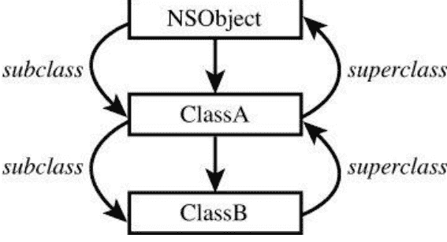

从图 8.2 可以看到，根类没有父类，而位于层级底部的 `ClassB` 没有子类。因此，`ClassA` 是 `NSObject` 的子类。

## 程序 8.1. 输出

```
x = 100
```

你首先定义 `b` 为一个 `ClassB` 对象。在分配并初始化 `b` 后，你向它发送一个消息来应用 `initVar` 方法。但回看 `ClassB` 的定义，你会发现你从未定义过这样的方法。`initVar` 是定义在 `ClassA` 中的，由于 `ClassA` 是 `ClassB` 的父类，`ClassB` 可以使用 `ClassA` 的所有方法。因此对于 `ClassB` 而言，`initVar` 是一个继承的方法。

### 注意

到为止我们简单提到了它，但 `alloc` 和 `init` 是你一直使用的方法，它们从未在你的类中定义。这是因为你利用了它们继承自 `NSObject` 类的这一事实。

在向 `b` 发送 `initVar` 消息后，你调用 `printVar` 方法来显示实例变量 `x` 的值。`x = 100` 的输出确认了 `printVar` 能够访问该实例变量。这是因为与 `initVar` 方法一样，它也是继承来的。

记住，继承的概念会一直向下链式传递。因此，如果你定义了一个名为 `ClassC` 的新类，其父类为 `ClassB`，如下所示：

```
@interface ClassC: ClassB
...
@end
```

那么 `ClassC` 将继承 `ClassB` 的所有方法和实例变量，而 `ClassB` 又继承了 `ClassA` 的所有方法和实例变量，进而继承了 `NSObject` 的所有方法和实例变量。

务必理解，类的每个实例都有自己的实例变量，即使它们是继承来的。因此，一个 `ClassC` 对象和一个 `ClassB` 对象将拥有它们各自不同的实例变量。

## 寻找正确的方法

当你向对象发送消息时，你可能会好奇如何选择正确的方法应用到该对象。规则实际上非常简单。首先，检查对象所属的类，查看该类中是否显式定义了具有特定名称的方法。如果是，则使用该方法。如果没有定义，则检查父类。如果在该类中定义了方法，则使用该方法。如果没有，则继续搜索。

会一直检查父类，直到发生两种情况之一：要么你找到了包含指定方法的类，要么在回溯到根类后仍找到该方法。如果发生第一种情况，你就没好了；如果发生第二种情况，你就有问题了，并生成如下所示警告消息：

> warning: 'ClassB' may not respond to '-ity'

在这种情况下，你无意中尝试向一个类型为 `ClassB` 的变量发送名为 `ity` 的消息。编译器告诉你，该类的对象不知道如何响应此类方法。再次，这是在检查了 `ClassB` 的方法及其父类一直到根类的方法（在本例中是 `NSObject`）后确定的。

你将在第 9 章“多态、动态类型和动态绑定”中学习更多关于系统如何检查执行正确方法的知识。

## 通过继承进行扩展：添加新方法

继承通常用于扩展类。例如，假设你被分配了任务，开发一些类来处理矩形、圆形和三角形等 2D 图形对象。目前，我们只考虑矩形。回到第 4 章“数据类型和表达式”中的练习 7，从该示例的 `@interface` 部分开始：

```
@interface Rectangle: NSObject
@property int width, height;
-(int) area;
-(int) perimeter;
@end
```

你将合成这些值来设置矩形的宽度和高度并返回它们，以及你自己的方法来计算它的面积和周长。让我们添加一个方法，允许你通过同一个消息调用设置矩形的宽度和高度，如下：

```
-(void) setWidth:(int) w andHeight:(int) h;
```

假设你将这个新类的声明输入到名为 `Rectangle.h` 的文件中。其实现文件 `Rectangle.m` 可能如下所示：

```
@import "Rectangle.h"
@implementation Rectangle
@synthesize width, height;
-(void) setWidth:(int) w andHeight:(int) h
{
    width = w;
    height = h;
}
-(int) area
{
    return width * height;
}
-(int) perimeter
{
    return (width + height) * 2;
}
@end
```

每个方法的定义都足够简单。程序 8.2 显示了测试它的主程序。

## 程序 8.2

```
#import "Rectangle.h"
int main (int argc, char * argv[])
{
    @autoreleasepool {
        Rectangle *myRect = [[Rectangle alloc] init];
        [myRect setWidth:5 andHeight:8];
        NSLog ("Rectangle: w = %i, h = %i", myRect.width, myRect.height);
        NSLog(@"Area = %i, Perimeter = %i", [myRect area], [myRect perimeter]);
    }
  return 0;
}
```

## 程序 8.2 输出

Rectangle: w = 5, h = 8
Area = 40, Perimeter = 26

`myRect` 被分配并初始化；然后将其宽度设置为 5，高度设置为 8。第一行输出验证了这一点。接下来，通过适当的消息调用计算矩形的面积和周长，并将返回的值交给 `NSLog` 进行显示。

假设你现在需要处理正方形。你可以定义一个名为 `Square` 的新类，并在其中定义与 `Rectangle` 类类似的方法。或者，你可以意识到正方形只是特殊的矩形，其宽度和高度恰好相等。

因此，处理这种情况的一种简单方法是创建一个名为 `Square` 的新类，使其成为 `Rectangle` 的子类。目前，你可能想要添加的方法只有设置正方形边长为特定值以及获取该值。程序 8.3 显示了你新类 `Square` 的接口和实现文件。

## 程序 8.3. Square.h 接口文件

```
#import "Rectangle.h"
@interface Square: Rectangle
-(void) setSide:(int) s;
-(int) side;
@end
```

## 程序 8.3. Square.m 实现文件

```
#import "Square.h"
@implementation Square: Rectangle
-(void) setSide:(int) s
{
    [self setWidth: s andHeight: s];
}
-(int) side
{
    return self.width;
}
@end
```

# 程序 8.3. 测试程序

```objc
#import "Square.h"
#import <Foundation/Foundation.h>
int main (int argc, char * argv[]) {
    @autoreleasepool {
        Square *mySquare = [[Square alloc] init];
        [mySquare setSide: 5];
        NSLog(@"Square s = %i", [mySquare side]);
        NSLog(@"Area = %i, Perimeter = %i", [mySquare area], [mySquare perimeter]);
    }
    return 0;
}
```


# 程序 8.3. 输出

`Square s = 5`
`Area = 25, Perimeter = 20`

你定义 `Square` 类的方法是 Objective-C 中处理类的一种基本技术：扩展你或他人已经完成的内容以适应你的需求。此外，一种名为分类（categories）的机制允许你以模块化的方式向现有的类定义中添加新方法——也就是说，而无需在同一个接口和实现文件中不断添加新定义。当你对一个你没有源代码访问权的类进行此操作时，这特别有用。你将在第 11 章“分类与协议”中学习分类。

## 点类与对象分配

`Rectangle` 类仅存储矩形的尺寸。在真实的图形化应用程序中，你可能需要跟踪各种额外信息，例如矩形的填充颜色、线条颜色、在窗口内部的各个（原点）等。你可以轻松地扩展你的类来完成这一点。现在，让我们处理一下矩形“原点”的概念，即矩形在某个笛卡尔坐标系 `(x, y)` 中的左下角位置。如果你正在编写绘图应用程序，这个点可能代表矩形在窗口内的位置，如图 8.4 所示。

### 图 8.4. 在窗口中绘制的矩形

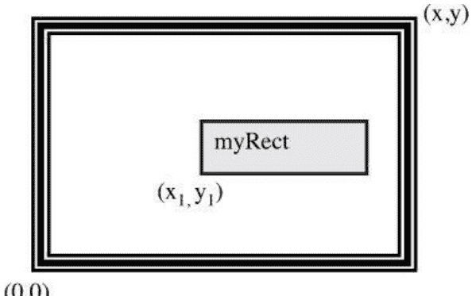

在图 8.4 中，矩形的原点显示在 `(x1, y1)`。

你可以扩展 `Rectangle` 类，将矩形原点的 `x`、`y` 坐标作为两个独立的值存储。或者你可能会意识到，在开发图形应用程序时，你需要处理许多坐标，因此决定定义一个名为 `XYPoint` 的类（你可能记得第 3 章第 7 题中的这个问题）；

```objc
#import <Foundation/Foundation.h>

@interface XYPoint: NSObject

@property int x, y;

-(void)setX:(int)xVal andY:(int)yVal;

@end
```

现在让我们回到你的 `Rectangle` 类。你想能够存储矩形的原点，因此你会在 `Rectangle` 类的定义中添加一个名为 `origin` 的实例变量：

```objc
@implementation Rectangle
{
    XYPoint *origin;
}
...
```

添加一个方法来设置并获取矩形的原点是合理的。为了说明一个重要的点，我们现在不会为 `origin` 自动合成访问器方法。相反，我们将自己编写它们。

## @class 指令

现在你可以处理矩形（以及正方形！）并能够设置它们的宽度、高度和原点。首先，让我们完整查看你的 `Rectangle.h` 接口文件：

```objc
#import <Foundation/Foundation.h>
@class XYPoint;

@interface Rectangle: NSObject
@property int width, height;
- (XYPoint *)origin;
- (void)setOrigin:(XYPoint *)pt;
- (void)setWidth:(int)w andHeight:(int)h;
- (int)area;
- (int)perimeter;
@end
```

你在 `Rectangle.h` 头文件中使用了一个新指令：

`@class XYPoint;`

你需要它是因为编译器在遇到 `XYPoint` 作为为 `Rectangle` 定义的实例变量之一时，需要知道 `XYPoint` 是什么。类名也分别用于你的 `setOrigin:` 和 `origin` 方法的参数和返回类型声明。你还有另一个选择。你可以改为导入头文件，如下：

```objc
#import "XYPoint.h"
```

使用 `@class` 指令更高效，因为编译器不需要导入和处理整个 `XYPoint.h` 文件（尽管它很小）；它只需要知道 `XYPoint` 是一个类的名称。如果你需要引用 `XYPoint` 类的某个方法（例如在实现部分），`@class` 指令将是不够的，因为编译器需要更多信息；它需要知道该方法接受多少参数、它们的类型是什么，以及方法的返回类型是什么。

所以，确保你理解 `@class` 指令的用法。
它只是告诉编译器 `XYPoint` 是一个类的名称。
通过这样，当它看到这一行时：

```objc
XYPoint *origin;
```

它就知道 `origin` 是来自名为 `XYPoint` 的类的对象。
这就是编译器在该点需要的所有信息。

让我们为你新的 `XYPoint` 类和 `Rectangle` 方法填充空白，以便你可以在程序中测试一切。首先，程序 8.4 显示了你的 `XYPoint` 类的实现文件。

首先，程序 8.4 显示了你的 `Rectangle` 类的新方法。

# 程序 8.4. 添加的方法

```objc
#import "Rectangle.h"
@implementation Rectangle
-(void)setOrigin:(XYPoint *)pt {
    origin = pt;
}
-(XYPoint *)origin {
    return origin;
}
-(void)setWidth:(int)w andHeight:(int)h {
    width = w;
    height = h;
}
-(int)area {
    return width * height;
}
-(int)perimeter {
    return 2 * (width + height);
}
@end
```

# 程序 8.4. Rectangle.m

```objc
#import "XYPoint.h"
@implementation Rectangle
{
    XYPoint *origin;
}
-(void)setOrigin:(XYPoint *)pt {
    origin = pt;
}
-(XYPoint *)origin {
    return origin;
}
-(void)setWidth:(int)w andHeight:(int)h {
    width = w;
    height = h;
}
-(int)area {
    return width * height;
}
-(int)perimeter {
    return 2 * (width + height);
}
@end
```

# 程序 8.4. XYPoint.m

```objc
#import "XYPoint.h"
@implementation XYPoint
-(void)setX:(int)xVal andY:(int)yVal {
    x = xVal;
    y = yVal;
}
@end
```

# 程序 8.4. XYPoint.h

```objc
#import <Foundation/Foundation.h>
@interface XYPoint: NSObject
@property int x, y;
-(void)setX:(int)xVal andY:(int)yVal;
@end
```

# 程序 8.4. Rectangle.h

```objc
#import <Foundation/Foundation.h>
@class XYPoint;
@interface Rectangle: NSObject
@property int width, height;
- (XYPoint *)origin;
- (void)setOrigin:(XYPoint *)pt;
- (void)setWidth:(int)w andHeight:(int)h;
- (int)area;
- (int)perimeter;
@end
```

以下是完整的 `XYPoint` 和 `Rectangle` 定义，随后是一个用于尝试它们的测试程序。

# 程序 8.4. 测试程序

```objc
#import "Rectangle.h"
#import "XYPoint.h"
int main (int argc, char * argv[]) {
    @autoreleasepool {
        Rectangle *myRect = [[Rectangle alloc] init];
        XYPoint *myPoint = [[XYPoint alloc] init];
        [myPoint setX:100 andY:200];
        [myRect setWidth:5 andHeight:8];
        myRect.origin = myPoint;
        NSLog(@"Rectangle w = %i, h = %i", myRect.width, myRect.height);
        NSLog(@"Origin at (%i, %i)", myRect.origin.x, myRect.origin.y);
        NSLog(@"Area = %i, Perimeter = %i", [myRect area], [myRect perimeter]);
    }
    return 0;
}
```

# 程序 8.4. 输出

`Rectangle w = 5, h = 8`
`Origin at (100, 200)`
`Area = 40, Perimeter = 26`

在主程序内部，你分配并初始化了一个标识为 `myRect` 的矩和一个名为 `myPoint` 的点。使用 `setX:andY:` 方法，你将 `myPoint` 设置为 `(100, 200)`。在将矩形的宽度和高度设置为 5 和 8 后，你调用了 `setOrigin` 将矩形的原点设置为指向 `myPoint` 的点。三个 `NSLog` 调用获取并打印了这些值。表达式 `myRect.origin.x` 获取访问器方法 `origin` 返回的 `XYPoint` 对象，并应用点运算符以获取矩形的 `x` 坐标。类似地，接下来的表达式获取了矩形的 `y` 坐标：

```objc
myRect.origin.y
```

根据你对点运算符以及编译器如何解释它的了解，记住这个表达式与表达式 `[[myRect origin] y]` 等价。

```objc
NSLog ("@Origin at %i, %i",
myRect.origin.x, myRect.origin.y);
}
return 0;
}
```

## 程序 8.5. 输出

`Origin at (100, 200)`
`Origin at (50, 50)`

你在程序中将 `myPoint` 从 `(100, 200)` 改为 `(50, 50)`，显然这也改变了矩形的原点！但为什么会发生这种情况呢？你并没有显式地设置矩形的原点，矩形的原点为什么会改变？如果你回到你的 `setOrigin:` 方法定义处，或许就能发现原因：

```objc
-(void) setOrigin: (XYPoint *) pt
{
  origin = pt;
}
```

当使用表达式调用 `setOrigin:` 方法时：

```objc
myRect.origin = myPoint;
```

`myPoint` 的值被作为参数传递给方法。该值指向该 `XYPoint` 对象在内存中的存储，如图 8.5 所示。

## 图 8.5. 内存中的 myPoint 对象引用

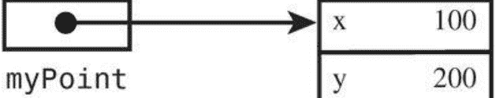

存储在 `myPoint` 内部的这个值（内存指针）被复制到了方法内部定义的局部变量 `pt` 中。现在 `pt` 和 `myPoint` 都引用内存中存储的的数据。图 8.6 展示了这一点。

### 图 8.6. 将矩形的原点传递给方法

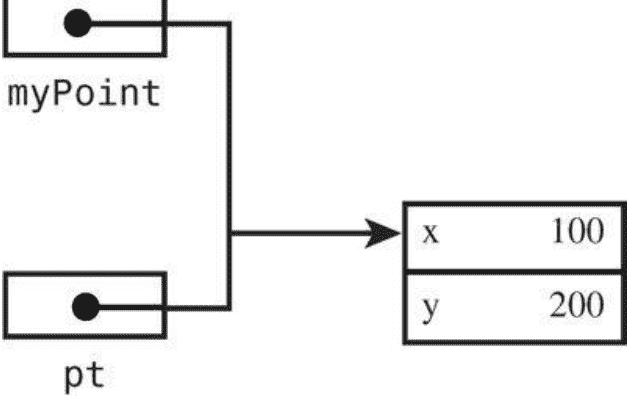

当方法内部将 `origin` 设置为 `pt` 时，存储在 `pt` 内部的指针被复制到实例变量 `origin` 中，如图 8.7 所示。

### 图 8.7. 设置矩形的原点

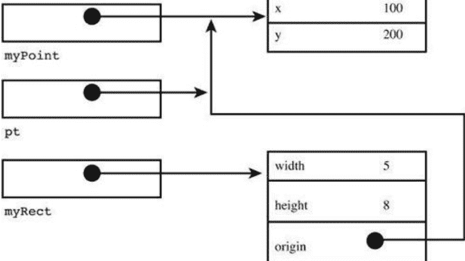

由于 `myPoint` 和存储在 `myRect` 中的 `origin` 变量引用内存中的同一区域（局部变量 `pt` 也是如此），当你随后更改 `myPoint` 的值为 `(50, 50)` 时，矩形的原点也随之改变了。

你可以通过修改 `setOrigin:` 方法来避免这个问题，使其分配自己的点并将原点设置为该点。显示所示：

```objc
(void) setOrigin: (XYPoint *) pt
    if (!origin)
        origin = [[XYPoint alloc] init];
    origin.x = pt.x;
    origin.y = pt.y;
```

第一种方法测试了实例变量 `origin` 是否非零（请确保你理解了该测试以及使用的逻辑取反运算符 `!`）。请记住，所有变量最初都被设置为零。因此，当分配一个新的 `Rectangle` 对象时，它包括 `origin` 在内的所有实例变量将被设置为零。

如果 `origin` 为零，`setOrigin:` 方法将分配并初始化一个新的 `XYPoint` 对象，并将其引用存储在 `origin` 中。

然后该方法将新分配的 `XYPoint` 对象设置为方法的参数的 `x`、`y` 坐标。仔细研究这一点，直到你完全理解它的工作原理。

对 `setOrigin:` 方法的更改意味着每个 `Rectangle` 现在拥有它自己的 `XYPoint` 实例。尽管它现在负责为该实例分配内存，但它也应该负责释放该内存。通常情况下，当一个类包含其他对象时，你有时会希望它拥有所有这些对象。在矩形的情况下，`Rectangle` 类拥有它的原点是有意义的，因为那是矩形的基本属性。只有通过“类”访问器方法才能设置或检索该原点。这符合数据封装的概念。

使用修改后的方法，重新编译并运行程序 8.5，会产生如图 8.8 所示的错误信息。

### 图 8.8. 编译器错误信息

```
[origin] setx(pt.x and pt.y);
error: request for member 'x' in something not a structure or union
warning: 'setdefault' method not found
(对于没有匹配的方法签名，将假设返回 'id' 并接受 '...' 作为参数)
```

哎！问题在于你在修改后的方法中引用了 `XYPoint` 类中的某些实例变量，因此现在编译器需要的关于它的信息比 `@class` 指令提供的更多。在这种情况下，你必须回到 `Rectangle.h` 头文件，并将该指令替换为导入，如下所示：

```objc
#import "XYPoint.h"
```

## 程序 8.5B. 输出

```
Origin at (100, 200)
Origin at (100, 200)
```

这样好多了。这次，在 `main` 内部更改 `myPoint` 的值为 `(50, 50)` 对矩形的原点没有影响，因为在 `Rectangle` 的 `setOrigin:` 方法内部创建了该点的拷贝。

顺便提一下，我们在这里没有合成 `origin` 的方法，因为合成（synthesize）的 setter 方法 `setOrigin:` 将与你最初编写的完全一样。也就是说，默认情况下，合成 setter 的动作是复制对象指针而不是对象本身。

你可以合成不同类型的 setter 方法，改为创建对象的副本。然而，要实现这一点，你需要学习如何编写特殊的拷贝方法。我们将在第 17 章“内存管理与自动引用计数”中再次讨论这个话题。

```objc
[b initVar];    // 使用覆盖的 ClassB
method
  [b printVar];    // 显示 x 的值;
  }
  return 0;
}
```

编译此程序时，你会得到此警告信息：

`warning: 'ClassA' may not respond to '-printVar'`

这里发生了什么？我们在之前的章节中讨论过这个问题。请查看 `ClassA` 的声明：

```objc
// ClassA 的声明和定义
@interface ClassA: NSObject
{
  int x;
}
```

```objc
-(void) initVar;
@end
```

注意，这里没有声明 `printVar` 方法。该方法在 `ClassB` 中声明并定义了。因此，尽管 `ClassB` 对象及其后类可以通过继承使用此方法，但 `ClassA` 对象则不能使用，因为该方法定义在层次结构中更靠下的位置。

### Note

你可以通过某些方式强制使用该方法，但我们在这里不深入探讨——况且这并不符合良好的编程习惯。

回到我们的示例，让我们为 `ClassA` 添加一个 `printVar` 方法，这样你就可以显示其实例变量的值：

```objc
// ClassA 的声明和定义
@interface ClassA: NSObject
{
    int x; // 将被子类继承
}
-(void) initVar;
-(void) printVar;
@end
@implementation ClassA
-(void) initVar {
    x = 100;
}
-(void) printVar {
    NSLog("@x = %i", x);
}
@end
```

`ClassB` 的声明和定义保持不变。让我们再次编译并运行此程序。

# Program 8.7. 输出

```objc
x = 100
x = 200
```


现在我们可以讨论实际示例了。首先，`a` 和 `b` 分别定义为 `ClassA` 和 `ClassB` 对象。在分配和初始化后，向它们发送消息，请求其执行 `initVar` 方法。该方法定义在 `ClassA` 的定义中，因此选择了该方法。该方法简单地将实例变量 `x` 的值设置为 `100` 并返回。接着调用你刚刚添加到 `ClassA` 的 `printVar` 方法来显示 `x` 的值。

与 `ClassA` 对象一样，`ClassB` 对象 `b` 也被分配和初始化，其实例变量 `x` 被设置为 `200`，最后显示了它的值。

请确保你理解如何根据 `a` 和 `b` 所属的类为它们选择正确的方法。这是 Objective-C 面向对象编程的基础概念。

作为一个练习，考虑从 `ClassB` 中移除 `printVar` 方法。这样做可行吗？为什么可行或不可行？

在定义子类时，你不仅可以添加新方法来有效扩展类的定义，还可以添加新的实例变量。在这两种情况下，效果都是累积的。你永远无法通过继承来减少方法或实例变量；你只能添加——或者对于方法，是添加或覆盖。

所以，回顾一下，你为什么要创建一个子类？这里有三个原因：

- 1. 你想扩展类的功能，也许通过添加新方法和/或实例变量。
- 2. 你想创建一个类的特殊化版本（例如，某种类型的图形对象）。
- 3. 你需要通过覆盖一个或多个方法来更改类的默认行为。

### Abstract类（Abstract Classes）

没有什么比用一些术语来结束这一章更好的方法了？我们在这里引入它是因为它与继承的概念直接相关。

有时创建类仅仅是为了让某人更容易创建子类。出于原因，这些类被称为抽象类（abstract classes），或者等价的抽象父类（abstract superclasses）。方法和实例变量定义在类中，但并不期望有人实际上从该类创建实例。例如，考虑根对象 `NSObject`。你能想出从该类中定义一个对象的任何用途吗？

在第二部分“Foundation 框架”中介绍的 Foundation 框架有几个所谓的抽象类。例如，Foundation 的 `NSNumber` 类就是一个抽象类，它是为了将数字作为对象来处理而创建的。整数和浮点数通常有不同的存储要求。每种数值类型都有独立的 `NSNumber` 子类。因为这些子类与它们的抽象父类不同，它们是真实存在的，因此被称为具体子类（concrete subclasses）。每个具体子类都属于 `NSNumber` 类，并统称为一个簇（cluster）。当你向 `NSNumber` 类发送消息创建一个新的整数对象时，会使用相应的子类为整数对象分配必要的存储空间并恰当地设置其值。这些子类实际上是私有的。你并不会直接访问它们；而是通过抽象父类间接访问它们。抽象父类为处理所有类型的数字对象提供了一个公共接口，减轻了你必须知道数字对象中存储了何种类型数字以及如何设置和检索其值的负担。

诚然，这段讨论可能看起来有点“抽象”（抱歉！）；请不用担心——在这里只需掌握该概念就足够了。

### 练习（Exercises）

- 1. 在程序 8.1 中添加一个名为 `ClassC` 的新类，它是 `ClassB` 的子类。编写一个 `initVar` 方法，将其实例变量 `x` 的值设置为 `300`。编写一个测试例程，声明 `ClassA`、`ClassB` 和 `ClassC` 对象并调用它们对应的 `initVar` 方法。
- 2. 在处理高分辨率设备时，你可能需要使用一种坐标系，允许你将点指定为浮点值而不是简单的整数（iOS 使用一个名为 `CGRect` 的结构来处理矩形）。修改本章中的 `XYPoint` 和 `Rectangle` 类以处理浮点数。矩形的宽度和面积也应该支持浮点数。
- 3. 在程序 8.1 中添加一个名为 `Class2` 的新类，它像 `ClassB` 一样是 `ClassA` 的子类。`ClassB` 和 `Class2` 之间是什么关系？识别 `NSObject` 类、`ClassA`、`ClassB` 和 `Class2` 之间的层次关系。`ClassB` 的父类是什么？`Class2` 的父类是什么？一个类可以有多少个子类？它可以有多少个父类？
- 4. 为 `Rectangle` 类编写一个 `translate:` 方法，它接收一个 `XYPoint` 对象作为参数。让它根据指定的向量平移矩形。注意：平移意味着从一个地方移动到另一个地方。
- 5. 定义一个新类 `GraphicObject`，使其继承 `NSObject`。在新类中定义变量如下：

```objc
int    fillColor;   // 32位颜色
BOOL   filled;      // 对象是否填充？
int    lineColor;   // 32位线条
```

编写方法来设置和检索之前定义的变量。让 `Rectangle` 类成为 `GraphicObject` 的子类。定义 `GraphicObject` 的子类 `Circle` 和 `Triangle`。编写方法来设置和检索这些对象的各种参数，以及计算圆的周长和面积，三角形的周加上面积。
- 6. 为 `Rectangle` 类编写一个 `containsPoint:` 方法，接收一个 `XYPoint` 对象作为参数：

```objc
-(BOOL) containsPoint: (XYPoint *) aPoint;
```

如果矩形包含指定的点，则该方法返回 `BOOL` `YES`，否则返回 `NO`。
- 7. 为 `Rectangle` 类编写一个 `intersect:` 方法，接收一个矩形作为参数并返回表示两个矩形重叠区域矩形。例如，给定图 8.10所示所示的矩形，该方法应该返回一个起点为 `(400, 420)`、宽度为 `50`、高度为 `60` 的矩形。如果矩形不相交，返回一个宽度和高度为零且起点为 `(0,0)` 的矩形。
- 8. 为 `Rectangle` 类编写一个 `draw` 方法，使用连字符和竖线画矩形。以下代码序列

```objc
Rectangle *myRect = [[Rectangle alloc] init];
myRect setWidth: 10 andHeight: 3;
myRect draw;
```

将产生以下输出：

```
|   |
|   |
|   |
|   |
|   |
------
```

### 注意

你应该使用 `printf` 来打印你的字符，因为 `NSLog` 在每次调用时都会显示新行。

# 9. 多态、动态类型和动态绑定

在本章中，你将学习 Objective-C 语言的某些特性，这些特性使其成为一种强大的编程语言，并将其区别于 C++ 等其他面向对象的编程语言。本章描述了三个核心概念：多态、动态类型和动态绑定。多态允许在开发程序时，使得不同类的对象可以定义方法。动态类型将对象所属类的确定推迟到程序执行时。动态绑定则将在对象上调用的实际方法的确定推迟到程序运行时间。

### 多态：相同名，不同类

程序 9.1 显示了名为 `Complex` 的类的接口文件，它用于在程序中表示复数。

# 程序 9.1. 接口文件 Complex.h

```objc
// Complex 类的接口文件
#import <Foundation/Foundation.h>
@interface Complex: NSObject
@property double real, imaginary;
-(void) print;
-(void) setReal:(double)a andImaginary:(double) b;
-(Complex *) add: (Complex *) f;
@end
```

你应该已经从第 7 章“关于类的更多内容”的练习 5 和 6 中完成了该类的实现部分。我们添加了一个额外的 `setReal:andImaginary:` 方法，以便你通过一条消息同时设置数的实部和虚部，并合成了访问器方法。如下所示。

# 程序 9.1. 实现文件 Complex.m

```objc
// Complex 类的实现文件
#import "Complex.h"
@implementation Complex
@synthesize real, imaginary;
-(void) print
{
    NSLog("%g + %gi", real, imaginary);
}
-(void) setReal: (double) a andImaginary:(double) b
{
    real = a;
    imaginary = b;
}
-(Complex *) add: (Complex *) f
{
    Complex *result = [[Complex alloc] init];
    result.real = real + f.real;
    result.imaginary = imaginary + f.imaginary;
    return result;
}
@end
```

# 程序 9.1. 测试程序 main.m

```objc
// 共享方法名：多态
#import "Fraction.h"
#import "Complex.h"
int main(int argc, char * argv[]) {
    @autoreleasepool {
        Fraction *f1 = [[Fraction alloc] init];
        Fraction *f2 = [[Fraction alloc] init];
        Fraction *fracResult;
        Complex *c1 = [[Complex alloc] init];
        Complex *c2 = [[Complex alloc] init];
        Complex *compResult;
        [f1 setTo: 1 over: 10];
        [f2 setTo: 2 over: 15];
        [c1 setReal: 18.0 andImaginary: 2.5];
        [c2 setReal: -5.0 andImaginary: 3.2];
        // 相加并打印两个复数
        [c1 print]; NSLog("+"); [c2 print];
        NSLog("-------");
        compResult = [c1 add: c2];
        [compResult print];
        NSLog("\n");
        // 相加并打印两个分数
        [f1 print]; NSLog("+"); [f2 print];
        NSLog("-------");
        fracResult = [f1 add: f2];
        [fracResult print];
    }
    return 0;
}
```

# 程序 9.1. 输出

```
18 + 2.5i
+
-5 + 3.2i
------
13 + 5.7i

1/10
+
2/15
----
7/30
```

注意，`Fraction` 和 `Complex` 类都包含 `add:` 和 `print` 方法。因此，当执行消息表达式时

```
compResult = [c1 add: c2];
[compResult print];
```

系统如何知道执行哪些方法？很简单：Objective-C 运行时知道 `c1`（第一条消息的接收者）是一个 `Complex` 对象。因此，它选择了为 `Complex` 类定义的 `add` 方法。

Objective-C 运行时系统还确定 `compResult` 是一个 `Complex` 对象，因此它选择了 `Complex` 类中定义的 `print` 方法来显示加法结果。同样的讨论也适用于以下消息表达式：

```
fracResult = [f1 add: f2];
[fracResult print];
```

### 注意

正如第 13 章“底层 C 语言特性”中更完整描述的那样，系统始终携带关于对象所属类的信息。这使得它能够在运行时而不是编译时做出这些关键决策。

根据 `f1` 和 `fracResult` 的类，选择了 `Fraction` 类中对应的方法来求值消息表达式。

如提到的，在不同类之间共享相同方法名的能力被称为多态。多态允许你开发一组类，每个类都可以响应相同的方法名。每个类的定义都封装了响应该特定方法所需的代码，这使得它与其它类的定义保持保持独立。这还允许你稍后添加可以响应具有相同名称方法的类类。

### 动态绑定和 id 类型

第 4 章简要提到了 `id` 数据类型，并指出它是一个泛型对象类型。也就是说，`id` 可以用于存储属于任何类的对象。这种数据类型的真正威力是在程序执行期间用它在变量中存储不同类型的对象时。研究程序 9.2 及其相关输出。

# 程序 9.2. 测试程序 main.m

```objc
// 演示动态类型和绑定
#import "Fraction.h"
#import "Complex.h"
int main (int argc, char * argv[])
{
    autoreleasepool {
        id dataValue;
        Fraction *f1 = [[Fraction alloc] init];
        Complex *c1 = [[Complex alloc] init];
        [f1 setTo: 2 over: 5];
        [c1 setReal: 10.0 and Imaginary: 2.5];
        // dataValue 首先获得一个分数
        dataValue = f1;
        [dataValue print];
        // 现在 dataValue 获得一个复数
        dataValue = c1;
        [dataValue print];
    }
    return 0;
}
```

# 程序 9.2. 输出

```
2/5
10 + 2.5i
```

变量 `dataValue` 被声明为 `id` 对象类型。因此，`dataValue` 可以用于持有程序中的任何类型的对象。注意声明行中没有星号：

`id dataValue;`

`Fraction f1` 被设置为 `2/5`，复数 `c1` 被设置为 `(10 + 2.5i)`。赋值操作

`dataValue = f1;`

将 `Fraction f1` 存储在 `dataValue` 中。现在，你可以对 `dataValue` 做什么？嗯，你可以在 `dataValue` 上调用任何你可以在 `Fraction` 对象上使用的方法，尽管 `dataValue` 的类型是 `id` 而不是 `Fraction`。但如果 `dataValue` 可以存储任何类型的对象，系统是如何知道要调用哪个方法的呢？也就是说，当它遇到消息表达式时

```
[dataValue print];
```

它如何知道调用哪个 `print` 方法？你为 `Fraction` 和 `Complex` 类都定义了 `print` 方法。

如之前所述，答案在于 Objective-C 系统始终跟踪对象所属的类。它也在于动态类型和动态绑定的概念——也就是说，系统在运行时而不是编译时动态地做出关于对象的类以及因此调用哪个方法的决策。

所以，程序执行期间，在系统向 `dataValue` 发送 `print` 消息之前，它首先检查存储在 `dataValue` 内部对象的类。在程序 9.2 的第一个情况下，该变量包含一个 `Fraction` 对象，因此使用了 `Fraction` 类中定义的 `print` 方法。这通过程序的输出验证了这一点。

在第二种情况下，发生了相同的事情。首先，将复数 `c1` 赋值给 `dataValue`。接下来，执行以下消息表达式：

```
[dataValue print];
```

这一次，因为 `dataValue` 包含一个属于 `Complex` 对象，因此选择了该类中对应的 `print` 方法进行执行。

这是一个简单的例子，但你可以将这一概念推广到更复杂的应用程序中。与多态结合，动态绑定和动态类型允许你轻松地编写代码，向不同类的对象发送相同的消息。

例如，考虑一个可以用于在屏幕上绘制图形对象的 `draw` 方法。你可能为你的每个图形对象定义了不同的 `draw` 方法，例如文本、圆形、矩形、窗口等。如果要绘制的特定对象

绘制的内容存储在一个名为 `currentObject` 的 `id` 变量中，例如，你只需通过发送 `draw` 消息将其绘制在屏幕上：

```
[currentObject draw];
```

你甚至可以先进行测试，以确保 `currentObject` 中存储的对象实际上响应 `draw` 方法。你将在本章稍后的“询问关于类的问题”章节中学习如何操作。

# 编译时检查与运行时检查

由于存储在 `id` 变量中的对象类型在编译时是不确定的，某些测试会被推迟到运行时——即程序执行期间。

考虑以下代码序列：

```objc
Fraction *f1 = [[Fraction alloc] init];
[f1 setReal: 10.0 andImaginary: 2.5];
```

由于 `setReal:andImaginary:` 方法适用于复数而不是分数，因此在你编译包含该行的程序时，会抛出以下消息：

```
'Fraction' may not respond to 'setReal:andImaginary:'
```

Objective-C 编译器知道 `f1` 是一个 `Fraction` 对象，因为它是这样声明的。它还知道当看到以下消息表达式时

```
[f1 setReal: 10.0 andImaginary: 2.5];
```

`Fraction` 类没有 `setReal:andImaginary:` 方法（也没有继承该方法）。因此，它发出了之前所示的警告消息。

现在考虑以下代码序列：

```objc
id dataValue = [[Fraction alloc] init];
...
[dataValue setReal: 10.0 andImaginary: 2.5];
```


这些行不会产生编译器的警告消息，因为编译器在处理你的源文件时，并不知道 `dataValue` 内部存储的是什么类型的对象（不，编译器并不知道之前在变量中存储了一个 `Fraction` 对象！）

在运行包含这些行的程序之前，不会报告任何错误信息。程序会崩溃，且错误信息包含许多行，其中一行看起来如下：

> `[-Fraction setReal:andImaginary:]`: unrecognized selector sent to instance `0x10f0`

当程序执行时，系统首先检查 `dataValue` 内部存储的对象类型。由于 `dataValue` 存储的是 `Fraction`，运行时系统会寻找 `Fraction` 类定义的 `setReal:andImaginary:` 方法。因为找不到此类方法，发出了之前所示的错误消息，程序终止。

### id 类型与静态类型

如果 `id` 类型可以存储任何对象，为什么不直接将所有对象都声明为 `id` 类型呢？出于几个原因，你不应该过度使用这种泛型类型。

首先，当你将变量定义为来自特定类的对象时，你使用的是所谓的静态类型。“静态”一词是指存储在变量中的对象类型是显式声明的。因此，该对象的类型是预定的。当你使用静态类型时，编译器会尽力确保整个程序范围内变量的使用是一致的。编译器可以检查调用的方法是否在类中已定义或继承自其父类；如果没有，它会发出警告消息。因此，当你程序中声明 `myRect` 变量时，编译器会检查。

### 注意

某些技术使得通过变量调用方法成为可能，在这种情况下编译器无法进行检查。

然而，即使这种检查是在运行时执行的，你为什么还要关心静态类型？因为在编译阶段发现错误总比在执行阶段要好。如果你将其推迟到运行时，当程序发布后，某些不知情的的用户可能会在运行程序时发现某个对象不识别某个方法。

使用静态类型的另一个原因是它可以让程序更具可读性。考虑以下声明：

```
id f1;
```

对比

```
Fraction *f1;
```

你认为哪一个更易理解——也就是说，哪一个让变量 `f1` 的用途更清晰？静态类型与有意义的变量名（我们在示例中有意选择的）有助于程序的自文档化。

### 动态类型的参数与返回值

如果你使用动态类型调用方法，请注意以下规则：如果同名方法在多个类中实现，则每个方法必须在参数类型和返回值上保持，以便编译器为你的消息生成正确的代码。编译器会在它看到的类声明之间进行一致性检查。如果一个或多个方法在参数或返回值上存在冲突，编译器会发出警告消息。例如，`Fraction` 和 `Complex` 类都包含 `add:` 方法，但 `Fraction` 类接收一个 `Fraction` 对象作为参数并返回一个，而 `Complex` 类返回一个对象。如果 `frac1` 和 `myFract` 是 `Fraction` 对象，`compl` 和 `myComplex` 是 `Complex` 对象，那么如下语句

```
result = [myFract add:frac1];
```

和

```
result = [myComplex add:compl];
```

不会引起任何问题。因为在两种情况下，消息的接收者都是静态类型的，编译器可以检查该方法在接收者类中的定义。如果 `dataValue1` 和 `dataValue2` 是 `id` 变量，语句 `result = [dataValue1 add:dataValue2];` 会导致编译器通过假设生成传递参数和处理返回值的代码。在运行时，Objective-C 运行时系统将检查 `dataValue1` 内部存储对象的实际类，并从正确的类中选择适当的方法执行。然而，在一般情况下，编译器可能会生成错误的代码来传递参数或处理返回值。例如，如果一个方法接收对象作为参数而另一个接收浮点值；或者，如果一个方法返回对象而另一个返回整数。如果两个方法之间的不一致仅仅是对象类型不同（例如 `Fraction` 的 `add:` 方法接收 `Fraction` 对象作为参数并返回，而 `Complex` 的 `add:` 方法接收并返回 `Complex` 对象），编译器仍然会生成正确的代码，因为内存地址（即指针）无论如何都是作为对象的引用传递的。

# 询问关于类的问题

当你开始处理包含不同类对象的变量时，你可能需要询问诸如下的问题：

- 该对象是矩形吗？
- 该对象支持 `print` 方法吗？
- 该对象是 `Graphics` 类或其后代吗？

你可以利用这些问题的答案来执行不同的代码序列、避免错误，或在程序执行时检查程序的完整性。

表 9.1 总结了 `NSObject` 类支持的用于此类问题的基本方法。在表中，`class-object` 是一个类对象（通常通过类方法生成），`selector` 是 `SEL` 类型的值（通常通过 `@selector` 指令创建）。

## 9.1 处理动态类型的方法

| 方法 | 问题或操作 |
| --- | --- |
| `-(BOOL) isKindOf:class-object` | 该对象是 `class-object` 的成员或后代吗？ |
| `-(BOOL) isMember:class-object` | 该对象是 `class-object` 的成员吗？ |
| `-(BOOL) respondsTo:selector` | 该对象响应 `selector` 指定的方法吗？ |
| `+(BOOL) instancesRespondTo:selector` | 指定类的实例响应 `selector` 吗？ |
| `+(BOOL) isKindOfClass:class-object` | 该对象是指定类的子类吗？ |
| `-(id) performSelector:selector` | 应用 `selector` 指定的方法。 |
| `-(id) performSelector:selector withObject:object` | 通过参数 `object` 应用 `selector` 指定的方法。 |
| `-(id) performSelector:selector withObject:object withObject:object` | 使用参数 `object1` 和 `object2` 应用 `selector` 指定的方法。 |

此处未涵盖其他方法。其中一种允许你询问对象是否符合某种协议（参见第 11 章，分类与协议）。其他方法允许你询问动态解析方法（本文未涉及）。

要从类名或另一个对象生成类对象，你向它发送类消息。要从名为 `Square` 的类获取类对象，你写如下：

```
[Square class]
```

如果 `mySquare` 是一个 `Square` 对象的实例，你可以通过以下代码获取它的类：

```
[mySquare class]
```

要检查变量 `obj1` 和 `obj2` 中存储的对象是否是同一个类的实例，你可以编写以下代码：

```objc
if ([obj1 class] == [obj2 class])
...
```

要检查变量 `myFract` 是否是 `Fraction` 类对象，你可以测试表达式的结果，如下：

```objc
[myFract isMemberOfClass: [Fraction class]]
```

要生成表 9.1 中列出的所谓选择器（selectors）之一，你需要对方法名应用 `@selector` 指令。例如，以下代码会为名为 `alloc` 的方法产生一个 `SEL` 类型的值，你知道这是一个继承自 `NSObject` 类的方法：

```objc
@selector (alloc)
```

以下表达式为你在 `Fraction` 类中实现的 `setTo:over:` 方法生成一个选择器（记住方法名中的那些冒号）：

```objc
@selector (setTo:over:)
```

要检查 `Fraction` 类的实例是否响应 `setTo:over:` 方法，你可以测试表达式的返回值，如下：

```objc
[Fraction instancesRespondToSelector: @selector (setTo:over:)]
```

请记住，该测试涵盖了继承的方法，而不仅仅是直接在类定义中定义的方法。

`performSelector:` 方法及其变体（未在表 9.1 中显示）允许你向对象发送消息，其中消息可以是一个存储在变量中的选择器。例如，考虑这段代码序列：

```objc
SEL action;
id graphicObject;
...
action = @selector (draw:);
...
[graphicObject performSelector:action];
```

在这个示例中，由 `SEL` 变量 `action` 指定的方法被发送给存储在 `graphicObject` 中的任何对象。推测，在程序执行期间，`action` 可能会变化——也许基于用户的输入——尽管我们展示的动作是 `draw`。为了首先确保该对象能够响应该动作，你可能想使用如下代码：

```objc
if ([graphicObject respondsToSelector:action]
== YES)
    [graphicObject performSelector:action];
else
    // 此处编写错误处理代码
```

### Note

`respondsToSelector:` 方法在 iOS 中广泛用于实现代理（delegation）概念。你将在第 10 章“变量和数据类型详解”中学习到，系统将允许你在类中实现一个或多个方法来处理某些事件或提供某些信息（例如表格中的节数）。为了让系统确定你是否实际上实现了特定方法，它将使用 `respondsToSelector:` 来检查是否可以将事件的处理委托给你的方法。如果你没有实现该方法，它将处理事件本身，执行定义的任何默认行为。

你也可以采用其他策略：你可以使用 `forwardInvoc:` 方法将消息转发给另一个对象进行处理，但涵盖如何实现这一点超出了本文的范围。

程序 9.3 针对第 8 章“继承”中定义的 `Square` 和 `Rectangle` 类提出了一些问题。“在查看实际输出之前，尝试预测此程序的运行（不要偷看！）。”

### Program 9.3

```objc
#import "Square.h"

int main (int argc, char * argv[])
{
    @autoreleasepool {
        Square *mySquare = [[Square alloc init];

        // isMemberOf:

        if ([mySquare isMemberOfClass:[Square class]] == YES)
            NSLog ("@mySquare is a member of Square class");

    if ([mySquare isMemberOfClass:[Rectangle class] == YES )
    NSLog("@mySquare is a member of Rectangle class");

  if ([mySquare isMemberOfClass:[NSObject class]] == YES )
    NSLog("@mySquare is a member of NSObject class");

  // isKindOf:
    if ([mySquare isKindOf:[NSObject class]] == YES )
    NSLog("@mySquare is a kind of NSObject class");
```

# 程序 9.5. 异常处理

```objc
#import "Fraction.h"

int main (int argc, char * argv [])
{
    @autoreleasepool {
        Fraction *f = [[Fraction alloc] init];

        @try {
            [f noSuchMethod];
        }
        @catch (NSException *exception) {
            NSLog("Caught %@@@", [exception name], [exception reason]);
            NSLog("Execution continues!");
        }
    }
    return 0;
}
```

### 程序 9.5. 输出

*** -[Fraction noSuchMethod]: unrecognized selector sent to instance 0x103280

Caught NSInvalidArgumentException: -[Fraction noSuchMethod]: unrecognized selector sent to instance 0x103280

Execution continues!

当异常发生时，`@catch` 块会被执行。一个包含异常信息的 `NSException` 对象将作为参数传递到此块。如你所见，`name` 方法获取异常的名称，而 `reason` 方法给出原因（这是运行时系统之前自动打印的）。

在执行完 `@catch` 块中的最后一条语句后（我们这里只有一条），程序将继续执行紧接在该块之后的语句。在例例中，执行 `NSLog` 调用以验证执行已经继续而没有终止。

这是一个非常简单的示例，用来说说明如何在程序中捕获异常。`@finally` 块可以用于包含一段代码，无论 `@try` 块中的语句是否抛出异常，这些代码都会执行。

`@throw` 指令允许你抛出自己的异常。你可以使用它来抛出一个特定的异常，或者在 `@catch` 块内部使用它来抛出导致进入该块的同一个异常，如下所示：

```objc
@throw;
```

你可能想在自己处理完异常后这样做（例如，在执行完清理工作之后）。然后你可以让系统为你处理剩余的工作。

你可以拥有多个多个 `@catch` 块，并按顺序排列以捕获和处理不同类型的异常。

通常情况下，你不希望异常在程序运行时发生。因此，在错误发生之前对其进行测试比在发生后捕获它们被认为是更好的编程实践。在方法中测试错误并返回某个值作为错误指示器，也比抛出异常更好。抛出异常会消耗大量的系统资源，因此 Apple 通常不建议在没有的情况下使用它们（例如，你不想仅仅因为无法打开文件就抛出异常）。

# 练习题

- 1. 如果在程序 9.1 执行加法操作后插入消息表达式 `[compResult reduce];` 会发生什么？尝试一下并看看。
- 2. 在程序 9.2 中定义的 `id` 变量 `dataValue` 是否可以赋值你在第 8 章中定义的 `Rectangle` 对象？也就是说，语句 `dataValue = [[Rectangle alloc] init];` 是否可行？为什么可以或为什么不可以？
- 3. 为你在第 8 章中定义的 `XYPoint` 类添加一个 `print` 方法。让它以 (x, y) 的格式显示点。然后修改程序 9.2 以引入一个 `XYPoint` 对象。让修改后的程序创建一个 `XYPoint` 集合，设置其值，将其分配给 `id` 变量 `dataValue`，然后显示其值。
- 4. 根据本章关于参数和返回类型的讨论，修改 `Fraction` 和 `Complex` 类中的 `add` 方法以接收并返回 `id` 对象。编写一个包含以下代码序列的程序：

```objc
result = [dataValue1 add: dataValue2];
[result print];
```

在这里，`result`、`dataValue1` 和 `dataValue2` 都是 `id` 对象。确保你在程序中正确设置了 `dataValue1` 和 `dataValue2`。

### 注意

你需要将方法名更改为 `add:` 以外的内容。因为系统的 `NSObject` 类也有一个 `add:` 方法。正如本章之前“动态类型下的参数和返回类型”部分提到的，如果不同类中存在同名方法，且接收者的类型在编译时未知，编译器将执行一致性检查，以确保同名方法之间的参数和返回类型保持一致。

- 5. 给定本文已使用的 `Fraction` 和 `Complex` 类定义以及以下定义：

```objc
Fraction *fraction = [[Fraction alloc init];
Complex *complex = [[Complex alloc init];
id number = [[Complex alloc init];
```

确定以下消息表达式的返回值。然后将它们输入程序中以验证结果。

```objc
[fraction isMemberOfClass:[Complex class]];
[complex isMemberOfClass:[NSObject class]];
[complex isKindOfClass:[NSObject class]];
[fraction isKindOfClass:[Fraction class]];
[fraction respondsToSelector:@selector (print)];
[complex respondsToSelector:@selector (print)];
[Fraction instancesRespondToSelector:@selector (print)];
[number respondsToSelector:@selector (print)];
[number isKindOfClass: [Complex class]];
[[number class] respondsToSelector: @selector (alloc)];
```

# 10. 关于变量和数据类型的更多

在本章中，我们将详细介绍变量作用域、对象的初始化方法以及数据类型。

对象的初始化值得特别关注，我们在这里对此予以关注。


我们在第 7 章“类进阶”中自由地讨论了实例变量以及静态和局部变量的作用域。在这里，我们将更多地讨论静态变量，并引入全局和外部变量的概念。此外，你可以向 Objective-C 编译器提供特定的指令，以便更精确地控制实例变量的作用域。我们在本章中也会涵盖这些指令。

枚举数据类型允许你定义一个仅用于存储指定列表的数据类型。Objective-C 语言的 `typedef` 语句允许为内置或派生类型分配自定义名称。最后，在本章中，我们将详细描述 Objective-C 编译器在转换数据类型时遵循的精确步骤。

### 初始化对象

你以前见过这种模式：分配一个新对象的实例并初始化它，使用如下熟悉的序列：

```objc
Fraction *myFract = [[Fraction alloc] init];
```

我们没有编写自己的 `init` 方法；使用的是继承自父类 `NSObject` 的方法。

在调用这两个方法之后，通常会为新对象分配一些值，如下：

```objc
[myFract setTo: 1 over: 3];
```

初始化对象并设置初始值的过程通常合并为一个方法。例如，你可以定义一个 `initWith:over:` 方法，初始化分数并将分子分母设置为提供的参数。

包含许多方法和实例变量的类通常也有多个初始化方法。例如，Foundation 框架的 `NSArray` 类包含以下初始化方法：

```objc
initWithArray:
initWithArray:copyItems:
initWithContentsOfFile:
initWithContentsOfURL:
initWithObjects:
initWithObjects:count:
```

一个数组可能被分配并使用以下方式初始化：

```objc
myArray = [[NSArray alloc] initWithArray:otherArray];
```

根据讨论，你为 `Fraction` 类实现的初始化方法 `initWith:over:` 可能如下所示：

```
-(Fraction *) initWith: (int) n over: (int) d {
  self = [super init];

  if (self)
    [selfTo: n over: d];

  return self;
}
```

在调用父类初始化（如果初始化成功，通过返回非零值指示）后，使用 `setTo:over:` 方法来设置你的 `Fraction` 类的分子和分母。与其他初始化方法一样，你预期需要返回初始化后的对象，你在此处已经做到了。

程序 10.1 测试了你新定义的 `initWith:over:` 初始化方法。

# 程序 10.1

```
#import "Fraction.h"

int main (int argc, char * argv[]) {
  @autoreleasepool {
    Fraction *a, *b;

    a = [[Fraction alloc] initWith: 1 over:
    b = [[Fraction alloc] initWith: 3 over:
7];

    [a print];
    [b print];

    [a release];
    [b release];

  }
return 0;
}
```

# 程序 10.1 的输出

1/3

3/7

为了遵循前面提到的关于指定初始化器的规则，我们还应该修改你 `Fraction` 类中的 `init` 方法。如果你的类可能会被子类，这一点尤为重要。

以下是 `init` 方法可能后的貌：

```
-(id) init
{
    return [self initWith: 0 over: ];
}
```

注意，`init` 被定义为返回 `id` 类型。这是为可能被子类的类编写 `init` 方法的通用规则。在这种情况下，你不希望硬编码类名，因为子类将不会是与父类同一种类的对象。为了保持一致，你应该回到 `initWith:over:` 方法并将其返回类型更改为 `id`。

当你的程序开始执行时，它会向你所有的类发送 `initialize` 调用方法。如果你有一个类以及相关的子类，父类会先接收到该消息。该消息对每个类只发送一次，并保证在向该类发送任何其他消息之前发送。其目的是让你在该点执行任何类初始化。例如，你可能想在该时初始化与该类相关的静态变量。

# 重新回顾作用域

你可以通过多种方式影响程序中变量的作用域。你既可以处理实例变量，也可以处理定义在函数外部或内部的普通变量。在接下来的讨论中，我们使用“模块”（module）一词来指代包含在单个源文件中任意数量的方法或函数定义。

# 控制实例变量作用域的指令

你现在知道实例变量的作用域限于为该类定义的实例方法。因此，任何实例方法都可以通过名称直接访问其实例变量，无需进行任何特殊操作。

你还知道在接口部分（interface section）声明的实例变量会被子类继承。继承的实例变量也可以在该子类中定义的任何方法内部直接通过名称进行访问。同样，这不需要进行任何特殊操作。

当在接口部分声明实例变量时，你可以在它们前面放置指令，以更精确地控制它们的作用域：

- `@protected`—在类及其任何子类中定义的方法都可以直接访问随其后的实例变量。这是在接口部分定义的实例变量的默认设置。
- `@private`—在类中定义的方法可以直接访问随其后的实例变量，但子类不能。这是在实现部分（implementation section）定义的实例变量的默认设置。
- `@public`—在类以及任何其他类或模块中定义的方法都可以直接访问随其后的实例变量。
- `@package`—对于 64 位映像，可以在实现该类的映像内的任何地方访问实例变量。

如果你想定义名为 `Printer` 的类，它包含两个名为 `playerCount` 和 `tonerLevel` 的私有实例变量，且仅供 Printer 类中的方法访问，你可以使用如下所示接口部分：

```
@interface Printer
{
  @private
    int playerCount;
    int tonerLevel;
  @protected
    // 其他实例变量
}
  ...
@end
```

任何派自 `Printer` 的类都无法访问这两个实例变量，因为它们被设为私有。

这些特殊指令就像“开关”；在其中一个指令之后出现的所有变量（直到右大括号标记变量声明结束）都具有指定的作用域，除非使用了另一个指令。在之前的示例中，`@protected` 指令确保了随其后的（直到 `},` 为止）的实例变量可以被子类和 `Printer` 类方法访问。

`@public` 指令使得其他方法或函数可以通过指针运算符 `(-)` 访问实例变量，这在第13章“底层语言特性”中会有介绍。将实例变量设为公共不认为是一种良好的编程实践，因为违背了数据封装的概念（即类隐藏其实例变量）。

# 关于属性、合成访问器和实例变量的更多内容

编码规范的当前趋势（Xcode 4 已采用）是使用下划线（`_`）作为实例变量名的起始字符。因此，你在 Xcode 生成的模板代码中看到的任何以 `_` 开头的变量引用都是直接通过名称引用实例变量。

当你看到像这样的 `@synthesize` 指令时：

```
@synthesize window=_window;
```

它表示为名为 `window` 的属性合成 getter 和 setter，并将该属性与名为 `_window` 的实例变量关联（该变量不需要显式声明）。这有助于将实例变量的使用与属性区分开来，并鼓励你通过 setter 和 getter 方法设置和检索实例变量的值。也就是说，如果你写：

```
window; // 这不会工作
```

会失败，因为没有名为 `window` 的实例变量。相反，你应该通过名称定义实例变量，例如：

```
int _window;
```

或者，倾向于使用访问方法：

```
[_window];
```

记住，合成方法可能会根据其属性执行额外工作（例如管理内存、复制值等），而当你直接访问实例变量时则会发生这些工作。

然而，这不是实现此操作的首选方法，编译器会警告你已经在声明变量 `extern` 的同时同时给它赋了值。这是因为使用 `extern` 关键字使其成为该变量的声明，而不是定义。记住，声明不会为变量分配存储空间，但定义会。上一个示例通过强制将声明视为定义（通过为其赋一个初始值）违反了这一规则。

在处理外部变量时，你可以在很多地方将变量声明为 `extern` 变量，但只能定义它一次。

考虑一个短小的程序示例来说说明外部变量的使用。假设我们定义了一个名为 `Foo` 的类，并在名为 `main.m` 的文件中输入了以下代码：

```
#import "Foo.h"

int gVar = 5;

int main (int argc, char *argc[]) {
    @autoreleasepool {
        Foo *myFoo = [[Foo alloc] init];
        NSLog (@"%i", gVar);

        [myFoo setGlobalVar:100];
        NSLog (@"%i", gVar);
    }
    return 0;
}
```

上一个程序中全局变量 `gVar` 的定义使得任何使用恰当 `extern` 声明的方法（或函数）都能访问它的值。假设你的 `Foo` 方法 `setgGlobalVar:` 如下所示：

```objc
- (void) setgGlobalVar: (int) val
{
  extern int gGlobalVar;
  gGlobalVar = val;
}
```

该程序将产生以下输出：

- 5
- 100

这证明了 `setgGlobalVar:` 方法能够访问并修改外部变量 `gGlobalVar` 的值。

如果许多方法都需要访问 `gGlobalVar` 的值，在文件开头只进行一次 `extern` 声明会更简单。然而，如果只有一个方法或少数方法需要访问此变量，那么在每个方法中单独进行 `extern` 声明也有其用处；这会让程序更有组织性，并将特定变量的使用隔离在实际使用它的函数中。请注意，如果变量定义在包含访问该变量的代码文件中，则不需要单独的 `extern` 声明。

# 静态变量

刚刚展示的示例违背了数据封装的概念和良好的面向对象编程技术。然而，你可能需要处理值在不同方法调用之间共享的变量。虽然将 `gGlobalVar` 设计为 `Foo` 类的实例变量可能并不合理，但更好的方法可能是通过限制其访问为该类定义的 setter 和 getter 方法，将其“隐藏”在 `Foo` 类内部。

你现在知道，任何定义在方法之外的变量不仅是全局变量，也是外部变量。在许多情况下，你希望定义一个变量为全局的但不是外部的。换句话说，你想定义一个全局变量使其局部于特定的模块（文件）。如果除了特定类定义内部的方法外没有其他方法需要访问该特定变量，那么这样定义变量是有意义的。你可以通过在包含特定类实现的文件中将变量定义为 `static` 来。

如果定义在任何方法（或函数）之外，以下语句使得 `gGlobalVar` 的值可以在定义出现文件的后续任何位置访问，但无法从其他文件中包含的方法或函数访问：

```
static int gGlobalVar = 0;
```

回，类方法无法访问实例变量（你可能想再次思考为什么会这样）。然而，你可能希望类方法能够设置和访问变量。一个简单的例子是类分配器方法，你希望跟踪它已分配的对象数量。你可以通过在类的实现文件中设置一个 `static` 变量来完成此任务。分配方法就可以直接访问此变量，因为它不是实例变量。类的用户不需要知道这个变量。因为它在实现文件中被定义为 `static` 变量，它的作用范围被限制在那个文件中。因此，用户无法直接访问它，数据封装的概念也不会被违反。如果需要从类外部访问此变量的值，你可以写一个方法来检索它。

程序 10.2 通过添加两个新方法扩展了 `Fraction` 类的定义。类方法 `allocF` 分配一个新的 `Fraction` 并跟踪它分配了多少个 `Fraction`，而 `count` 方法则返回该计数。注意，后者方法也是一个类方法。它本可以实现为实例方法，但询问类它分配了多少个实例，比向类的某个特定实例发送消息更符合逻辑。

以下是准备添加到 `Fraction.h` 头文件中的两个新类方法的声明：

```
+(Fraction *) allocF;
+(int) count;
```

注意，这里没有重写继承的 `alloc` 方法；相反，你定义了自己的分配器方法。你的方法将利用继承的 `alloc` 方法。将此代码放在你的 `Fraction.m` 实现文件中：

```objc
static int gCounter;

@implementation Fraction

+(Fraction *) allocF
{
    extern int gCounter;
    ++gCounter;
    return [Fraction alloc];
}

+(int) count
{
    extern int gCounter;
return gCounter;
}
// Fraction 类的其他方法在此处
...
@end
```

### 注意

重写 `alloc` 不被认为良好的编程习惯，因为该方法涉及内存的物理分配。你不应该参与到那个层次。

`gCounter` 的 `static` 声明使其对定义在实现文件中的任何方法都可见，但它不会使其在文件外部可见。`allocF` 方法只需递增 `gCounter` 变量，然后使用该方法来创建一个新的 `Fraction` 并返回结果。`count` 方法只需返回计数器。在方法内部不需要 `extern` 声明，因为 `gCounter` 变量已定义在文件中。通常程序员通常不包含 `extern` 声明。

程序 10.2 测试了这些方法。

# 程序 10.2

```objc
#import "Fraction.h"

int main (int argc, char * argv[])
{
    @autoreleasepool {
        Fraction *a, *b, *c;

        NSLog ("@Fractions allocated: %i", [Fraction count]);

        a = [[Fraction allocF] init];
        b = [[Fraction allocF] init];
        c = [[Fraction allocF] init];

        NSLog ("@Fractions allocated: %i", [Fraction count]);
    }
    return 0;
}
```

## 程序 10.2 输出

Fractions allocated: 0

Fractions allocated: 3

当程序开始执行时，`gCounter` 的值被自动设置为0（如果想对类进行任何特殊初始化，例如将静态变量设置为非零值，回想）。在分配并初始化三个 `Fraction` 之后，`count` 方法检索计数器，其值被正确设置为 3。如果你想重置计数器或将其设置为特定值，也可以为类添加一个 setter 方法。不过对于此应用程序，你不需要。

### 枚举类型

Objective-C 语言允许你指定可以赋值给变量的值范围。枚举数据类型的定义由 `enum` 关键字启动。紧随该关键字的是枚举类型的名称，随后是包含在大括号内的标识符列表，这些定义了可以赋值给该类型的允许值。例如，以下语句定义了一个数据类型 `flag`：

```
enum flag { false, true };
```

在理论上，该数据类型在程序内部可以被赋予 `true` 和 `false` 的值。遗憾的是，如果违反了这一规则，Objective-C 编译器不会生成警告消息。

要声明一个类型为 `enum flag` 的变量，你再次使用 `enum` 关键字，跟随枚举类型名称，然后是变量列表。因此，以下语句定义变量 `endOfData` 和 `matchFound` 为 `flag` 类型：

```
enum flag endOfData, matchFound;
```

赋值给这些变量的唯一值（理论上）是 `true` 和 `false` 名字。因此，赋值语句如：

```
endOfData = true;
```

和

```
if ( matchFound == false )
  ...
```

是有效的。

如果你想让枚举标识符关联一个特定的整数值，可以在定义数据类型时将该整数分配给该标识符。随后出现在列表中枚举标识符将分配从指定的整数值加一开始的顺序整数值。

在下面的定义中，定义了一个名为 `direction` 的枚举数据类型，其值为 `up`、`down`、`left` 和 `right`：

```
enum direction { up, down, left = 10, right };
```

编译器给 `up` 分配值 0，因为它出现在列表第一个；给 `down` 分配 1，因为它在其后；给 `left` 分配 10，因为显式地分配了该值；并给 `right` 分配 11，因为它是列表中上一个枚举的增值。

枚举标识符可以共享相同的值。例如：

```
enum boolean { no = 0, false = 0, yes = 1, true = 1 };
```

给枚举变量赋值值 `no` 或 `false` 都会将其赋值为 0；赋值 `yes` 或 `true` 都会将其赋值为 1。

作为枚举数据类型定义的另一个示例，以下代码定义了 `enum month` 类型，其允许分配给该类型变量的值可以是全年月份的名称：

```
enum month { january = 1, february, march, april, may, june, july, august, september, october, november, december };
```


Objective-C 编译器实际上将枚举标识符视为整数常量。如果你的程序包含以下两行代码，值 2 将分配给 `thisMonth`（而不是名称 `february`）：

```
enum month thisMonth;
...
thisMonth = february;
```

程序 10.3 显示了一个使用枚举数据类型的简单程序。该程序读取一个月份数字，然后进入 `switch` 语句来查看输入的是哪个月份。记住，编译器将枚举值视为整数常量，因此它们是有效的 `case` 分。变量 `days` 被分配为指定月份的天数，并在 `switch` 退出后显示其值。程序中包含一个特殊测试，以检查月份是否为二月。

# 程序 10.3

```
#import <Foundation/Foundation.h>
// 每个月份的天数
int main (int argc, char * argv[]) {
    @autoreleasepool {
        enum month { january = 1, february,
        march, april, may, june,
        july, august, september,
        december };
        enum month amonth;
        int days;

    NSLog("Enter month number: %s");
    scanf("%i", &amonth);

switch (amonth) {
    case january:
    case march:
    case may:
    case july:
    case august:
    case october:
    case december:
        days = 31;
        break;
    case april:
    case june:
    case september:
    case november:
        days = 30;
        break;
    case february:
        days = 28;
        break;
    default:
        NSLog (@"bad month number");
        days = 0;
        break;
}

if ( days != 0 )
    NSLog (@"Number of days is %i", days);

if ( amonth == february )
    NSLog (@"...or 29 if it's a leap
year");
    }
    return 0;
}
```

# 程序 10.3. 输出

Enter month number:

5

Number of days is 31

# 程序 10.3. 输出（重新运行）

Enter month number:

2

Number of days is 28

...or 29 if it's a leap year

你可以显式地为枚举数据类型变量分配整数值；你应该使用类型转换运算符来这样做。因此，如果 `monthValue` 是一个值为 6 的整数变量，例如，这个表达式是允许的：

```
lastMonth = (enum month) (monthValue - 1);
```

如果你不使用类型转换运算符，编译器（遗憾的是）不会对此报错。

在使用带有枚举数据类型的程序时，尽量不要依赖于枚举值被视为整数这一事实。相反，应将它们视为不同的数据类型。枚举数据类型为你提供了一种方法，可以将符号名称与整数关联起来。如果你稍后需要更改该数字的值，你必须在定义枚举的地方更改它。如果你基于枚举数据类型的实际值做出假设，就会失去使用枚举带来的这种好处。

在定义枚举数据类型时，允许某些变体：可以省略数据类型的名称，并在定义类型时将变量声明为特定的枚举数据类型。作为显示这两种选项的示例，语句

```
enum { east, west, south, north } direction;
```

定义了一个具有 `east`、`west`、`south` 或 `north` 值的（匿名）枚举数据类型，并声明变量 `direction` 为该类型。

在块内部定义枚举数据类型会将该定义的作用范围限制在块内。另一方面，在程序开头、任何块之外定义枚举数据类型，将使该定义对文件全局。

在定义枚举数据类型时，你必须确保枚举标识符相对于相同作用域内定义的其他变量名和枚举标识符来说是唯一的。

### typedef 语句

Objective-C 提供了一种功能，允许程序员为数据类型分配一个别名。这是通过名为 `typedef` 的语句实现的。以下语句定义名称 `Counter` 等同于数据类型 `int`：

```
typedef int Counter;
```

你随后可以声明类型为 `Counter` 的变量，如下：

```
Counter j, n;
```

Objective-C 编译器将之前所示的 `j` 和 `n` 的声明视为普通变量。在这种情况下，使用 `typedef` 的主要优势在于为变量增加了可读性。以传统方式将它们声明为 `int` 类型不会使这些变量的意图变得清晰。

以下 `typedef` 定义了类型 `NumberObject` 为 `Number` 对象：

```
typedef Number *NumberObject;
```

随后声明的类型为 `NumberObject` 的变量，如下

`NumberObject myValue1, myValue2, myResult;`

被处理为像以普通方式声明一样：

`Number *myValue1, *myValue2, *myResult;`

要使用 `typedef` 定义新类型名称，请遵循此步骤：

- 像声明所需类型的变量一样编写该语句。
- 在通常出现变量名的地方，替换为新的类型名称。
- 在所有内容之前放置关键字 `typedef`。

作为此过程的示例，要定义类型 `Direction` 为由 `east`、`west`、`north` 和 `south` 组成的枚举类型，写出枚举定义并在通常出现变量名的地方替换 `Direction`。在所有内容之前放置 `typedef`：

```
typedef enum { east, west, south, north } Direction;
```

有了这个 `typedef`，你随后可以声明类型为 `Direction` 的变量，如下：

```
Direction step1, step2;
```

# 数据类型转换

第四章“数据类型与表达式”简要介绍了系统在评估表达式时有时会进行转换的事实。你检查了 `float` 和 `int` 数据类型的情况。你看到涉及 `float` 和 `int` 的操作作为浮点运算执行的，其中整数数据项自动转换为浮点。你还看到如何使用强制运算符显式指示转换。因此，假设 `total` 和 `n` 都是整数变量：

```
average = (float) total / n;
```

变量 `total` 的值在执行操作之前转换为 `float` 类型，从而保证除法作为浮点运算执行。

## 转换规则

Objective-C 编译器在评估由不同基本数据类型组成的表达式时遵循非常严格的规则。

以下总结了在表达式两个操作数过程中转换发生的顺序：

+   1. 如果其中一个操作数是 `long double` 类型，另一个被转换为 `long double`，结果即为该类型。
+   2. 如果其中一个操作数是 `double` 类型，另一个被转换为 `double`，结果即为该类型。
+   3. 如果其中一个操作数是 `float` 类型，另一个被转换为 `float`，结果即为该类型。
+   4. 如果其中一个操作数是 _Bool_、`char`、`short int` 或位域，或者是一个枚举数据类型，它被转换为 `int`。
+   5. 如果其中一个操作数是 `long long int` 类型，另一个被转换为 `long long int`，结果即为该类型。
+   6. 如果其中一个操作数是 `long int` 类型，另一个被转换为 `long int`，结果即为该类型。
+   7. 如果到达这一步，两个操作数都是 `int` 类型，结果也是该类型。

这实际上是表达式中转换操作数步骤的简化版本。当涉及无符号操作数时，规则会变得复杂，但对于本文来说，这些细节已经足够了。

通过这一系列步骤可以意识到，每当你到达一个“结果即为该类型”的步骤时，你就完成了转换过程。

为了说明遵循这些步骤的示例，让我们看看如何求值以下表达式，其中 `f` 定义为 `float`，`i` 为 `long int`，`s` 为 `short int` 变量：

```
f * i + l / s
```

首先考虑 `f` 与 `i` 的相乘，即 `float` 与 `int` 的相乘。根据步骤 3，你知道因为 `f` 是 `float` 类型，另一个操作数（`i`）也会转换为 `float` 类型，这将是乘法结果的类型。

接下来，`l` 除以 `s`，即 `long int` 除以 `short int`。步骤 4 告诉你是 `short int` 将被提升为 `int`。继续下去，步骤 6 显示由于其中一个操作数（`l`）是 `long int`，另一个操作数将转换为 `long int`，这将是除法结果的类型。

最后，步骤 3 表明，如果表达式中的操作数之一是 `float` 类型（如 `f * i` 的结果），另一个操作数将转换为 `float` 类型，这将是结果的类型。因此，在除以 `s` 之后，结果将转换为 `float` 类型并与 `i` 相加。记住，类型转换运算符始终用于显式转换，并控制表达式的求值方式。因此，如果你不希望除以 `s` 的结果被截断，你可以将其中一个操作数强制转换为 `float` 以执行除法：

```
f * i + (float) / s
```

在这个表达式中，`i` 会在执行除法之前转换为 `float`，因为类型转换运算符的优先级高于除法运算符。由于操作数之一是 `float`，另一个（`s`）会自动转换为 `float`，这就会是结果的类型。

## 位运算符

Objective-C 语言中的各种运算符处理整数值。表 10.1 展示了这些运算符。

> 注意：你在 Objective-C 程序中并不常用位运算符，尽管你会在头文件中遇到它们。对于新程序员来说，这些内容可能有点晦涩，你可以先跳过这一部分，在需要时再查阅。位运算符（取反运算符 `~` 除外）都是二进制运算符，因此它们可以在任何整数值上操作，但不能在浮点值上操作。在接下来的示例中，你将学习如何在二进制表示和十六进制之间进行转换。

表 10.1. 位运算符

| 符号 | 运算 |
| --- | --- |
| & | 位与 |
| | | 位或 |
| ^ | 位异或 |
| ~ | 按取反 |
| << | 左移 |
| >> | 右移 |

表 10.2. 二进制、十进制和十六进制等效值

| 二进制值 | 十进制值 | 十六进制值 |
|---|---|---|
| 0000 | 0 | 0 |
| 0001 | 1 | 1 |
| 0010 | 2 | 2 |
| 0011 | 3 | 3 |
| 0100 | 4 | 4 |
| 0101 | 5 | 5 |
| 0110 | 6 | 6 |
| 0111 | 7 | 7 |
| 1000 | 8 | 8 |
| 1001 | 9 | 9 |
| 1010 | 10 | a |
| 1011 | 11 | b |
| 1100 | 12 | c |
| 1101 | 13 | d |
| 1110 | 14 | e |
| 1111 | 15 | f |

## 位与运算符

当两个值进行位与运算时，值的二进制表示逐位进行比较。如果第一个值的对应位是 1 且第二个值的对应位也是 1，则结果的对应位置产生 1；否则产生 0。如果 `b1` 和 `b2` 代表两个操作数的位，下表显示了 `b1` 与 `b2` 位与运算的所有可能结果：

| b1 | b2 | b1 & b2 |
|---|---|---|
| 0 | 0 | 0 |
| 0 | 1 | 0 |
| 1 | 0 | 0 |
| 1 | 1 | 1 |

例如，如果 `w1` 和 `w2` 定义为 `short int`，`w1` 设置为十六进制 `15`，`w2` 设置为十六进制 `c`，则以下语句为 `w3` 赋值：

```
w3 = w1 & w2
```

通过将 `w1` 和 `w2` 视为二进制数，你可以更容易看到这一点：

| w1 | w2 | w3 |
|---|---|---|
| 0000 0000 0001 0101 | 0000 0000 0000 1100 | 0000 0000 0000 0100 |

位与运算经常用于掩码（masking）。例如，以下语句将 `w1` 的右侧 4 位设置为 0：

```
w1 = w1 & 15;
```

当然，你可以使用特殊赋值运算符，如语句语句所示：

```
w1 &= 15;
```

## 位或运算符

当两个值在 Objective-C 中进行位或运算时，两个值的二进制表示再次逐位进行比较。这次，第一个值中的 1 或第二个值中的 1 的每一个位都会在结果的对应位置产生 1。位或运算符的真值表所示：

| b1 | b2 | b1 | b2 |
|---|---|---|---|
| 0 | 0 | 0 |
| 0 | 1 | 1 |
| 1 | 0 | 1 |
| 1 | 1 | 1 |

如果 `w1` 是等于十六进制 `19` 的 `short int`，`w2` 是等于十六进制 `6a` 的 `short int`，那么 `w1` 与 `w2` 的位或运算将产生十六进制 `7b` 的结果，如图所示：

```
w1 0000 0000 0001 1001 0x19
w2 0000 0000 0110 1010 0x6a

0000 0000 0111 1011 0x7b
```

位或运算（通常称为 OR 运算）用于将单词的某些位设置为 1。例如，以下语句无论执行操作前这些位的状态如何，都会将 `w1` 的最后三个位设置为 1：

```
w1 = w1 | 07;
```

当然，你可以使用特殊赋值运算符，如语句所示：

```
w1 |= 07;
```

## 位异或运算符

位异或运算符（通常称为 XOR 运算符）的工作原理如下：对于两个操作数的对应位，如果其中一个为 1 但不是两个位都是 1，则结果的对应位为 1；否则为 0。该运算符的真值表如下：

| b1 | b2 | b1 ^ b2 |
|---|---|---|
| 0 | 0 | 0 |
| 0 | 1 | 1 |
| 1 | 0 | 1 |
| 1 | 1 | 0 |

如果 `w1` 和 `w2` 分别设置为十六进制的 `5e` 和 `d6`，`w1` 与 `w2` 的位异或结果将是十六进制 `e8`，如图所示：

```
w1 0000 0000 0101 1110 0x5e
w2 0000 0000 1011 0110 0xd6

0000 0000 1110 1000 0xe8
```

取反运算符是一个一元运算符，它的作用是简单地“翻转”其操作数的位。操作数中的每个位 1 都会变成 0，而每个位 0 都会变成 1。这里提供的真值表仅是为了为了表述的完整性。

| b1 | ~b1 |
| 0 | 1 |
| 1 | 0 |

如果 `wl` 是一个长度为 16 位的 `short int` 且赋值为十六进制 `a52f`，那么对该值取按位取反将得到十六进制 `5ad0` 的结果：

```
wl      1010 0101 0010 1111  0xa52f
~wl     0101 1010 1101 0000  0x5ad0
```

当你不确定操作中处理的数值的确切大同时，取反运算符非常有用，而且它的使用可以减少程序对特定整数数据类型大小的依赖。例如，为了将一个名为 `wl` 的 `int` 的低位设置为 0，你可以与一个除最右侧位为 0 之外全为 1 的 `int` 进行按与（AND）运算。因此，C 语言中如下的语句在整数由 32 位表示的机器上运行良好：

```
wl &= 0xFFFFFFFF
```

如果你将前面的语句替换为下面这个，则 `wl` 在任何机器上都会与正确的值进行按与运算：

```
wl &= ~1;
```

这是因为 1 的按位取反将被计算出来，并包含尽可能多的左侧 1 位以填充 `int` 的大小（在 64 位整数系统上为左侧的 63 位）。

现在是时候展示一个实际的程序示例来说明各种位运算符的用法了（参见程序 10.4）。

# 程序 10.4

```
// 位运算符图示说明
#import <Foundation/Foundation.h>
int main (int argc, char * argv[]) {
    @autoreleasepool {
        unsigned int w1 = 0xA0A0A0A0, w2 = 0xFFFF0000,
        w3 = 0x00007777;
        NSLog("@%x %x %x", w1 & w2, w1 | w2, ^ w2);
        NSLog("@%x %x %x", ~w1, ~w2, ~w3);
        NSLog("@%x %x %x", w1 ^ w1 & ~w2, w1 | w2 | ~w3);
        NSLog("@%x %x %x", w1 | w2 & w3, w1 | w2 & ~w3);
        NSLog ("@%x %x", ~(w1 & ~w2), ~(w1 | ~w2));
    }
    return 0;
}
```

# 程序 10.4 输出


```
a0a00000 ffffa0a 5ffa0a
5f5f5f5 ffff8888
a0a0 ffff7
0a0a0a ffffa0a
ffff0a a0a0000
```

推导出程序 10.4 中的每项操作，以验证你是否理解结果是如何得到的。在第四次 `NSLog` 调用中，重要的是注意位与运算符的优先级高于位位或运算符，因为这一事实影响了结果的值。第五次 `NSLog` 演示了德·摩根定律：`~(a & ~b)` 等于 `a | b`，而 `~(a | ~b)` 等于 `a & b`。

## 左移运算符

当对一个值执行左移操作时，该值包含的位会字面上向左移动。与此操作相关的是值需要移动的次数（位数）。通过高位移出的位将丢失，而 0 总是通过低位移入的。因此，如果 `w1` 等于 3，那么表达式

```
w1 << 1
```

也可以表示为

```
w1 << 1
```

将导致 3 向左移动一位，结果是将 6 赋值给 `w1`：

```
w1 ... 0000 0011 0x03
w1 << 1 ... 0000 0110 0x06
```

`<<` 运算符左侧的操作数是要移动的值，而右侧的操作数是值移动的位偏移量。如果我们把 `w1` 向左移动一位，我们将得到十六进制的 `0c`：

```
w1 ... 0000 0110 0x06
w1 << 1 ... 0000 1100 0x0c
```

## 右移运算符

正如其名所示，右移运算符 `>>` 将值的位向右移动。从低位移出的位将丢失。对无符号值进行右移始终会导致 0 从左侧移入——即高位。对于有符号值，左侧移入的内容取决于所移动值的符号以及该操作是如何实现的。如果符号位为 0（意味着值为正），无论使用哪种机器，都会移入 0。然而，如果符号位为 1，在某些机器上将移入 1，而在另一些机器上将移入 0。前者操作被称为算术移，而后者被称为逻辑移。

### 注意事项

永远不要对系统是否实现算术右移或逻辑右移做任何假设。一个向右移动有符号值的程序可能在一个系统上运行正常，但由于这种假设，在另一个系统上失败。

如果 `w1` 是一个用 32 位表示的 `unsigned int`，且 `w1` 等于十六进制的 `F777EE22`，那么通过语句将 `w1` 向右移动一位

```
w1 >> 1
```

将 `w1` 设置为十六进制的 `7BBBF711`，如下：

```
w1 1111 0111 0111 1110 1110 0010
0010 0xF777EE22
w1 >> 1 0111 1011 1011 1111 0111 0001
0001 0x7BBBF11
```

如果 `w1` 被声明为（有符号的）`short int`，在某些计算机上会产生结果；而在另一些计算机上，如果操作作为算术右移执行，结果将是 `FBBBF711`。

应当注意的是，如果尝试将值向左或向右移动的幅度大于等于数据项大小的位数，Objective-C 语言将不会产生定义的结果。因此，在用 64 位表示整数的机器上，将整数向左或向右移动 64 位或更多无法保证在程序中产生结果。你还应该注意，如果你按负幅度移动一个值，结果同样是未定义的。

### 练习

- 1. 使用第 8 章中的 `Rectangle` 类，根据以下声明添加一个初始化方法：（注意：要重写 `init` 以使用此初始化器。）

```
-(id) initWithWidth:(int) w andHeight:(int) h;
```

- 2. 假设你将练习 1 中开发的方法标记为指定初始化器，并根据 `Rectangle` 类为 `Square` 类添加一个初始化方法：

```
- (id) initWithSide:(int) side;
```

- 3. 为 `Fraction` 类添加一个计数器统计调用的次数。如何获取计数器的值？

- 4. 使用 `typedef` 和枚举类型定义一个名为 `Day` 的类型，其可能值为 Sunday, Monday, Tuesday, Wednesday, Friday 和 Saturday。

- 5. 使用分类创建一个类型 `FractionObj`，使其能够编写如下语句：

```
FractionObj f1 = [[Fraction alloc] init];
f2 = [[Fraction alloc] init];
```

- 6. 根据以下定义

```
float f = 1.00;
short int i = 100;
long int l = 500L;
double d = 15.00;
```

以及本章概述的七步，确定以下表达式的类型和值：

```
f + i
1 / d
i / l + f
1 * i
f / d
i / (d + f)
1 / (i * 2.0)
1 + i / (double)
```

# 11 分类与协议

在本章中，你将学习如何通过分类以模块化的方式为类添加方法，以及如何创建一个标准的方法列表。

## 分类

有时你可能正在处理一个类定义并想向它添加一些方法。例如，你可能为你的 `Fraction` 类决定，除了添加两个分数的 `add:` 方法外，你还想要减、乘、除两个分数的方法。

另一个例子是，假设你正在参与一个大型编程项目，作为项目的一部分，你的小组正在定义一个包含许多不同方法的新类。你被分配的任务是编写与文件系统工作的方法。其他项目成员被分配负责创建和初始化类、对类执行操作以及在屏幕上绘制类对象表示的方法。

所有这些情况的实用解决方案都是分类。分类提供了一种方便的方法，将类的定义模块化为相关方法的组或类别。它还提供了一种方便的方法来扩展现有的类定义，甚至不需要

无需创建子类即可访问该类的原始源代码。这是一个对你来说既强大又易于学习的概念。

让我们回到第一个案例，展示如何为 `Fraction` 类添加一个新分类（category）来处理四个基本数学运算。我们首先向你展示原始的 `Fraction` 接口部分：

```
#import <Foundation/Foundation.h>
// 定义 Fraction 类

@interface Fraction : NSObject

@property int numerator, denominator;

-(void) setTo:(int)n over:(int)d;
-(Fraction *) add:(Fraction *)f;
-(void) reduce;
-(double) convertToNum;
-(void) print;
@end
```

接下来，让我们从这个接口部分中移除 `add:` 方法，并将其添加到一个新的分类中，同时加上你想要实现的其他三个数学运算。以下是你的新分类 `MathOps` 分类中，接口部分看起来的 own：

```objc
#import "Fraction.h"

@interface Fraction (MathOps)
-(Fraction *) add:(Fraction *) f;
-(Fraction *) mul:(Fraction *) f;
-(Fraction *) sub:(Fraction *) f;
-(Fraction *) div:(Fraction *) f;
@end
```

请意识到尽管这是一个接口部分的定义，但它是对现有接口的扩展。因此，你必须导入原始接口部分，以便编译器知道 `Fraction` 类（除非你直接将新分类合并到原始的 `Fraction.h` 头文件中，这也是一种选择）。

在 `#import` 之后，你会看到以下行：

```objc
@interface Fraction (MathOps)
```

这告诉编译器你正在为 `Fraction` 类定义一个新分类，它的名称是 `MathOps`。分类名称被括在类名后的括号中。注意，你在这里不需要列出 `Fraction` 的父类；编译器已经从 `Fraction.h` 中知道它了。此外，你不需要告诉它实例变量，就像你在之前定义的所有接口部分中所做的那样。事实上，如果你尝试列出类或实例变量，你将得到编译器的语法错误。

这个接口部分告诉编译器，你正在为名为 `MathOps` 的分类为 `Fraction` 的类添加扩展。`MathOps` 分类包含四个实例方法：`add:`、`mul:`、`sub:` 和 `div:`。每个方法都接受一个分数作为参数，并返回一个分数。

你可以将所有方法的定义放在一个实现部分中。也就是说，你可以将 `Fraction.h` 接口部分中的所有方法加上 `MathOps` 分类中的所有方法都定义在一个实现部分中。或者，你也可以在单独的实现部分中定义你分类的方法。在这种情况下，这些方法的实现部分也必须识别这些方法所属的分类。与接口部分一样，你通过在类名后的括号内包含分类名称来做到这一点，如下所示：

```objc
@implementation Fraction (MathOps)
// 分类方法的代码
...
end
```

在程序 11.1 中，新 `MathOps` 分类的接口部分和实现部分与一个测试程序一起被分组在一个文件中。

# 程序 11.1. MathOps 分类与测试程序

```objc
#import "Fraction.h"

@interface Fraction (MathOps)
-(Fraction *) add: (Fraction *) f;
-(Fraction *) mul: (Fraction *) f;
-(Fraction *) sub: (Fraction *) f;
-(Fraction *) div: (Fraction *) f;
@end

@implementation Fraction (MathOps)
-(Fraction *) add: (Fraction *) f
{
// 相加两个分数：
// a/b + c/d = ((a*d) + (b*c)) / (b * d)

Fraction *result = [[Fraction alloc] init];

result.numerator = (numerator * f.denominator) + 
(denominator * f.numerator);
result.denominator = denominator * f.denominator;
[result reduce];

return result;
}

-(Fraction *) sub: (Fraction *) f {
  // 相减两个分数：
  // a/b - c/d = ((a*d) - (b*c)) / (b * d)

  Fraction *result = [[Fraction alloc] init];

  result.numerator = (numerator * f.denominator) - (denominator * f.numerator);
  result.denominator = denominator * f.denominator;
  [result reduce];

  return result;
}

-(Fraction *) mul: (Fraction *) f {
  Fraction *result = [[Fraction alloc] init];

  result.numerator = numerator * f.numerator;
  result.denominator = denominator * f.denominator;
  [result reduce];

  return result;
}

-(Fraction *) div: (Fraction *) f {
  Fraction *result = [[Fraction alloc] init];

  result.numerator = numerator * f.denominator;
  result.denominator = denominator * f.numerator;
  [result reduce];

  return result;
}
@end

int main (int argc, char * argv[]) {
  autorepool {
    Fraction *a = [[Fraction alloc] init];
    Fraction *b = [[Fraction alloc] init];
    Fraction *result;

    [a setTo: 1 over: 3];
    [b setTo: 2 over: 5];

    [a print]; NSLog (@" +"); [b print];
    NSLog (@"-----");
    result = [a add: b];
    [result print];
    NSLog (@"\n");

    [a print]; NSLog (@" -"); [b print];
    NSLog (@"-----");
    result = [a sub: b];
    [result print];
    NSLog (@"\n");

    [a print]; NSLog (@" *"); [b print];
    NSLog (@"-----");
    result = [a mul: b];
    [result print];
    NSLog (@"\n");

    [a print]; NSLog (@" /"); [b print];
    NSLog (@"-----");
    result = [a div: b];
    [result print];
    NSLog (@"\n");
  }
  return 0;
}
```

该类的原始设计或意图。例如，将一个正方形变成圆形（诚然，这是一种夸张），通过添加新类别和一些方法会混淆类的定义，这并不是良好的编程实践。

此外，对象/类别名称对必须是唯一的。在给定的 Objective-C 命名空间中，只能存在一个名为 `Name Utilities` 的类别。这可能很棘手，因为 Objective-C 的命名空间是在程序代码与所有库、框架和插件之间共享的。对于编写屏幕保护程序、偏好设置和其他插件的 Objective-C 程序员来说，尤为重要，因为他们的代码会被注入到他们无法控制的应用程序或框架代码中。

## 协议与委托

协议（Protocol）是一份在类之间共享的方法列表。在协议中列出的方法没有相应的实现；它们旨在由其他人（比如你！）来实现。协议提供了一种定义一组与特定名称某种相关方法的方法。这些方法通常会有文档说明，以便你知道它们是如何执行的，并且在需要时你可以在你自己的类定义中实现它们。

协议列出了一组方法，其中一些你可以可选地实现，另一些你是必须实现的。如果你决定实现某个特定协议的所有强制方法，则认为你遵循或采纳了该协议。你被允许定义一个所有方法都是可选的协议，也可以定义一个所有方法都是强制的协议。

定义协议非常简单：你使用 `@protocol` 指令，后跟协议的名称（名称由你决定）。之后，你可以像在接口（interface）部分中一样声明方法。所有的方法声明，直到 `@end` 指令，都成为协议的一部分。

当你与 Foundation 框架工作时，你会发现定义了几个协议。其中一个名为 `NSCopying`，它声明了一个方法，如果你的类要通过 `copy`（或 `copyWithZone:`）方法支持对象的复制，你就需要实现该方法。（第 18 章“拷贝对象”详细介绍了拷贝对象的主题。）

以下是 `NSCopying` 协议在标准 Foundation 文件 `NSObject.h` 中的定义方式：

```
@protocol NSCopying
-(id)copyWithWithZone:(NSZone *) zone;
@end
```

如果你在类中采纳了 `NSCopying` 协议，就必须实现一个名为 `copyWithZone:` 的方法。你通过在 `@interface` 行的角括号 (`<...>`) 内列出协议名称来告诉编译器你正在采纳某个协议。协议名称位于类名及其父类之后，如下所示：

```
@interface AddressBook: NSObject <NSCopying>
```

这表示 `AddressBook` 是父类为 `NSObject` 的对象，并声明它遵循 `NSCopying` 协议。因为系统已经知道之前为协议定义的方法（在本例中，它是从头文件 `NSObject.h` 知知的），所以你不需要在接口部分声明这些方法。但你需要在实现部分定义它们。

在这个示例中，在 `AddressBook` 的实现部分，编译器期望看到 `copyWithZone:` 方法定义。

如果你的类采纳了多个协议，只需将它们列在角括号内并用逗号隔开：

```
@interface AddressBook: NSObject <NSCopying, 
NSCoding>
```

这告诉编译器 `AddressBook` 类采纳了 `NSCopying` 和 `NS` 协议。同样，编译器期望在 `AddressBook` 的实现部分实现这些协议所列出的所有强制方法。

如果你定义了自己的协议，并不一定需要自己实现它。然而，你是在提醒程序员，如果他们想采纳该协议，就必须实现强制方法。这些方法可以从父类继承。因此，如果一个类遵循 `NSCopying` 协议，其子类也是如此（尽管并不意味着这些方法在子类中已正确实现）。

你可以使用协议来定义你希望别人在派生你的类时实现的方法。也许你可以为你的 `GraphicObject` 类定义一个 `Drawing` 协议；在你可以定义 `paint`、`erase` 和 `outline` 方法：

```
@protocol Drawing
-(void) paint;
-(void) erase;
@optional
-(void) outline;
@end
```

作为 `GraphicObject` 类的创建者，你并不一定想要实现这些绘制方法。但你想指定派生 `GraphicObject` 类的人需要实现的方法，以符合他们尝试创建的对象的标准。


注意这里使用了 `@optional` 指令。在该指令之后列出的任何方法都是可选的。这意味着，`Drawing` 协议的采纳者不需要实现 `outline` 方法即可遵循该协议。（你随后可以在协议定义内部使用 `@required` 指令切换回列出强制方法。）

### Note

无论如何，这本就是其意图。编译器允许你说出你遵循某个协议，并且在你没有实现这些方法时才会发出警告信息。

所以，如果你创建一个名为 `Rectangle` 的 `GraphicObject` 子类，并宣布（即，记录）你的 `Rectangle` 类遵循 `Drawing` 协议，该类的用户就会知道可以向该类的实例发送 `paint`、`erase` 和（可能的）`outline` 消息。

注意，该协议没有引用任何类；它是无类的。任何类都可以遵循 `Drawing` 协议，而不仅仅是 `GraphicObject` 的子类。

你可以使用 `conformsToProtocol:` 方法检查一个对象是否遵循某个协议。例如，如果你有一个对象 `currentObject` 并想查看它是否遵循 `Drawing` 协议以便发送消息，你可以写：

```objective-c
if ([currentObject conformsToProtocol:@protocol(Drawing)]) {
    // Send currentObject messages
}
```

（注：由于原文中包含大量 OCR 乱码和重复，已根据 Objective-C 标准用法进行了逻辑对齐和清理。）

需要某些信息，例如表格中每个部分有多少行，它会根据协议调用你在类中定义的适当方法。`UITableView` 类还定义了另一个名为 `UITableViewDelegate` 的协议。该协议中的方法定义了其他内容，即当表格中的特定行被选中时应该做什么。该类并不知道应该采取什么操作，因此它将该责任委托交给了你。

## 非正式协议 (Informal Protocols)

在阅读时，你可能会遇到“非正式协议”的概念。这实际上是一个列出一组方法但并不实现它们的分类。每个人（或几乎所有人）都继承自根对象（root object），因此非正式分类通常为根类定义。有时，非正式协议也被称为抽象协议（abstract protocols）。

如果你查看头文件 `<NSObject+Tests.h>`，你可能会发现一些如下的方法声明：

```
@interface NSObject (NSComparisonMethods)
-(BOOL)isEqualTo:(id) object;
-(BOOL)isLessThanOrEqualTo:(id) object;
-(BOOL)isLessThan:(id) object;
-(BOOL)isGreaterThanOrEqualTo:(id) object;
-(BOOL)isGreaterThan:(id) object;
-(BOOL)isNotEqualTo:(id) object;
-(BOOL)doesContain:(id) object;
-(BOOL)isLike:(NSString *) object;
-(BOOL)isCaseInsensitiveLike:(NSString*) object;
@end
```

这为 `NSObject` 类定义了一个名为 `NSComparisonMethods` 的分类。这个非正式协议列了一组方法（这里列出了九个），这些方法可以作为该协议的一部分被实现。非正式协议本质上只是某个名称下的方法分组。这在文档说明和方法模块化方面会有一定帮助。

声明非正式协议的类并没有在类本身中实现这些方法，而选择实现这些方法的子类需要在其接口部分重新声明这些方法，并实现其中一个或多个。与正式协议不同，编译器不会为非正式协议提供任何帮助；编译器没有遵循性（conformance）或测试的概念。

如果一个对象采用了正式协议，则该对象必须遵守协议中的所有要求的消息。这可以在运行时和编译时强制执行。如果一个对象采用了非正式协议，该对象可能不需要适配协议中的所有方法，具体取决于协议。对非正式协议的遵循可以在运行时强制（通过 `respondsToSelector:`），但无法在编译时强制。

### 注意

之前描述的添加到 Objective-C 2.0 语言中的 `@optional` 指令旨在取代非正式协议的使用。你可以看到它被用于几个 UIKit 类中（UIKit 是 Cocoa Touch 框架的一部分）。

## 复合对象 (Composite Objects)

你已经学习了通过子类和使用分类等技术扩展类定义的几种方法。另一种技术涉及定义一个类，该类由其他类中的一个或多个对象组成。这个新类的对象被称为复合对象，因为它是由其他对象组成的。

例如，考虑你在第 8 章“继承”中定义的 `Square`（正方形）类。你将其定义为 `Rectangle`（矩形）的子类是因为你意识到正方形只是边长相矩形。当你定义一个子类时，它继承了父类所有的实例变量和方法。在某些情况下，这是不可取的——例如，父类中定义的某些方法可能不适合子类使用。`Rectangle` 的 `setWidth:Height:` 方法被 `Square` 类继承，但实际上并不适用于正方形（尽管它可以正常工作）。此外，当你创建一个子类时，你必须确保所有继承的方法都能正常工作，因为该类的用户将能够访问它们。最后，子类依赖于父类。父类的更改可能会在无意中导致子类中的方法失效。

作为子类化的替代方案，你可以定义一个新类，其其中一个实例变量是你想要扩展的那个类的对象。那么，你只需要在新类中定义那些适合该类的方法即可。回到 `Square` 的示例，这里是定义 `Square` 的另一种方式：

```
@interface Square: NSObject
{
  Rectangle *rect;
  -(int) setSide:(int) s;
  -(int) side;
  -(int) area;
  -(int) perimeter;
@end
```

这里的 `Square` 类定义了四个方法。与子类版本不同（子类版本让你直接访问 `Rectangle` 的方法：`setWidth:`, `setHeight:`, `setWidth:andHeight:`, `width` 和 `height`），而这些方法并没有在这个 `Square` 的定义中。这在这里是合理的，因为当你处理正方形时，这些方法确实不适用。

如果你这样定义 `Square`，它将负责为它包含的矩形分配内存。例如，在没有重写方法的情况下，语句

```
Square *mySquare = [[Square alloc] init];
```

分配了一个新的 `Square` 对象，但没有为存储在其实例变量 `rect` 中的 `Rectangle` 分配内存。

解决方案是重写 `init` 或添加一个如 `initWithSide` 的新方法来完成分配。该方法可以分配 `rect` 并适当地设置其边长。

在 `Square` 类中定义方法时，你仍然可以利用 `Rectangle` 的方法。例如，你可以这样实现 `area` 方法：

```
-(int) area
{
  return [rect area];
}
```

实现剩余的方法留给你的练习（请见随后的练习 5）。

## 练习题

- 1. 扩展程序 11.1 中的 `MathOps` 分类，包含一个 `invert` 方法，该方法返回一个 `Fraction`，该 `Fraction` 是接收者的倒数。

- 2. 为 `Fraction` 类添加一个名为 `Comparison` 的分类。在此分类中，根据以下声明添加两个方法：

    - (BOOL) isEqualTo: (Fraction *) f;

    - (int) compare: (Fraction *) f;

如果两个分数相同，第一个方法应返回 `YES`，否则返回 `NO`。注意分数比较（例如，比较 3/4 和 6/8 应该返回 `YES`）。

如果接收者小于参数表示的分数，第二个方法返回 -1；如果相等，返回 0；如果大于参数。

- 3. 扩展 `Fraction` 类，添加符合本文之前提到的非正式协议 `NSComparisonMethods` 方法。实现该协议的前六个方法（`isEqualTo:`, `isLessThanOrEqualTo:`, `isLessThan:`, `isGreaterThanOrEqualTo:`, `isGreaterThan:`, `isEqualTo:`）并进行测试。

- 4. `sin()`、`cos()` 和 `tan()` 是标准库的一部分（如 `scanf()`）。这些函数在系统头文件 `math.h` 中声明，当你导入 `Foundation` 时，它会自动导入到程序。

你可以使用这些函数计算 double 参数（以弧度为单位）的正弦、余弦或正切。结果也以双精度浮点值返回。你可以使用此行代码计算角度 `d` 的正弦，`d` 以弧度为单位：

```
result = sin (d);
```

为第 6 章“决策”中定义的 `Calculator` 类添加一个名为 `Trig` 的分类。根据以下声明在该分类添加方法计算正弦、余弦和正切：

    - (double) sin;

    - (double) cos;

    - (double) tan;

- 5. 根据本文关于复合对象的讨论以及以下接口和实现部分：

```
@interface Square: NSObject
- (Square *) initWithSide:(int) s;
- (void) setSide:(int) s;
- (int) side;
- (int) area;
- (int) perimeter;
@end
```

```
#import "Rectangle.h"
@implementation Square
{
    Rectangle *rect;
}
//在此处插入 Square 方法
...
@end
```

完成 `Square` 的实现部分以及一个检查方法的测试程序。注意：记得也要重写 `init`，因为 `initWithSide:` 将成为你的指定初始化方法。

## 12. 预处理器

预处理器提供了工具，使你能够开发出更容易开发、读取、修改和移植到不同系统的程序。你还可以使用预处理器对 Objective-C 语言进行字面定制，以适应特定的编程应用或你自己的编程风格。

预处理器是 Objective-C 编译过程的一部分，它能够识别散布在整个程序中的特殊语句。正如其名称所示，预处理器实际上在分析 Objective-C 程序本身之前就已经处理了这些语句。预处理器语句通过出现井号（#）来识别，该井号必须是该行中的第一个空白字符。正如你将看到的，预处理器语句的语法与普通的 Objective-C 语句略有不同。我们首先来检查 `#define` 语句。

### #define 语句

`#define` 语句的主要用途之一为程序常量分配符号名称。预处理器语句

```
#define  TRUE  1
```

定义了名称 `TRUE` 并使其等同于值 `1`。随后，`TRUE` 名称可以用于程序中任何可以使用常量 `1` 的地方。每当这个名称出现时，预处理器会自动将其定义的值 `1` 替换到程序中。例如，你可能会有如下使用定义的 `TRUE` 的 Objective-C 语句：

```
gameOver = TRUE;
```

该语句将 `TRUE` 的值赋值给 `gameOver`。你不需要关心为 `TRUE` 定义的实际值，但因为你知道你将其定义为 `1`，所以前面的语句的效果是将 `1` 赋值给 `gameOver`。预处理器语句

```
#define FALSE 0
```

定义了名称 `FALSE` 并使其在程序中随后的使用等同于指定值 `0`。因此，语句

```
gameOver = FALSE;
```

将 `FALSE` 的值赋值给 `gameOver`，而语句

```
if ( gameOver == FALSE )
...
```

将 `gameOver` 的值与定义的 `FALSE` 值进行比较。

定义的名称不是变量。因此，你不能为它赋值，除非替换定义值的结果是一个变量。每当在程序中使用定义的名称时，预处理器会自动将 `#define` 语句中定义名称右侧的任何看起来是定义名称右侧的内容替换到程序中。这类似于文本编辑器中的查找和替换；在这种情况下，预处理器会将定义名称的所有出现处替换为其关联文本。

注意，`#define` 语句具有特殊的语法：没有使用等号为 `TRUE` 赋值值 `1`。此外，语句末尾没有分号。很快你就会理解为什么存在这种特殊语法。

`#define` 语句通常放置在程序的开头，位于 `#import` 或 `#include` 语句之后。这不是强制要求的；它们可以出现在程序的任何地方。然而，一个名称在程序引用它之前必须被定义。定义的名称的行为不像变量：不存在所谓的“局部定义”。在名称被定义之后，它在随后的程序中任何地方都可以被使用。大多数程序员将他们的定义放置在头文件中，以便它们可以被多个源文件使用。

作为定义名称的另一个示例，假设你想写两个方法来计算圆（Circle）对象的面积和周长。由于由于这两个方法都需要使用常量 $\pi$，而 $\pi$ 不是一个特别容易记忆的常量，在程序开始时定义一次该常量的值，然后在每个方法需要的地方使用该值是有意义的。

所以你可以在程序中包含以下内容：

```
#define PI 3.141592654
```

然后你可以在你的两个圆方法中使用它（这假设 `Circle` 类有一个名为 `radius` 的实例变量），如下：

```
(double) area
{
    return PI * radius * radius;
}
(double) circumference
{
    return 2.0 * PI * radius;
}
```

（注意：我们承认已经存在一个名为 `M_PI` 的预定义符号，你可以在需要 $\pi$ 值时随时使用它。）为符号名称分配常量可以让你免于每次想在程序中使用它时都必须记住特定的常量值的烦恼。此外，如果你需要更改常量的值（例如你可能发现自己使用了错误的值），你只需要在程序中的仅此一处更改该常量的值：即在 `#define` 语句中。如果没有这种方法，你将不得不搜索整个程序，并在每次使用常量时显式地更改常量的值。

你可能已经注意到到目前为止所有的定义（`TRUE`、`FALSE` 和 `PI`）都是用大写字母写的。这样做是为了视觉上区分定义值和变量。一些程序员采取所有定义名称都大写的惯例，这样很容易判断一个名称代表的是变量、对象、类名还是定义名称。另一种常见的惯例是在定义名前加缀 `k`。在这种情况下，名称的后续字符就不大写了。`kMaximumValues` 和 `kSignificantDigits` 是两个遵循此惯例的定义名称示例。

使用名称作为常量值有助于程序更具可扩展性。例如，当你学习如何操作数组时，与其硬编码你想要分配的数组的大小，你不如可以如下所示定义一个值：

```
#define MAXIMUM_DATA_VALUES 1000
```

然后你就可以基于此定义值来处理所有数组引用（例如在内存中分配数组）以及进入该数组的有效索引。

此外，如果程序被写为在所有使用数组大小的地方使用 `MAXIMUM_DATA_VALUES`，那么前面的定义就可以是程序中唯一的语句。

## 更高级的定义类型

名称的定义不仅是一个简单的常量值。它可以包含一个表达式，并且很快就会看到，还可以包括任何其他内容！

以下定义了 `TWO_PI` 为 `2.0` 与 `3.141592654` 的乘积：

```
#define TWO_PI 2.0 * 3.141592654
```

随后你可以在程序中任何地方使用这个定义的名称，只要该表达式在所在的地方是有效的。所以你可以将之前周长方法的返回语句替换为如下语句：

```
return TWO_PI * radius;
```

每当在 Objective-C 程序遇到定义的名称时，预处理器会将 `#define` 语句中定义名称右侧的所有内容替换替换为程序中的该点。因此，当预处理器在上述语句中遇到 `TWO_PI` 时，它替换为 `2.0 * 3.141592654`。

预处理器执行字面替换这一事实解释了为什么你通常不希望在 `#define` 语句末尾加上分号。如果你这样做了，分号也会被替换到程序中定义名称出现的任何处。如果你将 `PI` 定义为

```
#define PI 3.141592654;
```

```
return 2.0 * PI * r;
```

那么在预处理器进行替换后，编译器将看到该语句为

```c
return 2.0 * 3.141592654; * r;
```

这将导致语法错误。记住，除非你确定那里需要一个分号，否则不要在你的定义语句末尾加上分号。预处理器定义本身不需要是一个合法的 Objective-C 表达式，只要生成的表达式在它被使用的地方是有效的。例如，你可以设置这些定义：

```
#define AND &&
#define OR ||
```

然后你就可以编写如下的表达式：

```
if ( x > 0 AND x < 10 )
...
```

以及

```
if ( y == 0 OR y == value )
...
```

你甚至可以为等性测试包含一个 `#define`：

```
#define EQUALS ==
```

那么，你就可以编写如下语句：

```c
if ( y EQUALS 0 OR y EQUALS value )
... 
```

这消除了在等性测试中误用单等号的这种真实存在的可能性。

尽管这些示例说明了 `#define` 的威力，但你应该注意，以这种方式重新定义底层语言的语法通常被认为是不良编程习惯。此外，它会让别人更难理解你的代码。

为了让事情变得更有趣，定义值本身可以引用另一个定义值。这两行 `#define` 代码是完全有效的：

```c
#define PI 3.141592654
#define TWO_PI 2.0 * PI
```


`TWO_PI` 的名称是根据之前定义的名称 `PI` 定义的，因此不需要再次写出 `3.141592654` 这个值。

反转定义的顺序（如本例所示）也是有效的：

```c
#define TWO_PI 2.0 * PI
#define PI 3.141592654
```

规则是，只要在程序使用该名称时所有内容都已定义，你就可以在定义中引用其他定义值。

良好地使用 `#define` 通常减少程序内对注释的需求。考虑以下语句：

```c
if ( year % 4 == 0 && year % 100 != 0 || year % 400 == 0 )
... 
```

这个表达式测试变量 `year` 是否为闰年。现在考虑下面的 `#define` 语句以及随后的 `if` 语句：

```c
#define IS_LEAP_YEAR year % 4 == 0 && year % \
100 != 0 \
|| year % 400 == 0
```

```c
if ( IS_LEAP_YEAR )
...
```

通常情况下，预处理器假设一个定义包含在程序的一行中。如果该行的最后一个字符是反斜杠字符，则该字符向预处理器发出一个延续信号，否则将被忽略。对于多行延续的情况也是如此；每一行需要延续的行都必须以反斜杠字符结尾。

上一个 `if` 语句比直接在其前面的那个容易理解得多。不需要注释，因为该语句是自解释的。当然，由于定义限制了你只能测试变量 `year` 以其是否为闰年。如果你能写一个定义来查看任何年份是否为闰年，而不仅仅是变量 `year` 就太好了。实际上，你可以写一个接受一个或多个参数的定义，这引出了我们的下一个讨论点。

`IS_LEAP_YEAR` 可以定义为接受名为 `y` 的参数，如下：

```c
#define IS_LEAP_YEAR(y) y % 4 == 0 && y % 100 \
!= 0 \
|| y % 400 == 0
```

与方法定义不同，你在这里不需要定义参数 `y` 的类型，因为你只是在执行字面文本替换——并没有调用函数。注意，在定义带有参数的名称时，定义的名称与参数列表的左括号之间不允许有空格。

使用之前的定义，你可以编写如下的语句：

```c
if ( IS_LEAP_YEAR (year) )
  ...
```

这测试了 `year` 的值是否为闰年。或者你可以写这样来测试 `nextYear` 的值是否为闰年：

```c
if ( IS_LEAP_YEAR (nextYear) )
```

在前面的语句中，`IS_LEAP_YEAR` 的定义被直接替换到 `if` 语句内部，参数 `nextYear` 替换了定义中出现的任何 `y`。因此，编译器实际看到的 `if` 语句如下：

```c
if ( nextYear % 4 == 0 && nextYear % 100 != 0 || nextYear % 400 == 0 )
  ...
```

定义通常被称为宏（macros）。这个术语通常应用于接受一个或多个参数的定义。

这个名为 `SQUARE` 的宏简单地将其参数平方平方：

```c
#define SQUARE(x) x * x
```

尽管 `SQUARE` 的宏定义很直观，但在定义宏时你必须避免一个有趣的陷阱。正如我们描述的那样，语句

```c
y = SQUARE (v);
```

将 $v^2$ 的显然值赋值给 `y`。考虑一下在以下语句会发生什么：

```c
y = SQUARE (v + 1);
```

这条语句*并没有*像你预期的那样将 $(v + 1)^2$ 的值赋值给 `y`。因为预处理器执行的是参数到宏定义中的字面文本替换，前面的表达式实际求值方式如下：

```c
y = v + 1 * v + 1;
```

这个显见的宏并没有产生预期结果。为了妥善处理这种情况，在 `SQUARE` 宏的定义中需要括号：

```c
#define SQUARE(x)   (x) * (x )
```

尽管之前的定义看起来相当奇怪，但请记住传递给 `SQUARE` 宏的整个表达式会被字面替换到定义中 `x` 出现的地方。有了你新的 `SQUARE` 宏定义，语句

```c
y = SQUARE (v + 1);
```

被正确求值为：

```c
y = ( (v + 1) * (v + 1) );
```

接下来的宏允许你从你的 `Fraction` 类动态创建新的分数：

```objc
#define MakeFract(x,y) [[Fraction alloc] initWith: x over: [y])
```

然后你可以写出这样的语句：

```objc
myFract = MakeFract (1, 3);   // 创建分数 1/3
```

条件表达式运算符在定义宏时特别有用。下面定义了一个名为 `MAX` 的宏，它给出两个值的最大值：

```c
#define MAX(a,b) ((a) > (b)) ? (a) : (b)
```

这个宏允许你随后编写如下语句：

```c
limit = MAX (x + y, minValue);
```

这将 `x + y` 和 `minValue` 中的最大值赋值给 `limit`。在整个 `MAX` 定义周围放置括号是为了确保像这样的语句被正确求值：

```c
MAX (x, y) * 100
```

每个参数周围单独放置括号是为了确保如下的表达式被正确求值：

```c
MAX (x & y, z)
```

`&` 运算符是位与运算符，它的优先级低于宏中使用的 `>` 运算符。如果没有宏定义中的括号，`>` 运算符将在位与运算之前求值，产生错误的结果。

接下来的宏测试一个字符是否为小写字母：

```c
#define IS_LOWER_CASE(x) ((x) >= 'a') && ((x) <= 'z' )
```

它由此允许你写出这样的语句：

```c
if ( IS_LOWER_CASE (c) ) 
...
```

你甚至可以在另一个宏定义中使用此宏来将字符从小写转换为大写，同时保持任何非小写字符不变：

```c
#define TO_UPPER(x) ( IS_LOWER_CASE (x) ? (x) - 'a' + 'A' : (x) )
```

再次，你在这里处理的是标准的 ASCII 字符集。当你学习第二部分学习 Foundation 字符串对象时，你将看到如何执行同样适用于国际（Unicode）字符集的大小写转换。

## #import 语句

当你编写 Objective-C 程序了一段时间后，你会发现自己正在开发一套属于自己的宏，并且你希望在每个程序中使用它们。你不必在每个新程序中输入这些宏，预处理器允许你将所有定义收集到一个单独的文件，然后使用 `#import` 语句将它们包含在程序中。这些文件——类似于你遇到过但尚未自己编写的文件——通常以 `.h` 结尾，被称为头文件或包含文件。

假设你正在编写一系列用于执行公制转换的程序。你可能想要为执行转换所需的各种常量设置一些 `#define` 语句：

```c
#define INCHES_PER_CENTIMETER 0.394
#define CENTETERS_PER_INCH (1 / INCHES_PER_CENTIMETER)
```

```c
#define QUARTS_PER_LITER 1.057
#define LITERS_PER_QUART (1 / QUARTS_PER_LITER)
```

```c
#define OUNCES_PER_GRAM 0.035
#define GRAMS_PER_OUNCE (1 / OUNCES_PER_GRAM)
```

假设你将之前的定义输入系统中一个名为 `metric.h` 的单独文件中。随后任何需要使用 `metric.h` 文件包含的任何定义的程序都可以通过简单导入此预处理器指令来实现：

```c
#import "metric.h"
```

该语句必须在 `metric.h` 中包含的任何 `#define` 语句被引用之前出现，并且通常放置在源文件的开头。预处理器会在系统中查找指定的文件，并实际上将文件内容复制到 `#import` 语句出现的精确点。因此，文件内部的任何语句都被处理为直接输入到程序的该点处。

在文件名周围使用双引号指示预处理器在一个或多个文件目录中查找指定的文件（通常首先在包含源文件的目录中，但预处理器搜索的实际位置可以在 Xcode 中指定）。

如果使用 `< >` 闭合文件名，如下

```objc
#import <Foundation/Foundation.h>
```

会导致预处理器仅在特殊的“系统”头文件目录或目录中查找包含文件；当前目录将不被搜索。再次，通过 Xcode，你可以指定要搜索的目录。

导入文件功能最棒的特性之一是它允许你对定义进行集中管理，从而使得所有程序都引用同一个值。此外，在包含文件中包含的某个值中发现的错误只需要在一处进行修正，从而避免了修正每个使用该值的程序。任何引用了错误值的程序只需要重新编译，而无需进行编辑。

## Conditional-C 编译

Objective-C 预处理器提供了一种名为“条件编译”的功能。条件编译通常用于创建一个可以编译并运行在不同计算机系统上的程序。它还经常被用于在程序中开启或关闭各种语句，例如打印变量值的调试语句或跟踪程序执行流的语句。

### #ifdef, #endif, #else, 和 #ifndef 语句

不幸的是，不幸的是，程序有时必须依赖于系统相关的参数，这些参数在不同设备（例如，iPhone 与 iPad）上或特定的操作系统版本（例如，Leopard 与 Snow Leopard）上需要不同的指定方式。

如果你有一个对计算机系统特定硬件和软件有许多依赖的大型程序（你应该尽可能地减少这种依赖），你可能会发现许多值必须更改才能在另一个环境中运行。

你可以利用预处理器的条件编译能力来帮助减少更改这些值的问题，并将每种不同机器的这些定义值纳入程序中。作为一个简单的例子，以下语句的作用是：如果符号 `IPAD` 已经被定义，则将 `kImageFile` 定义为 "@barnHD.png"，否则定义为 "@barn.png"：

```
#ifdef IPAD

# define kImageFile @"barnHD.png"

#else

# define kImageFile @"barn.png"

#endif
```

如你所示，你可以在起始预处理器语句的 # 之后放置一个或多个空格。

`#ifdef`、`#else` 和 `#endif` 语句的行为正如你所预期。如果 `#ifdef` 行上指定的符号已经定义（通过 `#define` 语句或在编译程序时通过命令行），编译器将处理后续 `#else`、`#elif` 或 `#endif` 之前的行；否则，这些行将被忽略。

若要向预处理器定义符号 `IPAD`，可以使用以下语句：

```
#define IPAD 1
```

甚至仅仅是：

```
#define IPAD
```

如你所见，为了满足 `#ifdef` 测试，定义名称后不需要出现任何文本。编译器还允许你在编译程序时，通过编译器命令的特殊选项为预处理器定义一个名称。命令行：

```
gcc -framework Foundation -D IPAD program.m
```

这会将名称 `IPAD` 定义给预处理器，导致 `program.m` 内部所有的 `#ifdef IPAD` 语句评估为 TRUE（注意，你必须在命令行的程序名称之前输入 `-D IPAD`）。这种技术允许你在无须编辑源程序的情况下定义名称。

在 Xcode 中，你通过选择 Build Settings, All, Apple LLVM compiler 3.0 - Preprocessing, Preprocessor Macros 来添加新的定义名称并指定它们的编译器值。你可以在图 12.1 中看到 Xcode 4 中符号 `IPAD` 和 `DEBUG`（定义为 1）的。

# 图 12.1. 定义预处理器标识符 IPAD

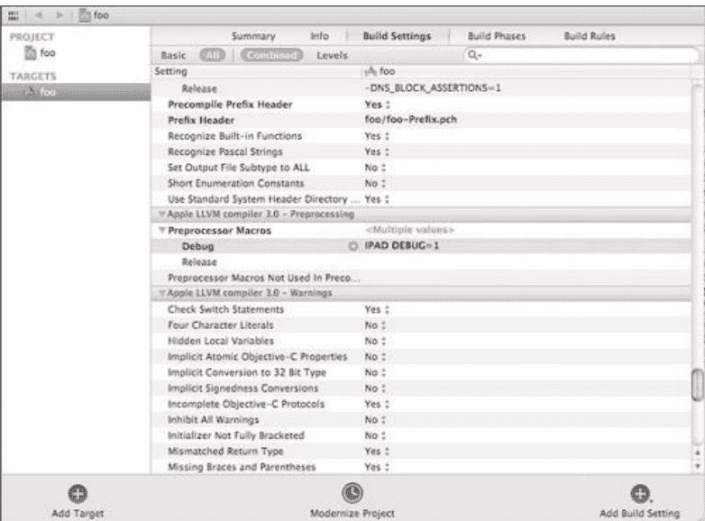

`#ifndef` 语句的原理与 `#ifdef` 类似。该语句的使用方式相似，不同之处在于指定的符号未定义，则会处理后续行。

正如前面提到的，条件编译在调试程序时非常有用。你的程序中可能嵌入了许多 `NSLog` 调用，用于显示中间结果和跟踪执行流。如果某个特定名称（如 `DEBUG`）被定义，你可以通过条件编译将其编译进程序来开启这些语句。例如，你可以使用如下语句序列，仅当程序在定义 `DEBUG` 的情况下编译时才显示某些变量的值：

```
#ifdef DEBUG

NSLog ("User name = %s, id = %i", userName,

userId());

#endif
```

程序中可能有很多这样的调试语句。每当对程序进行调试时，可以在定义 `DEBUG` 的情况下进行编译，以编译所有的调试语句。当程序正常运行时，可以在不定义 `DEBUG` 的情况下重新编译。这额外的好处是减小程序的大小，因为所有的调试语句都没有被编译进去。

### #if 和 #elif 预处理器语句

`#if` 预处理器语句提供了一种通用的方法来控制条件编译。`#if` 语句可以用于测试常量表达式的值是否为非零。如果表达式的结果非零，则处理后续 `#else`、`#elif` 或 `#endif` 之前的行；否则，跳过这些行。

作为如何使用此方法的示例，以下行出现在 Foundation 头文件 `NSString.h` 中：

```
#if MAC_OS_X_VERSION_MIN_REQUIRED < nMAC_OS_X_VERSION_10_5

#define NSMaximumStringLength (INT_MAX-1)

#endif
```

这测试了定义变量 `MAC_OS_X_VERSION_MIN_REQUIRED` 的值是否小于 `MAC_OS_X_VERSION_10_5`。如果前者小于后者，则将字符串的最大长度设置为整数减 1。

特殊的运算符 `defined (name)` 也可以用于 `#if` 语句。

```
#if defined(name)

...

#endif
```

以下语句出现在 `untime.h` 中，用于根据特定的编译器定义 `NS_INLINE`（如果尚未定义）：

```
#if !defined(NS_INLINE)

#if defined(__GNUC__)

#define NS_INLINE static __attribute__((always_inline))

#elif defined(__MWKS__) || defined(__cplusplus)

#define NS_INLINE static inline

#elif defined(__MSC_VER__)

#define NS_INLINE static inline

#endif
```

`#if` 的另一种常见用法如下序列：

```
#if defined (DEBUG) && DEBUG

...

#endif
```

如果 `DEBUG` 已定义且值为非零。由于可以使用表达式且 0 始终为假，程序员（包括我）经常通过将代码块封装在 `#if 0` ... `#endif` 中来注释掉代码。

### #undef 

有时你需要让已定义的名称变为未定义。可以通过 `#undef` 语句来实现。要移除特定名称的定义，写入：

```
#undef name
```

因此，该语句删除了 `IPAD` 的定义：

```
#undef IPAD
```

随后的 `#ifdef IPAD` 或 `#if defined (IPAD)` 将评估为 FALSE。

预处理器讨论结束。

### 练习

- 在你的机器上找到系统头文件 `limits.h` 和 `float.h`。检查这些文件查看内容。如果这些文件包含了其他头文件，请务必也追踪并检查它们的内容。
- 定义一个名为 `MIN` 的宏，获取两个值的最小值。编写一个程序来测试该宏定义。
- 定义一个名为 `MAX3` 的宏，获取三个值的最大值。编写一个程序来测试该定义。
- 编写一个名为 `IS_UPPER_CASE` 的宏，如果字符是大写字母则返回非零值。
- 编写一个名为 `IS_ALPHABETIC` 的宏，如果字符是字母则返回非零值。让该宏使用正文中定义的 `IS_LOWER_CASE` 宏和练习 4 中定义的 `IS_UPPER_CASE` 宏。
- 编写一个名为 `IS_DIGIT` 的宏，如果字符是数字 0 到 9 则返回非零值。使用此宏来定义另一个名为 `IS_SPECIAL` 的宏，该宏在字符是特殊字符（即既不是字母也不是数字）时给出一个非零结果。请务必使用练习 5 中开发的 `IS_ALPHABETIC` 宏。
- 编写一个名为 `ABSOLUTE_VALUE` 的宏，计算其参数的绝对值。确保该宏能够正确处理如下表达式：

```
ABSOLUTE_VALUE (x + delta)
```


# 13. 底层 C 语言特性

本章描述了 Objective-C 语言的一些特性，你编写 Objective-C 程序并不一定需要了解这些特性。事实上，这些特性大部分来自于底层的 C 编程语言。函数、结构体、指针、联合体数组等特性最好在需要时再学习。由于 C 是一种过程化语言，这些特性中的某些违背了面向对象编程的原则。它们还会干扰 Foundation 框架实现的某些策略，例如内存分配方法或处理包含多字节字符的字符串的操作。

### 注意

在 C 级别有处理多字节字符的方法，但 Foundation 通过其 `NSString` 类提供了一个更优雅的解决方案。

另一方面，某些应用程序可能要求你使用更底层的方法，也许出于优化的考虑。例如，如果你正在处理大型数据数组，你可能想使用 C 内置的数据结构，而不是 Foundation 的数组对象（这些对象在第 15 章“数字、字符串和集合”中进行了描述）。如果使用得当，函数在分组重复操作和程序模块化方面也非常有用。

快速浏览本章以获取材料的概览，并在完成第二部分“Foundation 框架”后再回来。你也可以完全跳过本章直接进入涵盖 Foundation 框架的第二部分。如果你最终需要维护他人的代码或开始研究 Foundation 框架的一些头文件，你将会遇到本章涵盖的一些构造。若干 Foundation 数据类型（如 `NSRange`、`NSPoint` 和 `NSRect`）要求对结构体有基础了解，结构体在这里已进行了描述。在这种情况下，你可以返回本章并阅读相关章节以理解这些概念。

### 数组

Objective-C 语言允许用户定义一组有序的数据项，称为数组。本节描述了如何定义和操作数组。随后的章节将说明数组如何与函数、结构体、字符字符串和指针协同工作。

假设你想将一组成绩读取到计算机，然后对这些成绩进行操作，例如按升序排序、计算平均值或寻找中位数。在对一组成绩进行排序的过程中，在输入每一个成绩之前，你无法执行此类操作。

在 Objective-C 中，你可以定义一个名为 `grades` 的变量，它代表的不是单个成绩值，而是一整组成绩。然后你可以使用称为索引号（index number）或下标（subscript）的数字来引用集合中的每个元素。在数学中，下标变量 $x_i$ 指集合中的第 $i$ 个 $x$，而在 Objective-C 中的等效表示法是：

```
x[i]
```

因此，表达式

```
grades[5]
```

（读作 "grades sub 5"）指的是名为 `grades` 的数组中的第 5 个元素。在 Objective-C 中，数组元素从数字 0 开始，所以

```
grades[0]
```

实际上指的是数组的第一个元素。

你可以在任何可以使用普通变量的地方使用单个数组元素。例如，你可以通过如下语句将数组值赋值给另一个变量：

```
g = grades[50];
```

该语句将 `grades[50]` 中包含的值赋值给 `g`。更一般，如果 `i` 被声明为整数变量，则语句

```
g = grades[i];
```

将 `grades` 数组中第 `i` 个元素的值赋值给 `g`。

只需通过指定等号左侧的数组元素，即可将值存储在数组元素中。在语句

```
grades[99] = 95;
```

值 95 被存储在 `grades` 数组的第 99 个元素中。

通过改变用作数组下标的变量的值，你可以轻松遍历数组中的元素。因此，循环

```
for ( i = 0; i < 100; ++i )
sum += grades[i];
```

遍历了 `grades` 数组的前 100 个元素（元素 0–99），并将每个成绩的值加到 `sum` 中。循环结束后，变量 `sum` 包含 `grades` 数组前 100 个值的总和（假设在进入循环之前 `sum` 已被设置为 0）。

与其他类型的变量一样，你必须在使用数组之前对其进行声明。声明数组涉及声明数组中将包含的元素类型（例如 `int`、`float` 或对象），以及将存储在数组内部的最大元素数量。

定义

```
Fraction *fracts [100];
```

定义 `fracts` 为一个包含 100 个分数的数组。你可以通过下标 0–99 对该数组进行有效引用。

```
fracts[2] = [fracts[0] add: fracts[1]];
```

调用 `Fraction` 的 `add:` 方法来将 `fracts` 数组的前两个分数相加并将并将存储在数组的第三个位置。

程序 13.1 生成前 15 个斐波那契数的表。尝试预测它的输出。表格中的每个数字之间存在什么关系？

# 程序 13.1

```
// 用于生成前 15 个斐波那契数的程序
#import <Foundation/Foundation.h>
int main (int argc, char * argv[])
{
    @autoreleasepool {
        int fibonacci[15];
        fibonacci[0] = 0;
        fibonacci[1] = 1;
        for (int i = 2; i < 15; i++) {
            fibonacci[i] = fibonacci[i-1] + fibonacci[i-2];
        }
        for (int i = 0; i < 15; i++) {
            printf("%d ", fibonacci[i]);
        }
        printf("\n");
    }
    return 0;
}
```

# 程序 13.1 输出

0 1 2 3 5 8 13 21 34 55 89 144 233 377 610

# 初始化数组元素

就像在声明变量时可以赋予初始值一样，你可以为数组元素赋予初始值。这通过简单列出初始值并在花括号中包含整个列表来实现。语句

```
int integers[5] = { 0, 1, 2, 3, 4 };
```

将 `integers[0]` 的值设置为 0，`integers[1]` 设置为 1，`integers[2]` 设置为 2，依此类推。字符数组以类似的方式初始化；因此，语句

```
char letters[5] = { 'a', 'b', 'c', 'd', 'e' };
```

定义了字符数组 `letters` 并将其五个元素初始化为 'a'、'b'、'c'、'd' 和 'e'。

你不需要完全初始化整个数组。如果指定的初始值较少，则只有相同数量的元素会被初始化；数组中的剩余值设置为零。因此，声明

```
float sample_data[500] = { 100.0, 300.0, 500.5 };
```

将 `sample_data` 的前三个值初始化为 100.0、300.0 和 500.5，并将其余 497 个元素设置为 0。

通过用括号包含元素数字，你可以任意顺序初始化特定的数组元素。例如

```
int x = 1233;
int a[] = { [9] = x + 1, [2] = 3, [1] = 2, [0] = 1 };
```

定义了一个包含 10 个元素的数组 `a`（基于数组中的最高索引），并将最后一个元素初始化为 x + 1（1234）。此外，它还将前三个元素初始化为 1、2 和 3。

### 字符数组

程序 13.2 演示了如何使用字符数组。然而，有一点值得讨论。你能发现它吗？

# 程序 13.2

```
#import <Foundation/Foundation.h>
int main (int argc, char * argv[])
{
    @autoreleasepool {
        char word[] = { 'H', 'e', 'l', 'l', 'o', '!' };
    }
    return 0;
}
```

```c
int i;
for ( i = 0; i < 6; ++i)
    NSLog("%@c", word[i]);
}
return 0;
}
```

# 程序 13.2. 输出

```
H
He
l1
lo
!
```

在这种情况下，数组的大小根据初始化元素的数量自动确定的。因为程序 13.2 为数组 `word` 列出了六个初始值，所以 Objective-C 语言隐式地将数组的维度指定为六个元素。

只要在定义数组时初始化了数组中的每个元素，这种方法就可以正常。如果不是如此，你必须显式地指定数组的维度。

如果你在字符数组的末尾放置一个终止空字符（`'\0'`），你就创建了一个所谓的字符字符串。如果你将程序 13.2 中 `word` 的初始化替换为这一行：

```c
char word[] = { 'H', 'e', 'l', 'l', 'o', '!', '\0' };
```

你随后就可以通过单个 `NSLog` 调用来显示该字符串，如下所示：

```objc
NSLog ("@%s", word);
```

这之所以有效，是因为 `%s` 格式化字符告诉 `NSLog` 继续显示字符，直到遇到终止空字符。那就是你放置在 `word` 数组末尾的字符。

### 多维数组

你到目前为止看到的数组类型都是线性数组——也就是说，它们都处理单一维度。该语言允许你定义任意维度的数组。本节将介绍二维数组。

二维数组最自然的应用之一出现在矩阵的情况中。考虑这里显示的 4×5 矩阵：

| 10 | 5 | -3 | 17 | 82 |
| 9 | 0 | 0 | 8 | -7 |
| 32 | 20 | 1 | 0 | 14 |
| 0 | 0 | 8 | 7 | 6 |

在数学中，矩阵的元素通常使用双下标来引用。如果前面的矩阵被称为 $M$，那么记法 $M_{ij}$ 指的是第 $i$ 行第 $j$ 列的元素，其中 $i$ 的范围是 1 到 4，$j$ 的范围是 1 到 5。记法 $M_{3,2}$ 指的是值 20，它位于矩阵的第三行第二列。同样，$M_{4,5}$ 指的是包含在第四行第五列的元素（值 6）。

在 Objective-C 中，引用二维数组的元素时使用类似的记法。然而，由于 Objective-C 喜欢从 0 开始计数，矩阵的第一行实际上是第 0 行，矩阵的第一列是第 0 列。那么前面的矩阵的行和列标记如下图所示：

| 行 (i) | 列 (j) | | | | | |
|---|---|---|---|---|---|
| | 0 | 1 | 2 | 3 | 4 |
| 0 | 10 | 5 | -3 | 17 | 82 |
| 1 | 9 | 0 | 8 | -7 | |
| 2 | 32 | 20 | 1 | 0 | 14 |
| 3 | 0 | 0 | 8 | 7 | 6 |

虽然在数学中使用记法 $M_{ij}$，但在 Objective-C 中等效记法如下：

```objc
M[i][j]
```

记住，第一个索引数字指的是行号，而第二个索引数字引用列。因此，语句

```objc
sum = M[0][2] + M[2][4];
```

将第 0 行第 2 列的值（为 -3）与第 2 行第 4 列的值（为 14）相加，并将结果 11 赋值给变量 `sum`。

二维数组的声明方式与一维数组相同；因此，

```c
int M[4][5];
```

声明数组 `M` 为一个由 4 行 5 列组成的二维数组，总共 20 个元素。数组中的每个位置都定义为包含一个整数值。

二维数组的初始化方式与其一维对应物类似。在列出初始化元素时，值是按行列出的。大括号对用于将一行的初始化器列表与下一行隔开。因此，若要定义并初始化 `array M` 为上表列出的元素，你可以使用如下语句：

```c
int M[4][5] = {
    { 10, 5, -3, 17, 82 },
    { 9, 0, 0, 8, -7 },
    { 32, 20, 1, 0, 14 },
    { 0, 0, 8, 7, 6 }
};
```

特别注意上述语句的语法。注意，在每个关闭行的的大括号之后都需要逗号，最后一行除外。使用内层的大括号对实际上是可选的。如果不提供这些大括号，初始化将按行进行。

将参数类型放在括号内，就像你在编写方法时习惯所做的那样。

左大括号表示函数定义的开始。由于你要计算第 n 个三角形数，你必须设置一个变量来在计算过程中存储该三角形数的值。你还需要一个变量作为循环索引。变量 `TriangularNumber` 和 `i` 是为了这些目的而定义的，并被声明为 `int` 类型。你定义和初始化这些变量的方式与你在之前的程序中 `main` 例程内部定义和初始化变量的方式相同。

函数中的局部变量的行为与方法中的行为相同：如果给函数内部的变量赋了一个初始值，那么在每次调用函数时，该初始值都会赋给该变量。而且通过自动引用计数（ARC），请注意，本地对象变量在每次调用函数（或方法）时默认也会初始化为零。

在函数内部定义的变量（如方法中的变量）被称为自动局部变量，因为它们在每次调用函数时都会自动“创建”局部，并且它们的值对于函数是局部的。

静态局部变量用 `static` 关键字声明，它们在函数调用之间保留其值，并具有默认初始值 0。

局部变量的值只能由定义它的变量函数访问。它的值无法从函数外部直接访问。

回到我们的程序示例，在定义局部变量后，函数计算三角形数并在终端显示结果。右括号定义了函数的结束。

在 `main` 例程中，值 10 作为参数传递给第一次调用 `calculateTriangularNumber`。执行随后直接转移到该函数，其中值 10 变为函数内部形式参数 `n` 的值。随后，函数计算第 10 个三角形数的值并显示结果。

下一次调用 `calculateTriangularNumber` 时，传递了参数 20。在之前描述的类似过程中，该值变为函数内部 `n` 的值。函数随后计算第 20 个三角形数的值并显示答案。

## 返回函数结果

与方法一样，函数可以返回一个值。用 `return` 语句返回的值类型必须与为函数声明的返回类型保持一致。如下所示的函数声明：

```
float kmh_to_mph (float km_speed)
```

开始了函数 `kmh_to_mph` 的定义，它接受一个名为 `km_speed` 的浮点数参数并返回一个浮点值。同样，

```
int gcd (int u, int v)
```

定义了一个名为 `gcd` 的函数，它接受整数参数 `u` 和 `v` 并返回一个整数值。

让我们用函数形式重写程序 5.7 中使用的最大公约数算法。该函数的两个参数是你想要计算最大公约数（gcd）的两个数字（参见程序 13.5）。

## 程序 13.5

```
#import <Foundation/Foundation.h>
// 此函数找到两个
// 非负整数值的最大公约数并返回结果
```

```c
int gcd (int u, int v) {
    int temp;
    while ( v != 0 ) {
        temp = u % v;
        u = v;
        v = temp;
    }
    return u;
}
```

```c
main () {
    autoreleasepool {
        int result;
        result = gcd (150, 35);
        NSLog (@"The gcd of 150 and 35 is %i", result);
        result = gcd (1026, 405);
        NSLog (@"The gcd of 1026 and 405 is %i", result);
    }
}
```

```c
        NSLog("The gcd of 83 and 240 is %i",
gcd(83, 240));
    }
return 0;
}
```

## 程序 13.5 输出

```
The gcd of 150 and 35 is 5
The gcd of 1026 and 405 is 27
The gcd of 83 and 240 is 1
```

函数 `gcd` 被定义为接受两个整数参数。函数通过其形式参数名称 `u` 和 `v` 引用这些参数。在声明变量 `temp` 为 `int` 类型后，程序在终端显示参数 `u` 和 `v` 的值，以及一条适当的消息。随后，函数计算并返回这两个整数的最大公约数。

语句

```
result = gcd (150, 35);
```


表示使用参数 `150` 和 `35` 调用函数 `gcd`，并将该函数返回的值存储在变量中。

如果省略了函数的返回类型声明，编译器将假设函数将返回一个整数——如果它确实返回了值。许多程序员利用这一事实，省略了返回整数的函数的返回类型声明。

## 声明返回类型和参数类型

与方法不同，我们之前提到编译器假设函数返回 `int`。

一种万无一失的编写原型声明的方法是直接复制函数定义中的第一行。记得在末尾加上一个分号。

如果函数接受可变数量的参数（例如 `NSLog` 和 `scanf` 的情况），必须告知编译器。

```objc
void NSLog (NSString *format, ...);
```

告诉编译器 `NSLog` 接受一个 `NSString` 对象作为第一个参数，后面跟着任意数量的额外参数（`...` 的用法）。`NSLog` 在特殊文件 `Foundation.h` 中声明，这就是为什么你在每个程序的开头都放置以下行的原因：

```objc
#import <Foundation/Foundation.h>
```

如果没有这一行，编译器会假设 `NSLog` 接受固定数量的参数，这可能导致生成错误的代码。

当调用函数时，编译器会自动将数值参数转换为相应的类型，前提是你已经声明了该函数。

考虑一些关于函数的提醒和建议：

- 默认情况下，编译器假设函数返回 `int`。
- 定义返回 `int` 的函数时，应将其声明为此。
- 定义不返回值的函数时，应定义为 `void`。
- 只有在你之前声明过的情况下，编译器才会转换参数以与预期的类型一致。

函数默认是外部的。也就是说，函数的默认作用范围是它可以被与之链接的范围内任何函数或方法调用。你可以通过将函数设置为 `static` 来限制其作用范围。通过在函数声明前放置 `static` 关键字来实现，如下：

```c
static int gcd (int u, int v)
{
  ..
}
```

静态函数只能由包含其定义的文件的其他函数或方法调用。

### 函数、方法与数组

要将单个数组元素传递给函数或方法，你可以按照常规方式将数组元素作为参数。例如，如果你有一个计算平方根的 `squareRoot` 函数，想要计算 `averages[i]` 的平方根并将结果赋值给变量 `sq_root_result`，那么这样的语句就是有效的：

```objc
sq_root_result = squareRoot (averages[i]);
```

将整个数组传递给函数或方法是完全另一回事。要传递数组，你需要在函数调用或方法调用的内部仅列出数组的名称，而不带任何下标。例如，假设 `grade_scores` 已被声明为一个包含 100 个元素的数组，那么表达式

```
minimum (grade_scores)
```

将 `grade_scores` 数组中包含的全部 100 个元素传递给名为 `minimum` 的函数。自然地，`minimum` 函数必须预期接收一个整个数组作为参数，并必须进行适当的形式参数声明。

此函数在包含指定数量元素的数组中寻找最小整数值：

```objc
// 寻找数组中最小值的函数
int minimum (int values[], int numElements)
{
    int minValue = values[0];
    for ( i = 1; i < numElements; ++i )
        if ( values[i] < minValue )
            minValue = values[i];
    return (minValue);
}
```

`minimum` 函数定义为接收两个参数：首先是你想要找到最小值的数组，其次是数组中的元素数量。函数头中紧随 `values` 之后的左右方括号告诉 Objective-C 编译器 `values` 是一个整数数组。编译器并不关心它有多大。

形式参数 `numElements` 充当 `for` 语句内部的上限。因此，该语句遍历了从 `values[1]` 到数组末尾元素（即 `values[numElements - 1]`）的数组。

如果函数或方法更改了数组元素的值，该更改将作用于传递给函数或方法的原始数组上。即使在函数或方法执行完毕后，该更改仍然有效。

数组的行为与简单变量或数组元素（函数或方法无法更改其值）不同，这值得稍作解释。我们曾提到过，当调用函数或方法时，作为参数传递的值会被复制到对应的形式参数中。这一说法仍然有效。然而，在处理数组时，数组的全部内容并没有复制到形式参数数组中。相反，传递的是一个指向数组在计算机内存位置的指针。因此，对形式参数数组的任何更改实际上都是对原始数组进行的，而不是对数组的副本。因此，当函数或方法返回时，这些更改仍然有效。

# Blocks（代码块）

`Blocks` 是 C 语言的一个最新扩展。它们不是标准 ANSI C 定义的一部分，而是由 Apple 公司添加到语言中的。`Blocks` 的外观和行为与函数非常相似。其语法需要一些时间适应。你可以像向函数传递参数一样向块传递参数。你也可以从块中返回一个值。

与函数不同，块可以定义在函数或方法内部，这使其能够访问块外部定义但在其作用域内的任何变量。通常情况下，可以访问这些变量，但不能更改它们的值。有一个特殊的 `__block__` 修饰符（注意：在单词 `block` 前面有两个下划线），它允许你从块内部修改变量的值，稍稍后我们将看到它是如何使用的。

块可以作为参数传递给函数和方法，在第二部分“Foundation 框架”中，你将学习到一些期望接收块作为参数的方法。块的优势之一是它们可以由系统分发给其他处理器或应用程序内的其他线程执行。

让我们从一个简单的示例开始。回想我们在本章中写的第一个函数 `printMessage`：

```objc
void printMessage (void)
{
    NSLog("Programming is fun.");
}
```

这里是一个完成相同任务的块：

```objc
^(void)
{
    NSLog("Programming is fun.");
}
```

块通过开头的脱字符字符 `^` 来标识。其后是该块接收的括号参数列表。在我们的案例中，我们的块不接受任何参数，所以我们像在函数定义中那样写了 `void`。

你可以将此块赋值给名为 `printMessage` 的变量，只要该变量被正确声明（这里语法就变得复杂了）：

```objc
void (^printMessage) (void) =
^(void) {
  NSLog("Programming is fun.");
};
```

在等号左侧，我们指定 `printMessage` 是一个指向不接受参数且不返回值的块的指针。注意，赋值语句以分号结束。

执行由变量引用的块与调用函数的方法相同：

```objc
printMessage();
```

程序 13.6 将这些内容整合到了一个示例中。

# 程序 13.6

```objc
#import <Foundation/Foundation.h>
int main (int argc, char * argv[]) {
  @autoreleasepool {
    void (^print_message) (void) =
^(void) {
      NSLog("Programming is fun.");
    }
    printMessage();
  }
  return 0;
}
```

# 程序 13.6 输出

Programming is fun.

程序 13.7 是程序 13.4 的重写，使用了块而不是函数。块可以定义在全局，也可以定义在局部。在这种情况下，我们将在 `main` 外部定义块，使其在作用域上是外部且全局的。

# 程序 13.7

```objc
#import <Foundation/Foundation.h>
// 计算 n 阶三角形数的块
void (^calculateTriangularNumber) (int) = ^(int n) {
    int i, triangularNumber = 0;
    for (i = 1; i <= n; ++i) {
        triangularNumber += i;
    }
    NSLog("@Triangular number %i is %i", n, triangularNumber);
}
int main (int argc, char * argv[]) {
    @autoreleasepool {
        calculateTriangularNumber(10);
        calculateTriangularNumber(20);
        calculateTriangularNumber (50);
    }
  return 0;
}
```

# 程序 13.7 输出

Triangular number 10 is 55
Triangular number 20 is 210
Triangular number 50 is 1275

对比程序 13.4 中的函数语法与程序 13.7 中定义的块。块指针变量 `calculateTriangularNumber` 被定义为接收一个 `int` 参数且不返回值。

正如本节开头提到的，块可以返回一个值。这里是程序 13.5 中 `gcd` 函数重写的块形式：

```objc
int (^gcd) (int, int) = ^(int u, int v){
    int temp;
    while ( v != 0 )
    {
      temp = u % v;
      u = v;
      v = temp;
    }
    return u;
};
```

块可以访问其所在作用域内的变量。该变量的值是块定义时的值。这在程序 13.8 中得到了体现。

# 程序 13.8

```objc
#import <Foundation/Foundation.h>
int main (int argc, char * argv[]) {
    @autoreleasepool {
        int foo = 10;
        void (^printFoo)(void) = 
^(void) {
            NSLog ("foo = %i", foo);
        };
        foo = 15;
        printFoo ();
    }
    return 0;
}
```

# 程序 13.8 输出

foo = 10

`printFoo` 块可以访问局部变量 `foo`。注意显示的值是 10 而不是 15。这是因为它是块定义时的值，而不是执行时的值。

默认情况下，你无法修改块外部变量的值。因此，如果你尝试在块内部更改 `foo` 的值（见程序 13.9），你将收到编译器的错误信息：赋值只读变量 'foo'。

# 程序 13.9

```objc
#import <Foundation/Foundation.h>
int main (int argc, char * argv[])
{
    @autoreleasepool {
        int foo = 10;
        void (^printFoo) (void) =
        ^(void) {
            NSLog ("foo = %i", foo);
            foo = 20; // 这一行会产生编译错误
        }
        foo = 15;
        printFoo();
        NSLog ("foo = %i", foo);
    }
    return 0;
}
```

如果你在程序 13.9 中在局部变量 `foo` 的定义之前插入块修饰符，使其如下所示：

```
block int foo = 10;
```

运行程序，你将得到以下两行输出：

```
foo = 15
foo = 20
```

第一行显示 `foo` 的值现在是调用该块时的值。第二行验证了该块能够将 `foo` 的值改为 20。

到这里我们对块（blocks）的介绍结束。在第15章中，你将找到更多关于如何使用的示例。

### 结构 (Structures)

Objective-C 语言除了数组之外还提供了另一种分组元素的工具。你也可以使用结构（structures），它们是本节讨论的基础。

假设你想在程序内部存储一个日期——例如 7/18/11——可能用于某些程序输出的标题，甚至用于计算目的。存储日期的自然方法是简单将月份赋值给整数变量 `month`，将日期赋值给整数变量 `day`，将年份赋值给整数变量 `year`。因此，语句

```
int month = 7, day = 18, year = 2011;
```

可以正常工作。这是一个完全可以接受的方法。但如果你的程序还需要存储多个日期呢？通过某种方式将这些三变量组组合在一起会好得多。

你可以在 Objective-C 语言中定义一个名为 `date` 的结构，它由代表月份、日期和年份三个部分组成。这种定义的语法非常直观：

```
struct date
{
    int month;
    int day;
    int year;
};
```

刚刚定义的 `date` 结构包含三个整数成员，分别称为 `month`、`day` 和 `year`。本质上，`date` 的定义在语言中定义了一个新类型，因为此后可以声明变量为 `struct date` 类型，如下面的定义所示：

```
struct date today;
```

你也可以通过一个单独的定义来定义一个名为 `purchaseDate` 的变量，具有相同的类型：

```
struct date purchaseDate;
```

或者你可以简单地将两个定义写在同一行：

```
struct date today, purchaseDate;
```

与 `int`、`float` 或 `char` 类型的变量不同，在处理结构变量时需要特殊的语法。结构成员的访问是通过指定变量名、后跟一个点（.）、然后是成员名来实现的。例如，要将变量 `today` 中 `day` 的值设置为 21，你会这样写：

```
today.day = 21;
```

注意，变量名、点和成员名之间不允许有空格。

现在，等一下！这不就是我们访问对象属性时使用的同一个运算符吗？回想一下，我们可以写

```statement
myRect.width = 12;
```

来调用 `Rectangle` 对象的 setter 方法（名为 `initWith:`），并传递参数值 12。这里没有产生混乱：编译器会确定点运算符左侧是结构还是对象，并妥善处理该情况。

回到 `struct date` 示例，要将 `today` 中的 `year` 设置为 2011，可以使用这个表达式：

```
today.year = 2011;
```

最后，为了测试 `month` 的值以检查它是否等于 12，可以使用如下这样的语句：

```
if ( today.month == 12 )
next_month = 1;
```

程序 13.10 将前面的讨论整合到一个实际程序中。

# 程序 13.10

```
#import <Foundation/Foundation.h>
int main (int argc, char * argv[]) {


```objc
    @autoreleasepool {

        struct date {

            int month;

            int day;

            int year;

        }

        struct date today;

        today.month = 9;

        today.day = 25;

        today.year = 2011;

        NSLog ("@Today's date is %i/%i/%.2i.",

        today.month,

        today.day, today.year % 100);

    }

    return 0;

}
```

# 程序 13.10 输出

今天的日期是 9/25/11。

`main` 内部的第一条语句定义了名为 `date` 的结构，它包含三个整数成员，称为 `month`、`day` 和 `year`。在第二条语句中，变量 `today` 被声明为 `date` 类型。因此，第一条语句只是定义了 Objective-C 编译器看来 `date` 结构是什么子的，并没有在计算机内部保留任何存储。第二条语句声明一个变量为 `struct date` 类型，因此确实为存储结构变量 `today` 的三个整数成员预留了内存。

赋值后，适当的 `NSLog` 调用显示了结构内部包含的值。`today.year` 除以 100 的余数在传递给 `NSLog` 函数之前计算，因此年份只显示 11。`NSLog` 调用中的 `%.2i` 格式字符指定了至少显示两个字符，从而强制显示年份前的导零。

在表达式表达式求值时，结构成员遵循与 Objective-C 语言中普通变量相同的规则。整数结构成员除以另一个整数形成整数除法，如下所示：

```
century = today.year / 100 + 1;
```

假设你想写一个简单的程序，接受今天的日期作为输入并向用户显示明天的日期。一看，这似乎是一个非常简单的任务。你可以要求用户输入今天的日期，然后通过以下语句计算明天的日期并显示给用户：

```
tomorrow.month = today.month;
tomorrow.day = today.day + 1;
tomorrow.year = today.year;
```

当然，如果 `today.day` 是 31，你可能需要处理进位：

```
if ( tomorrow.day > 31 ) {
    tomorrow.day = 1;
    tomorrow.month = today.month + 1;
    if ( tomorrow.month > 12 ) {
        tomorrow.month = 1;
        tomorrow.year = today.year + 1;
    }
}
```

当然，这只是假设每个月都有 31 天。在实际应用中，逻辑会更复杂。

```c
struct CGRect {
    CGPoint origin;
    CGSize size;
};
typedef struct CGRect CGRect;
```

这些 `typedef` 提供了一种方便的变量声明方式，而无需使用 `struct` 关键字。`CGFloat` 只是基本浮点数类型的别名。如果你想声明一个 `CGPoint` 变量并将其 `x` 成员设置为 100，将 `y` 成员设置为 200，你可以编写以下代码序列：

```
CGPoint startPt;
startPt.x = 100;
startPt.y = 200;
```

记住 `startPt` 是一个结构体而不是对象（一个很好的标志是变量名前通常没有星号 `*`）。Apple 还提供了用于创建 `CGRect`、`CGSize` 和 `CGRect` 结构的便利函数。例如：

```
CGPoint startPt = CGPointMake(100.0, 200.0);
```

还有 `CGSizeMake` 和 `CGRectMake` 函数，它们执行的任务正如名称所示。

现在，假设你想定义一个新的矩形，并将其尺寸设置为 200 x 100。你可以通过这种方式指定其尺寸：

```
CGSize rectSize;
```

```
rectSize.width = 200;
rectSize.height = 100;
```

或者你可以像这样使用 `CGSizeMake` 函数：

```
CGSize rectSize = CGSizeMake (200.0, 100.0);
```

现在，让我们创建一个具有指定尺寸和原点的矩形：

```
CGRect theFrame;
```

```
theFrame.origin = startPt;
theFrame.size = rectSize;
```

（我们在这里不会展示 `CGRectMake` 函数的使用。）

假设稍后你想获取矩形的宽度（可能它已经改变了？）。你可以通过编写此表达式来实现：

```
theFrame.size.width
```

要将其宽度更改为 175，你可以写道：

```
theFrame.size.width = 175;
```

最后，要将矩形的原点设置为 (0,0)，这些语句就能解决问题：

```
theFrame.origin.x = 0.0;
theFrame.origin.y = 0.0;
```

这些只是使用这些结构体的一些例子。正如所指出的，你可能会在应用程序中频繁使用它们。

### 关于结构体的额外细节

我们应该提到，在定义结构体时具有灵活性。首先，你可以在定义结构体的同时声明一个特定结构体类型的变量。你只需要在结构体定义的末尾分号之前包含变量名（名）即可。例如，以下语句定义了结构体 `date`，并声明了 `todaysDate` 和 `purchaseDate` 变量为该类型：

```
struct date
  int month;
  int day;
  int year;
} todaysDate, purchaseDate;
```

你可以按照正常方式为变量分配初始值。因此，以下语句定义了结构体 `date` 以及具有如文所示初始值的变量 `todaysDate`：

```
struct date
  int month;
  int day;
  int year;
} todaysDate = { 9, 25, 2011 } ;
```

如果某个特定结构体类型的所有变量在定义结构体时都已经定义，你可以省略结构体名称。因此，以下语句定义了一个名为 `dates` 的数组，包含 100 个元素：

```
struct
  int month;
  int day;
  int year;
} dates[100];
```

每个元素都是一个包含三个整数成员（month、day 和 year）的结构体。由于你没有为结构体提供名称，后续声明相同类型变量的唯一就是显式地再次定义该结构体。

## 不要忘记面向对象编程！

现在你知道如何定义一个结构体来存储日期，并且你编写了各种操作该日期结构的例程。但是面向对象编程呢？你不应该创建一个 `Date` 类，然后开发方法来处理 `Date` 对象吗？那样难道不是更好的方法吗？是的，确实。希望在我们讨论程序中的日期时，这个想法已经进入了你的脑海。

当然，如果你需要在程序中处理大量日期，定义一个类和处理日期的方法是更好的方法。事实上，`Foundation` 框架有两个名为 `NSDate` 和 `NSCalendarDate` 的类，是为此类目的定义的。我们将此留作一项练习练习，让你实现一个 `Date` 类，以对象而不是结构体的方式来处理日期。

## 指针

指针让你能够有效地表示复杂的数据结构，更改作为函数和方法参数传递的值，并更简洁、高效地处理数组。在本章的最后，我们还将向你介绍它们对于 Objective-C 语言中对象的实现有多么重要。

在第 8 章“继承”中，当我们谈到 `Point` 和 `Rectangle` 类时，我们引入了指针的概念，并指出你可以对同一个对象有多个引用。

要理解指针的操作方式，你必须首先理解**间接性**（indirection）的概念。我们在日常生活中就能看到这一概念。例如，假设我需要为我的打印机买一个新的墨盒。在我工作的公司里，采购部门处理所有购买。所以我会给采购部的 Jim 打电话，让他为我订购新墨盒。然后 Jim 会给本地供应商店订购墨盒。为了得到我的新墨盒，我采用的是间接的方法，因为我不会直接从供应商店订购墨盒。

这种间接性的概念也适用于指针。

```
x = *intPtr;
```

执行过程如下：间接操作符告诉 Objective-C 系统将变量 `intPtr` 视为指向另一个数据项的指针。该指针随后被用于访问所需的数据项，其类型由指针变量的声明指定。由于你于声明变量时已告诉编译器 `intPtr` 指向整数，因此编译器知道表达式 `*intPtr` 所引用的值是一个整数。此外，由于你在上一个程序语句中将 `intPtr` 设置为指向整数变量 `count`，因此该表达式间接地访问了 `count` 的值。

程序 13.12 演示了指针变量的一些有趣属性。该程序使用了指向字符的指针。

# 程序 13.12

```c
#import <Foundation/Foundation.h>
int main (int argc, char * argv[])
{
    @autoreleasepool {
        char c = 'Q';
        char *charPtr = &c;
        NSLog ("@"%c %c", c, *charPtr);
        c = '/';
        NSLog ("@"%c %c", c, *charPtr);
        *charPtr = '(';
        NSLog ("@"%c %c", c, *charPtr);
    }
    return 0;
}
```

# 程序 13.12 输出

Q Q
/ /
( (

字符变量 `c` 被定义并初始化为字符 'Q'。在程序的下一行中，变量 `charPtr` 被定义为类型“指向字符的指针”，这意味着存储在该变量中的任何值都应被视为对字符的间接引用（指针）。请注意，你可以以正常方式为该变量赋一个初始值。你在程序中赋给 `charPtr` 的值是指向变量 `c` 的指针，该值通过对变量 `c` 应用地址操作符得到的。（注意，如果 `c` 在此语句之后才定义，那么这种初始化将产生编译器错误，因为变量在表达式中引用其值之前必须先声明。）

变量 `charPtr` 的声明及其初始值的赋值可以等价地通过两个独立的语句表达，如下

```c
char *charPtr;
charPtr = &c;
```

（而不是通过单行声明可能暗示的语句

```c
*charPtr;
*charPtr = &c;
```

记住，在 Objective-C 中，指针的值在被设置为指向某些内容之前是没有意义的。

第一个 `NSLog` 调用简单地显示了变量 `c` 的内容以及 `charPtr` 所引用变量的内容。由于你将 `charPtr` 设置指向变量 `c`，显示的值就是 `c` 的内容，这通过程序输出的第一行证实了这一点。

在程序的下一行中，字符 '/' 被赋值给字符变量 `c`。由于 `charPtr` 仍然指向 `c`，在随后的 `NSLog` 调用中显示 `*charPtr` 的值将正确地在终端显示 `c` 的这个新值。这是一个重要的概念。除非 `charPtr` 的值发生，否则表达式 `*charPtr` 始终访问 `c` 的值。因此，随着 `c` 的值变化，`*charPtr` 的值也发生变化。

之前的讨论可以帮助你理解下一个程序中出现的语句是如何工作的。我们提到过，除非 `charPtr` 改变，否则表达式 `*charPtr` 将始终引用 `c` 的值。因此，在表达式

```c
*charPtr = '(';
```

中，左括号字符被赋值给 `c`。更正式地说，字符 '(' 被赋值给 `charPtr` 所指向的变量。你知道这个变量是 `c`，因为你在程序开始就在 `charPtr` 中放置了指向 `c` 的指针。

之前的概念是理解指针操作的关键。如果现在这些概念仍然显得有些模糊，请回顾它们。

### 指针与结构体

你已经看到如何定义一个指向 `int` 或 `char` 等基本数据类型的指针。但你也可以定义一个指向结构的指针。在本章前面的部分，你如下定义了日期结构：

```c
struct date
{
  int month;
  int day;
  int year;
};
```

就像你定义类型为 `struct date` 的变量一样，如下

```c
struct date todaysDate;
```

你也可以定义一个指向 `struct date` 变量的指针变量：

```c
struct date *datePtr;
```

然后你就可以按照预期方式使用刚刚定义的变量 `datePtr`。例如，你可以通过以下赋值语句将其设置为指向 `todaysDate`：

```c
datePtr = &todaysDate;
```

在此类赋值后，你可以通过以下方式间接访问 `datePtr` 所指向的日期结构中的任何成员：

```c
(*datePtr).day = 21;
```

该语句将 `datePtr` 指向的日期结构的“天”设置为 21。需要括号是因为结构体成员运算符点 (`.`) 的优先级高于间接操作符星号 (`*`)。

为了测试 `datePtr` 指向的日期结构中存储的 `month` 值，你可以使用如下语句：

```c
if ( (*datePtr).month == 12 )
```

指向结构的指针使用非常频繁，因此语言提供了一个特殊的操作符。结构指针操作符 `->`（一个连字符后跟大于号）允许将原本应写为

```c
(*x).y
```
的表达式更清晰地表达为

```c
x->y
```

详细学习程序 13.14。它通过一个简单的示例说明了在 Objective-C 中处理指针时的关键概念。

### 指针与数组

如果你有一个名为 `values` 的包含100个整数的数组，你可以定义一个名为 `valuesPtr` 的指针，可以使用以下语句访问该数组中包含的整数：

```
int *valuesPtr;
```

当你定义一个将用于指向数组元素的指针时，你不需要将指针指定为“指向数组的指针”类型；相反，你将指针指定为指向数组中包含的元素类型。

如果你有一个名为 `fracts` 的 `Fraction` 对象数组，你可以类似地通过以下语句定义一个指针，用于指向 `fracts` 中的元素：

```
Fraction **fractsPtr;
```

要将 `valuesPtr` 设置为 `values` 数组的第一个元素，你只需要写：

```
valuesPtr = values;
```

在这种情况下不使用地址操作符，因为 Objective-C 编译器将不带下标的数组名视为该数组第一个元素的指针。因此，简单地指定不带下标的 `values` 就会产生一个指向 `values` 第一个元素的指针。

产生指向 `values` 起点的指针的等方法是对数组的第一个元素应用地址操作符。因此，语句

```
valuesPtr = &values[0];
```

具有相同的目的，即将指向 `values` 第一个元素的指针存放在指针变量 `valuesPtr` 中。

要显示 `fractsPtr` 指向的 `fracts` 数组中的 `Fraction` 对象，你会写下这条语句：

使用指针指向数组的真正威力在遍历数组元素时显现出来。如果 `valuesPtr` 如前所述被定义，并被设置为指向 `values` 的第一个元素，你可以使用表达式

```
*valuesPtr
```

来访问 `values` 数组的第一个整数——即 `values[0]`。要通过 `valuesPtr` 变量引用 `values[3]`，你可以给 `valuesPtr` 加上 3，然后应用间接操作符：

```
*(valuesPtr + 3)
```

通常情况下，你可以使用表达式

```
*(valuesPtr + i)
```

来访问 `values[i]` 中包含的值。

所以，要将 `values[10]` 设置为 27，你会写以下表达式：

```
values[10] = 27;
```

或者，使用 `valuesPtr`，你会写：

```
*(valuesPtr + 10) = 27;
```

要将 `valuesPtr` 设置为指向 `values` 数组的第二个元素，你对 `values[1]` 应用地址操作符并将结果赋值给 `valuesPtr`：

```
valuesPtr = &values[1];
```

如果 `valuesPtr` 指向 `values[0]`，你可以通过简单给 `valuesPtr` 的值加 1 来使其指向 `values[1]`：

```
valuesPtr += 1;
```

这在 Objective-C 中是一个完全有效的表达式，可以用于任何数据类型的指针。

通常，如果 `a` 是类型为 `x` 的元素数组，`px` 是“指向 x 的指针”类型，且 `i` 和 `n` 是整数常量变量，语句

```
px = a;
```

将 `px` 设置为指向 `a` 的第一个元素，而表达式语句

```
*(px + i);
```

随后引用 `a[i]` 中包含的值。此外，语句

```
px += n;
```


将 `px` 设置为指向数组中后续 `n` 个元素，无论数组中包含什么元素。

假设 `fractsPtr` 指向存储在分数数组内部的某个分数。进一步假设，你想将其与数组中下一个元素的分数相加，并将结果赋值给 `Fraction` 对象 `result`。你可以通过编写以下代码来实现：

```
result = [*fractsPtr add: *(fractsPtr + 1)];
```

自增和自减运算符（`++` 和 `--`）在处理指针时特别方便。对指针应用自增运算符的效果与将指针加1 相同，而对指针应用自减运算符的效果与从指针减去1 相同（这里的“1”意味着一个单位，即指针声明为指向的数据项的大小）。所以，如果 `textPtr` 被定义为 `char` 指针并被设置为指向字符数组 `text` 的开头，语句

```
++textPtr;
```

将使 `textPtr` 指向 `text` 中的下一个字符，即 `text[1]`。同样地，语句

```
--textPtr;
```

将使 `textPtr` 指向 `text` 中的上一个字符（当然，假设在执行此语句之前 `textPtr` 并没有指向 `text` 的开头）。

在 Objective-C 中比较两个指针变量是完全有效的。这在比较同一个数组中的两个指针时特别有用。例如，你可以测试指针 `valuesPtr`，通过将其与指向数组最后一个元素的指针进行比较，来检查它是否越了包含 100 个元素的数组的边界。因此，表达式

```
valuesPtr > &values[99]
```

如果 `valuesPtr` 指向了 `values` 数组最后一个元素之后，则该表达式为 TRUE（非零），否则为 FALSE（零）。根据我们之前的讨论，你可以将之前的表达式替换为其等价表达式：

```
valuesPtr > values + 99
```

这是可能的，因为不带下标的 `values` 是指向 `values` 数组开头的指针。（记住这与写 `&values[0]` 是一样的）。

程序 13.15 展示了指向数组的指针。`arraySum` 函数计算整数数组中包含元素的和。

## 程序 13.15

```
// 计算整数数组元素和函数

#import <Foundation/Foundation.h>

int arraySum(int array[], int n)

{

    int sum = 0, *ptr;

    int *arrayEnd = array + n;

    for ( ptr = array; ptr < arrayEnd; ++ptr )

        sum += *ptr;

    return (sum);

}

int main(int argc, char * argv[])

{

    @autoreleasepool {

        int arraySum(int array[], int n);

        int values[10] = { 3, 7, -9, 3, 6, -1, 7, 9, 1, -5 };

    NSLog(@"The sum is %i", arraySum

    (values, 10));

    }

    return 0;

}
```

## 程序 13.15 输出

The sum is 21

在 `arraySum` 函数内部，定义了整数指针 `arrayEnd`，并将其设置为紧邻 `array` 最后一个元素之后。随后设置了一个 `for` 循环来遍历元素；然后设置 `ptr` 指向 `array` 的开头；每次循环时，`ptr` 指向的 `array` 元素被加到 `sum` 中。循环随后增加 `ptr`，使其指向 `array` 中的下一个元素。当 `ptr` 指向 `array` 的结尾时，循环退出并将 `sum` 的值返回给调用者。

## 是数组还是指针？

要向函数传递数组，你只需要指定数组的名称，正如你之前调用 `arraySum` 时所的那样。但我们在本节中也提到，传递指向数组的指针只需要指定数组名称。这意味着在调用 `arraySum` 时，传递的是指向数组的指针。这解释了为什么你可以在函数内部修改数组的元素。

但是，如果向函数传递的是数组指针，为什么函数内部的形式参数不声明为指针？换句话说，在 `arraySum` 函数的 `array` 声明中，为什么不使用这种声明：

```
int *array;
```

难道从函数内部对数组的所有引用都应该使用指针变量吗？

使用指针处理字符字符串，让我们来写一个名为 `copyString` 的函数，将一个字符串拷贝到另一个中。如果你使用普通的数组索引方法来编写此函数，可能会这样编写代码：

```
void copyString (char to[], char from[])

{

    int i;

    for ( i = 0; from[i] != '\0'; ++i )

        to[i] = from[i];

    to[i] = '\0';

}
```

`for` 循环在空字符复制到 `to` 数组之前就退出了，这解释了为什么函数需要最后一条语句。

如果你使用指针编写 `copyString`，你就不再需要索引变量 `i`。程序 13.16 显示了指针版本。

# 程序 13.16

```
#import <Foundation/Foundation.h>

void copyString (char *to, char *from)

{

    for ( ; *from != '\0'; ++from, ++to )

        *to = *from;

    *to = '\0';

}

int main (int argc, char * argv[])

{

    @autoreleasepool {

```
void copyString(char *to, char *from);
  char string1[] = "A string to be
  copied.";
  char string2[50];
```

```
copyString(string2, string1);
NSLog("%@", string2);

copyString(string2, "So is this.");
NSLog("%@", string2);
}
  return 0;
}
```

# 程序 13.16 的输出

A string to be copied.

So is this.

`copyString` 函数将两个形式参数 `to` 和 `from` 定义为字符指针，而不是字符数组（如之前的版本 `copyString` 中所做）。这反映了函数将如何使用这两个变量。

然后进入一个 `for` 循环（没有初始条件），将 `from` 指向的字符串拷贝到 `to` 指向的字符串中。在每次循环中，`from` 和 `to` 指针都会递增 1。这使得 `from` 指针指向源字符串中下一个待拷贝的字符，并使 `to` 指针指向目标字符串中存储下一个字符的位置。

当 `from` 指针指向空字符时，`for` 循环退出。随后函数将空字符放在目标字符串的末尾。

在 `main` 程序中，`copyString` 函数被调用两次——第一次是将 `string1` 的内容拷贝到 `string2`，第二次是将常量字符字符串 `"So is this."` 的内容拷贝到 `string2`。

# 常量字符字符串与指针

在之前的程序中调用

`copyString(string2, "So is this.");`

能够工作这一事实意味着当常量字符字符串作为参数传递给函数时，该字符字符串实际上是传递给了一个指针。这不仅在这种情况下是的，而且还可以概括为：每当在 Objective-C 中使用常量字符字符串时，都会产生指向该字符字符串的指针。

这一点现在听起来可能有点令人困惑，但正如我们在第 4 章中简要提到的，我们在这里提到的常量字符字符串被称为 C 风格字符串。它们不是对象。如你所知，常量字符字符串对象是通过在字符串前加上 `@` 符号创建的，例如 `@"This is okay."`。你不能将相互替代。

如果 `textPtr` 被声明为字符指针，例如：

```
char *textPtr;
```

那么语句

```
textPtr = "A character string.";
```

将为 `textPtr` 赋值一个指向常量字符字符串 `"A character string."` 的指针。请注意区分字符指针和字符数组，因为之前所示的赋值类型对于字符数组是无效的。例如，如果 `text` 被定义为字符数组，使用如下语句：

```
char text[80];
```

你不能写出如下的语句：

```
text = "This is not valid.";
```

Objective-C 仅在初始化字符数组时允许你执行这种类型的赋值：

```
char text[80] = "This is okay.";
```

以这种方式初始化 `text` 数组并产生在 `text` 内部存储一个指向字符字符串 `"This is okay."` 指针的效果。相反，在 `text` 数组相应的元素中，实际字符本身后面紧跟着一个终止空字符。

如果 `text` 是一个字符指针，通过语句初始化 `text`：

```
char *text = "This is okay.";
```

将为它分配一个指向字符字符串 `"This is okay."` 的指针。

# 重新回顾递增和递减运算符

到为止，每当你使用递增或递减运算符时，它都是表达式中唯一的运算符。当你编写表达式 `++x` 时，你知道这会将变量 `x` 的值加 1。正如你刚刚看到的，如果 `x` 是一个指向数组的指针，这会让 `x` 指向数组的下一个元素。

你可以在其他运算符出现的表达式中使用递增和递减运算符。在这种情况下，更精确地了解这些运算符的工作方式变得很重要。

每当你使用递增和递减运算符时，你总是将它们放在要递增或递减的变量之前。因此，要增加变量 `i`，你只需要写：

```
++i;
```

你也可以将递增运算符放在变量之后，如下所示：

```
i++;
```

这两个表达式都是有效的，并且都实现了相同的结果——增加 `i` 的值。在第一种情况下，`++` 放在其操作数之前，这种操作被称为*前自递增*。在第二种情况下，当 `++` 放在其操作数之后时，这种操作被称为*后自递增*。

假设你有两个整数，称为 `i` 和 `j`。如果你将 `i` 的值设置为 0，然后写

```
j = ++i;
```

赋值给 `j` 的值是 1——而不是 0，正如你可能预期的那样。在前自递增的情况下，变量在值用于表达式之前被递增。因此，在之前的表达式中，如果使用了以下两个语句：

```
++i;
j = i;
```

如果你在语句中使用后递增运算符：

```
j = i++;
```

`i` 在其值赋值给 `j` 之后被递增。所以，如果在执行之前的语句前 `i` 为 0，赋值给 `j` 的值将是 0，然后 `i` 将递增 1，正如使用了以下两个语句一样：

```
j = i;
i++;
```

作为另一个例子，如果 `i` 等于 1，语句

```
x = a[--i];
```

具有将 `a[0]` 赋值给 `x` 的效果，因为变量 `i` 在其值用于索引之前被递减。而语句

```
x = a[i--];
``` 则将 `a[1]` 赋值给 `x`，因为 `i` 在其值用于索引之后被递减。

作为前、后递增和递减运算符区别的第三个例子，函数调用

```
NSLog (@"i", ++i);
```

递增 `i` 然后将其值发送到 `NSLog` 函数，而调用

```
NSLog (@"i", i++);
```

在将其值发送到函数之后递增 `i`。所以如果 `i` 等于 100，第一个 `NSLog` 调用将在终端显示 101，而第二个 `NSLog` 调用将显示 100。在任何情况下，执行该语句后 `i` 的值将等于 101。

在展示程序之前关于此主题的最后一个例子，如果 `textPtr` 是一个字符指针，表达式

```
*(textPtr)
```

首先递增 `textPtr` 然后获取它指向的字符，而表达式

```
*(textPtr++)
``` 在获取 `textPtr` 指向的字符之前将其值递增。在任何情况下，括号都是必需的，因为 `*` 和 `++` 运算符的优先级相同，但从右到左结合。

让我们回到程序 13.16 中的 `copyString` 函数，并重写它以将递增操作整合到赋值语句。

由于在 `for` 循环内部每次执行赋值语句后，`to` 和 `from` 指针都会递增，因此它们应该作为后自增操作合并到赋值语句中。程序 13.16 修改后的 `for` 循环变为如下：

```
for ( *from != '\0'; )
    *to++ = *from;
```

循环内部赋值语句的执行过程如下：获取 `from` 指向的字符，然后 `from` 递增以指向源字符串中的下一个字符。随后，将所引用的字符存储在 `to` 指向的位置中；然后 `to` 递增以指向目标字符串中的下一个位置。

之前的 `for` 语句似乎毫无意义，因为它没有初始化表达式也没有循环表达式。事实上，这种逻辑用 `while` 循环的形式表示会更好。这在程序 13.17 中实现了这一点，该程序展示了 `copyString` 函数的新版本。`while` 循环利用了 Objective-C 程序员所熟悉的一种种事实：空字符等于值 0。

# 程序 13.17

```
// 将一个字符串复制到另一个的函数
// 指针版本 2

#import <Foundation/Foundation.h>
void copyString(char *to, char *from)
{
    while (*from )
    *to++ = *from++;
    *to = '\0';
}
int main (int argc, char * argv[]) {
    @autoreleasepool {
        void copyString (char *to, char *from) {
            char string1[] = "A string to be copied.";
            char string2[50];

            copyString(string2, string1);
            NSLog (@"%s", string2);

            copyString(string2, "So is this.");
            NSLog (@"%s", string2);
        }
    return 0;
}
```

# 程序 13.17 输出

A string to be copied.

So is this.

### 指针的操作

正如你在本章中所看到的，你可以对指针加或减整数值。此外，你可以比较两个指针以查看它们是否相等，或者一个指针是否小于或大于另一个指针。指针允许的唯一操作是两个相同类型指针的相减。在 Objective-C 中，两个指针相减的结果是两个指针之间包含元素个数。因此，如果 `a` 指向任意类型元素的数组，而 `b` 指向同一数组中更靠处的某个元素，则表达式 `b - a` 代表这两个指针之间的元素个数。例如，如果 `p` 指向数组 `x` 中的某个元素，语句

```
n = p - x;
```

将变量 `n`（此处假设为整数变量）赋值为 `p` 所指向的 `x` 内部元素的索引号。因此，如果 `p` 通过如下语句被设置为 `x` 中的第 100 个元素：

```
p = &x[99];
```

那么在执行完上述的减法操作后，`n` 的值将是 99。

### 函数指针

这是一种稍微高级一点的概念，但为了完整性考虑，在此处介绍了函数指针的引入。在处理函数指针时，Objective-C 编译器不仅需要知道指针变量指向一个函数，还需要知道该函数返回值的类型，以及其参数的数量和类型。要声明变量 `fnPtr` 类型为“返回 int 且不接受参数的函数指针”，你需要编写如下声明：

```
int (*fnPtr) (void);
```

`*fnPtr` 周围的括号是必须的；否则，Objective-C 编译器会将该语句视为声明一个名为 `fnPtr` 的函数，该函数返回一个 int 指（因为函数调用运算符 `()` 的优先级高于指针间接运算符 `*`）。

要将你的函数指针指向特定的函数，你只需将函数名赋值给它。因此，如果 `lookup` 是一个返回 int 且不接受参数的函数，语句


`fnPtr = lookup;`

将在函数变量 `fnPtr` 中存储指向该函数的指针。编写不带后续括号的函数名，其处理方式与编写不带下标的数组名类似。Objective-C 编译器会自动生成一个指向指定函数的指针。函数前面允许使用取地址符 `&`，但不是必须。

如果程序之前没有定义 `lookup` 函数，则必须在进行之前的赋值之前声明该函数。需要如下语句：

```
int lookup (void);
```

才能在将该函数的指针赋值给变量 `fnPtr` 之前。

你可以通过对指针变量应用函数调用运算符，并在括号内列出函数的任何参数，直接调用通过指针引用的函数。例如

```
entry = fnPtr ();
```

调用 `fnPtr` 所指向的函数，并将返回值存储在变量 `entry` 中。

函数指针的一个常见应用是将它们作为参数传递给其他函数。标准库在 `qsort` 函数使用了这一点，该函数对数据元素数组进行快速排序。该函数的一个参数是指向函数的指针，每当 `qsort` 需要比较排序数组中的两个元素时就会调用该函数。通过这种方式，`qsort` 可以用于排序任何类型的数组，因为数组中任何两个元素的实际比较是由用户提供的函数完成的，而不是由 `qsort` 函数本身。

在 Foundation 框架中，某些方法接受函数作为参数。例如，`NSMutableArray` 类中定义的 `usingFunction:context:` 方法每当排序数组中的两个元素需要比较时，就会调用指定的函数。

函数指针的另一个常见应用是创建分发表。你不能将函数本身存储在数组元素中。但你可以在数组中存储函数指针。基于此，你可以创建包含函数指针的表，以便调用该函数来处理特定的命令。例如，你可能为处理用户将输入的不同命令创建一个表。该表中的每个条目都可以同时包含命令名称和指向用于处理该特定命令的函数指针。现在，每当用户输入命令时，你就可以在表中查找该命令并调用相应的函数来处理它。

### 指针与内存地址

在结束对 Objective-C 指针的讨论之前，我们应该指出它们实际上是如何实现的细节。计算机内存可以被概念化为存储单元的顺序集合。计算机内存的每个单元格都有一个关联的数字，称为地址。通常，内存的第一个地址编号为 0。在大多数计算机系统中，一个单元格是 1 字节。

计算机使用内存来存储你的计算机程序的指令，以及存储与程序相关的变量值。因此，如果你声明一个变量 `count` 类型为 `int`，系统会在程序执行时分配内存位置来存放 `count` 的值。例如，该位置可能是计算机内存中的地址 `0x100FF`。

幸运的是，你不需要担心分配给变量的具体内存地址——系统会自动处理它们。然而，了解每个变量都关联一个唯一的内存地址将有助于你理解指针的操作方式。

当你在 Objective-C 中对变量应用取地址运算符时，生成的数值是该变量在计算机内存中的实际地址。（显然，这就是地址运算符命名的由来。）因此，语句

```
intPtr = &count;
```

将分配给变量 `count` 的内存地址赋值给 `intPtr`。因此，如果 `count` 位于地址 `0x1000FF`，该语句会将 `0x1000FF` 赋值给 `intPtr`。

对指针变量应用间接运算符，如表达式所示

```
*intPtr
```

是将指针变量包含的值视为一个内存地址。然后，从该内存地址获取存储的值，并根据指针变量声明的类型进行解释。因此，如果 `intPtr` 的类型为指向 int 的指针，系统将把 `*intPtr` 给出的内存地址中存储的值解释为整数。

# 它们不是对象！

现在你已经知道了如何定义数组、结构体、字符字符串和联合体，以及如何在程序中操作它们。记住一个基本点：*它们不是对象*。因此，你不能向它们发送消息。你也无法利用它们来充分发挥像 Foundation 框架提供的内存分配策略等优秀特性。这就是为什么我鼓励你跳过这一章，并在稍后回来这里的原因之一。通常情况下，学习如何使用 Foundation 类（这些类将数组和字符串定义为对象）比使用语言内置的类型对你更有帮助。只有在确实需要时才去使用本章中定义的类型——希望你永远不需要这样做！

### 语言杂项特性

某些语言特性无法很好地归入其他任何一个章节，因此我们把它们包含在这里。

# 复合字面量

*复合字面量*（compound literal）是一个用括号括起来类型名，后面紧跟一个初始化列表。它创建了一个指定类型的无名值，其作用域限于创建它的块；如果定义在任何块之外，则具有全局作用域。在后一种情况下，所有初始化项必须是常量表达式。

考虑这样一个示例：

```
(struct date) { .month = 7, .day = 2, .year = 2011}
```

该表达式产生一个类型为 `struct date` 的结构体，并带有指定的初始值。你可以将其赋值另一个 `struct date` 结构体，如下：

```
theDate = (struct date) { .month = 7, .day = 2, .year = 2011 };
```

或者你可以将其传递给一个期望 `struct date` 参数的函数或方法，如下：

```
setStartDate ((struct date) { .month = 7, .day = 2, .year = 2011 });
```

此外

```
intPtr = (int [100]) { [0] = 1, [50] = 50, [99] = 99 };
```

（这可以出现在程序的任何地方）设置 `intptr` 指向一个包含 100 个整数的数组，其中 3 个元素按照指定的方式初始化。

如果未指定数组的大小，则由初始化列表决定大小。

### goto 语句

执行 `goto` 语句会导致程序直接跳转到指定的位点。为了确定程序跳转到哪个位置，需要一个标签（label）。标签是用与变量名相同的规则形成的名称；它必须紧跟一个冒号：标签直接放置在要跳转的语句之前，并且必须与 `goto` 位于同一个函数或方法中。

例如，以下语句

```
goto out_of_data;
```

会导致程序立即跳转到以前标签 `out_of_data;` 紧跟其后的语句。该标签可以位于函数或方法的任何位置，在 `goto` 之前或之后，并像这里这样使用：

```
out_of_data: NSLog ("@Unexpected end of data.");
...
```

懒惰的程序员经常滥用 `goto` 语句跳转到代码的其他部分。`goto` 语句中断了程序正常的顺序流。结果是，程序变得难以追踪。在程序中使用许多 `goto` 可能会导致无法解析。出于这个原因，`goto` 语句不被认为是良好的编程风格。

### 空语句 (null Statement)

Objective-C 允许你在任何可以出现普通程序语句的地方放置一个单独的分号。空语句（null statement）意味着什么都不做。这似乎完全没用，但程序员经常在 `while`、`for` 和 `do` 语句中这样做。例如，以下语句的目的是将标准输入（默认是你的终端）中读取的所有字符存储在 `text` 指向的字符数组中，直到遇到换行符。该语句使用了库函数 `getchar()`，它每次从标准输入读取并返回一个字符：

```
while (*text++ = getchar()) != ' ';
;
```

所有操作都在 `while` 语句的循环条件部分执行。之所以需要空语句是因为编译器会将紧随循环表达式的语句视为循环体。如果没有空语句，编译器将把程序中后续的任何语句视为程序循环的循环体。

### 逗号运算符

在优先级金字塔的底部（可以这么说）是逗号运算符。在第 5 章“程序循环”中，我们指出在 `for` 语句内部，你可以通过逗号分隔每个表达式，在任何一个字段中包含多个表达式。对于起始的 `for` 语句

```
for ( i = 0, j = 100; i != 10; ++i, j -= 10 )
  ...
```

在循环开始前将 `i` 的值初始化为 0，`j` 初始化为 100，并在执行循环体后增加 `i` 的值并从 `j` 的值中减去 10。

由于 Objective-C 中的所有运算符都会产生值，逗号运算符的值是最右侧表达式的值。

### sizeof 运算符

尽管你不应该对程序中数据类型的大小做假设，但有时你需要这些信息。这可能是在使用 `malloc` 等库函数进行动态内存分配时，或者向文件写入或存档数据时。Objective-C 提供了一个运算符 `sizeof`，可以用它确定数据类型或对象的大小。`sizeof` 运算符返回指定项目按字节的大小。`sizeof` 运算符的参数可以是变量、数组名、基本数据类型名称、对象、派生数据类型名称或表达式。例如，编写

```
sizeof (int)
```

给出存储一个整数所需的字节数。在我的 MacBook Air 上，产生的结果是 4（或 32 位）。如果 `x` 被声明为 100 个 int 的数组，表达式

```
sizeof (x)
```

将给出存储 `x` 的 100 个整数所需的空间。

假设 `myFract` 是一个包含 `int` 实例变量（分子和分母）的 `Fraction` 对象，表达式

```
sizeof (myFract)
```

在任何使用 4 字节表示指针的系统上都会产生值 4。事实上，这是 `sizeof` 对任何对象产生的值，因为在这里你询问的是对象数据指针的大小。要获取存储 `Fraction` 对象实例的实际数据结构的大小，你应该写写：

```
sizeof (*myFract)
```

在我的 MacBook Air 上，这为分子和分母提供了 12 的值，加上本章末尾“工作原理”章节中提到的 `isa` 成员的另外 4 个字节。

表达式

```
sizeof (struct data_entry)
```

其值是存储一个 `data_entry` 结构体所需的空间。如果 `data` 被定义为 `struct_entry` 元素的数组，表达式

```
sizeof (data) / sizeof (struct data_entry)
```

给出 `data` 中包含的元素数量（`data` 必须是先定义的数组，而不是形式参数或外部引用数组）。表达式

```
sizeof (data) / sizeof (data[0])
```

产生相同的结果。

尽可能使用 `sizeof` 运算符，以避免在程序中计算并硬编码大小。

### 命令行参数

通常开发的程序需要用户在终端输入少量信息。这些信息可能包括一个你想要计算的三角形数的数字，或者你想要在字典中查找的单词。

与其让程序向用户请求这类信息，你可以在执行程序时向程序提供信息。命令行参数提供了这种能力。

当运行时系统调用 `main` 时，会有两个参数传递给该函数。第一个参数按照惯例称为 `argc`（argument count），是一个整数值，指定了命令行上输入的参数数量。`main` 的第二个参数是一个字符指针数组，按照惯例称为 `argv`（argument vector）。此外，该数组中实际上包含了 `argc + 1` 个字符指针。数组中的第一个元素要么指向正在执行的程序名称的指针，要么如果你的系统中无法获取程序名称，则指向一个空字符串的指针。数组中的后续元素指向启动程序执行的同一行命令中指定的值。`argv` 数组中的最后一个指针 `argv[argc]` 被定义为空指针。

要访问命令行参数，`main` 函数必须被正确地声明为接收两个参数。我们在书中所有程序中所使用的惯例声明已经足够了：

```c
int main (int argc, char * argv[])
{
  ...
}
```

记住，`argv` 的声明定义了一个包含“指向字符的指针”类型元素的数组。作为命令行参数的一个实际用途，假设你开发了一个程序，用于在字典中查找单词并打印其含义。你可以使用命令行参数以便在执行程序时同时指定想要查找含义的单词，如下例所示：

```
lookup aerie
```

这消除了程序提示用户输入单词的需求，因为该单词是在命令行上输入的。

如果执行了上述命令，系统会自动向 `main` 函数传递指向 `argv[1]` 中字符字符串 "aerie" 的指针。记得 `argv[0]` 将包含一个指向程序名称的指针，在这种情况下，它就是 "lookup"。

`main` 例程可能所示：

```objectivec
#include <Foundation/Foundation.h>

int main (int argc, char * argv[])
{
    struct entry dictionary[100] =
        { {"aard", "a burrowing African mammal" },
        { "abyss", "a bottomless pit" },
        { "acumen", "mentally sharp; keen" },
        { "addle", "to become confused", "aerie", "a high nest" },
        { "affix", "to append/attach" },
        { "agar", "a jelly made from seaweed" },
        { "ahoy", "a nautical call of greeting" },
        { "aigrette", "an ornamental cluster of feathers" },
        { "ajar", "partially opened" } }

int entries = 10;
int entryNumber;
```

```objectivec
int lookup (struct entry dictionary [],
char search[],
int entries);
if ( argc != 2 ) {
    NSLog("@No word typed on the command line.");
    return (1);
}
entryNumber = lookup (dictionary, argv[1], entries);
if ( entryNumber != -1 ) {
    NSLog("@%s", dictionary[entryNumber].definition);
} else {
    NSLog("@Sorry, %s is not in my dictionary.", argv[1]);
}
return (0);
```

`main` 例程通过测试来确保在程序执行时，程序名之后确实输入了单词。如果没有输入，或者输入了多个单词，`argc` 的值将不等于 2。在这种情况下，程序向标准错误写入一条错误信息并终止，返回退出状态 1。

如果 `argc` 等于 2，则调用 `lookup` 函数在字典中查找 `argv[1]` 所向的单词。如果找到了该单词，则会显示其定义。

记住，命令行参数始终存储为字符字符串。因此，使用命令行参数 2 和 16 执行程序如下：

```
power 2 16
```

会在 `argv[1]` 中存储一个指向字符字符串 "2" 的指针，并在 `argv[2]` 中存储指向字符串 "16" 的指针。如果程序需要将参数解释为数字（正如我们怀疑 `power` 程序的情况所示），程序本身必须对其进行转换。程序库中有几个例程可以进行此类转换：`sscanf`、`atof`、`atoi`、`strtod` 和 `strtol`。在第二部分，你将学习如何使用一个名为 `NSProcessInfo` 的类以字符串对象的形式访问命令行参数，而不是 C 字符串。

### 工作原理

如果我们在结束本章时而不把这几点联系起来，将是失职的。因为 Objective-C 语言底层是 C 语言，所以值得提到两者之间的联系。你可以忽略这些实现细节，也可以利用它们来更好地理解工作原理，这就像学习指针作为内存地址可以帮助你更好地理解指针一样。我们在这里不会写得太详细；只需阐述关于 Objective-C 和 C 关系的四个事实。

# 事实 #1：实例变量存储在结构体

当你定义一个新类及其实例变量时，这些实例变量实际上存储在一个结构体（structure）内部。这就是你可以操作对象的方式；它们实际上是成员为你的实例变量的结构体。因此，继承的实例变量加上你在类中添加的变量组成了一个结构体。当你使用 `alloc` 分配新对象时，会留出空间来存放这些结构体之一。

结构体中的继承成员之一（来自根对象）是一个名为 `isa` 的保护成员，它用于标识对象所属的类。因为它是结构体的一部分，运行时系统可以通过查看其 `isa` 成员随时识别对象的类（即使你将其赋值给一个通用的对象变量）。

你可以通过将成员设为公共来直接访问对象的成员（参见第 10 章的讨论）。例如，如果你对 `Fraction` 类的 `numerator`（分子）和 `denominator`（分母）成员这样做，你可以在程序中写出这样的表达式来直接访问分子：

```
myFract->numerator
```

但我们强烈建议不要这样做。

# 事实 #2：对象变量实际上是一个指针

当你定义像 `Fraction` 这样的对象变量时，例如

```c
Fraction *myFract;
```

你实际上是在定义一个名为 `myFract` 的指针变量。该变量被定义为指向 `Fraction` 类型（即你的类的名称）。当你分配一个 `Fraction` 的新实例时：

```objectivec
myFract = [Fraction alloc];
```

你正在内存中分配空间来存储一个新对象（即结构体的空间），然后将指向该结构体的指针存储在指针变量 `myFract` 中。

当你将一个对象变量赋值给另一个时，例如：

```c
myFract2 = myFract;
```

你仅仅是在复制指针。两个变量最终都指向内存某处的同一个结构体。因此，对 `myFract2` 引用（即指向）的某个成员进行修改，就会改变 `myFract` 引用的同一个实例变量（即结构体成员）。


# 事实 #3：方法是函数，消息表达式是函数调用

方法实际上就是函数。当你调用方法时，你调用的是与接收者类相关的函数。传递给函数的参数是接收者（`self`）和方法的参数。因此，无论是说函数还是方法，关于向函数传递参数、返回值以及自动和静态变量的所有规则都是相同的。Objective-C 编译器使用类名和方法名的组合来为每个函数创建一个唯一的名称。

# 事实 #4：`id` 类型是一种通用指针类型

由于对象是通过指针（即内存地址）引用的，你可以自由地在 `id` 变量之间进行赋值。返回 `id` 类型的方法仅仅是返回指向内存中某个对象的指针。然后你可以将该值赋值给任何对象变量。因为对象无论走到哪里都携带它的类信息，即使你将其存储在类型为 `id` 的通用对象变量中，也可以始终识别它的类。

### 习题

- 1. 编写一个函数，计算包含 10 个浮点数的数组的平均值并返回结果。

- 2. 你的 `Fraction` 类中的 `reduce` 方法通过寻找分子和分母的最大公约数来简化分数。修改该方法，使其使用程序 13.5 中的 `gcd` 函数。你认为应该将该函数的定义放在哪里？将函数设为 `static` 有什么好处？你认为使用 `gcd` 函数和像之前那样将代码直接整合到方法中哪种更好？为什么？

- 3. 一种被称为“埃拉托尼筛法”的算法可以生成质数。该过程的算法所示。编写一个实现该算法的程序。让程序找到到 $n=150$ 的所有质数。与文中用于计算质数的算法相比，该算法有什么特点？

  步骤 1：定义一个整数数组 $P$。将所有 $2 \le i \le n$ 的元素 $P_i$ 设置为 0。

  步骤 2：将 $i$ 设置为 2。

  步骤 3：如果 $i > n$，算法终止。

  步骤 4：如果 $P_i$ 为 0，则 $i$ 是质数。

  步骤 5：对于所有满足 $i \times j \le n$ 的正整数 $j$，将 $P_{i,j}$ 设置为 1。

  步骤 6：将 $i$ 加 1 并返回步骤 3。

- 4. 编写一个函数，将传递给它的所有 `Fraction` 相加，并以 `Fraction` 的形式返回结果。

- 5. 为名为 `Date` 的 `struct date` 写一个 `typedef` 定义，以便你可以在程序中进行如下声明：

`Date todaysDate;`

- 6. 正如文中提到的，定义一个 `Date` 类而不是 `date` 结构体更符合面向对象编程的概念。定义这样一个具有适当 setter 和 getter 方法的类。还要添加一个名为 `dateUpdate` 的方法，返回其参数的后一天。

  你是否认为将 `Date` 定义为类而不是结构体有什么优势？你是否认为有任何缺点？

- 7. 给定以下定义：

```
char *message = "Programming in Objective-C is fun";
char message2[] = "You said it";
int x = 100;
```

确定以下集合中的 `NSLog` 调用是否有效，并是否产生与集合中其他调用相同的输出。

```
*** 组 1 ***
NSLog(@"Programming in Objective-C is fun");
NSLog(@"%s", "Programming in Objective-C is fun");
NSLog(@"%s", message);
```

```
*** 组 2 ***
NSLog(@"You said it");
NSLog(@"%s", message2);
NSLog(@"%s", &message2[0]);
```

```
*** 组 3 ***
NSLog(@"said it");
NSLog(@"%s", message2 + 4);
NSLog(@"%s", &message2[4]);
```

- 8. 编写一个程序，打印它所有的命令行参数，每个参数打印一行。注意用引号括包含空格字符的参数的效果。

- 9. 下列哪些语句会产生输出 `This is a test`？请解释原因。

```
NSLog (@"This is a test");
NSLog("This is a test");

NSLog (@"%s", "This is a test");
NSLog (@"%s", @"This is a test");

NSLog("%s", "This is a test");
NSLog("%s", @"This is a test");

NSLog (@"%@", @"This is a test");
NSLog (@"%@", "This is a test");
```

- 10. 将程序 13.14 中的 `exchange` 函数重写为一个 block 并进行测试。

# 第二部分：Foundation 框架

# 14. Foundation 框架简介

框架（Framework）是类、方法、函数和文档的集合，它们在逻辑上组合在一起，使得开发程序变得更容易。在 Mac OS X 上，有超过 90 个框架可用于开发应用程序，使你可以轻松地处理 Mac 的通讯录结构、刻录 CD、播放 DVD、使用 QuickTime 播放、播放歌曲等。

为你的所有程序开发提供基础或核心的框架被称为 Foundation 框架。这个框架是本书第二部分的主题，它允许你处理基本对象（如数字和字符串）以及对象集合（如字典和集合）。其他功能还包括处理日期和时间、使用自动内存管理、处理底层文件系统、存储（或归档）对象，以及处理点和矩形等几何数据结构。

Application Kit 框架包含大量的类和方法，用于开发交互式图形应用程序。它们提供了轻松处理文本、菜单、工具栏、表格、文档、剪贴板和窗口的能力。在 Mac OS X 中，Cocoa 术语统指 Foundation 框架、Application Kit 框架以及名为 Core Data 的第三个框架。Cocoa Touch 则统指 Foundation、Core Data 和 UIKit 框架。第三部分“Cocoa、Cocoa Touch 和 iOS SDK”对该主题提供了更详细的信息。

### Foundation 文档

你应该利用存储在你的系统中的 Foundation 框架文档（如果你选择了下载本地副本），以及在 Apple 网站上在线获取的文档。大多数文档以 HTML 文件的形式存在供浏览器查看，或者以 Acrobat PDF 文件的形式存在。这些文档包含了对所有 Foundation 类以及所有实现的方法和函数的描述。我将 Foundation 的 URL 存为了书签，方便查找。

如果你正在使用 Xcode 开发程序，可以通过多种方式方便地访问文档。你可以获取存储在本地或在线提供的主文档。图 14.1 显示了在 Xcode Help 中搜索 "NSString" 的结果。

# 14.1. 使用 Xcode 文档

如果你正在 Xcode 中编辑文件并想立即访问特定头文件、方法或类的文档，只需将光标放在要搜索的文本上，按住 Option 键并点击。你会获得所选内容的摘要。图 14.2 显示了当鼠标位于 NSString 时出现的面板。

# 14.2. NSString 的快速引用

在面板的右上角，你会注意到两个图标：第一个是书籍，第二个是带有字母 h 的页面。点击前者，Xcode 将搜索所选类、协议、定义或方法的文档。点击后者，你将看到包含所选项目定义的头文件。这个 Quick Help 面板还通过链接快速访问其他引用、相关文档以及使用指定类或方法的示例代码。它是一个非常棒且方便的工具，你应该习惯！

你还可以开启 Quick Help 面板，使其始终显示并在输入或选择程序项时自动更新，方法是选择 View > Utilities > Quick Help。这将提供如图 14.3 所示的窗口布局，Quick Help 默认出现在右侧面板。

# 14.3. 在 View 面板中显示 Quick Help

你可以通过 `http://developer.apple.com/library/mac/navigation/index.html` 在线访问 Mac OS X 参考库，并导航到相应的引用。在该地址处，你还会发现大量涵盖特定编程问题的文档，例如内存管理、字符串和文件管理。

除非你在 Xcode 中订阅了某个特定的文档集，否则在线文档可能比存储在磁盘上的文档更新及时。

对 Foundation 框架的简要介绍到此结束。现在是时候学习它的某些类以及如何在你的应用程序中使用它们了。

## 15. 数字、字符串与集合

本章描述了如何使用 Foundation 框架中提供的一些基础对象。这些对象包括数字、字符串和集合，集合指的是以数组、字典和集合的形式处理成组对象的能力。

Foundation 框架包含了许多供你使用的类、方法和函数。在 Mac OS X 下提供了约 125 个头文件。为了方便起见，你可以直接使用以下代码：

```c
#import <Foundation/Foundation.h>
```

由于 `Foundation.h` 文件导入了几乎所有的其他 Foundation 头文件，因此你不需要担心是否导入了正确的头文件。Xcode 会将此头文件插入到你的程序中，正如你在书中每个示例中所看到的那样。

使用该语句可能会显著增加编译时间。不过，你可以通过使用预编译头文件来避免这种额外时间。这些是经过编译器预处理的文件。默认情况下，所有的 Xcode 项目都能从预编译头文件中获益。

### 数字对象

到目前为止我们处理过的所有数值数据类型（如整数、浮点和长整型）都是 Objective-C 语言中的基本数据类型——也就是说，它们不是对象。例如，你不能向它们发送消息。然而，有时你需要将这些值作为对象来处理。例如，Foundation 对象 `NSArray` 允许你建立一个可以在其中存储值的数组。值必须是对象，因此你不能直接在这些数组中存储任何基本数据类型。相反，为了存储任何基本数值数据类型（包括 `char` 数据类型），你可以使用 `NSNumber` 类从这些数据类型创建对象。（参见程序 15.1。）

## 程序 15.1

```objc
// Working with Numbers

#import <Foundation/Foundation.h>

int main (int argc, char * argv[]) {
    @autoreleasepool {
        NSNumber *myNumber;
        NSNumber *floatNumber, *intNumber;
        NSInteger myInt;

        // integer value
        intNumber = [NSNumber numberWithInteger:100];
        myInt = [intNumber integerValue];
        NSLog("%@li", (long) myInt);

        // long value
        myNumber = [NSNumber numberWithLong:0xabcdef];
        NSLog("%@lx", [myNumber longValue]);

        // char value
        myNumber = [NSNumber numberWithChar:'X'];
        NSLog("%c", [myNumber charValue]);

        // float value
        floatNumber = [NSNumber numberWithFloat:100.00];
        NSLog("%g", [floatNumber floatValue]);

        // double
        myNumber = [NSNumber numberWithDouble:12345e+15];
        NSLog("%lg", [myNumber doubleValue]);

        // Wrong access here
        NSLog("%li", (long) [myNumber integerValue]);

        // Test two Numbers for equality
        if ([intNumber isEqualTo:floatNumber] == YES) {
            NSLog("Numbers are equal");
        } else {
            NSLog("Numbers are not equal");
        }

        // Test if one Number is <, or =
        if ([intNumber compare: myNumber] == NSOrderedAscending) {
            NSLog("First number is less than second");
        }
    }
    return 0;
}
```

## 程序 15.1 输出

```
100
abcdef
X
100
1.2345e+19
0
Numbers are equal
First number is less than second
```

`NSNumber` 类包含许多方法，允许你创建带有初始值的 `NSNumber` 对象。例如，这一行代码：

```objc
intNumber = [NSNumber numberWithInteger: 100];
```

根据一个值为 100 的整数创建一个对象。

从 `NSNumber` 对象中检索的值必须与存储其中的值类型一致。因此，在程序的后续语句中：

```objc
myInt = [intNumber integerValue];
```

检索存储在 `intNumber` 内部的整数值并将其存储在 `NSInteger` 变量 `myInt` 中。注意，`NSInteger` 不是对象，而是基本数据类型的类型定义。在 64 位构建中，它被定义为 `long`，在 32 位构建中则被定义为 `int`。程序中还存在一个类似的 `NSInteger` 类型定义，用于处理无符号整数。

在 `NSLog` 调用中，我们将 `NSInteger` 类型 `myInt` 强制转换为 `long`，并使用格式字符 `%li` 以确保即使程序为 32 位架构编译，值也能被正确传递和显示。

对于每个基本数据类型，都存在一个类方法来分配一个 `NSNumber` 对象并将其设置为指定值。这些方法以 `numberBy` 开头，后跟类型，例如 `numberLong:`、`addColorStop:` 等。此外，可以使用实例方法将之前分配的 `NSNumber` 对象设置为指定值。这些方法都以 `initWith:` 开头，如 `initWithLong:` 和 `initWithFloat:`。

表 15.1 列出了用于设置 `NSNumber` 对象值的类方法和实例方法，以及对应的检索其值的实例方法。

### 注意

在 4.2 之前的 Xcode 版本中，这很重要……[源文件中的内容截断/乱码]……自动引用计数（ARC）的引入意味着不再需要使用它们了。

### 表 15.1. NSNumber 的创建与检索

| 类方法 | 初始化实例方法 | 检索实例方法 |

| :--- | :--- | :--- |

| numberWithChar: | initWithChar: | charValue |

| numberWithUnsignedChar: | initWithUnsignedChar: | unsignedChar |

| numberWithShort: | initWithShort: | shortValue |

| numberWithUnsignedShort: | initWithUnsignedShort: | unsignedShort |

| numberWithInteger: | initWithInteger: | integerValue |

| numberWithUnsignedInteger: | initWithUnsignedInteger: | unsignedIntegerValue |

| numberWithInt: | initWithInt: | intValue |

| numberWithUnsignedInt: | initWithUnsignedInt: | unsignedIntValue |

| numberWithLong: | initWithLong: | longValue |

| numberWithUnsignedLong: | initWithUnsignedLong: | unsignedLong |

| numberWithUnsignedLongLong: | initWithUnsignedLongLong: | unsignedLongValue |

| numberWithFloat: | initWithFloat: | floatValue |

| numberWithDouble: | initWithDouble: | doubleValue |

| numberWithBool: | initWithBool: | boolValue |

- 1. 如果你使用 `numberWithInt` 创建一个整数：你应该使用 `intValue` 获取其值，并可以使用 `%i` 作为格式化字符来显示它的值。

- 2. 如果你使用 `numberWithInteger` 创建一个整数：你应该使用 `integerValue` 获取其值，如果需要将其显示或用于像 `sprintf::` 等方法进行字符串格式化，你应该将其转换为 `long`。在这种情况下，使用的格式化字符应该是 `%li`。

类似的讨论也适用于 `numberWithUnsignedInt` 与 `numberWithUnsignedInteger`。


在本章的剩余内容中，你将会遇到 `NSNumber` 对象。在继续下一节之前，你可能想查看 `NSNumber` 类的文档。该类是 `NSNumber` 的子类，提供了在对象级别对数字进行算术运算的方法。

### 字符串对象

你以前在程序中遇到过字符串对象。每当你双双引号内遇到一个字符字符串序列时，例如

> "Programming is fun"

你就在 Objective-C 中创建了一个字符字符串对象。Foundation 框架支持一个名为 `NSString` 的类来处理字符对象。C 风格的字符串由 `char` 字符组成，而 `NSString` 对象由 `unichar` 字符组成。根据 Unicode 标准，`unichar` 字符是一个多字节字符。这使你能够处理包含数百万个字符的字符集。幸运的是，你不需要担心字符串中字符的内部表示，因为 `NSString` 类会自动为你处理这些。通过使用该类的方法，你可以更轻松地开发出可以本地化的应用程序——即可以在世界范围内不同语言运行的应用。

如你所知，在 Objective-C 中，通过在双引号字符字符串字符串前面加上 `@` 字符来创建一个常量字符字符串对象。因此，表达式

```
@"Programming is fun"
```

创建了一个常量字符字符串对象。特别是，它是一个属于 `NSString` 类的常量字符字符串。`NSString.NSConstantString` 是字符串对象类 `NSString` 的子类。

### 关于 NSLog 函数

接下来的程序 15.2 显示了如何定义 `NSString` 对象并为其分配初始值。它还展示了如何使用格式化字符 `%@` 显示 `NSString` 对象。

## 程序 15.2

```
#import <Foundation/Foundation.h>

int main (int argc, char * argv[])
{
    autoreleasepool {
        NSString *str = @"Programming is fun";

        NSLog (@"%@", str);
    }
return 0;
}
```

## 程序 15.2 输出

Programming is fun

在这一行中

`NSString *str = @"Programming is fun";`

常量字符串 Programming is fun 被赋值给 `NSString` 对象 `str`。它的值通过 `NSLog` 显示。

`NSLog` 的格式化字符 `%@` 不仅可以显示 `NSString` 对象，还可以显示其他对象。例如，给定

```
NSNumber *intNumber = [NSNumber numberWithInteger: 100];
```

调用 `NSLog`

`NSLog (@"%@", intNumber);`

产生以下输出：

100

### description 方法

你还可以使用 `%@` 格式化字符显示数组、字典和集合的所有内容。事实上，只要你重写了类继承的 `description` 方法，就可以用来显示你自定义类的对象。如果你没有重写该方法，`NSLog` 只会显示对象所属类的名称以及该对象在内存中的地址。这是从 `NSObject` 类继承的 `description` 方法的默认实现。

下面是一个 `description` 方法的示例，你可以将其添加到你的 `Fraction` 类的实现部分，以便格式化 `Fraction` 对象。它使用了 `NSString` 的 `stringWithFormat:` 方法；该方法类似于 `NSLog`，但与函数不同，该方法的目的是返回格式化后的字符串作为结果，而不是将其写入控制台：

```
- (NSString *) description
{
    return [NSString stringWithFormat: @"%i/%i",
    numerator, denominator];
}
```

### 注意

如 `stringWithFormat:` 等方法允许提供任意数量的参数。在你的 `Fraction` 类中定义了该方法后，你就可以编写如下所示的语句：

```
sum = [f1 add:f2];
NSLog(@"The sum of %@ and %@", f1, f2);
```

获取单行输出：

The sum of 1/2

为类添加自己的 `description` 方法是一个很好的调试工具——它允许你以意义的方式显示你的对象。

### 可变与不可变对象

当你通过编写如 "Programming is fun" 的表达式创建一个字符串对象时，你创建了一个无法更改的内容。这被称为不可变对象。`NSString` 类处理不可变字符串。经常，你可能需要处理可以更改的字符串。例如，你可能想要删除字符串中的字符或对字符串进行搜索替换操作。这些类型的字符串通过 `NSMutableString` 类处理。

程序 15.3 显示了在程序中使用不可变字符串的基本方法。

## 程序 15.3

```
// 基本字符串操作
#import <Foundation/Foundation.h>

int main (int argc, char * argv[])
{
    autoreleasepool {
        NSString *str1 = @"This is string A";
        NSString *str2 = @"This is string B";
        NSString *res;
        NSComparisonResult compareResult;

        // 计算字符数量
        NSLog(@"Length of str1: %lu", [str1 length]);

        // 拷贝一个字符串到另一个
        res = [NSString stringWithWithString:str1];
        NSLog(@"copy: %@", res);

        // 将一个字符串接到另一个的末尾
        str2 = [str1 stringByAppendingString:str2];
        NSLog(@"Concatenation: %@", str2);

        // 测试两个字符串是否相等
        if ([str1 isEqualToString:res] == YES)
        NSLog(@"str1 == res");
        else
        NSLog(@"str1 != res");

        // 测试一个字符串是否小于，或大于另一个
        compareResult = [str1 compare:str2];
        if (compareResult == NSOrderedAscending)
        NSLog(@"str1 < str2");
        else if (compareResult == NSOrderedSame)
        NSLog(@"str1 == str2");
        else // 必须是 NSOrderedDescending
        NSLog(@"str1 > str2");

        // 将字符串转换为大写
        res = [str1 uppercaseString];
        NSLog("@Uppercase conversion: %s", [res UTF8String]);

        // 将字符串转换为小写
        res = [str1 lowercaseString];
        NSLog("@Lowercase conversion: %@", res);

        NSLog("@Original string: %@", str1);
    }
    return 0;
}
```

创建一个新的字符串对象，其由字符 `str1` 后跟 `str2` 组成，并返回结果。原始字符串对象 `str1` 和 `str2` 不受此操作的影响（它们不会受到影响，因为它们是不变字符串对象）。

程序接下来使用 `isisEqualTo:` 方法来测试两个字符字符串是否相等——即它们是否包含相同的字符。如果你需要确定两个字符字符串的顺序（例如，如果你想对这些字符串数组进行排序），可以使用 `compare` 方法代替。它的用法与你之前用于比较两个 `NSNumber` 时使用的 `compare:` 方法类似：如果第一个字符串在字典序小于第二个字符串，则返回 `NSOrderedAscending`；如果两个字符串相等，则返回 `NSOrderedSame`；如果第一个字符串在字典序大于第二个字符串，则返回 `NSOrderedDescending`。如果你不想进行区分大小写的比较，请使用 `caseInsensitiveCompare:` 方法代替 `compare:` 来比较两个字符串。在这种情况下，两个对象 `@Gregory` 和 `uppercaseString` 是程序 15.3 中用于将字符串转换为大写和小小写的最后两个 `NSString` 方法。同样，转换不会影响原始字符串，正如最后一行输出所示。

`NSString` 中用于将字符串转换为大写和小写的 `uppercaseString` 和 `lowercaseString` 方法。程序 15.3。同样，转换不会影响原始字符串，正如最后一行输出所示。

确保你理解 `str1` 和 `str2` 被声明为不可字符串对象，这意味着它们引用的字符串对象中的字符不能被更改。然而，引用 `str1` 和 `str2`是可以更改的。也就是说，这两个变量可以重新赋值以引用不同的不可字符串对象。这是一个非常重要的点。让我们通过一些图表再次观察。

图 15.1 显示了变量 `res` 和 `str1` 刚声明并初始化后的状态。变量 `res` 没有被设置任何初始值，因此它的内容显示为空。另一方面，`str1` 被设置为指向存储在内存某处的常量字符字符串对象 `"@This is string A"`。

# 图 15.1. 不变字符串对象的声明和初始化

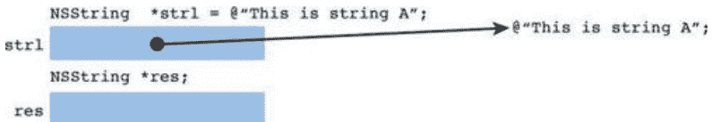

当我们在程序 15.3 中向 `str1` 发送 `uppercaseString` 消息时，我们得到了从字符 `str1` 创建的新字符串，该字符串对象中的任何小写字母都被替换为大写字母。这如图 15.2 所示。

# 图 15.2. 向字符串对象发送 uppercaseString 消息

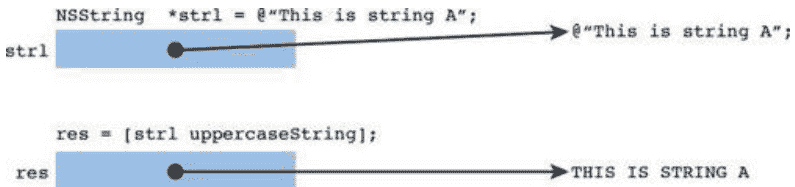

注意，`str1` 仍然指向原始字符串对象，并且创建了一个新的字符串对象。

向 `str1` 发送 `lowercaseString` 消息的方式也是类似的：创建一个新的字符串对象，其由 `str1` 中所有大写字母转换为小写字母组成。对该新创建字符串对象的引用随后存储在变量 `res` 中。这如图 15.3 所示。注意，不再有对上一步中创建的大写字符串的引用了。你不需要担心这个；系统的内存管理会为你清理它。

# 图 15.3. 向字符串对象发送 lowercaseString 消息

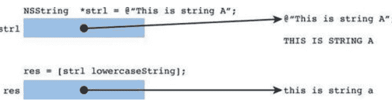

程序 15.4 展示了处理字符串的其他方法。这些方法允许你从字符串中提取子字符串，还可以搜索一个字符串是否包含另一个字符串。

某些方法要求你通过指定范围来标识子字符串。范围由一个起始索引加上字符计数组成。索引数字从零开始，因此字符串中的前三个字符将通过数字对 `{ 0, 3}` 指定。`NSString` 类的一些方法（以及其他 Foundation 类）使用特殊数据类型 `NSRange` 来创建范围规范。它实际上是一个结构体的定义，包含两个成员：`location` 和 `length`，每个成员都被定义为 `NSInteger` 类型。程序 15.4 使用了这种数据类型。

> 注意

> 你可以在第 13 章“底层语言特性”中阅读关于结构的内容。不过，你可能从本章接下来的讨论中获得足够的信息来操作它们。

# 程序 15.4

```objc
// 基本字符串操作 - 继续

#import <Foundation/Foundation.h>

int main (int argc, char * argv[]) {
    @autoreleasepool {
        NSString *str1 = @"This is string A";
        NSString *str2 = @"This is string B";
        NSString *res; subRange;

        // 从字符串提取前3个字符
        res = [str1 substringToIndex: 3];
        NSLog(@"First 3 chars of str1: %@", res);

        // 提取到字符串末尾的字符
        // 从索引5开始
        res = [str1 substringFromIndex: 5];
        NSLog(@"Chars from index 5 of str1: %@", res);

        // 提取索引 8 到 13 的字符（6个字符）
        res = [[str1 substringFromIndex: 8] substringToIndex: 6];
        NSLog(@"Chars from index 8 through 13: %@", res);

        // 实现相同内容的简单方法
        res = [str1 substringWithRange:NSMakeRange(8, 6)];
        NSLog(@"Chars from index 8 through 13: %@", res);

        // 在另一个字符串中查找另一个字符串
        subRange = [str1 rangeOfString:@"@string A"];
        if (subRange.location == NSNotFound) {
            NSLog(@"String not found");
        } else {
            NSLog(@"String is at index %lu, length %lu", subRange.location, subRange.length);
        }

        // 在另一个字符串中查找另一个字符串
        subRange = [str1 rangeOfString:@"@string B"];
        if (subRange.location == NSNotFound) {
            NSLog(@"String not found");
        } else {
            NSLog(@"String is at index %lu, length %lu", subRange.location, subRange.length);
        }
    }
    return 0;
}
```

# 程序 15.4. 输出

```
First 3 chars of str1: Thi
Chars from index 5 of str1: is A
Chars from index 8 through 13: string A
Chars from index 8 through 13: string A
String is at index 0, length 8
String not found
```

当我们谈论可变与不可变字符串对象时，我们讨论的是更改字符串内部的实际字符。在程序执行期间，可变或不可变的字符串对象都可以被设置为一个完全不同的字符串对象。这在程序 15.3 的讨论中已经强调过。例如，考虑以下情况：

```objc
str1 = @"This is a string"
...
str1 = [str1 substringFromIndex: 5];
```

在这种情况下，str1 首先被设置为常量字符字符串对象。在程序的后续部分，它被设置为一个子字符串。在这种情况下，str1 既可以声明为可变字符串对象，也可以声明为不可变字符串对象。确保你理解了这一点。

程序 15.5 显示了在程序中处理可变字符串的一些方法。

# 程序 15.5


```objc
// Basic String Operations - Mutable Strings

#import <Foundation/Foundation.h>

int main (int argc, char * argv[]) {
    @autoreleasepool {
        NSString *strl = @"This is string A";
        NSString *search, *replace;
        NSMutableString *mstr;
        NSRange substr;

        // Create mutable string from nonmutable
        mstr = [NSMutableString stringWithString: strl];
        NSLog("%@", mstr);

        // Insert characters
        [mstr insertString:@"@ mutable" atIndex: 7];
        NSLog("%@", mstr);

        // 如果在末尾插入，则是有效的拼接
        [mstr insertString:@"@ and string B" atIndex: [mstr length]];
        NSLog("%@", mstr);

        // 或者可以直接使用 appendString
        [mstr appendString:@"@ and string C"];
        NSLog("%@", mstr);

        // 根据范围删除子字符串
        [mstr deleteCharactersInRange:NSMakeRange(16, 13)];
        NSLog("%@", mstr);

        // 先找到范围，然后将其用于删除
        substr = [mstr rangeOfString:@"@string B and "];
        if (substr.location != NSNotFound) {
            [mstr deleteCharactersInRange:substr];
            NSLog("%@", mstr);
        }

        // 直接设置可变字符串
        [mstr set:@"This is string A"];
        NSLog("%@", mstr);

        // 现在用另一个字符串替换一段范围的字符
        [mstr replaceCharactersInRange:NSMakeRange(8, 8) withString:@"a mutable string"];
        NSLog("%@", mstr);

        // 搜索并替换
        search = @"This is";
        replace = @"An example of";
        if (substr.location != NSNotFound) {
            [mstr replaceCharactersInRange:substr withString:replace];
            NSLog("%@", mstr);
        }

        // 搜索并替换所有出现
        search = @"a";
        replace = @"x";
        substr = [mstr rangeOfString:search];

        while (substr.location != NSNotFound) {
            [mstr replaceCharactersInRange:substr withString:replace];
            substr = [mstr rangeOfString:search];
        }
        NSLog("%@", mstr);
    }
    return 0;
}
```

# 程序 15.5 输出

This is string A

This is mutable string A

This is mutable string A and string B

This is mutable string A and string B and string C

This is mutable string B and string C

This is mutable string C

This is string A

This is a mutable string

An example of a mutable string

An example of a mutable string

### 声明

`NSMutableString *mstr;` 将 `mstr` 声明为一个持有字符字符串对象的变量，其内容在程序执行期间可能会发生。

```objc
mstr = [NSMutableString stringWith:str1];
```

将`mstr` 设置为其内容是 `str1` 中字符拷贝的字符串对象，或 "This is string A"。当 `stringWith:` 方法发送给 `NSMutableString` 类时，会返回一个可变字符串对象。当它发送给 `NSString` 类时（如程序 15.5 所示），你得到的是不可变字符串对象。

`insertString:AtIndex:` 方法将指定的字符字符串从指定的索引开始插入到接收者中。在这种情况下，你将字符串 "mutable" 插入从索引 7 开始的字符串，或者说插入到字符串第8个字符之前。与不可变对象的方法不同，这里没有返回值，因为接收者被修改了——你可以这样做是因为它是可变字符串对象。

第二次调用 `insertString:AtIndex:` 使用 `length` 方法在另一个字符串的末尾插入一个字符字符串。`appendString:` 方法让这项任务变得简单一点。

通过使用 `deleteCharactersInRange:` 方法，你可以从字符串中删除指定数量的字符。当范围 `{16, 13}` 应用于字符串 `This is mutable string A and string B and string C` 时，会删除从索引16（或字符串中的第17个字符）开始的13个字符 "string A and "。如图 15.4 所示。

### 图 15.4. 字符串索引

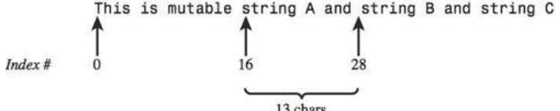

`rangeOfString:` 方法在程序 15.5 的后续行中使用，用于展示如何先定位字符串再删除它。在首先确认 `mstr` 中不存在 "@string B and" 后，使用 `deleteCharactersInRange:` 方法删除字符，并将 `range:` 方法返回的范围作为其参数。

你可以使用 `set:` 方法直接设置可变字符串对象的内容。在使用该方法将 `mstr` 设置为字符串 "@This is string A" 后，`replaceCharactersInRange:withString:` 方法用另一个字符串替换字符串中的某些字符。字符串的大小不必相同；你可以用一个相等或不相等大小的字符串替换另一个。因此，在语句：

```objc
[mstr replaceCharactersInRange:NSMakeRange(8, 8) withString:@"a mutable string"];
```

这8个字符 "string A" 被替换为16个字符 "a mutable string"。

程序示例中的剩余几行显示了如何执行搜索和替换操作。在第一种情况下，你在 `mstr` 内部定位字符串 "@This is"，并将其设置为 "An example of"。接下来设置了一个循环以实现“搜索并替换所有”的操作。注意，如果替换字符串为空，你将导致无限循环。其次，如果替换字符串为空（那么），你实际上删除了该字符串的所有出现处。当然，如果你只是想删除某一次出现，可以使用 `deleteCharacters:` 方法。

最后，`NSMutableString` 类还包含 `replaceOccurrencesOfString:withString:options:range:` 方法，你可以使用它来实现相同的结果并规避无限循环的风险。

```objc
mstr replaceOccurrencesOfString:search withString:replace options:nil range:NSMakeRange(0, [mstr length]);
```

`NSString` 类包含 100多个可以处理字符串对象的方法。表 15.2 汇总了一些常用的方法，而表 15.3 列出了 `NSMutableString` 类提供的某些额外方法。其他方法（如处理路径和读取文件内容）将在本书的剩余部分中介绍。你应该查看 `NSString` 类的文档，以更好地了解你可以利用的各种方法。

```objc
-(NSString *) substringToIndex:i
-(NSComparator *) caseInsensitiveCompare:nsstring
-(NSComparator *) compare:nsstring
-(BOOL) hasPrefix:nsstring
-(BOOL) hasSuffix:nsstring
-(BOOL) isEqualToString:nsstring
-(NSString *) capitalizedString
-(NSString *) lowercaseString
-(NSString *) uppercaseString
-(const char *) UTF8String
-(double) doubleValue
-(float) floatValue
-(NSInteger) integerValue
-(int) intValue
```

返回从字符串开始到索引 `i` 处字符的子字符串

比较两个字符串，忽略大小写

比较两个字符串

测试字符串是否以 `nsstring` 开头

测试字符串是否以 `nsstring` 结尾

测试两个字符串是否相等

返回一个每个单词首字母大写（且每个转换后的单词剩余字母均转换为小写）的字符串

返回一个转换为小写的字符串

返回一个转换为大写的字符串

返回一个转换为 UTF-8 C 风格字符串的字符串

返回字符串的双精度精度（double）浮点数表示

返回字符串的浮点数表示

返回字符串的 `NSInteger` 表示

返回字符串的整数表示

在表 15.2 和表 15.3 中，`url` 是一个 `NSURL` 对象，`path` 是指定文件路径的 `NSString` 对象，`nsstring` 是一个 `NSString` 对象，`i` 是一个代表字符串中有效字符数量的 `NSInteger` 值，`enc` 是一个指定字符编码的 `NSStringEncoding` 对象，`err` 是一个在发生错误时描述错误的 `NSError` 对象，`size` 和 `opts` 是 `NSInteger` 类型，`range` 是一个指示字符串内有效字符范围的 `NSRange` 结构。

表 15.3 中的方法用于创建或修改 `NSMutableString` 对象。

### 表 15.3. 常用 NSMutableString 方法

| 方法 | 描述 |

| --- | --- |

| `+(id) stringWithCapacity: size` | 创建一个初始包含 `size` 个字符的字符串。 |

| `-(id) initWithCapacity: size` | 初始化一个初始容量为 `size` 个字符的字符串。 |

| `-(void) setString: nsstring` | 将字符串设置为 `nsstring`。 |

| `-(void) appendString: nsstring` | 在接收者的末尾追加 `nsstring`。 |

| `-(void) deleteCharactersInRange: range` | 删除指定范围内的字符。 |

| `-(void) insertStringAtIndex: i` | 从索引 `i` 开始在接收者中插入 `nsstring`。 |

| `-(void) replaceCharactersInRange: range: nsstring` | 用 `nsstring` 替换指定范围内的字符。 |

`NSString` 对象在本文的后续部分被广泛使用。如果你需要将字符串解析为标记（tokens），可以查看 Foundation 的 `NSScanner` 类。

## 数组对象

Foundation 数组是对象的有序集合。大多数情况下，数组中的元素是同一种类型的，但并非如此。就像可变和不可变字符串一样，也有可变和不可变数组。不可变数组由 `NSArray` 类处理，而可变数组由 `NSMutableArray` 处理。后者是前者的子类，这意味着它继承了它们的方法。

程序 15.6 设置了一个数组来存储月份并打印它们。

## 程序 15.6

```objc
#import <Foundation/Foundation.h>

int main (int argc, char * argv[])
{
    int i;
    @autoreleasepool {
        // 创建一个包含月份名称的数组
        NSArray *monthNames = [NSArray arrayWithObjects:
            "@January", "@February", "@March",
            "@April", "@May", "@June", "@July", "@August",
            "@September", "@October", "@November", "@December",
            nil];

        // 现在列出数组中的所有元素
        NSLog("@@Month Name: =====");

        for (i = 0; i < 12; i++) {
            NSLog("@%2i %@", i + 1, [monthNames objectAtIndex: i]);
        }
    }
    return 0;
}
```

## 程序 15.6. 输出

| 月份名称 | |

|---|---|

| 1 | January |

| 2 | February |

| 3 | March |

| 4 | April |

| 5 | May |

| 6 | June |

| 7 | July |

| 8 | August |

| 9 | September |

| 10 | October |

| 11 | November |

| 12 | December |

你可以使用 `arrayWithObjects:` 类创建一个以对象列表作为元素的数组。在这种情况下，对象按顺序列出并用逗号分隔。这是可以接受可数量参数的方法使用的特殊语法。为了标记列表的结束，必须将 `nil` 指定为列表中的最后一个值——它实际上并没有存储在数组内部。

在 `Program 15.6` 中，`monthNames` 被设置为 `arrayWithObjects:` 参数指定的 12 个字符串值。

数组中的元素通过它们的索引号识别。与 `NSString` 对象类似，索引从 0 开始。因此，一个包含 12 个元素的数组具有有效的索引号 0–11。要使用索引号检索数组的元素，可以使用 `objectAtIndex:` 方法。

程序简单地执行一个 `for` 循环，使用 `objectAtIndex:` 方法从数组提取每个元素。每个检索到的元素都通过 `NSLog` 显示。

## 程序 15.7

```objc
#import <Foundation/Foundation.h>

int main (int argc, char * argv[])
{
    int i;
    @autoreleasepool {
        NSMutableArray *numbers = [NSMutableArray array];
        NSNumber *myNumber;

        // 创建数组并添加数字对象
        for (i = 0; i < 10; i++) {
            myNumber = [NSNumber numberCreated:i];
            [numbers addObject:myNumber];
        }

        // 遍历数组并显示每个元素
        for (i = 0; i < numbers.count; i++) {
            NSLog("%@", [numbers objectAtIndex:i]);
        }

        // 一次显示整个数组
        NSLog("==== a single");
        NSLog("%%@", numbers);
    }
    return 0;
}
```

## 程序 15.7. 输出

| 月份名称 | |

|---|---|

| 1 | 0 |

| 2 | 1 |

| 3 | 2 |

| 4 | 3 |

| 5 | 4 |

| 6 | 5 |

| 7 | 6 |

| 8 | 7 |

| 9 | 8 |

| 10 | 9 |

| ==== a single | [0, 1, 2, 3, 4, 5, 6, 7, 8, 9] |

### 注意


NSLog 如何知道如何显示存储在数组中的对象？对于数组中的每个元素，`NSLog` 都将使用该元素所属类的 `description` 方法。如果是继承自 `NSObject` 的默认方法，如之前所述，你只会得到对象的类和地址。但在这种情况下，你得到了一个有意义的显示——表明 `Number` 类中实现了一个自定义的 `description` 方法。

用于处理数组的 Foundation 类提供了许多便利性。然而，在用复杂算法处理大型数字数组的情况下，学习如何使用底层 C 语言提供的低级数组结构来执行此类任务，在内存使用和执行速度方面可能更高效。更多信息请参阅第 13 章中的“数组（Arrays）”节。

## 创建通讯簿

让我们来看示例，它通过创建一个通讯簿开始结合你到目前学到的很多内容。你的通讯簿将包含地址卡。为了简单起见，你的地址卡将只包含人的姓名和电子邮件地址。将此概念扩展到其他信息（如地址和电话号码）是直接，但我们将将其留作本章末的练习题。

我们将创建的两个类——`AddressBook` 和 `AddressCard` 类以及它们之间的关系如图 15.5 所示。

### 图 15.5. 包含 AddressCards 的 AddressBook

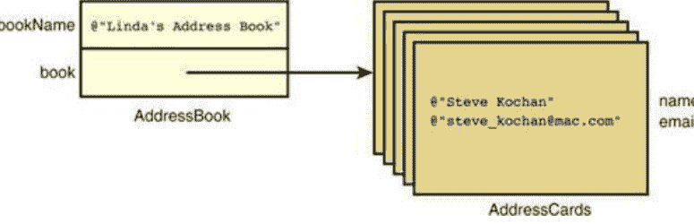

### 创建地址卡

我们首先定义 `AddressCard` 类。你将需要创建新地址卡、设置其姓名和电子邮件字段、检索这些字段并打印卡片的能力。在图形环境中，你可以使用一些方便的方法在计算机屏幕或 iOS 设备的窗口上绘制你的卡片。但在这里，你坚持使用简单的控制台（Console）界面来显示你的地址卡。

程序 15.8 显示了你新 `AddressCard` 类的接口文件。我们现在还不会合成这些访问器方法（accessor methods）；自己编写它们将为你提供宝贵的教训。

#### 程序 15.8. 接口文件 AddressCard.h

```objective-c
#import <Foundation/Foundation.h>

@interface AddressCard: NSObject

-(void) setName:(NSString *)theName;
-(void) setEmail:(NSString *)theEmail;
-(NSString *) name;
-(NSString *) email;

-(void) print;

@end
```

这是简单的，程序 15.8 中的实现文件也是。

#### 程序 15.8. 实现文件 AddressCard.m

```objective-c
#import "AddressCard.h"

@implementation AddressCard{
    NSString *name;
    NSString *email;
}

-(void) setName:(NSString *)theName {
    name = [NSString stringWithString:theName];
}

-(void) setEmail:(NSString *)theEmail {
    email = [NSString stringWithString:theEmail];
}

-(NSString *)name {
    return name;
}

-(NSString *)email {
    return email;
}

-(void) print {
    NSLog("@===================================================");
    NSLog("|");
    NSLog("| %-31s |", [name UTF8String]);
NSLog (@"|   %-31s |", [email UTF8String]);
NSLog(@"|                                     |);
NSLog(@"|                                     |);
NSLog(@"|                                     |);
NSLog(@"|               O               O               |);
NSLog(@"=====================================================");
}
@end
```

你可以让 `setName:` 和 `setEmail:` 方法将对象直接存储在各自的实例变量中，使用如下方法定义：

```objective-c
- (void) setName: (NSString *) theName
{
    name = theName;
}
```

```objective-c
- (void) setEmail: (NSString *) theEmail
{
    email = theEmail;
}
```

`AddressCard` 对象不会拥有它的成员对象（它只包含传递给方法的参数的引用）。我们在第 8 章“继承（Inheritance）”中讨论过对象获取所有权的动机，例如 `Rectangle` 类拥有其原点对象。

`print` 方法尝试向用户展示一个精美的地址卡显示，其格式类似于 Rolod 卡片（有人还记得那种片吗？）。`NSLog` 中的 `%-31s` 字符表示在宽度为 31 个字符的字段内显示一个 UTF8 C 字符串，并左对齐。这确保了你的地址卡右边缘在输出中是对齐的。在示例中，这完全是出于美观考虑。

有了 `AddressCard` 类，你可以编写一个测试程序来创建地址卡、设置其值并显示它（参参见程序 15.8）。

#### 程序 15.8. 测试程序

```
#import "AddressCard.h"

int main (int argc, char * argv[]) {
    @autoreleasepool {
        NSString *aName = @"Julia Kochan";
        NSString *aEmail = @"jewls337@axlc.com";
        AddressCard *card1 = [[AddressCard alloc] init];

        [card1 setName:aName];
        [card1 setEmail:aEmail];
        [card1 print];
    }
    return 0;
}
```

#### 程序 15.8. 输出

```
===============================================
|                                |
| Julia Kochan                   |
| jewls337@axlc.com              |
|                                |
|                                |
|               O               O               |
===============================================
```

这里有新的 `setName:` 和 `setEmail:` 方法可以省一些工作：

```objective-c
-(void) setName: (NSString *) theName
{
    if (name != theName)
        name = [NSString stringWithString:
        theName];
}

-(void) setEmail: (NSString *) theEmail
{
    if (email != theEmail)
        email = [NSString stringWithString:
        theEmail];
}
```

设置这个测试是为了以防有人向 setter 发送已经存储在实例变量中的相同对象。如果传递的对象与存储的对象相同，我们就不需要做任何工作了。

### 合成的 AddressCard 方法

现在我们已经讨论了编写访问器方法 `setName:` 和 `setEmail:` 的正确方法，并且你理解了重要的原则，我们可以回去并让系统为你生成访问器方法。考虑 `AddressCard` 接口文件的第二个版本：

```
#import <Foundation/Foundation.h>

@interface AddressCard: NSObject

@property (copy, nonatomic) NSString *name,
*email;
-(void) print;
@end
```

这一行

```
@property (copy, nonatomic) NSString *name,
*email;
```

列出了属性的 `copy` 和 `nonatomic` 属性。`copy` 属性表示在 setter 方法中为实例变量创建一个副本，就像你在你编写的版本中所做的那样。默认操作是不创建副本，而是执行简单的赋值（那是默认的 `assign` 属性），这在这种情况下是不正确的做法。

`nonatomic` 属性表示你不需要担心多个线程同时访问实例变量时可能发生的竞态条件。第 18 章“拷贝对象（Copying Objects）”更详细地讨论了这一主题。

程序 15.9 是新的 `AddressCard` 实现文件，指定访问器方法是合成的。（注意我们在这里删除了实例变量的显式声明，因为我们现在有了它们的属性。）

#### 程序 15.9. 使用方法的实现文件 AddressCard.m

```
#import "AddressCard.h"

@implementation AddressCard

@synthesize name, email;

-(void) print
{
    NSLog("=============================================");
    NSLog("@|||);
    NSLog("@| %-31s |", [name UTF8String]);
    NSLog("@| %-31s |", [email UTF8String]);
    NSLog("@|||);
    NSLog("@|||);
    NSLog("@|||);
    NSLog("@|           O           O ||);
    NSLog("=============================================");
}
@end
```

现在为你的 `AddressCard` 类添加另一个方法。你可能希望通过一次调用设置卡片的姓名和电子邮件字段。为此，添加一个新方法 `setName:andEmail:`。新方法看起来如下：

```
-(void) setName:(NSString *)theName andEmail:(NSString *)theEmail
{
    self.name = theName;
    self.email = theEmail;
}
```

回顾编写 `self.name = theName;` 等同于编写 `[self setName:theName];`，因此使用了实例变量的 setter 方法。对比编写 `name = theName;`，后者反而跳过了 setter 直接将参数的值赋值给实例变量。

通过依赖合成的方法来设置相应的实例变量（而不是在方法内部直接设置它们），你增加了一层抽象，因此使程序对其内部数据结构的独立性提高。你还利用了合成属性的属性，在这种情况下，它们是 `copy` 而不是赋值给实例变量。

程序 15.9 测试了你的新方法。

```objc
#import "AddressCard.h"

int main (int argc, char * argv[]) {
    @autoreleasepool {
        NSString *aName = @"Julia Kochan";
        NSString *aEmail = @"jewls337@axlc.com";
        NSString *bName = @"Tony Iannanno";
        NSString *bEmail = @"tony.iannno@techfitness.com";

        AddressCard *card1 = [[AddressCard alloc] init];
        AddressCard *card2 = [[AddressCard alloc] init];

        [card1 setName:aName andEmail:aEmail];
        [card2 setName:bName andEmail:bEmail];

        [card1 print];
        [card2 print];
    }
    return 0;
}
```

#### 程序 15.9. 输出

|==========================================|

| | |

| Julia Kochan |

| jewls337@axlc.com |

| | |

| | | |

| | O | O |

|==========================================|

|==========================================|

| | Tony Iannino |

| tony.iannino@techfitness.com |

| |

| | O | O |

|==========================================|

### AddressBook 类

你的 `AddressCard` 类似乎运行得很好。但如果你想处理大量的 `AddressCard` 呢？将它们收集在一起是有意义的，这正是你将要通过定义一个名为 `AddressBook` 的新类来实现的。`AddressBook` 类将存储地址录的名称以及一个 `AddressCard` 集合，你把它们存储在一个数组对象中。开始时，你将需要创建新地址录、向其中添加新的地址卡并列出其内容的能力。之后，你可能还希望能够搜索地址录、删除条目、可能编辑现有条目、对其进行排序，甚至对它的内容进行复制。

让我们从一个简单的接口文件（程序 15.10）开始。

#### 程序 15.10. AddressBook.h 接口文件

```objc
#import <Foundation/Foundation.h>
#import "AddressCard.h"
```

```objc
@interface AddressBook: NSObject

@property (nonatomic, copy) NSString *bookName;
@property (nonatomic, strong) NSMutableArray *book;

-(id) initWithName:(NSString *) name;
-(void) addCard:(AddressCard *) theCard;
-(int) entries;
-(void) list;

@end
```

属性的 `strong` 属性表示在每次使用 setter 方法时都对对象创建一个额外的引用。它会影响对象的生命周期。在[第 17 章]“内存管理与自动引用计数”中有更详细的描述。

`initWithName:` 方法设置了初始数组以持有地址卡并存储地址录的名称，而 `addCard:` 方法则向地址录添加一个 `AddressCard`。`entries` 方法报告你的地址录中地址卡的数量，而 `list` 方法则提供其所有内容的简要列出。[程序 15.10] 显示了你 `AddressBook` 类的实现文件。

#### 程序 15.10. AddressBook.m 实现文件

```objc
#import "AddressBook.h"

@synthesize bookName, book;
```

```objc
// 设置 AddressBook 的名称和空地址录

-(id) initWithName: (NSString *) name
{
    self = [super init];

    if (self) {
        bookName = [NSString stringWithString:name];
        book = [NSMutableArray array];
    }

    return self;
}

-(id) init
{
    return [self initWithName:@"NoName"];
}

-(void) addCard:(AddressCard *)theCard
{
    [book addObject:theCard];
}

-(int) entries
{
    return [book count];
}

-(void) list
{
    NSLog(@"====== Contents of: %@=========", bookName);

    for ( AddressCard *theCard in book )
        NSLog (@"%-20s %-32s", [theCard.name UTF8String], [theCard.email UTF8String]);

    NSLog (@"==================================================================="
}
@end
```


`initWithName:` 方法首先调用父类的 `init` 方法执行其初始化。接下来，它对作为参数传递的字符串进行拷贝，并将其存储在 `bookName` 实例变量中。随后创建一个空的 `NSMutableArray` 对象并赋值给 `book`。

你定义 `initWithName:` 返回一个 `id` 对象而不是一个 `AddressBook` 对象。如果 `AddressBook` 被子类化，`initWithName:` 消息的接收者（并因此返回值）并不是 `AddressBook` 对象；它的类型是子类的类型。出于这个原因，你将返回类型定义为通用对象类型。

我们重写了 `init` 方法，以确保如果有人执行 `alloc` 后接 `init`，他们仍然能获得启动的地址录，默认名称为“NoName”。因此这里 `initWithName:` 方法是我们的指定初始化器，我们希望确保 `init` 使用它。

`addCard:` 方法接收作为参数的 `AddressCard` 对象并将其添加到地址录。

`count` 方法给出数组中元素的数量。`entries` 方法使用它来返回存储在地址录中的地址卡数量。

### 快速枚举

`list` 方法中的 `for` 循环显示了一种你之前从未见过的结构：

```objc
for ( AddressCard *theCard in book )
    NSLog(@"%-20s %-32s", [theCard.name UTF8String], [theCard.email UTF8String]);
```

这种 `for` 循环使用了一种名为快速枚举的技巧。这种语法非常简单：

```objc
for ( theCard in book )
```

注意，如果 `theCard` 之前被定义为 `AddressCard` 对象，那么 `for` 循环将变成：

15.10 是你 `AddressBook` 类的测试程序。

## 15.10 测试程序

```objc
#import "AddressBook.h"

int main (int argc, char * argv[])
{
  @autoreleasepool {
    NSString *aName = @"Julia Kochan";
    NSString *aEmail = @"jewls337@axlc.com";
    NSString *bName = @"Tony Iannanno";
    NSString *bEmail = @"tony.iannno@techfitness.com";

    AddressCard *card1 = [[AddressCard alloc] init];
    AddressCard *card2 = [[AddressCard alloc] init];
    AddressCard *card3 = [[AddressCard alloc] init];
    AddressCard *card4 = [[AddressCard alloc] init];

    // 设置一个新的地址录
    AddressBook *myBook = [[AddressBook alloc]
    initWithName:@"Linda's Address Book"];

    NSLog(@"Entries in address book after creation: %@", [myBook entries]);

    // 现在设置四张卡
    [card1 setName:aName andEmail:aEmail];
    [card2 setName:bName andEmail:bEmail];
    [card3 setName:cName andEmail:cEmail];
    [card4 setName:dName andEmail:dEmail];

    // 将卡添加到地址录
    [myBook addCard:card1];
    [myBook addCard:card2];
    [myBook addCard:card3];
    [myBook addCard:card4];

    NSLog(@"Entries in address book after
adding cards: %i", [myBook entries]);

    // 现在列出录中所有的条目
    [myBook list];
  }
return 0;
}
```

## 15.10. 输出

Entries in address book after creation: 0

Entries in address book after adding cards: 4

====== Contents of: Linda's Address Book

=======

Julia Kochan jewls337@axlc.com

Tony Iannino tony.iannino@techfitness.com

Stephen Kochan steve@classroomM.com

Jamie Baker jbaker@classroomM.com

====================

====

### 在地址录中查找人员

当你有一个大型地址录时，你不想每次想查找某人时列出其完整内容。因此，添加一个方法来为你完成是有意义的。让我们将方法命名为 `lookup:`，并将名称作为其参数。该方法将在地址录中搜索匹配项（忽略大小写），如果找到则返回匹配的条目。如果名称没有出现在电话簿，我们将让它返回 `nil`。

这是我们新的 `lookup:` 方法：

```objc
// 按名称查找地址卡 -- 假设是
精确匹配

-(AddressCard *) lookup: (NSString *) theName
{
    for ( AddressCard *nextCard in book )
        if ( [nextCard.name
caseInsensitiveCompare: theName] ==
NSOrderedSame )
            return nextCard;
}
```

return nil;

}

如果你将此方法的声明写在接口文件中，将定义写在实现文件中，你就可以编写一个测试程序来尝试你的新方法。程序 15.11 显示了这样一个程序，紧随其后是它的输出。

## 程序 15.11. 测试程序

```objc
#import "AddressBook.h"

int main (int argc, char * argv[]) {

    @autoreleasepool {
        NSString *aName = @"Julia Kochan";
        NSString *aEmail = @"jewls337@axlc.com";
        NSString *bName = @"Tony Iannino";
        NSString *bEmail = @"tony.iannino@techfitness.com";
        NSString *cName = @"Stephen Kochan";
        NSString *cEmail = @"steve@classroomM.com";
        NSString *dName = @"Jamie Baker";
        NSString *dEmail = @"jbaker@classroomM.com";
        AddressCard *card1 = [[AddressCard alloc] init];
        AddressCard *card2 = [[AddressCard alloc] init];
        AddressCard *card3 = [[AddressCard alloc] init];
        AddressCard *card4 = [[AddressCard alloc] init];

        AddressBook *myBook = [[AddressBook
alloc]
        initWithName:@"Linda's Address Book"];
        AddressCard *myCard;

        // 现在设置四张地址卡

        [card1 setName: aName andEmail: aEmail];
        [card2 setName: bName andEmail: bEmail];
        [card3 setName: cName andEmail: cEmail];
        [card4 setName: dName andEmail: dEmail];

        // 向地址簿添加一些卡片

        [myBook addCard: card1];
        [myBook addCard: card2];
        [myBook addCard: card3];
        [myBook addCard: card4];

        // 尝试另一个查找

        NSLog (@"Haibo Zhang");
        myCard = [myBook lookup: @"Haibo Zhang"];

        if (myCard != nil)
            [myCard print];
        else
            NSLog("Not found!");
    }
    return 0;
}
```

## 程序 15.11. 输出

Lookup: Stephen Kochan

====================================

| Stephen Kochan                     |

| steve@classroomM.com |

|                                    |

|             O              O |

====================================

Lookup: Haibo Zhang

Not found!

当 `lookup` 方法在地址簿中找到 Stephen Kochan 时（利用了不区分大小写的匹配特性），该方法通过执行 `return` 语句立即返回匹配的卡片，这会终止循环并返回 `nextCard` 的值。然后，匹配的卡片被交给 `AddressCard` 的 `print` 方法进行显示。在第二次查找中，没有找到名字 Haibo Zhang。

这个 `lookup` 方法非常原始，因为它需要找到整个名称的精确匹配。更好的方法是执行部分匹配并能够处理多个匹配项。例如，消息表达式

```objc
[myBook lookup: "@steve"]
```

可以匹配到 "Steve Kochan""Fred Stevens" 和 "steven levy" 条目。因为可能存在多个匹配项，很好的方法可能是创建一个包含所有匹配项的数组，并将数组返回给方法调用者（参见本章末尾的练习 2），如下：

```objc
matches = [myBook lookup: "@steve"];
```

### 从地址簿中移除某人

任何允许你添加条目的地址簿管理器，如果没有移除条目的能力，将是不完整的。你可以制作一个 `removeCard:` 方法来从地址簿中移除特定的 `AddressCard`。另一种可能性是创建一个 `remove:` 方法，根据名字移除某人（参见本章末尾的练习 6）。

由于你对接口文件进行了几处更改，程序 15.12 再次显示了带有新 `removeCard:` 方法的程序。随后是你新方法的实现。

## 程序 15.12. Addressbook.h 接口文件

```objc
#import "AddressCard.h"

@interface AddressBook: NSObject

@property (nonatomic, copy) NSString *bookName;
@property (nonatomic, strong) NSMutableArray *book;

- (id) initWithName:(NSString *) name;

- (void) addCard:(AddressCard *) theCard;
- (void) removeCard:(AddressCard *) theCard;

- (AddressCard *) lookup:(NSString *) theName;
- (int) entries;
- (void) list;

@end
```

这是新的 `removeCard:` 方法：

```objc
- (void) removeCard:(AddressCard *) theCard
{
  [book removeObjectIdenticalTo:theCard];
}
```

为了确定什么被视为相同对象，我们使用了“完全相同的对象”的概念，即在内存中具有相同位置的对象。因此，`removeObjectIdenticalTo:` 方法**不会**将两个包含相同信息但在内存中位置不同的的地址卡片（例如，如果你复制了一个 `AddressCard`，可能会发生这种情况）视为是相同的。

顺便提一下，`removeObjectIdenticalTo:` 方法会移除与其参数相同的所有对象。然而，只有当你的数组中多次出现同一个对象时，这才会是一个问题。

你可以通过使用 `removeObject:` 方法并编写你自己的 `isEqual:` 方法来测试两个对象是否相等，从而使处理相等对象的方法变得更加复杂。如果你使用 `removeObject:`，系统会自动为数组中的每个元素调用 `isEqual:` 方法，并为其提供两个元素进行比较。在这种情况下，由于你的地址簿包含 `AddressCard` 对象作为其元素，你必须在该类中添加一个 `isEqual:` 方法（你需要重写该类继承自 NSObject 的方法）。该方法可以自己判断相等性。比较两个对应的名字和邮箱是有意义的。如果两者都相等，你可以从方法返回 `YES`；否则，你可以返回 `NO`。你的方法可能看起来像这样：

```objc
- isEqual:(AddressCard *) theCard {
  if ([nameEqualToToString:theCard.name] == YES &&
      [emailEqualToToString:theCard.email] == YES)
    return YES;
  else
    return NO;
}
```

注意，其他 `NSArray` 方法（如 `containsObject:` 和 `indexOfObject:`）也依赖于这种 `isEqual:` 策略来确定哪两个对象被认为是相等。

程序 15.12 测试了新的 `removeCard:` 方法。

## 程序 15.12. 测试程序


```objc
#import "AddressBook.h"

int main (int argc, char * argv[]) {
  @autoreleasepool {
        NSString *aName = @"Julia Kochan";
        NSString *aEmail = @"jewls337@axlc.com";
        NSString *bName = @"Tony Iannino";
        NSString *bEmail = @"tony.iannino@techfitness.com";
        NSString *cName = @"Stephen Kochan";
        NSString *cEmail = @"steve@classroomM.com";
        NSString *dName = @"Jamie Baker";
        NSString *dEmail = @"jbaker@classroomM.com";

        AddressCard *card1 = [[AddressCard alloc] init];
        AddressCard *card2 = [[AddressCard alloc] init];
        AddressCard *card3 = [[AddressCard alloc] init];
        AddressCard *card4 = [[AddressCard alloc] init];

        AddressBook *myBook = [[AddressBook
alloc]
        initWithName:@"Linda's Address Book"];
        AddressCard *myCard;

        // 现在设置四张地址卡

        [card1 setName: aName andEmail: aEmail];
        [card2 setName: bName andEmail: bEmail];
        [card3 setName: cName andEmail: cEmail];
        [card4 setName: dName andEmail: dEmail];

        // 向地址簿添加一些卡片

        [myBook addCard: card1];
        [myBook addCard: card2];
        [myBook addCard: card3];
        [myBook addCard: card4];

        // 尝试另一个查找

        NSLog (@"Haibo Zhang");
        myCard = [myBook lookup: @"Haibo Zhang"];

        if (myCard != nil)
            [myCard print];
        else
            NSLog("Not found!");

        // 现在从地址簿中移除条目

        [myBook removeCard: myCard];
        [myBook list]; // 验证它已移除
    }
    return 0;
}
```

# 程序 15.12. 输出

Lookup: Stephen Kochan

===========================================

| |

| Stephen Kochan | |

| steve@classroomM.com | |

| | |

| O O |

|==========================|

| ======= Contents of: Linda's Address Book ======= |

| Julia Kochan jewls337@axlc.com |

| Tony Iannino tony.iannino@techfitness.com |

| Jamie Baker jaker@classroomM.com |

## 排序数组

如果你的地址簿包含一个条目列表，对其进行排序可能会非常方便。你可以通过向你的 `AddressBook` 类添加一个 `sort` 方法并利用 `NSMutableArray` 方法 `sortUsingSelector:` 来轻松实现这一点。该方法将参数接收一个 `sortUsingSelector:` 方法用于比较两个元素的选择器。数组可以包含任何类型的对象，因此实现通用排序方法的唯一方法是让你决定数组中的哪些元素是有序的。为了实现这一点，你必须添加一个方法来比较数组中的两个元素。该方法返回的结果类型为 `NSComparisonResult`。如果你希望排序方法将第一个放在

在数组中第一个元素位于第二个元素之前，如果两个元素被视为相等，则返回 `NSOrderedSame`；如果第一个元素在排序后的数组中应该在第二个元素之后，则返回 `NSOrderedDescending`。

首先，这里是你的 `AddressBook` 类中的新排序方法：

```objc
- (void) sort
{
    [book sortUsingSelector:
        @selector(compareNames:)];
}
```

正如你在第 9 章“多态、动态类型和动态绑定”中所学到的，表达式

```objectivec
@selector(compareNames:)
```

会根据指定的方法名创建一个类型为 `SEL` 的选择器（selector）；方法 `sortUsingSelector:` 正是用来使用该选择器来比较数组中的两个元素。当它需要进行此类比较时，它会调用指定的方法，向数组中的第一个元素（接收者）发送消息，将其与参数进行比较。返回值的类型如前所述，应为 `NSResult` 类型。

由于你地址簿中的元素是 `AddressCard` 对象，因此比较方法必须添加到 `AddressCard` 类中（请确保你完全理解了这一点）。你必须回到你的 `AddressCard` 类并为其添加 `compareNames:` 方法。显示如下：

```objc
// 比较指定地址卡中的两个名称

-(NSComparisonResult) compareNames: (id)
element
```

```objc
{
  return [name compare: [element name]];
}
```

由于你正在对地址簿中的两个名称进行字符串比较，你可以使用 `NSString compare:` 方法来为你完成工作。

如果你在 `AddressBook` 类中添加了 `sort` 方法并在 `AddressCard` 类中添加了 `compareNames:` 方法，你就可以编写一个测试程序进行测试（参见程序 15.13）。

# 程序 15.13. 测试程序

```objc
#import "AddressBook.h"

int main (int argc, char * argv[]) {

  @autoreleasepool {
    NSString *aName = @"Julia Kochan";
    NSString *aEmail = @"jewls337@axlc.com";
    NSString *bName = @"Tony Iannino";
    NSString *bEmail = @"tony.iannino@techfitness.com";
    NSString *cName = @"Stephen Kochan";
    NSString *cEmail = @"steve@classroomM.com";
    NSString *dName = @"Jamie Baker";
    NSString *dEmail = @"jbaker@classroomM.com";

    AddressCard *card1 = [[AddressCard alloc] init];
    AddressCard *card2 = [[AddressCard
alloc init];
      AddressCard *card3 = [[AddressCard
alloc init];
      AddressCard *card4 = [[AddressCard
alloc init];
      AddressBook *myBook = [AddressBook
alloc];
```

```objc
// 先设置四个地址卡

[card1 setName: aName andEmail: aEmail];
[card2 setName: bName andEmail: bEmail];
[card3 setName: cName andEmail: cEmail];
[card4 setName: dName andEmail: dEmail];
```

```objc
myBook = [myBook initWithName: "@Linda's
Address Book];
```

```objc
// 向地址簿添加一些卡片

[myBook addCard: card1];
[myBook addCard: card2];
[myBook addCard: card3];
[myBook addCard: card4];
```

```objc
// 列出未排序的簿

[myBook list];
```

```objc
// 排序并再次列出

[myBook sort];
[myBook list];
}
```

```objc
return 0;
}
```

# 程序 15.13. 输出

====== Linda's Address Book 的内容

=======

Julia Kochan jewls337@axlc.com

Tony Iannino tony.iannino@techfitness.com

Stephen Kochan steve@classroomM.com

Jamie Baker jaker@classroomM.com

===========================================

====

====== Linda's Address Book 的内容

=======

Jamie Baker jaker@classroomM.com

Julia Kochan jewls337@axlc.com

Stephen Kochan steve@classroomM.com

Tony Iannino tony.iannino@techfitness.com

===========================================

====

注意，该排序是升序的。然而，你可以通过修改 `AddressCard` 类中的 `compareNames` 方法来反转返回值的含义，从而轻松地执行降序排序。

## 使用 Blocks 排序

`NSArray` 和 `NSMutableArray` 类中存在排序方法，它们接受 block 作为参数来比较数组中的元素，而不是使用选择器。

`NSArray` 方法的一般格式为：

+   - (NSArray *) sortedArrayUsingComparator:

(NSComparator) block

而对数组进行原地排序的 `NSMutableArray` 方法看起来如下所示：

+   - (void) sortUsingComparator:(NSComparator) block

`NSComparator` 在其中一个系统头文件中以如下 `typedef` 的定义：

```objectivec
typedef NSComparisonResult (^NSComparator)(id
obj1, id obj2);
```

将其翻译成英文，它表示 `NSComparator` 是一个接收两个对象作为参数并返回 `NSComparisonResult` 类型值的 block。由于该方法使用了 block，在排序大型数组时其运行速度可能会更快。因此，请为此原因考虑在你的应用程序中使用它。

因此，block 接收两个要比较的对象作为其参数，并预期返回一个指示，说明第一个对象应该被视为小于、等于还是大于第二个对象。这与非 block 版本的数组排序方法所调用的方法是一致的。

我们提供的 block 接收两个要比较的对象作为参数，并预期返回一个指示，说明第一个对象应该被视为小于、等于还是大于第二个对象。

我们作为 `sortUsingComparator` 参数提供的 block 可以调用我们的 `compareNames:` 方法来处理地址卡，如下：

```objc
(void) sort
{
    [book sortUsingComparator:
        ^(id obj1, id obj2) {
            return [obj1 name];
         }];
}
```

这种方法可行，但考虑到这一点，它不会提供任何性能提升，因为 block 调用了 `compareNames:` 方法。更好的方法是在 block 内部提高速度：

```objc
(void) sort
{
    [book sortUsingComparator:
        ^(id obj1, id obj2) {
            return [obj1 name]];
         }];
}
```

回到程序 15.13，用我们开发的方法替换 `AddressBook` 的 `sort` 方法。验证程序仍然运行并正确排序了地址簿。

block 方法的一个优点是，如果你决定更改比较地址卡的方式，你不需要在 `AddressCard` 类中添加方法。

另一个优点是，如果你决定更改比较对象的方式，你可以直接在你的 `sort` 方法中进行，而无需修改 `AddressCard` 类。

处理数组对象有 50 多种方法可用。表 15.4 和 15.5 分别列出了用于不可变和可变数组的常用方法。由于 `NSMutableArray` 是 `NSArray` 的子类，前者继承了后者的方法。

# 表 15.4  NSArray 方法

| 方法 | 说明 |
| --- | --- |
| +(id) arrayWithObjects: obj1, obj2, ... | 创建以 obj1, obj2, ... 为元素的新数组 |
| - (BOOL) containsObject: obj | Determine数组是否包含 obj（使用 isEqual 方法） |
| - (NSInteger) count | 数组中元素的数量 |
| - (NSInteger) indexOfObject: obj | 指定包含 obj 的第一个元素的索引（使用 isEqual 方法） |
| - (NSInteger) indexOfOfPassingTest:(BOOL)(id obj, NSInteger idx, BOOL *stop) block | 将每个 obj（带有索引 idx）传入 block，如果通过通过通过 YES，否则返回 NO。将指向 stop 的变量设置为 YES 以结束处理。 |
| (id) lastObject | 返回数组中的最后一个对象 |
| (id) objectAtIndex:i | 存储在元素 i 中的对象 |
| - (void) makeObjectsPerformSelector:(SEL) selector | 向数组的每个元素发送选择器指示的消息 |
| - (void) enumerateObjectsUsingBlock:(void)(id obj, NSInteger idx, BOOL *stop) block | 为数组中的每个元素执行 block，传入数组对象 obj 及其索引 idx。处理持续到所有元素都已枚举或指向 stop 的变量设置为 YES。 |
| -(NSArray *) sortedArrayUsingSelector:(SEL) selector | 根据指定的选择器方法对数组进行排序 |
| -(NSArray *) sortedArrayUsingComparator:(NSComparator) block | 根据 block 执行的比较对数组进行排序 |
| -(BOOL) writeToFile:path atomically:(BOOL) flag | 将数组写入指定文件，如果 flag 为 YES 则创建一个临时文件 |

# 表 15.5. NSMutableArray 方法

| 方法 | 说明 |
|---|---|
| +(id) array | 创建一个空数组 |
| +(id) arrayWithCapacity: size | 创建一个具有指定初始大小的数组 |
| - (id) initWithWithCapacity: size | 初始化一个具有指定初始大小的新分配数组 |
| - (void) addObject: obj | 将 obj 添加到数组末尾 |
| - (void) insertObject: obj atIndex: i | 将 obj 插入数组的元素 i 处 |
| - (void) replaceObject:obj index: i | 用 obj 替换数组中的元素 |
| - (void) removeObject: obj | 从数组中移除所有出现的 obj |
| - (void) removeObject:i | 从数组中移除第 i 个元素，并将后面的元素向前移动 |
| - (void) sortSelector:(SEL)selector | 根据 selector 指定的比较方法对数组进行排序 |


| - (void) sortComparator:(NSComparator)block | 根据 `block` 执行的比较对数组进行排序 |

在表 15.4 和 15.5 中，`obj`、`obj1` 和 `obj2` 是任何对象；`i` 是表示数组有效索引的整数；`selector` 是类型为 `SEL` 的选择器对象；`size` 是一个 `NSInteger` 整数。

## NSValue 类

正如我们所看到的，像数组这样的 Foundation 集合只能存储对象。这意味着你不能在内部存储基本数据类型。为了解决这个问题，你可以创建 `NSNumber` 对象的数组，而不是 `int` 数组。

当你开始开发 iOS 应用程序时，你会有其他想要存储在集合中的类型。这些类型是结构体（structures），它们是 C 语言的派生数据类型，而不是对象。例如，你将使用 `CGPoint`（一个类型定义名）来在应用程序中定义 (x, y) 坐标。这就是你如何指定矩形原点的方法。事实上，一个矩形是一个 `CGRect` 类型，它本身包含另外两个结构：一个定义矩形原点的 `CGPoint` 结构和一个定义其宽度和高的 `CGSize` 结构。

这些讨论的目的是让你注意，这些是你可能想要存储在集合中的结构。你不能直接这样做。`NSValue` 类的出现解决了这个问题，它允许将这些结构之一转换为对象，然后你就可以将其存储在集合中了。将像结构体这样的数据类型转换为对象的过程有时被称为“包装”（wrapping）。正如你预期的那样，获取一个对象并提取其底层数据类型的逆向过程通常被称为“解包”（unwrapping）。

表 15.6 显示了一些将数据类型转换为对象的包装方法，以及相应的解包对象的逆向方法。如需更多信息，请查看 `NSValue` 类的文档。

### 表 15.6. 部分 NSValue 包装和解包方法

| 类型定义数据类型 | 说明 | 包装方法 | 解包方法 |
| --- | --- | --- | --- |
| `CGPoint` | 由 x 和 y 值组成的点 | `valueWithPoint:` | `pointValue` |
| `CGSize` | 由宽度和高度组成的尺寸 | `valueWithSize:` | `sizeValue` |
| `CGRect` | 由原点和尺寸组成的矩形 | `valueWithRect:` | `rectValue` |
| `NSRange` | 描述位置和大小的范围 | `valueWithRange:` | `rangeValue` |

这里是一个代码片段，它获取一个 `CGPoint` 结构体并将其添加到一个名为 `touchPoints` 的可变数组中：

```
CGPoint myPoint;
NSValue *pointObj;
NSMutableArray *touchPoints = [NSMutableArray array];
```

```
array;
...
myPoint.x = 100; // 将点设为 (100, 200)
myPoint.y = 200;
...
pointObj = [NSValue valueWithPoint:myPoint]; // 将其转换为对象
[touchPoints addObject:pointObj];
```

确保你意识到这样做的必要性。由于 `myPoint` 是一个结构体，你不能直接将其存储在 `touchPoints` 数组中。因此，你必须先转换为对象。我们使用 `valueWithPoint:` 方法来完成操作。

如果你随后想从 `touchPoints` 数组中获取最后一个点并将其转换回 `CGPoint` 结构体，那么这一行代码就能实现目标：

```
myPoint = [[touchPoints lastObject] pointValue];
```

## 字典对象

`dictionary`（字典）是一个由键-值对组成的数据集合。就像你在字典中查找单词的定义一样，你通过键（key）从 Objective-C 字典中获取值（对象）。字典中的键必须是唯一的，可以是任何对象类型，尽管它们通常是字符串。与键关联的值也可以是任何对象类型，但不能为 `nil`。

字典可以是可变的或不可变的；可变的字典可以动态添加和删除条目。可以根据特定的键搜索字典，并对其内容进行枚举。程序 15.14 设置了一个可变字典，作为 Objective-C 术语词表，并填充了前三个条目。

### 程序 15.14

```
#import <Foundation/Foundation.h>

int main (int argc, char * argv[]) {
    @autoreleasepool {
        NSMutableDictionary *glossary = [NSMutableDictionary dictionary];

        // 在词表中存储三个条目

        [glossary setObject:@"A class defined so other classes can inherit from it" forKey:@"abstract class"];
        [glossary setObject:@"To implement all the methods defined in a protocol" forKey:@"adopt"];
        [glossary setObject:@"Storing an object for later use" forKey:@"archiving"];

        // 获取并显示它们

        NSLog("abstract class: %@", [glossary objectForKey:@"abstract class"]);
        NSLog("adopt: %@", [glossary objectForKey:@"adopt"]);
        NSLog("archiving: %@", [glossary objectForKey:@"archiving"]);
    }
    return 0;
}
```

### 程序 15.14. 输出

```
abstract class: A class defined so other classes can inherit from it
adopt: To implement all the methods defined in a protocol
archiving: Storing an object for later use
```

表达式

```
[NSMutableDictionary dictionary]
```

创建一个空的可变字典。你可以使用 `setObject:forKey:` 方法向字典添加键值对。字典构建完成后，你可以通过 `objectForKey:` 获取给定键的值。程序 14 显示了如何获取这些值。

## 枚举字典

程序 15.15 阐述了如何使用 `dictionaryWithObjects:` 定义字典。创建一个不可变字典，程序还展示了如何使用快速枚举循环对其内容进行枚举。与数组对象不同，字典是没有序的，因此从字典中提取的第一个键可能是：

### 程序 15.15

```
#import <Foundation/Foundation.h>

int main (int argc, char * argv[]) {
    @autoreleasepool {
        NSDictionary *glossary = [NSDictionary dictionaryWithObjects:
            @"A class defined so other classes
            inherit from it", @"abstract class",
            @"To implement all the methods defined
            in a protocol", @"adopt",
            @"Storing an object for later use", @"archiving",
            nil
        ];

        // 打印字典的所有键值对
        for ( NSString *key in glossary ) {
            NSLog("@@: %@", key, [glossary objectForKey:key]);
        }
    }
    return 0;
}
```

### 程序 15.15. 输出

```
abstract class: A class defined so other classes can inherit from it
adopt: To implement all the methods defined in a protocol
archiving: Storing an object for later use
```

`dictionaryWithObjects:` 的参数是一个对象-键对列表（是的，顺序如此！），每个对用逗号隔开。列表必须以特殊的 `nil` 对象结束。

如果你想按字母顺序显示字典的内容，可以从字典中获取所有的键，对它们进行排序，然后按照排序后的键顺序从字典获取获取所有的值。你可以首先使用 `NSDictionary` 的 `keys` 方法将字典中的所有键提取到数组中，然后对该数组进行排序。

```
NSArray *keys = [states allKeys];

keys = [sortedArrayUsingComparator:
^(id obj1, id obj2) {
  return [obj1 compare:obj2];
}];
```

```objc
for (NSString *aState in keys)
NSLog("@State: %@ Capital: %@", aState, [states objectForKey:aState]);
```

我们已经展示了一些字典的基本操作。表 15.7 和 15.8 分别总结了用于不可变字典和可变字典的一些常用方法。由于 `NSMutableDictionary` 是 `NSDictionary` 的子类，它继承了这些方法。

在表 15.7 和 15.8 中，`key, key1, key2, obj, obj1, obj2` 是对象，`size` 是 `NSInteger` 无符号整数。

### 表 15.7. 常用字典方法

| 方法 | 说明 |
|---|---|
| `+(id) dictionaryWithObjectsAndKeys:obj, key1, obj2, key2, ..., nil` | 创建一个包含键-值对 (key1, obj1), (key2, obj2), ... 的字典 |
| `-(id) initWithObjectsAndKeys:obj, key1, obj2, key2, ..., nil` | 初始化一个新分配的字典，包含键-值对 (key1, obj1), (key2, obj2), ... |
| `-(NSArray*) allKeys` | 返回包含字典中所有键的数组 |
| `-(NSInteger) count` | 返回字典中的项目数量 |
| `-(NSEnumerator*) keyEnumerator` | 返回一个包含字典中所有键的 NSEnumerator 对象 |
| `-(NSArray*) sortedByValueUsingSelector:(SEL) selector` | 返回字典中键的数组，其对应的值根据比较方法选择器进行排序 |
| `-(NSEnumerator*) objectEnumerator` | 返回一个包含字典中所有值的 NSEnumerator 对象 |
| `-(id) objectForKey:key` | 返回指定键对应的对象 |

### 表 15.8. 常用 NSMutableDictionary 方法

| 方法 | 说明 |
|---|---|
| `+(id) dictionaryWithCapacity:size` | 创建一个具有指定初始大小的可变字典 |
| `-(id) initWithCapacity:size` | 初始化一个新分配的字典，使其具有指定的初始大小 |
| `-(void) removeAllObjects` | 移除字典中的所有条目 |
| `-(void) removeObjectForKey:key` | 从字典中移除指定键的条目 |
| `-(void) setObject:obj forKey:key` | 为键 key 向字典添加 obj，如果 key 已存在则替换值 |

## Set 对象

集合（Set）是唯一对象的集合，可以是可变的也可以是不可变的。操作包括搜索、添加和移除成员（可变集合）；比较两个集合；以及找到两个集合的交集和并集。

在本节中，我们将快速查看三个集合类：`NSSet`、`NSMutableSet` 和 `NSIndexSet`。我们还会顺带提一下 `NSCountedSet` 类，以便你了解什么时候可能需要或想要使用该集合。

程序 15.16 显示了集合的一些基本操作。假设你想在程序执行期间多次显示你集合的内容。因此，你决定创建一个名为 `print` 的新方法。你通过创建一个名为 `Printing` 的新分类为 `NSSet` 类添加了 `print` 方法。由于 `NSMutableSet` 是 `NSSet` 的子类，因此可变集合也可以使用新的 `print` 方法。

### 程序 15.16

```objc
#import <Foundation/Foundation.h>

// 创建一个整数对象
#define INTOBJ(v) [NSNumber numberWithInteger:v]

// 通过 Printing 分类为 NSSet 添加一个 print 方法

@interface NSSet (Printing)
-(void) print;
@end

@implementation NSSet (Printing)
-(void) print {
    printf("{ ");

    for (NSNumber *element in self)
        printf(" %li ", (long) [element integerValue]);

    printf("} \n");
}
@end

int main (int argc, char * argv[]) {
    @autoreleasepool {
        NSMutableSet *set1 = [NSMutableSet setWithObjects:INTOBJ(1), INTOBJ(3), INTOBJ(5), INTOBJ(10), nil];
        NSSet *set2 = [NSSet setWithObjects:INTOBJ(-5), INTOBJ(100), INTOBJ(3), INTOBJ(5), nil];
        NSSet *set3 = [NSSet setWithObjects:INTOBJ(12), INTOBJ(200), INTOBJ(3), nil];

        NSLog("@set1: ");
        [set1 print];
        NSLog("@set2: ");
        [set2 print];

        // 相性测试
        if ([set1 isEqualTo: set2] == YES)
            NSLog("@set1 equals set2");
        else
            NSLog("@set1 is not equal to set2");

        // 成员性测试
        if ([set1 containsObject: INTOBJ(10)] == YES)
            NSLog("@set1 contains 10");
        else
            NSLog("@set1 does not contain 10");
        if ([set2 containsObject: INTOBJ(10)] == YES)
            NSLog("@set2 contains 10");
        else
            NSLog("@set2 does not contain 10");

        // 从可变集合 set1 中添加和移除对象
        [set1 addObject: INTOBJ(4)];
        [set1 removeObject: INTOBJ(10)];
        NSLog("@set1 after adding 4 and removing 10: ");
        [set1 print];

        // 获取两个集合的交集
        [set1 intersectSet: set2];
        NSLog("set1 intersect set2: ");
        [set1 print];

        // 两个集合的并集
        [set1 unionSet:set3];
        NSLog("set1 union set3: ");
        [set1 print];

    }
}
```

程序 15.16 输出

@set1: 

{ 1 3 5 10 }

@set2: 

{ -5 100 3 5 }

@set1 is not equal to set2

@set1 contains 10

@set2 does not contain 10

@set1 after adding 4 and removing 10: 

{ 1 3 5 4 }

set1 intersect set2: 

{ 3 5 }

set1 union set3: 

{ 3 5 12 200 }


| Method | Description |
|--- |--- |
| `+(id) setWithCapacity: size` | 创建一个初始容量为 `size` 的新集合，用于存储指定数量的对象 |
| `-(id) initWithCapacity: size` | 将新分配的集合的初始容量设置为 `size` 个成员空间 |
| `-(void) addObject: obj` | 将 `obj` 添加到集合中 |
| `-(void) removeObject: obj` | 从集合中移除 `obj` |
| `-(void) removeAllObjects` | 移除接收者的所有成员 |
| `-(void) unionSet: nset` | 将 `nset` 的每个成员添加到接收者中 |
| `-(void) minusSet: nset` | 从接收者中移除 `nset` 的所有成员 |
| `-(void) intersectSet: nset` | 移除接收者中所有不在 `nset` 中的成员 |

## NSIndexSet

让我们来看另一种集合类型：`NSIndexSet`。该类用于存储指向某些其他数据结构（通常是数组）的索引。你可以使用该类，例如，从对象数组中高效地生成索引数字列表，其中每个对象都满足你指定的某些标准。你需要注意的是，`NSIndexSet` 类没有对应的可变版本。

例如，`NSArray` 方法 `indexOfObjectPassingTest:` 接受一个 `block` 作为参数。该 `block` 会对数组中的每个元素执行一次，并传入数组元素、索引数字以及指向 `BOOL` 变量的指针。`block` 中的代码据假设会对该元素与某些标准进行测试，如果数组元素满足标准则返回 `YES`，否则返回 `NO`。即使该方法返回了 `YES`，它也会继续处理数组中的下一个元素，直到所有元素都处理完毕。你可以通过将该 `BOOL` 指针引用的值所指向的值设置为 `YES` 来随时停止处理。（关于指针的讨论，请回阅第 13 章。）

如果 `indexOfObjectPassingTest` 找到了匹配项（意味着你至少一次从 `block` 中返回了 `YES`），它将返回集合中最低的匹配索引。否则，如果没有找到匹配项，它将返回 `NSNotFound`。

这里是我们 `AddressBook` 类中 `lookup:` 方法的修改版本。

```objc
- (AddressCard *) lookup: (NSString *) theName {
    NSInteger result = [book indexOfObjectPassingTest:
        ^ (id obj, NSInteger idx, BOOL *stop) {
            if ([[obj name] caseInsensitiveCompare:NSOrderedSame]) {
                *stop = YES; // 找到了匹配项，一个够了
                return YES;
            } else {
                return NO; // 继续寻找
            }
        }];

    // 检查是否找到了匹配项
    if (result != NSNotFound) // 应该只有一个元素
        return [book objectAtIndex: result];
    } else {
        return nil;
    }
```

如果你想找到数组中所有的匹配项，你可以在 `block` 内部将每个匹配项存储在一个数组数组中，并且永远不要将 `stop` 指针设置为 `YES`。这样，`indexOfObjectPassingTest:` 方法就会检查数组中的所有元素。以下是此类方法可能的外观：

```objc
- (NSMutableArray *) lookupAll: (NSString *)txtName
{
  NSMutableArray *matches = [NSMutableArray array];

  NSInteger result = [book indexOfObjectPassingTest:
  ^ (id obj, NSInteger idx, BOOL *stop)
  {
    if ([obj name] caseInsensitiveCompare:theName) == NSOrderedSame) {
      [matches addObject:obj];
      return YES;
    } else
      return NO;
    }
  }];

  // 检查是否找到了匹配项

  if ([[matches count])
    return matches;
  } else
    return nil;
  }
```

如果你在从数组中寻找多个匹配项，你也可以使用 `indexOfObjectsPassingTest:` 方法。该方法返回一个 `NSIndexSet`，其中包含数组中所有符合标准的元素索引。下面的版本使用了这个新方法来查找并返回所有匹配地址卡片的索引数字。

```objc
- (NSIndexSet *) lookupAll:(NSString *) theName {
    NSIndexSet *result = [book indexesOfObjectsPassingTest:
        ^(id obj, NSUInteger idx, BOOL *stop) {
            if ([obj name] caseInsensitiveCompare:theName) == NSOrderedSame) {
                return YES; // 找到了匹配项，继续进行
            } else {
                return NO; // 继续寻找
            }
        }];

    // 返回结果
    return result;
}
```

将 `lookupAll:` 方法的第二个版本修改为也像第一个版本一样返回匹配的地址卡片数组，这留给你你作为一项练习题。（提示：在 `indexesOfObjectsPassingTest:` 方法执行后，枚举索引集中的每个索引，并将相应的元素添加到你将返回的数组中）。

在表 15.11 中列出了一些代表性的 `NSIndexSet` 方法。在表中，`idx` 是一个 `NSUInteger` 整数。鼓励你在文档中查询此类并学习更多信息。

### 表 15.11 一些 NSIndexSet 方法

| Method | Description |
| --- | --- |
| `+ (NSIndexSet) indexSet` | 创建一个空的索引集 |
| `- (BOOL) containIndex: Idx` | 如果索引集包含索引 `Idx` 则返回 `YES`，否则返回 `NO` |
| `- (NSUinteger) count` | 返回索引集合中索引的数量 |
| `- (NSUinteger) firstIndex` | 返回集合中的第一个索引，如果集合为空则返回 `NSNotFound` |
| `- (NSUinteger) indexLessThanIndex: Idx` | 返回集合中小于 `idx` 的最接近索引，如果没有则返回 `NSNotFound`。另见 `indexOrEqualToIndex; indexGreaterThanIndex;` 和 `indexOrEqualIndex;` |
| `- (NSUinteger) lastIndex` | 集合中的最后一个索引，如果集合为空则返回 `NSNotFound` |
| `- (NSIndexSet *) indexesPassingTest: (BOOL) (*NSUinteger idx, BOOL *stop) block` | 应用于集合中的每个元素。返回 `YES` 以将 `idx` 添加到结果 `NSIndexSet` 中，否则返回 `NO`；设置 `stop` 变量结束处理 |

### 练习

- 1. 在文档中查询 `NSDate` 类。然后为 `NSDate` 添加一个新的分类 `ElapsedDays`。在新分类中，根据以下声明添加方法：

`- (unsigned long) elapsedDays: (NSDate *)theDate;`

让新方法返回接收者与参数之间的天数。编写一个测试程序来测试你的新方法。（提示：查看 `years:months:days:hours:minutes:seconds:sinceDate:method.`）

- 2. 修改本章为 `AddressBook` 类开发的 `lookup:` 方法，以便可以进行部分匹配。表达式 `[myBook lookup:@"steve"]` 应该匹配名称中包含字符串 `steve`。修改使用 `sortedArrayUsingSelector:` 方法的版本，以及修改在本章末尾使用 `indexesOfObjectsPassingTest:` 方法的版本。

- 3. 使用练习 2 的结果，修改 `lookup:` 方法以在地址簿中查找所有匹配项。让该方法返回所有此类地址卡片的数组，如果没有匹配项则返回 `nil`。修改使用 `sortedArrayUsingSelector:` 方法的版本，以及修改在本章末尾使用 `indexesOfObjectsPassingTest:` 方法的版本。（注意，本章末尾的示例返回 `NSIndexSet` 结果，但这里我们需要一个 `AddressCards` 数组。）

- 4. 为 `AddressCard` 类添加你选择的新字段。一些建议将名称字段分为姓和名，并添加地址（可能带有州、城市、邮编和国家字段）和电话字段。编写相应的 `setter` 和 `getter` 方法并确保 `print` 和 `list` 方法能够显示这些字段。

- 5. 完成练习 4 后，修改练习 3 中的 `lookup:` 方法以对地址卡片的所有字段进行搜索。你能想到一种设计 `AddressCard` 类和 `AddressBook` 类的方法，使得后者不需要知道前者的所有字段吗？

- 6. 在 `AddressBook` 类中添加 `removeName:` 方法，根据给定的从地址簿中删除某人，方法声明如下：

```objc
- (BOOL) removeName: (NSString *) theName;
```

使用练习 2 中开发的 `lookup:` 方法。如果未找到名称或存在多个条目，让该方法返回 `NO`。如果成功删除了人员，让它返回 `YES`。

- 7. 使用第一部分定义的 `Fraction` 类，建立一个包含任意值的数的数组。按照文中描述，为你的 `Fraction` 类添加一个 `description` 方法。然后使用三种不同的技术显示分数的数值：1) 常用的 `for` 循环，2) 快速枚举（fast enumeration），最后 3) 直接使用 `%@`。

- 8. 使用第一部分定义的 `Fraction` 类，建立一个包含任意值的可变数组。然后使用 `NSMutableArray` 类的 `sortUsingSelector:` 方法对数组进行排序。为 `Fraction` 类添加一个 `Comparison` 类别并在该类别中实现你的比较方法。

- 9. 定义三个新类，分别称为 `Song`、`Playlist` 和 `MusicCollection`。`Song` 对象将包含特定歌曲的信息，如标题、艺术家、专辑和播放时间。`Playlist` 对象将包含播放列表的名称和歌曲集合。`MusicCollection` 对象将包含播放列表集合，包括一个名为 `library` 的特殊主播放列表，其中包含集合中的所有歌曲。定义这三个类并编写方法来执行以下操作：

创建一个 `Song` 对象并设置其信息。

创建一个 `Playlist` 对象，并向播放列表添加歌曲和移除歌曲。如果新歌曲不在主播放列表中，则应将其添加到主播放列表中。确保如果一首歌曲从主播放列表中移除，它也会从音乐集合中的所有播放列表中被移除。

创建一个 `MusicCollection` 对象，并向集合添加播放列表和移除播放列表。

搜索并显示关于任何歌曲、任何播放列表或整个音乐集合的信息。

确保你的所有类都没有泄露内存！

### 注意

这可能是整本书中最具启发性的练习，但它并不简单！图 15.6 显示了名为 `myMusic` 的示例 `MusicCollection` 可能的样子。它有三个播放列表，其中包含了主播放列表 `library`。`library` 包含五首歌歌曲。`playlist1` 有两首歌，`playlist2` 有一首。这里是一些提示：充分利用 `NSMutableArray` 类，并在每个新播放列表中只存储歌曲的引用（而不是副本）（使用 `addObject:` 方法来实现）。

# 图 15.6. 示例音乐集合数据结构

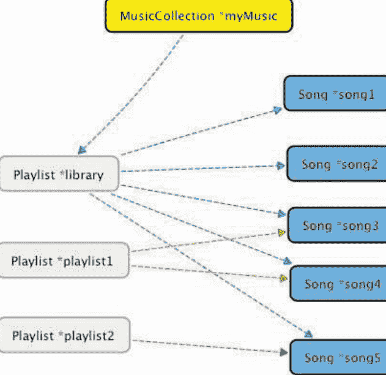

-10. 编写一个程序，接收一个 `NSNumber` 对象的数组（每个 `NSNumber` 代表一个整数），并生成一个频率表，列出每个整数及其在数组中出现的次数。使用 `NSCountedSet` 对象来构建你的频率计数。

- 11. 当使用 `addCard:` 方法将地址卡添加到地址簿时，谁拥有那张地址卡？卡片上的任何信息以后可以被更改并影响存储在地址簿中的卡片吗？你能想到一种更安全的方法来实现 `addCard:` 方法吗？

## 16. 处理文件

`Foundation` 框架允许你访问文件系统以对文件和目录执行基本操作。这是通过 `FileManager` ，其方法包括能够：

- 创建新文件
- 从现有文件读取
- 将数据写入文件
- 重命名文件
- 删除（删除）文件
- 测试文件是否存在
- 确定文件的大小以及其他属性
- 复制文件
- 测试两个文件的内容是否相等

这些中的许多操作也可以在目录上执行。例如，你可以创建一个目录，读取其内容，或删除它。另一个功能是链接文件的能力。即允许同一个文件以两个不同的名称存在，甚至可能在不同的目录中。

要打开文件并对文件执行多次读写操作，你使用 `FileHandle` 提供的方法。该类中的方法允许你：

- 打开文件进行读取、写入或更新（读写）
- 移动到文件内的指定位置
- 从文件或向文件写入指定数量的字节

`NSHandle` 提供的方法也可以应用于设备或套接字。然而，在本章中我们将只关注处理普通文件。

`NSURL` 类允许你在应用程序中使用 URL。我们将通过一个简单的示例来看这个类，示例展示了你可以如何从互联网读取数据。

`NSBundle` 类提供了许多方法，允许你处理应用程序的包（bundle）。这包括在包中搜索特定资源的能力，例如所有的 JPEG 图像。我们将在章节的末尾简要介绍这个类。

### 管理文件和目录：NSFileManager

`NSFileManager` 使用文件的路径名来唯一标识文件或目录。路径名是一个 `NSString` 对象，可以是相对路径也可以是完整路径。相对路径是相对于当前目录的路径。因此，文件名 `copy1.m` 意味着当前目录下的 `copy1.m` 文件。斜杠字符分隔路径中的目录列表。文件名 `ch16/copy1.m` 也是相对路径，标识存储在 `ch16` 目录中的 `copy1.m` 文件，该目录包含在当前目录下。

完整路径也称为绝对路径，以 `/` 开头。斜杠实际上是一个目录，称为根目录。在我的 Mac 上，家目录的完整路径是 `/Users/stevekochan`。这个路径名指定了三个目录：`/`（根目录）、`Users` 和 `stevekochan`。

特殊的波浪字符 `~` 用作用户家目录的缩写。因此，`~linda` 是用户 `linda` 家目录的缩写，其路径可能是 `/Users/linda`。单个波浪号表示当前用户的家目录，这意味着路径 `~/copy1.m` 将引用存储在当前用户目录中的文件 `copy1.m`。其他特殊的 UNIX 路径路径字符，例如表示当前目录的 `.` 和表示父目录的 `..`，在被任何 `Foundation` 文件处理方法使用之前，应该从路径名中删除。有很多路径工具可供你使用，它们将在本章稍后部分讨论。

你应该尽量避免在程序中硬编码路径名。正如你在本章中看到的，可以使用方法和函数允许你获取当前目录、用户家目录以及用于创建临时文件的目录的路径名。你应该尽可能避免使用这些。你将在本章稍后部分看到 `Foundation` 有一个函数可以获取特殊目录列表，例如用户的 `Documents` 目录。此函数对于开发 OS X 和 iOS 应用程序都有用。

表 16.1 汇总了一些处理文件的基本 `NSFileManager` 方法。在表中，`path`、`path1`、`path2`、`from` 和 `to` 都是 `NSString` 对象；`attr` 是 `NSDictionary` 对象；`err` 是指向 `NSError` 对象的指针，你可以提供它以获取有关特定错误的信息。如果你为 `err` 指定 `NULL`，则默认操作会在执行成功时返回 `YES`，失败时返回 `NO`。我们在本章中不会涉及使用这个对象。

# 表 16.1. 常用 NSFileManager 方法

| 方法 | 说明 |
| :--- | :--- |
| `-(NSData *) contentsPath: path` | 从文件读取数据 |
| `-(BOOL) createFileAtPath: path contents: (NSData *) data attributes: attr` | 将数据写入文件 |
| `-(BOOL) removeItemAtPath: path error: err` | 删除文件 |
| `-(BOOL) moveItemAtPath: fromPath: to error: err` | 重命名或移动文件（to 不能已存在） |
| `-(BOOL) copyItemAtPath: fromPath: to error: err` | 复制文件（to 不能已存在） |
| `-(BOOL) contentsEqualAtPath: path1and:Path: path2` | 比较两个文件的内容 |


| `-(BOOL) fileExistsAtPath: path` | 测试文件是否存在 |

| `-(BOOL) isReadableAtPath: path` | 测试文件是否存在且可读 |

| `-(BOOL) isWritableAtPath: path` | 测试文件是否存在且可写入 |

| `-(NSDictionary *) attributesOfItemPath: path error: err` | 获取属性 |

| `-(BOOL) setAttributesOfItemPath: attr error: err` | 修改文件属性 |

每个文件方法都是在一个通过向类发送 `defaultManager` 消息创建的 `FileManager` 对象上调用的，如下：

```
FileManager *fm;

...

fm = [FileManager defaultManager];
```

例如，要删除当前目录下的名为 `todolist` 的文件，你首先创建之前所示 `FileManager` 对象，然后调用 `removeItemAtPath:` 方法，如下：

```
[fm removeItemAtPath: @"todolist" error: NULL];
```

你可以测试返回的结果以确保文件删除成功：

```
if ([fm removeItemAtPath: @"todolist" error: NULL] == NO) {
```

```objc
NSLog(@"Couldn't remove file todolist");
return 1;
```

属性字典（attributes dictionary）允许你指定其他信息，例如你正在创建的文件的权限，或者获取或更改现有文件的信息。对于文件创建，如果你对此参数指定 `nil`，将为文件设置默认权限。`attributesOfItemAtPath:traverseLink:` 方法返回一个包含指定文件属性的字典。`traverseLink:` 参数对于符号链接设置为 YES 或 NO。如果文件是符号链接且指定为 YES，则返回所指向文件的属性；如果指定为 NO，则返回链接本身的属性。

对于已存在的文件，属性字典包含了诸如文件所有者、大小、创建日期等信息。字典中的每个属性都可以通过其键（key）进行提取，所有的键都定义在 `<Foundation/FileManager.h>` 中。例如，`NSFileSize` 是文件大小的键。

程序 16.1 显示了了一些文件的基本操作。此示例假设你的当前目录下有一个名为 `testfile` 的文件，其内容包含以下三行文本：

```
This is a test file with some data in it.
Here's another line of data.
And a third.
```

# 程序 16.1

```objc
// 基本文件操作
// 假设当前目录下存在一个名为 "testfile" 的文件
#import <Foundation/Foundation.h>

int main (int argc, const char * argv[]) {
    @autoreleasepool {
        NSString *fName = @"testfile";
        NSFileManager *fm = [NSFileManager defaultManager];
        NSDictionary *attr;

        // 需要创建一个文件器的实例
        fm = [NSFileManager defaultManager];

        // 确保我们的测试文件存在
        if ([fm fileExistsAtPath:fName] == NO) {
            NSLog(@"File doesn't exist!");
            return 1;
        }

        // 现在我们来做一个拷贝
        if ([fm copyItemAtPath:fName toPath:@"newfile" error:NULL] == NO) {
            NSLog(@"File Copy failed!");
            return 2;
        }

        // 现在我们来测试两个文件是否相等
        if ([fm contentsEqualToPath:fName andPath:@"newfile"] == NO) {
            NSLog("Files are Not Equal!");
            return 3;
        }

        // 现在我们重命名这个拷贝
        if ([fm moveItemAtPath: @"newfile" toPath: @"newfile2" error: NULL] == NO) {
            NSLog("File rename Failed!");
            return 4;
        }

        // 获取 newfile 的大小
        if ((attr = [fm attributesOfItemAtPath:@"newfile2" error: NULL]) == nil) {
            NSLog("Couldn't get file attributes!");
            return 5;
        }

        NSLog("File size is %llu bytes",
            [attr objectForKey: NSFileSize] unsignedLongLongValue());

        // 最后，我们删除原始文件
        if ([fm removeItemAtPath: fName error:NULL] == NO) {
            NSLog("file removal failed!");
            return 6;
        }

        NSLog("@All operations were successful");

        // 显示新创建文件的内容
        NSLog(@"%%@", [NSString stringWithContentsFile:@"newfile2" encoding:NSUTF8StringEncoding error:NULL]);
    }
    return 0;
}
```

# 程序 16.1 输出

File size is 84 bytes

All operations were successful!

This is a test file with some data in it.

Here's another line of data.

And a third.

程序首先测试文件是否存在。如果存在，它会创建一个副本，然后测试两个文件的等性。有经验的 UNIX 用户应该注意，你不能通过为 `copyItemAtPath:pathTo:error:` 和 `moveItemAtPath:pathTo:error:` 方法指定目标目录来将文件移动或拷贝到目录；该目录内的文件名必须显式指定。

### 注意

你可以通过 Xcode 选择 File 来创建 `testfile`。

`moveAtPath:toPath:` 方法可以将文件从一个目录移动到另一个目录（也可以用于移动目录）。如果两个路径引用同一目录中的文件（如我们的示例所示），效果仅仅是重命名文件。因此，在程序 16.1 中，你使用该方法将文件重命名为 `newfile2`。

如表 16.1 所示，执行拷贝、重命名或移动操作时，目标文件不能存在。如果存在，操作将失败。

`newfile2` 的大小是通过使用 `attributesOfAtPath:error:` 方法确定的。为了确保返回非空字典，然后使用 `NSDictionary` 方法 `objectForKey:` 通过键 `NSFileSize` 从字典获取文件大小。然后显示字典中的整数值。

程序使用 `removeAtPath:error:` 方法移除你的原始文件 `testfile`。

最后，使用 `NSString` 的 `stringWithContentsOf:encoding:` 方法将文件 `newfile2` 的内容读取到字符串对象，然后将其作为参数传递给 `NSLog` 显示。编码参数指定了文件中字符数据的表示方式。使用此参数的选择定义在头文件 `NSString` 中。`NSString.NSUTF8StringEncoding` 可用于指定包含普通 UTF-8 ASCII 字符的文件。

程序 16.1 测试了每个文件操作的成功情况。如果任何一个失败，将使用 `NSLog` 记录错误，并通过返回非零退出状态退出。按照惯例，每个非零值都表示程序失败，并根据错误类型是唯一的。如果你编写命令行工具，这是一个非常有用的技巧，因为另一个程序可以测试返回值（例如在 shell 脚本内部）。

# 使用 NSData 类

在处理文件时，你经常需要将数据读取到临时存储区域，通常称为缓冲区（buffer）。在收集数据以备输出到文件时，通常会使用一个存储区域。Foundation 的 `NSData` 类提供了一种简单的方法来设置缓冲区、将文件内容读取到缓冲区或将缓冲区内容写入文件。以防你好奇，对于 32 位应用程序，`NSData` 缓冲区可以存储高达 2GB 的。对于 64 位应用程序，它可以持有高达 8EB（艾字节）或 80 亿 GB 的数据！

正如你预期的，你可以定义可变的（NSMutableData）或不可变的（NSData）存储区域。我们将在本章及后续章节中介绍该类的方法。

程序 16.2 显示了你如何轻松地将文件内容读取到内存缓冲区中。

程序读取你的文件 `newfile2` 内容并写入新文件 `newfile3`。从某种意义上说，它实现了一个拷贝操作，尽管不如 `copyItemAtPath:pathTo:error:` 方法那么直接。

# 程序 16.2

```objc
// 拷贝文件
#import <Foundation/Foundation.h>

int main (int argc, char * argv[]) {
    @autoreleasepool {
        NSFileManager *fm;
        NSData *fileData;

        fm = [NSFileManager defaultManager];

        // 读取文件 newfile2
        fileData = [fm contentsAtPath:@"newfile2"];

        if (fileData == nil) {
            NSLog(@"File read failed!");
            return 1;
        }

        // 将数据写入 newfile3
        if ([fm createFileAtPath:@"newfile3" contents:fileData attributes:nil] == NO) {
            NSLog(@"Couldn't create the copy!");
            return 2;
        }

        NSLog(@"File copy was successful!");
    }
    return 0;
}
```

# 程序 16.2 输出

File copy was successful!

`contentsAtPath:` 方法接收一个路径并将指定文件的读取到它创建的存储区域中，返回该存储区域作为结果；如果读取失败（例如文件不存在或无法读取），则返回 `nil`。

`createFileAtPath:contents:attributes:` 方法创建一个指定属性的文件（如果属性参数提供 `nil` 则使用默认值）。然后将指定的 `NSData` 对象的内容写入文件。在我们的示例中，此数据区域包含了之前读取的内容。

# 处理目录

表 16.2 总结了 `NSFileManager` 提供的一些处理目录的方法。这些方法中的许多与表 16.1 中列出的普通文件方法相同。

# 表 16.2 常用 NSFileManager 目录方法

| Method | Description |

| --- | --- |

| - (NSString *) currentDirectoryPath | 获取当前目录 |

| - (BOOL) changeCurrentDirectoryPath:path | 更改当前目录 |

| - (BOOL) removeItemAtPath:fromPath:error:err | 拷贝目录结构（目标已存在） |

| - (BOOL) createDirectoryPath:-path withIntermediateDirectories:(BOOL) flag attributes:attr | 创建新目录 |

| - (BOOL) fileExistsAtPath:path isDirectory:(BOOL *) flag | 测试文件是否存在以及是否为目录（YES/NO 结果存储在 flag 中） |

| - (NSArray *) contentsOfDirectoryAtPath:error:err | 列出目录内容 |

| - (DirectoryEnumerator *) enumeratorAtPath:path: | 删除空目录 |

| - (BOOL) moveAtPath:fromPath:toPath: error:err | 重命名或移动目录（到之前存在的位置） |

程序 16.3 显示了目录的基本操作。

# 程序 16.3

```objc
// 一些基本的目录操作

#import <Foundation/Foundation.h>

int main (int argc, char * argv[]) {
    @autoreleasepool {
        NSString *dirName = @"testdir";
        NSString *path;
        NSFileManager *fm;

        // 需要创建一个文件管理器的实例

        fm = [NSFileManager defaultManager];
    }
}
```

```objc
// 获取当前目录

path = [fm currentDirectoryPath];
NSLog("Current directory path is %@", path);

// 创建新目录

if ([fm createDirectoryAtPath: dirName
withIntermediateDirectories: YES
attributes: error: NULL] == NO) {
    NSLog("Couldn't create directory!");
    return 1;
}

// 重命名新目录

if ([fm moveItemAtPath: dirName toPath:@newdir] error: NULL] == NO) {
    NSLog("Directory rename failed!");
    return 2;
}

// 进入新目录

if ([fm changeCurrentDirectoryPath:@newdir] == NO) {
    NSLog("Change directory failed!");
    return 3;
}

// 现在获取并显示当前工作目录路径

path = [fm currentDirectoryPath];
NSLog ("Current directory path is %@", path);

NSLog ("All operations were successful!");
}
return 0;
}
```

# 程序 16.3. 输出

Current directory path is

/Users/steveckchan/progs/ch16

Current directory path is

/Users/steveckchan/progs/ch16/newdir

All operations were successful!

程序 16.3 相对来说一目易懂。首先获取当前目录路径是为了提供信息。

### 注意

输出显示了我在使用 Terminal 运行程序时获得的当前目录。如果我在 Xcode 中运行此程序，我得到的当前目录是：

/Users/steve_kochan/Library/Developer/Xcode/DerivedData/prog2-cnoljycyenoopiddzwooyraybqlza/Build/Products/Debug。你的当前目录路径将与我的以及输出显示的不同。在 iOS 设备上，你的程序运行在所谓的“沙箱”中，对文件的访问受到限制。如果你在类设备上运行此程序，你会发现当前目录被列为 /.。这是运行在沙箱中的应用程序的根目录，而不是整个 iOS 设备文件系统的根目录。

接下来，在当前目录下创建了一个名为 testdir 的新目录。程序随后使用 moveItemAtPath:toPath: 方法将新目录从 testdir 重命名为 newdir。记住，该方法也可以用于将整个目录结构（这意味着包含其内容）从文件系统的一个位置移动到另一个位置。

重命名新目录后，程序使用 setCurrentDirectoryPath: 方法将该新目录设置为当前目录。然后显示当前目录路径以验证更改是否成功。

# 枚举目录内容


有时你需要获取目录内容的列表。这种枚举过程可以使用 `enumeratorAtPath:` 或 `contentsOfAtPath:error` 方法完成。在第一种情况下，指定目录中的每个文件都会逐一被枚举，如果其中某个文件是目录，其内容也会被递归地枚举。在此过程中，你可以通过向枚举对象发送 `skipDescendants` 消息来动态防止这种递归，这样其内容就不会被枚举。

在 `contentsOfAtPath:error:` 的中，会枚举指定目录的内容并以数组的形式返回文件列表。如果目录包含的任何文件本身是目录，该方法不会对该内容进行递归枚举。

程序 16.4 显示了你如何在程序中使用这两种方法之一。

### 程序 16.4

```objc
// 枚举目录内容
#import <Foundation/Foundation.h>

int main (int argc, char * argv[]) {
    @autoreleasepool {
        NSString *path;
        NSFileManager *fm;
        NSDirectoryEnumerator *dirEnum;
        NSArray *dirArray;

        // 需要创建一个文件管理器的实例
        fm = [NSFileManager defaultManager];

        // 获取当前工作目录路径
        path = [fm currentDirectoryPath];

        // 枚举目录
        dirEnum = [fm enumeratorAtPath:path];

        NSLog(@"Contents of %@", path);
    }
}
```

### 程序 16.4. 输出

Current directory path is

/Users/steveckchan/progs/ch16

Current directory path is

/Users/steveckchan/progs/ch16/newdir

All operations were successful!

### 处理路径：NSPathUtilities.h

`NSPathUtilities.h` 包含了函数和 `NSString` 的分类扩展，允许操作路径名称。你应该尽可能使用它们，使你的程序不受文件系统的结构以及特定文件和目录的位置。程序 16.5 显示了如何使用 `NSPathUtilities.h` 提供的几个函数和方法。

### 程序 16.5

```objc
// 一些基本的路径操作

#import <Foundation/Foundation.h>

int main (int argc, char * argv[]) {
    @autoreleasepool {
        NSString *fName = @"path.m";
        NSFileManager *fm;
        NSString *path, *tempdir, *extension, *homedir, *fullpath;

        NSArray *components;
        fm = [NSFileManager defaultManager];

        // 获取临时工作目录
        tempdir = NSTemporaryDirectory();

        NSLog(@"Temporary Directory is %@\n%@", tempdir, tempdir);

        // 从当前目录获取基目录
        path = [fm currentDirectoryPath];
        NSLog(@"Base dir is %@", [path lastPathComponent]);

        // 创建当前目录下文件 fName 的完整路径
        fullpath = [path stringByAppendingPathComponent:fName];
        NSLog(@"fullpath to %@ is %@", fName, fullpath);

        // Get the file name extension
        extension = [fullpath pathExtension];
        NSLog(@"extension for %@ is %@", fullpath, extension);

        // Get user's home directory
        homedir = NSHomeDirectory();
        NSLog(@"Your directory is %@", homedir);
    }
}
```

### 程序 16.5 输出

| 临时目录是 |  |
| :--- | :--- |
| /var/folders/HT/HTyGLVsNHTuNb6NrMuo7QE+++TI/ |  |
| 目录是 examples |  |
| path.m 的全路径是 | /Users/stevekochan/progs/examples/path.m |
| /Users/stevekochan/progs/examples/path.m 的扩展名为 | m |
| 你的主目录是 | /Users/stevekochan/Users/stevekochan |

#### 注意

在你的系统中，输出将与所示的不同。

函数 `NSTemporaryDirectory` 返回系统上可用于创建临时文件的目录路径。如果你在此目录中创建了临时文件，请务必在完成后将其删除。此外，确保你的文件名是唯一的，特别是当你的应用程序可能有多个实例同时运行时。`参见本章末尾的练习 5.` 如果登录到你系统的多个用户正在运行同一个应用程序，这种情况很容易发生。请注意，临时文件仅仅是临时文件。如果你在使用后没有删除它们，系统会在某个时间自动为你删掉它们。然而，你不应该依赖这一点，而应该自己进行删除。

`lastPathComponent` 方法提取路径中的最后一个文件。当你有一个绝对路径并只想从中获取基本文件名时，这个方法非常有用。

`stringByAppendingPathComponent` 方法用于将文件名标记在路径末尾。如果作为接收者的指定路径不以斜杠结尾，该方法会在路径中插入一个斜杠，以与添加的文件隔离开。通过结合 `currentDirectoryPath` 方法与 `stringByAppendingComponent:` 方法，你可以创建一个指向当前目录下文件的完整路径。该技术在程序 16.5 中所示。

`pathExtension` 方法提供提供路径的文件扩展名。在示例中，`path.m` 文件的扩展名为 `m`，这是该方法返回的结果。如果文件没有扩展名，该方法仅返回一个空字符串。

`NSHomeDirectory` 函数返回当前用户的主目录。你可以通过使用 `NSHomeDirectoryForUser` 函数来获取任何特定用户的主目录，并将用户名作为函数的参数传递。

`pathComponents` 方法返回一个包含指定路径每个组件的数组。程序 16.5 顺序遍历返回数组的每个元素，并在输出的单独行中显示每个组件。

### 处理路径的常用方法

表 16.3 总结了许多用于处理路径的常用方法。在该表中：

#### 表 16.3. 常用路径工具方法

| 方法 | 说明 |
| :--- | :--- |
| - (NSString *) pathWithComponents:components | 从组件中的元素构建有效路径 |
| - (NSArray *) pathComponents | 将路径拆解为它的组成组件 |
| - (NSString *) lastPathComponent | 提取路径中的最后一个组件 |
| - (NSString *) pathExtension | 从路径的最后一个组件中提取扩展名 |
| - (NSString *) stringByAppendingPathComponent:path | 在现有路径末尾添加路径 |
| - (NSString *) stringByAppendingPathExtension:ext | 在路径的最后一个组件上添加指定的扩展名 |
| - (NSString *) stringByDeletingLastPathComponent | 删除最后一个路径组件 |
| - (NSString *) stringByDeletingPathExtension | 删除最后一个路径组件的扩展名 |
| - (NSString *) stringByExpandingTildeInPath | 将路径中的任何波浪号 (~)扩展为用户的主目录或指定用户的主目录 |
| (NSString *) stringByResolvingSymlinksInPath | 尝试解析路径中的符号链接 |
| (NSString *) stringByStandardizingPath | 通过尝试解析...（父目录）和符号链接来标准化路径 |

表 16.4 展示了用于获取用户信息、其主目录以及存储临时文件的目录的函数。

#### 16.4. 常用路径工具函数

| NSString *Username(void) | 返回当前用户的登录名 |
| :--- | :--- |
| NSString *NSFullUsername(void) | 返回当前用户的全名 |
| NSString *NSHomeDirectory(void) | 返回当前用户主目录的路径 |
| NSString *NSHomeDirectoryForUser(NSString *) | 返回用户的主目录 |
| NSString *NSTemporaryDirectory(void) | 返回可用于创建临时文件的目录路径 |

你可能还想查看 Foundation 函数 `NSSearchPathDirectoriesInDomains`，你可以用它定位系统或设备上的特殊目录，例如应用程序（Application）和文档（Documents）目录。例如，下面定义了一个名为 `saveFilePath` 的方法，它返回 Documents 目录中名为 `saveFile` 的文件的路径。如果你想将应用程序中的某些数据保存到文件中，可以使用像这样的方法。

```objc
- (NSString *) saveFilePath
{
    NSArray *dirList = NSSearchPathForDirectoriesInDomains(NSDocumentDirectory, NSUserDomainMask, YES);
    NSString *docDir = [dirList objectAtIndex:0];

    return [docDir stringPathComponent:@"saveFile"];
}
```

#### 注意

编写 iOS 应用程序时，`NSSearchPathInDomains` 函数的第二个参数应该是 `NSUserDomainMask`，你应该预期返回一个包含单个路径的数组。

### 复制文件和使用 NSProcessInfo 类

程序 16.6 演示了一个实现简单复制操作的命令行工具。该命令用法如下：

```
copy from-file to-file
```

与 `FileManager` 的 `copyPath:toPath:handler:` 不同，你的命令行工具允许 `to-file` 作为一个目录名称。在这种情况下，文件将被复制到 `to-file` 目录下并命名 `from-file`。与该方法不同，如果 `to-file` 已存在，你允许覆盖其内容。这更符合标准的 UNIX 复制命令 `cp`。

你可以通过使用 main 函数的 `argc` 和 `argv` 参数从命令行获取文件名。这两个参数分别由命令行上参数的数量（包括命令名）和一个指向 C 风格字符串数组的指针填充。

与其处理 C 字符串（当你处理 `argv` 时必须这样做），不如使用一个名为 `NSProcessInfo` 的 Foundation 类。`NSProcessInfo` 包含了允许你设置和检索有关正在运行的应用程序（即你的进程）的各种类型的方法。这些方法在表 16.6 中总结。

#### 表 16.5. 常用目录

| 目录 | 用途 |
| :--- | :--- |
| Documents (NSDocumentDirectory) | 应用程序特定数据的目录。在 iOS 上写入的文件可以从 iTunes 共享和访问。存储在这里的文件会自动备份。 |
| Library/Caches (NSCacheDirectory) | 写入在启动之间间持久化的应用程序支持文件的目录。在此创建的文件不会持久化。 |
| tmp (NSTemporaryDirectory()) | 写入可以在终止后删除的临时文件的目录。不再需要时，你应该从此目录删除文件。 |
| Library/Preferences | 此目录包含应用程序特定的偏好文件。使用 `NSDefaultClasses` 创建、读取和修改偏好文件。 |

#### 表 16.6. NSProcessInfo 方法

| 方法 | 说明 |
| :--- | :--- |
| +(NSProcessInfo *) processInfo | 返回关于当前进程的信息。 |
| - (NSArray *) arguments | 以 NSString 对象数组的形式返回传递当前进程的参数。 |
| - (NSDictionary *) environment | 返回一个包含变量/值对的字典，表示当前的环境变量（如 PATH 和 HOME）及其值。 |
| - (int) processIdentifier | 返回进程标识符，这是操作系统分配的唯一数字，用于标识每个运行的进程。 |
| - (NSString *) processName | 返回当前执行进程的名称。 |
| - (NSString *) globallyUniqueString | 每次调用时都返回一个不同的字符串。这可以用于生成唯一的临时文件名（见练习 5）。 |
| - (NSString *) hostName | 返回主机系统的系统的名称（在我的 Mac OS X 上返回 Steve-Kochans.Computer.local）。 |
| - (NSInteger) operatingSystem | 返回一个表示操作系统的数字（在我的 Mac 上返回值 5）。 |
| - (NSString *) operatingSystemName | 返回操作系统的名称（在我的 Mac 上返回常量 NSMACHOperatingSystem，可能的返回值定义在 NSProcessInfo.h 中）。 |
| - (NSString *) operatingSystemVersionString | 返回操作系统的当前版本（在我的 Mac OS 系统上返回 Version 10.6.7 (Build 10J869））。 |
| - (void) setProcessName:(NSString *) name | 将当前进程的名称设置为 name。应该谨慎使用，因为程序对你的进程名称做了某些假设（例如，通过用户的默认设置）。 |

### 程序 16.6

```objc
// 实现一个基础拷贝工具
#import <Foundation/Foundation.h>

int main (int argc, char * argv[])
{
    autoreleasepool {
        NSFileManager *fm;
        NSString *source, *dest;
        BOOL isDir;
        NSProcessInfo *proc = [NSProcessInfo processInfo]; 
        NSArray *args = [proc arguments];
        fm = [NSFileManager defaultManager];

        // 检查命令行上的两个参数
        if ([args count] != 3) {
            NSLog ("Usage: %@ src dest", [proc processName]);
            return 1;
        }
        source = [args objectAtIndex: 1];
        dest = [args objectAtIndex: 2];

        // 确保源文件可以读取
        if ([fm isReadableAtPath: source] == NO) {
            NSLog ("Can't read %@", source);
            return 2;
        }

        // 检查目标文件是否为目录
        // 如果是，则将源文件添加到目标的末尾
        [fm fileExistsAtPath: dest isDirectory:&isDir];
        if (isDir == YES)
            dest = [dest stringByAppendingPathComponent: [source lastPathComponent]];

        // 如果目标文件已存在，将其删除
        [fm removeItemAtPath: dest error: NULL];

        // 好，该执行拷贝了
        if ([fm copyItemPath: source toPath: dest error: NULL]) {
            NSLog("Copy failed!");
            return 3;
        }

        NSLog("Copy of %@ to %@ succeeded!", source, dest);
        return 0;
    }
}
```

### 程序 16.6 输出


```bash
$ see what files we have
total 96
-rwxr-xr-x 1 steovec staff 19956 Jul 24 14:33
copy
-rw-r--r-- 1 steovec staff 1484 Jul 24 14:32
copy.m
-rw-r--r-- 1 steovec staff 1403 Jul 24 14:00
file.m
drwxr-xr-x 2 stevekoc staff 68 Jul 24 14:40
newdir
-rw-r----1 stevekoc staff 1567 Jul 24 14:12
path1.m
-rw-r----1 stevekoc staff 84 Jul 24 13:22
testfile
$ copy try with no args
Usage: copy src dest
$ copy foo copy2
Can't read foo
$ copy.m backup.m
Copy of copy.m to backup.m succeeded!
$ diff copy.m backup.m compare the files
$ copy copy.m newdir try copy into directory
Copy of copy.m to newdir/copy.m succeeded!
$ ls -l newdir
total 8
-rw-r-r- 1 stevekoc staff 1484 Jul 24 14:44
copy.m
$
```

注意

所显示的输出将根据你运行此程序时在当前目录中存储的文件而有所不同。

`ProcessInfo` 的 `arguments` 方法返回一个字符串对象数组。数组的第一个元素是进程名称，其余元素包含在命令行上输入的参数。

你首先检查命令行上是否输入了两个参数。这是通过测试 `arguments` 方法返回的数组 `args` 的大小来实现的。如果测试成功，程序将从数组中提取源文件名和目标文件名。接下来，你检查源文件是否可以读取。这是通过使用 `isReadableAtPath:` 完成的。

# 基本操作：NSFileHandle

`NSFileHandle` 提供的方法允许你更紧密地处理文件。在本章开始，我们列出了使用这些方法可以做的一些事情。通常处理文件时遵循以下三个步骤：

1. 打开文件并获取引用该文件的 `NSFileHandle` 对象。
2. 对打开的文件进行 I/O 操作。
3. 关闭文件。

## 表 16.7 常用 NSFileHandle 方法

| 方法 | 说明 |
| :--- | :--- |
| `+(NSFileHandle *) fileHandleForReadingAtPath: path` | 打开文件读取 |
| `+(NSFileHandle *) fileHandleForWritingAtPath: path` | 打开文件写入 |
| `+(NSFileHandle *) fileHandleForUpdatingAtPath: path` | 打开文件更新（读写） |
| `-(NSData *) availableData` | 返回设备或通道的可用数据 |
| `-(NSData *) readToEndFile` | 读取到文件末尾的 `UINT_MAX` 字节 |
| `-(NSData *) readDataOfLength: bytes` | 从文件中读取指定数量的字节 |
| `-(void) writeData: data` | 将数据写入文件 |
| `-(unsigned long long) offsetInFile` | 返回当前文件偏移 |
| `-(void) seekToFileOffset: offset` | 设置当前文件偏移 |
| `-(unsigned long long) seekToEndFile` | 将当前文件偏移置于文件末尾 |
| `-(void) truncateToFileOffset: offset` | 将文件大小设置为 `offset` 字节（如果需要） |
| `-(void) closeFile` | 关闭文件 |

你应该注意，`NSFileHandle` 类并不提供创建文件的功能。这必须通过 `NSFileManager` 方法完成，正如我们已经描述的那样。因此，`fileHandleForWritingAtPath:` 和 `fileHandleForUpdatingAtPath:` 都假设文件存在，如果不存在则返回 `nil`。在在这两种情况下，文件偏移量被设置为文件的开头，因此写入（或更新模式）从文件开始开始。未展示的还有在后台（即异步）读取和写入数据的方法。

在 UNIX 中，你应该注意打开文件进行写入并不会截断文件。如果这是你的意图，你必须手动完成。

[程序 16.7](https://objc.apple.com/library/documentation/archive/Objective-C-Programming-Guide/beginning/reading-a-file.html#program-1677) 打开了在本章开头创建的原始 `testfile` 文件，读取其内容并将其复制到名为 `testout` 的文件中。

# 程序 16.7

```
// 一基础文件句柄操作
// 假设当前工作目录下存在一个名为 "testfile" 的文件

#import <Foundation/Foundation.h>

int main (int argc, char * argv[]) {
    @autoreleasepool {
        NSFileHandle *inFile, *outFile;
        NSData *buffer;

        // 打开 testfile 进行读取
        inFile = [NSFileHandle fileHandleForReadingAtPath:@"testfile"];

        if (inFile == nil) {
            NSLog (@@"Open of testfile for reading failed");
            return 1;
        }

        // 如果必要，先创建输出文件
```

```
 [NSFileManager defaultManager
createFileAtPath: @"testout"
contents: nil attributes: nil];
```

```
// 现在打开 outfile 进行写入
outFile = [NSFileHandle
fileHandleForWritingAtPath: @"testout"];
```

```
if (outFile == nil) {
NSLog (@"Open of testout for writing
failed");
return 2;
}
```

```
// 截断输出文件，因为它可能包含数据
```

```
[outFile truncateFileAtOffset: 0];
```

```
// 从 inFile 读取数据并写入 toFile
```

```
buffer = [inFile readDataToEndFile];
[outFile writeData: buffer];
```

```
// 关闭两个文件
[inFile closeFile];
[outFile closeFile];
```

```
// 验证文件内容
```

```
NSLog(@"%@", [NSString
```

```
stringWithContentsFile: @"testout" encoding:
NSUTF8StringEncoding error:
NULL]);
}
  return 0;
}
```

# 程序 16.7 输出

这是一个包含一些数据的测试文件。

这是另一行数据。

这是第三行。

`readDataToEndFile:` 方法每次读取最多 `UINT_MAX` 字节的数据，该值定义在 `<limits.h>` 中并等于 `0xFFFFFFFF`：这对于你将编写的任何应用程序都足够大。你也可以将该操作拆分以执行较小的读写。你甚至可以设置一个循环，使用 `readDataLength:` 方法每次在文件之间传输字节缓冲区。例如，你的缓冲区大小可能是 8192 `8kb` 或 131072 `128kb` 字节。通常使用 2 的幂，是因为底层操作系统通常以这种大小的块来执行 I/O 操作。你可能想在你的系统上尝试不同的值，看看效果最好。

如果读取到达文件末而没有读取到数据，它将返回一个空的 `NSData` 对象（即一个没有任何字节的缓冲区）。你可以对缓冲区应用 `length` 方法并测试是否等于零，以检查文件中是否有剩余数据待读取。

如果你打开文件进行更新，文件偏移量将设置为文件开头。你可以通过在文件中寻址（seek）来更改偏移量，然后在文件上执行读取或写入操作。因此，要将在句柄为 `databaseHandle` 的文件中寻道第 10 个字节，你可以写下以下消息表达式：

```
[databaseHandle seekToFileOffset: 10];
```

相对文件定位是通过获取当前文件偏移量然后对其进行加或减来实现的。因此，要跳到文件中下一个 128 字节，请写道：

```
[databaseHandle seekToFileOffset: [databaseHandle offsetInFile] + 128];
```

要向文件中回回等于五个整数的距离，写道：

```
[databaseHandle seekToFileOffset: [databaseHandle offsetInFile] - 5 * sizeof(int)];
```

程序 16.8 将一个文件的内容追加到另一个文件中。它通过打开第二个文件进行写入、寻道到文件末尾并将第一个文件的内容写入第二个文件来实现这一点。

# 程序 16.8

```
// 将 "fileA" 文件追加到 "fileB" 的末尾

#import <Foundation/Foundation.h>

int main (int argc, char * argv[]) {
    @autoreleasepool {
        NSFileHandle *inFile, *outFile;
        NSData *buffer;

        // 打开 fileA 进行读取
        inFile = [NSFileHandle
fileHandleForReadingAtPath: @"fileA"];

        if (inFile == nil) {
            NSLog (@"Open of fileA for reading
failed);\n
            return 1;
        }

        // 打开 fileB 进行更新
        outFile = [NSFileHandle
fileHandleForWritingAtPath: @"fileB"];

        if (outFile == nil) {
            NSLog (@"Open of fileB for writing
failed);\n
            return 2;
        }

        // 寻道到 outFile 的末尾
        [outFile seekToEndOfFile];

        // 读取 inFile 并将其内容写入 outFile
        buffer = [inFile readDataToEndFile];
        [outFile writeData: buffer];

        // 关闭两个文件
        [inFile closeFile];
        [outFile closeFile];

        // 验证其内容

        NSLog("%@", [NSString
stringWithContentsOfFile: @"fileB"
    encoding:NSUTF8StringEncoding error:
]);
        return 0;
    }
}
```

运行 [程序 16.8] 之前 fileA 的内容

```
这是第一个文件的第 1 行。
这是第一个文件的第 2 行。
```

运行 [程序 16.8] 之前 fileB 的内容

```
这是第二个文件的第 1 行。
这是第二个文件的第 2 行。
```

# 程序 16.8 输出

```
fileB 的内容
这是第二个文件的第 1 行。
这是第二个文件的第 2 行。
这是第一个文件的第 1 行。
这是第一个文件的第 2 行。
```

你可以看到第一个文件的内容是如何追加到第二个文件中的。你可能想在你的系统上尝试不同的值，看看效果最好。

# NSURL 类

`NSURL` 类提供了一种简单的方法来处理地址。例如，给定一个字符串，你可以使用 `URLWithString:` 创建。如果你有一个存储在网络地址的字典，可以使用 `dictionaryWithContentsURL:` 方法读取它。或者如果是一个数组，请使用 `arrayWithURL:` 方法。你可能还会通过 `dataWithURL:` 方法读取网络地址的任何类型的数据。

# 程序 16.9

```
// 读取文件的内容
#import <Foundation/Foundation.h>

int main (int argc, char * argv[]) {
    @autoreleasepool {
        NSURL *myURL = [NSURL URLWithString:@"testout"];

        NSString *myHomePage = [NSString stringWithContentsOfURL:myURL encoding:NSUTF8StringEncoding error:NULL];

        NSLog("%%@", myHomePage);
    }
}
```

# 程序 16.9 输出

```
<!DOCTYPE html PUBLIC "-W3C//DTD HTML1.0 Transitional//EN"
"http://www.w3.org/TR/html1/transitional.dtd">
<html xmlns="http://www.w3.org/1999/xhtml">
<head>
<meta http-equiv="Content-Type" content="text/html; charset=utf-8">
<meta http-equiv="Style-Type" content="text/css" />
<meta name="google-site-verification" content=""/>
<title>iPhone 在线课程与 iPhone 编程</title>
```

inDirectory: @"birdImages";

该方法返回一个路径名称数组。如果你的 JPEG 文件没有存储在应用程序的子目录下，你可以将 `""` 设置为 `inDirectory` 参数的值。

`NSBundle` 类中还有更多你想要学习的方法。请查看你的文档以获取详情。

# 练习题

- 1. 修改在程序 16.6 中开发的复制程序，使其能够接受多个源文件并复制到目录中，类似于标准的 UNIX `cp` 命令。这样，命令：

```
$ copy1.m file1.m file2.m progs
```

应该将 `copy1.m`、`file1.m` 和 `file2.m` 这三个文件复制到 `progs` 目录。请确保当指定了多个源文件时，最后一个参数实际上是一个存在的目录。

- 2. 编写一个名为 `find` 的命令行工具，它接受两个参数。第一个是开始搜索的起始目录，第二个是要查找的文件名。这样，命令：

```
$ myfind /Users proposal.doc
/Users/stevekochan/MyDocuments/proposals/proposals/al.doc
$
```

将从 `/Users` 开始搜索文件系统以定位 `proposal.doc` 文件。如果找到，则打印文件的完整路径（如所示）；如果没有找到，则打印适当的消息。

- 3. 编写你自己的版本的标准 UNIX 工具 `basename` 和 `dirname`。

- 4. 使用 `NSProcessInfo` 编写一个程序，显示其每个 getter 方法返回的所有信息。

- 5. 给本章描述的 `NSPathUtilities.h` 函数 `NSTemporaryDirectory` 和 `NSProcessInfo` 方法 `globallyString`，为 `NSString` 添加一个名为 `TempFiles` 的分类，并在其中定义一个名为 `temporaryFileName` 的方法，该方法每次被调用时返回一个不同的唯一文件名。

- 6. 修改程序 16.7，使文件每次读写 `kBufSize` 字节，其中 `kBufSize` 定义在程序的程序开头。请确保在大文件上测试该程序（即大于 `kBufSize` 字节的文件）。

- 7. 打开一个文件，每次读取 128 字节内容，并将其写入终端。使用 `NSFileHandle` 的 `fileHandleWithStandardOutput` 方法获取终端输出的句柄。

- 8. 一个字典以属性列表的形式存储在此 URL：http://bit.ly/aycNwd。编写一个程序读取该字典的内容并显示其内容。该字典包含什么数据？

# 17. 内存管理与自动引用计数

回想 `NSMutableArray` 类，它允许你创建一个可以添加对象和移除对象的数组。假设在你的程序执行开始时，你需要将一个文件的内容读取到数组中。假设你可以调用 `new array myData`，并且你想从一个以属性列表形式存储的文件（在第 19 章“归档”中有更详细的介绍）初始化它的内容。你可以使用 `NSArrayWithContentsOfFile:` 方法来实现，方法如下：

```
NSArray *myData = [NSArray arrayWithContentsOfFile:"database"];
```


这会读取并解析文件，将元素存储在新创建的数组中，并将数组的引用返回。该引用随后存储在变量 `myData` 中。

假设在处理 `myData` 中的数据时，你想从另一个文件读取数据并以类似的方式处理其内容；你只需执行以下语句：

```
myData = [NSArray arrayWithContentsOfFile:"database"];
```

变量 `myData` 发生了变化，它现在引用一个内容从第二个文件设置的另一个数组。但第一个数组发生了什么呢？你不再拥有对它的引用了（当你覆盖 `myData` 时就丢失了该引用）。那么第一个数组中的所有元素呢？它们发生了什么？假设你必须重复这个从不同文件读取数据的过程数百次甚至几千次。当所有这些数组对象及其元素都不再被引用，因此不再被应用程序需要时，会发生什么？尽管你不再使用它们，但这些对象可能仍然停留在内存的某个地方。嗯，如果没有某种“清理”过程，内存将继续被未被引用的对象填充，这可能会将你的应用程序推向崩溃点，即它字面上已经没有可用内存来执行更多工作。

本章涵盖了内存管理的概念，尽管只是在相当高的水平上。内存管理完全关于清理（回收）未使用的内存，以便可以再次被使用。如果一个对象不再被使用，让我们重用它的内存。这听起来足够简单。然而，事实并没有那么简单。必须有人来发现这个简单的事实。也就是说，必须有人——而这个人可能是你、计算机，或者两者都是——能够确定一个对象何时不再被使用，并且它所占用的内存可以被回收。

已经开发了几种不同的内存管理策略来协助这些工作。其中两种是自动方法；也就是说，计算机跟踪对象并在必要释放它们的内存。第三种方法是混合方法；系统为你完成部分工作，但也要求你（程序员）必须勤奋，并告知系统何时一个对象不再被使用。

在 Xcode 4.2 发布之前，内存管理一直是一个令人困扰的话题，它需要程序员在这方面有大量的理解和远见。程序员必须仔细处理引用计数（reference counts）、保留（retains）、释放（releases）和自动释放（autoreleases）的世界，以产生审慎使用内存的应用程序，避免在最不恰宜的时间崩溃——这通常是由于尝试引用一个在时间真正过去之前就意外销毁的对象导致的。

随着 Xcode 4.2 发布了名为自动引用计数（Automatic Reference Counting，简称 ARC）的功能，程序员不再需要考虑内存管理问题了——一切都已处理好了！你有几个需要学习的特殊情况（我们将礼貌地让你参阅 Apple 的文档获取这些详情）。但总的来说，ARC 直直是 iOS 开发者的福音。这方面的证明是，直到本章之前，我真的没有提到过内存管理。在本书的上一个版本中，整个书中花费了巨大的精力，确保读者充分理解并审慎地应用适当的内存管理技术。

在本章中，你将概述 Cocoa 和 iOS 开发者存在的不同内存管理方案。我们还将简要描述手动内存管理是如何运作的。这是以防你必须支持旧代码，或者出于某些原因决定不利用目前提供的自动内存管理功能。

尽管你不再需要担心对象的生命周期（以及在完成后释放它们），但根据你编写的应用程序类型，审慎使用内存仍然很重要。例如，如果你正在编写一个在执行期间创建许多对象的交互式应用程序，你必须确保你的程序不会继续消耗内存。在某些情况下，智能地管理这些资源并确保不进行不分配是你的责任。

# 自动垃圾回收

从 Objective C 2.0 开始，一种名为垃圾回收的内存管理形式可用。通过垃圾回收，系统会自动确定哪些对象拥有其他对象，并在需要空间时自动释放不再被引用的对象（进行垃圾回收）。

iOS 运行时环境不支持垃圾回收，因此当你为该平台开发程序时，没有使用它的选项。也就是说，你只能在开发 Mac OS X 应用程序时使用。

如果你决定使用垃圾回收，必须在用 Xcode 构建程序时开启它。你可以通过项目的 Build Settings（构建设置）菜单来实现。在 Apple LLVM compiler 3.0 Language 节点下，有一个名为 `Objective-C Garbage Collection` 的设置。将其从默认值 `Unsupported` 更改为 `Required`，表示你的程序在构建时将启用自动垃圾回收（见图 17.1）。

## 图 17.1. 启用垃圾回收

垃圾回收发生在你的程序运行期间，当系统确定已达到某个低水位线并需要进行清理时。执行这一操作是一个相当计算密集型的过程；系统必须追踪你所有的对象和引用，并确定哪些对象当前正在被使用（即被引用），而哪些对象没有被使用。这可能会导致你的应用程序出现明显的停顿，因为正如前面提到的，垃圾回收是非常计算密集型的操作。正因如此，你可能不想使用此项功能。

# 手动引用计数

如果你打算在不使用 ARC（自动引用计数）或垃圾回收的情况下创建应用程序，或者你必须支持无法迁移到 ARC 运行的代码，那么你就需要了解如何管理内存。也就是说，你需要学习如何处理引用计数。

通用的概念如下：当一个对象被创建时，它的初始引用计数被设置为 1。每当你需要确保该对象被保留时，你实际上是通过将其引用计数加 1 来有效地创建对该对象的引用。这是通过向对象发送 `retain` 消息来实现的，例如：

```
[myFraction retain];
```

当你不再需要某个对象时，通过向它发送 `release` 消息将其引用计数减 1，如下所示：

```
[myFraction release];
```

当一个对象的引用计数达到 0 时，系统就知道该对象在应用程序的任何地方都不再被引用（因为理论上，它会释放（dealloc）它的内存）。这一过程是通过向对象发送 `dealloc` 消息启动的。在许多情况下，你会使用继承自 `NSObject` 的 `dealloc` 方法。然而，你可能需要重写 `dealloc` 以释放你的对象可能分配或保留的任何实例变量或其他对象。例如，如果你的类将 `NSArray` 作为其实例变量之一，并且你对该数组执行了 `alloc` 操作，那么当你的对象被销毁时，你就有责任释放该数组。你会在 `dealloc` 中完成这一操作。

手动引用计数策略的成功运行需要你作为程序员的勤奋，以确保引用计数在程序执行期间得到恰当的增加和减小。系统会为你处理其中一部分（但不是全部）工作。

在使用手动引用计数时，你应该注意 Foundation 框架中的某些方法可能会增加对象的引用计数，例如当使用 `NSMutableArray` 的 `addObject:` 方法将对象添加到数组时，或者使用 `UIView` 的 `addSubview:` 方法将视图作为子视图添加时。同样，某些方法可能会减少对象的引用计数。`removeObjectAtIndex:` 和 `removeFromSuperview` 就是此类两个方法。

在对象被销毁后（即其引用计数已减至 0 并调用了 `dealloc`），对该对象的进一步引用将变为无效。如果你有这样的引用，它通常被称为悬挂指针引用（dangling pointer reference）。向该悬挂指针发送消息通常会导致意外行为，包括你的应用程序崩溃。有时，程序员会向一个已经释放的对象发送 `release` 消息，因为他们没有准确地跟踪对象的 `retain` 和 `release` 操作。这被称为过度释放（over-releasing）一个对象，它通常会导致崩溃。

## 对象引用与自动释放池

你可能需要编写一个方法，该方法先创建一个对象（例如使用 `alloc`），然后将该对象作为方法调用的结果返回。这里就是你的困境：尽管方法使用了该对象，但它不能释放它，因为它需要返回它的值。`NSAutoreleasePool` 类的创建是为了帮助解决此类问题，通过跟踪稍后在对象空（drain）时释放的对象，而释放是通过向自动释放池对象发送 `drain` 消息来实现的。

为了将对象添加到自动释放池维护的对象列表中，你向该对象发送 `autorelease` 消息，例如：

```
[result autorelease];
```

在处理使用 Foundation、UIKit 或 AppKit 框架类的程序时，你必须创建一个自动释放池，因为来自这些框架的类可以创建并返回自动释放的对象。你在应用程序中使用类似这样的语句来这样做：

```
NSAutoreleasePool * pool = [[NSAutoreleasePool alloc] init];
```

如果你在没有启用 ARC 的情况下创建一个新项目，Xcode 会在 `main` 函数开头生成一个带有此语句的模板。

如所述，在设置好池之后，框架方法会自动将新对象（如数组、字符串、字典、视图、按钮和其他对象）添加到自动释放池维护的列表中。

当你使用池时，你向它发送 `drain` 消息：

```
[pool drain];
```

此操作的作用是向每个接收过 `autorelease` 消息并因此添加到池中的对象发送 `release` 消息。正如你所知 true，如果其中任何对象的引用计数最终减至 0，那么这些对象将接收到 `dealloc` 消息并释放其内存。

请注意，自动释放池并不包含对象本身，只包含在池空时要释放的对象引用。

并不是所有新创建的对象都会添加到自动释放池中。事实上，任何由名称以 `alloc`、`copy`、`mutableCopy` 或 `new` 开头的方法创建的对象都不会被自动释放。在这种情况下，我们认为你拥有了该对象。当你拥有一个对象时，你就负责在操作它时释放该对象所占用的内存。这是通过向对象发送 `release` 消息来实现的。你也可以通过向它发送 `autorelease` 消息将其手动添加到自动释放池。

如果我们使用手动引用计数，来自 3.3 节的主例程序看起来会是这样：

```
int main (int argc, char * argv[]) {
    NSAutoreleasePool *pool = [[NSAutoreleasePool alloc] init];
    Fraction *frac1 = [[Fraction alloc] init];
    Fraction *frac2 = [[Fraction alloc] init];

    // 设置第一个分数为 2/3
    [frac1 setNumerator: 2];
    [frac1 setDenominator: 3];

    // 设置第二个分数为 3/7
    [frac2 setNumerator: 3];
    [frac2 setDenominator: 7];

    // 显示分数
    NSLog("First fraction is:%n",
    [frac1 print]);

    NSLog("Second fraction is:%n",
    [frac2 print]);

    [frac1 release];
    [frac2 release];
    [pool drain];

    return 0;
}
```

注意在 `main` 函数结束处释放了两个 `alloc` 的分数对象。尽管你的内存最终会在应用程序终止时被释放，但示例说明了在使用你拥有的对象时释放它们的思想。

示例还展示了在 `main` 开始时创建自动释放池，并在 `main` 结束返回之前对其清空。

让我们再次查看程序 7.5 中 `Fraction` 类的 `add:` 方法：

```
- (Fraction *) add: (Fraction *) f {
  // 两个分数相加：
  // a/b + c/d = ((a*d) + (b*c)) / (b * d)
  // result 将存储加法的结果

  Fraction *result = [[Fraction alloc] init];

  result.numerator = numerator * f.denominator
+ denominator *
  f.numerator;
  result.denominator = denominator *
  f.denominator;

  [result reduce];
  return result;
}
```

在使用手动内存管理时，该方法提出了一个问题。结果对象在计算完成后被 `alloc` 并从方法返回。由于方法必须返回该对象，因此它不能释放它——这会导致对象在此时被销毁。解决此问题的可能方法是对对象进行自动释放，以便返回其值，并将将其释放延迟到自动释放池清空时。你可以利用 `autorelease` 方法返回接收者的特性，将其嵌入如下表达式中：

```
#import <UIKit/UIKit.h>

@interface myView : UIView
@property (nonatomic, retain) NSMutableArray
*data;
@end
```

`data` 属性的 `retain` 属性（仅识别非 ARC 编译代码）表示，setter 方法应该保留赋值给该属性的任何对象，并先释放旧值。假设我们在实现部分为该 `data` 属性生成了访问器方法。进一步假设我们名为 `viewDidLoad` 的方法，每当我们的视图加载到内存时，系统就会调用该方法。（你在学习 iOS 应用程序编程时会学这些。目前，这些细节并不重要。）

假设在 `viewDidLoad` 方法内部，你想分配你的数据数组。你在该方法内部插入了以下行代码：

```
data = [NSMutableArray array];
```

正如我们所描述的 Foundation 方法默认会创建自动释放对象，该数组方法会创建一个自动释放的数组，你将其直接赋值给实例变量 `data`。问题是，该数组一旦当前事件处理完成就会被销毁。因为它是在一个自动释放池中创建的，而池会在事件循环结束时被清空。为了确保数组在跨事件循环中存活，你有几种替代方案。以下是三行可以替代的、有效的不同代码：

```
data = [[NSMutableArray array] retain]; // 在池被清空后依然存活
```

或者

```
data = [[NSMutableArray alloc] init]; // 不自动释放
```

或者

```
self.data = [NSMutableArray array]; // 使用
setter 方法
```

在最后一种情况下，由于 `data` 属性具有 `retain` 属性，该自动释放的数组会被保留（记住赋值给 `self.data` 会导致使用 setter 方法）。注意，在所有三种情况下，当你的 `myView` 对象被销毁时，必须重写 `dealloc` 来释放你的数组：

```
-(void) dealloc {
    [data release];
    [super release];
}
```

调用 `super` 允许任何继承的对象被释放。使用手动内存管理的另一个烦人的地方是，必须记住在释放对象后最后执行 `[super dealloc]`。在许多情况下，使用框架方法创建新对象时，你可以选择创建一个自动释放的对象或创建一个通过 `alloc` 分配的对象。如果你的应用程序在事件循环结束且池被清空之前会创建很多对象，你可能希望使用 `alloc` 方法。通过这种方式，你可以在完成使用这些对象后立即释放它们，而无需等待事件处理结束。

在手动引用计数环境中，除了属性被赋予 `atomic`（默认）或 `nonatomic` 属性外，它们还可以被赋予 `assign`（默认）、`retain` 或 `copy` 属性。

以下是使用 setter 方法设置属性值时，上述最后三个属性的实现思考方式，示例：

```
self.property = newValue;
```

`assign` 属性的工作方式如下：

```
property = newValue;
```

`retain` 属性的工作方式如下：

```
if (property != newValue) {
    [property release];
    property = [newValue retain];
}
```

`copy` 属性的工作方式如下：

```
if (property != newValue) {
    [property release];
    property = [newValue copy];
}
```

# 手动内存管理规则总结

在没有未使用 ARC 或垃圾回收编译的项目中工作时，有一些规则需要记住：

- 如果你需要持有一个对象以确保它不被别人销毁，你应该 `retain` 留。在使用完该对象后，务必 `release` 释放。

- 发送 `release` 消息并不一定会销毁对象。当对象的引用计数减到 0 时，对象就会被销毁。系统通过向对象发送 `dealloc` 消息来释放其内存。

- 释放任何你 `retain` 过的或使用 `copy`、`mutableCopy`、`alloc` 或 `new` 方法创建的对象。这包括具有 `retain` 或 `copy` 属性的属性。你可以重写 `dealloc` 在对象被销毁时释放你的实例变量。

- 自动释放池在池本身被清空时提供对象的自动释放。系统通过通过向池中的每个对象每次自动释放时发送一次 `release` 消息来实现。任何引用计数降到 0 的对象都会收到 `dealloc` 消息以销毁对象。

- 如果你不再需要方法内部的某个对象但需要返回它，向它发送一个 `autorelease` 消息将其标记为稍后释放。`autorelease` 消息不会影响对象的引用计数。

- 当应用程序终止时，所有内存对象都会被释放，无论它们是否在自动释放池中。

- 在开发 Cocoa 或 iOS 应用程序时，自动释放池会在程序执行过程中不断创建和清空（这会在每次事件发生时发生）。在这种情况下，如果你想确保一个自动释放的对象在自动释放池清空时不会自动销毁，你需要 `retain` 它。所有引用计数大于其收到的 `autorelease` 消息数量的对象将在池释放后依然存活。

# 自动引用计数 (ARC)

自动引用计数 (ARC) 消除了与手动引用计数相关的所有潜在陷阱。在底层，引用计数仍然被维护和跟踪。然而，系统决定何时 `retain` 一个对象，以及何时 `autorelease` 或 `release` 它。你完全不需要担心这些。

你也不需要担心从方法返回分配的对象。编译器会通过生成正确的代码在需要时 `autorelease` 或 `retain` 返回的对象，来计算该对象的内存需要如何管理。

## 强变量


默认情况下，所有指针变量都是强（strong）。这意味着将对象赋值给此类变量会导致其被保留。最后，在进行赋值之前会释放旧对象。强变量默认初始化为零。无论是实例变量还是局部变量都是如此。

看这段代码，它创建了两个 `Fraction` 对象：

```
Fraction *f1 = [[Fraction alloc] init];
Fraction *f2 = [[Fraction alloc] init];
```

```
[f1 setTo: 1];
[f2 setTo: 2];
```

现在，当你使用手动内存管理编写以下代码时：

```
f2 = f1;
```

效果仅仅是将引用复制到 `f2`。`f2` 引用的 `Fraction` 对象将因为其值被覆盖而丢失。这将导致所谓的“内存泄漏”；即一个不再被引用因此无法被释放的变量。

如果你使用 ARC，`f1` 和 `f2` 都是强变量。因此，之前的赋值实际上执行如下：

```
[f1 retain]; // 保留新值
[f2 release]; // 释放旧值
f2 = f1; // 复制引用
```

当然，你看不到这些操作，因为编译器已经为你完成了所有工作。你只需要编写赋值语句并忘记它即可。

由于所有对象变量默认都是强性的，你不需要显式声明它们。然而，你可以使用 `_strong` 关键字显式地这样做：

```
_strong Fraction *fl;
```

需要注意的是，属性默认不是强。它们的默认属性是 `unsafe_retained`（等同于 `assign`）。你已经见过如何为属性声明强属性：

```
@property (strong, nonatomic) NSMutableArray *birdNames;
```

编译器通过在赋值时保留（retain）来确保强属性存越事件循环。对于 `unsafe_retained`（即 `assign`）或 `weak` 属性，不会采取此类操作。

# 弱变量

有时会在两个对象之间建立关系，每个对象都需要引用另一个对象（这可能是简单的两个对象，也可能是创建循环的对象链）。例如，iOS 应用程序通过称为视图（views）的对象在屏幕上呈现图形。视图以层次结构形式维护。因此，人们可能会展示一张图片，而在图像视图内部你可能想为该图片显示标题。你可以这样设置：图像视图是主视图，标题是子视图。当主视图显示时，子视图也会自动显示。你可以将图像视图视为父视图，将标题视为子视图。主视图拥有该子视图。

当处理此视图层级结构时，父视图通常希望持有其子视图的引用。但在处理子视图时，让子视图知道父视图是谁也是很有用的。因此，父视图会持有对子视图的引用，而子视图反过来也会持有对父视图的引用。这种循环引用可能会产生问题。例如，当我们销毁父视图会发生什么？从子视图到父视图的引用将不再有效。事实上，尝试引用该不存在的父视图可能会应用程序崩溃。

当两个对象互相持有强引用（strong references）时，你就创建了所谓的“保留循环”（retain cycle）。如果仍然存在对对象的引用，系统就不会销毁它。因此，如果两个对象互相持有强引用，它们任何一个都永远无法被销毁。

解决这个问题的方法是创建另一种类型的对象变量，允许在两个对象之间建立不同类型的引用，即“弱引用”（weak reference）。在这种情况下，弱引用将从子对象指向父对象。为什么？因为我们认为拥有另一个对象（在本例中为父视图）的对象视为强引用，而将另一个对象视为弱引用。

通过让父视图持有对其子视图的强引用，而让子视图对其父视图持有弱引用，就不会创建保留循环。弱变量不会阻止其所引用的对象的释放。

当你声明一个弱变量时，会发生几件事：系统会跟踪赋值给该变量时创建的引用。当被引用的对象被释放时，弱变量会被设置为 nil。这防止了由于无意中向该变量发送消息可能导致的任何崩溃。因为变量会被设置为 nil，向 nil 对象发送消息将产生任何结果，从而防止了崩溃。

要声明弱变量，你使用 `__weak` 关键字：

```
__weak UIView *parentView;
```

或者对属性使用 `weak` 属性：

```objc
@property (weak, nonatomic) UIView
*parentView;
```

弱变量在处理代理（delegates）时也很有用。通过将持有代理引用的变量设为弱变量，你可以确保当代理对象被释放时，该变量会被置零。同样，这可以防止在 ARC 发明之前让许多程序员头疼的这类系统崩溃。

注意，iOS 4 或 Mac OS v10.6 不支持弱变量。在这种情况下，你仍然可以使用 `unsafe_retained`（或 `assign`）属性标记，或者将变量声明为 `__unsafe_retained`。但要意识到，当引用的对象释放时，这些变量不会自动置零。

# @autoreleasepool 块

在本书目前为止的每个示例中，你已经看到编译器如何在你的主程序内部生成 `@autoreleasepool` 指令。该指令包含了一块语句，定义了一个自动释放池上下文。在该上下文中创建的任何对象如果是自动释放的（这是使用 ARC 自动完成的），默认会在该 `@autoreleasepool` 块结束时被销毁（除非编译器已妥善确保它们在块结束后仍然存在）。

如果你的程序产生了大量的临时对象（这在循环内部执行代码时很容易发生），你可能想在程序中创建多个 `autoreleasepool` 块。例如，以下代码段说明了如何设置 `autoreleasepool` 块来管理 for 循环每次迭代创建的临时对象：

```objc
for (i = 0; i < n; ++i) {
  @autoreleasepool {
    ... 这里有大量关于临时
    对象的操作
  }
}
```

正如本章前面提到的，Cocoa 和 iOS 应用程序在事件循环内部运行。为了处理新事件，系统会创建一个新的自动释放池上下文，并可能调用你应用程序中的某些方法来处理事件。当你处理事件时，你会从方法返回，系统会等待下一个事件发生。在此之前，`autoreleasepool` 上下文结束了，这意味着自动释放的对象随后可能会被销毁。同样，通过 ARC，这一切都在“底层”自动完成，所以你不需要担心它。

# 方法名与非 ARC 编译代码

ARC 适用于未使用 ARC 编译的代码。例如，当你与旧版本的框架链接时，就可能发生这种情况。只要非 ARC 代码确认遵循了标准的 Cocoa 命名规范，一切都会没问题。也就是说，当 ARC 看到一个方法调用时，它会检查方法名。如果名称以 `alloc`、`new`、`copy`、`mutableCopy` 或 `it` 单词开头，它假设该方法将对象的所有权交还给方法调用者。

当我们在这里谈论“单词”时，指的是以驼峰命名法（camelCase）编写的单词。即名称中每个新单词的首字母都大写。编译器假设命名为 `allocFraction`、`newAddressCard` 和 `initWithWidth:andHeight:` 的方法返回对象的所有权，而 `newlyWeds`、`copycat` 和 `initials` 则不是。同样，这由 ARC 自动完成，所以你不需要担心这些，除非你正在使用不这些标准命名规范的方法。在这些情况下，有方法可以显式告诉编译器无论名称如何，某个方法是否返回对象的所有权。

你应该注意，如果你尝试合成名称以本节第一段提到的任何特殊单词开头的属性，编译器会给你一个错误。

# 18. 复制对象

本章讨论了复制对象的一些细节。我们介绍了浅拷贝与深拷贝的概念，并讨论了如何在 Foundation 框架下进行拷贝。

第八章“继承”讨论了在使用简单的赋值语句将一个对象赋值给另一个对象时发生的情况，例如：

```objc
origin = pt;
```

在这个示例中，`origin` 和 `pt` 都是 `XYPoint` 对象，具有两个名为 `x` 和 `y` 的整数实例变量。

回想一下，赋值的效果是将对象 `pt` 的地址复制到 `origin` 中。在赋值操作结束时，两个变量都指向内存中的同一个位置。通过类似下面的消息对实例变量进行更改

```objc
[origin setX:100 setY:200];
```

会改变 `origin` 和 `pt` 变量引用的 `XYPoint` 对象的 x、y 坐标，因为它们引用的是内存中的同一个对象。

Foundation 对象也是如此：将一个变量赋值给另一个仅仅是创建了指向对象的另一个引用。因此，如果 `dataArray` 和 `dataArray2` 都是 `NSMutableArray` 对象，以下语句从两个变量引用的同一个数组中删除第一个元素：

```objc
dataArray2 = dataArray;
[dataArray2 removeAtIndex:0];
```

## copy 和 mutableCopy 方法

Foundation 类实现了名为 `copy` 和 `mutableCopy`的方法，你可以用它们创建对象的拷贝。这是通过实现符合`<NSCopying>` 协议的方法的。如果你的类需要区分创建可变和不可变的拷贝，你还必须根据`<NSMutableCopying>` 协议实现一个方法。你将在本节稍后的部分学习如何这样做。

回到 Foundation 类的拷贝方法，给定上一节描述的两个 `NSMutableArray` 对象 `dataArray2` 和 `dataArray`，语句

```
dataArray2 = [dataArray mutableCopy];
```

会在内存中创建 `dataArray` 的新拷贝，复制其所有元素。随后，执行语句

```objc
[dataArray2 removeAtIndex:0];
```

从 `dataArray2` 中删除第一个元素，但不会从 `dataArray` 中删除。程序 18.1 说明了这一点。

### 程序 18.1

```objc
#import <Foundation/Foundation.h>

int main (int argc, char * argv[]) {
    @autoreleasepool {
        NSMutableArray *dataArray =
        [NSMutableArray arrayWithObjects:
```

```objc
"@one", @"two", @"three", @"four",
nil];
NSMutableArray *dataArray2;
//简单赋值
dataArray2 = dataArray;
[dataArray2 removeObjectAtIndex: 0];
NSLog("@dataArray: " ");
for ( NSString *elem in dataArray )
    NSLog("@%@", elem);
NSLog("@dataArray2: " ");
for ( NSString *elem in dataArray2 )
    NSLog("@%@", elem);
// // 尝试拷贝，然后从副本中移除第一个
// 元素
dataArray2 = [dataArray mutableCopy];
[dataArray2 removeObjectAtIndex: 0];
NSLog("@dataArray: " ");
for ( NSString *elem in dataArray )
    NSLog("@%@", elem);
NSLog("@dataArray2: " ");
for ( NSString *elem in dataArray2 )
    NSLog("@%@", elem);
}
```

```objc
return 0;
}
```

### 程序 18.1 输出

```
dataArray:
two
three
four
dataArray2:
two
three
four
dataArray:
two
three
four
dataArray2:
three
four
```

该程序定义了可变数组对象 `dataArray`，并将其元素设置为字符串对象 @"one"、@"two"、@"three" 和 @"four"。正如我们讨论过的，这种赋值

```objc
dataArray2 = dataArray;
```

只是简单地创建了内存中指向同一个数组对象的另一个引用。当你从 `dataArray2` 中移除第一个对象，并随后打印两个数组对象的元素时，第一个元素（字符串 @"one"）从两个数组对象引用中都消失了，这并不令人意外。

接下来，你创建了 `dataArray` 的可变拷贝，并将生成的副本赋值给 `dataArray2`。这在内存中创建了两个不同的可变数组，它们都包含三个元素。现在，当你从 `dataArray2` 中移除第一个元素时，它不会对 `dataArray` 的内容产生影响，`dataArray` 的最后输出证实了这一点。

请注意，为对象创建可变拷贝并不要求被拷贝的对象本身是可变的。这同样适用于不可变拷贝：你可以为可变对象创建一个不可变拷贝。

## 浅拷贝与深拷贝

程序 18.1 用不可变字符串填充了 `dataArray`（记住，常量字符串对象是不可变的）。在程序 18.2 中，将用可变字符串填充它，这样你就可以更改数组中的一个字符串。查看程序 18.2，看看你是否理解它的输出。

### 程序 18.2

```objc
#import <Foundation/Foundation.h>

int main (int argc, char * argv[]) {
    @autoreleasepool {
        NSMutableArray *dataArray = [
            [NSMutableArray arrayWithObjects:
                [NSMutableString stringWithString:@"one"],
                [NSMutableString stringWithString:@"two"],
                [NSMutableString stringWithString:@"three"],
                nil
        ];
```

```objc
nil
];
NSMutableArray *dataArray2;
NSMutableString *mStr;

NSLog("@dataArray: %@");
for (NSString *elem in dataArray)
    NSLog("%@", elem);

// 拷贝一份，然后改变其中一个
// 字符串

dataArray2 = [dataArray mutableCopy];
mStr = [dataArray objectAtIndex: 0];
[mStr appendString: @"ONE"];

NSLog("@dataArray: %@");
for (NSString *elem in dataArray)
    NSLog("%@", elem);

NSLog("@dataArray2: %@");
for (NSString *elem in dataArray2)
    NSLog("%@", elem);
}
return 0;
}
```

### 程序 18.2 输出

dataArray:

one

two

three

```
dataArray:
  one
  two
  three
dataArray2:
  one
  two
  three
```

你通过以下语句获取了 `dataArray` 的第一个元素：

```objc
mStr = [dataArray objectAtIndexIndex: 0];
```

然后你通过这条语句向其添加了字符串 @"ONE"：

注意原始数组及其副本中第一个元素的值：两者都被修改了。也许你已经理解为什么 `dataArray` 的第一个元素被改变了，但不知道为什么它的副本也变了。当你从集合中获取一个元素时，获取的是该元素的新引用，而不是副本。因此，当在 `dataArray` 上调用 `objectAtIndex:` 方法时，返回的对象指向内存中与 `dataArray` 第一个元素相同的对象。正如你在输出所示，随后修改字符串 `mStr` 会产生一个改变 `dataArray` 第一个元素的副作用。

但你创建的副本呢？为什么它的第一个元素也变了？这归于拷贝默认情况下是浅拷贝。因此，当使用 `mutableCopy` 方法拷贝数组时，在内存中为新对象分配了空间，并将各个元素拷贝到新数组中。但将数组中的每个元素从原始位置拷贝到新位置，仅意味着将数组中一个元素的引用拷贝到另一个元素。最终结果是两个数组的元素都引用内存中相同的字符串。这与将一个对象赋值给另一个对象没有区别，我们在本章开头介绍过这一点。

要为数组的每个元素创建不同的副本，必须执行深拷贝。这意味着对数组中每个对象的内容进行拷贝，而不仅仅是对象引用的拷贝（并想想如果数组的元素本身是一个数组对象，这意味着什么）。但当你使用 Foundation 类的 `copy` 或 `mutable` 方法时，默认并不会执行深拷贝。在第 19 章“归档”中，我们将展示你如何使用 Foundation 的归档功能来创建对象的深拷贝。

例如，当你拷贝数组、字典或集合时，你得到的是这些集合的新副本。但是，如果你想修改一个集合但不拷贝另一个，你可能需要为单个元素创建自己的副本。例如，如果你想更改程序 18.2 中 `dataArray` 的第一个元素但不更改 `dataArray`，你可以创建一个新字符串（使用如 `stringWithString:` 等方法）并将其存储在 `dataArray2` 的第一个位置，如下：

```objc
mStr = [NSMutableString stringWithString:[dataArray2 objectAtIndex: 0]];
```

然后你就可以对 `mStr` 进行修改，并使用 `replaceObject:atIndex:withObject:` 方法将其添加到数组中，如下：


```objc
[mStr appendString:@"ONE"];
[dataArray2 replaceObjectAtIndex: 0 withObject:mStr];
```

希望你意识到，即使在内存中替换了对象，`mStr` 和 `dataArray2` 的第一个元素仍然指向同一个

# 实现 `<NSCopying>` 协议

如果你尝试在自己的类上使用 `copy` 方法——例如，对你的通讯录执行如下操作

```objc
NewBook = [myBook mutableCopy];
```

你将得到所示的错误信息：

> *** -AddressBook copyWithZone:]: not recognized

*** Uncaught exception:

*** -AddressBook copyWithZone:]: not recognized

如所述，要在你自己的类中实现拷贝，你必须实现一或两个方法。

我们现在展示如何为你的 `Fraction` 类添加一个 `copy` 方法，你在第一部分“Objective-C 语言”中广泛使用了该类。请注意，我们在这里描述的拷贝策略适用于你自己的类。如果这些类是任何 Foundation 类的子类，你可能需要实现更复杂的拷贝策略。你需要考虑到父类可能已经实现了它的拷贝策略。

回想一下你的 `Fraction` 类包含两个实例变量，称为 `numerator`（分子）和 `denominator`（分母）。要为这些对象之一创建拷贝，你必须为分数分配空间，并将两个整数的值拷贝到新分数中。

当你实现 `<NSCopying>` 协议时，你的类必须实现 `copyWithZone:` 方法以响应 `copy` 消息（`copy` 消息只是向你的类发送一个参数为 `nil` 的 `copyWithZone:` 消息）。如果你想区分可变和不可变拷贝，正如我们指出的，你还需要根据 `<NSMutableCopying>` 协议实现 `mutableCopyWithZone:` 方法。如果你同时实现了这两个方法，`copyWithZone:` 应返回一个不可变拷贝，而 `mutableCopyWithZone:` 应返回一个可变拷贝。对对象的拷贝并不要求被拷贝的对象是可变的（反之亦然）；为不可变对象创建可变拷贝是完全合理的（例如考虑字符串对象）。

`@interface` 指令应该所示：

```objc
@interface Fraction NSObject <NSCopying>
```

`Fraction` 是 `NSObject` 的子类并遵循 `NSCopying` 协议。

在实现文件 `Fraction.m` 中，为你的新方法添加以下定义：

```objc
- (id) copyWithZone: (NSZone *) zone {
    Fraction *newFract = [[Fraction allocWithZone: zone] init];
    [newFract setTo:numerator over:denominator];
    return newFract;
}
```

`zone` 参数涉及到你在程序中分配和处理的不同内存区域。你需要处理

只有在你编写分配大量内存的应用程序，并希望通过将它们分组到这些区域来优化分配时，才需要这样做。你可以将传递给 `copyWithZone:` 的值交给内存分配方法 `allocWithZone:`。此方法在指定的区域内分配内存。

在创建一个新的 `Fraction` 对象后，你将接收者的分子和分母变量拷贝到其中。`copyWithZone:` 方法应该返回对象的新副本，你可以在你的方法中实现这一操作。

程序 18.3 测试了你新编写的方法。

# 程序 18.3

```
// 拷贝分数

#import "Fraction.h"

int main (int argc, char * argv[]) {
    @autoreleasepool {
        Fraction *f1 = [[Fraction alloc] init];
        Fraction *f2;

        [f1 setTo: 2 over: 5];
        f2 = [f1 copy];

        [f2 setTo: 1 over: 3];

        [f1 print];
        [f2 print];
    }
    return 0;
}
```

# 程序 18.3 输出

```
2/5
1/3
```

该程序创建了一个名为 `f1` 的 `Fraction` 对象并将其设置为 2/5。然后调用 `copy` 方法来创建一个副本，这会向你的对象发送 `copyWithZone:` 消息。该方法创建一个新的 `Fraction`，将来自 `f1` 的值拷贝进去，并返回结果。回到 `main` 函数，你将该结果赋值给 `f2`。随后将 `f2` 的值设置为 1/3，证明了它对原始分数值 `f1` 没有产生影响。修改程序中的这行代码：

```
f2 = [f1 copy];
```

改为简单的：

```
f2 = f1;
```

查看你将获得的不同结果。

如果你的类可能会被子类化，`copyWithZone:` 方法将被继承。在这种情况下，你应该更改方法中读取以下内容的行：

```
Fraction *newFract = [[Fraction allocWithZone:zone] init;
```

改为：

```objc
id newFract = [[self class] allocWithZone:zone] init;
```

这样，就会从拷贝接收者的类中分配一个新对象。（例如，如果它被子类化为名为 `NewFraction` 的类，请确保在继承的方法中分配一个新的 `NewFraction` 对象，而不是 `Fraction` 对象。）

如果你为某个类编写 `copyWithWithZone:` 方法，而该类的父类也实现了 `<NSCopying>` 协议，你应该先在父类调用 `copy` 方法来拷贝继承的实例变量，并包含你自己的代码来拷贝你可能为类添加的任何额外实例变量（如果有的话）。

你必须决定在类中是实现浅拷贝还是深拷贝。只需为该类的其他用户说明这一点即可，以便他们知道。

# 在 Setter 和 Getter 方法中拷贝对象

每当你实现一个 setter（设置）或 getter（获取）方法时，都应该考虑你在实例变量中存储了什么、获取了什么，以及你是否需要保护这些值。例如，当你使用相应的 setter 方法设置一个 `AddressCard` 对象的名称时，请考虑这一点：

```
newCard.name = newName;
```

假设 `newName` 是一个包含新卡片名称的字符串对象。假设在 setter 内部，你简单地将参数赋值给相应的实例变量：

```
-(void) setName:(NSString *) theName {
    name = theName;
}
```

现在，你认为如果程序稍后更改了 `newName` 中包含的某些字符会发生什么？（如果 `newName` 是一个可变字符串对象，则可能会发生这种情况；此类对象可以使用在指定 `NSString` 对象的地方，因为前者是后者的子类？）它它还会在无意中改变你地址卡片中相应的字段，因为两者都引用同一个字符串对象。

正如你已经所看到的，更安全的方法是在 setter 中创建对象的副本，以防止这种意外的影响。

如果你正在合成（synthesizing） setter，你也可以写一个使用 `copy` 的 `setName:` 方法版本，如下所示：

```objc
- (void) setName: (NSString *) theName
{
    name = [theName copy];
}
```

正如你在第 15 章“数字、字符串和集合”中所看到的，如果你在属性声明中指定了 `copy` 属性，合成的方法将使用该类的 `copy` 方法（你写的或继承的那个）。因此，下面的属性声明

```objc
@property (nonatomic, copy) NSString *name;
```

当与相应的 `@synthesize` 指令结合时，将生成一个行为如下的方法：

```objc
- (void) setName: (NSString *) theName
{
    if (theName != name)
        name = [theName copy];
}
```

在这里使用 `nonatomic` 告诉系统不要用互斥锁（mutex lock）保护属性存访问器。编写线程安全代码的人使用互斥锁来防止两个线程同时在同一代码段中执行，这种情况通常会导致严重的问题。但这些锁会减慢程序，如果你知道这段代码将只运行在单个线程中，就可以避免使用它们。

如果未指定 `nonatomic` 或者而是指定了 `atomic`（这是默认值），你的实例变量将受互斥锁保护。这将确保对实例变量的独占访问，并防止在多线程应用程序中如果多个线程正尝试访问时可能发生的竞态条件。

### 注意

属性没有 `mutableCopy` 属性。因此，使用 `copy` 属性（即使对于可变实例变量）也会导致执行 `copyWithZone:`。

### 练习

- 1. 为 `AddressBook` 类实现 `NSCopying` 协议的 `copy` 方法。是否有必要也实现 `mutableCopy` 方法？为什么或为什么不？此外考虑如果有人使用 `AddressBook` 类中 book 属性的 setter 方法。谁应该拥有作为参数传递的地址簿？你如何修复这个问题？
- 2. 修改第 8 章定义的 `Rectangle` 和 `XYPoint` 类，使其符合 `<NSCopying>` 协议。为这两个类添加 `copyWithZone:` 方法。确保 `Rectangle` 使用 `XYPoint` 的拷贝方法拷贝其 `origin` 成员。对于这些类，实现可变和不可变副本是否有意义？解释说明。
- 3. 创建一个 `NSDictionary` 对象并填充一些键值对。然后创建它们的可变和不可变副本。这些是深拷贝还是浅拷贝？验证你的答案。

# 19. 归档

在 Objective-C 术中，归档（archiving）是将一个或多个对象保存为某种格式的过程，以便以后能够恢复它们。这通常涉及将对象写入文件，以便随后将其读取。在本章中，我们将讨论两种归档数据的方法：[属性列表（property lists）]()和键值编码（key-valued coding）。

## 使用 XML 属性列表归档

Mac OS X 使用 XML 属性列表（或 plists）来存储如默认偏好、应用程序设置和配置信息等内容，因此了解如何创建和读取它们是有用的。然而，当为数据结构创建属性列表时，其用于归档的功能非常有限：特定的对象类不会被保留，对同一个对象的多个引用不会被存储，且对象的可变性不会保留。

> 注意

- 所谓的“旧式”属性列表使用与 XML 属性列表不同的格式存储数据。如果可能，请在程序中使用 XML 属性列表。

如果你的对象类型为 `NSString`、`NSDictionary`、`NSArray`、`NSDate`、`NSData` 或 `NSNumber`，你可以使用这些类实现的 `writeToFile:` 方法将数据写入文件。在写入字典或数组的情况下，该方法将以 XML 属性列表的格式将数据写入文件。[程序 19.1]() 显示了你在第 15 节“数字、字符串和集合”中创建的作为简单词汇表的字典，是如何作为属性列表写入文件的。

## 程序 19.1

```
#import <Foundation/Foundation.h>

int main (int argc, char * argv[])
{
    @autoreleasepool {
        NSDictionary *glossary = [
            [NSDictionary dictionaryWithObjectsAndKeys:
                @"A class defined so other classes can inherit from it.",
                @"abstract class",
                @"To implement all the methods defined in a protocol",
                @"adopt",
                @"Storing an object for later use.",
                @"archiving",
                nil
            ];

        if ([glossary writeToFile:@"glossary" atomically:YES] == NO) {
            NSLog(@"Save to file failed!");
        }
    }
    return 0;
}
```

`writeToFile:atomically:` 消息被发送给你的字典对象 `glossary`，导致该字典以属性列表的形式写入文件 `glossary`。`atomically` 参数设置为 `YES`，意味着你可以先将写入操作执行到一个临时备份文件；一旦成功，就会将最终数据移动到名为 `glossary` 的指定文件中。这是一种保护机制，可以防止文件在写入操作过程中（例如系统崩溃时）变得损坏。在这种情况下，原始的 `glossary` 文件（如果之前存在）不会受到损害。

如果你检查程序 19.1 创建的 `glossary` 文件内容，它看起来如下：

```
<?xml version="1.0" encoding="UTF-8"?>
<!DOCTYPE plist PUBLIC "-//Apple Computer//DTD PLIST 1.0//EN"
"http://www.apple.com/DTDs/PropertyList-1.0.dtd">
<plist version="1.0">
<dict>
  <key>abstract class</key>
  <string>A class defined so other classes can inherit from it.</string>
  <key>adopt</key>
  <string>To implement all the methods defined in a protocol</string>
  <key>archiving</key>
  <string>Storing an object for later use.</string>
</dict>
</plist>
```

你可以从创建的 XML 文件中看到，字典是以一组键（<key>...</key>）和值（<string>...</string>）对的形式写入文件的。

当你从字典创建属性列表时，字典中的键必须全部是 `NSString` 对象。数组的元素或字典中的值可以是 `NSString`、`NSArray`、`NSDictionary`、`NSData`、`NSDate` 或 `NSNumber` 对象。

要从文件将 XML 属性列表读取到程序中，请使用 `arrayWithContentsOf:` 方法。要重新读取数据，使用 `dataWithContentsOf` 方法；要读取字符串对象，使用 `stringWithContentsOf` 方法。程序 19.2 读取了程序 19.1 写入的词汇表并显示了其内容。

## 程序 19.2

```
#import <Foundation/Foundation.h>

int main (int argc, char * argv[])
{
    @autoreleasepool {
        NSDictionary *glossary;

        glossary = [NSDictionary dictionaryWithContentsOfFile:@"glossary"];

        for (NSString *key in glossary) {
            NSLog("%@: %@ %@", key, [glossary objectForKey: key]);
        }
        return 0;
    }
}
```

## 程序 19.2 输出

archiving: Storing an object for later use.

abstract class: A class defined so other classes can inherit from it.

adopt: To implement all the methods defined in a protocol

你的属性列表不需要从 Objective-C 程序中创建；属性列表可以来自任何源。你可以使用简单的文本编辑器创建自己的属性列表，也可以使用 Mac OS X 系统中 `//Applications/Utilities` 目录下的“列表编辑器”程序。如果你计划在应用程序中使用属性列表，你可能想看一眼 `NSPropertyListSerialization` 类，它允许以机器可移植的方式将属性列表写入和从文件中读取。

## 使用 NSKeyedArchiver 归档

一种更灵活的方法允许你将任何类型的对象保存到文件中，而不只是字符串、数组和字典。这是通过使用 `NSKeyedArchiver` 类创建键值归档（keyed archive）来实现的。

Mac OS X 从 10.2 版本开始支持键值归档。在此之前，使用 `NSArchiver` 类创建顺序归档（sequential archives）。顺序归档要求归档中的数据必须按照写入时完全相同的顺序被读取。


键值归档是指归档中的每个字段都有一个名称。当你归档一个对象时，你给它一个名称或“键”（`key`）。当你从归档中检索它时，通过相同的键进行检索。通过这种方式，对象可以以任何顺序写入归档并检索。此外，如果类中添加或删除了新的实例变量，你的程序可以处理这种情况。

程序 19.3 显示了可以使用 `NSKeyedArchiver` 类的 `archiveRootObject:ToFile:` 方法将词汇表保存到磁盘上的文件。

## 程序 19.3

程序 19.3 不会在终端产生任何输出。然而，该语句

```
NSKeyedArchiver archiveRootObject:glossary toFile:@"glossary.arch"];
```

会将字典词汇表写入文件 `glossary.archive`。可以指定任何路径名。在这种情况下，文件被写入当前目录。

可以使用 `NSKeyedUnarchiver` 的 `unarchiveWithFile:` 方法以后创建归档或将其读取到程序中，如程序 19.4 所示。

## 程序 19.4

```
#import <Foundation/Foundation.h>

int main (int argc, char * argv[])
{
    @autoreleasepool {
        NSDictionary *glossary = [NSKeyedUnarchiver unarchiveWithFile:@"glossary.arch"];

        for (NSString *key in glossary) {
            NSLog("%@:% %@", key, [glossary objectForKey: key]);
        }
    }
    return 0;
}
```

## 程序 19.4 输出

abstract class: A class defined so other classes can inherit from it.

adopt: To implement all methods defined in a protocol

archiving: Storing an object for later use.

该语句

```
glossary = [NSKeyedUnarchiver unarchiveWithFile:@"glossary.arch"];
```

会导致打开指定的文件并读取其内容。该文件必须之前归档操作的结果。你可以为文件指定完整路径或相对路径，如示例所示。

恢复词汇表后，程序简单的枚举其内容以验证恢复是否成功。

## 编写编码和解码方法

基础 Objective-C 对象（如 `NSString`、`NSArray`、`NSDictionary`、`NSSet`、`NSDate`、`NSNumber` 和 `NSData`）可以按照上述方法进行归档和恢复。这包括嵌套对象，例如包含字符串甚至其他对象的数组。

这意味着你不能直接使用这种技术归档你的通讯录簿，因为 Objective-C 系统不知道如何归档一个 `AddressBook` 对象。如果你尝试通过插入像这样的语句来归档它：

```
NSKeyedArchiver archiveRootObject:myAddressBookToFile:@"addrbook.arch"];
```

将以下内容添加到你的程序中，如果你运行该程序，将会显示以下消息：

```
*** - [AddressBook encodeWithCoder]: selector
not recognized
*** Uncaught exception:
<NSInvalidArgumentException>
*** - [AddressBook encodeWithCoder]: selector
not recognized: received signal: archiveTest: Trace/BPT trap
```

从错误信息中你可以看到，系统正在 `AddressBook` 类中寻找一个名为 `encodeWithWithCoder:` 的方法，但你从未定义过该方法。

要归档你列出的对象以外的其他对象，你必须告诉系统如何归档（或编码）你的对象，以及如何反归档（或解码）它们。这是通过根据 `<NSCoding>` 协议在你的类定义中添加 `encodeWithWithCoder:` 和 `initWithCoder:` 方法来实现。对于我们的书籍示例，你需要在 `AddressBook` 和 `AddressCard` 类中添加这些方法。

每当归档器想要对指定类的对象进行编码时，`encodeWithWithCoder:` 方法就会被调用，该方法会告诉它如何这样做。类似地，每当要对指定类的对象进行解码时，`initWithCoder:` 方法就会被调用。

通常，编码器应该指定如何归档你想保存的对象中的每个实例变量。幸运的是，你有帮助来完成这一点。对于之前描述的基础 Objective-C 类，你可以使用 `setObject:forKey:` 方法。对于基础底层 C 数据类型（如整数和浮点数），你使用表 19.1 中列出的方法之一。解码方法 `initWithCoder:` 的工作方式相反：你使用 `decodeObject:forKey:` 解码基础的 Objective-C 类，并使用表 19.1 中所示相应的解码方法处理基础数据类型。

### 表 19.1. 键值归档中基础数据类型的编码与解码

| 编码器 | 解码器 |
| --- | --- |
| `encodeBool:forKey:` | `decodeBool:forKey:` |
| `encodeInt:forKey:` | `decodeInt32:forKey:` |
| `encodeInt32:forKey:` | `decodeInt64:forKey:` |
| `encodeInt64:forKey:` | `decodeFloat:forKey:` |
| `encodeFloat:forKey:` | `decodeDouble:forKey:` |
| `encodeDouble:forKey:` | `decodeDouble:forKey:` |

程序 19.5 为 `AddressCard` 和 `AddressBook` 类都添加了这两个编码和解码方法。

### 程序 19.5. Addresscard.h 接口文件

```
#import <Foundation/Foundation.h>

@interface AddressCard: NSObject <NSCoding, NSCopying>

@property (copy, nonatomic) NSString *name, *email;

-(void) setName:(NSString *)theName andEmail:(NSString *)theEmail;
-(NSComparisonResult) compareNames:(id)element;
-(void) print;

// NSCopying 协议的额外方法
-(void) assignName:(NSString *)theName
andEmail: (NSString *) theEmail;

@end
```

这些是用于你的 `AddressCard` 类添加到实现文件中的两个新方法：

```
- (void) encodeWithCoder:(NSCoder *) encoder
{
    [encoder encodeObject:name forKey:@AddressCardName];
    [encoder encodeObject:email forKey:@AddressCardEmail];
}

- (id) initWithCoder:(NSCoder *) decoder
{
    name = [decoder decodeObjectForKey:@AddressCardName];
    email = [decoder decodeObjectForKey:@AddressCardEmail];

    return self;
}
```

编码方法 `encodeWithCoder:` 接收一个 `NSObject` 对象作为参数。由于你的 `AddressCard` 类直接继承自 `NSObject`，你不需要担心编码实例变量。如果你确实需要，并且知道你的类的父类符合 `NSCoding` 协议，你应该以如下语句开始你的编码方法，以确保继承的实例变量也被编码：

```
[super encodeWithCoder: encoder];
```

你的地址簿有两个实例变量，分别称为 `name` 和 `email`。因为它们都是 `NSString` 对象，你可以使用 `encodeObject:forKey:` 方法依次对它们每一个进行编码。这两个实例变量随后会被添加到归档中。

`encodeObject:forKey:` 方法编码一个对象并存储在指定的键下，以便稍后使用该键进行检索。键名是任意的，只要你在检索（解码）数据时使用的与归档（编码）时使用的名称相同，你就可以指定任何喜欢的键。唯一可能发生冲突的情况是被编码对象的子类也使用了相同的键。为了防止这种情况发生，在组合归档的键时，可以在类名之前插入实例变量名，如 [程序 19.5] 所示。

注意，`encodeObject:forKey:` 可用于任何在其类中已实现相应的 `encodeWithCoder:` 方法的对象。

解码过程是反的。传递给 `initWithCoder:` 的参数再次是一个 `NSCoder` 对象。你不需要担心这个参数；只需记住，它是你想要从归档中提取的每个对象发送消息的接收者。

再次，由于我们的 `AddressCard` 类直接继承自 `NSObject`，你不需要担心解码继承的实例变量。如果你确实需要，你会在解码器方法的开头插入这样一行代码（假设你的类的父类符合 `NSCoding` 协议）：

```
self = [super initWithCoder: decoder];
```

每个实例变量随后通过调用 `decodeObject:ForKey:` 方法并传递与编码该变量时相同的键来解码。

与你的 `AddressCard` 类类似，你为 `AddressBook` 类添加了编码和解码方法。你在接口文件中需要更改的唯一行是 `@interface` 指令，用于声明 `AddressBook` 类现在符合 `NSCoding` 协议。这种变化如下：

```
@interface AddressBook NSObject <NSCoding>
```

这里是实现文件中添加的方法定义：

```
- (void) encodeWithCoder:(NSCoder *) encoder
{
    [encoder encodeObject:name forKey:@AddressCardName];
    [encoder encodeObject:email forKey:@AddressCardEmail];
}

- (id) initWithCoder:(NSCoder *) decoder
{
    name = [decoder decodeObjectForKey:@AddressCardName];
    email = [decoder decodeObjectForKey:@AddressCardEmail];

    return self;
}
```

测试程序在程序 19.6 中所示：

### 程序 19.6. 测试程序

```
#import "AddressBook.h"

int main (int argc, char *[])
{
    @autoreleasepool {
        AddressCard *card1 = [[AddressCard alloc]];
        AddressCard *card2 = [[AddressCard alloc]];
        AddressCard *card3 = [[AddressCard alloc]];
        AddressCard *card4 = [[AddressCard alloc]];

        AddressBook *myBook = [[AddressBook alloc]];

        [myBook setName:@"Steve's Address Book"];

        // 建立并设置四张卡片

        NSString *aName = "Julia Kochan";
        NSString *aEmail = "jewls337@axlc.com";
        [card1 setName:aName andEmail:aEmail];

        NSString *bName = "Tony Iannino";
        NSString *bEmail = "tony.iannino@techfitness.com";
        [card2 setName:bName andEmail:bEmail];

        NSString *cName = "Stephen Kochan";
        NSString *cEmail = "steve@steve_kochan.com";
        [card3 setName:cName andEmail:cEmail];

        NSString *dName = "Jamie Baker";
        NSString *dEmail = "jbaker@gmail.com";
        [card4 setName:dName andEmail:dEmail];

        [myBook addCard:card1];
        [myBook addCard:card2];
        [myBook addCard:card3];
        [myBook addCard:card4];

        [myBook archiveToFile:@"addrbook.arch"];
    }
    return 0;
}
```

该程序创建地址簿并将其归档到文件 `addrbook.arch`。在创建归档的过程中，意识到 `AddressBook` 和 `AddressCard` 类的编码方法都被调用了。你可以在这些方法中添加 `NSLog` 调用来证明。

程序 19.7 展示了如何从归档读入内存以设置地址簿。

### 程序 19.7

```
#import "AddressBook.h"

int main (int argc, char *[])
{
  AddressBook *myBook;
  @autoreleasepool {
    myBook = [NSKeyedUnarchiver unarchiveObjectWithFile:@"addrbook.arch"];
    [myBook list];
  }
  return 0;
}
```

### 程序 19.7. 输出

====== Contents of: Steve's Address Book =======

Jamie Baker jaker@gmail.com

Julia Kochan jewls337@axlc.com

Stephen Kochan steve@steve_kochan.com

Tony Iannino tony.iannino@techfitness.com

================================================

这是一个名为 Foo 的类的简单定义，它包含三个实例变量——其中一个是 `NSString`，另一个是 `int`，第三个是 `float`。该类有一个 setter 方法、三个 getter 方法，以及两个用于归档的编码/解码方法。

```
@interface Foo: NSObject <NSCoding>

@property (copy, nonatomic) NSString *strVal;
@property int intVal;
@property float floatVal;
@end
```

实现文件如下：

```
@implementation Foo

@synthesize strVal, intVal, floatVal;

-(void) encodeCoder:(NSCoder *)encoder {
    [encoder encodeObject:strVal forKey:@"strVal"];
    [encoder encodeInt:intVal forKey:@"intVal"];
    [encoder encodeFloat:floatVal forKey:@"floatVal"];
}

-(id) initWithCoder:(NSCoder *)decoder {
    strVal = [decoder decodeObjectForKey:@"strVal"];
    intVal = [decoder decodeIntForKey:@"intVal"];
    floatVal = [decoder decodeFloatForKey:
```

```
@"floatVal"];
  return self;
}
@end
```

编码程序首先使用之前所示的 `encodeObject:forKey` 方法对字符串值 `strVal` 进行编码。

在程序 19.8 中，创建了一个 Foo 对象，将其归档到文件，解归档然后显示。

## 程序 19.8. 测试程序


```
#import <Foundation/Foundation.h>
#import "Foo.h" // 我们的 Foo 类定义

int main (int argc, char * argv[]) {
  @autoreleasepool {
    Foo *myFoo = [[Foo alloc init];
    Foo *myFoo2;

    [myFoo setStrVal:@"This is the string"];
    [myFoo setIntVal: 12345];
    [myFoo setFloatVal: 98.6];

    [NSKeyedArchiver archiveRootObject:myFooToFile:@"foo.arch"];

    myFoo2 = [NSKeyedUnarchiver unarchiveObjectWithFile:@"foo.arch"];
    NSLog("%@\n%i\n%g", [myFoo2 strVal], *)
```

```
[myFoo2 intVal],
      [myFoo2 floatVal]];
  }
  return 0;
}
```

## 程序 19.8. 输出

```
This is the string
12345
98.6
```

以下消息归档了对象中的三个实例变量：

```
[encoder encodeObject: strVal forKey:
@"strVal"];
[encoder encodeInt: intVal forKey:
@"intVal"];
[encoder encodeFloat: floatVal forKey:
@"floatVal"];
```

一些基本数据类型（如 `char`、`short`、`long` 和 `long long`）未列在表 19.1 中；你必须确定数据对象的大小并使用适当的例程。例如，一个 `short int` 通常是 16 位，`int` 和 `long` 可以是 32 或 64 位，而 `long long` 是 64 位。（你可以使用第 13 章“底层 C 语言特性”中描述的 `sizeof` 运算符来确定任何数据类型的大小。）因此，为了归档一个 `short int`，先将其存储在 `int` 中，然后使用 `encodeIntForKey:` 进行归档。反转该过程以获取：使用 `decodeIntForKey:` 然后将其赋值给你的 `short int` 变量。

## 使用 NSData 创建自定义归档

你可能不想像上一个程序示例那样使用 `archiveRootObject:ToFile:` 方法直接将对象写入文件。例如，也许你可能想收集部分或所有对象并将它们存储在单个归档文件中。你可以在 Objective-C 中使用数据类 `NSData` 来此，我们在第 16 章“处理文件”中简要介绍过该类。

正如第 16 章提到的，`NSData` 对象可以预留一块内存，你可以在其中存储数据。该数据区域的典型用途可能是写入文件，或者存储从磁盘读取的文件内容。创建一个可变数据区域简单的方法是使用 `data` 方法：

```
dataArea = [NSMutableData data];
```

这创建了一个空缓冲区，其大小随着程序的执行而按需要扩展。

作为一个简单的示例，假设你想将地址录和一个 Foo 对象归档到同一个文件中。假设在本例中，你已经为 `AddressBook` 和 `AddressCard` 类添加了键值归档方法（参见程序 19.9）。

## 程序 19.9

```
#import "AddressBook.h"
#import "Foo.h"

int main (int argc, char * argv[])
{
```

```
@autoreleasepool {
  Foo *myFoo = [[Foo alloc] init];
  NSMutableData *dataArea;
  NSKeyedArchiver *archiver;
  AddressBook *myBook;

// 插入程序 19.7 中的代码以创建地址录
// 在 myFoo 中包含四张地址卡

[myFoo setStrVal:@"This is the string"];
[myFoo setIntVal:12345];
[myFoo setFloatVal: 98.6];

// 设置区域并连接一个 NSKeyedArchiver 到它
dataArea = [NSMutableData data];
archiver = [[NSKeyedArchiver alloc] initWithWritingData:dataArea];

// 归档数据区域中的对象
[archiver encodeObject:myBook:@"addrbook"];
[archiver encodeObject:myFoo:@"fool"];

// 将数据区域写入文件
if ([dataArea writeToFile:@"foo.arch" atomically:YES]) {
    NSLog(@"Archiving success!");
} else {
    NSLog(@"Archiving failed!");
}
  }
}
```

```
=====================================================
====
This is the string
12345
98.6
```

输出验证了地址簿和你的 Foo 对象已成功从归档文件（Archiver file）中恢复。

# 使用归档器拷贝对象

在程序 18.2 中，你尝试过对一个包含可变字符串元素的数组进行拷贝，并看到了了是如何对数组进行浅拷贝的。也就是说，字符串本身并没有被复制——只复制了它们的引用。

你可以使用 Foundation 的归档功能来创建对象的深拷贝。例如，程序 19.11 通过将 `dataArray` 归档到缓冲区中然后进行反归档，并将结果赋值给 `dataArray2`，从而完成 `dataArray` 的拷贝。在这个过程中，你不需要使用文件；归档和反归档过程完全可以在内存中进行。

# 程序 19.11

```objc
#import <Foundation/Foundation.h>

int main (int argc, char * argv[]) {

    @autoreleasepool {
        *data;
        NSData
        NSMutableArray *dataArray = 
        [NSMutableArray arrayWithObjects:
[NSMutableString stringWithString:
@"one"],
[NSMutableString stringWithString:
@"two"],
[NSMutableString stringWithString:
@"three"],
nil];
Mutable *dataArray2;
NSMutableString *mStr;

// 使用归档器进行深拷贝
data = [KeyedArchiver
archivedDataWithRootObject: dataArray]; 
dataArray2 = [KeyedUnarchiver
unarchiveObjectWithData: data];

mStr = [dataArray2 objectAtIndex: 0];
[mStr appendString: @"ONE"];

NSLog("@dataArray: ");
for ( NSString *elem in dataArray )
NSLog("%@@@", elem);

NSLog("\ndataArray2: ");
for ( NSString *elem in dataArray2 )
NSLog("%@@@", elem);

return 0;
}
}
```

# 程序 19.11 输出

```
dataArray:
one
two
three

dataArray2:
oneONE
two
three
```

输出验证了修改 `dataArray2` 的第一个元素对 `dataArray` 的第一个元素没有影响。这是因为通过归档/反归档过程创建了新的字符串副本。

程序 19.11 中的拷贝操作是通过以下两行实现的：

```objc
data = [NSKeyedArchiver
archivedDataWithRootObject: dataArray];
dataArray2 = [NSKeyedUnarchiver
unarchiveObjectWithData: data];
```

你甚至可以避免中间赋值，用一条语句完成拷贝，如下：

```objc
dataArray2 = [NSKeyedUnarchiver
unarchiveObjectWithData:
[NSKeyedArchiver
archivedDataWithRootObject: dataArray];
```

当你下次需要对一个对象或一个对象的对象进行深拷贝时，这种技术你可能会记住。

```bash
$ lookup gregory
```

# 第三部分：Cocoa, Cocoa Touch 和 iOS SDK

# 20. Cocoa 和 Cocoa Touch 简介

在整本书中，你开发了具有简单用户界面的程序。你依赖 `NSLog` 例程以简单文本行的形式显示输出。然而，尽管这个例程很有用，但它的功能非常有限。无疑，你在 Mac 或 iPhone 上使用的其他程序并不那么“不友好”。事实上，Mac 的声誉基于其用户友好的对话框和易用性。幸运的是，这里 Xcode 及其内置的用户界面设计工具派上了用场。这种组合不仅提供了一个强大的程序开发环境（包含编辑和调试工具，以及方便的在线文档访问），还提供了一个易于开发复杂的图形用户界面（GUI）的环境。

为你的 Mac OS X 应用提供丰富用户体验支持的框架被称为 Cocoa，它实际上由三个框架组成：你已经熟悉的 Foundation 框架、用于轻松存储和管理数据库驱动数据的 Core Data 框架，以及 Application Kit（或 AppKit）框架。最后这一个框架提供了与窗口、按钮、列表相关的类。

# 框架分级

通常使用图表来说明将最顶层应用程序与底层硬件隔离开的不同层级。其中一种表示方法如图 20.1 所示。

# 图 20.1 应用程序层次结构

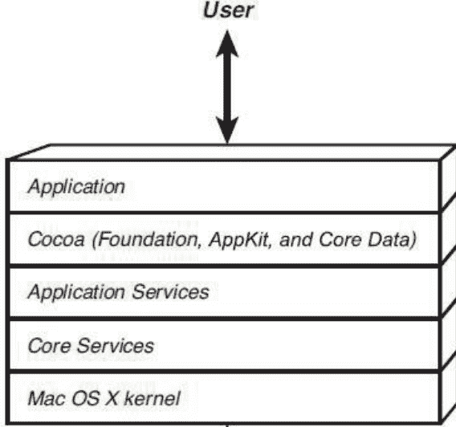

# 计算机资源（内存、磁盘、显示器等）

内核以设备驱动程序的形式提供硬件的底层通信。它管理系统资源，包括调度程序执行、管理内存和电源，以及执行基本的 I/O 操作。

正如其名，Core Services 提供的支持比上方层级更低或更处于“核心”层面。例如，在这里你可以找到对集合、网络、调试、文件管理、文件夹、内存管理、线程、时间和电源的支持。

Application Services 层包含对打印和图形渲染的支持，包括 Quartz、OpenGL 和 Quicktime。

紧邻你的应用程序下方的是 Cocoa 层。如所述，Cocoa 包含了 Foundation、Core Data 和 AppKit 框架。Foundation 提供了用于集合、字符串、内存管理、文件系统、归档等的类。AppKit 提供了管理视图、窗口、文档以及 Mac OS X 闻名的丰富用户界面的类。

从这个描述来看，某些层级之间似乎存在功能重复。集合存在于 Cocoa 层和 Core Services 层中。然而，前者建立在后者的支持之上。此外，在某些情况下，层级可以被跳过或“桥接”。例如，某些 Foundation 类（如处理文件系统的类）直接依赖 Core Services 层的功能，因此跳过了 Application Services 层。在许多情况下，Foundation 框架对低层 Core Services 层（主要用过程化 C 语言编写）中定义的数据结构进行了面向对象的映射。

# Cocoa Touch

iPhone、iPod Touch 和 iPad 等 iOS 设备包含一个运行精简版 Mac OS X 的计算机。iPhone 硬件中的某些功能（如加速度计）是手机特有的，在其他 Mac OS X 计算机（如 MacBook Pro 或 iMac）中无法找到。

> 注意

> 实际上，Mac 笔记本电脑包含加速度计，以便在电脑掉落时硬盘可以停靠；但是你无法从程序中直接访问此加速度计。

虽然 Cocoa 框架是为 Mac OS X 桌面和笔记本电脑的应用开发设计的，而 Cocoa Touch 框架用于针对 iOS的应用。

Cocoa 和 Cocoa Touch 共有 Foundation 和 Core Data 框架。然而，在 Cocoa Touch 下，UIKit 取替了 Cocoa 中的 AppKit 框架，为许多相同类型的对象支持，例如窗口、视图、按钮等。此外，Cocoa Touch 提供了用于处理加速度计、陀螺仪、通过 GPS 和 Wi-Fi 定位以及触摸界面的类，并消除了不需要的类。

这些 和 Cocoa Touch 的简要概述到此结束。在下一章，你将学习如何使用 iOS SDK 部分的模拟器为 iPhone 编写应用程序。

# 21. 编写 iOS 应用

在本章中，你将开发两个 iPhone 应用。第一个将介绍一些基本概念，让你熟悉使用 Interface Builder、建立连接以及理解代理（delegates）、输出（outlets）和动作（actions）。对于第二个 iPhone 应用，你将构建一个分数计算器。它将你在开发第一个应用时学到的与书中其余部分学到的知识结合。你在这里学的原理也可以用于开发其他 iOS 设备的应用。

# iOS SDK

要编写 iPhone 应用，你需要安装 Xcode 和 iOS SDK。此 SDK 可以从 Apple 网站免费获取。要下载 SDK，你需要注册成为 Apple 开发者。该过程也是免费的。要获取相应的链接，可以从 developer.apple.com 开始并进入相应的位置。熟悉该网站是一个很好的主意。

# 你的第一个 iPhone 应用

第一个应用程序展示了你如何在 iPhone 屏幕上放置一个黑色窗口，允许用户按下按钮，然后响应按钮点击显示某些文本。

注意

第二个应用程序更有趣！你将从第一个应用程序中获得的知识来构建一个可以进行分数运算的简单计算器。你可以使用你在书中之前编写过的 `Fraction` 类，以及一个修改过的 `Calculator` 类。这一次，你的计算器需要知道如何处理分数。

让我们直接进入第一个程序。本章采用的教学方法并不是涵盖所有细节；如前所述，这里的空间确实不足以能做到这一点。相反，我们将引导你完成这些步骤，为你提供必要的基础，以便你通过其他 Cocoa 或 iOS 编程书籍自行探索和学习更多概念。

图 21.1 显示了你为 iPhone 开发的第一个应用程序，运行在 iPhone 模拟器上（稍后会详细介绍）。

# 图 21.1. 第一个 iPhone 应用程序。

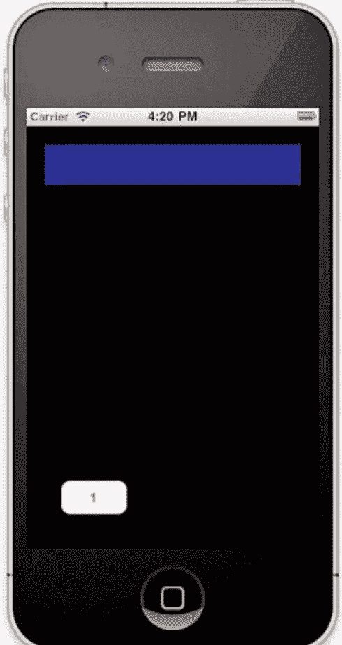

该应用程序的设计是：当你点击标记为“1”的按钮时，相应的数字会出现在显示器上（见图 21.2）。它只做这些！这个简单的应用程序为第二个分数计算器应用程序奠定了基础。

# 图 21.2. iPhone 应用程序结果。

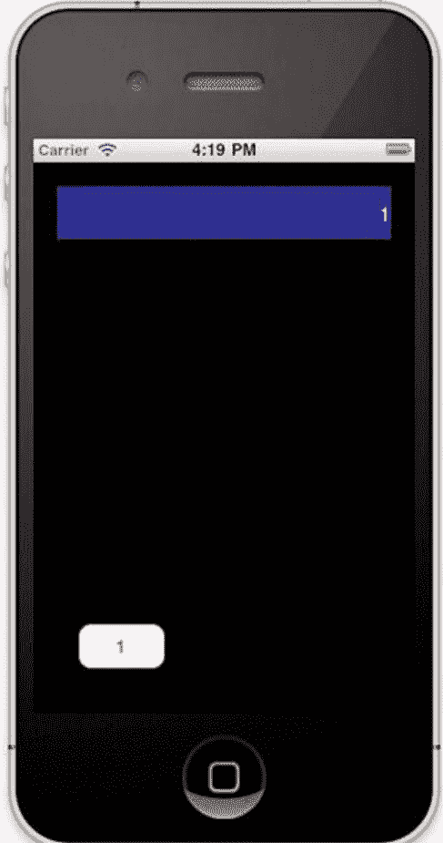

到书的这里，如果你一直使用 Xcode 输入并测试程序，你应该已经非常熟悉使用它了。这一次，我们还将使用 Xcode 的一个功能，让你通过在类似于 iPhone 屏幕的窗口中放置表格、标签和按钮等 UI 元素来设计用户界面。像任何强大的开发工具一样，这个功能需要一些适应。

### 注意

在 Xcode 4 发布之前，UI 是使用一个名为 Interface Builder 的独立应用程序设计的。

Apple 将 iOS SDK 的一部分分发 iPhone 模拟器。模拟器复制了你的大部分 iPhone 环境，包括主屏幕、Safari 浏览器、联系人应用等。模拟器让调试你的应用程序变得容易得多；你不需要将应用程序的每个版本都下载到真实的 iPhone 设备并在那里进行调试。这可以为你节省大量的时间和精力。

要在 iOS 设备上运行应用程序，你需要注册 iOS 开发者计划并向 Apple 支付 99 美元的费用（截至本书编写时）。作为，你将收到一个激活码，允许你在 iOS 设备上测试和安装应用程序。遗憾的是，如果不经过这个过程，你甚至无法为自己的 iOS 设备开发应用程序。请注意，我们在本章中开发的应用程序将在 iPhone 模拟器上加载和测试，而不是 iPhone 设备上。

# 创建新的 iPhone 应用程序项目

让我们开始开发你的第一个应用程序。安装 iOS SDK 后，启动 Xcode 程序。选择 File（文件）、New（新建），然后 New Project...（新建项目...）。在 iOS（如果你在左侧面板看不到它，说明你还没有安装 iOS SDK）点击 Application（应用程序）。你应该看到一个如图 21.3 所示的窗口。

# 图 21.3. 启动一个新的 iOS 项目。

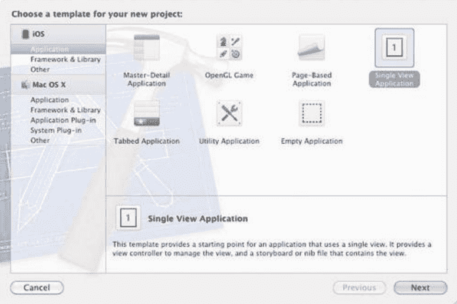

在这里你可以看到为不同类型的应用程序提供起点的模板，总结见表 21.1。

# 表 21.1. iOS 应用程序模板

| 应用程序类型 | 说明 |

| --- | --- |

| Master-Detail (主-详情) | 用于使用导航控制器的应用程序。联系人是这种类型的一个示例应用程序。为 iPad 等大屏幕设备生成基于拆视图的应用程序。 |

| OpenGL Game (OpenGL 游戏) | 用于基于 OpenGL ES 图形的游戏应用程序。 |

| Page-based Application (基于页面的应用程序) | 用于使用页面控制器管理页面显示的应用程序。 |


| Single View Application (单视图应用程序) | 用于从单个视图开始的应用程序。你在视图中绘图，然后在窗口中显示它。 |
| Tabbed Application (标签页应用程序) | 用于使用标签的应用程序。例如音乐应用。 |
| Utility Application (工具应用程序) | 用于具有翻反面的应用程序。股票报价应用是这种类型的示例。 |
| Empty Application (空应用程序) | 用于从你的主 iPhone 窗口开始的应用程序。你可以将其作为任何应用程序的起点。 |

回到你的 New Project（新建项目）窗口，在右上窗格中选择 Single View Application，然后点击 Next（下一步）按钮。在 Product Name（产品名称）中输入 `iPhone_1`，任选一个 Company Identifier（公司标识符），将 Device Family（设备族）设置为 iPhone，勾选 User Automatic Reference Counting（用户自动引用计数），并取消勾选 Use Story Board（使用 Story Board）和 Include Unit Tests（包含单元测试）。你的屏幕应该类似于图 21.4。

### 图 21.4. 选择项目选项。

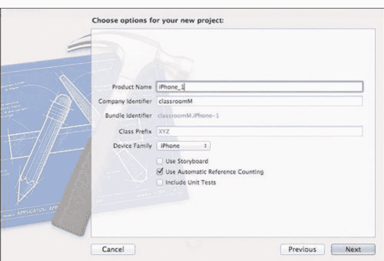

点击 Next（下一步）。你可以指定创建新项目文件夹的位置，不用担心 Source Control（版本控制）框是否被勾选。你的屏幕现在应该像图 21.5。

### 图 21.5. 指定存储项目文件夹的位置。

| 名字 | 修改日期 |
| --- | --- |
| To Be Filed | 晚上 10:23 |
| DFT | 上午 10:35 |
| ClassroomM shared files | 上午 10:35 |
| Public | 上午 10:35 |
| Sony | 11/22/11 |
| Digital Film Tree | 11/22/11 |
| Unlisted 3rt | 11/20/11 |
| Should've Been There | 11/20/11 |
| misc | 11/13/11 |
| Documentation | 6/23/11 |
| iOS Programming Class | 6/6/11 |
| ClassroomM | 5/20/11 |
| books | 1/11/11 |

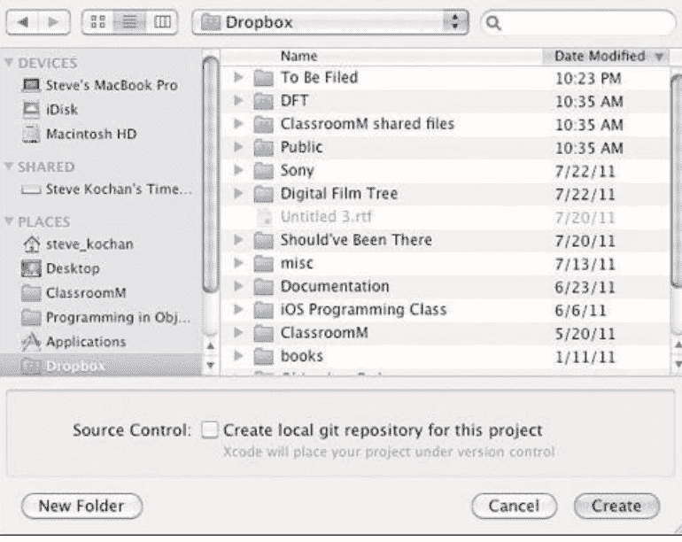

现在点击 Create（创建）。正如你从之前用 Xcode 创建的项目中所了解的，系统将为你创建一个新项目，其中包含你想要使用的文件模板。如图 21.6 所示，`iPhone_1` 文件夹显示了五个文件：`iPhone_1AppDelegate.h`、`iPhone_1AppDelegate.m`、`iPhone_1ViewController.h`、`iPhone_1ViewController.m` 和 `MainWindow.nib`。最右侧的窗格包含了（其他内容）你的应用程序支持的方向以及应用程序图标。在这里我们将忽略这个窗格。

### 图 21.6. 创建了新的 iOS 项目 iPhone_1。

根据你的设置和之前对 Xcode 的使用，你的窗口可能与图 21.6 所示的不完全相同。你可以选择遵循你当前布局的任何样式，或者尝试让它与图片更贴近。

在 Xcode 窗口的左上角，你会看到一个标记为 Xcode Scheme 的下拉菜单。因为我们并不是开发这个应用程序直接运行在 iPhone 上，所以你希望 SDK 设置为与 iPhone 模拟器一起运行。如图 21.7 所示，从 Scheme 下拉菜单中选择 iPhone simulator。

### 图 21.7. 选择 iPhone 模拟器。

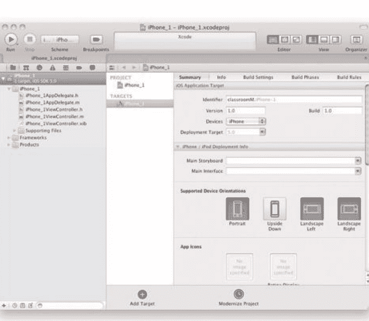

## 输入你的代码

现在我们准备好修改一些项目文件了。注意为你创建了一个名为 AppDelegate 的类，在这个示例项目中项目名为 `iPhone_1`。每个新的 iOS 应用程序都会创建一个 application delegate 子类。通常，该类包含了控制应用程序的方法，包括应用程序启动、进入和退出后台、系统通知内存使用过多以及终止时的方法。我们在两个示例中都不会对该类进行任何更改。

还为你创建了第二个类，ViewController。正如你所见，Xcode 在相应的 `.h` 和 `.m` 文件中创建了接口和实现。视图控制器负责管理显示上的一个或多个“视图”。我们的应用程序只有一个视图，如图 21.1 所示。应用程序展示许多不同的视图并使用多个视图控制器是很常见的。

所以视图类将负责处理标记为“1”的按钮点击。我们将定义一个方法来响应在 iPhone 窗口中发生的动作，在示例中是点击按钮。稍后你将看到如何将事件连接到特定方法的执行。

你的对象还可以拥有对应于 iPhone 窗口中某些控件的实例变量，例如标签上的名称或可编辑文本框中显示的文本。这些变量被称为 outlet，你将看到如何将实例变量连接到实际控件。

对于我们的第一个应用程序，我们需要一个响应点击标记为 1 的按钮的方法。我们还需要一个 outlet 变量，它包含（其他信息之外）要在窗口顶部创建的标签中显示的文本。

编辑 `iPhone_1ViewController.h` 文件以添加一个名为 `display` 的 `UILabel` 属性，并声明一个 action 方法 `click1` 来响应按钮点击。你的接口文件应该如 Program 21.1 所示。（文件头部自动插入的注释行在此未显示。）

### Program 21.1. iPhone_1ViewController.h

```
@import <UIKit/UIKit.h>

@interface iPhone_1ViewController : UIViewController

@property (strong, nonatomic) IBOutlet *display;
- (void)click1:(id)sender;

@end
```

```objc
- (IBAction) click1;
@end
```

注意，iPhone 导入了头文件 `<UIKit/UIKit.h>`。该头文件反过来导入了其他 UIKit 头文件，就像 `Foundation.h` 头文件导入你需要的其他头文件（如 `NSString.h` 和 `NSObject.h`一样一样

#### 注意

正如本文之前提到的，使用与属性名称不同的实例变量名称鼓励你通过属性访问实例变量，而不是直接通过变量名访问。Apple 一直在使用这种编码风格。

你添加了一个属于 `UILabel` 类的属性 `display`。这是一个输出（outlet）属性，将连接到标签上。当你设置此属性的文本字段时，它会更新窗口中对应标签的文本。`UILabel` 类定义的其他方法允许你设置和检索标签的其他属性，例如它的颜色、行数和字体大小。

在你学习 iOS 编程时，你会在接口中使用其他类，我们暂不会对其进行描述。其中一些名称暗示了它们的用途：`UITextField`、`UIColor`、`UIView`、`UITableView`、`UIImageView`、`UIImage`、`UISlider` 和 `UIButton`。

该属性是一个输出（outlet），在属性声明中，注意使用了 `IBOutlet` 标识符。在 UIKit 头文件 `UINibDeclarations.h` 中，`IBOutlet` 实际上被定义为空（也就是说，预处理器在源文件中字面上将其替换为空）。然而，它是必要的，因为 Xcode 在读取头文件时会查找 `IBOutlet`，以确定你的哪些变量可以作为输出并连接到接口中相应的 UI 元素。

`click1` 方法定义为返回 `IBAction` 类型的值。（在 `UINibDeclarations.h` 头文件中被定义为 `void`）。与 `IBOut` 一样，Xcode 在检查你的头文件时使用此标识符来识别可以用作动作的方法。

现在是时候修改你的类对应的 `iPhone_1ViewController.m` 实现文件了。在这里，你合成了 `display` 属性的访问器方法。

现在编辑你的实现文件，并按照程序 21.1 所示添加行（注意，我们没有显示 Xcode 放在你的实现文件中不会被修改的方法）。

### 程序 21.1. iPhone_1ViewController.m

```objc
@import "iPhone_1ViewController.h"

@implementation iPhone_1ViewController

@synthesize display;

-(IBAction) click1
{
    display.text = @"1";
}

// Xcode 插入的其他方法未显示
```

```objc
here
// ...
@end
```

`click1` 方法通过设置 `UILabel.text` 属性将输出变量 `display` 设置为字符串 `"1"`。当你将按钮按下连接到此方法的调用后，它就可以执行预期的操作，在 iPhone 窗口的显示屏放入 1。要建立这种连接，你现在必须学习如何使用 Xcode 内置的接口设计工具。

## 设计接口

在图 21.4 和你的 Xcode 主窗口中，请注意一个名为 `iPhone_1ViewController.sib` 的文件。`.xib` 文件（历史上被称为 "nib" 文件，因为扩展名曾几何是 `.nib`）包含了关于你程序用户界面的信息，包括关于窗口、按钮、标签、标签栏、文本字段等的信息。当然，你现在还没有用户界面！那是下一步。

从左侧窗格中选择 `iPhone_1ViewController.sib` 文件。这将导致界面设计工具出现，如图 21.8 所示。右侧窗格显示 iPhone 的主窗口，默认情况下它是空的且带有灰色背景。

### 图 21.8. 用户界面设计面板。

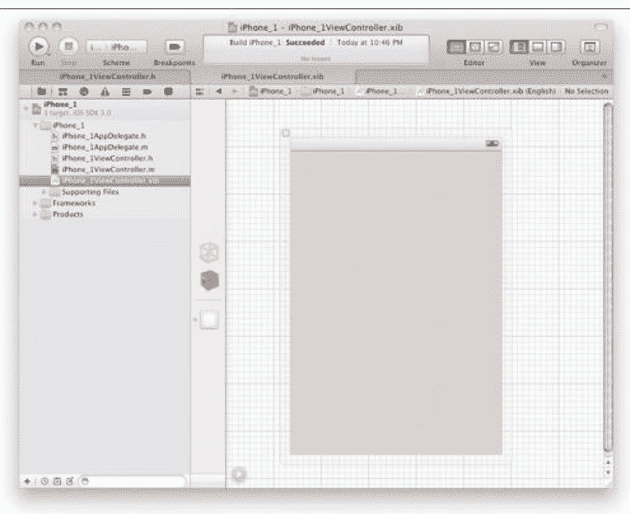

从 View（视图）菜单中，选择 Utilities（工具）、show Attributes Inspector（显示属性检查器）、Object Library（对象库，注此处应为 Object Library）。你的窗口应该以图 21.9 所示的某种显示格式出现。

#### 图 21.9. Interface Builder 中的 iPhone_1ViewController.xib.

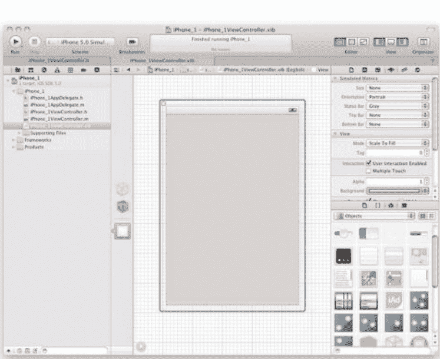

（查看编辑器和工具栏中选中的各种选项，你可以尝试让你的屏幕与该图匹配。此图显示了最右上角面板中的属性检查器，以及右下角面板在图标视图模式下的对象库。）

我们将做的第一件事是将 iPhone 窗口设置为黑色。要做到此点，首先点击中间窗格中的 iPhone 窗口。

如果你扫视到检查器面板的 View 部分，你会看到一个标记为 Background（背景）的属性。如果你点击 Background 旁边填充灰色的矩形内部，它会为你弹出一个颜色列表供你选择。选择 Black Color（黑色），这会将检查器中 Background 属性旁边的矩形从灰色变为黑色。

如果你看一眼中间窗格（它代表 iPhone 窗口），你会发现它已经变成了黑色，如图 21.10 所示。

### 图 21.10. iPhone 窗口变为黑色。

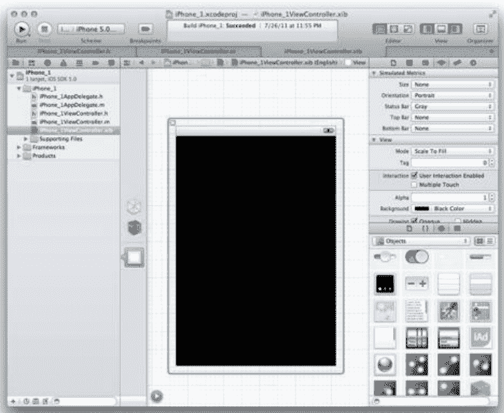

你可以通过从对象库窗格拖动对象到 iPhone 窗口来在你的 iPhone 接口中创建新对象。现在拖动一个 Label（标签）。当标签位于窗口左侧顶部附近时释放鼠标，如图 21.11 所示。

### 图 21.11. 添加标签。

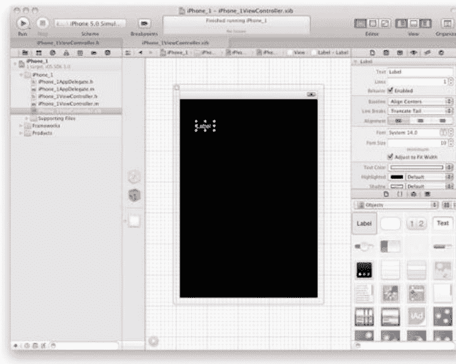

在你窗口内移动标签时，会出现蓝色的引导线。有时它们会帮助你与窗口中先放置的对象对齐。其他时候，它们确保你的对象与其他对象以及窗口边缘之间保持足够的距离，以符合 Apple 的界面指南。

将来你可以随时通过选择并将其拖到窗口内的另一个位置来重新定位标签。

现在为此标签设置一些属性。在你的 iPhone 窗口中，如果标签尚未选中，点击你刚刚创建的标签来选中它。注意检查器面板提供了窗口中当前选中对象的信息。我们不希望此标签默认显示任何文本，因此将 Text 值更改为空字符串（也就是说，删除检查器面板显示字段中的字符串 Label）。

对于 Alignment（对齐）属性，选择右对齐图标。最后，将标签的背景颜色改为蓝色（或你选择的任何颜色），就像你将窗口背景颜色改为黑色一样。

现在更改标签的大小。回到窗口，通过拉伸角和边来调整标签大小。调整并重新定位标签，使其看起来像图 21.12 所示的那样。

### 图 21.12. 更改标签的属性和大小。

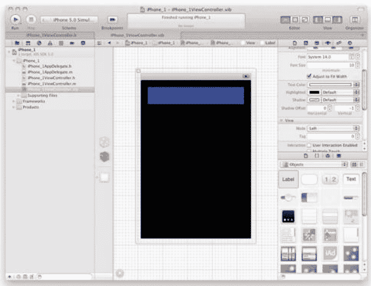

现在为接口添加一个按钮。从对象库窗格将一个 Rounded Rect（圆矩形）拖入你的接口窗口，将其放在窗口的左下角，如图 21.13 所示（注意此图显示对象库窗口已从图标视图更改列表视图）。你可以通过两种方式更改按钮上的标签：双击按钮然后输入文本，或者通过设置检查器面板中的 Title（标题）字段。无论你选择哪种方法，让你的窗口与图 21.13 所示的窗口匹配。

### 图 21.13. 在接口中添加按钮。

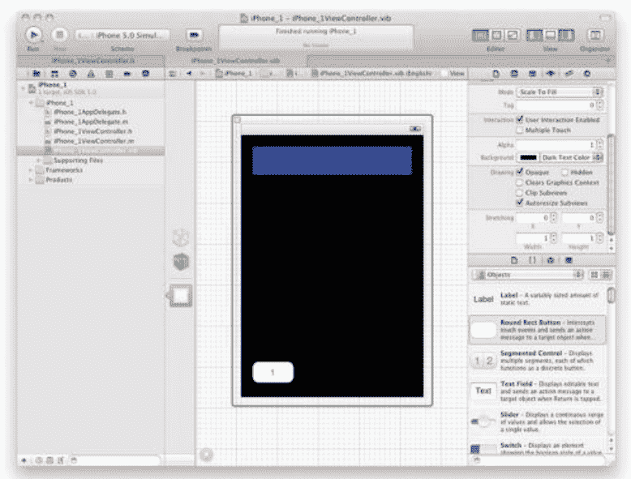

1. 此事件导致 `click1` 方法执行。

2. `click1` 方法将实例变量 `display` 的 `text` 属性更改为字符串 `"1"`。

3. 因为 `UILabel` 对象 `display` 连接到 iPhone 窗口中的标签，所以该标签将更新为相应的文本值，即值 1。

为了让这个序列操作生效，我们只需要建立这两个连接。这里有几种方法可以实现，我们只需描述其中一种。

首先，让我们在第三个窗格中显示源代码。要做到，首先选择 `View`（视图）、`Utilities`（工具）、`Hide Utilities`（隐藏工具）。接下来，选择 `View`、`Assistant Editor`（辅助编辑器）、`Show Assistant Editor`（显示辅助编辑器）。希望你的 Xcode 窗口将与图 21.14 所示的相似。

### 图 21.14。在界面旁边显示源代码。

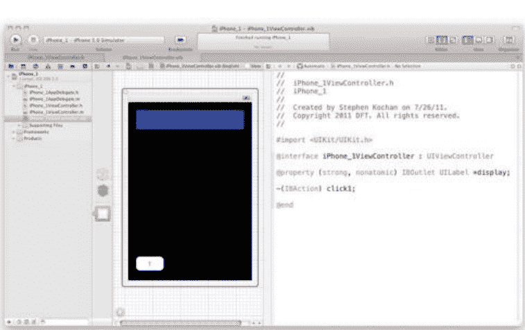

让我们按钮连接到 `IBAction` 方法 `click1`。你可以通过按住 `Control` 键并点击按钮，并将屏幕上出现的蓝线拖到最右侧窗格中显示的 `click` 方法（你可以将其拖到界面部分声明该方法的地方，也可以拖到实现部分定义该方法的地方）。这如图 21.15 所示。

### 图 21.15。为按钮添加动作。

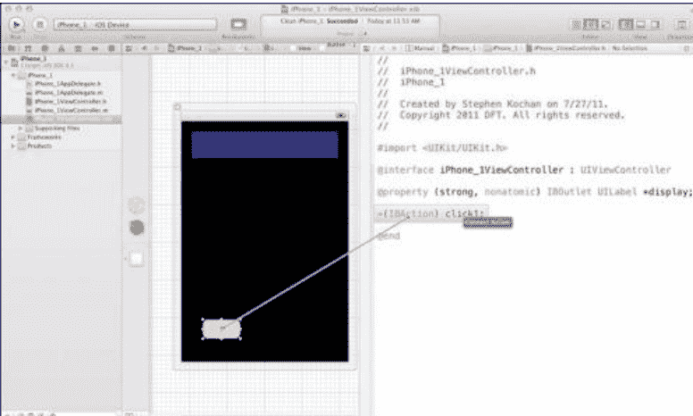

现在，让我们将 `display` 变量连接到标签。在 iPhone 窗口中选择，按住 `Control` 键，并点击并拖动出现的蓝线到接口文件中的 `display` 属性声明处。这如图 21.16 所示。

### 图 21.16。连接 outlet 变量。

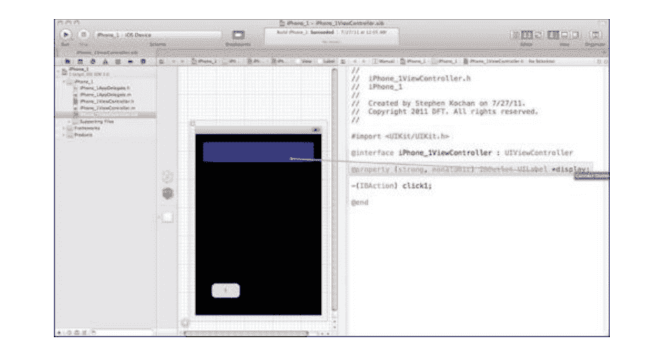

当你松开鼠标时，连接就建立了。

大好了，你完成了！从 `Product` 菜单或工具栏选择 `Run`（运行）。如果一切顺利，程序将成功构建并开始执行。执行开始时，你的程序将加载到 iPhone 模拟器中，模拟器将出现在你的电脑显示器上。模拟器窗口应该像本章开始时的图 21.1 所示。正如我们概述的那样，你通过模拟器模拟按下按钮，建立的连接将导致显示器顶部显示 `"1"`，如图 21.2 所示。

## iPhone 分数计算器

下一个例子稍微复杂一些，但与上一个例子相同的概念同样适用。我们不会显示创建此示例的所有步骤，而是给出步骤的总结和对设计方法论的概述。当然，我们也会展示所有的代码。

首先，让我们看看应用程序是如何工作的。图 21.17 显示了应用程序在模拟器中启动后不久的样式。

### 图 21.17。启动后的分数计算器。

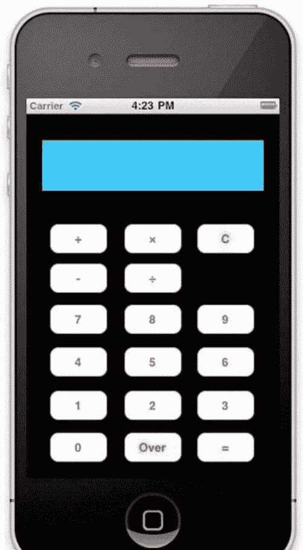

该计算器程序允许你通过先输入分子、按下标记为 `Over` 的键，然后输入分母来输入分数。因此，要输入分数 2/5，你需要按 2，然后按 `Over`，再按 5。你会发现，与其他计算器不同，这一个实际上会在显示器中显示分数，所以 2/5 显示为 2/5。

输入一个分数后，你通过按相应的相应标记的键 `+`、`-`、`*` 或 `÷` 来选择操作——加法、减法、乘法或除法。

输入第二个分数后，通过按下 `=` 键完成操作，就像使用标准计算器一样。

#### 注意

此计算器设计用于仅在两个分数之间执行单次操作。我们在本章末尾留了一项练习，让你移除这个限制。

显示器会随着按键的按下持续更新。图 21.18 显示了在输入分数 4/6 并按下乘法键后的显示。

### 图 21.18。输入操作。

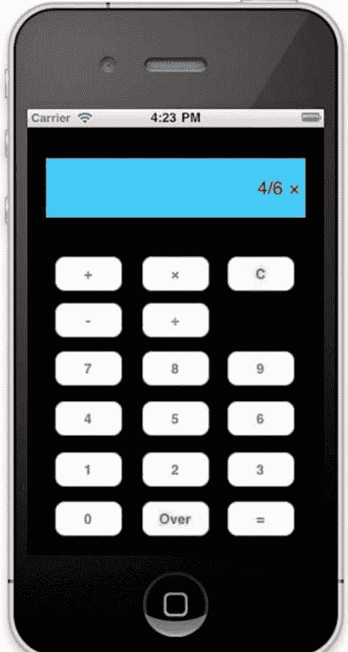

图 21.19 显示了分数 4/6 和 2/8 相乘的结果。你会发现结果 1/6 表示结果已经约分了。

### 图 21.19。两个分数相乘的结果。

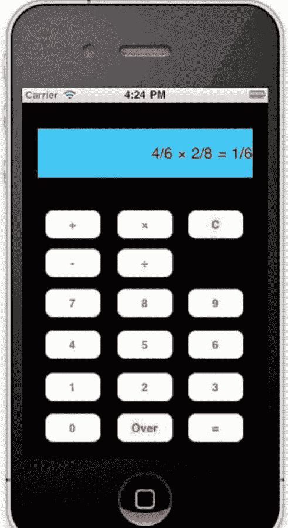

## 开始新的 Fraction_Calculator 项目


对于这个第二个程序示例，你将从创建一个新项目开始。和一样，在 `New Project` 窗口中选择 `Single View Application`（单视图应用程序）。将你的新项目命名为 `Fraction_Calculator`。

当项目创建时，这次你会发现它为你定义了两个类模板。`Fraction_CalculatorAppDelegate.h` 和 `Fraction_CalculatorAppDelegate.m` 定义了项目的应用程序代理类，而 `Fraction_CalculatorViewController.h` 和 `Fraction_CalculatorViewController.m` 定义了项目的视图控制器类。与本章中的第一个例子一样，你将在最后一个类中执行所有的工作。

## 定义视图控制器

现在让我们为视图控制器类 `Fraction_CalculatorViewController` 编写代码。我们从接口文件开始。如程序 21.2 所示。

### 21.2. 程序 Fraction_CalculatorViewController.h 接口

```objc
#import <UIKit/UIKit.h>
#import "Calculator.h"

@interface Fraction_CalculatorViewController : ViewController

@property (strong, nonatomic) UILabel *display;

-(void) processDigit:(int) digit;
-(void) processOp:(char) theOp;
-(void) storeFracPart;

// 数字键

-(IBAction) clickDigit:(UIButton *)sender

// 算术操作键

-(IBAction) clickPlus;
-(IBAction) clickMinus;
-(IBAction) clickMultiply;
-(IBAction) clickDivide;

// 其他键

-(IBAction) clickOver;
-(IBAction) clickEquals;
-(IBAction) clickClear;

@end
```

这里有用于构建分数的变量（`currentNumber`、`firstOperand` 和 `isNumerator`），以及用于显示字符串的 `displayString`。还有一个 `Calculator` 对象 (`myCalculator`) 可以执行两个分数之间的实际计算。我们将关联一个名为 `clickDigit:` 的方法来处理 0-9 数字键的按下。该方法将接收一个指示按下数字的参数，你稍后会看到。最后，我们定义了处理要执行的操作的方法（`clickPlus`、`clickMinus`、`clickMultiply`、`clickDivide`）、在按下键时执行计算（`clickEquals`）、以及在按下 `Over` 时分离分子和分母（`clickOver`）。方法 `processDigit:` `processOp:` 和 `storeFracPart` 用于上述任务。

程序 21.2 显示了此类的实现文件。注意我们在实现文件中声明了实例变量。我们也可以声明属性并对其合成。两种方法都可以。我们在这里使用的方法将实例变量保持私有，并清楚它们是在类内部使用的。

```objc
@implementation Fraction_CalculatorViewController
{
    char op;
    int currentNumber;
    BOOL firstOperand;
    BOOL isNumerator;
    Calculator *myCalculator;
    NSMutableString *displayString;
}

@synthesize display;

-(void)viewDidLoad {
    // 启动后的自定义点
    firstOperand = YES;
    isNumerator = YES;
    displayString = [NSMutableString stringWithCapacity: 40];
    myCalculator = [[Calculator alloc] init];
}

-(void) processDigit:(int) digit {
    currentNumber = currentNumber * 10 + digit;

    [displayString appendString:
[NSString stringWithFormat: @"%i"
digit]];
    display.text = displayString;
}

-(IBAction) clickDigit:(UIButton *)sender {
    int digit = sender.tag;

    [self processDigit:digit];
}

-(void) processOp:(char) theOp {
    NSString *opStr;

    op = theOp;

    switch (theOp) {
        case '+':
            opStr = @"+" + "";
            break;
        case '-':
            opStr = @"-" + "";
            break;
        case '*':
            opStr = @"\*" + "";
            break;
    }
}

@end
```

```objc
case '//':
opStr = @" \div ";
break;
}

[self storeFracPart];
firstOperand = NO;
isNumerator = YES;

[displayString appendString: opStr];
display.text = displayString;
}
```

```objc
-(void) storeFracPart
{
  if (firstOperand) {
    if (isNumerator) {
      myCalculator.operand1.numerator = currentNumber;
      myCalculator.operand1.denominator = 1; // e.g. 3 * 4/5 =
    } else
      myCalculator.operand1.denominator = currentNumber;
    }
  } else if (isNumerator) {
    myCalculator.operand2.numerator = currentNumber;
    myCalculator.operand2.denominator = 1; // e.g. 3/2 * 4 =
  } else {
    myCalculator.operand2.denominator = currentNumber;
    firstOperand = YES;
  }
}
```

```objc
}
CurrentNumber = 0;
}
-(IBAction) clickOver
{
    [self storeFracPart];
    isNumerator = NO;
    [displayString appendString: @"/"];
    display.text = displayString;
}
// 算术运算键
-(IBAction) clickPlus
{
    [self processOp: '+'];
}
-(IBAction) clickMinus
{
    [self processOp: '-'];
}
-(IBAction) clickMultiply
{
    [self processOp: '*'];
}
-(IBAction) clickDivide
{
    [self processOp: '/'];
}
// 其他键
```

```objc
-(IBAction) clickEquals
{
    if ( firstOperand == NO ) {
        [self storeFracPart];
        [myCalculator performOperation: op];

        [displayString appendString:@" = "];
        [displayString appendString:[myCalculator.accumulator convertToString]];
        display.text = displayString;

        currentNumber = 0;
        isNumerator = YES;
        firstOperand = YES;
        [displayString setString:@""];
    }
}
-(IBAction) clickClear
{
    isNumerator = YES;
    firstOperand = YES;
    currentNumber = 0;
    [myCalculator clear];

    [displayString setString:@""];
    display.text = displayString;
}

@end
```

计算器的窗口仍然像上一个应用程序一样只包含一个标签，我们仍然称其为 `display`。当用户输入时

程序 21.2 中的按钮比第一个应用程序要多得多。视图控制器实现文件中的大部分复杂性都围绕着构建分数和显示它们展开。正如所指出的，当按下数字按钮 0–9 时，动作方法 `clickDigit:` 就会被执行。该方法调用 `processDigit:` 将数字附加到变量 `currentNumber` 中正在构建的数字末尾。该方法还将将数字添加到存储在变量 `displayString` 中的当前显示字符串中，并更新 `display:`：

```objc
-(void) processDigit: (int) digit
{
    currentNumber = currentNumber * 10 + digit;

    [displayString appendString:[NSString stringWithFormat: @"%i", digit]];
    display.text = displayString;
}
```

当按下 = 键时，会调用 `clickEquals` 方法来执行操作。计算器执行两个分数之间的操作，并将结果存储在它的累加器中。累加器在 `clickEquals` 方法内部获取，结果被添加到显示器中。

## 分数类 (Fraction Class)

`Fraction` 类与本文之前的示例相比大部分没有变化。新增了一个 `convertToString` 方法，用于将分数转换为其等效字符串表示。程序 21.2 显示了 `Fraction` 接口文件，紧接着是对应的实现文件。

### 程序 21.2. Fraction.h 接口文件

```objc
#import <UIKit/UIKit.h>

@interface Fraction : NSObject

@property int numerator, denominator;

-(void) print();

- (void)
setTo: (int) n over: (int) d;
- (Fraction *) add: (Fraction *) f;
- (Fraction *) subtract: (Fraction *) f;
- (Fraction *) multiply: (Fraction *) f;
- (Fraction *) divide: (Fraction *) f;
- (void) reduce;
- (double) convertToNum;
- (NSString *) toString;

@end
```

### 程序 21.2. Fraction.m 实现文件

```objc
#import "Fraction.h"

@implementation Fraction

@synthesize numerator, denominator;

```

```objc
- (void) setTo: (int) n over: (int) d
{
    numerator = n;
    denominator = d;
}
```

```objc
- (void) print
{
    NSLog ("%%i/%i", numerator, denominator);
}
```

```objc
- (double) convertToNum
{
    if (denominator != 0)
    return (double) numerator / denominator;
}
else
    return NAN;
}

-(NSString *) convertToString
{
    if (numerator == denominator)
        if (numerator == 0)
            return "@0";
        else
            return "@1";
    else if (denominator == 1)
        return [NSString stringWithFormat:@"%i", numerator];
    else
        return [NSString stringWithFormat:@"%i/%i", numerator, denominator];
}
```

// 向接收者添加一个分数

```objc
-(Fraction *) add: (Fraction *) f
{
    // 加两个分数：
    // a/b + c/d = ((a*d) + (b*c)) / (b * d)

// 结果将存储加法结果
Fraction *result = [[Fraction alloc] init];
```


```objc
result.numerator = numerator *
f.denominator +
denominator * f.numerator;
result.denominator = denominator *
f.denominator;

  [result reduce];
  return result;
}

-(Fraction *) subtract: (Fraction *) f
{
  // 减两个分数：
  // a/b - c/d = ((a*d) - (b*c)) / (b * d)

  Fraction *result = [[Fraction alloc] init];

  result.numerator = numerator *
f.denominator -
    denominator * f.numerator;
    result.denominator = denominator *
f.denominator;

  [result reduce];
  return result;
}

-(Fraction *) multiply: (Fraction *) f
{
  Fraction *result = [[Fraction alloc] init];

  result.numerator = numerator * f.numerator
  result.denominator = denominator *
f.denominator;
  [result reduce];

  return result;
}

-(Fraction *) divide: (Fraction *) f
{
  Fraction *result = [[Fraction alloc] init];
  result.numerator = numerator * f.denominator
  result.denominator = denominator *
  f.denominator;
  [result reduce];
  return result;
}
- (void) reduce
{
  int u = numerator;
  int v = denominator;
  int temp;
  if (u == 0)
    return;
  else if (u < 0)
    u = -u;
  while (v != 0) {
    temp = u % v;
    u = v;
    v = temp;
  }
  numerator /= u;
  denominator /= u;
}
```
器的窗口仍然只包含一个标签，我们仍然称其为 `display`。当用户输入时

程序 21.2 中的按钮比第一个应用程序要多得多。视图控制器实现文件中的大部分复杂性都围绕着构建分数和显示它们展开。正如所指出的，当按下数字按钮 0–9 时，动作方法 `clickDigit:` 就会被执行。该方法调用 `processDigit:` 将数字附加到变量 `currentNumber` 中正在构建的数字末尾。该方法还将数字添加到存储在变量 `displayString` 中的当前显示字符串中，并更新 `display:`：

当按下 `=` 键时，会调用 `clickEquals` 方法来执行操作。计算器执行两个分数之间的操作，并将结果存储在它的累加器中。累加器在 `clickEquals` 方法内部获取，结果被添加到显示器中。

# 分数类 (Fraction Class)

`Fraction` 类与本文之前的示例相比大部分没有变化。新增了一个 `convertToString` 方法，用于将分数转换为其等效字符串表示。程序 21.2 显示了 `Fraction` 接口文件，紧接着是对应的实现文件。

# 程序 21.2. Fraction.h 接口文件

```objc

#import <UIKit/UIKit.h>

@interface Fraction : NSObject

@property int numerator, denominator;

-(void) print();

- (void)

setTo: (int) n over: (int) d;

- (Fraction *) add: (Fraction *) f;

- (Fraction *) subtract: (Fraction *) f;

- (Fraction *) multiply: (Fraction *) f;

- (Fraction *) divide: (Fraction *) f;

- (void) reduce;

- (double) convertToNum;

- (NSString *) toString;

@end

```

# 程序 21.2. Fraction.m 实现文件

```objc

#import "Fraction.h"

@implementation Fraction

@synthesize numerator, denominator;

```
```objc
- (void) setTo: (int) n over: (int) d
{
    numerator = n;
    denominator = d;
}
```
```objc
- (void) print
{
    NSLog ("%%i/%i", numerator, denominator);
}
```
```objc
- (double) convertToNum
{
    if (denominator != 0)
    return (double) numerator / denominator;
}
else
    return NAN;
}

-(NSString *) convertToString
{
    if (numerator == denominator)
        if (numerator == 0)
            return "@0";
        else
            return "@1";
    else if (denominator == 1)
        return [NSString stringWithFormat:@"%i", numerator];
    else
        return [NSString stringWithFormat:@"%i/%i", numerator, denominator];
}
```
// 向接收者添加一个分数
```objc
-(Fraction *) add: (Fraction *) f
{
    // 加两个分数：
    // a/b + c/d = ((a*d) + (b*c)) / (b * d)

// 结果将存储加法结果
Fraction *result = [[Fraction alloc] init];

```
```objc

result.numerator = numerator *

f.denominator +

denominator * f.numerator;

result.denominator = denominator *

f.denominator;

  [result reduce];

  return result;

}

-(Fraction *) subtract: (Fraction *) f

{

  // 减两个分数：

  // a/b - c/d = ((a*d) - (b*c)) / (b * d)

  Fraction *result = [[Fraction alloc] init];

  result.numerator = numerator *

f.denominator -

    denominator * f.numerator;

    result.denominator = denominator *

f.denominator;

  [result reduce];

  return result;

}

-(Fraction *) multiply: (Fraction *) f

{

  Fraction *result = [[Fraction alloc] init];

  result.numerator = numerator * f.numerator

  result.denominator = denominator *

f.denominator;

  [result reduce];

  return result;

}

-(Fraction *) divide: (Fraction *) f

{

  Fraction *result = [[Fraction alloc] init];

  result.numerator = numerator * f.denominator

  result.denominator = denominator *

  f.denominator;

  [result reduce];

  return result;

}

- (void) reduce

{

  int u = numerator;

  int v = denominator;

  int temp;

  if (u == 0)

    return;

  else if (u < 0)

    u = -u;

  while (v != 0) {

    temp = u % v;

    u = v;

    v = temp;

  }

  numerator /= u;

  denominator /= u;

}

@end

```

# 处理分数的计算器类

接下来，是时候查看 `Calculator` 类了。其概念与我们之前在书中开发的同名类相似。然而，在这种情况下，我们的计算器必须学会处理分数。这里是我们新的 `Calculator` 接口和实现文件。

```objc

#import <UIKit/UIKit.h>

#import "Fraction.h"

@interface Calculator : NSObject

@property (strong, nonatomic) Fraction *operand1,*operand2, *accumulator;

-(Fraction *) performOperation:(char) op;

-(void) clear;

}

```

# 程序 21.2. Calculator.m 实现文件

```objc

#import "Calculator.h"

@implementation Calculator

@synthesize operand1, operand2, accumulator;

-(id) init

{

    self = [super init];

    if (self) {

        operand1 = [[Fraction alloc] init];

        operand2 = [[Fraction alloc] init];

        accumulator = [[Fraction alloc] init];

    }

    return self;

}

-(void) clear

{

    accumulator.numerator = 0;

    accumulator.denominator = 0;

}

-(Fraction *) performOperation:(char) op

{

```
```objc
Fraction *result;

switch (op) {
    case '+':
        result = [operand1 add: operand2];
        break;
    case '-':
        result = [operand1 subtract: operand2];
        break;
    case '*':
        result = [operand1 multiply: operand2];
        break;
    case '/':
        result = [operand1 divide: operand2];
        break;
}

accumulator.numerator = result.numerator;
accumulator.denominator = result.denominator;

return accumulator;
}

@end
```

# 设计 UI

对于这个项目，你的 nib 文件是 `Fraction_CalculatorViewController.xib`。你将通过选择此文件并布局按钮和标签如下

...


# Glossary

### Application Kit
用于开发应用程序用户界面的框架，包括菜单、工具栏和窗口等对象。它是 Cocoa 的一部分，更常被称为 `AppKit`。

### ARC
参见 [Automatic Reference Counting（自动引用计数）](#automatic-reference-counting)。

### archiving（归档）
将对象数据的表示转换为稍后可以恢复（反归档）的格式。

### array（数组）
值的有序集合。数组可以被定义为基础 Objective-C 类型，并在 Foundation 中作为对象实现。

### delegate（代理）
一个旨在由另一个对象执行动作的对象。

### designated initializer（指定初始化器）
类中或子类（通过向父类发送消息）中所有其他初始化方法将调用的方法。

### dictionary（字典）
在 Foundation 中通过 `NSMutableDictionary` 和 `NSDictionary` 类实现的键值对集合。

### directive（指令）
在 Objective-C 中，以 `@` 符号开头的特殊结构。`@interface`、`@end` 和 `@class` 都是指令的示例。

### Distributed Objects（分布式对象）
一个应用程序中的 Foundation 对象与另一个应用程序（可能运行在另一个机器上）中的 Foundation 对象通信的能力。

### dynamic binding（动态绑定）
在运行时确定要调用的方法，而不是在编译时。

### dynamic typing（动态类型）
在运行时确定对象所属的类，而不是在编译时。参见 static typing（静态类型）。

### encapsulation（封装）
参见数据封装。

### extern variable（外部变量）
参见全局变量。

### factory method（工厂方法）
参见类方法。

### factory object（工厂对象）
参见类对象。

### formal protocol（正式协议）
一组在 `@protocol` 指令声明的名称下分组的相关方法。不同的类（不一定相关）可以通过实现（或继承）其所有要求的方法来采用正式协议。参见 informal protocol（非正式协议）。

### forwarding（转发）
将消息及其相关参数发送到另一个方法进行执行的过程。

### Foundation framework（Foundation 框架）
一组类、函数和协议，构成了应用程序开发的基础，提供了基本设施，如内存管理、文件和 URL 访问、存档以及处理集合、字符串、数字和日期对象的任务。

### framework（框架）
一组相关的类、函数、协议、文档、头文件和其他资源的集合。例如，Cocoa 框架用于在 Mac OS X 下开发交互式图形应用程序。

### function（函数）
一个由名称标识的语句块，可以接受通过值传递给的一个或多个参数，并可选地返回一个值。函数可以是定义所在文件的局部（静态）函数，也可以是全局函数此时它可以从其他文件的函数或方法中调用。

### garbage collection（垃圾回收）
一种运行时内存管理系统，会自动释放未引用的对象所使用的内存。iOS 运行时环境不支持垃圾回收。

### gcc
由自由软件基金会（FSF）开发的编译器名称。`gcc` 支持许多编程语言，包括 C、Objective-C 和 C++。`gcc` 是 Mac OS X 中用于编译 Objective-C 程序的标准编译器。

### gdb
用于 `gcc` 编译的程序的标准调试工具。

### getter method（get 方法）
一种获取实例变量值的访问器方法。参见 setter method（set 方法）。

### global variable（全局变量）
定义在任何方法或函数之外的变量，可以通过同一源文件中的任何方法或函数访问，也可以从将变量声明为 `extern` 的其他源文件访问。

### header file（头文件）
一个包含常用定义、宏和变量声明的文件，通过 `#import` 或 `#include` 语句包含在程序中。

### id
一种可以持有任何类型对象指针的通用对象类型。

### immutable object（不可变对象）
其值不能修改的对象。Foundation 框架中的示例包括 `NSString`、`NSDictionary` 和 `NSArray` 对象。参见 mutable object（可变对象）。

### implementation section（实现部分）
类定义中的部分，包含在相应接口部分（或按协议定义）中声明方法的实际代码（即实现）。

### informal protocol（非正式协议）
一组声明为分类的逻辑相关方法，通常是作为一个分类，非正式协议中的所有方法并不需要实现。参见 formal protocol（正式协议）。

### inheritance（继承）
从根对象开始将方法和实例变量从类传递给子类的过程。

### instance（实例）
类的具体表示。实例是通常通过向类对象发送 `alloc` 或 `new` 消息创建的对象。

### instance method（实例方法）
可以由类的实例调用的方法。参见 class method（类方法）。

### instance variable（实例变量）
声明在接口部分（或继承自父类）的变量，包含在对象的每个实例中。实例方法可以直接访问它们的实例变量。

### Interface Builder（接口构建器）
Mac OS X 下用于为应用程序构建图形用户界面的工具。

### interface section（接口部分）
用于声明类及其父类、实例变量和方法的部分。对于每个方法，还声明了参数类型和返回值。参见 implementation section（实现部分）。

### internationalization（国际化）
参见 localization（本地化）。

### isa
在根对象中定义的特殊实例变量，所有对象都继承它。`isa` 变量用于在运行时识别对象所属的类。

### linking（链接）
将一个或多个对象文件转换为可执行程序的过程。

### local variable（局部变量）
作用范围限制在定义它的块中的变量。变量可以是方法、函数或语句块的局部的。

### localization（本地化）
使程序适合在特定地理区域内执行的过程，通常通过将消息翻译成本地语言并处理时区、货币符号、日期格式等事情。有时 *localization* 仅指语言翻译，而 *internationalization* 术语指过程的其余部分。

### message（消息）
方法及其相关参数发送给对象（接收者）。

### message expression（消息表达式）
封装在方括号中的表达式，指定了对象（接收者）和要发送给该对象的消息。

### method（方法）
属于类的过程，可以通过向类对象或从类类的实例发送消息来执行。参见 [class method]()[instance method]。

### mutable object（可变对象）
其值可以更改的对象。Foundation 框架支持可变和不可变的数组、集合、字符串和字典。参见 [immutable object]().

### nil
一个类型为 `id` 的对象，用于表示无效对象。它的值被定义为 `0`。`nil` 可以接收消息。

### notification（通知）
向已注册在特定事件发生时接收提醒的对象发送消息的过程。

### NSObject
Foundation 下的根对象。

### null character（空字符）
值为 `0` 的字符。空字符常量用 `'\0'` 表示。

### null pointer（空指针）
无效的指针值，通常定义为 `0`。

### object（对象）
一组变量和相关方法。可以向对象发送消息以执行其任一方法。

### object-oriented programming（面向对象编程）
一种基于类和对象的编程方法，并在这些对象上执行操作。

### parent class（父类）
另一个类继承的类。也称为超类。

### pointer（指针）
引用另一个对象或数据类型的值。指针实现为特定对象的地址。类的实例是指内存中对象位置的指针。

### polymorphism（多态）
不同类的对象接受相同消息的能力。

### procedural programming language（过程化语言）
一种通过定义一组操作数据的过程和函数来定义程序的语言。

### property declaration（属性声明）
为实例变量指定属性的方法，允许编译器为实例变量生成无泄漏且线程安全的访问器方法。属性声明还可以用于为将在运行时动态加载的访问器方法声明属性。

### preprocessor（预处理器）
一个对源代码进行第一遍处理的程序，处理以 `#` 开头的行，这些行可能包含预处理语句。常见用途包括使用 `#define` 定义宏，使用 `#import` 和 `#include` 其他源文件，以及使用 `#if`、`#ifdef` 和 `#ifndef` 条件地包含源行。

### property list（属性列表）
标准格式的不同类型对象的表示。属性列表通常以 XML 格式存储。

### protocol（协议）
类为了遵循或采用必须实现的方法列表。协议提供了一种跨类的标准接口。参见 formal protocol（正式协议） informal protocol（非正式协议）。

### receiver（接收者）
接收消息的对象。在被调用的方法内部，接收者可以称为 `self`。

### reference count（引用计数）
对象被引用的次数。通过向对象发送 `retain` 消息增加，通过向其发送 `release` 消息减少。

### root object（根对象）
继承层次结构中没有父类的顶层对象。

### runtime（运行时）
程序执行的时间；也负责执行程序指令的机制。

### selector（选择器）
用于选择对象要执行方法的名称。编译后的选择器类型为 `SEL`，可以使用 `@selector` 指令生成。

### self
在方法内部使用的变量，用于引用消息的接收者。

### set
一个无序的唯一对象集合，在 Foundation 中通过 `NSSet`、`NSMutableSet` 和 `NSCountedSet` 类实现。

### setter method（setter 方法）
设置实例变量值的访问方法。参见 getter method（getter 方法）。

### statement（语句）
一个或多个以分号终止的表达式。

### statement block（语句块）
用大括号括起来的一个或多个语句，其作用域限于该语句块。

### static function（静态函数）
使用 `static` 关键字声明的函数，只能由同一源文件中定义的其他函数或方法调用。

### static typing（静态类型）
在编译时显式识别对象所属的类。参见 dynamic typing（动态类型）。

### static variable（静态变量）
作用域限于其定义的块或模块的变量。静态变量默认初始值为 `0`，并在方法或函数调用期间保留其值。

### structure（结构）
一种聚合数据类型，可以赋值给其他类型的结构。它可以作为参数传递给函数和方法，并由它们返回。

### subclass（子类）
也称为子类，子类继承其父类或超类的方法和实例变量。

### super
在方法中使用的关键字，用于引用接收者的父类。

### super class（超类）
特定类的父类。参见 super。

### synthesized method（合成方法）
编译器自动为你创建的 setter 方法或 getter 方法。它是在 Objective C 2.0 语言中引入的。

### UIKit
一个用于为 iOS 设备开发应用程序的框架。除了提供用于处理窗口、按钮和标签等常用 UI 元素的类外，它还定义了处理加速度计和触控界面等设备特定功能的类。`UIKit` 是 Cocoa Touch 的一部分。

### Unicode character（Unicode 字符）
一种表示包含数百万个字符字符集的标准。`NSString` 和 `NSMutableString` 类处理包含 Unicode 字符的字符串。

### union（联合体）
一种聚合数据类型，例如包含共享存储区域成员的结构体。在任何时刻，这些成员中只有一个可以占用该存储区域。

### Xcode
一种用于 Mac OS X 和 iOS 程序开发的编译和调试工具。

### XML（可扩展标记语言）
在 Mac OS X 上生成的属性列表（property lists）的默认格式。

### zone（区域）
用于分配数据和对象的指定内存区域。程序可以使用多个区域来更高效地管理内存。

# 附录 B. 通讯录应用程序源代码

供你参考，这里你在第二部分“Foundation 框架”中使用的通讯录示例的完整接口和实现文件。这包括 `AddressCard` 和 `AddressBook` 类的定义。你应该在你的系统上实现这些类；然后扩展类定义以使其更加实用和强大。这是你学习该语言并熟悉构建程序、处理类与对象以及操作 Foundation 框架极极方法。

## AddressCard 接口文件

```objc
#import <Foundation/Foundation.h>

@interface AddressCard : NSObject <NSCopying, NSCCoding>

@property (nonatomic, copy) NSString *name, *email;

-(void) setName:(NSString*) theName andEmail:(NSString*) theEmail;
-(void) assignName:(NSString *) theName andEmail:(NSString *) theEmail;
-(NSComparisonResult) compareNames:(id) element;

-(void) print;

@end
```

## AddressBook 接口文件

```objc
#import <Foundation/Foundation.h>
#import "AddressCard.h"

@interface AddressBook: NSObject <NSCopying, NSCoding>

@property (nonatomic, copy) NSString *bookName;
@property (nonatomic, strong) NSMutableArray *book;

- (id) initWithName:(NSString *) name;
- (void) sort;
- (void) addCard:(AddressCard *) theCard;
- (void) sortCard;
- (void) removeCard:(AddressCard *) theCard;
- (int) entries;
- (void) list;
- (AddressCard *) lookup:(NSString *) theName;

@end
```

## AddressCard 实现文件

```objc
#import "AddressCard.h"

@implementation AddressCard

@synthesize name, email;

-(void) setName: (NSString *) theName andEmail:
(NSString *) theEmail
{
    self.name = theName;
    self.email = theEmail;
}

// 比较指定地址卡中的两个名称
-(NSComparisonResult) compareNames: (id) element
{
    return [name compare: [element]];
}

-(void) print
{
    NSLog("@===============================================");
    NSLog("@| (@| %-31s |", [name UTF8String]);
    NSLog("@| %-31s |", [email UTF8String]);
    NSLog("@|                               |");
    NSLog("@|                               |");
    NSLog("@|                               |");
    NSLog("@|               O               O               |");
    NSLog("@===============================================");
}

    return self;
}
@end
```

## AddressBook 实现文件


```objc
#import "AddressBook.h"

@implementation AddressBook

@synthesize book, bookName;

// 设置 AddressBook 的名字和空通讯录

-(id) initWithName:(NSString *) name {
    self = [super init];

    if (self) {
        bookName = [NSString stringWithWithString:name];
        book = [NSMutableArray array];
    }

    return self;
}

-(id) init {
    return [self initWithName:@""];
}

// 编写我们自己的 setter 来创建一个可变副本

-(void) setBook:(NSArray *) theBook
{
    book = [theBook mutableCopy];
}

-(void) sort
{
    [book sortUsingSelector:@selector(compareNames)];
}

// 使用 block 交替排序
-(void) sort2
{
    [book sortUsingComparator:^(id obj1, id obj2) {
      return [[obj1 name] compare:[obj2 name]];
    }];
}

-(void) addCard:(AddressCard *) theCard
{
    [book addObject:theCard];
}

-(void) removeCard:(AddressCard *) theCard
{
    [book removeObjectIdenticalTo:theCard];
}

-(int) entries
{
    return [book count];
}

-(void) list
{
    NSLog("%======= Contents of %@", bookName);

    for ( AddressCard *theCard in book ) {
        NSLog("%-32s %-32s", [theCard.name UTF8String], [theCard.email UTF8String]);
    }
    NSLog("=================================================");
}

-(id) initWithCoder:(NSCoder *) decoder
{
    bookName = [decoder decodeObject:@"AddressName"];
    book = [decoder decodeObject:@"AddressBook"];

    return self;
}

// NSCopying 协议的方法

-(id) copyWithZone:(NSZone *) zone
{
    id newBook = [[self class] allocWithZone:zone] init;

    [newBook setBookName:bookName];

    // 以下将对通讯录进行浅拷贝
    [newBook setBook:book];

    return newBook;
}
@end
```

## 脚注

### 第13 章

- 技术上来说，它定义在 `NSObjRuntime.h` 文件中，该文件从 `Foundation.h` 内部导入
- 注意程序中字符串 "A string to be copied." 和 "So is this."。这些不是字符串对象，而是 C 风格字符串，区别在于前面没有 `@` 字符。如果一个函数期望 `char` 数组作为参数，你可以传递一个类型为 `char` 的数组或字面量 C 风格字符串，而不是字符字符串对象。

### 第15 章

- 目前，`unichar` 字符占用 16 位，但 Unicode 标准为比那更大的字符提供了支持。因此在未来，`unichar` 字符可能会大于 16 位。
- Mac OS 和 iOS 提供了一个整个 Address Book 框架，为处理通讯录提供了极其强大的功能。
- 你可能还需要一个 `initWithName:andEmail:` 初始化方法，但我们在这里没有显示它。
- 使用 `sortUsingFunction:context:` 的方法允许你使用函数而不是方法来执行比较。
- 一种通用的方法可以调用每个对象的描述方法来显示集合中的每个成员。这将允许包含任何类型对象的集合都能以可读的格式进行显示。另请注意，你可以通过单调用 `NSLog` 并使用“打印对象”格式字符 `%@` 来显示任何集合的内容。
