# Objective-C 编程：针对 iOS 5 和自动引用计数 (Arc) 的更新 (开发者库)

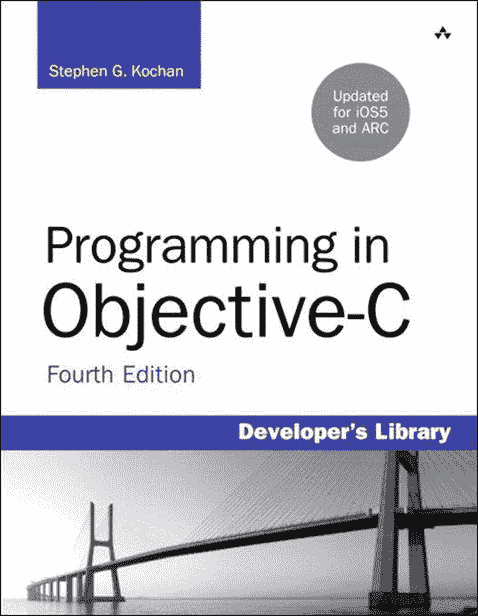


`Developer’s Library` 系列书籍旨在为实战程序员提供其在日常工作中使用的编程语言和技术的独特、高质量的参考资料和教程。

`Developer’s Library` 中的所有书籍均由专家技术从业者编写，他们特别擅长以对其他程序员有用的方式组织和展示信息。

核心书目包括其领域内最优秀、最受赞誉的书籍：

> *PHP & MySQL Web Development*
> Luke Welling & Laura Thomson
> ISBN 978-0-672-32916-6

> *MySQL*
> Paul DuBois
> ISBN-13: 978-0-672-32938-8

> *Linux Kernel Development*
> Robert Love
> ISBN-13: 978-0-672-32946-3

> *Python Essential Reference*
> David Beazley
> ISBN-13: 978-0-672-32978-4

> *PostgreSQL*
> Korry Douglas
> ISBN-13: 978-0-672-32756-2

> *C++ Primer Plus*
> Stephen Prata
> ISBN-13: 978-0321-77640-2

`Developer’s Library` 系列书籍在大多数零售和在线书店都有纸质版和电子版，也可以通过 [safari.informit.com](http://safari.informit.com) 在 Safari Books Online 订阅。

**开发者库**

informit.com/devlibrary

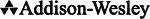

新泽西州上河 • 波士顿 • 印第安波利斯 • 旧金山
纽约 • 多伦多 • 特特利 • 伦敦 • 慕尼黑 • 巴黎 • 马德里
开普敦 • 悉尼 • 东京 • 新加坡 • 墨西哥城

ISBN-10: 0-321-81190-9

美国国会图书馆目录数据已在案。

2011 年 12 月第一次印刷

**采销编辑**：Wendy Mui
**开发编辑**：Vanessa Evans
**主编**：Gary Adair
**项目编辑**：Mark Shirar
**索引员**：（未提供）
**校对**：（未提供）

商标

我们尽力使本书尽可能完整和准确，但不隐含任何保证或适用性。所提供的信息按“现状”提供。对于因书中包含的信息而引起的任何损失或损害，作者和出版商对任何个人或实体不承担责任或义务。

*(注：由于原文提供的 Program 6.2 代码块似乎不完整（缺少 `main` 函数中的调用逻辑），翻译时根据上下文逻辑补全了常见的调用方式，以匹配其后的输出描述。)*

```objc
int main (int argc, char * argv[])
{
    @autoreleasepool {
        int number_to_test, remainder;

        NSLog (@"Enter your number to be tested: ");
        scanf ("%i", &number_to_test);

        remainder = number_to_test % 2;

        if ( remainder == 0 )
            NSLog (@"The number is even.");

        if ( remainder != 0 )
            NSLog (@"The number is odd.");
    }

    return 0;
}
```

## 程序 6.3. 输出

```
Enter your number to be tested:
2455
The number is odd.
```

## 程序 6.3 输出（重新运行）

```
Enter your number to be tested:
1210
The number is even.
```

输入数字后，程序会计算除以 2 后的余数。第一个 `if` 语句测试该余数的值，判断它是否等于零。如果是，则会显示消息“The number is even.（该数字是偶数）”。

第二个 `if` 语句测试余数，判断它是否不等于零，如果是那样，则显示消息“The number is odd.（该数字是奇数）”。

只要第一个 `if` 语句成功，第二个语句就会失败，反之亦然。如果你还记得我们在本节开始关于奇偶数的讨论，我们说过：如果一个数字能被 2 整除，它就是偶数；否则，它是奇数。

在编写程序时，这种“else”概念的需求非常频繁，因此提供了一个特殊的结构来处理这种情况。在 Objective-C 中，这被称为 `if-else`，其通用格式如下所示：

```objc
if (expression)
    program statement 1
else
    program statement 2
```

`if-else` 实际上是 `if` 语句通用格式的扩展。如果表达式求值结果为真，则会执行紧随其后的 `program statement 1`；否则，执行 `program statement 2`。在任何情况下，只会执行 `program statement 1` 或 `program statement 2` 之一，而不会两者都执行。

你可以将 `if-else` 语句整合到之前的程序中，用一个 `if-else` 语句替换两个 `if` 语句。你会看到这种新的程序结构实际上如何在某种程度上降低了程序的复杂性，并提高了它的可读性。

## 程序 6.4

```objc
// 判断一个数字是偶数还是奇数（版本 2）

#import <Foundation/Foundation.h>

int main (int argc, char * argv[])
{
    @autoreleasepool {
        int number_to_test, remainder;

        NSLog (@"Enter your number to be tested:");
        scanf ("%i", &number_to_test);

        remainder = number_to_test % 2;

        if ( remainder == 0 )
            NSLog (@"The number is even.");
        else
            NSLog (@"The number is odd.");
    }

    return 0;
}
```

## 程序 6.4. 输出

```
Enter your number to be tested:
1234
The number is even.
```

## 程序 6.4 输出（重新运行）

```
Enter your number to be tested:
6551
The number is odd.
```

不要忘记双等号（`==`）相等性测试，而单等号（`=`）是赋值运算符。忘记这一点并无意中在 `if` 语句内部使用赋值运算符会导致很多烦恼。

### 复合关系测试

复合关系测试：你到为止使用的 `if` 语句建立了两个数字之间的关系测试。为了在实际程序示例中说明复合测试的使用，让我们写一个测试某年份是否为闰年的程序。首先，你可以计算年份被 4、100 和 400 除的余数，并将这些值分别赋值给命名适当的变量，例如 `rem_4`、`rem_100` 和 `rem_400`。然后，你可以测试这些余数，以确定是否满足了闰年的目标标准。

如果我们重新表述之前对闰年的定义，可以说：如果一个年份能被 4 整除且不能被 100 整除，或者能被 400 整除，那么它就是闰年。停下来思考最后这句话，并亲自验证它与之前陈述的定义是等价的。现在我们用这些术语重新制定了定义，将其转换为程序语句就变成了一个相对直接的任务，如下：

```objc
if ( (rem_4 == 0 && rem_100 != 0) || rem_400 == 0 )
    NSLog (@"It's a leap year.");
```

以下子表达式周围的括号不是需要的：

`rem_4 == 0 && rem_100 != 0`

这是因为表达式本来就会以那种方式求值：记住 `&&` 的优先级高于 `||`。事实上，在这个特定的例子中，下面的测试效果同样好：

```objc
if ( rem_4 == 0 && ( rem_100 != 0 || rem_400 == 0 ) )
```

Objective-C 语言赋予了程序员在构建表达式时的终极灵活性，但这种灵活性是程序员经常滥用的能力。在构建复合表达式时，请大量使用括号来提高可读性，并避免因对运算符优先级错误的假设而产生麻烦。在 `&&` 和 `||` 运算符周围留出额外的空格可以在视觉上将这些运算符与它们连接的表达式区分开。

Objective-C 语言提供了处理这种情况的机制。例如，如果你想测试成绩是否在 70 到 79 之间（包含边界），将使用下面的 `if` 语句：

```objc
if ( grade >= 70 && grade <= 79 )
    NSLog ("in range");
```

在这种情况下，如果索引小于 0 或大于 99，下面的语句会导致执行 `NSLog`：

```objc
if ( index < 0 || index > 99 )
    NSLog (@"Error - out of range");
```

复合运算符可以用于 Objective-C 中形成极其复杂的表达式。有时，建立更复杂的测试是理想的甚至是必要的（CR!HGK1SH992D3H5BD4YP0VXJVMVSGJ_split_016.html_filepos365626）。

```objc
@autoreleasepool {
    int year, rem_4, rem_100, rem_400;
    NSLog (@"Enter the year to be tested: ");
    scanf ("%i", &year);

    rem_4 = year % 4;
    rem_100 = year % 100;
    rem_400 = year % 400;

    if ( (rem_4 == 0 && rem_100 != 0) || rem_400 == 0 )
        NSLog (@"It's a leap year.");
    else
        NSLog (@"Nope, it's not a leap year.");
}

    return 0;
}
```

## 程序 6.5. 输出

```
Enter the year to be tested:
1955
Nope, it's not a leap year.
```

### 程序 6.5. 输出 (重新运行)

```
Enter the year to be tested:
2000
It's a leap year.
```

### 程序 6.5. 输出 (重新运行)

```
Enter the year to be tested:
1800
Nope, it's not a leap year.
```

之前的示例使用的年份不是闰年，因为它们不能被 4 整除（1955）；某个年份是闰年，因为它能被 400 整除（2000）；另一个年份不是闰年，因为它能被 100 整除但不能被 400 整除（1800）。为了完成所有测试用例，你还应该尝试一个能被 4 整除但不能被 100 整除的年份。这留给你练习。

我们提到过，Objective-C 在构建表达式方面赋予了程序员极大的灵活性。例如，在之前的程序中，你不需要计算中间结果 `rem_4`、`rem_100` 和 `rem_400`——你可以直接在 `if` 语句内部执行计算，如下：

```objc
if ( ( year % 4 == 0 && year % 100 != 0 ) || year % 400 == 0 )
```

使用空格来区分各种运算符仍然让之前的表达式具有可读性。如果你决定忽略这一点并移除不必要的括号，你可能会得到一个像这样的表达式：

```objc
if(year%4==0&&year%100!=0||year%400==0)
```

这个表达式是完全有效的，而且信你不信，它的执行结果与之前显示的表达式完全相同。显然，那些额外的空格有助于我们理解复杂的表达式。

### 嵌套 `if` 语句

在讨论 `if` 语句的通用格式时，我们指出如果括号内表达式表达式的结果为真，则执行紧随其后的语句。将该程序语句作为另一个 `if` 语句是完全有效的，如下句所示：

```objc
if ( [chessGame isOver] == NO )
    if ( [chessGame whoseTurn] == YOU )
        [chessGame yourMove];
```

如果向 `chessGame` 发送 `isOver` 消息返回值为 `NO`，则执行后续语句；该语句又是另一个 `if` 语句。这个 `if` 语句将 `whoseTurn` 方法返回值与 `YOU` 进行比较。如果两个值相等，则向 `chessGame` 对象发送 `yourMove` 消息。因此，只有在游戏未结束且轮到你时，才会发送 `yourMove` 消息。事实上，该语句可以使用复合关系运算符等价表述，如下：

```objc
if ( [chessGame isOver] == NO && [chessGame whoseTurn] == YOU )
    [chessGame yourMove];
```

嵌套 `if` 语句的一个更实用的例子可能是为之前的示例添加一个 `else` 子句，所示：

```objc
if ( [chessGame isOver] == NO )
    if ( [chessGame whoseTurn] == YOU )
        [chessGame yourMove];
    else
        [chessGame myMove];
```

执行此语句的过程如之前所述。然而，如果游戏没有结束且轮到你的回合，则执行 `else` 子句。这会向 `chessGame` 发送 `myMove` 消息。如果游戏已结束，随后的整个 `if` 语句及其相关的 `else` 子句都将被跳过。

注意 `else` 子句是与测试 `whoseTurn` 方法返回值的 `if` 语句关联，而不是与测试游戏是否结束的 `if` 语句关联。通用规则是：`else` 子句始终与最后一个不包含 `else` 的 `if` 语句关联。

你可以更进一步，为上一个示例中最外层的 `if` 语句添加一个 `else` 子句。如果游戏结束，则执行这个 `else` 子句：

```objc
if ( [chessGame isOver] == NO )
    if ( [chessGame whoseTurn] == YOU )
        [chessGame yourMove];
    else
        [chessGame myMove];
else
    [chessGame finish];
```

下一个程序通过实现之前讨论的符号函数，演示了 `else if` 构造体的使用。

## 程序 6.6

```c
// Program to implement the sign function
#import <Foundation/Foundation.h>

int main (int argc, char * argv[])
{
    @autoreleasepool {
        int number, sign;

        NSLog (@"Please type in a number: ");
        scanf ("%i", &number);

        if ( number < 0 )
            sign = -1;
        else if ( number == 0 )
            sign = 0;
        else      // Must be positive
            sign = 1;

        NSLog (@"Sign = %i", sign);
    }

    return 0;
}
```

### 程序 6.6 输出

```
Please type in a number:
1121
Sign = 1
```

### 程序 6.6 输出（重新运行）

```
Please type in a number:
-158
Sign = -1
```

### 程序 6.6 输出（重新运行）

```
Please type in a number:
0
Sign = 0
```

如果输入的数字小于零，则 `sign` 被赋值为 `-1`；如果数字等于零，则 `sign` 被赋值为 `0`；否则，该数字必须大于零，因此 `sign` 被赋值为 `1`。

下一个程序分析从终端输入的字符，并将其分类为：字母字符（`a`–`z` 或 `A`–`Z`）、数字（`0`–`9`）或特殊字符（其他字符）。为了从终端读取单个字符，在 `scanf` 调用中使用了格式字符 `%c`。

## 程序 6.7


以下是一个简单的 Objective-C 程序，用于对从键盘输入的单个字符进行分类：

```c
// This program categorizes a single character
// that is entered from the keyboard
#import <Foundation/Foundation.h>

int main (int argc, char * argv[])
{
    @autoreleasepool {
        char c;

        NSLog (@"Enter a single character:");
        scanf (" %c", &c);

        if ( (c >= 'a' && c <= 'z') || (c >= 'A' && c <= 'Z') )
            NSLog (@"It's an alphabetic character.");
        else if ( c >= '0' && c <= '9' )
            NSLog (@"It's a digit.");
        else
            NSLog (@"It's a special character.");
    }

    return 0;
}
```

### 程序 6.7 输出

```
Enter a single character:
&
It's a special character.
```

### 程序 6.7 输出（重新运行）

```
Enter a single character:
8
It's a digit.
```

### 程序 6.7 输出（重新运行）

```
Enter a single character:
B
It's an alphabetic character.
```

> **注意**
> 如程序示例所示，最好在 `scanf` 格式字符串的 `%c` 之前放置一个空格（如 `" %c"`）。这会导致 `scanf` “跳过”任何所谓的空白字符（例如，换行符、回车符、制表符）。省略该空格可能会导致 `scanf` 读取到你并非意料的字符。虽然这在这个示例中可能不是一个问题，但在处理其他示例且每你想读取单个字符时，记住这一点是有好的。

读取字符后进行的第一个测试决定了 `char` 变量 `c` 是否为字母。这是通过测试该字符是否为小写字母或大写字母来实现的。前面的测试通过以下表达式完成：`(c >= 'a' && c <= 'z')`。如果 `c` 在字符 `'a'` 到 `'z'` 的范围内，则该表达式为真；即如果 `c` 是小写字母。后一个测试通过此表达式完成：`(c >= 'A' && c <= 'Z')`。如果 `c` 在字符 `'A'` 到 `'Z'` 的范围内，则该表达式为真；即如果 `c` 是大写字母。这些测试在以 ASCII 格式在机器存储字符的计算机系统中有效。

如果 `c` 是字母，第一个 `if` 测试成功，并显示消息“It’s an alphabetic character.”。如果测试失败，则执行 `else if` 子句。该子句确定字符是否为数字。注意，此测试是将字符 `c` 与字符 `'0'` 和 `'9'` 进行比较，而不是整数 `0` 和 `9`。这是因为从终端读取的是一个字符，而字符 `'0'` 到 `'9'` 与数字 `0`–`9` 并不相同。事实上，在 ASCII 中，字符 `'0'` 内部实际上表示为数字 `48`，字符 `'1'` 表示为数字 `49`，依此类推。

如果 `c` 是数字字符，则显示短语“It’s a digit.”否则，如果 `c` 不是字母也不是数字，则执行最后的 `else` 子句并在终端显示短语“It’s a special character”。随后程序执行完成。注意，尽管这里使用 `scanf` 仅读取单个字符，但你必须在输入字符后按 Return（回车）键将输入发送给程序。通常，每当你从终端读取数据时，程序在回车键按下之前都不会看到任何数据。

> **注意**
> 最好使用标准库中的 `islower` 和 `isupper` 例程，以完全避免内部表示问题。要这样做，请在程序中包含行 `#import <ctype.h>`。然而，我们放在这里仅用于说明。

让我们假设下一个示例中，你想写一个允许用户输入如下格式表达式的程序：`number operator number`。程序将评估该表达式并在终端显示结果。你希望识别的运算符是加法、减法、乘法和除法。让我们使用程序 4.6 中的 `Calculator` 类。每个表达式将交给计算器进行计算。下面的程序使用大型 `if` 语句配合多个 `else if` 子句来确定执行的操作。

## 程序 6.8

```objc
// Program to evaluate simple expressions of the
// number operator number

// Implement a Calculator class
#import <Foundation/Foundation.h>

@interface Calculator: NSObject
// accumulator methods
-(void)setAccumulator:(double) value;
-(void)clear;
-(double)accumulator;

// arithmetic methods
-(void)add:(double) value;
-(void)subtract:(double) value;
-(void)multiply:(double) value;
-(void)divide:(double) value;
@end

@implementation Calculator
{
    double accumulator;
}

-(void)setAccumulator:(double) value
{
    accumulator = value;
}

-(void)clear
{
    accumulator = 0;
}

-(double)accumulator
{
    return accumulator;
}

-(void)add:(double) value
{
    accumulator += value;
}

-(void)subtract:(double) value
{
    accumulator -= value;
}

-(void)multiply:(double) value
{
    accumulator *= value;
}

-(void)divide:(double) value
{
    accumulator /= value;
}
@end

int main (int argc, char * argv[])
{
    @autoreleasepool {
        double value1, value2;
        char operator;
        Calculator *deskCalc = [[Calculator alloc] init];

        NSLog (@"Type in your expression.");
        scanf ("%lf %c %lf", &value1, &operator, &value2);

        [deskCalc setAccumulator: value1];
        if ( operator == '+')
            [deskCalc add: value2];
        else if ( operator == '-')
            [deskCalc subtract: value2];
        else if ( operator == '*')
            [deskCalc multiply: value2];
        else if ( operator == '/')
            [deskCalc divide: value2];

        NSLog (@"Result = %lf", [deskCalc accumulator]);
    }

    return 0;
}
```

```objc
      [deskCalc subtract: value2];
      else if ( operator == '*' )
          [deskCalc multiply: value2];
      else if ( operator == '/' )
          [deskCalc divide: value2];

      NSLog (@"%.2f", [deskCalc accumulator]);
  }

  return 0;
}
```

### 程序 6.8 输出

```
Type in your expression.
123.5 + 59.3
182.80
```

### 程序 6.8 输出（重新运行）

```
Type in your expression.
198.7 / 26
7.64
```

### 程序 6.8 输出（重新运行）

```
Type in your expression.
89.3 * 2.5
223.25
```

`scanf` 调用指定了将三个值读取到变量 `value1`、`operator` 和 `value2` 中。可以使用 `%lf` 格式字符读取一个 `double` 类型的值。这种格式用于读取变量 `value1` 的值，它是表达式的第一个操作数。

接下来，你读取操作符。因为操作符是一个字符（`'+'`、`'-'`、`'*'` 或 `'/'`）而不是数字，所以将其读取到字符变量 `operator` 中。`%c` 格式字符告诉系统从终端读取下一个字符。格式字符串中的空格表示允许任意数量的空格。这使得你在输入这些值时，可以使用空格将操作数与操作符隔开。

在读取两个值和一个操作符后，程序将第一个值存储在计算器的累加器（accumulator）中。接着，你将 `operator` 的值与四种允许的操作符进行比较。当匹配成功时，会向计算器发送相应的消息以执行该操作。在最后一个 `NSLog` 中，获取累加器的值并进行显示。此时，程序的执行完成。

此时有必要谈谈一下程序的完备性（thoroughness）。尽管前面的程序确实完成了我们设定的任务，但该程序并不真正完整，因为它没有考虑到用户的错误。例如，如果用户误将操作符输入为 `?` 会发生什么？程序将直接跳过 `if` 语句，终端上不会出现任何消息来提醒用户其表达式输入错误。

另一个被忽略的情况是用户输入了以零为除数的除法操作。你现在应该知道，在 Objective-C 中永远不应该尝试将数字除以零。程序应该检查这种情况。

预测程序可能失败或产生非预期结果的方法，并采取预防措施来应对此类情况，是编写良好、可靠程序的必要部分。对程序运行足够数量的测试例通常可以指向程序中未考虑到某些情况的部分。但不仅于此。在编写程序时，这必须成为一种自律，始终问：“如果……会发生什么？”并插入必要的程序语句来妥善地处理该情况。

程序 6.8A 是程序 6.8 的修改版本，考虑了除以零和输入未知操作符的情况。

### 程序 6.8A

```objc
// 用于评估如下形式简单表达式的程序
//     value  operator  value

#import <Foundation/Foundation.h>

// 在此处插入 Calculator 类的接口（interface）和实现实现部分

int main (int argc, char * argv[])
{
  @autoreleasepool {
      double    value1, value2;
      char        operator;
      Calculator *deskCalc = [[Calculator alloc] init];

      NSLog (@"Type in your expression.");
      scanf ("%lf %c %lf", &value1, &operator, &value2);

      [deskCalc setAccumulator: value1];

      if ( operator == '+' )
          [deskCalc add: value2];
      else if ( operator == '-' )
          [deskCalc subtract: value2];
      else if ( operator == '*' )
          [deskCalc multiply: value2];
      else if ( operator == '/' )
          if ( value2 == 0 )
              NSLog (@"Division by zero.");
          else
              [deskCalc divide: value2];
      else
          NSLog (@"Unknown operator.");

      NSLog (@%.2f", [deskCalc accumulator]);
  }

  return 0;
}
```

### 程序 6.8A 输出

```
Type in your expression.
123.5 + 59.3
182.80
```

### 程序 6.8A 输出（重新运行）

```
Type in your expression.
198.7 / 0
Division by zero.
198.7
```

### 程序 6.8A 输出（重新运行）

```
Type in your expression.
125 $28
Unknown operator.
125
```

当输入的操作符是斜杠（用于除法）时，会进行另一个测试来确定 `value2` 是否为 `0`。如果是，则在终端显示相应的消息；否则，执行除法操作并显示结果。请密切注意在这种情况下 `if` 语句的嵌套以及相关的 `else` 子句。程序末尾的 `else` 子句捕获了所有剩余的情况。因此，任何不匹配任何字符的 `operator` 值都会导致该 `else` 子句执行，从而在终端显示“Unknown operator.”

处理除零问题的更好方法是在处理除的方法内部进行测试。你可以如下所示修改你的 `divide:` 方法：

```objc
-(void) divide: (double) value
{
  if (value != 0.0)
      accumulator /= value;
  else {
      NSLog (@"Division by zero.");
      accumulator = NAN;
  }
}
```

如果 `value` 非零，则执行除法；否则，显示消息并将累加器设置为值 `NAN`。通常情况下，让方法来处理特殊情况比依赖使用该方法的程序员的灵活性要好。

### `switch` 语句

你在上一个程序示例中遇到的 `if-else` 语句链类型——将变量的值连续与不同的值进行比较——在程序开发中非常常用，因此 Objective-C 语言中存在一种特殊的程序语句来精确执行此功能。该语句的名称是 `switch` 语句，其通用格式如下：

```objc
switch (expression)
{
case value1:
    program statement
        program statement
        ...
    break;
case value2:
    program statement
        program statement
        ...
    break;
...
case valuen:
    program statement
        program statement
        ...
    break;
default:
    program statement
        program statement
        ...
    break;
}
```

括号内的 `expression` 与值 `value1`、`value2`、…… `valuen` 连续比较，这些值必须是简单的常量或常量表达式。如果找到了与 `expression` 的值相等的 `case`，则执行该 `case` 之后的程序语句。注意，当包含多个此类程序语句时，它们*不需要*包含在大括号内。

`break` 语句表示某个特定 `case` 的结束，并终止 `switch` 语句的执行。记住在每个 `case` 的结尾包含 `break` 语句。在某个特定的 `case` 中忘记这样做，会导致当该 `case` 执行时，程序执行会继续进入下一个 `case`。有时这样做是有故意的；如果你选择这样做，请确保插入注释以提醒他人你的目的。

如果 `expression` 的值不匹配任何 `case` 值，则会执行名为 `default` 的特殊可选 `case`。这在概念上等同于上一个示例中使用的全捕获 `else`。事实上，`switch` 语句的通用形式可以等价地用 `if` 语句表示如下：

```c
if (expression == value1)
{
    program statement
    program statement
      ...
}
else if (expression == value2)
{
    program statement
    program statement
      ...
}
...
else if (expression == valuen)
{
    program statement
    program statement
      ...
}
else
{
    program statement
    program statement
      ...
}
```


考虑到前面的代码，你可以将程序 6.8A 中的大型 `if` 语句转换为等效的 `switch` 语句。这在程序 6.9 中所示。

## 程序 6.9

```objc
// 用于评估形式如下简单表达式的程序
//      value operator  value

#import <Foundation/Foundation.h>

// 在此处插入 Calculator 类的接口和实现部分

int main (int argc, char * argv[])
{
    @autoreleasepool {
        double  value1, value2;
        char    operator;
        Calculator *deskCalc = [[Calculator alloc] init];

        NSLog (@"Type in your expression.");
        scanf ("%lf %c %lf", &value1, &operator, &value2);

        [deskCalc setAccumulator: value1];

        switch ( operator ) {
            case '+':
                [deskCalc add: value2];
                break;
            case '-':
                [deskCalc subtract: value2];
                break;
            case '*':
                [deskCalc multiply: value2];
                break;
            case '/':
                [deskCalc divide: value2];
                break;
            default:
                NSLog (@"Unknown operator.");
                break;
        }
        NSLog (@%.2f", [deskCalc accumulator]);
    }
    return 0;
}
```

### 程序 6.9 输出

```
Type in your expression.
17.99 -32.6
-14.7
```

在读取表达式后，`operator` 的值将连续与每个 `case` 指定的值进行比较。当找到匹配项时，执行包含在 `case` 的语句。随后，`break` 语句将执行传出 `switch` 语句，从而完成程序的执行。如果没有一个 `case` 匹配 `operator` 的值，则执行显示“Unknown operator.”的 `default` `case`。在前面的程序中，`default` `case` 中的 `break` 语句实际上是不必要的，因为该 `case` 之后没有语句。尽管如此，在每个 `case` 结尾包含 `break` 是一个好习惯。

编写 `switch` 语句时，记住两个 `case` 值不能相同。然而，你可以将多个 `case` 值与一组语句关联起来。这只需在要执行的公共语句之前列出多个 `case` 值（在值之前使用关键字 `case`，在值之后加冒号）即可实现。例如，在下面的 `switch` 语句中，如果 `operator` 等于星号或字母 `x`，则执行 `multiply:` 方法：

```objc
switch ( operator )
{
    ...
    case '*':
    case 'x':
        [deskCalc multiply: value2];
        break;
    ...
}
```

## 布尔变量

学习编程很快就会面临编写程序来生成质数表的任务。为了复习记忆，一个正整数 `p` 如果不能被 1 和自身以外的任何整数整除，那么它就是一个质数。第一个质数定义为 `2`。下一个质数是 `3`，因为它不能被 1 和 3 以外的任何整数整除；而 `4` 不是质数，因为它能 `2` 整除。

你可以采取多种方法来生成质数表。例如，如果你的任务是生成到 50 的所有质数，生成此类表格最直接（最简单）的算法只需测试每个整数 `p` 是否被从 2 到 `p-1` 的所有整数整除。如果任何这样的整数能除除 `p`，那么 `p` 就不是质数；否则，它就是一个质数。程序 6.10 生成了一份从 2 到 50 的质数列表。

## 程序 6.10

```objc
// 生成质数表的程序

#import <Foundation/Foundation.h>

int main (int argc, char * argv[])
{
    @autoreleasepool {
        int p, d, isPrime;
        for ( p = 2; p <= 50; ++p ) {
            isPrime = 1;
            for ( d = 2; d < p; ++d ) {
                if ( p % d == 0 )
                    isPrime = 0;
            }
            if(isPrime != 0 )
                NSLog (@"%i ", p);
        }
    }
    return 0;
}
```

### 程序 6.10 输出

```
2
3
5
7
11
13
17
19
23
29
31
37
41
43
47
```

在 Objective-C 中，标志（flag）为真或假的概念最自然地翻译为值 `1` 和 `0`。因此，在 程序 6.10 中，当你在循环内部将 `isPrime` 的值设置为 `1` 时，你实际上是将其设置为真，以表示 `p` “是质数”。在内层 `for` 循环执行过程中，如果找到了偶数因数，则 `isPrime` 的值被设置为假，表示 `p` 不再“是质数”。

值 `1` 通常用于表示真或开启状态，而 `0` 用于表示假或关闭状态，这并非巧合。这种表示法对应于计算机内部单个比特（bit）的概念。当比特处于开启状态时，它的值为 `1`；当处于关闭状态时，它的值为 `0`。但在 Objective-C 中，有一个更具说服力的理由来支持这些逻辑值。这与 Objective-C 语言处理真和假概念的方式有关。

当我们开始本章的讨论时，我们注意到如果 `if` 语句内部指定的条件得到满足，则紧随其后的程序语句将被执行。但*满足*（satisfied）到底意味着什么？在 Objective-C 语言中，*满足*意味着非零，仅此而已。因此，语句

```objectivec
if ( 100 )
    NSLog (@"This will always be printed.");
```

结果会导致 `NSLog` 语句的执行，因为 `if` 语句中的条件（在本例中，简单为值 `100`）是非零的，因此是满足的。

在本章的每个程序中，我们都使用了“非零即满足”和“零即不满足”的概念。这是因为每当在 Objective-C 中求值关系表达式时，如果表达式被满足，则被赋予值 `1`；如果表达式不满足，则被赋予值 `0`。因此，语句

```objective-c
if ( number < 0 )
    number = -number;
```

的实际执行过程如下：求值关系表达式 `number < 0`。如果条件被满足——即如果 `number` 小于 0——则表达式的值为 `1`；否则，其值为 `0`。

`if` 语句测试表达式求值的结果。如果结果是非零，则执行紧随其后的语句；否则，跳过该语句。

前面的讨论也适用于 `for`、`while` 和 `do` 语句内部条件的求值。复合关系表达式（如后续语句所示）的求值也按照之前概述的方式进行：

```objectivec
while ( char != 'e' && count != 80 )
```

如果指定的两个条件都有效，结果为 `1`；但如果其中任一条件无效，求值结果为 `0`。然后会检查求值结果。如果结果为 `0`，则 `while` 循环终止；否则继续执行。

回到 程序 6.10 和标志的概念，在 Objective-C 中，使用类似这样的表达式来测试标志的值是否为真是完全有效的：

```objectivec
if ( isPrime )
```

此表达式等同于以下内容：

```objectivec
if ( isPrime != 0 )
```

为了方便测试标志的值是否为假，你可以使用逻辑取反运算符 `!`。在接下来的表达式中，使用逻辑取反运算符测试 `isPrime` 的值是否为假（将此语句读为“如果不是 `isPrime`”）：

```objectivec
if ( ! isPrime )
```

通常，像这样的表达式会取反 `expression` 的逻辑值：

```objectivec
! expression
```

因此，如果 `expression` 为 0，逻辑取反运算符产生一个 1。如果 `expression` 的求值结果是非零，取反运算符则产生一个 0。

逻辑取反运算符可以轻松地翻转标志的值，如下表达式所示：

```objectivec
my_move = ! my_move;
```

正如你所预期的，该运算符的优先级与一元减运算符相同，这意味着它的优先级高于所有二元算术运算符和关系运算符。要测试变量 `x` 的值是否不小于变量 `y` 的值，例如在

```objectivec
! ( x < y )
```

中，需要括号来确保表达式的正确求值。当然，你可以等地将前面的语句表示为：

```objectivec
x >= y
```

Objective-C 中的两个内置功能使得处理布尔变量变得稍微简单了一些。一个是特殊类型 `BOOL`，它可以用于声明包含真值或假值的变量。另一个是内置值 `YES` 和 `NO`。在程序中使用这些预定义值可以使程序更容易编写和阅读。看一眼 程序 6.10，该程序已重写以以利用这些特性。

> **注意**

> `BOOL` 类型是通过如下机制添加的：

### 程序 6.10（重写）

```objectivec
#import <Foundation/Foundation.h>

int main (int argc, char * argv[]) {
    @autorelease pool {
        int p, d;
        BOOL isPrime;
        for (p = 2; p <= 50; p++) {
            isPrime = YES;
            for (d = 2; d <= p / 2; d++) {
                if (p % d == 0) {
                    isPrime = NO;
                    break;
                }
            }
            if (isPrime) {
                NSLog("%i ", p);
            }
        }
    }
    return 0;
}
```

### 输出

```
2 3 5 7 11 13 17 19 23 29 31 37 41 43 47
```

## 条件运算符

Objective-C 中最不常的运算符可能是条件运算符。与 Objective-C 中所有其他运算符（一元或二元）不同，条件运算符是一个三元运算符；即它接受三个操作数。表示此运算符的两个符号是问号（`?`）和冒号（`:`）。

条件表达式的通用格式所示：

```objectivec
condition ? expression1 : expression2
```

在此语法中，condition 是一个表达式（通常是关系表达式），Objective-C 系统在遇到条件运算符时会首先对其求值。第一个操作数放在 `?` 之前，第二个放在 `?` 和 `:` 之间，第三个放在 `:` 之后。如果 condition 的求值结果为真（即非零），则对 expression1 进行求值，其结果作为操作的结果。如果 condition 求值为假（即零），则对 expression2 进行求值，其结果作为操作的结果。

条件表达式通常用于根据某些条件给变量赋值两个值之一。例如，假设有一个整数变量 `x` 和另一个整数变量 `s`。如果你想在 `x` 小于 0 时给 `s` 赋值 -1，否则将 `x * x` 的值赋予 `s`，你可以编写以下语句：

```objectivec
s = ( x < 0 ) ? -1 : x * x;
```

如果 `x` 的值小于零，则紧接 `?` 之后的表达式将被求值。该表达式简单的常量整数值 `-1`，如果 `x` 小于零，该值将被赋值给变量 `s`。

如果 `x` 的值不零，则紧接 `:` 之后的表达式将被求值并赋值给 `s`。因此，如果 `x` 大于等于零，`x * x` 或 `x2` 的值将被赋值给 `s`。

作为条件运算符的另一个示例，以下语句将 `a` 和 `b` 中的最大值赋值给变量 `max_value`：

```c
max_value = ( a > b ) ? a : b;
```

如果 `:` 之后的表达式（“else”部分）包含另一个条件运算符，你就可以实现 `else if` 子句的效果。例如，在程序 6.6 中实现的符号函数可以使用两个条件运算符用一行代码编写，如下所示：

```c
sign = ( number < 0 ) ? -1 : (( number == 0 ) ? 0 : 1);
```

如果 `number` 小于零，`sign` 被赋值为 `-1`；如果 `number` 等于零，`sign` 被赋值为 `0`；否则，它被赋值为 `1`。上一个表达式中“else”部分周围的括号实际上是不必要的。这是因为条件运算符是从右到左结合的，这意味着在单个表达式中多次使用该运算符，例如在

```c
e1 ? e2 : e3 ? e4 : e5
```

从右到左分组，并按如下方式求值：

```c
e1 ? e2 : ( e3 ? e4 : e5 )
```

条件表达式不必非用于赋值的右侧——它们可以用于任何可以使用表达式的地方。这意味着你可以使用 `NSLog` 语句显示变量 `number` 的符号，而无需先将其赋值给变量，如下所示：

```objc
NSLog (@"Sign = %i", ( number < 0 ) ? -1
                                 : ( number == 0 ) ? 0 : 1);
```

在 Objective-C 中编写预处理器宏时，条件运算符非常实用。你可以在第 12 章 中的“预处理器”中详细了解。

### 练习题

1. 编写一个程序，要求用户输入两个整数值。测试这两个数以确定第一个是否能被第二个整除，然后在终端上显示适当的消息。

2. 程序 6.8A 即使输入了无效的运算符或尝试除以零，也会显示累加器中的值。修复这个问题。

3. 修改 `Fraction` 类中的 `print` 方法，使整数以整数形式显示（因此分数 `5/1` 应该仅显示为 `5`）。同时修改该方法使分子为 `0` 的分数简单显示为零。

4. 编写一个作为简单打印计算器的程序。该程序应允许用户输入以下格式的表达式：

```
numberoperator
```

程序应识别以下运算符：

```
+  -  *  /  S  E
```

`S` 运算符告诉程序将累加器设置为输入的数字，`E` 运算符告诉程序执行结束。算术运算在累加器的内容上进行，输入的 `number` 作为第二个操作数。以下是显示程序应如何运行的示例运行：

```
Begin Calculations
10 S              Set Accumulator to 10
= 10.000000        Contents of Accumulator
2 /               Divide by 2
= 5.000000        Contents of Accumulator
55 -              Subtract 55
= -50.000000      Contents of Accumulator
100.25 S          Set Accumulator to 100.25
= 401.000000      Contents of Accumulator
4 *               Multiply by 4
= 401.000000      Contents of Accumulator
0 E               End of program
```

5. 使用 `scanf` 格式字符串（例如 `"%c"`）跳过空格。

6. 编写一个程序，从终端接收一个整数并英文显示每个数字。因此，如果用户输入 `832`，输出应该是：

`eight`

`three`

`two`

## 类

在本章中，你将继续学习如何操作类并编写方法。你还将应用上一章中学的概念，如循环、判断和处理表达式。首先我们讨论如何将程序拆分为多个文件。

## 接口与实现文件

现在是习惯将类声明放在单独文件中。

如果你使用 Xcode，创建一个名为 `FractionTest` 的新项目。将以下程序输入文件 `main.m`：

程序 7.1：主测试：`main.m`


进入`/path/to/xxx`目录，找到`xxx.json`。

在表达式`cvar = avar + bvar`中，加法运算符（`+`）将`avar`与`bvar`相加，得到它们的和`cvar`。

在`List.of(arg0, arg1, arg2)`中，`List`接口的工厂方法`of()`接受一系列的元素，返回包含它们的只读列表。

之后我们这样调用`cmd`命令：`cmd arg0 arg1 arg2`。

```
if (condVar > someVal) {console.log("xxx")}
```


```objc
// 将一个分数加到接收者上
- (void) add: (Fraction *) f
{
    // 相加两个分数：
    // a/b + c/d = ((a*d) + (b*c)) / (b * d)
    numerator = numerator * f.denominator + denominator * f.numerator;
    denominator = denominator * f.denominator;
}
```

不要忘记，你可以通过其字段`numerator`和`denominator`来引用作为消息接收者的`Fraction`。换句话说，在`add:`方法内部，你直接通过名称引用你发送消息的那个对象的实例变量。

另一方面，你不能通过这种方式直接引用参数`f`的实例变量。相反，你必须通过它的名称`f`来标识该对象。然后你可以通过对`f`使用点运算符（或向`f`发送适当的消息）来获取相应的实例变量。

因此，`add:`方法中的第一条语句

`nuumerator = numerator * f.denominator + denominator * f.numerator;`

意思是：取第一个分数（消息的接收者）的分子，乘以参数的分母（`numerator * f.denominator`），并将该结果加上接收者的分母与参数的分子之积（`denominator * f.numerator`）。相加的最终结果存储在接收者的分子中。

重读上一段，以确保你完全理解了正在执行的操作。这里的关键在于你理解何时引用的是接收者，何时引用的是参数。

假设你已经为你的新`add:`方法将之前的声明和定义添加到你的接口和实现文件中。`Program 7.3`是一个示例测试程序及其输出。

### 程序 7.3. 测试文件：FractionTest.m

```objc
#import "Fraction.h"

int main (int argc, char * argv[])
{
    @autoreleasepool {
        Fraction *aFraction = [[Fraction alloc] init];
        Fraction *bFraction = [[Fraction alloc] init];

        // 将两个分数设置为 1/4 和 1/2 并将它们相加

        [aFraction setTo: 1 over: 4];
        [bFraction setTo: 1 over: 2];

        // 打印结果
        [aFraction print];
        NSLog (@"+");
        [bFraction print];
        NSLog (@="=");

        [aFraction add: bFraction];
        [aFraction print];
    }

    return 0;
}
```

### 程序 7.3. 输出

```
1/4
+
1/2
=
6/8
```

该测试程序足够简单。分配并初始化了两个名为`aFraction`和`bFraction`的`Fractions`对象。然后它们分别被设置为`1/4`和`1/2`值。

## 局部变量

该测试程序足够简单。分配并初始化了两个名为`aFraction`和`bFraction`的`Fractions`对象。然后它们分别被设置为`1/4`和`1/2`值。

## 方法参数

你用于引用方法参数的名称也是局部变量。当方法执行时，传递给方法的任何参数都会被复制到这些变量中。由于方法处理的是参数的副本，*它无法改变传递给方法的原始值。*这是一个重要的概念。假设你有一个名为`calculate:`的方法，定义如下：

```objc
-(void) calculate: (double) x
{
    x *= 2;
    ...
}
```

同样假设你使用以下消息表达式来调用它：

`[myData calculate: ptVal];`

当`calculate`方法执行时，变量`ptVal`中的任何值都会被复制到局部变量`x`中。因此，在`calculate:`内部修改`x`的值对`ptVal`的值没有影响。

顺带一提，当参数为对象时，你可以更改存储在该对象中的实例变量。这是因为当你传递对象作为参数时，你实际上传递的是数据存储位置的引用。正因如此，你可以修改这些数据。你将在下一章中学习更多相关内容。

## `static`关键字

你可以通过在变量声明前放置`static`关键字，让局部变量在多次方法调用中保留其值。例如，以下代码将整数`hitCount`声明为静态变量：

```objc
static int hitCount = 0;
```

与基本数据类型的其他局部变量不同，静态变量确实有一个`0`的初始值，因此之前所示的初始化是多余的。此外，它们只在程序执行开始时初始化一次，并在连续的方法调用中保留其值。

以下代码序列可能出现在`showPage`方法内部，该方法想要跟踪自己被调用的次数（或者在这种情况下，可能是已经打印的页面数，例如）：

```objc
-(int) showPage
{
    static int pageCount = 0;
    ...
    ++pageCount;
    ...
    return pageCount;
}
```

局部静态变量只在程序启动时被设置为`0`，并在`showPage`方法的连续调用中保留其值。

注意将`pageCount`变为局部静态变量与将其变为实例变量之间的区别。在前前者，`pageCount`可以统计所有调用`showPage`方法的对象打印的页面数。在后者中，变量将统计每个单独对象打印的页面数，因为每个对象都有自己的`pageCount`副本。

记住，静态或局部变量只能从定义它们的方法内部访问。因此，即使是静态`pageCount`变量也只能在`showPage`内部访问。你可以将变量的声明移动到任何方法声明*之外*（通常位于实现文件的开头），使其对任何方法访问，如下：

```objc
#import "Printer.h"
static int pageCount;

@implementation Printer
...
@end
```

现在，文件中包含的任何实例方法或类方法都可以访问`pageCount`变量。第 10 章 “关于变量和数据类型的更多”更详细地涵盖了变量作用域这一主题。

回到分数，你可以将`reduce`方法的代码整合到你的`Fraction.m`实现文件中。别忘记在`Fraction.h`接口文件中也声明`reduce`方法。完成这些后，你就可以在程序 7.4 中测试你的新方法。在这里我们展示了三个文件：接口文件、实现文件和测试程序文件。

### 程序 7.4. 接口文件：Fraction.h

```objc
#import <Foundation/Foundation.h>

// 定义 Fraction 类
@interface Fraction : NSObject

@property int numerator, denominator;
-(void)    print;
-(void)    setTo: (int) n over: (int) d;
-(double)  convertToNum;
-(void)    add: (Fraction *) f;
-(void)    reduce;
@end
```

### 程序 7.4. 实现文件：Fraction.m

```objc
#import "Fraction.h"

@implementation Fraction
@synthesize numerator, denominator;

-(void) print
{
    NSLog (@"%i/%i", numerator, denominator);
}

-(double) convertToNum
{
    if (denominator != 0)
        return (double) numerator / denominator;
    else
        return NAN;
}

-(void) setTo: (int) n over: (int) d
{
    numerator = n;
    denominator = d;
}

// 将一个分数加到接收者
-(void) add: (Fraction *) f
{
    // 加两个分数：
    // a/b + c/d = ((a*d) + (b*c)) / (b * d)
    numerator = numerator * f.denominator + denominator * f.numerator;
    denominator = denominator * f.denominator;
}

-(void) reduce
{
    int u = numerator;
    int v = denominator;
    int temp;
    while (v != 0) {
        temp = u % v;
        u = v;
        v = temp;
    }
    numerator /= u;
    denominator /= u;
}
@end
```

### 程序 7.4. 测试文件 main.m

```objc
#import "Fraction.h"

int main (int argc, char *[])
{
    @autoreleasepool {
        Fraction *aFraction = [[Fraction alloc] init];
        Fraction *bFraction = [[Fraction alloc] init];

        [aFraction setTo: 1 over: 4]; // 设置第一个分数为 1/4
        [bFraction setTo: 1 over: 2]; // 设置第二个分数为 1/2

        [aFraction print];
        NSLog ("+");
        [bFraction print];
        NSLog ("=");

        [aFraction add: bFraction];
        // 约分并打印结果
        [aFraction reduce];
        [aFraction print];
    }
    return 0;
}
```

### 程序 7.4. 输出

```
1/4
+
1/2
=
3/4
```

这样更好！

## `self`关键字

在程序 7.4 中，我们决定在`add:`方法外部进行约分。然而，我们也可以在`add:`方法内部这样做。但是，我们如何识别要约分的分数呢？我们要约分哪个分数？

我们知道在方法内部可以通过名称直接识别实例变量，但我们不知道如何直接识别接收者。幸运的是，有一种方法。

你可以使用`self`来引用当前的对象。如果你在`add:`方法内部写了

```objc
[self reduce];
```

那么`reduce`方法将应用于接收`add:`消息的对象，这正是我们想要的。你将在书中随处看到`self`关键字有多用，它在 iOS 编程中被频繁使用。现在，你将在`add:`方法中使用它。这里是修改后的方法如下：

```objc
- (void) add: (Fraction *) f
{
    // 加两个分数：
    // a/b + c/d = ((a*d) + (b*c)) / (b * d)
    numerator = numerator * f.denominator + denominator * f.numerator;
    denominator = denominator * f.denominator;

    [self reduce];
}
```

加法完成后，分数被约分。`reduce`消息被发送给`add:`消息的接收者。因此，如果你的测试程序包含这一行代码：

```objc
[aFraction add: bFraction];
```

那么当执行`add:`方法时，`self`将指向`aFraction`，事实如此。

## 从方法分配并返回对象

我们注意到`add:`方法更改了接收对象的值。让我们创建一个`add:`方法的新版本，改为创建一个新分数来存储加法的结果。在这种情况下，我们需要将新的`Fraction`返回给消息发送者。以下是新`add:`方法的定义：

```objc
-(Fraction *) add: (Fraction *) f
{
    // 加两个分数：
    // a/b + c/d = ((a*d) + (b*c)) / (b * d)
    // result 将存储加法的结果
    Fraction *result = [[Fraction alloc] init];

    numerator = numerator * f.denominator + denominator * f.numerator;
```

```objc
  denominator * f.numerator;
result.denominator = denominator * f.denominator;
  [result reduce];
  return result;
}
```

你的方法定义的第一行如下：

```objc
-(Fraction *) add: (Fraction *) f
```

它表示你的`add:`方法将返回一个`Fraction`对象，并且也接受一个参数作为参数。该参数将加到消息接收者（receiver）上，接收者也是一个`Fraction`。注意，你需要修改接口部分（interface section），反映`add:`方法现在返回`Fraction`对象的这一。

该方法分配并初始化了一个名为`result`的新`Fraction`对象，用于存储加法的结果。

该方法像以前一样执行加法，将得到的分子和分母赋值给你新分配的`Fraction`对象`result`。在对结果进行约分（reduce）后，你通过`return`语句将其返回给消息的发送者。注意，这次我们不想约分接收者，因为我们没有改变它。相反，我们想要约分`result`，这就是为什么这次消息发送给该对象。

程序 7.5 测试了你新写的`add:`方法。

### 程序 7.5. 测试文件 main.m

```objc
#import "Fraction.h"

int main (int argc, char * argv[])
{
    @autoreleasepool {
      Fraction *aFraction = [[Fraction alloc] init];
      Fraction *bFraction = [[Fraction alloc] init];

      Fraction *resultFraction;

      [aFraction setTo: 1 over: 4];   // 将第一个分数设置为 1/4
      [bFraction setTo: 1 over: 2];   // 将第二个分数设置为 1/2

      [aFraction print];
      NSLog (@"+");
      [bFraction print];
      NSLog (@="=");

      resultFraction = [aFraction add: bFraction];
      [resultFraction print];
    }

    return 0;
}
```

### 程序 7.5. 输出

```
1/4
+
1/2
=
3/4
3/4
```

这里需要进行一些解释。首先，你定义了两个`Fraction`对象——`aFraction`和`bFraction`，并将它们的值分别设置为`1/4`和`1/2`。你还定义了一个名为`resultFraction`的`Fraction`。这个变量将存储后续加法操作的结果。

下一行代码将`add:`消息发送给`aFraction`，并将`Fraction` `bFraction`作为参数传递：

```objc
resultFraction = [aFraction add: bFraction];
```

在方法内部，分配了一个新的`Fraction`对象并执行了加法。存储在`Fraction`对象`result`中的结果由方法返回，然后存储在变量`resultFraction`中。你可能注意到，我们从未在`main`函数中为`resultFraction`分配（或初始化）`Fraction`对象；这是因为`add:`方法为我们分配了对象，然后返回了该对象的引用。该引用随后存储在`resultFraction`中。因此，`resultFraction`最终存储了我们在`add:`方法中分配的`Fraction`对象的引用。

## 扩展类定义和接口文件

你现在已经开发了一个用于处理分数的小型库。事实上，这里是接口文件的完整列表，你可以看到你通过这个类实现的所有成就：


```objc
#import <Foundation/Foundation.h>

// 定义 Fraction 类

@interface Fraction : NSObject

@property int numerator, denominator;

-(void)    print;
-(void)    setTo: (int) n over: (int) d;
-(double)convertToNum;
-(Fraction *) add: (Fraction *) f;
-(void)    reduce;
@end
```

你可能不需要处理分数，但这些示例展示了你如何通过添加新方法来不断完善和扩展类。你可以将此接口文件交给一个处理分数的人，这对于那个人编写处理分数的程序就足够了。如果那个人需要添加新方法，他可以直接通过扩展类定义来实现，也可以间接地通过定义他的子类并添加新方法来实现。你将在下一章学习如何做到。

### 练习题

1. 为`Fraction`类添加以下方法以完善算术操作。在每个情况下，都对方法内部的结果进行约分：

   - 从接收者减去：`-(Fraction *) subtract: (Fraction *) f;`

   - 接收者乘以参数：`-(Fraction *) multiply: (Fraction *) f;`

   - 接收者除以参数：`-(Fraction *) divide: (Fraction *) f;`

2. 修改你`Fraction`类中的`print`方法，使其接受一个额外的`BOOL`参数，指示分数是否应该约分。如果需要约分（即参数为`YES`），请确保不要对分数进行任何永久性更改。

3. 你的`Fraction`类能处理负分数吗？例如，你可以加`-1/4`和`-1/2`并得到正确的结果吗？当你得到答案时，写一个测试程序尝试。

4. 修改`Fraction`的`print`方法，将大于`1`的分数显示为带分数。例如，分数`5/3`应该显示为`1 2/3`。

5. 第 4 章“数据类型与表达式”中的练习 6 定义了一个名为`Complex`的新类用于处理虚数。添加一个名为`add:`的新方法用于相加两个复数。加两个复数只需相加实部和虚部，如下所示：`(5+7i) + (2+4i) = 8 + 11i`。让`add:`方法存储并返回一个新的`Complex`数，基于以下方法声明：`-(Complex *) add: (Complex *) complexNum;`。确保你的测试程序处理了潜在的内存泄漏。

6. 根据第 4 章练习 6 中的`Complex`类以及本章练习 6 中的扩展，创建独立的`Complex.h`和`Complex.m`接口和实现文件。创建一个独立的测试程序来测试所有内容。

## 8. 继承

在本章中，你将学习面向对象编程如此强大的关键原理之一。通过继承的概念，你将基于现有的类构建并为你的应用程序进行定制。

### 一切始于根

你在第 3 章“类、对象与方法”中学习了父类的概念。父类本身也可以有父类。没有父类的类位于层次结构的顶端，被称为根类。在 Objective-C 中，你有能力定义自己的根类，但这通常是你不想做的事情。相反，你将希望利用现有的类。到目前，我们定义的所有类都是名为`NSObject`的根类的后代，你在接口文件中是这样指定它的：

```objc
@interface Fraction: NSObject
...
@end
```

`Fraction`类派自`NSObject`类。因为`NSObject`位于层次结构的顶端（即上方没有其他类），所以它被称为根类，如图 8.1 所示。`Fraction`类被称为子类。

## 图 8.1 根类与子类

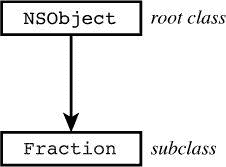

从术语的角度来看，我们可以说类（classes）、子类（child classes）和父类（parent classes）。同样地，我们也可以讨论类、子类（subclasses）和超类（superclasses）。你应该熟悉这两种术语。

每当定义一个新类（根类除外）时，该类都会继承某些内容。例如，父类的（非私有的）实例变量和方法会隐含地成为新类定义的一部分。这意味着子类可以访问这些方法和实例变量，就像它们是直接定义在类定义内部一样。

注意，子类需要直接访问的实例变量必须在接口部分（interface section）中声明，而不是像我们在整本书中所的那样声明在实现部分（implementation section）中。在实现部分声明或合成的实例变量是`private`实例变量，子类无法直接访问。相反，你将希望使用显式定义或合成的 getter 和 setter 方法来访问它们的值。

一个简单的（尽管是刻意的）例子有助于说明继承这一核心概念。这里有一个名为`ClassA`的对象的声明，包含一个名为`initVar`的方法（注意，这里我们在接口部分声明了实例变量`x`，以便子类可以访问）：

```objc
@interface ClassA: NSObject
{
    int   x;
}

-(void) initVar;
@end
```

`initVar`方法简单地将`ClassA`的实例变量的值设置为`100`：

```objc
@implementation ClassA
-(void) initVar
{
    x = 100;
}
@end
```

现在，让我们也定义一个名为`ClassB`的类：

```objc
@interface ClassB: ClassA
-(void) printVar;
@end
```

声明的第一行

```objc
@interface ClassB: ClassA
```

表示`ClassB`不是`NSObject`的子类，而是`ClassB`是`ClassA`的子类。因此，尽管`ClassA`的父类（或超类）是`NSObject`，但`ClassB`的父类是`ClassA`。图 8.2 解释了这一点。

## 图 8.2 子类与超类

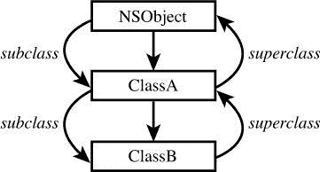

如你从图 8.2 中所示，根类没有超类，而处于层次结构底部的`ClassB`没有子类。因此，`ClassA`是`NSObject`的子类，而`ClassB`是`ClassA`的子类，也是`NSObject`的子类（技术上来说，它是子子类，即孙类）。此外，`NSObject`是`ClassA`的超类，而`ClassA`是`ClassB`的超类。`NSObject`也是`ClassB`的超类，因为它存在于层次结构的更深处。

这里是`ClassB`的完整声明，它定义了一个名为`printVar`的方法：

```objc
@interface ClassB: ClassA
-(void) printVar;
@end

@implementation ClassB
-(void) printVar
{
    NSLog (@"x = %i", x);
}
@end
```

`printVar`方法打印了实例变量`x`的值，然而你并没有在`ClassB`中定义任何实例变量。这是因为`ClassB`是`ClassA`的子类——因此，它继承了`ClassA`的公共实例变量（在本例中，只有一个）。图 8.3 描绘了这一点。

## 图 8.3 继承实例变量和方法。

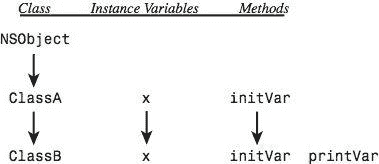

（当然，图 8.3 没有显示从`NSObject`类继承的任何方法或实例变量——实际上有好几个。）

让我们通过在一个完整的程序示例中整合所有内容，来看看它是如何工作的。为了简洁起见，我们将所有的类声明和定义放在一个文件中（参见程序 8.1）。

## 程序 8.1

```objectivec
// 用于说明继承（inheritance）的简单示例

#import <Foundation/Foundation.h>

// ClassA 声明和定义
@interface ClassA: NSObject
{
    int   x;
}

-(void) initVar;
@end

@implementation ClassA
-(void) initVar
{
    x = 100;
}
@end

// ClassB 声明和定义
@interface ClassB: ClassA
-(void) printVar;
@end

@implementation ClassB
-(void) printVar
{
    NSLog (@"x = %i", x);
}
@end

int main (int argc, char *argv[]) {
    @autoreleasepool {
        ClassA *a = [[ClassA alloc] init];
        a initVar;
        ClassB *b = [[ClassB alloc] init];
        b printVar;
    }
    return 0;
}
```

### 程序 8.1 输出

```text
x = 100
```

在向`b`发送`initVar`消息后，输出`x = 100`证实了`printVar`能够访问该实例变量。这是因为通过`initVar`方法，它是被继承来的。

你将在第 9 章中的“多态、动态类型与动态绑定”中更多关于系统如何检查执行正确的方法。

### 通过继承进行扩展：添加新方法

继承通常用于扩展类。例如，假设你刚刚被分配了一项任务，需要开发一些类来处理 2D 图形对象，如矩形、圆形和三角形。目前，我们只需要考虑矩形。回到第 4 章中的练习 7，“数据类型与表达式”，从该示例的`@interface`部分开始：

```objc
@interface Rectangle: NSObject
@property int width, height;
-(int) area;
-(int) perimeter;
@end
```

你已经合了用于设置矩形宽度和高度以及返回这些值的方法，以及你自定义的计算其面积和周长的方法。让我们添加一个方法，允许你通过同一个消息调用同时设置矩形的宽度和高度，如下如下：

```objc
-(void) setWidth: (int) w andHeight: (int) h;
```

假设你将这个新类声明写在一个名为`Rectangle.h`的文件中。以下是实现文件`Rectangle.m`的可能样貌：

```objc
#import "Rectangle.h"
@implementation Rectangle

@synthesize width, height;

-(void) setWidth: (int) w andHeight: (int) h
{
    width = w;
    height = h;
}

-(int) area
{
    return width * height;
}

-(int) perimeter
{
    return (width + height) * 2;
}
@end
```

每个方法的定义都足够直观。程序 8.2 显示了一个测试它的`main`例程。

程序 8.2

```objc
#import "Rectangle.h"

int main (int argc, char * argv[])
{
    @autoreleasepool {
        Rectangle *myRect = [[Rectangle alloc] init];

        [myRect setWidth: 5 andHeight: 8];

        NSLog (@"Rectangle: w = %i, h = %i", myRect.width, myRect.height);
        NSLog (@"Area = %i, Perimeter = %i", [myRect area],
                     [myRect perimeter]);
    }
    return 0;
}
```

程序 8.2 输出

```text
Rectangle: w = 5, h = 8
Area = 40, Perimeter = 26
```

`myRect`被分配并初始化；然后其宽度被设置为`5`，高度被设置为`8`。第一行输出验证了这一点。接下来，通过适当的消息调用计算矩形的面积和周长，并将返回的值交给`NSLog`进行显示。

假设你现在需要处理正方形。你可以定义一个名为`Square`的新类，并在其中定义与你的`Rectangle`类中类似的方法。或者，你也可以意识到正方形只是矩形的一种特殊情况，其宽度和高度恰好相等。

因此，处理此问题的简单方法是创建一个名为`Square`的新类并使其成为`Rectangle`的子类。目前，你可能想要添加的方法是将正方形的边长设置为特定值并获取该值。程序 8.3 显示了`Square`的接口和实现。

程序 8.3 `Square.h`接口

```objc
@import "Rectangle.h"
@interface Square: Rectangle
-(void) setSide: (int) s;
-(int) side;
@end
```

程序 8.3 `Square.m`实现

```objc
#import "Square.h"
@implementation Square

-(void) setSide: (int) s
{
    [self setWidth: s andHeight: s];
}

-(int) side
{
    return self.width;
}
@end
```

注意你所做的。你将`Square`类定义为`Rectangle`的子类。你不需要添加任何实例变量，因为你从父类中继承了它们。`setSide`方法无法访问`width`实例变量，因为它是私有的。然而，`side`方法可以访问`width`变量。注意，编写`self.width`等同于编写`[self width]`。`side`方法向接收者发送了条消息。

`setSide:`利用了你已经在`Rectangle`类中拥有了`setWidth:andHeight:`方法这一事实，并将参数`s`作为宽度和高度的值传递。处理`Square`对象的人现在可以使用`setSide:`设置尺寸，并利用来自`Rectangle`的方法。

```objc
#import "Square.h"
#import <Foundation/Foundation.h>

int main (int argc, char * argv[])
{
    @autoreleasepool {
        Square *mySquare = [[Square alloc] init];

        [mySquare setSide: 5];

        NSLog (@"Square s = %i", [mySquare side]);
        NSLog (@"Area = %i, Perimeter = %i", [mySquare area], [mySquare perimeter]);
    }
    return 0;
}
```

程序 8.3 输出

```text
Square s = 5
Area = 25, Perimeter = 20
```

`Rectangle`类仅存储了矩形的尺寸。在现实世界的图形化应用程序中，你可能需要跟踪各种额外信息，例如矩形的填充颜色、线条颜色、在窗口内的位置（原点）等。你可以轻松地扩展你的类来完成这些功能。现在，让我们来处理矩形原点的概念。假设“原点”意味着矩形在某个笛卡尔坐标系 (x, y) 中的左下角的位置。如果你正在编写一个绘制应用程序，这个点可能代表矩形在窗口内的位置，如图图 8.4 所示。

## 图 8.4. 在窗口中绘制的矩形

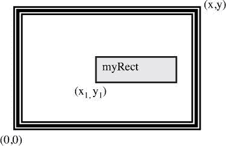

在图 8.4 中，矩形的原点显示在 (x[1], y[1]) 处。

你可以扩展`Rectangle`类，将矩形原点的 x、y 坐标作为两个独立的值存储。或者你可能会意识到，在开发图形应用程序时，你必须处理大量的坐标，因此定义一个名为`XYPoint`的类（你可能记得在第 3 章的第 7 练习中遇到过这个问题）：

```objc
#import <Foundation/Foundation.h>

@interface XYPoint: NSObject
@property int x, y;

-(void) setX: (int) xVal andY: (int) yVal;
@end
```

现在回到你的`Rectangle`类。你想要能够矩形的原点，因此你会在`Rectangle`类的定义中添加一个名为`origin`的实例变量：

```objc
@implementation Rectangle
{
    XYPoint *origin;
}
    ...
```

添加一个方法来设置并获取矩形的原点似乎是合理的。为了说明一个重要的点，我们现在不会为`origin`合成访问器方法。相反，我们将手动编写它们。

## `@class`指令

现在你可以处理矩形（以及正方形！）并设置它们的宽度、高度和原点。首先，让我们完整查看你的`Rectangle.h`接口文件：


在`Rectangle.h`头文件中，你使用了一个新指令：`@class XYPoint;`。

你需要这样做是因为编译器在遇到`Rectangle`定义的实例变量之一是`XYPoint`时，需要知道`XYPoint`是什么。类名也分别用于你的`setOrigin:`和`origin`方法的参数和返回类型声明。你也有另一个选择：你可以改为导入头文件，如下：`#import "XYPoint.h"`。

使用`@class`指令更高效，因为编译器不需要导入并因此处理整个`XYPoint.h`文件（尽管它很小）；它只需要知道`XYPoint`是一个类的名称。如果你需要引用`XYPoint`类的一个方法（例如在实现部分），`@class`指令将是不够的，因为编译器需要更多信息；它需要知道该方法接收多少个参数、参数的类型是什么，以及方法的返回类型是什么。

所以请确保你理解这里`@class`指令的使用。它仅仅是告诉编译器`XYPoint`是一个类的名称。这样，当它看到这一行代码时：

```objc
XYPoint *origin;
```

它知道`origin`是来自名为`XYPoint`的类的对象。这就是编译器在该点所需要的所有信息。

让我们为你的新`XYPoint`类和`Rectangle`方法填充空白，以便你可以在程序中测试一切。首先，程序 8.4 显示了你的`XYPoint`类的实现文件。接着，程序 8.4 显示了`Rectangle`类的新方法。

### 程序 8.4. Rectangle.m 添加的方法

```objc
#import "XYPoint.h"

-(void) setOrigin: (XYPoint *) pt
{
    origin = pt;
}

-(XYPoint *) origin
{
    return origin;
}
```

以下是完整的`XYPoint`和`Rectangle`类定义，随后是一个用于测试它们的程序。

### 程序 8.4. XYPoint.h Interface

```objc
#import <Foundation/Foundation.h>

@interface XYPoint: NSObject

@property int x, y;

-(void) setX: (int) xVal andY: (int) yVal;
@end
```

### 程序 8.4. XYPoint.m 实现

```objc
#import "XYPoint.h"

@implementation XYPoint

@synthesize x, y;

-(void) setX: (int) xVal andY: (int) yVal
{
    x = xVal;
    y = yVal;
}

-(XYPoint *) origin
{
    return origin;
}
@end
```

### 程序 8.4. Rectangle.h Interface

```objc
#import <Foundation/Foundation.h>

@class XYPoint;

@interface Rectangle: NSObject

@property int width, height;

-(XYPoint *) origin;
-(void)  setOrigin: (XYPoint *) pt;
-(void)  setWidth: (int) w andHeight: (int) h;
-(int)   area;
-(int)   perimeter;
@end
```

### 程序 8.4. Rectangle.m 实现

```objc
#import "Rectangle.h"

@implementation Rectangle
{
    XYPoint *origin;
}

@synthesize width, height;

-(void) setWidth: (int) w andHeight: (int) h
{
    width = w;
    height = h;
}

-(void) setOrigin: (XYPoint *) pt
{
    origin = pt;
}

-(int) area
{
    return width * height;
}

-(int) perimeter
{
    return (width + height) * 2;
}

-(XYPoint *) origin
{
    return origin;
}
@end
```

### 程序 8.4. 测试程序

```objc
#import "Rectangle.h"
#import "XYPoint.h"

int main (int argc, char * argv[])
{
    @autorepool {
        Rectangle *myRect = [[Rectangle alloc] init];
        XYPoint *myPoint = [[XYPoint alloc] init];

        [myPoint setX: 100 andY: 200];
        [myRect setWidth: 5 andHeight: 8];
        myRect.origin = myPoint;

        NSLog (@Rectangle w = %i, h = %i", myRect.width, myRect.height);
        NSLog (@Origin at (%i, %i)", myRect.origin.x, myRect.origin.y);
        NSLog (@Area = %i, Perimeter = %i",
            [myRect area], [myRect perimeter]);
    }
    return 0;
}
```

### 程序 8.4. 输出

```
Rectangle w = 5, h = 8
Origin at (100, 200)
Area = 40, Perimeter = 26
```

## 类拥有其对象

你能解释程序 8.5 的输出吗？

## 程序 8.5

```objectivec
#import "Rectangle.h"
#import "XYPoint.h"

int main (int argc, char * argv[])
{
    @autoreleasepool {
        Rectangle *myRect = [[Rectangle alloc] init];
        XYPoint *myPoint = [[XYPoint alloc] init];

        [myPoint setX: 100 andY: 200];

        [myRect setWidth: 5 andHeight: 8];
        myRect.origin = myPoint;

        NSLog (@"Origin at (%i, %i)", myRect.origin.x, myRect.origin.y);

        [myPoint setX: 50 andY: 50];
        NSLog (@"Origin at (%i, %i)", myRect.origin.x, myRect.origin.y);
    }
    return 0;
}
```

## 程序 8.5 输出

```
Origin at (100, 200)
Origin at (50, 50)
```

你在程序中将`myPoint`从`(100, 200)`改为了`(50, 50)`，显然这也改变了矩形的原点！但为什么会发生这种情况？你并没有显式地重置矩形的原点，那么为什么矩形的原点会改变呢？如果你回到你的`setOrigin:`方法定义处，或许你会发现原因：

```objectivec
-(void) setOrigin: (XYPoint *) pt
{
    origin = pt;
}
```

当使用表达式`myRect.origin = myPoint;`调用`setOrigin:`方法时，`myPoint`的值将作为参数传递给该方法。该值指向此`XYPoint`对象在内存中的存储位置，如图 [8.5] 所示。

图 8.5. 内存中的`myPoint`对象引用

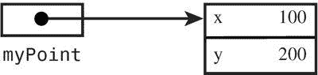

存储在`myPoint`内部的值（指向内存的指针）被复制到方法内部定义的局部变量`pt`中。现在，`pt`和`myPoint`都引用内存中存储的相同数据。图 [8.6] 阐了这一点。

图 8.6. 将矩形的原点传递给方法

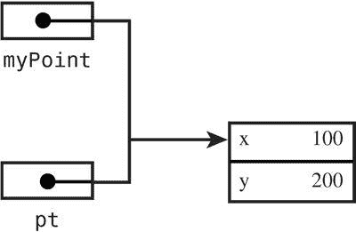

当方法内部将`origin`变量设置为`pt`时，存储在`pt`内部的指针被复制到实例变量`origin`中，如图 [8.7] 所示。

图 8.7. 设置矩形的原点

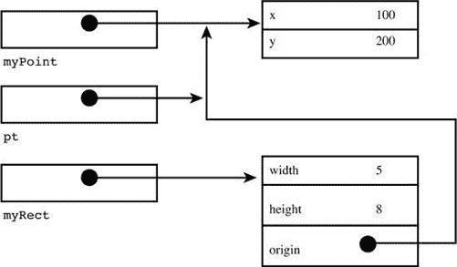

由于`myPoint`和存储在`myRect`中的`origin`变量引用内存中的同一区域（局部变量`pt`也是如此），当你稍后将`myPoint`的值改为`(50, 50)`时，矩形的原点也随之改变了。

你可以通过修改`setOrigin:`方法来避免这个问题，使其分配自己的点并将`origin`设置为该点。如下所示：

```objectivec
-(void) setOrigin: (XYPoint *) pt
{
    if (! origin)
        origin = [[XYPoint alloc] init];

    origin.x = pt.x;
    origin.y = pt.y;
}
```

该方法首先测试实例变量`origin`是否为非零（请确保你理解该测试以及所使用的逻辑取非运算符`!`）。记住，所有实例变量最初都被设置为零。因此，当分配一个新的`Rectangle`对象时，包括`origin`在内的所有实例变量将被设置为零。

如果`origin`为零，`setOrigin:`方法将分配并初始化一个新的`XYPoint`对象，并将引用存储在`origin`中。

然后该方法将新分配的`XYPoint`对象设置为传递给方法的参数 x、y 坐标。请反复研究直到完全理解。通常情况下，当一个类包含其他对象时，你有时会希望它拥有某些对象。

```objc
@interface ClassA: NSObject
{
    int x; // Will be inherited by subclasses
}
```

```objc
-(void) initVar;
@end
```

```
////////////////////////////
@implementation ClassA
-(void) initVar
{
    x = 100;
}
@end
```

```objc
// ClassB declaration and definition
@interface ClassB: ClassA
-(void) initVar;
-(void) printVar;
@end
```

```
////////////////////////////
@implementation ClassB
-(void) initVar    // added method
{
    x = 200;
}

-(void) printVar
{
    NSLog (@"x = %i", x);
}
@end
```

```
////////////////////////////
int main (int argc, char * argv[])
{
    @autoreleasepool {
        ClassB *b = [[ClassB alloc] init];

        [b initVar];  // uses overriding method in B

        [b printVar];  // reveal value of x;
    }
    return 0;
}
```

***

Program 8.6. Output

***

```
x = 200
```

***

Clearly, the message `[b initVar];` causes the `initVar` method defined in `ClassB` to be used, and not the one defined in `ClassA`, as was the case with the previous example. Figure 8.9 illustrates this.

Figure 8.9. Overriding the `initVar` method

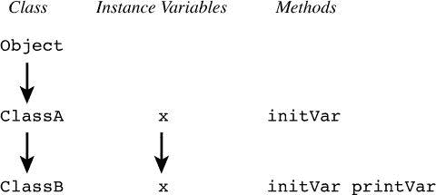

### Which Method Is Selected?

We covered how the system searches up the hierarchy for a method to apply to an object. If you have methods in different classes with the same name, the correct method is chosen based on the class of the receiver of the message. Program 8.7 uses the same class definition for `ClassA` and `ClassB` as before.

### Program 8.7

```objc
#import <Foundation/Foundation.h>

// insert definitions for ClassA and ClassB here

int main (int argc, char * argv[])
{
    @autoreleasepool {
        ClassA *a = [[ClassA alloc] init];
        ClassB *b = [[ClassB alloc] init];

        [a initVar];   // uses ClassA method
        [a printVar];  // reveal value of x;

        [b initVar];   // use overriding ClassB method
        [b printVar];  // reveal value of x;
    }
    return 0;
}
```

You’ll get this warning message when you build this program:

```
warning: 'ClassA' may not respond to '-printVar'
```

What happened here? We talked about this in an earlier section. Take a look at the declaration for `ClassA`:

```objc
// ClassA declaration and definition
@interface ClassA: NSObject
{
    int x;
}

-(void) initVar;
@end
```

Notice that no `printVar` method is declared. That method is declared and defined in `ClassB`. Therefore, even though `ClassB` objects and their descendants can use this method through inheritance, `ClassA` objects cannot because the method is defined farther down in the hierarchy.

> **Note**: You can coerce the use of this method in some ways, but we don’t go into that here—besides, it’s not good programming practice.

Returning to our example, let’s add a `printVar` method to `ClassA` so we can display the value:


```objc
// ClassA declaration and definition
@interface ClassA: NSObject
{
    int x; // Will be inherited by subclasses
}

-(void) initVar;
-(void) printVar;
@end

@implementation ClassA
-(void) initVar
{
    x = 100;
}

-(void) printVar
{
    NSLog (@"x = %i", x);
}
@end
```

2. 在处理高分辨率设备时，你可能需要使用一种坐标系，它允许你将点指定为浮点值而不是简单的整数（iOS 使用名为`CGRect`的结构来处理矩形。在处理此类矩形时，所有的坐标和大小都以浮点数表示）。修改本章中的`XYPoint`和`Rectangle`类以处理浮点数。矩形的`width`、`height`、`area`和`perimeter`也应该都能支持浮点数。

3. 扩展[程序 8.1]() 添加一个名为`ClassB2`的新类，它像`ClassB`一样是`ClassA`的子类。

关于`ClassB`和`ClassB2`之间的关系你说什么？

识别`NSObject`类、`ClassA`、`ClassB`和`ClassB2`之间的层级关系。

`ClassB`的父类是什么？

`ClassB2`的父类是什么？

一个类可以有多少个子类，它可以有多少个父类？

4. 为`Rectangle`类编写一个名为`translate`的方法：它接收一个`XYPoint`对象作为参数。让它根据指定的向量平移矩形的原点。注意：平移仅意味着将点从一个地方移动到另一个地方。

5. 定义一个名为`GraphicObject`的新类，并使其成为`NSObject`的子类。在你的新类中定义如下实例变量：

```objectivec
int   fillColor;    // 32 位颜色
BOOL  filled;       // 对象是否被填充？
int   lineColor;    // 32 位线条颜色
```

编写方法来设置和获取之前定义的变量。

将`Rectangle`类设写为`GraphicObject`的子类。

定义新类`Circle`和`Triangle`，它们也是`GraphicObject`的子类。编写方法来设置和获取这些对象的各种参数，并计算圆的周长和面积，以及三角形的周长和面积。

6. 为`Rectangle`类编写一个名为`containsPoint:`的方法，它接收一个`XYPoint`对象作为参数：

```objectivec
-(BOOL) containsPoint: (XYPoint *) aPoint;
```

如果矩形包含指定的点，则该方法返回`BOOL`值`YES`，否则返回`NO`。

7. 为`Rectangle`类编写一个名为`intersect`的方法：它接收一个矩形作为参数并返回一个表示两个矩形重叠区域的矩形。例如，给定[图 8.10]所示的两个矩形，该方法应该返回一个原点位于 (`400`, `420`)、宽度为`50`高度为`60`的矩形。

图 8.10 相交矩形

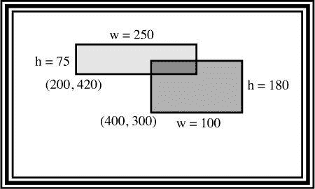

如果矩形不相交，返回一个宽度和高度为零且原点在 (0,0) 的矩形。

8. 为`Rectangle`类编写一个名为`draw`的方法，使用虚线和竖线字符绘制矩形。以下代码序列

```objectivec
Rectangle *myRect = [[Rectangle alloc] init];
[myRect setWidth: 10 andHeight: 3];
[myRect draw];
```

将产生以下输出：

```
----------
|          |
|          |
|          |
----------
```

***

注意

你应该使用`printf`来绘制你的字符，因为`NSLog`在每次调用时都会显示新行。

***

## 9. 多态、动态类型和动态绑定

在本章中，你将学习 Objective-C 语言的某些特性，这些特性使其成为一种强大的编程语言，并将其与其他某些面向对象的编程语言（如 C++）区分开来。本章描述了三个核心概念：多态、动态类型和动态绑定。*多态*允许开发程序时，使得不同类的对象可以定义具有相同名称的方法。*动态类型*将对象所属类的确定过程推迟到程序执行时。*动态绑定*将在对象上调用的实际方法的确定过程推迟到程序运行时间。

### 多态：同名，不同类

[程序 9.1]() 显示了名为`Complex`的类的接口文件，它用于表示复数。

`Complex.h`

```objectivec
// 类的接口文件
#import <Foundation.h>
@interface Complex: NSObject
@property double real, imaginary;
-(void) print;
-(void) setReal: (double) a andImaginary: (double) b;
-(Complex *) add: (Complex *) f;
@end
```

你应该已经在练习 5 和 6 中完成了该类的实现（[更多关于类的内容]）。我们添加了额外的`setReal:andImaginary:`方法，以便你能够通过一条消息同时设置数字的实部和虚部，并且还合成了这些方法。如下所示。

`Complex.m`

```objectivec
// 类的实现文件
#import "Complex.h"
@implementation Complex
@synthesize real, imaginary;
-(void) print {
  NSLog (%g + %gi ", real, imaginary);
}
-(void) setReal: (double) a andImaginary: (double) b {
  real = a;
  imaginary = b;
}
-(Complex *) add: (Complex *) f {
  Complex *result = [[Complex alloc] init];
  result.real = real + f.real;
  result.imaginary = imaginary + f.imaginary;
  return result;
}
@end
```

`main.m`

```objectivec
// 共享方法名：多态
#import "Fraction.h"
#import "Complex.h"
int main (int argc, char * argv[]) {
  @leasepool {
    Fraction *f1 = [[Fraction alloc] init];
    Fraction *f2 = [[Fraction alloc] init];
    Fraction *fracResult;
    Complex *c1 = [[Complex alloc] init];
    Complex *c2 = [[Complex alloc] init];
    Complex *compResult;
    [f1 setTo: 1 over: 10];
    [f2 setTo: 2 over: 15];
    [c1 setReal: 18.0 andImaginary: 2.5];
    [c2 setReal: -5.0 andImaginary: 3.2];

    // 相加并打印复数
    [c1 print]; NSLog (@      +"); [c2 print];
    NSLog (@---------");
    compResult = [c1 add: c2];
    [compResult print];
    NSLog ("\n");

    // 相加并打印分数
    [f1 print]; NSLog (@      +"); [f2 print];
    NSLog (@----);
    fracResult = [f1 add: f2];
    [fracResult print];
  }
  return 0;
}
```

程序 9.1. 输出

```
18 + 2.5i
      +
-5 + 3.2i
---------
13 + 5.7i

1/10
      +
2/15
----
7/30
```

> 正如第 13 章中更完整描述的那样，“C 语言底层特性”系统始终带有对象所属的类信息。这使得它能够在运行时而不是编译时做出这些关键决策。

系统根据`f1`和`fracResult`的类，选择`Fraction`类中对应的方法来评估消息表达式。

如前所述，在不同类之间共享相同方法名的能力被称为多态。多态允许你开发一组类，每个类都可以响应相同的方法名。每个类的定义都封装了响应该特定方法所需的代码，这使得它与其它类的定义保持独立。这种独立性也允许你在以后稍后添加可以响应同名方法的新类。

### 动态绑定与`id`类型

第 4 章简要提到了`id`数据类型，并指出它是通用的对象类型。也就是说，`id`可以用于存储属于任何类的对象。这种数据类型的真正威力是在程序执行期间，通过这种方式在变量中存储不同类型的对象时才发挥出来的。请学习程序 9.2 及其相关的输出。

程序 9.2. 测试程序`main.m`

```objc
// 演示动态类型与绑定
#import "Fraction.h"
#import "Complex.h"

int main (int argc, char * argv[])
{
    @autoreleasepool {
        id    dataValue;
        Fraction *f1 = [[Fraction alloc] init];
        Complex  *c1 = [[Complex alloc] init];

        [f1 setTo: 2 over: 5];
        [c1 setReal: 10.0 andImaginary: 2.5];

        // dataValue 首次获得一个分数
        dataValue = f1;
        [dataValue print];

        // 现在 dataValue 获得一个复数
        dataValue = c1;
        [dataValue print];
    }
    return 0;
}
```

程序 9.2. 输出

```
2/5
10 + 2.5i
```

变量`dataValue`被声明为`id`对象类型。因此，`dataValue`可以用来存储程序中的任何类型对象。注意声明行中没有使用星号：

```objc
id dataValue;
```

`Fraction f1`被设置为 2/5，而`Complex`数`c1`被设置为 (10 + 2.5i)。赋值语句

```objc
dataValue = f1;
```

将`Fraction f1`存储在`dataValue`中。现在，你可以对`dataValue`做什么呢？嗯，你可以对`dataValue`调用任何在`Fraction`对象上可以使用的方法，尽管`dataValue`的类型是`id`而不是`Fraction`。但如果`dataValue`可以存储任何类型的对象，系统如何知道要调用哪个方法呢？也就是说，当它遇到消息表达式

```objc
[dataValue print];
```

它如何知道要调用哪一个`print`方法？你为`Fraction`和`Complex`类都定义了`print`方法。

正如之前提到的，答案在于 Objective-C 系统始终跟踪对象所属的类。这也归于动态类型和动态绑定的概念——即系统在运行时而不是在编译时，对对象的类以及因此要调用哪种方法做出动态决策。

因此，在程序执行期间，在系统向`dataValue`发送`print`消息之前，它会首先检查存储在`dataValue`内部对象的类。在程序 9.2 的第一情况下，对象是`Fraction`，调用了`print`方法。在第二种情况下，发生了同样的情况：`dataValue`包含一个`Complex`，调用了`print`方法。

### 编译时与运行时检查

由于`id`变量内部对象的类型在编译时是不确定的，某些测试会被推迟到运行时——即在程序执行期间。

考虑以下代码：

```objc
Fraction *f1 = [[Fraction alloc] init];
[f1 setReal: 10.0 andImaginary: 2.5];
```

Objective-C 编译器知道`f1`是一个`Fraction`，因为是这样声明的。它也知道`Fraction`没有这样的方法。

在运行程序之前不会报告错误。程序会崩溃，错误信息包含大量行，其中一行看起来像这样：

```
-[Fraction setReal:andImaginary:]: unrecognized selector sent to instance 0x103f00
```

现在考虑以下代码：

```objc
id dataValue = [[Fraction alloc] init];
[dataValue setReal: 10.0 andImaginary: 2.5];
```

这些行不会产生编译警告信息，因为编译器不知道`dataValue`内部存储的是什么类型的对象。在运行程序之前不会报告错误。

### `id`数据类型与静态类型

如果`id`数据类型可以用于存储任何对象，你为什么不把所有的对象都声明为`id`类型呢？由于几个原因，你不想养成过度使用这种通用类数据类型的习惯。

首先，当你将一个变量定义为特定类的对象时，你正在使用所谓的`static`（静态）类型。`static`一词是指存储在变量中的对象类型是经过显式声明的。因此，存储在该类型中的对象类是预先确定的，或者说是静态的。当你使用静态类型时，编译器会尽可能确保该变量在整个程序中的用法是一致的。编译器可以检查并确保应用于对象的方法是由该类定义或继承的；如果没有定义，它会抛出一条警告消息。因此，当你在程序中声明一个名为`myRect`的`Rectangle`类型的变量时，编译器会检查你对`myRect`调用的任何方法是否在`Rectangle`类中定义，或继承自它的父类。

> **注意**

> 某些技术使得调用变量指定的方法成为可能，在这种情况下，编译器无法为你进行检查。

然而，如果这些检查最终都在运行时为你执行了，为什么你还要关心静态类型呢？你之所以在意，是因为在程序的编译阶段发现错误比在执行阶段发现错误要好。如果你把它留到运行时，当错误发生时，你可能根本不是运行程序的人。如果你的程序被投入生产环境，某些不知情的终端用户在运行程序时可能会发现某个对象不识别某个方法，从而导致程序在她的面前崩溃。

使用静态类型的另一个原因是它可以让你的程序更具可读性。考虑以下声明：

```
id f1;
```

对比

```
Fraction *f1;
```

你认为哪一个更易于理解——也就是说，哪一个让变量`f1`的意图用途更清晰？静态类型与有意义变量名（我们在上一个示例中特意没有选择）的结合，可以在使你的程序更具自文档化方面大有帮助。

### 动态类型中的参数和返回类型

如果你使用动态类型来调用方法，请注意以下规则：如果你的多个类中都实现了相同名称的方法，则每个方法必须在每个参数的类型和它返回值的类型上保持一致，以便编译器能为你的消息表达式生成正确的代码。

编译器会对它见过的每个类声明进行一致性检查。如果一个或多个方法在参数或返回类型上存在冲突，编译器会发出一条警告消息。例如，`Fraction`和`Complex`类都包含`add:`方法。然而，`Fraction`类接收参数并返回一个`Fraction`对象，而`Complex`类接收并返回一个`Complex`对象。如果`frac1`和`myFract`是`Fraction`对象，而`comp1`和`myComplex`是`Complex`对象，那么这样的语句：

```
result = [myFract add: frac1];
```

和

```
result = [myComplex add: comp1];
```

不会引起任何问题。这是因为在两种情况下，消息的接收者都是静态类型的，编译器可以检查按照接收者类中定义的方法进行一致用法。

如果`dataValue1`和`dataValue2`是`id`变量，语句

```
result = [dataValue1 add: dataValue2];
```

会导致编译器生成代码，将参数传递给`add:`方法，并通过假设来处理其返回值。

在运行时，Objective-C 运行时系统将检查存储在`dataValue1`内部对象的实际类，并从正确的类中选择适当的方法执行。然而，在更通用的情况下，编译器可能会生成错误的代码将参数传递给方法或处理其返回值。这种情况就会发生，例如，如果一个方法接受对象作为参数，而另一个方法接受浮点值；或者，如果一个方法返回对象，而另一个方法返回整数。如果两个方法之间不一致仅仅是不同类型的对象（例如，`Fraction`类接收并返回一个对象，而`Complex`类接收并返回一个对象），编译器仍然会生成代码，因为内存地址在运行时是被传递的。

### 关于类的问题

当你开始处理包含不同类对象的变量时，你可能需要询问以下问题：

- 这个对象是 rectangle 吗？

- 这个对象支持`print`方法吗？

- 它是`Graphics`类的成员吗？

你可以根据这些问题的答案执行不同的代码序列、避免错误，或在执行期间检查程序的完整性。


表 9.1 总结了 `NSObject` 类支持的这些基本方法。在此表中，`class-object` 是类对象（通常通过 `class` 方法生成），而 `selector` 是 `SEL` 类型（通常通过 `@selector` 指令创建）。

**表 9.1 处理动态类型的方法**

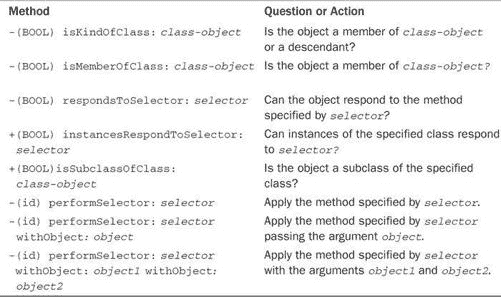

此处未涵盖其他方法。一种方法允许你询问对象是否符合某个协议（参见分类与协议）。要从类名或其他对象生成类对象，你需要向它发送 `class` 消息。所以为了获取名为 `Square` 的类对象，你写：

```
[Square class]
```

如果 `mySquare` 是 `Square` 的实例，你通过这种方式获取它的类：

```
[mySquare class]
```

要查看变量 `obj1` 和 `obj2` 中的对象是否是同一类的实例，你写道：

```
if ([obj1 class] == [obj2 class])
```

要测试变量 `myFract` 是否是 `Fraction` 类对象，你对表达式的结果进行测试：

```
[myFract isMemberOfClass: [Fraction class]]
```

在本示例中，由 `SEL` 变量 `action` 指定的方法被发送到存储在 `graphicObject` 中的任何图形对象。推测，该动作在程序执行过程中可能会变化——也许基于用户的输入——尽管我们已经将动作显示为绘制（draw）。为了首先确保该对象能够响应该动作，你可能希望使用类似下面的代码：

```objc
if ([graphicObject respondsToSelector: action] == YES)
    [graphicObject performSelector: action]
else
    // 此处错误处理代码
```

> **注意**
> `respondsToSelector:` 方法在 iOS 中被广泛用于实现*代理（delegation）*的概念。正如你将在第 10 章中学到的，“关于变量和数据类型”，系统通常会给你选项，在你的类中实现一个或多个方法来处理特定事件或提供特定信息（例如表格中的节数）。为了让系统判断你是否实际上实现了某个特定方法，它将使用 `respondsToSelector:` 来检查它是否可以将事件的处理委托给你的方法。如果你没有实现该方法，它将自己处理该事件，并执行任何定义为默认行为的操作。

你也可以采用其他策略：你可以使用 `forwardInvocation:` 方法将消息转发给另一个对象进行处理，但如何实现这一点超出了本文的范围。

## 程序 9.3

程序 9.3 针对第 8 章中定义的 `Square` 和 `Rectangle` 类提出了一些问题，“继承”。在查看实际输出之前，尝试预测该程序的运行（不要偷看！）。

```objc
#import "Square.h"

int main (int argc, char * argv[])
{
    @autoreleasepool {
        Square *mySquare = [[Square alloc] init];

        // isMemberOf:
        if ( [mySquare isMemberOfClass: [Square class]] == YES )
            NSLog (@"mySquare is a member of Square class");

        if ( [mySquare isMemberOfClass: [Rectangle class]] == YES )
            NSLog (@"mySquare is a member of Rectangle class");

        if ( [mySquare isMemberOfClass: [NSObject class]] == YES )
            NSLog (@"mySquare is a member of NSObject class");

        // isKindOf:
        if ( [mySquare isKindOfClass: [Square class]] == YES )
            NSLog (@"mySquare is a kind of Square");

        if ( [mySquare isKindOfClass: [Rectangle class]] == YES )
            NSLog (@"mySquare is a kind of Rectangle");

        if ( [mySquare isKindOfClass: [NSObject class]] == YES )
            NSLog (@"mySquare is a kind of NSObject");

        // respondsTo:
        if ( [mySquare respondsToSelector: @selector (setSide:)] == YES )
            NSLog (@"mySquare responds to setSide: method");

        if ( [mySquare respondsToSelector: @selector (setWidth:andHeight:)] == YES )
            NSLog (@"mySquare responds to setWidth:andHeight: method");

        if ( [mySquare respondsToSelector: @selector (alloc)] == YES )
            NSLog (@"Square class responds to alloc");

        // instancesTo:
        if ([Rectangle instancesToSelector: @selector (setSide:)] == YES)
            NSLog (@"Instances of Rectangle respond to setSide: method");

        if ([Square instancesToSelector: @selector (setSide:)] == YES)
            NSLog (@"Instances of Square respond to setSide: method");

        if ([Square isclassOfClass: [Rectangle class]] == YES)
            NSLog (@"Square is a subclass of rectangle");
    }
    return 0;
}
```

确保在使用 `Square`、`Rectangle` 和 `XYPoint` 类的实现时编译此程序，这些类已在第 8 章中给出。

### 程序 9.3 输出

```text
mySquare is a member of Square class
mySquare is a kind of Square
mySquare is a kind of Rectangle
mySquare is a kind of NSObject
mySquare responds to setSide: method
mySquare responds to setWidth:andHeight: method
Square class responds to alloc method
Instances of Square respond to setSide: method
Square is a subclass of rectangle
```

程序 9.3 的输出应该是清晰的。记住，`isMemberOf:` 测试是否是某个类的直接成员，而 `isKindOfClass:` 检查是否是继承体系中的成员。因此，`mySquare` 是 `Square` 的成员，也是 `Rectangle` 的 `kind`（种类），是 `NSObject` 的 `kind`。`respondsToSelector:` 测试类是否响应某个方法，除非在其他类中定义了该方法。

### 使用 @try 处理异常

良好的编程习惯要求你尽可能预判程序中可能出现的问题。你可以通过测试可能导致程序终止的情况并处理这些情况，例如通过记录日志并优雅地终止程序或采取其他纠正措施。例如，你在本章之前已经看到过如何测试对象是否响应特定消息。在避免错误的情况下，在程序执行时进行此类测试可以让你避免向对象发送未知消息。当尝试发送此类未知消息时，你的程序通常会通过抛出一个“异常”立即终止。

查看程序 9.4。我们在 `Fraction` 类中没有定义名为 `noSuchMethod` 方法。编译程序时，你将收到相应的警告信息。

### 程序 9.4

```objc
#import "Fraction.h"

int main (int argc, char * argv [])
{
    @autoreleasepool {
        Fraction *f = [[Fraction alloc] init];
        [f noSuchMethod];
        NSLog (@"Execution continues!");
    }
    return 0;
}
```

尽管收到了警告信息，你也可以继续运行程序。如果你这样做，可以预计程序将异常终止，并出现类似的错误：

### 程序 9.4 输出

```text
*** Terminating app due to uncaught exception 'NSInvalidArgumentException', reason: '-[Fraction noSuchMethod]: unrecognized selector sent to instance 0x103f00'
*** Call stack at first throw:'')
```

为了避免此类情况下程序的异常终止，你可以将一个或多个语句放在一个特殊的语句块中，该块采用以下格式：

```objc
@try {
    statement
    statement
    ...
}
@catch (NSException *exception) {
    statement
    statement
    ...
}
```

`@try` 块中的每个 `statement` 都会正常执行。然而，如果块中的某个一个语句抛出了异常，执行不会终止，而是立即跳转到 `@catch` 块并在那里继续。在该块内部，你可以处理该异常。这里的一种可能的操作序列是记录错误信息、清理工作并终止执行。

程序 9.5 演示了异常处理。随后是该程序的输出。

## 程序 9.5. 异常处理

* * *

```objectivec
#import "Fraction.h"

int main (int argc, char * argv [])
{
    @autoreleasepool {
        Fraction *f = [[Fraction alloc] init];
        @try {
            [f noSuchMethod];
        }
        @catch (NSException *exception) {
            NSLog(@"Caught %@%@", [exception name], [exception reason]);
        }
        NSLog (@"Execution continues!");
    }
    return 0;
}
```

* * *

## 程序 9.5. 输出

* * *

```text
*** -[Fraction noSuchMethod]:  recognized selector sent to instance 0x103280
Caught NSInvalidArgumentException: -[Fraction noSuchMethod]:
unrecognized selector sent to instance 0x103280
Execution continues!
```

* * *

当异常发生时，会执行 `@catch` 块。一个包含异常信息的 `NSException` 对象将作为参数传递到此块中。如你所见，`name` 方法获取异常的名称，而 `reason` 方法则给出原因（运行时系统之前也自动打印了该原因）。

在执行完 `@catch` 块中的最后一个语句后（我们这里只有一个语句），程序将从紧接在该块之后的语句开始继续执行。在这种情况下，我们执行了一个 `NSLog` 调用，以验证执行已经继续而没有终止。

这是一个说明如何在程序中捕获异常的非常简单的示例。`@finally` 块可以用于包含一段无论 `@try` 块中的语句是否抛出异常都会执行的代码。

`@throw` 指令允许你抛出自己的异常。你可以用它来抛出一个特定的异常，或者在 `@catch` 块内部抛出导致你进入该块的同一个异常，如下所示：

```objectivec
@throw;
```

你可能想在自己处理异常后这样做（例如，在执行清理工作之后）。然后，你可以让系统为你处理剩余的工作。

你可以拥有多个 `@catch` 块，按顺序排列以捕获和处理不同类型的异常。

通常情况下，你不希望在程序运行时发生异常。因此，在错误发生之前对其进行测试比在发生后进行捕获被认为是更好的编程实践。在方法中测试错误并返回某个值作为错误指示也比抛出异常更好。抛出异常消耗大量的系统资源，因此 Apple 通常建议不要不必要地使用（例如，你不想因为无法打开文件就抛出异常）。

### 练习题

1. 如果在执行加法后向 程序 9.1 插入消息表达式 `[compResult reduce];` 会发生什么？尝试一下并观察结果。

2. 在 程序 9.2 中定义的 `id` 变量 `dataValue` 可以赋值你在 第 8 章 中定义的 `Rectangle` 对象？也就是说，语句 `dataValue = [[Rectangle alloc] init];` 是有效的吗？为什么有效或为什么无效？

3. 为你在 第 8 章 中定义的 `XYPoint` 类添加一个 `print` 方法。让它以 (x, y) 的格式显示该点。然后修改 程序 9.2 以包含一个 `XYPoint` 类。让它以 (x, y) 的格式显示该点。

初始化对象并随后设置某些初始值的过程通常被合并为一个方法。例如，你可以定义一个 `initWith:over:` 方法，用于初始化分数并将其分子和分母设置为提供的两个参数。

包含许多方法和实例变量的类通常也会有几个初始化方法。例如，Foundation 框架中的 `NSArray` 类包含以下六个初始化方法：

- `initWithArray:`
- `initWithArray:copyItems:`
- `initWithContentsOfFile:`
- `initWithContentsOfURL:`
- `initWithObjects:`
- `initWithObjects:count:`

数组可能会被分配内存，然后按照如下序列进行初始化：

```
myArray = [[NSArray alloc] initWithArray: myOtherArray];
```

在类中，所有初始化器都以 `init...` 开头是一种常见做法。正如你所见，`NSArray` 的初始化器遵循了这一约定。在编写初始化器时，你应该遵循以下两种策略。

### 策略 1：重写 init

在某些情况下，你可能希望在类中的某个对象初始化时执行一些特殊操作。例如，这是创建你的类通过一个或多个实例变量使用并引用的对象的完美位置。一个完美的例子就是我们的 `Rectangle` 类；在 `init` 方法中分配矩形的 `XYPoint` 起点是合理的。为了这样做，我们只需要重写继承的 `init` 方法即可。

有一个用于重写 `init` 的标准“模板”，它看起来如下：

```objc
- (id)init
{
    self = [super init];
    if (self) {
        // 在此处编写初始化代码
    }
    return self;
}
```

该方法首先调用父类的初始化器。执行父类的初始化器可以确保任何继承的实例变量都得到正确初始化。

你必须将执行父类 `init` 方法的结果赋值回 `self`，因为初始化器有权更改对象在内存中的位置（这意味着它的引用将会发生变化）。

如果父类的初始化成功，返回的值将是非空的，如 `if` 语句所测试的）。正如注释所示，在随后的块内部，你可以为你的对象放置自定义的初始化代码。这通常涉及分配和初始化你类中的实例变量。

### 策略 2：指定初始化器

如果你的类包含多个初始化器，其中一个应该是你的指定初始化器，而所有其他初始化方法都应该使用它。通常情况下，它是最复杂的初始化方法（通常是接收参数最多的那一个）。创建指定初始化器可以将你的主要初始化代码集中在一个方法中。任何派生你类的子类都可以重写你的指定初始化器，以确保新实例得到正确初始化。

根据上述讨论，你为 `Fraction` 类编写的初始化方法 `initWith:over:` 可能如下：

```objc
-(Fraction *) initWith: (int) n over: (int) d
{
    self = [super init];
    if (self)
        [self setTo: n over: d];
    return self;
}
```


在初始化`super`（并根据返回非零值所示其初始化成功）之后，你使用`setTo:over:`方法来设置`Fraction`的分子和分母。与其他初始化方法一样，你预期要返回初始化后的对象，你在这里确实做到了。

程序 10.1 测试了你新写的`initWith:over:`初始化方法。

### 程序 10.1

```objc
#import "Fraction.h"

int main (int argc, char * argv[])
{
    @autoreleasepool {
        Fraction *a, *b;
        a = [[Fraction alloc] initWith: 1 over: 3];
        b = [[Fraction alloc] initWith: 3 over: 7];
        [a print];
        [b print];
        [a release];
        [b release];
    }
    return 0;
}
```

### 程序 10.1 输出

```
1/3
3/7
```

为了遵循指定初始化器的规则，你还应该修改`init`。以下是`init`可能的写法：

```objc
- (id)init
{
    [self initWith:0 over:0];
}
```

### 复习作用域

你可以通过方式影响变量的作用域。你可以对实例变量和普通变量这样做。在接下来的讨论中，我们使用“模块”（module）一词指代单个源文件内的任意方法或函数定义。

### 控制实例变量作用域的指令

你现在知道实例变量的作用域局限于为类定义的实例方法。因此，任何实例方法都可以直接访问其实例变量，无需进行特殊处理。

你还知道在接口部分（interface section）中声明的实例变量会被子类继承。继承的实例变量也可以在子类的类的任何方法中通过名称直接访问。在接口部分声明实例变量时，可以在它们前面加上指令，以更精确地控制它们的作用域：

- `@protected`:在类及任何子类中定义的方法都可以直接访问其后的实例变量。这是在接口部分定义的实例变量的默认值。
- `@private`:在类中定义的方法可以直接访问其后的实例变量，但子类不能访问。这是在实现部分（implementation section）中定义的实例变量的默认值。
- `@public`:在类以及任何其他类或模块中定义的方法都可以直接访问其后的实例变量。
- `@package`:对于 64 位镜像（images），可以在实现类的镜像内任何地方访问实例变量。

如果你想定义一个名为`Printer`的类，将名为`pageCount`和`tonerLevel`的两个实例变量设为私有，且仅允许`Printer`类中的方法访问，可以使用如下所示接口：

```objc
@interface Printer
{
    @private
    int pageCount;
    int tonerLevel;
    @protected
    // 其他实例变量
}
    ...
@end
```

任何派生`Printer`的类都无法访问这两个实例变量，因为它们被设为私有了。

这些特殊的指令就像“开关”；在这些指令之后出现的所有变量（直到标记变量声明结束的右大括号为止）都具有指定的作用域，除非使用了另一个指令。在之前的示例中，`@protected`指令确保紧随其后的实例变量（直到`}`）可以被子类和`Printer`类的方法访问。

`@public`指令允许实例变量通过指针操作符（`->`）被其他方法或函数访问，这在第 13 章“底层语言特性”中有所介绍。将实例变量设置为公共并不被认为是一种良好的编程习惯，因为它违背了数据封装的概念（即类隐藏其实例变量）。

## 关于属性、合成访问器和实例变量的更多信息

编码规范目前的趋势（Xcode 4 已采用）是使用下划线（`_`）作为实例变量名的开头的字符。因此，你在 Xcode 生成的模板代码中看到的任何以`_`开头的变量引用，都是直接通过名称引用实例变量。

当你看到类似这样的`@synthesize`指令时：

```objc
@synthesize window=_window;
```

它表示为名为`window`的属性合成 getter（获取）和 setter（设置），并将该属性与名为`_window`的实例变量关联（该变量不需要显式声明）。这有助于区分实例变量的使用与属性的使用，并鼓励你通过 setter 和 getter 方法设置和检索实例变量的值。也就是说，编写如下代码：

```objc
[window makeKeyAndVisible];  // 这将不起作用
```

将会失败，因为没有名为`window`的实例变量。相反，你必须直接通过名称命名实例变量，例如：

```objc
[_window makeKeyAndVisible];
```

或者，最好使用访问器方法：

```objc
[self.window makeKeyAndVisible];
```

众所周知，在实现部分显式声明（或通过使用`@synthesize`指令隐式声明）的实例变量是私有的，这意味着它们不能直接通过名称被子类访问。因此，子类只能使用继承的访问器方法来访问它们的值。

记住，合成的方法可能会根据其属性执行额外工作（例如，管理内存、复制值等），而这些工作在直接赋值或从实例变量检索值时是不会发生的。因此，在属性和实例变量之间存在一层额外的抽象。这种抽象层让系统在访问实例变量时有机会执行额外工作（你并不一定需要感知这些工作）。

## 全局变量

如果你在程序的开头——在任何方法、类定义或函数之外——写了以下语句：

```objc
int gMoveNumber = 0;
```

那么它的值就可以从该模块的任何地方被引用。在这种情况下，我们称`gMoveNumber`被定义为全局变量。按照惯例，通常使用小写字母`g`作为全局变量的首字母，以向程序的读者指示其作用域。

实际上，变量`gMoveNumber`的这种相同定义也使得它的值可以从其他文件访问。具体来说，上述语句不仅将变量`gMoveNumber`定义为全局变量，还定义为外部全局变量。

外部变量是指值可以被任何其他方法或函数访问和修改的变量。在想要访问外部变量的模块内部，以普通方式声明该变量，并在声明之前放置`extern`关键字。这向系统发出信号，要访问另一个文件中定义的全局变量。以下是将变量`gMoveNumber`声明为外部变量的示例：

```objc
extern int gMoveNumber;
```

出现上述声明的模块现在可以访问并修改`gMoveNumber`的值。其他模块也可以通过在未使用类似的`extern`声明来访问`gMoveNumber`的值。

在处理外部变量时，请考虑遵循这一重要规则：变量必须在你的源文件某处被定义。这是通过在任何方法或函数之外声明变量来实现的，并且前面*没有*`extern`关键字，如下：

```objc
int gMoveNumber;
```

在这里，可以可选地为变量分配一个初始值，如之前所示。

定义外部变量的第二种方法是在函数之外声明变量，在声明前放置`extern`关键字，并显式地为其分配一个初始值，如下：

```objc
extern int gMoveNumber = 0;
```

然而，这并不是首选的方法，编译器会警告你同时声明了`extern`变量并为其分配了值。这是因为使用`extern`词使其成为该变量的声明，而不是定义。记住，声明不会为变量分配存储空间，但定义会。上一个示例通过强制将声明视为定义（通过为其分配初始值）违反了这一规则。

在处理外部变量时，你可以在许多地方将变量声明为`extern`，但你只能定义一次。

考虑一个较小的程序示例来说明外部变量的使用。假设我们定义了一个名为`Foo`的类，并在名为`main.m`的文件中输入了以下代码：

```objc
#import "Foo.h"

int gGlobalVar = 5;

int main (int argc, char *argc[])
{
    @autoreleasepool {
        Foo *myFoo = [[Foo alloc] init];
        NSLog("%i ", gGlobalVar);
        [myFoo setgGlobalVar:100];
        NSLog("%i", gGlobalVar);
    }
    return 0;
}
```

上述程序中全局变量`gGlobalVar`的定义使得任何使用相应`extern`声明的方法（或函数）都能访问其值。假设你的`Foo`方法`setgGlobalVar:`如下：

```objc
-(void)setgGlobalVar:(int)val
{
    extern int gGlobalVar;
    gGlobalVar = val;
}
```

该程序将产生以下输出：

```
5
100
```

## 静态变量

刚刚展示的示例违背了数据封装的概念和良好的面向对象编程技术。然而，你可能需要处理在不同方法调用之间共享的变量。即使将`gGlobalVar`改为`Foo`类的实例变量可能并不合理，但更好的方法可能是将其“隐藏”在`Foo`类内部，通过将其访问权限限制为该类定义的 setter 和 getter 方法。

你现在知道，在方法之外定义的任何变量不仅是全局变量，而且外部变量。在许多情况下，你希望定义一个变量为全局的而非外部的。换句话说，你希望定义一个局部于特定模块（文件）的全局变量。如果某个特定类定义内部的方法外没有其他方法需要访问该变量，那么以这种方式定义变量就是合理的。你可以通过在包含特定类实现的文件中将变量定义为`static`来实现这一点。

如果定义在任何方法（或函数）之外，以下语句使得`gGlobalVar`的值在定义出现所在文件的后续任何点都可访问，但无法从其他文件中包含的方法或函数访问：

```objc
static int gGlobalVar = 0;
```

请记住，类方法无法访问实例变量（你可能想重新思考一下为什么如此）。然而，你可能希望一个类方法能够设置和访问变量。一个简单的例子是类分配器方法，你希望跟踪它分配的对象的数量。你可以通过在类的实现文件中设置一个静态变量来完成此任务。分配方法随后可以直接访问该变量，因为它不是实例变量。类的用户不需要知道这个变量。由于它是作为实现文件中的静态变量定义的，其作用范围将限制在该文件中。因此，用户无法直接访问它，也不会违反数据封装的概念。如果从类外部访问，你可以编写一个方法来获取此变量的值。

程序 10.2 通过增加两个新方法扩展了`Fraction`类定义。类方法`allocF`分配一个新的`Fraction`并跟踪它分配了多少个`Fraction`，而`count`方法返回该计数。请注意，后者方法也是一个类方法。它也可以被实现为实例方法，但询问类它分配了多少个实例，比向类的某个特定实例发送消息更符合逻辑。

以下是准备添加到`Fraction.h`头文件的两个新类方法的声明：

```objc
+(Fraction *) allocF;
```

```objc
+(int) count;
```

注意，这里没有重写继承的`alloc`方法；相反，你定义了你自己的分配器方法。你的方法将利用从继承的`alloc`方法。请将此代码放在你的`Fraction.m`实现文件中：

```objc
static int gCounter;

@implementation Fraction

+(Fraction *) allocF
{
    extern int gCounter;
    ++gCounter;
    return [Fraction alloc];
}

+(int) count
{
    extern int gCounter;
    return gCounter;
}

// other methods from Fraction class go here
...
@end
```

> **注意**
> 重写`alloc`不认为是一种良好的编程习惯，因为该方法处理内存的物理分配。你不应该参与到那个层次。

`gCounter`的静态声明使得实现部分中定义的任何方法都能访问它，但它无法从文件外部访问。`allocF`方法简单地递增`gCounter`变量，然后使用`alloc`方法创建一个新的`Fraction`并返回结果。`count`方法简单地返回计数器的值，从而将其与用户的直接访问隔离开。

请记住，这两个方法中不需要`extern`声明，因为`gCounter`变量定义在文件内部。它只是帮助方法的读者理解正在访问一个定义在方法之外的变量。变量名中的`g`前缀对读者也起到了相同的作用；由于这个原因，大多数程序员通常不包含`extern`声明。

程序 10.2 测试了这些方法。

### 程序 10.2

```objc
#import "Fraction.h"

int main (int argc, char * argv[])
{
    @autoreleasepool {
        Fraction *a, *b, *c;
        NSLog (@"Fractions allocated: %i", [Fraction count]);
        a = [[Fraction allocF] init];
        b = [[Fraction allocF] init];
        c = [[Fraction allocF] init];
        NSLog (@"Fractions allocated: %i", [Fraction count]);
    }
    return 0;
}
```

### 程序 10.2 输出

```
Fractions allocated: 0
Fractions allocated: 3
```

当程序开始执行时，`gCounter`的值被自动设置为 0（记住，如果你想对整个类进行任何特殊初始化，可以重写继承的`initialize`方法，例如将其他静态变量的值设置为某些非零值）。在使用`allocF`方法分配（然后初始化）三个`Fraction`之后，`count`方法获取了`counter`变量，该变量被正确设置为 3。你也可以为类添加一个 setter 方法来将计数器重置为特定值。

## 枚举数据类型

Objective-C 语言允许你指定可以赋值给变量的值范围。枚举类型定义由关键字`enum`启动。紧随该关键字之后是枚举类型的名称，随后是一系列标识符（括在花括号中），它们定义了可以赋值给该类型的许可值。例如，以下语句定义了一个数据类型`flag`：

```objc
enum flag { false, true };
```

从理论上讲，这种数据类型可以在程序中赋予`true`和`false`值，如果违反此规则，Objective-C 编译器不会生成警告信息。

声明变量为`enum flag`，再次使用关键字`enum`，后接枚举类型名称，然后是变量列表。因此，以下语句定义变量`endOfData`和`matchFound`为`flag`类型：

```objc
enum flag endOfData, matchFound;
```

理论上可以给这些变量的名称只有`true`和`false`。因此，如下语句

```objc
endOfData = true;
```

和

```objc
if ( matchFound == false )
```

是有效的。

如果你希望与枚举标识符关联特定的整数值，可以在定义数据类型时将整数分配给标识符。随后出现在列表中枚举标识符将分配从指定整数值加一开始的顺序整数值。

在以下定义中，定义了一个枚举数据类型`direction`，其值为`up`、`down`、`left`和`right`：

```objc
enum direction { up, down, left = 10, right };
```

编译器为`up`分配值`0`因为它出现在列表中第一个；为`down`分配`1`因为它紧随其后；为`left`分配`10`因为它被显式分配了该值；为`right`分配`11`因为它是列表中前一个枚举的递增值。

枚举标识符可以共享相同的值。例如，在

```objc
enum boolean { no = 0, false = 0, yes = 1, true = 1 };
```

为`enum boolean`变量赋值`no`或`false`值将将其赋值为`0`；赋值`yes`或`true`则将其赋值为`1`。

作为枚举数据类型定义的另一个示例，以下定义了类型`enum month`，其允许给该类型变量赋值的许可值为全年各月份的名称：

```c
enum month { january = 1, february, march, april, may, june, july,
      august, september, october, november, december };
```

Objective-C 编译器实际上将枚举标识符视为整数常量。如果你的程序包含以下两行代码，则值 2 将被赋值给`thisMonth`（而不是名称`february`）：

```c
enum month thisMonth;
  ...
thisMonth = february;
```


程序 10.3 展示了一个使用枚举数据类型的简单程序。该程序读取一个月份数字，然后进入 `switch` 语句查看输入的是哪个月份。请记住，编译器将枚举值视为整数常量，因此它们是合法的 `case` 值。变量 `days` 被赋值为指定月份的天数，并在退出 `switch` 语句后显示其值。程序中还包含一个特殊的测试，用于检查该月份是否为 2 月。

### 程序 10.3

```objc
#import <Foundation/Foundation.h>

// 打印月份的天数

int main (int argc, char * argv[])
{
    @autoreleasepool {
        enum month { january = 1, february, march, april, may, june,
                     july, august, september, october, november,
                     december };
        enum month amonth;
        int days;

        NSLog (@"Enter month number: ");
        scanf ("%i", &amonth);

        switch (amonth) {
            case january:
            case march:
            case may:
            case july:
            case august:
            case october:
            case december:
                days = 31;
                break;
            case april:
            case june:
            case september:
            case november:
                days = 30;
                break;
            case february:
                days = 28;
                break;
            default:
                NSLog (@"bad month number");
                days = 0;
                break;
        }

        if ( days != 0 ) {
            NSLog (@"Number of days is %i", days);
        }

        if ( amonth == february ) {
            NSLog (@"...or 29 if it's leap year");
        }
    }
    return 0;
}
```

### 程序 10.3 输出

```
Enter month number:
5
Number of days is 31
```

### 程序 10.3 输出（重运行）

```
Enter month number:
2
Number of days is 28
...or 29 if it's leap year
```

你可以显式地为枚举数据类型分配一个整数值；你应该使用类型转换运算符来这样做。因此，如果 `monthValue` 是一个值为 6 的整数变量，那么这个表达式是允许的：

```c
lastMonth = (enum month)(monthValue - 1);
```

如果你不使用类型转换运算符，编译器（遗憾的是）不会对此报错。在使用带有枚举类型的程序时，尽量不要依赖于枚举值被视为整数这一事实。相反，应将它们视为不同的数据类型。枚举数据类型为你提供了一种将符号名称与整数关联的方法。如果你随后需要更改该数字的值，必须在定义枚举的地方进行更改。

在定义枚举数据类型时允许某些变体：可以省略数据类型的名称，并在定义类型时将变量声明为特定的枚举类型。作为一个显示这两种选项的示例，语句

```c
enum { east, west, south, north } direction;
```

定义了一个（未命名的）枚举数据类型，其值为 `east`、`west`、`south` 或 `north`，并声明变量 `direction` 为该类型。

在块（block）内部定义枚举数据类型会将该定义的作用范围限制在块内。另一方面，在程序开头、任何块之外定义枚举数据类型将使该定义对整个文件全局。在定义枚举数据类型时，你必须确保枚举标识符相对于相同作用域内的其他变量名和枚举标识符是唯一的。

## `typedef` 语句

Objective-C 提供了一种功能，允许程序员为数据类型分配一个替代名称。这是通过名为 `typedef` 的语句实现的。以下语句定义名称 `Counter` 等同于 Objective-C 数据类型 `int`：

```objc
typedef int Counter;
```

你随后可以声明变量为 `Counter` 类型，如下语句所示：

```objc
Counter j, n;
```

Objective-C 编译器将之前显示的变量 `j` 和 `n` 的声明视为普通的整数变量。在这种情况下使用 `typedef` 的主要优势在于它为变量定义增加了可读性。`j` 和 `n` 的定义使得这些变量在程序中的预期用途明确。用传统方式将它们声明为 `int` 类型将无法明确这些变量的预期用途。

以下 `typedef` 定义了一个名为 `NumberObject` 的类型为 `Number` 对象：

```objc
typedef Number *NumberObject;
```

随后声明为 `NumberObject` 类型的变量，如下所示

```objc
NumberObject myValue1, myValue2, myResult;
```

被处理为像下面一样：

```objc
Number *myValue1, *myValue2, *myResult;
```

1. 如果任一操作数是 `long double` 类型，另一个将转换为 `long double`，结果类型即为该类型。
2. 如果任一操作数是 `double` 类型，另一个将转换为 `double`，结果类型即为该类型。
3. 如果任一操作数是 `float` 类型，另一个将转换为 `float`，结果类型即为该类型。
4. 如果任一操作数是 `_Bool`、`char`、`short int` 或位域类型，或者是枚举数据类型，则它将转换为 `int`。
5. 如果任一操作数是 `long long int` 类型，另一个将转换为 `long long int`，结果类型即为该类型。
6. 如果任一操作数是 `long int` 类型，另一个将转换为 `long int`，结果类型即为该类型。
7. 如果到达这一步，两个操作数都是 `int` 类型，结果类型即为类型。

这实际上是表达式中转换操作数步骤的简化版本。当涉及 `unsigned` 操作数时，规则会变得复杂，但对于本文来说这已经足够详细了。

通过这一系列步骤可以意识到，每当你到达一个说明“结果即为该类型”的步骤时，你就完成了转换过程。

为了说明遵循这些步骤的示例，让我们看看以下表达式是如何求值的，其中 `f` 定义为 `float`，`i` 为 `int`，`l` 为 `long int`，`s` 为 `short int` 变量：

```
f * i + l / s
```

首先考虑 `f` 与 `i` 的乘法，即 `float` 与 `int` 的相乘。根据步骤 3，你知道因为 `f` 是 `float` 类型，另一个操作数（`i`）也将转换为 `float` 类型，这将是乘法的结果类型。

接下来，`l` 除以 `s`，即 `long int` 除以 `short int`。步骤 4 告诉你是 `short int` 将被提升为 `int`。继续，步骤 6 显示，因为其中一个操作数（`l`）是 `long int`，另一个操作数将转换为 `long int`，这也将结果类型。因此，此除法将产生一个 `long int` 类型的值，除法产生的任何分数部分都将被截断。

最后，步骤 3 指出，如果表达式中的一个操作数是 `float` 类型（如 `f * i` 相乘的结果），另一个操作数将转换为 `float` 类型，这将是结果类型。因此，在 `l` 除以 `s` 之后，操作的结果将转换为 `float` 类型，然后加到 `f` 和 `i` 的乘积中。因此，上述表达式的最终结果是一个 `float` 类型的值。

记住，类型转换运算符可以始终显式强制转换，从而控制特定表达式的求值方式。

因此，如果你不想在上述求值过程中让 `l` 除以 `s` 的结果被截断，你可以将一个操作数强制转换为 `float` 类型，从而强制求值以浮点除法的方式执行：

```
f * i + (float) l / s
```

在这个表达式中，在执行除法操作之前，`l` 将转换为 `float`，因为类型转换运算符的优先级高于除法运算符。由于此时除法的操作数之一将是 `float` 类型，另一个（`s`）将自动转换为 `float` 类型，这将是结果类型。

## 位运算符

Objective-C 语言中的各种运算符对表示整数值的特定位进行操作。表 10.1 展示了这些运算符。

表 10.1. 位运算符

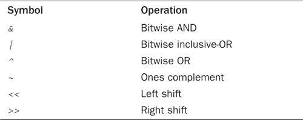

> **注意**
> 在你的 Objective-C 程序中，你可能不会经常使用位运算符，尽管你会在框架头文件中遇到它们。由于这些内容对于新程序员来说可能有点晦涩，你可以直接略过这一部分，在必要时以后查阅。

表 10.1 中列出的所有运算符除取反运算符（`~`）外，都是二元运算符，因此接受两个操作数。位操作可以在任何类型的整数值上执行，但不能在浮点值上执行。

在接后的示例中，你将想要学习如何在二进制表示和十六进制表示之间进行转换。一个十六进制（16 进制）数字由 4 位组成。表 10.2 显示了在这两个基之间进行转换。

表 10.2. 二进制、十进制和十六进制等效值

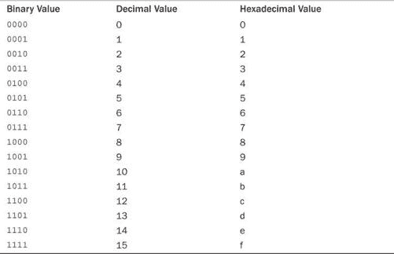

### 位按与运算符

当两个值进行 AND 运算时，这些值的二进制表示逐位进行比较。如果第一个值中的对应位为 `1` 且第二个值中的对应位也为 `1`，则会在结果的对应位产生一个 `1`；任何其他情况均产生 `0`。如果 `b1` 和 `b2` 代表两个操作数的对应位，下表显示了 `b1` 与 `b2` 进行 AND 运算的结果：

```
b1 | b2 | b1 & b2
---|---|---
0 | 0 | 0
0 | 1 | 0
1 | 0 | 0
1 | 1 | 1
```

例如，如果 `w1` 和 `w2` 是两个 `short` 类型，且 `w1` 被设为 `15`，`w2` 被设为 `c`，那么以下语句将 `w1` 与 `w2` 进行 AND 运算的结果赋值给 `w3`：

```
w3 = w1 & w2
```

通过将 `w1`、`w2` 和 `w3` 的值视为二进制数，可以更清楚地看到这一点。假设你正在处理 16 位大小的 `short int`：

```
w1: 0000 0000 0001 0101 (15)
w2: 0000 0000 0000 1100 (c)
--------------------------------
w3: 0000 0000 0000 0100 (4)
```

位按与运算常用于掩码操作。也就是说，该运算符可以轻松地将数据项目的特定位设置为 0。例如，以下语句将 `w1` 与常数 `3` 进行 AND 运算的结果赋值给 `w3`：

```
w3 = w1 & 3;
```

这将把 `w3` 中右侧 2 位以外的所有位设置为 0，并保留 `w1` 的右侧 2 位。

### 位按或运算符

当两个值在 Objective-C 中进行位按或运算时，这两个值的二进制表示会被逐位进行比较。这一次，第一个值或第二个值中的任何一个位为 `1` 都会在结果的对应位产生一个 `1`。按或运算符的真值表如下：

```
b1 | b2 | b1 | b2
---|---|---
0 | 0 | 0
0 | 1 | 1
1 | 0 | 1
1 | 1 | 1
```

所以，如果 `w1` 是等于 `0x19` 的 `short int`，而 `w2` 是等于 `0x6a` 的 `short int`，那么 `w1` 和 `w2` 的位按或运算将产生 `0x7b` 的结果，如下：

```
w1: 0000 0000 0001 1001 (0x19)
w2: 0000 0000 0110 1010 (0x6a)
--------------------------------
    0000 0000 0111 1011 (0x7b)
```

位按或运算（通常简称为位按或）用于将单词的某些指定位设置为 `1`。例如，以下语句无论在执行操作前这些位的状态如何，都将 `w1` 的最右侧的 3 位设置为 `1`：

```
w1 = w1 | 07;
```

当然，你可以在语句中使用特殊的赋值运算符，如该语句所示：

`w1 |= 07;`

我们将在稍后提供一个说明**按位或运算符（Inclusive-OR operator）**使用的程序示例。

### 位异或运算符

按位异或运算符通常称为 **XOR 运算符**，其工作原理如下：对于两个操作数的对应的位，如果其中任意一个位为 `1`——但不是两个位都为 `1`——则结果对应的位为 `1`；否则，则为 `0`。该运算符的真值表如所示。

```
b1      b2      b1 ^ b2
-----------------------
0       0       0
0       1       1
1       0       1
1       1       0
```

如果 `w1` 和 `w2` 分别被设置为十六进制的 `5e` 和 `d6`，则 `w1` 与 `w2` 进行异或运算的结果将是十六进制的 `e8`，如下所示：

```
w1      0000 0000 0101  1110     0x5e
w2      0000 0000 1011  0110   ^ 0xd6
------------------------------------
        0000 0000 1110  1000     0xe8
```

### 按位取反运算符

按位取反运算符是一个元运算符，它的作用是简单地“翻转”操作数的位。操作数中每个为 `1` 的位变为 `0`，每个为 `0` 的位变为 `1`。这里提供真值表仅仅是为了说明的完整性。

```
b1  ~b1
--------
0   1
1   0
```

如果 `w1` 是一个 16 位的短型 `int` 且设置为十六进制的 `a52f`，那么对该值取按位取反得到的结果是十六进制的 `5ad0`：

```
 w1   1010  0101  0010  1111     0xa52f
~w1   0101  1010  1101  0000     0x5ad0
```

当你不知道操作中处理的数值的精确位宽时，按位取反运算符非常有用，它的使用可以帮助减少程序对整数数据类型特定大小的依赖。例如，要将名为 `w1` 的 `int` 的低位设置为 `0`，你可以将 `w1` 与一个除了最右侧位为 `0` 外全为 `1` 的 `int` 进行 AND 运算。因此，C 中这样的语句在整数用 32 位表示的机器上运行良好：

```
w1 &= 0xFFFFFFFE;
```

如果你将前面的语句替换为此语句，则 `w1` 在任何机器上都会与正确的值进行 AND 运算：

```
w1 &= ~1;
```

这是因为 `1` 的按位取反会被计算出来，并包含尽可能多的左侧 `1` 位以填充 `int` 的大小（在 64 位整数系统上，左侧有 63 位 `1`）。

现在是时候展示一个说明各种位运算符使用的实际程序示例了（参见程序 10.4）。

程序 10.4

```objc
// 演示运算符说明
#import <Foundation/Foundation.h>

int main (int argc, char * argv[])
{
    @autoreleasepool {
        unsigned int w1 = 0xA0A0A0A0, w2 = 0xFFFF0000,
                     w3 = 0x00007777;

        NSLog("%x %x %x", w1 & w2, w1 | w2, w1 ^ w2);
        NSLog("%x %x %x", ~w1, ~w2);
        NSLog("%x %x %x", w1 ^ w1, w1 & ~w2, w1 | w2);
        NSLog("%x %x %x", w1 | w2 & w3, w1 | w2 & ~w3);
        NSLog("%x %x %x", ~(w1 & ~w2), ~(w1 | ~w2));
    }
    return 0;
}
```

程序 10.4 输出

```
a0a00000 ffffa0a0 5f5fa0a0
5f5f5f5f ffff8888
00a0ffff7f7
a0a0a0a0 ffffa0a0
ffff000
```


计算出每个操作的结果，以验证你是否理解了结果是如何得到的。在第四次`NSLog`调用中，重要的是，按位 AND 运算符的优先级高于按位 OR 运算符，因为这一事实影响了结果值。第五次`NSLog`调用说明了德摩根定律（DeMorgan’s rule）：`~(~a & ~b)`等于`a | b`，而`~(~a | ~b)`等于`a & b`。

### 左移运算符

对值执行左移操作时，值中所包含的位将字面上向左移动。与此操作相关的是值需要移动的位数（位）。通过数据高位移出的位将被丢弃。例如要将名为`w1`的`int`的低位设置为`0`，你可以将`w1`与一个除了最右侧位为`0`外全为`1`的`int`进行 AND 运算。因此，C 中中这样的语句在整数用 32 位表示的机器上运行良好：

```c
w1 &= 0xFFFFFFFE;
```

如果你将前面的语句替换为此语句，则`w1`在任何机器上都会与正确的值进行 AND 运算：

```c
w1 &= ~1;
```

这是因为`1`的按位取反会被计算出来，并包含尽可能多的左侧`1`位以填充`int`的大小（在 64 位整数系统上，左侧有 63 位`1`）。

### 练习

3. 在`Fraction`类的`add:`方法中添加一个计数器，以统计它被调用的次数。你如何获取该计数器的值？

4. 使用`typedef`和枚举数据类型，定义一个名为`Day`的类型，其可能值为`Sunday`、`Monday`、`Tuesday`、`Wednesday`、`Thursday`、`Friday`和`Saturday`。

5. 使用`typedef`定义一个名为`FractionObj`的类型，让你编写如下语句：

```objc
FractionObj f1 = [[Fraction alloc] init],
            f2 = [[Fraction alloc] init];
```

6. 根据以下定义：

```c
float f = 1.00;

short int i = 100;

long int l = 500L;

double d = 15.00;
```

以及本章概述的表达式操作数转换七个步骤，确定以下表达式的类型和值：

```c
f + i

l / d

i / l + f

l * i

f / 2

i / (d + f)

l / (i * 2.0)

l + i / (double) l
```

## 分类与协议

在本章中，你将学习如何通过分类（categories）以模块化的方式为类添加方法，以及如何创建一个供他人实现的标准化方法列表。

## 分类

有时，你可能正在处理一个类定义，并想向其添加一些新方法。例如，你可能决定为你的`Fraction`类除了用于相两个分数的`add:`方法外，还想要拥有减法、乘法和除法两个分数的方法。

另一个例子是，假设你正在做一个大型编程项目，作为该项目的一部分，你的小组正在定义一个包含许多不同方法的新类。你被分配的任务是为该类编写处理文件系统的方法。其他成员被分配了负责创建和初始化类实例、对类中的对象执行操作，以及在屏幕上绘制类对象表示的方法。

最后一个例子是，假设你学会了如何使用库中的类（例如 Foundation 框架中名为`NSArray`的数组类），并意识到你希望该类能实现一个或多个方法。当然，你可以为`NSArray`类写一个新的子类并实现这些方法，但可能存在更简单的方法。

所有这些情况的实际解决方案是分类（categories）。分类提供了一种简单的方法，让你将类的定义模块化为相关方法的组或类别。它还为你提供了一种扩展现有类定义的简单方法，甚至无需访问该类的原始源代码，也不需要创建子类。这对你来说是一个既强大又易学的概念。

让我们回到第一个案例，展示如何为`Fraction`类添加一个新的分类来处理四种基本的数学运算。我们首先向你展示原始的`Fraction`接口部分：

```objectivec
#import <Foundation/Foundation.h>

// 定义 Fraction 类

@interface Fraction : NSObject

@property int numerator, denominator;

-(void) setTo: (int) n over: (int) d;

-(Fraction *) add: (Fraction *) f;

-(void) reduce;

-(double) convertToNum;

-(void) print;

@end
```

接下来，从这个接口部分移除`add:`方法，并将其添加到一个新的分类中，连同你想实现的另外三个数学运算。以下是你的新分类`MathOps`的接口部分对应的代码：

```objectivec
#import "Fraction.h"

@interface Fraction (MathOps)

-(Fraction *) add: (Fraction *) f;

-(Fraction *) mul: (Fraction *) f;

-(Fraction *) sub: (Fraction *) f;

-(Fraction *) div: (Fraction *) f;

@end
```

请注意，尽管这是一个接口部分的定义，但它是对现有定义的扩展。因此，你必须导入原始接口部分，以便编译器知道`Fraction`类（除非你将新分类直接整合到原始的`Fraction.h`头文件中，这也是一种选择）。

在`#import`之后，你会看到这一行：

```objectivec
@interface Fraction (MathOps)
```

这告诉编译器你正在为`Fraction`类定义一个新分类，其名称为`MathOps`。分类名称括在类名后的括号中。注意，你不需要在这里列出`Fraction`的父类；编译器已经从`Fraction.h`中知道了它。此外，你不需要告诉它实例变量，就像你在之前定义的所有接口部分中所做的那样。事实上，如果你尝试列出父类或实例变量，你将得到编译器的语法错误。

此接口部分告诉编译器你正在为类`Fraction`添加一个名为`MathOps`的扩展。`MathOps`分类包含四个方法：`add:`、`mul:`、`sub:`和`div:`。每个方法都接受一个分数作为参数并返回一个分数。

你可以将所有方法的定义放在一个实现部分中。也就是说，你可以将`Fraction.h`中接口部分的方法加上`MathOps`分类的方法定义在一个文件中。在这种情况下实现部分也必须指明它们所属的分类。与接口部分类似，你通过在类名后加上分类名称来这样做：

```objectivec
@implementation Fraction (MathOps)

-(Fraction *) add: (Fraction *) f {

    // 加两个分数:

    // a/b + c/d = (ad + bc) / (bd)

    Fraction *result = [[Fraction alloc] init];

    result.numerator = (self.numerator * f.denominator) + (f.numerator * self.denominator);

    result.denominator = (self.denominator * f.denominator);

    [result reduce];

    return result;

}

-(Fraction *) sub: (Fraction *) f {

    // 减两个分数:

    // a/b - c/d = (ad - bc) / (bd)

    Fraction *result = [[Fraction alloc] init];

    result.numerator = (self.numerator * f.denominator) - (f.numerator * self.denominator);

    result.denominator = (self.denominator * f.denominator);

    [result reduce];

    return result;

}

-(Fraction *) mul: (Fraction *) f {

    // 乘两个分数:

    // a/b * c/d = (ac) / (bd)

    Fraction *result = [[Fraction alloc] init];

    result.numerator = self.numerator * f.numerator;

    result.denominator = self.denominator * f.denominator;

    [result reduce];

    return result;

}

-(Fraction *) div: (Fraction *) f {

    // 除两个分数:

    // a/b / c/d = (ad) / (bc)

    Fraction *result = [[Fraction alloc] init];

    result.numerator = self.numerator * f.denominator;

    result.denominator = self.denominator * f.numerator;

    [result reduce];

    return result;

}

@end
```

```objectivec
int main (int argc, char * argv[]) {

    @autoreleasepool {

        Fraction *a = [[Fraction alloc] init];

        Fraction *b = [[Fraction alloc] init];

        Fraction *result;

        [a setTo: 1 over: 3];

        [b setTo: 2 over: 5];

        [a print]; NSLog (@"  +"); [b print]; NSLog (@"-----");

        result = [a add: b];

        [result print];

        NSLog (@"\n");

        [a print]; NSLog (@"  -"); [b print]; NSLog (@"-----");

        result = [a sub: b];

        [result print];

        NSLog (@"\n");

        [a print]; NSLog (@"  *"); [b print]; NSLog (@"-----");

        result = [a mul: b];

        [result print];

        NSLog (@"\n");

        [a print]; NSLog (@"  /"); [b print]; NSLog (@"-----");

        result = [a div: b];

        [result print];

        NSLog (@"\n");

    }

    return 0;

}
```

### 程序 11.1 输出

```text
1/3

   +

2/5

-----

11/15

1/3

   -

2/5

-----

-1/15

1/3

   *

2/5

-----

2/15

1/3

   /

2/5

-----

5/6
```

[程序 11.1] 将新分类（category）的接口部分和实现部分与测试程序放在同一个文件中。如前提到的，该分类的接口部分可以放在原始的`Fraction.h`头文件中，以便将所有方法都声明在一个地方，也可以放在它它自己的头文件中。

> **注意**
>
> 按照惯例，分类的`.h`和`.m`文件的基名是类名后跟分类名。在我们的示例中，我们将该分类的接口部分放在名为`FractionMathOps.h`的文件中，将实现部分放在名为`FractionMathOps.m`的文件中。有些程序员使用`+`符号来分隔分类名和类名，例如`Fraction+MathOps.h`。

如果你将分类放入（类定义为）一个主类（master class）定义文件中，那么该类的所有用户都可以访问该分类中的方法。如果你没有直接修改原始头文件的能力（考虑如[第二部分]“[Foundation 框架]”所示，为库中的现有类添加分类），你别无将其保持分开。

### 类扩展（Class Extensions）

创建一个没有名称的分类有一种特殊情况，即在`(`和`)`之间没有指定名称。这种特殊语法定义了所谓的类扩展（class extension）。当你这样定义一个无名分类时，你可以通过定义额外的实例变量来扩展该类。这对于命名的分类是不允许的。在无名分类中声明的方法是在类的主实现部分实现的，而不是在单独的实现部分。如果你没有实现无名分类接口部分列出的所有方法，编译器会发出警告。

假设你有一个名为`GraphicObject`的类。进一步假设你在实现文件`GraphicObject.m`中输入了以下几行：

```objc
#import "GraphicObject.h"

// 类扩展

@interface GraphicObject ()

@property int uniqueID;

-(void) doStuffWithUniqueID: (int) theID;

@end

//--------------------------------------

@implementation GraphicObject

@synthesize uniqueID;

-(void) doStuffWithUniqueID:(int)myID {

    self.uniqueID = myID;

}

// 其他方法

@end
```

你通过添加一个实例变量`uniqueID`并为其合成 setter 和 getter 扩展了`GraphicObject`。

### 关于分类的一些说明

分类很有用，因为它们为类添加了方法。无名分类很有用，因为它们对类是私有的。

如果你向现有类添加分类，必须小心不要与任何现有方法冲突。如果你定义了一个与原始类中方法同名的方法，则会调用分类的实现。这种技术被称为方法代理（method proxying）。

此外，分类/名称对必须是唯一的。在指定的 Objective-C 命名空间中只能存在一个`NSString`。这对于编写屏幕保护程序、偏好设置和其他插件的 Objective-C 程序员来说特别重要。

## 协议与委托（Protocols and Delegation）

协议（protocol）是类之间共享的方法列表。协议中列的方法没有对应的实现；它们旨在由别人（比如你！）来实现。协议提供了一种定义一组与特定名称相关的方法的方法。这些方法通常会有文档说明，以便你知道它们如何执行，以便你需要时在自己的类中实现它们。

协议列出一组方法，其中一些你可以可选地实现，另一些是你必须实现的。如果你决定实现特定协议的所有强制方法，则被称为遵循（conform）或采纳（adopt）该协议。你允许定义一个所有方法都是可选的协议，也可以定义一个所有方法都是强制的协议。

定义协议非常简单：你只需使用`@protocol`指令，后跟协议的名称（名称由你决定）。之后，你像在接口部分中那样声明方法。所有的方法声明（到`@end`指令为止）都成为协议的一部分。

当你与 Foundation 框架工作时，你会发现定义的几个协议。其中一个`NSCopying`声明了一个方法，如果你的类要支持通过`copy`（或`copyWithZone:`）方法复制对象，你就需要实现它。

以下是`NSCopying`协议在标准 Foundation 头文件`NSObject.h`中的定义：

```objc
@protocol NSCopying

- (id)copyWithZone: (NSZone *)zone;

@end
```


如果你在类中采用了`NSCopying`协议，则你必须实现一个名为`copyWithZone:`的方法。你通过在`@interface`行的一对角括号（`<...>`）内列出协议名称来告诉编译器你正在采用该协议。协议名称位于类名及其父类之后，如下所示：

> `@interface AddressBook: NSObject <NSCopying>`

这意味着`AddressBook`是一个父类为`NSObject`的对象，并声明它符合`NSCopying`协议。由于系统已经知道之前为协议定义的方法（在本例中，它是从头文件`NSObject.h`获取的），因此你不需要在接口部分声明这些方法。但你需要在实现部分定义它们。

在这个示例中，在`AddressBook`的实现部分，编译器期望看到定义了`copyWithZone:`方法。

如果你的类采用了多个协议，只需将它们列在角括号内，并用逗号隔开：

> `@interface AddressBook: NSObject <NSCopying, NSCoding>`

这告诉编译器`AddressBook`类采用了`NSCopying`和`NSCoding`协议。同样，编译器期望在`AddressBook`的实现部分看到这些协议所列出的所有强制方法的实现。

如果你定义了自己的协议，你不一定需要自己实现它。然而，你是在提醒其他程序员，如果他们想采用该协议，他们就必须实现所需的方法。这些方法可以从父类继承。因此，如果一个类符合`NSCopying`协议，它的子类也是如此（尽管这并不意味着方法在相应的子类中被正确实现）。

你可以使用协议来定义你希望其他子化你类的人实现的方法。也许你可以为你的`GraphicObject`类定义一个`Drawing`协议；在其中你可以定义`paint`、`erase`和`outline`方法：

```objc
@protocol Drawing

-(void) paint;

-(void) erase;

@optional

-(void) outline;

@end
```

作为`GraphicObject`类的创建者，你不一定想实现这些绘制方法。但是，你希望指定`GraphicObject`类子类需要实现的方法，以符合他们尝试创建的绘图对象的标准。

注意这里使用了`@optional`指令。列在该指令之后的任何方法都是可选的。这意味着，`Drawing`协议的采用者不需要实现`outline`方法即可符合该协议。（你随后可以使用协议定义内部的`@required`指令切换回列出强制方法。）

> 注意
> 至少其意图是如此。编译器允许你说你符合某个协议，并且仅在你没有实现这些方法时才发出警告消息。

所以，如果你为`GraphicObject`创建了一个名为`Rectangle`的子类，并声明（即*记录*）你的`Rectangle`类符合`Drawing`协议，该类的用户就会知道他们可以向该类的实例发送`paint`、`erase`和（可能的）`outline`消息。

注意，该协议没有引用任何类；它是*无类的*（*classless*）。任何类都可以符合`Drawing`协议，而不仅仅是`GraphicObject`的子类。

你可以使用`conformsToProtocol:`方法检查一个对象是否符合某个协议。例如，如果你有一个名为`currentObject`的对象并查看它是否符合`Drawing`协议以便向它发送绘制消息，你可以这样写：

```objc
id currentObject;

...

if ([currentObject conformsToProtocol: @protocol (Drawing)] == YES)

{

  // 向 currentObject 发送 paint, erase 和/or outline 消息

  ...

}
```

这里使用的特殊`@protocol`指令接收一个协议名称并产生一个`protocol`对象，这正是`conformsToProtocol:`方法期望作为参数的内容。

要测试`currentObject`是否实现了可选的`outline`方法，你可以这样写：

```objc
if ([currentObject respondsToSelector: @selector (outline)] == YES)

    [currentObject outline];
```

你可以通过在类型名后的角括号内包含协议名称来利用编译器检查变量的符合性，例如：

```objc
id <Drawing> currentObject;
```

这告诉编译器`currentObject`将引用符合`Drawing`协议的对象。如果你给`currentObject`赋值一个不符合`Drawing`协议的静态类型对象（假设你有一个不符合的`Square`类），编译器会发出类似这样的警告消息：

`warning: class 'Square' does not implement the 'Drawing' protocol`

这是一个编译检查，因此将`id`变量赋值给`currentObject`不会生成此消息，因为编译器无法知道存储在`id`变量中的对象是否符合`Drawing`协议。

如果变量将持有符合多个协议的对象，你可以列出多个协议，如此行所示：

`id <NSCopying, NSCoding> myDocument;`

当你定义一个协议时，可以扩展现有协议的定义。此协议声明表示`Drawing3D`协议也采用了`Drawing`协议：

`@protocol Drawing3D <Drawing>`

因此，任何采用`Drawing3D`协议的类都必须实现该协议列出的方法以及`Drawing`协议的方法。

最后，分类（category）也可以采用协议，如下：

`@interface Fraction (Stuff) <NSCopying, NSCoding>`

在这里，`Fraction`有一个分类`Stuff`（好吧，这不是最好的命名！），它采用了`NSCopying`和`NSCoding`协议。与类名一样，协议名称必须是唯一的。

### 代理 (Delegation)

你也可以将协议视为两个类之间的*接口*定义。定义协议的类可以被认为是将协议中定义的方法的工作*委托*给实现这些方法的类。这样，该类可以定义得更通用，而由代理类在响应某些事件或定义特定参数时采取特定的操作。Cocoa 和 iOS 严重依赖这种代理概念。例如，当你 iPhone 屏幕上设置一个表格时，你会使用`UITableView`类。但该类并不负责表格的标题、包含多少个节或行，或者在表格的每行（单元格）中放入什么。它通过定义一个名为`UITableViewDataSource`的协议将该责任委托给你。当它需要信息时（例如，表格每个节有多少行），它会调用你在类中根据协议定义的相应方法。`UITableView`类还定义了另一个名为`UITableViewDelegate`的协议。该协议中的方法定义了（其他事情）当表格中的某行被选中时该做什么。该类不知道应该采取什么行动，因此它将该责任委托给你。

### 非正式协议 (Informal Protocols)

你可能在阅读中遇到*非正式*协议的概念。这实际上是一个列出一组方法但没有实现它们的分类。每个人（或几乎所有人）都继承自同一个根对象，因此非正式分类通常定义在根类上。非正式协议有时也被称为*抽象*协议（abstract）。

如果你查看头文件`<NSScriptWhoseTests.h>`，你可能会发现一些这样的方法声明：

```objc
@interface NSObject (NSComparisonMethods)

- (BOOL)isEqualTo:(id)object;
```

```objc
- (BOOL)isLessThanOrEqualTo:(id)object;

- (BOOL)isLessThan:(id)object;

- (BOOL)isGreaterThanOrEqualTo:(id)object;

- (BOOL)isGreaterThan:(id)object;

- (BOOL)isNotEqualTo:(id)object;

- (BOOL)doesContain:(id)object;

- (BOOL)isLike:(NSString *)object;

- (BOOL)isCaseInsensitiveLike:(NSString *)object;

@end
```

这为`NSObject`类定义了一个名为`NSComparisonMethods`的分类（category）。这个非正式协议（informal protocol）列出组方法（在这里列出了九个），这些方法可以作为该协议的一部分来实现。非正式协议本质上是将一组方法按名称分组。这在文档编写和方法模块化方面会有一定帮助。

声明该非正式协议的类并没有在类本身中实现这些方法，选择实现这些方法的子类需要在其接口部分中重新声明这些方法，并实现其中一个或多个方法。与正式协议（formal protocols）不同，编译器对非正式协议不提供帮助；编译器没有遵循性（conformance）或测试的概念。

如果一个对象采用了正式协议，则该对象必须遵守协议中的所有要求消息。这可以在运行时和编译时强制执行。如果一个对象采用了非正式协议，该对象可能不需要采纳协议中的所有方法，具体取决于协议的定义。对非正式协议的遵循可以在运行时强制（通过`respondsToSelector:`），但不能在编译时强制。

> 注意
> 之前描述的 Objective-C 2.0 语言添加的`@optional`指令旨在替代非正式协议的使用。你可以看到在几个 UIKit 类中使用了它（UIKit 是 Cocoa Touch 框架的一部分）。

### 复合对象 (Composite Objects)

你已经学习了通过子类化和使用分类等技术扩展类定义的几种方法。另一种技术涉及定义一个类，该类由其他类的一个或多个对象组成。这个新类的对象被称为`composite`（复合对象），因为它是由其他对象组成的。

例如，考虑你在[第 8 章]“继承”中定义的`Square`类。你将其定义为`Rectangle`的子类，因为你意识到正方形只是边长相等的矩形。当你定义一个子类时，它会继承父类所有的实例变量和方法。在某些情况下，这是不理想的——例如，父类中定义的某些方法可能不适合子类使用。`Rectangle`的`setWidth:andHeight:`方法被`Square`类继承了，但它实际上并不适用于正方形（尽管它能正常工作）。此外，当你创建一个子类时，必须确保所有继承的方法都能正常工作，因为该类的用户将能够访问这些方法。最后，子类依赖于父类。对父类的更改可能会在无意中导致子类中的方法停止工作。

作为子类化的替代方案，你可以定义一个新类，并将你想要扩展的类的对象作为其一个实例变量包含其中。那么，你只需要在新类中定义那些适合该类的方法即可。回到`Square`的示例，这里是定义`Square`的另一种方法：

```objc
@interface Square: NSObject

{

    Rectangle *rect;

}

-(int) setSide: (int) s;

-(int) side;

-(int) area;

-(int) perimeter;

@end
```

这里定义的`Square`类包含四个方法。与子类版本不同（子类版本让你直接访问`Rectangle`的方法`setWidth:`、`setHeight:`、`setWidth:andHeight:`、`width`和`height`），在这个`Square`的定义中并没有包含这些方法。这在这里是合理的，因为当你处理正方形时，这些方法确实并不适用。

如果你这样定义`Square`，它将负责为它包含的矩形分配内存。例如，在没有重写方法的情况下，语句：

```objc
Square *mySquare = [[Square alloc] init];
```

分配了一个新的`Square`对象，但没有分配存储在其实例变量`rect`中的`Rectangle`对象。

解决方案是重写`init`或添加如`initWithSide:`的新方法来执行分配。该方法可以分配`Rectangle rect`并适当设置其边长。

在你的`Square`类中定义方法时，仍然可以利用`Rectangle`的方法。例如，你可以这样实现`area`方法：

```objc
-(int) area

{

  return [rect area];

}
```

剩余方法的实现留给你进行练习（参见随后的练习 5）。

### 练习题

**1.** 扩展[程序 11.1]中的`MathOps`分类，使其包含一个`invert`方法，该方法返回一个接收者的倒数的`Fraction`对象。

**2.** 为`Fraction`类添加一个名为`Comparison`的分类。在此分类中，根据以下声明添加两个方法：

```objc
-(BOOL) isEqualTo: (Fraction *) f;

-(int) compare: (Fraction *) f;
```

如果两个分数完全相同，第一个方法应返回 YES，否则返回 NO。比较分数时要小心（例如，比较 3/4 和 6/8 应该返回 YES）。

如果接收者的值小于参数所表示的分数，则第二个方法应返回`-1`；如果两者相等，则返回`0`；如果接收者大于参数，则返回`1`。

**3.** 扩展`Fraction`类，添加符合本章节之前列出的非正式协议`NSComparisonMethods`的方法。实现该协议的前六个方法（`isEqualTo:`、`isLessThanOrEqualTo:`、`isLessThan:`、`isGreaterThanOrEqualTo:`、`isGreaterThan:`、`isNotEqualTo:`）并进行测试。

**4.** 函数`sin()`、`cos()`和`tan()`是标准 C 库的一部分（就像`scanf()`一样）。这些函数声明在系统头文件`math.h`中，当你程序导入`Foundation.h`时，它会自动导入到程序中。

你可以使用这些函数计算其`double`参数的正弦、余弦和正切，单位为弧度。结果也以双精度浮点值返回。因此，你可以使用这行代码计算角度`d`（弧度）的正弦：

```objc
result = sin (d);
```

为[第 6 章]“决策”中定义的`Calculator`类添加一个名为`Trig`的分类。在此分类中添加方法，根据以下声明计算正弦、余弦和正切：

```objc
-(double) sin;

-(double) cos;

-(double) tan;
```

**5.** 根据本章对复合对象的讨论以及以下接口和实现部分：

```objc
@interface Square: NSObject

{

    Rectangle *rect;

}

-(Square *) initWithSide: (int) s;

-(void) setSide: (int) s;

-(int) side;

-(int) area;

-(int) perimeter;

@end
```

```objc
#import "Rectangle.h"

@implementation Square

{

    Rectangle *rect;

}

// 在此处插入 Square 方法

...

@end
```

完成`Square`的实现部分以及一个检查其方法的测试程序。注意：记得也要重写`init`，因为`initWithSide:`将成为你的指定初始化方法。

预处理器提供了各种工具，让你能够开发出更容易开发、读取、修改和移植到不同系统的程序。你还可以使用预处理器从字面上自定义 Objective-C 语言，以适应特定的编程应用或你自己的编程风格。

预处理器是 Objective-C 编译过程的一部分，它识别可以穿在整个程序中的特殊语句。正如其名所示，预处理器实际上在对 Objective-C 程序本身进行分析之前就会处理这些语句。预处理器语句通过井号（`#`）的存在来识别，该符号必须是行中的第一个非空格字符。正如你将看到的，预处理器语句的语法与普通的 Objective-C 语句略有不同。我们从检查`#define`语句开始。

### `#define` 语句

`#define`语句的主要用途之一是为程序常量分配符号名称。预处理器语句

```
#define  TRUE  1
```

定义了名称`TRUE`并使其等同于值`1`。随后，名称`TRUE`可以用于程序中任何可以使用常量`1`的地方。每当此名称出现时，预处理器都会自动将其定义的值`1`替换到程序中。例如，你可能会有以下使用定义名称`TRUE`的 Objective-C 语句：

```
gameOver = TRUE;
```

这条语句将`TRUE`的值赋值给`gameOver`。你不需要关心你为`TRUE`定义的实际值，但因为你确实知道将其定义为`1`，所以前面的语句的效果是将`1`赋值给`gameOver`。预处理器语句

```
#define  FALSE  0
```

定义了名称`FALSE`并使其在程序中的后续使用等同于指定值`0`。因此，语句

```
gameOver = FALSE;
```

将`FALSE`的值赋值给`gameOver`，而语句

```
if ( gameOver == FALSE )
  ...
```


则将`gameOver`的值与定义的`FALSE`值进行比较。

定义的名称*不是*变量。因此，你不能为它赋值，除非替换定义值后的结果是一个变量。每当在程序中使用定义的名称时，预处理器都会自动将`#define`语句中定义名称右侧出现的所有任何内容替换到程序中。这好比于在文本编辑器中进行查找和替换；在这种情况下，预处理器会将定义名称的所有出现处替换为其关联文本。

注意，`#define`语句具有特殊的语法：没有使用等号将值`1`赋值给`TRUE`。此外，语句末尾*没有*出现分号。很快你就会理解为什么存在这种特殊语法。

`#define`语句通常放在程序的开头，位于`#import`或`#include`语句之后。这不是强制要求的；它们可以出现在程序的任何地方。然而，一个名称在被程序引用之前必须已经定义。定义的名称的行为与变量不同：不存在所谓的局部定义。在名称被定义之后，它在随后的可以被程序中的*任何地方*使用。大多数程序员将他们的定义放在头文件中，以便它们可以被多个源文件使用。

作为使用定义名称的另一个例子，假设你想写两个方法来计算`Circle`对象的面积和周长。因为这两个方法都需要使用常量`π`，而`π`不是一个特别容易记忆的常量，那么在程序开始时定义一次该常量的值，然后在每个方法中需要的地方使用该值是有意义的。

因此，你可以在程序中包含以下内容：

```
#define PI    3.141592654
```

然后你就可以在两个`Circle`方法中使用它（这假设`Circle`类有一个名为`radius`的实例变量），如下所示：

```
-(double) area
{
    return PI * radius * radius;
}

-(double) circumference
{
    return 2.0 * PI * radius;
}
```

（注意：我们承认已经有一个名为`M_PI`的预定义符号，你可以在任何需要`π`的值时使用它。）将常量分配给符号名称可以让你无需再每次想在程序中使用它时都记住那个特定的常量值。此外，如果你需要更改常量的值（例如，你发现自己在使用错误的值），你只需要在程序中的一处更改该值：在`#define`语句中。如果没有这种方法，你必须搜索整个程序，并在每次使用常量时显式地更改常量的值。

你可能已经注意到，到目前为止显示的所有定义（`TRUE`、`FALSE`和`PI`）都是用大写字母写的。这样做是为了视觉上将定义值与变量区分开来。有些程序员采用所有定义名称都大写的约定，这样就可以很容易判断一个名称代表的是变量、对象、类名还是定义名称。另一个常见的约定是在定义前加上字母`k`前缀。在这种情况下，名称的后续字符就不大写了。`kMaximumValues`和`kSignificantDigits`是两个遵循此约定的定义名称示例。

使用定义名称作为常量值有助于程序更具扩展性。例如，当你学习如何操作数组时，与其硬编码你想要分配的尺寸，不如按照如下方式定义一个值：

```
#define MAXIMUM_VALUES 1000
```

然后你就可以根据数组的大小（例如数组的分配）基于此定义值。

### 更高级的定义类型

名称的定义可以不仅仅包含一个值。它可以包含一个表达式，而且正如你很快看到的，还可以包含任何其他内容！

以下内容将`TWO_PI`定义为`2.0`与`3.141592654`的乘积：

```
#define TWO_PI 2.0 * 3.141592654
```

随后你可以在程序中任何`2.0 * 3.141592654`有效的地方使用这个定义名称。所以你可以将之前示例中周长方法的`return`语句替换为以下语句：

```
return TWO_PI * radius;
```

每当在 Objective-C 程序遇到定义的名称时，`#define`语句中定义名称右侧的所有内容都会字面上替换到程序在该点。因此，当预处理器在之前所示的`return`语句遇到`TWO_PI`时，它会将该名称替换为该名称定义中出现的任何内容。因此，每当定义名称`TWO_PI`出现在程序中时，预处理器都会替换`2.0 * 3.141592654`。

预处理器每次遇到定义名称时都执行字面替换这一事实解释了为什么你通常不希望以分号结束`#define`语句。如果你这样做，分号也将替换到程序中定义名称的地方。如果你将`PI`定义为

```
#define PI 3.141592654;
```

然后写成

```
return 2.0 * PI * r;
```

编译器因此将看到该语句为

```
return 2.0 * 3.141592654; * r;
```

在预处理器完成替换后，这会导致语法错误。记住，除非你确切在该处需要一个分号，否则不要在你的`#define`语句末尾加上分号。

预处理器的定义本身并不必须是一个合法的 Objective-C 表达式，只要生成的表达式在它被使用的任何地方都是合法的。例如，你可以设置这些定义：

```objc
#define AND    &&
#define OR     ||
```

然后你就可以编写如下表达式：

```objc
if ( x > 0 AND x < 10 )
  ...
```

以及

```objc
if ( y == 0 OR y == value )
  ...
```

你甚至可以为相等测试包含一个`#define`：

```objc
#define EQUALS  ==
```

然后，你可以写以下语句：

```objc
if ( y EQUALS 0 OR y EQUALS value )
  ...
```

这消除了误用单等号进行相等测试的这种真实可能性。

尽管这些示例说明了`#define`的威力，但你应该注意，以这种方式重新定义底层语言的语法通常被认为是糟糕的编程习惯。此外，它让别人难以理解你的代码。

为了让事情更有趣，定义的值本身可以引用另一个定义的值。因此这两行`#define`语句是完全有效的：

```objc
#define PI     3.141592654
#define TWO_PI  2.0 * PI
```

名称`TWO_PI`是根据之前定义的名称`PI`定义的，因此不再需要再次写出值`3.141592654`。

反转定义的顺序（如本例所示）也是有效的：

```objc
#define TWO_PI  2.0 * PI
#define PI     3.141592654
```

规则是，只要在程序中使用定义名称时所有内容都已定义，你就可以在定义中引用其他定义的值。

良好使用`#define`通常可以减少程序内注释的需求。考虑以下语句：

```objc
if ( year % 4 == 0 && year % 100 != 0 || year % 400 == 0 )
  ...
```

这个表达式测试变量`year`是否为闰年。现在考虑下面的`#define`语句以及后续的`if`语句：

```objc
#define IS_LEAP_YEAR  year % 4 == 0 && year % 100 != 0 \
                      || year % 400 == 0
  ...
if ( IS_LEAP_YEAR )
  ...
```

通常，预处理器假设定义包含在程序的单行中。如果需要第二行，行的最后一个字符必须是反斜杠字符。该字符向预处理器发出延续信号，否则会被忽略。对于多行延续也是如此；每一行需要延续的行都必须以反斜杠字符结尾。

前面的`if`语句比直接在其之前显示的语句容易理解得多。不需要注释，因为该语句是自解释的。当然，由于该定义限制了你只能测试变量`year`以判断它是否为闰年。如果能写一个定义来查看任何年份是否为闰年，而不仅仅是变量`year`就太好了。实际上，你可以写一个接受一个或多个参数的定义，这引导我们进入下一个讨论点。

`IS_LEAP_YEAR`可以被定义为接受一个名为`y`的参数，如下：

```objc
#define IS_LEAP_YEAR(y)  y % 4 == 0 && y % 100 != 0 \
                             || y % 400 == 0
```

与方法定义不同，你在这里不需要定义参数`y`的类型，因为你仅仅是在执行字面文本替换——你并没有调用函数。注意，在定义带参数的名称时，定义名称与参数列表的左括号之间不允许有空格。

使用之前的定义，你可以编写如下的语句：

```objc
if ( IS_LEAP_YEAR (year) )
  ...
```

这测试`year`的值是否为闰年。或者你可以写这段代码来测试`nextYear`的值是否为闰年：

```objc
if ( IS_LEAP_YEAR (nextYear) )
  ...
```

在前面的语句中，`IS_LEAP_YEAR`的定义被直接替换在`if`语句内部，参数`nextYear`替换定义中出现的任何`y`。因此编译器实际上看到的`if`语句如下：

```objc
if ( year % 4 == 0 && year % 100 != 0 || year % 400 == 0 )
```

当你使用 Objective-C 编写一段时间代码后，你会发现自己开发了一套属于自己的宏，并且你希望在每个程序中使用它们。但是，你不需要在编写的每个新程序中手动输入这些宏，预处理器允许你将所有定义收集到一个单独的文件，然后使用`#import`语句将它们包含在程序中。这些文件——你之前遇到过但从未亲手编写过的文件——通常以`.h`字符结尾，被称为`header`文件（头文件）或`include`文件（包含文件）。

假设你正在编写一组用于执行各种单位转换的程序。你可能想为执行转换所需的各种常数设置一些`#define`语句：

```c
#define INCHES_PER_CENTIMETER  0.394
#define CENTIMETERS_PER_INCH  (1 / INCHES_PER_CENTIMETER)
#define QUARTS_PER_LITER       1.057
#define LITERS_PER_QUART      (1 / QUARTS_PER_LITER)
#define OUNCES_PER_GRAM        0.035
#define GRAMS_PER_OUNCE       (1 / OUNCES_PER_GRAM)
...
```

假设你将之前的定义输入系统上名为`metric.h`的单独文件中。随后任何需要使用`metric.h`文件包含的任何定义的程序，都可以通过简单发布此预处理器指令来实现：

```c
#import "metric.h"
```

该语句必须出现在引用`metric.h`中包含的任何`#define`语句之前，通常置于源文件的开头。预处理器会在系统上查找指定的文件，并实际上在`#import`语句出现的精确位置将文件内容复制到程序中。因此，文件中的任何语句被处理方式都就像它们被直接输入到该点程序中一样。

头文件名周围的双引号指示预处理器在一个或多个文件目录中查找指定的文件（通常首先在包含源文件的目录中，但预处理器搜索的实际位置可以在 Xcode 中指定）。

相反，将文件名包含在`<`和`>`字符中，例如：

```c
#import <Foundation/Foundation.h>
```


会导致预处理器仅在特殊的“系统”头文件目录或目录中查找包含文件；将不会搜索当前目录。同样，在 Xcode 中，你可以指定要搜索的目录。

导入文件能力最棒的优点之一是它允许你将定义集中，从而确保所有程序都引用相同的值。此外，在包含文件中包含的某个值中发现的错误只需要在那一个地方进行修正，从而消除了修正每个使用该值的程序的需要。任何引用了错误值的程序只需要重新编译，而无需进行编辑。

### 条件编译

Objective-C 预处理器提供了一种名为 `conditional compilation`（条件编译）的功能。条件编译通常用于创建一个可以编译并运行在不同计算机系统上的程序。它还经常被用于开启或关闭程序中的各种语句，例如打印变量值或跟踪程序执行流的调试语句。

### `#ifdef`、`#endif`、`#else` 和 `#ifndef` 语句

遗憾的是，程序有时必须依赖于依赖于的参数，这些参数在不同设备（例如 iPhone 相之于 iPad）或特定版本的操作系统（例如 Leopard 相之于 Snow Leopard）上需要以不同的方式指定。

如果你有一个大型程序，它对计算机系统的特定硬件和/或软件有许多此类依赖（你应该尽可能地减少这种依赖），你可能会遇到许多必须更改才能在另一个环境中运行的值。

你可以利用预处理器的条件编译能力来减少必须更改这些值的问题，并为每种不同的机器将这些定义的值包含在程序。作为一个简单的例子，以下语句的作用是：如果符号 `IPAD` 之前已经被定义，则将 `kImageFile` 定义为 `@"barnHD.png"`，否则定义为 `@"barn.png"`：

```c
#ifdef IPAD
#  define kImageFile  @"barnHD.png"
#else
#  define kImageFile  @"barn.png"
#endif
```

正如你在这里看到的，你被允许在开始预处理器语句的 `#` 之后放置一个或多个空格。

`#ifdef`、`#else` 和 `#endif` 语句的行为正如你预期的那样。如果 `#ifdef` 行上指定的符号已经定义（通过 `#define` 语句或在程序编译时通过命令行），编译器将处理后续 `#else`、`#elif` 或 `#endif` 之前的行；否则，它们会被忽略。

要向预处理器定义符号 `IPAD`，可以使用语句：

```c
#define IPAD  1
```

甚至只是：

```c
#define IPAD
```

正如你所看到的，在定义的名称后不需要出现任何文本即可满足 `#ifdef` 测试。编译器还允许在编译程序时，通过使用编译器命令的特殊选项向预处理器定义一个名称。命令行：

```bash
gcc –framework Foundation -D IPAD program.m –
```

这向预处理器定义了名称 `IPAD`，导致 `program.m` 内部所有的 `#ifdef IPAD` 语句都求结果为 `TRUE`（注意，你必须在命令行上的程序名称之前输入 `-D IPAD`）。这种技术允许你在无需编辑源程序的情况下为预处理器定义名称。

在 Xcode 中，通过选择 Build Settings、All、Apple LLVM compiler 3.0 – Preprocessing、Preprocessor Macros 来添加定义名称并指定它们的值。可以看到 Xcode 4 中设置的符号 `IPAD` 和 `DEBUG`（定义为 `1`），见图 [12.1]。

图 12.1 定义预处理器标识符 IPAD

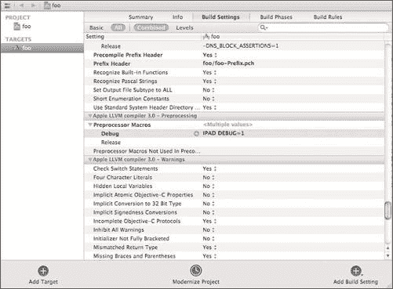

`#ifndef` 语句的用法与 `#ifdef` 类似。该语句的使用方式相似，只是在指示符号未定义时会导致后续行被处理。

正如前面提到的，条件编译在调试程序时非常有用。你可能在程序中嵌入许多 `NSLog` 调用，用于显示中间结果和跟踪执行流。如果某个特定名称（如 `DEBUG`）已定义，你可以通过条件编译将这些语句编译进程序。例如，你可以使用如下语句序列，仅在程序带有 `DEBUG` 编译时显示某些变量的值：

```objc
#ifdef DEBUG
  NSLog (@"User name = %s, id = %i", userName, userId);
#endif
```

`#if` 预处理器语句为条件编译提供了一种更通用的方法。`#if` 语句可以测试常量表达式是否求值为非零。如果表达式的结果为非零，则处理后续 `#else`、`#elif` 或 `#endif` 之前的行；否则，跳过它们。

作为如何使用这种方法的示例，以下几行出现在 Foundation 头文件 `NSString.h` 中：

```c
#if MAC_OS_X_VERSION_MIN_REQUIRED < MAC_OS_X_VERSION_10_5
#define NSMaximumStringLength (INT_MAX-1)
#endif
```

此代码测试将定义的变量 `MAC_OS_X_VERSION_MIN_REQUIRED` 的值与定义的变量 `MAC_OS_X_VERSION_10_5` 进行比较。如果前者小于后者，则处理随后的 `#define`；否则，将跳过它。推测，如果程序是在 Mac OS X 10.5 或更高版本上编译的，这会将字符串的最大长度设置为整数最大值减去 1。

### 特殊运算符

`defined(name)` 也可以用于 `#if` 语句。这组预处理器语句的作用是相同的：

```c
#if defined (DEBUG)
  ...
#endif
```

以及：

```c
#ifdef DEBUG
  ...
#endif
```

以下语句出现在 `NSObjcRuntime.h` 头文件中，其目的是根据正在使用的特定编译器来定义 `NS_INLINE`（如果它之前未被定义）：

```c
#if !defined(NS_INLINE)
    #if defined(__GNUC__)
      #define NS_INLINE static __inline_attribute_((always_inline))
    #elif defined(__MWERKS__) || defined(__cplusplus)
      #define NS_INLINE static inline
    #elif defined(_MSC_VER)
      #define NS_INLINE static __inline
    #elif defined(__WIN32__)
      #define NS_INLINE static __inline__
    #endif
#endif
```

`#if` 的另一个常见用法类似于下面的代码序列：

```c
#if defined (DEBUG) && DEBUG
  ...
#endif
```

这导致 `#if` 之后直到 `#endif` 之前的语句只有在 `DEBUG` 被定义且具有非零值时才会被处理。

由于可以使用表达式，并且由于 0 总是为假，程序员们（包括我在内）经常会通过将代码块封装在 `#if 0` ... `#endif` 预处理器语句内部来注释掉它。

## `#undef` 语句

有时你需要让一个定义的名称变为未定义。你可以通过 `#undef` 语句来实现。要移除特定名称的定义，你可以编写以下内容：

```c
#undef name
```

因此，该语句删除了 `IPAD` 的定义：

```c
#undef IPAD
```

随后的 `#ifdef IPAD` 或 `#if defined (IPAD)` 语句结果结果为 `FALSE`。

我们对预处理器的讨论结束。

### 练习

1. 在你的机器上找到系统头文件 `limits.h` 和 `float.h`。检查这些文件查看其中内容。如果这些文件包含了其他头文件，请务必也追踪找到它们并检查它们的内容。
2. 定义一个名为 `MIN` 的宏，返回两个值中的最小值。然后编写一个程序测试该宏定义。
3. 定义一个名为 `MAX3` 的宏，返回三个值中的最大值。编写一个程序测试该定义。
4. 写一个名为 `IS_UPPER_CASE` 的宏，如果字符是大写字母，则返回非零值。
5. 写一个名为 `IS_ALPHABETIC` 的宏，如果字符是字母，则返回非零值。让该宏使用正文中定义的 `IS_LOWER_CASE` 宏和练习 4 中定义的 `IS_UPPER_CASE` 宏。
6. 写一个名为 `IS_DIGIT` 的宏，如果字符是数字 0 到 `9`，则返回非零值。在另一个名为 `IS_SPECIAL` 的宏的定义中使用此宏，该宏在字符是特殊字符（即既不是字母也不是数字）时返回非零结果。务必使用在练习 5 中开发的 `IS_ALPHABETIC` 宏。
7. 写一个名为 `ABSOLUTE_VALUE` 的宏，计算其参数的绝对值。确保该宏能够正确求值如下所示表达式：

```c
ABSOLUTE_VALUE (x + delta)
```

## 13. 底层 C 语言特性

本章描述了 Objective-C 语言的一些特性，你编写 Objective-C 程序并不一定需要了解这些特性。事实上，这些特性大部分源自底层的 C 编程语言。函数、结构体、指针、联合和数组等特性最好在需要时学习。由于 C 是一种过程化语言，这些特性中的某些违背了面向对象编程的原则。它们还可能干扰 Foundation 框架实现的某些策略，例如内存分配方法或处理包含多字节字符的字符串。

> 注意：在 C 级别有处理多字节字符的方法，但 Foundation 通过其 `NSString` 类提供了一个更优雅的解决方案。

### 数组

Objective-C 语言允许用户定义一组被称为数组（array）的有序项目。本节描述了如何定义和操作数组。后续章节将说明数组如何与函数、结构体和指针一起工作。

假设你想将一组成绩读入计算机，然后对这些成绩进行一些操作，例如按升序排序、计算它们的平均值或找到它们的中位数。在对一组成绩进行排序的过程中，在你输入每一个成绩之前，你无法执行此类操作。

在 Objective-C 中，你可以定义一个名为 `grades` 的变量，它代表的不是单个成绩值，而是一整组成绩。然后你可以使用被称为索引（index）数字或下标（subscript）的来引用集合中的每个元素。在数学中，下标变量 `x[i]` 指的是集合中的第 *i* 个元素 *x*，在 Objective-C 中，等价的表示法是：

```text
x[i]
```

因此表达式 `grades[5]`（读作“grades 下标 5”）指向 `grades` 数组中的第 5 个元素。在 Objective-C 中，数组元素从数字 0 开始，所以 `grades[0]` 实际上指向数组的第一个元素。

你可以在任何可以使用普通变量的地方使用单个数组元素。例如，你可以通过如下语句将数组值赋值另一个变量：

```c
g = grades[50];
```

该语句将 `grades[50]` 中的值赋值给 `g`。更通用地说，如果 `i` 被声明为整数变量，语句：

```c
g = grades[i];
```

将 `grades` 数组中第 `i` 个元素的值赋值给 `g`。

只需通过在等号左侧指定数组元素，就可以值存储在数组元素中。在语句：

```c
grades[99] = 95;
```

中，值 `95` 被存储在 `grades` 数组的第 99 个元素中。

你可以通过改变作为数组下标的变量的值，轻松地遍历数组中的元素。因此，`for` 循环：

```c
for ( i = 0; i < 100; ++i )
    sum += grades[i];
```

会遍历数组 `grades` 的前 100 个元素（索引 `0–99` 的元素），并将每个成绩的值累加到 `sum` 中。当 `for` 循环结束时，变量 `sum` 包含 `grades` 数组前 100 个值的总和（假设在进入循环之前已将 `sum` 设置为 `0`）。

与其他类型的变量一样，你必须在运行数组之前对其进行声明。声明数组涉及声明存储在数组中将包含的元素类型（例如 `int`、`float` 或对象），以及数组中将存储的元素的最大数量。

### 定义

该定义：

```c
Fraction *fracts [100];
```

将 `fracts` 定义为包含 100 个分数的数组。你可以通过下标 `0–99` 对该数组进行有效引用。

该表达式：

```objc
fracts[2] = [fracts[0] add: fracts[1]];
```

调用 `Fraction` 的 `add:` 方法将 `fracts` 数组中的前分数相加，并将结果存储在数组的第三个位置。

程序 13.1 生成了前 15 个斐波那契数的表格。尝试预测它的输出。表格中的每个数字之间存在什么关系？

### 程序 13.1

```c
// 生成前 15 个斐波那契数的程序

#import <Foundation/Foundation.h>

int main (int argc, char * argv[])
{
    @autoreleasepool {
        int Fibonacci[15], i;

        Fibonacci[0] = 0;  /* 根据定义 */
        Fibonacci[1] = 1;  /* 同上 */

        for ( i = 2; i < 15; ++i )
            Fibonacci[i] = Fibonacci[i-2] + Fibonacci[i-1];

        for ( i = 0; i < 15; ++i )
            NSLog (@"%i", Fibonacci[i]);
    }

    return 0;
}
```

### 程序 13.1 输出

```text
0
1
1
2
3
5
8
13
21
34
55
89
144
233
377
```

前两个斐波那契数（我们称为 $F_0$ 和 $F_1$）分别定义为 0 和 1。之后，每个后续斐波那契数 $F_i$ 都定义为前两个斐波那契数 $F_{i-2}$ 和 $F_{i-1}$ 之和。因此，$F_2$ 通过相加 $F_0$ 和 $F_1$ 的值计算。在前面的程序中，这直接对应于通过加 `Fibonacci[0]` 和 `Fibonacci[1]` 的值来计算 `Fibonacci[2]`。该计算在 `for` 循环内部执行，计算 $F_2$–$F_{14}$ 的值（或等于 `Fibonacci[2]` 到 `Fibonacci[14]`）。

### 初始化数组元素

就像在声明变量时可以为其分配初始值一样，你也可以为数组的元素分配初始值。这通过简单从第一个元素开始列出数组的初始值来实现。列表中的值用逗号分隔，整个列表被括在大括号中。

该语句：

```c
int integers[5] = {  0, 1, 2, 3, 4 } ;
```

将 `integers[0]` 的值设置为 `0`，`integers[1]` 设置为 `1`，`integers[2]` 设置为 `2`，依此类推。

字符数组以类似的方式初始化；因此，语句：

```c
char letters[5] = {  'a', 'b', 'c', 'd', 'e' } ;
```

定义了字符数组 `letters` 并并将五个元素初始化为字符 'a'、'b'、'c'、'd' 和 'e'。

你不必初始化整个数组。如果指定的初始值较少，则只有相同数量的元素会被初始化；数组中的剩余值将设置为零。因此，声明：

```c
float sample_data[500] = { 100.0, 300.0, 500.5 } ;
```

将 `sample_data` 的前三个值初始化为 `100.0`、`300.0` 和 `500.5`，并将剩余 497 个元素设置为 `0`。

通过在括号中包含元素编号，你可以按任何顺序初始化特定的数组元素。例如：

```c
int x = 123;

int a[] = [9] = x + 1, [2] = 3, [0] = 1 } ;
```

定义了一个包含 10 个元素的数组 `a`（基于数组中的最高索引），并将最后一个元素初始化为 $x+1$ 的值（`124`）。此外，它还将前三个元素分别初始化为 `1`、`2` 和 `3`。

### 字符数组

程序 13.2 展示了如何使用下标引用数组。

#### 程序 13.2

```objc
#import <Foundation/Foundation.h>

int main (int argc, char * argv[])
{
    @autoreleasepool {
        char word[] = { 'H', 'e', 'l', 'l', '!', '\0' };
        int i;

        for (i = 0; i < 5; ++i )
            NSLog ("%c", word[i]);
    }

    return 0;
}
```

### 程序 13.2 输出

```text
H
e
l
l
!
```

程序 13.2 中的 `word` 数组通过下标 `0–4` 进行了有效引用。

表达式：

```objc
word[2] = [word[0] add: word[1]];
```


调用`Fraction`的`add:`方法，将`word`数组中的前两个字符相加，并将结果存储在数组的第三个位置。

## 多维数组

到目前为止的所有数组类型都是一维数组——也就是说它们都处理单个维度。语言允许你定义任意维度的数组。本节将介绍二维数组。

二维数组最自然的应用之一是矩阵。考虑所示的 4×5 矩阵：


在数学中，矩阵元素通常使用双下标来引用。如果前面的矩阵称为 $M$，则符号 $M[i,j]$ 表示第 $i$ 行第 $j$ 列的元素，其中 $i$ 的范围是从 $1$ 到 $4$，$j$ 的范围是从 $1$ 到 $5$。符号 $M[3,2]$ 指第三行第二列的值`20`。同样地，$M[4,5]$ 指第四行第五列的元素（值为`6`）。

在 Objective-C 中，在引用二维数组元素时使用类似的表示法。然而，由于 Objective-C 喜欢从 0 开始计数，矩阵的第一行实际上是行 0，矩阵的第一列是列 0。前面的矩阵的行和列标记如下图所示：


虽然在数学中使用符号 $M[i,j]$，但在 Objective-C 中等效表示法如下：

```c
M[i][j]
```

记住，第一个索引数字指的是行号，而第二个索引数字引用列。因此，语句：

```c
sum = M[0][2] + M[2][4];
```

将第 0 行第 2 列的值（`-3`）与第 2 行第 4 列的值（`14`）相加，并将结果`11`赋值给变量`sum`。

## 二维数组

二维数组的声明方式与一维数组相同；因此：

```c
int M[4][5];
```

此句语句将`array M`声明为一个包含`4`行`5`列的二维数组，总共`20`个元素。该`array`中的每个位置都定义为包含一个`integer`类型的值。

## 二维数组的声明与初始化

二维数组的初始化方式类似于其一维对应项。在列出初始化元素时，值是按行列出的。使用大括号对来分隔行与行之间的初始化列表。因此，要将`array M`定义并初始化为前表列出的元素，可以使用如下语句：

```c
int M[4][5] = {
    {  10, 5, -3, 17, 82 },
    {  9, 0, 0, 8, -7 },
    {  32, 20, 1, 0, 14 },
    {  0, 0, 8, 7, 6 }
};
```

特别注意上述语句的语法。请注意，在每一行大括号关闭之后（最后一行除外）都需要逗号。内部大括号对的使用实际上是可选的。如果不提供这些括号，初始化将按行进行。因此，上述语句也可以写成：

```c
int M[4][5] = {
    10, 5, -3, 17, 82, 9, 0, 0, 8, -7, 32,
    20, 1, 0, 14, 0, 0, 8, 7, 6
};
```

与一维数组一样，不需要初始化整个数组。如下语句仅将矩阵每行的前三个元素初始化为指定的值：必须使用内部大括号来强制执行正确的初始化，否则，初始化的是前两行以及第三行的前两个元素。（你可以自己验证一下是否如此。）

## 函数

`NSLog`例程是你目前为止在每个程序中都用过的函数示例。事实上，每个程序也都使用了一个名为`main`的函数。让我们回到你写的第一个程序，它在终端显示了“Programming is fun.”这段短语：

```objc
#import <Foundation/Foundation.h>

int main (int argc, char * argv[])
{
    @autoreleasepool {
        NSLog (@"Programming is fun.");
    }

    return 0;
}
```

这个名为`printMessage`的函数产生相同的输出：

```objc
void printMessage (void)
{
    NSLog (@"Programming is fun.");
}
```

函数定义的第一行告诉编译器关于该函数的四件事：

- 谁可以调用它
- 它返回值的类型
- 它的名称
- 它接收参数的数量和类型

`printMessage`函数定义的第一行告诉编译器`printMessage`是函数的名称，且它不返回值（关键字`void`的第一次使用）。与方法不同，你不需要将函数的返回值放在括号内。事实上，如果你这样做会收到编译器错误信息。

在告诉编译器`printMessage`没有返回值后，第二个`void`关键字表示它不接受任何参数。记住`main`是 Objective-C 中一个特殊识别名称，它始终指示执行的起始位置。因此，你可以为前面的代码添加一个`main`函数以得到一个完整的程序：

```objc
#import <Foundation/Foundation.h>

void printMessage (void)
{
    NSLog (@"Programming is fun.");
}

int main (int argc, char * argv[])
{
    @autoreleasepool {
        printMessage();
    }

    return 0;
}
```

## 参数与局部变量

```objc
#import <Foundation/Foundation.h>

void calculateTriangular(int n)
{
    int i, triangularNumber = 0;

    for ( i = 1; i <= n; ++i ) {
        triangularNumber += i;
    }

    NSLog(@"Triangular number %d is %d", n, triangularNumber);
}

int main (int argc, char * argv[])
{
    @autoreleasepool {
        calculateTriangular(10);
        calculateTriangular(20);
        calculateTriangular(50);
    }

    return 0;
}
```

回到我们的程序示例，在局部变量定义之后，函数会计算三角形数并在终端显示结果。随后，闭括号定义了函数的结束。

在`main`例程中，值`10`在第一次调用`calculateTriangularNumber`时作为参数传递。执行流随后直接转移到函数，其中该值`10`成为函数内部形式参数`n`的值。然后，函数计算第 10 个三角形数的值并显示结果。

当下一次调用`calculateTriangularNumber`时，传递了参数`20`。按照之前描述的相似过程，该值成为函数内部`n`的值。然后，函数计算第 20 个三角形数的值并显示答案。

### 返回函数结果

与方法一样，函数可以返回一个值。使用`return`语句返回的值的类型必须与为函数声明的返回类型一致。如下所示的函数声明：

```c
float kmh_to_mph (float km_speed)
```

开始了函数`kmh_to_mph`的定义，它接受一个名为`km_speed`的`float`参数并返回一个浮点值。同样：

```c
int gcd (int u, int v)
```

定义了一个名为`gcd`的函数，带有整数参数`u`和`v`并返回一个整数值。

让我们用函数的形式重写程序 5.7 中使用的最大公约数算法。函数的两个参数是你想要计算最大公约数（`gcd`）的两个数字（参见程序 13.5）。

### 程序 13.5

```c
#import <Foundation/Foundation.h>

// 此函数找到两个
// 非负整数值的最大公约数并返回结果

int gcd (int u, int v)
{
    int temp;

    while ( v != 0 ) {
        temp = u % v;
        u = v;
        v = temp;
    }

    return u;
}

main ()
{
    @autoreleasepool {
        int result;

        result = gcd (150, 35);
        NSLog (@"The gcd of 150 and 35 is %i", result);

        result = gcd (1026, 405);
        NSLog (@"The gcd of 1026 and 405 is %i", result);

        NSLog (@"The gcd of 83 and 240 is %i", gcd (83, 240));
    }

    return 0;
}
```

### 程序 13.5. 输出

```text
The gcd of 150 and 35 is 5

The gcd of 1026 and 405 is 27

The gcd of 83 and 240 is 1
```

函数`gcd`定义为接受两个整数参数。函数通过其形式参数名称`u`和`v`引用这些参数。在声明变量`temp`类型为`int`之后，程序在终端显示参数`u`和`v`的值，以及一条适当的消息。然后，函数计算并返回这两个整数的最大公约数。

语句：

```c
result = gcd (150, 35);
```

表示使用参数`150`和`35`调用函数`gcd`，并将该函数返回的值存储在变量`result`中。

如果省略了函数的返回类型声明，编译器将假设该函数将返回一个整数——如果它确实返回了的话。许多程序员利用这一点，省略了返回整数的函数的返回类型声明。然而，这是你应该避免的糟糕编程习惯。

### 声明返回类型和参数

如果省略了函数的返回类型声明，编译器将假设该函数将返回一个整数——如果它确实返回了的话。许多程序员利用这一点，省略了返回整数的函数的返回类型声明。然而，这是你应该避免的糟糕编程习惯。

如果省略了函数的返回类型声明，编译器将假设该函数将返回一个整数——如果它确实返回了的话。许多程序员利用这一点，省略了返回整数的函数的返回类型声明。然而，这是你应该避免的糟糕编程习惯。

如果省略了函数的返回类型声明，编译器将假设该函数将返回一个整数——如果它确实返回了的话。许多程序员利用这一点，省略了返回整数的函数的返回类型声明。然而，这是你应该避免的糟糕编程习惯。

如果省略了函数的返回类型声明，编译器将假设该函数将返回一个整数——如果它确实返回了的话。许多程序员利用这一点，省略了返回整数的函数的返回类型声明。然而，这是你应该避免的糟糕编程习惯。

如果省略了函数的返回类型声明，编译器将假设该函数将返回一个整数——如果它确实返回了的话。许多程序员利用这一点，省略了返回整数的函数的返回类型声明。然而，这是你应该避免的糟糕编程习惯。

如果省略了函数的返回类型声明，编译器将假设该函数将返回一个整数——如果它确实返回了的话。许多程序员利用这一点，省略了返回整数的函数的返回类型声明。然而，这是你应该避免的糟糕编程习惯。

如果省略了函数的返回类型声明，编译器将假设该函数将返回一个整数——如果它确实返回了的话。许多程序员利用这一点，省略了返回整数的函数的返回类型声明。然而，这是你应该避免的糟糕编程习惯。

如果省略了函数的返回类型声明，编译器将假设该函数将返回一个整数——如果它确实返回了的话。许多程序员利用这一点，省略了返回整数的函数的返回类型声明。然而，这是你应该避免的糟糕编程习惯。

如果省略了函数的返回类型声明，编译器将假设该函数将返回一个整数——如果它确实返回了的话。许多程序员利用这一点，省略了返回整数的函数的返回类型声明。然而，这是你应该避免的糟糕编程习惯。

如果省略了函数的返回类型声明，编译器将假设该函数将返回一个整数——如果它确实返回了的话。许多程序员利用这一点，省略了返回整数的函数的返回类型声明。然而，这是你应该避免的糟糕编程习惯。

如果省略了函数的返回类型声明，编译器将假设该函数将返回一个整数——如果它确实返回了的话。许多程序员利用这一点，省略了返回整数的函数的返回类型声明。然而，这是你应该避免的糟糕编程习惯。

如果省略了函数的返回类型声明，编译器将假设该函数将返回一个整数——如果它确实返回了的话。许多程序员利用这一点，省略了返回整数的函数的返回类型声明。然而，这是你应该避免的糟糕编程习惯。

如果省略了函数的返回类型声明，编译器将假设该函数将返回一个整数——如果它确实返回了的话。许多程序员利用这一点，省略了返回整数的函数的返回类型声明。然而，这是你应该避免的糟糕编程习惯。

.

如果省略了函数的返回类型声明，编译器将假设该函数将返回一个整数——如果它确实返回了的话。许多程序员利用这一点，省略了返回整数的函数的返回类型声明。然而，这是你应该避免的糟糕编程习惯。

如果省略了函数的返回类型声明，编译器将假设该函数将返回一个整数——如果它确实返回了的话。许多程序员利用这一点，省略了返回整数的函数的返回类型声明。然而，这是你应该避免的糟糕编程习惯。

## 函数、方法与数组

要将单个数组元素传递给函数或方法，你只需按照通常的方式将该数组元素作为参数指定。因此，如果你有一个计算平方根的`squareRoot`函数，并想要获取`averages[i]`的平方根并将结果赋值给名为`sq_root_result`的变量，那么像下面这条语句就可以工作：

```c
sq_root_result = squareRoot (averages[i]);
```

将整个数组传递给函数或方法则是完全另一回事了。要传递数组，你需要在函数调用或方法调用的内部仅列出数组的名称，而不包含任何下标。例如，假设`grade_scores`已经声明为一个包含 100 个元素的数组，那么表达式：

```c
minimum (grade_scores)
```

就会将数组`grade_scores`中包含的全部 100 个元素传递给名为`minimum`的函数。自然地，`minimum`函数必须期望接收一个整个数组作为参数，并且必须进行相应的形式参数声明。

此函数在包含指定数量元素的数组中找到最小的整数值：

```c
// 用于在数组中查找最小值的函数

int minimum (int values[], int numElements)
{
    int minValue, i;

    minValue = values[0];

    for ( i = 1; i < numElements; ++i )
        if ( values[i] < minValue )
            minValue = values[i];

    return (minValue);
}
```

`minimum`函数定义为接收两个参数：第一个是你想找到其最小值的数组，第二个是数组中的元素数量。函数头中紧跟在`values`之后的左括号和右括号告知 Objective-C 编译器`values`是一个整数数组。编译器并不关心它有多大。

形式参数`numElements`在`for`语句内部用作上限。因此，`for`语句从`values[1]`开始到数组的最后一个元素（即`values[numElements - 1]`）对数组进行顺序遍-遍-遍-遍遍历。

如果函数或方法更改了数组元素的值，该更改将应用于传递给该函数或方法的原始数组。即使在函数或方法执行完毕后，该更改仍然有效。

数组的行为与简单变量或数组元素不同（函数或方法无法更改后者的值）的原因值得稍作解释。我们提到过，当调用函数或方法时，作为参数传递的值会被复制到相应的形式参数中。这一说法仍然有效。然而，在处理数组时，数组的整个内容并没有被复制到形式参数数组。相反，传递的是一个指针，指示数组在计算机内存的位置。因此，对形式参数数组进行的任何更改实际上都是对原始数组进行的，而不是数组的副本。因此，当函数或方法返回时，这些更改仍然有效。

## Blocks（块）

Blocks 是 C 语言的最新扩展。它们不是 ANSI C 定义的一部分，是由 Apple, Inc. 添加到语言中的。Blocks 的外观和行为非常像函数。这种语法需要时间适应。你可以像向函数一样向块传递参数。你也可以从块中返回值。与函数不同，块可以定义在函数或方法内部，并且可以访问定义在块外部但在作用范围内的任何变量。通常情况下，可以访问这些变量，但不能更改它们的值。有一个特殊的`__block`修饰符（在 block 单词前有两个下划线），允许你从块内部修改变量的值，稍后你就会看到它是如何使用的。

块可以作为参数传递给函数和方法，在[Part II]，“[The Foundation Framework]”中，你将学习一些期望接收块作为参数的方法。块的优势之一是它们可以由系统分发给其他处理器或应用程序中的其他线程执行。

让我们从一个简单的示例开始。回想我们在本章编写的第一个函数`printMessage`：

```objectivec
void printMessage (void)
{
    NSLog (@"Programming is fun.");
}
```

这里有一个完成相同任务的块：

```objectivec
^(void)
{
    NSLog (@"Programming is fun.");
}
```

块通过开头的脱字符字符`^`来识别。其后是该块所接受的括号参数列表。在我们的情况下，块不接受任何参数，所以我们像在函数中那样写了`void`。你可以将此块赋值给名为`printMessage`的变量，只要该变量已正确声明（这里的语法变得复杂了）：

```objectivec
```


```objectivec
void (^printMessage)(void) = ^void(){

    NSLog (@"Programming is fun.");

};
```

在等号左侧，我们指定`printMessage`是一个指向块的指针，该块不接受参数且不返回值。注意，赋值语句以分号结束。执行由变量引用的块的方法与调用函数相同：

```objectivec
printMessage ();
```

将所有内容整合到一个示例中。

```objectivec
#import <Foundation.h>

int main (int argc, char * argv[])
{
    @autoreleasepool {
        void (^printMessage)(void) = ^void() {
            NSLog (@"Programming is fun.");
        };

        printMessage ();
    }

    return 0;
}
```

程序 13.6。输出：

`Programming is fun.`

程序 13.7 是使用块代替函数重写的程序 13.4。块可以定义为全局，也可以定义为局部。在这种情况下，我们将在`main`外部定义块，使其在作用域上是外部且全局的。

```objectivec
#import <Foundation/Foundation.h>

// 计算第 n 数的块
void (^calculateTriangularNumber) (int) = ^(int n) {
    int i, triangularNumber = 0;

    for ( i = 1; i <= n; ++i )
        triangularNumber += i;

    NSLog (@"Triangular number %i is %i", n, triangularNumber);
};

int main (int argc, char * argv[])
{
    @autoreleasepool {
        calculateTriangularNumber (10);
        calculateTriangularNumber (20);
        calculateTriangularNumber (50);
    }

    return 0;
}
```

程序 13.7。输出：

`Triangular number 10 is 55`  
`Triangular number 20 is 210`  
`Triangular number 50 is 1275`

比较程序 13.4 中的函数语法与程序 13.7 中定义的块。块指针变量`calculateTriangularNumber`定义为接收一个`int`参数且不返回值。

正如本节开头提到的，块可以返回值。这里是用块形式重写的程序 13.5 中的`gcd`函数：

```objectivec
int (^gcd) (int, int) = ^(int u, int v){
    int temp;

    while ( v != 0 )
    {
        temp = u % v;
        u = v;
        v = temp;
    }

    return u;
};
```

块（block）可以访问其定义所在作用域内的变量。该变量的值是它在块定义时的值。这在程序 13.8 中得到了说明。

### 程序 13.8

```objectivec
#import <Foundation/Foundation.h>

int main (int argc, char * argv[])
{
   @autoreleasepool {
      int foo = 10;

      void (^printFoo)(void) =
          ^(void) {
              NSLog (@"foo = %i", foo);
          };

      foo = 15;
      printFoo ();
   }

   return 0;
}
```

### 程序 13.8。输出

```text
foo = 10
```

`printFoo`块可以访问局部变量`foo`的值。请注意，显示的值是 10 而不是 15。这是因为它是块在定义时的值，而不是在执行时的值。

默认情况下，你无法修改块外部定义的变量的值。因此，如果你尝试在块内部更改`foo`的值（参见程序 13.9），你将收到来自编译器的错误信息：`Assignment of read-only variable ‘foo.’`

### 程序 13.9

```objectivec
#import <Foundation/Foundation.h>

int main (int argc, char * argv[])
{
   @autoreleasepool {
      int foo = 10;

      void (^printFoo)(void) =
          ^(void) {
              NSLog (@"foo = %i", foo);
              foo = 20;   // 这一行产生编译错误
          };

      foo = 15;
      printFoo ();

      NSLog (@"foo = %i", foo);
   }

   return 0;
}
```

如果你在程序 13.9 中局部变量`foo`的定义之前插入`__block`修饰符，使其看起来如下所示：

```objectivec
__block int foo = 10;
```

并运行程序，你将得到以下两行输出：

```text
foo = 15
foo = 20
```

第一行显示`foo`的值现在是调用块时的值。第二行验证了块能够将`foo`的值改为 20。

我们对块的介绍到此结束。在第 15 章中，你将找到更多关于如何使用的示例。

## 结构体

Objective-C 语言提供了数组之外的另一种工具来组合元素。你还可以使用结构体（structures），它们是本节讨论的基础。

假设你想在程序内部存储一个日期——例如 7/18/11——可能用于某些程序输出的标题，甚至用于计算目的。存储日期的一种自然方法是将月份赋值给整数变量`month`，将日期赋值给整数变量`day`，将年份赋值给整数变量`year`。因此，`int month = 7, day = 18, year = 2011;`语句可以正常工作。这是一种完全可以的方法。但如果你的程序需要存储多个日期呢？将这些三变量组组合在一起会好得多。

你可以在 Objective-C 语言中定义一个名为`date`的结构体，它由代表月、日、年的三个部分组成。这种定义的语法非常直观：

```objectivec
struct date {
   int month;
   int day;
   int year;
};
```

刚刚定义的`date`结构体包含三个成员，分别称为`month`、`day`和`year`。本质上，`date`的定义定义了一个新类型，变量此后可以声明为`struct date`类型：

```objectivec
struct date today;
```

你也可以定义一个名为`purchaseDate`的变量为相同类型：

```objectivec
struct date purchaseDate;
```

或者你可以简单地在同一行包含两个定义：

```objectivec
struct date today, purchaseDate;
```

与`int`、`float`或`char`类型的变量不同，处理结构体变量时需要特殊的语法。结构体的成员是通过指定变量名、后跟一个点、然后是成员名来访问的。例如，要将变量`today`中`day`的值设置为 21，你可以这样写：

```objectivec
today.day = 21;
```

注意，变量名、点和成员名之间不允许有空格。现在，等一下！这不就是用于访问对象属性的相同运算符吗？回想一下，我们可以写出它来访问对象的属性。回到`struct date`示例，为了将`today`中的`year`设置为 2011，你可以使用语句：

```objectivec
today.year = 2011;
```

最后，为了测试`month`是否等于 12，你可以使用如下语句：

```objectivec
if (today.month == 12)
```

程序 13.10 将前面的讨论整合进实际中。

### 程序 13.10

```objectivec
#import <Foundation/Foundation.h>

int main (int argc, char * argv[])
{
   @autoreleasepool {
      struct date {
         int month;
         int day;
         int year;
      };

      struct date today;

      today.month = 9;
      today.day = 25;
      today.year = 2011;

      NSLog (@"Today's date is %i/%i/%.2i.", today.month, today.day, today.year % 100);
   }

   return 0;
}
```

### 程序 13.10。输出

```text
Today's date is 9/25/11.
```

确定今天的日期是否为月末的一种简单方法，是设置一个整数数组，该数组对应每个月份的天数。然后通过在数组内查找特定月份即可得到该月份的天数。

### 初始化结构

初始化结构与初始化数组类似——只需将元素列在一对括号内，并用逗号分隔每个元素。

要将`date`结构体变量`today`初始化为 2011 年 7 月 2 日，可以使用以下语句：

```c
struct date today = { 7, 2, 2011 };
```

与初始化数组一样，列出的值可以少于结构体包含的成员数量。因此，语句

```c
struct date today = { 7 };
```

会将`today.month`设置为`7`，但没有给`today.day`或`today.year`初始值。在这种情况下，它们的默认初始值是未定义的。

在初始化列表中，可以使用`.member = value`语法以任何顺序指定特定成员进行初始化，例如：

```c
struct date today = { .month = 7, .day = 2, .year = 2011 };
```

```c
struct date today = { .year = 2011 };
```

最后一条语句仅将结构体中的年份设置为 2011。如你所知，另外两个成员是未定义的。

### 嵌套结构

Objective-C 在定义结构体方面提供了极大的灵活性。例如，你可以定义一个包含其他结构体作为一个或多个成员的结构体，或者定义包含数组的结构。

你已经在第 10 章中的“关于变量和数据类型的更多内容”学习过`typedef`语句。在你的 iOS 程序中，你经常需要处理矩形。例如，矩形定义了 iPhone 或 iPad 屏幕窗口的大小和位置。它们还定义了子窗口（或称为子视图）的位置和大小。有三种使用`typedef`定义的基础数据类型：

1. `CGPoint`，描述一个 (x,y) 点
2. `CGSize`，描述宽度和高度
3. `CGRect`，是一个包含原点（一个`CGPoint`）和尺寸（一个`CGSize`）的矩形

以下是 Apple 的`CGGeometry.h`头文件的`typedef`定义：

```c
/* Points. */

struct CGPoint {
    CGFloat x;
    CGFloat y;
};

typedef struct CGPoint CGPoint;

/* Sizes. */

struct CGSize {
    CGFloat width;
    CGFloat height;
};

typedef struct CGSize CGSize;

/* Rectangles. */

struct CGRect {
    CGPoint origin;
    CGSize size;
};

typedef struct CGRect CGRect;
```

`typedef`提供了一种方便的方法来声明变量，而无需使用`struct`关键字。`CGFloat`只是对基本浮点数据类型的`typedef`。因此，如果你想声明一个`CGPoint`变量并分别将其`x`成员设置为 100，`y`成员设置为 200，你可以编写以下代码序列：

```c
CGPoint startPt;

startPt.x = 100;
startPt.y = 200;
```

记住`startPt`是一个结构体而不是对象。（通常这的一个良好标志是变量名前面没有星号。）Apple 还提供了创建`CGRect`、`CGSize`和`CGRect`结构的便利函数。例如：

```c
CGPoint startPt = CGPointMake (100.0, 200.0);
```

还有`CGSizeMake`和`CGRectMake`函数，它们执行的任务正如其名称所示。

假设你想定义一个新矩形，并将其尺寸设置为 200 x 100。你可以通过这种方式指定它的尺寸：

```c
CGSize rectSize;

rectSize.width = 200;
rectSize.height = 100;
```

或者你可以像这样使用`CGSizeMake`函数：

```c
CGSize rectSize = CGSizeMake (200.0, 100.0);
```

现在让我们来创建一个具有指定尺寸和原点的矩形：

```c
CGRect theFrame;

theFrame.origin = startPt;
theFrame.size = rectSize;
```

（我们在这里不会显示`CGRectMake`函数的使用。）

假设稍后你想获取矩形的宽度。你可以通过编写：

```c
theFrame.width
```

要将其宽度更改为 175，你可以写：

```c
theFrame.width = 175;
```

最后，要将原点设置为 (0,0)，这些语句可以做到：

```c
theFrame.origin.x = 0;
theFrame.origin.y = 0;
```

## 指针

要理解指针的工作原理，你首先必须理解间接性（indirection）的概念。我们在日常生活中就能见到这一概念。例如，假设我需要为我的打印机购买一个新的墨盒。在我工作的公司，采购部门负责所有的购买工作。因此，我会给采购部门的 Jim 打电话，让他为我订购新墨盒。然后 Jim 会给当地的供应商店打电话订购。为了获得我的新墨盒，我采用的是间接方法，因为我并没有直接从供应商店订购墨盒。

这种间接性的概念也适用于 Objective-C 中指针的工作方式。指针提供了一种访问特定数据项值的间接手段。正如通过采购部门订购新墨盒是有其道理的（例如，我不需要知道墨盒是从哪家特定的商店订购的）一样，在 Objective-C 中使用指针也有充分的理由。

但话不多说，是时候看看指针究竟是如何工作的了。假设你如下定义了一个名为`count`的变量：

```c
int count = 10;
```

你可以通过以下声明定义另一个名为`intPtr`的变量，使你能够间接地访问`count`的值：

```c
int *intPtr;
```

星号向 Objective-C 系统定义变量`intPtr`的类型为指向`int`的指针。这意味着程序将使用`intPtr`来间接访问一个或多个整数变量的值。

你可能已经在之前的程序的`scanf`调用中见过我们如何使用`&`运算符。这个单元运算符被称为地址运算符（address），它在 Objective-C 中创建一个指向变量的指针。因此，如果`x`是某个特定类型的变量，那么表达式`&x`就是该变量的指针。如果你愿意，可以将表达式`&x`赋值给任何已声明为与`x`相同类型的指针变量。

因此，根据给出的`count`和`intPtr`的定义，你可以编写如下语句：

```c
intPtr = &count;
```

来建立`intPtr`和`count`之间的间接引用。地址运算符赋值给变量`intPtr`的不是`count`的值，而是指向变量`count`的指针。[图 13.1] 展示了`intPtr`和`count`之间建立的连接。有向线说明了这样一个观点：`intPtr`并不直接包含`count`的值，而是包含一个指向变量`count`的指针。

### 图 13.1 指向整数的指针

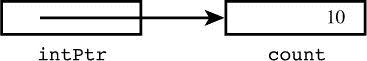

要通过指针变量`intPtr`引用`count`的内容，你需要使用间接运算符，即星号（`*`）。如果`x`被定义为`int`类型，那么语句

```c
x = *intPtr;
```


会将通过`intPtr`间接引用的值赋值给变量`x`。由于`intPtr`之前被设置为指向`count`，这句语句的效果是将变量`count`中所包含的值（即`10`）赋值给变量`x`。

程序 13.11 结合了上述语句，并演示了两个基础的指针运算符：地址运算符（`&`）和间接运算符（`*`）。

### 程序 13.11

```c
// 用于说明指针的程序

#import <Foundation/Foundation.h>

int main (int argc, char * argv[])
{
    @autoreleasepool {
        int count = 10, x;
        int *intPtr;

        intPtr = &count;
        x = *intPtr;

        NSLog (@"count = %i, x = %i", count, x);
    }

    return 0;
}
```

### 程序 13.11. 输出

```text
count = 10, x = 10
```

变量`count`和`x`按照正常方式声明为整数变量。在下一行，变量`intPtr`被声明为类型“指向`int`的指针”。注意，这两行声明可以合并为一行：

```c
int count = 10, x, *intPtr;
```

接下来，将地址运算符应用于变量`count`，其效果是创建一个指向该变量的指针，程序将其赋值给变量`intPtr`。

执行程序中的下一条语句：

```c
x = *intPtr;
```

过程如下：间接运算符告诉 Objective-C 系统将`intPtr`视为指向数据项的指针。由于`intPtr`之前被设置为指向`count`，这句语句的效果是将变量`count`中所包含的值（即`10`）赋值给变量`x`。

左括号字符被赋值给`c`。更正式地说，字符`'('`被赋值给`charPtr`所指向的变量。你之所以知道这个变量是`c`，是因为你在程序开始时就已经在`charPtr`中放置了指向`c`的指针。

之前的概念是理解指针操作的关键。如果这些概念现在看起来仍然有些模糊，请在此处回顾它们。

### 指针与结构体

你已经见过如何定义一个指向`int`或`char`等基本数据类型的指针。但你也可以定义一个指向结构体的指针。在本章稍早之前，你如下定义了`date`结构体：

```c
struct date
{
    int month;
    int day;
    int year;
};
```

就像你定义了类型为`struct date`的变量一样，例如：

```c
struct date todaysDate;
```

你也可以定义一个指向`struct date`变量的指针：

```c
struct date *datePtr;
```

然后你就可以按照预期的方式使用刚刚定义的变量`datePtr`了。例如，你可以通过以下赋值语句将其指向`todaysDate`：

```c
datePtr = &todaysDate;
```

在进行赋值后，你可以通过以下方式间接访问`datePtr`所指向的`date`结构体的任何成员：

```c
(*datePtr).day = 21;
```

该语句将`datePtr`所指向的`date`结构体的日期设置为`21`。之所以需要括号是因为结构体成员运算符点（`.`）的优先级高于间接运算符星号（`*`）。

要测试`datePtr`所指向的`date`结构体中存储的`month`值，你可以使用如下语句：

```c
if ((*datePtr).month == 12)
```

指向结构体的指针非常常用，因此语言提供了一个特殊的运算符。结构体指针运算符`->`（一个连字符后跟一个大于号）允许将原本应写为`(*x).y`的表达式更清晰地表示为`x->y`。

因此，你可以方便地将之前的`if`语句写如下：

```c
if (datePtr->month == 12)
```

我们重写了[程序 13.10]（第一个用于说明结构体的程序），使用了结构体指针的概念。[程序 13.13]展示了该程序。

### 程序 13.13

```c
// 用于说明结构体指针的程序

#import <Foundation/Foundation.h>

int main (int argc, char * argv[])
{
    @autoreleasepool {
        struct date
        {
            int month;
            int day;
            int year;
        };

        struct date today, *datePtr;

        datePtr = &today;
        datePtr->month = 9;
        datePtr->day = 25;
        datePtr->year = 2011;

        NSLog (@"Today's date is %i/%i/%.2i.",
               datePtr->month, datePtr->day, datePtr->year % 100);
    }

    return 0;
}
```

### 程序 13.13. 输出

```text
Today's date is 9/25/11.
```

### 指针、方法与函数

你可以以正常方式将指针作为方法或函数的参数传递，也可以让函数或方法返回指针作为其结果。想起来，这正是你的`alloc`和`init`方法一直所做的——返回指针。我们将在本章末尾详细介绍这一点。

现在考虑[程序 13.14]。

### 程序 13.14

```c
// 作为函数参数的指针

#import <Foundation/Foundation.h>

void exchange (int *pint1, int *pint2)
{
    int temp;

    temp = *pint1;
    *pint1 = *pint2;
    *pint2 = temp;
}

int main (int argc, char * argv[])
{
    @autoreleasepool {
        void exchange (int *pint1, int *pint2);

        // ... (程序的其余逻辑)
    }
}
```

*注：程序 13.14 提供的文本包含重复的逻辑和占位符注释；`exchange`函数的核心逻辑已在上方保留。*

### 指针与数组

如果你有一个名为`values`的包含 100 个整数的数组，你可以定义一个名为`valuesPtr`的指针，并通过以下语句访问该数组中的整数：

```c
int *valuesPtr;
```

当你定义一个将用于指向数组元素的指针时，你不需要将该指针指定为“指向数组的指针”，而是将其指定为指向数组所包含元素类型。

如果你有一个名为`fracts`的包含`Fraction`对象数组，你可以类似地使用如下语句定义一个指向`fracts`中元素的指针：

```c
Fraction **fractsPtr;
```

要将`valuesPtr`设置为指向`values`数组中的第一个元素，只需要写：

```c
valuesPtr = values;
```

在这种情况下不使用地址运算符，因为 Objective-C 编译器会将不带下标的数组名视为指向数组第一个元素的指针。因此，简单地指定不带下标的`values`就会产生指向`values`第一个元素的指针。

产生指向`values`起点的等效方法是对数组的第一个元素应用地址运算符。因此，语句：

```c
valuesPtr = &values[0];
```

具有相同的目的：即将指向`values`第一个元素的指针放入指针变量`valuesPtr`中。

要显示`fractsPtr`所指向的数组`fracts`中的某个`Fraction`对象，你需要编写如下语句：

```objective-c
[*fractsPtr print];
```

使用数组指针的真正威力在你想要遍历数组元素时会体现出来。如果`valuesPtr`如前所述已定义，并被设置为指向`values`的第一个元素，你可以使用以下表达式：

```c
*valuesPtr
```

来访问`values`数组的第一个整数——即`values[0]`。要通过变量`valuesPtr`引用`values[3]`，你可以给`valuesPtr`加 3，然后应用间接操作符：

```c
*(valuesPtr + 3)
```

通常情况下，你可以使用表达式：

```c
*(valuesPtr + i)
```

来访问包含在`values[i]`中的值。

因此，要将`values[10]`设置为`27`，你会编写以下表达式：

```c
values[10] = 27;
```

或者，使用`valuesPtr`，你可以这样写：

```c
*(valuesPtr + 10) = 27;
```

要让`valuesPtr`指向`values`数组的第二个元素，你对`values[1]`应用地址运算符，并将结果赋值给`valuesPtr`：

```c
valuesPtr = &values[1];
```

如果`valuesPtr`指向`values[0]`，你只需通过给`valuesPtr`的值加 1，就可以让它指向`values[1]`：

```c
valuesPtr += 1;
```

这在 Objective-C 中是一个完全有效的表达式，可以用于任何数据类型的指针。

通常，如果`a`是类型为`x`的元素数组，`px`的类型是“指向`x`的指针”，且`i`和`n`是整数常量变量，那么语句：

```c
px = a;
```

将`px`设置为指向`a`的第一个元素，而表达式：

```c
*(px + i)
```

随后引用包含在`a[i]`中的值。此外，语句：

```c
px += n;
```

将`px`设置为指向数组向后`n`个元素，无论该数组包含什么种类的元素。

假设`fractsPtr`指向存储在分数数组中的一个分数。进一步假设你想将其与数组下一个元素中的分数相加，并将结果赋值给`Fraction`对象`result`。你可以通过编写以下代码来实现：

```objective-c
result = [*fractsPtr add:*(fractsPtr + 1)];
```

递增递减运算符（`++`和`--`）在处理指针时特别方便。对指针应用递增运算符的效果与给指针加 1 相同，而对指针应用递减运算符的效果与从指针减 1 相同（这里的“1”意味着一个单位，即指针声明为指向的数据项的大小）。所以，如果`textPtr`被定义为`char`指针，并被设置为指向名为`text`的字符数组的开头，那么语句：

```c
++textPtr;
```

将把`textPtr`设置为指向`text`中的下一个字符，即`text[1]`。类似地，语句：

```c
--textPtr;
```

将`textPtr`设置为指向`text`中的上一个字符（当然，假设在执行此语句之前`textPtr`并没有指向`text`的开头）。

在 Objective-C 中比较两个指针变量是完全有效的。这在比较同一个数组中的两个指针时特别有用。例如，你可以测试指针`valuesPtr`，通过将其与数组中最后一个元素的指针进行比较，来检查它是否指向了包含 100 个元素的数组之外。因此，表达式：

```c
valuesPtr > &values[99]
```

如果`valuesPtr`指向`values`数组最后一个元素之后，则该表达式为`TRUE`（非零），否则为`FALSE`（零）。根据之前的讨论，你可以将之前的表达式替换为它的等效表达式：

```c
valuesPtr > values + 99
```

这是可能的，因为在不使用下标的情况下`values`是指向`values`数组开头的指针。（记住这与编写`&values[0]`是一样的。）

[程序 13.15]展示了指向数组的指针。`arraySum`函数计算整数数组中包含元素的和。

### 程序 13.15

```c
// 计算整数数组元素和的函数

#import <Foundation/Foundation.h>

int arraySum (int array[], int n)
{
    int sum = 0, *ptr;
    int *arrayEnd = array + n;

    for (ptr = array; ptr < arrayEnd; ++ptr)
        sum += *ptr;

    return (sum);
}

int main (int argc, char * argv[])
{
    @autoreleasepool {
        int arraySum (int array[], int n);
```

`for`循环在空字符复制到`to`数组之前就已经结束了，这解释了为什么函数中最后一条语句。

如果你使用指针来编写`copyString`，那么就不再需要索引变量`i`。程序 13.16 显示了指针版本。

### 程序 13.16

```c
#import <Foundation/Foundation.h>

void copyString (char *to, char *from)
{
    for (; *from != '\0'; ++from, ++to)
        *to = *from;

    *to = '\0';
}

int main (int argc, char * argv[])
{
    @autoreleasepool {
        void copyString (char *to, char *from);

        char string1[] = "A string to be copied.";
        char string2[50];

        copyString (string2, string1);
        NSLog (@"%s", string2);

        copyString (string2, "So is this.");
        NSLog (@"%s", string2);
    }

    return 0;
}
```

### 程序 13.16. 输出

```text
A string to be copied.

So is this.
```

`copyString`函数将两个形式参数`to`和`from`定义为字符指针，而不是字符数组（这在之前的`copyString`版本中是那样处理的）。这反映了该函数将如何使用这两个变量。

随后进入一个`for`循环（不带初始条件），将`from`指向的字符串复制到`to`指向的字符串中。循环每次执行时，`from`和`to`指针都会递增 1。这使得`from`指针指向源字符串中要复制的下一个字符，并使`to`指针指向目标字符串中准备存储下一个字符的位置。

当`from`指针指向空字符时，`for`循环退出。随后，函数将空字符放置在目标字符串的末尾。

在`main`例程中，调用了两次`copyString`函数——第一次是将`string1`的内容复制到`string2`，第二次是将常量字符字符串`"So is this."`的内容复制到`string2`。

#### 常量字符字符串与指针

上述调用：

```c
copyString (string2, "So is this.");
```

在上一个程序中能够运行的事实意味着当常量字符字符串作为参数传递给函数时，该字符字符串实际上是传递给指针的。这不仅在这种情况下如此，而且可以概括为：每当在 Objective-C 中使用常量字符字符串时，都会产生该字符串的指针。

这一点现在听起来可能有点困惑，但正如我们在第 4 章中简要提到的那样，我们在这里提到的常量字符字符串被称为 C 风格字符串。它们不是对象。如你所知，常量字符字符串对象是通过在字符串前面加上`@`符号来创建的，例如`@"This is okay."`。你不能将两者互相替代。

所以，如果`textPtr`被声明为字符指针，如下：

```c
char *textPtr;
```

那么：

```c
*(++textPtr)
```

首先对`textPtr`增，然后获取它所指向的字符，而表达式：

```c
*(textPtr++)
```

在`textPtr`的值递增之前，先获取它所指向的字符。在任何情况下，括号都是必须的，因为`*`和`++`运算符的优先级相同，但它们是从右到左结合的。

让我们回到程序 13.16 中的`copyString`函数，并重写它以将递增操作直接整合到赋值语句中。

由于在`for`循环内部执行赋值语句后，`to`和`from`指针每次都会递增，因此它们应该作为后自增操作整合到赋值语句中。程序 13.16 修改后的`for`循环变为：

```c
for (; *from != '\0';)
    *to++ = *from++;
```


循环内部赋值语句的执行过程如下：获取`from`指向的字符，然后`from`递增，以指向源字符串中的下一个字符。将引用的字符存储在`to`指向的位置中；然后`to`递增，以指向目标字符串中的下一个位置。

之前的`for`语句看起来几乎不值得写，因为它没有初始化表达式，也没有循环表达式。事实上，使用`while`循环的形式来表达这种逻辑会更合适。这在程序 13.17 中已经实现，该程序展示了`copyString`函数的新版本。`while`循环利用了空字符等于值`0`这一事实，正如 Objective-C 程序员常做的那样。

### 程序 13.17

```objc
// 将一个字符串拷贝到另一个字符串的函数

//      指针版本 2

#import <Foundation/Foundation.h>

void copyString (char *to, char *from)
{
    while ( *from )
        *to++ = *from++;

    *to = '\0';
}

int main (int argc, char * argv[])
{
    @autoreleasepool {
        void copyString (char *to, char *from);
        char string1[] = "A string to be copied.";
        char string2[50];

        copyString (string2, string1);
        NSLog (@"%s", string2);

        copyString (string2, "So is this.");
        NSLog (@"%s", string2);
    }

    return 0;
}
```

### 程序 13.17 输出

```text
A string to be copied.

So is this.
```

## 指针操作

正如你在本章看到的，你可以对指针进行加或减整数值。此外，你可以比较两个指针以判断它们是否相等，或者一个指针是否小于或大于另一个指针。指针允许的唯一操作是两个相同类型指针的减法。在 Objective-C 中，两个指针相减的结果是两个指针之间包含元素个数。

因此，如果`a`指向任意类型的元素数组，而`b`指向同一数组中更靠后的某个另一个元素，那么表达式`b - a`就代表这两个指针之间的元素个数。例如，如果`p`指向数组`x`中的某个元素，语句：

```c
n = p - x;
```

会将变量`n`（此处假设为整数变量）赋值为`p`所指向的`x`内部元素的索引号。因此，如果`p`通过类似下所示的语句被设置为指向`x`中的第 100 个元素：

```c
p = &x[99];
```

那么在执行上述减法操作后，`n`的值将是`99`。

### 函数指针

这是一种稍微高级一点的概念，但为了完整性起见，这里介绍了函数指针的概念。在处理函数指针时，Objective-C 编译器不仅需要知道指针指向一个函数，还需要知道该函数的返回类型。要声明一个返回`int`的变量`fnPtr`，你需要写道：

```objc
int (*fnPtr)(void);
```

要让你的函数指针指向某个函数，只需将函数名赋值即可。在函数名前允许使用地址符`&`，但它不是必须的。

```c
fnPtr = lookup;
```

你可以通过对指针变量应用函数调用运算符并列出函数的任何参数，来间接地调用该函数。例如：

```c
entry = fnPtr ();
```

这会调用`fnPtr`指向的函数，并将返回的值存储在变量`entry`中。

计算机使用内存来存储你的程序的指令，并存储与程序相关的变量值。因此，如果你声明一个类型为`int`的变量名为`count`，系统会在程序执行期间分配内存中的某个位置来存放`count`的值。例如，该位置可能位于计算机内存中地址`1000FF[16]`处。

幸运的是，你不需要担心分配给变量的具体内存地址——系统会自动处理它们。然而，每个变量都与一个唯一的内存地址相关的这一知识，将帮助你理解指针的工作方式。

在 Objective-C 中，每当你对变量使用地址操作符时，生成的数值就是该变量在计算机内存中的实际地址。（显然，这就是地址操作符名称的由来。）因此，语句：

```c
intPtr = &count;
```

将计算机内存中分配给变量`count`的地址赋值给`intPtr`。因此，如果`count`位于地址`1000FF[16]`，该语句将把值`0x1000FF`赋值给`intPtr`。

对指针变量应用间接操作符，如表达式：

```c
*intPtr
```

其效果是将指针变量中包含的值视为内存地址。然后，获取该内存地址处存储的值，并根据指针变量声明的类型进行解释。因此，如果`intPtr`的类型是指向`int`的指针，系统将把`*intPtr`内存地址中存储的值解释为整数。

### 它们不是对象！

现在你已经知道了如何定义数组、结构体、字符字符串和联合体，以及如何在程序中操作它们。记住一个基本点：它们不是对象。因此，你不能向它们发送消息。你同样无法利用它们来充分利用某些很棒的功能，例如`Foundation`框架提供的内存分配策略。

这就是我鼓励你跳过这一章稍后再回来的原因之一。通常情况下，学习使用定义数组和字符串为对象的`Foundation`类比使用语言内置的类型要好。只有在确实需要时才使用本章中定义的类型——希望你不需要！

### 杂项语言特性

某些语言特性不适合放入任何其他章节，因此我们把它们包含在这里。

#### 复合字面量

复合字面量（compound literal）是一个括在括号内的类型名，后面跟着一个初始化列表。它创建了一个指定类型的无名值，其作用域限于创建它的块，如果定义在任何块之外，则具有全局作用域。在后者的情况下，初始化器必须全为常量表达式。

考虑一个例子：

```c
(struct date) { .month = 7, .day = 2, .year = 2011}
```

该表达式产生一个`struct date`结构体，带有指定的初始值。你可以将其赋值给另一个`struct date`结构体，如下：

```c
theDate = (struct date) { .month = 7, .day = 2, .year = 2011};
```

或者你可以将其传递给期望`struct date`参数的函数或方法，如下：

```objectivec
setStartDate ((struct date) { .month = 7, .day = 2, .year = 2011});
```

此外，你还可以定义结构以外的类型。例如，如果`intPtr`的类型是`int *`，语句：

```c
intPtr = (int [100]) { [0] = 1, [50] = 50, [99] = 99 };
```

（可以出现在程序的任何地方）设置`intptr`指向一个包含 100 个整数的数组，其中 3 个元素按指定方式初始化。

如果未指定数组的大小，则由初始化列表决定。

### `goto` 语句

执行`goto`语句会导致直接跳转到程序中的指定点。为了识别程序中的跳转何处，需要一个标签。标签（label）是按照与变量名相同的规则形成的名称；它必须紧跟冒号。标签直接放在要跳转的语句之前，并且必须与`goto`出现在同一个函数或方法中。

例如，语句：

```c
goto out_of_data;
```

会导致程序立即跳转到由标签`out_of_data`紧 preceding 的语句。该标签可以位于函数或方法的任何位置，在`goto`之前或之后，并可能如下所示使用：

```objectivec
out_of_data: NSLog (@"Unexpected end of data.");

...
```

懒惰的程序员经常滥用`goto`语句跳转到代码的其他部分。`goto`语句中断了程序的正常顺序流。结果是程序变得难以追踪。在程序中使用许多`goto`可能会导致无法破译。出于此原因，`goto`语句不被认为是良好的编程风格。

#### 空语句（null Statement）

Objective-C 允许你在任何可以出现程序语句的地方放置一个单独的分号。这种被称为空语句（null statement）的语句的效果是什么都不做。这看起来可能完全没用，但程序员经常在`while`、`for`和`do`语句中这样做。例如，以下语句的目的与以下语句相同：

```c
while (text++ = getchar ()) != '\n';
```

### `sizeof` 运算符

尽管你不应该对程序中的数据类型大小做假设，但有时你需要这些信息。这可能是在使用`malloc`等库函数进行动态内存分配时，或者在向文件写入或存档数据时。Objective-C 提供了一个名为`sizeof`的运算符，你可以用它来确定数据类型或对象的大小。

`sizeof`操作符按字节返回指定项目的大小。`sizeof`操作符的参数可以是变量、数组名、基本数据类型的名称、对象、派生数据类型的名称或表达式。例如，编写：

```c
sizeof (int)
```

给出存储整数所需的字节数。在我的 MacBook Air 上，这产生结果`4`（或 32 位）。如果`x`被声明为包含 100 个`int`的数组，表达式：

```c
sizeof (x)
```

将给出存储`x`的 100 个整数所需的存储空间。

在任何使用 4 字节表示指针的系统上，都会产生值 4。事实上，这是`sizeof`对任何对象所得出的值，因为在这里你请求的是指向对象数据的指针的大小。要获取存储一个`Fraction`对象实例的实际数据结构的大小，你应该编写以下代码：

```c
sizeof (*myFract)
```

在我的 MacBook Air 上，这得到了一个值`12`。这意味着`numerator`和`denominator`各自占 4 字节，再加上 4 字节，用于本章末尾节“事物是如何工作原理”中提到的继承`isa`值为存储一个`data_entry`结构体所需的存储空间。

如果`data`被定义为`struct data_entry`元素的数组，则表达式：

```c
sizeof (data) / sizeof (struct data_entry)
```

给出`data`中包含的元素个数（`data`必须是之前定义的数组，而不是形式参数或外部引用的数组）。表达式：

```c
sizeof (data) / sizeof (data[0])
```

产生相同的结果。

尽可能到处使用`sizeof`运算符，以避免在程序中手动计算并硬编码大小。

## 命令行参数

通常情况下，开发出的程序需要用户在终端输入少量的信息。这些信息可能包含一个指示你想要计算的三角形数的数字，或者一个你想要在字典中查找的单词。

与其让程序向用户请求这类信息，你可以在程序执行时直接向程序提供这些信息。命令行参数提供了这种能力。

我们已经指出，`main`函数的唯一特殊之处是它的名称是特殊的；它指定了程序执行的起始位置。事实上，运行时系统实际上会在程序执行开始时调用`main`函数，就像你在你自己的程序内部调用函数一样。当`main`完成执行时，控制权返回给运行时系统，此时系统就知道你的程序已经完成。

当运行时系统调用`main`时，会有两个参数传递给该函数。第一个参数按照惯称为`argc`（代表`argument count`），是一个整数值，指定了在命令行上输入的参数数量。`main`的第二个参数是一个字符指针数组，按照惯称为`argv`（代表`argument vector`）。此外，该数组中包含`argc + 1`个字符指针。

数组中的第一个条目是指向正在执行的程序名称的指针，如果系统中无法获取程序名称，则指向一个空字符串指针。数组中的后续条目指向启动程序执行的同一行命令中指定的值。`argv`数组中的最后一个指针`argv[argc]`被定义为空。

要访问命令行参数，`main`函数必须恰当地声明为接收两个参数。我们在书中所有程序中所使用的惯用声明已经足够：

```c
int main (int argc, char * argv[])
{
  ...
}
```

记住，`argv`的声明定义了一个包含“指向`char`指针”类型元素的数组。命令行参数的一个实际用途是，假设你开发了一个在字典中查找单词并打印其含义的程序。你可以使用命令行参数，以便在程序执行的同时指定你想要查找含义的单词，如下例命令所示：

```bash
lookup aerie
```

这消除了程序提示用户输入单词的需要，因为单词是在命令行上输入的。

如果执行了上一个命令，系统会自动将指向字符串`"aerie"`的指针通过`argv[1]`传递给`main`函数。回想，`argv[0]`将包含指向程序名称的指针，在这种情况下，它是`"lookup"`。

`main`例程可能如下所示：

```c
#include <Foundation/Foundation.h>

int main (int argc, char * argv[])
{
  struct entry dictionary[100] =
  {
    {  "aardvark", "a burrowing African mammal"    } ,
    {  "abyss",  "a bottomless pit"            } ,
    {  "acumen",  "mentally sharp; keen"        } ,
    {  "addle",  "to become confused"        } ,
    // ... 字典的其余部分
  };
  // ... 逻辑
}
```

该结构的一个继承成员（它源自于根对象）是一个名为`isa`的受保护成员，用于标识对象所属的类。由于它是结构的一部分（因此，也是对象的一部分），它会随着对象一起移动。通过这种方式，运行时系统始终可以通过查看其`isa`成员来识别对象的类类型（即使你将其赋值给一个通用的`id`对象变量）。

你可以通过将对象的结构成员设置为`@public`来直接访问它们（请参见第 10 节中的讨论）。例如，如果你对`Fraction`类中的`numerator`和`denominator`成员这样做，你就可以在程序中编写诸这样的表达式：

```objc
myFract->numerator
```

来直接访问`Fraction`对象`myFract`的`numerator`成员。但我们强烈建议不要这样做。正如我们在第 10 节中所提到的，这违反了数据封装的原则。

### 事实 #2：对象变量实际上是指针

当你定义一个像`Fraction`这样的对象变量时：

```objc
Fraction *myFract;
```

你实际上定义了一个名为`myFract`的指针变量。该变量被定义为指向`Fraction`类型的内容，这是你的类名。当你分配一个新的`Fraction`实例时：

```objc
myFract = [Fraction alloc];
```

你正在内存中分配一段空间来存储一个新的`Fraction`对象（即存储结构的空间），然后将返回的该结构的指针存储在指针变量`myFract`中。

当你将一个对象变量赋值给另一个时，例如：

```objc
myFract2 = myFract1;
```

你仅仅是在复制指针。两个变量最终都指向存储在内存某处的同一个结构。因此，对`myFract2`引用（即指向）的某个成员进行更改，就会改变`myFract1`引用的同一个实例变量（即结构成员）。

### 事实 #3：方法是函数，而消息表达式是函数调用

方法本质上是函数。当你调用一个方法时，你调用的是与接收者类相关的函数。传递给函数的参数是接收者（`self`）以及方法的参数。因此，无论你说的是函数还是方法，关于向函数传递参数、返回值以及自动和静态变量的所有规则都是相同的。Objective-C 编译器使用类名和方法名的组合为每个函数创建一个唯一的名称。

### 事实 #4：`id` 类型是一种通用指针类型

由于对象是通过指针（指针仅仅是内存地址）引用的，因此你可以自由地在`id`变量之间进行赋值。因此，返回`id`类型的方法实际上返回的是指向内存中某个对象的指针。然后你可以将该值赋值给任何对象变量。由于对象无论去哪里都携带其`isa`成员，因此它的类始终可以被识别，即使你将其存储在类型为`id`的通用对象变量中。

## 练习

1. **编写一个函数，计算包含 10 个浮点数的数组的平均值并返回结果。**

2. **你的`Fraction`类中的`reduce`方法寻找分子和分母的最大公约数来约约分数。修改该方法，使其使用程序 13.5 中的`gcd`函数。你认为应该将函数定义放在哪里？将函数设置为`static`有什么好处吗？你认为哪种方法更好，使用`gcd`函数还是像之前那样将代码直接整合到方法中？为什么？**

3. **名为埃拉斯特尼筛（Sieve of Erasthenes）的算法可以生成质数。该过程的算法所示。编写一个实现该算法的程序。让程序找到直到`n = 150`的质数。与文中用于计算质数的方法相比，你对此算法有什么评价？**

   - 步骤 1：定义一个整数数组`P`。将所有元素`P[i]`设置为`0`，`2 <= i <= n`。
   - 步骤 2：将`i`设置为 2。
   - 步骤 3：如果`i > n`，算法终止。
   - 步骤 4：如果`P(i)`为`0`，则`i`是质数。


- 步骤 5：对于所有满足 `i*j<=n` 的正整数 `j`，将 `P[i*j]` 设置为 1。

- 步骤 6：将 `i` 加 1 并回到步骤 3。

4. **编写一个函数，将传递给它的数组中的所有 `Fractions` 相并并 `Fraction` 类型返回结果。**

5. **为 `struct date` 编写一个名为 `Date` 的 `typedef` 定义，以便你可以在程序中进行如下声明：**

```
Date todaysDate;
```

6. **正如文中提到的，定义 `Date` 类而不是 `date` 结构更符合面向对象编程的理念。定义这样一个类，并带有相应的 setter 和 getter 方法。再添加一个名为 `date` 的方法来返回其参数。你认为将 `Date` 定义为类而不是结构有什么优势？有什么缺点吗？**

7. **给定定义：**

```
char *message = "Programming in Objective-C is fun";
char message2[] = "You said it";
int x = 100;
```

确定以下 `NSLog` 调用是否有效，以及是否产生相同的输出。

`/*** set 1 ***`

```
NSLog (@"Programming in Objective-C is fun");
NSLog("%s", "Programming in Objective-C is fun");
NSLog("%s", message);
```

`/*** set 2 ***`

```
NSLog (@You said it");
NSLog("%s", message2);
NSLog("%s", &message2[0]);
```

`/*** set 3 ***`

```
NSLog (@said it");
NSLog("%s", message2 + 4);
NSLog("%s", &message2[4]);
```

8. **编写一个程序，打印所有的命令行参数，每行一个。注意包含引号的参数的影响。**

9. **哪些语句会输出 `This is a test`？解释原因。**

```
NSLog (@This is a test");
NSLog ("This is a test");
NSLog("%s", "This is a test");
NSLog("%s", @"This is a test");
NSLog ("%s", "This is a test");
NSLog ("%s", @"This is a test");
NSLog (@@", @"This is a test");
NSLog (@@", "This is a test");
```

10. **将程序 13.14 中的 `exchange` 函数重写为块并进行测试。**

Application Kit 框架包含了大量的类和方法，用于开发交互式图形应用程序。这些方法提供了轻松处理文本、菜单、工具栏、表格、文档、剪贴板和窗口的能力。在 Mac OS X 中，`Cocoa` 一词统指 `Foundation` 框架、`Application Kit` 框架以及名为 `Core Data` 的第三个框架。Cocoa Touch 则统指 `Foundation`、`Core Data` 和 `UIKit` 框架。第三部分“Cocoa、Cocoa Touch 与 iOS SDK”对该主题提供了更多详细信息。

## Foundation 文档

你应该利用存储在系统中的 `Foundation` 框架文档（如果你选择了下载本地副本），这些文档也可以在 Apple 网站上在线获取。大多数文档以 `HTML` 文件的形式存在，可通过浏览器查看，或者以 `Acrobat PDF` 文件的形式存在。该文档包含了所有 `Foundation` 类以及所有实现的方法和函数的描述。我将 `Foundation` 文档的 `URL` 保存为浏览器的书签，以便方便查找关于 `Foundation` 类的信息。

如果你正在使用 `Xcode` 开发程序，可以通过几种不同的方式轻松访问文档。你可以从 `Help` 菜单进入主文档窗口 `Xcode Help`。此窗口允许你轻松搜索并访问存储在计算机本地或在线提供的文档。图 14.1 显示了在 `Xcode Help` 窗口中搜索字符串“NSString”的结果。

图 14.1. 使用 Xcode 参考文档

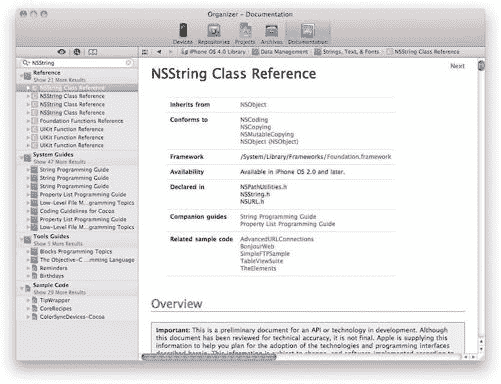

如果你在 `Xcode` 中编辑文件，并想立即访问特定头文件、方法或类的文档，只需将光标置在你想要搜索的类、方法或变量上，按住 `Option` 键并点击。你将获得所选内容的快速摘要。图 14.2 显示了当鼠标光标位于文本 `NSString` 处、按下 `Option` 键并点击鼠标时出现的面板。

图 14.2. `NSString` 的快速参考

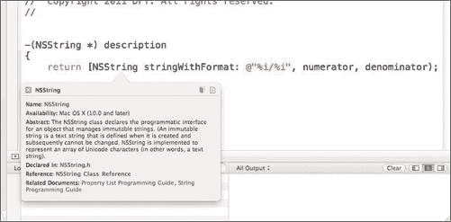

在出现面板的右上角，你会注意到两个图标：第一个是书，第二个是带有字母 h 的纸页。如果你点击前者，Xcode 将在文档中搜索所选的类、协议、定义或方法。如果你点击后者，将显示包含所选项目定义的头文件。这个快速帮助（Quick Help）面板还允许通过超链接（在可用时）快速访问其他引用、相关文档以及使用指定类或方法的示例代码。这是一个非常棒且方便的工具，你应该习惯使用它！

你也可以通过选择 `View`、`Utilities`、`Quick Help` 来开启快速帮助面板，使其在程序中输入或选择项目时始终出现并自动更新。这将提供一个类似于图 14.3 所示的窗口布局，`Quick Help` 菜单默认出现在右侧面板。

图 14.3. 在 View 面板中显示的快速帮助。

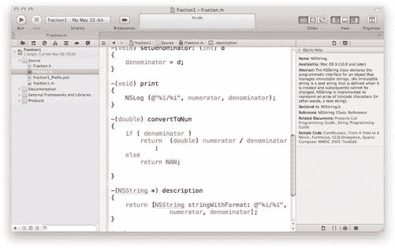

你可以在 [`developer.apple.com/library/mac/navigation/index.html`](http://developer.apple.com/library/mac/navigation/index.html) 在访问 Mac OS X 参考库并导航到相应的参考。在此地址，你还会找到许多涵盖特定编程问题的文档，例如内存管理、字符串和文件管理。

除非你用 `Xcode` *订阅* 了特定的文档集，否则在线文档可能比存储在磁盘上的更更新。

到这里，我们对 `Foundation` 框架的简要介绍就结束了。现在是时候学习它的一些类以及你如何在你的应用程序中使用它们了。

## 15. 数字、字符串和集合

本章描述了如何处理 `Foundation` 框架提供的一些基本对象。这些包括数字、字符串和集合，集合指的是以数组、字典和集合的形式处理对象组的能力。

> `第一个数字小于第二个数字`

* * *

`NSNumber` 类包含许多方法，允许你创建带有初始值的 `NSNumber` 对象。例如，这一行

```
intNumber = [NSNumber numberWithInteger: 100];
```

根据一个值为 100 的整数创建一个对象。

从 `NSNumber` 对象中检索到的值必须与存储在其中的值类型一致。因此，在程序的后续语句中，

```
myInt = [intNumber integerValue]
```

检索存储在 `intNumber` 内部的整数值并将其存储在 `NSInteger` 变量 `myInt` 中。注意，`NSInteger` 不是一个对象，而是基本数据类型的 `typedef`。它在 64 位构建中被 `typedef` 为 `long`，在 32 位构建中被 `typedef` 为 `int`。同样，`NSUInteger` 一个类似的 `typedef`，用于在你的程序中处理无符号整数。

在 `NSLog` 调用中，我们将 `NSInteger myInt` 强制转换为 `long`，并使用格式化字符 `%li`，以确保即使程序为 32 位架构编译，值也能被正确传递和显示。

对于每个基本数据类型，都存在一个类方法来分配 `NSNumber` 对象并将其设置为指定值。这些方法以 `numberWith` 开头，后跟类型，例如 `numberWithLong:`、`numberWithFloat:` 等。此外，可以使用实例方法将之前 `alloc` 过的 `NSNumber` 对象设置为指定值。这些方法都以 `initWith` 开头，例如 `initWithLong:` 和 `initWithFloat:`。

表 15.1 列出了为 `NSNumber` 对象设置值的类方法和实例方法，以及检索这些值的对应实例方法。

> 注意：在 4.2 之前的 Xcode 版本中，使用哪个版本的方法更为重要。类方法会创建一个自动释放（autoreleased）的对象，而 `alloc` 创建的对象则由你在在使用完毕后负责释放其内存。Objective-C 引入自动引用计数（ARC）意味着现在不再有强烈的动机去使用某一种形式的方法而非另一种，因为内存管理现在由系统自动处理。

表 15.1. `NSNumber` 创建与检索方法

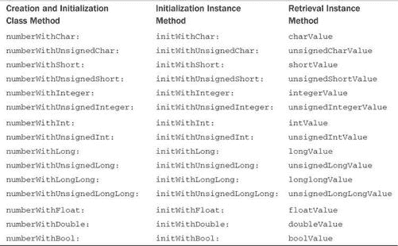

回到程序 15.1，程序接下来使用类方法来创建 `long`、`char`、`float` 和 `double` 类型的 `NSNumber` 对象。注意在使用这一行代码创建一个 double 对象后发生了什么：

```
myNumber = [NSNumber numberWithDouble: 12345e+15];
```

然后尝试用以下行（错误地）检索并显示其值：

```
NSLog (@"%li", (long) [myNumber integerValue]);
```

你得到了如下输出：

`0`

此外，你没有收到来自系统的任何错误信息。通常情况下，由你来确保如果你在 `NSNumber` 对象中存储了一个值，要以一致的方式来检索它。

在 `if` 语句内部，消息表达式

```
[intNumber isEqualToNumber: floatNumber]
```

使用 `isEqualToNumber:` 方法在数值上比较两个 `NSNumber` 对象。程序测试返回的 `BOOL` 值以判断两个数字是否相等。

你可以使用 `compare:` 方法测试一个数值在数值上是否小于、等于或大于另一个数值。消息表达式

```
[intNumber compare: myNumber]
```

如果存储在 `intNumber` 中的数值小于包含在 `myNumber` 中的数值，则返回值 `NSOrderedAscending`；如果两个数字相等，则返回值 `NSOrderedSame`；如果第一个数字大于第二个，则返回值 `NSOrderedDescending`。这些值定义在头文件 `NSObject.h` 中，它在导入 `Foundation.h` 时会被包含。

注意，你不能更改之前创建的 `NSNumber` 对象的值。例如，这样做是无效的：

```
NSNumber *myNumber = [[NSNumber alloc] initWithInt: 50];
...
[myNumber initWithInt: 1000];
```

最后这条语句会在运行时导致程序崩溃。所有的数字对象都必须重新创建，这意味着你必须在 `NSNumber` 类上调用表 15.1 第一列列出的方法之一，或者使用来自 `alloc` 方法的结果调用第 2 列列出的方法之一，如上一个一个示例的第一行所示。

为了确保你理解使用 `numberWithInt:` 与 `numberWithInteger:` 的区别，请遵循以下规则：

1. 如果你使用 `numberWithInt:` 创建一个整数，你应该使用 `intValue` 检索其值，并可以使用 `%i` 显示其值。

2. 如果你使用 `numberWithInteger:` 创建一个整数，你应该使用 `longValue` 检索其值，并可以使用 `%li` 显示。

### 字符串对象

你之前遇到过字符串对象。每当你将一组字符封装在双双引号内时，例如

```
@"Programming is fun"
```

你就创建了一个字符串对象。具体来说，它是属于 `NSConstantString` 类的常量字符串。`NSConstantString` 是字符串对象 `NSString` 的子类。C 风格的字符串由 `char` 字符组成，而 `NSString` 对象由 `unichar` 字符组成。`unichar` 字符根据 Unicode 标准是一个多字节字符。这使得你能够处理包含数百万字符的字符集。幸运的是，你不需要担心字符串中字符的内部表示，因为 `NSString` 类为你处理了这些。通过使用该类的方法，你可以更容易地开发本地化应用程序——即在世界不同语言中运行。

正如你所知，在字符串前面加上 `@` 字符可以在 Objective-C 中创建一个常量字符串。因此，表达式

```
@"Programming is fun"
```

创建了一个常量字符串。

#### 关于 NSLog 函数的更多信息

接下来的程序 15.2 显示了如何定义 `NSString` 对象并为其分配初始值。它还显示了如何使用格式化字符 `%@` 显示一个 `NSString` 对象。

程序 15.2

```c
#import <Foundation/Foundation.h>

int main (int argc, char * argv[])
{
  @autoreleasepool {
    NSString *str = @"Programming is fun";
    NSLog (@"%@", str);
  }
  return 0;
}
```

程序 15.2. 输出

`Programming is fun`

在行中

```c
NSString *str = @"Programming is fun";
```

常量字符串对象 `Programming is fun` 被赋值给 `NSString` 变量 `str`。然后使用 `NSLog` 显示其值。

`NSLog` 的格式化字符 `%@` 不仅可以显示 `NSString` 对象，还可以显示其他对象。例如，给定以下

```objective
NSNumber *intNumber = [NSNumber numberWithInteger: 100];
```

`NSLog` 的调用：

```objective
NSLog (@"%@", intNumber);
```

会产生以下输出：

```
100
```

### `description` 方法

你也可以使用 `%@` 格式化字符来显示数组、字典和集合的所有内容。事实上，只要你重写了类继承的 `description` 方法，它们也可以用于显示你自定义类中的对象。如果你没有重写该方法，`NSLog` 仅会显示对象所属的类名以及该对象在内存中的地址。这是继承自 `NSObject` 类的 `description` 方法的默认实现。

以下是一个 `description` 方法的示例，你可以将其添加到 `Fraction` 类的实现部分，以便格式化一个 `Fraction` 对象。它使用了 `NSString` 的 `stringWithFormat:` 方法；该方法类似于 `NSLog`，但与函数不同，该方法的目的是将格式化后的字符串作为结果返回，而不是将其写入控制台：

```objective
-(NSString *) description
{
    return [NSString stringWithFormat: @"%i/%i", numerator, denominator];
}
```

> **注意**

> 方法如 `stringWithFormat:` 等允许提供任意数量的参数（在这种情况下为格式化字符串和要格式化的数据）。这些参数以逗号分隔的值列表的形式提供给方法。

在你的 `Fraction` 类中定义了该方法（并适当设置了两个 `Fraction` 对象 `f1` 和 `f2`）后，你可以在程序中编写如下的语句：

```objective
sum = [f1 add: f2];
NSLog (@"The sum of %@ and %@ is %@", f1, f2, sum);
```

以获得如下的单行输出：

```
The sum of 1/2 and 1/4 is 3/4
```

在你的类中添加自定义的 `description` 方法是一个很好的调试工具——它允许你以有意义的方式显示你的对象。

### 可变对象与不可变对象

当你通过编写诸如 `@"Programming is fun"` 的表达式来创建一个字符串对象时，你创建了一个内容无法更改的对象。这被称为*不可变*对象。`NSString` 类处理不可变字符串。经常，你可能需要处理可以更改字符的字符串。例如，你可能想要从字符串中删除某些字符，或对字符串执行查找并替换操作。这些类型的字符串通过 `NSMutableString` 类处理。

程序 15.3 显示了在程序中处理不可变字符字符串的基本方法。

### 程序 15.3


### 基础字符串操作

```objective
#import <Foundation/Foundation.h>

int main (int argc, char * argv[])
{
    @autoreleasepool {
        NSString *str1 = @"This is string A";
        NSString *str2 = @"This is string B";
        NSString *res;
        NSComparisonResult compareResult;

        // 计数字符数
        NSLog (@"Length of str1: %lu", [str1 length]);

        // 将一个字符串拷贝到另一个
        res = [NSString stringWithString: str1];
        NSLog (@"copy: %@", res);

        // 将一个字符串接到另一个的末尾
        str2 = [str1 stringByAppendingString: str2];
        NSLog (@"Concatentation: %@", str2);

        // 测试两个字符串是否相等
        if ([str1 isEqualToString: res] == YES)
            NSLog (@"str1 == res");
        else
            NSLog (@"str1 != res");

        // 测试一个字符串是否小于、等于或大于另一个字符串
        compareResult = [str1 compare: str2];
        if (compareResult == NSOrderedAscending)
            NSLog (@"str1 < str2");
        else if (compareResult == NSOrderedSame)
            NSLog (@"str1 == str2");
        else
            NSLog (@"str1 > str2");

        // 将字符串转换为大写
        res = [str1 uppercaseString];
        NSLog (@"Uppercase conversion: %s", [res UTF8String]);

        // 将字符串转换为小写
        res = [str1 lowercaseString];
        NSLog (@"Lowercase conversion: %@", res);
        NSLog (@"Original string: %@", str1);
    }
    return 0;
}
```

### 程序 15.3 输出

```text
Length of str1: 16
Copy: This is string A
Concatentation: This is stringAB
str1 == res
str1 < str2
Uppercase conversion: THIS STRING A
Lowercase conversion: this is a
Original string: This is string A
```

程序 15.3 声明了三个不可变的`NSString`对象：`str1`、`str2`和`res`。前两个初始化为常量字符串对象。语句`NSComparisonResult compareResult;`声明了`compareResult`用于存储稍后执行的字符串比较的结果。

你可以使用`length`方法计算字符串中的字符数。它返回一个类型为`NSUInteger`的无符号整数。输出验证了字符串`@"This is string A"`包含 16 个字符。语句`res = [NSString stringWithString: str1];`显示了如何根据另一个的内容创建一个新的字符串。生成的`NSString`对象被赋值给`res`，然后显示以验证结果。在这里是对字符串内容的实际拷贝，而不仅仅是内存中的另一个引用。这意味着`str1`和`res`指向两个不同的字符串对象，这与简单执行如下赋值`res = str1;`不同。正如我们之前讨论过的，该语句只会创建内存中的另一个引用。

`stringByAppendingString:`方法可以连接两个字符串。因此，表达式`[str1 stringByAppendingString: str2]`创建了一个新的字符串对象，由`str1`后面接`str2`组成。原始字符串对象`str1`和`str2`不受此操作的影响（它们无法被更改，因为都是不可变字符串对象）。

程序接下来使用`isEqualToString:`方法来测试两个字符串是否相等——即它们是否包含相同的字符。如果你需要确定两个字符串的顺序，可以使用`compare:`方法——例如，如果你想对它们的数组进行排序。与你之前比较两个`NSNumber`对象时使用的`compare:`方法类似，比较的结果如果第一个字符串在字典序上小于第二个字符串，则为`NSOrderedAscending`；如果两个字符串相等，则为`NSOrderedSame`；如果第一个字符串在字典序上大于第二个字符串，则为`NSOrderedDescending`。如果你不想执行区分大小写的比较，请使用`caseInsensitiveCompare:`方法代替`compare:`来比较两个字符串。

请确保你理解`str1`和`str2`被声明为不可变字符串对象，这意味着它们引用的字符串对象中的字符不能更改。然而，引用`str1`和`str2`**是可以被更改的**。也就是说，这两个变量可以重新赋值以引用不同的不可变字符串对象。这是一个非常重要的点。让我们再次通过图表来看这一点。图 15.1 显示了变量`res`和`str1`刚声明并初始化后的状态。变量`res`没有设置任何初始值，因此它的内容显示为空。另一方面，`str1`被设置为指向存储在内存某处的常量字符字符串对象`@"This is string A"`。

图 15.1. 不可变字符串对象的声明和初始化

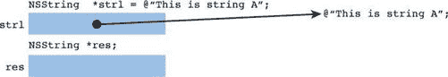

当我们向程序 15.3 中的`str1`发送`uppercaseString`消息时，我们将根据字符`str1`创建一个新的字符串，其中字符串对象中的任何小写字母都被替换为大写字母。这在图 15.2 中所示。

图 15.2. 向字符串对象发送`uppercaseString`消息

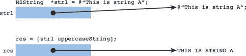

注意`str1`仍然指向原始字符串对象，并且创建了一个新的字符串对象。

向`str1`发送`lowercaseString`消息的方式相同：创建一个新的字符串对象，它由`str1`中的所有大写字母转换为小写字母组成。然后将该新创建的字符串对象的引用存储在变量`res`中。这在图 15.3 中所示。注意，不再有对上一步创建的大写字符串的引用。你不需要担心这一点；系统的内存管理会为你清理它。

图 15.3. 向字符串对象发送`lowercaseString`消息

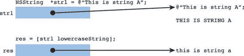

程序 15.4 说明了处理字符串的其他方法。这些方法允许你从字符串中提取子字符串，并可以在一个字符串中搜索另一个字符串的出现情况。

某些方法要求你通过指定范围来识别子字符串。一个`range`由一个起始索引数字加上字符计数组成。索引从零开始，因此字符串中的前三个字符将通过数字对`{ 0, 3}`指定。`NSString`类（以及其他 Foundation 类）的某些方法使用特殊数据类型`NSRange`来创建范围规范。它实际上是一个结构体的`typedef`定义，该结构体有两个成员：`location`和`length`，每个成员都被定义为类型`NSUinteger`。程序 15.4 使用了这种数据类型。

> **注意**
> 你可以在第 13 章中的“底层 C 语言特性”中阅读关于结构的知识。不过，你可能在本章接下来的讨论中获得足够处理它们的信息。

### 程序 15.4

```c
// 基础字符串操作 – 继续
#import <Foundation/Foundation.h>

int main (int argc, char * argv[])
{
    @autoreleasepool {
        NSString  str1 = @"This is string A";
        NSString  str2 = @"This is string B";
        NSString  res;
        NSRange   subRange;

        // 从字符串中提取前 3 个字符
        res = [str1 substringToIndex: 3];
        NSLog(@"First 3 chars of str1: %@", res);

        // 从索引 5 开始提取到字符串末尾
        res = [str1 substringFromIndex: 5];
        NSLog(@"Chars from index 5 of str1: %@", res);

        // 从索引 8 到 13 提取字符（6 个字符）
        res = [[str1 substringFromIndex: 8] substringToIndex: 6];
        NSLog(@"Chars from index 8 through 13: %@", res);

        // 实现相同内容的简单方法
        res = [str1 substringWithRange: NSMakeRange(8, 6)];
        NSLog(@"Chars from index 8 through 13: %@", res);

        // 在另一个字符串内部查找一个字符串
        subRange = [str1 rangeOfString: @"string A"];
        NSLog(@"String is at index %lu, length %lu", subRange.location, subRange.length);

        subRange = [str1 rangeOfString: @"string B"];
        if (subRange.location == NSNotFound) {
            NSLog(@"String found");
        } else {
            NSLog(@"String is at index %lu, length %lu", subRange.location, subRange.length);
        }
    }
    return 0;
}
```

### 程序 15.4 输出

```text
First 3 chars of str1: Thi
Chars from index 5 of str1: is string A
Chars from index 8 through 13: string A
Chars from index 8 through 13: string A
String is at index 12, length 9
String found
```

`NSMutableString`类可以用于创建字符可以更改的字符串对象。由于该类是`NSString`的子类，因此也可以使用`NSString`的所有方法。

当我们谈论可变与不可变字符串对象时，我们谈论的是更改字符串内部的实际字符。在程序执行期间，可变或不可变的字符串对象都可以被设置为一个完全不同的字符串对象。这一点在对程序 15.3 的讨论中已经强调过。因此，例如，考虑以下代码：

```objective
str1 = @"This is a string";
...
str1 = [str1 substringFromIndex: 5];
```

在这种情况下，`str1`首先被赋值为一个常量字符字符串对象。在程序的稍后部分，它被赋值为一个子字符串。在这种情况下，`str1`既可以声明为可变字符串对象，也可以声明为不可变字符串对象。请务必理解这一点。

### 程序 15.5


`NSMutableString` 类可以用于创建字符可以更改的字符串对象。由于该类是 `NSString` 的子类，因此也可以使用 `NSString` 的所有方法。

当我们谈论可变与不可变字符串对象时，我们谈论的是更改字符串内部的实际字符。在程序执行期间，可变或不可变的字符串对象都可以被设置为一个完全不同的字符串对象。这一点在对程序 15.3 的讨论中已经强调过。因此，例如，考虑以下代码：

> `str1 = @"This is a string";`

> `...`

> `str1 = [str1 substringFromIndex: 5];`

在这种情况下，`str1` 首先被赋值为一个常量字符字符串对象。在程序的稍后部分，它被赋值为一个子字符串。在这种情况下，`str1` 既可以声明为可变字符串对象，也可以声明为不可变字符串对象。请务必理解这一点。

程序 15.5 显示了在程序中处理可变字符串的一些方法。

### 程序 15.5

```objc
// 基础字符串操作 - 可变字符串

#import <Foundation/Foundation.h>

int main (int argc, char * argv[])
{
    @autoreleasepool {
        NSString  *str1 = @"This is string A";
        NSString  *search, *replace;
        NSMutableString  *mstr;
        NSRange  substr;

        // 从不可变字符串创建可变字符串

        mstr = [NSMutableString  stringWithString: str1];
        NSLog (@"%@", mstr);

        // 插入字符

        [mstr insertString: @" mutable" atIndex: 7];
        NSLog (@"%@", mstr);

        // 如果在末尾插入，则是有效的拼接

        [mstr insertString: @" and string B" atIndex: [mstr length]];
        NSLog (@"%@", mstr);

        // 或者可以直接使用 appendString

        [mstr appendString: @" and string C"];
        NSLog (@"%@", mstr);

        // 根据范围删除子字符串

        [mstr deleteCharactersInRange: NSMakeRange (16, 13)];
        NSLog (@"%@", mstr);

        // 先找到范围，然后将其用于删除

        substr = [mstr  rangeOfString: @"string B and "];

        if (substr.location != NSNotFound) {
            [mstr deleteCharactersInRange: substr];
            NSLog (@"%@", mstr);
        }

        // 直接设置可变字符串

        [mstr setString: @"This is string A"];
        NSLog (@"%@", mstr);

        // 现在让我们用另一个字符串替换一段字符

        [mstr replaceCharactersInRange: NSMakeRange(8, 8)
                         withString: @"a mutable string"];
        NSLog (@"%@", mstr);

        // 查找并替换

        search = @"This is";
        replace = @"An example of";
        substr = [mstr rangeOfString: search];

        if (substr.location != NSNotFound) {
            [mstr replaceCharactersInRange: substr
                                withString: replace];
            substr = [mstr rangeOfString: search];
        }

        NSLog (@"%@", mstr);

        // 查找并替换所有

        search = @"This is";
        replace = @"An example of";
        substr = [mstr rangeOfString: search];

        while (substr.location != NSNotFound) {
            [mstr replaceCharactersInRange: substr
                                withString: replace];
            substr = [mstr rangeOfString: search];
        }

        NSLog (@"%@", mstr);
    }
    return 0;
}
```

### 程序 15.5 输出

```
This is string A
This is mutable string A
This is mutable string A and string B
This is mutable string A and string C
This is mutable string C
This is string A
This is a mutable string
An example of a mutable string
An example of X string
```

### Figure 15.4. Indexing into a string

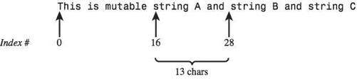


```objc
// 基础字符串操作 - 可变字符串

#import <Foundation/Foundation.h>

int main (int argc, char * argv[])
{
    @autoreleasepool {
        NSString *str1 = @"This is string A";
        NSString *search, *replace;
        NSMutableString *mstr;
        NSRange substr;

        // 从不可变字符串创建可变字符串
        mstr = [NSMutableString stringWithString: str1];
        NSLog (@"%@", mstr);

        // 插入字符
        [mstr insertString: @" mutable" atIndex: 7];
        NSLog (@"%@", mstr);

        // 如果在末尾插入，则是有效的拼接
        [mstr insertString: @" and string B" atIndex: [mstr length]];
        NSLog (@"%@", mstr);

        // 或者可以直接使用 appendString
        [mstr appendString: @" and string C"];
        NSLog (@"%@", mstr);

        // 根据范围删除子字符串
        [mstr deleteCharactersInRange: NSMakeRange (16, 13)];
        NSLog (@"%@", mstr);

        // 先找到范围，然后将其用于删除
        substr = [mstr rangeOfString: @"string B and "];

        if (substr.location != NSNotFound) {
            [mstr deleteCharactersInRange: substr];
            NSLog (@"%@", mstr);
        }

        // 直接设置可变字符串
        [mstr setString: @"This is string A"];
        NSLog (@"%@", mstr);

        // 现在让我们用另一个字符串替换一段字符
        [mstr replaceCharactersInRange: NSMakeRange(8, 8)
                            withString: @"a mutable string"];
        NSLog (@"%@", mstr);

        // 查找并替换
        search = @"This is";
        replace = @"An example of";
        substr = [mstr rangeOfString: search];

        if (substr.location != NSNotFound) {
            [mstr replaceCharactersInRange: substr
                                 withString: replace];
            substr = [mstr rangeOfString: search];
        }

        NSLog (@"%@", mstr);
    }
}
```

### 程序 15.5 输出

```text
This is string A
This is mutable string A
This is mutable string A and string B
This is mutable string A and string C
This is mutable string C
This is string A
This is a mutable string
An example of a mutable string
An example of X string
```

### 图 15.4. 字符串索引


当然，如果你只是想删除字符串中的某处出现，正如你已经看到的那样，可以使用`deleteCharactersInRange:`方法。

最后，`NSMutableString`类还包含一个名为`replaceOccurrencesOfString:withString:options:range:`的方法，你可以用它对字符串进行查找并替换所有项。事实上，你可以用这单条语句来替换[程序 15.5]中的`while`循环：

```objc
[mstr replaceOccurrencesOfString: search
                      withString: replace
                         options: nil
                           range: NSMakeRange (0, [mstr length])];
```

这实现了相同的结果，并避免了无限循环的可能性，因为该方法防止了此类情况的发生。

`NSString`类包含 100 多种可以与字符串配合的方法。[表 15.2]总结了其中一些常用的方法，而[表 15.3]列出了`NSMutableString`类提供的一些额外方法。其他一些`NSString`方法（例如处理路径名和将文件内容读取到字符串）将在本书的剩余部分向你介绍。你应该查看`NSString`类的文档，以更好地了解你可以使用的各种方法。

### 表 15.2. 常用的 `NSString` 方法

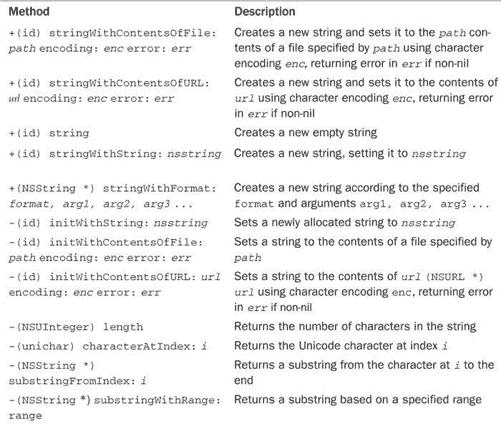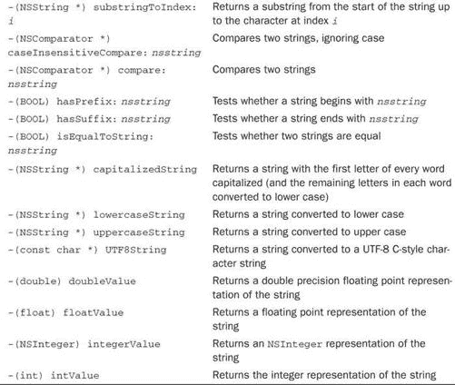

在[表 15.2]和[15.3]中，`url`是一个`NSURL`对象，`path`是指定文件路径的`NSString`对象，`nsstring`是一个`NSString`对象，`i`是表示字符串中有效字符数的`NSUInteger`值，`enc`是指定字符编码的`NSStringEncoding`对象，`err`是发生错误时描述错误的`NSError`对象，`size`和`opts`是`NSUInteger`，而`range`是指示字符串内有效字符范围的`NSRange`结构。

[表 15.3]中的方法要么创建要么修改`NSMutableString`对象。

### 表 15.3. 常用的 `NSMutableString` 方法

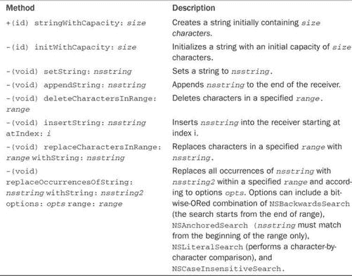

`NSString`对象在本文的剩余部分被广泛使用。如果你需要将字符串解析为标记，可以查看 Foundation 的`NSScanner`类。

## 数组对象

Foundation 数组是对象的有序集合。大多数情况下，数组中的元素是某种特定类型，但并非强制要求。就像存在可变和不可变字符串一样，也有可变和不可变数组。*不可变*数组由`NSArray`类处理，而*可变*数组由`NSMutableArray`处理。后者是前者的子类，这意味着它继承了前者的方法。

[程序 15.6]设置了一个数组来存储全年的名称，然后打印出它们。

### 程序 15.6

```objc
#import <Foundation/Foundation.h>

int main (int argc, char * argv[])
{
    int i;

    @autoreleasepool {
        // 创建一个包含月份的数组
        NSArray *monthNames = [NSArray arrayWithObjects:
                               @"January", @"February", @"March",
                               @"May", @"June", @"July", @"August",
                               @"October", @"December", nil];

        // 现在列出数组中的所有元素
        NSLog (@"Month Name");
        NSLog (@"=====");

        for (i = 0; i < 12; ++i)
            NSLog (@"%d %@", i + 1, [monthNames objectAtIndex: i]);
    }

    return 0;
}
```

#### 程序 15.6 输出

```text
Month Name
=====
1 January
2 February
3 March
4 April
5 May
6 June
7 July
8 August
9 September
10 October
11 November
12 December
```

你可以使用类方法`arrayWithObjects:`来创建一个包含对象列表的数组。在这种情况下，对象按顺序列出并用逗号分隔。这种语法用于接受可变数量参数的方法。为了标记列表的结束，必须指定`nil`作为最后一个值——它并不会存储在数组内部。

在[程序 15.6]中，`monthNames`被设置为`arrayWithObjects:`参数指定的 12 个字符串值。

数组中的元素通过它们的索引标识。与`NSString`对象类似，索引从零开始。因此，包含 12 个元素的数组有效索引为 0–11。要根据索引号检索数组元素，你需要使用`objectAtIndex:`方法。

该程序简单地执行一个`for`循环，使用`objectAtIndex:`方法从数组中提取每个元素。检索到的每个元素通过`NSLog`显示。

[程序 15.7]简单地创建一个 10 个数字对象的数组，其值范围从 0 到 9。使用简单的`for`循环检索值进行显示，然后仅使用`NSLog`格式字符串中的`%@`格式字符再次显示整个数组。在本章稍后的部分，你将学习另一种被称为*快速枚举*（fast enumeration）的技术，你也可以用它来遍历数组元素。

### 程序 15.7

```objc
#import <Foundation/Foundation.h>

int main (int argc, char * argv[])
{
    @autoreleasepool {
        NSMutableArray *numbers = [NSMutableArray array];
        NSNumber *myNumber;
        int i;

        // 创建一个 0-9 的数组
        for (i = 0; i < 10; ++i) {
            myNumber = [NSNumber numberWithInteger: i];
            [numbers addObject: myNumber];
        }

        // 遍历数组并显示
        for (i = 0; i < 10; ++i) {
            myNumber = [numbers objectAtIndex: i];
            NSLog (@"%d %@", i, myNumber);
        }
    }

    return 0;
}
```

#### 程序 15.7 输出

```text
1 0
2 1
3 2
4 3
5 4
6 5
7 6
8 7
9 8
10 9
```

请记住，你不能将整数等基本数据类型存储在数组等集合中。因此，我们为`i`的从 0 到 9 的每个值创建了一个`NSNumber`对象。

`addObject:`方法将对象添加到数组的末尾。在这里，你添加了从`i`的整数值创建的每个`NSNumber`对象。

然后程序进入一个`for`循环，以显示数组中存储的每个数字对象。

最后，在程序 15.7 中，你看到如何使用单个`%@`在`NSLog`的格式字符串中一次性显示整个`numbers`数组。

> **注意**
>
> `NSLog`如何知道如何显示存储在数组中的对象？对于数组中的每个元素，`NSLog`将使用来自该元素所属类的`description`方法。如果是继承自`NSObject`的默认方法，如之前提到的，你将只得到对象的类和地址。在这种情况下，你得到了一个有意义的显示——表明`NSNumber`类中实现了一个自定义的`description`方法。

用于处理数组的 Foundation 类提供了许多便利。然而，在使用复杂算法处理大型数字数组的情况下，学习使用底层 C 语言提供的数组结构来执行此类任务，在内存使用和执行速度方面可能更高效。更多信息请参阅第 13 章中的“数组”部分。

## 创建通讯簿

让我们来看一个示例，它通过创建一个通讯簿开始结合你为止学到的很多内容²。你的通讯簿将包含地址卡。为了简单起见，你的地址卡将只包含姓名和电子邮件地址。将此概念扩展到其他信息（如地址和电话号码）是很容易，但我们将其留作为本章末的练习题。

我们将创建的两个类——`AddressBook`类和`AddressCard`类，以及它们之间的关系如图 15.5 所示。

### 图 15.5. 包含 `AddressCard` 的 `AddressBook`

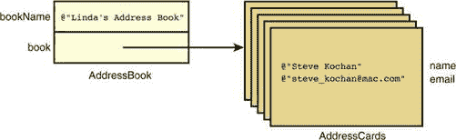

## 创建地址卡

我们从定义`AddressCard`类开始。你希望具备创建新地址卡、设置姓名和电子邮件字段、检索这些字段以及打印卡片的能力。在图形环境中，你可以使用一些方便的方法在计算机屏幕或 iOS 设备的窗口上绘制卡片。但在这里，你只需要简单的控制台界面来显示你的地址卡。

程序 15.8 显示了你新`AddressCard`类的接口文件。我们还不会合成访问器方法；由自己编写它们可以提供宝贵的教训。

### 程序 15.8 接口文件 `AddressCard.h`

```objectivec
#import <Foundation/Foundation.h>

@interface AddressCard : NSObject

- (void)setName:(NSString *)theName;
- (void)setEmail:(NSString *)theEmail;
- (NSString *)name;
- (NSString *)email;

- (void)print;

@end
```

这是非常直接的，程序 15.8 中的实现文件也是如此。

### 程序 15.8 实现文件 `AddressCard.m`

```objectivec
#import "AddressCard.h"

@implementation AddressCard
{
    NSString *name;
    NSString *email;
}

- (void)setName:(NSString *)theName
{
    name = [NSString stringWithString:theName];
}

- (void)setEmail:(NSString *)theEmail
{
    email = [NSString stringWithString:theEmail];
}

- (NSString *)name
{
    return name;
}

- (NSString *)email
{
    return email;
}

- (void)print
{
    NSLog (@"==================================");
    NSLog (@"|                                |");
    NSLog (@"|  %-31s |", [name UTF8String]);
    NSLog (@"|  %-31s |", [email UTF8String]);
    NSLog (@"|                                |");
    NSLog (@"|                                |");
    NSLog (@"|                                |");
    NSLog (@"|              O                 |");
    NSLog (@"==================================");
}

@end
```

```objc
@property (copy, nonatomic) NSString *name, *email;

- (void)print;

@end
```


`@property (copy, nonatomic) NSString *name, *email;` 这一行为属性列出了 `copy` 和 `nonatomic` 属性。`copy` 属性表示在其设置方法（setter）中为实例变量创建一个副本，正如你在编写的版本中所做的那样。默认操作是不创建副本，而是执行简单的赋值（即默认属性 `assign`），正如我们最近讨论的，在在这种情况下这是不正确的方法。

`nonatomic` 属性表示你不需要担心多个线程同时尝试访问实例变量时可能发生的竞态条件。第 18 章，“对象拷贝”在该章中更详细地讨论了这一话题。

程序 15.9 是新的 `AddressCard` 实现文件，它指定访问器方法为合成的（synthesized）。注意，我们在这里删除了实例变量的显式声明，因为我们现在为它们列出了属性。

#### 程序 15.9. 带有合成方法的实现文件 AddressCard.m

```
#import "AddressCard.h"

@implementation AddressCard

@synthesize name, email;

-(void) print
{
    NSLog (@"==================================");
    NSLog (@"|                            |");
    NSLog (@"|  %-31s |", [name UTF8String]);
    NSLog (@"|  %-31s |", [email UTF8String]);
    NSLog (@"|                            |");
    NSLog (@"|                            |");
    NSLog (@"|                            |");
    NSLog (@"|        O            O        |");
    NSLog (@"==================================");
}
@end
```

现在让我们为你的 `AddressCard` 类添加另一个方法。你可能想通过一次调用同时设置卡片的姓名和电子邮件字段。要做到这一点，请添加一个新方法 `setName:andEmail:`。该新方法看起来如下：

```
-(void) setName: (NSString *) theName andEmail: (NSString *) theEmail
{
    self.name = theName;
    self.email = theEmail;
}
```

记得编写 `self.name = theName;` 等同于编写 `[self setName: theName];`，因此它使用了实例变量的设置方法。相比之下，编写 `name = theName;` 则会绕过设置方法，直接将参数的值赋值给实例变量。

通过依赖合成的设置方法来设置相应的实例变量（而不是由自己在方法内部直接设置它们），你增加了一层抽象，从而使程序对其内部数据结构的独立性稍提高。你还利用了合成属性的属性，在这种情况下，它使用 `copy` 而不是 `assign` 将值赋值给实例变量。

程序 15.9 测试了你的新方法。

#### 程序 15.9. 测试程序

```
#import "AddressCard.h"

int main (int argc, char * argv[])
{
    @autoreleasepool {
        NSString  aName = @"Julia Kochan";
        NSString  aEmail = @"jewls337@axlc.com";
        NSString  bName = @"Tony Iannino";
        NSString  bEmail = @"tony.iannino@techfitness.com";

        AddressCard  card1 = [[AddressCard alloc] init];
        AddressCard  card2 = [[AddressCard alloc] init];
        [card1 setName: aName andEmail: aEmail];
        [card2 setName: bName andEmail: bEmail];
        [card1 print];
        [card2 print];
    }
    return 0;
}
```

================================

|                            |

| Julia Kochan                  |

| jewls337@axlc.com              |

|                            |

|                            |

|                            |

|        O            O        |

================================

================================

|                            |

| Tony Iannino                  |

| tony.iannino@techfitness.com  |

|                            |

|                            |

|                            |

|        O            O        |

================================

### `AddressBook` 类

你的 `AddressCard` 类似乎运行得良好。但如果你想处理大量的 `AddressCard` 呢？将它们收集在一起是有意义的，这正是你通过定义一个名为 `AddressBook` 的新类将要做的事情。`AddressBook` 类将存储通讯录的名称和一组 `AddressCards`，你将这些集合存储在一个数组对象中。首先，你希望能够创建一个新的通讯录、向其中添加新的联系人卡、查询其中有多少条目并列出其内容。以后，你将希望能够搜索通讯录、删除条目、可能编辑现有条目、对其排序，甚至对其内容进行复制。

让我们从一个简单的 `interface` 文件开始（参见程序 15.10）。

### 程序 15.10. AddressBook.h 接口文件

```
#import <Foundation/h>
#import "AddressCard.h"

@interface AddressBook: NSObject

@property (nonatomic, copy) NSString *bookName;
@property (nonatomic, strong) NSMutableArray *book;

-(id) initWithName: (NSString *) name;
-(void) addCard: (AddressCard *) theCard;
-(int) entries;
-(void) list;

@end
```

属性 `strong` 表示每当使用 setter 时对对象创建一个额外的引用。这影响了对象的寿命。在 17，“内存管理与自动计数”中有更详细的描述。

`initWithName:` 方法初始化存储卡片的数组并存储书籍名称，而 `addCard:` 方法将 `AddressCard` 添加到书中。`entries` 方法报告书籍中的卡片数量，而 `list` 方法提供其内容的简要列表。程序 15.10 显示了你的 `AddressBook` 类的实现文件。

### 程序 15.10. AddressBook.m 实现文件

```
#import "AddressBook.h"

@implementation AddressBook

@synthesize bookName, book;

// 设置通讯录的名称和空的书籍
-(id) initWithName: (NSString *) name
{
    self = [super init];
    if (self) {
        bookName = [NSString stringWithString: name];
        book = [NSMutableArray array];
    }
    return self;
}

-(id) init
{
    return [self initWithName: @"NoName"];
}

-(void) addCard: (AddressCard *) theCard
{
    [book addObject: theCard];
}

-(int) entries
{
    return [book count];
}

-(void) list
{
    NSLog (@"======== Contents of: %@ =========", bookName);
    for ( AddressCard *theCard in book )
        NSLog (@"%-20s   %-32s", [theCard.name UTF8String],
             [theCard.email UTF8String]);
    NSLog (@"==================================================");
}
@end
```

`initWithName:` 方法首先调用父类的 `init` 方法来执行其初始化。接着，它将作为方法参数传入的字符串进行拷贝，并存储在实例变量 `bookName` 中。随后，会创建一个空的 `NSMutableArray` 对象并将其赋值给 `book`。

你将 `initWithName:` 定义为返回一个 `id` 对象，而不是 `AddressBook` 类型的对象。如果 `AddressBook` 被子类化，那么 `initWithName:` 消息的接收者（因此也是返回值）将不再是一个 `AddressBook` 对象；其类型是该子类的类型。出于这个原因，你将返回类型定义为通用的对象类型。

我们在这里重写了 `init` 方法，以确保如果有人执行了 `alloc` 后紧接 `init`，他们仍然可以正确设置他们的通讯录，尽管默认名称是“NoName”。因此，`initWithName:` 方法是我们的指定初始化器，我们希望确保 `init` 使用它。

`addCard:` 方法接收作为参数的 `AddressCard` 对象并将其添加到通讯录中。

`count` 方法返回数组中元素的数量。`entries` 方法利用此方法返回通讯录中存储的地址卡数量。

### 快速枚举

`list` 方法中的 `for` 循环展示了一种你以前没过的结构：

```
for ( AddressCard *theCard in book )
    NSLog (@%-20s    %-32s", [theCard.name UTF8String],
                      [theCard.email UTF8String]);
```

这使用被称为“快速枚举”（fast enumeration）的技术来遍历 `book` 数组中的每个元素。语法非常简单：你定义一个变量来依次持有数组中的每个元素（`AddressCard *theCard`）。后面跟着关键字 `in`，然后列出数组名称。当 `for` 循环执行时，它将数组中的第一个元素赋值给指定的变量，然后执行循环体。接着将数组中的第二个元素赋值给该变量并再次执行循环体。以此顺序持续，直到数组中的所有元素都被赋值给该变量，并且每个元素都执行了循环体。

注意，如果 `theCard` 之前已经被定义为 `AddressCard` 对象，那么 `for` 循环将变得更加简单：

```
for ( theCard in book )
    ...
```

程序 15.10 是你新的 `AddressBook` 类的测试程序。

### 程序 15.10. 测试程序

```
#import "AddressBook.h"

int main (int argc, char * argv[])
{
    @leasepool {
        NSString *aName = @"Julia Kochan";
        NSString *aEmail = @"jewls337@axlc.com";
        NSString *bName = @"Tony Iannino";
        NSString *bEmail = @"tony.iannino@techfitness.com";
        NSString *cName = @"Stephen Kochan";
        NSString *cEmail = @"steve@classroomM.com";
        NSString *dName = @"Jamie Baker";
        NSString *dEmail = @"jbaker@classroomM.com";

        AddressCard *card1 = [[AddressCard alloc] init];
        AddressCard *card2 = [[AddressCard alloc] init];
        AddressCard *card3 = [[AddressCard alloc] init];
        AddressCard *card4 = [[AddressCard alloc] init];

        // 设置一个通讯录
        AddressBook *myBook = [[AddressBook alloc] initWithName:@"Linda's Address Book"];

        NSLog (@Entries in address book after creation: %i", [myBook entries]);

        // 现在设置地址卡
        [card1 setName:aName andEmail:aEmail];
        [card2 setName:bName andEmail:bEmail];
        [card3 setName:cName andEmail:cEmail];
        [card4 setName:dName andEmail:dEmail];

        // 将地址卡添加到通讯录
        [myBook addCard:card1];
        [myBook addCard:card2];
        [myBook addCard:card3];
        [myBook addCard:card4];

        NSLog (@Entries in address book after adding cards: %i", [myBook entries]);

        // 现在列出书中所有的条目
        [myBook list];
    }
    return 0;
}
```

### 程序 15.10. 输出

```
Entries in address book after creation: 0
Entries in address book after adding cards: 4

======== Contents of: Linda's Address Book =========
Julia Kochan    jewls337@axlc.com
Tony Iannino    tony.iannino@techfitness.com
Stephen Kochan  steve@classroomM.com
Jamie Baker    jbaker@classroomM.com
====================================================
```

程序创建了一个名为 Linda’s Address Book 的新通讯录，然后设置了四个地址卡。随后使用 `addCard:` 方法将这四张卡添加到通讯录中，并使用 `list` 方法列出并验证通讯录的内容。

### 在通讯录中查找

当你有一个大型通讯录时，你不希望每次想查找某人时都列出完整内容。因此，添加一个方法来这样做是合理的。我们将方法命名为 `lookup:` 并让它接收名称作为参数。该方法搜索通讯录中的匹配项（忽略大小写），如果找到则返回该条目；如果名称不在通讯录中，它将返回 `nil`。这里是 `lookup:` 方法：

```
// 根据查找查找假设精确匹配
-(AddressCard *) lookup:(NSString *)Name
{
    for ( AddressCard *nextCard in book )
        if ([nextCard.name caseInsensitiveCompare:Name] == NSOrderedSame )
            return nextCard;
    return nil;
}
```

如果你将该方法的声明放在接口文件中并将定义放在实现文件中，你可以编写一个测试程序来尝试你的新方法。程序 15.1 显示了这样一个程序及其输出。

#### 程序 15.1 测试


```objc
#import "AddressBook.h"

int main (int argc, char * argv[])
{
    @autoreleasepool {
        NSString *aName = @"Julia Kochan";
        NSString *aEmail = @"jewls337@axlc.com";
        NSString *bName = @"Tony Iannino";
        NSString *bEmail = @"tony.iannino@techfitness.com";
        NSString *cName = @"Stephen Kochan";
        NSString *cEmail = @"steve@classroomM.com";
        NSString *dName = @"Jamie Baker";
        NSString *dEmail = @"jbaker@classroomM.com";

        AddressCard *card1 = [[AddressCard alloc] init];
        AddressCard *card2 = [[AddressCard alloc] init];
        AddressCard *card3 = [[AddressCard alloc] init];
        AddressCard *card4 = [[AddressCard alloc] init];

        // 设置一个通讯录
        AddressBook *myBook = [[AddressBook alloc] initWithName:@"Linda's Address Book"];

        NSLog (@Entries in address book after creation: %i", [myBook entries]);

        // 现在设置地址卡
        [card1 setName:aName andEmail:aEmail];
        [card2 setName:bName andEmail:bEmail];
        [card3 setName:cName andEmail:cEmail];
        [card4 setName:dName andEmail:dEmail];

        // 将地址卡添加到通讯录
        [myBook addCard:card1];
        [myBook addCard:card2];
        [myBook addCard:card3];
        [myBook addCard:card4];

        // 按名称查找某人
        NSLog (@"Stephen Kochan");
        myCard = [myBook lookup:@"stephen kochan"];
        if (myCard != nil)
            [myCard print];
        else
            NSLog (@"Not found!");

        // 尝试另一个查找
        NSLog (@"Haibo Zhang");
        myCard = [myBook lookup:@"Haibo Zhang"];
    }
    return 0;
}
```

```objc
if (myCard != nil) {
    [myCard print];
else
    NSLog (@"Not found!");
}
return 0;
}
```

### 程序 15.11. 输出

```
Lookup: Stephen Kochan
====================================
|                                   |
| Stephen Kochan                    |
| steve@classroomM.com               |
|                                   |
|                                   |
|                                   |
|       O        O                   |
====================================

Lookup: Haibo Zhang
Not found!
```

当`lookup:`方法在通讯录中找到 Stephen Kochan 时（利用了不区分大小写匹配的特性），该方法通过执行`return`语句立即返回了匹配的卡片，这终止了循环并传了`nextCard`的值。随后，该匹配的卡片被交给`AddressCard`的`print`方法进行显示。在第二次查找的情况下，没有找到名为 Haibo Zhang 的名字。

这个`lookup:`方法非常原始，因为它需要找到整个名称的精确匹配。更好的方法是执行部分匹配并能够处理多个匹配项。例如，消息表达式：

```objc
[myBook lookup: @"steve"]
```

可以匹配到“Steve Kochan”、“Fred Stevens”和“steven levy”的条目。因为可能存在多个匹配项，一种好的方法可能是创建一个包含所有匹配项的数组，并将该数组返回给方法的调用者（参见本章末尾的练习 2），如下所示：

```objc
matches = [myBook lookup: @"steve"];
```

### 从通讯录中移除某人

任何允许你添加条目的通讯录管理器，如果没有删除条目的功能，都是不完整的。你可以创建一个`removeCard:`方法来从通讯录中移除特定的`AddressCard`。另一种可能性是创建一个`remove:`方法，根据姓名删除某人（参见本章末尾的练习 6）。

由于你对接口文件进行了几处更改，程序 15.12 再次显示了带有新`removeCard:`方法的界面。之后是你新方法的实现代码。

### 程序 15.12. Addressbook.h 接口文件

```objc
#import "AddressCard.h"

@interface AddressBook: NSObject

@property (nonatomic, copy) NSString *bookName;
@property (nonatomic, strong) NSMutableArray *book;

-(id) initWithName: (NSString *) name;

-(void) addCard: (AddressCard *) theCard;
-(void) removeCard: (AddressCard *) theCard;

-(AddressCard *) lookup: (NSString *) theName;
-(int) entries;
-(void) list;

@end
```

这是新的`removeCard:`方法：

```objc
-(void) removeCard: (AddressCard *) theCard
{
    [book removeIdenticalTo: theCard];
}
```

关于什么被视为“相同对象”，我们使用的是完全相同对象的概念，即它是在内存中具有相同位置的对象。因此，`removeIdenticalTo:`方法不会将两个包含相同信息但内存位置不同的地址卡片（如果你复制了`AddressCard`可能会发生这种情况）视为相同。顺便提到，`removeIdenticalTo:`方法会移除与其参数相同的所有对象。然而，如果你的数组中存在同一个对象的多个实例，就会出现问题。

你可以通过使用`remove:`方法并编写`isEqual:`方法来测试两个对象是否相等，从而让处理相等对象的方法变得更加精细。如果你使用`remove:`，系统会为数组中的每个元素调用`isEqual:`方法，并提供两个元素进行比较。在这种情况下，由于你的通讯录包含`AddressCard`对象作为元素，你必须为该类添加一个`isEqual:`方法（你需要重写该类继承自`NSObject`的方法）。该方法随后可以自己决定如何判断相等性。比较两个名字和邮箱是有意义的。如果两者都相等，你可以从方法返回`YES`；否则，你可以返回`NO`。你的方法可能看起来如下：

```objc
-(BOOL) isEqual: (AddressCard *) theCard
{
    if ([name isEqualToString: theCard.name] == YES && [email isEqualToString: theCard.email] == YES)
        return YES;
    else
        return NO;
}
```

注意，其他`NSArray`方法（如`containsObject:`和`indexOfObject:`）也依赖于这种`isEqual:`策略来判断两个对象是否被认为相等。程序 15.12。

### 程序 15.12. 测试程序

```objc
#import "AddressBook.h"

int main (int argc, char * argv[])
{
    @autoreleasepool {
        NSString *aName = @"Julia Kochan";
        NSString *aEmail = @"jewls337@axlc.com";
        NSString *bName = @"Tony Iannino";
        NSString *bEmail = @"tony.iannino@techfitness.com";
        NSString *cName = @"Stephen Kochan";
        NSString *cEmail = @"steve@classroomM.com";
        NSString *dName = @"Jamie Baker";
        NSString *dEmail = @"jbaker@classroomM.com";

        AddressCard *card1 = [[AddressCard alloc] init];
        AddressCard *card2 = [[AddressCard alloc] init];
        AddressCard *card3 = [[AddressCard alloc] init];
        AddressCard *card4 = [[AddressCard alloc] init];

        AddressBook *myBook = [[AddressBook alloc] initWithName: @"Linda's Address Book"];

        AddressCard *myCard;

        // 现在设置四个地址卡片
        [card1 setName: aName andEmail: aEmail];
        [card2 setName: bName andEmail: bEmail];
        [card3 setName: cName andEmail: cEmail];
        [card4 setName: dName andEmail: dEmail];

        // 将卡片添加到书籍
        [myBook addCard: card1];
        [myBook addCard: card2];
        [myBook addCard: card3];
        [myBook addCard: card4];

        // 查找名字
        NSLog (@Lookup: Stephen Kochan");
        myCard = [myBook lookup: @"Stephen Kochan"];

        if (myCard != nil)
            [myCard print];
        else
            NSLog (@"Not found!");

        // 从书籍中移除条目
        [myBook removeIdenticalTo: myCard];
        [myBook list]; // 验证它已移除
    }
    return 0;
}
```

如果你的联系录中包含很多条目，按字母顺序排序可能会非常方便。你可以通过向你的`AddressBook`类添加一个`sort`方法，并利用`NSMutableArray`类中名为`sortUsingSelector:`的方法来轻松实现这一点。该方法接受的参数是一个选择器（selector），`sortUsingSelector:`方法使用它来比较两个元素。数组可以包含任何类型的对象，因此实现通用排序方法的唯一方法就是让你自己来决定数组中的元素是否是有序的。为了做到这一点，你必须向类中添加一个用于比较数组中两个元素的方法。该方法返回的结果类型应为`NSComparisonResult`。如果你希望排序方法将数组中的第一个元素放在第二个元素之前，则应返回`NSOrderedAscending`；如果两个元素被认为相等，则返回`NSOrderedSame`；如果第一个元素在排序后的数组中位于第二个元素之后，则返回`NSOrderedDescending`。

首先，这是你的`AddressBook`类中新增的`sort`方法：

```objectivec
-(void) sort
{
    [book sortUsingSelector: @selector(compareNames:)];
}
```

正如你在第 9 章“多态、动态类型和动态绑定”中所学到的，表达式`@selector (compareNames:)`会根据指定的方法名创建一个类型为`SEL`的选择器；这就是`sortUsingSelector:`方法用于比较数组中两个元素的选择器。当它需要进行此类比较时，它会调用指定的方法，向数组中的第一个元素（接收者）发送消息，以便将其与它的参数进行比较。如前所述，返回值的类型应为`NSComparisonResult`。

由于你联系录中的元素是`AddressCard`对象，因此比较方法必须添加到`AddressCard`类中（请确保你完全理解了这一点）。你必须回到`AddressCard`类，并向它添加一个`compareNames:`方法。显示如下：

```objectivec
// 比较来自指定地址卡的的两个名称
-(NSComparisonResult) compareNames: (id) element
{
    return [name compare: [element name]];
}
```

由于你正在对联系录中的两个名称进行字符串比较，你可以使用`NSString compare:`方法来为你完成这项工作。

如果你向`AddressBook`类添加了`sort`方法，并向`AddressCard`类添加了`compareNames:`方法，你编写一个测试程序来测试它（参见程序 15.13）。

### 程序 15.13. 测试程序


```objectivec
#import "AddressBook.h"

int main (int argc, char * argv[])
{
    @autoreleasepool {
        NSString  *aName = @"Julia Kochan";
        NSString  *aEmail = @"jewls337@axlc.com";
        NSString  *bName = @"Tony Iannino";
        NSString  *bEmail = @"tony.iannino@techfitness.com";
        NSString  *cName = @"Stephen Kochan";
        NSString  *cEmail = @"steve@classroomM.com";
        NSString  *dName = @"Jamie Baker";
        NSString  *dEmail = @"jbaker@classroomM.com";

        AddressCard  *card1 = [[AddressCard alloc] init];
        AddressCard  *card2 = [[AddressCard alloc] init];
        AddressCard  *card3 = [[AddressCard alloc] init];
        AddressCard  *card4 = [[AddressCard alloc] init];

        AddressBook   *myBook = [AddressBook alloc];

        // 设置四张卡片
        [card1 setName: aName and: aEmail];
        [card2 setName: bName and: bEmail];
        [card3 setName: cName and: cEmail];
        [card4 setName: dName and: dEmail];

        myBook = [myBook initWithName: @"Linda's Address Book"];

        // 向簿中添加一些卡片
        [myBook addCard: card1];
        [myBook addCard: card2];
        [myBook addCard: card3];
        [myBook addCard: card4];

        // 列出未排序的簿
        [myBook list];

        // 排序并再次列表
        [myBook sort];
        [myBook list];
    }
    return 0;
}
```

### 程序 15.13. 输出

```
======== Contents of: Linda's Address Book =========
Julia Kochan   jewls337@axlc.com
Tony Iannino   tony.iannino@techfitness.com
Stephen Kochan   steve@classroomM.com
Jamie Baker   jbaker@classroomM.com
===================================

======== Contents of Linda's Address Book =========
Jamie Baker   jbaker@classroomM.com
Julia Kochan   jewls337@axlc.com
Stephen Kochan   steve@classroomM.com
Tony Iannino   tony.iannino@techfitness.com
===================================
```

注意，排序是升序的。然而，你可以通过修改`AddressCard`类中的`compareNames:`方法来反转返回的值，从而轻松执行降序排序。

### 使用 Blocks 进行排序

`NSArray`和`NSMutableArray`类中存在一些方法接受块作为参数来比较数组中的元素，而不是使用选择器。

`NSArray`方法的通用格式如下：

`-(NSArray *) sortedArrayUsingComparator: (NSComparator) block`

而`NSMutableArray`方法（原地排序）的形式如下：

`-(void) sortUsingComparator:(NSComparator) block`

`NSComparator`在其中一个系统头文件中如下`typedef`定义：

`typedef NSComparisonResult (^NSComparator)(id obj1, id obj2);`

将其翻译成英文，它表示`NSComparator`是一个接受两个对象作为参数并返回`NSComparisonResult`类型的块。由于该方法使用了块，在排序大型数组时运行可能会更快。因此，请为此原因考虑使用它。

所以，该块接受要比较的两个对象作为参数，并返回一个指示第一个对象是小于、等于还是大于第二个对象的。这与非块版本的数组排序方法是一致的。

我们作为`sortUsingComparator:`方法参数提供的块可以调用`compareNames:`方法来比较地址卡，如下所示：

```objectivec
-(void) sort
{
    [book sortUsingComparator:
        ^(id obj1, id obj2) {
            return [obj1 compareNames: obj2];
        } ];
}
```

这种方法可行，但仔细想想，它不会提供任何性能提升，因为我们指定的块调用的仍然是`compareNames:`方法。因此，更好的方法是在块内部执行更多工作；这有助于提高速度：

```objectivec
-(void) sort
{
    [book sortUsingComparator:
        ^(id obj1, id obj2) {
            return [[obj1 name] compare: [obj2 name]];
        } ];
}
```

回到程序 15.13，并将`AddressBook`的`sort`方法替换为我们刚刚开发的版本。验证程序仍然运行正常并正确排序了你的联系录。

块版本的`sort`方法的一个优点处是，你不需要在被比较对象的所属类中添加比较方法。那就是`AddressCard`类，正如你回想起的，我们将之前版本`sort`方法所使用的`compareNames:`方法放在了那里。

另一个很好的优点是，如果你决定更改地址卡片的比较方式，你可以直接在`sort`方法中进行操作，这意味着你不需要对`AddressCard`类进行修改。

对于数组对象，有超过 50 种方法可用。表 15.4 和 表 15.5 分别列出了用于处理不可变数组和可变数组的某些常用方法。由于`NSMutableArray`是`NSArray`的子类，因此前者继承了后者的方法。

### 表 15.4. 常用的`NSArray`方法

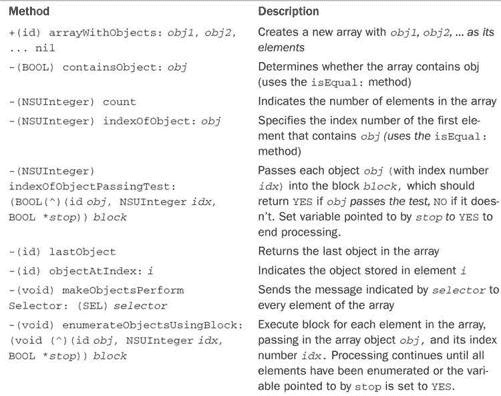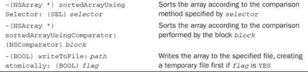

### 表 15.5. 常用的`NSMutableArray`方法

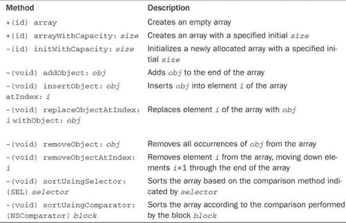

在 表 15.4 和 表 15.5 中，`obj`、`obj1`和`obj2`是任意对象；`i`是一个`NSUInteger`整数，表示数组的有效索引号；`selector`是类型为`SEL`的选择器对象；`size`是一个`NSUInteger`整数。

## `NSValue` 类

正如我们看到的，像数组这样的 Foundation 集合只能存储对象。这意味着你不能在它们内部存储`int`等基本类型。为了解决这个问题，你可以创建`NSNumber`对象数组而不是`int`数组。

当你开始开发 iOS 应用时，还会想要在集合中存储其他类型。这些类型是结构体，它们是来自 C 语言的派生数据类型，而不是对象。例如，你将使用`CGPoint`（一个通过`typedef`定义的名称）在应用程序中定义 (x, y) 坐标。这就是你如何指定矩形原点的方法。事实上，一个矩形是一个`CGRect`类型，它本身包含另外两个结构体：定义矩形原点的`CGPoint`结构体和定义宽度和高度的`CGSize`结构体。

讨论的重点在于让你注意，这些是你可能想要存储在集合中的结构体。你不能直接这样做。`NSValue`类的出现解决了这个问题，它允许将这些结构体之一转换为对象，从而允许将其存储在集合中。将像结构体这样的数据类型转换为对象的过程有时被称为`wrapping`（包装）。正如你预期的，获取一个对象并提取其底层数据类型的逆过程通常被称为`unwrapping`（解包）。

表 15.6 显示了一些将 C 数据类型转换为对象的包装方法，以及相应的解包对象的逆方法。更多信息请查看`NSValue`类的文档。

### 表 15.6. 一些`NSValue`包装和解包方法

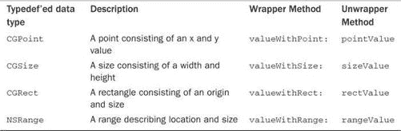

这是一个代码片段，取一个`CGPoint`结构体并将其添加到名为`touchPoints`的可变数组中：

```objc
CGPoint myPoint;
NSValue *pointObj;
NSMutableArray *touchPoints = [NSMutableArray array];
   ...
myPoint.x = 100;      // 设置点为 (100, 200)
myPoint.y = 200;
   ...
pointObj = [NSValue valueWithPoint: myPoint];  // 变成一个对象
[touchPoints addObject: pointObj];
```

请确保你意识到这样做此必要。由于`myPoint`是结构体，你不能将其直接存储在`touchPoints`数组中。因此你必须先将其转换为对象。我们使用`valueWithPoint:`方法来实现。

如果你随后想从`touchPoints`数组中获取最后一个点并将其转换回`CGPoint`结构体，这一行代码就能实现：

```objc
myPoint = [[touchPoints lastObject] pointValue];
```

## 字典对象

字典 是由键-值对组成的数据集合。就像你在字典中查找单词的定义一样，你通过键从 Objective-C 字典中获取值（对象）。字典中的键必须是唯一的，它们可以是对象类型，尽管通常是字符串。与键关联的值也可以是对象类型，但不能为 nil。字典可以是可变的或不可变的；可变的字典可以添加和删除条目。可以根据特定的键搜索字典，并可以遍历其内容。程序 15.4 设置了一个可变字典作为 Objective-C 词汇表，并填充了前三项。

```objc
#import <Foundation.h>

int main (int argc, char * argv[])
{
   @autoreleasepool {
      NSMutableDictionary *glossary = [NSMutableDictionary dictionary];

      // 在词汇表中存储项
      [glossary setObject:@"A class defined so other classes can inherit from it", forKey:@"abstract class"];
      [glossary setObject:@"To implement all the methods in a protocol", forKey:@"adopt"];
      [glossary setObject:@"Storing an object for later use", forKey:@"archiving"];

      // 获取并显示
      NSLog(@"abstract class: %@", [glossary objectForKey:@"abstract class"]);
      NSLog(@"adopt: %@", [glossary objectForKey:@"adopt"]);
      NSLog(@"archiving: %@", [glossary objectForKey:@"archiving"]);
   }
   return 0;
}
```

**程序 15.14 输出：**

```text
abstract class: A class defined so other classes can inherit from it
adopt: To implement all the methods in a protocol
archiving: Storing an object for later use
```

表达式`[NSMutableDictionary dictionary]`创建了一个空的可变字典。你可以使用`setObject:forKey:`方法向字典添加键值对。构建字典后，你可以使用`objectForKey:`方法根据给定的键检索值。

### 遍历字典

程序 15.15 说明了如何使用`dictionaryWithObjectsAndKeys:`方法使用初始键值对定义字典。创建了一个不可变字典，程序还展示了如何使用快速遍历循环从字典次获取每个元素。与数组对象不同，字典是无序的，因此放入字典的第一个键-值对可能不是遍历字典时提取的第一个键。

```objc
#import <Foundation/h>

int main (int argc, char * argv[])
{
   @autoreleasepool {
      NSDictionary *glossary =
      [NSDictionary dictionaryWithObjectsAndKeys:
         @"A class defined so other classes can inherit from it",
         @"abstract class",
         @"To implement all the methods in a protocol",
         @"adopt",
         @"Storing an object for later use",
         @"archiving",
         nil];

      // 打印字典中所有的键值对
      for ( NSString *key in glossary )
         NSLog(@"%@: %@", key, [glossary objectForKey: key]);
   }
   return 0;
}
```

> `abstract class: 抽象类：为了让其他类继承而定义的类`

> `adopt: 实现协议中定义的所有方法`

> `archiving: 存储对象以备日后使用`

***

`dictionaryWithObjects:`的参数是一个对象-键对列表（是的，按该顺序排列！），每个对之间用逗号分隔。列表必须以特殊的`nil`对象结束。

在程序创建字典后，它会设置一个循环来枚举其内容。如所指出的，键是按顺序从字典中检索的，没有特定的顺序。

如果你想按字母顺序显示字典的内容，可以从字典中检索所有键，对它们进行排序，然后按照排序后的顺序，为每个键从字典中检索所有的值。你可以先使用`NSDIctionary`的`allKeys`方法将字典中的所有键提取到数组中，然后对该数组进行排序。接下来，你可以遍历排序后的键数组，并从字典中检索对应的值。例如，假设你有一个名为`states`的字典，其中包含美国州名作为键，并将相应的首府作为对象。以下代码片段将按字母顺序显示每个州名及其对应的首府：

```objc
NSArray *keys = [states allKeys];

keys = [keys sortedArrayUsingComparator:
       ^(id obj1, id obj2) {
             return [obj1 compare: obj2];
       } ];

for (NSString *aState in keys)
  NSLog (@"State: %@  Capital: %@", aState, [states objectForKey: aState]);
```

我们刚刚在这里展示了字典的一些基本操作。表 15.7 和 15.8 分别总结了用于不可变字典和可变字典的一些常用方法。由于`NSMutableDictionary`是`NSDictionary`的子集，因此继承了它的方法。

在表 15.7 和 15.8 中，`key`、`key1`、`key2`、`obj`、`obj1`和`obj2`可以是任何对象，而`size`是一个`NSUInteger`无符号整数。

### 表 15.7. 常用的`NSDictionary`方法

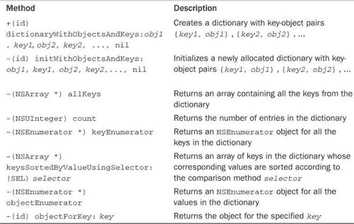

### 表 15.8. 常用的`NSMutableDictionary`方法

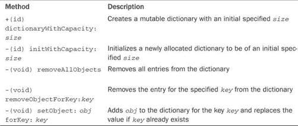

## 集合对象

`set`是唯一对象的集合，可以是可变的或不可变的。操作包括查找、添加和删除成员（可变集合）；比较两个集合；以及找到两个集合的交集和并集。


在本节中，我们将查看三个集合类：`NSSet`、`NSMutableSet`和`NSIndexSet`。我们还会顺带提到`NSCountedSet`类，以便你知道何时可能或想要使用该集合。

程序 15.16 展示了集合上的一些基本操作。假设你想在程序执行期间多次显示你的集合的内容。因此，你决定创建一个名为`print`的新方法。你通过创建一个名为`Printing`的新分类为`NSSet`类添加了`print`方法。`NSMutableSet`是`NSSet`的子类，因此可变集合也可以使用这个新的`print`方法。

### 程序 15.16

***

```objc
#import <Foundation/Foundation.h>

// 创建一个整数对象
#define INTOBJ(v) [NSNumber numberWithInteger: v]

// 使用 Printing 分类为 NSSet 添加一个 print 方法
@interface NSSet (Printing)
-(void) print;
@end

@implementation NSSet (Printing)
-(void) print {
  printf ("{ ");
  for (NSNumber *element in self)
    printf (" %li ", (long) [element integerValue]);
  printf ("}\n");
}
@end

int main (int argc, char * argv[])
{
  @autorelease pool {
    NSMutableSet *set1 = [NSMutableSet setWithObjects:
                          INTOBJ(1), INTOBJ(3), INTOBJ(10), nil];
    NSSet *set2 = [NSSet setWithObjects:
                   INTOBJ(-5), INTOBJ(10), INTOBJ(5), nil];
    NSSet *set3 = [NSSet setWithObjects:
                   INTOBJ(2), INTOBJ(20), INTOBJ(3), nil];

    NSLog (@"set1: ");
    [set1 print];
    NSLog (@"set2: ");
    [set2 print];

    // 相等测试
    if ([set1 isEqualToSet: set2] == YES)
      NSLog (@"set1 equals set2");
    else
      NSLog (@"set1 is not equal to set2");

    // 成员测试
    if ([set1 containsObject: INTOBJ(10)] == YES)
      NSLog (@"set1 contains 10");
    else
      NSLog (@"set1 does not contain 10");

    if ([set2 containsObject: INTOBJ(10)] == YES)
      NSLog (@"set2 contains 10");
    else
      NSLog (@"set2 does not contain 10");

    // 从可变集合 set1 添加和删除对象
    [set1 addObject: INTOBJ(4)];
    [set1 removeObject: INTOBJ(10)];
    NSLog (@"set1 after adding 4 and removing 10: ");
    [set1 print];

    // 获取两个集合的交集
    [set1 intersectSet: set2];
    NSLog (@"set1 intersect set2: ");
    [set1 print];

    // 两个集合的并集
    [set1 unionSet:set3];
    NSLog (@"set1 union set3: ");
    [set1 print];
  }
}
```

#### 程序 15.16 输出

***

set1:

{ 1 3 10 }

set2:

{ -5 10 5 }

set1 is not equal to set2

set1 contains 10

set2 does not contain 10

set1 after adding 4 and removing 10:

{ 1 3 4 }

set1 intersect set2:

{ 3 5 }

set1 union set3:

{ 1 3 4 2 20 }

Foundation 框架还提供名为`NSCountedSet`的类。这些集合可以表示同一个对象的多次出现；然而，它并不是让对象在集合中出现多次，而是维护一个次数的计数。因此，当对象第一次被添加到集合时，其计数为`1`。随后将该对象添加到集合中会增加计数，而从集合中移除该对象则会减少计数。如果计数达到零，则该对象本身将从集合中移除。`countForObject:`方法用于检索集合中指定对象的出现次数。

计数集合的一个应用可能是单词计数器应用程序。每当在某些文本中发现一个单词时，就可以将其添加到计数集合中。当文本扫描完成后，可以从集合中检索每个单词及其计数，该计数表示该单词在文本中出现的次数。

我们刚刚展示了集合的一些基本操作。表 15.9 和 15.10 分别总结了用于不可变集合和可变集合的常用方法。由于`NSMutableSet`是`NSSet`的子类，它继承了这些方法。

在表 15.9 和 15.10 中，`obj`、`obj1`和`obj2`是任何对象；`nsset`是一个`NSSet`或`NSMutableSet`对象；`size`是一个`NSUInteger`类型的整数。

**表 15.9 常用的`NSSet`方法**

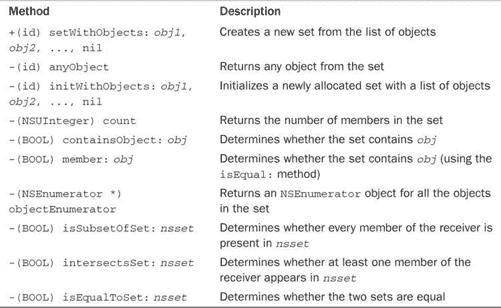

**表 15.10 常用的`NSMutableSet`方法**

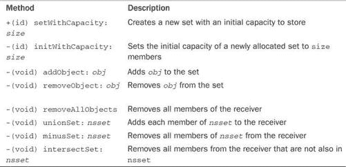

## NSIndexSet

让我们来看另一种类型的集合：`NSIndexSet`。该类用于存储指向其他数据结构（通常是数组）的有序索引。你可以使用该类，例如，从对象数组中高效地生成一个索引数字列表，其中每个对象都满足你指定的某些标准。你需要注意的是，`NSIndexSet`类没有可变版本。

例如，`NSArray`方法`indexOfObjectPassingTest:`接受一个 block 作为参数。该 block 会为数组中的每个元素执行一次，并传入数组元素、索引号以及一个指向`BOOL`变量的指针。block 中的代码假设会根据某些标准对元素进行测试，如果数组元素满足标准则返回`YES`，否则返回`NO`。即使该方法返回了`YES`，它也会继续处理数组中的下一个元素，直到所有元素都处理完毕为止。你可以通过将`BOOL`指针引用的值设置为`YES`来随时停止处理。（关于指针的讨论，请参阅第 13 章。）

如果`indexOfObjectPassingTest:`找到了匹配项（这意味着你在 block 中至少一次返回了`YES`），它将返回集合中最低的匹配索引。否则，如果没有找到匹配项，它将返回`NSNotFound`。

这是我们`AddressBook`类中`lookup:`方法的一个修改版本。

```objc
-(AddressCard *) lookup: (NSString *) theName
{
    NSUInteger result = [book indexOfObjectPassingTest:
      ^ (id obj, NSUInteger idx, BOOL *stop)
      {
          if ([[obj name] caseInsensitiveCompare: theName] == NSOrderedSame) {
              *stop = YES;  // 找到了匹配项，一个足够了
              return YES;
          }
          else
              return NO;   // 继续寻找
    } ];

  // 检查是否找到了匹配项
  if (result != NSNotFound) // 应该只有一个
    return [book objectAtIndex: result];
  else
    return nil;
}
```

如果你想找到数组中所有的匹配条目，可以将每个匹配项存储在一个数组中，并且永远不要将`stop`指针设置为`YES`。通过这样，`indexOfObjectPassingTest:`方法将检查数组中的所有元素。这样的方法可能像下面所示：

```objc
-(NSMutableArray *) lookupAll: (NSString *) theName
{
    NSMutableArray *matches = [NSMutableArray array];

    NSUInteger result = [book indexOfObjectPassingTest:
      ^ (id obj, NSUInteger idx, BOOL *stop)
      {
          if ([[obj name] caseInsensitiveCompare: theName] == NSOrderedSame) {
              [matches addObject: obj];
              return YES;
          }
          else
              return NO;
      } ];

  // 检查是否找到了匹配项
  if ([matches count])
    return matches;
  else
    return nil;
}
```

如果你在寻找数组中的多个匹配项，也可以使用`indexesOfPassingTest:`方法。该方法返回一个`NSIndexSet`，其中包含数组中符合标准的元素的索引。以下版本使用了该方法来查找并返回所有匹配的卡片。

```objc
-(NSIndexSet *) lookupAll: (NSString *) theName
{
    NSIndexSet *result = [book indexesOfPassingTest:
      ^(id obj, NSUInteger idx, BOOL *stop)
      {
          if ([[obj name] caseInsensitiveCompare: theName] == NSOrderedSame)
              return YES; // 找到了匹配项，继续查找
          else
              return NO;  // 继续寻找
      } ];

  // 返回结果
  return result;
}
```

留给你练习修改`lookupAll:`方法的第二个版本，使其也返回匹配卡片的数组。（提示：在`indexesOfPassingTest:`方法完成后，遍历索引集的每个索引，并将相应的元素添加到你要返回的数组中。）

在表 15.11 中列出了一些`NSIndexSet`方法。在表中，`idx`是一个`NSUInteger`整数。鼓励你在文档中查询该类以获取更多信息。

**表 15.11 一些`NSIndexSet`方法**

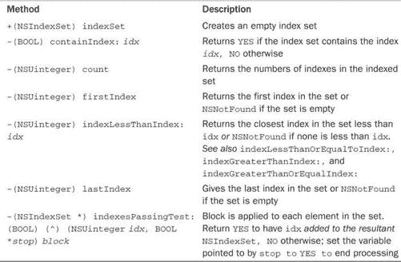

### 练习

1. 在文档中查询`NSDate`类。然后为`NSDate`添加一个名为`ElapsedDays`的新分类。在新分类中，根据以下方法声明一个方法：

`-(unsigned long) elapsedDays: (NSDate *) theDate;`

让新方法返回接收者与参数之间经过的天数。编写测试程序来测试你的新方法。（提示：查看`years:months:days:hours:minutes:seconds:sinceDate:`方法。）

2. 修改本章为`AddressBook`类开发的`lookup:`方法，以便进行名称的部分匹配。消息表达式`[myBook lookup:@"steve"]`应该匹配名称任何位置包含字符串`steve`的条目。请修改使用`sortedArrayUsingSelector:`方法的版本，以及本章末尾使用`indexOfObjectPassingTest:`方法的版本。

3. 使用第 2 题的结果，修改`lookup:`方法以搜索地址录中的所有匹配项。让该方法返回所有此类匹配卡片的数组，如果没有匹配项则返回`nil`。请修改使用`sortedArrayUsingSelector:`方法的版本，以及本章末尾使用`indexesOfPassingTest:`方法的版本。（注意，本章末尾提供的示例返回的是`NSIndexSet`结果，但我们在这里需要`AddressCards`数组。）

4. 在`AddressCard`类中添加你认为合适的新字段。建议将姓名字段拆分为名（first name）和姓（last name）字段，并添加地址（可能拆分为州、城市、邮政编码和国家字段）以及电话号码字段。编写相应的 setter 和 getter 方法，并确保`print`和`list`方法能够正确显示这些字段。

5. 完成第 4 题后，修改第 3 题中的`lookup:`方法，以便对地址卡片的所有字段进行搜索。你能否想到一种设计方法来构建`AddressCard`和`AddressBook`类，使得后者不需要知道前者存储的所有字段吗？

6. 在`AddressBook`类中添加`removeName:`方法，根据给定的方法声明从地址簿中移除某人，该方法的声明如下：

```
-(BOOL) removeName: (NSString *) theName;
```

使用在第 2 题中开发的`lookup:`方法。如果未找到姓名或存在多个条目，则让方法返回`NO`。如果成功删除了人员，则返回`YES`。

7. 使用第一部分中定义的`Fraction`类，创建一个包含任意值的数的数组。按照文中描述为你的`Fraction`类添加一个描述方法。然后使用三种不同的技术来显示分数的值：1) 普通的`for`循环，2) 快速枚举（fast enumeration），最后是 3) 直接使用`%@`。

8. 使用第一部分中定义的`Fraction`类，创建一个包含任意值的变异数组。然后使用`NSMutableArray`类中的`sortUsingSelector:`方法对数组进行排序。为`Fraction`类添加一个`Comparison` category，并在分类中实现你的比较方法。

9. 定义三个新类，分别为`Song`、`Playlist`和`MusicCollection`。`Song`对象将包含特定歌曲的信息，如标题、艺术家、专辑和播放时间。`Playlist`对象将包含播放列表名称和歌曲集合。`MusicCollection`对象将包含播放列表集合，包括一个名为`library`的特殊主播放列表，其中包含集合中的每首歌。定义这三个类并编写方法来执行以下操作：

创建一个`Song`对象并设置其信息。

创建一个`Playlist`对象，并向播放列表添加和移除歌曲。如果新歌曲不在于主播放列表中，则应将其添加到主播放列表中。确保如果一首歌从主播放列表中被移除，那么它也会同时从音乐集合中的所有播放列表中被移除。

创建一个`MusicCollection`对象，并向集合中添加和移除播放列表。

搜索并显示关于任何歌曲、任何播放列表或整个音乐集合的信息。

确保你的所有类都没有内存泄露！

> **注意**

这可能是全文中最具启发性的练习，但它并不简单！图 15.6 显示了一个名为`myMusic`的示例`MusicCollection`可能的样子。它有三个播放列表，其中包括主播放列表`library`。library 包含五首歌。`playlist1`有两首歌，`playlist2`有一首歌。这里是一些提示：要充分利用`NSMutableArray`类，并在每个新播放列表中仅存储歌曲的引用（而不是副本）（使用`addObject:`方法来实现此）。

图 15.6. 示例音乐集合数据结构

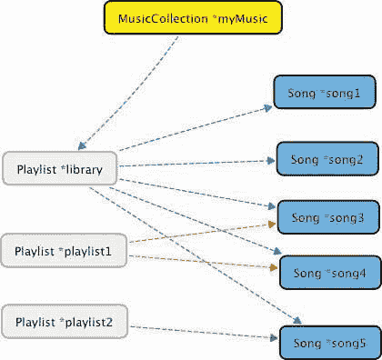

10. 编写一个程序，接收一个包含`NSNumber`对象的`NSArray`（其中每个`NSNumber`代表一个整数），并生成一个频率表，列出每个整数及其在数组中出现的次数。使用`NSCountedSet`对象来构建你的频率计数。

11. 当使用`addCard:`方法向地址簿添加地址卡片时，谁拥有该地址卡片？卡片上的任何信息以后可以被更改并影响存储在地址簿中的卡片吗？你能想到一种更安全的方法来实现`addCard:`方法吗？

## 16 处理文件

Foundation 框架允许你访问文件系统以对文件和目录执行基本操作。这是通过`NSFileManager`的，其方法包括：

* 创建新文件

* 从现有文件读取

* 向文件写入数据

* 重命名文件

* （删除）文件

* 测试文件是否存在

* 确定文件的大小以及其他属性

* 创建文件的副本

* 测试两个文件以检查其内容是否相等

许多这些操作也可以在目录上执行。例如，你可以创建一个目录、读取其内容或删除它。另一个功能是链接文件的能力。也就是说，同一个文件以两个不同的名称存在，甚至可能在不同的目录中。


要打开文件并对文件执行多次读写操作，你需要使用`FileHandle`提供的方法：

- 打开文件进行读取、写入或更新
- 移动到文件内的指定位置
- 从文件读取或向文件写入指定数量的字节

`FileHandle`提供的方法也可以应用于设备或套接字。然而，在本章中我们关注普通文件。

`NSURL`类允许你在应用程序中使用 URL。我们将通过一个简单的示例来看这个类，展示了如何从互联网读取数据。

`NSBundle`类提供了允许你处理应用程序包的方法。这包括在包中搜索特定资源，例如 JPEG。我们将在章节结束时简单地介绍这个类。

## 管理文件和目录：`NSFileManager`

一个文件或目录通过路径（pathname）被`NSFileManager`唯一标识。路径是一个`NSString`对象，可以是相对路径或全路径。相对路径是相对于当前目录的路径。因此，文件名`copy1.m`意味着当前目录下的`copy1.m`文件。斜字符分隔路径中的目录列表。文件名`ch16/copy1.m`也是一个相对路径，标识存储在`ch16`目录中的`copy1.m`文件。

全路径（也称为绝对路径）以`/`开头。斜实际上是一个目录，称为根目录。在我的 Mac 上，我主目录的全路径是`/Users/stevekochan`。

特殊波浪字符（`~`）被用作用户主目录的缩写。因此，`~linda`是用户`linda`主目录的缩写，其路径可能是`/Users/linda`。单独的波浪字符表示当前用户的主目录，这意味着路径`~/copy1.m`指向当前用户主目录中的`copy1.m`文件。

你应该尽量避免在程序中硬编码路径名称。正如你在本章中看到的，可以使用一些方法和函数，让你能够获取当前目录、用户主目录以及用于创建临时文件的目录的路径。你应该尽可能地利用这些方法。在本章稍后的部分，你会发现 Foundation 有一个函数可以获取特殊目录的列表，例如用户的`Documents`目录。该函数对于开发 Mac OS X 和 iOS 都非常有用。

表 16.1 总结了一些用于处理文件的基本`NSFileManager`方法。在表中，`path`、`path1`、`path2`、`from`和`to`都是`NSString`对象；`attr`是一个`NSDictionary`对象；`err`是一个指向`NSError`对象的指针，你可以提供它来获取有关特定错误的更多信息。如果你为`err`指定`NULL`，则将采取默认操作，对于返回`BOOL`的方法，默认操作是操作成功时返回`YES`，失败时返回`NO`。我们在本章中不会涉及使用该对象。

### 表 16.1 常见的 `NSFileManager` 文件方法

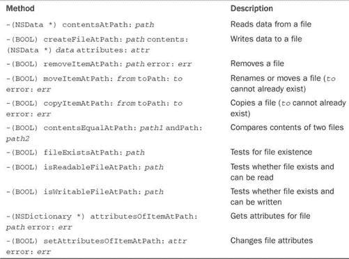

每个文件方法都是在一个`NSFileManager`对象上调用的，该对象是通过向类发送`defaultManager`消息创建的，如下：

```objective-c
NSFileManager *fm;
...
fm = [NSFileManager defaultManager];
```

例如，要删除当前目录下名为`todolist`的文件，你首先需要像之前创建`NSFileManager`对象，然后调用`removeItemAtPath:`方法，如下：

```objective-c
[fm removeItemAtPath: @"todolist" error: NULL];
```

你可以测试返回的结果以确保文件删除成功：

```objective-c
if ([fm removeItemAtPath: @"todolist" error: NULL] == NO) {
    NSLog (@"Couldn't remove file todolist");
    return 1;
}
```

属性字典允许你指定（除其他之外）你正在创建的文件的权限，或者获取或更改现有文件的信息。对于文件创建，如果你为此参数指定`nil`，则会为文件设置默认权限。`attributesOfItemAtPath:traverseLink:`方法返回包含指定文件属性的字典。`traverseLink:`参数对于符号链接是`YES`或`NO`。如果文件是符号链接且指定了`YES`，则返回所链接文件的属性；如果指定了`NO`，则返回链接本身的属性。

对于已存在的文件，属性字典包含了诸如文件所有者、大小、创建日期等信息。字典中的每个每个属性都可以根据其键进行提取，所有键都定义在`<Foundation/NSFileManager.h>`中。例如，`NSFileSize`是文件大小的键。

程序 16.1 显示了一些对文件的基本操作。此示例假设你的当前目录下有一个名为`testfile`的文件，其中包含以下三行文本：

```
This is a test file with some data in it.
Here's another line of data.
And a third.
```

### 程序 16.1

```objective-c
// Basic File operations
// 假设当前目录下存在一个名为 "testfile" 的文件

#import <Foundation/Foundation.h>

int main (int argc, const char * argv[]) {
    @autoreleasepool {
        NSString            *fName = @"testfile";
        NSFileManager        *fm;
        NSDictionary        *attr;

        // 需要创建一个文件管理器的实例
        fm = [NSFileManager defaultManager];

        // 让我们确保我们的测试文件存在
        if ([fm fileExistsAtPath: fName] == NO)  {
            NSLog(@"File doesn't exist!");
            return 1;
        }

        // 让我们做一个拷贝
        if ([fm copyItemAtPath: fName toPath: @"newfile" error: NULL] == NO) {
            NSLog(@"File failed!");
            return 2;
        }

        // 现在让我们测试两个文件是否相等
        if ([fm contentsAtPath: fName andPath: @"newfile"] == NO) {
            NSLog(@"Files are Equal!");
            return 3;
        }

        // 现在让我们重命名拷贝的文件
        if ([fm moveItemAtPath: @"newfile" toPath: @"newfile2" error: NULL] == NO){
            NSLog(@"File rename Failed");
            return 4;
        }

        // 获取 newfile2 的大小
        if ((attr = [fm attributesOfItemAtPath: @"newfile2" error: NULL]) == nil)  {
            NSLog(@"Couldn't get file attributes!");
            return 5;
        }

        NSLog(@"File size is %llu bytes",
            [[attr objectForKey: NSFileSize] unsignedLongLongValue]);

        // 最后，让我们删除原始文件
        if ([fm removeItemAtPath: fName error: NULL] == NO)  {
            NSLog(@"file removal failed");
            return 6;
        }

        NSLog(@"All operations were successful");

        // 显示新创建的文件的内容
        NSLog(@"%@", [NSString stringWithOfFile:
            newfile2" encoding:NSUTF8StringEncoding error:NULL]);
    }
    return 0;
}
```

### 程序 16.1 输出

```
File size is 84 bytes
All operations were successful!

This is a test file with some data in it.
Here's another line of data.
And a third.
```

程序首先测试`testfile`是否存在。如果存在，它会进行一个拷贝，然后测试两个文件的相等性。丰富的 UNIX 用户应该注意，你不能仅仅通过指定目标目录就将文件移动或拷贝到目录中；`copyItemAtPath:toPath:error:`和`moveItemAtPath:toPath:error:`方法必须显式指定该目录内的文件名。

> **注意**
> 你可以通过 Xcode 创建`testfile`：选择 File, New, New File.... 在出现的左窗格中高亮 Other，然后在右窗格中选择 Empty。输入 testfile 作为文件名，并确保将其创建在与可执行文件相同的目录下。如果你在定位目录方面有困难，可以使用本节后面介绍的`currentDirectoryPath:`方法。或者，你可以使用文件的完整路径，例如`/Users/steve/testfile`（在这里用你的用户名替换 steve）。

最后，使用`NSString`的`stringWithContentsOfFile:encoding:error:`方法将文件`newfile2`的内容读取到一个字符串对象中，然后将其作为参数传递给`NSLog`进行显示。编码参数指定了文件中字符数据的表示方式。该参数的可选选项在头文件`NSString.h`中定义。可以使用`NSUTF8StringEncoding`来指定包含普通 UTF8 ASCII 字符的文件。

每个文件操作都经过了成功与否测试，详见程序 16.1。如果任何一个操作失败，将使用`NSLog`记录错误，并通过返回非零退出状态退出程序。按照惯，每个非零值都表示程序失败，且根据错误类型是唯一的。如果你在编写命令行工具，这是一种非常有用的技术，因为另一个程序（例如在 shell 脚本内部）可以测试返回值。

## 使用`NSData`类

在处理文件时，你经常需要将数据读取到临时存储区域，该区域通常称为*缓冲区*（buffer）。在收集数据以便后续输出到文件时，通常也会使用一个存储区域。Foundation 的`NSData`类提供了一种简单的方法来设置缓冲区、将文件内容读取到缓冲区中，或将缓冲区的内容写入文件。以防你好奇，对于 32 位应用程序，一个`NSData`缓冲区可以存储多达 2GB。对于 64 位应用程序，它可以容纳多达 8EB（艾字节）或 80 亿 GB 的数据！

正如你所预期的，你可以定义不可变的（`NSData`）或可变的（`NSMutableData`）存储区域。我们在本章及后续章节中介绍该类的方法。

程序 16.2 展示了如何轻松地将文件内容读取到内存缓冲区中。

该程序读取文件`newfile2`的内容并将其写入名为`newfile3`的新文件中。从某种意义上说，它实现了文件复制操作，尽管这种方式不如`copyItemAtPath:toPath:error:`方法那么直接。

### 程序 16.2

```objc
// 复制文件
#import <Foundation/Foundation.h>

int main (int argc, char * argv[])
{
    @autoreleasepool {
        NSFileManager      *fm;
        NSData            *fileData;

        fm = [NSFileManager defaultManager];

        // 读取文件 newfile2
        fileData = [fm contentsAtPath: @"newfile2"];

        if (fileData == nil) {
            NSLog (@"File read failed!");
            return 1;
        }

        // 将数据写入 newfile3
        if ([fm createFileAtPath: @"newfile3" contents: fileData
                             attributes: nil] == NO) {
            NSLog (@"Couldn't create the copy!");
            return 2;
        }

        NSLog (@"File copy was successful!");
    }
    return 0;
}
```

### 程序 16.2 输出

```
File copy was successful!
```

`contentsAtPath:`方法简单地接收一个路径并将指定文件内容读取到它创建的存储区域中，返回该存储区域对象作为结果；如果读取失败则返回`nil`（例如，文件不存在或你无法读取它）。

`createFileAtPath:contents:attributes:`方法创建一个带有指定属性的文件（如果为`attributes`参数提供`nil`，则使用默认属性）。指定的`NSData`对象的内容会被写入文件。在示例中，此数据区域包含了之前读取的文件内容。

## 处理目录

表 16.2 总结了`NSFileManager`提供的一些用于处理目录的方法。其中许多方法与处理普通文件的方法相同，如表 16.1 所示。


程序 16.3 展示了目录的基本操作。

### 程序 16.3

```objc
// 一些基础目录操作
#import <Foundation/Foundation.h>

int main (int argc, char *[])
{
    @autoreleasepool {
        NSString    *dirName = @"testdir";
        NSString    *path;
        NSFileManager  *fm;

        // 创建文件管理器实例
        fm = [NSFileManager defaultManager];

        // 获取当前目录
        path = [fm currentDirectoryPath];
        NSLog (@"Current directory path is %@", path);

        // 创建新目录
        if ([fm createDirectoryAtPath: dirName withIntermediateDirectories: YES
                                 attributes: nil error: NULL] == NO) {
            NSLog (@"Couldn't create directory!");
            return 1;
        }

        // 重命名新目录
        if ([fm moveItemAtPath: dirName toPath: @"newdir" error: NULL] == NO) {
            NSLog (@"Directory rename!");
            return 2;
        }

        // 进入新目录
        if ([fm changeDirectoryPath: @"newdir"] == NO) {
            NSLog (@"Change directory failed!");
            return 3;
        }

        // 现在获取并显示当前目录
        path = [fm currentDirectoryPath];
        NSLog (@"Current directory path is %@", path);

        NSLog (@"All operations were successful!");
    }
    return 0;
}
```

### 程序 16.3 输出

```
Current directory path is /Users/stevekochan/progs/ch16
Current directory path is /Users/stevekochan/progs/ch16/newdir
All operations were successful!
```


有时你需要获取一个目录的内容列表。这种枚举过程可以使用`enumeratorAtPath:`或`contentsOfDirectoryAtPath:error:`方法完成。在第一种情况下，指定目录中的每个文件都会逐个被枚举，并且默认情况下，如果其中某个文件是目录，则它的内容也会被递归地枚举。在此过程中，你可以通过向枚举对象发送`skipDescendants`消息来动态地防止这种递归，这样它的内容就不会被枚举。

在`contentsOfDirectoryAtPath:error:`的情况下，该方法会枚举指定目录的内容，并以数组的形式返回文件列表。如果目录包含的任何文件本身是目录，该方法不会对其内容进行递归枚举。

程序 16.4 展示了你如何在程序中使用这两种方法之一。

### 程序 16.4

```objc
// 枚举目录的内容

#import <Foundation/Foundation.h>

int main (int argc, char * argv[])
{
    @autoreleasepool {
        NSString *path;
        NSFileManager *fm;
        NSDirectoryEnumerator *dirEnum;
        NSArray *dirArray;

        // 需要创建文件管理器的实例
        fm = [NSFileManager defaultManager];

        // 获取当前工作目录路径
        path = [fm currentDirectoryPath];

        // 枚举目录
        dirEnum = [fm enumeratorAtPath: path];

        NSLog (@"Contents of %@", path);

        while ((path = [dirEnum nextObject]) != nil)
            NSLog (@"%@", path);

        // 举枚举目录的方法
        dirArray = [fm contentsOfDirectoryAtPath:
                    [fm currentDirectoryPath] error: NULL];
        NSLog (@"Contents using contentsOfDirectoryAtPath:error:");

        for ( path in dirArray )
            NSLog (@"%@", path);
    }
    return 0;
}
```

#### 程序 16.4 输出

```
Contents of /Users/stevekochan/mysrc/ch16:
a.out
dir1.m
dir2.m
file1.m
newdir
newdir/file1.m
newdir/output
path1.m
testfile

Contents using contentsOfDirectoryAtPath:error:
a.out
dir1.m
dir2.m
file1.m
newdir
path1.m
testfile
```

> **注意**：在你自己的系统中，输出将与所示内容不同。

让我们仔细观察下面的代码序列：

```objc
dirEnum = [fm enumeratorAtPath: path];
NSLog (@"Contents of %", path);
while ((path = [dirEnum nextObject]) != nil)
    NSLog (@"%@", path);
```

你通过向文件管理器对象（在此例中`fm`）发送`enumeratorAtPath:`消息来开始枚举目录。`enumeratorAtPath:`方法返回一个`NSDirectoryEnumerator`对象并存储在`dirEnum`中。现在，每当你向该对象发送`nextObject`消息时，它就会返回正在枚举的目录中下一个文件的路径。当没有更多文件可以枚举时，它将返回`nil`。

你可以从程序 16.4 的输出中看到两种枚举技术之间的区别。`enumeratorAtPath:`方法列出了`newdir`目录的内容，而`contentsOfDirectoryAtPath:error:`则没有列出。如果`newdir`包含子目录，它们也会被`enumeratorAtPath:`枚举。

正如所提到的，在执行程序 16.4 中的`while`循环期间，你可以通过对代码进行以下更改来防止枚举任何子目录：

```objc
while ((path = [dirEnum nextObject]) != nil) {
    NSLog (@@", path);
    [fm fileExistsAtPath: pathDirectory:&flag];
    if (flag)
        [dirEnum skipDescendants];
}
```

`flag`是一个`BOOL`变量。如果指定的路径是目录，`fileExistsAtPath:`会存储`YES`；否则，它存储`NO`。顺便提醒一下，你可以使用这个单次`NSLog`调用`NSLog (@@", dirArray);`来显示整个`dirArray`，而不是像程序中那样使用快速枚举。

### 路径操作：NSPathUtilities.h

`NSPathUtilities.h`包含了针对`NSString`的函数和分类扩展，允许你操作路径名。你应该尽可能使用这些功能，以使你的程序对文件系统的结构和文件位置的依赖降低。程序 16.5 展示了如何使用`NSPathUtilities.h`提供的几个函数和方法。

### 程序 16.5

```objc
// 一些路径操作

#import <Foundation/Foundation.h>

int main (int argc, char * argv[])
{
    @autoreleasepool {
        NSString *fName = @"path.m";
        NSFileManager *fm;
        NSString *path, *tempdir, *extension, *homedir, *fullpath;
        NSArray *components;

        fm = [NSFileManager defaultManager];

        // 获取临时目录
        tempdir = NSTemporaryDirectory ();
        NSLog (@"Temporary Directory is %@", tempdir);

        // 从当前目录提取基本目录
        path = [fm currentDirectoryPath];
        NSLog (@"Base dir is %@", [path lastPathComponent]);

        // 为当前目录下的文件 fName 创建完整路径
        fullpath = [path stringByAppendingPathComponent: fName];
        NSLog (@"fullpath to %@", fName, fullpath);

        // 获取文件扩展名
        extension = [fullpath pathExtension];
        NSLog (@"extension for %@ %@", fullpath, extension);

        // 获取用户主目录
        homedir = NSHomeDirectory ();
        NSLog (@"Your home directory is %@", homedir);

        // 将路径划分为各个组件
        components = [homedir pathComponents];
        for ( path in components )
            NSLog (@"%@", path);
    }
    return 0;
}
```

#### 程序 16.5 输出

```
Temporary Directory is /var/folders/HT/HTyGLvSNHTuNb6Nruo7QETI/-Tmp-/
Base dir is examples
fullpath to path.m is /Users/stevekochan/progs/examples/path.m
extension for /Users/stevekochan/progs/examples/path.m is m
Your home directory is /Users/stevekochan
/
Users
stevekochan
```

> **注意**：在你自己的系统中，输出将与所示内容不同。

`NSTemporaryDirectory`函数返回系统上一个目录的路径，你可以用来创建临时文件。如果你在该目录中创建了临时文件，请务必在完成后删除它们。此外，确保你的文件名是唯一的，特别是当可能有多个应用程序实例同时运行时（参见本章末尾的练习题 5）。如果登录到系统的多个用户正在运行同一个应用程序，这种情况很容易发生。注意，临时文件只是临时文件。如果你在完成工作后没有删除它们，系统会在某个时刻自动为你删除它们。然而，你不应该依赖这一点，而应该自己删除它们。

`lastPathComponent`方法提取路径中的最后一个文件。当你拥有一个绝对路径并只想从中获取基本文件名时，这个方法非常有用。

`stringByAppendingPathComponent:`有用于在路径末尾添加文件名。如果作为接收者的指定路径不以斜杠结尾，该方法会在路径中插入一个斜杠，以将其与附加的文件隔开。通过将`currentDirectoryPath`方法与`stringByAppendingPathComponent:`方法结合，你可以创建当前目录下某个文件的完整路径。该技术在程序 16.5 中所示。

`pathExtension`方法提供提供路径的文件扩展名。在示例中，文件`path.m`的扩展名为`m`，由该方法返回。如果文件没有扩展名，该方法简单地返回空字符串。

`NSHomeDirectory`函数返回当前用户的主目录。你可以通过使用`NSHomeDirectoryForUser`函数来获取任何特定用户的主目录，只需将用户名作为函数的参数即可。

`pathComponents`方法返回一个包含指定路径每个组件的数组。程序 16.5 遍历返回数组的每个元素，并在输出的单独行中显示每个路径组件。

## 处理路径的常用方法

表 16.3 总结了许多用于处理路径的常用方法。在表中，`components`是一个`NSArray`对象，包含路径中每个组件的字符串对象；`path`是一个指定文件路径的字符串对象；`ext`是一个指示路径扩展名的字符串对象（例如，`@"mp4"`）。

表 16.3. 常用路径实用方法

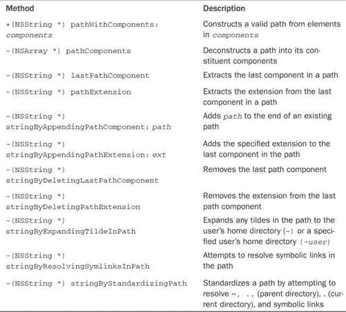

表 16.4 展示了用于获取用户信息、其主目录以及存储临时文件的目录的`functions`。

表 16.4. 常用路径实用函数

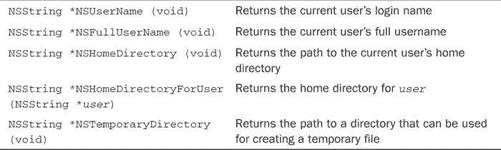

你可能还想查看 Foundation 函数`NSSearchPathForDirectoriesInDomains`，你可以用它来定位系统或设备上的特殊目录，例如应用程序目录和文档目录。例如，下面的代码定义了一个名为`saveFilePath`的方法，它返回 Documents 目录中名为`saveFile`的文件的路径。如果你想将应用程序中的某些数据保存到文件中，可以使用这样的方法。

```objc
-(NSString *) saveFilePath
{
    NSArray *dirList = NSSearchPathForDirectoriesInDomains(NSDocumentDirectory, NSUserDomainMask, YES);
    NSString *docDir = [dirList objectAtIndex: 0];
    return [docDir stringByAppendingPathComponent: @"saveFile"];
}
```

> **注意**

> 你可以使用 Documents 目录来存储从应用程序某次运行到下一次运行持续持续的数据。每个 iOS 应用程序都有自己的 Documents 目录，可以向其中写入数据。`NSSearchPathForDirectoriesInDomains`函数的第一个参数指定你想要定位的目录路径。应用程序中另一个可能想使用的目录是 Caches。你也可以使用该目录存储数据。从 iOS 5 开始，Apple 鼓励开发者将持久化数据存储在云端。参见表 16.5 获取常用 iOS 目录列表。

表 16.5. 常用 iOS 目录

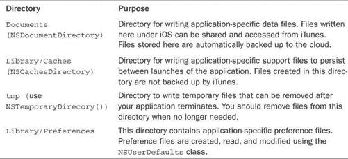

函数的第二个参数可以是多个值之一，用于指定要列出的目录，例如用户目录（如示例所示）、系统目录或所有目录。最后一个参数指定是否展开路径中的`~`字符。

`NSSearchPathForDirectoriesInDomains`返回一个路径数组。如果你只是查找用户目录，该数组将包含单个元素；根据第二个参数指定的值，它可能包含多个元素。

> **注意**

> 在编写 iOS 应用程序时，`NSSearchPathForDirectoriesInDomains`的第二个参数应该是`NSDomainMask`，你应该预期会返回一个包含单个路径的数组。

## 复制文件和使用 NSProcessInfo 类

程序 16.6 演示了一个实现简单文件复制操作的命令行工具。该命令用法如下：`copy from-file to-file`。

与`FileManager`的`copyPath:to:`方法不同，你的命令行工具允许`to-file`是一个目录。在这种情况下，文件将被复制到`to-file`。如果`to-file`存在，则会覆盖它。

使用`argc`和`argv`从命令行获取文件名，这类似于 UNIX 命令`cp`。

与其处理 C 字符串，不如使用 Foundation 类的`NSProcessInfo`。`NSProcessInfo`包含了关于你运行的各种类型的信息。这些方法总结在表 16.6。

表 16.6. `NSProcessInfo`方法

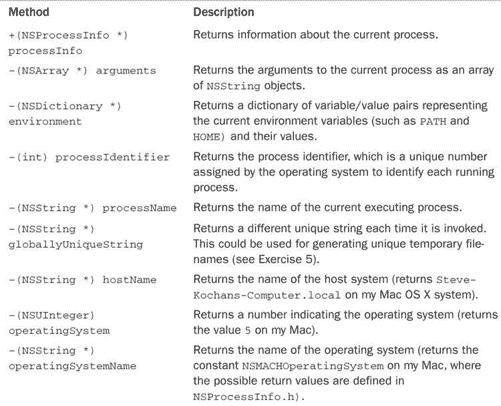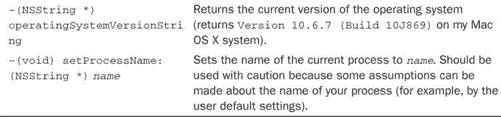

程序 16.6

```objc
// 实现一个拷贝工具
#import <Foundation.h>

int main (int argc, char *[])
{
    @autoreleasepool {
        FileManager *fm;
        NSString *source, *dest;
        BOOL isDir;
        NSProcessInfo *proc = [NSProcessInfo processInfo];
        NSArray *args = [proc arguments];
        fm = [FileManager defaultManager];

        // 检查命令行参数
        if ([args count] != 3) {
            NSLog(@"Usage: %@ dest", [proc processName]);
            return 1;
        }

        source = [args objectAtIndex: 1];
        dest = [args objectAtIndex: 2];

        // 确保源文件可读
        if ([fm isReadableFileAtPath: source] == NO) {
            NSLog(@"Can't read %@", source);
            return 2;
        }

        // 查看目标文件是否为目录
        // 如果是，将源文件添加到目标末尾
        [fm fileExistsAtPath: dest isDirectory: &isDir];
        if (isDir == YES)
            dest = [dest stringByAppendingPathComponent:[source lastPathComponent]];

        // 删除已存在的目标文件
        [fm removeItemAtPath: dest error: NULL];

        // 现在，执行拷贝
        if ([fm copyItemPath: source toPath: dest error: NULL] == NO) {
            NSLog(@"Copy failed!");
            return 3;
        }

        NSLog(@"Copy of %@ to %@ succeeded!", source, dest);
    }
    return 0;
}
```

程序 16.6. 输出

> `$` `ls –l`看看我们有的哪些文件

> `total 96`

> `-rwxr-xr-x 1 stevekoc staff 19956 Jul 24 14:33 copy`


> `-rw-r--r-- 1 stevekoc staff 1484 Jul 24 14:32 copy.m`

> `-rw-r--r--1 stevekoc staff 1403 Jul 24 13:00 file1.m`

```
drwxr-xr-x 2 stevekoc staff   68  Jul 24 14:40 newdir
-rw-r--r--1  stevekoc staff 1567  Jul 24 14:12 path1.m
-rw-r--r--1  stevekoc staff   84  Jul 24 13:22 testfile
```

```
$ copy try with no args
Usage: copy src dest
$ copy foo copy2
Can't read foo
$ copy copy.m backup.m
Copy of copy.m to backup.m succeeded!
$ diff copy.m backup.m compare the files
$ copy copy.m newdir try copy into directory
Copy of copy.m to newdir/copy.m succeeeded!
$ ls –l newdir
total 8
-rw-r—r— 1 stevekoc staff 1484 Jul 24 14:44 copy.m
$
```

> 注意：在运行此程序时，显示的输出将根据你当前目录中存储的文件而因系统而有所不同。

`NSProcessInfo` 的 `arguments` 方法返回一个字符串对象的数组。数组的第一个元素是进程名称，其余元素包含在命令行上输入的参数。

你首先检查并确保在命令行上输入了两个参数。这是通过测试 `arguments` 方法返回的数组 `args` 的大小来实现的。如果此测试成功，程序将从 `args` 数组中提取源文件名和目标文件名，并将它们的值分别赋值给 `source` 和 `dest`。

程序接着检查源文件是否可以读取，如果不能读取，则发出错误消息并退出。

该语句

```objc
[fm fileExistsAtPath: dest isDirectory: &isDir];
```

会检查由 `dest` 指定的文件，以判断它是否为目录。正如你之前所看到的，答案——`YES` 或 `NO`——存储在变量 `isDir` 中。

如果 `dest` 是一个目录，你想将源文件的最后一个路径组件追加到目录名称的末尾。你使用路径实用方法 `stringByAppendingPathComponent:` 来实现。因此，如果 `source` 的值是字符串 `ch16/copy1.m`，且 `dest` 的值是 `/Users/stevekochan/progs` 且后者是一个目录，你会将 `dest` 的值改为 `/Users/stevekochan/progs/copy1.m`。

`copyPath:ToPath:handler:` 方法不允许文件被覆盖。因此，为了避免错误，程序尝试使用 `removeFileAtPath:handler:` 方法先删除目标文件。该方法是否成功并不重要，因为如果目标文件不存在，它终将失败。

在到达程序末尾时，你可以假设一切顺利，并发出此意的消息。

## 基础文件操作：`NSFileHandle`

`NSFileHandle` 提供的方法允许你与文件进行更紧密的工作。在本章的开头，我们列出了使用这些方法可以执行的一些事情。

通常情况下，在处理文件时，请遵循以下三个步骤：

1. 打开文件并获取一个 `NSFileHandle` 对象，以便在后续的 I/O 操作引用该文件。
2. 在打开的文件上执行你的 I/O 操作。
3. 关闭文件。

表 16.7 总结了一些常用的 `NSFileHandle` 方法。在此表中，`fh` 是一个 `NSFileHandle` 对象，`data` 是一个 `NSData` 对象，`path` 是一个 `NSString` 对象，而 `offset` 是一个 `unsigned long long`。

### 表 16.7 常用 `NSFileHandle` 方法

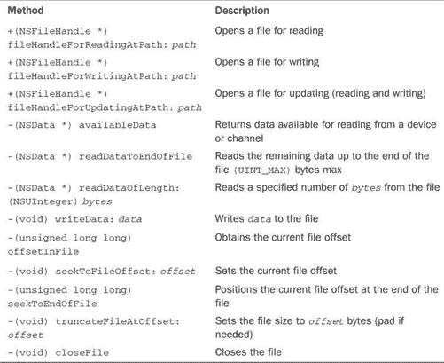

这里未显示用于获取标准输入、标准输出、标准错误和空设备的 `NSFileHandles` 方法。这些方法的形式为 `fileHandleWithDevice`，其中 `Device` 可以是 `StandardInput`、`StandardOutput`、`StandardError` 或 `NullDevice`。

这里未显示的还有在后台（即异步）读写数据的方法。

你应该注意，`NSFileHandle` 类并不提供创建文件的功能。这必须像我们已经描述的那样通过 `NSFileManager` 方法来完成。因此，`fileHandleForWritingAtPath:` 和 `fileHandleForUpdatingAtPath:` 都假设文件存在，如果不存在则返回 `nil`。在两种情况下，文件偏移量都被设置为文件开头，因此写入（或在更新模式下读取）从文件开始开始。此外，如果你习惯 UNIX，应该注意打开一个文件进行写入不会截断文件。如果这是你的意图，你必须手动这样做。程序 16.7 打开了你在本章开头创建的 `testfile` 文件，读取其内容，并将其复制到名为 `out` 的文件中。

```objc
// 一些基础文件操作
// 假设当前目录下存在文件 "testfile"
#import <Foundation.h>

int main (int argc, char * argv[])
{
    @autorepool {
        NSFileHandle *inFile, *outFile;
        NSData *buffer;

        // 打开 testfile 进行读取
        inFile = [NSFileHandle fileHandleReadingAtPath:@"testfile"];
        if (inFile == nil) {
            NSLog(@"打开 testfile 失败");
            return 1;
        }

        // 如果需要创建输出文件
        [[NSFileManager defaultManager] createFileAtPath:@"testout" contents:nil attributes:nil];

        // 现在打开 outfile 进行写入
        outFile = [NSFileHandle fileHandleWritingAtPath:@"testout"];
        if (outFile == nil) {
            NSLog(@"打开 outfile 失败");
            return 2;
        }

        // 因为文件可能包含数据，将其截断
        [outFile truncateFileAtOffset: 0];

        // 从 inFile 读取数据并写入 outFile
        buffer = [inFile readDataToEndFile];
        [outFile writeData:buffer];

        // 关闭文件
        [inFile closeFile];
        [outFile closeFile];

        // 验证文件内容
        NSLog(@"%@", [NSString stringWithContentsOfFile:@"testout" encoding:NS8StringEncoding error:NULL]);
    }
    return 0;
}
```

### 程序 16.7 输出

```
这是一个包含数据的测试文件。
这是另一行数据。
还有第三行。
```

`readDataToEndFile:` 方法一次性读取最多 `UINT_MAX` 字节的数据，该值在 `<limits.h>` 中定义并等于 `FFFFFFFF[16]`。对于你将编写的任何应用程序都足够。你也可以拆分操作以执行较尺寸的读写。你甚至可以设置循环，使用 `readDataOfLength:` 方法每次在文件之间传输一个缓冲区。例如，你的缓冲区大小可以是 8192 (8kb) 或 131072 (128kb) 字节。通常使用 2 的幂，是因为底层操作系统通常以此类大小的数据块执行其 I/O 操作。你可能想在你的系统上尝试不同的值以查看效果效果。

如果读取方法到达文件末尾而没有读取到任何数据，它将返回一个空的 `NSData` 对象（即一个没有任何字节的缓冲区）。你可以对缓冲区应用 `length` 方法并与零进行相等比较，以查看文件中是否还有数据可读。

如果你为了更新而打开文件，则文件偏移量被设置为文件开头。你可以通过在文件中寻址来更改该偏移量，然后在文件上执行读或写操作。因此，为了将句柄为 `databaseHandle` 的文件定位到第 10 个字节，你可以编写以下消息表达式：

```objc
[databaseHandle seekToFileOffset: 10];
```

相对文件定位是通过获取当前文件偏移量，然后对其进行加或减操作来实现的。因此，要跳过文件中的下一个 128 字节，请编写以下代码：

```objc
[databaseHandle seekToFileOffet:
         [databaseHandle offsetInFile] + 128];
```

要在文件中回退等于五个整数的距离，请编写以下代码：

```objc
[databaseHandle seekToFileOffet:
         [databaseHandle offsetInFile] – 5 * sizeof (int)];
```

程序 16.8 将一个文件的内容追加另一个文件中。实现方法是以写入模式打开第二个文件，跳转到文件末尾，然后将第一个文件的内容写入第二个文件。

### 程序 16.8

```objc
// 将 "fileA" 文件追加到 "fileB" 的末尾

#import <Foundation/Foundation.h>

int main (int argc, char * argv[])
{
    @autoreleasepool {
        NSFileHandle      *inFile, *outFile;
        NSData            *buffer;

        // 打开 fileA 进行读取
        inFile = [NSFileHandle fileHandleForReadingAtPath: @"fileA"];

        if (inFile == nil) {
            NSLog (@"Open of fileA for reading failed");
            return 1;
        }

        // 打开 fileB 进行更新
        outFile = [NSFileHandle fileHandleForWritingAtPath: @"fileB"];

        if (outFile == nil) {
            NSLog (@"Open of fileB for writing failed");
            return 2;
        }

        // 跳转到 outFile 的末尾
        [outFile seekToEndOfFile];

        // 读取 inFile 并将其内容写入 outFile
        buffer = [inFile readDataToEndOfFile];
        [outFile writeData: buffer];

        // 关闭两个文件
        [inFile closeFile];
        [outFile closeFile];

        // 验证内容
        NSLog(@"%@", [NSString stringWithContentsOfFile: @"fileB"
              encoding:NS8StringEncoding error: NULL]);
    }
    return 0;
}
```

运行程序 16.8 之前 `fileA` 的内容：

`This is line 1 in the first file.`

`This is line 2 in the first file.`

运行程序 16.8 之前 `fileB` 的内容：

`This is line 1 in the second file.`

`This is line 2 in the second file.`

### 程序 16.8. 输出

```
Contents of fileB
This is line 1 in the second file.
This is line 2 in the second file.
This is line 1 in the first file.
This is line 2 in the first file.
```

从输出中可以看到，第一个文件的内容已成功追加到第二个文件的末尾。顺便提到，`seekToEndOfFile` 在执行跳转后返回当前的文件偏移量。我们选择忽略了该值；如果你需要，可以使用该信息来获取文件的大小。

## NSURL 类

`NSURL` 类为你在程序中处理 URL 地址提供了一种简便的方法。例如，给定一个指向互联网上文件路径的 HTTP 地址，你可以通过调用几个方法来轻松地读取该文件的内容。你会在 `Foundation` 中找到许多以 `NSURL` 对象作为参数的方法。只需记住，`NSURL` 对象不是像 `"http://www.com"` 这样的字符串对象，但使用 `URLWithString:` 方法可以很容易地从字符串创建一个。程序 16.9 展示了如何从网络地址读取 HTML 内容到程序中。

### 程序 16.9

```objc
// 读取存储在 URL 中的文件内容
#import <Foundation/Foundation.h>
int main (int argc, const char * argv[]) {
    @autoreleasepool {
        NSURL *myURL = [NSURL URLWithString:@"http://classroom.com"];

        NSString *myHomePage = [NSString stringWithContentsOfURL: myURL
                              encoding:NSASCIIStringEncoding error: NULL];

        NSLog(@" myHomePage);
    }
    return 0;
}
```

#### 程序 16.9. 部分输出

```html
<!DOCTYPE html PUBLIC "-//W3C//DTD XHTML 1.0 Transitional//EN" "http://www.w3.org/TR/xhtml1/DTD/xhtml1-transitional.dtd">
<html xmlns="http://www.w3.org/1999/xhtml"><head>
<meta http-equiv="Content-Type" content="text/html; charset=iso-8859-1" />
<meta http-equiv="Content-Type" content="text/css" />
<meta name="google-site-verification" content="J751yb6mDQItzHDxWDph1bNC8rVuc0OzLj8gz9y8" />
<title>iPhone Online Course and iPhone Programming Training - Home</title>
...
```

你可以看到从互联网获取数据是多简单。如果你有一个存储为网络地址属性列表（property list）的字典，你可以使用 `dictionaryWithContentsOfURL:` 方法很好地读取它。或者，如果它是存储为属性列表的数组，则应改用 `arrayWithContentsOfURL:` 方法。你还可能想研究 `dataWithContentsOfURL:` 方法用于从网络地址读取任何类型的数据。

## NSBundle 类

当你创建一个应用程序时，系统会将与程序关联的所有数据存储在一个名为应用程序包（bundle）的结构中。为了在应用程序内部访问这些资源（如图像、本地化字符串、图标等），你需要熟悉 `NSBundle` 类。向应用程序添加如图像或文本文件的资源非常简单：你只需将其拖入左窗格。在提示时，你通常希望将资源拷贝到项目文件夹中，以便项目是自包含的。

以下语句将返回应用程序包中名为 `instructions.txt` 文件的路径：

```objc
NSString *txtFilePath = [[NSBundle mainBundle]
                    pathForResource:@"instructions" ofType:@"txt"];
```

`mainBundle` 方法给出应用程序包所在的目录。你可以将此方法用于 Mac OS 或 iOS 。`pathForResource:ofType:` 方法会在目录下查找指定的文件并返回其路径。随后可以使用如下语句将文件内容读取到应用程序中：


在图像目录下定位所有扩展名为`jpg`的JPEG图片，可以使用`pathsForResources:inDirectory:`方法：

```objc
NSArray *birds = [[NSBundle mainBundle] pathsForResourcesOfType:@"jpg"
                                inDirectory:@"birdImages"];
```

该方法返回路径数组。如果你的JPEG图片没有存储在应用程序的子目录下，可以将`@""`作为`inDirectory:`参数的值。`NSBundle`类还有其他你想要的方法，请查阅文档详情。

### 练习题

1. 修改程序16.6中开发的复制程序，使其能够接受多个源文件并复制到目录，类似于标准的UNIX`cp`命令。因此，命令

`$ copy copy1.m file1.m file2.m progs`

应该将`copy1.m`、`file1.m`和`file2.m`文件复制到`progs`目录中。确保当指定多个源文件时，最后一个参数确实是一个存在的目录。

2. 编写一个名为`myfind`的命令行工具，接受两个参数：第一个是开始搜索的目录，第二个是要定位的文件名。例如，命令行：

`$ myfind /Users proposal.doc`

> `/Users/stevekochan/MyDocuments/proposals/proposal.doc`

> `$`

> 从`/Users`开始搜索文件系统以定位文件`proposal.doc`。如果找到了该文件，则打印该文件的完整路径（如所示）；如果没找到，则打印适当的消息。

> **3.** 编写你自己的版本的标准UNIX工具`basename`和`dirname`。

> **4.** 使用`NSProcessInfo`编写一个程序，显示由其每个getter方法返回的所有信息。

> **5.** 给本章描述的`NSPathUtilities.h`函数`NSTemporaryDirectory`和`NSProcessInfo`方法`globallyUniqueString`，为`NSString`添加一个名为`TempFiles`的分类（category），并在其中定义名为`temporaryFileName`的方法，该方法在每次被调用时都返回一个不同的唯一文件名。

> **6.** 修改程序16.7，使得文件每次读写`kBufSize`字节，其中`kBufSize`在程序的开头定义。务确保在大文件（即字节大于`kBufSize`字节的文件）上测试该程序。

> **7.** 打开一个文件，每次读取128字节内容并将其写入终端。使用`NSFileHandle`的`fileHandleWithStandardOutput`方法获取终端输出的句柄。

> **8.** 一个字典以属性列表（property list）的形式存储在以下URL：`http://bit.ly/aycNwd.`。编写一个程序读取该字典的内容并显示其内容。该字典包含什么数据？

## 17. 内存管理与自动引用计数

回想`NSMutableArray`类，该类允许你创建一个可以向其中添加对象和移除对象的数组。假设在程序执行开始时，你需要将文件内容读取到数组中。假设你想将新数组命名为`myData`，并想从一个存储为*属性列表*（property list）格式的文件初始化其内容（详细见第19章，“归档](CR%21HGK1SH992D3H5BD4YP0VXJVMVSGJ_split_030.html_filepos1507885))”）。你可以通过`NSArray`的`arrayWithContentsOfFile:`方法通过方法调用来实现，如下所示：

```objc
NSSArray *myData = [NSArray arrayWithContentsOfFile: @"database1"];
```

这会读取并解析文件，并将结果存储到新创建的数组中，将数组的引用返回给你。然后该引用被存储在变量`myData`中。

假设在处理完`myData`中的数据后，你想从另一个文件读取数据并以类似的方式处理其内容；你需要执行以下语句：

```objc
myData = [NSArray arrayWithContentsOfFile: @"database2"];
```

这里变量`myData`发生了变化，它现在指向一个从第二个文件设置了内容的不同数组。但第一个数组发生了什么呢？你不再拥有它的引用了（当你覆盖`myData`时丢失了该引用）。那么第一个数组中的所有元素呢？它们发生了什么？假设你需要重复这个从不同文件读取数据的过程数百次甚至几千次。对于所有那些不再被引用、因此不再被应用程序需要的数组对象及其元素，会发生什么呢？即使你不再使用它们，这些对象也可能仍然停留在内存的某处。嗯，如果没有某种“清理”过程，内存将继续被未引用的对象填充，可能会导致你的应用程序达到崩溃点，即它字面上已经没有可用内存来执行任何更多工作了。

本章涵盖了内存管理的概念，尽管是在一个相当高的水平上。内存管理完全关乎清理（回收）未使用的内存，以便可以被再次使用。如果一个对象不再被使用，让我们重用它的内存。这听起来足够简单。然而，事实并没有那么简单。必须有人发现这个简单的事实。也就是说，必须有人——这个人物可能是你、可能是计算机，或者两者兼有——能够能够以某种方式确定对象何时不再被使用，并且它所占用的内存因此可以被收回。

为了协助这些工作，已经开发了几种内存管理策略。其中两种是自动化方法；也就是说，计算机跟踪对象并在时释放它们的内存。第三种是混合方法；系统为你完成部分工作，但也要求你（程序员）必须勤奋，并负责告诉系统对象何时不再被使用。

在Xcode 4.2发布之前，内存管理一直是令人困扰的话题，这需要程序员在这方面有大量的理解和远见。程序员必须小心地穿于引用计数（reference counts）、保留（retains）、释放（releases）和自动释放（autoreleases）的世界，以产生明智使用内存的应用程序，并且不会在最不恰宜的时间发生崩溃——这通常是因为尝试引用一个在时间真正过去之前就已经被意外销毁的对象。

随着Xcode 4.2发布名为*自动引用计数*（Automatic Reference Counting）或`ARC`的功能，程序员们不再需要考虑内存管理了——一切都为你处理好了！

如果你决定使用垃圾回收（garbage collection），在用Xcode编译程序时必须开启它。你可以通过项目的Build Settings（构建设置）菜单来实现。在Apple LLVM compiler 3.0 - Language settings（语言设置）项下，有一个名为`Objective-C Garbage Collection`的设置。将其从默认值`Unsupported`（不支持）更改为`Required`（需要），表示你的程序将在启用自动垃圾回收的情况下进行构建（参见图17.1）。

图17.1. 启用垃圾回收

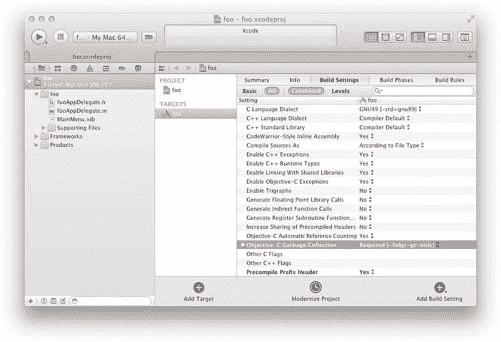

垃圾回收发生在程序运行期间，当系统确定已达到某个低水位且是时候进行清理时。这一过程是一个相当计算密集型的过程；系统必须追踪你所有的对象和引用，并确定哪些对象正在被使用（即被引用），哪些没有在使用。这可能会导致你的应用程序出现明显的停顿，因为正如提到的，垃圾回收是非常计算密集型的。正因如此，你可能会决定不使用此功能。

### 手动引用计数 (Manual Reference Counting)

如果你打算在不使用ARC或垃圾回收的情况下创建应用程序，或者你必须支持无法迁移到ARC运行的代码，那么你需要知道如何管理内存。也就是说，你需要学习如何处理引用计数。

通用的概念如下：当一个对象被创建时，它的初始引用计数设置为`1`。每当你需要确保该对象被保留时，你实际上是通过将其引用计数加1来创建它的引用。这是通过向对象发送`retain`消息完成的，如下所示：

```objc
[myFraction retain];
```

当你不再需要某个对象时，通过向它发送`release`消息将其引用计数减1，如下所示：

```objc
[myFraction release];
```

当一个对象的引用计数达到0时，系统知道该对象不再被使用（因为从理论上讲，它不再被程序的任何地方引用），因此会释放（dealloc）它的内存。这个过程是通过向对象发送`dealloc`消息启动的。在许多情况下，你使用继承自`NSObject`的`dealloc`方法。然而，你可能需要重写`dealloc`，以释放你的对象可能分配或保留的任何实例变量或其他对象。例如，如果你的类有一个`NSArray`对象作为其实例变量之一，并且你`alloc`了该数组，那么当你的对象被销毁时，你就负责释放该数组。你会在`dealloc`中这样做。

手动引用计数策略的成功运行需要你作为程序员的勤奋，以确保引用计数在程序执行期间被正确地增加和减小。系统会为你处理其中的部分工作，但不是全部。

在使用手动引用计数时，你应该注意，Foundation框架中的某些方法可能会增加对象的引用计数，例如当使用`NSMutableArray`的`addObject:`方法将对象添加到数组时，或者使用`UIView`的`addSubview:`方法将视图作为子视图添加时。同样，某些方法可能会减少对象的引用计数。`removeObjectAtIndex:`和`removeFromSuperview`就是两种这样的方法。

当一个对象被销毁后（即其引用计数减至0并调用了`dealloc`），对该对象的进一步引用将失效。如果你有这样一个引用，它通常被称为悬空指针引用（dangling pointer reference）。向该悬空指针发送消息通常会导致意料之外的行为，包括你的应用程序崩溃。有时程序员会向一个已经被释放的对象发送`release`消息，因为他们没有准确地跟踪对象的retain和release操作。这被称为过度释放（over-releasing）一个对象，它通常会导致崩溃。

### 对象引用与自动释放池 (Autorelease Pool)

你可能需要编写一个方法，它先创建一个对象（例如使用`alloc`），然后将该对象作为方法调用的结果返回。这里存在一个困境：尽管该方法使用了该对象，但它不能释放它，因为它需要返回它的值。创建`NSAutoreleasePool`类是为了解决这类问题，通过在一个名为自动释放池（autorelease pool）的对象中跟踪稍后要释放的对象。那个稍后的时间就是池被排空的时候，这是通过向自动释放池对象发送`drain`消息完成的。

为了将对象添加到自动释放池维护的对象列表中，你向该对象发送`autorelease`消息，如下所示：

```objc
[result autorelease];
```

在处理使用Foundation、UIKit或AppKit框架类的程序时，你必须创建一个自动释放池，因为这些框架中的类可以创建并返回自动释放的对象。你在应用程序中使用类似这样的语句来这样做：

```objc
NSAutoreleasePool * pool = [[NSAutoreleasePool alloc] init];
```

正如提到的，如果你创建一个没有启用ARC的新项目，Xcode会在`main`函数开头生成一个带有此语句的模板文件。

注，在设置池之后，框架方法会自动将数组、字符串、字典、视图、按钮和其他新对象添加到池维护的列表中。当你用完池后，你向它发送一个`drain`消息：

```objc
[pool drain];
```

这样做的效果向每个自动释放的对象发送`release`消息。事实上，其中任何对象的引用计数减到0，这些对象都将收到`dealloc`消息。注意，自动释放池并不包含实际的对象，只包含指向这些对象的引用。并不是所有以`alloc`、`copy`、`mutableCopy`或`new`开头的方法都是自动释放的。在这种情况下，你拥有该对象。当你拥有一个对象时，在你在使用它之后负责释放它占用的内存。这是通过向它发送`release`消息完成的。或者你也可以通过向它发送`autorelease`消息将其添加到自动释放池中。

如果我们使用手动引用计数，程序3.3 (21HGK1SH992D3H5BD4YP0VXJVMVSGJ_split_013.html_filepos15421) 将看起来所示：

```objc
int main (int argc, char * argv[]) {
    NSAutoreleasePool * pool = [[NSAutoreleasePool alloc] init];
    Fraction *frac1 = [[Fraction alloc] init];
    Fraction *frac2 = [[Fraction alloc] init];

    // 将第 1 个分数设为 2/3
    [frac1 setNumerator: 2];
    [frac1 setDenominator: 3];

    // 将第 2 个分数设为 3/7
    [frac2 setNumerator: 3];
    [frac2 setDenominator: 7];

    // 显示分数
    NSLog (@"第一个分数是:");
    [frac1 print];

    NSLog (@"第二个分数是:");
    [frac2 print];

    [frac1 release];
    [frac2 release];
    [pool drain];

    return 0;
}
```

让我们再次查看在程序7.5中使用的`Fraction`类的`add:`方法：

```objc
-(Fraction *) add: (Fraction *) f
{
    // 相加两个分数：
    // a/b + c/d = ((a*d) + (b*c)) / (b * d)
    // result 将存储加法的结果

    Fraction *result = [[Fraction alloc] init];

    result.numerator = numerator * f.denominator + denominator *
                       f.numerator;
    result.denominator = denominator * f.denominator;

    [result reduce];
    return result;
}
```

当使用手动内存管理时，该方法存在一个问题。结果对象在计算完成后被`alloc`出来并从方法返回。由于方法必须返回该对象，它无法释放它——这会导致对象在当时被销毁。解决此问题的最好方法可能是对对象进行`autorelease`，这样就可以返回它的值，而将其释放推迟到autorelease池被清空为止。你可以利用`autorelease`方法会返回其接收者并将其嵌入如下所示表达式的特性：

```objc
Fraction *result = [[[Fraction alloc] init] autorelease];
```

或者像这样：

```objc
return [result autorelease];
```

### 事件循环与内存分配

Cocoa和iOS应用程序运行在所谓的运行循环（run loop）或事件循环（event loop）中。将事件视为通常通过你执行某些操作（例如，在iPhone上按下按钮）或通过隐含操作发生的（例如，通过网络接收数据）。为了处理新事件，系统会创建一个新的autorelease池，并可能会调用你应用程序中的某些方法来处理它。当你完成事件处理后，你会从方法返回，系统会等待下一个事件的发生。但在在此之前，系统会清空autorelease池。这意味着你在处理该事件时创建的任何autoreleased对象都将被销毁，除非你保留（retain）了这些对象，以便它们在池清空时存活。在使用手动引用计数时，你需要考虑autorelease池以及你的对象在事件循环结束清空池时的存活情况。

请看下面来自iOS应用程序的接口部分。在这里我们定义了一个名为`MyView`的类，包含一个名为`data`的属性：

```objc
#import <UIKit/UIKit.h>

@interface myView : UIView
@property (nonatomic, retain) NSMutableArray *data;
@end
```

`data`属性的`retain`属性（仅用于非ARC编译的代码）表示设置方法应该保留分配给该属性的任何对象，并释放旧值。假设我们在实现部分为`data`属性合成了了访问器方法。进一步假设我们有一个名为`viewDidLoad`的方法，每当我们的视图加载到内存时系统就会调用该方法。（当你学习iOS应用程序编程时会学更多。目前这些细节并不重要）。

假设在你的`viewDidLoad`方法内部，你想分配`data`数组。你在该方法内部插入了以下行：

```objc
data = [NSMutableArray array];
```


正如我们所描述的，`Foundation` 方法默认创建 `autoreleased` 对象一样，`array` 方法创建了一个 `autoreleased` 数组，你将其直接赋值给实例变量 `data`。问题是，该数组一旦当前事件处理完成就会被销毁。这是因为是在一个 `autorelease` 池中创建的，该池会在事件循环结束时清空。为了确保数组在事件循环中存活，你有几种替代方案。这里有三行你可以使用的不同代码：

```objc
data = [[NSMutableArray array] retain]; // 存活池池
```

或者

```objc
data = [[NSMutableArray alloc] init];    // 未 autorelease
```

或者

```objc
self.data = [NSMutableArray array];     // 使用设置方法
```

在最后一种情况下，由于 `data` 属性具有 `retain` 属性，`autoreleased` 数组将被保留（注意赋值 `self.data` 会触发设置方法）。注意，在所有三种情况下，你必须在 `myView` 对象被销毁时重写 `dealloc` 来释放你的数组：

```objc
-(void) dealloc {
    [data release];
    [super dealloc];
}
```

（调用 `super` 允许释放继承的对象。手动内存管理的另一个烦恼需要在释放自己的对象后最后执行 `[super dealloc]`）。在许多使用框架方法创建新对象的情况下，你可以进行选择。

### 手动内存管理总结

在没有 `ARC` 或垃圾回收的项目工作时，请记住以下规则：

- 如果你需要持有一个对象以确保它不被他人销毁，你应该 `retain` 它。在用完后记得 `release` 它。

- 发送 `release` 消息并不一定会销毁对象。当对象的引用计数减到 0 时，对象会被销毁。系统通过向对象发送 `dealloc` 消息来释放内存。

- 释放你保留或使用 `copy`、`mutableCopy`、`alloc` 或 `new` 方法创建的对象。这包括具有 `retain` 或 `copy` 属性的属性。你可以在对象要销毁时重写 `dealloc` 来释放实例变量。

- `autorelease` 池提供了在自身清空时自动释放对象的机制。系统通过对池中的每个被 `autorelease` 的对象发送对应的 `release` 消息来实现。`autorelease` 池中每个引用计数降为 0 的对象都会收到 `dealloc` 消息以销毁。

- 如果你在方法内部不再需要某个对象但需要返回它，向它发送 `autorelease` 消息将其标记为稍后释放。`autorelease` 消息不会影响对象的引用计数。

- 当应用程序终止时，你的对象所占用的内存都会被释放，无论它们是否在 `autorelease` 池中。

> 当你开发 `Cocoa` 或 `iOS` 应用时，自动释放池（`autorelease pools`）会在程序执行期间创建并清空（每当事件发生时都会发生）。在这种情况下，如果你想确保一个自动释放的对象在自动释放池清空时不会被自动销毁，你就需要对它进行保留（`retain`）。所有引用计数大于其收到的自动释放消息数量的对象，在释放池释放后都会存活。

### 自动引用计数 (ARC)

自动引用计数（`ARC`）消除了所有与手动引用计数相关的潜在陷阱。在底层，引用计数仍然被维护和跟踪。然而，系统会决定何时保留一个对象，何时对它进行自动释放（`autorelease`）或释放（`release`）。你完全不需要担心这个问题。

你也不需要担心从方法返回分配的对象。编译器会通过生成正确的代码，对返回的对象进行必要的自动释放或保留，从而计算出该对象的内存需要如何管理。

### 强变量 (Strong Variables)

默认情况下，所有的对象指针变量都是强变量。这意味着将对象引用赋值给此类变量会导致该对象被自动保留。此外，在赋值之前，旧的对象引用将被释放。最后，强变量默认初始化为零。无论它是实例变量、局部变量还是全局变量都是如此。

看这段代码，它创建并设置了两个 `Fraction` 对象：

```
Fraction *f1 = [[Fraction alloc] init];
Fraction *f2 = [[Fraction alloc] init];
[f1 setTo: 1 over: 2];
[f2 setTo: 2 over: 3];
```

现在使用手动内存管理编写以下代码时：

```
f2 = f1;
```

其效果是将 `Fraction` 对象的引用复制到 `f2` 中。结果是 `f2` 引用的 `Fraction` 对象将丢失，因为它的值被覆盖了。这将导致所谓的内存泄漏；即一个不再被引用、因此无法释放的变量。

如果你正在使用 `ARC`，那么 `f1` 和 `f2` 都是强变量。因此，之前的赋值实际上是这样：

```
[f1 retain];  // 保留新值
[f2 release]; // 释放旧值
f2 = f1;      // 复制引用
```

当然，你看不到这些操作发生，因为编译器为你完成了所有的工作。你只需要编写赋值语句并将其忘记即可。

因为所有对象变量默认都是强变量，所以你不需要将它们声明为强。但是，你可以通过对变量使用 `__strong` 关键字显式声明：

```
__strong Fraction *f1;
```

需要注意的是，属性（`properties`）默认*不是*强性的。它们的默认属性是 `unsafe_unretained`（等同于 `assign`）。你已经见过如何为属性声明 `strong` 属性了：

```
@property (strong, nonatomic) NSMutableArray *birdNames;
```

编译器通过在赋值时保留强属性来确保强属性在事件循环中存活。对于 `unsafe_unretained`（即 `assign`）或 `weak` 属性，不会采取此类操作。

### 弱变量 (Weak Variables)

有时你会在两个对象之间建立一种关系，其中每个对象都需要引用另一个对象（这可能只是简单的两个对象，也可能是创建循环的对象的链）。例如，`iOS` 应用通过被称为 `views` 的对象在屏幕上呈现图形。视图是维护在一个层级结构中的。因此，一个视图可能会显示一张图片，而在该图像视图内部，你可能想为该图片显示一个标题。你可以设置这种关系，让图像视图为主视图，而标题是一个 `subview`。当主视图显示时，子视图也会自动显示。你可以将主图像视图视为父视图，标题视图视为子视图。主图像视图拥有子视图。

在处理这种视图层级结构时，父视图无疑想要持有其子视图的引用。但在处理子视图时，让它知道父视图是谁也是很有用的。因此，父视图持有子视图的引用，而子视图反持有父视图的引用。这种循环引用可能会引发问题。例如，当我们删除父视图会发生什么？从子视图到父视图的引用将不再有效。事实上，尝试引用那个不存在的父视图可能会导致应用程序崩溃。

当两个对象互相持有强引用时，你就创建了所谓的 `retain cycle`（引用循环）。如果一个对象仍然被引用，系统就不会销毁它。因此，如果两个对象互相持有强引用，它们都永远无法被销毁。

解决这个问题的方法是创建另一种类型的对象变量，允许在两个对象之间建立不同类型的引用，即 `weak`（弱）引用。在这种情况下，弱引用将从子对象指向父对象。为什么呢？因为我们认为*拥有*另一个对象（在本例中为父视图）的对象是强引用，而另一个对象是弱引用。

通过让父视图持有子视图的强引用，而让子视图对其父视图持有弱引用，就不会创建引用循环。弱变量不会阻止其所引用的对象的释放。

当你声明一个弱变量时，会发生几件事：系统会跟踪赋值时创建的引用。当被引用的对象被销毁时，弱变量会自动变为 `nil`。这防止了无意中向该变量发送消息可能导致的任何崩溃。由于变量会被设置为 `nil`，向 `nil` 对象发送消息不会产生操作。

要声明弱变量，使用 `__weak` 关键字：

```
__weak UIView *parentView;
```

或者对属性使用 `weak` 属性：

```
@property (weak, nonatomic) UIView *parentView;
```

弱变量在处理代理（`delegates`）时也有用。通过将持有代理的变量设置为弱变量，可以确保当代理对象被销毁时，变量会被置零。再次，这可以防止在 `ARC` 发明之前让许多程序员头疼的系统崩溃。

注意，`iOS 4` 或 `Mac OS v10.6` 不支持弱变量。在这些情况下，你仍然可以使用 `unsafe_unretained`（或 `assign`）属性属性，或将变量声明为 `unsafe_unretained`。但请意识到，当引用的对象被销毁时，这些变量不会自动置零。

### @autoreleasepool 

到目前为止，你在书中每个示例中都看到了编译器如何在你的主程序中生成一个 `@autoreleasepool` 指令。该指令包含了一块语句，它们定义了一个自动释放池上下文。在该上下文中创建的任何自动释放的对象（这是通过 `ARC` 自动完成的），默认会在该 `@autoreleasepool` 块结束时被销毁（除非编译器已处理并确保它们在块结束之后存活）。

如果你的程序产生大量的临时对象（这在循环内部内部执行代码时很容易发生），你可能想在程序中创建多个 `@autoreleasepool` 块。例如，下面的代码片段说明了如何设置 `@autoreleasepool` 块来管理 `for` 循环每次迭代创建的临时对象：

```
for (i = 0; i < n; ++i) {
    @autoreleasepool {
        // ... 在这里进行大量关于临时对象的工作
    }
}
```

如本章早期所述，`Cocoa` 和 `iOS` 应用程序运行在事件循环（`event loop`）内部。在准备处理处理新事件时，系统会创建一个新的 `autoreleasepool` 上文，并可能会调用你应用程序中的某些方法来处理该事件。当你完成事件处理后，你会从方法返回，系统将等待下一个事件发生。然而，在此之前，`autoreleasepool` 上文会结束，这意味着自动释放（`autoreleased`）的对象随后可能会被销毁。同样，在 `ARC` 中，这一切都在“后台”自动完成，所以你不需要担心它。

## 方法名与非 ARC 编译代码

`ARC` 可以与未使用 `ARC` 编译的代码一起工作。例如，当你与旧版本的框架链接时，就会发生这种情况。只要非 `ARC` 代码遵循了标准的 `Cocoa` 命名规范，一切都会没问题。也就是说，当 `ARC` 看到一个方法调用时，它会检查方法名。如果方法名以 `alloc`、`new`、`copy`、`mutableCopy` 或 `init` 单词开头，它就会假设该方法将对象的所有权返回给了方法调用者。

当我们在这里谈论“单词”时，指的是在所谓的驼峰命名法（`camelCase`）中编写的单词。即名称中每个新单词的首字母都大写。因此，编译器假设名为 `allocFraction`、`newAddressCard` 和 `initWithWidth:andHeight:` 的方法返回对象的所有权，而 `newlyWeds`、`copycat` 和 `initials` 则不是。同样，这由 `ARC` 自动完成，所以你不需要担心这个问题，除非你在使用不遵循这些标准命名规范的方法。在这些情况下，有方法可以显式地告诉编译器方法尽管名称如何是否返回了对象的所有权。

你应该注意，如果你尝试合成（`synthesize`）名称以本节第一段提到的任何特殊单词开头的属性，编译器会为你报错。

## 18. 复制对象

本章讨论了涉及对象复制的一些微妙之处。我们引入了浅拷贝（`shallow copying`）与深拷贝（`deep copying`）的概念，并讨论了如何在 `Foundation` 框架下进行拷贝。

第 8 章，“继承”讨论了当使用简单的赋值语句将一个对象赋值给另一个对象时会发生什么，例如此处：

```
origin = pt;
```

在这个示例中，`origin` 和 `pt` 都是 `XYPoint` 对象，拥有两个名为 `x` 和 `y` 的整数实例变量。

回想一下，赋值的影响是将对象 `pt` 的地址拷贝到 `origin` 中。在赋值操作结束时，两个变量都指向内存中的同一个位置。通过如下消息对实例变量进行更改：

```
[origin setX: 100 andY: 200];
```

会改变被 `origin` 和 `pt` 变量引用的 `XYPoint` 对象的 `x`、`y` 坐标，因为它们引用的是内存中的同一个对象。

这种情况同样适用于 `Foundation` 对象：将一个变量赋值给另一个仅仅是创建了该对象的另一个引用。因此，如果 `dataArray` 和 `dataArray2` 都是 `NSMutableArray` 对象，以下语句将从两个变量引用的同一个数组中删除第一个元素：

```
dataArray2 = dataArray;
[dataArray2 removeObjectAtIndex: 0];
```

### copy 和 mutableCopy 方法

`Foundation` 类实现了名为 `copy` 和 `mutableCopy` 的方法，你可以使用这些方法创建对象的副本。这是通过实现一个符合 `<NSCopying>` 协议的拷贝方法来实现的。如果你的类需要区分创建对象的可变和不可变副本，你还必须根据 `<NSMutableCopying>` 协议实现一个方法。你将在本节稍后的部分中学习如何做到这一点。

回到 `Foundation` 类的拷贝方法，给定上一节描述的两个 `NSMutableArray` 对象 `dataArray2` 和 `dataArray`，语句

```
dataArray2 = [dataArray mutableCopy];
```

会在内存中创建 `dataArray` 的一个新副本，复制其所有元素。随后，执行语句

```
[dataArray2 removeObjectAtIndex: 0];
```

会从 `dataArray2` 中删除第一个元素，但不会从 `dataArray` 中删除。程序 18.1 释了这一点。

程序 18.1

```objc
#import <Foundation/Foundation.h>

int main (int argc, char * argv[])
{
    @autoreleasepool {
      NSMutableArray     dataArray = [NSMutableArray arrayWithObjects:
          @"one", @"two", @"three", @"four", nil];
      NSMutableArray     dataArray2;

      // 简单赋值
      dataArray2 = dataArray;
      [dataArray2 removeObjectAtIndex: 0];

      NSLog (@dataArray: ");
      for ( NSString *elem in dataArray )
        NSLog (%@", elem);

      NSLog (@dataArray2: ");
      for ( NSString *elem in dataArray2 )
        NSLog (%@", elem);

      // 尝试拷贝，然后从拷贝中删除第一个元素
      dataArray2 = [dataArray mutableCopy];
      [dataArray2 removeObjectAtIndex: 0];

      NSLog (@dataArray: ");
      for ( NSString *elem in dataArray )
        NSLog (%@", elem);

      NSLog (@dataArray2: ");
      for ( NSString *elem in dataArray2 )
        NSLog (%@", elem);
    }
    return 0;
}
```

程序 18.1 输出

```
dataArray:
two
three
four
dataArray2:
three
four
dataArray:
two
three
four
dataArray2:
three
four
```

程序定义了可变数组对象 `dataArray`，并将元素设置为字符串 `@"one"`、`@"two"`、`@"three"` 和 `@"four"`。正如我们讨论过的，赋值 `dataArray2 = dataArray;` 仅仅创建了内存中该对象的另一个引用。当你从 `dataArray2` 中移除第一个元素并随后打印两个数组的元素时，第一个元素（字符串 `@"one"`）从两个数组中消失并不意外。

接下来，你创建 `dataArray` 的可变拷贝并将结果赋值给 `dataArray2`。现在当你从 `dataArray2` 移除第一个元素时，不会影响 `dataArray` 的内容。

注意，创建对象的可变拷贝并不要求被拷贝的对象本身是可变的。这种情况同样适用于不可变拷贝：你可以为可变对象创建不可变拷贝。

### 浅拷贝与深拷贝

程序 18.1 用不可变字符串填充 `dataArray` 的元素（回想常量字符串是不可变的）。在程序 18.2 中，你改用可变字符串填充，以便更改数组中的一个字符串。查看程序 18.2 并看看你是否理解它的输出。

程序 18.2


```objc
#import <Foundation/Foundation.h>

int main (int argc, char * argv[])
{
    @autoreleasepool {
      NSMutableArray     dataArray = [NSMutableArray arrayWithObjects:
          [NSMutableString stringWithString: @"one"],
          [NSMutableString stringWithString: @"two"],
          [NSMutableString stringWithString: @"three"],
          nil];
      NSMutableArray     dataArray2;
      NSMutableString   *mStr;

      NSLog (@dataArray: ");
    }
    return 0;
}
```

```objc
for ( NSString *elem in dataArray ) {
    NSLog (@"    %@", elem);

    // make a copy, then change one of the strings
    dataArray2 = [dataArray mutableCopy];
    mStr = [dataArray objectAtIndex: 0];
    [mStr appendString: @"ONE"];

    NSLog (@"dataArray:  ");
    for ( NSString *elem in dataArray ) {
        NSLog (@"    %@", elem);
    }

    NSLog (@"dataArray2:  ");
    for ( NSString *elem in dataArray2 ) {
        NSLog (@"    %@", elem);
    }
}
return 0;
}
```

### 程序 18.2. 输出

```
dataArray:
    one
    two
    three
dataArray:
    oneONE
    two
    three
dataArray2:
    oneONE
    two
    three
```

你通过以下语句获取了`dataArray`的第一个元素：

`mStr = [dataArray objectAtIndex: 0];`

然后你通过此语句向其添加了字符串`@"ONE"`：

`[mStr appendString: @"ONE"];`

注意原始数组及其副本的第一个元素的值：它们都被修改了。也许你能够理解为什么`dataArray`的第一个元素被改变了，但无法理解为什么它的副本也改变了。当你从集合中获取元素时，你获得的是该元素的一个新引用，而不是一个新的副本。因此，当在`dataArray`上调用`objectAtIndex:`方法时，返回的对象指向内存中与`dataArray`第一个元素相同的对象。随后修改字符串对象`mStr`会产生一个改变`dataArray`第一个元素的副作用，正如你从输出中看到的那样。

但你创建的副本又是呢？为什么它的第一个元素也被改变了？这与拷贝在默认情况下是浅拷贝（`shallow`）有关。因此，当使用`mutableCopy`方法复制数组时，内存中会为新的数组对象分配空间，并将各个元素复制到新数组中。但将数组中的每个元素从原始位置复制到新位置，意味着仅仅是将引用从数组的一个元素复制到另一个元素。最终结果是两个数组的元素都引用了内存中的相同字符串。这与我们在本章开头介绍将一个对象赋值给另一个对象没有区别。

为了为数组的每个元素创建不同的副本，你必须执行深拷贝（`deep`）。这意味着要复制数组中每个对象的内容，而不仅仅是对象引用的副本（并思考如果数组的元素本身是一个数组对象，这意味着什么）。但当你使用 Foundation 类的`copy`或`mutableCopy`方法时，默认不会执行深拷贝。在[第 19 章]“归档（Archiving）”中，我们将向你展示如何使用 Foundation 的归档功能来创建对象的深拷贝。

例如，当你复制数组、字典或集合时，你获得的是这些集合的新副本。然而，如果你想修改一个集合但不修改其副本，你可能需要为单个元素创建你自己的副本。例如，如果你想在[程序 18.2]中更改`dataArray2`的第一个元素但不更改`dataArray`，你可以创建一个新字符串（使用诸如`stringWithString:`的方法）并将其存储到`dataArray2`的第一个位置，如下：

`mStr = [NSMutableString stringWithString: [dataArray2 objectAtIndex: 0]];`

然后你就可以对`mStr`进行修改了。

### 实现`Copying`协议

也许你能够理解为什么`dataArray`的第一个元素被改变了，但无法理解为什么它的副本也改变了。当你从集合中获取元素时，你获得的是该元素的一个新引用，而不是一个新的副本。因此，当在`dataArray`上调用`objectAtIndex:`方法时，返回的对象指向内存中与`dataArray`第一个元素相同的对象。随后修改字符串对象`mStr`会产生一个改变`dataArray`第一个元素的副作用，正如你从输出中看到的那样。

但你创建的副本又是呢？为什么它的第一个元素也被改变了？这与拷贝在默认情况下是浅拷贝（`shallow`）有关。因此，当使用`mutableCopy`方法复制数组时，内存中会为新的数组对象分配空间，并将各个元素复制到新数组中。但将数组中的每个元素从原始位置复制到新位置，意味着仅仅是将引用从数组的一个元素复制到另一个元素。最终结果是两个数组的元素都引用了内存中的相同字符串。这与我们在本章开头介绍将一个对象赋值给另一个对象没有区别。

为了为数组的每个元素创建不同的副本，你必须执行深拷贝（`deep`）。这意味着要复制数组中每个对象的内容，而不仅仅是对象引用的副本（并思考如果数组的元素本身是一个数组对象，这意味着什么）。但当你使用 Foundation 类的`copy`或`mutableCopy`方法时，默认不会执行深拷贝。在[第 19 章]“归档（Archiving）”中，我们将向你展示如何使用 Foundation 的归档功能来创建对象的深拷贝。

例如，当你复制数组、字典或集合时，你获得的是这些集合的新副本。然而，如果你想修改一个集合但不修改其副本，你可能需要为单个元素创建你自己的副本。例如，如果你想在[程序 18.2]中更改`dataArray2`的第一个元素但不更改`dataArray`，你可以创建一个新字符串（使用诸如`stringWithString:`的方法）并将其存储到`dataArray2`的第一个位置，如下：

`mStr = [NSMutableString stringWithString: [dataArray2 objectAtIndex: 0]];`

然后你就可以对`mStr`进行修改。

### 实现`Copying`协议

如果你在你自己的类上尝试使用`copy`方法，你会得到这样的错误：

```
*** copyZone: selector not recognized
```

等等，`zone`参数与程序中可以分配和使用的不同内存区域有关。如果你编写分配大量内存的应用程序，并希望通过将其分组到这些区域来优化，就需要处理这些。你可以将传递给`copyWithZone:`的值交给内存分配方法`allocWithZone`。该方法在指定的区域内分配内存。

在分配新的`Fraction`对象后，你将接收者的`numerator`和`denominator`复制到其中。`copyWithZone:`方法应该返回对象的副本，你可以在方法中完成这一点。

如果你想区分可变和不可变副本，如前所述，你还需要实现`mutableZone:`。`copyWith:`应该返回一个不可变副本，而`mutableZone:`应该返回一个可变副本。

`interface`如下：

`@interface <Copying>`

在实现文件`Fraction.m`中，为你的新方法添加以下定义：

```objc
-(id)copyWithWithZone:(NSZone *)zone {
    Fraction *newFract = [[Fraction allocWithZone: zone] init];
    [newFract setTo:numerator over:denominator];
    return newFract;
}
```

[程序 18.3]测试了你的新方法。

```objc
// Copying fractions
#import "Fraction.h"

int main (int argc, char * argv[])
{
    @autoreleasepool {
        Fraction *f1 = [[Fraction alloc] init];
        Fraction *f2;

        [f1 setTo: 2 over: 5];
        f2 = [f1 copy];
    }
}
```

```objc
[f2 setTo: 1 over: 3];
[f1 print];
[f2 print];
}
return 0;
}
```

***

程序 18.3 输出

```
2/5
1/3
```

***

该程序创建了一个名为`f1`的`Fraction`对象并将其设置为`2/5`。接着它调用`copy`方法来创建一个副本，该方法会向你的对象发送`copyWithZone:`消息。该方法会创建一个新的`Fraction`对象，将来自`f1`的值拷贝到其中，并返回结果。在`main`函数中，你将该结果赋值给`f2`。随后，将`f2`的值设置为分数`1/3`，这证明了该操作对原始分数`f1`没有产生任何影响。修改程序中读取以下内容的行：

```objc
f2 = [f1 copy];
```

简单改为：

```objc
f2 = f1;
```

以观察你获得的不同结果。

如果你的类可能会被子化，那么你的`copyWithZone:`方法将被继承。在这种情况下，你应该修改方法中读取以下内容的行：

```objc
Fraction *newFract = [[Fraction allocWithZone: zone] init];
```

改为：

```objc
id newFract = [[[self class] allocWithZone: zone] init];
```

这样，你就会从`copy`的接收者所在的类中分配一个新对象。（例如，如果它已经被子化为了一个名为`NewFraction`的类，请务必在继承的方法中分配一个新的`NewFraction`对象，而不是`Fraction`对象。）

如果你正在为某个类编写`copyWithZone:`方法，而该类的父类也实现了`<NSCopying>`协议，那么你应该先在父类上调用`copy`方法来拷贝继承的实例变量，然后包含你自己的代码来拷贝你可能为该类添加的任何额外实例变量（如果有）。

你必须决定在你的类中实现浅拷贝还是深拷贝。只需对该类的其他用户对其进行说明即可，以便他们知晓。

### 在 Setter 和 Getter 方法中拷贝对象

每当你实现一个 setter 或 getter 方法时，都应该考虑你在实例变量中存储了什么、获取了什么，以及是否需要保护这些值。例如，当你使用相应的 setter 方法设置其中一个`AddressCard`对象的名称时，请考虑这一点：

```objc
newCard.name = newName;
```

假设`newName`是一个包含你新卡片名称的字符串对象。假设在 setter 程序内部，你简单地将参数赋值给相应的实例变量：

```objc
-(void) setName: (NSString *) theName
{
    name = theName;
}
```

现在，你认为如果程序稍后更改`newName`中包含的某些字符会发生什么？（如果`newName`是一个可变字符串对象，这种情况就会发生；此类对象可以用任何指定为`NSString`对象的地方，因为前者是后者的子类）它还会在无意中改变你的地址卡片中对应的字段，因为它们都引用了同一个字符串对象。

正如你已经所看到的，更安全的方法是在 setter 程序过程中为对象创建一个副本，以防止这种无意的影响。

如果你没有使用合成（synthesizing）setter，你也可以写一个使用`copy`的`setName:`方法版本，如下：

```objc
-(void) setName: (NSString *) theName
{
    name = [theName copy];
}
```

正如你已经看到的，Numbers, Strings, and Collections，“如果你为一个父类也实现了`<NSCopying>`协议的类编写`copyWithZone:`方法，那么你应该先在父类上调用`copy`方法来拷贝继承的实例变量，然后包含你自己的代码来拷贝你可能为该类添加的任何额外实例变量（如果有）。

如果你在属性声明中指定了`copy`属性，结合相应的`@synthesize`指令：

```objc
@property (nonatomic, copy) NSString *name;
```

生成的方法行为如下：

```objc
-(void) setName: (NSString *) theName
{
    if (theName)
        name = [theName copy];
}
```

`nonatomic`告诉系统不要保护属性访问器使用`mutex`（互斥锁）。使用`mutex`是为了防止两个线程同时执行相同的代码，这通常会导致严重的问题。但这些锁会降低程序速度，如果你知道这段代码只会运行在单线程，就可以避免使用它们。如果没有指定`nonatomic`而是指定`atomic`（这是默认值），那么你的属性将受`mutex`保护。

***

> 注意：属性没有`copy`属性。

***

> 注意：实例变量的`copy`方法。

***

> 注意：如果你为包含`name`和`email`的`AddressCard`类实现拷贝方法，以下`copyWithZone:`实现是足够的：

```objc
-(AddressCard *) copyWithZone: (NSZone *) zone

{
    AddressCard *newCard = [[AddressCard allocWithZone: zone] init];
    [newCard setName: name andEmail: email];
    return newCard;
}
```

```objc
-(void) setName: (NSString *) theName andEmail: (NSString *) theEmail
{
    name = theName;
    email = theEmail;
}
```

意识到你可以直接赋值实例变量（而不是进行完全拷贝），因为副本的所有者无法影响原始卡片的`name`和`email`成员（它们包含不可变字符串）。因为我们的实例变量默认是“强”引用，对它们进行简单赋值会另一个引用，正如第 17 章详细解释的那样。

### 练习

> **1.** 根据`NSCopying`协议为`AddressBook`类实现拷贝方法。实现`mutableCopy`方法是否有意义？为什么？另外，考虑当有人使用`AddressBook`类中该属性的 setter 方法时会发生什么。谁应该拥有作为参数传递的地址簿？如何修复这个问题？

> **2.** 修改第 8 章 中定义的`Rectangle`和`XYPoint`类，使其符合`<NSCopying>`协议。为这两个类都添加`copyWithZone:`方法。确保`Rectangle`在拷贝其`XYPoint`成员`origin`时使用`XYPoint`的拷贝方法。对于这些类来说，同时实现可变和不可变拷贝是否有意义？请解释。

> 3. 创建一个`NSDictionary`对象并向其填充一些键/值对。然后分别创建它的可变和不可变副本。这些创建的是深拷贝还是浅拷贝？验证你的答案。

## 19. 归档 (Archiving)

在 Objective-C 术语中，归档是将一个或多个对象保存为某种格式的过程，以便日后恢复它们。这通常涉及将对象写入文件，以便随后将其读取回来。在本章中，我们将讨论数据归档的两种方法：属性列表

{

   @autoreleasepool {

      NSDictionary  glossary =

        [NSDictionary  dictionaryWithObjectsAndKeys:

          @"A class defined so other classes can inherit from it.",

          @"abstract class",

          @"To implement all the methods defined in a protocol",

          @"adopt",

          @"Storing an object for later use. ",

          @"archiving",

          nil

        ];


`if ([glossary writeToFile: @"glossary" atomically: YES] == NO)`

`NSLog (@"Save to file failed!");`

`return 0;`

`writeToFile:atomically:` 消息被发送给你的字典对象`glossary`，导致字典以属性列表的形式被写入文件`glossary`。`atomically`参数被设置为`YES`，这意味着你希望写入操作首先在一个临时备份文件中完成；一旦成功，最终数据将移动到命名为`glossary`的指定文件。这是一种安全保护机制，可以防止文件在例如系统在写入操作中途崩溃时发生损坏。在那种情况下，原始的`glossary`文件（如果它之前存在）不会受到损害。

如果你检查程序 19.1 创建的`glossary`文件的内容，它看起来如下：

```xml
<?xml version="1.0" encoding="UTF-8"?>
<!DOCTYPE plist PUBLIC "-//Apple Computer//DTD PLIST 1.0//EN"
"http://www.apple.com/DTDs/PropertyList-1.0.dtd">
<plist version="1.0">
<dict>
<key>abstract class</key>
<string>A class defined so other classes can inherit from it.</string>
<key>adopt</key>
<string>To implement all the methods defined in a protocol</string>
<key>archiving</key>
<string>Storing an object for later use.</string>
</dict>
</plist>
```

你可以从创建的 XML 文件中看到，字典是以一组键（`<key>`）和值（`<string>`）对的形式写入文件的。当你从字典创建属性列表时，字典中的键必须是`NSString`对象。数组的元素或字典中的值可以是`NSString`、`NSDictionary`、`NSData`、`NSDate`或`NSNumber`对象。

要从文件中读取 XML 属性列表到程序中，你需要使用`dictionaryContentsOfFile:`或`arrayContentsOfFile:`方法。要读取数据，使用`dataContentsOfFile:`方法；要读取字符串对象，使用`stringContentsOfFile:`方法。程序 19.2 读取了程序 19.1 写入的词表并显示其内容。

### 程序 19.2

```objc
#import <Foundation/Foundation.h>

int main (int argc, char * argv[])
{
   @autoreleasepool {
      NSDictionary *glossary;
      glossary = [NSDictionary dictionaryContentsOfFile: @"glossary"];

      for ( NSString *key in glossary )
         NSLog (@"%@: %@", key, [glossary objectForKey: key]);
   }
   return 0;
}
```

### 程序 19.2 输出

```text
archiving: Storing an object for later use.
abstract class: A class defined so other classes can inherit from it.
adopt: To implement all the methods in a protocol
```

你的属性列表不需要从 Objective-C 程序创建；属性列表可以来自任何源。你可以使用简单的文本编辑器创建自己的属性列表，也可以使用 Mac OS X 系统上`/Developer/Applications/Utilities`目录下的 Property List 程序。如果你计划在应用程序中使用属性列表，你可能想查看`NSPropertyListSerialization`类，它允许以机器可读的方式从文件中读写属性列表。

## 使用 NSKeyedArchiver 归档

一种更灵活的方法允许你将任何类型的对象保存到文件中，而不只是字符串、数组和字典。这是通过使用`NSKeyedArchiver`类创建键归档实现的。

Mac OS 从 10.2 版本开始支持键归档。在此之前，顺序归档是用`NSArchiver`类创建的。顺序归档要求按照写入数据的相同顺序读取归档中的数据。

键归档是指归档中的每个字段都有名称。当你归档对象时，给它一个名称或键。当你从归档中检索它时，通过相同的键进行检索。通过这种方式，对象可以以任何顺序写入归档。此外，如果类中添加或删除了实例变量，你的程序也可以处理这种情况。

程序 19.3 显示了可以使用`NSKeyedArchiver`类的`archiveRootObject:toFile:`方法将词表保存到磁盘文件中。

程序 19.3 不会在终端产生任何输出。然而，以下语句

```objc
[NSKeyedArchiver archiveRootObject: glossary toFile: @"glossary.archive"];
```

会将字典`glossary`写入文件`glossary.archive`。可以为该文件指定任何路径。在这种情况下，文件被写入到当前目录。

创建的归档文件以后可以通过`NSKeyedUnarchiver`的`unarchiveObjectWithFile:`方法读取到你的程序中，正如程序 19.4 中所示的那样。

### 程序 19.4

```objc
#import <Foundation/Foundation.h>

int main (int argc, char * argv[])
{
    @autoreleasepool {
        NSDictionary *glossary;
        glossary = [NSKeyedUnarchiver unarchiveObjectWithFile:
                               @"glossary.archive"];

        for ( NSString *key in glossary )
            NSLog (@"%@: %@",  key, [glossary objectForKey: key]);
    }
    return 0;
}
```

### 程序 19.4 输出

```text
abstract class: 定义一个类，以便其他类可以继承自它。
adopt: 实现协议中定义的所有方法
archiving: 存储一个对象以供以后使用。
```

以下语句

```objc
glossary = [NSKeyedUnarchiver unarchiveObjectWithFile:
                @"glossary.archive"];
```

会导致指定的文件被打开并读取其内容。该文件必须是之前归档操作的结果。你可以为文件指定完整路径，或像示例那样指定相对路径。

在恢复词表后，程序简单地枚举其内容以验证恢复是否成功。

## 编写编码和解码方法

基础 Objective-C 类对象如`NSString`、`NSArray`、`NSDictionary`、`NSSet`、`NSDate`、`NSNumber`和`NSData`可以按照上述方式进行归档和恢复。这也包括嵌套对象，例如包含字符串或其他数组对象的数组。

这意味着你不能直接使用这种技术归档你的`AddressBook`，因为 Objective-C 系统不知道如何归档一个`AddressBook`对象。如果你尝试通过在程序中插入类似下面的行来归档它：

```objc
[NSKeyedArchiver archiveRootObject: myAddressBook toFile:  @"addrbook.arch"];
```

当你运行程序时，将会看到显示以下消息：

```text
*** -[AddressBook encodeWithCoder:]: selector not recognized
*** Uncaught exception: <NSInvalidArgumentException>
*** -[AddressBook encodeWithCoder:]: selector not recognized
archiveTest: received signal: Trace/BPT trap
```

从错误信息中可以看出，系统正在`AddressBook`类中寻找一个名为`encodeWithCoder:`的方法，但你从未定义过该方法。

要归档列出列表以外的对象，你必须告诉系统如何归档（或`encode`）你的对象，以及如何反归档（或`decode`）它们。这是通过根据`<NSCoding>`协议在类定义中添加`encodeWithCoder:`和`initWithCoder:`方法来实现的。对于我们的地址簿示例，你需要在`AddressBook`和`AddressCard`类中都添加这些方法。

每当归档器想要对指定类的对象进行编码时，`encodeWithCoder:`方法就会被调用，该方法告诉它如何这样做。同样，每当要对指定类的对象进行解码时，`initWithCoder:`方法就会被调用。

通常，编码方法应该指定如何归档要保存的对象中的每个实例变量。幸运的是，你有帮助来完成这一点。对于之前描述的基础 Objective-C 类，你可以使用`encodeObject:forKey:`方法。对于基础底层 C 数据类型（如整数和浮点数），你使用表 19.1 列出的方法之一。解码方法`initWithCoder:`的工作原理正相反：你使用`decodeObject:forKey:`来解码基础的 Objective-C 类。

### 表 19.1 数据类型的编码与解码
（注：源文本未提供表格内容）

解码方法`initWithCoder:`的工作原理正相反：你使用`decodeObject:forKey:`来解码基础的 Objective-C 类。

程序 19.5 数据类型的编码与解码

### 程序 19.5 接口文件

```objc
#import <Foundation/Foundation.h>

@interface AddressCard : NSObject <NSCoding>

@property (copy, nonatomic) NSString *name;
@property (copy, assign) NSString *email;

- (void)encodeWithCoder:(id)coder;
- (instancetype)initWithCoder:(id)coder;

@end
```

### 程序 19.5 实现文件

```objc
@implementation AddressCard

- (void)encodeWithCoder:(id)coder {
    [coder encodeObject:name forKey:@"name"];
    [coder encodeObject:email forKey:@"email"];
}

- (instancetype)initWithCoder:(id)coder {
    self = [super init];
    if (self) {
        name = [coder decodeObjectForKey:@"name"];
        email = [coder decodeObjectForKey:@"email"];
    }
    return self;
}

@end
```

与你的`AddressCard`类类似，你向`AddressBook`类添加了编码和解码方法。你只需要在接口文件中更改的唯一行代码是`@interface`指令，用于声明`AddressBook`类现在遵循`NSCoding`协议。更改如下：

> `@interface AddressBook: NSObject <NSCoding, NSCopying>`

以下是包含在实现文件中的方法定义：

```objc
-(void) encodeWithCoder: (NSCoder *) encoder
{
    [encoder encodeObject: bookName forKey: @"AddressBookBookName"];
    [encoder encodeObject: book forKey: @"AddressBookBook"];
}

-(id) initWithCoder: (NSCoder *) decoder
{
    bookName = [decoder decodeObjectForKey: @"AddressBookBookName"];
    book = [decoder decodeObjectForKey: @"AddressBookBook"];
    return self;
}
```

接下来的测试程序如程序 19.6。

### 程序 19.6. 测试程序

```objc
#import "AddressBook.h"

int main (int argc, char * argv[])
{
    @autoreleasepool {
        NSString  *aName = @"Julia Kochan";
        NSString  *aEmail = @"jewls337@axlc.com";
        NSString  *bName = @"Tony Iannino";
        NSString  *bEmail = @"tony.iannino@techfitness.com";
        NSString  *cName = @"Stephen Kochan";
        NSString  *cEmail = @"steve@steve_kochan.com";
        NSString  *dName = @"Jamie Baker";
        NSString  *dEmail = @"jbaker@hitmail.com";

        AddressCard *card1 = [[AddressCard alloc] init];
        AddressCard *card2 = [[AddressCard alloc] init];
        AddressCard *card3 = [[AddressCard alloc] init];
        AddressCard *card4 = [[AddressCard alloc] init];

        AddressBook  *myBook = [AddressBook alloc];

        // 第一设置四个地址卡
        [card1 setName: aName andEmail: aEmail];
        [card2 setName: bName andEmail: bEmail];
        [card3 setName: cName andEmail: cEmail];
        [card4 setName: dName andEmail: dEmail];

        myBook = [myBook initWithName: @"Steve's Address Book"];

        // 将一些卡片添加到地址簿
        [myBook addCard: card1];
        [myBook addCard: card2];
        [myBook addCard: card3];
        [myBook addCard: card4];

        [myBook sort];

        if ([NSKeyedArchiver archiveRootObject: myBook toFile:"addrbook.arch"] == NO) {
            NSLog (@"archiving failed");
        }
    }
    return 0;
}
```

该程序创建了地址簿并将其归档到文件`addrbook.arch`。在创建存档文件的过程中，你会发现`AddressBook`和`AddressCard`类的编码方法都被调用了。如果你需要证明，可以在这些方法中添加一些`NSLog`调用。

程序 19.7 展示了如何将存档读取到内存中，以便从文件中设置地址簿。

### 程序 19.7

```objc
#import "AddressBook.h"

int main (int argc, char * argv[])
{
    AddressBook         *myBook;

    @autoreleasepool {
        myBook = [NSKeyedArchiver unarchiveObjectWithFile:@"addrbook.arch"];
        [myBook list];
    }
    return 0;
}
```


##### 程序 19.7 输出

```
======== Contents of Steve's Address Book =========

Jamie Baker jaker@mail.com

Julia Kochan jewls337@axlc.com

Stephen Kochan steve@steve_kochan.com

Tony Iannino tony.iannino@techfitness.com

====================================
```

在解档地址簿的过程中，添加到你类中的解码方法被自动调用了。注意你可以如何多容易地将地址簿读回程序。

正如所提到的，`encodeObject:forKey:` 方法适用于内置类以及你根据 `NSCoding` 协议编写编码和解码方法的类。如果你的实例包含某些数据（例如整数或浮点数），你需要知道如何编码和解码它们（参见[表 19.1]）。

这是一个类 `Foo` 的简单定义，它包含三个实例变量——一个是 `NSString`，另一个是 `int`，第三个是 `float`。该类有一个 setter 方法、三个 getter 方法以及两个用于归档的编码/解码方法：

```objc
@interface Foo: <NSCoding>

@property (copy, nonatomic) NSString *strVal;

@property int intVal;

@property float floatVal;

@end
```

实现如下：

```objc
@implementation Foo

@synthesize strVal, intVal, floatVal;

-(void) encodeWithCoder: (NSCoder *) encoder
{
    [encoder encodeObject: strVal forKey: @"FoostrVal"];
    [encoder encodeInt: intVal forKey: @"FoointVal"];
    [encoder encodeFloat: floatVal forKey: @"FoofloatVal"];
}

-(id) initWithCoder: (NSCoder *) decoder
{
    strVal = [decoder decodeObjectForKey: @"FoostrVal"];
    intVal = [decoder decodeIntForKey: @"FoointVal"];
    floatVal = [decoder decodeFloatForKey: @"FoofloatVal"];
    return self;
}

@end
```

编码程序首先使用 `encodeObject:forKey:` 方法编码字符串 `strVal`，如之前所示。在[程序 19.8]中，一个 `Foo` 对象被创建、归档到文件、解档并显示。

### 程序 19.8 测试程序

```objc
#import <Foundation/h>

#import "Foo.h" // Foo 类的定义

int main (int argc, char * argv[])
{
    @autoreleasepool {
        Foo *myFoo1 = [[Foo alloc] init];

        Foo *myFoo2;

        [myFoo1 setStrVal: @"This is the string"];

        [myFoo1 setIntVal: 12345];

        [myFoo1 setFloatVal: 98.6];

        [NSKeyedArchiver archiveRootObject: myFoo1 toFile: @"foo.arch"];

        myFoo2 = [NSKeyedArchiver unarchiveObjectWithFile: @"foo.arch"];

        NSLog (@"%@\n%i\n%g", [myFoo2 strVal], [myFoo2 intVal], [myFoo2 floatVal]);
    }

    return 0;
}
```

### 程序 19.8 输出

```
This is the string

12345

98.6
```

以下消息归档了对象的实例变量：

- `[encoder encodeObject: strVal forKey: @"FoostrVal"]`
- `[encoder encodeInt: intVal forKey: @"FoointVal"]`
- `[encoder encodeFloat: floatVal forKey: @"FoofloatVal"]`

一些基本数据类型如 `char`、`short`、`long` 和 `long long` 未列在[表 19.1]中；你需要确定数据对象的大小并使用相应的程序。例如，`short int` 通常是 16 位，`int` 和 `long` 可以 32 或 64 位，而 `long long` 是 64 位。（你可以使用第 13 章“[底层 C 语言特性]”描述的 `sizeof` 运算符来确定任何数据类型的大小。）

你可能不想像在之前的程序示例那样，使用 `archiveRootObject:ToFile:` 方法直接将对象写入文件。例如，你可能想收集你的部分或全部对象，并将它们存储在单个归档文件中。你可以在 Objective-C 中使用名为 `NSData` 的数据对象类来实现这一点，我们之前在第 16 章中简要介绍过它，“处理文件”。

正如在第 16 章中提到的，`NSData` 对象可以用来预留一块内存区域，你可以在其中存储数据。该数据区域的典型用途可能是为稍后写入文件的数据提供临时存储，或者可能持有从磁盘读取的文件内容。创建可变数据区域最简单的方法是使用 `data` 方法：

```objc
dataArea = [NSMutableData data];
```

这创建了一个空缓冲区空间，其大小会随着程序的执行根据需要进行扩展。

举个简单的例子，假设你想将你的通讯录和其中一个 `Foo` 对象归档到同一个文件中。在本例中，假设你已经为 `AddressBook` 和 `AddressCard` 类添加了键归档方法（参见程序 19.9）。

### 程序 19.9

```objc
#import "AddressBook.h"

#import "Foo.h"

int main (int argc, char * argv[])
{
    @autoreleasepool {
        Foo *myFoo1 = [[Foo alloc] init];

        NSMutableData *dataArea;

        NSKeyedArchiver *archiver;

        AddressBook *myBook;

        // 插入程序 19.7 中的代码以在 myBook 中创建

        // 创建一个包含四个地址卡片的通讯录

        [myFoo1 setStrVal: @"This is the string"];

        [myFoo1 setIntVal: 12345];

        [myFoo1 setFloatVal: 98.6];

        // 设置数据区域并将其连接到 NSKeyedArchiver 对象

        dataArea = [NSMutableData data];

        archiver = [[NSKeyedArchiver alloc]
                    initForWritingWithMutableData: dataArea];

        // 现在我们可以开始归档对象了

        [archiver encodeObject: myBook forKey: @"myaddrbook"];

        [archiver encodeObject: myFoo1 forKey: @"myfoo1"];

        [archiver finishEncoding];

        // 将归档后的数据区域写入文件

        if ([dataArea writeToFile: @"myArchive" atomically: YES] == NO)
            NSLog (@"Archiving failed!");
    }

    return 0;
}
```

在分配一个 `NSKeyedArchiver` 对象后，会发送 `initForWritingWithMutableData:` 消息以指定写入归档数据的区域；这就是你之前创建的 `NSMutabledata` `dataArea`。现在可以向存储在 `archiver` 中的 `NSKeyedArchiver` 对象发送编码消息来归档对象。事实上，在接收到 `finishEncoding` 消息之前，它会将所有的编码消息归档并存储在指定的数据区域。

你有两个对象需要编码——第一个是你的通讯录，第二个是你的 `Foo` 对象。对这些对象使用 `encodeObject:forKey:`，因为你之前已经为 `AddressBook`、`AddressCard` 和 `Foo` 类实现了编码器和解码器方法。（理解这一点非常重要。）

当你完成两个对象的归档后，向 `archiver` 对象发送 `finishEncoding` 消息。从此之后就不能再编码任何对象了，你必须发送此消息来完成归档过程。你预留并命名为 `dataArea` 的区域现在包含了你归档后的对象，其格式可以写入文件。

通过调用消息 `[dataArea writeToFile: @"myArchive" atomically: YES]`，你要求你的数据流将其数据写入你命名为 `myArchive` 的指定文件。正如从 `if` 语句所示，`writeToFile:atomically:` 方法返回一个 `BOOL` 值：如果写入成功则返回 `YES`，如果失败则返回 `NO`（可能是指定了无效的路径或文件系统已满）。

从归档文件中恢复数据非常简单：你只需要反向操作即可。首先，你需要像之前一样分配一个数据区域。接下来，你需要将归档文件读取到数据区域；然后你必须创建一个 `NSKeyedArchiver` 对象并告诉它从指定区域解码数据。你必须调用方法来提取并解码归档的对象。完成后，你向 `NSKeyedArchiver` 对象发送 `finishDecoding` 消息。这些操作都在程序 19.10 中完成。

### 程序 19.10

```objc
#import "AddressBook.h"

#import "Foo.h"

int main (int argc, char * argv[])
{
    @autoreleasepool {
        NSData *dataArea;

        NSKeyedArchiver *archiver;

        Foo *myFoo1;

        AddressBook *myBook;

        // 读取归档文件并将其连接到 NSKeyedArchiver 对象

        dataArea = [NSData dataWithContentsOfFile: @"myArchive"];

        if (! dataArea) {
            NSLog (@"Can't read back archive!");

            return 1;
        }

        archiver = [[NSKeyedArchiver alloc]
                    initForReadingWithData: dataArea];

        // 解码之前存储在归档中的对象

        myBook = [archiver decodeObjectForKey: @"myaddrbook"];

        myFoo1 = [archiver decodeObjectForKey: @"myfoo1"];

        [archiver finishDecoding];

        // 验证恢复是否成功

        [myBook list];

        NSLog (@"%@\n%i\n%g", [myFoo1 strVal],
             [myFoo1 intVal], [myFoo1 floatVal]);
    }

    return 0;
}
```

#### 程序 19.10 输出

```
======== Contents of: Steve's Address =========

Jamie Baker      jbaker@mail.com

Julia Kochan    ls37@lc.com

Stephen Kochan  steve@kochan.com

Tony Iannino    tony@fitness.com

===================================

This is the string

12345

98.6
```

### 使用归档器拷贝对象

在程序 18.2 中，你尝试拷贝包含可变元素的数组，并发现这是一个浅拷贝。也就是说，并没有复制字符串——复制的是它们的引用。

你可以使用 Foundation 的归档功能来创建对象的深拷贝。例如，程序 19.11 通过将 `dataArray` 归档到缓冲区中然后解码，并将结果赋值给 `dataArray` 来实现 `dataArray` 的深拷贝。你不需要为此使用文件；归档和解码过程完全可以在内存中完成。

### 程序 19.11

```objc
#import <Foundation/Foundation.h>

int main (int argc, char * argv[])
{
    @autoreleasepool {
        NSData *data;

        NSMutableArray *dataArray = [NSMutableArray arrayWithObjects:
            [NSMutableString stringWithString: @"one"],
            [NSMutableString stringWithString: @"two"],
            [NSMutableString stringWithString: @"three"],
            nil
        ];

        NSMutableArray *dataArray2;

        NSMutableString *mStr;

        // 使用归档器进行深拷贝

        data = [NSKeyedArchiver archivedDataWithRootObject: dataArray];

        dataArray2 = [NSKeyedUnarchiver unarchiveObjectWithData: data];

        mStr = [dataArray2 objectAtIndex: 0];

        [mStr appendString: @"ONE"];

        NSLog (@"dataArray: ");

        for (NSString *elem in dataArray)
            NSLog (@"%@", elem);

        NSLog (@"\ndataArray2: ");

        for (NSString *elem in dataArray2)
            NSLog (@"%@", elem);
    }

    return 0;
}
```

### 程序 19.11 输出

```
dataArray:

one

two

three

dataArray2:

oneONE

two

three
```

输出验证了修改 `dataArray2` 的第一个元素对 `dataArray` 的第一个元素没有影响。这是因为通过归档/反归档过程创建了字符串的新副本。

[程序 19.11]中的拷贝操作是通过以下两行完成的：

```objc
data = [NSKeyedArchiver archivedDataWithRootObject: dataArray];

dataArray2 = [NSKeyedUnarchiver unarchiveObjectWithData: data];
```

你甚至可以避免中间赋值，用一条语句完成拷贝，如下所示：

```objc
dataArray2 = [NSKeyedUnarchiver unarchiveObjectWithData:
            [NSKeyedArchiver archivedDataWithRootObject: dataArray]];
```


当你下次需要对一个对象或不支持 `NSCopying` 协议的对象进行深拷贝时，可能会记住这种技术。

## 练习题

1. 在[第 15 章]中，程序 15.7]生成了一个质数表。修改该程序，将生成的数组作为 XML 属性列表写入文件 `primes.pl`。然后检查该文件的内容。
2. 编写一个程序，读取练习 1 中创建的 XML 属性列表，并将值存储在数组对象中。显示数组的所有元素以验证恢复操作是否成功。
3. 修改[程序 19.2]，以显示存储在 `/Library/Preferences` 文件夹中的一个 XML 属性列表 (.plist 文件)的内容。
4. 编写一个程序读取归档的地址簿（`AddressBook`），并根据命令行提供的名称查找条目，如下所示：

```
$ lookup gregory
```

# 第三部分：Cocoa、Cocoa Touch 和 iOS SDK

## 20. Cocoa 和 Cocoa Touch 简介

在整本书中，你开发了具有简单用户界面的程序。你依赖 `NSLog` 例程以简单文本行的形式显示输出。然而，尽管这个例程非常有用，但它的功能非常有限。无疑，你在 Mac 或 iPhone 上使用的其他程序并不那么不友好。事实上，Mac 的声誉是基于其用户友好的对话框和易用性的。幸运的是你，这正是 `Xcode` 及其内置的用户界面设计工具大显身手。这种组合不仅提供了一个强大的程序开发环境（包含编辑和调试工具，以及方便的在线文档访问），还提供了一个易于开发复杂的图形用户界面（GUI）的环境。

为你的 Mac OS X 应用程序提供丰富用户体验的框架被称为 `Cocoa`，它实际上由三个框架组成：你已经熟悉的 `Foundation` 框架、用于轻松存储和管理数据库驱动数据的 `Core Data` 框架，以及 `Application Kit`（或 `AppKit`）框架。最后一个框架提供了与窗口、按钮、列表等相关的类。

### 框架层

通常使用图表来说明分离应用程序的不同层……

`kernel` 提供了与硬件的低级通信。它管理系统资源、内存、线程和电源。正如其名称所示，`Core Services` 提供比它更低层次的支持。例如，`Application Services` 包含了对打印、图形、Quartz 和时间的支持。

直接位于你的应用程序下方的是 `Cocoa` 层。如所述，`Cocoa` 包含了 `Foundation`、`Core Data` 和 `AppKit`。`Foundation` 提供了处理集合、字符串、内存管理、文件系统和归档的类。`AppKit` 提供了 Mac OS X 闻名的丰富用户界面。

从这个描述来看，某些层之间似乎存在功能重叠。集合同时存在于 `Cocoa` 和 `Core Services` 中。然而，前者是在后者基础之上。此外，在某些情况下，一个层可以被“桥接”。例如，某些处理文件系统的 `Foundation` 类直接依赖于 `Core Services` 层，因此跳过了 `Application Services` 层。

### Cocoa Touch

像 iPhone、`iPod Touch` 和 `iPad` 这样的 iOS 设备包含一个运行 Mac OS X 缩减版本的计算机。iPhone 硬件中的某些功能（如加速度计）是手机特有的，在其他 Mac OS X 计算机（如 MacBook Pro 或 iMac）上找不到。`Cocoa Touch` 是为 iOS 设备设计的。`Cocoa` 框架是为 Mac OS X 的应用程序开发设计的，而 `Cocoa Touch` 框架是为 iOS 设备设计的。

`Cocoa` 和 `Cocoa Touch` 共同拥有 `Foundation` 和 `Core Data` 框架。然而，`UIKit` 在 `Cocoa Touch` 中取代了 `AppKit` 框架，提供了许多相同类型的支持，例如窗口、视图、按钮等。此外，`Cocoa Touch` 提供了处理加速度计、陀螺仪、通过 GPS 和 Wi-Fi 定位以及触摸界面的类，并消除了不需要的类。

## 21. 开发 iOS 应用程序

在本章中你将开发两个简单的 iPhone 应用程序。第一个介绍了一些基本概念，让你熟悉使用 Interface Builder、建立连接以及理解*代理（delegates）*、*属性（outlets）*和*动作（actions）*。对于第二个 iPhone 应用程序，你将构建一个分数计算器。它将你在开发第一个应用程序时学到的与你在书中其余部分学到的知识结合在一起。

### iOS SDK

要编写 iPhone 应用程序，你必须安装 Xcode 和 iOS SDK。你可以从 Apple 网站免费获取此 SDK。为了下载该 SDK，你需要先注册成为 Apple 开发者（Apple Developer）。该过程也是免费的。要获取合适的链接，你可以从 [developer.apple.com](http://developer.apple.com) 开始并导航到相应位置。熟悉该网站是一个很好的主意。

本章的讨论基于 Xcode 4.2 和适用于 iOS 5 的 iOS SDK。这两者的任何后续版本都应该与此处描述的内容兼容。如果你发现你的界面与所示界面不同，可能是因为你正在使用不同版本的 Xcode。在这种情况下，请查看 `classroomM.com/objective-c` 论坛获取最新信息。

### 你的第一个 iPhone 应用程序

第一个应用程序展示了你如何在 iPhone 屏幕上放置一个黑色窗口，允许用户按下按钮，然后根据按下按钮的操作显示一些文本。

> **注意**
>
> 第二个应用程序更有趣！你将从第一个应用程序中获得的知识，用于构建一个可以进行分数运算的简单计算器。你可以使用你在书中之前处理过的 `Fraction` 类，以及一个修改过的 `Calculator` 类。这一次，你的计算器需要知道如何处理分数。

让我们直接进入第一个程序。本章使用的教学方法并不是涵盖所有的细节；正如所指出的，这里没有足够的空间来做到这一点。相反，我们将引导你完成这些步骤，为你提供必要的字体，以便你通过另一本 Cocoa 或 iOS 编程书籍自行探索和学习更多概念。

图 21.1 显示了你为 iPhone 开发的第一个应用程序，运行在 iPhone 模拟器上（稍后会详细介绍）。

图 21.1. 第一个 iPhone 应用程序。

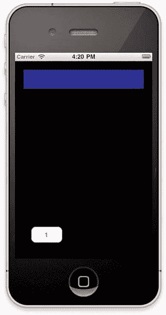

该应用程序的设计是：当你按下标记为“1”的按钮时，相应的数字就会出现在显示器上（参见 图 21.2）。它仅此而已！这个简单的应用程序为第二个分数计算器应用程序奠定了基础。

图 21.2. iPhone 应用程序结果。

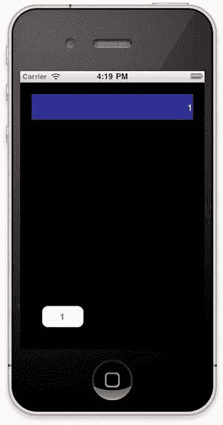

到书的这里，如果你一直使用 Xcode 来输入和测试程序，那么你应该已经非常熟悉使用 Xcode 了。这一次，我们还将使用 Xcode 的一项功能，该功能允许通过在类似于 iPhone 屏幕的窗口中放置表格、标签和按钮等 UI 元素来设计用户界面。像任何强大的开发工具一样，这个功能需要一些时间来适应。

> **注意**
>
> 在 Xcode 4 发布之前，UI 是使用一个名为 Interface Builder 的独立应用程序设计的。

Apple 将 iPhone 模拟器作为 iOS SDK 的一部分发布。模拟器复制了你的大部分 iPhone 环境，包括主屏幕、Safari 网页浏览器、联系人应用程序等。模拟器让调试你的应用程序变得容易得多；你不需要将应用程序的每个迭代下载到真实的 iPhone 设备上然后在那里调试。这可以节省你大量的时间精力。

要在 iOS 设备上运行应用程序，你需要注册 iOS 开发者计划并向 Apple 支付 99 美元的费用（截至本文编写）。作为作为，你将收到一个激活码，允许你获得 iOS 开发证书，以便你能够在 iOS 设备上测试和安装应用程序。遗憾的是，如果不经过这个过程，你甚至无法为自己的 iOS 设备开发应用程序。请注意，我们在本章中开发的应用程序将在 iPhone 模拟器上加载和测试，而不是在 iPhone 设备上。

### 创建新的 iPhone 应用程序项目

回到开发你的第一个应用程序。安装 iOS SDK 后，启动 Xcode 应用程序。选择 File（文件）、New（新建），然后 New Project...（新建项目...）。在 iOS（如果你在左窗格没有看到它，说明你没有安装 iOS SDK），点击 `Application`。你会看到一个窗口，如 图 21.3 所示。

图 21.3. 启动新的 iOS 项目。

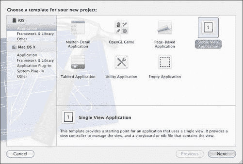

在这里，你可以看到为不同类型的应用程序提供起点的模板，如 表 21.1 汇总。

表 21.1. iOS 应用程序模板

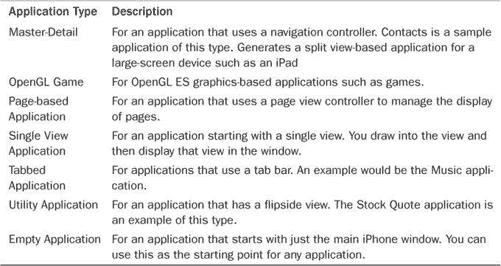

回到你的 New Project 窗口，在最右侧的窗格中选择 `Single View Application`，然后点击 `Next` 按钮。在 `Product Name`（产品名称）中输入 `iPhone_1`，无论选择什么 `Company Identifier`（公司标识符），将 `Device Family`（设备族）设置为 `iPhone`，勾选 `User Automatic Reference Counting`（用户自动引用计数），取消勾选 `Use Story Board`（使用 Story Board）和 `Include Tests`（包含测试）。

图 21.4. 选择项目选项。（上下文）

点击 `Next`。你可以指定创建新项目的地方，确保 `Source Control`（源码控制）框已勾选。你的屏幕现在应该像 图 21.5 所示。

图 21.5. 指定项目位置。


现在点击 `Create`。正如你从之前的项目中所知，将为你创建一个包含你想使用的模板的新项目。如 图 21.6 所示，`iPhone_1` 文件夹显示了五个文件：`iPhone_1AppDelegate.h`、`iPhone_1AppDelegate.m`、`iPhone_1ViewController.h`、`iPhone_1ViewController.m` 以及 `MainWindow.xib`。右侧窗格包含了应用程序支持的方向以及应用程序图标。在这里忽略此窗格。

图 21.6. 创建新的 iOS 项目 iPhone_1。


### 输入你的代码

现在我们准备修改一些项目文件了。注意系统为你创建一个名为 `project-nameAppDelegate` 的类，在本例中 `project-name` 是 `iPhone_1`。每个创建的 iOS 应用程序都会创建一个应用程序代理子类。通常情况下，该类中包含了控制应用程序执行的方法。这包括应用程序启动时、进入和离开后台时、系统提示内存过多时以及终止时的操作。在本章的两个示例中，我们都不会对该类进行任何更改。

在 Xcode 窗口的左上角，你看到一个下拉菜单 `Scheme`。因为我们不是开发直接在 iPhone 上运行的应用程序，所以你希望 SDK 设置为与 iPhone 模拟器运行。如 图 21.7 所示，从 `Scheme` 下拉菜单中选择 `iPhone simulator`。

图 21.7. 选择 iPhone 模拟器。


系统还为你创建了一个名为 `iPhone_1ViewController` 的类。如你所见，Xcode 在相应的 `.h` 和 `.m` 文件中为你创建了接口和实现部分。视图控制器（view controller）负责管理 iPhone 屏幕上一个或多个“视图”的显示。在这个应用程序中只有一个视图，如图 21.1 所示。应用程序展示许多不同的视图并因此有多个视图控制器来管理它们，这种做法并不罕见。

因此，我们的视图控制器类将负责处理点击标记为“1.”的按钮的事件。在该处，我们将定义一个方法，当该动作在 iPhone 窗口中发生时做出响应（在示例中，就是点击按钮）。稍后你将看到如何将该事件连接到特定方法的执行上。

你的对象还可以拥有实例变量，其值对应于你 iPhone 窗口中的某些控件，例如标签上的名称或在可编辑文本框中显示的文本。这些变量被称为 `outlets`（输出口），你将看到如何将实例变量连接到 iPhone 窗口中的实际控件。

对于我们的第一个应用程序，我们需要一个方法来响应点击标记为 1 的按钮的动作。我们还需要一个 outlet 变量，它包含了（除其他信息外）要在我们在 iPhone 窗口顶部创建的标签中显示的文本。

编辑 `iPhone_1ViewController.h` 文件，以添加一个名为 `display` 的新 `UILabel` 属性，并声明一个名为 `click1` 的动作方法来响应按钮的点击。你的接口文件应该看起来如程序 21.1 所示。（文件开头自动插入的注释行在此处未显示。）

### 程序 21.1. `iPhone_1ViewController.h`

```objc
#import <UIKit/UIKit.h>

@interface iPhone_1ViewController : UIViewController

@property (strong, nonatomic) IBOutlet UILabel *display;

-(IBAction) click1;

@end
```

注意 iPhone 导入了头文件 `<UIKit/UIKit.h>`。该头文件反过来导入了其他 UIKit 头文件，就像 `Foundation.h` 头文件导入了你需要的其他头文件（如 `NSString.h` 和 `NSObject.h`）一样。

> 注意
> 正如本文之前提到的，使用与属性名不同的实例变量名会鼓励你通过属性来访问实例变量，而不是直接通过变量名访问。Apple 一直鼓励这种编码风格。

你添加了一个属于 `UILabel` 类的名为 `display` 的属性。这是一个 outlet 属性，它将连接到一个标签上。当你设置此属性的文本字段时，它会更新窗口中对应标签的文本。为 `UILabel` 类定义的其他方法允许你设置和检索标签的其他属性，例如它的颜色、行数和字体大小。

随着你更多地学习 iOS 编程，你将希望在接口中使用其他类，我们在这里将不再描述它们。其中一些名称可以让你对它们的用途有所了解：`UITextField`、`UIFont`、`UIView`、`UITableView`、`UIImageView`、`UIImage`、`UISlider` 和 `UIButton`。

`display` 属性是一个 outlet，在属性声明中，注意使用了 `IBOutlet` 标识符。在 UIKit 头文件 `UINibDeclarations.h` 中，`IBOutlet` 实际上被定义为空（也就是说，预处理器在源文件中将其字面上地替换为空）。然而，它是必要的，因为 Xcode 在读取你的头文件时会寻找 `IBOutlets`，以确定你的哪些变量可以作为 outlet 并连接到接口中相应的 UI 元素。

`click1` 方法被定义为返回 `IBAction` 类型的值（这在 `UINibDeclarations.h` 头文件中定义为 `void`）。与 `IBOutlet` 类似，Xcode 在检查你的头文件时会使用此标识符来识别可以用作动作的方法。

现在是时候修改你的类对应的 `iPhone_1ViewController.m` 实现文件了。在这里，你合成了用于 `display` 属性的访问器方法。

现在编辑你的实现文件，并如程序 21.1 所示添加这些行（注意，我们没有显示 Xcode 放置在你的实现文件中但我们不会修改的方法）。

### 程序 21.1. `iPhone_1ViewController.m`

```objc
#import "iPhone_1ViewController.h"

@implementation iPhone_1ViewController

@synthesize display;

-(IBAction) click1

{

    display.text = @"1";

}

// Xcode 插入的其他方法

@end
```


`click1` 方法将 outlet `display` 设置为字符串 `"1"`。在你连接按钮到事件后，查看中间窗格中的 iPhone 窗口。

## 设计界面

在图 21.4 所示，并在 Xcode 主窗口中，注意一个名为 `iPhone_1ViewController` 的文件。`xib` 文件（历史上被称为 "nib"）包含了关于程序的用户界面信息，包括窗口、按钮、标签。

从左侧窗格选择 `iPhone_1ViewController.xib`。这将导致界面工具出现，如图 21.8 所示。右窗格显示 iPhone 窗口，默认是灰色背景。

图 21.8. 用户界面窗格。

从 View（视图）菜单选择 Utilities（工具）、Show Inspector（显示属性检查器）、Object Library（对象库）。你的窗口将如图 21.9 所示显示。

图 21.9. Interface Builder `iPhone_1ViewController.xib`。

（如果你想匹配屏幕，请查看编辑器和工具栏中的各种选项。此图显示了右上角的属性检查器和右下角的对象库的图标视图。）

我们要做的第一件事是将 iPhone 窗口设置为黑色。要做到这一点，首先点击中间窗格中的 iPhone 窗口。

如果你扫视检查器面板的 View 部分，你会看到一个标记为 `Background` 的属性。如果你点击 `Background` 旁边填充灰色的矩形，它将弹出一个供你选择的颜色。选择黑色，这将检查器中 `Background` 属性旁边的矩形从灰色变为黑色。

如果你查看代表 iPhone 窗口的中间窗格，你会看到它已经变成了黑色，如图 21.10 所示。

图 21.10. iPhone 窗口变为黑色。

你可以通过从对象库窗格拖入对象到 iPhone 窗口来创建新对象。现在拖入一个标签。当标签位于窗口左侧、顶部附近时释放鼠标，如[图 21.11] 所示。

图 21.11. 添加标签。

当会在窗口内移动标签时，会出现蓝色引导线。有时，这些引导线会帮助你将对象与窗口中之前放置的其他对象对齐。在其他时候，它们出现是为了确保你的对象与其他对象以及窗口边缘之间留有足够的距离，以符合 Apple 的界面指南。

你可以在未来的任何时候通过选择标签并将其拖动到窗口内的其他位置，重新调整标签的位置。

现在让我们为此标签设置一些属性。在你的 iPhone 窗口中，如果标签没有被选中，请点击你刚刚创建的标签来选中它。注意，`Inspector`（检查器）面板提供了有关你窗口中当前选中对象的信息。我们不希望此标签默认显示任何文本，因此将 `Text` 值更改为空字符串。（也就是说，从 `Inspector` 面板中显示的文本框中删除字符串 `Label`。）

对于 `Alignment`（对齐）属性，选择右对齐的图标。最后，将标签的背景颜色改为蓝色（或你选择的任何其他颜色），就像你之前将窗口背景颜色改为黑色一样。

现在让我们更改标签的大小。回到 `Window`，只需通过拉动角落和侧边来简单地调整标签的大小。调整并重新定位标签，使其看起来像图 21.12 所示的那样。

图 21.12 更改标签的属性和大小。


现在我们要在界面上添加一个按钮。从 `Object Library`（对象库）面板，将一个 `Rounded Rect Button`（圆矩形按钮）对象拖入你的界面窗口，将其放置在窗口的左下角，如图 21.13](#CR!HGK1SH992D3H5BD4YP0VXJVMVSGJ_split_033.html_filepos1600687)所示（注意此图显示 `Object Library` 窗口已从图标视图更改为列表视图）。你可以通过两种方式更改按钮上的标签：双击按钮然后输入文本，或者通过设置 `Inspector` 面板中的 `Title` 字段。无论你选择哪种方法，请让你的窗口与图 21.13 所示的一致。

图 21.13 在界面上添加按钮。


现在我们有了一个标签，想要将其连接到程序中的 `display` 实例变量上，这样当我们在程序中设置该变量时，标签的文本就会发生变化。

我们还有一个标记为 `1` 的按钮，我们希望设置它在每当被按下时调用我们的 `click1()` 方法。该方法将 `display` 文本字段的值设置为 `1`。因为该变量将连接到标签上，所以标签随后会更新。回顾一下，这是我们想要设置的序列：

1. 用户按下标记为 1 的按钮。
2. 此事件导致 `click1()` 方法被执行。
3. `click1()` 方法将实例变量 `display` 的文本属性更改为字符串 1。
4. 因为 `UILabel` 对象 `display` 连接到 iPhone 窗口中的标签，所以此标签更新为相应的文本值，或为值 1。

为了让这个序列生效，我们只需要建立这两个连接。有几种方法可以实现，我们将描述其中一种。

首先，让我们在第三个面板中显示源代码。要做到，首先选择 `View`（视图）、`Utilities`（实用工具）、`Hide Utilities`（隐藏实用工具）。接下来，选择 `View`、`Assistant Editor`（辅助编辑器）、`Show Assistant Editor`（显示辅助编辑器）。希望你的 Xcode 窗口将接近图 21.14 所示的样式。

图 21.14 在界面旁显示源代码。


让我们将按钮连接到 `IBAction` 方法 `click1()`。方法是按住 `Control` 键的同时点击按钮，并将屏幕上出现的蓝线拖动到最右侧面板显示的 `click1()` 方法上（你可以将其拖到界面部分声明该方法的地方，也可以拖到实现部分定义该方法的地方）。这如图 21.15](#CR!HGK1SH992D3H5BD4YP0VXJVMVSGJ_split_033.html_filepos1604455)所示。

图 21.15 为按钮添加动作。


现在，让我们把 `display` 变量连接到标签。在 iPhone 窗口中选择标签，按住 `Control` 键，点击并拖动出现的蓝线到界面文件中的 `display` 属性声明处。这如图 21.16](#CR!HGK1SH992D3H5BD4YP0VXJVMVSGJ_split_033.html_filepos160520)所示。

图 21.16 连接变量。


如果一切顺利，你的程序将构建并运行。从 `Product` 菜单点击 `Run`。模拟器将启动。当你点击标记为 1 的按钮时，`click1()` 方法将被执行，`display` 的文本将被设置为 1。标签随后将更新为 1。

## iPhone 计算器

下一个例子稍微复杂一些，但应用上一个例子的概念。我们不会展示创建它的所有步骤，而是给出设计的总结。

首先，让我们看看这个应用程序是如何工作的。图 21.17 显示了启动后的界面。

图 21.17 启动后的计算器。


该计算器允许你通过先输入分子、按下 `Over`、然后输入分母来输入分数。因此，要输入分数 2/5，你需要按 2，按 `Over`，再按 5。你会发现与其他计算器不同，它实际上会显示分数，因此显示了 2/5。

输入一个分数后，你可以通过按下相应的 `+`、`–`、`*` 或 `÷` 来选择操作——加法、减法、乘法或除法。输入第二个分数后，通过按下 `=` 键完成操作，就像使用标准计算器时一样。

> 此计算器设计为仅执行两个分数之间的单一操作。我们在本章末尾留了一个练习让你移除这个限制。

随着按键按下，显示会不断更新。图 21.18 显示了输入分数 4/6 并按下乘法键后的显示。

图 21.18 输入操作。


图 21.19 显示了分数 4/6 和 2/8 相乘的结果。你会注意到结果 1/6 表示结果已经过约分。

### 开始新的 `Fraction_Calculator` 项目

对于这个第二个程序示例，你将从创建一个新项目开始。和之前一样，在新项目窗口中选择 Single View Application。将你的新项目命名为 `Fraction_Calculator`。

当你的项目创建时，你会注意到系统为你定义了两个类模板。`Fraction_CalculatorAppDelegate.h` 和 `Fraction_CalculatorAppDelegate.m` 定义了项目的代理类（delegate），而 `Fraction_CalculatorViewController.h` 和 `Fraction_CalculatorViewController.m` 定义了项目的视图控制器（view controller）。与本章第一个示例一样，你所有的工作都在最后一个类中完成。

## 定义视图控制器

现在让我们为视图控制器类 `Fraction_CalculatorViewController` 编写代码。我们将从接口文件开始。如下所示程序 21.2。

程序 21.2. Fraction_CalculatorViewController.h 接口文件

```objc
#import <UIKit/UIKit.h>

#import "Calculator.h"

@interface Fraction_CalculatorViewController : UIViewController

@property (strong, nonatomic) IBOutlet UILabel *display;

-(void) processDigit: (int) digit;

-(void) processOp: (char) theOp;

-(void) storeFracPart;

// 数字键

-(IBAction) clickDigit: (UIButton *) sender

// 算运算键

-(IBAction) clickPlus;

-(IBAction) clickMinus;

-(IBAction) clickMultiply;

-(IBAction) clickDivide;

// 其他键

-(IBAction) clickOver;

-(IBAction) clickEquals;

-(IBAction) clickClear;

@end
```

这里有一些用于构建分数的变量（`currentNumber`、`firstOperand` 和 `isNumerator`），以及用于构建显示字符串的变量（`displayString`）。还有一个 `Calculator` 对象（`myCalculator`），可以执行两个分数之间的实际计算。我们将关联一个名为 `clickDigit:` 的单一方法来处理 0-9 任意数字键的按下。正如你很快看到的，该方法将接收一个指示被按下数字键的参数。最后，我们定义了方法来处理要执行的操作（`clickPlus`、`clickMinus`、`clickMultiply`、`clickDivide`）、在按下 = 键时执行实际计算（`clickEquals`）、清除当前操作（`clickClear`），以及在按下 Over 键时将分子与分母分离（`clickOver`）。定义了几个方法（`processDigit:`、`processOp:` 和 `storeFracPart`）来协助上述工作。

程序 21.2 显示了该控制器的实现文件。注意，我们在实现部分声明了实例变量。我们也可以声明属性并对其进行合成。两种方法都可行。我们在这里使用的方法将实例变量保持为私有，并清楚它们是在类内部使用的。

程序 21.2. Fraction_CalculatorViewController.m 实现文件

```objc
#import "Fraction_CalculatorViewController.h"

@implementation Fraction_CalculatorViewController

{
    char            op;
    int             currentNumber;
    BOOL            firstOperand, isNumerator;
    Calculator      *myCalculator;
    NSMutableString  displayString;
}

@synthesize display;

-(void) viewDidLoad {
    // 应用程序启动后自定义的点
    firstOperand = YES;
    isNumerator = YES;
    displayString = [NSMutableString stringWithCapacity: 40];
    myCalculator = [[Calculator alloc] init];
}

-(void) processDigit: (int) digit
{
    currentNumber = currentNumber * 10 + digit;
    [displayString appendString:
        [NSString stringWithFormat: @"%i", digit]];
    display.text = displayString;
}

- (IBAction) clickDigit: (UIButton *) sender
{
    int digit = sender.tag;
    [self processDigit: digit];
}

-(void) processOp: (char) theOp
{
    NSString *opStr;
    op = theOp;
    switch (theOp) {
        case '+':
            opStr = @" + ";
            break;
        case '-':
            opStr = @" – ";
            break;
        case '*':
            opStr = @" ∞ ";
            break;
        case '/':
            opStr = @" ÷ ";
            break;
    }
    [self storeFracPart];
    firstOperand = NO;
    isNumerator = YES;
    [displayString appendString: opStr];
    display.text = displayString;
}

-(void) storeFracPart
{
    if (firstOperand) {
        if (isNumerator) {
            myCalculator.numerator = currentNumber;
            myCalculator.denominator = 1; // 例如. 3/4 =
        } else {
            myCalculator.denominator = currentNumber;
        }
    }
    else if (isNumerator) {
        myCalculator.numerator = currentNumber;
        myCalculator.denominator = 1; // 例如. 3/2 * 4 =
    } else {
        myCalculator.denominator = currentNumber;
        firstOperand = YES;
    }
    currentNumber = 0;
}

-(IBAction) clickOver
{
    [self storeFracPart];
    isNumerator = NO;
    [displayString appendString: @"/"];
    display.text = displayString;
}

// 算运算键

-(IBAction) clickPlus
{
    [self processOp: '+'];
}

-(IBAction) clickMinus
{
    [self processOp: '-'];
}

-(IBAction) clickMultiply
{
    [self processOp: '*'];
}

-(IBAction) clickDivide
{
    [self processOp: '/'];
}

// 其他键

-(IBAction) clickEquals
{
    if ( firstOperand == NO ) {
        [self storeFracPart];
        [myCalculator performOperation: op];
        [displayString appendString: @" = "];
        [displayString appendString: [myCalculator.accumulator
            ToString]];
        display.text = displayString;
        currentNumber = 0;
        isNumerator = YES;
        firstOperand = YES;
        [displayString setString: @""];
    }
}

-(IBAction) clickClear
{


`isNumerator = YES;`

`firstOperand = YES;`

`currentNumber = 0;`

`[myCalculator clear];`

`[displayString setString: @""];`

`display.text = displayString;`

```
}
@end
```

计算器的窗口仍然像上一个应用程序一样只一个标签，我们仍然称之为`display`。当用户逐位输入数字时，我们需要在此过程中构建该数字。变量`currentNumber`存储正在进行中的数字，而`BOOL`变量`firstOperand`和`isNumerator`则跟踪这是第一个操作数还是第二个操作数，以及用户当前正在输入该操作数的分子还是分母。

```objc
- (IBAction) clickDigit: (UIButton *) sender
{
    int digit = sender.tag;
    [self processDigit: digit];
}
```

在程序 21.2 中的按钮比第一个应用程序多得多。控制器实现文件中的大部分复杂性围绕着分数的构建和显示。正如所指出的，当按下 0–9 的数字按钮时，就会执行动作方法`clickDigit:`。该方法调用`processDigit:`方法将数字附加到变量`currentNumber`中正在构建的数字末尾。该方法还将将数字添加到存储在变量`displayString`中的当前显示字符串中，并更新显示：

```objc
-(void) processDigit: (int) digit
{
    currentNumber = currentNumber * 10 + digit;
    [displayString appendString:
        [NSString stringWithFormat: @"%i", digit]];
    display.text = displayString;
}
```

当按下`=`键时，会调用`clickEquals`方法执行操作。计算器在两个分数之间执行操作，并将结果存储在它的累加器中。该累加器在`clickEquals`方法内部被获取，并将结果添加到显示中。

## `Fraction` 类

`Fraction`类与本文之前的示例相比很大程度上保持不变。新增了一个新的`convertToString`方法，用于将分数转换为其等效的字符串表示。程序 21.2 显示了`Fraction`接口文件，紧随其的是对应的实现文件。

### 程序 21.2. Fraction.h 接口文件

```objc
#import <UIKit/UIKit.h>

@interface Fraction : NSObject

@property int numerator, denominator;

-(void) print;
-(void) setTo: (int) n over: (int) d;
-(Fraction *) add: (Fraction *) f;
-(Fraction *) subtract: (Fraction *) f;
-(Fraction *) multiply: (Fraction *) f;
-(Fraction *) divide: (Fraction *) f;
-(void) reduce;
-(double) convertToNum;
-(NSString *) convertToString;

@end
```

### 程序 21.2. Fraction.m 实现文件

```objc
#import "Fraction.h"

@implementation Fraction

@synthesize numerator, denominator;

-(void) setTo: (int) n over: (int) d
{
    numerator = n;
    denominator = d;
}

-(void) print
{
    NSLog (@"%i/%i", numerator, denominator);
}

-(double) convertToNum
{
    if (denominator != 0)
        return (double) numerator / denominator;
    else
        return NAN;
}

-(NSString *) convertToString
{
    if (numerator == denominator)
        if (numerator == 0)
            return @"0";
        else
            return @"1";
    else if (denominator == 1)
        return [NSString stringWithFormat: @"%i", numerator];
    else
        return [NSString stringWithFormat: @"%i/%i", numerator, denominator];
}

// 添加到接收者
-(Fraction *) add: (Fraction *) f
{
    // 相加两个分数：
    // a/b + c/d = ((a*d) + (b*c)) / b * d
    // result 将存储加法的结果
    Fraction *result = [[Fraction alloc] init];
    result.numerator = numerator * f.denominator + denominator * f.numerator;
    result.denominator = denominator * f.denominator;
    [result reduce];
    return result;
}

-(Fraction *) subtract: (Fraction *) f
{
    // 减法分数：
    // a/b - c/d = ((a*d) - (b*c)) / b * d
    Fraction *result = [[Fraction alloc] init];
    result.numerator = numerator * f.denominator - denominator * f.numerator;
    result.denominator = denominator * f.denominator;
    [result reduce];
    return result;
}

-(Fraction *) multiply: (Fraction *) f
{
    Fraction *result = [[Fraction alloc] init];
    result.numerator = numerator * f.numerator;
    result.denominator = denominator * f.denominator;
    [result reduce];
    return result;
}

-(Fraction *) divide: (Fraction *) f
{
    Fraction *result = [[Fraction alloc] init];
    result.numerator = numerator * f.denominator;
    result.denominator = denominator * f.numerator;
    [result reduce];
    return result;
}

- (void) reduce
{
    int u = numerator;
    int v = denominator;
    int temp;

    if (u == 0)
        return;
    else if (u < 0)
        u = -u;

    while (v != 0) {
        temp = u % v;
        u = v;
        v = temp;
    }

    numerator /= u;
    denominator /= u;
}

@end
```

`convertToString:`方法检查分子的分子和分母，以产生更悦目的结果。如果分子和分母相等（但不为零），我们返回`@"1"`。如果分子为零，返回`@"0"`。如果分母为 1，它是一个整数：不需要显示分母。

回想在`convertToString:`中使用的`stringWithFormat:`方法，给定一个格式字符串（类似于`NSLog`）和一个逗号分隔的参数列表。你通过逗号分隔来传递参数，就像向`NSLog`函数传递参数一样。

## 处理分数的`Calculator`类

接下来，是时候查看`Calculator`类了。该概念与书中之前开发的同名类相似。在这种情况下，我们的计算器必须处理分数。这里是新的接口和实现文件。

### 21.2. Calculator.h

```objc
#import <UIKit/UIKit.h>
#import "Fraction.h"

@interface Calculator : NSObject

@property (strong) Fraction *operand1, *operand2, *accumulator;

-(Fraction *) performOperation:(char) op;
-(void) clear;

@end
```

### 21.2. Calculator.m

```objc
#import "Calculator.h"

@implementation Calculator

@synthesize operand1, operand2, accumulator;

-(id) init
{
    self = [super init];
    if (self) {
        operand1 = [[Fraction alloc] init];
        operand2 = [[Fraction alloc] init];
        accumulator = [[Fraction alloc] init];
    }
    return self;
}

-(void) clear
{
    accumulator.numerator = 0;
    accumulator.denominator = 0;
}

-(Fraction *) performOperation:(char) op
{
    Fraction *result;

    switch (op) {
        case '+':
            result = [operand1 add: operand2];
            break;
        case '-':
            result = [operand1 subtract: operand2];
            break;
        case '*':
            result = [operand1 multiply: operand2];
            break;
        case '/':
            result = [operand1 divide: operand2];
            break;
    }

    accumulator.numerator = result.numerator;
    accumulator.denominator = result.denominator;
    return accumulator;
}

@end
```


对于此项目，你的 nib 文件命名为 `Fraction_CalculatorViewController.xib`。你可以通过选择此文件并按照图 21.17 所示所示布局按钮和标签（当然，你也可以根据自己的喜好来设计界面）。

将你在视图中布局的每个数字按钮连接到 `clickDigit:` 方法。通过按住 Control 键并拖拽（Control-click-dragging）每个按钮，将其连接到视图控制器界面或实现文件中的 `clickDigit:` 方法来完成。此外，对于每个数字按钮，在检查器面板（Inspector pane）中将 `Tag` 值设置为与按钮标题对应的数字。例如，将标签为 0 的数字按钮的 `Tag` 值设为 0，将标签为 1 的数字按钮的 `Tag` 值设为 1，依此类推。

在 `View` 窗口中绘制剩余的按钮并建立相应的连接。大功告成！你的界面设计已经完成，分数计算器应用程序已准备就绪。

### 总结

图 21.20 显示了 Xcode 项目窗口，你可以看到与分数计算器项目相关的所有文件。

图 21.20。分数计算器项目文件。


以下总结了你创建 iPhone 分数计算器应用程序所遵循的步骤：

1. 创建了一个单视图应用程序（Single View Application）。
2. 在 `Fraction_CalculatorViewController.h` 和 `.m` 文件中输入你的 UI 代码。
3. 向项目中添加 `Fraction` 和 `Calculator` 类。
4. 打开 `Fraction_CalculatorViewController.xib` 创建 UI。
5. 将 `View` 窗口的背景设置为黑色。
6. 创建了标签和按钮，并将它们放置在 `View` 窗口内。
7. 从 `View` 窗口中创建的标签通过 Control-click-drag 连接到 `UILabel IBOutlet` 属性 `display`。
8. 从 `View` 窗口中的每个按钮通过 Control-click-drag 连接到相应的 `IBAction` 方法。对于每个数字按钮，你选择了 `clickDigit:` 方法。此外，对于每个数字按钮，你将 `tag` 属性设置为相应的数字 0-9，以便 `clickDigit:` 方法能够识别按下了哪个按钮。

学习如何使用视图控制器是一次很有价值的练习，尽管这比直接在应用 delegate 对象中完成所有工作要费力。希望这段关于 iOS 应用开发的简要介绍能为你编写自己的 iPhone 应用程序提供一个良好的开始。正如前面提到的，`UIKit` 提供了许多功能，有很多内容让你探索！

我们的分数计算器应用程序存在一些限制。其中许多将在随后的练习中得到解决。

### 练习

1. 为分数计算器应用程序添加一个“转换”（Convert）按钮。当按下按钮时，使用 `Fraction` 类的 `convertToNum` 方法产生分数结果的数值表示。将结果转换为字符串并显示在计算器的显示屏上。
2. 修改分数计算器应用程序，如果在输入分子之前按下 – 键，则可以输入负分数。
3. 如果第一个或第二个操作数的分母输入值为 0，则在分数计算器的显示屏上显示字符串 `Error`。
4. 修改分数计算器应用程序以允许进行链式计算。例如，允许输入以下操作：`1/5 + 2/7 – 3/8 =`
5. 你可以为应用程序添加一个图标，它将出现在 iPhone 的主屏幕上。可以通过将其拖到如 21.6 所示的 App Icons 区域来实现。对于普通尺寸的图标（iPhone 3GS 及之前的机型），图标大小应为 57x57 像素。对于 Retina 显示 iPhone（iPhone 4 及后续机型），图标图像文件应该是 114x114 像素。

   在互联网上找到一张合适的计算器图片，并设置分数计算器使用该图片作为其应用程序图标。
6. 使用你自己的图片为计算器的按钮提供自定义外观。你首先将图像添加到项目（（将其拖入左侧面板）。接下来，在检查器窗口中将按钮类型设置为 Custom（自定义），并将 Image 设置为你刚刚复制到项目中的文件。图 21.21 显示了一个使用此类自定义图像的分数计算器。该计算器可以在 Apple App Store 免费获取，源代码发布在本书的论坛上（classroomM.com/objective-c）。

图 21.21。带有自定义按钮的分数计算器


# 附录

## 附录 A. 术语表

本附录包含了你将遇到的许多术语的定义。某些术语与 Objective-C 语言本身直接相关，而另一些则源于面向对象编程领域。在后一种情况下，我提供了该术语的含义。

- **抽象类（abstract class）**：为了方便子类而定义的类。实例从子类创建。参见具体子类。
- **访问器方法（accessor method）**：获取或设置实例变量值的方法。使用访问器方法设置值符合数据封装的方法论。
- **应用程序工具包（Application Kit）**：用于开发应用程序界面的框架，包括菜单、工具栏等对象。它是 Cocoa 的一部分，也称为 AppKit。
- **ARC**：参见自动引用计数。
- **归档（archiving）**：将对象的表示转换为稍后恢复（反归档）的格式。
- **数组（array）**：值的有序集合。数组可以定义为基础 Objective-C 类型，并通过 `NSArray` 和 `NSMutableArray` 类实现。
- **引用计数（Automatic Reference Counting）**：4.2 版本引入的一个功能，由编译器管理对象相关的内存。在 4.2 之前，iOS 程序员需要使用手动技术管理内存。这需要使用 `retain`、`release`、`autorelease` 和 `dealloc` 方法。
- **自动变量（automatic variable）**：当语句块进入和退出时自动分配和释放的变量。自动变量的作用域限于定义的块，并且没有默认初始值。可选的前缀为 `auto` 关键字。
- **释放池（autorelease pool）**：在 ARC 之前由 `NSAutoreleasePool` 类管理。现在通过 `@autoreleasepool` 指令实现。释放池跟踪由系统延迟释放的对象。对于 iOS 和 Cocoa 应用程序，通常在运行循环结束时。
- **位域（bitfield）**：包含一个或多个指定位宽整数字段的结构。位域可以像结构成员一样被访问和操作。
- **块（block）**：Apple 对 C 语言的扩展。块具有类函数语法，在定义时捕获作用域内变量的值，可以赋值给变量或作为方法或函数的参数传递。块可以高效地分发到另一个线程或处理器上执行。
- **分类（category）**：在指定名称下分组的一组方法。分类可以将类的方法定义模块化，并用于向现有类添加新方法。

- **class**：一组实例变量和可以访问这些变量的方法。类被定义后，就可以创建该类的实例（即对象）。
- **class method**：在类对象上调用的方法（以前缀 `+` 符号定义）。*另见* instance method。
- **class object**：一个标识特定类的对象。类名可以作为接收消息的接收者，用以调用类方法。在其他地方，可以在类上调用 `class` 方法来创建一个类对象。
- **cluster**：一种抽象类，它将一组私有的具体子类组合在一起，通过该抽象类为用户提供简化的接口。
- **Cocoa**：一个由 Foundation、Core Data 和 Application Kit 框架组成的开发环境。
- **Cocoa Touch**：一个由 Foundation、Core Data 和 UIKit 框架组成的开发环境。
- **collection**：一种 Foundation 框架对象，可以是数组、字典或集合，用于分组和操作相关对象。
- **compile time**：源代码被分析并转换为称为对象代码的低级格式期间的时间。
- **composite class**：由其他类的对象组成的类；通常用作子类化的替代方案。
- **concrete subclass**：抽象类的子类。可以从具体子类创建实例。
- **conform**：如果一个类通过了协议中所有要求的方法（无论是通过直接实现还是通过继承间接实现），则该类遵循该协议。
- **constant character string**：包在一对双引号内的字符序列。如果前面有 `@` 字符，则它定义了一个类型为 `NSConstantString` 的常量字符串对象。
- **data encapsulation**：认为对象的数据存储在其实例变量中且仅通过对象的方法进行访问的概念。这维护了数据的完整性。
- **delegate**：一个被指定由另一个对象执行某个动作的对象。
- **designated initializer**：类中所有其他初始化方法（或子类通过向 `super` 发送消息）将调用的方法。
- **dictionary**：在 Foundation 中通过 `NSDictionary` 和 `NSMutableDictionary` 类实现的键值对集合。
- **directive**：在 Objective-C 中，以 `@` 符号开头的特殊结构。`@interface`、`@implementation`、`@end` 和 `@class` 是指令的示例。
- **Distributed Objects**：一个应用程序中的 Foundation 对象与另一个应用程序中的 Foundation 对象通信的能力，后者可能运行在另一台机器上。
- **dynamic binding**：在运行时而不是编译时确定与对象一起要调用的方法。
- **dynamic typing**：在运行时而不是编译时确定对象所属的类。*另见* static typing。
- **encapsulation**：*参见* data encapsulation。
- **extern**：在一个源文件中声明并在另一个文件中定义的变量。
- **getter method**：用于检索实例变量值的访问方法。*另见* setter method。
- **factory method**：创建类的新实例的方法。
- **factory object**：由工厂方法创建的对象。
- **formal protocol**：一组声明为协议的相关方法。与非正式协议不同，正式协议中的所有方法都必须实现。*另见* informal protocol。
- **forwarding**：发送一个对象不理解的消息的过程。
- **Foundation**：一组类、函数和协议的集合，为开发应用程序提供基本设施。
- **framework**：一组类、函数和协议的集合，构成了应用程序的基础。
- **function**：执行特定任务的代码块。
- **garbage collection**：一种自动释放未引用对象所用内存的运行时管理系统。
- **gcc**：C、C++ 和 Objective-C 的编译器。
- **gdb**：用于用 `gcc` 编译的程序的标准调试工具。
- **global variable**：定义在任何方法或函数之外的变量。
- **header file**：包含常用定义、宏和变量声明的文件，通过 `#import` 或 `#include` 包含在程序中。
- **id**：可以持有任何对象指针的通用对象类型。
- **immutable object**：值不能修改的对象。Foundation 框架的示例包括 `NSString`、`NSDictionary` 和 `NSArray`。*另见* mutable object。
- **implementation section**：类定义中的部分，包含接口部分中声明的方法的实际代码。
- **informal protocol**：一组声明为分类（category）的逻辑相关的方法。非正式协议中的并非所有方法都必须被实现。
- **inheritance**：从根对象开始，将方法和实例变量从类传递给子类的过程。
- **instance**：类的具体表示。实例通常是通过向类对象发送 `alloc` 或 `new` 消息创建的对象。
- **instance method**：可以由类的实例调用的方法。*另见* class method。
- **instance variable**：在接口部分中声明（或从父类继承）的变量，包含在对象的每个实例中。实例方法可以直接访问其实例变量。
- **Interface Builder**：Mac OS X 下用于为应用程序构建图形用户界面的工具。
- **interface section**：用于声明类、其父类、实例变量和方法的区域。*另见* implementation section。
- **国际化 (internationalization)**：*参见* 本地化。
- **isa**：定义在根对象中的一个特殊实例变量，所有对象都继承它。`isa` 变量用于在运行时标识对象所属的类。
- **链接 (linking)**：将一个或多个对象文件转换为可执行程序的过程。
- **局部变量 (local variable)**：作用域限制在定义它的代码块中的变量。变量可以是方法、函数或语句块的局部变量。
- **本地化 (localization)**：使程序适用于在特定地理区域内执行的过程，通常通过将消息翻译为本地语言并处理诸如本地时区、货币符号、日期格式等事项。有时 *本地化* 仅指代语言翻译，而 *国际化* 一词则用于指代该过程的其他部分。
- **消息 (message)**：发送到对象（接收者）的方法及其关联参数。
- **消息表达式 (message expression)**：封装在方括号中的表达式，指定对象（接收者）以及要发送给该对象的消息。
- **方法 (method)**：属于某个类并可以通过向类对象或该类的实例发送消息来执行的程序。*另见* 类方法 和 实例方法。
- **可变对象 (mutable object)**：值可以改变的对象。Foundation 框架支持可变和不可变的数组、集合、字符串和字典。*另见* 不可变对象。
- **nil**：类型为 `id` 的对象，用于表示无效对象。它的值定义为 `0`。`nil` 可以接收消息。
- **通知 (notification)**：向已注册在特定事件发生时接收警报（通知）的对象发送消息的过程。
- **NSObject**：Foundation 框架下的根对象。
- **空字符 (null character)**：值为 `0` 的字符。空字符常量用 `'\0'` 表示。
- **空指针 (null pointer)**：无效的指针值，通常定义为 0。
- **对象 (object)**：一组变量和关联方法的集合。可以向对象发送消息以执行其任一方法。
- **面向对象编程 (object-oriented programming)**：基于类和对象并对这些对象执行操作的编程方法。
- **父类 (parent class)**：另一个类继承的类。也称为*超类 (super class)*。
- **指针 (pointer)**：引用另一个对象或数据类型的值。指针实现为内存中特定对象或值的地址。类的实例是指内存中对象数据位置的指针。
- **多态 (polymorphism)**：来自不同类的对象接受相同消息的能力。
- **预处理器 (preprocessor)**：一个对源代码进行第一轮处理的程序，处理以 `#` 开头的行，这些行假设包含特殊的预处理器语句。常见用途是用 `#define` 定义宏，通过 `#import` 和 `#include` 包含源文件，以及通过 `#if`、`#ifdef` 和 `#ifndef` 条件地包含源行。
- **过程化编程语言 (procedural programming language)**：一种通过对一组数据操作的过程和函数定义程序的语言。
- **属性声明 (property declaration)**：一种指定实例变量属性的方法，允许编译器为实例变量生成无泄漏且线程安全的访问方法。属性声明还可用于为运行时动态加载的访问器方法声明属性。
- **属性列表 (property list)**：以标准格式表示不同类型对象的表示。属性列表通常存储在 XML 格式中。
- **协议 (protocol)**：一个类为了符合或采纳该协议而必须实现的方法列表。协议提供了一种跨类标准化接口的方法。*另见* 正式协议 和 非正式协议。
- **接收者 (receiver)**：接收消息的对象。在被调用的方法内部可以将接收者称为 `self`。
- **引用计数 (reference count)**：*参见* 保留计数。
- **保留计数 (retain count)**：对象被引用的次数计数。通过向对象发送 `retain` 消息来增加，通过向其发送 `release` 消息来减少。
- **根对象 (root object)**：继承层次结构中没有父类的最顶层对象。
- **运行时 (runtime)**：程序执行时的时间；也是负责执行程序指令的机制。
- **选择器 (selector)**：用于为对象选择要执行的方法的名称。编译后的选择器为 `SEL` 类型，并可以使用 `@selector` 指令生成。
- **self**：方法内部用于引用接收者的变量。
- **集合 (set)**：无序对象集合，在 Foundation 中通过 `NSSet`、`NSMutableSet` 和 `NSCountedSet` 实现。
- **setter 方法 (setter method)**：设置实例变量值的访问方法。*另见* getter 方法。
- **语句 (statement)**：以分号结束的一个或多个表达式。
- **语句块 (statement block)**：在大括号内的多个语句。可以在语句块中声明局部变量，其作用域限于该块。
- **静态函数 (static function)**：使用 `static` 关键字声明的同一源文件的函数或方法调用的函数。
- **静态类型 (static typing)**：在编译时显式标识对象所属的类。*另见* 动态类型。
- **静态变量 (static variable)**：作用域限制在定义它的块或模块中的变量。静态变量的初始值为 0，并在方法或函数调用期间保持其值。
- **structure**：包含不同类型成员的聚合数据类型。结构可以赋值给其他结构，作为参数传递给函数和方法，并由它们返回。
- **子类 (subclass)**：子类继承其父类或超类的方法和实例变量。
- **super**：在方法中引用接收者父类的关键字。
- **超类 (super class)**：特定类的父类。*另见* `super`。
- **合成方法 (synthesized method)**：编译器为你生成的 setter 或 getter 方法。它是 Objective-C 2.0 语言新增。
- **UIKit**：用于开发 iOS 设备应用程序的框架。除了提供处理窗口、按钮和标签等常用 UI 元素的类外，它还定义了处理设备特定功能（如加速度计和触摸界面）的类。UIKit 是 Cocoa Touch 的一部分。
- **Unicode 字符 (Unicode character)**：表示包含数百万个字符的集合的标准。`NSString` 和 `NSMutableString` 类处理包含 Unicode 字符的字符串。
- **联合 (union)**：一种聚合数据类型，例如共享相同存储区域的结构。在任何时刻，这些成员中只有一个可以占据存储区域。
- **Xcode**：用于 Mac OS X 和 iOS 程序开发的编译和调试工具。
- **XML**：可扩展标记语言。Mac OS X 上生成的属性列表的默认格式。
- **zone**：用于分配数据和对象的指定内存区域。程序可以与多个 zone 交互，以更高效地管理内存。

## 附录 B. 通讯录应用程序源代码

为了方便参考，这里是你在第二部分中处理过的“基础框架”通讯录示例的完整接口和实现文件。这包含了 `AddressCard` 和 `AddressBook` 类的定义。你应该在你的系统上实现这些类；然后扩展类定义以使它们更加实用且功能强大。这是你学习该语言并熟悉编写程序、操作类与对象以及使用 Foundation 框架极其方式。

### AddressCard 接口文件

```objc


`#import <Foundation/Foundation.h>`

`@interface AddressCard : NSObject <NSCopying, NSCoding>`

`@property (nonatomic, copy) NSString *name, *email;`

`-(void) setName: (NSString *) theName andEmail: (NSString *) theEmail;`

`-(void) assignName: (NSString *) theName andEmail: (NSString *) theEmail;`

`-(NSComparisonResult) compareNames: (id) element;`

`-(void) print;`

`@end`

### AddressBook 接口文件

```objc
#import <Foundation/Foundation.h>
#import "AddressCard.h"

@interface AddressBook: NSObject <NSCopying, NSCoding>

@property (nonatomic, copy) NSString *bookName;
@property (nonatomic, strong) NSMutableArray *book;

-(id)   initWithName: (NSString *) name;
-(void) sort;
-(void) addCard: (AddressCard *) theCard;
-(void) sort2;
-(void) removeCard: (AddressCard *) theCard;
-(int)  entries;
-(void) list;
-(AddressCard *) lookup: (NSString *) theName;

@end
```

### AddressCard 实现文件

```objc
#import "AddressCard.h"

@implementation AddressCard

@synthesize name, email;

-(void) setName: (NSString *) theName andEmail: (NSString *) theEmail
{
    self.name = theName;
    self.email = theEmail;
}

// 比较指定通讯录中的两个名字
-(NSComparisonResult) compareNames: (id) element
{
    return [name compare: [element name]];
}

-(void) print
{
    NSLog (@"==================================");
    NSLog (@"|                              |");
    NSLog (@"|  %-31s |", [name UTF8String]);
    NSLog (@"|  %-31s |", [email UTF8String]);
    NSLog (@"|                              |");
    NSLog (@"|                              |");
    NSLog (@"|                              |");
    NSLog (@"|  O                            |");
    NSLog (@"==================================");
}

-(id) copyWithZone: (NSZone *) zone
{
    id newCard = [[self] allocWithZone: zone];
    [newCard assignName: name andEmail: email];
    return newCard;
}

-(void) assignName: (NSString *) theName andEmail: (NSString *) theEmail
{
    name = theName;
    email = theEmail;
}

-(void) encodeWithCoder: (NSCoder *) encoder
{
    [encoder encodeObject: name forKey: @"CardName"];
    [encoder encodeObject: email forKey: @"CardEmail"];
}

-(id) initWithCoder: (NSCoder *) decoder
{
    name = [decoder decodeObjectForKey: @"CardName"];
    email = [decoder decodeObjectForKey: @"CardEmail"];
    return self;
}

@end
```

### AddressBook 实现文件

```objc
#import "AddressBook.h"

@implementation AddressBook

@synthesize book, bookName;

// 设置 AddressBook 的名称和空通讯录
-(id) initWithName: (NSString *) name
{
    self = [super init];
    if (self) {
        bookName = [NSString stringWith: name];
        book = [NSMutableArray];
    }
    return self;
}

-(id) init
{
    return [self initWithName: @"Unnamed Book"];
}

// 编写自己的 book setter 以创建可变拷贝
-(void) setBook: (NSArray *) theBook
{
    book = [theBook mutableCopy];
}

-(void) sort
{
    [book sortUsingSelector: @selector(compareNames:)];
}

// 使用 blocks 替排序
-(void) sort2
{
    [book sortUsingComparator:
    ^(id obj1, id obj2) {
        return [[obj1 name] compare: [obj2 name]];
    }];
}

-(void) addCard: (AddressCard *) theCard
{
    [book addObject: theCard];
}

-(void) removeCard: (AddressCard *) theCard
{
    [book removeObjectIdenticalTo: theCard];
}

-(int) entries
{
    return [book count];
}

-(void) list
{
    NSLog (@"======== Contents of: %@ =========", bookName);
    for ( AddressCard *theCard in book )
        NSLog (@"%-20s   %-32s", [theCard.name UTF8String],
               [theCard.email UTF8String]);
    NSLog (@"==================================");
}

// 按名字查找通讯录 — 假设精确匹配
-(AddressCard *) lookup: (NSString *) theName
{
    for ( AddressCard *nextCard in book )
        if ([nextCard name] caseInsensitiveCompare: theName == NSOrderedSame)
            return nextCard;
    return nil;
}

-(void) encodeWithCoder: (NSCoder *) encoder
{
    [encoder encodeObject: bookName forKey: @"bookName"];
    [encoder encodeObject: book forKey: @"book"];
}

-(id) initWithCoder: (NSCoder *) decoder
{
    bookName = [decoder decodeObjectForKey: @"bookName"];
    book = [decoder decodeObjectForKey: @"book"];
    return self;
}

// NSCopyingget 方法
-(id) copyWithZone: (NSZone *) zone
{
    id newBook = [[self] allocWithZone: zone];
    [newBook setBookName: bookName];
    // 以下会对通讯录进行浅拷贝
    [newBook setBook: book];
    return newBook;
}

@end
```

## 脚注

### 第 13 章

^(1) 技术上，它定义在 `NSObjCRuntime.h` 文件中，该文件从 `Foundation.h` 导入。

^(2) 注意程序中的字符串 `"A string to be copied."` 和 `"So is this."`。这些不是字符串对象，而是 C 风格字符字符串。如果函数接受 `char` 数组作为参数，你可以传递一个 `char` 类型的数组或字面量 C 风格字符字符串，而不是字符字符串对象。

### 第 15 章

^(1) 目前，`unichar` 字符占用 16 位，但 Unicode 标准为比该尺寸更大的字符提供了支持。因此在未来，`unichar` 字符可能会大于 16 位。结论是永远不要对 Unicode 字符的大小做假设。

你可能还想要一个 `initWithName:andEmail:` 初始化方法，但我们在这里不展示它。

名为 `sortUsingFunction:context:` 的方法允许你使用函数而不是方法来执行比较。

一个更通用的方法可以调用每个对象的 `description` 方法来显示集合中的每个成员。这将允许包含任何类型对象的集合以可读的格式进行显示。此外请注意，你可以使用单个 `NSLog` 调用并使用“打印对象”格式化字符 `"%@`" 来显示任何集合的内容。
