# Visual Basic 2010 编程入门指南

圣安东尼山立学院


QA763.7.B38B20662 1

005.2760--

www.mhhe.com

2010013744

# 前言

Visual Basic (VB) 成为一种流行的编程语言有几个原因。VB 易于学习，使其成为理解基础编程概念的绝佳工具。此外，它已演变成一种强大且受欢迎的产品，使得熟练的 Visual Basic 程序员在就业市场上供求活跃。

Visual Basic 是完全面向对象的，并与许多使用 .NET Framework 的其他语言兼容。本书贯穿了面向对象的概念，以及该语言的语法和术语。

Visual Basic 的设计允许程序员开发在 Windows 下和/或浏览器中运行的应用程序，而没有通常与编程相关的复杂性。只需花费少量努力，程序员就可以设计出一个包含按钮、复选框、单选按钮、文本框和列表框等标准元素的屏幕。这些每个对象都能按预期运行，产生“标准”的 Windows 或 Web 用户界面。

# 关于本文

本教材旨在用于入门编程课程，假设学生没有计算机编程的基础知识。随后的章节也适用于想要通过学习新语言来提升技能的专业程序员。

本文假设学生熟悉 Windows 操作系统并能够使用互联网浏览器应用程序。

## 方法

本文结合了编程的基本概念、问题解决方法和编程逻辑，以及面向对象、事件驱动语言的设计技术。VB 是一种完全面向对象的语言，包含了继承和多态。在第 1 章中引入了面向对象编程 (OOP)，其特征出现在书的每一章中。

章节主题按顺序呈现，允许程序员在学习如何处理视觉界面的同时，获取编程技能，如使用对象、决策、循环和数据管理创建项目。

我们非常重视编写易于用户理解和使用的应用程序。在全文中，我们向学生介绍了界面设计指南。

# 文本特征

面向对象的概念贯穿全文，以便在学生学习创建自己的类之前，为他们提供面向对象设计的介绍。

## 第 2 章

## 用户界面设计

- 在本章结束时，你将能够：

1. 使用文本框、编辑框、标签、框架、框体、复选框和单选按钮。

2. 理解控件的属性。

3. 使用控件的边界。

4. 使用控件的属性。

5. 使用控件的属性。

6. 使用控件的属性。

7. 使用控件的属性。

8. 使用控件的属性。

9. 使用控件的属性。

10. 使用控件的属性。

11. 使用控件的属性。

# 良好的编程习惯

- 在本章结束时，你将能够：

1. 使用文本框、编辑框、标签、框架、框体、复选框和单选按钮。

2. 理解控件的属性。

3. 使用控件的边界。

4. 使用控件的属性。

5. 使用控件的属性。

6. 使用控件的属性。

## 特性

- 打开项目并更改名称。然后搜索你的项目名称。

- 重命名项目是一个涉及重命名文件夹、移动或将项目到新位置的任务。手动执行此操作非常困难，因为有许多需要更新的内部引用。

## 你的实操编程示例

通过重命名第 1 章中的月份和编程示例，并将项目移动到你选择的根目录。重命名后，检查错误，这些错误（可能）是与其他错误相同的错误。你可能需要检查局部变量、名称并使用适当的引用。项目必须能够使用项目编译器进行编译。

| 属性 | 值 |

| --- | --- |

| 名称 | 0.0 |

| 测试点 | 0.00 |

## 你的实操编程示例

引导学生完成规划、编写和执行 Visual Basic 程序的流程。

## 编程练习

测试学生对该章节涵盖的特定编程技能的理解。

## 核心术语

| 术语 | 定义 |

| --- | --- |

| 变量 | 带有数据值的存储位置 |

| 循环 | 一系列不断重复的指令，直到满足某些 |

| 条件 | 被评估为真或否的语句 |

| 错误 | 当你尝试执行不允许的操作时发生的事件 |

| 调试 | 在代码中发现并修复错误的过程 |

### 复习习题

1. 什么是变量？

2. 什么是循环？

3. 什么是条件？

4. 什么是错误？

5. 什么是调试？

6. 如何在 Visual Basic 中声明变量？

7. 如何在程序中使用循环？

8. 如何在程序中使用条件？

9. 错误的不同类型有哪些？

10. 调试程序你应该采取哪些步骤？

## 编程练习

1. 写一个程序，要求用户输入姓名然后显示问候语。

2. 写一个程序，要求用户输入两个数字然后显示它们的和。

3. 写一个程序，使用循环打印数字 1 到 10。

4. 写一个程序，使用条件判断一个数字是偶数还是奇数。

5. 写一个程序，找到三个数中最大的一个。

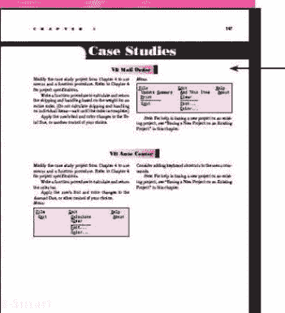

## 案例分析

案例分析允许你在现实场景中应用所学知识。这有助于你理解这些概念如何在实际操作中应用。

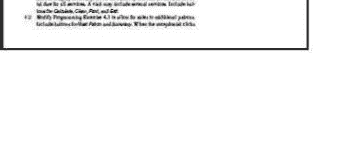

## 案例分析

提供贯穿课程的主题练习，可以在整个课程中使用，提供扩展之前项目的机会。

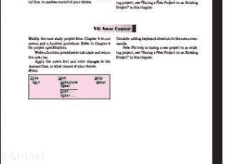

# 学生读者

# VISUAL BASIC 2010 编程

学生版

# 数据库应用程序

（相关项目）

第 10 章“数据库应用程序”引入了 ADO，这是一种用于访问关系型数据库的技术。本展示了如何连接到数据库并显示数据。学生学习如何从单表和多表加载数据，以及添加和删除记录。

要了解更多关于该网站的信息，请访问信息中心。

# 学生数据

网站上提供调试项目、编程练习和案例分析的数据集文件、图形以及声音文件。

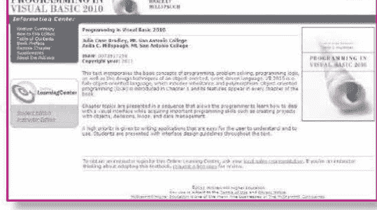

# VISUAL BASIC 2010 编程

学生版

Visual Basic 2010 编程

课程：CS101 计算机入门

学院：San Metro College

教师：

本章介绍了编程的基本概念、问题解决、编程逻辑、变量、数据类型和运算符。本章通过视觉化方法教授这些基本概念。每个节都有练习以帮助学生应用所学内容。每章末尾都有一个项目。学生被提供了易于练习的写作作业来巩固技能。每章末尾还提供了作业。

访问 VISUAL BASIC 2010 网站：http://www.mhhe.com/VB2010/

# 教师读者

教师网站包含教学提示、大纲以及每个编程练习所需的矩阵；PowerPoint 幻灯片；测试文件（使用 Word）；以及章节末答案。

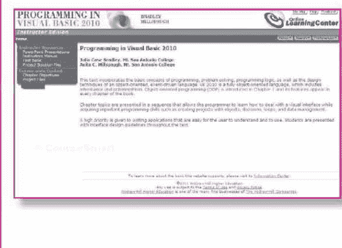

# PowerPoint 幻灯片

为教师提供完整、详细的演示，引导学生学习每章涵盖的重要概念。

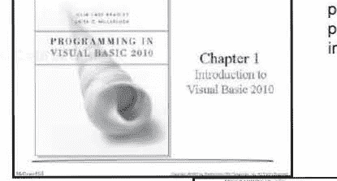(img/1ec42cf2c6024296b4ec0c54212f36f2_8_1.png)(img/1ec42cf2c6024296b4ec0c54212f36f2_8_2.png)(img/1ec42cf2c6024296b4ec0c54212f36f2_8_3.png)(img/1ec42cf2c6024296b4ec0c54212f36f2_8_4.png)(img/1ec42cf2c6024296b4ec0c54212f36f2_8_5.png)(img/1ec42cf2c6024296b4ec0c54212f36f2_8_6.png)

访问 VISUAL BASIC 2010 网站 http://www.mhhe.com/VB2010/ 获取教师和学生资源。

# 本版变化

本版本的修订版基于 Visual Basic Professional 2010。VB 2010 在大多数情况下消除了续行符。数组和对象初始化也得到了改进。叙述、逐步练习、屏幕截图和附录已更新为 VB2010。屏幕截图均基于 Windows 7。章节中增加了一个关于对象的章节。

# 本书的特点

每章都从标识特征和简要概述开始。书中有数字编码示例以及在贯穿过程中提供规划和编码指导的项目。发人深的反馈让学生有机会反思当前主题并评估对细节的理解。章节末的内容包括章节复习、编程练习和四个案例。

第一章“Visual Studio 2010 简介”引入了 Microsoft Visual Studio 集成开发环境 (IDE)。该环境用于多种编程语言。逐步程序让学生比大多数书籍更快进入编程。包含了 PrintForm 控制，允许学生在运行时轻松提交表面的截图。本章介绍了对象、属性、方法和事件 OOP 概念。还介绍了错误处理和帮助系统。

第二章“用户界面设计”演示了良好的设计技术，使界面易于使用，并提供了设计可维护程序的指南。引入了多个控件，包括文本框、富文本框、加密文本框、组框、复选框、按钮、图片框以及新的 Shape 和 Line 控制。

第三章“变量、常量和计算”介绍了使用数据和声明数据类型的概念。学生学习遵循标准并始终使用 Option Strict，强制遵守强数据类型。错误处理通过结构化异常实现。本章在计算的同时引入了 Try/Catch/Finally 结构。学生学习使用 MessageBox 类显示错误消息，并学习了重载构造函数的 OOP 概念。

第四章“决策和条件”引入了基于关系运算符逻辑运算符形成的表达式的备操作。本章使用 If 语句来验证输入数据。多个决策通过嵌套 If 语句和 Select Case 结构处理。

# 前言

涵盖了 IDE 的调试功能，包括一个逐步练习，涵盖了逐执行程序语句并在执行期间检查中间值。

第五章“菜单、常用对话框、子过程和函数过程”涵盖了编写和调用通用菜单和函数过程的概念。学生学习在项目中实现菜单和内容，显示常用对话框并使用用户提供的输入。

第六章“多表单项目”向项目添加了启动表和关于表。摘要数据显示在单独的表上。引入了 Friend 关键字。

第七章“循环和打印”将列表框和组合框整合到项目中，提供了讨论循环过程和打印信息列表的机会。打印在 .NET 中通过简单对象和回调事件完成。打印控制还包括预览，可以在不实际打印的情况下输出。

第八章“数组和集合”介绍了数组，其在逻辑上基于第 7 章涵盖的列表。学生学习使用单维和多维数组、表查找、结构数组和集合。

第九章“Web 应用程序”引入了 Web Forms。学生学习设计和开发在浏览器中运行的简单 Web 应用程序。多站点涵盖验证控件和状态管理的介绍。

第 11 章“Visual Basic 的其他主题”介绍了一些高级 VB 主题。本章涵盖了用户输入验证、错误提供程序（Error Providers）以及控件的 Validating 事件。学生将学习如何使用多文档界面（MDI）创建应用程序，使用 Ribbon 和 StatusBar 控件创建工具栏和菜单，并使用 WebBrowser 控件向 Windows 表单中添加 Web 内容。代码片段介绍了这些内容。涵盖了使用新的 XML 字面量和 LINQ 来读取和写入 XML 文本文件。

介绍了如何通过 WFF 与标准 Windows Form 的互操作性使用 Windows Foundation (WPF)，并创建一个 WPF 表单。

附录提供了重要的补充材料。附录 A 包含所有问题的答案。附录 B 涵盖了数学、字符串处理和日期操作的方法和函数。在面向对象（OOP）风格中，以前通过函数执行的大多数操作现在通过 Class 类和 String 类的方法完成。

附录 C 关于掌握 Visual Studio 环境，基于 .NET IDE，并包含了使用捕捉线（snap lines）进行表单设计的说明。附录 D 讨论了 Windows 和 Web 编程的安全问题。

# 致谢

许多人为本书的出版付出了巨大的努力。我们要感谢我们的编辑 Scott Davidson 和 Alain Grayson。我们感谢许多参与本书制作的人员，包括 Marlena Pechan、David Shapiro 和 Betty Blumenthal。

我们非常感谢 San Antonio College 的 Theresa Berry 和 Rose State College 的 Peter van der Goes 提供的详尽评审、建设性批评以及许多宝贵的建议。我们要感谢 Mesa Community College 的 Brenda Berry 在创建教师手册和测试题库方面所的工作。最重要的是，我们感谢 Dennis 和 Richard 在漫长的日子和忙碌的电话期间提供的支持与理解。

# 作者

我们一直致力于 Visual Basic 的教学和编写工作。我们希望您在阅读本书时能感受到这种情感，并会喜欢学习或教授这门出色的编程语言。

Julia Case Bradley

Anita C. Millspaugh

# 给学生的话

学习 Visual Basic 编程最好的方法就是去实践。如果你进入并运行示例项目，你就走上了编写应用程序的道路。在不尝试的情况下阅读示例，就像试图仅通过阅读来学习外语或数学一样。进入项目，在详尽的 MSDN 帮助文件中查询你的问题，并让这些项目运行起来。

## 安装 Visual Basic

对于书中程序，你需要安装 .NET Framework、Visual Basic 以及 MSDN（微软开发者网络）库，其中包含了所有帮助和许多指导性文章。你不需要安装 C++ 或 C#。你可以从 mdn.microsoft.com/express 下载 Visual Basic 和 Visual Web Developer 的 Express 版本。通过使用这两个产品，你可以完成书中的大部分练习。

## Visual Basic 语句使用的格式

Visual Basic 语句、方法和函数显示在此字体中。你必须提供的任何值都用*斜体*表示。可选项目位于[方括号]中。大括号和竖线表示你必须在两个值之间二选一（其一 | 另一个）。

示例

```
Const Identifier [As Datatype] = Value
Do (While | Until) Condition
```

当你学习完这本教科书时，请注意你可能会看到 Visual Basic 语句或方法的可用选项子集。通常，包含的选项反映了本章涵盖的内容。如果你想查看任何语句的完整格式或方法的所有版本，请参阅：

J.C.B.

A.C.M.

# 关于作者

Julia Bradley 是圣安东尼奥学院计算机信息系统的名誉教授。她开发并教授了 25 年计算机编程课程，然后为了全职写作而提前退休。最近，她教授过入门和高级 Visual Basic、Access 编程和微软 Office 课程。她从 1984 年使用 MS-BASIC (GW-BASIC) 开始编写 BASIC 教书，并编写或合著了 Macintosh Basic、QuickBasic、QBasic、Visual Basic、C#、Java、互联网和桌面出版的著作。

Anita Milbrough 在圣安东尼奥学院教授 Visual Basic 和 C# 编程课程，并担任了多年系主任。她在加州州立理工大学获得 MBA 学位，拥有计算机信息系统学士学位。她曾在国家教育者学院培训教师，并为圣安东尼奥学院和加州职业学院组织教师大会。

# Visual Basic 2010 简介

在面向对象（OOP）和事件驱动模型中，程序不再是过程化的。它们不再遵循顺序逻辑。作为程序员，你不再控制并决定执行的顺序。相反，用户可以按下键并点击窗口中的各种按钮和框。每个用户操作都可以作为一个“事件”发生，从而触发你编写的 Basic 过程（procedure）。例如，用户点击标记为“Calculated”（计算）的按钮。点击动作会导致按钮的 Click 事件发生，程序会自动跳转到你编写的用于执行计算的过程。

# 对象模型

在 Visual Basic 中，你将与对象工作，对象具有属性（properties）、方法（methods）和事件（events）。每个对象都基于一个类（class）。

## 对象

将对象想象一个事物或名词。对象的示例有表单（forms）和控件（controls）。表单是你放置在屏幕上的窗口和对话框；控件是你放在表单内部的组件，例如文本框、按钮和列表框。

## 属性

属性提供了有关对象的信息或控制对象的行为，例如它的名称、颜色或位置。你可以将属性看作描述对象的形容词。当你引用属性时，先写对象名称，加一个点，然后写属性名称。例如，引用名为 SalesForm 的表单的 Text 属性，应写为 `SalesForm.Text`（读作 "sales dot text"）。

## 方法

与对象相关的动作称为方法。方法是面向对象编程中的动词。一些典型方法有 Close（关闭）、Show（显示）和 Clear（清除）。每个预定义方法都有一组你可以使用的操作。你将学习编写额外的方法来在程序中执行操作。你将方法引用为 `Object.Method`（读作 "object dot method"）。例如，一个 `Show` 方法可以应用于不同的对象：`BillingForm.Show` 显示名为 `BillingForm` 的表单；`ExitButton.Show` 显示名为 `ExitButton` 的按钮。

## 事件

你可以编写在特定事件发生时执行的过程。当用户采取行动时（例如点击按钮、按下按键、滚动或关闭窗口），就会发生一个事件。事件也可以由其他对象触发，例如重绘表单或定时器重置。

> TIP 成员可以指代属性和方法。

## 类

类是用于创建新对象的模板。类包含了所有可用属性、方法和事件的定义。

每当你创建一个新对象时，它必须基于一个类。例如，你可能决定在表单上放置三个按钮。每个按钮都基于 `Button` 类，并被视为一个对象，称为类的实例（instance）。每个按钮（或实例）都有自己的一组属性、方法和事件。一个按钮可以标记为“OK”，另一个为“Cancel”（取消），第三个为“Exit”（退出）。当用户点击 OK 按钮时，按钮的 Click 事件发生；如果用户点击 Exit 按钮，按钮的 Click 事件发生。当然，你为每个按钮的 Click 事件编写了不同的程序函数。

## 类比法


如果类、对象、属性、方法和事件的概念仍然有点模糊，那么一个类比会有帮助。考虑一个“汽车类”。当我们说汽车时，我们指的不是某辆特定的汽车，但我们知道汽车有名称、型号、颜色、引擎和门数。这些元素就是`Automobile`类的属性。

每辆汽车都是一个对象，或者说是汽车类的一个实例。每个汽车对象对可用属性都有其自己的设置。例如，每个对象都有自己的颜色，如`MyAuto.Color = Blue`和`YourAuto.Color = Red`。

汽车类的方法或动作可能是`Start`（启动）、`Slowdown`（减速）和`Stop`（停止）。要引用该类特定对象的方法，使用`MyAuto.Start`和`YourAuto.Stop`。

`Automobile`类的事件可能是`Arrive`（到达）或`Crash`（碰撞）。在 VB 程序中，你编写指定当对象发生特定事件时你想要采取的动作。例如，你可能会编写当对象发生特定事件时执行的操作。

> 注意：TIP 成员用于同时指代属性和方法。

## Visual Studio 2010

> 提示：第 12 章将介绍更深度的面向对象编程。

Visual Studio 2010 的 Visual Studio 2010 包含。Microsoft 的最新版本 Visual Studio 2010 包含了 Visual Basic、C#、F#、JavaScript 等语言，并可以用于 Web 开发。

## .NET 框架

.NET 框架提供了 Visual Basic 2010、Visual Studio 2010。

## Visual Basic

Visual Basic 随 Visual Studio 2010 提供。Visual Basic 2010 的 Express 版本 Visual Basic 2010 Express 可以在此处（www.microsoft.com/express/）免费下载。Visual Basic 2010 Express 适用于 Windows 开发，Web Developer 2010 Express 适用于 Web 应用。Visual Basic 2010 Express 是 Visual Studio 2010 的一部分。Visual Basic 2010 Express 是 Visual Studio 2010 的免费版本。Visual Basic 2010 Express 是 Visual Studio 2010 的免费版本。Visual Basic 2010 Express 是 Visual Studio 2010 的免费版本。Visual Basic 2010 Express 是 Visual Studio 2010 的免费版本。

# 第一章

# 7

## 编程

在完成规划步骤并获得用户许可后，你就可以开始项目的实际构建了。请使用与你规划时所相同的三步走过程。

1. 定义用户界面。当你定义用户界面时，你正在创建在规划阶段设计的表单和控件。将此步骤看作是定义你将在应用程序中使用的对象。

2. 设置属性。当你设置对象的属性时，你为每个对象命名，并定义诸如此类属性，如标签的内容、文本的大小，以及出现在按钮顶部和项目标题栏上的字样。将此步骤看作是描述每个对象。

3. 编写 Basic 代码。使用 Basic 编程语句（Basic 代码）来执行项目所需的动作。你可能会发现，创建一个强大的窗口需要这么多语句，这让你感到惊讶和惊喜。你可以将这第三步看作是定义项目的动作。

## Visual Basic 应用程序文件

一个 Basic 应用程序称为解决方案（solution），可以由一个或多个项目组成。由于本文中的所有解决方案都包含一个项目，你可以认为一个解决方案 = 一个项目。每个项目可以包含一个或多个表单。在第 1 到 5 章中，所有项目都包含一个，因此你可以认为一个项目 = 一个表单。从第 6 章开始，你的项目将包含多个表单和其他文件。例如，你在本章中创建的 HelloWorld 应用程序将创建以下文件：

| 文件名 | 文件图标 | 说明 |
|---|---|---|
| `HelloWorld.vb` | | 存放你编写代码的文件。这是一个可以在任何编辑器中打开的文本文件。警告：除非你在 Visual Studio 环境中使用编辑器，否则你不应修改此文件。 |
| `HelloWorld.res` | | 表单的资源文件。此文本文件定义了表单所使用的所有资源，包括文本字符串、数字和图形。 |
| `HelloForm.Designer.vb` | | 由表单设计器创建的文件，包含表单及其控件的定义。你不应修改此文件，而是在设计器中进行更改并允许更新文件。 |
| `HelloWorld.vbproj` | | 项目文件：一个包含你项目选项信息的文本文件。 |
| `HelloWorld.vbproj.user` | | 项目选项文件。此文本文件持有 IDE 设置，以便下次你打开项目时，所有自定义设置将得到恢复。 |

注意：你可以显示文件扩展名。在 Windows 7 或 Vista 中，在 Windows 资源管理器和搜索“组织/文件夹”以及搜索选项中，点击“查看”选项卡，并勾选“隐藏已知文件类型的扩展”。在 Windows XP 中，在“我的电脑”工具菜单中，选择“文件夹选项”和“查看”选项卡，勾选“隐藏已知文件类型”。如果你不显示扩展名，可以通过图标来识别文件。

运行项目后，你将发现系统又创建了几个文件。这些包括`AssemblyInfo.vb`、`MyApplication.myapp`、`MyEvents.vb`、`Resources.resx`和`Resources.vb`。你直接打开的唯一文件是`.sln`解决方案。

## Visual Studio 环境

你在此创建和测试项目的 Visual Studio 环境。开发环境（如 Visual Studio）被称为集成开发环境（IDE）。IDE 由各种工具组成，包括一个表单设计器，它允许你视觉化地创建界面；一个编辑器，用于编写和修改代码；一个编译器，用于将代码转换为可执行程序；一个运行时，用于运行程序；调试器，用于定位和修复错误；对象浏览器，用于查看类、属性、方法以及帮助功能。

## 工具栏

你可以使用工具栏上的按钮作为常用操作的快捷键。每个按钮代表一个可以从菜单中选择的命令。图 1.7a 显示了专业版标准工具栏上的工具栏按钮，显示在 IDE 的主窗口中；图 1.7b 显示了布局工具栏，它在表单设计器中设计表单非常有用；图 1.7c 显示了编辑器工具栏，它包含在编辑器窗口使用的按钮。选择视图/工具栏来显示或隐藏这些和其他工具栏。

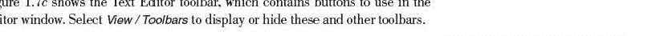

Visual Studio 工具栏包含作为菜单命令快捷键的按钮。你可以显示或隐藏每个工具栏：a：标准工具栏；b：布局工具栏；以及 c：编辑器工具栏。

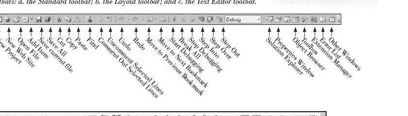

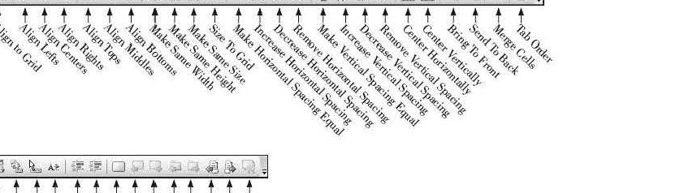

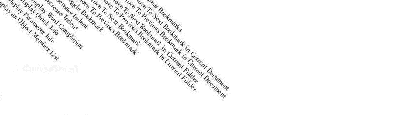

## 文档窗口

屏幕中心最大的窗口是文档窗口。注意窗口顶部的标签，它们允许你在打开的文档之间切换。显示在文档窗口中的条目包括表单设计器、代码编辑器、数据库设计器和对象浏览器。

你可以从一个标签切换到另一个标签，或者使用其的关闭按钮关闭任何文档。

## 表单设计器

表单设计器是你设计构成用户界面的表单的地方。在表单 1.6 中，当前显示 Form1 的表单设计器。你可以拖动表单的尺寸句柄或选择边框来更改表单的大小。

当你开始一个新的 Basic Windows 应用程序时，项目将添加一个默认名为 Form1 的新表单。在本章稍后的逐步渐进式练习中，你将学习更改表单名称。

## 解决方案管理器窗口

解决方案管理器保存包含在项目中的文件文件名以及所引用的类列表。解决方案管理器窗口和标题栏持有你的解决方案 (`.sln`) 文件名，默认是 Application1，除非你在“新建项目”对话框中获取了新值。在表单 1.6 中，解决方案的名称是 MyFirstProject。

## 属性窗口

你使用属性窗口为项目对象设置属性。请查看本章稍后的“设置属性”以获取有关更改属性的说明。

## 工具箱

工具箱存放用于在表单上放置控件的工具。根据你所使用的 Visual Basic 版本（Express、Professional、Premium 或 Ultimate），你的工具箱中可能有更多或不同的工具。表单 1.8 显示了 VB 专业版工具箱。

## 帮助

Visual Studio 拥有丰富的帮助，包括微软网络库 (MSDN)。你可以找到 Visual Basic、C++ 和 Visual Studio 的参考资料；几本书；技术文章以及知识库（一个包含常见问题和你的答案的数据库）。

帮助包含了整个参考手册，以及许多代码示例。请查看本章稍后的“Visual Studio 帮助”主题以获取有关帮助的帮助。

当你从帮助菜单中进行选择时，请求的项目将出现在浮动在 IDE 窗口（表单 1.9）之上的新浏览器窗口，因此你可以同时打开两者。

> 使用 Ctrl + Tab 切换到文档窗口中另一个打开的窗口。

> 你可以按字母顺序或类别对窗口中的属性进行排序。使用属性窗口上的按钮。


## 图 1.3

Visual Studio Windows Forms 的工具。根据你使用的版本，你的工具箱可能有更多或更少的工具。

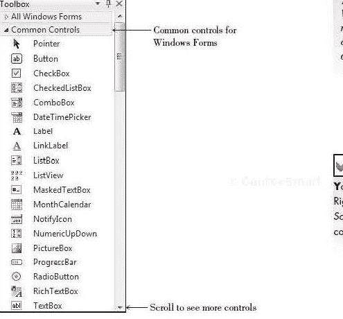

Windows Forms 常用控件

> **提示**

> 你可以启动工具箱中的工具：右键点击工具箱并从右键菜单（快捷菜单）中选择“按字母排序项目”。

## 设计时间、运行时和调试时间

Visual Basic 有三种不同的模式。当你设计用户界面并编写代码时，当你测试和运行你的项目时，你处于运行时。如果你遇到运行时错误或暂停执行，你正处于调试时间。IDE 窗口标题栏显示 (运行) 或 (调试中) 来表示项目不再处于设计时间。

## 编写你的第一个 Visual Basic 项目

对于你的第一个 VB 项目，你将创建一个带有三个控件的表单（见图 1.10）。这个简单的项目将在用户点击“Push Me”按钮时在标签中显示“Hello World”消息，并在用户点击“Exit”按钮时终止。

## 设置你的工作空间

在开始项目之前，你必须运行 Visual Studio IDE。你还可能需要自定义你的工作空间。

## 运行 Visual Studio

这些指令假设 Visual Studio 安装在默认位置。如果你在教室或实验室中运行，程序可能安装在备位置，例如直接在其他位置。

## 图 1.9

帮助出现在浮动在 IDE 窗口之上的新浏览器窗口，因此你可以同时打开两者。

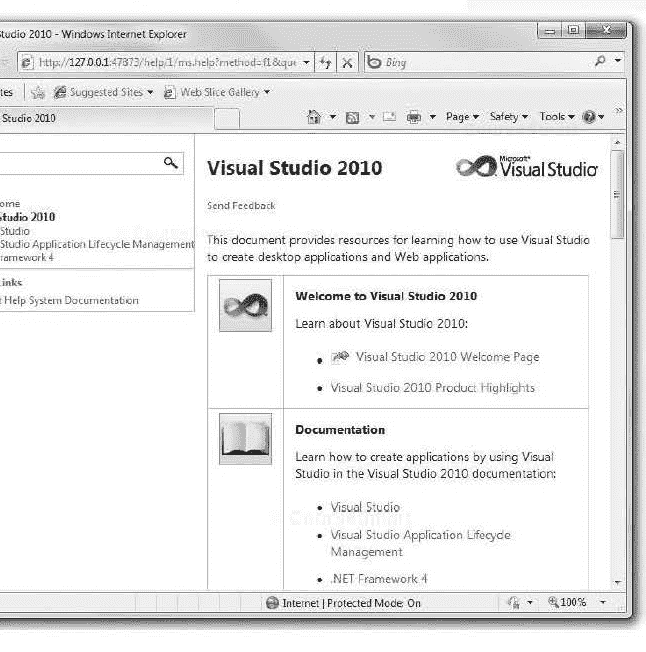

## 图 1.10

Hello World 表单。当用户点击“Push Me”按钮时，标签中显示“Hello World”消息。


## 图 1.11

新建项目对话框。


## 图 1.12

带有 HelloWorld 项目的 Visual Studio IDE。

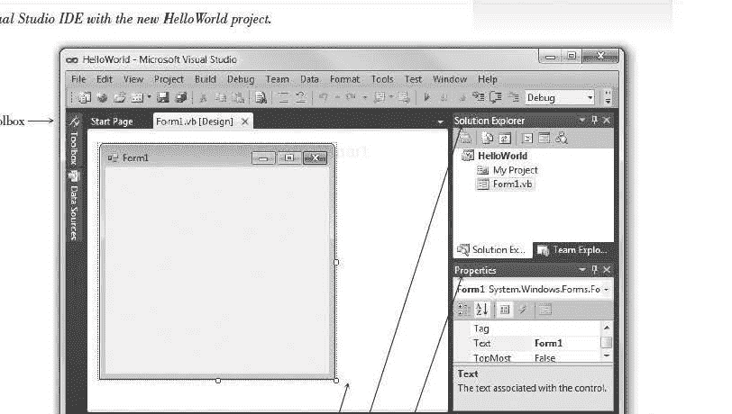

## 图 1.13

工具箱窗口。

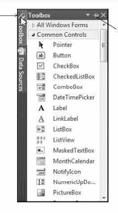

## 图 1.14

用于 HelloWorld 表单草图。

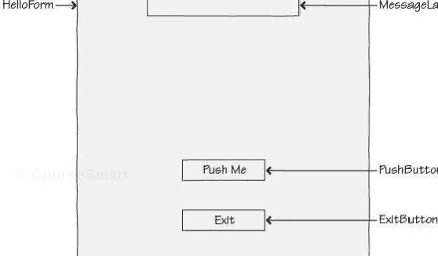

后续步骤，即属性和代码的规划已经针对这个第一个示例项目完成。你将在接下来的步骤中看到这些规划。

## 定义用户界面

## 设置表单

注意 Document 窗口中的新表单具有所有标准的 Windows 功能，例如标题栏、最大化和最小化按钮以及关闭按钮。

- 步骤 1：在 Document 窗口中调整表单大小：向右下拖动右角的句柄（图 1.15）。

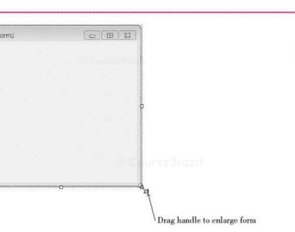

## 在表单上放置控件

你将在表单上放置三个控件：一个标签（Label）和两个按钮（Buttons）。

- 步骤 1：指向工具箱中的 Label 工具并点击。然后将指针移动到表单上。注意指针变成了一个带有大字母 A 的交叉线，且 Label 工具显示被选中，表示它是活动工具（图 1.16）。

## VISUAL BASIC 导论：Visual Basic 2010

当你点击工具箱中的 Label 工具时，该工具的焦点被激活，鼠标指针变成交叉线。

交叉线指针。

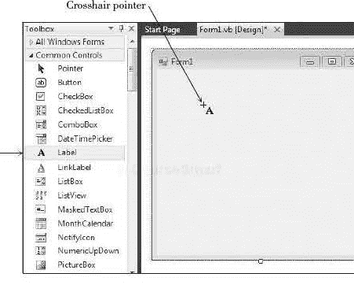

图 1.16

- 步骤 2：指向你想让标签左边缘所在的地方并点击。标签及其默认内容（Label1）将出现（图 1.17）。

图 1.17

新创建的标签显示为轮廓，表示它已被选中。注意标签的内容默认设置为 Label1。

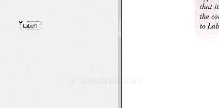

只要标签被选中，你就可以将它拖到新位置，或按 Delete 键删除它。

## 第 1 章

你可以判断出标签是否被选中；当 AutoSize 属性为 True [默认值] 时，它会有一个如图 1.17 所示的虚线框；如果你将 AutoSize 属性设置为 False，则会显示调整大小句柄。

- **步骤 3：** 使用两种技术在表单上放置按钮：(1) 你可以点击工具箱中的 Button 工具，将交叉线指针位于按钮的一个角，并拖动到对角的角（图 1.16）；或 (2) 你可以从工具箱中拖放该工具，这将创建一个默认大小的按钮。新按钮应显示为被选中状态并带有调整大小句柄。出现的蓝线被称为吸附线（snap lines），它们可以帮助你对齐控件。

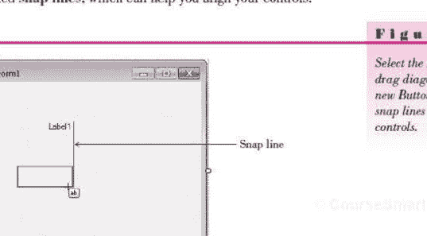

当控件被选中时，你可以删除或移动它。如果它有调整大小句柄，你还可以调整它的大小。请参考表 1.1 关于选择、删除、调整大小和移动控件的说明。点击控件外部可以取消选择。

## 在表单上选择、删除、移动和调整控件大小

## VISUAL BASIC 导论：Visual Basic 2010

- 步骤 4：使用另一种技术创建另一个按钮：在第一个按钮仍处于选中状态时，指向工具箱中的 Button 工具并双击。一个默认大小的新按钮将出现在上一个绘制的控件之上（图 1.19）。

- 步骤 5：保持新按钮被选中状态，指向按钮内部任何位置（而非句柄上），并将按钮拖到你的第一个按钮下方（图 1.20）。

## 图 1.19

通过双击工具箱中的 Button 工具在表单上放置新按钮。新按钮出现在之前选中的控件之上。

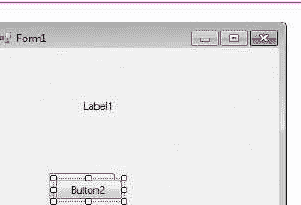

## 图 1.20

将新按钮（Button2）拖到 Button1 下方。

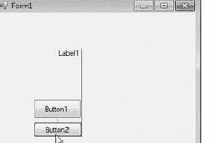

> 提示 如果没有选中控件就双击工具，新控件将添加到表单左上角。

- 步骤 6：选择每个控件并根据需要移动和调整控件大小。使两个按钮大小相同并对齐。使用吸附线来帮助对齐和大小。注意你可以移动——但无法调整标签的大小。

## 第 1 章


## 步骤 7：锁定控件

指向表单上的任何地方并点击鼠标按钮显示锁符号，这将防止你不小心移动控件（图 1.21）。当控件被锁定时，它左上角会显示锁图标。你可以随时通过点击锁图标来解锁。

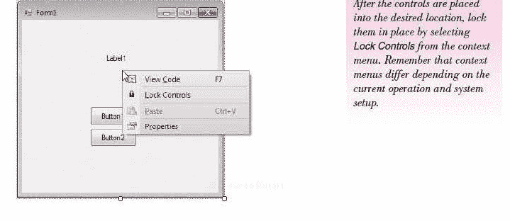

## 设置属性

### 步骤 1：选择 Text 属性

点击`Settings`窗口中的`Text`属性；表单上的标签将改变。注意标签的内容默认设置为`Label1`。


### 步骤 2：输入新文本

在`Text`属性中输入新文本。标签将更新以显示你输入的文本。

### 步骤 3：添加按钮

点击工具箱中的`Button`工具，将交叉线指针位于按钮的一个角，并拖动到对角的角（图 1.16）；或 (2) 你可以从工具箱中拖放该工具，这将创建一个默认大小的按钮。新按钮应显示为被选中状态并带有调整大小句柄。出现的蓝线被称为吸附线，它们可以帮助你对齐控件。

## 图 1.22

标签显示了更新的文本。


> 提示：如果没有选中控件就双击工具，新控件将添加到表单左上角。

### 步骤 4：调整控件

选择每个控件并根据需要移动和调整控件大小。使两个按钮大小相同并对齐。使用吸附线来帮助对齐和大小。注意你可以移动——但无法调整标签的大小。

## 第 1 章

### 步骤 5：放置标签

指向你想让标签左边缘所在的地方并点击。标签及其默认内容（`Label1`）将出现（图 1.17）。

### 步骤 6：移动按钮

保持新按钮被选中状态，指向按钮内部任何位置（而非句柄上），并将按钮拖到你的第一个按钮下方（图 1.20）。

## 图 1.23

在`Text`属性中输入新文本。


## 第 1 章

### 步骤 7：使用两种技术放置按钮

(1) 你可以点击工具箱中的`Button`工具，将交叉线指针位于按钮的一个角，并拖动到对角的角（图 1.16）；或 (2) 你可以从工具箱中拖放该工具，这将创建一个默认大小的按钮。新按钮应显示为被选中状态并带有调整大小句柄。


## 第 1 章

## 图 1.24

将新按钮（`Button2`）拖到`Button1`下方。


# 第一章

注意：作为删除属性的另一种替代方法，你可以双击属性名称，这会自动选择设置框中的该项。然后你可以按下`Delete`键，或者直接开始更改该项的内容。

> 提示：不要将`Name`（名称）属性与`Text`（文本）属性混淆。你将在基础代码中使用`Name`属性来引用控件。而`Text`属性则决定了用户在表单上看到的内容。Visual Basic 默认将这两个属性都设置为相同的值，很容易产生混淆。

## 为第一个按钮设置 Name 和 Text 属性

### 步骤 1：选中按钮

点击第一个按钮（`Button`）以选中它，然后查看属性窗口。对象应该显示按钮的名称（`Button`）和类（`System.Windows.Forms.Button`）。参见图 1.28。

出现问题了？如果你双击后文档中出现了代码，只需点击窗口顶部的`Form.vb [Design]`（设计）选项卡。


更改第一个按钮的属性。

### 步骤 2：更改 Name 属性

将按钮的`Name`属性更改为`"PushButton"`（不带引号）。虽然不执行这一步也可以正常运行，但我们更倾向于给此按钮一个有意义的名字，而不是使用默认名称`Button1`。命名指南将在本章稍后的“命名规则和约定”部分中出现。

### 步骤 3：更改 Text 属性

将`Text`属性更改为`"Push Me"`（不带引号）。此步将更改按钮上方显示的文字。

> 提示：在编写代码之前，始终设置控件的`Name`属性。虽然反过来顺序程序仍然可以运行，但方法将无法匹配，可能会导致混淆。

## 为第二个按钮设置 Name 和 Text 属性

### 步骤 1：更改 Name 属性

选择`Button2`并将其`Name`更改为`"ExitButton"`。

### 步骤 2：更改 Text 属性

将`Text`属性更改为`"Exit"`。

## 更改表单的属性

### 步骤 1：选中表单

点击表单上的任意地方（控件除外）。属性窗口应显示表单为选定对象（`Form`），对象名称为`Form`，类为`System.Windows.Forms.Form`。

### 步骤 2：更改 Text 属性

将`Text`属性更改为`"Hello World"`（再次，不带引号，并使用你自己的名称）。属性的文本决定了标题栏中显示的内容。现在你的屏幕看起来应该像图 1.29。

更改表单的`Text`属性以设置标题栏中显示的文本。


### 步骤 3：设置 StartPosition 属性

在属性窗口中，注意属性设置上的箭头，表示这是一个下拉列表。展开列表并选择`Center`（居中）。这将使表单在程序运行时显示在屏幕中央。

### 步骤 4：重命名文件

在解决方案管理器中，右键点击`Form1.vb`，从右键菜单中选择重命名（`Rename`）。将文件名更改为`"HelloForm.vb"`，确保保留`.vb`扩展名。完成后按回车键，并在询问是否将所有对`Form1`的引用更改为`HelloForm`的对话框中回答“是”（`Yes`）。这将更改文件名以及类名（参见图 1.30）。


属性窗口显示了带有新文件名的文件属性。你可以在属性窗口或解决方案管理器中更改文件名。

如果你在更改表单名称之前更改了表单文件名，表单的属性窗口。表单的类名现在与表单文件的名称匹配。

- 表单已选中并锁定
- 更改表单的名称


### 步骤 5：确认表单属性

点击表单上的任意地方（控件除外）。属性窗口应显示表单为选定对象（`Form`），对象名称为`Form`，类为`System.Windows.Forms.Form`。更改表单的`Text`属性以设置标题栏中显示的文本。现在你的屏幕看起来应该像图 1.29。

图 1.28

图 1.29

296b4ec0c54212f362

图 1.29

图 1.30

## 编写代码

```vb
Private Sub Main()
    Dim MyForm As New Form1()
End Sub

Private Sub Button1_Click(sender As Object, e As EventArgs)
    MessageBox.Show("Hello World")
End Sub

Private Sub Button2_Click(sender As Object, e As EventArgs)
    Me.Close()
End Sub
```

## 为 Hello World 编写事件过程

### 为推送按钮编写点击事件代码

#### 步骤 1：打开编辑器

双击推送按钮（`Push button`）。Visual Studio 编辑器打开，你的子程序的第一行和最后一行已经就绪，插入点在子程序内部已缩进（图 1.32）。

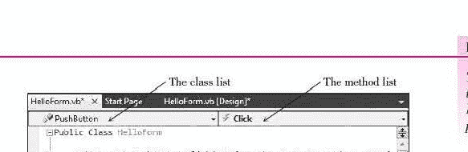

#### 步骤 2：输入注释

输入此注释语句：

> 显示 Hello World 消息。

请注意，编辑器会自动用绿色显示注释（除非你或其他人通过“环境”选项更改了颜色）。

遵循良好的规范，对`Private Sub`和`End Sub`之间的所有行进行缩进。智能编辑器会尝试帮助你遵循这一约定。此外，始终在子程序顶部的注释之后留一个空行。

#### 步骤 3：输入赋值语句

连续按两次回车键并输入此赋值语句：

`MessageLabel.Text = "Hello World"`

注意：当你输入对象和属性名称时，让 IntelliSense 帮助你。当你输入名称的第一个字符时（例如`"MessageLabel"`的`"M"`），IntelliSense 会弹出一个程序中可能的对象名称列表（图 1.33）。当有多个项目与首字母匹配时，你可以继续输入额外的字符直到匹配，或者使用键盘箭头键或鼠标高亮该字母。要接受正确的项目，可以在项目被高亮时点击它，按下应跟在该项目后的标点符号字符（如空格、逗号、等号、Tab 键或回车键），或者用鼠标双击该项目。例如，通过按下句号来接受`"MessageLabel"`，通过按下空格来接受`"Text"`，因为这些是紧跟在所选项目后的字符。

### 图 1.33

IntelliSense 弹出以帮助你。从列表中选择正确的项目，并按下句号、空格键或回车键以接受该文本。

```vbnet
Public Class HelloForm

    Private Sub PushButton_Click(ByVal sender As System.Object, ByVal e As EventArgs)
        Display the Hello World message.

        Dim MessageBox
        Dim MessageLabel
        ProcessMessageBox
        Common All
    End Sub
End Class
```

赋值语句`text = "Hello World"`将字面量`"Hello World"`分配给名为`MessageLabel`的控件的`Text`属性。请将你的结果与图 1.34 进行对比。

### 图 1.34

为`PushButton_Click`事件过程输入注释和赋值语句。

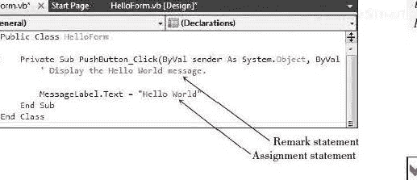

### 为退出按钮编写点击事件代码

#### 步骤 1：打开编辑器

双击退出按钮（`Exit button`），打开`ExitButton_Click`事件的编辑器。

#### 步骤 2：输入注释

输入此注释：

> 退出项目。

#### 步骤 3：输入语句

按两次回车键并输入此 Basic 语句：

```vbnet
Me.Close()
```

> 注意：你可以省略括号；智能编辑器会自动为你添加。

#### 步骤 4：检查代码

确保你的代码看起来像图 1.35 所示的代码。

> 提示：让编辑器和 IntelliSense 帮助你。如果 IntelliSense 列表没有弹出，你可能拼错了控件的名称。在输入对象名称时不要担心大小写；如果名称与定义的对象匹配，编辑器会自动修复大小写。

> 提示：通过输入输入条目后的标点符号或按下回车键来接受 IntelliSense 弹出列表中的输入。你也可以滚动列表并用鼠标选择。

### 图 1.35

星号表示未保存的更改

输入`EditButton.Click`事件过程的代码。注意窗口顶部出现了一个星号，表示文件中有未保存的更改。

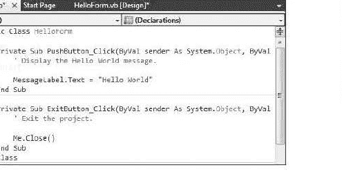

## 运行项目

在完成代码编写后，你就可以运行（执行）项目了。使用以下三种技术之一：

1. 打开“调试”菜单并选择“启动调试”。
2. 点击工具栏上的“启动调试”按钮。
3. 按`F5`，这是“启动调试”命令的快捷键。

### 启动项目运行

#### 步骤 1：启动项目

选择之前列出的方法之一启动你的项目（图 1.36）。

出现问题？请参阅本章节后面的“查找并修复错误”。你必须修正任何错误并重启程序。

如果一切顺利，Visual Studio 标题栏现在会显示你正在运行。

### 图 1.36

运行中应用程序的表单。

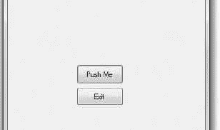

## 第 135 章

### 点击推送按钮

#### 步骤 1：测试推送按钮

点击推送按钮，你的`"Hello World"`消息出现在标签中（图 1.37）。

### 点击退出按钮

#### 步骤 1：测试退出按钮

点击退出按钮。你的项目将终止，并返回设计时间。

> 提示：如果你的工作消失了，请点击任务栏。

### 图 1.37

点击推送按钮，`"Hello World"`消息出现在标签中。

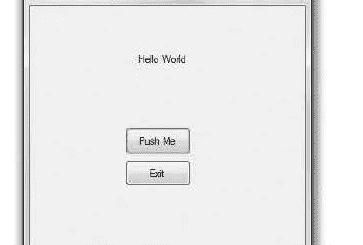

## 保存你的工作

当然，你必须频繁保存工作。除了像现在这样非常小的项目外，你通常会边做边保存。

## 保存文件

### 步骤 1：保存全部

打开 Visual Studio 的“文件”菜单并选择“保存全部”。这将保存当前表单、项目和解决方案文件。你在创建项目时已经选择了项目名称，但如果你愿意，也可以更改它。确保将位置设置为你想要存储的文件夹。按“浏览”以选择其他位置的位置。

保持勾选“创建解决方案的目录”框。这会导致 IDE 为解决方案创建一个新文件夹。

> 提示：点击“保存全部”按钮可以快速保存。

### 关闭项目

#### 步骤 1：关闭项目

打开“文件”菜单并选择“关闭项目”。如果你没有保存最后的更改，系统将提示你保存。

## 打开项目

现在是时候通过磁盘打开项目来测试你的保存操作了。你可以选择以下三种方式打开：

- 在 Visual Studio 的“文件”菜单中选择“打开项目”并找到你的文件。
- 从“最近项目和解决方案”项中选择项目。
- 从启动页选择项目。

### 打开项目文件

#### 步骤 1：打开项目

通过之前列出的方法之一打开你的项目。记住你打开的是解决方案（`.sln`）文件。如果你在屏幕上没有看到表单，请检查解决方案管理器——它应该会显示。选择你的表单图标：`HelloWorld.vb`。你可以双击图标，或者单击并点击解决方案顶部的“查看设计器”按钮（图 1.38）；你的表单将出现在设计器窗口。注意你还可以点击“查看代码”按钮在编辑器中显示你的表单。

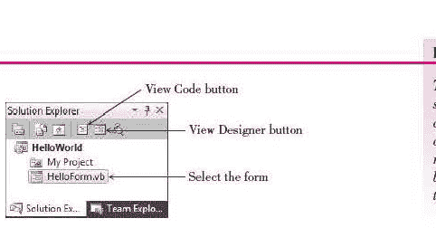

### 图 1.38

要显示表单布局，选择表单名称并点击“查看设计器”按钮，或者双击表单名称。点击“查看代码”按钮可以在编辑器中显示代码。

## 修改项目

现在是对项目做一些更改了。我们将更改消息的大小、显示两种语言的消息、添加一个打印按钮，并在表单上显示程序员名称。

### 修改消息的大小和对齐

右键点击表单显示右键菜单。如果你的控件当前被锁定，选择“锁定控件”以解锁控件以便进行更改。

# 第一章

### 步骤 2：选择 MessageLabel

在属性窗口中展开对象列表并选择`MessageLabel`，这将使该小标签显示为选中状态。

### 步骤 3：查看 Font 属性

滚动到属性窗口中的`Font`（字体）属性。`Font`属性实际上是一个`Font`对象，它具有许多属性。要查看`Font`属性，请点击左侧的小三角形（图 1.39）；`Font`属性将出现，并显示当前值（图 1.40）。

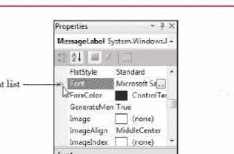

## 图 1.39

点击`Font`的三角形以查看`Font`对象的属性。

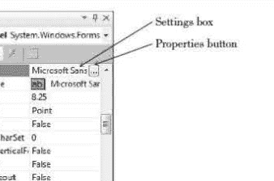

## 图 1.40

你可以更改`Font`对象的各个属性。

你可以在属性窗口中更改任何`Font`属性，例如设置字体的大小（`Size`）、**粗体**（`Bold`）或*斜体*（`Italic`）属性。你也可以显示字体对话框并在其中进行更改。

### 步骤 4：打开字体对话框

如果未出现（顶部带有省略号的）属性，点击`Font`属性。点击属性（`Properties`）按钮显示字体对话框（图 1.41）。如果可用，请选择 12 磅。（如果可用，请选择另一个比当前设置更大的数字）。点击`OK`关闭字体对话框。

## 图 1.41

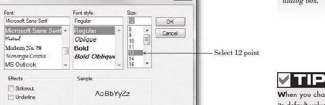

在字体对话框中选择 12 点。

选择 12 点

> 提示：当你将属性从其默认值更改时，该属性名称将以**粗体**显示；你可以向下扫描属性列表，轻松识别出已与默认值不同的属性。

### 步骤 5：设置 TextAlign 属性

选择`MessageLabel`的`TextAlign`（对齐方式）属性，带有向下的箭头表示这是一个下拉选择列表。展开列表（图 1.42）并选择中间框：对齐属性将更改为`MiddleCenter`（居中对）。

## 图 1.42

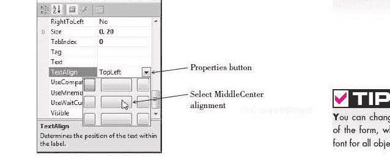

为`TextAlign`属性选择中间框。

属性按钮

选择`MiddleCenter`对齐

> 提示：你可以更改表单的`Font`属性，这将设置表单上所有对象的默认字体。

## 为你的名字添加新标签

### 步骤 1：创建新标签

点击工具箱中的`Label`（标签）工具，在表单底部创建一个新标签（图 1.43）。如有需要可以调整表单大小，但必须先解锁控件。

# 第一章

39

## 图 1.43

在表单底部为你的名字添加新标签。

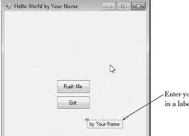

### 步骤 2：更改 Text 属性

将标签的`Text`（文本）属性更改为“你的名字”（使用你的名字并省略引号）。

注意：你不需要更改此标签的名称，因为它在代码中永远不会被引用。

## 修改“Push Me”按钮的位置和文本

由于我们计划用两种语言之一显示消息，我们将`Push Me`按钮上的文本更改为“English”，并移动按钮为第二个按钮留出空间。

### 步骤 1：更改按钮文本

选择`Push Me`按钮并将`Text`属性更改为`English`。

### 步骤 2：移动按钮

将`English`按钮向左移动，为`Spanish`按钮留位置（见图 1.44）。注意：如果你无法移动按钮，请检查键菜单中的`Lock Controls`（锁定控件）设置。

## 图 1.44

将`English`按钮向左移动并添加一个`Spanish`按钮。

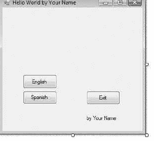

## 添加 Spanish 按钮

### 步骤 1：添加新按钮

添加新按钮。根据图 1.44 需要移动并调整按钮大小。

### 步骤 2：更改 Name 属性

将新按钮的属性更改为`Spanish`。

### 步骤 3：更改 Text 属性

将新按钮的文本更改为`Spanish`。


# 为 Spanish 按钮添加事件过程

第 1 步：双击 `Spanish` 按钮以打开 `SpanishButton_Click` 的编辑器。

第 2 步：添加注释：

```
Display the World message in Spanish.
```

第 3 步：按回车键并编写以下代码行：

```
MessageLabel.Text = "Hola Mundo";
```

第 4 步：返回设计视图。

# 添加打印按钮

第 1 步：添加另一个按钮并将其命名为 `PrintButton`。

第 2 步：将按钮属性更改为“Print”。

第 3 步：根据需要移动并调整按钮大小。

# 添加 PrintForm 组件

Visual Basic 2010 包含一个 `PrintForm` 组件来格式化表单，但它不是像你已添加的控件那样的可见元素。测试程序时，你可以选择将输出发送打印机或 Print 窗口。

第 1 步：滚动到工具箱底部，找到 `PrintForm` 的页头。

第 2 步：双击三角形打开 `PrintForm`。

第 3 步：在测试程序时，你可以选择将输出发送打印机或 Print 窗口。

（此处重复文本）

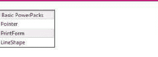

图 1.46

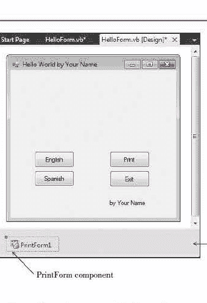

第 1 步：滚动到工具箱底部，找到 `PrintForm` 的页头。

第 2 步：双击三角形打开 `PrintForm`。

第 3 步：在测试程序时，你可以选择将输出发送打印机或 Print 窗口。

图 1.46

# 第一章

## 探索编辑器窗口

第 1 步：注意编辑器窗口顶部的两个下拉列表，称为类名列表（Class Name list）和方法名列表（Method Name list）。你可以使用这些列表跳转到代码中的任何过程。

第 2 步：点击左侧的箭头查看类名列表。注意表单中的每个对象都列在其中（图 1.40）。在列表顶部，你可以看到你的表单名称：`HelloForm`。

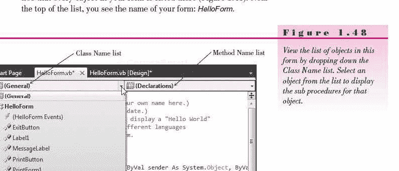

第 3 步：从类名列表中选择 `SpanishButton`。光标跳转到 `SpanishButton_Click` 事件过程的第一行。

第 4 步：展开方法名列表（右侧的列表）；它显示了按钮控件的所有可能事件。注意 `Click` 事件是粗体的，而其他的不是。任何你编写了事件过程的事件都会以加粗形式显示。

要为一个对象的多个事件编写代码，你可以可以使用方法名下拉列表。当你从方法名列表中选择一个事件时，编辑器会生成该过程的 `Private Sub` 和 `End` 行，并将光标移动到新过程。

## 完成工作

第 1 步：保存项目。

## 打印代码

## 选择打印选项

第 1 步：确保编辑器窗口已打开并显示你的表单代码。除非显示了代码并选择了该窗口，否则 IDE 的文件/打印命令将无法用。

> 注意：如果文件/打印命令不可用，请点击编辑器窗口中的一个插入点。

第 2 步：打开“文件”菜单并选择“打印”。

## 示例输出

当打印表单代码时会生成此输出。注意打印输出中用于延续长行的符号。在屏幕上，这些长行不会被分割，而是会超出右侧边界。

```
C:\Users\...HelloForm.vb
'Project': Hello World
Your Name
'Programmer': Today
'Date': Date
'Description': This project will display a "Hello World"
message in two different languages and print the form.

Public Class HelloForm
Private Sub PushButton_Click(ByVal sender As System.Object, ByVal e As System.EventArgs) Handles PushButton.Click
    Display the Hello World Message.
    MessageLabel.Text = "Hello World"
End Sub
Private Sub ExitButton_Click(ByVal sender As System.Object, ByVal e As System.EventArgs) Handles ExitButton.Click
    Exit the project.
    Me.Close()
End Sub
Private Sub SpanishButton_Click(ByVal sender As System.Object, ByVal e As System.EventArgs) Handles SpanishButton.Click
    Display the Hello World message in Spanish.
    MessageLabel.Text = "Hola Mundo"
End Sub
Private Sub PrintButton_Click(ByVal sender As System.Object, ByVal e As System.EventArgs) Handles PrintButton.Click
    Print the form.
PrintForm1.PrintAction = Printing.PrintAction.PrintToPreview
PrintForm1.Print()
End Sub
End Class
```

## 查找与修复错误

在输入第一个示例项目时，你可能会看到错误。编程错误有三种：语法错误、运行时错误和逻辑错误。

## 语法错误

当你违反 VB 的解析、格式或拼写规则时，就会产生语法错误。幸运的是，智能编辑器可以找到语法错误，甚至能修正许多错误。编辑器无法识别的语法错误将在编译器将代码转换为中间机器语言时进行报告并修正。编译器报告的语法错误可能被称为编译错误。

编辑器可以通过做出假设来修正某些语法错误，甚至不向你报告这些错误。例如，字符串序列必须有开启和结束引号，例如 `"Hello World"`。如果你输入了开启引号但忘记结束引号，编辑器会在你移动到下一行时自动添加结束引号。如果你在方法名后忘记开启和结束括号（例如 `CLOSE()`），编辑器同样会在你离开该行时为你添加它们。当然，编辑器可能会做出错误的假设，但你会留意观察的；

当你离开错误行时，编辑器会识别出语法错误。在编辑器无法解释的部分下方会出现一条波浪线。你可以将鼠标指针悬停在错误上来查看错误，此时会弹出一个描述错误的框（图 1.49）。你还可以显示“错误列表”（视图 / 错误列表），它会出现在窗口底部，显示所有错误消息以及导致这些错误的语句的行号。你可以通过“工具 / 选项”在源代码上显示这些数字（图 1.50）。如果在选项对话框中勾选了“显示所有错误”，请选择“文本编辑器 / 检查行号”；如果没有勾选“显示所有错误”，则选择“文本编辑器 / 基础 / 检查行号”。

跳转到错误的最快方法是指向错误列表窗口中的消息并双击。编辑器窗口会选中该行，并可能会弹出一个建议修正列表。

随着你开始使用新关键字，在后面的章节中更有可能发生错误。在第 3 章中，你学习了声明可以使用名为 `Decimal` 数据类型的元素。如果你不小心输入了单词 `Decimall`，单词末尾会出现一条小红线，指向正确的拼写。图 1.51 显示了自动更正的功能。

（注：OCR 文本在后半部分存在大量重复。我已经根据“语法错误”和“运行时错误”部分清理了重复内容，保持了文档逻辑。）

*根据提供的内容修正实际逻辑：*

在输入第一个示例项目时，你可能会看到一些错误。编程错误分为：语法错误、运行时错误和逻辑错误。

## 语法错误

当你违反 VB 的解析、格式或拼写规则时，就会产生语法错误。坦率地说，智能编辑器可以找到语法错误，甚至修正其中许多错误。编辑器无法识别的语法错误将在编译器将代码转换为中间机器语言时进行报告并修正。编译器报告的语法错误可能被称为编译错误。

编辑器可以通过做出假设来修正某些语法错误，甚至不向你报告这些错误。例如，字符串序列必须有开启和结束引号，例如 `"Hello World"`。如果你输入了开启引号但忘记结束引号，编辑器会在你移动到下一行时自动添加结束引号。如果你在方法名后忘记开启和结束括号（例如 `CLOSE()`），编辑器同样会在你离开该行时为你添加它们。当然，编辑器可能会做出错误的假设，但你会留意观察的；

当你离开错误行时，编辑器会识别出语法错误。在编辑器无法解释的部分下方会出现一条波浪线。你可以将鼠标指针悬停在错误上来查看错误，此时会弹出一个描述错误的框（图 1.49）。你还可以显示“错误列表”（视图 / 错误列表），它会出现在窗口底部，显示所有错误消息以及导致这些错误的语句的行号。你可以通过“工具 / 选项”在源代码上显示这些数字（图 1.50）。如果在选项对话框中勾选了“显示所有错误”，请选择“文本编辑器 / 检查行号”；如果没有勾选“显示所有错误”，则选择“文本编辑器 / 基础 / 检查行号”。

跳转到错误的最快方法是指向错误列表窗口中的消息并双击。编辑器窗口会选中该行，并可能会弹出一个建议修正列表。

随着你开始使用新关键字，在后面的章节中更有可能发生错误。在第 3 章中，你学习了声明可以使用名为 `Decimal` 数据类型的元素。如果你不小心输入了单词 `Decimall`，单词末尾会出现一条小红线，指向正确的拼写。图 1.51 显示了自动更正的功能。

## 运行时错误

如果项目在执行过程中停止，被称为运行时错误或异常。Visual Basic 会显示一个对话框并高亮语句。

无法执行的语句会导致运行时错误。这些语句格式正确并通过了语法检查；但由于某些问题无法执行。你可以尝试进行可能的算术运算（例如对数值进行计算、除以零或求负数的平方根）会导致运行时错误。

在第 3 章中，你将学习捕获异常，这样当发生错误时程序就不会停止。

## 逻辑错误

当你的程序包含逻辑错误时，程序会运行但产生错误的结果。也许计算结果是错误的，或者文本显示在错误的位置。

初学者经常忽略逻辑错误。如果项目运行了，它必须是正确的！

## 洁编译

当你执行程序时，第一步是编译，这意味着 VB 语句被转换为微软中间语言 (MSIL)。你的目标是在编译过程中没有错误：即实现“洁编译”。图 1.53 显示了洁编译状态下的错误列表窗口：

0 错误；0 警告；0 消息。

> 如果你收到“存在生成错误。继续吗？”的消息，请始终选择“否”。如果你说“是”，运行的是上一次编译的版本，而不是当前版本。

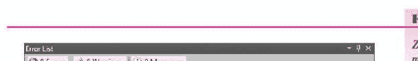

图 1.53

| 描述 | 行 | 列 | 项目 |

| --- | --- | --- | --- |

| 0 错误 | 0 警告 | 0 消息 | |

# 对象的命名规则和规范

为对象使用一致名称可以使项目更容易阅读和理解，并且更容易调试。你必须遵循 Visual Basic 关于对象、过程和变量的命名规则。此外，尽职的程序员还会遵循命名规范。

大多数专业编程公司都有程序员使用的一套标准。这些标准可能与你在书中找到的标准不同，但最重要的一点是：优秀的程序员遵循标准。你应该拥有一套标准并始终遵循它们。

## 命名规则

当你为对象选择名称时，Visual Basic 要求名称必须以字母或下划线开头。名称可以包含字母、数字和下划线。对象名称不能包含空格或标点符号，且不能是保留字（例如 `Button` 或 `Close`），但可以包含这些字符。例如，`ExitButton` 和 `CloseButton` 是合法的。

## 命名规范

本文遵循标准的命名规范，这有助于让项目更易于理解。在命名控件时，使用帕斯卡大命名法（Pascal casing），这意味着你用大写字母开头名称，并将名称中的每个后续单词的首字母大写。编写一个有意义的名称，并加上控件类的全称。除非是每个人都能理解的常用术语，否则不要使用缩写。所有名称都必须是有意义的并指示对象的目的。

## 示例

- `MessageLabel`

- `ExitButton`

- `DataEntryForm`

- `DiscountRateLabel`

# 第一章

不要保留 Visual Basic 分配的默认名称，如 `Button` 和 `Label3`。同样，不要用数字为你的对象命名。此规则的例外适用于项目执行期间永远不会改变的标签或控件。标签通常持有标题、说明和其他控件的标签等项目。让这些标签保留默认名称是完全可以接受的，并且本文也采用了这种做法。

请参考表 1.2 的示例对象名称。

Visual Basic 对象的推荐命名规范

| 对象类 | 示例 |

| --- | --- |

| Form | `DataEntryForm` |

| Button | `ExitButton` |

| Label | `TotalLabel` |

| TextBox | `PaymentAmountTextBox` |

| 单选按钮 | `BoldRadioButton` |

| 复选框 | `PrintSummaryCheckBox` |

| 水平滚动条 | `RateHorizontalScrollBar` |

| 垂直滚动条 | `TemperatureVerticalScrollBar` |

| 图片框 | `LandscapePictureBox` |

| 下拉框 | `BookNameCombo` |

| 列表框 | `IngredientsListBox` |

| 播放器 | `IntroPageSoundPlayer` |


# Visual Studio 帮助

Visual Studio 2010 有一个全新的帮助系统，称为“帮助查看器”（Help Viewer）。帮助查看器不是在 Visual Studio IDE 中显示帮助主题，而是使用本地计算机上的默认浏览器在单独的窗口中显示其内容。你可以在任何浏览器（如 Firefox、Chrome 或 Internet Explorer）中显示帮助。

新帮助系统的一个优势是微软可以保持其实时更新。

## 为你的计算机设置帮助

你可以设置帮助来离线（本地）存储和显示主题，或使用微软的在线资源，称为微软开发人员网络库 (MSDN)。当然，要显示在线内容，你必须连接到互联网。

## 50 VISUAL BASIC 介绍 Visual Basic 2010


在你安装 Visual Studio 时，你需要选择在线或本地内容。但稍后可以使用帮助库管理器轻松更改选择。选择“帮助/管理设置”来显示帮助库管理器（图 1.54）。点击第一个链接“选择在线或本地帮助”进入该部分（图 1.54b）。如果你选择本地，可以指定你想存储帮助文件的地方；你还可以检查本地内容的更新。

- a. 选择“帮助/管理设置”以打开帮助库管理器；b. 对在线或本地帮助进行选择。对于本地帮助，你可以指定存储文件的位置。

**图 1.54**

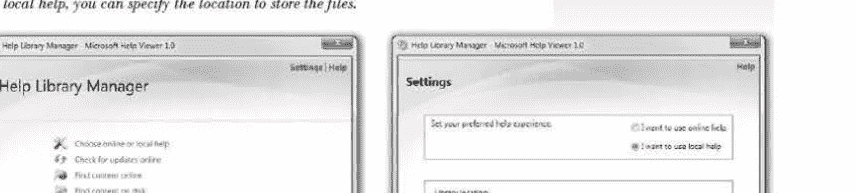

(a) (b)

## 查看帮助主题

帮助窗口（图 1.55）显示目录 (TOC)，它显示当前主题（在其父级主题下方缩进）以及其进一步缩进的子主题列表，你可以看到主题的层级结构。你可以点击目录中的任何链接来查看其他主题。图 1.56 显示了 `Label` 类页面下的下一级主题。

使用目录上方的搜索框搜索特定主题。你可以搜索多单词词组，并使用 `AND`、`OR` 和 `NOT`。

如果你想查看关于 Visual Studio IDE 的帮助主题，请选择一个元素（例如属性窗口）并按下 `Shift-F1`。

**图 1.55**

帮助查看器在默认浏览器中显示。从左侧的目录选择主题，或在目录上方的搜索框中输入术语。右侧是内容面板。

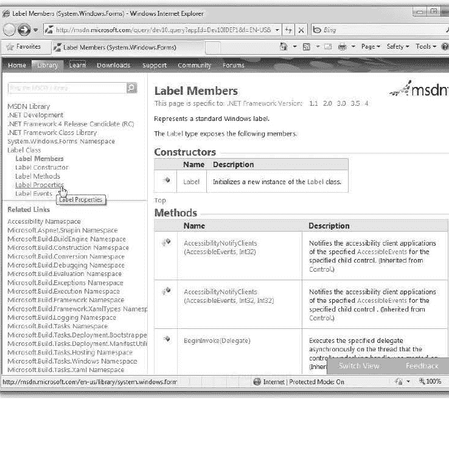

**图 1.56**

通过在目录中选择 `Label`，显示控件的属性并对每个属性进行解释。

| 名称 | 描述 |
| --- | --- |
| `Name` | 分配给控件的对象（继承自 `Control`） |
| `AccessibleAction` | 获取或设置用于应用程序的操作描述 |
| `AccessibleDescription` | 获取或设置用于应用程序的描述 |
| `AccessibleName` | 获取或设置用于应用程序的名称 |
| `AccessibleRole` | 获取或设置控件的角色 |

## 属性

### 管理窗口

有时你打开的窗口比你需要的多。你可以隐藏或关闭任何窗口，也可以切换到不同的窗口。

- 要关闭标签页中的窗口，请点击窗口的关闭按钮。只有选中的窗口会关闭。
- 要切换到标签页中的另一个窗口，请点击其标签。

有关环境的额外帮助，请参附录 C，“掌握 Visual Studio 环境的技巧和快捷键”。

## 反馈 1.1

答案见附录 A。

1. 显示并检查 `Button` 控件的属性列表。
2. 显示 `Hello World` 项目的编辑器窗口。点击 `Close` 方法放置插入点。按下 `F1` 键查看上下文相关帮助。

## 动手编程示例

编写一个用于 For Reading and Refreshment 的程序来显示当前的促销活动。包括显示当前优惠和促销代码的标签，以及针对以下部门的按钮：书籍、音乐、期刊和咖啡吧。

用户界面还应该有 `Print` 和 `Exit` 按钮，以及带有程序员名称的标签。将表单命名为 `MainForm`，并在标题栏中放置 "For Reading and Refreshment"。

`Print` 按钮应在打印预览窗口中显示表单。

### 项目规划

绘制一个表单（图 1.57），让你的用户签署满足他们的需求。注意：尽管这一步看起来没必要，但让用户签署是标准的编程做法，并记录了用户已经参与并批准了设计。

**动手编程示例的表单规划草图。**

**规划对象和属性。** 规划表单以及每个控件的属性设置。

| 对象 | 属性 |
| --- | --- |
| `MainForm` | `Name`: `MainForm` |
| | `Text`: R's B - For Reading and Refreshment |
| | `StartPosition`: `CenterScreen` |
| `BooksButton` | `Name`: `BooksButton` |
| | `Text`: Books |
| `MusicButton` | `Name`: `MusicButton` |
| | `Text`: Music |
| `PeriodicalsButton` | `Name`: `PeriodicalsButton` |
| | `Text`: Periodicals |
| `CoffeeBarButton` | `Name`: `CoffeeBarButton` |
| | `Text`: Coffee Bar |
| `PrintButton` | `Name`: `PrintButton` |
| | `Text`: Print |
| `ExitButton` | `Name`: `ExitButton` |
| | `Text`: Exit |
| `Label1` | `Name`: Current Promotion |
| `Label2` | `Name`: Promotion Code |
| `Label3` | `Name`: Programmed by Your Name |
| `PromotionLabel` | `Name`: `AutoSize` |
| | `BorderStyle`: `FixedSingle` (blank) |
| | `TextAlign`: `MiddleLeft` |
| `PromotionCodeLabel` | `Name`: `AutoSize` |
| | `BorderStyle`: `FixedSingle` (blank) |
| | `TextAlign`: `MiddleLeft` |
| `PrintForm1` | `Name`: `PrintForm1` |

**规划事件过程。** 你需要为每个按钮编写事件过程。用伪代码编写动作，伪代码是“像代码”的英语。

| 过程 | 动作 |
| --- | --- |
| `BooksButton_Click` | 显示“Buy two, get the second one for half price”和代码 `B005`。 |
| `MusicButton_Click` | 显示“Get a free MP3 download with purchase of a CD”和代码 `M006`。 |
| `PeriodicalsButton_Click` | 显示“Elite members receive 10% off every purchase”和代码 `P006`。 |
| `ButtonBar_Click` | 显示“Celebrate the season with 20% off special drinks”和代码 `C608`。 |
| `PrintButton_Click` | 将打印动作设置为打印预览。 |
| `ExitButton_Click` | 结束项目。 |

**编写项目。** 按照图 1.57 中的设计草图创建表单。图 1.58 显示了完成后的表单。

- 按照你的计划设置每个对象的属性。
- 根据伪代码编写每个事件过程。
- 完成代码后，对项目进行彻底测试。

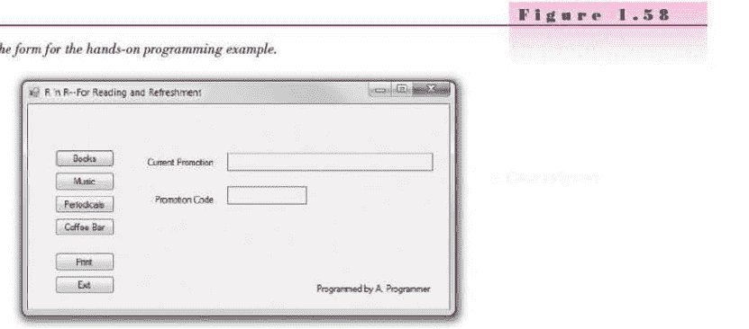

**该用于实操编程示例的表单。**

### 项目代码解决方案

```vbnet
'Project: Ch01HandsOn
'Programmer: Bradley/Millspaugh
'Date: 2010年6月
'Description: 此项目显示每个部门的当前促销活动。

Public Class MainForm

    Private Sub BooksButton.Click(ByVal sender As System.Object,
        ByVal e As System.EventArgs) Handles BooksButton.Click
        ' 显示书籍当前促销活动。
        PromotionLabel.Text = "Buy two, get the second one for half price."
        PromotionCodeLabel.Text = "B608"
    End Sub

    Private Sub MusicButton_Click(ByVal sender As System.Object,
        ByVal e As System.EventArgs) Handles MusicButton.Click
        ' 显示音乐当前促销活动。
        PromotionLabel.Text = "Get a free MP3 download with purchase of a CD."
        PromotionCodeLabel.Text = "MP60"
    End Sub

    Private Sub PeriodicalsButton_Click(ByVal sender As System.Object,
        ByVal e As System.EventArgs) Handles PeriodicalsButton.Click
        ' 显示期刊杂志当前促销活动。
        PromotionLabel.Text = "Elite members receive 10% off every purchase."
        PromotionCodeLabel.Text = "P609"
    End Sub

    Private Sub CoffeeButton_Click(ByVal sender As System.Object,
        ByVal e As System.EventArgs) Handles CoffeeButton.Click
        ' 显示咖啡当前促销活动。
        PromotionLabel.Text = "Celebrate the season with 20% off specialty drinks."
        PromotionCodeLabel.Text = "C608"
    End Sub

    Private Sub PrintButton_Click(ByVal sender As System.Object,
        ByVal e As System.EventArgs) Handles PrintButton.Click
        ' 打印表单。
        PrintForm1.PrintAction = Printing.PrintPreview
        PrintForm1.Print()
    End Sub

    Private Sub ExitButton_Click(ByVal sender As System.Object,
        ByVal e As System.EventArgs) Handles ExitButton.Click
        ' 结束程序。
        Me.Close()
    End Sub

End Class
```

## 总结

1. Visual Basic 是一种面向对象的语言，用于编写在 Windows 中运行的应用程序。
2. 在面向对象模型中，类用于创建创建对象。
3. .NET 框架将代码编译为中间语言 (MSIL)，并运行在公共语言运行时 (CLR) 中。
4. Visual Basic 2010 版本包括快速版（Express）、专业版（Professional）和旗舰版（Ultimate）。
5. 规划项目时，首先画出用户界面，然后规划属性。
6. 创建 Visual Basic 项目的三个步骤是：1) 定义用户界面；2) 设置属性；3) 编写代码。
7. 一个解决方案可以包含多个项目。
8. 开发环境 (IDE) 包含表单设计器、调试器、工具箱等。
9. 设置控件的属性可以自定义表单。
10. 遵循命名规范可以使项目更易维护。
11. Visual Basic 有设计时间、运行时间和调试时间。
12. 属性决定了表单上显示的内容。
13. 过程以 `Sub` 开始，以 `End Sub` 结束。
14. 代码中的注释用于说明。
15. 赋值语句将值赋予属性。
16. `Me.Close()` 终止程序。
17. 按钮通过事件过程响应用户。
18. Visual Basic 会发生三种错误：语法错误（违反语法规则）、运行时错误（无法正常执行）和逻辑错误（产生错误结果）。
19. 查找并修复错误被称为调试。
20. 解决方案可以帮助项目正常运行。
21. 解决方案文件名为 `.sln`。
22. 帮助可以搜索所有主题。

## 关键术语

- 赋值语句
- 自动调整
- 按钮
- 类
- 代码
- 组件
- 上下文帮助
- 控件
- 声明
- 调试
- 设计时间
- 调试器
- 事件
- 事件过程
- 表达式
- 表单设计器
- 图形用户界面 (GUI)
- 处理
- 开发环境 (IDE)
- 标签
- 逻辑错误
- 方法
- 命名空间
- 对象
- 面向对象编程 (OOP)
- 驼峰命名
- 打印表
- 过程
- 专业版
- 属性窗口
- 属性
- 伪代码
- 注释
- 调整
- 运行时间
- 运行时错误
- 解决方案
- 解决方案管理器
- 解决方案文件
- `Sub` 过程
- 语法错误
- `Text` 属性
- 工具箱
- 旗舰版
- 用户界面
- Visual Studio 环境

## 复习题

1. 什么是对象和属性？它们之间有什么联系？
2. 创建 Visual Basic 项目的三个步骤是什么？请描述每个步骤中做了什么。
3. 这些 Visual Basic 文件类型（`.cls`, `.osu`, `.vb`）用途是什么？
4. Visual Basic 在设计时间、运行时间和调试时间分别位于？
5. 控件 `Name` 属性的用途是什么？
6. 什么是决定了 `Label` 控件在表单上显示什么内容？
7. 按钮 `Text` 属性的用途是什么？表单 `Text` 属性的用途是什么？
8. `PashButton_Click` 指什么？`PashButton` 指什么？`Click` 指什么？
9. 什么是 Visual Basic 事件？列举一些例子。
10. 哪个属性必须设置以使文本居中？该属性的值应该是？
11. 文件的声明部分（Declarations section）是什么？那里包含什么内容？
12. 调试（debugging）一词什么意思？
13. 什么是语法错误（syntax error）？它什么时候发生？什么可能导致它？
14. 什么是运行时错误（run-time error）？它什么时候发生？什么可能导致它？
15. 什么是逻辑错误（logic error）？它什么时候发生？什么可能导致它？
16. 说明以下每个对象名称类别及其可能的用途：
    - `AddressLabel`
    - `ExitButton`
    - `NameTextBox`
    - `TextBoxRadioButton`
17. 上下文帮助（context-sensitive Help）是什么意思？你如何使用它查看按钮对应的页面？

## 编程练习

**1.1** 在你的第一个 Visual Basic 练习中，你必须先完成 `Hello World` 项目。添加按钮和事件过程，用另外两种语言显示“Hello World”消息。你可以用任何其他语言替换显示的语言。可以根据自己（或你的老师）的修改用户界面。

确保为按钮使用有意义的名称，遵循表 1.2 中的命名规范。在每个过程的顶部和文件的顶部包含注释：

| 法语版 Hello World: | Bonjour tout le monde |
| --- | --- |
| 意大利语版 Hello World: | Ciao Mondo |

**1.2** 编写一个新的 Visual Basic 项目显示不同的问候语，或者将其设置为你的学校或公司的名称。至少包含三个按钮来显示问候、打印和退出项目。

在表单底部包含一个带有你名字标签，并将表单的 `Text` 属性更改为有意义的内容。

遵循良好的命名规范；在每个过程的顶部和文件的顶部包含注释。

为问候语选择不同的字体和字号。如果你愿意，还可以为字体选择不同的颜色。从属性窗口的字体对话框（Font Dialog box）中选择每个字体属性。

**1.3** 编写一个显示四句格言的项目，例如“早起的鸟有虫吃”和“省一分就是赚一分”。保持格言短（因为每句必须在一行输入）。当格言显示在你的表单上时，如果标签的 `Auto` 属性设置为 `True`，长行将溢出。要在标签内换行，请更改 `AutoSize` 并使用调整句柄使标签足够大。

为每个格言创建一个按钮，并各带一个描述性的 `Text` 属性，一个打印按钮和一个退出项目的按钮。

在表单底部包含一个带有你名字的标签。还要确保将表单的标题栏更改为有意义的内容。


你可以将大标签的 `Font` 属性更改为你选择的字体和大小。

确保按钮足够大以容纳整个 `Text` 属性。

遵循对象名称的命名规范；在每个过程的顶部和文件的顶部包含注释。

**1.4** 编写一个显示联系信息的项目。包含联系人、部门和电话的标签。当用户点击其中一个按钮时，在相应的标签中显示联系信息。包含一个打印按钮和一个退出按钮。

在表单底部包含一个带有你名字的标签，并将表单的标题栏更改为有意义的内容。

你可以将标签的 `Font` 属性更改为你选择的字体和大小。

遵循对象名称的命名规范；在每个过程的顶部和文件的顶部包含注释。

**1.5** 创建一个项目显示“你的”餐厅的每日特菜。为你的餐厅起一个名字并将其显示在表单顶部的标签中。添加一个标签根据点击的按钮显示相应的特菜。按钮应该是：

- 每日汤品
- 主厨特供
- 每日鱼

还包括一个打印按钮和一个退出按钮。

示例数据：Dorothy's Diner 提供玉米汤、加州凯比沙拉和榛果裹皮鳟鱼。

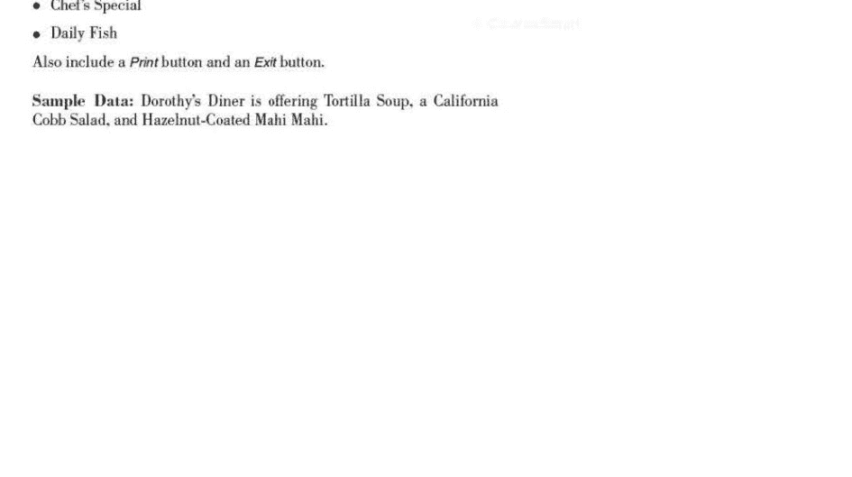

## 案例研究

### 繁忙的 VB 邮件订单

如果你没有时间，公司需要一个系统来跟踪他们的邮件订单。该系统应允许员工输入客户信息、订单详情和支付状态。系统还应生成销售和库存水平的报告。


用户界面应该是用户友好且易于导航的。使用清晰的标签和按钮引导用户完成过程。数据应存储在数据库中以确保一致易检索。

系统必须能够处理大量订单并提供库存的实时更新。这对于维护客户满意度和避免缺货至关重要。

- 客户 ID: 111
- 订单日期: 222
- 总金额: 333

将数量转换为数值变量。

```
Integer.Parse(QuantityText)
```

# 2

```
DiscountDecimal = Decimal.Round((ExtendedDiscountPrice))
ExtendedPriceDecimal = ExtendedPrice.Value
QuantitySumInteger += QuantityInteger
SumDecimal += DiscountDecimal
DiscountedPriceSum += DiscountedPrice
SaleDiscountInteger += 1
AverageDiscount = DiscountSum
```

## 用户界面设计

完成本章后，你将能够 . . .

1. 有效使用文本框、掩码框、富文本框、组框、复选框、单选按钮、图片框以及线条和形状控件。
2. 设置 `BorderStyle` 属性使控件呈现扁平化或三维效果。
3. 选择多个控件并对其进行移动、对齐和设置公共属性。
4. 通过定义访问键、设置“接受”和“取消”按钮、控制制表顺序、在程序执行期间重置焦点以及显示工具提示（ToolTips），使项目易于用户理解和操作。
5. 清空文本框和标签的内容。
6. 通过设置 `Visible` 属性在运行时使控件可见或不可见。
7. 在设计时和运行时禁用或启用控件。
8. 在程序执行期间更改文本颜色。
9. 使用 `With` 和 `End With` 语句为一个控件编写多条语句。
10. 拼接（连接）文本字符串。
11. 使用隐式延续或显式换行符继续长程序行。

## 介绍更多控件

在第一章中，你学习了使用标签和按钮。在本章中，你将学习使用多种控件：文本框、组框、复选框、单选按钮、图片框以及线条和形状控件。图2.1显示了包含常用控件（Common Controls）、容器（Containers）的工具箱，图2.2显示了表单上的某些控件。

每类控件都有自己的一套属性。要查看任何控件属性的完整列表，你可以 (1) 将控件放置于表单上并在“属性”窗口中检查属性，或 (2) 点击控件或按 F1 获取与上下文相关的帮助。Visual Studio 将显示该控件的帮助页面，你可以查看属性列表及其用途说明。图2.1显示了打开了三个标签页的工具箱，展示了本章涵盖的新控件。点击标签页可以打开和关闭每个部分。


## 图 2.2 此表单使用了标签、文本框、复选框、单选按钮、组框和图片框。


## 文本框

当你希望用户输入某些内容时，请使用文本框控件。图2.2 中的表单有两个框。用户可以从一个框移动到另一个框，根据需要进行复制和粘贴，并在完成后点击“显示”。在你的程序代码中，可以使用每个文本框的 `Text` 属性。

示例

```
NameLabel.Text = TextBox.Text
```

在此示例中，用户在文本框中输入的任何内容都会赋值给 `NameLabel` 的 `Text` 属性。如果你想在程序执行期间在文本框中显示某些文本，将字面量赋值给 `Text` 属性：

```
MessageBox.Text = "Welcome, come here."
```

你可以设置文本框的 `TextAlign` 属性来更改框内文本的对齐方式。在“属性”窗口中，将属性设置为 `Left`（左）、`Right`（右）或 `Center`（居中）。在代码中，你可以使用这些值设置属性：

```
MessageBox.TextAlign = Alignment.Left
```

文本框示例名称

- `TitleTextBox`
- `CompanyTextBox`

## 掩码文本框

`MaskedTextBox` 是 `TextBox` 控件的一种特殊形式。你可以指定用户所需的数据格式（`Mask` 属性）。例如，你可以为邮政编码、日期、电话号码或社会安全码选择掩码。图2.3 显示了输入掩码（Input Mask）对话框，你可以在其中选择掩码并尝试。运行时，用户无法输入不符合掩码的字符。例如，电话号码和社会安全码掩码不允许输入数字以外的字符。

掩码文本框示例名称

- `DateMaskedTextBox`
- `PhoneMaskedTextBox`

注意：对于日期或时间掩码，用户只能输入数字，但可能会输入无效值；例如，大于 12 的月份。掩码会接受任何数字，这可能导致你的程序产生运行时错误。你将在第 4 章中学习检查输入值。

# 图 2.3 为输入掩码对话框选择格式，它为 `MaskedTextBox` 控件提供 `Mask` 属性。


# 富文本框

文本框的另一种类型是 `RichTextBox` 控件，提供了多种格式化功能（图2.4）。在普通文本框中，所有文本的格式都相同，但在富文本框中，用户可以对选择的内容应用字符和段落格式，这使其像使用文字处理器一样。

富文本框的常见用途是显示 URL 地址。在普通文本框中，地址以默认字体颜色显示，但当 `RichText` 属性设置为 `True` 时，富文本框会将其作为链接显示。注意，它不是一个活动链接，但它没有将 URL 显示为地址的格式。

你可以从文件向富文本框加载格式。使用 `LoadFile` 方法从存储的富文本格式（rtf）文件加载格式。

```
SampleRichTextBox.LoadFile("Rich Text Boxes.rtf")
```

# 图 2.4 使用 `RichTextBox` 控件，你可以对选择文本应用字体、显示 URL 并从 rtf 文件显示文本。


# 在多行显示文本

普通文本框和富文本框都具有允许多行显示文本的属性。`WordWrap` 属性决定内容在无法单行显示时是否换行到第二行。该属性默认设置为 `True`。两个控件都有 `Multiline` 属性，默认设置为 `False`。对于普通文本框，你必须将 `Multiline` 设置为 `True`，然后调整高度以适应多行。如果 `Multiline` 为 `False`（默认值），文本框没有垂直缩放手。注意，即使 `Multiline` 为 `True`，文本框也不会自动调整大小；你必须使高度足够以显示这些行。

你可以为多行文本框（或富文本框）的 `Text` 属性设置值；该值将根据框的宽度进行换行。你也可以输入多行，取决于你在设计时还是代码中设置 `Text` 属性。设计时，在“属性”窗口中点击 `Text` 属性并点击属性按钮（向下箭头）；会弹出一个小型编辑窗口，指示在每行末尾按 Ctrl + Enter 接受文本（图 2.5）。在代码中，你可以在文本字符串中使用换行符（`Environment.NewLine`）来断行。

```
TitleRichTextBox.Text = "Pamper Yourself" & Environment.NewLine & "All Your Favorite Boxes"
```

# 图 2.5 点击 `Text` 属性的属性按钮会弹出一个小型编辑框。要输入多行文本，请在每行末尾按 Ctrl + Enter 接受文本。


## 组框

`GroupBox` 控件用作控件的容器。通常，一组单选按钮或复选框被放置在组框中。使用框分组控件可以通过将控件分为逻辑组来使你的表单更易于理解。

设置组框的 `Text` 属性以显示你希望在框边缘显示的文字。

组框示例名称

- `GroupBox`
- `StyleGroupBox`

## 第二章

## 69

### 复选框 (Check Boxes)

复选框允许用户选择（或取消选择）某个选项。在任何一组复选框中，都可以选择任意数量的项目。复选框的 `Checked` 属性在未勾选时设置为 `False`，在勾选时设置为 `True`。

你可以为 `Changed` 事件编写一个事件过程，该过程会在用户点击框体时执行。在第 4 章中，当你学习 `If` 语句时，你可以在框被勾选时执行一个操作，在未勾选时执行另一个操作。

使用复选框的 `Text` 属性来设置你想在框旁显示的文本。

复选框的示例名称

- `BoldCheckBox`（粗体复选框）
- `ItalicCheckBox`（斜体复选框）

## 单选按钮 (Radio Buttons)

当一组按钮中只能选择一个时，请使用单选按钮。你直接放在表单上（不在组框内）的任何单选按钮都作为一个组工作。组框内的单选按钮组共同工作。最好的方法是创建一个组框，然后在组框内创建每个单选按钮。

当你为不同的目的分离单选按钮列表时，必须将每个列表包含在单独的组框中。在本章中有一个示例程序演示了如何使用单选按钮组：一个用于设置表单的背景颜色，另一个用于设置表单文本的颜色。参见“使用单选按钮选择颜色”。

单选按钮的 `Checked` 属性在未选中时设置为 `False`，在选中时设置为 `True`。你可以使用控件的 `Changed` 事件编写一个事件过程，在用户选择单选按钮时执行。在第 4 章中，你将学习如何在代码中确定一个按钮是否被选中。将单选按钮的 `Text` 属性设置为你想在按钮旁显示的文本。

单选按钮的示例名称

- `RedRadioButton`（红色单选按钮）
- `BlueRadioButton`（蓝色单选按钮）

## 图片框 (Picture Boxes)

`PictureBox` 可以包含一张图像。你可以将图片框的 `Image` 属性设置为扩展名为 .bmp、.gif、.jpg、.jpeg、.png、.emf 或 .wmf 的图形文件。你首先将图像添加到项目资源中；然后将它们赋值给 `PictureBox` 控件的 `Image` 属性。

将 `PictureBox` 控件放在表单上，然后在属性窗口中选择其 `Image` 属性。点击“属性”按钮（图 2.6）显示“选择资源”对话框，可以在其中选择已添加的图像或添加新图像（图 2.7）。

## VISUAL BASIC 用户界面设计

## 图 2.6

点击 `PictureBox` 控件的 `Image` 属性，会出现一个“属性”按钮。点击“属性”按钮查看“选择资源”对话框。

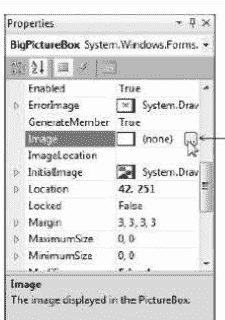

属性按钮

## 图 2.7

“选择资源”对话框。在这里选择你想要在 `PictureBox` 控件中显示的图形图像；点击“导入”将图像添加到列表。

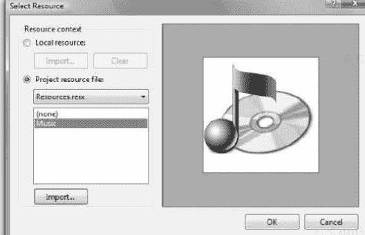

点击“选择资源”对话框的“导入”按钮来添加图像。会弹出一个“打开”对话框（图 2.3），在其中你可以导航到图像文件。预览框中会显示图像的预览。

> 注意：要添加 .ico 扩展名的文件，请在“打开”对话框的“文件类型”中选择“所有文件”。

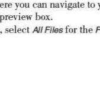

## 第二章

## 71

在 `StudentData\Graphics` 文件夹中找到微软提供的文本图形文件和图标文件。

## 图 2.3

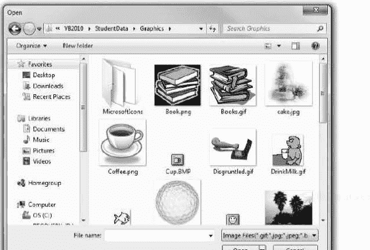

你可以使用你拥有的任何图形文件（只要格式正确）。你会在网站（www.mhe.com/vb2010）上的 Student Data 文件中找到许多内置图形文件。

`PictureBox` 控件有几个实用的属性，你可以在设计时或运行时设置它们。例如，将 `SizeMode` 属性设置为 `StretchImage`，使图形缩放以适应控件。你可以将 `Visible` 属性设置为 `False`，使图片在运行时消失。例如，要让图片框在运行时不可见，请使用此代码

```
PictureBox.Visible = False
```

你可以在运行时从资源文件夹中分配图形。你使用 `My` 关键字，这是一个特殊的 VB 关键字，允许你访问许多系统设置。在这个示例中，"Sunset" 是项目资源文件夹中某个图形的名称（不带扩展名）。

```
SamplePictureBox.Image = My.Resources.Sunset
```

## 添加和删除资源

在图 2.6 中，你看到了向资源文件夹添加新图形的最简单方法，这是在你设置 `PictureBox` 控件的 `Image` 属性时完成的。你也可以使用 Visual Studio 项目设计器添加、删除和重命名资源。从菜单中，选择“ProjectName 属性”（它始终显示当前项目的名称）。项目设计器会在主窗口中打开；点击“资源”选项卡显示资源（图 2.9）。你可以使用窗口顶部的按钮添加和删除图像，或者右键点击现有资源来重命名或删除它。

## 图 2.9

点击项目设计器中的“资源”选项卡来添加和删除图像，或者右键点击现有资源来重命名或删除它。

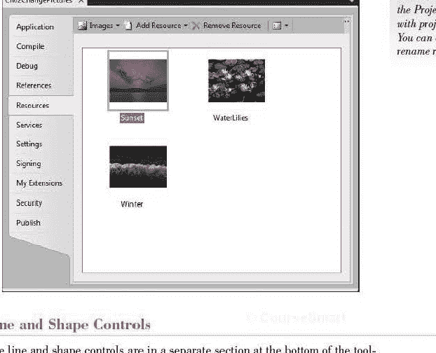

# 线和形状控件

线条和形状控件位于 Visual Basic 部分。你可以使用 `Line`、`OvalShape` 和 `RectangleShape` 在表单上创建形状。

## 图 2.10

Visual Basic 部分中的线条和形状控件，带有表单上的示例控件。

- 所有窗口
- 通用控件
- 容器
- 菜单和工具栏
- 数据
- 组件
- 打印
- 对话框
- Windows 启动
- 键盘
- VB 包
- 指针
- 线
- 标签
- 形状
- 矩形
- 常用
- 服务器

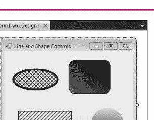

线条的属性包括 `BorderStyle`（实线、点线、虚线等）、`BorderWidth`（线条宽度，单位为像素）、`BorderColor` 以及线条端点的位置（X1, X2, X3, X4）。你可以视觉化地移动和调整线条，但有时精确设置像素位置更好。

`OvalShape` 和 `RectangleShape` 的属性更有趣。你可以通过 `BackStyle` 设置透明度，通过 `BorderColor`、`BorderStyle` 和 `BorderWidth` 设置边界。使用 `FillColor`、`FillGradientStyle` 和 `FillStyle` 设置形状内部。你可以通过设置 `CornerRadius` 创建圆角，默认是直角。

## 绘制线条

除了使用线条控件绘制线条外，你还可以通过使用 `Label` 控件在表单上绘制线条。将标签的 `AutoSize` 属性设置为 `False`，`Text` 属性留空，`Border` 设置为 `None`并将`Color` 修改为你想要的线条颜色。你可以通过 `Size` 属性下方的 `Width` 和 `Height` 属性来控制线条的大小。

另一种在表单上绘制线条的方法是使用图形方法。图形绘制将在第 13 章介绍。

## 使用智能标签

你可以使用智能标签来设置控件的常用属性。例如，当你向表单添加 `PictureBox` 或 `TextBox` 时，你会看到控件的右上角有一个箭头。点击它可以打开该控件的智能标签（图 2.11）。智能标签显示了你可以从那里设置的几个属性，这只是从属性窗口进行更改的快捷方式。

## 图 2.11

指向智能标记箭头以打开控件的智能标记。对于此 `PictureBox` 控件，你可以在智能标记中设置 `Image`、`Size Mode` 和 `Dock` 属性。

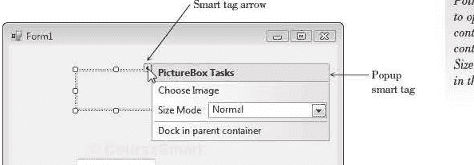

## 在表单和控件中使用图像

可以使用图像作为表单或控件的背景。对于表单，将 `BackgroundImage` 属性设置为图形资源；并将表单的 `BackgroundLayout` 属性设置为 `Tile`、`Center`、`Stretch` 或 `Zoom`。

按钮、复框和单选按钮等控件具有 `Image` 属性，你可以将其设置为项目资源中的图形。

## 设置边框和样式

大多数控件看起来可以是三维的或平面的。标签、文本框和图片框都有 `BorderStyle` 属性，可选有 `None`、`FixedSingle` 或 `Fixed3D`。文本框默认为 `Fixed3D`；标签和图片框默认为 `None`。当然，你可以将属性更改为你选择的样式。

# 反馈 2.1

创建一个显示放大图标并出现在 3D 框中的图片框控件。命名一个符合本书命名标准的名称。

| 属性 | 设置 |
| :--- | :--- |
| Name | |
| BorderStyle | |
| SizeMode | |
| Visible | |

## 操作多个控件

你可以一次选择多个控件，这意味着你可以作为一个组移动控件、为组设置相似属性、调整大小并对齐控件。

## 第 2 章

# 75

## 选择多个控件

当要在表单上选择控件时，请结合使用两种方法。拖动选择框围绕所有控件以选择它们，然后按 `Ctrl` 点击想要取消选择的控件。你还可以使用“编辑”菜单中的“全选”选项或快捷键 `Ctrl + A` 选择所有控件。

## 取消一组控件

当你完成对一组控件的操作后，很容易取消选择它们。只需点击表单上的任何位置（不是控件）或选择另一个之前未被选中的控件。

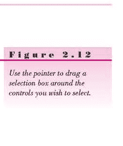


# 组移动控件

选择多个控件后，你可以作为一个组移动它们。要做到这一点，指向一个选中的控件内部，按下鼠标按钮，并将整个组拖到新位置（图 2.14）。

> 图 2.14

拖动选中的控件组将整个组移动到新位置。


> 请阅读附录 C 中操作控件的技巧和快捷键。

你可以为控件组设置一些共同属性。选择组后，查看“属性”窗口。窗口中出现的属性由所有控件共享，并可以一次性更改。例如，你可能想对一组控件使用 `TextStyle` 属性来更改一组标签使用的字体。某些属性会出现，但这些属性并不共享共同值。你可以输入一个适用于所有所选控件的新值。

# 对齐控件

选择一组控件后，很容易使用“布局”工具栏上的按钮（图 2.15）或“格式”菜单中的对应项目来调整大小并对齐。选择你的控件组并选择任何调整大小按钮。这些可以使控件的宽度、高度或两者相等。然后选择另一个按钮来对齐控件的顶部、底部或中心。你还可以将整个组移动到新位置。

使用“布局”工具栏调整并对齐多个控件。

> 图 2.15

设置表单字体会更改表单上所有控件的默认字体。


## 第 2 章

# 77

注意：对齐选项适用于激活的控件组（调整句柄处于激活状态）。参考图 2.13，上方的文本框是激活控件。要使另一个选中的控件成为激活控件，只需点击它。

要设置控件之间的间距，使用水平/或垂直间距按钮。这些按钮允许你创建控件之间的等间距，或增加或减少控件之间的间距。

注意：如果没有显示布局工具栏，选择“视图/工具栏/布局”。

# 为用户便利设计应用程序

良好的编程目标之一是创建易于使用的程序。你的用户界面应该是清晰一致的。有一种观点认为，如果用户误用了程序，那是程序员的错而不是用户的。因为你的大多数用户已经知道如何操作 Windows 程序。

# 定义键盘访问键

在定义 `Text` 属性时，你可以为按钮、单选按钮和复选框设置访问键。在想要访问键的字符前输入与符号（`&`）：Visual Basic 会下划线该字符。你还可以为标签设置访问键；参见本书后续部分的“设置控件的制表顺序”。

按钮访问键的示例，为按钮输入以下内容：

```
&OK OK
E&xit Exit
```

在定义访问键时，需要注意几点。首先，尽可能使用 Windows 标准按键。例如，使用 `X` 表示“退出”，使用 `S` 表示“保存”。确保不要给两个控件分配相同的访问键。当用户按下访问键时，会混淆制表顺序中的下一个控件（从当前激活控件开始）。

## 设计用户界面

根据系统设置，查看控件或菜单上的访问键时可能需要按下 `Alt` 键。你可以在控制面板中设置 Windows 显示下划线快捷方式。在 Windows 7 中，选择“辅助中心”并让键盘更容易使用。在 Windows Vista 中，

> 当你想在 `Text` 属性中出现 `&` 符号时，请使用两个 `&` 符号：`&Health & Welfare` 用于“健康与福利”

选择“易用性”并更改键盘的工作方式。然后，在任一选项中，勾选“下划线快捷键和访问键”。

## 设置“接受”和“取消”按钮

你是键盘用户吗？如果是，你是否介意在框中输入文本后还要使用鼠标并点击按钮？有些人的手指在键盘上，而大多数人倾向于按 `Enter` 键而不是点击鼠标。如果表单上的按钮之一是接受按钮，那么按 `Enter` 键等同于点击该按钮。

你可以通过将表单的 `Accept` 属性设置为按钮名称，将其中一个按钮设置为接受按钮。当用户按下 `Enter` 键时，该按钮会被自动选中。

你也可以选择一个取消按钮。取消按钮是用户在按下 `Esc` 键时被选中的按钮。你可以通过设置表单的 `CancelButton` 属性来创建一个取消按钮。一个很好的示例是在 `OK` 和 `Cancel` 按钮上使用 `CancelButton` 属性。你可能希望将表单的 `Acceptance` 设置为 `OKButton`，并将 `CancelButton` 属性设置为 `CancelButton`。

## 设置控件的 Tab 顺序

在 Windows 程序中，表单上的一个控件始终拥有焦点。你可以通过在控件之间切换 `Tab` 键来看到焦点的变化。对于许多控件（如按钮），焦点显示为粗边框。其他控件通过虚线或阴影背景来指示焦点。对于文本框，插入点显示在框内。

某些控件可以接收焦点，而另一些不能。例如，文本框和按钮可以接收焦点，但标签（`labels`）和图片框不能。

# Tab 顺序

有两个属性决定了焦点是否停留在控件上以及焦点移动的顺序。能够接收焦点的控件有一个 `TabStop` 属性，你可以将其设置为 `True` 或 `False`。如果你不希望焦点在用户按下 `Tab` 键时停留在控件上，请将 `TabStop` 属性设置为 `False`。

`TabIndex` 属性决定了按下 `Tab` 键时焦点移动的顺序。当你在表单上创建控件时，Visual Studio 会为每个序列分配 `TabIndex` 属性。大多数情况下顺序是正确的，但如果你想按其他顺序进行 `Tab` 切换，或者添加了控件，你将需要修改控件的 `TabIndex` 属性。

当你的程序开始运行时，焦点位于 `TabIndex` 最小的控件上（通常为 0）。如果你通常希望插入点位于表单上的第一个控件中，则其 `TabIndex` 应该设置为 0。以此类推。

你可能对标签的属性感到困惑，它们有 `Tab` 属性但没有 `Stop`。标签在 `Tab` 序列中有一个位置。这允许你为文本框创建键盘访问键。当用户输入标签中的访问键（例如 `Alt+N`）时，焦点将跳转到第一个标记了该 `TabIndex` 的控件（即文本框）。见图 2.17。

默认情况下，文本框和单选按钮的 `Tab` 属性被设置为 `True`。注意单选按钮在 `Tab` 序列中的行为

## 用户界面设计

## 图 2.17

要为文本框使用键盘键，标签的 `TabIndex` 必须在文本框的 `TabIndex` 之前。


`TabIndex=0`

`TabIndex=1`

`TabIndex=2`

`TabIndex=3`

`TabIndex=4`

`TabIndex=5`

与其他控件不同：`Tab` 键只会带你进入组中的单选按钮（该按钮），即使组中的所有按钮都具有 `TabStop` 和 `TabIndex` 属性。如果你使用键盘选择单选按钮，请使用 `Tab` 键进入该组，然后使用上、下箭头键选择当前按钮。

> 提示

确保 `TabIndex` 属性没有重复数字或重复的键盘访问键。结果取决于焦点的位置，并且非常令人困惑。

## 设置 Tab 顺序

要设置控件的 `Tab` 顺序，你可以在属性窗口中设置每个控件的 `TabIndex` 属性。你也可以使用 Visual Studio 帮助自动设置 `Tab` 的绝佳功能。要使用此功能，请确保设计窗口处于激活状态，并选择视图 / Tab 顺序，或点击布局工具栏上的“Tab 顺序”按钮。（Tab 顺序项不会出现在菜单中，也不会出现在每个控件布局工具栏的左角；这些是控件当前的 `TabIndex` 属性。首先点击你想设为 `TabIndex` 零的控件，然后点击设置为 `TabIndex` 为一的控件，继续点击下一个控件，直到你设置了所有控件的 `TabIndex`（图 2.19）。

## 图 2.18

按顺序点击每个控件，自动设置控件的 `TabIndex` 属性。

```
## 键盘或鼠标
| 0 | 1 |
| 2 | 1 |
```

## 第 2 章

# 81

当你完成所有控件的 `TabIndex` 设置后，编号框会变为蓝色。选择视图 / Tab 顺序来隐藏序列数字，按 `Esc` 键即可。如果你出错并想更改 `Tab` 顺序，请关闭该选项并从 `TabIndex` 零重新开始，你可以继续点击控件，直到数字循环到所需的值。

> 提示

为一组控件设置 `Tab` 顺序时，先设置组框的 `TabIndex` 属性，然后设置组内部控件的 `TabIndex`。

## 设置表单在屏幕上的位置

当你的项目运行时，表单默认出现在屏幕的左上角。你可以通过设置表单的 `StartPosition` 属性来设置表单的位置。

# 图 2.19

将 `StartPosition` 属性设置为 `CenterScreen` 以使表单显示在屏幕中央。

当你的程序运行时，表单默认出现在屏幕的左上角。你可以通过设置表单的 `StartPosition` 属性来设置表单的位置。将 `StartPosition` 属性设置为 `CenterScreen` 以使表单显示在屏幕中央。


## 创建工具提示

如果你是 Windows 用户，你可能喜欢并依赖鼠标悬停在控件上时弹出的工具提示。你可以通过添加 `ToolTip` 组件为项目添加工具提示。当你将组件添加到表单后，每个控件都有一个新属性：`ToolTip`（假设你保留默认名称 `ToolTip1`）。

要定义工具提示，从工具箱中选择 `ToolTip`（图 2.20）并双击表单上的此处。新控件出现在工具栏中（下方）。

## 图 2.20

向表单添加 `ToolTip` 组件；每个控件都将有一个新属性。


## 图 2.21

新的 `ToolTip` 组件位于表单设计器底部的组件栏。


添加 `ToolTip` 组件后，检查表单上其他控件的属性列表，如按钮、文本框、标签、单选按钮、复选框甚至表单本身。每个都有新的 `ToolTip` 属性。

尝试此示例：在任何表单上添加一个按钮并添加 `ToolTip` 组件。将按钮的 `Text` 属性更改为 `Exit`，并将 `ToolTip` 属性设置为 `Close and Exit the program`。现在运行项目，将指针指向 `Exit` 按钮并停顿；工具提示将会出现（图 2.22）。

# 图 2.22


使用 `ToolTip` 属性来定义工具提示。

你可以添加多行工具提示。在 `ToolTip` 属性中，点击下拉箭头。这会弹出一个编辑框，你在其中输入工具提示的文本。输入第一行并按 `Enter` 键创建第二行；按 `Ctrl + Enter` 接受（或点击属性窗口外部）。

你可以通过设置 `ToolTip` 组件的属性来修改工具提示的外观。在组件栏中选择 `ToolTip` 组件并尝试更改 `BackColor` 和 `ForeColor` 属性。你还可以将 `IsBalloon` 属性设置为 `True` 以获得不同的外观，并在工具提示中包含图标。

## 第 2 章

# 83

# 图 2.23


针对 `IsBalloon`、`ToolTip`、`BackColor` 和 `ForeColor` 修改了属性的 `ToolTip`。

通过为 `ToolTip` 组件选择一个图标（图 2.23）来完成设置。一旦你为 `ToolTip` 组件设置了属性，这些属性将应用于使用该组件显示的所有 `ToolTip`。如果你想创建各种外观，最佳方法是创建多个 `ToolTip` 组件，并为每个组件指定一个唯一的名称。例如，你可能会创建三个 `ToolTip` 组件，在这种情况下，你将为表单和 `Tool1` 上的 `ToolTip`、`Tool2` 上的 `ToolTip` 以及控件上的 `ToolTip3` 设置属性。

# 为控件编写代码

你已经知道如何在设计时为控件设置初始属性。你可能还想在项目执行时通过代码设置某些属性。你可以清空文本框和标签的内容、重置焦点（活动控件）、更改文本颜色，或更改 `ToolTip` 中的文本。

## 清空文本框和标签

你可以通过将属性设置为空字符串来清空文本框或标签的内容。使用 `""`（两个引号之间没有空格）。这个空字符串被称为空字符串或零长度字符串。你也可以使用 `Clear` 方法或将 `Text` 属性设置为 `String.Empty` 来清空文本框。注意，`Clear` 方法适用于文本框但不适用于标签。

示例

- *清空文本框和标签的内容。*

```
NameTextBox.Text = ""
MessageLabel.Text = ""
TextBox.Clear()
MessageLabel.Text = String.Empty
```

## 重置焦点

当程序运行时，你希望插入点出现在用户预期输入文字的文本框中。因此，焦点应该从第一个文本框开始。但之后呢？如果你清空了表单的文本框，应该将焦点设置为第一个文本框。`Focus` 方法处理了这种情况。记住，惯例是 `Object.Method`，因此在名为 `NameTextBox` 的文本框中设置插入点的语句如下：

- *让插入点出现在此文本框中。*

```
NameTextBox.Focus()
```

> 注意：你不能将焦点设置为已禁用的控件。见本章节稍后的“禁用控件”。

# 设置单选按钮和复选框的 Checked

当然，单选按钮和复选框的目的是允许用户进行选择。然而，有时你需要在代码中选择或取消选择控件。你可以在设计时（设置初始值）或运行时（响应事件）选择单选按钮和复选框。

要让单选按钮或复选框初始显示，在属性窗口中将其 `Checked` 属性设置为 `True`。在代码中，将 `True` 赋值给其 `Checked` 属性：

- *让按钮选中。*

```
RedRadioButton.Checked = True
```

- *让复选框选中。*

```
DisplayCheckbox.Checked = True
```

- *让复选框取消选中。*

```
DisplayCheckbox.Checked = False
```

有时你需要在运行时重置选中的单选按钮，通常用于第二次请求。你只需要将组中一个按钮的 `Checked` 属性设置为 `True`；组中的其他按钮将自动设置为 `False`。记住，一组单选按钮中同时只能选中其中一个。

# 在运行时设置可见性

你可以在运行时设置控件的可见性。

- *让标签不可见。*

```
MessageLabel.Visible = False
```

你可能希望控件的可见性取决于用户在复选框或单选按钮中做的选择。此语句使可见性与复选框保持一致：当勾选时（`Checked = True`），标签是可见的（`Visible = True`）。

> *让标签的可见性与复选框的设置一致。*

```
MessageLabel.Visible = DisplayCheckbox.Checked
```

## 第 2 章

# 85

## 禁用控件

控件的 `Enabled` 属性决定控件是可用还是“置灰显示”。控件的属性在运行时设置为 `True`，但你可以在设计时或运行时更改该值。你可能希望初始禁用某个按钮或其他控件，并根据用户的操作在代码中启用它。如果你在设计时禁用了按钮（`Enabled = False`），可以使用以下代码在运行时启用该按钮。

```
DisplayButton.Enabled = True
```

当你可以选择禁用或隐藏控件时，通常最好的方法是禁用它。对于用户来说，禁用控件比让它消失更容易理解。

要禁用单选按钮，可以考虑禁用持有按钮的组框，而不是按钮本身。禁用组框会使整个组变灰。

```
GroupBox.Enabled = False
```

# 反馈 2.2

1. 编写 Basic 语句清空名为 `CompanyTextBox` 的文本框并重置该框内的插入点。

2. 编写 Basic 语句清空名为 `CustomerLabel` 的标签，并将插入点放入名为 `OrderTextBox` 的文本框中。

3. 这些 Basic 语句的效果分别是什么？

(a) `RadioButton.Checked = True`

(b) `ColorButton.Checked = True`

(c) `DrawingPicture.Visible = False`

(d) `LocationLabel.BorderStyle = BorderStyle.Fixed30`

(e) `Label.Text = CityTextBox.Text`

(f) `RadioButton.Checked = True`

## 根据用户设置属性

通常你需要根据用户的操作更改控件的 `Enabled` 或 `Visible` 属性。例如，你可能拥有某些在用户登录之前处于禁用或不可见的控件。在下面的示例中，当用户点击按钮时，几个控件变得可见，其他控件变为禁用，并且单选按钮组框被启用：

```vb
Private Sub SignButton_Click(ByVal sender As System.Object, ByVal e As System.EventArgs) Handles SignButton.Click
    ' 设置部门和欢迎消息。
    MessageLabel.Visible = True
    WelcomeTextBox.Visible = True
    ' 隐藏登录控件。
    GroupBox.Enabled = False
    ' 启用按钮组。
    GroupBox.Enabled = True
End Sub
```

## 修改文本颜色

Visual Basic 提供了一种简单的方法来指定大量颜色。这些颜色常量位于 `Color` 类。如果你在编辑器中输入关键字 `Color`，就可以看到完整的颜色列表。某些颜色列在下面。

```
Color.AliceBlue
Color.AntiqueWhite
Color.Bisque
Color.BlanchedAlmond
Color.Blue
```

你可以通过更改 `ForeColor` 属性来更改文本颜色。实际上，大多数控件都有 `ForeColor` 和 `BackColor` 属性；`ForeColor` 属性决定字体颜色。

## 颜色常量


```vbnet
NameTextBox.ForeColor = Red
MessageLabel.ForeColor = White
```

# 使用单选按钮选择颜色

这里有一个示例（图 2.24），演示了如何使用单选按钮组来更改表单颜色（`BackColor` 属性）和文本颜色（`ForeColor` 属性）。每组单选按钮的操作都与其他组相互独立。

## 图 2.24


### 一组单选按钮

每组单选按钮的操作与其他组相互独立。每个按钮都会更改表单的一个属性：`BackColor` 更改表单背景，`ForeColor` 更改表单文本颜色。

### 另一组单选按钮

#### 选择表单颜色

- 米色
- 蓝色
- 黄色
- 灰色

#### 选择文本颜色

- 黑色
- 白色

```vbnet
'Project: Ch02
'Programmer: Bradley/Millspaugh
'Date: June 2010
'Description: 使用两组单选按钮更改表单的背景和前景。

Public Class ColorsForm

Private Sub BeigeRadioButton_CheckedChanged(ByVal sender As System.Object, ByVal e As System.EventArgs) Handles BeigeRadioButton.CheckedChanged
    ' 将表单颜色设置为米色。
    Me.BackColor = Color.Beige
End Sub

Private Sub BlueRadioButton_CheckedChanged(ByVal sender As System.Object, ByVal e As System.EventArgs) Handles BlueRadioButton.CheckedChanged
    ' 将表单颜色设置为蓝色。
    Me.BackColor = Color.Blue
End Sub

Private Sub GrayRadioButton_CheckedChanged(ByVal sender As System.Object, ByVal e As System.EventArgs) Handles GrayRadioButton.CheckedChanged
    ' 将表单颜色设置为灰色。
    Me.BackColor = Color.Gray
End Sub

Private Sub BlackRadioButton_CheckedChanged(ByVal sender As System.Object,
ByVal As System.EventArgs) Handles BlackRadioButton.CheckedChanged
    ' 将文本颜色设置为黑色。
    Me.ForeColor = Color.Black

Private Sub WhiteRadioButton_CheckedChanged(ByVal sender As System.Object,
ByVal As System.EventArgs) Handles WhiteRadioButton.CheckedChanged
    ' 将文本颜色设置为白色。
    Me.ForeColor = Color.White

End Class
```

# 更改控件的多个属性

现在你已经看到，有时你想要更改单个控件的多个属性。在 Visual Basic 的早期版本中，你必须为每条语句写出完整的名称（`Object.Property`）。

## 示例

```vbnet
TextBox.Visible = True
TextBox.ForeColor = Color.White
TextBox.Focus()
```

当然，你也可以以此方式指定语句，但 Visual Basic 提供了一种更好的方法：`With` 和 `End` 语句。

## `With` 和 `End With` 语句——通用格式

```vbnet
With ObjectName
    Statement(s)
End With
```

你在 `With` 语句中指定一个对象名称。在 `End With` 之前的所有后续语句都与对象对象。

## `With` 和 `End With` 语句——示例

```vbnet
With TextBox
    .Visible = True
    .ForeColor = Color.White
    .Focus()
End With
```

以 `With` 开始并以 `End` 结束的语句被称为 With 块。块内部的语句为了可读性进行了缩进。虽然 VB 不要求缩进，但它是良好的编程规范，并有助于可读性。

使用 `With` 语句而不是为每条语句写出对象的优势是 `With` 更高效。如果你使用 `With`，你的 Visual Basic 项目将运行得快一点。在大型复杂的项目中，这种节省是显著的。

# 文本字符串拼接

有时你需要连接文本字符串。例如，你可能想要将一个字面量和一个属性连接起来。在被称为拼接的过程中，你可以使用 `" &` 在另一个字符串末尾添加一个字符字符串。在两个字符串之间使用连接符 `&`，前后各加一个空格。

## 示例

```vbnet
MessageLabel.Text = "Your name is " & NameTextBox.Text
NameAddressLabel.Text = NameTextBox.Text & " is " & AddressTextBox.Text
```

# 延续长程序行

Basic 将单行代码解释为一条语句。你可以在编辑器窗口中输入非常长的行；窗口会横向滚动以便你继续输入。然而，这很不方便；很难看清长行的末尾。

新的 Visual Basic 2010 中，如果你在合适的位置断行，可以使用隐式延续。你也可以像以前的 Visual Basic 版本一样继续使用显式行延续字符。

## 隐式延续

Visual Basic 10 允许你只要遵循某些规则，就可以按回车键将单条语句拆分为多行。对于你目前为止学过的 Basic 语句，你可以换行：

1. 在逗号之后。
2. 在左括号之后或右括号之前。
3. 在拼接运算符（`&`）之后。
4. 在赋值语句的等号（`=`）之后。

你可以在帮助主题“Visual Basic 中的语句”下找到完整的规则列表。

作为示例，你可以在等号之后拆分赋值语句，但不能在它之前拆分：

## 合法

```vbnet
PromotionTextBox.Text =
"购买 "CD" 即可获得免费的 MP3 下载，"

GreetingsLabel.Text = "你好 " & NameTextBox.Text & ": " &
"你被选中获得了免费奖品。" & \n"请向我们寄送 $100 邮费和手续费。"
```

> **提示**
>
> 尽管在某些 Basic 操作中可以使用 `+` 运算符进行拼接，但并不建议这种做法。取决于文本框的内容，编译器可能会将 `+` 运算符解释为而非拼接运算符，导致不可预测的结果或错误。

## 不合法

```vbnet
PromotionTextBox.Text
- "购买 "CD" 即可获得 MP3 下载"

GreetingsLabel.Text = "你好 && NameTextBox.Text & ": :"
& "你被选中获得了免费奖品。"
& "请向我们寄送 $100 邮费和手续费。"
```

# 显式行延续

当一条 Basic 语句长到一行无法容同时，你可以使用行延续字符。输入一个空格和一个下划线，按回车键，并在下一行继续语句。对延续行进行缩进是允许的。行延续字符必须出现在字面量或属性的中间。Visual Basic 2010 中，如果你在合适的位置断行，可以使用隐式延续。你也可以像以前的 Visual Basic 版本一样继续使用显式行延续字符。

## 示例

```vbnet
Private Sub BlackRadioButton_CheckedChanged(ByVal sender As System.Object,
ByVal As System.EventArgs) Handles BlackRadioButton.CheckedChanged
```

# 你的动手示例

创建一个表单，允许成员登录并查看特别促销。使用文本框用于名称，使用掩码文本框用于 ID。使用单选按钮用于部门。包含“登录”、“取消”和“退出”按钮。使用部门图片显示图像。将部门图片设置为 False。

注意：虽然这一步看起来可能没必要，但让用户注是标准做法，并且已批准了该设计。

作为示例，你可以在等号之后拆分赋值语句，但不能在它之前拆分：

```vbnet
PromotionTextBox.Text =
"购买 "CD" 即可获得免费的 MP3 下载，"

GreetingsLabel.Text = "你好 " & NameTextBox.Text & ": " &
"你被选中获得了免费奖品。" & \n"请向我们寄送 $100 邮费和手续费。"
```

> **提示**
>
> 尽管在某些 Basic 操作中可以使用 `+` 运算符进行拼接，但并不建议这种做法。取决于文本框的内容，编译器可能会将 `+` 运算符解释为而非拼接运算符，导致不可预测的结果或错误。

# 项目规划

规划表单及每个控件的对象和属性。

| 对象 | 属性 | 设置 |
| :--- | :--- | :--- |
| `MainForm` | `Name` | `Refresh` |
|  | `StartPosition` | `CenterScreen` |
|  | `AcceptButton` | `SignIn` |
|  | `CancelButton` | `Exit` |
| `DepartmentGroupBox` | `Name` | `Department` |
|  | `Text` |  |
| `BooksRadioButton` | `Name` | `&Books` |
| `CheckGroupBox` | `Text` | `Elite Check In` |
| `Label` | `Text` | `Member&ID` |
| `Label2` | `Name` | `NameTextBox` |
|  | `Text` |  |
| `NameTextBox` | `Name` | `MemberIDMaskTextBox` |
|  | `Mask` | `00000` |
| `WelcomeRichTextBox` | `Name` | `WelcomeRichTextBox` |
|  | `Text` |  |
| `SignInButton` | `Name` | `SignIn` |
| `PrintButton` | `Name` | `&Print` |
| `ExitButton` | `Name` | `E&xit` |
| `DepartmentPictureBox` | `Name` | `DepartmentPictureBox` |
|  | `Visible` | `False` |
|  | `SizeMode` | `StretchImage` |
| `ImageVisibleCheckbox` | `Name` | `ImageVisibleCheckbox` |
|  | `Visible` | `False` |
| `PromotionTextBox` | `Name` | `PromotionTextBox` |
|  | `Text` |  |

## VISUAL BASIC 用户界面设计

| 对象 | 属性 | 设置 |
| :--- | :--- | :--- |
| `PrintButton` | `Name` | `PrintButton` |
|  | `Text` | `&Print` |
| `ExitButton` | `Name` | `ExitButton` |
|  | `Text` | `E&xit` |
| `DepartmentPictureBox` | `Name` | `DepartmentPictureBox` |
|  | `Visible` | `False` |
|  | `SizeMode` | `StretchImage` |
| `ImageVisibleCheckbox` | `Name` | `ImageVisibleCheckbox` |
|  | `Visible` | `False` |
| `PromotionTextBox` | `Name` | `PromotionTextBox` |
|  | `Text` |  |

# 过程

## 动作-伪代码

### `PeriodicalsRadioButton_CheckedChanged`

- 显示“精英会员每笔购买可享 9 折优惠”和期刊图像。
- 显示“庆祝季节，特制饮品享 8 折优惠”和咖啡图像。

### `CoffeeBarRadioButton_CheckedChanged`

- 设置部门图像的可见性。

### `ImageVisibleCheckBox_CheckedChanged`

- 隐藏签入组框框（group box）。

### `SignInButton_Click`

- 禁用登录按钮。
- 启用部门组框框。
- 创建复选框、促销文本框和欢迎文本框。
- 拼接名称和成员 ID，并将其显示在欢迎富文本框中。

### `PrintButton_Click`

- 将打印操作设为打印预览。
- 调用 `Print` 方法。

### `ExitButton_Click`

- 结束项目。

编写项目：按照图 2.25 中的草图创建表单。图 2.26 显示完成后的表单。

- 按照你的计划设置每个对象的控件属性。确保设置了控件的制表顺序（tab order）。
- 根据伪代码编写每个事件过程。
- 完成代码后，彻底测试项目。


| R'n 在 R-For 用于阅读和休闲 |
| :--- | :--- |
| 部门 | 精英会员签入 |
| 图籍 | 姓名 |
| 音乐 | 成员 (D) |
| 期刊 |  |
| 咖啡吧 |  |
| 签入 |  |
| 打印 |  |
| 退出 |  |
| 图像可见性 |  |

# 项目代码解决方案

```vbnet
'项目: Co2HandsOn（动手实践咖啡2）
'程序员: Bradley/Millspaugh
'日期: 2010年6月
'描述: 允许用户签入并显示当前的促销活动。

Public Class MainForm

Private Sub RadioButtonCheckedChanged(ByVal sender As System.Object,
ByVal e As System.EventArgs) Handles RadioButton.CheckedChanged
    显示书籍部门的图像和促销信息。

    DepartmentPicture.Image = My.Resources.Book
    PromotionText.Text = "买二送一，半价。"
End Sub

Private Sub CoffeeBarButtonCheckedChanged(ByVal sender As System.Object,
ByVal e As System.EventArgs) Handles CoffeeBarButton.CheckedChanged
    显示咖啡吧的图像和促销信息。

    DepartmentPicture.Image = My.Resources.Coffee
    PromotionText.Text = "庆祝季节，特制饮品享 8 折优惠。"
End Sub

Private Sub MusicButtonCheckedChanged(ByVal sender As System.Object,
ByVal e As System.EventArgs) Handles MusicRadioButton.CheckedChanged
    显示音乐部门的图像和促销信息。

    DepartmentPicture.Image = My.Resources.Music
    PromotionText.Text = "购买 CD 免费获得 MP3 下载。"
End Sub

Private Sub PeriodicalsButtonCheckedChanged(ByVal sender As System.Object,
ByVal e As System.EventArgs) Handles PeriodicalsRadioButton.CheckedChanged
    显示期刊部门的图像和促销信息。

    DepartmentPicture.Image = My.Resources.Periodicals
    PromotionText.Text = "精英会员每笔购买可享 9 折优惠。"
End Sub

Private Sub InvisibleCheckedChanged(ByVal sender As System.Object,
ByVal e As System.EventArgs) Handles InvisibleCheckBox.CheckedChanged
    设置部门图像的可见性。

    DepartmentPicture.Image = My.Resources.Invisible
    InvisibleCheckBox.Visible = Checked
End Sub

Private Sub SignButton_Click(ByVal sender As System.Object,
ByVal e As System.EventArgs) Handles SignButton.Click
    禁用登录按钮。

    SignInButton.Enabled = False

    启用部门组框框。

    GroupBox.Enabled = True

    隐藏签入框。

    GroupBox.Visible = False
```


`InvisibleCheckBox.Visible = False`

创建复选框、促销文本框和欢迎文本框。

`CheckBox.Visible = True`

`PromotionTextBox.Visible = True`

`WelcomeTextBox.Visible = True`

拼接名称和成员 ID 并显示在欢迎富文本中。

`WelcomeRichText.Text = "欢迎 " & TextBox.Text & " 成员 ID: " & MaskedTextBox.Text`

`DepartmentPicture.Visible = True`

`PromotionText.Visible = True`

```vbnet
Private Sub PrintButton_Click(ByVal sender As System.Object,
ByVal e As System.EventArgs) Handles PrintButton.Click
    将打印操作设为打印预览。
    PrintDialog.ShowPreview() = True
    调用打印方法。
    PrintDialog.Print()
End Sub
```

```vbnet
Private Sub ExitButton_Click(ByVal sender As System.Object,
ByVal e As System.EventArgs) Handles ExitButton.Click
    结束项目。
    Me.Close()
End Sub
End Class
```

## 编程习惯

1. 按照你的计划设置每个对象的控件属性。确保设置了控件的制表顺序。
2. 根据伪代码编写每个事件过程。
3. 完成代码后，彻底测试项目。

1. 遵循 Windows 标准指南（颜色、控件尺寸和位置、访问键、默认按钮和取消按钮、制表顺序）使表单易于使用。
2. 组框作为其他控件的容器。
3. 复选框和单选按钮的状态存储在 `Checked` 属性中；当用户点击时会触发 `Changed` 事件。
4. 在单选按钮组中只能选择一个；在复选框组中可以选择任意数量。
5. 使用设计器中的 `Resources` 选项卡来添加、删除和管理图像。
6. 表单和控件可以显示资源中的图像。
7. 使用表单的 `Background` 属性显示图像。
8. 设置 `SizeMode` 为 `Stretch` 以使图像适应控件。
9. `Picture` 控件包含图像。
10. 控件的 `Image` 属性可以启用。
11. `BorderStyle` 属性可以设置为 `None`、`FixedSingle` 或 `Fixed3D`，以决定控件看起来是平面的还是三维的。
12. 在表单上创建线条，可以使用 `Shape` 控件。
13. 你可以选择多个控件并将其作为一个整体，一次性设置公共属性、移动或对齐它们。
14. 在 `Text` 属性中使用 `&` 符号来定义访问键。
15. 设置表单的 `DefaultButton` 属性以确保用户可以按 `Enter` 键进行选择。如果你将 `CancelButton` 属性设置为某个按钮，当用户按 `Esc` 键时将选择该按钮。
16. `Tab` 键在控件之间移动。制表顺序由控件的 `TabIndex` 属性决定。`Tab` 键仅在 `TabStop` 属性设置为 `True` 且启用的控件上移动。
17. 通过设置 `StartPosition` 属性设置表单在屏幕上的位置。
18. 向表单添加 `ToolTip` 控件，然后使用控件的 `ToolTip` 属性在用户悬停在控件上时显示提示。你可以通过 `ToolTip` 组件的属性修改背景、前景、形状和图标。
19. 通过设置为空字符串来清除文本框或标签的文本。文本框也可以使用 `Clear` 方法清除。
20. 使用 `Focus` 方法使控件获得焦点，使其成为活动控件。使用文本框的 `Focus` 方法会使光标点出现在文本框中。你不能为禁用的控件设置焦点。

## 第二章

23. 你可以在程序运行时设置单选按钮或复选框的 `Checked` 属性，并在代码中查看控件的 `Visible` 属性。

24. 可以将 `Enabled` 属性设置为 `False` 来禁用控件。

25. 通过更改控件的 `ForeColor` 属性来更改文本颜色。

26. 你可以在运行时使用颜色更改控件。

27. `With` 和 `End` 语句提供了一种简单的方法，可以多次引用对象而无需重复对象的名称。

28. 文本字符串的被称为连接（concatenation），通过在两个元素之间放置符号 `&` 来。（`&` 前后必须有一个空格）。

29. 使用空格和下划线将行语句延续到另一行。如果在逗号、赋值运算符或连接运算符之后，或者在左括号之后或右括号之前换行，则不需要使用下划线。

## 核心术语

| `AcceptButton` 属性 79 | `PictureBox` 控件 69 |
| 访问键 78 | 项目设计器 72 |
| `BorderStyle` 属性 74 | 单选按钮 62 |
| `CancelButton` 属性 79 | 富文本 67 |
| 检查 69 | 选择资源对话框 69 |
| `Checked` 属性 69 | `SizeMode` 属性 71 |
| 颜色常量 86 | `StartPosition` 81 |
| 连接 89 | 伸图像 71 |
| 容器 68 | `TabIndex` 属性 79 |
| 空字符串 83 | `TabStop` 属性 79 |
| `Enabled` 属性 85 | 文本框 65 |
| 焦点 79 | `Text` 属性 65 |
| `Focus` 方法 84 | `TextAlignment` 65 |
| `ForeColor` 属性 86 | `ToolTip`（工具提示） 81 |
| `GroupBox` 属性 68 | `ToolTip` 控件 81 |
| `Image` 属性 69 | `ToolTip` `ToolTip` 81 |
| 隐式行延续 89 | `Visible` 属性 71 |
| 行延续字符 90 | `With` 和 `End` 语句 83 |
| `MaskedTextBox` 66 | `With` 块 88 |
| `Multiline` 属性 67 | `Wrap` 属性 67 |
| `NewLine` 属性 68 | |

## 复习题

1. 你可以在文本框或标签中显示程序输出。什么时候应该使用文本框？什么时候使用标签比较合适？

2. 使用掩码文本框（masked text box）而不是文本框有什么优势？

3. 什么时候使用富文本框而不是文本框是合适的？

4. `TextBox` 和 `RichTextBox` 的哪些属性必须设置，才能允许长的 `Text` 属性换行到多行？

5. 表单上单选按钮的行为如何影响复选框的行为？

6. 如果你想在表单上有两组单选按钮，如何让这些组独立运行？

7. 解释如何让图形出现在图片框控件中。

8. 描述如何选择多个标签并一次性将它们设置为 12 点字号。

9. 键盘访问键的目的是？你如何在项目中定义它们？它们在运行时是如何运行的？

10. 解释按钮的 `AutoButton` 和 `CancelButton` 的目的。为每个按钮给出一个用例。

11. 什么是 `ToolTip`（工具提示）？如何制作 `ToolTip`？

12. 什么是焦点（focus）？如何控制哪个对象拥有焦点？

13. 假设你正在测试项目并且不喜欢插入点的初始位置。解释如何让插入点在程序启动时出现在不同的文本框中。

14. 程序执行期间，如果你想将插入点返回到名为 `TextBox` 的文本框，你会使用什么 Basic 语句来实现？

15. 哪些 Basic 语句可以清除文本框和标签当前的内容？

16. `With` 和 `End` 语句是如何使用的？给出一个例子。

17. 什么是连接？它什么时候会有用？

18. 解释如何将一个非常长的 Basic 语句延续到另一行。包括对隐式行终止的讨论。

## 练习

图形文件：你可以在文本网站（www.mbh.com/VBR2010）上的 `StudentData/Graphics` 文件夹中找到图标文件。

### 2.1 创建一个项目来控制灯的开启和关闭，参考下方的用户界面。

表单：包含一个文本框供用户输入其姓名。创建两个图片框，一个叠在另一个上面。一次只有一个可见。使用单选按钮选择灯光图片框下方文本的颜色。

为单选按钮和按钮添加键盘访问键。将 `Exit`（退出）按钮设置为 `Cancel`（取消）按钮。为两个灯图片框创建 `ToolTip`；让 `ToolTip` 显示“点击此处开启或关闭灯”。

项目操作：用户将输入名称并点击颜色的单选按钮（不一定按此顺序）。当点击灯时，显示图片框并更改下方的消息。将用户名连接到消息末尾。

## 第二章

两个图标文件为 `LightOff.ico` 和 `LightOn.ico`，位于以下文件夹：

`Graphics\Microsoft\icons`

（参见练习题顶部关于图形文件位置的注释。）

编码：在每个单选按钮的点击事件过程中，更改灯下方消息的颜色。

## VB 自动汽车中心

修改第 1 章 VB 自动汽车中心案例研究中的项目，将按钮替换为图片中的图像。（在 `Open2C` 中通过“复制和移动项目”来创建第 1 章项目的副本以供本项目使用。）在每个图片框之前，放置一个标签，指示哪个注释代表什么内容。点击图片将在特殊标签中生成相应的信息。

包含一个标记为 `Hours`（时长）的复选框。当选中该复选框时，一个新标签将显示“24小时候营业——每周7天”的消息。

默认情况下，所有图像都存储在 `Icons` 文件夹中（参见练习顶部关于图形文件位置的注释）。

在图片框中添加一个清除特殊标签的图像。为每个图片框使用工具提示（`ToolTip`），帮助用户理解图形的用途。

部门/命令

自动销售


`Cars.ico`

服务中心

`Wrench.ico`

详细维修店

`Water.ico`

`MAIL12.ico`

就业机会

退出

添加单选按钮，允许用户以不同的颜色查看特殊标签。

## 视频盛宴

设计并编写一个使用单选按钮显示视频位置的项目。为每个电影类别使用单选按钮，并使用标签显示通道号。一个复选框允许用户显示或隐藏会员通道号。当选中该复选框时，将出现“所有成员可享 9 折优惠”的消息。

来自界面的其余部分的标签。在图片框中包含一张图像。

包含“清除”（`Clear`）和“退出”（`Exit`）的按钮（带有键盘访问键）。“清除”按钮应设置为接受按钮，“退出”设置为取消按钮。

单选按钮

位置

喜剧

第 1 号

戏剧

第 2 号

动作

第 3 号

科幻

第 4 号

恐怖

第 5 号

在表单上放置一个使用 24 点字号的标签，内容为“Video Bonanza..”。用一条线将其余部分隔开。

# 非常非常棒的板子

创建一个显示 Very Very Boards 广告口号的项目。包含公司名称、口号（“最好的板子”或自拟口号）以及用于 Logo 的图形图像。你可以使用文本材料自带的图形（`Skateboard.gif`）或你自己的。

允许用户使用文本单选按钮选择口号的颜色。此外，用户可以选择显示或隐藏公司名称、口号和 Logo。使用复选框作为显示选项，以便用户可以独立地选择每个选项。


## 第 2 章

# 103

为单选按钮和按钮添加键盘访问键。将“退出”按钮设置为取消按钮。为公司名称（“我们的公司名称”）、口号（我们的口号”）和 Logo（我们的 Logo”）创建工具提示。

当项目开始执行时，口号应为加粗，并选中红色单选按钮。当用户选择新颜色时，更改口号文本的颜色以匹配。

每个复选框最初都必须显示，因为公司名称、口号、Logo 和程序员名称会在表单出现时显示。每当用户选择或取消选择复选框时，让相应的项目显示或隐藏。

让表单显示在屏幕中央。


<!-- 无内容 -->

将数量转换为数值变量。

`Integer.Parse(QuantityInteger)`

# 3

```vb
DiscountDecimal = Decimal.Round(ExtendedPrice)
DiscountedPriceSum = ExtendedPrice - DiscountDecimal
```

```vb
DiscountDecimal = Decimal.Round(ExtendedPrice)
DiscountedPriceSum = ExtendedPrice - DiscountDecimal
```

`Integer`

```vb
DiscountedPriceSum = ExtendedPrice - DiscountDecimal
```

```vb
DiscountedPriceSum = Discount1
```

在完成本章时，你将：
- 为单选按钮和按钮添加键盘访问键。
- 将“退出”按钮设置为取消按钮。
- 为公司名称、口号和 Logo 创建工具提示。

当项目开始执行时，
- 口号应加粗并选中红色单选按钮。
- 当用户选择新颜色时，更改口号文本的颜色以匹配。

每个复选框最初都必须显示，因为：
- 公司名称、口号、Logo 和程序员名称会在表单出现时显示。
- 每当用户选择或取消选择复选框时，让相应的项目显示或隐藏。

让表单显示在屏幕中央。

```vb
DiscountedPriceSum = ExtendedPrice - DiscountDecimal
```

```vb
DiscountedPriceSum = Discount1
```

```vb
Integer = 1
```

在完成本章时，你将：
- 为单选按钮和按钮添加键盘访问键。
- 将“退出”按钮设置为取消按钮。
- 为公司名称、口号和 Logo 创建工具提示。

当项目开始执行时，
- 口号应加粗并选中红色单选按钮。
- 当用户选择新颜色时，更改口号文本的颜色以匹配。

每个复选框最初都必须显示，因为：
- 公司名称、口号、Logo 和程序员名称会在表单出现时显示。
- 每当用户选择或取消选择复选框时，让相应的项目显示或隐藏。

让表单显示在屏幕中央。

```vb
DiscountedPriceSum = ExtendedPrice - DiscountDecimal
```

```vb
DiscountedPriceSum = Discount1
```

```vb
Integer = 1
```

在完成本章时，你将：
- 为单选按钮和按钮添加键盘访问键。
- 将“退出”按钮设置为取消按钮。
- 为公司名称、口号和 Logo 创建工具提示。

当项目开始执行时，
- 口号应加粗并选中红色单选按钮。
- 当用户选择新颜色时，更改口号文本的颜色以匹配。

每个复选框最初都必须显示，因为：
- 公司名称、口号、Logo 和程序员名称会在表单出现时显示。
- 每当用户选择或取消选择复选框时，让相应的项目显示或隐藏。

让表单显示在屏幕中央。

```vb
DiscountedPriceSum = ExtendedPrice - DiscountDecimal
```

```vb
DiscountedPriceSum = Discount1
```

```vb
Integer = 1
```

在完成本章时，你将：
- 为单选按钮和按钮添加键盘访问键。
- 将“退出”按钮设置为取消按钮。
- 为公司名称、口号和 Logo 创建工具提示。

当项目开始执行时，
- 口号应加粗并选中红色单选按钮。
- 当用户选择新颜色时，更改口号文本的颜色以匹配。

每个复选框最初都必须显示，因为：
- 公司名称、口号、Logo 和程序员名称会在表单出现时显示。
- 每当用户选择或取消选择复选框时，让相应的项目显示或隐藏。

让表单显示在屏幕中央。

```vb
DiscountedPriceSum = ExtendedPrice - DiscountDecimal
```

```vb
DiscountedPriceSum = Discount1
```

```vb
Integer = 1
```

在完成本章时，你将：
- 为单选按钮和按钮添加键盘访问键。
- 将“退出”按钮设置为取消按钮。
- 为公司名称、口号和 Logo 创建工具提示。

当项目开始执行时，
- 口号应加粗并选中红色单选按钮。
- 当用户选择新颜色时，更改口号文本的颜色以匹配。

每个复选框最初都必须显示，因为：
- 公司名称、口号、Logo 和程序员名称会在表单出现时显示。
- 每当用户选择或取消选择复选框时，让相应的项目显示或隐藏。

让表单显示在屏幕中央。

```vb
DiscountedPriceSum = ExtendedPrice - DiscountDecimal
```

```vb
DiscountedPriceSum = Discount1
```

```vb
Integer = 1
```

在完成本章时，你将：
- 为单选按钮和按钮添加键盘访问键。
- 将“退出”按钮设置为取消按钮。
- 为公司名称、口号和 Logo 创建工具提示。

当项目开始执行时，
- 口号应加粗并选中红色单选按钮。
- 当用户选择新颜色时，更改口号文本的颜色以匹配。

每个复选框最初都必须显示，因为：
- 公司名称、口号、Logo 和程序员名称会在表单出现时显示。
- 每当用户选择或取消选择复选框时，让相应的项目显示或隐藏。

让表单显示在屏幕中央。

```vb
DiscountedPriceSum = ExtendedPrice - DiscountDecimal
```

```vb
DiscountedPriceSum = Discount1
```

```vb
Integer = 1
```


在完成本章时，你将：
- 为单选按钮和按钮添加键盘访问键。
- 将“退出”按钮设置为取消按钮。
- 为公司名称、口号和 Logo 创建工具提示。

当项目开始执行时：
- 口号应加粗并选中红色单选按钮。
- 当用户选择新颜色时，更改口号文本的颜色以匹配。

每个复选框最初都必须显示，因为：
- 公司名称、口号、Logo 和程序员名称会在表单出现时显示。
- 每当用户选择或取消选择复选框时，让相应的项目显示或隐藏。

让表单显示在屏幕中央。

```vb
DiscountedPriceSum = ExtendedPrice - DiscountDecimal
```

```vb
DiscountedPriceSum = Discount1
```

```vb
Integer = 1
```

在完成本章时，你将：
- 为单选按钮和按钮添加键盘访问键。
- 将“退出”按钮设置为取消按钮。
- 为公司名称、口号和 Logo 创建工具提示。

当项目开始执行时：
- 口号应加粗并选中红色单选按钮。
- 当用户选择新颜色时，更改口号文本的颜色以匹配。

每个复选框最初都必须显示，因为：
- 公司名称、口号、Logo 和程序员名称会在表单出现时显示。
- 每当用户选择或取消选择复选框时，让相应的项目显示或隐藏。

让表单显示在屏幕中央。

```vb
DiscountedPriceSum = ExtendedPrice - DiscountDecimal
```

```vb
DiscountedPriceSum = Discount1
```

```vb
Integer = 1
```

在完成本章时，你将：
- 为单选按钮和按钮添加键盘访问键。
- 将“退出”按钮设置为取消按钮。
- 为公司名称、口号和 Logo 创建工具提示。

当项目开始执行时：
- 口号应加粗并选中红色单选按钮。
- 当用户选择新颜色时，更改口号文本的颜色以匹配。

每个复选框最初都必须显示，因为：
- 公司名称、口号、Logo 和程序员名称会在表单出现时显示。
- 每当用户选择或取消选择复选框时，让相应的项目显示或隐藏。

让表单显示在屏幕中央。

```vb
DiscountedPriceSum = ExtendedPrice - DiscountDecimal
```

```vb
DiscountedPriceSum = Discount1
```

```vb
Integer = 1
```

在完成本章时，你将：
- 为单选按钮和按钮添加键盘访问键。
- 将“退出”按钮设置为取消按钮。
- 为公司名称、口号和 Logo 创建工具提示。

当项目开始执行时：
- 口号应加粗并选中红色单选按钮。
- 当用户选择新颜色时，更改口号文本的颜色以匹配。

每个复选框最初都必须显示，因为：
- 公司名称、口号、Logo 和程序员名称会在表单出现时显示。
- 每当用户选择或取消选择复选框时，让相应的项目显示或隐藏。

让表单显示在屏幕中央。

```vb
DiscountedPriceSum = ExtendedPrice - DiscountDecimal
```

```vb
DiscountedPriceSum = Discount1
```

```vb
Integer = 1
```

在完成本章时，你将：
- 为单选按钮和按钮添加键盘访问键。
- 将“退出”按钮设置为取消按钮。
- 为公司名称、口号和 Logo 创建工具提示。

当项目开始执行时：
- 口号应加粗并选中红色单选按钮。
- 当用户选择新颜色时，更改口号文本的颜色以匹配。

每个复选框最初都必须显示，因为：
- 公司名称、口号、Logo 和程序员名称会在表单出现时显示。
- 每当用户选择或取消选择复选框时，让相应的项目显示或隐藏。

让表单显示在屏幕中央。

```vb
DiscountedPriceSum = ExtendedPrice - DiscountDecimal
```

```vb
DiscountedPriceSum = Discount1
```

```vb
Integer = 1
```

在完成本章时，你将：
- 为单选按钮和按钮添加键盘访问键。
- 将“退出”按钮设置为取消按钮。
- 为公司名称、口号和 Logo 创建工具提示。

当项目开始执行时：
- 口号应加粗并选中红色单选按钮。
- 当用户选择新颜色时，更改口号文本的颜色以匹配。

每个复选框最初都必须显示，因为：
- 公司名称、口号、Logo 和程序员名称会在表单出现时显示。
- 每当用户选择或取消选择复选框时，让相应的项目显示或隐藏。

让表单显示在屏幕中央。

```vb
DiscountedPriceSum = ExtendedPrice - DiscountDecimal
```

```vb
DiscountedPriceSum = Discount1
```

```vb
Integer = 1
```

在完成本章时，你将：
- 为单选按钮和按钮添加键盘访问键。
- 将“退出”按钮设置为取消按钮。
- 为公司名称、口号和 Logo 创建工具提示。

当项目开始执行时：
- 口号应加粗并选中红色单选按钮。
- 当用户选择新颜色时，更改口号文本的颜色以匹配。

每个复选框最初都必须显示，因为：
- 公司名称、口号、Logo 和程序员名称会在表单出现时显示。
- 每当用户选择或取消选择复选框时，让相应的项目显示或隐藏。

让表单显示在屏幕中央。

```vb
DiscountedPriceSum = ExtendedPrice - DiscountDecimal
```

```vb
DiscountedPriceSum = Discount1
```

```vb
Integer = 1
```

在完成本章时，你将：
- 为单选按钮和按钮添加键盘访问键。
- 将“退出”按钮设置为取消按钮。
- 为公司名称、口号和 Logo 创建工具提示。

当项目开始执行时：
- 口号应加粗并选中红色单选按钮。
- 当用户选择新颜色时，更改口号文本的颜色以匹配。

每个复选框最初都必须显示，因为：
- 公司名称、口号、Logo 和程序员名称会在表单出现时显示。
- 每当用户选择或取消选择复选框时，让相应的项目显示或隐藏。

让表单显示在屏幕中央。

```vb
DiscountedPriceSum = ExtendedPrice - DiscountDecimal
```

```vb
DiscountedPriceSum = Discount1
```

```vb
Integer = 1
```

在完成本章时，你将：
- 为单选按钮和按钮添加键盘访问键。
- 将“退出”按钮设置为取消按钮。
- 为公司名称、口号和 Logo 创建工具提示。

当项目开始执行时：
- 口号应加粗并选中红色单选按钮。
- 当用户选择新颜色时，更改口号文本的颜色以匹配。

每个复选框最初都必须显示，因为：
- 公司名称、口号、Logo 和程序员名称会在表单出现时显示。
- 每当用户选择或取消选择复选框时，让相应的项目显示或隐藏。

让表单显示在屏幕中央。

```vb
DiscountedPriceSum = ExtendedPrice - DiscountDecimal
```

```vb
DiscountedPriceSum = Discount1
```

```vb
Integer = 1
```

在完成本章时，你将：
- 为单选按钮和按钮添加键盘访问键。
- 将“退出”按钮设置为取消按钮。
- 为公司名称、口号和 Logo 创建工具提示。

当项目开始执行时：
- 口号应加粗并选中红色单选按钮。
- 当用户选择新颜色时，更改口号文本的颜色以匹配。

每个复选框最初都必须显示，因为：
- 公司名称、口号、Logo 和程序员名称会在表单出现时显示。
- 每当用户选择或取消选择复选框时，让相应的项目显示或隐藏。

让表单显示在屏幕中央。

```vb
DiscountedPriceSum = ExtendedPrice - DiscountDecimal
```

```vb
DiscountedPriceSum = Discount1
```

```vb
Integer = 1
```

在完成本章时，你将：
- 为单选按钮和按钮添加键盘访问键。
- 将“退出”按钮设置为取消按钮。
- 为公司名称、口号和 Logo 创建工具提示。

当项目开始执行时：
- 口号应加粗并选中红色单选按钮。
- 当用户选择新颜色时，更改口号文本的颜色以匹配。

每个复选框最初都必须显示，因为：
- 公司名称、口号、Logo 和程序员名称会在表单出现时显示。
- 每当用户选择或取消选择复选框时，让相应的项目显示或隐藏。

让表单显示在屏幕中央。

```vb
DiscountedPriceSum = ExtendedPrice - DiscountDecimal
```

```vb
DiscountedPriceSum = Discount1
```

```vb
Integer = 1
```

在完成本章时，你将：
- 为单选按钮和按钮添加键盘访问键。
- 将“退出”按钮设置为取消按钮。
- 为公司名称、口号和 Logo 创建工具提示。

当项目开始执行时：
- 口号应加粗并选中红色单选按钮。
- 当用户选择新颜色时，更改口号文本的颜色以匹配。

每个复选框最初都必须显示，因为：
- 公司名称、口号、Logo 和程序员名称会在表单出现时显示。
- 每当用户选择或取消选择复选框时，让相应的项目显示或隐藏。

让表单显示在屏幕中央。

```vb
DiscountedPriceSum = ExtendedPrice - DiscountDecimal
```

```vb
DiscountedPriceSum = Discount1
```

```vb
Integer = 1
```

# Visual Basic 数据类型、通用语言运行时 (CLR) 数据类型、每个类型存储的数据种类以及每个类型分配的内存量

| VB 数据类型 | 通用语言运行时 (CLR) 数据类型 | 用途 | 存储大小（字节） |
| --- | --- | --- | --- |
| `Boolean` | `Boolean` | 真或假值 | 2 |
| `Byte` | `Byte` | 0 到 255，二进制数据 | 1 |
| `Char` | `Char` | 单个 Unicode 字符 | 2 |
| `Date` | `DateTime` | 0001/1/1 至 9999/12/31 | 4 |
| `Decimal` | `Decimal` | 十进制小数，例如美元和分角 | 16 |
| `Single` | `Single` | 单精度浮点数 | 4 |
| `Double` | `Double` | 具有 14 位精度的双精度浮点数 | 8 |
| `Short` | `Int16` | 范围在 -32,768 到 32,767 之间的短整数 | 2 |
| `Integer` | `Int32` | 范围在 -2,147,483,648 到 2,147,483,647 之间的整数 | 4 |
| `Long` | `Int64` | 更大的数字 | 8 |
| `String` | `String` | 字母、数字和其他字符 | 视而定 |
| `Object` | `Object` | 任意类型的数据 | 4 |

注意：通常情况下你会使用 Visual Basic 数据类型；但对于某些转换，你必须使用相应的 CLR 数据类型。

## 命名规则

程序员必须对项目中将使用的变量和命名常量进行命名（标识）。Basic 要求变量和命名常量的标识符必须遵循以下规则：名称可以由字母、数字和下划线组成；它们必须以字母或下划线开头；不能包含任何空格或句号；并且不能是保留字。（保留字也称为关键字，是 Basic 分配了某些含义的单词，例如 `print`、`name` 和 `value`）。

VB 中的标识符不区分大小写。`suminteger`、`Suminteger` 和 `SUMINTEGER` 都指向同一个变量。
注意：你可以根据需要让变量名任意长；标识符的最大长度为 16,383 个字符。

## 命名规范

在命名变量和常量时，必须遵循 Basic 的规则。此外，你应该遵循一些命名规范。规范是区分良好名称与糟糕（或不太好）名称的指南。所有标识符的含义和用途都应该是清晰的。
正如我们在第 1 章建立了对象的命名规范一样，在本章中，我们采用了变量和常量的命名规范。以下规范在编程行业被广泛使用：

## 第 3 章

1. 标识符要有意义。选择一个能清楚指示其用途的名称。除非意义显而易见，否则不要缩写，不要使用像 `X` 或 `Y` 这样的短标识符。

2. 变量的类（数据类型）。
3. 以大写字母开头，然后将名称的每个后续字母大写。变量始终使用混合大小写；常量使用全大写。

示例标识符

| 数据字段 | 可能的标识符 |
|---|---|
| 社会安全号 | `SocialSecurityString` |
| 薪率 | `PayRateDecimal` |
| 工作小时数 | `HoursWorkedDecimal` |
| 电话号码 | `PhoneNumberString` |
| 数量 | `QuantityInteger` |
| 税率（常量） | `TAX_RATE_Decimal` |
| 配额（常量） | `QUOTA_Integer` |
| 人口 | `PopulationLong` |

# 反馈 3.1

指示以下标识符是否符合 Basic 规则以及命名规范。如果标识符无效，请给出原因。记住，反馈的答案可以在附录 A 中找到。

1. 省
2. `#SoldInteger`
3. `Number Sol Integer`
4. `Number.Sold.Integer`
5. `AmountsDecimal`
6. `Sub`
7. `SubString`
8. `text`
9. `Maximum`
10. `MinimumRateDecimal`
11. `MaximumCheckDecimal`
12. `CompanyNameString`

## 常量：命名常量与内置常量

常量提供了一种用单词来描述不变值的方法。在第 2 章中，你使用了 Visual 常量 `Color.Blue`、`Color.Red`、`Color.Yellow` 等。这些常量是内置在环境中的（内置常量）；你不需要在任何地方定义它们。你自己定义的常量被称为命名常量。

## 命名常量

你使用 `Const` 关键字来声明命名常量。你提供常量名、数据类型和一个值。一旦值被声明为常量，它的值在项目执行期间就无法更改。你声明的数据类型与值的数据类型必须匹配。例如，如果你声明一个整数常量，你必须给它一个整数值。

## VISUAL BASIC 变量、常量和计算

在代码中使用命名常量而非实际值，你会发现许多优点。它更容易阅读；例如，看到标识符 `MAXIMUM_PAY_Decimal` 比看到一个数字（如 1,000）更有意义。如果你以后需要更改该值，你只需要更改一次常量声明；不需要更改整个过程中对它的引用。

# `Const` 语句 - 通用形式

```
Const Identifier [As Datatype] = Value
```

常量的命名规范要求你在名称中包含数据类型，以及包含实际声明数据类型的 `As` 子句。名称使用全大写，各个单词之间用下划线分隔。

## `Const` 语句 - 示例

```
Const COMPANY_Name As String = "Visual Basic"
Const COMPANY_Address As String = "101 Main Street"
Const SALES_RATE As Decimal = .08
```


# 给常量赋值

给常量赋值遵循某些规则。你已经知道文本（字符串）必须包含在引号内；数值不需要。数值常量可以包含数字（0-9）、小数点以及左侧的符号（`+` 或 `-`）。不能包含逗号、美元符号或其他字符，或者右侧的符号。你可以通过附加类型字符来声明常量的数据类型。如果你对数字不附加类型字符，任何数字都被假设为 `Integer`，任何小数值都被假设为 `Double`。类型字符有：

- `Decimal`
- `Double`
- `Integer`
- `Long`

尽管你可以在字符串字面量内部数字，但记住这些是文本，不能用于计算。

字符串值被称为字面量，因为它们包含了引号内的任何内容。

## 第 3 章

以下列出了常量示例。

| 数据类型 | 常量示例 |
|---|---|
| `Integer` | `5`, `125`, `2170`, `2000`, `-100`, `12345678I` |
| `Single` | `101.25F`, `-5.0F` |
| `Decimal` | `850.50`, `-1000` |
| `Double` | `52875.8`, `52875.8RR`, `-52875.8RR` |
| `Long` | `134257987L`, `-320598L` |
| `String` 字面量 | `"Visual Basic"`, `"ABC Incorporated"`, `"1415 J Street"`, `"102"`, `"She said ""Hello,"` |

内置常量是系统定义的常量。许多内置常量声明在系统类库中可在你的 VB 程序中使用。例如，你在第 2 章中使用的颜色常量就是内置常量。

在使用内置常量时，必须指定类名或组名以及常量名。例如，`Color.Red` 是 `Color` 类中的常量“Red”。在本章之后，你将学习使用 `MessageBox` 类的常量向用户显示消息框。

## 声明变量

虽然有多种方法声明变量，但在过程内部必须使用 `Dim` 语句。在本章之后，你将学习在过程外部声明变量，使用 `Public`、`Private` 或 `Dim` 语句。

## 声明语句-通用形式

```
Public | Private | Dim Identifier [As Datatype]
```

如果你省略可选的数据类型，变量的类型默认为 `Object`。建议始终声明数据类型。

注意：如果开启了 `Option Strict`，省略数据类型将收到语法错误。

## 声明名称—示例

```
Dim CustomerName As String
Private TotalSold As Integer
Dim Temperature As Single
Dim PriceDecimal As Decimal
Private CostDecimal As Decimal
```

保留关键字 `dim` 是 dimension（维度）的缩写，意思是“大小”。当你声明变量时，保留的内存量取决于其数据类型。每种数据类型的大小请参见表 3.1（第 100 页）。

你也可以在一条语句中声明多个变量；你在 `As` 子句中声明的数据类型适用于该行中的所有变量。用逗号分隔变量名。以下是一些示例声明：

```
Dim Name, AddressString, PhoneString As String
Dim PriceDecimal, TotalDecimal As Decimal
```

## 输入声明语句

Visual Basic 的 IntelliSense（智能感知）功能可以帮助你输入变量、`Public` 和 `Dim`。当你输入完 `As` 之后的类型时，会弹出一个列表 (3.1)。此列表显示了完成语句所需的可用项目。

完成语句的准确方法是开始输入正确的项目；列表会自动滚动到正确的区域 (3.2)。当正确的项目被高亮或它是唯一显示的项目时，按 `Enter`、`Tab` 键或空格键进行选择，或者如果你更喜欢使用鼠标，则双击。


图 3.1

当你输入 `As` 之后的空格时，IntelliSense 菜单会弹出。你可以用鼠标或键盘从列表中进行选择。

```
Dim PriceDecimal As
```

- `AccessibleObject`
- `AccessViolationException`
- `Action`
- `Action(KF)`
- `ActionCollection`
- `AggregateException`
- `AppDomain`
- `Application`
- `ApplicationContext`
- `All`

## 图 3.2

- `DebuggerDisplayAttribute`
- `DebuggerHiddenAttribute`
- `DebuggerNumberCodeAttribute`
- `DebuggerBoundaryAttribute`
- `DebuggerPropertyAttribute`
- `DebuggerTypeProxyAttribute`
- `Dimension`
- `Disconnect`
- `DefaultEventListener`
- `All`

输入数据类型的前几个字符，IntelliSense 会快速滚动到正确的区域。当正确的单词被高亮时，按 `Enter`、`Tab` 键或空格键选择该项目。


注意：有些人认为 IntelliSense 烦人而不是有用。你可以通过“工具 / 选项”来关闭它。在“选项”框中，确保选中了“显示所有设置”，并选择“文本编辑器 / Basic / 通用”；取消勾选“自动列表”和“参数信息”。如果你在共享教室或实验室中工作，在没有教师许可的情况下，切勿更改选项。

## 反馈 3.2

请为以下情况使用 `If` 语句编写一个声明：构思一个合适的标识符。

1. 你需要用于工资处理的变量来存储以下内容：
   (a) 小时数，可以存储小数值。
   (b) 员工姓名。
   (c) 部门编号（不用于计算）。
2. 你需要用于库存控制的变量来存储以下内容：
   (a) 整数数量。
   (b) 项目描述。
   (c) 零件号。
   (d) 成本。
   (e) 售价。

## 变量的作用域和生命周期

一个变量可能在整个项目中存在并可见，可能仅存在于一个表单，或仅存在于一个过程。变量的可见性被称为它的作用域。可见性实际上意味着“此变量可以在此位置使用或被‘看到’”。作用域被称为命名空间级、模块级、局部或块级。命名空间级变量用于命名空间中的所有过程，命名空间通常是整个项目。模块级变量（也称为类级变量）可以从表单的所有过程访问。局部变量可能仅在声明它的过程中使用，而块级变量仅在过程内部的代码块中使用。

你通过选择放置声明语句的位置以及选择恰当的声明关键字（如 `Private`）来声明变量。

注意：以前版本的 VB 和其他一些编程语言将命名空间变量统称为全局变量。

## 变量生命周期

当你创建一个变量时，必须意识到它的生命周期。变量的生命周期是变量存在期间。块级变量的生命周期通常是一个过程的执行周期。例如，每当你执行一个子过程时，`If` 语句都会执行。每个变量都会被创建一个“全新的”变量，数值型变量的初始值为 0，字符串变量的空字符串。当过程结束时，它的变量就会消失；也就是说，它们的内存被释放了。

模块级变量的生命周期通常是整个表单加载期间。如果你想在过程的多次执行中保持变量的值——例如计算运行总和——你必须使用模块级变量（或声明为 `Static` 的变量，将在第 6 和第 7 章中讨论）。

## 局部声明

你在过程内部声明的任何变量其作用域都是局部的，这意味着它们只对该过程可见。使用 `Dim` 关键字进行局部声明。语句可以出现在过程内部任何位置，只要它在语句中第一次使用该变量之前出现。然而良好的编程习惯要求 `Dim` 应该出现在过程的顶部，位于所有其他代码语句之前（注释之后）。

- 模块级声明。
- `Const DISCOUNT_RATE As Decimal = 0.150`

```
Private Sub CalculateButton_Click(ByVal sender As Object, ByVal e As EventArgs)

    Dim Quantity As Integer

    Dim Description As String

    Dim PartNumber As String

    Dim Cost As Decimal

    Dim SellingPrice As Decimal

    Dim DiscountAmount As Decimal

    Dim DiscountedPrice As Decimal

    ' Convert input to numeric

    Quantity = Integer.Parse(txtQuantity.Text)

    Description = txtDescription.Text

    PartNumber = txtPartNumber.Text

    Cost = Decimal.Parse(txtCost.Text)

    SellingPrice = Decimal.Parse(txtSellingPrice.Text)

    ' Calculate values

    DiscountAmount = SellingPrice * DISCOUNT_RATE

    DiscountedPrice = SellingPrice - DiscountAmount

End Sub
```

- 模块级声明。
- `Const DISCOUNT_RATE As Decimal = 0.150`

## 模块级声明

有时你需要在表单的多个过程中使用变量，此时你应该在表单的“声明”区域中声明它。

- 声明模块级变量和常量。
```
Private QuantitySumInteger, SaleCountInteger As Integer
Private DiscountDecimal As Decimal
Const MAXIMUM_DISCOUNT As Decimal = 100.00
```

```
(Declarations)

(General)

Dim variables, constants, calculations, error

handling, and a message box to the user.

MessageBox

Public Class Form1

'Declare module-level variables, and constants.

Private QuantitySumInteger, SaleCountInteger As Integer

Private DiscountDecimal As Decimal

Const DISCOUNT_RATE As Decimal = -0.150
```

声明区域

## 块级与命名空间级声明

在本章中，你将不会使用块级或命名空间级声明。块级变量和常量的作用范围是一个代码块，例如 `If / End If` 或 `Do Loop`。这些语句将在本文的后部分介绍。当项目包含多个表单和模块时，命名空间级变量和常量有时很有用，但良好的编程实践会避免使用命名空间级变量。

## 反馈 3.3

为以下每种情况编写声明（`Dim`、`Private` 或 `Const` 语句），并指示每个语句出现的位置：

1. 在 `Calculate` 事件过程和 `Summary` 过程中都需要用到的薪资总和。
2. 在程序运行期间不能更改，但会被多个过程使用的销售税率。
3. 在 `Calculate` 事件过程中进行计数的参与者人数，但在 `Summary` 事件过程执行之前不显示该人数。

## 计算

在编程中你可以使用变量、常量以及某些对象的属性进行计算。你将用到的属性（例如文本框或标签的 `Text` 属性）通常是文本字符串。这些字符字符串（如 `"Howdy"` 或 `"12345"`）在先将它们转换为正确的数据类型之前，不能直接用于计算。

## 将字符串转换为数值数据类型

在计算中使用该值之前，你可以使用 `Parse` 方法将控件的 `Text` 属性转换为数值形式。你所使用的类取决于你为之赋值的变量的数据类型。例如，将文本转换为整数，请使用 `Integer.Parse` 方法；将字符串转换为十进制值，请使用 `Decimal.Parse`。将要转换的字符串作为 `Parse` 方法的参数传递。

```
QuantityInteger = Integer.Parse(QuantityTextBox.Text)

PriceDecimal = Decimal.Parse(TextBox.Text)
```

> 计算扩展价格。
`ExtendedPriceDecimal = QuantityInteger * PriceDecimal`

将一种数据类型转换为另一种类型有时被称为强制转换（casting）。在前一个示例中，来自 `QuantityTextBox.Text` 属性的 `String` 值被强制转换为 `Integer` 数据类型，来自 `TextBox.Text` 的 `String` 被强制转换为 `Decimal` 数据类型。

## 使用 Parse 方法

如你所知，执行操作的对象（例如文本框的 `Focus` 方法）是。你用于声明变量的数据类型是类，类具有属性和方法。每个数值数据类型类都有一个 `Parse` 方法，你将用它将文本字符串转换为该类型的正确数值值。`Decimal` 类有一个 `Parse` 方法，可以将括号内的值转换为十进制值；而 `Integer` 类有一个 `Parse` 方法，可以将该值转换为整数。

## Parse 方法——通用形式

| 转换为整数 |
| :--- |
| `Integer.Parse(StringToConvert)` |
| 转换为十进制 |
| `Decimal.Parse(StringToConvert)` |

你想要转换的表达式可以是控件的属性、字符串变量或字符串常量。`Parse` 方法返回（产生）一个可以在语句中使用的值，如下例示例中的赋值语句所示。

## Parse 方法——示例

| |
| :--- |
| `QuantityInteger = Integer.Parse(Quantity.Text)` |
| `PriceDecimal = Decimal.Parse(Price.Text)` |
| `WholeNumberInteger = Integer.Parse(DigitString)` |

`Parse` 方法检查存储在参数中的值，并尝试将其转换为数字，这个过程被称为解析（parsing），意味着逐字符地拆解并转换为另一种格式。
当 `Parse` 方法遇到无法解析为数字的值（空值或非数字字符）时，就会发生错误。你将在本章稍后的“处理异常”章节中学习如何避免这些错误。
你的大部分程序将使用 `Integer.Parse` 和 `Decimal.Parse` 方法。但万一你需要转换 `Long`、`Single` 或 `Double`，VB 也为这些数据类型类中的每一个提供了 `Parse` 方法。

在计算中使用该值之前，你可以使用 `Parse` 方法将控件的 `Text` 属性转换为数值形式。你所使用的类取决于你为之赋值的变量的数据类型。例如，将文本转换为整数，请使用 `Integer.Parse` 方法；将字符串转换为十进制值，请使用 `Decimal.Parse`。将要转换的字符串作为 `Parse` 方法的参数传递。

将一种数据类型转换为另一种类型有时被称为强制转换（casting）。在前一个示例中，来自 `QuantityTextBox.Text` 属性的 `String` 值被强制转换为 `Integer` 数据类型，来自 `TextBox.Text` 的 `String` 被强制转换为 `Decimal` 数据类型。

## 使用 Parse 方法

如你所知，执行操作的对象（例如文本框的 `Focus` 方法）是。你用于声明变量的数据类型是类，类具有属性和方法。每个数值数据类型类都有一个 `Parse` 方法，你将用它将文本字符串转换为该类型的正确数值值。`Decimal` 类有一个 `Parse` 方法，可以将括号内的值转换为十进制值；而 `Integer` 类有一个 `Parse` 方法，可以将该值转换为整数。

## Parse 方法——通用形式

| 转换为整数 |
| :--- |
| `Integer.Parse(StringToConvert)` |
| 转换为十进制 |
| `Decimal.Parse(StringToConvert)` |

你想要转换的表达式可以是控件的属性、字符串变量或字符串常量。`Parse` 方法返回（产生）一个可以在语句中使用的值，如下例示例中的赋值语句所示。

## Parse 方法——示例

| |
| :--- |
| `QuantityInteger = Integer.Parse(Quantity.Text)` |
| `PriceDecimal = Decimal.Parse(Price.Text)` |
| `WholeNumberInteger = Integer.Parse(DigitString)` |

`Parse` 方法检查存储在参数中的值，并尝试将其转换为数字，这个过程被称为解析（parsing），意味着逐字符地拆解并转换为另一种格式。
当 `Parse` 方法遇到无法解析为数字的值（空值或非数字字符）时，就会发生错误。你将在本章稍后的“处理异常”章节中学习如何避免这些错误。
你的大部分程序将使用 `Integer.Parse` 和 `Decimal.Parse` 方法。但万一你需要转换 `Long`、`Single` 或 `Double`，VB 也为这些数据类型类中的每一个提供了 `Parse` 方法。

## 将字符串转换为数值数据类型

在计算中使用该值之前，你可以使用 `Parse` 方法将控件的 `Text` 属性转换为数值形式。你所使用的类取决于你为之赋值的变量的数据类型。例如，将文本转换为整数，请使用 `Integer.Parse` 方法；将字符串转换为十进制值，请使用 `Decimal.Parse`。将要转换的字符串作为 `Parse` 方法的参数传递。


`QuantityInteger = Integer.Parse(QuantityTextBox.Text)`

`PriceDecimal = Decimal.Parse(TextBox.Text)`

```
> * 计算扩展价格。
ExtendedPriceDecimal = QuantityInteger * PriceDecimal
```

将一种数据类型转换为另一种类型有时被称为强制转换（casting）。在前一个示例中，来自 `QuantityTextBox.Text` 属性的 `String` 值被强制转换为 `Integer` 数据类型，来自 `TextBox.Text` 的 `String` 被强制转换为 `Decimal` 数据类型。

## 块级与命名空间级声明

在本章中，你将不会使用块级或命名空间级声明。块级变量和常量的作用范围是一个代码块，例如 `If / End If` 或 `Do Loop`。这些语句将在本文的后部分介绍。命名空间级变量和常量当项目包含多个表单和模块时，有时很有用，但良好的编程实践会避免使用命名空间级变量。

## 反馈 3.3

为以下每种情况编写声明（`Dim`、`Private` 或 `Const` 语句），并指示每个语句出现的位置：

- 1. 在 `Calculate` 事件过程和 `Summary` 过程中都需要用到的薪资总和。
- 2. 在程序运行期间不能更改，但会被多个过程使用的销售税率。
- 3. 在 `Calculate` 事件过程中进行计数的参与者人数，但在 `Summary` 事件过程执行之前不显示该人数。

## 计算

在编程中你可以可以使用变量、常量以及某些对象的属性进行计算。你将用到的属性（例如文本框或标签的 `Text` 属性）通常是文本字符串。这些字符字符串（如 "Howdy" 或 "12345"）在先将它们转换为正确的数据类型之前，不能直接用于计算。

## 将字符串转换为数值数据类型

在计算中使用该值之前，你可以使用 `Parse` 方法将控件的 `Text` 属性转换为数值形式。你所使用的类取决于你为之赋值的变量的数据类型。例如，将文本转换为整数，请使用 `Integer.Parse` 方法；将字符串转换为十进制值，请使用 `Decimal.Parse`。将要转换的字符串作为 `Parse` 方法的参数传递。

```
QuantityInteger = Integer.Parse(QuantityTextBox.Text)
PriceDecimal = Decimal.Parse(TextBox.Text)
```

> * 计算扩展价格。
`ExtendedPriceDecimal = QuantityInteger * PriceDecimal`

将一种数据类型转换为另一种类型有时被称为强制转换（casting）。在前一个示例中，来自 `QuantityTextBox.Text` 属性的 `String` 值被强制转换为 `Integer` 数据类型，来自 `TextBox.Text` 的 `String` 被强制转换为 `Decimal` 数据类型。

## 使用 Parse 方法

如你所知，执行操作的对象（例如文本框的 `Focus` 方法）是。你用于声明变量的数据类型是类，类具有属性和方法。每个数值数据类型类都有一个 `Parse` 方法，你将用它将文本字符串转换为该类型的正确数值值。`Decimal` 类有一个 `Parse` 方法，可以将括号内的值转换为十进制值；而 `Integer` 类有一个 `Parse` 方法，可以将该值转换为整数。

## Parse 方法——通用形式

| 转换为整数 |
| :--- |
| `Integer.Parse(StringToConvert)` |
| 转换为十进制 |
| `Decimal.Parse(StringToConvert)` |

你想要转换的表达式可以是控件的属性、字符串变量或字符串常量。`Parse` 方法返回（产生）一个可以在语句中使用的值，如下例示例中的赋值语句所示。

## Parse 方法——示例

| |
| :--- |
| `QuantityInteger = Integer.Parse(Quantity.Text)` |
| `PriceDecimal = Decimal.Parse(Price.Text)` |
| `WholeNumberInteger = Integer.Parse(DigitString)` |

`Parse` 方法检查存储在参数中的值，并尝试将其转换为数字，这个过程被称为解析（parsing），意味着逐字符地拆解并转换为另一种格式。
当 `Parse` 方法遇到无法解析为数字的值（空值或非数字字符）时，就会发生错误。你将在本章稍后的“处理异常”章节中学习如何避免这些错误。
你的大部分程序将使用 `Integer.Parse` 和 `Decimal.Parse` 方法。但万一你需要转换 `Long`、`Single` 或 `Double`，VB 也为这些数据类型类中的每一个提供了 `Parse` 方法。

## 将字符串转换为数值

在计算计算中使用值值之前之前使用使用`Parse` `Parse` `Parse`将将的的 `Text` 属性数值数值。。你所使用的取决于取决于你为赋值赋值的变量的数据类型。例如，将文本转换为整数，请使用 `Integer.Parse` 方法；将字符串转换为十进制值，请使用 `Decimal.Parse`。将要转换的字符串作为 `Parse` 方法的参数传递。

```
QuantityInteger = Integer.Parse(QuantityTextBox.Text)
PriceDecimal = Decimal.Parse(TextBox.Text)
```

> * 计算扩展价格。
`ExtendedPriceDecimal = QuantityInteger * PriceDecimal`

将一种数据类型转换为另一种类型有时被称为强制转换（casting）。在前一个示例中，来自 `QuantityTextBox.Text` 属性的 `String` 值被强制转换为 `Integer` 数据类型，来自 `TextBox.Text` 的 `String` 被强制转换为 `Decimal` 数据类型。

## 块级与命名空间级声明

在本章中，你将不会使用块级或命名空间级声明。块级变量和常量的作用范围是一个代码块，例如 `If / End If` 或 `Do Loop`。这些语句将在本文的后部分介绍。命名空间级变量和常量当项目包含多个表单和模块时，有时很有用，但良好的编程实践会避免使用命名空间级变量。

## 反馈 3.3

为以下每种情况编写声明（`Dim`、`Private` 或 `Const` 语句），并指示每个语句出现的位置：

- 1. 在 `Calculate` 事件过程和 `Summary` 过程中都需要用到的薪资总和。
- 2. 在程序运行期间不能更改，但会被多个过程使用的销售税率。
- 3. 在 `Calculate` 事件过程中进行计数的参与者人数，但在 `Summary` 事件过程执行之前不显示该人数。

## 计算

在编程中你可以可以使用变量、常量以及某些对象的属性进行计算。你将用到的属性（例如文本框或标签的 `Text` 属性）通常是文本字符串。这些字符字符串（如 "Howdy" 或 "12345"）在先将它们转换为正确的数据类型之前，不能直接用于计算。

## 将字符串转换为数值数据类型

在计算中使用该值之前，你可以使用 `Parse` 方法将控件的 `Text` 属性转换为数值形式。你所使用的类取决于你为之赋值的变量的数据类型。例如，将文本转换为整数，请使用 `Integer.Parse` 方法；将字符串转换为十进制值，请使用 `Decimal.Parse`。将要转换的字符串作为 `Parse` 方法的参数传递。

```
QuantityInteger = Integer.Parse(QuantityTextBox.Text)
PriceDecimal = Decimal.Parse(TextBox.Text)
```

> * 计算扩展价格。
`ExtendedPriceDecimal = QuantityInteger * PriceDecimal`

将一种数据类型转换为另一种类型有时被称为强制转换（casting）。在前一个示例中，来自 `QuantityTextBox.Text` 属性的 `String` 值被强制转换为 `Integer` 数据类型，来自 `TextBox.Text` 的 `String` 被强制转换为 `Decimal` 数据类型。

## 使用 Parse 方法

如你所知，执行操作的对象（例如文本框的 `Focus` 方法）是。你用于声明变量的数据类型是类，类具有属性和方法。每个数值数据类型类都有一个 `Parse` 方法，你将用它将文本字符串转换为该类型的正确数值值。`Decimal` 类有一个 `Parse` 方法，可以将括号内的值转换为十进制值；而 `Integer` 类有一个 `Parse` 方法，可以将该值转换为整数。

## Parse 方法——通用形式

| 转换为整数 |
| :--- |
| `Integer.Parse(StringToConvert)` |
| 转换为十进制 |
| `Decimal.Parse(StringToConvert)` |

你想要转换的表达式可以是控件的属性、字符串变量或字符串常量。`Parse` 方法返回（产生）一个可以在语句中使用的值，如下例示例中的赋值语句所示。

## Parse 方法——示例

| |
| :--- |
| `QuantityInteger = Integer.Parse(Quantity.Text)` |
| `PriceDecimal = Decimal.Parse(Price.Text)` |
| `WholeNumberInteger = Integer.Parse(DigitString)` |

`Parse` 方法检查存储在参数中的值，并尝试将其转换为数字，这个过程被称为解析（parsing），意味着逐字符地拆解并转换为另一种格式。
当 `Parse` 方法遇到无法解析为数字的值（空值或非数字字符）时，就会发生错误。你将在本章稍后的“处理异常”章节中学习如何避免这些错误。
你的大部分程序将使用 `Integer.Parse` 和 `Decimal.Parse` 方法。但万一你需要转换 `Long`、`Single` 或 `Double`，VB 也为这些数据类型类中的每一个提供了 `Parse` 方法。

## VISUAL BASIC 变量、常量、计算

尽管 Basic 中的运算符优先级与代数相同，但请注意一个重要的区别：Basic 中没有“的隐式运算”。以下表达式在数学中是有效的，但在 Basic 中是无效的：

| 数学符号 | 等效的 Basic 函数 |
| --- | --- |
| 2A | `2 * A` |
| 3(X +Y) | `3 * (X + Y)` |
| (X +Y)*(X-Y) | `(X + Y) * (X - Y)` |

按照优先级顺序，以下计算的结果将是什么？假设：`FirstInteger = 2`, `SecondInteger = 4`, `ThirdInteger = 3`

1. `FirstInteger + SecondInteger ^ 2`
2. `8 / SecondInteger / FirstInteger`
3. `FirstInteger * (FirstInteger + 1)`
4. `FirstInteger * FirstInteger + 1`
5. `SecondInteger ^ FirstInteger + ThirdInteger * 2`
6. `SecondInteger ^ (FirstInteger + ThirdInteger) * 2`
7. `(SecondInteger ^ FirstInteger) + ThirdInteger * 2`
8. `(SecondInteger ^ FirstInteger + ThirdInteger) * 2`

## 在代码中使用计算

你可以在赋值语句中执行计算。记住，等（赋值运算符）右侧的任何内容都会赋值给左侧的项目。左侧可以是控件的属性或一个变量。

## 示例

```
AverageDecimal = SumDecimal / CountInteger
AmountLabel.Text = (PriceDecimal - (PriceDecimal * DiscountDecimal)).ToString()
CommissionTextBox.Text = (SalesTotalDecimal * CommissionRateDecimal).ToString()
```

在以下示例中，计算结果分别被赋值给变量、标签的 `Text` 属性以及文本框的 `Text` 属性。大多数情况下，你会将结果赋值给变量或框的属性。当将计算结果赋值给 `Text` 属性时，必须对整个计算表达式加上括号，并将结果转换为字符串。

## 赋值运算符


## 第 3 章

只需输入一次变量名，而不需要等号两边都输入。

例如，要将 `SalesDecimal` 加到 `TotalSalesDecimal` 中，长版本为：

- - 累加总和。
`TotalSalesDecimal = TotalSalesDecimal + SalesDecimal`

相反，你可以使用快捷赋值运算符：

- - 累加总和。
`TotalSalesDecimal += SalesDecimal`

这两个语句的效果相同。
从变量中减去 1，长版本为：

- - 从变量中减去 1。
`CountdownInteger = CountdownInteger - 1`

使用 `-=` 运算符的快捷方式为：

- - 从变量中减去 1。
`CountdownInteger -= 1`

你最常用的赋值运算符是 `+=` 和 `-=`。以下是其他赋值运算符的示例：

- - 将 `ResultInteger` 乘以 2并将结果赋值给 `ResultInteger`。
`ResultInteger *= 2`

- - 将 `Decimal` 除以 `CounterInteger`并将结果赋值给 `SumDecimal`。
`SumDecimal /= CounterInteger`

- - 将 `SmallString` 拼接到 `BigString` 的末尾。
`BigString &= SmallString`

## 反馈 3.5

1. 编写两个语句乘以 `CounterInteger`，使用 (a) 标准长版本；以及 (b) 赋值运算符。
2. 编写两个语句从 `BalanceDecimal` 中减去 `WithdrawalDecimal`，使用 (a) 标准长版本；以及 (b) 赋值运算符。
3. 编写两个语句将 `PriceDecimal` 乘以 `CounterInteger`并将放入 `PriceDecimal`。使用 (a) 标准长版本；以及 (b) 赋值运算符。

## Option Explicit 和 Option Strict

Visual Basic 提供了两个可以显著改变编辑器和编译器行为的选项。不使用这两个选项（`Option Explicit` 和 `Option Strict`）可以让编码变得稍微简单，但会产生难以发现的错误和非常粗糙的编程。

## VISUAL BASIC 变量、常量和计算

122
### Option Explicit
当关闭 `Option Explicit` 时，你可以使用任何变量名而无需先声明。当你第一次使用变量名时，VB 会分配一个新变量。例如，你可以写如下代码：

```
Z = MyTotal + 1
```

而无需先声明 `Z` 或 `MyTotal`。这是对非常老版本的 Basic 的追溯，那些版本不需要声明变量。在那个时代，程序员花费许多小时调试程序，仅仅是因为变量名的微小拼写错误或输入错误。
你应该始终在开启 `Option Explicit` 的情况下进行编程。在 VB 中，所有新项目默认都开启此选项。如果你需要关闭它（不推荐），请在文件的第一行代码之前放置：

## Option Explicit Off

## Option Strict

`Option Strict` 是一个让 VB 更像其他强类型语言（如 C++、Java 和 C#）的选项。当开启 `Option Strict` 时，编辑器和编译器将帮助你避免难以发现的错误。具体来说，`Option Strict` 不允许从宽数据类型到窄数据类型，或在 `String` 和数值数据类型之间进行任何隐式（自动）转换。
到本文为止的所有代码都是在开启 `Option Strict` 的情况下编写的。借此，你必须从 `String` 或从宽数据类型到窄数据类型转换为所需的数据类型，例如从 `Decimal` 转换为 `Integer`。
当关闭 `Option Strict` 时，类似下面的代码是合法的：

```
QuantityInteger = QuantityBox.Text
```

```
AmountInteger = AmountLong
```

```
TotalInteger += SaleAmountDecimal
```


在这些合法但危险的语句中，VB 编译器会对你的数据做出假设。大多数情况下，这些假设是正确的。但不良的数据或巨大的数字可能会导致错误的结果。

最佳实践是始终开启 `Option Strict`。这种技术可以防止你养成糟糕的编程习惯，并可能节省大量的调试时间。你可以在代码中开启 `Option Strict`，也可以在项目设计器中开启。将该行放在文件的第一行，位于顶部备注之后。

## `Option Strict`

### 示例

```text
Project: MyProject
Date: Today
Programmer: Your Name
Description: 此项目计算正确。
```

## `Public Class MyForm`

要为项目的所有文件开启 `Option Strict` 或 `Option Explicit`，可以选择项目属性或双击解决方案管理器中的项目来打开项目设计器。编译选项卡可以找到 `Option Explicit` 和 `Option Strict` 的设置。默认情况下，`Option Explicit` 打开而 `Option Strict` 关闭。选择 On。

更好的方法是设置默认 `Option Strict`。选择工具/选项/解决方案/默认值并进行更改。此更改将影响之后的所有新项目，但不会更改你之前编写的项目。使用项目设计器更改现有项目的选项。

> 注意：`Option Strict` 包含了 `Option Explicit` 的所有要求。如果开启了 `Option Strict`，无论 `Option Explicit` 如何设置，都可以声明变量。

## 数值类型之间的转换

在 VB 中，你可以将一种数值类型转换为另一种类型。某些转换可以隐式（自动）执行，而某些必须显式指定。并且如果转换会导致值丢失，则无法转换。

### 隐式转换

如果你是从窄数据类型转换为宽类型，且没有丢失任何精度的风险，则转换可以通过隐式转换执行。例如，语句：

```vb
BigNumberDouble = SmallNumberInteger
```

假设两个变量都已正确声明，这不会产生错误消息。`SmallNumberInteger` 的值成功转换并存储在 `BigNumberDouble` 中。然而，反向转换可能会导致问题且无法隐式进行。

以下列表列出了 VB 中可以隐式执行的选定数据类型转换。

## Visual Basic 变量、常量与计算

| 起源类型 | 目标类型 |
|---|---|
| Byte | Integer、Long、Single、Double 或 Decimal |
| Short | Integer、Long、Single、Double 或 Decimal |
| Integer | Long、Single、Double 或 Decimal |
| Long | Single、Double 或 Decimal |
| Decimal | Single、Double |
| Single | Double |

注意，Double 不转换为任何其他类型，且你无法从浮点数（Single 或 Double）隐式转换为 Decimal。

### 显式转换

如果你想在没有隐式转换的数据类型之间进行转换，则必须使用显式转换，这也称为类型转换（casting）。请注意：如果你执行的转换导致有效数字丢失，则会产生异常。（异常将在本章稍后的“处理异常”节中进行介绍。）

使用 `Convert` 类的方法在数据类型之间进行转换。`Convert` 类为每种数据类型都提供了以“To”开头的方法：`ToDecimal`、`ToSingle` 和 `ToDouble`。你必须使用 .NET 类名而不是 VB 数据类型来指定整数数据类型。

| 针对 VB 数据类型 | 使用 .NET 数据类型的方法 |
|---|---|
| Short | ToInt16 |
| Integer | ToInt32 |
| Long | ToInt64 |

以下是显式转换的示例。对于每个示例，假设变量已经按照教科书命名标准声明。

```vb
NumberDecimal = Convert.ToDecimal(NumberSingle)

ValueInteger = Convert.ToInt32(ValueDouble)

AmountSingle = Convert.ToSingle(AmountDecimal)
```

只有当你确定该值可以容纳且不会丢失有效数字时，才应从较宽的数据类型向较窄的数据类型转换。小数值会被舍入以适应整数数据类型，而单精度或双精度值转换为 Decimal 时会被舍入以适应 28 位数字。

## 与数据类型不符的计算

当你执行与数据类型不相同的计算时，VB 会使用较宽的数据类型进行计算。例如，`CountInteger / NumberDecimal` 会产生一个 Decimal 结果。如果你想将结果转换为不同的数据类型，必须执行强制转换：`Convert.ToInt32(CountInteger / NumberDecimal)` 或 `Convert.ToSingle(CountInteger / NumberDecimal)`。

## 第 3 章

注意，VB 在必要之前不会转换为不同的数据类型。表达式 `CountInteger / 2 * AmountDecimal` 的计算方式是对 `CountInteger / 2` 执行整数除法，产生中间结果；然后对整数和 Decimal 值（`AmountDecimal`）执行乘法，产生一个 Decimal 结果。

> 注意：`Convert` 类的方法使用 .NET 数据类型而不是 VB 数据类型。Integer 使用 `Int32`，Short 使用 `Int16`，Long 使用 `Int64`。

## 数字的舍入

有时你可能想要舍入小数部分。你可以使用 `Decimal.Round` 方法将小数值舍入到所需的小数位数。

### `Round` 方法——通用格式

```vb
Decimal.Round(DecimalValue, IntegerNumberOfDecimalPositions)
```

`Decimal.Round` 方法返回一个 Decimal 结果，根据指定的小数位数进行舍入，该位数可以是 0–28 范围内的整数。

### `Round` 方法——示例

- 舍入到两位小数。

  ```vb
  ResultDecimal = Decimal.Round(AmountDecimal, 2)
  ```

- 舍入到零位小数。

  ```vb
  WholeDollarsDecimal = Decimal.Round(DollarsAndCentsDecimal, 0)
  ```

- 舍入计算结果。

  ```vb
  DiscountDecimal = Decimal.Round(ExtendedPriceDecimal * DISCOUNT_RATE_Decimal, 2)
  ```

`Decimal.Round` 方法和 `Convert` 方法使用一种被称为“舍四入偶”（rounding toward even）的技术。如果最后一位右侧的数字正好是 5，则对数字进行舍入，使最后一位变为偶数。

### 示例

| 要舍入的 Decimal 值 | 小数位数 | 结果 |
|---|---:|---:|
| 1.455 | 2 | 1.46 |
| 1.445 | 2 | 1.44 |
| 1.5 | 0 | 2 |
| 2.5 | 0 | 2 |

除了 `Decimal.Round` 方法外，你还可以使用 `Math` 类的 `Round` 方法来舍入小数或双精度值。`Math` 类的方法请参见附录 B。

## 显示的数据格式化

当你想要在标签或文本框的 `Text` 属性中显示数值数据时，必须先将值转换为字符串。你也可以对显示的数据进行格式化，以控制其输出方式。例如，12 是一个数字，但 $12.00 对于金额传达了更多意义。使用 `ToString` 方法和格式化代码，你可以选择显示美元符号、百分比符号等。

如果你使用带空参数的 `ToString`，该方法将返回一个未格式化的字符串。在显示整数值时这是完全可以的。例如，以下语句将 `NumberInteger` 转换为字符串并显示在 `TextBox.Text` 中。

```vb
Textbox.Text = NumberInteger.ToString()
```

## 使用格式指定代码

你可以使用格式指定代码来格式化输出显示。如果你需要，这些预定义代码可以将数值格式化为带有逗号和美元符号。

> 注意：每个格式化代码的默认格式基于计算机的区域设置。这里呈现的格式是默认英语（美国）值。

- 显示为货币：

  ```vb
  ExtendedPriceTextBox.Text = (Quantity * PriceDecimal).ToString("C")
  ```

- 显示为数值：

  ```vb
  TextBox.Text = DiscountDecimal.ToString("N")
  ```

`"C"` 代码指定货币。默认情况下，字符串将带有美元符号进行格式化，并进行分隔。

`"N"` 代码指定数值。默认情况下，字符串将带有逗号进行格式化，并进行分隔。

`"C"` 代码指定货币。默认情况下，字符串将带有美元符号进行格式化，并进行分隔。

`"N"` 代码指定数值。默认情况下，字符串将带有逗号进行格式化，并进行分隔。

| 格式指定代码 | 名称 | 描述 |
|---|---|---|
| C | 货币 | 默认情况下，字符串将带有美元符号进行格式化，并进行分隔。 |
| N | 数值 | 默认情况下，字符串将带有逗号进行格式化，并进行分隔。 |
| d | 短日期 | 默认情况下，字符串基于计算机区域设置。 |
| D | 长日期 | 默认情况下，字符串基于计算机区域设置。 |
| t | 短时间 | 默认情况下，字符串基于计算机区域设置。 |
| T | 长时间 | 默认情况下，字符串基于计算机区域设置。 |
| f | 全日期（短时间） | 默认情况下，字符串基于计算机区域设置。 |
| F | 全日期（长时间） | 默认情况下，字符串基于计算机区域设置。 |
| g | 通用（短时间） | 默认情况下，字符串基于计算机区域设置。 |
| G | 通用（长时间） | 默认情况下，字符串基于计算机区域设置。 |
| m | 月份 | 默认情况下，字符串基于计算机区域设置。 |
| r | GMT 模式 | 默认情况下，字符串基于计算机区域设置。 |
| P | 百分比 | 默认情况下，字符串基于计算机区域设置。 |
| Q | 标识符 | 默认情况下，字符串基于计算机区域设置。 |

| 变量 | 格式代码 | 输出 |
|---|---|---|
| `AmountDecimal` | C | $1,234.56 |
| `AmountDecimal` | N | 1,234.56 |
| `AmountDecimal` | d | 6/16/2008 |
| `AmountDecimal` | D | Monday, June 16, 2008 |
| `AmountDecimal` | t | 4:55 PM |
| `AmountDecimal` | T | 4:55:45 PM |
| `AmountDecimal` | f | Monday, June 16, 2008 4:55 PM |
| `AmountDecimal` | F | Monday, June 16, 2008 4:55:45 PM |
| `AmountDecimal` | g | 6/16/2008 4:55 PM |
| `AmountDecimal` | G | 6/16/2008 4:55:45 PM |
| `AmountDecimal` | m | June 16 |
| `AmountDecimal` | r | Mon, 16 Jun 2008 11:00:15 GMT |
| `AmountDecimal` | P | 12,345.67% |
| `AmountDecimal` | Q | 2008-06-16 11:00:15 |

### 示例

| 变量 | 格式代码 | 输出 |
|---|---|---|
| `AmountDecimal` | C | $1,234.56 |
| `AmountDecimal` | N | 1,234.56 |
| `AmountDecimal` | d | 6/16/2008 |
| `AmountDecimal` | D | Monday, June 16, 2008 |
| `AmountDecimal` | t | 4:55 PM |
| `AmountDecimal` | T | 4:55:45 PM |
| `AmountDecimal` | f | Monday, June 16, 2008 4:55 PM |
| `AmountDecimal` | F | Monday, June 16, 2008 4:55:45 PM |
| `AmountDecimal` | g | 6/16/2008 4:55 PM |
| `AmountDecimal` | G | 6/16/2008 4:55:45 PM |
| `AmountDecimal` | m | June 16 |
| `AmountDecimal` | r | Mon, 16 Jun 2008 11:00:15 GMT |
| `AmountDecimal` | P | 12,345.67% |
| `AmountDecimal` | Q | 2008-06-16 11:00:15 |

## Visual Basic 变量、常量与计算

注意，`ToString` 方法返回的字符串不再是数值，不能用于计算。例如，考虑以下代码行：

```vb
AmountDecimal += Charges

TextBox.Text = AmountDecimal.ToString("C")
```


假设`AmountDecimal`在计算后为 1050，`TextBox.Text`显示为 $1,050.00。如果你想对其进行任何计算，必须使用`AmountDecimal`而不是`TextBox`。

## 选择程序输出控件

某些程序员倾向于在标签中显示程序输出，另一些人则倾向于使用文本框。这两种方法都有优点，但无论使用哪种方法，都应该明确区分（可编辑的）输入区域和（不可编辑的）输出区域。用户通常根据颜色判断输入和输出字段。根据 Windows 习惯，输入文本框具有白色背景；输出文本具有灰色的背景。文本框的默认背景颜色（`BackColor`属性）为白色；然而，你可以更改`BackColor`属性以及文本框和标签的`BorderStyle`属性，使得这些控件看起来非常相似。你可能会奇怪为什么有人想这样做，但有非常充分的理由。

使用文本框进行输出具有一些优势：当清空`Text`时，控件不会消失，并且输出框的边框和大小可以与输入框匹配，使表单在视觉上保持统一。此外，用户可以选择文本并使用 Windows 剪贴板将其复制到另一个程序中。

如果你选择在标签（labels）中显示输出（传统方法），请将`AutoSize`设置为`False`，这样当文本为空时标签就不会消失。你通常还会将标签的`BorderStyle`属性设置为`FixedStyle`，这样标签的轮廓就会出现。

使用文本框进行输出时，将其`ReadOnly`属性设置为`True`（防止用户编辑文本），并将其`TabStop`设置为`False`，这样当用户从一个控件切换到下一个控件时，焦点将不会停在该控件上。注意，当你将`ReadOnly`设置为`true`时，`BackColor`会自动更改为`Control`，这是标签的系统默认值。

本章示例程序使用文本框而不是标签进行输出。

## 反馈 3.6

给出赋值格式化输出的代码行，并说明对于指定的值，输出将如何显示。

1. 一个计算出的变量`AveragePayDecimal`值为 123.45，并显示在名为`AveragePayTextBox`的文本框中。
2. 包含 17623 的变量`Integer`必须显示在名为`QuantityTextBox`的文本框中。
3. 资金募捐活动中收集的总金额正在累加在一个名为`TotalCollectedDecimal`的变量中。哪条语句可以将该变量显示在名为`TotalTextBox`的文本框中，并带有逗号和两位小数，但没有美元符号？

## 一个计算编程示例

Rnn——代表“Reading in Refresh”书店需要为售卖的书籍计算价格和折扣。公司目前正在进行大促销，所有书籍可享 15% 的折扣。在这个项目中，你将计算一定数量书籍的应付款，确定 15% 的折扣并扣除折扣，得到新金额——即折后的金额。输出字段请使用`ReadOnly`属性设置为`True`的文本框。

## 项目规划

绘制一个满足你用户需求的表单（图 3.5）。

## 图 3.5

用于计算编程示例的表单规划草图。


## 规划对象和属性

规划表单以及每个控件的属性设置。

| 对象 | 属性 | 设置 |
| --- | --- | --- |
| `BookSaleForm` | `Name` `Text` `AcceptButton` `CancelButton` | `BookSaleForm` |
| | | Rn R for Reeling 'n Refreshment |
| | | `CalculateButton` |
| | | `ClearButton` |
| `Label1` | `Text` `Font` | Book Sales Bold, 12 point |
| `GroupBox1` | `Name` `Text` | `GroupBox1` (blank) |
| `Label2` | `Text` | &Quantity |
| `TextBox` | `Name` `Text` | `QuantityTextBox` (blank) |
| `Label3` | `Text` | &Title |
| `TitleTextBox` | `Name` `Text` | `TitleTextBox` (blank) |
| `Label4` | `Text` | &Price |
| `PriceTextBox` | `Name` `Text` | `PriceTextBox` (blank) |

## 第 3 章

| 对象 | 属性 | 设置 |
| --- | --- | --- |
| `GroupBox2` | `Name` | `GroupBox2` (blank) |
| `Label5` | `Text` | Extended Price |
| `ExtendedPriceTextBox` | `Name` `TextAlign` `ReadOnly` `TabStop` | `ExtendedPriceTextBox` Right False |
| `Label6` | `Text` | 15% Discount |
| `DiscountTextBox` | `Name` `TextAlign` `ReadOnly` `TabStop` | `DiscountTextBox` Right False |
| `Label7` | `Text` | DiscountedPriceTextBox Right False |
| `PrintButton` | `Name` | `PrintButton` Print&Form |
| `CalculateButton` | `Text` | `CalculateButton` &Calculate |
| `ClearButton` | `Text` | `ClearButton` Clear&Sale |
| `ExitButton` | `Text` | `ExitButton` E&xit |

## 规划事件过程

由于你有四个按钮，你需要为四个事件过程规划动作。

| 事件过程 | 动作-伪代码 |
| --- | --- |
| `PrintButton_Click` | 将打印动作设置为预览。打印表单。 |
| `CalculateButton_Click` | 声明变量，将输入的`Quantity`和`Price`转换为数值。计算`Extended Price = Quantity * Price`，并减去`Discount = ExtendedPrice * Discount Rate`，计算`DiscountedPrice = ExtendedPrice - Discount`。在文本框中格式化并显示输出。 |
| `ClearButton_Click` | 清空每个文本框。将焦点设置为第一个文本框。 |
| `ExitButton_Click` | 退出项目。 |

## 编写项目

按照图 3.5 中的草图创建表单。图 3.6 显示了完成后的表单。

1. 按照你规划的设置每个对象的属性。
2. 编写代码。根据伪代码编写每个事件过程。
3. 完成代码编写后，使用各种测试数据对项目进行彻底测试。


## 项目解决方案

| 项目 | `BookSale` |
| --- | --- |
| 日期: | |
| 程序员: | |
| 描述: | |
| 常量: | |

## 异常处理

当你允许用户输入数字并在计算中使用这些数字时，可能会出现很多问题。`Integer.Parse`和`Decimal.Parse`方法在用户输入非数字数据或留空时，这些情况会导致异常发生，或者正如程序员所说的，抛出异常。你可以通过结构化异常处理轻松地“捕获”异常。捕捉发生的异常并编写代码进行处理被称为异常处理。Visual Studio 中的异常处理对于所有语言都是标准的。

## Try/Catch 块

要捕获异常，将可能错误的语句封装在`Try/Catch`块中。如果发生异常，`Try`块中的语句执行执行将转移到`Catch`块；如果包含了`Finally`语句，无论是否发生异常，该部分都会最后执行。

## Try 块-通用格式

| `Try` | 可能错误的语句。 |
| `Catch [变量名 As 异常类型]` | 发生异常时的动作语句。 |
| `[Finally]` | `Try`块之前始终执行的语句 |
| `End Try` | |

## Try 块-示例

```
Try
    QuantityInteger = Integer.Parse(QuantityTextBox.Text)
    QuantityTextBox.Text = Integer.ToString()
Catch
    MessageLabel.Text = "Error in input data."
End Try
```

> 在编辑器窗口中输入 "Try" 并按回车。编辑器将插入一个`Try/Catch`骨架。 ■

上述示例中的`Catch`将捕获任何异常。你也可以指定要捕获的异常类型，甚至可以编写多个`Catch`语句来捕获每个不同类型的异常。例如，你可能想为输入数据显示一条消息，为计算问题显示另一消息。

要捕获特定类型的异常，请使用预定义的异常类，这些类都基于或派自`SystemException`类。表 3.2 显示了一些常见的异常类。

要捕获无法转换为数值的输入数据，请编写此`Catch`语句：

```
Catch TheException As FormatException
    MessageLabel.Text = "Error in input data."*
```

## 第 3 章

## 异常类 (Exception Class)

每个异常都是异常类的实例。该类的属性允许你确定错误的代码位置、错误类型以及原因。`Message`属性包含有关错误的文本消息，而`Source`属性包含引起错误的对象的名称。`Stack-Trace`属性可以识别错误发生代码位置。

## 常见异常类

## 表 3.2

| 异常 (Exception) | 原因 (Caused By) |
|---|---|
| `FormatException` | 数值转换失败，例如`Integer`、`Parse`或`Decimal`。通常为空或非数字数据。 |
| `InvalidCastException` | 转换操作失败。可能是由有效位丢失或非法转换引起。 |
| `ArithmeticException` | 计算错误，例如除以零或变量溢出。 |
| `System.IO.EndOfStreamException` | 输入或输出操作失败，例如从文件读取。 |
| `OutMemoryException` | 内存不足无法创建对象。 |
| `Exception` | 通用 |

你可以通过指定`Catch`语句中命名的变量`Exception`对象的`Message`属性，来包含与异常类型相关的文本消息。注意，异常消息通常具有一定的技术性，并非面向用户，但它们有时会很有帮助。

```
Catch TheException As FormatException
    Label.Text = "Error in input data: " & TheException.Message
```

## 处理多个异常

如果你想捕获一种一种类型的异常，可以包含多个`Catch`块（处理器）。当发生异常时，`Catch`语句按顺序执行。将使用第一个匹配异常类型的`Catch`语句。

```
Catch TheException As FormatException
    处理数值数据的语句。
Catch TheException As ArithmeticException
    处理计算问题的语句。
Catch TheException As Exception
    处理任何其他异常的语句。
```

最后一个`Catch`将处理所有与前两个异常类型都不匹配的异常。注意，多个`Catch`语句中使用相同的变量名是允许的：每个`Catch`代表一个独立的代码块，变量的作用范围仅限于该块。

在本章稍后的“测试多个字段”部分，你将看到如何将一个`Try/Catch`块嵌套在另一个内部。

## 在消息框中显示消息

当用户输入无效数据或忽略输入必填的数据值时，你可能希望显示一条消息。你可以在消息框中向用户显示消息，消息框是一种特殊的窗口。你可以为消息框指定消息、可选的图标、标题栏文本以及按钮（3.7 节）。

使用`MessageBox`类创建的两个示例消息框。


你使用`MessageBox`对象的`Show`方法来显示消息框。`MessageBox`对象是`MessageBox`类的一个预定义实例，你可以在需要显示消息的随时使用它。

## MessageBox 对象——通用形式

调用`Show`方法有多种方法。以下每个语句都是有效的调用；你可以从提供的格式中准确选择一种。例如，你不能反转、转置或遗漏任何参数。当有多种方法调用同一个方法时，该方法被称为“重载”（overloaded）。参见本章稍后的“使用重载方法”部分。

| `MessageBox.Show(TextMessage)` |
| `MessageBox.Show(TextMessage, TitleBarText)` |
| `MessageBox.Show(TextMessage, TitleBarText, MessageBoxButtons)` |
| `MessageBox.Show(TextMessage, TitleBarText, MessageBoxButtons, MessageBoxIcon)` |

`TextMessage`是你想显示在消息框中的消息。`TitleBarText`显示在`MessageBox`窗口的标题栏上。`MessageBoxButtons`参数指定要显示的按钮。`MessageBoxIcon`决定要显示的图标。

## 第 2 章

## MessageBox 语句——示例

```
MessageBox.Show("Enter numeric data.")
MessageBox.Show("Try again.", "Data Entry Error")
MessageBox.Show("This is a message.", "This is a title bar", MessageBoxButtons.OK)

Try
    QuantityInteger = Integer.Parse(QuantityTextBox.Text)
    QuantityTextBox.Text = QuantityInteger.ToString()
Catch ex As FormatException
    MessageBox.Show("Nonnumeric data.", "Error", MessageBoxButtons.OK, MessageBoxIcon.Exclamation)
End Try
```


## MessageBox 字符串

你显示的消息字符串可以是被引号括的字符串，也可以是一个字符串变量。你可能还想要拼接几个项目，例如，将字面量与变量结合。如果你指定的指定太长而无法在一行显示，Visual Basic 将将其换到下一行。

## 标题栏 (TitleBar)

你为`TitleBar`指定的字符串将出现在消息框的标题栏中。如果你选择`Show`方法但没有提供`TitleText`，标题栏将为空。

## MessageBoxButtons

当你显示消息框时，可以指定要显示的按钮。在第 4 章中，在你学习了使用`If`语句进行选择之后，你将显示多个按钮，并根据用户点击了哪个按钮采取不同的操作。你使用`MessageBox`类中的`MessageBoxButtons`常量来指定按钮。选项有`OK`、`OKCancel`、`RetryCancel`、`YesNo`、`YesNoCancel`和`AbRetry`。`Show`方法的默认值是`OK`，除非你另行指定，否则你的消息框中只有一个`OK`按钮。

## MessageBoxIcon

选择要显示图标的简单方法是输入`MessageBoxIcon`并紧跟一个点。IntelliSense（智能感应）会弹出完整列表。

## MessageBoxIcon 的常量

- Asterisk（星星号）
- Error（错误）
- Exclamation（感叹号）
- Hand（手）
- Information（信息）
- None（无）
- Question（疑问）
- Stop（停止）
- Warning（警告）

## 使用重载方法

如你之前看到的，`Show`方法有几种签名。这种特征被称为“方法重载”，它允许`Show`方法针对不同的参数采取不同的行为。当你调用`Show`方法时，你提供的参数将匹配其中一种签名。

幸运的是，Visual Studio 智能编辑器帮助你输入参数。输入`"MessageBox.Show"`，IntelliSense 会弹出`Show`方法的第一种签名（图 3.8）。注意图中，参数列表有 21 种可能的形式。你预期的参数将以粗体显示，其描述将显示在弹出窗口的最后一行。

你可以使用键盘和向下方向键而不是鼠标来查看和选择签名。

> 提示

## 图 3.8

| MessageBox.Show() |
| --- | --- |
| ▲ 1 of 21 ▼ Show(text As String, caption As String) As System.Windows.Forms.DialogResult<br>显示一个带有指定文本的消息框。<br>text: 要在消息框中显示的文本。 |

IntelliSense 弹出`Show`方法的 21 种签名中的第一个。使用上下方向键查看其他参数列表。

## 图 3.9

| MessageBox.Show() |
| --- | --- |
| ▲ 2 of 21 ▼ Show(text As String, caption As String) As System.Windows.Forms.DialogResult<br>显示一个带有指定文本和标题的消息框。<br>text: 要在消息框中显示的文本。 |

选择签名来选择参数列表。当前选中的参数将以粗体显示，参数的描述出现在弹出窗口的最后一行。

## 图 3.10

| MessageBox.Show("Invalid data entered.") |
| --- | --- |
| ▲ 1 of 10 ▼ Show(text As String, caption As String) As System.Windows.Forms.DialogResult<br>显示一个带有指定文本和标题的消息框。<br>caption: 在消息框标题栏上显示的文本。 |

输入第一个参数和逗号，IntelliSense 将显示第二个参数并显示所需数据的描述。

## 测试多个字段

当你有多个输入项时，每个字段都提供了一个出现异常的机会。如果你希望异常能够指明引起错误的字段，可以将一个 Try/Catch 块嵌套在另一个块内部。

## 嵌套 Try/Catch 块

一个完全包含在另一个块内部的 Try/Catch 块被称为嵌套 Try/Catch 块。你可以在 Try 块或 Catch 块中嵌套另一个 Try/Catch 块。

- 针对第一个字段的外层 try 块。
- 将第一个字段转换为数值。

- 针对第二个字段的内部 Try 块。
- 将第二个字段转换为数值。

- 对通过修正的字段执行计算。

Catch SecondException As FormatException
处理针对第二个字段的任何异常。

- 显示消息并重置第二个字段的焦点。

End Try 第二个字段的 Try 块。

Catch FirstException As FormatException
处理针对第一个字段的异常。

- 显示消息并重置第一个字段的焦点。

Catch AnyOtherException As Exception
处理任何通用异常。

- 显示消息。

End Try

你可以根据需要深度嵌套 Try/Catch 块。确保将计算放在最深层嵌套的 Try 中，你你不希望在所有输入值都成功转换且没有出现异常的情况下执行计算。

通过单独测试`Parse`方法，你可以明确指定是哪个字段导致了错误，并将焦点移回出错的字段。此外，通过使用文本框的`SelectAll`方法，你可以让文本显示以帮助用户。以下是之前程序中的计算，使用嵌套 Try/Catch 块重写后的。

```
Private Sub CalculateButton_Click(ByVal As System.Object,

ByVal As System.EventArgs Handles CalculateButton.Click

计算价格和折扣。

Dim QuantityInteger As Integer

Dim PriceDecimal, ExtendedPriceDecimal, DiscountDecimal,

DiscountedPriceDecimal, AverageDiscountDecimal As Decimal
```

```
将数量转换为数值变量。

QuantityInteger = Integer.Parse(QuantityTextBox.Text)
```

```
如果数量转换成功，则转换价格。

PriceDecimal = Decimal.Parse(TextBox.Text)
```

```
* 计算销售值。

ExtendedPriceDecimal = QuantityInteger * PriceDecimal

DiscountDecimal = Decimal.Round(

(ExtendedPriceDecimal * DISCOUNT_RATE_Decimal), 2)

DiscountedPriceDecimal = ExtendedPriceDecimal - DiscountDecimal

* 计算汇总值

QuantitySumInteger += QuantityInteger

DiscountSumDecimal += DiscountDecimal

DiscountedSumDecimal += DiscountPriceDecimal

AverageDiscountDecimal = DiscountSumDecimal / QuantitySumInteger
```

```
* 格式化并显示销售的答案。

ExtendedPriceTextBox.Text = ExtendedPriceDecimal.ToString('C')

DiscountTextBox.Text = DiscountDecimal.ToString('N')

DiscountedPriceTextBox.Text = DiscountedPriceDecimal.ToString('C')

* 格式化并显示汇总值。

QuantitySumTextBox.Text = QuantitySumInteger.ToString('C')

DiscountSumTextBox.Text = DiscountSumDecimal.ToString('C')

AmountSumTextBox.Text = DiscountedSumDecimal.ToString('C')

AverageDiscountTextBox.Text = AverageDiscountDecimal.ToString('C')
```

```
Catch PriceException As FormatException

    处理价格异常。

    MessageBox.Show("Price must be numeric.", "Data Error",

    Buttons.OK, MessageBoxIcon.Exclamation)

    With TextBox

        Focus()

        SelectAll()

    End With
```

```
Catch QuantityException As FormatException

    处理数量异常。

    MessageBox.Show("Quantity must be numeric.", "Data Entry Error",

    Buttons.OK, MessageBoxIcon.Exclamation)

    With TextBox

        Focus()

        SelectAll()

    End With
```

```
Catch AnException As Exception

    处理任何其他异常。

    MessageBox.Show("Error: " & AnException.Message)

End Try

End Sub
```

## 计数和累加总和

通常，你需要计算数字的总和。例如，在之前的编程练习中，每笔销售都是单独单独的。如果你想累加销售总额、折扣或书籍数量，你需要一些新变量和新技术。

如你所知，在过程中内部声明的变量对于该过程是局部的。每次调用该过程时它们都会重新初始化；也就是说，它们的生命周期贯穿整个过程。每次进入过程时，你都会获得一个初始值为 0 的新变量。如果你想在多次调用中保留其值以进行累加总和，你必须


## 第 3 章

将变量声明为模块级。（另一种方法，使用 Static 变量，将在第 7 章中讨论。）

## 数字求和

对多笔销售求和的技术是为总和声明一个模块级变量。然后，在每笔销售的`CalculateButton_Click`事件过程中，将当前金额添加到总和中：

```
DiscountedPriceSumDecimal += DiscountedPriceDecimal
```

此赋值语句使用`DiscountedPriceSumDecimal`将`DiscountedPriceDecimal`的当前值添加到总和中。

## 计数

如果你想计算某些内容，例如上一个例子中的销售数量，你需要另一个模块级变量。将计数器声明为整数：

```
Private SaleCountInteger As Integer
```

然后，在`CalculateButton_Click`事件过程中，向计数器变量加 1：

```
SaleCountInteger += 1
```

此语句向`SaleCountInteger`的当前内容加 1。该语句每执行一次`CalculateButton_Click`事件过程，它就会执行一次。因此，`SaleCountInteger`将始终持有销售次数。

## 计算平均值

若要计算平均值，将项目总和以项目数量除以。在这个项目中，我们可以通过将销售总和除以数量来计算平均值：

```
AverageedPriceDecimal = DiscountedSumDecimal / QuantitySumInteger
```

## 动手编程示例

在这个项目中，除了计算销售销售和折扣外，管理层还想知道书籍总数、给予的折扣总额、总金额以及每笔销售的平均值。通过在你认为可能有用的地方添加提示来帮助用户。对程序进行处理，防止缺失或非数字数据导致运行时错误。

## 项目规划

绘制一个表单（图 3.11）以满足需求。


# 图 3.11

动手编程示例的表单。


规划对象和属性。规划表单和每个控件的属性设置。这些对象和属性与之前的示例相同，增加了从`GroupBox3`开始的汇总信息。注意：提示尚未添加到表单中。由你自行。

## VISUAL BASIC 变量、常量与计算

| 对象 | 属性 | 设置 |

| --- | --- | --- |

| DiscountSumText | Name DiscountSumText (空) | |

| | | ReadOnly True Align Right |

| Label10 | Text Total Discounted Amounts | |

| DiscountedAmountSumText | Name DiscountedAmountSumText (空) | |

| | | ReadOnly True Align Right |

| Label11 | Text Average Discount | |

| AverageDiscountTextBox | Name AverageDiscountTextBox (空) | |

| | | ReadOnly True |

你为上一个示例中规划的事件过程现在可以为你节省时间。唯一需要更多步骤的过程是 CalibrateButton.Click 事件。

- 事件过程

- PrintButton_Click

- CalculateButton_Click

- 动作-伪代码

将打印动作设置为预览。打印表单。

声明变量。

将输入的数量 Quantity 转换为数值。

计算 Extended Price = Quantity * Price。

计算 Discount = Extended Price * Discount Rate。

计算 Discounted Price = Extended Price - Discount。

计算汇总值。

将 Quantity 加到 Quantity Sum 中。

将 Discount 加到 Discount Sum 中。

将 Discounted Price 加到 Discounted Sum 中。

将 1 加到 Sale Count。

计算 Average Discount = Discount / Sale Count。

格式化并显示每日输出。

捕获任何 Price 异常。

显示错误消息并将焦点置于 Quantity。

捕获任何 Quantity 异常

捕获任何通用异常

显示错误消息。

- ClearButton_Click

清除除汇总字段外的每个文本框。

将焦点置于第一个文本框。

- ExitButton_Click

退出过程。


# 第 3 章 145

编写项目。按照图 3.11 中的草图创建表单。3.12 显示完成后的表单。

- 按照你规划的设置每个对象的属性。

- 编写代码。根据伪代码编写每个事件过程。

- 完成代码编写后，使用各种测试数据对项目进行彻底测试。使用非数字数据和空输入进行测试。


## 项目代码解决方案

- '项目: CH03HandsOn

'日期: 2010年6月

'程序员: Bradley/Willisaugh

'描述: 此项目输入书籍销售信息。它计算销售的扩展价格和折扣，并维护销售汇总信息。

- 使用了变量、常量、计算、错误处理和消息框提示用户。

'文件夹: CH03HandsOn

# 公共类 BookSaleForm

- 声明模块级变量和常量。

- Private QuantitySumInteger, SaleCountInteger As Integer

- Private DiscountSumDecimal, DiscountedPriceDecimal As Decimal

- Const DISCOUNT_RATE As Decimal = 0.2

```vb
Private Sub PrintButton_Click(ByVal sender As System.Object,
ByVal e As System.EventArgs) Handles PrintButton.Click
打印表单。
```

```vb
PrintForm().MainAction = PrintAction.ToPreview
PrintForm.Print()
End Sub
```

```vb
Private Sub CalculateButton_Click(ByVal sender As System.Object,
ByVal e As System.EventArgs) Handles CalculateButton.Click
计算价格折扣。
```

```vb
Dim QuantityInteger As Integer
Dim DiscountDecimal, ExtendedPriceDecimal, DiscountDecimal,
DiscountedPriceDecimal, AverageDiscountDecimal As Decimal
```

- 转换为数值。

QuantityInteger = Integer.Parse(QuantityTextBox.Text)


如果价格转换成功：

```
PriceDecimal = Decimal.Parse(PriceTextBox.Text)
```

计算销售相关值：

```
ExtendedPriceDecimal = QuantityInteger * PriceDecimal
DiscountDecimal = Decimal.Round(ExtendedPriceDecimal * DISCOUNT_RATE, 2)
DiscountedPriceDecimal = ExtendedPriceDecimal - DiscountDecimal - DiscountDecimal
```

计算汇总值：

```
QuantitySumInteger += QuantityInteger
DiscountSumDecimal += DiscountDecimal
DiscountSumDecimal += DiscountedPriceDecimal
SaleCountInteger += 1
AverageDiscountDecimal += DiscountDecimal
```

格式化并显示销售结果：

```
ExtendedTextBox.Text = ExtendedPriceDecimal.ToString('C')
DiscountTextBox.Text = DiscountDecimal.ToString('N')
DiscountedPriceTextBox.Text = DiscountedPriceDecimal.ToString('C')
```

格式化并显示汇总值：

```
QuantitySumTextBox.Text = QuantitySumInteger.ToString('C')
DiscountSumTextBox.Text = DiscountSumDecimal.ToString('C')
AmountSumTextBox.Text = DiscountedPriceDecimal.ToString('C')
AverageDiscountTextBox.Text = AverageDiscountDecimal.ToString('C')
```

```vb
Try
    Catch Exception As FormatException
    处理价格异常。
    MessageBox.Show("Price is not numeric.", "Data Error",
    MessageBoxButtons.OK, MessageBox.Exclamation)
    PriceTextBox
    .Focus()
    .SelectAll()
End Try
```

## 第 3 章

```vb
    Catch Exception As FormatException
    处理数量异常。
    MessageBox.Show("Quantity must be numeric.", "Data Entry Error", MessageBoxButtons.OK, MessageBoxIcon.Exclamation)
    With QuantityTextBox
        .Focus()
        .SelectAll()
    End With

    Catch AnException As Exception
    处理任何其他异常。
    MessageBox.Show("Error: " & AnException.Message)
End Try

End Sub

Private Sub Button_Click(ByVal sender As System.Object, ByVal e As System.EventArgs) Handles Button.Click
清除表单中之前的金额。

```vb

TextBox.Clear()

PriceTextBox.Clear()

ExtendedTextBox.Clear()

DiscountTextBox.Clear()

DiscountedTextBox.Clear()

With QuantityTextBox

    .Clear()

    .Focus()

End With

```

End Sub

Private Sub ExitButton_Click(ByVal sender As System.Object, ByVal e As System.EventArgs) Handles ExitButton.Click
退出项目。

```vb

Me.Close()

End Sub

End Class
```

## 总结

1. 变量是临时内存位置，具有名称（称为标识符）、数据类型和作用域。常量也有名称、数据类型和作用域，但在声明时必须赋予值。变量中存储的值可以在项目执行期间更改；而存储在常量中的值不能更改。

2. 数据类型决定了可以赋值给变量或常量的值。

3. 标识符应该具有意义并遵循命名规范。最常见的数据类型是 `String`、`Integer`、`Decimal` 和 `Boolean`。

4. 内建常量（如 `Color.Red` 和 `Color.Blue`）是预定义的并构建在 .NET 框架中的。

5. 要显式转换数据类型，请使用 `Convert` 类。某些转换可以隐含进行。

6. 使用 `Private` 或 `Public` 语句声明变量决定了作用域。

7. 你可以通过每次交易加到模块级变量来计算和。类似地，可以通过增加模块级变量来计算计数。

8. 使用 `Parse` 方法将文本类型转换为数值。

9. 计算可以使用数值变量赋值给控件属性。

10. 只有一个运算符的计算操作遵循运算顺序。括号决定计算顺序。

11. `DecimalRound` 方法将小数值舍入到指定的小位数。

12. `ToString` 方法可以指定值的格式。通过使用格式化代码，可以指定美元符号、逗号、百分比和要显示的位数。该方法返回指定格式的字符串。

13. `Try/Catch/Finally` 提供了一种检查空数据、数字数据或可能导致计算错误的技术。

14. 运行时错误是异常；捕获并处理异常被称为错误捕获和错误处理。

15. 你可以通过异常类型或使用多个 `Catch` 语句来捕获不同类型的错误。每个异常都是 `Exception` 类的实例，因此你可以引用异常对象的属性来获取更多信息。

16. 消息框是用于向用户显示信息的窗口。

17. `Store` 方法是重载的，这意味着该方法可以使用不同的参数列表、调用签名进行调用。

# 第3章

## 核心术语

| 参数 argument 116 | 消息框 MessageBox 136 |
| --- | --- |
| 赋值运算符 assignment operator 120 | 模块级变量 module-level variable 113 |
| 块级变量 block-level variable 113 | 命名常量 named constant 107 |
| 类型转换 casting | 命名空间级变量 namespace-level variable 113 |
| 类级变量 class-level variable 113 | 嵌套 Try/Catch 块 139 |
| 常量 constant 106 | Option Explicit 121 |
| 数据类型 data type 107 | 优先级 order of precedence 119 |
| 声明 declaration 107 | 方法重载 overloading 113 |
| 显式 explicit 124 | Show 方法 136 |
| 格式 format 127 | 签名 signature 138 |
| 格式说明符 format specifier 127 | 字符串字面量 string literal 110 |
| 标识符 identifier 107 | 强类型 strongly typed 122 |
| 隐式转换 implicit conversion 123 | Try/Catch 块 134 |
| 内生方法 intrinsic method 111 | 变量 variable 106 |
| 局地变量 local variable 113 | |

## 复习题

1. 列出 Visual Basic 中可用的五种数据类型并说明其用途。

2. 声明变量意味着什么？

3. 声明语句的位置对所声明的变量有什么影响？

4. 解释常量和变量之间的区别。

5. `Integer.Parse` 方法的作用是什么？`Decimal.Parse` 方法的作用是什么？

6. 解释计算运算符的优先级。

7. 什么语句（statement）可以用于声明变量？

8. 解释如何将存储在 `RateDecimal` 中的利率显示为带有三位数字的百分比。

9. 什么是隐式转换？什么是显式转换？它们分别在什么时候使用？

10. 什么时候应该使用 `Try/Catch` 块？为什么？

11. 什么是消息框（message box），什么时候应该使用它？

12. 解释为什么 `MessageBox.Show` 方法有多个签名。

13. 如果你想累积交易的总额，为什么必须使用模块级变量？

## 编程练习

### 3.1

创建一个项目，计算脂肪、碳水化合物和蛋白质的热路里总和。允许用户在文本框中输入脂肪克数、碳水化合物克数蛋白质克数。每克脂肪为九卡路里，每克蛋白质或碳水化合物为四卡路里。

在文本框中显示当前食品的总卡路里。使用另外两个文本框显示热量的累计和和输入的项目计数。

表单：表单有三个文本框供用户输入每个类别的克数。在每个文本框旁边包含标签，说明用户需要输入的内容。

包含计算（Calculate）、清除（Clear）、打印表单（Print the Form）和退出（Exit）按钮。

为每个按钮设置文本。确保捕获任何错误的输入数据并向用户显示消息框。

代码：为“卡路里计数器”（Calorie Counter）的每个按钮编写代码。

### 3.2

Lennie's Bail Bonds 的所有者 Jennie McPherson 需要计算保释的应付金额。Lennie 要求有价值的物品作为抵押，她的费用是保金金额的 10%。她希望屏幕能提供框来输入保金金额和作为抵押的物品。程序必须计算费用。

表单：包含输入金额和抵押品描述的文本框。为每个文本框标记。

包含计算（Calculate）、清除（Clear）、打印（Print）和退出（Exit）按钮。

表单的文本属性应为“Lennie's Bail Bonds”。代码：处理每个按钮点击的事件。计算保金金额 10% 的应付金额并将其显示在文本框中，格式化为货币。确保捕获任何错误的输入数据并向用户显示消息。

### 3.3

销售库存管理需要知道平均库存数字和商品周转率。创建一个项目，允许用户输入期初、期末和销售成本。表单：包含期初、期末和销售成本的标签文本框。在计算出答案后，在文本框中显示平均库存和周转率。

包含计算（Calculate）、清除（Clear）、打印（Print）和退出（Exit）按钮。计算公式为：

平均库存 = （期初 + 期末） / 2

周转率 = 销售成本 / 平均库存

注意：平均库存以美元为单位；周转率是库存周转的次数。

代码：包含每个按钮点击事件的程序。在文本框中显示结果。将平均库存格式化为货币，将周转率格式化为小数点后一位的数字。确保捕获任何错误的输入数据并向用户显示消息。

## 测试数据

| 期初（Beginning） | 期末（Ending） | 销售成本（Cost of Goods Sold） | 平均库存（Average Inventory） | 周转率（Turnover） |
| --- | --- | --- | --- | --- |
| 58500 | 47000 | | $52,750.00 | 7.6 |
| 75300 | 13600 | 51540 | 44,450.00 | 11.6 |
| 3000 | 19600 | 48000 | 11,300.00 | 4.2 |

# 第3章

# 151

### 3.4

当地录音室每小时租赁费用为 $200。管理层根据使用的分钟数更改费用。创建一个项目，输入是使用的分钟数。在该项目中，计算总费用。

在文本框中显示当前食品的总总费用。：使用带有文本框显示分钟数。表单：使用标签的文本框计算每个类别的总费用。将总费用显示在文本框中。

包含计算（Calculate）、清除（Clear）、打印（Print）和退出（Exit）按钮。

代码：使用常量表示每小时的租金。除以60 得到分钟率。

| 分钟（Minutes） |
| --- |
| 95 |
| 480 |

| 总费用（Total Charges） | 项目数（Number of Groups） | 平均费用（Average Charge） | 所有项目的费用（Total for Groups） |
| --- | --- | --- | --- |
| $316.67 | 1 | $316.67 | $316.67 |
| $166.67 | 2 | $166.67 | $333.33 |
| $600.00 | 3 | $644.44 | $1933.33 |

### 3.5

创建一个项目确定在给定利率下投资的未来价值。公式为：

未来价值 = 投资 * (1 + 利率) ^ 年数

表单：使用带有标签的文本框输入投资金额、利率（小数）和持有年数。在文本框中格式化为货币显示未来价值。

包含计算（Calculate）、清除（Clear）、打印（Print）和退出（Exit）按钮。对于非数字或缺失数据，向用户显示消息。

## 测试数据

| 金额（Amount） | 利率（Rate） | 年数（Years） |
| --- | --- | --- |
| 2000.00 | .15 | 5 |
| 1234.56 | .075 | 3 |

## 答案

未来价值（Future Value）

$4022.71

$1533.69

提示：记住幂运算的结果是 `Double` 类型。

### 3.6

编写一个项目，如果运费为每盎司 $0.12，则计算包裹的运费。表单：使用掩码文本框输入包裹代码（六位代码），并使用带有标签的文本框输入包裹重量。在文本框中显示运费。

包含计算（Calculate）、清除（Clear）、打印（Print）和退出（Exit）按钮。代码：包含每个按钮的事件程序。使用常量表示运率，计算运费并显示在文本框中。对于任何错误的输入数据，向用户显示消息。计算提示：1 磅等于16 盎司。

| ID | 重量（Weight） | 运费（Shipping Charge） |
| --- | --- | --- |
| L5496P | 0 lb. 5 oz. | $0.60 |
| J1955K | 2 lb. 0 oz. | $3.84 |
| Z0000Z | 1 lb. 1 oz. | $2.04 |

### 3.7

为当地租车公司创建一个项目以计算租赁费用。该公司每天收取 $15，每英里 $0.12。

表单：使用文本框输入客户姓名、地址、城市、州、邮政编码、起始里程数、结束里程数以及使用汽车的天数。使用文本框显示行驶里程数和总费用。以适当的格式化输出。

包含计算（Calculate）、清除（Clear）、打印（Print）和退出（Exit）按钮。代码：包含每个按钮的事件程序。在计算时，从结束读数减去起始读数得到行驶里程数。使用常量表示每天 $15 的费用和每英里 $0.12 的费率。对于任何错误的输入数据，向用户显示消息。

## 第 3 章

# 153

### 3.8

创建一个项目，输入员工的销售额并计算总工资、扣款和净工资。每位员工将获得 $9000 的基本工资，外加上销售额 6% 的销售佣金。

在计算净工资后，根据给出的百分比计算每个类别的预算金额。

# 薪资

| 类别 | 描述 |
| --- | --- |
| 基本工资 | $9000；使用命名常量 |
| 销售佣金 | 销售额的 6% |
| 总工资 | 基本工资与销售佣金之和 |
| 扣款 | 总工资的 18% |
| 净工资 | 总工资减去扣款 |

## 预算

| 类别 | 描述 |
| --- | --- |
| 住房 | 净工资的 30% |
| 食品与衣物 | 净工资的 15% |
| 娱乐 | 净工资的 50% |
| 杂项 | 净工资的 5% |

表单：使用文本框输入员工姓名和销售金额。使用文本框显示计算结果。提供计算、清除、打印和退出按钮。对于任何错误的输入数据，显示提示信息。

## 案例研究

## VB 邮件订单

公司设立了一项奖金计划以激励员工增加销售。对于每笔销售，员工将获得销售额的 2% 作为奖金。每位员工获得的奖金金额基于其工作的小时（总小时）。

屏幕允许用户输入员工姓名、总工时和销售金额。计算按钮将确定该员工获得的奖金；清除按钮将清除姓名、工时和奖金字段。打印按钮允许用户打印表单。不允许数据缺失或错误导致程序取消，而是向用户显示消息。

## VB 汽车中心

二手车销售员使用佣金制获取薪酬。佣金基于车辆成本：

表单允许用户输入销售员姓名、车辆售价和车辆成本。使用 20% 的佣金率。

- 佣金 — 佣金率 * (售价 — 成本)

计算按钮将确定销售员获得的佣金；清除按钮将清除文本框。打印按钮允许用户打印表单。不允许错误的输入数据导致程序取消，而是向用户显示消息。

# 视频大乐场

设计并创建一个项目来计算应付金额并提供租赁摘要。所有电影租金为 $1.80，所有客户均可享受 10% 的折扣。

表单应包含电影数量的输入。在一个组框内，显示租赁金额、10% 折扣和应付金额。在另一个组框内，显示客户人数和总租赁收入（扣除后）。

包含计算、清除、打印和退出按钮。清除按钮清除当前租赁信息，但不清除摘要信息。打印按钮允许用户打印表单。不允许错误的输入数据导致程序取消，而是向用户显示消息。

# 滑雪板租赁

Very Very Boards 在滑雪季节租赁雪板。人们可以租赁不带雪靴的雪板。创建一个项目，计算并显示每天租赁的摘要信息。

创建一个摘要框架，用框指示租赁雪板和雪靴的数量、总费用以及每客户平均费用。

- 对于每笔租赁，输入人员姓名、驾照或身份证号、雪板数量以及带靴的雪板数量。不带雪靴的雪板租金为 $20；带雪靴的雪板租金为 $30。

包含计算、清除、全部、打印按钮。


# 绘制 If 语句

统一建模语言（UML）活动图是显示 `If` 语句逻辑的有用工具。俗话说“一图胜千言”。许多程序员发现，图表可以帮助他们更快地组织思路并设计项目。

UML 规范包含了多种类型的图。活动图是一种用于整个应用程序或单个过程的决策和操作的可视化规划工具。菱形符号（称为决策符号）表示一个条件。从决策符号引出的分支表示根据决策的不同结果将选择哪条路径（图 4.4）。

用于程序决策和活动的 UML 活动图。


## 有益且无助的编辑器

你会发现，在输入 `If` 语句时，代码编辑器会非常有帮助。当你输入一个 `If` 语句并按回车时，编辑器会自动添加 `Then` 和 `End` 语句，并在空行上放置缩进点，该点相对于 `If` 有缩进。如果你在输入 `End` 时没有加空格，编辑器会为你加上空格。

编辑器还会尝试为你纠正错误。如果你在同一行输入单词 `Else` 和另一个语句，编辑器会添加一个冒号。冒号是非法语法，它允许你在同一行中拥有多个语句。然而，良好的编程习惯要求每行只写一个语句，如果你在代码中发现多余的冒号，请将其删除并纠正语法。

以下是一个非法语法的示例：

- 非法语法。

```
If UnitsDecimal < 320 Then
FreshmanRadioButton.Checked = True
Else FreshmanRadioButton.Checked = False
End If
```

编辑器的自动纠正（你需要修复）：

- 编辑器的自动纠正。

```
If UnitsDecimal < 320 Then
FreshmanRadioButton.Checked = True
Else : FreshmanRadioButton.Checked = False
End If
```

## 第 4 章

通过将两个语句分到不同的行来修复这个拙劣的解决方案：

- 推荐的语法：

```
If UnitsDecimal < 320 Then
FreshmanRadioButton.Checked = True
Else
FreshmanRadioButton.Checked = False
```

## 布尔表达式

`if` 语句中的测试是一个布尔表达式，其求值结果为 `True`（真）或 `False`（假）。为了形成布尔表达式（称为条件），你使用比较运算符（表 4.1），也称为关系运算符。比较会被求值并返回 `True` 或 `False`。

布尔表达式可以用数值变量和常量、字符串变量和对象、属性以及算术表达式组成。然而，重要的是，比较必须在相同类型之间进行；也就是说，字符串只能与其他字符串进行比较，而数值只能与其他数值（无论是变量、常量还是算术表达式）进行比较。

## 比较运算符

| 符号 | 测试的关系 | 示例 |
| --- | --- | --- |
| `>` | 大于 | `Decimal.Parse(TextBox.Text) > LimitDecimalInteger > 75` |
| `<` | 小于 | `Integer.Parse(SalesTextBox.Text) < 10000 NameTextBox.Text < NameString` |
| `=` | 等于 | `TextBox.Text = '*101*'` |
| `<>` | 不等于 | `FirebaseAuthButton.Checked <> True TextBox.Text <> ""` |
| `>=` | 大于等于 | `Integer.Parse(QuantityTextBox.Text) >= 500` |
| `<=` | 小于等于 | `Name1TextBox.Text <= Name2TextBox.Text` |

## 比较数值变量和常量

当在测试中使用数值值时，会进行代数比较；也就是说，会考虑数字的正负。因此，负 20 小于 10，负 2 小于 1。

等号（`=`）在赋值语句中表示替换。在比较中，等号用于测试相等性。例如，语句中的布尔表达式：

```
If Decimal.Parse(PriceTextBox.Text) = MaximumDecimal Then
```

意味着“`PriceTextBox.Text` 中的当前数值是否等于存储在 `MaximumDecimal` 中的值？”

## 示例比较

| `AlphaInteger` | `BravoInteger` | `CharlieInteger` |
|---|---|---|
| 5 | 4 | -5 |

| 布尔表达式 | 求值结果 |
|---|---|
| `AlphaInteger = BravoInteger` | `False` |
| `CharlieInteger < 0` | `True` |
| `BravoInteger > AlphaInteger` | `False` |
| `CharlieInteger <= BravoInteger` | `True` |
| `AlphaInteger >= 5` | `True` |

## 比较字符串

字符串变量可以与其他字符串变量、属性或字符串字面量进行比较。从左侧开始逐个比较字符。一旦一个字符串中的字符与另一个字符串中的字符不等，比较就会结束，确定哪个字符较小的判断是基于 ANSI 排序顺序（ANSI 代表美国国家标准）。在表 4.2 中，`A` 小于 `B`，`L` 大于 `K`，且所有数字都小于剩余字符。注意：Unicode 使用 2 字节来存储 65536 个字符，而 128 个字符与 ASCII 字符相同。

| `Person1TextBox.Text` | `Person2TextBox.Text` |
|---|---|
| JOHN | JOAN |

表达式 `Person1TextBox.Text < Person2TextBox.Text` 为 `False`。`JOAN` 中的 `A` 小于 `JOHN` 中的 `H`。

161

## 第 4 章

## ANSI 排序

## 表 4.2

| 代码 | 字符 | 代码 | 字符 | 代码 | 字符 |
|---|---|---|---|---|---|
| 32 | 空格 (blank) | 64 | @ | 96 | ` |
| 33 | ! | 65 | A | 97 | a |
| 34 | " | 66 | B | 98 | b |
| 35 | # | 67 | C | 99 | c |
| 36 | $ | 68 | D | 100 | d |
| 37 | % | 69 | E | 101 | e |
| 38 | & | 70 | F | 102 | f |
| 39 | ' | 71 | G | 103 | g |
| 40 | ( | 72 | H | 104 | h |
| 41 | ) | 73 | I | 105 | i |
| 42 | * | 74 | J | 106 | j |
| 43 | + | 75 | K | 107 | k |
| 44 | , | 76 | L | 108 | l |
| 45 | - | 77 | M | 109 | m |
| 46 | . | 78 | N | 110 | n |
| 47 | / | 79 | O | 111 | o |
| 48 | 0 | 80 | P | 112 | p |
| 49 | 1 | 81 | Q | 113 | q |
| 50 | 2 | 82 | R | 114 | r |
| 51 | 3 | 83 | S | 115 | s |
| 52 | 4 | 84 | T | 116 | t |
| 53 | 5 | 85 | U | 117 | u |
| 54 | 6 | 86 | V | 118 | v |
| 55 | 7 | 87 | W | 119 | w |
| 56 | 8 | 88 | X | 120 | x |
| 57 | 9 | 89 | Y | 121 | y |
| 58 | : | 90 | Z | 122 | z |
| 59 | ; | 91 | [ | 123 | { |
| 60 | < | 92 | \ | 124 | \| |
| 61 | = | 93 | ] | 125 | } |
| 62 | > | 94 | ^ | 126 | ~ |
| 63 | ? | 95 | _ | 127 | Del |

## `WordTextBox.Text`

HOPE

## `Word2.Text`

HOPELESS

表达式 `Word1TextBox.Text < Word2TextBox.Text` 为 `True`。当一个字符串比另一个短时，它会在短字符串右侧填充空格，然后用空格与长字符串中的字符进行比较。

# 第 4 章

# 163

`String` 类，分别返回字符串的大写或小写等效转换字符串。

# `ToUpper` 和 `ToLower` 方法——通用形式

```
TextString.ToUpper()
TextString.ToLower()
```

# `ToUpper` 和 `ToLower` 方法——示例

| `NameBox.Text.Value` | `NameBox.Text.ToUpper()` | `NameBox.Text.ToLower()` |
| --- | --- | --- |
| BASIC PROGRAMMING | BASIC PROGRAMMING | basic programming |
| Robert Jones | ROBERT JONES | robert jones |
| hello | HELLO | hello |

下面是一个使用 `ToUpper` 方法的布尔表达式示例。

```
If NameBox.Text.ToUpper() = "BASIC" then
  Do something.
End
```

> 注意：当你将 `NameBox.Text` 转换为大写时，如果你想将其评估为 `True`，则必须将其与大写字面量（`"BASIC"`）进行比较。

# 复合布尔表达式

你可以使用布尔表达式来测试多个条件。通过使用逻辑运算符连接条件来创建复合表达式，它会比较每个表达式并返回一个布尔结果。逻辑运算符有 `Or`、`Not`、`AndAlso`、`Else` 和 `Xor`。

| 逻辑运算符 | 含义 | 示例 |
| --- | --- | --- |
| `Or` | 如果任一个表达式为 `True`，则整个表达式为 `True` | `Integer.Parse(NameLabel.Text) = 0 Or Integer.Parse(NameLabel.Text) = 2` |
| `And` | 两个表达式都为 `True`，整个表达式才为 `True` | `Integer.Parse(NameTextBox.Text) > 0 And Integer.Parse(NameTextBox.Text) < 10` |
| `Not` | 反转条件，`True` 表达式评估为 `False`，反之亦然 | `Not Integer.Parse(NameLabel.Text) = 0` |
| `AndAlso` | `And` 的短路逻辑版本。如果第一个表达式为 `False`，则整个表达式返回 `False`，且不评估第二个表达式。 | `BalanceDecimal > 0 AndAlso WithinLimitBoolean` |
| 解释 | 当 `NameLabel.Text` 为 "1" 或 "2" 时评估为 `True` | 当 `NameTextBox.Text` 为 "1","2","3","4","5","6","7","8" 时评估为 `True` | 当 `BalanceDecimal` 不大于 0 时，条件评估为 `False` 且不评估第二个条件；否则工作与 `And` 相同 |

# 复合布尔表达式-示例

| 逻辑运算符 | 含义 | 示例 | 解释 |
|---|---|---|---|
| `OrElse` | `Or` 的短路版本。如果第一个表达式为 `True`，则整个表达式返回 `True`，且不评估第二个表达式。 | `NumberInteger > 70 OrElse WaiverBoolean` | 如果 `NumberInteger` 大于 70，条件评估为 `True`，不测试第二个条件。 |
| `Xor` | 异或，如果其中一个表达式为 `True`，但两者均不为 `True`。 | `CountInteger > 10 Xor Boolean` | 当 `CountInteger > 10` 或 `Boolean` 为 `True` 时评估为 `True`。如果两个条件都评估且一个为 `True` 一个为 `False`，则此条件评估为 `False`。 |

```
If MaleRadioButton.Checked And Integer.Parse(AgeTextbox.Text) < 21
  MinorCounterInteger += 1
End If

If JuniorRadioButton.Checked Or SeniorRadioButton.Checked Then
  UpperClassmanInteger += 1
End If
```

第一个示例要求单选按钮和年龄测试都为 `True` 触发条件。在第二个示例中，只需其中一个条件为 `True` 即可。

使用表达式时需要注意一点：逻辑运算符的每一侧必须是一个完整的表达式。例如：

`CountInteger > 10 Or < 0`

是错误的。相反，必须是：

`CountInteger > 10 Or CountInteger < 0`

# 组合逻辑运算符

你可以创建组合多个逻辑条件的布尔表达式。当你同时拥有 `And` 和 `Or` 时，`And` 会在 `Or` 之前评估。然而，你可以通过括号来改变评估顺序；括号内的任何表达式都将首先评估。

例如，以下条件评估为 `True` 还是 `False`？尝试使用不同的 `SaleDecimal`、`DiscountRadioButton` 和 `StateTextbox.Text` 的值进行测试。

```
If SaleDecimal > 1000.0 Or DiscountRadioButton.Checked And StateTextbox.Text.ToUpper() <> "CA"
在此处编写计算折扣的代码。
```

接下来，在前两个条件 `"SaleDecimal > 1000.0 Or DiscountRadioButton.Checked"` 周围加上括号，并使用相同的 `SaleDecimal`、`DiscountRadioButton` 和 `StateTextbox.Text` 值进行重新评估。


# 第 4 章

# 165

| `SaleDecimal` | `DiscountRadioButton.Checked` | `StateTextBox.Text.ToUpper` | 评估结果 |
|---|---|---|---|
| 1500.0 | `False` | CA | `True` |
| 1000.0 | `True` | OH | `True` |
| 1000.0 | `True` | CA | `False` |
| 1500.0 | `True` | NY | `True` |
| 1000.0 | `False` | CA | `False` |

# 延续长行

记住在 VB 2010 中你可以使用隐式行延续，只要在合法的位置断行。你可以在关系运算符或逻辑运算符之后断行，而不是之前。因此，你可以将上一节中的 `If` 写成：

```
If decimal = 10000 Or
DiscountRadioButton.Checked And
StateBox.Text.ToUpper = "CA" Then
在此处编写计算折扣的代码。
```

# 短路操作

Visual Basic 有两个提供复合短路的运算符：`AndAlso` 和 `OrElse`。当评估带有 `And` 的复合表达式时，如果第一个表达式为 `False`，则不评估第二个表达式。`OrElse` 设计在第一个表达式为 `True` 时进行短路。

你可能会疑惑是否使用这些短路运算符，在这里包含它们是为了完整性。通常，`AndAlso` 和 `OrElse` 用于高级编程，在本章的程序中你可以坚持使用 `And` 和 `Or`。

# 嵌套 If 语句

许多程序中，当条件为 `True` 或 `False` 时会执行另一个 `If` 语句。包含额外 `If` 的语句需要嵌套。下面的示例显示了 `Then` 部分的嵌套 `If`（图 4.5）。


```
If TempInteger > 32 Then
  If TempInteger > 80 Then
    CommentLabel.Text = "Hot"
  Else
    CommentLabel.Text = "Moderate"
  End If
```

要在 `Else` 部分嵌套 `If` 语句，你可以使用两种方法之一；使用第二种方法（使用 `ElseIf` / `Then`）代码会更简单：

- 方法一：

```
If TempInteger <= 32 Then
  CommentLabel.Text = "Freezing"
Else
  If TempInteger > 80 Then
    CommentLabel.Text = "Hot"
  Else
    CommentLabel.Text = "Moderate"
  End If
```

# 184

```
' 一种更简单的方法。
If Temperature <= 32 Then
  CommentLabel.Text = "Freezing"
ElseIf Temperature > 80 Then
  CommentLabel.Text = "Hot"
Else
  CommentLabel.Text = "Moderate"
End If
```

你可以在 `Then` 和 `Else` 中嵌套 `If`。事实上，只要每个 `If` 都有对应的 `End If`，你就可以继续嵌套。然而，当 `If` 嵌套得太深时，项目会变得非常难以追踪（可能无法按预期运行）（图 4.6）。

# 图 4.6

一个在原始 `If` 两侧都嵌套了 `If` 的嵌套 `If` 图。


如果`MaleRadioButton.Checked`为真，则：

```
If MaleRadioButton.Checked Then
  If Integer.Parse(AgeTextBox.Text) < 21 Then
    MinorMaleCountInteger += 1
  Else
    MaleCountInteger += 1
  End If
Else
  If Integer.Parse(AgeTextBox.Text) < 21 Then
    MinorFemaleCountInteger += 1
  Else
    FemaleCountInteger += 1
  End If
End If
```

## 反馈 4-2

假设`FrogsInteger = 10`，`ToadInteger = 5`，且`PolliwogsInteger = 6`。下列每个语句将显示什么内容？

1. 如果`FrogsInteger > PolliwogsInteger`，则`FrogsButton.Checked = True`；否则`FrogsButton.Checked = False`。
2. 如果`FrogsInteger > ToadInteger + PolliwogsInteger`，则`ResultBox.Text = "It's the frogs."`；否则`ResultBox.Text = "It's the toad and the polliwogs."`。
3. 如果`PolliwogsInteger <= 0 Or ToadInteger`，则`ResultBox.Text = "It's true."`；否则`ResultBox.Text = "It's false."`。
4. 编写必要的语句来比较存储在`ApplesBox.Text`和`OrangesBox.Text`中的数值。在`MostText`中显示苹果或橘子哪一个更多。
5. 编写 Basic 语句来列出`BalanceDecimal`的值。当`BalanceDecimal`大于零时，应勾选资金可用检查框`FundsCheckBox`，将`BalanceDecimal`设零，并将`CountInteger`加 1。当`BalanceDecimal`等于或小于零时，不勾选`FundsCheckBox`（不要更改`BalanceDecimal`的值或增加计数器）。

> **提示**
>
> 缩进可以帮助你发现错误。无论缩进如何，Visual Basic 总是将`Else`与最后一个未匹配的`If`匹配。

## 在单选按钮和复选框中使用 If 语句

在第 2 章，你使用了单选按钮和复选框的`ChangedEvent`来执行所需的操作。现在你可以使用`If`语句，你不应该在这些控件的`ChangedEvent`过程中执行操作。相反，请使用`If`语句来确定选择了哪些选项。为了良好的编程习惯并使你的程序成为标准的 Windows 应用程序，请将代码放在按钮的`Click`事件中，例如`OK`按钮或`Apply`按钮。例如，参考 Visual Studio 打印对话框（图 4-7）；当你点击单选按钮或复选框时，不会发生任何操作。相反，当你点击`OK`按钮时，VS 会检查选择了哪些选项。


## 第 4 章

### 图 4.7

> 打印对话框。当用户点击`OK`时，程序检查所有单选按钮和复选框的状态。


在类似第 2 章中的单选按钮颜色更改项目应用程序中（参考图 2.24），你可以修改`Display`按钮的代码包含类似于下面的代码：

```
If BeigeRadioButton.Checked Then
    Me.BackColor = Color.Beige
ElseIf BlueRadioButton.Checked Then
    Me.BackColor = Color.Blue
ElseIf YellowRadioButton.Checked Then
    Me.BackColor = Color.Yellow
Else
    Me.BackColor = Color.Gray
End If
If BlackRadioButton.Checked Then
    ForeColor = Color.Black
Else
    ForeColor = Color.White
End If
```

其他示例

```
If FastShipCheckbox.Checked Then
    TotalDecimal += FastShipRateDecimal
End If
```

```
If GiftWrapCheckbox.Checked Then
    TotalDecimal += WRAP_AMOUNT_Decimal
End If
```

## “简单示例”

通过编写一些短示例来测试你对`If`语句使用的理解。

### 测试复选框的值

创建一个包含一个复选框、一个标签和一个按钮的小项目。将按钮命名为`TestButton`，复选框命名为`CheckBox`，标签命名为`MessageLabel`。在`TestButton`的`Click`事件过程中，检查复选框的值。如果复选框当前被勾选，则在`MessageLabel`中显示“Check box is checked”。

```
Private Sub TestButton_Click(ByVal As System.Object,
ByVal As System.EventArgs) Handles TestButton.Click
    ' 测试复选框的值。
```

```
If TestCheckBox.Checked Then
    MessageLabel.Text = "Check box is checked."
End If
```

测试你的项目。当它运行正常，在代码中添加一个`Else`来显示“Check box is not checked.”

### 测试单选按钮的状态

从上一个项目中删除复选框，并用两个单选按钮替换它，命名为`FreshmanRadioButton`和`SophomoreRadioButton`，标签为“<= 32 units”和“> 32 units”。现在更改`If`语句以在标签中显示“Freshman”或“Sophomore”。

```
If FreshmanRadioButton.Checked Then
    MessageLabel.Text = "Freshman"
Else
    MessageLabel.Text = "Sophomore"
End If
```

你可以修改此示例使其适用于 Freshman、Sophomore、Junior 和 Senior 吗？在接后的章节中，你将看到测试多个单选按钮和复选框的代码。

## 检查单选按钮组的状态

嵌套的`If`语句非常适合确定单选按钮组中选择了哪一个按钮。记住，在任何单选按钮组中，只能选择一个按钮。假设你的表有一组用于 Freshman、Sophomore、Junior 或 Senior 的单选按钮。在计算过程中，你希望根据选中的单选按钮向四个计数器变量之一加 1：

```
If FreshmanRadioButton.Checked Then
    FreshmanCounter +=  1
ElseIf SophomoreRadioButton.Checked Then
    SophomoreCounter += 1
ElseIf JuniorRadioButton.Checked Then
    JuniorCounter += 1
ElseIf SeniorRadioButton.Checked Then
    SeniorCounter += 1
End If
```

## 检查多个框的状态

虽然`If`语句对于单选按钮组效果非常好，但对于一系列复选框则并非如此。记住，如果你有一系列复选框，假设你有一个用于 Discount、Taxable 和 Delivery 的复选框。你将为每个条件需要单独`If`语句。

- 如果`DiscountCheckbox.Checked`为真，则计算折扣。
- 如果`TaxableCheckbox.Checked`为真，则计算税费。
- 如果`DeliveryCheckbox.Checked`为真，则计算运费。


## 增强消息框

在第 3 章中，你学习了如何向用户显示消息框。现在是时候添加此类功能了，例如控制消息格式、显示多个按钮、检查用户点击了哪个按钮以及根据用户的选择执行交替操作。

### 显示消息字符串

你在消息框中显示的字符串可能是用引号括的字符串字面量，也可能是字符串变量。你可能还想要拼接几个项目，例如，将字面量与变量值结合。通常情况下，为消息创建一个变量并在调用`Show`方法之前对其进行格式化是一个好主意；否则，这使得你的代码更于阅读和遵循。

### 将值合并到消息字符串

```
Dim MessageString As String
MessageString = "Total Sales: " & SalesDecimal.ToString("C")
MessageBox.Show(MessageString, "Sales Summary", MessageBoxButtons.OK)
```

### 创建多行输出

如果你的消息对于一行来说太长，VB 会将其换行。但如果你想控制长度和分割的位置，可以在字符串消息中插入换行符。使用`NewLine`来确定行结束。你可以将此常量连接到消息字符串以设置多行。

在此示例中，为上一个示例的`MessageBox`添加了第二行。

| `DimFormattedTotalString` | `As String` |
|---|---|
| `DimFormattedAvgString` | `As String` |
| `DimMessageString` | `As String` |
| `FormattedTotalString = TotalSalesDecimal.ToString("N")` | |
| `FormattedAvgString = AverageSalesDecimal.ToString("N")` | |
| `MessageString = "Total Sales: " & FormattedTotalString &` | |
| `Environment.NewLine & " Average Sale: " & FormattedAvgString` | |
| `MessageBox.Show(MessageString, "Sales Summary", MessageBoxButtons.OK)` | |

你可以结合`NewLine`常量来实现双倍间距并创建多行（图 4.8）。

拼接消息字符串，`"订单数量: " & CustomerCount.ToString() & Environment.NewLine & Environment.NewLine & "总销售额: " & GrandTotalDecimal.ToString("C") & Environment.NewLine & Environment.NewLine & "平均销售: " & AverageDecimal.ToString("C")`

显示消息框。

`MessageBox.Show(Message, "咖啡销售摘要", MessageBoxButtons.OK, MessageBoxInformation)`

### 使用 ControlChars 常量

除了`Environment.NewLine`常量外，你还可以使用 VB 的`ControlChars.NewLine`常量。`ControlChars`是 Visual Basic 库的一部分，而`Environment`常量来自`System`库，更加通用（适用于 .NET 语言）。

除了`NewLine`常量外，VB `ControlChars`列表还包含了其他内置常量。在编辑器中输入“ControlChars”并加点即可查看完整列表。

| `ControlCharConstant` | 说明 |
|---|---|
| `CrLf` | 回车符/换行符组合。 |
| `Cr` | 回车符。 |
| `Lf` | 换行符。 |
| `NewLine` | 换行字符。与回车符/换行符组合的效果相同。 |
| `NullChar` | 值为零的字符。 |
| `Tab` | 制表符字符。 |
| `Back` | 退格字符。 |
| `FormFeed` | 换页符（在 Microsoft Windows 中无用）。 |
| `VerticalTab` | 垂直制表符（在 Microsoft Windows 中无用）。 |
| `Quote` | 引号字符。 |

### 显示多个按钮

你可以使用`MessageBoxButtons`常量选择显示在消息框上的按钮（图 4.9）。图 4.10 显示了一个使用`MessageBoxButtons.YesNo`常量的带有两个按钮的`MessageBox`。该方法返回一个`DialogResult`对象，你可以检查它以用户点击了哪个按钮。


```
MessageBoxButtons.Ignore
MessageBoxButtons.OK
MessageBoxButtons.OKCancel
MessageBoxButtons.None
MessageBoxButtons.YesNoCancel
Common M
```

从`MessageBoxButtons`常量中选择要显示的按钮。

### 图 4.10

使用`MessageBoxButtons.YesNo`在消息框上显示是和否按钮。


### 确定返回类型

你如何知道`Show`方法返回的是`DialogResult`类的对象？简单的方法是将鼠标悬停在`Show`关键字上并暂停；你将看到上方显示的参数列表（图 4.11）。

### 图 4.11

将鼠标指针悬停在`Show`关键字上，IntelliSense 弹出窗口将显示你正在使用的参数列表。还会显示方法的返回类型。

### 为方法返回值声明对象变量

为了获取`Show`方法的信息，你必须声明一个可以持有`DialogResult`类型实例的变量。

`Dim WhichToggleButtonResult As DialogResult`

然后将`Show`方法的值赋给新变量。

```
WhichToggleButtonResult = MessageBox.Show("确定清除当前订单数字吗？")
```

下一步是检查返回值，将其与`DialogResult`常量进行比较，如`Yes`、`No`、`Retry`、`Abort`和`Cancel`。

```
If WhichToggleButtonResult = DialogResult.Yes Then
清除订单的代码。
End If
```

### 指定默认按钮和选项

`MessageBox.Show`方法的另外两个重签名如下：

```
MessageBox.Show(TextMessage
```

当你显示多个按钮时，你可能希望其中一个按钮是默认按钮（接受按钮）。例如，要让第二个按钮（否按钮）生效，可以使用此语句：

```
DialogResult = MessageBox.Show("确定清除当前订单数字吗？", "清除订单",
MessageBoxButtons.YesNo, MessageBoxIcon.Question, MessageBoxDefaultButton.Button)
```

你可以通过设置`Message-BoxOptions`使消息框右对齐：

```
DialogResult = MessageBox.Show("确定清除当前订单数字吗？", "清除订单",
MessageBoxButtons.YesNo, MessageBoxIcon.Question, MessageBoxDefaultButton.Button2,
MessageBoxOptions.RightAlign
```

## 输入验证

严谨的程序员会在开始计算之前检查输入到文本框的值。验证是自我保护的一种形式；拒绝错误数据比花费数小时（甚至几天）试图寻找错误最后却发现问题是由“用户错误”引起的要好。及早发现并修正错误通常可以防止程序产生错误结果或因运行时错误而停止。

检查并验证文本框是否输入了适当的值被称为验证。验证可能包括确保输入是数字、检查特定的值范围，或确保输入了必填值。

在第 3 章中，你学习了使用`Try/Catch`块来捕获非数字值。本章介绍了一些使用`If`语句的其他验证技术。

> **注意**：第 14 章包含使用`Validating`事件和错误提供程序（error providers）的高级验证技术。

### 检查范围

数据验证可能包括检查值的合理性。假设你正在使用文本框输入每天的工作小时数。由于加班，公司不允许每天工作时间超过 10 小时。你可以使用以下代码检查输入的合理性：

```
If Integer.Parse(TextBox.Text) <= 10 Then
处理代码。
Else
    MessageBox.Show("小时数过多。", "数据错误")
End If
```

### 检查必填字段

有时你需要在继续操作之前确保已输入了值。你可以检查字符串是否为空。

```vb
If NameText.Text <> "" Then
处理代码。
Else
    MessageBox.Show("必填字段。", "数据错误")
End If
```

## Visual Basic 决策与条件


# 执行多次验证

当你需要验证多个输入字段时，你想显示多少个消息框？假设用户忽略了填写。

示例展示了比较运算符、常量范围和多个常量的组合。请注意示例中的以下几点：

- 当使用比较运算符（例如 `>= 100`）时，使用 `Is` 单词。
- 要表示常量范围，请使用 `To` 单词（例如 `80 To 99`）。注意 `To` 是包含边界的，实际上意味着“直到（包含）”。
- 多个常量之间应用逗号分隔。

用于常量列表的元素可以是以下任何一种形式：

```
constant [, ,constant...]      Case 2, 5, 9
To To constant                    Case 25 To 50
is comparison-operator constant  Case Is > 100
```

你也可以在同一个 `Case` 语句中使用这些形式来测试多个条件：

```
Case 2, 5, 9, 25 To 50, Is > 100
```

当你想要测试字符串值时，必须在字面量周围使用引号标记。

示例：

```vb
Select Case NameTextBox.Text
Case 'Tigers'
    Code for Tigers.
Case 'Leopards'
    Code for Leopards.
Case 'Couugars', 'Panthers'
    Code for Cougars and Panthers.
Case Else
    Code for any nonmatch.
End Select
```

注意，在前面的示例中，大小写也必须完全匹配。更好的解决方案是：

```vb
Select Case NameTextBox.Text.ToUpper()
Case 'TIGERS'
    Code for Tigers.
Case 'LEOPARDS'
    Code for Leopards.
Case 'COUGARS', 'PANTHERS'
    Code for Cougars and Panthers.
Case Else
    Code for any nonmatch.
End Select
```

虽然 `Case Else` 是可选的，但通常你可能会在 `Case` 语句中包含它。你在 `Else` 方编写的代码仅在没有其他 `Case` 表达式匹配时才会执行。该子句为被测试表达式的任何无效或意外值提供了检查。如果省略了 `Case Else` 且没有任何 `Case` 条件为真，程序将从 `End Select` 之后的语句继续执行。

如果表达式匹配了多个 `Case` 值，则执行第一个匹配的 `Case` 子句中的语句。

## 第 4 章

## 179

## 反馈 4.3

将以下 `If` 语句转换为 `Select` 语句。

1. 
```
If TempInteger <= 32 Then
   CommentLabel.Text = "Freezing"
Else TempInteger > 80 Then
   CommentLabel.Text = "Hot"
Else
   CommentLabel.Text = "Moderate"
End If
```

2. 
```
If CountInteger = 0 Then
   MessageBox.Show("No items were entered.")
Else CountInteger < 11 Then
   MessageBox.Show("1-10 items were entered.")
Else CountInteger < 21 Then
   MessageBox.Show("11-20 items were entered.")
Else
   MessageBox.Show("More than 20 items were entered.")
```

## 共享事件过程

VB 一个非常方便的功能是可以为多个控件共享事件过程。例如，假设有一组单选按钮允许用户选择颜色（图 4.12）。每个单选按钮都有自己的名称，通常会有自己的事件过程。但你可以在事件过程顶部的 `Handles` 子句中添加事件，使该过程响应其他控件的事件。

```vb
Private Sub RadioButtons_CheckedChanged(ByVal sender As System.Object,
ByVal E As EventArgs)
Handles BlueRadioButton.CheckedChanged, BlackRadioButton.CheckedChanged,
RadioButton.CheckedChanged, WhiteRadioButton.CheckedChanged,
YellowRadioButton.CheckedChanged
```


## Visual Basic 决策与条件

在你向 `Handles` 子句添加事件后，当用户选择任何单选按钮时，该事件将被执行。一种专业技术是设置一个模块级变量来存储用户的选择。然后，在 OK 按钮事件过程中，你可以根据选择了哪个按钮来处理。

使用共享事件过程的关键是传递给已更改事件过程的 `sender` 参数。`sender` 被定义为对象，它具有 `Name` 属性。然而，如果你在开启 `Option Strict` 的情况下引用 `Name`，将产生编译器错误，提示该类型在编译时无法确定，必须在运行时确定。出于性能考虑，应尽可能避免后期绑定。

如果你先将 `(sender)` 转换为特定对象类型而不是通用对象，就可以使用 `sender` 的属性。使用 `CType` 函数将一个对象转换为另一个：

```vb
CType(ValueToConvert, NewType)
```

`CType` 函数返回新类型的对象。如果 `ValueToConvert` 不在 `NewType` 的合法值范围内，将在运行时生成异常。

对于单选按钮示例，声明一个 `RadioButton` 类型的变量，将 `sender` 参数转换为 `RadioButton` 对象类型，并将其赋值给新变量：

```vb
Dim SelectedRadioButton As RadioButton
SelectedRadioButton = CType(sender, RadioButton)
```

在这些语句之后，你可以引用 `SelectedRadioButton.Name` 来确定选择了哪个单选按钮：

```vb
Select Case SelectedRadioButton.Name
  Case 'BlueRadioButton'
    Code for blue button.
```


## 你的动手编程示例

为“为阅读而阅读”（Run—for Reading Refreshment）创建一个项目，计算单个订单的应付金额并维护累积总额以生成摘要。使用复选框表示外卖物品，外卖物品的税率为 8%；所有其他订单均免税。为五种咖啡选择包含单选按钮：卡布奇、浓缩咖啡、拿铁、冰卡布奇和冰拿铁。每种咖啡的价格将使用以下常量分配：

| 项目 | 价格 |
|------|---|
| 卡布奇 | 2.00 |
| 浓缩咖啡 | 2.25 |
| 拿铁 | 1.75 |
| 冰的（其他） | 2.50 |

使用一个“清除选择”（Clear Selection）按钮来计算并显示每个项目的金额。对于缺失或非数字数据，显示适当的错误信息。

“清除并准备下一个”（Clear for Next）按钮将清除当前选择和当前项目的金额，并将焦点置回数量框。程序启动时，“清除”按钮应为禁用，并在用户开始订单后启用。在另一个组中的额外框将显示当前订单的摘要信息，包括小计、税费和总额。表单底部的按钮将用于“新订单”、“摘要”和“退出”。新订单将确认用户想要清除当前订单并累加到总额中。“摘要”按钮应显示一条包含订单数量、总金额和平均销售金额的消息。

## 项目规划

绘制一个符合你需求的表单（图 4.14）。规划表单的对象（Objects）和属性（Properties）。

| 对象 | 属性 | 设置 |
|---|---|---|
| BillingForm | Name | BillingForm |
| | Text | Run—for Reading Refreshment |
| AcceptButton | | ClearButton |
| CancelButton | | ClearButton |
| GroupBox1 | Text | Order Information |
| GroupBox2 | Text | Coffee Selections |
| GroupBox3 | Text | (空白) |
| CappuccinoRadioButton | Name | CappuccinoRadioButton |
| | Text | &Cappuccino |
| | Checked | True |
| EspressoRadioButton | Name | EspressoRadioButton |
| | Text | &Espresso |
| LatteRadioButton | Name | LatteRadioButton |
| | Text | &Latte |
| IcedLatRadioButton | Name | IcedLatRadioButton |
| | Text | &Iced Latte |
| IcedCappuccinoRadioButton | Name | IcedCappuccinoRadioButton |
| | Text | &Cappuccino |
| Label1 | Text | &Quantity |
| QuantityTextBox | Name | QuantityTextBox |
| | Text | (空白) |
| Check | Name | CheckBox |
| | Text | &Takeout? |
| Label2 | Text | Item Amount |
| Label3 | Text | Subtotal |
| Label4 | Text | Tax (if Takeout) |
| Label5 | Text | Total Due |
| ItemAmountTextBox | Name | ItemAmountTextBox |
| | ReadOnly | True |
| | TabStop | False |

### 图 4.14

动手编程练习的表单规划草图。


## 第 4 章

| 对象 | 属性 | 设置 |
|---|---|---|
| SubTotalTextBox | Name | SubTotalTextBox |
| | ReadOnly | True |
| | TabStop | False |
| TextBox | Name | TextBox |
| | ReadOnly | True |
| | TabStop | False |
| TotalTextBox | Name | TotalTextBox |
| | ReadOnly | True |
| | TabStop | False |
| CalculateButton | Text | CalculateButton &Calculate Selection |
| ClearButton | Text | ClearButton &Clear for Next Item |
| | Enabled | False |
| NewOrderButton | Text | NewOrderButton &New Order |
| | Enabled | False |
| SummaryButton | Text | SummaryButton &Summary |
| ExitButton | Name | ExitButton |
| | Text | &Exit |

*(注：根据上下文，将 "EDit" 修正为 "Exit")*

规划为五个按钮设计的事件处理过程。

| 对象 | 过程 | 操作 |
|---|---|---|
| CalculateButton | Click | 验证空白或非数字金额。查找咖啡选择的价格。乘以数量。累加到小计。如果需要，计算总额 = 小计 + 税费。格式化并显示数值。禁用文本框，启用“清除”和“新订单”按钮。 |
| ClearButton | Click | 清除选择和当前金额。将焦点置于数量。 |
| NewOrderButton | Click | 确认清除订单。清除当前订单。如果小计 > 0，累加销售额和计数。将小计设为 0。启用复选框。禁用“清除”和“新订单”按钮。 |
| SummaryButton | Click | 如果当前订单未累加到总额，则调用 NewOrderButton。计算平均值。在消息框中显示总额。 |
| ExitButton | Click | 终止项目。 |

## Visual Basic 决策与条件

根据图 4.14 编写项目草图创建表单。4.15 显示完成后的表单。

- 设置每个对象的属性。
- 编写每个事件过程。使用各种数据彻底测试项目。确保制 键顺序正确，插入点位于 QuantityTextBox。

### 图 4.15

动手编程练习的表单。


## 项目实现

```vb
If NameText.Text <> "" Then
    Try
        UnitDecimal = Decimal.Parse(TextBox.Text)
        If FreshmanRadioButton.Checked Or SophomoreRadioButton.Checked Or JuniorRadioButton.Checked Or SeniorRadioButton.Checked Then
            数据有效。
        Else
            MessageBox.Show("请选择年级。", "数据错误")
        End If
    Catch
        MessageBox.Show("输入单位。", "数据错误")
        UnitTextBox.Focus()
    End Try
Else
    MessageBox.Show("请输入姓名。", "数据错误")
    NameTextBox.Focus()
End If
```


```vb
Public Class BillingForm
    ' 类级变量
    Dim subtotal As Decimal
    Dim total As Decimal
    Dim sales As Decimal
    Dim customerCount As Integer
    Dim average As Decimal

    ' 模块级常量
    Const TAX_RATE As Decimal = 0.08

    Private Sub CalculateButton_Click(sender As Object, e As EventArgs) Handles CalculateButton.Click
        ' 验证空白或非数字金额
        If Not IsNumeric(QuantityTextBox.Text) Then
            MessageBox.Show("请输入有效的数量。", 数据错误", MessageBoxButtons.OK, MessageBoxIcon.Error)
            QuantityTextBox.Focus()
            Exit Sub
        End If

        ' 查找咖啡选择的价格
        Dim price As Decimal
        If CappuccinoRadioButton.Checked Then
            price = 2.00
        ElseIf EspressoRadioButton.Checked Then
            price = 2.25
        ElseIf LatteRadioButton.Checked Then
            price = 1.75
        ElseIf IcedLatRadioButton.Checked Then
            price = 2.50
        Else
            MessageBox.Show("请选择咖啡类型。", 选择错误", MessageBoxButtons.OK, MessageBoxIcon.Warning)
            Exit Sub
        End If

        ' 乘以数量并累加到小计
        subtotal += price * CDec(QuantityTextBox.Text)

        ' 如果需要，计算总额
        If Checkbox.Checked Then
            total = subtotal + (subtotal * TAX_RATE)
        Else
            total = subtotal
        End If

        ' 格式化并显示数值
        SubTotalTextBox.Text = subtotal.ToString("C")
        TotalTextBox.Text = total.ToString("C")

        ' 禁用文本框，启用按钮
        QuantityTextBox.Enabled = False
        ClearButton.Enabled = True
        NewOrderButton.Enabled = True
    End Sub

    Private Sub ClearButton_Click(sender As Object, e As EventArgs) Handles ClearButton.Click
        ' 清除选择
        QuantityTextBox.Clear()
        ItemAmountTextBox.Clear()
        SubTotalTextBox.Text = ""
        TotalTextBox.Text = ""
        QuantityTextBox.Focus()
    End Sub

    Private Sub NewOrderButton_Click(sender As Object, e As EventArgs) Handles NewOrderButton.Click
        ' 确认清除订单
        If subtotal > 0 Then
            sales += total
            customerCount += 1
        End If

        ' 为下一个客户重置
        subtotal = 0
        total = 0
        QuantityTextBox.Clear()
        QuantityTextBox.Enabled = True
        Checkbox.Checked = False
        ClearButton.Enabled = False
        NewOrderButton.Enabled = False
        QuantityTextBox.Focus()
    End Sub

    Private Sub SummaryButton_Click(sender As Object, e As EventArgs) Handles SummaryButton.Click
        ' 如果当前订单未累加到总额，则调用 NewOrderButton
        If subtotal > 0 Then
            NewOrderButton_Click(Nothing, Nothing)
        End If

        ' 计算平均值
        If customerCount > 0 Then
            average = sales / customerCount
        End If

        ' 显示摘要
        MessageBox.Show("总销售额: " & sales.ToString("C") & vbCrLf &
                        "总客户数: " & customerCount & vbCrLf &
                        "平均销售额: " & average.ToString("C")), "摘要")
    End Sub
End Class
```

```vb
Private Sub SummaryButton_Click(ByVal sender As System.Object, ByVal e As System.EventArgs) Handles SummaryButton.Click
    ' 计算平均值并显示总计
    Dim AverageDecimal As Decimal
    Dim MessageString As String

    If TotalDecimal <> 0 Then
        ' 确保最后一个订单已计入
        NeworderButton_Click(sender, e)
    End
    If CustomerInteger > 0 Then
        ' 计算平均值
        AverageDecimal = GrandTotalDecimal / CustomerInteger

        ' 拼接消息字符串
        MessageString = "Number of Orders: " & \
        CustomerInteger.ToString() & Environment.NewLine & \
        "Total Sales: " & TotalDecimal1.ToString("C") & \
        Environment.NewLine & Environment.NewLine & \
        "Average Sale: " & AverageDecimal.ToString("C")
        MessageBox.Show(MessageString, "Coffee Sales Summary", MessageBoxButtons.OK, MessageBoxIcon.Information)
    Else
        MessageString = "No sales data to summarize."
        MessageBox.Show(MessageString, "Coffee Sales Summary", MessageBoxButtons.OK, MessageBoxIcon.Information)
    End
End Sub

Private Sub ExitButton_Click(ByVal sender As System.Object, ByVal e As System.EventArgs) Handles ExitButton.Click
    ' 终止项目
    Me.Close()
End
End Class
```

# 调试 Visual Basic 项目

在 Visual Studio 环境中编程的优势之一是可以使用多种调试工具。你可以使用这些工具来发现并消除逻辑和运行时错误。调试工具还可以帮助你跟踪现有项目的逻辑，从而更好地理解它们的工作原理。

有时，了解布尔表达式的结果、变量的值或程序的执行顺序是有帮助的。你可以通过单步执行代码，在调试模式下跟踪程序逻辑；你也可以使用 `Debug` 类的 `WriteLine` 方法在不中断程序运行的情况下获取执行信息。

在接下来的章节中，你将学习使用 VB 标准工具栏（图 4.16）和调试菜单（图 4.17）上的许多调试工具。


## 图 4.16

VB 标准工具栏上的调试按钮。


## 图 4.17

专业版调试菜单上的调试选项，显示了键盘快捷键。

## 调试输出

你可以在代码中放置 `Debug.WriteLine` 方法，它会在程序执行期间将输出发送到立即窗口（Immediate window）。在 `WriteLine` 方法的参数中，你可以指定要写入的消息或你想要的对象。

### `Debug.WriteLine`—通用形式

| 语句 |
| :--- |
| `Debug.WriteLine(String)` |
| `Debug.WriteLine(Object)` |

`Debug.WriteLine` 方法是可重载的，因此你可以向它传递一个字符串参数或任何类型的对象。

### `Debug.WriteLine`—示例

```vb
Debug.WriteLine("CalculateButton procedure entered.")
Debug.WriteLine(QuantityTextBox)
Debug.WriteLine("QuantityInteger: =" & QuantityInteger.ToString())
```

当 `Debug.WriteLine` 方法执行时，其输出将出现在立即窗口中。图 4.18 显示了上述三个示例语句的输出。注意输出的第二行，对于 `QuantityTextBox`——对象的类将同其当前内容一起显示。

## 章节

### 图 4.13


立即窗口显示了 `Debug.WriteLine` 方法的输出。

你可能会发现在 `If` 语句中放置 `WriteLine` 方法很有用，这样你可以查看逻辑的走向。

```vb
If Countinteger > 10 Then
    Debug.WriteLine("Count is greater than 10.")
    其他处理
Else
    Debug.WriteLine("Count is not greater than 10.")
    其他处理
End
```

使用 `WriteLine` 与其他调试技术的优势在于，你不需要中断程序运行。此外，`Debug.WriteLine` 语句在发布编译中不会执行，因此可以将它们留在代码中以便后期调试。

## 清除立即窗口

你可以清除立即窗口：右键点击该窗口并选择“全部清除”（Clear All）。

## 使用全部按钮暂停执行

你可以点击工具栏上的“全部中断”（Break All）来暂停执行。此项目停在程序正在执行的行上。然而，你通常希望在过程中间中断。要选择中断的位置，可以使用断点强制中断。

## 强制中断

在调试过程中，你通常希望在代码的特定位置停止并观察发生的情况（例如：走了哪个 `If / Then / Else` 分支；执行了哪些过程；计算前后变量的值）。你可以通过在代码中插入断点来强制项目中断。

要设置断点，将鼠标指针放在编辑器左侧的灰色指示器区域并点击；该行将变为红色，指示器中显示一个红点（图 4.19）。

设置断点后，开始执行。当程序到达断点时，它将停止，你可以检查程序状态。

提示：要切换断点，只需再次点击指示器即可。


VB 标准工具栏上的调试按钮。

## 局部窗口（Locals Window）

有时你可能会发现局部窗口只显示你正在查看的信息（图 4.21）。局部窗口显示调试作用范围内的所有对象和变量。这意味着，如果你在 `Button_Click` 事件过程中中断程序执行，该过程中的所有变量都会显示出来。你还可以展开 `#` 条目来查看窗控件的值以及模块级变量的值。可以通过工具栏或“调试（Debug）/窗口（Windows）/局部（Locals）”菜单显示局部窗口，该菜单仅在程序运行时（运行时或调试模式）出现。


## 自动窗口（Autos Window）

另一个实用的窗口是自动窗口。自动窗口会“自动”显示当前语句和上一个语句中引用的变量和控件内容（图 4.22）。请注意，高亮行是即将执行的语句；“当前”语句是高亮行之前的一个语句。

当程序停在断点时，你可以查看自动窗口。如果自动窗口标签出现，点击它；或者使用“调试（Debug）/窗口（Windows）/自动（Autos）”菜单项打开它。同样，你必须处于运行时或调试模式才能看到该菜单项。

注意：VB Express 中不提供自动窗口。


## 逐步调试教程

在本次练习中，你将学习如何设置断点；暂停程序执行；单步执行程序指令；显示属性、变量和表达式中的当前值；以及调试 Visual Basic 项目。

### 测试项目

- 步骤 1：打开学生光盘上的调试项目。项目位于 `Ch04Debug` 文件夹中。
- 步骤 2：运行程序。
- 步骤 3：输入颜色 Blue，数量 "100"，然后按回车键或点击计算（Calculate）按钮。
- 步骤 4：输入另一种颜色 Blue，数量 "50"，然后按回车键。总数正确吗？
- 步骤 5：输入颜色 Red，数量 "30"，然后按回车键。
- 步骤 6：输入颜色 Red，数量 "10"，然后按回车键。总数正确吗？
- 步骤 7：输入颜色 White，数量 "100"，然后按回车键。
- 步骤 8：输入颜色 White，数量 "100"，然后按回车键。总数正确吗？

### 中断并单步程序执行

- 步骤 1：显示程序代码。滚动找到此行，它是 `CalculateButton_Click` 事件过程中的第一行计算代码：`QuantityDecimal = Decimal.Parse(QuantityTextBox.Text)`
- 步骤 2：点击灰色边距指示器以在所选行上设置断点。你的屏幕应该看起来像图 4.23。

> 注意，`QuantityDecimal` 的每一次出现处都被高亮了。这一功能是 VB 2010 的新特性，可以是一个非常有用的调试工具。注意：在 VB Express 中不可用。


带有断点的程序语句会高亮显示，并且灰色边距指示器区域会出现一个点。

```vb
Private Sub CalculateButton_Click(ByVal sender As Object, ByVal e As System.EventArgs) Handles CalculateButton.Click
    Calculate the summary:

    Dim QuantityDecimal As Decimal
    ' 转换为数值。
    QuantityDecimal = Decimal.Parse(QuantityTextBox.Text)
    ' 加到正确的总数。
    If elementCheckbox.Checked Then
        totalDecimal += QuantityDecimal
    End If
    totalDecimal = QuantityDecimal
```

- 步骤 3：运行项目，输入 Red，数量 "30"，然后按回车。项目将控制权转移到 `CalculateButton_Click` 过程，在到达断点时停止，高亮当前行并进入调试模式（图 4.24）。

注意：高亮行尚未执行。

## 图 4.24

当程序执行期间遇到断点时，Visual Basic 进入编辑器窗口，并高亮断点行。


```vb
Private Sub CalculateButton_Click(sender As Object, 
                                     e As EventArgs) Handles CalculateButton.Click
    Calculate the total
Dim QuantityDecimal, TotalDecimal As Decimal
```

- 将输入转为数值：

  `QuantityDecimal = Decimal.Parse(QuantityDecimal.Text)`

- 加到正确的总数：

  `If BlueRadioButton.Checked Then`

    `TotalDecimal += QuantityDecimal`

  `ElseIf RedRadioButton.Checked Then`

    `TotalDecimal -= QuantityDecimal`

**步骤 4：** 按 `F8`，这将执行当前程序语句（赋值语句）。（`F8` 是 `调试 (Debug) / 单步过程 (Step Into)` 的快捷键）。该语句执行后，高亮到下一个语句（如果存在该语句）。

注意：如果 `F8` 不是正确的快捷键，可能是键盘默认设置被修改了。选择 `工具 (Tools) / 选项 (Options) / 环境 (Environment)/键盘`。点击重置按钮将键盘映射重置为默认值。

**步骤 5：** 再次按 `F8`：表达式 (`BlueRadioButton.Checked`) 被求值并发现为 `False`。

**步骤 6：** 继续多按几次 `F8`，并观察程序语句执行的顺序。

## 查看属性、变量和表达式的内容

**步骤 1：** 如果需要，向上滚动指向 `QuantityTextBox`。内容弹出（图 4.25）。

### 图 4.25

- 将输入转为数值：

  `QuantityDecimal = Decimal.Parse(QuantityTextBox.Text)`

- 加到正确的总数：

  `If BlueRadioButton.Checked Then`

    `TotalDecimal += QuantityDecimal`

  `ElseIf RedRadioButton.Checked Then`

    `TotalDecimal -= QuantityDecimal`

**步骤 2：** 指向 `TotalDecimal` 查看变量的内容。内容会弹出。

**步骤 3：** 指向 `If` 语句中的 `BlueRadioButton.Checked`；指向 `RedRadioButton.Checked`。你可以看到每个单选按钮的布尔值。

**步骤 4：** 指向 `TotalDecimal` 查看当前值。这个值看起来是正确的，因为你刚刚输入了 `Red` 的 `30`。

## 继续执行程序

**步骤 1：** 按 `F5`，这是继续命令的快捷键。继续快速执行。

**步骤 2：** 输入 `Red` 和数量 `"100"`。当你按回车时，执行将再次在断点处中断。（如果 IDE 窗口没有出现，点击其任务栏。）

**步骤 3：** 使用单步过程 (Step Into) 工具栏逐步执行。继续按单步过程直到总数为 `10`。你能看出问题所在吗？

提示：`TotalDecimal` 只有当前的金额，而不是两个金额之和。

将在测试白色总数后修复此错误。

## 测试白色总数

步骤 1：按 `F5` 继续执行。如果窗体没有出现，点击项目的任务栏按钮。

步骤 2：输入颜色 `White`，数量 `"100"`，然后按回车。

步骤 3：当程序执行在断点处停止时，确保 IDE 窗口在顶层并按 `F5` 继续。这将返回快速执行，直到到达下一个断点。

步骤 4：输入颜色 `White`，数量 `"50"`，然后按回车。

步骤 5：当程序执行在断点处停止时，多次按 `F5`，直到执行到白色总数的代码行。记住高亮行尚未执行；如有必要，再按一次单步执行 (`F7`) 以执行加法语句。

步骤 6：指向每个变量名查看当前值（图 4.26）。你能看出问题所在吗？

### 图 4.26

代码中的变量名及其当前值显示为 `2 Decimal`。

```vb
// 加到总数中
if BlueRadioButton.Checked then
    TotalDecimal += QuantityDecimal
else if RedRadioButton.Checked then
    TotalDecimal += QuantityDecimal
else if WhiteRadioButton.Checked then
    WhiteTotalDecimal += 1
if
```

第 7 步：点击显示自动窗口（Autos）。如果没有出现该选项卡，请选择调试 / 窗口 / Autos。自动窗口显示当前语句前后几个语句所引的所有属性和变量的当前值（图 4.27）。

第 8 步：识别所有错误。当你准备好进行修正时，请继续下一步。

### 图 4.27

自动窗口显示当前语句之前后语句中变量和属性的内容。

```
Format totals for output
BlueDecimalBox.Text = BlueDecimal.ToString()
RedTotalTextBox.Text = RedTotal.ToString()
WhiteDecimalTextBox.Text = WhiteDecimal.ToString()
```

| 名称 | 数值 | 类型 |
|---|---|---|
| `BlueDecimal` | | `Decimal` |
| `BlueDecimalTextBox` | ('5') | `System.Windows.Forms.Text.TextBox` |
| `RedTotalTextBox` | '9' | `String` |
| `Tot` | 'Visual Basic Debugging Exercise' | `String` |

## 修正红色总量错误

第 1 步：点击停止调试（Stop Debugging）按钮停止程序执行（图 4.28）。

### 图 4.28

点击调试工具栏上的停止调试按钮以停止程序执行。

第 2 步：找到此行：

```
RedTotalDecimal = QuantityDecimal
```

该语句是用 `Quantity` 替换 `RedTotalDecimal` 的值，而不是将其加到总量中。

第 3 步：将该行改为：

```
RedTotalDecimal += QuantityDecimal
```

## 修正白色总量错误

> 提示

在调试模式下，你可以通过拖动编辑器左侧的行指示箭头来更改当前执行行。

第 1 步：找到此行：

```
WhiteTotalDecimal += 1
```

你看到这一行的问题了吗？它是在总量上加 `1`，而不是加上数量。

第 2 步：将语句改为：

```
WhiteTotalDecimal += QuantityDecimal
```

- 第 3 步：按 `F5` 启动程序。输入颜色 `White` 和 `"100"` 并按回车。
- 第 4 步：当项目在断点处停止时，按 `F5` 继续。
- 第 5 步：输入 `White`、`"50"` 并按回车。
- 第 6 步：在断点处，点击该行左侧的红色边缘点来清除断点。
- 第 7 步：按 `F5` 继续并检查表单上的总量。现在应该是正确的了。
- 第 8 步：仔细测试三种颜色的总数，然后点击退出。

## 测试异常处理

- 第 1 步：在 `Calculate-Click` 事件过程中的第一行计算代码上设置断点。
- 第 2 步：运行程序，这次为金额输入非数字字符。点击 `Calculate`，当程序停止在断点时，反复按 `F8` 并观察程序执行。应该会出现消息框。

在这一步中，你将使用注释掉代码的技术。程序通常在代码行开头使用单引号（'）来在不运行这些行的情况下测试代码。复制一段代码、注释掉原始代码以保持不变，并仅修改副本，这种效果通常很好。你会发现完成测试后，很容易取消代码的注释。

- 第 1 步：如果菜单项可用，从调试菜单中选择选择所有断点”（Select All Breakpoints）。只有当程序中设置了断点时，该项才可用。
- 第 2 步：在 `Try` 语句行的末尾添加单引号，将该行变为注释。
- 第 3 步：向下滚动并找到异常处理行。以 `End Try` 结尾（图 4.29）。
- 第 4 步：点击编辑工具栏上的“注释所选行”（Comment out the selected lines）按钮（图 4.30）。编辑器会在所选行的开头添加单引号。
- 第 5 步：运行项目。这次在不输入数量的情况下点击 `Calculate` 按钮。将发生运行时错误（图 4.31）。

你可以点击异常错误消息的关闭按钮，或点击工具栏上的停止调试按钮。任一操作操作都会取消执行。

第 6 步：完成程序测试后，选择已注释的行并点击“取消所选行”（Uncomment the selected lines）按钮（图 4.32）。

注意：在注释和取消注释行时，只需点击行中的插入点或选择整行即可。

### 图 4.29

选择要转换为调试注释的行。

```
catch (
    MessageBox.Show("Enter numeric data.", "Data Error",
        MessageBox.OK, MessageBox.Information);
    textBox.Focus();
    textBox.SelectAll();
)
```


### 图 4.30

点击注释所选行按钮临时将程序行变为注释。


### 图 4.31

未处理 `FormatException`。 输入字符串格式不正确。

故障排除提示：

确保你的方法参数格式正确。

在将字符串转换为 `DateTime` 时，在将每个变量放入 `DateTime` 对象之前先解析该字符串。获取有关此异常的常规帮助。

操作：

查看详细信息...

将异常复制到剪贴板

### 图 4.32

测试程序后点击“取消行”按钮。


## 总结

- 1. Visual Basic 使用 `If / Then / Else` 语句进行决策。`Else` 是可选的，当表达式为 `False` 时指定执行的操作。`If / Then / Else` 语句必须以 `If` 结束。
- 2. 活动图有助于可视化 `If / Then / Else` 语句的逻辑。
- 3. `If` 的布尔表达式由比较运算符组成，包括等于、大于或小于。数值的比较基于数量，而字符串比较是基于 ANSI 代码。
- 4. `String` 类的 `Upper` 和 `Lower` 方法可以将文本转换为大写或小写。
- 5. `And` 和 `Or` 逻辑运算符用于组合布尔表达式。对于 `And` 运算符，两个表达式都为真时整体为真。对于 `Or` 运算符，如果一个或两个条件为真，整体即为真。当布尔表达式中使用 `And` 和 `Or` 时，`And` 在 `Or` 表达式之前求值。`And/Or` 表达式可能不匹配。
- 6. 嵌套 `If` 语句指示上一个 `If` 语句的真或假。
- 7. 选按钮和复选框的状态比编写事件过程更容易测试。对于单选按钮使用单独的 `If` 语句和嵌套 `If` 语句。
- 8. `MessageBox` 方法可以在消息框中显示多行消息。连接 `NewLine` 字符指定换行。
- 9. 你可以在消息框中选择多个按钮。`MessageBox.Show` 返回一个 `DialogResult` 对象，你使用 `DialogResult` 常量进行检查。
- 10. 数据验证检查变量或属性值的合理性或恰当性。
- 11. 单个事件过程可以管理多个控件，这样代码更整洁。
- 12. 你可以在事件过程中使用 `sender` 参数来确定是哪个控件调用了该过程。
- 13. 一个过程可以调用另一个过程。若要调用任何事件过程，你必须提供 `sender` 和 `e` 参数。
- 14. Visual Studio 提供了多种调试工具。这些包括向立即窗口（Immediate window）写入、中断程序执行、显示变量当前内容以及单步执行。


## 关键术语

| ANSI 代码 160 | `If / Then / Else` 157 |
|---|---|
| Autos 窗口 194 | 晚绑定 180 |
| 断点 191 | Locals 窗口 194 |
| 布尔表达式 159 | 逻辑运算符 163 |
| 调用 189 | 嵌套 `If` 166 |
| Case 177 | 关系运算符 159 |
| 比较运算符 159 | `Select Case` 178 |
| 复合布尔表达式 163 | 短路 165 |
| `CType` 函数 180 | Step into 193 |
| `Debug, WriteLine` 方法 190 | Step Over 193 |
| `DialogResult` 对象 173 | `TLower` 方法 162 |
| `End If` 157 | `TUpper` 方法 162 |

## 复习题

- 1. 在应用程序中编写决策的通用格式是什么？
- 2. 什么是布尔表达式？
- 3. 解释比较运算符和逻辑运算符的作用。
- 4. 比较运算符对数值数据的比较与字符串数据的比较有何不同？
- 5. Visual Basic 如何比较文本框的属性？
- 6. 在比较中包含 `TUpper` 方法有什么用？
- 7. 列出比较中可以使用的项类型。
- 8. 解释用于 `True` 和 `False` 的布尔变量。举一个例子。
- 9. 给出一个适用于嵌套 `If` 的情况示例。
- 10. 定义“验证”一词。什么时候进行验证合适？
- 11. 定义“检查范围”一词。
- 12. 什么时候使用 `Case` 结构合适？举一个例子。
- 13. 解释 Step into（进入）和 Step Over（逐过程）的区别。
- 14. 在程序执行期间查看变量当前内容需要哪些步骤？

## 编程练习

4.1 Lynette 拥有一家形象咨询店。她的客户按照指定的价格选择以下服务：形象改造 $125、发型 $60、美甲 $35 和永久性妆容 $200。她发放了原价折扣 10% 和 20% 的优惠券。创建一个程序，允许接收者选择 10%、20% 或无折扣，并选择一项服务。显示当前选择服务的总价以及所有服务的总价。一次访问可能包括多服务。包括计算（Calculate）、清除（Clear）、打印（Print）和退出（Exit）按钮。

4.2 修改编程练习 4.1 以允许对顾客进行销售。包括“下一个顾客”（Next Patron）和“摘要”（Summary）按钮。当接收者点击时


摘要框（Summary box），在摘要消息框中显示客户数量以及所有提供服务的总美元价值。对于下一位客户（Next Patron），确认用户是否想要清除当前客户的总额。

4.2. 创建一个项目来计算支票账户余额。

表单：包含单选按钮以指示交易类型：存款、支票或手续费。使用文本框允许用户输入交易金额，在只读（ReadOnly）文本框或标签中显示新余额，并通过增加存款和扣除费用进行更新。包含“清除”（Clear）、“打印”（Print）和“退出”（Exit）按钮。

4.3. 为编程练习题 4.3 添加验证。如果新余额将为负数，则显示消息框。如果资金不足支付支票，则不扣除支票金额。相反，显示消息“资金不足”（Insufficient Funds）并扣除 $10 的手续费。

4.4. 修改编程练习题 4.3 或 4.4，添加一个摘要（Summary），显示存款总数、支票数量以及支票的金额。不要包括因资金不足退回的支票，但要包括手续费。使用消息框显示摘要信息。

4.5 (Select Case) 计件工人通常按较高的费率支付。

表单：使用文本框输入姓名和件数。包含一个“计算”（Calculate）按钮以显示赚取的美元金额。你需要一个“摘要”（Summary）按钮来显示总件数、总工资和每人的平均薪资。“清除”（Clear）按钮应清除员工的姓名和件数，“事后”（After）按钮应在与用户确认操作后清除摘要总计。

包含对数据缺失的验证。如果用户在没有输入姓名和件数的情况下点击“计算”按钮，则显示消息框。此外，你还需要确保在没有计算任何项目时，不显示总和条目或计算平均值。你可以在摘要事件过程过程中检查员工数量，或者在计算第一笔订单之前禁用“摘要”按钮。

| 完成的件数 | 所有件的支付单价 |
|---|---|
| 1-199 | 50 |
| 200-399 | 55 |
| 400-599 | 60 |
| 600 或更多 | 65 |

4.7 修改编程练习题 2.3（天气预报），以正确的方式处理单选按钮。不要在每个单选按钮的事件过程中更改图像和消息；相反，使用一个“确定”按钮来显示正确的图像和消息。

> 注意：关于在现有项目基础上创建新项目的帮助，请参阅附录 C 中的“复制和移动项目”。


4.8 修改练习 2.2（旗查看器），以正确的方式处理单选按钮和复选框。在按钮的事件过程中包含一个“显示”（Display）按钮和复选框，而不是在每个单选按钮和复选框的事件过程中进行更改。

注意：关于在现有项目基础上构建新项目，请参见附录 C 中的“复制和移动项目”。

4.9 创建一个报价单为 Catherine 的餐饮服务（Catherine's Catering）计算销售额。程序必须根据人数、选择的菜单和吧台选项确定活动的应付金额。此外，程序还维护多个活动的摘要数字数据。


使用文本框输入人数，使用单选按钮允许选择肋排（Prime Rib）、鸡肉或意面。复选框允许用户选择开放吧台（Open Bar）和/或配葡萄酒。使用“计算”（Calculate）、“清除”（Clear）、“摘要”（Summary）和“退出”（Exit）显示活动的应付金额。使用标签或只读文本框。

# 每人费率

| 肋排 | 25.95 |
| 鸡肉 | 18.95 |
| 意面 | 12.95 |
| 开放吧台 | 25.00 |
| 晚餐葡萄酒 | 8.00 |

摘要：在消息框中显示活动数量和总应付金额。提示用户确定想要清除摘要信息。如果回答为“是”，则将活动数量和总金额设置为零。如果没有摘要信息，则不显示摘要消息（可以在进行计算之前禁用“摘要”按钮，或者测试该值）。

## 案例研究

## VB 邮购

计算每个订单的应付金额。用户应在文本框中输入以下信息：客户姓名、地址、州（两个字母缩写）和邮编。一个订单可能由多个项目组成。对于每个项目，用户将在文本框中输入产品描述、数量、重量和价格。

你需要“添加此项目”（Add This Item）、“更新摘要”（Update Summary）、“清除”（Clear）、“打印”（Print）和“退出”（Exit）按钮。

对于“添加项目”，验证数量、重量和价格。每项必须存在且为数字。对于错误数据，显示消息框。计算当前项目的费用，并将费用和重量添加到相应的总计中，但在用户点击“更新摘要”按钮之前不显示摘要。不要对单个项目计算运费和服务费；相反，为整个订单计算运费和服务费。

# 第 4 章

# 205

当用户点击新订单的“添加项目”时，应显示州信息以便在下一个客户之前无法更改州。

## 测试数据

当点击“更新摘要”按钮时，计算销售税、运费和服务费以及总额。

| 描述 | 数量 | 重量 | 价格 |
|---|---|---|---|
| 花盆 | 2 | 19.95 |
| 邮箱箱 | 1 | 24.95 |
| 花盆 | 2 | 19.95 |

可选：在按钮被按下时禁用“添加项目”按钮。

“更新”按钮清除当前客户的数据和总计。

# 非税项目测试输出（如果运往加州）

运费和服务费取决于产品重量。计算运费为每磅 25 美分，并将其加到手续费中（见下表）。

| 应付美元金额 | 价格 |
|---|---|
| $104.75 | |
| 销售税 | $8.38 |
| 运费和服务费 | $6.50 |
| 总应付金额 | $119.63 |

| 重量 | 手续费 | 价格 |
|---|---|---|
| 少于 10 磅 | $1.00 | |
| 10 到 100 磅 | $3.00 | |
| 超过 100 磅 | $5.00 | |

# 非税项目测试数据（如果运往加州以外）

| 应付金额 | 价格 |
|---|---|
| $104.75 | |
| 销售税 | $0.00 |
| 运费和服务费 | $6.50 |
| 总应付金额 | $111.25 |

使用标题为美元金额的控件显示账单全金额、销售税、运费和服务总金额。

## VB 汽车中心

创建一个项目来确定购买车辆的总金额。包含基础价格和折让的文本框。复选框将指示买家是否想要额外的配件音响系统、真皮内饰和/或计算机导航。外观分组框将包含标准（Standard）、个性化（Personalized）。

包含“计算”（Calculate）、“清除”（Clear）和“退出”（Exit）按钮。“计算”按钮必须显示折让后的总金额。

让折让金额默认为零，即如果用户没有输入折让金额，则使用零计算。验证文本框中的值，必要时显示消息框。

提示：记得可以通过点击其属性窗口在文本控件中创建一个制表符。参见第 2 章第 78 页的提示。

计算时，将所选配件和外观装饰的价格加到基础价格，并将结果显示在名为“小计”（Subtotal）的控件中。计算小计的销售税并将结果显示在“总计”（Total）中。然后从总额中减去任何折让金额并将结果显示在“应付金额”（Amount Due）中。

| 项目 | 价格 |
|---|---|
| 音响系统 | 425.76 |
| 真皮内饰 | 967.41 |
| 计算机导航 | 1,741.23 |
| 标准 | 无额外费用 |
| 珍珠漆 | 345.72 |
| 个性化美容 | 599.99 |
| 税率 | 8% |

# 视频大盛

设计并编写代码以计算租赁的应付款。电影可能是 VHS（录像带）或 DVD 格式。录像带租金为 1.80 美元，DVD 为 2.50 美元。新片 DVD 和 VHS 均为 3 美元。

表单上包含一个文本框用于输入电影标题，以及一组单选按钮指示电影是 DVD 还是 VHS 格式。使用一个复选框指示该人员是否为会员；会员可享受 10% 折扣。另一个复选框指示是否为新片。

使用“计算”（Calculate）、“清除下一个项目”（Clear for Next Item）、“完成”（Complete）、“摘要”（Summary）、“打印”（Print）和“退出”（Exit）按钮。计算按钮应显示金额并将其加入小计中。

“清除下一个项目”会清除新租赁的复选框、电影标题和单选按钮；在当前订单完成之前，会员复选框无法更改。包含验证逻辑以检查信息缺失：当用户首次点击“计算”按钮但未输入电影标题和选择电影格式时，显示消息框。

对于“完成订单”按钮，首先向用户确认操作，并清除客户表单上的控件。

“摘要”按钮在消息框中显示客户数量和租赁金额总和。确保在每个客户订单时增加客户计数和租赁租金。

# 非常非常 T 恤衫公司

Very Very Boards 公司从事大型 T 恤衫业务，特别是针对团体和团队。他们需要一个项目来计算个人订单的价格，以及所有订单的摘要。

商店员工将按照订单格式输入订单，该格式包含客户名称和订单号的文本框。在指定衬衫时，使用文本框输入数量，使用单选按钮选择尺寸（小、中、大、特大和 XXL），并使用复选框指定字母缩写和口袋。在只读框或标签中显示当前订单的衬衫价格和订单总额。


包含添加衬衫到订单、清除当前项目、完成订单以及显示所有订单摘要的按钮。如果当前订单未完成，则不允许显示摘要。此外，在订单生成后禁用客户名称和编号的文本框，并在用户点击按钮开始新订单时再次启用它们。在清除当前订单之前确认操作。

当用户将衬衫添加到订单时，验证数量，该数量必须大于零。如果输入未通过验证，则不执行任何计算并启用文本框让用户更正数值。根据单选按钮以及字母缩写和口袋的复选框确定衬衫价格。将数量乘以价格确定扩展价，并加到订单总额和摘要总额中。

使用常量衬衫价格。

衬衫价格

| 项目 | 价格 |
| :--- | :--- |
| 小、中、大 | $10 |
| 特大 | $11 |
| XXL | $12 |
| 字母缩写 | 加收 $2 |
| 口袋 | 加收 $1 |

在消息框中显示订单摘要。包括衬衫数量、订单数量和订单的美元总额。

## 菜单、常用对话框、子过程和函数过程

`DiscountDecimal = Decimal.Round((Extended`

`DiscountPriceDecimal = ExtendedPrice`

`QuantitySumInteger += Quantityinteger`

`DiscountedPriceSumDecimal = Discounted`

`AverageDiscountSumDecimal = DiscountSumDe`

在本章结束时，你将能够……

- 1. 为程序控制创建菜单和子菜单。
- 2. 显示并使用 Windows 常用对话框。
- 3. 为控件和表单创建上下文菜单。
- 4. 在子过程和函数过程中编写可重用的代码并从其他位置调用这些过程。

## 菜单

在使用电脑时你无疑广泛使用了菜单。菜单由一个包含菜单的菜单栏组成，每个菜单都会弹出一个菜单项列表。你可以使用菜单项代替或增加按钮来执行过程。通常，商业应用程序使用菜单而不是按钮。

- 菜单项实际上是控件；它们具有属性和事件。每个菜单项都有 `Name` 属性、`Text` 属性和 `Click` 事件，类似于按钮。当用户使用鼠标或键盘选择某项时，将执行菜单项的 `Click` 事件过程。

使用 Visual Studio 环境设计器为 Windows 表单创建菜单非常简单。你的菜单看起来和行为上就像标准的 Windows 菜单。

## 定义菜单

要为你的应用程序创建菜单，你需要在表单上添加一个 `MenuStrip` 组件。`MenuStrip` 是一个容器，你可以在其中添加 `ToolStripMenuItems`。你还可以添加 `ToolStripComboBox`、`ToolStripSeparators` 和 `ToolStripTextBox`，使菜单比 2005 年之前的 VB 版本强大得多。

Visual Studio 设计器允许你向表单添加菜单和菜单项。你必须从工具箱的“Menus & Toolbars”选项卡（图 5.1）添加 `MenuStrip` 组件，它出现在表单下方的组件中。一旦添加了 `MenuStrip` 组件，为表单创建菜单项极其简单。在表单顶部输入“此处”，以便输入第一个菜单名称的文本（图 5.2）。“此处”出现在菜单项和菜单名称下方。你可以选择右侧为第一个菜单名称输入菜单项，或为第二个菜单输入单词（图 5.3）。每当你添加 `MenuStrip` 组件，为表单创建菜单项都极其简单。

## 添加到表单的 MenuStrip 组件


## 添加到表单的 MenuStrip 组件


## 添加到表单的 MenuStrip 组件


## 添加到表单的 MenuStrip 组件


## 添加到表单的 MenuStrip 组件


## 菜单

在使用电脑时你无疑广泛使用了菜单。菜单由一个包含菜单的菜单栏组成，每个菜单都会弹出一个菜单项列表。你可以使用菜单项代替或增加按钮来执行过程。通常，商业应用程序使用菜单而不是按钮。

- 菜单项实际上是控件；它们具有属性和事件。每个菜单项都有 `Name` 属性、`Text` 属性和 `Click` 事件，类似于按钮。当用户使用鼠标或键盘选择某项时，将执行菜单项的 `Click` 事件过程。

使用 Visual Studio 环境设计器为 Windows 表单创建菜单非常简单。你的菜单看起来和行为上就像标准的 Windows 菜单。

## 定义菜单

要为你的应用程序创建菜单，你需要在表单上添加一个 `MenuStrip` 组件。`MenuStrip` 是一个容器，你可以在其中添加 `ToolStripMenuItems`。你还可以添加 `ToolStripComboBox`、`ToolStripSeparators` 和 `ToolStripTextBox`，使菜单比 2005 年之前的 VB 版本强大得多。

Visual Studio 设计器允许你向表单添加菜单和菜单项。你必须从工具箱的“Menus & Toolbars”选项卡（图 5.1）添加 `MenuStrip` 组件，它出现在表单下方的组件中。一旦添加了 `MenuStrip` 组件，为表单创建菜单项极其简单。在表单顶部输入“此处”，以便输入第一个菜单名称的文本（图 5.2）。“此处”出现在菜单项和菜单名称下方。你可以选择右侧为第一个菜单名称输入菜单项，或为第二个菜单输入单词（图 5.3）。每当你添加 `MenuStrip` 组件，为表单创建菜单项都极其简单。

## 第 5 章

## 图 5.5

使用 `MenuStrip` 的 `Items` 集合来显示和修改菜单的属性。你也可以向该集合中添加新菜单，或修改菜单的顺序。


## 图 5.6

`File` 菜单的 `ToolStripMenuItem` 属性中 `DropDownItems` 集合的 `Items` 集合编辑器。


## 子菜单

菜单名称下方的项目下拉列表被称为*菜单项*（menu item）。当菜单上的某个项弹出另一个项目列表时，新列表被称为*子菜单*（submenu）。菜单项右侧的实心三角形表示该菜单项有一个*子菜单*（图 5.7）。在菜单设计器中，通过移动到菜单项的右侧并输入下一个项的文本来创建子菜单（图 5.8）。

## 图 5.7

菜单项上的实心三角形表示将出现子菜单。


## 图 5.8

通过在父菜单项右侧输入来创建子菜单。


## 分隔线

当菜单中有许多项时，你应该根据它们的用途对项进行分组。你可以在菜单中创建一个*分隔线*（separator bar），它会在整个菜单上画一条线。

要创建分隔线，请添加一个新菜单项并点击它的下拉箭头（图 5.9）。弹出列表并选择*Separator*（分隔）（图 5.10）。

## ToolStrip 控制的其他功能

你也可以从下拉列表中选择 `ComboBox` 和 `TextBox` 作为菜单项类型。使用这些功能，你可以创建非常强大且专业的菜单和工具栏。

`MenuStrip` 组件的另一个很棒的功能是，你可以将菜单添加到表单上的其他组件上。例如，如果合适，你可以为分组框（group box）添加一个菜单。

## 图 5.9

要创建菜单项分隔线，点击项的下拉箭头。


## 图 5.10

从下拉列表中选择 `Separator`。


注意：键盘快捷键的下划线可能显示也可能隐藏，取决于 Windows 设置。

## 创建菜单——步骤详解

你将创建一个包含一个表单和一个包含以下菜单项的菜单栏的项目：

| 文件 File | 帮助 Help |
| :--- | :--- |
| 退出 Exit | 关于 About |

## 创建菜单项

步骤 1：新建 Windows 项目（或打开现有项目）以添加菜单。

步骤 2：向表单添加一个 `MenuStrip` 组件。你可以双击或将工具拖到表单上；该组件将出现在表单底部（图 5.11）。

步骤 3：选中单词，在单词上方输入 `&File`。

步骤 4：移动到 `File` 菜单下方的单词并输入 `&Exit`。

## 图 5.11

添加 `MenuStrip` 组件，它将出现在表单底部。


步骤 5：在 `File` 菜单下方添加 `&Help`。

步骤 6：在 `Help` 菜单下方添加 `&About`。

## 创建菜单项

你也可以从下拉列表中选择 `ComboBox` 和 `TextBox` 作为菜单项类型。使用这些功能，你可以创建非常强大且专业的菜单和工具栏。

`MenuStrip` 组件的另一个很棒的功能是，你可以将菜单添加到表单上的其他组件上。例如，如果合适，你可以为分组框添加一个菜单。

## 菜单项的代码

当菜单上的某个项弹出另一个项目列表时，新列表被称为子菜单。菜单项右侧的实心三角形表示该菜单项有一个子菜单（图 5.7）。在菜单设计器中，通过移动到菜单项的右侧并输入下一个项的文本来创建子菜单（图 5.8）。

步骤 1：你创建一个包含一个表单和一个包含以下菜单项的菜单栏的项目。

步骤 1：新建 Windows 项目（或打开现有项目）以添加菜单。

步骤 2：向表单添加一个 `MenuStrip` 组件。你可以双击或将工具拖到表单上；该组件将出现在表单底部（图 5.11）。

步骤 3：选中单词，在单词上方输入 `&File`。

步骤 4：移动到 `File` 菜单下方的单词并输入 `&Exit`。

步骤 5：在 `File` 菜单下方添加 `&Help`。

步骤 6：在 `Help` 菜单下方添加 `&About`。

## 菜单项的代码

当菜单上的某个项弹出另一个项目列表时，新列表被称为子菜单。菜单项右侧的实心三角形表示该菜单项有一个子菜单（图 5.7）。在菜单设计器中，通过移动到菜单项的右侧并输入下一个项的文本来创建子菜单（图 5.8）。

（注：由于原文文本存在大量重复和逻辑混乱，译文已根据您的要求进行了结构化对齐并保留了所有 Markdown 格式。）

## 通用对话框

你可以在项目中使用一组预定义的标准对话框来执行此类任务，例如使用特定的颜色和字体、打印、打开和保存。使用工具箱中对话框（Dialog）选项卡中的通用对话组件，可以显示 Windows 环境提供的对话框。Visual Studio 提供的通用对话组件包括 `ColorDialog`、`FolderDialog`、`FontDialog`、`OpenFileDialog` 和 `SaveFileDialog`（图 5.15）。

要使用通用对话组件，请将组件添加到表单中，将其放置在组件区中。你可以保留组件的默认名称，例如 `ColorDialog` 和 `FontDialog`，因为你每种类型只有一个组件。


- 所有 Windows 窗体 (All Windows Forms)
- 通用控件 (Common Controls)
- 容器 (Containers)
- 菜单与工具栏 (Menus & Toolbars)
- 数据 (Data)
- 组件 (Components)
- 打印 (Printing)
- 对话框 (Dialog)
  - 指针 (Pointer)


- `ColorDialog`
- `FolderDialog`
- `FontDialog`
- `OpenFileDialog`
- `SaveFileDialog`

- WPF 互操作性（WPF Interoperability）
- 报告（Reporting）
- Visual Basic 增强包（Visual Basic Power Packs）
- 通用（General）

## 显示 Windows 通用对话框

在表单上放置通用对话组件后，你可以使用 `ShowDialog` 方法在运行时显示对话框。

### `ShowDialog` 方法—通用形式

```
DialogObject.ShowDialog()
```

`DialogObject` 是你放置在表单上的通用对话组件的名称。该名称将是默认名称，例如 `ColorDialog` 或 `FontDialog`。

### `ShowDialog` 方法—示例

```
ColorDialog.ShowDialog()
FontDialog.ShowDialog()
```

### Visual Basic

将显示对话框的代码放置在菜单项或按钮的事件过程中。

## 模态窗口与无模态窗口

你可能已经注意到，当你显示 Windows 对话框时，它会在你响应之前一直保持在顶部。在许多应用程序中，你可以显示额外的窗口并在窗口之间切换。对话框被称为**模态的（modal）**，这意味着它停留在应用程序顶部并且必须进行响应。你使用 `ShowDialog` 方法来显示对话框，这只是以模态方式显示的窗口。在第 6 章中，你将学习显示额外的**无模态（modelless）**窗口，这些窗口不需要你做出响应。你将使用 `Show` 方法来显示模态窗口。

## 使用来自对话框的信息

显示颜色对话框（图 5.16）不会使任何颜色发生变化。你必须在程序代码中处理这一点。当用户点击确定时，所选颜色将存储在你可以访问的属性中。你可以将该值赋值给项目中控件的属性。


### 使用颜色对话框

用户选择的颜色存储在 `Color` 属性中。你可以将此赋值给另一个对象，例如控件。

```
TitleLabel.Color = ColorDialog.Color
```

由于 Basic 按顺序执行语句，因此你首先使用 `ShowDialog` 方法显示对话框。（执行随后会停止，直到用户对对话框做出响应。）然后你可以使用 `Color` 属性：

#### 第 3 章

```
Public Sub ColorToolStripMenuItem_Click(ByVal sender As System.Object,
ByVal E As System.EventArgs) Handles ColorToolStripMenuItem.Click
  更改总标签的颜色。
```

```
With ColorDialog1()
  ShowDialog()
  SubTotalLabel.ForeColor = .Color
  TaxLabel.ForeColor = .Color
  TotalLabel.ForeColor = .Color
End With
```

```
End Sub
```

### 使用字体对话框

当你显示字体通用对话框（图 5.17）时，系统会显示可用字体。你可以使用字体对话框对象的 `Font` 属性。你可能希望将 `Font` 属性赋值给表单上的其他对象。

**图 5.17**

字体通用对话框。显示的字体是安装在用户系统上的字体。


```
Public Sub FontToolStripMenuItem_Click(ByVal sender As System.Object,
ByVal E As System.EventArgs) Handles FontToolStripMenuItem.Click
  更改标签的字体。
```

```
With FontDialog1()
  ShowDialog()
  SubTotalLabel.Font = .Font
  TaxLabel.Font = .Font
  TotalLabel.Font = .Font
End With
```

```
End Sub
```

当用户点击字体菜单项时，字体对话框会出现在屏幕上。执行将停止，直到用户通过点击确定或取消对对话框做出响应。

## 设置初始值

当颜色或字体的通用对话框出现时，你想显示什么颜色或字体？最好在显示对话框之前分配初始值，而不是显示默认初始值。在执行 `ShowDialog` 之前，你应该为要更改的对象属性分配现有值。这使得在对话框出现时选中的当前值。这意味着如果用户选择取消，控件的设置将保持不变。

```
FileDialog1.Font = SubTotalLabel.Font
orColorDialog1.Color
```

## 创建右菜单

当颜色或字体的通用对话框出现时，你想显示什么颜色或字体？最好在显示对话框之前分配初始值，而不是显示默认初始值。在执行 `ShowDialog` 之前，你应该为要更改的对象属性分配现有值。这使得在对话框出现时选中的当前值。这意味着如果用户选择取消，控件的设置将保持不变。

### 创建右菜单——步骤详解

- **步骤 1**：开始一个新项目（或你想添加右菜单的现有项目）。对于新项目，将表单命名为 `ContextMenuStrip`。

- **步骤 2**：从菜单与工具栏（Menu & Toolbars）选项卡添加 `ContextMenu` 组件；该组件将出现在底部的组件区。

- **步骤 3**：在菜单设计器中点击 `ContextMenu` 以创建一个单击处项。

- **步骤 4**：点击“单击处”单词并输入第一个项的文本：“Color...”

- **步骤 5**：输入第二个和第三项的文本：“Font...”和“Exit”。

- **步骤 6**：在表单上添加一个名为 `MessageLabel` 的标签，并将 `Text` 属性设置为“右键”，以显示右菜单。

- **步骤 7**：将表单的 `ContextMenu` 属性设置为 `ContextMenu1`。注意该属性有一个下拉列表。如果你定义了多个属性，可以从列表中选择。

- **步骤 8**：从工具箱的对话框（Dialog）选项卡添加 `ColorDialog` 组件。

- **步骤 9**：添加一个 `FontDialog` 组件。

- **步骤 10**：按照如下所示创建代码。

### VISUAL BASIC

使用 `ColorDialog`!

- 初始化对话框。

- `Color = Me.ForeColor`

- `ShowDialog()`

- 分配新颜色。

`Me.ForeColor = .Color`

`End With`

```
End Sub
Private Sub ToolStripMenuItem_Click(ByVal sender As System.Object,
ByVal e As System.EventArgs) Handles ToolStripMenuItem.Click
- 修改标签的字体。
```

```
With FontDialog!
- 初始化对话框。
- Font = MessageLabel.Font
- ShowDialog()
- 分配新字体。
MessageLabel.Font = .Font
End With
```

```
End Sub
Private Sub ExitMenuItem_Click(ByVal sender As System.Object,
ByVal e As System.EventArgs) Handles ExitToolStripMenuItem.Click
- 终止过程。
```

```
Me.Close()
End Sub
```

## 测试程序

第 1 步：尝试在表单和标签上点击鼠标右键。测试每个选项。

在程序运行正常后，尝试更多的控件，添加更多的 `ContextMenuStrip` 组件，并设置控件的 `ContextMenuStrip` 属性。

## 共享过程

通常会将上下文菜单作为访问其他菜单或按钮已可用功能的额外方式。回想第 4 章，你可以通过向 Handler 子句中添加内容，使用一个过程来处理多个事件。

```
Private Sub ToolStripMenuItem_Click(ByVal sender As System.Object,
ByVal e As System.EventArgs)
Handles ToolStripMenuItem.Click, FontButton.Click
- 修改标签的字体。
```

```
With FontDialog!
- 初始化对话框。
- Font = MessageLabel.Font
- ShowDialog()
- 分配新字体。
MessageLabel.Font = .Font
End With
```

```
End Sub
```

## 编写通用过程

通常，你可能会遇到多个过程执行相同操作的情况。当用户可以选择点击按钮或菜单项来执行相同的操作时，就会出现这种情况。与其重复代码，不如在通用过程中编写具有较良好可读性的代码，并在两个过程中都调用它。

通用过程还用于将大段代码拆分为执行特定任务的小单元。通过拆分你的计算任务，你可以简化未来对程序需要进行的任何维护工作。例如，对联赛的统计数据可能需要对差值和系列进行计算。如果计算差值的公式发生了变化，那么如果有一个专门计算差值的过程，而不是一个执行所有计算的过程，不是很好吗？

你可以从两种类型的通用过程中进行选择：子过程（sub procedures）和函数过程（function procedures）：

- 子过程执行操作。
- 函数过程执行操作并返回一个值（返回值）。

如果你需要为一系列对象设置属性值，你可能需要使用子过程。如果你需要计算结果，那么函数过程是合适的选择。子过程和函数过程都被认为是面向对象编程的方法。

## 创建新的子过程

你可以在编辑器窗口中通过将代码行封装在一组 `Sub` 和 `End` 语句中来创建一个子过程。

### `Sub...End Sub` 语句——通用形式

```
Private Sub ProcedureName()
  ... 过程中的语句。
End Sub
```

当你输入该行：

```
Private Sub ProcedureName
```

并按回车键，编辑器会自动为 `Sub` 语句添加括号，添加 `End Sub` 语句，并将光标放置在两行之间的行上。

### `Sub...End Sub` 语句——示例

```
Private Sub SelectColor()
  显示颜色对话框。
ColorDialog1.ShowDialog()
End Sub
```

### VISUAL BASIC

注意，VB 的访问权限除了 `Private` 还有其他选择，如 `Public`、`Friend` 和 `Protected`。在后面的章节中，你将学习其他访问修饰符类型；现在对所有通用过程使用 `Private`。

新过程的代码与我们一直在编写的其他过程类似，但它尚未绑定到任何事件。因此，除非我们从另一个过程显式地调用该过程，否则此代码无法执行。要调用子过程，请给出过程名称，在此情况下为 `SelectColor`。

```
Private Sub ChangeMessageBox_Click(ByVal sender As System.Object,
ByVal e As System.EventArgs) Handles ChangeButton.Click
    更改消息的颜色。
```

```
SelectColor()
MessageLabel.ForeColor = ColorDialog1.Color
End Sub
```

```
Private Sub ChangeToggleButton_Click(ByVal sender As System.Object,
ByVal e As System.EventArgs) Handles ChangeTitleButton.Click
    更改标题的颜色。
```

```
SelectColor()
TitleLabel.ForeColor = ColorDialog1.Color
End Sub
```

## 向过程传递参数

有时，你可能在一个过程中使用变量的值，并在从第一个过程调用的第二个过程中再次使用。在这种情况下，你可以将变量声明为模块级，但那种方法会让变量对所有其他过程可见。为了使变量的作用范围尽可能缩小，考虑将变量声明为局部并将其传递给任何调用的过程。

> 例如，我们将扩展之前的 `SelectColor` 子过程的功能，以便在对话框出现时显示原始颜色。由于 `SelectColor` 过程可以从多个位置调用，因此原始颜色必须传递给该过程。

```
Private Sub SelectColor(IncomingColor As Color)
    允许用户选择颜色。
```

```
With ColorDialog()
    设置初始颜色。
    .Color = IncomingColor
    ShowDialog()
End With
```

```
Private Sub ChangeMessageBox_Click(ByVal sender As System.Object,
ByVal e As System.EventArgs) Handles ChangeButton.Click
    更改消息的颜色。
```

```
Dim OriginalColor = MessageLabel.ForeColor
SelectColor(OriginalColor)
MessageLabel.ForeColor = ColorDialog1.Color
End Sub
```

```
Private Sub ChangeToggleButton_Click(ByVal sender As System.Object,
ByVal e As System.EventArgs) Handles ChangeTitleButton.Click
    更改标题的颜色。
```

```
Dim OriginalColor = TitleLabel.ForeColor
SelectColor(OriginalColor)
TitleLabel.ForeColor = ColorDialog1.Color
End Sub
```

注意，在此示例中 `SelectColor` 过程现在括号内有一个参数。这种语法指定了调用时必须提供参数。

当过程定义一个名称时，对该过程的任何调用必须提供一个值，称为参数。此外，参数的数据类型必须相同。注意两个调用过程（`ChangeMessage` 和 `ChangeTitle`）声明了 `OriginalColor`。

你可以在子过程头中指定多个参数，并在调用过程时指定多个参数。参数的数量及其类型必须与参数列表匹配。你将在后续章节看到多个参数的示例。

## `ByVal` 或 `ByRef` 传递参数

当你向过程传递参数时，可以使用 `ByVal` 或 `ByRef`（按值或按引用）传递。`ByVal` 将参数值的副本发送到过程中，因此过程无法更改原始值。`ByRef` 发送指向值在内存中存储位置的引用，允许调用的过程实际更改参数的原始值。你可以使用 `ByVal` 或 `ByRef` 关键字来指定你想如何传递参数——如果不指定，参数将按 `ByVal` 传递。

虽然通过 `ByRef` 传递参数效率更高（特别是对于传递大型对象），但按 `ByVal` 传递要安全得多。

- 按引用传递参数。

`Private Sub SelectColor(ByRef IncomingColor As Color)`

- 按值传递参数。

`Private Sub SelectColor(ByVal IncomingColor As Color)`

- 按值传递（默认）。

`Private Sub SelectColor(IncomingColor As Color)`

## 编写函数过程

作为程序员，你可能需要计算一个在多个不同过程或程序需要的值。你可以编写自己的函数来计算该值，并在需要的地方调用该函数。例如，我们将创建一个名为 `commission` 的函数过程，用于计算并返回销售人员的佣金。

## 228 VISUAL BASIC

使用 `Function...End Function` 语句编写代码会创建一个函数过程。如果该过程返回一个值，你必须为该值指定一个数据类型。

### `Function...End Function` 语句—一般形式

```
Private Function ProcedureName() As Datatype

End Function
```

函数也可以被声明为 `Public`、`Protected` 或 `Friend`，你将在稍后学习这些内容。目前，所有函数使用 `Private` 是适当的。

### `Function...End Function` 语句—示例

```
Private Function Commission() As Decimal

函数中的语句。

End Function
```

注意，此过程看起来像一个子过程（sub procedure），不同之处在于第一行和最后一行都用 `Function` 替换了 `Sub`。过程标头还包含一个数据类型，即函数返回的值的类型。

记住，函数也有参数。当你调用函数时，你通过在括号内放置一个或多个值来为函数参数提供参数。参数通过 `ByVal`（值传递）或 `ByRef`（引用传递）传递。

当你调用函数时，需要声明函数所需的参数。你为每个参数提供一个标识符和一个数据类型。你在函数标头中为参数指定的名称就是你在函数内部用于引用该参数作为值的标识符（图 5.19）。


示例

```
Private Function Commission(ByVal SalesAmountDecimal As Decimal) As Decimal
```


```vb
Private Function Payment(RateDecimal As Decimal, TimeDecimal As Decimal, AmountDecimal As Decimal) As Decimal
```

在过程中，你输入的参数列表确定了参数的数量、类型和顺序。当使用多个参数时，所提供参数的顺序至关重要，就像你使用预定义的 Visual 函数一样。

## 返回函数的结果

编写函数过程和编写子过程之间的主要区别在于，在函数过程中你必须设置返回值。返回值被放置在 Visual Basic 命名为与函数名相同的变量中。在图 5.19 的示例中，该变量名为`Commission`。

你可以选择两种技术来返回函数的结果：

- 有时在`Commission`函数内部，将函数名赋一个值。例如：`Commission = 0.150 * SalesAmountDecimal`
- 使用`Return`语句。如果你使用`Return`语句，则不使用函数名作为变量名。例如：`Return 0.150 * SalesAmountDecimal`

## 编写佣金函数

这里使用第一种返回技术编写的`Commission`函数过程。

```vb
Private Function Commission(ByVal SalesAmountDecimal As Decimal) As Decimal
```

- 计算销售佣金。

```vb
If SalesAmountDecimal < 10000 Then
    Commission = 0
ElseIf SalesAmountDecimal <= 20000 Then
    Commission = 0.15D * SalesAmountDecimal
Else
    Commission = 0.2D * SalesAmountDecimal
End If
```

这里是使用`Return`语句的相同的`Commission`函数过程。

```vb
Private Function Commission(ByVal SalesAmountDecimal As Decimal) As Decimal
```

- 计算销售佣金。

```vb
If SalesAmountDecimal < 10000 Then
    Return 0
ElseIf SalesAmountDecimal <= 20000 Then
    Return 0.15D * SalesAmountDecimal
Else
    Return 0.2D * SalesAmountDecimal
End If
```

## 调用佣金函数

在表单的另一个过程中，你可以通过在表达式中使用它调用你的函数。

```vb
Private Sub CalculateButton_Click(ByVal sender As System.Object, ByVal EventArgs As System.EventArgs) Handles CalculateButton.Click
```

- 计算佣金。

```vb
Dim SalesDecimal As Decimal
SalesDecimal = Decimal.Parse(TextBox.Text)
CommissionLabel.Text = Commission(SalesDecimal).ToString("C")
End Sub
```

注意上一个示例，函数调用中传递的参数与函数定义中传递的参数名称不同。当调用函数时，`SalesDecimal`值的副本会被传递给命名参数（在本例中为`SalesAmountDecimal`）。计算是在函数内部完成的，对于对`SalesAmountDecimal`的每次引用，实际使用的都是传递给`SalesDecimal`的值。

如果你愿意，可以将它们组合起来：

```vb
CommissionLabel.Text = Decimal.Parse(SalesTextBox.Text).ToString("C")
```

读取此语句时，从内层括号开始：`SalesTextBox.Text`被传递给`Decimal.Parse`以转换为`Decimal`；该转换的结果作为参数传递给`Commission`函数；`Commission`函数返回的值在转换为字符串时进行格式化，然后分配给`CommissionLabel.Text`。

## 将`SelectColor`转换为函数过程

我们早的`SelectColor`过程是函数过程的良好候选，因为我们需要返回一个值：

```vb
Private Function SelectColor(ByVal IncomingColor As Color) As Color
    ' 允许用户选择颜色。
    ' ColorDialog
    '   设置初始颜色。
    '   IncomingColor
    .ShowDialog()
    Return .Color
End With
End Function
```

```vb
Private Sub ChangeButton_Click(ByVal sender As System.Object, ByVal e As System.EventArgs) Handles ChangeButton.Click
    ' 调用新的 selectcolor 函数（仅一行代码）。
    MessageLabel.ForeColor = SelectColor(MessageLabel.ForeColor)
End Sub
```

## 带有多个参数的函数

函数可以有多个参数。调用中的顺序和数据类型必须与函数过程中的参数完全匹配。

## 编写带有多个参数的函数

当你创建一个带有多个参数的函数（例如`Payment`函数）时，必须将参数列表括在括号中。下面的示例显示调用时需要三个参数：第一个参数是年利率，第二个是时间（年），第三个是贷款金额。所有三个参数值都必须是`decimal`类型，且返回值将是`decimal`。仔细观察下面的公式，注意括号中的标识符是如何使用的。

```vb
Private Function CalculatePayment(ByVal RateDecimal As Decimal, ByVal TimeDecimal As Decimal, ByVal AmountDecimal As Decimal) As Decimal:
```

- 计算摊还贷款的每月还款。

```vb
Dim RatePerMonthDecimal As Decimal
RatePerMonthDecimal = RateDecimal / 120
```

- 计算并设置函数的返回值。

```vb
Payment = Convert.ToDecimal((AmountDecimal * RatePerMonthDecimal) / ((1) - (1 + RatePerMonthDecimal) ^ (TimeDecimal * 12))))
End Function
```

### 调用带有多个参数的函数

要从另一个过程调用此函数，请使用这些语句：

```vb
RateDecimal = Decimal.Parse(RateTextBox.Text)
YearsDecimal = Decimal.Parse(YearsTextBox.Text)
PrincipalDecimal = Decimal.Parse(PrincipalTextBox.Text)
Payment = Payment(RateDecimal, YearsDecimal, PrincipalDecimal)
```

你可以通过组合函数传递文本框的值以及结果：

```vb
PaymentLabel.Text = "Payment: " + Decimal.Parse(RateTextBox.Text),
Decimal.Parse(YearsTextBox.Text),\nDecimal.Parse(PrincipalTextBox.Text)).ToString("C")
```

当你调用函数时，智能编辑器会显示你函数的参数（图 5.20），就像显示内置函数一样（假设你已经输入了函数过程）。

### 图 5.20

Visual Studio 的 IntelliSense 功能会弹出你新编写过程的参数列表。

```vb
PrincipalDecimal = Decimal.Parse(PrincipalTextBox.Text)
RateDecimal = Decimal.Parse(RateTextBox.Text)
YearsDecimal = Decimal.Parse(YearsTextBox.Text)
Payment = Payment(RateDecimal, TimeDecimal As Decimal, AmountDecimal As Decimal) As
```

## 将计算分解为更小的单元

如果将计算分解为较小的单元，包含许多计算的项目将更容易理解和编写。每个单元应该执行一个功能或一个逻辑块。在下面的计算保龄统计数据的示例中，单独的过程分别计算平均分、差级分和总分，并找到最高分。

项目：第 5 章保球示例

程序员：Bradley/Willspaugh

日期：2010年6月

文件夹：`CH05Bowling`

描述：此项目使用多个函数过程计算保球统计数据。

## 公共类`BowlingForm`

```vb
Private Sub ClearToolStripMenuItem_Click(ByVal sender As System.Object, ByVal e As System.EventArgs) Handles ClearToolStripMenuItem.Click
    ' 个人和汇总信息。

    Dim AverageDecimal, HandicapDecimal As Decimal
    Dim SeriesInteger, Game2Integer, Game3Integer As Integer
    Dim HighGameString As String

    Try
        Game1 = Integer.Parse(Score1Text.Text)
        Game2 = Integer.Parse(Score2Text.Text)
        Game3 = Integer.Parse(Score3Text.Text)

        ' 执行所有计算
        AverageDecimal = FindAverage(GameInteger, Game2Integer, Game3Integer)
        SeriesInteger = FindSeries(GameInteger, Game2Integer, Game3Integer)
        HighGameString = FindHighGame(GameInteger, Game2Integer, Game3Integer)
        HandicapDecimal = FindHandicap(AverageDecimal)

        ' 格式化输出。
        AverageDecimalText.Text = AverageDecimal.ToString("N1")
        HighGameText.Text = HighGameString
        SeriesText.Text = SeriesInteger.ToString()
        HandicapText.Text = HandicapDecimal.ToString("N1")
    End Try

    ' 清空数据输入。
    With NameTextBox
        .Clear()
    End With

    With F1.TextBox
        .Clear()
    End With

    MaleRadioButton.Checked = False
    FemaleRadioButton.Checked = False
    Score1TextBox.Clear()
    Score2TextBox.Clear()
    Score3TextBox.Clear()
    SeriesTextBox.Clear()
    AverageTextBox.Clear()
    HighGameText.Clear()
    HandicapText.Clear()
End Sub
```

```vb
Private Sub ExitToolStripMenuItem_Click(ByVal sender As System.Object, ByVal e As System.EventArgs) Handles ExitToolStripMenuItem.Click
    ' 终止项目。
    Me.Close()
End Sub
```

## 第 233 章

```vb
Private Function FindAverage(ByVal Score1Integer As Integer, ByVal Score2Integer As Integer, ByVal Score3Integer As Integer) As Decimal
    ' 返回三局的平均分。
    Return (Score1 + Score2 + Score3) / 3
End Function
```

```vb
Private Function FindHandicap(ByVal AverageDecimal As Decimal) As Decimal
    ' 计算差。
    Return (2000 - AverageDecimal) * 0.80
End Function
```

```vb
Private Function FindSeries(ByVal Game1Integer As Integer, ByVal Game2Integer As Integer, ByVal Game3Integer As Integer) As Integer
    ' 计算总分。
    Return GameImage(Game1 + Game2 + Game3)
End Function
```

```vb
Private Function FindHighScore(ByVal Game1Integer As Integer, ByVal Game2Integer As Integer, ByVal Game3Integer As Integer) As String
    ' 找到系列中的最高分局。
    If Game1Integer > Game2Integer And Game1Integer > Game3Integer Then
        Return "1"
    Else If Game2Integer > Game1Integer And Game2Integer > Game3Integer Then
        Return "2"
    Else If Game3Integer > Game1Integer And Game3Integer > Game2Integer Then
        Return "3"
    Else
        Return "Tie"
    End If
End Function
```

```vb
End Class
```

# 反馈 5.1

你需要编写一个过程来计算并返回三个值的平均值。

1. 你应该编写一个子过程（sub procedure）还是函数过程（function procedure）？
2. 编写过程的头部行。
3. 编写计算。
4. 平均值是如何返回给调用者的？

## 在现有项目基础上新建项目

在本章中，你将基于现有项目创建一个新项目。

使用 Windows 资源管理器复制整个项目。确保项目处于关闭状态。

使用 Windows 资源管理器重命名文件夹。

使用 Windows 资源管理器重命名。最好的方法是右键点击并选择重命名菜单。

重命名项目以显示：Tools / Options / General。

重命名表单，如果需要。双击以匹配新项目。

**警告：**尝试复制一个项目。在较早版本的 Visual Studio 中，这会导致项目变得不可用。

## VISUAL BASIC

## 第 3 章

文件

新建

总结

退出

选择

清除

编辑...

颜色...

帮助

关于

## 项目规划

绘制一个（图 5.21）以满足用户需求。

## 图 5.21

一个用于练习编程示例的表单。

`img/1ec42c602496b4ec0c5421f362252_0.png`

规划表单及其控件的属性。

| 对象 | 名称 | 设置 |
| :--- | :--- | :--- |
| BillingForm | Text | BillingForm |
|  | 刷新 |
|  | 接受按钮 |
|  | 取消按钮 |
| GroupBox1 | Text | 订单信息 |
| GroupBox2 | Text | 咖啡选择 |
| GroupBox3 | Text | （空白） |
| CappuccinoRadioButton | Name | CappuccinoRadioButton |
|  | Text | 卡布奇诺 |
|  | Checked | True |
| EspressoRadioButton | Name | EspressoRadioButton |
|  | Text | 浓缩咖啡 |
| LatteRadioButton | Name | LatteRadioButton |
|  | Text | 拿铁 |
| 对象 | 属性 | 设置 |
| :--- | :--- | :--- |
| IcedLatteRadioButton | Name | IcedLatte |
| IcedCappuccinoRadioButton | Text | 冰卡布奇诺 |
| Label | Text | 数量 |
| QuantityTextBox | Name | QuantityTextBox |
|  |  | （空白） |


| CheckBox | Text | 计数 |
|---|---|---|
| Label2 | Text | 金额 |
| Label3 | Text | 小分 |
| Label4 | Text | 税费（外带） |
| Label5 | Text | 总应付 |
| ItemAmountTextBox | Name | ItemAmountTextBox |
| | | 只读 |
| SubTotalTextBox | Name | SubTotalTextBox |
| | | 只读 |
| TextBox | Text | TextBox |
| | | False |
| | | True |
| TotalTextBox | Name | TotalTextBox |
| | | False |
| | | True |
| CalculateButton | Text | 计算按钮 |
| ClearButton | Text | 清除并进行下一项 |
| | | False |
| | | True |
| FileToolStripItem | Text | 文件 |
| NewOrderToolStripStripItem | Text | 新订单 |
| | 属性：已启用 | |
| | 设置：False | |
| SummaryToolStripItem | Text | 总结 |
| ExitToolStripItem | Text | 编辑 |
| EditToolStripItem | Text | 选择 |
| CalculateSelectionToolStripItem | Text | 清除 |
| ClearToolStripItem | Text | 颜色 |
| FontToolStripItem | Text | 帮助 |
| ColorToolStripItem | Text | 关于 |

## 第 5 章

## 237

规划你需要学习的事件过程，以学习按钮的操作、菜单项的操作，以及销售税的功能。

| 对象 | 过程 | 动作 |
|---|---|---|
| CalculateButton | Click | 验证金额是否为空或非数字。查找所选项目的价格。将价格乘以数量。如果需要，加上金额。如果需要，调用税函数。计算总小计。格式化并显示总额。启用按钮和菜单项。禁用结账框。 |
| ClearButton | Click | 清空选择。清除数量和项目价格。将焦点置于数量框。 |
| NewOrderToolStripMenuItem | Click | 确认清除当前订单。清除当前订单。如果 selected=0，累加总销售额和计数。将总计重置为 0。启用结账框。禁用按钮和菜单项。禁用“新订单”项。 |
| SummaryToolStripMenuItem | Click | 如果当前订单未添加到总计，则调用 NewOrderToolStripMenuItem_Click。如果计数=0，则计算平均值。 |
| ExitToolStripMenuItem | Click | 在消息框中显示摘要总额。 |
| CalculateSelectionToolStripMenuItem | Click | 终止项目。 |
| ClearItemToolStripMenuItem | Click | 共享 CalculateButton 的事件过程。 |
| AboutToolStripMenuItem | Click | 共享 ClearButton 的事件过程。 |
| FontToolStripMenuItem | Click | 显示关于消息框。 |
| ColorToolStripMenuItem | Click | 允许用户更改字体。 |
| (函数过程) | Click | 允许用户更改颜色。 |
| FindTax | FindTax | 计算销售税。 |

编写项目。按照图 5.21 中的草图创建表单。5.22 显示了完成的项目。

- 如果你是基于第 4 章建立该项目，请先复制项目文件夹，如“基于现有项目创建新项目”节所述的那。
- 根据你的计划设置每个对象的属性。如果你正在修改第 4 章的项目，请添加菜单和常用对话框组件，并移除多余的按钮。
- 编写代码。使用伪代码编写每个事件过程。
- 完成代码后，使用各种数据对项目进行彻底测试。


# 图 5.22


用于实践编程示例的表单。

## 项目代码解决方案

- 项目名称：CH0Handson
- 程序员：Bradley/Mishillaughaugh
- 日期：2010年6月
- 描述：此项目根据客户选择计算应付款，并累积当天的摘要数据。包含了菜单和常用对话框，允许用户更改文本框的字体和颜色。
- 文件夹：CH0HandsonForm

```vb
Public Class BillingForm

    ' 声明摘要信息的模块级变量。
    Private SubtotalDecimal, TotalDecimal, GrandTotalDecimal As Decimal
    Private CustomerCountInteger As Integer

    ' 声明常量。
    Const TAX_RATE_Decimal As Decimal = 0.08D
    Const CAPPUCCINO_PRICE_Decimal As Decimal = 2D
    Const ESPRESSO_PRICE_Decimal As Decimal = 2.25D
    Const LATTE_PRICE_Decimal As Decimal = 1.75D
    Const ICED_PRICE_Decimal As Decimal = 2.50D
```

## 第 5 章

## 239

```vb
Private Sub CalculateButton_Click(ByVal sender As System.Object,
ByVal e As EventArgs Handles CalculateButton.Click)

    ' 计算并显示当前金额并加入总计。
    Dim PriceDecimal, TaxDecimal, ItemAmount As Decimal
    Dim QuantityInteger As Integer

    ' 查找价格
    If CappuccinoRadioButton.Checked Then
        PriceDecimal = CAPPUCCINO_PRICE_Decimal
    Else If EspressoRadioButton.Checked Then
        PriceDecimal = ESPRESSO_PRICE_Decimal
    Else If LatteRadioButton.Checked Then
        PriceDecimal = LATTE_PRICE_Decimal
    Else If IceCoffeeRadioButton.Checked Then
        PriceDecimal = ICED_PRICE_Decimal
    End If

    ' 计算扩展价格并加入订单总计。
    Try
        QuantityInteger = Integer.Parse(QuantityTextBox.Text)
        ItemAmount = PriceDecimal * QuantityInteger
        SubtotalDecimal = ItemAmount
        If TextBox.Checked Then
            ' 调用一个函数过程。
            TaxDecimal = FindTax(SubtotalDecimal)
        End If
```

```vb
Private Function FindTax(ByVal Amount As Decimal) As Decimal

    ' 计算销售税。
    Return Amount * TAX_RATE_Decimal
End Function
```

# 240 VISUAL BASIC 菜单、常用对话框、子过程和函数过程

```vb
Private Sub ClearButtonClick(ByVal sender As System.Object,
ByVal e As System.EventArgs) Handles ClearButton.Click,
ClearItemMenuItem.Click

    ' 清除适当的控件。
    CappuccinoRadioButton.Checked = True
    ItemAmountTextBox.Clear()
    With QuantityTextBox
      .Focus()
    End With
End Sub
```

```vb
Private Sub NewOrderToolTipClick(ByVal sender As System.Object,
ByVal e As System.EventArgs) Handles NewOrderToolTipMenuItem.Click

    ' 清除当前订单。
    Messaging = "Clear the current order?"
    Dim ResponseDialogResult As DialogResult = MessageBox.Show(Messaging, "Clear Order", MessageBox.YesNo, MessageBox.Question)

    If ResponseDialogResult = System.Forms.DialogResult.Yes Then
        ' 清除屏幕。
        ClearButton.Click(Nothing)
        SubtotalTextBox.Text = ""
        TextBox.Text = ""

        ' 如果不是新客户，则加入总计。
        If SubtotalDecimal <= 0 Then
            GrandTotalDecimal += Subtotal
            ' 重置下一个客户的总计。
            SubtotalDecimal = 0
        End If

        ' 清除适当的项并启用框。
        With CheckTextBox
          .Enabled = True
          .Checked = False
        End With
        ClearButton.Enabled = False
        ClearItemMenuItem.Enabled = False
        NewOrderToolTipMenuItem.Enabled = False
    End If
End Sub
```

```vb
Private Sub SummaryToolTipClick(ByVal sender As System.Object,
ByVal e As System.EventArgs) Handles SummaryMenuItem.Click
    ' 计算平均值并显示总计。
    Dim AverageDecimal As Decimal
    Dim MessageString As String
```


```vb
If TotalDecimal <= 0 Then

    ' 确保计算了最后的订单。
    NewOrderToolStripMenuItem.Click(sender, e)
End If

' 将传入参数传递给过程。
If CustomerCount > 0 Then
    AverageDecimal = TotalDecimal / CustomerCount

    ' 拼接消息字符串。
    MessageString = "Number of Orders: " & CustomerCount.ToString() & Environment.NewLine & Environment.NewLine &
    "Total Sales: " & TotalDecimal.ToString("C") & Environment.NewLine & Environment.NewLine &
    "Average: " & AverageDecimal.ToString("C")

    MessageBox.Show(MessageString, "Coffee Sales Summary", MessageBox.OK, MessageBox.Information)
Else
    MessageString = "No sales data to summarize."
    MessageBox.Show(MessageString, "Coffee Sales Summary", MessageBox.OK, MessageBox.Information)
End If
```

```vb
Private Sub ExitToolStripMenuItem.Click(ByVal sender As System.Object,
ByVal e As EventArgs) Handles ExitToolStripMenuItem.Click

    ' 终止项目。
End Sub
```

```vb
Private Sub Close()
```

```vb
Private Sub AboutStripMenuItem.Click(ByVal sender As System.Object,
ByVal e As EventArgs) Handles AboutStripMenuItem.Click

    ' 显示关于框。
    Dim MessageString As String
    MessageString = "About Billing" & Environment.NewLine & Environment.NewLine &
    "Programmed by Bradley and Willsaugh"
    MessageBox.Show(MessageString, "About Billing", MessageBox.OK, MessageBox.Information)
End Sub
```

```vb
Private Sub FontStripMenuItem.Click(ByVal sender As System.Object,
ByVal e As EventArgs) Handles FontStripMenuItem.Click

    ' 允许用户为摘要总计选择新字体。
    With FontDialog()
      If .ShowDialog() = DialogResult.OK Then
        TotalTextBox.Font = .Font
        SubtotalTextBox.Font = .Font
        TextBox.Font = .Font
      End If
    End With
End Sub
```

## 总结

```vb
Private Sub ColorToolMenuStrip_Click(ByVal sender As System.Object, ByVal e As EventArgs) Handles ColorToolMenuStrip.Click

    ' 允许用户为摘要总计选择新颜色。
    With ColorDialog()
      If .ShowDialog() = DialogResult.OK Then
        SubTextBox.ForeColor = .Color
        TextBox.ForeColor = .Color
        TotalTextBox.ForeColor = .Color
      End If
    End With
End Sub
```


## 259

- 总结要点：

1. Visual Studio 菜单设计器允许你使用 `MenuStrips` 创建菜单，其内部包含带有键盘访问键的 `ToolStrip` 项。
2. 在菜单设计器中，你可以设置和修改菜单项的顺序和级别。
3. 你可以在 `MenuStrip` 的项编辑器中修改项。
4. 菜单项可以有第二选择列表，称为子菜单。
5. 可以通过将 `Enabled` 属性设置为 `False` 来禁用菜单项，并通过将 `Checked` 属性设置为 `True` 来显示标记。
6. 菜单应该遵循 Windows 标准，使用标准的键盘快捷键，并在提供更多选择时包含省略号。
7. 每个菜单项都有一个 `Click` 事件。处理菜单动作的代码在 `Click` 事件过程中进行更改。
8. 常用对话框允许 Visual Basic 显示颜色、字体、打开文件、保存文件和文件夹浏览器的完成对话框。这些框是操作系统环境的一部分；因此，每个程序再次重复这些工作是没有意义的。
9. 上下文菜单（或快捷菜单）使用 `MenuStrip` 和菜单设计器创建。当用户右键点击时，弹出上下文菜单。
10. 程序员可以在通用过程中编写可重用的代码。过程可以是子过程或函数过程，并可以在表单模块中的任何其他过程调用。
11. 子过程和函数过程都执行动作。然而，函数过程返回值而子过程不返回。函数返回的值具有数据类型。
12. 参数可以通过 `ByRef` 或 `ByVal`（默认）传递。`ByRef` 传递实际数据项目的引用；`ByVal` 传递数据的副本。
13. 函数过程必须返回一个值，可以使用 `Return` 语句或通过将函数名赋值为结果来实现。

## 第3章

## 核心术语

| ByRef (引用传递) | 227 | 菜单 210 |
| ByVal (值传递) | 227 | MenuDesigner 210 |
| Call (过程调用) | 226 | MenuStrip 组件 210 |
| checked (已勾选) | 217 | 方法 225 |
| Checked property (已勾选属性) | 217 | modal (模态) 220 |
| common dialog (通用对话框) | 222 | modelless (无模) 220 |
| context menu (右键菜单) | 222 | return value (返回值) 225 |
| ContextMenuStrip 组件 | 222 | separator menu (分隔符菜单) 214 |
| disabled (禁用) | 217 | shortcut menu (快捷菜单) 222 |
| Enabled property (启用属性) | 217 | ShowDialog 方法 219 |
| function procedure (函数过程) | 225 | sub procedure (子过程) 243 |
| general procedure (通用过程) | 225 | submenu (子菜单) 214 |

## 复习题

1. 解释菜单和子菜单之间的区别。
2. 用户如何知道一个菜单项是否包含子菜单？
3. 什么是分隔线？它是如何创建的？
4. 列出至少三种对话框。
5. 什么是右键菜单？你如何将右键菜单附加到控件上？
6. 在什么情况下你会需要未附加到事件的过程？
7. 编写必要的语句来生成对话框，并使用它更改标签的背景颜色。
8. 解释子过程和函数过程之间的区别。
9. 什么是返回值？它可以如何使用？
10. 解释 `ByRef` 和 `ByVal` 之间的区别。它们分别在什么时候使用？

## 编程练习

### 5.1 修改练习 4.6（计件计工资）

用菜单替换按钮并添加一个函数过程。该项目将输入件数，并计算多个员工的工资。它还必须显示总件数、总工资和所有员工的平均工资的摘要。菜单必须包含以下项目：

| 文件 | 编辑 | 帮助 |
| 计算工资 | 清除 | 关于 |
| 摘要 | | |
| 退出 | 字体... | |

计件工人按件计酬。产量大的工人可能会获得更高的费率。使用框框获取完成的件数。`计算工资`菜单项负责计算并显示赚取的金额。`摘要`菜单项在消息框中显示总件数、总工资和平均工资。`清除`菜单项将清除当前员工的名称和件数并重置焦点。`彩色打印`项目应更改显示信息的颜色和字体。关于`帮助`菜单，编写一个函数过程来查找工资率并将返回值返回给相应的事件。

| 完成的件数 | 单件价格 |
| :--- | :--- |
| 1 到 199 | 50 |
| 200 到 399 | 55 |
| 400 到 599 | 60 |
| 600 或更多 | 65 |

注意：如需了解基于现有项目创建新项目，请参阅本章中的“基于现有项目创建新项目”。

### 5.2 使用菜单和子过程重做第 4 章中的储蓄练习（4.3, 4.4 和 4.5）

菜单：

| 交易 | 清除 | 帮助 |
| 摘要 | 转... | 关于 |
| 打印 | 彩色... | |
| 退出 | | |

表单：使用单选按钮指示交易类型——存款、支票或手续费。使用文本框允许用户输入交易金额。在只读文本框或标签中显示余额。如果交易金额为负数，则包含验证。如果资金不足以支付支票，则显示带有“资金不足”的消息框。不支付支票，但扣除 10 美元的手续费。为存款、支票和手续费编写函数过程。`存款`函数将存款添加到余额中；该函数从余额中减去交易金额；手续费函数从余额中减去交易金额。每个函数必须返回更新后的余额。`摘要`菜单项在消息框中显示存款总数、存款总金额、支票数量和支票总金额。

## 第5章

菜单项清除单选按钮，金额重置并将焦点重置。`彩色`和`字体`菜单项更改余额的颜色和字体。在帮助菜单的`关于`选项中，使用消息框显示程序名称和你作为程序员的姓名。

注意：如需了解基于现有项目创建新项目，请参阅本章中的“基于现有项目创建新项目”。

### 5.3 当销售达到或超过配额时，分配周薪加佣金

创建一个项目，允许用户输入周销售额和销售人员姓名，计算佣金并显示摘要信息。

表单：表单应包含销售人员姓名及其周销售额的文本框。

菜单：

| 编辑 | 编辑 | 帮助 |
|---|---|---|
| 支付 | 清除 | 关于 |
| 摘要 | 转... | |
| 退出 | | |

使用常量建立基本工资、配额和佣金费率。`支付`菜单项计算并显示总额。然而，如果没有佣金，请编写一个过程来比较销售额。当销售额等于或超过配额时，通过乘以销售率来计算佣金。将金额格式化为两位小数。`摘要`菜单项在消息框中显示总销售额、总佣金和总工资。`清除`菜单清除名称和件数并重置焦点。`彩色`和`字体`项目应更改信息的颜色和字体。测试数据：配额 = 1000；佣金率 = .15。

| 销售 | |
|---|---|
| Sandy | 999.99 |
| Joe | 1,000.00 |

## 可视化基础（VISUAL BASIC）基础：通用对话框、过程、函数过程

| 总计 | |
|---|---|
| 销售 | 999.99 |
| 佣金 | 450 |
| 支付 | | |

### 5.4 图书馆有一个鼓励阅读的夏季计划

使用菜单和函数过程来确定奖金。

菜单：

| 文件 | 编辑 | 帮助 |
| 更新 | 清除 | 关于 |
| 打印 | 字体... |
| 退出 | 彩色... |

表单：使用单选按钮指示交易类型——存款、支票或手续费。使用文本框允许用户输入交易金额。在只读文本框或标签中显示余额。如果交易金额为负数，则包含验证。如果资金不足以支付支票，则显示带有“资金不足”的消息框。不支付支票，但扣除 10 美元的手续费。为存款、支票和手续费编写函数过程。`存款`函数将存款添加到余额中；该函数从余额中减去交易金额；手续费函数从余额中减去交易金额。每个函数必须返回更新后的余额。`摘要`菜单项在消息框中显示存款总数、存款总金额、支票数量和支票总金额。

- 前三本书 10 分。
- 下三本书 15 分。
- 六本以上的书 20 分。

### 5.5 修改编程练习 2.2（查看器）

使用菜单替换单选按钮、复选框和按钮。为当前选择的国家加上勾选标记。

菜单：

| | 显示 | 帮助 |
| 退出 | 美国 | 关于 |
| 加拿大 | 国家 |
| 日本 | 程序员 |
| 墨西哥 | |

## 案例研究

### VB-邮件订单

修改第 4 章的案例研究项目，使用菜单和函数过程。编写一个函数过程，根据重量计算并返回整个订单的运费。将用户的字体和颜色更改应用于总额或您选择的任何其他控件。

菜单：

| 文件 | 编辑 | 帮助 |
|---|---|---|
| 更新摘要 | 添加此项 | 关于 |
| 打印 | 清除 | |
| 退出 | 字体... 彩色... |

注意：如需了解基于现有项目创建新项目，请参阅本章中的“基于现有项目创建新项目”。

### VB 中心

修改第 4 章的案例研究项目，使用菜单和函数过程。考虑为菜单命令添加快捷键。编写一个函数过程来计算并返回销售税。

注意：如需了解基于现有项目创建新项目，请参阅本章中的“基于现有项目创建新项目”。

## 视频盛宴 (Video Bonanza)

修改第 4 章的案例项目，使用菜单和函数过程。项目规范请参阅第 4 章。

使用函数过程根据视频类型计算租赁费用。

“关于”（Help about）选项应显示一个包含程序和程序员信息的对话框。“颜色”（Color）选项应更改表单的背景颜色；字体可以更改你选择的控件。

菜单：

| 文件 摘要 | 编辑 计算 | 帮助 |
|---|---|---|
| 打印 | 清除下一个项目 | 关于 |
| 退出 | 颜色... | 字体... |

可选额外任务：为菜单命令设置键盘快捷键。

> 注意：有关如何基于现有项目创建新项目的帮助，请参阅本章的“基于现有项目创建新项目”。

## 非常非常板牌 (Very Very Boards)

修改你第 4 章的案例项目，添加一个菜单和一个函数过程。项目规范请参阅第 4 章。

编写一个函数过程来计算并返回衬衫的价格；在消息框中显示“关于”框。

允许用户更改显示标语的标签字体大小和颜色。为菜单命令包含键盘快捷键。

菜单：

| 文件 | 显示 | 帮助 |
|---|---|---|
| 摘要 | 添加到订单 | 关于 |
| 字体.. | 清除此项目 | |
| 颜色... | 订单完成 | |
| 标语 Logo | | |

标语和 Logo：为程序编写一个标语，例如“我们是第一”或“图标之王”。标语应该是图形；使用你现有的任何图标，或使用绘图或绘画程序创建的图形。标语菜单选项必须能够切换并在选中时显示复选标记。例如，当显示标语时，仅通过标语命令应隐藏 Logo。如果用户选择标语命令，标语和 Logo 命令将独立运行；也就是说，用户可以选择其中某一个，或者两个都不选。

当项目启动时，标语和 Logo 必须显示，并且它们的菜单命令显示为选中状态。

> 注意：有关如何基于现有项目创建新项目的帮助，请参阅本章的“基于现有项目创建新项目”。

## 6

将数量转换为数值变量。

```
ChmAntPtTere Reger.Parse(QuantityT)
```

```
DiscountDecimal = Decimal.Round((Exten
tedDecimal = ExtendedPrice
summary values.
QuantitySumInteger += QuantityInteger
sumDecimal += DiscountDecimal
DiscountedPriceSum += Discounted
SaleCountInteger += 1
AverageDiscountDecimal = DiscountSumDe
```

# 多表单项目

在本章结束时，你将能够……

- 1. 在应用程序中包含多个表单。
2. 使用模板创建启动界面和“关于”对话框。
3. 使用 `Show`、`ShowDialog` 和 `Hide` 方法显示和隐藏表单。
4. 理解各种表单事件，并为你的代码选择最佳过程。
5. 为多表单项目声明具有正确作用域和访问级别的变量。

## 使用多个表单

你目前为止创建的所有项目都运行在单个表单上。你可能已经意识到，如果为不同类型的信息使用不同的表单，项目看起来会更专业。考虑第 5 章中的示例，其中当用户点击“摘要”按钮时，会在消息框中显示摘要信息。摘要信息可以在带有标识标签的新窗口中以更美观的表单形式显示。Visual Basic 中的另一个窗口实际上是另一个表单。

该项目被称为启动表单。你可以添加任意数量的表单，并可以选择不同的表单作为项目的启动表单。可以在项目设计器中设置启动表单。选择 项目 / 属性 / 应用程序选项卡，并展开启动表单下拉列表。

## 新表单

要向项目添加新表单，请从项目菜单中选择“添加 Windows 表单”。会出现“添加新项”对话框（图 6.1），你可以在许多已安装的模板中进行选择。你将在本章稍后学习一些表单类型的知识。现在，选择 *Windows Form* 来添加一个新的普通表单。


选择 Windows Form 模板向项目添加新表单。你的对话框可能有更多或更少的项目模板。

## 向项目中添加新表单

你可以按照以下步骤向项目添加新表单：

- 步骤 1：从“项目”菜单中选择“添加 Windows”。
- 步骤 2：在“添加项”对话框中，从模板中选择“Windows Form”。
- 步骤 3：为新表单输入名称并点击“添加”。

新表单将显示在屏幕上并被添加到资源管理器（图 6.2）。


添加新表单后，资源管理器会显示文件名。在设计时，你可以通过几种方式切换表单。在资源管理器窗口中，你可以选择表单并点击“代码”按钮。双击表单名称将打开设计器。切换表单最简单的方法是在表单显示后使用窗口顶部的标签（图 6.3）。


## VISUAL 多表单项目

图 6.4

你可以展开下拉列表并选择表单进行切换。


## 向项目中添加现有表单

你可以通过以下步骤向项目添加新表单：表单可以用于多个项目。每个表单都存储在单独的文件中，还有项目的属性设置。你可以按照以下步骤向项目添加现有表单：

- 步骤 1：从“项目”菜单中选择“添加项”。
- 步骤 2：在“添加项”对话框中，找到所需的文件。
- 步骤 3：点击。

注意：添加包含非视觉组件（如图像）的表单时可能会遇到问题。

## 从项目中移除表单

如果你想从项目中移除一个文件，请在资源管理器中选择其名称。然后你可以点击“删除”按钮，或者右键单击文件名显示上下文菜单并选择“删除”。

> 提示 使用 `Ctrl + Tab` 在打开的文件之间循环：按住 `Ctrl` 多次 `Tab`；到达目标项目后松开 `Ctrl` 键。

## 第 6 章

从项目中排除表单但不删除文件。注意 VB Express 中没有“排除在项目”命令。

## 关于对话框

项目中一种流行的表单类型是“关于”框，例如你在 Windows 程序中通过“帮助 / 关于”找到的。通常，“关于”框提供程序的名称、版本以及关于程序员的信息。

你可以通过创建一个新表单并在标签中输入信息来创建“关于”框。当然，你可以在此新表单使用任何 Windows 控件，但“关于”框通常包含标签，可能还有一个图片框。图 6.5 显示了一个典型的“关于”框。

## 图 6.5

一个包含标签、分组框、图片框和按钮的典型“关于”框。


## 使用关于模板

你还可以使用 Visual Studio 的“关于”模板创建一个新的“关于”框。从项目菜单中选择“添加 Windows 表单”并选择“关于”（图 6.6）。名为 `AboutBox1` 的新表单被添加到你的项目中（图 6.7），带有你可以修改的控件。你可以像设置任何其他表单一样设置属性来更改标题和图像。一旦你在项目中创建了该表单，它就属于你了，并且可以根据你的意愿进行修改。

## 设置程序集信息

注意图 6.7，“关于”模板包含了产品名称、版本、版权、公司名称和描述。你可以手动设置控件的 `Text` 属性，但有一种更好的方法可以为整个项目提供这些信息。从“项目 / 项目名称 属性”或通过双击解决方案中的“我的项目”来打开项目设计器（图 6.8）。

## VISUAL BASIC 多窗单项目

## 图 6.6

选择“关于”（About Box）模板以向项目中添加一个预格式的“关于”表单。


## 图 6.7

使用“关于”模板创建的新表单。你可以通过设置控件的属性、添加控件或删除控件来定制化该表单。


## 第 6 章

## 图 6.8

打开项目设计器（Project Designer）并点击程序集信息（Assembly Information）按钮显示项目的程序集信息。


资源管理器（Explorer）。点击程序集信息按钮，并在程序集信息对话框（图 6.9）中填写所需信息。

一旦输入了程序集信息，你就可以使用 `MyApplication` 对象来检索它。以下代码会自动包含在 `AboutBox` 表单的代码中：

```
Me.LabelProductName.Text = My.Application.Info.ProductName
Me.LabelVersion.Text = String.Format("Version {0}")
My.Application.Info.ToString()
Me.LabelCopyright.Text = My.Application.Info.Copyright
```


`Me.LabelCompanyName.Text = My.Application.Info.CompanyName`

`Me.TextBoxDescription.Text = My.Application.Info.Description`

通常，你会在应用程序启动界面（splash screen）上找到许多相同的信息。

## 图 6.9

在程序集信息对话框中输入或修改项目信息。

| 标题 (Title) | 用于阅读和恢复的 R &n (for Reading and Refreshment) |
|---|---|
| 描述 (Description) | 计算用于阅读和恢复的 R &n 的销售额 |
| 公司 (Company) | 用于阅读和恢复的 R &n |
| 生成 (Build) | 0.09.On |
| 版权 (Copyright) | 版权 © 2010 |
| 程序集版本 (Assembly-version) | 1 0 0 0 |
| 版本 (Version) | 1 0 0 0 |
| GUID | 38b6e7af-2d50-4f9b-8866-f6a8abcc341 |
| 语言 (Language (None)) | |
| 使程序集 COM可见 (Make assembly COM-Visible) | |

## 启动界面 (Splash Screen)

你可能已经注意到程序加载时经常出现的标志或窗口，如图 6.10 所示。这个初始表单被称为启动界面（splash screen）。专业应用程序使用启动界面告诉用户程序正在加载和启动。它可以让大型应用程序看起来加载和运行更快，因为在加载应用程序其余部分时，屏幕上会显示某些内容。

## 图 6.10

从标准表单创建的自定义启动界面。


## 第 6 章

## 使用启动界面

你可以创建自己的启动界面，或使用 Visual Studio 自带的启动界面模板（图 6.1）。选择“项目 / 添加新项”（Project / Add New Item）显示添加新项对话框（图 6.6）。选择“启动界面”添加新项表单；然后修改表单以符合你的需求。启动界面模板中的预定义代码可能比你需要的复杂。它需要代码从项目的程序集信息中填充应用程序标题、版本和版权信息（参见上一节的“设置程序集信息”）。你可以使用程序集信息，也可以修改标签来显示你自定义的文本。

## 图 6.11

无论你是创建自己的启动界面还是使用模板，都必须多此一步才能让启动界面出现在启动表单之前。通过选择“项目属性”（Project Properties）显示项目设计器。更改设置模式，这需要超出本章范围的代码技巧。当你运行项目时，启动界面会在启动表单加载时显示，然后消失。默认情况下，启动表单会在屏幕上保留大约两秒。

## 图 6.12

在项目设计器中将启动界面的下拉列表设置为你的新表单。

| 应用程序 (Application) | 配置 (Configuration:): 分区 (Partition:): |
|---|---|
| 编译 (Compile) | 不适用 | 不适用 |
| 调试 (Debug) | 程序集名称 (Assembly names) | 根命名空间 (Root namespace) |
| 引用 (References) | MultiformProject | MultiformProject |
| 资源 (Resources) | Windows Forms 应用程序 | (默认图标)(Default Icon) |
| 服务 (Services) | | |
| 设置 (Settings) | MainForm | |
| 签名 (Signing) | 程序集信息... (Assembly Information...) | 查看设置 (View Settings) |
| 我的扩展 (My Extensions) | 启用应用程序框架 | |
| 安全性 (Security) | Windows 应用程序框架属性 | |
| 发版 (Publish) | 启用单实例应用程序 (Enable single instance application) | |
| 退出时保存我的设置 (Save My Settings on Shutdown) | | |
| 身份验证模式 (Authentication mode) | Windows | |
| 退出模式 (Shutdown mode) | | |
| 启动时 (When) | | |
| 启动表单 (startup form) | | |
| 启动界面 (splash form) | | |

## 第 6 章

而不是加载到 `Load`。此外，如果你想将焦点设置在新表单的特定位置，请将 `Focus` 方法放置在 `FormName_Activated` 过程中。

## 表单事件的发生顺序

虽然你不需要为所有这些表单事件编写事件过程，但了解它们发生的顺序是有帮助的：

| 事件 | 说明 |
| :--- | :--- |
| Load | 在表单首次显示之前发生。对于任何表单，只发生一次，除非该表单是被关闭而不是隐藏。 |
| Activated | 每次显示表单时发生。此事件过程是进行初始化或设置焦点（Focus）的正确位置。 |
| Paint | 每当表单的任何部分重绘时发生，这在每次发生变化时——表单移动或被遮挡时发生。 |
| Deactivate | 当表单不再是活动表单时发生，例如用户点击另一个窗口或表单要隐藏或关闭时。 |
| FormClosing | 在表单即将关闭时发生。 |
| FormClosed | 表单关闭后发生。 |

# 为选定的事件编写事件过程

你已经习惯于双击控件或表单来打开其默认事件的事件过程。如果你双击表单，默认事件是 `FormName.Load`。要打开其他事件的事件过程，你可以使用两种简单技术之一。

## 从代码编辑器

在编辑器中，展开“类名称”列表，并选择显示所选表单事件的项（图 6.13）。然后在在“方法名称”列表（图 6.14）中，选择你想要编写过程的事件。任何已经编写了事件过程的事件都会在列表中以粗体显示。

注意图 6.14，表单的事件比本章涵盖的要得多。


选择 (FormName Events) 条目查看可编写过程的可能事件列表。

| SummaryForm.vb | AboutForm.vb (设计) | MainForm.vb (设计) | SplashForm.vb (设计) |
| :--- | :--- | :--- | :--- |
| SummaryForm | | (Declarations) | |
| (General) | | | |
| SummaryForm | | | |
| (SummaryForm Events) | | | |

# VISUAL BASIC 多表单项目课程总结

## 图 6.14

从“方法名称”列表中选择事件以创建一个空的事件过程。

| SummaryForm.vb | AboutForm.vb (设计) | MainForm.vb (设计) | SplashForm.vb (设计) |
| :--- | :--- | :--- | :--- |
| (SummaryFormEvents) | (Declarations) | | |
| Public Class SummaryForm | Active | | |
| End Class | AutoGenerated | | |
| | AutoValueChanged | | |
| | BackColorChanged | | |
| | BackgroundLayoutChanged | | |
| | BindingContextChanged | | |
| ClassChanged | | | |
| Click | | | |
| ... | | | |

#### 从设计器中的属性窗口

（281）
你可以使用表单设计器中的“属性”窗口选择事件。点击表单以在“属性”窗口中显示其属性，并点击“事件”按钮（图 6.15）来显示可用事件（图 6.16）。默认事件处于选中状态，但你可以双击任何其他事件来创建其事件过程。你也可以从任何事件的下拉列表中选择之前编写过的过程。当你想要将属性窗口切换回查看属性视图时，点击“属性”按钮。

## 图 6.15

点击属性窗口中的“事件”按钮，查看可以编写过程的可能事件列表。

| 属性按钮 | 事件按钮 |
| :--- | :--- |
| Properties | |
| SummaryForm.Design.Forms | |
| > (Application) | |
| > (Bindings) | |
| (Name) | SummaryForm |
| AcceptButton | (Name) |
| AccessibleEvents | False |
| AccessibleName | Default |
| AutoColor | False |
| AutoScaleMode | False |
| AutoScroll | False |
| AutoScrollMargin | 0,0 |

## 第 6 章

# 263

# 图 6.16


双击事件以创建一个空的事件过程。

# 多表单项目中的变量和常量

当项目中有多个表单时，变量和常量的范围、访问级别和生命周期会变得稍微复杂。如果你想让模块级变量在项目中的多个表单中可用，你必须将它们声明为 `Friend` 或 `Public`，而不是 `Private`。

示例

`Friend GrandTotalDecimal As Decimal`

## 范围

第 3 章将范围定义为程序中可以“看到”并“使用”变量或常量的区域。为了扩展多表单项目范围的定义：范围是指一组在不限定其名称的情况下可以访问变量或常量的语句。例如，如果一个变量在一个表单中被声明为 `Friend` 或 `Public`，另一个表单只有通过添加表单名称（限定名称）才能引用该变量。

示例

在 `BillingForm` 中：

## 访问级别

访问级别指定了访问所需的权限。默认情况下变量和常量是 `Private`。你可以使用以下关键字控制模块级变量的访问级别：

- `Private`：仅在声明它的类（表单）可用。
- `Friend`：对程序集中所有类可用。
- `Public`：对项目中的任何代码可用。

示例：

- `Private RunningCounter As Integer` 仅此表单可用。
- `Friend TotalDecimal As Decimal` 对项目中的所有表单可用。
- `Public DailyCounter As Integer` 对项目中的任何代码可用。

在 `BillingForm` 中：
`Friend TotalDecimal As Decimal`

在 `SummaryForm` 中：
`TotalDecimal.Text = "C"`

注意：`Friend` 的真实访问级别是程序集，而不是整个项目。一个程序集可以由多个项目组成。使用 `Public` 允许所有项目（通常认为是不良的做法）。

## 生命周期

变量或常量存在的时间。回想第 3 章，局部和块变量在过程执行期间存在，并在每次执行过程时重新。模块和命名空间变量在应用程序运行期间存在。

## 静态变量

另一种用于声明局部和块变量的语句是 `Static`。静态变量在项目生命周期内保留其值，而不是在每次调用过程时进行初始化。如果你需要在多次调用过程中保留变量中的值，请将其声明为 `Static`。然而，如果你需要在多个过程中使用该变量，这比使用模块级变量更好，因为最好总是将变量的范围尽可能缩小。

# Static 语句——通用形式

```
Static Identifier As DataType
```


## 命名空间

VB 项目会自动分配一个命名空间，该空间默认值为项目名称。你可以在项目设计器中查看并修改项目的命名空间，称为根命名空间（图 6.17）。

## 图 6.17

在项目设计器中更改根命名空间。


## 变量与常量声明摘要

| 关键字 | 声明语句的位置 | 存周期 | 访问权限 |
|---|---|---|---|
| `Dim` | 模块级（过程外部）。注意：`Dim` 的默认值与 `Private` 相同。优先使用 `Private` 关键字。 | 只要表单加载存在。 | 类（表单）中的所有过程。 |
| `Dim` | 过程内部，但在 `If` 或 `Try` / `End` 等块外部。 | 过程执行一次。 | 该过程的局部的。 |
| `Dim` | 在 `If` / `If` 或 `Try` / `End` 等代码块内部。 | 过程执行一次。 | 仅限块内的代码。 |
| `Private` | 模块级。 | 只要表单加载存在。 | 类（表单）中的所有过程。 |
| `Friend` | 模块级。 | 只要任何表单加载存在。 | 项目中的任何代码。引用任何其他表单必须使用名称限定：`FormName.VariableName`。 |
| `Public` | 模块级。 | 只要任何表单加载存在。 | 程序中的任何代码。然而，来自表单的任何引用必须经过限定。 |
| `Const` | 模块级（任何过程外部）。 | 只要表单加载存在。 | 表单中的任何代码。（默认认为 `Const`）。 |
| `Const` | 过程内部。 | 只要表单加载存在。 | 过程中的任何代码。（行为类似于只读静态变量）。 |
| `Const` | 块内部。 | 只要表单加载存在。 | 块中的任何代码。（行为类似于只读静态变量）。 |
| `Friend Const` | 模块级。 | 只要表单加载存在。 | 项目中的任何代码，但来自表单外部的引用必须经过限定。 |
| `Static` | 过程内部。 | 只要表单加载存在。 | 该过程的局部的。 |

## 变量与常量声明指南

当你声明变量和常量时，请仔细选择声明的位置。这些通用指南将帮助你决定将声明放在哪里：

1. 将所有局部声明（`Dim`, `Static`）放在过程的顶部。虽然 VB 会接受放置在代码较后位置的声明，但这种放置被认为是不良做法。遵循此准则，你的代码将更容易阅读、调试、修改和维护。
2. 对于程序执行过程中不改变的值，使用命名常量。使用诸如 `MAXIMUM_RATE_Decimal` 和 `COMPANY_NAME_String` 等命名常量将值放入代码中要明了得多；而且如果将来必须修改这些值，拥有一个常量名（在代码顶部）将使任务变得容易得多。
3. 将变量的作用范围尽可能地缩小。不要为了方便而将它们都声明为模块级。有很多恐怖故事，讲述了由于变量的值在未知位置被更改而导致怪异 Bug。
4. 考虑将变量设为局部的。
5. 如果你需要在过程的多次执行中保留变量的值，但在任何其他过程中都不更改该变量，请将其设为静态。
6. 如果你需要在过程中使用变量，并且在由第一个过程调用的第二个过程中也使用，请将变量声明为局部的并作为参数传递。（参见第 3.5 节中的“向过程传递参数”）。
7. 如果你需要在多个过程中使用变量，例如在一个过程中累加该变量，在另一个过程中显示它，请使用 `Private` 级变量。
8. 最后，如果你需要在多个表单中使用变量的值，请将其声明为 `Friend`。

## 反馈 6.1

针对每种情况，写出声明语句并说明它应该出现在哪里。假设项目将多个表单。

1. 每克脂肪的卡路里数（九），用于过程的计算。
2. 分数最高的人员名称，将在一个过程中确定并显示在另一个表单的标签上。（该值必须在过程的多次执行中保留。）
3. 公司 "Bob's Bowling Service" 的名称，它将出现在几个表单中。
4. 在表单的一个过程中计算出的总美元金额，加到第二个表单的过程中的总额中，并在第三个表单中进行格式化并显示。
5. 使用单个表单输入的人数计数。该计数将用于在第二个表单中计算平均值。
6. 美元总额的格式化版本，将显示在下一个语句的文本框中。

## 在 IDE 之外运行你的程序

每当你创建并运行应用程序时，可执行文件都会放在项目的 `binDebug` 文件夹中。你可以将该 `.exe` 文件移动到另一台计算机，将其放在系统桌面上，或像系统上的任何其他应用程序一样将其作为快捷方式。如果你将可执行文件复制到另一个系统，你必须确保该计算机具有正确版本的 Microsoft .NET Framework。可以从微软网站免费下载该框架。

## 268 VISUAL BASIC 多表单项目

你可能想要更改程序的图标。默认图标是一个标准的窗口图像。要将图标更改为更有趣的内容，请打开项目设计器（Project Designer）。在 `Application` 选项卡上，展开 `Icon`（图 6.18）列表并浏览找到具有 `.ico` 扩展名的文件。许多图标文件位于 Visual Studio 的专业版和 Windows 的各种文件夹中；少数位于文本 `StudentData` 中。设置图标后，你必须重新编译（生成）项目。在项目设计器中为你的程序选择不同的图标。


## 练习示例

修改第 5 章的项目以包含多个表单。此版本的项目需要四个表单：`BillingForm`、`AboutForm`、`SplashForm` 和 `SummaryForm`。

*注意：遵循第 5 章“基于现有项目创建新项目”或附录 C“复制和移动项目”中的说明来开始你的练习。

- `BillingForm`：使用第 5 章的 `BillingForm` 并进行少量修改，将输出显示在新表单而不是消息框。

## 第 6 章

- `SummaryForm`：创建一个带有适当摘要标签和文本框的表单。
- `AboutForm`：使用 `About` 模板替换第 5 章中 `Help` / `About` 菜单中的 `MessageBox`。
- `SplashForm`：使用 `Splash` 模板创建一个启动屏幕。

## 图 6.19

动手编程示例的表单规划草图：a：账单表；b：摘要表；c：启动表；以及 d：关于框（About box）。

| | | | | | | |
|---|---|---|---|---|---|---|
| `BillingForm` | 文件 编辑 帮助 | | | | `GroupBox` |
| | | 订单信息 | | | 咖啡选择 | `GroupBox` |
| `TaxCheckBox` | | 外带? | | | `Cappuccino` | `CappuccinoRadioButton` |
| | | 计算下一个选择项 | | | `Espresso` | `EspressoRadioButton` |
| `CalculateButton` | | | | | `Latte` | `LatteRadioButton` |
| `ClearButton` | | | | | 冰拿铁 | `LatteRadioButton` |
| (禁用) | 物品金额 | | | | 冰卡布奇诺 | `IcedCappuccinoRadioButton` |
| `AmountTextBox` | | | | | `GroupBox3` |
| | 小计 | | | | `SubTextBox` |
| | 税费（如果是外带） | | | | `TextBox` |
| | 总计 | | | | `TotalTextBox` |

a.

| | | | | |
|---|---|---|---|---|
| `SummaryForm` | 用于阅读与放松的 R'n R | | | |
| | 总销售额 | | | |
| | 平均销售额 | `TotalTextBox` | |
| | 客户人数 | `AverageSalesTextBox` | |
| | | `NumberCustomersTextBox` | |
| | 关闭 | `CloseButton` | |

b.

还必须将用于平均值的变量（`AverageDecimal`）更改为模块级 `Friend` 变量（友变量）。

| 对象 | 过程 | 动作 |
|---|---|---|
| `SummaryToolStripMemItem` | 点击 | 如果当前订单未添加到总计中。调用 `NewOrderToolStripMemItem_Click`。计算平均值（存储在 `Friend` 变量中）。显示摘要表。 |
| `AboutToolStripMemItem` | 点击 | 显示关于框。 |

## 第 6 章

## 271

## 图 6.19（续）


## 规划摘要表的对象和属性

| 对象 | 属性 | 设置 |
| --- | --- | --- |
| `SummaryForm` | `Name` `Text` | R'n R 账单摘要 |
| `AcceptButton` | `CloseButton` | |
| `Label1` | `Name` `Text` | 总销售额 |
| `TotalSalesTextBox` | `Name` `ReadOnly` `TabStop` | `False` |
| `Label2` | `Name` `Text` | 平均销售额 |
| `AverageSalesTextBox` | `Name` `ReadOnly` `TabStop` | `False` |
| `Label3` | `Name` `Text` | 客户人数 |

## 272

## VISUAL 多表单项目

| 对象 | 属性 | 设置 |
| --- | --- | --- |
| `NumberCustomersTextBox` | `Name` | `True` |
| `CloseButton` | `ReadOnly` | `False` |
| | `Name` | `ClassButton` |
| | `Text` | 关闭 |

## 规划摘要表的过程

| 对象 | 过程 | 动作 |
| --- |---|---|
| `SummaryForm` | `Activated` | 将填充数据中的值赋值给文本框 |
| `CloseButton` | `Click` | 关闭此表单 |

规划启动表（Splash Screen）的对象和属性：使用启动表模板并考虑更改图形。在项目设计器中填写程序集信息（Assembly Information），以便在表单显示时填充字段。

规划启动表的过程：如果你使用启动表模板，则不需要为表单编写任何代码。

规划关于框（About Box）的对象和属性：使用关于模板并考虑更改图形。在项目设计器中填写程序集信息，以便在表单显示时填充字段。

规划关于框的过程：如果你使用关于框模板，则不需要为表单编写任何代码。

## 规划项目属性更改

- 启动表：在项目设计器中设置为你的启动表表单名称。
- 程序集信息：填写字段。

编写项目：遵循第 5 章“基于现有项目创建新项目”和“复制和移动项目”中的说明，基于 `Ch05HandsOn` 创建此项目。如果你还没有编写 `Ch05HandsOn`，请在开始项目之前先编写。

遵循图 6.9 中的草图：使用启动表和关于框模板。图 6.20 显示了完成后的表单。

- 根据你的计划设置每个对象的属性。
- 编写代码。根据伪代码编写每个过程。
- 确保更改所需的模块级变量。

根据伪代码编写每个过程。

确保更改所需的模块级变量。

编写代码。

## 第 6

## 273

## 图 6.20

动手编程示例的完成表单：a：账单表；b：摘要表；c：启动表；以及 d：关于框。


a.


b.


c.

## 274

d.

## 291

## 第 6

## 275

## 代码解决方案

```csharp
// 声明模块级变量
decimal AverageDecimal;
const TAX_RATE = 0.08;

private void Calculate(object sender, EventArgs e)
{
    // 计算并添加到总计。
    try
    {
        int QuantityInteger = int.Parse(QuantityTextBox.Text);
        decimal price;

        if (CappuccinoRadioButton.Checked)
        {
            price = 2.50;
        }
        else if (EspressoRadioButton.Checked)
        {
            price = 2.00;
        }
        else if (LatteRadioButton.Checked)
        {
            price = 2.75;
        }
        else if (IcedLatteRadioButton.Checked)
        {
            price = 2.75;
        }
        else if (IcedCappuccinoRadioButton.Checked)
        {
            price = 3.00;
        }
        else
        {
            price = 0;
        }

        decimal AmountDecimal = price * QuantityInteger;
        TaxDecimal = AmountDecimal * TAX_RATE;
        decimal TotalDecimal = AmountDecimal + TaxDecimal;

        ItemAmountTextBox.Text = AmountDecimal.ToString("C");
        SubTotalTextBox.Text = AmountDecimal.ToString("N");
        TaxTextBox.Text = TaxDecimal.ToString("N");
        TotalTextBox.Text = TotalDecimal.ToString("C");

        // 允许新订单。
        CheckBox.Enabled = false;

        // 在订单开始后允许清除。
        ClearButton.Enabled = true;
        ClearStripMenuItem.Enabled = true;
    }
    catch (FormatException)
    {
        MessageBox.Show("数量必须是数字。", "数据错误", MessageBoxButtons.OK, MessageBoxIcon.Information);
        QuantityTextBox.Focus();
        QuantityTextBox.SelectAll();
    }
}

private decimal FindTax(decimal AmountDecimal)
{
    // 计算销售税。
    return AmountDecimal * TAX_RATE;
}

private void Clear_Click(object sender, EventArgs e)
{
    // 清理适当的控件。
    CappuccinoRadioButton.Checked = true;
    with QuantityTextBox
    {
        .Clear();
        .Focus();
    }
}

private void NewOrderToolStripMenuItem_Click(object sender, EventArgs e)
{
    // 清理当前订单并添加到总计。
    DialogResult ResponseDialog;
    string MessageAsString;

    // 确认清除当前订单。
    ResponseDialog = MessageBox.Show("清除当前订单数据吗？", "清除订单", MessageBoxButtons.YesNo, MessageBoxIcon.Question, MessageBoxDefault.Button2);

    if (ResponseDialog == DialogResult.Yes)
    {
        // 用户说：清除屏幕字段。
        ClearButton.Click(sender, EventArgs);
        SubTotalTextBox.Text = "";
        TaxTextBox.Text = "";
        TotalTextBox.Text = "";
    }
}
```


只有在不是新订单/客户时才累加总计。

```
If SubTotalDecimal <= 0 Then
    GrandTotalDecimal += TotalDecimal
    CustomerCount += 1
    ' 为下一个客户重置总计。
    SubTotalDecimal = 0
    TotalDecimal = 0
End If
```

清除相应的显示条目并启用复选框。

```
With TaxCheckBox
    .Enabled = True
    .Checked = False
End With
ClearButton.Enabled = False
ClearItemToolMenuItem.Enabled = False
NewOrderToolMenuItem.Enabled = False
End If
```

```
Private Sub SummaryToolMenuItem_Click(ByVal sender As System.Object,
ByVal e As System.EventArgs) Handles SummaryToolMenuItem.Click
    ' 计算平均值并显示总计。
    Dim Message As String

    If TotalDecimal <= 0 Then
        ' 确保最后一个订单已计入。
        NewOrderToolMenuItem.Click(sender, e)
        ' 将包含参数传递给调用的过程。
    End If

    If CustomerCount > 0 Then
        ' 计算平均值。
        AverageDecimal = GrandTotalDecimal / CustomerCountInteger
        SummaryForm.ShowDialog()
    Else
        Message = '没有销售数据可以汇总。'
        MessageBox.Show(Message, '咖啡销售汇总', MessageBoxButtons.OK, MessageBoxIcon.Information)
    End If
End Sub
```

```
Private Sub ExitToolMenuItem_Click(ByVal sender As System.Object,
ByVal e As System.EventArgs) Handles ExitToolMenuItem.Click
    ' 终止项目。
    Me.Close()
End Sub
```

```
Private Sub AboutToolMenuItem_Click(ByVal sender As System.Object,
ByVal e As System.EventArgs) Handles AboutToolMenuItem.Click
    ' 显示关于表单。
    AboutBox.ShowDialog()
End Sub
```

```
Private Sub FontToolMenuItem_Click(ByVal sender As System.Object,
ByVal e As System.EventArgs) Handles FontToolMenuItem.Click
    ' 允许用户为汇总总计选择新字体。
    With FontDialog()
        .Font = Me.SubTotalTextBox.Font
        .ShowDialog()
    End With
```

## 第 6 章

# 277

```
SubTextBox.Font = .Font
TotalTextBox.Font = .Font
End With
End Sub
```

```
Private Sub ColorToolStripMenuItem_Click(ByVal sender As System.Object,
ByVal e As System.EventArgs) Handles ColorToolStripMenuItem.Click
    ' 允许用户为汇总总计选择新颜色。
    With ColorDialog()
        .Color = SubTextBox.ForeColor
        .ShowDialog()
        SubTextBox.ForeColor = .Color
        Typebox.ForeColor = .Color
        TotalTextBox.ForeColor = .Color
    End With
End Sub
```

```
End Class
```

# SummaryForm

- 程序名称: CH06Handson
- 程序员: Bradley/Milliaugh
- 日期: 2010年6月
- 描述: 此项目根据客户选择计算应付，并累积当天的汇总数据。整合了菜单和常用对话框，允许用户更改控件的字体和颜色。此表单显示总计。
- 文件夹: CH06Handson
- 表单: SummaryForm

## Public Class SummaryForm

```
Private Sub SummaryForm_Activated(ByVal sender As System.Object,
ByVal e As System.EventArgs) Handles MyBase.Activated
    ' 获取数据。
    TotalSalesTextBox.Text = BillingForm.GrandTotalDecimal.ToString('C')
    AverageSalesTextBox.Text = BillingForm.AverageDecimal.ToString('C')
    NumberCustomersTextBox.Text = BillingForm.CustomerCountInteger.ToString('C')
End Sub
```

```
Private Sub CloseButton_Click(ByVal sender As System.Object,
ByVal e As System.EventArgs) Handles CloseButton.Click
    ' 关闭此汇总表单。
    Me.Hide()
End Sub
```

```
End Class
```

## SplashScreen

注意：所有代码均由模板生成。

## AboutBox

注意：所有 About Box 代码均由模板生成。

## 总结

1. 项目可能需要多个；在单个项目内使用的表单数量几乎没有限制。
2. 用于一个项目的表单可以添加到另一个项目中。表单也可以从项目中移除。
3. 可以通过添加新表单创建一个通常包含应用程序版本信息和程序员版权信息的对话框（About Box）。VB 有一个 About Box 模板表单，可以使用它创建对话框。
4. 在程序运行时可以显示启动屏幕（Splash screen）。VB 提供了启动屏幕模板，你可以用它创建新的启动屏幕表单。
5. 启动屏幕和 Box 模板会自动插入你在程序集对话框中创建的信息。
6. `Store`（models）和 `ShowDialog`（modal）方法用于显示表单。
7. 以模态（modal）方式显示的表单会移除用户的响应；在任何事件继续之前，必须关闭或卸载它。以非模态（modeless）方式显示表单时，你可以切换到另一个表单而无需关闭。
8. `Hide` 方法移除表单将其保留在内存中；`Close` 方法从内存中移除表单；Form `Close` 方法实际上是隐藏表单而不是关闭它。
9. `Load` 事件可能会发生多次——每次显示表单时都会。
10. 你可以为任何表单事件创建事件过程。
11. 项目局部变量由 `Friend` 关键字声明。`Public` 关键字使变量对所有程序中的类可用。
12. 要引用不同项目中的 `Friend` 变量，请使用表单名。
13. 使用 `Static` 关键字声明的变量在声明它们的过程的多次调用中保留其值。`Static` 变量是局部或块级别的。
14. 每个项目都有默认命名空间，即根命名空间。你可以在项目设计器中更改 VB 的名称，可以通过在解决方案资源管理器中双击“My Project”或选择项目属性来显示它。
15. 你可以通过移动和重命名 `.exe` 文件在 VS IDE 之外运行项目。目标机器必须安装了正确版本的 .NET Framework。（`img/1ec42cf2c024296b4ec0c54212f36f2_295_0.png`）

## 第 6 章

# 279

## 关键术语

- 访问级别 264
- About box 253
- 程序集信息 255
- Friend 264
- Hide 方法 260
- 模态 (modal) 259
- 非模态 (modeless) 259
- 命名空间 (namespace) 265
- Public 264
- 范围 263
- Show 方法 259
- ShowDialog 方法 259
- 启动屏幕 (splash screen) 256

## 复习题

1. 关于对话框（About box）包含哪些项？
2. 启动屏幕的作用是什么？
3. 如何创建项目以显示汇总表单？
4. 在创建新表单时，如何显示汇总表单信息？
5. 程序集信息（assembly information）是什么？
6. 模态和非模态的区别是什么？
7. `Show` 方法与 `ShowDialog` 方法有何不同？
8. `Load` 事件和 `Activated` 事件何时发生？
9. `Public`、`Private` 和 `Friend` 之间的区别是什么？
10. 静态变量（static variable）是什么？有什么用？
11. 如何在 IDE 之外运行编译程序？

## 编程练习

注意：对于现有项目的帮助，请参考附录中的“复制项目”。

6.1 修改编程 5.5，使其包含启动屏幕和对话框（About box）。

| 文件 | 帮助 |
|---|---|
| 退出 | 关于 |
| 加拿大 | |
| 日本 | |
| 墨西哥 | |

6.2 创建一个项目显示 Pat 维修店的各项汇总。首先显示启动屏幕；然后显示主表单，主表单只有菜单。如果你愿意，可以为主表单添加图片。

## 第 6 章

关闭按钮将返回主表单而不执行任何计算。

## 摘要菜单项

摘要项会显示一个包含味觉测试当前结果的表单。它应该显示获胜者、测试者的总数以及每种饮料的平均评分。该表单包含一个 OK 按钮，点击后返回主表单。（用户可以根据需要随时并多次显示摘要。）

## 关于框

关于框应该显示有关程序和编写员的信息。它应该包含一个 OK 按钮，让用户返回主表单。

6. 修改编程练习 5.1（计件工资），以添加一个启动窗（Splash form）、一个关于框和一个摘要表单。添加一个口号和一个标志，用户可以通过主表单上的菜单选项隐藏或显示它们。

## 启动窗

启动窗必须在项目开始执行时出现。它应该显示项目名称、程序员名称以及至少一张图形。

## 关于框

关于框应包含程序名称、版本号和程序员名称，以及一张图形和一个 OK 按钮。它必须以模态（modal）方式显示。

## 摘要表单

摘要表单应该显示摘要信息。注意在第 5 章中，摘要信息是在消息框中显示的。你必须移除消息框，并将摘要信息仅显示在摘要表单上。

## 口号和标志

为公司设计一个口号，例如“我们是第一”或“我们做鸡很好”。对于标志，你可以使用图标或你拥有的任何图形，或者使用绘图或绘画程序自己创建一个。

口号和标志菜单必须具有切换功能，并在被选中时显示勾选标记。例如，当显示口号时，口号菜单项被勾选。如果用户再次选择口号命令，则隐藏口号并取消勾选菜单项。口号和标志命令独立运行；也就是说，用户可以选择其中一个、两者或两者都不选。

当项目启动时，口号和标志都必须显示在主表单上，它们的菜单项也应出现。

`img/1ec42cf2c6024296b4ec0c54212f36f2_298_0.png`

## 案例研究

## VB 邮购

修改第 5 章的 VB Mail Order 项目，包含启动界面、一个关于框和一个摘要表单。在启动窗和关于框中都包含一张图片。

## VB Auto Center

创建一个使用四个表单的项目。添加第 5 章 VB Auto 案例研究中的表单，并创建一个主表单、一个启动界面和一个关于框。主表单应该显示一个大标签，内容为：“谷大道汽车中心 - 满足您所有的车辆需求”以及相应的图片。

| 文件 | 编辑 | 帮助 |
|---|---|---|
| 输入销售 | 颜色... | 关于 |
| 退出 | 字体... | |

“颜色”和“字体”项允许用户更改表单上的大标签。“输入销售”项应显示第 5 章中的表单。

## 视频盛宴

修改第 5 章的 Video Bonanza 项目，将项目分为多个表单。包含一个摘要表单、一个启动界面和一个关于框。

## 非常丰富的看板

修改第 5 章的 Very Very Boards 项目，将项目分为多个表单。包含一个摘要表单、一个启动界面和一个关于框。

```
vbnet
' 将数量转换为数字变量。
Dim QuantityInteger As Integer = Integer.Parse(QuantityText)
' 7
Dim DiscountDecimal As Decimal = Decimal.Round((ExtendedPrice)
DiscountedPriceDecimal = ExtendedPrice
QuantitySumInteger += QuantityInteger
DiscountDecimal += DiscountDecimal
DiscountPriceSumDecimal += DiscountedPrice
saleCountInteger = saleCountVar
AverageDiscountDecimal = DiscountSum
```


在本章完成后，你将能够：

1. 创建并使用列表框和组合框。
2. 区分可用的组合框类型。
3. 使用属性窗口中的 `Items` 集合向列表框中输入项目。
4. 在运行时添加和删除列表项。
5. 确定列表中选中的哪一项。
6. 使用 `Items.Count` 属性确定列表中的项目数量。
7. 显示列表中的选定项。
8. 使用 `Do/Loops` 循环和 `For/Next` 语句进行循环迭代。
9. 使用 `Exit` 语句终止循环。
10. 使用 `Continue` 语句跳到循环的下一次迭代。
11. 使用 `PrintDocument` 类向打印机或打印预览窗口发送信息。

你通常希望为用户提供一个列表供其选择，这既可以简化数据输入又能消除错误。你可以使用 Windows `ListBox` 和 `Combo` 在表单上显示列表。你可以选择在设计时、运行时向列表添加项目，或者是两者的结合。有不同样式的列表可供选择；你使用的样式取决于设计和空间考虑，以及你是否允许用户向列表中添加项目。

## 列表框和组合框

列表框和组合框都允许你拥有项目列表，用户从中进行选择。图 7.1 显示了创建这些控件的工具箱工具；图 7.2 显示了多种列表框和组合框，包括简单列表框、简单组合框、下拉组合框和下拉列表。图 7.2 中表单左侧的列表框和右侧的框都是用 `ListBox` 创建的。

## 图 7.2

各种样式的列表框和组合框。


文本框：下拉组合框（`DropDownStyle = DropDown`）或简单组合框（`DropDownStyle = Simple`）。

在设计时，列表框和组合框的行为不同。对于列表框，设计器显示 `Name` 属性；对于组合框，显示 `Text` 属性，默认为空。不要在设计时尝试让列表框为空；它会在运行时显示。组合框有 `Text` 属性，你可以在设计时设置它。列表框也有 `Text` 属性，但你只能在运行时访问它。

## Items 集合

列表框或组合框中的项目列表是一个集合。集合是具有属性和方法的对象，允许你添加项目、删除项目、引用单个元素、计数以及清除集合。在后面的章节中，你将学习维护和引用 `Items` 集合。

你可以通过索引引用集合中的项目，索引是从 0 开始的。例如，如果集合包含 10 个项目，引用这些项目的索引为 0 到 9。要引用集合中的第一个项目，请使用 `Items(0)`。

## 填充列表

你可以使用多种方法来填充列表框和组合框的 `Items` 集合。如果你在设计时就知道列表内容且列表从未更改，可以在属性窗口中定义 `Items` 集合。如果你必须在程序执行期间向列表添加项目，可以在事件过程中使用 `Items.Add` 或 `Items.Insert` 方法。在第 11 章中你将学习如何从磁盘上的数据文件中填充列表。这种技术允许列表内容在每次运行之间发生变化。

## 使用属性窗口

`Items` 属性是一个集合，它存储了列表框或组合框的项目列表。要在设计时定义 `Items` 集合，请选择该控件并滚动“属性”窗口（图 7.3）。点击省略号按钮打开“字符串集合编辑器”（图 7.4），并输入您的列表项目，每行末尾按回车键结束。完成后点击“确定”。如果您需要，可以再次打开编辑器来修改列表。

## 图 7.3

选择列表框的 `Items` 属性以输入列表项目。


> 点击此处可打开字符串集合编辑器

## 图 7.4

在打开的字符串集合编辑器中，输入每个列表项目并按回车键进入下一行。


## 使用 Items.Add 方法

要在运行时向列表添加项目，请使用 `Items.Add` 方法。您可以选择添加变量、常量、组合框顶部文本框的内容或另一个控件的 `Text` 属性。

## Items.Add—通用形式

```
Object.Items.Add(ItemValue)
```

`ItemValue` 是要添加到列表的字符串值。如果该值是字符串字面量，请用引号括起来。新项目通常位于列表末尾。然而，您可以通过将 `Sorted` 属性设置为 `True` 来更改位置。此时，新项目将按照字母顺序放置在列表中。

## Items.Add 方法—示例

```
ListBox.Items.Add("Harvard")
ListBox.Items.Add("Stanford")
```

当用户在组合框的文本框中输入新值时，该项目不会自动添加到列表中。如果您想将新输入的文本添加到列表，请使用 `Items.Add` 方法：

```
ComboBox.Items.Add(ComboBox.Text)
```

或者使用更优的方法：

```
With ComboBox
  .Items.Add(.Text)
End With
```

您还可以将文本框的内容添加到列表：

```
ListBox.Items.Add(SchoolTextBox.Text)
```

## 使用 Items.Insert 方法

您可以为添加到列表的新项目选择位置。在 `Items.Insert` 方法中，您需要指定新项目的索引位置。

## Items.Insert 方法—通用形式

```
Object.Items.Insert(IndexPosition, ItemValue)
```

索引位置从 0 开始计数。若要在第一个位置插入新项目，索引位置 = 0。

## Items.Insert 方法—示例

```
ListBox.Items.Insert(0, "Harvard")
MajorComboBox.Items.Insert(1, MajorsComboBox.Text)
```

如果您使用 `Insert` 方法选择了项目的索引位置，请勿将列表的 `Sorted` 属性设置为 `True`。无论您请求任何其他顺序，排序后的列表始终会按字母顺序排序。

## SelectedIndex 属性

当项目运行时且用户从列表中选择（高亮）一个项目时，该项目的索引号将存储在 `SelectedIndex` 属性中。请记住列表中的第一个项目是 0。如果没有选择任何项目，`SelectedIndex` 属性将设置为负 1 (-1)。您可以使用 `SelectedIndex` 属性选择列表中的项目或取消选择所有项目。

- 选择列表中的第四个项目：`SelectedIndex = 3`
- 取消所有项目的选择：`SelectedIndex = -1`

## Items.Count 属性

您可以使用 `Items` 集合的 `Count` 属性确定列表中的项目数量。我们将在本章后面使用 `Items.Count` 属性来处理每个元素。记住：`Items.Count` 始终比最高的索引大，因为索引从 0 开始。例如，如果列表中有五个项目，`Items.Count` 为 5，最高索引为 4。

| SelectedIndex | Items.Count |
| :--- | :--- |
| (0) | Harvard |
| (1) | Stanford |
| (2) | University of California |
| (3) | Miami |
| (4) | New York |


## 示例

```
Items = ListBox.Items.Count
MessageBox.Show("The number of items in the list is " & Items.ToString())
```

## 引用 Items 集合

如果您需要显示列表中的一个项目，可以引用 `Items` 集合中的一个元素。列表或组合框的 `Items` 集合存储了所有元素的文本。您可以通过索引指定您想要包含的哪个元素。

## 使用 Items 集合—通用形式

```
Object.Items(IndexPosition) = Value
```

第一个列表项目的索引为 0，最高索引为 `Items.Count -1`。注意：如果使用的小于 0 或大于 `Items.Count-1` 的 `IndexPosition`，将抛出异常。您可以检索特定的索引。

## 使用 Items 集合—示例

```
ListBox.Items(0) = "University of California"
MajorComboBox.Items(IndexInteger) = "Major"
FlavorListBox.Items(SelectedIndex) = "Flavor"
ListBox.Items(0) = "My School"
```

注意：如果将某个值分配给特定的项目，将替换掉原有内容。例如：`SchoolListBox.Items(0) = "My School"` 将 "My School" 置于第一个位置。

## 从列表中删除项目

您可以通过指定项目的索引或文本从列表中删除项目。使用 `Items.RemoveAt` 方法通过索引删除，使用 `Items.Remove` 方法通过文本删除。

## Items.RemoveAt 方法—通用形式

```
Object.Items.RemoveAt(IndexPosition)
```

索引是必需的，它指定要删除的元素。第一个元素的索引为 0，最后一个元素的索引为 `Items.Count -1`。如果指定了无效索引，系统将抛出索引越界异常。

## Items.RemoveAt 方法—示例

- 删除列表中的第一个名称：`List.Items.RemoveAt(0)`
- 删除位置为 `IndexInteger` 的项目：`SchoolComboBox.Items.RemoveAt(IndexInteger)`
- 删除当前选中的项目：`CoffeeComboBox.Items.RemoveAt(CoffeeComboBox.SelectedIndex)`

## Items.Remove 方法—通用形式

```
Object.Items.Remove(Text)
```

`Items.Remove` 方法在 `Items` 集合中查找指定的字符串。如果找到了该字符串，则将其删除；但如果没有找到，则不会产生异常。

## Items.Remove 方法—示例

- 删除指定的项目：`List.Items.Remove("My School")`
- 删除匹配的项目：`SchoolComboBox.Items.Remove(SchoolTextBox.Text)`
- 删除当前选中的项目：`CoffeeComboBox.Items.Remove(CoffeeComboBox.Text)`

## 清空列表

除了删除单个项目外，您还可以清空列表中的所有项目。使用 `Items.Clear` 方法清空组合框或列表框。

## Items.Clear 方法—通用形式

```
Object.Items.Clear()
```

## 清空示例

```
SchoolListBox.Items.Clear()
MajorComboBox.Items.Clear()
```

确认清空专业列表：

```
Dim ResponseDialogResult As DialogResult
ResponseDialogResult = MessageBox.Show('Clear the majors list?', 'Clear Majors List', MessageBoxBoxes.YesNo, Icon.Question)
If ResponseDialogResult = DialogResult.Then
    MajorComboBox.Items.Clear()
```

## 列表框和组合框事件

在本章中，将在列表框和组合框的事件过程中执行操作。一些常用的事件包括 `SelectedChanged`、`TextChanged`、`Enter` 和 `Leave`。

注意：尽管我们在此还没有使用这些事件，但许多其他控件也有类似的事件。例如，你可以为文本框的 `Enter`、`Leave` 和 `TextChanged` 事件编写事件过程。

## TextChanged 事件

当用户在组合框的文本部分输入文本时，会发生 `TextChanged` 事件。每次按键都会产生另一个 `TextChanged` 事件。

## Enter 事件

当控件接收焦点时，会发生 `Enter` 事件。当用户通过 Tab 键在控件之间进行切换时，每个控件都会触发一次 `Enter` 事件。稍后你将学习在选择文本框或组合框的文本部分时显示任何现有文本。

## Leave 事件

你也可以为控件的 `Leave` 事件编写代码。当用户从一个控件切换到另一个控件时，控件失去焦点会触发 `Leave` 事件，这发生在下一个控件的 `Enter` 事件之前。程序员通常使用 `Leave` 程序来验证输入数据。

## 反馈 7.1

描述以下列表框或组合框每个方法或属性的作用。

1. `Sorted`
2. `SelectedIndex`
3. `Items`
4. `DropStyle`
5. `Items.Count`
6. `Items.Add`
7. `Items.Insert`
8. `Items.Clear`
9. `Items.RemoveAt`
10. `Items.Remove`

> 提示：要为非默认事件编写过程，你不能双击控件。相反，在属性窗口中，点击“事件”按钮并双击事件名称。编辑器将为你创建过程标头。

## Do/Loop 循环

到目前为止，还没有方法可以在不再次调用过程的情况下重复过程中的相同步骤。计算机能够多次重复一组指令，而无需为每组新数据都调用一次过程。重复一系列指令的过程被称为循环。迭代是循环中语句的单次执行。在本章中，你将学习 `Do/Loop`。在本章稍后的部分，你将学习另一种类型的循环——`For/Next` 循环。

- `Do/Loop` 根据你指定的条件终止。只要条件为 `True`，`Do/Loop` 的执行就会继续，或者直到条件变为 `True` 为止。你可以选择将条件放在循环的顶部或底部。

将 `Do` 和 `Loop` 语句对齐，并对之间要重复的代码行进行缩进。

## Do 和 Loop 语句—通用形式

```
Do (While | Until) Condition
    Statements in loop.
Loop

Do
    Statements in loop.
Loop (While | Until) Condition
```

`Do/Loop` 的第一种形式在循环顶部测试完成情况。对于这种循环（也称为预测试或入口测试），如果终止条件在第一次测试时为 `True`，则循环内部的语句可能永远不会执行。

示例：

```
TotalInteger = 0
Do Until TotalInteger = 0
    These statements in loop will never execute.
Loop
```

由于 `TotalInteger` 在第一次测试条件时为 0，条件为 `True`，循环内部的语句不会执行。控制将传递到 `Loop` 语句之后的语句。

`Do/Loop` 的第二种形式在循环底部测试完成情况，这意味着循环内部的语句至少执行一次。这种形式有时被称为后测试或退出测试。将示例改为后测试，你可以看到区别：

```
TotalInteger = 0
Do
    Statements in Loop will execute at least once.
Loop Until TotalInteger = 0
```

在这种情况下，循环内部的语句至少执行一次。假设 `TotalInteger` 的值在循环内部没有改变，条件 (`TotalInteger = 0`) 在第一次测试时为 `True`，控制将传递到 `Loop` 语句之后的语句。图 7.6 显示了预测试和后测试的 UML 图。

 Handles Button.Click
    Look for a match.
    Dim FoundBoolean As Boolean = False
    Dim IndexInteger As Integer = 0
```


```vb
Do Until FoundBoolean Or IndexInteger = ListBox.Items.Count

    If NewTextBox.Text = ListBox.Items(IndexInteger) Then

        FoundBoolean = True

    Else

        IndexInteger += 1

    End If

Loop

If FoundBoolean Then

    MessageBox.Show('Item is in the list.', 'Item match', MessageBoxButtons.OK, Icon.Information)

Else

    MessageBox.Show('Item is not in the list.', 'No match', MessageBoxButtons.OK, Icon.Information)

End If

End Sub
```

## For/Next 循环

当你想要在循环中重复特定次数的语句时，`For/Next` 循环是理想的。`For/Next` 循环使用 `For` 和 `Next` 语句以及计数变量。循环索引用于确定循环内部语句执行的次数。

```vb
Dim LoopIndex As Integer

Dim MaximumInteger As Integer

MaximumInteger = ListBox.Items.Count - 1

For LoopIndex = 0 To MaximumInteger

    The statements inside the loop are indented

    and referred to as the body of the loop.
```

执行现在由 `For` 语句“控制”。在设置 `LoopCreateIndex` 的值后，系统会测试 `LoopIndexInteger` 是否大于 `MaximumInteger`。如果不是，则执行循环体中的语句。`Next` 语句会导致 `LoopCreateIndex` 增 1。然后控制权传回 `For` 语句。如果不是，循环将再次执行。当进行测试且循环索引大于最终值时，控制权将传递到紧随 `Next` 之后的语句。

计数器控制循环通常包含三个元素（参见图 7.7 循环逻辑的 UML 活动图）。

1. 初始化计数器。
2. 递增计数器。
3. 测试计数器以确定何时终止循环。

`For/Next` 循环处理所有三个步骤：


### 图 7.7

`For/Next` 循环逻辑的 UML 活动图。

> **提示**
>
> 当你在循环中读到 “to” 时，请思考 “through”（通过），因为 “to” 是包含末端的。

## For 和 Next 语句——通用格式

| 语句 |
|---|
| `For LoopIndex [As Datatype] = InitialValue To TestValue [Step Increment]` |
| 循环中的语句。 |
| `Next [LoopIndex]` |

`LoopIndex` 必须是数值型的；`InitialValue` 和 `TestValue` 可以是常量、变量、数值属性值或数值表达式。可以包含可选的单词 `Step`，以及每个循环迭代中要加到循环索引的值。当省略 `Step` 时，则假设增量为 1。

可选的 `Datatype` 条目允许你将索引变量作为 `For` 语句的一部分进行声明。这种技术创建了一个块级变量，该变量仅在 `For/Next` 循环内部可用。为循环索引声明并使用块级变量是首选方法。

## For 和 Next 语句——示例

```vb
For IndexInteger = 2 To 10 Step
For CountInteger = StartInteger To EndInteger Step IncrementInteger
For CountInteger = 0 To CoffeeCombType.Items.Count - 1
For Number = (NumberCorrectInteger - 5) To TotalPossibleInteger
For Decimal As Decimal = 0.050 To 0.250 Step 0.05D
For CountInteger As Integer = 10 To 0 Step -1
```

每个 `For` 语句都有一个对应的 `Next` 语句，且必须随其后。`For` 和 `Next` 语句之间的所有语句都被视为循环体，并将按照指定的次数执行。第一个 `For` 语句将从 2 执行到 100。循环体中的语句将执行 50 次：第一次 `IndexInteger = 2`，`NextInteger = 4`，下一次 `IndexInteger = 6`，依此类推。

比较完成后，程序会检查是否大于测试值——而不是等于。在前述示例中，当 `IndexInteger = 100` 时，循环体将再执行一次。然后，在 `Next` 语句处，`IndexInteger` 将增加到 102，进行测试，控制权将传递到 `Next` 之后的语句。

## 负增量或倒数

你可以使用负数作为 `Step` 增量来减少循环索引而不是增加。当 `Step` 为负数时，VB 会测试是否小于测试值而不是大于。

- 倒数计数。

```vb
For CountInteger As Integer = 10 To 1 Step -1

    循环体中的语句。

Next CountInteger
```

## 入口前满足条件

有时在进入循环之前就会达到最终值。在这种情况下，循环体中的语句将完全不执行。

- 不可执行的循环。

```vb
FinalInteger = 5

For IndexInteger As Integer = 6 To FinalInteger

    执行将永远到达这里。

Next IndexInteger
```

## 修改循环控制变量的值

一旦进入 `For` 循环，`InitialValue`、`TestValue` 和 `Increment` 的值已经设置完毕。在循环内部更改这些控制变量的值对循环的迭代次数没有影响。许多文本警告不要在循环内部更改值。然而，如果你尝试这样做，Visual Basic 只会忽略它。


### 错误示例——修改变量

```vb
FinalInteger = 10
IncreaseInteger = 2

For IndexInteger As Integer = 1 To FinalInteger Step IncreaseInteger

    FinalInteger = 25
    IncreaseInteger = 5

Next IndexInteger
```

如果你尝试这个示例并显示 `IndexInteger` 的值，你会发现最终值仍为 10，且增量为 2。

你可以在循环内更改的值是循环索引。然而，这种做法被认为是糟糕的编程。

- 糟糕的编程。

```vb
For IndexInteger = 1 To 10 Step 1

    IndexInteger += 5

Next IndexInteger
```

## 无限循环

更改循环变量的值不仅被认为做法糟糕，而且可能导致无限循环。你的代码可能会进入无法退出的循环。考虑以下示例：循环何时结束？

- 更糟糕。

```vb
For IndexInteger = 1 To 10 Step 1

    IndexInteger = 1
```

## 退出循环

在之前的示例中，你可能需要停止循环。然而，有时你可能需要退出循环。Visual Basic 提供了 `Exit` 语句。

## Exit 语句——通用格式

| 语句 |
|---|
| `For LoopIndex` |
| `Exit` |
| `Do` |

## Exit 语句——示例

## Visual Basic：列表、循环和打印

# 反馈 7.3

1. 识别格式正确的语句和有错误的语句。对于有错误的语句，说明错误所在以及如何修正。

   ```vb
   (a) For Decimal = 3.50 To 6.00 Step 0.50
       Next Decimal

   (b) For IndexInteger = BeginInteger To EndInteger
       Next EndInteger

   (c) For 4 = 10 Step 2
       Next For

   (d) For IndexInteger = 100 To 0 Step -25
       Next IndexInteger

   (e) For IndexInteger = 0 To 10 Step -1
       Next IndexInteger

   (f) For IndexInteger = 10 To 1
       Next IndexInteger
   ```

2. 每个示例的循环体将执行多少次？完成后循环索引的值将是多少？

   ```vb
   (a) For CountInteger = 1 To 3

   (b) For CountInteger = 2 To 11 Step 3

   (c) For CountInteger = 10 To 1 Step -1

   (d) For CounterDecimal = 3.00 To 6.00 Step 0.50

   (e) For CounterInteger = 5 To 1
   ```


## 使输入被选中

当用户标签键进入一个已有内容的文本框时，你希望文本如何显示？插入点应该出现在文本的左侧还是右侧？还是应该选中整个条目？你也可以将此应用于验证失败的文本框：不应该选中整个条目吗？对用户友好的方法是选中文本，可以使用 `SelectAll` 方法来实现。这样做的好位置是文本框的 `Enter` 过程，该过程在控件获得焦点时发生。

## 第 7 章

### 301

当列表框有大量条目时，你可以在用户在文本框中输入时选择匹配的条目来帮助他们。这与 Visual Basic 中“帮助主题”列表的工作方式类似。例如，当你输入 `p` 时，列表会快速滚动并显示以 `p` 开头的单词。如果你输入 `r`，列表将向下滚动到以 `pr` 开头的单词以及第一个单词。如果你输入 `pri`，将选中第一个以 `pri` 开头的单词。下面的示例实现了此功能。看看你是否看出每条语句的作用。

注意，这段代码是编写在用户输入的控件的 `TextChanged` 事件过程中的：每当输入一个按键，事件就会发生一次。

```vbnet
Private Sub TextBox_TextChanged(ByVal sender As System.Object, ByVal e As System.EventArgs) Handles TextBox.TextChanged
```

- 在列表中找到第一个匹配的项。

```vbnet
Dim IndexInteger As Integer = 0

Dim FoundBoolean As Boolean = False

Dim ListComparison As String

Dim TextComparison As String
```

```vbnet
While Not FoundBoolean And IndexInteger < ComboBox.Items.Count

    ListComparison = ComboBox.Items(IndexInteger).ToString()

    TextComparison = TextBox.Text.ToUpper()

    If ListComparison.StartsWith(TextComparison) Then

        ComboBox.SelectedIndex = IndexInteger

        FoundBoolean = True

    End If

    IndexInteger += 1

Loop

End Sub
```

## 向打印机发送信息

到目前为止，你的程序输出已显示在屏幕上或打印表单。你可以使用 `PrintDocument` 和 `PrintPreview` 组件为打印机生成更多自定义的输出，并在屏幕上预览输出。这些组件出现在工具箱的“打印”选项卡中。

Visual Basic 设计为运行在 Windows 下，Windows 是高度交互的环境。为交互式程序创建表单非常容易，但在打印机上打印格式化输出并不容易。大多数使用 Visual Basic 的专业程序员使用单独的实用程序来格式化打印报告。几家公司销售在设计和打印报告方面良好的实用程序。你可以从 SAP Business Software 下载适用于 Visual Studio 2010 的 Crystal Reports 免费版。


## PrintDocument 组件

你使用 `PrintDocument` 组件的方法和事件来为打印机设置输出。当你向表单添加 `PrintDocument` 组件时，该组件会出现在表单下方的组件托中（图 7.38）。

## 302 VISUAL BASIC 列表与打印

### 图 7.8

向你的应用程序添加一个 `PrintDocument` 组件。该组件出现在表单的组件托中。


## 启动打印操作

要启动打印输出，你需要执行 `PrintDocument` 组件的 `Print` 方法。这段代码属于用户选择以开始打印的打印按钮或菜单项目的 `Click` 事件过程。

```vbnet
Private Sub PrintButton_Click(ByVal sender As System.Object, ByVal e As System.EventArgs) Handles PrintButton.Click

    ' 在打印机上打印输出。

    PrintDocument.Print() ' 启动打印过程。

End Sub
```

编写按钮的 `Click` 事件是容易的部分。在此之前，你必须编写代码来指示输出将如何打印。你在 `PrintPage` 事件过程中设置打印输出。

## 设置打印输出

你编写的设置打印页的代码属于 `PrintDocument` 的 `PrintPage` 事件过程。`PrintPage` 事件为每个要打印的页面触发一次。这种技术被称为回调（callback），与我们目前为止所做的任何操作都不同。在回调中，对象通知程序它需要执行某些操作或需要处理某种情况。对象通过触发事件来通知程序这种情况。

正如你在之前的代码块看到的，当用户点击打印按钮或菜单项时，程序执行 `PrintDocument` 对象的 `Print` 方法。这会导致 `PrintDocument` 的 `PrintPage` 事件触发。`PrintPage` 事件过程包含描述页面应如何打印的代码。`PrintDocument` 对象也会在 `BeginPrint` 和 `EndPrint` 时触发，如果你愿意，可以为这些事件编写代码。

```vbnet
Private Sub PrintDocument1(ByVal sender As System.Object, ByVal e As System.Drawing.Printing.PrintEventArgs

Handles PrintDocument1.PrintPage

    ' 设置实际输出。

End Sub
```

注意参数：`e As System.Drawing.Printing.PrintEventArgs`。我们将使用 `PrintPageEventArgs` 的一些属性和方法来确定页边距并向页面发送字符串。

## 开始打印——分步说明

这个简单的项目通过创建一个向打印机发送内容的文档向你介绍打印。后续部分描述了如何设置打印页面。

### 创建项目

- 步骤 1：创建一个名为 `C07Project` 的项目。
- 步骤 2：向表单添加一个按钮和一个 `PrintDocument` 组件。
- 步骤 3：将按钮命名为 `PrintButton`。

### 设置打印页面

- 步骤 1：在组件托中双击 `PrintDocument`。出现 `PrintPage` 事件程序。
- 步骤 2：编写代码。

```vbnet
e.Graphics.DrawingString("Your Name", New Font("Arial", 12), Brushes.Black, 100, 100)
```

### 为 PrintButton 编写代码

- 步骤 1：在组件托中双击 `PrintDocument`。出现 `PrintPage` 事件程序。
- 步骤 2：编写代码。

```vbnet
e.Graphics.DrawingString("Your Name", New Font("Arial", 12), Brushes.Black, 100, 100)
```

## 运行程序

- 步骤 1：运行程序。
- 步骤 2：检查输出。
- 步骤 3：运行程序。

## 304 VISUAL BASIC 列表与打印

## 开始打印——分步说明

这个简单的项目通过创建一个向打印机发送内容的文档向你介绍打印。后续部分描述了如何设置打印页面。

### 创建项目

- 步骤 1：创建一个名为 `C07Project` 的项目。
- 步骤 2：向表单添加一个按钮和一个 `PrintDocument` 组件。
- 步骤 3：将按钮命名为 `PrintButton`。

### 设置打印页面

- 步骤 1：在组件托中双击 `PrintDocument`。出现 `PrintPage` 事件程序。
- 步骤 2：编写代码。

```vbnet
e.Graphics.DrawingString("Your Name", New Font("Arial", 12), Brushes.Black, 100, 100)
```


#### 为 `PrintButton` 编写代码

- 步骤 1：在组件托中双击 `PrintDocument`。出现 `PrintPage` 事件程序。
- 步骤 2：编写代码。

```vbnet
e.Graphics.DrawingString("Your Name", New Font("Arial", 12), Brushes.Black, 100, 100)
```

## 运行程序

- 步骤 1：运行程序。
- 步骤 2：检查输出。
- 步骤 3：运行。

### 设置打印输出

你编写的设置打印页的代码属于 `PrintDocument` 的 `PrintPage` 事件过程。`PrintPage` 事件为每个要打印的页面触发一次。这种技术被称为回调，与我们目前为止所做的任何操作都不同。在回调中，对象通知程序它需要执行某些操作或需要处理某种情况。对象通过触发事件来通知程序这种情况。

正如你在之前的代码块看到的，当用户点击打印按钮或菜单项时，程序执行 `PrintDocument` 对象的 `Print` 方法。这会导致 `PrintDocument` 的 `PrintPage` 事件触发。`PrintPage` 事件过程包含描述页面应如何打印的代码。`PrintDocument` 对象也会在 `BeginPrint` 和 `EndPrint` 时触发，如果你愿意，可以为这些事件编写代码。

### `PrintDocument` 组件

你使用 `PrintDocument` 组件的方法和事件来为打印机设置输出。当你向表单添加 `PrintDocument` 组件时，该组件会出现在表单下方的组件托中（图 7.38）。

# 306 VISUAL BASIC 列表、循环与打印

用于确定当前集合的属性。例如，你可能想将 X 坐标设置为当前左边距，并将 Y 坐标设置为顶部页边距。

```vbnet
HorizontalPrintLocationSingle = e.MarginBounds.Left
VerticalPrintLocationSingle = e.MarginBounds.Top
```

## 打印多行

要向页面发送多行，你必须增加 Y 坐标。你可以将行的高度加到之前的 Y 坐标上，以计算下一行的 Y 坐标。使用 `PrintFont.GetHeight()` 获取行高。

- 过程顶部的声明。
  ```
  Dim PrintFont As New("Arial", 12)
  Dim LineAsSingle = PrintFont.Height + 2 ' 增加两个像素的间距。
  Dim HorizontalPrintLocationAsSingle = e.MarginBounds.Left
  Dim VerticalPrintLocationAsSingle = e.MarginBounds.Top
  Dim PrintLineAsString = "这是一行要打印的文本。"
  ```

- 打印一行。
  ```
  e.Graphics.DrawString(PrintLineString, PrintFont, Brushes.Black,
  HorizontalPrintLocationSingle, VerticalPrintLocationSingle)
  ```

- 为下一行增加 Y 位置。
  ```
  VerticalPrintLocationSingle += Height
  ```

# 打印总结

虽然打印步骤初看起来可能很混乱，但你可以遵循这些简单的步骤处理几乎所有的打印任务。将这些操作的代码放在 `PrintDocument` 组件的 `PrintPage` 事件过程中：

1. 在过程顶部，定义字体（字体）、行高以及 X 和 Y 坐标。
2. 设置要打印的行。
3. 打印该行。
4. 如果还要打印其他行，则增加 Y 坐标。
5. 如果有多行需要打印，在循环内部使用第 2、3 和 4 步。

# 打印列表框的内容

你可以使用打印技术、循环和列表框属性将列表框的内容发送到打印。你可以使用 `Items.Count` 属性知道需要进行多少迭代。`Items` 集合允许你打印列表中的实际值。

- 打印 `CoffeeListBox` 中的所有项。
  ```
  For ListIndexInteger As Integer = 0 To CoffeeListBox.Items.Count - 1
  设置该行。
  PrintLineString = CoffeeListBox.Items(ListIndexInteger).ToString()

  将行发送到图形页面对象。
  e.Graphics.DrawString(PrintLineString,PrintFont,Brushes.Black,
  HorizontalPrintLocationSingle,VerticalPrintLocationSingle)

  为下一行增加 Y 位置。
  VerticalPrintLocationSingle += LineHeightsSingle

  NextListIndexEnter
  ```

# 打印列表中的选中项

当列表框或组合框中选中某项时，`Text` 属性持有选中的项。你可以使用 `Text` 属性打印选中项。

- 设置打印选中列表项的行。
  ```
  PrintString = "Coffee: &CoffeeComboBox.Text\n  Syrup: &SyrupList.Text"
  ```

- 将行发送到图形页面对象。
  ```
  e.Graphics.DrawString(PrintLineString, PrintFont, Brushes.Black,
  HorizontalPrintLocationSingle,VerticalPrintLocationSingle)
  ```

## 对齐小数

当到打印机的内容包含数值数据时，小数点的对齐非常重要。可以使用等比例值来实现对齐，但字符的宽度是变化的。最佳方法是将你想要打印的每个数字格式化，并测量格式化后字符串的宽度。这种技术需要多个元素。你需要一个声明为 `SizeF` 结构的对象，它有一个 `Width` 属性，并且你需要使用 `Graphics` 类的 `MeasureString` 方法。`SizeF` 结构和 `MeasureString` 方法都是以像素为单位工作的，这正是你需要的。它与 `DrawString` 方法的 X 和 Y 坐标的单位相同。

以下示例打印左对齐的内容，并在 500 处打印右对齐的数字。使用 `SizeF` 结构：

```vbnet
SizeF As New()
```

- 设置左对齐的内容。
  ```
  HorizontalPrintLocationSingle = 200
  ```

- 在 500 处打印右对齐数字。
  ```
  ColumnEndSingle = 500
  ```

- 格式化数字。
  ```
  FormattedString = Amount.ToString("C")
  ```

- 计算字符串的位置。
  ```
  VerticalPrintLocationSingle = ColumnEnd
  ```

- 使用该字体测量字符串。
  ```
  FontSize = Graphics.MeasureString(FormattedString)
  ```

- 从列宽减去字符串宽度。
  ```
  HorizontalPrintLocationSingle = FontSize.Width
  ```

# 显示预览

- 设置该行。
  ```
  e.Graphics.Drawing("The ", Font, Brushes.Black,
  HorizontalPrintLocationSingle,VerticalPrintLocationSingle)
  ```

- 增加 Y 坐标。
  ```
  VerticalPrintLocationSingle += Height
  ```

## 第7章

# 309

# `Using` 块

当你使用系统资源时，可以使用 `Using` 块。在 `Using` 块中声明的变量在块内可用。使用 `Using` 块的好处是在结束时释放系统资源。

```vbnet
Using HeadingFont as New("Arial", 14, FontStyle.Bold)
e.Graphics.Drawing("Flavors", HeadingFont, Brushes.Black, HorizontalPrintLocationSingle
VerticalPrintLocationSingle)
```

# 打印多页

你可以轻松地打印多页，既可以到打印机，也可以到打印预览对话框。记住 `Document.PrintPage` 事件每页都会触发。通过设置 `PrintPageEventArgs` 的 `MorePages` 属性为 `True` 来指示还有更多页面需要打印。

以下示例打印四页相同的行，以说明多页输出。通常你会有一定的数据需要打印，并在用完后停止。

```vbnet
Private Sub ReportDocument_PrintDocument(ByVal sender As Object,
ByVal e As System.Drawing.Printing.PrintPageEventArgs)
Handles ReportDocument.PrintPage

* 打印输出。
Dim PrintFont As New("Arial", 12)
Dim LineHeightAs Single = Font.Height + 2
Dim VerticalPrintLocationSingle As Single = e.MarginBounds.Top
Dim LineStringAs String = "这是一个测试。"

* 设置左边距。
HorizontalPrintLocationSingle = 100

* 为多页输出数数。
* 初始化页码为1。
Static PageCountInteger As Integer = 1

* 打印页码。
等待多页输出。
e.Graphics.Drawing("Page " & PageCountInteger.ToString(), PrintFont,
Brushes.Black, 600, VerticalPrintLocationSingle)
VerticalPrintLocationSingle += LineHeight * 2

* 打印满页的相同行。
* 打印一行。
e.Graphics.DrawString(LineString, PrintFont, Brushes.Black,
HorizontalPrintLocationSingle, VerticalPrintLocationSingle)

* 双倍间距。
VerticalPrintLocationSingle += LineHeight * 2

* 在底部页边距停止。
Loop Until VerticalPrintLocationSingle >= e.MarginBounds.Bottom

* 增加页码。
PageCountInteger += 1
e.MorePages = True
```

```vbnet
Private Sub PreviewAllClick(ByVal sender As Object,
ByVal e As System.EventArgs) Handles ToolStripMenuItem.Click
PrintPreview.Document = PrintDocument
PrintPreview.ShowDialog()
End Sub
```

## 310 VISUAL BASIC 列表、循环与打印

指示是否有更多页面需要打印。

```vb
If PageCountInteger <= 4 Then
    Print: only 4 pages.
Else
    e.HasMorePages = False
    为下一个报告重置页计数器。
    PageCountInteger = 1
End If
```


## 将页计数器声明为静态

正如第 6 章所学的，静态局部变量在过程从一次执行到下一次执行之间保持其值。当你打印多个页面时，必须跟踪当前的页码，但在`PrintPage`过程之外的任何过程中都不需要该值。这是使用静态局部变量的最佳时机。

- 为多页输出计算页。
- 将页码初始化为 1。

```vb
Static PageCountInteger As Integer = 1
```

## 反馈 7

这些元素的每个用途是什么？它们在何时以及如何使用？

1. `PrintDocument`组件。
2. `Print`方法。
3. `PrintPage`事件。
4. `DrawString`方法。
5. `System.Drawing.Printing.PrintPageEventArgs`。
6. `MarginBounds.Left`。
7. `PreviewDialog`组件。

## 你的动手编程示例

为 R'n for 'Reading Refreshment' 创建一个项目，该项目包含一个咖啡口味的下拉组合框和一个糖浆口味的列表框。在测试项目时，根据需要调整框的大小。控件上方应有标签，带有 Coffee（咖啡）和 Syrup（糖浆）字样的标签。在属性窗口中输入糖浆口味和咖啡口味的初始值。将两个列表的`Sorted`属性设置为`True`。用户可以在运行时通过在组合框的顶部部分输入内容并选择菜单项来向列表添加更多咖啡口味。

| 咖啡口味 | 糖浆口味 |
| :--- | :--- |
| 浓缩咖啡烘焙 | (无) |
| 牙买加蓝山 | 巧克力 |
| 科纳混合咖啡 | 榛果 |
| 巧克力杏仁 | 爱尔兰奶油 |
| 香草坚果 | 橙子 |


## 第 7 章

包含一个菜单项来打印所有咖啡口味，并仅从每个列表中打印一个选中的项目。然后为每个打印选项包含子菜单，允许用户将输出发送到打印机或打印预览窗口。这些打印命令应属于 File 菜单，与 Exit 命令并一起。在 Prints 和 Exit 之间使用一个分隔符。

包含一个 Edit 菜单，其中包含添加咖啡口味、删除咖啡口味、清除咖啡列表和显示咖啡数量的项。

为你的项目添加一个 About 表单，并添加一个包含 About 命令的 Help 菜单。

在完成项目后，尝试对组合框使用不同的样式并重新运行项目。作为一个额外挑战，修改 Add 咖啡口味以不允许出现重复项。

## 项目规划

绘制一个表单（图 7.12），由用户确认其符合他们的需求。

动手实践项目的表单草图。


## 规划对象和属性

| 对象 | 属性 | 设置 |
| :--- | :--- | :--- |
| `FlavorsForm` | `Name` | `FlavorsForm` |
| | `Text` | R's R for Reading 'Refreshment |
| `GroupBox` | `Text` | Select Coffee and Syrup |
| `Label1` | `Text` | &Coffee Flavor |
| `Label2` | `Text` | &Syrup Flavor |
| `CoffeeComboBox` | `Name` | `CoffeeComboBox` |
| | `DropDown` | DropDown |
| | `Items` | Chocolate Almond, Espresso Roast, Jamaica Blue Mountain, Kona Blend, Vanilla Nut |
| | `Sorted` | True |

## 312 VISUAL BASIC 列表、循环与打印

| 对象 | 属性 | 设置 |
| :--- | :--- | :--- |
| `StripListBox` | `Name` | `StripListBox` |
| | `Items` | (None), Chocolate, Hardcoded, Irish Cream, Orange |
| | `Sorted` | True |
| `FileToolStripMenuItem` | `Text` | &File |
| `PrintSelectedavorsToolStripMenuItem` | `Text` | Print&Selected Flavors |
| `PrintAllavorsToolStripMenuItem` | `Text` | Print&All Flavors |
| `PrintAllToolStripMenuItem` | `Text` | &Print All |
| `PreviewAllToolStripMenuItem` | `Text` | Preview All |
| `PrintSelectedToolStripMenuItem` | `Text` | &Print Selected |
| `PreviewSelectedToolStripMenuItem` | `Text` | PreviewSelected |
| `ExitToolStripMenuItem` | `Text` | &Exit |
| `EditToolStripMenuItem` | `Text` | &Edit |
| `AddCoffeeFlavorToolStripMenuItem` | `Text` | &Add Coffee Flavor |
| `RemoveCoffeeFlavorToolStripMenuItem` | `Text` | &Remove Coffee Flavor |
| `ClearListOfToolStripMenuItem` | `Text` | &Clear Coffee List |
| `DisplayCoffeeCountToolStripMenuItem` | `Text` | Count &List |
| `HelpToolStripMenuItem` | `Text` | &About |
| `PrintPrintDocument` | `Name` | `PrintAllPrintDocument` |
| `PrintSelectedDocument` | `Name` | `PrintSelectedPrintDocument` |
| `PrintPreviewDialog` | `Name` | `PrintPreviewDialog` |

## 规划事件过程

### 主表单

| 过程 | 动作 |
| :--- | :--- |
| `PreviewSelectedToolStripMenuItem_Click` | 如果咖啡和糖浆都已选择，为选中的项目设置布尔变量。设置打印预览文档。显示打印对话框。否则显示错误消息。 |
| `PrintSelectedToolStripMenuItem_Click` | 如果咖啡和糖浆都已选择，为选中的项目设置布尔变量。开始操作。否则显示错误消息。 |
| `PreviewAllToolStripMenuItem_Click` | 设置预览文档。显示对话框。开始操作。 |
| `PrintAllToolStripMenuItem_Click` | 使用循环将所有口味发送到打印机。 |
| `PrintAllPrintDocument_PrintPage` | 如果选择了项目，将选中的项目发送到打印机。 |
| `PrintSelectedDocument_PrintPage` | 否则显示错误消息。 |
| `ExitToolStripMenuItem_Click` | 终止项目。 |
| `AddCoffeeFlavorToolStripMenuItem_Click` | 如果进行了选择，如果项目重复，显示“重复”消息。否则将项目添加到列表。 |
| `RemoveCoffeeFlavorToolStripMenuItem_Click` | 如果选了咖啡，删除选中的项目。否则显示错误消息。 |
| `ClearCoffeeToolStripMenuItem_Click` | 如果用户点击是，清除咖啡列表。否则显示消息。 |
| `DisplayCoffeeCountToolStripMenuItem_Click` | 在消息框中显示列表计数。 |
| `AboutToolStripMenuItem_Click` | 显示 About 框。 |

### About 表单

| 过程 | 动作 |
| :--- | :--- |
| `AboutButton_Click` | 关闭 About 框。 |

按照图 7.12 创建表单。显示已完成的表单。设置每个对象的属性。根据伪代码编写每个事件过程。当你完成代码时，使用各种数据彻底测试项目。

## 314 VISUAL BASIC 列表、循环与打印

## 图 7.13

动手实践的主表单。


## 解决方案

- 项目：`CH7HandsOn`
- 程序员：Bradley
- 日期：6月
- 描述：维护咖啡口味列表；选择咖啡或糖浆口味或打印所有口味列表。
- 文件夹：`CH7HandsOn`

### 公有 `CoffeeForm`

```vb
Private Sub ExitToolStripMenuItem_Click(ByVal sender As System.Object, ByVal e As System.EventArgs) Handles ExitToolStripMenuItem.Click

    '结束程序。
    Me.Close()

End Sub
```

```vb
Private Sub AddCoffeeFlavorToolStripMenuItem_Click(ByVal sender As System.Object, ByVal e As System.EventArgs) Handles AddCoffeeFlavorToolStripMenuItem.Click

    '向列表添加一种新的咖啡口味。
    With CoffeeCheckbox

        If .Text <> "" Then

            '确保项目不在列表中。
            Dim ItemFoundBoolean As Boolean
            Dim ItemIndex As Integer

            Do Until ItemFoundBoolean Or ItemIndex = .Items.Count

                If .Text = Items(ItemIndex).ToString() Then

                    ItemFoundBoolean = True

                Else

                    ItemIndex += 1

                End If

            Loop

            If ItemFoundBoolean Then

                MessageBox.Show("Duplicate item.", "Add Failed",
                    MessageBoxButtons.OK, MessageBoxIcon.Exclamation)

            End If

        Else

            MessageBox.Show("Enter a flavor to add", "Missing Data",
                MessageBoxButtons.OK, MessageBoxIcon.Exclamation)

        End If

        .Focus()

    End With

End Sub
```

```vb
Private Sub PrintToolStripMenuItem_Click(ByVal sender As System.Object, ByVal e As System.EventArgs) Handles PrintToolStripMenuItem.Click

    '开始打印项目的过程
    PrintDialogDocument.Print()

End Sub
```

```vb
Private Sub PreviewToolStripMenuItem_Click(ByVal sender As System.Object, ByVal e As System.EventArgs) Handles PreviewToolStripMenuItem.Click

    '开始所有口味的打印预览过程
    PreviewDialog1.Document = PrintDocument
    PreviewDialog1.ShowDialog()

End Sub
```

```vb
Private Sub SelectedToolStripMenuItem_Click(ByVal sender As System.Object, ByVal e As System.EventArgs) Handles SelectedToolStripMenuItem_Click

    '开始打印选中项目的过程。
    If SelectedListBox.SelectedIndex = -1 Then

        '如果没有选择则选择（无）。
        SelectedListBox.SelectedIndex = 0

    End If

    If ComboBox.SelectedIndex > -1 Then

        '已选择项目。
        PrintSelectedDocument.Print()

    Else

        '未选择项目。
        MessageBox.Show("Select a flavor from the coffee list",
            "Print Selection", MessageBoxButtons.OK, MessageBoxIcon.Exclamation)

    End If

End Sub
```

## 316 VISUAL BASIC 列表、循环与打印

```vbnet
Private Sub PrintAllDocument(ByVal sender As Object,
ByVal e As System.Drawing.Printing.PrintEventArgs)
Handles PrintAllPrintDocument.PrintPage
```

```vbnet
'在打印时处理打印和打印预览。
Dim Font As New Font("Arial", 12)
Dim LineHeight As Single = Font.Height + 2
Dim HorizontalLocationAsSingle = e.MarginBounds.Left
Dim VerticalLocationAsSingle As Single = e.MarginBounds.Top
Dim PrintLineString As String
```

```vbnet
'打印标题。
Using Heading As New Font("Arial", 14, Font.Bold)
    e.Graphics.DrawingString("Flavors", Heading,
        Brushes.Black, HorizontalLocationAsSingle,
        VerticalLocationAsSingle)
End Using

'遍历整个列表
For Index As Integer = 0 To CoffeeBox.Items.Count - 1

    '增加下一行位置。
    VerticalLocationAsSingle += LineHeight

    '设置一行。
    PrintString = CoffeeBox.Items(Index).ToString()

    '将行发送到图形页面对象。
    e.Graphics.DrawingString(PrintString, PrintFont,
        Brushes.Black, HorizontalLocationAsSingle,
        VerticalLocationAsSingle)

End Sub

Private Sub PrintSelectedDocument(ByVal sender As Object,
ByVal e As System.Drawing.Printing.PrintEventArgs)
Handles PrintSelectedPrintDocument.PrintPage
```

```vbnet
'在选择项目时处理打印和打印预览。
Dim Font As New Font("Arial", 12)
Dim Heading As New Font("Arial", 14, Font.Bold)
Dim LineHeight As Single = Font.Height + 2
Dim HorizontalLocationAsSingle = e.MarginBounds.Left
Dim VerticalLocationAsSingle As Single = e.MarginBounds.Top
Dim PrintLineString As String
```

```vbnet
'设置标题行。
PrintString = "Selected Item"
e.Graphics.DrawingString(PrintString, Heading,
    Brushes.Black, HorizontalLocationAsSingle, VerticalLocationAsSingle)

PrintString = "Program Name"
```


`VerticalLocationAsSingle += LineHeight`

`e.Graphics.DrawingString(PrintString, PrintFont, Brushes.Black, HorizontalLocationAsSingle, VerticalLocationAsSingle)`

'在标题和详情行之间留一个空行。

`VerticalLocationAsSingle += LineHeight * 2`

'设置选中行。

`PrintString = "Coffee: " & CoffeeBox.Text + " - " & Symbol.Text`

'将行发送到图形页面对象。

`e.Graphics.DrawingString(PrintString, PrintFont, Brushes.Black, HorizontalLocationAsSingle, VerticalLocationAsSingle)`

`End Sub`

`Private Sub ClearListToolMenuItem_Click(ByVal sender As Object, ByVal e As System.EventArgs) Handles ClearListToolMenuItem.Click`

'清除咖啡列表。

`Dim ResponseDialog As DialogResult`

`ResponseDialog = MessageBox.Show("Clear the coffee flavor list?", "Clear coffee list", MessageBoxButtons.YesNo, MessageBox.Question)`

`If ResponseDialog = DialogResult.Yes Then`

`CoffeeComboBox.Items.Clear(0)`

`End If`

`End Sub`

`Private Sub RemoveCoffeeFlavorToolStripMenuItem_Click(ByVal sender As Object, ByVal e As System.EventArgs) Handles CoffeeFlavorToolStripMenuItem.Click`

'从列表中移除选中的咖啡。

`With CoffeeComboBox`

`If SelectedIndex > -1 Then`

`Items.RemoveAt(SelectedIndex)`

`Else`

`MessageBox.Show("First the selected coffee to remove", "no selection made", MessageBoxButtons.OK, Exclamation)`

`End With`

`End Sub`


## 第 7 章

## 317 关于

'类：

'程序员': Bradley Will

'日期': 2010

'描述': 显示关于程序的信息

'文件夹': Ch07HandsOn

`Public Class AboutForm`

`Private Sub OKButton_Click(ByVal sender As System.Object, ByVal e As System.EventArgs) Handles OKButton.Click`

`Me.Close()`

`End Sub`


## 总结

- 列表和组合框包含值。组合框的三种样式是简单组合框、下拉组合框和下拉列表。
- 列表框或组合框的大小在设计时确定。如果所有项目都无法放入框中，VB 会添加滚动条。
- 列表中的项目存储在 `Items` 属性中，这是一个集合。在运行时，可以使用 `Items.Add` 方法向列表添加项目。
- `SelectedIndex` 属性用于选择列表中的某项。
- `Items.Count` 属性持有列表元素的数量。
- `Items` 集合包含列表的所有元素。单个元素可以通过索引定义。
- `Items.Remove` 方法从列表中移除一个元素。
- `Items.Clear` 方法可以一次性清除列表框的所有内容。
- 可以为列表框和组合框的多个事件编写代码。组合框有 `Changed` 事件；组合框和列表框都有 `Enter` 和 `Leave` 事件。
- 循环允许重复语句或系列语句，直到满足条件。每次执行都是一次迭代。
- `Do/Loop` 在循环的顶部或底部有条件，并可以使用 `While` 或 `Until` 测试条件。
- `Do/Loop` 可用于选择组合框中的选择项。
- `For/Next` 循环初始化索引值。每次迭代后，循环索引增加 `Step` 值（默认为 1）。循环在...
- `PrintDocument` 和 `PreviewDialog` 组件用于将输出到打印机或屏幕。
- `PrintDocument` 的 `Print` 方法控制 `PrintPage` 事件中的程序逻辑。每打印一个页面触发一次 `PrintPage` 事件，只要 `PrintDocument` 的 `HasPages` 属性为 `true`。
- 打印或显示的页面是一个图形对象。使用 `DrawString` 方法将字符串发送到页面，指定字符串的 X 和 Y 坐标。
- 使用比例字体对齐文本列很困难。可以通过格式化数字、测量格式化字符串的像素长度并从列的 X 坐标减去该长度来实现右对齐。

## 关键术语

| 术语 | 页码 |
| :--- | :--- |
| callback (回调) | 302 |
| collection (集合) | 285 |
| ComboControl (组合控件) | 284 |
| Do and Loop statements (Do 和 Loop语句) | 292 |
| Do/Loop | 292 |
| DrawItem method (DrawItem 方法) | 305 |
| drop-down combo (下拉组合框) | 284 |
| drop-down list (下拉列表) | 284 |
| entry test (入口测试) | 292 |
| exit test (退出测试) | 292 |
| For each event (For Each 事件) | 295 |
| For/Next loop (For/Next 循环) | 295 |
| Items property (Items 属性) | 286 |
| Items.Add method (Items.Add 方法) | 286 |
| Items.Clear method (Items.Clear 方法) | 290 |
| Items.Count property (Items.Count 属性) | 288 |
| Items.Index method (Items.Index 方法) | 287 |
| Items.Item method (Items.Item 方法) | 289 |
| Items.RemoveAt method (Items.RemoveAt 方法) | 289 |
| iteration (迭代) | 292 |
| ListBox control (ListBox 控件) | 284 |
| loop (循环) | 292 |
| loop index (循环索引) | 295 |
| postest (后测试) | 292 |
| pretest (前测试) | 292 |
| Print method (Print 方法) | 302 |
| print preview (打印预览) | 308 |
| PrintDocument component (PrintDocument 组件) | 301 |
| PrintPage event (PrintPage 事件) | 302 |
| PrintPreviewDialog component (PrintPreviewDialog 组件) | 308 |
| SelectedIndex property (SelectedIndex 属性) | 288 |
| simple combo box (简单组合框) | 284 |
| simple list box (简单列表框) | 284 |
| Sorted property (排序属性) | 287 |
| Using block (Using 块) | 309 |

## 复习题

1. 什么是列表框？什么是组合框？
2. 写出并描述组合框的三种样式。
3. 如何在列表框或组合框上出现滚动条？
4. 解释 `SelectedIndex` 属性和 `Items.Count` 属性的作用。
5. 列表框或组合框中如何放置信息？
6. 在什么情况下使用循环？
7. 解释 `Do/Loop` 中的预设和后测试的区别。
8. 解释 `Do/Loop` 和 `For/Next` 循环的区别。
9. `For/Next` 循环的步骤是什么？
10. 讨论循环索引在循环中值。
11. `PrintDocument` 组件和 `PreviewDialog` 组件的作用是什么？
12. 在哪个过程中编写发送输出到打印机的逻辑？
13. 打印页面 X 和 Y 坐标的作用是什么？

## 编程练习

7.1 创建一个获取信息的项目。初始表单控件如下：

- 输入姓名和已完成学数的文本框。
- 大一、大二、大三和大四的单选按钮。
- 用于“优生名单”的复选框。
- 用于会计、商业、计算机信息系统和营销专业的列表框。
- 用于高中名称的简单组合框，初始加载了 Franklin、Highland、West Highland 和 Midtown。如果用户输入新的学校名称，应将其添加到列表中。
- 用于打印表单数据的按钮。使用打印预览框。
- 用于清除表单内容并重置焦点的 OK 按钮。设置为表单的接受按钮。

7.2 R'n R 项目需要一个输入书籍信息的表单。

- 输入作者和标题的文本框。
- 虚构或非虚构类型的单选按钮。
- 主题的下拉列表，包括畅销、幻想、宗教、浪漫、幽默、虚构、商业、哲学、教育、自助和神秘。
- 书号的列表框，包含 RC-1111、RC-1112、RC-1113 和 RC-1114。
- 用于打印数据的按钮。使用打印预览框。
- 用于清除内容并重置焦点的 OK 按钮。设置为接受按钮。

## 第 7 章

7.3 创建一个项目，记录游艇租赁信息，并打印一份摘要报告，显示总收入、租赁次数和平均每次租赁的小时。

## 菜单

“文件”菜单将包含“打印摘要”、“打印游艇类型”和“退出”项。在“退出”之前放置一个分隔符。“编辑”菜单应包含“清除下次租赁”、“添加游艇类型”、“删除游艇类型”和“显示游艇类型计数”项。在“清除”项后包含一个分隔符。“帮助”菜单将包含一个“关于”项，用于显示一个“关于”表单。

## 表单

- 表单应包含负责方、租赁小时数以及计算出的租赁价格的文本框。
- 一个下拉列表组合框将包含游艇类型：Ranger、Wavelength、Catalina、Coronado、Hobie、C & C、Christian 和 Excavator。处理过程中添加到文本框的列表必须添加到列表中。
- 一个下拉列表将包含尺寸：22, 24, 30, 32, 36, 38, 45。（运行时无法输入新尺寸）。
- 一个“确定”按钮将计算并显示价格并加到总计中。计算需要每小时价格。使用下表：

| 尺寸 | 每小时费率 |
|---|---|
| 22 | 95.00 |
| 24 | 137.00 |
| 30 | 160.00 |
| 32 | 192.00 |
| 36 | 250.00 |
| 38 | 400.00 |
| 45 | 550.00 |

- 一个“清除”按钮将清除屏幕控件的内容。“清除”按钮的功能与菜单项“清除下次租赁”相同。
- 将“OK”按钮设置为“接受”按钮，并将“清除”按钮置在表单的“取消”按钮之后。

## 摘要报告

摘要报告将打印摘要信息并将报告发送到打印预览对话框。摘要信息将包括租赁次数、总收入和平均租赁小时数。在输出中包含你的姓名以及摘要信息的标识标签。

# 游艇类型报告

在打印预览对话框中显示组合框中的游艇类型。

在报告顶部包含你的姓名和职称。

| | | |
|---|---|---|
| 阿拉巴马州 | 肯塔基州 | 俄拉荷马州 |
| 阿拉斯斯加州 | 路斯安那州 | 俄勒冈州 |
| 美属萨摩亚 | 缅因州 | 宾夕法尼亚州 |
| 亚利桑那州 | 马里兰州 | 波多黎各州 |
| 阿肯色州 | 马萨诸塞塞州 | 罗德岛 |
| 加利州 | 密歇根州 | 南卡罗来纳州 |
| 科罗拉多州 | 明尼苏达州 | 南达科他州 |
| 康涅狄格州 | 密西西比州 | 田纳西州 |
| 特拉华州 | 密苏里州 | 德克萨斯州 |
| 哥伦比亚特区 | 蒙塔拿州 | |
| 佛罗里达州 | 内布拉斯基州 | 犹他州 |
| 乔治亚州 | 内华达州 | 佛蒙特州 |
| 关岛 | 新汉普什州 | 维尔京群岛 |
| 夏威夷州 | 新泽西州 | 弗吉尼亚州 |
| 爱达荷州 | 新墨西哥州 | 华盛顿州 |
| 伊利诺伊州 | 纽约州 | 西弗吉尼亚州 |
| 印第安纳州 | 北卡罗来纳州 | 威斯康星州 |
| 爱荷华州 | 北达科他州 | 怀俄俄州 |
| 堪萨斯州 | 俄亥州 | |

7.4 创建一个项目，包含一个带有所有美国州和地区名称的列表框。当用户在文本框中输入州的首字母时，设置列表框的 `SelectedIndex` 属性以显示相应的名称。包含一个“编辑”菜单项。

7.5 为 Bradley's Bagels 维护贝果类型列表。使用下拉组合框存储贝果类型，并使用按钮或菜单选择“添加贝果类型”、“删除贝果类型”、“清除贝果列表”、“打印贝果列表”、“显示贝果类型计数”和“退出”。保持列表按字母顺序排序。

不允许列表中添加空白类型。如果用户在未先选择贝果类型的情况下选择“删除”，则显示错误消息。

在清除列表之前，显示消息框以确认操作。

是一些建议的贝果类型。你可以创建自己的列表。

| 原味 | 罂子籽 |
| 鸡蛋味 | 芝麻籽 |
| 黑麦味 | 核果味 |
| 盐味 | 蓝莓味 |

7.6 修改编程练习 7.5，不允许向列表中添加重复的贝果类型。

## 案例研究

# VB 邮件订购

创建一个 VB Mail Order 项目来维护目录列表。使用下拉组合框处理目录名称，并允许用户列出、删除和清除。摘要信息将包括租赁次数、总收入和平均租赁小时数。在输出中包含你的姓名以及摘要信息的标识标签。

## 一维数组

数组是值的列表或系列，类似于列表框或组合框中的项目项（`Items`）集合。你可以将数组想象为一个没有“外框”的列表框——即没有视觉化表示。如果你需要保留一系列变量以便稍后处理（如排序、重排序或打印），你可以设置一个数组。

假设使用数组来一次输入一个产品信息。在用户输入了许多产品后，你将需要计算统计数据、以不同的方式使用这些信息或将其打印出来。当然，当输入下一个产品的数据时，文本框中的之前的内容会被替换。你可以将之前的值赋值给变量，但它们也会在每个新数组中被替换。另一种方法可能是创建多个变量，例如 `Product1String`、`Product2String`、`Product3String` 等。这种方法对于少数条目来说可能是合理的，但当你需要存储 50 个或 500 个产品时该怎么办？

当你需要存储多个值时，请使用数组。数组是一系列通过相同名称引用的独立变量。有时数组被称为表格或下标变量。对于一个存储名称的数组，你可能拥有 `NameString(0)`、`NameString(1)`、`NameString(2)` 等。

每个独立变量都是数组中的一个元素。单个元素与任何其他变量相同，可以在任何语句中使用，例如赋值语句。括号内的下标（也称为索引）表示该元素在数组中的位置。图 8.1 展示了一个具有 10 个元素的数组，下标从 0 到 9。


| NameArray | |
| :--- | :--- |
| (0) | Janet Baker |
| (1) | George Lee |
| (2) | Sue Li |
| (3) | Samuel Hoosier |
| (4) | Sandra Weeks |
| (5) | William Macy |
| (6) | Andy Harrison |
| (7) | Ken Ford |
| (8) | Denny Franks |
| (9) | Shawn James |

## 下标

使用数组的真正优势直到直到你使用变量作为下标代替常量时才能体现。

```vb
NameString(IndexInteger) = **
Debug.WriteLine(NameString(IndexInteger))
```

下标、变量或数值表达式。虽然下标必须是整数，但 Visual Basic 会对任何非整数下标进行舍入入。你现在可能产生了一个问题：Name 数组中有多少个元素？答案是，你必须声明数组名称和元素数量。

## 数组声明语句——通用形式

你可以使用 `Dim`、`Public`、`Private` 或 `Friend` 关键字声明数组。与其他任何变量一样，声明的位置决定了数组变量的作用域和生命周期。

```vb
Private ArrayName(Subscript) As Datatype
ArrayName() As Datatype = (InitialValueList)
Dim ArrayName As Datatype() = (InitialValueList)
```


第一个声明为指定数量的元素创建存储空间，并将每个数值变量初始化为 0。对于字符串数组，每个元素都是空字符串（无字符）。

在声明语句的第二和第三形式中，你指定了数组元素的初始值，这决定了元素的数量。你不能同时声明上限下标和初始值。

## 数组声明语句——示例

```vb
Dim Name(25) As String
Dim BalanceDecimal(10) As Decimal
Dim ProductString(99) As String
Dim Integer(5) As Integer = {1, 5, 12, 18, 20}
Dim IndexInteger(5) = {1, 5, 12, 18, 20}
Dim Comments(3) As String = {"Accounting", "Marketing", "Human Relations"}
Private CategoryString(10) As String
Friend IDNumbers(5) As String
```

数组下标是从 0 开始的，因此第一个元素始终是 0 号元素。上限下标是元素数量减一。例如，语句：

```vb
Dim CategoryString(10) As String
```

创建了一个具有 11 个元素的数组，下标从 0 到 10。

注意你为数组声明了数据类型。所有数组元素必须是相同的数据类型。

## 有效下标

下标必须引用数组的有效元素。如果一个列表包含 10 个名字，那么问：列表中的第 15 个名字是什么？列表中的第 2½ 个名字是什么？是没有意义的。Visual Basic 会对分数下标进行舍入，并对超出范围的下标抛出异常。

> 注意：数组基于 `System.Array`，它是一个集合。你将在本章中学习更多关于集合的内容。

## 328 VISUAL BASIC 数组与集合

反馈 8.1

```vb
Dim NameString(20) As String
Const INDEX_Integer As Integer = 1
```

- 1. `NameString(20)`
- 2. `INDEX_Integer`
- 3. `NameString(0)`
- 4. `INDEX_Integer`
- 5. `NameString(2)`
- 6. `INDEX_Integer`
- 7. `NameString(3)`
- 8. `INDEX_Integer`

## For Each 语句

当你使用数组时，你需要一种引用每个元素的方法。你在第 7 章学过的 `For Each` 循环非常适合遍历数组。

> 注意：数组基于 `System.Array`，它是一个集合。你将在本章中学习更多关于集合的内容。

## For Each 语句——通用形式

| For Each ElementName [As Datatype] In ArrayName |
| :--- |
| 语句 |
| Next |

用于 `ElementName` 的变量必须与数组的类型相同。在下面的示例中，假设数组已经声明并包含数据，该变量将一次持有 `NameString` 的值。

## For Each Next 语句——示例

| For OneName As String In NameString |
| Debug.WriteLine(OneName) |
| Next OneString |

## 第8 章

## 结构

从第3 章开始你一直在使用 `Integer`、`String` 和 `Decimal` 等 VB 数据类型。你将学习组合多个相关字段以创建一个新的结构。在许多方面，结构类似于定义一个新类型。例如，员工结构可能包含姓、名、安全号、街道、城市、州、邮政编码、入职日期和工资代码。产品结构可能包含描述、产品编号、数量和价格。你可以使用 `Structure` 和 `End` 语句将字段组合到结构中。

## Structure 和 End 语句——通用形式

```vb
[Public | Private | Friend] Structure NameOfStructure
Dim FirstField As DataType
Dim SecondField As DataType

End Structure
```

结构声明不能放在过程内部。你通常将结构放在带有模块级声明的文件顶部。你也可以将结构放在项目中的单独文件中。

## Structure 和 End 语句——示例

```vb
Structure Employees
Dim LastNameString As String
Dim FirstNameString As String
Dim SecurityNumberString As String
Dim StreetString As String
Dim CityString As String
Dim StateString As String
Dim ZipCodeString As String
Dim HireDate As Date
Dim PayInteger As Integer
End Structure
```

```vb
Structure Product
Dim DescriptionString As String
Dim ProductNumbers As String
Dim QuantityInteger As Integer
Dim PriceDecimal As Decimal
End Structure
```

## 330 BASIC 数组与集合

默认情况下，结构是公共的（`Public`）。如果你需要，可以将结构声明为私有的（`Private`）。

如果你在结构内部包含一个数组，则无法指定元素的数量。你必须在代码中使用 `ReDim` 语句来声明元素的数量。

## 基于结构声明变量

一旦你创建了结构，就可以声明该结构的变量，就像对待它是另一种数据类型一样。

```vb
Dim OfficeEmployee As Employee
Dim WarehouseEmployee As Employee
Dim WidgetProduct As Product
Dim InventoryProduct(100) As Product
Dim HouseWareSalesDetail As SalesDetail
Dim HomeFurnishingsDetail As SalesDetail
```

## 访问结构变量中的元素

声明为结构的变量中的每个数据字段都称为结构的元素。要访问元素，请使用与对象类似的点符号法：指定变量名.元素（`Variable.Element`）。

```vb
OfficeEmployee.LastName
OfficeEmployee.FirstName
WarehouseEmployee.LastName.DescriptionString
WidgetProduct.QuantityInteger
WidgetProduct.PriceDecimal
InventoryProduct(IndexInteger).DescriptionString
InventoryProduct(IndexInteger).QuantityInteger
InventoryProduct(IndexInteger).PriceDecimal
```

注意前面示例中的索引。每个示例都取自之前的 `Structure` 和 `DIM` 语句。非数组变量（如 `WidgetProduct`）不需要索引。然而，对于 `InventoryProduct`，由于它被定义为包含 101 个元素的数组（0 到 100），你不仅必须指定 `InventoryProduct` 项，还要指定结构内的元素。

## 在结构中包含数组

`SalesDetail` 结构比上面描述的其他结构稍微复杂一点。在这个结构中，我们想要包含一个拥有七个变量的数组，对应每周的每一天。然而，VB 不允许在结构声明中指定元素的数量。你必须在过程中使用 `ReDim` 语句来赋予数组大小。

```vb
' 模块级声明。
Structure SalesDetail
    Dim SaleDetail() As Decimal
End Structure
```

```vb
Private HouseWareSalesDetail As SalesDetail
```

## 第8 章

- 在过程内部：
  - 建立数组元素的数量。
    `Dim HouseWaresSalesDetail.SaleDecimal(6)`
- 在处理过程中：
  `HouseWaresDetail.SaleDecimal(DayIndexInteger) = CurrentDaySalesDecimal`

由于 `SalesDetail` 结构中的 `SaleDecimal` 元素被声明为数组，你必须使用下标来引用结构中的每个单独元素。

## 反馈 8:2

1. 编写一个 `Structure` 语句来存储姓、名、学号、完成学分数和 GPA 的学生数据。新结构应命名为 "Student"。
2. 声明一个包含 100 个学生的数组，将使用该结构存储学生信息。
3. 为一个名为 "Project" 的结构编写 `Structure` 语句，包含项目名称、表单名称和文件夹名称。
4. 根据 `Project` 结构声明变量 "MyProject"。
5. 根据 `Project` 结构声明一个名为 "OnProjects" 的包含 100 个元素的数组。

## 使用数组元素作为累加器

数组元素是普通变量，其执行方式与到目前为止的所有变量相同。你可以按任何需要的方式使用下标，例如计数器或总累加器。

为了演示将数组元素作为总累加器的用法，将累加八个总量。在这个例子中，八个童军团正在出售抽奖票。必须为八个小组中的每一个小组累加一个单独的总量。每完成一次销售，必须将票数加到正确的总量中。语句

```vb
Dim TotalInteger(7) As Integer
```

声明了下标从 0 到 7 的八个累加器。

## 加到正确的总量

假设用户在 `GroupTextBox.Text` 中输入小组编号，并在 `SaleTextBox.Text` 中输入销售数量。销售可以任意顺序输入，每个小组可能有多次销售。你的问题是将每笔票务销售加到编号为 1 到 8 的 0 到 7 的正确总量中。

你可以将小组编号减 1，作为下标加到正确的总量中。例如，如果第一笔 10 张票的销售属于第 4 组，则这 10 张必须加到 `TotalInteger(3)`。图 8.2 显示了此示例使用的表单和变量：

## 图 3.2

在 `GroupTextBox` 中输入的小组编号被用作下标，以确定要加的正确 `TotalInteger` 数组元素。

- 将输入的小组编号转换为下标。

  `GroupNumber = Integer.Parse(GroupTextBox.Text) - 1`

- 将销售额加到正确的总量。

  `SaleInteger = Integer.Parse(SaleText.Text)`

  `TotalInteger(GroupNumberInteger) += SaleInteger`

当然，用户可能会输入错误的小组编号。你不希望程序因异常终止，你必须验证小组编号。

```vb
Try
    ' 将输入的小组编号转换为下标。
    GroupNumberInteger = Integer.Parse(GroupTextBox.Text) - 1
    If GroupNumberInteger >= 0 And GroupNumberInteger <= 7 Then
        ' 将销售额加到正确的总量。
        SaleInteger = Integer.Parse(SaleTextBox.Text)
        TotalInteger(GroupNumberInteger) += SaleInteger
    Else
        MessageBox.Show("Invalid group number (1-8)", "Data Error", MessageBox.OK)
    End If
Catch
    MessageBox.Show("Numeric input required", "Data Error", MessageBox.OK)
End Try
```

使用小组编号作为下标是一种技术。

## 调试数组程序

在 `GroupTextBox` 中输入的小组编号被用作下标，以确定要加的正确 `TotalInteger` 数组元素。

图 8.2 显示了此示例使用的表单和变量：

| Name | Type |
| :--- | :--- |
| GroupNumber | String |
| TotalInteger | Integer |

图 8.3

| Index | GroupNumber | TotalInteger |
| :--- | :--- | :--- |
| 0 | "1" | 0 |
| 1 | "2" | 0 |
| 2 | "3" | 0 |
| 3 | "4" | 0 |
| 4 | "5" | 0 |
| 5 | "6" | 0 |
| 6 | "7" | 0 |
| 7 | "8" | 0 |

## 表查找

用于查找下标的技术称为表查找（table lookup）。在这个例子中，用于查找票数的对象是数组。

图 8.4 显示了查找所需的变量。

图 8.5 显示了查找逻辑的 UML 活动图。

## 334 VISUAL BASIC 数组与集合

然后通过将这些内容放入 `Form_Load` 事件来初始化数组的值：

```vb
Private Sub SalesForm_Load(Val sender As Object, ByVal e As EventArgs) Handles MyBase.Load
    ' 初始化小组编号。
    Array(0).GroupNumber = "1"
    Array(1).GroupNumber = "2"
    Array(2).GroupNumber = "3"
    Array(3).GroupNumber = "4"
    Array(4).GroupNumber = "5"
    Array(5).GroupNumber = "6"
    Array(6).GroupNumber = "7"
    Array(7).GroupNumber = "8"
End Sub
```

编码表查找

对于表查找，你会发现 `Do/Loop` 比 `For Each` 更好。当你比较数组中的每个元素并最终找到匹配项时，你需要知道匹配元素的下标。

## 第 8 章

## 335

## 图 8.4

查找操作：在 `ArrayGroup` 数组中查找组号；找到正确的下标并将其销售额加到正确的 `TotalInteger` 中。

## 图 8.5

查找操作逻辑的 UML 活动图。

## 336 Visual Basic 数组与集合

按组号累加销售额。

```vb
Dim IntegerInteger As Integer
Dim IndexInteger As Integer = 0
Dim FoundBoolean As Boolean = False

' 将输入的组号查找对应的索引。
Do Until FoundBoolean Or IndexInteger > 7
    If TextBox.Text = Array(IndexInteger).GroupNumberString Then
        SaleInteger = Integer(SaleText.Text)
        ArrayGroup(IndexInteger).TotalInteger += SaleInteger
        FoundBoolean = True
    Else
        IndexInteger += 1
    End If
Loop
```

再次，你应该进行某种形式的验证。如果用户输入了无效组号，你应该显示一个消息框。你可以在循环完成后检查变量 `FoundBoolean` 的值，以确定循环是因为匹配而终止还是因为未匹配而终止的。

```vb
If Not FoundBoolean Then
    MessageBox.Show("输入有效的组号","数据输入错误",MessageBoxButtons.OK, MessageBox.Exclamation)
    With TextBox
        .Focus()
        .SelectAll()
    End With
End If
```

## 循环

表查找技术适用于任何表格，无论是数值还是字符串。没有必要将搜索的字段按特定顺序排列。比较是针对列表中的一个项目进行的，然后是下一个，再下一个——直到找到匹配项。事实上，通过将最常用的条目放在顶部，你可以节省大表的处理时间，因为必须减少比较次数。

## 在列表框（List Boxes）中使用数组

在之前的查找示例中，用户必须在文本框中输入某些信息，用于查找数组中的信息。一个更高效、更友好的解决方案可能是为文本框选择一个列表框。你可以将八个组号存储在列表框中，允许用户从列表中选择（图 8.6）。

初始 `Items` 集合可以包含值 101, 103, 110, 115, 121, 130 和 145。

你可能已经意识到可以使用 `SelectedIndex` 属性来确定数组下标。记住 `SelectedIndex` 存储了列表中选中项目的位置或索引。

在查找操作中，我们可以使用此代码：


声明模块级变量。

```vb
Private TotalInteger(7) As Integer ' 存储 8 组的总计。
```

```vb
Private Sub OKButton_Click(ByVal sender As System.Object, ByVal e As System.EventArgs) Handles OKButton.Click
    ' 按组号累加销售额
    Dim SaleInteger As Integer
    Dim IndexInteger As Integer
    Try
        IndexInteger = GroupBox.SelectedIndex
        If IndexInteger <> -1 Then
            ' 加到正确的总计。
            SaleInteger = Integer.Parse(SaleTextBox.Text)
            TotalInteger(IndexInteger) += SaleInteger
            ' 清空绿色字段。
            ListBox.SelectedIndex = -1
            SaleTextBox.Text = ""
        Else
            MessageBox.Show("从列表中选择一个组号。",
                "数据错误", MessageBoxButtons.OK, MessageBox.Exclamation)
        End If
    Catch
        MessageBox.Show("销售额必须是数字.")
    End Try
End Sub
```


## 图 3.6

允许用户从列表中选择，你可以使用`SelectedIndex`属性作为总数组的下标。

## 多维数组

你通常需要两个下标来标识表格数据，数据按行和列排列。

- 二维表格的许多应用很快就会跳出来：保险费表、税率表、加法和乘法表、邮费、食物及其营养价值、各地区人口、各州降水量。

要定义一个二维数组或表格，`dim`语句指定数组的行数和列数。行是水平的，列是垂直的。下表有三行四列：

| | | | |
|---|---|---|---|
| | | | |
| | | | |
| | | | |

### 二维数组的声明语句——通用形式

```vb
Dim ArrayName(HighestRowSubscript, HighestColumnsSubscript) As Datatype
ArrayName(_) As Datatype = (ListOfValues)
```

### 二维数组的声明语句——示例

```vb
Dim NameString(2, 3) As String
NameString(_) As String = { "James", "Sammie", "Sean", "Tom", "Lee", "Larry", "Maria", "Margaret", "Jill", "John" }
```

这两个语句都建立了一个包含十二个元素的数组，具有三行四列。对于一维数组，你不能在括号内指定元素数量并又指定元素数量（注：此处 OCR 文本存在重复）。

*(由于提供的原始文本包含大量重复的 OCR 错误，此处已根据要求提取核心内容进行翻译)*

## 二维表格求和

你可以通过多种方法找到表格的总和。你可以对表格的列或行进行求和；或者通过交叉汇总（cross-foot），对两个方向的数字进行求和并检查总数。

两个方向数组，每列需要一个总计变量，每行需要一个总计变量。二维数组非常适合总计。图 8.7 展示了此示例中使用的变量。

- 20 天表格的交叉汇总合计。
- 提供 4 x 6 数组值用于测试。

（通常情况下，你会对程序中累积的值进行求和。）

```vb
Dim AmountDecimal(), As Decimal =
{{2.50, 9.30, 1.20, 2.20, 4.50, 3.50},
{2.20, 2.50, 9.20, 2.30, 2.20, 0},
{3.50, 3.10, 9.20, 3.30, 3.40, 3.50},
{4.40, 5.50, 4.60, 4.70, 4.80, 4.90}}
RowTotalDecimal(3) As Decimal
Dim ColumnDecimal(5) As Decimal
```

```vb
For RowInteger As Integer = 0 To 5
    For ColumnInteger As Integer = AmountDecimal(RowInteger, ColumnInteger)
        RowTotalDecimal(RowInteger) += AmountDecimal(RowInteger, ColumnInteger)
        ColumnDecimal(ColumnInteger) += AmountDecimal(RowInteger, ColumnInteger)
    Next RowInteger
```


# 反馈 8.3

编写 VB 语句实现以下内容：

1. 定义一个名为`Temperature`的表格，有五列和三行。

## 第 3 章

## 341

2. 将第一行中的每个元素设置为 0。

3. 将第二行中的每个元素设置为 75。

4. 对于表格的每一列，将第一行和第二行的元素相加，并将和放在第三行。

5. 打印整个表格。（只编写`PrintTabPage`事件内部的逻辑。）

## 二维表格的查找操作

当你在二维表格中查找项目时，可以使用与单维数组相同的技术：直接引用或表格查找。其限制性是相同的。

1. 要使用直接引用，行和列下标必须易于获取。例如，你可以统计每台机器（机器编号为 1 到 5）和四个部门中每个部门（部门编号为 1 到 4）所使用的小时。

```vb
RowInteger = Integer.Parse(MachineTextBox.Text) - 1
ColumnInteger = Integer.Parse(DepartmentTextBox.Text) - 1
HoursDecimal = Decimal.Parse(HoursTextBox.Text)
TotalDecimal(RowInteger, ColumnInteger) *= HoursDecimal
```

2. 表格查找是最常用的查找方法。许多用于查找的二维表格需要额外的数组或列表在处理过程中使用。例如，使用运费表（图 8.3）查找运输包裹的费率。运费取决于包裹的重量和目的地区域。你可以在列表框中设计重量和区域，或者使用文本框让用户输入数据。


此二维数组中的运费表可以用于查找正确的运费。

| 重量索引 | 重量（不超过） | 区域 A | 区域 B | 区域 C | 区域 D |
| :--- | :--- | :--- | :--- | :--- | :--- |
| 1 | 1 lb | | | | |
| 2 | 3 lb | | | | |
| 3 | 5 lb | | | | |
| 4 | 10 lb | | | | |

此二维数组中的运费表可以用于查找正确的运费。

## 使用列表框

在图 8.8 所示的示例中，一个列表框持有重量，另一个持有区域。列表框在设计时设置值。交叉汇总合计在设计时设置值。

- 从列表框查找值。
- 声明模块变量。

```vb
Dim Rate() As Decimal = {{10, 1.50, 1.65, 1.85}, {1.58D, 2D, 2.40, 3.05D}, {1.71D, 2.52D, 3.10, 40}, {2.50D, 3.12D, 40, 5.01D}, {2.52D, 3.75D, 5.10, 7.25}}
```

```vb
Private Sub LookupButton_Click(ByVal As System.Object, ByVal As System.EventArgs) Handles LookupButton.Click
    查找运费。

    Dim WeightIndex As Integer
    Dim ZoneIndex As Integer

    Dim WeightInteger = ListBox.SelectedIndex
    Dim ZoneInteger = ListBox.SelectedIndex
    If WeightInteger <> -1 And ZoneIndex <> -1 Then
        TextBox.Text = WeightInteger.ToString("N")
    Else
        MessageBox.Show("请选择重量和区域。", "信息缺失", MessageBoxButtons.OK, MessageBox.Exclamation)
    End If
End Sub
```

## 使用文本框

如果你使用文本框而不是列表框进行数据输入，输入需要更多的验证。你必须在确定正确费率之前查找重量和区域。有效的区域和范围将存储在单独数组中。第一步是建立这些数组。正如前面的示例所示，费率表是预加载的。

> 注意，使用`Try/Catch`块是为了澄清逻辑。在将输入转换为数值时，应始终使用错误处理。

- 从文本框查找值。
- 声明模块变量。

```vb
Dim Rate() As Decimal = {{10, 1.50, 1.65, 1.85}, {1.58D, 2D, 2.40, 3.05D}, {1.71D, 2.52D, 3.10, 40}, {2.50D, 3.12D, 40, 5.01D}, {2.52D, 3.75D, 5.10, 7.25}}
```

```vb
Dim WeightInteger() As Integer = {1, 3, 5, 10}
Dim ZoneString() As String = {"A", "B", "C", "D"}
```

## 第 8 章

```vb
Private Sub Button_Click(ByVal As System.Object, ByVal As System.EventArgs) Handles Button.Click
    查找运费。

    Dim WeightIndex As Integer
    Dim ZoneIndex As Integer
    Dim WeightInteger As Integer
    Dim ColumnInteger As Integer
    Dim HoursDecimal As Decimal
    Dim TotalDecimal As Decimal
    Try
        WeightIndex = Integer.Parse(WeightTextBox.Text) - 1
        ColumnInteger = Integer.Parse(DepartmentTextBox.Text) - 1
        HoursDecimal = Decimal.Parse(HoursTextBox.Text)
        TotalDecimal = Rate(WeightIndex, ColumnInteger) * HoursDecimal
        ChargesLabel.Text = TotalDecimal.ToString("C")
    Catch
        MessageBox.Show("输入无效", MessageBoxButtons.OK, MessageBoxIcon.Exclamation)
    End Try
End Sub
```

## SortedList 示例程序

以下程序（图 3.9）建立了一个名称和电话号码的集合。名称作为关联电话号码的键。虽然每个名称和电话号码都是字符串，但组合后的元素被视为`DictionaryEntry`类型的对象。你可以使用`DictionaryEntry`的`Key`和`Value`属性来检索单独字段，当`Option Strict`开启时，你必须将它们转换回字符串。（你可以在下例程序的`ListButton_Click`事件过程中看到此操作示例）。

## 图 3.9

SortedList 集合程序的用户界面。


你将在此程序中既能看到新的技术，也能看到一些熟悉的技巧。`Contains`方法可以确定特定的键是否存在于集合中，从而无需编写比较代码。你可以像使用数组一样使用`ForEach`循环来遍历集合。

## SortedList 程序

- 程序名：`Ch08Collection`
- 程序员：Bradley/Millspaugh
- 日期：2010年6月
- 描述：在集合中存储名称和电话号码。

## Option Strict On

```vb
Public Class CollectionForm
    Private PhoneBookSortedList As SortedList

    Private Sub CollectionForm_Load(ByVal sender As System.Object,
        ByVal e As System.EventArgs) Handles MyBase.Load
        PhoneBookSortedList = New SortedList From {
            "Ann", "555-0000",
            "Bill", "555-1111",
            "Carol", "555-3333"
        }
    End Sub

    Private Sub AddButton(ByVal sender As System.Object,
        ByVal e As System.EventArgs) Handles AddButton.Click
        ' 添加一个新元素。
        If PhoneBookSortedList.Contains(NameText.Text) Then
            MessageBox.Show("该名称已列表中。", "重复")
        End If
        If NameText.Text = String.Empty Then
            MessageBox.Show("请输入新数据。", "添加错误")
        End If
        PhoneBooksSortedList.Add(NameText.Text, PhoneMaskedText.Text)
    End Sub

    Private Sub RemoveButton_Click(ByVal sender As System.Object,
        ByVal e As System.EventArgs) Handles RemoveButton.Click
        ' 删除一个现有元素。
        If NameText.Text = String.Empty Then
            MessageBox.Show("请输入要删除的名称。", "删除错误")
        End If
        If PhoneBooksSortedList.Remove(NameText.Text) Then
            MessageBox.Show("" & NameText.Text & " 已从列表中移除。")
            NameText.Clear()
            PhoneMaskedText.Clear()
        Else
            MessageBox.Show("未该名称。", "名称查找错误")
        End If
    End Sub

    Private Sub CountButton_Click(ByVal sender As System.Object,
        ByVal e As System.EventArgs) Handles CountButton.Click
        ' 在消息框中显示当前元素数量。
        MessageBox.Show("列表中当前的成员数量为 " & PhoneBooksSortedList.Count.ToString(), "计数")
    End Sub

    Private Sub ListButton_Click(ByVal sender As System.Object,
        ByVal e As System.EventArgs) Handles ListButton.Click
        ' 显示列表中所有的名称和电话号码。
        Dim ListString As String = String.Empty
        For Each Element As DictionaryEntry In PhoneBooksSortedList
            ListString &= Element.Key.ToString() & ControlChars.Tab & Element.Value.ToString() & ControlChars.NewLine
        Next
        MessageBox.Show(ListString)
    End Sub
End Class
```


## 第8章


# 反馈 8.4

1. 什么是集合？
2. 使用集合而不是数组的优势是什么？
3. 列出`SortedList`的三个也被列表框（list box）使用的属性或方法。

## 编程练习示例

创建一个批量销售的项目。咖啡分为几类：普通咖啡、脱咖啡和特殊配方。价格按四分之一磅、半磅和整磅设置。使用`Find`按钮根据选择搜索合适的价格。

| 普通咖啡 | 脱咖啡 | 特殊配方 |
|---|---|---|
| 1/4 磅 | 2.60 | 2.90 | 3.25 |
| 1/2 磅 | 4.90 | 5.60 | 6.10 |
| 整磅 | 8.75 | 9.75 | 11.25 |

创建一个批量销售的项目。……使用`Find`按钮根据选择查找合适的价格。……（注：此处原文文本存在部分重复，已按逻辑合并翻译）

| 控件 | 属性 | 设置 |
|---|---|---|
| `CoffeeForm` | `Name` | 批量销售 |
| `GroupBox1` | `Text` | 咖啡 |
| `GroupBox2` | `Text` | 数量 |
| `CoffeeTypeComboBox` | `Items` | 普通 脱咖啡 特殊配方 |
| `Label1` | `Text` | 类型 |
| `Label2` | `Text` | 价格 |
| `PriceTextBox` | `ReadOnly` | `True` |
| | `TabStop` | `False` |
| `QuarterPoundRadioButton` | `Name` | 1/4 磅 |
| | `Checked` | `True` |
| `HalfPoundRadioButton` | `Name` | 1/2 磅 |
| | `Checked` | `False` |
| `FullPoundRadioButton` | `Name` | 整磅 |
| | `Checked` | `False` |
| `FindPriceButton` | `Name` | 查找价格 |
| `ClearButton` | `Name` | 清空 |
| `PrintButton` | `Name` | 打印 |
| `ExitButton` | `Name` | 退出 |
| `PrintDocument1` | `Name` | 打印文档 |
| `PrintPreviewDialog` | `Name` | 打印预览对话框 |

## 规划项目

根据图 8.10 的草图创建一个项目。……

## 设计事件过程

为事件过程规划动作。

- 动作
  - 根据选择查找列。
  - 根据单选按钮查找行。
  - 在表格中查找价格。
  - 在标签中显示价格。
  - 将数量和价格存储在数组中。
  - 选择单选按钮。
  - 取消列表项。
  - 清空价格标签。
  - 设置打印预览。
  - 打印报告。
  - 显示让用户打印的消息框。
  - 如果用户想要
    - 执行`PrintButton_Click`过程。
  - 如果
  - 终止项目。
- 过程
  - `FindPriceButton_Click`：清空数量
  - `ClearButton_Click`
  - `PrintButton_Click`
  - `ExitButton_Click`
  - 所有单选按钮点击
  - `PrintDocument1_PrintPage`：保存所选按钮名称。打印标题。循环打印所有存储的数据。

## 编写项目

按照你的计划设置对象的属性。图 8.11 显示完成后的表单，图 8.12 显示示例报告输出。

- 每个对象的属性。
- 根据伪代码编写每个事件过程。
- 完成代码后，使用各种数据对项目进行彻底测试。

## 第二章

351

```vb
Public Class BulaCoffeeCorn
  ' 声明结构和模块级变量
```

```vb
Structure CoffeeSale
Dim TypeString As String
Dim QuantityString As String
Dim PriceDecimal As Decimal
End Structure
```

```vb
Private TransactionCoffeeSale(20) As CoffeeSale
Private NumberTransactions As Integer
Private PriceDecimal() As Decimal = =
  (2.50, 3.25, 4.50, 5.60, 6.10, 7.50, 9.25, 11.250)
Private SelectedButton As String
```

```vb
Private Sub ClearButton_Click(ByVal sender As System.Object,
ByVal E As System.EventArgs Handles Button.Click
  ' 从列表中移除选择并
  '价格。

  选择第一个单选按钮。
  QuarterPoundRadioButton.Checked = True
  ' 选择咖啡类型。
  CoffeeTypeComboBox.Text = ""
End Sub
```

```vb
Private Sub ExitButton_Click(ByVal sender As System.Object,
ByVal E As System.EventArgs Handles Button.Click
  ' 终止项目。

  ResponseDialogResult = MessageBox.Show("打印报告吗？",
  "终止应用程序", MessageBoxButtons.YesNo, MessageBox.Question)
  If ResponseDialogResult = DialogResult.Yes Then
    btnPrint_Click(sender, e)
  End If
  Me.Close()
End Sub
```

```vb
Private Sub FindPrice_Click(ByVal sender As System.Object,
ByVal E As System.EventArgs Handles Button.Click
  ' 使用数量和类型查找价格。

  Dim RowInteger, ColumnInteger As Integer
  Dim PriceDecimal As Decimal

  ' 仅允许20次交易。
  If NumberTransactions < 20 Then
    ColumnInteger = CoffeeTypeComboBox.SelectedIndex
    If ColumnInteger <> -1 Then
      ' 已选择咖啡，确定所选数量。
      Select SelectedButtonString
        Case "QuarterPoundRadioButton"
          RowInteger = 0
          TransactionCoffeeSale(NumberTransactions).QuantityString = =
            "Quarter Pound"
```

## 352 VISUAL BASIC 数组与集合

```vb
        Case "HalfPoundRadioButton"
          Integer = 0
          TransactionCoffeeSale(NumberTransactions).QuantityString =
            "Half Pound"

        Case "FullPoundRadioButton"
          Integer = 0
          TransactionCoffeeSale(NumberTransactions).QuantityString =
            "Full Pound"

        Case Else
          未进行选择；使用1磅装。
          Integer = 0
          TransactionCoffeeSale(NumberTransactions).QuantityString =
            "quarter Pound"
      End Select
      ' 获取选择的价格。
      SaleDecimal = PriceDecimal(Row, ColumnInteger)
      PriceTextBox.Text = SaleDecimal.ToString("C")
      ' 保存本次交易。
      TransactionCoffeeSale(NumberTransactions).TypeString =
        TypeComboBox
      TransactionCoffeeSale(NumberTransactions).PriceDecimal =
        SaleDecimal += 1

    Else
      MessageBox.Show("选择咖啡类型。", "选择不完整", MessageBoxButtons.OK, MessageBox.Exclamation)
  Else
    MessageBox.Show("抱歉，只允许20次交易。")
  End If
End Sub

Private Sub PrintButton_Click(ByVal sender As Object, ByVal e As System.EventArgs) Handles PrintButton.Click
  ' 使用预览打印报告。

  PreviewDialog1.Document = PrintDocument
  PreviewDialog1.ShowDialog()
End Sub

Private Sub PrintDocument1_PrintPage(ByVal sender As Object, ByVal e As System.Drawing.Printing.PrintEventArgs) Handles PrintDocument1.PrintPage
  ' 处理打印和打印预览。

  Dim Font As New Font("Arial", 12)
  Dim HeadingFont As New Font("Arial", 14)
  Dim LineHeightAsSingle = Font.GetHeight + 2
  Dim HorizontalLocationAsSingle = e.MarginBounds.Left
  Dim VerticalLocationAsSingle = e.MarginBounds.Top
  Dim Column2HorizontalLocationAsSingle = 300
  Dim Column3HorizontalLocationAsSingle = Single
  Dim LineFormatting As String
  Dim FontSize As New Size
  Dim FormattedPriceString As String

## 第二章

353

```vb

  ' 设置并显示导行。

  LineString = "Coffee Sales"

  e.Graphics.Drawing(LineString, HeadingFont, Brushes.Black, Column2LocationString, VerticalLocation)

  LineString = "by Programmer"

  e.Graphics.Drawing(LineString, Font, Brushes.Black, Column2LocationString, VerticalLocation)

  VerticalLocation += LineHeightString * 2

  ' 遍历交易

  For Each IndividualCoffee In TransactionCoffee

    ' 不要打印空白。设置一行。

    ' 数量：

    e.Graphics.Drawing(IndividualCoffee.QuantityString, Font, Brushes.Black, Column2LocationString, VerticalLocation)

    ' 类型：

    e.Graphics.Drawing(IndividualCoffee.TypeString, Font, Brushes.Black, Column2LocationString, VerticalLocation)

    ' 对齐右侧价格，

    FormattedPrice = Format(IndividualCoffee.PriceDecimal)

    ' 测量行字符串

    FontSize = e.Graphics.MeasureString(FormattedPrice, Font)

    ' 从列位置减去字符串宽度。

    Column2LocationString = 550 - FontSize.Width

    e.Graphics.Drawing(FormattedPrice, Font, Brushes.Black, Column2LocationString, VerticalLocation)

    ' 增加下一行的Y位置；双倍间隔。

    VerticalLocation += LineHeightString * 2

  Next

End Sub

Private Sub QuarterPoundRadioButton_CheckedChanged(ByVal sender As System.Object, e As System.EventArgs) Handles QuarterPoundRadioButton.CheckedChanged, HalfPoundRadioButton.CheckedChanged, QuarterPoundButton.CheckedChanged

  ' 保存所选按钮的。

  ' 每当选择单选按钮时执行此过程。

  SelectedString = CType(sender, RadioButton).Name

End Sub

End Class
```


## 总结

1. 一组名称相同的变量称为数组。单个值称为元素，每个元素通过其下标（位置数字）访问。
2. 数组索引从 0 开始；必须是数组元素范围内的整数。VB 舍入非整数值。
3. 你可以在数组声明中分配初始值，也可以单独指定最高下标。
4. 有一种名为 `Each` 的特殊 `For` 循环用于处理数组。`Each` 消除了程序员操作数组下标的需要。
5. 你可以声明结构来组合相关字段并声明结构数组。结构元素必须出现在声明部分。
6. 数组可以像其他变量一样使用；可以用于累计总量或存储查找过程的值。
7. 数组中的信息可以通过下标直接引用，或使用表格确定正确的表格位置。
8. 你可以使用列表框的 `SelectedIndex` 属性作为数组的下标。
9. 数组可以是多维的。二维表包含行列，处理方式与一维数组类似。访问多维数组通常需要嵌套循环。
10. 集合是一个用于管理一组对象的。有多种集合可用；它们都包含处理元素的属性和方法。

## 关键术语

| array 326 | row 337 |
|---|---|
| collection 343 | SortedList 344 |
| column 337 | structure 329 |
| direct reference 332 | subscript 326 |
| element 326 | subscribed variable 326 |
| For Each and Next 328 | table 326 |
| index 326 | table lookup 333 |

## 第二章

## 复习题

1. 定义以下术语：
   (a) 数组 (Array)
   (b) 元素 (Element)
   (c) 下标 (Subscript)
   (d) 索引 (Index)
   (e) 变量 (variable)
2. 什么是结构？结构什么时候有用？
3. 描述表格查找的逻辑。
4. 说明在使用下标变量时在哪些情况下验证很重要。
5. 比较二维表和结构数组。
6. 如何在二维表中初始化值？
7. 为什么你想使用集合而不是数组？

## 编程练习

### 8.1 结构数组

创建一个项目来分析收入调查。每个家庭的统计数据包括识别代码、家庭人数和年收入。

菜单将包含文件、报告和帮助。文件菜单将包含输入数据和退出。在输入数据时，它们应从文本框分配给结构的元素。

该项目的报告将发送到打印机并包括以下内容：

(a) 显示输入数据的报告。
(b) 超过平均收入的家庭识别号和收入列表。
(c) 收入低于贫困线的家庭的百分比。

2008 年贫困指南：

| 家庭人数 | 收入 |
|---|---|
| 1 | 10210 |
| 2 | 13690 |
| 3 | 17170 |
| 4 | 20650 |
| 5 | 24130 |
| 6 | 27610 |
| 7 | 31090 |
| 8 | 34570 |
| 每额外增加一人 | 3480 |

### 测试数据

| 编号 | 人数 | 年收入 |
|---|---|--|
| 2497 | 2 | 32500 |
| 3323 | 5 | 23000 |
| 4521 | 4 | 38210 |
| 6789 | 2 | 38000 |
| 5476 | 1 | 26000 |
| 4423 | 3 | 16400 |
| 6587 | 4 | 25000 |
| 3221 | 4 | 20500 |
| 5555 | 2 | 18000 |
| 0085 | 3 | 19700 |
| 3097 | 8 | 30000 |
| 4480 | 5 | 23400 |
| 0265 | 2 | 19700 |
| 8901 | 3 | 13000 |

### 8.2 二维表格

修改编程练习 3.1，将数据分配给多维数组而不是使用结构体数组。

### 8.3 音乐会门票销售

创建一个项目来跟踪你俱乐部的音乐会门票销售。记录每笔销售的票价，累计每个区域的销售总数，显示票价表，并打印所有销售的摘要。

表单应包含一个座位区域的列表（列表框）。不要让用户遇到下标越界的异常。

| 区域 | 价格 |
|---|--|
| 管弦乐席 | 40.00 |
| 元楼 | 27.50 |
| 通票席 | 15.00 |
| 楼台 | 10.00 |

### 8.4 结构体数组

创建一个项目，允许用户查找州和领地名称及其两个字母的缩写。用户可以选择“查找缩写”或“查找州名”。如果输入无法找到匹配项，请显示相应的错误消息。使用共享事件过程的单选按钮，并使用 `Select Case` 语句来确定哪个文本（州名或缩写）应该获得焦点，哪个应该被设置为只读。

| | | | |
|---|---|---|---|
| AL 阿拉巴马 | MT 蒙大拿 |
| AK 阿拉斯加 | NE 内布拉斯加 |
| AS 美属萨摩亚 | NV 内华达 |
| AZ 亚利利桑州 | NH 新罕布布什尔州 |
| AR 阿肯塔基 | NJ 新泽西州 |
| CA 加利福尼亚 | NM 新墨西哥州 |
| CO 科罗拉多 | NY 纽约 |
| CT 康涅狄格 | NC 北卡罗来纳州 |
| DE 特拉华 | ND 北达科他州 |
| DC 哥盛顿特区 | OH 俄亥俄 |
| FL 罗里达 | OK 俄克拉荷马 |
| GA 乔治亚 | OR 俄勒冈 |
| GU 关岛 | PA 宾夕法尼亚 |
| HI 夏威夷 | PR 波多黎各 |
| ID 爱达荷 | RI 罗德岛州 |
| IL 伊利诺伊 | SC 南卡罗来纳州 |
| IN 印第纳 | SD 南达科他州 |
| IA 爱荷华 | TX 德克萨斯州 |
| KS 堪萨斯 | TT 托管领地 |
| KY 肯塔基 | UT 犹他 |
| LA 路易斯安那 | VT 佛蒙特 |
| ME 梅因 | VA 弗吉尼亚州 |
| MD 马里兰 | VI 维京群岛 |
| MA 马萨诸塞 | WA 华盛顿 |
| MI 密歇根 | WV 西弗吉尼亚州 |
| MN 明尼苏达 | WI 威斯康星州 |
| MS 密西西比 | | |
| MO 密苏里 | WY 怀俄州 |

### 8.5 二维表格

创建一个查找两个城市之间距离的项目。使用两个包含城市名称的下拉列表。将一个列表标记为“出发地”，另一个标记为“目的地”。使用按钮计算距离。将距离存储在二维表格中。

| 波士顿 | 加哥 | 达拉斯 | 拉斯维加斯 | 洛杉矶 | 新迈阿 | 新奥尔良 | 多伦多 | 温哥华 | 华 |
|---|---|---|---|---|---|---|---|---|---|
| 0 | 1004 | 1753 | 2752 | 1520 | 1507 | 609 | 3155 | 448 | |
| 1004 | 921 | 1780 | 2048 | 1343 | 919 | 515 | 2176 | 709 | |
| 1753 | 1751 | 1230 | 1399 | 1343 | 517 | 1435 | 2234 | 1307 | |
| 2752 | 1780 | 1230 | 0 | 2720 | 1572 | 2251 | 1332 | 2420 | |
| 1520 | 2048 | 1399 | 272 | 2716 | 1858 | 2523 | 1278 | 2646 | |
| 1507 | 1397 | 1443 | 2350 | 2716 | 0 | 1494 | 3447 | 1057 | |
| 609 | 517 | 517 | 1732 | 1858 | 860 | 0 | 1307 | 2734 | 999 |
| 3155 | 2176 | 2234 | 1322 | 1278 | 3447 | 2734 | 2820 | 0 | 571 |
| 5  | 51 11 11112 12222222717  4444 2 27228 22  5  | | | |
| 448 | 709 | 1307 | 1420 | 2460 | 1057 | 571 | 2987 | 0 | |

### 8.6 二维表格

创建一个项目，让用户完成一份 10 问题的调查卷。创建一个包含每个问题标签的表单，以及每个问题一组单选按钮，问题选项为：总是、偶尔、很少、从不。使用二维数组来累计每个问题的回答。部分输出如下：

| 问题 | 总是 | 偶尔 | 很少 | 从不 |
|---|---|---|---|---|
| 1 | 5 | 2 | 1 | 0 |
| 2 | 3 | 4 | 2 | 1 |
| 3 | 1 | 1 | 5 | 3 |

### 8.7 集合

创建一个项目，允许用户查找州和领地名称及其两个字母的缩写。用户可以选择“查找缩写”或“查找州名”。如果输入无法找到匹配项，请显示相应的错误消息。使用共享事件过程的单选按钮，并使用 `Select Case` 语句来确定哪个文本（州名或缩写）应该获得焦点，哪个应该被设置为只读。

| | | | |
|---|---|---|---|
| AL 阿拉巴马 | MT 蒙大拿 |
| AK 阿拉斯加 | NE 内布拉斯加 |
| AS 美属萨摩亚 | NV 内华达 |
| AZ 亚利利桑州 | NH 新罕布布什州 |
| AR 阿肯塔基 | NJ 新泽西州 |
| CA 加利福尼亚 | NM 新墨西哥州 |
| CO 科罗拉多 | NY 纽约 |
| CT 康涅狄格 | NC 北卡罗来纳州 |
| DE 特拉华 | ND 北达科他州 |
| DC 哥盛顿特区 | OH 俄亥俄 |
| FL 罗里达 | OK 俄克拉荷马 |
| GA 乔治亚 | OR 俄勒冈 |
| GU 关岛 | PA 宾夕法尼亚 |
| HI 夏威夷 | PR 波多黎各 |
| ID 爱达荷 | RI 罗德岛州 |
| IL 伊利诺伊 | SC 南卡罗来纳州 |
| IN 印第纳 | SD 南达科他州 |
| IA 爱荷华 | TX 德克萨斯州 |
| KS 堪萨斯 | TT 托管领地 |
| KY 肯塔基 | UT 犹他 |
| LA 路易斯安那 | VT 佛蒙特 |
| ME 梅因 | VA 弗吉尼亚州 |
| MD 马里兰 | VI 维京群岛 |
| MA 马萨诸塞 | WA 华盛顿 |
| MI 密歇根 | WV 西弗吉尼亚州 |
| MN 明尼苏达 | WI 威斯康星州 |
| MS 密西西比 | | |
| MO 密苏里 | WY 怀俄州 |

## 案例研究

创建一个项目来查找两个城市之间的距离。使用两个包含城市名称的下拉列表。将一个列表标记为“出发地”，另一个标记为“目的地”。使用按钮计算距离。将距离存储在二维表格中。

| 波士顿 | 加哥 | 达拉斯 | 拉斯维加斯 | 洛杉矶 | 新迈阿 | 新奥尔良 | 多伦多 | 温哥华 | 华 |
|---|---|---|---|---|---|---|---|---|---|
| 0 | 1004 | 1753 | 2752 | 1520 | 1507 | 609 | 3155 | 448 | |
| 1004 | 921 | 1780 | 2048 | 1343 | 919 | 515 | 2176 | 709 | |
| 1753 | 1751 | 1230 | 1399 | 1343 | 517 | 1435 | 2234 | 1307 | |
| 2752 | 1780 | 1230 | 0 | 2720 | 1572 | 2251 | 1332 | 2420 | |
| 1520 | 2048 | 1399 | 272 | 2716 | 1858 | 2523 | 1278 | 2646 | |
| 1507 | 1397 | 1443 | 2350 | 2716 | 0 | 1494 | 3447 | 1057 | |
| 609 | 517 | 517 | 1732 | 1858 | 860 | 0 | 1307 | 2734 | 999 |
| 3155 | 2176 | 2234 | 1322 | 1278 | 3447 | 2734 | 2820 | 0 | 571 |
| 5  | 51 11 11112 12222222717  4444 2 27228 22  5  | | | | |
| 448 | 709 | 1307 | 1420 | 2460 | 1057 | 571 | 2987 | 0 | |

### 衬衫订单项目

创建一个数组的结构，其中包含每种衬衫类型的数量、尺寸、字母组合（Boolean）、口袋（Boolean）、价格和扩展价格。

当每种衬衫类型添加到订单中时，将信息存储在数组中。添加一个菜单选项来打印订单，订单顶部将包含客户名称和订单号，每种衬衫类型的订单占一行。使用以下布局作为列表的粗略指南。确保正确对齐数字列。对于两个布尔字段（字母组合和口袋），打印 Yes 或 No。在订单完成之前，不允许用户打印发票。

# Very Very Boards Shirt Orders

# By Your Name

| Customer name: | xxxxxxxxxxxxxxxxxx |
| Order Number: | xxxx |

| Quantity | Size | Monogram | Pocket | Price | Extended |
|---|---|---|---|---|---|
| | xxx | xxx | xxx | xx | x,xxx |

| Order Total: | xx,xxx |

将数量转换为数值变量。

```csharp


`int QuantityInteger = Integer.Parse(Quantity);`

`DiscountDecimal = Decimal.Round(ExtendedPriceQuantitySumInteger += QuantityInteger`

`DiscountSumDecimal += DiscountDecimal;`

`DiscountedPriceSumDecimal += DiscountSaleInteger += 1;`

`AverageDiscountDecimal = DiscountSumDecimal`

```
# Web
```

完成本章后，你将能够……

- 1. 解释 Web 编程中服务器和客户端的功能。
- 2. 创建 Web 表单（Web Form）并在浏览器中运行它。
- 3. 说明不同类型 Web 控件之间的差异，以及 Web 控件与 Windows Forms 控件的关系。
- 4. 理解 Web 程序所需的事件结构。
- 5. 使用表格设计 Web 表单。
- 6. 使用级联样式表（CSS）控制 Web 页面使用的样式。
- 7. 使用验证控件验证 Web 输入。
- 8. 使用 AJAX 更新 Web 页面的部分内容。
- 9. 定义 ASP.NET、XML、WSDL 和 SOAP。

# Visual Basic Web 编程

目前为止，你所有的项目都是基于 Windows Forms 并在 Windows 环境中独立运行的。在本章中，你将学习为互联网编程。Visual Basic 使用 Web Forms 来为 Web 项目创建用户界面。Web 表单在 Mozilla Firefox、Opera 或 Internet Explorer (IE) 等浏览器中以文档的形式显示。无论你是否使用 VB Professional（或 Visual Web Developer），你都可以在手机和数字助手等移动设备上创建文档。

重要的软件说明：微软提供了一个用于开发 Web 应用程序的免费产品：Visual Web Developer 2010 Express，它是 Visual Studio 的精简版。本章是使用 Visual Studio Professional 创建的，但项目可以使用 Visual Web Developer (VWD) 完成。如果你使用 VWD，步骤和截图可能会略有不同。如果你在 Windows 应用程序中使用 Visual Basic Express 版，则需要下载并安装用于 Web 应用程序的 Visual Web Developer。

# 客户端/服务器 Web 应用程序

大多数应用程序都是独立程序；Web 应用程序需要一个服务器和一个客户端。服务器将 Web 页发送到客户端，页面在浏览器应用程序内部显示（9.1）。


# Web 服务器

为了开发 Web 应用程序，你可以使用远程 Web 服务器，也可以将本地机器设置为 Web 服务器。微软提供了两款软件可以使开发机充当服务器：Visual Studio Web 服务器和 Internet Services (IIS)。服务器软件处理 Web 服务器功能，而浏览器充当客户端。

Visual Studio Web 服务器简化了开发和调试。在你调试 Web 应用程序之后，可以使用 IDE 中的工具将应用程序传输到 IIS 服务器以供他人共享。安装 Visual Web Developer 时，会自动安装 VS 服务器。

# Web 客户端

浏览器显示用标记语言编写的页面。虽然目前最常见的格式仍然是超文本标记语言（HTML），但许多程序员正在使用可扩展超文本标记语言（XHTML）中更动态的特性。更多信息请访问万维网联盟（W3C）www.w3.org。Web 页面还可能包含脚本形式的编程逻辑，

# 第9 章

例如 JavaScript、VBScript 或 JavaScript；浏览器会在本地系统对其进行渲染和显示。

你可能已经见过在相同浏览器的不同版本或不同浏览器中看起来不同的 Web 页面。虽然有很多浏览器可用，但最常见的是 Internet Explorer 和 Mozilla Firefox。

你可能知道你的用户正在使用哪个浏览器，例如当你为公司内部网络（称为内网）编程时。或者你可能会开发在互联网上运行并在任何浏览器中显示的应用程序。如果你的项目将运行在不同的浏览器上，你应该在多个浏览器上测试并检查输出。

# Web 页面

HTML Web 页面的一个特点是它们是非状态的（stateless）。也就是说，页面在每次调用之间不会存储关于内容的任何信息。已经开发了多种技术来克服这一局限性，包括在本地机器上存储 cookie 以及通过页面地址统一资源定位符（URL）向服务器发送状态信息。如果必要，服务器可以在下一个版本的页面中返回状态信息。

当用户请求 Web 页面时，浏览器（客户端）向服务器发送请求。服务器可以发送一个预格式化的 HTML 文件，或者服务器上的程序可以动态生成用于渲染页面的 HTML。微软动态生成 HTML 的技术是活动服务器页（ASP）。

# ASP.NET

微软的最新 Web 编程技术是 ASP.NET 4，它代表了相对于早期 ASP 和 ASP.NET 的重大进展。ASP.NET 产品包含了库、控件和编程支持，允许你编写与用户交互的程序、维护状态、渲染控件、显示数据并在 Visual Basic 或 Visual Web Developer 中生成 Web 表单，你正在使用 ASP.NET。

使用 VB 和 ASP.NET，你可以创建面向对象、事件驱动的应用程序。

# Visual Basic 和 ASP.NET

你设计的每个 Web 表单都有两个不同的部分：(1) 渲染页面所需的 HTML 和指令；以及 (2) Visual Basic 代码。这种分离比以前混合 HTML 和编程逻辑（脚本或多个脚本）的老方法是一个巨大的改进。Web 表单会生成一个带有 `.aspx` 后缀的 HTML 文件和另一个带有 `.asmx` 后缀的代码文件

如果你不懂 HTML，不要慌；HTML 是由 Visual Studio IDE 自动生成的。你可以使用 IDE 的设计器查看并修改文档；你在设计器中修改 HTML 标签。

VB 代码包含响应事件的程序逻辑。此代码被称为“后台”（code-behind）文件。代码看起来与你为 Windows 应用程序编写的，但 Web Forms 许多许多事件并不编译成可执行文件 (`.exe`)。

# 创建 Web 应用程序

你可以通过两种方式创建 Web 应用程序，取决于你以后如何访问应用程序。你可以在 Visual Studio 菜单中选择“新建项目”（New Project）或“新建网站”（New Site）。对于可能从一台计算机移动到另一台计算机（如教室、实验室、笔记本电脑和家里）的 Web 应用程序，新建项目选项更好。你可以创建一个二级目录结构，解决方案位于顶级文件夹，所有文件位于子文件夹。本节中的示例使用新建项目的方法创建 Web 应用程序。

# 开始新建 Web 项目

要在 Visual Studio 2010 或 Visual Web Developer 2010 中启动新项目，选择文件/新建项目。新建项目对话框在两个产品中看起来有些不同，但你将做出相似的选择。在对话框的左侧（图 9-2）中，选择 Visual Basic 和 Web，选择 ASPNET Web Application。为项目命名并浏览到存储文件的文件夹。解决方案


在新建项目对话框中输入位置和项目名称以开始项目。注意，此对话框可能会根据你使用的 VB 版本而异。

| .NET Framework 4 | 排序方式：默认 | 搜索已安装的模板 |
|---|---|---|
| ASPNET Web Application | Visual Basic | 用于创建具有 Web 用户界面应用程序的空项目 |
| ASPNET MVC 2 Web Application | Visual Basic | |
| ASPNET Empty Web Application | Visual Basic | |
| ASPNET MVC 2 Empty Web Application | Visual Basic | |
| ASPNET Dynamic Data Entries Web Application | Visual Basic | |
| ASPNET Dynamic Data Linking to SQL Web Application | Visual Basic | |
| ASPNET AJAX Server Control | Visual Basic | |
| ASPNET AJAX Server Control Extension | Visual Basic | |

## 第 9 章

# 365

默认与项目名称相同。确保勾选了“为解决方案创建目录”复选框并点击确定。

创建一个新的 Web 应用程序后，你将为网站添加 Web 页面、图像和样式。按照惯例，应用程序中的主 Web 页面称为 `Default.aspx`。`Default.aspx.vb` 是后台文件（code-behind file），包含了项目的 VB 代码。这种模型与 Windows 项目非常相似，它也将将视觉元素与代码分离来。但对于 Web 页面，视觉元素是用 HTML 标签而不是 VB 代码创建的。

ASP.NET 提供了两种管理控件和代码的模型。除了上段落中描述的代码分离模型外，你还可以使用单文件模型，该模型将视觉元素和 VB 代码合并在单个文件中。在 ASP (.NET) 的早期版本中，单文件模型是唯一的可用格式，因此你可能会看到以这种风格创建的旧应用程序。本文中的所有程序都将使用代码分离模型。

## 添加 Web 页面

要向空 Web 项目添加 Web 页面，请选择“项目 / 添加新项”。在“添加新项”对话框（图 9.3）中，选择“Web Forms”模板并为 Web 页面输入名称。为了保持一致，最好将项目中的第一个页面命名为 `Default.aspx`。


选择“项目 / 添加新项”来向空 Web 项目添加新的 Web Form。


## Visual Studio IDE 中的 Web Forms

当你在 Visual Studio 中打开一个新的 Web Form 时，你会发现它与 Windows Forms 有许多不同之处。你看到的不是 Windows Form，而是一个新的 Web Form（图 9.4），它也称为 Web 页面或文档。工具栏是不同的，解决方案资源管理器中的列表也是如此。工具箱包含控件，而那些看起来相同的控件（如 `TextBox`、`Button` 和 `Label`）实际上与 Windows 对应的控件不同，并且具有不同的属性和事件。例如，Web 控件具有 `ID` 属性而不是 `Name` 属性。

打开了新站点的 Visual Developer IDE。如果选择了页面的 Source（源代码）标签，Design（设计）标签。

图 9.4


IDE 允许你查看设计、源代码（HTML 和 ASP.NET）或拆分窗口。点击窗口底部的 Design 标签（图 9.4）以显示页面。属性窗口可能不会自动出现；按“属性”按钮或选择“视图 / 属性窗口”来显示它。

## 创建你的第一个 Web Form —— 分步操作

这个简单的分步练习将创建一个 Web 应用程序，它会在浏览器窗口的文档上显示“Hello”消息。

这些说明是为 VB Professional 编写的。如果你使用的是 Web Developer，菜单选项可能会略有不同。

## 第 9 章

# 367

## 开始项目

步骤 1：打开 Visual Studio 2010 或 Visual Web Developer 2010。
步骤 2：从“文件”菜单选择“新建项目”，并选择 ASP.NET 空 Web 应用程序模板。将 Web 应用程序名称设置为“Ch0Hello”，并将位置设置为你偏留的位置。确保勾选了“为解决方案创建目录”复选框并点击确定。
步骤 3：从“项目”中“添加新项”并点击“Web Form”。将你的表单命名为“Default.aspx”。

> 注意：你可以在解决方案资源管理器中点击右键以浏览更多项。

## 创建用户界面

以类似于在文字处理器中编写文本的方式向 Web 页面添加元素。你必须按 Enter 键移动到新行，按空格键跨越行移动。

步骤 1：点击页面顶部框的下方并输入几个单词：输入“Name”：（不要包含引号，但要包含冒号和空格）。

步骤 2：从工具箱的 Standard（标准）部分添加一个 `TextBox`。你可以将文本框拖到表单上，或者双击该工具使文本框出现在插入点。注意：文本框是一个服务器控件，而文本“Enter Name”是静态 HTML。你将在本章后面的部分学习更多关于这些元素的知识。

步骤 3：将文本框的 `ID` 设置为 `NameTextBox`。你可能想点击属性窗口中的字母按钮来对属性进行排序。由于括号的存在，`ID` 属性出现在列表顶部，正如 `Name` 属性在 Windows Forms 中出现在列表顶部。

步骤 4：点击文本框之后，按两次 Enter，并添加一个 `Label` 控件。
步骤 5：将 `Label` 的 `ID` 属性设置为 `MessageLabel` 并删除 text 属性。该标签在设计时将显示其 `ID` 属性，但在运行时不会显示。

步骤 6：点击标签之后，按几次 Enter，并添加一个 `Button` 控件。将 `ID` 设置为 `SubmitButton`，并将 `Text` 属性设置为“Submit”。

步骤 7：在属性窗口中，打开对象列表并选择 `DOCUMENT`（即 Web Form）。将 `BgColor`（背景颜色）设置为你喜欢的颜色。
步骤 8：将 title 属性设置为“Hello”。标题将出现在浏览器中。你可以使用 serverNET 控件。

## 代码

步骤 1：在属性窗口中，打开对象列表并选择 `DOCUMENT`，即 Web Form。将 `BgColor`（背景颜色）设置为你喜欢的颜色。
步骤 8：将 title 属性设置为“Hello”。标题将出现在浏览器中。你可以使用 serverNET 控件。

```vb
' Generated code

Partial Class Default

    Inherits System.Web.Page

    Protected Sub ButtonClick(ByVal sender As Object, ByVal e As EventArgs) Handles SubmitButton.Click

        MessageLabel.Text = "Hello " & TextBox.Text & "!"

    End Sub

End Class
```


## 运行应用程序

步骤 1：在解决方案资源管理器中点击右键以浏览更多项。
步骤 2：双击项目以在浏览器中运行。
步骤 3：在文本框中输入名称。
步骤 4：消息标签将显示问候。

## 查看 HTML

当你在 Visual Studio 中打开一个新的 Web Form 时，你会发现它与 Windows Forms 有许多不同之处。你看到的不是 Windows Form，而是一个新的 Web Form（图 9.4），它也称为 Web 页面或文档。工具栏是不同的，解决方案资源管理器中的列表也是如此。工具箱包含控件，而那些看起来相同的控件（如 `TextBox`、`Button` 和 `Label`）实际上与 Windows 对应的控件不同，并且具有不同的属性和事件。例如，Web 控件具有 `ID` 属性而不是 `Name` 属性。

打开了新站点的 Visual Developer IDE。如果选择了页面的 `Source`（源代码）标签，`Design`（设计）标签。

IDE 允许你查看设计、源代码（HTML 和 ASP.NET）或拆分窗口。点击窗口底部的 `Design` 标签（图 9.4）以显示页面。属性窗口可能不会自动出现；按“属性”按钮或选择“视图 / 属性窗口”来显示它。

## 控件

Web Forms 提供了多种控件。你可以在工具箱中查看控件。

- `Standard`：这些是 ASP.NET 服务器控件，你将主要使用。
- `Data`：此列表包含 `Grid` 和 `DataList`。
- `Validation`：这些控件用于在数据发送到服务器之前进行验证。
- `Navigation`：此列表包含 `Menu` 控件。
- `Login`：Visual Studio 登录控件和向导。
- `WebParts`：`WebParts` 组件允许用户更改界面的外观和行为。
- `AJAX Extensions`：这些 AJAX（异步 JavaScript 和 XML）控件提供了更快的页面加载和更丰富的界面。
- `HTML`：这些是仅在客户端运行的标准 HTML 元素。
- `Others`：根据你的 VS 版本，你可能有其他部分，例如 `Reporting`。

## 第 9 章

### 图 9.5

工具箱的 `Standard` 部分持有 ASP.NET 控件，你将主要使用。点击每个标签以查看每个部分的控件。


在设计视图下，你可以区分客户端 HTML 控件和服务器端控件。点击控件，弹出的 `DataTip` 将告诉你该控件的类型和其 `ID`（名称）。图 9.6 显示了两个按钮控件，一个是 ASP.NET 服务器控件，另一个是 HTML 控件。

### 图 9.6

每个控件的弹出 `DataTip` 识别控件的类型及其 `ID`。


## 事件处理

你编写 Web 控件的 VB 代码的方法与编写 Windows 控件相同。事件实际上可能发生在客户端或服务器端。捕获事件、将其发送到服务器并执行所需方法的过程都由系统自动完成。

Web Forms 和控件的事件与 Windows Forms 的事件有所不同。例如，Web Form 具有 `Page_Load` 事件，而不是 `Form_Load` 事件。当你选择左侧类列表中的“code”（代码后置）时，可以使用编辑器查看页面的事件；在右侧的 `WebForms Events` 选项卡中可以查看该页面的事件列表。如果你选择页面上的任何控件来查看该控件的事件（例如选择一个按钮控件），你会发现你仍然有一个 `Click` 事件，但事件列表比 Windows Forms 要短得多。

## 文件

你在 Web 应用程序中找到与 Windows 应用程序 (9.2) 中的文件有很大不同。你创建的文件是：`aspx.designer.vb` 文件和 `aspx.vb` 文件。`aspx.designer.vb` 文件包含了用户界面控件，这些控件供服务器用于渲染页面。`aspx.vb` 文件包含了你编写的用于响应事件的 Visual Basic 代码。`aspx.vb` 文件是其他文件的代码文件。当你设计用户界面时，选择 `FormName.aspx` 标签和窗口底部的 `Design` 标签；当你编写代码过程时，选择 `FormName.aspx.vb` 标签。

### 图 9.7

Web 应用程序的解决方案资源管理器。名为“Default”的 Web 由两个文件组成：`Default.aspx.designer.vb`（视觉元素）和 `Default.aspx.vb`（VB 代码后置文件）。


## 在其他浏览器中测试

你可以在另一个浏览器（如 Mozilla Firefox）中测试你的项目。在解决方案资源管理器窗口，右键点击 Web 页面文件名并选择“打开...”。你可以从电脑上安装的浏览器中进行选择。

## 反馈 9.1

- 1. 哪文件组成一个 Web Form？每个文件的用途是什么？
- 2. 如何在不实际运行程序的情况下显示 Web Form 在浏览器中的显示预览？
- 3. ASP.NET 服务器控件和 HTML 控件之间的区别是什么？你什么时候可能需要每种类型？

## 布局 Web Forms

你必须始终意识到用户可能具有不同的浏览器、不同的屏幕尺寸和不同的屏幕分辨率。ASP.NET 生成适当的 HTML 在各种浏览器中渲染页面，但无法感知目标机器上的屏幕尺寸、分辨率或窗口大小。

## 使用表格布局

如果你想对 Web 页面上元素的放置有更多控制，可以添加 HTML 表格。你可以向表格单元格中添加控件和文本，以按你意愿对齐列。

表格是一个 HTML 控件，不需要任何服务器端编程。虽然有一个 `Server` 表格控件，但它通常用于你想编写代码在运行时添加行、列或控件的情况。

你可以通过从工具箱的 `HTML` 中选择 `Table` 来将表格添加到 Web 页面，或者允许 IDE 提供更多帮助。从 `Table` 菜单中选择“插入表格”（Insert Table）。在插入表格对话框（图 9.8）中，你可以选择行数和列数，还可以设置整个表格的许多属性。

### 图 9.8

在插入表格对话框中，你可以创建一个新表格并设置表格的许多属性。


## VISUAL BASIC Web 应用程序

创建表格后，你可以设置更多属性，例如整个表格的边框、对齐方式和背景颜色，或者是单个行或单个单元格（图 9.9）。注意，HTML 颜色与你可以文档选择的颜色不同。你可以通过拖动列之间的条来调整列宽。如果你想移动表格，必须点击表格外部并在页面上插入或删除行。

要添加或删除表格行，首先选择一行。然后右键点击并使用右键菜单。你可以使用相同的技术来添加或删除列。

### 图 9.9

移动鼠标指针使各种箭头和手柄出现。你可以点击箭头来选择整个表格、一行或一列。你还可以通过拖动调整大小的手柄来调整表格大小。


## 在表格中输入控件或文本

你可以在设计期间向任何表格单元格添加控件或在单元格中输入文本。如果你希望在运行时引用单元格中的文本，请添加一个标签并赋予它一个 `ID`；否则你可以直接在单元格中输入文本。图 9.10 显示了设计视图下的表格。虽然表格的边框设置为零，但边框在设计时显示但在运行时不显示（图 9.11）。

当你处理表格时，有一些菜单选项可以帮助你调整表格。虽然表格的边框设置为零，但边框在设计时显示但在运行时不显示（图 9.11）。

### 图 9.10

直接将文本添加到单元格中。虽然表格的边框设置为零，但边框在设计时显示但在运行时不显示（图 9.11）。


### 图 9.11

表格的边框设置为零，边框在设计时显示但在运行时不显示。


## 绝对定位

你可以在另一个浏览器（如 Mozilla Firefox）中测试你的项目。在解决方案资源管理器窗口，右键点击 Web 页面文件名并选择“打开...”。你可以从电脑上安装的浏览器中进行选择。

## VISUAL BASIC Web Applications

级联样式表（cascading style sheets）中的“级联”一词指的是优先级规则。更本地创建的样式会覆盖全局创建的规则。例如，你可能为工作表（全局）使用 `h1` 样式，包含字体、颜色、大小和对齐方式。如果你还在页面中应用了定义颜色和大小的样式，则本地（页面定义）的颜色优先，但样式表中的字体和对齐方式仍然有效。如果你还为大小应用了内联样式，则内联（更本地）的样式将覆盖大小，但保留页面定义的字体颜色和级联样式表的对齐方式。

## 样式类型

在 Visual Studio 中，你将使用多种工具来定义、应用、修改和更改样式的位置。应用样式（Apply Styles）窗口和管理样式（Manage Styles）窗口将在下一节中介绍，它们都使用表 9.1 中的图标来识别各种类型的样式。你可以创建一个新的样式表，或将现有样式添加到项目中。当项目中存在样式表时，可以通过“格式/附加样式表”（Format/Attach Style Sheet）将其添加到解决方案。

## 样式类型

Visual Studio 2010 IDE 和 Visual 开发者提供了便于定义、应用和管理样式的窗口。这些窗口——CSS 属性（CSS Properties）、管理样式（Manage Styles）和应用样式（Apply Styles）出现在属性窗口相同的区域，可以通过“视图”菜单访问。IDE 的默认布局中会出现一个格式工具栏。图 9.5 显示了新工具。注意：要显示样式，首先在 Web 页面上选择颜色，然后打开“视图”菜单查看这些窗口。在 VB Express 中，选择“其他窗口”查看选项。

## 级联样式表 (CSS) 样式类型

### 表 9.1

| 图标 | 样式类型 | 如何引用 |
| --- | --- | --- |
| (红点) | 基于 ID 的样式；定义在 `.css` 文件中。适用于特定 ID 的元素。 | 样式名称前加 `#` 号。例如：`#footer` |
| (绿点) | 基于类的样式；定义在 `.css` 文件或当前页面中。定义你想应用于某些而非并非所有特定类型元素的属性，例如某些段落（paragraph）元素。 | 样式名称前加点。例如：`.intro` |
| (蓝点) | 基于元素的样式；定义在页面的块中。适用于特定标签的所有元素，例如 `p`（段落）或 `td`（表格单元）。 | 仅样式名称。例如：`p (margin-left: 25px; margin-right: 25px)` |
| (黄点) | 内联样式。适用于指定项目；不会被其他元素重用。 | 在设计视图中，从“格式”菜单应用字体、大小和加粗等格式。在源代码中，格式使用起始标签的 `style` 元素显示。例如：`<p style="font-weight: bold;font-style: italic">` |
| (带星号点) | 表示该样式已用于当前页面。 | 不带圆圈的点表示样式已定义但未使用。 |
| (@ 符号) | 表示导入的外部级联样式表。 | |

## 第 9 章

### 图 9.15

格式工具栏和样式窗口。

- 格式工具栏


样式使用的图标

管理样式窗口

未使用样式的图标。

应用样式窗口

## 格式工具栏

CSS 属性窗口

你可以使用格式工具栏上的“规则”（Rule）下拉列表来选择“自动”或样式信息的位置。例如，一个选项是“内联样式”（Inline Style），它将样式代码直接放入 HTML 源代码中。你也可以选择创建一个外部 `.css` 文件，该文件可以在多个页面或项目中重用。

## 定义样式

你在“新样式”（New Style）对话框中定义新样式（图 9.16），你可以从多个位置显示它。从“格式”菜单选择“应用新样式”，或在管理样式窗口、应用样式窗口中选择新样式。你也可以在 CSS 属性窗口中右键点击并选择“新样式”。

在新样式对话框中，选择类别并进行设置。例如，点击“类别”（Category）设置字体；点击“块”（Block）设置文本对齐、缩进和垂直对齐；点击“列表”（List）设置项目和编号属性；“表格”（Table）设置边框和间距等属性。

### 图 9.16

在新样式对话框中定义新样式。输入新样式的名称并在选择器（Selector）框中选择标签。定义允许你选择新样式的位置。


## 管理样式

在管理样式窗口中（参考图 9.5），你可以查看每个样式的预览。将鼠标悬停在样式名称上以显示代码。你也可以在属性窗口中查看给定样式的设置。在管理样式窗口中，你可以将样式从一个类别拖到另一个以更改位置。例如，如果在当前页面创建了样式并在其他页面使用它，将样式名称从“当前页面”（Current Page）面板拖到“样式表”（StyleSheet 或其他 `.css` 文件）面板。如果页面附加了多个 `.css` 文件，可以选择文件。

## 应用样式

你可以从多个位置应用样式，使用应用样式窗口、管理样式窗口和新样式对话框。在新样式对话框中创建新样式时，检查文档（参考图 9.16）。使用应用样式窗口，选择页面上的元素并选择所需的样式。要使用管理样式窗口，选择页面上的元素，然后右键点击名称并从右键菜单选择“应用样式”。

## 第 9 章

## 修改样式

你可以从应用样式或管理窗口更改样式的属性。选择样式名称，右键点击并从右键菜单选择“修改样式”。你也可以在 CSS 属性窗口中修改样式属性（图 9.17）。

### 图 9.17

在 CSS 属性窗口中查看并修改样式元素。


## 页面跳转

ASP.NET 提供了多种从一个 Web 页面跳转到另一个页面的技术。最简单的跳转形式是使用超链接（HyperLink）控件。

## 使用超链接

你可能需要允许用户跳转到另一个网站或应用程序中的另一个页面。你可以在 Web 页面上添加超链接。超链接控件允许你输入用于显示的 `Text` 属性和指定跳转 URL 的 `NavigateUrl` 属性。当你选择超链接控件的 `NavigateUrl` 属性时，会出现选择 URL 框（图 9.18）。你可以从列表中选择页面。如果你想跳转到另一个网站，只需作为 `NavigateUrl` 属性输入 Web 地址。

## 添加第二个页面

你通常需要在应用程序中包含多个 Web 页面。例如，你可以有一个单独的页面显示公司的联系信息。你可以创建一个包含公司标签的 Web 表单和一个返回公司主页的超链接控件。以下步骤向你之前创建的 Hello 项目添加一个页面，并在每个页面添加超链接以便往返。

## VISUAL BASIC Web Applications

### 图 9.18

在选择 URL 对话框中为超链接控件选择跳转的页面。


## 向 Hello 项目添加新表单

- 步骤 1：如有必要，在 IDE 中打开 `Ch09Hello` 项目。
- 步骤 2：从“项目”菜单选择“添加新项”。
- 注意：如果没有列出模板，请确保项目在解决方案中显示。
- 步骤 3：在“添加新项”对话框（图 9.19）中，将名称（Name）框设置为 `contactinfo.aspx`。
- 步骤 4：点击“添加”。`Contactinfo.aspx` 出现在文档窗口中。
- 步骤 5：如果显示的是 HTML 源代码，通过选择窗口底部的选项卡或点击解决方案管理器中的“视图”按钮来显示设计视图。

## 为新页面添加控件

- 步骤 1：将文档的标题（Title）属性设置为“Hello Contact Information”。
- 步骤 2：在页面顶部添加一个超链接控件。
- 步骤 3：将超链接的属性设置为“Return to Home Page”。
- 步骤 4：点击超链接 `NavigateUrl` 属性的属性按钮打开选择 URL 对话框。
- 步骤 5：设置 `Default.aspx`（图 9.20，该网站的主页）并点击确定。
- 步骤 6：按回车键三四次并输入联系信息。（任填任何信息。）

## 为主页面添加超链接

- 步骤 1：在设计器中显示 `Default.aspx` 并在页面底部添加一个超链接控件。
- 步骤 2：将控件的 `Text` 属性设置为“Contact Information”。

## 第 9 章

### 图 9.19

要在网站上添加新的 Web 表单，请在“添加新建项”对话框中选择“Web 表单”。


### 图 9.20

选择 `Default.aspx`（即网站的主页）作为导航的目标页面。


步骤 3：将 `NavigateUrl` 属性设置为 `ContactInfo.aspx`。
步骤 4：运行应用程序。设置两个页面上的链接，它们可以在两个页面之间来回。

> 注意：如果 `Default.aspx` 页面不是浏览器中的第一个页面，请在 IDE 的“解决方案管理器”窗口中右键点击 `Default.aspx`，并在右键菜单中选择“设置为启动页”。

## 反馈 9.3

- 1. `HyperLink` 控件的哪个属性指示该控件链接到哪个 Web 页面？
- 2. 描述如何设置 `HyperLinks` 以便从主页导航到第二个页面，然后返回主页。

## 使用验证器控件

ASP.NET 提供了多个可以自动验证输入数据的控件。你只需添加一个验证器控件，将其附加到输入控件（如文本框），并设置错误消息。在运行时，当用户输入数据时，如果违反了验证规则，则会显示错误消息。这些验证控件运行在客户端，因此无需将页面提交到服务器即可查看和清除消息。表 9.2 列出了 ASP.NET 验证器控件。

注意，除了 `RequiredFieldValidator` 之外，所有控件的空白都会通过验证。如果你想确保字段不为空并通过范围检查（例如），请在字段上同时附加 `RangeValidator` 和 `RequiredFieldValidator` 控件。

对于验证器控件的 `ErrorMessage`，你可以输入消息，也可以将该属性设置为星号（*）。当用户留空字段或输入无效数据时，将会出现星号。

## 验证器控件

| 控件 | 用途 |
|---|---|
| `RequiredFieldValidator` | 要求用户在字段中输入内容。 |
| `CompareValidator` | 将字段中的值与另一个控件的值或常量值进行比较。你还可以将 `Type` 属性设置为数值类型，`CompareValidator` 将验证输入值已转换为正确的类型。 |
| `RangeValidator` | 确保输入值在指定的范围内。 |
| `RegularExpressionValidator` | 根据正则表达式进行验证，例如要求的位数，或格式化值（如电话号码或电子邮件地址）。使用“正则表达式编辑器”来选择或编辑表达式；通过选择 `ValidationExpression` 属性上的“属性”按钮打开它。 |
| `ValidationSummary` | 显示来自其他验证器控件的所有消息的摘要。 |

表 9.2

## 第 9 章

## 反馈 9.4

描述如何使用验证器控件验证名为 `TextBox` 的文本框。需要输入数字，范围在 0 到 1000 之间。该字段不能为空。

## 状态维护

正如你之前学到的，页面持有静态数据。每当页面显示或重放时，它都是页面的一个新“新鲜”副本。事实上，每次将页面回传（post back）到服务器时，都会加载程序的全新新鲜副本。服务器响应回传，处理发生的任何事件，将页面发回客户端（浏览器），并释放程序使用的内存。除非采取措施来维护页面上变量和控件的值（称为页面的状态），否则所有值将在每次回传时丢失。

## 控件内容的维护

正如你所知道的，`ViewState` 属性决定了页面在回传期间是否重绘控件。ASP.NET 可以在重传期间保留内容。对于初始页面加载，`ViewState` 默认设置为 `True`。

## 变量值的维护

在回传期间，局部变量在 Web 应用程序中的工作方式与 Windows 应用程序不同。由于页面都会重新加载，局部变量在每次回传时都会丢失，除非使用如 Cookie 或会话等高级技术来维护它们。在回传期间，你可以使用 `HiddenField` 控件来存储状态变量。注意：ASP.NET 控件在重传期间可以保持值。在以下示例中，使用 `HiddenField` 存储总计。

## 声明模块级变量

声明一个模块级变量

```vb
```


`Private DiscountTotalDecimal As Decimal`

```vb
Private Sub SubmitButton_Click(ByVal sender As Object,
    ByVal e As EventArgs) Handles SubmitButton.Click
    ' 计算总计
    DiscountTotalDecimal += DiscountDecimal
    ' 将总计添加到隐藏字段中
    DiscountHiddenField.Value = DiscountTotalDecimal.ToString()

End Sub
```

## 检查回传

当 ASPNET 应用程序加载时，`Page_Load` 事件发生。与 Windows 应用程序不同，`IsPostback` 属性在初始加载时为 `False`，在随后的加载中为 `True`。如果你只想初始化一次，可以检查 `IsPostback`。

```vb
Private Sub Page_Load(ByVal sender As Object,
    ByVal e As EventArgs) Handles MyBase.Load

> 如果总计存在一个值...
If IsPostback And DiscountHiddenField.Value <> ""
    DiscountTotalDecimal = Decimal.Parse(DiscountHiddenField.Value)
End If
```

注意 `DiscountDecimal` 仅在回传时才被赋值。

## 反馈 9.5

在编写 Web 应用程序时，为什么需要检查回传？

## AJAX

Web 应用程序的最新改进之一是异步 JavaScript 和 XML (AJAX)，用于创建交互式应用程序。AJ 允许我们在每次回传时加载页面的部分，而不是整个页面。

大部分内容在回传时保持不变。使用标准协议，每次都会重绘页面。使用 AJAX 可以通过只下载和渲染部分来提高加载速度。AJAX 是一种开放且跨平台的技术，适用于许多操作系统。许多 AJAX 对象在工具库中可用。Visual Studio 2010 包含了 AJAX，因此你可以在 Web 页面使用它。任何使用 AJAX 功能的页面都包含一个 `ScriptManager` 控件，它位于工具箱的“Ajax Extensions”下。在页面上放置 `ScriptManager` 控件后，你可以添加其他控件，例如 `UpdatePanel`，它是控件的容器。

`UpdatePanel` 决定页面的哪些部分进行更新。测试此的一种方法是在更新面板内部放置一个容器，外部放置另一个。当提交按钮回传到服务器时，只有更新面板内部的时间会变化。提示：参见附录 B 中的“检索系统日期和时间”。

在以下程序（图 9.21）中，用户在文本框中输入名称并点击提交按钮。页面随后欢迎用户：


使用 AJAX 的 Web 必须有一个 `ScriptManager` 控件。`UpdatePanel` 持有应回传到服务器的控件。

name。大图像位于 `UpdatePanel` 之外，因此当页面回传并产生响应时，它不会重绘。

```vbnet
Protected Sub SubmitButton_Click(ByVal sender As Object, ByVal e As System.EventArgs Handles SubmitButton.Click

    Concatenate Welcome to the name.

```

```vbnet
WelcomeLabel.Text = 'Welcome ' & NameBox.Text

End Sub
```

## 一些网络缩写

在这一章中你看到了许多缩写，如 HTML、ASP、IIS 和 URL。但我们仅触山一角。当你阅读每个程序的帮助文件并开始开发 Web 应用程序时，你将想要了解更多缩写的含义。这些包括：

- 可扩展的标记语言（Extensible Markup Language）。这种流行的基于标签的格式用于定义数据及其格式，并在 Web 上传输它们。XML 完全是文本的，不遵循任何制造商的规范，并且可以通过防火墙。有关更多信息，请参阅帮助文件中的“XML”页面和“Visual Studio 中的 XML 实例”页面。
- 简单对象访问协议（Simple Object Access Protocol）。一种基于 XML 的协议，用于在许多不同类型的分布式系统之间交换内容信息。由于它是基于 XML 的，因此其消息可以通过网络防火墙。请参见 http://www.w3.org/TR/soap12-part1/
- 超文本传输协议（Hypertext Transfer Protocol）。使用标准请求和响应消息在互联网上发送和接收 Web 页面的协议。
- 类中的类代码，用于在互联网上提供中间层服务。
- Web 服务描述语言（Web Services Description Language）。使用特定语法的 XML 文档，定义 Web 服务的行为以及如何与编程进行交互。

## 你的实战编程示例

R'n R 公司决定开始在线销售书籍。创建一个 Web 站点来计算应付金额，包括折扣。允许用户显示折扣的总额。

用户输入书籍的数量、标题和价格，程序将计算总价、15% 的折扣以及折后的价格。必须对输入进行验证。数量和价格是必填字段，数量必须是 1 到 100 之间的整数。

此外，程序将维护所有已给折扣的总额，并在点击按钮后在页面上显示该总额。包含一个用于联系信息的第二个页面。


## 第 9 章

注意：此项目是 R'n R 第 3 章书籍销售程序的 Web 版本。

## 项目规划

勾画 Web 表单（图 9.22），用户将确认这些表单符合需求。


## 对象和属性

## 默认页面

| 对象 | 属性 |
| :--- | :--- |
| HTML 表（9 行 3 列） | R'n R Book Sales |
| 单元格中的直接文本（非控件） | 字体：粗体，Arial，标准 |
| | 价格 |
| | 总价 |
| | 15% 折扣 |
| | 折后价格 |
| 数量 `TextBox` | `QuantityTextBox` |
| 标题 `TextBox` | `TitleTextBox` |
| 价格 `TextBox` | `PriceTextBox` |
| 总价 `TextBox` | `ExtendedPriceTextBox` |
| 折扣 `TextBox` | `DiscountTextBox` |
| 折后价格 `TextBox` | `DiscountedPriceTextBox` |
| 折扣总计标签 | `DiscountTotalLabel` |
| 折扣总计隐藏字段 | `DiscountTotalHiddenField` |
| 提交按钮 | `SubmitButton` |
| 清除按钮 | `ClearButton` |
| 汇总按钮 | `SummaryButton` |
| 数量要求验证器 | `QuantityRequiredValidator` |
| | 要验证控件 |
| | 类型：整数 |
| | 仅限100 |
| | 最大值 |
| | 最小值 |
| | 错误消息 |

| 对象 | 设置 |
| :--- | :--- |
| 价格要求验证器 | `PriceRequiredValidator` |
| | 要验证控件 |
| | 必填字段 |
| 价格范围验证器 | `PriceRangeValidator` |
| | 要验证控件 |
| | 类型：货币 |
| 错误消息标签 | `ErrorMessage`（空白） |
| 文本 | 红色 |
| 超链接 | 联系我们 |
| | 导航 URL |

提示：创建一个样式应用于应该右对齐数值的文本框。在类别中，设置 `text-align: right`。你可以将此样式应用于右对齐的列表以及文本框。

## 联系页面

| 对象 | 设置 |
| :--- | :--- |
| 单元格中的直接文本（非控件） | 通过此邮箱联系我们：Webmaster@rnbooks.com 电话：1-(800) 555-1111 |
| 超链接1 | 导航 URL：返回 R 主主页 `HomePage.aspx` |
| 图像1 | 图像 URL：`Iphone.wm`（存储在项目文件夹中（位于 `StudentData/Graphics`）） |

## 过程规划

## 默认页面

| | 动作 |
| :--- | :--- |
| `Page_Load` | 如果回传且隐藏字段有值，则从隐藏字段加载折扣总计。清除 `ErrorMessage` 中的任何文本。将输入值转换为数值。计算总价 = 价格 * 数量。计算折后价格 = 总价 - 折扣率。将折扣添加到折扣总计中。将总计赋值给隐藏字段。格式化并显示结果。处理任何转换异常。 |
| `SubmitButton_Click` | 清除所有文本框和标签。 |
| `SummaryButton_Click` | 在标签中显示折扣总计。 |

## 联系页面

默认页面没有过程。

根据图 9.22 编写 Web 页面。图 9.23 显示了完成的页面。图 9.24 显示了设计视图。

设置每个对象的属性。

根据你的计划编写折扣。代码。
使用不同的数值数据进行测试。

完成的 Web 应用程序：a，默认页面和b，联系页面。


a. 联系我们：

邮箱：Webmaster@rnbooks.com
电话： 1-(800) 555-1111

返回 R 'n R 主页

b.

## 第 9 章

图 9.24 显示了布局；a，默认页面和b，联系页面。


## 项目代码解决方案

```vbnet
'程序：第9章实战

'程序员：Bradley/Millspaugh

'日期：2010

'页面：Default

'描述：一个计算销售书籍总价、折扣和折后金额的Web站点。

使用验证控件对输入进行验证。

'文件夹：CH0HandsOn

Partial Class Default_aspx

Inherits System.Web.UI.Page

Private DiscountTotalDecimal As Decimal

Const DISCOUNT_RATE_Decimal As 0.15D
```

```vbnet
Private Sub SubmitButton_Click(ByVal sender As Object, ByVal e As System.EventArgs) Handles SubmitButton.Click

    计算销售数值。

    Dim QuantityInteger As Integer

    Dim PriceDecimal, ExtendedPriceDecimal As Decimal

    Dim DiscountDecimal = ExtendedPriceDecimal * DISCOUNT_RATE_Decimal

    DiscountedPriceDecimal = ExtendedPriceDecimal - DiscountDecimal
```

```vbnet
ErrorMessageLabel.Text = String.Empty

Try

    将输入值转换为数值。

    QuantityInteger = Integer.Parse(QuantityTextBox.Text)

    PriceDecimal = Decimal.Parse(PriceTextBox.Text)

    计算销售数值。

    ExtendedPriceDecimal = QuantityInteger * PriceDecimal

    DiscountDecimal = ExtendedPriceDecimal * DISCOUNT_RATE_Decimal

    DiscountedPriceDecimal = ExtendedPriceDecimal - DiscountDecimal

    将折扣添加到折扣总计中。

    DiscountTotalDecimal += DiscountDecimal

    将总计赋值给标签。

    DiscountHiddenField.Value = DiscountTotalDecimal.ToString()

    格式化并显示答案。

    ExtendedPriceTextBox.Text = ExtendedPriceDecimal.ToString("C")

    DiscountTextBox.Text = DiscountDecimal.ToString("N")

    DiscountPriceTextBox.Text = DiscountedPriceDecimal.ToString("C")

Catch ex As Exception

    ErrorMessageLabel.Text = "无法计算。请检查数值。"

End Try
```

## 第9章

```vbnet
QuantityTextBox.Text = ""

TitleTextBox.Text = ""

PriceTextBox.Text = ""

ExtendedPricetextBox.Text = ""

DiscountTextBox.Text = ""

DiscountPriceTextBox.Text = ""

DiscountTotalLabel.Text = ""

ErrorMessageLabel.Label.Text = ""

End Sub
```

```vbnet
Sub Page_Load(ByVal sender As Object,

ByVal e As System.EventArgs) Handles Me.Load

    ' 检查折扣总额是否存在值。

    With DiscountHiddenField

        If IsPostBack And .Value <> ""

            DiscountTotalDecimal = Decimal.Parse(.Value)

        End If

    End With

End Sub
```

```vbnet
Private Sub SummaryButton_Click(ByVal sender As Object,

ByVal e As System.EventArgs) Handles SummaryButton.Click

    ' 显示折扣总额。

    TotalLabel.Text = "Total Discounts: " & DiscountTotalHiddenField.Value

    DiscountTotalLabel.Text = "Total Discounts: " & DiscountTotalDecimal.ToString("C")

End Class
```


# Web 应用程序与 Windows 应用程序的区别

1. Web 应用程序在浏览器中运行，而大多数 Windows 应用程序是独立运行的。
2. Web 站点有一个客户端（即在浏览器中运行 Web 页面的系统）和一个服务器（Web 页面文件的存储位置）。
3. 不同的浏览器显示 Web 页面的可能不同。除非 Web 开发人员知道所有用户都使用相同的浏览器（例如在公司内网中），否则会在多个浏览器上测试应用程序。
4. Web 页面是静态的，需要处理才能更改页面外观并存储变量。
5. `ASP.NET` 是 `Visual Studio` 中包含的技术。`Visual Basic` 中的 `Web Forms` 使用 `ASP.NET`。
6. 一个 Web 页面由两个文件组成：`.aspx` 文件持有渲染用户界面的代码，`aspx.vb` 文件持有 `VB` 代码。
7. Web 页面的控件与 `Windows Forms` 中使用的控件不同。
8. 在设计视图中，HTML 选项页显示自动生成的 HTML。
9. 你可以显示页面在浏览器中显示的预览效果。
10. Web 页面上的控件可能是 HTML（客户端）控件或 Web 服务器控件，后者是 `ASP.NET` 提供的服务器控件，它们会根据所使用的浏览器进行视觉渲染。
11. 虽然 Web 控件的事件与 Windows 控件的事件有所不同，但事件编码是相同的。
12. Web 页面生成的文件集与 Windows 项目不同。
13. 在 Web 页面中，控件从上到下依次排列，类似于文字处理文档。
14. 你可以使用 HTML 表格在行和列中布局控件和文本。
15. 页面或控件的可见性可以设置为绝对位置，这允许你通过拖动控件到所需位置来设置位置。
16. 使用 `Image` 控件向页面添加图形。`ImageURL` 属性持有文件的位置。
17. 级联样式表（CSS）可用于设置 Web 页面和控件的属性、位置、边界和背景。样式的位置决定了类型是内联、页面还是 CSS 文件。
18. 验证控件允许测试必填字段、正确的数据类型或值范围。
19. 控件的 `ViewState` 属性决定控件在回传（postback）期间是否保持其值。要保持程序模块级变量的值，请将变量的值赋值给隐藏或不可见的控件。
20. `Hyper` 控件用于导航。设置 `NavigateURL` 属性以便在页面之间进行导航，这些页面可以是当前项目或其他 Web 站点。
21. 你可以向 Web 应用程序添加多个页面，并设置页面之间的导航。
22. AJAX（异步 JavaScript 和 XML）提高了 Web 应用程序的速度。通过使用 `Update Panel`，只有 Web 页面的某部分会在回传时被提交和重新加载。
23. XML 用于在互联网上存储和传输数据。XML 是基于标签且仅限文本的，可以通过网络防火墙传输。`SOAP` 和 `WSDL` 基于 XML。

## 核心术语

| | |
| :--- | :--- |
| 绝对位置定位 373 | 单文件模型 365 |
| AJAX 384 | 无状态 363 |
| 浏览器 362 | 表格 371 |
| 级联样式表 (CSS) 375 | 验证控件 382 |
| 代码分离模型 365 | Web Form 362 |
| 内网 363 | Web 页面 363 |

## 第9章

## 395

## 复习题

1. 解释 Windows 应用程序和 Web 应用程序执行之间的区别。
2. 区分 Web 的客户端和服务器。
3. “页面是无状态的”是什么意思？
4. HTML 控件与标准控件之间有什么区别？
5. 事件处理与 Windows 应用程序有何不同？
6. 描述控制 Web 页面布局的方法。
7. 验证控件的功能是什么？如何设置验证器？
8. 说明 AJAX 的作用和功能。
9. XML 的作用是什么？

## 编程练习

- 9.1 将第 3 章的项目重写为 Web 项目；包含验证。
- 9.2 Rough Riders 想在网上销售。数据输入界面应包括收货地址、信用卡号、有效期以及允许用户选择门票类型的下拉框。确认页面应显示“感谢您的订单。儿童票每张 15 元，如果想参加颁奖活动，则为 25 元。”让链接在点击提交按钮之前不可见。
- 9.3 创建一个输入客户信息的 Web 页面。字段包括姓名、电子邮件、用户名和密码。包含第二个文本框以确认密码。使用 `UpdatePanel` 提高性能。比较密码字段。如果不匹配，清除两个文本框并提示重新输入密码。当密码匹配时，显示“欢迎”和客户姓名。


## 案例研究

### VB Mail Order

将第 4 章的 Mail Order 项目转换为 Web 项目。使用验证控件进行验证。将图像或标志放在 `Update Panel` 之外。

### VB Auto Center

将第 4 章的 Auto Center 项目转换为 Web 项目。使用验证控件进行验证。包含一个关于公司的页面。

### Video Bonanza

将第 3 章或第 4 章的 Video Bonanza 项目转换为 Web 项目。使用验证控件进行验证。包含一个关于公司的页面。

### Very Very Boards

将第 4 章的 Very Very Boards 项目转换为 Web 项目。使用验证控件进行验证，包括针对数量的范围验证器。包含一个关于公司的页面。

# 数据库

今天大多数的数据处理都是通过关系型数据库完成的。许多制造商生产数据库管理系统（DBMS），每种系统都有自己的专有格式。开发者面临的一个挑战是从多个数据源访问数据。开发者可使用的大多数新工具（包括微软的 `Visual Studio`）都试图处理来自来自多个位置（服务器）和不同格式的数据。

## Visual Basic 与数据库

你可以使用 `Visual Basic` 编写项目来显示和更新数据库数据。`Visual Basic` 使用 `ADO.NET`，它是数据库技术的下一代产品，继承了微软之前的版本 ActiveX 数据对象（ADO）。`ADO.NET` 的一个大优势是信息是以 XML 格式进行存储和传输的。你将在本章的稍后部分找到更多关于 XML 的信息。

`ADO.NET` 允许你访问许多格式的数据。提供程序的基本类型有 `OldDb`、用于 SQL Server 的 `SQLClient`（微软的专有 DBMS）、`Odbc` 和 `Oracle`。使用 `OldDb`，你可以从 `Access`、`Oracle`、`Sybase` 或 `DB2` 等数据源获取数据。在本文中，我们使用 SQL Server Express (SSE)，它随 `Visual Studio` 自动安装。

## 数据库术语

要使用数据库，你必须理解关系型数据库的标准术语。虽然标准数据库术语有多种定义，但我们将坚持最常用的术语，即 SQL Server 和 `Access` 中使用的术语。

数据库文件（扩展名为 `.mdf` 或 `.mdb`）可以包含多个表格。每个表格都可以像电子表格一样查看，具有行和列。每一行代表一个项目、个人或交易的数据，被称为*记录*（record）。每一列用于存储数据的不同元素，例如账户号码、名称、地址或数值。在列中表示的元素被称为*字段*（fields）。你可以认为 SQL 中的表由记录和字段组成。

大多数表格使用**主键**（**primary key**，或字段的组合）来标识每条记录。主键通常是一个数字，例如员工工号、账号、识别码或社会安全号；它也可能是一个文本字段，例如名称，或者是一个组合，例如姓和名。

关系型数据库包含多个表格以及它们之间的关系。例如，员工表（Employee table）可能有一个员工 ID 字段（Employee ID），工资表（Payroll table）也会有一个员工 ID。这两个表通过员工 ID 关联。你可以通过在员工表中检索对应员工 ID 的记录，找到该工资单记录的员工信息。在表之间建立关系的一个原因是是为了保持数据紧凑且易于维护。通过员工 ID 将多条工资单记录关联到一个员工，例如，可以在一个地方更改员工地址，而无需去每条工资单记录进行更新。

## 第 10 章

## 399

### 图 10.1

| ISBN | 标题 | 作者 | 出版社 |
|---|---|---|---|
| 0-111-1111-1 | 89 Years in a Sand Trap | Beck, Fred | Hill and Wang |
| 0-15-50019-6 | Business Programming in C | Millspaugh, A.C. | The Dryden Press |
| 0-394-75843-9 | Cultural Literacy | Hirsch, E. D, Jr | Vintage |
| 0-440-22284-2 | Five Days in Paris | Steel, Danielle | Dell Publishing |
| 0-446-51251-6 | Megatrends | Naibitt, John | Warner Books |
| 0-446-51652-X | Bridges of Madison County | Waller, Robert James | Warner Books |
| 0-446-60274-4 | The Rules | Fein/Schneider | Warner Books |
| 0-451-16095-9 | The Stand | King, Stephen | Signet |
| 0-452-20611-6 | Song of Solomon | Morrison, Toni | Plume/Penguin |
| 0-517-59905-8 | How to Talk to Anyone, Anytime | King, Larry | Crown |
| 0-534-26076-4 | A Quick Guide to the Internet | Bradley, Julia Case | Integrated Media Group |

> 数据库表由行（记录）和列（字段）组成。


任何当数据库表打开时，一条记录被视为当前记录。当你从一条记录移动到下一条记录时，当前记录就会发生变化。

## XML 数据

XML 是一种存储和传输数据的行业标准格式。你可以在 `http://www.w3.org/XML` 找到 XML 规范，这是万维网联盟（W3C）的网站。

要在 `VB` 中编写数据库应用程序，你需要了解 XML。XML 是自动为你生成的，就像自动生成的 `VB` 代码和 HTML 一样。然而，关于 XML 的一些事实可以帮助你理解程序中发生了什么。

大多数专有数据库格式以二进制形式存储数据，无法通过其他系统或通过过滤器访问。存储在 XML 中的数据全都是文本，通过标签识别，类似于 HTML 标签。XML 文件可以使用任何文本编辑器（如记事本）进行编辑。

如果你见过或写过任何 HTML，你就知道开启和结束标签定义了元素和属性。例如，`<b>` 和 `</b>` 之间的任何文本会被浏览器渲染为加粗。

```
<b>This text is bold.</b><i>This text is italic.</i>
```

XML 中的标签并不像 HTML 那样是预定义的。标签通过名称识别元素。例如，以下是从 `RnrBooks` 数据库导出到 XML 的三条记录。（在稍后的章节中，你将在 `VB` 项目中使用 `RnrBooks` 数据库）。

```
<xml version="1.0" encoding="UTF-8"?>

<dataroot xmlns="urn:schemas-microsoft-com:officiateddata">

  <Books>

    <ISBN>0-15-500139-6</ISBN>

    <Title>Business Programming in C</Title>

    <Author>Willisaugh, A. G.</Author>

    <Publisher>The Dryden Press</Publisher>

  </Books>

  <Books>

    <ISBN>0-446-51652-X</ISBN>

    <Title>Bridges of Madison County</Title>

    <Author>Wallace, Robert James</Author>

    <Publisher>Warner Books</Publisher>

  </Books>

  <Books>

    <ISBN>0-451-16095-9</ISBN>

    <Title>The Stand</Title>

    <Author>King, Stephen</Author>

    <Publisher>Signet</Publisher>

  </Books>

</dataroot>
```


XML 中的标签并不像 HTML 那样是预定义的。标签通过名称识别元素。例如，以下是从 `RnrBooks` 数据库导出到 XML 的三条记录。（在稍后的章节中，你将在 VB 项目中使用 `RnrBooks` 数据库）。

（注：此处原文 XML 块似乎存在闭合标签错误，翻译时按逻辑修正了 `dataroot` 的闭合位置以保持格式正确，但根据要求不翻译代码块。仅为原始代码块内容）

XML 中的标签并不像 HTML 那样是预定义的。标签通过名称识别元素。例如，以下是从 `RnrBooks` 数据库导出到 XML 的三条记录。（在稍后的章节中，你将在 VB 项目中使用 `RnrBooks` 数据库）。

（注：由于原文提供的文本在末处有重复，我已重新梳理了确保确保确保翻译翻译，确保确保重复重复翻译内容）

## Visual Basic 数据库应用程序

- 数据集包含实际数据。数据集中的数据可能来自多个绑定源和/或多个表适配器。

图 10.3 显示了所需步骤的可视化表示。

图 10.3

要在表单的绑定控件中显示数据库数据，你需要一个绑定源、一个表适配器和一个数据集。


- 特定文件或数据库
- `BindingSource` 对象：处理数据传输并为数据集提供数据。使用 SQL 指定要检索或更新的数据。
- 实际数据：可以包含多个表和关系。
- 在表单的绑定控件上显示数据。

## 绑定源

`BindingSource` 对象建立了从特定文件或数据库到你的程序之间的链接。在本章中，你将使用向导来自动创建 `BindingSource` 对象。你还可以使用“数据源”窗口或“数据”菜单添加新的 `BindingSource` 对象。

> 注意：VB 的早期版本使用 `Connection` 对象而不是绑定源（`Binding-Sources`）。

## 表适配器

表适配器（`Table Adapter`）负责在数据源（绑定源）和程序（数据集）之间来回传递数据的所有工作。表适配器的绑定源不必是数据库；它也可以是文本文件、对象或数组。无论绑定源的实际数据（源）是什么，表适配器都会将数据从源传输到数据集（填充），或从数据集传输到源（更新），所有操作均通过 XML 完成。

## 数据集

数据集是存储在计算机内存中的一组临时数据。在 ADO.NET 中，数据集是断开连接的，这意味着内存中的数据副本不保持数据源的活动连接。这种技术比早期 ADO 版本中的记录集（`recordsets`）有了改进，后者会保持数据源的打开连接。数据集可以包含多个表；但本章中的示例每个数据集仅使用一个表。

任何绑定到数据集的控件将自动填充数据。

## 第 10 章

# 反馈

解释绑定源、表适配器和数据集的作用及其区别。

## 创建数据库应用程序

在接下来的逐步练习中，你将创建一个 Windows 应用程序，显示来自 `RnBooks.mdf` 数据库中 `Books` 表的数据。你将在 Windows 表单上的 `DataGridView` 控件中显示表中的字段。请参考 10.2 查看完成的应用程序。

## Windows 数据库应用程序——逐步教程

此逐步练习使用 `RnBooks.mdf` SQL Server 数据库文件，该文件位于文本下载 `StudentData` 文件夹中（`www.mhh.com/vb2010`）。在启动此项目之前，请确保文件可用。

## 新项目

- 步骤 1：启动一个新的 Windows Application 项目。将其保存为 `Ch10DataDataGridView-View`。
- 步骤 2：将表单命名为 `BooksForm`，并将 `Text` 属性设置为 `Rn Books`。将表单加宽约为原始大小的三倍。
- 步骤 3：从“文件”菜单或工具栏按钮选择“全选”。

## 添加网格显示数据

- 步骤 1：在表单上添加 `DataGridView` 控件。你可以在工具箱的“所有 Windows Forms”和“数据”选项卡中找到该控件。点击智能标记（`Smart Tag`）箭头弹出智能标记（图 10.4）。

在表单上添加 `DataGridView` 控件并弹出其智能标记。

## 图 10.4


- 步骤 2：在智能标记上，展开“选择数据源”列表。从下拉列表中选择“项目数据源”（图 10.5），这将激活“数据源配置向导”。

## 图 10.5

通过 `DataGridView` 的智能标记向项目添加新的数据源。


- 步骤 3：选择“数据库”（图 10.6）并点击“下一步”。

注意，没有必要将数据库 `.mdf` 文件复制到项目文件夹中；向导稍后会询问你是否要将数据文件添加到项目中，这会自动将文件复制到你的项目文件夹中。你可以从任何可用位置选择该文件。当项目打开时，它会将文件复制到你的项目文件夹。如果你想使用存储在其他地方的数据库文件（例如为了与其他应用程序共享），则不要将该文件添加到项目中。

- 步骤 4：在向导的下一页上，选择“数据库模型”并点击“下一步”。

使用数据源配置向导向项目添加新的数据源。

## 图 10.6


## 第 10 章

- 步骤 5：选择“新建连接”以为绑定源对象设置连接。下一个对话框询问你想要什么类型的数据库。
- 图 10.7：在“数据源”对话框中，选择“SQL Server”。
- 
- 步骤 6：浏览数据库文件。
- 步骤 7：在“连接”对话框中，点击“测试连接”。
- 
- 步骤 8：在下一页上，选择是否将数据文件复制到你的项目。
- 图 10.9：复制文件的对话框。
- 
- 步骤 9：点击“下一步”。
- 步骤 10：选择 `Books` 表并点击“完成”。
- 图 10.10：数据库对象中选择表。
- 
- 步骤 11：注意网格列具有字段名称。

## 运行应用程序

- 步骤 1：运行你的程序。网格应该填充数据。此时，用户可以调整列宽。
- 步骤 2：关闭表单或点击“停止调试”按钮（`Shift + F5`）停止 IDE 运行。

## 检查组件

- 步骤 1：查看组件（图 10.11）。你的表单包含一个 `TableAdapter` 组件、一个 `DataSet` 组件和一个 `BindingSource` 组件。向导使用数据源名称命名数据集，其他组件使用表名。

图 10.11

由数据源配置向导生成的数据组件出现在表单组件区中。


- 步骤 2：现在查看表的代码。`Form_Load` 包含从表适配器填充数据集的代码。

```
Me.TableAdapter.Fill(Me.RnBooksDataSet,Me.Books)
```

## 化 DataGridView

- 步骤 1：切换回设计器并点击 `DataGridView`，然后点击智能标记箭头——网格或表单右侧的小型箭头。在弹出的智能标记中，选择“编辑列”（图 10.12）。
- 步骤 2：在“编辑列”框中（图 10.13），你可以添加、删除和记录列。你还可以选择对话框左侧的任何列，并在右侧查看或修改其属性。例如，你可以设置列的宽度并更改其标题文本（`HeaderText` 属性）。

## 图 10.12

弹出智能标记并选择“编辑列”（`Edit Columns`）来格式化网格。


## 图 10.13

在编辑列对话框中格式化网格的列。你可以设置列的 `HeaderText`（标题文本）、`ToolTip`（提示）、`Width`（宽度）以及许多其他属性。

- 将选中列向上移动
- 将选中列向下移动


添加列

第 3 步：删除多余列，使网格仅显示标题、作者和出版者。对于 `Title`（标题）列，将 `AutoSizeMode` 设置为 `None`，并把 `Width` 设置为 `250 pixels`。对于 `Author`（作者）列，将 `AutoSizeMode` 设置为 `None`，`Width` 设置为 `250 pixels`，并将标题文本设置为 `Author Name`。将 `Publisher`（出版者）列的 `AutoSizeMode` 设置为 `None`，`Width` 设置为 `250 pixels`。

## 第 10 章

第 4 步：运行应用程序并记录任何改进布局的更改。

第 5 步：返回设计时间，进行任何进一步修改并再次运行应用程序。

## 智能标记

之前你使用智能标记来选择数据源并编辑网格列的属性。你也可以使用智能标记将网格停靠在其父容器（表单）中并添加编辑列。

## 数据库架构文件

当你向项目添加新数据源时，解决方案管理器会添加一个扩展名为 `.xsd` 的文件。该文件包含 XML 架构定义，其中包含了描述和属性。你可以双击 `.xsd` 文件打开数据设计器（图 10.14）。架构显示了表和字段的名称、每个表的主键，以及如果表示了更多表，它们之间的关系。你可以点击表名或字段名，在属性窗口中显示其属性。

## 图 10.14

| 字段 | |
| --- | --- |
| SEN | |
| Title | |
| Author | |
| Publisher | |
| Subject_Code | |
| Shell_Location | |
| Exception | |
| TableAdapter | |
| Fill,GetData() | |

`.xsd` 文件保存了数据库的架构，你可以在其中查看和修改表元素、关系和键。

> 提示：在解决方案管理器中右键点击 `.xsd` 文件，选择“打开方式”，并选择“XML (文本) 编辑器”，在 Visual Studio XML 编辑器中查看实际的 XML。

注意图 10.14，在架构底部出现了 `TableAdapter`，它负责处理该表的 `Fill()` 和 `GetData()` 方法。你可以点击 `TableAdapter` 行以在属性窗口中显示其属性，或点击 `Fill,GetData()` 行以查看 `Fill` 查询的属性。

## 绑定单个数据字段

你可以将数据集中的表字段绑定到许多类型的控件上，例如标签、文本框、组合框和复选框。连接到数据库字段的控件称为绑定控件（`bound controls`）或数据绑定控件（`data-bound controls`）。创建绑定控件简单的方法是使用数据源窗口的自动绑定功能。你可以设置显示为详细信息，然后将表拖到表单上。这种技术为每个数据字段创建了独立的文本框和一个导航控件，允许用户在记录之间移动。

## 图 10.15

每个文本框或复选框绑定到一个字段。当用户点击导航按钮时，所有控件都会显示下一条记录的数据。


## 数据源窗口

你可以从“数据”（`Data`）菜单中选择“数据源”来显示数据源窗口。在新项目中，你可以使用数据源窗口添加新数据源（图 10.16）。

## 图 10.16

在数据源窗口添加新数据源。


当你选择新数据源时，通过你选择文件和表会打开数据源配置向导。新数据源出现在数据源窗口中。你可以点击表名以调出下拉列表，并在其中选择“详细信息”（`Details`）（图 10.17）。注意，默认视图是 `DataGridView`，这是你在上一个步骤练习中使用的视图。选择“详细信息”视图后，表的图标会与视图匹配（图 10.18）。

> 注意：必须在表单设计器中打开表单，才会出现表的箭头。

## 图 10.17

展开表名的列表并选择“详细信息”。


## 图 10.18

表的图标会与视图匹配。

## 图 10.18

表的图标会与视图匹配。

## 数据库程序步骤详解

此程序创建了数据绑定视图。

## 设置数据

第 1 步：从“数据”菜单打开数据源窗口。
第 2 步：点击“新建数据源”并选择“详细信息”。
第 3 步：将表拖到表单上。
第 4 步：为绑定控件选择控件类型。
第 5 步：运行项目。

## 从列表中选择记录

许多应用程序允许用户从列表中选择一个项目进行显示。你可以用数据库中的值填充列表框或组合框。

## 转换为组合框选择——分步骤说明

此分步骤练习将之前的练习转换为一个选择应用程序，图 10.21 显示了输出结果。

开始项目

第 1 步：打开你的 `Ch10Details View` 项目。该项目应该包含用于数据的文本框。

第 2 步：在组件面板中点击 `BooksBindingNavigator` 组件，按 `Delete` 键从表单中移除导航栏。

## 设置组合框控件（`ComboBox Control`）

第 1 步：选择 `ISBN TextBox` 控件并将其删除。
第 2 步：在数据源（`Data Sources`）窗口中，点击 `ISBN` 字段以出现向下箭头。然后点击该箭头显示可能的控件类型列表（图 10.22）。选择 `ComboBox`。

图 10.22

为 `ISBN` 字段选择 `ComboBox`。


第 3 步：从数据源窗口将 `ISBN` 字段拖到表单上，这将自动创建一个 `ComboBox` 控件和一个用于 `ISBN` 的额外标签。删除多余的标签并调整组合框的大小以匹配文本框（参考图 10.20）。

第 4 步：点击智能标签（`Smart Tag`）箭头以使用数据绑定项，这会弹出一些关于数据绑定模式（`Data Binding Mode`）的新字段（图 10.23）。展开数据源（`Data Source`）列表并选择 `BindingSource.ISBN` 作为显示成员（`Display Member`）。选中值（`Selected Value`）应选择为 `(None)`。

图 10.23

使用智能标签设置 `ISBN` 组合框的数据绑定。

H.R R's Boots Data View


第 5 步：选中组合框，在属性（`Properties`）窗口中滚动到顶部并展开 `(DataBindings)` 条目。点击 `(Advanced)` 条目并点击其属性按钮（图 10.24）以打开格式和高级绑定对话框。展开数据源更新模式（`Data Source Update Mode`）条目并选择 `New (ISBN)`。点击确定。

注意：如果没有此设置，用户每当从组合框选择一个项时，数据库更新程序都会尝试将该选择项作为新书添加到表中，并生成“重复”错误消息。

图 10.24


点击 `Advanced DataBindings` 的属性按钮以打开格式和高级绑定对话框。

第 6 步：将 `ISBN` 组合框的 `TabIndex` 设置为 2，这是你之前删除的文本框的索引。

## 运行应用程序

第 1 步：运行程序。

第 2 步：下拉组合框并选择另一个 `ISBN`。其他控件将自动填充所选书籍的数据。

图 10.25

为数据源更新模式（`Data Source Update Mode`）选择 `Never`，这样数据库就不会尝试在组合框的每次选择中都尝试添加一条新记录。


## 从表中选择字段

通常你只需要显示数据库表中的某些字段。你可以在创建新数据源时选择单个字段，也可以在创建数据源后选择字段。

## 在创建数据源时选择字段

要设置带有所选字段的新数据集，从 `Data` 菜单或数据源窗口选择“添加新数据源”（`Add New Data Source`）选项。数据源配置向导如之前所示出现。到达“选择数据库对象”时，展开 `Tables` 节点并仅在你需要的字段上打勾选（图 10.26）。

## 在数据源创建后选择字段

要在数据集创建后修改数据集中的数据，请在数据源窗口中选择数据集名称。你可以点击窗口顶部的“使用向导配置数据集”（`Configure DataSet with Wizard`）按钮，或右键点击选择相同的选项。你可以像图 10.26 所示从向导中进行字段选择，这将更改你数据集的架构。

## 排序列表数据

你无法使用控件的 `Sorted` 属性对组合框或列表框中的绑定数据进行排序。然而，你可以对选择数据集字段的查询中的记录进行排序。

图 10.26

在数据源配置向导中选择你想包含的字段。


虽然 SQL `SELECT` 语句是由设计自动生成的，但你可以找到并修改它。在解决方案资源管理器（`Solution Explorer`）中，双击扩展名为 `.xsd` 的数据集文件。在显示的架构（图 10.27）中，点击底部的 `Fill,GetData()` 条目，在属性窗口中显示 `Fill` 命令的属性。点击 `CommandText` 属性的属性按钮 (`..`)；Query

图 10.27


Builder 窗口将打开。如果你有创建查询的经验，这看起来很熟悉。在查询生成器中，你可以按字段排序数据。下拉排序类型（`Sort Type`）并选择升序（`Ascending`）或降序（`Descending`）。注意底部的语句包含了 `ORDER BY` 子句。

图 10.28


## 为字段选择控件

当你将表名从数据源拖到表单上时，你仍然设置控件。在数据源窗口中，点击字段名称以出现向下箭头。然后点击该箭头显示单个字段的可能控件类型列表。下拉列表并选择控件类型。

图 10.29

为字段选择 `Details` 视图控件类型。


## 使用 Web Forms 选择记录

当你为 Web 而非 Windows 数据库程序时，你有更多的考虑因素。你仍然设置数据源并绑定控件，但它们与 Windows 有很大不同。记住 Web 页面是无状态的。每次显示页面时都是一个“新页面”。

## Web 数据库应用程序的安全

Web 应用程序的安全性高于 Windows 应用程序。你不会允许未经授权的用户从 Web 访问数据。如果你设置了一个显示或允许修改数据的 Web 应用程序，你必须要求用户验证并设置权限级别。

对于本文介绍 Web 编程基础知识的程序，挑战在于避免安全限制，而不是保护你的数据库。你将使用 SQL 服务器数据库，存储在项目文件夹下的 `Data` 文件夹中。该文件夹对开发用户具有所需的权限。

## 创建 Web 选择应用程序——分步骤说明

第 1 步：开始一个新项目并选择 `ASPNET Empty Web Application` 模板。将项目命名为 `Ch10WebSelection` 并选择

## 第 10 章

## 421

文件夹的位置。确保已勾选“为解决方案创建目录”并点击“确定”。

第 2 步：向项目添加新的 Web 表单（项目 / 添加新项 / Web 表单）。将表单命名为 `Default.aspx`。

第 3 步：在解决方案编辑器中选中项目名称，从“项目”菜单选择“添加 ASP.NET 表单”，并在弹出的子菜单中选择“App Data”。`App_Data` 文件夹是存储项目数据文件的标准位置。

第 4 步：切换到 Windows 资源管理器，并将 `RnrBooks.mdf` 复制到项目的 `App_Data` 文件夹。复制文件的一种简单方法是找到该文件并按 `Ctrl + C`，然后点击解决方案管理器中的 `App_Data` 文件夹并粘贴文件（`Ctrl + V`）。在点击解决方案管理器的“刷新”按钮后，数据库将显示在 `App_Data` 文件夹中。

# 图 10.31

将文件复制到 `App_Data` 文件夹后，点击“刷新”按钮，以查看解决方案管理器中的变化。


第 5 步：在 Web 表单设计窗口中点击，然后在属性窗口的“对象”下拉列表中选择 `Document`，并将 Web 页的“标题”属性设置为 `Rn Book Selection`。

第 6 步：点击 Web 表单顶部的 `div` 框内，输入 `Select Books by Title`。选择该文本，并在格式化工具栏的“块格式”下拉列表中选择“标题 2”。在文本后点击并按回车键将插入光点向下移动。

## 设置下拉列表

第 1 步：从工具箱的“标准”选项卡添加一个“下拉列表”。智能标记将显示“选择数据源”。

第 2 步：在数据源配置向导中，展开“选择数据源”列表并选择`<..新数据源..>`。

第 3 步：在向导的下一页中，选择 SQL 数据库（图 10.32）。您可以将数据源的 ID 留为 `SqlDataSource1`。点击“确定”。

## VISUAL BASIC 数据库应用程序

# 图 10.32

将数据源设置为 SQL 数据库。


第 4 步：如果出现“选择数据源”对话框，选择“Microsoft SQL Server 数据库文件”，勾选“始终使用此选择”，并点击“继续”。

第 5 步：接下来您将设置连接：点击“新建连接”按钮。如果数据源未显示“Microsoft SQL Server 数据库文件 (SQLClient)”，点击“更改”并进行该选择。

第 6 步：在“添加连接”对话框中，浏览并选择项目文件夹下 `App_Data` 中的 `RuffBooks.mdb` 文件。点击“打开”、“确定”和“下一步”。再次点击“下一步”。

第 7 步：在“配置语句”页面上，您将为下拉列表选择数据字段。勾选 `ISBN` 和 `Title`。您需要 `ISBN`，因为它是表的主键。

第 8 步：点击“ORDER”按钮（图 10.33）。

第 9 步：在“ORDER BY 子句”对话框中，展开“排序”列表并选择 `Title`。点击“确定”。

第 10 步：回到向导的“配置语句”页面，您可以看到在 SQL-SELECT 语句中添加了新的 `ORDER BY` 子句 (10.34)。

第 11 步：点击“下一步”。在完成之前，如果您想查看从刚创建的查询返回的记录，可以点击“测试查询”按钮。点击“完成”。

重新数据源配置向导。

## 第 10 章

# 图 10.33

选择 `Title` 和 `ISBN` 字段并点击“ORDER BY”按钮以设置数据的排序。


第 12 步：在 `DropList` 的“选择”中选择 `Title`。将 `ISBN` 作为 `DropList` 的值（图 10.35）。点击“确定”。

第 13 步：再次显示下拉列表的智能标记并选择 `EnablePostBack`（图 10.36）。这一重要步骤规定了每次用户从列表中做出新选择时，页面都应发送回服务器。这对于显示所选书籍的数据是必要的。

第 14 步：调整 `DropList` 控件的大小以便容标题。

第 15 步：点击 `SqlDataSource` 组件（运行时将出现）并按三次回车。

## 设置其他字段

第 1 步：在工具箱中，打开“数据”选项卡查看可用控件和组件。可以使用数据源来添加新的数据源。

第 2 步：在 Web 页上添加一个 `DetailsView` 控件。在智能标记中，展开“选择数据源”列表并选择`<..新数据源..>`。不要选择 `SqlDataSource1`。`DetailsView` 的数据必须与列表不同。

# 424 VISUAL BASIC 数据库应用程序

# 图 10.34

SQL `SELECT` 语句添加了 `ORDER BY` 子句。


第 3 步：选择 SQL 数据库并点击“确定”。展开列表选择您已创建的 `Books.mdb`。如果两个数据源引用同一个数据库文件，它们将共享连接。

第 4 步：在向导的“配置”页面上，选择字段 `ISBN` 和 `Author`。点击“WHERE”按钮。

第 5 步：在 WHERE 对话框中，您将设置用于选择正确数据的参数。展开“列”列表并让“源”为空。参数框出现在对话框右侧。对于控件选择 `DropList` 和 SQL 表达式 (`ISBN = @ISBN`)（图 10.37）。这种查询被称为参数化查询。

第 6 步：点击“确定”查看对话框底部的 WHERE 子句。它应该显示 `ISBN = @DropDownList.SelectedValue`。如果不正确，点击“删除”并重复第 5 步。回到向导，SELECT 语句应该是：

```
SELECT [ISBN], [Author] FROM [Books] WHERE [ISBN] = @ISBN
```

## 第 10 章

## 425

在“选择数据源”页面中设置显示字段和值字段。

图 10.35


图 10.36

从智能标记中选择 `EnablePostBack`，以便用户的选择被发送到服务器。

第 7 步：点击“下一步”和“完成”。

注意：这次不必担心“测试查询”，必须提供现有的 `ISBN` —— 参数来使查询工作。

第 8 步：调整 `DetailsView` 控件的大小，与 `DropList` 控件完全相同（图 10.33）。注意：如果您的网格看起来不像所示，从 `SqlDataSource` 的智能标记中选择“刷新”。

第 9 步：点击“保存所有”（或按 `Ctrl + S`）。

## 运行应用程序

第 1 步：按 `Ctrl + F5`（或不调试运行）测试应用程序。

第 2 步：从列表中做出新选择；下方的数据字段应更改以匹配选择。

# 图 10.37

在“添加 WHERE”对话框中设置选择参数。


# 图 10.38

加宽 `DetailsView` 控件。


## 第 10 章

## 427

## 使项目可移植

此可选步骤将使您的 Web 应用程序可移植。`web.config` 文件包含连接数据库文件的硬编码路径。如果移动或重命名网站文件夹，连接将由于路径而失败。您可以修改连接项以使项目可移植。

第 1 步：从解决方案管理器打开 `web.config` 文件，并找到连接字符串条目。`AttachDbFilename` 的路径将显示您创建网站的文件夹。

```xml


<connectionStrings>

  <add name="ConnectionString" connectionString="Data Source=\.\;AttachDbFilename=C:\Users\UserName\Documents\Visual Studio 2010\WebSite\Data\Initial Catalog=AppBooks.mdf;Integrated Security=True;Connection Timeout=30;User Instance=True" providerName="System.Data.SqlClient" />

</connectionStrings>

第 2 步：仔细选择显示路径的文本（但不是文件名）。用`|DataDirectory|`替换高亮文本（即在`DataDirectory`前后带有竖线，且没有空格）。完成后的条目应该是：

```xml
AttachDbFilename=|DataDirectory|Books.mdf;
```

第 3 步：编译（生成）项目（生成`Ch10WebSelection`）。

第 4 步：保存并关闭项目。

## LINQ 查询—通用格式

```
Dim VariableName = From ItemName In Object Select ListOfFields/Items
```

该格式中的`VariableName`没有进行类型赋值。在 Visual Studio 2008 及更高版本中，如果未指定数据类型，编译器可以通过一个名为“类型推断”的过程分配类型。如果你输入`Amount = 5`，移动到另一行，然后将鼠标悬停在变量上，它将显示通过类型推断，`Amount`被假定为`Integer`。将值改为`5`并悬停在`Amount`上，其类型将变为`Double`。尽管在类型已知的情况下使用类型推断并不是明智之举，但引入此功能是为了允许 LINQ 中的某些操作符（`Order By`、`Where`）以不同的顺序使用。

## LINQ 查询—示例

```
Dim MyQuery = From AnItem In Process.GetProcesses
Select AnItem.ProcessName, AnItem.StartTime
```

## 创建 LINQ 查询—步骤详解

在我们的操作系统示例中，你将使用可枚举集合的一个新方法`ToList`，它的工作原理类似于`ToString`，但返回的是项列表。

- 第 1 步：新建 Windows Forms 应用程序项目；将其保存为`Ch1Linq`。
- 第 2 步：将表单命名为`ProcessesForm`并将表单的`Text`属性更改为“Display System Processes Using LINQ”。
- 第 3 步：添加`DataGridView`控件，命名为`ProcessesDataGridView`。
- 第 4 步：双击表单创建`Form_Load`事件。
- 第 5 步：输入以下代码：

> 显示当前系统进程。

```
Dim MyQuery = From AnItem in Process.GetProcesses
Select AnItem.ProcessName, AnItem.Threads.Count
ProcessesDataGridView.DataSource = MyQuery.ToList
```

- 第 6 步：运行程序。它应该检索系统进程，将其转换为对象并将数据分配为数据网格的数据源（图 10.39）。

## 文件系统查询示例

属于`My`的非常有用的对象是`MyFileSystem`，它可以返回有关计算机系统上文件和目录的信息。此示例将执行三个 LINQ 查询，每个查询都基于上一个查询的结果。首先，我们将获取当前目录下的文件集合。然后，对于每个文件，我们将检索一个文件信息集合。最后一个查询选择目录中每个文件的名称和最后访问时间。图 10.40 显示了`DataGridView`控件中的查询输出。

## 第 10 章

## 429

### 图 10.39

使用 LINQ 查询来填充`DataGridView`控件。


### 图 10.40

使用 LINQ 查询在`DataGridView`控件中检索并显示`FileSystem`数据。


```vb
'Project: Ch10LingFileSystem
'Date: June 2010
'Programmer: Bradley/Millspaugh
'Description: Demonstrates a LINQ query to fill a DataGridView with system information.

Public Class FileSystemForm

    Private Sub FileSystemForm_Load(ByVal sender As System.Object, ByVal e As EventArgs) Handles MyBase.Load

        Use a LINQ query to get information on system files and directories.

        Select all the files in the current directory.

        Dim MyQuery = From file in My.Computer.FileSystem.GetFiles(CurDir())
        Select file

        For each file, get the file info.

        Dim NextQuery = From file in MyQuery
        Select My.Computer.FileSystem.GetFileInfo(file)

        For each file in the file info collection, find the file name and
        the last access date.

        Dim LastQuery = From file in NextQuery
        Select file.Name, file.LastAccessTime

        DataGridView.DataSource = FileInfo.ToList
        DataGridView.Columns(1).Width = 200

    End Sub

End Class
```


# 反馈 10.4

- 1. 什么是 LINQ？
- 2. 用 LINQ 可以查询什么？
- 3. 解释什么是类型推断。

# 你的动手编程示例

创建一个 Windows 应用程序，其中包含来自 `RnBooks.mdb` 数据库文件的标题列表。当用户选择一个标题时，在标签中显示相应的 ISBN、作者和出版者。包含额外的标签以识别列表框的内容和数据字段。

## 项目规划

绘制表单草图（图 10.41），你的用户将确认该表单符合他们的需求。图 10.42 显示了设计模式下的表单。在详细视图拖入表单之前，先在数据源窗口中选择控件的控件类型。


| Title: | |
|--- |--- |
| ISBN: | |
| Author: | |
| Publisher: | |

## 第 10 章

规划对象和属性

| Object | Property | Setting |
| --- | --- | --- |
| Books | BindingSource | BindingSource |
| RnBooksDataset | Name | RnBooksDataset |
| BooksTableAdapter | Name | BooksTableAdapter |
| TitleComboBox | Name | TitleComboBox |
| | BindingSource | BindingSource |
| | DisplayMember | Keep default names code is required if all properties are correctly set. |

## 编写项目

- 创建新项目。
- 根据 `RnBooks.mdf` 数据文件创建新的 SQL Server 数据源，仅包含出现在完成表单上的字段。
- 将字段的控件类型设为组合框和标签。
- 将数据视图拖入表单并重新排列控件以匹配图 10.41 中的草图，显示完成的表单。
- 根据你的计划设置组合框的属性。
- 对项目进行彻底测试。

如此强大的程序不需要任何代码，这不很神奇吗？


设计模式下的动手编程示例表单，显示了组件。

# 图 10.43

动手编程示例的表单。


## 总结

- 1. LINQ 是一种处理对象的查询语言。
- 2. ADO.NET 提供了数据库的多种类型。
- 3. 数据集由行组成。
- 4. 主键标识一个记录。
- 5. ADO.NET 使用 XML（可扩展标记语言）格式存储数据。
- 6. 许多控件可以绑定到数据源，包括标签。
- 7. 绑定源建立了与数据源的连接。
- 8. 表适配器处理与数据集之间的数据传输。
- 9. 数据集包含多个表及其关系。
- 10. 通过数据源窗口拖拽表来创建参数化查询。
- 11. 表适配器使用 SELECT 语句检索数据。
- 12. 将 `DataGridView` 拖入表单以创建数据视图。
- 13. 数据集的架构定义在 `.xsd` 文件中。
- 14. 从数据源窗口选择详细视图来绑定字段的控件。
- 15. 组合框用于显示数据的控件类型。
- 16. 从列表中选择值时，标签显示所选项。
- 17. 为了使用组合框，必须设置 `DisplayMember` 属性。
- 18. 你可以在数据库中选择数据的子集。
- 19. Web 应用程序需要回传到列表选择。
- 20. 必须设置下拉列表的 `AutoPostback` 属性以确保回传。
- 21. LINQ 工作于对象类型。

## 术语

| binding source 402 | field 398 |
|---|---|
| bound controls 409 | LINQ 427 |
| postback 419 | |
| column 398 | primary key 398 |
| record 396 | row 398 |
| table 398 | table adapter 402 |
| data-controls 409 | XML 399 |
| DataGridView control 403 | |
| dataset 402 | |

## 复习题

- 1. 什么是绑定源（binding source）的作用是什么？
- 2. 解释表适配器组件的作用。
- 3. 什么是数据集（dataset）？
- 4. 如何使用 `DataGridView`？
- 5. 解释从数据视图（DataView）更改为详细信息（Details）的步骤。
- 6. 绑定控件有哪些样式可用？
- 7. 数据源窗口的作用是什么？
- 8. Windows 版本和 Web 版本的列表选择程序有什么不同？为什么？
- 9. 什么是参数化查询？什么情况下会使用？
- 10. 什么是回传（postback）？什么时候发生？
- 11. LINQ 的作用是什么？列举三个操作符。

## 编程练习

注意：这些练习都可以写成 Windows 应用程序或 Web 应用程序。

10.1 `Runbooks.mdf` 数据库文件包含两个表：本章使用的 Books 表和 Subjects 表。Subjects 表只有两个字段：科目代码（键）和科目名称。编写项目在网格中显示 Subjects 表。提示：对于 Web 应用程序，使用 `DataList` 控件作为网格。

10.2 编写一个项目，显示编程练习题 10.1 中描述的 Subjects 表中的科目名称列表。使用下拉组合框（drop-down combo box）。在标签中显示从列表中选择名称对应的科目代码。

10.3 编写一个项目，显示来自你网站 `StudentDataDatabaseFiles` 文件夹中 `Contacts.mdf` 数据库的 Publishers（出版社）表。Publishers 表包含以下字段：`PubID`（键字段）、`Name`、`Company Name`、`Address`、`City`、`State`、`ZIP`、`Telephone` 和 `Fax`。允许用户从排序后的下拉列表中选择出版社名称；在标签中显示其余字段。

## 案例研究

# VB 邮购订单

- 1. 创建一个 Windows 应用程序，显示来自文本网站 `StudentData` 文件夹中 `VBMail.mdf` 数据库的 VB Mail Order Customer 客户表。使用导航栏在记录之间移动。
- 2. 创建一个 Web 应用程序，在 Web Form 上以网格形式显示 Customer 表。提示：使用 `DataList` 控件作为网格。

Customers 表包含以下字段：

- `CustomerID`
- `LastName`
- `FirstName`
- `Address`
- `City`
- `State`
- `ZipCode`

# VB 汽车中心

创建一个 Windows 应用程序或 Web 应用程序，显示来自文本网站 `StudentData` 文件夹中 `VBAuto.mdf` 数据库的 VB Auto Center 表。在排序后的组合框中显示 `InventoryID`。在各个控件中显示其余字段。

该表包含以下字段：

- `InventoryID`
- `Manufacturer`
- `ModelName`
- `Year`
- `VehicleID`
- `CostValue`

# 视频盛宴

- 1. 创建一个 Windows 应用程序，显示来自文本网站 `StudentData` 文件夹中 `VBVideo.mdf` 数据库的 Studio 表信息。允许用户从排序后的下拉列表中选择工作室名称，并在标签中显示其余字段。
- 2. 创建一个 Windows 或 Web 应用程序，以网格形式显示 Studio 表。提示：对于 Web 应用程序，使用 `DataList` 控件作为网格。

Studio 表包含以下字段：

- `Studio`
- `StudioName`
- `ContactPerson`
- `Phone`

# Very Boards

- 1. 创建一个 Windows 应用程序，显示来自文本网站 `StudentData` 文件夹中 `VeryBoards.mlf` 数据库的 Product 表。允许用户从排序后的下拉列表中选择产品 ID，并在标签中显示其余字段。
- 2. 创建一个 Windows 或 Web 应用程序，以网格形式显示 Product 表。提示：对于 Web 应用程序，使用 `DataList` 控件作为网格。

Product 表包含以下字段：

| ProductID | Description | MfgID | Unit | Cost | LastOrderDate | LastOrderQuantity |
| --- | --- | --- | --- | --- | --- | --- |
| | | | | | | |

将数量转换为数值变量。

```vb
Integer.Parse(QuantityText)
```

```vb
DiscountDecimal = Decimal.Round(ExtendedPrice)
PriceDecimal = ExtendedPrice
```

汇总值。

```vb
QuantitySumInteger += QuantityInteger
DiscountSumDecimal += DiscountDecimal
DiscountedPriceSumDecimal += DiscountedPrice
SaleCountInteger += 1
AverageDiscountDecimal = DiscountSumDecimal
```

在本章结束时，你将能够……

- 1. 使用流（streams）在文件中存储和检索数据。
- 2. 保存列表框中的值并在下次程序运行时重新加载。
- 3. 检查是否文件末尾。
- 4. 测试文件是否存在。
- 5. 显示标准的“打开文件”和“保存文件”对话框，允许用户选择或命名文件。

## 数据文件

许多应用程序需要将数据从一次运行保存到下一次运行。虽然常用的技术是使用数据库，但很多时候数据库大材小用。也许你只需要存储少量数据，例如上次程序运行的日期、分配的最高 ID 号、用户偏好或要传输到另一个应用程序的对象属性值。本章涉及在磁盘上存储和检索数据文件的技术。

注意，互联网和局域网的默认安全策略可能不允许访问磁盘文件。本章仅介绍 Windows 应用程序的基本二进制文件输入输出（I/O）。

在计算机术语中，任何留在磁盘上的数据/信息都有其唯一的名称，被称为文件。换句话说，文件是相关数据的集合，存储并分配了一个名称，以便你的程序可以访问。基础项目需要多个文件——用于表单、其他类、程序集信息和项目信息。然而，你创建的文件将是不同的；它们包含实际数据，如名称和地址、库存账户、账户余额，甚至是列表框的内容。

## 文件 I/O

你可以读取和写入磁盘文件中的数据。你可以让用户在文本框中输入数据，并希望将其存储在文件中；这被称为写入或输出。在稍后，当你想要从文件中检索数据时，这就是读取或输入（图 11.1）。


图 11.1

从程序写入输出到文件；从文件读取输入到程序。

| 输出输出 | 数据文件 | 读取输入 |
| --- | --- | --- |
| | | |

## 简单的 VB 文件 I/O

Visual Studio 包含一个简化的数据文件输入输出（I/O）对象库。你可以使用这些对象的方法快速方便地写入和读取数据文件。但请注意，这些对象在 .NET Framework 的所有版本中并不可用。这些对象的方法在 .NET Framework 2.0 及更高版本中可用。

# I/O

你可以读取和写入磁盘文件中的数据。你可以让用户在文本框中输入数据，并希望将其存储在文件中；这被称为写入或输出。在稍后，当你想要从文件中检索数据时，这就是读取或输入（图 11.1）。


图 11.1

从程序写入输出到文件；从文件读取输入到程序。

| 输出输出 | 数据文件 | 读取输入 |
| --- | --- | --- |
| | | |

## 简单的 VB 文件 I/O

Visual Studio 包含一个简化的数据文件输入输出（I/O）对象库。你可以使用这些对象的方法快速方便地写入和读取数据文件。但请注意，这些对象在 .NET Framework 的所有版本中并不可用。这些对象的方法在 .NET Framework 2.0 及更高版本中可用。

## 写入和读取文件

写入文本文件的最简单方法是使用 `WriteAllText`。该方法创建一个新文件，将字符串写入其中，然后关闭文件。如果文件已存在，它将替换其内容。要将数据追加到现有文件，请使用 `WriteAllText` 并最后一个参数设置为 `True`。

## WriteAllText 方法通用格式

```vb
System.IO.File.WriteAllText(FileName, String)
```

读取文本文件的最简单方法是使用 `ReadText`。该方法将整个文件读取到单个字符串中。

## ReadText 方法通用格式

```vb
System.IO.File.ReadAllText(FilePath)
```

如果文件不存在，`ReadText` 将失败，因此你应该使用 `Try/Catch` 块。

# ReadText 方法示例

```vb
Try
  NameString = System.IO.File.ReadAllText(FilePath)
Catch
  MessageBox.Show("未找到文件或路径")
End Try
```

## 分隔符

分隔符文件指的是由多个字段组成，字段由某些字符分隔。最常用的分隔符是逗号，但你也可以指定其他字符，如制表符或回车。

## 写入分隔符文件

在以下程序中，用户将名称和电话输入表单（图 11.2）并点击保存按钮。在 `SaveButton_Click` 事件过程中，`WriteAllText` 将名称和电话追加到文件末尾，字段用逗号分隔，记录末尾用回车分隔。

# 图 11.2

用户向文本框输入数据并点击保存按钮，这将这些数据字段写入文件。


你可以通过在写入文件时连接字段在文本文件中插入分隔符：

```vb
System.IO.File.WriteAllText("Names.txt", NameTextBox.Text & "," & PhoneTextBox.Text & Environment.NewLine, True)
```

上述代码行将文本框中的名称和电话写入，用逗号分隔，并使用 `NewLine` 常量作为回车（技术上它是回车换行符）。最后一个参数设置为 `True`，新数据将追加到现有文件的末尾。注意，对于回车标记，你可以使用 `Environment.NewLine`，或者使用 `ControlChar.NewLine`（正如你过去使用的那样），或者使用 VB 专有的 `vbcLf` 字符。

# 程序的分隔符数据输出

- 714-555-4444
- Dennis, 805-555-7777
- Richard, 626-555-5678
- Katie, 909-555-6789
- Ally, 628-555-9999
- Danny, 909-555-3333

## 第二章

441

## 简单的分隔文件写入程序

```vb
'程序：Ch1SimpleDelimitedFileWrite
'程序员：Bradley/Millsaugh
'日期：2010年6月
'描述：对输入姓名和电话号码的行进行对齐，并将它们保存到分隔文件中。
'每个记录包含两个字段，用逗号分隔。
'使用简化的 VB 文件访问方法。
```

```vb
'文件夹：
```

```vb
Public Class EntryForm
```

```vb
Private Sub SaveButton_Click(ByVal sender As System.Object,
ByVal e As System.EventArgs) Handles SaveButton.Click
    ' 将记录保存到文件的末尾。
```

```vb
Dim FileString As String = "Textfile.txt"
Dim RecordString As String = NameTextBox.Text & "," &
TextBox.Text & Environment.NewLine
```

```vb
' 这一行打开文件，将分隔文本追加到文件末尾，并关闭它。
My.Computer.FileSystem.WriteAllText(FileString, RecordString, True)
```

```vb
With NameTextBox
    .Clear()
    .Focus()
End With
TextBox.Clear()
```

```vb
End Sub
```

```vb
Private Sub ExitToolMenuItem_Click(ByVal sender As System.Object,
ByVal e As System.EventArgs) Handles ExitToolMenuItem.Click
    关闭文件和表单。
```

```vb
Me.Close()
```


# 查看文件内容

在运行项目之后，你可以使用记事本等文本编辑器查看新文件。你也可以在 Visual Studio IDE 中查看该文件。除非你指定了另一个位置的路径文件夹，否则默认情况下新文件创建在项目文件夹中的 Debug 文件夹中。

要查看该文件，请在解决方案管理器中选择项目名称。如果你没有看到列出的 `bin` 和 `obj` 文件夹，请点击窗口顶部的“显示所有文件”按钮。然后你可以展开 `bin` 文件夹和 `Debug` 文件夹，找到数据文件的名称（图 11.3）并打开它。文件的内容将出现在编辑器窗口中。如果在隐藏 `Debug` 文件夹时没有出现文件名，请点击解决方案管理器顶部的“刷新”按钮。

# 读取分隔文件

要使用简化的 VB 语言读取分隔文件，你需要 `TextFieldParser`，它来自 `Microsoft.Basic.Visual.FileIO` 命名空间。在代码顶部包含 `Import` 语句以使用这些库对象。

## 图 11.3

在 Visual Studio IDE 中查看你新文件内容。


代码文件顶部：

```vb
Imports Microsoft.VisualBasic.IO
```

模块级变量：

```vb
Private NamePhoneTextFieldParser As TextFieldParser
```

## 指定分隔符

一个 VB `TextFieldParser` 可以读取分隔文件，也可以读取固定宽度字段。当你决定使用 `TextFieldParser` 时，必须指定该字段是分隔的，以及使用哪个字符（字符）作为分隔符。`TextFieldParser` 的 `TextFieldType` 属性指定你使用的是固定字段还是固定宽度字段。假设 `TextFieldParser` 定义在模块级别，以下代码行实例化了 `TextFieldParser` 对象，设置了文件，包含分隔文件，并指定分隔符为逗号。一个很好的位置是表单的 `Load` 事件过程。

```vb
Private Sub DisplayFormLoad(ByVal sender As System.Object,
ByVal e As System.EventArgs) Handles MyBase.Load
    ' 实例化 TextFieldParser 并设置分隔符
    Dim FileString As String = "File.txt"
```

```vb
    Try
        NameTextFieldParser = New TextFieldParser(FileString)
        NameTextFieldParser.TextField = FieldType.Delimited
        NameTextFieldParser.SetDelimiters("*")
```

```vb
    Catch
        MessageBox.Show("无法读取文件: " & FileString, "文件错误")
    End Try
End Sub
```

注意，你使用 `New` 关键字创建了一个 `TextFieldParser` 对象，并指定了与解析器关联的文件名。

注意：要将分隔符指定为 `Tab`，`TextFieldParser` 使用 VB 内生常量。例如：

```vb
MyTextFieldParser.SetDelimiters("vTab")
```

## TextFieldParser.ReadFields 方法—一般形式

使用 `ReadFields` 方法从分隔文件中读取。该方法将文件的一个记录读取到字符串数组中。行的结束或记录的结束由回车键决定。

```vb
StringArray = TextFieldParser.ReadFields()
```

## TextFieldParser.ReadFields 方法—示例形式

```vb
Dim InfoString() As String = NamePhoneTextFieldParser.ReadFields()
```

一旦你将字段检索到数组，你就可以像在第 8 章中学习的那样使用脚本。记住，数组从下标 0 开始。如果我们知道每个记录包含两个字符串，第一个字段的下标为 0，第二个下标为 1。注意，你可以使用 `EndOfData` 方法检查文件是否已结束。

```vb
Private Sub NextButton_Click(ByVal sender As System.Object,
ByVal e As System.EventArgs) Handles NextButton.Click
    Dim FieldString() As String ' 分隔字段必须是数组。
    If Not NamePhoneTextFieldParser.EndOfData Then
        FieldString = NamePhoneTextFieldParser.ReadFields()
        ' 第一个字段。
        NameTextBox.Text = FieldString(0)
        ' 第二个字段。
        TextBox.Text = FieldString(1)
    Else
        MessageBox.Show("没有更多数据", "结束")
    End If
End Sub
```

## 简单的分隔文件读取

这是一个完整的程序，使用 `ReadFields` 方法从分隔文件中读取姓名和电话，并将其显示（图 11.4）。

```vb
'程序：Ch1SimpleDelimitedFileWrite
'程序员':Bradley/Millsaugh
'日期':2010年6月
'描述'：对输入姓名和电话号码的行进行对齐，并
将它们保存到分隔文件中。
每个记录包含两个字段，用逗号分隔。
使用简化的 VB 文件访问方法。
Ch1SimpleDelimitedFileWrite
```

```vb
'文件夹'：
```

```vb
Public Class EntryForm
```

```vb
    Private Sub SaveButton_Click(ByVal sender As System.Object,
    ByVal e As System.EventArgs) Handles SaveButton.Click
        ' 将记录保存到文件的末尾。
```

```vb
        Dim FileString As String = "Textfile.txt"
        Dim RecordString As String = NameTextBox.Text & "," &
        TextBox.Text & Environment.NewLine
```

```vb
        ' 这一行打开文件，将分隔文本追加到文件末尾，
        ' 并关闭它。
        My.Computer.FileSystem.WriteAllText(FileString, RecordString, True)
```

```vb
        With NameTextBox
            .Clear()
            .Focus()
        End With
        TextBox.Clear()
```

```vb
    End Sub
```

```vb
    Private Sub ExitToolMenuItem_Click(ByVal sender As System.Object,
    ByVal e As System.EventArgs) Handles ExitToolMenuItem.Click
        ' 关闭文件和表单。
```

```vb
        Me.Close()
```

```vb
    End Sub
End Class
```

## 图 11.4

每次用户点击 `Next` 时，从文件中读取下一个记录并显示在表单上。


# 第二章 .NET 文件处理

上一节中的简单文件处理对于小量数据效果良好。但对于更健壮、通用的文件处理（适用于所有 .NET 语言），你将希望使用流。

## 使用流处理文件

.NET 使用流进行文件输入输出。流设计用于从一个位置传输字节到另一个位置。流像其他对象一样具有方法和属性。流对象位于 `System.IO` 命名空间。为了避免编写完全限定引用的麻烦，可以在文件顶部包含 `Import` 语句，在声明类之前。

```vb
Imports System.IO

Public Class FileIO
```

读写小量数据最直接的方法是使用 `StreamReader` 和 `StreamWriter` 对象。通常，你先编写 `StreamWriter` 代码创建数据文件。然后你可以编写 `StreamWriter` 代码读取你创建的文件。

## 使用 StreamWriter 文件中写入

向文件中写入数据，首先让用户将数据输入文本框，然后将数据写入磁盘。写入数据的步骤：

- 声明一个新的 `StreamWriter` 对象，这也声明了数据文件名。
- 使用 `StreamWriter` 的 `WriteLine` 方法将数据拷贝到内存缓冲区中（缓冲区只是临时存储位置）。
- 调用 `StreamWriter` 的 `Close` 方法，将数据从缓冲区传输到文件并释放流使用的系统资源。

## 实例化 StreamWriter 对象—形式

```vb
Dim ObjectName As New StreamWriter("FileName")
Dim ObjectName As New StreamWriter("FileName", BooleanAppend)
```

在 `StreamWriter` 构造函数的第二个版本中，你想将数据追加到现有文件。指定 `True` 以追加。默认情况下，该选项设置为 `False` 时，旧数据文件将被删除并创建一个新文件，效果是覆盖任何现有的数据。

声明 `StreamWriter` 对象会打开文件。在写入数据之前，必须打开文件。如果文件不存在，且你没有使用完整路径，则会创建一个新文件，然后在程序可执行文件所在的系统 `Debug` 文件夹中打开或创建该文件。无论文件是否存在，都不会发生异常，因此你可以在程序的声明部分或存储过程中声明 `StreamWriter`。但是，由于你不希望文件保持打开状态比需要的时间长，最好在过程内部打开文件。如果你在文件名中使用了完整路径，则应该在 `Try/Catch` 块中实例化 `StreamWriter` 对象，以防路径不存在。

## 声明 StreamWriter 对象——示例

```vb
Dim StreamWriter As New StreamWriter("Phone.txt")
Private Names As New StreamWriter("C:\Files\Names.txt") ' 如果路径不存在，则可能会抛出异常。
Dim LogFileWriter As New StreamWriter("LogFile.txt", True)
```

`StreamWriter` 对象同时具有 `Write` 和 `WriteLine` 方法。两者的区别在于一个回车符，它作为记录的结束标记。`StreamWriter` 方法将项目连续地存放在文件中，没有任何分隔符。`WriteLine` 方法在项目之间放置一个条目（回车）。在本章中我们将使用 `WriteLine`，因为我们以后想要方便地检索数据元素。

## WriteLine 方法——通用格式

```vb
ObjectName.WriteLine(DataToWrite)
```

参数 `DataToWrite` 可以是字符串或数值。`WriteLine` 方法会将任何数值型数据转换为字符串，并实际上在文件中写入字符串数据。

## WriteLine 方法——示例

```vb
PhoneStreamWriter.WriteLine(NameTextbox.Text)
PhoneStreamWriter.WriteLine(PhoneTextbox.Text)
```

```vb
NamesStreamWriter.WriteLine("Sammy")
```

```vb
BankBalanceWriter.WriteLine(BalanceDecimal.ToString())
```

如果你正在从用户处写入数据写入文件，通常会将 `WriteLine` 放置在按钮点击过程中。下面的列表示例与之前的文件写入程序类似，但使用的是 `StreamWriter` 对象，而不是 VB 的 `WriteAll` 方法。你可以参考 11.2 节查看数据输入表。

```vb
Private Sub SaveButton_Click(ByVal As System.Object,
ByVal As System.EventArgs) Handles SaveButton.Click
    ' 将记录写入文件。
    ' 写入已打开的流。
    PhoneStreamWriter.WriteLine(NameTextBox.Text)
    PhoneStreamWriter.WriteLine(PhoneTextBox.Text)
    With NameTextBox
        Clear()
        Focus()
    End With
    PhoneTextBox.Clear()
End Sub
```

保存按钮写入来自 `StreamWriter` 对象的数据并清空屏幕。

## 关闭文件

在完成文件中所有数据的写入后，你必须关闭文件。关闭文件是良好的管理习惯；它完成将所有数据从流缓冲区写入磁盘，并释放系统资源。使用 `StreamWriter` 的 `Close` 方法，这类似于关闭表单。`Close` 方法的常见位置是程序的 `Exit` 命令或表单的 `Closing` 事件过程中（参见第 457 页）。

```vb
Private Sub ExitButton_Click(By sender As System.Object, By e As System.EventArgs) Handles ExitButton.Click
    ' 关闭文件和表单。
    PhoneStreamWriter.Close()
End Sub
```

如果你在完成后没有关闭文件，文件可能会无限期开启，有时可能会变得无法使用。参见本章的“Closing 事件过程”部分。

## 使用 StreamReader 从文件中读取数据

你使用 `StreamReader` 类从你用 `StreamReader` 创建的文件读取数据。

从文件中读取数据的步骤如下：

- 声明 `StreamReader` 类的对象。构造函数声明文件名和可选路径。此语句打开文件以便你从中读取。
- 使用 `ReadLine` 方法读取数据。你可能需要使用循环来检索多条记录。
- 完成后，使用 `StreamReader` 的 `Close` 方法关闭流。

## 声明并实例化 StreamReader 对象——通用格式

- 声明模块级变量。
  `Private ObjectName As StreamReader`
- 在过程内部。
  `ObjectName = New StreamReader("FileName")`


`StreamReader` 类的工作方式与 `StreamWriter` 相同。然而，文件必须存在于应用程序期望的位置。如果文件不存在，则会发生异常。由于由于原因，你必须在过程中实例化 `StreamReader` 对象，以便将其包含在 `Try/Catch` 块中。

## 声明并实例化 StreamReader 对象——示例

- `Dim NamesReader As New StreamReader('C:\MyFiles\Names.txt')`
- `Catch MessageBox.Show("File does not exist.")`
- 在声明部分，创建一个模块级变量名。`Private StreamReaderReader As StreamReader`
- 在过程中，用于捕获文件缺失的异常。
- `Try StreamReaderReader = New StreamReader('Phone.txt')`
- `Catch MessageBox.Show("File does not exist.")`

## 使用 ReadLine 方法

使用 `StreamReader` 的 `Read` 方法读取之前保存的数据。每当你执行该方法时，它都会从文件中读取下一行。将读取到的值赋给所需的位置，例如标签、文本框或字符串变量。`ReadLine` 方法只是按照写入时的相同顺序进行读取。

## 检查文件末尾

使用 `StreamReader` 的 `Peek` 方法检查文件末尾。当 `Peek` 超过最后一个元素时，返回的值为负数 (-1)。

```vb
If StreamReader.Peek <> -1 Then
    NameTextBox.Text = StreamReader.ReadLine()
    PhoneTextBox.Text = StreamReader.ReadLine()
Else
    MessageBox.Show("No more records to display.", "End of File")
End If
```


## 反馈 1.1

1. 编写语句创建一个 `InventoryStreamWriter` 对象，将数据写入文件 `"Inventory.txt"`。
2. 编写代码语句，将 `DescriptionTextBox` 的内容写入库存流中。
3. 为什么为 `StreamReader` 对象的声明语句应该放在 `Try/Catch` 块中？`StreamWriter` 对象的声明语句也需要放在 `Try/Catch` 块中吗？为什么需要或不需要？
4. 假设 `InventoryStream` 已作为 `StreamReader` 对象打开，编写语句从 `InventoryStream` 中读取描述和产品编号。确保测试了文件末尾。

# 使用文件通用对话框

在之前的文件读取和写操作程序中，文件名是硬编码在程序中的。最好的方法是允许用户在运行时浏览并输入文件名。你可以使用标准的 Windows “打开文件”对话框，用户可以使用它来选择文件夹和文件名，和或输入新文件名。使用 `OpenFileDialog` 通用对话框组件显示对话框，然后使用用户的 `FileName` 属性来打开选的文件。

## OpenFileDialog 通用属性

你会发现 `OpenFileDialog` 组件的以下属性非常有用：

| 属性 | 描述 |
| --- | --- |
| `Name` | 组件的。你可以使用默认的 `OpenFileDialog`。 |
| `CheckFileExists` | 如果文件不存在则显示错误消息。保存文件时设置为 `False`，因为你希望在文件不存在时创建一个新文件。读取现有文件时保持默认 `True`。 |
| `CheckPathExists` | 如果路径不存在则显示错误消息。设置为 `False`，因为你需要在需要时创建新文件夹。 |
| `FileName` | 用户选择或输入的文件名，包括文件路径。在显示对话框后使用此属性来确定要打开哪个文件。你也可以给此属性赋一个初始值，它会在对话框出现时显示为默认文件名。 |
| `Filter` | 要显示的文件扩展名。例如：`文本文件 (*.txt)|*.txt|所有文件 (*.*)|*.*` |
| `InitialDirectory` | 对话框打开时显示的目录。这在代码中使用 `Directory.GetCurrentDirectory()` 来从当前目录开始。 |
| `SafeFileName` | 用户选择或输入的文件名，其中不包含文件路径。 |
| `Title` | 对话框的标题栏 |


# 显示打开文件对话框

要显示“打开文件”对话框（图 11.5），你必须先向表单添加一个 `OpenFileDialog` 组件。该组件出现在组件箱中。在设计时，为 `Name`、`CheckFileExists`、`CheckPath`、`Filter` 和 `Title` 设置初始属性（值见上表）。在代码中，将 `InitialDirectory` 属性设置为 `Directory.GetCurrentDirectory()`；使用 `ShowDialog` 方法显示对话框，并获取 `FileName` 属性。

> 图 11.5

使用 `OpenFileDialog` 组件的 Windows “打开文件”对话框。`Filter` 属性决定了下拉框中显示的项目。


```vb
Private Sub OpenToolStripMenuItem_Click(ByVal sender As System.Object,
ByVal e As System.EventArgs) Handles OpenToolStripMenuItem.Click
    ' 打开文件。
    Dim DialogResult As DialogResult

    ' 文件已经打开了吗？
    If PhoneStreamWriter IsNot Nothing Then
        PhoneStreamWriter.Close()
    End If

    ' 设置并显示打开文件对话框。
    With OpenFileDialog!
        ' 从当前文件夹开始。
        .InitialDirectory = Directory.GetCurrentDirectory()
        .FileName = "PhoneList.txt"
        .Title = "选择用于的文件或目录"
        ' 显示打开文件对话框。
        ResponseDialog = .ShowDialog()
    End With
```

确保用户没有点击取消按钮。

```vb
If ResponseResult <> DialogResult.Cancel Then
    打开输出文件。
    PhoneStreamWriter = New StreamWriter(OpenFileDialog1.FileName)
End If
End Sub
```

注意，用户可能会点击“打开文件”对话框的取消按钮。检查 `DialogResult` 是否为 `Cancel`，如果用户确实点击了取消，这为程序增加了一个任务：你不能创建一个未打开的 `StreamWriter` 对象。

# 检查文件是否成功打开

在之前的文件操作中，语句

```vb
PhoneStreamWriter = New StreamWriter(OpenFileDialog1.FileName)
```

可能不会执行。在这种情况下，`StreamWriter` 不会被实例化。你可以使用 VB 关键字 `Nothing` 来验证对象的实例化。未实例化的对象变量的值为 `Nothing`。注意该语法：你必须使用关键字 `IsNot` 而不是不等等运算符 (`<>`)。

> 文件已经打开了吗？

```vb
If PhoneStreamWriter IsNot Nothing Then
    PhoneStreamWriter.Close()
End If
```

将此代码放在表单的 `FormClosing` 事件过程中。

# 检查文件是否已打开

用户可能会多次选择“文件 / 打开”菜单项，这可能会导致问题。第二次打开会实例化另一个文件流，而第一个文件的 `Close` 方法永远不会执行。最好的方法是在实例化新文件之前检查文件实例是否存在。

```vb
Private Sub OpenToolStripMenuItem_Click(ByVal sender As System.Object, e As System.EventArgs) Handles OpenToolStripMenuItem.Click
    ' 打开文件。
    Dim DialogResult As DialogResult

    ' 文件已经打开了吗？
    If PhoneStreamWriter IsNot Nothing Then
        PhoneStreamWriter.Close()
    End If

    ' 设置并显示打开文件对话框。
    With OpenFileDialog!
        ' 从当前文件夹开始。
        .InitialDirectory = Directory.GetCurrentDirectory()
        .FileName = "PhoneList.txt"
        .Title = "选择用于的文件或目录"
        ' 显示打开文件对话框。
        ResponseDialog = .ShowDialog()
    End With

    ' 确保用户没有点击取消按钮。
    If ResponseResult <> DialogResult.Cancel Then
        打开输出文件。
        PhoneStreamWriter = New StreamWriter(OpenFileDialog1.FileName)
    End If
End Sub
```

注意，用户可能会点击“打开文件”对话框的取消按钮。检查 `DialogResult` 是否为 `Cancel`，如果用户确实点击了取消，这为程序增加了一个任务：你不能创建一个未打开的 `StreamWriter` 对象。

# 检查文件是否成功打开

在之前的文件操作中，语句

```vb
PhoneStreamWriter = New StreamWriter(OpenFileDialog1.FileName)
```

可能不会执行。在这种情况下，`StreamWriter` 不会被实例化。你可以使用 VB 关键字 `Nothing` 来验证对象的实例化。未实例化的对象变量的值为 `Nothing`。注意该语法：你必须使用关键字 `IsNot` 而不是不等等运算符 (`<>`)。

> 文件已经打开了吗？

```vb
If PhoneStreamWriter IsNot Nothing Then
    PhoneStreamWriter.Close()
End If
```

将此代码放在表单的 `FormClosing` 事件过程中。

# 检查文件是否已打开

用户可能会多次选择“文件 / 打开”菜单项，这可能会导致问题。第二次打开会实例化另一个文件流，而第一个文件的 `Close` 方法永远不会执行。最好的方法是在实例化新文件之前检查文件实例是否存在。

```vb
Private Sub OpenToolStripMenuItem_Click(ByVal sender As System.Object, e As System.EventArgs) Handles OpenToolStripMenuItem.Click
    ' 打开文件。
    Dim DialogResult As DialogResult

    ' 文件已经打开了吗？
    If PhoneStreamWriter IsNot Nothing Then
        PhoneStreamWriter.Close()
    End If

    ' 设置并显示打开文件对话框。
    With OpenFileDialog!
        ' 从当前文件夹开始。
        .InitialDirectory = Directory.GetCurrentDirectory()
        .FileName = "PhoneList.txt"
        .Title = "选择用于的文件或目录"
        ' 显示打开文件对话框。
        ResponseDialog = .ShowDialog()
    End With

    ' 确保用户没有点击取消按钮。
    If ResponseResult <> DialogResult.Cancel Then
        打开输出文件。
        PhoneStreamWriter = New StreamWriter(OpenFileDialog1.FileName)
    End If
End Sub
```

```vb
Private Sub ExitToolStripMenuItem_Click(ByVal sender As System.Object,
ByVal e As System.EventArgs) Handles ExitToolStripMenuItem.Click
    ' 关闭文件和表单。
    If PhoneStreamWriter IsNot Nothing Then
        ' 文件已经打开了吗？
        PhoneStreamWriter.Close()
    End If
    Me.Close()
End Sub
End Class
```

# 反馈 11.1

1. 编写语句创建一个 `InventoryStreamWriter` 对象，将数据写入文件 `"Inventory.txt"`。
2. 编写代码语句，将 `DescriptionTextBox` 的内容写入库存流中。
3. 为什么 `StreamReader` 对象的声明语句应该放在 `Try/Catch` 块中？`StreamWriter` 对象的声明语句也需要放在 `Try/Catch` 块中吗？为什么需要或不需要？
4. 编写语句，假设 `InventoryStream` 已作为 `StreamReader` 对象打开，从 `InventoryStream` 中读取描述和产品编号。确保测试了文件末尾。

# 使用文件通用对话框

在之前的文件读取和写操作程序，文件名是硬编码在程序中的。最好的方法是允许用户在运行时浏览并输入文件名。你可以使用标准的 Windows “打开文件”对话框，用户可以使用它来选择文件夹和文件名，和或输入新文件名。使用 `OpenFileDialog` 通用对话框组件显示对话框，然后使用用户的 `FileName` 属性来打开选的文件。

## OpenFileDialog 通用属性

你会发现 `OpenFileDialog` 组件的以下属性非常有用：

| 属性 | 描述 |
| --- | --- |
| `Name` | 组件的。你可以使用默认的 `OpenFileDialog`。 |
| `CheckFileExists` | 如果文件不存在则显示错误消息。保存文件时设置为 `False`，因为你希望在文件不存在时创建一个新文件。读取现有文件时保持默认 `True`。 |
| `CheckPathExists` | 如果路径不存在则显示错误消息。设置为 `False`，因为你需要在需要时创建新文件夹。 |
| `FileName` | 用户选择或输入的文件名，包括文件路径。在显示对话框后使用此属性来确定要打开哪个文件。你也可以给此属性赋一个初始值，它会在对话框出现时显示为默认文件名。 |
| `Filter` | 要显示的文件扩展名。例如：`文本文件 (*.txt)|*.txt|所有文件 (*.*)|*.*` |
| `InitialDirectory` | 对话框打开时显示的目录。这在代码中使用 `Directory.GetCurrentDirectory()` 来从当前目录开始。 |
| `SafeFileName` | 用户选择或输入的文件名，其中不包含文件路径。 |
| `Title` | 对话框的标题栏 |


# 显示打开文件对话框

要显示“打开文件”对话框（图 11.5），你必须先向表单添加一个 `OpenFileDialog` 组件。该组件出现在组件箱中。在设计时，为 `Name`、`CheckFileExists`、`CheckPath`、`Filter` 和 `Title` 设置初始属性（值见上表）。在代码中，将 `InitialDirectory` 属性设置为 `Directory.GetCurrentDirectory()`；使用 `ShowDialog` 方法显示对话框，并获取 `FileName` 属性。

> 图 11.5

使用 `OpenFileDialog` 组件的 Windows “打开文件”对话框。`Filter` 属性决定了下拉框中显示的项目。


```vb
Private Sub OpenToolStripMenuItem_Click(ByVal sender As System.Object,
ByVal e As System.EventArgs) Handles OpenToolStripMenuItem.Click
    ' 打开文件。
    Dim DialogResult As DialogResult

    ' 文件已经打开了吗？
    If PhoneStreamWriter IsNot Nothing Then
        PhoneStreamWriter.Close()
    End If

    ' 设置并显示打开文件对话框。
    With OpenFileDialog!
        ' 从当前文件夹开始。
        .InitialDirectory = Directory.GetCurrentDirectory()
        .FileName = "PhoneList.txt"
        .Title = "选择用于的文件或目录"
        ' 显示打开文件对话框。
        ResponseDialog = .ShowDialog()
    End With
```

确保用户没有点击取消按钮。

```vb
If ResponseResult <> DialogResult.Cancel Then
    打开输出文件。
    PhoneStreamWriter = New StreamWriter(OpenFileDialog1.FileName)
End If
End Sub
```

注意，用户可能会点击“打开文件”对话框的取消按钮。检查 `DialogResult` 是否为 `Cancel`，如果用户确实点击了取消，这为程序增加了一个任务：你不能创建一个未打开的 `StreamWriter` 对象。

# 检查文件是否成功打开

在之前的文件操作中，语句

```vb
PhoneStreamWriter = New StreamWriter(OpenFileDialog1.FileName)
```

可能不会执行。在这种情况下，`StreamWriter` 不会被实例化。你可以使用 VB 关键字 `Nothing` 来验证对象的实例化。未实例化的对象变量的值为 `Nothing`。注意该语法：你必须使用关键字 `IsNot` 而不是不等等运算符 (`<>`)。

> 文件已经打开了吗？

```vb
If PhoneStreamWriter IsNot Nothing Then
    PhoneStreamWriter.Close()
End If
```

将此代码放在表单的 `FormClosing` 事件过程中。

# 检查文件是否已打开

用户可能会多次选择“文件 / 打开”菜单项，这可能会导致问题。第二次打开会实例化另一个文件流，而第一个文件的 `Close` 方法永远不会执行。最好的方法是在实例化新文件之前检查文件实例是否存在。

```vb


`Private Sub OpenToolStripMenuItem_Click(ByVal sender As System.Object, e As System.EventArgs) Handles OpenToolStripMenuItem.Click`

' 打开文件。

`Dim DialogResult As DialogResult`

```
' 文件已经打开了吗？
If PhoneStreamWriter IsNot Nothing Then
    PhoneStreamWriter.Close()
End If
```

```
' 设置并显示打开文件对话框。
With OpenFileDialog!
    ' 从当前文件夹开始。
    .InitialDirectory = Directory.GetCurrentDirectory()
    .FileName = "PhoneList.txt"
    .Title = "选择用于的文件或目录"
    ' 显示打开文件对话框。
    ResponseDialog = .ShowDialog()
End With
```

```
' 确保用户没有点击取消按钮。
If ResponseResult <> DialogResult.Cancel Then
    ' 打开输出文件。
    PhoneStreamWriter = New StreamWriter(OpenFileDialog1.FileName)
End If
End Sub
```

```
Private Sub ExitToolStripMenuItem_Click(ByVal sender As System.Object,
ByVal e As System.EventArgs) Handles ExitToolStripMenuItem.Click
    ' 关闭文件和表单。
    If PhoneStreamWriter IsNot Nothing Then
        ' 文件已经打开了吗？
        PhoneStreamWriter.Close()
    End If
    Me.Close()
End Sub
End Class
```

# 反馈 11.2

1. `Filter` 属性设置为何只显示 `.txt` 文件？
2. 编写语句将 `OpenFileDialog1` 设置为当前目录开始。
3. 编写语句关闭 `PhoneStreamWriter`；确保允许文件未打开的情况。

# 保存 List 框的内容

在第 7 章中，你写了一个维护列表的程序。用户被允许添加和删除项目，但当下一次程序运行时，列表更改就消失了。这些更改没有在每次执行之间保存。

## 第二章

现在你已经了解了如何在文件中保存数据，你可以在程序退出时保存列表的内容，并在程序重新打开时重新加载该列表。在此项目中，请使用以下技术：

- 不要在设计时给列表的 `Items` 集合赋予任何值。相反，当程序启动时，打开数据文件并将项读取到 `Items` 集合中。
- 如果用户对列表进行了任何更改，在程序结束时询问是否要保存列表。
- 包含一个保存列表的菜单选项。
- 如果程序启动时存储列表元素的文件不存在，则给用户通过添加项来创建新列表的选项。

本节中的示例使用了第 7 章中的实践示例，该示例允许用户对咖啡口味（Coffee Flavor）列表进行更改（图 11.6）。我们将在 `Form_Load` 过程中从文件中加载列表，并在发生任何更改时询问用户是否保存列表。


## 加载列表框

假设列表项存储在数据文件中，你可以在 `Form_Load` 过程中将文件读取到列表中。遍历文件直到读完所有元素，使用 `Items.Add` 方法将每个项放入列表中。

`Dim CoffeeFlavorAsString As String`

```
' 将所有元素读取到列表中。
Until FlavorsStreamReader.Peek = -1
    CoffeeFlavorAsString = FlavorsStreamReader.ReadLine()
    ComboBox.Items.Add(CoffeeFlavorAsString)
Loop
```

## 检查文件是否存在

当程序启动时，如果存储列表元素的文件不存在，则给用户通过添加项来创建新列表的选项。如果用户对列表进行了任何更改，在程序结束时询问是否要保存列表。包含一个保存列表的菜单选项。

在 `Form_Load` 过程中从文件中加载列表，并在发生任何更改时询问用户是否保存列表。

当用户点击“保存”时，如果用户对列表进行了任何更改，在程序结束时询问用户是否要保存列表。

```
ResponseDialogResult = MessageBox.Show("Save changes?", "List Changed", MessageBoxButtons.YesNo, MessageBoxIcon.Question)
```

如果用户点击“是”，则保存列表。

```
' 将所有元素读取到列表中。
Until FlavorsStreamReader.Peek = -1
    CoffeeFlavorAsString = FlavorsStreamReader.ReadLine()
    ComboBox.Items.Add(CoffeeFlavorAsString)
Loop
```

## 保存文件

在此程序中，用户可以使用选项来保存文件。打开 `StreamWriter` 对象并遍历列表保存每个项。

```
Private Sub SaveListMenuItem_Click(ByVal sender As Object, ByVal e As System.EventArgs)
    ' 保存列表到文件。
    Dim NumberItems As Integer
    Dim IndexInteger As Integer
    Dim FileStreamWriter As StreamWriter = New StreamWriter("Coffee.txt")
    ' 保存列表中的项。
    NumberItems = ComboBox.Items.Count - 1
    For IndexInteger = 0 To NumberItems
        FileStreamWriter.WriteLine(ComboBox.Items(IndexInteger).ToString())
    Next IndexInteger
    ' 关闭文件。
End Sub
```

此过程的最后一行需要一些解释。下一节将解释 `IsDirtyBoolean = False` 的原因。

## 询问用户保存

如果你的程序在执行期间允许对数据进行更改，在程序结束前询问他们是否要保存更改是一个好主意。这类似于文字处理程序或 VB 编辑器的操作。如果你在做出更改后关闭文件，会收到询问是否要保存文件的消息。如果自上次保存以来没有任何更改，就不会显示消息。

- 为了跟踪执行期间的数据更改，你需要一个模块级布尔变量。因为编程的标准惯例是将数据称为“脏”（dirty），我们将该变量命名为 `IsDirtyBoolean`。在每个允许更改的过程（`Add`、`Remove`、`Clear`）中，你必须将 `IsDirtyBoolean` 设置为 `True`。在保存文件后，将其设置为 `False`。（此代码在前节中）

```
Private Sub Forms_Load(ByVal sender As Object, ByVal e As System.EventArgs)
    ' 加载列表。
    Dim ResponseDialogResult As DialogResult
    Dim CoffeeFlavorAsString As String
    Try
        ' 打开文件。
        Dim FlavorsStreamReader As StreamReader = New StreamReader("Coffee.txt")
        ' 从文件中读取项。
        Until FlavorsStreamReader.Peek = -1
            CoffeeFlavorAsString = FlavorsStreamReader.ReadLine()
            ComboBox.Items.Add(CoffeeFlavorAsString)
        Loop
        ' 关闭文件。
        FlavorsStreamReader.Close()
    Catch Exception
        ' 文件不存在。
        ResponseDialogResult = MessageBox.Show("Create a new list?", "File Not", MessageBoxButtons.YesNo, MessageBoxIcon.Question)
        If ResponseDialogResult = DialogResult.Yes Then
            ' 允许用户创建新列表。
        End If
    End Try
End Sub
```

## FormClosing 事件

如果你想在表单关闭之前执行某些操作（例如询问用户保存），最佳位置是 `FormClosing` 事件。这比退出过程要好得多。

```
Private Sub Forms_Closing(ByVal sender As Object, ByVal e As System.EventArgs) Handles Me.FormClosing
    ' 如果列表已更改（脏）。
    If IsDirtyBoolean Then
        Dim ResponseDialogResult As DialogResult
        ResponseDialogResult = MessageBox.Show("Save changes?", "List Changed", MessageBoxButtons.YesNo, MessageBoxIcon.Question)
        If ResponseDialogResult = DialogResult.Yes Then
            SaveListMenuItem_Click(sender, e)
        End If
    End If
End Sub
```

# 图 11.8

用于操作编程示例的完成后的程序。


## 项目代码解决方案

```
'项目：Ch11HandsOn
'程序员：Bradley/Millspaugh
'日期：2010年6月
'描述：维护一个咖啡风味列表。
```

> 注意：此程序扩展了 `Ch7HandsOn`，用于将修改后的列表保存到文件中。为了清晰起见，已删除了打印部分。

```
'文件夹：Ch11HandsOn

Imports System.IO
Public Class ClassForm
    ' 声明模块级变量。
    Private IsDirtyBoolean As Boolean

    Private Sub FormsLoad(ByVal Sender As Object, ByVal e As System.EventArgs) Handles Me.Load
        ' 在 CoffeeComboBox 列表中选择项目。
        Dim ResponseDialogResult As DialogResult
        Dim CoffeeString As String

        Try
            ' 打开文件。
            Dim FlavorsStreamReader As StreamReader = New StreamReader("Coffees.txt")
            ' 将所有元素读入列表。
            Until FlavorsStreamReader.Peek = -1
                CoffeeString = FlavorsStreamReader.ReadLine()
                CoffeeComboBox.Items.Add(CoffeeString)
            End

            ' 关闭文件。
            FlavorsStreamReader.Close()

        Catch ex As Exception
            ' 文件丢失。
            Dim ResponseDialogResult As MessageBoxResult = MessageBox.Show("创建新文件吗", "未找到文件", MessageBoxButtons.YesNo, Icon.Question)
            If ResponseDialogResult = DialogResult.No Then
                ' 退出程序。
                Me.Close()
            End If
        End Try
    End Sub

    Private Sub Form_FormClosing(ByVal sender As Object, ByVal e As System.Windows.Forms.FormClosingEventArgs) Handles Me.FormClosing
        ' 询问用户保存文件。
        Dim ResponseDialogResult As DialogResult
        Dim MessageString As String = "咖啡列表已更改。保存列表吗？"
        If IsDirtyBoolean Then
            Dim ResponseDialogResult As MessageBoxResult = MessageBox.Show("咖啡列表已更改", MessageBoxButtons.YesNo, MessageBoxIcon.Question)
            If ResponseDialogResult = DialogResult.Yes Then
                SaveFlavorListStripMenuItem.Click(sender, e)
            End If
        End If
    End Sub
End Class
```


```vbnet
Private Sub SaveFlavorListStripMenuItem.Click(ByVal sender As System.Object, ByVal e As System.EventArgs) Handles SaveFlavorListStripMenuItem.Click
    - 将口味保存到文件中。
    Dim NumberItemsInteger As Integer = CoffeeComboBox.Items.Count

    - 打开文件。
    Dim StreamWriter As StreamWriter = New StreamWriter("Coffees.txt", False)
    - 将项目保存到文件中。
    For IndexInteger As Integer = 0 To NumberItemsInteger - 1
        StreamWriter.WriteLine(CoffeeComboBox.Items(IndexInteger))
    Next IndexInteger
    - 关闭文件。
    StreamWriter.Close()
    IsDirtyBoolean = False
End Sub

Private Sub ExitToolMenuItem.Click(ByVal sender As System.Object, ByVal e As System.EventArgs) Handles ExitToolMenuItem.Click
    - 结束程序。
    Me.Close()
End Sub

Private Sub AddCoffeeFlavorStripMenuItem.Click(ByVal sender As System.Object, ByVal e As System.EventArgs) Handles AddCoffeeFlavorStripMenuItem.Click
    - 向咖啡列表添加新的咖啡。
    With CoffeeComboBox
    End With
End Sub
```

# VISUAL BASIC 数据文件

```vbnet
Private Sub ClearCoffeeListToolMenuItem_Click(ByVal sender As Object, ByVal e As System.EventArgs) Handles ClearCoffeeListToolMenuItem.Click
    - 清空咖啡列表。
    Dim DialogResult As DialogResult

    DialogResult = MessageBox.Show("清空咖啡列表吗", "咖啡列表", MessageBoxButtons.YesNo, MessageBoxIcon.Question)

    If DialogResult = DialogResult.Yes Then
        CoffeeComboBox.Items.Clear()
        IsDirtyBoolean = True
    End If
End Sub

Private Sub RemoveCoffeeFlavorToolMenuItem_Click(ByVal sender As Object, ByVal e As System.EventArgs) Handles RemoveCoffeeFlavorToolMenuItem.Click
    - 从中移除选中的咖啡。
    With CoffeeComboBox
        If SelectedIndex <> -1 Then
            .Items.RemoveAt(SelectedIndex)
            IsDirtyBoolean = True
        Else
            MessageBox.Show("先选择要移除的咖啡。")
        End If
    End With
End Sub

Private Sub DisplayCoffeeCountStripMenuItem_Click(ByVal sender As System.Object, ByVal e As System.EventArgs) Handles DisplayCoffeeCountStripMenuItem.Click
    - 显示咖啡列表的数量。
    MessageBox.Show("咖啡类型数量为 " & CoffeeComboBox.Items.Count, "咖啡类型计数", MessageBoxButtons.OK, MessageBoxIcon.Information)
End Sub

Private Sub AboutToolStripMenuItem_Click(ByVal sender As System.Object, ByVal e As System.EventArgs) Handles AboutToolStripMenuItem.Click
    - 显示关于窗体。
    Form.Show()
End Sub
```

# 总结

- 1. `My.Computer.FileSystem` 使得处理数据变得更容易。
- 2. 使用流对象在数据文件之间传输数据。`StreamWriter` 输出（写入）数据，`StreamReader` 输入（读取）数据。
- 3. `StreamWriter` 和 `StreamReader` 的构造函数用于打开数据文件。
- 4. `Peek` 方法用于检查文件是否已末尾。
- 5. `WriteLine` 方法将数据写入磁盘。
- 6. `Peek` 方法用于判断文件是否已末尾。
- 7. 使用布尔变量来跟踪是否发生了更改。
- 8. 对于流时，异常处理是必要的。
- 9. `FormClosing` 事件是询问用户是否要保存的好位置。
- 10. `OpenFileDialog` 和 `SaveFileDialog` 可用于选择文件。

# 术语

| Close 方法 | 447 |
| OpenFileDialog | 450 |
| 数据文件 | 438 |
| Peek 方法 | 448 |
| 分隔文件 | 439 |
| ReadText 方法 | 439 |
| FormClosing 事件 | 457 |
| ReadLine 方法 | 448 |
| My.Computer.FileSystem | 439 |
| 流 | 445 |
| StreamWriter | 445 |
| StreamReader | 445 |

# VISUAL BASIC 数据文件

| StreamWriter | 445 |
| System.IO | 445 |
| TextFieldParser | 442 |
| Write 方法 | 446 |
| AllText 方法 | 439 |
| WriteLine 方法 | 446 |

# 复习题

- 1. 在 `Try/Catch` 块中创建一个模块作用域的变量。
- 2. 实例化流对象时会发生什么？
- 3. 列出两种流类型。它们之间有什么区别？
- 4. `StreamWriter` 和 `StreamReader` 之间有什么区别？
- 5. 将列表存储到磁盘文件需要哪些步骤？
- 6. `Peek` 方法用于检查文件是否已末尾。
- 7. 对于流，何时异常处理是必要的？
- 8. 解释 `FormClosing` 事件何时发生，以及在该过程中可能包含哪些代码。
- 9. `OpenFileDialog` 和 `SaveFileDialog` 可用于选择文件。

# 编程练习题

- 11. 使用文件重写编程练习 8.4，以存储州名和缩写。创建两个项目：第一个允许打字员在文本框中输入州名和缩写并将其存储文件中。第二个项目执行指定的查找功能。注意：除非包含 `Open File`，否则请将第一个项目在 `bin\Debug` 中创建的文件复制到第二个项目的 `bin\Debug` 文件夹中。注意：有关基于现有项目创建新项目的帮助，请参见第 5 章。可选：使用 `Open File` 允许选择打开的文件。
- 12. 创建一个员工信息文件并命名为 `Employee.txt`。每条记录包含姓、员工编号和小时率字段。编写第二个项目来处理薪资。应用程序将从文件加载员工数据到结构体数组中，并有一个额外的工资字段。表单包含来自数组的信息标签（一次显示一条）和一个用于工作小时数的文本框。名为 `btnPay` 的按钮将使用 `For Next` 循环处理数组。你将计算工资并将工资加到总数中。然后显示下一个员工的标签。（将工资放入数组的额外字段中。）`Exit` 按钮将在打印机上打印报告并终止项目。（打印数组。）

# 第 11 章

处理：工作超过 40 小时可获得加班倍薪。累计工作总小时数、加班总小时数以及工资总额。

## 示例报告

Ace Industries 公司

| 员工姓名 | 工作小时数 | 加班小时数 | 工资率 | 得薪 |
|---|---|---|---|---|
| Jones Jones | 40 | 0 | 5.25 | 210.00 |
| Chris OConnell | 35 | 0 | 5.35 | 187.25 |
| Karen Fisk | 45 | 5 | 6.00 | 285.00 |
| Tom Win | 42 | 2 | 5.75 | 247.25 |
| 总计 | 162 | 7 | | 929.50 |

> 注意：除非你包含打开文件对话框，否则请将第一个文件夹的 `binDebug` 文件夹中创建的文件复制到第二个文件夹的 `binDebug` 文件夹中。

> 可选额外：允许用户使用打开对话框选择要打开的文件。

- 11.3 修改编程练习 7.6，以从数据文件中选择 Bradley's Bags 的列表框。使用 `Form_Load` 事件加载列表，然后关闭文件。务必使用错误检查，以防文件不存在。

> 注意：在 `Form_Closing` 过程中，提示用户将包列表保存回磁盘。

> 注意：如需了解关于在现有项目基础上创建新项目的帮助信息，请参阅第 5 章中的“在现有项目基础上创建新项目”。

> 可选额外：允许用户使用打开对话框选择要打开的文件。

- 11.4 创建一个简单的文本编辑器，该编辑器包含一个文本框（`Multiline` 属性设置为 `True`）或一个 `RichTextBox` 控件。设置文本控件填充表单并将其 `Anchor`（锚点）设置为所有边缘，这样即使调整窗口大小，文本控件也会填充表单。

> 同时将文本内容保存到数据文件中，并使用打开文件对话框将数据加载到文本框中。

使用 `StreamWriter` 和 `StreamReader` 或 `MyComputer.FileSystem.WriteAllText` 和 `MyComputer.FileSystem.ReadAllText`。

- 11.5 创建一个项目，存储一个小电子“黑账本”的个人信息。文件中的字段应包括姓名、电话号码、寻机号、手机号码和电子邮件地址。允许用户在文本框中输入数据。

- 创建现有项目并将名称加载到列表框中。执行“查找”并为选定的名称显示相应的信息。

> 注意：除非你包含打开文件对话框，否则请将第一个文件夹的 `binDebug` 文件夹中创建的文件复制到第二个文件夹的 `binDebug` 文件夹中。

> 可选额外：允许用户使用打开对话框选择要打开的文件。

## 案例

注意：如需了解在现有项目基础上创建新项目的帮助信息，请参阅第 5 章中的“在现有项目基础上创建新项目”。

## VB 邮购

修改第 7 章的项目，将目录名称组合框的更改从一次保存到下。当程序启动时，从文件中加载数据。如果文件不存在，显示消息询问用户是否想要创建它。允许用户通过“保存”菜单项保存更改。当程序终止时，检查是否有未保存的更改。如果有，提示用户保存更改。

可选额外：允许用户使用打开文件对话框选择要打开的文件。

## VB 自动居中

编写一个项目来存储车辆信息，包括型号、制造商和 VIN 号。创建第二个项目，将数据从文件加载到内存中，并加载带有 VIN 号的拖放组合框。当从组合框中选择一个数字时，在标签中显示有关该车辆的信息。

> 注意：除非你包含打开文件对话框，否则将第一个文件夹的 `binDebug` 文件夹中的文件复制到第二个文件夹的 `binDebug` 文件夹中。可选额外：允许用户使用打开对话框选择要打开的文件。

## 视频盛宴

修改第 7 章的项目，将电影组合框的更改从一次保存到下。当程序启动时，从文件中加载数据。如果文件不存在，显示消息询问用户是否想要创建它。允许用户通过“保存”菜单项保存更改。当程序终止时，检查是否有未保存的更改。如果有，提示用户保存更改。

可选额外：允许用户使用打开文件对话框选择要打开的文件。

## 非常非常豆子

修改第 7 章的项目，将衬衫样式组合框的更改从一次保存到下。当程序启动时，从数据文件中加载列表。如果文件不存在，显示消息询问用户是否想要创建它。允许用户通过“保存”菜单项保存更改。当程序终止时，检查是否有未保存的更改。如果有，提示用户保存更改。

可选额外：将数量转换为数值变量。
`CInteger.Parse(QuantityText)`

# 第 12 章

## OOP：创建面向对象的程序

```vbnet
DiscountDecimal = Decimal.Round(ExtendedPrice, 2)
PriceDecimal = ExtendedPrice
QuantitySum = Integer
DiscountedPriceSum = Decimal + Discount
AgeInteger += 1
AgeDiscountDecimal = DiscountSumDecimal
```

在本章结束时，你能够……

1. 正确使用面向对象的术语。
2. 创建一个用户界面与业务逻辑分离的双层应用程序。
3. 区分类和对象。
4. 创建具有属性和方法的类。
5. 声明对象变量并使用属性设置和检索类的属性。
6. 使用构造函数为属性赋值。
7. 在项目中使用你的类来实例化对象。
8. 区分共享成员和实例成员。
9. 理解构造方法和析构方法的作用。
10. 从你自己的类继承一个新类。
11. 通过从另一个表单派生表单来使用视觉继承。

## 面向对象编程

从第 1 章开始你就一直在使用对象了。如你现在已经非常了解的那样，对象具有属性并产生你可以选择响应（或忽略）的事件。到目前为止，你项目中所有对象的类都是预定义的；也就是说，你可以选择创建一个表单类、按钮类、文本框类或任何其他类的新对象。在本章中，你将学习定义自己的类。

## 对象

除了你为包含在项目中对象提供的许多内置选择外，Visual Basic 还允许你通过创建类来创建自己的对象类型。与其他对象类型一样，你的类可能具有属性和方法。你的类也可以拥有事件；例如的 `Click` 事件。属性是特征，方法是类可以执行的操作。

对象是如按钮之类的实体。从工具箱创建按钮对象。换句话说，`button` 是类，而 `ExitButton` 是类的实际发生或实例；实例就是对象。就像你可以在项目中有多个按钮一样，你也可以拥有新类的许多对象。

定义自己的类是为工具箱创建一个新工具；该过程并没有创建对象，而是定义了对象类型看起来是什么样以及如何运行。然后你可以使用 `New` 关键字创建所需的任意类实例。你的类可以是学生、员工、产品或任何对项目中有用的对象类型。

许多人使用饼干类比来描述类和对象之间的关系。饼干模具是类。你可以用它制作饼干，饼干就是对象。当你制作饼干时，你实例化了一个饼干类的对象。你可以使用同一个饼干模具制作各种类型的饼干。虽然所有的饼干形状相同，但有些是巧味的，有些是柠檬味或香草味的；有些可能涂了奶油，或者上面撒了彩色糖针。饼干的特征（如口味和配料）就是对象的属性。你可以这样引用饼干对象的属性：

```vbnet
Cookie1.Flavor = "Lemon"
Cookie1.Topping = "Cream Frosting"
```


# 第 12 章

方法是什么？回想一下方法是一种动作或行为——对象可以执行或必须执行的操作，例如 `Move`（移动）、`Clear`（清除）或 `Print`（打印）。对于我们的饼干对象，可能的方法有 `Bake`（烘烤）或 `Crumble`（碎）。使用对象术语，你可以引用“对象:方法”：

`饼干:碎`

有时，方法和事件之间的区别是有些模糊的。通常情况下，你告诉对象的任何指令都是方法；如果对象执行了一个动作并需要通知你，那就是事件。所以，如果你告诉饼干去碎，那是一个方法；如果饼干自己碎了并需要通知你这一事实，那就是一个事件。

## 面向对象的术语

面向对象语言的关键特征是抽象、封装、继承和多态。

### 抽象

抽象意味着创建一个对象的模型，其目的是确定对象的特征（属性）和行为（方法）。例如，`Customer`（客户）对象是真实客户的抽象表示，`Product`（产品）对象是真实产品的抽象版本。在规划面向对象的程序时，你需要使用抽象来确定你需要的类以及必要的属性和方法。泛泛地思考对象是有帮助的：即，典型产品的特征，而不是某个特定的产品。

### 封装

封装指的是对象的特征与其行为的结合。你有一个“包”，里面保存了所有属性、方法和事件的定义。你可以将包的所有部分看作是在一个胶囊中。

通过查看任何 Windows 程序，你可以看到封装。`Form`（表单）实际上是一个类。你代码中的所有方法和事件都封装在 `Class`（类）和 `End Class`（类结束）语句。你放在类中的变量实际上是你正在生成的特定类的属性。

当你成功地理解并使用封装时，你可以实现数据隐藏。每个对象都可以隐藏其数据（属性）和过程（方法）。通过使用 `Public`（公共）、`Private`（私有）、`Protected`（保护）和 `Friend`（友元）关键字，对象可以向外部世界“暴露”它允许看到的数据元素和过程。

### 继承

继承是从现有类创建新类的能力。你可以在不修改原始类的情况下对现有类进行增强。通过创建一个继承自现有类的类，你可以添加或修改类变量和方法。例如，你创建的每个表单都继承自或派生自现有类，现有类被称为基类（base class）、超类（superclass）或父类（parent class）。


继承的类被称为子类（subclass）、派生类（derived class）或子类（child class）。当然，一个新类也可以继承自子类——它也将变成一个超类和一个子类。

你可以看到表单的继承，它声明在表单的 `designer.vb` 文件中。在“解决方案管理器”中显示所有文件，展开表单的文件，并打开表单的 `designer.vb` 文件。仔细查看第一行代码。

```vb
Partial Class Form

Inherits System.Windows.Forms.Form
```

继承的真正目的是重用性。当你有另一种情况时，你可能需要重用来自一个类或对象的功能。你创建的新 `Form` 类具有基类 `System.Windows.Forms.Form` 的所有特征和动作。从那里开始，你可以为你自己的新表单添加功能。你多次重用的其他类是 `Button`（按钮）类和 `TextBox`（文本框）类。

你设计类的继承。你将希望通用的代码放在基类中。然后你从它继承类，如果你在两个类中具有相似的特征，这种方法非常有帮助。与其编写两个几乎完全相同的类，不如创建一个包含相似过程的基类。

重用类的示例可以是 `Person`（人）类，你可能在其中拥有姓名、地址和电话号码的属性。`Person` 类可以作为一个基类，从它派生出 `Employee`（员工）类、`Customer`（客户）类或 `Student`（学生）类（图 12.1）。派生类可以共享来自基类的过程，并包含任何派生类特有的过程。在继承中，类通常从通用的到具体的。


| Person |
| --- |
| -Name |
| -Address |
| -Phone |

| Employee | Customer | Student |
| --- | --- | --- |
| -HireDate | | -PIN |
| -Supervisor | | -BirthDate |

### 多态

多态这一术语实际上意味着采取许多形状或形式的能力。在应用于 OOP 时，多态指的是根据情况具有相同名称但不同实现方式的方法。例如，单选按钮（radio buttons）、复选框（check boxes）和文本框（boxes）都有一个 `Select` 方法。在每种情况下，`Select` 方法都根据其类进行适当的操作。

多态还允许一个类拥有多个同名方法。当调用该方法时，参数决定了使用哪个版本的方法。每个同名方法都应该根据参数以略有不同的方式执行任务。

在本章的后面部分中，你将同时使用方法重载（overloading）和方法重写（overriding）来实现多态。你已经看到过方法重载的示例，例如主方法。重写指的是在基类中具有相同签名（名称和参数列表）的方法。在子类或派生类中，调用的优先级高于基类中同名的方法。

当派生类重写其基类的方法时，两个方法具有相同的名称。但在每种情况下，执行的动作对于该类来说都是适当的。例如，`Person` 类可能有一个 `Print` 方法，用于打印带有姓名和地址的标签。但 `Employee` 类的 `Print` 方法重写了 `Person` 类的 `Print` 方法，可能会屏幕显示员工信息，包括日期和主管姓名。

## 可重用类

面向对象编程相对于传统编程的一个大优势是重用类。当你创建一个新类时，你可以重用一个类或对象的功能。你创建的新 `Form` 类具有基类 `System.Windows.Forms.Form` 的所有特征和动作。这种方法可以用于不同的界面。当你开始为应用程序创建类时，你会发现许多可以重用的情况。你可能需要创建类来提供数据库访问。这些方法会包含描述、数量和成本。当你经常使用 VB 时，你可能会创建类。这些方法会包含添加和删除数据。开发应用程序应该像积木一样。这些块可以组合并用于许多不同的事物。

## 多层应用程序

编写应用程序的常见做法是创建可以组合和替换的独立组件（tiers）或“层”。封装时这些组件可以在不同的机器上运行。一种最流行的方法是三层模型。该模型中的层是 `Presentation`（展示层）、`Business Services`（业务层）和 `Data`（数据层）。

| Presentation 层 | Business Services 层 | Data 层 |
| --- | --- | --- |
| 用户界面 | 验证 | 数据检索 |
| 表单、控件、菜单 | 计算、业务规则 | 数据存储 |

在多层应用程序中，目标是创建可以组合和替换的组件。如果应用程序的一个部分需要更改，例如重新设计用户界面或新的数据库格式，其他组件就不需要替换。开发者只需“插入”一个新的用户界面并继续使用。展示层指的是用户界面，那里是 VB 语言。考虑未来用户界面可能会重新设计甚至转换为 Web 页面。

业务服务层是操作数据的类或类。这一层包括执行业务规则的验证以及计算。如果验证和计算构建在表单中，那么修改用户界面可能需要重写整个应用程序。

数据层包括在数据库中检索和存储数据。有时组织会更改供应商或需要从多个源检索数据。数据层检索数据并传递给业务层，或从业务层获取数据并写入适当的位置。

程序员必须为今天的环境做计划。你可能为 Windows 开发业务层。后来公司可能决定通过 Web 或移动设备（如手机或设备）交付应用程序。用户界面必须改变，但处理过程不应改变。如果你用执行业务逻辑的类开发应用程序，你就可以为一种界面开发应用程序并轻松地移动到另一种。

## 类

到目前为止处理过的类都生成了视觉对象，如框和标签。这些是在设计时从工具箱创建的。你也可以在运行时创建对象。在第 11 章中，你实例化了 `StreamWriter` 和 `StreamReader` 类，在第 7 章中，你在打印例程中实例化了 `Form` 类。在这两种情况下，你都使用了 `New` 关键字来实例化对象。

> 提示：在引用类的大多数属性和方法之前，你必须实例化类的对象。例外是共享成员（shared members），你将在本章稍后部分看到它们。 ■

# 设计你自己的类

要设计你自己的类，你需要分析对象的特征和行为。特征或属性被定义为变量，而行为（方法）则是子过程或函数过程。

举一个简单的例子，假设你有一个用户界面（表单）用于收集产品的单价和数量。你可以设计一个类来执行计算。为了让类计算总价，它必须知道单价和数量。单价、数量和总价存储在类的私有变量中，并通过属性过程访问。

表单将实例化类，通过属性过程传递单价和数量来计算总价，然后通过属性过程显示总价（图 12.3）。展示层和业务层。数据在展示层输入并显示；计算在业务层执行。

## 展示层

## 业务层

## 在类中创建属性

在类内部，你定义私有成员变量来存储属性的值。理论上，你可以将所有变量声明为公共，其他程序可以设置和检索它们的值。然而，这种方法违反了每个对象应该负责自己数据的规则。为了实现封装，你将类中的所有变量声明为 `Private` 或 `Protected`。私有或受保护的变量对类内部过程以及继承该类的类可用。

当你的程序从类创建对象时，需要为属性赋值。由于属性是私有变量，你将使用特殊的属性过程将值传递给实例，并从实例返回值。

## 属性过程

你通过在类中编写公共方法来创建新类的方法。任何你使用 `Private` 关键字声明的方法在类内部可用。任何你使用 `Public` 关键字声明的方法对从该类或其他类创建的外部对象可用。

- 用于内部计算的私有方法。

```vb
Private Sub CalculateExtendedPrice()

' 计算总价。

ExtendedPriceDecimal = QuantityInteger * PriceDecimal

End Sub
```

## 构造函数和析构函数

构造函数是在对象实例化时自动执行的方法。析构函数是在对象被销毁时自动执行的方法。在 VB 中，构造方法的名字是 `New`。

### 构造函数

当你实例化类的对象时，构造函数会自动执行。由于构造函数在类中任何其他代码之前执行，因此构造函数是你需要执行任何初始化任务的理想选择，例如设置变量和属性的初始值。

构造函数必须是 `Public` 或 `Protected`，因为你创建的对象会执行此方法。

注意：如果类不包含构造函数，编译器会创建一个默认构造函数的隐式方法。默认构造函数的参数为空。

### 重载构造函数

回顾第 3 章，重载意味着两个方法具有相同的名称，但参数列表（签名）不同。你可以通过为多个过程提供相同的名称以及不同的参数列表，在类中创建重载方法。以下示例显示了一个空构造函数（无参数）以及一个将参数传递给类的构造函数。

```vb
Sub New()

' 空构造函数。

End Sub

Sub New(ByVal Title As String, ByVal Quantity As Integer, ByVal Price As Decimal)

' 为属性赋值的代码语句。

End Sub
```

### 参数构造函数

参数化构造函数是指需要参数的构造函数。这种常用的技术允许你在创建新对象时传递参数。

> 实例化对象并设置属性。
> `TheBookSale = NewSale(TitleTextBox.Text, Integer.Parse(QuantityTextBox.Text), Decimal.Parse(PriceTextBox.Text))`

在类代码中，将传递给构造函数的参数值赋值给类的属性。这种技术比直接将传递的参数赋值给类级属性变量要好，因为验证通常在 `Set` 方法中执行。

```vb
Sub New(ByVal Title As String, ByVal Quantity As Integer, ByVal Price As Decimal)

' 为属性赋值。

Title = Title

Quantity = QuantityIn

Price = Price

CalculateExtendedPrice()

End Sub
```

## 创建新类——逐步教程

在这次逐步引导的练习中，你将创建一个新类，用于存储 `Rn` 的书籍销售信息。

### 开始项目

类文件是 Visual Basic 项目的一部分，因此第一步是创建一个新项目。

步骤 1：创建一个名为 "Ch12SBS" 的新 Windows 项目。

### 创建新类

步骤 1：从项目菜单中选择“添加类”（Add Class）。将显示“添加新建项”对话框（图 12.4），其中已预选了“类”模板。

在“添加新建项”对话框中向项目中添加新类。

添加新类


| 已安装的模板 | 排序依据：默认 | 搜索已安装的模板 |
|---|---|---|
| 常用项目 | | 类型：常用项目 |
| 代码 | | 样式表 | 一个空的类定义 |
| 数据 | | 脚本文件 | |
| 通用 | | 常用项目 |
| Web | | 常用项目 |
| Windows 表单 | | 常用项目 |
| 报告 | | 常用项目 |
| 工作流 | |  | 常用项目 |
| 在线模板 | | 接口 | 常用项目 |
| | | Windows 表单 | 常用项目 |
| | | 用户控件 | 常用项目 |
| | | 组件类 | 常用项目 |
| 名称: BooksSale.vb | | |
| | | 添加取消 |

步骤 2：在“添加新建项”对话框中，为类名输入 "BooksSale.vb" 并点击添加。你将在文档窗口中看到一个新类的标签页。

### 定义类属性

步骤 1：在代码编辑器窗口中，在 `Class` 语句之后的行中声明私有变量。这些模块级变量将存储你新类属性的值。

```vb
Private TitleString As String

Private QuantityInteger As Integer

Private PriceDecimal As Decimal, ExtendedPriceDecimal As Decimal
```

该类具有私有的模块级变量：`TitleString`、`QuantityInteger`、`PriceDecimal`、`ExtendedPriceDecimal`（图 12.5）。由于变量被声明为 `Private`（私有），它们只能由类模块内部的过程访问。要从类模块外部访问它们，必须添加属性过程。


# 图 12.5
为类属性声明模块级变量。


### 添加 Title 属性过程

- 步骤 1：在代码编辑器中，输入 `Property(Title) As String` 后按回车。
  注意：智能编辑器会自动处理关键字的大小写。然而，你声明的属性名称将按照你输入的格式进行大小写处理。通过输入行 `Property(Title) as string` 可以节省一点时间。

- 步骤 2：在 VB 2008 的更改中，`Get` 和 `Set` 块不会自动出现。在 `Property` 语句之后的行，输入 "g"（代表 get）或 "s"（代表 set）并按回车，编辑器将生成 `Get` 和 `Set` 块。

- 步骤 3：编写属性过程的代码。

```vb
Property Title() As String

Get

    Return TitleString

End Get

Set(ByVal value As String)

    TitleString = value

End Set

End Property
```

### 添加 Quantity 属性过程

- 步骤 1：在 `Title` 的 `End Property` 之后的新行，输入 `Property Quantity() As Integer` 并按回车。
- 步骤 2：输入 "g" 并按回车。`Get` 和 `Set` 块将出现。
- 步骤 3：编写属性过程代码。

```vb
Property Quantity() As Integer

  Get

    Return QuantityInteger

  End Get

  Set(ByVal value As Integer)

    If value >= 0 Then

      QuantityInteger = value

    End If

  End Set

End Property
```

注意 `Set` 块中验证输入值的代码。

### 添加 Price 属性过程

- 步骤 1：在 `Quantity` 的 `End Property` 之后，添加 `Price` 的属性过程。
- 步骤 2：编写代码。

```vb
Property Price() As Decimal

  Get

    Return PriceDecimal

  End Get

  Set(ByVal value As Decimal)

    If value >= 0 Then

      PriceDecimal = value

    End If

  End Set

End Property
```

### 添加 ExtendedPrice 属性过程

- 步骤 1：在 `Price` 的 `End Property` 之后，添加 `ExtendedPrice` 的属性过程。
- 步骤 2：编写代码。

```vb
Property ExtendedPrice() As Decimal

  Get

    Return ExtendedPriceDecimal

  End Get
```


```vb
Set(ByVal value As Decimal)

    If value >= 0 Then
        ExtendedPriceDecimal = value
    End If

End Set

End Property
```

## 编写构造函数

- 步骤 1：在私有模块级变量之后、属性过程上方，输入 `Public Sub New(Title As String, Quantity As Integer, Price As Decimal)` 并按回车。
  注意编辑器会在每个参数之前添加 `ByVal`。
  构造函数实际上可以出现在代码的任何位置。

## 具有混合访问级别的属性过程

可以将 `Property` 声明设置为 `Public`（公共），然后将 `Get` 或 `Set` 过程分配给更严格的级别，例如 `Friend`（友好）或 `Private`（私有）。

### `Private TitleString As String`

```vb
Public Property Title() As String

    Get
        Return TitleString
    End Get

    Private Set(ByVal value As String)
        TitleString = value
    End Set

End Property
```

此代码允许访问 `Get` 过程，但 `Set` 过程是私有的。这对于我们仅从构造函数中调用 `Set` 的程序效果良好。请记住，如果不指定访问级别，它将默认为 `Public`。

## 自动实现属性

VB 2010 添加的一项新功能简化了属性的编写。使用自动实现属性，你可以在不编写 `Get` 和 `Set` 过程的情况下，为类声明一个新属性。例如，你可以输入以下行并按回车键。

```vb
Property Persona As String
```

VB 会自动生成默认的 `Get` 和 `Set`，以及用于存储属性值的属性（模块级）变量。

自动实现属性可以节省许多（但并非所有）属性的编码时间。对于任何同时具有 `Get` 和 `Set` 且对 `Set` 不需要验证的属性，你都可以使用自动实现属性。对于 `ReadOnly`（只读）、`WriteOnly`（只写）、混合访问级别的属性，以及任何对 `Set` 需要验证代码的属性，你必须编写自己的属性过程。更多信息请参阅帮助中的“自动实现属性”。

## 反馈 12.1

1. 对象和类之间有什么区别？
2. 给出以下语句：

   ```vb
   Private Product As Product
   ```

   `TheProduct` 是对象还是类？`Product` 呢？
3. 下述语句执行了什么操作？

   ```vb
   TheProduct.Quantity = Integer.Parse(Quantitybox.Text)
   ```

4. 为 `Student` 类模块编写属性声明，该类将包含 `LastName`、`FirstName`、`StudentIDNumber` 和 `GPA` 属性。这些语句将出现在哪里？
5. 编写用于设置和检索 `LastName` 属性值的过程。
6. 编写属性过程以检索只读 `GPA` 属性的值。

## 使用类创建新对象

创建一个新类定义了一个新类型：它并不会创建对象。这类似于为工具箱创建一个新工具，但尚未创建类的实例。

通常，你会分两步操作创建类的的新对象：首先为新对象声明一个变量，然后使用 `New` 关键字实例化对象。使用 `Dim`、`Public` 或 `Private` 来声明引用该类对象的标识符。

```vb
Private TheSale As BookSale
```

此行仅表示 `TheSale` 与 `BookSale` 类相关联，但它并没有创建对象的实例。你必须使用 `New` 关键字来实际创建对象。

```vb
The BookSale = New BookSale()
```

在 Visual Basic 中，同时声明并实例化对象是合法的：

```vb
Dim TheBookSale As New BookSale()
```

如果你需要在多个过程中使用该变量，则应该在模块级别声明对象。但在实例化对象时，你可能需要将 `New` 语句包含在 `Try/Catch` 块中以允许进行错误检查，且 `Try/Catch` 块必须在过程内部。在传递用户在文本框中输入的值时，确保关闭实例化，以便捕获任何输入数据。

首选的技术是在需要对象时在过程内部包含 `New` 语句。如果永远不需要该对象，它就不会被无谓地创建。

如果你选择同时声明变量并实例化，这两条语句是等价的：

```vb
Private TheSale As BookSale()

Private TheSale As New BookSale()
```

第二条语句是第一个（更完整的）语句的编码快捷方式。

如果你在使用参数化构造函数，你必须在实例化对象时传递参数。

1. 实例化对象并设置属性。

   ```vb
   TheSale = New BookSale(TextBox.Text, Integer.Parse(QuantityTextBox.Text), Decimal.Parse(PriceTextBox.Text))
   ```

继续 BookSale 类的逐步教程，下一步是设计表单。表单具有供用户输入标题、数量和价格的框；一个计算销售额的菜单；以及一个编辑菜单项。

## 创建表单

在 `CalculateSale` 事件中，实例化 `BookSale` 对象，将值赋予 `ExtendedTextBox`，计算价格，并在 IntelliSense 中弹出方法的属性。

首选的技术是在需要对象时在过程内部包含 `New` 语句。如果永远不需要该对象，它就不会被无谓地创建。

# 第 12 章

## 声明对象

第一步：在 `Public Class` 语句下方声明对象。

```vb
Private TheBookSale As BookSale
```

## 编写代码

第二步：在 `CalculateToolStripMenuItem_Click` 事件中，实例化 `BookSale` 对象，将值赋予 `ExtendedTextBox`，计算扩展价格。

```vb
Private Sub CalculateToolStripMenuItem_Click(ByVal sender As System.Object, ByVal e As System.EventArgs) Handles CalculateToolStripMenuItem.Click

    * 计算销售的扩展价格。

    Try

        * 实例化对象并设置属性。

        BookSale = New BookSale(TextBox.Text, Integer.Parse(QuantityTextBox.Text), Decimal.Parse(PriceTextBox.Text))

        * 计算并格式化结果。

        ExtendedPriceTextBox.Text = BookSale.ExtendedPrice.ToString("N")

    Catch ex Exception

        MessageBox.Show("输入数字数据。",错误", MessageButtons.OK, Exception)

    End Try

End Sub
```

第二步：编写 `ClearToolStripMenuItem_Click` 过程。

```vb
Private Sub ClearToolStripMenuItem_Click(ByVal sender As System.Object, ByVal e As System.EventArgs) Handles ClearToolStripMenuItem_Click

    * 清空控件。

    QuantityTextBox.Clear()

    PriceTextBox.Clear()

    ExtendedPriceTextBox.Clear()

    With TextBox

        .Clear()

        Focus()

    End With

End Sub
```

第三步：编写 `ExitToolStripMenuItem_Click` 过程。

```vb
Private Sub ExitToolStripMenuItem_Click(ByVal sender As System.Object, ByVal e As System.EventArgs) Handles ExitToolStripMenuItem_Click

    * 退出程序。

    Me.Close()

End Sub
```

## 保存你的工作

第一步：点击工具栏上的“保存全部”以保存项目、类和表单。

## 运行项目

下一步是运行程序——希望不要出现错误。

- 步骤 1：为标题、数量和价格填充值。选择“计算销售”（Calculate Sale）菜单项。
- 步骤 2：你得到的扩展价格（extended price）是多少？正确吗？尝试在“数量”（Quantity）中输入数字以外的内容。计算销售时发生了什么？
- 步骤 3：使用“文件/退出”（File / Exit）菜单项停止程序执行。

## 单步执行

如果你在输出中遇到错误消息或错误的答案，你将需要对项目进行调试。最快最简单的调试方法是单步执行程序。如果你确实得到了正确答案，单步执行是一项有趣的练习。

要进行调试，你需要处于断点状态。在 `CalculateSaleStripMenuItem_Click` 的第一行（Try 状态）上放置断点。运行程序，为数量和价格输入测试值，并选择“文件/计算销售”（File / Calculate Sale）。当程序停止在断点处时，反复按下 F8（F11）并观察每一步；你将看到执行转移到 `BooksSale` 类的属性代码以及 `CalculateExtendedPrice` 方法的代码。如果错误消息停止了程序执行，指向变量名和属性以查看它们的当前值。

当 Click 事件过程完成时，如果表单没有出现，你可以点击你项目的任务栏。

## 实例变量与共享变量

你到为止创建的类属于该类的每个实例。因此，如果你创建了两个 `BooksSale` 对象，每个对象都有自己的一组属性。对于“数量”和“价格”等属性，这正是你想要的，但如果你需要找到所有 `BooksSale` 对象的总和或计数怎么办？你不希望每个新对象都有自己的计数属性；否则将没有任何内容可以包含。

我们到为止声明的变量被称为实例变量或实例属性。每个对象的实例都有一个独立的内存位置。现在我们将创建共享变量，也称为共享属性。共享属性是存在的一个单一变量，并供该类的所有对象使用。

术语在不同的 OOP 语言之间有所不同。在某些语言中，共享成员被称为类变量或静态变量。微软文档包含了实例属性和共享成员，通常，共享成员对于该类的所有对象拥有一个副本，而实例对于该类的每个实例或对象拥有一个副本。方法也可以声明为共享并被视为共享成员。

另一个重要点是，你可以在不实例化类的情况下访问共享成员。当你在 MSDN 帮助中显示类文档时，共享成员名称旁边会有一个黄色的 S（图 12.7）。无论你是否实例化了该类的对象，都必须使用 `ClassName.Property` 或 `Class.Method()` 来引用这些共享成员。


# 第 12 章

## 487

图 12.7

共享成员在 MSDN 帮助中带有黄色标记显示。

共享成员


# 创建共享成员

使用 `Shared` 关键字创建成员。

```vb
[Public | Protected | Private] Shared VariableName As Datatype

[Public | Protected | Private] Shared Function FunctionName(ArgumentList) As Datatype
```

如果我们想为我们的 Bookscale 销售计算所有销售额和销售次数，我们需要共享属性：

```vb
Private Shared SalesTotalAs Decimal

Private Shared SalesCountAs Integer
```

你可能希望将这些共享属性设为只读，这样值就可以被检索但不能直接设置。属性的值在类内部累积；每当计算一次新销售时，扩展价格就会加到总销售额中，销售计数加一。

## VISUAL BASIC OOP：创建面向对象的程序

```vb
SharedReadOnly Property SalesTotal() As Decimal

Get

  Return SalesTotalDecimal

End Get

End Property

SharedReadOnly Property SalesCount() As Integer

Get

  Return SalesCountInteger

End Get

End Property
```

注意，私有模块级变量上的 `Shared` 关键字使其成为共享成员是必须；属性过程上的 `Shared` 关键字是可选的。如果你计划在不先创建类实例的情况下检索属性，则需要使用它。

## 在步骤练习中添加共享属性

你现在将让 `BookSale` 计算所有销售的总和和销售计数。你需要在类中为销售总额和销售计数共享属性。然后，在表单上，你将添加一个“摘要”（Summary）菜单选项，在消息框中显示总额。

### 向类中添加共享属性

如果章节的逐步练习还没有打开，请现在打开它。

步骤 1：在 `BookSale` 类中，为 `SalesTotalDecimal` 和 `SalesCountInteger` 添加私有模块级声明。

```vb
Private Shared SalesTotalDecimal As Decimal

Private Shared SalesCountInteger As Integer
```

步骤 2：为这两个共享只读属性添加属性过程。

```vb
SharedReadOnly Property SalesTotal() As Decimal

Get

  Return SalesTotalDecimal

End Get

End Property
```

```vb
SharedReadOnly Property SalesCount() As Integer

Get

  Return SalesCountInteger

End Get

End Property
```

## 修改代码计算总额

步骤 1：在 `BookSale` 类中，为 `SalesTotalDecimal` 和 `SalesCountInteger` 添加私有模块级声明。

```vb
Private Shared SalesTotalDecimal As Decimal

Private Shared SalesCountInteger As Integer
```

步骤 2：为这两个共享只读属性添加属性过程。

```vb
SharedReadOnly Property SalesTotal() As Decimal

Get

  Return SalesTotalDecimal

End Get

End Property
```

```vb
SharedReadOnly Property SalesCount() As Integer

Get

  Return SalesCountInteger

End Get

End Property
```

## 修改代码计算总额

步骤 1：在 `BookSale` 类中，为 `SalesTotalDecimal` 和 `SalesCountInteger` 添加私有模块级声明。

```vb
Private Shared SalesTotalDecimal As Decimal

Private Shared SalesCountInteger As Integer
```

步骤 2：为这两个共享只读属性添加属性过程。

```vb
SharedReadOnly Property SalesTotal() As Decimal

Get

  Return SalesTotalDecimal

End Get

End Property
```

```vb
SharedReadOnly Property SalesCount() As Integer

Get

  Return SalesCountInteger

End Get

End Property
```

## 修改代码计算总额

步骤 1：在 `BookSale` 类中，为 `SalesTotalDecimal` 和 `SalesCountInteger` 添加私有模块级声明。

```vb
Private Shared SalesTotalDecimal As Decimal
Private Shared SalesCountInteger As Integer
```

步骤 2：为这两个共享只读属性添加属性过程。

```vb
SharedReadOnly Property SalesTotal() As Decimal

Get

  Return SalesTotalDecimal

End Get

End Property
```

```vb
SharedReadOnly Property SalesCount() As Integer

Get

  Return SalesCountInteger

End Get

End Property
```

## 修改代码计算总额

步骤 1：在 `BookSale` 类中，为 `SalesTotalDecimal` 和 `SalesCountInteger` 添加私有模块级声明。

```vb
Private Shared SalesTotalDecimal As Decimal

Private Shared SalesCountInteger As Integer
```

步骤 2：为这两个共享只读属性添加属性过程。

```vb
SharedReadOnly Property SalesTotal() As Decimal

Get

  Return SalesTotalDecimal

End Get

End Property
```

```vb
SharedReadOnly Property SalesCount() As Integer

Get

  Return SalesCountInteger

End Get

End Property
```

## 修改代码计算总额

步骤 1：在 `BookSale` 类中，为 `SalesTotalDecimal` 和 `SalesCountInteger` 添加私有模块级声明。

```vb
Private Shared SalesTotalDecimal As Decimal
Private Shared SalesCountInteger As Integer
```

步骤 2：为这两个共享只读属性添加属性过程。

```vb
SharedReadOnly Property SalesTotal() As Decimal

Get

  Return SalesTotalDecimal

End Get

End Property
```

```vb
SharedReadOnly Property SalesCount() As Integer

Get

  Return SalesCountInteger

End Get

End Property
```


## 共享只读属性

```vb
SharedReadOnly Property SalesTotal() As Decimal
Get
  Return SalesTotalDecimal
End Get
End Property
```

```vb
SharedReadOnly Property SalesCount() As Integer
Get
  Return SalesCountInteger
End Get
End Property
```

## 修改代码计算总额

步骤 1：在 `BookSale` 类中，为 `SalesTotalDecimal` 和 `SalesCountInteger` 添加私有模块级声明。

```vb
Private Shared SalesTotalDecimal As Decimal
Private Shared SalesCountInteger As Integer
```

步骤 2：为这两个共享只读属性添加属性过程。

```vb
SharedReadOnly Property SalesTotal() As Decimal
Get
  Return SalesTotalDecimal
End Get
End Property
```

```vb
SharedReadOnly Property SalesCount() As Integer
Get
  Return SalesCountInteger
End Get
End Property
```

## 修改代码计算总额

步骤 1：在 `BookSale` 类中，为 `SalesTotalDecimal` 和 `SalesCountInteger` 添加私有模块级声明。

```vb
Private Shared SalesTotalDecimal As Decimal
Private Shared SalesCountInteger As Integer
```

步骤 2：为这两个共享只读属性添加属性过程。

```vb
SharedReadOnly Property SalesTotal() As Decimal
Get
  Return SalesTotalDecimal
End Get
End Property
```

```vb
SharedReadOnly Property SalesCount() As Integer
Get
  Return SalesCountInteger
End Get
End Property
```

## 修改代码计算总额

步骤 1：在 `BookSale` 类中，为 `SalesTotalDecimal` 和 `SalesCountInteger` 添加私有模块级声明。

```vb
Private Shared SalesTotalDecimal As Decimal
Private Shared SalesCountInteger As Integer
```

步骤 2：为这两个共享只读属性添加属性过程。

```vb
SharedReadOnly Property SalesTotal() As Decimal
Get
  Return SalesTotalDecimal
End Get
End Property
```

```vb
SharedReadOnly Property SalesCount() As Integer
Get
  Return SalesCountInteger
End Get
End Property
```

## VISUAL BASIC OOP：创建面向对象的程序

### 析构函数

当对象超出作用范围时需要进行特殊处理，你可以编写一个 `Finalize` 过程，也称为析构函数。然而，微软建议不要编写 `Finalize` 过程，除非需要处理系统不知道的操作，例如关闭某些类型的数据库连接。

### 垃圾回收

.NET 通用语言运行时的垃圾回收功能会清理未使用的组件。垃圾回收器定期检查未引用的对象，并释放它们使用的内存和系统资源。如果你写了 `Finalize` 过程，它会在垃圾回收执行。微软建议依靠垃圾回收来释放资源，而不是尝试结束对象。

### 继承

当你创建一个类时，新类可以基于另一个类。你可以让新类继承现有的 .NET 类或你自己的类。记得表单使用了 `Inherits` 语句：

```vb
Partial Class Form
Inherits System.Windows.Form
```

`Inherits` 语句必须跟在类头之后，任何注释之前。

```vb
Class NewClass
    Inherits BaseClass
```

#### 继承属性和方法

基类的所有公共和保护成员都由派生类继承。如果你让派生类对基类方法有不同的实现，你必须在派生类中重写该方法。

过去你使用了 `Public`、`Private` 和 `Friend` 关键字。你也可以使用 `Protected` 关键字声明元素，它指定元素仅在该类或任何派生自该类的类内部访问。记得省略访问性关键字，它默认为 public。

#### 构造函数

虽然派生类可以继承所有公共和保护方法，但有一个例外：子类不能继承基类的构造函数。每个类必须有自己的构造函数，除非需要的只是空构造函数。（Visual Basic 会自动为所有类创建一个空构造函数，所以你不需要写一个。）

#### 调用基类构造函数

通常，继承类需要确保基类的构造函数和派生类的构造函数都能被执行。你可以使用以下语句调用基类构造函数：

```vb
MyBase.New()
```

你通常将此代码放在派生类的构造函数中，位于任何其他语句之前。

```vb
Sub New(ByVal TitleIn As String, ByVal QuantityIn As Integer, ByVal PriceIn As Decimal)
    ' 调用基类构造函数。
    MyBase.New(TitleIn, QuantityIn, Price)
End Sub
```

#### 重写方法

你可以创建一个与基类中方法具有相同名称和相同参数列表的方法。这个新方法被称为覆盖（override）了基类方法。派生类将使用新方法而不是基类中的方法。

在 Visual Basic 中重写方法，必须使用 `Overridable` 关键字声明原始方法，并使用 `Overrides` 关键字声明新方法。基类过程的访问修饰符可以是 `Private` 或 `Protected`（不能是 `Public`）。

```vb
Base Class
Protected Overridable Sub CalculateExtendedPrice()
```

```vb
Inherited Class
Protected Overrides Sub CalculateExtendedPrice()
```

在基类中，你实际上可以在可以被重写的方法使用 `Overridable`、`Overrides` 或 `MustOverride` 关键字。当你编写一个带有代码的新方法时，使用 `Overrides`。对于抽象方法（即空方法），使用 `MustOverride`。抽象方法设计用于让子类重写，而其本身不包含任何实现。只有在你使用 `Overrides` 关键字声明基类方法时，该方法才是在重写其父级基类中的某个方法。

当你对基类方法使用 `Overridable` 关键字时，派生类可以选择使用该方法的基类实现，也可以通过提供新代码来对其进行重写。然而，如果你对基类方法使用 `MustOverride`，则该方法将不包含任何代码；派生类必须为该方法提供自己的代码。任何包含声明为 `MustOverride` 方法的类都视为抽象类，该类仅能被继承。你不能从包含抽象方法的类中实例化对象。

#### 访问属性

你的派生类可以通过访问器方法来设置和检索基类的属性。通常，派生类需要使用基类的属性和方法。你可以从派生类的构造函数调用基类构造函数，从而允许使用基类的属性值。在下面的示例中，派生类 `BookSale` 继承自 `BookSale`。注意构造函数，它使用 `MyBase.New()` 语句调用基类的构造函数。如果构造函数需要参数，可以在调用构造函数时传递参数值：

```vb
Sub New(ByVal Title As String, ByVal Quantity As Integer, ByVal Price As Decimal)
    ' 分配属性值。
    ' 调用基类构造函数并传递属性值。
    MyBase.New(Title, Quantity, Price)
End Sub
```

为基类属性赋值后，你可以在派生类中引用这些属性。在下面的示例中，派生类中的 `CalculateExtendedPrice` 方法通过名称使用了基类的属性：

- 派生类中重写基类中过程的过程：

```vb
Protected Overrides Sub CalculateExtendedPrice()
    ' 计算扩展价格并加到总计。
    DiscountDecimal = Quantity * Price * DISCOUNT_RATE_Decimal
    ExtendedPrice = Quantity - DiscountDecimal
    DiscountTotal += DiscountDecimal
End Sub
```

注意，要在示例的派生类中使用基类属性，这些属性必须同时具有 `Get` 和 `Set` 访问器方法。只读或只写的属性无法从派生类中进行访问。

### 基于 BookSale 创建派生类

`BookSale` 类可以被视为一个通用类，适用于大多数销售场景。但现在我们想要另一个类似的类，但有些不同。新类应该拥有与 `BookSale` 相同属性和方法，但它将按照 15% 的学生折扣计算销售额。我们还希望在新类中添加一个新的共享属性，用于存储学生折扣的总和。

我们的派生类将命名为 `StudentBookSale`；基类是 `BookSale`。图 12.8 显示了指示继承类的 UML 图。继承类自动拥有基类的所有公共和受保护属性与方法；在这种情况下，`StudentBookSale` 自动拥有六个属性和一个方法。

#### 第 12 章

#### 493 页

#### 图 12.8


基类和派生类的类图。

### 在逐步练习中添加继承

本章的后续逐步练习包括包含一个新的子类类、重写一个方法以及添加一个新属性。

#### 添加新类

- 步骤 1：打开你的项目（如果必要），从“项目”菜单中选择“添加类”（Add Class）。
- 步骤 2：在“添加新建项”对话框中，选中“类”，为类名输入“StudentBookSale”并点击“添加”。你将在文档窗口中看到一个该新类的新标签页。
- 步骤 3：在类声明后添加新行，并输入 `Inherits` 语句。

```vb
Public Class StudentBookSale
Inherits BookSale
```

你可以忽略该警告信息；它告诉此子类必须有一个构造函数，你将在下一步中完成。基类的所有公共和受保护的属性和方法都将被子类继承。

#### 添加构造函数

- 步骤 1：在编辑器中打开 `BaseSale` 类并修改构造函数。

```vb
Sub New(ByVal TitleIn As String, ByVal QuantityIn As Integer, ByVal PriceIn As Decimal)
    ' 分配属性值。
    MyBase.New(TitleIn, QuantityIn, Price)
End Sub
```

#### 添加新属性

- 步骤 1：添加一个模块级变量来存储折扣总和。

```vb
Private DiscountTotal As Decimal
```

- 步骤 2：为 `DiscountTotal` 添加属性过程。

```vb
Shared Property DiscountTotal() As Decimal
    Get
        Return DiscountTotal
    End Get
End Property
```

#### 添加常量

- 步骤 1：在模块级别添加一个常量以存储 15% 的折扣率。

```vb
Const DISCOUNT_RATE_Decimal As Decimal = 0.15
```

#### 重写方法

- 步骤 1：打开 `BaseSale` 类并修改 `CalculateExtendedPrice` 的头部。

```vb
Protected Overridable Sub CalculateExtendedPrice()
```

- 步骤 2：在 `StudentSale` 类中编写 `CalculateExtendedPrice` 方法。

```vb
Protected Overrides Sub CalculateExtendedPrice()
    ' 计算扩展价格并加到总计。
    DiscountDecimal = Quantity * Price * DISCOUNT_RATE_Decimal
    ExtendedPrice = Quantity - DiscountDecimal
    DiscountTotal += DiscountDecimal
End Sub
```

#### 修改表单以继承类

- 步骤 1：向表单添加一个复选框，命名为 `CheckBox`，文本设置为“Student”。如果你希望文本出现在左侧，可以将 `RightToLeft` 属性设置为 `Yes`（图 12.9）。
- 步骤 2：在表单代码窗口中，为 `StudentBookSale` 对象添加一个模块级变量。

```vb
Private StudentBooksSale As BookSale
```

- 步骤 3：修改 `CalculateToolStripMenuItem_Click` 事件过程，根据 `CheckBox` 的状态创建正确的对象。

```vb
Try
    ' 实例化 BookSale 对象并设置属性。
    StudentBooksSale = New BookSale(TitleTextBox.Text);
    Integer.Parse(QuantityTextBox.Text), Decimal.Parse(PriceTextBox.Text);
    ' 计算并格式化结果。
    ExtendedPriceTextBox.Text = StudentBooksSale.ExtendedPrice.ToString("N")
Else
    ' 实例化 BookSale 对象并设置属性。
    BookSale = New BookSale(TitleTextBox.Text);
    Integer.Parse(QuantityTextBox.Text), Decimal.Parse(PriceTextBox.Text);
    ' 计算并格式化结果。
    ExtendedPriceTextBox.Text = BookSale.ExtendedPrice.ToString("N")
Catch
    ' 该过程的其他代码保持不变。
End Try
```

- 步骤 4：修改 `SummaryToolStripMenuItem_Click` 事件过程以包含折扣总额。

```vb
MessageString = "销售总额: " & BookSale.SalesTotal.ToString("C") & &
Environment.NewLine & "销售数量: " & BookSale.SalesCount.ToString() & &
Environment.NewLine & "学生折扣总额: " & &
StudentBooksSale.DiscountTotal.ToString("C")
```

### 创建专门用于继承的基类

有时，你可能希望创建一个类，仅用于供两个或多个相似类继承。例如，你可能会创建一个 `Person` 类，但你并不打算实例化它。相反，你将创建 `Person` 类的子类，例如 `Employee`、`Customer` 和 `Student`。

对于你打算继承的基类，请在类声明中包含 `Mustinherit` 关键字，这将创建一个抽象类。在基类中每个必须重写的方法中，包含 `MustOverride` 修饰符。必须重写的方法在基类中不包含任何代码。

#### 基类

```visualbasic
Mustinherit BaseClass
    Public MustOverride SubProcedure()
        ' 此不允许任何代码，具体来说，不允许使用 End 语句。
End Class
```

#### 继承类

```visualbasic
Class DerivedClass
    Inherits BaseClass
    Public Overrides SubProcedure()
        ' 代码写在这里。
End Class
```


> 注意：在将基类用于继承类之前，你必须先生成（编译）基类。

# 继承表单类

某些项目需要多个表单。你可能希望将一个表单的设计应用到另一个表单。你可以通过设计一个表单，然后从第一个表单继承任何其他表单来实现视觉继承（图 12.10）。

一旦设计了想要作为模式使用的表单，就可以添加更多继承自你设计的主表单。你的基类表单继承自`System.Windows.Forms.Form`，而你的新表单继承自你的基类。

在设计基类时，你可以包含设计元素和其他控件，例如标签、文本框和按钮。你可以在基类中编写过程和声明变量。正如你之前所说，所有公共和受保护的过程和变量都会从基类继承到子类。使用`Overridable`或`MustOverride`，然后在子类中使用`Overrides`关键字编写同名的过程。

要在你的项目中创建继承的表单，首先创建基类，保存并生成项目。你不能从一个未编译的表单进行继承。然后，选择“项目 / 添加 Windows 表单”，并输入新 Windows 表单的名称。

创建一个基表单，并将视觉界面继承到新表单。基类表单 b、c、d 是继承的表单。


a.


继承的控件。

b.


c.

d.

在解决方案生成管理器中，显示所有文件并打开表单的设计器生成的代码文件。例如，如果你的表单名为`EntryForm`，解决方案生成管理器将有两个文件：`EntryForm.vb`和`EntryFormDesigner.vb`。更改`Inherits`子句，使用你的项目名称作为命名空间来继承你的基表单。

## 部分类 `EntryForm`

```vbnet
Inherits Ch12VisualInheritance.BaseForm
```

在设计器中打开新表单，你应该能看到继承的元素。

> 注意：`Inherits`子句可以位于`FormName.vb`或`FormName.Designer.vb`中，但不能两者兼有。由于设计器将`Inherits`子句放在设计文件中，因此最好在那里进行更改。

# 表单继承示例

此示例包含三个继承自基类的表单。基类有一个 OK 按钮、一个图片框和标签。所有继承自基类的表单都将拥有这些控件。你不能删除继承表单上的任何控件，但可以使控件不可见。例如，在`Main-Form`中，OK 按钮的`Visible`属性设置为`False`。

基类有一个`OKButton_Click`事件过程，它可以被重写为`Public`或`Protected`，以便在派生类中被继承和重写。

所有表单都在同一个项目中，名为`Ch12VisualInheritance`。确保打开项目设计器（项目 / 项目名称属性），并将启动对象设置为你想要首先出现的表单。

## `BaseForm.Designer.vb`

### 部分类 `BaseForm`

```vbnet
Inherits System.Windows.Forms.BaseForm
```

## `BaseForm.vb`

### `Public Class Overridable BaseForm`

```visualbasic
Public Overridable Sub OKButton_Click(ByVal sender As System.Object,
                                      ByVal As System.EventArgs) Handles OKButton.Click

    ' 允许继承类重写此方法。

End Sub

End Class
```

## `AboutForm.Designer.vb`

### 部分类 `AboutForm`

```vbnet
Inherits Ch12VisualInheritance.BaseForm
```

## `AboutForm.vb`

### `Public Class AboutForm`

```visualbasic
' 不需要代码；OkButton 的事件过程从基类继承。

End Class
```

## `MainForm.vb`

### `Partial Class MainForm`

```visualbasic
Inherits Chi2VisualInheritance.BaseForm
```

## `MainForm.vb`

确保在项目设计器（项目 / 项目属性）中将此表单设为启动对象。

### `Public Class MainForm`

```visualbasic
Private Sub MainForm_Load(ByVal sender As System.Object,
                          ByVal As System.EventArgs) Handles Base.Load

    ' 隐藏此表单的 OK 按钮。

    OKButton.Visible = False

End Sub

Private Sub ToolStripMenuItem_Click(ByVal sender As System.Object,
                                     ByVal As System.EventArgs) Handles ToolStripMenuItem.Click

    ' 显示摘要表单。

    AboutForm.ShowDialog()

End Sub

Private Sub SummaryStripMenuItem_Click(ByVal sender As System.Object,
                                        ByVal As System.EventArgs) Handles SummaryStripMenuItem.Click

    ' 显示摘要表单。

    SummaryForm.ShowDialog()

End Sub

Private Sub ExitStripMenuItem_Click(ByVal sender As System.Object,
                                     ByVal As System.EventArgs) Handles ExitStripMenuItem.Click

    ' 退出项目。

    Me.Close()

End Sub

End Class
```

## `SummaryForm.Designer.vb`

### `Partial Class SummaryForm`

```visualbasic
Inherits Chi2VisualInheritance.BaseForm
```

## `SummaryForm.vb`

### `Public Class SummaryForm`

```visualbasic
Public Overrides Sub OKButton_Click(ByVal sender As System.Object,
                                     ByVal As System.EventArgs) Handles OKButton.Click

    ' 重写基类方法。

    Me.Hide()

End Sub

Private Sub SummaryForm_Activated(ByVal sender As Object,
                                   ByVal As System.EventArgs) Handles Me.Activated

    ' 获取摘要数据并填充表单控件的代码。

End Sub

End Class
```

> 注意：如果你在创建继承的表单时遇到问题或想了解更多信息，请参考 MSDN 主题“Walkthrough: Demonstrating Visual Inheritance”和“Windows Forms Visual Inheritance”。

# 第 12 章

## 501

根据客户选择计算金额并汇总当日汇总数据。此版本的项目使用表单属性将值传递给汇总表，以符合面向对象编程（OOP）原则。

- 文件夹：`Ch12PassProperties`
- 表单：`BillingForm`

## 公类 `BillingForm`

- 这些 Friend 变量已被移除，并替换为 Private 变量和属性过程。
- `FriendTotalDecimal, AverageDecimal As Decimal`
- `FriendCustomerCount As Integer`
- 为表单属性声明新的模块级变量。
- `Private GrandTotalDecimal, AverageDecimal As Decimal`
- `Private CustomerCountInteger As Integer`

### 属性过程

```vbnet
ReadOnly Property SalesGrandTotal() As Decimal

    Get

        Return GrandTotalDecimal

End Property

ReadOnly Property SalesAverage() As Decimal

    Get

        Return AverageDecimal

End Property

ReadOnly Property SalesCustomerCount() As Integer

    Get

        Return CustomerCountInteger

End Property
```

## 汇总表单

在`SummaryForm`中，你检索`BillingForm`的属性以显示汇总数据。表单的属性会在 IntelliSense 中弹出，使编码变得极其简单。

- 程序名称：`Ch12PassProperties`
- 程序员：Bradley/Millispaugh
- 日期：2010年6月
- 描述：此项目基于`Ch1HandsOn`。它从主表单的属性而不是 Friend 变量中检索汇总值。
- 文件夹：`Ch12PassProperties`
- 表单：`SummaryForm`

## 公类 `SummaryForm`

```vbnet
Private Sub SummaryFormActivated(ByVal sender As Object,
                                 ByVal e As System.EventArgs) Handles MyBase.Activated

    ' 从主表单的属性获取数据。

    TotalTextBox.Text = BillingForm.SalesGrandTotal.ToString("C")

    AverageSalesTextBox.Text = BillingForm.SalesAverage.ToString("C")

    NumberCustomerTextBox.Text = BillingForm.SalesCustomerCount.ToString()

End Sub
```

## 将对象作为属性传递

移除了对 Friend 变量的引用。

```vbnet
TotalSalesTextBox.Text = BillingForm.TotalDecimal.ToString("C")

AverageSalesTextBox.Text = BillingForm.AverageDecimal.ToString("C")

NumberCustomersTextBox.Text = BillingForm.CustomerCountInteger.ToString()
```

在本章较早之前，你学习了如何从类的属性显示值。有时，你可能需要显示对象的实例属性，而不是共享属性。例如，在本章的逐步演练示例中，你希望在第二个表单上显示销售详情。在主表单`SalesForm`中，你声明了一个`BookSale`类的对象，该对象被声明为 Private（正如它应该的那样），除非你创建一个属性来暴露它，否则它对其他表单不可用。

以下示例基于`BookSale`逐步演练示例。在计算销售后，第二个表单将显示销售详情。主表单`SalesForm`需要一个用于`BookSale`的 ReadOnly 属性，这样第二个表单`ViewForm`就可以检索`BookSale`对象并显示其值。

### 表单—`SalesForm`

对`SalesForm`的唯一更改是增加了一个名为`CompletedSale`的 ReadOnly 属性，以及一个在计算结束时显示`ViewForm`的`ShowDialog`方法。

```vbnet
Public Class SalesForm

    ' 声明新对象。

    Private TheBookSale As BookSale

    ReadOnly Property CompletedSale() As BookSale

        Get

            Return TheBookSale

        End Get

    End Property

    Private Sub CalculateSaleToolStripMenuItem.Click(ByVal sender As System.Object,
                                                      ByVal e As System.EventArgs) Handles CalculateSaleToolStripMenuItem.Click

        ' 计算销售的扩展价格。

        Try

            ' 实例化对象并设置属性

            TheBookSale = New BookSale(TitleTextBox.Text,
                                       Integer.Parse(QuantityTextBox.Text),
                                       Decimal.Parse(PriceTextBox.Text))

            ' 计算并格式化结果

            ExtendedPriceTextBox.Text = TheBookSale.ExtendedPrice.ToString("N")

            ViewForm.ShowDialog()

        Catch ex As Exception

            MessageBox.Show("输入数字数据。", "书籍销售错误",
                            MessageBoxButtons.OK, MessageBoxIcon.Exclamation)

        End Try

    End Sub

End Class
```


# 第 12 章

## 503

### 第二个表单—`ViewForm`

此表单必须为`BookSale`对象声明一个对象变量。它从主表单的`CompletedSale`属性中检索对象，并显示对象中的各个元素。

- 项目：`Ch12PassObjectGetObjectAsProperty`
- 程序员：Bradley/Millispaugh
- 日期：2010年6月
- 描述：从主表单检索`BookSale`并显示元素。

### 公类 `ViewForm`

```vbnet
Public Class ViewForm

    Private BookSale As BookSale

    Private Sub ViewForm_Activated(ByVal sender As Object,
                                   ByVal e As System.EventArgs) Handles Me.Activated

        ' 检索并显示销售数字。

        BookSale = SalesForm.CompletedSale

        TitleLabel.Text = BookSale.Title

        QuantityLabel.Text = BookSale.Quantity.ToString()

        PriceLabel.Text = BookSale.Price.ToString("C")

        ExtendedPriceLabel.Text = BookSale.ExtendedPrice.ToString("C")

    End Sub

End Class
```


### 管理多类项目

本章包含具有多个表单的项目示例。在每个情况下，每个类都存储在单独的文件。虽然你必须将类保持在单独的文件，但你可以在一个文件中编写多个类。

### 将现有类添加到项目

如果你有一个想要包含在项目中现有类或其他文件，你可以选择将该类放在其原始位置，或通过右键点击解决方案资源管理器中的项目名称并选择“现有项”将其复制到你的项目中。

### 使用对象浏览器

对象浏览器是处理对象的重要工具。它可以显示 VB 对象、自己的对象以及来自其他应用程序对象的属性、方法、事件和常量。


## VISUAL BASIC OOP：创建面向对象的程序

选择对象浏览器或对象浏览器工具栏（图 12.11）打开对象浏览器窗口（图 12.12）。你可以在搜索框中输入要搜索的项目。

对象浏览器使用多种图标来表示项目。注意图 12.12 中表示属性、方法、事件、类和命名空间的图标。在窗口的右下角，你可以看到所选任何项目的描述。


| 命名空间图标 | 对象列表 | 方法图标 | 成员列表 |
| --- | --- | --- | --- |
| 对象浏览器 > x | 搜索框 | | |
| MyApplication | | | |
| Settings | | | |
| > I0234 | AddTotal() | | |
| > BaseSale | CalculatedTotal(Price) | | |
| > Sales | Equal(Object) As Boolean | | |
| > Settings | Equal(Object, Object) As Boolean | | |
| > Base Types | Equal(Object) As Boolean | | |
| > BookSale | Finalization() | | |
| (1) I02356 MyResources | GetType() As System.Type | | |
| > Microsoft.Devices | NewWindow() As Object | | |
| > Microsoft.VisualApplication | New(String, Integer, Decimal) | | |
| > Microsoft.VisualDevices | Price as Decimal | | |
| > Microsoft.Logging | Quantity as Integer | | |
| > Microsoft.Win32.SafeHandle | Constructor | | |
| > | Inherits:I12853:BookSale | | |


| 属性图标 | 面板

## 检查 VB 类

你可以查询 Visual Basic 类的属性、方法、事件或常量。你可以查看类中定义了哪些元素、基类是什么，以及继承了哪些属性和方法。注意图 12.13 中 `System.Windows.Forms.MessageBox` 的条目；重载的构造函数出现在成员列表中。在图 12.14 中，你可以看到 `MessageBoxButtons` 的常量。

## 第 12 章

## 505

图 12.13

显示 `System.Windows.Forms.MessageBox` 类的成员。


显示 `MessageBoxButtons` 常量。


## 检查你自己的类

你可以在对象查看器（Object Browser）中看到列出的自己的类。打开本章的逐步项目后，在对象查看器中选择你的项目名称。通过点击每个类名并查看属性和方法列表（图 12.15）。

图 12.15

查看你自己的类的属性和方法。双击成员列表中的项可以跳转到其代码中的定义。你可以使用对象浏览器的设置来控制对象查看器中显示的信息。


你可以通过双击成员列表中的名称，跳转到任何属性或方法的定义。这种技术也是跳转到表单中任何过程的极佳方法。在对象列表中选择你的表单名称，并双击你想查看的过程的名称。


## 你的动手编程示例

此程序将计算 R'n R 的销售额，学生享受 15% 的折扣。你将使用在本章逐步开发的 `BookSale` 和 `StudentBookSale` 类。

创建一个具有共享设计元素的多个表单的项目。包含一个主表单、一个“关于”（About）表单和一个显示销售摘要信息的摘要表单。

设计一个用于继承的基表单，并让其他三个表单继承自基表单。关于表和摘要表单必须有一个 OK 按钮，用于关闭或隐藏表单。主表单将有菜单且没有 OK 按钮。


## 第 12 章

## 507

## 主表单

| 文件 | 帮助 |
| --- | --- |
| 计算销售 | 关于 |
| 清除 | |
| 摘要 | |

| 退出

## 项目规划

为你的用户勾画一个用于继承的基表单、一个主表单、一个“关于”表单和一个摘要表单（图 12.16）。用户批准并签署这些表单符合其需求。

## 图 12.16

动手编程示例的表单规划草图。a. 基表单；b. 主表单；c. 关于表单；以及 d. 摘要表单。


a.

b.

## 508 VISUAL BASIC OOP：创建面向对象的程序

## 图 12.16 (续)

AboutForm (关于表)

R'n R 阅读与放松
由 Bradley 和 Millspaugh 编写
版本 1.0


SummaryForm (摘要表)

R'n R 阅读与放松

| 销售总额: | SalesTotalTextBox |
| --- | --- |
| 销售计数: | SalesCountTextBox |
| 折扣总计: | DiscountTextBox |


## 规划基表单的对象和属性

| 对象 | 属性 | 设置 |
| --- | --- | --- |
| BaseForm | Name | BaseForm |
| CompanyNameLabel | Text | CompanyNameLabel R'n R for Reading and Refresh |
| OkButton | Name | OkButton &OK |
| Label2 | Name | Label2 250, 4 |
| Label3 | Size | Label3 300, 4 |
| PictureBox.1 | Name | PictureBox.1 Coffee.png |

## 规划基表单的过程

| 过程 | 操作 |
| --- | --- |
| OkButton_Click | (可重写的) 关闭表单。 |

## 规划主表单的对象和属性

| 对象 | 属性 | 设置 |
| --- | --- | --- |
| MainForm | Text | MainForm R'n R Sales |
| Label1 | Text | Label1 &Title |
| TitleTextBox | Text | TitleTextBox |
| Label2 | Text | Label2 &Quantity |
| QuantityTextBox | Text | QuantityTextBox |
| Label3 | Text | Label3 &Price |
| PriceTextBox | Text | PriceTextBox |
| StudentCheckbox | Text | StudentCheckbox &Yes |
| Label14 | Text | Label14 Extended |
| ExtendedPriceTextBox | ReadOnly | ExtendedTextBox |

## BASIC OOP：创建面向对象的程序

| 对象 | 属性 | 设置 |
| --- | --- | --- |
| FileToolStripMenuItem | Name | FileToolStripMenuItem&File |
| CalculateSaleToolStripMenuItem | Name | CalculateSaleToolStripMenuItem&Sale |
| ClearToolStripMenuItem | Name | ClearToolStripMenuItem&Clear |
| SummaryToolStripMenuItem | Name | SummaryToolStripMenuItem&Summary |
| ExitToolStripMenuItem | Name | ExitToolStripMenuItem&Exit |
| HelpToolStripMenuItem | Name | HelpToolStripMenuItem&Help |
| AboutToolStripMenuItem | Name | AboutToolStripMenuItem&About |

## 规划主表单的过程

| 过程 | 操作 |
| --- | --- |
| Form_Load | 隐藏 OK 按钮。 |
| CalculateSaleToolStripMenuItem_Click | 如果是学生销售则创建 `StudentSale` 对象。计算扩展价格。否则创建 `BookSale` 对象。计算扩展价格。 |
| ClearToolStripMenuItem_Click | 清除文本框。取消勾选框。将焦点置于第一个文本框。 |
| SummaryToolStripMenuItem_Click | 显示摘要表。 |
| ExitToolStripMenuItem_Click | 结束项目。 |
| AboutToolStripMenuItem_Click | 显示关于表。 |

## 规划关于表单的对象和属性

| 对象 | 属性 | 设置 |
| --- | --- | --- |
| AboutForm | Name | AboutForm This Program |
| OKButton | Name | (继承的) OKButton&OK |

## 规划关于表单的过程

| 过程 | 操作 |
| --- | --- |
| OKButton_Click | （无代码；继承自基类） |

## 规划摘要表单的对象和属性

| 对象 | 属性 | 设置 |
| --- | --- | --- |
| SummaryForm | Name | SummaryForm Summary |
| Label1 | Text | Label1 总额: |
| SalesTotalTextBox | ReadOnly | SalesTotalTextBox False |
| Label2 | Text | Label2 计数: |
| SalesCountTextBox | ReadOnly | SalesCountTextBox False |
| Label3 | Text | Label3 折扣总计: |
| DiscountTotalTextBox | ReadOnly | DiscountTotalTextBox False |
| OkButton | Text | (继承的) OkButton&Ok |

## 规划摘要表单的过程

| 过程 | 操作 |
| --- | --- |
| Form_Activated | 填充表单控件。 |
| OkButton_Click | (重写基类方法) 隐藏此表单。 |

## 规划 BookSale 类

声明私有模块变量并为所有公共属性编写属性过程：

- 实例:
- Title
- Quantity
- Price
- 共享:
- SalesTotal
- SalesCount

| 过程 | 操作 |
| --- | --- |
| ExtendedPrice | 计算扩展价格 = `Quantity * Price`。将扩展价格加到 `SalesTotal`。向 `SalesCount` 返回 1。 |

## 512 VISUAL BASIC OOP：创建面向对象的程序

## 规划 StudentBookSale 类

继承自 `BookSale`。

附加属性
共享的 `DiscountTotal`

| 过程 | 操作 |
| --- | --- |
| ExtendedPrice | 计算折扣 = `Price * Quantity * 折扣率`。计算扩展价格 = `Quantity * Price - 折扣`。将扩展价格加到 `SalesTotal`。向 `SaleCount` 加 1。将折扣加到 `DiscountTotal`。返回扩展价格。 |

编写项目 按照图 12.16 中的草图创建表单。首先创建基表单，然后让其他三个表单继承自基表单。图 12.17 显示了完成的表单。

## 图 12.17

动手编程示例完成的表单，a. 基表单；b. 主表单；c. 关于表；以及 d. 摘要表单。


## 第 12 章

## 513

- 设置项目的启动对象为主表单。
- 根据你的规划设置每个对象的属性。
- 创建 `BookSale` 和 `StudentBookSale` 类，或者将它们复制到项目文件夹并并项目项目中。
- 编写代码。使用伪代码编写每个过程。
- 完成代码后，使用各种数据对项目进行彻底测试。

## 项目代码

## BaseForm

| 程序 | 第 12 章 BookSale 动手程序 |
| 程序员 | Bradley/Millspaugh |
| 日期 | 2010年6月 |
| 描述 | 动手项目的基表单。 |
| 文件夹 | Ch12HandsOn |

```
Public Class BaseForm

Public Overrides Sub OkClick(ByVal sender As Object,

    ByVal e As System.EventArgs) Handles OkButton.Click

    ' 允许继承类重写此方法。

End Sub
End Class
```

# MainForm

| 程序 | 第 12 章 BookSale 动手程序 |
| 程序员 | Bradley/Millspaugh |
| 日期 | 2010年6月 |
| 描述 | 使用 `BookSale` 和 `StudentBookSale` 类计算销售价格。动手项目的主表单。 |
| 文件夹 | Ch12HandsOn |

```
Public Class MainForm

' Inherits BaseForm

' 声明新对象。

Private TheBookSale As BookSale

Private TheStudentBookSale As StudentBookSale

Private Sub MainForm_Load(ByVal sender As Object,

    ByVal e As System.EventArgs) Handles MyBase.Load

    ' 在此表单上使 OK 按钮不可见。

OKButton.Visible = False

End Sub
```

## 514 基础面向对象编程：创建面向对象的程序

尝试

```vb
If StudentCheckbox.Checked Then

 ' 实例化 StudentBookSale 对象并设置属性。

 StudentBookSale = New StudentBookSale(TitleTextBox.Text, Integer.Parse(QuantityTextBox.Text), Decimal.Parse(PriceTextBox.Text))

 Result.Text = ExtendedPriceSale.ToString("N")

 ' 计算并格式化结果。

 ExtendedPriceSale.Text = StudentBookSale.ExtendedPrice.ToString("N")

Else
```

```vb
 ' 实例化 StudentBookSale 对象并设置属性。

 TheBookSale = New BookSale(TitleTextBox.Text, Integer.Parse(QuantityTextBox.Text), Decimal.Parse(PriceTextBox.Text))

 ' 计算并格式化结果。

 ExtendedPriceSale.Text = TheBookSale.ExtendedPrice.ToString("N")
```

```vb
End If
```

```vb
Catch


`MessageBox.Show("数量或价格错误。", "Rn Book Sales", MessageBox.OK, MessageBox.Exclamation.)`

```vb
End Try
```

```vb
Private

Private Sub ClearToolStripMenuItem_Click(ByVal sender As Object,
    ByVal e As System.EventArgs) Handles ClearToolStripMenuItem.Click

    清除屏幕控件。

    QuantityTextBox.Clear()
    PriceTextBox.Clear()
    ExtendedTextBox.Clear()
    StudentCheckbox.Checked = False

    With TitleTextBox
        .Clear()
        Focus()
    End With
End Sub
```

```vb
Private Sub SummaryMenuItem_Click(ByVal sender As Object,
    ByVal e As System.EventArgs) Handles SummaryStripMenuItem.Click

    显示销售摘要信息。

    SummaryForm.Show(Dialog())
End Sub
```

```vb
Private Sub AboutToolMenuItem_Click(ByVal sender As Object,
    ByVal e As System.EventArgs) Handles AboutToolMenuItem.Click

    显示“关于”窗口。

    AboutForm.Show(Dialog())
End Sub
```

```vb
Private Sub ExitStripMenuItem_Click(ByVal sender As Object,
    ByVal e As System.EventArgs) Handles ExitStripMenuItem.Click

    退出项目。

    Me.Close()
End Sub

End Class
```

# 第 12 章

## AbstractForm

- `'程序'`：第 12 章 BookSales-Hands-On 程序
- `'程序员'`：Bradley/Millspaugh
- `'日期'`：2010 年 6 月
- `'描述'`：使用 `BookSales` 类计算销售价格。用于实操项目的“关于”窗口。
- `'文件夹'`：`Ch12HandsOn`

```vb
Public Class AbstractForm

Public Overrides Sub Button_Click(ByVal sender As Object,
    ByVal e As System.EventArgs) Handles OKButton.Click

    重写基类方法。

    Me.Close()
End Sub

End Class
```

## SummaryForm

- `'程序'`：第 12 章 BookSales-Hands-On- 程序
- `'程序员'`：Bradley/Millspaugh
- `'日期'`：2010 年 6 月
- `'描述'`：使用 `BookSales` 类计算销售价格。用于实操项目的摘要窗口。
- `'文件夹'`：`Ch12HandsOn`

```vb
Public Class SummaryForm
Inherits BaseForm

Public Overrides Sub SummaryForm_Activated(ByVal sender As Object,
    ByVal e As System.EventArgs) Handles OKButton.Click

    重写基类方法。

    Me.Hide()
End Sub

Private Sub SummaryForm_Activated(ByVal sender As Object,
    ByVal e As System.EventArgs) Handles Be.Activated

    在窗口上显示摘要信息。

    SalesTotalTextBox.Text = BookSales.SalesTotal.ToString("C")
    SalesCountTextBox.Text = BookSales.SalesCount.ToString("C")
    DiscountTotalTextBox.Text = StudentSales.DiscountTotal.ToString("C")
End Sub

End Class
```

# BookSale 类

- `'类名'`：`BookSale`
- `'程序员'`：Bradley/Millspaugh
- `'日期'`：2010 年 6 月
- `'描述'`：处理书籍销售信息。
- `'文件夹'`：`Ch12HandsOn`


```vb
Public Class BookSale

    Private TitleString As String
    Private QuantityInteger As Integer
    Private PriceDecimal, ExtendedPriceDecimal As Decimal
    Private Shared SalesTotalDecimal As Decimal
    Private Shared SalesCountInteger As Integer

    ' 参数化构造函数。
    Sub New(Title As String, ByVal QuantityIn As Integer,
        ByVal PriceIn As Decimal)

        ' 分配属性值。
        Title = TitleIn
        Quantity = QuantityIn
        Price = PriceIn
        CalculateExtendedPrice()
        AddToTotals()
    End Sub

    Property Title() As String
        Get
            Return TitleString
        End Get
        Set(ByVal Value As String)
            TitleString = Value
        End Set
    End Property

    Property Quantity() As Integer
        Get
            Return QuantityInteger
        End Get
        Set(ByVal Value As Integer)
            If Value >= 0 Then
                QuantityInteger = Value
            End If
        End Set
    End Property

    Property Price() As Decimal
        Get
            Return PriceDecimal
        End Get
        Set(ByVal Value As Decimal)
            If Value >= 0 Then
                PriceDecimal = Value
            End If
        End Set
    End Property

    Property ExtendedPrice() As Decimal
        Get
            Return ExtendedPriceDecimal
        End Get
        Set(ByVal Value As Decimal)
            ExtendedPriceDecimal = Value
        End Set
    End Property

    Shared ReadOnly Property SalesTotal() As Decimal
        Get
            Return SalesTotalDecimal
        End Get
    End Property

    Shared ReadOnly Property SalesCount() As Integer
        Get
            Return SalesCountInteger
        End Get
    End Property

    Protected Overridable Sub CalculateExtendedPrice()
        ExtendedPriceDecimal = QuantityInteger * PriceDecimal
    End Sub

    Protected Sub AddToTotals()
        ' 添加到摘要信息。
        SalesTotalDecimal += ExtendedPriceDecimal
        SalesCountInteger += 1
    End Sub

End Class
```

# StudentBookSale 类

- `'类名'`：`StudentBookSale`
- `'程序员'`：Bradley/Willspaugh
- `'日期'`：2014 年 6 月
- `'描述'`：处理学生书籍销售信息，学生可折扣。
- `'文件夹'`：`Ch2HandsOn`

```vb
Public Class StudentBookSale

    Inherits BookSale

    Const DISCOUNT_RATE Decimal As Decimal = 0.150
    Private DiscountDecimal As Decimal
    Private Shared DiscountTotal As Decimal

    Sub New(Title As String, ByVal QuantityIn As Integer,
        ByVal PriceIn As Decimal)

        ' 分配属性值。
        Title = TitleIn
        Quantity = QuantityIn
        Price = PriceIn
        CalculateExtendedPrice()
        AddToTotals()
    End Sub

    Shared ReadOnly Property DiscountTotal() As Decimal
        Get
            Return DiscountTotal
        End Get
    End Property

    Protected Overrides Sub CalculateExtendedPrice()
        ' 计算扩展价格并加到总计。
        DiscountDecimal = Quantity * Price * DISCOUNT_RATE
        DiscountTotal += DiscountDecimal
    End Sub

End Class
```


## 518 基础面向对象编程：创建面向对象的程序

## 摘要

- 1. 对象具有属性和方法，并可以触发事件。
- 2. 你可以类。
- 3. 创建新对象被称为实例化；对象是类的实例。
- 4. 在面向对象的术语中，封装是将特征和行为组合到单个类中。
- 5. 多态允许不同类继承具有相同名称的方法，但针对特定目的有不同的行为。
- 6. 继承提供了从现有类派生新类的方法。现有类被称为基类、超类或父类。派生的类被称为子类、派生类或子类。
- 7. 面向对象编程的主要优势之一是你为一个应用程序创建的类可以在另一个应用程序中用。
- 8. 多层应用程序将程序功能分为表示层（用户界面）、业务服务层（计算和验证逻辑）和数据层（访问数据）。
- 9. 你可以使用类来存储私有属性，以便数据值仅供类内部过程访问。
- 10. 使类的属性对外部代码可见的一种方法是使用属性。`Get` 部分返回属性值，`Set` 部分为属性赋值。验证在 `Set` 部分进行。
- 11. 只读属性使用 `ReadOnly` 关键字声明，只写属性使用 `Set` 关键字编写，且只有一个 `Set` 访问器方法。
- 12. 类的函数和子过程是类的方法。
- 13. 使用 VB 实现属性，不需要编写带有 `Get` 和 `Set` 的过程。


## 第 12 章

16. 构造函数的名称必须为 `New`，并且可以进行重载。
17. 参数化构造函数用于用于创建一个新对象。
18. 共享成员（属性和方法）有一份拷贝，供该类的所有对象使用，通常用于总计和计数。实例成员为每个对象实例拥有一个拷贝。使用 `Shared` 关键字声明共享成员。
19. 垃圾回收功能会定期检查未引用的对象并释放资源。
20. 子类继承其基类的所有公共和保护属性与方法，但构造函数除外。
21. 要重写基类中的方法，原始方法必须声明为 `virtual` 或 `MustOverride`，且新方法必须使用 `override` 关键字。
22. 用于继承的基类被称为抽象类，不能实例化。该类应声明为 `MustInherit`，必须重写的方法应声明为 `MustOverride`。
23. 你可以使用视觉继承来从现有的表单中派生方法。
24. 你可以使用对象浏览器（Object Browser）查看系统类以及你自己的类的类、属性、方法、事件和常量。

## 核心术语

| 抽象类 491 | MustInherit 496 |
| :--- | :--- |
| 抽象 469 | MustOverride 491 |
| 抽象方法 491 | 对象 468 |
| 访问器方法 474 | 重写 471 |
| 自动实现属性 482 | 参数化构造函数 476 |
| 基类 470 | 父类 470 |
| 子类 470 | 多态 471 |
| 类 468 | 属性过程 474 |
| 构造函数 475 | Protected 469 |
| 派生类 470 | ReadOnly 475 |
| 析构函数 479 | 可重用性 470 |
| 封装 469 | 共享属性 486 |
| 垃圾回收 490 | 共享变量 486 |
| 继承 469 | 子类 476 |
| 实例类 468 | 超类 470 |
| 实例属性 486 | value 关键字 474 |
| 实例变量 486 | 视觉继承 496 |
| 实例化 468 | |
| 多层级应用程序 471 | |

## 复习题

1. 什么是对象？属性是什么？方法是什么？
2. 类的目的是什么？
3. 为什么类的变量应该声明为私有（`private`）？
4. 什么是属性过程？它们的目的是什么？
5. 解释如何创建一个新对象。
6. 给对象分配属性需要哪些步骤？
7. 什么触发了对象的构造方法和析构方法？
8. 如何为新类编写方法？
9. 什么是共享成员？它是如何创建的？
10. 解释从另一个类继承类的必要步骤。
11. 区分重写（`overriding`）和重载（`overloading`）。
12. 什么是参数化构造函数？
13. 你可能何时会在构造函数上使用 `Protected` 关键字？
14. 什么是视觉继承（`visual inheritance`）？

## 编程练习

注意：如需启动新项目的帮助，请参见附录 C 中的“复制和移动项目”。

12.1 修改编程练习 5.1 的程序（分段计费），以将业务逻辑分离到单独的类中。该类应该具有 `Name` 属性，以及用于维护摘要信息的共享只读属性。

12.2 修改编程练习 12.1 以包含多个表单。创建一个可以使用视觉继承的基类表单。在不同的表单上显示摘要信息和“关于（About）”对话框，而不是使用消息框。

12.3 额外挑战：修改编程练习 12.2 以包含继承类。为资深员工创建一个派生类，他们的每件工资要高出 10%。在主表单上添加一个复选框以指示该员工是否为资深员工。

12.4 修改编程练习 5.3（销售人员佣金），以将业务逻辑分离到单独的类中。该类应该具有 `Name` 属性，以及用于维护摘要信息的共享只读属性。

12.5 修改编程练习 12.4 以包含多个表单。创建一个可以使用视觉继承的基类表单。在不同的表单上显示摘要信息和“关于”对话框，而不是使用消息框。

12.6 额外挑战：修改编程练习 12.5 以包含继承类。为主管创建一个派生类，他们有不同的薪资标准。主管配额为 2000 美元，佣金率为 20%，基本工资为 500 美元。在主表单上添加一个复选框以指示是否为主管，并为主管计算单独的总计。

12.7 修改编程练习 5.2（支票交易），将业务逻辑与用户界面分离。创建一个 `Transaction` 类以及用于存款（`Deposit`）、支票（`Check`）和手续费（`Service Charges`）的派生类。在单独的表单上显示摘要信息，而不是消息框。可选：对表单使用视觉继承。

12.8 修改编程练习 5.4（图书馆租赁程序），将业务逻辑与用户界面分离。创建一个具有 `Name` 和 `Number of Books` 的类。在不同的表单上显示摘要信息和“关于”对话框，而不是消息框。可选：对表单使用视觉继承。

12.9 额外挑战：修改编程练习 12.0 以包含继承类。为小学、初中和高中创建单独的类和总计。在表单上添加单选按钮以选择级别；显示三个组的总计。

12.10 创建一个包含三明治类的项目。每个三明治对象应具有 `Bread`、`Meat` 和 `Cheese` 属性。创建一个用于输入的表单。在单独的表单上显示对象的只读属性。

12.11 创建一个包含 `Pet` 类的项目。每个对象包含名称、类型、品种和颜色。表单应包含输入宠物的文本框。菜单项应在单独的表单上显示宠物信息。提示：在输入表单上使用只读属性将对象传递到第二个表单。

12.2 修改你在第 3 章创建的项目，通过属性返回结果，并将业务逻辑分离。

## 案例研究

修改你在第 5 章的 VB Order 项目，将界面与业务逻辑分离。创建两个新类：一个用于客户信息，一个用于订单项目。订单项目类执行计算并维护摘要信息。添加一个菜单选项来显示客户信息。在单独的表单上显示对象的属性。提示：在输入表单上使用只读属性将对象传递到第二个表单。

在表单上显示“关于”对话框和摘要信息，而不是消息框。

可选：对表单使用视觉继承。

需要更大的挑战？为优惠客户创建一个继承类。优惠客户所有购买可享受 5% 的折扣。使用复选框判断客户是否为优惠客户并实例化相应的类。维护并显示优惠客户的总计。

注意：如需启动新项目的帮助，请参见附录 C 中的“复制和移动项目”。

## VB Mail Order


## VB Auto Center

修改你在第 5 章的 Auto Center 项目，将业务逻辑与用户界面分离。创建一个购买类，每个选项都有一个属性。类方法将计算小计、总计和抵扣金额。将总计作为类的共享只读属性，并在单独的表单上显示摘要信息。

让“关于”对话框显示在单独的表单上，而不是消息框。

可选：对表单使用视觉继承。

需要更大的挑战？添加销售数量的总计。

将数量转换为数值变量。

```
CHmAtPtTere Rterger.Parse(QuantityT
```

# 13

```
DiscountDecimal = Decimal.Round((Exten
DiscountPriceExtendedPrice
QuantitySumInteger += QuantityInteger
mal += DiscountDecimal
DiscountedPriceSumDecimal += Discrete
```

# 图形、动画、声音与拖放

```
AgeDiscountDecimal = DiscountSumDe
```

在本章结束时，你将能够……

- 1. 使用 `Graphics` 方法绘制形状、线条和填充形状。
- 2. 使用 `Graphics` 对象创建绘图表面。
- 3. 根据需要实例化 `Pen`（笔）和 `Brush`（画刷）对象。
- 4. 通过在运行时更改图片创建动画。
- 5. 通过移动图像创建简单动画。
- 6. 使用 `Timer` 组件实现动画。
- 7. 使用滚动条移动图像。
- 8. 为项目添加声音。
- 9. 在表单上播放视频。
- 10. 将拖放事件整合到你的程序中。
- 11. 使用 `Graphics` 对象的方法绘制饼图。

CourseSmart

# Windows 和 Web 上的图形

“图形（graphics）”一词是指显示在屏幕上的任何文本、绘制、图像或图标。你已经将一个图形图像放置在 `PictureBox` 控件中并在表单上显示。`PictureBox` 还可以显示动画 `.gif` 文件，因此你可以轻松地在屏幕上制作动画。

你可以在 Web Form 或 Windows Form 上显示图形文件。请记住，Web 控件是 `Image`，而 Windows 控件是 `PictureBox`。两者都可以显示图形文件，但 Windows 控件接受的文件类型更多。

使用 Forms，你可以在表单或控件上绘制圆、线和矩形等图形形状。`Graphics` 方法仅适用于 Windows Forms，不适用于 Web Forms。因此，下一节中的程序将使用 Windows Forms。

# 图形环境

.NET Framework 使用名为 GDI+ 的技术来绘制图形。GDI+ 更加先进，是对早期某些 VB 版本中使用的之前的图形接口（GDI）的改进。GDI+ 的设计是与设备无关的，因此程序员不需要担心输出设备的物理特性。例如，无论输出到大屏幕显示器、低分辨率显示器还是打印机，绘制圆的代码都是相同的。

# 绘制图形的步骤

当你绘制图片时，遵循以下通用步骤。接下来的章节将更详细地描述这些步骤。

- 创建一个 `Graphics` 对象作为绘图表面。
- 实例化 `Pen` 或 `Brush` 对象进行绘制。
- 调用 `Graphics` 对象的绘制方法。
- 回顾这些步骤，你会发现这就是你在第 7 章中创建打印机输出时所做的。在那个章节中，你使用了 `DrawString` 方法

# 第 13 章

# 525

在 `Graphics` 对象上放置文本；在此节中，你将使用绘制形状的方法。

# Paint 事件过程

你通过在 `Graphics` 对象上绘制在表单或控件上绘制线条和形状。你把绘制方法的代码放在哪里呢？放在你绘制的表单或控件的 `Paint` 事件过程中。

每当窗口显示、调整大小、移动、恢复或取消遮挡时，`Paint` 事件就会执行。在 `Paint` 事件过程中，表单及其控件将会被重绘。如果你在表单上绘制某些图形（例如在 `Load_Load` 事件或点击按钮时），当表单恢复时，这些图形不会自动重绘。确保图形出现的唯一方法是在 `Paint` 事件中。这样，每当表单被绘制时，它们都会重绘。


所以我们有了 `Paint` 事件和自动执行的修复。我们现在可以在该事件过程中放置代码，在你的控件的 `Paint` 事件上绘制或在图形对象上绘制。

在事件过程中创建一个 `Graphics` 对象或声明一个 `Graphics` 对象。将过程的 `PaintEventArgs` 参数的 `Graphics` 属性分配给新的 `Graphics` 对象。

```
Private Sub Paint(ByVal sender As Object,
    ByVal e As System.Windows.Forms.PaintEventArgs)
    ' 创建一个图形对象
    Dim GraphicsObject As Graphics = e.Graphics
```

你也可以通过调用表单或控件的 `CreateGraphics` 方法创建图形对象。当你想要在 `Paint` 事件之外的程序过程中绘制图形时，就会使用此方法。

- 在表单上绘制。
`Me.CreateGraphics.DrawMethod`
- 在控件上绘制。
`GroupBox1.CreateGraphics.DrawMethod`

# Pen 和 Brush 对象

使用 `Pen` 对象可以绘制线条或轮廓形状（如矩形或圆圈）。`Brush` 对象可以创建填充形状。你可以设置 `Pen` 的宽度以及 `Pen` 和 `Brush` 的颜色。图 1.1 显示了用 `Pen` 和 `Brush` 对象创建的一些线条和形状。

当你创建一个新的 `Pen` 对象时，使用 `Color` 常量设置颜色，例如 `Color.Red`、`Color.Blue` 和 `Color.Aquamarine`。你也可以设置笔的宽度，以像素为单位。像素（`pixel`）一词是图像元素（`picture element`）的缩写——组成图片的点。你可能在确定显示器分辨率时对像素很熟悉。1280 比 1024 的显示指的是水平和垂直方向像素的数量。


# 526

# 图形、动画、声音与拖放

# 图 13.1


# Pen 类—构造函数

```
Pen(Color)
Pen(Color, Width)
```

# Pen 类—示例

```
Dim RedPen As New Pen(Color.Red)
Dim WidePen As New Pen(Color.Black, 10)
```

# SolidBrush 类—构造函数

```
SolidBrush(Color)
```

# SolidBrush 类—示例

```
Dim BlueBrush As New SolidBrush(Color.Blue)
```

# 坐标系

图形的测量从 X 坐标 0.0 的起始点开始。X 是水平位置，Y 是垂直测量。起始点取决于图形的位置。如果图形直接位于表单上，0.0 坐标对应左上角。你也可以在容器（如 `PictureBox`、`GroupBox` 或 `Button`）中绘制图形。在这种情况下，容器有自己的 0.0 坐标，用作测量容器内部项目的起始点。（图 13.2）。


## VISUAL BASIC

## Rectangle 结构

`Rectangle` 结构体定义了一个矩形区域，由其左上角和大小指定。

```
Dim Rectangle As New Rectangle(MyStartingPoint,MyPicturesize)
```

重载构造函数还允许你通过指定 X 和 Y 坐标的位置及其高度来声明一个新的 `Rectangle`。

```
Dim OtherRectangle As New Rectangle(XInteger, YInteger, WidthInteger, HeightInteger)
```

注意，你还可以为单精度浮点值创建 `Point`、`Size` 和 `Rectangle` 结构体。请指定 `PointF`、`SizeF` 和 `RectangleF` 结构。

## 图形方法

绘制方法分为两个基本类别：绘制（`draw`）和填充（`fill`）。绘制方法创建轮廓形状或实心形状。绘制方法的第一个参数是一个 `Pen`（画笔）对象；填充方法则使用 `Brush`（画刷）对象。每个方法都允许指定左上角的位置，可以指定 X 和 Y 坐标或 `Point` 对象。某些方法需要大小，你可以作为宽度和高度提供，或者作为 `Rectangle` 对象提供。

## 图形方法—通用形式

```
DrawLine(Pen, XInteger, YInteger, X2Integer, Y2Integer)
DrawLine(Pen, Point, Point2)
```

```
FillRectangle(Brush, XInteger, YInteger, WidthInteger, HeightInteger)
FillRectangle(Brush, Rectangle)
```

```
FillEllipse(Brush, XInteger, YInteger, WidthInteger, HeightInteger)
FillEllipse(Brush, Rectangle)
```

以下代码概述了使用 `DrawRectangle` 方法绘制红色矩形以及使用 `DrawLine` 方法绘制线条的过程。`FillEllipse` 方法用于绘制圆圆。

```
Private Sub Graphics_Paint(ByVal sender As Object, ByVal e As System.Windows.Forms.PaintEventArgs) Handles Me.Paint With e.Graphics
```


- 绘制一个红色矩形。

`.DrawRectangle(Pens.Red, 10, 10, 30, 30)`

`Dim SmallRectangle As New Rectangle(10, 10, 30, 30)`

`.DrawRectangle(Pens.Red, 5, 0, 50, 300)`

- 绘制一条绿线。

`.DrawLine(Pens.Green, 5, 0, 50, 300)`


## 第 12 章

绘制一个蓝色填充圆。

如果宽度和高度相等，则 `FillEllipse` 方法会绘制圆；否则它会绘制椭圆。

`.FillEllipse(Brushes.Blue, 100, 100, 50, 50)`

绘制一条粗蓝线。

`DrawLine(New Pen(Color.Blue, 15), 300, 0, 300, 300)`

`End Sub`

表 13.1 显示了 `Graphics` 类中的一些方法。

## `Graphics` 类中的选方法

| 方法 | 用 |
| --- | --- |
| `Clear(Color)` | 通过设置指定的颜色来清除绘制表面。 |
| `Dispose()` | 释放 `Graphics` 对象使用的内存。 |
| `DrawArc(Pen, XInteger, YInteger, X2Integer, Y2Integer, WidthInteger, HeightInteger)` | 绘制圆弧（椭圆的一段）。 |
| `DrawArc(Pen, Rectangle, StartAngle, AngleLengthSingle)` | |
| `DrawLine(Pen, XInteger, YInteger, X2Integer, Y2Integer, Point1, Point2)` | 从一个点到另一个点画线。 |
| `DrawEllipse(Pen, XInteger, YInteger, WidthInteger, HeightInteger)` | 绘制宽高相等的椭圆形状。 |
| `DrawEllipse(Pen, Rectangle)` | |
| `DrawRectangle(Pen, XInteger, YInteger, WidthInteger, HeightInteger)` | 绘制一个矩形。 |
| `DrawRectangle(Pen, Rectangle)` | |
| `DrawPie(Pen, XInteger, YInteger, WidthInteger, HeightInteger, AngleStartInteger, AngleLengthInteger)` | 绘制部分圆（饼的一段）。 |
| `DrawPie(Pen, Rectangle, AngleStartInteger, AngleLengthSingle)` | |
| `DrawString(String, Font, Brush, XString, YString)` | 绘制字符串文本。注意坐标是单精度的。 |
| `DrawString(String, Font, Brush, Point)` | |
| `FillEllipse(SolidBrush, XInteger, YInteger, WidthInteger, HeightInteger)` | 绘制宽高相等的填充椭圆。 |
| `FillEllipse(SolidBrush, Rectangle)` | |
| `FillPie(Brush, XInteger, YInteger, HeightInteger, AngleStartInteger, AngleLengthInteger)` | 绘制部分填充椭圆（饼的一段）。 |
| `FillPie(Brush, Rectangle, AngleStartInteger, AngleLengthInteger)` | |
| `FillRectangle(SolidBrush, XInteger, YInteger, HeightInteger)` | 绘制填充矩形。 |
| `FillRectangle(SolidBrush, Rectangle)` | |

## Visual Basic

有许多绘制和填充方法，如 `DrawCurve`、`Lines`、`FillCurve`、`FillPolygon` 等。查看帮助以获取所有绘制和填充方法。

## 随机数

能够生成随机数通常是有用的。`Random` 类包含了各种方法，用于返回不同类型的随机数。`Random` 对象在游戏以及问题中非常流行。遗憾的是，计算机并不能真正生成随机数。每当你运行一次应用程序时，`Random` 对象都会产生相同的随机数序列。为了在每次执行时生成不同的序列，请使用系统日期时间作为数字生成器的种子。

```visualbasic
GenerateRandom As Random = New Random(DateTime.Now)
```

使用 `Random` 对象的 `Next` 方法实例化并生成随机数，该方法返回一个正整数。你可以使用三个重载列表中的一个来选择随机数的范围。

## `Random.Next` 方法——通用形式

- 任意整数。

  `Object.Next()`

- 直到指定值的最大正整数。

  `Object.Next(MaximumIntegerValue)`

- 指定范围内的正整数。

  `Object.Next(MinimumIntegerValue, MaximumIntegerValue)`

## `Random.Next` 方法——示例

- 返回 0-10 范围内的整数。

  `GenerateRandomInteger = GenerateRandom.Next(10)`

- 返回 1 到表宽范围内的整数。

  `RandomNumberInteger = GenerateRandom.Next(1, Me.Width)`

## 随机数示例

此程序使用 `Graphics` 方法绘制图形，并使用 `Random.Next` 方法生成雪花。图 13.3 显示了……

# 第 13 章

## 533

注：你可以在 `Graphics` 文件夹中找到本章的图形。

## 在运行时控制图片

你可以在运行时添加或更改图片。为了加快执行速度，最好是将图片加载到控件中，并在准备好显示之前将这些控件设置为不可见。但你也可以将图像存储在项目资源中并在运行时加载图片。

如果你将图片存储在不可见的控件中，你可以在运行时将 `Visible` 属性设置为 `True`；或者你也可以将图片复制到另一个控件中。

```vb
PictureBoxBox.Visible = True

PictureBoxBox.Image = InvisiblePictureBox.Image
```

要从显示中移除图片，可以隐藏它，或者使用 `Nothing` 常量。

```vb
PictureBoxBox.Visible = False

PictureBoxBox.Image = Nothing
```

## 切换图像

显示动画的一种简单方法是用一张图片替换另一张。Visual Studio 图标库中的许多图标具有相似的大小但相反的状态，例如：关闭的柜子和打开的柜子；旗帜升起和降下的邮箱箱；关闭的信封和打开的信封；或者红、黄、绿交通信号灯。

此示例程序演示了两个电话图标之间的切换：一个正在响铃的电话。程序有三个 `Picture` 控件：一个用于显示选定的图像，另外两个的 `Visibility` 设置为 `False`，用于持有这两张图像。这两个图标是 `StudentData\Graphics\Icons` 文件夹中的 `Phone12.ico` 和 `Phone13.ico`。当用户点击 `Change` 按钮时，图标切换到相反的一个。（见图 13.5。）


## 图 13.5

通过从一个图标切换到另一个图标来创建动画。当用户点击 `Change` 按钮时，这些图形中的每一个都会放置到上方的图片框中。


```text
Program: Chapter 13 Simple Animation

Programmer: Bradley/Willspaugh

Date: 2010

Description: Change a picture of a phone to show someone holding it.

Folder: SimpleAnimation
```

```vb
Public Class AnimationForm
```

```vb
Private Sub ExitButton_Click(ByVal sender As System.Object, ByVal e As System.EventArgs) Handles ExitButton.Click

    ' 结束程序。

    Me.Close()

End Sub
```

```vb
Private Sub ChangeButton_Click(ByVal sender As System.Object, ByVal e As System.EventArgs) Handles ChangeButton.Click

    ' 在一个和另一个之间切换图像。

    Static SwitchBoolean As Boolean = True

    If SwitchBoolean Then

        DisplayPictureBox.Image = WithHandPictureBox.Image

        SwitchBoolean = False

    Else

        DisplayPictureBox.Image = PhonePictureBox.Image

        SwitchBoolean = True

    End If
End Sub
```

```vb
Private Sub AnimationForm_Load(ByVal sender As Object, ByVal e As System.EventArgs) Handles MyBase.Load

    ' 设置初始图像。

    DisplayPictureBox.Image = PhonePictureBox.Image
End Sub

End Class
```

## 在项目资源中存储图像文件

你可以将图像文件添加到项目的资源中，然后在运行时检索它们。打开项目设计器（Project / Project Properties）并点击 `Resources` 选项卡（图 13.6）。展开 `Add Resource` 列表并选择 `Add Existing File` 将现有文件添加到项目中。你可以浏览并找到位于任何位置的文件；该文件将复制到项目中的 `Resources` 文件夹中。

当你想要在代码中引用文件名时，使用此格式：

```vb
My.Resources.Filename
```

示例：

```vb
PictureBoxicture.Image = My.Resources.DrinkMilk
```

## 图 13.6


## `SetBounds` 方法

移动控件的最佳方法是使用控件的 `SetBounds` 方法。`SetBounds` 方法产生的移动比通过更改控件的 `Left` 和 `Top` 属性产生的移动更平滑。你可以使用控件的 `SetBounds` 方法将其移动到新位置或更改其大小。

### `SetBounds` 方法——通用

| 方法 | 参数 |
|---|---|
| `SetBounds` | `XInteger, YInteger, WidthInteger, HeightInteger` |

### `SetBounds` 方法——示例

| 方法 | 参数 |
|---|---|
| `PictureBox.SetBounds` | `XInteger, YInteger, WidthInteger, HeightInteger` |

下一节中的程序示例使用 `timer` 和 `SetBounds` 方法跨屏幕移动图形。

### `Timer` 组件

通常在用户采取操作时发生事件。但如果你想在某些间隔内发生事件，可以使用 `Timer` 组件和它的 `Tick` 事件。计时器对于动画非常有用；你可以在每次 `Tick` 事件发生时移动或更改任何图像。

当表单上有一个 `Timer` 组件时，它每隔一段时间“触发”一次。你可以在 `Timer` 事件过程中放置任何所需的代码；通过设置 `Interval` 属性来选择计时器，其值范围为 0 到 2147483647。一秒等于 1000 毫秒。因此，对于三秒的延迟，将计时器的 `Interval` 属性设置为 3000。你可以在运行时或设计时设置该值。通过将计时器的 `Enabled` 属性设置为 `False` 可以阻止 `Timer` 事件发生。默认值是 `False`，所以当你想要启用计时器时必须将其设置为 `True`。

此 `Timer` 示例通过两种方式实现动画：它让 gif 文件跨屏幕移动。当引擎离开左边缘时，它会在右边缘重新出现，从而循环。图 13.8 显示了表单。

```vb
Public Class TimerForm

    Private Sub Timer_Tick(ByVal sender As System.Object, ByVal e As System.EventArgs) Handles TrainTimer.Tick

        ' 跨屏幕移动图形。

        Static XInteger As Integer = EnginePictureBox.Left

        Static YInteger As Integer = EnginePictureBox.Top

        Static WidthAs As Integer = EnginePictureBox.Width

        Static HeightAs As Integer = EnginePictureBox.Height

        ' 设置新的 X 坐标。

        If XInteger <= -EnginePictureBox.Width Then

            ' 图形完全超出表单边缘；重置它。

            XInteger = Me.Width

        End If

        ' 移动图像。

        EnginePictureBox.SetBounds(XInteger, YInteger, WidthAs, HeightAs)

    End Sub

End Class
```


## 反馈 13.2

1. 编写使用`SetBounds`方法将`CommandButton`向左移动 10 像素的语句。
2. 间隔 450 是多久？
3. 什么触发了`Timer`的`Tick`事件？

## 滚动条控件

你可以向表单添加水平滚动控件和垂直滚动条（图 13.9）。这些滚动控件与 Windows 中用于滚动文档或窗口的滚动条类似。滚动条通常用于控制音量、颜色以及可以小幅度或大增量更改的值。`HScrollBar`和`VScrollBar`控件独立运行，并有自己的方法、事件和属性。

## 滚动条属性

滚动条的属性与我们之前处理的控件有些不同。由于滚动条代表值的范围，它们具有以下属性：`Minimum`用于最小值，`Maximum`用于最大值，`SmallChange`用于点击滚动箭头时的移动距离，`LargeChange`用于点击滚动条灰色区域或按下`Page-Up`/`Page-Down`键时的移动距离（图 13.10）。这些属性中的每个都有一个默认值（表 13.2）。


### 图 13.10

点击滚动箭头按`SmallChange`数量更改`Value`属性；点击滚动条的灰色区域按`LargeChange`量更改`Value`属性。

### 滚动条属性的默认值

| 属性 | 默认值 |
|---|---|
| `Minimum` | 0 |
| `Maximum` | 100 |
| `SmallChange` | 1 |
| `LargeChange` | 10 |
| `Value` | 0 |

#### 表 13.2

`Value`属性表示滚动框（也称为滑块）在滚动条内的当前位置及其对应值。当用户点击垂直滚动条的箭头时，`Value`会减少`SmallChange`（尚未达到`Minimum`值）并移动滑块向上。点击向下箭头会导致`Value`属性增加`SmallChange`，并使滑块向下移动直到到达底部或`Maximum`值。

图 13.7：工具箱中`Timer`组件的工具。

图 13.8：每次`Timer`触发时，火车向左偏移 10 像素。


# 第 13 章

539

### 图 13.11

用于水平滚动条和垂直滚动条的工具箱控件。

- `HScrollBar`
- `VScrollBar`

## 滚动条事件

滚动条发生的事件与其他控件所使用的事件有所不同。虽然用户可能会点击滚动条，但并没有`Click`（点击）事件；相反有两个事件：`ValueChanged`（值更改）事件和`Scroll`（滚动）事件。每当`Value`属性发生变化时（无论是由用户更改还是代码更改），都会触发`ValueChanged`事件。

如果用户拖动滚动框，就会发生`Scroll`事件。事实上，只要用户继续拖动滚动框，就会发生多次`Scroll`事件。用户一旦松开鼠标按钮，`Scroll`事件就会停止并发生`ValueChanged`事件。当你为滚动条编写代码时，通常需要同时编写`ValueChanged`事件过程和`Scroll`事件过程。

## 编程示例

这个小小程序使用滚动条在容器内移动汽车图像（图 13.12）。图像放置在`PictureBox`中，而容器是容器。通过将图像放置在容器内部，你使用的是容器的坐标而不是表单的坐标。

### 图 13.12

用于滚动条编程示例的表单。使用滚动条在容器内移动汽车。


# VISUAL BASIC 图形、动画、声音和拖放

水平滚动条会使图像在容器内侧向移动，垂直滚动条会使其上下移动。虽然你希望滚动条的`Maximum`属性反映容器的高度和宽度，但由于图像的形状，你可能需要通过尝试错误来设置属性。例如，`GroupBox`的宽度为 247 像素，但水平滚动条的`Maximum`属性被设置为 210；这是汽车保险杠触碰容器边缘的点。

- 程序：`Ch13ScrollBars`
- 程序员：Bradley/Mispaugh
- 日期：2016年6月
- 描述：使用滚动条在组框限制范围内水平和垂直地移动图像。
- 文件夹：`Ch13ScrollBars`

```vb
Public Class ScrollForm

Private Sub ExitButton_Click(ByVal Sender As System.Object, ByVal As System.EventArgs) Handles ExitButton.Click

    终止项目。

    Me.Close()

End Sub

Private Sub MoveHorizontalScrollBar(ByVal Sender As System.Object, ByVal As System.Windows.Forms.ScrollEventArgs) Handles MoveHorizontalScrollBar.Scroll

    控制左右移动。

    当滚动条被移动时使用。

    CarPictureBox.Left = MoveHorizontalScrollBar.Value

End Sub

Private Sub MoveVerticalScrollBar(ByVal Sender As System.Object, ByVal As System.Windows.Forms.ScrollEventArgs) Handles MoveVerticalScrollBar.Scroll

    定位上下移动的位置。

    当滚动条移动时使用。

    CarPictureBox.Top = MoveVerticalScrollBar.Value

End Sub

Private Sub MoveVerticalScrollBarChanged(ByVal Sender As System.Object, ByVal As System.EventArgs) Handles MoveVerticalScrollBar.ValueChanged

    定位上下移动的位置。

    用于点击箭头。

    CarPictureBox.Top = MoveVerticalScrollBar.Value

End Sub

Private Sub MoveCarHorizontalScrollBar_Changed(ByVal sender As Object, ByVal e As System.EventArgs)

Handles MoveCarHorizontalScrollBar.ValueChanged

  ' 控制左右移动。

  ' 用于点击箭头。

  PictureBox.Left = MoveCarHorizontalScrollBar.Value

End Sub

End Class
```

## 播放声音

在应用程序中添加声音很有趣。你的电脑在开启或关闭时会播放声音。当你收到电子邮件时也可能播放声音。你可以使用`My.Computer.Audio.Play`让你的程序播放声音文件，这些文件被称为 wave 文件 (`.wav`)。

当你计划在项目中使用声音时，最好的计划是将文件添加到项目的资源中。这与你在本章较早看到的将图像添加到项目资源相似（请参考图 13.6）。当你想在代码中引用文件名时，请使用这种格式：`"My.Resources.Filename"`。

示例

```vb
My.Computer.Audio.Play(My.Resources.chimes, AudioPlayMode.WaitComplete)
```

### 一个播放声音的程序

以下程序（图 13.13）播放 Windows Media 文件夹中的三种不同的声音，或者允许用户使用`OpenFileDialog`组件选择文件。`OpenFileDialog`的`Filter`属性设置为波形文件 (`WAV Files (*.wav);*.wav`)。


#### 图 13.13

用户可以选择播放三种预选声音之一，或者选择一个`.wav`文件进行播放。

# 542

# VISUAL BASIC 图形、动画、声音和拖放

程序：`Chapter 13 Sounds`
程序员：Bradley/Millspaugh
日期：2010年6月
描述：使用`SoundPlayer`播放声音
文件夹：`Ch13Sounds`

```vb
Public Class SoundForm

Private Sub Chimes_Click(ByVal Sender As System.Object, ByVal As System.EventArgs) Handles Chimes.Click

    ' 播放声音。

    My.Computer.Audio.Play(My.Resources.chimes, AudioPlayMode.WaitComplete)

End Sub

Private Sub Ding_Click(ByVal Sender As System.Object, ByVal As System.EventArgs) Handles Ding.Click

    ' 播放声音。

    My.Computer.Audio.Play(My.Resources.ding, AudioPlayMode.WaitComplete)

End Sub

Private Sub Tada_Click(ByVal Sender As System.Object, ByVal As System.EventArgs) Handles Tada.Click

    ' 播放声音。

    My.Computer.Audio.Play(My.Resources.tada, AudioPlayMode.WaitComplete)

End Sub

Private Sub Select_Click(ByVal Sender As System.Object, ByVal e As System.EventArgs) Handles Select.Click

    ' 允许用户选择声音。

    If OpenFileDialog1.ShowDialog() = DialogResult.OK Then

        My.Computer.Audio.Play(OpenFileDialog1.FileName)

    End If

End Sub

End Class
```

如果你希望在应用程序打开时播放声音，可以在`Form_Load`或`Form_Activate`事件中播放声音。

## 播放视频

你已经看到过如何使用`My.Computer.Audio`播放声音。如果你想在应用程序中包含视频，请使用`Media Player`控件（图 13.14），它可以播放许多格式的音频和视频文件，包括`.avi`、`.wmv`和`.wav`。


# 第 13 章

### 图 13.14


在表单上放置`Windows Media Player`控件以播放音频或视频文件。

### 使用 Windows Media Player 控件

`Windows Media Player`控件默认不在工具箱中，因此你必须手动添加它。右键点击工具箱并选择“选择项”。你首先将在 COM 组件选项卡上选择该控件。勾选该框并按下确定以添加控件。然后你就可以将`Media Player`放置在表单上了。

控件的`URL`属性决定播放的文件。如果你在设计时设置属性，则必须包含硬编码路径，并在运行时设置。你可以将视频和音频文件存储在项目资源中以提高项目的移植性，但`Windows Media Player`无法从资源中自动检索它们。你必须将`URL`属性设置为资源文件夹。

你可以设置`Windows Media Player`控件的多个属性。如果你希望播放声音，将可见性设置为`False`。设置为`True`以允许用户访问播放、暂停和停止按钮。将`URL`属性设置为路径和文件名，并选择文件是否根据设置自动播放，`AutoStart`属性。例如，设置`WindowsMediaPlayer1.settings.AutoStart = False`，这样视频在用户点击播放按钮之前将不会播放。默认情况下`AutoStart`设置为`True`，因此视频一加载就会开始播放。

以下程序允许用户通过从列表框选择文件类型来选择并播放示例文件。它在列表框`Selection Committed`事件过程中通过`Select Case`语句分配`URL`属性。

# 视觉化基础

'程序': '程序员': BradleyWillspaugh
'日期': 2006
'描述': 使用 Windows 媒体播放播放 wav、mp3、avi 和 wav 文件。音频和视频文件存储在项目资源中，以提高项目的可移植性。

```vb
Public Class MediaForm

    Private Sub MediaCombo_SelectionChange(ByVal Sender As Object, ByVal EventArgs As EventArgs)

        Handles MediaCombo.SelectionChange

        Select Case MediaCombo.SelectedIndex

            Case 0

                URL = ResourcePath & "bear.wmv"

            Case 1

                URL = ResourcePath & "Sleep Away.mp3"

            Case 2

                URL = ResourcePath & "applause.wav"

            Case 3

                URL = ResourcePath & "clock.avi"

            Case Else

                MessageBox.Show("Please select media type.")

        End Select

    End Sub

End Class
```

## 拖放编程

Windows 用户经常使用拖放而不是选择菜单项或按下按钮。例如，你可以通过拖动文件并将其释放到新位置图标上在“我的电脑”中复制或移动文件。

拖放编程要求你通过`MouseDown`事件开始拖放事件，并使用`DragEnter`事件确定释放的效果。持有释放操作代码的是`DragDrop`事件。图 13.15 显示了拖放操作的对象和事件。

### 源对象

你想要拖动的项目通常称为源对象。在 .NET 编程中，你通过使用控件的`DoDragDrop`方法设置源对象来开始拖放操作。

## 第 12 章

### 图 13.15

| 源 | 目标 |
| --- | --- |
| 在`MouseDown`或`MouseMove`事件中：调用`DragDrop`方法。 | `AllowDrop`属性必须设置为`True`。 |
| 在`MouseEnter`事件中（可选）：设置光标以提供将发生拖放的反馈。 | 在`DragEnter`事件中：设置`DragDrop`效果（移动或复制）。 |
| | 在`DragDrop`事件中：将拖动对象添加到目标中的代码。 |

#### DoDragDrop 方法——通用形式

| `ObjectName.DoDragDrop(DataToDrag, DesiredDragDropEffect)` |

`DragDrop`效果指定了操作所需的动作。选项包括`DragDropEffects.Copy`、`DragDropEffects.Move`和`DragDropEffects.None`。

#### DoDragDrop 方法——示例

| `With NameTextBox` |
| `.DragDrop(.SelectedText, DragDropEffects.Move)` |
| `End` |

查看下面的`MouseDown`事件过程。首先，用`If`语句检查用户是否按了左鼠标键。如果是，则选择文本框的内容并将拖放设置为移动操作。

```vb
Private Sub NameTextBox_MouseDown(ByVal sender As Object,

ByVal e As System.Forms.MouseEventArgs

)

 Handles NameTextBox.MouseDown

  ' 选择文本框的内容并调用拖放。

  If e.Button = Windows.Forms.MouseButtons.Left Then

    With NameTextBox

    ..SelectAll()

    ..DragDrop(.SelectedText, DragDropEffects.Move)

    End With

  End If

End Sub

End Sub
```


# 目标对象

用户释放鼠标（即释放）的位置是目标。一个表单可能有多个目标。要将控件设置为目标，请将其`AllowDrop`属性设置为`True`。该控件需要一个设置效果的`DragEnter`事件过程，以及一个在发生释放时执行操作的`DragDrop`事件过程。

在下面的示例程序（图 13.16）中，文本框中的值可以传输到列表框之一。每个列表框都是一个潜在的目标，并且必须将其`AllowDrop`属性设置为`True`。每个目标对象都需要一个`DragEnter`事件过程和一个`DragDrop`事件过程。

# 图 13.16


用户在顶部的文本框中输入名称，并将名称拖到两个列表框之一。

当用户将源对象拖到目标上方时，目标控件的`DragEnter`事件会触发。注意在`DragEnter`的头部，参数`e`定义为`DragEventArgs`，它对拖放操作有一些特殊属性。你将所需的效果赋值给参数`e`。

```vb
Private Sub TeamListbox.DragEnter(ByVal sender As Object,
ByVal e As System.Windows.Forms.DragEventArgs
) Handles TeamAlistBox.DragEnter
    ' 设置所需的 DragDrop 效果。
    e.Effect = DragDropEffects.Move
End Sub
```

# DragDrop 事件

假设用户拖动列表框的文本值，我们想要该值添加到`Items`集合并清空原始文本框。执行这些操作的语句输入列表框的`DragDrop`事件中。

被拖动的数据包含在`DragDrop`事件过程参数的`Data`属性中。你可以使用`Data`对象的`GetData`获取拖动的数据。你也可以自己格式化数据或使用预定义的剪贴板数据格式。文本的预定义格式是`DataFormats`。

```vb
Private Sub TeamListBox_DragDrop(ByVal sender As Object,
    ByVal e As System.Windows.Forms.DragEventArgs
) Handles TeamListBox.DragDrop
    ' 将项目添加到列表框。
    TeamListBox.Items.Add(e.Data.GetData(DataFormats.Text).ToString())
    TextBox.Clear()
End Sub
```

> 注意：NET 实际上允许目标位于当前应用程序之外，但该主题超出了本文的范围。

# 拖放程序

下面是图 13.16 所示的完整程序。

| 程序 | 第 13 章 拖放 |
| --- | --- |
| 程序员: | Bradley/Millspaugh |
| 日期: | 2010年6月 |
| 描述: | 从文本框中拖动名称并释放到列表。 |
| 文件夹: | Ch130DragDropBoxes |

`Public Class TeamAssignmentForm`

```vb
Private Sub TextBox_MouseDown(ByVal sender As Object,
    ByVal e As System.Windows.Forms.MouseEventArgs
) Handles TextBox.MouseDown
    ' 选择文本框的内容并调用拖放。
    If e.Button = MouseButtons.Left Then
        With TextBox
            SelectAll()
            DoDragDrop(.SelectedText, DragDropEffects.Move)
        End With
    End If
End Sub
```

```vb
TeamListBox.Items.Add(e.Data.GetData(DataFormats.Text).ToString())
TextBox.Clear()
End Sub
'End Class
```

# VISUAL BASIC 图形：动画、声音和拖放

```vb
Private Sub TeamListBox_DragEnter(ByVal sender As Object,
    ByVal e As System.Windows.Forms.DragEventArgs
) Handles TeamListBox.DragEnter
    ' 设置所需的 DragDrop 效果。
    e.Effect = DragDropEffects.Move
End Sub
```

```vb
Private Sub TeamListBox_DragDrop(ByVal sender As Object,
    ByVal e As System.Windows.Forms.DragEventArgs
) Handles TeamListBox.DragDrop
    ' 将项目添加到列表框。
    TeamListBox.Items.Add(e.Data.GetData(DataFormats.Text).ToString())
    TextBox.Clear()
End Sub
```

```vb
Private Sub TextBox_MouseEnter(ByVal sender As Object,
ByVal e As System.Events.EventArgs
) Handles TextBox.MouseEnter
    ' 设置所需的 DragDrop 效果。
    e.Effect = DragDropEffects.Move
End Sub
```

```vb
Private Sub TextBox_MouseDown(ByVal sender As Object,
ByVal e As System.Forms.MouseEventArgs
) Handles TextBox.MouseDown
    With TextBox
        If .Text <> ""
            Cursor = Cursors.Arrow
        Else
            Cursor = Cursors.IBeam
        End If
    End With
End Sub
```

# 目标对象

用户释放鼠标（即释放）的位置是目标。一个表单可能有多个目标。要将控件设置为目标，请将其`AllowDrop`属性设置为`True`。该控件需要一个设置效果的`DragEnter`事件过程，以及一个在发生释放时执行操作的`DragDrop`事件过程。

在下面的示例程序（图 13.16）中，文本框中的值可以传输到列表框之一。每个列表框都是一个潜在的目标，并且必须将其`AllowDrop`属性设置为`True`。每个目标对象都需要一个`DragEnter`事件过程和一个`DragDrop`事件过程。

# 拖放图像

你也可以拖放图像（图 13.17），但有一点不同。`PictureBox`的`AllowDrop`属性在设计时不可用，但你可以在`Form_Load`事件过程中设置它。

```vb
TargetPictureBox.AllowDrop = True
```

要让拖放看起来像移动，将原始图片框图像设置为空。如果要复制，你可以保留原始图像。

```vb
Private Sub TargetPictureBox_DragDrop(ByVal sender As Object,
ByVal e As System.Windows.Forms.DragEventArgs
) Handles TargetPictureBox.DragDrop
    ' 将图像分配给目标；原始擦除。
    TargetPictureBox.Image = SourcePictureBox.Image
    SourcePictureBox.Image = Nothing
End Sub
```

# 第 13 章

# 549

# 图 13.17

用户可以拖动源图像并将其释放到目标控件上。


拖放图像程序
'程序': Ch13DragDropImage
'程序员': Bradley/Millspaugh
'日期': 2014年6月。
'描述': 在拖放操作中使用框作为源和目标。

`Public Class DragDropForm`

```vbnet
Private Sub SourceBox_MouseMove(ByVal sender As Object,
ByVal e As System.Windows.Forms.MouseEventArgs)
) Handles MouseMove
    ' 拖动图片。
    SourceBox.DragDrop(SourceBox.Image, DragDropEffects.Move)
End Sub

Private Sub TargetBox_DragDrop(ByVal sender As Object,
ByVal e As System.Windows.Forms.DragEventArgs)
) Handles TargetBox.DragDrop
    ' 将图像分配给目标；原始图像被擦除。
    PictureBox.Image = SourceBox.Image
    SourceBox.Image = Nothing
End Sub

Private Sub TargetBox_DragEnter(ByVal sender As Object,
ByVal e As System.Windows.Forms.DragEventArgs)
) Handles TargetBox.DragEnter
    ' 将效果设置为移动。
    Effect = DragDropEffects.Move
End Sub

Private Sub ResetButton_Click(ByVal sender As Object,
ByVal e As System.EventArgs) Handles ResetButton.Click
    ' 清除目标图像并重置原始图像。
    SourceBox.Image = TargetPictureBox.Image
    TargetPictureBox.Image = Nothing
End Sub
End Class
```

## 反馈 13.3

- 1. 为`TaskList`编写`DragEnter`事件的代码，复制拖放操作中接收到的值。
- 2. 编写`DragDrop`方法的语句，将该值添加到列表框中。

## 你的动手编程示例

创建一个项目，绘制一个饼图，显示 R'n-- For Reading and Refresh 的书籍、杂志和食物的销售销售额。
包含文本框供用户输入书籍、杂志和食物的销售额。包含“显示图表”、“图表”和“退出”按钮。
在“显示图表”按钮的点击事件处理过程中计算饼图的值，并使用`Refresh`方法强制发生表单的`Paint`事件。在此处理过程中，使用`CreateGraphics.FillPie`方法绘制每个扇区。

```
Me.CreateGraphics.FillPie(Brush, XInteger, YInteger, WidthInteger, HeightInteger,
BeginAngleInteger, LengthInteger)
```

# 第 13 章

## 项目规划

绘制一个表单（图 13.18），让用户确认其符合他们的需求。

图 13.18

动手编程示例的规划草图。


规划对象和属性。规划表单及每个控件的属性设置。

| 对象 | 属性 | 设置 |
| --- | --- | --- |
| Form | Name | PieChartForm |
| | Text | R 的销售额饼图 |
| | AcceptButton | DisplayChartButton |
| | CancelButton | ClearButton |
| Label1 | Name | Label1 |
| | Text | 输入各项的销售额 |
| Label2 | Name | Label2 |
| | Text | &书籍 |
| BooksTextBox | Name | TextBox (blank) |
| Label3 | Name | Label3 |
| | Text | &杂志 |
| PeriodicalsTextBox | Name | TextBox (blank) |
| Label4 | Name | Label4 |
| | Text | &食物 |

# 552 可视图形、动画、声音与拖放

| 对象 | 属性 | 设置 |
| --- | --- | --- |
| FoodTextBox | Name | FoodTextBox (blank) |
| LegendLabel | Text | 图例 书籍：蓝色，杂志：黄色，食物：红色 False |
| DisplayChartButton | Name | DisplayChartButton & 显示图表 |
| ClearButton | Text | ClearButton & 清除图表 |
| ExitButton | Text | 退出 |

## 规划事件处理程序

| 事件处理程序 | 操作 |
| --- | --- |
| DisplayChartButton_Click | 操作—伪代码<br>如果字段为数字，查找每个类别的销售额。查找总销售额。强制表单重绘（`Refresh`）。 |
| Form_Paint | 如果`DrawChartBoolean`<br>如果总销售额 < 0，显示图例，计算每个部门占总销售额的比例，绘制每个部门的饼图部分。 |
| ClearButton_Click | 清除图表<br>将每个文本框置为空。将焦点放在第一个文本框中。设置`DrawChartBoolean = False`。强制表单重绘（`Refresh`）。 |
| ExitButton_Click | 退出项目。 |

按照图 13.18 中的草图编写项目，创建表单。图 13.19 显示了完成后的表单。

- 按照你的规划设置每个对象的属性。
- 编写代码。根据伪代码编写每个事件处理程序。
- 完成代码后，使用各种测试数据对项目进行彻底测试。

# 第 13 章

# 图 13.19


动手编程示例的表单。

## 项目代码解决方案

```vb
'程序：第 13 章 饼图动手编程
'程序员：Bradley/Millispaugh
'日期：2010年6月
'描述：为相对销售额绘制图表。
'文件夹：Ch13PieChart

Public Class PieChartForm
    Private TotalSalesDecimal, BookSalesDecimal, PeriodicalSalesDecimal, FoodSalesDecimal As Decimal
    Private DrawChartBoolean As Boolean

    Private Sub DisplayChartButton_Click(ByVal sender As Object,
    ByVal e As System.EventArgs) Handles DisplayChartButton.Click
        '操作—伪代码
        If IsNumeric(BooksTextBox.Text) And IsNumeric(PeriodicalsTextBox.Text) And IsNumeric(FoodTextBox.Text) Then
            BookSalesDecimal = Decimal(BooksTextBox.Text)
            PeriodicalSalesDecimal = Decimal(PeriodicalsTextBox.Text)
            FoodSalesDecimal = Decimal(FoodTextBox.Text)
            TotalSalesDecimal = BookSalesDecimal + PeriodicalSalesDecimal + FoodSalesDecimal
            Refresh()
        End If
    End Sub

    Private Sub Form_Paint(ByVal sender As Object,
    ByVal e As PaintEventArgs) Handles Me.Paint
        If DrawChartBoolean
            If TotalSalesDecimal > 0
                '计算每个部门占总销售额的比例
                '绘制每个部门的饼图部分
                Dim XInteger As Integer = 140
                Dim YInteger As Integer = 180
```


```
Dim WidthInteger As Integer = 100

Dim HeightInteger As Integer = 100

e.Graphics.FillPie(Brushes.Blue, XInteger, YInteger, WidthInteger, HeightInteger,

    0, CInt((BookSalesDecimal / TotalSalesDecimal) * 360))

e.Graphics.FillPie(Brushes.Yellow, XInteger, YInteger, WidthInteger, HeightInteger,

    CInt((BookSalesDecimal / TotalSalesDecimal) * 360), CInt((PeriodicalSalesDecimal / TotalSalesDecimal) * 360))

e.Graphics.FillPie(Brushes.Red, XInteger, YInteger, WidthInteger, HeightInteger,

    CInt(((BookSalesDecimal + PeriodicalSalesDecimal) / TotalSalesDecimal) * 360), CInt((FoodSalesDecimal / TotalSalesDecimal) * 360))

LegendLabel.Visible = True

End If

End If

End Sub

Private Sub ClearButton_Click(ByVal sender As Object,

ByVal e As System.EventArgs) Handles ClearButton.Click

    BooksTextBox.Text = ""

    PeriodicalsTextBox.Text = ""

    FoodTextBox.Text = ""

    BooksTextBox.Focus()

    DrawChartBoolean = False

    Refresh()

End Sub

Private Sub ExitButton_Click(ByVal sender As Object,

ByVal e As System.EventArgs) Handles ExitButton.Click

    Me.Close()

End Sub

End Class
```

12. 滚动条控件支持水平和垂直方向。属性包括 `Minimum`（最小）、`Maximum`（最大）、`SmallChange`（小变化）、`LargeChange`（大变化），并使用 `Scroll` 和 `ValueChanged` 事件来响应操作。

13. 使用 `MyComputer.Audio.Play` 处理 `sources` 文件夹中的波形（`.wav`）声音文件。

14. 拖放编程允许将源对象释放到目标对象上。目标控件的 `DragDrop` 属性设置为 `True`。源控件在 `MouseDown` 事件中调用 `DragDrop` 方法。目标控件在 `DragEnter` 事件中设置拖放效果，并在 `DragDrop` 事件中设置结果。

## 关键术语

- `AllowDrop` 属性: 546
- `Brush` 对象: 525
- `DragDrop` 方法: 544
- `DragEvent` 事件: 544
- `Drag` 方法: 544
- `DrawLine` 方法: 528
- `FillEllipse` 方法: 528
- `graphics`: 528
- 水平滚动条: 537
- `Interval` 属性: 536
- `LargeChange` 属性: 538
- `Maximum` 属性: 538
- `Minimum` 属性: 538
- `MouseDown` 事件: 544
- `Next` 方法: 530
- `Pen` 对象: 525
- `pixel`: 525
- `Point` 结构: 527
- `Random` 类: 530
- `Rectangle` 结构: 528
- `Scroll` 事件: 539
- `SetBounds` 方法: 527
- `SmallChange` 属性: 538
- `Timer` 组件: 535
- `Value` 属性: 538
- 垂直滚动条: 537

## 复习题

1. 什么是像素（`pixel`）？
2. 哪种类包含 `Graphics` 方法？
3. 描述两种将 `Graphics` 对象添加到窗的方法。
4. 列出三种可用的绘图方法。
5. 如何创建饼形区域？
6. 区分使用 `Brush` 对象和 `Pen` 对象。
7. 哪个函数在运行时加载图片？
8. 如何在运行时删除图片？
9. 将一个包含关闭灯泡的图像更改为开启灯泡的图像需要什么？
10. `Timer` 组件的目的是？
11. 解释滚动条属性的作用：`Minimum`、`Maximum`、`SmallChange`、`LargeChange` 和 `Value`。

## 第 12 章

12. 是什么决定了 `SoundPlayer` 要播放的文件？
13. 解释用于拖放操作的以下事件的作用：
    a. `MouseDown`
    b. `DragEnter`
    c. `DragDrop`
14. 解释 `DragDrop` 方法的参数。

## 编程练习

13.1 创建一个包含标记为“Smile”（微笑）和“Frown”（皱眉）两个按钮的项目。`Smile` 按钮将显示一张笑脸；`Frown` 按钮将显示一张忧伤脸。使用 `Graphics` 方法绘制这两个脸。可选：在脸出现时添加音效。

13.2 使用 `Graphics` 方法创建窗体的背景。绘制一幅房屋图片，包括正门、窗户和烟囱。将 `Size` 设置为 `Stretch`（拉伸）。

13.3 使用带有 Windows 图像文件的 `PictureBox`。使用滚动条更改图像的大小。

13.4 使用任何集合中的图形创建一个项目，为年的每个月份都有一个按钮。为每个月份使用适当的显示。

13.5 使用自行车图标和 `Timer` 让自行车在屏幕上移动。添加一个 `Start`（开始）按钮和一个 `Stop`（停止）按钮。自行车图标将返回原始位置。自行车图标存储为 `bicycle.ico` 或 Windows 的 `Graphics/Icons` 文件夹中。

13.6 修改本章早之前的雪人项目“Random Numbers”（随机数），添加眼睛、嘴巴和按钮。使用合适的声音文件并在 `Form_Load`、`Form_Activated` 或 `Form_Paint` 过程的结束时播放它。不要在 `Form_Paint` 过程的代码中间放置声音。

13.7 修改实践练习以添加另外两个类别：饮料（Drinks）和礼物（Gifts）。允许用户输入额外值并使饼图反映所有类别。确保设置窗体底部的图例标签包含新类别。

13.8 编写一个项目，包含用于派对的列表框：开菜、沙拉、主菜、甜点。设置一个文本框输入参会者姓名，并将他们拖到相应的列表框中。可选额外：编写一个保存功能，将每个列表框的内容保存到单独的文件中。然后添加在程序启动时加载列表框的功能。


## 案例研究

## VB 邮购
使用 `Graphics` 方法为 VB Mail Order 创建一个标志。将标志存放在第 1 章项目的启动窗体中。添加合适的图像来增强每个窗体。图形可以来自 `.bmp` 文件、`gif` 文件、剪贴画或你使用 Paintbrush 创作的作品。

### VB 自动中心
让启动屏幕最初带有你选择的颜色的随机点。使用 `Graphics` 方法绘制一个将出现在屏幕上的 Auto Center 广告。让各种合适的图像（图标）在不同位置出现、短暂停留并然后消失。

### Video Bonanza
使用 `Timer` 组件和随机数生成器为 Video Bonanza 客户创建一个促销游戏。创建三个图像控件，从五个可能的选择中显示一个图像。当用户点击 `Start` 按钮时，每个图像滚动轮将显示随机选择的图像，并持续几几秒（类似于“老虎机”），直到用户按下 `Stop` 按钮。如果三张图像都相同，客户将获得免费视频租赁。
- 显示消息为“恭喜”或“下次光临好运”。

## Very Very Boards
修改你第 8 章或第 12 章的 Very Very Boards 项目，在 `About`（关于）窗体添加添加移动图形。使用 `Skateboard.wf` 或你选择的其他图形。包含一个 `Timer` 组件让图形跨越窗体。当图形到达窗体边缘时，它将返回原始位置。

## 其他主题

### Basic 中的其他主题

1. 什么是像素（`pixel`）？
2. 哪种类包含 `Graphics` 方法？
3. 描述两种将 `Graphics` 对象添加到窗的方法。
4. 列出三种可用的绘图方法。
5. 如何创建饼形区域？
6. 区分使用 `Brush` 对象和 `Pen` 对象。
7. 哪个函数在运行时加载图片？
8. 如何在运行时删除图片？
9. 将一个包含关闭灯泡的图像更改为开启灯泡的图像需要什么？
10. `Timer` 组件的目的是？
11. 解释滚动条属性的作用：`Minimum`、`Maximum`、`SmallChange`、`LargeChange` 和 `Value`。

### 进阶验证技术

你已经知道如何使用 `Try/Catch`、`If` 语句和消息框验证输入。除了这些技术，你还可以使用 `ErrorProvider` 组件，它与验证控件共享某些特性。其他实用的技术包括设置文本框的 `MaxLength` 和 `CharacterCasing` 属性，并通过输入控件的 `validating` 事件执行字段级验证。

### ErrorProvider 组件

在第 3 章和第 4 章中，你将学习使用 `ErrorProvider` 组件直接在窗体上显示错误消息框，而不是弹出消息框消息。使用 `ErrorProvider` 组件，你可以在错误字段旁边显示错误外观，其方式类似于工具提示（图 14.1）。

## 第 14 章

## 图 14.1

`ErrorProvider` 会在错误的字段旁边显示一个闪烁的图标。当用户将鼠标指向该图标时，会弹出对话框显示错误消息。


以下示例取自第 3 章。消息框已被移除，并替换为 `ErrorProvider` 图标和消息。请注意，在 `CalculatedButton_Click` 过程的顶部清除了所有消息，这样对于通过验证的字段就不会显示图标。图 14.2 显示了设计视图下的表单。

## 第 14 章 Error Provider

- **项目:** 
- **日期:** 2010年6月
- **程序员:** Bradley/Willpaugh
- **描述:** 该项目演示了如何使用 `ErrorProvider` 控件进行验证。它替换了第 3 章中该程序原始版本使用的消息框。
- **文件夹:** `ChildFormErrorProvider`

```vbnet
Public Class BookSales

Const DISCOUNT_RATE_Decimal As Decimal = 0.15

Private Sub CalculateButton_Click(ByVal sender As System.Object, ByVal e As System.EventArgs) Handles CalculateButton_Click

    ' 计算价格和折扣。

    Dim QuantityInteger As Integer

    Dim PriceDecimal, ExtendedPriceDecimal, DiscountDecimal, DiscountedPriceDecimal As Decimal

    ' 清除所有错误消息。

    ErrorProvider1.Clear()

    ' 将数量转换为数值变量。

    QuantityInteger = Integer.Parse(QuantityTextBox.Text)

    Try

        ' 如果数量成功，则转换价格。

        PriceDecimal = Decimal.Parse(TextBox.Text)
```

## 图 14.2

在第 3 章的基础上增加了 `ErrorProvider` 的计算表单。


- 计算销售值。
- `ExtendedPriceDecimal = QuantityInteger * PriceDecimal`
- `DiscountDecimal = ExtendedPriceDecimal * DISCOUNT_RATE_Decimal`
- `DiscountPriceDecimal = ExtendedPriceDecimal - DiscountDecimal`

- 格式化并显示销售答案。
`ExtendedPriceTextBox.Text = ExtendedPriceDecimal.ToString('C')`
`DiscountTextBox.Text = DiscountDecimal.ToString('N')`
`DiscountPriceTextBox.Text = DiscountPriceDecimal.ToString('C')`

```vbnet
Catch ex As Exception

    ' 处理价格异常。

    ErrorProvider1.SetError(PriceTextBox, "价格必须是数字.")

    With PriceTextBox

        .Focus()

        .SelectAll()

    End With

Catch ex As Exception

    ' 处理数量异常。

    ErrorProvider1.SetError(QuantityTextBox, "数量必须是数字.")

    With QuantityTextBox

        .Focus()

        .SelectAll()

    End With

End Sub
```

## 第 14 章

```vbnet
Private Sub ClearButton_Click(ByVal sender As System.Object,

ByVal e As System.EventArgs Handles ClearButton.Click

    ' 清除表单上的之前的金额。

    TitleTextBox.Clear()

    PriceTextBox.Clear()

    ExtendedTextBox.Clear()

    DiscountTextBox.Clear()

    DiscountedPriceTextBox.Clear()

    With QuantityTextBox

        .Clear()

        .Focus()

    End With

Private Sub ExitButton_Click(ByVal sender As System.Object,

ByVal e As System.EventArgs Handles ExitButton.Click

    ' 退出过程。

    Me.Close()

End Sub

End Class
```

## MaxLength 和 CharacterCasing 属性

你可以使用文本框的 `MaxLength` 和 `CharacterCasing` 属性来帮助用户输入正确的数据。如果你设置了 `MaxLength` 属性，用户无法输入超过最大限制的字符。用户界面会发出哔声并保持插入点位置，以向用户指示错误。`CharacterCasing` 属性的值有 `Normal`、`Upper` 或 `Lower`。例如，如果你将设置改为 `Upper`，用户输入的每个字符都会被自动转换为大写，且不会出现错误消息或警告。图 14.3 显示了表单上的一个状态框。用户只能输入两个字符，并且输入的任何字符都会被转换为大写。

> 注意：虽然 `MaxLength` 属性限制了输入，但在必要时，程序可以在代码中为文本框分配更长的值。


## 字段级验证

你编写的所有验证都是针对整个表单的，在用户点击确定、计算或保存等按钮后进行。如果表单上有许多输入字段，验证代码可能会很长且复杂。此外，如果一个接一个出现多个消息框，用户可能会感到困惑或烦恼。你可以利用 `Validating` 事件、`CausesValidation` 属性和 `ErrorProvider` 组件来执行字段级验证，通过这种方式，用户尝试离开带有无效数据的字段时，就会显示错误消息。

## Validating 事件和 CausesValidation 属性

### 使用 Validating 事件
当用户向输入字段输入数据并在字段之间切换 Tab 键时，会按以下顺序发生多个事件：

- `Enter`
- `GotFocus`
- `Leave`
- `Validating`
- `Validated`
- `LostFocus`

虽然你可以为这些任何或所有事件编写事件过程，但 `Validating` 事件过程的头部包含一个 `CancelEventArgs` 参数，你可以用它来取消事件并将焦点返回控件。`Validating` 事件在控件失去焦点且其 `Validation` 属性为 `True` 时发生。在 `Validating` 事件中，你可以执行任何错误检查并显示消息。


`Private Sub FirstNameTextBox_Validating(ByVal sender As System.Object, ByVal e As System.ComponentModel.CancelEventArgs) Handles FirstNameTextBox.Validating`

- 验证是否输入。
- 取消之前的错误。
- `ErrorProvider1.SetError(FirstName, "*")`
- 检查空字符串。

```
If FirstNameTextBox.Text = String.Empty Then
    ' 取消事件。
    e.Cancel = True
    ErrorProvider1.SetError(FirstName, "必填字段.")
End If
```

需要注意：如果你对表单首次显示时获得焦点的字段使用验证事件并要求输入，用户在填写文本框之前无法关闭表单。你可以在关闭过程中将 `Validation` 设置为 `False` 来解决这个问题。


```
Private Sub ValidationFormClosing(ByVal sender As System.Object,
ByVal e As System.Windows.Forms.FormClosingEventArgs)
Handles Me.FormClosing
    ' 不要允许验证阻止表单关闭。
    e.Cancel = False
End Sub
```

## 验证程序

以下程序结合了本节介绍的许多技术。表单（图 14-4）有一个 `ErrorProvider` 组件，且所有控件的 `Validation` 属性都设置为 `True`。文本框的 `MaxLength` 属性设置为 2，`CharacterCasing` 属性设置为 `Upper`。虽然这看起来不太合逻辑，但包含文本框是为了展示数值范围验证的示例。


- **程序:** `Chi4Validation`
- **程序员:** `Bradley/Millispaugh`
- **日期:** 2010年6月
- **描述:** 演示了使用 `Validating` 事件和 `ErrorProvider` 组件进行验证。
- **文件夹:** `Chi4Validation`

```
Public Class ValidationForm
```

# 566 Visual Basic Visual Basic 中的附加主题

检查字符串是否为空。

```
If FirstTextBox.Text = String.Empty Then
    ' 取消事件。
    e.Cancel = True
    ErrorProvider1.SetError(FirstTextBox, "必填字段.")
End If
```

```
Private Sub LastNameTextBox_Validating(ByVal sender As Object,
ByVal e As System.ComponentModel.CancelEventArgs)
Handles LastNameTextBox.Validating
    ' 对必填条目进行验证。
```

取消之前的任何错误。

```
ErrorProvider1.SetError(LastName, "*")
```

```
If LastName.Length = 0 Then
    ' 取消事件。
    e.Cancel = True
    ErrorProvider1.SetError(LastName, "必填字段.")
End If
```

```
Private Sub StateTextBox_Validating(ByVal sender As Object,
ByVal e As System.ComponentModel.CancelEventArgs)
Handles StateTextBox.Validating
```

确保状态码为两个字符。控件的 `CharacterCasing` 属性强制使用大写。`MaxLength` 属性将输入限制为 2 个字符。

取消之前的任何错误。

```
ErrorProvider1.SetError(StateTextBox, "*")
```

```
If StateTextBox.Length > 2 Then
    ' 取消事件并选择文本。
    e.Cancel = True
    StateTextBox.SelectAll()
    ErrorProvider1.SetError(StateTextBox, "必须是 2 个字符.")
End If
```

```
Private Sub AmountTextBox_Validating(ByVal sender As Object,
ByVal e As System.ComponentModel.CancelEventArgs)
Handles AmountTextBox.Validating
    ' 对数值范围内的金额进行验证。
    Dim AmountInteger As Integer
```

重置之前的任何错误。

```
ErrorProvider1.SetError(AmountTextBox, "*")
```

```
Try
    AmountInteger = Integer.Parse(AmountTextBox.Text)
    If AmountInteger < 1 Or AmountInteger > 10 Then
        ' 取消事件。
        e.Cancel = True
        AmountTextBox.SelectAll()
        ErrorProvider1.SetError(AmountTextBox,
        "金额必须在 1 到 10 之间（包含边界）。")
    End If
```

# 第 14 章

# 567

```
Catch ex As Exception
    ' 取消事件。
    e.Cancel = True
    AmountTextBox.SelectAll()
    ErrorProvider.SetError(AmountTextBox,
    "输入 1 到 10 之间的数值金额（包含边界）。")
End Try
End Sub
```

```
Private Sub ValidationFormClosing(ByVal sender As Object, ByVal e As System.Windows.Forms.FormClosingEventArgs)
Handles Me.FormClosing
    ' 不要允许验证取消表单关闭。
    e.Cancel = False
End Sub
End Class
```

# 捕获用户的按键击入

有时，你可能想要确定用户输入的单个按键。你可以在控件的 `KeyDown`、`KeyPress` 或 `KeyUp` 事件中检查用户输入的按键。这些事件按列出的顺序发生——对于大多数通常会触发操作的按键（如 `Tab` 和 `Enter` 键），只会生成 `KeyUp` 事件。

`KeyPress` 事件的参数是 `KeyPressEventArgs`，它包含一个持有字符的 `KeyChar` 属性。`KeyPressEventArgs` 的另一个属性是 `Handled` 属性，可以将其设置为 `True`，表示“我已经处理了这个按键；它不需要任何进一步处理”。此操作实际上“丢弃”了刚刚输入的按键。

在下面的代码示例中，在 `KeyPress` 过程中检查了 `KeyChar`。如果字符不是数字或点号，则将 `e.Handled` 设置为 `True`，就不会将按键按下传递给文本框。这意味着只允许数字或点号。你可以在文本框中使用这种技术仅允许输入数值数据，例如数量框或价格框。

```
Private Sub PriceBox_KeyPress(ByVal sender As Object, ByVal e As System.Windows.Forms.KeyPressEventArgs)
Handles PriceBox.KeyPress
    ' 仅接受数字或点号。
    If Not Char.IsDigit(e.KeyChar) And e.KeyChar <> "." Then
        e.Handled = True
    End If
End Sub
```

# 使用掩码文本框进行验证

尽管你已经在第 2 章中学习了掩码文本框，但你可能还没有想过使用它来辅助数据验证。你可以将掩码文本框的 `Mask` 属性设置为任何预定义的掩码之一，或者编写自己的。编写自定义掩码最简单的方法是修改现有的掩码之一，或者你可以遵循正则表达式的语法规则（例如 MSDN 中的“正则表达式 (Visual Studio)”）。

预定义的掩码包括日期、时间、电话号码、社会安全码和邮政编码格式。如果用户为掩码输入了无效数据（例如在日期掩码的数值位置输入字母），则该字符不会被接受。

# 反馈 14.1

1. 述代码的目的是：

```
ErrorProvider1.SetError(Quantity, "必须是数值。")
```

2. 列出 `TextBox` 控件的两个帮助用户输入正确的属性。

3. 什么是字段级验证？

# 代码片段和示例

VB 2005 引入并在后续版本中扩展的一项节省时间的功能是在编辑器中直接添加各种主题的代码片段。你可能奇怪之前没有介绍过这个主题，但为了让你理解添加到程序中的代码是必要的。通过查看示例可以学习许多技术。

# 代码片段

代码片段是显示如何完成许多编程任务的小代码示例。插入片段选项在编辑器的上下文菜单（右键点击）中可用（图 14.5）。当你选择一个片段类型时，代码将出现在你的程序中，你可以学习并/或修改它。

通过打开片段可以学习许多技术。

# 示例项目

Visual Studio 包含了许多你可以学习新技术的示例项目。从帮助菜单中，选择示例。

帮助中的教程是追求 VB 的另一种途径。这些教程提供了许多技术和控件的逐步介绍。

# 第 14 章

# 569

插入片段

# 图 14.5

a. 在编辑器中右键点击插入片段查看可用类别；b. 选择一个类别；c. 代码出现在你的程序中，你可以学习并/或修改它。

字体、资源、设置

- 代码模式 - `For Each`、`Try Catch`、属性 等
- 数据 - `LINQ`、`XML`、设计器、文件系统
- 类型、开发
- 安全、工作流
- 日志、进程、注册表、服务
- 条件和循环
- 事件、接口、结构
- 事件（接收）
- 属性、过程

```
Try
    Catch ex As ApplicationException
Finally
End Try
```

# 多文档界面

到目前所有的项目都是单文档界面 (SDI)。使用 SDI 时，项目中的每个表单都独立于其他表单。然而，VB 允许你创建多文档界面 (MDI)。关于 MDI 的示例可以考虑像 Microsoft Word 2003 这样的应用程序。Word 有父窗口（主窗口）和子窗口（每个文档窗口）。你可以打开多个子窗口，它们始终位于父窗口的范围内。当你关闭父窗口时，所有子窗口都会关闭。图 14.6 显示了带有两个窗口的 MDI 父子关系。

# 创建 MDI 项目

你可以让任何表单成为父级。事实上，一个表单既可以是父级也可以是子级。要让一个表单

# 570 Visual Basic 进阶主题

图 14.6

在 MDI 应用程序中，主表单是父窗口，较小的表单是子窗口。


## 工具栏

### 工具栏按钮

对于父窗口，只需在设计器的属性窗口中将其 `IsMdiContainer` 属性设置为 `True`。一个项目可以拥有多个表单和多个父窗口。

创建子窗口同样简单。当然，你的项目必须包含多个表单。你在运行时通过代码将表单变为子窗口。为表单声明一个新变量并实例化，将子窗口的 `MdiParent` 设置为当前（父）形式，然后显示它。

```
Private Sub ChildMenuItem_Click(ByVal sender As System.Object, ByVal e As System.EventArgs) Handles ChildMenuItem.Click
    ' 显示子表单一
    Dim ChildOneForm As New ChildOneForm
    ChildOneForm.MdiParent = Me
    ChildOneForm.Show()
End Sub
```

我们的示例允许用户显示多个子窗口。因此，每个子窗口的标题栏应该是唯一的。我们可以在显示表单之前通过在标题栏后附加数字来实现这一点。这非常像 Microsoft Word，它有 `Document1`、`Document2` 等。

- *模块级声明。*

```
Dim ChildOneCountInteger As Integer
```

```
Private Sub ChildMenuItem_Click(ByVal sender As System.Object, ByVal e As System.EventArgs) Handles ChildMenuItem.Click
    ' 显示子表单一
    Dim AChildOneForm As New ChildForm
    AChildOneForm.MdiParent = Me
    ChildOneCountInteger += 1
    AChildOneForm.Text = "Child Document " & ChildOneCountInteger.ToString()
    AChildOneForm.Show()
End Sub
```

# 添加窗口菜单

父表单应该有一个“窗口”菜单（图 14.7）。窗口菜单列出了所有已打开的子窗口，并允许用户在窗口之间切换以及排列多个子窗口。查看 Word 或 Excel 等应用程序中的窗口菜单。你会看到打开文档的列表以及排列窗口的选项。


在为 `MenuStrip` 控件创建菜单后，你可以让其中一个菜单显示已打开的子窗口列表。显示 `MdiWindowList` 的属性。展开 `MdiWindowListItem` 属性列表，它会显示所有属于 `MenuStrip` 的菜单项，并选择 `WindowToolStripMenuItem`（图 14.8）。排列窗口需要一些代码。


# 布局选项

当多个子窗口打开时，窗口可以按不同的布局进行排列：垂直平铺、水平平铺或层叠。你可以在代码中通过 `LayoutMdi` 方法的参数设置布局类型。

```
Me.LayoutMdi(MdiLayout.TileHorizontal)
```

# 572 Visual Basic 进阶主题

你可以使用三个常量之一：`TileHorizontal`、`TileVertical` 和 `Cascade`。

```
Private Sub TileHorizontallyStripMenuItem_Click(ByVal sender As System.Object, ByVal e As System.EventArgs) Handles TileHorizontallyStripMenuItem.Click
    ' 水平方向排列子表单。
    Me.LayoutMdi(MdiLayout.TileHorizontal)
End Sub
```

```
Private Sub VerticallyStripMenuItem_Click(ByVal sender As System.Object, ByVal e As System.EventArgs) Handles VerticallyStripMenuItem.Click
    ' 垂直方向排列子表单。
    Me.LayoutMdi(MdiLayout.TileVertical)
End Sub
```

```
Private Sub CascadeStripMenuItem_Click(ByVal sender As System.Object, ByVal e As System.EventArgs) Handles CascadeStripMenuItem.Click
    ' 层叠子表单。
    Me.LayoutMdi(MdiLayout.Cascade)
End Sub
```

# 工具栏与状态栏

你可以通过添加工具栏或状态栏等功能来增强程序的可用性。你可能会发现工具栏作为菜单项的快捷方式。状态栏通常出现在屏幕底部，用于显示信息。

要创建一个工具栏，你需要一个 `ToolStrip` 控件，资源中的图像将出现在 `ToolStrip` 上。

## 工具栏

使用工具箱“工具栏”选项卡中的 `ToolStrip` 控件（图 14.9）为你的项目创建一个 `ToolStrip` 对象。新的 `ToolStrip` 尚未包含任何对象。添加 `ToolStrip` 后，你可以添加多种类型的对象。该区域可能包含 `ToolStripButtons`、`ToolStripLabels` 以及其他类型的对象。


| 工具栏 |
| --- |
| Pointer |
| ContextMenuStrip |
| MenuStrip |
| StatusStrip |


# 第 14 章

## 573 设置按钮

设置 `ToolStrip` 的最简单方法是点击属性窗口中的 `Items` 属性，这将打开集合编辑器（图 14.10）。

### 图 14.10

使用集合编辑器向 `ToolStrip` 添加按钮，你可以从属性窗口的 `Items` 属性打开它。


在 `ToolStrip` 的集合编辑器中，你可以展开可用对象的类型列表（图 14.11）。现在你将使用按钮。点击“添加”按钮向集合添加一个新的 `ToolStripButton` 对象。然后你可以设置新按钮的属性，如 `Name` 和 `Text`。确保给它一个意义的名字。例如，显示 Summary 的可以称为 `SummaryToolTip`，显示 About 的可以称为 `AboutToolTip`。你还可以在集合编辑器为按钮的 `Image` 属性分配图像。要显示图像而不显示文本，将 `DisplayText` 设置为空。选中 `ToolStrip` 后，你可以点击属性窗口下方的标准项。会自动添加新建、打开、保存、复制和粘贴按钮。但你必须为每个按钮编写代码。

## ToolStrip 代码

要为 `ToolStrip` 按钮编写代码，可以为按钮创建一个新的事件过程。然而，由于大多数按钮都是菜单项的快捷方式，你通常需要在事件过程的 `Handles` 子句中添加 `Click` 事件。

### 图 14.11

展开可以添加到 `ToolStrip` 集合的可用对象列表。


```vbnet
Private Sub ChildNodeMenuItem_Click(ByVal sender As System.Object, ByVal e As System.EventArgs) Handles ChildNodeMenuItem.Click, ChildOneToolStrip.Click
    显示子表单一

    Dim ChildOneForm As New ChildOneForm
    ChildOneForm.MdiParent = Me
    ChildOneCountInteger += 1
    ChildOneForm.Text = "Child Document " & \
        ChildOneCountInteger.ToString()
    ChildOneForm.Show()
End Sub
```

## 状态栏

状态栏通常位于表单底部（参考图 14.6）。状态栏显示日期、时间、大写锁定或数字锁定的状态、错误或信息消息。如果你想在表单上有一个状态栏，需要执行两个步骤：向表单添加 `StatusStrip` 控件（参考图 14.9）并向 `StatusStrip` 添加 `ToolStripLabel` 对象。

与工具栏一样，向 `ToolStrip` 添加项的最简单方法是在属性窗口中选择它的项以打开集合编辑器。点击“添加”按钮添加一个新的 `ToolStripLabel` 对象。然后设置 `ToolStripLabel` 的属性，包括对象的 `Name` 和 `ToolTip` 属性。

## 575 你可以通过将 `StatusStrip.RightToLeft` 属性设置为 True，让标签出现在状态栏的右侧，如图 14.6 所示。默认是 False。当你将 `RightToLeft` 设置为 True，标签将以你定义的相反顺序出现。

### 给 ToolStripLabels 赋值

`ToolStripLabel` 可以包含文本，例如当前日期、时间或错误消息。在运行时为 `Text` 属性分配值：

```vbnet
DateToolTipLabel.Text = Now.ShortTimeString()
TimeToolTipLabel.Text = Now.LongTimeString()
InformationToolTipLabel.Text = "It's very late."
```

### 显示日期和时间

使用 `DateTime` 结构的属性和方法来获取和格式化当前时间。`Now` 属性以数字格式持有系统日期时间，可以用于计算。你可以使用以下方法之一格式化显示的日期时间：`DateString`、`LongTimeString`、`ShortTimeString` 或 `ToString`。每个方法的实际格式取决于本地设置。

你可以在任何过程中设置状态栏标签的值；但在 `Form_Load` 事件过程中显示并使用计时器组件更新日期。或者你可以跳过 `Form_Load` 事件，只需一秒计时器就会触发并更新时。


```vbnet
Private Sub ClockTimer_Tick(ByVal sender As Object, ByVal e As System.EventArgs) Handles ClockTimer.Tick
	更新状态栏上的日期和时间。
	Interval = 1000 毫秒（一秒）
	DateToolTipLabel.Text = Now.ShortTimeString()
	TimeToolTipLabel.Text = Now.LongTimeString()
End Sub

Private Sub Form_Load(ByVal sender As Object, ByVal e As System.EventArgs) Handles MyBase.Load
	在状态栏显示日期和时间。
	ClockTimer_Tick(sender, e)
End Sub
```

不要忘记设置计时器的 `Enabled` 和 `Interval` 属性。

## 反馈 14.2

1. 编写将 `AboutForm` 作为子窗口显示的语句。
2. 假设有一个名为 `ToolStrip1` 的工具栏，它包含退出和关于按钮：按钮是如何编写的？
3. 在 `CurrentTimeToolStripLabel` 状态标签中显示当前时间需要哪些步骤？

## 一些实用的日期控件

工具栏中还有许多控件。你可能想尝试一下它们的一些工作原理。本节演示了另外两个控件：`DateTimePicker`（日期时间选择器）和 `MonthCalendar`（月历）控件。

### 日历控件

`DateTimePicker` 和 `MonthCalendar` 控件（图 14.12）提供了在表单上显示日历的能力。`DateTimePicker` 的一个优点是它占用的空间较小；除非用户展开日历，否则它只显示日期和日期。你可以使用其中任何一个控件来允许用户选择日期、显示当前日期，或者在代码中设置日期并显示带有该日期的日历。

日历控件：`DateTimePicker` 在选中时会弹出日历，在未展开时显示所选的日期和日期；`MonthCalendar` 控件则显示整个日历。


`DateTimePicker` 控件包含一个用于日期的 `Value` 属性。当控件首次显示时，`Value` 被设置为当前日期。你可以让用户选择日期并使用 `Value` 属性，也可以为属性分配一个 `Date` 值。

以下示例允许用户在文本框中输入出生日期。它在 `Try/Catch` 中转换文本输入，以捕获非法的日期格式。

```
BirthdateDateTimePicker.Value = Convert.ToDateTime(BirthdateTextBox.Text)
```

此示例程序演示了日历的使用、日期函数以及 Visual Basic 的一些有趣特性。图 14.13 显示了该项目的表单。

### 图 14.13

使用日历

带有展开的

`DateTimePicker`

日历的生日表单。

输入出生日期 10/21/70

显示年龄

年龄 35

退出

1970年10月21日，星期三

| 1970年10月 |

| 日 二 三 四 五 六  consistent |

|---|---|---|---|---|---|---|

| | | 1 | 2 | 3 | | |

| 4 | 5 | 6 | 7 | 8 | 9 | 10 |

| 11 | 12 | 13 | 14 | 15 | 16 | 17 |

| 18 | 19 | 20 | 21 | 22 | 23 | 24 |

| 25 | 26 | 27 | 28 | 29 | 30 | 31 |

| 1 | 2 | 3 | 4 | 5 | 6 | | |

今天：8/2/2000

- 'Program': 第14章 日历
- 'Programmer': Bradley/Millspaugh
- 'Date': 2010年6月
- 'Description': 输入并测试日期，显示日历，并使用日期函数。
- 'Folder': Ch14Calendar

### 公有类 CalendarForm

```vb
Private Sub Button_Click(ByVal sender As System.Object, ByVal e As System.Events) Handles Button.Click
    ' 如果设置了日期，则日历将显示。

    Try
        With BirthdateDateTimePicker
            .Value = Convert.ToDate(BirthdateTextBox.Text)
            .Visible = True
        End With
    Catch ex As Exception
        Message.Show("无效日期")
        BirthdateTextBox.Focus()
    End Try
End Sub

Private Sub BirthdateDateTimePicker_ValueChanged(ByVal sender As System.Object, ByVal e As System.Events) Handles BirthdatePicker.ValueChanged
    ' 当日历值更改时计算年龄。
    Dim YearsInteger As Integer

    With BirthdateDateTimePicker.Value
        ' 如果生日在今年已经过了。
        If DayOfYear <= Now.DayOfYear Then
            YearsInteger = Now.Year - .Year
        Else
            ' 今年生日还没过。
            YearsInteger = Now.Year - .Year - 1
        End If
    End With

    If YearsInteger > 0 Then
        TextBox.Text = YearsInteger.ToString()
    End If
End Sub

Private Sub ExitButton_Click(ByVal sender As System.Object, ByVal e As System.EventArgs) Handles ExitButton.Click
    ' 终止项目。
    Me.Close()
End Sub

Private Sub CalendarForm_Load(ByVal sender As System.Object, ByVal e As System.EventArgs) Handles MyBase.Load
    ' 将日历设置为今天的日期。
    BirthdateDateTimePicker.Value = Today
End Sub
```

注意 `Date-Picker` 的 `ValueChanged` 事件过程中的语句。你可以在控件的 `DatePicker` 属性上使用系统所有的属性。

`YearsInteger = Now.Year - BirthdateDateTimePicker.Value.Year`

你可以使用 Visual Studio 的 `IntelliSense`（智能感应）功能查看所有方法和属性。

1. 编写代码将来自 `AppointmentDateTimePicker` 的日期赋值给变量 `AppointmentDateTime`。
2. 使用 `IntelliSense` 功能或“帮助”列出 `DateTimePicker` 控件 `Value` 属性的五个属性。
3. 在问题 2 列出的五个属性中，哪些属性也可用于 `Now` 属性？

## 在 Windows 表单上显示网页

你可以在 Windows 表单上添加 `WebBrowser` 控件，并在表单上显示网页。工具箱中包含一个 `WebBrowser` 控件（图 14.14）。`WebBrowser` 控件可以让你的表单看起来像 Internet Explorer 浏览器窗口，或者你可以使用该控件显示任何 HTML 页面（无论在线还是离线）。注意，你必须拥有实时连接才能显示网页。

### 图 14.14

`WebBrowser` 控件


### WebBrowser 控件

在 Windows 表单上添加 `WebBrowser` 控件，并在表单上显示网页。`WebBrowser` 控件可以让你的表单看起来像 Internet Explorer 浏览器窗口，或者你可以使用该控件显示任何 HTML 页面（无论在线还是离线）。注意，你必须拥有实时连接才能显示网页。

`WebBrowser` 控件可以让你的表单看起来像 Internet Explorer 浏览器窗口，或者你可以使用该控件显示任何 HTML 页面（无论在线还是离线）。注意，你必须拥有实时连接才能显示网页。


在上一节的程序中，用户预期在组合框中输入 URL 并按回车键或点击按钮。要检查回车键，你需要编写组合框的`KeyUp`过程。注意该行代码将事件与预期的`Keys`常量进行比较。

```
Private Sub ToolStripComboBox1.KeyUp(ByVal sender As Object,
    ByVal e As System.Forms.KeysEventArgs)
    Handles ToolStripComboBox1.KeyUp

    If e.KeyCode = Keys.Enter Then
        ToolStripButton1.Click(sender, e)
    End If
End Sub
```

## XML 数据文件

更多数据和文档以 XML 文件的形式存储。在第 10 章中我们讨论了作为数据库文件一部分的 XML。相同的格式也用于文字处理和其他类型的办公文件。

使用 XML 而不是文件格式有许多优点。XML 是一种与平台无关格式，不取决于特定的语言或供应商。它是基于文本的，你可以使用文本编辑器查看和编辑文件内容。它很容易进行更改，例如添加字段。XML 符合 Unicode 标准，可以国际化使用。

## 节点、元素和属性

本节描述了 XML 文件`books.xml`的术语和结构，这是微软提供的一个示例，也包含你的学生文件夹中。以下是`books.xml`的列表供参考。术语遵循以下列表。

```xml
<?xml version="1.0"?>
<!-- 这代表一个书店库存数据库的片段 -->
<bookstore>
  <book genre="autobiography" publicationdate="1981" ISBN="1-861003-11-0">
    <title>The Autobiography of Benjamin Franklin</title>
    <author>
      <first-name>Benjamin</first-name>
      <last-name>Franklin</last-name>
    </author>
    <price>8.99</price>
  </book>
  <book genre="novel" publicationdate="1967" ISBN="0-201-63361-2">
    <title>The Confidence Man</title>
    <author>
      <first-name>Herman</first-name>
      <last-name>Melville</last-name>
    </author>
    <price>11.99</price>
  </book>
  <book genre="philosophy" publicationdate="1991" ISBN="1-86101-57-6">
    <title>The Gorgias</title>
    <author>
      <name>Plato</name>
    </author>
    <price>9.99</price>
  </book>
</bookstore>
```

打开 XML 文件时首先注意到的是标签。标签界定了文件的元素。其基本结构是一棵树，根节点只能有一个，并分支出子节点。子节点可以包含子节点。处于同一层的节点被称为兄弟节点。

在节点内部，可能会为属性分配多个不同的值。该值可以放在单引号或双引号中。在接下来的行中，`genre`、`publicationdate`和`ISBN`是属性。

```xml
<book genre="autobiography" publicationdate="1991" ISBN="1-861003-11-0">
```

表 14.1 描述了`books.xml`文件中的元素。

| 术语 | 含义 | books.xml 示例 |
| --- | --- | --- |
| \> | 起始标签和结束标签 | `<price></price>` |
| 元素 | 带有一组标签的内容。 | `<title>The Gorgias</title><author><name>Plato</name></author>` |
| 节点 | 树上的分支；根节点在最外部，内部是子节点。 | `<bookstore>`子节点`<book><title>`和`<author>`是`<book>`的子节点 |
| 兄弟 | 处于同一层的节点。 | `<title>`和`<author>` |
| 属性 | 嵌入元素内的键值对；属性名被赋值用单引号或双引号括的值。 | `<book genre="autobiography" publicationdate="1991" ISBN="1-861003-11-0">` |
| 文本 | 放置在标签内的值。 | `<first-name>Benjamin</first-name>` |
| 注释 | 仅用于备注。 | `<!-- 这代表一个书店数据库的片段 -->` |

## 用于读取文件的 VB 工具

VB 包含了一些简化 XML 文件操作的工具。在本节中，你将看到`XDocument`对象、`XElement`对象、XML 字面量以及如何使用 LINQ to XML。有关 XML 和术语的更多信息，请参考 http://www.w3.org/TR/xml/ 的 W3C 建议。

## 将 XML 文件加载到 XDocument 对象

你可以使用`XDocument`的`Load`方法读取 XML 文件。对于文件名输入，你可以指定路径或 URI；否则，`Load`方法将在你的 VB 项目的当前目录中查找。注意第一种格式中，当开启`Option Strict`时，类型推断会处理字符串类型的确定和分配。

### XDocument.Load 方法—常规

| 标识符 | 方法 |
| --- | --- |
| `Dim Identifier As XDocument` | `XDocument.Load(Filename)` |
| `Dim Identifier As XDocument` | `XDocument.Load(Filename)` |

### XDocument.Load 方法—示例

第三个示例使用`GetDirectory()`方法获取当前目录。在第一种格式中，当`Option Strict`开启时，类型推断会处理字符串类型的确定和分配。注意。

```
Dim doc = XDocument.Load("books.xml")
```

*(注：由于原文示例部分存在重复或截断，此处已根据逻辑进行翻译性对齐，保持代码结构不变)*

*(注：由于提供的原文文本在 XDocument.LoadMethod—Examples 之后出现了描述混乱的重复和断句，译文保持了核心逻辑结构的完整性)*

# 第 11 章

项目：ChiXmlLiterals

程序员：Bradley/Millispaugh

日期：2010年6月

描述：从 xml 文件读取标题并到列表框中。

Public Class ClassXmlListForm

```
Private Sub ReadFileButton_Click(ByVal sender As System.Object,
ByVal E As System.EventArgs) Handles ReadFileButton.Click
    ' 将 xml 文件加载到 XDocument 中并将文件显示在
    ' 输出窗口中
    Dim XDocument = XDocument.Load("books.xml")
    Console.WriteLine(XDocument)

    ' 将 xml 文件作为 XElement 加载并将文件显示在
    ' 输出窗口中
    Dim BookData = XElement.Load("books.xml")
    Console.WriteLine(BookData)

    ' 将 xml 文件作为 XElement 加载并使用 LINQ 获取数据。
    Dim BookData = From book in BookData.<book>
    Dim MyQuery = From book in BookData.<book><title>
    Select book.<title>.Value ' 获取书籍标题。'

    ' Dim MyQuery = From book in BookData.<book>
    Select book.<ISBN> ' 获取 ISBN 属性列表

    ' Dim MyQuery = From book in BookData.Elements()
    Select book ' 获取每本书的整个节点。

    ' Dim MyQuery = From book in BookData.<price>
    Select book.<price>.Value ' 获取价格。

    ' Dim MyQuery = From book in BookData.<book>
    Select book.<price>.Value ' 获取价格

    ' Dim MyQuery = From book in BookData.<book>
    Where book.<price>.Value > 10
    Select book.<title>.Value

    ' Dim MyQuery = From book in BookData.<book>
    Order By book.<title>.Value
    Select book.<title>.Value

    TitlesListBox.DataSource = MyQuery.ToList()
End Sub
```

End Class

当然，你可以选择多个字段并显示在具有多个列的控件中，例如`DataGridView`（图 14.18）。

# 图 14.13

来自`books.xml`的子项、元素项和属性项使用 LINQ to XML 和 XML 字面量加载到`DataGridView`中。

| author | isbn | price | title |
| --- | --- | --- | --- |
| DeMello, Mark | 0-101035-11-0 | 15 | The Biography of Benjamin Franklin |
| Herman Melville | 0-221-53261-2 | 11.99 | The Confidence Man |
| Plato | 1-101021-57-6 | 9.95 | The Gorgas |

**项目：** DataGridView

**程序员：** Bradley/Millspaugh

**日期：** 2010年6月

**描述：** 从`books.xml`文件读取书籍信息到数据网格中。

```
Public Class BookForm
Private Sub BookForm_Load(ByVal sender As System.Object, ByVal As System.EventArgs) Handles Base.Load
    从当前目录读取 books.xml 文件。

    Dim BookData = XElement.Load("books.xml")

    Dim MyQuery = From book In BookData
        Select book.<title>.Value, book.<author>.Value, book.<price>.Value, book.<ISBN>.Value

    BooksDataGridView.DataSource = MyQuery.ToList()
    BooksDataGridView.Columns(3).Width = 250
End Sub
```

# 写入和读取 XML 文件

你可以使用`XmlWriter`对象从程序写入 XML 文件。`XmlWriter`具有许多方法可以写入格式正确的 XML 文件，并通过标签标识元素和属性。

接下来的示例将 Ch11OnHand 的文本文件替换为 XML 文件。程序读取 XML 文件，在表单加载时加载 XML，并在列表发生更改时给用户保存列表的选项。Ch11OnHand 中只有两个过程发生了变化：`Form_Load`和`SaveToolStripMenuItem_Click`。此外，`Imports System.Xml`语句替换了旧语句。`XmlWriter`类是 .NET 3.5 和 4.0 的一部分。如果你使用向导升级了旧版本的程序，在使用`XmlWriter`时，请在 Visual Studio 2010 中创建一个新项目以目标为 .NET 4.0。

ComboBox Save 的 XML 版本在文件顶部添加了`Imports`语句：

```
Imports System.Xml
```

在`Form_Load`过程中加载 ComboBox：

```
Private Sub Forms_Load(ByVal sender As System.Object, ByVal e As System.EventArgs) Handles Me.Load
    加载 CoffeeListBox 中的项。
    Dim DialogResult As DialogResult
    Try
        读取 XML 文件。
        Dim FlavorFile As XElement = XElement.Load("Flavors.xml")
        Dim FlavorQuery = From Flavor In FlavorFile.Elements()
        Select Flavor.Value

        For Each FlavorString As String In FlavorQuery
            CoffeeListBox.Items.Add(FlavorString)
        Next
    Catch As Exception
        DialogResult = MessageBox.Show("创建一个新文件吗?", "未找到文件", MessageBox.YesNo)
        If DialogResult = DialogResult.No Then
            Me.Close()
        End If
    End Try
End Sub
```

在 Save 菜单项中保存 XML 文件：

```
Private Sub SaveFlavorToolStripMenuItem_Click(ByVal sender As System.Object,
ByVal e As System.EventArgs) Handles SaveFlavorToolStripMenuItem.Click
    将列表保存到 XML 文件中。
    Try
        Dim Writer = XmlWriter.Create("Flavors.xml")
        Writer.StartElement("Coffee")
        For n As Integer = 0 To CoffeeListBox.Count - 1
            Writer.WriteXmlElement("Flavor", CoffeeListBox.Items(n).ToString())
        Next
        Writer.WriteEndElement()
        Writer.Close()
    Catch
        MessageBox.Show("写入文件时出错")
    End Try
End Sub
```

生成的 XML 文件内容如下：

```xml
<?xml version="1.0" encoding="utf-8"?>
<Coffee>
    <Flavor>Almond</Flavor>
    <Flavor>Chocolate</Flavor>
    <Flavor>Jamaica</Flavor>
    <Flavor>Kona</Flavor>
    <Flavor>Vanilla</Flavor>
</Coffee>
```

# 图 14.21

在“选择工具箱”对话框的“WPF 组件”选项卡上查看可用 WPF 控件列表。


# 图 14.22

使用 WPF 互操作性的 Windows Form 上的`Expander`控件。当用户点击“更多”时，将显示额外的信息。


点击“更多”以查看额外信息

# 在 Windows Form 中添加 WPF 控件——逐步操作

在下面的分步练习中，你将在 Windows Form 上放置一个 WPF `Expander`控件。

### 设置 Windows 项目

- 步骤 1：创建一个名为 Ch1WPFInterop 的新 Windows Forms 应用程序。
- 步骤 2：将表单命名为 WPFInterop，并将`Text`属性设置为“Including a WPF Control.”。
- 步骤 3：向表单添加一个`ElementHost`控件，保留默认名称`ElementHost1`。

### 编写 VB 代码

- 步骤 1：在编辑器窗口中，在文件顶部添加`Imports`语句：
- 步骤 2：在`Form_Load`事件处理过程中添加以下代码。


```vb
Private Sub WPFInterop_Load(ByVal sender As System.Object,
    ByVal e As System.EventArgs) Handles MyBase.Load
    Dim MoreExpander As New Expander

    With MoreExpander
        .Header = "More"
        .Content = "Now you see additional information."
    End With

    ElementHost1.Child = MoreExpander
End Sub
```

## 运行程序

- 步骤 1：运行程序。你可以点击“More”字或箭头图标查看额外信息。

# 编写 WPF 应用程序

要创建 WPF 应用程序，在创建新项目时选择不同的模板（参见图 14-19）。

创建新项目后，检查 IDE 的布局。你会发现它类似于创建网站的 ASP.NET 应用程序布局。文档窗口被拆分，显示 XAML 和设计界面（图 14.23）。由于你不需要在 XAML 中编写，你可以收起 XAML 屏幕；它并没有真正关闭，而是显示为设计窗口底部的标签页。你可以使用设计窗口左侧的调节条来控制 WPF 表单的大小。

## 图 14.23

WPF 应用程序的 IDE。要视觉化设计用户界面，请关闭 XAML 窗口。


点击此处将 XAML 窗口最小化为标签页。

设计 WPF 窗口的布局与网页类似——两者都使用流式布局，你必须采取步骤将控件放置在你所想要的位置。对于网页，你可能使用表格来布局控件。对于 WPF 窗口，你不需要设置表格；如果你想使用网格容器（grid container），它会自动添加到新窗口中。网格容器显示时，左侧和顶部有蓝色边框。如果你将光标置在蓝色边框内部，鼠标指针将变为十字准（图 14.24），你可以点击选择任何你需要的宽高的网格线。

## 图 14.24

点击蓝色边框在网格容器中创建网格线。你也可以将网格线拖到新位置并将其拖出窗口以删除。


点击十字准指针放置网格线。

接下来查看工具箱。你会发现许多听起来熟悉的控件。这些控件的功能和感觉与对等的 Windows Form 控件相同，但具有许多额外的属性。

你还会发现某些术语有所不同。WPF 创建的是 Window（窗口）而不是 Form（表单）。没有 `Text` 属性；相反，窗口有一个 `Title` 属性，其他控件有一个 `Content` 属性。

# 创建 WPF Hello World 应用程序——逐步操作

我们将创建一个 Hello World 应用程序，向你简要介绍 WPF 的一些功能。

> 注意：尽管你可以在 Windows XP 中创建此应用程序，但精彩的效果不会出现。你需要在 Windows Vista 或 Windows 7 中运行才能看到特殊特效。

## 设置项目

- 步骤 1：使用 WPF 模板创建新项目。
- 步骤 2：点击 XAML 窗口右上角的向下箭头，将其最小化为文档窗口底部的标签页。
- 步骤 3：确保“Window”显示在属性窗口的顶部，并将“Title”更改为“A Hello World Example”。注意：如果属性未在属性窗口显示，请点击其中一个排序按钮使它们显示出来。
- 步骤 4：将项目保存为 `Ch14WpfHelloWorld`。

## 所有控件

- 步骤 1：从工具箱的“所有 WPF 控件”中添加一个 Label。

  将 `name` 属性设置为 `label1`。

- 步骤 2：要使用网格容器，它会自动添加到新窗口中。网格容器显示时，左侧和顶部有蓝色边框。如果你将光标置在蓝色边框内部，鼠标指针将变为十字准（图 14.24），你可以点击选择任何你需要的宽高的网格线。
- 步骤 3：要更改边框，设置 `BorderThickness` 为 3。
- 步骤 4：要更改间距，设置 `Margin` 属性。
- 步骤 5：要更改背景，设置 `Background` 属性。
- 步骤 6：要添加工具提示，设置 `ToolTip` 属性。

## 代码

- 步骤 1：双击 Display 按钮生成后台代码。

```vb
Private Sub DisplayButton_Click(ByVal sender As System.Object,
    ByVal e As System.EventArgs) Handles DisplayButton.Click
    Label1.Content = "Hello World"
End Sub
```

- 步骤 2：双击 Exit 按钮生成后台代码。

```vb
Private Sub ExitButton_Click(ByVal sender As System.Object,
    ByVal e As System.EventArgs) Handles ExitButton.Click
    Me.Close()
End Sub
```

- 步骤 3：在文件顶部编写注释。

```vb
'Program: Ch14WpfHelloWorld
'Programmer: Bradley Mispaugh
'Date: June 2010
'Description: Display Hello World.
```

如果你在 Windows XP 上运行，可能会收到 Option Strict 开启且无法转换的错误消息。双击 `WPFExtension.vb` 文件中的错误消息，滚动到文件顶部并添加 `Option Strict Off`。

# Expression 的作用

早些提到 XAML 代码对于 Visual Studio 中的开发者和 Expression 中的设计师是相同的。我们刚刚创建的项目可以在 Expression 中打开，让设计师添加更多动态功能。访问 `mdn.com` 获取更多信息和视频。

## 总结

1. `ErrorProvider` 组件可以在通过验证的字段旁边提供图标和弹出错误消息。在 `ErrorProvider` 属性中指定 `TextBox` 和消息。
2. `TextBox` 的 `MaxLength` 属性限制了允许输入控件的字符数。
3. `TextBox` 的 `CharacterCasing` 属性可以自动将输入转换为大写或小写。
4. 你可以在控件的 `Validation` 事件过程中验证字段。当用户尝试移动到另一个 `CausesValidation` 属性设置为 `True` 的控件时，触发 `Validating` 事件。
5. `code-snippets` 是说明编码技巧的小代码样本。你可以添加 `code-snippets` 并将其中使用。
6. Visual Studio 包含许多示例程序和快速上手教程。
7. 多文档界面（MDI）包含父表单和子表单。关闭父表单也会关闭所有子表单。子表单保持在父表单的边界内。
8. 要创建一个 MDI 父窗单，将窗单的 `MdiContainer` 属性设置为 `True`。创建一个子窗单，实例化一个新的窗单对象，并在代码中将其 `MdiParent` 属性设置为该窗单。
9. MDI 通常有一个“窗口”菜单，它显示已打开窗口的列表，并提供对齐窗口的选择。
10. 要创建一个工具栏，请添加 `Toolbar` 控件并向 `Items` 集合中添加按钮。
11. 状态栏位于窗单底部，包含用户信息。在窗单上添加 `StatusStrip` 控件，并向 `Items` 集合中添加标签。
12. 在窗单的 `Load` 事件过程中，可以将日期分配给 `ToolStripStatusLabel` 属性，但时间显示需要使用 `Timer` 组件进行更新。
13. `DateTimePicker` 和 `Month` 控件具有精确的日历，用于显示和输入日期。
14. `WebBrowser` 控件提供了从 Windows 窗单显示网页的能力。
15. 你可以通过检查 `KeyUp` 事件过程的 `e (EventArgs)` 参数来确定按了哪个键。`KeyCode` 和 `KeyData` 属性持有按键的数字代码，你可以使用 `Keys` 枚举来检查它。
16. XML 文件用于通过标签标识存储数据。这些文件与平台无关且极其灵活。
17. XML 文件由节点、元素和属性组成。每个文件可以有一个根节点和许多子节点。同一层级的子节点被称为兄弟节点。
18. 你可以使用 LINQ 将 XML 文件读取为 `XDocument`，并使用 LINQ to XML 通过三轴查询指定单个项目来选择数据元素。轴是子元素、属性元素和后代元素。
19. 你可以使用 `XmlWriter` 将数据保存到 XML 文件中，它会将标签写入文件。
20. Windows Presentation Foundation (WPF) 可用于创建丰富的用户界面，例如 Windows Vista 和 Windows 7 中的界面。
21. WPF 用户界面是用 XAML 编写的，这种程序被称为 XAML 浏览器应用程序。
22. 使用 WPF Interop，你可以在 Windows Form 中添加 `ElementHost` 控件和 WPF 控件。WPF 控件在运行时添加到 `ElementHost` 中。
23. WPF 与 Web 应用程序相似之处在于，它们由两个文件创建：一个用于用户界面，另一个用于编程逻辑。

## 关键术语

| 术语 | 页码 |
| :--- | :--- |
| `attribute` | 583 |
| `element` | 583 |
| `CausesValidation` 属性 | 564 |
| `ErrorProvider` 组件 | 560 |
| `CharacterCasing` 属性 | 563 |
| 字段级验证 | 563 |
| 子窗单 | 569 |
| `MdiContainer` 属性 | 570 |
| 代码片段 | 568 |
| `LayoutMdi` 方法 | 371 |
| `DateTime` 结构 | 575 |
| `MaxLength` 属性 | 563 |
| `MdiListItem` | 574 |
| 多文档界面（MDI） | 569 |
| 节点 | 583 |
| 属性 | 575 |
| 父窗单 | 569 |
| `SetError` | 560 |
| 兄弟节点 | — |
| 单文档界面（SDI） | 569 |
| 状态栏 | 574 |
| `StatusStrip` 控件 | 574 |
| 工具栏 | 572 |
| `ToolStrip` 控件 | 572 |
| `ToolStripLabel` 对象 | 574 |
| `WebBrowser` | 578 |
| Windows Presentation Foundation (WPF) | 599 |
| XAML（可扩展应用程序标记语言） | 591 |
| XBP | 591 |

## 复习题

1. 解释在验证文本框中的值时如何使用 `ErrorProvider` 组件。
2. 文本框的哪些属性决定了用户可以输入的字符数以及输入的大小（大写或小写）？
3. 什么是代码片段？它们可以如何使用？
4. 什么是 MDI？
5. 拥有父窗单和子窗单有什么优点？
6. 哪些将无法排列子窗口？
7. 如何创建窗单？父窗单呢？
8. 创建工具栏并使其按钮具有菜单过程需要哪些步骤？
9. 创建状态栏以显示当前时间并保持时间更新必须做什么？
10. 描述两个用于在窗单上显示日期的控件。
11. 使用 `Browser` 控件在设计时导航到网页使用的是哪个属性？该任务在运行时是如何实现的？
12. 使用 XML 文件相比其他文件类型的优势是什么？
13. 什么是 WPF？它如何应用于 Windows 应用程序？

## 编程练习

### 14.1

将你之前的任何一个程序转换为使用消息框显示错误消息，并改用 `ErrorProvider` 组件。从程序中删除所有错误消息框，并在弹出的 Error Text 中显示有意义的信息。

### 14.2

创建一个简单的文本编辑器的 MDI 项目。允许用户打开多个文档，每个文档在单独的窗单中打开。对于文本编辑器，使用一个 `Multiline` 属性设置为 `True` 的大 `TextBox` 或一个 `RichTextBox` 控件。将控件的 `Anchor` 设置为四边，使控件填充整个窗单。

每个窗单都能够加载和保存文件。使用你在第 11 章中学习的文件处理方法，并在窗单的标题栏中显示文件名。

### 14.3

在之前的某个项目中添加工具栏和状态栏，以为菜单项提供快捷方式。

### 14.4

为本章的日历程序添加工具栏和状态栏。

### 14.5

创建一个用于显示电影列表的应用程序。添加一个可以导航到某处的 `WebBrowser` 控件。

### 14.6

将你之前的任何一个程序转换为使用消息框显示错误消息，并改用 `ErrorProvider` 组件。从程序中删除所有错误消息框，并在弹出的 Error Text 中显示有意义的信息。

### 14.7

创建一个用于显示电影列表的应用程序。添加一个可以导航到某处的 `WebBrowser` 控件。

## 案例研究

注意：每个窗单都能够加载和保存文件。使用你在第 11 章中学习的文件处理方法，并在窗单的标题栏中显示文件名。

# 附录 A

## 反馈 3.2

注：答案可能不同；请确保每个名称中包含数据类型。

1. 
   - (a) `Dim HoursDecimal As Decimal`
   - (b) `Dim EmployeeNameString As String`
   - (c) `Dim DepartmentNumberString As String`

2. 
   - (a) `Dim QuantityInteger As Integer`
   - (b) `Dim DescriptionString As String`
   - (c) `Dim PartNumberString As String`
   - (d) `Dim CostDecimal As Decimal`
   - (e) `Dim SellingPriceDecimal As Decimal`

## 反馈 3.3

注：答案可能不同；请确保每个名称中包含数据类型。

1. `Private TotalPayrollDecimal As Decimal`

   声明在模块级别。

2. `Const SALES_TaxDecimal As Decimal = .08D`

   声明在模块级别。

3. `Private ParticipantCountInteger As Integer`

   声明在模块级别。

## 反馈 3.4

1. 18
2. 1
3. 6
4. 5
5. 22
6. 2048
7. 22
8. 38

## 反馈 3.5

1. 
   - (a) `CountInteger = CountInteger + 5`
   - (b) `CountInteger += 5`

2. 
   - (a) `BalanceDecimal = BalanceDecimal - WithdrawalDecimal`
   - (b) `BalanceDecimal -= WithdrawalDecimal`

3. 
   - (a) `PriceDecimal = PriceDecimal * CountInteger`
   - (b) `PriceDecimal *= CountInteger`

## 反馈 3.6

1. `AveragePayTextbox.Text = AveragePayDecimal.ToString("C")`

   `$123.46`

2. `QuantityTextbox.Text = QuantityInteger.ToString()`

   `176123`

3. `TotalTextbox.Text = TotalCollectedDecimal.ToString("N")`

## 反馈 4.1

1. True
2. True
3. True
4. False
5. False
6. True
7. True
8. False
9. True
10. True

## 反馈 4.2

1. `FrogsRadioButton` 将被选中。
2. `"It's the toads and the polliwogs"`
3. `"It's true"`
4. 
   ```vb
   If Integer.Parse(OrangesTextbox.Text) > Integer.Parse(ApplesTextbox.Text) Then
       MostTextbox.Text = "Oranges"
   ElseIf Integer.Parse(ApplesTextbox.Text) > Integer.Parse(OrangesTextbox.Text) Then
       MostTextbox.Text = "Apples"
   Else
       MostTextbox.Text = "They're equal"
   End If
   ```
5. 
   ```vb
   If BalanceDecimal > 0 Then
       FundsCheckbox.Checked = True
       BalanceDecimal = 0
       CounterInteger += 1
   Else
       FundsCheckbox.Checked = False
   End If
   ```

## 反馈 4.3

1. 
   ```vb
   Select Case TempInteger
       Case Is < 32
           CommentTextBox.Text = "Freezing"
       Case Is > 80
           CommentTextBox.Text = "Hot"
       Case Else
           CommentTextBox.Text = "Moderate"
   End Select
   ```

2. 
   ```vb
   Select Case CountInteger
       Case 0
           MessageBox.Show("No items were entered.")
       Case 1 To 10
           MessageBox.Show("1 - 10 items were entered.")
       Case 11 To 20
   ```


# 附录 A

## 反馈 3.2

注：答案可能不同；请确保每个名称中包含数据类型。

- 1. (a) `Dim HoursDecimal As Decimal`

  (b) `Dim EmployeeNameString As String`

  (c) `Dim DepartmentNumberString As String`

- 2. (a) `Dim QuantityInteger As Integer`

  (b) `Dim DescriptionString As String`

  (c) `Dim PartNumberString As String`

  (d) `Dim CostDecimal As Decimal`

  (e) `Dim SellingPriceDecimal As Decimal`

## 反馈 3.3

注：答案可能不同；请确保每个名称中包含数据类型。

- 1. `Private TotalPayrollDecimal As Decimal`

  声明在模块级别。

- 2. `Const SALES_TaxDecimal As Decimal = .08D`

  声明在模块级别。

- 3. `Private ParticipantCountInteger As Integer`

  声明在模块级别。

## 反馈 3.4

- 1. 18

- 2. 1

- 3. 6

- 4. 5

- 5. 22

- 6. 2048

- 7. 22

- 8. 38

## 反馈 3.5

- 1. (a) `CountInteger = CountInteger + 5`

  (b) `CountInteger += 5`

- 2. (a) `BalanceDecimal = BalanceDecimal - WithdrawalDecimal`

  (b) `BalanceDecimal -= WithdrawalDecimal`

- 3. (a) `PriceDecimal = PriceDecimal * CountInteger`

  (b) `PriceDecimal *= CountInteger`

## 反馈 3.6

- 1. `AveragePayTextbox.Text = AveragePayDecimal.ToString("C")`

  $123.46

- 2. `QuantityTextbox.Text = QuantityInteger.ToString()`

  176123

- 3. `TotalTextbox.Text = TotalCollectedDecimal.ToString("N")`

## 反馈 4.1

- 1. True

- 2. True

- 3. True

- 4. False

- 5. False

- 6. True

- 7. True

- 8. False

- 9. True

- 10. True

## 反馈 4.2

- 1. `FrogsRadioButton` 将被选中。

- 2. "It's the toads and the polliwogs"

- 3. "It's true"

- 4. 

```vb
If Integer.Parse(OrangesTextbox.Text) > Integer.Parse(ApplesTextbox.Text) Then
    MostTextbox.Text = "Oranges"
ElseIf Integer.Parse(ApplesTextbox.Text) > Integer.Parse(OrangesTextbox.Text) Then
    MostTextbox.Text = "Apples"
Else
    MostTextbox.Text = "They're equal"
End If
```

- 5. 

```vb
If BalanceDecimal > 0 Then
    FundsCheckbox.Checked = True
    BalanceDecimal = 0
    CounterInteger += 1
Else
    FundsCheckbox.Checked = False
End If
```

## 反馈 4.3

- 1. 

```vb
Select Case TempInteger
    Case Is < 32
        CommentTextBox.Text = "Freezing"
    Case Is > 80
        CommentTextBox.Text = "Hot"
    Case Else
        CommentTextBox.Text = "Moderate"
End Select
```

- 2. 

```vb
Select Case CountInteger
    Case 0
        MessageBox.Show("No items were entered.")
    Case 1 To 10
        MessageBox.Show("1 - 10 items were entered.")
    Case 11 To 20
        MessageBox.Show("11 - 20 items were entered.")
    Case Else
        MessageBox.Show("More than 20 items were entered.")
End Select
```

## 反馈 5.1: 将返回一个值。

- 1. 函数过程：将返回一个值。

- 2. `Private Function Average(ByVal ValueOneInteger As Integer, ByVal ValueTwoInteger As Integer, ByVal ValueThreeInteger As Integer) As Integer`

  注：`ByVal` 是可选的；编辑器会为你添加。

- 3. `Return (ValueOneInteger + ValueTwoInteger + ValueThreeInteger) / 3`

- 4. 答案出现在 `Return` 语句上或赋值给与函数同名的变量。

## 反馈 6.1

- 1. `Const FAT_CALORIES_Integer As Integer = 9`

  声明在模块级别。

- 2. `Friend HighestName As String`

  声明在模块级别。

- 3. `Friend Const COMPANY_NAME_String As String = "Bab's Bowling Service"`

  声明在模块级别。

- 4. `Friend TotalAmountDecimal As Decimal`

  声明在模块级别。

- 5. `FriendPersonCountInteger As Integer`

  声明在模块级别。

- 6. `Dim TotalString As String`

  声明在本地级别。

## 反馈 7.1

- 1. 对列表框或组合框中的项目进行字母排序。

- 2. 存储当前选中（高亮）项的索引号；如果没有选中任何项，值为 -1。

- 3. 是一个集合，持有列表框或组合框中所有列表元素的对象（通常是文本）。

- 4. 决定组合框是否也有用于输入的文本框。它还决定了列表是否会展开。

- 5. 存储列表框或组合框中的元素数量。

- 6. 在运行时向列表添加元素。

- 7. 向列表添加元素并将元素插入到指定位置（索引）。

- 8. 清空列表或组合框中的所有元素。

- 9. 通过索引从列表中删除元素。

- 10. 通过查找特定字符串从列表中删除元素。

## 反馈 7.2

```vb
ItemFoundBoolean = False
ItemIndex = 0
Do Until ItemFoundBoolean Or ItemIndex = ListBox.Count
    If TextBox.Text = ListBox.Items(ItemIndex).ToString() Then
        ItemFoundBoolean = True
    End If
    ItemIndex += 1
Loop
```

## 反馈 7.3

- 1. (a) `CountInteger = CountInteger + 5`

  (b) `CountInteger += 5`

- 2. (a) `BalanceDecimal = BalanceDecimal - WithdrawalDecimal`

  (b) `BalanceDecimal -= WithdrawalDecimal`

- 3. (a) `PriceDecimal = PriceDecimal * CountInteger`

  (b) `PriceDecimal *= CountInteger`

## 反馈 7.4

- 1. (a) `CountInteger = CountInteger + 5`

  (b) `CountInteger += 5`

- 2. (a) `BalanceDecimal = BalanceDecimal - WithdrawalDecimal`

  (b) `BalanceDecimal -= WithdrawalDecimal`

- 3. (a) `PriceDecimal = PriceDecimal * CountInteger`

  (b) `PriceDecimal *= CountInteger`

# 反馈 8.4

- 1. 集合（Collection）是一种用于存储多个实例的类型类型。

- 2. 集合比数组复杂，并为数据管理定义了更多方法。

- 3. `Add()`, `Clear()`... 表格中其他可能的：`Capacity`, `Count`, `Contains`, `ContainsValue`, `Item()`, 以及 `Remove()`。

# 反馈 9.1

- 1. `.aspx` 文件包含用户界面控件，服务器使用这些控件来渲染页面。`.aspx.vb` 文件使用你编写 Visual Basic 代码来响应事件。

- 2. 在“文档”窗口中，右键点击 `.aspx` 文件或页面，并选择“在浏览器中查看”。

- 3. Web 控件并不直接对应于 HTML 控件，但会根据不同的浏览器进行不同的渲染，以实现预期的视觉效果。你无法为 HTML 控件编写任何服务器端编程逻辑，因为任何 HTML 控件都会作为静态文本在服务器和客户端之间传递。如果你有可以运行的现有 HTML 页面并希望将其转换为 ASP.NET 以获得额外功能，则应该使用 HTML 控件。

# 反馈 9.2

- 1. 使用 Enter 键手动移动到页面底部，或者创建一个表格并将按钮添加到单元格中。也可以使用绝对定位。

- 2. HTML 控件不需要任何服务器端编程。当你想要编写代码在运行时添加行、列或控件时，通常使用 Web Server Table（表格）控件。

- 3. 将图像存储在网站文件夹中。

# 反馈 9.3

- 1. `NavigateUrl` 属性。

- 2. 为所有页面添加 `HyperLink` 控件。设置每个控件的 `NavigateUrl` 指向另一个页面。

# 反馈 9.4

附加 `RequiredFieldValidator`（必字段验证器），以便该字段不能为空。附加 `RangeValidator`（范围验证器），通过设置 `MinimumValue = 0` 和 `MaximumValue = 1000` 来检查输入是否落在指定范围内。将 `RangeValidator` 的 `Type` 设置为 `Integer`（整数），以验证输入的内容可以转换为数字整数。

# 反馈 9.5

每次与服务器的往返过程中，都会发生 `Page_Load` 事件并且页面会重新显示。如果你在 `Page_Load` 事件过程中有初始化代码，你不希望在每次执行该过程时都执行初始化。

# 反馈 10.1

- 1. 文件就是数据库。

- 2. 表格包含行和列，存储了关于你朋友的信息。

每行/记录包含单个朋友的信息。

列作为字段包含一个数据元素，例如名称或电话号码。

键值字段（`key-field`）是用于组织文件的字段；它包含一个标识特定记录的唯一值，例如电话号码。

- 3. XML 以文本形式存储，可以通过过滤器，并使用任何文本编辑器进行编辑。

# 反馈 10.2

绑定源对象（`binding source object`）在原始数据和程序之间建立链接。表格适配器（`table adapter`）在数据源和数据集（`dataset`）之间传递信息。数据集持有从源检索的数据的副本，并在你的程序中被用于，以访问数据，可以通过标签和文本框，也可以将其连接到网格中。

# 反馈 10.3

- 1. “数据源”窗口中的下拉列表允许你选择 `DataGridView` View（视图）。

- 2. 在“数据源”窗口中，在智能标签上选择 Details（详细）并将表格拖到表单上。要更改为标签（label），打开文本框上的智能标签并选择它。

- 3. 将组合框的 `DataSource` 属性设置为其他控件使用的源。将 `DisplayMember` 属性设置为要在组合框中显示的字段。

- 4. 若要对列表进行排序，请修改表格适配器使用的 SQL 语句以包含一个 `Order By` 子句。

# 反馈 10.4

- 1. 语言集成（Language integrated）允许程序员师在代码中编写查询。

- 2. LINQ 可查询数据库、XML 文件或任何定义为对象的数据。

- 3. VB 编译器会为没有声明类型的变量推断数据类型。

# 反馈 11.1


# 反馈 11.1

- 1. `Dim InventoryStream As New StreamWriter("Inventory.txt")`
- 2. `InventoryStream.WriteLine(DescriptionTextBox.Text)`
- 3. `StreamWriter` 对象的声明需要放在 `Try/Catch` 块中，因为尝试定位文件时文件不存在；然而，如果你使用的是完整路径，那么你应该将 `StreamWriter` 放在 `Try/Catch` 块中。
- 4. 如果 `InventoryReader.Peek <> -1` Then

```
DescriptionLabel.Text = InventoryReader.ReadLine()
ProductNumberLabel.Text = InventoryReader.ReadLine()
```

# 反馈 11.2

- 1. `Text Files (*txt)`
- 2. `OpenFileDialog.InitialDirectory = Directory.GetCurrentDirectory()`
- 3. `If PhoneStreamWriter Is Not Nothing Then PhoneStreamWriter.Close()`

# 反馈 11.3

- 1. 

```
With ListBox
    For IndexInteger = 0 To .Items.Count - 1
        NamesStreamWriter.WriteLine(.Items(IndexInteger))
    Next IndexInteger
End With
```

- 2. 上述代码应放在一个 `Save` 过程中，该过程应从表单的 `FormClosing` 事件调用。
- 3. 

```
Try
    Dim NamesStreamReader As New StreamReader("Names.txt")
    Do Until NamesStreamReader.Peek = -1
        ListBox.Items.Add(NamesStreamReader.ReadLine())
    Loop
    NamesStreamReader.Close()
Catch
```

# 反馈 12.1

- 1. 对象是类的实例。
- 2. 绑定源对象在原始数据和程序之间建立链接。表格适配器在数据源和数据集之间传递信息。数据集持有从源检索的数据的副本，并在你的程序中被用于访问数据，可以通过标签和文本框，也可以将其连接到网格中。

# 反馈 10.3

- 1. “数据源”窗口中的下拉列表允许你选择 `DataGridView` View（视图）。
- 2. 在“数据源”窗口中，在智能标签上选择 Details（详细）并将表格拖到表单上。要更改为标签（label），打开文本框上的智能标签并选择它。
- 3. 将组合框的 `DataSource` 属性设置为其他控件使用的源。将 `DisplayMember` 属性设置为要在组合框中显示的字段。
- 4. 若要对列表进行排序，请修改表格适配器使用的 SQL 语句以包含一个 `Order By` 子句。

# 反馈 10.4

- 1. 语言集成允许程序员在代码中编写查询。
- 2. LINQ 可查询数据库、XML 文件或任何定义为对象的数据。
- 3. VB 编译器会为没有声明类型的变量推断数据类型。

# 反馈 14.2

- 1. 

```
Dim AboutChildForm As New AboutForm()
AboutChildForm.MdiParent = Me
AboutChildForm.Show()
```

- 2. 为退出（Exit）和关于（About）菜单项向 `Handles` 子句添加一个事件。
- 3. 添加一个定时器组件；设置 `Interval` 属性，并在定时器的 `Tick` 事件过程和 `Form_Load` 事件过程中包含以下语句。

```
CurrentTimeToolStripLabel.Text = Now.ToString()
```

# 反馈 14.3

- 1. `AppointmentDateTime = AppointmentDateTimePicker.Value`
- 2. 小时；毫秒；分；秒；月；日；年；`Now`
- 3. 所有上述属性适用于 `Now` 属性。

# 附录 B

用于日期处理、财务计算、数学和字符串操作的方法和函数

Visual Basic 和 .NET 框架包含许多可以在项目使用的函数和方法。本附录介绍了一些处理日期、执行财务计算和数学运算、进行数据类型转换以及执行字符串操作函数和方法。

## 处理日期

第 14 章有一节介绍了日期和日历控件（Calendar）。你可以使用日期函数和 `DateTime` 结构体的方法来获取系统日期、将日期分解为各个部分、测试字段内容是否与 `Date` 数据类型兼容，以及将其他数据类型转换为 `Date`。

## DateTime 结构体

当在 VB 中声明 `Date` 数据类型的变量时，.NET 通用语言使用 `DateTime` 结构体，它拥有大量的属性和方法列表。你可以使用 `DateTime` 结构体的共享成员（在 MSDN 帮助列表中用黄色 S 标识标识），而无需声明 `Date` 或 `DateTime` 的实例。例如，使用 `Now` 属性：

```
Today = Now
```

以下是 `DateTime` 结构体常用属性和方法的部分列表：

| 属性或方法 | 用途 |
|---|---|
| `Add` | 向日期实例添加指定的数字。变体包括 `AddDays`, `AddHours`, `AddMilliseconds`, `AddMinutes`, `AddMonths`, `AddSeconds`, `AddTicks` 和 `AddYears`。 |
| `Date` | 日期组件。 |
| `Day` | 月份中的整数日期；1-31 |
| `DayOfWeek` | 整数日期：以 `DayOfWeek.Sunday` 形式表示每个日期的枚举表达式。 |
| `DayOfYear` | 整数日期：1-366 |
| `Hour` | 整数小时；0-23 |
| `Minute` | 整数分；0-59 |
| `Second` | 整数秒；0-59 |
| `Month` | 整数月份；1 = 一月月。 |
| `Now` | 获取系统日期和时间。 |
| `Subtract` | 查找日期/时间值之间的差；返回一个 `TimeSpan` 对象。 |
| `Today` | 获取系统日期。 |
| `Year` | 年份组件。 |
| `LongDateString` | 格式化为长日期：（美国默认：Wednesday, May 04, 2005） |
| `LongTimeString` | 格式化为长时间：（美国默认：12:00:00 AM） |
| `ToDateString` | 格式化为短日期：（美国默认：5/4/2005） |
| `ToTimeString` | 格式化为短时间：（美国默认：12:00 AM） |

## 获取系统日期和时间

你可以使用 `Now` 属性或 `Today` 属性从计算机时钟获取系统日期和时间。`Now` 获取日期和时间；`Today` 只获取日期。

示例：

```
Dim DateAndDateTime As Date
DateAndDateTime = Now
```

```
Dim TodayDate As Date = Today
```

要显示格式化的方式：

```
DateAndTextBox.Text = DateAndDateTime.ToLongDateString()
DateTimeTextBox.Text = Today.ToShortDateString()
TextBox.Text = Now.ToShortTimeString()
```

除了日期格式化方法外，你还可以使用 `ToString` 方法并通过适当的格式指定符来格式化日期时间。下表列了一些格式指定符。参考 MSDN 中的“Date and Time Format Strings”获取完整列表。实际格式取决于系统的本地格式。

| 格式指定符 | 描述 | 美国默认设置示例 |
| --- | --- | --- |
| `d` | 短日期模式 | 5/5/2008 |
| `D` | 长日期模式 | Thursday, May 5, 2008 |
| `t` | 短时间模式 | 12:00:00 AM |
| `f` | 完整日期/时间（短） | Thursday, May 05, 2008 12:00:00 AM |
| `F` | 完整日期/时间（长） | Thursday, May 05, 2008 12:00:00 AM |

## VISUAL BASIC 日期、财务计算、数学和字符串操作

使用 `ToString` 格式化的示例：

```
DateTimeTextBox.Text = DateTimeNow.ToString("D")
TodayTextBox.Text = Today.ToString("d")
```

## 自定义日期格式

Visual Basic 提供了你可以用于创建日期自定义格式的格式字符。注意，这些格式字符对大小写敏感。

| 字符 | 用途 |
|---|---|
| `/` | 分隔符；实际打印的字符由你的区域指定的日期分隔符决定。 |
| `d` | 不带前导零显示。 |
| `dd` | 带前导零显示。 |
| `ddd` | 使用三字母缩写星期，例如 Mon 表示 Monday。 |
| `dddd` | 出全称，例如 Monday。 |
| `M` | 不带前导零显示。 |
| `MM` | 带前导零显示。 |
| `MMM` | 使用三字母缩写月份，例如 Jan 表示 January。 |
| `MMMM` | 写出全称，例如 January。 |
| `y` | 不带前导零显示两位年份。 |
| `yy` | 带前导零显示两位年份。 |
| `yyyy` 或 `YYYY` | 显示四位年份。 |

January 1, 2008 的示例：

| 格式 | 结果 |
|---|---|
| `M/d/yy` | 1/1/08 |
| `MM/dd/yy` | 01/01/08 |
| `MMMM d, yyyy` | January 1, 2008 |

# 附录 E

## Pnt 函数—通用形式

```
Pnt(InterestRatePerPeriod, NumberOfPeriods, AmountOfLoan)
```

利率必须指定为 `Double` 类型，并调整为每个期间的利率。例如，如果贷款年利率为 12% 且每月还款，则必须将利率转换为 1% 的月利率。通过除以一年的月份数（`AnnualPercentageRate/12`）将年利率转换为月利率。

贷款的期数是还款的总总数。如果您想对为期五年的贷款按月还款，必须将年数转换为月数。将年数乘以每年 12 个月（`Years*12`）。

`Pnt` 函数需要两个参数并返回一个 `Double` 值。

## Pnt 函数—示例形式

```
Try
    MonthlyRateDouble = Double.Parse(RateTextBox.Text) / 12
    MonthsDouble = Double.Parse(YearsTextBox.Text) * 12
    AmountDouble = Double.Parse(AmountTextBox.Text)
    MonthlyPaymentDouble = -Pnt(MonthlyRateDouble, MonthsDouble, AmountDouble)
    MonthlyPaymentTextBox.Text = MonthlyPaymentDouble.ToString()
Catch
    MessageBox.Show("Invalid data.")
End
```

注意示例，还款函数中使用的字段来自用户可以输入的文本框，而答案以格式化形式显示在文本框中。还要注意在使用 `Pnt` 函数时使用的负号。当借入金额或进行还款时，它被视为负值。您需要负号来反转符号并得到正数答案。

## Rate 函数

当已知期数、每期还款额和原始金额时，可以使用 `Rate` 函数确定每个期间的利率。

## Rate 函数—通用形式

```
Rate(NumberOfPeriods, PaymentPerPeriod, LoanAmount)
```

`Rate` 函数需要两个参数并返回一个 `Double` 值。

## RateFunction-示例

```
Try
    MonthsDouble = Double.Parse(TextBox.Text) * 12
    PaymentDouble = Double.Parse(TextBox.Text)
    AmountDouble = Double.Parse(LoanAmountTextBox.Text)
    PeriodicRateDouble = Rate(MonthsDouble, -PaymentDouble, AmountDouble)
    AnnualRateDouble = PeriodicRateDouble * 12
    YearlyRateTextBox.Text = AnnualRateDouble.ToString("P")
Catch
    MessageBox.Show("Invalid data.")
End Try
```

注意，使用 `Pnt` 函数的速率函数，还款金额需要一个负号才能产生正结果。

## 计算折旧的函数

如果您需要计算业务中资产的折旧，Visual Basic 提供了三种函数：双倍余额折旧法（`DDB`）、直线法（`SLN`）和年限数字总和法（`SYD`）。

`DDB` 函数使用双倍余额折旧法公式计算资产寿命内特定期间的折旧。再次，您不需要知道公式，只需要知道以什么种顺序输入参数。顺便提一下，残值是物品报废时的价值。

## DDB（双倍余额折旧法）函数—通用形式

```
DDB(OriginalCost, SalvageValue, LifeOfAsset, Period)
```

`DDB` 函数返回一个 `Double` 值并需要 `Double` 参数。

## DDBFunction-示例

```
CostDouble = Double.Parse(CostTextBox.Text)
SalvageDouble = Double.Parse(SalvageTextBox.Text)
YearsDouble = Double.Parse(YearsTextBox.Text)
PeriodDouble = Double.Parse(PeriodTextBox.Text)
DepreciationTextBox.Text = DDB(CostDouble, SalvageDouble, YearsDouble, PeriodDouble).ToString("C")
```

其他财务函数以类似的方式工作。您可以使用“帮助”来查找参数列表、说明和示例。

## 数学函数

在 Visual Studio 中，数学函数作为方法包含在 `System.Math` 中。要使用这些方法，必须导入 `System.Math` 或使用 `Math` 命名空间引用每个方法。

例如，要使用 `Abs`（绝对值）方法，可以使用以下技巧之一：

```
AnswerDouble = Math.Abs(ArgumentDouble)
```

或者

在文件顶部：

```
Imports System.Math
```

在过程内部：

```
AnswerDouble = Abs(ArgumentDouble)
```

某些函数不是 `Math` 类的方法，而是 Visual Basic 函数（例如 `Fix` 和 `Int`），它们不能指定 `Math` 命名空间。

查看数学函数列表的一种好方法是在编辑器中输入“`Math.`”；IntelliSense（智能感应）将弹出完整列表。下表列出了 `Math` 方法的部分列表：

| 方法 | 返回 | 参数数据类型： | 返回数据类型 |
| :--- | :--- | :--- | :--- |
| `Abs(x)` | x 的绝对值。如果 x < 0，则 labs = -x | 重载：允许所有数值类型。 | 返回值匹配参数类型。 |


| `Atan(x)` | 正切值为 `x` 的弧度角。 | `Double` | `Double` |

| `Cos(x)` | `x` 的余弦，其中 `x` 为弧度。 | `Double` | `Double` |

| `Exp(x)` | `x` 的 `x` 次方值。 | `Double` | `Double` |

| `Log(x)` | `x` 的自然对数，其中 `x` ≥ 0。 | 重载：允许所有类型。两个参数必须是相同类型。 | 返回匹配参数类型。 |

| `Max(x1, x2)` | 两个参数中的较大者。 | 重载：允许所有类型。两个参数必须是相同类型。 | 返回匹配参数类型。 |

| `Min(x1, x2)` | 两个参数中的较小者。 | 重载：允许所有类型。两个参数必须是相同类型。 | 返回匹配参数类型。 |

| `Pow(x1, x2)` | `x1` 的 `x2` 次方。 | `Double` | `Double` |

| `Round(x)` | `x` 的舍入值，舍入到指定的小数位数。舍入到最近的偶数。 | `Double` 或 `Decimal`: `Integer` | 返回匹配参数类型。 |

| `Sign(x)` | `x` 的符号。如果 `x` < 0 为 -1，如果 `x` > 0 为 1 | 重载：允许所有数值类型。 | 返回匹配参数类型。 |

| `Sin(x)` | `x` 的正弦，其中 `x` 为弧度。 | `Double` | `Double` |

| `Sqrt(x)` | `x` 的平方根，其中必须 ≥ 0。 | `Double` | `Double` |

| `Tan(x)` | `x` 的正切，其中 `x` 为弧度。 | `Double` | `Double` |

# 字符串

Visual Basic 提供了许多处理文本字符串的方法。虽然本文涵盖了若干方法，但还有更多可用方法。

Visual Studio 中的字符串是不可变的，这意味着一旦创建字符串就无法更改。本文中的许多程序似乎在修改字符串，实际上是创建了新字符串并丢弃旧字符串。

对于字符串处理，您可以使用 `String` 类的任何方法，或者使用 `StringBuilder` 类，后者在构建或修改字符串时效率更高，因为字符串可以在内存中更改。换句话说，字符串是可变的（可充电的），而 `String` 是不可变的。

以下是 `String` 类属性和方法的部分列表。对于共享方法，不需要指定 `String` 实例；对于非共享方法，必须将方法附加到 `String` 实例。共享方法和非共享方法的示例如下：

# 共享方法

```
If Compare(AString, BString) > 0 Then
执行执行代码.
```

# 非共享方法

```
If AString.EndsWith("ed") Then
执行执行代码.
```

| 方法 | 返回 |

| --- | --- |

| `Compare(AString, BString)` (共享) | `Integer`：如果 `AString` < `BString` 为负数，如果 `AString` = `BString` 为零，如果 `AString` 为正数 |

## 方法

## 返回

- `PadLeft(TotalLengthInteger, PadCharacter)`: 返回新字符串，该 `String` 实例右对齐；左侧用指定的字符填充，总长度为 `TotalLengthInteger`。

- `PadRight(TotalLengthInteger)`: 返回新字符串，该 `String` 实例左对齐；右侧填充，总长度为 `TotalLengthInteger`。

- `PadRight(TotalLengthInteger, PadCharacter)`: 返回新字符串，该 `String` 实例左对齐；右侧用指定的字符填充，总长度为 `TotalLengthInteger`。

- `Remove(StartPositionInteger, NumberCharactersInteger)`: 返回新字符串，从 `String` 实例中删除字符，从 `StartPositionInteger` 开始，删除长度为 `NumberCharactersInteger`。

- `Replace(OldValueString, NewString)`: 返回新字符串，将旧值的所有出现处替换为新值。

- `StartsWith(AnyString)`: 布尔值。如果 `String` 实例以 `AnyString` 开头，则为 `True`。

- `Substring(AnyString)`: 返回新字符串，它是 `String` 实例的子字符串；从 `StartPositionInteger` 开始，包括右侧的所有字符。

- `Substring(StartPositionInteger, NumberCharactersInteger)`: 返回新字符串；它是 `String` 实例的子字符串，从 `StartPositionInteger` 开始，长度为指定。

- `AnyString.ToLower()`: 返回新字符串：将 `String` 实例转换为小写。

- `AnyString.ToUpper()`: 返回新字符串：将 `String` 实例转换为大写。

- `AnyString.TrimStart()`: 返回新字符串：删除了 `String` 实例左侧的所有空白字符。

- `AnyString.TrimEnd()`: 返回新字符串：删除了 `String` 实例右侧的所有空白字符。

- `AnyString.Trim()`: 返回新字符串：删除了 `String` 实例左侧的所有空白字符。

## 数据类型之间的转换方法

以下每个方法都将表达式转换为指定的的数据类型。

| 函数 | 返回类型 |

| :--- | :--- |

| `Convert.ToBoolean(Expression)` | 布尔值 (`Boolean`) |

| `Convert.ToDateTime(Expression)` | 日期时间 |

| `Convert.ToDecimal(Expression)` | 小进制数 |

| `Convert.ToDouble(Expression)` | 双精度浮点数 |

| `Convert.ToInt16(Expression)` | 短整型 |

| `Convert.ToInt32(Expression)` | 整型 |

| `Convert.ToInt64(Expression)` | 长整型 |

| `Convert.ToSingle(Expression)` | 单精度浮点数 |

| `Convert.ToString(Expression)` | 字符串 |

| `Convert.ToUInt16(Expression)` | 无符号短整型 |

| `Convert.ToUInt32(Expression)` | 无符号整型 |

| `Convert.ToUInt64(Expression)` | 无符号长整型 |

你也可以使用 Visual Basic 命名空间中的函数进行转换。注意，上面显示的 `Convert` 方法用于所有 .NET 语言；以下函数仅用于 Visual Basic，并包含在 Studio 中以兼容早期版本。

| 函数 | 返回类型 |

| :--- | :--- |

| `CBool(Expression)` | 布尔值 (`Boolean`) |

| `CDate(Expression)` | 日期时间 |

| `CDbl(Expression)` | 双精度浮点数 |

| `CDec(Expression)` | 小进制数 |

| `CInt(Expression)` | 整型 |

| `CLng(Expression)` | 长整型 |

| `COject(Expression)` | 对象 (`Object`) |

| `CShort(Expression)` | 短整型 |

| `CSng(Expression)` | 单精度浮点数 |

| `CStr(Expression)` | 字符串 |

| `CType(Expression, NewType)` | 指定类型 |

## 检查函数

Visual Basic 命名空间还包含你可以用于检查有效性或类型的函数。这些函数在早期的 VB 版本中被广泛使用，但首选技术是使用 .NET Framework 中的方法。

## 输出格式化函数

在第 3 章中，你学习了使用 `ToString` 方法格式化数据。Visual Basic 也有一些格式化函数，包含在 Visual Basic 命名空间中。对于 .NET 语言，使用 `ToString` 方法而不是 Visual Basic 函数是首选技术。

| 函数 | 效果 |

| :--- | :--- |

| `FormatCurrency(ExpressionToFormat, NumberOfDecimalPositions, LeadingDigit, UseParenthesesForNegative, GroupingForDigits[])` | 为输出格式化货币 |

| `FormatDateTime(ExpressionToFormat, NamedFormat)` | 为输出格式化日期时间 |

| `FormatNumber(ExpressionToFormat, NumberOfDecimalPositions, LeadingDigit, UseParenthesesForNegative, GroupingForDigits[])` | 格式化数字并根据需要四舍五入 |

| `FormatPercent(ExpressionToFormat, NumberOfDecimalPositions, LeadingDigit, UseParenthesesForNegative, GroupingForDigits[])` | 为输出格式化百分比 |

## 附录 C## 掌握环境的技巧和快捷键

### 为了方便设置屏幕

在 Visual Studio 集成开发环境 (IDE) 中工作时，你会发现许多节省时间的方法。这里提供了一些技巧和快捷键可以让你熟练使用 IDE 来设计、编码和运行你的项目。

### 关闭或隐藏窗口

安排你的屏幕以获得最佳优势。你在编辑器窗口中输入和编辑代码时，不需要工具栏、解决方案管理器（Solution Explorer）窗口、属性窗口（Properties window）或任何其他额外窗口。你可以隐藏或关闭额外窗口，并在需要时快速地重新绘制每个窗口。

### 隐藏和显示窗口

你可以对 IDE 中的每个窗口使用自动隐藏（AutoHide）。除了屏幕中心的文档窗口（Document window）外，每个窗口都有一个图钉图标，你可以用它自动隐藏窗口或将其“钉”在当前位置。

你可以单独自动隐藏每个窗口，或者选择 窗口（Window）/ 自动隐藏所有（Auto Hide All）。在此屏幕上，所有额外窗口都隐藏了。


指向其中一个隐藏窗口的图标以显示它。在下一个示例中……（注：此处原文描述不完整，已按逻辑翻译）

*修正翻译*：指向其中一个隐藏窗口的图标以显示它。在下一个示例中：

### 自动隐藏与

显示窗口

你可以使用自动隐藏窗口每个显示窗口。指向其中一个隐藏窗口的图标以显示它。


### 快捷窗口

你可以将鼠标悬停在关闭窗口的上显示它。


## 全屏

当你设计表单或编辑代码时，可以在全屏模式下工作。这通过移除所有额外窗口为你提供了最大的屏幕空间（编辑器工具栏在编辑代码时非常节省时间）。选择 查看/ 全屏。会出现一个较小的全屏按钮，你可以用它切换回常规显示。你也可以按 `Shift + Alt + Enter` 或再次选择 查看/ 全屏来切换。如果你想在全屏模式下显示编辑器工具栏，请选择 查看 / 工具栏 / 编辑器。

## 修改屏幕布局

IDE 中的每个窗口都被认为是工具窗口或文档窗口。窗口通常在屏幕中心以标签页形式显示。其他窗口——解决方案管理器、属性、任务列表、输出、服务器管理器等——都是工具窗口，你可以浮动每个窗口、将它们停靠分组，并移动和调整单个窗口或组的大小。

# 使用引导钻石停靠窗口

引导钻石是 VS 2005 的改进。当你开始拖动可停靠窗口时，窗口会提供视觉提示以便停靠到理想位置。当你拖过箭头时，相应的区域会变深。要停靠窗口，你需要到达深色区域的中心。尝试一下！


# 垂直拆屏

你可以同时查看编辑器窗口和表单设计。在至少打开两个标签页的情况下，选择 窗口 (Window) / 垂直标签页组 (Vertical Tab Group)。你可能需要关闭额外的窗口，为这两个大窗口留出更多空间。


要将 IDE 窗口重置为默认位置，选择 窗口 (Window) / 重置窗口布局 (Reset Window Layout)。

# 为工作设置选项

你可以更改 VS IDE 中的许多选项。选择 工具 (Tools) / 选项 (Options) 显示选项框。查看所有可以更改的选项，确保所有设置都已勾选。你可能需要点击每个类别查看你可以选择的选项。

注意：如果你在共享实验室工作，在更改选项之前请咨询导师或实验室技术。

项目和解决方案 (Projects and Solutions)。设置项目的默认文件夹。最好让生成 (Build) 和运行 (Run) 选项自动保存更改，但你可能更喜欢提示或手动保存。

# 附录

文本编辑器 (Text Editor)。你可以为所有语言或 Basic（即 Visual Basic）设置选项。以下内容假设你先选中并展开了 Basic 项。

- 通用 (General)。确保选中了“自动列出成员”(Auto list members) 并取消勾选“隐藏高级成员”(Hide advanced members)。你可能需要开启“换行”(Word wrap)，使长行换到下一行，而不是超出屏幕右边缘。你可以开启“行号”(Line numbers)，以便在文本编辑器中找到特定行。

- 标签页 (Tabs)。选择智能缩进 (Smart indenting)；制大小 (Tab size) 和缩进大小 (indent size) 都应设置为 4。

- VB 特定 (VB Specific)。所有选项都应选中。

# 在表单设计器中使用快捷键

在表单设计器中创建用户界面时，可以使用快捷键节省时间。

# 使用布局工具栏

布局工具栏对于处理多个控件非常有用。你必须选择多个控件才能启用任何按钮。格式 (Format) 菜单中也提供相同的选项。


# 微调控件位置

有时很难将控件精确地放置在你想要的位置。当然，你可以使用格式 (Format) 菜单或布局工具栏中的对齐选项。你也可以通过选中控件并按下方向键来向任何方向微调。微调会将控件按你指定的方向移动一个像素。例如，向右箭头会将选中的控件向右移动一个像素。你还可以使用 `Ctrl + 箭头键` 将控件对齐到附近控件的吸附线。

# 使用对齐线对齐控件

当你在表单上创建或移动控件时，对齐线会弹出帮助你对齐控件，这对于创建专业的表单非常有帮助。蓝色的对齐线出现在控件的顶部、底部、左侧或右侧。

# 精通环境的 VISUAL BASIC 技巧和快捷键


当你看到控件边缘出现红色线时，这意味着控件内文本的基线是对齐的。


对齐线还可以帮助你规范控件之间的垂直间距。当你向另一个控件附近向上或向下移动控件时，会出现一条小的虚线，表示控件之间的距离是推荐距离。


# 在编辑器中使用快捷键

编辑器的几个功能可以在编辑代码时为你节省时间。这些功能在以下章节中总结。

# 附录

# 使用文本编辑器工具栏

默认情况下，文本编辑器工具栏在窗口打开时显示。

如果没有显示，请选择 查看 (View) / 工具栏 (Toolbars) / 文本编辑器 (Text Editor)。


如果你熟悉使用一些快捷键，可以节省大量时间精麻烦：

- 注释选中的行 (Comment Selected Lines)。当你想要将某些代码转换为注释时使用此命令，特别是在测试和调试项目时。你可以从执行中移除行来测试实际删除它们的效果。选择这些行并点击标准 (Standard) 工具栏上的“注释选中的行”（或输入 `Ctrl + K, Ctrl + C`）；每行左侧将有一个撇号。

- 取消注释选中的行 (Uncomment Selected Lines)。此命令撤销“注释选中的行”命令。点击标准工具栏上的按钮（或按 `Ctrl + K, Ctrl + U`）；行首的撇号。

- 切换书签 (Toggle Bookmark)。此按钮设置和取消单个书签。当你在编辑器窗口中来回跳转时，书签非常有用。通过点击行并点击“切换书签”按钮（或输入 `Ctrl + K, T`）可以在任意行设置书签；你将在左侧的灰色边缘看到标记。你可以在编辑测试代码的多个过程中设置书签。

- 转到下一个书签 (Move To Next Bookmark, `Ctrl + N`) 和 转到上一个书签 (Move To Previous Bookmark, `Ctrl + P`)。使用这些按钮快速跳转到代码中的下一个或上一个书签。

- 清除所有书签 (Clear All Bookmarks)。你可以使用“切换书签”按钮清除单个书签，或使用此按钮清除所有书签 (`Ctrl + K, Ctrl + L`)。

# 编辑代码时使用键盘快捷键


在编辑代码时，使用键盘快捷键可以节省时间。注意，快捷键基于 Visual Basic 默认键盘映射。查看 工具 (Tools) / 选项 (Options) 并选择“显示所有设置”。然后选择 环境 (Environment) / 键盘 (Keyboard) / 键盘映射方案 (Keyboard mapping scheme)。下拉列表并选择 Visual Basic 6（如果尚未选择）。注意，“显示所有设置”在所有 Visual Studio 版本中都会出现。

# 任务

# 快捷键

| 快捷键 | 功能 |
| :--- | :--- |
| `Ctrl + Backspace` | 从插入点到单词开头删除。 |
| `Ctrl + Delete` | 从插入点到单词右侧删除。 |
| `Ctrl + Spacebar` / `Alt + 右方向键` | 完成单词。 |
| `Ctrl + Enter` | 在当前行上方创建一个空行。插入点可以是行中的任何位置。 |
| `Ctrl + Shift + Enter` | 在当前行下方创建一个空行。插入点可以是行中的任何位置。 |
| `Ctrl + T` | 交换两个字符。 |
| `Ctrl + Shift + T` | 交换两个字符。 |
| `Ctrl + Alt + T` | 交换两个字符。 |
| `Ctrl + Alt + T` | 交换两个字符。 |
| `Ctrl + Y` | 剪切当前行。 |
| `Ctrl + L` | 剪切当前行。 |
| `F12` | 跳转到过程。 |
| `Ctrl + Home` | 跳转到代码顶部。 |
| `Ctrl + End` | 跳转到代码底部。 |
| `Shift + F7` | 查看设计器窗口。 |
| `F7` | 返回编辑器窗口。 |

# 拆分编辑器窗口

你可以通过拆分编辑器窗口查看代码的多个部分。指向滚动条顶部的拆分条并将其拖到所需的位置。要移除它，可以双击拆分条。

# 附录 C

639


# 使用拖放编辑

你可以使用拖放将文本移动或复制到编辑器或其他项目的另一个位置。要移动代码，选中文本，指向该部分并拖动。通过按住 `Ctrl` 键可以复制文本（而不是移动）。

# 将常用代码拖到工具箱

当你有经常使用的代码行时，可以选中文本并将其拖到工具箱。然后当你需要插入代码时，从工具箱拖到编辑器窗口。工具箱在编辑器处于设计模式时是不打开的。

# 重命名变量和对象

使用重命名功能重命名变量和对象。在编辑器中，右键点击变量或对象名称并选择重命名。在重命名对话框中，你可以输入新名称，并在所有使用处进行重命名。对于多表单项目，重命名对话框提供了仅在当前表单或所有表单中命名的选择。此功能称为符号重命名，是重构的一部分，适用于 .NET 语言。重构允许程序员修改变量和对象的名称和类。

# 复制与移动

在编程课程中，你经常需要将项目从一台计算机移动到另一台计算机，并且必须基于某一个项目创建另一个项目。要基于之前的项目创建一个新项目，你应该复制项目文件夹。然后你可以根据需要对其进行移动和重命名。

# 复制和移动项目

你可以使用 Windows 资源管理器将整个解决方案文件夹从一个位置复制到另一个位置。确保解决方案没有在 Visual Studio 中打开，并复制整个文件夹。

- 要基于之前的项目创建新项目，请执行以下步骤：
  - 确保项目未打开。注意：这至关重要。
  - 使用 Windows 资源管理器将文件夹复制到新位置。
  - 仍然使用资源管理器将新文件夹重命名为新项目名称。
  - 在 Visual Studio IDE 中打开新项目（复制的项目）。
  - 在 IDE 的解决方案中，重命名解决方案和项目。执行此操作的最佳方法是右键点击名称并从快捷菜单中选择**重命名** (Rename)。要重命名解决方案，你必须显示解决方案名称：工具 / 选项 / 项目和解决方案 / 通用 / 始终显示 (Always)。
  - 根据需要重命名表单。如果你重命名了启动表单，必须打开项目设计器（项目 / 项目名称属性）或在解决方案管理器中双击“我的项目”并设置启动对象。
  - 打开项目设计器并将程序集名称更改为匹配新项目。

**警告：** 不要尝试使用**另存为**命令复制已打开的项目并尝试将其副本放在新位置。

# 部署应用程序

当你准备好将程序发布到其他计算机时，你会使用一种名为**部署**的过程。你可以选择使用 Windows Installer 或**单击一次部署**。

要使用 Windows Installer，打开**生成**菜单并选择**发布解决方案-名称**。选择发布选项将启动发布向导，它让你指定文件路径、网站或 FTP 服务器。用于分发的媒体选项可以是 CD-ROM 或 DVD、文件共享（网络）或 Web。你还可以让程序检查在线更新。

如果你部署到系统中的某个文件夹，你将在文件夹内部找到 `Setup.exe` 程序。尝试将文件夹复制到 CD，然后在另一台机器上安装你的程序。

有关各种部署策略的讨论，请参见帮助中的“部署应用程序和组件”。

# 附录 D

# 安全

# VISUAL BASIC 安全

作为一名程序员，你必须意识到安全性的许多方面。你不能允许任何对程序或数据的未经授权访问，但在开发应用程序时，你必须能够访问资源。对于安全问题的两个方面，你都需要对安全主题有基本的了解。

.NET Framework 包含了许多实现安全的特性。随着黑客不断发现绕过安全的方法，微软被迫加强安全措施。正因如此，你有时会发现应用 Windows 更新（包括对 .NET Framework 和 CLR 的更新）后，以前运行的程序或过程不再工作。

对于程序员来说，安全意味着信息保证。.NET Framework 提供了许多面向对象的特性来协助这一过程。安全主题可以填满多本书和课程；本附录旨在为程序员提供介绍性概述。

# 身份验证与授权

身份验证和授权这两个主题经常被放在一起，因为它们关系非常密切。**身份验证**（Authentication）确定用户是谁，而**授权**（Authorization）决定用户是否有访问信息的权限。

身份验证基于凭据。当你处理 Windows 应用程序时，你只需要考虑 Windows 身份验证。然而，如果你使用 Web Forms (ASP.NET)，身份验证可能是 IIS 身份验证、基于表单的验证（不推荐；它是对凭据的 HTML 请求），或者可能使用 Microsoft Passport（它是成员网站的中心化个人资料服务）。也可以创建自定义的身份验证方法或完全不使用。`Web.Config` 文件中的设置决定了身份验证方法。

以下是 ASP.NET 应用程序自动生成的 `Web.Config` 文件的节录：

```xml
<!-- 'authentication' 部分启用配置 ASP.NET 用于识别传入用户使用的安全身份验证模式。 -->
<authentication mode="Windows" />
```

如需无身份验证，你可以更改 `Web.Config` 文件中的最后一行：

```xml
<authentication mode="None" />
```

# 授权与冒充

在用户通过身份验证后，下一步将检查授权。如果 ASP.NET 不使用冒充（impersonation），则在 Framework 安装时创建的 ASP.NET 用户将在没有任何权限的情况下运行。如果开启了冒充，ASP.NET 将从 IIS 获取身份。如果是匿名访问，ASP.NET 将获取经过身份验证的用户凭据；否则，它将冒充 IIS 使用的帐户。

这就是以下代码应用的地方：

```xml
<identity impersonate = 'true'/>
```

对于特定用户，你可以使用

```xml
<identity impersonate = 'true' name = 'Domain\username' password = 'password'/>
```

# 编写安全代码

程序员需要意识到黑客如何通过代码获取数据库或网络的访问。两个重要的领域是字符串注入和可能泄露数据源重要信息的错误消息。

# SQL 注入

对代码进行适当验证极其重要。当代码被“注入”到字符串时，就会发生系统漏洞。文本框或组合框控件允许用户输入信息。程序员的责任是确保输入不包含任何脚本代码或破坏性字符。当程序处理工作时，文本框或组合框控件允许用户输入信息。程序员的责任是确保输入不包含任何脚本代码或破坏性字符。

# 错误消息

黑客使用的另一种技术是错误消息。错误消息是提供执行过程中出现错误的字符串。

# 代码访问安全

基本上，访问安全决定代码可以做什么。权限类分为三类：代码访问、身份和角色。

# VISUAL BASIC 安全

代码访问由几个类保护。以下是代码：

```vb
Imports System.Security
<FilePermissionAttribute(SecurityAction.Minimum, = True)>
```

# 术语表

- **关于框**：显示程序信息的窗口；通常位于帮助菜单。
- **绝对位置**：通过 X 和 Y 坐标将元素放在 Web 上。
- **AllowDrop 属性**：允许拖放的控件属性。
- **ANSI 代码**：用于表示字符的编码方法（美国标准）。
- **自动修正**：编辑器中对拼写错误的单词建议。
- **自动实现属性**：类中的一种新属性，不需要编写 Get 和 Set。
- **抽象类**：无法实例化的类，用于继承。
- **抽象方法**：在派生类中必须重写的空方法。
- **参数**：传递给函数或方法的表达式。
- **AcceptButton**：设置使用 Enter 键激活的默认按钮。
- **访问键**：允许用户使用键盘而非鼠标选择的下划线字符；也称为热键。
- **访问级别**：访问元素所需的权限：Private、Public、Friend 和 Protected。
- **数组**：一组变量；每个元素都可以通过其索引引用。也称为列表。
- **赋值顺序**：等号 (=)；将值分配给左边的变量或属性。
- **赋值语句**：使用赋值方法将值分配给变量或属性。
- **基类**：被继承的类；也称为超类或父类。
- **块级变量**：在代码块内部声明的变量；仅在该块内可用。
- **布尔表达式**：求值为 True 或 False 的表达式。可以称为条件。
- **访问器方法**：为了允许外部对象访问类的私有属性编写的 Get 和 Set 方法。
- **AJ**：异步 JavaScript 和 XML；通过更新页面变化的部分来提高速度的方法。
- **属性**：关于元素的信息；可能以单引号或双引号出现。
- **身份验证**：用于确定用户身份的策略；可能是 Windows-forms。
- **边框样式**：控件的属性，允许控件看起来是平面的或三维的。
- **绑定控件**：自动显示数据库字段内容的控件。


645

# 术语表

- **浏览器 (browser)**：用于渲染和显示 HTML 代码的应用程序；使用 Web 表单；在 VB 中用于执行 Web 表单。
- **代码分离 (code separation)**：VB 代码中的一种 Web 表单样式，将 HTML 代码存储在单独的文件。
- **字符大小 (CharacterCasing)**：文本框的属性，指定输入应该是原始输入还是转换为大写或小写。
- **代码段 (code snippet)**：标识编码技巧的小节代码；可以添加到编辑器中的程序中。
- **画笔 (Brush)**：用于绘制填充形状的图形对象。
- **复选框 (check box)**：指示值可能为 True 或 False 的控件。可以选择任意数量的复选框。
- **集合 (collection)**：一系列对象或可以包含一系列对象的对象；包含属性和方法。
- **按钮 (Button)**：用于激活过程的控件。
- **已选中 (checked)**：项目旁边的勾号，表示该对象已被选中。
- **颜色变体 (color variant)**：在 Color 类中分配的值；例如 `Color.Red` 和 `Blue`。
- **ByRef**：声明通过数据的地址传递参数，以便调用者过程和被调用的过程都能访问同一个内存位置。
- **已选中 (checked)**：确定一个框是否被勾选。
- **列 (column)**：网格的垂直部分。
- **ByVal**：声明通过数据的副本传递参数。调用者过程和被调用的过程无法访问对方的变量。
- **组合框 (ComboBox)**：一种结合了列表和文本框的控件。
- **子类 (child)**：继承自另一个类的类；子表单属于一个派生类或控件。
- **通用对话框 (common dialog)**：Visual 程序员可用的的一组 Windows 对话框，用于打开、保存、打印和颜色。
- **调用（过程）(Call (procedure))**：执行一个过程。
- **比较运算符 (comparator operator)**：参见关系运算符。
- **回调 (callback)**：用于通知程序执行某些操作或存在程序需要处理的情况的对象。该对象通过触发事件来通知程序。
- **子表单 (child form)**：文档界面。子表单属于父表单，显示在父表单内部并在父表单关闭时关闭。
- **组件 (component)**：跨表单设计器底部边缘的区域；用于存储表单上不可见的组件。
- **取消按钮 (CancelButton)**：表单属性，设置取消按钮，该按钮通过 Esc 键激活。
- **类 (class)**：对象的原型或蓝图；包括属性和方法的规范。
- **复合布尔表达式 (compound Boolean expression)**：通过 And 或 Or 运算符逻辑组合的多个条件。
- **级联表 (CSS) (cascading sheet)**：用于格式化 Web 元素的样式集。
- **类级 (class-level)**：类中所有过程可用的变量，只要类被加载就一直存在。
- **洁 (clean)**：编译到通用语言运行时且无错误。
- **case 结构 (case structure)**：选择结构；可以代替 If 语句。
- **一次点击 (click-once deployment)**：将应用程序部署到另一台计算机的简化方法。提供通过 Web 进行安装和自动更新的功能。
- **拼接 (concatenation)**：连接字符串（文本）字段。使用连接符 (&) 来连接文本。
- **强制类型转换 (casting)**：从一种数据类型转换为另一种。
- **条件 (condition)**：求结果为 True 或 False 的表达式。可以是使用关系运算符对两个值（变量、属性、常量）的比较。
- **关闭方法 (Close method)**：Forms 释放对象使用的资源。
- **常量 (constant)**：程序执行期间不可更改的值。
- **代码 (code)**：Basic 语言中的编程语句。
- **引起 (Causes)**：控件的验证属性，强制在...上发生验证。
- **构造函数 (constructor)**：从类中实例化对象时自动运行的过程。在 VB 中，构造函数用于创建。
- **数据类型 (data type)**：指定所持数据变量或常量的类型，例如 Integer、Decimal 或 String。
- **设计 (design)**：开发项目期间 Visual Studio 环境的状态，相对于运行时或断点状态。
- **游标 (cursor)**：可以包含其他对象的对象。
- **数据网格视图 (DataGridView)**：用于在网格中显示数据的控件。
- **析构 (destruct)**：当对象超出作用范围时调用的方法。
- **上下菜单 (context menu)**：一种菜单，有时称为快捷菜单或右键菜单。
- **数据集 (dataset)**：存储在计算机内存中的一组数据。
- **对话结果 (DialogResult)**：用于确定用户点击消息框的哪个部分。
- **上下文相关 (context-sensitive)**：使用 F1 快速访问与对象或上下文相关的帮助。
- **日期时间 (DateTime)**：用于检索和格式化日期和时间。
- **字典 (Dictionary)**：一种包含键值对条项的集合类型。
- **直接引用 (direct reference)**：通过下标访问数组元素，当下标的值为...
- **菜单条 (MenuStrip)**：用于创建上下文菜单的控件。
- **调试 (debug)**：程序中用于调试的断点。
- **禁用 (disabled)**：将启用属性设置为 False；用户控件无法访问它。
- **控件 (control)**：由一种对象类型用于另一种类型的对象；具有共享的事件过程以访问发送者 (Sender)。
- **Debug.WriteLine**：在 Debug 窗口中写入一行内容的方法；用于写入调试消息。
- **Do 和 Loop 语句 (Do and Loop)**：指示循环开始和结束的语句。
- **CType 函数**：用于指定将返回的数据类型。
- **调试 (Debugging)**：发现并消除程序错误。
- **Do/Loop**：用 Do 和 Loop 语句构建的循环。
- **数据绑定 (data binding)**：将控件连接到一个或多个元素。
- **声明 (declarations)**：用于建立属性的变量和常量，为它们命名，并...
- **文档 (Document)**：显示表单设计器、代码和对象浏览器的 IDE 窗口。
- **数据绑定控件 (data-bound controls)**：可以设置为显示来自数据库数据的控件。
- **声明 (Declarations)**：过程之外的代码，用于声明模块级变量。
- **拖放方法 (DragDrop method)**：为源对象开始拖放操作的方法。
- **数据设计器 (Data Designer)**：VS 的一个窗口，显示数据库的表示；允许修改架构。
- **已删除 (deleted)**：一个数据元素由预定义字符或字符分隔的文件，例如逗号或换回符。
- **拖拽 (Drag)**：用户拖动对象时发生的事件。
- **数据 (data)**：存储少量信息，作为列表框的内容。
- **部署 (deployment)**：将编译后的应用程序分发到其他...exe。
- **数据源 (data source)**：数据的原始来源。
- **派生 (derived)**：继承自基类的子类。
- **绘制线条 (DrawLine)**：图形对象的方法。
- **绘制矩形 (DrawRectangle)**：图形对象的方法；用于绘制方形和矩形。
- **绘制字符串 (drawString)**：图形对象的方法；发送文本。
- **下拉列表 (drop-down)**：带有向下箭头的组合框，允许用户从列表中选择项目。


- 下拉列表（drop-list）：带有向下箭头的列表，允许从行中选择。
- 元素（Element）：XML 文件中的项。
- 空字符串（empty string）：不包含任何字符的字符串；也称为零长度字符串。
- 启用（Enabled）：类的属性，确定它是可用还是禁用的（灰色）。
- 封装（encapsulation）：OOP 特性，指定类的方法和属性编码在类内部。类可以隐藏或暴露方法。
- `End If`：终止循环语句。
- 进入循环（entry loop）：测试条件在顶部的循环。
- 错误提供程序（ErrorProvider）：当违反验证规则时显示错误图标和消息的组件。
- 事件（event）：由用户引起的操作，例如点击、拖拽或滚动。也可以由内部操作触发，如绘制表单或验证用户。
- 控件（controls）：如按钮，焦点以虚线形式显示。对于文本框，插入点（也称为光标）出现在框内。
- 聚焦方法（Focus method）：设置控件焦点，使其变为激活。
- 事件过程（event procedure）：在事件发生时执行的过程。
- `For` 和 `Next` 语句（For and Next statements）：一种循环结构；通常用于迭代次数已知的情况。
- 异常（Exception）：运行时发生的错误。
- `Each` 和 `Next`（Each and Next）：遍历数组的循环；无需操作变量即可访问数组的每个元素。
- 退出（exit）：测试条件在底部的循环测试。参见预设。
- 显式转换（explicit）：使用代码将一种数据类型转换为另一种；相对于隐式。
- 表达式编辑器（Expression Editor）：Visual Basic 的“轻量级”版本。可在 `www.microsoft.com/express` 下载。
- 前景（Foreground）：属性决定文本颜色。
- 表单（form）：作为图形界面中控件容器的对象。
- 扩展应用程序语言（XAML）：用于创建 Windows Foundation（WPF）视觉元素的 HTML。
- 表单设计器（Form Designer）：创建用户界面的 IDE 窗口。
- 格式（format）：信息显示的方式规范，包括美元符号和小数位数。
- 字段级（field-level）：在用户输入数据时检查每个控件的有效性，而不是等待用户点击按钮。
- 字段（field）：用于表示数据文件或数据库中实体的一个特征或属性的相关字符组。
- 格式指定符（format specifiers）：`ToString` 方法的参数代码；使输出更易读。可以指定美元符号、逗号、小数位数和日期格式。
- `F1111p8e`：图形对象的方法；用于绘制圆形和椭圆。
- 焦点（focus）：用户界面上当前选中的控件。用于保存更改。

# 术语表

限制对当前项目访问的访问级别指定符。

水平滚动条：一个 Windows 控件，提供一个在表单上水平显示的滚动条。

使用 `New` 关键字创建对象。

`FRO` 方法：从文件中检索图像。

集成开发环境 (IDE)：用于编写项目和解决方案的工具；包括编辑器、工具、调试器和其他用于加速开发的其他功能。

函数：一种返回值的过程。

IDE：集成开发环境。参阅 Visual Studio 环境。

`Interval` 属性：确定到 `Tick` 事件之间的时间；以毫秒为单位。

垃圾回收：在对象超出作用范围后自动从内存中删除对象。

标识符：变量、过程或类的名称；由程序员提供。

`If/Then/Else` 语句：用于测试条件并根据测试结果采取备选操作。

内域网：公司内部的网络。

通用过程：未挂载到事件的过程；可能是子过程或过程调用。

`Image` 属性：提供一个带有 `.bmp`、`.jpg`、`.gif`、`.emf` 或 `.wmf` 图像的图形。

内建常量：语言或应用程序提供的常量，例如 `Color.Blue`。

图形用户界面 (GUI)：包含控件、按钮和菜单的程序应用程序。

不可变性：字符串一旦创建就无法修改的能力。任何修改都必须创建一个新字符串。

`Graphics`：线条、形状以及 `Graphics` 类的实例，例如 `DrawString`、`DrawLine` 和 `DrawEllipse`。

`IsModelContainer`：用于为 MDI 创建父表单。

分配给 `PictureBox` 控件的图像；该类的方法。

`Items`：列表框或组合框控件的元素集合。

`GroupBox` 控件：用作其他控件容器的控件，例如单选按钮组。

`Items.Add`：向列表框的 `Items` 集合中添加元素。

`index`：在列表或数组中的位置。

`Items.Count`：持有列表框中元素数量的属性。

信息保证：一种安全编程措施，用于提供准确和及时的信息。

`Items.Clear`：清除列表框中的所有元素。

`handle`：选定控件上在该时的一个小正方形，用于调整控件的大小。也称为调整大小句柄。

继承：从现有类创建新类的能力。

`Items.Insert`：在列表框中插入一个元素。

`Help`：关于 VB 编程和 Visual Studio IDE 的参考页面集合。

`Items.Remove`：从列表中删除当前选中的项。

`Hide` 方法：控件或控件的方法，使其不可见但不从内存中卸载。

`Items.RemoveAt`：从列表中删除指定的项。

`instance`：从类创建的对象。

`instance` 属性：参阅 `instance` 变量。

`iteration`：循环中语句的单次通过。

`instance variable`：从类创建的每个对象都有该变量的单独实例。

# 术语表

`K`：组织数据文件的字段（这些字段）；用于搜索记录。

`logic`：项目中的错误，不会停止执行但会导致输出产生错误。

`method`：对象提供的预定义操作（过程）。

`L`：显示的控件；用户无法对其进行警报。

逻辑运算符：`And`、`Or`、`Not`、`AndElse` 用于构建复合条件并反转条件的真值。

`Minimum` 属性：滚动条用于设置最低可能值的属性。

模态：一个在继续执行程序执行之前需要用户响应的对话框。

语言查询 (LINQ)：.NET 功能，允许在 VB 中使用类似 SQL 的查询。

`loop`：一个提供语句重复的控制结构。

无模态：一个在继续执行程序执行之前不需要用户响应的对话框。

`Large`：滚动条的属性，决定点击滚动条区域时如何滚动。

`module-level` 变量：可以在当前代码模块中的任何过程中使用的变量。

`MouseDown`：用户按下按钮时发生的表单事件。

晚绑定：无法在编译时确定，但必须在运行时确定。出于性能考虑，应避免。

`TextBox`：一种特殊的表单框，包含一个掩码，可以向用户指示数据格式并期望输入正确的数据类型和格式。

`Multiline`：许多控件（包括标签和文本框）的属性，允许文本显示多行。必须将 `WordWrap` 设置为 `True`。

`Layoutsort`：水平或垂直地排列 MDI 窗口。

`Maximum` 属性：滚动条用于设置最高可能值的属性。

多文档界面 (MDI)：具有父表单和子表单的多表单项目。

`Lifetime`：变量存在的时间。

文本框 `MaxLength` 属性：限制用户输入的字符数。

`multin`：应用程序按组件或服务设计的程序，每个部分执行必要操作的一部分。乘法器的每个函数都可以在单独的组件中编写，组件可以存储并在不同的机器上运行。

`line-character`：一个空格和下划线；在程序代码中用于指示在某些条件下 Basic 语句继续到下一行。

`MdiWindowListproperty` 属性：决定是否在菜单栏上显示打开的 MDI 子窗口列表。

`Listbox`：包含值列表的控件：用户无法在运行时添加新值。

`menu`：备选择列表：在菜单栏中显示的可用命令。

`Menu Designer`：开发环境中用于创建菜单的功能；通过向组件托中添加 `Menu` 组件来实现。

`Modifier`：类定义。该类不能被实例化，但必须用于继承。

`Local`：变量或常量的属性，将其可见性限制在当前过程中。

`MenuStrip`：用于为表单创建菜单的控件。

`Override`：过程定义上的修饰；可以在继承的类中重写该过程。

`Local variable`：在过程中声明的变量，可能只能在该过程中使用。

`Locals` 窗口：显示执行期间的所有对象和变量。

`MessageBox`：显示消息的对话框。

`My.Computer.FileSystem`：用于访问文件的特定对象。

# 术语表

`methods`：控件类型的实例，具有方法。

用于继承的基类。

`parent`：表单 MDI 的容器。

`Name` 属性：对象的属性。

面向对象编程 (OOP)：使用类来定义属性的编程方法。

Pascal 大：命名约定，每个单词的首字母大写；在名称中的其余字母必须小写。

`namespace`：使用库中的类组；在命名空间内。

`OpenFileDialog`：用于显示 Windows 文件对话框的常用对话。

`Option Explicit`：关闭此选项后必须定义函数和对象。

`Peek` 方法：用于向前查看以确定流中是否还有记录。

`Nested`：完全包含在另一个 `If` 语句中的。

`Pen`：用于绘制线条和形状的图形对象。

`Option Strict`：设置此选项强制字符串。

`PictureBox`：用于显示图像的控件。

`order of precedence`：数学运算的优先级；或操作执行的顺序。

`pixel`：元素；点；显示图形的测量单位。

`NewLine`：`Environment.NewLine` 或控件；用于确定换行符。

`Point`：作为单位的 X 和 Y 坐标。

`Next` 方法：为 `Random` 类对象返回一系列随机数。

`polymorphism`：OOP 功能，允许方法根据情况执行操作。方法可能具有相同的名称但参数列表不同。也指在每个类中命名相似操作方法的命名约定。

`overloading`：派生类中与父类方法具有相同和参数列表的方法。派生类中的方法覆盖父类中的方法。

`postback`：到 Web 服务器的往返。

`Node` (XML)：树的分支。树只有一个根节点和多个子节点。

`postback`：条件位于循环体之后的循环；循环内的语句将一次执行；也称为进入测试。

`Nothing`：对象变量没有分配实例。例如用于销毁对象。

# P

`Now` 属性：`DateTime` 结构的当前日期和时间。

`parameterized constructor`：包含包含参数列表的构造函数（`Sub New`）；与空构造函数相反。

`parameterized query`：允许在运行时提供值的数据库查询。

# O

`object`：类类型的实例，具有属性。

## 术语表

`Print` 方法：`PrintDocument` 类的一种方法，用于设计用于打印的代码。

`property`：对象的特征或属性；取决于特定属性，可以在设计时或运行时设置控制属性。

`Rectangle` 结构：定义一个矩形区域，由其左上角和大小指定。

`print view`：在屏幕上查看打印机输出，并选择打印或取消。

`refactoring`：.NET 语言的一项功能，可以自动更改变量和对象的名称及类。VB 仅提供重命名变量。

`PrintDocument`：包含方法和事件的组件，用于设置打印机的输出。

`property procedure`：属性过程，使用 `set` 和 `get` 关键字编写，用于在类变量之间传递值。

`relational operator`：关系运算符，用于比较两个值是否大于、小于或等于。

`PrintForm`：表单的一种方法，可打印其当前状态；可以在打印机上打印或在 Print 窗口打印。

`Protected`：变量的访问权限；行为类似于私有，但允许继承。

`remark`：一种用于文档的 Basic 语句；编译器不解释；也称为注释。

`PrintPage` 事件：包含打印逻辑。

`pseudocode`：规划工具，使用描述动作的英语表达式或注释。

`resizing handle`：见“缩放句柄”。

`PrintPreviewDialog`：用于应用程序的打印预览。

`return`：从函数返回的值。

`Public`：允许所有类访问的访问级别。

`Private`：使用 `Private` 关键字声明的变量；仅在当前类内部可用。

`reusability`：可以在多个项目中使用的代码模块。

`radio button`：用于指示可能为 True 或 False（选中）的值的控件。在任何单选按钮组中，只能选择一个。

`procedure`：代码单元；可以是子函数、过程或属性过程。

`RichTextBox`：允许文本进行格式化的特殊文本框。如果将 `.rtf` 文件加载到 `RichTextBox` 中，文本将以正确的格式显示。

`Random` 类：用于创建随机数。

`row`：网格控件的水平区域。

Professional Edition：Visual Basic 的版本，包含比 Team 版本更多的功能，如 Standard 和 Express 表达式。

`runtime`：程序执行期间。

`ReadAllText`：一种将整个文件读取到变量的简单方法。该方法会自动打开文件、读取数据并关闭文件。

`Project Designer`：IDE 的一个选项卡窗口，用于查看和设置项目属性。设计位于 Project/ProjectName。

`error`：程序执行时发生的错误；断点。

`ReadLine`：从记录中读取一个；读取到行尾。

`project file`：包含当前项目信息的文本文件。显示在解决方案资源管理器中，并可以在文本编辑器中查看和编辑。

`ReadOnly`：可以被类检索但不能被设置的属性；表示该属性仅存在 `get` 方法。

`scope`：变量或常量的可见性范围。范围可以是命名空间、模块级、块或局部。

`Properties` 窗口：IDE 中的窗口，用于在设计时设置属性值。

`record`：相关字段组；涉及数据文件和数据库表。

`Scroll` 事件：当用户移动滚动框时发生的滚动条事件。

## 术语表

`Select Case`：可以使用 `Select` 代替 `If` 语句。

`Select Resource`：通过该对话框添加和选择项目的图像和声音文件。

`SelectedIndex`：列表或组合框中选中项的索引。

`separator`：用于表示菜单组的水平线。

`Setbounds`：设置控件的位置；用于移动控件。

`Seterror`：为 `ErrorProvider` 定义错误消息和时间；用于验证输入。

`shared`：类中所有对象都可以使用的属性；通常用于总计和计数。

`shared variable`：类中所有对象都可以使用的变量；通常用于总计和计数。

`short circuit`：跳过复合语句中不需要确定结果的部分的评估。

`short menu`：点击右鼠标键时弹出的菜单。也称为弹出菜单、上下文菜单或右键菜单。

`Show`：显示表单或消息框。使用 `Show` 方法显示的表单是模态的。

`ShowDialog` 方法：显示常用的对话框或表单；显示该表单。

`siblings` (XML)：处于同一级的元素。

`Signature`：方法或过程的名称和参数列表。

`simple combo`：固定大小的组合框。

`simple list`：固定大小的列表框。

`single document interface (SDI)`：在多项目表单中独立运行。

`single-file`：Visual Basic 的一种样式，Web 表单和 HTML 包含在同一个文件中。

## 术语表

`main procedure`：不显示语句。

`superclass`：用于继承的类；也称为父类。

`Timer` 组件：在指定时间触发事件。

`stream`：用于传输字节流的字体。

`syntax error`：由于未遵循语法引起的错误。

`ToString`：将文本转换为小写。

`StreamReader`：用于输入少量数据的对象。

`toolbar`：菜单下方用于命令的条。

`StreamWriter`：用于向磁盘写入少量数据的对象。

`toolbox`：存放工具图标的窗口。

# 术语表

655

# V

以及运行调试应用程序；也称为 IDE。

`WordWrap` 属性：允许文本换行到第二行。`Multiline` 属性也必须设置为 `True`。

`validation`：验证，检查输入了适当的值。

`Web Form`：Visual Studio 中的 Web 表单，用于创建在浏览器中显示的页面。

`Write` 方法：向流对象写入一条记录；不包含回车符。

`validator`：验证器，可以自动验证输入数据的控件；使用 Web Forms。

`WriteAllText`：一种用于写入文本文件的简单方法。该方法会自动打开文件、写入数据并关闭文件。

`value` 属性：控件中用于集合的输入值。

`Web page`：网页，一个由 HTML 元素组成的静态页面；由应用程序显示。

`Value` 属性：持有滚动条的当前设置。

`WriteLine` 方法：向流对象写入一条记录；在末尾包含一个换行符。

`Changed` 事件：当滚动条控件发生变化时触发。

`Webbrowser`：在 Windows 表单上显示网页。

`variable`：变量，存储执行期间可以更改数据的内存位置。

Windows Foundation (WPF)：技术，用于创建丰富的用户界面，如 Windows 中使用的界面。可以使用 WPF 互操作性将 WPF 控件包含在 Windows Form 中，使用 WPF 模板编写 WPF 程序或使用 WPF Browser 创建浏览器应用程序。

`vertical scroll`：垂直滚动，一种 Windows 控件，提供一个可在表单上垂直移动的滚动条。

`With` 和 `End` 语句：引用相同对象的代码块。对象名称出现在 `With` 语句中；直到 `End` 语句之后的所有语句都与该对象相关。

`visible`：决定控件是否可见。

XML：可扩展应用程序标记语言。

XML Browser Application (XBAP)：一种在浏览器中运行的 WPF 应用程序。用户看到可扩展应用程序标记语言。

`visual`：表单视觉元素的视觉继承。

XML：可扩展标记语言。一种数据格式；常用于互联网上进行数据存储和传输。

Visual Studio：环境，包括设计界面、编辑程序代码的工具开发环境。

`With block`：`With` 语句和 `End` 语句之间的代码行。

# 索引

# 符号

- `-` (减法) 运算符，120
- `=` 赋值运算符，120, 121


- (逗号) 含义，的，159
- 数组
- `/` (除法) 运算符，118
- `=` 赋值运算符，120, 121
- (冒号) 语句终止符，158
- (整数) 运算符，116
- `+` (加法) 运算符，118
- `*` 运算符，与，89
- (等号) 含义，的，159
- (`==`) 比较运算符，159
- `#` 符号，用于包含的值
- 数据，344
- `&` (和符号) 星星 (`&`)，68
- `=` 赋值运算符，121
- `*` (乘法) 运算符，118
- `^` (幂)，118
- `<` (小于) 比较运算符，159
- (`<=`) 比较运算符，159
- (`!=`) 不等于
- `<` (开始和标签结束)，在 XML 中，583
- (大于) 比较运算符，159
- (`>=`) 比较运算符，159

累加器，331–333

缩写，With，386

表单对象，260–261

活动控件，对齐到，77

文档窗口中的活动文件按钮，225

活动数据对象 (ADO)，398

ASDNet 字段键，424

从项目添加类，477

`Address` 方法，用于，405

添加条目命令，252

日期和时间，616

结束的，对话框，255–257

结束列表，344

360, 381, 387

`Add Where Clause` 对话框，424,426

单引号

在代码开头添加

行，199

开头备注，30

`App_Data` 文件夹，421

应用程序标签页，用于图标，268

应用程序

向其添加右键菜单，222

添加到，541–542

……的组件，77

部署，669

为了用户方便性进行设计，77–88

匹配其他 Windows 应用程序，777

多语言的，414

渲染 Visual Basic，6

参数

`Parse` 方法的参数，116

按引用传递，227

传递到，256–227

执行算术运算，118

`ArithmeticException` 类，135

数组元素，引用索引，333

数组程序，调试，333

数组组，345

数组，326

其声明语句，327

在结构中的包含，300–331

多重实现，333–337

双向求和，240

A

关于，214

关于文本，256

绝对值方法，215

绝对定位，373

抽象类，491, 496

抽象化，669

`Access` 标题，79

`Access` 属性，279

`Access` 快捷键，78–79, 221

访问级别，264

`Access` 属性，202

访问级别关键字，264

`Access` 方法，474

`ADO.NET`，398

`AJAX` (异步 JavaScript)，369

`AJAX` 扩展，369

算法生成器，159

格式 的对齐，635

`AllDropDown` 属性，546

字母顺序，排序，395

ANSI

`ANSI` 编码，161

在 ANSI 中，69

在访问快捷键字符之前，78

为键盘指定键，221

`And` 逻辑运算符

`AndAlso` 逻辑运算符，163, 165

`ANSI` 代码，161

Alt

`Alt` 右箭头，638

`Alt` 快捷键，查看快捷键，221

对齐方法，279

ASP 用于创建在浏览器中显示的页面

`ASP.NET` 版本，363

`ASP.NET` 控件，222

`ASP.NET` 控件，642

`ASP.NET` 控件，302

`ASP.NET` 控件，478

`ASP.NET` 控件，491

`ASP.NET` 控件，513

`ASP.NET` 控件，525

`ASP.NET` 控件，547

`ASP.NET` 控件，552

`ASP.NET` 控件，564

`ASP.NET` 控件，576

`ASP.NET` 控件，582

`ASP.NET` 控件，591

`ASP.NET` 控件，609

`ASP.NET` 控件，622

`ASP.NET` 控件，630

`ASP.NET` 控件，645

`ASP.NET` 控件，656

`ASP.NET` 控件，673

`ASP.NET` 控件，685

`ASP.NET` 控件，693

`ASP.NET` 控件，706

`ASP.NET` 控件，715

`ASP.NET` 控件，725

`ASP.NET` 控件，742

`ASP.NET` 控件，755

`ASP.NET` 控件，765

`ASP.NET` 控件，777

`ASP.NET` 控件，788

`ASP.NET` 控件，800

`ASP.NET` 控件，812

`ASP.NET` 控件，825

`ASP.NET` 控件，837

`ASP.NET` 控件，848

`ASP.NET` 控件，860

`ASP.NET` 控件，872

`ASP.NET` 控件，885

`ASP.NET` 控件，897

`ASP.NET` 控件，908

`ASP.NET` 控件，918

`ASP.NET` 控件，928

`ASP.NET` 控件，938

`ASP.NET` 控件，948

`ASP.NET` 控件，958

`ASP.NET` 控件，968

`ASP.NET` 控件，978

`ASP.NET` 控件，988

`ASP.NET` 控件，998

`ASP.NET` 控件，1008

`ASP.NET` 控件，1018

`ASP.NET` 控件，1028

`ASP.NET` 控件，1038

`ASP.NET` 控件，1048

`ASP.NET` 控件，1058

`ASP.NET` 控件，1068

`ASP.NET` 控件，1078

`ASP.NET` 控件，1088

`ASP.NET` 控件，1098

`ASP.NET` 控件，1108

`ASP.NET` 控件，1118

`ASP.NET` 控件，1128

`ASP.NET` 控件，1138

`ASP.NET` 控件，1148

`ASP.NET` 控件，1158

`ASP.NET` 控件，1168

`ASP.NET` 控件，1178

`ASP.NET` 控件，1188

`ASP.NET` 控件，1198

`ASP.NET` 控件，1208

`ASP.NET` 控件，1218

`ASP.NET` 控件，1228

`ASP.NET` 控件，1238

`ASP.NET` 控件，1248

`ASP.NET` 控件，1258

`ASP.NET` 控件，1268

`ASP.NET` 控件，1278

`ASP.NET` 控件，1288

`ASP.NET` 控件，1298

`ASP.NET` 控件，1308

`ASP.NET` 控件，1318

`ASP.NET` 控件，1328

`ASP.NET` 控件，1338

`ASP.NET` 控件，1348

`ASP.NET` 控件，1358

`ASP.NET` 控件，1368

`ASP.NET` 控件，1378

`ASP.NET` 控件，1388

`ASP.NET` 控件，1398

`ASP.NET` 控件，1408

`ASP.NET` 控件，1418

`ASP.NET` 控件，1428

`ASP.NET` 控件，1438

`ASP.NET` 控件，1448

`ASP.NET` 控件，1458

`ASP.NET` 控件，1468

`ASP.NET` 控件，1478

`ASP.NET` 控件，1488

`ASP.NET` 控件，1498

`ASP.NET` 控件，1508

`ASP.NET` 控件，1518

`ASP.NET` 控件，1528

`ASP.NET` 控件，1538

`ASP.NET` 控件，1548

`ASP.NET` 控件，1558

`ASP.NET` 控件，1568

`ASP.NET` 控件，1578

`ASP.NET` 控件，1588

`ASP.NET` 控件，1598

`ASP.NET` 控件，1608

`ASP.NET` 控件，1618

`ASP.NET` 控件，1628

`ASP.NET` 控件，1638

`ASP.NET` 控件，1648

`ASP.NET` 控件，1658

`ASP.NET` 控件，1668

`ASP.NET` 控件，1678

`ASP.NET` 控件，1688

`ASP.NET` 控件，1698

`ASP.NET` 控件，1708

`ASP.NET` 控件，1718

`ASP.NET` 控件，1728

`ASP.NET` 控件，1738

`ASP.NET` 控件，1748

`ASP.NET` 控件，1758

`ASP.NET` 控件，1768

`ASP.NET` 控件，1778

`ASP.NET` 控件，1788

`ASP.NET` 控件，1798

`ASP.NET` 控件，1808

`ASP.NET` 控件，1818

`ASP.NET` 控件，1828

`ASP.NET` 控件，1838

`ASP.NET` 控件，1848

`ASP.NET` 控件，1858

`ASP.NET` 控件，1868

`ASP.NET` 控件，1878

`ASP.NET` 控件，1888

`ASP.NET` 控件，1898

`ASP.NET` 控件，1908

`ASP.NET` 控件，1918

`ASP.NET` 控件，1928

`ASP.NET` 控件，1938，1948

`ASP.NET` 控件，1958

`ASP.NET` 控件，1968

`ASP.NET` 控件，1978

`ASP.NET` 控件，1988

`ASP.NET` 控件，1998

`ASP.NET` 控件，2008

`ASP.NET` 控件，2018

`ASP.NET` 控件，2028

`ASP.NET` 控件，2038

`ASP.NET` 控件，2048

`ASP.NET` 控件，2058

`ASP.NET` 控件，2068

`ASP.NET` 控件，2078

`ASP.NET` 控件，2088

`ASP.NET` 控件，2098

`ASP.NET` 控件，2108

`ASP.NET` 控件，2118

`ASP.NET` 控件，2128

`ASP.NET` 控件，2138

`ASP.NET` 控件，2148

`ASP.NET` 控件，2158

`ASP.NET` 控件，2168

`ASP.NET` 控件，2178

`ASP.NET` 控件，2188

`ASP.NET` 控件，2198

`ASP.NET` 控件，2208

`ASP.NET` 控件，2218

`ASP.NET` 控件，2228

`ASP.NET` 控件，2238

`ASP.NET` 控件，2248

`ASP.NET` 控件，2258

`ASP.NET` 控件，2268

`ASP.NET` 控件，2278

`ASP.NET` 控件，2288

`ASP.NET` 控件，2298

`ASP.NET` 控件，2308

`ASP.NET` 控件，2318

`ASP.NET` 控件，2328

`ASP.NET` 控件，2338

`ASP.NET` 控件，2348

`ASP.NET` 控件，2358

`ASP.NET` 控件，2368

`ASP.NET` 控件，2378

`ASP.NET` 控件，2388

`ASP.NET` 控件，2398

`ASP.NET` 控件，2408

`ASP.NET` 控件，2418

`ASP.NET` 控件，2428

`ASP.NET` 控件，2438

`ASP.NET` 控件，2448

`ASP.NET` 控件，2458

`ASP.NET` 控件，2468

`ASP.NET` 控件，2478

`ASP.NET` 控件，2488

`ASP.NET` 控件，2498

`ASP.NET` 控件，2508

`ASP.NET` 控件，2518

`ASP.NET` 控件，2528

`ASP.NET` 控件，2538

`ASP.NET` 控件，2548

`ASP.NET` 控件，2558

`ASP.NET` 控件，2568

`ASP.NET` 控件，2578

`ASP.NET` 控件，2588

`ASP.NET` 控件，2598

`ASP.NET` 控件，2608

`ASP.NET` 控件，2618

`ASP.NET` 控件，2628

`ASP.NET` 控件，2638

`ASP.NET` 控件，2648

`ASP.NET` 控件，2658

`ASP.NET` 控件，2668

`ASP.NET` 控件，2678

`ASP.NET` 控件，2688

`ASP.NET` 控件，2698

`ASP.NET` 控件，2708

`ASP.NET` 控件，2718

`ASP.NET` 控件，2728

`ASP.NET` 控件，2738

`ASP.NET` 控件，2748

`ASP.NET` 控件，2758

`ASP.NET` 控件，2768

`ASP.NET` 控件，2778

`ASP.NET` 控件，2788

`ASP.NET` 控件，2798

`ASP.NET` 控件，2808

`ASP.NET` 控件，2818

`ASP.NET` 控件，2828

`ASP.NET` 控件，2838

`ASP.NET` 控件，2848

`ASP.NET` 控件，2858

`ASP.NET` 控件，2868

`ASP.NET` 控件，2878

`ASP.NET` 控件，2888

`ASP.NET` 控件，2898

`ASP.NET` 控件，2908

`ASP.NET` 控件，2918

`ASP.NET` 控件，2928

`ASP.NET` 控件，2938

`ASP.NET` 控件，2948

`ASP.NET` 控件，2958

`ASP.NET` 控件，2968

`ASP.NET` 控件，2978

`ASP.NET` 控件，2988

`ASP.NET` 控件，2998

`Argument`

`Parse` 方法的参数，116

按引用传递，227

传递到，256–227

执行算术运算，118

`ArithmeticException` 类，135

数组元素，引用索引，333

数组程序，调试，333

`Arraygroup`，345

数组，326

数组的声明语句，327

在结构中的包含，300–331

多重实现，333–337

双向求和，240

A

关于，214

关于文本，256

绝对值方法，215

绝对定位，373

抽象类，491, 496

抽象化，669

`Access` 标题，79

`Access` 属性，279

`Access` 快捷键，78–79, 221

访问级别，264

`Access` 属性，202

访问级别关键字，264

`Access` 方法，474

`ADO.NET`，398

`AJAX` (异步 JavaScript)，369

`AJAX` 扩展，369

算法生成器，159

格式 菜单的对齐，635

`AllDropDown` 属性，546

字母顺序，排序，395

ANSI

`ANSI` 编码，161

在 ANSI 中，69

在访问快捷键字符之前，78

为键盘指定键，221

`And` 逻辑运算符

`AndAlso` 逻辑运算符，163, 165

`ANSI` 代码，161

Alt

`Alt` 右箭头，638

`Alt` 快捷键，查看快捷键，221

对齐方法，279

ASP 用于创建在浏览器中显示的页面

`ASP.NET` 版本，363

`ASP.NET` 控件，222

`ASP.NET` 控件，642

`ASP.NET` 控件，302

`ASP.NET` 控件，478

`ASP.NET` 控件，491

`ASP.NET` 控件，513

`ASP.NET` 控件，525

`ASP.NET` 控件，547

`ASP.NET` 控件，552

`ASP.NET` 控件，564

`ASP.NET` 控件，576

`ASP.NET` 控件，582

`ASP.NET` 控件，591

`ASP.NET` 控件，609

`ASP.NET` 控件，622

`ASP.NET` 控件，630

`ASP.NET` 控件，645

`ASP.NET` 控件，656

`ASP.NET` 控件，673

`ASP.NET` 控件，685

`ASP.NET` 控件，693

`ASP.NET` 控件，706

`ASP.NET` 控件，715

`ASP.NET` 控件，725

`ASP.NET` 控件，742

`ASP.NET` 控件，755

`ASP.NET` 控件，765

`ASP.NET` 控件，777

`ASP.NET` 控件，788

`ASP.NET` 控件，800

`ASP.NET` 控件，812

`ASP.NET` 控件，825

`ASP.NET` 控件，837

`ASP.NET` 控件，848

`ASP.NET` 控件，860

`ASP.NET` 控件，872

`ASP.NET` 控件，885

`ASP.NET` 控件，897

`ASP.NET` 控件，908

`ASP.NET` 控件，918

`ASP.NET` 控件，928

`ASP.NET` 控件，938

`ASP.NET` 控件，948

`ASP.NET` 控件，958

`ASP.NET` 控件，968

`ASP.NET` 控件，978

`ASP.NET` 控件，988

`ASP.NET` 控件，998

`ASP.NET` 控件，1008

`ASP.NET` 控件，1018

`ASP.NET` 控件，1028

`ASP.NET` 控件，1038

`ASP.NET` 控件，1048

`ASP.NET` 控件，1058

`ASP.NET` 控件，1068

`ASP.NET` 控件，1078

`ASP.NET` 控件，1088

`ASP.NET` 控件，1098

`ASP.NET` 控件，1108

`ASP.NET` 控件，1118

`ASP.NET` 控件，1128

`ASP.NET` 控件，1138

`ASP.NET` 控件，1148

`ASP.NET` 控件，1158

`ASP.NET` 控件，1168

`ASP.NET` 控件，1178

`ASP.NET` 控件，1188

`ASP.NET` 控件，1198

`ASP.NET` 控件，1208

`ASP.NET` 控件，1218

`ASP.NET` 控件，1228

`ASP.NET` 控件，1238

`ASP.NET` 控件，1248

`ASP.NET` 控件，1258

`ASP.NET` 控件，1268

`ASP.NET` 控件，1278

`ASP.NET` 控件，1288

`ASP.NET` 控件，1298

`ASP.NET` 控件，1308

`ASP.NET` 控件，1318

`ASP.NET` 控件，1328

`ASP.NET` 控件，1338

`ASP.NET` 控件，1348

`ASP.NET` 控件，1358

`ASP.NET` 控件，1368

`ASP.NET` 控件，1378

`ASP.NET` 控件，1388

`ASP.NET` 控件，1398

`ASP.NET` 控件，1408

`ASP.NET` 控件，1418

`ASP.NET` 控件，1428

`ASP.NET` 控件，1438

`ASP.NET` 控件，1448

`ASP.NET` 控件，1458

`ASP.NET` 控件，1468

`ASP.NET` 控件，1478

`ASP.NET` 控件，1488


ASP.NET 控件，1498

ASP.NET 控件，1508

ASP.NET 控件，1518

ASP.NET 控件，1528

ASP.NET 控件，1538

ASP.NET 控件，1548

ASP.NET 控件，1558

ASP.NET 控件，1568

ASP.NET 控件，1578

ASP.NET 控件，1588

ASP.NET 控件，1598

ASP.NET 控件，1608

ASP.NET 控件，1618

ASP.NET 控件，1628

ASP.NET 控件，1638

ASP.NET 控件，1648

ASP.NET 控件，1658

ASP.NET 控件，1668

ASP.NET 控件，1678

ASP.NET 控件，1688

ASP.NET 控件，1698

ASP.NET 控件，1708

ASP.NET 控件，1718

ASP.NET 控件，1728

ASP.NET 控件，1738

ASP.NET 控件，1748

ASP.NET 控件，1758

ASP.NET 控件，1768

ASP.NET 控件，1778

ASP.NET 控件，1788

ASP.NET 控件，1798

ASP.NET 控件，1808

ASP.NET 控件，1818

ASP.NET 控件，1828

ASP.NET 控件，1838

ASP.NET 控件，1848

ASP.NET 控件，1858

ASP.NET 控件，1868

ASP.NET 控件，1878

ASP.NET 控件，1888

ASP.NET 控件，1898

ASP.NET 控件，1908

ASP.NET 控件，1918

ASP.NET 控件，1928

ASP.NET 控件，1938，1948

ASP.NET 控件，1958

ASP.NET 控件，1968

ASP.NET 控件，1978

ASP.NET 控件，1988

ASP.NET 控件，1998

ASP.NET 控件，2008

ASP.NET 控件，2018

ASP.NET 控件，2028

ASP.NET 控件，2038

ASP.NET 控件，2048

ASP.NET 控件，2058

ASP.NET 控件，2068

ASP.NET 控件，2078

ASP.NET 控件，2088

ASP.NET 控件，2098

ASP.NET 控件，2108

ASP.NET 控件，2118

ASP.NET 控件，2128

ASP.NET 控件，2138

ASP.NET 控件，2148

ASP.NET 控件，2158

ASP.NET 控件，2168

ASP.NET 控件，2178

ASP.NET 控件，2188

ASP.NET 控件，2198

ASP.NET 控件，2208

ASP.NET 控件，2218

ASP.NET 控件，2228

ASP.NET 控件，2238

ASP.NET 控件，2248

ASP.NET 控件，2258

ASP.NET 控件，2268

ASP.NET 控件，2278

ASP.NET 控件，2288

ASP.NET 控件，2298

ASP.NET 控件，2308

ASP.NET 控件，2318

ASP.NET 控件，2328

ASP.NET 控件，2338

ASP.NET 控件，2348

ASP.NET 控件，2358

ASP.NET 控件，2368

ASP.NET 控件，2378

ASP.NET 控件，2388

ASP.NET 控件，2398

ASP.NET 控件，2408

ASP.NET 控件，2418

ASP.NET 控件，2428

ASP.NET 控件，2438

ASP.NET 控件，2448

ASP.NET 控件，2458

ASP.NET 控件，2468

ASP.NET 控件，2478

ASP.NET 控件，2488

ASP.NET 控件，2498

ASP.NET 控件，2508

ASP.NET 控件，2518

ASP.NET 控件，2528

ASP.NET 控件，2538

ASP.NET 控件，2548

ASP.NET 控件，2558

ASP.NET 控件，2568

ASP.NET 控件，2578

ASP.NET 控件，2588

ASP.NET 控件，2598

ASP.NET 控件，2608

ASP.NET 控件，2618

ASP.NET 控件，2628

ASP.NET 控件，2638

ASP.NET 控件，2648

ASP.NET 控件，2658

ASP.NET 控件，2668

ASP.NET 控件，2678

ASP.NET 控件，2688

ASP.NET 控件，2698

ASP.NET 控件，2708

ASP.NET 控件，2718

ASP.NET 控件，2728

ASP.NET 控件，2738

ASP.NET 控件，2748

ASP.NET 控件，2758

ASP.NET 控件，2768

ASP.NET 控件，2778

ASP.NET 控件，2788

ASP.NET 控件，2798

ASP.NET 控件，2808

ASP.NET 控件，2818

ASP.NET 控件，2828

ASP.NET 控件，2838

ASP.NET 控件，2848

ASP.NET 控件，2858

ASP.NET 控件，2868

ASP.NET 控件，2878

ASP.NET 控件，2888

ASP.NET 控件，2898

ASP.NET 控件，2908

ASP.NET 控件，2918

ASP.NET 控件，2928

ASP.NET 控件，2938

ASP.NET 控件，2948

ASP.NET 控件，2958

ASP.NET 控件，2968

ASP.NET 控件，2978

ASP.NET 控件，2988

ASP.NET 控件，2998

# 索引

- Ch13 操练程序, 552–556

- 清理完成, 414–416

- Ch13 数字数字程序, 531–532

- 组合框 (Combo box), 设计时的行为, 285

- Ch13 动画程序, 536–537

- 样式, 284,

- 类型, 265

- Ch13 视频程序, 540–549

- 组合控件 (Combo control), 作为菜单项选择, 214

- Ch14 日历程序, 577–578

- 用于选择, 414,

- 组合框和保存程序，XML 版本, 588–589

- Ch14 错误程序, 561–563

- 组合工具 (Combo tool), 204

- Ch14 数据视图程序 (DataView program), 568

- 命令 (Command) (逗号，指定到事件, 335

- `CommandProperty`, 417

- `CommandText`, 417

- 选中行上的命令列表, 197–199

- 客户端方法 (Client methods), 369

- 注释列表行 (Comment Listed Lines), 637

- 注释掉, 199–200

- 客户端控件 (Client-side controls), 362–363

- 注释 (Comments), 也作为 Remark 语句

- 代码方法 (Code method), 361

- 委员会函数 (Commission function), 229

- 常用控件选项卡 (Common controls tab), 工具箱, 64

- 常用对话框 (Common dialogs), 219–220

- 通用语言运行时 (CLR), 5, 134, 14

- 代码块 (Code block), 320

- 字符串比较 (Comparison of String), 624–625

- 比较验证器 (`CompareValidator`), 302

- 比较运算符 (Comparison operators), 159–178

- 比较示例, 160

- 用于代码, 69

- 代码块 (Code block), 485

- 编译，检查, 371

- 比较类型 (Comparison type), 40, 41, 81–82

- 在表单中检查, 407

- 复合布尔表达式 (Compound Boolean expressions), 163–165

- 拼接 (Concatenation), 69

- 多个测试, 171

- 在表单中, 65

- 条件 (Conditions).Se 布尔表达式

- 配置 Statement 属性, 422, 423, 424

- 检查工具以及离线, 217–218

- 连接对象 (Connection objects), 109, 266

- `Const` 语句 (`Const` statement), 110, 114

- Case 结构中的常量列表 (Const list), 178

- 常量 (Constant), 166

- 常量 (Constant), 194

- 检查的, 69

- 在菜单中, 217–218

- 按钮的, 69

- 分配值, 110–111

- 转换, 159–160

- 声明总结, 266

- 在模态级别声明, 114

- 示例, 311

- 更改事件 (Changed event), 69

- 更改事件 (Changed event), 69

- 声明指南, 266–267

- 来自消息框 (Message-box), 137

- 细微差别的, 109–110

- 数字的, 110

- 类事件 (Class event), 69

- `ClassPathProvider`, 450

- 构造函数 (Constructors), 475–476

- 为子类添加, 493

- 在继承中, 490–491

- 重载 (overloading), 476

- 类 (Class), 470

- 类 (Class), 470

- 写入, 479–480

- 类成员 (Class members), 505

- 类变量 (Class variables), 496

- 类表单 (Class forms), 590

- 类名 (Class name), 505

- 排序序列 (Collating sequence), ANSI 代码,

- 集合 (Collections), 335–344

- 集合 (Collections), 353–344

- 类列表 (Class list), 501

- 类列表 (Class list), 501

- 集合名称, 344

- 集合表格 (Collection table), 398

- 基于类的, 376

- 复合赋值, 120–121

- 基于类的, 376

- 类日期 (Class Date), 504

- 类列表 (Class list), 501

- 类变量 (Class variables), 496

- 类成员 (Class members), 505

- 类名 (Class name), 505

- 类日期 (Class Date), 504

- 基于类的, 376

- 添加, 493

- 创建, 487–481

- 颜色常量 (Color constants), 285

- 颜色对话框 (Color dialog), 220–221

- 颜色框 (Color box), 234

- 颜色属性 (Color property), 229

- 颜色常量 (Color constants), 285

- 颜色对话框 (Color dialog), 220–221

- 颜色框 (Color box), 234

- 颜色属性 (Color property), 229

- 颜色常量 (Color constants), 285

- 类列表 (Class list), 501

- 类变量 (Class variables), 496

- 类成员 (Class members), 505

- 类名 (Class name), 505

- 类日期 (Class Date), 504

- 基于类的, 376

- 添加, 493

- 创建, 487–481

- 定义的, 497–428

- 使用对象, 483–490

- 方法, 476

- 规划, 6

- 属性中的, 473–475

- 可重用的, 471

- 类级变量。

- 容器 (Containers), 用于其他控件, 68

- 工具箱中的容器选项卡 (Containers tab), 64

- 容器方法 (Containers method), 344

- 自动测量 (autometric), 222

- 创建, 222–224

- `ContextMenu`, 226

- 上下文帮助 (Context-sensitive Help), 509

- 上下文按钮 (Context button), 46

- 控件菜单 (Control menu), 193

- 控件类型 (Control type), 选择, 418–419

- 添加到新 Web, 390

- 添加到 WPF , 596

- 选择属性, 88–89

- 选择输出程序, 128–129

- 创建, 36

- 禁用, 85

- 在表格中输入, 372–373

- 导入数据, 64–67

- 地方，类, 65

- 在表单上, 19–23

- 在 Web 页面上, 373

- 显示, 374

- 保留 Web 应用的内容, 383

- 调整大小, 21

- 对齐, 625

- 间距, 77

- 用于 Web Forms, 306

- 多个使用, 74–77

- 与命名常量一起, 391

- 转换失败, 135

- 类方法 (class methods), 124

- 类方法 (class methods), 626–627

- `DateTime` 方法, 670

- 坐标系统 (Coordinate system), 527–528

- 半径属性 (Radius property), 73

- 使用方法, 563

- 项目 (Items of), 288

- 计数循环 (counter loop), 元素, 296

- 计数方法级变量, 146

- 创建方法, 525

- 实例 (instance), 173

- 水晶工具 (crystal tools), 301

- CSS（级联样式表）, 375–779

- CSS 属性, 376, 377

- 基于身份验证的, 75

- 嵌入外部, 375

- A + B, 73

- A - B, 63

- 中断, 296

- 删除, 638

- 列表结束 (End of list), 638

- 页眉 (Header), 42

- Shift + Enter, 638

- Shift + T, 336

- 间距 (Spacing), 638

- U, 632, 638

- Y, 638

- 选择数据源 (Choose a Data Source), 425

- 选择数据源类型 (Choose a Data Source type), 432–436

- 页面, 422–423

- 选择字段, 416, 417

- 数据源更新 (Data Source Update), 410

- 数据源窗口 (Data Source window), 413

- 打开, 412

- 为绑定的控件选择, 413

- 数据层 (Data tier), 423

- 数据类型 (data types), 107–108

- 声明变量, 141

- 声明数组, 327

- 转换方法, 620–621

- 隐式的 (implicit), 123–124

- 数据库应用程序，创建, 405–409

- 在当前文件夹查询, 406

- IDDBMS, 399

- 数据库对象概述, 401–402

- 数据库架构文件 (Database schema file), 409

- 数据库表格，选择字段, 416

- 数据库术语, 399–400

- 数据绑定文本框，带有, 410

- 添加新数据源, 404

- 添加到表单, 403

- 显示数据, 427

- 显示字段, 406

- 格式化, 407–409

- LINQ 查询, 525

- 多个选择, 507–508

- 在 Windows Forms 上, 401

- 数据集 (Data set), 407, 412

- 数据集 (Data set), 417

- 数据集 (Datets), 416

- `Datate`, 196

- 日期自定义格式, 618

- 查找之间的差异, 619

- 格式化, 617, 618

- 使用, 618–619

- 日期时间显示, 575

- 作为敏感代码的数据控件, 128

- 数据控件, 576–578

- `d`, 106

- `d(long)` 代码, 128

- `d(short)` 代码, 128, 617

- `d` 或（数字）代码, 127

- 检查字母数字, 176

- 格式化用于, 126–129

- 写入, 44

- 控件运行, 407

- 在 Visual Studio 中访问数据, 401–402

- 文本框的数据绑定, 414–415

- 用于 Web Forms 的数据控件, 368

- 数据操作, 409

- 数据过滤和存储、检索, 409–413

- 数据处理，实现, 469

- 在 DragDrop 事件中数据, 403

- 数据源传递数据, 402

- SQL 数据库中的源, 422

- 数据源配置向导 (Data Source Configuration Wizard), 410–411, 412

- 日期类型 (Date type), 108, 616, 619

- 日期格式，格式化为, 619

- 日期时间 (Date time), 618

- `DateTime` 结构, 128, 575, 616

- 时间日期 (Date of time), 414

- 期间日期 (Date of period), 416

- `DateOfYear`, 618

- 数据库管理系统, 308


- 函数接口，222
- 用于表单的调试事件，261
- 调试方法，363
- 调试输出，195
- 调试时间，444
- 用于`Decimal`，199
- `Decimal`格式，108
- `Decimal`类型，364
- `Decimal`类，371
- `Decimal`方法，406
- `Decimal`分数，353
- `Decimal`主体，189
- `Decimal`结构，128
- `Decimal`值，618
- 用于`Decimal`，179
- `Decimal`格式，108
- `Decimal`代码，127
- `Decimal-`，107
- `Decimal-`，212
- `Decimal-`，216
- `Decimal-`，338
- 用于`Decimal`，266，318
- 声明变量，141
- 声明数组，327
- 在模态级别声明，114
- 声明指南，266–267
- 来自消息框（Message-box），137
- 细微差别的，109–110
- 质的，110
- 声明总结，266
- 声明，114
- 定义，497–428
- 定义，370
- 用于表单的调试事件，261
- 设计时间，444
- 调试事件，261
- 调试方法，363
- 调试输出，195
- 调试时间，444

## E

- 等号（`=`），含义，159
- 等于（`=`）运算符，159
- 字符串比较，625
- 错误列表窗口，48
- 错误消息，向黑客提供信息
- 枚举器（Enumerator），控制的值
- 控制，383
- `EnumeratorProvider`，506–563
- 错误与查找，所有–448
- 修复，638
- 格式化，如何操作，41
- 缩进，182
- 在 Fields World 中着色，32–34
- 命名，260
- 数字，30
- 规划，55–92，131
- `Fields`，174–189
- 为选定事件编写，261
- 编程语言，63
- 事件处理方法，30
- 事件（Events）
  - 在开始时处理，535
  - 比较，469
  - 触发器，29
  - Web 控件的，370
  - 为之编写事件过程，262
- 事件（Events）
  - 按钮 Windows 属性，262
- 异常类，134，185
- 异常处理，134
- 异常，133–135。参见运行时错误（Run-time errors）
- 可执行文件，256
- 可执行文件，附加到其他系统
- 执行，使用 Basic All 传递，191
- 执行期间下降，267
- 退出按钮，点击事件，33–34
- 退出按钮，334
- `Exit For`语句，248–299
- `Exit For`语句，248–299
- 文本编辑器，263
- WPF Expression，591，592
- 表达式转换，124
- 表达式属性，417
- 幂运算符（`*`），118
- V 的表达式，5
- 在项目中的混合，597
- Expression Blend，590
- Expression Design，590
- Expression Window，590
- Expression Web，590
- 表达式，检查当前值，192
- 外部辅助标记语言（XHTML），362
- `External_file`，创建，377
- 外部样式表，375

## F

- F（完整日期时间）代码，120，617
- （完整日期时间）代码，120，617
- `FR`，3
- `F1`
- `F42`
- `F632`
- `Field`，192
- `Fields`，215
- `False`，测试，261
- 多字段 Fields（multiple），412
- `Fields`验证，563–567
- 数据绑定到 Text Box 控件，411
- 命令，417
- 检查，175–176
- 控制类型，418–419
- 数据源，306
- 选择表格，416
- 测试，139–140
- 文件扩展名，8
- 文件属性，445
- 文件输入和输出，438
- `Close`代码块，35
- 选择集合，217
- 文件，213
- `Save All`选项，35
- 文件读取，499
- 文件流，453
- `OpenDialog`属性，450
- 文件操作，452
- 文件，438。参见 XML 文件
- 已打开的，455–456
- 关闭，417
- 保存，457
- 系统，438
- 内容，441
- 在 Web 中，370
- 写入，327
- `NewLine`，428–431
- 作为代码 File，625
- `File`属性，409
- `Color`属性，373
- 填充（Fill），290
- 在菜单上填充，214
- V 的填充，258
- `FillGradientColor`属性，373
- `FillGradientStyle`属性，373
- `FillPattern`，373
- `FillRectangle`方法，529
- `FillBorderStyle`属性，735
- `FontStyle`属性，733
- 过滤器 filter，450，451，541
- `Finalize`过程，499，490
- `Finally`语句，`Try/Catch`代码块，134
- 财务函数，620–622
- Web 服务器防火，368
- 第一个按钮（Button 1），27
- `Fix`函数，638
- 布尔变量 Fields
- 表单类型，789
- 重置，84
- 在表单上设置，261
- `Focus`方法，368
- 字体对话框，37–38，221
- 字体属性，370
- 对话框对象，221
- 在 Properties 中，377
- 应用样式，67
- `For Each`和`Next`语句，328–329
- Each Loop 中的元素，328
- 执行，329
- 在 Next 循环中，445
- `For Next`循环，339
- For 或（固定点）代码，127
- For 循环，比较，29
- `For Nexts`，295，339
- `For`语句，ForNext 295–296
- 控件的 `ForeColor`，86
- 添加和删除，252
- 添加到属性，251–252
- 更改顺序，27–29
- 创建用户界面，484
- 创建新的，250–252
- 在显示显示，284
- 隐藏或关闭，260
- 继承自，470
- 方法和结果，258–263
- 多字段，250–251
- 对象，4
- 传递属性，500–503
- 在……上放置控件，19–23，72
- 在屏幕上显示位置，81
- 设置到，19
- 显示，250–260
- 之间切换，251
- 类，修改，496–500
- Form Designer，13，262–263，635–636
- Form Designer 选项卡，33
- Form Designer 窗口，82，251
- 表单事件，260–1

## G

- `GetData`，添加到 255
- 对象的，409
- HTML 表，参见 HTML
- HTTP（超传输协议），396
- 超链接控件，379–380
- 超链接，379–382
- 超文本标记语言，参见 HTML（hypertext markup）
- 图形，创建，72
- 实例化，260
- 扩展名，708
- `Form_Load`，333–334
- 为程序更改，268
- 控制运行，333–535
- 切换到动画，533
- 代码的，310
- 方法，522–538
- 文本框的 ID 属性，367
- 读取列表，455
- 移动，533
- 基于 ID 的样式，376
- 格式代码，120–128
- 获取列表，524–525
- 时间，617
- IDE 集成开发环境
- 组件
- `FormatException`，625
- 图形设备接口（GDI）
- Windows 中的图形，Forms 524
- 图形页面，305–333

## H

- 初始滚动，79
- 数字格式，628
- 大于（`>`）或等于（`=`）
- 运行进度，267–268
- `NumberFormatException`，625
- 大于或等于（`=`）
- 在 Visual Studio 中，630–635
- `NumberFormat`，628
- 对于 WPF，394
- 父元素，628

## I

- 分组框，65
- 自动布局功能，631
- 分组控件，628
- 在应用程序中，197
- `Form_Creating`，391
- 标识符，107–108
- 表单内容，173
- `If`语句，156–159
- `NET_TreeView`，55
- 创建事件，395
- `ListBox`，415
- `TextBox`的，332
- 朋友，269
- 作为索引，332
- 嵌套，162
- 允许访问
- 加载到表格，333
- 带有复选框
- 声明事件，263
- 处理的，49
- 168–171
- 一个方法，327
- `If/Then/Else`语句，150，157
- 来自键，614
- 身份验证，642
- 完全访问，332
- `PagesProperty`，309
- 非法语法，在`If`语句中，152–159
- 全屏，638
- 创建事件，WPF 395
- Image 控件
- 函数参数，222–237
- 函数过程，222–227
- 向 Web 页面添加，373
- 向单元格添加，374
- 重载语句，228
- 上下文敏感，339
- 在 Forms 上，352
- 计算，622
- 项目中的文件，534
- Image Manager，打开，50
- 帮助文本，296
- 帮助主题，515
- Images。图形：
  - 拖拽，548–550
  - 隐藏自，556
  - 包括，371
- 类，69
- 硬编码排序，447
- 热键，324
- DateTime 的，616
- 立即清除，211
- Garage 集合，490
- 在 ASP.NET 中，642–643
- GDI+，用于绘制，524
- 生成，225–233
- HTML 代码，查看，366
- HTML 控件，369，609
- 隐含方法，124
- 隐含操作，在基础数学中，120
- IntelliSense，32，33，112–113
- `Index`方法，38
- `Index`，控件，591
- `Index`，Select，19，20，38
- 信息保证，642
- 继承，469–470
- 内在常量，109，111
- `AutoSize`属性，26-38–39

## K

- `KeyUp`事件过程，567，582

## L

- `Import`语句，Resource
- Import 框，70
- 捐率，621–622
- Internet 信息服务（IIS），392
- 信息类，52，73
- 内省，在窗口中，88
- 时间检查，556
- `IntrinsicEvaluationClass`，145
- 在类中，结构，178
- 默认背景颜色，129
- 异常中，298
- `ModifierContainer`属性，更改为
- 输出到，129
- 在表单中，65
- 使用默认值离开，49
- 继承类，510
- 编码用于，的-内，590
- 语言查询，LINQ（集成语言查询）
- `LargeChange`属性，滚动条，535
- 继承类，498
- 继承类，告警，496
- `LastIndexOf`方法，String，625
- `IsNot`，625
- `IsNotfunction`，628
- 数值函数，628
- 晚期绑定，12，76，635
- `InPostBack`属性，Web 页面，384
- `LineMethod`，571
- 事件行，控件的，291
- `Item`，625
- List 的项，List 277–286
- String 的项，265
- 菜单项，312
- 引用，289
- 生命周期，173
- 行和形状控件，72–73
- `Insert`方法，625
- 行号，在源代码上显示，45
- 行延续，90
- 插入点，用于 aa 请求，496
- 连续线，89–90
- 创建空白，42
- 绘制，573，528，529
- 实例属性，502。还有实例
- 实例变量，468
- 打印多个，305
- LINQ（集成语言查询），427，586
- LINQ，创建，428
- LINQ to SQL 组件，427
- LINQ to XML 查询，586
- IDE（集成开发环境）
- 列表，514
- 列表中的项，296
- 复选框，带有数组，336–337
- 项，添加方法，455
- ToolStrip 的属性
- 设计时时的行为，215
- 带有 DoLoops，294–295
- 加载，455
- 迭代，292，296，299

## J

- JSON，方法，55

## 列表（List）—计数

- 打印内容，306 个
- 保存计数，457 个
- 在……中选择条目，100–301
- 二维数组，342
- 类型，284
- 列表书籍，410–418
- 列表书籍，258
- 字面量（Literal）。如果也使用字符串（Strings）
- XML 列表
- 加载事件，204–261
- `XDocument`的`Load`方法，584
- 富文本的`Load`方法，697
- 本地帮助，450–490
- 本地选择，115
- 显示值，194
- 在 Web 应用程序中，383
- 区域窗口，527
- 从……中锁定控件，223
- `Lock`方法，625
- 逻辑运算符，165–169
- 逻辑函数，用于 59
- 用于 Web 的逻辑组，369
- J# 语言-类型声明在，110
- 循环中，296–307
- 循环条目用于，210
- 二维数组，341–343
- 合并图，335
- 循环变量值，的 298
- 在循环中，295–297
- 嵌套循环，296
- 循环中的变量，294
- 无限的，298
- 退出，294–296
- 在进入前满足条件，297
- 跳到下一次迭代，299
- 语言比较，162–163

## M

- M（月代码），128
- M 日期格式，618
- Visual Studio 中的主窗口，5
- 主菜单（MainMenu），11
- 管理代码，5
- 管理对象，362
- 罩属性（Mask property），66–567
- 罩文本框，65–566
- `MaskTextBox`控件，66
- 罩项目，505
- 匹配条目，选择，301
- 数学函数，622–624
- 数学运算，用于 126
- 最大长度，453
- 滚动条的最大属性，538
- `MaxLength`属性，663
- `.mbox`扩展名，396
- MDI（多文档界面），560
- `MDIWindow`属性，571
- Me 条目，194
- `Me`关键字，31
- 泛型的 `MethodSignature`
- 对象层次器（Object Browser）中的成员，504
- 菜单设计器（Menu Designer），210
- `MenuItem`的`MenuStrip`，222
- 创建元素，214
- 方法事件，214
- `MethodClear`，217–218
- 代码编写，216
- 键盘快捷键，218
- `MenuStrip Item`集合，212
- `MessageBox`，用于 218
- 添加到，210，215，216
- 在……中增强，136–140
- `MessageBox`可用于显示多个消息，176
- 在……中显示消息，136–140
- 消息字符串，171–173
- 用`MessageBox`创建的消息方法，138
- `MessageObject`，`Select`方法，136
- 常量，173–174，505
- `Messagebox`，137
- 修改属性，的，36
- 在……中显示消息，136–140
- 对象层次器中的方法图标，504–505
- 方法名列表，241，262
- 与对象关联，4
- 类，475
- 代码编写，480
- 与属性比较，31
- 执行到程序，31
- 图形，225–230
- 自 Graphics 类，529
- 继承，490
- 面向对象编程的，225
- 重载的，469
- 覆盖，494
- 我们的过程，220
- 返回类型，174
- 使用重载的，138
- 微软联盟计划（Microsoft Alliance Program），6
- 微软开发者网络（MSDSN）库，49
- 微软 Expression Studio，590
- 微软交互语言（MSL）MID，5
- Passport，642
- 微软 SQL Server 数据访问，54
- Microsoft Windows。参见 Windows 程序
- 多进程处理，显示 Random 类，532
- `Min`方法，263
- 滚动条的最小属性，538
- 日期的最小属性，616
- `Mod`运算符，118
- 模态表单，259，260
- 模态窗口，除非，220
- 模态表单，259–260
- 模态窗口，对比 220
- 模块级声明，114–115
- 模块级属性，113
- 到接口，383
- 类属性，472
- 声明为`Public`，263
- 总计声明，140
- 寿命，113
- 编辑位置，111
- 下一个断点，264
- 日期的`Month`属性，Time 616
- 日历控件，576
- 鼠标指针，悬过，45
- 鼠标事件，拖放，55
- 移动到 Premiere，637
- 移动控件，67
- MSIL 语言，5
- 多类项目，管理，503


# 索引 (Index)

- 多维数组, 337–339
- 多进程项目，变量常量, 263–267
- 多行, 67–68
- 多文档界面 (MDI), 560, 569–572
- 多重性运算符, 418
- 多重运算符, 471–472
- 多线程, 496
- 必须覆盖, 491, 496
- 多选, 499
- `My` 关键字, 21
- `MyComputer.Audio.Play`, 541–54
- `MyComputer.FileSystem`, 439
- `MyFileSystem.Object`, 428
- `New Project` 对话框, 9–11, 16–17, 36
- `New Project` 事件，`Visual Studio Forms`, 52
- `New` statement，实例, 433, 377–382
- `New Style` 对话框，在, 319–325
- `NewLineControl`, 68, 172
- `NewLineControls`, 173–440
- `Next` 方法，`Random` 对象, 530
- `Next` statement，在 `For` 循环中, 299, 226
- `XML` 节点，`FileSystem`, 383
- 非破坏性，接口, 176
- 数字, 530
- 不等于 (`=`) 比较运算符, 159
- 不等于逻辑运算符, 163
- 不等于布尔值, 218
- 不包含, 533, 548
- `Not` VB 关键字, 452
- 在地地查看, 43
- 对象，对象层次器, 504
- 对象，`AD.NET` 访问, 396
- 在...中在线帮助，选择, 45–50
- 对象，`OOP` 面向对象编程
- `Open and Write File` 对话框, 453–454
- `Open file` 对话框，图像, 70, 71
- `Open File` 对话框, 450–553
- `OpenFile`, 451, 541
- 操作系统数据，查询, 427
- 选项，`Explicit`, 121, 122, 123
- `IDE` 中的选项, 123
- `VS IDE` 中的选项, 634–635
- `Order`, `AD.NET` 访问, 396
- `Of ORDER BY` 子句，点击, 422, 223
- `ORDER BY` 子句, 418
- `Order by` 事件, 419, 506
- 逻辑运算符的顺序, 164
- 一个新实例的顺序, 228
- 命名规范, 110
- 命名变量和常量, 109
- `NavigationURL`，从表删除, 414
- `Navigation`栏，从 `Form` 删除, 369
- 负增量, 297
- `Next If` 语句, 166, 176
- 在 `For` 循环中的 `Next` statement, 299
- `NextTry-Catch`, 133–140
- `.NET` 类，嵌套数据类型, 124
- `.NET` 数据类型, 124, 45
- `.NET` 语言，文件处理, 445–449
- 创建类实例, 468
- 创建新对象, 483
- 实例化对象, 472
- 对象，属性窗口中, 26
- 对象层次器, 504–506
- 对象数据类型, 106
- 面向对象编程, 225
- 面向对象术语, 469–471
- 创建类, 483–490
- 在默认级别删除, 455
- 默认选择, 484–486
- 传递参数, 502–503
- 规划, 54, 91–92, 131–142, 144–183
- 推荐命名规范, 44
- 作为事物, 468
- 圆圆形状，绘制, 529
- 形状属性, 73
- 已重写的方法, 163
- `Overridable` 关键字, 491, 496
- 覆盖方法, 471, 491, 494
- `String` 的 `Left` 方法, 625–626
- `String` 的方法, 626
- 页面计数器，声明状态, 310
- 页面箭头, 372
- `Page_Load` 事件, 370, 384
- 分页, 303, 309–310
- 父类, 470
- 父表单, 569–571–572
- 括号, 319
- 解析, 114, 117–139, 117
- 规划, 18, 53–55, 90–91, 129–131, 144–183
- 多个页面, 307–310
- 索引的, 506
- 二向的, 302
- 从...删除, 252
- 运行, 35
- 传递的, 52
- 后执行顺序, 620
- 在...中设置, 27
- 类型的, 32
- 视图的, 197
- 便携式 `Web` 应用程序, 427
- 优先级, 119
- 属性, 634
- 丢失的属性, 103
- 属性窗口, 13
- 当前选择控件, 24
- 多态, 471

# 索引

## Public

- 允许其他程序访问, 264
- 声明表单, 263
- 声明变量为, 473
- 声明数组, 327
- `Public` 密钥, 269
- 用于, 114
- 四个子程序和, 460
- `Remove` 方法
- `Public Wizard`, 启动, 294
- `Paddlock`, 点击事件过程, 32
- 远程窗口, 17, 18
- 查询生成器, 019–417
- 操作系统数据, 427–428
- 用户保存到, 457
- 字符串中的问号, 110
- 引号常量, 173

## R

- `R` 获取组件类型, 128
- 单选按钮的颜色更改, 169
- 单选按钮组，该, 170–171
- 随机数据
  - 在序列中的行为, 70
  - 选中的属性, 84
  - 用于, 115
  - 在外部测试, 170
  - 使用 `select-color`, 88
- 随机类, 258
- 随机数据集, 230–232
- 范围验证器控件, 382
- `Read` 方法, 619–622
- `ReadField` 方法，属于 `Textfield`, 443
- `ReadLine` 方法，属于 `StreamReader`
- 从文件读取, 438
- `ReadOnly` 修饰符, 475
- 只读属性, 477
  - 添加节点, 176
  - 可靠性，检查输入, 175
  - `Record` 方法, 170
  - 从列表中选择, 413–419
  - 使用 `Using Forms` 选择, 417–429
- 重启, 529
- `Rectangle` 结构, 528
- `Rectangleshape` 控件, 273
- 重新定义数组变量, 192
- `RefDim` 方法, 330
- 重构, 639
- 在解决方案管理器中刷新数据, 421, 441, 442
- 正则表达式编辑器, 382
- `RegularExpression` 验证器控件, 382
- 关系型数据库, 398–399
- 关系操作符, 159, 178
- 数据库表之间的关系, 391
- 注释语句, 30, 33
- 注释, 32, 43
- `SortedList` 的 `Reset all` 方法, 344
- `Remove` 方法
  - 属于 `Items`, 299
  - 从 `String` 移除, 260
  - 从 `Items` 移除, 299
  - 属于 `SortedList`, 344
- 移除快捷键对应的项, 222
- 重命名数据框, 629
- `Rename` 方法, 629
- `Replace` 方法，属于 `String`, 626
- 必填字段控件, 175–176
- `RequiredFieldValidator` 控件, 382
- 资源, 108
- 重置按钮, 190
  - 焦点返回, 84
- 返回值, 215
  - 按钮, 271
  - 用于控件, 75
- `True` 的关系型表单, 70
- 资源，从任务组分配, 79
- `.resx` 文件, 7
- `Return` 方法, 620
- 函数中的 `Return` 语句, 229
- 函数属性的返回值, 475
- 可靠性，就继承而言, 490
- `Report` 方法, 471
- 可重用代码, 225
- `Red` 函数, 624
- 文件的重新定义方法, 403
- 项目设计器中的根命名空间, 265
- 文件的根节点, 503
- 根方法, 623
- 数字四舍五入, 125–126
  - 数据中的, 337
  - 表格, 398
- `RPG`, NET 版本, 528, 529
- 从文件导入文本, 67
- 格式化的, 67

## S

- `OpenFileDialog` 的 `SafeFileName` 属性, 450
- `Visual Studio` 中的项目, 568–569
- 表单上的无衬线字体, 78
- 全部保存工具栏按钮, 35
- 项目的“另存为”命令控件, 234
- 显示“另存为”对话框, 453
- 操作保存的项目, 36
- `SaveFile/Dialog` 控件, 453
- 保存表单, 506–507
- `XML` 架构, 400
- 范围
  - 定义, 263
  - 变量的范围, 113, 226
  - 变量和控件的范围, 267
  - 控件的设置, 630–635
  - 垂直排列, 634
  - 使用完整的, 622
- 屏幕加载, 633
- 用于 `AJAX` 的 `ScriptManager` 组件, 385
- `Web` 中的脚本, 363
  - 事件用于, 539
  - 用于控件和框, 284
  - 示例解释, 531–554
  - 属性用于, 330
- 滚动条, 537–541
- `In` 中的搜索框, 50
- 属于对象浏览器的, 504
- `DateTime` 的第二个属性, 616
- 安全代码, 964
- 安全, 72
  - 了解, 642
  - `Web` 应用程序中, 420
- 编辑菜单的“全选”, 75
- `Select Case` 列表语句, 117
- 选择图像框, 374
- 类的 `Select` 方法, 471
- `Select Resource` 框, 69, 70
- `SelectColor` 过程
  - 文本的 `All` 方法, 139
  - 转换为文件, 230
  - 扩展功能, 226–227
  - 写入, 225
- 属性中的组合属性, 269
  - 确定数组子集, 336
  - 列表项的, 258
  - 顺序选择处理程序, 13
  - 选择控件, 75
  - `sender` 参数, 180
- 菜单中的分隔线, 214
- 服务器将 `Web` 页面传递给客户端, 362
- 服务端控件, 369
- `Set` 访问器方法, 474
- 属性中的 `Set` 块, 478
- `Error` 的 `Setter`, 560
- 共享事件过程, 179–181
- `Shared` 关键字, 487
- 共享属性。也是共享变量, 494
- 添加到类中的共享, 489
- 单步程序执行, 486
- 控件的 `Size` 属性, 527
- `Size` 结构, 262
- `SizeMode` 属性, 71
- 单元格的调整手, 14
- 滚动条的属性更改, 336
- 智能编辑器, 462
- 智能缩进, 635
- 智能标签, 73, 74, 407
- 表单的智能弹出, 203
- 使用, 73–74
- 用于 `Web` 的标准控件, 368
- 标准, 309
- 标准工具, 12, 632
- `Visual Studio IDE` 中的 `Start Page`, 9
- 表单的起始位置, 81
- `String` 的 `StartsWith` 方法, 626
- 开始表单, 259
- 状态, 338–384
- 无状态 `Web`, 363
- `Static` 关键字, 269
- `Static` 类型变量, 310
- `Static` 语句, 264–265
- `Static` 变量, 264–267, 386
- `Static` 状态, 573–574
- `Struct` 控件, 572
- 负增增, 297
- `Snap` 行, 213
- `Snap + Alt`, 638
- `Snap + F`, 621
- 多个 `Snap` 键, 75
- 对齐到二维数组, 244
- `Short` 类声明, 110
- 短路操作, 165, 120–121
- 短路方法, 222
- `Shortkeys` 属性, 218, 235
- 对象访问的 `SOAP` 属性
- `Softbuild` 类, 256
- `Solution (Data)` 文件, 133
- 解决方案管理器, 278
- 刷新按钮, 421
- 调整大小属性, 234–240
- 调整大小解决方案和控件, 460
- 类中的调整大小过滤器, 442
- 显示数据源, 440
- 关键字粘贴方法, 457
- `Show` 方法, 38
- `Visual Studio IDE` 中的 `Show`, 17
- 用于 `Web` 的属性, 330
- 解决方案管理器, 133, 361
- 解决方案选项用户, 71
- 解决方案属性控件, 57
- 显示对话框, 219
- 显示模型, 259
- 显示新表单, 225
- 显示 `VisualForm`, 502
- 停止方法, 381
- 停止, 297
- 进入调试, 191
- `Stop over` 命令, 193
- 穿过, 192–193
- 从调试中停止调试, 195
- 点击停止工具栏, 638
- `Straight`, 318
- `Straight line` 的方法, 622
- `StreamReader` 类, 449
- `StreamReader` 方法, 445–448
- `Streams`, 445
- `StreamWriter` 类, 445–446
- `String`, 160
- 转换为, 117
- 转换为数字类型, 116–117
- 在其中, 80
- `String` 集合编辑器，类型项, 296
- `SQL` (语言), 401
- `SQL` 选项, 422–423
- `SQL` 命令，修改, 418
- `SQL SELECT ORDER`, `ORDER` 用于, 424
- `SQL` 语句删除, 422
- 生成, 401
- `SqlConnection` 用于 `SQL Server`. `ADO.NET`, 396
- 单类型声明, 110
- 单类型索引, 108, 305
- 单文档界面接口 (SDI), 569
- 单文件模型, 365
- `String Builder`, 624
- `String` 类型语言, 222
- 创建, 329–331
- 包含项, 330–331
- `Structure` 和 `End`, 326
- `Structure` 声明, 329
- 提取的, 134
- 学生数据，在网站上, 71
- `Signature` 方法, 478
- `String` 常量, 522
- `String` 字面量, 107, 108
- `String` 值, 633
- `String` 文本对于一个 `Case` 语句, 173

# 索引

- 工具箱 (`Toolbox`), 13, 14
- 调试代码, 69
- 打印 (`Printing`), 301
- 输入 (`take in`), 64
- 查询的, 334, 335
- 以及 `Far/Next`, 290
- 以及之前的循环, 293
- `Value` 属性
  - 用于日期/`DateTimePicker`, 576
  - 滚动条的, 538
  - 在 `Visual Studio IDE` 中, 17
- `WPF` 交互性, 551
- 未选中项目, 273
- 窗口控件, 284
- `UI` 规范，类型
- 用于的符号, 158
- `ValueChanged` 事件, 539, 576
- 工具 (`Tools`), 在 `IDE` 中, 8
- 工具箱的构建, 573–574
- 工具箱控件, 572
- 添加按钮到, 573
- 以及到 `WebBrowser` 控件, 579
- 赋值给, 110–111
- 检查范围, 175
- 传递给摘要, 502
- 未选中项目
  - 命令, 637
  - 启动多个, 326
- 变量 (`Variables`), 106
- 下划线, 波浪线, 114
- 下划线文本，字符
  - 索引, 73
  - 声明摘要用于, 226
  - 已声明的, 476
  - 声明的, 196, 111, 473
  - 声明为局部, 222
- 下划线，一条连续的线
  - 字符, 90
  - 基于结构的声明, 330
  - 在块内声明, 309
  - 的指南, 266–267
  - 实例版本, 488–498
- `Unicode`, 160
- 下划线语言
  - 属性, 64
  - 生命周期, 113
  - 局部的, 267
  - 剩余的, 639
  - 保留值, 383–384
- `UI` 选择
  - 图像，控件
  - 用于子集的, 326
- `UI` 选择
  - 测试值, 175
  - 查看内容, 192, 197
- 用户界面 (ID), 579
- 用户资源控件. 参见 `URLdis`
- `VB` 参见 `Basic (VB)`
- `VB`. 参见 `Classes`
- 在, 直到, 295
- `UpdatePanel` 控件, 312
- 选择, 385
- `VB` 代码, 参见
- `VB` 数据类型, 108, 124, 125. 参见
- `VB` 数据类型
- 大写字母, 369
- `vb` 文件, 7–8
- `VB` 文件实例, 438–444
- `UI` 资源定位器, 363
- `URL` 地址, 637
- `VB` 内生常量，指定
  - 分隔符, 442
  - 控件的, 543
  - `WebBrowser` 控件, 579
- 用户操作，属性设置, 85–89
- 用户创建的事件, 77–78
- 用户界面
  - 在其中设计, 192
- `VB` 项目, 参见 `Project`
- `VB` 标准工具栏，调试按钮
  - 到, 190
  - 添加按钮到, 573
  - 以及到 `WebBrowser` 控件, 579


工具箱控件, 571

工具箱的构建, 573–574

VB 内生常量, 440

`vbproj.user` 文件, 8

垂直滚动条, 387, 540

垂直事件, 173

视频, 542–544

查看代码 (View Code), 306, 251

视图设计器 (View Designer), 306, 251

视图设计器，或隐藏所有

可见性, 11

添加双, 262

以及到, 573

在时间设置, 94–85

变量的, 113

视觉属性, 171

Visual Basic (VB), 191

创建 Web 应用程序, 367

数据库和, 396

ides, 14

用于读取 XML 文件的工具, 583–588

回试 (Try back), 234

Try/Catch 块, 135

`StreamReader` 对象, 246

`Stream` 方法, 575, 617

二维的, 438

二维数组，初始化, 339

有效的子集, 327

验证事件, 验证代码, 564

有效性 (Validity), 177

执行程序, 365–567

字段级, 567–563

成员组, 346

Visual Basic 用于, 567–568

执行多次, 176

用于 Web Forms 的验证控件, 368

验证器 (Validators), 382

使用验证器控件, 382–383

有效性，用于检查的, 627–628

`value` 关键字，在 `Set` 语句中, 474

UML 动作图, 156, 158

在 `If` 语句逻辑中, 127

指示是否, 492, 493

类型定义, 428

类型，用于检查的, 627–628

`tconstants`, 110

# Visual Basic 10

Visual Basic 2010,

Visual Basic.NET, 作为对象创建

Visual Basic 继承,

Visual Basic, 迁移到新的

窗, 497

Visual Basic, 运行时, 16

Visual Basic Power Packs, 40,

Visual Basic 示例项目和代码片段，组件,

-system, 52

Visual Studio 2005,

Visual Studio 2008,

Visual Studio 2010 Professional, 5,

Visual Studio 数据源, 401

集成到 Visual Studio IDE, 10

主窗口, 11

解决方案资源管理器 (Solution Explorer), 254

Visual Studio Designer, Mr.

Visual Studio Server, 362,

Visual Studio Forms，工具栏用于, 14

Visual Studio Designer, 标签 360

Visual Studio 控件, 535

Visual Basic Developer, 6

Visual Basic Web 文件, 541

Web 应用程序客户端, 363

Web 应用程序文件在, 368

使 Web 应用程序便携化, 472

运行 Web 应用程序, 368

Web 客户端, 363

Web 声明, 429

Web Form 应用程序示例, 2,

选择 Web Form 模板, 365

Web Forms, 366

添加到 Web Forms 的, 370

创建 Web Forms, 365

在 Web Forms 中布局, 371

从 Web Forms 中选择, 319

在 Visual Studio IDE 中的 Web Forms, 366

Web Forms 项目中的, 379

选择 Web Forms 的, 385

创建新的 Web Forms, 364

在 Web 应用程序中, 365

Web 服务器, 368

Web 服务控件, 371

Web Forms 设计器, 362

在 Web Forms 中设计, 364

WPF 应用程序模板,

WPF 浏览器应用程序模板, 590

WPF 控件, 592, 593

WPF 帮助应用程序, 595–597

WPF 交互性, 592

WPF 窗口，设计布局, 594–596

Windows 应用程序选择, 2

Windows Forms 模板, 11

Windows 媒体播放控件, 542, 544

Windows 名称，标准, 218

Windows 标准应用程序, 218

Windows 项目文件夹, 233

Windows 标准键，可能, 376

Windows 菜单, 571

With 和 End 语句, 88

With 语句, 88, 290

自动换行控件上的, 239

Word属性代码, 67

工作, 355

工作空间，设置在, 14

世界网联盟联盟 (W3C)

关于 XML 的建议, 353

网站, 399

WPF 应用程序模板,

WPF 控件, 592, 593

WPF 帮助应用程序, 595–597

WPF 交互性, 592

WPF 窗口，设计布局, 594–596

写入 WPF 的, 503

在 Web Forms 中, 372

绘制图形形状, 524

显示 Web 页面, 578–582

写入 方法, 446

`WriteAllText` 方法, 439

保存文件元素, 456–457

`StreamWriter`, 445, 在 `If` 语句中

`WriteLine` 方法, 在 `If` 语句中

只写属性, 475

WSDL

X

X 和 Y 坐标, 305, 527

X 坐标, 305

XAML (可扩展应用程序标记语言语言)

XAML 服务，编译的, 594

`xml.vb` 代码编辑器窗口，访问, 596

XBAP, 591

`XDocument` 对象，加载 XML 文件

`XElement` 对象，加载 XML 文件到, 585–586

XHTML (可扩展标记语言语言)

XAML (可扩展标记语言), 386

IN AD.NET, 395

存储在数据, 399

Y

坐标, 303, 305, 537

日期格式字符, 618

在 Visual Studio XML 编辑器中查看, 409

`Year` 属性，的 `DateTime`, 617

`YesNo` 常量, 173

Z

零长度字符串, 参见 空字符串
