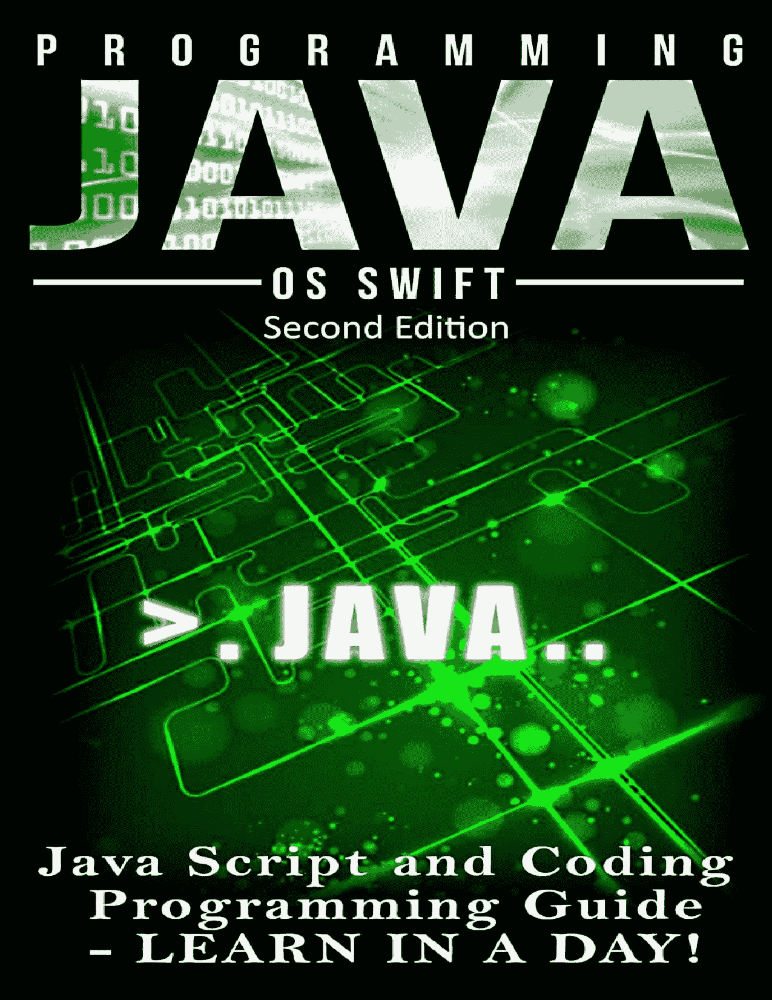
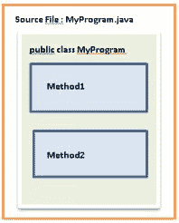

# Java 与 JavaScript 编程初学者指南 – 一天学会 · 第2版





今天，Java 已经成为一种重要的编程语言，对于任何对编程感兴趣的人来说，了解 Java 的基础知识几乎已成为必不可少的。本书正是为此目的而编写的。我想帮助任何几乎或完全没有先验编程经验的人轻松、高效地接触 Java 编程。

# 第 1 章：入门

## 安装

在开始一切之前，我们需要准备好开发环境。初学者可以使用在线开发环境（`https://ideone.com/`）来执行短小的代码段，但如果执行的代码是一个完整的程序，则必须在系统中安装 `java` 并设置好自己的离线开发环境。Java 有三种类型——

- 微型版 (`J2ME`)
- 标准版 (`J2SE`)
- 企业版 (`J2EE`)

对于个人使用，可以从[下载页面](http://www.oracle.com/technetwork/java/javase/downloads/index.html) 下载与其操作系统对应的最新 `SE` 版本的 `.exe`。安装后，检查 `PATH` 变量是否指向 `java` 安装路径。在终端窗口中执行 `java` 将显示屏幕上安装的 `java` 版本。

## 代码结构



每个 java 代码都以 `.Java` 扩展名保存。每个 java 程序包含一个或多个类。每个类包含一个或多个方法定义，每个方法内部包含几条语句。

## 关键字的语法和含义

```java
import java.io.*;;

public class MyFirstProgram {
    public static void main(String[] args) {
        //这是我的第一个 java 程序
        System.out.println(" Hello World !");
    }
}
```

`import java.io.*;` - 关键字 `import` 用于包含名为 `packages`（包）的 Java 库，这些包包含了可以在程序使用的预定义函数。

`public class MyFirstProgram` - 这是类定义，关键字 `public` 表示该类对所有人可见，`class` 表示一个类定义。

`MyFirstProgram` – 这是类的类名。带有 `main()` 函数的类名应与源代码文件名相同。

类定义封装在大括号 `{}` 之中。

`public static void main (String args [])`: 这是程序的主部分。由于 `main()` 是驱动函数，它应该始终是 `public`（公共的）。

`Static`: 你需要记住 `main()` 方法应该是 `static`（静态的），因为这使得程序内存效率更高。

`Void`: 这是方法的返回类型。这意味着 `main()` 方法不会返回任何内容。

`Main`: 方法名。解释器仅从 `main()` 方法开始执行。运行一个程序意味着指示 `JVM` 加载从源代码编译的 `.class` 文件并从 `main()` 方法开始执行。

main 方法的两个用途总结为：

1. 测试程序的所有方法
2. 启动程序的执行

`String[] args` 是传递给 `main` 方法的参数。该方法接收字符串数组作为输入参数，数组名称应始终为 `args`。

注意数据类型以大写字母 `S` 开，这是因为 `Strings` 是 Java 中的一个类，所有类名都以大写开头。

方法的定义封装在花括号 `{}` 之中，在这种情况下，我们希望程序执行的只是打印“Hello World!”

向标准输出控制台打印语句使用 `System.out.println("");`。注意所有语句必须以分号（`;`）结束。

你也可以使用 `System.out.print()` 显示输出，区别在于 print`ln` 在它打印的每个语句末尾引入一个换行。

我们程序中 `main()` 方法中的另一个语句被称为“注释”语句。这些语句不会被编译，这些以 `//` 开头的语句目的仅在于为程序员提供更多关于代码的信息。

Java 完全没有全局变量的概念；同样的功能可以通过 `final`、`static`、`public` 等关键字来实现。

### 使用 Java 库


当使用 `Java` 时，你会发现存在许多预定义的类。所有这些类都可以在 `Java` 程序中使用，这让用户无需再重复重复造轮子的任务。但要使用这些类，你应该对需要使用的内容以及在哪里找到它们有一些基础的知识。这些被称为 `Java APIs`。该库无非是一堆巨大的预定义类集合，这些类可以在程序中的任何地方被使用。它们包含了预定义的代码，用户只需要知道如何使用它们即可。这些库避免了用户编写长长的代码行。这也被称为 Java 标准代码库。在 `Java` 平台中，`Java standard code library` 主要有三个用途。它们是：

- 就像其他代码库一样，`Java libraries` 为程序员提供了一系列实用工具。这些工具包括正则表达式处理、容器类等。
- 标准代码库为用户提供了抽象接口，用户可以通过这些接口独立地执行任务。通过这种方式，用户无需为文件访问和网络访问等复杂过程编写完整的代码。
- 某些底层平台不支持所有的 `Java` 应用程序。在这种情况下，你可以使用 `Java library` 来模拟这些功能，或者使用它提供一种检查特定功能是否存在的方法。

### Java 标准代码库的实现与配置

标准库中的大部分代码都是用 `Java` 编写的。直接访问操作系统或硬件所需的代码除外。在这种情况下，使用 `Java native interface` 包装器来访问操作系统的 API。几乎所有的 `Java` 代码库都存储在一个名为 `rt.jar` 的存档文件中。该文件由 `JDK` 和 `JRE` 分发提供。`Java class library` 可以在引导类路径（bootstrap class path）中找到。

### Java 类库的主要特性

我们使用类来访问 Java 类库的功能。这些类属于包（packages）。`Java` 类库的一些主要特性如下：

- `java.lang` 拥有所有的基础接口和类。它们与运行时系统和语言紧密相关。
- 有一个专门用于数学运算的包，包括数学表达式、评估和任意精度小数。它们都存在于 `java.math` 库中。
- 工具类和集合：Java 为用户提供了内置的 `Utility` 类和数据结构。这些工具类和数据结构可以用于数据压缩、博客、并发和正则表达式。
- 2D 图形和图形用户界面：用户可以使用 `AWT` 包，该包提供了图形用户界面操作。此包绑定到原生系统。你可以用它来设计平台无关的工具包以及可插的外观和外观（feel and look）。此包还可以用于处理可编辑和不可编辑的文本组件。
- 音频：此包为用户提供了类和接口，可用于音频数据的写入、读取、合成和排序。
- 文本：`java.text` 接口用于处理文本、数字、消息和日期。
- 数据库：用户可以使用 `java.SQL` 库访问数据库 (`sql`）。
- `Java.Security` 提供了加密服务的安全性。`javax.crypto` 库中也存在加密服务。
- Java 还允许你访问脚本引擎。你可以使用 `javax.script` 包使用任何符合标准的脚本语言。
- Applets 程序：`Java.applet` 包允许你通过网络下载应用程序，并允许你在受保护的沙箱中运行它们。

# 第 2 章：面向对象编程

Java 的语法类似于 `C`，但其编程哲学源自 `C++` —— 也就是说，Java 是一种面向对象的语言。

在我们看到的第一个示例中，我们有一个类声明，并说 `main()` 函数负责程序中执行的操作，但这并不能让 Java 成为一种 OOP（面向对象）语言，让我们来看一个示例以更好地理解 OOP —— 对象和类。

## 过程化方法

这并不简单，因为之前的形状是确定的，动画代码可以假设一个中心点并旋转形状；而对于像变形虫这样不规则形状，它无法使用其他形状的代码进行旋转，相反，API 需要额外的几个参数来定义形状旋转的坐标。

## 面向对象方法

因此，你可以为每个形状编写一个类文件，这样通过简单地添加新类，就可以添加变形虫或修改旋转方法，而不会扰动现有代码。你只需要测试新类。引入的任何新问题都可以轻松地追踪到所做的新更改。

示例 1：

```java
class Movie{
    //variable Declaration
    //methods
}m1;   //m1 是类型为“Movie”的对象
```

示例 2：

```java
class Movie{
    //variable Declaration
    //methods
}

class TestMovie{
    public static void main(String[] args){
        Movie m1 = new Movie();  // m1 是类型为“Movie”的对象
        m1.variable = value;
        m1.method();
    }
}
```

# 第 3 章：变量声明与数据类型

下一个最重要且基础的概念是关于创建有用程序所需的“变量”和“数据类型”的知识。变量本质上是命名的位置，用于存储值。Java 是一种强类型语言，因此类型为 `x` 的变量只能持有类型为 `x` 的值。

例如：
`int n;`

在这里声明了一个类型为 `n` 的变量以确保 Java 的类型安全功能，这反过来有助于安全性。Java 中的变量可以是：
- 局部变量（`int`、`float`、`double` 类型）
- 引用变量（类的实例）

假设你声明了一个类型为 `int` 的变量，可能可以使用它来节省空间。如果不这样做，可能会溢出。还要注意，Java 默认认为带有小数点的任何都是 `double`，因此在给定的数字末尾附加 `f` 是重要的。`float f = 1.56f;`

变量命名的规则：
- 不要使用保留字作为变量名。
- 变量名不能以数字开头。

一些应该熟悉的 Java 关键字：

## 字符串

`String` 被声明为一个类。字符串上常用的操作有：
`String str = "Hello World";` // 声明
`int len = str.length();` // 获取字符串的长度
`int len = "hello Wolrd".length(); // 同样获取字符串的长度
`String concatStr = "hello"+"world";` // `+` 操作符可以重载以执行两个字符串的拼接

`String str1 = "Heloo";`
`String str2 = "World";`
`if (str1 == str2)` // 比较两个字符串
`System.out.println("strings are equal");`

## 引用变量

`Movie m1 = new Movie()`

左侧是声明，它指示 JVM 为到达实际对象的引用变量留空间。
`int[] n;` // 声明一个整数数组
`n = new int[5];` // 创建 5 个整数的数组

注意，即使是原始数据类型值的数组，数组也变成了对象。
`Movie[] mArray;` // 声明 Movie 类型对象的数组

大小：对于原始类型，引用变量没有预定义的大小。

## 等于操作

我们知道比较操作符 `==` 和 `!=` 可以用于原始操作符，但为了对对象执行比较操作，不能使用默认操作符，相反 Java 提供了 `equals` 关键字。

## 数组列表


这在 `java.util.ArrayList` 包中可用。

`ArrayList<String> myList = new ArrayList<String>();`

它允许声明不同数据类型的数组。它提供了多种方法来执行常见的数组操作，如 `add(elem)` `remove(index)` 用于从 `arrayList` 中添加/删除元素。还有如 `size()` 这样的 API 用于查找数组的长度，查找是否 `isEmpty()`，或者 arrayList 是否 `contains()` 给定元素。

让我们来看一个使用目前为止所学概念的示例，

```java
Class MyProgram{
public static void main(Strings[] args)
{
    //声明并赋值变量
    int num = 10;  
    float fNum = 10.5;
    //打印语句到控制台输出
    System.out.println(“The value of integer num is : ”+num);
    System.out.println(“The Value of integer fNum is : ”+fNum);
    num = num/2;
    fNum = fNum+num;
    System.out.println(“The value of integer num after operation is : ”+num);
    System.out.println(“The Value of integer fNum after operation is : ”+fNum);
}
}
```

输出：
The value of integer num is : 10
The value of integer fNum is : 10.5
The value of integer num after operation is : 5
The value of integer fNum after operation is  : 20.5

你只需要在 SoP (`System.out.println`) 语句中使用 `+` 运算符。

## 包装类 (Wrapper Classes)

正如我们所知，Java 是一种面向对象的编程语言，Java 中的一切内容都可以被视为对象。从简单的文件、图像、系统地址等任何内容在 Java 中都可以被视为对象。我们可以使用包装类来改变对象的类型。在本教程中，我们将介绍包装类及其细节。使用包装类，你可以将任何给定的数据类型转换为对象。

Java 中的所有原始数据类型都不是对象。这些原始数据类型不属于任何类。它们定义在 Java 语言本身中。我们可能会遇到需要将这些原始数据类型转换为对象的情况。例如，你可以通过将数据类型转换为对象来将其添加到向量或栈中。Java 设计引入了包装类来实现这些转换。

### 关于包装类

顾如其名，包装类封装（wrap）任何数据类型周围，赋予它对象的外观，并在需要该数据类型时可以使用它。这是一个可以逆转的过程。包装类不仅可以将数据类型转换为类，还可以解包装对象并返回数据类型。这就像巧克力上的包装纸一样。制造商将巧克力包装在包装纸中并发货。使用者拆掉包装纸以获得巧克力。

请看下面的转换，其中 `int` 数据类型被转换为对象。

```java
int k = 100;
Integer it1 = new Integer (k);
```

在上面的示例中，`int` 数据类型 `k` 使用包装类被转换为对象 `it1`。这是通过使用 `integer` 类实现的。每当需要 `K` 时，都可以使用对象 `it1`。

下面的代码展示了如何包装对象并从整数对象 `it1` 获取 `int` 数据类型。

```java
int m = it1.intValue();
System.out.println(m*m); // 输出 10000
```

### 包装类列表

在 Java 语言中，存在 8 种数据类型，每种类型都有自己的包装类。

| 原始数据类型 | 包装类 |
| :--- | :--- |
| byte | Byte |
| short | Short |
| int | Integer |
| long | Long |
| float | Float |
| double | Double |
| char | Character |
| Boolean | Boolean |

所有的包装类都可以在 `java.lang` 包中找到。它们被放置在那里，以便在每次导入时都能隐式地提供给程序员。为了避免继承，Java 设计师将这些包装类设为 `final`。

### 包装类的重要性

我们使用包装类有两个目的：

*   将简单数据类型转换为对象。这是通过给给定的数据类型赋予对象形式来实现。
*   将字符串转换为数据类型。对于这种转换，我们使用如 `parseXXX()` 等方法。

这里有一个示例程序，展示了数据类型到对象的转换，同时也获取了数据类型。

```java
public class WrappingUnwrapping
{
  public static void main(String args[])
  {
    //数据类型
    byte grade = 2;
    int marks = 50;
    float price = 8.6f; // 注意 float 对应的后缀 f
    double rate = 0.5; // 数据类型到对象
    Byte g1 = new Byte(grade); // 包装
    Integer m1 = new Integer(marks);
    Float f1 = new Float(price);
    Double r1 = new Double(rate);
    // 让我们从对象打印值
    System.out.println("Values of Wrapper (printing objects)");
    System.out.println("Byte object g1: " + g1);
    System.out.println("Integer object m1: " + m1);
    System.out.println("Float object f1: " + f1);
    System.out.println("Double object r1: " + r1);
    // 从整数对象获取 int 数据类型
    byte bv = g1.byteValue(); // 解包装
    int iv = m1.intValue();
    float fv = f1.floatValue();
    double dv = r1.doubleValue();
    // 打印数据类型值
    System.out.println("Unwrapped (printing objects)");
    System.out.println("Byte object g1: " + bv);
    System.out.println("Integer object m1: " + iv);
    System.out.println("Float object f1: " + fv);
    System.out.println("Double object r1: " + dv);
  }
}
```

# 第 4 章：控制语句

程序中的控制语句正如其名，控制着程序的整体执行流。它包含了条件语句 `if else`，或者迭代语句 `while()`、`do while()` 等。


## If else

语法：
```
if(condition)
    do action1;
else
    do action2;
```
当 `condition` 为真时执行动作，否则执行 `else` 部分的动作。

## Switch case

如果你需要检查多个条件，这种操作非常有用。Switch case 根据给定的值采取动作。

语法：
```
Switch(id)
{
    Case id1:
        Action;
        Break;
    Case id2:
        Action;
        Break;
    Default:
        ….
}
```

## While ()

这是一种迭代语句，只要条件为真就会执行动作。

语法：
```
while(condition)
{
    当条件为真时执行某些操作
}
```

## Do - while ()

这也是一种迭代操作，与 `while()` 循环相似，区别在于无论条件是否有效，循环至少执行一次，因为条件是在 `do` 语句之后才求值的。

语法
```
do{
    执行某些操作;
}while(condition);
```

## For 循环

语法：`for ( 初始化;条件;计数更新);`

示例：`for (int i=0; i<5; i++)`

这现在将精确执行 5 次语句。第一部分声明并初始化计数器变量，第二部分检查条件，如果为真则进入循环。循环完成后，执行递增。然后再次检查条件并重复相同的步骤，直到条件变为假。一旦条件为假，它就会退出循环。


整数 `Num` 的值为：3

整数 `Num` 的值为：2

整数 `Num` 的值为：1

整数 `Num` 的值为：5

整数 `Num` 的值为：5

整数 `Num` 的值为：5

整数 `Num` 的值为：5

整数 `Num` 的值为：5

上述程序使用了两个循环语句来执行操作。

### for 循环与 while 循环的：区别的区别：

如你所知，`for` 循环包含三个部分。它们分别是：初始化、布尔设置和迭代表达式。在这里，`while` 循环中没有内置的初始化或迭代表达式。它只包含布尔测试。当在你不知道条件返回 `true` 的循环次数时，使用 `while` 循环是很好的。如果循环次数是已知的，使用 `for` 循环是明智的，因为它更简洁。

这里是一个使用简单 `while` 循环的示例。

示例：

```java
public class Test {
  public static void main(String args[]) {
    int x = 10;
    while( x < 20 ) {
      System.out.print("value of x : " + x );
      x++;
      System.out.print("\n");
    }
  }
}
```

输出：

```
value of x : 10
value of x : 11
value of x : 12
value of x : 13
value of x : 14
value of x : 15
value of x : 16
value of x : 17
value of x : 18
value of x : 19
```

###更多关于 for 循环

在这里，我们将深入循环的细节。现在我们来看 `for` 循环。每个 `for` 循环由三个部分组成。它们是：

*   初始化（Initialisation）：在初始化部分，我们将使用一个合适的变量声明并初始化循环。我们在循环体内部使用它。我们在循环中使用的这个变量通常用作计数器。放在循环内部的变量数量并不局限于 1。你可以在循环体中放置任何数量可用计数器的变量。
*   布尔设置（Boolean set）：条件测试将放在循环的这部分。给定的条件无论是什么，必须解析为布尔值。你可以给出一个表达式，或者使用返回布尔的方法。
*   迭代表达式（Iteration expression）：在循环的这部分，你可以放置一个或多个希望每次循环运行时都发生的预期操作。始终记住，执行只会在循环结束时发生。

## 嵌套 for 循环：

你可以将一个 `for` 循环放在另一个 `for` 循环内部。这种结构被称为嵌套 for 循环。你可以在循环内部放置任意数量的循环。但建议嵌套深度不要超过五六层，因为这会让程序看起来很笨拙。汽车里程表的工作原理与嵌套 for 循环相同。另一个例子是日期或日历。正如我们所知，一天由小时、分钟和秒组成。在数字钟中，嵌套 for 循环的最后一个分支是秒计数器。在其上方是分钟计数器。在分钟计数器上是小时计数器。它是嵌套在嵌套中的嵌套中的嵌套循环。首先给出了嵌套 for 循环的语法。`for` 循环有三种形式。它们是：

形式 1 语法：

```java
for(initialization; test; increment)
{
  statements;
  while(expression)
  {
    statements;
  }
  do
  {
    statements;
  }while(expression);
}
}
```

形式 2 语法：

```java
for(initialization; test; increment)
{
  statements;
  for(initialization; test; increment)
  {
    statements;
    for(initialization; test; increment)
    {
      statements;
    }
  }
}
```

形式 3 语法：

```java
While(expression)
{
  statements;
  While(expression)
  {
    statements;
  }
}
```

这里是几个可以帮助你理解嵌套 for 循环工作原理的示例。

示例 1：使用嵌套 for 循环显示三角形的程序

```java
class NestedForLoopDemo
{
  public static void main(String args[]) {
    for(int i = 1; i <=5 ; i++) {
      for(int j = 1; j <= i; j++) {
        System.out.println("* ");
      }
      System.out.println("");
    }
  }
}
```

输出：

```
*
* *
* * *
* * * *
* * * * *
```

示例 2：打印表格的程序

```java
class NestedForLoop
{
  public static void main(String args[]) {
    int x = 10;
    while( x < 20 ) {
      System.out.print("value of x : " + x );
      x++;
      System.out.print("\n");
    }
  }
}
```
*(注：原文此处示例代码逻辑不完整，已保留翻译格式)*

示例 3：使用嵌套 for 循环显示三角形

```java
class NestedForLoopDemo
{
  public static void main(String args[]) {
    for(int i = 1; i <=5 ; i++) {
      for(int j = 1; j <= i; j++) {
        System.out.println("* ");
      }
      System.out.println("");
    }
  }
}
```


在这里，所有的引用变量都指向堆内存中的 `deer` 对象。

## 虚方法

在本节中，我们将观察被重写方法的行为。在 Java 中，当你设计 `class` 时，可以使用多态。在方法重写中，子类有能力重写父类中的方法。被重写的方法本质上被隐藏了。在子类使用 `super` 关键字之前，这个被重写的方法无法调用。`super` 关键字应该在被重写的方法中使用。

考虑以下示例。

```java
/* 文件名：Employee.java */

public class Employee
{
  private String name;
  private String address;
  private int number;

  public Employee(String name, String address, int number)
  {
      System.out.println("Constructing an Employee");
      this.name = name;
      this.address = address;
      this.number = number;
  }

  public void mailCheck()
  {
      System.out.println("Mailing a check to " + this.name
      + " " + this.address);
  }

  public String toString()
  {
      return name + " " + address + " " + number;
  }

  public String getName()
  {
      return name;
  }

  public String getAddress()
  {
      return address;
  }

  public void setAddress(String newAddress)
  {
      address = newAddress;
  }

  public int getNumber()
  {
      return number;
  }
}
```

如果我们如下所示扩展了 `Employee` 类：

```java
/* 文件名：Salary.java */

public class Salary extends Employee
{
  private double salary; //年薪资

  public Salary(String name, String address, int number, double salary)
  {
      super(name, address, number);
      setSalary(salary);
  }

  public void mailCheck()
  {
      System.out.println("Within mailCheck of Salary class ");
      System.out.println("Mailing check to " + getName()
      + " with salary " + salary);
  }

  public double getSalary()
  {
      return salary;
  }

  public void setSalary(double newSalary)
  {
      if(newSalary >= 0.0)
      {
          salary = newSalary;
      }
  }

  public double computePay()
  {
      System.out.println("Computing salary pay for " + getName());
      return salary/52;
  }
}
```

现在看下面的程序并尝试判断输出：

```java
/* 文件名：VirtualDemo.java */

public class VirtualDemo
{
  public static void main(String [] args)
  {
      Salary s = new Salary("George Martin", "Ambehta, UP", 3, 3600.00);
      Employee e = new Salary("John Adams", "Boston, MA", 2, 2400.00);
      System.out.println("Call mailCheck using Salary reference --");
      s.mailCheck();

      System.out.println("\n Call mailCheck using Employee reference--");
      e.mailCheck();
  }
}
```

输出：
```
Constructing an Employee
Constructing an Employee
Call mailCheck using Salary reference --
Within mailCheck of Salary class
Mailing check to George Martin with salary 3600.0
Call mailCheck using Employee reference--
Within mailCheck of Salary class
Mailing check to John Adams with salary 2400.0
```

在这个示例中，实例化了两个薪资对象。其中一个使用薪资引用 `s`，另一个是员工引用 `e`。

在编译期间，当调用 `s.mailCheck()` 时，编译器会查看 `mailCheck()` 方法。然后，Java 虚拟机会在运行时调用于 `salary` 类中存在的 `mailCheck()`。这发生在运行时。

现在，由于 `e` 是一个员工引用，调用 `mailCheck()` 的情况将有所不同。当调用 `e.mailCheck()` 时，编译器会找到 `mailCheck()`。该 `mailCheck()` 位于 `Employee` 类中。

编译器使用了来自 `Employee` 的 `mailCheck()` 来验证编译期间的语句。但在运行时，Java 虚拟机将去调用来自 `salary` 类的 `mailCheck()`。Java 中的这种特定行为被称为虚方法调用（virtual invocation method）或“虚方法调用”。在 Java 中，所有方法都以这种方式运行。重写的方法总会在运行时被调用，而不依赖于编译期间使用的数据类型引用。

### 抽象方法和类

抽象类可以定义为一个声明为抽象的类。它内部是否包含抽象方法并不重要。这些抽象类可以声明为抽象的。

```java
abstract abstract GraphicObject {
  // 声明字段
  abstract void methods

   void void(doubledouble delta
...（此处省略重复的点号）
```


*   `mammal` 类和 `reptile` 类都是 `animal` 类的子类。
*   `dog` 类是 `mammal` 类的子类，而它又是 `animal` 类的子类。

我们可以通过 `IS-A` 关系来观察这种关系。它如下：

*   `Mammal` 是 `Animal`（动物）
*   `Reptile` 是 `Animal`（动物）
*   `Dog` 是 `Mammal`（哺乳动物）
*   因此：`Dog` 也是 `Animal`（动物）

使用 `extends` 关键字允许子类继承父类的每一个属性，但私有属性除外。

使用实例运算符 `instanceof`，我们可以确保普通类实际上是 `animal` 类的实例。

示例：

```java
public class Dog extends Mammal{
  public static void main(String args[]){
    Animal a = new Animal();
    Mammal m = new Mammal();
    Dog d = new Dog();
    System.out.println(m instanceof Animal);
    System.out.println(d instanceof Mammal);
    System.out.println(d instanceof Animal);
  }
}
```

输出：这将会产生以下结果
true
true
true

### `instanceof` 运算符

在 Java 中，如果你想确定一个类是否属于某个特定的给定类或为了实现给定的接口，可以使用 `instanceof` 运算符。`instanceof` 运算符是一种类型比较运算符。`instanceof` 运算符根据类的状态返回 `true` 或 `false`。如果给定对象属于某个类，或者给定对象实现了某个接口，则 `instanceof` 运算符返回 `true`。否则，它将简单返回 `false`。

在下面的示例中，你可以看到 `instanceof` 运算符的使用。

```java
class Vehicle {
  String name;
  Vehicle() {
    name = "Vehicle";
  }
}

class dirtbike extends Vehicle {
  dirtbike() {
    name = "dirtbike";
  }
}

class atv extends dirtbike {
  atv() {
    name = "atv";
  }
}

class LightVehicle extends Vehicle {
  LightVehicle() {
    name = "LightVehicle";
  }
}

public class InstanceOfExample {
  static boolean result;
  static dirtbike hV = new dirtbike();
  static atv T = new atv();
  static dirtbike hv2 = null;
  public static void main(String[] args) {
    result = hV instanceof dirtbike;
    System.out.print("hV is an dirtbike: " + result + "\n");
    result = T instanceof dirtbike;
    System.out.print("T is an dirtbike: " + result + "\n");
    result = hV instanceof atv;
    System.out.print("hV is a atv: " + result + "\n");
    result = hv2 instanceof dirtbike;
    System.out.print("hv2 is an dirtbike: " + result + "\n");
    hV = T; // 成功将子类转换为父类
    T = (atv) hV; // 成功将父类转换为子类
  }
}
```

输出
hV is an dirtbike: true
T is an dirtbike: true
hV is a atv: false
hv2 is an dirtbike: false

注意：`hv2` 没有引用 `dirtbike`，`instanceof` 返回 `false`。你应该记住，你不能对兄弟类级类使用 `instanceof`。

### `implements` 关键字

现在你已经对 `extends` 关键字有了良好的理解，我们将查看 `implements` 关键字以及它如何用于获取 `IS-A` 关系。我们使用 `implements` 关键字让类继承接口。你应该记住，接口不能被类扩展，只能被实现。

示例：

```java
public interface Animal {}
public class Mammal implements Animal {}
public class Dog extends Mammal {}
```

### `instanceof` 关键字

在这里我们将查看 `instanceof` 运算符。我们使用这个运算符来判断类是否是其父类的实例。

```java
interface Animal{}
class Mammal implements Animal{}
public class Dog extends Mammal{
  public static void main(String args[]){
    Mammal m = new Mammal();
    Dog d = new Dog();
    System.out.println(m instanceof Animal);
    System.out.println(d instanceof Mammal);
    System.out.println(d instanceof Animal);
  }
}
```

输出：
true
true
true

### `HAS-A` 关系

这种关系的主要用法是组合关系。如果某个特定类拥有（HAS-A）某个东西，我们就说两个对象之间存在这种关系。这种关系的主要用途有助于减少 Bug 和代码重复。

这里是一个显示对象之间存在 `HAS-A` 关系的示例。

示例：

```java
public class Vehicle{}
public class Speed{}
public class Van extends Vehicle{
  private Speed sp;
}
```

上面的示例告诉我们 `van` 拥有 `speed`。如果我们专门为 `speed` 创建一个类，就可以在不同的应用程序中反复使用它。

在 Java 中，类只能有单继承。Java 不支持多继承。每个类都被限制使用 `extends` 关键字进行单继承。然而，类允许实现多个接口。通过这种方式可以获得多继承的效果。

`public class extends Animal, Mammal {}`

# 第 7 章：对象的生命与死亡

## 构造函数

在 Java 中，构造函数可以定义为一种特殊方法，用于初始化对象。构造函数在对象创建时被调用。它是为了构造对象的值。

### Java 中创建构造函数的规则

在 Java 中创建构造函数有两个基本规则：
* 构造函数的名称与类名完全相同
* 它们不应该有显式的返回值

### 构造函数的类型

在 Java 中，我们有两种构造函数：
* 默认构造函数（无参构造函数）
* 参数构造函数

我们将详细查看它们。

#### Java 默认构造函数

Java 默认构造函数是不带任何参数的构造函数。

默认构造函数的语法：`<class_name>()()`

这是一个简单的默认构造函数的示例。

示例：

```java
class Bike1{
  Bike1(){System.out.println("Bike is created");}
  public static void main(String args[]){
    Bike1 b=new Bike1();
  }
}
```

输出：
Bike is created

这是一个给定默认值的示例。在没有定义任何构造函数的情况下，编译器为你的代码提供一个默认构造函数，并给出 `0` 和 `null` 值。

示例：

```java
class Student3{
  int id;
  String name;
  void display(){System.out.println(id+" "+name);}
  public static void main(String args[]){
    Student3 s1=new Student3();
    Student3 s2=new Student3();
    s1.display();
    s2.display();
  }
}
```

输出：
null
null

#### Java 中的参数构造函数

如果 Java 构造函数带有参数，则被称为参数构造函数。

我们为什么应该使用参数构造函数？

当我们给不同的对象赋予不同的值时，使用参数构造函数。这里有一个参数构造函数的示例。在下面的示例中，给学生类提供了两个参数。参数构造函数可以定义任意数量的参数。

示例：

```java
class Student4{
  int id;
  String name;
  Student4(int i,String n){
    id = i;
    name = n;
  }
  void display(){System.out.println(id+" "+name);}
  public static void main(String args[]){
    Student4 s1 = new Student4(111,"David");
  }
}
```


```java
    Student4 s2 = new Student4(222,"Aryan");

    s1.display();

    s2.display();

  }

}
```

**Output:**
111 David
222 Aryan

### Java 中的构造方法重载

构造方法重载是 Java 中的一种技术，通过为一个类提供任意数量具有不同参数的构造方法。这些方法可以具有相同的参数数量，但参数内容不同。编译器会根据参数列表及其类型进行比较。

以下是构造方法重载的示例。

Example:

```java
class Student5{

    int id;

    String name;

    int age;

    Student5(int i,String n){
    id = i;
    name = n;
    }

    Student5(int i,String n,int a){
    id = i;
    name = n;
    age=a;
    }

    void display(){System.out.println(id+" "+name+" "+age);}

    public static void main(String args[]){
    Student5 s1 = new Student5(111,"David");
    Student5 s2 = new Student5(222,"Aryan",25);
    s1.display();
    s2.display();
  }

}
```

**Output:**
111 David 0
222 Aryan 25

### Java 中的拷贝构造方法

虽然我们称之为拷贝构造方法，但在 Java 中并没有这种特定的东西。如果你希望将特定对象的值拷贝到不同的对象中，可以使用以下方法。

*   使用构造方法
*   将对象的值赋值给另一个对象
*   你可以使用 `clone()` 方法。它属于 `object` 类。

以下是一个示例，我们将一个对象的值拷贝到另一个构造方法中。

Example:

```java
class Student6{

    int id;

    String name;

    Student6(int i,String n){
    id = i;
    name = n;
    }

    Student6(Student6 s){
    id = s.id;
    name =s.name;
    }

    void display(){System.out.println(id+" "+name);}

    public static void main(String args[]){
    Student6 s1 = new Student6(111,"David");
    Student6 s2 = new Student6(s1);
    s1.display();
    s2.display();
  }

}
```

**Output:**
111 David
111 David

### 不使用构造方法的值拷贝

正如我们之前讨论过的，我们可以在不使用构造方法的情况下将对象的值拷贝到不同的对象。在这种情况下，你不需要创建构造方法。只需通过将该对象的值赋值给另一个对象来拷贝。在下面的示例中，我们没有使用构造方法，而是通过赋值进行拷贝。

Example:

```java
class Student7{

    int id;

    String name;

    Student7(int i,String n){
    id = i;
    name = n;
    }

    Student7(){}

    void display(){System.out.println(id+" "+name);}

    public static void main(String args[]){
    Student7 s1 = new Student7(111,"David");
    Student7 s2 = new Student7();
    s2.id=s1.id;
    s2.name=s1.name;
    s1.display();
    s2.display();
  }

}
```

**Output:**
111 David
111 David

## Java 中的垃圾回收

Java 中的垃圾可以定义为 Java 中未被引用的对象。清除垃圾以回收未使用内存的过程被称为垃圾回收。简单来说，垃圾回收意味着销毁所有使用的对象。与 C 和 C++ 不同，垃圾回收是 Java 中的自动过程。这就是 Java 为用户提供更好的高效内存管理的原因之一。

垃圾回收的优点：

*   垃圾回收通过移除所有未引用的对象提高了内存效率。这些对象使用堆内存，垃圾回收会清理这些内存。
*   用户不需要手动执行垃圾回收，因为 Java 中的垃圾回收过程是自动的。因此，我们不需要投入额外精力管理内存。Java 虚拟机会处理这些内存清理。

你有三种方法可以释放对象。它们是：

*   置空引用：通过移除对象的引用可以从堆内存中移除对象。这是一个示例。
```java
Employee e=new Employee();
e=null;
```
*   将对象的引用赋值给另一个对象：移除对象的引用并将其交给另一个对象，会导致第一个对象没有引用。正如我们所知的，没有引用的对象将被释放。如下给出的示例。在以下示例中，对象 `e1` 的引用被赋给了 `e2`。这使得 `e1` 具备垃圾回收条件。
```java
Employee e1=new Employee();
Employee e2=new Employee();
e1=e2;
```
*   使用匿名对象：这是释放对象的第三种方法。在这里我们将创建一个对象。示例：
```java
new Employee();
```

# 第 8 章：类型转换

## 通过对象引用类型转换

在 Java 中，你可以将对象的引用转换为不同的对象引用。这被称为类型转换。类型转换不仅限于类本身。你可以测试父类或子类类型或接口。类型转换有编译时和运行时规则。对于给定的类型，任何对象都可以赋值。因为我们使用的类是所有类的基类。Java 有两种类型转换。它们是：

*   向上转型
*   向下转型

类型转换可以隐式或显式进行。如果从低数据结构转换为高数据结构，则是隐式类型转换。Java 不会自动执行向下转型。向下转型应由用户显式进行。从高数据结构转换为低数据结构的类型转换必须小心，因为如果强制执行将涉及大量数据。Java 虚拟机在需要时执行向上转型。例如，如果有几个数据类型其中一个是高数据类型，`JVM` 将所有其他低数据类型转换为高数据类型。在上述情况下向下转型会导致高类型对象数据的丢失。在运行时，可能会出现名为 `ClassCastException` 的情况，即正在进行类型转换的对象与其转换的目标类型不兼容。这是一个解释 `ClassCastException` 的示例。

Example:

```java
//X 是 Y 和 Z 的父类，它们是兄弟关系。
public class RunTimeCastDemo {
    public static void main(String args[]) {
        X x = new X();
        Y y = new Y();
        Z z = new Z();
        X xy = new Y(); // 正确（向上转型）
        X xz = new Z(); // 正确（向上转型）
        Y yz = new Z(); // 类型不兼容（兄弟关系）
        Y y1 = new X(); // 不是 Y
        Z z1 = new X(); // 不是 Z
        X x1 = y; // 正确（y 是 X 的子类）
        X x2 = z; // 正确（z 是 X 的子类）
        Y y1 = (Y) x; // 编译通过但运行时错误
        Z z1 = (Z) x; // 编译通过但运行时错误
        Y y2 = (Y) x1; // 编译并运行正常（x1 是 Y）
        Z z2 = (Z) x2; // 编译并运行正常（x2 是 Z）
        Y y3 = (Y) z; // 类型不兼容（兄弟关系）
        Z z3 = (Z) y; // 类型不兼容（兄弟关系）
    }
}
```


当对对象引用进行赋值时，将执行隐式类型转换。在这里，对象的引用将被赋值给：

*   与类类型相同的引用变量。该类是实例化给定对象的类。每个类的父类都是一个作为对象的类。
*   具有该数据类型的可用引用，该类型是实例化对象的类所实现的接口。

这里有一个示例展示了接口 `Automobile`、父类 `Bike` 和子类 `Ducati`。在这里你可以看到编译器处理的给定对象引用的自动转换。

```java
interface Automobile{

}

class Bike implements Automobile{

}

class Ducati extends Bike{

}
```

示例：假设 `c` 是 `bike` 类类型的变量，`f` 是 `Ducati` 类类型，`v` 是一个车辆接口引用。我们可以将 `Ducati` 引用赋值给 `bike` 变量：即我们可以执行以下操作

### 示例 1
```
c = f; // 正常，编译通过
```
其中 `c = new bike();`
且 `f = new Ducati();`
编译器会自动处理转换（赋值），因为这些类型是兼容的（子类 – 父类关系），即 `bike` 类型可以持有 `Ducati` 类型，因为 `Ducati` 是一个 `bike`。

### 示例 2
```
v = c; // 正常，编译通过
c = v; // 从接口类型到类类型的非法转换会导致编译错误
```
其中 `c = new bike();`
且 `v` 是一个 `Vehicle` 接口引用 (`Vehicle v`）
编译器会自动处理转换（赋值），因为这些类型是兼容的（类 – 接口关系），即 `bike` 类型可以转换为 `Vehicle` 接口类型，因为 `bike` 实现了 `Vehicle Interface`（`bike` 是一个 `Vehicle`）。

## 对象引用转换：显式转换

在 Java 中，当隐式类型转换不起作用或效率不高时，我们有时必须显式进行类型转换。这种转换非常简单，只需要在匹配的括号内指定新“类型”的名称。在这里我们将查看 `bike` 和 `Ducati` 类的相同示例。

```java
class bike {
    void bikeMethod(){
    }
}

class Ducati extends bike {
    void DucatiMethod () {
    }
}
```

在这里你可以看到我们还有一个 `breakingSystem()` 函数。该函数接受引用 `bike` 作为其输入参数。无论对象类型如何，方法都将调用 `bikeMethod()`。这也会调用 `DucatiMethod()`。如果你想在运行时确定对象的类型，可以使用 `instanceof` 算符。

```java
public void breakingSystem (bike obj) {
    obj.bikeMethod();
    if (obj instanceof Ducati)((Ducati)obj).DucatiMethod ();
}
```

该操作告诉编译器将作为对象引用的对象 `bike` 视为一个 `Ducati` 对象处理。在这里，如果不进行转换，编译器将给出错误信息，说明在 `bike` 的定义中找不到 `DucatiMethod()`。

接下来的示例程序将向你展示与引用使用转换运算符。在这个类中，`Honda` 和 `Ducati` 是兄弟关系。这两个类都是 `bike` 类的某些子类。它们都拥有 `dirtvehicle` 类，这是一个扩展的对象类。任何无法显式扩展另一个类的类，默认情况下都会由对象自动扩展。以下代码实例化了一个特定类的给定对象（在本例中为 `Ducati` 类），并将对象的引用赋值给 `bike` 类型的变量。这种赋值是被允许的，因为 `bike` 类是 `Ducati` 的父类。为了使用类类型的引用来调用方法，应该定义该方法。并且该方法应该定义在给定类的类层次结构之中或之上。

**示例程序：**

```java
class bike extends Object {
    void bikeMethod() {
    }
}

class dirtbike extends Object {
}

class Ducati extends bike {
    void DucatiMethod() {
        System.out.println("I am DucatiMethod defined in Class Ducati");
    }
}

class Honda extends bike {
    void DucatiMethod() {
        System.out.println("I am DucatiMethod defined in Class Ducati");
    }
}

public class ObjectCastingEx {
    public static void main(String[] args) {
        bike obj = new Ducati();
        // 以下操作将导致编译错误
        obj.DucatiMethod(); // 因为 bike 类型未定义 DucatiMethod
        // 以下操作将导致编译错误
        ((dirtbike)obj).DucatiMethod(); // DucatiMethod 在 dirtbike 类型中未定义
        // 以下操作将编译并运行
        ((Ducati) obj).DucatiMethod(); 
        // hondaObj = (Ducati)obj; 无法转换，因为它们是兄弟关系
    }
}
```

Java 允许将对象引用转换为字符串。这是在处理集合（collections）时常见的类型转换之一。

**示例：**

```java
import java.util.Vector;

public class StringCastDemo {
    public static void main(String args[]) {
        String username = "asdf";
        String password = "qwer";
        Vector v = new Vector();
        v.add(username);
        v.add(password);
        // String u = v.elementAt(0); 无法转换
        Object u = v.elementAt(0);
        System.out.println("Username: " + username);
        System.out.println("Password: " + password);
    }
}
```


在编译时进行检查的异常被称为**检查异常**（checked exceptions）。在这种情况下，如果一个方法抛出了检查异常，应该通过使用 `try-catch` 块对其进行处理，或者使用 `throws` 关键字对其进行声明。如果没有遵循上述任一方法，编译器将给出编译错误。由于这些异常在编译期间被检查，因此它们被称为检查异常。这里是一个示例，可以帮助你理解检查异常。

在这个示例中，有一个文件 `myfile.txt`。数据将从该文件中读取并显示在屏幕上。该程序中有三个检查异常，在下方列出。

### 示例：

```java
import java.io.*;

class Example {  

  public static void main(String args[])
  {
      FileInputStream fis = null;
      /*此构造函数 FileInputStream(File filename)
           * 会抛出 FileNotFoundException，这是一个检查
           *异常*/
      fis = new FileInputStream("B:/myfile.txt");
      int k;
      /*FileInputStream 类的 read() 方法也会抛出
           * 一个检查异常：IOException*/
      while(( k = fis.read() ) != -1)
      {
          System.out.print((char)k);
      }
      /*close() 方法关闭文件输入流
           * 它抛出 IOException*/
      fis.close();            
  }
}
```

### 输出：

```
Exception in thread "main" java.lang.Error: Unresolved compilation problems:
Unhandled exception type FileNotFoundException
Unhandled exception type IOException
Unhandled exception type IOException
```

在上面的示例中，检查点和异常在编译期间被编译器检查了，由于由于我们没有声明这些异常，程序显示了编译错误消息。

下面是更多的几个检查异常：

- `SQLException`
- `IOException`
- `DataAccessException`
- `ClassNotFoundException`
- `InvocationTargetException`

## 未检查异常 (Unchecked exceptions)

未检查异常本质上是指在编译期间不进行检查的异常。这些异常不会产生编译错误，因为它们在编译期间无法被检查。你是否声明了异常并不重要。未检查异常通常由于用户在与程序交互时提供的数据。处理这些异常的唯一方法是预见到它们并为该异常编写适当的处理器。`RuntimeException` 类是所有未检查异常的父类。这里有一个示例，可以帮助你更好地理解未检查异常。

```java
class Example {  

  public static void main(String args[])
  {
      int num1=10;
      int num2=0;
      /*由于我正在用 0 除以一个整数
           * 它应该抛出 ArithmeticException*/
      int res=num1/num2;
      System.out.println(res);
  }
}
```

如果你编译上面的代码，你会发现编译将成功完成，但是如果你运行它，程序将抛出一个名为 `ArithmeticException` 的异常。通过这一点，你知道检查异常不是在编译期间抛出错误，而是在运行时。是另一个示例。

### 示例：

```java
class Example { 
public static main(String args[])
{
      int arr[] ={1,2,3,4,5};
      /*我的数组只有 5 个元素，但
         * 我正尝试显示第 8
         * 个元素的值。它应该抛出
         * ArrayIndexException*/
      System.out.println(arr[7]);
}
```

在这个示例中，与上一个一样，将会有编译时错误。但是这段代码在运行时会抛出一个名为 `ArrayIndexOutOfBoundsException` 的未检查异常。这些异常在编译期间无法找到，并不意味着它们没有被编译器忽略。在上面的示例中，添加一条建议用户提供范围内的数值的消息将是明智的。添加消息后的代码如下。

```java
class Example { 
     public static void main(String args[])
     {
      try{
          int arr[] ={1,2,3,4,5};
          System.out.println(arr[7]);
      }catch(ArrayIndexOutOfBoundsException e){
          System.out.println("指定的索引在数组中" + "不存在。请修正错误。");
      } 
  }
}
```

以下是一些在运行时常见的某些未检查异常：

- `NullPointerException`
- `ArrayIndexOutOfBoundsException`
- `ArithmeticException`
- `IllegalArgumentException`

## 异常 (Exception) 与错误 (Error) 的区别：

**异常 (Exceptions)**：异常发生在代码内部，可以由开发者处理。当异常发生时，开发者可以采取必要的行动。下面是异常的几个示例：

- `DivideByZeroException`
- `NullPointerException`
- `ArithmeticException`
- `ArrayIndexOutOfBoundsException`

**错误 (Errors)**：错误与异常不同。它们是系统尝试不处理的异常状况。当错误发生时，它表示系统遇到了严重问题。它们定义了程序在通常情况下无法解决的问题。错误的几个示例是：

- `Hardware error`（硬件错误）
- `Memory error`（内存错误）
- `JVM error`（JVM 错误）

## 异常处理 (Exception Handling)

异常处理是一种强大的机制，可以处理运行时错误。异常处理确保了程序的正常流得以维持。

### 异常处理的几个优点

- 如果程序中编写了异常处理，异常处理允许用户控制程序的执行流。
- 每当发生错误时，都会抛出一个异常。调用方法将处理遇到的错误。
- 通过使用不同的代码块，异常处理可以区分并组织不同类型的错误。

我们将查看几个异常处理的示例。

### 示例：

```java
class Division {

public static void main(String args[]) {
int a, b, result;
Scanner input = new Scanner(System.in);
System.out.println("输入两个整数");
a = input.nextInt();
b = input.nextInt();
// try 块
try {
  result = a / b;
  System.out.println("结果 = " + result);
}
// catch 块
catch (ArithmeticException e) {
  System.out.println("捕获异常：除以零。");
}
}
}
```


Java 和 JavaScript 唯一的相似之处在于它们的名字听起来相似。在功能和概念方面，这两种语言是完全不同的。JavaScript 脱颖于 Java 和 C++ 等面向对象编程语言的特点在于，它的对象可以在运行时被创建或修改。为了实现这一点，可以在空对象上添加方法（Methods）和属性（properties）。一旦创建了对象，它可以在创建其他相似对象的过程中像原型一样使用。变量参数列表、源码恢复、动态脚本创建、动态对象创建函数变量等都是 JavaScript 拥有的动态能力。

# JavaScript 基础

## 在 JavaScript 中存储数据

- **本地存储 (Local Storage)**：本地存储用于永久存储数据。通过这种方式，可以随时访问页面上的数据。本地存储没有过期时间。如果用户希望数据在一段时间内被反复使用，就可以使用本地存储。
- **会话存储 (Session Storage)**：会话存储与本地存储不同，因为它只保存单个会话的数据，并在用户关闭页面后释放数据。这种存储通常用于预订票务等网页。

### 使用变量数据和常量数据存储数据

`Variables`（变量）和 `Constants`（常量）存储 JavaScript 中使用的数据和值。它们在 JavaScript 中都有自己的重要性。并不是所有存储的数据都可以设为常量。时间倒计时等过程使用变量，而 `Constants` 则用于不会改变的数据。

- **变量数据 (Variable Data)**：顾其名，这种随时间改变值的数据被称为变量数据。这种数据在 JavaScript 中被广泛使用。变量在本质上是动态的。
- **常量数据 (Constant Data)**：常量数据是指永远不会改变值的东西。这种数据随时间推移保持不变。这种数据是静态的。我们将这种数据用于无法修改的数据。

## 创建变量和常量

### 声明变量

通过在名称加上 `var` 关键字来声明变量。例如，如果你想将 `group` 为一个变量，只需在 `group` 之前添加 `var` 关键字。每个变量都应该以 `;`（分号）结尾。这使得语句成为自包含。在使用单词时需要注意，因为 JavaScript 是区分大小写的。因此，使用的字母必须与原始声明中的字母完全一致。

例：`var Dell;`

上面的对象 `Dell` 被声明为一个变量。

### 声明常量

在名称之前使用 `const` 关键字使其变为常量。这种声明就像声明常量一样。

例：`const Book;`

在上面的示例中，`Book` 被制为了常量。

## JavaScript 中的决策

总是会出现这种情况：我们必须在面前的两条路径中选择其一。这时我们能够实现如 `if` 和 `else` 等条件语句。

`if` 和 `else` 语句可以用于决策。这将允许程序选择正确的路径。

JavaScript 支持以下条件语句：
1. `if` 语句
2. `if...else` 语句
3. `if...else if...` 语句

**if 语句**：
`if` 是用于决策的基础性语句。在 `if` 语句中添加一个条件，如果给定的条件成立，则可以给出一组语句。

语法：
```
if(condition){
要执行的语句
}
```

示例：
```html
<script type="text/javascript">
<!--
var age = 20;
if( age > 18 ){
  document.write("<b>Allowed inside the pub.</b>");
}
//-->
</script>
```
输出：Allowed inside the pub. （如果给出的数字大于 18）

**if else 语句**：
这是 `if` 语句的扩展。如果 `if` 语句为假，系统将运行代码并执行 `else` 块中的语句。

语法：
```
if(condition)
 {statements}
else{statements}
```

示例：
```html
<script type="text/javascript">
<!--
var age = 15;
if( age > 18 ){
  document.write("<b>Allowed inside the pub</b>");
}else{
  document.write("<b>Is not allowed.</b>");
}
//-->
</script>
```
输出：
Allowed inside the pub （如果给出的数字大于 18）
Not allowed （如果给出的数字小于 18）

**if else if**：
这相当于在 if else 语句中添加了另一个步骤。它用于使用一系列条件的情况。

语法：
```
if(condition){statements};
else if(condition){statements}
else if(condition){statements}
else{statements}
```

示例：
```html
<script type="text/javascript">
<!--
var book = "JAVASCRIPT";
if( book == "JAVA" ){
  document.write("<b>JAVA Book</b>");
}else if( book == "JAVASCRIPT" ){
  document.write("<b>JAVASCRIPT Book</b>");
}else if( book == "DBMS" ){
  document.write("<b>DBMS Book</b>");
}else{
  document.write("<b>UNKNOWN Book</b>");
}
//-->
</script>
```
输出：JAVASCRIPT book

**嵌套 if**
`nested if` 是在另一个 `if` 语句内部的 `if` 语句。

语法：
```
if(condition){statement}
```

**switch 语句**
`switch` 语句将由一个表达式跟随多个语句。语句将根据表达式执行。

语法：
```
switch (expression)
{
case 1:
语句
case 2:
语句
... n
default:
语句
}
```

## JavaScript 中的循环

### for 循环
如果希望反复执行相同的代码，就会使用循环。`for` 循环是可以制作的循环之一。`for` 循环简单紧凑。它包含以下三点：
1. 初始化语句在循环开始前执行。
2. 只有当给定的条件为真时循环执行。测试代码执行一次。
3. 迭代计数器可以增加或减少。

语法：
```
for (初始化; 测试条件; 迭代){
条件为真时执行的语句
}
```

示例：
```html
<script type="text/javascript">
<!--
var count;
document.write("This will repeat for 10 times" + "<br />");
for(count = 0; count < 10; count++){
  document.write("Currently repeated : " + count );
  document.write("<br />");
}
document.write("Done!!");
//-->
</script>
```
输出：
This will repeat for 10 times
Currently repeated : 0
Currently repeated : 1
Currently repeated : 2
Currently repeated : 3
Currently repeated : 4
Currently repeated : 5
Currently repeated : 6
Currently repeated : 7
Currently repeated : 8
Currently repeated : 9
Done!!

# 第 11 章：JavaScript 中的函数和事件

## 什么是函数？
在程序中任何地方需要重复调用的代码组被称为函数。它减少了人们重复编写相同代码的时间精力。通过使用函数可以编写模块化代码。通过函数可以将大型程序划分为许多或所需的数量。

如 `write()` 和 `alert()` 等是默认函数。JavaScript 为用户提供了许多可以直接使用的函数。

JavaScript 还允许创建自己的自定义函数。

### 函数定义
函数在使用之前应该先进行定义。`function` 关键字是 JavaScript 中定义函数的常用方法。它后面应该跟着唯一的函数名和参数列表。它还应该包含一个带有大括号的语句块。

语法：
```html
<script type="text/javascript">
<!--
function functionname(parameter-list)
{
  语句
}
//-->
</script>
```


示例：在下面的示例中，有一个简单的函数程序。

```javascript
function simplefunction()
{
  alert("This is a simple function");
}
```

### 调用函数

在 JavaScript 中调用函数，应该按照如下方式编写该函数的名称。

```javascript
simplefunction();
```

## 函数的参数：

在 JavaScript 中，函数也可以带有参数传递。在调用函数时，可以在 JavaScript 中传递不同的参数。可以通过传递的参数（位于函数内部）进行操作。使用逗号来分隔函数中的多个参数。

### 示例：

在接下来的示例中，我们将修改 `simplefunction` 函数。现在，我们将使用两个参数。

```javascript
function simplefunction(name, age)
{
  alert( name + " is " + age + " years old.");
}
```

该函数可以被调用。可以如下所示进行调用。

```javascript
simplefunction('Zara', 7 );
```

### return 语句：

如果用户希望从函数获取返回值，可以在 JavaScript 函数中添加一个可选的 `return` 语句。`return` 语句始终应该是函数的最后一条语句。

例如，用户可以在特定函数中传递两个不同的数字，并期望函数在程序中返回这两个数字的乘积。

### 示例：

```javascript
function concatenate(first, last)
{
  var full;
  full = first + last;
  return full;
}
```

现在可以这样调用该函数：

```javascript
var result;
result = concatenate('Zara', 'Ali');
alert(result );
```

## JavaScript 中的事件

### 事件（EVENT）：

事件处理 JavaScript 与 HTML 之间的交互。当用户或浏览器操作页面时，就会执行这种操作。

一切都是事件。页面加载是一个事件。当用户通过点击选择某些内容时，该点击也被视为一个事件。事实上，用户执行的任何操作如关闭窗口、选择链接、按下键、关闭标签页、调整窗口大小等，都是事件的示例。

在 JavaScript 中编写的响应通过这些事件执行，例如关闭窗口、要显示的文本、显示的警告、确认消息或任何可能发生的类型响应。

事件是文档对象模型 (DOM) Level3 的一部分。每个 HTML 元素都提供一组事件。这些事件会触发 JavaScript 中的代码。

#### onclick 事件类型：

这是一种事件，在点击时会显示所需的验证或警告等。这种类型被广泛使用。

示例：下面的代码当点击 onclick 上的 hello 按钮时，它会触发 `events` 函数。

```html
<html
<head>
<script type="text/javascript">
function events() {
  alert("Hello World")
}
</script>
</head>
<body>
<input type="button" onclick="sayHello()" value="Say Hello" />
</body>
</html>
```

#### onsubmit 事件类型：

`onsubmit` 事件是另一个重要的事件类型。当在此处提交表单时，会发生验证。只有当函数返回 `true` 时，文本才会被发送。

示例：

```html
<html
<head>
<script type="text/javascript">
function validation() {
  // 所有验证逻辑都放在这里
  .........
return either true or false
}
</script>
</head>
<body>
<form method="POST" action="t.cgi" onsubmit="return validate()">
.......
<input type="submit" value="Submit" />
</form>
</body>
</html>
```

# 第 12 章：JavaScript 调试

在编写程序时，有很多机会出现错误。脚本中的此类错误被称为 bug（缺陷）。

调试是修复 bug 的。在开发过程中，调试是正常工作的一部分。我们编写的代码可能有逻辑错误或语法错误，这些错误很难被识别。很多时候，当 JavaScript 代码包含错误时，什么都不会发生。没有消息指示程序中存在错误。

## 使用 JavaScript 验证器

如果有人想检查代码中的 bug，则必须确保它是有效代码，并通过运行一个名为 Validating parsers（验证解析器），简称 Validators（验证器）的程序来检查它是否遵循语言的官方语法规则。它们通常与 JavaScript 编辑器和商业 HTML 编辑器一起提供。

访问网页后，将代码粘贴到文本区域，点击 `jsint` 按钮。该程序将解析我们的 JavaScript 代码，以确保所有变量和函数定义都符合正确的语法。

## 在程序中添加调试代码：

`alert()` 或 `document.write()` 方法有助于调试你的代码。例如：

```javascript
var debugging = true;
var whichImage = "widget";
if( debugging )
  alert( "Calls swapImage() with argument: " + whichImage );
var swapStatus = swapImage( whichImage );
if( debugging )
  alert( "Exits swapImage() );
```

## 使用 JavaScript 调试器

调试器是一个允许程序员控制脚本执行的应用程序。

调试器方便用户检查脚本的流程。脚本逐行运行，并可以指示在特定的断点处停止。程序员可以检查脚本的状态并在执行完成后检查变量。

## 表单验证

当用户输入信息并点击提交按钮时，会发生表单验证。服务器必须向用户发送数据并要求用户重新提交有效信息。这发生在用户未能输入所有必要信息时。

在将表单发送到网络浏览器之前，JavaScript 对表单进行验证。通常通过两个函数进行验证：

- **基础验证**——确保每个必填字段都提供了数据，首先需要检查表单。为了检查数据，需要遍历每个字段。
- **数据格式验证**——检查是否输入了正确或有效的数据。

### 基础表单验证：

让我们看看如何进行基础表单。当提交事件发生时，我们调用 `validate()` 函数来验证数据。`validate()` 函数实现如下：

```javascript
function validate()
{
// 验证代码将放在这里
  if( document.myForm.Name.value == "" )
  {
    alert( "请输入姓名!" );
    document.myForm.Name.focus() ;
    return false;
  }
  if( document.myForm.EMail.value == "" )
  {
    alert( "请输入您的邮箱 ID!" );
    document.myForm.EMail.focus() ;
    return false;
  }
  if( document.myForm.Zip.value == "" || isNaN( document.myForm.Zip.value ) || document.myForm.Zip.length != 5 )
  {
    alert( "按 ##### 格式输入邮编。" );
    document.myForm.Zip.focus() ;
    return false;
  }
  if( document.myForm.Country.value == "-1" )
  {
    alert( "请输入您的国家名称!" );
    return false;
  }
  return( true );
}
```

### 数据格式验证

在将数据提交到网络服务器之前，可以对数据进行验证。验证邮箱 ID 意味着邮箱 ID 包含一个 `@` 符号和点（`.`），如下例所示。此外，最后一个一个点应该在 `@` 符号之后至少有一个字符，并且电子邮件地址不应以 `@` 符号开头。

```javascript
function validateEmail()
{
  var emailID = document.myForm.EMail.value;
  atpos = emailID.indexOf("@");
  dotpos = emailID.lastIndexOf(".");
  if (atpos < 1 || ( dotpos - atpos < 2 ))
  {
```


```javascript
alert("

Please enter a valid email ID

")

document.myForm.EMail.focus() ;

return false;

}

return( true );
}

//-->
```

# 第 13 章：JavaScript 中的对象

## Java Script - 对象：

JavaScript 中的对象由属性组成。如果一个属性包含函数，则它被视为方法，否则该属性被视为属性。

## 对象属性

对象的属性可以是任何数据类型之一。

当需要向对象添加属性时，使用以下语法：

| `objectName.objectProperty = propertyValue;` |

## 示例

下一个示例展示了如何使用文档对象的 "title" 属性：

| `var strg = document.title;` |

## 对象方法

允许对象执行特定任务的函数。

## 示例

以下示例展示了如何使用 `write()` 方法：

| `document.write("This is text");` |

## 自定义对象

### `new` 运算符

`new` 运算符有助于创建对象的实例。创建对象时，构造方法紧跟在 `new` 运算符之后。

在下面的示例中，`Object()`、`Array()` 和 `Date()` 是构造方法，它们是 JavaScript 的内置函数。

| `var emp = new Object();var textbooks = new Array("C", "Python", "Java");var day = new Date("August 21, 1987");` |

### `Object()` 构造函数

可以通过构造方法创建并初始化对象。`Object()` 是一个特殊的构造函数，有助于构建对象。

以下示例展示了如何创建一个对象：

```html
<html><head><title>由用户定义的对象 </title><script type="text/javascript">var book = new Object();  // 创建对象    book.subject = "Perl"; // 给对象分配属性    book.author  = "Yashwanth";</script></head><body><script type="text/javascript">  document.write("Book name is : " + book.subject + "<br>");  document.write("Book author is : " + book.author + "<br>");</script></body></html>
```

## JavaScript 原生对象

JavaScript 包含许多内置原生对象。它们的行为不受运行浏览器或平台的影响。

以下是 JavaScript 中最常用的原生对象列表：

1. Number 对象
2. Boolean 对象
3. [String](http://www.tutorialspoint.com/javascript/javascript_strings_object.htm) 对象
4. JavaScript Math 对象

## Number 对象

JavaScript 中的数字对象用于表示数值。它可以包含整数和浮点值。

每当遇到数值时，网络浏览器会自动将这些值转换为 `number` 类实例。

语法

创建数字对象的语法如下所示：

| `var value = new Number(number);` |

### Number 方法

以下是数字对象中包含的方法。

| 方法 | 描述 |
| :--- | :--- |
| [`constructor()](http://www.tutorialspoint.com/javascript/number_constructor.htm) | 此方法用于返回创建对象实例的函数。 |
| [`toExponential()](http://www.tutorialspoint.com/javascript/number_toexponential.htm) | 此方法的结果是以指数形式显示标准范围的数字。 |
| [`toLocaleString()](http://www.tutorialspoint.com/javascript/number_tolocalestring.htm) | 此方法接收一个数字并返回该数字的字符串版本。其格式随网络浏览器的本地设置而异。 |
| [`toPrecision()](http://www.tutorialspoint.com/javascript/number_toprecision.htm) | 此方法定义在给定数字中显示的数字位数。这包括位于小数点两侧的数字。 |
| [`toString()](http://www.tutorialspoint.com/javascript/number_tostring.htm) | 此方法有助于将数字转换为字符串值。 |
| [`valueOf()](http://www.tutorialspoint.com/javascript/number_valueof.htm) | 此方法代表数字的值。 |

## Boolean 对象

Boolean 对象用于表示可以是“真”（True）或“假”（False）的值。

语法

可以使用以下语法创建 Boolean 对象：

| `var bval = new Boolean(value);` |

如果值参数 `value` 以下任何值：空字符串、null、0、Nan、-0、null 或 undefined，则 Boolean 对象的初始值为 false。

### Boolean 方法

以下是 Boolean 对象中包含的方法。

| 方法 | 描述 |
| :--- | :--- |
| [`toSource()](http://www.tutorialspoint.com/javascript/boolean_tosource.htm) | 此方法用于返回一个由 Boolean 对象源码组成的字符串。可以使用该字符串创建等效对象。 |
| [`toString()](http://www.tutorialspoint.com/javascript/boolean_tostring.htm) | 此方法用于返回一个“true’字符串。 |
| [`valueOf()](http://www.tutorialspoint.com/javascript/boolean_valueof.htm) | 此方法代表数字的值。 |

## String 对象

`string` 对象允许用户处理字符。

语法

可以使用以下语法创建 String 对象：

| `var value = new String(string);` |

`string` 参数表示一组字符。

### String 方法

以下是 String 对象中包含的方法。

| 方法 | 描述 |
| :--- | :--- |
| [`charCodeAt()](http://www.tutorialspoint.com/javascript/string_charat.htm) | 此方法用于返回给定位置字符的 Unicode 值。 |
| [`concat()](http://www.tutorialspoint.com/javascript/string_concat.htm) | 此方法用于合并两个字符串的字符并返回新创建的字符串。 |
 [`match()](http://www.tutorialspoint.com/javascript/string_match.htm) | 此方法用于用正则表达式匹配字符串。 |
| [`toLocaleLowerCase()](http://www.tutorialspoint.com/javascript/string_tolocalcase.htm) | 在保持本地设置的情况下将字符串转换为小写。 |
| [`toLocaleUpperCase()](http://www.tutorialspoint.com/javascript/string_tolocercase.htm) | 在保持本地设置的情况下将字符串转换为大写。 |
| `toLowerCase()` | 返回一个所有大写字母已转换为小写的字符串。 |
| `toUpperCase()` | 返回一个所有小写字母已转换为大写的字符串。 |

## Math 对象

它允许用户执行许多数学计算。通过编写对象名称、点以及后续的方法名称来调用对象方法。参数写在方法的括号内。

`document.writeln(Math.sqrt(81))`

以下是 Math 对象的一些常用函数：

| 方法 | 描述 |
| :--- | :--- |
| `abs(x)` | x 的绝对值 |
| `ceil(x)` | 将 x 舍入为不小于 x 的最小整数。 |
| `round(x)` | 将 x 舍入到最近的整数。 |
| `pow(x , y)` | x 的 y 次方 |
| `floor(x)` | 将 x 舍入为不大于 x 的最大整数。 |

# 结语

关于学习 Java 和 JavaScript 编程基础的书已经到结尾了。

感谢你购买这本书。希望这本书对你有所帮助，并帮助你理解使用 Java 和 JavaScript 编程的概念。作为一种高级编程语言，它让学习基础并开始编写自己的程序变得简单。只要学习得当，任何语言都不是火箭科学。本书涵盖的两种语言也是如此。深入学习并了解这些语言的基础吧。

谢谢！


# [C++ 编程：初学者编程语言：一天内学会！](http://smarturl.it/cplusplus)
- [hyperurl.co/cplusplus](http://hyperurl.co/cplusplus)

# [SQL 编程指南：Javascript 与编码：一天内学会！](http://smarturl.it/sql)
- [hyperurl.co/sql](http://hyperurl.co/sql)

# 编程：HTML：编程指南：计算机编程：一天内学会！
- [hyperurl.co/html](http://hyperurl.co/html)

