# 编程语言：原理与实践 国际版

第2章提供了语言设计准则的概述。第2章可作为本书的总结章节，但我们发现将其放在此处时能激发对后续主题的兴趣。

第3、4和5章具体讨论了三种主要的语言范式，从第3章的函数导向范式开始。`Scheme`、`ML` 和 `Haskell` 都有详细论述。本章还介绍了`λ`演算。第4章关于逻辑编程，提供了关于 `Prolog` 的扩展章节，并专门有一节介绍函数逻辑语言 `Curry`。第5章涉及面向对象范式。我们使用 `Smalltalk` 在本章中介绍概念。单独的章节也介绍了 `Java` 和 `C++`。

第6章详细讨论了语法，包括 `BNF`、`EBNF` 和语法图的使用。简短的一节将递归定义（如 `BNF`）视为求解的集合方程，这种技术在全书中周期性地出现。一节专门介绍递归下降解析和解析工具的使用。本章最后一节开始了一个多章节的案例研究，开发了一个类似 `Ada` 的小型语言的解析器。

第7、8、9和10章涵盖了编程语言的核心语义问题：声明、分配、求值；符号表和运行时环境作为语义函数；数据类型和类型检查；过程激活和参数传递；以及异常和异常处理。

第11章概述了模块和抽象数据类型，包括用于等式或代数规范的语言机制。

第12章介绍了形式语义的三种主要方法：操作、指称和公理。这在入门教材中是比较独特的，因为它提供了足够的细节来真正体现这些方法的特点。

第13章讨论了并行性被引入编程语言的主要方式：协程、线程、信号量、监视器和消息传递，主要以 `Java` 和 `Ada` 为例。其最后一节回顾了最近将并行性引入 `LISP` 和 `Prolog` 的努力，以及使用消息传递在函数式语言 `Erlang` 中支持并行编程。

## 作为教材的使用

像任何编程语言教材一样，本书涵盖了大量材料。在为期两个学期或两个学期的课程中完全覆盖是可能的。或者，还有另外两种非常不同的交付材料的方式。它们可以松散地称为“原理”方法和平“范式”方法。在为期一学期的课程中，这两种方法的两种建议组织如下：

- 原理方法：第1、2、3、6、7、8、9和10章。
- 范式方法：第1、2、3、4、5、6、7、8和13章。如果有额外时间，可选自剩余章节的专题。

## 第二版与第三版之间的变更摘要

从第二版到第三版最明显的变化是将关于非命令式编程语言的三个章节移至书中更早的位置（从第10-12章移至第3-5章，其中面向对象编程的章节现在位于函数式和逻辑编程之后

逐步进行，从原始语法分析器开始，并添加功能以处理静态语义分析，例如作用域分析和类型检查。本案例研究将为学生提供额外的实践经验，帮助他们掌握这些章节中学习的概念。

- 在第 13 章并行编程中，新增了对 `Erlang` 的简要讨论，`Erlang` 是一种使用消息传递来支持并发处理的函数式编程语言。

## 教师和学生资源

当本书在课堂环境中使用时，以下补充材料可供使用。本书随附的所有资源都提供给教师的单张 CD-ROM 上，并且大多数资源也可在 `login.cengage.com` 上获取。

- **电子教师手册**。随本教材附带的教师手册包括额外的教学材料，以协助课程准备，其中包括样本教学大纲、章节提纲、技术说明、讲义、快速测验、教学提示、讨论主题以及样本期中和期末项目等内容。
- **ExamView®**。本教材附带 `ExamView`，这是一款功能强大的测试软件包，允许教师创建和管理印刷版、计算机（局域网）以及互联网考试。`ExamView` 包含数百道与本教材内容相对应的题目，使学生能够生成包含进一步复习页码参考的详细学习指南。计算机化和互联网测试组件允许学生在计算机上参加考试，并可通过自动评分每份考试为教师节省时间。
- **PowerPoint 演示文稿**。本书附带每章的 Microsoft PowerPoint 幻灯片。这些幻灯片作为课堂演示的教学辅助工具，可以在网络上提供给学生进行章节复习，或打印后在课堂上分发。教师可以为他们向班级介绍的额外主题添加自己的幻灯片。
- **解决方案文件**。每章末尾许多练习的选定答案可在教师资源 CD-ROM 上找到，或在 `login.cengage.com` 上找到。其中许多是编程练习（大多相当简短），重点关注文本中讨论的语言。概念性练习范围从测试材料理解的简答题到较长的论文式练习和具有挑战性的“思考”题。稍作反思即可让读者充分了解特定练习的潜在难度。通过阅读在线答案可以获得进一步的知识，这些答案被视为文本的延伸，有时提供超出解决问题所需的信息。偶尔，某语言练习的答案需要读者查阅语言参考手册或具备文本中未专门涵盖的语言知识。完整的程序示例可通过 `www.cengage.com` 获取。作者的网站 `home.wlu.edu/~lambertk` 也包含指向所有主要讨论语言的免费可下载翻译器的链接，其中许多用于测试示例。
- **远程学习** `Course Technology` 很自豪地推出 `WebCT` 和 `Blackboard` 中的在线题库，以提供最完整、最动态的学习体验。鼓励教师充分利用课程，无论是在线还是离线。有关如何访问您的在线题库的更多信息，请联系您当地的 `Course Technology` 销售代表。

## 致谢

`Ken Louden` 感谢所有不胜枚举的人，多年来通过电子邮件向他发送评论、更正和建议。他仍然感激圣何塞州立大学 `CS 152` 班的许多学生，他们对第一版和第二版做出了直接和间接的贡献，以及圣何塞州立大学的同事 `Michael Beeson`、`Cay Horstmann` 和 `Vinh Phat`，他们阅读并评论了第一版的各个章节。

`Ken Lambert` 感谢华盛顿和李大学的同事 `Tom Whaley`、`Simon Levy` 和 `Joshua Stough`，以及他在计算机科学 `312` 的学生，他们就编程语言问题和难题进行了许多富有成效的讨论。他还非常感谢本版审阅者的工作：`Wentworth Institute of Technology` 的 `Karina Assiter`；`Carleton College` 的 `Dave Musicant`；加州州立理工大学庞那分校的 `Amar Raheja`；`Clarkson University` 的 `Christina Tamon`。

他将不胜感激读者通过 `lambertk@wlu.edu` 发送错误报告和任何其他评论。

`Ken Lambert` 对 `Course Technology` 的所有帮助使第三版成为现实的人表示特别感谢，包括收购编辑 `Brandi Shailer`；高级产品经理 `Alyssa Pratt`；开发编辑 `Ann Shaffer`；内容项目经理 `Jennifer Feltri`。此外，还感谢 `Integra Software Services` 的 `Amrin Sahay` 监督将手稿转变为印刷书籍的过程。非常感谢 `MQA` 项目负责人 `Chris Scriver` 精心监督质量保证测试，以及质量保证测试员 `Teresa Storch` 和 `Serge Palladino` 提出的许多宝贵建议和更正。

最后，两位作者都想感谢他们的妻子和孩子给予的爱和支持。

## 注释和参考文献

`ACM SIGPLAN` 编程语言课程研讨会的报告发表于 *SIGPLAN Notices*，第 43 卷，第 11 期，2008 年 11 月。

# CHAPTER: Introduction

- 1.1 The Origins of Programming Languages 3
- 1.2 Abstractions in Programming Languages 8
- 1.3 Computational Paradigms 15
- 1.4 Language Definition 16
- 1.5 Language Translation 18
- 1.6 The Future of Programming Languages 19

我们如何交流会影响我们如何思考，反之亦然。同样，我们如何编程计算机也会影响我们如何思考计算，反之亦然。在过去几十年里，程序员们在编程语言的设计和使用方面集体积累了大量经验。虽然我们仍然不完全理解编程语言设计的所有方面，但基本原则和概念现在已成为计算机科学基本知识体系的一部分。对这些原则的研究对程序员和计算机科学家来说与掌握 `C` 或 `Java` 等特定编程语言的知识一样重要。没有这种知识，就不可能获得所需的视角和洞察力，了解编程语言及其设计如何影响我们用计算机解决问题的方式以及我们思考计算机和计算的方式。

本书的目的是介绍编程语言背后的主要原则和概念。虽然本书并非对编程语言进行综述，但具体语言被用作主要概念的示例和说明。这些语言包括 `C`、`C++`、`Ada`、`Java`、`Python`、`Haskell`、`Scheme` 和 `Prolog` 等。你不需要熟悉所有这些语言就能理解所说明的语言概念。然而，你应至少熟悉一种编程语言，并对数据结构、算法和计算过程有一般性了解。

在本章中，我们将介绍编程语言的基本概念并概述一些基本概念。图 1.1 显示了我们讨论中出现的几个主要编程语言的粗略时间线。请注意，其中一些语言嵌入在族谱中，表明了它们的演化关系。

### 1.1 The Origins of Programming Languages

一种常见的编程语言定义是“一种向计算机传达我们希望它做什么的记号”，但这种定义是不充分的。在 1940 年代中期之前，计算机操作员会“硬连线”他们的程序。也就是说，他们设置开关以调整计算机的内部布线来执行请求的任务。这有效地向计算机传达了所需计算，但编程，如果可以称之为编程的话，是一项昂贵且容易出错的活动，即拆卸硬件以重新构建它。本节探讨编程语言的起源和出现，它使计算机用户能够在不必成为硬件工程师的情况下解决问题。

#### 1.1.1 Machine Language and the First Stored Programs

计算机设计的一个重大进步发生在 1940 年代后期，当时 `John von Neumann` 提出了计算机应永久硬连线一组通用操作的主意 [`Schneider and Gersting, 2010`]。操作员随后可以将一系列二进制代码输入计算机，这些代码将基本硬件操作组织起来以解决更具体的问题。操作员无需关闭计算机来重新配置其电路，而是可以拨动开关将这些代码以机器语言的形式输入计算机内存。此时，计算机操作员成为第一批真正的程序员，他们开发软件——机器代码——用计算机解决问题。

图 1.2 显示了 `LC-3` 机器架构 [`Patt and Patel, 2003`] 的一段简短机器语言程序的代码。

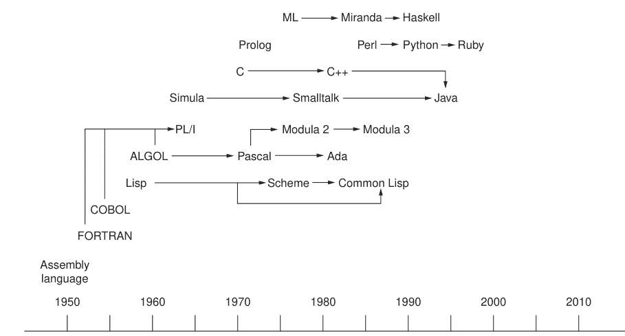

Figure 1.1 A programming language timeline

```
0010001000000100
0010010000000100
0001011001000010
0011011000000011
1111000000100101
0000000000000101
0000000000000110
0000000000000000
```

图1.2 一个机器语言程序

在该程序中，每一行代码包含16位（即16个二进制数字）。一行16位要么表示一条机器语言指令，要么表示一个数据值。代码的最后三行恰好表示数据值——整数5、6和0——采用16位二进制补码表示法。代码的前五行表示程序指令。程序执行从第一行代码开始，该行代码从内存中取出、译码（解释）并执行。随后控制权转移到下一行代码，重复这一过程，直到遇到一条特殊的停机指令为止。

要译码或解释一条指令，程序员（以及硬件）必须将代码行的前4位识别为操作码，操作码指示要执行的操作类型。其余12位包含指令操作数的编码。操作数编码要么是机器寄存器的编号，要么与存储在内存中的其他数据或指令的地址相关。例如，第一条指令`0010001000000100`包含一个操作码和两个操作数的编码。操作码`0010`表示“把一个数从某个内存位置复制到一个机器寄存器”（机器寄存器是保存算术和逻辑运算数据的高速存储单元）。寄存器编号`001`位于接下来的3位中。其余9位表示相对于下一条指令地址的整数偏移量。在指令执行期间，机器将该整数偏移量与下一条指令的地址相加，得到当前指令第二个操作数的地址（请记住，指令和数据都存储在内存中）。在本例中，机器将二进制数`100`（十进制为4）与数字1（下一条指令的地址）相加，得到二进制数`101`（十进制为5），即第六行代码的地址。反过来，这行代码中的位表示要复制到寄存器中的数。

前面我们说过，当遇到停机指令时，执行就会停止。在我们的程序示例中，该指令是第五行代码`1111000000100101`。停机指令防止机器继续执行其下方的代码行，这些代码行表示数据值，而不是程序的指令。

正如你可能预料到的，机器语言编程并非易事。尽管与早期重新配置硬件的方法相比有所改进，程序员仍然面临着繁琐且容易出错的任务：手动将他们的解决方案设计翻译成二进制机器代码，并将这些代码加载到计算机内存中。

## 1.1.2 汇编语言、符号代码与软件工具

早期的程序员意识到，对指令代码和内存位置使用助记符会带来巨大的帮助，因此他们为此开发了汇编语言。

这类语言依靠软件工具来自动完成程序员的部分任务。一种称为汇编器的程序将符号化的汇编语言代码翻译成二进制机器代码。例如，假设图1.2中程序的第一条指令在汇编语言中写作：

```
LD R1, FIRST
```

助记符`LD`（“load”的缩写）被翻译成图1.2第1行中的二进制操作码`0010`。符号`R1`和`FIRST`分别被翻译成寄存器编号`001`和数据地址偏移量`000000100`。翻译之后，另一个称为加载器的程序会自动将该指令的机器代码加载到计算机内存中。

程序员还使用了一对新式输入设备——穿孔机（keypunch machine）用来键入汇编语言代码，读卡器（card reader）用来将打好的穿孔卡读入内存供汇编器使用。这两种设备是当今软件文本编辑器的前身。这些新的硬件和软件工具使程序员开发和修改程序变得容易得多。例如，要在两行现有代码之间插入一行新代码，程序员现在可以把一张新卡放入穿孔机，输入代码，然后将这张卡插入卡片叠中的适当位置。随后，汇编器和加载器会更新程序中所有的地址引用，而在过去，这是机器语言程序员必须手动完成的任务。此外，汇编器还能发现一些错误，例如错误的指令格式和错误的地址计算，而在前汇编器时代，这些错误直到运行时才能被发现。

图1.3显示了图1.2中的机器语言程序被“反汇编”成`LC-3`汇编语言之后的结果。现在，人们可以直接读懂该程序的功能了。该程序将变量`FIRST`和`SECOND`中的数相加，并将结果存储在变量`SUM`中。在这段代码中，符号标签`FIRST`、`SECOND`和`SUM`命名包含数据的内存位置，标签`R1`、`R2`和`R3`命名机器寄存器，标签`LD`、`ADD`、`ST`和`HALT`命名操作码。该程序还带有注释（每个分号后面的文本），以便向人类读者阐明其功能。

```
.ORIG x3000      ; Address (in hexadecimal) of the first instruction
LD  R1, FIRST    ; Copy the number in memory location FIRST to register R1
LD  R2, SECOND   ; Copy the number in memory location SECOND to register R2
ADD R3, R2, R1   ; Add the numbers in R1 and R2 and place the sum in
                 ; register R3
ST  R3, SUM      ; Copy the number in R3 to memory location SUM
HALT             ; Halt the program
FIRST .FILL #5   ; Location FIRST contains decimal 5
SECOND .FILL #6  ; Location SECOND contains decimal 6
SUM   .BLKW #1   ; Location SUM (contains 0 by default)
.END             ; End of program
```

图1.3 一个将两个数相加的汇编语言程序

尽管使用助记符相对于二进制机器代码是一种进步，但汇编语言仍然存在一些缺点。图1.3中的汇编语言代码使程序员能够将抽象的数学思想“设`FIRST`为5，`SECOND`为6，`SUM`为`FIRST + SECOND`”表示为一序列人类可读的机器指令。然而，这些指令中有许多都必须将数据从变量/内存位置移动到机器寄存器中，然后再移回去；汇编语言缺乏传统数学记法所具有的更强大的抽象能力。**抽象**是一种记法或表达思想的方式，它使思想变得简洁、简单，并且易于人类思维把握。哲学家/数学家`A. N. 怀特海`在1911年强调了抽象记法的力量：“通过减轻大脑的一切不必要工作，一种良好的记法使它得以解放出来，专注于更高级的问题……文明的发展在于拓展我们无需思考即可完成的重要操作的数量。”就汇编语言而言，程序员仍然必须完成一项艰苦的工作：将问题领域的抽象思想转化为具体且依赖于机器的程序记法。

汇编语言的第二个主要缺点在于：每一种特定的计算机硬件体系结构都有其自己的机器语言指令集，因此也需要其自己的汇编语言方言。因此，任何汇编语言程序都必须重写，才能移植到不同类型的机器上。

最早的汇编语言出现在20世纪50年代。时至今日，每当需要编写非常底层的系统工具，或者需要手工优化代码段以提高效率时，汇编语言仍然会派上用场。如果你选修计算机组成课程，很可能会接触到汇编语言编程，该课程会探讨机器体系结构的概念和原理。

## 1.1.3 FORTRAN与代数记法

与汇编语言不同，`C`、`Java`和`Python`等高级语言支持更接近数学和科学中所用抽象（如代数表达式）的记法。例如，下面的`C`或`Java`代码段与前面展示的将两个数相加的汇编语言程序等效：

```c
int first = 5;
int second = 6;
int sum = first + second;
```


这些高级语言的前身之一是FORTRAN，它是FORmula TRANslation language（公式翻译语言）的缩写。20世纪50年代初，约翰·巴克斯为一种特定的IBM计算机开发了FORTRAN。在某些方面，早期的FORTRAN代码与汇编语言很相似：它反映了特定类型机器的体系结构，并且缺乏后来高级语言所具有的结构化控制语句和数据结构。然而，FORTRAN确实吸引了科学家和工程师，他们喜欢它对代数记法和浮点数的支持。在过去的几十年里，该语言经历了多次修订，现在支持许多与源自其最初版本的其他语言相关联的特性。

## 1.1.4 ALGOL家族：结构化抽象与机器无关性

FORTRAN问世后不久，程序员就意识到，具有更高抽象级别的语言将提高他们编写简洁、可理解指令的能力。此外，他们希望能够不加改动地为不同的机器体系结构编写这些高级指令。

20世纪50年代末，一个由计算机科学家组成的国际委员会（其中包括约翰·巴克斯）达成了一致

一种新语言的定义，其目的是满足这两个要求。这种语言成为了 ALGOL（ALGOrithmic Language 的缩写）。其第一个版本 ALGOL-60 于 1960 年发布。

ALGOL 首先为计算机科学家在期刊上发表算法提供了一种标准记法。因此，该语言包含了结构化控制语句的记法，用于顺序（begin–end 块）、循环（for 循环）和选择（if 和 if-else 语句）。自此以后，这类语句以或多或少相同的形式出现在每一种高级语言中。同样，表达不同数值类型（整数和浮点）的数据以及数组数据结构的优雅记法也可用。最后，还提供了对过程的支持，包括递归过程。这些结构化抽象，以及更多内容，将在本章后面以及本书后面的章节中详细探讨。

ALGOL 委员会还通过要求每种类型的硬件都提供一个 ALGOL 编译器，实现了程序在计算机上的执行机器独立性。该程序将标准的 ALGOL 程序翻译成特定机器的机器码。

ALGOL 是最早获得正式规范或定义的编程语言之一。其出版的报告包含了定义其特性的语法，既适用于使用它的程序员，也适用于翻译它的编译器编写者。

有非常大量的高级语言源自 ALGOL。Niklaus Wirth 在 1970 年代创建了其中最早的语言之一 Pascal，用作编程教学语言。另一种语言 Ada 于 1980 年代开发，作为美国国防部的嵌入式应用语言。ALGOL 后代的设计者通常会添加用于进一步结构化数据和大段代码的特性，以及在大型程序中控制对这些资源访问的支持。

## 1.1.5 无冯·诺依曼架构的计算

尽管用高级语言编写的程序已独立于特定品牌和型号的计算机，但这些语言仍然在更高层次的抽象上反映了冯·诺依曼机器架构的底层结构。该模型由一个存储程序和数据的内存区域以及一个单独的中央处理单元组成，后者顺序执行从内存中获取的指令。大多数现代编程语言仍然保留了这种单处理器计算模型的特征。在计算的前五个十年（1950 年至 2000 年），处理器速度的提升（以摩尔定律表示，即硬件速度每 18 个月翻一番）和编程语言抽象的不断增加支持了工业时代向信息时代的转变。然而，语言抽象和硬件性能的稳步进步最终遇到了各自的障碍。

在硬件方面，工程师们大约在 2005 年开始达到摩尔定律预测的改进极限。多年来，他们通过缩短处理器组件之间的距离来提高处理器性能，但随着组件更紧密地打包到处理器芯片上，执行期间产生的热量增加。工程师通过将某些计算，如浮点运算和图形/图像处理，分离到专用处理器来缓解这一问题，例如 1980 年代引入的数学协处理器和 1990 年代首次发布的图形处理器。在最近几年，大多数台式机和笔记本电脑都采用了多核架构。多核架构将中央处理单元（CPU）划分为两个或多个通用处理器，每个处理器都有自己的专用内存，以及它们之间共享的内存。虽然多核处理器中的每个“核心”都比传统单处理器机器的 CPU 慢，但它们协作并行执行计算，有可能打破摩尔定律极限带来的障碍。

在语言方面，尽管设计者努力为冯·诺依曼计算提供更高层次的抽象，但仍存在两个问题。首先，依赖于变量值变化的计算模型继续使非常大的程序难以调试和纠正。其次，假设指令序列共享单个处理器和内存空间的单处理器计算模型，无法轻松映射到新的硬件架构，后者的多个 CPU 并行执行。解决这些问题的思路是，编程语言不必基于任何特定的硬件模型，而只需要支持适合各种问题解决风格的计算模型。

数学家 Alonzo Church 在 1930 年代后期开发了这样一种计算模型。这种模型称为 lambda 演算，基于递归函数理论。在 1950 年代后期，计算机科学家 John McCarthy 在麻省理工学院，后来在斯坦福大学，创建了编程语言 Lisp 以使用函数式计算模型构造程序。尽管 Lisp 解释器将 Lisp 代码翻译成实际上在冯·诺依曼机器上运行的机器码（当时唯一可用的机器类型），但 Lisp 记法中没有任何内容必然意味着冯·诺依曼计算模型。我们将在后面的章节中详细探讨其原因。同时，研究人员已开发出基于其他非冯·诺依曼计算模型的语言。其中一种模型是带自动定理证明的形式逻辑。另一种涉及对象通过消息传递的交互。我们将在后面的章节中研究这些适合并行处理的计算模型以及实现它们的语言。

## 1.2 编程语言中的抽象

我们已注意到抽象在使程序更易于人阅读方面发挥的重要作用。在本节中，我们简要描述编程语言提供的常见抽象，以表达计算，并指出它们在后续章节中更详细研究的所在。编程语言抽象可分为两大类：数据抽象和控制抽象。数据抽象简化了人类用户对数据的行为和属性的理解，例如数字、字符字符串和搜索树。控制抽象简化了控制转移的属性，即基于当前情况修改程序执行路径。控制抽象的例子有循环、条件语句和过程调用。

抽象还按级别进行分类，可以看作是抽象中包含（并隐藏）的信息量的度量。基本抽象收集最本地化的机器信息。结构化抽象收集关于程序结构的中间信息。单元抽象收集程序中的大规模信息。

在以下各节中，我们根据这些抽象级别，对数据抽象和控制抽象的常见抽象进行分类。

### 1.2.1 数据：基本抽象

编程语言中的基本数据抽象隐藏了计算机中常见数据值的内部表示。例如，整数数据值通常使用二进制补码表示存储在计算机中。在某些机器上，整数值 -64 是 16 位二进制补码值 1111111111000000 的抽象。同样，实数或浮点数据值通常提供，隐藏了此类数字的 IEEE 单精度或双精度机器表示。这些值也称为“原始”或“原子”，因为程序员通常无法访问其内部表示的组成部分或位 [Patt and Patel, 2003]。

另一个基本数据抽象是使用符号名称隐藏包含数据值的计算机内存位置。这种命名位置称为变量。数据值的种类也取一个名字，称为数据类型。基本数据值的数据类型通常取与其对应数学值相似的名称，如 `int`、`double` 和 `float`。变量通过声明赋予名称和数据类型，例如 Pascal：

```
var x : integer;
```

或等效的 C 声明：

```
int x;
```

在此示例中，`x` 被确立为变量的名称，并被赋予数据类型 `integer`。

最后，基本数据类型上的标准运算，如加法和乘法，也提供。数据类型在第 8 章研究，声明在第 7 章研究。

### 1.2.2 数据：结构化抽象

数据结构是将相关数据值收集到单个单元中的主要方法。例如，员工记录可能由姓名、地址、电话号码和薪水组成，每项可能为不同数据类型，但合在一起代表员工的整体信息。

另一个例子是一组项目，它们都具有相同的数据类型，并且需要一起保存以便排序或搜索。编程语言提供的典型数据结构是数组，它将数据收集为一系列单独索引的项目。变量可以在声明中命名数据结构，如 C 中的：

```
int a[10];
```

这确立变量 `a` 为十个整数值的数组的名称。

又一个例子是文本文件，它是一个抽象，表示字符序列以便在外部存储设备之间传输。文本文件的结构独立于存储介质的类型，可以是磁盘、光盘（CD 或 DVD）、固态设备（闪存盘）甚至键盘和控制台窗口。

与原始数据值一样，数据结构是一个抽象，隐藏了一组组成部分，使程序员能够将其视为一个整体。然而，与原始数据值不同，数据结构为程序员提供了从其组成部分（可以包括其他数据结构以及原始值）构造它们的方法，以及访问和修改这些组件的手段。创建和使用结构化类型的不同方式将在第 8 章中探讨。

### 1.2.3 数据：单元抽象

在大型程序中，将相关数据及其操作分组在一起是有用且必要的，可以在单独的文件中或在文件内的单独语言结构中进行。通常，这类抽象包括支持信息隐藏的访问约定和限制。这些机制在不同语言之间差异很大，但它们允许程序员定义新的数据类型（数据和操作），其隐藏信息的方式与语言的基本数据类型非常相似。因此，单元抽象常常与**抽象数据类型**的概念联系在一起，广义上将其定义为一组数据值以及对这些值进行操作的操作集合。其主要特征是接口（用户可用的操作集）与实现（数据值和操作的内部表示）的分离。大规模单元抽象的例子包括 ML、Haskell 和 Python 的**模块**，以及 Lisp、Ada 和 Java 的**包**。另一个较小规模的单元抽象例子是面向对象语言的**类**机制。在本书中，我们将在第 11 章研究模块和抽象数据类型，而类（及其与抽象数据类型的关系）将在第 5 章研究。

单元数据抽象的一个日益重要的附加属性是其**可重用性**——即在不同程序中重用该数据抽象的能力，从而节省为每个程序从头编写抽象的成本。通常，这类数据抽象表示**组件**（程序或用户界面中操作完整的部分），并被收录到可用组件库中。因此，单元数据抽象成为语言**库**机制的基础（库机制本身以及某些标准库可能是语言本身的一部分，也可能不是）。通过为单元接口提供标准约定，增强了单元的组合能力（即它们的**互操作性**）。许多接口标准已经被制定出来，有些独立于编程语言，有些则与特定语言绑定。其中大多数适用于面向对象语言的类结构，因为事实证明，类在重用方面比大多数其他语言结构更为灵活（参见下一节和第 5 章）。

当程序员需要使用新的软件资源时，他们通常会研究其**应用程序编程接口（API）**。API 只向程序员提供有关该资源的类、方法、函数和性能特征的足够信息，以便他们能够有效地使用该资源。API 的一个示例是 Java 的 Swing 工具包，用于图形用户界面，定义在 `javax.swing` 包中。现代编程语言（如 Java 或 Python）的 API 集合通常组织成一组便于查阅的网页，称为**文档**。当 Java 或 Python 程序员开发新的代码库或包时，他们会使用专门设计用于生成文档的软件工具为该资源创建 API。

### 1.2.4 控制：基本抽象

典型的基本控制抽象是语言中的那些语句，它们将几条机器指令组合成一条比机器指令更易于理解的抽象语句。我们已经提到了算术和赋值表达式的代数表示法，例如：

```
SUM = FIRST + SECOND
```

这段代码获取变量 `FIRST` 和 `SECOND` 的值，将它们相加，并将结果存储到名为 `SUM` 的位置中。这类控制在第 7 章和第 9 章中讨论。

**语法糖**一词用于指代任何允许程序员用更简洁的速记表示法替换复杂表示法的机制。例如，在 C、Java 和 Python 中，扩展赋值运算 `x += 10` 是等价但稍显复杂的表达式 `x = x + 10` 的速记形式。

### 1.2.5 控制：结构化抽象

结构化控制抽象将程序划分为若干指令组，这些指令组嵌套在控制其执行的测试中。因此，它们帮助程序员表达顺序、选择和迭代（循环）等主要控制结构的逻辑。在机器层面，处理器只是通过程序计数器在指令的内存地址间推进来执行指令序列。选择和迭代则是通过使用**分支指令**跳转到下一条指令之外的内存位置来实现的。为了说明这些概念，图 1.4 显示了一段 LC-3 汇编语言代码，它计算名为 `LIST` 的数组中 10 个整数的绝对值之和。代码中加入了注释以帮助读者阅读。

```asm
        LEA   R1, LIST       ; Load the base address of the array (the first cell)
        AND   R2, R2, #0      ; Set the sum to 0
        AND   R3, R3, #0      ; Set the counter to 10 (to count down)
        ADD   R3, R3, #10
WHILE   LDR   R4, R1, #0      ; Top of the loop: load the datum from the current
                              ; array cell
        BRZP  INC             ; If it’s >= 0, skip next two steps
        NOT   R4, R4          ; It was < 0, so negate it using twos complement
                              ; operations
        ADD   R4, R4, #1
INC     ADD   R2, R2, R4      ; Increment the sum
        ADD   R1, R1, #1      ; Increment the address to move to the next array
                              ; cell
        ADD   R3, R3, #-1     ; Decrement the counter
        BRP   WHILE           ; Goto the top of the loop if the counter > 0
        ST    R2, SUM         ; Store the sum in memory
```

**图 1.4** 汇编语言中的基于数组的循环

如果去掉注释，即使是一位熟练的 LC-3 程序员，也可能无法一眼看出该算法的作用。将这段汇编语言代码与图 1.5 中功能等价的 C++ 或 Java 代码中使用的结构化 if 和 for 语句进行比较。

```cpp
int sum = 0;
for (int i = 0; i < 10; i++){
    int data = list[i];
    if (data < 0)
        data = -data;
    sum += data;
}
```

**图 1.5** C++ 或 Java 中的基于数组的循环

结构化选择和循环机制在第 9 章中讨论。

另一种结构化的迭代形式由**迭代器**提供。迭代器通常出现在面向对象语言中，是一个与集合（如数组、列表、集合或树）相关联的对象。程序员在集合上打开一个迭代器，然后通过循环中运行迭代器的方法来访问其所有元素。例如，下面的 Java 代码段使用迭代器打印名为 `exampleList` 的字符串列表的内容：

```
Iterator<String> iter = exampleList.iterator();
while (iter.hasNext())
    System.out.println(iter.next());
```

这种基于迭代器的集合遍历是一种非常常见的循环模式，以至于一些语言（如 Java）以**增强型 for 循环**的形式为其提供了语法糖：

```
for (String s : exampleList)
    System.out.println(s);
```

我们可以使用这种类型的循环来进一步简化计算整数数组或整数列表之和的 Java 代码，如下所示：

```
int sum = 0;
for (int data : list){
    if (data < 0)
        data = -data;
    sum += data;
}
```

迭代器将在第 5 章详细讨论。

另一个强大的控制结构化机制是**过程**，有时也称为**子程序**或**子例程**。它允许程序员将一系列操作视为单个操作，并可以从程序中的许多其他位置调用或引用该操作。过程抽象涉及两个方面。首先，必须通过给过程命名并将其与要执行的操作关联来定义过程。这称为**过程声明**，与前面提到的变量和类型声明类似。其次，过程必须在执行操作的位置实际被调用。这有时也称为过程**调用**或过程**激活**。

例如，考虑计算整数 `u` 和 `v` 的最大公约数的示例代码片段。我们可以将其变成 Ada 中的一个过程，过程声明如图 1.6 所示。

```
procedure gcd(u, v: in integer; x: out integer) is
    y, t, z: integer;
begin
    z := u;
    y := v;
    loop
        exit when y = 0;
        t := y;
        y := z mod y;
        z := t;
    end loop;
    x := z;
end gcd;
```

**图 1.6** 一个 Ada 的 gcd 过程

在这段代码中，我们在第一行看到过程头。这里的 `u`、`v` 和 `x` 是该过程的**参数**——也就是说，这些东西在每次调用之间可能会发生变化。现在，只需简单地命名该过程并提供相应的**实际参数**或**实参**，就可以**调用**这个过程，例如：

```
gcd (8, 18, d);
```

这使 `d` 的值为 2。（参数 `x` 在第 1 行被赋予 `out` 标签，表示其值由过程本身计算，并会改变调用者相应实际参数的值。）

过程调用的系统实现是一种比选择或循环更复杂的机制，因为它需要存储在调用点程序状态的信息，以及被调用过程运作方式的信息。这些信息存储在**运行时环境**中。过程调用、参数和运行时环境都将在第10章中学习。

与过程密切相关的抽象机制是**函数**，它可以简单地看作是一个向调用者返回值或结果的过程。例如，图1.6中`gcd`过程的Ada代码可以更恰当地写成如图1.7所示的函数。注意，`gcd`函数使用递归策略来消除早期版本中出现的循环。递归的使用进一步利用了子程序的抽象机制来简化代码。


```
function gcd(u, v: in integer) return integer is
begin
    if v = 0
        return u;
    else
        return gcd(v, u mod v);
    end if;
end gcd;
```

图1.7 一个Ada的`gcd`函数

函数的重要性远不止其与过程的对应关系所暗示的，因为函数的编写方式可以更接近数学上函数的抽象。因此，与过程不同，函数可以在不依赖冯·诺依曼计算机概念或运行时环境的情况下被理解。此外，函数可以组合成更高层次的抽象，称为**高阶函数**。这类函数能够接受其他函数作为参数，并返回函数作为值。高阶函数的一个例子是**map（映射）**。

这个函数期望另一个函数和一个集合（通常是列表）作为参数。`map`会构建并返回一个列表，该列表包含将参数函数应用于参数列表中每个元素后得到的结果。下一个示例展示了如何在 Scheme（Lisp 的一种方言）中使用`map`函数，来构建另一个列表中数字的绝对值列表。`map`的第一个参数是函数`abs`，它返回其参数的绝对值。`map`的第二个参数是由函数`list`构建的列表。

```
(map abs (list 33 -10 66 88 -4))        ; Returns (33 10 66 88 4)
```

另一个高阶函数名为`reduce`（归约）。与`map`一样，`reduce`期望另一个函数和一个列表作为参数。但与`map`不同的是，`reduce`通过反复将参数函数应用于列表中的值，将列表中的值缩减为单个值。例如，下面的函数调用同时使用了`map`和`reduce`来简化一个数字列表中绝对值之和的计算：

```
(reduce + (map abs (list 33 -10 66 88 -4)))    ; Returns 201
```

在这段代码中，`list`函数首先构建一个数字列表。然后将该列表与`abs`函数一起提供给`map`函数，`map`返回一个绝对值列表。接着，这个列表连同`+`函数（表示将两个数相加）被传递给`reduce`函数。`reduce`函数使用`+`将列表中所有数字相加并返回结果。

函数的广泛使用是函数式编程范式以及本章后面提到的函数式语言的基础，详细讨论见第3章。

## 1.2.6 控制：单元抽象

控制也可以被抽象化，包含一组为程序其他部分提供逻辑相关服务的过程，这些过程构成一个单元，或程序的一个独立部分。例如，数据管理程序可能需要为存储的数据计算统计指标，如平均值、中位数和标准差。提供这些操作的过程可以收集到一个程序单元中，该单元可以被单独编译，并通过精心控制的接口供程序的其他部分使用。这使程序能够作为一个整体被理解，而无需了解该单元所提供服务的细节。

注意，我们刚才所描述的本质上与单元级数据抽象相同，通常使用同类的模块或包语言机制来实现。唯一的区别在于这里关注的是操作而非数据，但可复用性和库构建的目标保持不变。

一种难以归入任何单一抽象层次的控制抽象是并行编程机制。许多现代计算机拥有多个处理器或处理单元，能够同时处理不同的数据。许多编程语言包含允许程序各部分并行执行的机制，并为这些程序部分之间提供同步和通信。`Java`提供了声明线程（在`Java`系统内单独执行的控制路径）和进程（在`Java`系统之外执行的其他程序）的机制。`Ada`提供了`task`机制来支持并行执行。`Ada`的任务本质上是一种单元抽象，而`Java`的线程和进程是类，因此是结构化抽象，尽管它们是标准`java.lang`包的一部分。其他语言提供了不同层次的并行抽象，甚至低到语句级。第13章将概述并行编程机制。

## 1.3 计算范式

编程语言始于对计算机操作的模仿和抽象。它们所面向的计算机类型对其设计产生了重大影响，这并不奇怪。在大多数情况下，所涉及的计算机是第1.1节中提到的冯·诺依曼模型：一个中央处理单元，顺序执行对存储在内存中的值进行操作的指令。以下是基于冯·诺依曼模型的语言的典型特征：变量表示内存位置，赋值允许程序对这些内存位置进行操作。

具备这三个特性——顺序执行指令、使用变量表示内存位置、使用赋值改变变量值——的编程语言称为命令式语言（`imperative language`），因为其主要特征是一系列表示命令（或祈使）的语句。

如今大多数编程语言都是命令式的，但正如我们前面提到的，编程语言并不一定要以这种方式描述计算。事实上，将计算描述为一系列指令，每条指令作用于单个数据，这种要求有时被称为冯·诺依曼瓶颈。这一瓶颈限制了语言提供并行计算（即可以同时应用于许多不同数据的计算）或非确定性计算（不依赖于顺序的计算）的能力。¹因此，我们有理由追问是否存在更少依赖冯·诺依曼计算机模型的计算描述方式。确实存在，稍后将对此进行描述。命令式编程语言实际上只代表了编程语言的一种范式或模式。

两种描述计算的替代范式来自数学。函数式范式基于`λ`演算中研究的抽象函数概念。逻辑范式基于符号逻辑。这两种范式都将在后续章节中作为主题讨论。这些范式的重要性在于它们与数学基础的对应关系，使其能够抽象而精确地描述程序行为。这反过来使得判断程序是否能正确执行变得容易得多（即使没有完整的理论分析），也使为高度复杂的任务编写简洁代码成为可能。

第四种编程范式，即面向对象范式，在过去20年中获得了巨大的重要性。面向对象语言允许程序员编写可复用的代码，这些代码以模仿现实世界中对象行为的方式运行；因此，程序员可以利用其对世界的自然直觉来理解程序的行为并编写合适的代码。从某种意义上说，面向对象范式是命令式范式的扩展，因为它主要依赖于同样的顺序执行和一组不断变化的内存位置，特别是在对象的实现中。不同之处在于，由此产生的程序由大量非常小的部分构成，这些部分之间的交互经过精心控制，但又易于修改。此外，在更高的抽象层次上，对象之间通过消息传递进行的交互可以很好地映射到并行处理器之间的协作，每个处理器都有自己的内存区域。面向对象范式基本上已成为一种新标准，就像过去命令式范式一样，因此本书将重点介绍它。

在本书的后续部分，将为这些范式各设一章专门讨论。

¹并行计算和非确定性计算是相关概念；见第13章。

## 1.4 语言定义

早期编程语言的文档是以非正式的方式编写的，使用普通英语。然而，正如本章前面所见，程序员很快意识到需要对语言进行更精确的描述，以至于需要像数学中那样形式化的定义。例如，如果没有对编程语言构造含义的清晰认识，程序员就无法清楚地知道实际执行的是什么计算。此外，应该能够对程序进行数学推理，而要做到这一点需要对程序的行为进行形式化验证或证明。如果没有语言的形式定义，这是不可能的。

但需要形式定义还有其他令人信服的原因。我们已经提到过对机器或实现独立性的需求。实现这一点的最好方式是通过标准化，这需要一个独立且精确的、被普遍接受的语言定义。诸如`ANSI`（美国国家标准学会）和`ISO`（国际标准化组织）等标准化组织已为许多语言发布了定义，包括`C`、`C++`、`Ada`、`Common Lisp`和`Prolog`。

形式定义的一个进一步原因是，在编程过程中不可避免地会出现关于程序行为和交互的困难问题。程序员需要一种充分的方式来回答此类问题，而不仅仅是经常使用的试错过程：这种情况可能发生在设计阶段就需要回答，并且可能导致重大的设计变更。

最后，形式定义的要求确保了在语言设计时保持纪律。语言设计者往往要到被要求给出清晰定义时才意识到设计决策的后果。

语言定义可以大致分为两个部分：语法，或结构，以及语义，或含义。我们将依次讨论这两个类别。

### 1.4.1 语言语法

编程语言的语法在许多方面类似于自然语言的语法。它是对语言的不同部分如何组合形成短语并最终形成句子的描述。例如，`C`语言中`if`语句的语法可以用文字描述如下：

> 属性：一个`if`语句由单词“`if`”后跟括号内的表达式，后跟一个语句，后跟一个可选的`else`部分组成，该部分由单词“`else`”和另一个语句组成。

语言语法的描述是形式化定义得到广泛接受的领域之一，现在所有语言的语法都使用语法来给出。例如，`C`语言`if`语句的语法规则可以写成如下：

```
<if-statement> ::= if (<expression>) <statement>
[else <statement>]
```

或（使用特殊字符和格式）：

```
if-statement → if (expression) statement
[else statement]
```

编程语言的**词法结构**是语言“单词”的结构，通常称为**记号**。因此，词法结构类似于自然语言中的拼写。在`C` **if** 语句的例子中，单词 **if** 和 **else** 就是记号。编程语言中的其他记号包括标识符（或名称）、操作符符号，如 `+` 和 `*` 以及特殊标点符号，如分号（`;`）和句号（`.`）。

在本书中，我们将语法和词法结构一起考虑；更详细的讨论可在第 6 章找到。

### 1.4.2 语言语义

语法只代表语言的表面结构，因此只是语言定义的一小部分。语言的语义，或含义，要复杂得多，也更难以精确描述。第一个困难是“含义”可以有许多不同的定义。通常，描述一段代码的含义涉及描述执行该代码的效果，但并没有标准的方法来做到这一点。此外，特定机制的含义可能涉及与语言中其他机制的交互，因此在所有上下文中对其含义的全面描述可能变得极其复杂。

继续以`C` **if** 语句为例，其语义可以用文字描述如下（改编自 Kernighan 和 Richie [1988]）：

> **if** 语句的执行首先是计算其表达式，该表达式必须具有算术或指针类型，包括所有副作用，如果它与 0 不相等，则执行表达式后面的语句。如果有 **else** 部分，并且表达式为 0，则执行“else”后面的语句。

该描述本身指出了指定语义的困难，即使对于像 **if** 语句这样简单的机制也是如此。该描述没有提到如果条件求值为 0 但没有 else 部分会发生什么（ presumably 什么也不发生；即程序在 **if** 语句之后继续）。另一个重要问题是 **if** 语句是否“安全”，即是否存在其他语言机制可能允许在 **if** 语句内部的语句在没有相应求值 **if** 表达式的情况下被执行。如果是这样，那么 if 语句可以提供足够的保护以防止执行期间的错误，例如除以零：

```
if (x != 0) y = 1 / x;
```

否则，可能需要额外的保护机制（或至少程序员必须意识到可能绕过 if 表达式的可能性）。

语义的这种非正式描述的替代方案是使用形式化方法。然而，在这里也没有出现类似上下文无关文法用于语法那样普遍接受的方法。事实上，给出编程语言语义的形式定义仍然不是惯例。尽管如此，已经开发出几种用于形式化定义的记号系统，并且使用日益增多。这些包括**操作语义**、**指称语义**和**公理语义**。

本书的许多章节都隐含了语言语义，但语义问题在第 7 章和第 11 章中得到更具体的讨论。第 12 章讨论了语义形式化定义的方法，包括操作语义、指称语义和公理语义。

## 1.5 语言翻译

要使编程语言有用，它必须有一个**翻译器**——即一个接受用该语言编写的其他程序并直接执行它们或将它们转换为适合执行的形式的程序。直接执行程序的翻译器称为**解释器**，而生成可在适合执行的等价程序的翻译器称为**编译器**。

如图 1-8 所示，解释是一个单步过程，其中程序和输入都提供给解释器，并获得输出。

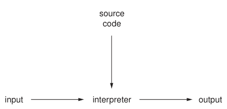

解释器可以被视为一种机器的模拟器，其“机器语言”是被翻译的语言。

另一方面，编译至少是一个两步过程：原始程序（或**源程序**）输入到编译器，新的程序（或**目标程序**）从编译器输出。如果目标程序处于适合直接执行的格式（即机器语言），则可以执行它。更常见的是，目标语言是汇编语言，目标程序必须由**汇编器**翻译成目标程序，然后与其它目标程序**链接**，并**加载**到适当的内存位置后才能执行。有时目标语言甚至是另一种编程语言，在这种情况下，必须使用该语言的编译器来获得可执行的目标程序。

或者，目标语言是一种称为**字节码**的低级代码形式。编译器将程序的源代码翻译成字节码后，程序的字节码版本由解释器执行。该解释器称为**虚拟机**，针对不同的硬件架构编写方式不同，而字节码与源语言一样是机器无关的。`Java` 和 `Python` 等语言编译为字节码并在虚拟机上执行，而 `C` 和 `C++` 等语言编译为本地机器代码并直接在硬件上执行。

编译过程可以可视化如下图 1.9 所示。

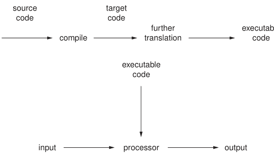

**图 1.9** 编译过程

必须牢记，语言和该语言的翻译器是两回事。一种语言可能由某个特定解释器或编译器的行为来定义（所谓的**定义性**翻译器），但这种情况并不常见（而且可能存在问题，考虑到需要形式化定义，如上一节所述）。更常见的是，语言定义独立存在，而翻译器可能更或可能不严格遵循语言定义（我们希望是前者）。在编写程序时，必须始终意识到那些依赖于特定翻译器而非语言定义的功能和属性。尽可能避免非标准特性可以带来显著的优势。

关于语言翻译的完整讨论可在编译器教材中找到，但我们将在第 6–10 章考察该过程的基本前端。

## 1.6 编程语言的未来

在 1960 年代，一些计算机科学家梦想着一种单一的通用编程语言，能够满足所有计算机用户的需求。然而，设计和实现这种语言的尝试却导致了挫败和失败。在 1970 年代末和 1980 年代初，出现了一个不同的梦想——梦想编程语言本身会变得过时，新的**规范语言**将被开发出来，让计算机用户只需向系统说明他们想要什么，系统就会自行找出如何实现需求。Winograd [1979] 中对此观点的简明阐述如下：

> 正如高级语言使程序员摆脱了机器指令的复杂性一样，更高级的编程系统可以帮助理解和操作复杂系统和组件。我们需要将注意力从算法的详细规范转移到对我们构建所用包和对象的属性的描述上。新一代编程工具将基于这样的态度：在编程系统中我们所说的内容应主要为声明式，而非命令式：编程系统的基本用途不是创建完成任务的指令序列（或执行算法），而是表达和操作计算过程及其所作用对象的描述。〔同上，第 393 页〕

从某种意义上说，Winograd 只是描述了逻辑编程语言试图做的事情。然而，正如你在第 4 章中将会看到的，即使这些语言可用于快速原型设计，当需要效率时，程序员仍需逐步指定算法。在设计能够自行构造算法以完成给定需求的系统方面，进展甚微。

因此，编程并未变得过时。从某种意义上说，它变得更加重要，因为它现在可以在从汇编语言到规范语言的众多不同层面上进行。随着更快、更便宜、更易于使用的计算机的发展，对解决各种问题的更多更好程序的需求巨大。

编程语言设计的未来是什么？预测未来 notoriously 困难，但仍可从近期趋势中推断。过去 20 年编程语言演进的两个最有趣的观点来自两位第二代 Lisp 程序员 Richard Gabriel 和 Paul Graham。

在他的论文《历史的终结与最后的编程语言》[Gabriel 1996] 中，Gabriel 对这样一个事实感到困惑：像 `Lisp` 这样非常高级、数学上优雅的语言并未在工业界流行起来，而像 `C` 和 `C++` 这样优雅性较差甚至语义上不安全的语言却已成为标准。他的解释是，编程语言的流行在很大程度上是其使用环境的功能，而非其任何固有属性。为说明这一点，他将 `C` 在编程社区中的传播比作病毒的传播。`C` 编译器和运行时环境的简单占用及其与 `UNIX` 操作系统的联系，使其能够迅速传播到许多硬件平台。其传统语法和缺乏数学优雅性吸引了非常广泛的程序员，其中许多人可能没有太多数学素养。因此，Gabriel 断言 `C` 将在很长一段时间内成为编程语言中的最终幸存者。

Graham 在十年后在其著作《黑客与画家》[Graham 2004] 中写道，他看到了不同的趋势正在形成。他认为，像 `Java`、`Python` 和 `Ruby` 这样的重要近期语言增加了使它们进一步远离 `C` 而更接近 `Lisp` 的特性。然而，与早期 `C` 类似，这些语言中的每一种都迅速迁移到新的技术领域，例如基于 Web 的客户端/服务器应用程序和移动设备。那么 `Lisp` 本身呢？与大多数编程语言作家一样，Graham 将它们分类在一个连续体上，从相当低级（`C`）到相当高级（`Java`、`Python`、`Ruby`）。但他随后提出了两个有趣的问题：如果存在语言层级范围，哪些语言处于最高层级？如果存在最高层的语言，并且它仍然存在，为什么人们不更愿意用它来编写程序？不出所料，Graham 声称 `Lisp` 在 50 年后始终是、并且仍然是最高级的语言。他随后以与 Gabriel 相似的方式论证，`Lisp` 的优点只被最好的程序员和上述近期语言的设计者所认可。然而，Graham 认为 `Lisp` 的未来可能在于服务器端应用程序的快速开发。

图 1.10 显示了自 2000 年以来编程语言相对流行度的一些统计数据。这些统计数据包括 2009 年、2003 年和 2000 年这些语言在 `comp.lang` 新闻组上的帖子数量，在一定程度上支持了 Graham 和 Gabriel 的分析。〔`Comp` 新闻组最初形成于 `Usenet`，为讨论技术、计算和编程问题提供论坛。〕

| 排名 | Mar 2009 (100d) posts | Mar 2009 (100d) language | Feb 2003 (133d) posts | Feb 2003 (133d) language | Jan 2000 (365d) posts | Jan 2000 (365d) language |
|---|---|---|---|---|---|---|
| 1 | 14110 | python | 59814 | java | 229034 | java |
| 2 | 13268 | c | 44242 | c++ | 114769 | basic |
| 3 | 9554 | c++ | 27054 | c | 113001 | perl |
| 4 | 9057 | ruby | 24438 | python | 102261 | c++ |
| 5 | 9054 | java | 23590 | perl | 79139 | javascript |
| 6 | 5981 | lisp | 18993 | javascript | 70135 | c |


图 1.10 编程语言的流行度（来源：`www.complang.tuwien.ac.at/anton/comp.lang-statistics/`）

*服务器来源：`news.tuwien.ac.at`, `news.individual.net`, `tele.dk`.*

一件事很清楚。只要新的计算机技术出现，就会有空间容纳新的语言和新思想，编程语言的研究将像今天一样令人着迷和激动。

## 练习

- 1.1 解释为什么冯·诺依曼将程序存储在计算机内存中的想法对计算机操作员来说是一个进步。

- 1.2 说明机器语言程序员在（a）将他们的想法翻译成机器代码时，以及（b）手工将代码加载到计算机内存时所面临的困难。

- 1.3 列出至少三种使用汇编语言相对于机器语言对程序员的改进方式。

- 1.4 抽象允许程序员用更少的代码表达更多内容。用两个例子证明此陈述。

- 1.5 `ALGOL` 是最早实现机器独立性的编程语言之一，但不是脱离冯·诺依曼计算模型的独立性。解释其原因。

- 1.6 `Scheme`、`C++`、`Java` 和 `Python` 语言都有整数数据类型和字符串数据类型。解释这些类型的值如何是对更复杂数据元素的抽象，以其中一种语言为例。

- 1.7 解释数据结构与抽象数据类型（`ADT`）之间的区别，至少举两个例子。

- 1.8 在以下任一语言中定义一个递归阶乘函数（或在你拥有翻译器的任何语言中）：（a）`Scheme`，（b）`C++`，（c）`Java`，（d）`Ada`，或（e）`Python`。

- 1.9 汇编语言使用分支指令来实现循环和选择语句。解释为什么高级语言中的 `for` 循环和 `if` 语句是对这种汇编语言技术的改进。

- 1.10 索引式循环的使用与使用迭代器遍历数组之间有什么区别？举例支持你的答案。

- 1.11 列出将代码打包在过程或函数中以解决问题的原因。

- 1.12 参数在过程和函数的定义和使用中扮演什么角色？

# CHAPTER 1 引言

### 1.13
在何种意义上，递归为函数定义提供了额外的抽象能力？请举例支持你的回答。

### 1.14
在函数式语言中，`map` 函数做什么？它如何在编程语言中提供额外的抽象能力？

### 1.15
哪三种特性表征了命令式编程语言？

### 1.16
你对问题 1.15 的回答中的三种特性如何反映冯·诺依曼计算模型？

### 1.17
使用你选择的语言，给出程序中两个词法错误的例子。

### 1.18
使用你选择的语言，给出程序中两个语法错误的例子。

### 1.19
使用你选择的语言，给出程序中两个语义错误的例子。

### 1.20
使用你选择的语言，给出程序中一个逻辑错误的例子。

### 1.21
`Java` 和 `Python` 程序被翻译成在虚拟机上运行的字节码。讨论这种实现策略相对于 `C++` 的优缺点，后者的程序被翻译成机器码。

## Notes and References

第 1.1 节中 A. N. Whitehead 的引文见于 Whitehead [1911]。对冯·诺依曼架构的早期描述以及将程序作为数据存储以控制计算机执行的用途见于 Burks, Goldstine, and von Neumann [1947]。对冯·诺依曼架构的温和介绍，以及计算机硬件和编程语言的演变见于 Schneider and Gersting [2010]。

本文中使用的或提及的主要编程语言的参考文献如下。

`LC-3` 机器架构、指令集和汇编语言在 Patt and Patel [2003] 中讨论。`FORTRAN` 的历史见于 Backus [1981]；`Algol60` 见于 Naur [1981] 和 Perlis [1981]；`Lisp` 见于 McCarthy [1981]、Steele and Gabriel [1996] 和 Graham [2002]；`COBOL` 见于 Sammet [1981]；`Simula67` 见于 Nygaard and Dahl [1981]；`BASIC` 见于 Kurtz [1981]；`PL/I` 见于 Radin [1981]；`SNOBOL` 见于 Griswold [1981]；`APL` 见于 Falkoff and Iverson [1981]；`Pascal` 见于 Wirth [1996]；`C` 见于 Ritchie [1996]；`C++` 见于 Stroustrup [1994] [1996]；`Smalltalk` 见于 Kay [1996]；`Ada` 见于 Whitaker [1996]；`Prolog` 见于 Colmerauer and Roussel [1996]；`Algol68` 见于 Lindsey [1996]；`CLU` 见于 Liskov [1996]。`C` 编程语言的参考资料是 Kernighan and Ritchie [1988]。最新的 `C` 标准是 ISO 9899 [1999]。`C++` 在 Stroustrup [1994] [1997] 和 Ellis and Stroustrup [1990] 中描述；入门教材是 Lambert and Nance [2001]；`C++` 的国际标准是 ISO 14882-1 [1998]。`Java` 在许多书籍中都有描述，包括 Horstmann [2006] 和 Lambert and Osborne [2010]；`Java` 语言规范见于 Gosling, Joy, Steele, and Bracha [2005]。`Ada` 存在三个版本：原始版本有时称为 `Ada83`，由其参考手册描述（ANSI-1815A [1983]）；较新版本是 `Ada95` 和 `Ada2005`²，由其国际标准描述（ISO 8652 [1995, 2007]）。`Ada` 的标准教材是 Barnes [2006]。`Python` 的入门教材是 Lambert [2010]。`Common Lisp` 在 Graham [1996] 和 Seibel [2005] 中介绍。`Scheme` 在 Dybvig [1996] 和 Abelson and Sussman [1996] 中描述；语言定义可在 Abelson et al. [1998] 中找到。`Haskell` 在 Hudak [2000] 和 Thompson [1999] 中介绍。`ML` 函数式语言（与 `Haskell` 相关）在 Paulson [1996] 和 Ullman [1997] 中介绍。`Prolog` 的标准参考是 Clocksin and Mellish [1994]。逻辑范式在 Kowalski [1979] 中讨论，函数式范式在 Backus [1978] 和 Hudak [1989] 中讨论。`Smalltalk` 在 Lambert and Osborne [1997] 中介绍。`Ruby` 在 Flanagan and Matsumoto [2008] 和 Black [2009] 中描述。`Erlang` 在 Armstrong [2007] 中讨论。

语言翻译技术在 Aho, Lam, Sethi, and Ullman [2006] 和 Louden [1997] 中描述。

Richard Gabriel 关于最后一种编程语言的文章见于 Gabriel [1996]，其中还包括许多关于设计模式的有趣文章。Paul Graham 关于高级语言的文章见于 Graham [2004]，其中他还讨论了最好的程序员与伟大艺术家之间的相似之处。

²由于 `Ada95/2005` 是 `Ada83` 的扩展，我们仅在它们不是 `Ada83` 的一部分时指出专门属于 `Ada95/2005` 的特性。

# CHAPTER 语言设计准则

## 2.1 历史概述
- 2.1 历史概述 ................................ 27
- 2.2 效率 ........................................... 28
- 2.3 规则性 ............................................ 30
- 2.4 安全性 .............................................. 33
- 2.5 可扩展性 ......................................... 34
- 2.6 `C++`：`C` 的面向对象扩展 ................ 35
- 2.7 `Python`：一种通用脚本语言 .......... 38

# CHAPTER 2

什么是好的编程语言设计？我们凭什么标准来评判它？第 1 章强调了人类可读性和抽象与复杂性控制机制是现代编程语言的关键要求。按这些标准评判一种语言是困难的，因为语言的成败往往取决于许多语言机制之间的复杂相互作用。定义编程语言的“成功”或“失败”也很复杂；目前，让我们说一种语言如果满足以下任何或全部标准就是成功的：

- 实现其设计者的目标
- 在应用领域获得广泛使用
- 成为其他本身成功的语言的模型

与语言定义没有直接联系的实际问题对语言的成败也有重大影响。这些包括翻译器的可用性、价格和质量。政治、地理、时机和市场也有影响。`C` 编程语言至少部分之所以成功，是因为 `UNIX` 操作系统的成功，后者支持了它的使用。`COBOL` 虽然主要被计算机科学界忽视，但由于在工业界的使用以及大量遗留应用（继续维护的老应用）的存在，仍然是一种重要的语言。`Ada` 语言由于在某些美国国防部项目中被强制使用而立即产生了影响。`Java` 和 `Python` 通过互联网的增长以及这些语言及其编程环境的免费分发而变得重要。`Smalltalk` 语言从未广泛使用，但大多数成功的面向对象语言从中借用了大量特性。

语言成功的原因与失败的原因一样多。一些语言设计者认为个人或少数人更有机会创造成功的语言，因为他们可以强加统一的设计概念。例如 `Pascal`、`C`、`C++`、`APL`、`SNOBOL` 和 `LISP` 就是如此，但由委员会设计的语言，如 `COBOL`、`Algol` 和 `Ada`，也取得了成功。

在创建新语言时，必须决定语言的整体目标，并在整个设计过程中始终牢记该目标。这对于数据库语言、图形语言和实时语言等专用语言尤其重要，因为目标应用领域的特定抽象必须构建到语言设计中。然而，这对通用语言也同样适用。例如，`FORTRAN` 的设计者专注于高效执行，而 `COBOL` 的设计者旨在提供类似英语的非技术可读性。`Algol60` 被设计为用于描述算法的块结构语言

`Pascal` 被设计为提供一种简单的教学语言以促进自顶向下设计。最后，`C++` 的设计者专注于用户对更大抽象的需求，同时保持效率和与 `C` 的兼容性。

尽管如此，描述好的编程语言设计仍然极其困难。即使是著名的计算机科学家和成功的语言设计者也提出了相互冲突的建议。`Pascal` 的设计者 Niklaus Wirth 建议简单性至关重要（Wirth [1974]）。著名计算机科学家兼多语言共同设计者 C. A. R. Hoare 强调单个语言构造的设计（Hoare [1973]）。`C++` 的设计者 Bjarne Stroustrup 指出，一种语言不能仅仅是“巧妙”特性的集合（Stroustrup [1994]，第 7 页）。计算机科学先驱 Fred Brooks 认为语言设计类似于任何其他设计问题，例如设计建筑物（Brooks [1996]）。

在本章中，我们介绍一些通用设计准则，并提出一套更详细的原则作为语言设计者和最终语言用户的潜在辅助。我们还给出一些具体例子以强调可能的好选择和坏选择，并理解这些问题上往往没有普遍共识。

## 2.1 历史概述

在编程的早期，机器极其缓慢，内存稀缺。因此，程序速度和内存使用是首要关注点。此外，一些程序员仍然不信任编译器能产生高效的可执行代码（需要最少机器指令和最小内存的代码）。因此，一个主要的设计标准确实很重要：执行效率。例如，`FORTRAN` 专门设计为允许程序员生成执行快速的紧凑代码。事实上，除了代数表达式外，早期 `FORTRAN` 代码或多或少直接映射到机器代码，从而最大限度地减少编译器需要执行的翻译量。按今天的标准来看，创建一个要求程序员编写几乎像机器代码一样复杂的高级编程语言似乎适得其反。毕竟，高级编程语言的全部意义在于让程序员的生活更轻松。然而，在编程的早期，可写性——语言使程序员能够清晰、正确、简洁、快速地表达计算的质量——始终从属于效率。此外，在 `FORTRAN` 开发之时，程序员不太关心创建易于人阅读和编写的程序，因为当时的程序往往很短，由一两个程序员编写，很少被修订或更新，除非由其创建者进行。

到 `COBOL` 和 `Algol60` 在 1960 年代出现时，语言不再仅按编译代码的效率来评判。例如，`Algol60` 被设计为适合以逻辑清晰和简洁的方式表达算法——换句话说，与 `FORTRAN` 不同，它被设计为便于人类阅读和编写。为了实现这一设计目标，`Algol60` 的设计者引入了块结构、结构化控制语句、更结构化的数组类型和递归。这些语言特性非常有效。例如，C. A. R. Hoare 只有在学习 `Algol60` 后才清楚地表达了他的 `QUICKSORT` 算法。

`COBOL` 的设计者试图通过使程序看起来像普通书面英语来提高程序的可读性。事实上，设计者没有实现他们的目标。读者无法

很容易理解 `COBOL` 程序的逻辑或行为。它们往往如此冗长和啰嗦，以至于比用更规范化的代码编写的程序更难阅读。但人类可读性也许是第一次被明确提出的设计目标。

在 1970 年代和 1980 年代初期，语言设计者更强调简洁性和抽象性，如 `Pascal`、`C`、`Euclid`、`CLU`、`Modula-2` 和 `Ada` 所体现的那样。可靠性也成为一个重要的设计目标。为了使语言更可靠，设计者为语言结构引入了数学定义，并增加了机制以允许翻译器在执行翻译时部分证明程序的正确性。然而，这样的程序验证系统成功有限，主要是因为它们需要更复杂的语言设计和翻译器，并且使该语言的编程比原本更困难。然而，这些努力确实导致了一个重要的相关发展，即强数据类型，自此已成为大多数语言的标准。

在 1980 年代和 1990 年代，语言设计者继续追求逻辑或数学上的精确性。事实上，有些人甚至试图将逻辑本身变成一种编程语言。随着 `ML` 和 `Haskell` 的发展以及 `Lisp/Scheme` 的持续流行，对函数式语言的兴趣也重新燃起。

然而，过去 25 年中最具影响力的设计标准来自面向对象的抽象方法。随着面向对象语言 `C++`、`Java` 和 `Python` 的流行度飙升，语言设计者越来越专注于支持建模现实世界对象、利用库扩展语言机制以完成特定任务，以及使用面向对象技术提高现有代码灵活性和重用性的抽象机制。

因此，我们看到设计目标随着时间的推移而变化，这是对之前语言设计的经验以及计算机科学所解决的问题性质变化的回应。尽管如此，可读性、抽象性和复杂性控制仍然是几乎每个设计决策的核心。

尽管可读性很重要，程序员仍然希望他们的代码高效。今天的程序处理庞大的数据对象（想想电影和网络搜索），并且必须在微型计算机上运行（想想智能手机和平板电脑）。在下一节中，我们将探讨这一标准对语言设计持续相关性的问题。

## 2.2 效率

语言设计者几乎总是声称他们的新语言支持高效的程序，但这到底意味着什么？语言设计者通常首先考虑目标代码的效率。也就是说，他们力求设计一种语言，使翻译器能够生成高效的可执行代码。例如，一个关注高效可执行代码的设计者可能会关注静态类型变量，因为此类变量的数据类型无需在运行时检查。请考虑以下 `Java` 代码段，它声明并初始化变量 `i` 和 `s`，然后在后面的计算中使用它们。

```
int i = 10;
String s = "My information";
// Do something with i and s
```

由于这两个变量的数据类型在编译时已知，编译器可以保证只对它们执行整数和字符串操作。因此，运行时系统无需在执行操作前暂停检查这些值的类型。

相比之下，等效的 `Python` 代码只是为无类型变量赋值：

```
i = 10
s = "My information"
# Do something with i and s
```

在编译时缺少类型说明，迫使运行时系统在对 `Python` 变量的值执行任何操作之前检查其类型。这会导致执行比静态类型语言更慢。

另一个例子是，`FORTRAN` 的早期方言仅支持静态存储分配。这意味着所有数据声明和子程序调用的内存需求必须在编译时已知。数组中的位置数必须声明为常量，并且子程序不能是递归的（非递归子程序仅需一个内存块或激活记录用于其单一激活，而递归例程可能需要许多激活记录，其数量会随递归调用次数而变化）。这种限制允许程序的内存仅在加载时格式化一次，从而节省处理时间以及内存。相比之下，大多数现代语言需要在运行时进行动态内存分配，既用于递归子程序，也用于大小无法在运行时确定的数组。这种支持机制，无论是系统栈还是系统堆（将在第 7 章和第 10 章讨论），都可能在内存和处理时间上产生相当大的成本。

效率的另一种观点是**程序员效率**：一个人如何在特定语言中快速、轻松地阅读和编写程序？程序员的效率很大程度上受语言**表达性**的影响：表达复杂过程和结构有多容易？或者换句话说：程序员头脑中的设计有多容易映射到实际程序代码？这显然与语言的抽象机制有关。`Algol` 及其后继者的结构化控制语句就是这种表达性的绝佳例子。如果程序员可以用英语描述做出选择或重复一系列步骤，那么将这种思维过程手工翻译成适当的 `if` 语句或 `while` 循环几乎是自动的。

语法简洁性也有助于语言的编程效率。语法复杂要求的语言通常被认为在这方面效率较低。对于特别关注程序员效率的设计者来说，`Python` 是一个理想的语言。它的语法极其简洁。例如，与大多数使用分号等语句终止符和控制语句中使用花括号等块分隔符的语言不同，`Python` 只使用缩进和冒号。图 2.1 显示了 `Python` 和 `C` 中等效的多路 `if` 语句，以说明这种差异。

```
C
if (x > 0){
    numSolns = 2;
    r1 = sqrt (x);
    r2 = - r1;
}
else if (x == 0){
    numSolns = 1;
    r1 = 0.0;
}
else
    numSolns = 0;

Python
if x > 0.0:
    numSolns = 2
    r1 = sqrt(x)
    r2 = -r1
elif x == 0.0:
    numSolns = 1
    r1 = 0.0
else:
    numSolns = 0
```

图 2.1 比较 `C` 和 `Python` 中多路 `if` 语句的语法


某些语言中变量声明中缺少显式数据类型允许代码更简洁，而大多数语言中对递归和动态数据结构的支持为程序员与机器之间提供了额外的抽象层。当然，exclusively 专注于程序员效率可能会损害其他语言原则，例如执行效率和可靠性。

事实上，可靠性本身也可以被视为一种效率问题。不可靠的程序可能带来许多额外成本——隔离或移除错误行为所需的修改、额外的测试时间，加上纠正错误行为影响所需的时间。如果程序不可靠，甚至可能导致开发和编码时间的完全浪费。这种低效率是软件工程中的资源消耗问题。从这个意义上说，程序员效率还取决于发现和纠正错误以及添加新功能的难易程度。以这种方式来看，初始编写代码的难易程度是效率中较不重要的部分。软件工程师估计他们 90% 的时间花在调试和维护上，只有 10% 花在程序的原始编码上。因此，可维护性可能最终是编程语言效率最重要的指标。

在有助于使程序可读和可维护的编程语言特性中，可能最重要的是规则性。我们将在下一节讨论这个问题。

## 2.3 规则性

规则性是一个定义不太明确的质量。一般来说，它指的是语言特性的集成程度如何。更大的规则性意味着对特定构造的使用有更少的异常限制，构造之间有更少的奇怪交互，以及语言特性行为方式上总体上更少的意外。程序员通常将语言的规则性视为理所当然，直到某个特性导致程序以令他们惊讶的方式行为。正因如此，满足规则性标准的语言被认为遵循最小惊讶原则。

通常规则性被细分为三个定义更明确的概念：通用性、正交设计和一致性。语言通过避免构造可用性或使用中的特殊情况，并将密切相关的构造组合成单一更通用的构造来实现通用性。正交是一个借自数学的术语，在数学中它指的是垂直的线。更一般地说，它有时用来指两个在独立方向上移动的事物，或

`function` in completely separate spheres. In computer science, an `orthogonal design` allows language constructs to be combined in any meaningful way, with no unexpected restrictions or behavior arising as a result of the interaction of the constructs, or the context of use. The term `uniformity` refers to a design in which similar things look similar and have similar meanings and, inversely, in which different things look different.

These dimensions of regularity are explained with examples in the following sections. As you will see, the distinctions between the three are sometimes more a matter of viewpoint than actual substance, and you can always classify a feature or construct as irregular if it lacks just one of these qualities.

### 2.3.1 Generality

A language with generality avoids special cases wherever possible. The following examples illustrate this point.

#### Procedures and functions

Function and procedure definitions can be nested in other function and procedure definitions in Pascal. They can also be passed as parameters to other functions and procedures. However, Pascal functions and procedures cannot be assigned to variables or stored in data structures. In C, one can create pointers to functions to treat them as data, but one cannot nest function definitions. By contrast, Python and most functional languages, such as Scheme and Haskell, have a completely general way of treating functions (nested functions definitions and functions as first-class data objects).

#### Operators

In C, two structures or arrays cannot be directly compared using the equality operator `==`, but must be compared element by element. Thus, the equality operator lacks generality. This restriction has been removed in Smalltalk, Ada, Python, and (partially) in C++ and Java. More generally, many languages have no facility for extending the use of predefined operators (like `==` or `+`) to new data types. Some languages, however, such as Haskell, permit overloading of existing operators and allow new operators to be created by the user. In such languages, operators can be viewed as having achieved complete generality.

#### Constants

In Pascal, the values assigned to constants may not be computed by expressions, while in Modula-2, these computing expressions may not include function calls. Ada, however, has a completely general constant declaration facility.

### 2.3.2 Orthogonality

In a language that is truly orthogonal, language constructs do not behave differently in different contexts. Thus, restrictions that are context dependent are considered nonorthogonal, while restrictions that apply regardless of context exhibit a mere lack of generality. Here are some examples of lack of orthogonality:

#### Function return types

In Pascal, functions can return only scalar or pointer types as values. In C and C++, values of all data types, except array types, can be returned from a function (indeed, arrays are treated in C and C++ differently from all other types). In Ada, Python, and most functional languages, this lack of orthogonality is removed.

#### Placement of variable declarations

In C, local variables can only be defined at the beginning of a block (compound statement),¹ while in C++ variable definitions can occur at any point inside a block (but, of course, before any uses).

#### Primitive and reference types

In Java, values of scalar types (`char`, `int`, `float`, and so forth) are not objects, but all other values are objects. Scalar types are called primitive types, whereas object types are called reference types. Primitive types use value semantics, meaning that a value is copied during assignment. Reference types use reference semantics, meaning that assignment produces two references to the same object. Also, in Java, collections of objects are treated differently from collections of primitive types. Among Java’s collections, only arrays can contain primitive values. Primitive values must be placed in special wrapper objects before insertion into other types of collections. In Smalltalk and Python, by contrast, all values are objects and all types are reference types. Thus, these languages use reference semantics only, and collections of objects are treated in an orthogonal manner.

Orthogonality was a major design goal of Algol68, and it remains the best example of a language where constructs can be combined in all meaningful ways.

### 2.3.3 Uniformity

The term uniformity refers to the consistency of appearance and behavior of language constructs. A language is uniform when similar things look similar or behave in a similar manner, but lacks uniformity when dissimilar things actually look similar or behave similarly when they should not. Here are some examples of the lack of uniformity.

#### The extra semicolon

In C++, a semicolon is necessary after a class definition, but forbidden after a function definition:

```
class A { ... } ; // semicolon required
int f() { ... } // semicolon forbidden
```

The reason the semicolon must appear after a class definition is that the programmer can include a list of variable names before the semicolon, if so desired, as is the case with struct declarations in C.

#### Using assignment to return a value

In Pascal, return statements in functions look like assignments to variables. This is a case where different things should look different, but instead look confusingly alike. For example:

```
function f : boolean;
  begin
    ...
    f := true;
  end;
```

Most other languages use a dedicated return statement for returning values from functions.

> ¹The ISO C Standard (ISO 9899 [1999]) removed this restriction.

## 2.3.4 Causes of Irregularities

Why do languages exhibit such irregularities at all? Surely the language designers did not intentionally set out to create strange restrictions, interactions, and confusions. Indeed, many irregularities are case studies in the difficulties of language design.

Take, for example, the problem with the semicolon in the C++ class declaration, noted as a lack of uniformity above. Since the designers of C++ attempted to deviate from C as little as possible, this irregularity was an essential byproduct of the need to be compatible with C. The lack of generality of functions in C and Pascal was similarly unavoidable, since both of these languages opt for a simple stack-based runtime environment (as explained in Chapter 10). Without some restriction on functions, a more general environment would have been required, and that would in turn have compromised the simplicity and efficiency of implementations. The irregularity of primitive types and reference types in Java is also the result of the designer’s concern with efficiency.

On the other hand, it is worth noting that too great a focus on a particular goal, such as generality or orthogonality, can itself be dangerous. A case in point is Algol68. While this language was largely successful in meeting the goals of generality and orthogonality, many language designers believe that these qualities led to an unnecessarily obscure and complex language.


So how do you tell if a lack of regularity is reasonable? Consider the basic design goals of the language, and then think about how they would be compromised if the irregularity were removed. If you cannot justify a lack of regularity in this way, then it is probably a design flaw.

## 2.4 Security

As we have seen, the reliability of a programming language can be seriously affected if restrictions are not imposed on certain features. In `Pascal`, for instance, pointers are specifically restricted to reduce security problems, while in `C` they are much less restricted and, thus, much more prone to misuse and error. In `Java`, by contrast, pointers have been eliminated altogether (they are implicit in all object allocation), but at some cost of a more complicated runtime environment.

`Security` is closely related to reliability. A language designed with an eye toward security both discourages programming errors and allows errors to be discovered and reported. A concern for security led language designers to introduce types, type checking, and variable declarations into programming languages. The idea was to “maximize the number of errors that could not be made” by the programmer (Hoare [1981]).

However, an exclusive focus on security can compromise both the expressiveness and conciseness of a language, and typically forces the programmer to laboriously specify as many things as possible in the actual code. For example, `LISP` and `Python` programmers often believe that static type-checking and variable declarations make it difficult to program complex operations or provide generic utilities that work for a wide variety of data. On the other hand, in industrial, commercial, and defense applications, there is often a need to provide additional language features for security. Perhaps the real issue is how to design languages that are secure and that also allow for maximum expressiveness and generality. Examples of an advance in this direction are the languages `ML` and `Haskell`, which are functional in approach, allow multityped objects, do not require declarations, and yet perform static type-checking.

Strong typing, whether static or dynamic, is only one component of safety. Several modern languages, such as `Python`, `Lisp`, and `Java`, go well beyond this and are considered to be `semantically safe`.

也就是说，这些语言阻止程序员编译或执行任何违反语言定义的语句或表达式。相比之下，像 `C` 和 `C++` 这样的语言在语义上是不安全的。例如，在 `Python`、`Lisp` 和 `Java` 中，数组下标越界错误会导致编译时错误或运行时错误，而同样的错误在 `C` 和 `C++` 中可能无法被检测到。同样，在 `C` 和 `C++` 等语言中，程序员未能回收动态存储会导致内存泄漏，而在 `Python`、`Lisp` 和 `Java` 中，自动垃圾回收可以防止此类情况的发生。

## 2.5 可扩展性

`可扩展`的语言允许用户为其添加特性。大多数语言至少在某种程度上是可扩展的。例如，几乎所有语言都允许程序员定义新的数据类型和新的操作（函数或过程）。一些语言允许程序员将这些新资源包含在一个更大的程序单元中，例如包或模块。新的数据类型和操作具有与内置类型相同的语法和行为。

像 `Java` 和 `Python` 这样的现代语言的设计者还通过定期提供新版本来扩展语言的内置功能。这些语言扩展通常与在较早版本中编写的程序向后兼容，以不干扰遗留代码；不过，有时某些旧功能会变得“已弃用”，意味着它们可能在语言的未来版本中不再受支持。

很少有语言允许程序员为语言本身添加新的语法和语义。一个例子是 `LISP`（参见 Graham [2002]）。不仅 Lisp 程序员可以向基础语言添加新的函数、类、数据类型和包，而且他们还可以通过宏设施扩展 Lisp 的语法和语义。`宏`指定了一段代码的语法，该代码在解释器或编译器遇到程序中的第一段代码时会展开为其他、标准的 Lisp 代码。展开后的代码随后可根据新的语义规则进行求值。例如，Common Lisp 包含一个相当通用的 `do` 循环进行迭代，但没有简单的 `while` 循环。对于 Lisp 程序员来说，这不是问题，他们只需定义一个宏，告诉解释器在程序中遇到 `while` 循环时该怎么做。具体来说，解释器或编译器使用宏在程序中出现 `while` 循环的地方生成等价的 `do` 循环的代码。图 2.2 显示了用于计算两个整数 `a` 和 `b` 的最大公约数的 `do` 循环和等价的 `while` 循环的 LISP 代码片段。

```
(do ()
  ((= 0 b))
  (let ((temp b))
    (setf b (mod a b))
    (setf a temp)))

(while (> b 0)
  (let ((temp b))
    (setf b (mod a b))
    (setf a temp)))
```

图 2.2 用于计算 `a` 和 `b` 的最大公约数的 Lisp `do` 循环和 Lisp `while` 循环

大多数读者在不了解 Lisp 的情况下也能理解图 2.2 中的 `while` 循环的作用，因为它在结构上与 `C++`、`Java` 或 `Python` 的 `while` 循环非常相似。然而，`do` 循环更为复杂。第一行的空括号省略了本应放在那里的变量初始化和更新。第二行的布尔表达式表示终止条件而非继续条件。其余代码是循环的主体。图 2.3 中的 `while` 循环对于此问题来说显然更简单、更合适，但在 Lisp 中并不存在。

图 2.3 显示了宏定义的代码，该宏可使 Lisp 将 `while` 循环翻译为等价的 `do` 循环。

```
(defmacro while (condition &rest body)
  `(do ()
     ((not ,condition))
     ,@body))
```

图 2.3 一个 Lisp 宏，定义了如何将 Lisp `while` 循环翻译为 Lisp `do` 循环

此代码通过向其中添加新的关键字 `while` 并告诉解释器/编译器在表达式中关键字后面的其余代码该如何处理，从而扩展了语言的语法。在这种情况下，在解释或编译期间，会用包含关键字 `do` 及其适当剩余元素的表达式替换 `while` 循环的代码。因此，`LISP` 允许程序员在基础语言的语法和语义并不完全适合其目的时，成为自己小语言的设计者。Graham [2004] 和 Seibel [2005] 对这一强大功能提供了极好的讨论。

我们现在以两个案例研究结束本章，其中我们简要审视了两位语言开发者的设计目标和标准，Bjarne Stroustrup [1994; 1996] 和 Guido van Rossum [2003]。他们分别主要负责流行的语言 `C++` 和 `Python`。

## 2.6 C++：C 的面向对象扩展

Bjarne Stroustrup 设计新编程语言的兴趣源于他在 1970 年代在英国剑桥大学攻读研究生期间的经历。他的研究重点是为分布式系统上运行的软件构建模拟器（模拟器是模拟现实世界对象的程序；在此情况下，模拟器假装是一组实际的分布式计算机）。Stroustrup 最初用 `Simula67` 编写了这个模拟器，因为他发现其抽象机制（主要是类构造）非常适合表达他特定模拟器的概念组织。此外，他发现 Simula 的强类型检查在纠正程序设计的概念缺陷方面非常有帮助。他还发现，随着程序规模的增大，这些特性变得越发有用。

不幸的是，他还发现，随着程序规模的增大，编译和链接变得不合理地缓慢，而且运行速度慢到几乎无法运行。编译和链接问题令人烦恼，但运行时问题是灾难性的，因为他无法获得完成博士论文所需的运行时数据。经过一些研究，他得出结论，运行时效率低下是 `Simula67` 的固有部分，他必须放弃该语言才能完成项目。随后，他用 `BCPL`（`C` 的低级前身）重写了整个程序，这是一种完全不适合正确表达其程序中抽象的语言。这次经历如此痛苦，以至于他觉得自己绝不应该再用当时存在的语言尝试此类项目。

然而，1979 年，在新泽西州贝尔实验室担任新员工时，Stroustrup 面临了类似的任务：模拟分布在局域网上的 UNIX 内核。意识到需要一种新的编程语言，他决定以 `C` 为基础，该语言他在贝尔实验室已熟悉（被认为是 `C` 和 UNIX 的发源地），并添加他在 `Simula67` 中发现非常有用的类构造。

Stroustrup 选择 `C` 是因为其灵活性、效率、可用性和可移植性（Stroustrup [1994]，第 43 页）。这些品质也很好地契合了新语言的以下设计目标（同上，第 23 页）：

- 1. 支持良好的程序开发形式，包括类、继承和强类型检查

- 2. 在 `C` 或 `BCPL` 的数量级上高效执行

- 3. 高度可移植、易于实现、易于与其他工具接口

### 2.6.1 C++：首次实现

Stroustrup 对新语言的首次实现是在 1979–80 年，以预处理器 `Cpre` 的形式出现，它将代码转换为普通的 `C`。语言本身称为 `C with Classes`，增加了满足上述三个目标的大部分特性。Stroustrup 称其为“中等成功”（同上，第 63 页）。然而，它不包含若干重要特性，例如方法的动态绑定（或虚拟函数，如第 5 章和第 9 章所述）、类型参数（或模板，如第 5 章和第 9 章所述），或通用重载（如第 7 章所述）。Stroustrup 决定在这些和其他方向上扩展语言，并用更复杂的真正编译器取代预处理器（该编译器仍以 `C` 代码作为目标，以实现可移植性）。1985 年出现的语言被称为 `C++`。其编译器 `Cfront` 至今仍是许多编译器的基础。Stroustrup 还在语言开发工作的基础上扩展了基本目标，明确包括以下目标：

- 1. 应在实际可行的范围内保持与 `C` 的兼容性，但不应将其作为目的本身（“不会有无谓的不兼容”，同上，第 101 页）。

- 2. 语言应基于扎实的实践经验进行增量开发。也就是说，`C++` 应由实际编程问题驱动演进，而非理论争论，同时避免“功能主义”（仅仅因为可能就添加酷炫功能）。

- 3. 任何新增功能必须在运行时效率上为零成本，或者至少对不使用该新功能程序为零成本（“零开销”规则，同上，第 121 页）。

- 4. 语言不应强迫程序员采用任何一种编程风格；也就是说，`C++` 应是一种“多范式”语言。

- 5. 语言应保持并加强其更强的类型检查（与 `C` 不同）。（“不允许隐式违反静态类型系统”，同上，第 201 页。）

- 6. 语言应分阶段可学习；也就是说，应有可能使用 `C++` 的某些特性进行编程，而无需了解其他未使用的特性。

- 7. 语言应保持与其系统和其他语言的兼容性。

在这个发展阶段，该语言已包含动态绑定、函数和运算符重载以及改进的类型检查，但还没有类型参数、异常或多重继承。这些特性都在后来才加入。

## 2.6.2 C++：成长

1985年底，斯特劳斯特鲁普出版了他的第一版`C++`书籍。与此同时，`Cpre`和`Cfront`已经基本以免费方式用于教育目的，工业界对该语言的兴趣也开始增长。因此，1986年出现了第一个商业实现。

1987年，`USENIX`（UNIX用户协会）组织了第一届专门针对`C++`的会议。到1988年10月，斯特劳斯特鲁普估计该语言约有15,000名用户，同年出现了PC版的`C++`编译器。从1979年10月斯特劳斯特鲁普开始使用`Cpre`到1991年10月，他估计`C++`用户数量每七个半月翻一番。该语言的成功向斯特劳斯特鲁普和其他人表明，有必要进行一致的努力来创建标准语言定义，包括尚未实现的可能扩展。

## 2.6.3 C++：标准化

由于`C++`的使用迅速增长，仍在不断演化，且存在多种不同实现，标准化工作面临挑战。此外，由于用户群体不断扩大，尽快开展并完成这项工作也面临一定压力。与此同时，斯特劳斯特鲁普认为语言的演化尚未完成，应再留出一些时间。

尽管如此，斯特劳斯特鲁普还是在1989年编写了一份参考手册（《注释参考手册》，即*ARM*；Ellis和Stroustrup [1990]），其中涵盖了截至当时的全部`C++`内容，包括新的异常处理和模板（类型参数）机制的提议（多重继承已于同年加入该语言和`Cfront`）。1990年和1991年，ANSI和ISO标准委员会分别召开会议；它们很快合并了工作，并接受ARM作为标准化工作的“基础文档”。

随后开始了漫长的过程：澄清现有语言、对其特性进行精确描述，并添加功能和机制（在*ARM*之后大多属于次要性质），这些功能和机制的实用性已得到一致认可。1994年，一个重大进展是添加了容器和算法的标准库（标准模板库，即`STL`）。标准委员会在1995年4月和1996年10月先后起草了两份标准提案，最终于1997年11月通过了一份标准提案。该提案于1998年8月成为正式的ANSI/ISO标准。

## 2.6.4 C++：回顾

为什么`C++`如此成功？首先，它出现时恰逢面向对象技术兴趣的爆发。其基于`C`的简洁语法不依赖任何特定操作系统环境。`C++`的语义没有带来性能损失。这些品质使`C++`能够将面向对象特性带入计算主流。`C++`的流行还归功于其灵活性、混合性，以及设计者愿意基于实践经验扩展其特性。（斯特劳斯特鲁普将`Algol 68`、`CLU`、`Ada`和`ML`列为继`C`和`Simula 67`之后的主要影响来源。）

能否指出`C++`设计中的任何“错误”？许多人认为`C++`像之前的`Ada`和`PL/I`一样，是一种“大杂烩”语言，特性过多，做类似事情的方式也过多。斯特劳斯特鲁普这样为`C++`的规模辩护（Stroustrup [1994]，第199页）：

> *C++规模的根本原因在于它支持不止一种编写程序的方式……这种灵活性自然会让那些相信做事只有一种正确方法的人反感……C++是语言日益复杂化趋势的一部分，以应对编程任务本身更大的复杂性。*

然而，斯特劳斯特鲁普确实在“最大错误”类别中列出了一点（同上，第200页）——即`C++`最初被定义和实现时没有任何标准库（甚至连字符串都没有）。这一点当然已通过1998年的`C++`标准得到纠正。然而，`Java`已经表明，新语言必须包含一个包含图形、用户界面、网络和并发的广泛库。这也许是`C++`社区未来最大的挑战。斯特劳斯特鲁普本人评论道（同上，第208页）：“未来，我预计主要活动和进展将从语言本身……转向依赖它并构建于其之上的工具、环境、库、应用程序等。”

## 2.7 Python：通用脚本语言

吉多·范罗苏姆是荷兰数学与计算机科学中心（CWI）一个团队的成员，该团队在20世纪80年代中期参与了`ABC`编程语言的设计与实现。`ABC`的目标用户是未必受过编程或软件开发训练的科学家和工程师。1986年，范罗苏姆将在`ABC`项目中获得的经验带到了CWI另一个名为`Amoeba`的项目中。`Amoeba`是一个需要脚本语言的分布式操作系统。范罗苏姆将这门新语言命名为`Python`，并为其开发了翻译器和虚拟机。他的另一个目标是让`Python`能够充当`C`这类系统语言与`Perl`这类shell或脚本语言之间的桥梁。因此，他开始着手使`Python`的语法比`ABC`及其他脚本语言更简单、更整洁。他还计划加入一组强大的内置数据类型，如字符串、列表、元组（一种不可变列表）和字典。字典本质上是一组通过哈希实现的键/值对，其模型借鉴了`Smalltalk`中的类似结构，但在其他20世纪80年代的语言中并不存在。字典后来也被`Java`的映射类所实现，它在表示按内容或关联而非位置组织的对象集合时尤为有用。

### 2.7.1 Python：简洁、规整与可扩展性


Python易于非程序员学习和使用，部分原因在于它基于一组小巧但强大的基本操作和数据类型，而这些很容易扩展。初学者首先学习这组少量资源，然后通过定义新资源或从相关领域其他人编写的库中导入资源来扩展它们。然而，与其他一些语言不同，每个新的抽象单元——无论是函数、类还是模块——都保持着简单、规整的语法。这些特性减轻了程序员（无论是新手还是专家）的认知负担。吉多·范罗苏姆认为，非专业人士（即非程序员的专业人员，也包括只想学习编程的学生）应该能够快速启动并运行他们的程序；简单、规整的语法以及一组强大的数据类型和库有助于实现这一设计目标。

## 2.7.2 Python：交互性与可移植性

Python设计中的一个主要务实考虑是，需要为那些通常不编写大型系统、而是编写短小程序来实验和尝试自己想法的用户创建一种语言。吉多·范罗苏姆认识到，一种能在输入/输出操作上以最小开销提供即时反馈的开发周期对这些用户至关重要。因此，Python可以两种模式运行：表达式或语句可以在`Python shell`中运行以获得最大交互性，也可以组合成长脚本，保存在文件中，从终端命令提示符运行。这里的交互性差异只是程度问题；无论哪种方式，程序员都可以非常快速地尝试想法，然后将结果添加到现有代码中。这种实验风格实际上支持了相当大规模系统的迭代式增长，这些系统可以以自底向上的方式开发、测试和集成。

Python设计中的另一个考虑因素是目标受众的多样性。对这个程序员群体而言，理想的语言应能在任何硬件平台上运行，并支持任何应用领域。这些目标通过两种方式实现。首先，Python编译器将源代码转换为与机器无关的字节码。目前使用的每种主要硬件平台都提供了Python虚拟机（`PVM`）或运行时环境，因此源代码和字节码可以无需修改地迁移到新平台。其次，应用专用库支持那些必须访问数据库、网络、Web、图形用户界面以及其他资源和技术的程序。多年来，其中许多库已成为新版Python不可或缺的组成部分，并且定期添加新库。

## 2.7.3 Python：动态类型与手指打字

在到目前为止的讨论中，我们看到Python似乎结合了Lisp中的简单、规整语法元素（尽管没有前缀式、完全括号化的表达式）、Lisp的交互性和可扩展性，以及Java中对可移植性、面向对象和现代应用库的支持。所有这些特性都如范罗苏姆所愿，有助于弥合C这类系统语言与Perl这类shell语言之间的鸿沟。然而，还有一个语言元素在范罗苏姆看来，决定着程序开发是快速容易还是缓慢冗长。大多数传统语言，如Ada、C、C++和Java，都是静态类型的。在这些语言中，程序员必须（实际在键盘上）指定每个新变量、参数、函数返回值以及数据结构中嵌套组件的类型。范罗苏姆认为，这种限制在开发安全的、生产质量的系统软件方面可能有用。然而，在编写短小实验性程序的背景下，静态类型不可避免地导致程序员进行不必要的**手指打字**。这种额外的工作要求反过来又妨碍了程序员的生产率。静态类型非但没有帮助实现“以少说多”的目标，反而迫使程序员“以多说少”。

吉多·范罗苏姆对这一问题的解决方案是在Python中引入Lisp和Smalltalk中的动态类型机制。按照这种方案，所有变量都是无类型的：任何变量都可以命名任何对象，但所有对象或值都有类型。它们的类型检查确实会发生

但这种检查被推迟到运行时。在 Python 的情况下，`PVM` 在对操作数执行任何原语操作之前会检查操作数的类型。如果遇到类型错误，总是会引发异常。因此，说 Python 和其他动态类型语言是弱类型的说法是不正确的；所有值的类型都在运行时被检查。

将类型检查推迟到运行时的真正好处是程序员的开销更少，可以更快地将代码段投入运行。Python 程序中没有显式类型也有助于减小其体积；20,000 行 C++ 代码可能被 5,000 行 Python 代码取代。据 van Rossum 称，当你可以用更少的代码表达更多内容时，你的代码不仅更容易开发，而且也更容易维护。

## 2.7.4 Python：回顾

当然 van Rossum 并没有打算让 Python 取代 C 或 C++ 等语言来开发大型或时间关键型系统。因为 Python 不会翻译成本地机器代码并且必须在运行时进行类型检查，所以它不适合时间关键型应用。同样，缺乏静态类型检查在大型软件系统的测试和验证中也可能成为一个负担。例如，执行期间恰好没有捕获到类型错误并不意味着它们不存在。为了验证不存在类型错误，需要对程序的所有可能分支进行彻底测试。

Python 已渗透到 Java 在 20 世纪 90 年代末和本世纪第一个十年席卷的许多应用领域。Python 的设计目标是让新手或非程序员易于使用，这一目标在很大程度上已经实现。该语言现在被广泛使用，van Rossum 指出它已在学校、学院和大学中作为入门教学语言取得了一些进展。从简单开始、立即获得结果并将解决方案扩展到任何可想象的应用领域的支持，仍然是 Python 吸引力的主要来源。

## Exercises

- 2.1 提供一个特征的例子（在你选择的语言中），该特征促进了以下每个设计原则中的一个，以及违反其中一个设计原则的一个特征：

  - Efficiency

  - Extensibility

  - Regularity

  - Security

2.2 在你选择的语言中分别提供正交性、通用性和一致性的一个例子。

2.3 Ada 包含一个 `loop ... exit` 构造。PL/I 也包含一个类似的 `loop ... break` 构造。Python 或 Java 中是否有类似的构造？这些构造是任何设计原则的例子吗？

2.4 在 Java 中，整数可以赋给实数变量，但反之不行。这违反了什么设计原则？在 C 中，这个限制不存在。这违反了什么设计原则？

2.5 从你选择的编程语言中选择一个你认为应该移除的特性。为什么应该移除该特性？移除后可能会出现什么问题？

2.6 选择一个你认为应该添加到你选择的编程语言中的特性。为什么应该添加该特性？关于该特性需要说明什么以完全指定其行为和与其他特性的交互？

2.7 在 Ada 中，结束保留字必须由它结束的块类型限定：`if ... then ... end if`，`loop ... end loop`，等等。在 Python 中，代码块的开始/结束由缩进标记。讨论这些约定对可读性、可写性和安全性产生的影响。

2.8 语言是否需要变量声明？Lisp 和 Python 等语言允许在不声明的情况下使用变量名，而 C、Java 和 Ada 要求声明所有变量。从可读性、可写性、效率和安全性的角度讨论变量应该声明的要求。

2.9 Lisp 和 Python 等语言是动态类型的，而 C++ 和 Java 等语言是静态类型的。讨论每种类型检查的成本和收益。

2.10 分号曾被用作 C++ 中非一致性的例子。讨论 C 中分号的使用。它的使用完全一致吗？

2.11 关于程序中注释的两种对立观点可以表述如下：

  - (a) 程序应始终包含详细的注释以使其可读和可维护。

  - (b) 程序应尽可能自文档化，仅在代码本身可能不清晰的地方才谨慎添加注释。

从语言设计的角度讨论这两种观点。什么设计特性可能有助于一种观点而不利于另一种？什么可能同时有助于两者？

2.12 这里还有两个对立的陈述：

  - (a) 程序永远不应在关闭错误检查的情况下运行。在程序经过测试后关闭错误检查，就像从泳池毕业到大海时扔掉救生圈一样。

  - (b) 程序在测试阶段后应始终关闭错误检查。测试后保持错误检查，就像在参加比赛后仍在自行车上保留训练轮一样。

从语言设计的角度讨论 (a) 和 (b)。

2.13 讨论语言设计的以下两种观点：

  - (a) 语言设计是编译器构造。

  - (b) 语言设计是软件工程。

2.14 关于编程语言中注释声明的两种对比观点由 Ada 和 C 代表：在 Ada 中，注释以相邻的连字符开始并以行尾结束：

```
-- this is an Ada comment
```

在 C 中，注释以 `/*` 开始并延续到匹配的 `*/`：

```
/* this is a C comment */
```

比较这两种注释特性在可读性、可写性和可靠性方面的差异。C++ 添加了与 Ada 类似的注释约定（两个正斜杠）。为什么 C++ 没有使用完全相同的 Ada 约定？

2.15 局部性原则认为变量声明应尽可能靠近其在程序中的使用。什么语言设计特性促进或阻碍这一原则？Python、C、C++ 和 Java 在多大程度上促进了这一原则？

2.16 具有良好符号运行时调试器的语言通常比缺乏此功能的语言更容易学习和使用。比较你所知道的语言系统在调试器的存在和/或质量方面的差异。你能想到任何有助于或阻碍调试器使用的语言构造吗？

2.17 许多人机因素影响语言使用，从心理学到人机交互（或人体工程学）。例如，人们犯的编程错误远非随机。理想情况下，语言的设计应尝试防止最常见的错误。语言设计如何防止最常见的错误？

2.18 现在大多数编程语言都使用 Algol60 开创的自由格式，其中语句可以从任何地方开始，但必须以显式的结束符号（如分号）结束，而不是以文本行的末尾结束。相比之下，Python 和少数其他语言使用固定格式，其中语句从特定列开始，并在代码行末尾结束，除非提供了续行标记。讨论固定格式或自由格式对可读性、可写性和安全性的影响。

> 2.19 这是 D. L. Parnas [1985] 的一句引语：“由于引入编译语言时所观察到的生产率的巨大改善，许多人仍在寻找通过引入更好的语言来取得进一步改进。更好的记法总是有帮助的，但我们不能期望新语言能提供与首次引入此类语言时相同幅度的改进……我们应该寻求简化编程语言，但我们不能期望这会带来巨大差异。” 讨论。

2.20 一个可能的额外语言设计原则是可学习性——即程序员能够快速有效地学习使用语言的能力。描述一种可学习性可能是编程语言的重要要求的情况。描述语言设计者如何提高语言的可学习性。

2.21 在大多数语言实现中，整数数据类型具有固定大小，这意味着整数的最大大小取决于机器。然而，在像 Scheme 这样的某些语言中，整数可以是任意大小，因此变得与机器无关。讨论将这种“无限精度”整数作为语言定义的要求的优点和缺点。是否也可以实现“无限精度”实数？实数可以变得与机器无关吗？讨论。

- 2.22 Fred Brooks [1996] 列出了五项基本设计原则：

  1. Design, don’t hack.

  2. Study other designs.

  3. Design top-down.

  4. Know the application area.

  5. Iterate.

  - (a) 解释这些在编程语言设计方面的含义。

  - (b) 描述 C++ 设计工作（第 2.5 节）在多大程度上似乎满足了上述每个设计标准。

2.23 下面是斯特劳斯特鲁普（Stroustrup [1994]，第45页）的另一段引述：

> ……语言设计不仅是从基本原理出发的设计，更是一门需要经验、实验和合理的工程权衡的艺术。为语言增加一项主要特性或概念，不应是一次信仰的跳跃，而应是一种基于经验的深思熟虑的行动，并且要契合其他特性与关于所生成语言的用途的理念所构成的框架。

请将这一语言设计观点与上一练习中的五项原则列表进行比较。

2.24 在第1章中，我们讨论了冯·诺依曼架构如何影响编程语言的设计。编程语言的设计也有可能影响机器架构的设计。请描述一个或多个这样的例子。

## 注释与参考文献

Horowitz [1984] 给出了与本章所列标准相似的编程语言设计标准清单，他将其部分归功于 Barbara Liskov。关于语言设计的广泛历史视角，参见 Wegner [1976]（本章提及的 Wirth [1974] 和 Hoare [1973] 的论文以及这篇论文都重印于 Horowitz [1987] 中）。Ada 设计的基本原理在 Ichbiah et al. [1979] 中进行了讨论，其中讨论了许多设计原则。Bergin 和 Gibson [1996] 讨论了现代语言中的许多设计问题，尤其是关于 Pascal（Wirth [1996]）、C（Ritchie [1996]）、C++（Stroustrup [1996]）、Lisp（Steele 和 Gabriel [1996]）、CLU（Liskov [1996]）、Algol 68（Lindsey [1996]）和 Prolog（Colmerauer 和 Roussel [1996]）的文章。该文集中的另一篇文章（Brooks [1996]）对语言设计提出了总体建议。Stroustrup [1994] 是该文集中 C++ 论文的显著扩展版本，详细分析了 C++ 中的设计问题。另见 Hoare [1981]，其中对语言、编译器以及一般计算机系统的设计提出了一些诙谐的评论。Gabriel [1996] 和 Graham [2004] 包含了对近期语言设计的引人思考的讨论。第三届 ACM SIGPLAN 编程语言历史会议（HOPL III）[2007] 的论文集包含了关于近期语言设计的更多材料。

# 第3章 函数式编程

- 3.1 程序即函数 47

- 3.2 Scheme：Lisp 的一种方言 50

- 3.3 ML：带静态类型的函数式编程 65

- 3.4 延迟求值 77

- 3.5 Haskell：一种带重载的完全柯里化惰性语言 81

- 3.6 函数式编程的数学基础：λ演算 90

第1章提到几种不同的编程风格，如函数式编程、逻辑编程和面向对象编程。不同的语言已经演变为支持每种编程风格。每种类型的语言反过来又依赖于一种不同的计算模型，这种模型不同于大多数编程语言和大多数硬件平台所反映的底层冯·诺依曼模型。在接下来的三章中，我们将探讨这些可供选择的编程风格、支持它们的语言类型及其底层的计算模型。这样，我们也将更好地理解反映冯·诺依曼模型的语言所具有的力量和局限。

我们从函数式编程开始。与其他编程风格不同，函数式编程将程序统一视为函数，将函数当作数据处理，并防止副作用。一般来说，函数式编程语言比命令式语言具有更简单的语义和更简单的计算模型。这些优势使得函数式语言在快速原型设计、人工智能、数学证明系统和逻辑应用中广受欢迎。

直到最近，函数式语言的主要缺点是执行效率低。由于其语义，这类语言起初被解释而不是编译，导致执行速度大幅下降。然而，在过去的20年里，函数式语言编译技术的进步，以及在编译不适合或不可用时解释器技术的进步，使函数式语言对通用编程非常有吸引力。因为函数式程序非常适合并行执行，具有讽刺意味的是，在多核硬件架构的当今时代，函数式语言比命令式语言获得了效率优势（见第13章）。此外，诸如本章所讨论的现代函数式语言都包含了成熟的应用程序库，如窗口系统、图形包和网络功能。如果程序某部分的运行速度是特别关注的问题，你可以将函数式程序与来自其他语言（如C）的编译代码链接起来。因此，今天没有理由不选择函数式语言来实现复杂系统——甚至Web应用程序。在开发时间短并且需要使用清晰、简洁且行为可预测的代码的情况下，函数式语言尤其是一个很好的选择。

然而，虽然函数式语言自20世纪50年代以来就已存在，但它们从未成为主流语言。事实上，随着面向对象的兴起，程序员更不愿意使用函数式语言。这是为什么？一个可能的原因是程序员通常使用命令式或面向对象语言学习编程，因此函数式编程似乎天生陌生且令人生畏。另一个原因是，面向对象语言提供了一种强大的组织原则，能够以反映现实对象日常经验的方式来组织代码和控制复杂性。函数式编程也有控制复杂性和构造代码的强有力机制，但它们更加抽象和数学化，因此不容易被大多数程序员掌握。

即使你从不期望用函数式语言编写“真正”的应用程序，你也应该花时间熟悉函数式编程。递归、函数抽象和高阶函数等函数式方法已经影响并成为许多编程语言的一部分。它们应该成为你的编程技术储备的一部分。

在本章中，我们回顾函数的概念，重点关注如何使用函数来构造程序。我们简要介绍函数式编程的基本原则。然后我们考察三种现代函数式语言——Scheme、ML 和 Haskell——并讨论它们的一些特性。最后，我们简要介绍λ演算，它是函数式语言的底层数学模型。

## 3.1 程序即函数

程序是对特定计算的描述。如果我们忽略计算的细节——计算的“如何”——而专注于被计算的结果——计算的“什么”——那么程序就成了一个将输入转换为输出的虚拟黑盒。从这个角度看，程序本质上等同于一个数学函数。

> 定义：函数是一条规则，它将某个值集合 X 中的每个 x 与值集合 Y 中的一个唯一 y 关联起来。在数学术语中，如果函数名为 f，我们写成：

>

> y = f(x)

>

> 或

>

> f: X → Y

集合 X 称为 f 的定义域，而集合 Y 称为 f 的值域。f(x) 中的 x（表示 X 中的任何值）称为自变量，而由等式 y = f(x) 定义的集合 Y 中的 y 称为因变量。有时 f 并非对 X 中的所有 x 都有定义，在这种情况下，它被称为偏函数（而对 X 中所有 x 都有定义的函数称为全函数）。

编程语言中的程序、过程和函数都可以用数学上的函数概念来表示。就程序而言，x 表示输入，y 表示输出。就过程或函数而言，x 表示参数，y 表示返回值。在任何一种情况下，我们都可以把 x 称为“输入”，把 y 称为“输出”。因此，函数式编程观不区分程序、过程和函数。但它在输入值和输出值之间总是作出区分。

在编程语言中，我们还必须区分函数定义和函数应用。函数定义描述了如何使用形参。

参数。函数应用是使用实际参数（或形式参数在特定计算中所取的值）对已定义函数进行的调用。注意，在数学中，我们并不总是清楚地区分参数和变量。相反，术语**自变量**常用于指代参数。例如，在数学中，我们写出：

```
square(x) = x * x
```

作为平方函数的定义。然后我们经常将函数应用于表示实际值的变量 *x*：

```
Let x be such that square(x) + 2 . . .
```

实际上，命令式编程和函数式编程之间的一个主要区别在于每种编程风格如何处理变量的概念。在数学中，变量总是代表实际值，而在命令式编程语言中，变量指的是存储值的内存位置。赋值允许用新值重置这些内存位置。在数学中，没有内存位置和赋值的概念，因此像

```
x = x + 1
```

这样的语句毫无意义。函数式编程对变量的概念采用了数学的方法。在函数式编程中，变量绑定到值，而不是内存位置。一旦变量被绑定到一个值，该变量的值就不能改变。这也取消了作为可用操作的赋值，因为赋值可以重置变量的值。


尽管大多数函数式编程语言保留了某种赋值概念，但仍然可以创建**纯函数式程序**——即对变量采取严格数学方法的程序。

函数式编程中缺少赋值使得循环无法实现，因为循环需要一个控制变量，其值在循环执行时会被重置。那么，我们如何用函数式形式编写重复操作呢？递归。例如，我们可以用 C 语言同时以命令式和函数式形式定义最大公约数计算，如图 3.1 所示。

```c
void gcd( int u, int v, int* x)
{
  int y, t, z;
  z = u; y = v;
  while (y != 0)
  {
    t = y;
    y = z % y;
    z = t;
  }
  *x = z;
}
```

```c
int gcd( int u, int v)
{
  if (v == 0) return u;
  else return gcd(v, u % v);
}
```

**图 3.1** 用于最大公约数计算的 C 代码

我们可以将函数式编程语言和函数式程序的特点总结如下：

- 1. 所有过程都是函数，并且清楚地区分输入值（参数）和输出值（结果）。
- 2. 在纯函数式编程中，没有赋值。一旦变量被绑定到一个值，它就如同常量一样。
- 3. 在纯函数式编程中，没有循环。循环被递归调用取代。
- 4. 函数的值仅取决于其参数的值，与求值顺序或导致调用的执行路径无关。
- 5. 函数是一等数据值。

## 3.2 Scheme：Lisp 的一种方言

在 20 世纪 50 年代末和 60 年代初，由 John McCarthy 领导的麻省理工学院团队开发了第一门包含现代函数式语言许多特性的语言。它基于数学思想，特别是 Alonzo Church 的 λ 演算，被称为 Lisp（即 LISt Processing，列表处理），因为其基本数据结构是列表。Lisp 最初以解释器的形式存在于 IBM 704 上，它融合了许多特性；严格来说，这些特性本身并不属于函数式编程，但由于 Lisp 的巨大影响，它们与函数式语言紧密相关。这些特性包括：

- 1. 使用单一通用数据结构——列表——实现对程序和数据的统一表示。
- 2. 使用用该语言本身编写的解释器来定义语言——称为元循环解释器。
- 3. 运行时系统自动管理所有内存。

遗憾的是，Lisp 语言没有演化出单一的标准，多年来出现了许多不同的 Lisp 系统。Lisp 的最初版本及其许多后继者缺乏将函数作为一等数据值的统一处理方式。此外，它们对非局部引用采用动态作用域。然而，两种使用静态作用域并对函数进行更统一处理的 Lisp 方言已成为标准。第一种是 Common Lisp，由委员会于 20 世纪 80 年代初制定。第二种是 Scheme，由麻省理工学院的一个团队于 20 世纪 70 年代中期开发。在接下来的讨论中，我们使用 Abelson 等人 [1998] 中给出的 Lisp 的 Scheme 方言定义，该定义在撰写本文时是现行标准。

### 3.2.1 Scheme 的基本元素

Scheme 中的所有程序和数据都视为表达式。表达式有两种类型：原子和带括号的表达式序列。原子类似于命令式语言中的字面常量和标识符；它们包括数字、字符、字符串、名称、函数，以及一些我们这里不会提到的其他构造。带括号的表达式只是由空格分隔并括在圆括号中的零个或多个表达式的序列。因此，Scheme 的语法特别简单。³

```
expression  atom | ‘(‘ {expression} ‘)’
atom  number | string | symbol | character | boolean
```

这种语法用一种称为扩展巴科斯-瑙尔范式的记号表示，我们将在第 6 章详细讨论。现在，请注意表 3.1 所示规则中使用的符号。

表 3.1 扩展巴科斯-瑙尔范式文法中使用的符号

| 符号 | 用途 |
|---|---|
| ::= | 表示“定义为” |
| \| | 表示一个可选项 |
| { } | 括起可能出现零次或多次的项 |
| ‘ ’ | 括起一个字面项 |

因此，第一条规则说明表达式要么是一个原子，要么是一个左括号，后跟零个或多个表达式，再跟一个右括号。第二条规则定义了原子可以是什么。这里显示了五个选项，但该语言中实际上还有几个选项。

当带括号的表达式被视为数据时，我们称其为列表。表 3.2 显示了一些 Scheme 表达式的示例。

表 3.2 一些 Scheme 表达式

| 表达式 | 所表示的内容 |
|---|---|
| 42 | 一个整数值 |
| "hello" | 一个字符串 |
| #T | 布尔值“真” |
| #\a | 字符 ‘a’ |
| (2.1 2.2 3.1) | 一个实数列表 |
| a | 一个符号 |
| hello | 另一个符号 |
| (+ 2 3) | 一个由符号 + 和两个整数组成的列表 |
| (* (+ 2 3) (/ 6 2)) | 一个由符号和两个列表组成的列表 |

Scheme 表达式的含义由求值规则给出。Scheme 表达式的标准求值规则如下：

- 1. 原子字面量，如数字、字符和字符串，求值为其自身。
- 2. 关键字之外的符号被视为标识符或变量，它们会在当前环境中查找，并被替换为在那里找到的值。

Scheme 中的环境本质上是一个将标识符与值关联起来的符号表。

- 3. 带括号的表达式或列表按以下两种方式之一求值：
   - a. 如果表达式中的第一项是 Scheme 关键字，例如 `if` 或 `let`，则应用特殊规则来求值表达式的其余部分。以关键字开头的 Scheme 表达式称为特殊形式，用于控制执行流程。稍后我们将进一步介绍特殊形式。
   - b. 否则，带括号的表达式是一个函数应用。括号内的每个表达式都以某种未指定的顺序递归求值；其中第一个表达式必须求值为一个函数。然后将该函数应用于其余的值，这些值就是它的参数。

我们可以将这些规则应用于示例 Scheme 表达式，如下所示：`42`、`"hello"`、`#t` 和 `#\a` 求值为其自身；`a` 和 `hello` 在环境中查找并返回它们的值；`(+ 2 3)` 的求值过程是：在环境中查找 `+` 的值——它返回一个函数值，即预定义的加法函数——然后将加法函数应用于 `2` 和 `3` 的值，也就是 `2` 和 `3`（因为常量求值为其自身）。因此返回的值是 `5`。类似地，`(* (+ 2 3) (/ 6 2))` 求值为 `15`。另一方面，表达式 `(2.1 2.2 3.1)` 无法成功求值，因为它的第一个表达式 `2.1` 是一个常量，而不是函数。该表达式不表示 Scheme 特殊形式或函数应用，如果尝试求值，会产生错误。

Scheme 求值规则意味着 Scheme 中的所有表达式都必须以前缀形式编写。这也意味着函数的值（作为对象）与对函数的调用是明确区分的：函数值由应用中的第一个表达式表示，而函数调用则用圆括号括起来。因此，Scheme 解释器会表现出类似如下的行为：

```
> +
#[PROCEDURE: +]

> (+ 2 3)
5          ; a call to the + procedure with arguments 2 and 3
```

注意，Scheme 的行末注释以分号开头。

图 3.2 给出了 C 和 Scheme 中一些表达式的比较。

| C | Scheme |
|---|---|
| 3 + 4 * 5 | (+ 3 (* 4 5)) |
| (a == b) && (a != 0) | (and (= a b) (not (= a 0))) |
| gcd(10,35) | (gcd 10 35) |
| gcd | gcd |
| getchar() | (read-char) |

图 3.2 C 和 Scheme 中的一些表达式

³ 当前的 Scheme 定义（R6RS，Sperber 等人 [2009]）给出了更显式的语法描述，其中包含一些内置函数，并规定了定义的精确位置；然而，这里给出的规则仍然表达了 Scheme 程序的一般结构。

Scheme 求值规则表示 **应用序求值**。所有子表达式都会先被求值，因此对应的表达式树是从叶节点到根节点进行求值的。因此，Scheme 表达式 `(* (+ 2 3) (+ 4 5))` 的求值方式是先求值两个加法，然后求值结果表达式 `(* 5 9)`，正如图 3.3 所示的表达式树自底向上的遍历。

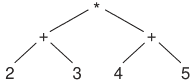

**图 3.3** Scheme 表达式的表达式树

这对应于在 C 等语言中对 `(2 + 3) * (4 + 5)` 的求值，其中表达式以中缀形式书写。

由于 Scheme 中数据和程序遵循相同的语法，当数据直接在程序中表示时就会出现问题。如上所述，我们可以通过在括号内书写并用空格分隔数字来在 Scheme 中表示数字列表，例如：

```scheme
(2.1 2.2 3.1)
```

然而，如果直接将此列表交给解释器，它会产生错误，因为 Scheme 会尝试将其作为函数调用求值。因此，需要防止列表的求值并将其视为列表字面量（就像简单的原子字面量求值到自身一样）。这是通过一种特殊形式实现的，其唯一目的是防止求值。此形式使用 Scheme 关键字 `quote`。求值 `quote` 特殊形式的特殊规则是简单地返回 quote 之后的表达式而不对其求值：

```scheme
> (2.1 2.2 3.1)
Error: the object 2.1 is not a procedure
> (quote (2.1 2.2 3.1))
(2.1 2.2 3.1)
> (quote scheme)
scheme
```

请注意，最后一个表达式返回一个 Scheme **符号**。符号实际上在 Scheme 中形成一种独立的数据类型。当它们被求值时，符号被视为标识符或名称，引用值。当它们被引用时，符号被原样字面地取值。它们可以添加到列表中或与其他符号进行相等性比较。符号作为显式数据类型的包含使 Scheme 成为处理任何类型符号信息，包括 Scheme 程序本身的优秀语言。我们将在本节后面进一步讨论符号信息处理。

`quote` 特殊形式被使用得如此频繁，以至于它有一个特殊的简写表示法——单引号或撇号：

```scheme
> '(2.1 2.2 3.1)
(2.1 2.2 3.1)
```

由于所有 Scheme 构造都是表达式，我们需要控制执行流程的表达式。循环由递归调用提供，但选择必须由特殊形式给出。执行此操作的 形式是 **if** 形式，它类似于 **if-else** 构造，以及 `cond` 形式，它类似于 **if-elsif** 构造。 （请注意 `cond` 代表 **conditional expression**。）

```
(if (= a 0) 0
  (/ 1 a))      ; if a = 0 then return 0
                 ; else return 1/a

(cond((= a 0) 0)      ; if a=0 then return 0
     ((= a 1) 1)      ; elsif a=1 then return 1
     (else (/ 1 a)))  ; else return 1/a
```

表达式 (`if` `exp1` `exp2` `exp3`) 的语义规定 `exp1` 首先被求值；如果 `exp1` 的值为布尔值 false (`#f`)，则 `exp3` 被求值并且其值由 **if** 表达式返回；否则，`exp2` 被求值并且其值被返回。此外，`exp3` 可能不存在；在这种情况下，如果 `exp1` 求值为 false，则表达式的值未定义。

类似地，(`cond` `exp1` ... `expn`) 的语义规定每个 `expi` 必须是一对表达式：`expi` = (`fst` `snd`) 每个表达式 `expi` 按顺序考虑，并对其第一部分进行求值。如果 `fst` 求值为 `#T`（真），则 `snd` 被求值，并且其值由 `cond` 表达式返回。如果没有任何条件求值为 `#T`，则 `else` 子句中的表达式被求值并作为 `cond` 表达式的值返回（即，`cond` 中的关键字 `else` 可以被认为始终求值为 `#T`）。如果没有 `else` 子句（`else` 子句是可选的）并且没有任何条件求值为 `#T`，则 `cond` 的结果未定义。

请注意，**if** 和 `cond` 特殊形式都不遵守 Scheme 表达式的标准求值规则。如果它们遵守，则每次都会求值所有参数，而不管其值如何。这将使它们作为控制机制变得无用。相反，这类特殊形式的参数在适当时刻才会被 **延迟**。Scheme 函数应用使用传值，而 Scheme 和 Lisp 中的特殊形式使用延迟求值。延迟求值是函数式编程中的一个重要问题，在第 3.4 节中进一步讨论。

另一个重要的特殊形式是 **let**，它允许在表达式内将变量名绑定到值：

```
> (let ((a 2) (b 3)) (+ a b))
5
```

**let** 中的第一个表达式是 **绑定列表**，它将名称关联到值。在此包含两个绑定的绑定列表中，`a` 被赋值为 `2`，`b` 被赋值为 `3`。然后可以在第二个表达式中使用名称 `a` 和 `b` 代表其值，该表达式是 **let** 的主体，其值是 **let** 的返回值的。注意 **let** 为一组变量名提供局部环境和作用域，其方式与 Java 和 Python 等块结构语言中的临时变量声明非常相似。这些变量的值可以在 **let** 形式内访问，但在其外部无法访问。

为了开发 Scheme 程序，我们还必须有一种创建函数的方法。这是通过 **lambda** 特殊形式完成的（术语 **lambda** 来自 Church 的 lambda 演算）。**lambda** 表达式具有以下形式：

```
(lambda param-list body)
```

当 Scheme 求值 **lambda** 形式时，它会创建一个具有指定形式参数的函数，并在该函数被应用时求值的代码体。例如，计算圆面积的函数是：

```
> (lambda (radius) (* 3.14 (* radius radius)))
#<procedure>
```

该函数可以通过将函数及其参数包装在另一组括号中来应用：

```
> ((lambda (radius) (* 3.14 (* radius radius))) 10)
314.0
```

由于引用函数名可能很有用，我们可以在 **let** 中将名称，例如 **circlearea**，绑定到 lambda，并在 **let** 的主体中将该名称应用于参数：

```
> (let ((circlearea (lambda (radius) (* 3.14 (* radius radius)))))
    (circlearea 10))
314.0
```

不幸的是，**let** 不能用于定义递归函数，因为 **let** 绑定不能引用自身或彼此。因此，以下代码会产生错误：

```
(let ((factorial (lambda (n) (if (= n 0) 1 (* n (factorial (- n 1)))))))
  (factorial 10))
```

对于这种情况，有一种不同的特殊形式，称为 **letrec**，它与 **let** 工作方式相同，只是它允许在绑定列表内进行任意递归引用：

```
(letrec ((factorial (lambda (n) (if (= n 0) 1 (* n (factorial (- n 1)))))))
  (factorial 10))
```

**let** 和 **letrec** 形式引入的变量在 **let** 或 **letrec** 的作用域内且在其生命周期内可见。为了在 Scheme 的顶层环境中使新全局变量绑定可见，我们可以使用 **define** 特殊形式，如下所示：

```
> (define circlearea (lambda (radius) (* 3.14 (* radius radius))))
> (define x 5)
> (circlearea 10)
314.0
> (circlearea x)
78.5
>
```

## 3.2.2 动态类型检查

Scheme 的语义包括动态或延迟类型检查。这意味着两点：首先，只有值，而不是变量，具有数据类型；其次，值的类型直到运行时绝对必要时才会被检查。自动发生的唯一时间大约是在所谓的原始函数，例如由 `+` 命名的函数，被应用于其参数之前。如果其中任一

如果参数不是数字，Scheme 会停止执行并输出错误信息。相比之下，程序员定义的函数参数类型不会被自动检查。例如，这里定义的 `square` 函数会把一个潜在的类型错误传递给 `*` 函数：

```
> (define square (lambda (n) (* n n)))
> (square "hello")
- - *: expects type <number> as 1st argument, given: "hello"
```

这个错误确实会被自动捕获，但它可能不是在最有用的地方被捕获。Scheme 程序员可以在适当的条件表达式中使用任何内建类型识别函数（如 `number?` 和 `procedure?`）来检查任何值的类型。然而，强迫程序员编写类型检查代码既会降低程序员的生产效率，也会降低代码的执行速度。在本章后面，我们将展示 ML 和 Haskell 等其他函数式语言如何通过引入静态类型检查来解决这个问题。

## 3.2.3 尾递归与非尾递归

由于支持过程调用需要运行时开销，在命令式语言中，循环总是比递归更可取。然而，函数式编程风格鼓励使用递归。那么，我们如何避免递归带来的低效率呢？在 Scheme 这样的语言中，答案是让任何递归步骤都成为函数中的最后步骤。换句话说，让你的函数成为尾递归函数。Scheme 编译器必须将这样的尾递归函数转换为以循环方式执行的代码，除了顶层调用之外，不再有函数调用的额外开销。为了理解这一点，请看图 3.4 中阶乘函数的两个定义。

非尾递归的 `factorial`：


```scheme
> (define factorial
    (lambda (n)
      (if (= n 1)
          1
          (* n (factorial (- n 1))))))
> (factorial 6)
720
```

尾递归的 factorial：

```scheme
> (define factorial
    (lambda (n result)
      (if (= n 1)
          result
          (factorial (- n 1) (* n result)))))
> (factorial 6 1)
720
```

**图 3.4** 尾递归和非尾递归函数

注意，对于非尾递归的 `factorial`，每次递归调用返回的值都必须乘以 `n`，而这个 `n` 是上一次调用的参数。因此，随着递归回溯，需要运行时栈来跟踪每次调用的这个参数值。所以，这个版本的 `factorial` 会造成内存的线性增长，与使用循环的非递归版本相比，性能损失相当大。然而，对于尾递归版本，所有计算值的工作都在每次递归调用之前对两个参数求值时完成。`n` 的值像之前一样递减。另一个参数 `result` 用于在递归调用向下进行的过程中累积中间乘积。`result` 在顶层调用时的值始终是 1，并在每次递归调用前乘以 `n` 的当前值。由于每次递归调用之后没有剩余工作需要完成，实际上不需要运行时栈来记住之前调用的参数。因此，Scheme 编译器可以将尾递归的 `factorial` 转换为类似这段虚构代码的形式，它使用了一个包含特殊形式 `begin`、`while` 和 `set!` 的循环：

```scheme
> (define factorial
    (lambda (n result)
      (begin
        (while (> n 1)
          (set! result (result * n))
          (set! n (- n 1)))
        result)))
```

`begin` 特殊形式强制按从左到右的顺序执行一系列表达式，并返回最后一个表达式的值。`set!` 特殊形式用于重置变量的值。`while` 特殊形式在 Scheme 中并不存在，但可以用类似于第 2 章讨论过的宏来定义。这看起来显然就是命令式代码，而且确实如此，任何真正的 Scheme 程序员都不会写出这样的代码。关键在于，如果语言包含一个聪明的编译器，能够在优化尾递归时生成类似的代码，那么程序员就可以坚持递归的、函数式的风格，而不会招致性能损失。

## 3.2.4 Scheme 中的数据结构

在 Scheme 中，基本数据结构是列表。虽然 Scheme 也支持向量（一维数组）和字符串等结构化类型，但列表可以表示序列、记录或任何其他结构。例如，下面是二叉搜索树的列表表示：

```scheme
("horse" ("cow" () ("dog" () () ))
("zebra" ("yak" () ()) () ))
```

这棵树中的一个节点是包含三项的列表（`name` `left` `right`），其中 `name` 是字符串，`left` 和 `right` 是子树，子树也是列表。因此，给定的列表表示图 3.5 中的树。

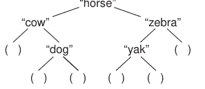

**图 3.5** 一棵包含字符串数据的二叉搜索树

要有效使用列表，我们必须有一套足够的操作列表的函数。Scheme 有许多预定义的列表函数，但所有 Lisp 系统共有的基本函数是选择函数 `car` 和 `cdr`，它们分别访问列表的头部和尾部，以及构造函数 `cons`，它向现有列表添加一个新的头部。因此，如果 `L` 是列表 `(1 2 3)`，那么：

```
> (car L)
1
> (cdr L)
(2 3)
> (cons 4 L)
(4 1 2 3)
```

`car` 和 `cdr` 这两个名称是历史偶然。Lisp 最初实现所用的机器是 IBM 704。在最初的实现中，地址或指针被用来表示列表，列表的头部是“地址寄存器的内容”（Contents of the Address Register），即 `car`；列表的尾部是“减量寄存器的内容”（Contents of the Decrement Register），即 `cdr`。这个历史偶然之所以延续，部分是因为另一个偶然：由于这两个操作名称之间只差一个字母，两者的重复应用可以通过在“c”和“r”之间组合字母“a”和“d”来合并。因此，`(car (cdr L))` 变成 `(cadr L)`，`(cdr (cdr L))` 变成 `(cddr L)`，`(car (cdr (cdr L)))` 变成 `(caddr L)`。不过，为了清晰起见，我们将避免使用这些缩写。

将列表视为由 `car` 和 `cdr` 表示的一对值，这种观点也一直作为列表的一种表示或可视化方式而很有用。按照这种观点，列表 `L` 是指向一个“包含两个指针的盒子”的指针，其中一个指针指向它的 `car`，另一个指向它的 `cdr`。见图 3.6。

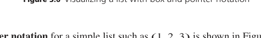

**图 3.6** 用盒子和指针表示法可视化列表

对于像 `(1 2 3)` 这样的简单列表，这种盒子和指针表示法如图 3.7 所示。

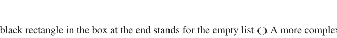

**图 3.7** 列表 `(1 2 3)` 的盒子和指针表示法

末尾盒子中的黑色矩形符号表示空列表 `()`。图 3.8 显示了一个更复杂的列表结构示例。

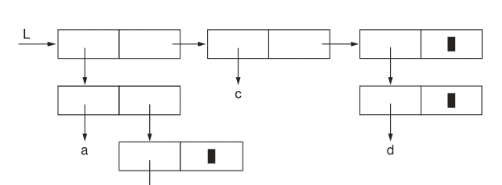

**图 3.8** 列表 `L = ((a b) c (d))` 的盒子和指针表示法

盒子和指针图对于解释列表操作很有用：`car` 操作表示沿着第一个指针移动，而 `cdr` 操作表示沿着第二个指针移动。因此，对于图 3.8 中的 `L`，`(car (car L)) = a`，`(cdr (car L)) = (b)`，`(car (cdr (cdr L))) = (d)`。

所有基本的列表操作都可以使用原语⁴ `car`、`cdr`、`cons` 和 `null?` 编写为函数。最后一个函数是一个谓词，如果它的列表参数为空，则返回真，否则返回假。例如，一个返回两个列表追加结果的 `append` 操作可以写成如下形式：

```
(define append (lambda (L M)
  (if (null? L) M
    (cons (car L) (append (cdr L) M))))
```

而 `reverse` 操作如下：

```
(define reverse (lambda (L)
  (if (null? L) '()
    (append (reverse (cdr L)) (list (car L)))))
```

在 `reverse` 函数中，我们使用了原语函数 `list`，它会生成包含一个或多个元素的列表：

```
> (list 2 3 4)
(2 3 4)
> (list '(a b) '(c d))
((a b) (c d))
```

事实上，在 `reverse` 函数中，可以使用 `(cons (car L) '())` 代替 `(list (car L))`，因为 `(list a)` 与 `(cons a '())` 相同。⁵

> ⁴原语是在较低层次实现的内置过程。Scheme 标准要求的大多数内置过程都是原语，因此我们不再强调这种区别。

> ⁵实际上，`append` 和 `reverse` 也确实是内置原语，尽管如我们所见，它们可以在 Scheme 自身中实现。

最后，我们给出使用 `car` 和 `cdr` 访问二叉搜索树的元素的例子，该树被定义为具有结构 `(data leftchild rightchild)` 的列表：

```scheme
(define (leftchild B) (car (cdr B)))

(define (rightchild B) (car (cdr (cdr B))))

(define (data B) (car B))
```

现在我们可以编写一个树遍历过程 `print-tree`，它按如下方式打印树中的数据：

```scheme
(define print-tree (lambda (B)

  (cond ((null? B) '())

        (else (print-tree (leftchild B))

              (display (data B))

              (newline)

              (print-tree (rightchild B))))))
```

## 3.2.5 Scheme 中的编程技术

在 Scheme 中，就像在任何函数式语言中一样，递归用于执行循环和其他重复操作。将重复操作应用于列表的一种标准技术是“`cdr` 向下，`cons` 向上”——意思是我们递归地将操作应用于列表的尾部，然后使用 `cons` 操作符收集结果，通过构造一个包含当前结果的新列表。一个例子是前一节的 `append` 过程代码。另一个例子是用于对数字列表中的所有成员进行平方的过程：

```scheme
(define square-list (lambda (L)

  (if (null? L) '()

      (cons (* (car L) (car L)) (square-list (cdr L))))))
```

一个不应用于列表的循环的例子是一个过程，它只是从下界到上界打印整数的平方：

```scheme
(define print-squares (lambda (low high)

  (cond ((> low high) '())

        (else (display (* low low))

              (newline)

              (print-squares (+ 1 low) high)))))
```

对 `(print-squares 1 100)` 的调用将生成所需的结果。

在 `print-squares` 示例中，我们必须使用额外的参数 `low` 来控制递归，就像循环索引控制重复一样。之前我们注意到，在这种情况下，尾递归过程是首选的，因为翻译器将其优化为实际循环相对容易。事实上，`print-squares` 函数是尾递归的。

在上一节中，我们还演示了使用累加参数将非尾递归过程转换为尾递归过程的技术。作为 Scheme 中的示例，我们将此技术应用于 `square-list` 函数，通过定义一个带有额外参数来累积中间结果的帮助过程 `square-list1`：

```scheme
(define square-list1 (lambda (L list-so-far)

  (if (null? L) list-so-far

      (square-list1 (cdr L)

                    (append list-so-far (list (* (car L) (car L))))))))
```

现在我们将 `square-list` 定义为对 `square-list1` 的调用，其第一个累积值为 `()`：

```scheme
(define square-list (lambda (L) (square-list1 L '())))
```

类似地，对于 `reverse`，我们按如下方式定义 `reverse1` 和 `reverse`：

```scheme
(define reverse1 (lambda (L list-so-far)

  (if (null? L) list-so-far

      (reverse1 (cdr L) (cons (car L) list-so-far))))

(define reverse (lambda (L) (reverse1 L '())))
```

## 3.2.6 高阶函数

由于 Scheme 中的函数是第一类值，我们可以编写将其他函数作为参数的函数，以及将函数作为值返回的函数。这种函数称为 **高阶函数**。

为了给出一个具有函数参数的函数的简单示例，我们可以编写一个函数 `map`⁶，它将另一个函数应用于列表中的所有元素，然后将它传递给平方函数以获得 `square-list` 示例：

```scheme
(define map (lambda (f L)

  (if (null? L) '()

      (cons (f (car L)) (map f (cdr L)))))

(define square (lambda (x) (* x x)))

(define square-list (lambda (L) (map square L)))
```

下面是一个具有函数参数并且还返回函数值的函数的示例：

```scheme
(define make-double (lambda (f)

  (lambda (x) (f x x))))
```

此函数假设 `f` 是一个具有两个参数的函数，并创建重复参数 `x` 在对 `f` 的调用中的函数。由 `make-double` 返回的函数值 `doublefn` 由局部 `define` 创建，然后在末尾写入以使其成为 `make-double` 的返回值。请注意，`x` 不是 `make-double` 本身的参数，而是由 `make-double` 创建的函数的参数。

我们可以使用 `make-double` 来获得平方函数和双倍函数（一个将数值加倍的函数）：

```scheme
(define square (make-double *))

(define double (make-double +))
```

符号 `*` 和 `+` 是乘法和加法函数的名称。它们的值——即函数值——被传递给 `make-double` 过程，后者反过来返回被分配给名称 `square` 和 `double` 的函数值。请注意，我们在这里使用的是 `define` 的简单形式，它只是分配计算值而不是用给定体定义函数。

正如

```scheme
(define a 2)
```

将值 2 分配给名称 `a`，表达式

```scheme
(define square (make-double *))
```

将 `make-double` 返回的函数值分配给名称 `square`。

如第 3.2 节末尾所述，函数式语言包括 Scheme 能够从高阶函数返回函数值的能力，这意味着函数式语言的运行时环境比标准块结构化命令式语言的基于栈的环境更复杂。将函数使用的内存返回以释放存储需要使用自动内存管理技术，例如垃圾回收，这将在第 10.5 节中讨论。

## 3.2.7 静态（词法）作用域

早期的 Lisp 方言是动态作用域的，而更现代的方言，如 Scheme 和 Common Lisp，则是静态作用域的。术语静态作用域或词法作用域指的是程序文本中变量声明可见的区域。因此，在静态作用域中，给定变量的含义或值只需通过阅读程序文本即可确定。相比之下，在动态作用域语言中，变量的含义取决于运行时上下文。

作用域的概念在块结构化语言中很重要，在这些语言中，可以嵌套变量的声明。例如，考虑以下 Scheme 代码段，它在一个 `let` 中嵌套了另一个 `let`：

```scheme
> (let ((a 2) (b 3))

    (let ((a (+ a b)))

      (+ a b)))

8
```

作用域规则指出，变量的作用域延伸到声明它的块的末尾，包括任何嵌套块，除非该变量在嵌套块中被重新声明。因此，在此示例中，第一个 `(+ a b)` 的值为 5，而第二个 `(+ a b)` 的值为 8。

当我们包含具有自由变量的函数时，这种对作用域规则的直接应用变得更加复杂。自由变量是在函数内引用的变量，它既不是该函数的形参，也不是在嵌套函数中绑定的变量。绑定变量是函数内的变量，它也是该函数的形参。以下是定义和使用包含自由变量和绑定变量的函数的示例：

```
> (let ((pi 3.14))
    (let ((circlearea (lambda (radius)
                     (* pi (* radius radius)))))
        (let ((pi 3.1416))
            (circlearea 10))))
314.0
```

`circlearea` 函数包含一个绑定变量 `radius` 和一个自由变量 `pi`。绑定变量 `radius` 也是函数的形参，它在函数调用的上下文中获取其值，当它绑定到值 10 时。你还可以看到，自由变量 `pi` 的值必须在函数在此应用中引用它时为 3.14。因此，自由变量 `pi` 在函数的定义上下文中获取并保留其值，即外部 `let`，而不是在函数调用的上下文中，即内部 `let`。相比之下，如果 Scheme 是动态作用域的，像旧的 Lisp 一样，在函数应用中使用的 `pi` 的值将是内部 `let` 赋予它的值，即函数调用的上下文。该应用然后将产生值 314.16。在这种情况下，函数的自由变量将具有与其形参相同的语义。也就是说，在动态作用域中，自由变量和形参的值随函数调用的上下文而变化。

词法作用域，因为它在代码中的一个位置固定了自由变量的含义，通常比动态作用域更容易阅读和验证程序。

## 3.2.8 符号信息处理和元语言能力


在本节前面，我们表明 Scheme 程序和 Scheme 数据可以具有相同的语法。例如，从数据角度来看，表达式 `(f x y)` 只是一个包含三个符号的列表，可以使用列表操作访问和操作。当被视为程序时，此表达式是将函数名由变量 `f` 命名应用于其参数值由变量 `x` 和 `y` 命名的函数。构建、操作和转换符号列表然后将其作为程序进行求值的能力赋予 Scheme 程序员创建用于特殊目的的新语言的能力。Abelson 和 Sussman [1996] 将这种能力称为元语言，并给出了其使用的几个例子。其中包括为表达关系而非函数而创建约束语言，以及构建支持逻辑推理的语言。

创建这些小语言需要程序员指定其表达式的语法和作为新解释器中实现语义，所有这些都用基础语言 Scheme 编写。虽然构建新解释器听起来可能比简单地定义新函数或数据类型更令人生畏，但这项工作由于迄今为止本节中讨论的 Scheme 的许多特性而变得出奇地简单。

为了让你体会这个想法的要旨，我们来看一看：如果 Scheme 没有把 `let` 作为内建的特殊形式，Scheme 程序员会如何处理 `let` 表达式。回忆一下，`let` 允许解释器在一个新环境中求值表达式，而这个新环境是通过将一组临时变量绑定到它们的值来创建的。然而，仔细观察会发现，`let` 形式实际上只是将 `lambda` 形式应用于其参数的语法糖。图 3.9 给出了一个 `let` 表达式和一个 `lambda` 应用的示例，二者语义相同。

```scheme
(let ((a 3) (b 4))
  (* a b))

((lambda (a b) (* a b)) 3 4)
```

图 3.9 `let` 作为 `lambda` 应用的语法糖

如你所见，`let` 的临时变量变成了 `lambda` 的形式参数，它们的初始值变成了 `lambda` 应用的实参；`let` 的函数体变成了 lambda 的函数体。

解释一个并非内建的 `let` 形式的过程包括两个步骤。首先，我们将 `let` 形式视为一个数据（列表），把它变换成另一个表示等价 `lambda` 应用的数据（另一个列表）。其次，我们对新的表示进行求值。如果假设存在一个执行所需语法变换的函数 `let-to-app`，那么我们就可以对结果应用 Scheme 函数 `eval` 来求值，如下所示：

```scheme
> (eval (let-to-app ‘(let ((a 3) (b 4))(* a b))))
```

注意，我们对 `let-to-app` 的参数（即 `let` 表达式）加了引号，以将其视为数据（一个元素列表）。然后，我们用 `eval` 强制对 `let-to-app` 的结果求值；这个结果是另一个元素列表，表示 `lambda` 的应用。

剩下的任务是定义函数 `let-to-app`，它把任意 `let` 表达式变换为相应的 `lambda` 应用。我们的实现使用了一些列表处理函数以及一个符号的引号（quote）。注释标明了从 `let` 形式中提取出来并添加到正在构造的应用列表中的代码片段：

```scheme
(define let-to-app (lambda (let-form)
  (append (list                         ; begin the app
             (list ‘lambda               ; begin the lambda
                   (map car (cdr let-form)) ; formal parameters
                   (caddr let-form)))     ; lambda body
        (map cadr let-form))))          ; argument expressions
```

另一种做法是，如果我们的新语言尚未内建这些语法形式，我们可以使用第 2 章提到的宏机制来定义它们。这样，使用这些新形式的程序员就不必对它们加引号，也不必用 `eval` 显式地求值。遇到这些新形式时，Scheme 编译器会自动完成所需的语法变换，并生成在运行时按通常方式求值的代码。

## 3.3 ML：带静态类型的函数式编程

正如我们之前提到的，ML（MetaLanguage，元语言）是一种函数式编程语言，它与 Lisp 的方言（如 Scheme）有很大不同。首先，ML 具有更接近 Algol 的语法，避免了大量括号的使用。其次，它是静态类型的，因此每个表达式的类型在执行前就已确定，并且可以检查类型的一致性。虽然传统的 Lisp 程序员可能不喜欢静态类型系统的约束，ML 的静态类型系统却提供了显著的优势。一方面，它使语言更安全，因为在执行前可以发现更多错误；这在教学环境中尤其重要，也有助于保证良好的软件工程。另一方面，ML 的静态类型系统提高了效率，因为：(1) 它可以预先确定大小和分配需求；(2) 它使运行时类型检查不再必要。此外，ML 的静态类型系统非常灵活，你将在第 8 章详细学习。它不像 C 或 Ada 那样要求程序员声明所有类型，而且还支持参数化多态，即类型可以包含类型变量，这些类型变量可以在所有类型的集合上取值。

ML 最初是在 20 世纪 70 年代末开发的，是 Robin Milner 领导的团队所开发的、用于证明程序正确性的更大系统的一部分，该系统称为 Edinburgh Logic for Computable Functions（LCF）系统。Milner 还帮助开发了基于模式匹配的强类型推断系统，即现在所称的 Hindley-Milner 类型检查。这种类型检查形式是 ML 和 Haskell（本章稍后讨论）的一个关键特性。在 20 世纪 80 年代对 ML 语言的一次修订中，早期语言的一些特性与同样在爱丁堡由 Rod Burstall 开发的 HOPE 语言相结合。这个新语言被命名为 Standard ML，即 SML。1997 年该语言又经历了一次小修订，当前的标准被称为 SML97，或简称 ML97。本书采用的就是这一修订版本。

在本节中，我们首先回顾 ML 的基础知识，包括与 Scheme 的比较。然后，我们将介绍 ML 的数据结构和编程技术。（部分 ML 数据结构的内容将在第 8 章中介绍。）

### 3.3.1 ML 的基本元素

与 Scheme 一样，ML 中的基本程序是函数声明，例如：

```ml
> fun fact n = if n = 0 then 1 else n * fact(n − 1);
val fact = fn: int → int
```

ML 中的保留字 `fun` 引入函数声明。紧跟在 `fun` 后面的标识符是函数名，参数名依次排列，直到等号为止。等号之后是函数体。

ML 系统对声明的响应是返回所定义值的数据类型。在这个例子中，`fact` 是一个函数，因此 ML 响应：`fact` 的值为 `fn`，类型为 `int → int`，这意味着 `fact` 是一个从整数（其定义域）到整数（其值域）的函数。事实上，我们也可以为 `fact` 的类型及其参数的类型给出类型声明，如下所示：

```ml
> fun fact (n: int): int = if n = 0 then 1
else n * fact (n − 1);
val fact = fn: int → int
```

函数一旦声明，就可以如下调用：

```ml
> fact 5;
val it = 120 : int
```

ML 会返回结果值及其类型（`it` 是当前正在求值的表达式的名称）。ML 的求值规则与 Scheme 本质上相同：`fact` 必须先求值为一个函数，然后对 `5` 求值，并且 `5` 的类型必须与函数的参数类型一致；随后调用函数，并将返回值连同其类型一起打印出来。然而，ML 不需要像 Scheme 那样的引号（quote）函数来阻止求值，因为在 ML 中数据与程序是截然不同的。ML 中括号几乎完全不需要，因为系统可以仅根据各项的位置确定其含义。

也可以使用关键字 `val` 在 ML 中定义值：

```ml
> val Pi = 3.14159;
val Pi = 3.14159 : real
```

在 ML 中，算术运算符与 C 或 Ada 一样，写成中缀运算符。这与 Lisp 统一的前缀记法不同。因此，运算符优先级和结合性在 ML 中是一个问题。当然，对于通常的算术运算符，ML 遵循标准的数学约定。例如，`2 + 3 * 4` 表示 `2 + (3 * 4)`。¹ 在 ML 中，还可以使用关键字 `op` 将中缀运算符转换为前缀运算符，因此 `2 + 3 * 4` 可以写成：

```ml
> op + (2 , op * ( 3 ,4));
val it = 14 : int
```

注意，这里的二元算术运算符接受整数对作为参数。这些整数对是笛卡尔积类型（即元组类型）`int * int` 的元素：

```ml
> (2,3);
val it = (2,3) : int * int
> op +;
val it = fn : int * int -> int
```

列表是 ML 的一个重要特性，几乎每种函数式语言都是如此。然而，列表在 ML 中不像在 Lisp 中那样具有普遍性，因为在 ML 中程序本身不是列表。ML 中的列表用方括号表示，元素之间用逗号分隔。例如，整数 1、2、3 的列表表示为 `[1, 2, 3]`：

```ml
> [1,2,3];
val it = [1,2,3] : int list
```

¹另一方面，一元减号（取负）运算符在数学中通常用与减法相同的 `-` 符号书写，在 ML 中则使用波浪号表示：`~5` 表示负 5。

ML 判定此列表的类型为 `int list`。ML 的强类型特性决定了列表只能包含类型完全相同的元素。下面这个示例结构就违反了这一限制，它在列表中混合了不同类型的元素：

```text
> [1,2,3.1];

Error: operator and operand don't agree [literal]

   operator domain: int * int list

   operand:        int * real list

   in expression:

      2 :: 3.1 :: nil
```

如果我们要混合不同类型的数据，就必须使用`元组`：

```text
> (1,2,3.1);

val it = (1,2,3.1) : int * int * real
```

前面示例中产生的错误信息也为我们提示了 ML 构造列表的方式，这与 Scheme 构造列表的方式类似。也就是说，运算符 `::` 对应于 Scheme 中的 `cons`，它由一个元素（成为列表的头部）和一个已构造好的列表（成为列表的尾部）构造出一个新列表。例如：

```text
> op :: ;
val it = fn : 'a * 'a list -> 'a list
> 2 :: [3,4];
val it = [2,3,4] : int list
```

请注意，`::` 运算符的类型中包含一个`类型变量` `'a`，因为 `::` 可以应用于包含任意类型值的列表。因此，`::` 是一个从任意类型 `'a` 和任意相同类型 `'a` 的列表到相同类型 `'a` 的列表的函数。

在 ML 中，每个列表都是由一系列 `::` 运算符的应用构造而成的：

```text
> 1 :: 2 :: 3 :: [];
val it = [1,2,3] : int list
```

这里的 `[]` 是空列表，也可以写作关键字 `nil`。

ML 也有与 Scheme 的 `car` 和 `cdr` 运算符对应的操作，只不过它们被称为 `hd` 和 `tl`（分别代表`头`和`尾`）。例如：

```text
> hd [1,2,3];
val it = 1 : int
> tl [1,2,3];
val it = [2,3] : int list
```

事实上，这些函数在 ML 中的使用频率远低于它们在 Scheme 中的对应版本，因为 ML 的模式匹配能力使它们变得不再必要。在 ML 中，如果我们想识别列表 L 的头部和尾部，只需将列表写成 `h :: t` 的形式。ML 会通过将模式与列表 L 进行匹配，从而将 `h` 提取为头部，将 `t` 提取为尾部。如果 L 为空，则该模式无法匹配，并会产生如下警告：

```
> val h::t = [1,2,3]:
Warning: binding not exhaustive
      h :: t = ...
val h = 1 : int
val t = [2,3] : int list
```

模式匹配更常用于函数定义和 `case` 表达式中。例如，ML 中的列表追加函数可以如下定义：⁸

```
> fun append ([], L) = L
  | append (h :: t , L) = h :: append (t , L);
val append = fn : 'a list * 'a list -> 'a list
```

这等价于下面使用 `case` 表达式的定义：

```
> fun append (x,y) =
    case x of
      []      => y |
      (h::t) => h :: append (t,y);
```

模式匹配几乎可以用于所有需要进行情况分析的函数定义中，并且它可以消除大多数 `if` 表达式的使用。例如，前面定义的递归阶乘函数也可以用模式匹配来编写：

```
fun fact 0 = 1 | fact n = n * fact (n - 1);
```

这里的第二个模式——变量 `n`——可以匹配任何内容，但作为第二个模式的位置意味着它不能为零；如果它是零，第一个模式（整数常量 `0`）就会匹配成功。

ML 中的模式还可以包含通配符，写作下划线字符。通配符是可以匹配任何内容的模式，但我们不关心其具体值。例如，我们可以定义自己的 `hd` 函数版本，如下所示：

```
fun hd (h::_) = h;
```

实际上，这个定义会产生一条警告信息（“match nonexhaustive”），因为我们没有定义 `hd` 在空列表情况下应该做什么。更好的定义如下，它与预定义的 `hd` 所做的事情本质上完全相同：

```
fun hd (h::_) = h | hd [] = raise Empty;
```

> ⁸实际上，ML 有一个内置的中缀追加运算符 `@`：`[1,2,3] @ [4,5,6] = [1,2,3,4,5,6]`。

ML 的强类型虽然安全且灵活，但对可接受的程序施加了重要的限制。一个典型的例子是平方函数，下面我们为实数（浮点）类型定义它：

```
> fun square x: real = x * x;
val square = fn : real -> real
```

现在，如果我们尝试用整数来调用此函数，就会产生错误，因为 ML（与 ADA 一样）不会自动将整数转换为实数：

```
> square 2;
Error: operator and operand don’t agree [literal]
operator domain: real
operand:          int
in expression:
    square 2
```

相反，我们需要使用转换函数手动转换整数。在下面的示例中，该函数与我们要转换到的数据类型同名：

```
> square (real 2);
val it = 4.0 : real
```

我们可能会想，可以为整数定义一个同名函数：

```
> fun square x: int = x * x;
val square = fn : int -> int
```

但 ML 不允许重载。因此，这个定义只会替换掉前一个定义。我们还可以尝试不指定参数类型来定义一个泛化版本的 `square`：

```
> fun square x = x * x;
val square = fn : int -> int
```

然而，在这种情况下，ML 只是假定我们想让 `x` 是整数。⁹ 问题在于，虽然内置算术函数对 `int` 和 `real` 等算术类型进行了重载，但我们不能利用这一点来定义任何用户自定义的重载函数。在 Haskell 语言中，这在大多数情况下不是问题（本章后面会说明）。

一个相关的问题是，ML 中的某些值包含的类型信息不足以让 ML 在表达式求值之前正确地进行类型检查。主要例子是空列表 `[]`，它的类型是 `'a list`。如果 ML 要对空列表求值一个多态函数，在某些情况下，ML 会指出关于 `[]` 的类型信息不足：

```
> rev [];
type vars not generalized because of value
restriction are instantiated to dummy types (X1,X2,...)
val it = [] : ?X1 list
```

⁹旧版本的 ML 会将此函数定义视为错误。

```
> open TextIO; (* 解引用 TextIO 结构 *)
... (* ML 解释器列出 TextIO 的内容 *)
> output(stdout,inputLine(stdin));
        (* 读取并写入一行文本 *)
Hello, world!
Hello, world!
val it = () : unit
>
```

请注意，输出操作的返回值是值 `()`，它的类型是 `unit`。这类似于 C 语言中的 `void` 类型，但在 ML 中每个函数都必须返回某个值，因此 `unit` 类型恰好有一个值 `()` 来表示“没有实际值”。¹

现在，这两个 I/O 函数只能读写字符串。要在字符串和数字之间进行转换，我们必须使用相应类型的工具结构中的 `toString` 和 `fromString` 函数（例如，`int` 类型的 `Int` 结构）：

```
> Int.toString;
val it = fn : int -> string
> Int.fromString;
val it = fn : string -> int option
```


这又带来了一个小障碍。`fromString`函数可能无法提取任何数字，在这种情况下它会返回一个`option`类型的值。其定义如下：

```sml
datatype 'a option = NONE | SOME of 'a;
```

最后，当执行一系列输入输出操作时，将这些操作收集在表达式序列中会很方便（类似于 Scheme 的`begin`结构），这是一个由分号分隔的表达式序列，用括号括起来，其值是最后一个表达式的值：

```sml
> fun printstuff () =
    ( output(stdout,"Hello\n");
      output(stdout,"World!\n")
    );
val printstuff = fn : unit -> unit
> printstuff ();
Hello
World!
val it = () : unit
```

¹Unit 还可以用来模拟 ML 中的无参数函数，因为 ML 要求每个函数至少有一个参数。

现在我们准备好 ML 中的`euclid`程序¹²：

```sml
> fun gcd (u,v) = if v = 0 then u
                else gcd (v, u mod v) ;
val gcd = fn : int * int -> int
> fun euclid () =
    ( output(stdOut, "Enter two integers:\n");
      flushOut(stdOut);
      let val u = Int.fromString(inputLine(stdIn));
          val v = Int.fromString(inputLine(stdIn))
in
        case (u,v) of
          (SOME x, SOME y) =>
            ( output(stdOut,"The gcd of ");
              output(stdOut,Int.toString(x));
              output(stdOut," and ");
              output(stdOut,Int.toString(y));
              output(stdOut," is ");
              output(stdOut,Int.toString(gcd(x,y)));
              output(stdOut,"\n")
            )
        | _ => output(stdOut, "Bad input.\n")
        end
      )
val euclid = fn : unit -> unit
> euclid ();
Enter two integers:
15
10
The gcd of 15 and 10 is 5
val it = () : unit
```

## 3.3.2 ML 中的数据结构

与 Scheme 不同，ML 拥有丰富的数据类型，从枚举类型到记录再到列表。你已经在上面看到了列表和元组（笛卡尔积）。在第 8 章中，你将看到 ML 中类型结构的更多示例。我们将在此预览其中的一些内容并简要介绍一些额外的结构。虽然 Scheme 主要依靠列表来模拟其他数据结构，但 ML 为用户定义的数据类型提供了许多选项，与 C++ 或 Ada 类似。

¹²还有一个需要提及的怪癖：我们必须在提示字符串之后使用`flushOut`函数，以确保其打印不会延迟到输入之后。

首先，可以使用`type`关键字为现有数据类型提供同义词：

```sml
> type Salary = real;

type Salary = real

> 35000.0:Salary;

val it = 35000.0 : Salary

> type Coords = real * real;

type Coords = real * real

> (2.1,3.2):Coords;

val it = (2.1,3.2) : Coords
```

ML 还具有由`datatype`关键字引入的新用户定义数据类型。例如，枚举类型可以定义如下：

```sml
> datatype Direction = North | East | South | West;
```

竖线用于声明中的备选值，而名称如`North`和`East`被称为**值构造器**或**数据构造器**。数据构造器可以用作声明或`case`表达式中的模式，如以下函数定义所示：

```sml
> fun heading North = 0.0 |
          heading East = 90.0 |
          heading South = 180.0 |
          heading West = 270.0;

val heading = fn : Direction -> real
```

递归类型如二叉搜索树也可以使用`datatype`声明来声明：

```sml
> datatype 'a BST = Nil | Node of 'a * 'a BST * 'a BST;
```

请注意，此`datatype`由存储在树中的数据类型参数化。我们现在可以按如下方式构造图 3.5 的树：

```sml
> val tree = Node("horse",
            Node("cow", Nil, Node("dog",Nil,Nil)),
            Node("zebra",Node("yak",Nil,Nil), Nil));

val tree = Node ("horse",Node ("cow",Nil,Node #),Node ("zebra",Node #,Nil))
   : string BST
```

我们可以通过模式匹配在`BST`上定义`data`、`leftchild`和`rightchild`函数。例如，

```sml
> fun leftchild (Node(data,left,right)) = left
          | leftchild Nil = raise Empty;

val leftchild = fn : 'a BST -> 'a BST
```

二叉搜索树的遍历函数，用于打印字符串节点如下：

```sml
> fun print_tree Nil = () |
    print_tree (Node (data,left,right)) =
        ( print_tree left;
          output(stdOut,data);
          output(stdOut,"\n");
          print_tree right);
val print_tree = fn : vector BST -> unit
> print_tree tree;
cow
dog
horse
yak
zebra
val it = () : unit
```

## 3.3.3 ML 中的高阶函数和柯里化

高阶函数和值是函数的表达式在 ML 中与在 Scheme 中一样有用。

ML 用于函数表达式的关键字`fn`与一个特殊的箭头（等于后跟大于）一起使用，以表示函数体。例如：

```sml
> fn x => x * x;
val it = fn : int -> int
> (fn x => x * x) 4;
val it = 16 : int
```

`fn`表达式可用于构建匿名函数和函数返回值。事实上，`fun`定义与 Scheme 中一样，只是`fn`表达式使用的语法糖：

```sml
fun square x = x * x;
```

等价于：

```sml
val square = fn x => x * x;
```

ML 与 Scheme 之间的一个区别是，如果我们使用 ML`fn`表达式声明递归函数，我们必须在 ML 中添加`rec`关键字（类似于 Scheme 的`letrec`）：

```sml
val rec fact = fn n => if n = 0 then 1 else n * fact (n - 1);
```

函数表达式可用于创建函数返回值以及函数参数，例如`make_double`函数，它将参数重复到双参数函数：

```sml
> fun make_double f = fn x => f (x,x);
val make_double = fn : ('a * 'a -> 'b) -> 'a -> 'b
> val square = make_double (op *);
val square = fn : int -> int
> val double = make_double (op +);
val double = fn : int -> int
> square 3;
val it = 9 : int
> double 3;
val it = 6 : int
```

ML 有许多内置的高阶函数，包括由字母`o`（小写字母“O”）给出的函数组合。例如：

```sml
> val double_square = double o square;
val double_square = fn : int -> int
> double_square 3;
val it = 18 : int
```

高阶函数和值是函数的表达式在 ML 中通过一种称为柯里化的过程变得更加有用。可以被视为单参数高阶函数返回剩余参数函数的多个参数函数被称为柯里化，以逻辑学家 Haskell B. Curry 命名。例如，以下`map`函数的定义是柯里的，因为参数可以分开提供¹³（或一起提供）：

```sml
> fun map f [] = [] | map f (h::t) = (f h):: map f t;
val map = fn : ('a -> 'b) -> 'a list -> 'b list
> val square_list = map square;
val square_list = fn : int list -> int list
> square_list [1,2,3];
val it = [1,4,9] : int list
> map (fn x => x + x) [1,2,3];
val it = [2,4,6] : int list
```

¹³这里定义的`map`函数实际上在 ML 中是预定义的。

请注意，在 ML 中，我们可以选择使用元组来获得函数的“非柯里化”版本，或使用两个单独的参数来获得柯里化版本：

```sml
(* gcd 函数的非柯里化版本： *)
> fun gcd (u,v) = if v = 0 then u else gcd (v , u mod v);
val gcd = fn : int * int -> int
(* gcd 函数的柯里化版本： *)
> fun gcd u v = if v = 0 then u else gcd v (u mod v);
val gcd = fn : int -> int -> int
```

事实上，在 ML 中，使用元组的函数的非柯里化版本实际上也只是单参数函数，只是其参数是元组。

如果函数定义被自动视为柯里化，并且所有多参数内置函数（如算术运算符）都是柯里化的，我们就称一种语言为完全柯里化的。ML 根据此定义不是完全柯里化的，因为所有内置二元运算符都被定义为接受元组：

```sml
> op +;
val it = fn : int * int -> int
> op ::;
val it = fn : 'a * 'a list -> 'a list
> op @;
val it = fn : 'a list * 'a list -> 'a list
```

我们可以定义这些函数的柯里化版本，但它们必须作为前缀函数而不是运算符使用：

```sml
> fun plus x y = x + y;
val plus = fn : int -> int -> int
> plus 2 3;
val it = 5 : int
> val plus2 = plus 2;
val plus2 = fn : int -> int
> plus2 3;
val it = 5 : int
> fun append L1 L2 = L1 @ L2;
val append = fn : 'a list -> 'a list -> 'a list
> val append_to_one = append [1];
val append_to_one = fn : int list -> int list
> append_to_one [2,3];
val it = [1,2,3] : int list
```

## 3.4 延迟求值

在函数式语言的设计和使用中出现的一个重要问题是普通函数应用与特殊形式之间的区别。正如我们已经指出的那样，在具有应用顺序求值规则的语言中，如 Scheme 和 ML，所有用户定义函数的参数都在调用时求值，即使这样做可能是不必要的——甚至是错误的。

不使用应用顺序求值的典型示例是布尔特殊形式`and`和`or`，以及`if`特殊形式。在`and`特殊形式的情况下，Scheme 表达式`(and a b)`在`a`求值为`false`时可能不需要求值参数`b`。这称为布尔表达式的短路求值，是延迟求值有用性的一个例子。在`if`特殊形式的情况下，这不仅仅是有用，而是必要的；为了使 Scheme 表达式`(if a b c)`具有正确的语义，`b`和`c`的求值必须延迟到`a`的结果已知之后，并且基于该结果，只求值`b`或`c`，但绝不会同时求值两者。因此，`if`特殊形式不能在 Scheme 或 ML 中定义为标准函数。这也意味着 Scheme 和 ML 必须区分两种形式，即使用标准求值（函数应用）的形式和不使用标准求值（特殊形式）的形式。

限制函数求值为应用顺序求值的一个可能论点是语义（和实现）更简单。考虑一个表达式，其中一个子表达式可能具有未定义值的情况，例如 Scheme 表达式`(and (< = 1 0) (= 1 (/ 1 0)))`或其 C 等价物`(1 == 0) && (1 == 1 / 0)`。在这种情况下，延迟求值可以导致一个定义良好的结果，即使子表达式或参数可能未定义。具有此属性的函数称为**非严格**，而函数是严格的语言更容易实现。从本质上讲，严格语言满足 GIGO 原则（垃圾进垃圾出）的一种强形式，即在给定不完整或格式错误的输入时，它们会一致地失败以产生结果。严格性对形式语义也有重要的简化作用（如第 12 章所述）。

尽管如此，正如你所见，非严格性可以是一种期望的属性。事实上，支持非严格性的论点与反对它的论点本质上是相同的。非严格函数即使在不完整或格式错误的输入存在的情况下也能产生结果——只要有足够的信息使结果合理。值得注意的是，语言 Algol60 在其按名传递参数传递约定中包含了延迟求值，这将在第 10 章中详细讨论。根据按名求值，参数仅在被调用过程的代码中实际使用时才求值。因此，函数：

```pascal
function p(x: boolean; y: integer): integer;
begin
  if x then p := 1
  else p := y;
end;
```

使用按名求值时，在调用为`p(true, 1 div 0)`时返回值为 1，因为`y`在`p`的代码中从未被到达，因此`y`的值——未定义表达式`1 div 0`——永远不会被计算。

在一种具有函数值的语言中，可以通过将参数放在一个函数“外壳”中（一个没有参数的函数）来延迟参数的求值。例如，在 C 语言中，我们可以通过编写以下代码来实现与前例中按名传递相同的效果：

```c
typedef int (*IntProc) ();
int divByZero ()
{ return 1 / 0;
}
int p(int x, IntProc y)
{ if (x) return 1;
  else return y();
}
```

并调用`p(1,divByZero)`。（有时这种像`divByZero`这样的“外壳”过程由于某种晦涩的历史原因被称为按名传递`thunk`，或简称为`thunk`。）在 Scheme 和 ML 中，由于可以直接使用`lambda`和`fn`函数值构造器，因此将参数用函数外壳包围的过程甚至更容易，如以下 Scheme 定义所示：

```scheme
(define (p x y) (if x 1 (y)))
```

可以按如下方式调用：

```scheme
(p #T (lambda () (/ 1 0)))
```

请注意，`p`的代码必须改变以反映函数参数`y`，该参数必须用括号包围以强制调用`y`。否则将返回函数本身而不是其值。

事实上，Scheme 有两种特殊形式可以精确地实现我们一直在描述的功能。特殊形式`delay`会延迟其参数的求值并返回一个可以被视为 lambda“外壳”或对其参数求值的承诺的对象。相应的特殊形式`force`会导致其参数被求值，该参数必须是延迟对象。因此，函数`p`将被写成：

```scheme
(define ( p x y) (if x 1 (force y)))
```

并调用为：

```scheme
(p #T (delay (/ 1 0)))
```

当同一个延迟表达式被重复求值时，按需求值会导致效率低下。例如，在延迟版本的平方函数中，

```scheme
(define (delayed-square x) (* (force x) (force x)))
```

参数`x`将在`delayed-square`的主体中被求值两次，如果`x`是一个复杂的表达式，这是不高效的。事实上，Scheme 在`force`函数中内置了对按名传递的改进。Scheme 使用记忆化过程，其中延迟对象的值在第一次被强制时被存储，然后后续对`force`的调用只需返回存储的值而不是重新计算它。（这种参数求值有时被称为按需传递。）

按名延迟求值有助于参数在不需要时保持未计算，并允许将类似`if`和`cond`的特殊形式定义为普通函数。然而，按名传递无法处理更复杂的情况，其中每个参数的只有部分


`(take 0 (intlist (+ 1 2) 100))` 然后被求值并返回空列表 `'()` 而不强制求值 `(intlist (+ 1 2) 100)`。

5. `(cons 2 '())` 的结果最终被求值，返回列表 `(2)`。因此，整数列表的其余部分永远不会被计算。

我们刚刚描述的场景，连同记忆化，被称为惰性求值。这种求值表达式的机制可以在函数式语言中无需显式调用 `delay` 和 `force` 来实现，只要运行时环境遵循以下规则：

- 1. 所有用户定义函数的参数都被延迟。
- 2. `let` 和 `letrec` 表达式中所有局部名称的绑定都被延迟。
- 3. 所有构造器函数（如 `cons`）的参数都被延迟。
- 4. 所有其他预定义函数的参数，例如算术函数 `"1, "*";` 等，都被强制。
- 5. 所有函数值参数都被强制。
- 6. 所有选择形式（如 `if` 和 `cond`）中的条件都被强制。

根据这些规则，对长列表的操作只能计算列表中必要的部分。惰性求值还使得可以在语言中包含潜在的无限列表成为可能，因为在任何时候只会计算列表的一部分。遵守惰性求值规则的列表通常被称为流。这个名字暗示了列表的无限性质。流可以被视为一个部分计算的列表，其剩余元素可以继续计算到任何期望的数量。流是函数式编程中的一个重要机制。为了完全消除副作用，输入和输出必须作为流引入到函数式语言中。请注意，Scheme 和 ML 都有特设的流构造（除了前面提到的手动 `delay` 和 `force` 过程）。14

具有惰性求值的函数式语言的主要例子是 Haskell（再次以 Haskell B. Curry 命名）。惰性求值支持一种称为生成器-过滤器编程的函数式编程风格。程序员可以将计算分离为生成流的过程和其他以流作为参数的过程，而无需担心每一步的效率。生成流的过程称为生成器，而修改流的过程称为过滤器。例如，前一个 Scheme 示例中的 `intlist` 过程是一个生成器，而 `take` 过程是一个过滤器。

函数式编程中一个著名的需要生成器-过滤器编程的问题是列表的 same-fringe 问题。两个列表具有相同的边缘，如果它们包含相同的非空原子并且顺序相同，或者换句话说，当它们被写成树时，它们的非空叶按从左到右的顺序相同。例如，列表 `((2 (3)) 4)` 和 `(2 (3 4 ()))` 具有相同的边缘。为了确定两个列表是否具有相同的边缘，我们必须将它们展平为仅由原子组成的列表：

14 Haskell 已用一个更通用的构造 `monad` 替代了 I/O 流，我们在这里也不研究它。

包含许多新颖的特性，包括函数重载和一种称为 **monads** 的机制来处理诸如 I/O 之类的副作用（对纯函数式语言来说始终是一个问题）。有关 `monad` 或 I/O 特性的更多信息，请参阅本章的注释和参考文献。在下面的讨论中，我们关注 Haskell 的惰性求值和重载。

## 3.5.1 Haskell 的元素

Haskell 的语法与 ML 非常相似，但有一些显著的区别。Haskell 使用内部程序线索，包括使用缩进和行格式来解决歧义的 **layout rule** 布局规则，将语法量减少到绝对最小。因此，Haskell 程序很少需要分号或任何形式的括号。事实上，不需要用于定义的特殊语法，并且在用模式匹配定义的函数中不使用竖线。以下是 Haskell 中函数定义的几个例子：

```haskell
fact 0 = 1

fact n = n * fact (n - 1)

square x = x * x

gcd1 u v = if v == 0 then u else gcd1 v (mod u v)

reverse1 [] = []

reverse1 (h:t) = reverse1 t ++ [h]
```

在这些定义中，我们注意到 Haskell 和 ML 之间的以下区别。首先，Haskell 不允许重新定义已预定义的函数。（然而，更改实际预定义的内容很容易。）因此，我们在前面的代码中将 `reverse` 和 `gcd` 的函数附加了 1，因为它们已被预定义。接下来，我们注意到构造列表的 `cons` 运算符写成单个冒号。另一方面，类型使用双冒号给出，这与 ML 完全相反。模式匹配，如前所述，不需要使用 `-` 符号。最后，Haskell 中列表连接由 `++` 运算符给出。

Haskell 是一个完全柯里化的语言。所有预定义的二元运算符都是柯里化的。在 Haskell 中称为 **section** 的构造中，二元运算符可以使用括号部分应用于任一参数。因此，

```haskell
plus2 = (2 +)
```

定义了一个在其左侧参数上加 2 的函数，而：

```haskell
times3 = (* 3)
```

定义了一个在其右侧参数上乘以 3 的函数：

```
> plus2 3
5

> times3 4
12
```

中缀函数也可以通过用括号括起来的方式转换为前缀函数，无需使用 `op` 关键字。例如：

```
> (+) 2 3
5
> (*) 4 5
20
```

Haskell 也支持匿名函数或 lambda 表达式，用反斜杠表示 lambda：

```
> (\x -> x * x ) 3
9
```

## 3.5.2 高阶函数与列表推导

Haskell 包含许多预定义的高阶函数，例如 `map`。这些函数都是柯里化形式（如前所述），因此它们可以被部分应用，从而构造出更多高阶函数。例如，`map` 函数的类型为：

```
(a -> b) -> [a] -> [b]
```

可以通过柯里化省略列表参数，定义一个 `square_list` 函数：

```
square_list = map (\x -> x * x)
```

再举一个例子，Haskell 中的函数组合运算符用点号（`.`）表示：

```
> ((*3) . (2+)) 5
21
```

Haskell 与 ML 一样，拥有内置的列表和元组，以及类型同义词和用户定义的多态类型：

```
type ListFn a = [a] -> [a]
type Salary = Float
type Pair a b = (a,b)
data BST a = Nil | Node a (BST a) (BST a)
```

注意，Haskell 中的类型变量（如前面定义中的 `a` 和 `b`）在书写时不带 ML 中的引号，并且写在数据类型名称之后而非之前。关键字 `data` 取代了 ML 的关键字 `datatype`，而新的用户自定义类型使用略微不同的语法，无需 `of` 关键字。Haskell 中类型和构造器的名称必须大写，而函数和值的名称必须小写。

对新数据类型的函数可以将数据构造器用作模式，这与 ML 类似：

```
flatten:: BST a -> [a]
flatten Nil = []
flatten (Node val left right) =
    (flatten left) ++ [val] ++ (flatten right)
```

注意，定义之前有 `flatten` 函数的类型声明。类型声明是允许的，但不是必需的。类型声明可用于解决歧义，或将函数的类型限制为 Hindley-Milner 类型检查所推断之外的范围。这一选项的使用方式类似于 ML 允许在定义内部指定参数和返回值的类型，而 Haskell98 不允许这样做。

Haskell 还有一种特殊记号，用于对列表进行运算，称为列表推导。列表推导的设计初衷是让它看起来像数学中的集合定义。例如，如果我们想对一个整数列表求平方，可以这样写：

```
square_list lis = [ x * x | x <- lis ]
```

这实际上只是 `map (\x -> x * x) lis` 的语法糖，但它能让列表编程变得更加简单和透明。该记号还可以扩展以包含布尔条件，例如：

```
square_list_positive lis = [ x * x | x <- lis, x > 0 ]
```

这也是 `map (\x -> x * x) (filter (>0) lis)` 的语法糖，其中 `filter` 是一个预定义的列表函数，定义如下：

```
filter:: (a -> Bool) -> [a] -> [a]
filter pred [] = []
filter pred (h:t) =
    if pred h then h : filter pred t else filter pred t
```

作为列表推导的另一个例子，可以给出快速排序的一种非常紧凑的定义（使用列表的第一个元素作为基准）：

```
qsort [] = []
qsort (h:t) = qsort [x | x <- t, x <= h] ++
    [h] ++ qsort [x | x <- t, x > h]
```

## 3.5.3 惰性求值与无限列表

因为 Haskell 是一种惰性语言，所以除非某个值在程序计算中确实被需要，否则不会计算它。因此，对于定义：

```
f x = 2
```

对 `f` 的任何调用都不会计算其参数，因为结果并不需要它。类似地，下面这个函数的行为完全等同于内置的 `if–then–else` 表达式：

```
my_if x y z = if x then y else z
```

惰性求值也意味着 Haskell 中的列表与流相同，并且能够是潜在的无限列表。因此，我们可以安全地定义无限个 1 组成的列表，而不会陷入立即无限循环的危险：

```
ones = 1 : ones
```

事实上，Haskell 有几种表示无限列表的简写记号。例如，记号 `[n..]` 代表从整数 n 开始的整数列表。同样的列表也可以写成 `[n, n+1..]`，而由 1 组成的列表可以定义为 `[1,1..]`。作为该记号的最后一个例子，正偶数列表可以写成 `[2,4..]`。

给定一个潜在无限的列表，显然不可能显示或处理整个列表。因此，部分计算列表的函数变得很有用。两个这样的函数是 `take` 和 `drop`；`take` 提取列表中的前 n 项，而 `drop` 丢弃前 n 项（下划线是通配符模式，与 ML 中一样）：

```
take 0 _ = []
take _ [] = []
take n (h:t) = h : take (n - 1) t
drop 0 lis = lis
drop _ [] = []
drop n (_:t) = drop (n - 1) t
```

例如，`take 5 (drop 4 [2..])` 的结果是 `[6,7,8,9,10]`。

利用惰性求值，可以非常紧凑地表示前面讨论 ML 时介绍过的埃拉托斯特尼筛法：

```
sieve (p : lis) = p : sieve [n | n <- lis , mod n p /= 0]
primes = sieve [2..]
```

有了这个（无限的）素数列表定义，`take` 可以用来计算任意所需数量的素数：

```
> take 100 primes
[2,3,5,7,11,13,17,19,23,29,31,37,41,43,47,53,59,61,67,71,
73,79,83,89,97,101,103,107,109,113,127,131,137,139,149,
151,157,163,167,173,179,181,191,193,197,199,211,223,
227,229,233,239,241,251,257,263,269,271,277,281,283,
293,307,311,313,317,331,337,347,349,353,359,367,373,
379,383,389,397,401,409,419,421,431,433,439,443,449,
457,461,463,467,479,487,491,499,503,509,521,523,541]
```

## 3.5.4 类型类与重载函数

在这个简短的 Haskell 概述中，我们要讨论的最后一个主题是 Haskell 独特的重载方法。回想一下，ML 中的函数不能重载，这要么导致无法解决的歧义，要么导致 ML 为了避免歧义而不得不做出的强烈假设。特别是，我们无法定义一个诸如 `square` 这样的算术函数，使其既能用于整数又能用于实数。Haskell 没有这样的问题。实际上，我们可以像平常一样定义 `square` 函数：

```
square x = x * x
```

然后将其用于任何数值：

```
> square 2
4
> square 3.5
12.25
```

`square` 的类型给我们提供了线索，让我们知道 Haskell 是如何做到这一点的：

```
square :: Num a => a -> a
```

这种类型被称为限定类型。它本质上说明，只要 `a` 是 `Num`，`square` 就可以应用于任何类型 `a`。但什么是 `Num`？它不是一个类型，而是一个类型类。也就是说，它是一个类型的集合，这些类型都定义了某些函数。下面是 `Num` 类型类的一个可能但不完整的定义：

```
class Num a where
  (+), (-), (*) :: a -> a -> a
  negate       :: a -> a
  abs          :: a -> a
```

类型类定义声明了属于该类的每个类型都必须定义的函数的名称和类型（也称为签名）。因此，类型类有点像 Java 接口。当然，这个定义本身什么也不做。为了让任何类型属于这个类，我们必须给一个实例定义，在其中为每个所需函数提供实际可用的定义。例如，在标准库中，数据类型 `Int`、`Float` 和 `Double` 都是 `Num` 的实例。标准库中 `Int` 的一个（部分）实例定义如下：

```
instance Num Int where
  (+)     = primPlusInt
  (-)     = primMinusInt
  negate  = primNegInt
  (*)     = primMulInt
  abs     = absReal
```

等号右边的函数都是隐藏在标准库模块中的内置定义。

Haskell 通过在类定义中查找符号 `*`（因为 `square` 的函数体依赖于 `*` 的可用性）来确定 `square` 的类型，并应用相应的限定。然后，`square` 函数就可以应用于任何其类型是 `Num` 类实例的值。

然而，类型类的结构比这个简单描述所暗示的要多得多。例如，以 `Int` 为例，`Num` 类并没有描述所有需要可用的函数，比如相等性测试和 `<` 这样的顺序函数。`Int` 实例也没有包含 `div` 和 `mod` 函数。上面的 `Num` 类甚至没有要求任何除法运算。其他类型类确实要求这些函数。类 `Eq` 要求相等运算符 `==`，类 `Ord` 要求小于运算符 `<`，类 `Integral` 要求 `div` 和 `mod` 运算。为了提供完整的功能，`Int` 应该被定义为所有这些类型类的实例。为了实现这一点，许多类型类本身被定义为其他类型类的一部分，因此任何实例也必须是这些其他类的实例。类型类对其他类型类的这种依赖关系称为类型类继承。类型继承依赖于类型类的层次结构。位于这个层次结构底部的两个类型类是 `Eq` 和 `Show`。类 `Show` 用于确认 `show` 函数的存在，该函数用于显示成员类型的值。所有预定义的 Haskell 类型都是 `Show` 类的实例。类 `Eq` 确立了成员类型的两个值能够使用 `==` 运算符进行比较的能力。大多数类型都是 `Eq` 的实例。不过，函数类型不是，因为函数的相等性无法以一种能提供有用信息的方式来定义。

下面是 Haskell 标准库中 `Eq` 类的完整定义：

```
class Eq a where
  (==), (/=) :: a -> a -> Bool
  x == y  = not (x/=y)
  x /= y  = not (x==y)
```

这个类定义展示了一个额外的特性：为所需函数使用默认定义。这样的默认定义通常基于其他必需函数。在前面的代码中，`/=`（不等于）的默认定义依赖于 `==` 定义的可用性，而 `==` 的默认定义依赖于 `/=` 定义的可用性。这种表面上的循环性意味着，要让一个类型被声明为 `Eq` 的实例，只需要定义两个必需函数中的一个，另一个则通过默认定义隐式给出。例如，`Int` 被定义为 `Eq` 的实例，方式如下：

```
instance Eq Int where (==) = primEqInt
```

为了确立每个类型类的继承要求，Haskell 使用了一种类似于类型限定的记号。例如，Haskell 标准库中 `Num` 类的定义如下开头：

```
class (Eq a, Show a) => Num a where ...
```

那么当我们尝试显示或比较*tree*时，Haskell 解释器将做出如下响应：[^15]

```text
> tree
ERROR: Cannot find "show" function for:
*** Expression : tree
*** Of type     : Tree [Char]
> tree == tree
ERROR: Illegal Haskell 98 class constraint in inferred type
*** Expression : tree == tree
*** Type       : Eq (BST [Char]) => Bool
```

为了使自定义数据类型有用，我们通常必须将其定义为 `Eq` 和 `Show` 的实例。注意，`Show` 需要一个 `show` 函数，将所讨论的数据类型转换为 `String`，以便能够显示它。例如：

```haskell
instance Eq a => Eq (BST a)
    where
    Nil == Nil = True
    Node x a b == Node y c d = x == y && a == c && b == d
    _ == _ = False

instance Show a => Show (BST a) where show = ...
```


特别要注意，`BST` 的相等性定义如何依赖于类型参数 `a` 在 `Eq` 中的成员关系，因为否则无法测试存储数据的相等性。

通常需要将新数据类型定义为 `Eq`、`Show` 和 `Ord` 等类型类的成员，因此 Haskell 提供了一种自动生成这些定义的方法。Haskell 简单地假定所需的定义是“自然”的。数据类型通过将其打印为字符串来显示，相等性则按分量（component-wise）定义。为了实现这一点，需要给数据定义添加一个 **deriving** 子句：

```haskell
data BST a = Nil | Node a (BST a) (BST a)
          deriving (Show,Eq)
```

有了这个 `BST` 定义，Haskell 就能轻松显示 `BST` 或比较两个 `BST` 是否相等：

```text
> tree
Node "horse" (Node "cow" Nil (Node "dog" Nil Nil))
  (Node "zebra" (Node "yak" Nil Nil) Nil)
> tree == tree
True
```

[^15] 这是 HUGS Haskell 解释器的输出——参见注释和参考文献。

| (exp exp) |
| (λ variable . exp) |

该语法中的常量是诸如 `0` 或 `1` 的数字，以及某些预定义函数，如 `1` 和 `*`。变量是诸如 `x` 和 `y` 的名称。表达式的第三条规则表示函数应用 `(f x)`，如前所述。第四条规则给出 lambda 抽象。注意，只允许单变量函数，但由于 lambda 表达式提供了高阶函数，这并非重大限制，因为本章前面讨论的柯里化（currying）概念允许将多变量函数解释为单变量函数，该函数返回作用于其余变量的函数。因此，这里定义的 lambda 演算是完全柯里化的。

lambda 演算中的变量不像编程语言中的变量——它们不占用内存，因为 lambda 演算没有内存的概念。lambda 演算中的变量反而对应于纯函数式编程中的函数参数。常量的集合和变量的集合并未由该语法规定。因此，更准确的说法是存在多种 lambda 演算。每个对常量集合和变量集合的特定规范都描述了一种特定的 lambda 演算。没有常量的 lambda 演算被称为纯 lambda 演算。

括号被包含在函数应用和 lambda 抽象的规则中以避免歧义，但按照惯例，如果不会产生歧义，可以省略。因此，根据我们的语法，我们本应为 `(λx. + 1 x)` 写成 `(λx. ((+ 1) x))`，为 `(λx. + 1 x) 2` 写成 `((λx. ((+ 1) x) 2)`。然而，按原来的写法并不会产生歧义。

表达式 `(λx.E)` 中的变量 `x` 被称为由该 lambda 绑定。绑定的作用域是表达式 `E`。变量出现于 lambda 对其任何绑定作用域之外时，就是自由出现。不是自由的出现就是绑定出现。因此，在表达式 `(λx. E)` 中，`E` 内 `x` 的所有出现都是绑定的。例如，在表达式

```
(λx. + y x)
```

中，`x` 是绑定的，`y` 是自由的。如果我们尝试应用这个 lambda 抽象所指定的函数，我们会代入 `x`，但无法确定 `y` 的值：

```
(λx. + y x) 2 ⇒ (+ y 2)
```

变量 `y` 类似于函数中的非局部引用——其值必须由外部环境指定。

同一变量的不同出现可以由不同的 lambda 绑定，且一个变量的某些出现可能是绑定的，而另一些则是自由的。在以下表达式中：

```
(λx. + ((λy. ((λx. * x y) 2)) x) y)
```

* 之后的 `*x*` 的出现由与外部 `*x*` 不同的 lambda 绑定。此外，`*y*` 的第一次出现是绑定的，而第二次出现是自由的。事实上，应用这些 lambda 定义的函数会得到如下归约：

```
(λx. + ((λy. ((λx. * x y) 2)) x) y) ⇒

(λx. + ((λy. (* 2 y)) x) y) ⇒

(λx. + (* 2 x) y)
```

在归约包含多个同名绑定的表达式时，必须小心不要混淆绑定的作用域——有时需要重命名（稍后讨论）。

我们可以将 lambda 演算视为对函数式编程的建模，方法是将 lambda 抽象视为函数定义，将两个表达式的并置视为函数应用。然而，作为一种模型，lambda 演算极其通用。例如，lambda 演算并不阻止我们将函数应用于自身，甚至定义接受函数参数并将其应用于自身的函数：`((x x)` 和 `(λx. x x)` 都是 lambda 演算中的合法表达式。一种更受限的 lambda 演算，称为 **类型化 lambda 演算**，包含了编程语言中的数据类型概念，从而减少了允许的表达式集合。我们将不再进一步讨论类型化 lambda 演算。

然而，由于 lambda 演算如此通用，必须给出非常精确的表达式转换规则，例如为绑定变量替换值。这些规则有历史名称，如“α-转换”和“β-转换”。我们将简要概述，以展示 lambda 表达式上可能发生的操作类型。

转换 lambda 表达式的主要方法是**替换**或**函数应用**。我们已经见过许多这样的例子：`((λx. + x 1) 2)` 等价于 `(+ 2 1)`，将 `2` 替换 `*x*` 并消除 lambda。这就像编程语言中对 lambda 抽象所定义函数的调用，其中 `2` 作为值参数替换 `*x*`。历史上，这一过程在 lambda 演算中被称为 **β-归约**。也可以反向看待这一过程，即 `(+ 2 1)` 变成 `((λx. + x 1) 2)`，这种情况下称为 **β-抽象**。**β-转换** 指 β-归约或 β-抽象二者之一，并建立两个表达式的等价性。形式上，β-转换表示 `((λx.E) F)` 等价于 `E[F/x]`，其中 `E[F/x]` 是指将 `E` 中所有自由出现的 `*x*` 替换为 `F` 后的 `E`。

在 β-转换中，当 `*F*` 包含 `*E*` 中出现的变量名时，必须小心。考虑表达式：

```
((λx. (λy. + x y)) y)
```

`*y*` 的第一次出现是绑定的，而第二次是自由的。如果我们盲目地将 `*x*` 替换为 `*y*`，就会得到错误的归约 `(λy. + y y)`。这就是所谓的 **名字捕获** 问题。我们要做的是更改内部 lambda 抽象中 `*y*` 的名称，使自由出现不会冲突，如下所示：

```
((λx. (λy. + x y)) y) ⇒ ((λx. (λz. + x z)) y) ⇒ (λz. + y z)
```

名称更改是 lambda 演算中另一种可用的转换过程，称为 **α-转换**：$(\lambda x.E)$ 等价于 $(\lambda y.E[y/x])$，其中如前所述，$E[y/x]$ 表示表达式 $E$ 中所有自由出现的 $x$ 都被替换为 $y$。（注意，如果 $y$ 是已经出现在 $E$ 中的变量，则可能产生与刚才讨论的替换问题类似的麻烦。）

最后，有一种转换允许消除“冗余”的 lambda 抽象。这种转换称为 **η-转换**。一个简单的例子是表达式 $(\lambda x. (+ 1 x))$。由于 `1` 是柯里化的，表达式 $(+ 1)$ 是一个单参数函数，而表达式 $(+ 1 x)$ 可以看作是函数 `+ 1` 应用于 `x`。因此，$(\lambda x. (+ 1 x))$ 等价于没有 lambda 抽象的函数 $(+ 1)$。一般来说，只要 `E` 中不包含自由出现的 `x`，$(\lambda x. (E x))$ 就通过 η-转换等价于 `E`。另一个 η-转换的例子是：

$(\lambda x. (\lambda y. (+ x y))) \Rightarrow (\lambda x. (+ x)) \Rightarrow 1$

也就是说，第一个表达式只是 `1` 函数的另一种记号。

值得注意的是，η-归约有助于简化函数式语言中的柯里化定义。例如，ML 定义

```
fun square_list lis = map (fn x => x * x) lis ;
```

可以通过 η-归约简化为

```
val square_list = map (fn x => x * x) ;
```

对 lambda 表达式应用 β-归约的顺序会对最终获得的结果产生影响，正如不同的求值顺序在编程语言中也会造成差异一样。特别是，可以区分应用序求值（或按值传递）和正常序求值（或按名传递）。例如，在以下表达式中：

$(\lambda x. * x x) (+ 2 3)$

我们可以使用应用序，将 $(1 2 3)$ 替换为其值，然后再应用 β-归约，如

$(\lambda x. * x x) (+ 2 3) \Rightarrow ((\lambda x. * x x) 5) \Rightarrow (* 5 5) \Rightarrow 25$

或者我们可以先应用 β-归约再求值，得到正常序求值：

$(\lambda x. * x x) (+ 2 3) \Rightarrow (* (+ 2 3) (+ 2 3)) \Rightarrow (* 5 5) \Rightarrow 25$

正如我们多次指出的，正常序求值是一种**延迟**求值，因为表达式的求值仅在替换之后进行。

正常序求值的结果可能与应用序不同，这一点我们之前也曾提到。一个显著的例子是参数求值产生未定义结果的情况。如果表达式的值不依赖于参数的值，那么正常序仍能计算出正确值，而应用序也会给出未定义结果。

例如，考虑lambda表达式 `((λx. x x) (λx. x x))`。对该表达式进行β-归约会不断得到相同的结果。因此，β-归约会进入一个“无限循环”，试图去归约这个表达式。如果我们把这个表达式作为常量表达式的一个参数，如：

$$(\lambda y.\ 2)\ ((\lambda x.\ x\ x)\ (\lambda x.\ x\ x))$$

那么使用应用序会得到未定义的结果，而使用正常序会得到值`2`，因为结果不依赖于参数`y`的值。

能够在参数未定义时仍返回值的函数称为**非严格**的，而在参数未定义时总是未定义的函数称为**严格**的。在lambda演算的记号中，符号⊥（读作“bottom”）表示未定义的值，并且函数`f`是严格的，如果`f(⊥) = ⊥`总是成立。因此，应用序求值是严格的，而正常序求值是非严格的。

正常序归约在lambda演算中很重要，因为许多表达式可以使用正常序归约到一个唯一的、无法进一步归约的范式中。这是著名的**丘奇-罗瑟定理**的一个推论，该定理指出，归约序列本质上与执行的顺序无关。两个表达式的等价性可以通过使用正常序对它们进行归约并比较它们的范式（如果存在）来确定。这对函数式语言的翻译器也有实际应用，因为翻译器可以使用范式将一个函数替换为等价但更高效的函数。

最后，在这段对lambda演算的简要概述中，我们希望展示lambda演算如何以与上一节中处理方式完全相同的方式对递归函数定义进行建模。考虑下面阶乘函数的定义：

$$\mathrm{fact} = (\lambda n.\ (\mathrm{if}\ (=\ n\ 0)\ 1\ (*\ n\ (\mathrm{fact}\ (-\ n\ 1)))))$$

我们通过创建一个新的lambda抽象来去除递归，如下所示：

$$\mathrm{fact} = (\lambda F.\ \lambda n.\ (\mathrm{if}\ (=\ n\ 0)\ 1\ (*\ n\ (F\ (-\ n\ 1)))))\ \mathrm{fact}$$

换句话说，右侧可以看作一个lambda抽象，当将其应用于`fact`时，会再次得到`fact`。

如果我们将这个抽象记为

$$H = (\lambda F.\ \lambda n.\ (\mathrm{if}\ (=\ n\ 0)\ 1\ (*\ n\ (F\ (-\ n\ 1)))))$$

那么方程变为

$$\mathrm{fact} = H\ \mathrm{fact}$$

也就是说，`fact` 是 `H` 的一个**不动点**。我们可以通过为函数构建集合表示来构造一个最小不动点解。然而，在lambda演算中，lambda表达式是原始的；也就是说，我们不能使用集合来对它们建模。因此，要在lambda演算中定义一个递归函数`fact`，我们需要一个函数`Y`来构造lambda表达式`H`的不动点。因此，`Y`需要具有性质 `Y H = fact` 或 `Y H = H (Y H)`。这样的 `Y`确实可以由下面的lambda表达式定义：

$$Y = (\lambda h.\ (\lambda x.\ h\ (x\ x))\ (\lambda x.\ h\ (x\ x))).$$

`Y`被称为**不动点组合子**，组合子就是任何只包含绑定变量的lambda表达式。这样的`Y`实际上构造了一个在某种意义上是“最小”的解。因此，人们可以在lambda演算中提及递归函数的**最小不动点语义**，以及在普通的基于集合的函数理论中也是如此。

## 习题

### 3.1

下面的C函数计算幂`a^b`，其中`a`是一个浮点数，`b`是一个（非负）整数：

```c
double power(double a, int b){
    int i;
    double temp = 1.0;
    for (i = 1; i <= b; i++) temp *= a;
    return temp;
}
```

- (a) 将该过程重写为函数式形式。
- (b) 使用累加参数将你对(a)的回答重写为尾递归形式。

### 3.2

一个从用户输入的以0结尾的整数列表中返回最大值的函数由下面的C函数给出：

```c
int readMax(){
    int max, x;
    scanf("%d", &x);
    if (x != 0){
        max = x;
        while (x != 0){
            scanf("%d", &x);
            if (x > max) max = x;
        }
        return max;
    }
}
```

使用尾递归尽可能以函数式风格重写该过程（`scanf`过程阻止了变量的完全去除）。

### 3.3

递归排序比其他排序更容易用函数式风格编写。两种递归排序是快速排序和归并排序。编写(a)快速排序；(b)归并排序的函数式版本，使用你选择的命令式语言（如C、Ada、C++、Python），并以整数数组作为基本数据结构。

### 3.4

可以用栈编写实现递归算法的非递归程序，但代价是额外的源代码复杂性（这是使用像FORTRAN这样的非递归语言所必需的开销）。编写(a)快速排序；(b)归并排序的非递归版本。讨论增加这种复杂性的困难。(c) 这两种排序中哪一种更容易非递归实现？为什么？

### 3.5

下列哪些函数是引用透明的？解释你的理由。

- (a) 阶乘函数
- (b) 从键盘返回一个数字的函数
- (c) 一个函数`p`，它统计自身被调用的次数

### 3.6

一个没有副作用的函数是引用透明的吗？解释。

### 3.7

二项式系数是计算机科学中常见的计算任务。对于 `n >= 0, 0 <= k <= n`，它们的定义如下（`!`是阶乘，`0! = 1`）：

`B(n, k) = n! / ((n - k)! k!)`

- (a) 编写一个使用循环计算`B(n, k)`的过程。在`B(10, 5)`上测试你的程序。
- (b) 使用下面的递推关系以及`B(n, 0) = 1`和`B(n, n) = 1`的事实，编写一个函数式过程来计算`B(n, k)`：

$$
B(n, k) = B(n - 1, k - 1) + B(n - 1, k)
$$

在`B(10, 5)`上测试你的程序。
- (c) 你能编写一个比(b)的程序更高效但仍保持函数式风格的程序吗？（提示：考虑3.5节讨论的按需调用记忆化。）

### 3.8

使用Scheme、ML或Haskell完成以下函数式编程练习：

- (a) 编写一个尾递归函数来计算任意列表的长度。
- (b) 编写一个函数，计算整数列表的最大值和最小值。
- (c) 编写一个函数，从用户那里收集整数，直到遇到`0`，并按输入顺序将它们返回到一个列表中（仅限Scheme或ML）。
- (d) 使用你在练习(b)和(c)中编写的函数，编写一个程序，输入一个以`0`结尾的整数列表，按输入顺序打印该列表，并打印列表的最大值和最小值。对于此练习，仅使用Scheme或ML。
- (e) 为整数列表编写快速排序（仅限Scheme或ML）。
- (f) 为整数列表编写归并排序。
- (g) 毕达哥拉斯三元组是整数元组 `(x, y, z)`，使得 `x * x + y * y = z * z`。编写一个带参数 `n` 的函数，打印所有满足 `1 ≤ x ≤ y ≤ z ≤ n` 的毕达哥拉斯三元组。
- (h) 编写一个高阶函数 `twice`，它接受一个单参数函数作为参数，并返回一个函数，该函数表示将该函数对其参数应用两次。给定平方函数的通常定义，函数 `(twice (twice square))` 是什么？
- (i) 编写一个高阶函数 `inc_n`，它接受一个整数 `n` 作为参数，并返回一个 `n` 次增量函数，该函数将其参数增加 `n`。因此，在Scheme语法中，`((inc_n 3) 2) = 5` 且 `((inc_n -2) 3) = 1`。

### 3.9

假设你想使用列表数据结构来实现一个Set数据类型。在(a) Scheme；(b) ML；(c) Haskell中编写`insert`和`member`操作。确保在ML和Haskell中你的Set数据类型与列表不同。(d) 在Haskell中，将你的Set类型定义为`Eq`和`Show`类的实例。

### 3.10

给定文本中Haskell二叉搜索树的定义：

```haskell
data BST a = Nil | Node a (BST a) (BST a)
```

编写一个`show`函数（`show :: (BST a) -> String`），就像由Haskell的`deriving Show`子句生成的那样。

### 3.11


本章讨论的许多函数并不是完全尾递归的，而是几乎尾递归的。在这些函数中，递归调用恰好出现在算术操作之前，而算术操作是函数中的最后一个操作。例如，阶乘和列表长度在这种意义下就是几乎尾递归的。描述一种将几乎尾递归函数转换为循环的通用模式，就像3.1节所述的那样，尾递归函数可以被转换一样。翻译器能像识别尾递归一样容易地识别几乎尾递归吗？它可能会怎么做？

### 3.12

为下列 Scheme 列表画出盒子和指针图：

```
((((a))))
(1 (2 (3 4)) (5))
((a ( )) ((c) (d) b) e)
```

### 3.13

使用上一练习的盒子和指针图，对每个适用以下表达式的 Scheme 列表计算这些内容：

```
(car (car L))
(car (cdr L))
(car (cdr (cdr (cdr L))))
(cdr (car (cdr (cdr L))))
```

### 3.14

将下列元素表示为练习 3.12 中列表的 `car`/`cdr` 表达式：

- 第一个列表的

- 第二个列表的

- 第三个列表的

### 3.15

Scheme 的基本数据结构实际上比本章描述的列表要更通用一些。事实上，既然列表的 `car` 可以是列表或原子，那么 `cdr` 也可以是原子而不仅仅是列表。当 `cdr` 不是列表时，所产生的结构被称为 pair（序对）或 S-表达式，而不是列表，并写成 `(a . b)`，其中 `a` 是 `car`，`b` 是 `cdr`。因此，`(cons 2 3) = (2 . 3)`，且 `(cdr '(2 . 3)) = 3`。列表 `(2 3 4)` 然后可以用序对记号写成 `(2 . (3 . (4 . ())))`。讨论你能想到的这种更通用的数据结构的任何优点。

### 3.16

写出图 3.11 所示二叉搜索树的 Scheme 列表表示。

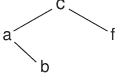

**图 3.11** 练习 3.16 的二叉搜索树

### 3.17

在 Scheme 中为第 3.3.2 节描述的二叉搜索树数据结构编写一个 `insert` 过程。

### 3.18

尝试在 Scheme 中编写 `append` 函数的尾递归版本。你会遇到什么问题？你能想到一种列表表示方式使其更容易吗？

### 3.19

- (a) 给出 ADT `List` 的代数规范，其操作为 `car`、`cdr`、`cons`、`null?`、`makenull`，且属性与 Scheme 中相同。

- (b) 编写一个实现 (a) 中 ADT 的 C++ 或 Java 类，或 Ada 包。

- (c) 使用 (b) 中对 `List` ADT 的实现编写一个“微型 Scheme”解释器，即一个解释器仅将 ADT 列表函数作为可用操作，且仅将数字作为原子。

### 3.20

在第 3.2.6 节中我们用 Scheme 定义了高阶函数 `make-double`。`(make-double →)` 和 `(make-double /)` 返回什么函数？

### 3.21

Scheme 没有内置的 `filter` 函数。像 `map` 一样，`filter` 也是一个高阶函数，它期望一个函数和一个列表作为参数并返回结果列表，但 `filter` 的函数参数是一个谓词或一元布尔函数。`filter` 使用谓词测试列表中的每个元素并返回仅通过测试的那些元素的列表。在 Scheme 中定义一个 `filter` 函数。

### 3.22

- (a) 给出一个例子来说明 Scheme 不对其函数进行柯里化。

- (b) 编写一个 Scheme 高阶函数，它以一个双参数函数作为参数并返回该函数的柯里化版本。

### 3.23

列出练习 3.8 中所有函数的 ML 类型。

### 3.24

编写一个 ML 函数来确定任意列表的长度。说明 ML 系统如何使用模式匹配确定 `length` 函数的类型。

### 3.25

列出练习 3.8 中所有函数的 Haskell 类型。

### 3.26

为以下列表编写 Haskell 列表推导式：(a) 所有平方整数，(b) 所有毕达哥拉斯三元组（参见练习 3.8），以及 (c) 所有完全数（完全数是其所有真因子之和）。

### 3.27

- (a) 编写函数来测试 ML 和 Scheme 是否对布尔表达式使用短路求值。

- (b) 为什么我们不需要测试 Haskell 来回答该语言的这个问题？

### 3.28

当函数在 ML 中使用模式匹配定义时，文中提到 ML 系统可能会抱怨定义中遗漏了情况。遗漏的情况意味着函数是不完备的。讨论在编程语言中要求所有函数都为全函数的好处和坏处。

### 3.29

本章中为 ML 和 Scheme 定义的 `fact` 函数实际上是不完备的，但 ML 翻译器不会发现这一点。为什么？

### 3.30

ML 和 Haskell 没有像 Scheme 那样的通用列表结构，但要求列表中的元素全部具有相同的数据类型。为什么是这样？在命令式语言中，这类列表模仿了什么数据结构？

### 3.31

编写一个 Scheme 程序来证明 Scheme 过程 `force` 和 `delay` 实际上使用了按需传递的记忆化。

### 3.32

(a) 使用生成器和过滤器在 Scheme 或 ML 中编写埃拉托斯特尼筛法，类似于第 3.5 节中的 Haskell 版本。

(b) 重写 Scheme 版本以使用 `force` 和 `delay`。

### 3.33

重写第 3.4 节中的 Scheme `intlist` 函数，使其仅以下界作为参数并产生从该点开始的整数流：`(intlist 5) = (5 6 7 8 ...)`。

### 3.34

Haskell 列表推导式实际上是生成器-过滤器程序的紧凑表达式，如文中所述。例如，列表推导式

```
evens = [ n | n <- [2..], mod n 2 == 0]
```

等价于一个生成器过程，它产生从 2 开始的整数流（由 `[2..]` 表示）并将其输出发送给谓词 `mod n 2 = 0` 的选择器过程，该过程传递满足谓词的元素列表。编写一个 Scheme 过程，使用 `force` 和 `delay` 以类似的生成器-过滤器风格产生偶数整数流。

### 3.35

重写第 3.4 节的 `flatten` Scheme 过程以使用 `force` 和 `delay`。

### 3.36

(From Abelson and Sussman [1996]) 按如下方式定义第 3.2.6 节中 `map` 函数的延迟版本：

```
(define (delayed-map f L)
  (if (null? L) '()
      (delay (cons (f (car (force L)))
                   (delayed-map f (cdr (force L)))))))
```

现在定义一个 `show` 过程，它打印一个值并返回相同的值：

```
(define (show x) (display x) (newline) x)
```

最后，按如下方式定义一个延迟列表：

```
(define L
  (delayed-map show (delay (intlist 1 100))))
```

其中 `intlist` 是第 3.4 节中的延迟版本。当 Scheme 解释器按给定顺序给出以下表达式求值时，它会打印什么（`take` 也是第 3.4 节中的延迟版本）：

```
> (take 5 L)
... some output here
> (take 7 L)
... some more output here
```

（提示：答案取决于 Scheme 是否使用按需传递；参见练习 3.31。）

### 3.37

为高阶函数 `twice` 和 `inc_n` 编写 lambda 演算表达式。（参见练习 3.8。）

### 3.38

假设 `square = (λx. * x x)` 在 lambda 演算中。展示表达式 `(twice (twice square))` 在应用序和正规序归约中的步骤。（参见前一练习。）

### 3.39

给出以下 lambda 表达式的应用序和正规序归约。说明哪些步骤使用哪些转换以及哪些变量是绑定和自由的。

(a) `(λx. ((λy. (* 2 y)) (+ x y))) y`

(b) `(λx. λy. (x y)) (λz. (z y))`

### 3.40

在 lambda 演算中，列表可以表示为 lambda 抽象，这是一个令人惊讶的事实。事实上，列表构造器 `cons` 可以写成 `(λx. λy. λf. f x y)`。用此定义可以写出 `car` 为 `(λz. z (λx. λy. x))` 且 `cdr` 为 `(λz. z (λx. λy. y))`。证明使用这些定义时，通常的公式 `(car (cons a b)) = a` 和 `(cdr (cons a b)) = b` 成立。

### 3.41

(From Abelson and Sussman [1996]) 整数也可以表示为 lambda 抽象：

```
zero = λf. λx. x

one = λf. λx. (f x)

two = λf. λx. (f (f x))

⋅⋅⋅
```

这些被称为 Alonzo Church 之后的 Church 数。

- (a) 给出以下后继函数定义：

  `successor = λn. λf. λx. (f ((n f) x))`

  证明 `(successor zero) = one` 和 `(successor one) = two`。

- (b) 将 (a) 推广到任意 Church 数。

- (c) 为 Church 数定义加法和乘法。

- (d) 将 (c) 中的 lambda 表达式实现为函数式语言中的过程，并编写输出过程以显示它们是正确的。

### 3.42

使用 lambda 表达式 `H = (λF. λn. (if (= n 0) 1 (* n (F (- n 1)))))` 和 `fact` 函数是 `H` 的不动点的性质，证明 `fact 1 = 1`。

### 3.43

我们注意到不动点组合子 `Y` 本身也可以写成 lambda 抽象 `(λh. (λx. h (x x)) (λx. h (x x)))`。证明该表达式确实赋予 `Y` 性质 `Y H = H (Y H)`，对于任意 `H`。

### 3.44

考虑通过使用不动点性质 `y h = h (y h)` 作为定义，在 Scheme、ML 或 Haskell 中编写不动点组合子。

(a) `y` 在 ML 或 Haskell 中的类型是什么？

(b) 使用阶乘函数的 `h` 定义：

`h g n = if n = 0 then 1 else n * g (n - 1)`

`y h` 在 Scheme、ML 或 Haskell 中是否实际产生正确的阶乘函数？解释。

# CHAPTER 逻辑编程

- 4.1 逻辑与逻辑程序 105
- 4.2 Horn 子句 109
- 4.3 归结与合一 111
- 4.4 语言 Prolog 115
- 4.5 逻辑编程的问题 126
- 4.6 Curry: 一个函数式逻辑语言 131

## 第4章

逻辑，即推理和证明的科学，自古希腊哲学家时代就已存在。数学逻辑，或符号逻辑，即数学证明的理论，始于19世纪中叶乔治·布尔和奥古斯都·德·摩根的工作。此后，逻辑成为一门重要的数学学科，并在20世纪的数学中发挥了重要作用，特别是在库尔特·哥德尔著名的不完备定理方面。（参见注释和参考文献。）

逻辑以多种方式与计算机和编程语言密切相关。首先，计算机电路的设计借助布尔代数，并且布尔表达式和数据几乎普遍用于编程语言中，以控制程序的动作。其次，逻辑陈述被用来描述公理语义，或编程语言构造的语义。逻辑陈述也可以用作程序所需行为的形式规范，并且与语言的公理语义一起，可以以纯数学的方式证明程序的正确性。

在相反的方向上，计算机被用作实现数学逻辑原理的工具，程序员创建能够利用逻辑原理构造数学定理证明的程序。这些程序被称为自动演绎系统或自动定理证明器，将证明转化为计算。在1960年代和1970年代对这类程序的经验导致了一个重大的认识，即反过来也是正确的：计算可以被视为一种证明。因此，逻辑陈述，或至少是其受限形式，可以被视为一种编程语言，并在计算机上执行，只要有一个足够复杂的解释系统即可。这项工作主要由罗宾逊、科尔梅劳尔和科瓦尔斯基完成（参见注释和参考文献），导致了编程语言 Prolog 的诞生。20世纪70年代末在苏格兰爱丁堡大学特别是在那里开发的高效 Prolog 解释器，导致了对逻辑编程系统的兴趣急剧增加。

然后，在1981年，Prolog 几乎一夜成名，当日本政府宣布它将作为第五代项目的基语言时，该项目的目标是开发结合推理技术和人类语言理解的先进计算机系统。该项目于1992年以某种不确定的结论结束。尽管如此，其结果是逻辑编程系统的大量研究和开发。Prolog 至今仍是逻辑编程语言中最重要的例子。

在下面的各节中，我们首先简要介绍数学逻辑以及逻辑如何用作编程语言。接下来，我们将注意力转向 Prolog 的描述以及编写 Prolog 程序的技术。我们还简要描述了 Prolog 系统运行背后的原理，以及这些系统的一些弱点。最后，我们描述了关于等式和约束逻辑系统的一些额外工作。

### 4.1 逻辑与逻辑程序

在你学习逻辑编程之前，你需要了解一点数学逻辑。逻辑编程中使用的逻辑是一阶谓词演算，这是一种正式表达逻辑陈述的方式，即要么为真要么为假的陈述。

#### 示例 1

以下英文陈述是逻辑陈述：

- 0 是自然数。

- 2 是自然数。

- 对所有 `x`，如果 `x` 是自然数，则 `x` 的后继也是自然数。

- 21 是自然数。

翻译成谓词演算如下：

- `natural(0).`

- `natural(2).`

- `For all x, natural(x) → natural(successor(x)).`

- `natural(21).`

在这些逻辑陈述中，第一和第三陈述可以被视为自然数的公理：被假定为真并且可以从中证明所有关于自然数的真陈述的陈述。事实上，第二陈述可以从这些公理证明，因为 `2 = successor(successor(0))` 且 `natural(0) → natural(successor(0)) → natural(successor(successor(0)))`。另一方面，第四陈述无法从公理证明，因此可以假定为假。

一阶谓词演算将此类陈述的不同部分分类如下：

- 1. 常量。这些通常是数字或名称。有时它们被称为原子，因为它们不能分解为子部分。在示例 1 中，0 是一个常量。

- 2. 谓词。这些是真或假的函数的名称，如程序中的布尔函数。谓词可以接受多个参数。在示例 1 中，谓词 `natural` 接受一个参数。

- 3. 函数。一阶谓词演算区分真或假的函数——这些是谓词——以及所有其他函数，如示例 1 中的 `successor`，它表示非布尔值。

- 4. 代表尚未指定数量的变量。在示例 1 中，`x` 是一个变量。

- 5. 连接词。这些包括与、或和非的操作，就像编程语言中对布尔数据的操作一样。谓词演算中的额外连接词是蕴含，用 `→` 表示，和等价，用 `↔` 表示。这些并不是真正的新操作：`a → b` 意味着只要 `a` 为真，`b` 就为真。这等价于陈述 `b` 或非 `a`。同样 `a ↔ b` 意味着 `(a → b)` 且 `(b → a)`。

#### 6. 量词。

这些是引入变量的操作。在示例 1 中，for all 是 `x` 的量词；它被称为全称量词。陈述：

```
For all x, natural(x) → natural(successor(x))
```

意味着对于宇宙中的每个 `x`，如果 `x` 是自然数，则 `x` 的后继也是自然数。全称量词用于说明谓词之间的关系对变量 `x` 命名的宇宙中的所有事物都为真。

还有存在量词 there exists，如以下陈述：

```
there exists x, natural(x).
```

该陈述意味着存在一个 `x` 使得 `x` 是自然数。存在量词用于说明谓词对宇宙中至少一个事物为真，由变量 `x` 表示。

由量词引入的变量被称为被量词绑定。变量也可能自由，即不被任何量词绑定。

#### 7. 标点符号。

这些包括左括号和右括号、逗号和句号。（严格来说，句号不是必要的，但我们将其包含在内，因为大多数逻辑编程系统都使用它。）括号用于括起参数并对操作进行分组。括号可以根据关于连接词优先级的常见约定省略，通常假定与大多数编程语言相同。（因此，按优先级递减顺序排列的连接词为 `not`、`and`、`or`、`→` 和 `↔`。）

在谓词演算中，谓词和函数的参数只能是项——即变量、常量和函数的组合。项不能包含谓词、量词或连接词。在示例 1 中，出现的项包括常量 0、21、2，变量 `x`，以及项 `successor(x)`，由函数 `successor` 与参数 `x` 组成。一些可以书写的额外项的例子是 `successor(0)` 和 `successor(successor(successor(x)))`。

#### 示例 2

以下是在英语中的逻辑陈述：

- 马是哺乳动物。

- 人是哺乳动物。

- 哺乳动物有四条腿和没有手臂，或两条腿和两条手臂。

- 马没有手臂。

- 人有手臂。

- 人没有腿。

这些陈述到一阶谓词演算的一种可能翻译如下：

```
mammal(horse).
mammal(human).
for all x, mammal(x) → legs(x, 4) and arms(x, 0) or legs(x, 2) and arms(x, 2).
arms(horse, 0).
not arms(human, 0).
legs(human, 0).
```

在此示例中，常量是整数 `0`、`2` 和 `4` 以及名称 `horse` 和 `human`。谓词是 `mammal`、`arms` 和 `legs`。唯一的变量是 `x`，且没有函数。

与前一个示例一样，我们可能认为前五个陈述是公理——定义真实关系的陈述。然后，正如我们很快将看到的那样，`arms(human, 2)` 可以从公理证明。也可以证明 `legs(human, 2)` 为真，因此在给定公理的情况下，最后一个陈述为假。

请注意，我们已使用优先级在前面的陈述中省略了许多括号，因此，例如，当我们写

```
legs(x, 4) and arms(x, 0) or legs(x, 2) and arms(x, 2)
```

我们指的是以下内容：

```
(legs(x,4) and arms(x,0)) or (legs(x,2) and arms(x,2)).
```


除了上面描述的七类符号外，一阶谓词演算还有推理规则，即从给定的一组陈述推导或证明新陈述的方法。

### 示例 3

一个典型的推理规则如下：

```
(a → b) and (b → c)
------------------
a → c
```

推理规则允许我们构造从给定陈述集可以推导或证明的所有陈述的集合：这些是在原始陈述为真时始终为真的陈述。例如，示例 2 中的关于哺乳动物的前五个陈述允许我们推导出以下陈述：

```
legs(horse,4).
legs(human,2).
arms (human, 2).
```

用逻辑语言表述，这三个陈述成为从示例 2 的前五个陈述或公理推导出的定理。请注意，从给定陈述证明这些陈述可以被视为计算马或人手臂和腿的数量的计算。因此，

示例 2 中的语句集合可以被视为表示这些语句的所有逻辑结论的潜在计算。

这就是逻辑程序设计的本质：一组语句被假定为公理，通过自动化方式应用推理规则，从这些公理中推导出所需的事实。因此，我们可以给出以下定义：

**逻辑程序设计语言**是一种用于书写逻辑语句的符号系统，它配有实现推理规则的指定算法。

被视为公理的逻辑语句集合可以看作**逻辑程序**，而要推导出的一个或多个语句可以看作启动计算的输入。这样的输入也由程序员提供，称为**查询**或**目标**。例如，给定示例 2 的公理集合，如果我们想知道人类有几条腿，我们会提供以下查询：

是否存在一个 `y`，使得 `y` 是人类的腿的数量？

或者，用谓词演算表示为：

```
there exists y legs(human,y)?
```

系统将给出类似如下的响应：

```
yes: y 5 2
```

因此，逻辑程序设计系统有时被称为**演绎数据库**，即由一组语句和一个能够响应查询的演绎系统组成的数据库。注意，这些数据库与普通数据库不同，因为它们不仅包含诸如`mama1(human)`或`natural(0)`这样的事实，还包含诸如`natural(x) natural(successor(x))`这样更复杂的语句，并且系统不仅能回答关于事实的查询，还能回答涉及此类演绎的查询。

在纯逻辑程序设计中，完全没有说明如何从给定的语句集合中推导出特定语句。自动演绎系统选择用以推导出语句的具体路径或步骤序列，就是逻辑程序设计系统的**控制问题**。原始语句表示计算的逻辑，而演绎系统提供推导新语句的控制。逻辑程序设计系统的这一特性使得 Kowalski 将逻辑程序设计范式表述为如下伪等式：

```
algorithm = logic + control
```

这与 Niklaus Wirth 对命令式程序设计的表述形成对比：

```
algorithms = data structures + programs
```

（参见注释和参考文献。）Kowalski 的原则指出了逻辑程序设计的另一个特点：由于逻辑程序不表达控制，操作（至少在理论上）可以按任意顺序或同时执行。因此，逻辑程序设计语言是并行性的天然候选者。

遗憾的是，自动演绎系统难以处理全部一阶谓词演算。首先，表达同一语句的方式太多；其次，推理规则也太多。因此，大多数逻辑程序设计系统将自己限制在谓词演算的某个特定子集上，称为 Horn 子句，我们接下来将简要研究它。

## 4.2 Horn 子句

Horn 子句（以其发明者 Alfred Horn 的名字命名）是如下形式的语句：

`a₁ and a₂ and a₃ … and aₙ → b`

其中 `aᵢ` 只允许是不含连接词的简单语句。因此，Horn 子句中没有或连接词，也没有量词。前面的 Horn 子句表示 `a₁` 到 `aₙ` 蕴含 `b`，或者说如果所有 `aᵢ` 都为真，则 `b` 为真。`b` 称为子句的头部，`a₁` …, `aₙ` 称为子句的主体。在 Horn 子句中，`aᵢ` 的个数可以为 0，此时 Horn 子句具有如下形式：

`→ b`

这样的子句表示 `b` 总是为真。换句话说，`b` 是一个公理，通常写作不带连接词 `→` 的形式。这种子句有时也称为事实。

Horn 子句可以用来表达大多数（但不是全部）逻辑语句。事实上，一种超出本书范围的算法可以从谓词演算语句进行合理的翻译，得到 Horn 子句。（参见注释和参考文献。）其基本思想是通过编写单独的子句来移除或连接词，并通过假定出现在子句头部的变量是全称量化的，而出现在子句主体（但不在头部）的变量是存在量化的，来处理没有量词的问题。

### 示例 4

下面来自示例 1 的语句是用一阶谓词演算编写的：

```
natural(0).
for all x, natural(x) → natural(successor(x)).
```

通过去掉量词，可以非常简单地将它们翻译成 Horn 子句：

```
natural(0).
natural(x) → natural(successor(x)).
```

### 示例 5

考虑用于计算两个正整数 `u` 和 `v` 的最大公约数的欧几里得算法的逻辑描述：

`u` 和 `0` 的 `gcd` 是 `u`。

如果 `v` 不为 0，则 `u` 和 `v` 的 `gcd` 与 `v` 和 `v` 除 `u` 所得的余数的 `gcd` 相同。

将其翻译成一阶谓词演算得到：

```
for all u, gcd(u, 0, u).
for all u, for all v, for all w,
not zero(v) and gcd(v, u mod v, w) → gcd(u, v, w).
```

（记住`gcd(u, v, w)`是一个谓词，表示 `w` 是 `u` 和 `v` 的 `gcd`。）

要将这些语句翻译成 Horn 子句，我们同样只需去掉量词：

```
gcd(u, 0, u).
not zero(v) and gcd(v, u mod v, w) → gcd(u, v, w).
```

### 示例 6

前面的示例只包含全称量化变量。为了了解如何也处理主体中的存在量化变量，请考虑以下语句：

如果 `x` 是某个人的父母，而这个人又是 `y` 的父母，那么 `x` 是 `y` 的祖父母。

将其翻译成谓词演算，我们得到：

```
for all x, for all y, (there exists z, parent(x, z) and parent(z, y))
→ grandparent(x, y).
```

作为 Horn 子句，这可以简单地表达为：

```
parent(x, z) and parent(z, y) → grandparent(x, y).
```

### 示例 7

为了了解连接词是如何处理的，请考虑以下语句：

对于所有 `x`，如果 `x` 是哺乳动物，那么 `x` 有两条或四条腿。

用谓词演算翻译，我们得到：

```
for all x, mammal(x) → legs(x, 2) or legs(x, 4).
```

这可以用以下 Horn 子句来近似：

```
mammal(x) and not legs(x, 2) → legs(x, 4).
mammal(x) and not legs(x, 4) → legs(x, 2).
```

一般来说，语句中出现在 `→` 连接词右侧的连接词越多，就越难翻译成一组 Horn 子句；参见练习 4.8。

Horn 子句对诸如逻辑程序设计系统之类的自动演绎系统特别有意义，因为它们可以被赋予过程性解释。如果我们按相反顺序写一个 Horn 子句：

```
b ← a₁ and a₂ and a₃ ... and aₙ
```

我们可以将其视为过程 `b` 的定义：`b` 的主体由子句的主体给出，即由 `aᵢ` 所指示的操作给出。这与递归下降解析中上下文无关文法规则被解释为过程定义的方式非常相似，我们将在第 6 章中看到。这不仅仅是表面的相似性，因为逻辑程序可以直接用于构造解析器。（参见注释和参考文献。）事实上，自然语言的解析是 Prolog 最初开发的动机之一。解析与逻辑程序设计之间的主要区别在于，在纯逻辑程序设计中，`aᵢ` 的调用顺序没有指定。

然而，大多数逻辑程序设计系统是确定性的，因为它们按某种预先指定的顺序（通常是从左到右）执行调用，这正是上下文无关文法规则所指示的顺序。Prolog 程序中使用的一种特殊文法规则称为定子句文法。

Horn 子句也可以被看作过程规范，而不是严格意义上的实现。例如，我们可以将以下 Horn 子句视为排序过程的规范：

```
sort(x, y) ← permutation(x, y) and sorted(y).
```

这表示（假设 `x` 和 `y` 是事物的列表）排序过程将列表 `x` 转换为有序列表 `y`，使得 `y` 是 `x` 的一个排列。为了完成规范，我们当然必须提供

对于列表是有序的以及一个列表是另一个列表的排列的含义的规范。重要的点是我们可能认为 Horn 子句不一定提供给定 `x` 找到 `y` 的算法，而只是这样一个 `y` 必须具有的属性。

考虑到前述的程序化解释，大多数逻辑编程系统不仅将 Horn 子句写反，而且还去掉 `a_i` 之间的 `and` 连接词，而是用逗号分隔它们。因此，示例 5 中的最大公约数子句将如下所示：

```
gcd(u, 0, u).
gcd(u, v, w)    not zero(v), gcd(v, u mod v, w).
```

这开始看起来很像 `gcd` 的更标准编程语言表达式，例如`gcd(u, v) = if v = 0 then u else gcd(v, u mod v)`。

从现在开始我们将以这种形式书写 Horn 子句。

现在让我们考虑 Horn 子句程序化解释中的变量作用域问题。与块结构语言中的过程定义一样，假设所有变量都局部于该过程的每次调用。事实上，头部中使用的变量可以被视为参数，而仅在体中使用的变量可以被视为局部、临时变量。这只是一个近似的描述，因为用于实现 Horn 子句执行的算法以更一般的方式处理变量，正如你在第 4.3 节中将会看到的那样。

我们还没有看到查询或目标语句如何作为 Horn 子句来表达。事实上，一个查询正好是一个事实的相反——一个没有头的 Horn 子句：

```
mammal(human).    — a fact
mammal(human).    — a query or goal
```

没有头的 Horn 子句也可以包含由逗号分隔的查询序列：

```
mammal(x), legs(x, y).
```

为什么查询对应于没有头的 Horn 子句，当你理解逻辑编程系统应用于从一组给定语句推导出新语句的推理规则，即后面研究的归结规则或原理时，就会变得清楚。

## 4.3 归结与合一

归结是 Horn 子句的一种特别高效的推理规则。归结说，如果我们有两个 Horn 子句，并且我们可以将第一个 Horn 子句的头部与第二个子句体中的一个语句匹配，那么第一个子句就可以用其体替换其在第二个子句中的头部。在符号上，如果我们有 Horn 子句：

```
a ← a₁, …, aₙ
b ← b₁, …, bₘ
```

并且 `bᵢ` 匹配 `a`，那么我们可以推导出子句：

```
b ← b₁, …, bᵢ₋₁, a₁, …, aₙ, bᵢ₊₁, …, bₘ.
```

这种归结的最简单例子发生在 Horn 子句的体只包含单个语句时，例如：

```
b ← a.
```

和：

```
c ← b.
```

在这种情况下，归结说我们可以推导出以下子句：

```
c ← a.
```

这正是我们在第 4.1 节示例 3 中给出的推理规则。

另一种看待归结的方法是将两个 Horn 子句的左右两边结合起来，然后取消在两边都匹配的语句。因此，对于最简单的例子，

```
b ← a.
```

和：

```
c ← b.
```

给出：

```
b, c ← a, b.
```

并取消 `b`，

```
b, c ← a, b
```

给出：

```
c ← a.
```

现在你可以看到逻辑编程系统如何将目标或目标列表视为没有头的 Horn 子句。系统尝试通过将无头子句体中的一个目标与已知子句的头部匹配来应用归结。然后它用该子句的体替换匹配的目标，创建一个新的目标列表，然后以相同的方式继续修改。新目标称为子目标。在符号上，如果我们有目标：

```
← a.
```

和子句 `a ← a₁, . . . , aₙ`，则归结将原始目标 `a` 替换为子目标：

```
← a₁, . . . , aₙ.
```

如果系统最终成功消除所有目标——从而推导出空的 Horn 子句——那么原始语句已被证明。

### EXAMPLE 8

最简单的情况是目标已经是一个已知事实，例如：

```
mammal(human).
```

并且有人问一个人是否是哺乳动物：

```
mammal(human).
```

使用归结，系统将两个 Horn 子句合并为：

```
mammal(human)    mammal(human).
```

然后取消两边以得到：

```
-
```

因此，系统发现人类确实是哺乳动物，并会以“是”回应查询。

### EXAMPLE 9

一个稍微复杂一点的例子如下。给定规则和事实：

```
legs(x, 2)    mammal(x), arms(x, 2).
legs(x, 4)    mammal(x), arms(x, 0).
mammal(horse).
arms(horse, 0).
```

如果我们提供查询：

```
legs(horse,4).
```

则使用第二条规则应用归结，我们得到：

```
legs(x, 4)    mammal(x), arms(x, 0), legs(horse, 4).
```

现在，为了从每一侧取消涉及谓词 `legs` 的语句，我们必须将变量 `x` 匹配为 `horse`，因此我们在语句中到处用 `horse` 替换 `x`：

```
legs(horse, 4)    mammal(horse), arms(horse, 0), legs(horse, 4).
```

并取消以得到子目标：

```
mammal(horse), arms(horse, 0).
```

现在我们再次应用归结两次，使用事实 `mammal(horse)` 和 `arms(horse, 0)` 并取消：

```
mammal(horse)    mammal(horse), arms(horse, 0).
arms(horse, 0).
arms(horse, 0)    arms(horse, 0).
```

由于我们已经到达空语句，我们的原始查询为真。

示例 9 演示了当我们应用归结来推导目标时需要满足的额外要求。为了匹配包含变量的语句，我们必须将变量设等于项，以便语句变得相同并可以从两边取消。这种使语句相同以进行模式匹配的过程称为合一，并且被设等于模式的变量被称为被实例化。因此，为了有效地实现归结，我们还必须提供一个合一算法。确实存在一个非常一般的合一算法，并且在第 3 章中与 Hindley-Milner 类型推断相关时提到了它。然而，大多数逻辑编程系统使用一个稍弱的算法，我们将在第 4.4 节中讨论它。

### EXAMPLE 10

为了更详细地展示在逻辑编程语言中发生的合一类型，考虑最大公约数问题（欧几里得算法，示例 5）：

```
gcd(u, 0, u).
gcd(u, v, w)    not zero(v), gcd(v, u mod v, w).
```

现在给定目标：

```
gcd(15, 10, x).
```

使用第一条子句归结失败（10 不匹配 0），因此使用第二条子句并将`gcd(u, v, w)`与`gcd(15, 10, x)`统一给出：

```
gcd(15, 10, x)    not zero(10), gcd(10, 15 mod 10, x), gcd(15, 10, x).
```

假设系统知道 `zero(10)` 为假，因此 `not zero(10)` 为真，并且将 `15 mod 10` 简化为 5，我们从两边取消`gcd(15, 10, x)`并得到子目标：

```
gcd(10, 5, x).
```

请注意，这只是另一个需要像原始目标一样进行归结的目标。我们再次通过合一来做，得到

```
gcd(10, 5, x)    not zero(5), gcd(5, 10 mod 5, x), gcd(10, 5, x).
```

并得到进一步的子目标：

```
gcd(5, 0, x).
```

现在这与第一条规则匹配，

```
gcd(u, 0, u).
```

因此将 `x` 实例化为 5 得到空语句，系统将回复类似：

```
Yes: x = 5
```

归结和合一执行了 10 和 15 的最大公约数的计算，使用欧几里得算法！

## 4.4.1 记号和数据结构

Prolog 使用的记号几乎与前面为 Horn 子句开发的记号相同，只是蕴含箭头 `←` 被冒号后跟破折号（或减号）`:-` 替换。因此，前一节中的示例祖先程序将以 Prolog 语法写成如下：

```
ancestor(X, Y) :- parent(X, Z), ancestor(Z, Y).
ancestor(X, X).
parent(amy, bob).
```

并且示例 4 将写成如下：

```
natural(0).
natural(successor(X)) :- natural(X).
```

请注意变量 `X` 和 `Y` 以大写字母书写。Prolog 通过使用大写字母表示变量，使用小写字母表示常量和谓词及函数名来区分变量与常量和名称。在大多数 Prolog 系统中，也可以通过在名称前写下下划线来表示变量，如`ancestor(_x,_y)`。

除了表示 `and` 的逗号连接词之外，Prolog 还使用分号表示 `or`。然而，分号在编程中很少使用，因为它不是 Horn 子句逻辑的标准部分。

基本数据结构是像`parent(X, Z)`或`successor(successor(0))`这样的项。Prolog 还包括列表作为基本数据结构。Prolog 列表使用方括号书写（像 ML 和 Haskell 一样，列表由项 `x`、`y` 和 `z` 组成写成 `[x,y,z]`。列表可以包含项或变量。

也可以使用竖线指定列表的头和尾。例如，`[H|T]` 表示 `H` 是列表中的第一项，`T` 是列表的尾部。如同 ML 和 Haskell，这种记号可用于通过模式匹配提取列表的组成部分。因此，如果 `[H|T] = [1,2,3]`，则 `H = 1` 且 `T = [2,3]`。也可以在竖线前写任意多个项。例如，`[X,Y|Z] = [1,2,3]` 给出 `X = 1`，`Y = 2`，且 `Z = [3]`。空列表用 `[]` 表示并且没有第一元素。


Prolog 有许多标准谓词总是内置的，例如 `not`、`=`，以及 I/O 操作 `read`、`write` 和 `nl`（换行）。Prolog 中的一个异常是小于或等于运算符通常写成 `=<` 而不是 `<=`（也许是因为后者很容易与蕴含混淆）。

## 4.4.2 Prolog 中的执行

Prolog 编译器存在，但大多数系统作为解释器运行。Prolog 程序由一组 Prolog 语法中的 Horn 子句组成，通常从文件输入并存储在动态维护的子句数据库中。一旦一组子句已输入数据库，目标就可以从文件或键盘输入以开始执行。因此，一旦 Prolog 系统开始执行，它将向用户提供查询提示，例如

```
?-
```

请注意，虽然 Prolog 的语法现在已针对子句和查询进行了标准化，但 Prolog 解释器的响应（包括上面所示的提示）*并未*标准化；我们以一种合理的记法给出这些响应，但不同的 ISO 合规解释器可能会略有不同。

## EXAMPLE 11

如果子句

```
ancestor(X, Y) :- parent(X, Z), ancestor(Z, Y).
ancestor(X, X).
parent(amy, bob).
```

已输入到数据库中，则以下查询会产生所示的响应：

```
?- ancestor(amy,bob).
yes.

?- ancestor(bob,amy).
no.

?- ancestor(X,bob).
X = amy ->_
```

在最后一个查询中，有两个答案。大多数 Prolog 系统会先找到一个答案，然后等待用户提示后再打印更多答案。如果用户在下划线处提供分号（表示或），则 Prolog 会继续寻找更多答案：

```
?- ancestor(X,bob).
X = amy ->;
X = bob

?- _
```

通常按回车键会取消继续搜索。

## 4.4.3 Arithmetic

Prolog 具有内置的算术运算和算术求值器。算术项可以用通常的中缀记法书写，也可以用前缀记法的项书写：`3 + 4` 和 `+(3, 4)` 含义相同。然而，Prolog 无法判断何时应将算术项视为项本身（即严格作为数据），何时应对其求值。因此，

```
?- write(3 + 5).
3 + 5
```

要强制求值算术项，需要一种新的操作：内置谓词 `is`。因此，要让 Prolog 求值 `3 + 5`，我们需要写：

```
?- X is 3 + 5, write(X).
X = 8
```

```
?- f(X) = g(X).
no

?- f(X) = f(a, b).
no

?- f(a, g(X)) = f(Y, b).
no

?- f(a, g(X)) = f(Y, g(b)).
X = b
Y = a
```

从这些实验中，我们可以为 Prolog 制定以下统一算法：

+ 1. 常量只能与自身统一：`me = me` 成功但 `me = you` 失败。
+ 2. 未实例化的变量可以与任何事物统一并被实例化为该事物。
+ 3. 结构化项（即应用于参数的函数）要与另一个项统一，只有在函数名相同且参数个数相同，并且参数可以递归统一时才行。因此，`f(a, X)` 与 `f(Y, b)` 统一时，X 被实例化为 b，Y 被实例化为 a。

情况 2 的一种变体是两个未实例化变量被统一时：

```
?- X = Y.
X = _23
Y = _23
```

右侧打印的数字——本例中为 23——会因系统而异，表示为该变量预留的内部内存位置。因此，统一会使未实例化的变量共享内存——即彼此成为别名。

我们可以在 Prolog 中使用统一来获得许多操作的非常简短的表达式。作为示例，让我们为列表操作 **append** 和 **reverse** 开发 Prolog 程序。我们再次注意到，由于 Prolog 允许列表由 `[X|Y]` 这样的项表示，其中 X 和 Y 是变量，因此不需要内置函数来返回列表的头或尾：只需用未实例化的变量 X 和 Y 设置 `[X|Y] = [1, 2, 3]`，统一就会将头返回为 X，将尾返回为 Y。同样，也不需要像 LISP 的 cons 操作那样的列表构造器。如果我们想在列表 `[1, 2, 3]` 前加上 0，我们只需写 `[0 | [1,2,3]]`；例如，

```
?- X = [0|[1, 2, 3]].
X = [0, 1, 2, 3]
```

然而，如果我们愿意，我们可以写下以下子句：

```
cons(X, Y, L) :- L = [X|Y].
```

然后根据我们在左侧实例化变量的方式，用它来计算头、尾和构造的列表：

```
?- cons(0, [1, 2, 3], A).
A = [0, 1, 2,3]

?- cons(X, Y, [1, 2, 3]).
X = 1
Y = [2,3]
```

因此，我们可以在项中使用变量作为输入或输出参数，并且 Prolog 子句可以“反向”运行，而不仅仅是正向运行——这超出了 Horn 子句的过程解释所告诉我们的内容！

事实上，统一可以进一步缩短诸如 cons 之类的子句。由于 `=` 运算符仅用于强制统一，我们可以让归结自动进行统一，通过直接在头的参数中写出要统一的模式。因此，cons 的以下定义与之前的定义具有完全相同的含义：

```
cons(X, Y, [X|Y]).
```

将模式 `[X|Y]` 出现在第三个变量的位置，自动将其与在目标中该位置使用的变量统一。此过程可称为模式指导调用。第 3 章中研究的函数式语言 ML 和 Haskell 具有类似的机制，并且这两种语言的运行时系统和类型检查器都使用与 Prolog 类似的统一形式。

现在让我们写一个 append 过程：

```
append(X, Y, Z) :- X = [], Y = Z.
append(X,Y,Z)   :-
    X = [A|B], Z = [A|W], append(B, Y, W).
```

第一个子句说明将任意列表附加到空列表只是得到该列表。第二个子句说明将头为 A、尾为 B 的列表附加到列表 Y，会得到头仍为 A、尾为 B 与 Y 附加后的列表。

使用模式指导调用重写它，我们得到以下极其简洁的形式：

```
append([], Y, Y).
append([A|B], Y, [A|W]) :- append(B, Y, W).
```

此 append 也可以反向运行，甚至可以找到将两个列表附加到指定列表的所有方法：

```
?- append(X, Y, [1, 2]).
X = []
Y = [1, 2] ->;

X = [1]
Y = [2] ->;

X = [1,2].
Y = []
```

Prolog 通过首先使用第一个子句并将 X 匹配为空列表 `[]`，将 Y 匹配为最终列表来实现这一点。然后它通过使用第二个子句继续搜索解，将 X 匹配为 `[A|B]` 并设置子目标 `append(B, Y, W)`，其中 `W = [2]`。这会再次开始搜索，但用 B 代替 X，因此 B 首先与 `[]` 匹配，Y 与 `[2]` 匹配，给出 `X = [1|[]] = [1]`。B 然后通过第二个子句与新的 `[A|B]` 匹配，依此类推。

最后，在本节中，我们给出列表反转的 Prolog 定义：

```
reverse([], []).
reverse([H|T], L) :- reverse(T, L1),
                    append(L1, [H], L).
```

图 4.1 为便于参考，汇总了本节的三个主要 Prolog 示例。

```
gcd(U, 0, U).
gcd(U, V, W) :- not(V = 0), R is U mod V, gcd(V, R, W).

append([], Y, Y).
append([A|B], Y, [A|W]) :- append(B, Y, W).

reverse([], []).
reverse([H|T], L) :- reverse(T, L1),
                    append(L1, [H], L).
```

**Figure 4.1** Prolog clauses for gcd, append, and reverse

## 4.4.5 Prolog’s Search Strategy

Prolog 以严格线性的方式应用归结，从左到右替换目标，并在数据库中按自上而下的顺序考虑子句。子目标一旦建立也会立即考虑。因此，这种搜索策略在可能的选择树上产生深度优先搜索。

例如，考虑以下子句：

+ (1) `ancestor(X, Y) :- parent(X, Z), ancestor(Z, Y).`
+ (2) `ancestor(X, X).`
+ (3) `parent(amy, bob).`

给定目标 `ancestor(X,bob)`，Prolog 的搜索策略在图 4.2 所示的子目标树上是左到右且深度优先的。图中边的标签为 Prolog 用于归结的子句编号，变量的实例化写在大括号中。

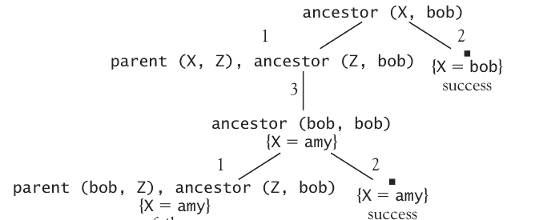

Figure 4.2 A Prolog search tree showing subgoals, clauses used for resolution, and variable instantiations

树中的叶节点要么在找不到最左侧子句的匹配时出现，要么在所有子句都被消除时出现，从而表示成功。每当发生失败，或用户用分号指示继续搜索时，Prolog 就会沿树回溯以找到通往叶的进一步路径，并在回溯时释放变量的实例化。因此，在所示的树中，在找到解 X = amy 之后，如果启动回溯，此 X 的实例化将被释放，并将找到通往叶 X = bob 的新路径。

这种深度优先策略非常高效，因为它可以用基于栈或递归的方式实现。然而，这也意味着如果搜索树具有无限深度的分支，则可能找不到解。例如，假设我们以稍微不同的顺序写子句：

+ (1) `ancestor(X, Y) :- ancestor(Z, Y), parent(X, Z).`
+ (2) `ancestor(X, X).`
+ (3) `parent(amy, bob).`

这会导致 Prolog 进入无限循环，尝试满足 `ancestor(Z, Y)`，不断重用第一个子句。当然，这是由于第一个子句的左递归写法以及没有其他子句在其之前的原因。在真正的逻辑编程中，子句的顺序不应重要。事实上，采用广度优先搜索而非深度优先搜索的逻辑编程系统如果存在解就一定能找到解。不幸的是，广度优先搜索比深度优先搜索昂贵得多，因此很少有逻辑编程系统使用它。Prolog 总是使用深度优先搜索。

## 4.4.6 Loops and Control Structures

我们可以使用 Prolog 的带回溯的深度优先搜索来执行循环和重复搜索。我们必须做的是即使在找到解时也强制回溯。我们用内置谓词 `fail` 来实现这一点。作为示例，我们可以让 Prolog 打印 append 目标的所有解，而无需向系统提供分号，如下所示。定义谓词：

```
printpieces(L) :-append(X, Y, L),
    write(X),
    write(Y),
    nl,
    fail.
```

现在我们得到以下行为：

```
?- printpieces([1, 2]).
[][1,2]
[1][2]
[1,2][]
no
```

失败时的回溯迫使 Prolog 一次性写出所有解。

我们也可以用这种技术来获得重复的计算。例如，以下子句将所有整数 ≥ 0 作为目标 `num(X)` 的解生成：

+   (1) `num(0).`
+   (2) `num(X) :- num(Y), X is Y + 1.`

搜索树显示在图 4.3 中。在这棵树中，它向右有一个无限分支。（树中子句 (2) 中 Y 的不同用法是通过给变量名添加引号来表示的。）

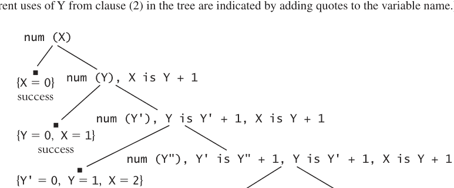

图 4.3 显示重复计算的无限 Prolog 搜索树

现在我们可以尝试生成从 1 到 10 的整数，例如，通过编写：

```
writenum(I, J) :- num(X),
    I =< X,
    X =< J,
    write(X),
    nl,
    fail.
```

并给出目标 `writenum(1,10)`。不幸的是，这将在 X = 10 之后进入无限循环，生成越来越大的整数 X，即使 X =< 10 将永远不会成功。

所需要的是某种停止搜索继续遍历整棵树的方法。Prolog 有一个运算符可以做到这一点：截断，通常写成感叹号。截断在遇到时会冻结一个选择。如果在回溯时到达截断，则包含截断的节点的父节点的子树的搜索会停止，并且搜索会继续进行到祖父节点。实际上，截断会从搜索树中剪掉截断所在节点右侧的所有其他兄弟节点。

## EXAMPLE 12

考虑图 4.2 的树。如果我们使用截断重写子句如下：

+   (1) `ancestor(X, Y) :- parent(X, Z), !, ancestor(Z, Y).`
+   (2) `ancestor(X, X).`
+   (3) `parent(amy, bob).`

那么只有解 x = amy 会被找到，因为包含 X = bob 的分支会被从搜索中剪掉，如图 4.4 所示。

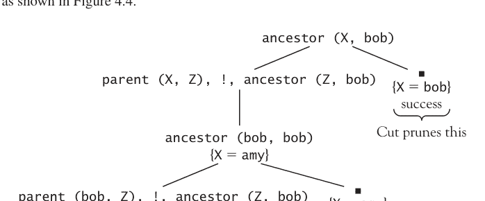

图 4.4 截断对图 4.2 的搜索树的影响

另一方面，如果我们如下放置截断，

+   (1) `ancestor(X, Y) :- !, parent(X, Z), ancestor(Z, Y).`
+   (2) `ancestor(X, X).`
+   (3) `parent(amy, bob).`

注意，我们本可以在没有截断的情况下几乎达到相同的结果，

```
D :- A, B-.
D :- not(A), C.
```

但这略有不同，因为 A 被执行了两次。当然，如果 A 没有副作用，则两种形式是等价的。尽管如此，截断确实提高了效率。

最后，我们在图 4.6 中给出一个使用到目前为止讨论的大多数特性的更长程序。它是一个使用埃拉托斯特尼筛法计算素数的程序，改编自 Clocksin 和 Mellish [1994] 中的一个例子。

```
primes(Limit, Ps) :- integers(2, Limit, Is),
                         sieve(Is, Ps).
integers(Low, High, [Low|Rest]) :-
                         Low =< High, !, M is Low+1,
                         integers(M, High, Rest).
integers(Low, High, []).
sieve([], []).
sieve([I|Is], [I|Ps]) :- remove(I, Is, New),
                         sieve(New, Ps).
remove(P, [], []).
remove(P, [I|Is], [I|Nis]) :-
                         not(0 is I mod P), !, remove(P, Is, Nis).
remove(P, [I|Is], Nis) :-
                         0 is I mod P, !, remove(P, Is, Nis).
```

**图 4.6** Prolog 中的埃拉托斯特尼筛法（改编自 Clocksin 和 Mellish [1994]）

## 4.5 逻辑编程的问题

逻辑编程的最初目标是将编程变成一种规范活动——也就是说，允许程序员仅指定解的属性，而让语言实现提供从其属性计算解的实际方法。这就是所谓的 **声明式编程** 的含义，它采取的观点是程序描述的是给定问题的解的 *是什么*，而不是 *如何* 解决该问题。逻辑编程语言，尤其是 Prolog，仅部分实现了这一目标。相反，逻辑编程系统使用的算法的性质，例如归结、合一和深度优先搜索，给编写程序带来了许多陷阱。作为程序员，你必须意识到它们才能编写高效的，甚至是正确的程序。正如我们已经看到的，Prolog 程序也必须被视为一组过程调用，必须按特定顺序放置以避免无限循环或低效执行。此外，Prolog 程序员还必须偶尔从更低层次的角度来看待程序，例如利用底层的回溯机制来实现截断/失败循环。

在本节中，我们讨论与 Prolog 表示逻辑的充分性相关的一些更微妙的问题。这些包括合一中的 occur-check 问题、否定（`not` 运算符）的问题、Horn 子句在逻辑中的局限性，以及逻辑程序中控制信息的需求。

如何在逻辑编程中实现 **not** 运算符？直接的答案是目标 **not(X)** 在目标 X 失败时成功。这就是所谓的 **失败即否定**。一个简单的例子，考虑由一个子句组成的以下程序：

```
parent(amy,bob).
```

如果我们现在询问：

```
?- not(mother(amy, bob)).
```

答案是 yes，因为系统不知道 amy 是女性，而女性父母是母亲。如果我们将这些事实添加到程序中，**not(mother(amy, bob))** 就不再为真。上述逻辑程序的属性——向系统添加信息可能会减少可以证明的事情的数量——被称为 **非单调推理**，这是封闭世界假设的结果。非单调推理在逻辑编程和人工智能中一直是大量研究的主题。（参见注释和参考文献。）

一个相关的问题是失败会导致变量的实例化通过回溯被释放，因此在失败后，变量可能不再具有适当的值。因此，例如，**not(not(X))** 的结果不与 X 本身相同（我们假设事实 human(bob) 在此示例中）：

```
?- human(X).
X = bob

?- not(not(human(X))).
X = _23
```

目标 **not(not(human(X)))** 成功是因为 **not(human(X))** 失败，但当 **not(human(X))** 失败时，X 对 bob 的实例化被释放，导致 X 被打印为未实例化变量。

类似的情况如下所示：


```
?- X = 0, not(X = 1).
X = 0

?- not (X = 1), X = 0.
no
```

第二个目标对失败，因为 `X` 被实例化为 `1` 以使 **`X = 1`** 成功，然后 **`not (X = 1)`** 失败。目标 **`X = 0`** 从未被达到。

### 4.5.3 Horn 子句不能表达全部逻辑

并非每个逻辑陈述都可以变成 Horn 子句。特别是，涉及量词的陈述可能无法以 Horn 子句形式表达。一个简单的例子是以下内容：

*p(a)* 且（存在 *x*，not(*p(x)*)）。

我们当然可以将 $p(a)$ 的真值表达为 Horn 子句，但第二个陈述无法写成 Horn 子句形式。如果我们尝试在 Prolog 中这样做，我们可能会尝试类似：

```
p(a).
not(p(b)).
```

但第二个陈述会导致错误（试图重新定义 not 运算符）。也许最好的近似就是简单的陈述 $p(a)$。然后，封闭世界假设将强制 `not(p(X))` 对所有不等于 a 的 X 为真，但这在逻辑上等价于：

$p(a)$ 且（对所有 $x$，$not(x = a) \to not(p(a))$）。

这与原始陈述并不相同。

### 4.5.4 逻辑编程中的控制信息

我们已经谈到截断作为 Prolog 中一个有用甚至必不可少的显式控制机制。然而，由于其深度优先搜索策略，以及对目标和语句的线性处理，Prolog 程序还包含容易导致程序失败的隐式控制信息。一个例子是之前使用的 ancestor 程序：

```
ancestor(X, Y) :- parent(X, Z), ancestor(Z, Y).
ancestor(X, X).
parent(amy, bob).
```

如果我们不小心将第一个子句的右手边写反了，如：

```
ancestor(X, Y) :- ancestor(Z, Y), parent(X, Z).
```

我们会立即陷入无限循环：Prolog 将尝试实例化变量 Z 使 ancestor 为真，导致搜索树中使用第一个子句的无限下降。另一方面，如果我们更改子句的顺序为：

```
ancestor(X, X).
ancestor(X, Y) :- ancestor(Z, Y), parent(X, Z).
parent(amy, bob).
```

搜索现在将找到查询 `ancestor(amy, X)` 的两个解 `X = amy` 和 `X = bob`，但仍会在搜索进一步（不存在的）解时进入无限循环。类似的情况存在于我们以相反顺序编写生成自然数程序的子句时：

```
num(X) :- num(Y), X is Y + 1.
num(0).
```

现在目标 `num(X)` 将进入无限循环。什么都不会被生成。

一个更复杂的逻辑问题是使用 Horn 子句表示算法逻辑。我们在第 4.3 节中提到，对两个列表 S 和 T 的排序过程的规范可以如下给出：

```
sort(S, T) :- permutation(S, T), sorted(T).
```

然而，能够执行一个属性的规范，即使它不能作为计算该属性的算法被接受，也有一个有用的方面：它让我们能够测试规范是否正确。Prolog 事实上已被成功用作在程序设计过程中运行此类规范的基础。（参见注释和参考文献。）

## 4.6 Curry：一种函数逻辑语言

在本章和上一章中，我们考察了两种编程风格或范式，即函数式和逻辑式，以及支持它们的某些语言。通过使用这些范式而不是更传统的命令式范式，程序员或多或少可以编写一个程序的可执行规范——也就是说，描述程序为解决一个问题所做的事情，并将大部分实现，或解决方案将如何执行，留给语言的底层解释器。因此，这类语言支持声明式编程风格，而与命令式语言相关的更传统的程序式风格不同。每种范式，无论是函数式还是逻辑式，都会为声明式编程带来不同的东西。在函数式语言中，程序是一组函数定义，它们指定了对数据进行操作以将其转换为其他数据的规则。在逻辑语言中，程序是一组规则和事实，从中为问题的解构造一个证明。我们也看到，这些声明式范式的每个版本都有一些特定的缺点。逻辑编程通常迫使程序员在解决某些问题时放弃声明式视角，例如需要函数式视角的数值计算，在该视角中，一组输入映射到单个输出。函数式编程对程序员施加了相反的限制。函数以确定性的方式将给定的参数集映射到单个值，不适合涉及确定变量可以取的一组值以满足某些约束且通常以非确定性方式计算的问题。

在本节中，我们对语言 Curry 做一个简短概述，该语言将函数式和逻辑式编程的优点结合在一个语言中。我们的讨论是对 Antoy 和 Hanus [2010] 报道的工作的改编，并附有示例。

### 4.6.1 Curry 中的函数式编程

Curry 是对第 3 章中讨论的编程语言 Haskell 的扩展。两种语言都以数学家 Haskell Curry 命名。Curry 保留了 Haskell 用于函数式编程的语法和语义，并为逻辑式编程添加了新的语法和语义。与 Haskell 一样，Curry 中的函数式程序由一组函数定义组成，这些定义描述了数据值到其他数据值的转换。模式匹配、情况分析、递归和强多态类型是该语言的关键方面。正如你在第 3 章中所见，函数定义是一组方程，其解释涉及用右侧的模式替换左侧的模式，之后用实际参数替换模式中的变量。Curry 也使用惰性求值，即实际参数的值仅在需要时才计算。

### 4.6.2 添加非确定性、条件和回溯

纯函数式语言仅支持确定性计算。这意味着将函数应用于给定的参数集总是产生相同的值。然而，某些问题，例如抛硬币，是欠指定的，因为它们的解来自一组仅需满足某些约束的值。在抛硬币的情况下，会返回一个确定的值，但它将是正面或反面。Curry 通过允许函数的方程集以无特定顺序尝试来支持这种非确定性。例如，选择运算符 `?` 用两个方程定义：

```
x ? y = x
x ? y = y
```

当 `?` 应用于某些操作数时，Curry 与 Haskell 不同，并不会自动尝试定义中出现的第一个方程，这将始终返回第一个操作数。此外，如果一个方程在执行期间失败，则会尝试该集合中的另一个方程，尽管在这种特定示例中不会发生这种情况。因此，可以使用 `?` 定义一个用于抛硬币的非确定性函数：

```
flipCoin = 0 ? 1
```

在第 4.5.4 节中，我们展示了一些 Prolog 规则，用于对列表进行排序，这些规则生成列表的排列，直到其中一个满足已排序的约束。这种排序策略清晰简单，但却因在列表的一个排列满足 sorted 谓词之前生成列表的排列而遭受可悲的低效。类似但更高效的策略可用于在 Curry 中定义排序列表的函数。

自上而下工作，我们定义两个函数，`sorted` 和 `permutation`，使得应用：

```
sorted (permutation xs)
```

返回 `xs` 中元素的已排序列表。显然，如果 `permutation` 调用的返回列表未排序，计算必须以某种方式回溯并尝试另一个 `permutation` 函数的调用，直到它产生一个已排序的列表。此处使用的策略利用了 Curry 对非确定性和回溯的支持，从而产生了一个简单的实现。

函数 `sorted` 预期一个列表作为参数并返回相同元素的已排序列表。其定义中的前两个方程指定了空列表和单元素列表的结果：

```
sorted [] = []
sorted [x] = [x]
```

第三个方程处理两个或更多元素的列表的情况。在这种情况下，方程包含一个条件（由 `|` 符号右侧的代码指定），仅当列表中的第一个元素小于或等于第二个元素时才允许对其右侧进行求值：

```
sorted (x:y:ys) | x <= y
              = x : sorted(y:ys)
```

正如你所见，只要它接收到恰好已排序的列表的排列，该函数就会成功并返回一个已排序的列表。然而，只要列表参数的前两个元素顺序错误，它就会失败。

函数 **`permutation`** 将非空列表参数的第一个元素插入到其余部分的排列中：

```
permutation []     = []
permutation (x:xs) = insert x (permutation xs)
```

函数 **`insert`** 将一个元素放置在列表中的任意位置。该函数对非空列表以非确定性的方式定义，在以下一对方程中：

```
insert x ys     = x : ys
insert x (y:ys) = y : insert x ys
```

这段代码足够简单优雅，但仍有两个问题需要回答。首先，Curry 如何在 **`sorted`** 函数失败时回退并调用列表的另一个排列？其次，为什么这种排序策略的版本比第 4.5.4 节中的 Prolog 版本更高效？

为回答第一个问题，让我们假设函数 **`sorted`** 在某一点失败。这意味着其参数，即一个列表排列，前两个元素已被发现顺序错误。在 Curry 中，控制随后返回到 **`sorted`** 的定义，以尝试一个其形式参数模式与实际参数匹配的方程。此模式匹配步骤需要另一个 **`permutation`** 函数的调用，以确定实际参数是零个、一个还是两个或更多元素的列表。此外，由于 **`permutation`** 在底部是非确定性的，它有很大的机会在下一次调用时返回列表元素的不同顺序。即使连续检查两个相同的列表，此生成和测试的过程也会继续，直到返回一个已排序的列表。

第二个问题的答案，涉及这种策略中生成排列的低效性，在于理解惰性求值的优势。回想一下，Curry 与 Haskell 一样，仅求值函数参数中足以在每一步执行所需计算的信息。正如你在第 3.4 节中关于列表处理的讨论中所见，这意味着为其他函数提供列表的函数只需提供用于立即计算的前端部分。这允许表示无限列表和生成-过滤的处理模型。在本例中，**`sorted`** 函数只需从 **`permutation`** 函数的调用中接收列表的前两个元素，以便能够失败或继续要求更多。Curry 基于的策略能够及早失败这一事实，使其相对于必须在测试列表之前完成列表的每个排列的 Prolog 基于的策略具有效率优势。

### 4.6.3 添加逻辑变量和统一

逻辑编程的另外两个元素，逻辑变量和统一，使 Curry 能够求解具有未知或部分信息的方程。此过程涉及将某些变量视为自由的——不是指第 3 章中考虑的自由变量的意义，即它们在函数内部被引用时始终被绑定——而是指它们可以以满足包含它们的方程集的方式实例化。Curry 使用符号 **=: =** 而不是符号 **=** 来指定应以这种方式求解的方程，而不是定义函数应用的方程。例如，方程：

```
zs ++ [2] :=: [1, 2]
```

使用列表连接运算符 `++` 来求解变量 `zs`。它通过将变量 `zs` 实例化为使该方程成立的唯一值 `[1]` 来实现这一点。惰性求值再次被用于自由变量，这些变量仅在需要其值来应用函数时才会被实例化。因此，为了求解前面的方程，Curry 会为 `zs` 选择一个值，使得 `++` 定义的方程之一可以被应用：

```
[]      ++ ys = ys
(x:xs) ++ ys = x : (xs ++ ys)
```

该值将是 `[]`，对应于第一个方程，或者是形如 `(x:xs)` 的值，对应于第二个方程。第一个规则不成功，因为 `[] ++ [2]` 不等于 `[1, 2]`。然而，第二个方程是成功的，其中 `x` 绑定为 `1`，`xs` 绑定为 `[]`，`ys` 绑定为 `[2]`。

与 Prolog 一样，如果没有足够的信息，逻辑变量可以保持未实例化。它们也可以用于获得同一方程的多个解，如下所示：

```
first ++ second := [1, 2]
```

最后，逻辑变量可用于新函数的定义。例如，方程：

```
zs ++ [e] := [1, 2, 3]
```

对 `zs = [1, 2]` 且 `e = 3` 时成立。利用这些信息，我们可以定义一个提取非空列表中最后一个元素的函数 `last`，如下所示：

```
last xs | zs ++ [e] := xs
      = e
      where zs, e free
```

该方程包含一个条件，其中包含两个自由变量以及函数参数的方程。外部方程本质上将内部方程推广到任意非空列表。

## 练习

4.1 分析逻辑陈述的标准方法是真值表：对基本陈述赋予真值可以让我们确定复合陈述的真值，并且具有相同真值表的陈述在逻辑上是等价的。因此陈述“p 且非 p”与“false”等价，如下真值表所示：

| p | not p | p and not p | false |
|---|---|---|---|

| false | true | false | false |
| true | false | false | false |

使用真值表证明 `p → q` 等价于 `(not p) or q`（记住 `p → q` 仅当 `p` 为真且 `q` 为假时才为假）。

4.2 恒真式是一个无论其组成部分的真值如何都始终为真的陈述。使用真值表证明 `false → p` 对任意陈述 `p` 都是恒真式。

- 4.3 **反驳系统** 是通过假设陈述为假并导出矛盾来证明陈述的逻辑系统。证明带消解的 Horn 子句逻辑是一个反驳系统。*（提示：空子句被假定为假，因此目标 ← a 等价于 `a → false`。证明这等价于 `not(a)`。）*

- 

- 4.4 将以下陈述写成一阶谓词演算：

  - 如果下雨或下雪，则有降水。
  - 如果结冰且有降水，则在下雪。
  - 如果不结冰且有降水，则在下雨。
  - 在下雪。

4.5 将练习 4.4 中的陈述按给定顺序写成 Prolog 子句。当给出查询“Is it freezing?” 时 Prolog 给出什么答案？查询“Is it raining?” 呢？为什么？能否重新排列子句使 Prolog 能给出更好的答案？

4.6 用一阶谓词演算写出两个数最大公约数的以下数学定义：*u* 和 *v* 的 gcd 是那个数 *x*，使得 *x* 同时整除 *u* 和 *v*，并且，对于任何其他数 *y*，如果 *y* 同时整除 *u* 和 *v*，则 *y* 整除 *x*。

4.7 将练习 4.6 中的 gcd 定义翻译成 Prolog。与图 4.1 中给出的欧几里得 gcd 算法的效率相比如何？

4.8 将以下陈述写成 Prolog 子句：哺乳动物有四条腿且没有手臂，或有两条手臂和两条腿。

4.9 向练习 4.8 的子句中添加马是哺乳动物且马没有手臂的陈述。Prolog 能否推导出马有四条腿？解释。

4.10 写出 Prolog 子句来表达以下基于 parent 关系的亲属关系：grandparent, sibling, cousin。

4.11 写一个 Prolog 程序来查找列表中的最后一个元素。

4.12 写一个 Prolog 程序来查找一串数字的 maximum 和 minimum。

4.13 写一个 Prolog 程序，从标准输入读取数字直到输入 0 为止，创建一个包含输入的数字的列表（不包括 0），然后按输入顺序逐行打印列表中的数字。（`read(X)` 可用于从输入读取整数 X，如果整数单独占一行并以句点结尾。）

4.14 写一个 Prolog 程序，根据归并排序算法对整数列表进行排序。

4.15 将图 4.9 中的 Prolog quicksort 程序与第 3.5 节中的 Haskell 版本进行比较。有什么不同？有什么相似之处？

4.16 Prolog 与 Scheme、ML 和 Haskell 等函数式语言共享一些特征，这些语言在第 3 章中研究过。描述两个主要相似之处。描述两个主要差异。

4.17 在 Prolog 中，可以将某些子句视为表示尾递归，其中子句的最后项是递归引用，并在最后项前写入 cut。例如，gcd 子句

```prolog
gcd(U, V, W) :- not(V=0), R is U mod V, !,
                    gcd(V, R, W).
```

可以被视为尾递归。解释为什么是这样。

4.18 写一个 Prolog 程序打印所有满足 1 ≤ *x*, *y* ≤ *z* ≤ 100 的毕达哥拉斯三元组 *(x, y, z)*。

((*x*, *y*, *z*) 是毕达哥拉斯三元组当且仅当 *x* * x + *y* * y = *z* * z。)

4.19 为 member 谓词写 Prolog 子句：`member(X,L)` 在 X 是列表 L 的成员时成功（因此 `member(2,[2,3])` 成功但 `member(1,[2,3])` 失败）。如果使用你的子句回答查询 `member(X,[2,3])` 会发生什么？查询 `member(2,L)` 呢？画出如第 4.4.5 节中所示的子目标搜索树来解释你的答案。

4.20 重写阶乘 Prolog 程序

```
fact(0, 1).
fact(N, R) :-
    N > 0, N1 is N - 1, fact(N1, R1), R is N * R1.
```

使其成为尾递归（参见练习 4.17）。

4.21 画出子目标搜索树并根据树解释 Prolog 对以下目标的响应（参见图 4.1）：

(a) `gcd(15, 10, X)`。

(b) `append(X, Y, [1, 2])`。

4.22 重写图 4.1 中欧几里得算法（gcd）的 Prolog 子句以使用 cut 代替测试 `not(V = 0)`。这在多大程度上提高了程序的效率？重画练习 4.21(a) 的搜索树以显示 cut 如何剪枝树。

4.23 解释使用搜索树为什么以下程序中的 cut 对查询 `ancestor(X,bob)` 找到的解没有影响。cut 是否提高了效率？为什么或为什么不？

```
ancestor(X, Y) :- parent(X, Z), ancestor(Z, Y).
ancestor(X, X) :- !.
parent(amy, bob).
```

4.24 如果我们使用 cut 来提高 Prolog append 程序的效率，我们会写：

```
append([], Y, Y) :- !.
append([A|B], Y, [A|W]) :- append(B, Y, W).
```

现在给定目标 `append(X, Y, [1, 2])` Prolog 仅响应解 `X = [], Y = [1, 2]`。用搜索树解释。

4.25 重写图 4.6 的埃拉托斯特尼筛法 Prolog 程序以移除所有 cut。比较所得程序与原始程序的效率。


4.26 解释 `Prolog` 中以下两种 `sibling` 关系的定义之间的区别：

```
sibling1(X, Y) :- not(X = Y), parent(Z, X), parent(Z, Y).
sibling2(X, Y) :- parent(Z, X), parent(Z, Y), not(X = Y).
```

哪个定义更好？为什么？

4.27 给定以下 Prolog 子句：

```
ancestor(X, Y) :- ancestor(Z, Y), parent(X, Z).
ancestor(X, X).
parent(amy, bob).
```

解释，使用子目标搜索树，为什么 Prolog 在给定目标 `ancestor(X,bob)` 时失败回答。

4.28 给定以下 Prolog 子句：

```
ancestor(X, X).
ancestor(X, Y) :- ancestor(Z, Y), parent(X, Z).
parent(amy, bob).
```

解释 Prolog 对查询 `ancestor(amy,X)` 的响应，使用子目标搜索树。

4.29 仅用以下 Prolog 子句对 `sort` 过程的规范有什么问题？

```
sort(S, T) :- sorted(T), permutation(S, T).
```

为什么？

4.30 仅给定以下 Prolog 子句：

```
human(bob).
```

Prolog 将如下响应：

```
?- human(X).
X = bob

?- not(human(X)).
no
```

为什么 Prolog 对最后一个目标的响应是这样？Prolog 是否在说没有 `X` 不是人，即所有 `X` 都是人？为什么？

4.31 以下是对 Prolog 中 `for` 循环构造的一种可能实现，类似于 C 中的语句 `for(I = L; I <= H;I++)`：

```
for(I, I, I) :- !.
for(I, I, H) .
for(I, L, H) :- L1 is L + 1, for(I, L1, H).
```

使用此定义，我们可以重复对 `I` 的操作，例如打印 `L` 和 `H` 之间的所有整数，如下所示：

```
printint(L, H) :- for(I, L, H), write(I), nl, fail.
```

解释回溯如何使 `for` 谓词表现得像一个循环。

4.32 在第 4.1 节中关于自由变量和绑定变量差异的简要解释中，忽略了名称可能重复使用的细节。例如，在陈述：

`a(x) → there exists x, b(x)`

中，`b` 中的 `x` 是绑定的，而 `a` 中的 `x` 是自由的。因此，绑定作用域必须正确定义以指代绑定变量使用的子集。制定绑定作用域规则，以便可以确定变量使用的哪些是自由的，哪些是绑定的。

4.33 将逻辑陈述中自由变量和绑定变量的定义与 lambda 演算中自由变量和绑定变量的定义（第 3 章）进行比较。它们有何相似之处？有何不同？

4.34 Prolog 中省略了 occur-check，因为简单算法效率低下。请使用图 4.1 中的 `append` 子句说明为什么 occur-check 可能效率低下。

4.35 我们已经看到 Prolog 在处理无限数据集时会出现困难，例如由以下子句产生的无限数据集

```
int(0).
int(X) :- int(Y), X is Y + 1 .
```

以及具有自引用项的情形，例如：

```
X = [1|X]
```

这会导致 occur-check 问题。在 Haskell（第 3 章）中，使用延迟求值，可以构造无限数据，例如前述的构造。使用延迟求值在 Prolog 中有意义吗？你能想到处理无限数据结构的其他方法吗？

4.36 Kowalski [1988] 对他的伪等式 `A(lgorithm) = L(ogic) + C(ontrol)` 作了如下陈述：“在 Prolog 中我们有一个固定的 `C`，只能通过改进 `L` 来改进 `A`。逻辑编程关注的是同时改变 `L` 和 `C` 的可能性。”解释他为什么这样说。解释为什么说 Prolog 不能改变 `C` 并非完全正确。

4.37 在第 3 章中，我们描述了 ML 和 Haskell 用于执行类型推断的统一方法。将这种统一与 Prolog 的统一进行比较。有任何区别吗？

4.38 统一可以描述为一种替换过程，用更具体的数值替换变量以实现两个表达式的相等。例如，在 Prolog 中，列表 `[1|Y] = [X]` 可以通过将 `1` 替换为 `X` 并将 `[]` 替换为 `Y` 来统一。不同的替换可能导致相等。例如，如果 `[1|Y]` 与 `X` 统一，可以将 `X` 设置为 `[1]` 且 `Y = []`，也可以将 `X` 设置为 `[1|Y]` 并使 `Y` 未实例化。后一种替换比前一种更一般，因为附加替换 `Y = []` 可将前一种转换为后一种。如果一个替换比统一两个表达式的每一个其他替换都更一般，则该替换是两个表达式的最一般统一子。为什么 Prolog 的统一算法会产生最一般统一子？对于逻辑编程语言来说，具有不产生最一般统一子的统一算法是否有用？为什么？

## Notes and References

逻辑编程源于证明技术和自动推理的工作。归结原理由 Robinson [1965] 发展，Horn 子句由 Horn [1951] 发明。Kowalski [1979b] 对逻辑以及逻辑编程中使用的算法，如统一和归结，作了一般介绍。Lloyd [1984] 对一般统一技术和否定即失败给出了数学处理。

Prolog 开发的早期历史在 Kowalski [1988] 和 Cohen [1988] 的一对姊妹文章中进行了讨论。两者都提到了 Alain Colmerauer 和 Phillipe Roussel 在马赛开发的第一个解释器的重要性，以及 David Warren、Fernando Pereira 和 Luis Pereira 在爱丁堡后来编写的系统。有关进一步的观点，请参阅 Colmerauer 和 Roussel [1996]。

关于日本第五代项目（1981–1992）的观点和概述，请参阅 Shapiro 和 Warren [1993]。

Kowalski [1979a] 引入了 Prolog 基本策略的著名表述“Algorithm = Logic + Control”，并详细说明了计算如何被视为定理证明，或“受控演绎”。Niklaus Wirth 对命令式编程的表述“Algorithms + Data Structures = Programs”是 Wirth [1976] 的标题，并在第 1 章和第 8 章中进行了讨论。

Clocksin 和 Mellish [1994] 是 Prolog 编程的基本参考。本章中的一些示例基于该书中的示例。Prolog 编程技术的其他参考资料有 Sterling 和 Shapiro [1986]、Malpas [1987] 和 Bratko [2000]。Prolog 标准于 1995 年被 ISO 和 ANSI 采纳（ISO 13211-1 [1995]）。

Davis [1982] 描述了 Prolog 如何用作软件系统设计中的可运行规范。Warren [1980] 展示了 Prolog 如何用于语言翻译和编译器。Clocksin 和 Mellish [1994] 提供了一章关于用 Prolog 解析语法的内容，以及一章关于逻辑编程与逻辑的关系，特别是谓词演算语句到 Horn 子句的翻译。关于 Prolog 中无限数据结构的方法（练习 4.35），请参阅 Colmerauer [1982]。

第 4.5.2 节中提到的非单调推理一直是大量持续研究的主题；例如参见 Minker [2000] 或 Antoniou 和 Williams [1997]。

# CHAPTER 5 Object-Oriented Programming

- 5.1 Software Reuse and Independence 143
- 5.2 Smalltalk 144
- 5.3 Java 162
- 5.4 C++ 181
- 5.5 Design Issues in Object-Oriented Languages 191
- 5.6 Implementation Issues in Object-Oriented Languages 195

面向对象编程语言的历史始于 20 世纪 60 年代的 Simula 项目，该项目试图设计一种编程语言，以适合对现实世界情况进行计算机模拟的方式扩展 Algol60。项目的中心目标之一是将对象的概念纳入语言中，该对象类似于现实世界中的对象，是具有某些属性的实体，这些属性控制其以预定义方式对事件做出反应的能力。根据这种对编程的看法，一个程序由一组对象组成，这些对象可以动态变化，并通过相互作用和反应来执行，就像现实世界的过程通过现实世界对象的交互而进行一样。这些思想被 Ole-Johan Dahl 和 Kristen Nygaard 在奥斯陆的挪威计算中心纳入了通用语言 Simula67。

到了 20 世纪 70 年代，编程界已准备好将 Simula67 的一些元素纳入新语言。其影响是双重的。首先，它是抽象数据类型机制发展的重要因素，你将在第 11 章学习。其次，也许更重要的是，它对对象范式本身的发展至关重要，在该范式中，程序被视为一组相互作用的独立对象。这在 Dynabook 项目的发展中最为明显，该项目最终形成了 Smalltalk-80，这是第一种以彻底和一致的方式纳入对象范式的语言。

从 20 世纪 80 年代中期开始，面向对象编程的兴趣爆炸式增长，就像 20 年代初结构化编程和自顶向下设计在 20 世纪 70 年代早期的兴趣一样。语言设计者关注面向对象编程作为语言范式的实用性，以及作为程序设计方法的有用性。如今，几乎每种语言都有某种结构化构造，例如 if-then-else 语句和过程抽象，并且众所周知，即使在相对无结构的语言如 FORTRAN 中也可以应用结构化编程原则。同样，面向对象编程的思想可以在一定程度上应用于非面向对象的语言。然而，技术的真正威力只有在具有真正的面向对象构造的语言中才能发挥出来，在过去三十年中，面向对象编程已证明自己是促进代码重用和可修改性的极其有效的机制。它现在是大型软件项目的占主导地位的范式，尽管在某些领域存在一些缺点，例如表达抽象数据类型的能力。

在下面的各节中，我们将回顾面向对象编程的主要概念，以 Smalltalk 为主要示例。我们将涵盖的概念包括对象和作为对象模式的类的概念、作为代码重用和控制依赖维护工具的操作继承，以及作为重用基本特征的动态操作。我们还将研究两种其他语言作为面向对象范式的主要示例：Java 和 C++。最后，我们将简要介绍面向对象设计的某些问题以及面向对象语言特性的实现技术。

## 5.1 软件复用与独立性

面向对象编程语言满足软件设计中的三个重要需求：尽可能复用软件组件的需求、用对现有代码的最小改动来修改程序行为的需求，以及保持不同组件独立性的需求。抽象数据类型机制可以通过将接口与实现分离并控制依赖关系来提高软件组件的独立性。理论上，抽象数据类型机制也应提供软件组件的复用。然而在实践中，每个新的编程问题往往都需要模块提供的服务的一个略有不同的版本。因此，理想的解决方案是在保留对这些服务访问控制的同时，改变模块向客户端提供的服务。在本节中，我们探讨软件组件服务可以变化的主要方式。然后在后续章节中，这些方式可用于评估面向对象机制的多样性和有效性。

软件组件可用于复用的四种基本修改方式是：数据或操作的扩展、一个或多个操作的重新定义、抽象，以及多态：

- *数据或操作的扩展。* 作为这种修改方式的示例，考虑一个具有以下操作的队列：`create`、`enqueue`、`dequeue`、`front` 和 `empty`。在特定应用中，可能需要扩展队列的操作，以便可以从队列尾部移除元素并添加到队列前端。这种数据结构称为双端队列或 deque，其新增操作为 `addfront` 和 `deleterear`。这两个新操作需要在不一定改变底层实现数据的情况下添加到基本队列结构中。作为扩展修改的另一个示例，计算机屏幕上的窗口被定义为由其四个角指定的矩形，其操作可能包括 `translate`、`resize`、`display` 和 `erase`。文本窗口可以定义为带有一些要显示的附加文本的窗口。因此，文本窗口通过添加数据来扩展窗口，而不一定改变要执行的操作。

- *一个或多个操作的重新定义。* 即使新类型数据的操作与现有类型基本相同，也可能需要重新定义其中的一些以适应新行为。例如，文本窗口在其上具有与通用窗口相同的操作，但 `display` 操作需要重新定义，以便同时显示窗口中的文本和窗口本身。类似地，如果从矩形得到一个正方形，则 `area` 或 `perimeter` 函数可能需要重新定义，以考虑到计算中所需数据的减少。

- 在计算的多个领域中，每个应用的基本结构与其他应用如此相似，以至于软件开发人员开始使用 **application frameworks**。应用程序框架是一组相关的软件资源，通常以面向对象的形式存在，软件开发人员通过重新定义和复用它们来为应用程序提供特定服务。应用程序框架的示例包括 Java 中的 **Swing** 窗口工具包和 C++ 中的 **Microsoft Foundation Classes**。这两个框架都允许以最少的努力构建、修改和复用图形用户界面。

- *抽象，或将两个不同组件中的相似操作收集到一个新组件中。* 例如，圆和矩形都是具有位置且可以平移和显示的对象。这些属性可以组合成一个称为 `figure` 的抽象对象，它具有圆、矩形、三角形等的共同特征。然后，`figure` 的具体示例被迫具有这些共同属性中的每一个。

- *多态，或扩展操作可以应用到的数据类型。* 你已经在前几章中见过这种多态的两种形式：重载和参数化类型。将操作适用的类型扩展也可以被视为抽象的一种示例，其中不同类型的共同操作被抽象并聚集在一起。一个很好的例子是 `toString` 函数，只要它具有文本表示，它就应该适用于任何对象。

面向对象语言的唯一目标并不是为复用而设计。限制对软件组件内部细节的访问是另一个目标。这一要求是必要的，以确保客户端以独立于组件实现细节的方式使用组件，并且对组件实现的任何更改都只会产生局部影响。

限制访问和允许为复用而修改的两个目标可能是相互不兼容的。例如，要向队列添加操作，就需要访问队列数据的内部实现细节。另一方面，访问限制也可以与修改需求互补。访问限制可以强制操作以抽象方式定义，这可能使在不更改定义的情况下修改其实现变得更容易。

用于限制对内部细节访问的机制有多个名称。一些作者称它们为 **encapsulation mechanisms**，而其他人则称它们为 **information-hiding mechanisms**。我们现在研究这些概念如何在纯面向对象语言 Smalltalk 中实现。

## 5.2 Smalltalk

Smalltalk 源于一个名为 Dynabook 项目的研究项目，该项目由 Alan Kay 在 20 世纪 70 年代初在 Xerox 公司的帕洛阿尔托研究中心开始，随后由 Adele Goldberg 和 Daniel Ingalls 继续。Dynabook 理论上被构想为当今笔记本电脑和平板电脑的原型。该系统将包括 WIMP（窗口、图标、鼠标、拉下菜单）用户界面，并联网到其他计算机以进行群组活动。理想情况下，它将包括一个能够模拟这些实体之间所有交互的程序开发环境。该研究小组的愿景超前于时代；其实现必须等待本世纪之交，当硬件成本和性能使其成为当代计算的现实基础时。


Smalltalk 受到了 Simula 和 Lisp 的影响。它的初始开发经历了一系列阶段，其主要早期版本为 `Smalltalk-72`、`Smalltalk-76` 和 `Smalltalk-80`。到 20 世纪 80 年代末，普通的桌面计算机已足够强大，可以支持内存密集型的 Smalltalk 编程环境。`Digitalk` 公司发布了 `Smalltalk/V`，它可在 Windows 和 Macintosh 平台上运行。Smalltalk 于 1998 年达到 ANSI 标准，目前有多个开源和低成本商业版本可用。

在所有面向对象语言中，Smalltalk 对面向对象范式的处理最为一致。在 Smalltalk 中，几乎每个语言实体都是一个对象，包括常量（如数字和字符）以及类本身。因此，可以说 Smalltalk 在本质上是纯粹面向对象的，就像 Haskell 等语言可以被称为纯函数式一样。

Smalltalk 从 Lisp 借用了垃圾回收（在运行时自动回收未使用的动态存储）和动态类型（在运行时检查表达式中操作数的类型）的机制。然而，Smalltalk 不仅在语言方面具有创新性，而且从一开始就被设想为个人工作站的完整程序开发环境。用户界面也具有创新性，因为它包括一个具有菜单和鼠标的窗口系统，早在这种系统对个人计算机变得普遍之前很久。

Smalltalk 作为一种语言是交互式的和动态导向的。程序员可以通过在交互式解释器中输入表达式和语句来进行实验。所有类和对象都是通过与系统交互使用一组浏览器窗口创建的。新类在输入到类字典时被编译，对象的交互也由系统管理。Smalltalk 系统附带一个庞大的预先存在的类层次结构，每个新类必须是现有类的子类。在以下小节中，我们将探讨 Smalltalk 表达式和语句的语法、新类的定义，以及消息传递、封装、继承和多态等基本面向对象概念。

### 5.2.1 Smalltalk 的基本元素：类、对象、消息和控制

现实世界中的每个对象都有一组属性和行为。例如，汽车具有包括车轮数量、车门数量和里程评级在内的属性。其行为包括向前移动、向后移动以及向左或向右转。同样，Smalltalk 中的每个对象（即每个数据值和每个类或数据类型），无论是内置的还是由程序员创建的，都有一组属性和行为。在 Smalltalk 程序中，对象通过向它们发送消息来让其他对象做事。消息是对服务的请求。接收消息的对象（有时称为接收者）通过调用适当的方法来执行其服务。该方法反过来可能会向其他对象发送消息以完成其任务。正如你很快就会看到的，方法类似于过程或函数，并在接收者对象的类或其类层次结构中的一个祖先类中定义。消息的发送者也可能随消息一起提供数据，以参数或参数的形式。当接收者的方法调用完成后，它可能会向发送者返回数据（另一个对象）。因此，发送

向对象发送消息有点像在函数式语言中调用函数。然而，一些被称为**修改器**的消息可能会导致接收方对象的状态发生变化，而函数调用只是向调用者返回一个值。发送和接收消息的过程也称为**消息传递**。对象能够识别的消息集合有时被称为它的**接口**。

Smalltalk 的消息传递语法相当简单，但有些不合常规。接收消息的对象写在最前面，后面跟着消息名称（也称为**选择器**）和任何参数。在包含对象和消息的表达式中，各元素通常从左到右读取和求值。例如，我们可以通过向 Smalltalk 内置的 `Set` 类发送 `new` 消息来创建一个新的集合对象，如下所示：

```
Set new    "Returns a new set object"
```

注意，类名首字母大写，消息名首字母不大写。Smalltalk 的注释用双引号括起来。本小节中的任何代码示例都可以通过将它们输入到 Smalltalk 的 `Transcript` 窗口，并从 **Smalltalk** 菜单中选择 **显示它** 选项来进行求值。整个讨论中，我们使用 `Smalltalk/V` 语法。

我们可以通过向这个对象发送 `size` 消息来检查新集合中的元素数量：

```
Set new size    "Returns 0"
```

在这段代码中，`Set` 类接收 `new` 消息，该消息返回一个 `Set` 实例，和之前一样。这个对象接着接收 `size` 消息，该消息返回一个整数对象。`new` 消息也称为**类消息**，因为它是发送给类的；而 `size` 消息称为**实例消息**，因为它是发送给类的实例的。这些消息也是**一元消息**的示例，因为它们不期望任何参数。

需要参数的消息称为**关键字消息**。例如，我们可以通过向新集合发送 `includes:` 消息来查看它是否包含给定元素。这个消息期望一个参数，即搜索的目标对象。在下一个示例中，集合被询问是否包含字符串 `'Hello'`：

```
Set new includes: 'Hello'    "Returns false"
```

注意，关键字消息的名称以冒号（`:`）结尾。如果参数多于一个，则每个参数前面必须另有其他关键字。关键字消息的参数在消息发送之前会被求值。下面的示例向一个新的集合对象添加一个字符串：

```
Set new add: 'Ken'    "This set now includes 'Ken'"
```

`add:` 消息是**修改器**的一个示例，它改变接收方对象的状态。

一个稍微复杂的示例创建一个包含 10 个元素的新数组，并将值 66 存储到数组的第一个位置。代码首先向 `Array` 类发送类消息 `new:`，以实例化一个有 10 个位置的数组（每个位置包含默认值 `nil`）。然后这个数组接收实例消息 `at:put:`，将整数存储到数组的第一个位置。

```
(Array new: 10) at: 1 put: 66    "Stores 66 at the first position in the array"
```

关键字消息 `at:put:` 期望两个参数。第一个参数是数组中某个对象的索引。第二个参数是要放置在该索引处的对象。一元消息的优先级高于关键字消息，可以使用括号来提高清晰度或覆盖优先级。注意，最后一个示例需要括号来区分两个关键字消息。如果没有括号，解释器会把 `new:at:put` 视为 `Array` 类的类消息。这会产生一个无法识别的消息错误。

Smalltalk 还提供了一小组二元消息，允许程序员使用常规中缀表示法编写算术和比较表达式。例如，以下每个表达式：

```
3 + 4    "Returns 7"
3 < 4    "Returns true"
```

实际上都是发送给第一个整数对象（接收方）的关键字消息的语法糖。第二个整数对象是该消息的参数。二元消息的优先级低于关键字消息。

与许多其他语言一样，程序员可以使用变量来引用对象，也可以使用语句序列来组织代码。下一个代码段将一个新的五位置数组赋给一个临时变量，然后在单独的语句中发送五条消息来重置其内容：

```
| array |
array := Array new: 5.      "Create an array of 5 positions"
array at: 1 put: 10.      "Run a sequence of 5 replacements"
array at: 2 put: 20.
array at: 3 put: 30.
array at: 4 put: 40.
array at: 5 put: 50
```

临时变量写在两条竖线之间，且首字母不大写。语句之间用句点分隔。与 Lisp 一样，Smalltalk 变量没有指定的数据类型；任何变量都可以引用任何对象。还要注意，Smalltalk 的赋值运算符 `:=` 的写法与 Pascal 和 Ada 相同。

当一串消息发送给同一个对象时，我们可以使用分号来级联这些消息：

```
| array |
array := Array new: 5.      "Create an array of 5 positions"
array at: 1 put: 10;      "Run a sequence of 5 replacements, cascaded"
    at: 2 put: 20;
    at: 3 put: 30;
    at: 4 put: 40;
    at: 5 put: 50
```

与许多其他语言（Lisp、Java 和 Python）一样，Smalltalk 的变量使用引用语义而非值语义。在引用语义中，变量引用一个对象；而在值语义中（参见 Ada 和 C++ 等语言），变量本身是对象或包含对象。因此，将一个 Smalltalk 变量赋值给另一个变量，并不会像 Ada 或 C++ 那样传递对象本身的副本，而只是建立对同一对象的另一个引用（本质上是一个别名）。复制需要显式实例化一个与原对象具有相同属性的新对象。Smalltalk 包含两个运算符，`=` 用于相等性，`==` 用于对象同一性，以区分这两种关系。下一段代码使用了 Smalltalk 的 `#( )` 表示法来表示数组字面量，说明了它们的用法：

```
| array alias clone |
array := #(0 0).      "Create an array containing two integers"
alias := array.       "Establish a second reference to the same object"
clone := #(0 0).      "Create a copy of the first array object"
array == alias.       "true, they refer to the exact same object"
array = alias.        "true, because they are =="
array = clone.        "true, because they refer to distinct objects with"
                      "the same properties"
array == clone        "false, because they refer to distinct objects"
clone at: 1 put: 1.   "The second array object now contains 1 and 0"
array = clone         "false, because the two array objects no longer"
                      "have the same properties"
```

引用语义中的对象共享提高了面向对象程序的效率，但代价是可能因别名而带来安全问题。对于函数式语言来说这不是问题，因为它们不允许对对象产生副作用。

理想情况下，初始化数组元素的代码应该以循环方式运行，这样对任意大小的数组都适用。下一个代码段展示了一个 `to:do` 循环，它把数组中每个位置的对象设置为一个新值。这个循环类似于其他语言中基于索引的 for 循环。

```
| array |
array := Array new: 100.      "Instantiate an array of 100 positions"
1 to: array size do: [:i |      "Index-based loop sets the element at each i"
    array at: i put: i * 10]
```

`to:do:` 消息被发送给一个整数，该整数表示迭代的下界。与关键字 `to:` 关联的参数也是一个整数，表示迭代的上界（在本中是数组的大小）。与关键字 `do:` 关联的参数是一个 Smalltalk 块。块用方括号 `[]` 括起来，是一个包含代码的对象，这些代码在每次循环迭代时执行。块类似于 Scheme 中的 lambda 形式，因为它们可以包含以块变量形式出现的参数。我们示例中的 `to:do:` 块包含块变量 `i`，在循环执行期间，它会接收下界和上界之间的每个值。在每次 `to:do:` 循环中，Smalltalk 都会向该块发送 `value:` 消息，并将序列中的下一个数字作为参数。块中的其余代码可以是任意语句序列。如你所见，在 Smalltalk 中，甚至控制语句也是通过消息传递来表达的。

其他类型的控制语句，如 if/else 语句和 while 循环，在 Smalltalk 中也是通过关键字消息来表达的。下一个代码段使用 `ifTrue:ifFalse:` 消息将数组中奇数位置的元素设置为 1，偶数位置的元素设置为 2：

```
| array |
array := Array new: 100.      "Instantiate an array of 100 positions"
1 to: array size do: [:i |      "Treat odd and even positions differently"
    i odd
        ifTrue: [array at: i put: 1]
        ifFalse: [array at: i put: 2]]
```

`ifTrue:ifFalse:` 消息的接收者必须是 Boolean 对象。两个参数是代码块，表达了 if/else 逻辑中的替代操作路径。接收者对象根据自身状态（true 或 false）只评估两个块中的一个。注意，在此示例中，临时变量 `array` 和块变量 `i` 的作用域包含任何嵌套块。

由于 `to:do:` 循环消息是发送给一个数字的，实现其方法的代码位于 `Number` 类中。我们稍后会讨论为类定义方法，但这里有一个预览，显示 `to:do:` 实际上只是对更繁琐的、计数控制的 `whileTrue:` 循环的语法糖：

```
to: aNumber do: aBlock
"Evaluate the one argument block aBlock for the
numbers between the receiver and the argument
aNumber where each number is the previous number
plus 1."
| index |
index := self.
[index <= aNumber]
    whileTrue: [
        aBlock value: index.
        index := index + 1]
```

在此方法定义上下文中，符号 `self` 指的是消息的接收者，在此例中为一个数字。`whileTrue:` 消息关联了两个块。与 `ifTrue:ifFalse:` 消息不同，其接收者对象只被评估一次，`whileTrue:` 消息必须以块作为其接收者对象。Smalltalk 评估此块，其中包含一个布尔表达式，一次或多次，直到它返回 false。每次第一个块评估为 true 时，第二个块（`whileTrue:` 的参数），即循环体，也会被评估。此第二个块中的代码包含两个语句。第一个语句通过发送 `value:` 消息来评估 `aBlock`（此处正在定义 `to:do:` 方法的参数）。在循环过程中，此消息的参数 `index` 会取到 `self` 与 `aNumber` 之间序列中每个数字的值。第二个语句递增 `index` 以实现此效果。

本小节中的最后一个示例代码段展示了如何将数组的内容打印到 transcript 窗口。代码使用 `do:` 循环遍历数组。这里我们不关心在数组的索引位置替换元素，而只是访问元素本身。`do:` 循环按顺序访问数组的每个元素，从第一个到最后一个。每次循环遍历时，块参数会被评估，块变量绑定到当前元素。

```
array do: [:element | "Print to transcript each element followed by a return"
    Transcript nextPutAll: element printString; cr]
```

全局变量 `Transcript` 指 Smalltalk 的 transcript 窗口对象。`nextPutAll` 消息期望一个字符串作为参数，因此我们使用 `printString` 消息获取元素的字符串表示，然后将其发送到 transcript。此消息还要求 transcript 显示一个回车字符。

Smalltalk 包含许多类型的集合类以及用于对集合执行迭代的不同类型的消息，例如 `map` 和 `filter`，与函数式语言类似。我们稍后会讨论其中一些操作，也称为 **iterators**。

正如这些简短示例所示，大多数 Smalltalk 代码都由创建适当类的对象并向其发送消息组成。对象本身处理大部分算法细节。剩下的软件开发工作则在于为合适的工作选择合适的类并学习其接口。当此类类尚不存在时，Smalltalk 程序员会创建新的类来自定义现有类。为了了解这是如何完成的，我们现在探索 Smalltalk 庞大的内置类层次结构中的两个类别的类：magnitudes 和 collections。

## 5.2.2 The Magnitude Hierarchy

一个类提供了对象集合的属性和行为的定义。在 Smalltalk 中，内置类以树状层次结构组织，根部有一个名为 `Object` 的单一类。`Object` 下的每个类都继承其在层次结构中祖先类中定义的任何属性和行为。层次结构中的类通常从更一般到更具体地下降，每个新类都会增加和/或修改其上方类中已有的行为和/或属性。**Inheritance**，因此支持结构和行为的重用。**Polymorphism**，或对不同类请求类似服务的消息使用相同名称，也是一种代码重用形式。在本节中，我们检查 Smalltalk 的 magnitude 类的一部分，如图 5.1 的类图中所示。

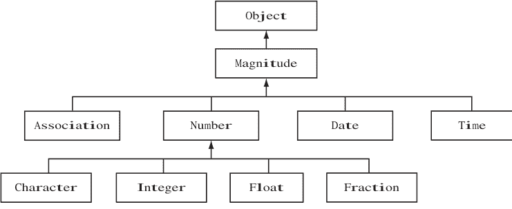

正如您从图 5.2 中看到的，magnitude 类包括其他语言中常见的数字类型，如 `Integer`、`Float` 和 `Fraction`，以及与数值相关的一些其他类型，如 `Time` 和 `Date`。这些类有时被称为 **concrete classes**，


因为它们的实例是应用程序通常创建和操作的对象。相比之下，此层次结构中的另外两个类，`Magnitude` 和 `Number`，有时被称为 `abstract classes`。它们通常不被实例化，而是作为其下方类共有的属性和行为的存储库。

我们现在在 Smalltalk 的类浏览器中探索 magnitude 类层次结构，以了解类及其方法是如何定义的，并学习语言设计者如何利用继承和多态性。 （请记住，Smalltalk 被构想为不仅是一种语言，也是一种编程环境。）图 5.2 显示了一个类浏览器，magnitude 类列表可见于窗口的最左侧窗格。

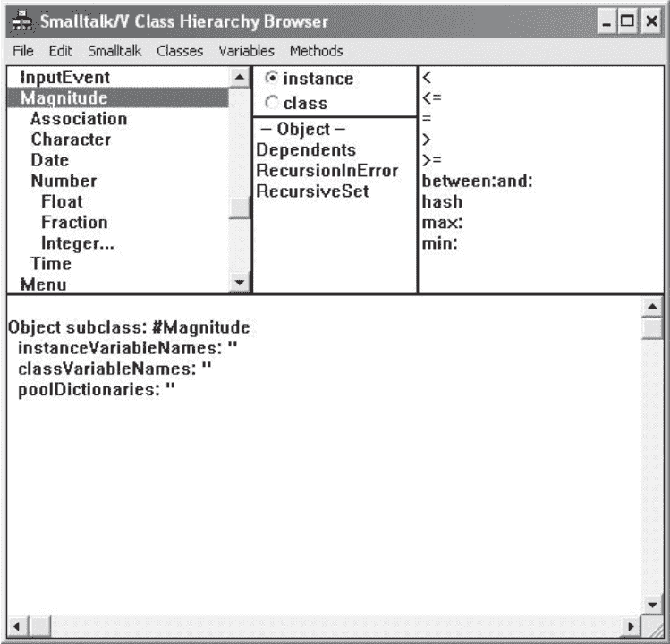

**Figure 5.2** A class browser open on the magnitude classes

请注意，最抽象的类 `Magnitude` 已被选中。其实例消息列在最右侧窗格中。这些包括比较运算符和几个其他消息。这些是任何更具体的 magnitude 类型对象也应识别的最基本消息。图 5.2 的底部窗格中是代码，说明 `Magnitude` 是 `Object` 的子类；这意味着在 `Object` 类中定义的任何消息也将被任何 magnitude 类型（或 Smalltalk 中的任何其他类型）的对象识别。该代码还显示 `Magnitude` 类未定义实例变量、类变量或池字典，从而将它们留给子类在需要时包含。实例变量对应于创建时属于每个单独对象的属性的存储。类变量和池字典对应于所有类对象共有的属性的存储。

图 5.3 显示了在消息列表中选择 `max:` 消息后相同的浏览器窗口。

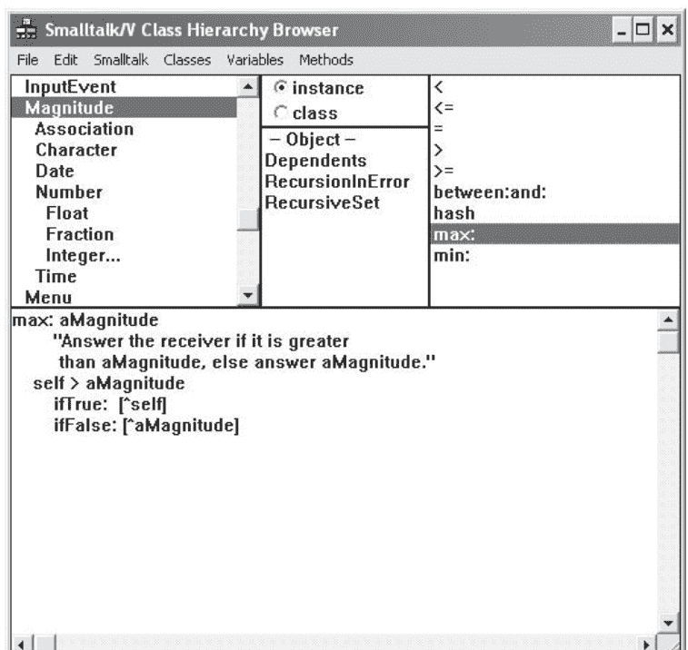

Figure 5.3 The definition of the `max:` method in the `Magnitude` class

当程序员选择 `max:` 消息时，对应于该消息的方法定义出现在底部窗格中。根据方法头和注释，此方法期望另一个 magnitude 对象作为其唯一参数。该方法比较 `self`，即接收者对象的值，与参数对象，并返回两者中较大的对象。 （Smalltalk 中的返回运算符是 `^`，它具有任何运算符中最低的优先级。）在文档中引用时，特定类的特定方法通常会加上类名前缀，以将其与另一类中定义同名的方法区分开来。因此，刚刚检查的方法被标识为 `Magnitude>>>max:`.

```
max: aMagnitude
"Answer the receiver if it is greater than aMagnitude, else answer aMagnitude."
self > aMagnitude
    ifTrue: [^self]
    ifFalse: [^aMagnitude]
```

如果我们然后在消息列表中选择 `>` 操作符，我们会看到以下代码：

```smalltalk
> aMagnitude

    "Answer true if the receiver is greater

     than aMagnitude, else answer false."

^self implementedBySubclass
```

虽然 `max:` 的实现代码很直接，但 `>` 操作符的代码至少说来有些不寻常。它并没有告诉我们两个 magnitude 将如何比较，而是似乎把责任推给了未指定的子类。尽管如此，面向对象继承和多态的大部分威力都在这段代码中得到了体现。我们现在来解释原因。

方法 `Magnitude>>max:` 已经完成且完整；只要它们实现了 `>` 操作符，无论是内置子类还是新子类，都永远不需要实现它。这是如何工作的？当表达式 `x max: y` 在两个分数上运行时，例如，Smalltalk 首先在接收者对象的类（`Fraction`）中搜索对应于此消息的方法。在 `Fraction` 中找不到该方法后，Smalltalk 上移到其父类 `Number`，搜索再次失败。最终在 `Magnitude` 类中找到了匹配的方法，而 `Magnitude` 是 `Number` 的父类。当方法 `Magnitude>>max:` 被调用时，符号 `self` 和 `aMagnitude` 实际上仍然绑定到两个分数对象。因此，对应于 `>` 操作符的方法的搜索过程再次从 `Fraction` 类开始。Smalltalk 将在该类中找到比较两个分数对象的适当方法定义，一切就都正常了。

在我们检查如何定义一个新的具体 magnitude 类之前，让我们先查看 `Fraction` 类中的一些代码作为范例。该类的代码显示了除其他内容外，分数的分子和分母的实例变量、返回或修改这些值的实例方法、分数的 `>` 操作符，以及用于实例化分数的类方法。类方法可以通过在浏览器中间窗格中选择 `Class` 单选按钮来查看。以下是这些资源的代码：

```smalltalk
Number subclass: #Fraction

    instanceVariableNames:

        'numerator denominator '

    classVariableNames: ''

    poolDictionaries: ''

numerator: n denominator: d

    "(Class method.) Answer an instance of class

     Fraction and initialize the numerator and denominator

     instance variables to n and d respectively."

^self basicNew numerator: n denominator: d

numerator: n denominator: d

    "(Instance method.) Answer the receiver.

     The numerator and denominator of the receiver

     are set to the n and d arguments respectively."
```

```
numerator := n.
    denominator := d.
    ^self

denominator
    "Answer the denominator of the receiver."
    ^denominator

numerator
    "Answer the numerator of the receiver."
    ^numerator

> aFraction
    "Answer true if the receiver is greater
    than aFraction, else answer false."
    ^(numerator * aFraction denominator) > (denominator * aFraction numerator)

printOn: aStream
    "Append the ASCII representation of
    the receiver to aStream."
    numerator printOn: aStream.
    aStream nextPut: $/.
    denominator printOn: aStream
```

请注意，在 `>` 方法中，可以通过直接提及实例变量名来访问接收者对象的分子和分母。然而，参数对象的分子和分母只能通过向其发送相应消息来访问。还请注意，`Fraction` 类中的 `>` 方法再次使用了 `>` 操作符（多态地），这次使用的是分子和分母乘积所代表的数字。`printOn:` 方法也是如此，它再次使用分子和分母。最后，该类包含两个名为 `numerator:denominator:` 的方法。其中一个是类方法，用于实例化 `Fraction`。另一个是实例方法，用于将现有 `Fraction` 对象的实例变量值重置为新值。在另一个有趣的多态示例中，类方法调用了同名的实例方法！

现在我们可以在 transcript 窗口中编写代码来创建两个分数并找出较大的一个：

```
| oneHalf twoThirds |
oneHalf := Fraction numerator: 1 denominator: 2.      "Create two fractions"
twoThirds := Fraction numerator: 2 denominator: 3.      
(oneHalf max: twoThirds) printString                     "Returns '2/3'"
```

我们已经检查了 `>` 操作符的两个定义，一个是抽象的（在 `Magnitude` 类中，实现被推迟），另一个是具体的（在 `Fraction` 类中，实现已实现）。它们是多态的，因为它们具有相同的名称，但在不同类中定义不同。`Magnitude` 类中的 `>` 实例仅用于支持 `Magnitude>>max:` 中的比较；而 `Fraction` 类中的 `>` 实例则是为了专门针对分数实现该行为。同样，Smalltalk 在 `Object` 类中定位分数的 `printString` 方法，而该方法反过来向分数对象发送 `printOn:` 消息以构建其字符串表示。当向对象发送消息时，Smalltalk 将消息名称绑定到搜索过程中找到的适当方法。基于接收者对象的类进行消息到方法的**动态或运行时绑定**，可能是组织面向对象系统中代码以实现重用的最重要关键。

现在我们已经了解了 Smalltalk 的 magnitude 类如何协同工作，我们准备添加我们自己的类之一。Smalltalk 没有内置的复数类，因此我们定义一个新的类 `Complex`，作为 `Number` 的子类。这样做将使我们受益于继承 `Number` 和 `Magnitude` 中实现的所有方法，并要求我们实现几个标记为由子类实现的的方法。在这样做之前，让我们先通过想象以下会话来预测我们新类的一些行为，该会话创建两个复数并在 transcript 窗口中显示它们的乘积：

```
    | c1 c2 c3 |
    c1 := Complex realPart: 3.0 imaginaryPart: 2.5.
    c2 := Complex realPart: 6.0 imaginaryPart: 4.5.
    c3 := c1 * c2.
    Transcript nextPutAll: (c3 printString); cr
       69.75+96.0i
```

我们首先选择 `Number` 类，然后在 **Classes** 菜单中选择 **Add Subclass** 选项。这允许程序员命名新类并开始在底部窗格中显示的模板中输入其实例变量的信息。有两个实例变量，`realPart` 和 `imaginaryPart`。添加它们之后，我们通过选择菜单选项 `File/Save` 来编译代码。接下来，我们在中间窗格中选择 `Class` 单选按钮并选择菜单选项 `Methods/New Method` 来定义一个用于实例化复数的类方法。该方法的代码输入到底部窗格中的方法模板中，与前面显示的 `Fraction` 类中的类方法代码类似。接下来，我们定义两个实例方法，其名称与实例变量相同。这些方法应分别返回这些变量的值。正如你所见，除了 `self` 之外的 Smalltalk 对象的用户无法在不向该对象发送消息的情况下访问其实例变量。

剩下的唯一工作是填写应由此类实现的剩余方法的代码。这可以通过增量方式完成，通过添加单个方法、编译它们并测试它们。完整的方法集列在 `Magnitude` 和 `Number` 类中。虽然这些方法数量令人望而生畏，但其中许多已经以更基本的操作（如算术和比较）的形式实现。在我们提供这些之后，我们可能就完成了 90%。代码重用在这里提供了巨大的收益！

我们通过展示 `Complex` 类的属性的代码、前面为 `Fraction` 类显示的类型的方法，以及 `>` 和 `*` 操作符的代码来结束本小节，`>` 最初出现在 `Magnitude` 类中，而 `*` 最初出现在 `Number` 类中。

```
Number subclass: #Complex
    instanceVariableNames:
        'realPart imaginaryPart '
    classVariableNames: ''
    poolDictionaries: ''

realPart: r imaginaryPart: i
    "(Class method.) Answer an instance of class Complex
    and initialize the realPart and imaginaryPart
    instance variables to r and i respectively."
    ^self basicNew realPart: r imaginaryPart: i

realPart: r imaginaryPart: i
    "(Instance method.) Answer the receiver. The
    realPart and imaginaryPart of the receiver are
    set to the r and i arguments respectively."
    realPart := r.
    imaginaryPart := i.
    ^self

imaginaryPart
    "Answer the imaginary part."
    ^imaginaryPart

realPart
    "Answer the real part."
    ^realPart

> aNumber
    "Answer true if receiver is greater than aNumber or false otherwise."
    ^(self realPart > aNumber realPart) realPart or: [
        (self realPart = aNumber realPart) and: [
            self imaginaryPart > aNumber imaginaryPart]]

* aNumber
    "Answer the result of multiplying
    the receiver by aNumber."
    | rp ip |
    rp := self realPart * aNumber realPart -
        self imaginaryPart * aNumber imaginaryPart.
    ip := self realPart * aNumber imaginaryPart +
        self imaginaryPart * aNumber realPart.
    ^self class realPart: rp imaginaryPart: ip
```

(continued)

```
printOn: aStream
"Append the ASCII representation of
    the receiver to aStream."
realPart printOn: aStream.
aStream nextPut: $+.
imaginaryPart printOn: aStream.
aStream nextPut: $i
```

## 5.2.3 集合层次结构

集合是元素按特定方式组织的容器。不同的组织类型包括线性、排序、层次、图和无序。线性集合包括字符串、数组、列表、栈和队列等熟悉的例子。无序集合包括包、集合和字典（在 Java 中也称为映射集合）。图和树也是集合，排序集合也是如此，其元素具有自然顺序（每个元素小于或等于其后继元素）。

诸如 `FORTRAN`、`C`、`Pascal` 和 `Ada` 等命令式语言中的内置集合，历史上一直仅限于数组，如果应用程序程序员幸运的话，还有字符串。程序员必须使用数组数据结构或通过定义链接节点来构建其他类型的集合。像 `Lisp` 这样的函数式语言包含列表，它本质上是一个链接结构，作为基本集合类型。

Smalltalk 通过包含大量集合类型，为面向对象语言树立了标准。为了最大限度地重用代码，它们在集合类层次结构中组织。图 5.4 显示了最重要的 Smalltalk 集合类的类图。

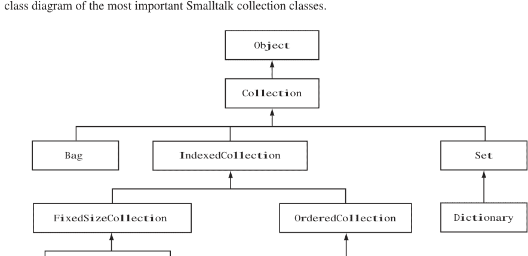

图 5.4 Smalltalk 集合类层次结构

两个迭代器 `select:` 和 `inject:into:` 可用于生成名为 `col` 的集合中的奇数之和，如下所示：

```
(col select: [ :n | n odd])
    inject: 0 into: [ :n1 :n2 |
        n1 + n2]
"Returns the sum of the odd numbers in col"
```

Smalltalk 迭代器的实现依赖于 `do:` 和 `add:` 这两个方法，两者都由 `Collection` 的子类实现。以下是其中一个迭代器 `collect:` 的代码，它是函数式语言中 `map` 的多态等价物：


```
collect: aBlock
    "For each element in the receiver, evaluate aBlock with
     that element as the argument. Answer a new collection
     containing the results as its elements from the aBlock
     evaluations."
    | answer |
    answer := self species new.
    self do: [ :element |
        answer add: (aBlock value: element)].
    ^answer
```

请注意，此代码创建了一个与接收者对象相同类的新实例。对这个新的集合对象添加了使用接收者集合的每个元素评估块的结果。然后返回新的集合。其他迭代器的实现中也使用了类似的 `do:` 循环模式。

`Collection` 类中另一组有趣的方法允许程序员将任何类型的集合，包括新添加的集合，转换为许多内置类型的集合。其中大多数方法，例如 `asBag` 和 `asSet`，都会创建指定类型的集合实例，并向其发送 `addAll:` 消息，参数为接收者对象。`addAll:` 方法也在 `Collection` 类中，它对参数对象运行 `do:` 循环，使用接收者的 `add:` 方法将每个元素添加到接收者中。`add:` 方法自然是由子类实现的。以下是 `Collection` 方法 `asBag` 和 `addAll:` 的代码。

```
asBag
    "Answer a Bag containing the elements of the receiver."
    ^(Bag new)
        addAll: self;
        yourself

addAll: aCollection
    "Answer aCollection. Add each element of
     aCollection to the elements of the receiver."
    aCollection do: [ :element | self add: element].
    ^aCollection
```

Smalltalk 没有为栈、队列、树或图提供内置类，但我们可以很容易地看到如何添加它们。让我们为队列开发这个想法。队列有两种常见的实现，一种基于数组，另一种基于链接节点。基于数组的队列类可以是 `Array` 类或 `OrderedCollection` 类的子类（它类似于 Java 中的基于数组的 `ArrayList` 类）。然而，以其中一个类作为队列的子类将是一个糟糕的设计选择，因为此类队列的用户随后将可以使用 `at:put:` 等操作，这将违反限制对队列集合的前端或后端的访问的精神。更好的选择是继承 `Collection` 类，其操作，例如迭代器和类型转换方法，在没有负面后果的情况下提供了一些积极的好处。`ArrayQueue` 方法将不仅包括 `enqueue`、`dequeue`、`size` 和 `isEmpty` 等标准方法，还包括 `do:` 和 `add:`，这些是使队列具有许多 `Collection` 方法功能所必需的。至于属性，`ArrayQueue` 类将包含一个数组或有序集合来保存其数据元素。Smalltalk 中队列的这个版本的完成被留作练习。

另一种主要实现 `LinkedQueue` 也是 `Collection` 的子类。它具有与 `ArrayQueue` 相同的接口或方法集。然而，`LinkedQueue` 中的元素包含在链接节点序列中。链接节点有多种形式，其中包括单向链接、双向链接，以及每种变体的循环链接回第一个节点或特殊头节点的变体。为了支持这些选项中的任何一个，我们需要一个单独的类，其中包含数据元素和一个或多个链接。对于简单的单向链接结构，Smalltalk 的 magnitude 层次结构中的 `Association` 类已经满足要求。

指向链接结构中第一个和最后一个节点的两个实例变量使实现能够快速定位队列中前端和后端的元素。队列的大小也用单独的实例变量跟踪。以下是 Smalltalk 中 `LinkedQueue` 类的属性和方法列表：

```
Collection subclass: #LinkedQueue
    instanceVariableNames:
        'front rear size '
    classVariableNames: ''
    poolDictionaries: ''

new
    "Answer an instance of the receiver, with front and
     rear pointers as empty links and size of 0."
    ^super new initialize

initialize
    "Answer this object. Set the instance variables to initial values."
    | newNode |
    front := nil.
    rear := nil.
    size := 0.
    ^self
```

(continues)

```
enqueue: anObject
    "Answer anObject. Add anObject to the rear of the receiver."
    | newNode |
    newNode := Association key: anObject value: nil.
    rear notNil ifTrue: [rear value: newNode].
    rear := newNode.
    front isNil ifTrue: [front := newNode].
    size := size + 1.
    ^anObject

dequeue
    "Answer the object at the front of the receiver.
     Also removes this object from the receiver."
    | oldNode |
    oldNode := front.
    front := front value.
    front isNil ifTrue: [rear := nil].
    size := size - 1.
    ^oldNode key

size
    "Answer the size of the receiver."
    ^size

add: anObject
    "A synonym for enqueue."
    ^self enqueue: anObject

do: aBlock
    "Basic iterator, evaluates aBlock on each object
     in the receiver."
    | probe |
    probe := front.
    [probe notNil] whileTrue: [
        aBlock value: probe key.
        probe := probe value]
```

请注意，类方法 `new` 和实例方法 `initialize` 协同工作以实例化一个 `LinkedQueue`。方法 `LinkedQueue>>new` 向 `super` 发送消息 `new`，其中 `super` 指的是 `LinkedQueue` 的超类之一，以获取新对象。然后该对象接收消息 `initialize`，该消息设置其中的实例变量。我们需要一个单独的实例方法来执行此操作的原因是类方法 `new` 无法访问任何实例变量。

为了检查链式队列的行为和状态，我们在 `Transcript` 窗口中执行以下代码段：

```
| q |
q := LinkedQueue new.
q addAll: #(1 2 3 4 5).    "Copy data from an array literal."
q dequeue.
q enqueue: 'Ken'.
q inspect
```

Smalltalk 的 `inspect` 消息会在接收对象上打开一个检查器窗口。程序员随后可以在该窗口中浏览对象实例变量的值。图 5.5 显示了我们的链式队列的检查器窗口。

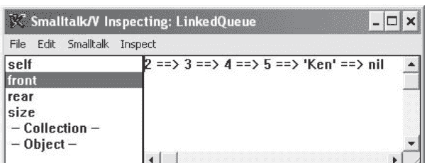

图 5.5 一个针对 `LinkedQueue` 对象的 Smalltalk 检查器窗口

注意，实例变量 `front` 的状态实际上看起来像一个链式结构。程序员可以通过双击每个对象，浏览结构中包含的对象。

Smalltalk 程序员发现这种语言及其编程环境使用起来令人愉悦。然而，在 20 世纪 90 年代初，正当 Smalltalk 开始在普通计算机上投入使用之际，两种语言流行起来，抢走了 Smalltalk 可能为面向对象编程积累的风头。这两种语言是 Java 和 C++，我们将在接下来的两节中探讨它们。

## 5.3 Java

Sun Microsystems 的詹姆斯·高斯林（James Gosling）及其团队最初将 Java 设计为用于微波炉等嵌入式设备系统的编程语言。他们最初强调的是可移植性和较小的代码占用空间，正如“一次编写，到处运行”这一口号所体现的那样。为实现这一目标，Java 程序会被编译成与机器无关的字节码，每个目标平台都要提供自己的 Java 虚拟机或解释器来运行这种字节码。事实证明，这种软件开发和分发愿景非常适合过去 20 年计算领域的许多发展与进步，包括网络、Web 以及手持设备和移动设备等现代发展成果。

Java 的设计者还意识到，用于这类应用程序开发的语言应该是完全面向对象的，并且为了吸引最广泛的程序员群体，应具有传统的语法结构，例如

这个应用程序由一个 `import` 语句、一个类定义以及该类中的单个方法定义组成。该方法是**静态的**，这意味着它是一个**类方法**，可以以 `TestComplex.main(<array of strings>)` 的形式运行。这正是 Java 虚拟机在应用程序启动时自动执行的操作。JVM 会将启动时可能存在的任何命令行参数放入 `args` 数组。我们的 `main` 方法会忽略此参数并按预期执行。

现在让我们开发新的 `Complex` 类的一小部分，用于表示复数。由于数字在 Java 中不是对象，我们无法在 `Magnitude` 层级下创建子类来获得内置功能。因此，我们从头构建 `Complex` 类。下面是一份代码清单及其说明：

```java
package numbers;

public class Complex extends Object{

    // Default constructor
    public Complex(){
        this(0, 0);
    }

    // Parameterized constructor
    public Complex(double realPart, double imaginaryPart){
        re = realPart;
        im = imaginaryPart;
    }

    public double realPart(){
        return re;
    }

    public double imaginaryPart(){
        return im;
    }

    public Complex add(Complex c){
        return new Complex(this.realPart() + c.realPart(),
                           this.imaginaryPart() + c.imaginaryPart());
    }

    public Complex multiply(Complex c){
        return new Complex(this.realPart() * c.realPart() -
                           this.imaginaryPart() * c.imaginaryPart(),
                           this.realPart() * c.imaginaryPart() +
                           this.imaginaryPart() * c.realPart());
    }

    public String toString(){
        return this.realPart() + "+" + this.imaginaryPart() + "i";
    }

    // Instance variables
    private double re, im;
}
```

该模块首先声明此资源属于名为 `numbers` 的 Java 包。类头显示 `Complex` 继承 Java 的 `Object` 类。这个继承本来可以省略，因为它是默认发生的，但为了强调而加上。`Complex` 类的实例变量是 `re` 和 `im`。它们被声明为 `private` 访问权限，这意味着它们只在类定义内可见和可访问。这就是 Java 强制实现数据封装的方式。两个访问器方法 `realPart` 和 `imaginaryPart` 被定义为 `public` 访问权限。这允许使用复数的程序员查看但不能修改其内部状态。注意，在 `add`、`multiply` 和 `toString` 方法中，这些方法也会在关键字 `this` 所引用的接收对象和 `c` 所引用的参数对象上调用。考虑到这两个对象的实例变量本来可以在这些方法中直接引用（对于接收者变量使用 `this.re` 或 `re`，对于参数变量使用 `c.re`），这似乎有些小题大做。然而，在类定义中使用这两个访问器方法，在数据及其使用之间建立了一道抽象屏障，使得程序员可以更改数据的表示方式而不会干扰其他代码（稍后详述这一点）。

`toString` 方法是在 `Complex` 类中定义的唯一多态方法。它的定义覆盖了从 `Object` 类继承来的定义。`toString` 在 Java 中的目的是返回接收对象的字符串表示形式（方式类似于 Smalltalk 的 `printOn:` 和 `printString`）。正如在 `Object` 中定义的，`toString` 的默认行为是返回接收者类的名称。`Complex` 类中 `toString` 的定义返回的是关于实例的信息，而不是类的信息。某些 Java 方法（如 `System.out.println` 和字符串连接运算符 `+`）会自动运行对象的 `toString` 方法以获取其文本。

除了实例变量和方法之外，`Complex` 的定义还包含两个重载构造函数。它们类似于方法，但它们的名称与类名相同，并且没有返回值。构造函数为实例变量指定初始值，并且可以执行对象首次构造时所需的其他操作（因此得名）。第二个构造函数有两个参数，为实例变量提供初始值。第一个构造函数不接受参数（它被称为默认构造函数），并将 `re` 和 `im` 都初始化为 0。注意，第一个构造函数通过使用关键字 `this` 和适当的参数调用第二个构造函数来完成其任务。这个过程称为构造函数链式调用，是代码复用的另一种形式。

如前所述，对实例变量使用 `private` 访问权限，即使在类定义内部也使用访问器方法，使我们能够更改数据的表示形式而不会干扰其他代码。我们可以将 `Complex` 类重写为使用极坐标，而无需修改除 `realPart`、`imaginaryPart` 和一个构造函数之外的任何方法，如下列代码所示：

```java
package numbers;

public class Complex extends Object{

    public Complex(){
        this(0, 0);
    }

    public Complex(double realPart, double imaginaryPart){
        radius = Math.sqrt(realPart * realPart + imaginaryPart * imaginaryPart);
        angle = Math.atan2(imaginaryPart, realPart);
    }

    public double realPart(){
        return radius * Math.cos(angle);
    }

    public double imaginaryPart(){
        return radius * Math.sin(angle);
    }

    public Complex add(Complex c){
        return new Complex(this.realPart() + c.realPart(),
                           this.imaginaryPart() + c.imaginaryPart());
    }

    public Complex multiply(Complex c){
        return new Complex(this.realPart() * c.realPart() -
                           this.imaginaryPart() * c.imaginaryPart(),
                           this.realPart() * c.imaginaryPart() +
                           this.imaginaryPart() * c.realPart());
    }

    public String toString(){
        return this.realPart() + "+" + this.imaginaryPart() + "i";
    }

    private double radius, angle;
}
```


与 Smalltalk 一样，Java 对引用对象的变量使用引用语义。因此，类也被称为`引用类型`。在 Java 中，命名原始类型值（如 `int`、`float` 和 `char`）的变量具有值语义。相等运算符 `==` 用于原始类型时也可以用于

with reference types, but in that context, it means object identity, as it does in Smalltalk. Java includes an `equals` method in the `Object` class which defaults to the behavior of the `==` operator but can be overridden in subclasses to implement a comparison of two distinct objects for the same properties.

Methods for the objects `z` and `w` can be invoked after instantiation by using the usual dot notation. For example,

```
z = z.add(w);
```

adds `w` to `z`, creating a new `Complex` object in the process, and assigns this new object to `z` (throwing away the object previously pointed to by `z`). It is also possible to nest operations so that, for example,

```
z = z.add(w).multiply(z);
```

performs the computation `z = (z + w) * z`. In the process, a temporary object (we'll call it `t`) is created to hold the value of `z + w`, and a new object is then created to hold the value `t + z`. This object is then referenced by `z`, and `z`'s old object is thrown away. This has essentially all the advantages of abstraction, and with overloading, can make the type `Complex` look more or less like a built-in type. Unfortunately, Java does not allow operator overloading, but `C++` does, as discussed later in this chapter.

The disadvantages to this mechanism are two-fold. First, without automatic garbage collection, serious space leaks become difficult to avoid. For this reason, most object-oriented languages require automatic garbage collection (`Smalltalk` and `Java`, for example, but not `C++`). Second, this view of binary operations is not symmetric, since the left-hand operand is singled out as the target of the method call. In a mixed-paradigm language like `C++`, such operators could be implemented instead as ordinary functions or as overloaded operators in method definitions. Alternatively, some object-oriented languages, such as the Common Lisp Object System (`CLOS`), allow multimethods, in which more than one object can be the target of a method call.

## 5.3.2 The Java Collection Framework: Interfaces, Inheritance, and Polymorphism

As mentioned earlier, Java includes a large number of libraries or packages with classes to support many kinds of applications. Some of these sets of classes are related in what one might call a framework. One such framework, which is similar in many ways to the Smalltalk collection hierarchy, is the Java collection framework, as defined in the package `java.util`. In this section, we explore Java's support in this framework for inheritance, polymorphism, and distinguishing concrete and abstract classes. We also examine how two other features not found in Smalltalk—parameterized types and interfaces—support the organization of code in a statically typed object-oriented language like Java.

Conceptually, an interface is a set of operations on objects of a given type. Interfaces serve as the glue that connects components in software systems. A resource's interface should give its users only the information they need to use it and its implementers only enough information to implement it. Java codifies the concept of an interface with a special syntax that allows the programmer to list a type name and a set of public method headers. Java interfaces can belong to packages and can be compiled in advance of any other code. An interface can then be realized or implemented by any class that includes all of the methods specified in that interface.

Java's collection framework is structured at the top level in terms of a set of interfaces. Figure 5.6 shows a diagram of some of them.

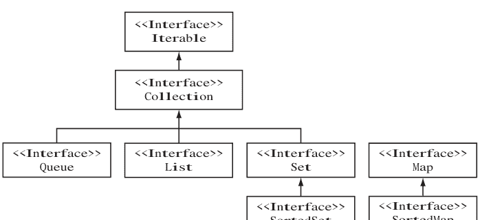

Figure 5.6 Some Java collection interfaces

The interfaces appear in a tree-like hierarchy, much like classes. The more general interfaces are at the top. Each interface below the root extends its parent interface above it. Thus, for example, the `List` interface includes not only the methods specific to lists but also implicitly those in the `Collection` and `Iterable` interfaces. The position of the `Iterable` interface at the root of this tree ensures that every collection must include an iterator method. We will have much more to say about iterators in a moment. Java’s designers thought it best not to include the `Map` interfaces in the hierarchy (see Exercise 5.8).

The next code segment shows the code for some of the methods specified in the `Collection` interface:

```
public Interface Collection<E> extends Iterable<E>{
    boolean    add(E element);
    boolean    addAll(Collection<E> c);
    void       clear();
    boolean    contains(E element);
    boolean    containsAll(Collection<E> c);
    boolean    equals(Object o);
    boolean    isEmpty();
    boolean    remove(Element E);
    boolean    removeAll(Collection<E> c);
    boolean    retainAll(Collection<E> c);
    int        size();
}
```

You will recall some similar methods from our discussion of Smalltalk’s `Collection` class. Note also the presence of notations such as `<E>` and `E` in the interface and method headers. These notations represent type parameters. You saw type parameters used with the functional language Haskell in Chapter 4. Java is statically typed, and all data types, including the types of the elements in collections, must be explicitly specified at compile time. Collections with type parameters are also called `generic collections`, as distinct from the nongeneric, `raw collections` that appeared in early versions of Java. A generic collection exploits parametric polymorphism, which allows collections of different element types to rely on a single definition of the collection type.

Java collections can contain elements of any reference types. The complete type (including the actual element type) of a given collection variable must be specified when that variable is declared. For example, the following code declares two variables, one to reference a list of strings and the other to reference a set of integers:

```java

List<String> listOfStrings;

Set<Integer> setOfInts;

```

Note that the type parameters for the element types of `List` and `Set` have been replaced by the actual element type names, `String` and `Integer`, respectively. This prevents the programmer from adding anything other than a string to the list and anything other than an integer to the set. (Java automatically wraps `int` values in `Integer` objects when they are added to a collection of integers, and automatically unwraps them when they are returned from a collection.)

The classes that implement the collection interfaces also form a hierarchy. Figure 5.7 shows some of these. The dashed arrow in the diagram indicates that a class implements an interface. A solid arrow indicates that a class extends another class and an interface extends another interface. If a class implements an interface, any of its subclasses also (implicitly) implement that interface.

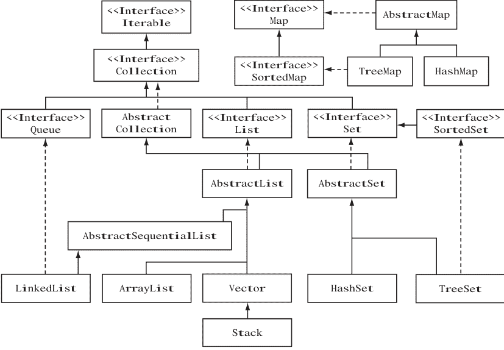

**Figure 5.7** Some Java collection classes and their interfaces

Some of these classes are obviously abstract, even without the hints offered by their names. These classes implement common properties and behavior for their subclasses. The classes on the frontier of the tree are concrete and thus can be instantiated. Note also that some classes, such as `LinkedList`, implement more than one interface. Thus, a linked list can behave either as a list or as a queue. For example, the following code segment declares variables for a list of strings, a queue of floats, and a list of characters. The code also initializes each of the variables to new list objects. The first two are linked lists, and the third is an array list.

```
List<String>    listOfStrings = new LinkedList<String>();
Queue<Float>    queueOfFloats = new LinkedList<Float>();
List<Character> listOfChars  = new ArrayList<Character>();
```


From the compiler’s (or the programmer’s) perspective, the lists of strings and characters in this code are just lists. That is, the same methods can be called on the two `List` variables even though the two lists they reference have different implementations and different element types. However, because the variable `queueOfFloats` has been declared to be of type `Queue<Float>`, the linked list that it refers to will only respond to the methods specified in the `Queue` interface. Any other `List` method used with this variable will be flagged as a syntax error. Thus, the danger that a list object might violate the spirit of a queue, which we saw earlier in our discussion of inheritance in Smalltalk, is avoided with these declarations.

By contrast, the design decision to make the Java `Stack` class a subclass of `Vector`, which implements the `List` interface (see Figure 5.7), is not the most fortunate one. In this case, the spirit of a stack could be violated, because a programmer might use any of the list operations on it.

To remedy this design flaw in Java, let’s develop a new type of stack class called `LinkedStack`. This implementation of a stack will behave like a pure, restricted stack, but allow users to run some of Java’s `Collection` methods with stacks as well. Our new class will include the standard stack methods `push`, `pop`, and `peek`, as well as the `Collection` methods `size`, `add`, and `iterator`. By defining `LinkedStack` as a subclass of the `AbstractCollection` class, we will get a good deal of additional behavior for free. Figure 5.8 shows a diagram of our proposed subframework.

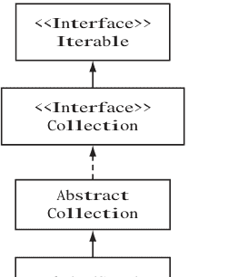

Figure 5.8 Adding `LinkedStack` to the collection framework

我们的 `LinkedStack` 实现与 Smalltalk 中 `LinkedQueue` 类的实现非常相似。我们使用一个单向链表的节点序列来保存元素，并使用一个名为 `top` 的单一外部指针指向第一个节点。用于跟踪元素数量的整数 `size` 是唯一的另一个实例变量。`Node` 类不是在外部定义的，而是作为 `private inner class` 嵌套在 `LinkedStack` 类内部。我们暂时推迟栈迭代器的开发。以下是基本 `LinkedStack` 类的代码：

```java
import java.util.AbstractCollection;
import java.util.Iterator;
public class LinkedStack<E> extends AbstractCollection<E>{
    // Constructor
    public LinkedStack(){
        top = null;
        size = 0;
    }
    public E peek(){
        return top.data;
    }
    public E pop(){
        E data = top.data;
        top = top.next;
        size -= 1;
        return data;
    }
    public void push(E data){
        top = new Node<E>(data, top);
        size += 1;
    }
    // The next three methods are required by AbstractCollection
    public boolean add(E data){
        push(data);
        return true;
    }
    public int size(){
        return size;
    }
}
```

栈与迭代器对象之间的关系如图 5.9 所示。

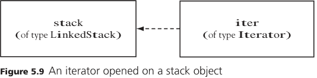

**Figure 5.9** An iterator opened on a stack object

请注意，`Iterator` 类型也针对其底层存储的相同元素类型进行参数化。`Iterator` 类型是一个接口，它指定了以下代码段中显示的三个方法：

```java
public interface Iterator<E>{
    public boolean hasNext();  // True if more elements, false otherwise
    public E next();           // Returns the current element and advances
    public void remove();      // Removes the current element from the store
}
```

回到我们之前创建名为 `iter` 的迭代器对象的代码段，我们可以使用 `Iterator` 方法 `hasNext` 和 `next` 在一个 `while` 循环中访问迭代器底层存储（链表栈）中的每个元素。下面的代码段只是打印这些元素：

```java
while (iter.hasNext())
    System.out.println(iter.next());
```

Java 的增强型 `for` 循环是前面所示的基于迭代器的 `while` 循环的语法糖。虽然下面的代码段看起来像是遍历栈，但实际上在幕后使用迭代器的 `while` 循环在工作：

```java
for (String s : stack)
    System.out.println(s);
```

使用增强型 `for` 循环的唯一前提是集合类实现了 `Iterable` 接口，并且它也实现了 `iterator` 方法。

要实现 `iterator` 方法，`LinkedStack` 类必须定义并实例化一个实现 `Iterator` 接口的类。我们将此类的名称命名为 `StackIterator` 并在 `iterator` 方法中实例化它，如下所示：

```java
public Iterator<E> iterator(){
    return new StackIterator<E>(top);
}
```

请注意，当 `StackIterator` 对象被创建时，它会接收栈顶的引用作为参数。

`StackIterator` 类是另一个嵌套的、私有类。它维护一个名为 `probe` 的单一实例变量，将用于访问栈的链表结构中的每个节点。此变量是

其他 `Collection` 方法，例如 `addAll` 和 `contains`（类似于 Smalltalk 的 `includes:`）。下面的 `AbstractCollection` 类片段显示了这是如何完成的：

```java
abstract public class AbstractCollection<E> implements Collection<E>{
    // Methods to be implemented by subclasses
    abstract public int size();
    abstract public boolean add(E element);
    abstract public Iterator<E> iterator();
    // Methods implemented here but inherited by subclasses
    public boolean addAll(Collection<E> c){
        boolean added = true;
        for (E element : c)
            added = this.add(element) && added;
        return added;
    }
    public boolean contains(Object target){
        for (E element : this)
            if (!target.equals(element)) return false;
        return true;
    }
    // Other methods
}
```

正如你所见，程序员不仅可以使用带有链表栈的 for 循环，还可以使用 `Collection` 方法 `addAll` 将元素从列表或集合复制到链表栈，使用 `Collection` 方法 `contains` 在链表栈中搜索给定元素，等等。集合层次结构不包括内置的 map、filter 和 reducing 迭代器，但在本章后面我们将展示如何定义这些。

### 5.3.3 Dynamic Binding and Static Binding

正如你所见，Java 是一种纯面向对象的语言，具有类似 C 的语法和静态类型。与 Smalltalk 相比，Java 在编程社区中取得成功的部分原因归功于后两种特性。此外，Java 的设计可以使方法查找的某些运行时成本（以及大部分错误恢复）从运行时转移到编译时。Java 编译器在接收对象的实际类可以在编译时确定的情况下，静态地确定要使用的方法实现。此时，关于该类的所有方法及其祖先类的方法的信息都可用。例如，对于方法调用：

```
aCollection.addAll(aCollection)
```

Java 编译器可以确定方法 `addAll` 在 `AbstractCollection` 类中实现，并因此生成调用该特定方法实现的 的代码。此过程

被称为 `static binding`，与你在 Smalltalk 中看到的动态绑定形成对比。不幸的是，除非被调用的方法被定义为 `final` 或 `static`，否则 Java 编译器实际上不会为静态绑定生成代码。`final` 方法是在子类中不能被重写的方法，`static` 方法是在类而不是实例上调用的方法。在这两种情况下，都不可能对接收对象的类进行可能的调用，因此方法调用是静态绑定的。

相比之下，当编译器处理 `addAll` 方法代码中的 `this.add(element)` 调用时，它无法在编译时确定要调用的 `add` 方法的具体版本。符号 `this` 可能指的是栈、列表或 `Collection` 的任何其他子类型。因此，`this` 对象的实际类型直到运行时才能确定。一般来说，“自上而下”调用由子类实现的方法必须始终在运行时通过动态绑定处理。

尽管 Java 中动态绑定的残留会带来运行时性能损失，但 Java 的方法查找实现使用跳转表而不是继承树的搜索，仍然使 Java 相对于 Smalltalk 具有效率优势。此外，抽象方法必须由子类实现的编译时要求引入了 Smalltalk 中不存在的安全性（编译时错误检查）。在这个例子中，编译器保证至少在运行时会有 `add` 方法可以调用，一旦 JVM 确定了其接收对象的实际类型。

### 5.3.4 Defining Map, Filter, and Reduce in Java

`Map`、`filter` 和 `reduce` 是函数式语言中的高阶函数，也是 Smalltalk 中的内置集合方法。正如你在 5.2 节中看到的，这些 Smalltalk 方法也是多态的，因为它们对任何类型的集合都起作用，而不仅仅是列表。虽然 Java 只有基本的迭代器，但可以定义与 Smalltalk 对应方法行为相似的 `map`、`filter` 和 `reduce` 方法。这样做将有助于说明 Java 中接口、类、泛型和静态类型化方面的一些重要点。

`map`、`filter` 和 `reduce` 方法可以定义为名为 `Iterators` 的特殊类中的静态方法（类似于 Java 的 `Math` 和 `Collections` 类）。`map` 和 `filter` 方法期望输入集合作为参数并返回输出集合作为值。程序员可以向这些方法传递实现 `Collection` 接口的任何集合参数。输出集合也定义为 `Collection` 类型，但返回的实际对象将与输入集合具有相同的具体类（可能元素类型不同）。因此，如果我们选择将整数的列表（或集合）转换为字符串的列表，我们可以发送任何整数的列表（或集合）并返回相同具体类（例如 `ArrayList` 或 `HashSet`）的字符串列表（或集合），伪装成集合。如果需要，此集合可以向下转换为其实际类。同样，`reduce` 方法以集合作为参数，但返回集合元素类型对象作为其结果。表 5.2 显示了每个方法的粗略语法形式。请注意，集合的元素类型参数已指定，但操作参数的确切语法尚未确定。

| Table 5.2 The rough syntax of map, filter, and reduce |  |
|---|---|
| public static<E, R> Collection<R> map(<an operation>, Collection<E> c) |  |
| public static<E> Collection<E> filter(<an operation>, Collection<E> c) |  |
| public static<E> E reduce(E baseElement, <an operation>, Collection<E> c) |  |

表 5.2 中的方法头现在可以通过包含传递给每个方法的策略/对象类型来完成。表 5.3 显示了这些更改。

**表 5.3** `map`、`filter` 和 `reduce` 的完成语法

| Method |
|---|
| `public static<E, R> Collection<R> map(MapStrategy<E, R> strategy, Collection<E> c)` |
| `public static<E> Collection<E> filter(FilterStrategy<E> strategy, Collection<E> c)` |
| `public static<E> E reduce(E baseElement, ReduceStrategy<E> strategy, Collection<E> c)` |

这三个策略接口的使用告诉迭代器的实现者，她可以期望一个识别适当策略方法（`transform`、`accept` 或 `combine`）的对象。同样，它们也告诉迭代器的使用者，他只需提供一个实现了这些接口之一的类的对象即可正确使用它们。我们现在介绍迭代器的实现，然后给出一个示例应用。

如前所述，三个迭代器方法的主体是一个名为 `Iterators` 的新类。最简单的方法是 `reduce`，它将一组对象组合成单个对象。代码如下：

```java
public static<E> E reduce(E baseElement,
                         ReduceStrategy<E> strategy,
                         Collection <E> c){
    for (E element : c)
        baseElement = strategy.combine(baseElement, element);
    return baseElement;
}
```


正如你所见，实现者对用于组合结果的具体操作一无所知，除了其目标对象（此处命名为 `strategy`）实现了 `ReduceStrategy` 接口之外。在这方面，`strategy.combine` 的方法调用类似于高阶函数中形式函数参数的调用。

`map` 方法稍微复杂一些，因为它必须创建与输入集合相同类型的新的集合。幸运的是，Java 方法 `getClass()` 和 `newInstance()` 来拯救我们了。第一个方法返回一个对象的类，第二个方法使用类的默认构造函数返回该类的一个新实例。代码必须嵌入到 Java 的 try/catch 异常处理语法中，以进行这些方法所需的错误检查。`map` 的代码如下。`filter` 的实现留作练习。

```java
public static<E, R> Collection<R> map(MapStrategy<E, R> strategy,
                                      Collection<E> c){
    try{
        Collection<R> results = c.getClass().newInstance();
        for (E element : c)
            results.add(strategy.transform(element));
        return results;
    }catch(Exception e){
        System.out.println(e);
        return null;
    }
}
```

如前所述，我们的新迭代器的使用者负责提供一个集合和相应的策略接口的一个实例。程序员可以定义一个实现 `MapStrategy`、`FilterStrategy` 或 `ReduceStrategy` 的新类，但没有必要费这个劲。Java 允许程序员在使用的点上创建一个匿名类的实例，其方式与函数式程序员创建 lambda 形式的方式非常相似。语法如下：

```java
new <interface name>(){
    <method implementations>
}
```

表 5.4 显示了 `MapStrategy` 接口和一个示例实例化。该实例化通过取整数的平方根将整数值转换为 double 值。

**表 5.4  MapStrategy 接口和一个实例化**

| Interface | Instantiation |
|---|---|
| `public interface MapStrategy<E, R>{`<br>&nbsp;&nbsp;&nbsp;&nbsp;`public R transform(E element);`<br>`}` | `new MapStrategy<Integer, Double>(){`<br>&nbsp;&nbsp;&nbsp;&nbsp;`public Double transform(Integer i){`<br>&nbsp;&nbsp;&nbsp;&nbsp;&nbsp;&nbsp;&nbsp;&nbsp;`return Math.sqrt(i);`<br>&nbsp;&nbsp;&nbsp;&nbsp;`}`<br>`}` |

下一个代码段显示了一个完整的应用程序，对我们新的迭代器进行测试。注意使用了两种不同的特定映射策略，然后使用了一种过滤策略和一种归约策略。相同的代码可用于整数集或任何其他集合类（如第 5.3.2 节中研究的 `LinkedStack`）上的整数。

```java
import iterators.*;
import java.util.*;

/*
Tests the map, filter, and reduce iterators with array lists.
Creates strategy objects as anonymous instances of the appropriate interfaces.
*/

public class TestIterators{
    static public void main(String[] args){
        // The list contains [1 2 3 4 5 6 7 8]
        List<Integer> list = new ArrayList<Integer>();
        for (int i = 1; i <= 8; i++)
            list.add(i);

        // Compute the square roots
        Collection<Double> squareRoots =
            Iterators.map(new MapStrategy<Integer, Double>(){
                public Double transform(Integer i){
                    return Math.sqrt(i);
                }
            }, list);
        System.out.println(squareRoots);

        // Convert to string representations
        Collection<String> stringReps =
            Iterators.map(new MapStrategy<Integer, String>(){
                public String transform(Integer i){
                    return i + "";
                }
            }, list);
        System.out.println(stringReps);

        // Keep the even numbers
        Collection<Integer> evens =
            Iterators.filter(new FilterStrategy<Integer>(){
                public boolean accept(Integer i){
                    return i % 2 == 0;
                }
            }, list);
        System.out.println(evens);

        // Sum the numbers
        int sum = Iterators.reduce(0, new ReduceStrategy<Integer>(){
            public Integer combine(Integer first, Integer second){
                return first + second;
            }
        }, list);
        System.out.println(sum);
    }
}
```

我们的 Java 版本的 `map`、`filter` 和 `reduce` 与函数式语言和 Smalltalk 中的对应版本相比如何？函数式版本很简单，因为它们是接受其他函数作为参数的函数。这里没有什么新东西需要学习。然而，`map`、`filter` 和 `reduce` 仅限于列表集合。Smalltalk 版本更通用，因为它们是关于任何集合的多态的。Smalltalk 块的语法实际上并不比 lambda 形式复杂。Java 版本的语法稍微复杂一些，但其中大部分复杂性可以被视为 lambda 形式或匿名代码块的本质等价物的样板。Java 版本相对于 Smalltalk 版本的真正好处在于静态类型检查。正如 always，类型错误（使用非集合对象或非策略对象）在编译时被及早捕获，并且所有错误总是被捕获。这使得在 Java 中使用 `map`、`filter` 和 `reduce` 几乎是万无一失的，尽管有点笨重。

## 5.4 C++

C++ 最初由 Bjarne Stroustrup 在 AT&T Bell Labs 开发，C++ 是对 C 的扩展，具有类似 Simula 的类，但在 1980 年代后期和 1990 年代，它远远超出了其起源，成为包含大量特性、部分面向对象、部分非面向对象的语言。它是一种折中语言，因为它包含大部分 C 语言作为子集，就像 Simula 包含 Algol60 作为子集一样。C++ 也被设计为一种高效、实用的语言，源于其用户的需求。因此，它成为 1990 年代初的主要面向对象语言，并且在非 Web 应用中仍然极受欢迎。自 1986 年发布第一本参考手册以来，添加了许多新特性，包括多重继承、模板、运算符重载和异常。自 1998 年采用国际标准（C++98）并于 2003 年修订（C++03）以来，该语言已稳定下来。正在进行新标准（C++0x）的工作，其出版预计在本书印刷时附近。

### 5.4.1 C++ 的基本元素：类、数据成员和成员函数

C++ 包含与 Java 类似的类和对象声明。实例变量和方法都称为类的成员：实例变量被称为数据成员，方法被称为成员函数。子类被称为派生类，超类被称为基类。C++ 与大多数其他面向对象语言，包括 Java 的一个基本区别是，对象不是自动的指针或引用。事实上，除了继承和成员函数的动态绑定之外，C++ 中的类数据类型与 C 的 `struct`（或 `record`）数据类型本质上是相同的。

与 Java 类似，C++ 为类成员提供了三个保护级别：`public`、`private` 和 `protected`。`Public` 成员可供客户端代码以及派生类访问。`Protected` 成员对客户端代码不可访问，但对派生类仍然可访问。`Private` 成员既不可供客户端访问，也不可供派生类访问。在类声明中，默认保护是 `private`，而在 `struct` 声明中，默认是 `public`。此外，关键字 `private`、`public` 和 `protected` 在类声明中建立块，而不是像 Java 中那样仅适用于单个成员声明：

```cpp
class A{
// A C++ class
public:
// all public members here
protected:
// all protected members here
private:
// all private members here
};
```

（请注意右花括号后的最后一个分号，这是C语法的残留；分号前可以出现一个变量名列表，其数据类型就是前面的类定义。）

在C++中，对象的初始化与Java一样，由与类同名的构造函数完成。当对象在内存中分配空间时，构造函数会被自动调用，同时构造函数的实际参数也会在此时求值。因此，构造函数与Java中的类似，区别在于C++中的对象不必是引用，因此构造函数既可以在声明中作为一部分被自动调用，也可以在 `new` 表达式中被调用。与Java不同，C++没有必需的内置垃圾回收机制，因此C++还包含析构函数；析构函数与构造函数一样与类同名，但前面带有波浪号“~”（在逻辑中有时用来表示“非”）。当对象被释放（要么超出作用域，要么通过 `delete` 运算符）时，析构函数会被自动调用，但它们必须由程序员提供，因此代表了一种手动释放内存的方式。

C++中的类声明并不总是包含所有成员函数的实现代码。通过在类名后使用双冒号“::”表示的作用域解析运算符，可以在声明外部实现成员函数。它得名于这样一个事实：它会使类声明的作用域被重新进入。在类声明中给出实现的成员函数会被自动假定为内联（也就是说，编译器可能会用函数的实际代码替换函数调用）。

作为C++中的第一个示例，我们给出一个复数类的部分定义：

```cpp
class Complex{
public:
// Constructor
Complex(double r = 0, double i = 0)
: re(r), im(i) { }
```

这意味着 `re` 被初始化为 `r` 的值，`im` 被初始化为 `i` 的值。换句话说，上述代码与以下代码的含义基本相同：

```cpp
Complex(double r = 0, double i = 0){
    re = r; im = i;
}
```

构造函数也为其参数给出了默认值：

```cpp
Complex(double r = 0, double i = 0)
```

这允许用0、1或2个参数创建 `Complex` 对象，并且避免了创建不同重载构造函数的需要：

```cpp
Complex i(0,1);  // i constructed as (0,1)
Complex y;       // y constructed as default (0,0)
Complex x(1);    // x constructed as (1,0)
```

### 5.4.2 使用模板类实现泛型集合

你在5.3.2节中看到了如何在Java中定义泛型集合类。C++使用一个名为 **模板类** 的类似特性来定义泛型集合。虽然C++的标准模板库（STL）包含几个内置的集合类，但让我们开发一个 `LinkedStack` 类来看C++模板类是如何工作的。

我们的C++ `LinkedStack` 类与5.3.2节中讨论的Java版本具有相同的基本接口。下面是一个简短C++程序，它测试了该类的部分能力：

```cpp
#include <iostream>
using std::cout;
using std::endl;
#include "LinkedStack.c"
int main(){
    int number;
    LinkedStack<int> stack;
    for (number = 1; number <= 5; number++)
        stack.push(number);
    cout << "The size is " << stack.size() << endl;
    while (stack.size() != 0)
        cout << stack.pop() << " ";
    cout << endl;
}
```

正如你所看到的，这段代码以类似于Java版本的方式声明了一个栈类型，尽管在这种情况下，`int` 类型可以直接指定为栈的元素类型。然而，与Java不同，只要在声明中提及变量 `stack`，一个新的 `LinkedStack` 对象就会被自动创建并赋值给该变量。除此之外，`LinkedStack` 的用法与Java示例完全相同。

我们的Java版 `LinkedStack` 通过继承 `AbstractCollection` 类利用了继承和多态，该类提供了更高级别的功能并作为其他集合类的接口。由于C++中没有这个类，我们将 `LinkedStack` 定义为一个顶层类。我们的C++版本包含一个构造函数、一个析构函数（稍后会详细讨论）、公共的栈实例方法、一个嵌套节点类型，以及一个用于分配和初始化新节点的辅助方法。以下是该类的代码：

```cpp
template <class E> class LinkedStack{
    public:
    // Constructor
    LinkedStack()
    : top(0), mySize(0) {}
    // Destructor
    ~LinkedStack(){
        while (size() > 0)
            pop();
    }
    E peek(){
        return top->data;
    }
    E pop(){
        E element = top->data;
        node * garbage = top;
        top = top->next;
        mySize -= 1;
        delete garbage;    // Must return node storage to the heap
        return element;
    }
    void push(E element){
        top = getNode(element, top);
        mySize += 1;
    }
    int size(){
        return mySize;
    }
    private:
    // The node type for LinkedStack
    struct node{
        E data;
        node* next;
    };
    // Data members for LinkedStack
    node* top;
    int mySize;
    // Helper method to initialize a new node
    node* getNode(E data, node * next){
        node * newNode = new node;
        newNode->data = data;
        newNode->next = next;
        return newNode;
    }
};
```


类头中的记号`template <class E>`为栈的元素类型引入了类型参数`E`。在编译时，该参数将由客户端程序代码中的实际`C++`类型填充。构造函数和公共实例方法与前面讨论的`Complex`类类似。

然而，由于`LinkedStack`类对其节点使用动态存储，它还应包含一个析构函数。当客户端程序无法再访问`LinkedStack`对象时（例如，当创建临时栈的函数从其调用返回时），该方法的任务是将每个节点返回给系统堆。析构函数通过弹空栈来实现这一点。反过来，`pop`方法使用`delete`运算符手动将刚从链接结构中移除的节点返回给系统堆。由于`C++`没有自动垃圾回收，如果未能以这种方式回收存储，就会造成内存泄漏，进而可能导致生产环境中的内存问题。

还要注意，节点类型是一个`C`风格的`struct`，但也可以改为定义为`C++`类。因为节点只是数据和链接的私有容器，所以使用`struct`以及一个构建并返回指向已初始化节点的指针的私有方法`getNode`也同样有效。

最后，使用显式的`C`风格指针而不是引用，说明了`Java`与`C++`之间的另一个区别。即使我们在`C++`中定义了一个`Node`类，我们仍然必须使用`*`运算符来指示到下一个节点的链接，以及一个指向节点本身的指针变量。

### 5.4.3 静态绑定、动态绑定和虚函数

`C++`中将成员函数的动态绑定作为一种选项提供，但它不是默认行为。所有成员函数在编译时都是静态绑定的。只有使用关键字`virtual`定义的函数才可能进行动态绑定。例如，如果我们想为从矩形派生的正方形重新定义`area`函数，在`C++`中应如下操作：

```cpp
class Rectangle{
    public:
        virtual double area(){
            return length * width;
        }
        ...
    private:
        double length,width;
};
class Square : public Rectangle{
    public:
        double area(){            // redefines rectangle::area dynamically
            return width * width;
        }
        ...
};
```

当然，在这个示例中，我们真正想要的是抽象类`ClosedFigure`中的一个抽象`area`函数。在`C++`中，这可以通过使用所谓的纯虚声明来实现：

```cpp
class ClosedFigure{            // an abstract class
    public:
        virtual double area() = 0; // pure virtual
        ...
};
class Rectangle : public ClosedFigure{
    public:
        double area(){
            return length * width; }
```
（续）

```
private:
double length,width;
};
class Circle : public ClosedFigure{
public:
double area(){
    return PI*radius*radius; }
---
private
double radius;
};
```

虚函数声明中的 `0` 表示该函数在此处为空，即没有函数体。因此，该函数不能被调用，因而是抽象的，并且也使包含它的类成为抽象类。纯虚函数必须声明为 `virtual`，因为它们在执行期间必须被动态绑定，并在派生类中被重写。

注意在前面的代码中，`Circle` 和 `Rectangle` 中对 `area` 的重写定义并没有重复 `virtual` 关键字（尽管允许这样做）。这是因为在 `C++` 中，一旦函数被声明为 `virtual`，它在所有派生类中始终保持为 `virtual`。

回到 `C++` 中的动态绑定问题：要将方法声明为 `virtual` 并不足以启用动态绑定；此外，对象本身必须是被动态分配的，或者通过引用访问。为了具体了解这一点，请看以下代码：

```
(1) class A
(2) {
(3) public:
(4)   void p()
(5)   { cout << "A::p\n" ;
(6)   }
(7)   virtual void q()
(8)   { cout << "A::q\n" ;
(9)   }
```
（续）

```cpp
(10)  void f()
(11)  { p();
(12)    q();
(13)  }
(14) };
(15) class B : public A
(16) {
(17) public:
(18)   void p()
(19)   { cout << "B::p\\n" ;
(20)   }
(21)   void q()
(22)   { cout << "B::q\\n" ;
(23)   }
(24) };
(25) int main()
(26) { A a;
(27)   B b;
(28)   a.f();
(29)   b.f();
(30)   a = b;
(31)   a.f();
(32) }
```

该程序的输出有些令人惊讶：

```
A::p
A::q
A::p
B::q
A::p
A::q
```

在调用 `b.f()`（第 29 行）时，调用了继承而来的函数 `A::f`。在 `A` 的这个函数内部，有对 `p` 和 `q` 的调用（第 11 行和第 12 行）。由于 `p` 不是虚函数，因此动态绑定不适用，该调用在编译时被解析为 `A::p()`。另一方面，对 `q` 的调用是虚调用，隐式对象参数用于在执行期间动态解析该调用。因此，对 `q` 的调用隐式地是 `this->q()` 的调用，在调用 `b.f()` 时，`this` 是 `b` 的地址，所以上述输出第四行出现 `B::q`。另一方面，赋值 `a = b`（第 30 行）只是将 `b` 的数据复制到 `a`，并不会改变 `a` 的地址，也不会改变调用 `a.f()`（第 31 行）时的 `this` 指针。因此，再次调用了 `A::p` 和 `A::q`。

另一方面，如果我们将上述 `main` 程序改为：

```cpp
(33) int main(){
(34)    A* a = new A;
(35)    B* b = new B;
(36)    a->f();
(37)    b->f();
(38)    a = b;
(39)    a->f();
(40)    return 0;
(41) }
```

我们会看到输出：

```
A::p
A::q
A::p
B::q
A::p
B::q
```

因为现在赋值 `a = b`（第 38 行）复制的是一个指针，并将调用 `a->f()` 时所用的 `this` 指针改变为指向 `b` 的对象（即 `B` 对象），而不是之前 `a` 所指向的对象（即 `A` 对象）。

`C++` 通过逗号分隔的基类列表来提供多重继承，例如：

```
class C : public A, private B {...};
```

在 `C++` 中，多重继承通常会在一条继承路径上创建每个类的独立副本。例如，以下声明：

```
class A {...};
class B : public A {...};
class C : public A {...};
class D : public B, public C {...};
```

这为类 `D` 的任何对象提供了两个独立的类 `A` 对象副本，从而创建了如图 5.10 所示的继承图。

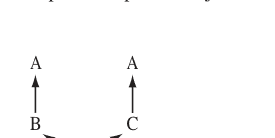

图 5.10：显示多重继承的继承图

这是一个**重复继承**的示例。为了在类 `D` 中获得单个 `A` 副本，必须使用 `virtual` 关键字声明继承：

```
class A {...};
class B : virtual public A {...};
class C : virtual public A {...};
class D : public B, public C {...};
```

这实现了如图 5.11 所示的继承图。

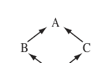

图 5.11：显示共享继承的继承图

这是一个**共享继承**的示例。由多重（共享）继承引发的方法冲突的解决将在练习 5.16 中探讨。

## 5.5 面向对象语言中的设计问题

在本节中，我们考察了将面向对象特性引入编程语言时围绕的一些问题，并总结了我们所研究的三种语言所采取的不同方法。

面向对象特性本质上代表的是动态能力而非静态能力（例如方法到对象的动态绑定），因此面向对象语言设计的一个方面就是以某种方式引入特性，以减少额外灵活性带来的运行时开销。在像 `Smalltalk` 这样面向动态（且通常是解释型）的语言中，这一点不太重要；但在像 `C++` 这样的语言中，以及在一定程度上在 `Java` 中，其面向对象特性相对于其亲属语言（如 `C` 和 `Algol`）的非面向对象特性所带来的运行时开销，是其整体设计的一个重要方面。特别是，`C++` 在设计时将效率作为首要目标。

在关于 `C++` 的一节中已经提到了一个提高效率的特性：在 `C++` 中，其实现在类定义中给出的成员函数会自动成为内联函数。这避免了执行期间函数调用的开销。

与面向对象语言的高效设计相关的其他问题涉及运行时环境的合理组织，以及翻译器发现优化的能力。对这类实现问题的讨论推迟到下一节。

我们还注意到，本章只讨论与整体语言设计相关的设计问题，而不讨论程序设计。以最大限度地利用面向对象语言的方式来设计面向对象程序涉及复杂的软件工程问题，超出了本书的范围。本章末尾的若干参考文献包含更多关于面向对象软件设计的信息。

它完全由静态常量和静态方法组成，因此实际上是一个伪装成类的命名空间。然而，如果不花费一些功夫，就不可能从其他类导入名称并重新导出其中的一部分，因此类不能很好地充当静态命名空间或模块。

因此，面向对象语言通常包含独立于面向对象机制的模块机制。主要的例子是 `C++`；它拥有命名空间机制，该机制与类机制是正交的。`Java` 也有包机制和接口，允许将类收集成组。当在包中定义时，类可以被赋予特殊的名称，通过这些名称可以访问其内容（这些名称通常还与目录结构关联）。

有时，面向对象机制与模块结构的关系更为密切。例如，`Ada95` 引入了许多面向对象机制（我们在本文中未加研究），使用这些机制的声明的语义通常取决于它们与定义它们的 `Ada` 包之间的关系。

因此，什么样的模块机制最适合面向对象环境，以及如何最好地整合类和模块这两个概念的问题，在一定程度上仍未解决。

`C++` 还有一种机制，允许类向另一个类或函数公开其实现细节：该类将另一个类或函数列为**友元**。例如，在复数数据类型的 `C++` 实现中，会出现这样的问题：像加法这样的二元运算在写成类 `Complex` 的方法时，会获得一种不寻常的语法，即：

`x.operator+(y)`

（幸运的是，`C++` 确实允许替代语法 `x + y`。）一种替代解决方案（也是早期某些 `C++` 实现中唯一的方案）是将 `+` 运算在类外部声明为 **friend**（这样它就可以访问每个 `Complex` 对象的内部数据），如下所示：

```cpp
class Complex
{
private:
    double re,im;
public:
    friend Complex operator+(Complex,Complex);
    ...
};
Complex operator+(Complex x, Complex y)
{ return Complex (x.re+y.re,x.im+y.im); }
```

## 5.5.3 继承与多态

多态有四种基本类型：

1. 参数多态（parametric polymorphism），其中类型参数在声明中可能保持未指定状态。`ML` 类型变量、`Ada` 泛型包、`C++` 模板以及 `Java` 泛型接口和类都是参数多态的例子。

2. 重载（overloading），或称特定多态（ad hoc polymorphism），其中不同的函数或方法声明共享同一个名称，并通过每次声明中参数的类型（有时也包括返回值的类型）来消除歧义。`C++`、`Java`、`Haskell` 和 `Ada` 支持重载，但 `C` 和 `ML` 不支持。

3. 子类型多态（subtype polymorphism），其中一个类型的所有操作都可以应用于另一个类型。

4. 继承（inheritance），它是一种子类型多态。继承也可以看作是对隐式对象参数（即 `this` 指针）类型的一种重载。然而，这种重载形式是受限的，因为它仅对这一个参数进行重载。因此，大多数面向对象语言也提供对方法显式参数的重载。

继承与重载混合使用的问题在于，它无法处理可能需要在两个或多个参数上基于类成员关系进行重载的二元（或 `n` 元）方法。这被称为双分派（double-dispatch）或多分派（multi-dispatch）问题。

本章前面在定义 `Complex` 类时已经提到了这个问题的一个很好的例子。以复数加法为例，在 `Java` 中可以写成 `x.add(y)`，其中 `x` 和 `y` 是 `Complex` 对象。在 `C++` 中，甚至可以更恰当地写成 `x.operator+(y)` 或 `x + y`。利用重载，这甚至可以扩展到 `y` 不再是 `Complex` 而是 `double` 或 `int` 的情况。如果 `x` 是 `double` 而 `y` 是 `Complex`，我们该如何定义复数加法？在 `Java` 中无法做到；在 `C++` 中，如果 `+` 运算符被定义为 `Complex` 类的成员方法，也无法做到。`C++` 解决这个问题的方法是定义一个单独的、自由的（重载的）`+` 函数，它接受两个 `Complex` 参数（参见上一小节），然后提供从 `int` 和 `double` 到 `Complex` 的转换（实际上仅通过构造函数就可以实现这一点）。[^2]

这产生了一个相当令人不快的效果：将复数的定义分割成一个类定义和许多自由函数定义。

人们曾多次尝试设计一种面向对象语言，通过所谓的多方法（multimethods）来解决这个问题：多方法可以属于多个类，并且其重载分派可以基于多个参数的类成员关系。比较成功的尝试之一是 `Common Lisp` 对象系统（`CLOS`）。有关详细信息，可参阅本章末尾的参考文献。

虽然重载和继承是相关的概念，并且除了多分派问题之外，它们在 `Java` 和 `C++` 等语言中似乎能很好地融合，但参数多态的集成则更加困难。`C++` 和 `Java` 仍然是尝试将这两个概念整合起来的少数几种语言的孤例。正如我们已指出的，`Smalltalk` 和许多其他面向对象语言使用基对象（base-object）方法来模拟参数多态，但这使得使用这种多态形式的代码失去了静态类型的安全性（在 `C++` 中也可以使用 `void*` 指针进行类似的编程风格，这同样绕过了静态类型检查）。

## 5.6 面向对象语言中的实现问题

在本节中，我们讨论实现面向对象语言时遇到的几个问题。我们还会介绍几种能够高效实现面向对象特性的方法。由于这些主要是编译器高效生成代码的问题，它们不太适用于小型talk这类动态的、主要以解释方式运行的语言。

### 5.6.1 对象和方法的实现

通常，对象实现方式与 `C` 或 `Ada` 中的记录结构完全相同，实例变量表示结构中的数据字段。例如，下面类的一个对象（使用 `Java` 语法），

```java
class Point{
    ...
    public void moveTo(double dx, double dy){
        x += dx;
        y += dy;
    }
    ...
    private double x,y;
}
```

可以像下面这样的结构一样，为其实例变量 `x` 和 `y` 分配空间：

```c
struct{
    double x;
    double y;
};
```

即在内存中按顺序为 `x` 和 `y` 分配空间，如图 5.12 所示。

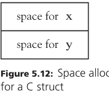

当方法使用动态绑定时，这种实现会出现问题，因为在执行之前无法确切知道调用时应该使用哪个方法。一种可能的解决方案是将所有动态绑定的方法[^3]作为额外字段直接保存在为每个对象分配的结构中。关于类结构的运行时信息仍然可以高效地维护，方法是使用静态构造的类层次结构表示（通常是某种表），并有一个额外的指针来访问表中适当的位置。如果可以动态创建类，那么这张表必须动态维护，但使用哈希表仍然可以使其相当高效。

### 5.6.3 分配与初始化

像 `C++` 这样的面向对象语言可以像 `C` 一样在传统的栈/堆方式中维护运行时环境，这将在第 10 章中描述。在这样的环境中，对象可以分配在栈上，也可以分配在堆上。然而，由于对象本质上通常是动态的，因此它们更常被分配在堆上而非栈上。事实上，这正是 `Java` 和 `Smalltalk` 所采用的方法。

相比之下，`C++` 允许对象直接分配在栈上，或者通过指针分配。在栈分配的情况下，编译器负责在进入代码块时自动生成构造函数调用，在退出时自动生成析构函数调用；而在指针的堆分配情况下，显式调用 `new` 和 `delete` 会触发构造函数和析构函数的调度。这意味着 `C++` 可以维护与 `C` 完全相同的运行时环境，但编译器额外承担了以下负担：必须调度构造函数和析构函数的调用，并为临时对象创建和维护存储位置。

另一方面，`Smalltalk` 和 `Java` 没有显式的释放例程，而是需要使用垃圾收集器将不可访问的存储返回给堆。这种要求的执行开销和增加的运行时复杂度是显著的，但可以使用分代垃圾收集等技术来减少性能损失。进一步的讨论请参见第 10 章。


在执行初始化代码的过程中，必须在执行当前初始化之前先执行祖先类的初始化代码。一个简单的例子是：在祖先中定义的实例变量需要先分配空间，然后才能在后代初始化中使用。在 `C++` 和 `Java` 中，对祖先初始化代码的调用由编译器自动调度。在 `C++` 中，多重继承可能从后代类到祖先类产生多条不同路径，初始化代码按照依赖图的拓扑排序来执行，该依赖图的顺序由每个派生类声明中父类列出的顺序决定。

除了初始化顺序的问题（尤其是在具有多重继承的语言中），当需要自动提供适当的构造函数时，也可能出现问题。例如，在 `Java` 中，如果超类没有默认构造函数，则必须在子类的所有构造函数中提供显式构造函数调用。

[^2]: 在 `C++` 中，接受单个参数的构造函数称为转换构造函数（`copy constructor`）。此类构造函数以我们这里未讨论的方式提供自动转换；请参阅本章末尾的 `C++` 参考文献。

[^3]: 回想一下，在 `Java` 和 `Smalltalk` 中，所有方法（可能）都是动态绑定的，但在 `C++` 中并非如此。

# 练习

### 5.1
获取 `Smalltalk` 的一个实现并输入第 5.2 节中讨论的 `Complex` 类，然后添加方法来加减复数（你只需分别计算实部和虚部的和与差）。

### 5.2
`Smalltalk` 的 `Integer` 类包含一个使用循环计算两个整数最大公约数的 `gcd:` 方法。向 `Integer` 类添加一个名为 `recursiveGcd:` 的新方法。此方法应使用递归策略计算两个整数的最大公约数。请注意 `Smalltalk` 使用 `\` 运算符表示整数余数。

### 5.3
向 `Smalltalk` 的 `Collection` 层次结构中添加一个 `ArrayQueue` 类。此类应具有第 5.2 节中开发的 `LinkedQueue` 类相同的功能。然而，新类应使用 `OrderedCollection` 对象来包含元素。

### 5.4
在 `Smalltalk` 中实现一个 `LinkedPriorityQueue` 类。添加到这种队列中的对象必须识别 `<`、`=` 和 `>` 运算符。对象在队列中按从小到大排序，从队首到队尾。如果两个对象相等，则按标准 FIFO 队列顺序插入。你的实现应最大程度地利用第 5.2 节中开发的 `LinkedQueue` 类。

### 5.5
举出至少两个示例问题，对比说明函数式编程语言和面向对象编程语言最适合解决的问题类型。

### 5.6
`Java` 的设计者将原始类型（标量）与引用类型（所有其他类型的值）区分开来。讨论这一决策对程序员的成本和收益。

### 5.7
在集合类的设计中，一些集合是其他集合的子类（“is-a”关系），而其他集合在其实现中包含或使用其他集合（“has-a”关系）。分别举出每种类型的设计示例并解释为什么该设计决策优于替代方案。

### 5.8
在 `Smalltalk` 中，`Dictionary` 类是 `Set` 类的子类，而在 `Java` 中，`Map` 类未作为子类包含在 `Collection` 类层次结构中。比较和对比这两种设计决策的成本和收益。

### 5.9
描述 `Smalltalk` 中实例方法和类方法之间的区别，并分别给出一个示例。

### 5.10
类变量对类的所有实例可见并由其共享。在应用程序中，这种变量将如何使用？

### 5.11
`Java` 中的构造函数是什么？构造函数如何重载以支持代码重用？

### 5.12
`Java` 中的静态方法类似于 `Smalltalk` 中的类方法（参见第 5.3.4 节的示例）。在第 5.3 节中开发的 `Complex` 类中定义一个静态方法 `getInstance`。此方法期望两个浮点数作为参数并返回包含这些值的新复数。然后，编写一段代码片段来展示如何使用此方法。

### 5.13
解释 `Smalltalk` 中 `==` 和 `=` 运算符之间的区别。它们如何说明引用语义？

### 5.14
描述抽象类和具体类之间的区别，并分别给出一个示例。

### 5.15
解释为什么 `equals` 和 `toString` 方法定义在 `Java` 的 `Object` 类中。

### 5.16
解释为什么程序员在定义新类时可能会包含 `Java` 的 `equals` 和 `toString` 方法。

### 5.17
完成第 5.3.4 节中讨论的 `Iterators` 类中的 `Java` `filter` 方法的实现，然后运行示例应用程序（在添加该节中开发的其他资源之后）。

### 5.18
描述面向对象语言中方法的动态绑定是如何工作的，并给出 `Smalltalk`、`Java` 或 `C++` 中的具体示例。

### 5.19
在面向对象语言中何时可能进行方法的静态绑定？给出 `Java` 和 `C++` 的具体示例。

### 5.20
比较和对比 `Smalltalk`、`Java` 和 `C++` 中数据的封装和信息隐藏方式。

### 5.21
使用至少一个示例解释 `Java` 中类和接口之间的区别。

### 5.22
研究 Sun 的 `Java` 文档中的 `Comparable` 接口，并修改第 5.3 节中开发的 `Complex` 类以实现此接口。解释为什么此举将使程序员能够使用 `Java` 的 `Arrays` 或 `Collections` 类中的方法对 `Complex` 数字的数组或列表进行排序。

### 5.23
`Java` 和 `C++` 支持带类型参数的泛型集合，而 `Smalltalk` 不支持。这种事实是否使 `Smalltalk` 程序员处于劣势？为什么或为什么不？

### 5.24
图 5.6 和 5.7 的类图显示了 `Java` 的 `List` 接口及其实现类。在第 5.3 节中，我们将 `LinkedStack` 类作为 `AbstractCollection` 的子类开发。一种替代实现称为 `ArrayStack`，包含与 `LinkedStack` 相同的方法。绘制一个类图，将这两个类和一个新的接口 `TrueStack` 放置在层次结构中的适当位置。（提示：`TrueStack` 接口应扩展 `Collection` 接口。栈类应扩展 `AbstractCollection` 类并实现 `TrueStack` 接口。）

### 5.25
修改 `LinkedStack` 类并实现 `ArrayStack` 类和上一练习中提到的 `TrueStack` 接口。

### 5.26
列出 `Smalltalk` 支持的迭代器类型并解释它们的工作原理。

### 5.27
`Java` 中的增强 `for` 循环依赖于迭代器。解释其工作原理。

### 5.28
`Maps` 和 `filters` 存在于函数式语言和 `Smalltalk` 中。解释这些软件构造在这两种上下文中的工作原理。

### 5.29
如果 `x` 是类 `A` 的对象，`y` 是类 `B` 的对象且 `B` 是 `A` 的子类，在赋值 `x = y` 之后，为什么当 `m` 是 `B` 的方法但不是 `A` 的方法时，`x.m()` 是非法的？

### 5.30
描述文本中讨论的 `C++` 中关键字 `virtual` 的两种含义。

### 5.31
类型和类有什么区别？

### 5.32
有人声称深层的继承层次结构使系统维护更困难而不是更容易。解释为什么可能如此。

### 5.33
打印操作是动态绑定方法的良好候选。为什么？

### 5.34
给出以下 `Java` 代码：

```
class A{
    public void p(){
        System.out.println("A.p");
    }
    public void q(){
        System.out.println("A.q");
    }
    public void r(){
        p();
        q();
    }
}
class B extends A{
    public void p(){
        System.out.println("B.p");
    }
}
class C extends B{
    public void q(){
        System.out.println("C.q");
    }
    public void r(){
        q();
        p();
    }
}
...
A a = new B();
a.r();
a = new C();
a.r();
```

这段代码打印什么？为什么？

### 5.35
给出以下 `C++` 代码：

```cpp
class A{

    public:

        virtual void p(){
            cout << "A.p" << endl;
        }

        void q(){
            cout << "A.q" << endl ;
        }

        virtual void r(){
            p();
            q();
        }
};

class B : public A{

    public:

        void p(){
            cout << "B.p" << endl;
        }
};

class C : public B{

    public:

        void q(){
            cout << "C.q" << endl;
        }

        void r(){
            q();
            p();
        }
};
```

```
---
A a;
C c;
a = c;
a.r();
A* ap = new B;
ap->r();
ap = new C;
ap->r();
```

这段代码打印什么？为什么？

### 5.36
详细解释为什么 `Java` 中的多接口继承不会像 `C++` 中的多类继承那样遭受相同的问题。

### 5.37
Meyer [1997] 将重载与参数多态区分如下（Ibid., p. 38）：“重载是为客户端程序员提供的设施：它使得在使用不同模块提供的不同数据结构实现时编写相同的客户端代码成为可能。泛型[参数化]是为模块实现者提供的：它允许他们编写相同的模块代码来描述同一数据结构的所有实例，应用于各种类型的对象。” 讨论这种对多态的观点。

## 注释和参考文献

面向对象编程技术的良好通用参考是 Meyer [1997]，它使用了有趣的面向对象语言 Eiffel，你尚未在本章中学习。Budd [1997] 和 Booch [1994] 以语言无关的方式描述了面向对象原则。Bruce [2002] 提供了对类型和类的原则性考察。`Java` 当然有很多参考资料，但其中强调面向对象原则的两本是 Arnold et. al [2000] 和 Horstmann [2006]。`C++` 在 Stroustrup [1997] 和 Lippman 和 Lajoie [1998] 中有所描述。关于 `Smalltalk` 本身的书籍包括 Lalonde [1994]、Lewis [1995]、Sharp [1997] 以及 Lambert 和 Osborne [1997]。

以下参考资料描述了未在此研究的其他有趣的面向对象语言。`Dylan` 语言在 Feinberg 等人 [1996] 中描述。`Eiffel` 是一种精心设计的语言，具有类似 Pascal 的语法（Meyer [1997]）。`Modula-3` 是具有面向对象扩展的 `Modula-2` 派生语言（Cardelli 等人 [1989]、Nelson [1991] 和 Cardelli 等人 [1992]）。`Objective C` 是 Cox [1984, 1986] 设计的具有面向对象功能的 `C` 扩展。Tesler [1985] 描述了 Pascal 的面向对象扩展。`LISP` 的面向对象版本包括 `CLOS`（Gabriel、White 和 Bobrow [1991]；Bobrow 等人 [1988]）；`Loops`（Bobrow 和 Stefik [1983]）；和 `Flavors`（Moon [1986]）。

关于 `C++` 模板的使用及其与面向对象技术的交互的信息可在 Alexandrescu [2001]、Koenig 和 Moo [1996]、Josuttis [1999] 和 Stroustrup [1997] 中找到。

许多研究论文以及关于面向对象编程技术的报告已出现在 OOPSLA [1986ff] 中。Sethi [1996] 给出了 `C++` 中埃拉托斯特尼筛法的面向对象技术的有趣应用。

# CHAPTER

# Syntax

+   6.1    编程语言的词法结构    204
+   6.2    上下文无关文法和 BNF    208
+   6.3    解析树和抽象语法树    213
+   6.4    歧义性、结合性和优先级    216
+   6.5    EBNF 和语法图    220
+   6.6    解析技术和工具    224
+   6.7    词法 vs. 语法 vs. 语义    235
+   6.8    案例研究：为 TinyAda 构建语法分析器    237

# CHAPTER 6

语法是语言的结构。在第 1 章中，我们指出了编程语言的语法和语义之间的区别。在编程语言的早期阶段，语言的语法和语义都由冗长的英文解释和许多示例来描述。虽然语言的语义通常仍用英文描述，但编程语言的一项伟大进步是开发了一种形式化系统来描述语法，该系统现在几乎被普遍使用。在 1950 年代，诺姆·乔姆斯基提出了上下文无关文法的思想，而约翰·巴克斯在彼得·诺尔的贡献下，开发了一种用于描述这些文法的记号系统，该系统首次用于描述 `Algol60` 的语法。这些**巴克斯-诺尔范式——简称为 BNF——此后已被用于定义许多编程语言，包括 `C`、`Java` 和 `Ada`。的确，每位现代程序员和计算机科学家都需要知道如何阅读、解释和应用 BNF 描述的语言语法。BNF 以轻微的文本差异出现于三种基本形式：原始 BNF；扩展 BNF（`EBNF`），由尼克劳斯·威尔特推广（并在第 3 章中非常简短地用于描述 `Scheme` 的语法）；以及语法图。

在第 6.1 节中，我们简要地看一下词法结构，它是语法通常基于的构建块。我们还探讨了扫描或识别词法结构的过程。在第 6.2 节中，我们介绍上下文无关文法及其在 BNF 中的描述。在第 6.3 节中，我们描述使用树表示语法结构。在第 6.4 节中，我们考虑在为编程语言构造 BNF 时出现的一些问题。`EBNF` 和语法图在第 6.5 节中介绍。在第 6.6 节中，我们讨论递归下降解析的基本技术及其与 `EBNF` 和语法图的密切关系，并简要介绍 `YACC/Bison`，这是一种用于分析文法和构造解析器的标准工具。在第 6.7 节中，我们检查编程语言的词法、语法和语义结构之间有时模糊的边界。最后，第 6.8 节通过为一种小型编程语言开发语法分析器，将这些思想付诸实践。

## 6.1 Lexical Structure of Programming Languages

编程语言的**词法结构**是其**记号**或单词的结构。语言的词法结构和语法结构是两种不同的东西，但它们密切相关。通常，在翻译器的**扫描**阶段，翻译器从输入程序中收集字符序列并将其形成记号。在其**解析**阶段，翻译器然后处理这些记号，从而确定程序的语法结构。

记号通常分为几个不同的类别。典型的记号类别包括以下内容：

- **保留字**，有时称为**关键字**，例如 `if` 和 `while`
- **字面量**或**常量**，例如 `42`（一个数字字面量）或 `"hello"`（一个字符串字面量）
- **特殊符号**，例如 `";"`、`"<="` 或 `"+"`
- **标识符**，例如 `x24`、`monthly_balance` 或 `putchar`

保留字之所以如此命名，是因为标识符不能具有与保留字相同的字符字符串。因此，在 `C` 中，以下变量声明是非法的，因为 `if` 是一个保留字：

```
double if;
```

有时程序员对保留字和**预定义标识符**之间的区别感到困惑，后者是为语言中所有程序赋予初始含义的标识符，但可以重新定义。（为了增加混淆，有时这些标识符也称为关键字。）预定义标识符的例子是 `Ada` 中的所有标准数据类型，例如 `integer` 和 `boolean`，以及 `Python` 中的 `round` 和 `print`。有关此现象的更多信息，请参阅第 6.7 节。

在某些较旧的语言中，标识符具有固定的最大长度，而在大多数当代语言中，标识符可以具有任意长度。偶尔，即使允许任意长度的标识符，也只有前六个或八个字符保证有意义。（你可以看到这如何成为程序员困惑的来源。）

在确定可变长度记号（如标识符）的结束以及区分标识符和保留字时会出现问题。作为一个例子，字符序列：

```
doif
```

在程序中可能是两个保留字 `do` 和 `if`，也可能是标识符 `doif`。同样，字符串 `x12` 可能是单个标识符，也可能是标识符 `x` 和数字常量 `12`。为了消除这种歧义，使用**最长子串原则**来确定记号是一种标准惯例（有时称为“最大吞噬”原则）。该原则的工作方式如下：在每个点，将最长的非空白字符字符串收集到单个记号中。这意味着 `doif` 和 `x12` 总是标识符。这也意味着中间的字符，甚至空白，都可能产生差异。因此，在大多数语言中：

```
do if
```

不是一个标识符；相反，它是两个保留字 `do` 和 `if`。

程序的格式会影响记号的识别方式。例如，正如你刚才看到的，最长子串原则要求某些记号由**记号分隔符**或**空白**分隔。文本行的末尾可以具有双重含义，因为它可以是空白，但也可以意味着结构实体的结束。缩进也可以在编程语言中用于确定结构。事实上，`Python` 的简单语法依赖于缩进的意义。

**自由格式**语言是指格式对程序结构没有影响的语言（除了满足最长子串原则之外）。大多数现代语言都是自由格式的，但少数语言具有重要的格式限制。很少有语言是**固定格式**的，即所有记号必须出现在页面上的预指定位置。

编程语言中的记号通常用英文描述，但也可以通过**正则表达式**正式描述，正则表达式是字符模式的描述。正则表达式有三个基本操作：连接、重复和选择或选择。重复由要在重复的项目后面使用星号表示，选择由要从中选择的项目之间的垂直线表示，连接只需按顺序排列项目而无需显式运算符。括号也经常包含在内以允许操作的分组。例如，`(a|b)*c` 是一个正则表达式，表示 0 或多次重复字符 `a` 或 `b`（选择），后跟单个字符 `c`（连接）；与此正则表达式匹配的字符串包括 `ababaac`、`aac`、`babbc` 和仅 `c` 本身，但不包括 `aaaab` 或 `bca`。


正则表达式记号通常通过额外的操作和特殊字符进行扩展，使其更容易编写。例如，方括号中的连字符表示字符范围，`+` 表示一次或多次重复，`?` 表示可选项目，句点 `.` 表示任何字符。有了这些记号，我们可以为即使是相当复杂的记号编写紧凑的正则表达式。例如，

```
[0–9]+
```

是简单整数常量的正则表达式，由一个或多个数字（0 到 9 之间的字符）组成。同样，正则表达式：

```
[0–9]+(\\.[0–9]+)?
```

描述简单的（无符号）浮点字面量，由一个或多个数字后跟可选的小数部分组成，小数部分由一个小数点（前面有一个反斜杠或转义字符，以消除句点作为匹配任何字符的特殊含义）后跟一个或多个数字组成。

许多实用程序在文本搜索中使用正则表达式。这适用于大多数现代文本编辑器，以及各种文件搜索实用程序，例如 UNIX `grep`（“全局正则表达式打印”）。UNIX `lex` 实用程序也可以用来自动将语言记号的正则表达式描述转换为扫描器。（`lex` 的继任者，称为 `flex`，或快速 `lex`，可自由获得并在大多数操作系统上运行。）

虽然对 `lex`/`flex` 的研究以及使用正则表达式构造扫描器超出了本教材的范围，但在简单情况下，扫描器可以通过手工相对容易地构造。为了让你了解这种扫描器构造，我们在图 6.1 中展示了简单扫描器的 C 代码。该语言中有六个记号（表示为枚举类型的常量，第 4-5 行）：由一个或多个数字组成的整数常量；特殊字符 `+`、`*`、`(` 和 `)`；以及行尾记号（在 C 或 Java 中表示为特殊字符 `\\n`，或换行符）。这种语言可用于指定单行输入上的简单整数算术表达式，具有加法和乘法，例如

```
(2 + 34) * 42
```

空白将被跳过，任何未指定的字符（例如 `a` 或 `#` 或 `–`）将被视为错误（因此第 5 行需要额外的 `ERROR` 记号）。

在结束本节并转到语法和解析的研究之前，我们注意到图 6.1 中代码的以下附加特征。首先，代码包含一个 `main` 函数（第 31-47 行）来测试驱动扫描器（由 `getToken` 函数表示，第 8-30 行）。给定一行输入，`main` 函数只需重复调用 `getToken` 并在识别时打印每个记号；数字也会与其数值一起打印，错误也会与其有问题的字符一起打印。其次，我们注意到

（续）

```
(38)        case TT_TIMES:  printf("TT_TIMES\n"); break;
(39)        case TT_LPAREN:  printf("TT_LPAREN\n"); break;
(40)        case TT_RPAREN:  printf("TT_RPAREN\n"); break;
(41)        case TT_EOL:     printf("TT_EOL\n"); break;
(42)        case TT_NUMBER:  printf("TT_NUMBER: %d\n", numval); break;
(43)        case TT_ERROR:   printf("TT_ERROR: %c\n", curr_char); break;
(44)    }
(45)    } while (token != TT_EOL);
(46)    return 0;
(47) }
```

图 6.1 一个用于简单整数算术表达式的扫描器

给定输入行：

- `*`
- `+`
- `(`
- `)`
- `42`
- `#`
- `345`

图 6.1 的程序产生以下输出：

```
TT_TIMES
TT_PLUS
TT_LPAREN
TT_RPAREN
TT_NUMBER: 42
TT_ERROR: #
TT_NUMBER: 345
TT_EOL
```

注意，扫描器并不规定记号（token）的顺序。定义并识别适当的顺序是语法和解析的内容，将在本章其余部分研究。

## 6.2 上下文无关文法与 BNF

我们以图 6.2 中的示例开始描述文法和 BNF（编号仅供参考）。

```
(1) sentence → noun-phrase verb-phrase .
(2) noun-phrase → article noun
(3) article → a | the
(4) noun → girl | dog
(5) verb-phrase → verb noun-phrase
(6) verb → sees | pets
```

图 6.2 一个简单英语句子的文法

在英语中，简单句子由一个名词短语和一个动词短语组成，后面跟一个句号。我们将此表示为图 6.2 中的文法规则 1。规则 2 至 6 依次描述了名词短语、动词短语以及前面规则中出现的其他子结构。这些文法规则中的每一条都由一个斜体名称（所描述短语的名称）组成，后面跟一个箭头（可读作“由……组成”或“定义为……”），再后面跟着一系列其他名称和符号。斜体用于区分短语名称与语言中可能出现的实际单词或记号（在我们的示例中，这些单词或记号也用不同的字体表示）。例如，我们不想将 Pascal 中的关键字 `program` 与程序结构本身混淆：

> `program` → `program` . . .

当然，通常我们也会更愿意使用不同的名称来区分短语和记号。

符号“`→`”是一个**元符号**，用于分隔规则的左侧和右侧。竖线“`|`”也是一个元符号，表示“或”或选择（类似于它在正则表达式中的用法）。因此，上面的规则 6 说明动词要么是单词“`sees`”，要么是单词“`pets`”。有时元符号也可能恰好是语言中的实际符号。在这种情况下，该符号可以用引号括起来以区别于元符号，或者元符号可以使用不同的字体书写，或者两者兼用。通常，对于像标点符号这样的特殊符号，即使它们不是元符号，也最好这样做。例如，规则 1 中有一个句号。虽然句号不属于所描述的任何元符号的一部分，但它很容易被误认为元符号。因此，更合理的写法可能是：

> `sentence` → `noun-phrase verb-phrase` `.`

在这种情况下，引号本身也就成了元符号。

有些记法也依靠元符号（例如尖括号）而不是斜体或字体来区分短语和记号，这在格式不可用的情况下（例如在文本文件或手写文本中）也很有用。在这种情况下，箭头也常常被替换为纯文本的元符号（例如两个冒号和一个等号）。例如，我们可能会看到图 6.2 的规则 1 写成如下形式：

> `<sentence> ::= <noun-phrase> <verb-phrase> “.”`

这里的尖括号也成了元符号，而双引号代替了单引号来将句号标记为记号。

事实上，在书写文法规则时，记号约定有许多不同的、往往是个人偏好的选择。BNF 记法也有一个 ISO 标准格式（ISO 14977 [1996]），但几乎被普遍忽略，也许是因为在该标准被采纳（1996年）时，诸如上述的其他约定已经根深蒂固。例如，一个句子的文法规则在标准 ISO 形式中会写成：

> `sentence = noun phrase , verb phrase “.” ;`

根据前述文法，任何合法的句子都可以按如下方式构造：我们从符号 `sentence`（文法的**开始符号**）开始，并按照前面规则中的右侧选择逐步替换左侧。这个过程在语言中被称为*推导*。因此，我们可以构造或推导出句子“the girl sees a dog.”，如图 6.3 所示，其中每一步都标注了该步所用到的图 6.2 中的规则编号。

```
sentence ⇒ noun-phrase verb-phrase . (规则 1)
    ⇒ article noun verb-phrase . (规则 2)
    ⇒ the noun verb-phrase . (规则 3)
    ⇒ the girl verb-phrase . (规则 4)
    ⇒ the girl verb noun-phrase . (规则 5)
    ⇒ the girl sees noun-phrase . (规则 6)
    ⇒ the girl sees article noun . (规则 2)
    ⇒ the girl sees a noun . (规则 3)
    ⇒ the girl sees a dog . (规则 4)
```

图 6.3 使用图 6.2 的文法进行推导

相反，我们可以从句子“the girl sees a dog.”开始，并通过图 6.3 的推导反向回溯到 `sentence`，从而证明该句子在语言中是合法的。

图 6.2 的简单文法已经展示了编程语言文法的大部分特性。注意，不能因为一个句子是合法的，就认为它在现实语境中一定有意义。例如，“the dog pets the girl.”是一个没有意义但合法的句子。注意，这个例子还包含一个细微的错误：出现在句子开头的冠词应当大写。这种被称为位置属性的特性，很难用上下文无关文法来表示。另外，我们之前书写句子中的记号时在记号之间加了空格，但文法并未规定这些空格是否是必须的（我们完全可以写成“thegirlseesadog.”）。这个问题留给扫描器来处理，扫描器会消耗空白字符并识别各个记号或单词，如前一节所述。（另见练习 6.9。）最后，文法也没有规定输入格式的额外要求，例如句子后面应该跟某种终止符号（如换行符或文件结束标记）。有时我们需要在文法中明确说明后一种条件，写出如下规则：

```
input → sentence $
```

以表示句子后面应跟某种结束标记。该标记用美元符号表示，可能需要显式生成，也可能不需要。

让我们花点时间为截至目前讨论的主题制定一些非正式的定义。

上下文无关文法由一系列文法规则组成。这些规则依次由一个左侧和一个右侧组成：左侧是单个短语结构名称，后面跟元符号“`→`”，右侧是由一系列项目组成的序列，这些项目可以是符号或其他短语结构名称。短语结构的名称（如 `sentence`）称为非终结符，因为它们会被进一步分解为更小的短语结构。单词或记号符号也称为终结符，因为它们无法再分解。文法规则也称为产生式，因为它们通过推导“产生”语言的字符串。如果产生式仅使用元符号“`→`”和“`|`”来表示（有时也允许使用括号来分组），那么它们就是巴科斯-诺尔范式（Backus-Naur form）。

如前所述，上下文无关文法还有一个特殊的非终结符，称为开始符号。这个非终结符代表正在定义的整个顶层短语（例如一个句子或一个程序）。

and 是所有推导开始的符号。上下文无关文法定义了一种语言，称为 **文法的语言**。该语言是所有终端符号串的集合，对于这些串，存在一个以起始符号开始并以终端符号串结束的推导。

图 6.2 包含七个终结符（`girl`、`dog`、`sees`、`pets`、`the`、`a` 和 `.`）、六个非终结符和六条产生式。该文法定义的语言也是有限的，这意味着该语言中只能推导出有限个句子（参见练习 6.8），但通常文法定义的语言不是有限的。

通常上下文无关文法中的产生式数量与非终结符数量相同，尽管可以通过为每个选择单独书写来消除 “`|`” 元符号，例如：

```
noun → girl
noun → dog
```

在这种情况下，每个非终结符对应的产生式数量与选择的数量一样多。

为什么这样的文法是 **上下文无关** 的？简单的原因是非终结符在产生式的左部单独出现。这意味着无论非终结符出现在何处，都可以用任意右部选择来替换它。换句话说，不存在 **上下文** 使得只有某些替换可以发生。例如，在刚刚讨论的文法中，只有在主语为 `girl` 时使用动词 `pets` 才有意义；这可以被视为一种上下文敏感性。我们可以通过允许上下文串出现在文法规则的左部来写出上下文敏感文法。一些作者认为上下文敏感性纯粹是句法问题。然而，我们将采用这样的观点：任何不能用上下文无关文法表达的东西都是语义问题，而不是句法问题。（即使有些可以用上下文无关文法表达的东西，通常也最好留给语义描述，因为它们涉及编写许多额外的产生式；参见练习 6.30。）

作为上下文敏感性的一个例子，回想一下，在前面的文法中，句子开头的冠词应大写。一种实现方法是重写第一条规则为：

```
sentence → beginning noun-phrase verb-phrase ‘.’
```

然后添加上下文敏感规则：

```
beginning article → The | A
```

现在推导将如下所示：

```
sentence ⇒ beginning noun-phrase verb-phrase . (new rule 1)
⇒ beginning article noun verb-phrase . (rule 2)
⇒ The noun verb-phrase . (new context-sensitive rule)
⇒ . . .
```

上下文无关文法已被形式语言理论家广泛研究，现在已被如此透彻地理解，以至于用 BNF 形式表达任何编程语言的语法变得自然。事实上，这样做使得更容易为该语言编写翻译器，因为分析阶段可以自动化，正如你在第 6.6 节中将学到的那样。

上下文无关文法在编程语言中使用的一个典型简单例子是图 6.4 中给出的简单整数算术表达式的加法和乘法描述。

```
expr → expr + expr | expr * expr | ( expr ) | number
number → number digit | digit
digit → 0 | 1 | 2 | 3 | 4 | 5 | 6 | 7 | 8 | 9
```

注意规则的递归性质：一个表达式可以是两个表达式的和或积，每个表达式本身可以是进一步的和或积。当然，最终这个过程必须通过选择 `number` 备选方案而停止，否则我们永远不会得到一个终端符号串。

还要注意 `number` 规则中的递归用于生成重复的数字序列。例如，数字 234 的构造如图所示 6.5。

```
number ⇒ number digit
       ⇒ number digit digit
       ⇒ digit digit digit
       ⇒ 2 digit digit
       ⇒ 23 digit
       ⇒ 234
```

这个过程实际上可以由扫描器执行，正如我们在上一节中指出的那样，因为它只处理字符序列。事实上，上述文法的终结符仅为单个字符标记，如 `+` 和 `9`，并且忽略了空白问题。我们将在第 6.7 节中回到这个问题，但为了简单起见，我们暂时忽略扫描问题。

作为 BNF 中文法的更复杂示例，图 6.6 显示了 C 语言 BNF 描述的开始。

```
translation-unit → external-declaration
                | translation-unit external-declaration

external-declaration → function-definition | declaration

function-definition → declaration-specifiers declarator
                      declaration-list compound-statement
                    | declaration-specifiers declarator compound-statement
                    | declarator declaration-list compound-statement
                    | declarator compound-statement

declaration → declaration-specifiers ‘;’
            | declaration-specifiers init-declarator-list ‘;’

init-declarator-list → init-declarator
```

```
init-declarator-list → init-declarator

init-declarator → declarator | declarator '=' initializer
declarator → pointer direct-declarator | direct-declarator

pointer → '*' type-qualifier-list pointer | '*' type-qualifier-list
        | '*' pointer | '*'

direct-declarator → ID
                  | '(' declarator ')'
                  | direct_declarator '[' ']'
                  | direct_declarator '[' constant_expression ']'
                  | direct_declarator '(' parameter_type_list ')'
                  | direct_declarator '(' identifier_list ')'
                  | direct_declarator '(' ... ')'
                  | ...
                  | ...
```

图 6.6 C 的部分 BNF（改编自 Kernighan 和 Ritchie [1988]）

解释 BNF 规则如何构造语言的字符串的另一种方法是如下。给定一个文法规则，例如：

$expr \rightarrow expr + expr \mid number$

（取自图 6.4），设 E 为表示表达式的字符串集合，N 表示表示数字的字符串集合。前述文法规则可以被视为一个 **集合方程**：

$E = E + E \cup N$

其中 E + E 是通过将 E 中所有字符串与 “`+`” 符号连接然后再与 E 中所有字符串连接而构造的集合，“`∪`” 表示集合并。假设集合 N 已构造，则这表示集合 E 的递归方程。*满足该方程的最小集合 E* 可以被视为文法规则定义的集合。直观上，这由集合组成：

$N \cup N + N \cup N \cup N + N \cup N + N + N \cup \ldots$


在练习 6.53 中，你将有机会证明这是满足给定方程的最小集合。递归方程的解在编程语言的形式描述中经常出现，并且是编程语言理论研究的主要对象。

## 6.3 语法树和抽象语法树

语法建立结构，而不是意义，但句子的意义（或程序）与其语法相关。例如，在英语中，一个句子有主语和谓语。这些是语义概念，因为主语（“执行者”）和谓语（“动作”）决定了句子的意义。主语通常出现在句子的开头，并由名词短语给出。因此，在英语句子的语法中，名词短语被放在第一位，随后与主语相关联。类似地，在表达式的文法中，当我们写：

`expr → expr + expr`

我们期望将两个右部表达式的值相加以得到左部表达式的值。将构造的语义与其句法结构关联起来的过程称为 **语法制导语义**。因此，我们必须构造语法，使其尽可能反映我们最终将附加的语义。（语法制导语义同样可以称为语义制导语法。）

为了利用程序的句法结构来确定其语义，我们必须有一种表达由推导确定的这种结构的方法。一种标准方法是使用 **语法树**，它是推导中替换过程的图形表示。例如，句子 “the **girl** sees a dog.” 的语法树如图 6.7 所示。

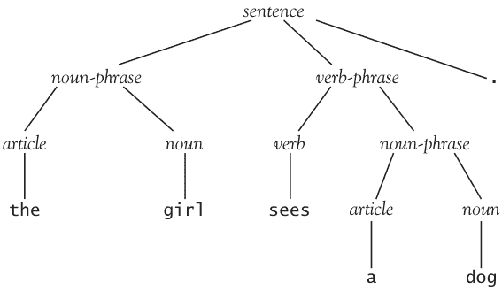

**图 6.7：** 句子 “the **girl** sees a dog.” 的语法树

类似地，表达式文法中数字 234 的语法树如图 6.8 所示。

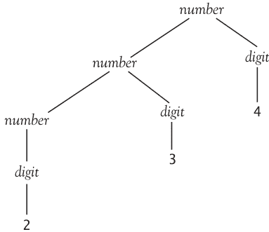

**图 6.8：** 数字 234 的语法树

语法树在内部节点（至少有一个子节点的节点）处标记为非终结符，在叶节点（没有子节点的节点）处标记为终结符。语法树的结构完全由语言的文法规则和特定终端序列的推导指定。文法规则指定

每个内部节点的结构，以及推导指定了构造哪些内部节点。例如，数字 234 的树由 `number` 的语法规则和上一节中给出的 234 的推导指定。事实上，推导的前两步是：

```
number ⇒ number digit      (step 1)
    ⇒ number digit digit      (step 2)
```

并且对应于根的两个子节点的构造（步骤 1）以及根的左子节点的两个子节点的构造（步骤 2）。不出所料，234 的推导中步骤的数量与分析树中内部节点的数量完全相同。

推导中的所有终结符和非终结符都包含在分析树中。然而，并非所有终结符和非终结符都是确定表达式或句子的句法结构所必需的。例如，数字 234 的结构可以完全由图 6.9 所示的树确定。

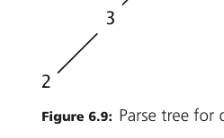

图 6.9：确定数字 234 结构的分析树

另一个例子，图 6.10 显示了如何对 3 + 4 * 5 的分析树进行压缩。

## 完整分析树

## 压缩分析树

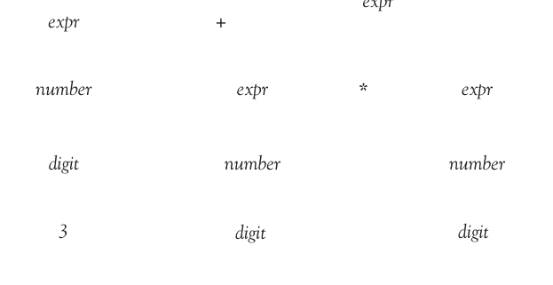

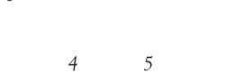

图 6.10：压缩 3 + 4 * 5 的分析树

`*expr* ⇒ *expr* + *expr*`  

⇒ `*expr* + *expr* * *expr*`  

（用 `*expr* * *expr*` 替换第二个 `*expr*`）  

⇒ `*number* + *expr* * *expr*`  

⋯

或推导：

`*expr* ⇒ *expr* * *expr*`  

⇒ `*expr* + *expr* * *expr*`  

（用 `*expr* + *expr*` 替换第一个 `*expr*`）  

⇒ `*number* + *expr* * *expr*`  

⋯

这些反过来导致图 6.12 中所示的两个不同的分析树。（本章其余树中的虚线表示与当前讨论无关的分析树中缺失的节点。）该推导也可以导致图 6.13 中所示的两个不同的抽象语法树。

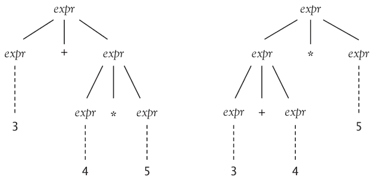

**图 6.12：** 3 + 4 * 5 的两个分析树

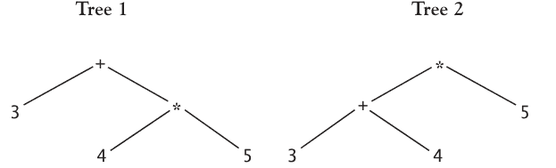

**图 6.13** 3 + 4 * 5 的两个抽象语法树，表明图 6.4 的文法的歧义性

对于同一个字符串可能存在两个不同的分析（或语法）树的文法，例如图 6.4 中的文法，是**歧义的**。歧义也可以直接用推导来表达。尽管通常许多推导可能对应于同一棵分析树，但以特殊顺序构造的某些特殊推导只能对应于唯一的分析树。具有这种性质的一种推导是左推导，其中在每一步中选择最左边的剩余非终结符进行替换。例如，图 6.3 和 6.5 中的推导是左推导，但本节开头推导（推导出与图 6.5 相同的字符串）不是。每一棵分析树都有一个唯一的左推导，可以通过树的先序遍历构造。因此，文法的歧义也可以通过搜索同一字符串的两个不同的左推导来测试。如果存在这样的左推导，则文法必须是歧义的，因为每个这样的推导都必须对应于唯一的分析树。例如，图 6.4 文法的歧义也由图 6.14 中给出的字符串 3 + 4 * 5 的两个左推导所证明。

左推导 1

（对应于

图 6.13 的

树 1）

左推导 2

（对应于

图 6.13 的

树 2）

`expr ⇒ expr + expr`

`expr ⇒ expr * expr`

⇒ `number + expr`

⇒ `expr + expr * expr`

⇒ `digit + expr`

⇒ `number + expr * expr`

⇒ `3 + expr`

⇒ ... (etc.)

⇒ `3 + expr * expr`

⇒ `3 + number * expr`

⇒ ... (etc.)

图 6.14 3 + 4 * 5 的两个左推导，表明图 6.4 的文法的歧义性

歧义文法会带来困难，因为没有明确的结构表达。为了有用，要么必须修改文法以消除歧义，要么必须陈述一个消歧规则来确定所指的结构。

对于表达式 3 + 4 * 5，哪一棵分析树（或左推导）是正确的？如果我们考虑附加到表达式上的语义，我们就可以理解这个决定的含义。图 6.13 的第一个语法树意味着乘法运算符 `*` 要应用于 4 和 5（结果为 20），然后将此结果加到 3 上得到 23。另一方面，第二个语法树则表示先将 3 和 4 相加（得到 7），然后乘以 5 得到 35。因此，运算的执行顺序不同，结果的语义也大不相同。

如果我们采用数学中表达式 3 + 4 * 5 的通常含义，我们会选择图 6.13 的第一棵树而不是第二棵，因为乘法优先于加法。这是编程语言中的通常选择，尽管有些语言（如 APL）做出不同的选择。我们如何表达乘法应优先于加法的事实？我们可以单独于文法陈述一个消歧规则，或者我们可以修改文法。通常修改文法的方法是编写一个新的文法规则（称为“term”），以建立“优先级级联”来强制“*”在分析树中更低的位置匹配：

```
expr → expr + expr | term
term → term * term | ( expr ) | number
```

我们还没有完全解决歧义问题，因为 `expr` 的规则仍然允许我们将 3 + 4 + 5 解析为 (3 + 4) + 5 或 3 + (4 + 5)。换句话说，我们可以使加法是右结合或左结合的，如图 6.15 所示。

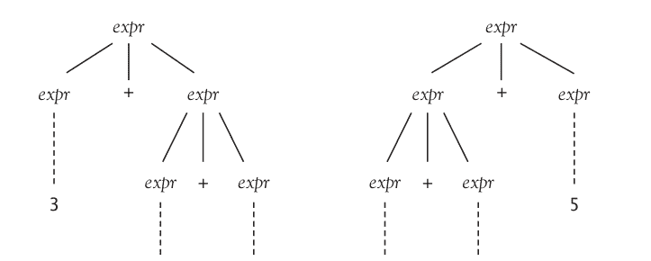

# 图 6.15：加法作为右结合或左结合

在加法的情况下，这不会影响结果，但如果我们加入减法，肯定会：8 - 4 - 2 = 2 如果“-”是左结合的，但 8 - 4 - 2 = 6 如果“-”是右结合的。所需要的是用以下之一替换规则：

```
expr → expr + expr
```

```
expr → expr + term
```

或：

```
expr → term + expr
```

第一个规则是左递归的，而第二个规则是右递归的。操作的一个左递归规则会导致它左结合，如图 6.16 所示的分析树。同样，右递归规则会导致它右结合，如图 6.16 中也所示。

| 一个操作的左递归规则会导致它左结合。 | 一个操作的右递归规则会导致它右结合。 |

|---|---|

| 解析树 expr + term 左递归 | 解析树 term + expr 右递归 |

# 图 6.16：显示左递归和右递归规则结果的分析树

表达了优先级和结合性的简单整数算术表达式的修订文法在图 6.17 中给出。

```
expr → expr + term | term
term → term * factor | factor
factor → ( expr ) | number
number → number digit | digit
digit → 0 | 1 | 2 | 3 | 4 | 5 | 6 | 7 | 8 | 9
```

**图 6.17** 简单整数算术表达式的修订文法

图 6.17 的文法现在是无歧义的（证明这一点需要来自解析理论的更高级技术）。此外，由该文法生成的语法树与算术运算通常定义的语义相对应。有时重写文法以消除歧义会使文法变得极其复杂，在这种情况下我们更愿意陈述一个消歧规则（参见第 9 章的 if 语句讨论）。

## 6.5 EBNFs 和语法图

我们之前注意到文法规则：

```
number → number digit | digit
```

生成数字作为数字序列：

```
number ⇒ number digit
       ⇒ number digit digit
       ⇒ number digit digit digit
       ⇒ digit . . . digit
       . . .
       ⇒ (任意重复的 digit)
```

同样，规则：

```
expr → expr + term | term
```

生成表达式作为由“+”分隔的项序列：

```
expr ⇒ expr + term
      ⇒ expr + term + term
      ⇒ expr + term + term + term
      . . .
      ⇒ term + . . . + term
```

这种情况发生的如此频繁，以至于采用了一种特殊的记号来表示这类语法规则，该记号能更清晰地表达其结构的重复性：

```
number → digit {digit}
```

以及：

```
expr → term { + term }
```

在此记号中，花括号 { } 表示“零次或多次重复”。因此，规则表达了一个数字是由一个或多个数字组成的序列，而一个表达式是一个 `term` 后跟零次或多次的 + 和另一个 `term` 的重复。在此记号中，花括号已成为新的元符号，该记号称为扩展巴科斯-诺尔范式，或简称为 EBNF。

这种新记号掩盖了 + 运算符的左结合性，该结合性在 BNF 中的原始规则中由左递归表达。我们可以通过简单地假设花括号重复中涉及的任何运算符都是左结合的来解决这个问题。事实上，如果一个运算符是右结合的，则相应的语法规则将是右递归的。通常不会使用花括号编写右递归规则（原因将在下一节中更详细地解释）。表达右结合性的问题指出了 EBNF 语法的一个缺陷：解析树和语法树不能直接从语法中写出。因此，我们将始终使用 BNF 记号来编写解析树。

另一个常见的情况是结构具有可选部分，例如 C 语言中 `if` 语句的可选 `else` 部分，其在 BNF 记号中表示如下：

```
if-statement → if ( expression ) statement |
                if ( expression ) statement else statement
```

这在 EBNF 中可以更简单、更具表现力地写成如下形式：

```
if-statement → if ( expression ) statement [ else statement ]
```

其中方括号 “[ ]” 是新的元符号，表示结构的可选部分。

另一个例子是 BNF 语法中 C 语言的函数定义规则；参见图 6.6：

```
function-definition → declaration-specifiers declarator
                     declaration-list compound-statement
                     | declaration-specifiers declarator compound-statement
                     | declarator declaration-list compound-statement
                     | declarator compound-statement
```

使用 EBNF，可以更简单地表达为：

```
function-definition → [ declaration-specifiers ] declarator
                     [ declaration-list ] compound-statement
```

右结合的（二元）运算符也可以使用这些新的元符号编写。例如，如果 “@” 是一个右结合运算符，其 BNF 为：

```
expr → term @ expr | term
```

则该规则可以重写为 EBNF 如下：

```
expr → term [ @ expr ]
```

为完整起见，我们在图 6.18 中以 EBNF 写出图 6.3 中简单整数算术表达式的语法。

```
expr → term { + term }
term → factor { * factor }
factor → ( expr ) | number
number → digit { digit }
digit → 0 | 1 | 2 | 3 | 4 | 5 | 6 | 7 | 8 | 9
```

图 6.18 简单整数算术表达式的 EBNF 规则

语法规则的一种有时有用的图形表示是语法图，它指示在规则右部遇到的终结符和非终结符的序列。例如，我们的简单英语语法中名词短语和冠词的语法图，如第 6.2 节所述，将绘制成如图 6.19 所示。图 6.20 显示了这两个规则合并为一个。

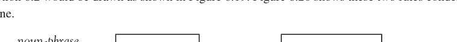

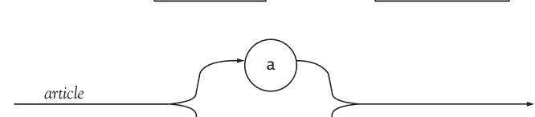

图 6.19：第 6.2 节所述简单英语语法中名词短语和冠词的语法图

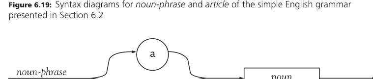

图 6.20：图 6.19 中所示图的合并版本

语法图使用圆圈或椭圆表示终结符，使用正方形或矩形表示非终结符，并用线和箭头连接它们以指示适当的顺序。语法图还可以将多个语法规则合并为一个图。

图 6.18 中表达式语法的语法图在图 6.21 中给出。请注意图中循环的使用以表达 EBNF 中花括号给出的重复。

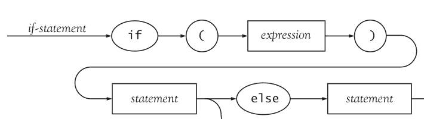

图 6.22 C 语言中 if-statement 的语法图

语法图始终从 EBNF 记号编写，而不是 BNF 记号，原因将在下一节中阐明。因此，图 6.23 中所示的 `expr` 的图是不正确的。

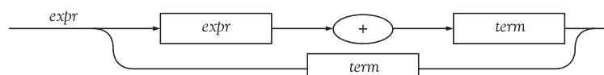

图 6.23：`expr` 的不正确的语法图

语法图在视觉上很吸引人，但占用大量空间。随着越来越多的程序员熟悉直接用 BNF 或 EBNF 编写的规则，语法图的使用频率降低，现在比过去更少见。然而，它们仍然有用，作为编写解析过程的流程图，我们现在将转向这一主题。

## 6.6 解析技术和工具

用 BNF、EBNF 或语法图编写的语法描述了编程语言中在语法上合法的标记串。语法因此也隐式地描述了解析器必须采取的操作，以正确解析标记串并为该串构造派生或解析树，无论是隐式还是显式。解析器的最简单形式是识别器——一个程序，根据字符串是否在语言中合法来接受或拒绝字符串。更通用的解析器构建解析树（或更可能的是抽象语法树）并执行其他操作，例如计算表达式的值。

给定我们讨论过的形式之一的语法，它如何对应于解析器的操作？一种解析方法试图将输入与语法规则的右部进行匹配。当匹配发生时，右部被替换为或归约为左侧的非终结符。此类解析器是自底向上解析器，因为它们从叶到根构造派生和解析树。它们有时也称为移位-归约解析器，因为它们在将字符串归约为非终结符之前将标记移位到栈上。在另一种主要的解析方法中，自顶向下解析，非终结符被展开以匹配传入的标记并直接构造派生。 自顶向下和自底向上解析都可以自动化；也就是说，可以编写一个程序，称为解析器生成器，它将自动将 BNF 描述翻译成解析器。由于自底向上解析比自顶向下解析更强大，因此它是解析器生成器（也称为编译器编译器）的首选方法。一种广泛使用的此类解析器生成器是 `YACC`（“yet another compiler compiler”的缩写），或其免费软件版本 `Bison`，我们将在本节后面研究。

然而，构造解析器的一种较老、非常有效的方法仍然在使用。这种方法称为递归下降解析，它将非终结符转换为一组相互递归的过程，其操作基于 BNF 的右部。

在过程中，右部解释如下：标记直接与扫描器构造的输入标记匹配。非终结符被解释为对对应于该非终结符的过程的调用。

作为示例，在我们简化的英语语法中，`sentence`、`noun-phrase` 和 `article` 的过程将写成如下（C 风格伪代码）：


```
void sentence(){
    nounPhrase();
    verbPhrase();
}

void nounPhrase(){
    article();
    noun();
}

void article(){
    if (token == "a") match("a", "a expected");
    else if (token == "the") match("the", "the expected");
    else error("article expected");
}
```

在此伪代码中，我们使用字符串来模拟标记，并使用一个名为`token`的全局变量来保存扫描器构造的当前标记。每当需要新标记时，都会调用扫描器的`getToken`过程。标记的匹配对应于对该标记的成功测试，然后调用`getToken`：

```
void match(TokenType expected, char* message){
    if (token == expected) getToken();
    else error(message);
}
```

每个解析过程开始时，变量`token`已经保存了应期望的第一个标记。因此，在第一次调用`sentence`过程之前必须调用`getToken`。同样，每个解析过程在完成时会在输入流中留下下一个标记。`error`过程打印错误消息并中止解析。（请注意，错误只需在实际期望标记时检测，例如在`article`过程中。我们本可以在`sentence`过程中检查“a”或“the”，但在此方案中是不必要的。）

如果我们将此过程应用于图 6.17 的 BNF 描述，我们会遇到左递归规则的问题，例如表达式的规则：

expr → expr + term | term

如果我们尝试将此规则写成递归下降过程，会出现两个致命的困难。首先，该规则中的第一个选择（expr → expr + term）会使过程立即递归调用自身，这会导致无限递归循环。其次，在输入中稍后看到（或未看到）+ 之前，没有办法决定采用两个选择中的哪一个（expr → expr + term 或 expr → term）。问题是由语法规则第一个备选方案中的左递归存在造成的，因为右递归规则：

expr → term + expr | term

只有很小的问题，可以通过简单地调用`term()`然后测试 `+` 来将其转换为解析过程：

```
void expr(){
    term();
    if (token == "+"){
        match("+", "+ expected");
        expr();
    }
}
```

不幸的是，此语法规则（以及相关的解析过程）使 `+` 成为右结合运算符。我们如何在保留 `+` 运算的左结合行为的同时消除左递归引起的问题？解决方案隐含在该相同语法规则的 EBNF 描述中，该描述将递归表达为循环：

expr → term { + term}

expr 的语法规则的这种形式对应于递归下降代码：

```
void expr(){
    term();
    while (token == "+"){
        match("+", "+ expected");
        term();
        /* perform left associative operations here */
    }
}
```

虽然这种形式的语法抑制了 `+` 的显式左结合性，但相应的代码确实提供了在第二次调用`term()`之后立即执行所需操作（构建树或计算表达式）的机会（在循环体末尾，如注释所示）。

因此，EBNF 中的大括号表示通过使用循环来消除左递归。虽然还有比这更一般的左递归消除机制，但这种简单的 EBNF 用法在实践中通常足够。

另一方面，正如我们已经指出的，右递归规则在递归下降解析中不会出现此类问题。然而，我们为如下右递归规则编写的代码：

expr → term @ expr | term

（我们将运算符的名称改为 `@` 以避免与 `+` 混淆）也对应于在 EBNF 中使用方括号来表达这种可选结构：

expr → term [ @ expr ]

此过程称为左因子化，因为它就像语法规则中两个备选方案中的 term 被“提取”出来一样，剩下 @ expr 或无（从而使 @ expr 可选）。

另一个典型的左因子化情况出现在 if 语句具有可选 else 部分时：

if-statement → if ( expression ) statement | if ( expression ) statement else statement

这不能直接翻译成代码，因为两个备选方案都以相同的前缀开始。如前例所示，在 EBNF 中这是用方括号书写的，并且备选方案的共同部分被“提取”出来：

if-statement → if ( expression ) statement [ else statement ]

这直接对应于解析 if 语句的递归下降代码：

```
void ifStatement(){
    match("if", "if expected");
    match("(", "( expected");
    expression();
    match(")", ") expected");
    statement();
    if (token == "else"){
        match("else", "else expected");
        statement();
    }
}
```

因此，在左递归和左因子化情况下，EBNF 规则或语法图自然对应于递归下降解析器的代码。这实际上是它们使用的主要原因之一。

作为递归下降解析的强大和易用性的演示，图 6.24 提供了基于图 6.18 语法的整数计算器的完整 C 代码。此程序接受包含由数字、运算符 `+` 和 `*` 以及括号组成的简单整数算术表达式的单行输入，并打印表达式的计算值，如果表达式在语法上不正确则打印错误消息。如语法中所述，计算器假定所有标记都是字符，并且不允许在表达式中出现空格。为了便于打印计算值，并确保输入行中只输入一个表达式，

语法图 6.18 的语法中添加了一个新的语法规则（并且起始符号更改为 `command`）：

command → expr `\n`

实际上，此语法规则使换行符（`\n`）成为输入结束的标记（就像本章前面讨论的 `$` 标记一样）。

最后，我们注意到在每个过程中计算结果的时机确保了运算符 `+` 和 `*` 是左结合的。

```
(1) #include <ctype.h>
(2) #include <stdlib.h>
(3) #include <stdio.h>

(4) int token; /* holds the current input character for the parse */

(5) /* declarations to allow arbitrary recursion */
(6) void command();
(7) int expr();
(8) int term();
(9) int factor();
(10) int number();
(11) int digit();

(12) void error(char* message){
(13)    printf("parse error: %s\n", message);
(14)    exit(1);
(15) }

(16) void getToken(){
(17)    /* tokens are characters */
(18)    token = getchar();
(19) }
(20) void match(char c, char* message){
(21)    if (token == c) getToken();
(22)    else error(message);
(23) }

(24) void command(){
(25)    /* command -> expr `\n` */
(26)    int result = expr();
(27)    if (token == `\n`) /* end the parse and print the result */
(28)        printf("The result is: %d\n",result);
(29)    else error("tokens after end of expression");
(30) }
```

图 6.24 使用递归下降解析的简单整数算术表达式计算器（继续）

```
(31) int expr(){
(32)    /* expr -> term { '+' term } */
(33)    int result = term();
(34)    while (token == '+'){
(35)        match('+', "+ expected");
(36)        result += term();
(37)    }
(38)    return result;
(39) }

(40) int term(){
(41)    /* term -> factor { '*' factor } */
(42)    int result = factor();
(43)    while (token == '*'){
(44)        match('*', "* expected");
(45)        result *= factor();
(46)    }
(47)    return result;
(48) }

(49) int factor(){
(50)    /* factor -> '(' expr ')' | number */
(51)    int result;
(52)    if (token == '('){
(53)        match('(', "( expected");
(54)        result = expr();
(55)        match(')', ") expected");
(56)    }
(57)    else
(58)        result = number();
(59)    return result;
(60) }

(61) int number(){
(62)    /* number -> digit { digit } */
(63)    int result = digit();
(64)    while (isdigit(token))
(65)    /* the value of a number with a new trailing digit
(66)       is its previous value shifted by a decimal place
(67)       plus the value of the new digit
(68)    */
(69)        result = 10 * result + digit();
(70)    return result;
(71) }
```

图 6.24 使用递归下降解析的简单整数算术表达式计算器（继续）

我们有：

$$\operatorname{First}((\ expr\ )) = \{(\ \}$$

$$\operatorname{First}(number)=\operatorname{First}(digit)$$

$$\phantom{\operatorname{First}(number)}=\operatorname{First}(0)\cup\operatorname{First}(1)\cup\cdots\operatorname{First}(9)$$

$$\phantom{\operatorname{First}(number)}=\{0,\ldots,9\}$$

然后：

$$\operatorname{First}(factor)=\operatorname{First}((\ expr\ ))\cup\operatorname{First}(number)$$

$$=\{(,0,1,\ldots,9\}$$

预测解析器能够区分语法规则中选择的要求可以用 First 集合来表述，如下所示。给定语法规则：

$$A\to\alpha_1\mid\alpha_2\mid\cdots\mid\alpha_n$$

任何两个选择的 First 集合必须没有任何公共标记；也就是说，

$$\operatorname{First}(\alpha_i)\cap\operatorname{First}(\alpha_j)=\varnothing\text{ for all }i\ne j$$

$$(\varnothing\text{ denotes the empty set})$$

在 factor 语法规则的示例中：

$$factor\to(\ expr\ )\mid number$$

预测解析的条件得到满足，因为：

$$\operatorname{First}((\ expr\ ))\cap\operatorname{First}(number)=\{(\}\cap\{0,\ldots,9\}=\varnothing$$

预测解析的第二个条件出现在结构可选时。例如，要解析语法规则

$$expr\to term\ [@\ expr]$$

我们必须在确定可选部分是否实际存在之前测试 `@` 标记的存在：

```
void expr(){
    term();
    if (token == "@"){
        match("@", "@ expected");
        expr();
    }
}
```

然而，如果标记 `@` 也可能在表达式之后出现，此测试是不够的。如果 `@` 是输入中的下一个标记，它可能是可选 “@ expr” 部分的开始，也可能是

整个表达式。因此，预测分析的第二个要求是，对于任何可选部分，以可选部分开头的任何标记也不能出现在可选部分之后。

我们可以将此条件形式化如下。对于出现在文法规则右部的一个标记和非终结符的字符串 A，定义 Follow(a) 为可以跟在 a 之后的一组标记。预测分析的第二个条件现在可以用 Follow 集合来表述。给定 EBNF 中的一个文法规则，其中包含可选的 a，

A → β [α] σ

我们必须有：

First(α) ∩ Follow(α) = ∅

作为 Follow 集合计算的示例，考虑图 6.18 的文法。非终结符的 Follow 集合可以按如下方式计算。从规则：

factor → ( expr )

我们得到标记 `)` 在 Follow(expr) 中。因为 expr 也可以构成整个表达式，所以 expr 后面可能跟着输入的结束，我们用特殊符号 `$` 表示。因此，Follow(expr) ⊆ { ), $ }。从规则：

expr → term { + term }

我们得到 `+` 在 Follow(term) 中。因为 term 也出现在 expr 的最后，所以任何跟在 expr 之后的东西也可以跟在 term 之后。因此，

Follow(term) = { ), $, + }

最后，通过类似的计算，Follow(factor) = { ), $, +, * }。

请注意，图 6.18 的文法自动满足预测分析的第二个条件，因为方括号内没有可选结构。更具启发性的例子来自图 6.6（C 的 BNF 文法的很小一部分），其中声明的文法规则在 EBNF 中写为：

declaration → declaration-specifiers [ init-declarator-list ] ‘;’

通过追踪图 6.6 中 init-declarator-list 的规则，我们可以确定 First(init-declarator-list) = { ID, *, ( } 且 Follow(init-declarator-list) ⊆ { ‘;’, ‘,’ }，所以：

First(init-declarator-list) ∩ Follow(init-declarator-list) = ∅

从而在此情况下也满足预测分析的第二个条件。

First 和 Follow 集合的计算在递归下降分析中也可以用来获得适当的测试；参见练习 6.49。

我们在本节开头提到，将文法规则转换为分析器的过程可以由一个称为分析器生成器或编译器-编译器的程序来执行。分析器生成器以 BNF 或 EBNF 规则的版本作为输入，然后生成输出，即某种语言中的分析器程序。然后可以将该程序编译以提供可执行的分析器。当然，仅向分析器生成器提供文法将导致一个识别器。

为了让分析器构造语法树或执行其他操作，我们必须提供与每个文法规则相关联的要执行的操作或动作，即语法制导方案。

我们之前提到过 YACC，它在大多数 UNIX 系统上可用，是一个广泛使用的分析器生成器。它的自由软件版本 Bison 可用于许多不同的系统（包括所有版本的 UNIX）。YACC 由 Steve Johnson 在 1970 年代中期编写；它生成一个使用自底向上算法来分析文法的 C 程序。YACC 规范的格式如下：

```
%{ /* code to insert at the beginning of the parser */
%}
/* other YACC definitions, if necessary */
%%
/* grammar and associated actions */
%%
/* auxiliary procedures */
```

文法以类似 BNF 的形式给出，并附带用 C 编写的关联动作。图 6.25 显示了使用图 6.17 文法（第 6.4 节）的简单整数表达式解释器的完整 YACC/Bison 描述。请注意，它使用了原始的左递归 BNF 文法——自底向上分析器不会被左递归困扰。规则提供的动作基本上与图 6.24 的递归下降计算器中的动作相同（并且 YACC 生成的 C 程序从用户的角度来看的行为与该程序完全相同）。YACC/Bison 构造值的约定是，产生式的左部的


值由符号`$$`表示，而右部第 n 个符号的值由`$n`给出。（这些值始终是整数，除非另有指定。）例如，在图 6.25 的第 7 行，`$1 + $3`表示产生式右部的第一个和第三个符号的和：

```
expr : expr '+' term
```

因此，右部`expr`和`term`的值被相加。请注意元符号、非终结符和标记的不同约定。

```
(1) %{ 
(2) #include <stdio.h> 
(3) %} 
 
(4) %% 
(5) command : expr '\n' { printf("The result is: %d\n",$1); } 
(6) ;
```

Figure 6.25 YACC/Bison specification of a calculator for simple integer arithmetic expressions (continues)

```c
(7)  expr     : expr '+' term { $$ = $1 + $3; }

(8)           | term { $$ = $1; }

(9)           ;

(10) term     : term '*' factor { $$ = $1 * $3; }

(11)          | factor { $$ = $1; }

(12)          ;

(13) factor   : number { $$ = $1; }

(14)          | '(' expr ')' { $$ = $2; }

(15)          ;

(16) number   : number digit { $$ = 10 * $1 + $2; }

(17)          | digit { $$ = $1; }

(18)          ;

(19) digit    : '0' { $$ = 0; }

(20)          | '1' { $$ = 1; }

(21)          | '2' { $$ = 2; }

(22)          | '3' { $$ = 3; }

(23)          | '4' { $$ = 4; }

(24)          | '5' { $$ = 5; }

(25)          | '6' { $$ = 6; }

(26)          | '7' { $$ = 7; }

(27)          | '8' { $$ = 8; }

(28)          | '9' { $$ = 9; }

(29)          ;

(30) %%

(31) main()

(32) { yyparse();

(33)   return 0;

(34) }

(35) int yylex(void)

(36) { static int done = 0; /* flag to end parse */

(37)   int c;

(38)   if (done) return 0; /* stop parse */

(39)   c = getchar();

(40)   if (c == '\n') done = 1; /* next call will end parse */

(41)   return c;

(42) }

(43) int yyerror(char *s)

(44) /* allows for printing error message */

(45) { printf("%s\n",s);

(46) }
```

**Figure 6.25** YACC/Bison specification of a calculator for simple integer arithmetic expressions

YACC/Bison 从文法生成一个过程`yyparse`，因此我们必须提供一个调用`yyparse`的`main`过程（第 31–34 行）。YACC/Bison 还假设（除单个字符外的）标记由一个名为`yylex`的扫描器过程识别，类似于图 6.24 的`getToken`过程。因此，我们提供一个用 C 编写的`yylex`，它读取并返回一个字符（第 35–42 行）。然而`yylex`与`getToken`的一个不同之处在于，YACC/Bison 只有在`yylex`返回 0 时才会结束分析（在递归下降版本中，我们可以编写特殊代码在换行符上结束分析）。因此，`yylex`包含记住何时到达换行符并在换行符后的下一次调用时返回 0 的代码（允许生成的分析器在完成前直接匹配换行符；参见练习 6.28）。也可以从 LEX/Flex 等扫描器生成器自动生成`yylex`，但我们这里不研究这一点。（有关更多信息，请参阅本章末尾的注释和参考文献。）最后，需要一个错误过程`yyerror`来打印错误消息。

YACC/Bison 不仅对翻译编写者有用，对语言设计者也有用。给定一个文法，它提供了可能的问题和歧义的描述。然而，要阅读这些信息，我们必须对自底向上分析技术有更具体的了解。有兴趣的读者可以参阅本章末尾的注释和参考文献。

## 6.7 词法 vs. 语法 vs. 语义

上下文无关文法通常通过在文法规则中包含构成标记的字符序列来描述语言的标记。例如，在第 6.2 节中引入的部分英语文法中，标记是英语单词`a`、`the`、`girl`、`dog`、`sees`和`pets`，以及`.`字符。在第 6.3 节的简单整数表达式文法中，标记是算术符号`1`和`*`，括号`(`和`)`，以及数字 0 到 9。格式的具体细节，例如第 6.1 节中提到的空白约定，留给扫描器处理，需要作为与文法分开的词法约定来说明。

一些典型的标记类别，如字面量或常量和标识符，并不是本身固定的字符序列，而是由一组固定的字符，如数字 0..9 构建而成。这些标记类别的结构可以用文法定义，例如表达式文法中`number`和`digit`的文法规则。然而，使用扫描器来识别这些结构是可能且甚至是可取的，因为不需要分析器的完整递归能力，扫描器可以通过简单的重复操作来识别它们。使用扫描器可以使数字和标识符的识别更快更简单，并且可以减小分析器的大小并减少文法规则的数量。

为了表达表达式文法中的一个数字应为标记而不是由非终结符表示，我们可以将图 6.18 的文法重写为图 6.26 所示。

```
expr → term { + term }
term → factor { * factor }
factor → ( expr ) | NUMBER
```

Figure 6.26 Numbers as tokens in simple integer arithmetic

通过在新语法中将字符串`NUMBER`大写，我们表示它不是一个按字面意义识别的记号，而是一个其结构由扫描器决定的记号。此类记号的结构必须作为语言词法约定的一部分来指定。如第 6.1 节所述，此类记号的结构可以用正则表达式来指定。然而，许多语言设计者选择将此类记号的结构作为语法的一部分，并认为实现者可以将这些结构放在扫描器而不是解析器中。因此，使用 BNF、EBNF 或语法图来描述一种语言时，不仅可能包括语法，还可能包括编程语言的大部分词法结构（或**词法**）。因此，句法结构和词法结构之间的界限并不总是清晰可辨，而是取决于设计者和实现者的观点。

语法和语义也是如此。我们一直采取这样的观点：语法是任何可以用上下文无关文法定义的东西，而语义是任何不能这样定义的东西。然而，有些作者将我们称之为语义的属性视为语言的句法属性。例如，变量先声明后使用以及过程内标识符不得重复声明等规则。这些规则是上下文相关的，不能写成上下文无关规则。因此，我们更倾向于将它们视为语义规则而非句法规则。

当语言要求某些字符串为**预定义标识符**而非**保留字**时，语法和语义之间就会出现另一种冲突。回顾第 6.1 节，保留字是固定的字符串，它们本身是记号，不能用作标识符。相比之下，预定义标识符是在语言中被赋予预定义含义的固定字符串，但可以通过在程序中重新定义来改变其含义。如前所述，`*if*`、`*while*`和`*do*`在 C、Java 和 Ada 中都是保留字。然而，在 Ada 中，所有基本数据类型名称，如`*integer*`和`*boolean*`，都是可以重新定义的预定义标识符。例如，下面这段 Ada 声明是完全合法的：

```text
integer: boolean;
```

经过此声明后，名称`*integer*`变成了一个`*boolean*`类型的变量。（如果你觉得这很令人费解，有这种感觉的不止你一个。）

另一方面，C、C++ 和 Java 将基本类型如`*int*`、`*double*`、`*bool*`（在 C++ 中）或`*boolean*`（在 Java 中）设为不可重新定义的保留字。这可能是更好的做法，因为这些名称在每个程序中都有固定的语义，即使我们可以改变，也几乎不会想要去改变。

最后，在语言中，当必须使用语义信息来区分歧义解析情况时，语法和语义可能变得相互依赖。一个简单的例子发生在 C 语言中，在解析过程中必须区分类型名和变量名。例如，考虑以下 C 表达式：

```text
(x)-y
```

如果 x 是类型名，则这是将值 −y 强制类型转换为 x。然而，如果 x 是变量名，则这是从 x 中减去 y。因此，解析器必须拥有关于标识符的上下文信息才能消除此类歧义。有人可能会认为这是 C 语法的一个设计缺陷。（Java 也有同样的问题，但 Ada 没有。）然而，在实践中这个问题相对容易解决，正如你将在后续章节中看到的那样。

## 6.8 案例研究：为 TinyAda 构建语法分析器

在本章的最后，我们为一种在某些方面类似于 Ada 编程语言的小型语言开发一个解析器。这种名为 TinyAda 的小型语言既足够大，可以说明许多高级语言的语法特征，又足够小，只需要一个中等规模编程项目来实现。在本节中，我们将通过讨论一个简单的语法分析器来启动该项目。接下来的几章将再次回到该项目，添加代码来分析一些语义。

图 6.27 展示了 TinyAda 的 EBNF 文法。请注意尖括号中的语义限定符，例如`<type>`。你现在可以忽略它们，但我们将在接下来的几章中再讨论它们。

```text
In the following grammar

=     means "is defined as"
" "   enclose literal items
[ ]   enclose items which may be omitted
{ }   enclose items which may appear zero or more times
|     indicates a choice
( )   are used for grouping required choices
< >   enclose semantic qualifications

subprogramBody =
        subprogramSpecification "is"
        declarativePart
        "begin" sequenceOfStatements
        "end" [ <procedure>identifier ] ";"

declarativePart = { basicDeclaration }

basicDeclaration = objectDeclaration | numberDeclaration
                  | typeDeclaration | subprogramBody

objectDeclaration =
        identifierList ":" typeDefinition ";"

numberDeclaration =
        identifierList ":" "constant" ":=" <static>expression ";"

identifierList = identifier { "," identifier }

typeDeclaration = "type" identifier "is" typeDefinition ";"

typeDefinition = enumerationTypeDefinition | arrayTypeDefinition
                | range | <type>name

range = "range" simpleExpression ".." simpleExpression

index = range | <type>name

enumerationTypeDefinition = "(" identifierList ")"

arrayTypeDefinition = "array" "(" index { "," index } ")" "of" <type>name

subprogramSpecification = "procedure" identifier [ formalPart ]

formalPart = "(" parameterSpecification { "," parameterSpecification } ")"

parameterSpecification = identifierList ":" mode <type>name

mode = [ "in" ] | "in" "out" | "out"

sequenceOfStatements = statement { statement }

statement = simpleStatement | compoundStatement

simpleStatement = nullStatement | assignmentStatement
                 | procedureCallStatement | exitStatement

compoundStatement = ifStatement | loopStatement

nullStatement = "null" ";"

assignmentStatement = <variable>name ":=" expression ";"

ifStatement =
        "if" condition "then" sequenceOfStatements
        { "elsif" condition "then" sequenceOfStatements }
        [ "else" sequenceOfStatements ]
        "end" "if" ";"

loopStatement =
        [ iterationScheme ] "loop" sequenceOfStatements "end" "loop" ";"

iterationScheme = "while" condition

exitStatement = "exit" [ "when" condition ] ";"

procedureCallStatement = <procedure>name [ actualParameterPart ] ";"

actualParameterPart = "(" expression { "," expression } ")"

condition = <boolean>expression

expression = relation { "and" relation } | relation { "or" relation }

relation = simpleExpression [ relationalOperator simpleExpression ]

simpleExpression =
    [ unaryAddingOperator ] term { binaryAddingOperator term }

term = factor { multiplyingOperator factor }

factor = primary [ "**" primary ] | "not" primary

primary = numericLiteral | stringLiteral | name | "(" expression ")"

name = identifier [ indexedComponent ]

indexedComponent = "(" expression { "," expression } ")"

relationalOperator = "=" | "/=" | "<" | "<=" | ">" | ">="

binaryAddingOperator = "+" | "-"

unaryAddingOperator = "+" | "-"

multiplyingOperator = "*" | "/" | "mod"
```

**图 6.27** TinyAda 的 EBNF 文法

正如你从文法中看到的那样，TinyAda 包含几种声明（常量、变量、类型和过程）、语句（赋值、选择、循环和过程调用）以及表达式。这种小型语言中的顶级短语称为`subprogramBody`，它是一个过程声明，对于 TinyAda 程序而言，其作用可能类似于 C 语言中的`main`函数在程序执行中的作用。还要注意，声明、语句和表达式的规则是间接递归的，允许嵌套的声明、语句和表达式。

图 6.28 展示了一个简短的 TinyAda 程序，其中包含两个过程声明以及若干常量声明、类型声明、变量声明、语句和表达式。

```text
procedure TEST is

    COLUMN_MAX : constant := 10;
    ROW_MAX : constant := COLUMN_MAX;
    type COLUMN_INDEX is range 1..COLUMN_MAX;
    type ROW_INDEX is range 1..ROW_MAX;
    type MATRIX is array(COLUMN_INDEX, ROW_INDEX) of INTEGER;
```

**图 6.28** 一个 TinyAda 程序（续）


```ada
A : MATRIX;
I : INTEGER;

procedure INIT_MATRIX(X : in INTEGER; Y : out MATRIX) is

    I, J : INTEGER;

    begin
    I := 1;
    while I <= COLUMN_MAX loop
        J := 1;
        while J <= ROW_MAX loop
            Y(I, J) := X;
            J := J + 1;
        end loop;
        I := I + 1;
    end loop;
end INIT_MATRIX;

begin
I := 1;
INIT_MATRIX(I, A);
end TEST;
```

### 图 6.28 一个 TinyAda 程序

尽管 TinyAda 不区分大小写，但在程序示例中，我们使用小写字母表示保留字，使用大写字母表示标识符。

我们的解析器初始版本被称为解析外壳。该程序的目的是将语法规则应用于源程序，并报告任何语法错误或词法错误。解析器仅仅是一个外壳，因为它只检查每个短语中的记号类型是否正确，而不执行任何额外的分析。在后续章节中，我们将展示如何用语义分析的附加机制来填充这个外壳。

完整程序由扫描器（scanner）和解析器（parser）组成，但它是按四个协作组件构建的，每个组件都实现为一个 Java 类。下面列出它们的名称、角色和职责：

- `1.` `Token` 类表示语言中的记号。对于简单的语法分析，记号对象只需包含记号类型的代码，如本章前面示例中所使用的那样。然而，记号还可以包含其他属性，例如标识符名称、常量值和数据类型，我们将在后续章节中看到。
- `2.` `CharIO` 类（character I/O 的缩写）将源程序的文本转换为字符流供扫描器使用，从而使扫描器能够专注于词法分析，而不是底层的文本处理。`CharIO` 类还负责输出任何错误信息。
- `3.` `Scanner` 类识别并生成字符流中的记号，并将这些记号返回给解析器。`Scanner` 类还检测任何词法错误。
- `4.` `Parser` 类采用递归下降策略识别记号流中的短语。与扫描器在词法错误后继续生成记号不同，解析器在源程序中遇到第一个语法错误时就会停止执行。

这些类之间的数据流如图 6.29 所示。

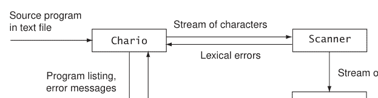

### 图 6.29 TinyAda 语法分析器中的数据流

`Token`、`CharIO` 和 `Scanner` 类的完整源代码以及部分完成的 `Parser` 类可以在本书的网站上找到。该程序还有两个用户界面：一个基于终端，一个基于 GUI。如果你想执行完整版本的解析器，两个版本的可执行 jar 文件也都可用。在本节中，我们专注于几个解析方法的开发，并将其余部分留给读者作为练习。

`Parser` 对象从 `Scanner` 对象接收记号，并向 `CharIO` 对象发送错误信息。在程序启动时，解析器的构造函数接收这两个对象作为参数，并将它们的引用保存在实例变量中。解析器还包含用于输入流中当前记号的实例变量，以及若干记号集合的实例变量。这些集合包括 TinyAda 的部分运算符符号，以及语言中各种声明和语句开头的记号（本章前面称为 First 集合）。图 6.30 显示了解析器实例变量声明及其初始化的 Java 代码。

```java
public class Parser extends Object {

    private CharIO charIO;
    private Scanner scanner;
    private Token token;

    private Set<Integer> addingOperator,
                        multiplyingOperator,
                        relationalOperator,
                        basicDeclarationHandles,
                        statementHandles;

    public Parser(CharIO c, Scanner s) {
        charIO = c;
        scanner = s;
        initHandles();
        token = scanner.nextToken();
    }

    private void initHandles() {
        addingOperator = new HashSet<Integer>();
        addingOperator.add(Token.PLUS);
        addingOperator.add(Token.MINUS);
        multiplyingOperator = new HashSet<Integer>();
        multiplyingOperator.add(Token.MUL);
        multiplyingOperator.add(Token.DIV);
        multiplyingOperator.add(Token.MOD);
        relationalOperator = new HashSet<Integer>();
        relationalOperator.add(Token.EQ);
        relationalOperator.add(Token.NE);
        relationalOperator.add(Token.LE);
        relationalOperator.add(Token.GE);
        relationalOperator.add(Token.LT);
        relationalOperator.add(Token.GT);
        basicDeclarationHandles = new HashSet<Integer>();
        basicDeclarationHandles.add(Token.TYPE);
        basicDeclarationHandles.add(Token.ID);
        basicDeclarationHandles.add(Token.PROC);
        statementHandles = new HashSet<Integer>();
        statementHandles.add(Token.EXIT);
        statementHandles.add(Token.ID);
        statementHandles.add(Token.IF);
        statementHandles.add(Token.LOOP);
        statementHandles.add(Token.NULL);
        statementHandles.add(Token.WHILE);
    }

    // Other parsing methods go here
}
```

### 图 6.30 Parser 类的构造函数和数据

在主应用程序实例化解析器之后，它会在该对象上运行 `parse` 方法以开始语法分析。如果源程序没有语法错误，该方法将正常返回；如果遇到第一个语法错误，则会抛出异常。工具方法 `accept` 和 `fatalError` 协同检查期望的记号，并在发生错误时抛出异常。以下是这三个 `Parser` 方法的代码：

```java
/*
subprogramBody =
    subprogramSpecification "is"
    declarativePart
    "begin" sequenceOfStatements
    "end" [ <procedure>identifier ] ";"
*/
private void subprogramBody() {
    subprogramSpecification();
    accept(Token.IS, "'is' expected");
    declarativePart();
    accept(Token.BEGIN, "'begin' expected");
    sequenceOfStatements();
    accept(Token.END, "'end' expected");
    if (token.code == Token.ID)
        token = scanner.nextToken();
    accept(Token.SEMI, "semicolon expected");
}
```

如你所见，该方法通常调用 `accept` 方法来处理终结符（或记号），并调用另一个解析方法来处理非终结符（或短语）。其中有一个 `if` 语句，用于处理 EBNF 中用 [ ] 括起来的可选标识符。

接下来的两个方法协作处理基本声明。

```java
/*
declarativePart = { basicDeclaration }
*/
private void declarativePart() {
    while (basicDeclarationHandles.contains(token.code))
        basicDeclaration();
}

/*
basicDeclaration = objectDeclaration | numberDeclaration
                  | typeDeclaration | subprogramBody
*/
private void basicDeclaration() {
    switch (token.code) {
        case Token.ID:
            numberOrObjectDeclaration();
            break;
        case Token.TYPE:
            typeDeclaration();
            break;
        case Token.PROC:
            subprogramBody();
            break;
        default: fatalError("error in declaration part");
    }
}
```

声明部分由零个或多个基本声明组成。因此，`declarativePart` 方法必须在循环中调用 `basicDeclaration` 方法。只要当前记号是基本声明句柄集合的成员，这个循环就会继续运行；这些句柄是可以开始基本声明的四种不同类型的记号。然后，`basicDeclaration` 方法根据句柄或当前记号来决定处理哪种类型的基本声明。当然，每个声明的实际处理就是把责任传递给另一个解析方法。

我们在这里展示的最后一个解析方法属于表达式的处理。简单表达式由一个可选的一元加法运算符后跟一个项组成。这个项后面跟着零个或多个二元加法运算符和项的配对。

```java
/*
simpleExpression =
    [ unaryAddingOperator ] term { binaryAddingOperator term }
*/
private void simpleExpression() {
    if (addingOperator.contains(token.code))
        token = scanner.nextToken();
    term();
    while (addingOperator.contains(token.code)) {
        token = scanner.nextToken();
        term();
    }
}
```

同样，文法中的选项转换为方法中的 `if` 语句。在本例中，实际上有两个选项（两个一元加法运算符），但通过测试当前记号是否属于某个记号集合，代码得到了简化。同样的技术也用于控制进入 `while` 循环，以处理第一个项后面的零个或多个项。还要注意，每找到一个可选记号后，都会通过调用 `Scanner` 方法 `nextToken` 将其从输入流中消耗掉。这将保证解析方法 `term` 在开始处理时能看到相应的记号。

其余解析方法的开发留给读者作为练习。虽然这些方法数量众多，但它们的结构简单且相当规则。你可以自顶向下地编写它们，并且如果希望在完成之前测试代码，可以为许多方法使用桩。

完成它们全部。如果这样做，请务必使用仅练习你已完成的方法的示例 TinyAda 程序。然后你应使用练习其错误检测能力的 TinyAda 程序来测试任何已完成的方法。

## 练习

### 6.1

- (a) C 编程语言通过使用单引号表示字符、双引号表示字符串来区分字符常量和字符串常量。因此，‘c’ 是字符 c，而 "c" 是由单个字符 c 组成长度为 1 的字符串。你认为为什么要做出这种区分？它有用吗？
- (b) 然而，Python 使用双引号表示字符和字符串两者（因此，"c" 根据上下文是字符还是字符串）。讨论这两种方法的优缺点。

### 6.2
设计一个在以下一种或多种语言中的测试，以确定注释是否被视为空白：(a) C，(b) Java，(c) Ada，(d) Python。执行你的测试结果是什么？

### 6.3
讨论在识别标记时忽略或要求“空白”（即空格、换行符和制表符）的利弊。

### 6.4
许多编程语言（如 C）不允许嵌套注释。为什么要做出这一要求？Modula-2 和少数其他语言确实允许嵌套注释。为什么这有用？

### 6.5

- (a) 描述由正则表达式表示的字符串：

`[0–9]+((E|e)(\+|\−)?[0–9]+)?`
- (b) 编写一个正则表达式，用于由字母、数字和下划线字符‘_’组成、以字母或下划线开头的 C 标识符。

### 6.6

- (a) 编程语言中的数值常量可以是有符号或无符号的（例如，123 是无符号整数常量，但 −123 是有符号整数常量）。然而，有符号常量存在一个问题。描述它。（提示：考虑涉及减法的表达式。）
- (b) 你能想到解决第 (a) 部分问题的办法吗？

### 6.7
重写图 6.1 的扫描程序，将扫描整数文字的代码打包为一个函数。

### 6.8
在图 6.2 的简化英语语法中，只有有限多个合法句子。有多少个？为什么？

### 6.9

- (a) 假设在图 6.2 的语法中完全忽略空白（如 FORTRAN），因此句子可以写成例如“thegirlseesadog。” 这种语法还能被解析吗？解释。
- (b) 再次回答上一个问题，假设名词 theorist 和 orator 被添加到语法中。

### 6.10
将图 6.6 的 BNF 规则翻译成 EBNF。

### 6.11
向简单整数算术表达式（图 6.9、6.10 和 6.11）的 (a) BNF、(b) EBNF 和 (c) 语法图添加减法和除法。务必赋予它们适当的优先级。

### 6.12
向图 6.9 或 6.10 的 (a) 算术 BNF 或 (b) EBNF 添加整数取余和幂运算。使用 `%` 表示取余运算，使用 `^` 表示幂运算。记住取余运算是左结合的且与乘法具有相同优先级，但幂运算是右结合的（并且优先级高于乘法，因此 2 ^ 2 ^ 3 = 256，而不是 64）。

### 6.13
一元减号可以以多种方式添加到图 6.17 或图 6.18 的算术表达式语法中。修改 BNF 和 EBNF 以满足以下每种情况所述的规则：

(a) 每个表达式中最多允许一个一元减号，且必须位于表达式开头，因此 -2 + 3 合法（且等于 1）且 -2 + (-3) 合法，但 -2 + -3 不合法。

(b) 在数字或左括号前最多允许一个一元减号，因此 -2 + -3 和 -2 * -3 合法，但 --2 和 -2 + --3 不合法。

(c) 在数字和左括号前允许任意多个一元减号，因此以上所有内容都合法。

### 6.14
使用图 6.17 的语法，为以下算术表达式绘制解析树和抽象语法树：

(a) `((2))`
(b) `3 + 4 * 5 + 6 * 7`
(c) `3 * 4 + 5 * 6 + 7`
(d) `3 * (4 + 5) * (6 + 7)`
(e) `(2 + (3 + (4 + 5)))`

### 6.15
完成第 6.6 节开始的第 6.2 节英语语法的递归下降识别器的伪代码编写。

### 6.16
将上一练习的伪代码翻译成 C 或你选择的另一种编程语言的工作识别器程序。（提示：这将需要一个扫描器来将文本分离为标记字符串。）

### 6.17
修改上一练习的程序，使其随机生成语法中的合法句子。（这将需要使用随机数生成器。）

### 6.18
修改图 6.24 的递归下降计算器程序，使其使用图 6.26 的语法和图 6.1 的扫描器（以便计算器也能适当跳过空白）。

### 6.19
向 (a) 图 6.24 的计算器程序，或 (b) 上一练习的答案添加减法和除法。

### 6.20
向 (a) 图 6.24 的程序、(b) 练习 6.18 的答案，或 (c) 练习 6.19 的答案添加如练习 6.12 所述的取余和幂运算。

### 6.21
重写图 6.24 的程序或前三个练习中任一练习的答案（除取余运算外），使其产生浮点数答案，并接受使用以下修订的语法规则（以 EBNF 表示）的浮点常量：

...（expr 和 term 的规则同前）

`factor → ( expr ) | decimal-number`

`decimal-number → number [ . number ]`

...（number 和 digit 的规则同前）

### 6.22
为了消除简单整数算术语法中的左递归，人们可能会诱惑写成：

*expr → term + term*

为什么这是错误的？


### 6.23
修改图 `6.25` 的 YACC/Bison 程序，使其使用图 `6.26` 的语法和图 `6.1` 的扫描器（以便计算器也能适当跳过空白）。这将需要对 YACC 定义进行一些添加以及对扫描器的更改，具体如下。首先，YACC 已有一个类似于图 `6.1` 中 `numval` 变量的全局变量，名为 `yyval`，因此 `numval` 必须被此变量替换。其次，YACC 必须自行定义标记，而不是使用图 `6.1` 中的 `enum` 等；这可通过在 YACC 定义中放置如下定义来完成：

```
%{ /* code to insert at the beginning of the parser */ %}
%token NUMBER PLUS TIMES ...
%%
etc....
```

### 6.24
向 (a) 图 `6.25` 的 YACC/Bison 程序，或 (b) 上一练习的答案添加减法和除法。

### 6.25
向 (a) 图 `6.25` 的 YACC/Bison 程序、(b) 练习 `6.23` 的答案，或 (c) 练习 `6.24` 的答案添加如练习 `6.12` 所述的取余和幂运算。

### 6.26
对图 `6.25` 的 YACC/Bison 程序重复练习 `6.21`。这将要求解析结果的类型被重新定义为 `double`，这需要将新的定义插入到 YACC 定义中，如下所示：

```
%{
#define YYSTYPE double
...
%}
...
%%
etc....
```

### 6.27
(a) 解释图 `6.24` 中命令的代码（第 23–29 行）为何不调用 `match('\\n')`。

(b) 解释如果 `command` 代码调用 `match('\\n')`，图 `6.24` 的行为会怎样。

### 6.28
图 `6.25` 的 YACC/Bison 代码可通过使用换行符结束解析，如图 `6.24` 的代码那样，来简化。我们只需将命令的语法规则（图 `6.25`，第 5 行）更改为移除换行符：

```
command : expr { printf("The result is: %d\n",$1); }
```

并将 `yylex` 过程（图 `6.25`，第 35–42 行）更改为：

```
int yylex(void){
    int c;
    c = getchar();
    if (c == '\n') return 0; /* newline will end parse */
    return c;
}
```

不幸的是，这改变了 YACC/Bison 解析器的行为，使其不再与递归下降版本相同。

- (a) 描述不同的行为。（提示：考虑缺少运算符的情况，如“3 4”。）
- (b) 解释你认为为什么会出现这种不同的行为。

### 6.29
句子开头文章的大写在文本中被视为上下文敏感。然而，在图 `6.2` 的简单英语语法中，大写可以通过仅添加上下文无关规则来实现。你将如何做到这一点？

### 6.30
本章指出，不可能在 BNF 描述中包含变量不应重新声明的规则。严格来说，如果只允许有限多个变量名，这是不正确的。描述如果只允许有限多个标识符，如何在语言的语法中包含变量不应重新声明的要求。为什么这不是一个好主意？

### 6.31
文本指出，让扫描器识别无符号整数常量等结构更有效，该结构只是数字的重复。然而，表达式也只是项和加号的重复：

`expr→ term { + term}`

为什么扫描器不能识别所有表达式？

### 6.32
为语句序列编写 BNF 描述，即由分号分隔的语句序列。（假设语句已在其他地方定义。）然后，将你的 BNF 翻译成 EBNF 和/或语法图。

### 6.33
为语句序列编写 BNF 描述，即语句序列，其中每个语句以分号终止。（假设语句已在其他地方定义。）然后，将你的 BNF 翻译成 EBNF 和/或语法图。

### 6.34
C 使用分号作为语句终止符（如上一练习），但也允许语句为空（即仅由分号组成），因此以下是一个合法的 C 程序：

```
main(){
    ;;;;;;;
    return 0;
}
```

讨论这种做法的优点和缺点。

### 6.35
(a) 列出 Python 中的预定义标识符并描述其含义。
(b) C 有预定义标识符吗？解释。
(c) Ada 有预定义标识符吗？解释。

### 6.36
(a) 语言复杂度的一个衡量标准是其语法中保留字的数量。比较 C、C++、Ada 和 Java 中保留字的数量。
(b) 可以认为前面的比较具有误导性，因为使用了 Pascal 中的预定义标识符以及 C++、Java 和 Ada 中的标准（预定义）库。讨论将预定义标识符的数量或库标识符的数量加入比较的利弊。

### 6.37
这里有一个合法的 Pascal 程序：

```
program yecc h;
    var true, false: boolean;
    begin
    true := 1 = 0;
    false := true;
    ...
    ...
    end.
```

在这个程序中 `true` 和 `false` 的值是什么？这违反了什么设计原则？这个程序在 Ada 中可能吗？在 C 中？在 C++ 中？在 Java 中？

### 6.38
是否可能存在没有任何保留字的语言？讨论。

### 6.39
有些语言使用格式来区分结构开始和结束，如下所示：

```
if (x == 0)
    (* all indented statements here are part of
       the if *)
else
    (* all indented statements here are part of
       the else *)
(* statements that are not indented are outside the else *)
```

讨论这对 (a) 在该语言中编写程序，(b) 编写翻译器 的优点和缺点。（这种规则有时称为 Offside 规则，用于 Haskell；参见 Landin [1966]。）

### 6.40
一个数字在图 `6.17` 的语法中使用了左递归规则定义。然而，它也可以使用右递归规则定义：

`number → digit number | digit`

哪种更好，或者是否重要？为什么？

### 6.41
在练习 `6.21` 中，十进制常量使用以下规则定义：

`decimal-number → number [ . number ]`

### 6.50
在第 `6.7` 节中，`Follow` 集合的定义有些非标准。更常见的是，`Follow` 集合仅为非终结符定义而不是字符串，并且通过允许非终结符变为空来容纳可选结构。因此，语法规则：

`if-statement → if ( expression ) statement | if ( expression ) statement else statement`

被以下两条规则取代：

`if-statement → if ( expression ) statement else-part`

`else-part → else statement | ε`

其中符号 `ε`（希腊字母 epsilon）是表示空字符串的新元符号。非终结符 A 可以被识别为可选，如果它要么直接变为 `ε`，要么存在以 A 开始推导出 `ε` 的推导。在这种情况下，我们将 `ε` 添加到 `First(A)`。使用这种约定重写预测分析的第二个条件，并将此技术应用于练习 `6.42` 和 `6.49` 的语法。

### 6.51
预测分析的第二个条件，涉及 `Follow` 集合，实际上比它需要的要强得多。事实上，对于每个可选构造 `β`：

`A → α [ β ] γ`

解析器只需要能够判断 `β` 是否存在以及何时不存在。陈述一个条件，可以在不使用 `Follow` 集合的情况下做到这一点。

### 6.52
预测分析的第二个条件是可疑的（即使比前一个练习所指出的还要多），因为在不满足它的情况下存在自然的消歧规则。它是什么？解释它在解析练习 `6.48` 的语法时的效果。

### 6.53
给定以下 BNF 语法：

`string → string string | a`

这对应于集合方程：

`S = SS ∪ {a}`

证明集合 `S₀ = {a, aa, aaa, aaaa, …}` 是满足该方程的最小集合。（提示：首先通过在两个方向上证明集合包含来证明 `S₀` 确实满足方程。然后，使用 `S₀` 中字符串长度的归纳法证明，给定任何满足该方程的集合 `S′`，`S₀` 必须包含在 `S′` 中。）

### 6.54
根据 Wirth [1976]，基于语法图的语法结构可以被“通用”递归下降解析器使用，该解析器将解析满足预测分析两个条件的任何语法规则集。合适的结构由以下 C 声明给出：

```
typedef int TokenKind;
typedef struct RuleRec* RulePtr;
typedef struct RuleRec{
    RulePtr next, other;
```

(继续)

```
int isToken;
union{
    TokenKind name;
    RulePtr rule;
} token_or_rule;
} RuleRec;
```

`next` 字段用于指向语法规则中的下一个项目，`other` 字段用于指向由 `|` 元符号给出的选择。因此，语法规则的数据结构：

`factor → ( expr ) | number`

图 `6.18` 中的数据结构看起来像图 `6.31` 所示的结构。该数据结构字段显示在图 `6.32` 中。

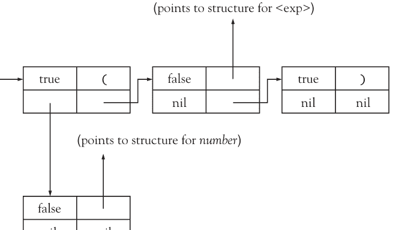

图 `6.31`：语法规则 `factor ( expr ) | number` 的数据结构

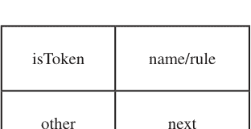

图 `6.32`：图 `6.31` 所示数据结构的字段

(a) 绘制图 `6.18` 中其余语法规则的数据结构。（提示：对于重复和可选结构，你需要一个特殊的标记来表示空字符串。）
+ (b) 编写一个通用的解析过程，使用这些数据结构来识别输入字符串，假设存在 `*getToken*` 和 `*error*` 过程。
+ (c) 编写一个解析器生成器，读取 EBNF 规则（来自文件或标准输入）并生成前述数据结构。
+ 6.55 绘制表达图 `6.15` 中 TinyAda 的 EBNF 语法规则的语法图。
+ 6.56 完成第 `6.8` 节中讨论的 TinyAda 解析器的实现。

# Notes and References

本章讨论的许多主题在 Aho、Sethi 和 Ullman [1986] 以及 Louden [2004] 中有更详细的论述。类似于本章但深度稍大的概述可在 Louden [1997b] 中找到。EBNF 和语法图在 Wirth [1976] 和 Horowitz [1984] 中讨论。上下文无关文法和正则表达式在 Hopcroft 和 Ullman [1979] 以及 Sipser [1997] 中解释。上下文无关文法的原始描述在 Chomsky [1956] 中。BNF 在描述 Algo160 中的早期使用在 Naur [1963a] 中。计算 First 和 Follow 集合的通用算法以及进行左递归消除的算法可在 Aho、Sethi 和 Ullman [1986]、Louden [1997] 以及 Wirth [1976] 中找到。我们对 Follow 集合的描述适用于 EBNF 语法并且有些非标准；参见练习 `6.50`。YACC 在 Johnson [1975] 中有更详细的描述，LEX 在 Lesk [1975] 中。C 的 BNF 描述可在 Kernighan 和 Ritchie [1988] 中找到，C++ 在 Stroustrup [1997] 中，Java 在 Gosling 等 [2000] 中，Pascal 在 Cooper [1983] 中，Ada 在 Horowitz [1987] 中。所有这些 BNF 描述也可以在许多其他地方找到。

# CHAPTER

# Basic Semantics

+ 7.1 属性、绑定和语义函数 ................................ 257
+ 7.2 声明、块和作用域 .............................................. 260
+ 7.3 符号表 ............................................................ 269
+ 7.4 名称解析和重载 ............................................ 282
+ 7.5 分配、生命周期和环境 .................................. 289
+ 7.6 变量和常量 ..................................................... 297
+ 7.7 别名、悬空引用和垃圾 ................................... 303
+ 7.8 案例研究：TinyAda 的初始静态语义分析 ...................... 309


# CHAPTER 7

在第 1 章中，我们区分了编程语言的语法（语言构造的外观）和语义（语言构造实际做什么）。在第 6 章中，你看到了如何使用巴科斯-诺尔形式（BNF）中的上下文无关文法规则精确指定语言的句法结构。在本章中，我们将更详细地介绍编程语言的语义。

指定编程语言的语义比指定其语法更困难的任务。这并不奇怪，因为语义涉及含义，而含义可能微妙且主观。有几种方法可以指定语义：

+ 1. *语言参考手册。* 这是最常见的指定语义的方式。英文描述的扩展使用导致了更清晰、更精确的参考手册，但它们仍然受到自然语言描述固有的不精确性的困扰，并且可能存在遗漏和歧义。
+ 2. *定义翻译器。* 通过定义翻译器来指定语义的优点是，可以通过实验来回答语言的问题（就像化学或物理一样）。一个缺点是，无法提前回答程序行为的问题——我们必须执行程序才能发现它做什么。另一个缺点是，翻译器中的错误和机器依赖性会成为语言语义的一部分，可能是不经意的。此外，翻译器可能无法移植到所有机器并且可能无法普遍获得。
+ 3. *形式定义。* 形式、数学方法精确，但也复杂且抽象，需要学习才能理解。不同的形式方法可用，选择方法取决于其预期用途。也许描述程序的翻译和执行最合适的形式方法是 denotational semantics，它使用一系列函数来描述语义。

在本章中，我们将通过使用你可能在手册中找到的非正式描述类型与 denotational 描述中使用的简化函数相结合的方式来指定语义。我们将提供在翻译和执行程序期间发生的操作的抽象，无论语言如何，但我们将集中于 Algol 类似语言的细节，例如 C、C++、Java、Pascal 和 Ada。我们以 TinyAda 语言程序的语义分析案例研究结束本章。描述语义的更正式方法在第 12 章中研究。

## 7.1 属性、绑定和语义函数

在任何编程语言中，一种基本的抽象机制是使用 **名称，或标识符,** 来表示语言实体或构造。在大多数语言中，变量、过程和常量都可以由程序员指定名称。描述语言语义的一个基本步骤是描述决定程序中每个名称含义的约定。

除了名称之外，大多数编程语言语义的描述还包括 **位置** 和 **值** 的概念。值是任何可存储的数量，例如整数、实数，甚至由数组每个索引处存储的值序列组成的数组值。位置是值可以存储的地方。位置就像特定计算机内存中的地址，但我们可以比这更抽象地思考它们。为了简化，我们可以认为位置由整数编号，从 0 开始，递增到某个最大位置号。

名称的含义由与该名称关联的属性，或 **属性,** 决定。例如，C 声明¹

```c
const int n = 5;
```

将 `n` 变成值为 `5` 的整数常量。也就是说，它将数据类型属性“整数常量”和值属性 `5` 与名称 `n` 关联起来。（在 C 中，常量属性——`n` 的值永远不会改变——是数据类型的一部分；在其他语言中可能不同。）C 声明

```c
int x;
```

将属性“变量”和数据类型“整数”与名称 `x` 关联起来。C 声明

```c
double f(int n){
...
}
```

将属性“函数”以及以下附加属性与名称 `f` 关联起来：

1. 其参数的数量、名称和数据类型（在本例中，为一个参数，名称为 `n`，数据类型为“整数”）
2. 其返回值的类型（在本例中为“double”）
3. 当调用 `f` 时要执行的代码体（在本例中，我们尚未编写此代码，只是用三个点表示）

声明并不是唯一可以为名称关联属性的语言构造。例如，赋值：

```c
x = 2;
```

将新的属性“值 2”与变量 `x` 关联起来。并且，如果 `y` 是指针变量² 声明为：

```cpp
int* y;
```

C++ 语句

```cpp
y = new int;
```

为整数变量分配内存（即为其关联位置属性）并将此位置赋给 `*y`，即为 `y` 关联新的值属性。

将属性与名称关联的过程称为绑定。在某些语言中，导致值绑定到名称的构造（例如前面提到的 C 常量声明）实际上被称为绑定而不是声明。例如，在 ML 代码中

```
let val x = 2; val y = 3 in x + y
```

这是一个 `let` 表达式，它将值 `2` 绑定到 `x`，将值 `3` 绑定到 `y`（这些称为 `let`-绑定）。

在纯函数式语言如 Haskell 中，一个值只能绑定到一个名称一次。因此，在这些语言中，没有必要为存储稍后可在程序中通过赋值语句重置的值而单独进行位置绑定。

可以根据在翻译/执行过程中计算并绑定到名称的时间对属性进行分类。这称为属性的绑定时间。绑定时间可分为两大类：静态绑定和动态绑定。静态绑定在执行前发生，而动态绑定在执行期间发生。静态绑定的属性是静态属性，而动态绑定的属性是动态属性。


语言在哪些属性静态绑定、哪些属性动态绑定方面存在很大差异。通常，函数式语言比命令式语言具有更多的动态绑定。绑定时间也可能取决于翻译器。例如，解释器可以同时翻译和执行代码，因此可以动态地建立大多数绑定，而编译器可以在静态时执行许多绑定。为了使属性和绑定的讨论独立于此类翻译器问题，我们通常将属性的绑定时间称为语言规则允许该属性绑定的最早时间。因此，即使翻译器动态绑定了本可以静态绑定的属性，该属性仍被视为静态属性。

作为绑定时间的示例，考虑前面属性的示例。在声明中

```
const int n = 2;
```

值 2 静态绑定到名称 `n`，而在声明中

```
int x;
```

数据类型“整数”静态绑定到名称 `x`。对函数声明也有类似的说法。

另一方面，赋值 `x = 2` 在执行赋值语句时动态地将值 2 绑定到 `x`。而 C++ 语句

```
y = new int;
```

动态地将存储位置绑定到 `*y` 并将该位置分配为 `y` 的值。

绑定时间可以进一步细分为动态和静态绑定的子类别。静态属性可以在解析或语义分析期间绑定（翻译时间），在程序与库链接期间绑定（链接时间），或在程序加载以供执行时绑定（加载时间）。例如，外部定义的函数的主体直到链接时间才会被绑定，而全局变量的位置在加载时被绑定，因为其位置在程序执行期间不会改变。类似地，动态属性可以在执行期间的不同时间绑定——例如，在进入或退出过程时，或在进入或退出整个程序时。

名称甚至可以在翻译时间之前绑定到属性。预定义标识符，例如 Pascal 数据类型 `boolean` 和 `char`，其含义（因此属性）由语言定义指定。例如，数据类型的 `boolean` 被指定为具有两个值 `true` 和 `false`。一些预定义标识符，例如数据类型 `integer` 和常量 `maxint`，其属性由语言定义和实现指定。语言定义指定数据类型 `integer` 具有由整数的子集组成的值，并且 `maxint` 是一个常量，而实现指定 `maxint` 的值和数据类型 `integer` 的实际范围。³

因此，名称属性的可能绑定时间如下：

- 语言定义时间

- 语言实现时间

- 翻译时间（“编译时”）

- 链接时间

- 加载时间

- 执行时间（“运行时”）

此列表中除最后一个之外的所有绑定时间都代表静态绑定。（执行期间的动态绑定时间已在第 3 章和第 5 章中讨论。）

绑定必须由翻译器维护，以便在翻译和执行期间为名称赋予适当的含义。翻译器通过创建数据结构来维护此信息。由于我们不关心此数据结构的细节，而只关心其属性，因此我们可以抽象地将其视为表达属性与名称绑定的函数。此函数是语言语义的基本部分，通常称为符号表。在数学上，符号表是从名称到属性的函数，我们可以写成 `SymbolTable : Names → Attributes`，或更图形化地如图 7.1 所示。

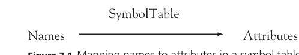

随着翻译和/或执行的进行，此函数会发生变化，以反映程序中绑定添加和删除的情况。

从这种方式来看，翻译的解析阶段包括三种类型的分析：

1. 词法分析，确定字符字符串是否代表语言词汇中的标记

2. 语法分析，确定标记序列是否代表语言上下文无关文法的短语

3. 静态语义分析，涉及建立声明中名称的属性，并确保这些名称在引用中的使用符合其声明的属性

³ 这假设程序不会在声明中重新定义这些名称的含义。重新定义是可能的，因为这些预定义标识符不是保留字。

在编译程序执行期间，位置和值等属性也必须得到维护。编译器生成在执行期间在数据结构中维护这些属性的代码。此过程的内存分配部分——即名称与存储位置的绑定——通常被单独考虑并称为环境，如图 7.2 所示。

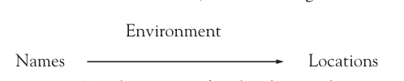

最后，存储位置与值的绑定称为内存，因为它抽象了实际计算机的内存（有时也称为存储或状态）。见图 7.3。

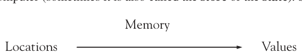

## 7.2 声明、块和作用域

声明正如你所见，是建立绑定的主要方法。绑定可以由声明以隐式或显式的方式确定。例如，C 声明

```c
int x;
```

使用关键字 `int` 显式地建立了 `x` 的数据类型，但 `x` 在执行期间的确切位置仅被隐式绑定，事实上，具体取决于该声明在程序中的位置，可能为静态或动态。同样，`x` 的值要么隐式为零，要么未定义，这取决于声明的位置。另一方面，声明

```c
int x = 0;
```

显式地将 0 绑定为 `x` 的初始值。

绑定不仅可以在声明中是隐式的，而且整个声明本身也可能是隐式的。例如，在某些语言中，仅仅使用变量名就会导致其被声明，尽管第一次使用通常采用赋值语句的形式，将值绑定到名称。

有时一种语言会对绑定某些属性但不绑定其他属性的声明使用不同的名称。例如，在 C 和 C++ 中，绑定所有潜在属性的声明称为定义，而仅部分指定属性的声明则简单地称为声明。例如，函数声明（或原型）

```c
double f(int x);
```

仅指定函数 `f` 的数据类型（即其参数和返回值的类型），但未指定实现 `f` 的代码。同样，

```c
struct x;
```

在 C 或 C++ 中指定了一个不完整类型，因此该声明也不是定义。（此类专门的声明用于解决递归定义以及完整定义只能在链接时找到的情况——请参阅本章后面的相关说明。）

在 Lisp、Smalltalk 和 Python 等动态类型语言中，变量名通常只有值绑定，而类型属性属于相关的值。

声明通常出现在特定的语言构造中。其中一种标准语言构造，通常称为块，由一系列声明后跟一系列语句组成。在块内，跟随声明的语句序列由大括号或 `begin-end` 对等语法标记包围。在 C 中，块称为复合语句，并作为函数定义中函数的体出现，也可在任何普通程序语句出现的地方出现。因此，

```c
void p (){
    double r, z; /* the block of p */
    ---
    { int x, y; /* another, nested, block */
        x = 2;
        y = 0;
        x += 1;
    }
    ---
}
```

建立了两个块，其中一个代表 `p` 的主体，另一个嵌套在 `p` 的主体内部。

除了与块关联的声明外，C 还有“外部”或“全局”的声明集，位于任何复合语句之外：

```c
int x;
double y;
/* these are external to all functions
   and so global */

main()
{ int i, j; /* these are associated with the block of main only */
   ---
}
```

与特定块关联的声明也称为局部，而在包围块中（或全局声明）的声明称为非局部声明。例如，在前面对过程 `p` 的定义中，变量 `r` 和 `z` 对 `p` 是局部的，但从嵌套在 `p` 内部的第二个块来看，它们是非局部的。

块包含声明的概念始于 Algol 60，所有 Algol 后继语言都以各种方式表现出这种块结构。例如，在 Ada 中，块由关键字 `declare` 引导的 `begin-end` 对形成：

```ada
declare x: integer;
    y: boolean;
begin
    x := 2;
    y := true;
    x := x + 1;
    ...
end;
```

在块结构化语言中，块可以嵌套到任意深度，并且可以在嵌套块中重新声明名称。不是用唯一的整数（从 0 开始计数）标识每个新声明的名称，我们可以为每个声明的名称关联一个层级编号和一个偏移量。这个数字对称为名称的词法地址。在最外层声明的名称具有层级编号 0。随着我们进入每个嵌套块，层级编号会增加。然后在每个嵌套块中声明的名称的偏移量从 0 开始编号。因此，在下面的 Ada 代码段中，外层块中 `x` 和 `y` 的声明具有词法地址 (0, 0) 和 (0, 1)，而嵌套块中相同名称的词法地址为 (1, 0) 和 (1, 1)。

```ada
declare x: integer;
    y: boolean;
begin
    x := 2;
    y := true;
    x := x + 1;
    declare x: integer;
        y: boolean;
    begin
        x := 3;
        y := false;
        x := x * 6;
    end;
end;
```

除了块之外，其他语言构造也是声明的重要来源。例如，在 C 中，`struct` 定义由其中的局部变量（或成员）声明组成：

```c
struct A{
    int x; /* local to A */
    double y;
};
```

```c
void p(){
    int x;
    ---
}

void q(){
    char x;
    ---
}
```

在 C（以及大多数现代语言）等块结构化语言中，块可以嵌套，绑定的作用域仅限于其关联声明出现的块（以及包含在其中的其他块）。这种作用域规则称为词法作用域，因为它遵循块在书面代码中出现的结构。

C 中作用域的一个简单示例见图 7.4。

```c
(1)  int x;

(2)  void p(){
(3)      char y;
(4)      ---
(5)  } /* p */

(6)  void q(){
(7)      double z;
(8)      ---
(9)  } /* q */

(10) main(){
(11)     int w[10];
(12)     ---
(13) }
```

图 7.4 演示作用域的简单 C 程序

在图 7.4 中，变量 `x`（第 1 行）和过程 `p`（第 2–5 行）、`q`（第 6–9 行）和 `main`（第 10–13 行）的声明是全局的。另一方面，`y`（第 3 行）、`z`（第 7 行）和 `w`（第 11 行）的声明分别与过程 `p`、`q` 和 `main` 的块相关联。它们对这些函数是局部的，其声明仅对这些函数有效。C 还有进一步的规则，即声明的作用域从声明点本身开始。这是所谓的声明在使用前规则：声明的作用域从声明之后立即开始，延伸到其所在的块的末尾。⁴

⁴ C 的作用域规则实际上更复杂一些，我们将在本章后面进一步讨论其中的一些复杂性。

我们将图 7.4 的示例在图 7.5 中重复，用括号标出每个声明的作用域。

```c
int x;
void p(void)
{ char y;
...
} /* p */

void q(void)
{ double z;
...
} /* q */

main()
{ int w[10];
...
}
```

图 7.5 图 7.4 中的 C 程序，用括号标出作用域

其他 Algol 类似语言中的块建立了类似的作用域规则。例如，在下面的 Ada 代码中，

```ada
B1: declare
    x: integer;
    y: boolean;
    begin
    x := 2;
    y := false;
    B2: declare
        a, b: integer;
        begin
            if y then a := x;
            else b := x;
            end if;
        end B2;
    ...
end B1;
```

任何命名的封闭作用域都可以通过类似记录结构访问的点记法来访问，因此上述 C++ 行为也可以在 Ada 中实现，如下所示：

```
B1: declare
    a: integer;
    y: boolean;
begin
    a := 2;
    y := false;
    B2: declare
        a, b: integer; -- local a now hides a in B1
    begin
        if y then a := B1.a; -- select the a in B1
        else b := B1.a;
        end if;
    end B2;
    ...
end B1;
```

这在 Ada 中称为选择可见性。

C++ 还使用作用域解析运算符从“外部”进入类的作用域以提供缺失的定义，因为 C++ 在类声明中只需要声明，而不需要完整的定义：

```
/* C++ example of class declaration similar to previous Java example */
class IntWithGcd{

    public:
    /* local declaration of intValue function - code for intValue() is not provided */
    int intValue();

    int gcd ( int v ); /* local declaration of gcd */

    private:
    int value; /* local declaration of value member */
};

/* use scope resolution to give actual definition of intValue */
int IntWithGcd::intValue(){
    return value;
}
```

在此思路下的另一个例子是声明中额外的关键字修饰符如何改变声明的作用域。在 C 中，全局变量声明实际上可以通过 `extern` 关键字跨文件访问：

File 1:

```
extern int x; /* uses x from somewhere else */
---
```

File 2:

```
int x; /* a global x that can be accessed by other files */
---
```

现在如果 `File 1` 和 `File 2` 分别编译然后链接在一起，`File 1` 中的外部 `x` 将由链接器与 `File 2` 中提供的 `x` 标识。另一方面，如果在编写 `File 2` 时，程序员希望将 `x` 的作用域限制在 `File 2` 本身，并且从而防止外部引用，程序员可以使用 `static` 关键字：

File 2:

```
/* a global x that can only be seen within this file */
static int x;
---
```

现在尝试将 `File 1` 与 `File 2` 链接将导致错误：对 `x` 的未定义引用。这是一种原始版本的范围修改访问控制，类和模块提供了这种控制，在第 5 章和第 11 章中详细讨论。

作用域规则还必须以递归或自引用声明在有意义时能够实现的方式构建。由于函数必须允许递归，这意味着函数名称的声明在进入函数体块之前就开始生效：

```
int factorial (int n){
    /* scope of factorial begins here */
    /* factorial can be called here */
    ---
}
```

另一方面，递归变量声明通常没有意义：

```
int x = x + 1; /* ??? */
```

此声明很可能是一个错误，事实上 Java 和 Ada 将其标记为错误，即使 `x` 的作用域从 `=` 号开始。在 Ada 中，这是因为变量声明中的自引用被明确禁止。在 Java 中，这是由于自引用被标记为未初始化的使用。C 和 C++，然而，如果 `x` 是局部变量⁵，则不会将此标记为错误，而只是对 `x` 的（可能随机的）未初始化值加一。

⁵ C 和 C++ 中的全局变量不能有此类初始化表达式，因为它们的初始值必须是编译时量；参见第 7.6.2 节。

一种特殊的范围情况，与递归相关，发生在面向对象语言中的类声明中。类声明内部的局部声明通常具有向后延伸以包含整个类的范围（从而部分暂停声明在使用前规则）。例如，在之前的 Java 中的 `IntWithGcd` 示例中，局部数据值在类声明中被引用，甚至在它被定义之前。此规则存在是为了使类内部声明的顺序无关紧要。此类语言的翻译器通常必须执行两次传递来解析程序。在第一次传递中，解析器将所有声明的名称输入符号表。在第二次传递中，解析器查找对名称的每个引用，以验证是否存在声明。

符号表处理声明的方式必须对应于每个声明的作用域。因此，不同的作用域规则需要符号表有不同的行为，甚至符号表内部有不同的结构。在下一节中，我们将检查符号表如何在块结构语言中帮助分析作用域的基本方式。

## 7.3 The Symbol Table

符号表就像字典：它必须支持名称与其关联属性的插入、查找和删除⁶，表示声明中的绑定。符号可以用任意数量的数据结构实现以允许高效访问，例如哈希表和二叉搜索树。然而，在具有块结构的词法作用域语言中维护作用域信息要求声明以类似栈的方式处理。也就是说，在进入块时，处理该块的所有声明并将相应的绑定添加到符号表。然后，在退出块时，由声明提供的绑定被移除，恢复可能存在的任何先前绑定。此过程称为 **scope analysis**。在不将符号表的视图限制为任何特定数据结构的情况下，我们仍然可以图示地将符号表视为一组名称，每个名称都有一个与其关联的声明栈，使得栈顶的声明是其作用域当前处于活动状态的声明。为了说明其工作原理，请考虑图 7.6 的 C 程序。

```c

(1)  int x;

(2)  char y;

(3)  void p(){

(4)      double x;

(5)      ...

(6)      { int y[10];

(7)          ...

(8)      }

(9)      ...

(10) }

(11) void q(){

(12)     int y;

```

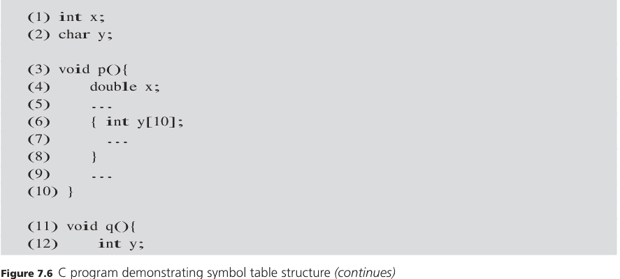

> ⁶ 删除，当然可能并不意味着从符号表中完全擦除，而只是将其标记为不再活动，因为在翻译器退出作用域后，绑定可能仍需要被重新访问。

(continued)


```
(13)   ---
(14) }

(15) main(){
(16)     char x;
(17)   ---
(18) }
```

Figure 7.6 C program demonstrating symbol table structure

该程序中的名称为 `x`、`y`、`p`、`q` 和 `main`，但 `x` 和 `y` 各自与三个具有不同作用域的不同声明相关联。在处理 `p` 的函数体开头处的变量声明之后（图 7.6 的第 5 行），符号表可以表示为图 7.7 所示。（由于 C 中所有函数定义都是全局的，我们在图 7.7 及后续图中的属性中不明确标示这一点。）

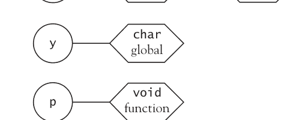

Figure 7.7 Symbol table structure at line 5 of Figure 7.6

在处理 `p` 中的嵌套块的声明后，使用 `y` 的局部声明（即图 7.6 的第 7 行），符号表如图所示 7.8 所示。

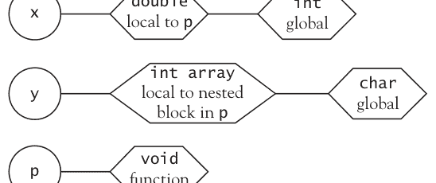

Figure 7.8 Symbol table structure at line 7 of Figure 7.6

然后，当 `p` 的处理完成时（图 7.6 的第 10 行），符号表变为图 7.9 所示（`y` 声明的栈在第 8 行弹出局部声明的 `y`，然后在第 10 行从 `x` 栈弹出局部声明的 `x`）。

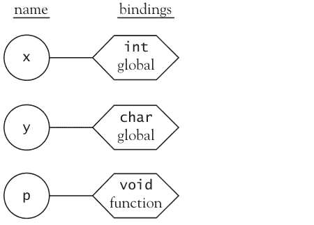

**Figure 7.9** Symbol table structure at line 10 of Figure 7.6

在进入 `q` 之后（第 13 行），符号表变为图 7.10 所示。

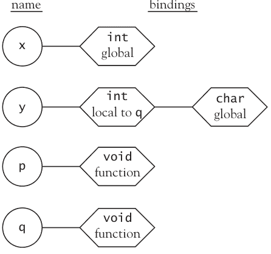

**Figure 7.10** Symbol table structure at line 13 of Figure 7.6

当 `q` 退出（第 14 行）时，符号表如图所示 7.11。

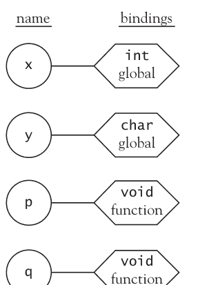

Figure 7.11 Symbol table structure at line 14 of Figure 7.6

最后，在进入 `main` 之后（第 17 行），符号表如图所示 7.12。

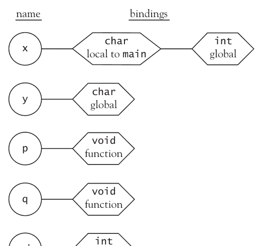

Figure 7.12 Symbol table structure at line 17 of Figure 7.6

请注意，这个过程维护了适当的作用域信息，包括 `p` 内部 `x` 的全局声明和 `q` 内部 `y` 的全局声明所对应的作用域空洞。

符号表的这种表示方式假设符号表是静态地处理声明——即在执行之前处理。如果符号表由编译器管理，且所有声明的绑定都是静态的，那么情况就是如此。然而，如果符号表是动态管理的，即在执行期间管理，那么声明将沿着程序的执行路径在遇到时被处理。这会导致一种不同的作用域规则，通常称为**动态作用域**，而我们之前的词法作用域规则有时也被称为**静态作用域**。

为了展示静态作用域和动态作用域之间的区别，我们向图 7.6 的示例中添加一些代码，以建立一条执行路径，并且给变量赋予一些值，以便生成一些输出来强调这种区别。修改后的示例见图 7.13。

```c
(1) #include <stdio.h>

(2) int x = 1;
(3) char y = 'a';
(4) void p(){
(5)     double x = 2.5;
(6)     printf("%c\n",y);
(7)     { int y[10];
(8)     }
(9) }

(10) void q(){
(11)     int y = 42;
(12)     printf("%d\n",x);
(13)     p();
(14) }

(15) main(){
(16)     char x = 'b';
(17)     q();
(18)     return 0;
(19) }
```

**图 7.13** 图 7.6 的 C 程序，添加了代码

现在考虑一下，如果按照执行过程动态地构造图 7.13 中代码的符号表，会发生什么。首先，执行从 `main` 开始，并且必须在 `main` 开始执行之前处理所有全局声明，因为 `main` 必须知道发生在它之前的所有声明。因此，执行开始时（第 17 行）的符号表如图 7.14 所示。


图 7.14 使用动态作用域时图 7.13 第 17 行的符号表结构

请注意，这与静态处理 `main` 时所使用的符号表（图 7.12）相同，只是我们现在在图中添加了值属性。请注意，我们尚未处理任何其他函数的函数体。

现在 `main` 继续调用 `q`，我们开始处理 `q` 的函数体。进入 `q`（第 12 行）时的符号表如图 7.15 所示。


图 7.15 使用动态作用域时图 7.13 第 12 行的符号表结构

这与使用静态处理时进入 `q` 的符号表（图 7.10）有很大不同。还要注意，每次调用 `q` 时，进入时的符号表可能不同，具体取决于到达该调用的执行路径；而使用词法作用域时，每个过程只有一个与其入口关联的符号表。（由于本例中只调用了一次 `q`，因此在这种情况下不会出现这种情况。）

继续这个例子，`q` 现在调用 `p`，符号表变成如图 7.16 所示的样子。


现在考虑动态作用域将如何影响该程序的语义并产生不同的输出。首先，请注意该程序的实际输出（使用词法作用域，这是包括 C 在内的大多数语言的标准）是：

```
1
a
```

因为在第一个 `printf` 语句（第 6 行）中，无论执行路径如何，引用的都是全局变量 `y`；而在第二个 `printf` 语句（第 12 行）中，同样无论执行路径如何，引用的都是全局变量 `x`；在整个程序执行过程中，这些变量的值分别是 `'a'` 和 `1`。

然而，使用动态作用域时，⁷ `p` 和 `q` 内部对 `y` 和 `x` 的非局部引用可能会根据执行路径而改变。在该程序中，图 7.13 第 12 行的 `printf` 语句执行时符号表如图 7.15 所示（在 `main` 内部将 `x` 重新声明为字符 `"b"`）。因此，`printf` 语句会将该字符解释为整数（因为格式字符串为 `"%d\n"`），输出其 ASCII 值 `98`。其次，`p` 内部对 `y` 的 `printf` 引用（图 7.13 第 6 行）现在指向 `q` 内部定义的整型 `y`，其值为 `42`，如图 7.16 所示。该值现在将被解释为字符（ASCII 42 = `'*'`），程序将输出以下内容：

```
98
*
```

> ⁷ 当然，由于 C 使用词法作用域，我们实际上无法以这种方式执行该程序。我们只是方便地使用 C 语法。

这个例子引出了许多使动态作用域成为问题的问题，以及为什么很少有语言使用它。第一个、也许是最重要的问题是，在动态作用域下，当表达式或语句中使用非局部名称时，无法通过简单地阅读程序来确定适用于该名称的声明。相反，必须执行程序，或者手动跟踪其执行过程，才能找到适用的声明（而不同的执行可能会产生不同的结果）。因此，函数的语义会随着执行的进行而发生根本性变化。你在上面的例子中已经看到，图 7.13 第 6 行 `printf` 语句中对 `y` 的引用在执行时才能确定（如果我们愿意，我们可以重写这个例子，使对 `y` 的引用实际上依赖于用户输入）。因此，`p` 的语义在执行过程中发生了变化。

这个例子还展示了另一个严重的问题：由于非局部变量引用无法在执行之前预测，这些变量的数据类型也无法预测。在例子中，图 7.13 第 6 行 `printf` 语句中对 `y` 的引用被假定为字符（根据全局变量 `y` 的数据类型），因此我们在 `printf` 函数的格式字符串中写了字符格式指令 `"%c"`。然而，使用动态作用域时，当 `p` 执行时变量 `y` 可能是任何类型。这意味着这个格式指令很可能是错误的。在例子中，我们很幸运，C 语言在 `char` 和 `int` 等两种基本数据类型之间有非常宽松的转换规则。但是，想象一下，如果全局变量 `y` 或 `q` 局部的 `y` 是 `double` 类型，甚至是用户定义的结构体，会怎样——我们可能仍然不会在 C 中遇到运行时错误，但预测输出可能会很困难（而且取决于机器！）。在其他更严格的语言（如 Ada 或 Pascal）中，这绝对会导致运行时错误——这完全不是我们所希望的。因此，数据类型的静态绑定（静态类型）与动态作用域本质上是不兼容的。（关于这个问题的更多讨论，请参见第 8 章。）

尽管如此，对于高度动态的解释型语言，当我们不期望程序规模非常大时，动态作用域仍然是一个可能的选择。原因在于，在解释器中使用动态作用域可以大大简化运行时环境。事实上，在第 7.1 节末尾，我们注意到解释器中的环境包含符号表，因此似乎不可能在解释器中维护词法作用域，因为根据定义，符号表是动态维护的。但事实并非如此。不过，动态维护词法作用域确实需要一些额外的结构和簿记工作（参见第 10 章）。因此，APL、Snobol 和 Perl（都是预期程序相对较小的解释型语言）传统上选择了动态作用域。⁸

早期的 Lisp 方言也是动态作用域的。Lisp 的发明者 John McCarthy 曾表示，他认为这是 1958 年 Lisp 最初实现中的一个缺陷（McCarthy [1981]，第 180 页）。然而，正如第 3 章所述，流行的 Lisp 方言 Scheme 从一开始就使用词法作用域（Steele and Gabriel [1996]，第 249 页），而 Common Lisp（Steele [1982] [1984]）则默认提供词法作用域。

除了词法作用域与动态作用域的问题之外，符号表的结构和行为还存在着我们尚未讨论的显著额外复杂性。事实上，我们迄今所讨论的符号表——整个程序使用一个单独的表，并在进入时插入

⁸ 最近的 Perl 版本现在提供词法作用域。

进入作用域时创建符号表、退出时删除——这种做法仅适用于最简单的语言，如C和Pascal，它们严格要求先声明后使用，并且一旦作用域在处理过程中被退出，就无法再次访问。

实际上，即便是这样的描述也未能完全覆盖C和Pascal中的所有情况。例如，考虑图7.17中给出的C语言中的struct声明（或Pascal中的record声明）。显然，这段代码中的两个struct声明（图7.17的第1-5行和第7-11行）必须各自包含其内部数据字段的进一步声明，并且只要结构体变量本身（`x`和`y`）在作用域内，这些声明就必须可以通过成员选择的“点”表示法访问。这意味着两点：(1) 一个struct声明实际上自身包含一个局部符号表作为属性（其中包含成员声明），并且(2) 这个局部符号表在结构体变量本身从程序的“全局”符号表中删除之前，不能被删除。

```
(1)  struct{
(2)      int a;
(3)      char b;
(4)      double c;
(5)  } x = {1, 'a',2.5};

(6)  void p(){
(7)      struct{
(8)          double a;
(9)          int b;
(10)         char c;
(11)    } y = {1.2,2, 'b'};
(12)    printf("%d, %c, %g\n",x.a,x.b,x.c);
(13)    printf("%f, %d, %c\n",y.a,y.b,y.c);
(14) }

(15) main(){
(16)    p();
(17)    return 0;
(18) }
```

图7.17 说明C语言结构体中局部声明作用域的代码示例

因此，在`p`函数内部（图7.17的第12行），前述代码的符号表可能如图7.18所示，其中符号表属性标记为“symtab”。


图7.18 图7.17程序第12行处的符号表结构表示，显示了局部结构体符号表

任何在语言中可以直接引用的作用域结构也必须拥有自己的符号表。例如包括Ada中的所有命名作用域；C++中的类、结构体和命名空间；以及Java中的类和包。因此，对于这些语言中的任一程序，其符号表更典型的结构是为每个作用域各建立一个表。在解析源程序的过程中，每当进入一个新的作用域时，就为该作用域创建一个新的符号表，并将其压入符号表栈。在此作用域中声明的名字随后被填入该表。如果此时遇到重复的名字，则说明该名字已在同一作用域内声明过，返回错误。当遇到对某个名字的引用时，从栈顶的表开始搜索。如果在该表中未找到该名字的条目，则继续在其下的下一个表中搜索，依此类推，直到找到条目或到达栈底为止。如果到达栈底，则该名字未声明，返回错误。

作为这种现象的第二个例子，我们将图7.13的C示例重写为Ada，如图7.19所示。

```
(1) with Text_IO; use Text_IO;
(2) with Ada.Integer_Text_IO; use Ada.Integer_Text_IO;

(3) procedure ex is
(4)    x: integer := 1;
(5)    y: character := 'a';

(6)    procedure p is
(7)    x: float := 2.5;
(8)    begin
(9)        put(y); new_line;
(10)   A: declare
(11)        y: array (1..10) of integer;
(12)    begin
(13)        y(1) := 2;
(14)        put(y(1)); new_line;
(15)        put(ex.y); new_line;
(16)    end A;
(17) end p;

(18) procedure q is
(19)    y: integer := 42;
(20) begin
(21)    put(x); new_line;
(22)    p;
(23) end q;

(24) begin
(25) declare
(26)    x: character := 'b';
(27) begin
(28)    q;
(29)    put(ex.x); new_line;
(30) end;
(31) end ex;
```

图7.19 与图7.13对应的Ada代码

在进入`p`内部的块`A`之后（图7.19的第12行），该程序符号表的一种可能组织结构如图7.20所示（我们忽略如何表示导入的包这个问题）。请注意，在图7.20中，我们不再需要说明每个声明属于哪个特定作用域，因为属于特定符号表本身就提供了该信息。此外，请注意，如果在内层表中查找失败，查找必须继续到下一个外层表。因此，如图中虚线箭头所示，必须存在从每个内层作用域指向下一个外层作用域的链接。


# 图7.20 图7.19第12行处的符号表结构

例如，考虑图7.19第15行中`ex.y`的查找如何从函数`p`内部的块`A`开始进行。首先，在`A`的符号表中查找`ex`。由于此查找失败，沿着虚线找到下一个外层符号表（`p`的符号表）进行查找。此查找也失败，接着查找下一个符号表——即`ex`的符号表。这也失败了，最后到达最外层的符号表，其中只有`ex`的条目。这正是我们想要的条目。找到该条目后，继续查找`y`（在此查找中，`ex.y`中的`ex_`前缀被剥离）。找到了字符变量`y`。这就是第15行所指的变量。

关于符号表和作用域的最后一个问题是，在同一作用域内，同一个名字可以在多大程度上复用于不同的函数、变量和其他实体。这种复用称为重载，将在下一节连同相关问题一起讨论。

## 7.4 名称解析与重载

关于声明和编程语言中符号表操作的一个重要问题是：同一个名字在多大程度上可以被用来指代程序中不同的事物。人们起初可能会认为这不应该被允许，因为它可能导致严重的混乱和不可读性。然而，考虑一下，例如，用`+`号表示的加法运算，它在大多数语言中通常是内置的二元中缀⁹运算符，其结果是两个操作数之和。在几乎所有语言中，这个简单的`+`号至少指代两种（通常更多）完全不同的运算：整数加法和浮点加法（通常在汇编语言中用两个不同的符号`ADDI`和`ADDF`或类似名称表示）。这时，`+`运算符就被称为重载。显然，这种对同一符号的复用不会引起混淆，因为这些操作紧密相关（甚至在某种数学意义上“相同”）。同样显而易见的是，如果编程语言要求程序员为这些操作使用两个不同的符号（比如用`+%`表示整数加法，用`++#`表示浮点加法），那将是极大的麻烦。

翻译器如何消解（区分）“`+`”符号的这两种用途呢？它通过查看操作数的数据类型来实现。例如，在C中，如果我们写`2+3`，我们指的是整数加法；如果我们写`2.1+3.2`，我们指的是浮点加法。当然，`2+3.2`仍然可能存在歧义，语言的规则必须以某种方式处理这种情况（大多数语言自动将`2`转换为`2.0`，但Ada认为这是错误）。

因此，允许基于数据类型以某种方式重载运算符和函数名，是语言的一大优势。C++和Ada允许对函数名和运算符进行广泛的重载。Java也允许重载，但仅限于函数名，不包括运算符。¹⁰ 函数式语言Haskell同样允许对函数和运算符进行重载，甚至允许定义新的运算符（这在C++或Ada中是不允许的）。FORTRAN的多个版本（Fortran90/95及更高版本）也允许有限形式的重载。我们这里使用C++、Ada和Java来讨论重载（它们有相似但不完全相同的机制）。Haskell中的重载已在第3章简要描述。关于Fortran 90/95中重载的内容，参见注释和参考文献。

允许重载函数的基本方法是扩展符号表中查找操作的功能，使其不仅基于函数名进行查找，还基于其参数个数和数据类型进行查找。这种在众多同名函数中选择唯一函数的过程，代表了符号表能力的扩展，称为重载解析。


为了了解重载解析如何工作，我们考虑一个简单但有用的例子：用于数字的`max`函数。这个函数可以为整数、双精度浮点数以及所有其他数值类型定义，并且可以有2个、3个、4个（甚至更多）参数。为了我们的目的，我们在图7.21中仅定义三个可能的`max`函数（使用C++语法¹¹）。

⁹ 即，写在操作数之间。 ¹⁰ 至少在当前版本的Java中是这样——已有提议允许在未来的版本中支持运算符重载。 ¹¹ 这些函数可以很容易地转换为Ada代码，但Java没有独立函数；要用Java编写此示例，我们会将这些函数作为`main`函数所在类内的静态方法来编写。

```
double max(int x, double y){ // max #4
    return x > y ? (double) x : y;
}

double max(double x, int y){ // max #5
    return x > y ? x : (double) y;
}
```

图 7.22 C++ 中另外两个重载的 max 函数（参见图 7.21）

然后，调用 `max(2.1,3)` 和 `max(2,3.2)` 在 C++ 和 Ada 中变得合法，因为现在每个调用都有一个精确匹配。当然，这些额外的定义在 Java 中是不必要的（但无害）。

因此，C++ 和 Java 中存在的自动转换显著复杂化了重载解析的过程（但在 Java 中程度较轻，因为 Java 的转换策略更严格）。

重载解析中的另一个问题是，除了参数值的数量和类型之外，在调用上下文中可以多大程度上使用额外的信息。Ada 例如允许使用返回类型甚至定义中的参数名称。考虑图 7.23 中的 Ada 程序。

```
(1)  procedure overload is

(2)  function max(x: integer; y: integer) -- max #1
(3)      return integer is
(4)  begin
(5)      if x > y then return x;
(6)      else return y;
(7)      end if;
(8)  end max;

(9)  function max(x: integer; y: integer) -- max #2
(10)     return float is
(11) begin
(12)     if x > y then return float(x);
(13)     else return float(y);
(14)     end if;
(15) end max;

(16) a: integer;
(17) b: float;
(18) begin -- max_test
(19)   a := max(2,3); -- call to max # 1
(20)   b := max(2,3); -- call to max # 2
(21) end overload;
```

图 7.23 Ada 中 max 函数重载的示例

由于图 7.23 第 19 行将 `max` 调用的结果赋给 **integer a**，而第 20 行将结果赋给 **float b**，Ada 仍能解析重载，因为没有自动转换。另一方面，C++ 和 Java 忽略返回类型（如果不忽略，重载解析的规则会变得更加复杂，歧义的空间更大），因此该程序在两种语言中都会是错误。

Ada 和 C++（但不是 Java）也允许通过重载扩展内置运算符。例如，假设我们在 C++ 中有一个数据结构：

```
typedef struct { int i; double d; } IntDouble;
```

我们就可以按如下方式在 **IntDouble** 上定义“+”和“<”（小于）操作：

```
bool operator < (IntDouble x, IntDouble y){
    return x.i < y.i && x.d < y.d;
}

IntDouble operator + (IntDouble x, IntDouble y){
    IntDouble z;
    z.i = x.i + y.i;
    z.d = x.d + y.d;
    return z;
}
```

现在如下代码成为可能：

```
IntDouble x, y;
...
if (x < y) x = x + y;
else y = x + y;
```

该 C++ 代码的完整、可运行示例在图 7.24 中给出。对应的 Ada 示例在图 7.25 中给出。

```
#include <iostream>

using namespace std;

typedef struct { int i; double d; } IntDouble;

bool operator < (IntDouble x, IntDouble y){
    return x.i < y.i && x.d < y.d;
}
```

**图 7.24** 说明运算符重载的完整 C++ 程序 *（续）*

（续）

```
IntDouble operator + (IntDouble x, IntDouble y){
    IntDouble z;
    z.i = x.i + y.i;
    z.d = x.d + y.d;
    return z;
}

int main(){
    IntDouble x = {1,2.1}, y = {5,3.4};
    if (x < y) x = x + y;
    else y = x + y;
    cout << x.i << " " << x.d << endl;
    return 0;
}
```

图 7.24 说明运算符重载的完整 C++ 程序

```
with Text_IO; use Text_IO;
with Ada.Integer_Text_IO;
use Ada.Integer_Text_IO;
with Ada.Float_Text_IO;
use Ada.Float_Text_IO;

procedure opover is

type IntDouble is
record
    i: Integer;
    d: Float;
end record;

function "<" (x,y: IntDouble) return Boolean is
begin
    return x.i < y.i and x.d < y.d;
end "<";

function "+" (x,y: IntDouble) return IntDouble is
    z: IntDouble;
begin
    z.i := x.i + y.i;
    z.d := x.d + y.d;
    return z;
```

图 7.25 说明运算符重载的完整 Ada 程序，类似于图 7.24 的 C++ 程序（续）

（续）

```
end "+";
 x, y: IntDouble;

begin
   x := (1,2.1);
   y := (5,3.4);
   if (x < y) then x := x + y;
   else y := x + y;
   end if;
   put(x.i); put(" "); put(x.d); new_line;
 end oponer;
```

图 7.25 说明运算符重载的完整 Ada 程序，类似于图 7.24 的 C++ 程序

当然，当重载内置运算符时，我们必须接受该运算符的语法属性。也就是说，我们不能改变它们的结合性或优先级。事实上，运算符和函数在语义上没有区别，只有语法上的区别：运算符以中缀形式书写，而函数调用总是以前缀形式书写。事实上，在 Ada 中，所有运算符也都有前缀形式： `"+"`(3,2) 与 3 + 2 含义相同。C++ 也允许运算符的前缀形式，但仅限于应用于用户定义类型的重载运算符：

// x 和 y 是上面的 IntDoubles

x = operator + (x, y);

在 Ada 中甚至可以使用重载重新定义内置运算符，而在 C++ 中这是被禁止的。

在 Ada 中允许被重载的运算符是那些传统上被视为中缀或前缀数学运算符的运算符。在 C++ 中，然而，被视为可重载运算符的操作类要宽得多。例如，下标操作可以被视为一个二元运算符（运算符符号的 "[" 部分以中缀形式书写，运算符符号的 "]" 部分以后缀形式书写）。在 C++ 中，这些操作只能使用面向对象的构造来重写（在面向对象编程的术语中，这些重载函数必须是“成员函数”，在 C++ 类中定义）。事实上，正如你在第 5 章中学到的那样，面向对象技术提供了进一步的重载机会。

到目前为止，我们只讨论了函数的重载——最重要的一种情况。现在让我们考虑另一种重载的可能性：为完全不同种类的事物重用相同的名称。例如，我们能否使用相同的名称同时表示一个数据类型和一个变量，或一个变量和一个函数？在大多数语言中，这是被禁止的，而且有充分的理由：它可能极其令人困惑，而程序通过使用这种重载（与函数或运算符重载不同，后者非常有用）几乎得不到任何好处。

偶尔，这种重载作为限制程序中实际需要考虑的名称数量的一种方式会很有用。例如，一个典型的 C 递归类型的定义：

```
struct A{
    int data;
    struct A * next;
};
```

这是在“旧式”C 中，数据类型由结构体名称 A 给出，但关键字 struct 也必须始终出现。使用 typedef 可以消除重复 struct 的需要：

```
typedef struct A A;
struct A{
    int data;
    A * next;
};
```

注意我们已将相同的名称 A 同时用于结构体名称和 typedef 名称。这在 C 中是合法的，在这种情况下很有用，因为它减少了我们需要记住的名称数量。12 这意味着 C 中结构体名称占据与其它名称不同的符号表，因此类型（和变量）名称唯一性的原则得以保留。13 一些语言对这一原则有极端形式，不同种类的定义各有不同的符号表，因此例如可以使用相同的名称用于类型、函数和变量（这样做是否有用是另一个问题）。

Java 是这种极端形式的名称重载的一个很好的例子，其中图 7.26 的代码对 Java 编译器来说是完全可以接受的。14

```
class A
{  A A(A A)
{  A:
    for(; ;)
    { if (A.A(A) == A) break A; }
    return A;
  }
}
```

图 7.26 Java 类定义显示了对不同语言构造使用相同名称 A 的重载（改编自 Arnold, Gosling, and Holmes [2000]，第 153 页）

图 7.26 包含一个类、一个方法（一个函数）、一个参数和一个标签的定义，它们都共享名称 A。在练习 7.20 中，你将有机会解释哪些名称实例代表定义，哪些代表引用。

12 在 C++ 中，typedef 是不必要的，因为 struct A 的定义会自动创建一个名为 A 的 typedef。

13 事实上，C 实现通常只是为结构体名称添加像 struct_ 这样的前缀并使用相同的符号表，因此结构体名称 A 变成 struct_A 并保持唯一。

14 在 Java 中，不同种类定义的不同的符号表称为命名空间，不要与 C++ 的命名空间混淆。

## 7.5 分配、生存期与环境

在较为详细地考察了符号表之后，我们还需要研究环境（environment），它维护名字到位置的绑定。这里我们先介绍不含函数的环境基础知识，以便与符号表进行对比，而将存在函数和过程的环境研究推迟到第10章。

根据语言的不同，环境可以静态地（在加载时）、动态地（在执行时）或同时以两种方式构建。完全使用静态环境的语言是 FORTRAN——所有位置都是静态绑定的。完全使用动态环境的语言是 LISP——所有位置都在执行期间绑定。C、C++、Ada、Java 以及其他 Algol 风格的语言则介于两者之间——部分分配是静态执行的，而另一部分分配是动态执行的。

并非程序中的所有名字都绑定到位置。在编译型语言中，常量和数据类型的名字可能表示纯粹的编译期量，它们在加载或执行时不存在。例如，C 语言全局常量声明

```c
const int MAX = 10;
```

编译器可以用值 10 替换所有使用 MAX 的地方。名字 MAX 从未被分配位置，而且程序执行时它实际上已完全消失。

声明既用于构建符号表，也用于构建环境。在编译器中，声明用于指示编译器在处理该声明时应生成什么样的分配代码。在解释器中，符号表和环境是合并在一起的，因此解释器中声明的属性绑定也包括位置的绑定。

通常，在块结构语言中，全局变量可以静态分配，因为它们的含义在整个程序执行期间是固定的。然而，局部变量是在执行到达相应块时动态分配的。在上一节中你看到，在块结构语言中，符号表使用类似栈的机制来维护声明的绑定。类似地，块结构语言中的环境也以基于栈的方式将位置绑定到局部变量。为了理解其工作原理，请考虑图 7.27 中带有嵌套块的 C 程序片段。

```c
(1) A: {  int x;
(2)      char y;
(3)      ...
(4)  B: {  double x;
(5)        int a;
(6)        ...
(7)  } /* end B */
(8)  C: {  char y;
(9)        int b;
(10)      ...
(11)  D: {  int x;
(12)        double y;
(13)      ...
(14)      } /* end D */
(15)      ...
(16)      } /* end C */
(17)      ...
(18) } /* end A */
```

图 7.27 一个带有嵌套块的 C 程序，用于演示环境如何进行分配

当代码执行并进入一个块时，会为该块开头声明的变量分配内存。当退出一个块时，这些内存被释放。如果我们将环境视为存储位置的一个线性序列，位置从顶部开始按降序分配，那么在进入 A 之后，图 7.27 第 3 行处的环境如图 7.28 所示（忽略为每个变量分配的内存大小）。


图 7.28 进入 A 后图 7.27 第 3 行处的环境

进入 B 后的环境如图 7.29 所示。


图 7.29 进入 B 后图 7.27 第 6 行处的环境

从 B 块退出（第 7 行）时，环境恢复到刚进入 A 之后的环境。然后，当进入 C 块（第 8–9 行）时，为 C 的变量分配内存，环境如图 7.30 所示。


图 7.30 进入 C 后图 7.27 第 10 行处的环境

注意，C 块中的变量 y 和 b 现在分配到的内存空间，正是之前分配给 B 块中变量 x 和 a 的空间。这是可以的，因为我们现在已处于那些变量的作用域之外，而且它们永远不会再被引用。

最后，进入 D 块（第 11–12 行）时，环境如图 7.31 所示。


图 7.31 进入 D 后图 7.27 第 13 行处的环境

每从一个块退出时，该块的位置绑定会被依次释放，直到在即将退出 A 块之前，我们又恢复了 A 的原始环境。这样，环境的行为就像一个栈。（传统上，环境绘制时是上下颠倒的，与通常栈的描绘方式相反。）

环境在为块分配和释放空间方面的这种行为相对简单。过程和函数块则更为复杂。考虑下面用 C 语法编写的过程声明：

```c
void p() {
    int x;
    double y;
    ...
} /* p */
```

在执行期间，这个声明本身不会触发 p 块的执行，p 的局部变量 x 和 y 也不会在声明处分配内存。相反，变量 x 和 y 的内存仅当 p 被调用时才分配。而且，每次调用 p 都会为局部变量分配新的内存。因此，每次对 p 的调用都会在环境中导致一块内存区域被分配。我们将每次对 p 的调用称为 p 的一次活动（activation），并将相应分配的内存区域称为活动记录（activation record）。关于活动记录结构及其维护所需信息的更完整描述，将推迟到第 10 章讨论过程时进行。

从这些例子应该可以清楚地看到，在具有词法作用域的块结构语言中，同一个名字可能与若干个不同的位置相关联（尽管在任一时刻只能访问其中一个）。例如，在前面的嵌套块示例环境中，名字 x 在 D 块执行期间（第 11–14 行）被绑定到两个不同的位置，而名字 y 被绑定到三个不同的位置（尽管当时只能访问 D 中的 x 和 y）。因此，我们必须区分名字、已分配的位置以及导致它们绑定的声明。我们将已分配的位置称为对象（object）。也就是说，对象是环境中由于处理某个声明而分配的一块存储区域。根据这个定义，C 中的变量和过程与对象相关联，但全局常量和数据类型则不是（因为类型和全局常量声明不会导致存储分配）。[^15] 对象的生存期（lifetime）或延续期（extent）是指它在环境中被分配的持续时间。对象的生存期可以超出程序中可访问它的区域。例如，在前面的块示例中，A 块中的整数 x 声明定义了一个对象，其生存期贯穿 B 块，尽管该声明在 B 中有一个作用域空洞（scope hole），并且该对象无法从 B 内部访问。类似地，也可能发生相反的情况：如本章后面第 7.7 节所述，对象可以在其生存期结束之后仍可访问。

当语言中可以使用指针时，就需要进一步扩展环境的结构。指针是一种对象，其存储的值是对另一个对象的引用。

在 C 中，环境对声明

```c
int *x;
```

的处理会分配一个指针变量 x，但不会分配 x 所指向的对象。实际上，x 可能有一个未定义的值，可以是内存中的任意位置。为了允许初始化那些不指向已分配对象的指针，并让程序能够判断指针变量是否指向已分配内存，C 允许将整数 0 用作一个

[^15]: 这里的对象概念与面向对象编程语言中的对象概念不同；参见第 5 章。


`address` 无法成为任何已分配对象的地址，而各种 C 库都将名称 `NULL` 赋给 0，因此可以在 C 中写成：

```
int* x = NULL;
```

其他语言通常为此地址保留一个特殊符号（Java 和 Ada 中的 `null`，Pascal 中的 `nil`），因此它不能用作标识符。16 经过此初始化，`x` 可以被测试以查看它是否指向一个已分配的对象：

```
if (x != NULL) *x = 2;
```

要使 `x` 指向一个已分配的对象，我们必须通过使用分配例程手动分配它。同样，C 在这方面很不寻常，因为语言本身没有指定内置的分配例程，但 `stdlib` 库模块包含多个用于分配和释放内存的函数。其中最常用的是 `malloc`（用于内存分配）和 `free` 函数。因此，

```
x = (int*) malloc(sizeof(int));
```

分配一个新的整数变量，同时将其位置赋值为 `x` 的值。`malloc` 函数返回其分配的位置，并且必须给出要为其分配空间的数据的大小。这可以使用内置的 `sizeof` 函数以与实现无关的形式给出，该函数接收一个数据类型并返回其（与实现相关的）大小。`malloc` 函数还必须被强制转换为其结果被赋值的变量的数据类型，通过在函数前加上数据类型括号，因为它返回的地址是一个匿名指针（C 中的 `void*`）。（强制转换和匿名指针在第 8 章中进行了说明。）

一旦 `x` 被赋予一个已分配整数变量的地址，就可以通过使用表达式 `*x` 来访问这个新的整数对象。变量 `x` 被称为使用一元 `*` 运算符被解引用。17 我们可以像对待普通变量一样为 `*x` 分配整数值并引用这些值，例如：

```
*x = 2;
printf("%d\n",*x);
```

`*x` 也可以通过调用 `free` 过程来释放，例如：

```
free(x);
```

（请注意，这里没有使用解引用，尽管被释放的是 `*x`，而不是 `x` 本身。）

C++ 通过添加内置运算符 `new` 和 `delete` 简化了 C 的动态分配，它们是保留名称。因此，之前的 C 代码在 C++ 中将变为：

```
int* x = new int; // C++
*x = 2;
cout << *x << endl; // output in C++
delete x;
```

16 虽然从技术上讲，`null` 是一个字面量，但在实践中这种字面量用法与保留字的用法几乎没有区别。

17 虽然这种 `*` 的使用看起来与 `x` 的定义方式相似，但这与声明中 `*` 符号的用途完全不同。

请注意此代码中的特殊语法——`new` 和 `delete` 被用作一元运算符，而不是函数，因为不需要括号。Pascal 与 C++ 相似，只是 `delete` 过程称为 `dispose`。

为了允许使用 `new` 和 `delete`（或 `malloc` 和 `free`）进行任意分配和释放，环境必须在内存中有一个区域，可以根据对 `new` 的调用从中分配位置，并根据对 `delete` 的调用将位置返回到该区域。这种区域传统上称为堆（尽管它与堆数据结构无关）。堆上的分配通常称为动态分配，即使我们已经看到局部变量的分配也是动态的。为了区分这两种动态分配形式，根据前面描述的基于栈的方案分配局部变量有时称为基于栈的或自动的，因为它在运行时系统的控制下自动发生。（对于使用 `new` 和 `delete` 的指针分配，更合适的术语可能是手动分配，因为它在程序员控制下发生。）

在环境的典型实现中，栈（用于自动分配）和堆（用于动态分配）保存在内存的不同部分，全局变量也分配在单独的静态区域。虽然这三个内存部分可以在内存中的任何位置放置，但一种常见策略是将它们彼此相邻放置，全局区域在前，栈在后，堆在最后，堆和栈向相反方向增长（以避免在它们之间没有固定边界的情况下发生栈/堆冲突）。这通常如第 7.32 图所示。


图 7.32 具有栈和堆的典型环境的结构

```
-- see Chapter 8
(6)    x: Intptr := new Integer;
(7) begin
(8)    x.all := 2;
(9)    put(x.all); new_line;
(10) delete_int(x);
(11) end;
```

图 7.33 显示手动动态释放的 Ada 代码

请注意图 7.33 中关键字 `access` 的用法（第 2 行）用于表示指针，而解引用运算符（图 7.33 第 8 行）是 `.all`。这源于 Ada（与 Java 相同）的预期，即堆分配主要用于记录（类）结构。`.all` 指的是所有字段（在我们的例子中，没有字段，只有整数，但仍必须使用解引用符）。与 Java 不同，Ada 不要求 `x` 必须是记录。

总之，在具有堆分配的块结构语言中，环境中有三种分配方式：静态（用于全局变量）、自动（用于局部变量）和动态（用于堆分配）。这些类别也被称为变量的存储类。某些语言，例如 C，允许声明指定存储类以及数据类型。通常，这在 C 中用于将局部变量的分配更改为静态：

```
int f(){
static int x;
...
}
```

现在 `x` 只分配一次，并且在对 `f` 的所有调用中具有相同的含义（和值）。这种局部作用域与全局生命周期的组合可用于在对 `f` 的调用之间保留局部状态，同时防止函数外部的代码更改此状态。例如，图 7.34 显示了 C 中返回其被调用次数的函数的代码，以及一些有趣的主程序代码。

```
(1)  int p(){
(2)    static int p_count = 0;
(3)    /* initialized only once - not each call! */
(4)    p_count += 1;
(5)    return p_count;
(6) }

(7) main(){
(8)    int i;
(9)    for (i = 0; i < 10; i++){
(10)   if (p() % 3) printf("%d\n",p());
(11) }
(12)   return 0;
(13) }
```

图 7.34 C 程序演示局部静态变量的使用

## 7.6 变量和常量

尽管在许多编程语言中对变量和常量的引用看起来相同，但它们在程序中的角色和语义非常不同。本节澄清并区分它们的基本语义。

### 7.6.1 变量

变量是一个其存储值在执行期间可以改变的对象。可以认为变量完全由其属性指定，这些属性包括其名称、其位置、其值以及其他属性，如数据类型和内存存储大小。变量的示意表示可以如第 7.35 图所示绘制。


图 7.35 变量及其属性的示意表示

这幅图突出了变量的名称、位置和值作为其主要属性。通常我们只想集中于这些，我们将变量在图 7.36 所示的图中表示，这被称为盒子和圆圈图。


图 7.36 变量、其值和其位置的示意表示

在盒子和圆圈图中，名称与位置框之间的线表示环境将名称绑定到位置。框内的圆圈表示内存绑定的值——即存储在该位置的值。

变量改变其值的主要方式是通过**赋值**语句 `x = e`，其中 `x` 是变量名，`e` 是表达式。该语句的语义是：`e` 被求值为一个值，然后将该值复制到 `x` 的位置中。如果 `e` 是一个变量名（例如 `y`），那么赋值语句（用 C 语法表示）：

```
x = y
```

可以看作如图 7.37 所示，双箭头表示复制。


图 7.37 带值复制的赋值

由于变量既有位置，又有存储在该位置的值，因此区分这两者非常重要。然而，这种区分在赋值语句中却被模糊了：赋值语句中，右侧的 `y` 表示 `y` 的值，而左侧的 `x` 表示 `x` 的位置。因此，存储在变量位置中的值有时被称为其 r-值（表示右侧值），而变量的位置被称为其 l-值（表示左侧值）。少数语言明确区分了这两者。`ML` 就是这样一种现代语言。例如，在 `ML` 中，变量被明确地视为位置，或对值的引用。如果 `x` 是 `ML` 中的一个整数变量，那么它的类型是“指向整数的引用”；要获取其值，我们必须写 `!x`，即对 `x` 进行解引用以产生其值。因此，要对 `x` 进行自增，我们必须在 `ML` 中写：

```
x := !x + 1;
```

而将变量 `y` 的值赋给 `x`，在 `ML` 中应写为：

```
x := !y;
```

在 C 语言中，除了标准的将 l-值自动解引用为 r-值的机制之外，还有一个显式的**地址运算符** `&`，它可以将引用转换为指针。这使得变量的地址可以被显式地作为指针获取（然后可以使用对指针的标准 `*` 运算符对其进行解引用）。因此，给定 C 声明

```
int x;
```

`&x` 是指向 `x` 的指针（`x` 的“地址”），而 `*&x` 又是 `x` 本身（既作为 l-值也作为 r-值；参见练习 7.24）。此外，C 允许将表达式与赋值混合使用，其中会同时涉及变量的 r-值和 l-值。因此，要将整数 `x` 加 1，可以写 `x = x + 1` 或 `x += 1`（表示 `x` 既被加上 1 又被重新赋值）。C 中 r-值、l-值和指针的混合使用可能导致混乱和不安全的情况。例如，

```
x + 1 = 2;
```

是非法的（`x + 1` 不是 l-值），但

```
*(&x + 1) = 2;
```

却是合法的。在这种情况下，`&x` 是一个指针，使用地址算术对其加 1，然后将 2 存储到结果地址处；可想而知，这是不安全的！

C 的这些特性——引用与值的混合使用、`&` 运算符的使用，以及引用与指针之间的区别——都使 C 语言容易受到极其晦涩的，甚至危险或不当的变量使用方式的影响，其中许多问题在翻译或执行期间都不容易发现。然而，这些特性是 C 作为面向系统编程的快速、不安全语言的设计目标所导致的。

Ada95 也有一个“取地址”运算符：如果 `x` 具有 l-值，那么 `x'access` 是一个指向 `x` 的指针（在 Ada 中，指针类型被称为访问类型）。¹⁸ Ada95 对此应用了严格的规则，限制了这些类型的使用方式，使其比 C 语言更不容易被误用。这一点将在第 10 章中进一步详细讨论。

> ¹⁸ Ada 中使用撇号获取程序实体的各种属性；因此，`x'access` 获取变量 `x` 的访问属性，即 `x` 作为指针的地址。

在某些语言中，赋值具有不同的含义。复制的是位置而不是值。在这种赋值形式中，称为按共享赋值，`x = y` 的结果是将 `y` 的位置绑定到 `x`，而不是绑定其值，如图 7.38 所示。


图 7.38 按共享赋值的结果

另一种称为按克隆赋值的替代方式是：分配一个新位置，复制 `y` 的值，然后将 `x` 绑定到新位置，如图 7.39 所示。¹⁹


图 7.39 按克隆赋值的结果

> ¹⁹ 克隆是内存中对象的精确副本。

在这两种情况下，这种对赋值的解释有时被称为指针语义或引用语义，以区别于更常见的语义（有时称为**存储语义**或**值语义**）。例如，Java 对所有对象变量使用按共享赋值，但对简单数据则不然；参见第 7.7 节的示例。其他使用引用语义的语言包括 Smalltalk、LISP 和 Python。

图 7.40 展示了按共享赋值，名称 `x` 直接关联到一个新位置（即 `y` 的位置）。这对于编译器来说很难实现，因为符号表在执行期间通常不存在。按共享赋值的标准实现（如 Java 中的实现）使用指针和隐式解引用。在这种按共享赋值的视图下，`x` 和 `y` 是隐式指针（具有隐式自动分配的指针值）。


图 7.40 变量作为对对象的隐式引用

那么赋值 `x = y` 的效果如图 7.41 所示。注意，这等同于在 C 中为指针变量 `x` 和 `y` 写 `x = y`。


图 7.41 按引用共享赋值

然而，在没有取地址运算符和解引用运算符（C 中的 `&` 和 `*`）的情况下，这种实现与原始图示是无法区分的。（参见练习 7.25 和第 7.7.1 节。）

### 7.6.2 常量

**常量**是一种语言实体，在其存在于程序中的整个期间具有固定的值。如图 7.42 所示，常量类似于变量，只是它没有位置属性，而仅有一个值。


图 7.42 常量及其属性

我们有时说常量具有**值语义**，而不是变量的存储语义。这并不意味着常量不存储在内存中。常量的值有可能只在执行时才可知。在这种情况下，其值必须存储在内存中，但与变量不同，一旦该值被计算出来，它就不能改变，而且程序不能显式引用常量的位置。

这种常量的概念是**符号化**的；也就是说，常量本质上是一个值的名称。有时，值的表示形式（如数字序列 42 或字符“a”的表示形式）被称为常量。为了将它们与常量声明中的常量区分开来，我们有时将这些值的表示形式称为**字面量**。

许多语言——尤其是函数式语言——强调使用常量而非变量，因为常量的语义要简单得多：每个常量名只能表示一个值，而且一旦该值被创建，无论该名称在代码中的位置或用途如何，它都保持不变。有些语言（如 Haskell）甚至完全禁止变量（就像某些语言禁止 goto 一样），并完全依赖常量进行计算。（有关此内容的更多信息，请参见第 3 章。）

正如我们所指出的，常量可以是静态的，也可以是动态的。静态常量是其值可以在执行之前计算出来的常量，而动态常量的值只能在执行期间计算。静态常量也可能有两种：某些常量可以在翻译时（编译时）计算，而其他常量可以在加载时（如全局变量的静态位置）计算，或者在程序执行的开始时正好计算出来。这一区别很重要，因为编译时常量原则上可以被编译器用来提高程序效率，并且不需要实际占用内存；而加载时常量或动态常量则必须在启动时或执行过程中计算出来，并且必须存储在内存中。不幸的是，“静态”一词有时指编译时常量，有时指加载时常量。在下面的描述中，我们将努力做到精确：将静态翻译时常量称为**编译时常量**（即使该语言可能被解释执行而非编译执行），并将术语“静态常量”的使用限制为加载时常量。我们还可以区分一般常量和**显式常量**：显式常量是字面量的名称，而常量则可以更一般。

例如，考虑下面的 C 代码：

```
#include <stdio.h>
#include <time.h>

const int a = 2;
const int b = 27+2*2;
/* 警告 - 非法 C 代码！ */
const int c = (int) time(0);

int f( int x){
    const int d = x+1;
    return b+c;
}
```

在此代码中，`a` 和 `b` 是编译时常量（`a` 是一个显式常量），而 `c` 是一个静态（加载时）常量，`d` 是一个动态常量。在 C 语言中，`const` 属性可以应用于程序中的任何变量，仅表示一旦变量的值被设置后就不能再更改；其他标准决定变量是否静态（例如上面 `a`、`b` 和 `c` 所定义的全局作用域）。然而，在 C 语言中，由于一条单独的规则限制了全局变量的初始值只能取自编译时表达式的狭窄子集，因此无法定义加载时常量。因此，在 C 语言中，我们甚至无法写出：

```c

const int a = 2;

int b = 27 + a * a; /* also illegal in C */

```

在前面的程序中，因为 `b` 的初始值无法从常量 `a` 计算出来。相反，它必须仅由字面量计算（有少数例外）。然而，在 C++ 中，去除了这些限制，前面的程序是合法的。

Ada 与 C++ 相似，其中的常量声明例如：

```ada

time : constant integer := integer(seconds(clock));

```

可以出现在程序的任何位置（如果为全局则为静态，如果为局部则为动态）。

Java 与 C++ 和 Ada 相似，有两个例外。首先，在 Java 中，常量是通过使用关键字 `final` 指示的（表示它只有一个或“最终”的值）。其次，要获得静态常量，必须使用关键字 `static`（Java 的结构使得没有真正意义上的全局变量）。例如，图 7.43 中的完整 Java 程序在程序开始运行时打印出日期和时间。

```java

import java.util.Date;

class PrintDate{

    public static void main(String[] args){

        System.out.println(now);

    }

    static final Date now = new Date();

}

```

**图 7.43** Java 程序演示加载时（static final）常量变量

在语言讨论中经常被压制或忽视的一个问题是，几乎所有语言中的函数定义都是函数值常量定义。事实上，像 C 这样的定义：

```c

int gcd( int u, int v){

    if(v == 0) return u;

    else return gcd(v, u % v);

}

```

将名称 `gcd` 定义为（编译时）常量，其值为一个具有两个整数参数、返回整数结果的函数，其操作由其主体的代码给出。请注意，这种

定义与 C 中的函数变量不同，我们可以像图 7.44 所示那样为其分配 `gcd` 的值。

```
(1) int (*fun_var)(int,int) = gcd;
(2) main(){
(3)     printf("%d\n", fun_var(15,10));
(4)     return 0;
(5) }
```

图 7.44 C 代码展示函数变量的使用


图 7.44 中的 C 代码有一点不一致，因为我们必须像指针一样定义函数变量 `fun_var20`，但在为其赋值和调用时，并不需要使用指针语法。C 也没有办法编写函数字面量（即函数值，而不给它像 `gcd` 这样的名称）。正如我们所期望的，函数式语言在澄清函数常量、函数变量和函数字面量（也称为匿名函数）之间的区别方面做得更好。例如，在 ML 中，函数字面量（这里是整数平方函数）可以写成：

```
fn(x:int) => x * x
```

平方函数也可以作为函数常量定义（在 ML 中常量是 `val`）：

```
val square = fn(x:int) => x * x;
```

以及更传统的类似 C 的语法：

```
fun square (x: int) = x * x;
```

未命名的函数字面量也可以直接在表达式中使用，而无需为其命名。例如，

```
(fn(x:int) => x * x) 2;
```

计算（未命名）“平方”函数，将其传递值 `2`，并返回值为 `4`：

```
val it = 4 : int
```

在 Scheme 和 Haskell 中也可以使用类似的语法（参见第 3 章）。

## 7.7 别名、悬空引用和垃圾

本节描述了编程语言的命名和动态分配约定所带来的若干问题，特别是传统的块结构语言 C、C++ 和 Ada。作为程序员，你可以学会如何避免这些有问题的情况。作为语言设计者，你可以将解决这些问题的方案构建到你的语言中，这样程序员就无需关心它们（Java 程序员就是很好的例子）。本节讨论了其中一些语言设计解决方案。

20 这是必要的，因为如果没有指针语法，这将是一个函数声明或原型。

### 7.7.1 别名

当同一对象在同一时间被绑定到两个不同的名称时，就会发生别名。别名可以通过多种方式发生。其中一种是在过程调用期间发生，并在第 10 章中研究。另一种是通过指针变量的使用。C 中的一个简单示例由以下代码给出：

```
(1) int *x, *y;
(2) x = (int *) malloc(sizeof(int));
(3) *x = 1;
(4) y = x;    /* *x and *y now aliases */
(5) *y = 2;
(6) printf("%d\n",*x);
```

在将 `x` 分配给 `y` 之后（第 4 行），`*y` 和 `*x` 都引用同一个变量，前面的代码打印出 `2`。如果我们用第 7.6 节的框和圆图记录前述代码的效果，可以更清楚地看到，如下所示。

在声明之后（第 1 行），`x` 和 `y` 都已在环境中分配，但两者的值都是未定义的。我们在图 7.45 中通过着色表示值的圆圈来表示这一点。


在第 2 行之后，`*x` 已被分配，`x` 已被赋值为 `*x` 的位置，但 `*x` 仍然未定义。参见图 7.46。


在第 3 行之后，情况如图所示 7.47。


第 4 行现在将 `x` 的值复制到 `y`，从而使 `*y` 和 `*x` 成为彼此的别名。（请注意，`x` 和 `y` 本身并不是别名。）参见图 7.48。


最后，第 5 行导致图 7.49 所示的图表。


别名存在问题，因为它们会导致潜在的有害**副作用**。就我们的目的而言，我们将语句的副作用定义为在语句执行结束后仍然持续存在的变量值的任何变化。²¹ 根据此定义，副作用并非全部有害，因为赋值明确 intended 引起一个副作用。然而，对语句中名称未直接出现的变量所做的更改是潜在有害的副作用，因为副作用无法从所写的代码中确定。在前面的示例中，赋值 `*y = 2` 也更改了 `*x`，即使在导致该更改的语句（第 5 行）中没有任何提示。我们必须阅读此代码中的早期语句才能发现这一点。

由于指针赋值而产生的别名难以控制，这是使用指针编程如此困难的原因之一。一种试图限制别名的语言，不仅通过指针，而且在整个语言中，是 Euclid。（有关更多信息，请参阅本章末尾的注释和参考文献。）

²¹ 存在其他副作用定义；参见练习 7.23。

在 C 中，由于当退出局部声明的块时自动释放局部变量，也可能出现悬空引用。这是因为，正如前面所述，C 有地址运算符 `&`，允许将任何变量的位置分配给指针变量。考虑以下 C 代码：

```
(1) { int * x;
(2)   { int y;
(3)     y = 2;
(4)     x = &y;
(5)   }
(6)   /* *x is now a dangling reference */
(7) }
```

在第 5 行，当我们退出 `y` 声明所在的块时，变量 `x` 包含 `y` 的位置，变量 `*x` 是 `y` 的别名。然而，在第 7.5 节中描述的标准基于栈的环境中，`y` 在退出块时被释放。类似的示例是以下 C 代码：

```
int * dangle(){
    int x;
    return &x;
}
```

每当调用函数 `dangle` 时，它都会返回其局部自动变量 `x` 的位置，而该变量刚刚被释放。因此，在任何像 `y = dangle()` 这样的赋值之后，变量 `*y` 将成为悬空引用。

Ada 不允许这种悬空引用，因为它没有 C 的 `&` 运算符的等价物。Ada 确实允许第一种悬空引用，但只有在程序使用 `Unchecked_Deallocation` 包时（参见第 7.5 节，图 7.33）。

Java 完全不允许悬空引用，因为该语言中没有显式指针，没有地址运算符，也没有 `free` 或 `delete` 等内存释放运算符。

### 7.7.3 垃圾

消除悬空引用问题的一种简单方法是防止环境中的任何释放。这导致了本节讨论的第三个问题，即垃圾。垃圾是已在环境中分配但已无法被程序访问的内存。

在 C 中，垃圾产生的典型方式是在重新分配指针变量之前未能调用 `free`：

```
int *x;
...
x = (int *) malloc(sizeof(int));
x = 0;
```

在这段代码的末尾，通过调用 `malloc` 分配给 `*x` 的位置现在已经变成垃圾了，因为 `x` 现在包含空指针，并且无法再访问之前分配的对象。类似的情况也会在程序执行离开 `x` 本身被分配的区域时发生，例如：

```
void p(){
    int *x;
    x = (int *) malloc(sizeof(int));
    *x = 2;
}
```

当过程 `p` 退出时，变量 `x` 被释放，并且 `*x` 不再能被程序访问。嵌套块中也会出现类似的情况。

垃圾在程序执行中是一个问题，因为它浪费了内存。然而，可以认为产生垃圾的程序比包含悬空引用的程序缺陷更小。内部正确但产生垃圾的程序可能因内存耗尽而无法运行。也就是说，如果它没有超出可用内存，它将产生正确的结果（或至少不会因为未能释放不可访问的内存而出错）。而访问悬空引用的程序则可能运行但产生错误结果，可能破坏内存中的其他程序，或导致难以定位的运行时错误。

因此，将显式释放内存的需求从程序员那里移除是有用的（如果操作不当会导致悬空引用），同时自动回收垃圾以供进一步使用。自动回收垃圾的语言系统被称为执行垃圾回收。

我们应该注意，块结构语言环境中基于栈的内存管理本身就可以被视为一种简单的垃圾回收：当自动变量声明的作用域退出时，环境通过从栈中弹出为该变量分配的内存来回收分配给该变量的位置。

在历史上，函数式语言系统，特别是 LISP 系统，率先将垃圾回收作为管理运行时内存释放的方法。事实上，在 LISP 中，所有分配和释放都是自动执行的。因此，正如我们之前所指出的，函数式语言没有显式指针或 `malloc` 和 `free` 之类的操作。面向对象的语言系统在程序执行期间回收内存时也经常依赖垃圾回收器。Smalltalk 和 Java 就是这种情况。C++ 是显著的例外。22

语言设计是决定程序正确执行所需何种运行时环境的关键因素。尽管如此，语言设计本身可能并未明确说明需要何种内存分配。例如，Algol60 的定义引入了块结构，从而隐式提倡使用基于栈的环境，而并未明确描述或要求它。LISP 的定义也从未提及垃圾回收，即使典型的 LISP 系统若没有它就无法正确执行。

22 C++ 标准确实允许非标准的堆管理器，并且 `new` 和 `delete` 操作符可以被重载（例如，`delete` 可以被重新定义为什么都不做）。然而，所有此类重新定义都是非标准的，目前通常的 C++ 实现并不很好地支持。

语言设计者可以通过在语言定义中包含用于指针的新过程但不包含相应的 `free` 或 `delete` 过程，来指示 Algol 类似语言需要自动垃圾回收。Java 采用了这种方法，正如我们所指出的，Ada 也是如此，只是 Ada 允许使用 `Unchecked_Deallocation` 手动引入此类过程。Ada 的另一个特殊之处是，即使使用 `Unchecked_Deallocation`，如果指针未被正确释放，也可能调用垃圾回收器。由于 Ada 的关键设计目标之一是在实时情况下使用，其中程序执行速度的控制至关重要，Ada 提供了进一步的选项来关闭给定数据类型变量的任何现有垃圾回收器：

```
-- Intptr defined as in Figure 7.33
Pragma CONTROLLED(Intptr);
```

## 7.8 案例研究：TinyAda 的初始静态语义分析

上一章第 6.8 节介绍了小语言 TinyAda 的语法分析器。该程序采用简单的解析外壳形式，从扫描器中提取标记，直到检测到语法错误或源程序被识别为语法正确。在本节中，我们讨论扩展解析外壳以执行一些语义分析。特别是，我们专注于设计和使用作用域分析和限制程序中标识符使用的工具。这将涉及关注本章前面讨论的标识符的两个属性：其名称以及它在程序中扮演的角色（常量、变量、类型或过程）。

### 7.8.1 作用域分析

TinyAda 是词法或静态作用域的。以下是该语言的作用域规则：

- 1. 所有标识符必须在使用或引用之前声明。
- 2. 在单个块中，给定标识符的声明最多只能有一个。
- 3. 在 TinyAda 中，新块从过程的形式参数规范开始并延伸到属于该过程的保留字 `end`。
- 4. 已声明标识符的可见性延伸到嵌套块中，除非该标识符在嵌套块中被重新声明。
- 5. 标识符不区分大小写。

TinyAda 有五个内置或预定义标识符。它们是数据类型名称 `integer`、`char` 和 `boolean`，以及布尔常量 `true` 和 `false`。显然，这些标识符必须在解析源程序之前已在顶层作用域中可见。因此，该作用域的静态嵌套级别为 0。进入级别 0 作用域的还有单个顶层过程的名称。嵌套在级别 0 作用域内，在级别 1 中，是一个新作用域，其中包含过程的形式参数（如果有）以及在过程的基本声明中引入的任何标识符。对嵌套过程中声明的名称引入新作用域遵循相同的模式。

正如本章前面提到的，作用域分析涉及在遇到标识符声明时将信息输入符号表，并在遇到标识符引用时在符号表中查找此信息。为了处理 TinyAda 源程序中的嵌套作用域，解析器可以使用符号表栈。该栈在程序启动时初始化为空。在解析开始之前，为作用域级别 0 推送一个新表到栈上，并将内置标识符的信息输入其中。当进入每个新作用域时，对程序员定义的标识符重复此过程。当作用域退出时，在过程声明结束时，将栈顶的表弹出。当遇到标识符引用时，解析器在栈中最顶层的表中搜索该标识符的信息，依次向下遍历其表，直到找到信息或到达栈底。解析器现在可以检测两种作用域错误。首先，如果新声明的标识符已存在于顶层表中，则错误为标识符已在同一块中声明。其次，如果源程序中引用的标识符在表栈中找不到，则错误为未声明标识符。

我们定义两个新类来支持作用域分析。第一个类称为 `SymbolEntry`，保存有关标识符的信息，例如其名称和其他将在语义分析中稍后考虑的属性。第二个类称为 `SymbolTable`，管理前面讨论的作用域栈。此类处理进入和退出作用域、标识符的进入和查找以及错误检测过程。`SymbolTable` 类的接口如表 7.1 所示。其实现可在本书网站上获得。

| 表 7.1 SymbolTable 类的接口 |

| SymbolTable 方法 | 其作用 |

| SymbolTable(Chario c) | 创建一个空的表栈，并引用一个 Chario 对象用于输出错误消息。 |

| void enterScope() | 将新表压入栈。 |

| void exitScope(); | 将表从栈中弹出并打印其内容。 |

| SymbolEntry enterSymbol(String name); | 如果 name 尚未存在，则在表中为其插入条目并返回该条目；否则，打印错误消息并返回空条目。 |

| SymbolEntry findSymbol(String name); | 如果 name 已存在，则返回其条目；否则，打印错误消息并返回空条目。 |

请注意，解析器在发生作用域错误时不会停止。通常从语义错误中恢复比从语法错误中恢复容易得多。

解析器定义了一个新方法来创建符号表并加载 TinyAda 的内置标识符，如下所示：

```
private void initTable(){
    table = new SymbolTable(chario);    // table is a new instance variable
    table.enterScope();
    table.enterSymbol("BOOLEAN");
    table.enterSymbol("CHAR");
    table.enterSymbol("INTEGER");
    table.enterSymbol("TRUE");
    table.enterSymbol("FALSE");
}
```

为了便于标识符的处理，Parser 类定义了另外两个新方法，`enterId` 和 `findId`。这些方法现在在语法规则的所有地方被调用，在这些地方解析器期望消费标识符。每个方法首先检查 `token.code` 以确定它确实是一个标识符，如果不是，则注册一个致命错误（这与第 6 章的原始语法分析器没有变化）。否则，该方法将在符号表中进入或查找标识符，然后消费该 `token`。以下是这两个 Parser 方法的代码：

```
private SymbolEntry enterId(){
    SymbolEntry entry = null;
    if (token.code == Token.ID)
        entry = table.enterSymbol(token.string);
    else
        fatalError("identifier expected");
    token = scanner.nextToken();
    return entry;
}

private SymbolEntry findId(){
    SymbolEntry entry = null;
    if (token.code == Token.ID)
        entry = table.findSymbol(token.string);
    else
        fatalError("identifier expected");
    token = scanner.nextToken();
    return entry;
}
```

我们用每个新的作用域分析方法的一些使用示例来结束本小节。Parser 方法 `subprogramBody` 和 `subprogramSpecification` 协同处理 TinyAda 过程声明。在 `subprogramBody` 的末尾，解析器必须退出 TinyAda 过程的局部作用域。解析器也可能在此短语末尾遇到一个可选的过程标识符，因此该标识符必须在刚刚恢复的外层作用域中查找。以下是 `subprogramBody` 的修订代码：

```
/*
subprogramBody =
    subprogramSpecification "is"
    declarativePart
    "begin" sequenceOfStatements
    "end" [ <procedure>identifier ] ";"
*/
private void subprogramBody(){
    subprogramSpecification();
    accept(Token.IS, "'is' expected");
    declarativePart();
    accept(Token.BEGIN, "'begin' expected");
    sequenceOfStatements();
    accept(Token.END, "'end' expected");
    table.exitScope();                         // The nested scope ends here
    if (token.code == Token.ID)                // Look up procedure's ID
        findId();
    accept(Token.SEMI, "semicolon expected");
}
```

我们最后一个示例方法 `subprogramSpecification` 处理 TinyAda 过程头。该方法应看到过程名称的声明，该名称被进入当前作用域。该方法也可能看到形式参数声明，因此它进入一个新的作用域，如下定义所示。


```
/*
   subprogramSpecification = "procedure" identifier [ formalPart ]
*/
private void subprogramSpecification(){
    accept(Token.PROC, "'procedure' expected");
    enterId();
    table.enterScope();                    // Nested scope begins here
    if (token.code == Token.L_PAR)
        formalPart();
}
```

在调用`formalPart`之前进入的作用域在过程声明中更下方其他局部声明中仍然有效。对解析方法的剩余修改留给读者作为练习。

请注意，在示例中对`enterId`和`findId`方法的使用丢弃了这些方法返回的`SymbolEntry`对象。解析器对于作用域分析并不真正需要此对象。然而，我们将在下一节和后面的章节中展示如何使用它来执行进一步的语义检查。

## 7.8.2 标识符角色分析

在大多数高级语言中，一个标识符命名某个实体，例如变量、常量或整个数据类型。我们称标识符的此属性为其角色。你不应将标识符的角色与其值或其数据类型混淆，后两者也是额外的属性。事实上，TinyAda 标识符的角色出现在第 6.8 节 EBNF 语法中的语义限定符（在尖括号中）中。标识符的角色对其使用施加了某些限制。例如，只有变量或参数标识符可以出现在赋值语句的左侧，而只有类型标识符可以作为数组的元素类型。如果在这些位置发现具有其他角色的标识符，则应将其标记为语义错误。

标识符如何获得角色呢？它在声明中获得角色，在那里解析器有足够的上下文信息来确定它。但随后解析器如何在标识符使用时很久之后检查此角色呢？标识符的角色与其一起保存在符号表中，在需要时可以访问它。就像作用域分析一样，角色分析使用符号表在否则独立的解析方法之间共享关于标识符的上下文信息。²³

角色分析需要对`SymbolEntry`类和`Parser`类进行修改。`SymbolEntry`对象现在除了`name`字段外还包括一个`role`字段。角色的可能值在此类中定义为常量。它们包括`CONST`、`VAR`、`TYPE`、`PROC`和`PARAM`，具有明显的含义。除了这个新属性及其可能的值之外，`SymbolEntry`类还定义了两个新方法，`setRole`和`append`。我们稍后会看到它们如何使用。

解析器在标识符被声明时设置`SymbolEntry`对象的适当角色。例如，方法`typeDeclaration`在 TinyAda 程序中引入一个新的类型名。因此，在名称进入符号表后，角色`TYPE`被进入该名称的`SymbolEntry`中，如下所示：

```
/*
typeDeclaration = "type" identifier "is" typeDefinition ";"
*/
private void typeDeclaration(){
    accept(Token.TYPE, "'type' expected");
    SymbolEntry entry = enterId();
    entry.setRole(SymbolEntry.TYPE);    // Establish the ID's role as TYPE
    accept(Token.IS, "'is' expected");
    typeDefinition();
    accept(Token.SEMI, "semicolon expected");
}
```

TinyAda 程序中的其他类型名包括内置数据类型，它们在表创建时进入符号表。

为了访问和检查标识符的角色，解析器只需在符号表中查找标识符后查看其`SymbolEntry`。如果找到的角色与预期角色不匹配，解析器打印错误消息并继续处理。有时，一个短语可以允许具有不同角色的标识符。例如，变量、参数和常量可以出现在表达式中，但类型名或过程名不可以。

实用方法`acceptRole`接受一个`SymbolEntry`、一个错误消息以及一个角色或一组角色作为参数，执行所需的角色检查。以下是此方法及其在解析方法`index`中的使用的代码。请注意，`acceptRole`方法对单个角色和一组角色进行了重载。

```
private void acceptRole(SymbolEntry s, int expected, String errorMessage){
    if (s.role != SymbolEntry.NONE && s.role != expected)
        chario.putError(errorMessage);
}

private void acceptRole(SymbolEntry s, Set<Integer> expected,
                        String errorMessage){
    if (s.role != SymbolEntry.NONE && ! (expected.contains(s.role)))
        chario.putError(errorMessage);
}

/*
index = range | <type>name
*/
private void index(){
    if (token.code == Token.RANGE)
        range();
    else if (token.code == Token.ID){
        SymbolEntry entry = findId();
        acceptRole(entry, SymbolEntry.TYPE, "must be a type name");
    }
    else
        fatalError("error in index type");
}
```

`acceptRole`方法测试`entry`的角色是否为值`SymbolEntry.NONE`。如果标识符甚至未在符号表中找到，这将是其角色。因此，在这种情况下不应报告角色错误。

一些 TinyAda 声明，例如`index`，引入单个标识符，而另一些，例如`parameterSpecification`和`enumerationTypeDefinition`，引入标识符列表。为了简化属性的输入，所有这些属性对于标识符列表都是相同的，`SymbolEntry`类现在包括一个`next`字段，可作为指向列表中下一个标识符条目的链接的用途。为了构建此列表，解析器获取列表中第一个标识符的条目并运行`SymbolEntry`方法`append`，将每个剩余标识符的条目附加到列表中。`SymbolEntry`方法`setRole`然后可以在条目列表中设置相同的角色。解析方法`enumerationTypeDefinition`和`identifierList`展示了此机制的工作方式。`identifierList`方法现在返回一个`SymbolEntry`对象，它实际上是`SymbolEntry`对象的列表的头。`enumerationTypeDefinition`方法接收此对象并设置其角色，就像它代表单个标识符一样。以下是这两个解析方法的代码：

> ²³ 请注意，像 Ada 这样的实际语言的解析器通常不依赖符号表来执行超出作用域分析的静态语义分析。相反，它们在语法分析期间生成解析树，然后遍历该树以安装和访问语义信息以供进一步处理。这种类型的策略是编译器构造课程的主题。

```
/*
enumerationTypeDefinition = "(" identifierList ")"
*/
private void enumerationTypeDefinition(){
    accept(Token.L_PAR, "(" expected);
    SymbolEntry list = identifierList();    // Obtain the list of IDs
    list.setRole(SymbolRef.CONST);         // All of the IDs are now constants
    accept(Token.R_PAR, ") expected");
}

/*
identifierList = identifier { "," identifier }
*/
private SymbolEntry identifierList(){
    SymbolEntry list = enterId();
    while (token.code == Token.COMMA){
        token = scanner.nextToken();
        list.append(enterId());             // Grow the list of entries
    }
    return list;
}
```

对解析方法进行作用域分析的剩余修改留给读者作为练习。标识符的其他属性将在后面的章节中用于强制执行进一步的语义限制。

## 练习

- **7.1** 对于 C 和 Java 语言，给出以下属性尽可能精确的绑定时间。解释你的答案。

  - (a) 浮点数中有效数字的最大位数

  - (b) `char` 的含义

  - (c) 数组变量的大小

  - (d) 数组参数的大小

  - (e) 局部变量的位置

  - (f) 常量的值

  - (g) 函数的位置

- **7.2** 讨论早期绑定和晚期绑定的相对优点。

- **7.3** 在 FORTRAN 中，全局变量使用`COMMON`语句创建，但不要求在每个子程序或函数中全局变量具有相同的名称。因此，在代码

  ```
FUNCTION F
COMMON N
---
END

SUBROUTINE S
COMMON M
---
END
  ```

  函数`F`中的变量`N`和子程序`S`中的变量`M`共享同一块内存，因此它们表现为同一全局变量的不同名称。将这种创建全局变量的方法与 C 的方法进行比较。它有什么好处？有什么坏处？

- **7.4** 讨论 C 的“先声明后使用”规则与 C++ 对该规则的放宽的优点和缺点，即将类声明内部的声明作用域扩展到整个类，而不考虑其在声明中的位置。

- **7.5** C++ 放宽了 C 的规则，即块中的所有声明必须出现在块的开头。在 C++ 中，声明可以出现在语句可以出现的地方。从 (a) 局部性原则；(b) 语言复杂性；(c) 实现复杂性的角度讨论 C++ 的这一特性。

- **7.6** 描述 C `extern` 声明所执行的绑定。为什么需要这样的声明？

- **7.7** 如本章所述，C 和 C++ 在声明和定义之间有区别。以下哪些只是声明，哪些是定义？

  - (a) `char * name;`

  - (b) `typedef int * IntPtr;`

  - (c) `struct rec;`

  - (d) `int gcd(int,int);`

  - (e) `double y;`

  - (f) `extern int z;`

- **7.8** 使用文本中描述的第一种符号表组织方式（单一简单表），在注释指示的三个点处，显示以下 C 程序的符号表 (a) 使用词法作用域和 (b) 使用动态作用域。程序在每种作用域规则下打印什么？

  ```
#include <stdio.h>

int a,b;

int p(){int a, p;
/* point 1 */
a = 0; b = 1; p = 2;
return p;
}

void print(){
printf("%d\n%d\n",a,b);
}

void q (){
int b;
/* point 2 */
a = 3; b = 4;
print();
}

main(){
/* point 3 */
a = p();
q();
}
  ```

- **7.9** 使用文本中描述的第二种符号表组织方式（表栈），在注释指示的三个点处，显示以下 Ada 程序的符号表 (a) 使用词法作用域和 (b) 使用动态作用域。程序在每种作用域规则下打印什么？

  ```
procedure scope2 is
a, b: integer;
function p return integer is
a: integer;
begin -- point 1
a := 0; b := 1; return 2;
end p;

procedure print is
begin -- point 2
put(a); new_line; put(b); new_line; put(p);
new_line;
end print;

procedure q is
b, p: integer;
begin -- point 3
a := 3; b := 4; p := 5; print;
end q;

begin
  a := p;
  q;
end scope2;
  ```

- **7.10** 描述动态作用域的问题。

- **7.11** 有时符号表被称为“静态环境”。你觉得这样说对吗？为什么？

- **7.12** 作用域和动态作用域一样吗？为什么？

- **7.13** 在块结构语言中，简单符号表的一种替代组织方式与文本中描述的不同，是使用名称栈，而不是符号表栈。所有名称的声明在遇到时被压入此栈，在其作用域退出时弹出。然后，给定一个名称，其当前有效声明是在栈中自上而下搜索该名称找到的第一个声明。

  - (a) 使用这种符号表组织方式重新做练习 7.8。

  - (b) 有时这种符号表组织方式被称为“深绑定”，而文本中描述的组织方式被称为“浅绑定”。为什么这些术语是合适的？是否应由编程语言的语义要求其中一种组织方式？解释。

- **7.14** 以下程序打印两个整数值；第一个值通常是垃圾值（或在调试器或其他受控环境中执行时可能为 0），但第二个值可能是 2。解释原因。

  ```
#include <stdio.h>

void p(void){
  int y;
  printf("%d\n", y);
  y = 2;
}
main(){
  p(); p();
  return 0;
}
  ```

- **7.15** 以下程序打印两个整数值；第一个值通常是垃圾值（或在调试器或其他受控环境中执行时可能为 0），但第二个值可能是 2。解释原因。

  ```
#include <stdio.h>
main()
{
  { int x;
printf("%d\n",x);
    x = 2;
}
{ int y;
    printf("%d\n",y);
}
    return 0;
}
  ```

- **7.16** 解释别名和副作用之间的区别。

- **7.17** 假设以下函数声明（使用 C++ 语法）在程序中可用：

  ```
(1) int pow(int, int);
(2) double pow(double,double);
(3) double pow(int, double);
  ```

  并且假设以下代码调用`pow`函数：

  ```
int x;
double y;
x = pow(2,3);
y = pow(2,3);
x = pow(2,3.2);
y = pow(2,3.2);
x = pow(2.1,3);
y = pow(2.1,3);
x = pow(2.1,3.2);
y = pow(2.1,3.2);
  ```

  对于语言 (a) C++；(b) Java；或 (c) Ada，写下每次调用中调用的`pow`函数的编号，或者如果在所选语言中无法解析调用，或无法进行数据类型转换，则写“非法”。

- **7.18** 指针为重载解析带来了某些特殊问题。考虑以下 C++ 代码：

  ```
void f( int* x) { ... }

void f( char* x) { ... }

int main()
{
    ...
    f(0);
    ...
}
  ```

  这段代码有什么问题？你如何修复它？这个问题可以在 Java 中发生吗？在 Ada 中呢？

- **7.19** 函数定义中的默认参数，例如：

  `void print( int x, int base = 10);`

  也为重载解析带来了问题。描述该问题，并给出你能想到的任何可能有助于解决歧义的规则。在存在重载的情况下，默认参数是否合理？解释。

- **7.20** 文本的图 7.27 说明了 Java 命名空间重载，允许程序员对不同种类的定义使用相同的名称，例如类、方法（函数）、参数和标签。在图 7.27 的代码中，名称`A`出现了 12 次。描述其中哪些出现代表定义，并指定每种定义的种类。然后列出代表每个定义的其他使用情况。

- **7.21** 文本提到符号表中的查找操作必须增强以允许重载。插入操作也必须增强。

  - (a) 详细描述使用字典数据结构的标准接口时，这两种操作应如何表现。

  - (b) 符号表本身是否应尝试解析重载名称，还是应将该工作留给翻译器中的其他实用程序？讨论。

- **7.22** 许多编程语言（包括 C、C++、Java 和 Ada）禁止在同一作用域中重新声明变量名。讨论该规则的原因。变量不能像 C++ 或 Ada 中的函数那样被重载吗？

- **7.23** “副作用”的常见定义是函数或过程对非局部变量或输入输出所做的更改。比较这种“副作用”的定义与文本中的定义。

- **7.24**

  - (a) 以下哪些 C 表达式是左值？哪些不是？为什么？（假设`x`是`int`变量，`y`是`int*`变量。）


```
(1) x + 2
(2) &x
(3) *&x
(4) &x + 2
(5) *(&x + 2)
(6) &*y
```

- (b) C 表达式可能既是左值又不是右值吗？解释。

- (c) `&(&z)` 在 C 中是否合法？解释。

## 7.25
说明如何使用 C 中的取地址运算符 `&` 来发现翻译器是按共享实现赋值还是按克隆实现赋值，如第 7.6.1 节所述。

## 7.26
给定以下 C 程序，在对 `**x` 的两次赋值（第 11 行和第 15 行）之后，绘制变量的框和圆图。在那两个点，哪些变量是彼此的别名？程序打印什么？

```
(1) #include <stdio.h>
(2) main(){
(3)   int **x;
```

```c
(4)  int *y;

(5)  int z;

(6)  x = (int**) malloc(sizeof(int*));

(7)  y = (int*) malloc(sizeof(int));

(8)  z = 1;

(9)  *y = 2;

(10) *x = y;

(11) **x = z;

(12) printf("%d\n", *y);

(13) z = 3;

(14) printf("%d\n", *y);

(15) **x = 4;

(16) printf("%d\n", z);

(17) return 0;

(18) }
```

## 7.27
解释前一练习中对 `**malloc` 的两次调用（第 6 行和第 7 行）的原因。如果省略第 6 行会怎样？第 7 行呢？

## 7.28
对以下代码重复练习 7.26：

```c
(1)  #include <stdio.h>

(2)  main()

(3)  { int **x;

(4)    int *y;

(5)    int z;

(6)    x = &y;

(7)    y = &z;

(8)    z = 1;

(9)    *y = 2;

(10)   *x = y;

(11)   **x = z;

(12)   printf("%d\n", *y);

(13)   z = 3;

(14)   printf("%d\n", *y);

(15)   **x = 4;

(16)   printf("%d\n", z);

(17)   return 0;

(18) }
```

## 7.29
**单赋值变量** 是一个变量，其值可以在任何时候计算，但只能被赋值一次，因此一旦计算出来就必须保持不变。讨论这种对常量的概念的推广与 C、C++、Java 或 Ada 中的常量声明相比的有用性。这种概念与第 7.6 节中讨论的动态常量概念有何关系？

## 7.30
在 Ada 中，对象定义如下：“对象是包含给定类型的值的实体。” 这意味着存在两种对象：常量和变量。将这种对象概念与第 7.6 节中讨论的概念进行比较。

## 7.31
为什么以下 C 代码是非法的？

```c
{
    int x;
    &x = (int *) malloc(sizeof(int));
    ...
}
```

## 7.32
为什么以下 C 代码是非法的？

```c
{
    int x[3];
    x = (int *) malloc(3*sizeof(int));
    ...
}
```

## 7.33
这里有一个合法的 C 程序，其中包含函数变量：

```c
(1)  #include <stdio.h>
(2)  int gcd( int u, int v){
(3)      if (v == 0) return u;
(4)      else return gcd(v, u % v);
(5)  }
(6)  int (*fun_var)(int,int) = &gcd;
(7)  main(){
(8)      printf("%d\n", (*fun_var)(15,10));
(9)      return 0;
(10) }
```

将此代码的第 6 行和第 8 行与图 7.45 的等效代码（第 1 行和第 3 行）进行比较。为什么允许这种版本的代码？为什么不需要？

## 7.34
列出 TinyAda（第 6.8 节）EBNF 中标识符被声明的规则，并修改你的解析器代码，以便在遇到这些声明时将其名称输入符号表。

## 7.35
列出 TinyAda（第 6.8 节）EBNF 中标识符被引用的规则，并修改相关解析方法以在符号表中查找这些标识符。

## 7.36
列出 TinyAda（第 6.8 节）EBNF 中在声明中引入标识符角色的规则，并修改你的解析器代码，以便在遇到这些声明时将此信息记录在符号表条目中。

## 7.37
列出 TinyAda 中标识符被引用的规则，并修改代码以接受这些标识符的角色，使用适当的错误消息。

# Notes and References

本章大部分概念是在 Algol60 的设计中开创的（Naur [1963a]），指针分配除外。指针分配却是 Algol68 设计的一部分（Tanenbaum [1976]）。Algol60 设计决策的一些后果，包括递归的引入，可能在做出时尚未完全理解（Naur [1981]），但到 1964 年，Algol60 的完整实现已使用了今天翻译器的许多技术（Randell and Russell [1964]）。有关这些技术的更多细节，请参阅第 10 章以及 Louden [1997] 或 Aho, Sethi, and Ullman [1986] 等编译器教材。

结构化编程，利用 Algol 类似语言中的块结构，比概念出现在语言设计中晚了一些时间才变得流行（Dahl, Dijkstra, and Hoare [1972]）。有关块结构的趣味视角，请参阅 Hanson [1981]。

C 和 C++ 之间定义与声明的区别在 Stroustrup [1997] 和 Kernighan and Ritchie [1988] 中有更详细的解释。声明在执行期间的效果，包括其在分配中的使用，在 Ada 中称为 elaboration，并在 Cohen [1996] 中解释。

“对象”一词的定义几乎与编程语言一样多。对于与本章使用的定义不同的定义，请参阅练习 7.30 和第 6 章。符号表、环境和内存的概念也因语言而异。对于环境函数的更正式但简单的示例，请参阅第 12 章。有关环境理论表示的更详细讨论，请参阅 Meyer [1990]。有关过程调用存在时的环境更详细描述，请参阅第 10 章。

C++ 中的重载在 Stroustrup [1997] 中有详细讨论；Java 中的重载在 Arnold, Gosling, and Holmes [2000] 和 Gosling, Joy, Steele, and Bracha [2000] 中；Ada 中的重载在 Cohen [1996] 中。顺便说一下，重载规则和歧义解决占据了 C++ 语言标准的重要部分（超过 50 页，包括一整章）。

别名以及尝试消除所有别名的编程语言 Euclid 的设计在 Popek et al. [1977] 中讨论（另见 Lampson et al. [1981]）。垃圾收集和自动存储管理的技术历史上效率一直很低，因此在命令式语言中的使用受到抵制。随着现代进步情况已改变，许多现代面向对象语言需要它（Java、Python、Ruby）并且不会因执行效率而受太大影响。函数式语言在保持完全自动动态分配的同时，效率也大幅提高。有关垃圾收集早期使用的有趣轶事，请参阅 McCarthy [1981, p. 183]。垃圾收集技术在第 10 章研究。

有关动态作用域和静态类型问题的视角，请参阅 Lewis et al. [2000]。

为减少实数运算对硬件的依赖（并鼓励硬件制造商确保其处理器符合标准）。C++、Ada 和 Java 都依赖于某种形式的该标准来使浮点运算更具机器独立性。事实上，为将机器依赖性降至最低，Java 和 Ada 的设计者在其标准中为所有算术运算建立了严格要求。C++ 也有标准的一部分的最低要求，但比 Ada 和 Java 宽松。

关于数据类型的一个更重要问题是语言设计者在编程语言中应明确到何种程度地体现类型信息并在执行前用于验证程序正确性方面存在分歧。通常，区分的界限最清晰的是那些强调数据类型使用最大灵活性的、主张无显式类型或翻译时类型验证的，与那些强调最大限制性并要求严格实施翻译时类型检查的之间。Scheme 是没有显式类型或翻译时类型检查的语言的一个很好的例子，而 Ada 是非常严格类型检查语言的一个很好的例子（有时称为 **强类型** 语言）。然而，有一些理由需要某种形式的静态（即翻译时）类型检查：

+ 1. 静态类型信息允许编译器高效分配内存并生成高效操作数据的机器代码，因此 **执行效率** 得到增强。

+ 2. 静态类型可被编译器用于减少需要编译的代码量（特别是在重新编译时），从而提高 **翻译效率**。

+ 3. 静态类型检查允许在早期捕获许多标准编程错误，提高 **可写性**，或程序编码效率。

+ 4. 静态类型检查通过减少可能发生的执行错误来提高程序的 **安全性和可靠性**。

+ 5. 编程语言中的显式类型通过记录数据设计来增强 **可读性**，使程序员能够理解每个数据结构在程序中的作用，以及可以和不可以对数据项做什么。

+ 6. 显式类型可用于 **消除程序中的歧义**。一个主要例子在上一章（第 7.4 节）中讨论过：类型信息可用于解决重载。

+ 7. 显式类型结合静态类型检查可被程序员用作 **设计工具**，因此不正确的设计决策会显示为翻译时错误。

+ 8. 最后，大型程序中接口的静态类型增强了大型程序的开发，通过验证 **接口一致性和正确性**。

> ² 说 Scheme 没有显式类型且没有翻译时类型检查，并不意味着 Scheme 没有类型。事实上，Scheme 中的每个数据值都有类型，并且在执行期间对其每个值的类型进行广泛检查。

抽象地看，我们可以认为类型名与其所表示的值集本质上是相同的，并且可以陈述如下：

定义1：数据类型是一个值的集合。

因此，将 `x` 声明为 `int` 表示 `x` 的值必须位于该语言（及其实现）所定义的整数集合中，或者用数学术语（用 ∈ 表示属于关系）来说，声明

```
int x;
```

等同于：

`x` 的值 ∈ 整数

其中整数是由语言和实现所定义的整数集合。例如，在 Java 中，这个集合始终是从 -2,147,483,648 到 2,147,483,647 的整数集合，因为整数总是以 32 位二进制补码形式存储。

作为集合的数据类型可以通过多种方式指定：可以显式列出或枚举，可以给定为其他已知值的子范围，也可以从数学中借用，在这种情况下，实际实现中集合的有限性可能被模糊处理或被忽略。⁵ 还可以应用集合运算从旧集合得到新集合（见下文）。

一个值的集合通常也有一组可以应用于这些值的操作。这些操作通常不会随类型显式提及，但它们是类型定义的一部分。例如，整数或实数上的算术运算、数组上的下标操作 [ ]，以及结构体或记录类型上的成员选择运算符。这些操作也具有特定的性质，这些性质可能被显式说明，也可能不会被显式说明 [例如，(x + 1) − 1 = x 或 x + y = y + x]。因此，为了更加精确，我们修改第一个定义，将操作显式包含进来，如以下定义所示：

定义2：数据类型是一个值的集合，再加上一组作用于这些值上的、具有特定性质的操作。

从这个意义上说，数据类型实际上是一个数学代数，但我们不会在这里深入探讨这一观点。（关于代数的简要介绍，请参阅第11章中关于抽象数据类型的数学内容。）

正如我们已经注意到的，语言翻译器可以通过多种方式利用一组代数性质来确保程序中的数据和操作被正确使用。例如，给定如下语句：

```
z = x / y;
```

翻译器可以确定 `x` 和 `y` 是否具有相同（或相关）的类型，以及该类型是否为其值定义了除法运算符（从而也指定了所指的是哪个除法运算符，解决了任何⁵重载问题）。例如，在 C 和 Java 中，如果 `x` 和 `y` 的类型为 `int`，则意味着整数除法（余数被丢弃），除法结果也具有 `int` 类型；如果 `x` 和 `y` 的类型为 `double`，则推断为浮点除法。类似地，翻译器可以确定 `z` 的数据类型是否适合将除法结果复制到其中。在 C 中，`z` 的类型可以是任何数值类型（并自动应用任何截断），而在 Java 中，`z` 只能是能够容纳整个结果（而不损失精度）的数值类型。

翻译器用来确定程序中的类型信息是否一致的过程称为**类型检查**。在前面的例子中，类型检查验证变量 `x`、`y` 和 `z` 在给定语句中被正确使用。

类型检查还使用规则从可用的类型信息中推断语言构造的类型。在上面的例子中，必须为表达式 `x / y` 附加一个类型，以便将其类型与 `z` 的类型进行比较（实际上，`x / y` 可能具有 `int` 或 `double` 类型，具体取决于 `x` 和 `y` 的类型）。为这类表达式附加类型的过程称为**类型推断**。类型推断可以被视为类型检查期间执行的单独操作，也可以视为类型检查本身的一部分。

给定一组基本类型，如 `int`、`double` 和 `char`，每种语言都提供了多种从基本类型构造更复杂类型的方法；这些机制称为**类型构造器**，所创建的类型称为**用户定义类型**。例如，最常见的类型构造器之一是**数组**，定义

```
int a[10];
```

在 C（或 C++）中创建了一个类型为“int 的数组”（C 中实际上没有 array 关键字）且大小指定为 10 的变量。同样的声明在 Ada 中则写为：

```
a: array (1..10) of integer;
```

因此，“array”构造器接受一个基本类型（上例中的 `int` 或 `integer`）以及一个大小或范围指示，并构造一个新的数据类型。这种构造可以被解释为隐式构造一个新的值的集合，可以通过数学方式描述，从而深入了解这些值如何被操作和表示。

使用类型构造器创建的新类型不会自动获得名称。然而，名称极其重要，不仅用于记录新类型的用途，还用于类型检查（我们将在第8.6节中描述）以及递归类型的创建（第8.3.5节）。新类型的名称通过**类型声明**（在某些语言中称为**类型定义**）创建。例如，上面创建的变量 `a` 是一个包含10个整数的数组，其类型没有名称（**匿名类型**）。为了给这个类型命名，我们在 C 中使用 `typedef`：

```
typedef int Array_of_ten_integers[10];
Array_of_ten_integers a;
```

或者在 Ada 中使用类型声明：

```
type Array_of_ten_integers is array (1..10) of integer;
a: Array_of_ten_integers;
```

新的用户定义类型的定义带来了一个新问题。在类型检查过程中，翻译器通常必须比较两个类型以确定它们是否相同，即使它们可能是来自不同声明（可能是匿名的，或具有不同名称）的用户定义类型。每种有类型声明的语言都有进行这种比较的规则，称为**类型等价**算法。用于构造类型的方法、类型等价算法以及类型推断和类型正确性规则统称为**类型系统**。

如果一种编程语言的规范指定了一个完整的类型系统，该系统可以静态应用，并保证程序中所有（非故意的）数据破坏错误都能在尽可能早的时点被检测到，那么这种语言被称为**强类型**。本质上，这意味着所有类型错误在翻译时就会被检测到，但少数只能在执行期间检查的错误除外（如数组下标越界）。在这些情况下，会引入代码来产生运行时错误。强类型确保大多数**不安全程序**（即包含数据破坏错误的程序）会在翻译时被拒绝，而那些未在翻译时被拒绝的不安全程序，会在任何数据破坏行为之前引发执行错误。因此，在强类型语言中，任何不安全程序都不可能造成数据错误。不幸的是，强类型语言由于其类型规则的严格性，常常会同时拒绝安全程序和不安全程序。（也就是说，**合法程序**——翻译器接受的程序——的集合是安全程序集合的一个*真*子集。）强类型语言还给程序员带来了额外的负担，因为通常必须显式提供适当的类型信息，类型检查才能正常工作。类型系统设计的主要挑战是在保留所有不安全程序都非法这一性质的同时，尽量减少非法安全程序的数量和程序员必须提供的额外类型信息量。

Ada 是一种强类型语言，但它的类型系统相当僵硬，因此给程序员带来了相当大的负担。ML 和 Haskell 也是强类型的，但它们给程序员的负担较小，而且非法但安全的程序也更少。事实上，ML 拥有一个完全形式化的类型系统，其中合法程序的所有性质都可以在数学上得到证明。Pascal 及其相关语言（如 Modula-2）通常也被认为是强类型的，尽管它们存在一些漏洞。C 语言的漏洞更多，因此有时被称为**弱类型语言**。C++ 试图封堵 C 语言中一些最严重的类型漏洞，但出于兼容性原因，它仍然不是完全强类型的。

没有静态类型系统的语言通常被称为**无类型语言**（或**动态类型语言**）。这些语言包括 Scheme 和其他 Lisp 方言、Smalltalk，以及大多数脚本语言，如 Perl、Python 和 Ruby。但请注意，无类型语言并不一定允许程序破坏数据——这只是意味着所有安全检查都在执行时进行。例如，在 Scheme 中，*所有*不安全程序都会产生运行时错误，并且没有安全程序是非法的。从强类型的角度来看，这是一种令人羡慕的情况，但代价也相当高昂。（所有类型错误都会导致令人不快的运行时错误，而用于生成这些错误的代码会导致执行时间变慢。）


在下一节中，我们研究作为语言中所有其他类型构建块的基本类型。在第8.3节中，我们研究基本的类型构造器及其对应的集合解释。在第8.4节中，我们概述典型的类型分类和术语。在第8.5节中，我们研究类型等价算法，并在第8.6节中研究类型检查规则。允许程序员覆盖类型检查的方法在第8.7节中讨论。第8.8节和第8.9节概述了**多态性**，在多态中名称可以具有多种类型，同时仍然允许静态类型检查。第8.10节通过对TinyAda解析器中的类型分析进行讨论来结束本章。

脚注：

5. 在C中，这些限制定义在标准头文件 `limits.h` 和 `float.h` 中。在Java中，与每种基本数据类型关联的类记录了这些限制（例如，`java.lang.Integer.MAX_VALUE = 2147483647`）。

6. 另一方面，Ada 对这两种运算有不同的符号：`div` 是整数除法，而 `/` 保留用于浮点除法。

# 8.2 简单类型

类 Algol 语言（C、Ada、Pascal），包括面向对象的语言（C++、Java），都按照一个相对标准的基本方案对数据类型进行分类，只有细微差别。不幸的是，不同语言定义中使用的名称往往不同，即使概念是相同的。我们将尝试在本节中使用一个通用名称方案，然后在下一节中指出上述某些语言之间的差异。

每种语言都带有一组预定义类型，所有其他类型都由这些类型构造而来。这些类型通常使用关键字（如 C++ 或 Java 中的 `int` 或 `double`）或预定义标识符（如 Java 中的 `String` 或 `Process`）来指定。有时基本类型的变体也是预定义的，例如 `short`、`long`、`long double`、`unsigned int` 等，这些变体通常赋予数值类型特殊属性。

预定义类型主要是简单类型：除了固有的算术或顺序结构外，没有其他结构的类型。上述所有类型中，除 `String` 和 `Process` 外都是简单的。然而，还有一些非预定义的简单类型：枚举类型和子范围类型也是简单类型。

枚举类型是其元素被命名并显式列出的集合。一个典型例子（在 C 中）是

```
enum Color {Red, Green, Blue};
```

或者（Ada 中的等价写法）：

```
type Color_Type is (Red, Green, Blue);
```

或者（ML 中的等价写法）：

```
datatype Color_Type = Red | Green | Blue;
```

在 Ada 和 ML 中，枚举是在类型声明中定义的，是真正的新类型。在大多数语言中（但不是 ML），枚举是有序的，因为值列出的顺序很重要。此外，大多数语言都为任何枚举类型提供了预定义的后继和前驱操作。最后，在大多数语言中，不会对列出的值如何在内部表示做任何假设，唯一可以打印的值就是值名称本身。作为一个可运行示例，图 8.1 中的短程序演示了 Ada 的枚举类型机制，该机制带有符号 I/O 能力，因此可以打印实际定义的名称。特别要注意第 6 行，它允许打印枚举值。

```
(1) with Text_IO; use Text_IO;
(2) with Ada.Integer_Text_IO; use Ada.Integer_Text_IO;

(3) procedure Enum is
(4)   type Color_Type is (Red,Green,Blue);
(5)   -- define Color_IO so that Color_Type values can be -- printed
(6)   package Color_IO is new Enumeration_IO(Color_Type);
(7)   use Color_IO;
```

图 8.1 一个演示枚举类型使用的 Ada 程序（续）

```
(8)  x : Color_Type := Green;
(9)  begin
(10) x := Color_Type'Succ(x); -- x is now Blue
(11) x := Color_Type'Pred(x); -- x is now Green
(12) put(x); -- prints GREEN
(13) new_line;
(14) end Enum;
```

**图 8.1** 一个演示枚举类型使用的 Ada 程序

相比之下，在 C 中，枚举声明定义了一个类型“enum . . .”，但这些值都被当作整数名称，并自动赋值为 0、1 等等，除非用户将枚举值初始化为其他整数；因此，C 的枚举机制实际上只是定义一系列相关整数常量的一种简写，只不过编译器可以为枚举变量使用更少的内存。图 8.2 中的短程序与前面的 Ada 程序类似，展示了 C 枚举的用法。请注意，程序员还可以控制枚举中的实际值（图 8.2 的第 3 行），甚至到创建重叠值的程度。

```
(1)  #include <stdio.h>

(2)  enum Color {Red, Green, Blue};
(3)  enum NewColor {NewRed = 3, NewGreen = 2, NewBlue = 2};

(4)  main(){
(5)      enum Color x = Green; /* x is actually 1 */
(6)      enum NewColor y = NewBlue; /* y is actually 2 */
(7)      x++; /* x is now 2, or Blue */
(8)      y--; /* y is now 1 -- not even in the enum */
(9)      printf("%d\n",x); /* prints 2 */
(10)     printf("%d\n",y); /* prints 1 */
(11)     return 0;
(12) }
```

**图 8.2** 一个演示枚举类型使用的 C 程序，类似于图 8.1

Java 完全省略了枚举构造。

子范围类型是简单类型的连续子集，通过给出最小和最大元素来指定，如以下 Ada 声明：

```
type Digit_Type is range 0..9;
```

`Digit_Type` 类型是一个完全新的类型，它与其他整数类型共享 0 到 9 的值，并且在有意义的范围内也保留算术运算。如果我们想

> ⁷Java 确实有一个 `Enumeration` 接口，但它是一个不同的概念。

在程序中将该类型与其他整数类型区分开来，并且如果我们想最小化存储并生成运行时检查以确保值始终在正确的范围内，那么这是有用的。

C 家族语言（C、C++、Java）没有子范围类型，因为可以通过编写适当大小的整数类型（以节省存储空间）并编写显式的值检查来手动实现相同的效果，例如下面的 Java 示例：

```
byte digit; // digit can contain −128..127
...
if (digit > 9 || digit < 0) throw new DigitException();
```

不过，子范围类型仍然有用，因为它们会自动生成此类代码，并且类型检查不必假设子范围可以与其他整数类型互换。

通常，子范围是通过给出另一个类型的第一个和最后一个元素来定义的，对于该类型（如整数）而言，每个值都有一个后继元素和一个前驱元素。这类类型被称为**序数类型**，因为集合上存在离散的顺序。每种语言中的所有数值整数类型都是序数类型，枚举和子范围通常也是序数类型。序数类型总是有比较运算符（如 `<` 和 `>=`），并且通常也有后继和前驱运算（或 `++` 和 `--` 运算）。然而，并非所有具有比较运算符的类型都是序数类型：实数是有序的（例如 3.98、3.99），但没有后继或前驱运算。因此，像下面这样的子范围声明：

```
type Unit_Interval is range 0.0 .. 1.0;
```

在大多数语言中通常是非法的。Ada 是一个重要的例外。

⁸不过，在 Ada 中，还必须指定精度的位数，因此我们必须写成 `type Unit_Interval is digits 8 range 0.0 .. 1.0;`

简单类型的分配方案通常受底层硬件影响，因为这些类型的实现通常依赖硬件以提高效率。然而，如前所述，语言越来越要求标准表示，如 IEEE 754 标准，该标准还要求应用于浮点类型的运算符具备某些属性。一些语言（如 Java）也要求整数类型具备某些属性。如果硬件不符合要求，那么语言实现者必须提供代码来强制符合要求。例如，下面是摘自 Arnold、Gosling 和 Holmes [2000] 第 156 页的 Java 整数要求描述：

整数算术是模二进制补码算术——也就是说，如果值超过了其类型（`int` 或 `long`）的范围，它将按范围取模缩减。因此整数算术永远不会上溢或下溢，只会回绕。

整数除法向零截断（7/2 是 3，27/2 是 23）。对于整数类型，除法和余数满足规则：

```
(x/y)*y + x%y == x
```

所以 7%2 是 1，27%2 是 21。整数算术中除以零或对零取余是无效的，会抛出 `ArithmeticException`。

字符算术在将 `char` 隐式转换为 `int` 后就是整数算术。

## 8.3 类型构造器

由于数据类型是集合，集合运算可用于从现有类型构造新类型。这些运算包括笛卡尔积、并集、幂集、函数集和子集。

当这些集合运算应用于类型时，它们被称为**类型构造器**。在编程语言中，所有类型都是使用类型构造器从预定义类型构造出来的。在上一节中，我们已经看到了其中一种构造器——子集构造——在子范围类型中的有限形式。还有一些类型构造器不对应数学集合构造，主要例子是指针类型，它涉及数学集合中不存在的存储概念。也有一些集合运算不对应类型构造器，例如交集（原因将在后面解释）。在本节中，我们将对常见类型构造器进行归类并给出示例。

### 8.3.1 笛卡尔积

给定两个集合 *U* 和 *V*，我们可以构造由 *U* 和 *V* 中元素的所有有序对组成的笛卡尔积或直积：

\[ U \times V = \{(u,v) \mid u \text{ is in } U \text{ and } v \text{ is in } V\} \]

笛卡尔积带有投影函数 \(p_1: U \times V \to U\) 和 \(p_2: U \times V \to V\)，其中 \(p_1((u,v)) = u\)，\(p_2((u,v)) = v\)。这种构造可以扩展到两个以上的集合。因此 \(U \times V \times W = \{(u,v,w) \mid u \text{ in } U, v \text{ in } V, w \text{ in } W\}\)。有多少个分量就有多少个投影函数。

在许多语言中，笛卡尔积类型构造器以**记录**或**结构体构造**的形式提供。例如，在 C 中，声明

```
struct IntCharReal{
    int i;
    char c;
    double r;
};
```

构造了笛卡尔积类型 `int × char × double`。

在 Ada 中，同样的声明如下：

```
type IntCharReal is record
    i: integer;
    c: character;
    r: float;
end record;
```

然而，笛卡尔积和记录结构之间有一个区别：在记录结构中，分量有名称，而在积中，分量通过位置来引用。记录结构中的投影由**分量选择运算**（或**结构成员运算**）给出：如果 `x` 是 `IntCharReal` 类型的变量，那么 `x.i` 就是 `x` 到整数域的投影。因此，有些作者，

将记录结构类型视为与笛卡尔积类型不同。事实上，大多数语言都将组件名称视为记录结构所定义类型的一部分。因此，

```c
struct IntCharReal{
    int j;
    char ch;
    double d;
};
```

可以被视为与前面定义的 struct 不同，即使它们表示相同的笛卡尔积集合。

一些语言具有更纯粹的记录结构类型，它本质上与笛卡尔积相同，通常被称为元组。例如，在 ML 中，我们可以定义 IntCharReal 为：

```ml
type IntCharReal = int * char * real;
```

请注意，这里星号 * 取代了 ×，而 × 不是键盘字符。此类型的所有值都写成元组，例如 (2,#"a",3.14) 或 (42,#"z",1.1)。⁹ 投影函数则写成 #1、#2 等等（而不是数学符号 p₁、p₂ 等），因此 #3 (2,#"a",3.14) = 3.14。

在面向对象语言中与结构相关的一种数据类型是类。类不仅包含数据组件本身，还包含作用于数据的函数，并且这些函数具有在第 5 章中研究的特殊属性（此类函数称为成员函数或方法）。事实上，在 C++ 中，struct 实际上是另一种类型的类，正如该章中所指出的。类数据类型更接近我们对数据类型的第二个定义，其中包含作用于数据的函数。我们将在本章以及后续章节中探讨如何将函数与数据关联起来。

### 8.3.2 联合

第二种构造是两种类型的联合，通过取它们的值集合的集合论并集形成。联合类型有两种变体：带标签联合和不带标签联合。如果在联合中添加标签或辨别符以区分元素属于哪种类型——即它来自哪个集合，则该联合为带标签的。带标签联合类似于数学中的不相交并集。不带标签联合缺少标签，必须对任何特定值的类型做出假设（事实上，语言中存在不带标签联合会使类型系统不安全，其含义如第 8.2 节所述）。

在 C（和 C++）中，union 类型构造器构造不带标签的联合：

```c
union IntOrReal{
    int i;
    double r;
};
```

请注意，与 struct 一样，不同组件有名称（i 和 r）。这些名称是必要的，因为它们的使用告诉翻译器应将存储在联合中的原始位解释为哪种类型；因此，如果 `x` 是类型为 `union IntOrReal` 的变量，则 `x.i` 总是被解释为 `int`，而 `x.r` 总是被解释为 `double`。

这些组件名称不应与判别式混淆，判别式是单独的组件，用于指示值*真正*的数据类型，而非我们可能认为的类型。判别式可以在 C 中模拟如下：

```c
enum Disc {IsInt,IsReal};
struct IntOrReal{
    enum Disc which;
    union{
        int i;
        double r;
    } val;
};
```

并且可以按如下方式使用：

```c
IntOrReal x;
x.which = IsReal;
x.val.r = 2.3;
...
if (x.which == IsInt) printf("%d\n",x.val.i);
else printf("%g\n",x.val.r);
```

当然，这仍然不安全，因为程序员必须生成适当的测试代码（并且组件也可以单独且任意地赋值）。

Ada 具有完全安全的联合机制，称为 **变体记录**。上面用 C 编写的代码用 Ada 写成如下：

```ada
type Disc is (IsInt, IsReal);
type IntOrReal (which: Disc) is
record
    case which is
        when IsInt => i: integer;
        when IsReal => r: float;
    end case;
end record;
...
x: IntOrReal := (IsReal,2.3);
```

请注意，在 Ada 中，IntOrReal 变量 x 必须同时赋予判别式和相应的适当值——正是这一特性保证了安全性。此外，如果代码在执行期间尝试访问错误的变体（这在翻译时无法预测）：

联合在面向对象语言中并不需要，因为更好的设计是使用继承来表示不同的不重叠数据需求（参见第 5 章）。因此，Java 没有联合。C++ 保留了联合，可能主要是为了与 C 兼容。

即使在 C 中，联合也会导致一个小但显著的问题。通常，联合被用作 struct 的变体部分。这要求必须使用额外的成员选择级别，如上面 `struct IntOrReal` 定义中所示，我们必须使用 `x.val.i` 和 `x.val.r` 来寻址重叠的数据。C++ 在此提供了一个新选项——`struct` 声明中的 **匿名联合**，我们可以在 C++ 中按如下方式编写 `struct IntOrReal`：

```cpp
enum Disc {IsInt,IsReal};
struct IntOrReal { // C++ only!
    enum Disc which;
    union{
        int i;
        double r;
    }; // no member name here
};
```

现在我们可以简单地将数据寻址为 `x.i` 和 `x.r`。当然，Ada 已将此内置到变体记录的语法中。

### 8.3.3 子集

在数学中，子集可以通过给出区分其元素的规则来指定，例如 `pos_int = {x | x is an integer and x > 0}`。在编程语言中也可以给出类似的规则，以建立已知类型的子集的新类型。例如，Ada 具有非常通用的 **子类型** 机制。通过指定下界和上界，可以在 Ada 中声明序数类型的子范围，例如：

```ada
subtype IntDigit_Type is integer range 0..9;
```

将其与第 8.2 节中定义的简单类型进行比较：

```ada
type Digit_Type is range 0..9;
```

这是一个全新的类型，**不是** `integer` 的子类型。

记录的变体部分也可以使用子类型固定。例如，考虑前一节中 `IntOrReal` 的 Ada 声明；可以声明一个子集类型来固定变体部分（此时它必须具有指定的值）：

```ada
subtype IRInt is IntOrReal(IsInt);
subtype IRReal is IntOrReal(IsReal);
```


此类子集类型 **继承** 其父类型的操作。然而，大多数语言不允许程序员指定继承哪些操作而不继承哪些操作。相反，操作是自动或隐式继承的。例如，在 Ada 中，子类型继承父类型的所有操作。能够排除对子集类型没有意义的操作会很好；例如，对类型为 **IntDigit_Type** 的值的 unary minus 几乎没有意义。

子类型关系的另一种观点是将其定义为共享操作。即，如果且仅当类型 T 的所有操作也可以应用于类型 S 的值时，类型 S 就是类型 T 的子类型。按照此定义，子集可能不是子类型，子类型可能不是子集。然而，这一观点比本章采用的方法更抽象一些。

面向对象语言中的继承也可以视为子类型机制，其含义与上面描述的共享操作相同，但对哪些操作被继承具有更大的控制权。

### 8.3.4 数组和函数

所有函数 `f: U → V` 的集合可以通过两种方式产生新的类型：作为数组类型或作为函数类型。当 `U` 是序数类型时，函数 `f` 可以被视为具有索引类型 `U` 和组件类型 `V` 的数组：如果 `i` 在 `U` 中，则 `f(i)` 是数组的第 `i` 个组件，整个函数可以由其值的序列或元组表示 `(f(low),...,f(high))`，其中 `low` 是 `U` 中的最小元素，`high` 是最大元素。（因此，数组类型有时被称为序列类型。）在 C、C++ 和 Java 中，索引集始终是从零开始的正整数范围，而在 Ada 中，任何序数类型都可以用作索引集。

通常，数组类型可以带或不带大小定义，但要定义数组类型的变量，通常需要在翻译时指定其大小，因为数组通常是静态分配或在栈上分配（因此翻译器需要知道大小）。¹⁰ 例如，在 C 中我们可以按如下方式定义数组类型：

```c
typedef int TenIntArray [10];
typedef int IntArray [];
```

我们现在可以按如下方式定义变量：

```c
TenIntArray x;
int y[5];
int z[] = {1,2,3,4};
IntArray w = {1,2};
```

请注意，这些变量的每个大小都是静态确定的，要么由数组类型本身决定，要么由初始值列表决定：`x` 的大小为 10；`y` 为 5；`z` 为 4；`w` 为 2。此外，不给出初始值列表就定义 `IntArray` 类型的变量是非法的：

```c
IntArray w; /* illegal C! */
```

事实上，在 C 中，数组的大小甚至不能是计算出的常量——它必须是字面量：

```c
const int Size = 5;
int x[Size]; /* illegal C, ok in C++ (see Section 8.6.2) */
int x[Size*Size]; /* illegal C, ok in C++ */
```

当然，任何尝试动态定义数组大小的尝试都是非法的（在 C 和 C++ 中均如此）：¹¹

⁹ ML 中的字符使用前面带 # 号的双引号。  
¹⁰ 数组可以在栈上动态分配，但这会使运行时环境复杂化；参见第 10 章。  
¹¹ 这一限制已在 1999 年 C 标准中删除。

```c
int f(int size) {
    int a[size]; /* illegal */
    ...
}
```

C 允许数组在作为函数参数时不指定大小（这些参数本质上是指针——见本节后面）：

```c
int array_max (int a[], int size){
    int temp;
    assert(size > 0);
    temp = a[0];
    for (i = 1; i < size; i++)
        if (a[i] > temp) temp = a[i];
    return temp;
}
```

请注意，在此代码中，数组 `a` 的大小必须作为额外参数传递。在 C（或 C++）中，数组的大小不是数组（或数组类型）的一部分。

Java 对数组的处理方式则大不相同。与 C 一样，Java 数组索引必须是起始于 0 的非负整数。然而，与 C 不同的是，Java 数组始终是动态（堆）分配的。此外，与 C 不同的是，在 Java 中，数组的大小可以完全动态指定（但一旦指定，除非重新分配，否则不能更改）。虽然大小不是数组类型的一部分，但大小是数组分配时存储的信息的一部分（称为其长度）。数组也可以使用类似 C 的语法定义，或使用另一种形式更直接地将“数组”属性与组件类型关联。图 8.3 包含一些数组声明和数组代码的示例，以可运行的示例形式展示在 Java 中。

```java
import java.io.*;
import java.util.Scanner;

public class ArrayTest{

    static private int array_max(int[] a){    // note location of []
        int temp;
        temp = a[0];
        // length is part of a
        for (int i = 1; i < a.length; i++)
            if (a[i] > temp) temp = a[i];
        return temp;
    }

    public static void main (String args[]){  // this placement of [] also
                                              // allowed
        System.out.print("Input a positive integer: ");
        Scanner reader = new Scanner(System.in);
        int size = reader.nextInt();
        int[] a = new int[size];  // Dynamic array allocation
        for (int i = 0; i < a.length; i++) a[i] = i;
        System.out.println(array_max(a));
    }
}
```

**图 8.3** 演示数组使用的 Java 程序

Ada 与 C 一样，允许在不指定大小的情况下声明数组类型（所谓的 **非受限数组**），但要求在声明数组变量（但不是参数）时给出大小。例如，声明

```ada
type IntToInt is array (integer range <>) of integer;
```

创建一个从整数子范围到整数的数组类型。括号“<>”表示精确的子范围未指定。然而，在声明变量时，必须给出范围：

```ada
table : IntToInt(-10..10);
```

与 C 不同（但与 Java 相同），Ada 中的数组范围可以动态给出。与 Java 不同的是，Ada 不在堆上分配数组（见第 10 章）。图 8.4 表示了图 8.3 中 Java 程序的翻译，展示了 Ada 中数组的使用方式。

```ada
with Text_IO; use Text_IO;
with Ada.Integer_Text_IO;
use Ada.Integer_Text_IO;

procedure ArrTest is
    type IntToInt is array (INTEGER range <>) of INTEGER;

    function array_max(a: IntToInt) return integer is
        temp: integer;
    begin
        temp := a(a'first);       -- first subscript value for a
                                  -- a'range = set of legal subscripts
        for i in a'range loop
            if a(i) > temp then
                temp := a(i);
            end if;
        end loop;
        return temp;
    end array_max;

    size: integer;

begin
    put_line("Input a positive integer: ");
    get(size);
    declare
        x: IntToInt(1..size);     -- dynamically sized array
        max: integer;
    begin
        for i in x'range loop   -- x'range = 1..size
            x(i) := i;
        end loop;
        put(array_max(x));
        new_line;
    end;
end ArrTest;
```

**图 8.4** 演示数组使用的 Ada 程序，等价于图 8.3 的 Java 程序

多维数组也是可能的，C/C++ 和 Java 允许声明数组的数组：

```c
int x[10][20]; /* C code */
```

```java
int[][] x = new int [10][20]; // Java code
```

Ada 和 Fortran 有单独的多维数组构造，如以下 Ada 声明所示：

```ada
type Matrix_Type is
  array (1..10, -10..10) of integer;
```

在 Ada 中，此类型被视为不同于类型：

```ada
type Matrix_Type is
  array (1..10) of array (-10..10) of integer;
```

第一种类型的变量必须作为 `x(i,j)` 子脚本化，而第二种类型的变量必须作为 `x(i)(j)` 子脚本化。（请注意，Ada 中从不使用方括号。）

数组也许是最广泛使用的类型构造子，因为其实现可以做得非常高效。空间在内存中顺序分配，索引是通过从数组起始地址的偏移量计算来执行的。对于多维数组，分配仍然是线性的，必须决定在分配方案中使用哪个索引作为第一索引。如果 `x` 在 Ada 中定义如下：

```
x: array (1..10,-10..10) of integer;
```

那么 `x` 可以存储为 `x[1,-10]`, `x[1,-9]`, `x[1,-8]`,..., `x[1,10]`, `x[2,-10]`, `x[2,-9]`, 等等（行优先形式）或作为 `x[1,-10]`, `x[2,-10]`, `x[3,-10]`,..., `x[10,-10]`, `x[1,-9]`, `x[2,-9]`, 等等（列优先形式）。请注意，如果索引可以单独提供（从左到右），如 C 声明中

```
int x[10][20];
```

那么必须使用行优先形式。只有当所有索引必须一起指定时，才能使用列优先形式（在 FORTRAN 中就是这种情况，通常使用列优先形式）。

在 C/C++ 中，多维数组还有一个额外的怪癖，因为数组的大小不是数组的一部分，也不会传递给函数（见前面 C 中的 `array_max` 函数）。如果参数是多维数组，则在参数声明中必须指定除第一个维度外的所有维度的大小：

```
int array_max (int a[][20] , int size)
/* size of second dimension required ! */
```

原因在于，使用行优先形式，编译器必须能够计算 `a[i]` 和 `a[i+1]` 在内存中的距离，而这只有在编译时已知后续维度的大小时才可能。在 Java 或 Ada 中这不是问题，因为数组的大小会随数组值动态携带。

函数式语言通常不提供数组类型，因为数组是专门为命令式而非函数式编程设计的。一些函数式语言有命令式构造，而那些有构造的语言通常提供某种数组机制。例如 Scheme 有向量类型，一些版本的 ML 有数组模块。通常，函数式语言使用列表代替数组，如第 3 章所述。

在某些语言中也可以创建通用函数和过程类型。例如，在 C 中我们可以定义一个从整数到整数的函数类型如下：

```
typedef int (*IntFunction)(int);
```

并且我们可以使用此类型来定义变量或参数：

```
int square(int x) { return x*x; }
IntFunction f = square;
int evaluate(IntFunction g, int value)
{ return g(value); }
...
printf("%d\n", evaluate(f,3)); /* prints 9 */
```

请注意，正如我们在上一章中所指出的，C 要求我们使用指针表示法定义函数变量、类型和参数，但随后并不要求我们执行任何解引用（这是为了区分函数定义和函数类型）。

当然，函数式语言也有非常通用的此类机制。例如，在 ML 中我们可以定义一个函数类型，如前一段代码中的那样，以以下形式：

```
type IntFunction = int -> int;
```

并且我们可以以与前面 C 代码类似的方式使用它：

```
fun square (x: int) = x * x;
val f = square;
fun evaluate (g: IntFunction, value: int) = g value;
...
evaluate(f,3); (* evaluates to 9 *)
```

在 Ada95 中，我们也可以编写函数参数和类型。以下是 Ada95 中的 `evaluate` 函数示例：

```
type IntFunction is
    access function (x:integer) return integer;
-- "access" means pointer in Ada

function square (x: integer) return integer is
    begin
        return x * x;
    end square;

function evaluate (g: IntFunction; value: integer) return integer is
    begin
        return g(value);
    end evaluate;

f: IntFunction := square'access;
-- note use of access attribute to get pointer to square
...
evaluate(f,3); -- evaluates to 9
```

相比之下，大多数纯面向对象的语言，如 Java 和 Smalltalk，没有函数变量或参数。这些语言关注对象而非函数。

函数变量和参数的格式和空间分配取决于指向表示函数的代码所需的地址大小以及语言所需的运行时环境。有关更多详细信息，请参阅第 10 章。

## 8.3.5 指针与递归类型

一种不对应于集合运算的类型构造器是引用或指针构造器，它构造所有指向指定类型的地址的集合。在C语言中，声明

```
typedef int* IntPtr;
```

构造了存储整数的所有地址的类型。如果 `x` 是 `IntPtr` 类型的变量，那么它可以被解引用以获得一个整数类型的值：`*x = 10` 将整数值10赋给 `x` 所指向的位置。当然，`x` 先前必须已被赋予一个有效地址；这通常通过在C中调用一个分配函数（如 `malloc`）来动态完成。（指针变量已在第7章讨论过。）

在Ada中，与前面相同的声明是：

```
type IntPtr is access integer;
```

在执行自动内存管理的语言中，指针是隐式的。例如，在Java中，所有对象都是隐式指针，它们被显式分配（使用类似C++的 `new` 运算符），但由垃圾收集器自动释放。像Scheme、ML或Haskell这样的函数式语言也对数据使用隐式指针，但分配和释放都是自动完成的，所以没有指针语法（也没有 `new` 操作）。

有时语言会区分指针和引用：引用是系统控制下的对象的地址，不能作为值使用，也不能以任何方式操作（尽管它可以被复制），而指针可以作为值使用并由程序员操作（包括可能对其使用算术运算符）。从这个意义上说，Java中的指针实际上是引用，因为除了复制和 `new` 操作之外，它们都处于系统的控制之下。C++也许是唯一同时存在指针和引用的语言，尽管二者之间的关系有些不协调。引用类型在C++中通过后缀 `&` 运算符创建，不要与返回指针的前缀取地址 `&` 运算符混淆。例如：

```
double r = 2.3;
double& s = r; // s is a reference to r - C++ only!
// so they share memory
s += 1; // r and s are now both 3.3
cout << r << endl; // prints 3.3
```

这也可以在C++中用指针实现（在C中也有效）：

```
double r = 2.3;
double* p = &r; // p has value = address of r
*p += 1; // r is 3.3
cout << r << endl; // prints 3.3
```

C++中的引用本质上是每次使用时都会被解引用的常量指针（Stroustrup [1997]，第98页）。例如，在前面的代码中，`s += 1` 与 `r += 1` 相同（`s` 首先被解引用），而 `p += 1` 会递增 `p` 的指针值，因此 `p` 现在指向不同的位置（如果 `double` 占8个字节，则实际上高了8个字节）。

在C++和C中，另一个使事情复杂化的因素是，数组隐式地是指向其第一个分量的常量指针。因此，我们可以在C或C++中编写如下代码：


```
int a[] = {1,2,3,4,5}; /* a[0] = 1, etc. */
int* p = a; /* p points to first component of a */
printf("%d\n", *p); /* prints value of a[0], so 1 */
printf("%d\n", *(p+2)); /* prints value of a[2]= 3 */
printf("%d\n", *(a+2)); /* also prints 3 */
printf("%d\n", 2[a]); /* also prints 3! */
```

事实上，在C中，`a[2]`只是`*(a + 2)`的简写记号，并且根据加法的交换律，我们可以等价地写`2[a]`！

指针在创建递归类型时最为有用：递归类型是一种在其声明中使用自身的类型。递归类型在数据结构和算法中极其重要，因为它们自然地对应递归算法，并表示大小和结构预先未知、但随着计算进行可能变化的数据。两个典型的例子是列表和二叉树。考虑下面类似C语言的字符列表声明：

```
struct CharList{
    char data;
    struct CharList next; /* not legal C! */
};
```

原则上，没有理由认为这样的递归定义是非法的；递归函数也有类似的结构。然而，仔细审视这个声明会发现一个问题：任何这样的数据必然包含无限多个字符！与递归函数类比，这就像一个没有“基准情形”的递归函数，也就是没有停止递归的测试：

```
int factorial (int n){
    return n * factorial (n - 1);      /* oops */
}
```

这个函数缺少对小`n`的测试，导致对`factorial`的无限次调用（至少直到内存耗尽）。我们可以尝试在`CharList`的定义中通过使用联合体提供一个基准情形来消除这个问题：

```
union CharList{
    enum { nothing } emptyCharList; /* no data */
    struct{
        char data;
        union CharList next; /* still illegal */
    } charListNode;
};
```

当然，这仍然是“一厢情愿”，因为在此处注明的那一行，代码仍然是非法C。然而，如果将这种数据类型视为对作为集合的`CharList`含义的抽象定义，那么它实际上是有意义的，得到`CharList`的如下递归方程：

```
CharList = {nothing} ∪ (char × CharList)
```

其中`∪`是并集，`×`是笛卡尔积。在6.2.1节中，我们描述了BNF规则如何被解释为递归集合方程，通过取最小解（或最小不动点）来定义一个集合。当前情况完全类似，并且可以证明上述方程的最小不动点解是：

```
{nothing} ∪ char ∪ (char × char) ∪
            (char × char × char) ∪ ...
```

也就是说，列表要么是空列表，要么是由一个字符组成的列表，要么是由两个字符组成的列表，依此类推；参见练习8.7。实际上，ML允许将`CharList`的定义写成几乎与上述非法C一样的形式：

```
datatype CharList
    = EmptyCharList | CharListNode of char * CharList ;
```

为什么这仍然是非法C呢？答案在于C的数据分配策略，它要求每个数据类型在编译时确定一个固定的最大大小。不幸的是，`CharList`类型的变量没有固定大小，无法在执行前分配。对于没有完全动态运行时环境的语言来说，这是定义此类数据类型的一个不可逾越的障碍；参见第10章。大多数命令式语言采用的解决方案是使用指针以允许手动动态分配。因此，在C中，禁止在类型声明中直接使用递归，但允许通过指针进行间接递归声明，如下面的（现在合法的）C声明所示：

```
struct CharListNode{
    char data;
    struct CharListNode* next; /* now legal */
};
typedef struct CharListNode* CharList;
```

有了这些声明，`CharListNode`中的每个单独元素现在都有固定大小，并且它们可以串在一起形成任意大小的列表。注意，不再需要联合体，因为我们用空指针（C中特殊的地址0）表示空列表。非空CharList通过手动分配来构造。例如，包含单个字符‘a’的列表可以按如下方式构造：

## 8.4.1 C

C数据类型的概览如图8.5所示。在C中，简单类型被称为基本类型，而使用类型构造器构造的类型被称为派生类型。基本类型包括：`void`类型（从某种意义上说，它是所有类型中最简单的，其值集合为空）；数值类型；有序的整数类型；以及浮点类型。浮点类型有三种，整数类型有12种可能。其中有四种基本类型，所有这些类型也都可以具有有符号或无符号属性（在图8.5中，通过在这四种基本类型上方用括号列出` signed`和`unsigned`来表示）。当然，这12种可能的整数类型并不都是不同的。例如，`signed int`与`int`相同。其他重复情况也可能存在。


图8.5 C的类型结构

## 8.4.2 Java

Java类型结构如图8.6所示。在Java中，简单类型被称为原始类型，而使用类型构造器构造的类型被称为引用类型（因为它们都是隐式指针或引用）。原始类型分为唯一的`boolean`类型（该类型

is *not* a numeric or ordinal type) and the numeric types, which split as in C into the integral (ordinal) and floating-point types (five integral and two floating-point). There are only three type constructors in Java: the array (with no keyword as in C), the **class**, and the **interface**. The **class** and **interface** constructors were described in Chapter 5.


Figure 8.6 The type structure of Java

### 8.4.3 Ada

Ada has a rich set of types, a condensed overview of which is given in Figure 8.7. Simple types, called **scalar types** in Ada, are split into several overlapping categories. Ordinal types are called **discrete** types in Ada. **Numeric types** comprise the **real** and **integer** types. Pointer types are called access types. Array and record types are called **composite types**.


Figure 8.7 The type structure of Ada (somewhat simplified)

## 8.5 Type Equivalence

A major question involved in the application of types to type checking has to do with type equivalence: When are two types the same? One way of trying to answer this question is to compare the sets of values simply as sets. Two sets are the same if they contain the same values: For example, any type defined as the Cartesian product A × B is the same as any other type defined in the same way. On the other hand, if we assume that type B is not the same as type A, then a type defined as A × B is not the same as a type defined as B × A, since A × B contains the pairs (a, b) but B × A contains the pairs (b, a). This view of type equivalence is that two data types are the same if they have the same structure: They are built in exactly the same way using the same type constructors from the same simple types. This form of type equivalence is called structural equivalence and is one of the principal forms of type equivalence in programming languages.

### Example

In a C-like syntax, the types `struct Rec1` and `struct Rec2` defined as follows are structurally equivalent, but `struct Rec1` and `struct Rec3` are not (the `char` and `int` fields are reversed in the definition of `struct Rec3`):

```c
struct Rec1{
    char x;
    int y;
    char z[10];
};

struct Rec2{
    char x;
    int y;
    char z[10];
};

struct Rec3{
    int y;
    char x;
    char z[10];
};
```

Structural equivalence is relatively easy to implement (except for recursive types, as explained later in this chapter). What’s more, it provides all the information needed to perform error checking and storage allocation. It is used in such languages as Algol 60, Algol 68, FORTRAN, COBOL, and a few modern languages such as Modula-3. It is also used selectively in such languages as C, Java, and ML, as explained later in this chapter. To check structural equivalence, a translator may represent types as trees and check equivalence recursively on subtrees (see Exercise 8.36). Questions still arise, however, in determining how much information is included in a type under the application of a type constructor. For example, are the two types A1 and A2 defined by

```c
typedef int A1[10];
typedef int A2[20];
```

structurally equivalent? Perhaps yes, if the size of the index set is not part of an array type; otherwise, no. A similar question arises with respect to member names of structures. If structures are taken to be just Cartesian products, then, for example, the two structures

```c
struct RecA{
    char x;
    int y;
};
```

and

```c
struct RecB{
    char a;
    int b;
};
```

should be structurally equivalent; typically, however, they are not equivalent, because variables of the different structures would have to use different names to access the member data.

Clearly `CharList` and `CharList2` are structurally equivalent, but a type checker that simply replaces type names by definitions will get into an infinite loop trying to verify it! The secret is to assume that `CharList` and `CharList2` are structurally equivalent to start with. It then follows easily that `CharListNode` and `CharListNode2` are structurally equivalent, and then that `CharList` and `CharList2` are indeed themselves equivalent. Of course, this seems like a circular argument, and it must be done carefully to give correct results. The details can be found in Louden [1997].

To avoid this problem, a different, much stricter, type equivalence algorithm was developed that focuses on the type names themselves. Two types are the same only if they have the same name. For obvious reasons, this is called name equivalence.

### Example

In the following C declarations,

```c
struct RecA{
    char x;
    int y;
};

typedef struct RecA RecA;

struct RecA a;
RecA b;
struct RecA c;
struct{
    char x;
    int y;
} d;
```

all of the variables `a`, `b`, `c`, and `d` are structurally equivalent. However, `a` and `c` are name equivalent (and not name equivalent to `b` or `d`), while `b` and `d` are not name equivalent to any other variable. Similarly, given the declarations

```c
typedef int Ar1[10];
typedef Ar1 Ar2;
typedef int Age;
```

types `Ar1` and `Ar2` are structurally equivalent but not name equivalent, and `Age` and `int` are structurally equivalent but not name equivalent.


Name equivalence in its purest form is even easier to implement than structural equivalence, as long as we force every type to have an explicit name (this can actually be a good idea, since it documents every type with an explicit name): Two types are the same only if they are the same name, and two variables are type equivalent only if their declarations use exactly the same type name. We can also invent aliases for types (e.g., `Age` above is an alias for `int`), and the type checker forces the programmer to keep uses of aliases distinct (this is also a very good design tool).

The situation becomes slightly more complex if we allow variable or function declarations to contain new types (i.e., type constructors) rather than existing type names only. Consider, for example, the following declarations:

```c
struct{
    char x;
    int y;
} d,e;
```

Are `d` and `e` name equivalent? Here there are no visible type names from which to form a conclusion, so a name equivalence algorithm could say either yes or no. A language might include a rule that a combined declaration as this is equivalent to separate declarations:

```c
struct{
    char x;
    int y;
} d;

struct{
    char x;
    int y;
} e;
```

In this case, new internal names are generated for each new `struct`, so `d` and `e` are clearly *not* name equivalent. On the other hand, using a single `struct` in a combined declaration could be viewed as constructing only *one* internal name, in which case `d` and `e` are equivalent.

Ada is one of the few languages to implement a very pure form of name equivalence. The only time Ada allows type constructors to be used in variable declarations is with the array constructor:

```ada
a: array (1..10) of integer;
```

The following is illegal Ada:

```ada
a: record
    x: integer;
    y: character;
end record;
```

Instead, we must write:

```ada
type IntChar is record
    x: integer;
    y: character;
end record;
a: IntChar;
```

Thus, ambiguity is avoided in Ada by requiring type names in variable and function declarations in virtually all cases. Ada views simultaneous array variable declarations without type names as having separate, inequivalent types.

Note that one small special rule is made in Ada for aliases and subtypes. According to this rule, writing:

```ada
type Age is integer;
```

is illegal. The Ada compiler wants to know whether we want an actual new type or just an alias that should be considered equivalent to the old type. Here we must write either:

```ada
type Age is new integer;
    -- Age is a completely new type
```

or:

```ada
subtype Age is integer;
    -- Age is just an alias for integer
```

As noted previously, the subtype designation is also used to create subset types, which are also not new types, but indications for runtime value checking.

C uses a form of type equivalence that falls between name and structural equivalence, and which can be loosely described as “name equivalence for structs and unions, structural equivalence for everything else.” What is really meant here is that applying the `struct` or `union` type constructor creates a new, non-equivalent type. Applying any other type constructor, or using a `typedef`, does not create a new type but one that is equivalent to every other type with the same structure (taking into account the special rule for structs and unions).

### Example

```c
struct A{
    char x;
    int y;
};

struct B{
    char x;
    int y;
};

typedef struct A C;
typedef C* P;
typedef struct B * Q;
typedef struct A * R;
typedef int S[10];
```

```
typedef int T[5];
typedef int Age;
typedef int (*F)(int);
typedef Age (*G)(Age);
```

类型 `struct` A 和 C 是等价的，但它们不等价于 `struct` B；类型 P 和 R 是等价的，但不等价于 Q；类型 S 和 T 是等价的；类型 `int` 和 Age 是等价的，函数类型 F 和 G 也是等价的。

Pascal 采用了与 C 类似的规则，只是几乎所有的类型构造器，包括数组、指针和枚举，都导致产生新的、不等价的类型。然而，对现有类型名的新命名，如同 C 的 `typedef`，与原类型是等价的。（有时该规则被称为 **声明等价**。）因此，在

```
type
    IntPtr = ^integer;
    Age = integer;
var
    x: IntPtr;
    y: ^integer;
    i: Age;
    a: integer;
```

中，`x` 和 `y` 在 Pascal 中不等价，但 `i` 和 `a` 是等价的。

Java 对类型等价有一种特别简单的方法。首先，没有 `typedef`，因此命名问题被最小化。其次，类和接口声明会隐式创建新的类型名（与类/接口名相同），并且对这些类型使用名称等价。唯一的复杂之处在于数组（不能有类型名）使用结构等价，并有特殊的规则来确定基本类型的等价性（我们在此文中不再进一步讨论 Java 数组——请参阅注释和参考文献了解更多信息）。

最后，我们提到 ML 中使用的类型等价规则。ML 有 *两种* 类型声明——`datatype` 和 `type`，但只有前者构造新类型，而后者仅构造现有类型的别名（如 C 的 `typedef`）。例如，

```
type Age = int;
datatype NewAge = NewAge int;
```

现在 `Age` 等价于 `int`，但 `NewAge` 是一个新类型，不等价于 `int`。事实上，我们重用了名称 `NewAge` 也表示 `NewAge` 类型的数据构造器，因此 `(NewAge 2)` 是类型 `NewAge` 的值，而 `2` 是类型 `int`（或 `Age`）的值。

我们在此关于类型等价的讨论中省略的一个问题是类型等价算法与类型检查算法之间的交互。如前所述，类型等价

> ¹²Pascal 中的子范围类型以运行时检查实现，而不是新类型。

在类型检查中出现，可以得到一个或多或少的独立答案。事实上，由于类型检查规则，某些类型等价问题可能永远不会出现，因此我们可能永远无法编写一种语言中的代码来回答某个特定的类型等价问题。在这种情况下，我们可以合理地采用操作性观点，简单地忽略这些特定情况下的类型等价问题。练习 8.25 中讨论了一个例子。

## 8.6 类型检查

类型检查，如本章开头所述，是翻译器验证程序中所有构造在常量、变量、过程和其他实体的类型方面是否有意义的过程。它涉及将类型等价算法应用于表达式和语句，而类型检查算法会根据上下文调整类型等价算法的使用方式。因此，像名称等价这样严格的类型等价算法，如果情况需要，可以由类型检查器放宽。

类型检查可以分为 **动态** 和 **静态** 检查。如果类型信息在运行时维护并检查，则检查是动态的。解释器按定义执行动态类型检查。但编译器也可以生成在运行时在表中或作为环境中的类型标签维护类型属性的代码。例如，Lisp 编译器就会这样做。当对象的类型只能在运行时确定时，需要动态类型检查。

动态类型的替代方案是静态类型：表达式和对象的类型可从程序文本中确定，类型检查由翻译器在执行前进行。在强类型语言中，所有类型错误必须在运行时前被捕获，因此这些语言必须是静态类型的，类型错误会作为编译错误消息报告并阻止执行。然而，语言定义可能未指定应使用动态还是静态类型。

### 示例 1

C 编译器在翻译期间应用静态类型检查，但 C 并不是真正强类型的，因为许多类型不一致不会导致编译错误，而是通过生成转换代码自动消除，有时伴随警告信息。大多数现代编译器 however 具有错误级别设置，如果需要可以提供更强的类型。C++ 也在 C 的基础上增加了更强的类型检查，但主要也是以编译器警告而非错误的形式出现（为了与 C 兼容）。因此，在 C++ 中（在一定程度上也在 C 中），许多类型错误仅表现为警告，并不阻止执行。因此，忽略警告可能是一种“危险的愚蠢”（Stroustrup [1994]，第 42 页）。

### 示例 2

Lisp 方言 Scheme（参见第 3 章）是一种动态类型语言，但类型被严格检查，所有类型错误都会导致程序终止。声明中没有类型，也没有显式类型名。变量和其他符号没有预声明的类型，而是在每次执行的时刻取其所拥有值的类型。因此，Scheme 中的类型必须作为值的显式属性保留。类型检查包括为需要特定值执行其操作的函数生成错误。例如，`car` 和 `cdr` 要求其操作数为列表：`(car 2)` 会产生错误。类型也可以由程序员显式检查，使用预定义的测试函数。

Scheme 中的类型包括列表、符号、原子和数字。预定义的测试函数包括 `number?` 和 `symbol?`。（此类测试函数称为 **谓词**，并且始终以问号结尾。）

### 示例 3

Ada 是一种强类型语言，所有类型错误都会导致编译错误消息。然而，即使在 Ada 中，某些错误，如数组下标的范围错误，也无法在执行前捕获，因为下标的值通常要到运行时才知道。然而，Ada 标准保证所有此类错误都会导致异常，如果这些异常未被程序本身捕获和处理，则会导致程序终止。通常，此类运行时类型检查错误会导致预定义异常 `Constraint_Error` 被引发。

类型检查的一个重要部分是 **类型推断**，其中表达式的类型从其子表达式的类型推断出来。类型检查规则（即构造何时为类型正确）和类型推断规则通常交织在一起。例如，表达式 `e1 + e2` 可能会被声明为类型正确，如果 `e1` 和 `e2` 具有相同类型，并且该类型具有“+”操作（类型检查），并且表达式的结果类型是 `e1` 和 `e2` 的类型（类型推断）。这就是 Ada 中的规则。例如。在其他语言中，该规则可能会放宽以包括一种子表达式的类型可自动转换为另一种表达式的类型的情况。

作为类型检查规则的另一个例子，在函数调用中，实际参数或参数的类型必须与形式参数的类型匹配（类型检查），并且调用的结果类型是函数的结果类型（类型推断）。

类型检查和类型推断规则与类型等价算法有密切的交互。例如，C 声明

```
void p ( struct { int i; double r; } x ){\n...\n}
```

在 C 的类型等价算法下是错误的，因为没有任何实际参数可以具有形式参数 `x` 的类型，因此对 `p` 的每次调用都会被声明为类型不匹配。因此，C 编译器通常会在此处发出警告（尽管严格来说这是合法的 C）。¹³ 类似的情况也出现在 Pascal 和 Ada 中。

在静态类型语言中，类型推断和类型检查的过程得益于变量、函数和其他对象的类型显式声明。例如，如果 `x` 和 `y` 是变量，除非 `x` 和 `y` 的类型已在声明中明确说明，否则在执行前很难确定表达式 `x + y` 的正确性和类型。然而，显式类型声明并不是静态类型的绝对要求：语言 ML 和 Haskell 执行静态类型检查但不需要声明类型。相反，类型是从上下文推断出来的，使用比我们所描述的更强大的推断机制（将在第 8.8 节中描述）。

类型推断和正确性规则通常是语言语义中最复杂的部分之一。在诸如 C 之类的命令式语言中，很难避免非正交性。在本节的剩余部分，我们将讨论类型系统规则中的主要问题和难点。

> ¹³ 这在 C++ 中已被提升为错误。

## 8.6.1 类型兼容性

有时放松类型正确性规则是有用的，这样组件的类型就不必根据类型等价算法完全相同。例如，我们之前提到过，即使 `e1` 和 `e2` 的类型不同，表达式 `e1 + e2` 仍然可能有意义。在这种情况下，能够在某些方式下组合时仍然正确的两种不同类型通常被称为兼容类型。在 Ada 中，同一基类型的任意两个子范围都是兼容的（当然，这可能导致错误，正如我们在第 8.6.3 节中将会看到的那样）。在 C 和 Java 中，所有数值类型都是兼容的（并且会执行转换以尽可能保留信息）。

一个相关的术语，赋值兼容性，通常用于赋值 `e1 + e2` 的类型正确性（这可能与其它兼容性规则不同，因为赋值的特殊性质）。最初，这个语句可能在 `x` 和 `e` 具有相同类型时被判断为类型正确。然而，这忽略了一个主要区别：左侧必须是左值或引用，而右侧必须是右值。许多语言通过要求左侧为变量名，其地址被取作左值，并通过自动解引用右侧的变量名来获取其右值来解决这个问题。在 ML 中，这通过更明确地说明赋值在左侧的类型（可以是任意表达式）为 `ref t`（指向类型为 `t` 的值的引用），而右侧的类型为 `t` 时是类型正确的来表达。ML 还要求在右侧使用的变量必须显式解引用：

```
val x = ref 2; (* type of x is ref int *)
x = !x + 1; (* x dereferenced using ! *)
```

与普通兼容性一样，赋值兼容性也可以扩展到两侧不具有相同类型的情况。例如，在 Java 中，当 `e` 是数值类型且其值可以不丢失信息地转换为 `x` 的类型时，赋值 `x = e` 是合法的（例如，`char` 到 `int`，或 `int` 到 `long`，或 `long` 到 `double` 等）。另一方面，如果 `e` 是浮点类型而 `x` 是整型类型，则在 Java 中这是类型错误（因此，赋值兼容性与其它算术运算符的兼容性不同）。这种赋值兼容性可能涉及也可能不涉及将底层值转换为不同格式；请参阅第 8.7 节。

## 8.6.2 隐式类型

正如本章开头所述，诸如常量和变量等基本实体的类型可能在声明中未明确给出。在这种情况下，类型必须由翻译器根据上下文信息或标准规则推断。我们说这类类型是隐式的，因为它们并未在程序中明确说明，尽管指定其类型的规则必须在语言定义中明确。

例如在 C 中，如果未给出类型，变量会被隐式视为整数，14 并且如果未给出返回类型，函数会被隐式视为返回整数值：

```
x; /* implicitly integer */
```

```
f(int x) /* implicitly returns an int */
{ return x + 1; }
```


> 14 这已被 1999 年 ISO C 标准禁止。

```
subtype SubDigit is integer range 0..9;
subtype NegDigit is integer range -9..-1;
```

创建了两个实际上不相交的整数子范围，但语言规则允许如下代码：

```
x: SubDigit;
y: NegDigit;
---
x := y;
```

而不会产生编译时错误。当然，这段代码无法在不产生 `CONSTRAINT_ERROR` 并停止程序的情况下执行。允许子范围的其它语言，如 Pascal 和 Modula-2，也会出现类似结果。

有时，类型重叠和多类型值可以直接简化代码。例如，在 C 中，字面量 `0` 不仅是每种整型类型的值，也是每种指针类型的值，并表示指向无对象的空指针。在 Java 中，也有单一的字面量值 `null`，本质上是每种引用类型的值。15

## 8.6.4 共享操作

每个类型通常隐式地关联一组操作。这些操作经常在多个类型之间共享，或与名称相同但可能不同的其它操作同名。例如，运算符 `+` 可以是实数加法、整数加法或集合并集。这类运算符被称为重载，因为同一个名称用于不同的操作。对于重载运算符，翻译器必须根据其操作数的类型决定使用哪个操作。在第 7 章中，我们详细研究了如何使用符号表来完成此操作。在该讨论中，我们假设重载运算符的参数类型在集合上是互不相交的，但如果它们不是互不相交，或者存在具有不同操作含义的子类型，则可能出现问题。当然，对于内置操作不应存在歧义，因为语言规则应明确说明应用了哪个操作。例如，在 Java 中，如果两个操作数都是整型，则始终应用整数加法（结果为 `int`），而不管操作数的类型如何，除非其中一个操作数的类型为 `long`，在这种情况下执行 `long` 加法（结果为 `long`）。因此，在以下 Java 代码中，打印的是 `40000`（因为结果是 `int`，而不是 `short`）：

```
short x = 20000;
System.out.println(x + x);
```

15这并不完全准确，根据 Java 语言规范（Gosling et al. [2000]，第 32 页）：“还有一种特殊的 null 类型，即表达式 null 的类型，它没有名称。因为 null 类型没有名称，所以不可能声明 null 类型的变量或将值强制转换为 null 类型。null 引用是 null 类型表达式的唯一可能值。null 引用可以始终强制转换为任何引用类型。在实践中，程序员可以忽略 null 类型，只是假装 null 只是可以是任何引用类型的特殊字面量。”

另一方面，

```
x = x + x;
```

现在在 Java 中是非法的——它需要强制转换（见下一节）：

```
x = (short) (x + x);
```

因此，Java 中不存在 `short` 加法，也不支持对除 `int` 和 `long` 之外的任何整型类型的其它算术运算。

Ada 如往常一样，允许对应用于数据类型操作的更精细控制，只要这些确实是新类型而不是简单的子范围。（子范围只是继承其基类型的操作。）考虑例如以下 Ada 代码：

```
type Digit_Type is range 0..9;

function "+"(x,y: Digit_Type) return Digit_Type is
    a: integer := integer(x);
    b: integer := integer(y);
begin
    return Digit_Type((a+b) mod 10);
end "+";
```

这定义了 `Digit_Type` 上的新加法操作，使其结果始终为数字。

现在，给定代码

```
a: Digit_Type := 5+7;
```

可能令人惊讶的是，Ada 在这里足够智能以调用 `Digit_Type` 的新的 `"+"` 函数，而不是使用标准的整数加法，并且 `a` 得到的值为 `2`（否则这里会发生 `Constraint_Error`）。原因在于（正如第 7 章所述）由于 Ada 中没有隐式转换，Ada 可以使用函数调用的结果类型以及参数类型来解析重载，并且由于结果类型为 `Digit_Type`，用户定义的 `"+"` 必须是所指的函数。

C++ 不允许这种重载。相反，运算符重载必须涉及新的用户定义类型。例如，以下定义：

```
int * operator+(int* a, int* b){ // illegal in C++
    int * x = new int;
    *x = *a+*b;
    return x;
}
```

在 C++ 中是非法的，任何尝试重新定义内置类型的算术运算符的尝试也是如此。

## 8.7 类型转换

在每种编程语言中，在某些情况下有必要将一种类型转换为另一种类型。这种类型转换可以内置于类型系统中，以便自动执行转换，正如前面讨论的许多示例中那样。例如，在以下 C 代码中：

```
int x = 3;
...
x = 2.3 + x / 2;
```

在代码结束时 `x` 仍然具有值 `3`：`x / 2` 是整数除法，结果为 `1`，然后 `1` 被转换为 `double` 值 `1.0` 并加到 `2.3` 上得到 `3.3`，然后在将其赋给 `x` 时 `3.3` 被截断为 `3`。

在这个例子中，编译器插入了两次自动的，或隐式的转换。第一次是将除法结果的 `int` 转换为 `double`（`1 → 1.0`）以便在加法之前进行。第二次是将加法结果的 `double` 转换为 `int`（`3.3 → 3`）以便在赋给 `x` 之前进行。这种隐式转换有时也称为强制转换。`int` 到 `double` 的转换是扩展转换的例子，其中目标数据类型可以容纳所有被转换的信息而不会丢失数据，而 `double` 到 `int` 的转换是可能涉及数据丢失的收缩转换。

隐式转换的好处是使程序员不必编写额外的代码来执行明显的转换。然而，隐式转换也有缺点。首先，它会削弱类型检查，使得错误可能无法被捕获。这损害了编程语言的强类型和可靠性。隐式转换还可能导致意外行为，因为程序员可能期望按一种方式进行转换，而编译器实际上执行了不同的转换。早期 PL/I 中的一个著名例子是表达式

```
1/3 + 15
```

它被转换为值 `5.33333333333333`（在 15 位精度的机器上）：前导的 `1` 因溢出而丢失，因为语言规则规定必须保持分数值的精度。

隐式转换的替代方案是显式转换，其中转换指令直接写在代码中。这种转换代码通常称为强制类型转换，并通常以两种语法变体之一编写。第一种变体在 C 和 Java 中使用，由在要转换的表达式之前用括号写出期望的结果类型组成。因此，在 C 中我们可以将之前的隐式转换示例写为以下形式的显式强制类型转换：

```
x = (int) (2.3 + (double) (x / 2));
```

另一种强制类型转换语法是使用函数调用语法，以结果类型作为函数名，以要转换的值作为参数参数。C++ 和 Ada 使用这种形式。因此，前面的转换在 C++ 中将被写为：

```
x = int( 2.3 + double( x / 2 ) );
```

C++ 还使用了一种较新的强制类型转换形式，稍后将讨论。

使用强制类型转换的优点是所执行的转换在代码中被精确记录下来，不太可能出现意外行为，或人类阅读者误解代码。因此，一些语言完全禁止隐式转换，迫使程序员在所有情况下都写出强制类型转换。Ada 就是这样的语言。此外，消除隐式转换使得编译器（和阅读者）更容易解析重载。例如，在 C++ 中如果我们有两个函数声明：

```
double max (int, double);
double max (double,int);
```

那么调用 `max(2,3)` 是模棱两可的，因为 `int` 到 `double` 的可能隐式转换（可以在第一个或第二个参数上进行）。如果不允许隐式转换，那么程序员将被迫指定所期望的转换。（Ada 在上一节中也刚刚看到了这种现象的第二个例子。）

在消除所有隐式转换和允许可能出错的转换这两个极端之间的一种折中方案是只允许那些保证不会损坏数据的隐式转换。例如，Java 遵循这一原则，仅对算术类型允许扩展隐式转换。C++ 对收缩转换也采取比 C 更谨慎的方法，在除 `int` 到 `char` 收缩隐式转换以外的所有情况下都会生成警告信息。¹⁶

即使是显式强制类型转换也需要在各种方式上受到语言的限制。通常，强制类型转换仅限于简单类型，甚至仅限于算术类型。如果允许对结构化类型进行强制类型转换，那么显然必须限制类型在内存中具有相同的大小。然后翻译只是将内存重新解释为不同类型，而不改变数据的位表示。这对于指针尤其正确，因为指针通常只是被重新解释为指向不同类型的值。这种显式转换还允许某些函数，例如内存分配器和释放器，使用“通用指针”来定义。例如，在 C 中 `malloc` 和 `free` 函数使用通用或匿名指针类型 `void*` 声明：

```
void* malloc (size_t );
void free( void*);
```

并且可以使用强制类型转换在任何指针类型¹⁷和 `void*` 之间以及反向转换：

```
int* x = (int*) malloc(sizeof(int));
...
free( (void*)x );
```

实际上，C 允许这两种转换都是隐式的，而 C++ 允许从指针到 `void*` 的隐式转换，但不允许反向。

面向对象的语言也有某些特殊的转换要求，因为继承可以被解释为子类型机制，在某些情况下需要从子类型到超类型以及反向的转换。这种转换已在第 5 章中更详细地讨论过。然而，我们在这里提到，由于其面向对象和非面向对象特性的混合，以及与 C 的兼容性，C++ 识别四种不同类型的强制类型转换，并为每种强制类型转换发明了新的语法：`static_cast`、`dynamic_cast`、`reinterpret_cast` 和 `const_cast`。第一个 `static_cast` 对应于我们在这里描述的强制类型转换¹⁸（静态，因为编译器解释强制类型转换，必要时生成代码，运行时系统不参与）。因此，前面的显式强制类型转换示例将使用 C++ 标准写成如下：

```
x = static_cast<int>(2.3 + static_cast<double>(x / 2));
```

强制类型转换的替代方案是允许预定义或库函数执行转换。例如，在 Ada 中整数和字符之间的强制类型转换是不允许的。相反，两个预定义

> ¹⁶Stroustrup [1994], pp. 41–43, 讨论了为什么在这种情况下不生成警告。

> ¹⁷不是“指向函数的指针”，然而。

> ¹⁸`reinterpret_cast` 不用于 `void*` 转换，但用于更危险的转换，例如 `char*` 到 `int*` 或 `int` 到 `char*`。

语法树更详细地显示了这一点。类型检查器从如图 8.8 所示的树开始。


首先，从声明中填充名称的类型（叶节点），如图 8.9 所示。


然后类型检查器检查下标节点（标记为 `[]`）；左操作数必须是数组，右操作数必须是 `int`；确实如此，因此该操作类型检查正确。然后下标节点的推断类型是数组的组件类型，即 `int`，因此该类型被添加到树中，如图 8.10 所示。


最后，`+` 节点进行类型检查；两个操作数必须具有相同类型（我们假设这里没有隐式转换），并且该类型必须具有 `+` 操作。确实，它们都是 `int`，因此 `+` 操作是类型正确的。因此，结果是操作数的类型，即 `int`，如图 8.11 所示。


## 图 8.11 推断 + 节点的类型

类型检查器是否可能对这棵树中五个节点的类型得出其他任何结论？不会，即使 `a` 和 `i` 的声明缺失也是如此。这就是它将如何进行的方式。

首先，类型检查器会为所有尚未具有类型的名称分配类型变量。因此，如果 `a` 和 `i` 尚未具有类型，我们需要为它们分配一些类型变量名。由于这些是内部名称，不应与程序标识符混淆，让我们使用典型约定并将希腊字母 `α` 和 `β` 分配为 `a` 和 `i` 的类型变量。见图 8.12。


## 图 8.12 为没有类型的名称分配类型变量

特别注意，`i` 的两个出现都具有相同的类型变量 `β`。

现在类型检查器访问下标节点，并推断为使其正确，`a` 的类型实际上必须是数组（事实上是 `γ` 的数组，其中 `γ`¹⁹ 是另一个类型变量，因为我们还没有关于 `a` 的组件类型的任何信息）。此外，类型检查器推断 `i` 的类型必须是 `int`（我们假设该语言在此示例中仅允许 `int` 下标）。因此，`β` 在整个树中被 `int` 替换，情况看起来像图 8.13。


## 图 8.13 推断变量 a 的类型

19 希腊字母 gamma。

最后，类型检查器得出结论，凭借对类型变量的这些赋值，下标节点在类型上是正确的，并且具有类型 `γ`（`a` 的组件类型）。参见图 8.14。


图 8.14 推断下标节点的类型

现在类型检查器访问 `+` 节点，并得出结论，为使其在类型上正确，`γ` 必须是 `int`（`+` 的两个操作数必须具有相同的类型）。因此 `γ` 在出现的所有地方都被 `int` 替换，并且 `+` 操作的结果也是 `int`。请注意，我们已经得出了与之前相同的该表达式的类型，而没有使用关于 `a` 和 `i` 的类型的任何先验知识。参见图 8.15。


图 8.15 将类型变量替换为 int

这是 Hindley-Milner 类型检查的基本操作形式。

我们指出这种类型检查形式的两点。第一，正如我们所指出的，一旦类型变量被实际类型（或类型的更专门形式）替换，则该变量的所有实例都必须更新为该类型变量的相同新值。此过程称为类型变量的实例化，可以通过对类型表达式表进行各种形式的间接引用来实现，该表与符号表非常相似。第二点需要注意的是，当新的类型信息可用时，变量的类型表达式的形式可以以各种方式发生变化。例如，在前面的例子中 `α` 变为“`γ` 的数组”，`β` 变为 `int`，然后 `γ` 也变为 `int`。此过程可能变得更加复杂。例如，我们可能有两个类型表达式“`α` 的数组”和“`β` 的数组”，为了使类型检查成功，它们需要相同。在这种情况下，我们必须有 `α == β`，因此 `β` 必须在出现的所有地方更改为 `α`（或反之亦然）。此过程称为统一；它是一种模式匹配，在编程语言中经常出现：它在像 ML 和 Haskell 这样的函数式语言中的几个上下文中存在（用于处理类型检查和模式匹配代码），在像 Prolog 这样的逻辑语言中存在（用于处理变量和指导执行），甚至在 C++ 编译器中也存在（用于处理模板实例化）。这些其他用途将在本书的其他地方讨论。统一本质上涉及三种情况（这里以类型为术语描述）：

- 1. 任何类型变量都可以与任何类型表达式统一（并实例化为该表达式）。

- 2. 任何两个类型常量（即特定的类型，如 `int` 或 `double`）只有在它们是相同类型时才能统一。

- 3. 任何两个类型构造（即类型构造器的应用，如“array”或 struct）只有在它们是相同类型构造器的应用并且它们的所有组件类型也（递归地）统一时才能统一。

例如，将类型变量 `β` 与类型表达式“`α` 的数组”统一是上述情况 1，`β` 被实例化为“`α` 的数组”。将 `int` 统一到 `int` 是情况 2 的例子。将“`α` 的数组”与“`β` 的数组”统一是情况 3，我们必须对每个表达式的组件类型进行递归（它们是 `α` 和 `β`，因此根据情况 1 统一）。另一方面，根据情况 2，`int` 不能与“`α` 的数组”统一，根据情况 3，“`int` 的数组”不能与“`char` 的数组”统一。

Hindley-Milner 类型检查可以极大地简化程序员必须在代码中写下的类型信息的数量。20 但如果这只是唯一的优势，那也不会是压倒性的优势（参见之前的脚注）。事实上，Hindley-Milner 类型检查相对于简单类型检查具有巨大的优势，因为类型可以保持尽可能通用，同时仍能严格检查一致性。

例如，考虑以下表达式（再次使用 C 语法）：

```
a[i] = b[i]
```

这将 `b[i]` 的值赋给 `a[i]`（并返回该值）。假设我们事先对 `a`、`b` 和 `i` 的类型一无所知。Hindley-Milner 类型检查将确定 `i` 必须是 `int`，`a` 必须是“`α` 的数组”，`b` 必须是“`β` 的数组”，然后（由于赋值，并且假设没有隐式转换），`α == β`。因此，类型检查以 `a` 和 `b` 的类型被缩小为“`α` 的数组”而结束，但 `α` 仍然是一个完全不受约束的类型变量，可以是任何类型。

该表达式被称为多态的，并且 Hindley-Milner 类型检查隐式实现了多态类型检查——也就是说，我们“免费”获得了这种多态类型检查，作为算法引入的隐式类型变量的自动结果。


事实上，单词“多态”有几种不同的解释，我们需要在这里区分。`Polymorphic` 是一个希腊词，意思是“具有多种形式”。在编程语言中，它适用于（同时）可以有多种类型的名称。我们已经看到名称可以同时具有几种不同类型的情况——即重载函数。因此，重载是一种多态。然而，重载函数只有有限的（通常很小）类型集，每种类型都由不同的声明给出。我们在这里看到的多态是不同的：“α 的数组”实际上是一组无限多的类型，取决于类型变量 α 的（无限多）可能实例化。这种多态称为**参数化多态**，因为 α 本质上是一个*类型参数*，可以被任何类型表达式替换。事实上，到目前为止，在本节中，你只看到**隐式参数化多态**，因为类型参数（由 Hindley-Milner 类型变量表示）是由类型检查器*隐式引入*的，而不是由程序员显式编写的。（在下一节中，我们将讨论**显式参数化多态**。）为了更清楚地区分重载和参数化多态，有时它被称为**特设多态**。*Ad hoc* 在拉丁语中意为“为此”并指任何为特定目标或目的而做的事情。事实上，重载始终由一组不同的声明表示，每个声明都有特殊目的。最后，第三种多态形式出现在面向对象的语言中：共享共同祖先的对象也可以共享或重新定义存在于该祖先的操作。一些作者将其称为**纯多态**。然而，为了保持现代术语，我们将称之为**子类型多态**，因为它与将子类型视为共享操作的观点密切相关（参见第 8.3.3 节）。子类型多态在第 5 章中讨论过。

最后，一种不表现出多态的语言，或一个表达式或函数具有唯一、固定的类型，被称为**单态**（希腊语意为“具有一种形式”）。

前面多态表达式的例子过于简单，无法显示参数化多态和 Hindley-Milner 类型检查的真正威力。多态函数才是这种多态的真正目标，因此考虑一个在第 7 章重载讨论中出现的例子——即 `max` 函数，例如：

```
int max (int x, int y){
    return x > y ? x : y;
}
```

我们注意到这个函数的两点。第一，无论类型如何（`double` 或任何其他算术类型都可以替换 `int` 而不改变主体），该函数的函数体是相同的。第二，函数体确实依赖于每个用于重载该函数的类型都存在大于运算符 `>`，并且 `>` 函数本身为多种类型重载。因此，为了真正消除该函数对其参数类型的依赖，我们应该添加一个表示大于函数的新的参数：²¹

```
int max (int x, int y, int (*gt)(int a,int b) ) {
    return gt(x,y) ? x : y;
}
```

现在让我们考虑一个不指定 `x`、`y` 或 `gt` 的类型的该函数的版本。我们可以用类似 C 的语法写成：

```
max (x, y, gt) {
    return gt(x,y) ? x : y;
}
```

²¹实际上，保留对 `>` 函数的依赖也是可能的；它被称为**受约束的参数化多态**，将在下一节中简要讨论。

或，使用 ML 的语法（在这种语法下这是合法代码）：

```
fun max (x, y, gt) = if gt(x,y) then x else y;
```

让我们为此定义发明一个语法树，并为标识符分配类型变量，如图 8.16 所示。


**Figure 8.16 A syntax tree for the function max**

请注意，我们使用的是 C 记法的 `max` 函数的类型，它是一个具有类型 α、β、γ 的三个参数的函数，并返回类型为 δ 的值。

我们现在开始类型检查，并访问调用节点。这告诉我们 `gt` 实际上是一个具有类型 α 和 β 的两个参数的函数，并返回一个类型 ε（目前尚未知）。因此，`γ = ε (*)(α, β)`，我们得到如图 8.17 所示的树。


**Figure 8.17 Substituting for a type variable**

请注意，调用的结果具有类型 ε，即 `gt` 函数的返回类型。

现在类型检查继续进行 `if` 节点。通常，此类节点要求测试表达式返回一个布尔值（在 C 中不存在），并且“then”部分和“else”部分的类型必须相同。（C 在 `?:` 表达式中如果需要的话实际上会执行隐式转换。）我们将假设更强的要求（并且存在 `bool` 类型），我们得到 α = β = δ 且 ε = bool，树如图 8.18 所示。

**Figure 8.18 Further substitutions**

（δ = α 因为 `if` 表达式的结果类型现在是 α，而这也是函数体的类型；因此是函数体的返回类型。）因此，`max` 已被确定为具有类型 `α (*) (α, α, bool (*) (α, α))`，其中 α 是任意类型——换句话说，是一个类型参数，可以为其替换任何实际类型。在 ML 中此类型打印为：

```
`a * `a * (`a * `a -> bool) -> `a
```

其中 `` `a `` 用作类型变量 α 的替代，函数类型由箭头 `->` 表示，多个参数由元组（或笛卡尔积）类型[^22] 表示（笛卡尔积 A × B 在 ML 中打印为 A*B，其值写为元组 `(a, b)`，其中 a ∈ A 且 b ∈ B）。

[^22]：事实上，我们已在定义中使用元组表示法编写了参数 `(x, y, gt)`。可以以不同方式编写它们，从而得到所谓的柯里化函数。这在第 4 章中讨论过。

有了对 `max` 函数的这种类型，我们可以在任何实际类型与多态类型统一的情况下使用 `max`。例如，如果我们在 ML 中提供以下定义：

```
fun gti (x:int,y) = x > y;
fun gtr (x:real,y) = x > y;
fun gtp ((x,y),(z,w)) = gti (x,z);
```

我们可以按如下方式调用 `max` 函数：

```
max(3,2,gti); (* returns 3 *)
max(2.1,3.2,gtr); (* returns 3.2 *)
max((2,"hello"),(1,"hi"),gtp); (* returns (2,"hello") *)
```

请注意，`α (*) (α, α, bool (*) (α, α))` 确实是给定实现下 `max` 函数可能的最一般类型（称为其主类型），并且对 `max` 的每次调用都会将此主类型专门化为单态类型，这也可能隐式专门化参数的类型。例如，`gtp` 函数的类型为 `bool (*) ((int,α),(int,β))`（或在 ML 语法中为 ``(int * `a) * (int * `b) -> bool``），有两个类型变量用于 `y` 和 `w` 的类型，因为这两个变量未在 `gtp` 的主体中使用，所以每个都可以是任意类型。现在，在上面的对 `max` 的调用中，我们仍然不能为 `y` 和 `w` 使用两种不同的类型，因为 `max` 函数坚持前两个参数具有相同的类型：

```
max((2,"hello"),(1,2),gtp); (* illegal! *)
```

因此，在对 `max` 的任何调用中，`gtp` 函数都被专门化为类型 `bool (*) ((int,α),(int,α))`。

这一原则的扩展是，任何作为参数传递给函数的多态类型对象在函数持续期间必须具有固定的专门化。因此，如果在 `max` 函数内部再次调用 `gtp`，它仍然必须保留上述专门化。对多态函数的非局部引用则不然。例如，以下代码是合法的 ML：

```
fun ident x = x;
fun makepair (x,y) = (ident x,ident y);
makepair(2,3.2);
(* ok -- ident has two different types, one for each call *)
```

然而，将 `ident` 变为参数会导致类型错误：

```
fun makepair2 (x,y,f) = (f x, f y);
makepair2(2,3.2,ident);
(* type error -- ident cannot have general type *)
```

Hindley-Milner 类型系统对多态类型的这种限制称为 let-bound polymorphism。

Let-bound polymorphism 使 Hindley-Milner 类型检查变得复杂，因为它要求类型变量被划分为两个不同的类别。第一个类别是在类型检查期间使用，其值在任何地方都相同，并且在每次实例化/专门化时都会被普遍更改。第二个是多态类型中非局部引用的一部分，可以在每次使用时以不同的方式实例化。有时这些后者的类型变量被称为通用类型变量。关于此问题的进一步详细引文可以在注释和参考文献中找到。

Hindley-Milner 类型检查的另一个问题出现在尝试将类型变量与包含该变量本身的类型表达式统一时。考虑以下函数定义（这次使用 ML 语法）：

```
fun f (g) = g (f);
```

让我们检查此定义在类型检查期间会发生什么。首先，`g` 将被分配类型变量 α，而 `f` 将被分配类型 α → β（一个具有类型 α 的一个参数的函数，返回类型 β 的值，使用类似 ML 的函数类型语法）。然后将检查 `f` 的主体，它表明 `g` 是一个函数，其一个参数的类型必须为 `f` 的类型，其返回类型也必须是 `f` 的返回类型。因此，α（`g` 的类型）应设等于 `(α → β) → β`。然而，尝试建立等式 α = `(α → β) → β` 会导致无限递归，因为 α 将包含自身作为组成部分。因此，在尝试将类型变量与类型表达式统一之前，类型检查器必须确保类型变量本身不是它将被设为相等的类型表达式的一部分。这称为 occur-check，它必须是类型检查的统一算法的一部分，以便类型检查能够正确运行（并将此类情况声明为类型错误）。不幸的是，这是一个难以以有效方式执行检查，并且因此在某些使用统一的语言环境中（如 Prolog 的某些版本）省略了 occur-check。然而，对于 Hindley-Milner 类型检查正常工作，occur-check 是必不可少的。

最后，我们想提到具有多态类型的代码的翻译问题。考虑前面多态 `max` 函数的示例。显然，任意类型的 `x` 和 `y` 值需要从一个位置复制到另一个位置，因为 `gt` 将使用参数 `x` 和 `y` 调用，然后 `x` 或 `y` 中的一个将被返回为结果。然而，在不知道 `x`（和 `y`）的类型的情况下，转换器无法确定这些值的大小，而大小必须知道才能进行复制。转换器如何有效地处理这个问题？

有几种解决方案。两种标准方案如下：

- **Expansion.** 检查 `max` 函数的所有调用，并为这些调用中使用的每种不同类型生成代码的副本，使用每种类型的适当大小。
- **Boxing and tagging.** 为可以包含任何标量值（如整数、浮点数和指针）的数据固定一个大小；添加一个位字段，将类型标记为标量或非标量，如果不是标量则有大小字段。所有结构化类型然后由指针和大小表示，并间接复制，而所有标量类型直接复制。

本质上，解决方案 1 使代码看起来好像程序员为每种类型定义了单独的重载函数（但优点是编译器生成不同的版本，而不是程序员）。这是高效的，但可能导致目标代码的大小变得非常大（有时称为代码膨胀），除非转换器可以利用目标机器的特性来合并不同类型的代码。解决方案 2 避免了代码膨胀，但代价是许多间接操作，这可能会大幅影响性能。当然，这种间接可能无论如何都是为了内存管理目的而必要的，但数据大小也会增加，因为需要标签和大小字段，即使对于简单数据也是如此。

## 8.9 Explicit Polymorphism

隐式参数多态性对于定义多态函数是很好的，但它并不能帮助我们在定义多态数据结构时。假设，例如，我们想要定义一个可以包含任何类型数据的栈（这里实现为链表）：

```
typedef struct StackNode{
    ?? data;
    struct StackNode * next;
} * Stack;
```

这里双问号代表数据的类型，必须为此写出才能使其成为合法声明。因此，要定义此类数据类型，不可能使多态类型隐式；相反，我们必须使用适当的语法显式地写出类型变量。这称为显式参数多态性。

显式参数多态性当然在 ML 中是允许的。如果没有为数据结构提供显式参数多态性，而为函数提供隐式参数多态性，那将是愚蠢的。

与隐式多态函数类型的类型参数使用相同的记法：在数据结构声明中使用 `'a`、`'b`、`'c` 来表示任意类型。下面是一个 ML 中的 `Stack` 声明，它模仿了上面的 C 声明，但带有显式的类型参数：

```ml
datatype 'a Stack = EmptyStack
                 | Stack of 'a * ('a Stack);
```

首先，注意这是一种不寻常的语法，即类型参数 `'a` 写在类型名 `Stack` 之前而不是之后（presumably 模仿了没有参数时的做法，即定义各种栈，如 `IntStack`、`CharStack`、`StringStack` 等）。其次，该声明通过将栈表示为空栈与包含一对分量的栈的联合来体现 C 中指针的效果——第一个分量是数据（类型为 `'a`），第二个分量是另一个栈（原始栈的尾部或剩余部分）。我们现在可以按如下方式编写类型为 `Stack` 的值：

```ml
val empty = EmptyStack; (* empty has type 'a Stack *)
val x = Stack(3, EmptyStack); (* x has type int Stack *)
```

注意 `EmptyStack` 没有值，因此它仍然是多态类型，而 `x` 包含单个值 3，被该值特化为 `int Stack`。

显式参数多态不会为 Hindley-Milner 类型检查带来任何特殊的新问题。它可以以与对隐式参数化函数相同的方式对显式参数化数据进行操作。事实上，多态函数可以使用显式参数化类型来声明，例如：

```ml
fun top (Stack p) = #1(p);
```

这（部分地）将 `top` 定义为函数 `'a Stack -> 'a`，通过使用投影函数 `#1` 在对 `p` 上提取其第一个分量，即数据。因此，对于之前定义的 `x`，`top x = 3`。

显式参数化多态数据类型很好地融入了具有 Hindley-Milner 多态类型检查的语言，但事实上它们不过是创建用户定义类型构造器的机制。

回想一下，类型构造器，如 `array` 或 `struct`，是从类型到类型的函数，即类型作为参数值提供（这些是分量类型），并返回一个新类型。例如，C 中的数组构造器，用方括号 `[ ]` 表示，接受一个分量类型（如 `int`）作为参数并构造一个新类型（`int` 的数组）。这种构造可以用 C 中的 `typedef` 直接表达，其中类型参数和返回类型的语法顺序与函数不同但完全类似。见图 8.19。


**图 8.19** C 中类型定义的组成部分

ML 中使用类型构造器 `Stack` 的类型声明本质上是同一种构造，如图 8.20 所示。


**图 8.20：** ML 中类型定义的组成部分

当将 ML 中像 `Stack` 这样的显式参数化多态类型构造与 C 或其他语言中的等价构造进行比较时，我们需要意识到在如下声明中名称 `Stack` 的不同用法：

```ml
datatype 'a Stack = EmptyStack
                 | Stack of 'a * ('a Stack);
```

`Stack` 的第一次出现（= 号左侧）定义了 `Stack` 类型构造器，而 `Stack` 的第二次出现（| 之后）定义了 *数据* 或 *值构造器* `Stack`（`Stack` 的第三次出现是对类型构造器含义的递归使用）。值构造器精确对应于面向对象语言的构造器；为值构造器和类型构造器重用相同名称在许多语言中是标准做法。在 C++ 和 Java 中，例如，构造器始终与关联的类（和类型）具有相同的名称。有关更多细节，请参阅第 5 章。

事实上，C++ 就是一种具有显式参数多态但没有关联隐式 Hindley-Milner 类型检查的语言。显式多态的机制是 **模板**，我们在第 5 章中介绍了它。模板可用于函数或 *class* 或 *struct* 类型构造器（因此，与 ML 不同，函数和数据结构都有显式类型参数）。

例如，这里是第 5 章中介绍的 `Stack` 类的一个版本，使用显式的 C++ 类型参数 `T`。

```cpp
template <typename T>
struct StackNode{
    T data;
    StackNode<T> * next;
};
template <typename T>
struct Stack{
    StackNode<T> * theStack;
};
```

实际上，ML 函数 *可以* 用显式类型参数编写（例如，`fun ident (x : 'a) = x`），但这样做是不寻常的，因为 Hindley-Milner 类型检查会自动引入它们。

在 C++ 的旧版本中，使用 `class` 而不是 `typename` 作为关键字；新关键字更清楚地表示 `T` 作为类型参数的实际含义。

注意我们必须在 C++ 中也使用 `struct` 定义来获得指向 `StackNode` 的 `Stack` 类型——C++ 中没有模板 `typedef`。

现在我们可以按如下方式定义一个等价于之前 ML 定义的显式参数化 `top` 函数：

```cpp
template <typename T>
T top (Stack<T> s){
    return s.theStack->data;
}
```

我们可以按如下方式在一些示例代码中使用这些定义：

```cpp
Stack<int> s;
s.theStack = new StackNode<int>;
s.theStack->data = 3;
s.theStack->next = 0;

int t = top(s); // t is now 3
```


注意对 `top(s)` 的调用不需要显式给出 `top` 的类型参数——类型参数由编译器根据 `s` 的类型推断为 `int`。另一方面，每当定义一个 `Stack` 变量时，必须将实际的（非参数化）类型写为类型参数。写如下定义：

```cpp
Stack s; // illegal C++
```

在 C++ 中是不允许的。

也可以在 C++ 中编写一个显式参数化的 `max` 函数，其等价于隐式参数化的 ML 版本：

```cpp
template <typename T>
T max (T x, T y, bool (*gt)(T, T)){
    return gt(x,y) ? x : y ;
}
```

要使用此函数，我们可以定义如下函数：

```cpp
bool gti(int x, int y){
    return x > y;
}
```

然后我们可以按如下方式调用 `max` 函数：

```cpp
int larger = max(2,3,gti); // larger is now 3
```

事实上，我们也可以定义一个 `max` 函数，它隐式依赖于其类型参数 `T` 存在 `>` 运算符：

```cpp
template <typename T>
T max(T x, T y){
return x > y ? x : y ;
}
```

我们可以使用任何存在 `>` 运算符的类型的值调用此函数：

```cpp
int larger_i = max(2,3); // larger_i is now 3
double larger_d = max(3.1,2.9); // larger_d is now 3.1
Stack<int> s,t,u;
u = max(s,t);
    // Error! operator > not defined for Stack types
```

这种参数多态形式称为（隐式）受约束参数多态，因为它隐式地对类型参数 `T` 施加约束——即只能将为其值定义了 `>` 运算符的类型代入类型参数 `T`。Java 集合类提供了类似的能力，如第 5 章所述。这是 ML 不具备的一种参数多态形式。25

25 具有隐式受约束参数多态的函数式语言是 Haskell（见第 4 章）。

Ada 也允许显式参数化的函数，以及某种程度上间接地允许显式参数化的类型。Ada 与 C++ 或 ML 的本质区别在于，Ada 仅允许对程序单元进行参数化，程序单元是可以单独编译的程序段，可以是子程序（即函数或过程）或 Ada 包。Ada 包本质上是一个模块，在第 11 章中我们讨论模块及其与数据类型的关系。在这里我们将仅简要概述如何使用 Ada 单元实现参数多态；有关 Ada 单元的更多细节，请参阅第 11 章。

包含参数的 Ada 单元称为通用单元。类型参数必须指定为 `private`，表示关于将与单元一起使用的类型没有具体信息可用。下面是一个 Ada 包规范，它实现了与之前相同的 `Stack` 结构示例，由类型 `T` 参数化：

```ada
generic
    type T is private;
package Stacks is
    type StackNode;
    type Stack is access StackNode;
    type StackNode is
    record
```

```
data: T;
next: Stack;
end record;
function top( s: Stack ) return T ;
end Stacks;
```

请注意 `Stack` 数据类型和包名并不相同，并且 `top` 函数在这里也被声明（但未实现），因为它是对同一类型 `T` 参数化的。该包规范需要一个关联的 `package body` 来提供 `top` 函数的实际实现：

```
package body Stacks is
    function top( s: Stack ) return T is
    begin
        return s.data;
    end top;
end Stacks;
```

现在此 `Stacks` 包可以按如下方式被程序使用：

```
with Stacks; -- import the Stacks package
...
package IntStacks is new Stacks(integer);
    -- instantiate the parameterized package
    -- with type integer

use IntStacks;
    -- without this, we must use the package name
    -- before all of its components, e.g.
    -- IntStacks.Stack,
    -- IntStacks.StackNode, IntStacks.pop, etc.

s : Stack := new StackNode;
t : integer;
...
s.data := 3;
s.next := null;
t := top(s); -- t is now 3
```

显式参数化的多态函数也可以使用 Ada 的通用单元来定义，但由于函数本身就是编译单元，因此不需要包（除非我们想在同一位置同时定义多个函数）。例如，以下是前面示例中 `max` 函数在 Ada 中的规范：

```
generic
    type T is private;
    with function gt(x, y : T) return boolean;
function max (x, y : T) return T;
```

请注意，我们并没有将 `gt` 函数作为 `max` 函数本身的参数，而是将其作为单元的“通用”参数包含在内；这是显式约束的参数多态，与 C++ 的隐式约束多态不同，它明确表明 `max` 函数依赖于 `gt` 函数，即使它不在函数调用本身的参数列表中。

`max` 函数单元也需要一个主体，在其中编写 `max` 函数的实际代码：

```
-- body of max unit
function max (x,y:T) return T is
begin
if gt(x,y) then return x;
    else return y;
    end if;
end max;
```

现在 `max` 函数可以按如下方式被 Ada 程序使用：

```
with max; -- import the max unit
---
function maxint is new max(integer,">");
-- instantiate the max function for integers,
-- using the ">" function as the gt function.

i: integer;
---
i := maxint(1,2); -- i is now 2
```

正如 Ada 通常所体现的那样，代码中必须显式完成所有操作。也就是说，多态必须始终是显式的，参数化必须使所有依赖关系显式化，实例化也必须显式化。这甚至需要一个新的名称——例如上面的 `maxint`。

# 8.10 案例研究：TinyAda 中的类型检查

在第 7.8 节中，我们为 TinyAda 解析器添加了静态语义分析的代码。在该代码中，标识符会被检查以确保它们在使用前已声明，并且在同一块中不会被重复声明。此外，当标识符被声明时，其作为常量、变量、过程或类型名的角色会被记录下来。此信息用于确保标识符在适当上下文中被引用。

在本节中，我们开发并部分实现了解析器中类型检查的设计。如前所述，这将涉及在标识符被声明时向符号表添加新信息，并在标识符被引用时查找该信息以强制执行语义限制。

## 8.10.1 类型兼容性、类型等价性和类型描述符

对于 TinyAda 这种静态类型语言，解析器必须在标识符被引用时检查其类型。其中许多检查发生在标识符作为表达式的操作数时。例如，在 TinyAda 表达式 `X + 1` 中，变量 `X` 必须是 `INTEGER` 类型或 `INTEGER` 的子范围类型，而在表达式 `not (A or B)` 中，变量 `A` 和 `B` 必须是 `BOOLEAN` 类型。因此，允许在表达式操作数中出现的标识符的类型，必须是操作符所要求的类型。此外，由于操作数本身也可以是任何表达式，因此每个表达式也必须具有类型。例如，表达式 `not (A or B)` 中的子表达式 `A or B` 必须是 `BOOLEAN` 类型。

限制标识符和表达式类型的另一个上下文因素是它们在赋值语句中的位置或作为过程调用的实际参数。赋值语句左侧的名称必须与右侧的表达式类型兼容。传递给过程调用作为实际参数的表达式或名称必须与该过程声明中对应的形式参数类型兼容。

最后，声明中某些元素的类型也受到限制。例如，数组类型定义的索引类型必须是序数类型 `BOOLEAN` 或 `CHAR` 或 `INTEGER` 的子范围。

TinyAda 使用一种松散的名称等价形式来确定两个标识符（或表达式）是否类型兼容。在数组和枚举的情况下，这意味着两个标识符如果且仅当它们在声明中使用相同的类型名声明时才是类型兼容的。对于内置类型 `INTEGER`、`CHAR` 和 `BOOLEAN` 及其程序员定义的子范围类型而言，两个标识符如果且仅当它们的超类型名称等价时才是类型兼容的。例如，以下声明中类型名 `INDEX` 的超类型是 `INTEGER`：

```
type INDEX is range 1 .. 10;
```

`INTEGER` 的超类型是其自身；因此，`INDEX` 类型的变量与 `INTEGER` 类型的变量是类型兼容的，因为它们的超类型相同。从关于类型兼容性和类型等价性的这些基本事实出发，可以推导出 TinyAda 解析器中类型检查的规则。

用于表示类型属性的主要数据结构称为类型描述符。当对应的类型名被引入时，会将给定类型的类型描述符输入到符号表中。这在程序启动时对内置类型名 `BOOLEAN`、`CHAR` 和 `INTEGER` 发生，并在随后遇到新的类型声明时发生。当遇到标识符引用或表达式并检查其类型时，解析器要么比较两个操作数的类型描述符，要么将给定的类型描述符与期望的描述符进行比较。当需要严格的名称等价时（针对数组或枚举），两个类型描述符必须是完全相同的对象。否则（针对内置序数类型及其子范围），两个类型描述符必须具有完全相同的超类型描述符。这些规则自然地导出了本节后面出现的若干类型检查方法的实现。

## 8.10.2 类型描述符类的设计与使用

从概念上讲，类型描述符就像一个变体记录，其包含的信息取决于所描述的数据类型类别。以下是 TinyAda 中每种类别数据类型的类型描述符所包含的信息。

- 1. 每个类型描述符都包含一个称为 `type form` 的字段，其可能取值为 `ARRAY`、`ENUM`、`SUBRANGE` 和 `NONE`。该字段用于标识数据类型的类别，并允许用户访问其特定属性。
- 2. 数组类型描述符包含索引类型和元素类型的属性。这些属性也是类型描述符。
- 3. 枚举类型描述符包含该类型枚举常量名称的符号条目列表。
- 4. 子范围类型的类型描述符（包括 `BOOLEAN`、`CHAR` 和 `INTEGER`）包含下界和上界的值，以及超类型的类型描述符。

Java 中没有变体记录结构来表示此信息，但我们可以用 `TypeDescriptor` 类和三个子类 `ArrayDescriptor`、`SubrangeDescriptor` 和 `EnumDescriptor` 很方便地对其建模。顶层类包含 `type form`，在创建任何子类的实例时会自动设置。子类包含刚才列出的信息，其中记录和枚举类型的表示合并到一个类中。每个类还包含用于设置其属性的方法。用户可以直接将其作为公共字段访问。这些类的完整实现可在本书网站上获得。

在程序启动时，解析器现在为三种内置类型创建类型描述符。这些描述符被声明为解析器的实例变量，以便于访问，并且因为它们将成为所有子范围类型的唯一超类型。我们定义了一个新方法来初始化这些对象，并更新另一个方法以将它们作为类型附加到 TinyAda 的内置标识符上。以下是这些更改的代码：

```
// Built-in type descriptors, globally accessible within the parser
private SubrangeDescriptor BOOL_TYPE, CHAR_TYPE, INT_TYPE;

// Sets up the type information for the built-in type descriptors
private void initTypeDescriptors() {
    BOOL_TYPE = new SubrangeDescriptor();
    BOOL_TYPE.setLowerAndUpper(0, 1);
    BOOL_TYPE.setSuperType(BOOL_TYPE);
    CHAR_TYPE = new SubrangeDescriptor();
    CHAR_TYPE.setLowerAndUpper(0, 127);
    CHAR_TYPE.setSuperType(CHAR_TYPE);
    INT_TYPE = new SubrangeDescriptor();
    INT_TYPE.setLowerAndUpper(Integer.MIN_VALUE, Integer.MAX_VALUE);
```

```
INT_TYPE.setSuperType(INT_TYPE);
}

// Attach type information to the built-in identifiers
private void initTable(){
    table = new SymbolTable(chario);
    table.enterScope();
    SymbolEntry entry = table.enterSymbol("BOOLEAN");
    entry.setRole(SymbolEntry.TYPE);
    entry.setType(BOOL_TYPE);
    entry = table.enterSymbol("CHAR");
    entry.setRole(SymbolEntry.TYPE);
    entry.setType(CHAR_TYPE);
    entry = table.enterSymbol("INTEGER");
    entry.setRole(SymbolEntry.TYPE);
    entry.setType(INT_TYPE);
    entry = table.enterSymbol("TRUE");
    entry.setRole(SymbolEntry.CONST);
    entry.setType(BOOL_TYPE);
    entry = table.enterSymbol("FALSE");
    entry.setRole(SymbolEntry.CONST);
    entry.setType(BOOL_TYPE);
}
```

解析器还定义了两个用于检查类型的实用方法。第一个方法 `matchTypes` 使用名称等价性比较两个类型描述符是否兼容。第二个方法 `acceptTypeForm` 将一个类型描述符的类型形式与预期的类型形式进行比较。如果发生类型错误，每个方法都会输出一条错误消息，如下面的代码所示：

```
// Compares two types for compatibility using name equivalence
private void matchTypes(TypeDescriptor t1, TypeDescriptor t2,
                        String errorMessage){
    // Need two valid type descriptors to check for an error
    if (t1.form == TypeDescriptor.NONE || t2.form == TypeDescriptor.NONE)
        return;
    // Exact name equivalence: the two descriptors are identical
    if (t1 == t2) return;
    // To check two subranges, the supertypes must be identical
    if (t1.form == TypeDescriptor.SUBRANGE && t2.form == TypeDescriptor.SUBRANGE){
        if (((SubrangeDescriptor)t1).superType != ((SubrangeDescriptor)t2).superType)
            chario.putError(errorMessage);
    }
    else
```

```
// Otherwise, at least one record, array, or enumeration does not match
chario.putError(errorMessage);
}

// Checks the form of a type against an expected form
private void acceptTypeForm(TypeDescriptor t, int typeForm, String errorMessage){
    if (t.form == TypeDescriptor.NONE) return;
    if (t.form != typeForm)
        chario.putError(errorMessage);
}
```


请注意，这两个方法的正式类型描述符参数都被声明为 `TypeDescriptor` 类，这使得这些方法可以接收任何类型描述符子类的对象作为实际参数。然后这两个方法都会检查类型形式以决定要采取哪些操作。如果形式是 `NONE`，说明语义错误已经发生在其他位置，因此方法会提前退出，以防止错误消息产生连锁效应。否则，会进行进一步检查。在 `matchTypes` 中，使用 Java 的 `==` 运算符来检测两个类型描述符的对象同一性。这可以在不知道这些对象实际属于哪个类的情况下完成。然而，如果两个描述符不相同，只有当它们都是子范围且其超类型相同时，类型才会兼容。在确定两个描述符的形式为 `SUBRANGE` 后，必须将 `TypeDescriptor` 对象向下转换（downcast）为 `SubrangeDescriptor` 类，才能访问其超类型字段。幸运的是，这种向下转换在解析器中很少再出现；使用 `TypeDescriptor` 作为参数类型和返回类型，将为解析方法之间提供非常干净、高层的通信渠道。

## 8.10.3 在声明中输入类型信息

现在，只要源程序中声明了标识符，就必须输入类型信息。我们在第 8.8 节中注意到了这些位置，那里解析器输入标识符的角色信息。类型信息要么来自类型标识符（在数字或对象声明、参数规范以及记录组件声明中），要么来自类型定义。对于类型标识符，类型描述符已经可用，只需在标识符的符号表项中直接访问即可。对于类型定义，可能会创建一个新类型。因此，`typeDefinition` 方法应该将刚处理完的类型的 `TypeDescriptor` 返回给其调用者。下面的代码展示了该方法的实现，以及它在声明新类型名的 `TypeDeclaration` 方法中的使用：

```
/*
typeDeclaration = "type" identifier "is" typeDefinition ";"
*/
private void typeDeclaration(){
    accept(Token.TYPE, "'type' expected");
    SymbolEntry entry = enterId();
    entry.setRole(SymbolEntry.TYPE);
```

```java
accept(Token.IS, "'is' expected");
entry.setType(typeDefinition());        // Pick up the type
descriptor here
accept(Token.SEMI, "semicolon expected");
}

/*
typeDefinition = enumerationTypeDefinition | arrayTypeDefinition
                | range | <type>name
*/
private TypeDescriptor typeDefinition(){
    TypeDescriptor t = new TypeDescriptor();
    switch (token.code){
        case Token.ARRAY:
            t = arrayTypeDefinition();
            break;
        case Token.L_PAR:
            t = enumerationTypeDefinition();
            break;
        case Token.RANGE:
            t = range();
            break;
        case Token.ID:
            SymbolEntry entry = findId();
            acceptRole(entry, SymbolEntry.TYPE, "type name expected");
            t = entry.type;
            break;
        default: fatalError("error in type definition");
    }
    return t;
}
```

注意在 `typeDefinition` 方法中调用的每个较低层解析方法也会返回一个类型描述符，这本质上就像一根接力棒被沿着解析过程的调用树向上传递。我们看到接力棒会在某一点停住，即当类型定义只是另一个标识符时，其类型描述符被直接访问。从较低层解析方法向上传递类型描述符的策略也用于处理表达式，我们稍后将看到。

下一个例子展示了如何实际创建新类型。枚举类型由一组新的常量标识符组成。以下是 `enumerationTypeDefinition` 方法的代码：

```java
/*
enumerationTypeDefinition = "(" identifierList ")"
*/
private TypeDescriptor enumerationTypeDefinition(){
    accept(Token.L_PAR, "'(' expected");
```

```
SymbolEntry list = identifierList();
list.setRole(SymbolEntry.CONST);
EnumDescriptor t = new EnumDescriptor();
t.setIdentifiers(list);
list.setType(t);
accept(Token.R_PAR, ")' expected");
return t;
}
```

该方法现在返回一个类型描述符。方法中间新增的三行代码：

- 为枚举类型实例化一个类型描述符。
- 将其 `identifiers` 属性设置为刚解析的标识符列表。
- 将这些标识符的类型设置为刚创建的类型描述符。

数组和子范围类型定义的处理类似，留作读者练习。

## 8.10.4 检查表达式中的操作数类型

快速浏览一下 TinyAda 表达式的规则，就会了解应如何检查其类型。自上而下地看，条件必须是布尔表达式，因此很明显，`expression` 方法必须返回一个类型描述符以供检查。以下是 `condition` 方法的新代码：

```
/*
condition = <boolean>expression
*/
private void condition(){
    TypeDescriptor t = expression();
    matchTypes(t, BOOL_TYPE, "Boolean expression expected");
}
```

`expression` 方法又可能看到由布尔运算符分隔的两个或多个关系。因此，`relation` 方法也必须返回类型描述符。如果在 `expression` 方法中检测到布尔运算符，那么两个关系的类型必须分别与解析器的 `BOOL_TYPE` 变量进行匹配。

解析器的编写者必须仔细阅读表达式的每条语法规则，并在相应方法中添加合适的类型检查代码。例如，以下是 `factor` 方法的代码，其中展示了对某些操作数的检查以及相应类型描述符的返回：

/*

factor = primary [ "**" primary ] | "not" primary

*/

private TypeDescriptor factor(){

    TypeDescriptor t1;

    if (token.code == Token.NOT){

        token = scanner.nextToken();

        t1 = primary();

        matchTypes(t1, BOOL_TYPE, "Boolean expression expected");

    }

    else{

        t1 = primary();

        if (token.code == Token.EXPO){

            matchTypes(t1, INT_TYPE, "integer expression expected");

            token = scanner.nextToken();

            TypeDescriptor t2 = primary();

            matchTypes(t2, INT_TYPE, "integer expression expected");

        }

    }

    return t1;

}

此方法有以下三种返回类型描述符的选项：

+   1. `factor` 中没有运算符，因此直接将 `primary` 的第一次调用得到的类型描述符 `t1` 返回给调用者。
+   2. 运算符是前置的 `not`。则在将其与 `BOOL_TYPE` 匹配后返回类型描述符 `t1`。
+   3. 运算符是二元的 `**`。则在将其与从对 `primary` 的第二次调用得到的类型描述符 `t2` 一起匹配到 `INT_TYPE` 后返回类型描述符 `t1`。

正如你所见，每个操作数的类型都必须被检查，并且必须格外小心以确保返回正确的类型描述符。对解析表达式的其余方法的修改留给读者作为练习。

## 8.10.5 处理名称：索引组件引用和过程调用

如果过程期望至少一个参数，则 TinyAda 索引组件引用和过程调用的语法是相同的。如前面的代码段所示，方法名现在必须根据前导标识符的作用区分这两种短语。用于处理尾随短语的代码，该短语由括号表达式列表组成，现在可以拆分为两个不同的解析方法 `actualParameterPart` 和 `indexedComponent`。

方法 `actualParameterPart` 接收过程名的符号条目作为参数。该条目包含过程形式参数的信息，该信息在过程声明时更早输入。当它遍历表达式列表时，此方法应将每个表达式的类型与该位置的形式参数的类型进行匹配。此外，表达式的数量和形式参数的数量必须相同。

方法 `indexedComponent` 接收数组标识符的条目作为参数。该条目的类型描述符包含数组的索引类型和元素类型的信息，该信息在该数组类型定义时更早输入。此方法使用与我们在方法 `actualParameterPart` 中看到的匹配形式参数和实际参数类型相同的策略来匹配表达式与声明的索引类型。然而，`indexedComponent` 还必须返回一个包含数组元素类型以及数组标识符的作用的新符号条目。这将是名称方法在调用树更上层进行角色和类型分析时返回的信息。完成这两个方法以及 TinyAda 解析器中类型分析的其余代码留给读者作为练习。

## 8.10.6 完成静态语义分析

在解析期间还可以施加两种其他类型的语义限制。一个限制涉及参数模式的检查。TinyAda 有三种参数模式：仅输入（由关键字 `in` 表示）、仅输出（由关键字 `out` 表示）和输入/输出（由关键字 `in out` 表示）。这些模式用于控制信息在过程之间进出的流程。例如，只有变量或具有相同模式的参数才能作为实际参数传递，而形式参数已声明为 `out` 或 `in out`。在过程的代码内，`out` 参数不能出现在表达式中，而 `in` 参数不能成为赋值语句的目标。

另一个限制区分了静态表达式和其他表达式。静态表达式是其值可以在编译时计算的表达式。只有静态表达式才能用于数字声明和范围类型定义。我们将在后面的章节讨论这两种类型限制的执行。

## Exercises

+   8.1 将 Lisp 的动态类型灵活性与 Ada、ML、C++ 或 Java 的静态类型可靠性进行比较。尽可能多地思考支持和反对将静态类型作为程序设计辅助的论据。
+   8.2 查阅你正在使用的 C/C++ 编译器（或其他非 Java 编译器）对数据表示的实现细节，并将其与文本中给出的典型实现草图进行比较。它们有何不同？它们有何相同？
+   8.3 (a) 布尔数据类型可能具有也可能不具有顺序关系，并且可能可以也可能不可以转换为整型，这取决于语言。比较以下至少两种语言中布尔类型的处理方式，关于这两个问题：Java、C++、Ada、ML。
+   (b) 让布尔值有序有用吗？可转换为整数有用吗？

## 8.4

**(a)** 给定 C 声明

```c
struct{
    int i;
    double j;
} x, y;
struct{
    int i;
    double j;
} z;
```

赋值 `x = z` 会产生编译错误，但赋值 `x = y` 不会。为什么？

**(b)** 给出两种不同的修复方法 (a) 部分代码的方法，使 `x = z` 能工作。哪种方法更好，为什么？

## 8.5

假设我们有两个 C 数组：

```c
int x[10];
int y[10];
```

为什么赋值 `x = y` 在 C 中无法编译？声明可以修复以使赋值能工作吗？

## 8.6

给定 C/C++ 中的以下变量声明：

```c
enum { one } x;
enum { two } y;
```

赋值 `x = y` 在 C 中是可以的，但在 C++ 中会产生编译器错误。解释原因。

## 8.7

给定 C/C++ 中的以下函数变量声明：

```c
int (*f)(int);
int (*g)(int);
int (*h)(char);
```

赋值 `f = g` 在 C 和 C++ 中是可以的，但赋值 `h = g` 在 C 中会产生编译器警告，在 C++ 中会产生编译器错误。解释原因。

## 8.8

证明集合：

{emptylist} ∪ char ∪ (char × char) ∪ (char × char × char) ∪ …

是集合方程的最小解：

CharList = {emptylist} ∪ char × CharList

（参见第 8.3.5 节和练习 6.53。）

## 8.9 考虑集合方程

ℵ × char = ℵ

+   (a) 证明满足此方程的任何集合 X 必须是无限的。
+   (b) 证明满足此方程的集合的任何元素都必须包含无限多个字符。
+   (c) 此方程有最小解吗？

## 8.10 考虑以下 C 语法中的声明：

```c
struct CharTree{
    char data;
    struct CharTree left, right;
};
```

+   (a) 将 CharTree 重写为联合，类似于第 8.3.5 节的联合 CharList 声明。
+   (b) 为你在 (a) 部分的声明写一个递归集合方程。
+   (c) 描述一个集合，它是你在 (b) 部分方程的最小解。
+   (d) 证明你在 (c) 部分的集合是最小解。
+   (e) 将其重写为有效的 C 声明。

## 8.11 这里有一些 C 中的类型声明：

```c
typedef struct Rec1 * Ptr1;
typedef struct Rec2 * Ptr2;
struct Rec1{
    int data;
    Ptr2 next;
};
struct Rec2{
    double data;
    Ptr2 next;
};
```

这些应该被允许吗？被允许吗？为什么或为什么不？

## 8.12

+   (a) Ada 中子类型和派生类型有什么区别？
+   (b) 以下 Ada 声明相当于什么 C 类型声明？
+       subtype New_Int is integer;
+   (c) 以下 Ada 声明相当于什么 C 类型声明？
+       type New_Int is new integer;

8.13 在 Ada 中，等价测试（Ada 语法中的 x = y）对于所有类型都是合法的，只要 x 和 y 具有相同的类型。在 C 中，等价测试（C 语法中的 x == y）仅允许用于少数类型的变量；然而，x 和 y 的类型不必总是相同。

(a) 描述 C 比较 x == y 合法的 x 和 y 的类型。

(b) 为什么 C 语言不允许对某些类型的变量进行等价测试？

(c) 为什么 C 语言允许对某些不同类型的值进行比较？

8.14 描述 C 中条件表达式的类型正确性和推断规则：

	e1 ? e2 : e3

e2 和 e3 必须具有相同的类型吗？如果它们具有相同的类型，可以是任何类型吗？

8.15 假设我们使用了以下尝试避免使用 static_cast 来打印 true 的内部值的 C++ 代码（参见第 8.7 节末尾的代码）：

```c
union{
    int i;
    bool b;
} x;
...
x.b = true;
cout << x.i << endl;
```

为什么这是错误的？（提示：尝试在 x.b=true 之前执行赋值 x.i=20000。）

8.16 程序员经常忘记数值数据类型如 int 只是数学数系统的近似。例如，在你的系统上尝试以下两个 C 或 C++ 或 Java 中的除法，并解释结果： -2147483648 / -1; -2147483647 / -1。

8.17 本章没有提到变量的初始化问题。描述 C、Ada、ML 或其他类似语言中变量初始化的规则。特别是，程序开始运行时是否会初始化所有类型的变量？如果是，初始值是如何构造的？

8.18 这里有一些 C 语法中的类型和变量声明：

```c
typedef char* Table1;
typedef char* Table2;

Table1 x,y;
Table2 z;
Table2 w;
```

说明在以下情况下哪些变量是类型等价的：(a) 结构等价，(b) 名称等价，(c) 实际的 C 等价算法。务必指出根据手头信息模糊不清的情况。

### 8.19

给定声明

```
int x[10];
int y[5];
```

在 C 中 x 和 y 类型等价吗？

### 8.20

给定以下 C 声明：

```
const PI = 3.14159;
```

如果我们随后在几何公式中使用常数 PI（例如 `A = PI*r*r`），我们会得到错误的结果。为什么？

### 8.21

给定以下 Java 声明：

```
short i = 2;
```

Java 编译器对以下语句生成错误：

```
i = i + i;
```

为什么？


### 8.22

以下是 C 语法中的一些类型和变量声明：

```
typedef struct{
    int x;
    char y;
} Rec1;
typedef Rec1 Rec2;
typedef struct{
    int x;
    char y;
} Rec3;
Rec1 a, b;
Rec2 c;
Rec3 d;
```

说明在 (a) 结构等价、(b) 名称等价，以及 (c) 实际的 C 等价算法下哪些变量是类型等价的。务必指出根据现有信息哪些情况是模糊的。

### 8.23

在 C++ 中，等号测试 `==` 可以应用于数组，但它测试的是错误的东西。此外，赋值运算符 `=` 根本不能应用于数组。请解释。

### 8.24

在 Ada 中，可以对数组应用相等性和赋值吗？它们测试的是正确的内容吗？

### 8.25

根据文本中所述的类型规则，C 中的数组构造器不构造新类型；也就是说，对数组应用结构等价。你如何编写代码来测试这一点？（提示：我们能否使用相等性测试？还有其他测试兼容性的方法吗？）

### 8.26

C 中的联合能否用于在 `int` 和 `double` 之间转换，反之亦然？能否在 `long` 和 `float` 之间转换？为什么或为什么不？

### 8.27

在一个语言中，`/` 可以表示整数除法或实数除法，并且允许整数和实数之间的强制转换时，表达式 `I + J / K` 可以有两种不同的解释。请描述这种情况是如何发生的。

### 8.28

展示 Hindley-Milner 类型检查如何确定以下函数（ML 语法）接受一个整数参数并返回一个整数结果（即在 ML 术语中类型为 `int -> int`）：

```
fun fac n = if n = 0 then 1 else n * fac (n-1);
```

### 8.29

以下是 ML 语法的函数：

```
fun f (g,x) = g (g(x));
```

- (a) 这个函数有什么多态类型？

- (b) 展示 Hindley-Milner 类型检查如何推断此函数的类型。

- (c) 将此函数重写为 C++ 模板函数。

### 8.30

编写一个多态的 `swap` 函数，用于交换两个相同类型变量的值，在：

- (a) C++

- (b) ML

### 8.31

在 C++ 中编写一个多态的 `max` 函数，它接受任意类型的数组并返回数组中的最大值，假设存在 `>` 操作。

### 8.32

重复上一个练习，但增加一个 `gt` 函数参数来代替 `>` 操作。

### 8.33

前两个练习中的两个函数能否同时存在（并被使用）于 C++ 程序中？请解释。

### 8.34

显式参数多态不必限制于单个类型参数。例如，在 C++ 中可以写：

```
template <typename First, typename Second>
struct Pair{
    First first;
    Second second;
};
```

编写一个 C++ 模板函数 `makePair`，它接受两个不同类型的参数并返回包含其两个值的 `Pair`。

### 8.35

将上一个练习的 `Pair` 数据结构写成 Ada 泛型包，并以 Ada 编写类似的 `makePair` 函数。

### 8.36

C++ 的参数多态是 let-bound 吗？（提示：参见第 8.8 节末尾的 `makePair` 和 `makePair2` 函数。）

### 8.37

C++ 中是否存在 occur-check 问题？请解释。

### 8.38

与 ML 中的 let-bound 多态相关的一个问题是多态递归，其中一个函数递归调用自身，但在代码的不同点上使用不同类型。例如，考虑以下函数（ML 语法）：

```
fun f x = if x = x then true else (f false);
```

这个函数在 ML 中有什么类型？这是它可能具有的最一般类型吗？展示 ML 如何得出其答案。

### 8.39

上一个练习中的多态递归问题在 C++ 中存在吗？请解释。

### 8.40

数据类型可以作为程序的语法树的一部分保存，并通过简单的递归算法检查结构等价。例如，类型

```
struct{
    double x;
    int y[10];
};
```

可能被保存在图 8.21 所示的树中。


图 8.21：struct 定义的语法树

描述一个可用于将 C 或类似语言的类型表示为树的树节点结构。写出伪代码中的 `TypeEqual` 函数，该函数将在这些树上检查结构等价。

### 8.41

上一个练习的树如何表示递归类型？修改你的 `TypeEqual` 函数以考虑递归类型。

### 8.42

语言 C 对数组和指针使用结构类型等价，但对 `struct` 和 `union` 使用声明等价。你认为语言设计者为什么这样做？

### 8.43

将 C（Java、Ada）中类型声明的 BNF 与图 8.5（8.6、8.7）的类型树进行比较。树在多大程度上是语法的直接反映？

### 8.44

C++ 相对于 C 添加了哪些新的类型构造器？将这些添加到图 8.5 的类型树中。（提示：以 C++ 的 BNF 为动机。）

### 8.45

Ada 的类型树（图 8.7）有些简化，省略了许多构造器。添加缺失的构造器。是否还有缺失的简单类型？

### 8.46

你认为字符串数据类型需要哪些操作？字符数组在多大程度上支持这些操作？

### 8.52

在 C 中没有布尔数据类型。相反，像 `a == b` 和 `a <= b` 这样的比较返回整数值 0 表示假，1 表示真。另一方面，C 中的 `if` 语句将条件的任何非零值视为等同于真。这样做有什么优势？为什么不允许条件 `a <= b` 在为真时返回任何非零值？

### 8.53

完成第 8.10 节中讨论的 TinyAda 解析器的类型信息条目。你应该修改类型定义方法和参数声明方法。务必在相关方法中添加类型检查。请注意 `SymbolEntry` 类和 `TypeDescriptor` 类分别包含设置形式参数列表和数组索引类型列表的两个方法。使用能够测试所有已修改方法的 TinyAda 示例程序测试你的解析器。

### 8.54

完成对 TinyAda 解析方法中处理表达式的类型分析的修改。务必在相关方法中添加类型检查。使用能够测试所有已修改方法的 TinyAda 示例程序测试你的解析器。

### 8.55

完成对 TinyAda 解析方法中处理索引变量引用的类型分析的修改。请注意 `ArrayDescriptor` 类包含 `getIndexes` 方法，该方法返回数组索引类型的迭代器。

### 8.56

完成对 TinyAda 解析方法中处理过程调用的实际参数的类型分析的修改。请注意 `SymbolEntry` 类包含 `getParameters` 方法，该方法返回过程的形式参数的迭代器。

### 8.57

完成对 TinyAda 解析方法中处理名称和赋值或过程调用语句的类型分析的修改。

## 注释和参考文献

像 Pascal、C 和 Ada 这样的 Algol 类似语言中的数据类型系统似乎存在过度复杂性和许多特殊情况。部分原因是类型系统试图平衡两个 opposing 设计目标：表达能力和安全性。也就是说，类型系统试图在尽可能捕获尽可能多错误的同时，允许程序员以算法自然表达所需的灵活性创建和使用尽可能多的类型。ML（以及 Haskell）在一定程度上摆脱了这种复杂性，使用预定义结构的结构等价，但对用户定义类型使用名称等价；然而，这会削弱类型名称区分相同结构的不同用途的有效性。对这一想法的有趣变体是 Modula-3，即 Modula-2 的面向对象修改，它对普通数据使用结构等价，对对象使用名称等价（Cardelli et al. [1989a,b]；Nelson [1991]）。Ada 也许拥有最一致的系统，尽管包含许多不同的思想，因此极其复杂。

研究类型系统的一个令人沮丧的方面是，语言参考手册很少明确说明底层类型检查算法。相反，必须从长长的特殊规则列表中推断算法，这是一项耗时耗力的调查任务。也有很少的参考资料提供语言类型系统的详细概述。两篇具有相当详细内容的文章是 Cleaveland [1986] 和 Bishop [1986]。Pascal 类型系统的清晰描述可在 Cooper [1983] 中找到。Ada 类型系统的非常详细的描述可在 Cohen [1996] 中找到。Java 的类型系统在 Gosling et al. [2000] 中描述，C 的类型系统在 Kernighan 和 Ritchie [1988] 中，C++ 的类型系统

in Stroustrup [1997], and ML’s type system in Ullman [1998] and Harper and Mitchell [1993]; Haskell’s in Thompson [1999].

For a study of type polymorphism and overloading, see Cardelli and Wegner [1985]. The Hindley-Milner algorithm is clearly presented in Cardelli [1987], together with Modula-2 code that implements it for a small sample language; let-bound polymorphism and the occur-check are also discussed. Let-bound polymorphism is also described in Ullman [1998], Section 5.3, where “generic” type variables are called “generalizable.” C++ templates are amply described in Stroustrup [1997]. Ada “generics” are described in Cohen [1996]. Polymorphic recursion (Exercise 9.38) is described in Henglein [1993].

The IEEE floating-point standard, mentioned in Section 8.2, appears in IEEE [1985].

# CHAPTER

## Control I—Expressions

and Statements

- 9.1    Expressions    403

- 9.2    Conditional Statements and Guards    410

- 9.3    Loops and Variations on WHILE    417

- 9.4    The GOTO Controversy and Loop Exits    420

- 9.5    Exception Handling    423

- 9.6    Case Study: Computing the Values of Static Expressions in TinyAda    432

# CHAPTER 9

In Chapter 8, we discussed basic and structured abstraction of data through the use of data types. In this chapter, we discuss the basic and structured abstraction of control through the use of expressions and statements. Structured control through the use of procedures and functions, and the organization of runtime environments, will be studied in the next chapter. As noted in Chapter 1, unit-level data and control converge to the same kinds of language mechanisms, and they will be studied in the chapter on modules.

Expressions represent the most fundamental computation mechanism in programs. An **expression**, in its pure, mathematical, form, returns a value and produces no side effect. That is, it does not change program memory. By contrast, a **statement** is executed for its side effects and returns no value. Many languages, however, do not make such a clear distinction and allow expressions to contain side effects. In functional languages—sometimes also called **expression languages**—virtually all language constructs are expressions. Even in nonfunctional languages, expressions play a significant role, and in some languages, such as C (which could be called an **expression-oriented language**), expressions make up a much larger portion of the language than statements. Expressions are also the parts of programming languages that are closest in appearance to mathematics. In the absence of side effects, program expressions have semantics that are very similar to those of mathematical expressions, which leads to semantic simplicity and precision. Unfortunately, in the presence of side effects, expressions can behave in ways that are very different from their mathematical counterparts. This can be a source of confusion and error. In fact, the semantics of expressions with side effects have a significant control component. The way that such expressions are evaluated, including the order in which subexpressions are computed, can have a major impact on their meaning, something that is never true for mathematical expressions. That is why we discuss them in this chapter, along with more explicit forms of control.

Explicit control structures first appeared in programming languages as GOTOs, which are simple imitations of the jump statements of assembly language, transferring control directly, or after a test, to a new location in the program. With Algol60 came the improvement of **structured control**, in which control statements transfer control to and from sequences of statements that are (at least in principle) **single-entry**, **single-exit**, that is, those that enter from the beginning and exit from the end. Examples of such single-entry, single-exit constructs are the **blocks** of Algol60, Algol68, C, and Ada, which may also include declarations, and which you studied in Chapter 7.¹


Structured programming led to an enormous improvement in the readability and reliability of programs. It’s no surprise, then, that structured control constructs are part of most major languages today. Some languages do away with GOTOs altogether, although a (now somewhat muted) debate continues to this day on the utility of GOTOs within the context of structured programming.

¹All these languages contain certain relaxations of the single-entry, single-exit property of these constructs, but the principle of controlling entry and exit points remains.

In this chapter, we will first discuss expressions and the variety of control questions that can arise during their evaluation. We then discuss structured control mechanisms (the assignment statement was already studied in Chapter 7), after which we review the GOTO issue. In the last section of this chapter, we begin a discussion of exception handling, which is essentially a preemptive control mechanism, causing the explicit control structure of a program to be disturbed. In that section, we discuss the appearance and operation of exceptions in several languages; implementation issues are postponed to the next chapter, since they involve the runtime environment.

# 9.1 Expressions

As you saw in Chapters 6 and 7, basic expressions are literals (manifest constants) and identifiers. More complex expressions are built up recursively from basic expressions by the application of operators and functions, sometimes involving grouping symbols such as parentheses. For example, in the simple arithmetic expression `3 + 4 * 5`, the `+` operator is applied to its two `operands`, consisting of the integer literal `3` and the (sub)expression `4 * 5`, which in its turn represents the application of the `*` operator to its operands, consisting of the integer literals `4` and `5`. Operators can take one or more operands: An operator that takes one operand is called a `unary operator`; an operator that takes two is a `binary operator`. Operators can be written in `infix`, `postfix`, or `prefix` notation, corresponding to an inorder, postorder, or preorder traversal of the syntax tree of the expression. For example, as you learned in Chapter 6, the infix expression `3 + 4 * 5` with the syntax tree shown in Figure 9.1 is written in postfix form as `3 4 5 * +` and in prefix form as `+ 3 * 4 5`.


Figure 9.1 Syntax tree for infix expression 3 + 4 * 5

The advantage of postfix and prefix forms is that they do not require parentheses to express the order in which operators are applied. Thus, operator precedence is not required to disambiguate an unparenthesized expression. For instance, `(3 + 4) * 5` is written in postfix form as `3 4 + 5 *` and in prefix form as `* + 3 4 5`. Associativity of operators is also expressed directly in postfix and prefix form without the need for a rule. For example, the postfix expression `3 4 5 + +` right associates and `3 4 + 5 +` left associates the infix expression `3 + 4 + 5`.

Many languages make a distinction between operators and functions. Operators are predefined and (if binary) written in infix form, with specified associativity and precedence rules, whereas functions, which can be either predefined or user-defined, are written in prefix form and the operands are viewed as `arguments` or `actual parameters` to calls of the functions. For example, in C, if we wrote the expression `3 + 4 * 5` with user-defined addition and multiplication operations, it would appear as `add(3, mul(4,5))`. In fact, the distinction between operators and functions is arbitrary, since they are equivalent concepts. Historically, however, the distinction was significant, since built-in operators were implemented using highly optimized `inline code` (code for the function body that is inserted directly at

the point where the function would be called),² while function calls required the building of sometimes time-consuming `activations` (described in the next chapter). Modern translators, however, often inline even user-defined functions; in any case, the performance penalty of activations has largely disappeared in modern architectures.

Programming languages, too, have increasingly allowed programmers to overload the built-in operators and even to define new infix operators with arbitrary associativity and precedence, as you saw in Sections 3.4 and 5.4. Some languages even allow all operators to be written in either prefix or infix form. For example, `3 + 4 * 5` can be written just as well in Ada as `" +"(3, "*"(4,5))`. A few languages use either the prefix or postfix form exclusively, for both predefined and user-defined operations. For example, stack-based languages such as PostScript and FORTH use postfix notation exclusively, while Lisp uses prefix notation. Lisp also requires expressions to be `fully parenthesized`; that is, all operators and operands must be enclosed in parentheses. This is because LISP operators can take variable numbers of arguments as operands. Thus, `3 + 4 * 5` and `(3 + 4) * 5` would look as follows in LISP:

```
(+ 3 (* 4 5))
(* (+ 3 4) 5)
```

Each programming language has rules for evaluating expressions. According to one common evaluation rule, all operands are evaluated first and then operators are applied to them. This rule, called `applicative order evaluation`, or sometimes `strict` evaluation, is the most common rule in programming languages. It corresponds to a bottom-up evaluation of the values at nodes of the syntax tree representing an expression. For example, the expression `(3 + 4) * (5 − 6)` is represented by the syntax tree shown in Figure 9.2.


Figure 9.2 Syntax tree for the expression (3 + 4) * (5 − 6)

In applicative order evaluation, first the “+” and “−” nodes are evaluated to 7 and −1, respectively, and then the “*” is applied to get −7.

Let us also consider how this would appear in terms of user-defined functions, written in prefix form in C syntax:

```
mul(add(3,4),sub(5,6))
```

Applicative order says evaluate the arguments first. Thus, calls to `add(3,4)` and `sub(5,6)` are made, which are also evaluated using applicative order. Then, the calls are replaced by their returned values, which are 7 and −1. Finally, the call

```
mul(7,-1)
```

²Code inlining is an important optimization technique for translators; indeed, C++ has an inline keyword to allow the programmer to specifically request inlining, if possible; see Chapter 6. Inlining of operators and nonrecursive functions with no nonlocal references is relatively easy, but in the most general case inlining may be difficult or impossible. For an example of the difficulties of inlining, see Exercise 11.14.

is made. Note that this process corresponds to a bottom-up “reduction” of the syntax tree to a value. First the + and - nodes are replaced by their values 7 and −1, and finally the root * node is replaced by the value −7, which is the result of the expression.

这引发了子表达式 `(3 + 4)` 和 `(5 − 6)` 的计算顺序，或调用 `plus(3,4)` 和 `minus(5,6)` 的顺序问题。一种自然的顺序是自左向右，对应于语法树的自左向右遍历。然而，许多语言明确指出，用户定义函数的参数求值顺序没有指定。预定义运算符也常如此。

其原因有几个。其一，不同机器对过程和函数调用的结构要求可能不同。另一原因是翻译器可能尝试重新排列计算顺序以使其更高效。例如，考虑表达式 `(3 + 4) * (3 + 4)`。翻译器可能发现同一个子表达式，即 `3 + 4`，被使用了两次，并只计算一次。此外，在求值 `max(3,4+5)` 这样的调用时，翻译器可能先计算 `4 + 5` 再计算 `3`，因为先求值更复杂的表达式更高效。

如果表达式的求值不产生副作用，则无论其子表达式的求值顺序如何，表达式都会产生相同的结果。然而，在存在副作用的情况下，求值顺序可能产生差异。例如，考虑图 9.3 的 C 程序。

```c
(1)  #include <stdio.h>

(2)  int x = 1;

(3)  int f(){

(4)      x += 1;

(5)      return x;

(6)  }

(7)  int p(int a, int b) {

(8)      return a + b;

(9)  }

(10) main(){

(11)     printf("%d\n", p(x,f()));

(12)     return 0;

(13) }
```

**Figure 9.3** C program showing evaluation order matters in the presence of side effects

如果对第 11 行对 `p` 的调用的参数求值顺序为从左到右，该程序将打印 3。如果参数求值顺序为从右到左，程序将打印 4。原因在于对函数 `f` 的调用具有副作用：它改变了全局变量 `x` 的值。

在一种明确指出表达式求值顺序未指定的语言中，依赖求值顺序来获得结果的程序（如上例）是不正确的，即使它们对于一个或多个翻译器可能具有可预测的行为。


尽管副作用在表达式求值中造成了问题，有时表达式是明确地考虑到副作用而构造的。例如，在 C 中，赋值（一种典型的副作用）是一个表达式，而不是语句：`x = y` 不仅将 `y` 的值赋给 `x`，而且还将其复制的值作为其结果返回。³ 因此，赋值可以组合在表达式中，使得

```
x = (y = z)
```

将 `z` 的值同时赋给 `x` 和 `y`。请注意，在具有这种构造的语言中，赋值可以被视为与算术运算符类似的二元运算符。在这种情况下，其优先级通常低于其他二元运算符，并且被设为右结合。因此，

```
x = y = z + w
```

在 C 中将 `z` 和 `w` 的和同时赋给 `x` 和 `y`（并将其值作为结果返回）。

C 和其他表达式语言还具有 **sequence operator**，它允许将多个表达式组合成一个单一表达式并按顺序求值。在 C 中，序列运算符是逗号运算符，其优先级低于任何其他运算符。与 C 中大多数其他运算符不同，求值顺序被指定为从左到右，且最右边的表达式的值为整个表达式返回的值。例如，假设 `x` 和 `y` 是整数变量，其值分别为 1 和 2，则 C 表达式

```
x = (y+=1, x+=y, x+1)
```

返回值为 5，并使 `x` 的值为 5，`y` 的值为 3。

表达式的求值有时可以在不求值其所有子表达式的情况下完成。一个有趣的例子是布尔或逻辑表达式。例如，布尔表达式（采用 Ada 或 C++ 语法）

```
true or x
```

和

```
x or true
```

无论 `x` 为真或假都为真。同样，

```
false and x
```

和

```
x and false
```

无论 `x` 的值如何都显然为假。在编程语言中，可以指定布尔表达式按从左到右的顺序求值，直到整个表达式的真值变得已知，然后停止求值。具有此规则的编程语言被称为对布尔或逻辑表达式具有 **short-circuit evaluation**。

> ³当发生类型转换时，被复制值 的类型是 `x` 的类型，而不是 `y` 的类型。

短路求值有许多好处。其中之一是，可以在同一个表达式中编写对数组索引有效性的测试以及对其下标值的测试，只要范围测试先发生：

```
if (i <= lastindex and a[i] >= x)  ... // C++ code
```

如果没有短路求值，测试 `i <= lastindex` 将无法防止在 `i > lastindex` 时发生错误，因为表达式 `a[i]` 在表达式的第二部分仍会被计算。 （这当然假设下标超出范围的数组将产生错误。）如果没有短路求值，测试必须使用嵌套的 `if` 编写：

```
if (i <= lastindex) if (a[i] >= x) ...
```

同样，可以在同一个表达式中对空指针进行测试以及对该指针的解引用，使用短路求值：

```
if (p != 0 and p->data == x) ... // C++ code
```

请注意，在短路求值中，测试的顺序变得重要。短路求值如果我们写：

```
// ok:  y % x requires x != 0
if (x != 0 and y % x == 0) ...
```

将保护我们免受运行时错误的影响，但如果我们写：

```
if (y % x == 0 and x != 0) ... // not ok!
```

则不会。

大多数语言要求布尔运算符为短路。C/C++、Java 和 ML 都有短路布尔运算符（但 Pascal 没有！）。在 Ada 中，提供两种类型，关键字 `and` 和 `or` 不是短路的，但运算符（每个两个关键字）“and then”和“or else”是短路的。例如：

```
-- Ada short-circuit code:
if (i <= lastindex) and then (a(i) = x) then ...
```

当我们谈论布尔运算符时，我们注意到这些运算符名称缺乏一致性的不幸情况。C 和 Java 使用 somewhat 晦涩的记号 `&&` 表示 `and`，`||` 表示 `or`，`!` 表示 `not`。C++ 允许这些相同的运算符，但也允许更常见的关键字 `and`、`or` 和 `not`。ML 对二元逻辑运算符的名称为 `andalso` 和 `orelse`，显然是为了强调其短路特性。 （ML 对关键字 `and` 有另一个完全不同的用途，而关键字 `or` 在 ML 中不存在。）其他语言偶尔使用模仿数学逻辑中书写方式的操作。例如，`∧`（正斜杠后跟反斜杠）用于 `and`，`∨`（`∧` 的反向）用于 `or`，`~`（波浪号）用于 `not`。

布尔表达式并不是唯一可能不求值所有子表达式的表达式：许多语言都有模仿控制语句但返回值的表达式；其中两种是 **if expressions** 和 **case expressions**。

**if**（或 **if**-**t**hen-**e**lse）运算符是一个 **ternary operator**——即它有 *三个* 操作数。这些操作数如下：条件测试表达式（通常为布尔值）、“then”表达式（如果测试表达式为真，则其值为整个表达式的结果）以及“else”表达式（如果测试表达式为假，则其值为整个表达式的结果）。作为前缀函数，它将被写为：

```
if(test-exp,then-exp,else-exp)
```

但大多数语言使用 **mix-fix** 形式，将运算符的语法部分分布在表达式中，采用传统风格。例如，在 ML 中，if 表达式的形式为：

```
if e1 then e2 else e3
```

而在 C 中，相同的表达式形式为：

```
e1 ? e2 : e3
```

请注意，if 表达式可能没有可选的 else 部分（不像 if 语句），因为如果测试表达式求值为假，将没有值返回。

If 表达式 *永远* 不会求值其所有子表达式。也就是说，`e1`（测试表达式）*总是* 先求值，但基于该值，仅 `e2` 和 `e3` 中的一个会被求值。这就是 if 表达式存在的唯一原因。

ML 和一些其他函数式语言还具有 **case expression**：

```
case e1 of
  a => e2 |
  b => e3 |
  c => e4 ;
```

这在很大程度上等同于一系列嵌套的 if 表达式：**if** `e1` = a **then** `e2` **else if** `e1` = b **then** `e3`.... 然而，case 表达式有一些特殊属性，已在第 3 章中讨论过。

有趣的是，短路布尔运算可以用 if 表达式定义如下：

```
e1 and e2 = if e1 then e2 else false  (* short circuit and *)
e1 or e2 = if e1 then true else e2   (* short circuit or *)
```

短路布尔和 **if** 运算符是运算符延迟求值其操作数的一种特例。一般情况称为 **delayed evaluation**，或有时称为 **nonstrict evaluation**。在短路运算符的情况下，`e1 and e2` 和 `e1 or e2`，两者都延迟 `e2` 的求值直到 `e1` 被求值。同样，**if** 运算符延迟 `e2` 和 `e3` 的求值直到 `e1` 被求值。

值得重申的是，在没有副作用（对内存中变量的更改、输入和输出）的情况下，表达式求值的顺序与表达式的最终值无关。⁴ 事实上，在一种语言中，如果副作用不存在或被严格控制，例如纯

⁴只要它实际上 *有* 值；参见第 8 章。

函数式语言（第 3 章）中，程序中的表达式与数学表达式具有一个重要的共同性质。我们将这一共同性质称为**替换规则**（有时也称为**引用透明性**）。根据该规则，程序中任意两个具有相同值的表达式都可以在程序中的任何位置互相替换。换句话说，无论求值上下文如何，它们的值始终保持相等。例如，如果在引用透明的程序中，`x` 和 `y` 在某一点具有相同的值，那么它们*始终*具有相同的值⁵，并且可以在任何位置自由地互相替换。（注意，这要求 `x` 和 `y` 不能是编程语言意义上的变量，而必须是常量。）

引用透明性允许使用一种非常强的延迟求值形式，它具有重要的理论和实践后果，称为**正则序求值**。在第 3 章中，我们已简要说明，可以在 lambda 演算的上下文中给出精确的数学定义。就本节而言，表达式的正则序求值意味着每个操作（或函数）在其操作数被求值*之前*开始求值，并且每个操作数仅当需要用于计算该操作的值时才被求值。

作为正则序求值的例子，考虑以下函数（使用 C 语法）：

```c
int double(int x){
    return x + x;
}
int square(int x){
    return x * x;
}
```

现在考虑表达式 `square(double(2))`。使用正则序求值，对 `square` 的调用在不求值 `double(2)` 的情况下被替换为 `double(2)*double(2)`，然后 `double(2)` 被替换为 `2 + 2`，因此发生以下替换序列：

`square(double(2)) ⇒ double(2)*double(2) ⇒ (2 + 2)*(2 + 2)`

仅在这些替换之后，表达式才被求值，通常按从左到右的顺序：

`(2 + 2)*(2 + 2) ⇒ 4 * (2 + 2) ⇒ 4 * 4 ⇒ 16`

注意这与应用序求值的区别：应用序求值会在调用 `square` 之前先求值对 `double` 的调用，并产生以下替换序列（其中穿插着求值）：

`square(double(2)) ⇒ square(2 + 2) ⇒ square(4) ⇒ 4 * 4 ⇒ 16`

正则序求值实现了一种代码内联，即函数体在*求值发生之前*被替换到其调用点；参见脚注 2。

⁵只要我们在这些变量的特定声明作用域内。显然，不同的声明可能导致这些名称关联不同的值。

在没有副作用的情况下，正则序求值不会改变程序的语义。虽然它看起来可能低效（例如，在之前的例子中 `2+2` 被求值了两次而不是一次），但它可以变得高效，并且具有许多有用的良好性质，尤其对函数式语言而言。举个简单的例子，如果 C 使用正则序求值，C 的 if 表达式 `e1 ? e2 : e3` 可以（针对每种数据类型）写成普通的 C 函数，而不需要语言中的特殊语法：

```c
int if_exp(int x, int y, int z){
    if (x) return y; else return z;
}
```

这里 `y` 和 `z` 仅在 `if_exp` 代码中需要时才会被求值，这正是我们想要的行为。

另一方面，副作用的存在可能意味着正则序求值会显著改变程序的语义。例如，考虑 C 函数：

```c
int get_int(){
    int x;
    /* read an integer value into x from standard input */
    scanf("%d",&x);
    return x;
}
```

这个函数有一个副作用（输入）。

现在考虑在正则序求值下表达式 `square(get_int())` 会发生什么：它会被展开为 `get_int()*get_int()`，因此会从标准输入读取两个整数值，而不是一个——这与我们预期的结果大相径庭。

正则序求值在函数式语言 Haskell 中以所谓的惰性求值形式出现，这已在第 3 章中详细研究过。正则序求值还作为 Algol60 中函数的参数传递技术出现，称为按名传递；下一章将简要研究这一点。

## 9.2 条件语句与卫式命令

结构化控制最典型的形式是仅在特定条件下执行一组语句。这涉及在进入语句序列之前进行布尔（或逻辑）测试。众所周知的 if 语句是这种构造最常见的形式。我们稍后将讨论引入这种条件的不同方式。

不过，首先我们想描述一种涵盖所有各种条件构造的通用条件语句形式。这种通用形式称为卫式 if 语句，由 E. W. Dijkstra 引入，形式如下：

```
if B1 -> S1
| B2 -> S2
| B3 -> S3
...
| Bn -> Sn
fi
```

该语句的语义如下：每个 `Bi` 是一个布尔表达式，称为守卫，每个 `Si` 是一个语句序列。如果某个 `Bi` 求值为真，则执行对应的语句序列 `Si`。如果多个 `Bi` 为真，则选择且仅选择其中一个对应的 `Si` 执行。如果没有 `Bi` 为真，则发生错误。

这一描述有几个有趣的特点。首先，它没有说明选择的是第一个求值为真的 `Bi`。因此，卫式 if 为编程引入了不确定性，这一特性在并发编程（第 13 章）中非常有用。其次，它没有说明是否对所有守卫进行求值。因此，如果某个 `Bi` 的求值具有副作用，则卫式 if 的执行结果可能是未知的。当然，这种语句的通常确定性实现会顺序地对各个 `Bi` 求值，直到找到一个为真的，然后执行对应的 `Si`，并将控制转移到卫式语句之后的点。

编程语言实现像卫式 if 这样条件语句的两种主要方式是 if 语句和 case 语句。

### 9.2.1 If 语句

if 语句的基本形式如 C 语言中 if 语句的扩展巴科斯-瑙尔范式（EBNF）规则所示，其中包含可选的 else 部分：

```
if-statement → if ( expression ) statement [else statement]
```

其中 `statement` 可以是单个语句，也可以是用花括号括起来的语句序列：

```
if (x > 0) y = 1/x;
else{
    x = 2;
    y = 1/z;
}
```

然而，这种 if 形式（在 Java 和 Pascal 中也存在）是有问题的，因为正如第 6 章所述，它在语法意义上是二义的。实际上，语句

```
if (e1) if (e2) S1 else S2
```

根据 BNF 该语句有两棵不同的分析树。这些分析树如图 9.4 所示。


# 图 9.4 语句 if (e1) if (e2) S1 else S2 的两棵分析树

这种二义性称为悬挂 else 问题。语法没有告诉我们，在两条 if 语句之后的 else 应该与第一个 if 还是第二个 if 关联。C 和 Pascal 通过强制执行一条消解二义性的规则来解决这个问题，该规则如下：else 与前面最近的、尚未有 else 部分的 if 关联。这条规则也称为 if 语句的最紧密嵌套规则。它规定第二棵分析树是正确的。

悬挂 else 问题的出现本身就表明了一个本质性的语言设计问题。这有两个原因。第一，它迫使我们陈述一条新规则来描述本质上是一种语法特性。第二，它使读者对 if 语句的解释变得更为困难；也就是说，它违反了可读性设计准则。举例来说，如果我们确实想在前面的语句中将 else 与第一个 if 关联，我们就必须写成：

```
if ( e1 ) { if ( e2 ) S1 } else S2
```

或者：

```
if ( e1 ) if ( e2 ) S1 else ; else S2
```

除了使用消解二义性的规则之外，还有其他方法可以解决悬挂 else 问题。事实上，我们可以写出精确指定关联关系的 BNF 规则，但这些规则会使文法变得稍微复杂。（Java 就是这样做的——见练习 9.28 和 9.29。）更好的方法是对 if 语句使用括号化关键字，例如 Ada 的规则：

```
if-statement    if condition then sequence-of-statements
                [else sequence-of-statements] end if ;
```

两个括号化关键字 `end if`（连同分号）闭合了 if 语句并消除了二义性，因为我们现在必须写成：

```
if e1 then if e2 then S1 end if ; else S2 end if;
```

或者：

```
if e1 then if e2 then S1 else S2 end if ; end if ;
```

来决定哪个 if 与 else 部分关联。这也消除了使用花括号（或 begin-end 对）来开启新的语句序列的必要性。if 语句可以开启自己的语句序列，因此变为完全结构化的：

```
if x > 0.0 then
    y := 1.0/x;
    done := true;
else
    x := 1.0;
    y := 1.0/z;
    done := false;
end if;
```

历史上的（但有影响力的）Algol68 语言也采用了类似的方法，它巧妙地使用反向拼写的关键字作为括号化关键字：

```
if e1 then S1 else S2 fi
```

因此，if 语句的括号化关键字是 `fi`。（在理论性的语言设计出版物中仍然可以看到这种约定——见上文所述的 Dijkstra 的卫式 if。）

if 语句的一种扩展在有多个替代分支时简化了事情。在 Ada 中，多个 else 语句必须写成：

```
if e1 then S1
else if e2 then S2
else if e3 then S3
end if ; end if ; end if;
```

with many “end if”s piled up at the end to close all the if-statements. Instead, the “else if” is compacted into a new reserved word `elsif` that opens a new sequence of statements at the same level:

```
if e1 then S1
elsif e2 then S2
elsif e3 then S3
end if ;
```


An additional issue regarding the `if`-statement is the required type of controlling expression (written in the preceding examples variously as `b_i` or `e_i`, indicating possibly Boolean or not). In Java and Ada (as well as Pascal), the test must always have the Boolean type. C has no Boolean type, and in C (as well as C++), the controlling expression can have either the integral type (see Figure 9.3) or the pointer type. The resulting value is then compared to 0 (the null pointer in the case of pointer type); unequal comparison is equivalent to true, equal comparison is equivalent to false. Thus, in C a test such as:

```
if (p != 0 && p->data == x) ...
```

can be written as:

```
if (p && p->data == x) ...
```

## 9.2.2 Case- and Switch-Statements

The `case`-statement (or `switch`-statement in C/C++/Java) was invented by C. A. R. Hoare as a special kind of guarded `if`, where the guards, instead of being Boolean expressions, are ordinal values that are selected by an ordinal expression. An example in C is given in Figure 9.5.

```
(1) switch (x - 1){
(2)   case 0:
(3)     y = 0;
(4)     z = 2;
(5)     break;
(6)   case 2:
(7)   case 3:
(8)   case 4:
(9)   case 5:
(10)    y = 3;
(11)    z = 1;
(12)    break;
(13)  case 7:
(14)  case 9:
(15)    z = 10;
(16)    break;
(17)  default:
(18)    /* do nothing */
(19)    break;
(20) }
```

Figure 9.5 An example of the use of the `switch` statement in C

The semantics of this statement are to evaluate the controlling expression (`x - 1` on line 1 in Figure 9.5), and to transfer control to the point in the statement where the value is listed. These values must have integral types in C (and conversions occur, if necessary, to bring the types of the listed cases into the type of the controlling expression). No two listed cases may have the same value after conversion. Case values may be literals as in the above example, or they can be constant expressions as C defines them (that is, compile-time constant expressions with no identifiers; see Chapter 7). If the value of the controlling expression is not listed in a `case` label, then control is transferred to the `default` case (line 17 in Figure 9.5), if it exists. If not, control is transferred to the statement following the `switch` (that is, the `switch` statement falls through).

The structure of this statement in C has a number of somewhat novel features. First, the `case` labels are treated syntactically as ordinary labels, which allows for potentially bizarre placements; see Exercise 9.30. Second, without a `break` statement, execution falls through to the next case. This allows cases to be listed together without repeating code (such as the cases 2 through 5, lines 6–9 in Figure 9.5); it also results in incorrect execution if a `break` statement is left out.

Java has a `switch` statement that is virtually identical to that of C, except that it tightens up the positioning of the `case` labels to eliminate bizarre situations.

A somewhat more "standard" version of a `case` statement (from the historical point of view) is that of Ada. The C example of Figure 9.5 is written in Ada in Figure 9.6.

```
(1)  case x - 1 is
(2)    when 0 =>
(3)      y := 0;
(4)      z := 2;
(5)    when 2 .. 5 =>
(6)      y := 3;
(7)      z := 1;
(8)    when 7 | 9 =>
(9)      z := 10;
(10) when others =>
(11)  null;
(12) end case;
```

Figure 9.6 An example of the use of the `case` statement in Ada, corresponding to the C example of Figure 9.5

In Ada, `case` values can be grouped together, either by listing them individually, separated by vertical bars (as in line 8 of Figure 9.6), or by listing a range (such as `2 .. 5` in line 5 of Figure 9.6). Also, in Ada `case` values must not only be distinct but they must also be exhaustive. If a legal value is not listed and there is no `default` case (called `others` in Ada, as on line 10 of Figure 9.6), a compile-time error occurs (i.e., there is no fall through as in C). An implication of this is that the complete set of possible values for the controlling expression must be known at compile time. Thus, enumerations and small subranges are typically used to control `case` statements.

The functional language ML also has a `case` construct, but it is an expression that returns a value, rather than a statement (as is usual in functional languages). An example of a function in ML whose body is a `case` expression is given in Figure 9.7.

```
(1) fun casedemo x =
(2)   case x - 1 of
(3)     0 => 2 |
(4)     2 => 1 |
(5)     _ => 10
(6) ;
```

Figure 9.7 An example of a `case` expression in ML

The syntax of a `case` expression in ML is similar to that of Ada, except that cases are separated by vertical bars (and there is no `when` keyword). Further, cases in an ML `case` expression are patterns to be matched, rather than ranges or lists of values. In Figure 9.7, the only patterns are the numbers 0, 2, and the wildcard pattern (the underscore `_` in line 5 of Figure 9.7), which functions as a default case. For example, the function definition of Figure 9.7 would result in the following evaluations in ML:

```
- casedemo 1;
val it = 2 : int
- casedemo 9;
val it = 10 : int
```

ML permits the cases of a `case` expression to be not exhaustive, but generates a warning in that case (since no value can be returned if an unlisted case occurs, and a runtime error must occur):

```
val casedemo = fn : int -> int
- fun casedemo x =
=   case x - 1 of
=     0 => 2 |
=     2 => 1
= ;
stdIn:18.3-20.11 Warning: match nonexhaustive
    0 => ...
    2 => ...

val casedemo = fn : int -> int
```

Pattern matching and the `case` expression in ML were discussed in Chapter 3.

## 9.3 Loops and Variations on WHILE

Loops and their use to perform repetitive operations, especially using arrays, have been one of the major features of computer programming since the beginning—computers were in a sense invented to make the task of performing repetitive operations easier and faster. A general form for a loop construct is given by the structure corresponding to Dijkstra’s guarded if, namely, the guarded `do`:

```
do  B1 -> S1
| B2 -> S2
| B3 -> S3
...
| Bn -> Sn
od
```

This statement is repeated until all the `Bi`'s are false. At each step, one `Bi` is selected nondeterministically, and the corresponding `Si` is executed.

The most basic form of loop construct, which is essentially a guarded `do` with only one guard (thus eliminating the nondeterminism), is the `while`-loop of C/C++/Java,

```
while (e) S
```

or the `while`-loop of Ada,

```
while e loop S1 ... Sn end loop;
```

In these statements, `e` (the test expression, which must be Boolean in Ada and Java, but not C or C++) is evaluated first. If it is true (or nonzero), then the statement `S` (or statement sequence `S1 ... Sn`) is executed, then `e` is evaluated again, and so on. Note that if `e` is false (or zero) to begin with, then the code inside is never executed. Most languages have an alternative statement that ensures that the code of the loop is executed at least once. In C and Java, this is the `do` (or `do`-`while` statement):

```
do S while (e);
```

Of course, this is exactly equivalent to the following code,

```
S;
while (e) S
```

so the `do`-statement is “syntactic sugar” (a language construct that is completely expressible in terms of other constructs), but it does express a common situation.


The `while` and `do` constructs have the property that termination of the loop is explicitly specified only at the beginning (`while`-statement) or end (`do`-statement) of the loop. Often it is also convenient to exit from inside a loop at one or more intermediate points. For this reason, C (and Java) provide two options. The first option is a `break` statement, which can be used inside a loop (in addition to its use inside a `switch` statement) to exit the loop completely (and continue execution with the statement immediately following the loop). The second option is a `continue` statement that skips the remainder of the body of the loop, resuming execution with the next evaluation of the control expression. The `break` statement is called an exit statement in Ada. Ada has no `continue` statement.

多个终止点使循环的语义变得复杂，因此某些语言（如 Pascal）禁止使用它们。C 中的一个典型习惯用法是通过在 `while` 循环的测试中使用 `1`（或 C++ 或 Java 中的 `true`）来表示存在内部终止点（否则可能被忽略）：

```c
while (1) /* always succeeds */
{ ...
    if ( ... ) break;
}
```

在 Ada 中，通过简单地省略循环开头的 `while` 即可实现相同的效果：

```ada
loop S1... exit when e; ... Sn end loop;
```

循环构造的一个常见特例是 C/C++/Java 的 `for` 循环：

```c
for ( e1; e2; e3 ) S;
```

这在 C 中完全等价于：

```c
e1;
while (e2)
{ S;
    e3;
}
```

表达式 `e1` 是 `for` 循环的初始化器，`e2` 是测试，`e3` 是更新。通常，`for` 循环用于我们希望索引遍历从第一个到最后一个的一组值的情况，例如处理数组的元素：

```c
for ( i = 0; i < size; i++)
    sum += a[i];
```

请注意，索引变量 `i` 是在 `for` 循环外部声明的。C++、Java 和 1999 年 ISO C 标准提供了额外的特性，即 `for` 循环初始化器可以包含声明，以便在循环中直接定义循环索引：

```c
for ( int i = 0; i < size; i++)
    sum += a[i];
```

此类声明的范围仅限于循环的其余部分；它就像 `for` 循环代码位于其自己的块中一样：⁶

⁶截至本文撰写时，许多 C++ 编译器并未正确实现此功能。

```c
{ // for loop in C++, Java, and 1999 ISO C
e1; // may contain local declarations
while (e2)
{  S;
    e3;
}
}
```

许多语言严重限制了 `for` 循环的格式（正如前面所述，在 C 中它只是语法糖），因此它只能用于索引情况。例如，在 Ada 中，`for` 循环只能写成由单个局部索引变量控制的过程，该变量由循环隐式定义。因此，前面的 C `for` 循环在 Ada 中将写为：

```ada
for i in 0 .. size - 1 loop
    sum := sum + a(i);
end loop;
```

并且 `i` 被隐式定义并且是循环代码的局部变量。更进一步，`i` 在循环体内部被视为常量，因此对 `i` 的赋值是非法的（因为这会破坏正常的循环进展）：

```ada
for i in 0 .. size - 1 loop
    sum := sum + a(i);
    if sum > 42 then i := size; -- illegal in Ada
    end if;
end loop;
```

这种形式的循环通常包含在语言中，因为它比其他循环构造可以更有效地优化。例如，控制变量（以及最终边界）可以放入寄存器，从而实现极快的运算。此外，许多处理器都有一个单条指令可以递增寄存器、测试它并分支，因此循环控制和递增可以在一条机器指令中完成。然而，为了获得这种效率，必须强制执行许多限制，例如上面提到的 Ada 的限制。其中大部分限制涉及控制变量 `i`。典型的限制如下：

- 循环体内部不能更改 `i` 的值。
- 循环终止后 `i` 的值未定义。
- `i` 必须是受限类型，并且可能不能以某些方式声明，例如作为过程的参数、作为记录字段，或者它甚至必须是局部变量。

关于循环行为的进一步问题包括：

- 边界是否只被求值一次？如果是，则边界在执行开始后可能不会改变。
- 如果下界大于上界，循环是否会被执行？大多数现代语言在循环的开头而不是结尾执行边界测试，因此循环的行为类似于 `while` 循环。然而，一些旧的 FORTRAN 实现的循环总是至少执行一次。
- 即使使用 `exit` 或 `break` 语句在终止前离开循环，控制变量的值是否仍然未定义？某些语言允许在“异常终止”时使用该值，但其他情况下不允许。
- 对循环结构执行了哪些翻译器检查？某些语言定义并不要求翻译器捕获对控制变量的赋值，这可能导致不可预测的结果。

正如你在第 5 章中所见，面向对象的语言提供了一种特殊的对象类型，称为迭代器，用于遍历集合的元素。至少，迭代器包括用于测试序列中是否存在元素、移动到下一个元素以及访问刚刚访问的元素的方法。此类语言通常使用迭代器作为 `for-each` 循环的底层机制，这使得程序员可以用很少的语法开销访问集合中的所有元素。图 9.8 显示了两个功能等价的 Java 代码段，它们使用迭代器访问并打印字符串列表中的所有元素。第一个显式使用迭代器及其方法，而第二个使用更简单的 `for` 循环语法。

```java
Iterator<String> iter = list.iterator();
while (iter.hasNext())
    System.out.println(iter.next());

for (String s : list)
    System.out.println(s);
```

图 9.8 使用 Java 迭代器处理列表的两种方式

## 9.4 GOTO 争议和循环退出

`Goto` 曾经是许多编程语言的主流，例如 `Fortran77` 和 `BASIC`。例如，`Fortran77` 代码：

```fortran
10 IF (A(I).EQ.0) GOTO 20
   ...
      I = I + 1
      GOTO 10
20 CONTINUE
```

是 C 的 `Fortran77` 等价物：

```c
while (a[i] != 0)  i++;
```

随着 1960 年代结构化控制的兴起，由 `Algol60` 倡导，计算机科学家开始就 `goto` 的有用性展开辩论，因为它很容易导致难以阅读的意大利面条代码，如图 9.9 所示。

```fortran
IF (X.GT.0) GOTO 10
IF (X.LT.0) GOTO 20
X = 1
GOTO 30
10 X = X + 1
GOTO 30
20 X = -X
GOTO 10
30 CONTINUE
```

图 9.9 Fortran77 中意大利面条代码的示例

然后，在 1966 年，Böhm 和 Jacopini 得出了理论结果，即 `goto` 实际上完全没有必要，因为每种可能的控制结构都可以用结构化控制构造来表达（尽管当然可能需要增加大量额外的测试）。最后，在 1968 年，计算机科学家 E. W. Dijkstra 发表了一篇著名的论文（“GOTO Statement Considered Harmful”，Dijkstra [1968]），他在其中有力地论证了 `goto` 语句不仅是不必要的，而且其使用在许多方面是有害的。

`goto` 语句非常接近实际的机器代码。正如 Dijkstra 指出的那样，其“无节制”的使用会破坏最谨慎的语言设计并导致无法破译的程序。Dijkstra 建议对其使用进行严格控制甚至废除。这引发了编程中最持久的争议之一，该争议一直持续到 1980 年代后期（甚至至今偶尔仍会爆发）。起初，大量程序员 simply 拒绝相信这一理论结果，并认为不使用 `goto` 的编程是不可能的。然而，学术界开始积极为 Dijkstra 的立场进行宣传，尽可能教授无 `goto` 编程。得益于这些努力，以及 Pascal 的日益影响，Pascal 对 `goto` 的使用施加了严格限制，程序员逐渐习惯了只在控制流似乎难以用标准循环和测试以自然方式编写的罕见情况下使用 `goto`。

然而，程序员继续坚持认为在某些情况下使用 `goto` 是合理的，并且学术界通过不教授 `goto` 的“正确”使用而损害了编程社区。这一观点在 1987 年的一封信中得到了简洁的表达（“‘Goto considered harmful’ considered harmful”，Rubin [1987]），这引发了关于在高级语言中完全废除 `goto` 语句是否具有足够理由的新一轮争议。

如今，根据受众和观点，这种争议可能显得过时。然而，`goto` 争议的回声仍在继续。例如，关于从循环中进行非结构化退出的适当性仍存在一些争论。结构化退出支持者认为循环应该始终只有一个退出点，该点要么在循环的开始点（在 `while` 循环或 `for` 循环的头部），要么在循环的末尾（在 `do-while` 或 `repeat-until` 循环的尾部）。在没有 `goto` 或类似构造的语言中，高级循环结构的语法既支持又强制执行此限制。这一正统的反对者，通常是使用 C、C++、Java 或 Python 的使用者认为，这种限制迫使程序员为某些问题编写解决方案，而这些解决方案比允许非结构化退出时更复杂。其中两个问题是在数组中搜索给定元素以及使用基于哨兵的循环来输入和处理数据。为了说明其中涉及的问题，我们提供了 Java 代码示例，展示了使用两种竞争方法的解决每个问题的方法。

典型的搜索方法期望一个整数数组和一个目标整数作为参数。如果目标整数在数组中，则方法返回其索引，否则返回 −1。表 9.1 显示了该方法的两个版本，使用结构化和非结构化的循环退出。

**表 9.1 使用结构化和非结构化循环退出的搜索方法**

| Search Using Structured Loop Exit | Search Using Unstructured Loop Exit |

|---|---|

| ```java
int search(int array[], int target){
    boolean found = false;
    int index = 0;
    while (index < array.length && ! found)
        if (array[index] == target)
            found = true;
        else
            index++;
    if (found)
        return index;
    else
        return -1;
}
``` | ```java

int search(int array[], int target){

    for (int index = 0; index < array.length;

         index++)

        if (array[index] == target)

            return index;

    return -1;

}

``` |

如你所见，表 9.1 中的第一个方法使用带有两个条件的 `while` 循环，其中一个测试数组的结束。另一个测试目标项的检测。该版本的方法需要一个单独的布尔标志，以及一个尾随的 `if–else` 语句来返回适当的值。该方法遵循结构化循环退出原则，但代价是代码的复杂性有所增加。相比之下，方法的第二个版本使用嵌入的 `return` 语句在找到目标值后立即退出 `for` 循环。如果未找到目标，则循环运行到其结构化终止，并在循环下方返回默认值 −1。因此，非结构化循环退出消除了对布尔标志和尾随 `if–else` 语句的需求。

基于哨兵的循环通常用于必须处理一系列输入值的情况。表 9.2 显示了 Java 方法的两个版本，该方法从扫描器对象接受整数并对其进行处理。终止处理的哨兵值是 −1。

**表 9.2 使用结构化和非结构化基于哨兵的循环退出的 方法**

| Structured Loop Exit | Unstructured Loop Exit |
|---|---|
| ```java

void processInputs(Scanner s){

    int datum = s.nextInt();

    while (datum != -1){

        process(datum);

        datum = s.nextInt();

    }

}

``` | ```java
void processInputs(Scanner s){
    while (true){
        int datum = s.nextInt();
        if (datum == -1)
            break;
        process(datum);
    }
}
``` |

表 9.2 中的第一个方法显示了为什么这个问题通常被称为 **loop and a half problem**。为了保持结构化循环退出，必须在循环上方有一个单独的预输入语句来读取第一个 `datum`。循环底部还会运行另一个输入语句，然后在再次测试 `datum` 是否为哨兵值之前。方法的第二个版本通过将单个输入语句放在 `while (true)` 循环中来消除冗余的输入语句。输入语句后立即跟随一个 `if` 语句来测试哨兵。嵌套的 `break` 语句在到达哨兵时退出循环。虽然此代码包含额外的 `if` 语句，但现在只有一个输入语句，并且循环控制条件尽可能简单。

这些示例可能不会结束 GOTO 争论；有关扩展讨论，请参阅 Roberts [1995]。

## 9.5 异常处理

到目前为止，你所研究的所有控制机制都是 **显式** 的。在控制转移发生的位置，有转移的语法指示。例如，在 `while` 循环中，循环以关键字 `while` 开始。在过程调用中，被调用的过程及其参数在调用点被命名。然而，在某些情况下，控制转移是 **隐式** 的，这意味着转移是在程序的不同点设置的，而不是实际转移发生的位置。在实际转移发生的位置，可能没有任何语法指示表明控制实际上将被转移。

这种情况是 **异常处理**，即在程序执行期间控制错误条件或其他不寻常事件。异常处理涉及异常和异常处理程序的声明。异常是任何意外或不频繁的事件。当异常发生时，据说它被 **raised** 或 **thrown**。异常的典型示例包括运行时错误，例如超出范围的数组下标或除以零。在解释型语言中，异常还可包括静态错误，例如语法和类型错误。 （对于编译语言而言，这些错误不是异常，因为包含它们的程序无法执行。）然而，异常不必局限于错误。异常可以是任何不寻常的事件，例如输入失败或超时。 **异常处理程序** 是在特定异常被引发时设计为执行的程序或代码序列，并且旨在使正常执行能够以某种方式继续。异常处理程序据说 **处理** 或 **捕获** 异常。

异常处理由 `PL/I` 语言在 1960 年代开创，并在 1970 年代由 `CLU` 显著推进，主要设计问题最终在 1980 年代和 1990 年代初期得到解决。今天，几乎所有主要当前语言，包括 `C++`、`Java`、`Ada`、`Python`、`ML` 和 `Common Lisp`（但不包括 `C`、`Scheme` 或 `Smalltalk`）都具有内置的异常处理机制。异常处理已特别很好地集成到 `Python`、`Java` 和 `C++` 的面向对象机制中，以及 `ML` 和 `Common Lisp` 的函数式机制中。此外，没有内置机制的语言有时有可用的库提供它们，或有其他内置方法来模拟它们。尽管如此，异常处理技术在教授编程时经常被忽略，值得工作程序员更广泛地使用。

在本章中，我们将使用 `C++` 作为异常处理的主要示例，并提供 `Ada` 和 `ML` 异常的额外概述。

异常处理是尝试在编程语言中模仿硬件中断或错误陷阱的功能，其中处理器根据错误或中断的类型自动将控制转移到预先指定的位置。尝试将此类功能构建到语言中是合理的，因为通常程序不能允许底层机器或操作系统接管控制。这通常意味着程序被中止，或“崩溃”。表现出这种行为的程序未能通过健壮性测试，而健壮性是安全性和可靠性的设计标准的一部分。程序必须能够从错误中恢复并继续执行。

即使在具有良好异常机制的语言中，也不能合理地期望程序能够捕获和处理可能发生的每一种错误。原因是可能发生的故障太多，发生在太低的级别——硬件设备的故障、内存分配问题、通信问题——都可能导致底层操作系统需要采取激进措施来终止程序，而程序对此无能为力。此类错误有时被称为异步异常，因为它们可能在任何时刻发生，而不仅仅是对程序代码执行的响应。相比之下，程序可以肯定捕获的错误称为同步异常，是对程序操作直接响应的异常（例如尝试打开文件、执行特定计算等）。用户定义的异常只能是同步的（因为它们必须直接在程序代码中引发），但预定义或库异常可能包括一些异步异常，因为语言的运行时环境可以与操作系统合作，使程序能够捕获一些异步错误。


在研究异常处理机制时，回想一下如何在没有此类设施的语言中处理异常是有帮助的。在此类语言中，异常条件必须在错误发生之前找到，并且这假设可以在语言中对其进行测试。然后可以尝试在错误发生的位置处理错误，如以下 C 代码所示：

```
if (y == 0)
            handleError("denominator in ratio is zero");
else
    ratio = x / y;
```

或者，如果错误发生在过程中，可以将错误条件传回调用者，如 C 代码所示

```
enum ErrorKind {OutOfInput, BadChar, Normal};
...
ErrorKind getNumber ( unsigned* result)
{ int ch = fgetc(input);
  if (ch == EOF) return OutOfInput;
  else if (! isdigit(ch)) return BadChar;
  /* continue to compute */
  ...
  *result = ... ;
  return Normal;
}
```

或者，另一种做法是，可以将异常处理过程作为参数传递给过程：

```
enum ErrorKind {OutOfInput, BadChar, Normal};
typedef void (*ErrorProc)(ErrorKind);
...
unsigned value;
...
void handler (ErrorKind error)
{
...
}
...
unsigned getNumber (ErrorProc handle)
{ unsigned result;
  int ch = fgetc(input);
  if (ch == EOF) handle(OutOfInput);
  else if (! isdigit(ch)) handle(BadChar);
  /* continue to compute */
  ...
  return result;
}
...
...
value = getNumber (handler);
```

显式的异常测试使得程序更难编写，因为程序员必须预先测试所有可能的异常情况。我们希望通过预先声明异常并指定程序在发生异常时应做什么来使此任务更容易。在设计这种程序行为时，我们必须考虑以下问题：

*异常。* 语言中预定义了哪些异常？它们可以被禁用吗？可以创建用户定义的异常吗？它们的范围是什么？

*异常处理器。* 它们是如何定义的？它们的范围是什么？预定义异常提供了哪些默认处理器？它们可以被替换吗？

*控制。* 控制如何传递给处理器？处理器执行后控制传递到哪里？错误处理器执行后运行时环境会保留什么？

我们将依次讨论这些主题，并以 C++、Ada 和 ML 中的示例进行说明。

## 9.5.1 异常

通常，程序中异常的发生由一个数据对象表示，该对象可以是预定义的或用户定义的。毫不奇怪，在函数式语言中，这个数据对象是某种类型的值，而在结构化或面向对象的语言中，它是某种结构化类型变量或对象。通常，异常值或对象的类型是预定义的，异常本身则在特殊声明中给出，该声明创建适当类型的值或变量。例如，在 ML 或 Ada 中，异常使用保留字 `exception` 声明：

```
exception Trouble; (* a user-defined exception *)
exception Big_Trouble; (* another user-defined exception *)
```

不寻常的是，在 C++ 中没有特殊的异常类型，因此也没有保留字来声明它们。相反，任何结构化类型（`struct` 或 `class`）都可用于表示异常：⁷

```
struct Trouble {} trouble;
struct Big_Trouble {} big_trouble;
```

现在，这些声明如所示是最小的，因为它们只提供了表示异常发生的简单值或对象。通常，我们还希望附加一些额外信息到这些异常，例如错误消息（字符串）以及可能导致异常的数据或程序状态的摘要（例如导致无效计算的数值，或意外的输入字符）。很容易看出如何在 C++ 中做到这一点。我们只需向定义的数据结构添加数据成员：

```
struct Trouble{
    string error_message;
    int wrong_value;
} trouble;
```

在 ML 中也可以这样做：

```
exception Trouble of string * int;
```

不寻常的是，在 Ada 中不能直接这样做。异常对象是常量，不包含数据。⁸

上述异常声明通常遵循语言中其他声明的相同作用域规则。因此，在 Ada、ML 和 C++ 中，异常声明遵循词法或静态作用域规则。由于异常发生在运行时，并且如您将在下面看到的，可能导致执行退出特定异常声明的作用域，因此可能发生异常在被处理时无法按名称引用。处理器的设计必须考虑到这一点。通常，人们希望通过在程序中全局声明用户定义的异常来最大程度地减少由此引起的问题。在某些情况下，局部异常也有意义，以避免创建大量多余的全局异常。请注意，当异常中包含数据时，我们希望将异常类型声明与异常对象/值声明分开，因为通常同一异常类型的不同实例可能同时存在且数据不同，因此对象/值必须在异常发生时创建。只要异常类型本身是全局的，就不会产生作用域问题，如您将在下面看到。因此，上述 C++ 声明（它同时定义了变量和类型）应修改为仅声明类型：

```
struct Trouble{
    string error_message;
    int wrong_value;
} ; // declare exception object later
```

> ⁷由于我们要到第 11 章才讨论 C++ 的面向对象特性，因此在本节中我们编写的 C++ 代码尽可能接近 C，即使有些不合习惯。

> ⁸Ada95 确实添加了库 Ada.Exceptions，其中包含传递异常信息的机制，但它不如直接向异常对象本身添加数据那样简洁。

大多数语言还提供一些预定义的异常值或类型。例如，在 Ada 中有以下预定义异常：

- `Constraint_Error`: 由超出子范围或数组的边界引起；也由算术溢出和除零引起。
- `Program_Error`: 这包括在声明的动态处理期间发生的错误。
- `Storage_Error`: 这是由动态内存分配失败引起。
- `Tasking_Error`: 这发生在并发控制期间。

在 ML 中有许多类似的预定义异常，例如 `Div`（除以 0）、`Overflow`（算术）、`Size`（内存分配）和 `Subscript`（数组下标越界）；还存在一些与 ML 中特定程序结构相关的预定义异常，大致对应于 Ada 的 `Program_Error`。还有一个预定义值构造子 `Fail of string`，它允许程序构造包含错误消息的异常值，而无需定义新的异常类型。

在 C++ 中，遵循惯例，语言本身没有预定义的异常类型或异常。然而，许多标准库模块提供异常和异常机制。其中一些标准异常是：

- `bad_alloc`: `new` 调用失败。
- `bad_cast`: `dynamic_cast` 失败（参见第 5 章）。
- `out_of_range`: 由库容器的受检下标操作引起（通常的下标操作未受检）。
- `overflow_error`, `underflow_error`, `range_error`: 由数学库函数和少数其他函数引起。

我们也在下面提到了另一个标准异常 `bad_exception`，它在处理 C++ 中的异常时可能很有用。

## 9.5.2 异常处理器

在 C++ 中，异常处理器与 `try-catch` 块相关联，`try-catch` 块可以在任何语句出现的地方出现。C++ `try-catch` 块的草图出现在图 9.10 中。

```cpp
(1)  try
(2)  { // to perform some processing
(3)    ...
(4)  }
(5)  catch (Trouble t)
(6)  { // handle the trouble, if possible
```

图 9.10 一个 C++ `try-catch` 块（续）

```cpp
(7)   displayMessage(t.error_message);
(8)   ...
(9)   }
(10)  catch (Big_Trouble b)
(11)  { // handle big trouble, if possible
(12)  ...
(13)  }
(14)  catch (...) // actually three dots here, not an ellipsis!
(15)  { // handle any remaining uncaught exceptions
(16)  }
```

**图 9.10** 一个 C++ `try-catch` 块

这里，保留字 `try` 之后需要一个复合语句（图 9.10 第 2 行和第 4 行的大括号），并且可以在初始 `try` 块之后跟随任意数量的 `catch` 块。每个 `catch` 块也需要一个复合语句，并写成单个参数的函数，其类型是异常类型（可以是任何类或结构类型）。异常参数可以被查询以检索适当的异常信息，如图 9.10 第 7 行所示。请注意图 9.10 中最后的捕获所有 `catch` 块，它捕获任何剩余的异常，如第 14 行括号内的三个点所示。

C++ 中 `try-catch` 块的语法其实是过度设计，因为 `catch` 块本可以与任何语句或块相关联。事实上，在 Ada 和 ML 中正是如此。例如，在 Ada 中，保留字 `exception` 被重新用于引入处理器。处理器可以出现在任何块的末尾，如图 9.11 所示，其中包含与图 9.10 的 C++ 代码对应的 Ada 代码。请注意图 9.11 中异常列表（第 5–13 行）的语法与 Ada `case` 语句的相似性。

```ada
(1)   begin
(2)   -- try to perform some processing
(3)   ...
(4)   exception
(5)       when Trouble =>
(6)           --handle trouble, if possible
(7)           displayMessage("trouble here!");
(8)           ...
(9)       when Big_Trouble =>
(10)          -- handle big trouble, if possible
(11)          ...
(12)      when others =>
(13)          -- handle any remaining uncaught exceptions
(14)  end;
```

**图 9.11** 与图 9.9 对应的 Ada `try-catch` 块

在 ML 中，保留字 `handle` 可以出现在任何表达式的末尾，并为该表达式生成的异常引入处理器，如图 9.12 所示。

```
(1) val try_to_stay_out_of_trouble =
(2) (* 尝试计算某个值 *)
(3) handle
(4) Trouble (message,value) =>
(5) ( displayMessage(message); ... ) |
(6) Big_Trouble => ... |
(7) _ =>
(8) (* 处理所有剩余未捕获的异常 *)
(9) ...
(10) ;
```

图 9.12 对应于图 9.10 和图 9.11 的 ML 异常处理示例

ML 中的异常通过在 `handle` 子句中进行模式匹配/合一（见第 3 章和第 8 章）来区分。其语法再次与 ML 中 `case` 表达式的语法相似（9.2 节，图 9.7）。特别是，图 9.12 第 7 行的下划线字符再次是如图 9.7 中的通配符模式，其作用与 Ada 的 `others` 子句或 C++ 的 `catch( ... )` 相同。它将匹配任何以前未处理的异常。

如上定义的处理器的作用域当然只延伸到它们所附加的语句/表达式。如果一个异常到达这样一个处理器，它将替换其他任何地方可能存在的处理器，包括预定义的处理器。

预定义的处理器通常只打印一条最少的错误消息，指明异常的种类，可能还附带发生异常的程序位置信息，然后终止程序。我们这里考虑的三种语言都不需要任何额外的行为。此外，在 Ada 和 ML 中，除了像我们刚才指出的那样编写处理器之外，没有办法更改默认处理器的行为。

另一方面，C++ 提供了一种使用 `<exceptions>` 标准库模块将默认处理器替换为用户自定义处理器的方法。方法是通过调用 `set_terminate` 函数，并向其传递一个参数，该参数由不带参数的 `void` 函数组成。然后，该函数将作为默认处理器被调用，用于处理程序代码中未显式捕获的所有异常。

在 Ada 中，不能用不同的操作替换默认处理操作，但可以通过告诉编译器不要包含执行某些检查（如边界检查或范围检查）的代码来禁用默认处理器。这是通过 `suppress` pragma（编译器指令）完成的，例如：

```
pragma suppress(Overflow_Check, On => Float);
```

这会在此 pragma 的整个作用域内关闭浮点数的所有溢出检查（这样的 pragma 被视为具有标准作用域规则的声明）。这可能意味着这样的 Ada 程序会运行到完成，并在不生成任何错误消息的情况下产生不正确的结果。通常，这正是 Ada 旨在防止的程序行为。然而，在需要最大效率并且程序员确信异常不可能发生的情况下，此功能可能会有所帮助。

## 9.5.3 控制

最后，在本小节中我们讨论异常是如何报告的，以及控制如何传递给处理器。通常，预定义或内置的异常要么由运行时系统自动引发，要么由程序手动引发。用户定义的异常当然只能由程序手动引发。

C++ 使用保留字 `throw` 和异常对象来引发异常：

```
if (/* 出现问题 */)
{ Trouble t; // 创建新的 Trouble 变量以保存信息
  t.error_message = "坏消息！";
  t.wrong_value = current_item;
  throw t;
}
else if (/* 出现更严重的问题 */)
  throw big_trouble; // 可以使用全局变量，因为没有信息
```

Ada 和 ML 都使用保留字 `raise`：

```
-- Ada 代码：
if -- 出现问题
then
  raise Trouble; -- 使用 Trouble 作为常量
elsif -- 出现更严重的问题
then
  raise Big_Trouble; -- 使用 Big_Trouble 作为常量
end if;

(* ML 代码： *)
if (* 出现问题 *)
then (* 构造 Trouble 值 *)
  raise Trouble("坏消息！",current_item)
else if (* 出现更严重的问题 *)
  raise Big_Trouble (* Big_Trouble 是常量 *)
else ... ;
```

当异常被引发时，通常当前计算被放弃，运行时系统开始搜索处理器。在 Ada 和 C++ 中，此搜索从引发异常的块的处理部分开始。如果未找到处理器，则检查下一个外层块的处理部分，依此类推（此过程称为传播异常）。如果运行时系统到达函数或过程的最后层块仍未找到处理器，则退出调用并返回调用者，异常在调用者处再次被引发，就好像调用本身引发了异常一样。此过程持续进行，直到找到处理器，或者退出主程序，在这种情况下调用默认处理器。ML 中的过程类似，用表达式和子表达式代替块。

在搜索处理器的过程中，通过函数调用向调用者逐层退出的过程称为**调用展开**或**栈展开**，栈即调用栈，其结构将在下一章详细描述。

一旦找到并执行了处理器，仍然存在在哪里继续执行的问题。一种选择是返回到异常首次引发的位置，并从该语句或表达式开始重新执行。这称为异常处理的**恢复模型**，它要求在搜索处理器和可能的调用展开过程中，必须保留原始环境和调用结构，并在恢复执行之前重新建立它们。

恢复模型的替代方案是紧跟在找到所执行处理器的块或表达式之后的代码继续执行。这称为异常处理的**终止模型**，因为它在找到处理器之前本质上是丢弃所有已展开的调用和块。

几乎所有现代语言，包括 C++、ML 和 Ada，都使用异常处理的终止模型。原因并不明显，但经验表明，终止更容易实现，并且更适合结构化编程技术，而恢复很少需要，并且在需要时可以由终止模型充分模拟。

以下是如何在 C++ 中使用终止来模拟恢复模型的示例。假设对 `new` 的调用失败，因为没有足够的空闲内存，我们希望调用垃圾收集器，然后重试。我们可以编写如下代码：

```
while (true)
    try
    { x = new X; // 尝试分配
      break; // 如果到达这里，成功！
    }
    catch (bad_alloc)
    { collect_garbage(); // 还不能退出！
      if ( /* 仍然没有足够内存 */ )
        // 必须放弃以避免无限循环
      throw bad_alloc;
    }
```

最后，我们还要提到，异常处理通常会带来相当可观的运行时开销（详见下一章）。出于这个原因，并且因为异常代表一种不太结构化的控制替代方案，我们希望避免过度使用异常来实现普通的控制情况，而简单的测试就能完成这些情况。例如，给定一个二叉搜索树数据结构（包含，例如，整数），如：

```
struct Tree{
    int data;
    Tree * left;
    Tree * right;
};
```

我们可以编写一个如图 9.13 所示查找例程。


```cpp
void fnd (Tree* p, int i) // 辅助过程
{ if (p != 0)
    if (i == p->data) throw p;
    else if (i < p->data) fnd(p->left,i);
    else fnd(p->right,i);
}

Tree * find (Tree* p, int i)
{ try
  { fnd(p,i);
  }
  catch(Tree* q)
  { return q;
  }
  return 0;
}
```

图 9.13 在 C++ 中使用异常查找二叉树（改编自 Stroustrup [1997]，第 374–375 页）

然而，此代码的运行速度可能比不使用异常的更标准查找例程慢得多。此外，更标准的代码可能更容易理解。

## 9.6 案例研究：计算 TinyAda 中静态表达式的值

在 Pascal 和 Ada 等语言中，符号常量的值可以在编译时确定。Pascal 要求其符号常量定义为字面量。Ada 更加灵活，允许将任何不包含变量或函数调用的表达式的值用作符号常量的值。此类表达式称为静态表达式，以区别于其他类型的其值要到运行时才能知道的表达式。在本节中，我们研究 TinyAda 的解析器如何计算静态表达式的值。

### 9.6.1 静态表达式的语法和语义

静态表达式可以出现在两种 TinyAda 声明中。第一种，数字声明，定义一个符号常量。第二种，范围类型定义，定义一个新的子范围类型。下一个代码段定义了矩形矩阵的类型，其宽度是高度的两倍，展示了这两种语法形式：

```
ROW_MAX : constant := 10;
COLUMN_MAX : constant := ROW_MAX * 2;
type MATRIX_TYPE is range 1..ROW_MAX, range 1..COLUMN_MAX of BOOLEAN;
```

注意在 `COLUMN_MAX` 的定义中使用表达式 `ROW_MAX * 2` 如何保持矩阵维度的 2:1 宽高比，使得程序员只需更改 `ROW_MAX` 的值即可改变其大小。

以下两种声明类型的语法规则展示了静态表达式在其中的位置：

`numberDeclaration = identifierList ":" "constant" ":=" <static>expression ";"`

`range = "range" <static>simpleExpression ".." <static>simpleExpression`

从语法上看，静态表达式看起来与其它表达式完全一样。它们的语义也很相似，因为算术、比较和逻辑运算符的应用会产生预期的结果。然而，为了确保这些结果可以在编译时计算，静态表达式不能包含变量或参数引用。

在 TinyAda 中，静态表达式的值最终来自于标记流中的字面量，或来自常量名称的值，包括两个内置符号常量 `TRUE` 和 `FALSE`。两种字面量类型包括整数和字符值。扫描器将这些源代码表示形式的不同形式翻译为单一的内部形式——所有 TinyAda 整数表示形式均为基数 10 整数，而 128 个字符字面量则为 ASCII 值。两个布尔值的内部形式按惯例分别为 `FALSE` 的整数 0 和 `TRUE` 的整数 1。解析器使用这些内部表示来计算所有静态表达式，如你稍后将看到的。

### 9.6.2 输入符号常量的值

每个符号常量现在在其符号条目记录中都有一个值属性。方法 `setValue` 为一组常量标识符安装此值，该值必须是整数。例如，当为内置名称 `TRUE` 和 `FALSE` 初始化符号条目时，其值也必须被输入：

```
private void initTable(){
    ...
    entry = table.enterSymbol("TRUE");
    entry.setRole(SymbolEntry.CONST);
    entry.setType(BOOL_TYPE);
    entry.setValue(1);                // TRUE = 1, internally
    entry = table.enterSymbol("FALSE");
    entry.setRole(SymbolEntry.CONST);
    entry.setType(BOOL_TYPE);
    entry.setValue(0);                // FALSE = 0, internally
}
```

方法 `numberOrObjectDeclaration` 也必须为刚刚处理的常量标识符列表安装一个值。自上而下工作，我们假设解析 `:=` 符号右侧 TinyAda 表达式的方法也会计算此值并返回它。然而，简单地重用当前解析方法 `expression` 存在三个问题：

- 1. 所有表达式方法都已返回一个类型描述符，该描述符仍需要用于类型检查以及设置常量标识符和子范围类型的类型属性。

- 2. 这些方法允许通过当前对低级方法的调用链存在变量和参数名称，以及数组索引分量。

- 3. 并非所有表达式都是静态的，因此必须提供某种控制机制以在需要时激活值的计算。

第一个问题很容易解决，即让每个表达式方法返回一个符号条目而不是类型描述符。当表达式是静态时，条目对象可以同时包含当前表达式的值和类型。然后可将这些属性用于进一步的语义处理。

另外两个问题可以通过将布尔标志作为参数传递给每个表达式方法来解决，以控制是否计算值以及是否只接受常量名称。然而，额外的逻辑和接口会使实现复杂化。因此，我们以付出一些冗余代码为代价，采用定义第二组仅解析静态表达式的方法的策略。

以下是 `numberOrObjectDeclaration` 的代码，其中展示了对新的顶层方法 `staticExpression` 的调用：

```
/*
objectDeclaration = identifierList ":" typeDefinition ";"

numberDeclaration = identifierList ":" "constant" ":=" <static>expression ";"
*/
private void numberOrObjectDeclaration(){
    SymbolEntry list = identifierList();
    accept(Token.COLON, "':' expected");
    if (token.code == Token.CONST){
        list.setRole(SymbolEntry.CONST);
        token = scanner.nextToken();
        accept(Token.GETS, "':=' expected");
        SymbolEntry entry = staticExpression();  // Get the entry here and
        list.setType(entry.type);                // then extract the type
        list.setValue(entry.value);              // and the value.
    }
    else{
        list.setRole(SymbolEntry.VAR);
        list.setType(typeDefinition());
    }
    accept(Token.SEMI, "semicolon expected");
}
```

方法 `range` 接收由两个静态简单表达式处理返回的条目。这些条目中的值必须安装为新的子范围类型描述符的下界和上界。`range` 方法像以前一样对简单表达式执行类型检查，现在还可以检查下界是否小于或等于上界。对方法 `range` 的代码更改留给读者作为练习。

### 9.6.3 查找静态表达式的值

最简单的静态表达式形式的值在新的方法 `staticPrimary` 中遇到。此值将是标记流中的整数或字符字面量，或常量标识符的值。此方法的结构与其非静态对应方法相似，有两个例外。首先，新的方法返回一个符号条目。其次，新的方法只是查找标识符而不是调用方法 `name`。以下是方法 `staticPrimary` 的代码：

```
/*
primary = numericLiteral | name | "(" expression ")"
*/
SymbolEntry staticPrimary(){
    SymbolEntry entry = new SymbolEntry();
    switch (token.code){
        case Token.INT:
            entry.type = INT_TYPE;
            entry.value = token.integer;
            token = scanner.nextToken();
            break;
        case Token.CHAR:
            entry.type = CHAR_TYPE;
            entry.value = token.integer;
            token = scanner.nextToken();
            break;
        case Token.ID:
            entry = findId();
            acceptRole(entry, SymbolEntry.CONST, "constant name expected");
            break;
        case Token.L_PAR:
            token = scanner.nextToken();
            entry = staticExpression();
            accept(Token.R_PAR, "')' expected");
            break;
        default: fatalError("error in primary");
    }
    return entry;
}
```

请注意，该方法必须创建一个新的符号条目对象来包含字符字面量或整数字面量的值和类型信息。否则，条目要么是标识符的条目，要么是由对 `staticExpression` 的嵌套调用返回的条目。

### 9.6.4 计算静态表达式的值

其它静态表达式方法也将其符号条目对象传递回其调用者。如果没有遇到运算符，则此条目来自单个子表达式的处理。否则，我们必须处理两个或多个符号条目，每个条目都是解析操作数表达式的结果。这些条目的类型像以前一样被检查。然后将当前运算符应用于每对条目的值以计算新值。此值适当地封装在新的符号条目对象中，然后返回或用于进一步计算。

作为此处理的示例，我们展示了方法 `staticTerm` 的代码，该方法计算并返回由乘法运算符分隔的一个或多个因子的值。以下是代码，其后是解释：

```
/*
term = factor { multiplyingOperator factor }
*/
private SymbolEntry staticTerm(){
    SymbolEntry s1 = staticFactor();
    if (multiplyingOperator.contains(token.code))
        matchTypes(s1.type, INT_TYPE, "integer expression expected");
    while (multiplyingOperator.contains(token.code)){
        Token op = token;
        token = scanner.nextToken();
        SymbolEntry s2 = staticFactor();
        matchTypes(s2.type, INT_TYPE, "integer expression expected");
        s1 = computeValue(s1.value, s2.value, op);
    }
    return s1;
}
```

像以前一样，此方法仅在看到运算符时检查操作数的类型。现在，这些类型却隐藏在符号条目中。此外，该方法必须记住刚刚看到的特定运算符标记，使用临时变量 `op`，以便可用于计算项的值。最后，辅助方法 `computeValue` 将两个操作数的值和运算符作为参数传递。此方法计算新值，将其安装在新的符号条目对象中，并将此对象返回给 `term` 方法以进行进一步处理。`computeValue` 方法的定义以及解析静态表达式的剩余方法的定义留给读者作为练习。

## 习题

- 9.1 将下列中缀表达式改写成前缀和后缀形式，并画出语法树：`(3 - 4) / 5 + 6 * 7`

- 9.2 写出（a）后缀算术表达式和（b）前缀算术表达式的 BNF 描述。

- 9.3 修改图 6.12 中的递归下降计算器，使其能将中缀表达式翻译为后缀表达式。

- 9.4 在 LISP 中，下列不带括号的前缀表达式是有歧义的：`+ 3 * 4 5 6`。为什么？给出两种可能的加括号解释。

- 9.5 文中给出了说明短路与运算有用性的例子。请给出一个例子，说明短路或运算的有用性。

- 9.6 编写一个程序，证明 C/C++ 的逻辑运算符采用了短路求值。

- 9.7 编写一个程序，确定你的 C/C++/Ada 编译器对函数实参的求值顺序。

- 9.8 Java 规定所有表达式（包括调用中的实参）都从左到右求值。为什么 Java 这样做，而 C/C++ 不这样做？

- 9.9 我们在第 5 章中指出，`+` 运算符是左结合的，因此在表达式 `a + b + c` 中，先计算 `a + b`，再与 `c` 相加。然而我们在 9.1 节中又指出，表达式 `a + b` 可以先计算 `b` 再计算 `a`。这里存在矛盾吗？你的答案是否也适用于减法运算符？请解释。

- 9.10 假设我们试图在 C 中把短路版本的 and 写成一个函数：`int and(int a, int b) { return a ? b : 0; }`

    - (a) 为什么这不起作用？

    - (b) 如果采用正常序求值，这会起作用吗？为什么？

- 9.11 描述正常序求值的一个好处。描述一个缺点。

- 9.12 考虑表达式 `(x != 0) and (y % x == 0)` 和 `(y % x == 0) and (x != 0)`。理论上，如果 `x == 0`，这两个表达式都可能具有值 false。

    - (a) 在 C 中，这两个表达式哪一个有值？

    - (b) 在 Ada 中，这两个表达式哪一个有值？

    - (c) 编程语言是否可能要求两个表达式都有值？请解释。

- 9.13 描述 C/C++ 运算符 `&&` 和 `||` 与运算符 `&` 和 `|` 之间的区别。后两个运算符是短路的吗？为什么是或为什么不是？

- 9.14 给定两个函数（用 C 语法）：

    ```c
    int cube(int x) { return x*x*x; }
    int sum(int x, int y, int z) { return x + y + z; }
    ```

    描述表达式 `sum(cube(2), cube(3), cube(4))` 的正常序求值过程，并将其与应用序求值进行比较。特别地，每种方法分别执行了多少次加法和乘法？

- 9.15 递归函数的正常序求值存在一个问题。以递归阶乘函数为例来描述这个问题：

    ```c
    int factorial(int n)
    { if (n == 0) return 1; else return n * factorial(n - 1); }
    ```

    提出一个可能的解决方案，并用上述函数以调用 `factorial(3)` 加以说明。

- 9.16 描述使用正常序求值表达式 `factorial(5)` 的过程。减法（如 `5 - 1`）何时执行？乘法（如 `5 * 24`）何时执行？

- 9.17 C 语言坚持在结构化语句（如 while 语句）中用花括号 `{ ... }` 包围语句序列：

    ```text
    while-stmt → while ( expression ) statement
    statement → compound-statement | ...
    compound-statement → { [ declaration-list ] [ statement-list ] }
    statement-list → statement-list statement | statement
    ```

    假设我们去掉复合语句中的花括号，将文法写成如下形式：

    ```text
    while-stmt → while ( expression ) statement
    statement → compound-statement | ...
    compound-statement → [ declaration-list ] [ statement-list ]
    statement-list → statement-list statement | statement
    ```

    证明该文法是二义的。在不回到 C 约定（花括号）的情况下，可以如何修正它？

- 9.18 在 C/C++ 中，switch 语句的 default 分支在某种程度上对应于 if 语句的 else 部分。是否存在类似于 C/C++ 中悬空 else 的“悬空 default”二义性？请解释。

- 9.19 由于 C/C++ 中 switch 语句的 default 分支类似于 if 语句的 else 部分，为什么不使用保留字 `else` 而使用新关键字 `default`？这里适用哪些设计原则？

- 9.20 说明如何用 C/C++ 的 do 语句模拟 while 语句。


- 9.21 说明如何用 C/C++ 的 `do` 语句模拟 `for` 语句。
- 9.22 说明如何用 C/C++ 的 `for` 语句模拟 `while` 语句。
- 9.23 说明如何用 C/C++ 的 `for` 语句模拟 `do` 语句。
- 9.24 你在本章（以及习题 8.14）中看到，语言中存在 `if` 表达式是有意义的。
  - (a) 存在 `while` 表达式有意义吗；也就是说，`while` 表达式能否返回一个值，如果能，返回什么值？
  - (b) 存在 `case` 或 `switch` 表达式有意义吗；也就是说，`case` 表达式能否返回一个值，如果能，返回什么值？
  - (c) 存在 `do` 或 `repeat` 表达式有意义吗；也就是说，`do` 表达式能否返回一个值，如果能，返回什么值？
- 9.25 我们在文中指出，在采用正常序求值的语言中，`if` 表达式可以写成普通函数。在这样的语言中，`while` 表达式能否写成普通函数？请解释。
- 9.26 给出适合使用 `break` 语句和 `return` 语句退出循环的情形示例。
- 9.27 C/C++ 和 Ada 中 `case` 语句语义的一个重要区别是：在 Ada 中，未列出的情形会导致运行时错误，而在 C/C++ 中，执行会“贯穿”到 `case` 语句之后的语句。从第 2 章的设计原则出发，比较这两种约定。哪些原则适用？
- 9.28 （Aho、Sethi 和 Ullman [1986]）C/C++ 中悬空 `else` 的问题可以通过编写更复杂的语法规则来修复。一种尝试可能如下：

  ```text
  statement → if ( expression ) statement | matched-statement
  matched-statement →
      if ( expression ) matched-statement else statement | ...
  ```

  - (a) 证明该文法仍然是二义的。
  - (b) 如何修正它，使文法无歧义地表达最近嵌套规则？
- 9.29 找到 Java 语言的文法，并描述它如何修复悬空 `else` 二义性。为此它多用了多少条文法规则？
- 9.30 下面是 C/C++/Java 语法中三种可能的 `switch` 语句：

  ```c
  int x = 2;
  switch (x) x++;

  int x = 2;
  switch (x)
  { x ++; }

  int x = 2;
  switch (x)
  { case 1: if (x > 2)
    case 2:  x++;
    default: break;
  }
  ```

  - (a) 在 C/C++ 中哪些是合法的？对于合法的，执行后 `x` 的值是多少？
  - (b) 在 Java 中哪些是合法的？对于合法的，执行后 `x` 的值是多少？
- 9.31 下面是 C/C++ 中一个合法的 `switch` 语句：

  ```c
  int n = ...;
  int q = (n + 3) / 4;
  switch (n % 4)
  {
    case 0:  do {
      n++;
    case 3:
      n++;
    case 2:
      n++;
    case 1:
      n++;
    } while (--q > 0);
  }
  ```

  假设 `n` 的值为 (a) 0；(b) 1；(c) 5；(d) 8。在上述 `switch` 语句执行后，每种情况下 `n` 的值是多少？你能给出此代码执行后 `n` 值的一般规则吗？如果能，请给出。如果不能，请解释原因。
- 9.32 描述图 9.9（第 9.4 节）中 FORTRAN 意大利面条式代码的效果。编写等价的、不使用 `GOTO` 的 C/C++ 语句。
- 9.33 Clark [1973] 幽默地将 `COME FROM` 语句描述为 `GOTO` 语句的替代品：

  ```text
  10 J = 1
  11 COME FROM 20
  12 PRINT *, J
      STOP
  13 COME FROM 10
  20 J = J + 2
  ```

  这个 FORTRAN 语法的示例程序打印 3 然后停止。为 `COME FROM` 语句开发一种语义描述。翻译器在为这种语句生成代码时可能遇到什么问题？
- 9.34 C++ 和 Java 的循环常常通过把所有副作用放在测试条件中来写成空循环体，例如下面两个例子：

  ```c
  i = 0;
  while (a[i++] != 0);

  for (i = 0; a[i] != 0; i++);
  ```

  - (a) 这些循环等价吗？
  - (b) 使用这种代码风格有什么优点或缺点？请解释。
- 9.35 使用你选择的翻译器（或将其重写为另一种语言并进行测试）测试以下 C/C++ 代码片段，并解释其行为：

  (a)

  ```c
  int i, n = 3;
  for (i = 1; i <= n; i++)
  { printf ("i = %d\n", i);
    n = 2;
  }
  ```

  (b)

  ```c
  int i;
  for (i = 1; i <= 3; i++)
  { printf ("i = %d\n", i);
    i = 3;
  }
  ```
- 9.36 给出 C++ 或 Ada 中异常从其作用域传播出来的示例。
- 9.37 在第 9.5 节中，讨论了模拟异常的三种替代方法：（1）在错误发生前测试错误条件；（2）返回一个标志（枚举类型）以及一个值以指示成功或各种失败结果；或（3）将错误处理函数作为参数传递。第四种替代方法是（2）的变体，其中我们不是返回两个值，其中一个是标志，而是通过使用不是计算的合法值但仍是结果类型的合法值，例如 -1 或 999 来指示错误。讨论这种方法与使用枚举标志相比的优点和缺点。第 2 章中的哪些设计原则适用？
- 9.38 假设在 C++ `try` 块中你有一些代码，你希望在退出时无论是否发生异常都执行它。你应该将这段代码放在哪里？如果代码需要在未发生异常时才执行呢？
- 9.39 (a) 重写图 9.13、第 9.5.3 节中的二叉搜索树 `find` 函数，以消除对异常的使用。

  (b) 将你在第 (a) 部分的 `find` 版本与文本中的版本运行时间进行比较。
- 9.40 假设我们在 C++ 中编写了以下 `try` 块：

  ```cpp
  try
  { // do something
  }
  catch (...) { cout << "general error!\n"; }
  catch (range_error) { cout << "range error\n"; }
  ```

  这个代码有什么问题？

## Notes and References

- 9.41 在 TinyAda 解析器中安装内置常量 `TRUE` 和 `FALSE` 的值。然后在运行解析器时，你应该在 TinyAda 程序列表中看到这些值被显示。
- 9.42 向 TinyAda 解析器添加辅助方法 `computeValue`。该方法的签名是

  ```text
  SymbolEntry computeValue(int v1, int v2, Token op)
  ```

  该方法应将运算符应用于两个值以计算新值，然后创建并返回一个包含该值和常量角色的新符号条目对象。记住为所有算术、比较和逻辑运算符提供计算。对于一元运算符，你应假设第一个值为 0，第二个值为实际操作数。还请记住，布尔操作数使用表示 0 表示 `FALSE` 和 1 表示 `TRUE`。
- 9.43 向 TinyAda 解析器添加解析静态表达式的方法的定义，然后按第 9.6 节所示修改方法 `numberOrObjectDeclaration` 的定义。现在你可以用在数字声明中使用静态表达式的 TinyAda 程序测试解析器。
- 9.44 按第 9.6 节所述修改 TinyAda 解析器中的方法 `range`，并使用定义新子范围类型的 TinyAda 程序测试解析器。

Normal order evaluation and applicative order evaluation are described in Abelson and Sussman [1996] and Paulson [1996]. You will see normal order evaluation again in Chapter 10 in the pass by name parameter passing mechanism of Algol60, and you also saw it in Chapter 3 when discussing delayed evaluation and the lambda calculus.

Dijkstra’s guarded `if` and guarded `do` commands are described in Dijkstra [1975]. Hoare describes his design of the `case`-statement in Hoare [1981]. The unusual use of a C `switch`-statement in Exercise 9.31 is called Duff’s device in Gosling et al. [2000, page 289]. The dangling `else` ambiguity is discussed in Louden [1997], Aho, Sethi, and Ullman [1986], and Gosling et al. [2000]; these references describe a number of different approaches to the problem.

Dijkstra’s famous letter on the `GOTO` statement appears in Dijkstra [1968a]. A letter by Rubin [1987] rekindled the argument, which continued in the letters of the Communications of the ACM throughout most of 1987. Dijkstra’s letter, however, was not the earliest mention of the problems of the `GOTO` statement. Naur [1963b] also comments on their drawbacks. For the disciplined use of `GOTO`s, see Knuth [1974]. For an amusing takeoff on the `GOTO` controversy, see Clark [1973] and Exercise 9.33. Roberts’s discussion of nonstructured exits from loops and subroutines is in Roberts [1995].

An early seminal paper on exception handling is Goodenough [1975]. Exception handling in CLU, which also was a major influence on modern-day methods, is described and comparisons with other languages are given in Liskov and Snyder [1979]. See also Liskov et al. [1984]. Exception handling in Ada is discussed in Cohen [1996] and in Luckam and Polak [1980]. Exception handling in C++ is described in Stroustrup [1997]; Stroustrup [1994] gives a detailed view of the choices made in designing the exception handling of C++, including an extensive history of termination versus resumption semantics. Exception handling in ML is described in Ullman [1998], Paulson [1996], Milner and Tofte [1991], and Milner et al. [1997]. A control structure related to exceptions is the continuation of the Scheme dialect of LISP. For a description of this mechanism see Springer and Friedman [1989], and Friedman, Haynes, and Kohlbecker [1985].

# CHAPTER 10: Control II—Procedures and Environments

- 10.1 Procedure Definition and Activation 445
- 10.2 Procedure Semantics 447
- 10.3 Parameter-Passing Mechanisms 451
- 10.4 Procedure Environments, Activations, and Allocation 459
- 10.5 Dynamic Memory Management 473
- 10.6 Exception Handling and Environments 477
- 10.7 Case Study: Processing Parameter Modes in TinyAda 479

在上一章中，我们讨论了语句级控制结构和简单的结构化控制机制。在本章中，我们将块的研究扩展到过程和函数的研究，后者是执行被延迟且接口明确指定的块。

许多语言在过程和函数之间做出强烈的语法区分。也可以为其做出重大的语义区分。根据这一论点，函数应该（在理想世界中）仅产生一个值且没有副作用（从而与数学函数共享语义属性），而过程不产生值，而是通过产生副作用来操作。事实上，过程和函数之间的区别本质上与上一章讨论的表达式和语句之间的区别相同。也就是说，过程调用是语句，而函数调用是表达式。然而，大多数语言并不强制执行语义区分。此外，函数也可以产生副作用以及返回值，而过程可以伪装成函数——通过其参数产生值，同时不产生其他副作用。因此，由于在大多数语言中它们的语义属性相似，即使语法不同，我们在本章中也不会对过程和函数做出重大区分。¹

¹C/C++ 在表达式和语句之间几乎没有语法区别：任何表达式都可以通过加上分号（所谓的表达式语句）变成语句；表达式的值然后简单地被丢弃。

过程最初是在内存稀缺时引入的，作为将程序拆分为小块、单独编译片段的一种方式。即使在今天，也很常见看到 FORTRAN 或 C 代码，其中每个过程都是单独编译的。然而，在现代使用中，单独编译更密切地与模块相关联（见下一章），而过程则被用作将一组相关操作抽象为可重复使用而无需重复代码的单个操作的一种机制。过程还可以表示递归过程，这些过程不那么容易用其他控制结构表示。它们可以模仿或替代循环操作（如第 1 章所述，并且在函数式语言中特别有趣）。

虽然几乎所有编程语言都有某种过程或函数的概念，但从一种语言到另一种语言，过程的通用性差异巨大。这种通用性对程序正确执行所需的运行时环境的结构和复杂性有重大影响。Fortran77 对过程的相对简单概念是作为没有递归的静态实体。这直接导致了在执行开始前完成所有内存分配的静态环境的概念。由 Algol60 开创的递归、动态过程的想法导致了今天大多数命令式和面向对象语言中常见的基于栈的环境。正如我们在第 1 章和第 3 章中所看到的，LISP 和其他函数式语言将函数概念推广到

它们本身就是一等数据对象——可以像任何其他数据结构一样被动态创建并作为值使用。这导致了更加动态的环境，不再局限于类栈结构。这些环境还需要动态内存管理，包括垃圾收集。另一方面，**活动记录**的基本概念——即维持单次过程执行所需的数据集合——几乎为所有运行时环境所共有。

本章首先回顾定义和调用过程与函数的各种语法方式。接着研究过程的基本语义性质，这代表了比上一章所讨论的块结构更为复杂的块结构概念。然后学习主要的参数传递技术及其产生的语义行为。接下来，我们概述活动记录的结构和三类基本的运行时环境，包括实现异常处理的机制。最后，我们总结使用垃圾收集来维护动态分配环境的方法。

## 10.1 过程定义与激活

**过程**是编程语言中用于抽象一组动作或计算的一种机制。这组动作称为过程的**过程体**，过程体由过程名整体表示。定义过程需要提供**规格说明**或**接口**以及一个过程体。规格说明给出过程的名称、**形式参数**的类型和名称列表，以及返回值类型（如果有的话）：

```cpp
// C++ code
void intswap (int& x, int& y){ // specification
    int t = x;    // body
    x = y;        // body
    y = t;        // body
}
```

过程`intswap`使用局部变量`t`交换其参数`x`和`y`的值。

在某些语言和某些情况下，当需要预先提供规格说明时，过程的规格说明可以与其过程体分离：

```cpp
void intswap (int&, int&); // specification only
```


注意，该规格说明并不要求指定形式参数的名称。² 在 C++ 中，这样的规格说明（令人困惑地）被称为*声明*，而包含过程体的完整定义被称为*定义*。（在 C 语言中，声明被称为*原型*。）通常，即使规格说明先于定义，它也必须与过程体一起重复。

通过写出过程名以及调用的**实参**（与形式参数对应）来**调用**或**激活**一个过程：

```
intswap (a, b);
```

当然，如果程序员愿意，也可以提供这些名称，但它们不必与其他规格说明或定义中的名称一致。

对过程的调用将控制转移到被调过程（**被调用者**）的过程体开始处。当执行到达过程体末尾时，控制返回**调用者**。在某些语言中，可以使用**返回语句**在到达被调用者的过程体末尾之前将控制返回给调用者：

```
// C++ code
void intswap (int& x, int& y){
    if (x == y) return;
    int t = x;
    x = y;
    y = t;
}
```

在某些语言（如 FORTRAN）中，调用过程还必须包含关键字 `CALL`，例如

```
CALL INTSWAP (A, B)
```

在 FORTRAN 中，过程被称为**子程序**。

正如我们已经注意到的，某些编程语言区分过程与**函数**：过程通过改变其参数或非局部变量来执行操作，而函数出现在表达式中并计算**返回值**。函数也可能改变其参数和非局部变量，也可能不改变。在 C 和 C++ 中，所有过程都隐式地是函数；不返回值的那些被声明为 `void`（例如上面的 `swap` 函数），而普通函数被声明为具有其返回值的（返回）类型：

```
int max (int x, int y){
    return x > y ? x : y;
}
```

在 Ada 和 FORTRAN 中，过程和函数使用不同的关键字：

```
-- Ada procedure
procedure swap ( x,y: in out integer) is
    t: integer;
begin
    if (x = y) then return;
    end if;
    t := x;
    x := y;
    y := t;
end swap;

-- Ada function
function max ( x,y: integer ) return integer is
begin
    if (x > y) then return x;
    else return y;
    end if;
end max;
```

有些语言只允许函数（也就是说，所有过程都必须返回值）。函数式语言尤其具有这一特性；参见第 3 章。

过程与函数声明可以写成类似于常量声明的形式，使用等号，如下面的用于 `swap` 过程的 ML 函数声明所示：³

```
(* ML code *)
fun swap (x,y) =
  let val t = !x
  in
    x := !y;
    y := t
  end;
```

使用等号声明过程是合理的，因为过程声明赋予了过程名一个在程序执行期间保持不变的含义。我们可以说，过程声明创建了一个常量过程值，并将一个符号名——过程的名称——与该值相关联。

过程通过其参数以及非局部引用（即对其自身过程体之外声明的变量的引用）与程序的其余部分通信。确定非局部引用含义的作用域规则在第 7 章中引入。

## 10.2 过程语义

从语义的角度来看，过程是一个其声明与其执行相分离的块。在第 7 章中，我们看到了 C 和 Ada 中不是过程块的块示例；这些块在遇到时总是立即执行。例如，在 C 中，下列代码中的块 `A` 和 `B` 在遇到时即执行：

```
A:
{ int x,y;
  ...
  x = y * 10;
  B:
  { int i;
    i = x / 2;
    ...
  } /* end B */
} /* end A */
```

在第 7 章中，你看到环境决定了内存的分配，并在执行期间维护名称的含义。在块结构语言中，当执行遇到一个块时，它会分配该块声明对应的局部变量和其他对象。为块的局部对象分配的这块内存称为块的**活动记录**（有时也称为**栈帧**）。当块在其活动记录建立的绑定下执行时，称该块被**激活**。在执行过程中，随着块的进入，控制从外层块的激活传递到内层块的激活。当内层块退出时，控制传回外层块。此时，内层块的活动记录被释放，返回到外层块活动记录的环境中。

例如，在前面的 C 代码中，在执行期间，`x` 和 `y` 被分配在块 `A` 的活动记录中，如图 10.1 所示。


图 10.1 块 `A` 的活动记录

当进入 `B` 时，会在 `B` 的活动记录中分配空间。见图 10.2。


图 10.2 块 `A` 和块 `B` 的活动记录

当 `B` 退出时，环境恢复到 `A` 的活动记录。因此，`B` 的激活必须保留关于它是由哪次激活进入的一些信息。

在前面的代码中，块 `B` 需要访问在块 `A` 中声明的变量 `x`。`B` 内对 `x` 的引用是一个**非局部**引用，因为 `x` 不是分配在 `B` 的活动记录中，而是分配在外层块 `A` 的活动记录中。这也要求 `B` 保留关于其外层激活的信息。

现在考虑一下，如果 `B` 是从 `A` 调用的过程，而不是从 `A` 直接进入的块，会发生什么。为了举一个具体例子，假设我们有以下情况，用 C 语法给出：

```
(1)  int x;

(2)  void B(void)

(3)  { int i;

(4)    i = x / 2;

(5)    ...

(6)  } /* end B */

(7)  void A(void)

(8)  { int x, y;
```

（续）

> ³ 这个 ML 过程的类型为 `'a ref * 'a ref -> unit`，并且是多态的；参见第 9 章。注意其返回类型为 `unit`，相当于 C 的 `void` 类型。

通过引用非局部变量来定义块。它无法直接访问其调用环境中的变量。在示例 C 代码中，过程 `B` 不能直接访问过程 `A` 的局部变量 `x`。然而，它可能需要 `A` 中 `x` 的值来执行其计算。

过程与其调用环境通信的方式是通过参数。参数列表在过程定义时一并声明，如上一节中的 `max` 过程：

```
int max (int x, int y){
  return x > y ? x : y;
}
```

这里，`x` 和 `y` 是 `max` 函数的参数。在 `max` 被调用之前，它们不取任何值；当 `max` 被调用时，它们被调用环境中的实参替换，如下所示：

```
z = max(a+b,10);
```

在这次调用 `max` 中，参数 `x` 被实参 `a+b` 替换，参数 `y` 被实参 `10` 替换。为了强调参数在被实参替换之前没有值这一事实，参数有时被称为形式参数（formal parameters），而实参被称为实际参数（actual parameters）。

可以有力地论证，过程应该仅使用参数与程序的其余部分通信——也就是说，过程或函数绝不应使用或更改非局部变量。毕竟，这种使用或更改代表了依赖（在使用的情况下）或副作用（在更改的情况下），这种依赖或副作用从过程规范的阅读中是看不出来的——只能通过检查过程体来确定（过程体可能很长，对于库过程甚至可能缺失）。虽然这条规则对于变量来说通常是好的（例如，如果一个全局变量被更改，它仍应作为参数传入），但对于函数和常量来说，期望这一点就太过分了。一般来说，过程体需要调用程序中的其他过程和库过程，也可能需要使用常量（如 `PI`）。这些都是非局部引用，但我们不会希望用所有这些引用把参数列表弄得杂乱无章（尤其是因为它们本质上都是常量）。因此，非局部使用是不可避免的。

然而，有些过程可能只依赖于参数和固定的语言特性。这些过程被称为封闭形式（closed form），因为它们不包含非局部依赖。一个例子是上面的 `max` 函数，它不依赖于非局部定义——它完全依赖于固定的语言特性和其参数。

另一方面，同一个函数在 C++ 中的多态定义（使用模板）：

```
template <typename T>
T max (T x, T y)
{ return x > y ? x : y ; }
```

不是封闭形式，因为 `>` 运算符可以为非内建类型重载。因此，要以封闭形式编写这个函数，我们必须将 `>` 操作包含在参数列表中：

```
template <typename T>
T max (T x, T y, bool (*gt)(T,T))
{ return gt(x,y) ? x : y ; }
```

（这些例子已在第 8.9 节中详细讨论。）

## 10.3 参数传递

### 10.3.1 按值传递

这种按值传递形式通常是函数式语言中唯一的参数传递机制。按值传递也是 C++ 和 Pascal 中的默认机制，并且基本上是 C 和 Java 中唯一的参数传递机制。然而，在这些语言中，对按值传递的解释略有不同：参数被视为过程的局部变量，其初始值由调用中实参的值提供。因此，在 C、Java 和 Pascal 中，值参数可以被赋值，就像局部变量一样（但不会在过程外部引起任何更改），而 Ada 的 `in` 参数不能作为赋值语句的目标（参见第 10.3.5 节关于 Ada 参数的讨论）。

注意，按值传递并不意味着过程外部不会通过参数发生更改。如果参数具有指针或引用类型，那么该值是一个地址，可用于更改过程外部的内存。例如，下面的 C 函数肯定改变了参数 `p` 所指向的整数的值：

```
void init_p (int* p)
{ *p = 0; }
```

另一方面，直接对 `p` 赋值不会更改过程外部的实参：

```
void init_ptr (int* p)
{ p = (int*) malloc(sizeof(int)); /* error - has no effect! */
}
```

此外，在某些语言中，某些值隐式地是指针或引用。例如，在 C 中，数组隐式地是指针（指向数组的第一个位置）；这意味着数组值参数始终可用于更改存储在数组中的值：

```
void init_p_0 (int p[])
{ p[0] = 0; }
```

同样，在 Java 中，对象隐式地是指针，因此任何对象参数都可以用来更改其数据：

```
void append_1 (Vector v)
// adds an element to Vector v
{ v.addElement( new Integer(1)); }
```

然而，与 C 一样，直接赋值给参数也是不行的：

```
void make_new (Vector v)
{ v = new Vector(); /* error - has no effect! */ }
```

### 10.3.2 按引用传递

在按引用传递中，实参必须是某种具有已分配地址的变量。按引用传递不是传递变量的值，而是传递变量的位置，因此参数成为实参的别名，对参数所做的任何更改同样作用于实参。在 FORTRAN 中，按引用传递是唯一的参数传递机制。在 C++ 和 Pascal 中，可以通过在 C++ 的数据类型后使用与号（`&`）、在 Pascal 的变量名前使用 `var` 关键字来指定按引用传递（而不是默认的按值传递）：

```
void inc(int& x) // C++
{ x++ ; }

procedure inc(var x: integer); (* Pascal *)
begin
    x :=  x + 1;
end;
```

在调用 `inc(a)` 之后，`a` 的值增加了 1，因此发生了副作用。多个别名也是可能的，例如下面的例子：

```
int a;

void yuck (int& x, int& y)
{ x = 2;
    y = 3;
    a = 4;
}

yuck (a, a);
```

在调用之后，过程 `yuck` 内部的标识符 `x`、`y` 和 `a` 都引用同一个变量，即变量 `a`。

如前所述，C 可以通过显式地把引用或位置作为指针传递来实现按引用传递。C 使用运算符 `&` 表示变量的位置，使用运算符 `*` 解引用指针。例如：

```
void inc (int* x) /*C imitation of pass by reference */
{ (*x)++; /* adds 1 to *x */ }

int a;

inc(&a); /* pass the address of a to the inc function */
```

这段代码与前面 `inc` 过程的 C++ 或 Pascal 代码具有相同的效果。当然，这里有一个恼人的必要之处：必须显式地获取变量 `a` 的地址，然后在 `inc` 过程体中再次显式地解引用它。

在 ML 中，可以通过使用引用类型模拟按引用传递来达到类似效果。（在 ML 中，与 C 一样，只有按值传递可用。）例如：

```
fun inc (x: int ref) = x := !x + 1;
```

在支持按引用传递的语言中，必须解决另一个问题：语言如何响应那些不是变量、因而在运行时环境中没有已知地址的引用实参。例如，给定 C++ 代码

```
void inc(int& x)
{ x++; }
...
inc(2); // ??
```

编译器应如何响应 `inc(2);` 这一调用？在 FORTRAN 中，按引用传递是唯一可用的参数机制，因此这是语法正确的代码。编译器的响应是创建一个临时整数位置，用值 2 初始化它，然后调用 `inc` 函数。这实际上模拟了按值传递，因为对临时位置的更改不会影响程序的其余部分。然而，在 C++ 和 Pascal 中，这是一个错误。在这些语言中，按引用传递的实参必须是左值——也就是说，它们必须具有已知的地址。

### 10.3.3 按值-结果传递

按值-结果传递实现了与按引用传递类似的结果，只是没有建立真正的别名。相反，在按值-结果传递中，实参的值被复制并在过程内使用，然后在过程退出时将参数的最终值复制回实参的位置。因此，这种方法有时被称为复制入（copy-in）、复制出（copy-out）或复制恢复（copy-restore）。

只有在存在别名的情况下，按值-结果传递才能与按引用传递区分开来。因此，在下面的代码中（为方便起见用 C 语法编写）：

```
void p(int x, int y)
{ x++;
  y++;
}

main()
{ int a = 1;
  p(a,a);
  ...
}
```

如果使用按引用传递，则在调用 `p` 后 `a` 的值为 3；而如果使用按值-结果传递，则 `a` 的值为 2。

该机制未作规定、且在不同语言或实现中可能有所不同的问题是：结果复制回实参的顺序，以及实参的位置是仅在过程入口处计算并存储，还是在过程出口处重新计算。

另一种可选方式是，语言也可以提供一种按结果传递（pass by result）机制，其中没有传入值，只有传出值。

### 10.3.4 按名传递与延迟求值

按名传递（pass by name）是在 Algol60 中引入这一机制时使用的术语。当时它被设计为过程的一种高级内联机制，从而过程的语义可以简单地通过一种文本替换的形式来描述，而无需诉诸环境和闭包。（参见练习 10.14。）后来发现，它本质上等价于上一章所描述的正则序延迟求值。同时它也暴露出难以实现、并且与其他语言构造（特别是数组和赋值）存在复杂交互的问题。因此，它很少被实现，并在所有 Algol60 的后继语言（AlgolW、Algol68、C、Pascal 等）中被弃用。然而，函数式语言中延迟求值的进展，尤其是像 Haskell 这样的纯函数式语言（避免了与副作用的交互），提高了人们对这一机制的兴趣；理解它作为其他延迟求值机制（特别是第 3 章研究的更高效的惰性求值）的基础是有价值的。

按名传递的思想是，实参直到在被调用过程中作为参数实际使用时才被求值。因此，实参的名称（即在调用点上的文本表示）会替换与之对应的形参名称。例如，在 C 代码中

```
void inc(int x)
{ x++; }
```

如果进行了诸如 `inc(a[i])` 的调用，其效果等价于求值 `a[i]++`。因此，如果在 `inc` 内部使用 `x` 之前 `i` 发生了改变，那么结果将不同于按引用传递或按值结果传递：

```
int i;
int a[10];

void inc(int x)
{ i++;
  x++;
}

main()
{ i = 1;
  a[1] = 1;
  a[2] = 2;
  inc(a[i]);
  return 0;
}
```

这段代码的结果是将 `a[2]` 设置为 3，而 `a[1]` 保持不变。

按名传递可以这样解释：调用点上的实参文本本身被视为一个函数，每次被调用过程的代码中遇到对应形参名称时，该函数就会被求值。然而，该实参总是在调用者的环境中求值，而过程则在其定义环境中执行。为了理解其工作原理，请考虑图 10.4 中的例子。

```
(1) #include <stdio.h>
(2) int i;

(3) int p(int y)
(4) { int j = y;
(5)    i++;
(6)    return j+y;
(7) }

(8) void q(void)
(9) { int j = 2;
(10)   i = 0;
(11)   printf("%d\n", p(i + j));
(12) }

(13) main()
(14) { q();
(15)   return 0;
(16) }
```

图 10.4 按名传递示例（使用 C 语法）

从 `q` 调用 `p` 时，实参 `i + j` 在 `p` 内部每次遇到参数 `y` 时都会被求值。但是，表达式 `i + j` 求值时就好像它仍在 `q` 内部一样，因此在 `p` 的第 4 行它产生值 2。然后，在第 6 行，由于 `i` 现在为 1，它产生值 3（表达式 `i + j` 中的 `j` 是 `q` 的 `j`，所以它没有改变，即使 `p` 内部的 `i` 已经改变）。因此，如果在该程序中对 `p` 的参数 `y` 使用按名传递，程序将打印 5。

历史上，将按名传递的实参解释为在被调用过程执行期间需要求值的函数，这种解释通过将实参称为 thunk[7] 来表达。例如，上面的 C 代码实际上可以模拟按名传递，方法是使用一个函数，只是它使用了 `q` 内部 `j` 的局部定义。如果我们把 `j` 设为全局变量，那么下面的 C 代码将实际打印出 5，就像在前面的代码中使用了按名传递一样：

```
#include <stdio.h>
int i,j;

int i_plus_j(void)
{ return i+j; }
```


可以设想，这种形象是每当需要时，小机器就会“砰”（thunk）地进入就位状态。

```c
int p(int (*y)(void))
{
    int j = y();
    j++;
    return j+y();
}

void q(void)
{
    j = 2;
    i = 0;
    printf("%d\n", p(i_plus_j));
}

main()
{
    q();
    return 0;
}
```

当需要副作用时，按名传递会带来问题。考虑我们之前讨论过的`intswap`过程：

```c
void intswap (int x, int y)
{
    int t = x;
    x = y;
    y = t;
}
```

假设对参数`x`和`y`使用按名传递，并且我们如下调用这个过程：

```c
intswap(i,a[i])
```

其中`i`是整数索引，`a`是整数数组。这个调用的问题在于，它的行为相当于以下代码：

```c
t = i;
i = a[i];
a[i] = t;
```

注意，在第三行计算`a[i]`的地址时，`i`已经在上一行被赋予了`a[i]`的值。因此，除非`i = a[i]`，否则这不会将`t`赋给以下标原`i`索引的数组`a`。

在类似情况下，也有可能写出奇特（但可能有用）的代码。最早的例子之一是詹森设备（Jensen's device），以发明者 J. Jensen 命名。詹森设备使用按名传递将某个操作应用于整个数组，例如下面的 C 语法示例：

```c
int sum (int a, int index, int size)
{ int temp = 0;
  for (index = 0; index < size; index++) temp += a;
  return temp;
}
```

如果`a`和`index`是按名传递参数，那么在以下代码中：

```c
int x[10], i, xtotal;
...
xtotal = sum(x[i],i,10);
```

对`sum`的调用将计算所有元素`x[0]`到`x[9]`的和。

## 10.3.5 参数传递机制与参数规范

我们可以批评这些对参数传递机制的描述，因为它们与实现这些机制的代码内部机制紧密绑定。虽然我们可以为这些机制给出一些更具理论性的语义描述，但在包含副作用的代码中，我们讨论过的所有解释问题仍然会出现。试图解决这一问题的语言之一是 Ada。Ada 有两种参数通信的概念：`in`参数和`out`参数。任何参数都可以声明为`in`、`out`或`in out`（即两者兼有）。这些关键字的意义正如你所期望的那样：`in`参数表示该参数仅代表一个传入值；`out`参数仅代表一个传出值；`in out`参数同时代表传入值和传出值。（`in`参数是默认的，在这种情况下关键字`in`可以省略。）

任何参数实现都可以用来达到这些结果，只要适当的值被正确传递（进入时提供`in`值，退出时提供`out`值）。Ada 还声明，任何违反这些参数规范所确立协议的程序都是错误的。例如，`in`参数不能被过程合法地赋予新值，`out`参数的值不能被过程合法地使用。因此，按引用传递既可以用于`in`参数，也可以用于`out`参数；或者按值传递可用于`in`参数，而复制输出（copy out）可用于`out`参数。

幸运的是，翻译器可以防止许多违反这些参数规范的情况。例如，`in`参数不能被赋值或以其他方式改变其值，因为它应该像一个常量一样工作。另一种情况，`out`参数只能被赋值，因为它的值绝不应被使用。不幸的是，`in out`参数无法以这种特殊性进行检查。此外，正如我们所见，在存在其他副作用的情况下，不同的实现（例如引用实现和复制进-复制出实现）可能产生不同的结果。Ada 仍然称这样的程序是错误的，但翻译器通常无法在这些条件下检查程序是否有错。因此，这一规范工作的结果并不完全符合我们的期望。

## 10.3.6 参数的类型检查

在强类型语言中，过程调用必须被检查，以使实参在类型和数量上与过程的形参一致。这首先意味着过程不能有可变数量的参数，并且必须为参数和实参之间的类型兼容性规定规则。对于按引用传递，参数通常必须具有相同类型；而对于按值传递，可以放宽到赋值兼容性（第 8 章），并允许转换，就像 C、C++ 和 Java 中所做的那样。当然，Ada 不允许转换。

## 10.4 过程环境、激活与分配

在本节中，我们将更详细地介绍在过程调用期间如何在环境中计算和维护信息。我们在第 7 章和第 10.2 节已经看到，对于具有词法作用域的块结构语言，环境可以以基于栈的方式维护：当进入一个块时，在环境栈上创建一个活动记录，当退出该块时释放它。我们还看到了块中局部声明的变量如何在该活动记录中分配空间。

在本节中，我们探讨如何将同样的结构扩展到过程激活，其中定义环境和调用环境不同。我们还考察了为正确维护此环境所需的信息类型。我们已经指出，在这种情况下需要某种闭包概念来解决非局部引用。清晰理解这一执行模型通常是完全理解程序行为所必需的，因为过程调用的语义嵌入在该模型中。

我们还希望说明，完全基于栈的环境不再足以处理过程变量和过程的动态创建，而具有这些设施的语言，特别是函数式语言，不得不使用带有垃圾收集的、更复杂的完全动态环境。

但首先，作为对比，我们稍微详细地介绍 FORTRAN 的完全静态环境，它非常简单，但对那种语言来说完全足够。我们强调，这里给出的结构仅用于说明一般方案。各种翻译器实际实现的细节可能与这里给出的一般框架有很大差异。

### 10.4.1 完全静态环境

在像 Fortran77 这样的语言中，所有内存分配都可以在加载时执行，所有变量的位置在程序执行期间都是固定的。函数和过程（或子程序）定义不能嵌套（也就是说，所有过程/函数都是全局的，就像 C 语言那样），并且不允许递归（与 C 不同）。因此，与函数或子程序关联的所有信息都可以静态地

> 8 Fortran90 显著扩展了 Fortran77 的特性，包括允许递归和动态分配变量。

> 9 在 10.4.2 节中，我们将看到为什么嵌套过程即使对于非静态环境也会带来问题。

> 10 更准确地说，Fortran77 允许递归调用，但每次新调用都会覆盖所有先前调用的数据，因此递归不工作。具有这种属性的过程有时被称为不可重入的。

分配。每个过程或函数都有一个固定的激活记录，其中包含局部变量和参数的空间，以及可能用于从调用中正确返回的返回地址。全局变量由`COMMON`语句定义，它们由指向公共区域的指针确定。因此，具有子程序`S1` ... `Sn`的 FORTRAN 程序的运行时环境的一般形式如图所示 10.5。


图 10.5 具有子程序`S1`和`S2`的 FORTRAN 程序的运行时环境

此外，每个激活记录还被分解为几个区域，如图 10.6 所示。


图 10.6 激活记录的组成部分

当对过程`S`进行调用时，参数会被求值，并且它们的地址（使用传引用）会被存储在`S`的激活记录的参数空间中。然后，当前指令指针被存储为返回地址，并跳转到`S`的指令指针。当`S`退出时，会跳转到返回地址。如果`S`是一个函数，则必须对返回值进行特殊安排；通常它会返回到一个特殊寄存器中，或者可以在函数的激活记录或调用者的激活记录中为其预留空间。请注意，所有非局部引用都必须指向全局`COMMON`区域，因此不需要闭包来解析这些引用。因此，在激活记录中不需要额外的簿记信息来处理非局部引用。

作为示例，考虑以下 FORTRAN 程序：

```fortran
REAL TABLE (10), MAXVAL
REAL *, TABLE (1), TABLE (2), TABLE (3)
CALL LRGST (TABLE, 3, MAXVAL)
PRINT *, MAXVAL
END

SUBROUTINE LRGST (A, SIZE, V)
INTEGER SIZE
REAL A (SIZE), V
INTEGER K
V = A (1)
DO 10 K = 1, SIZE
IF (A(K) GT. V) V = A (K)
10 CONTINUE
RETURN
END
```

该程序的环境将如图所示 10.7 所示，其中我们添加了指针以指示从主程序调用`LRGST`后立即存在的地址引用。


**图 10.7** 调用子程序`LRGST`后的运行时环境

### 10.4.2 基于栈的运行时环境

在具有递归的块结构语言中，如 C 和其他 Algol 类似语言，过程块的激活不能静态分配。为什么？因为一个过程可能在之前的激活退出前再次被调用，所以每次过程进入时都必须创建一个新的激活。如你所见，这可以通过基于栈的方式完成，每次进入块时在栈上创建一个新的激活记录，并在退出时释放。

为了管理基于栈的环境，环境中必须保留哪些信息？与 FORTRAN 的完全静态环境一样，激活是必要的，用于为局部变量、临时空间和返回指针分配空间。然而，还需要几个额外的信息。首先，必须保留指向当前激活的指针，因为每个过程的激活记录没有固定位置，其激活记录的位置会随着执行的进行而变化。指向当前激活的指针必须保存在固定位置，通常是一个寄存器中，它被称为**环境指针**或`ep`，因为它指向当前环境。

基于栈环境所需的第二条信息是指向当前激活所进入的块的激活记录的指针。在过程调用的情况下，这是调用者的激活。该信息是必要的，因为当当前激活退出时，当前激活记录需要从激活记录栈中移除（即弹出）。这意味着`ep`必须恢复为指向之前的激活，这项任务只有在新的激活记录中保留了指向之前激活记录的旧`ep`时才能完成。指向之前激活记录的存储指针称为**控制链接**，因为它指向控制从其传递到当前块的块的激活记录，并且控制将返回到该块。有时该控制链接被称为**动态链接**。

一个简单的例子是以下 C 语法的程序：

```c
void p(void)
{ ... }

void q(void)
{
    ...
    p();
}

main()
{
    q();
    ...
}
```

在程序执行开始时，只有一个`main`的激活记录，`ep`指向那里（我们在此示例中忽略全局数据）。见图 10.8。


调用`q`后，`q`的激活记录已添加到栈中，`ep`现在指向`q`的激活记录，并且`q`已将其旧`ep`存储为其控制链接。见图 10.9。


当在`q`内部调用`p`时，为`p`添加了一个新的帧。因此，从`q`内部调用`p`后，激活栈看起来如图所示 10.10。


（续）

```c
void q ( int a)
{ int x;
  ---
  p(1);
}

main()
{ q(2);
  return 0;
}
```

`p`的任何激活记录的格式都如图所示 10.12。每次调用`p`时，参数`y`和局部变量`i`和`c`都会相对于激活记录的开头位于相同的位置。


图 10.12 显示参数和临时变量偏移量的`p`的激活记录

现在考虑非局部引用的情况，例如`p`中前面代码中对`x`的引用。如何找到`x`？幸运的是，在 C 中与 FORTRAN 一样，过程不能嵌套，因此过程外部的所有非局部引用实际上都是全局的，并且是静态分配的。因此，在激活栈中不需要额外的结构来表示闭包。任何非局部引用都可以在全局区域中找到，并且实际上可以在执行前解析。

然而，许多语言，包括 Pascal、Ada 和 Modula-2，确实允许嵌套过程。嵌套过程允许在包围的过程作用域中引用局部变量的非局部引用。例如，参见以下 Ada 代码：

如何可能从`p`内部找到`q`的`x`的非局部引用？一个想法是沿着控制链接跟随到`r`的激活记录，但这会找到`r`本地的`x`。12 这将实现动态作用域而不是词法作用域。为了实现词法作用域，像`p`这样的过程必须维护指向其词法或定义环境的链接。该链接称为访问链接，因为它提供了访问非局部变量的途径。（有时访问链接被称为静态链接，因为它旨在实现词法或静态作用域。）由于`p`在`q`内部定义，`p`的访问链接是`p`被定义时存在的`ep`，因此`p`的访问链接指向`q`的激活。现在每个激活记录都需要一个新字段，即访问链接字段，我们示例的环境完整图如图所示 10.14。


图 10.14 具有`p`、`r`和`q`激活以及访问链接的运行时环境

当块深层嵌套时，可能需要跟随多个访问链接才能找到非局部引用。例如，在 Ada 代码中

```ada
procedure ex is
    x: ... ;

    procedure p is
        ...
        procedure q is
        begin
            ... x ... ;
```

（继续）

12 这实际上要求在执行期间维护完整的符号表，而不是用固定偏移量替换名称，因为在任意调用者中名称的偏移量（甚至存在性）无法预测为任何固定偏移量。

```ada
end q;
begin -- p
        ...
end p;
begin -- ex
...
end ex;
```

要从`q`内部访问`x`需要沿着`q`的激活记录中的访问链接追踪到其定义环境，该环境是`p`的激活记录，然后再沿着`p`的访问链接追踪到全局环境。这一过程称为**访问链**，必须跟随的访问链接数量对应于访问环境与被访问变量的定义环境之间的嵌套层级之差，或**嵌套深度**。

采用这种环境组织方式时，过程的闭包——过程的代码以及解析非局部引用的机制——变得显著复杂，因为每次调用过程时，该过程的定义环境都必须作为激活记录的一部分包含在内。因此，像 Ada 或 Pascal 这样的语言中的函数或过程不仅必须由指向过程代码的指针表示，还必须由一个由一对指针组成的闭包表示。其中第一个是指令指针或代码指针，我们用`ip`表示。第二个是其定义环境的访问链接，或环境指针，我们用`ep`表示。我们将此闭包写为⟨`ep`, `ip`⟩，并在以下讨论中使用它作为过程的表示。

本节以一个包含嵌套过程的 Ada 程序示例结束，并在执行期间某一时刻给出了其环境的示意图（图 10.15 和 10.16）。请注意图 10.16 的示意图中，嵌套过程`show`有两个不同的闭包，每个闭包对应于`show`被定义所在的`p`的两次不同激活。

```ada
(1)  with Text_IO; use Text_IO;
(2)  with Ada.Integer_Text_IO;
(3)  use Ada.Integer_Text_IO;

(4)  procedure lastex is

(5)      procedure p(n: integer) is

(6)          procedure show is
(7)          begin
(8)              if n > 0 then p(n - 1);

(9)          end if;

(10)         put(n);
(11)         new_line;
(12)     end show;
```

**Figure 10.15**  一个包含嵌套过程的 Ada 程序 *(续)*

(continued)

```ada
(13)    begin -- p
(14)        show;
(15)    end p;
(16) begin -- lastex
(17)    p(1);
(18) end lastex;
```

Figure 10.15 一个包含嵌套过程的 Ada 程序


Figure 10.16 `lastex`在第二次调用`show`期间的环境（图 10.15 的第 8 行）

### 10.4.3 动态计算过程和完全动态环境

图 10.16 所示类型的基于栈的运行时环境对于几乎所有具有词法作用域的块结构语言来说完全足够。过程使用<`ep`, `ip`>闭包使得该环境即使对于参数本身也是过程的语言也适用，只要这些参数是值参数：传递给另一个过程的过程作为闭包（一个<`ep`, `ip`>对）传递，并在调用时其访问链接为其闭包的`ep`部分。需要这种组织的语言示例有 Ada 和 Pascal。

然而，基于栈的环境也有其局限性，我们已在第 8 章中提到。例如，任何可以返回指向局部对象的指针的过程，无论是通过返回值还是通过传引用参数，都将在过程退出时导致悬空引用，因为该过程的激活记录将从栈中释放。最简单的例子发生在返回局部变量的地址时，如 C 代码所示：

```c
int * dangle(void)
{ int x;
  return &x;
}
```

赋值`addr = dangle()`现在会使`addr`指向激活栈中不安全的位置。

然而这种情况在 Java 中不会发生，因为局部变量的地址不可用。Ada95 也通过声明访问类型生命周期规则使其成为错误：产生属于访问类型`T`（即指针类型）结果的属性`x'access`仅在`x`能够至少与`T`一样长久存在时才允许。因此，上述 C 代码的 Ada 等价代码

```ada
type IntPtr is access Integer;

function dangle return IntPtr is
  x: Integer;
begin
  return x'access;
end dangle;
```


是非法的，因为`IntPtr`类型定义出现在`x`的外部作用域中（正如为了允许`dangle`的定义所必须的那样），因此违反了访问类型生命周期规则。

然而，存在编译器无法静态检查此错误的情況（参见注释和参考文献）。在 Ada 中，执行期间仍会发生异常（`Program_Error`），但在 C/C++ 和少数其他语言中，此错误既不会在静态也不会在动态时被捕获。实际上，了解环境的程序员很容易避免此错误。

更严重的情况是，如果语言设计者希望通过允许过程通过返回值或引用参数从其他过程返回来扩展语言的表现力和灵活性。这种灵活性通常在函数式语言中是期望的，甚至在一些面向对象的语言中，如 Smalltalk，其中方法可以动态创建。在这种语言中，过程成为一等值，这意味着对其使用没有“任意”限制。在这种语言中，不能使用基于栈的环境，因为局部定义过程的闭包将具有指向当前激活记录的`ep`。如果该闭包在创建它的过程的激活之外可用，`ep`将指向不再存在的激活记录。对该过程的任何后续调用都将具有不正确的访问环境。

考虑以下示例，我们可能合理地希望一个过程创建另一个过程。我们用 Ada95 编写此示例，因为 Ada95 具有过程类型和参数，因此可以很好地表达这种情况（此示例改编自 Abelson 和 Sussman [1996]）：

```
type WithdrawProc is
    access function (x: integer) return integer;

InsufficientFunds: exception;

function makeNewBalance (initBalance: integer)
    return WithdrawProc
is
    currentBalance: integer;

    function withdraw (amt: integer) return integer is
    begin
        if amt <= currentBalance then
            currentBalance := currentBalance - amt;
        else
            raise InsufficientFunds;
        end if;
        return currentBalance;
    end withdraw;

begin
    currentBalance := initBalance;
    return withdraw'access;
end makeNewBalance;
```

我们现在可能想要创建两个不同的账户以便从中取款，一个初始余额为 500，另一个为 100 美元：

```
withdraw1, withdraw2: WithdrawProc;

withdraw1 := makeNewBalance(500);
withdraw2 := makeNewBalance(100);
```

问题在于，在基于栈的环境中，创建这两个函数的激活记录都已消失：每次`makeNewBalance`返回时，`makeNewBalance`的局部环境都会被释放。例如，

```
newBalance1 := withdraw1(100);
newBalance2 := withdraw2(50);
```

应导致`newBalance1`的值为 400，`newBalance2`的值为 50，但如果两个`currentBalance`局部变量实例（值分别为 500 和 100）已从环境中消失，这些调用将无法工作。

Pascal 没有这个问题，因为没有过程变量（过程只能是值参数）。在 C 中所有过程都是全局的，因此同样不会出现此问题。Ada 认为此程序与悬空引用代码类似，并称之为违反访问类型生命周期规则。因此，Ada 在这种情况下会生成编译时错误消息。

尽管如此，我们可能希望在函数和过程是一等值的语言中能够做类似的事情；也就是说，对于函数和过程不应存在非普遍性或非正交性。这种语言例如是 LISP。我们需要什么样的环境来允许此类构造？

现在，只要存在对其中任何局部对象的引用，过程`makeNewBalance`的激活记录就不能再从环境中移除。这种环境是 **完全动态的**，因为它仅在激活记录无法从正在执行的程序内部到达时才删除激活记录。这种环境必须执行某种不可达存储的自动回收。两种标准方法分别是 **引用计数** 和 **垃圾回收**；这些将在第 10.5 节中研究。

这也意味着激活的结构变得树状而不是栈状。对调用环境的控制链接不再必然指向紧邻的前一个激活。例如，在两次调用`makeNewBalance`时，两个激活仍然存在，它们的控制链接都指向定义环境。见图 10.17。


**Figure 10.17** 具有一等过程的语言的树状运行时环境

每个`makeNewBalance`的激活只有在`withdraw1`或`withdraw2`被重新赋值或本身消失时才能消失。

这是 Scheme 和其他函数式语言执行的模型。在下一节中，我们将讨论维护此类环境所涉及的问题。

## 10.5 动态内存管理

在像 C 这样的典型命令式语言中，存储的自动分配和释放仅发生在栈上的激活记录。这种相对简单的过程中，当过程被调用时为激活记录分配空间，并在过程退出时释放空间。显式的动态分配和指针的使用也可以在程序员手动控制下使用与栈分离的堆内存来实现，就像我们在第 7 章中描述的那样。然而，正如我们在那里指出的那样，堆上的手动内存管理存在许多潜在问题，包括垃圾的产生和悬空引用。因此，像 Java 这样对堆存储有显著需求的语言，最好将非栈动态存储交给提供自动垃圾收集的内存管理器来处理。

这意味着任何不对过程和函数的使用施加显著限制的语言都必须提供自动垃圾收集，因为基于过程调用和返回的栈系统不再正确。具有一流函数值的函数式语言，如 Scheme、ML 和 Haskell，就属于这一类，面向对象的语言如 Smalltalk 和 Java 也是如此。

管理动态内存的一个非常简单的解决方案是：一旦内存被分配就不再释放它。换句话说，每次对函数的调用都会在内存中创建一个新的激活记录，在退出时不对其进行释放。这种方法有两个优点：它是正确的，而且实现起来很容易。而且，它实际上可以用于小型程序。然而，对于大多数用函数式和面向对象语言编写的程序来说，这并不是一个真正的选择。毕竟，在这些语言中，处理主要通过函数或方法调用进行，其中许多可能是递归的。此外，数据的内部表示使用指针，需要大量的间接寻址和内存开销。因此，如果不进行释放，内存会很快耗尽。

然而，这种方法已与虚拟内存系统结合使用，因为此类系统的地址空间几乎是无限的。这只是在推迟基本问题，因为它会导致操作系统的交换空间耗尽，并可能因页面错误而导致性能严重下降。这些主题超出了本书的范围，但至少可以指出内存管理和操作系统问题之间的相互作用。

自动内存管理实际上分为两类：先前分配但不再使用的存储的回收，以前称为垃圾收集，以及为分配维护可用空闲空间。事实上，即使在像 C 这样的语言中手动堆操作也需要维护空闲空间；它也比回收更简单一些，所以我们先讨论它。

### 10.5.1 维护空闲空间

通常，操作系统为正在执行的程序提供一块连续的内存块。此块内的空闲空间由空闲块列表维护。一种方法是通过链表来实现，例如下图所示的循环列表，表示总可用空间，已分配块为阴影，空闲块为空白。见图 10.18。


图 10.18 空闲空间表示为链表

当需要分配一定大小的块时，内存管理器会在列表中搜索具有足够空间的空闲块，然后调整空闲列表以移除已分配的空间，如图 10.19 所示的图片。


图 10.19 从空闲空间分配存储

当内存被回收时，块会被返回到空闲列表。例如，如果浅色阴影区域是要回收的存储（如图 10.20 所示），则回收后的新空闲列表将如下图 10.21 所示。


图 10.20 将存储返回到空闲列表


图 10.21 存储返回后的空闲列表

当内存块被返回到空闲列表时，它们必须与紧邻的块合并以形成最大的连续空闲内存块。此过程称为合并。在前面的示例中，内存区域中间释放的小块与右侧相邻的空闲块合并。然而，即使有合并，空闲列表也可能变得碎片化——即分裂成许多小块。当这种情况发生时，即使总可用空间足够分配，也可能导致大块分配失败。为防止这种情况，必须偶尔通过移动所有空闲块并将它们合并成一个块来压缩内存。例如，前一图中五个空闲内存块可以按图 10.22 所示进行压缩。


图 10.22 压缩后的空闲列表

存储压缩涉及相当大的开销，因为大多数已分配量的位置会发生变化，运行时环境中的数据结构和表必须修改以反映这些新位置。

### 10.5.2 存储回收

识别存储块是否不再被引用，无论是直接引用还是通过指针间接引用，都比维护空闲列表本身要困难得多。历史上，使用了两种主要方法：引用计数和标记清除。

引用计数被认为是一种“急切”的存储回收方法，因为它试图在存储不再被引用时立即回收空间。每个已分配的存储块都包含一个额外的计数字段，存储从其他块对该块的引用数。每当引用发生变化时，这些引用计数必须更新。当引用计数降至零时，该块可以返回到空闲列表。理论上这似乎是一个简单而优雅的解决方案，但实际上它存在严重的缺点。一个明显的缺点是为保持引用计数本身所需的额外内存。更严重的是，维护计数的开销可能相当大。例如，在进行赋值时，我们用类似 C 的指针赋值`p = q`来建模，首先必须跟随`p`的旧值，并将其引用计数减一。如果此引用计数恰好降至零，仅仅将其返回到空闲存储是不够的，因为它本身可能包含对其他存储块的引用。因此，引用计数必须递归地递减。最后，当`q`复制到`p`时，其引用计数必须递增。因此，赋值的伪代码描述如下：

```
void decrement(p)
{ p->refcount--;
  if (p->refcount == 0)
  { for all fields r of *p that are pointers do
      decrement(r);
    deallocate(*p);
  }
}
void assign(p,q)
{ decrement(p);
  p = q;
  q->refcount++;
}
```

然而，维护引用计数的开销并不是该方案最糟糕的缺陷。更严重的是，循环引用会导致未被引用的内存永远无法被释放。

例如，考虑如图 10.23 所示的循环链表。


如果`p`被释放，`p`指向的块的引用计数将从 2 降至 1。整个列表永远不会被释放。

引用计数的标准替代方案是 **标记清除**。而引用计数被认为是一种急切的方法，标记清除是一种“懒惰”方法，因为它将回收任何存储推迟到分配器用完空间时，此时它会查找所有可被引用的存储，并将所有未被引用的存储移回空闲列表。它分两遍完成。第一遍从当前环境或符号表开始，递归地跟随所有指针并标记到达的每个存储块。此过程需要在存储中额外使用一个标记位。第二遍然后线性扫描内存，将未标记的块返回到空闲列表。

在这种方法中，与引用计数不同，释放具有循环引用的块不是问题。然而，标记清除需要额外的存储。它还存在另一个严重的缺点：两次遍历内存会导致处理延迟显著增加，每次垃圾收集器被调用时延迟可能长达几秒，而垃圾收集器可能每隔几分钟调用一次。这对于许多涉及交互或即时响应的应用程序来说显然是不可接受的。然而，许多现代 LISP 和 Smalltalk 实现仍然受此问题困扰。

解决这个问题的一种方法是把可用内存分成两半，并一次只从其中一半分配存储。然后，在标记过程中，所有可达的块会立即复制到未使用的另一半存储中。在这种方法中，通常称为停止并复制，不需要在存储中设置额外的标记位，只需要一次遍历。它还自动执行压缩。一旦已使用区域中的所有可达块都被复制，内存的已使用和未使用两半就会互换，处理继续。然而，这对存储回收期间的处理延迟改善不大。

在 1980 年代，发明了一种方法可显著减少这种延迟。称为 **分代垃圾收集**，它在前一段的回收方案中增加了一个永久存储区域。存活足够久的已分配对象只需复制到永久空间中，并且在随后的存储回收期间永远不会被释放。这意味着垃圾收集器只需搜索较新的存储分配的很小一段内存，而此类搜索的时间可减少到几分之一秒。当然，永久内存仍可能因不可达存储而耗尽，但这比以前的问题要轻得多，因为临时存储往往会迅速消失，而分配时间较长的存储则较少且倾向于持续存在。这一过程已被证明效果非常好，尤其是在虚拟内存系统下。

## 10.6 异常处理与环境

在上一章中，我们已详细描述了异常处理的语法、语义和使用方法。本节介绍一些实现问题，特别是它们如何影响运行时环境的构造和行为。更多细节可参考注释和参考文献中的资料。

原则上，引发和处理异常的操作与过程调用相似，可以采用类似的方式实现。然而两者也有重大差异，主要有：

1. 在引发异常时，不能在运行时栈上创建激活记录来表示异常的引发，因为在搜索处理器时，该栈本身可能已被展开，如前所述。
2. 处理器必须动态查找并调用，而不是像普通函数调用那样静态确定。
3. 处理器的行为基于异常的类型，而非异常值本身；因此在执行期间必须保留异常类型信息，这与静态类型语言的常规做法相反。

> 13 当然，具有动态类型的语言，如 LISP 和 Smalltalk，本就已在运行时拥有类型信息。C++ 和 Java 也提供了在必要时保留和提取运行时类型信息的机制；在 C++ 中该机制称为`RTTI`（运行时类型信息）；在 Java 中称为反射。

第一个差异很容易克服。引发异常时，不创建激活记录。相反，异常对象及其类型信息被放置在已知的位置，例如寄存器或静态内存中。然后执行跳转到通用的代码以查找处理器。如果未找到处理器，则调用退出代码。成功处理异常的返回地址也必须存储在已知的位置。在终止模型下，该地址是异常发生所在块之后的地址。否则，它是最近一次调用的返回地址，如果该块是一个过程。

第二个差异更棘手。指向处理器的指针，至少在理论上，必须保存在某种栈上。每次进入带有相关处理器的代码时，都会压入一个新的处理器指针，而当退出该代码时，指针会被弹出以显示之前的处理器。如果要直接实现该栈，它必须维护在堆上或其自身的内存区域中（即不在运行时栈上），并且必须维护指向当前栈顶的指针，该指针位于静态内存或寄存器中。

第三个差异问题稍小，但可能涉及我们在此不展开的复杂性。主要问题是如何在不增加异常结构本身开销的情况下记录所需的类型信息（本质上是类型名称）。一种可能是使用某种查找表。

解决这些问题后，处理器的实现相对直接。基本思路是将附加到特定块的所有处理器代码收集到一个处理器中，该处理器实现为基于接收到的异常参数类型的 switch 语句，并带有一个默认情况，该情况弹出处理器栈（调整当前返回地址），并在必要时弹出运行时栈，然后重新引发相同的异常。（过程块至少必须具有此后备默认处理器，即使没有显式处理异常。）例如，考虑以下处理器代码：

```cpp
void factor() throw (Unwind,InputError)
{ try
{...}
catch (UnexpectedChar u)
{...}
catch (Unwind u)
{...}
catch (NumberExpected n)
{...}
}
```

该 try 块的处理器可能按以下伪代码实现：

```
switch (exception.type)
{ case UnexpectedChar: ...; break;
case Unwind : ...; break;
case NumberExpected: ... ; break;
default: pop the runtime stack and reraise the exception;
}
pop the runtime stack and return to caller;
```

迄今为止描述的实现技术的主要问题是，处理器栈的维护会导致显著的运行时开销，即使对于不使用异常处理的代码也是如此。人们希望提供一种替代处理器栈的方案，该方案可以静态生成，并且对于不使用异常处理的代码而言成本为零（这是 C++ 的主要设计目标）。这种替代方案是按排序的代码地址表，记录可用的处理器。当发生异常时，异常代码会基于发生异常的代码地址进行查找（例如对地址表进行二分查找）。如果未找到处理器，则退出发生异常的块并使用退出地址进行新的查找。

当然，这种地址表也有其自身的问题。首先，表本身可能非常大，导致程序的内存使用显著增长（典型的时空权衡）。其次，当确实发生异常时，由于多次搜索地址表，执行速度的惩罚可能更大。例如，在典型的 C++ 系统中，处理异常可能比简单的跳转（如循环退出）慢多达两个数量级。因此，在此类系统中，更有意义的做法是避免将异常用于常规控制流，而将其保留给真正不寻常的事件。

## 10.7 案例研究：TinyAda 中参数模式的处理

在 TinyAda 中，参数是标识符可以扮演的角色之一。在第 7.8.2 节讨论的角色分析中，参数的使用受到了与变量使用相同的限制。它们可以出现在任何表达式中，或出现在赋值语句的左侧。在第 9.6 节中，我们看到变量和参数都不能出现在静态表达式中。在本章中，我们看到参数可以根据它们在向过程传递和接收信息中所扮演的角色进一步指定。这些新角色称为参数模式，我们现在将转向在语义分析期间应用新约束。

### 10.7.1 参数模式的语法和语义

TinyAda 参数模式的声明语法由参数规范的两个语法规则指定：

```
parameterSpecification = identifierList ":" mode <type>name
mode = [ "in" ] | "in" "out" | "out"
```

参数模式由单个保留字`in`和`out`标记，或由这两个词依次组成，或不带任何标记。最后一种选项是默认值，其含义与仅`in`相同。


如第 10.3.5 节所述，以 `in` 模式声明的参数仅用于向过程输入。因此，它可以出现在任何表达式中以引用其值，但不能成为赋值语句的目标。此外，`in` 参数不能作为实际参数传递给在形式参数列表的该位置期望 `out` 或 `in out` 参数的过程。反之，`out` 参数仅用于从过程输出，因此不能引用其值。因此，`out` 参数只能成为赋值语句的目标，或作为实际参数传递给在形式参数列表的该位置期望另一个 `out` 参数的过程。最后，`in out` 参数可在过程中同时用于输入和输出。因此，它可以在过程体中出现的任何地方，就像变量一样。表 10.1 总结了 TinyAda 参数模式的静态语义。

表 10.1 TinyAda 参数模式的静态语义

| 参数模式 | 在过程中的角色 | 语义限制 |
|---|---|---|
| `in` | 仅输入 | 只能出现在表达式中，或仅在作为实际参数传递给过程时出现在 `in` 参数的位置。 |
| `out` | 仅输出 | 只能作为赋值语句的目标，或仅在作为实际参数传递给过程时出现在 `out` 参数的位置。 |
| `in out` | 输入和输出 | 可以出现在变量可以出现的任何地方。 |

## 10.7.2 处理参数声明

为了存储有关参数模式的信息，`SymbolEntry` 类被修改以包含一个 `mode` 字段，其可能取值为 `SymbolEntry.IN`、`SymbolEntry.OUT` 和 `SymbolEntry.IN_OUT`。方法 `setMode` 也被提供以将参数模式安装到参数标识符列表中。武装

有了这些改动，我们现在可以重新定义 `parameterSpecification` 的解析方法，使其能够识别并进入参数模式信息，如下所示：

```
/*
parameterSpecification = identifierList ":" mode <type>name
*/
private SymbolEntry parameterSpecification(){
    SymbolEntry list = identifierList();
    list.setRole(SymbolEntry.PARAM);
    accept(Token.COLON, "':' expected");
    if (token.code == Token.IN){
        token = scanner.nextToken();
        list.setMode(SymbolEntry.IN);
    }
    if (token.code == Token.OUT){
        token = scanner.nextToken();
        if (list.mode == SymbolEntry.IN)
            list.setMode(SymbolEntry.IN_OUT);
        else
            list.setMode(SymbolEntry.OUT);
    }
    if (list.mode == SymbolEntry.NONE)
        list.setMode(SymbolEntry.IN);
    SymbolEntry entry = findId();
    list.setType(entry.type);
    acceptRole(entry, SymbolEntry.TYPE, "type name expected");
    return list;
}
```

请注意，符号条目中模式的默认值是 `SymbolEntry.NONE`，如果解析器在标记流中没有看到模式的任何显式保留字，就会是这种情况。在这种情况下，模式会被重置为 `SymbolEntry.IN`。

## 10.7.3 处理参数引用

表 10.1 提供了在 TinyAda 源程序中检查参数引用的指南。首先，让我们考虑出现在表达式和赋值语句中的参数名。表达式中的名称在方法 `primary` 中被检测到。如果该名称是参数，则其模式不能为 `OUT`。否则，参数名被接受。赋值语句的目标名称在方法 `assignmentOrCallStatement` 中被检测到。如果该名称是参数，则其模式不能为 `IN`。否则，参数名被接受。

参数模式必须检查的唯一其他位置是在解析过程调用的实际参数期间。方法 `actualParameterPart` 在第 8.10.5 节中被开发出来，用于将实际参数的数量和类型与过程的形式参数进行匹配。此方法现在还必须检查形式参数的模式，以便应用表 10.1 中列出的新约束。如果形式参数的模式为 `IN`，则像以前一样调用方法 `expression` 来解析实际参数。否则，形式参数的模式必须是 `OUT` 或 `IN_OUT`，因此调用方法 `name` 来解析实际参数。然后，必须对刚刚处理过的名称进行检查，该名称必须是变量或参数。如果该名称是参数，则其模式不能为 `IN`。否则，参数名被接受。

这些解析方法的修改留给读者作为练习。

## Exercises

- **10.1** 初学者程序员经常在每个过程的末尾添加一个 `return` 语句：

```
void inc (int* x)
{ (*x)++;
    return;
}
```

想法是，与 `switch` 语句一样，如果没有 `return` 可能会出现“贯穿”。能否设计一种函数机制来允许这种做法？这样做有意义吗？

- **10.2** 如果我们按如下方式用 C 编写一个自增过程（去掉 `*x` 周围的括号）：

```
void inc (int* x)
{ *x++;
}
```

这是合法的吗？如果是，这个过程做了什么？如果不是，为什么不合法？

- **10.3** 能否用 Java 编写一个交换其参数值的 `swap` 过程？讨论。

- **10.4**
  - (a) 考虑第 10.1 节中的 `intswap` C++ 过程：

```
void intswap (int& x, int& y)
{ int t = x;
    x = y;
    y = t;
}
```

这个过程是闭形式的吗？为什么或为什么不？
  - (b) 下面的 C++ 多态 `swap` 过程是否处于闭形式（为什么或为什么不）？

```
template <typename T>
void swap (T& x, T& y)
{ T temp = x;
    x = y;
    y = temp;
}
```

- **10.5** 假设我们试图用 C 编写一个过程来按一定大小初始化一个数组，如下所示：

```
void init(int a[], int size)
{ a = (int*) malloc(size*sizeof(int));
}
```

这样有什么问题，如果有的话？解释。

- **10.6** 这里有一些 C 中的函数声明：

```
void f(int x, double y);
void f(int a, double);
void f(int, double z);
void f(int y, double q)
{ if (q > y) printf("ok!\n");
else printf("not ok!\n");
}
```

是否合法将所有声明包含在同一个代码文件中？解释。

- **10.7** 假设我们试图在 Java 中编写一个过程，将“hello”附加到字符串末尾：

```
class TestParams
{ public static void appendHello( String s )
{ s = s+"hello";
}
public static void main( String[] args )
{ String s = "Greetings! ";
appendHello(s);
System.out.println(s);
}
}
```

解释这个程序的行为。它能被修复吗？

- **10.8** 给出以下程序（使用 C 语法编写）的输出，使用第 10.3 节中讨论的四种参数传递方法：

```
int i;
int a[2];

void p( int x, int y )
{ x++;
i++;
y++;
}
main()
{ a[0] = 1;
a[1] = 1;
 i = 0;
 p(a[i],a[i]);
 printf("%d\n",a[0]);
 printf("%d\n",a[1]);
 return 0;
 }
```

- **10.9** 使用第 10.3 节的参数传递方法，给出以下程序的输出：

```
int i;
int a[3];

void swap( int x, int y)
{ x = x + y;
    y = x - y;
    x = x - y;
}

main()
{ i = 1;
    a[0] = 2;
    a[1] = 1;
    a[2] = 0;
    swap(i,a[i]);
    printf("%d %d %d %d\n", i, a[0], a[1], a[2]);
    swap(a[i],a[i]);
    printf("%d %d %d\n", a[0], a[1], a[2]);
    return 0;
}
```

- **10.10** FORTRAN 的约定是所有参数传递都是按引用传递。尽管如此，正如本章所述，仍然可以用非变量表达式作为参数调用子程序，如 `CALL P(X,X+Y,2)`。
  - (a) 解释如何在 FORTRAN 中按值传递变量 `X`。
  - (b) 假设子程序 `P` 声明如下：

```
SUBROUTINE P(A)
INTEGER A
PRINT *, A
A = A + 1
RETURN
END
```

并从主程序中按如下方式调用：

```
CALL P(1)
```

在某些 FORTRAN 系统中，这会导致运行时错误。在其他系统中，不会发生运行时错误，但如果再次用 1 作为参数调用子程序，它可能会打印值 2。解释这两种行为可能如何发生。

- **10.11** 在 Ada 中，编译器会检查过程中的 `in` 参数的值是否未被更改，然后允许 `in` 参数使用按引用实现。为什么不坚持对 `in` 参数使用按值传递，以便可以消除编译器检查（如 C 和 Java 中那样）？

- **10.12** Ada 限制函数声明中的参数为 `in` 参数。为什么这样做？

- **10.13** 按名传递的一种变体是 **按文本传递**，其中参数以延迟方式求值，就像按名传递一样，但每个参数都在被调用过程的环境中求值，而不是在调用环境中求值。证明按文本传递的结果可能与按名传递不同。

- **10.14** Algol60 定义了按名传递的以下 **替换规则**：
  - 1. 任何形式参数……在整个过程体中都被相应的实际参数替换，在语法上可能的情况下将后者用括号括起来。由此过程产生的标识符冲突以及过程体中已存在的其他标识符将通过对所涉及的形式或局部标识符进行适当的系统性更改来避免。
  - 2. 最后，修改后的过程体按上述方式插入到过程语句的位置并执行。如果过程是从过程体中任何非局部量的作用域之外调用的，则通过对后者标识符进行适当的系统性更改来避免由此产生的标识符冲突以及在过程语句或函数指示符所在位置有效的标识符声明之间的冲突（Naur [1963a], p. 12）。
  - (a) 给出规则 1 中描述的标识符冲突的一个例子。
  - (b) 给出规则 2 中描述的标识符冲突的一个例子。
  - (c) 对图 10.4 中的程序执行这两个规则中描述的替换过程。

- **10.15** 以下两个练习涉及 Jensen 的设备和按名传递，如第 10.3.4 节所述。
  - (a) 编写一个函数，使用 Jensen 的设备和按名传递来计算声明为具有相同元素数量的整数数组的两个向量的标量积。
  - (b) 以下 `sum` 过程（使用 C 语法）在第 10.3.4 节末尾作为按名传递和 Jensen 设备的例子被使用：

```
int sum (int a, int index, int size)
{
    int temp = 0;
    for (index = 0; index < size; index++) temp += a;
    return temp;
}
```

使用函数参数重写此代码以用于参数 `a`，以模仿按名传递，使其在 C 中实际执行时像按名传递一样。

- **10.16** 正文没有讨论函数或过程声明中参数声明的作用域。
  - (a) 描述下列 C 过程中 `x` 声明的作用域：

```
void p( int x)
{  int y, z;
  ---
}
```

  - (b) 判断下列 C 过程声明是否合法，并给出理由：

```
void p( int p) { --- }
void q( int x) { int x; --- }
```

- **10.17** 对于下列 C 程序，在（a）第 13 行调用 `r` 之后，以及（b）第 14 行调用 `p` 之后，画出活动记录栈。显示控制链，并填写每个活动记录中的局部名称。（c）描述在 `p` 执行期间，第 4 行和第 5 行如何找到变量 `r` 和 `x`。

```
(1)  int x;
(2)  void p(void)
(3)  { double r = 2;
(4)    printf("%g\n",r);
(5)    printf("%d\n",x);
(6)  }
(7)  void r(void)
(8)  { x = 1;
(9)    p();
(10) }
(11) void q(void)
(12) { double x = 3;
(13)   r();
(14)   p();
(15) }
(16) main()
(17) { p();
(18)   q();
(19)   return 0;
(20) }
```

- **10.18** 对于下列 Ada 程序，在（a）第一次调用过程 `b` 之后，以及（b）第二次调用过程 `b` 之后，画出活动记录栈。显示每个活动记录的控制链和访问链。（c）指出在过程 `c` 中如何找到 `b`。

```
procedure env is

    procedure a is

        procedure b is

            procedure c is
            begin
                b;
            end c;

            begin
                c;
            end b;

        begin
            b;
        end a;

    begin
        a;
    end env;
```

- **10.19** 下列 Ada 程序包含一个函数参数。
  - (a) 在 `p` 中调用 `g` 之后，画出活动记录栈。（b）该程序打印什么？为什么？

```
with Text_IO; use Text_IO;
with Ada.Integer_Text_IO;
use Ada.Integer_Text_IO;

procedure params is
    procedure q is
    type IntFunc is access function (n:integer) return integer;
    m: integer := 0;

    function f (n: integer) return integer is
    begin
        return m + n;
    end f;
    procedure p (g: IntFunc) is
```

```
m: integer := 3;
begin
    put(g(2)); new_line;
end p;

begin
    p(f' access);
end q;

begin
    q;
end params;
```

- **10.20** 证明活动记录中的访问链（“静态”链）不是静态的。

- **10.21** 假设我们试图在具有嵌套过程的语言中避免向每个活动记录添加访问链，而是设计一种机制，通过动态链路一路计数，直到到达适当的激活记录（动态链最终总是能到达正确的词法环境）。为什么这种方法行不通？

- **10.22** FORTRAN 允许传递可变长度数组，如下例所示：

```
SUBROUTINE P(A,I)
INTEGER I
REAL A(*)
---
SUBROUTINE Q(B,N)
INTEGER N,B(N)
---
```

这会对 `P` 和 `Q` 的活动记录造成问题吗？在 FORTRAN 中，它们的活动记录必须具有固定的大小和位置。

- **10.23** 有些 FORTRAN 实现使用值-结果传递，而不是引用传递。这是否会影响你对上一题的答案？为什么？

- **10.24** 在 C 中，不是过程但包含变量声明的块，例如：

```
{ int i;
  for (i=1; i<n; i++) a[i] = i;
}
```

可以像过程一样分配活动记录。在这种情况下，活动记录中的哪些字段是未使用或冗余的？这样的块能否不建立新的活动记录来实现？

- **10.25** 假设我们在 Ada 中不允许递归。是否可以为该语言构造一个完全静态的环境？对于 C 是否同样如此？

- **10.26** 描述在一种没有过程参数的语言中，过程闭包的环境指针为什么不需要与过程一起存储，而是可以在过程调用时计算出来。

- **10.27** 假设我们希望制定一条规则，使下列函数产生的 C 悬空引用成为非法：

```
int* dangle(void)
{ int x;
  return &x;
}
```

假设我们决定做出如下说明：局部变量的地址不能作为返回值，也不能赋给非局部变量。
  - (a) 这条规则能否在静态检查中被验证？
  - (b) 这条规则是否解决了使用基于栈的环境所产生的悬空引用问题？

- **10.28** 如果将过程 `g` 和 `IntFunc` 类型的定义移到过程 `q` 之外，那么从基于栈的运行时环境的角度来看，练习 10.19 中的示例程序 `params` 仍然有效，然而 Ada 认为新程序是错误的。
  - (a) 画出这个变化后在 `p` 中调用 `g` 所产生的新运行时环境，以表明它仍然有效。
  - (b) 讨论 Ada 声明此程序出错的原因（参见第 10.4.3 节中关于访问类型生命周期规则的讨论）。

- **10.29** 下面这个用 Ada 语法编写的程序，其函数返回另一个函数，因此需要一个如第 10.4.3 节所述的完全动态运行时环境。画出在 `b` 内部调用 `g` 时的环境图。该程序应打印什么？


```ada
with Text_IO; use Text_IO;
with Ada.Integer_Text_IO;
use Ada.Integer_Text_IO;

procedure ret is
  type IntFunc is
    access function (n:integer) return integer;

  function a return IntFunc is
    m: integer;

    function addm( n: integer) return integer is
    begin
      return (n + m);
    end addm;

begin
    m := 0;
    return addm'access;
end a;

procedure b(g: IntFunc) is
begin
    put(g(2));
end b;

begin
    b(a);
end ret;
```

### 10.30
使用调试器，尝试确定你的`C++`编译器是否使用静态地址表来查找异常处理器。描述当异常被引发时，调试器告诉你发生了什么事。

### 10.31
用你选择的一种语言编写声明，将内存空闲链表维护为（a）循环单链表，和（b）非循环双链表。分别使用这两种数据结构编写释放块的过程，并确保合并相邻块。比较每种情况下合并块的难易程度。

### 10.32
说明如何通过使用一张表来维护额外的间接层，从而实现内存压缩，这样当存储块被移动时，只需要更改一个指针。

### 10.33
在第`10.5`节中，描述了一种标记-清除垃圾回收方法，其中内存被分成两个部分，在对垃圾回收器的两次调用之间只使用其中一个部分进行分配。正文中声称，这消除了为标记已访问内存而预留额外空间的需要。描述如何实现这一点。

### 10.34
在分代垃圾回收方法中，在经过长时间执行后，仍然有必要最终回收“永久”分配的存储。有人建议，可以通过将回收调度为“离线”执行，即在运行程序等待输入或其他处理期间执行，使其对执行干扰最小。为了有效做到这一点，垃圾回收器必须与操作系统有良好的接口，特别是在使用虚拟内存的情况下。请尽可能多地描述这种方法中你能想到的操作系统问题。

### 10.35
修改`TinyAda`解析器中的`assignmentOrCallStatement`方法，使其强制执行对作为赋值语句目标的参数名的约束。

### 10.36
修改`TinyAda`解析器中的`primary`方法，使其强制执行对表达式中出现的参数名的约束。

### 10.37
修改`TinyAda`解析器中的`actualParameterPart`方法，使其强制执行对作为实参传递给过程的实际参数的约束。

## 注释与参考文献

运行时环境的结构在`Louden [1997]`以及`Aho、Sethi和Ullman [1986]`中有更详细的描述。带有非局部引用的过程闭包与带有自由变量的`lambda`表达式闭包相关；参见第`10.7`节。`Ada`中的访问类型生命周期规则在`Cohen [1996]`中有更详细的讨论。

动态内存管理在`Horowitz和Sahni [1984]`以及`Aho、Hopcroft和Ullman [1983]`中有更详细的论述。传统上，拥有一等过程并因此必须使用自动内存管理的语言被认为效率极低。算法上的进步（如分代垃圾回收）和翻译技术上的进步使这种看法不那么正确。涉及效率问题的参考文献有`Steele [1977]`和`Gabriel [1985]`；另见`Louden [1987]`。垃圾回收技术的概述可在`Wilson [1992]`或`Cohen [1981]`中找到。分代垃圾回收首次在`Ungar [1984]`中描述。针对函数式语言`ML`的分代垃圾回收器和运行时环境在`Appel [1992]`中描述。

异常处理的实现由`Scott [2000]`和`Stroustrup [1994]`讨论。两个实现的细节可以在`Koenig和Stroustrup [1990]`以及`Lenkov等人 [1992]`中找到。另见`Lajoie [1994ab]`。

# 第 11 章

# 抽象数据类型与模块

+   11.1 抽象数据类型的代数规约  494
+   11.2 抽象数据类型机制与模块  498
+   11.3 C 中的分离编译、C++ 命名空间和 Java 包  502
+   11.4 Ada 程序包  509
+   11.5 ML 中的模块  515
+   11.6 早期语言中的模块  519
+   11.7 抽象数据类型机制的问题  524
+   11.8 抽象数据类型的数学基础  532

在第 9 章中，我们将数据类型定义为一组值，以及对这些值进行的某些操作。在那里的讨论中，我们将数据类型分为两类：预定义类型和用户定义类型。预定义类型（如 **整型** 和 **实型**）旨在隔离语言用户与数据类型的实现，因为这些实现是与机器相关的。这些数据类型可以通过一组预定义操作（如算术运算）来操纵，而这些操作的实现细节对用户也是隐藏的。它们的使用完全由预先确定的语义所规定；这些语义要么在语言定义中明确说明，要么是隐式地广为人知（例如算术运算的数学性质）。

另一方面，语言的用户定义类型是从数据结构构建出来的。数据结构不被视为一个简单的值，而是按特定方式组织起来的简单值的组合。数据结构由语言的内建数据类型和该数据结构的类型构造器创建。数据结构的内部组织对用户是可见的，并且除了数据结构本身的访问操作（例如记录结构上的字段选择操作）之外，它不附带任何操作。当然，人们可以定义函数来操作数据结构。然而，与大多数编程语言中提供的标准过程或函数定义不同，这些用户定义的函数并不直接与该数据类型关联，而且数据类型和操作的实现细节在程序的整个过程中都是可见的。

在编程语言中，拥有一种能够构造尽可能多地具有内建类型特征的数据类型的机制，将是非常理想的。这样的机制应提供以下内容：

+   1. 一种用于同时定义数据类型和该类型操作的方法。这些定义都应集中在一个地方，并且操作应直接与该类型关联。这些定义不应依赖任何实现细节。操作的定义应包括对其语义的规约。
+   2. 一种将类型及其操作的实现细节集中在一个地方，并限制使用该数据类型的程序访问这些细节的方法。

使用满足其中一个或同时满足两个标准的机制构造的数据类型，通常被称为**抽象数据类型**（简称 **ADT**）。但请注意，这种类型实际上并不比普通的内建类型更抽象。与类 `Algol` 语言通常的类型声明机制相比，它只是创建用户定义类型的一种更全面的方式。

标准 1 和标准 2 促进了数据类型的三个重要设计目标：可修改性、可复用性和安全性。与实现无关的接口增强了可修改性，因为可以在不影响程序其余部分对它的使用的情况下修改实现。标准接口增强了可复用性，因为代码可以被不同程序复用或插入到不同的程序中。安全性则通过保护实现细节，使其免受程序其他部分的任意修改而得到增强。

有些语言设计者不采用标准 1 和标准 2，而是推崇封装和信息隐藏，他们认为这两者才是抽象数据类型机制的本质属性。**封装**是指：(a) 将与某一数据类型相关的所有定义汇集在一个位置；(b) 将该类型的使用限定为在该位置定义的操作。**信息隐藏**是指将实现细节与这些定义分离，并在使用数据类型时隐藏这些细节。由于封装和信息隐藏在实践中有时候难以区分，我们将转而以标准 1 和标准 2 作为研究抽象数据类型的基础。

有时，混淆源于未能区分“在编程语言中构造具有上述属性的类型的**机制**”与“类型的**数学概念**”（后者是实际类型的概念模型）。后一种概念有时也被称为抽象数据类型或抽象类型。这类数学模型通常以**代数规约**的形式给出；借助具有上述属性的抽象数据类型机制，就可以在编程语言中创建实际的类型。

对于抽象数据类型与**面向对象编程**（第 6 章的主题）之间的区别，还存在更多的混淆。面向对象编程强调语言实体在执行期间控制其自身使用、并以精细受控的方式共享操作的能力。在面向对象编程语言中，主要的语言实体是对象——即占用内存并具有状态的东西。然而，对象也是主动的，因为它们控制着对其自身内存和状态的访问。从这个意义上说，抽象数据类型机制很适合面向对象方法，因为关于类型的信息被局部化，并且对这些信息的访问受到控制。然而，抽象数据类型机制并不提供代表真正面向对象编程的主动控制级别。更多细节请参见第 11.7 节和第 6 章。

事实上，抽象数据类型的概念与用于实现它的语言范式（函数式、命令式、面向对象）无关，本章使用了来自这三种范式的语言作为 ADT 不同实现方法的示例。

`ADT` 机制通常用一个更为一般的概念来表达，即**模块**；模块是服务的集合，其中可能包含一个或多个数据类型，也可能不包含。在接下来的各节中，我们先描述一种规约抽象数据类型的方法，然后介绍编程语言中一些标准的抽象数据类型机制。接下来，我们描述模块和分离编译的一些方面，并将其与抽象数据类型进行比较，同时给出 `C`、`C++` 和 `Java` 的示例。其他节提供 `Ada` 和 `ML` 的示例。我们还会综述这些机制的一些局限性。在最后一节，我们讨论抽象数据类型的数学基础。

## 11.1 抽象数据类型的代数规约

在本节中，我们重点讨论抽象数据类型的一个示例：复数数据类型，它不是大多数编程语言中的内建数据类型。在数学上，复数是众所周知的对象，并且在实际中非常有用，因为它们表示代数方程的解。复数通常表示为笛卡尔坐标下的一对实数 `(x, y)`，按惯例写作 `x + iy`，其中 `i` 是表示复数 `√−1` 的符号。`x` 被称为“实”部，`y` 被称为“虚”部。还有表示复数的其他方式——例如，用极坐标 `(r,u)` 表示。然而，在定义复数时，我们不需要指定它们的表示，只需指定适用于它们的操作。其中包括通常的算术运算 `+`、`–`、`*` 和 `/`。我们还需要一种从实部和虚部创建复数的方法，以及从现有复数中提取实部和虚部的函数。

数据类型的一般规约必须包括类型的名称以及操作的名称，还包括对其参数和返回值的规约。这就是抽象数据类型的语法规约，通常也称为该类型的签名。在与语言无关的规约中，适合用数学的函数记号来表示数据类型的操作：给定从集合 `X` 到集合 `Y` 的函数 `f`，`X` 是定义域，`Y` 是值域，我们记作 `f: X → Y`。因此，复数数据类型的签名如下：

```
type complex imports real

operations:
  +: complex × complex → complex
  -: complex × complex → complex
  *: complex × complex → complex
  /: complex × complex → complex
  -: complex → complex
  makecomplex: real × real → complex
  realpart: complex → real
  imaginarypart: complex → real
```

请注意，复数数据类型对已有数据类型（即 `real`）的依赖，通过“`imports real`”子句明确表示出来。（不要将此 `imports` 子句与某些语言中的 `import` 语句混淆。）还要注意，负号同时用于减法和取负，而这是两个不同的操作。确实，所有算术运算都使用了通常的名称或符号。最终必须借助某种手段，将这些运算与整数和实数上的算术运算区分开来（或者必须允许它们被重载，正如某些语言所提供的那样）。

前面的规约缺少任何语义概念，即操作实际必须具备的性质。例如，`z * w` 可能被定义为总是 `0`！在数学中，函数的语义性质通常用等式或公理来描述。就算术运算而言，公理的例子包括结合律、交换律和分配律。在接下来的等式中，假定 `x`、`y` 和 `z` 是复数类型的变量；也就是说，它们可以取任意复数值。

```
x + (y + z) = (x + y) + z   (associativity of +)
x * y = y * x   (commutativity of *)
x * (y + z) = x * y + x * z   (distributivity of * over +)
```

诸如此类的公理可用于定义复数的语义属性，或可通过声明导致回到实数属性的操作属性，将复数数据类型 的属性从实数数据类型的属性中推导出来。例如，复数加法可以根据以下属性基于实数加法：

```
realpart(x + y) = realpart(x) + realpart(y)
imaginarypart(x + y) = imaginarypart(x) + imaginarypart(y)
```

然后可以从实数的对应属性证明复数的适当算术属性。类型 `complex` 的完整代数规范结合了签名、变量和等式公理。¹

```
type complex imports real

operations:
  + : complex × complex → complex
  - : complex × complex → complex
  * : complex × complex → complex
  / : complex × complex → complex
  - : complex → complex
  makecomplex : real × real → complex
  realpart : complex → real
  imaginarypart : complex → real

variables: x,y,z: complex; r,s: real

axioms:
  realpart(makecomplex(r,s)) = r
  imaginarypart(makecomplex(r,s)) = s
  realpart(x + y) = realpart(x) + realpart(y)
  imaginarypart(x + y) = imaginarypart(x) + imaginarypart(y)
  realpart(x - y) = realpart(x) - realpart(y)
  imaginarypart(x - y) = imaginarypart(x) - imaginarypart(y)
  ...
  (more axioms)
  ...
```

这种规范称为抽象数据类型的**代数规范**。它提供了数据类型及其相关操作简洁的规范。伴随的等式语义清楚地表明了实现行为，通常包含足够的信息可以直接从等式进行编码。然而，找到一组合适的等式可能是一项困难的任务。本节的下一部分给出了一些寻找它们的建议。

记住在上述规范中，**相等**作为公理中使用与函数语法规范中的**箭头**之间的区别。相等是对函数返回的值，而箭头将函数的定义域和值域分开。

> ¹规范的变量部分是一种记号上的便利，它只是列出公理在数学意义上被假定为全称量化的名称（及其类型）。因此，该代数规范中的第一个公理实际上是“对于所有实数 `r` 和 `s`，`realpart(makecomplex(r,s)) = r`。”

抽象数据类型代数规范的第二个例子是以下队列的规范：

```
type queue(element) imports boolean

operations:
  createq: queue
  enqueue: queue × element → queue
  dequeue: queue → queue
  frontq: queue → element
  emptyq: queue → boolean

variables: q: queue; x: element

axioms:
  emptyq(createq) = true
  emptyq(enqueue(q,x)) = false
  frontq(createq) = error
  frontq(enqueue(q,x)) = if emptyq(q) then x else frontq(q)
  dequeue(createq) = error
  dequeue(enqueue(q,x)) = if emptyq(q) then q else enqueue(dequeue(q),x)
```

该规范表现出一些新的特征。首先，数据类型 `queue` 由数据类型 `element` 参数化，后者未指定。这种类型参数可以被任何类型替换。你通过将其名称放在括号内来表示它，就像函数参数一样。其次，规范包括一个常量 `createq`，它在技术上不是函数。这样的常量也可以成为代数规范的一部分；如果需要，可以将 `createq` 视为一个没有参数的函数，始终返回相同的值。直观上，我们可以看到 `createq` 是一个已初始化为空的新队列。第三，我们现在包含指定错误值的公理，例如

`frontq(createq) = error`

这样的公理可以称为错误公理，它们提供了对操作应用的限制。错误公理的实际错误值未指定。最后，等式使用 `if-then-else` 函数指定，其语义如下：

```
if true then a else b = a
if false then a else b = b
```

还要注意，按指定，`dequeue` 操作并不返回队列的前部元素，如大多数实现中那样：它只是丢弃它。抽象地说，这更简单处理，并且不会削弱队列的任何功能，因为 `frontq` 操作可以在执行 `dequeue` 操作之前提取前部元素。

代数规范中抽象数据类型操作的语义指定等式可用于作为实现属性的规范。它也可以用作实现代码的指南，并证明该类型对象的特定属性。

例如，以下公理的应用表明，从包含一个元素的队列中出队会留下空队列：

```
emptyq(dequeue(enqueue(createq, x)))
    = emptyq(createq)        (by the sixth axiom above)
    = true                  (by the first axiom)
```

请注意，操作和公理以数学形式指定，其中没有提到内存或赋值。事实上，每次添加新元素时，`enqueue` 都会返回一个新构造的队列。这些规范实际上是纯函数式的，没有变量也没有赋值。（规范中的变量在数学意义上被视为只是值的名称。）这很重要，因为数学属性，例如语义等式，使用纯函数构造更容易表达。（参见第 4 章了解更多关于纯函数式编程的内容。）在实践中，抽象数据类型实现通常用使用显式内存分配以及赋值或更新操作的等价命令式行为替换指定的函数行为。如何推断命令式实现在某种意义上等价于上述纯函数式实现的问题超出了我们在此研究的范围。


我们如何为代数规范找到合适的公理集？一般来说，这是一个困难的问题。我们可以通过查看操作的语法来对所需公理的种类和数量做出一些判断。创建一个新数据类型的对象的操作称为构造器，而检索先前构造值的操作称为检查器。在队列示例中，`createq`和`enqueue`是构造器，而`frontq`、`dequeue`和`emptyq`是检查器。检查器操作还可以进一步分解为谓词，它返回布尔值，以及选择器，它返回非布尔值。因此`frontq`和`dequeue`是选择器，而`emptyq`是谓词。

一般来说，我们需要每个检查器与构造器的组合一个公理。对于队列示例，公理组合是：

+   `emptyq(createq)`
+   `emptyq(enqueue(q,x))`
+   `frontq(createq)`
+   `frontq(enqueue(q,x))`
+   `dequeue(createq)`
+   `dequeue(enqueue(q,x))`

根据此方案，总共应有六条规则，事实确实如此。

作为抽象数据类型代数规范的最后一个例子，我们给出栈抽象数据类型的规范，它具有与队列 ADT 许多相同的特征：

```
type stack(element) imports boolean
```

# operations:

+   `createstk`: `stack`
+   `push`: `stack × element`  `stack`
+   `pop`: `stack`  `stack`
+   `top`: `stack`  `element`
+   `emptystk`: `stack`  `boolean`

> ²严格来说，`dequeue`是一个非原始构造器。我们称它为选择器，因为在此上下文中它表现得像一个选择器。

**variables:** *s*: `stack`; *x*: `element`

**axioms:**

    `emptystk(createstk)` = `true`  
    `emptystk(push(s,x))` = `false`  
    `top(createstk)` = `error`  
    `top(push(s,x))` = `x`  
    `pop(createstk)` = `error`  
    `pop(push(s,x))` = `s`

在这种情况下，操作`createstk`和`push`是构造器，`pop`和`top`操作是选择器，而`emptystk`操作是谓词。根据我们提出的方案，因此应再次有六个公理。

## 11.2 抽象数据类型机制与模块

在本节中，我们探讨创建抽象数据类型的一些机制以及模块如何表示这些机制的扩展。

### 11.2.1 抽象数据类型机制

某些语言具有表达抽象数据类型的特定机制。这样的机制必须有一种方法将 ADT 的规范或签名（即被指定类型的名称，以及操作的名称和类型）与其实现（实现该类型的数据结构以及每个操作的 代码体）分开。这样的机制还必须保证 ADT 定义之外的任何代码都不能使用实现的细节，而只能通过提供的操作对定义类型的值进行操作。

ML 是具有特殊 ADT 机制的语言的例子，称为`abstype`。它被视为一种类型定义机制。在图 11.1 中，它用于指定一个队列。

```
```sml

(1) abstype ’element Queue = Q of ’element list

(2) with

(3)   val createq = Q [];

(4)   fun enqueue (Q lis, elem) = Q (lis @ [elem]);

(5)   fun dequeue (Q lis) = Q (tl lis);

(6)   fun frontq (Q lis) = hd lis;

(7)   fun emptyq (Q []) = true | emptyq (Q (h::t)) = false;

(8) end;

```
```

**Figure 11.1** A queue ADT as an ML abstype, implemented as an ordinary ML list

这里我们使用了一个普通的列表在 ML 中（`element list, line 1）。由于`abstype`必须是一个新类型而不是在别处定义的类型，我们还必须将`element list`包装在一个构造函数中，为此我们使用了单字母`Q`；该构造函数在`abstype`的定义之外不可见。还请注意，列表在 ML 中使用方括号`[...]`书写，`@`是追加操作符（第 4 行），`h::t`是具有头`h`和尾`t`的列表的模式（第 7 行），`hd`是列表上的头函数（第 6 行），`tl`是列表上的尾函数（第 5 行）。（有关`element list`的实际类型构造函数规范`Q`的更多细节，请参阅第 9 章。）

当该定义被 ML 翻译器处理时，它会响应类型的签名描述：

```
type `a Queue
val createq = - : `a Queue
val enqueue = fn : `a Queue * `a -> `a Queue
val dequeue = fn : `a Queue -> `a Queue
val frontq = fn : `a Queue -> `a
val emptyq = fn : `a Queue -> bool
```

由于 ML 具有参数化多态，`Queue`类型可以由要存储在队列中的元素的类型参数化，我们已使用类型参数`element`（由 ML 系统报告为`a）完成了该操作。请注意 ML 如何拒绝在此描述中指定内部结构，为`createq`的实际表示写一个破折号，并仅使用`a Queue`来引用该类型。因此，`Queue`表示的所有内部细节，包括其构造函数，都被抑制并保持私有，仅对`abstype`定义的代码可见。

使用上述定义，`Queue`类型可以在 ML 中按如下方式使用：

```
- val q = enqueue(createq,3);
val q = - : int Queue
- val q2 = enqueue(q,4);
val q2 = - : int Queue
- frontq q2;
val it = 3 : int
- val q3 = dequeue q2;
val q3 = - : int Queue
- frontq q3;
val it = 4 : int
```

3 通常的做法是使用与数据类型相同的名字，即`Queue`，来命名此构造函数，但我们没有这样做，以期使代码更易于理解。

作为第二个例子，复数 ADT 可以在 ML 中按图 11.2 所示指定。

```
```ml

(1) abstype Complex = C of real * real

(2) with

(3)   fun makecomplex (x,y) = C (x,y);

(4)   fun realpart (C (r,i)) = r;

(5)   fun imaginarypart (C (r,i)) = i;

(6)   fun +: (C (r1,i1), C (r2,i2)) = C (r1+r2, i1+i2);

(7)   infix 6 +:

(8)   (* other operations *)

(9) end;

```
```

**Figure 11.2** A complex number ADT as an ML **abstype**

ML 允许用户定义的操作符，在 ML 中称为**infix functions**。中缀函数可以使用特殊符号，但它们不能重用标准操作符符号，因为 ML 不允许用户定义的重载。因此，在图 11.2 的第 6 行，我们将复数上的加法操作符定义为名为`+: `（加号后跟冒号）。第 7 行将其设为中缀操作符（具有左结合性）并赋予其优先级级别 6，这是 ML 为内置加法操作符如`+`和`-`使用的优先级级别。`Complex`类型可以按如下方式使用：

```
```ml

- val z = makecomplex (1.0,2.0);

val z = - : Complex

- val w = makecomplex (2.0,~1.0); (* ~ is negation *)

val w = - : Complex

- val x = z +: w;

val x = - : Complex

- realpart x;

val it = 3.0 : real

- imaginarypart x;

val it = 1.0 : real

```
```

## 11.2.2 Modules

我们已在第 11.2.1 节中描述的 ADT 机制——本质上是普通数据类型的定义的扩展——作为在具有强类型抽象的语言如 ML 中实现抽象数据类型的方式是完全足够的，甚至是优越的。然而，即使在 ML 中，这也不是全部的故事，因为纯 ADT 机制并不能解决在编程语言中 ADT 式抽象机制有用的整个范围的情况。

例如，考虑一个数学函数包，包含正弦、余弦、指数和对数等标准函数。由于这些函数密切相关，将其定义和实现封装起来并隐藏实现细节是有意义的（这样实现细节就可以在不改变使用这些函数客户端代码的情况下更改）。然而，这样的包并不直接与数据类型相关联（或数据类型，如`double`，是内置的或在别处定义）。因此，这样的包不符合第 11.2.1 节中描述的 ADT 机制的格式。

同样，如图 11.3 所示，编程语言编译器是一个大型程序，通常按第 1 章所述的阶段拆分为单独的部分。


Figure 11.3 Parts of a programming language compiler

我们当然希望将封装和信息隐藏的原则应用于此图中的每个代码片段。这里也没有可以与每个阶段直接关联的特殊数据类型。相反，这些例子证明了需要一种封装机制，它被更广泛地视为服务提供者，并且由模块的概念给出：

> DEFINITION: A module is a program unit with a public interface and a private implementation; all services that are available from a module are described in its public interface and are exported to other modules, and all services that are needed by a module must be imported from other modules.

作为服务提供者，模块可以导出任意混合的数据类型、过程、变量和常量。此外，由于模块具有显式（公共）接口和单独（私有）实现，它们是为软件开发环境提供单独编译和库设施的理想机制。事实上，许多语言，如 Ada 和 Java，将模块的结构与单独编译问题联系起来（尽管关系保持足够松散以允许系统之间有所变化）。通常在基于编译器的系统中，每个模块在库或程序中的接口以文本形式保存，而实现可能仅作为目标代码提供，并且仅在链接步骤中需要以生成运行程序。

因此，模块是程序分解、复杂性控制以及为代码共享和重用创建库的基本工具。此外，模块有助于控制名称的泛滥：大型程序具有大量名称，控制这些名称的访问以及防止名称冲突的机制是现代编程语言的基本要求。嵌套作用域是这种名称控制的第一步，模块通常提供额外的作用域特性，使名称控制任务更易于管理。事实上，模块的一个观点是其主要目的是提供受控的作用域，仅导出其接口所需的名称并隐藏所有其他名称。同时，即使是导出的名称也应由模块名限定，以避免当两个不同模块使用相同名称时发生意外的名称冲突。通常，这是通过使用与结构相同的点表示法来完成的，因此从模块 X 导出的特性 y 在导入到客户端代码时具有名称`X.y`。（请注意，之前讨论的 ML `abstype`机制不具有这种基本名称控制特性。）

最后，模块机制可以通过要求在每次使用其他模块的代码时显式导入列表来记录模块对其他模块的依赖关系。这些依赖关系可以由编译器用于自动重新编译过时的模块并自动链接单独编译的代码。

在以下各节中，我们描述了几种不同语言（采用非常不同的方法）提供的提供模块化设施的机制。

## 11.3 Separate Compilation in C, C++ Namespaces, and Java Packages

我们将三种不同的机制收集在本节中，因为它们都更少关注模块属性的全部范围，主要针对单独编译和名称控制。

### 11.3.1 Separate Compilation in C and C++

我们考虑的第一个语言是 C。C 本身没有模块机制，但它确实具有单独编译和名称控制特性，可以相当有效地模拟模块。例如，考虑 C 中的队列数据结构。典型的组织方式是将类型和函数规范放在所谓的头文件`queue.h`中，如图 11.5 所示。仅类型定义和没有函数体的函数声明（在 C 中称为原型）进入此文件。该文件用作队列 ADT 的规范，通过 C 预处理器`#include`指令文本包含在客户端代码以及实现代码中。示例实现代码和客户端代码分别在图 11.6 和 11.7 中提供。图形上，规范、实现和客户端代码的分离如图所示 11.4（包含依赖关系由箭头表示）。


Figure 11.4 Separation of specification, implementation, and client code

```
(1) #ifndef QUEUE_H
(2) #define QUEUE_H

(3) struct Queue { ... };
(4) typedef struct Queue * Queue;
```

Figure 11.5 A queue.h header file in C (continues)

```
(5) Queue createq(void);
(6) Queue enqueue(Queue q, void* elem);
(7) void* frontq(Queue q);
(8) Queue dequeue(Queue q);
(9) int emptyq(Queue q);

(10) #endif
```

**图 11.5** C 语言中的`queue.h`头文件

```
(1) #include "queue.h"
(2) #include <stdlib.h>
(3) struct Queuerep
(4) { void* data;
(5)   Queue next;
(6) };

(7) Queue createq()
(8) { return 0;
(9) }

(10) Queue enqueue(Queue q, void* elem)
(11) { Queue temp = malloc(sizeof(struct Queuerep));
(12)   temp->data = elem;
(13)   if (q)
(14)   { temp->next = q->next;
(15)     q->next = temp;
(16)     q = temp;
(17)   }
(18)   else
(19)   { q = temp;
(20)     q->next = temp;
(21)   }
(22)   return q;
(23) }

(24) void* frontq(Queue q)
(25) { return q->next->data;
(26) }

(27) Queue dequeue(Queue q)
(28) { Queue temp;
(29)   if (q == q->next)
(30)   { temp = q;
(31)     q = 0;
(32)   }
(33)   else
(34)   { temp = q->next;
(35)     q->next = q->next->next;
(36)   }
(37)   free(temp);
(38)   return q;
(39) }

(40) int emptyq(Queue q)
(41) { return q == 0;
(42) }
```

**图 11.6** C 语言中的`queue.c`实现文件

```
(1)  #include <stdlib.h>
(2)  #include <stdio.h>
(3)  #include "queue.h"

(4)  main()
(5)  {   int *x = malloc(sizeof(int));
(6)      int *y = malloc(sizeof(int));
(7)      int *z;
(8)      Queue q = createq();
(9)      *x = 2;
(10)     *y = 3;
(11)     q = enqueue(q,x);
(12)     q = enqueue(q,y);
(13)     z = (int*) frontq(q);
(14)     printf("%d\n", *z); /* prints 2 */
(15)     q = dequeue(q);
(16)     z = (int*) frontq(q);
(17)     printf("%d\n", *z); /* prints 3 */
(18)     return 0;
(19) }
```

**图 11.7** C 语言中的客户端代码文件`q_user.c`

我们对图 11.5–11.7 所示代码作如下说明。

`Queuerep`对客户端是可见的；它可以被复制到客户端代码中，并且其结构可以被使用，而编译器或链接器不会提出任何异议。这表明，这种分离编译的用法并不是一种真正的模块机制，而是一种模拟，尽管是一种相当有效的模拟。

我们还注意到，虽然源代码文件中的`#include`指令确实提供了某种依赖关系的文档说明，但编译器或链接器无法利用这些信息，因为语言没有规定头文件的结构或其与实现文件之间关系的任何规则。因此，所有 C 语言系统都要求用户自行跟踪过期的源代码，并手动重新编译和重新链接。


有人可能会认为 C++ 在这一机制上有显著改进，事实上在某些方面确实如此。利用面向对象编程的类机制，C++ 能更好地控制对 `Queue` 数据类型的访问。C++ 还通过命名空间机制（下一小节讨论）提供了对名称和名称访问的更好控制，但 C++ 并没有提供额外功能来增强分离编译对模块的模拟。事实上，如上所述，这样的额外功能会给链接器增加额外负担，以发现不兼容的定义和使用；而 C++ 的一个严格设计目标是继续使用标准 C 链接器（Stroustrup [1994]，第 120 页）。因此，C++ 继续使用文本包含和头文件来实现模块和库。

人们或许还会设想，可以用 C++ 模板机制来消除在 C 中使用 `void*` 模拟参数多态的需要。遗憾的是，C++ 中的模板与分离编译的配合并不理想，因为模板类型的实例化要求 C++ 编译器了解单独编译的模板代码。因此，使用模板不仅会迫使 `Queuerep` 数据类型的细节被包含在头文件中，而且在大多数编译器下，连函数实现的代码也不得不放入头文件中（这样一来，`queue.c` 的全部内容都得搬到 `queue.h` 中！）。事实上，C++ 的标准模板库恰恰表现出这种特性：几乎所有代码都只在头文件中。幸运的是，类机制内部的访问控制仍然提供了某种形式的保护，但这种情况远非理想。因此，在数据类型中使用模板，与类构造结合时最为有效。请参见第 6 章的示例。

### 11.3.2 C++ 命名空间与 Java 包

C++ 中的命名空间机制为在 C++ 中模拟模块提供了有效支持。命名空间机制允许程序员显式引入一个命名的作用域，从而避免单独编译的库之间产生名称冲突。（不过，命名空间的使用与分离编译并没有显式关联。）

考虑前面在 C 语言中实现的 `Queue` ADT 结构。这个 ADT 实现的一个主要问题是，编程环境中可能还有其他库，这些库很可能包含一个不同实现但名称相同的队列。此外，程序员可能既想使用给定的 `Queue` 实现，又想包含那个库中的一些代码。在 C 语言中，这是不可能的。而在 C++ 中，可以使用命名空间来消除此类名称冲突。图 11.8 列出了在 C++ 中使用命名空间时 `queue.h` 文件的代码。

```
#ifndef QUEUE_H
#define QUEUE_H

namespace MyQueue
{ struct Queuerep;
  typedef Queuerep * Queue;
  // struct no longer needed in C++
  Queue createq();
  Queue enqueue(Queue q, void* elem);
  void* frontq(Queue q);
  Queue dequeue(Queue q);
  bool emptyq(Queue q);
}

#endif
```

在 `queue.cpp` 文件内部，队列函数的定义现在必须使用作用域解析运算符，例如：

```
struct MyQueue::Queuerep
{ void* data;
  Queue next;
};
```

或者，可以通过将 `queue.cpp` 中的实现代码用与头文件中相同的命名空间声明包围起来，从而重新进入 `MyQueue` 命名空间。（只要希望向某个命名空间添加定义或实现，就可以随时重新进入该命名空间。）

`MyQueue` 的客户端有三种选择：

1. 在适当的位置 `#include` 之后，用户可以直接使用限定名称来引用 `MyQueue` 定义（即在每个从 `MyQueue` 命名空间使用的名称前加上 `MyQueue::`）。

2. 或者，用户可以针对从该命名空间使用的每个名称编写一个 `using` 声明，然后无需限定即可使用这些名称。

3. 最后，用户可以通过一条 `using namespace` 声明，将命名空间中的所有名称“去限定”。

考虑图 11.9，它列出了上述 C++ 队列代码的 C++ 客户端代码。这段代码展示了上述三种在命名空间中引用名称的方式。第 3 行给出了一条 `using` 声明（选项 2），允许标准库函数 `endl`（来自 `iostream`）无需限定即可使用。第 4 行给出了一条 `using namespace` 声明（选项 3），允许 `MyQueue` 中的所有名称无需限定即可使用，而对 `cout` 的引用则使用限定名称 `std::cout`（第 18 行和第 21 行）。

```
(1) #include <iostream>
(2) #include "queue.h"

(3) using std::endl;
(4) using namespace MyQueue;

(5) main()
(6) {  int *x = new int;
(7)  int *y = new int;
(8)  int *z;
(9)  // explicit qualification unnecessary
(10) // but permitted
(11) Queue q = MyQueue::createq();
(12) *x = 2;
(13) *y = 3;
(14) q = enqueue(q,x);
(15) q = enqueue(q,y);
(16) z = (int*) frontq(q);
(17) // explicit qualification needed for cout
(18) std::cout << *z << endl; // prints 2
(19) q = dequeue(q);
(20) z = (int*) frontq(q);
(21) std::cout << *z << endl; // prints 3
(22) }
```

**图 11.9** C++ 中带有 `using` 声明的客户端代码文件 `q_user.cpp`

Java 也拥有一种类似命名空间的机制，称为包（package）。由于 Java 强调面向对象和类构造，包被构建为相关类的分组。Java 程序中每个单独编译的文件只允许有一个公共类，并且可以通过在源代码文件的开头编写一条 `package` 声明将这个类放在某个包中：

```
package myqueue;
```

现在，如果数据类型 `Queue` 是其文件中的公共类，那么其他 Java 代码文件就可以通过名称 `myqueue.Queue` 来引用它。使用 Java 的 `import` 声明，程序员也可以像使用 C++ 的 `using` 声明那样来引用这个名称：

```
import myqueue.Queue;
```

在包名后使用星号，程序员可以导入某个 Java 包中的所有名称：

```
import myqueue.*;
```

这类似于 C++ 中的 `using namespace` 声明。

注意这里，Java 的 `import` 声明并不对应上一节模块定义中抽象的导入概念。实际上，后一种意义上的导入表示对外部代码的依赖，它更接近 C 的 `#include` 语句，而不是 Java 的 `import` 声明。Java 中的代码依赖性被这样一个事实掩盖了：编译器会自动使用包名以及通常所说的系统搜索路径（通常称为 `CLASSPATH`）来搜索外部代码。包名还可以包含额外的句点，Java 通常将其解释为表示子目录。例如，包 `myqueue` 可能最好放在目录 `mylibrary` 中，那么包名将是 `mylibrary.myqueue`。使用库类的完全限定名，可以使任何 Java 代码访问编译器沿着搜索路径能够定位到的任何其他公共 Java 代码，而无需使用 `import` 声明。实际上，编译器还会检查过时的源代码文件，并自动重新编译所有相关文件。因此，库依赖性在 Java 中可以很好地隐藏起来。甚至 Java 中的链接步骤也不需要任何依赖性信息，因为链接仅在执行之前由称为 **类加载器** 的工具执行，而类加载器使用与编译器相同的搜索机制来自动查找所有相关代码。

## 11.4 Ada 包

Ada 的模块机制是**包**（在第9章中简要讨论过），因为包在 Ada 中不仅用于实现模块，也用于实现参数多态。⁶ Ada 包分为包**规格说明**和包**体**。包规格说明是包的公共接口，它对应于 ADT 的语法或签名（见11.1节）。包规格说明和包体也是 Ada 中的编译单元，可以分别编译。⁷ 客户程序也单独编译，并与编译后的包体链接。Ada 中针对 `Complex` 类型的包规格说明如图11.10所示。

```
(1)  package ComplexNumbers is

(2)  type Complex is private;

(3)  function "+"(x,y: in Complex) return Complex;
(4)  function "-"(x,y: in Complex) return Complex;
(5)  function "*"(x,y: in Complex) return Complex;
(6)  function "/"(x,y: in Complex) return Complex;
(7)  function "-"(z: in Complex) return Complex;
(8)  function makeComplex (x,y: in Float) return Complex;
(9)  function realPart (z: in Complex) return Float;
```

图11.10 Ada 中复数的一个包规格说明（续）

⁶Ada 包不应与 Java 包混淆，后者是一个相当不同的概念；参见上一节。

⁷某些实现可能不要求编译包规格说明，因为编译后的版本本质上是一个符号表，与规格说明文件本身包含相同的信息。

（续）

```
(10) function imaginaryPart (z: in Complex) return Float;

(11) private
(12)    type Complex is
(13)    record
(14)        re, im: Float;
(15)    end record;
(16) end ComplexNumbers;
```

图11.10 Ada 中复数的一个包规格说明

这个复数 ADT 的规格说明使用了 Ada 中的重载运算符。此外，该规格说明使用了私有声明部分（第11–16行）。这部分中的任何声明对客户程序都是不可访问的。然而，类型名可以在规格说明的公共部分给出，并被指定为私有类型（第2行）。但请注意，实际的类型声明仍然必须放在规格说明的私有部分。这违反了抽象数据类型机制的两条准则。具体来说，它违反了准则1，因为规格说明仍然依赖于实际的实现细节；它也违反了准则2，因为实现细节分散在规格说明和实现之间。不过，使用私有声明至少可以防止客户程序利用这种实现依赖性，尽管如果实现类型发生变化，客户程序仍然必须重新编译。如同11.2节中的 C 队列示例一样，这个问题在 Ada 中可以通过使用指针得到部分解决。下面是一个经过修订的 Ada 规格说明，它消除了规格说明对实现类型的依赖性（代价是引入指针）：

```
package ComplexNumbers is

type Complex is private;

-- functions as before

private
    type ComplexRecord;
    -- incomplete type defined in package body
    type Complex is access ComplexRecord;
    -- a pointer type
end ComplexNumbers;
```

图11.11给出了这个有所改进的包规格说明的一个相应实现。

```
(1)  package body ComplexNumbers is

(2)  type ComplexRecord is record
(3)    re, im: Float;
(4)  end record;

(5)  function "+"(x,y: in Complex) return Complex is
(6)  t: Complex;
(7)  begin
(8)    t := new ComplexRecord;
(9)    t.re := x.re + y.re;
(10)   t.im := x.im + y.im;
(11)   return t;
(12) end "+";

(13) -- more operations here

(14) function makeComplex (x,y: in Float)
(15)    return Complex is
(16) begin
(17)   return new ComplexRecord'(re => x , im => y);
(18) end makeComplex;

(19) function realPart (z: in Complex) return Float is
(20) begin
(21)   return z.re;
(22) end realPart;
(23) function imaginaryPart (z: in Complex)
(24)    return Float is
(25) begin
(26)   return z.im;
(27) end imaginaryPart;
(28) end ComplexNumbers;
```

注意，在 Ada 中指针通过点号表示法自动解引用。还要注意，在分配期间可以使用撇号属性分隔符（`makeComplex` 中第17行的单引号）来给字段赋值。客户程序可以通过在程序开头包含一个 `with` 子句来使用 `ComplexNumbers` 包，这与 C 的 `#include` 指令类似：

```
with ComplexNumbers;

procedure ComplexUser is
  z,w: ComplexNumbers.Complex;
begin
  z := ComplexNumbers.makeComplex(1.0,-1.0);
  ...
  w := ComplexNumbers."+"(z,z);
end ComplexUser;
```

Ada 中的包自动地就是 C++ 意义上的命名空间，所有被引用的名称都必须使用包名作为限定符来引用（不过，其记号与记录或结构中的字段解引用完全相同）。Ada 也有一个 `use` 声明，类似于 C++ 的 `using` 声明，它会自动解引用包名：

```
with ComplexNumbers;
use ComplexNumbers;
procedure ComplexUser is
  z,w: Complex;
  ...
begin
  z := makeComplex(1.0,-1.0);
  ...
  w := z + z;
  ...
end ComplexUser;
```

注意，只有当包名被解引用后，才能使用重载的 `+` 运算符的中缀形式。

Ada 中包机制的主要用途之一是实现参数化类型，如第9章所讨论的；参数化包在 Ada 中被称为泛型包。作为示例，我们给出了一个 `Queue` ADT 的实现，它与11.2节的 C 实现完全类似（一个由带尾指针的循环链表给出的队列）。图11.12展示了包规格说明，图11.13展示了包实现，图11.14展示了一些示例客户代码。

```
(1) generic
(2)   type T is private;
(3) package Queues is
(4)   type Queue is private;
(5)   function createq return Queue;
(6)   function enqueue(q:Queue;elem:T) return Queue;
```

图11.12 一个参数化队列 ADT，定义为 Ada 泛型包规格说明（续）

（续）

```
(7)    function frontq(q:Queue) return T;
(8)    function dequeue(q:Queue) return Queue;
(9)    function emptyq(q:Queue) return Boolean;
(10) private
(11)    type Queuerep;
(12)    type Queue is access Queuerep;
(13) end Queues;
```

图11.12 一个参数化队列 ADT，定义为 Ada 泛型包规格说明

```
(1)  package body Queues is

(2)    type Queuerep is
(3)    record
(4)      data: T;
(5)      next: Queue;
(6)    end record;

(7)    function createq return Queue is
(8)    begin
(9)      return null;
(10)   end createq;

(11)   function enqueue(q:Queue;elem:T) return Queue is
(12)     temp: Queue;
(13)   begin
(14)     temp := new Queuerep;
(15)     temp.data := elem;
(16)     if (q /= null) then
(17)       temp.next := q.next;
(18)       q.next := temp;
(19)     else
(20)       temp.next := temp;
(21)     end if;
(22)     return temp;
(23)   end enqueue;
(24)   function frontq(q:Queue) return T is
(25)   begin
(26)     return q.next.data;
(27)   end frontq;
```

图11.13 Ada 中针对图11.12的 `Queues` 包规格说明的泛型包实现（续）

(continued)


```
(28)    function dequeue(q:Queue) return Queue is
(29)    begin
(30)        if q = q.next then
(31)            return null;
(32)    else
(33)        q.next := q.next.next;
(34)        return q;
(35)    end if;
(36)    end dequeue;

(37)    function emptyq(q:Queue) return Boolean is
(38)    begin
(39)        return q = null;
(40)    end emptyq;

(41) end Queues;
```

图 11.13 Ada 中队列包规范的通用包实现，见图 11.12

```
(1)  with Ada.Text_IO; use Ada.Text_IO;

(2)  with Ada.Float_Text_IO;
(3)  use Ada.Float_Text_IO;

(4)  with Ada.Integer_Text_IO;
(5)  use Ada.Integer_Text_IO;

(6)  with Queues;

(7)  procedure Quser is

(8)  package IntQueues is new Queues(Integer);
(9)  use IntQueues;

(10) package FloatQueues is new Queues(Float);
(11) use FloatQueues;

(12) fq: FloatQueues.Queue := createq;
(13) iq: IntQueues.Queue := createq;

(14) begin
(15)    fq := enqueue(fq,3.1);
```

图 11.14 使用图 11.12 和 11.13 中 `Queues` 通用包的示例 Ada 客户端代码

( continues )

(continued)

```
(16)    fq := enqueue(fq,2.3);
(17)    iq := enqueue(iq,3);
(18)    iq := enqueue(iq,2);
(19)    put(frontq(iq)); -- prints 3
(20)    new_line;
(21)    fq := dequeue(fq);
(22)    put(frontq(fq)); -- prints 2.3
(23)    new_line;
(24) end Quser;
```

图 11.14 使用图 11.12 和 11.13 中 `Queues` 通用包的示例 Ada 客户端代码

我们注意到图 11.14 中代码的以下几点。首先，第 1–5 行导入并取消引用标准 Ada 库 IO 函数。第 6 行导入 `Queues` 包。第 8 行和第 10 行创建了 `Queues` 通用包的两个不同实例化，一个用于整数，一个用于浮点数；它们分别被命名为 `IntQueues` 和 `FloatQueues`。然后通过第 9 行和第 11 行的 `use` 声明取消引用这两个包。请注意，这会产生名称歧义，因为来自这两个包中的每个名称都会与来自另一个包的名称冲突。然而，Ada 的重载机制可以根据参数和结果的数据类型解决其中大部分歧义。因此，仍然可以使用简单的名称，例如 `enqueue`，而不是使用限定名称 `IntQueues.enqueue` 和 `FloatQueues.enqueue`。但是，当在 `fq` 和 `iq` 的定义中使用数据类型 `Queue` 时，无法消除歧义（第 12 行和第 13 行）。在这种情况下，使用限定名称 `IntQueues.Queue` 和 `FloatQueues.Queue` 来提供必要的消除歧义。

## 11.5 ML 中的模块

在第 11.2 节中，我们演示了 ML `abstype` 定义，它允许轻松定义具有相关操作的抽象类型。ML 还具有更通用的模块设施，它由三种机制组成：签名、结构和函子。签名机制本质上是接口定义（它甚至采用了数学描述中 ADT 语法签名中的名称，如第 11.1 节）。结构本质上是签名的实现；从另一种角度来看，签名本质上是结构的类型。函子本质上是从结构到结构的函数，其结构参数的“类型”由签名给出。函子允许结构由其他结构参数化。有关函子的更多信息，请参阅第 11.7.4 节。

图 11.15 显示了队列 ADT 的 ML 签名。`sig ... end` 表达式（第 2 行和第 9 行）通过列出签名所定义的标识符的类型来生成签名类型的值。然后将此签名值存储为名称 `QUEUE`。由于签名本身不是一种类型，因此我们必须将类型 `Queue` 作为标识符之一导出；这是通过第 3 行的声明 `type 'a Queue` 完成的，该声明将名称 `Queue` 标识为导出的类型，由类型变量 `'a` 参数化。因此，此签名允许队列包含任意类型的元素（但每个队列只能包含单一类型的元素）。类型 `Queue` 可能是现有类型的类型同义词，也可能是新类型；将其设为现有类型可能会导致保护丢失（见练习 11.29）；因此，在我们的示例中，我们将始终使用新类型。

```
(1) signature QUEUE =
(2)   sig
(3)   type 'a Queue
(4)   val createq: 'a Queue
(5)   val enqueue: 'a Queue * 'a -> 'a Queue
(6)   val frontq: 'a Queue -> 'a
(7)   val dequeue: 'a Queue -> 'a Queue
(8)   val emptyq: 'a Queue -> bool
(9)   end;
```

图 11.15 ML 中队列 ADT 的 `QUEUE` 签名

图 11.16 显示了一个提供 `QUEUE` 签名实现的 Structure `Queue1`。使用 `QUEUE` 签名规范限制了该结构在定义的第一行中的公共接口（冒号之后但等号之前），仅限于签名中提到的功能，并且要求结构以恰好在签名中指定的类型实现签名中的每个功能。第 11.16 图的第 1 行因此将名称 `Queue1` 定义为具有类型 `structure` 的名称，实现签名 `QUEUE`。然后第 2 行到第 10 行提供了实际的结构值，该值由 `struct ... end` 表达式构造。此表达式以与图 11.1 完全相同的方式实现 `Queue` 类型，并且 `Queue` 的内部表示作为列表，包括构造函数 `Q`，由于它不是 `QUEUE` 签名的一部分，因此在结构外部不可访问。

```
(1) structure Queue1: QUEUE =
(2)   struct
(3)   datatype 'a Queue = Q of 'a list
(4)   val createq = Q [];
(5)   fun enqueue(Q lis, elem) = Q (lis @ [elem]);
(6)   fun frontq (Q lis) = hd lis;
(7)   fun dequeue (Q lis) = Q (tl lis);
(8)   fun emptyq (Q []) = true
(9)     | emptyq (Q (h::t)) = false;
(10)  end;
```

图 11.16 一个 ML 结构 `Queue1`，以普通内置列表加包装的方式实现 `QUEUE` 签名

结构 `Queue1` 可以在 ML 中按如下方式使用：

```
- val q = Queue1.enqueue(Queue1.createq,3);
val q = Q [3] : int Queue1.Queue
- Queue1.frontq q;
val it = 3 : int
- val q1 = Queue1.dequeue q;
val q1 = Q [] : int Queue1.Queue
- Queue1.emptyq q1;
val it = true : bool
```

请注意，与第 11.2 节的 `abstype` 规范不同，ML 解释器响应中并未抑制 `Queue` 的内部表示。此外，`Queue1` 中的所有名称都必须由结构名称限定，不像 `abstype` 规范。与其他语言一样，如果需要可以删除此限定；在 ML 中执行此操作的表达式是 `open` 表达式：

```ml
- open Queue1;
opening Queue1
  datatype 'a Queue = ...
  val createq : 'a Queue
  val enqueue : 'a Queue * 'a -> 'a Queue
  val frontq : 'a Queue -> 'a
  val dequeue : 'a Queue -> 'a Queue
  val emptyq : 'a Queue -> bool
```

ML 解释器对 `open` 表达式的响应是列出 `Queue1` 实现的签名。现在可以不经限定地使用 `Queue1` 的功能：

```ml
- val q = enqueue (createq,3);
val q = Q [3] : int Queue
- frontq q;
val it = 3 : int
- val q1 = dequeue q;
val q1 = Q [] : int Queue
- emptyq q1;
val it = true : bool
```

图 11.17 显示了 `QUEUE` 签名的第二种实现，这次使用用户定义的链表而不是内置的 ML 列表结构。在 `Queue` 数据类型的定义中（第 3 行和第 4 行），我们使用了两个构造函数：`Createq` 和 `Enqueue`。这些构造函数执行的操作与函数 `createq` 和 `enqueue` 基本相同，因此我们给它们相同的名称（除了首字母大写）。有了这些名称，函数 `frontq`、`dequeue` 和 `emptyq` 的定义看起来几乎与第 11.1 节中给出的 Queue ADT 的等式公理规范完全相同。

```ml
(1)  structure Queue2: QUEUE =
(2)    struct
(3)      datatype 'a Queue = Createq
(4)        | Enqueue of 'a Queue * 'a ;
(5)      val createq = Createq;
(6)      fun enqueue(q,elem) = Enqueue (q,elem);
(7)      fun frontq (Enqueue(Created,elem)) = elem
(8)      | frontq (Enqueue(q,elem)) = frontq q;
(9)      fun dequeue (Enqueue(Created,elem)) = Createq
```

**图 11.17** 一个 ML 结构 `Queue2`，以用户定义的链表方式实现 `QUEUE` 签名

*(continues)*

*(continued)*

```sml
(10)        | dequeue (Enqueue(q,elem))
(11)                    = Enqueue(dequeue q, elem);
(12)        fun emptyq Createq = true | emptyq _ = false;
(13)        end;
```

**Figure 11.17** An ML structure `Queue2` implementing the `QUEUE` signature as a user-defined linked list

The `Queue2` structure of Figure 11.17 can be used exactly as the `Queue1` structure of Figure 11.16:

```sml
- open Queue2;
opening Queue2
  datatype 'a Queue = ...
  val createq : 'a Queue
  val enqueue : 'a Queue * 'a -> 'a Queue
  val frontq : 'a Queue -> 'a
  val dequeue : 'a Queue -> 'a Queue
  val emptyq : 'a Queue -> bool
- val q = enqueue(createq,3);
val q = Enqueue(Createq,3) : int Queue
- frontq q;
val it = 3 : int
- val q1 = dequeue q;
val q1 = Createq : int Queue
- emptyq q1;
val it = true : bool
```

ML signatures and structures satisfy most of the requirements of criteria 1 and 2 for abstract data types from this chapter’s introduction. A signature collects a type and its associated operations in one place. The definitions do not depend on any implementation details. A structure collects the implementation details in one place and only exports the information contained in the associated signature. The main difficulty with the ML module mechanism from the point of view of abstract data types is that client code must explicitly state the implementation that is to be used in terms of the module name: Code cannot be written to depend only on the signature, with the actual implementation structure to be supplied externally to the code. Thus, we cannot write:

```sml
val x = QUEUE.createq;
```

Instead, we must write:

```sml
val x = Queue1.createq;
```

or

```sml
val x = Queue2.createq;
```

The main reason for this is that the ML language has no explicit or implicit separate compilation mechanism (or other code aggregation mechanism), so there is no way to externally specify an implementation choice.[^8]

## 11.6 Modules in Earlier Languages

Historically, modules and abstract data type mechanisms began with Simula67 and made significant progress in the 1970s through language design experiments at universities and research centers. Among the languages that have contributed significantly to module mechanisms in Ada, ML, and other languages, are the languages CLU, Euclid, Modula-2, Mesa, and Cedar. To indicate how module mechanisms have developed, we sketch briefly the approaches taken by Euclid, CLU, and Modula-2.

### 11.6.1 Euclid

In the Euclid programming language, modules are types, so a complex number module is declared as a type:

```
type ComplexNumbers = module
    exports(Complex, add, subtract, multiply,
            divide, negate, makeComplex,
            realPart, imaginaryPart)
    type Complex = record
        var re, im: real
    end Complex

    procedure add (x,y: Complex, var z: Complex) =
    begin
        z.re := x.re + y.re
        z.im := x.im + y.im
    end add

    procedure makeComplex
            (x,y: real, var z:Complex) =
    begin
        z.re := x
        z.im := y
    end makeComplex
            ...
end ComplexNumbers
```


To be able to declare complex numbers, however, we need an actual object of type `ComplexNumbers`—a module type in itself does not exist as an object. Thus, we must declare:

```
var C: ComplexNumbers
```

and then we can declare:

```
var z,w: C.Complex
```

and apply the operations of `C`:

```
C.makeComplex(1.0,1.0,z)
C.Add(z,z,w)
```

Note that this implies that there could be two different variables of type `ComplexNumbers` declared and, thus, two different sets of complex numbers:

```
var C1,C2: ComplexNumbers
var x: C1.Complex
var y: C2.Complex

C1.makeComplex(1.0,0.0,x)

C2.makeComplex(0.0,1.0,y)
(* x and y cannot be added together *)
```

When module types are used in a declaration, this creates a variable of the module type, or instantiates the module. In Euclid, two different instantiations of `ComplexNumbers` can, therefore, exist simultaneously. This is not true in languages such as Ada or ML, where modules are objects instead of types, with a single instantiation of each. (The Ada generic package can, of course, have several different instantiations, even for the same type; see the discussion in Section 11.4 and Chapter 9.)

### 11.6.2 CLU

In CLU, modules are defined using the cluster mechanism. In the case of complex numbers, the data type `Complex` can be defined directly as a cluster:

```
Complex = cluster is add, multiply,..., makeComplex, realPart, imaginaryPart
  rep = struct [re,im: real]
  add = proc (x,y: cvt ) returns (cvt)
    return
      (rep${re: x.re+y.re, im: x.im+y.im})
  end add
  ...
makeComplex = proc (x,y: real) returns (cvt)
  return (rep${re:x, im:y})
end makeComplex
```

(continued)

```
realPart = proc(x: cvt) returns (real)
    return(x.re)
end realPart

end Complex
```

The principal difference of this abstraction mechanism from the previous ones is that the datatype `Complex` is defined directly as a cluster. However, when we define

```
x,y: Complex
```

we do not mean that they should be of the cluster type, but of the representation type within the cluster (given by the `rep` declaration). Thus, a cluster in CLU really refers to two different things: the cluster itself and its internal representation type. Of course, the representation type must be protected from access by the outside world, so the details of the representation type can be accessed only from within the cluster. This is the purpose of the `cvt` declaration (for convert), which converts from the external type `Complex` (with no explicit structure) to the internal `rep` type and back again. `cvt` can be used only within the body of a cluster.

Clients can use the functions from `Complex` in a similar manner to other languages:

```
x := Complex$makeComplex(1.0,1.0)
x := Complex$add (x,x)
```

Note the use of the "$" to qualify the operations instead of the dot notation used in Ada and ML.

### 11.6.3 Modula-2

In Modula-2, the specification and implementation of an abstract data type are separated into a `DEFINITION MODULE` and an `IMPLEMENTATION MODULE`. For the type `Complex`, a Modula-2 specification module would look like this:

```
DEFINITION MODULE ComplexNumbers;

TYPE Complex;

PROCEDURE Add (x,y: Complex): Complex;
PROCEDURE Subtract (x,y: Complex): Complex;
PROCEDURE Multiply (x,y: Complex): Complex;
PROCEDURE Divide (x,y: Complex): Complex;
PROCEDURE Negate (z: Complex): Complex;
PROCEDURE MakeComplex (x,y: REAL): Complex;
PROCEDURE RealPart (z: Complex) : REAL;

PROCEDURE ImaginaryPart (z: Complex) : REAL;

END ComplexNumbers.
```

A Modula-2 `DEFINITION MODULE` contains only definitions or declarations, and only the declarations that appear in the `DEFINITION MODULE` are **exported**, that is, are usable by other modules. The incomplete type specification of type `Complex` in the `DEFINITION MODULE` is called an opaque type; the details of its declaration are hidden in an implementation module and are not usable by other modules. These features are all similar to those of Ada and ML.

A corresponding `IMPLEMENTATION MODULE` in Modula-2 for the `DEFINITION MODULE` is as follows:

```modula-2
IMPLEMENTATION MODULE ComplexNumbers;

FROM Storage IMPORT ALLOCATE;

TYPE Complex = POINTER TO ComplexRecord
     ComplexRecord = RECORD
          re, im: REAL;
     END;

PROCEDURE add (x,y: Complex): Complex;
VAR t: Complex;
BEGIN
   NEW(t);
   t^.re := x^.re + y^.re
   t^.im := x^.im + y^.im;
   RETURN t;
END add;

   ...

PROCEDURE makeComplex (x,y: REAL): Complex;
VAR t: Complex;
BEGIN
   NEW(t);
   t^.re := x;
   t^.im := y;
   RETURN t;
END makeComplex;

PROCEDURE realPart (z: Complex) : REAL;
BEGIN
   RETURN z^.re;
END realPart;

PROCEDURE imaginaryPart (z: Complex) : REAL;
BEGIN
   RETURN z^.im;
END imaginaryPart;

END ComplexNumbers.
```

Because of the use of pointers and indirection, functions such as `makeComplex` have to include a call to `NEW` to allocate space for a new complex number, and this in turn requires that `ALLOCATE` be imported from a system `Storage` module. (The compiler converts a call to `NEW` to a call to `ALLOCATE`.)

A client module in Modula-2 uses type `Complex` by **importing** it and its functions from the `ComplexNumbers` module:

```modula-2
MODULE ComplexUser;

IMPORT ComplexNumbers;

VAR x,y,z: ComplexNumbers.Complex;

BEGIN
  x := ComplexNumbers.makeComplex(1.0,2.0);
  y := ComplexNumbers.makeComplex(-1.0,1.0);
  z := ComplexNumbers.add(x,y);
  ---
END ComplexUser.
```

Note the qualification in the use of the features from `ComplexNumbers`. An alternative to this is to use a **dereferencing** clause. In Modula-2, the dereferencing clause is the `FROM` clause:

```modula-2
MODULE ComplexUser;

FROM ComplexNumbers IMPORT Complex,add,makeComplex;
VAR x,y,z: Complex;
---
BEGIN
  x := makeComplex(1.0,2.0);
  y := makeComplex(-1.0,1.0);
  ---
  z := add(x,y);

END ComplexUser.
```

When a `FROM` clause is used, imported items must be listed by name in the `IMPORT` statement, and no other items (either imported or locally declared) may have the same names as those imported (Modula-2 does not support overloading).

The separation of a module into a `DEFINITION MODULE` and an `IMPLEMENTATION MODULE` in Modula-2 supports the first principle of an abstract data type mechanism: It allows the data type and operation definitions to be collected in one place (the `DEFINITION MODULE`) and associates the operations directly with the type via the `MODULE` name. The use of an opaque type in a `DEFINITION MODULE` supports the second principle of an abstract data type mechanism: the details of the `Complex` data type implementation are separated from its declaration and are hidden in an `IMPLEMENTATION MODULE`

与操作的实现一起。 此外，客户端被禁止使用 `IMPLEMENTATION MODULE` 中的任何细节。

由于 `DEFINITION MODULE` 与 `IMPLEMENTATION MODULE` 的任何细节无关，实现可以被重写，而不会影响客户端对该模块的任何使用，其方式与 Ada 和 C 类似。

## 11.7 抽象数据类型机制的问题

编程语言中的抽象数据类型机制使用单独的编译设施来满足保护和实现独立性的要求。 ADT 机制的规范部分用作接口，以保证使用和实现的一致性。 然而，ADT 机制用于创建类型并将操作关联到类型，而单独编译设施是提供服务的提供者，这些服务可能包括变量、常量或任何其他编程语言实体。 因此，从某种意义上说，编译单元比 ADT 机制更通用。 同时，它们在通用性上却更差，因为使用编译单元来定义类型并不会将类型与单元等同起来，因此不是真正的类型声明。 此外，单元是静态实体——也就是说，它们在链接之前只保留其身份，这可能导致分配和初始化问题。 因此，使用单独的编译单元（如模块或包）来实现抽象数据类型是语言设计上的妥协。 然而，这是一个有用的妥协，因为它将 ADT 的实现问题简化为一致性检查和链接问题。

在本节中，我们列出了我们研究过的（以及未研究过的）ADT 机制的一些主要缺点。 当然，并非所有语言都存在此处列出的所有缺点。 其中许多，但不是全部，这些缺点已在面向对象语言中得到纠正。 因此，本节可作为在面向对象语言中寻找内容的指示。

### 11.7.1 模块不是类型

在 C、Ada 和 ML 中，由于模块必须同时导出类型和操作，因此可能会出现困难。 相反，将模块定义为类型会更有帮助。 这避免了需要安排使用不完整或私有声明等临时机制来保护类型的实现细节；所有细节都包含在类型的实现部分中。

ML 同时包含 `abstype` 和模块机制这一事实强调了这种区别。 模块机制更通用，它允许规范（签名）与实现（结构）清晰分离，但必须导出类型。 另一方面，`abstype` 是一个类型，但 `abstype` 的实现不能与其规范分离（尽管禁止访问实现细节），并且 `abstype` 的客户端隐式依赖于实现。

### 11.7.2 模块是静态实体

实现抽象数据类型的有吸引力的可能性是根本不透露类型，从而避免客户端以任何方式依赖实现细节的可能性，并防止客户端对类型的任何误用。 例如，在 Ada 中，我们可以按如下方式编写 `Queue` 包规范。 在下面的示例中，请注意操作必须如何更改，以便它们永远不会返回队列。 这是纯粹的命令式编程。

```ada
generic
   type T is private;
package Queues is
   procedure enqueue(elem:T);
   function frontq return T;
   procedure dequeue;
   function emptyq return Boolean;
end Queues;
```

实际的队列数据结构随后被埋藏在实现中：


```ada
package body Queues is

   type Queuerep;
   type Queue is access Queuerep;

   type Queuerep is
   record
      data: T;
      next: Queue;
   end record;

   q: Queue;

   procedure enqueue(elem:T) is
      temp: Queue;
   begin
      temp := new Queuerep;
      temp.data := elem;

      if (q /= null) then
         temp.next := q.next;
         q.next := temp;
      else
         temp.next := temp;
      end if;
      q := temp;
   end enqueue;

   function frontq return T is
   begin
      return q.next.data;
   end frontq;

   procedure dequeue is
   begin
      if q = q.next then
         q := null;
      else
         q.next := q.next.next;
         q := q.next;
      end if;
   end dequeue;

   function emptyq return Boolean is
   begin
      return q = null;
   end emptyq;

begin
   q := null;
end Queues;
```

请注意，这允许我们在包体内部编写初始化代码（上面代码的最后三行），该代码在“elaborate”时执行，即分配时间（在执行开始时）。这消除了用户提供代码来初始化队列的需求，因此不需要`createq`过程。

通常这意味着客户端中只能有一个队列，因为否则整个代码必须被复制（尝试使用 C++ 命名空间——参见练习 11.28）。这源于大多数模块机制的静态特性（包括 Ada 和 ML 的机制）。然而，在 Ada 中，通用包机制提供了一种方便的方法，通过使用同一通用包的多次实例化来获得多个不同的队列（即使对于相同的存储类型）：

```ada
with Ada.Text_IO; use Ada.Text_IO;
with Ada.Integer_Text_IO;
use Ada.Integer_Text_IO;
with Queues;

procedure Quser is

   package Queue1 is new Queues(Integer);
   package Queue2 is new Queues(Integer);

begin
   Queue1.enqueue(3);
   Queue1.enqueue(4);
   Queue2.enqueue(1);
   Queue2.enqueue(2);
   put(Queue1.frontq); -- prints 3
```

我们可以在包规范中编写`equal`和`assign`过程并将它们添加到操作中（或在 C 中的头文件中），但同样，不能保证客户端会适当地应用它们。

在 Ada 中，我们可以使用`limited private`类型作为控制相等和赋值使用的机制。例如：

```ada
package ComplexNumbers is

    type Complex is limited private;

    -- operations, including assignment and equality
    ...
    function equal(x,y: in Complex) return Boolean;
    procedure assign(x: out Complex; y: in Complex);

private
    type ComplexRec;
    type Complex is access ComplexRec;

end ComplexNumbers;
```

现在客户端被禁止使用通常的赋值和相等操作，并且包体可以确保相等是适当地执行的，并且赋值会释放垃圾和/或复制值而不是指针。确实，`=`（以及隐式的不等式`/=`）运算符可以像第 8 章所述那样被重载，因此在包重新定义后仍可使用相同的中缀形式。然而，赋值不能在 Ada 中重载，并且仍然没有自动初始化和释放。

C++ 在这里具有优势，因为它允许重载赋值（`=`）和相等（`==`）。此外，面向对象语言通过使用构造函数解决了初始化问题。

ML 也能够通过将`abstype`或`struct`规范中的数据类型限制为不允许相等操作的类型的类型来控制相等性测试。确实，ML 在允许相等性测试的类型和不允许的类型之间做出区分。允许相等性测试的类型参数必须使用双撇号`''a`而不是单撇号`'a`来编写，并且允许相等性的类型定义必须指定为`eqtype`而不是仅仅是`type`：

```sml
signature QUEUE =
    sig
    eqtype ''a Queue
    val createq: ''a Queue
    ...etc.
end;
```

如果没有这样做，就无法使用相等来测试队列。此外，ML 中的赋值问题要小得多，因为标准的函数式编程实践消除了该操作的大多数用途（参见第 4 章）。

### 11.7.4 模块并不总是充分表示其对导入类型的依赖

除了赋值和相等性测试之外，模块通常依赖于类型参数上某些操作的存在，并且还可能调用模块规范中未明确存在的函数。一个典型的例子是诸如二叉搜索树、优先级队列或有序列表之类的数据结构。这些数据结构都要求存储值的类型具有诸如算术运算`<`之类的顺序操作。经常在模块规范中并未明确说明这一点。

例如，C++ 模板在规范中掩盖了此类依赖。一个简单的例子是模板`min`函数，它依赖于顺序操作。在 C++ 中可以这样指定：

```cpp
template <typename T>
T min( T x, T y);
```

自然地，该函数的实现显示了对顺序操作的依赖（但规范中没有）：

```cpp
// C++ code
template <typename T>
T min( T x, T y)
// requires an available < operation on T
{ return x < y ? x : y;
}
```

（参见第 9 章，了解如何在 C++ 中使这种依赖显式化。）

在 Ada 中，可以使用包声明的通用部分中的额外声明来指定此要求：

```ada
generic
type Element is private;
with function lessThan (x,y: Element) return Boolean;
package OrderedList is
...
end OrderedList;
```

现在`OrderedList`包只能通过提供合适的`lessThan`函数来实例化，如下所示

```ada
package IntOrderedList is new
  OrderedList (Integer,"<");
```

这种要求称为受约束的参数化。如果没有 Ada 中的显式约束，则除了相等、不等和赋值之外，不假设类型参数的任何操作（并且，正如前一节所述，如果类型声明为`limited private`，则甚至不假设这些）。

ML 还具有一个特性，允许结构被其他结构显式参数化；该特性称为函子，因为它本质上是对结构的函数（尽管它仅在静态时操作）。给定两个签名，如`ORDER`和`ORDERED_LIST`（图 11.18 的第 1–5 行和第 6–13 行），可以定义一个函子，该函子以`ORDER`结构作为参数并产生`ORDERED_LIST`结构作为结果，如下所示（完整示例参见图 11.18 的第 14–28 行）：

```sml
functor OListFUN (structure Order: ORDER):
ORDERED_LIST =
    struct
    ..
    end;
```

然后，给定一个实际的`ORDER`结构值，如`IntOrder`（第 29–33 行），可以应用该函子来创建一个新的`ORDERED_LIST`结构`IntOList`：

```sml
structure IntOList =
    OListFUN(structure Order = IntOrder);
```

这使得适当的依赖关系变得明确，但代价是需要定义一个额外的结构（`IntOrder`）来封装所需的功能。

```sml
(1) signature ORDER =
(2)   sig
(3)   type Elem
(4)   val lt: Elem * Elem -> bool
(5)   end;

(6) signature ORDERED_LIST =
(7)   sig
(8)   type Elem
(9)   type OList
(10)  val create: OList
(11)  val insert: OList * Elem -> OList
(12)  val lookup: OList * Elem -> bool
(13)  end;
(14) functor OListFUN (structure Order: ORDER):
(15) ORDERED_LIST =
(16)   struct
(17)   type Elem = Order.Elem;
(18)   type OList = Order.Elem list;
(19)   val create = [];
(20)   fun insert ([], x) = [x]
(21)   | insert (h::t, x) = if Order.lt(x,h) then x::h::t
(22)                     else h:: insert (t, x);
(23)   fun lookup ([], x) = false
```

图 11.18 在 ML 中使用函子定义有序列表（续）

```ml
(24)  lookup (h::t, x) =
(25)      if Order.lt(x,h) then false
(26)      else if Order.lt(h,x) then lookup (t,x)
(27)      else true;
(28)  end;

(29)  structure IntOrder: ORDER =
(30)      struct
(31)      type Elem = int;
(32)      val lt = (op <);
(33)      end;

(34)  structure IntOList =
(35)      OListFUN(structure Order = IntOrder);
```

**图 11.18** 在 ML 中使用函子定义有序列表

使用图 11.18 的代码，`IntOList`结构可以按如下方式使用：

```ml
- open IntOList;

opening IntOList

type Elem = IntOrder.Elem

type OList = IntOrder.Elem list

val create : OList

val insert : OList * Elem -> OList

val lookup : OList * Elem -> OList

val lookup : OList * Elem -> bool

- val ol = insert(create,2);

val ol = [2] : OList

- val ol2 = insert(ol,3);

val ol2 = [2,3] : OList

- lookup (ol2,3);

val it = true : bool

- lookup (ol,3);

val it = false : bool
```

### 11.7.5 模块定义不包括所提供操作的语义规范

在抽象数据类型的大数规范中，给出了指定操作行为的方程。然而在几乎所有语言中，都不需要对可用操作的行为进行规范。已经进行了一些实验，使用需要语义规范的系统，然后尝试确定提供的实现是否与其规范一致，但此类语言和系统仍然不常见且处于实验阶段。

一种允许指定语义的语言的例子是 Eiffel，一种面向对象的语言。在 Eiffel 中，语义规范由前置条件、后置条件和不变式给出。前置条件和后置条件建立了在过程或函数执行之前和之后必须为真的内容。不变式建立了抽象数据类型中数据内部状态必须为真的内容。有关此类条件的更多信息，请参阅第 13 章形式语义。有关 Eiffel 的更多信息，请参阅注释和参考文献。

Eiffel 建立语义方式的一个简要示例如下。在第 11.1 节中描述的队列 ADT 中，`enqueue`操作在 Eiffel 中定义如下：

```eiffel
enqueue (x:element) is
require
             not full
ensure
             if old empty then front = x
             else front = old front;
             not empty
end; -- enqueue
```

`require`部分建立了前置条件——在这种情况下，为了正确执行`enqueue`操作，队列必须不为满（这不是第 11.1 节中给出的代数规范的一部分；参见练习 11.24）。`ensure`部分建立了后置条件，在`enqueue`操作的情况下，后置条件是新入队的元素仅在队列之前为空时才成为队列的前端，并且队列现在不为空。这些要求对应于第 11.1 节的代数公理

> `frontq(enqueue(q,x)) = if emptyq(q) then x else frontq(q)`

> `emptyq(enqueue(q,x)) = false`

在大多数语言中，我们只能在注释中给出操作语义内容的指示。

## 11.8 抽象数据类型的数学

在抽象数据类型的代数规范中，指定了数据类型、操作集以及等式形式的公理集。然而，并没有说明此类类型的实际存在，它在满足所有要求之前是假设性的。在编程语言理论的术语中，抽象数据类型被称为具有存在类型——它断言存在一个满足其要求的实际类型。这样的实际类型是一个具有适当形式的操作的集合，满足给定的方程。满足规范的集合和操作是规范的模型。给定一个代数规范，可能不存在模型，也可能存在多个模型。因此，有必要区分实际类型（模型）和潜在类型（代数规范）。潜在类型称为`sorts`，而潜在的操作集称为`signatures`。（请注意，这与我们之前对术语`signature`的使用一致，用来表示预期操作的语法。）因此，`sort`是类型的名称，它尚未与任何实际的值集合相关联。类似地，`signature`是操作或操作集的名称和类型，它仅存在于理论中，尚未与任何实际操作相关联。模型然后是对`sort`及其`signature`的实际化，并称为代数（因为它具有操作）。

因此，代数规范通常使用 sort-signature 术语编写：

```text
sort queue(element) imports boolean
```

**signature:**

- `createq: queue`
- `enqueue: queue × element → queue`
- `dequeue: queue → queue`
- `frontq: queue → element`
- `emptyq: queue → boolean`

**axioms:**

- `emptyq(createq) = true`
- `emptyq (enqueue (q, x)) = false`
- `frontq(createq) = error`
- `frontq(enqueue(q,x)) = if emptyq(q) then x else frontq(q)`
- `dequeue(createq) = error`
- `dequeue(enqueue(q,x)) = if emptyq(q) then q else enqueue(dequeue(q), x)`

给定一个`sort`、一个`signature`和公理，我们当然希望知道该规范的实际类型是否存在。事实上，我们希望能够为规范构造一个唯一的代数，然后将其视为由规范表示的类型。

如何构造这样的代数？一种标准的数学方法是构造`sort`和`signature`的自由项代数，然后形成由等式公理生成的等价关系的商代数。自由项代数由所有合法的操作组合组成。例如，对于`sort queue(integer)`和上述`signature`，自由代数具有如下项：

- `createq`
- `enqueue (createq, 2)`
- `enqueue (enqueue(createq, 2), 1)`
- `dequeue (enqueue (createq, 2))`
- `dequeue (enqueue(enqueue (createq, 2), -1))`
- `dequeue (dequeue (enqueue (createq, 3)))`
- `etc.`

请注意，队列的公理意味着其中一些项实际上是相等的，例如，

```text
dequeue (enqueue (createq, 2)) = createq
```

由于`frontq(enqueue(q,y)) = frontq(q)`对`q = enqueue(createq,x)`成立，根据第 496 页的第四条公理应用于`q ≠ createq`的情况，然后

```text
frontq(enqueue(createq,x)) = x
```

根据同一条公理应用于`q = createq`的情况。


确定一组合适的公理通常是一个困难的过程。在第 11.1 节中，我们给出了一个基于将操作分类为构造器和检查器的简化方法。这种方法虽然有用，但并非万无一失，也不能涵盖所有情况。此外，处理错误会带来额外的困难，我们在这里不研究这个问题。

代数规范的初始语义是无情的，因为，如果我们遗漏一条公理，我们通常会在数据类型中得到许多本应相等但不相等的值。更宽容的语义由一种假设给出，即任何两个不能通过检查器操作区分的数据值必须相等。表达这种语义的代数被称为（出于数学原因）**终极代数**，而相关的语义称为**终极语义**。

终极代数也是本质上唯一的，并且可以通过类似于初始代数构造的方法构造出来。为了说明这两种定义之间的差异，我们以整数数组抽象数据类型为例。代数规范如下：

```
**type** IntArray **imports** integer

**operations:**

    createIA: IntArray
    insertIA: IntArray × integer × integer    IntArray
    extractIA: IntArray × integer    integer

**variables:** A: IntArray, i,j,k: integer;

**axioms:**

    extractIA(createIA,i) = 0
    extractIA(insertIA (A, i, j), k) = if i = k then j else extractIA(A, k)
```

该数组数据类型本质上是一个由整个整数集索引的整数数组类型：`insertIA(A,i,j)` 就像 `A[i] = j`，而 `extractIA(A, i)` 就像获取值 `A[i]`。然而存在一个问题：在初始语义中，数组

`insertIA (insertIA (createIA,1), 2,2)`

和

`insertIA(insertIA(createIA,2,2),1,1)`

并不相等！（没有规则允许我们交换插入的顺序。）然而，终极语义告诉我们，如果所有值都相等，则两个数组必须相等：

`A = B` 当且仅当 对所有整数 `i`，`extractIA(A,i) = extractIA(B,i)`

这是数学中**外延性原理**的一个例子。两个事物恰好在其所有组成部分相等时相等。这是一个自然的属性，很可能是我们希望抽象数据类型具有的属性，至少对于 `IntArray` 规范而言。为了使终极语义和初始语义一致，我们必须添加公理

```
insertIA (insertIA(A,i,j),k,m) = insertIA (insertIA(A,k,m),i,j)
```

在队列代数规范的情况下，终极语义和初始语义已经一致，所以我们不必担心：对于两个队列 `p` 和 `q`，

```
p = q if and only if p = createq and q = createq
or frontq(p) = frontq(q) and dequeue(p) = dequeue(q)
```

## 练习

- 11.1 讨论以下语言如何满足或未能满足本章开头抽象数据类型机制的标准 1 和 2：
  - (a) C
  - (b) Ada
  - (c) ML
  - (d) 你选择的另一种语言。

- 11.2 在第 11.1 节中复数抽象数据类型的代数规范中，给出了基于相应实数运算的复数加法和减法的公理。写出 (a) 乘法和 (b) 除法的类似公理。

- 11.3 编写复数运算与其实部和虚部对应运算相关的公理的一种替代方法是为复数的所有通常性质编写公理，例如结合律、交换律和分配律。你预见到这种方法会有什么问题？

- 11.4 完成图 11.2 中 ML 的 `abstype Complex` 定义（第 11.2 节）。

- 11.5 完成第 11.4 节中包 `ComplexNumbers` 的实现。

- 11.6 使用第 11.3 节中描述的头文件方法，用 C 编写一个复数模块。

- 11.7 使用练习 11.4、11.5 或 11.6 的实现编写一个程序来计算二次方程 `ax2 + bx + c = 0` 的根。（`a`、`b` 和 `c` 可以假设为实数或复数。）

- 11.8 为复数编写一个新的实现，使用 C、Ada 或 ML 中的极坐标。确保你的接口和客户端代码（例如练习 11.7）不变。

- 11.9 编写队列 ADT 在 C 或 Ada 中的实现，使用带前后指针的双向链表代替本章中使用的带后指针的单向链表。确保你的接口和客户端代码不变。

- 11.10 将 ML 中的 `abstype Complex` 重写为签名和结构。

- 11.11 实现第 11.1 节中描述的 Stack ADT 为 (a) C；(b) Ada；(c) ML。

- 11.12 双端队列，或 deque，是一种结合了栈和队列动作的数据类型。假设以下操作，编写一个 deque 抽象数据类型的代数规范：`create`、`empty`、`front`、`rear`、`addfront`、`addrear`、`deletefront` 和 `deleterear`。

- 11.13 哪个操作是第 11.1 节中复数抽象数据类型的构造器？哪些是检查器？哪些是选择器？哪些是谓词？根据第 11.1 节的建议，你应该有多少条公理？

  following operations:

  ```
  create: SymbolTable
  enter: SymbolTable × name × value   SymbolTable
  lookup: SymbolTable × name   value
  isin: SymbolTable × name   boolean
  ```

- 11.15 练习 11.14 中 SymbolTable 抽象数据类型的哪些操作是构造器？哪些是检查器？哪些是选择器？哪些是谓词？根据第 11.1 节的建议，你应该有多少条公理？

- 11.16 编写一个抽象数据类型 String 的代数规范；为这种数据类型想出适当的操作以及它们必须满足的公理。将你的操作与你选择的语言中的标准字符串操作进行比较。

- 11.17 编写一个抽象数据类型 `btree`（二叉搜索树）的代数规范，具有以下操作：

  ```
  create: btree
  make: btree × element 3 btree   btree
  empty: btree   boolean
  left: btree   btree
  right: btree   btree
  data: btree   element
  isin: btree × element   boolean
  insert: btree × element   btree
  ```

  为了使 `btree` 数据类型成为可能，需要对元素数据类型了解什么？

- 11.18 为练习 11.12、11.14、11.16 或 11.17 的规范编写 C、Ada 或 ML 实现。（在 Ada 中适当使用通用包；在 ML 中适当使用类型变量和/或函子。）

- 11.19 使用代数规范描述布尔数据类型。

- 11.20 使用第 11.1 节中队列的公理，证明以下内容为真：
  - (a) `frontq(enqueue(enqueue(createq,x), y)) = x`
  - (b) `frontq(enqueue(dequeue(enqueue(createq,x)), y)) = y`
  - (c) `frontq(dequeue(enqueue(enqueue(createq,x), y))) = y`

- 11.21 SymbolTable 中的 `delete` 操作（见练习 11.14），

  `delete: SymbolTable × name   SymbolTable`

  可能有两种不同的语义，如以下公理所表达：

  `delete(enter(s,x,v),y) = if x = y then s else enter(delete(s,y),x,v)`

  或

  `delete(enter(s,x,v),y) = if x = y then delete(s,x) else enter(delete(s,y),x,v)`

  (b) ML 模块系统在 1997 年增加了一个不透明签名声明，它使用符号 `:>` 而不是签名约束中的冒号：

  ```
  structure Queue1 :> QUEUE =
    struct
    ---
    end;
  ```

  证明使用这种不透明签名会抑制 `Queue` 类型的所有细节，并且现在可以完全安全地使用普通列表。

- 11.30 第 11.7.4 节中定义的函子 `OLListFUN` 不安全，因为它向客户端暴露了 `Queue` 类型的内部细节，并允许客户端完全访问这些细节。
  - (a) 解释为什么。（提示：参见上一练习。）
  - (b) 我们能否使用不透明签名声明来消除这个问题，就像我们在上一练习中所做的那样？解释。

- 11.31 如果它导出所有列出的操作，则练习 11.17 的抽象数据类型 `btree` 的实现是不安全的：客户端可以通过不当使用操作破坏顺序属性。
  - (a) 哪些操作应该导出，哪些不应该？
  - (b) 讨论这可能为实现带来的问题以及在 C、Ada 或 ML 中处理的最佳方法。
  - (c) 基于对 (b) 部分的回答，用 C、Ada 或 ML 编写一个实现。

- 11.32 整数可以用作布尔数据类型的模型吗？整数与该数据类型的初始代数有何不同？

- 11.33 代数的规范形式是写出所有元素的一种标准、或规范的方式。例如，队列代数规范的初始代数具有以下元素的规范形式：

  `enqueue(enqueue( . . enqueue(create,a1) . . ,an−1),an)`

  证明初始代数的任何元素都可以放在这种形式中，并使用规范形式证明队列的初始语义和终极语义是相同的。

- 11.34 给出以下代数规范：

  ```
  type Item imports boolean

  operations:

  +   create: Item

  +   push: Item Item

  +   empty: Item boolean

  variables: s: Item;

  axioms:

  +   empty(create) = true

  +   empty(push(s)) = false
  ```

  证明该规范的初始语义和最终语义是不同的。需要添加什么公理才能使它们相同？

- 11.35 练习 11.3 指出，Complex 抽象数据类型可能需要将其所有代数性质，例如交换律，都写成公理。这不是必要的，如果使用外延性原理（第 11.8 节）并假设实数的相应代数性质。使用外延性原理和练习 11.2 的公理证明复数加法的交换性。

- 11.36 外延性原理（第 11.8 节）同样适用于函数和数据。
  - (a) 写出两个函数相等的外延定义。
  - (b) 这个定义能否在编程语言中实现？为什么或为什么不？
  - (c) 语言 C、Ada 或 ML 是否允许对函数进行相等性测试？如果允许，这种测试与你的外延定义有何不同？

## Notes and References

最早影响抽象数据类型发展的语言是 Simula67，它以类的形式引入了抽象数据类型。第 11.1 节中描述的抽象数据类型的代数规范由 Guttag [1977] 和 Goguen、Thatcher 和 Wagner [1978] 开创，他们还开发了第 11.9 节中描述的初始代数语义。Kamin [1983] 开发了那里描述的替代最终代数语义。Cleaveland [1986] 是关于抽象数据类型问题的良好通用参考，包括第 11.8 节中讨论的数学问题。C++ 中的命名空间在 Stroustrup [1997] 中讨论。Java 中的包在 Arnold et al. [2000] 中描述。关于 Ada 中 ADT 规范和实现（第 11.4 节）的更多细节可在 Booch et al. [1993]、Barnes [1998] 和 Cohen [1996] 中找到。ML 模块机制（签名、结构和函子）在 Paulson [1996]、Ullman [1998] 和 MacQueen [1988] 中进一步描述。CLU 示例（第 11.6 节）可在 Liskov [1984] 中找到；Euclid 示例（第 11.6 节）可在 Lampson et al. [1981] 中找到；Modula-2 示例可在 Wirth [1988a] 和 King [1988] 中找到。其他具有有趣抽象数据类型机制的语言有 Mesa（Mitchell、Maybury 和 Sweet [1979]；Geschke、Morris 和 Satterthwaite [1977]）和 Cedar（Lampson [1983]，和 Teitelman [1984]）。

关于 ML 中单独编译和依赖性的有趣研究，可参考 Appel 和 MacQueen [1994]，其中引用了 Ada、Modula-3 和 C。

# CHAPTER 12 Formal Semantics

- 12.1 A Sample Small Language 543
- 12.2 Operational Semantics 547
- 12.3 Denotational Semantics 556
- 12.4 Axiomatic Semantics 565
- 12.5 Proofs of Program Correctness 571

在第 7 章至第 10 章中，我们从非正式的、描述性的角度讨论了程序的语义，或含义。历史上，这一直是通常的方法，无论是对程序员还是语言设计师而言，其典型代表是语言参考手册，该手册基于一个更隐含而非明确的执行模型来解释语言特性。

然而，许多计算机科学家强调需要对程序和编程语言的行为进行更数学化的描述。这种描述的优点在于可以使编程语言的定义如此精确，以至于程序可以用数学方式**证明**正确，并且可以将翻译器**验证**为产生语言定义中描述的确切行为。此外，制作这种精确规范的工作有助于语言设计师发现不一致和歧义。

试图开发一种标准的数学系统来提供语言精确语义描述的尝试并未得到完全接受，因此没有单一的方法来正式定义语义。相反，有许多方法在使用的形式主义和预期应用方面有所不同。没有一种方法可以被认为是通用的，大多数语言仍然以某种非正式的方式指定。形式语义描述更常在事后提供，并且仅针对语言的一部分。此外，使用形式定义来证明程序行为的正确性主要局限于学术环境，尽管形式方法已开始作为复杂软件项目规范的一部分使用，包括编程语言翻译器。本章的目的是概述已开发的不同方法，并给出其潜在应用的一点味道。

研究人员已开发出三种主要方法来正式描述语义：

1. *Operational semantics.* 这种方法通过描述其在实际或假设机器上的操作来定义语言。当然，这要求用于描述中的机器的操作也必须精确定义，因此通常使用一个与实际计算机相差甚远的非常简单的假设机器。事实上，我们在第 12.2 节中用于操作语义的机器更像是一个数学模型，即“归约机器”，它是一组通过将程序的操作应用于值来归约程序的允许步骤。它在精神上类似于图灵机的概念，其中操作以数学方式精确描述。

2. *Denotational semantics.* 这种方法使用程序和程序组件上的数学函数来指定语义。程序被翻译成可以利用标准函数数学理论证明其性质的函数。

3. *Axiomatic semantics.* 这种方法将数学逻辑应用于语言定义。断言，或谓词，用于描述程序的期望结果和初始假设。语言结构与谓词变换器相关联，谓词变换器根据旧断言创建新断言，反映结构的操作。这些变换器可用于证明期望结果源于初始条件。因此，这种形式语义方法是专门针对正确性证明的。

所有这些方法都是语法导向的——也就是说，语义定义基于上下文无关文法或第 6 章中讨论的巴科斯-诺尔范式（BNF）规则。形式语义必须然后定义文法未指定的语言的所有属性。

这些包括静态属性，例如静态类型和在使用前声明，翻译器可以在执行前确定。尽管一些作者认为此类静态属性是语言语法的一部分而不是其语义，但形式方法可以描述静态和动态属性，我们将继续将语言的语义视为 BNF 未指定的所有内容。

与任何形式规范方法一样，规范的两个属性至关重要。首先，它必须是完整的；也就是说，每个正确的、终止的程序都必须有由规则给出的相关语义。其次，它必须是一致的；也就是说，同一个程序不能被赋予两种不同的、冲突的语义。最后，尽管关注较少，但给定的语义最好是最小的，或独立的，即没有规则可以从其他规则推导出来。

以操作或指称风格编写的形式规范具有一个很好的附加属性，即它们可以相对容易地翻译成适合原型制作的语言中的工作程序，例如 Prolog、ML 或 Haskell。

在以下各节中，我们概述了每种形式语义方法。为了使方法上的差异更清晰，我们使用一个示例小型语言作为标准示例。在操作语义部分，我们还简要展示了如何将此示例的语义翻译成 Prolog 程序。（Prolog 在精神上最接近操作语义。）在指称语义部分，我们还简要展示了如何将示例的语义翻译成 Haskell 程序。（Haskell 在精神上最接近指称语义。）

首先，我们给出该语言的语法和非正式语义的描述。

## 12.1 A Sample Small Language

我们将在整章中使用的基本示例语言是第 6 章及其他地方使用的整数表达式语言的一个版本。该语言的 BNF 规则在图 12.1 中给出。

```
expr → expr ‘+’ term | expr ‘−’ term | term
term → term ‘*’ factor | factor
factor → ‘(‘ expr ‘)’ | number
number → number digit | digit
digit → ‘0’ | ‘1’ | ‘2’ | ‘3’ | ‘4’ | ‘5’ | ‘6’ | ‘7’ | ‘8’ | ‘9’
```

Figure 12.1 Basic sample language

这类算术表达式的语义特别简单：表达式的值是对其含义的完整表示。因此，`2 + 3 * 4` 的含义是值 14，而 `(2 + 3) * 4` 的含义是 20。由于这种语言过于简单，无法充分展示形式化方法的所有方面，我们分两个阶段对其进行复杂化，如下所示。

在第一阶段，我们添加变量、语句和赋值，其语法由图 12.2 给出。扩展语言中的程序由分号分隔的语句列表组成，而语句是将表达式赋给标识符的赋值。图 12.1 的语法保持不变，只是因子中添加了标识符。修订后的语法如图所示 12.2。


```
factor → ‘(’ expr ‘)’ | number | identifier
program → stmt-list
stmt-list → stmt ‘;’ stmt-list | stmt
stmt → identifier ‘:=’ expr
identifier → identifier letter | letter
letter → ‘a’ | ‘b’ | ‘c’ | ‘…’ | ‘z’
```

**Figure 12.2** First extension of the sample language

此类程序的语义现在不再由单个值表示，而是由一组值表示，对应于其值已被赋值所定义或绑定的标识符。例如，程序

```
a := 2+3;
b := a*4;
a := b−5
```

执行完毕后会得到绑定 `b = 20` 和 `a = 15`，因此表示该程序语义的值集合为 `{a = 15, b = 20}`。这样的集合本质上是从标识符（根据前述语法为小写字母串）到整数值的函数，所有未被赋值的标识符均未定义。为本章的目的，我们将此类函数称为环境，并记为：

```
Env: Identifier → Integer ∪ {undef}
```

表示特定的环境 `Env`。例如，由程序示例给出的 `Env` 函数可以定义如下：

```
Env(I) = {
  15 if I = a
  20 if I = b
  undef otherwise
}
```

在环境 `Env` 中查找标识符 `I` 的值的操作然后只是通过函数求值 `Env(I)` 来描述。对 `Env` 添加新的值绑定的操作也可以用函数术语来定义。我们将记号 `Env & {I = n}` 用于表示向 `Env` 添加 `I` 的新值 `n`。就函数而言，

$$(Env \& \{I = n\})(J) = \begin{cases} n & \text{if } J = I \\ Env(J) & \text{otherwise} \end{cases}$$

最后，我们还需要**空环境**的概念，我们将用 `Env_0` 表示：

$$Env_0(I) = \text{undef for all } I$$

这种环境的概念特别简单，与我们在第 7 章和第 10 章中称之为环境的概念不同。事实上，这里定义的环境同时包含了第 7 章中的符号表和状态函数。我们注意到，此类环境不允许指针值，不包含作用域信息，也不允许别名。更复杂的环境需要更大的复杂性，这里不予研究。

将程序的语义视为由最终环境表示，会使引言中所述的一致性和完备性属性具有以下直接解释：一致性意味着我们不能为同一程序推导出两个不同的最终环境，而完备性意味着我们必须能够为每个正确、终止的程序推导出一个最终环境。

对我们示例语言的第二次扩展是在第一次扩展的基础上添加 `if` 和 `while` 控制语句。语句现在可以有三种类型，我们相应地扩展其定义；参见图 12.3。

```
stmt → assign-stmt | if-stmt | while-stmt
assign-stmt → identifier ‘:=’ expr
if-stmt → ‘if’ expr ‘then’ stmt-list ‘else’ stmt-list ‘fi’
while-stmt → ‘while’ expr ‘do’ stmt-list ‘od’
```

**Figure 12.3** Second extension of the sample language

`if` 语句和 `while` 语句的语法借用了 Algol68 的惯例，即将保留字倒写——因此使用 `od` 和 `fi` 来关闭语句块，而不是使用 Pascal 和 Algol60 的 `begin` 和 `end`。

`if-stmt` 的含义是 `expr` 应在当前环境中求值。如果它求值为大于 0 的整数，则执行 `then` 后的 `stmt-list`。如果不是，则执行 `else` 后的 `stmt-list`。`while-stmt` 的含义类似：只要 `expr` 求值为大于 0 的量，就会重复执行 `stmt-list`，并重新求值 `expr`。请注意，这些语义是非标准的！

以下是该语言中的一个程序示例：

```
n := 0 − 5;

if n then i := n else i := 0 − n fi;

fact := 1;

while i do

  fact := fact * i;

  i := i − 1

od
```

该程序的语义由（最终）环境 `{n = −5, i = 0, fact = 120}` 给出。

循环是前述构造中最难给出形式化语义的部分，在下文中我们不总是给出完整解法。这些可以在本章末尾的参考文献中找到。

形式化语义方法经常使用来自给定的简化版本的语法。由于可以假设解析步骤已经完成，并且语义仅对语法正确的构造进行定义，因此可以使用模糊的语法来定义语义。此外，非终结符可以被单字母替换，可以认为它们代表标记串或语法分析树中的节点。这种语法规范有时称为**抽象语法**。我们示例语言（带扩展）的抽象语法如下：

```
P → L
L → L₁ ‘;’ L₂ | S
S → I₁ ‘:=’ E | ‘if’ E ‘then’ L₁ ‘else’ L₂ ‘fi’
  | ‘while’ E ‘do’ L ‘od’
E → E₁ ‘+’ E₂ | E₁ ‘−’ E₂ | E₁ ‘*’ E₂
  | ‘(’ E₁ ‘)’ | N
N → N₁ D | D
D → ‘0’ | ‘1’ | … | ‘9’
I → I₁ A | A
A → ‘a’ | ‘b’ | … | ‘z’
```

这里字母代表的语法实体如下：

- `P`: Program
- `L`: Statement-list
- `S`: Statement
- `E`: Expression
- `N`: Number
- `D`: Digit
- `I`: Identifier
- `A`: Letter

为了定义这些符号中的每一个的语义，我们根据其各部分语义来定义抽象语法规则每一右部句的语义。因此，语法制导语义定义在本质上是递归的。这也解释了为什么当它们代表同一种构造时，我们需要在右部对字母进行编号：每个选择都需要区分。

我们最后注意到，语法中的标记已被引号括起来。当我们必须区分符号 `‘1’` 和整数上的加法运算，或其所代表的 `1` 时，这一点变得很重要。同样，符号 `‘3’` 需要与其值，或数字 `3` 区分。

我们现在概述不同的形式化语义方法。

## 12.2 Operational Semantics

操作语义通过指定如何在操作完全已知的一台机器上执行任意程序来定义编程语言的语义。

我们在引言中已指出，选择定义机器有许多可能性。机器可以是实际的计算机，操作语义可以通过用所选机器的机器码编写的实际翻译器来指定。过去，此类定义性解释器或编译器一直是 de facto 的语言定义（FORTRAN 和 C 最初就是例子）。然而，这种方法存在缺点：定义性翻译器可能对用户不可用，底层计算机的操作可能未完全指定，并且定义性实现可能包含错误或其他意外行为。

相比之下，操作语义可以在不需要在硬件中实际存在的抽象机器的术语中定义程序的行为，但该机器足够简单，可以被完全理解，并可由任何用户模拟以回答有关程序行为的问题。

原则上，抽象机器可以被视为由程序、控制和存储或内存组成，如图 12-4 所示。


编程语言的操作语义规范指定了该抽象机器的控制如何对所定义语言中的任意程序做出反应，特别是程序执行期间存储如何发生变化。

我们将要介绍的抽象机器的特定形式是归约机器，其控制直接对程序进行操作，将其归约为其语义“值”。例如，给定表达式 `(3 + 4) * 5`，归约机器的控制将按以下步骤将其归约为其数值（即其语义内容）：

```
(3 + 4) * 5 => (7) * 5    — 3 and 4 are added to get 7
=> 7 * 5                — the parentheses around 7 are dropped
=> 35                   — 7 and 5 are multiplied to get 35
```

一般来说，程序的语义内容当然不仅仅是数值，但正如你将看到的，程序的语义内容可以用某种结构化类型的数据值来表示，操作语义归约将产生该值。

为了指定我们示例语言的操作语义，我们给出规约规则来说明控制如何将语言的构造规约到一个值。这些规约规则采用与逻辑推理规则相似的数学记法给出，因此我们首先讨论此类逻辑推理规则。

### 12.2.1 逻辑推理规则

逻辑中的推理规则写成以下形式：

```
premise
─────────
conclusion
```

也就是说，先写出前提或条件；然后画一条线，再写出结论或结果。这表示，只要前提为真，结论也为真。作为示例，我们可以将加法的交换律表达为以下推理规则：

```
a + b = c
─────────
b + a = c
```

在逻辑中，此类推理规则用于表达命题演算和谓词演算的基本规则。作为逻辑中推理规则的示例，蕴含的传递性由以下规则给出：

```
a → b, b → c
─────────────
a → c
```

这表示如果 `a` 蕴含 `b` 且 `b` 蕴含 `c`，则 `a` 蕴含 `c`。

公理是没有前提的推理规则——它们始终为真。公理的一个示例是整数加法的 `a + 0 = a`。这可以写成具有空前提的推理规则：

```
a + 0 = a
```

更常见的是，这不带水平线书写：

```
a + 0 = a
```

### 12.2.2 整数算术表达式的规约规则

我们使用推理规则的记法来描述控制操作以将表达式规约到其值的方式。当前使用有几种风格来书写这些规则。我们为规约规则使用的特定形式称为结构操作语义；一种替代形式称为自然语义，实际上更接近后面研究的指称语义；参见注释和参考文献。

我们基于示例语言中表达式的抽象语法来建立语义规则：

```
E → E₁ ‘+’ E₂ | E₁ ‘−’ E₂ | E₁ ‘*’ E₂ | ‘(’ E₁ ‘)’
N → N₁ D | D
D → ‘0’ | ‘1’ | … | ‘9’
```

暂时我们可以忽略存储，因为该文法不包括标识符。我们使用以下记法：`E`、`E₁` 等表示尚未规约到值的表达式；`V`、`V₁` 等将表示整数值；`E => E₁` 表示表达式 `E` 通过某个规约规则规约到表达式 `E₁`。表达式的规约规则如下，我们将逐一讨论。

(1) 我们将规约数字到值的全部规则收集到这一条规则中，全部都是公理：

```
‘0’ => 0
‘1’ => 1
‘2’ => 2
‘3’ => 3
‘4’ => 4
‘5’ => 5
‘6’ => 6
‘7’ => 7
‘8’ => 8
‘9’ => 9
```

(2) 我们将规约数字到值的规则收集到这一条规则中，它们也是公理：

```
V ‘0’ => 10 * V
V ‘1’ => 10 * V + 1
V ‘2’ => 10 * V + 2
V ‘3’ => 10 * V + 3
V ‘4’ => 10 * V + 4
V ‘5’ => 10 * V + 5
V ‘6’ => 10 * V + 6
V ‘7’ => 10 * V + 7
V ‘8’ => 10 * V + 8
V ‘9’ => 10 * V + 9
```

(3) `V₁ ‘+’ V₂ => V₁ + V₂`

(4) `V₁ ‘−’ V₂ => V₁ − V₂`

(5) `V₁ ‘*’ V₂ => V₁ * V₂`

(6) `‘(’ V ‘)’ => V`

(7)

```
E => E₁
─────────────
E ‘+’ E₂ => E₁ ‘+’ E₂
```

(8)

```
E => E₁
─────────────
E ‘−’ E₂ => E₁ ‘−’ E₂
```

(9)

```
E => E₁
─────────────
E ‘*’ E₂ => E₁ ‘*’ E₂
```

(10)

```
E => E₁
─────────────
V ‘+’ E => V ‘+’ E₁
```

(11)

```
E => E₁
─────────────
V ‘−’ E => V ‘−’ E₁
```

(12)

```
E => E₁
─────────────
V ‘*’ E => V ‘*’ E₁
```

(13)

```
E => E₁
─────────────
‘(’ E ‘)’ => ‘(’ E₁ ‘)’
```

(14)

```
E => E₁, E₁ => E₂
─────────────────
E => E₂
```

规则 1 到 6 都是公理。规则 1 和 2 表达了数字和数值到值的规约：`‘0’ => 0` 表示字符 `‘0’`（语法实体）规约到值 `0`（语义实体）。规则 3、4 和 5 表示，只要我们有一个由两个值和一个运算符符号组成的表达式，就可以通过应用表达式中出现的相应运算将该表达式规约到一个值。规则 6 表示，如果一个表达式由一对括号包围的值组成，则可以去掉括号。

其余的规约规则是推理，它们允许规约机器将单独的规约结合起来以实现进一步的规约。规则 7、8 和 9 表达了这样一个事实：在由其他表达式组成的运算表达式中，左子表达式可以单独规约，并将该规约代入较大表达式。规则 10 到 12 表达了这样一个事实：一旦获得左子表达式的值，右子表达式就可以规约。规则 13 表示我们可以先规约由括号包围的另一个表达式的内部。最后，规则 14 表达了规约可以逐步执行的一般事实（有时称为规约的传递性规则）。

让我们看看这些规约规则如何应用于复杂表达式以推导出其值。例如，取表达式 `2 * (3 + 4) – 5`。为了清楚地显示每个规约步骤，我们在规约步骤中用引号包围每个字符。

我们首先按如下方式规约表达式 `3 + 4`：

```
‘3’ ‘+’ ‘4’ => 3 ‘+’ ‘4’    (Rules 1 and 7)
=> 3 ‘+’ 4    (Rules 1 and 10)
=> 3 + 4 = 7    (Rule 3)
```

因此根据规则 14，我们有 `‘3’ ‘+’ ‘4’ => 7`。继续。

```
‘(’ ‘3’ ‘+’ ‘4’ ‘)’ => ‘(’ 7 ‘)’    (Rule 13)
=> 7    (Rule 6)
```

现在我们可以按如下方式规约表达式 `2 * (3 + 4)`：

```
‘2’ ‘*’ ‘(’ ‘3’ ‘+’ ‘4’ ‘)’ => 2 ‘*’ ‘(’ ‘3’ ‘+’ ‘4’ ‘)’    (Rules 1 and 9)
=> 2 ‘*’ 7    (Rule 12)
=> 2 * 7 = 14    (Rule 5)
```

最后，

```
‘2’ ‘*’ ‘(’ ‘3’ ‘+’ ‘4’ ‘)’ ‘−’ ‘5’ => 14 ‘−’ ‘5’    (Rules 1 and 8)
=> 14 ‘−’ 5    (Rule 11)
=> 14 − 5 = 9    (Rule 4)
```

我们已证明规约机器可以将表达式 `2 * (3 + 4) – 5` 规约到 `9`，这就是该表达式的值。

### 12.2.3 环境与赋值

我们希望将表达式的操作语义扩展到包括环境和赋值，根据以下抽象语法：

```
P → L
L → L₁ ‘;’ L₂ | S
S → I ‘:=’ E
E → E₁ ‘+’ E₂ | E₁ ‘−’ E₂ | E₁ ‘*’ E₂
    | ‘(’ E₁ ‘)’ | N
N → N₁ D | D
D → ‘0’ | ‘1’ | … | ‘9’
I → I₁ A | A
A → ‘a’ | ‘b’ | … | ‘z’
```

为此，我们必须包括赋值对抽象机器存储的影响。我们对存储的看法与其他章节相同；也就是说，我们将其视为一个环境，即从标识符到整数值（包括未定义值）的函数：

```
Env: Identifier → Integer ∪ {undef}
```

为了将环境添加到规约规则中，我们需要一种记法来显示表达式的值对环境的依赖。我们使用记法 `⟨E | Env⟩` 来表示表达式 `E` 在环境 `Env` 存在的情况下被求值。现在我们的规约规则改为包含环境。例如，带环境的规则 7 变成：

```
(7)
⟨E | Env⟩ => ⟨E₁ | Env⟩
─────────────────────────────
⟨E ‘+’ E₂ | Env⟩ => ⟨E₁ ‘+’ E₂ | Env⟩
```

这表示如果 `E` 在环境 `Env` 存在的情况下规约到 `E₁`，则 `E ‘+’ E₂` 在同一环境中规约到 `E₁ ‘+’ E₂`。其他规则以类似方式修改。唯一显式涉及环境的求值情况是当表达式是标识符 `I` 时：

```
(15)
Env(I) = V
────────────────
⟨I | Env⟩ => ⟨V | Env⟩
```

这表示如果标识符 `I` 在环境 `Env` 中的值为 `V`，则 `I` 在 `Env` 存在的情况下规约到 `V`。

其余就是将赋值语句和语句序列添加到规约规则中。首先，语句必须规约到环境而不是整数值，因为它们会创建和更改环境。因此，我们有：

```
(16)  ⟨I ‘:=’ V | Env⟩ => Env & {I = V}
```

这表示在环境 `Env` 中将值 `V` 赋给 `I` 的赋值规约到 `I` 等于 `V` 的新环境。

表达式在赋值内的规约通过以下规则进行：

```
(17)  ⟨E | Env⟩ => ⟨E₁ | Env⟩
      ─────────────────────────
      ⟨I ‘:=’ E | Env⟩ => ⟨I ‘:=’ E₁ | Env⟩
```

语句序列规约到通过累积每个赋值的效果而形成的环境：

```
(18)  ⟨S | Env⟩ => Env₁
      ─────────────────────
      ⟨S ‘;’ L | Env⟩ => ⟨L | Env₁⟩
```

最后，一个程序是一个没有先前环境的语句序列；它规约到其对空起始环境的影响：

```
(19)  L => ⟨L | Env₀⟩
```


（ recall that `Env₀(I) = undef` for all identifiers `I`）。

我们将标识符表达式的规约规则留给读者；它们与规约数字的规则完全类似（参见练习 12.4）。

让我们使用这些规则将以下示例程序规约到一个环境：

```
a := 2+3;
b := a*4;
a := b−5
```

为了简化规约，我们将抑制使用引号来区分语法实体和语义实体。首先，根据规则 19，我们有：

```
a := 2 + 3; b := a * 4; a := b − 5 =>
⟨a := 2 + 3; b := a * 4; a := b − 5 | Env₀⟩
```

另外，根据规则 3、17 和 16，

```
⟨a := 2 + 3 | Env₀⟩ =>
⟨a := 5 | Env₀⟩ =>
Env₀ & {a = 5} = {a = 5}
```

然后，根据规则 18，

```
⟨a := 2 + 3; b := a * 4; a := b − 5 | Env₀⟩ =>
⟨b := a * 4; a := b − 5 | {a = 5}⟩
```

类似地，根据规则 15、9、5、17 和 16：

```
<b := a * 4 | {a = 5}> => <b := 5 * 4 | {a = 5}> =>
<b := 20 | {a = 5}> => {a = 5} & {b = 20} = {a = 5, b = 20}
```

因此，根据规则 18，

```
<b := a * 4; a := b - 5 | {a = 5}> =>
<a := b - 5 | {a = 5, b = 20}>
```

最后，通过类似地应用这些规则，我们得到：

```
<a := b - 5 | {a = 5, b = 20}> =>
<a := 20 - 5 | {a = 5, b = 20}> =>
<a := 15 | {a = 5, b = 20}> =>
{a = 5, b = 20} & {a = 15, b = 20}
```

并且程序归约到环境 `{a = 15, b = 20}`。

## 12.2.4 控制

接下来需要为示例语言添加 `if` 和 `while` 语句，其抽象语法如下：

```
S → ‘if’ E ‘then’ L₁ ‘else’ L₂ ‘fi’
  | ‘while’ E ‘do’ L ‘od’
```

`if` 语句的归约规则如下：

(20)

```
<E | Env> => <E₁ | Env>
----------------------------------------
<‘if’ E ‘then’ L₁ ‘else’ L₂ ‘fi’ | Env> =>
<‘if’ E₁ ‘then’ L₁ ‘else’ L₂ ‘fi’ | Env>
```

(21)

```
V > 0
------------------------------------------------
<‘if’ V ‘then’ L₁ ‘else’ L₂ ‘fi’ | Env> => <L₁ | Env>
```

(22)

```
V ≤ 0
------------------------------------------------
<‘if’ V ‘then’ L₁ ‘else’ L₂ ‘fi’ | Env> => <L₂ | Env>
```

`while` 语句的归约规则如下：

(23)

```
<E | Env> => <V | Env>, V ≤ 0
------------------------------------------------
<‘while’ E ‘do’ L ‘od’ | Env> => Env
```

(24)

```
<E | Env> => <V | Env>, V > 0
----------------------------------------------------------------
<‘while’ E ‘do’ L ‘od’ | Env> => <L; ‘while’ E ‘do’ L ‘od’ | Env>
```

注意，最后一条规则是递归的。它表明，如果在给定环境 `Env` 下，表达式 `E` 求值为正值，那么在 `Env` 下执行 `while` 循环会归约为执行 `L`，然后再次执行同一个 `while` 循环。

作为示例，让我们将程序的 `while` 语句归约到其环境值：

```
n := 0 - 3;
if n then i := n else i := 0 - n fi;
fact := 1;
while i do
    fact := fact * i;
    i := i - 1
od
```

`while` 循环开始时的环境是 `{n = -3, i = 3, fact = 1}`。由于 `<i | {n = -3, i = 3, fact = 1}> => <3 | {n = -3, i = 3, fact = 1}>` 且 `3 > 0`，因此适用规则 24，所以根据规则 18，我们必须计算将循环体应用于环境 `{n = -3, i = 3, fact = 1}` 后所得的环境：

```
<fact := fact * i | {n = -3, i = 3, fact = 1}> =>
<fact := 1 * i | {n = -3, i = 3, fact = 1}> =>
<fact := 1 * 3 | {n = -3, i = 3, fact = 1}> =>
<fact := 3 | {n = -3, i = 3, fact = 1}> =>
{n = -3, i = 3, fact = 3}
```

且

```
<i := i - 1 | {n = -3, i = 3, fact = 1}> =>
<i := 3 - 1 | {n = -3, i = 3, fact = 3}> =>
<i := 2 | {n = -3, i = 3, fact = 3}> =>
{n = -3, i = 2, fact = 3}
```

所以

```
<while i do ... od | {n = -3, i = 3, fact = 1}> =>
< fact := fact * i ; i := i - 1; while i do ... od | {n = -3, i = 3, fact = 1}> =>
< i := i - 1; while i do ... od | {n = -3, i = 3, fact = 3}> =>
< while i do ... od | {n = -3, i = 2, fact = 3}>
```

继续这样进行，我们得到：

```
<while i do ... od | {n = -3, i = 2, fact = 3}> =>
<while i do ... od | {n = -3, i = 1, fact = 6}> =>
<while i do ... od | {n = -3, i = 0, fact = 6}> =>
{n = -3, i = 0, fact = 6}
```

所以最终环境是 `{n = -3, i = 0, fact = 6}`。

## 12.2.5 在编程语言中实现操作语义

可以直接将操作语义规则实现为程序，从而得到所谓的可执行规范。这有两个好处。首先，它允许我们直接从形式化规范构建语言解释器。其次，它允许我们通过测试生成的解释器来检查规范的正确性。由于我们定义的操作语义规则类似于逻辑推理规则，因此 Prolog 自然成为实现语言的选择。在本节中，我们简要勾勒一个可能的 Prolog 实现，用于示例语言的归约规则。

首先，考虑如何在 Prolog 中表示抽象语法形式的示例语言程序。这很容易使用项（terms）来完成。例如，`3 * (4 + 5)` 可以在 Prolog 中表示为：

```
times(3,plus(4,5))
```

而程序

```
a := 2+3;
 b := a*4;
 a := b-5
```

表示为

```
seq(assign(a,plus(2,3)),
    seq(assign(b,times(a,4)),assign(a,sub(b,5))))
```

注意，这种抽象语法形式实际上是一种树表示，不需要括号来表达分组。因此，所有涉及括号的规则都变得不必要了。注意，我们还可以采取一种捷径，即让 Prolog 计算整数的语义，因为我们也可以写出例如 `plus(23,345)`，Prolog 会自动计算 23 和 345 的值。因此，通过这些捷径，规则 1、2、6 和 13 可以被消除。

现在考虑如何编写归约规则。暂时忽略环境，我们可以将表达式的一般归约规则写为：

```
reduce(X,Y) :- ...
```

其中 `X` 是任意算术表达式（以抽象语法表示），`Y` 是对 `X` 应用单步归约的结果。例如，规则 3 可以写为：

```
reduce(plus(V1,V2),R) :-
    integer(V1), integer(V2), !, R is V1 + V2.
```

这里谓词 `integer` 检查其参数以确保它是一个（整数）值，然后 `R` 被设置为加法结果。

类似地，规则 7 可以写为：

```
reduce(plus(E,E2),plus(E1,E2)) :- reduce(E,E1).
```

规则 10 可以写为：

```
reduce(plus(V,E),plus(V,E1)) :- integer(V), !, reduce(E,E1).
```

规则 14 带来了一个问题。如果我们按给定的形式写出它：

```
reduce(E,E2) :- reduce(E,E1), reduce(E1,E2).
```

那么将导致无限递归循环。取而代之，我们区分单步归约（我们仍称之为 `reduce`）和多步归约（我们称之为 `reduce_all`）。然后我们将规则 14 写为两条规则（第一条是递归的停止条件）：

```
reduce_all(V,V) :- integer(V), !.
reduce_all(E,E2) :- reduce(E,E1), reduce_all(E1,E2).
```

现在，如果我们想要表达式 `E` 的最终语义值 `V`，我们必须编写 `reduce_all(E,V)`。

最后，考虑如何将这个程序扩展到环境和控制。首先，对偶 `<E | Env>` 或 `<L | Env>` 可以被视为一个配置，并在 Prolog 中写为 `config(E,Env)` 或 `config(L,Env)`。规则 15 然后可以写为：

```
reduce(config(I,Env),config(V,Env)) :- atom(I), !, lookup(Env, I, V).
```

（`atom(I)` 测试是否为变量，而 `lookup` 操作在环境中查找值）。规则 16 类似地可以写为：

```
reduce(config(assign(I,V),Env),Env1) :- integer(V), !, update(Env, value(I,V), Env1).
```

其中 `update` 将变量 `I` 的新值 `V` 插入 `Env` 中，得到新环境 `Env1`。

任何可以定义 `lookup` 和 `update` 操作的字典结构都可以用来在此代码中表示环境。例如，环境 `{n = -3, i = 3, fact = 1}` 可以表示为列表 `[value(n,23), value(i,3), value(fact,1)]`。其余细节留给读者。

## 12.3 指称语义

指称语义使用函数来描述编程语言的语义。函数通过将语义值与语法正确的构造相关联来描述语义。这种函数的一个简单例子是将整数算术表达式映射到其值的函数，我们可以称之为 `Val` 函数：

`Val : 表达式 → 整数`

例如，`Val(2 + 3 * 4) = 14`，`Val((2 + 3) * 4) = 20`。诸如 `Val` 这样的语义函数的定义域是一个语法域。就 `Val` 而言，它是所有语法正确的整数算术表达式的集合。语义函数的值域是一个语义域，它是一种数学结构。就 `Val` 而言，整数集合就是语义域。由于 `Val` 将语法构造 `2 + 3 * 4` 映射到语义值 `14`，因此称 `2 + 3 * 4` 表示（denote）值 `14`。这就是指称语义（denotational semantics）名称的由来。

### 12.3.1 语法域

在指称定义中，语法域使用的记号与第 12.1 节中描述的抽象语法几乎完全相同。首先列出被定义的集合，并用大写字母表示集合中的元素。然后列出递归定义该集合元素的语法规则。例如，语法域 `Number` 和 `Digit` 的定义如下：

```
D: Digit
N: Number

N → N D | D
D → ‘0’ | ‘1’ | … | ‘9’
```

指称定义将语法域视为语法树的集合，这些语法树的结构由语法规则给出。语义函数将根据语法树节点的结构，在这些集合上递归定义。

### 12.3.2 语义域

语义域是语义函数取值的集合。这些集合与语法域一样也是集合，但根据其用途还可能带有额外的数学结构。例如，整数具有 "`+`”、“`−`” 和 "`*`" 这些算术运算。这样的域称为**代数**，需要通过列出它们的函数和性质来加以指定。语义域的规格说明会列出集合和运算，但通常会省略运算的性质。这些性质可以用第 11 章中研究的代数技术来指定，也可以像整数上的算术运算那样，简单地假定为众所周知的。语义域的规格说明同样只列出基本域，而不专门包含由基本域上的函数构造出的域。

域有时需要特殊的数学结构，这正是编程语言语义学中**域论**所研究的主题。特别是，“域”这一术语有时专指具有完全偏序结构的代数。定义递归函数和循环的语义需要这样的结构。有关域论的更多细节，参见章末的参考文献。

语义域规格说明的一个例子，是下面关于整数的规格说明：

```
Domain ν: Integer = { . . . , −2, −1, 0, 1, 2, . . . }
Operations
    + : Integer × Integer → Integer
    − : Integer × Integer → Integer
    * : Integer × Integer → Integer
```

在这个例子中，我们只限于讨论 "`+`”、“`−`” 和 "`*`" 这三种运算，它们是我们示例语言中仅有的运算。在前面的记号中，第一行的符号“`ν`”表示名称 `ν` 将用于指代该域中的一个一般元素，即任意整数。

### 12.3.3 语义函数

每个语法域都对应一个语义函数。每个语义函数根据其关联的语法域而使用不同的名称。一种常见的约定是使用与该语法域中的元素相对应的大写粗体字母。于是，从语法域 `Digit` 到整数的取值函数可写成：

**D** : `Digit → Integer`

语义函数的值是利用语法规则的结构，在语法域的树上递归定义的。具体做法是，对每条语法规则给出一个对应的语义方程。

例如，数字的语法规则

```
D → '0' | '1' | ... | '9'
```

产生如下语法树节点

```
D        D                  D
|        |       ...        |
'0'      '1'                '9'
```

语义函数 **D** 则由以下语义方程定义：

```
    D                   D                            D
D(  |  ) = 0,    D(  |  ) = 1, ...,         D(  |  ) = 9
   '0'                 '1'                          '9'
```

这些方程表示每个叶节点的值。

这种繁琐的记号可以简化为：

```
**D**[['0']] = 0, **D**[['1']] = 1, ..., **D**[['9']] = 9
```

双括号 `[[...]]` 表示参数是一个语法实体，它由一个语法树节点及作为其子节点的所列参数组成。

再如，从数字到整数的语义函数

```
N : Number → Integer
```

基于以下语法

```
N → N D | D
```

并由以下方程给出：

```
N[[ND]] = 10 * N[[N]] + N[[D]]
N[[D]] = D[[D]]
```

这里 `[[ND]]` 指的是如下树节点：

```
  N
 / \
N   D
```

而 `[[D]]` 指的是如下节点：

```
N
|
D
```

现在，我们可以为第 12.1 节的表达式语言给出完整的指称定义了。

### 12.3.4 整数算术表达式的指称语义

下面就是按照刚才所述的约定给出的指称定义。

**语法域**

```
E: Expression
N: Number
D: Digit

E → E₁ ‘+’ E₂ | E₁ ‘−’ E₂ | E₁ ‘*’ E₂
  | ‘(’ E ‘)’ | N
N → N D | D
D → ‘0’ | ‘1’ | … | ‘9’
```

**语义域**

```
Domain ν: Integer = { . . . , −2, −1, 0, 1, 2, . . . }
Operations
  + : Integer × Integer → Integer
  − : Integer × Integer → Integer
  * : Integer × Integer → Integer
```

**语义函数**

```
E : Expression → Integer

E[[E₁ ‘+’ E₂]] = E[[E₁]] + E[[E₂]]
E[[E₁ ‘−’ E₂]] = E[[E₁]] − E[[E₂]]
E[[E₁ ‘*’ E₂]] = E[[E₁]] * E[[E₂]]
E[[‘(’ E ‘)’]] = E[[E]]
E[[N]] = N[[N]]

N : Number → Integer

N[[ND]] = 10 * N[[N]] + N[[D]]
N[[D]] = D[[D]]

D : Digit → Integer

D[[‘0’]] = 0, D[[‘1’]] = 1, . . . , D[[‘9’]] = 9
```


在这份指称描述中，我们保留了引号的使用，以区分语法实体和语义实体。在指称语义中，这并不像在其他语义描述中那样必要，因为语义函数的参数始终是语法实体。因此，我们可以去掉引号，直接写`D[[0]] = 0`等等。不过，为了清晰起见，我们通常仍会继续使用引号。

为了了解如何使用这些方程来获得表达式的语义值，我们来计算`E[[(2 + 3)*4]]`，更准确地说，是计算`E[[ ‘(’ ‘2’ ‘+’ ‘3’ ‘)’ ‘*’ ‘4’ ]]`：

```
E[[ ‘(’ ‘2’ ‘+’ ‘3’ ‘)’ ‘*’ ‘4’ ]]
= E[[ ‘(’ ‘2’ ‘+’ ‘3’ ‘)’ ]] * E[[ ‘4’ ]]
= E[[ ‘2’ ‘+’ ‘3’ ]] * N[[ ‘4’ ]]
= (E[[ ‘2’ ]] + E[[ ‘3’ ]]) * D[[ ‘4’ ]]
= (N[[ ‘2’ ]] + N[[ ‘3’ ]]) * 4
= (D[[ ‘2’ ]] + D[[ ‘3’ ]]) * 4
= (2 + 3) * 4 = 5 * 4 = 20
```

### 12.3.5 环境与赋值

对我们的基本示例语言的第一个扩展，是在语义中加入了标识符、赋值语句和环境。环境是从标识符到整数（或未定义）的函数，环境的集合成为一个新的语义域：

```
Domain Env: Environment = Identifier → Integer ∪ {undef}
```

在指称语义中，值`undef`有一个特殊名称 bottom（底），该名称源于偏序理论，并用特殊符号 ⊥ 表示。添加了这个特殊值的语义域称为提升域（lifted domain），并用符号 ⊥ 作为下标标注。因此，`Integer ∪ {⊥}` 写作`Integer⊥`。第 12.1 节中定义的初始环境`Env₀`（其中所有标识符的值均为未定义）现在可以定义为：对所有标识符`I`，`Env₀(I) = ⊥`。

在存在环境的情况下对表达式求值，必须将环境作为参数传入，以便将标识符与整数值关联起来。因此，表达式的语义值成为从环境到整数的函数：

```
E : Expression → Environment → Integer⊥
```

特别地，标识符的值就是它在作为参数提供的环境中的值：

```
E[[I]](Env) = Env(I)
```

对于数字，环境是无关紧要的：

```
E[[N]](Env) = N[[N]]
```

在其他表达式情形中，环境只是简单地传递给子表达式。

为了把语义扩展到语句和语句列表，我们注意到这些构造的语义值是从环境到环境的函数。赋值语句会改变环境，把新赋给该标识符的值加入其中；此时，我们将使用与前面几节中相同的`&`记号来向函数添加值。而语句列表则只是其各语句函数的复合（回忆一下，两个函数`f`和`g`的复合`f ∘ g`定义为`(f ∘ g)(x) = f(g(x))`）。扩展语言的完整指称定义如图 12.5 所示。

**句法域**

```
P: Program
L: Statement-list
S: Statement
E: Expression
N: Number
D: Digit
I: Identifier
A: Letter
P → L
L → L₁ ';' L₂ | S
S → I ':=' E
E → E₁ '+' E₂ | E₁ '−' E₂ | E₁ '*' E₂ | '(' E ')' | I | N
N → ND | D
D → '0' | '1' | … | '9'
I → IA | A
A → 'a' | 'b' | … | 'z'
```

**语义域**

```
Domain v: Integer = { …, −2, −1, 0, 1, 2, … }

Operations

+ : Integer × Integer → Integer
− : Integer × Integer → Integer
* : Integer × Integer → Integer

Domain Env: Environment = Identifier → Integer⊥
```

**语义函数**

```
P : Program → Environment

P[[L]] = L[[L]](Env₀)

L : Statement-list → Environment → Environment

L[[L₁ ';' L₂]] = L[[L₂]] ○ L[[L₁]]
L[[S]] = S[[S]]

S : Statement → Environment → Environment

S[[ I ':=' E ]](Env) = Env & { I = E[[E]](Env) }

E : Expression → Environment → Integer⊥

E[[E₁ '+' E₂]](Env) = E[[E₁]](Env) + E[[E₂]](Env)
E[[E₁ '−' E₂]](Env) = E[[E₁]](Env) − E[[E₂]](Env)
E[[E₁ '*' E₂]](Env) = E[[E₁]](Env) * E[[E₂]](Env)
E[[ '(' E ')' ]](Env) = E[[E]](Env)
E[[I]](Env) = Env(I)
E[[N]](Env) = N[[N]]

N : Number → Integer

N[[ND]] = 10*N[[N]] + N[[D]]
N[[D]] = D[[D]]

D : Digit → Integer

D[['0']] = 0, D[['1']] = 1, ..., D[['9']] = 9
```

**图 12.5** 带有赋值语句和环境的示例语言的指称定义

### 12.3.6 控制语句的指称语义

为了完成我们对指称语义的讨论，我们需要将图 12.5 的指称定义扩展到 if 和 while 语句，其抽象语法如下：

```
S: Statement
S → I ':=' E
  | 'if' E 'then' L₁ 'else' L₂ 'fi'
  | 'while' E 'do' L 'od'
```

与之前一样，这些语句的指称语义必须由一个从环境到环境的函数给出：

```
S : Statement → Environment → Environment
```

我们按如下方式定义 if 语句的语义函数：

```
S[['if' E 'then' L₁ 'else' L₂ 'fi']](Env) =
    if E[[E]](Env) > 0 then L[[L₁]](Env) else L[[L₂]](Env)
```

请注意，我们在右手边使用 if-then-else 构造来表达函数的构造。事实上，给定`F: Environment → Integer`，`G: Environment → Environment`，和`H: Environment → Environment`，则函数`if F then G else H` : `Environment → Environment`定义如下：

```
(if F then G else H)(Env) = {
    G(Env), if F(Env) > 0
    H(Env), if F(Env) ≤ 0
}
```

while 语句的语义函数更困难。事实上，如果我们令`F = S[['while' E 'do' L 'od']]`，使得`F`是从环境到环境的函数，则`F`满足以下方程：

```
F(Env) = if E[[E]](Env) ≤ 0 then Env else F(L[[L]](Env))
```

这是一个关于`F`的递归方程。为了将此方程用作`F`语义的规范，我们需要在某种意义上知道该方程在函数`Environment → Environment`中有唯一解。我们在第 11.6 节中看到了一个非常相似的情况，其中阶乘函数的定义也导致了函数的递归方程。在那种情况下，我们能够将函数构造为一个集合，通过将其逐步扩展到所谓的最小不动点解，即满足方程的“最小”解。类似的方法在这里也适用，并且该解被称为 while 循环的最小不动点语义。然而，这里情况更复杂，因为`F`是语义域环境上的函数，而不是整数。研究此类方程及其解是领域理论的主要主题。有关更多信息，请参阅本章末尾的参考文献。

请注意，循环还存在一个额外的问题：非终止。例如，在我们的示例语言中，循环

```
i := 1 ;
while i do i := i + 1 od
```

不会终止。这样的循环根本不定义任何从环境到环境的函数，但我们仍然需要能够为其关联一个语义解释。这是通过将其分配“未定义”值 ⊥ 来实现的，类似于环境中未定义标识符的值。在这种情况下，环境的域变为提升域，

```
Environment⊥ = (Identifier → Integer⊥)⊥
```

语句的语义函数必须定义如下：

```
S : Statement → Environment⊥ → Environment⊥
```

我们将不再讨论此类复杂性。

### 12.3.7 在编程语言中实现指称语义

正如我们之前所指出的，可以直接将指称语义规则实现为程序。由于指称语义基于函数，特别是高阶函数，功能语言作为实现语言是一个自然的选择。在本节中，我们简要概述了为我们示例语言的指称函数的可能 Haskell 实现。（我们选择 Haskell 是因为其额外的语法最少；ML 或 Scheme 也是不错的选择。）

首先，考虑如何使用数据声明在示例语言中定义表达式的抽象语法：

```
data Expr = Val Int | Ident String | Plus Expr Expr
               | Minus Expr Expr | Times Expr Expr
```

这里，与操作语义一样，我们忽略数字的语义，只是让值成为整数（`Val Int`）。

现在假设我们已经定义了`Environment`类型，并带有查找和更新操作（一个合理的选择，如操作语义中那样，是字符串-整数对的列表）。那么`E`求值函数可以几乎完全按照指称定义来定义：

```
exprE :: Expr -> Environment -> Int
exprE (Plus e1 e2) env = (exprE e1 env) + (exprE e2 env)
exprE (Minus e1 e2) env = (exprE e1 env) - (exprE e2 env)
exprE (Times e1 e2) env = (exprE e1 env) * (exprE e2 env)
exprE (Val n) env = n
exprE (Ident a) env = lookup env a
```

请注意，没有括号的规则。再次在这种情况下，抽象语法是树形式，括号根本不出现。

可以为语句、语句列表和程序编写类似的定义。我们将细节留给读者作为练习。

## 12.4 公理语义

公理语义通过描述程序、语句或语言构造的执行对其所操作的数据的断言产生的影响来定义程序、语句或语言构造的语义。术语“公理”之所以使用，是因为数学逻辑的元素被用来指定编程语言的语义，包括逻辑公理。我们在第 4 章逻辑编程的介绍中讨论了逻辑和断言。对于我们的目的而言，逻辑断言足以被认为是关于程序行为的陈述，在执行期间的任何时刻都为真或为假。

与语言构造相关联的断言有两种：关于构造执行刚开始时为真的事物断言，以及关于构造执行刚结束时为真的事物断言。关于执行刚开始时情况的断言称为前置条件，关于执行刚结束时情况的断言称为后置条件。例如，给定赋值语句

```
x := x + 1
```

我们期望，无论`x`在语句执行前具有什么值，其值在赋值执行后是其先前值加一。这可以表述为前置条件`x = A`在执行前成立，后置条件`x = A + 1`在执行后成立。此标准的记法是写前置条件在构造前用大括号括起来，并在构造后类似地写后置条件：

```
{x = A} x := x + 1 {x = A + 1}
```

或：

```
{x = A}
x := x + 1
{x = A + 1}
```

作为使用前置条件和后置条件来描述语言构造行为的第二个例子，考虑以下赋值：

```
x := 1 / y
```

显然，语句成功执行的先决条件是`y ≠ 0`，然后`x`等于`1/y`。因此我们有

```
{y ≠ 0}
x := 1 / y
{x = 1/y}
```

请注意，在此示例中，前置条件建立了一个成功执行所必需的限制，而在第一个示例中，前置条件`x = A`只是为执行前的`x`的值建立了一个名称，而不对该值施加任何限制。

前置条件/后置条件对可用于指定程序的预期行为——程序员只需写下他在程序的每一步中期望为真的条件。例如，可以按如下方式指定对数组`a[1]..a[n]`进行排序的程序：

```
{n ≥ 1 and for all i, 1 ≤ i ≤ n, a[i] = A[i]}
sort-program
{sorted(a) and permutation(a, A)}
```

这里，断言`sorted(a)`和`permutation(a, A)`的含义是`a`的元素已排序，并且`a`的元素与原始数组`A`的元素相同，只是顺序不同。

在程序执行期间，这类前置条件和后置条件通常能够被测试其有效性，作为一种错误检查，因为条件通常是布尔表达式，可以作为语言本身的表达式进行求值。事实上，一些语言如 Eiffel 和 Euclid 具有允许断言直接写入程序的语言构造。C 语言也有一个原始但有用的宏库用于检查简单断言：`assert.h`。使用此库和宏`assert`可以在断言失败时以错误消息终止程序，这可以是一个有用的调试功能：

```
#include <assert.h>
...
assert(y != 0);
x = 1/y;
...
```

如果在执行这段代码时`y`为 0，程序会停止并输出一条错误信息，例如

```
Assertion failed at test.c line 27: y != 0
Exiting due to signal SIGABRT
...
```

在具有异常处理的语言中，使用异常也可以得到同类行为：

```
if (y != 0) throw Assertion_Failure();
```

语言构造`C`的公理化语义规范形式为`{P} C {Q}`，其中`P`和`Q`是断言；这种规范的含义是，如果在执行`C`之前`P`为真，则在执行`C`之后`Q`为真。

不幸的是，`C`的这种行为表示不是唯一的，并且可能无法完全指定`C`的所有行为。例如在第二个例子中，我们没有在后置条件中包含赋值执行后`y ≠ 0`仍然为真的事实。为了完全指定对`x`的赋值的语义，我们必须以某种方式指出`x`是赋值下唯一发生变化的变量，除非它有别名。此外，`y ≠ 0`并不是保证表达式正确求值的唯一条件；`1/y`：`y > 0`或`y < 0`也同样可以。因此，写出期望的先置条件和期望的后置条件并不能始终精确地确定语言构造的语义。

所需要的是将构造`C`与先置条件`P`和后置条件`Q`之间建立一种一般关系的办法。做到这一点的方法是利用编程是一种目标导向的活动这一特性：我们通常知道在执行语句或程序之后希望什么为真，而问题是执行前的已知条件是否能保证其为真。因此，后置条件`Q`被假定为已知，`C`的语义规范就成为陈述哪些先置条件`P`具有`{P} C {Q}`这一性质。对初学者来说这可能显得倒退，但这是从目标即后置条件向初始要求即先置条件反向工作的结果。

一般而言，给定断言`Q`，存在许多断言`P`具有`{P} C {Q}`这一性质。一个例子已经给出：为了求值`1/y`，我们可能要求`y ≠ 0`或`y > 0`或`y < 0`。然而，存在一个先置条件`P`，它是最一般或最弱的断言，具有`{P} C {Q}`这一性质。它被称为后置条件`Q`和构造`C`的最弱先置条件，记为`wp(C,Q)`。

在例子中，`y ≠ 0`显然是最弱的先置条件，使得`1/y`可以被求值。`y > 0`和`y < 0`都比`y ≠ 0`更强，因为它们都蕴含`y ≠ 0`。事实上，按定义`P`比`R`弱当且仅当`R`蕴含`P`用逻辑形式写成`R → P`。利用这些定义，我们有`{P} C {Q}`性质的如下重述：

`{P} C {Q}` 当且仅当 `P → wp(C,Q)`

最后，我们将语言构造`C`的公理化语义定义为从断言到断言的函数`wp(C,_)`。该函数是一个谓词变换器，因为它接受一个谓词作为参数并返回一个谓词结果。它也似乎是反向工作的，因为它从任意后置条件计算最弱先置条件。这是程序目标导向行为的结果，如前所述。

我们关于赋值的运行例子现在可以重述如下：

```
wp(x := 1/y, x = 1/y) = {y ≠ 0}
```

另一个例子，考虑赋值`x := x + 1`和后置条件`x > 0`：

```
wp(x := x + 1, x > 0) = {x > -1}
```

换句话说，为了使`x := x + 1`执行后`x`大于 0，执行前`x`必须大于 -1。另一方面，如果我们对`x`没有条件而只是想说明其值，我们有：

```
wp(x := x + 1, x = A) = {x = A - 1}
```

这可能看起来倒退，但稍加思考就能说服你其正确性。当然，为了完全确定诸如`x := E`这样的赋值的语义，其中`x`是变量而`E`是表达式，我们需要对任意后置条件`Q`计算`wp(x := E, Q)`。这在第 12.4.2 节中完成，其中赋值在代换的术语中给出了一般规则。首先，我们将进一步研究`wp`。

### 12.4.1 `wp` 的一般性质

谓词变换器`wp(C,Q)`具有对几乎所有语言构造`C`都成立的某些性质，我们在给出示例语言的公理化语义之前先讨论这些性质。第一个是如下：

#### 排除奇迹律

```
wp(C, false) = false
```

这说明编程构造`C`做任何事都不会使`false`变为`true`——如果它做了就将是奇迹！

第二个性质涉及`wp`对逻辑“与”运算符的行为，也称为合取：

#### 合取的分配律

```
wp(C, P and Q) = wp(C, P) and wp(C, Q)
```

另外两个性质涉及蕴含运算符“→”和“或”运算符，也称为析取：

#### 单调律


if $Q \rightarrow R$ then $wp(C,Q) \rightarrow wp(C,R)$

### 析取的分配律

$wp(C,P)\ \text{or}\ wp(C,Q) \rightarrow wp(C,P\ \text{or}\ Q)$

当 `C` 是确定的时，等号成立。

确定性的问题给最后一条定律增加了技术上的复杂性。请回忆某些语言构造可以是非确定性的，例如第 9 章讨论的 `guarded commands`。在非确定性存在的情况下需要更弱性质的例子在练习 `12.35` 中讨论。然而，这种例外的存在强调了，当谈论任何语言构造 `C` 时，必须极其小心。事实上，可以发明复杂的语言机制，在没有进一步条件的情况下使上述所有性质都变得可疑。幸运的是，这种情况很少见。

## 12.4.2 示例语言的公理化语义

我们现在准备为示例语言给出公理化规范。我们首先注意到，表达式本身语义的规范通常不包含在公理化规范中。事实上，公理化规范中涉及的断言主要是关于语言构造副作用的陈述；也就是说，它们是涉及标识符和环境的陈述。例如，断言 `Q = {x > 0}` 是关于环境中 `x` 的值的断言。逻辑上，我们可以认为 `Q` 由使 `Q` 为真的所有环境集合表示。然后逻辑运算可以用集合论运算表示。例如，`P → Q` 同样意味着使 `P` 为真的每个环境都在使 `Q` 为真的环境集合中——换句话说，`P` 作为集合包含于 `Q` 中。

我们不会继续这种逻辑到集合论的转换。我们也将跳过用最弱先置条件表示表达式求值的规范，直接进入语句、环境和控制。

我们将为其定义 `wp` 运算符的抽象语法如下：

```
P → L
L → L₁ ‘;’ L₂ | S
S → I ‘:=’ E
  | ‘if’ E ‘then’ L₁ ‘else’ L₂ ‘fi’
  | ‘while’ E ‘do’ L ‘od’
```

诸如 `P → L` 和 `L → S` 之类的语法规则不需要单独的规范，¹ 因为这些语法规则只是说明程序 `P` 的 `wp` 运算符与关联的语句列表 `L` 相同，类似地，如果语句列表 `L` 是单个语句 `S`，则 `L` 与 `S` 具有相同的公理化语义。剩下的四种情况按顺序处理。为了简化描述，我们将省略引号的使用；代码将通过使用不同的字体与断言区分开。

### 语句列表

对于由分号分隔的语句列表，我们有

```
$wp(L_1; L_2, Q) = wp(L_1, wp(L_2, Q))$
```

这说明一系列语句的最弱先置条件本质上是其各部分最弱先置条件的组合。请注意，由于 `wp` 是“反向”工作的，`L_1` 和 `L_2` 的位置没有像在指称语义中那样互换。

### 赋值语句

赋值语句的 `wp` 定义如下：

```
$wp(I := E,Q) = Q[E/I]$
```

该规则涉及一种新记号：`Q[E/I]`。`Q[E/I]` 定义为断言 `Q`，其中 `E` 替换 `Q` 中标识符 `I` 的所有自由出现。“自由出现”的概念在第 4 章中讨论过；它也

> ¹如果我们确实要为程序写语义，我们必须将其名称从 `P` 改为 `Prog`，例如，因为我们一直用 `P` 指代先置条件。

这一概念出现在 3.6 节中，与归约 lambda 演算表达式相关。在逻辑断言 `Q` 中，如果标识符 `I` 不被存在量词“存在”或全称量词“对所有”所约束，那么它就是自由的。因此，在下面的断言中，`j` 是自由的，而 `i` 是受约束的（因而不是自由的）：

`Q = (对所有 i, a[i] . a[j])`

在这种情况下，`Q[1/j] = (对所有 i, a[i] . a[1])`，但 `Q[1/i] = Q`。在常见的断言中，这通常不会成为问题；在没有量词的情况下，只需把 `Q[E/I]` 理解为用 `E` 替换 `I` 的所有出现。

公理语义 `wp(I := E, Q) = Q[E/I]` 简单地说就是：要使赋值 `I := E` 之后 `Q` 为真，那么在执行赋值之前，`Q` 关于 `I` 所说的必须对 `E` 为真。

下面几个例子将有助于解释赋值的语义。

首先，考虑前面的例子 `wp(x := x + 1 , x > 0)`。这里 `Q = (x > 0)`，且 `Q[x + 1/x] = (x + 1 > 0)`。因此，

`wp(x := x + 1 , x > 0) = (x + 1 > 0) = (x > -1)`

这与我们之前得到的结果一致。类似地，

`wp(x := x + 1 , x = A) = (x = A)[(x + 1)/x]`

`= (x + 1 = A)`

`= (x = A - 1)`

## if 语句

回想一下，我们示例语言中 `if` 语句的语义有点不寻常：`if E then L1 else L2 fi` 表示当 `E` 的值 > 0 时执行 `L1`，当 `E` 的值 ≤ 0 时执行 `L2`。该语句的最弱前置条件定义如下：

`wp(if E then L1 else L2 fi, Q) =`

`(E > 0 → wp(L1, Q)) 且 (E ≤ 0 → wp(L2, Q))`

作为一个例子，我们计算

`wp(if x then x := 1 else x := -1 fi , x = 1) =`

`(x > 0 → wp(x := 1, x = 1)) 且 (x ≤ 0 → wp(x := -1, x = 1))`

`= (x > 0 → 1 = 1) 且 (x ≤ 0 → -1 = 1)`

回忆 `(P → Q)` 等同于 `Q` 或 非 `P`（见练习 `12.1`），我们得到

`(x > 0 → 1 = 1) = ((1 = 1) 或 非(x > 0)) = 真`

以及

`(x ≤ 0 → 1 = 1) = (-1 = 1) 或 非(x ≤ 0) =`

`非(x ≤ 0) = (x > 0)`

所以

`wp(if x then x :=1 else x := -1 fi , x = 1) = (x > 0)`

正如我们所预期的那样。

## while 语句

`while` 语句 `while E do L od` 在 12.1 节中定义，只要 `E > 0` 就会一直执行。与其他形式语义方法一样，`while` 循环的语义存在特殊的问题。我们必须给出一个基于循环执行次数的归纳定义。令 `Hᵢ(while E do L od, Q)` 表示循环执行 `i` 次并在满足 `Q` 的状态下终止的断言。那么显然：

$$H_0(\text{while } E \text{ do } L \text{ od}, Q) = E \le 0 \text{ 且 } Q$$

以及

$$\begin{aligned} H_1(\text{while } E \text{ do } L \text{ od}, Q) &= E > 0 \text{ 且 } wp(L,Q \text{ 且 } E \le 0) \\ &= E > 0 \text{ 且 } wp(L,H_0(\text{while } E \text{ do } L \text{ od}, Q)) \end{aligned}$$

按这种方式继续，我们一般有：

$$\begin{aligned} H_{i+1}(\text{while } E \text{ do } L \text{ od}, Q) = \\ E > 0 \text{ 且 } wp(L,H_i(\text{while } E \text{ do } L \text{ od}, Q)) \end{aligned}$$

现在我们定义：

$$\begin{aligned} wp(\text{while } E \text{ do } L \text{ od}, Q) \\ = \text{ 存在 } i \text{ 使得 } H_i(\text{while } E \text{ do } L \text{ od}, Q) \end{aligned}$$

请注意，这个 `while` 语义的定义要求 `while` 循环必须终止。因此，一个不终止的循环，其最弱前置条件总是假；也就是说，它永远无法使后置条件为真。例如：

`wp(while 1 do L od, Q) = 假, 对所有 L 和 Q`

我们刚刚给出的循环语义有一个缺点：在公理语义的主要应用领域，即程序正确性证明中，它非常难以使用。在下一节中，我们将描述一种在实践中更有用的循环语义近似。

## 12.5 程序正确性证明

公理语义理论是作为证明程序和程序片段正确性的工具而发展起来的，这至今仍是它的主要应用。在本节中，我们将使用上一节的公理语义来证明用我们的示例语言编写的程序的性质。

我们在上一节已经提到，程序 `C` 的规范可以写成 `{P} C {Q}`，其中 `P` 表示程序开始时应成立的条件集合，`Q` 表示在执行代码 `C` 后希望为真的条件集合。例如，我们为对数组 `a[1] ··· a[n]` 排序的程序给出了以下规范：

$$\{n \ge 1 \text{ 且对所有 } i,\ 1 \le i \le n,\ a[i] = A[i]\}$$

`sort-program`

$$\{sorted(a) \text{ 且 } permutation(a,A)\}$$

根据赋值替换规则，可得 `wp(t := x, wp(x := y, wp(y := t, y = X))) = wp(t := x, wp(x := y, t = X)) = wp(t := X, t = x) = (x = X)`。因此，`wp(t := x; x := y; y := t, x = Y 且 y = X) = (y = Y 且 x = X)`。

第二步是证明 `P → wp(C,Q)`。但在本例中，`P` 实际上等于最弱前置条件，因为 `P = (x = X 且 y = Y)`。由于 `P = wp(C,Q)`，显然也有 `P → wp(C,Q)`。正确性证明到此完成。

## 示例程序 2

我们断言以下程序是正确的：

```
{n > 0}
i := n;
sum := 0;
while i do
sum := sum + i;
i := i - 1
od
{sum = 1 + 2 + ... + n}
```

现在的问题在于，我们为 `while` 语句给出的语义在证明正确性时难以使用。要证明一个 `while` 语句是正确的，我们其实不需要完整地推导出它的最弱前置条件 `wp(while ... , Q)`，只需要一个近似，即某个断言 `W`，使得 `W → wp(while ... , Q)`。于是，如果我们能证明 `P → W`，也就证明了 `{P} while ... {Q}` 的正确性，因为 `P → W` 且 `W → wp(while ... , Q)` 蕴含 `P → wp(while ... , Q)`。

我们按以下方式进行。给定循环 `while E do L od`，假设我们找到了一个断言 `W`，使得以下三个条件成立：

- (a) `W 且 (E > 0) → wp(L,W)`
- (b) `W 且 (E ≤ 0) → Q`
- (c) `P → W`

那么如果我们知道循环 `while E do L od` 会终止，就必有 `W → wp(while E do L od, Q)`。这是因为每次循环执行时，根据条件 (a)，`W` 仍然为真；当循环终止时，条件 (b) 说明 `Q` 必然为真。最后，条件 (c) 暗示 `W` 是 `wp(while ... , Q)` 所需的近似。

满足条件 (a) 的断言 `W` 称为循环 `while E do L od` 的循环不变量，因为循环的重复执行使 `W` 保持为真。一般来说，循环有许多不变量 `W`，而要证明循环的正确性，有时需要一点技巧来找到合适的 `W`，即同时满足条件 (b) 和 (c) 的 `W`。

然而，对于我们的示例程序，找到一个循环不变量并不太难：`W = (sum = (i + 1) + ... + n 且 i ≥ 0)` 就是一个合适的不变量。我们依次验证条件 (a) 和 (b)：

(a) 我们必须证明 `W 且 i > 0 → wp(sum := sum + i ; i := i − 1, W)`。首先，我们有

`wp(sum := sum + i ; i := i − 1, W)`

`= wp(sum := sum + i, wp(i := i − 1, sum = (i + 1) + ... + n 且 i ≥ 0))`

`= wp(sum := sum + i, sum = ((i − 1) + 1) + ... + n 且 i − 1 ≥ 0)`

`= wp(sum := sum + i, sum = i + ... + n 且 i − 1 ≥ 0)`

`= (sum + i = i + ... + n 且 i − 1 ≥ 0)`

`= (sum = (i + 1) + ... + n 且 i − 1 ≥ 0)`

现在，`(W 且 i > 0) → (W 且 i − 1 ≥ 0)`，因为

`W 且 i > 0 = (sum = (i + 1) + ... + n 且 i ≥ 0 且 i > 0)`

`= (sum = (i + 1) + ... + n 且 i > 0) → (W 且 i − 1 ≥ 0)`

因此，`W` 是一个循环不变量。

(b) 我们必须证明 `(W 且 (i ≤ 0)) → (sum = 1 + ... + n)`。但这是显然的：

`W 且 (i ≤ 0) = (sum = (i + 1) + ... + n 且 i ≥ 0 且 i ≤ 0)`

`= (sum = (i + 1) + ... + n 且 i = 0)`

`= (sum = 1 + ... + n 且 i = 0)`

剩下要证明的是，循环执行之前的条件蕴含 `W` 为真。² 我们通过证明 `n > 0 → wp(i := n; sum := 0, W)` 来做到这一点。我们有

`wp(i := n; sum := 0, W)`

`= wp(i := n, wp(sum := 0, sum = (i + 1) + ... + n 且 i ≥ 0))`

`= wp(i := n, 0 = (i + 1) + ... + n 且 i ≥ 0)`

`= (0 = (n + 1) + ... + n 且 n ≥ 0)`

`= (0 = 0 且 n ≥ 0)`

`= (n ≥ 0)`

当然，`n > 0 → n ≥ 0`。在这个计算中，我们用到了这样一个性质：当 `i ≥ n` 时，和式 `(i + 1) + ... + n` 等于 `0`。这是一个普遍的数学性质：空和总是被假定为 `0`。我们还注意到，这个证明揭示了代码的另一个性质：它不仅对 `n > 0` 成立，对 `n ≥ 0` 也成立。

到此，我们关于程序正确性证明的讨论就结束了。练习中还会讨论更多的例子。

² 事实上，我们还应该证明循环的终止性，但在这次简短的讨论中我们忽略了这个问 题。在假定终止的前提下证明正确性，称为部分正确性证明，而这正是我们在这里所做的。

## 练习

- **12.1** 我们的示例语言对 `if` 语句和 `while` 语句使用了括号关键字“`fi`”和“`od`”，类似于 `Algol68`。这有必要吗？为什么？

- **12.2** 向示例语言的算术表达式添加一元负号，并将其语义添加到 (a) 操作语义和 (b) 指称语义中。

- **12.3** 向示例语言的算术表达式添加除法，并将其语义添加到 (a) 操作语义和 (b) 指称语义中。尝试包含当除以 0 时会发生什么的规范。

- **12.4** 文本中讨论时省略了标识符的操作语义。向示例语言的操作语义添加标识符的语义。

- **12.5** 标识符的指称语义也被（默默地）省略了。我们所做的是将集合 `Identifier` 同时用作语法域（标识符语法树的集合）和语义域（具有连接操作的字符串集合）。将后者集合称为 `Name`，并开发语义函数 `I: Identifier → Name` 的指称定义。修改示例语言的指称语义以包含此修正。

- **12.6** 任何语言的正式描述都存在一个问题，即描述本身必须用某种“语言”编写，我们可以将其称为定义语言，以区别于被定义的语言。例如，本章研究的每种形式化方法中的定义语言如下：

  - 操作语义：规约规则
  - 指称语义：函数
  - 公理语义：逻辑

  对于形式语义方法来说要成功，定义语言本身需要有精确的描述，并且也必须易于理解。讨论并比较三种语义方法的定义语言，就你对它们的精确性和可理解性的感知而言。

- **12.7** 本章未讨论但在第 3 章中提及的一种形式语义方法是使用被定义语言本身作为定义语言。这种方法可以称为元循环的，而元循环解释器是定义 `LISP` 类似语言的常用方法。讨论这种方法与本章讨论的方法相比的优点和缺点。

- **12.8** 示例语言的语法包含了标识符和数字的完整描述。然而，语言翻译器通常在扫描器中识别此类构造。因此，我们对语义的观点意味着扫描器正在执行语义功能。难道不应该简单地将数字和标识符作为语法中的标记，从而使描述扫描器所做的事情为“语义”变得不必要吗？为什么或为什么不？

- **12.9** 第 12.4 节的公理语义未包含表达式语义的描述。描述一种将表达式包含在公理描述中的方法。

- **12.10** 展示示例语言的操作语义如何描述表达式 `23 * 5 - 34` 规约为其值。

- **12.11** 使用示例语言的指称定义计算 `E[[23 * 5 - 34]]`。

- **12.12** 展示示例语言的操作语义如何描述程序 `a := 2; b := a + 1; a := b * b` 规约为其环境。

- **12.13** 使用示例语言的指称定义计算程序 `a := 2; b := a + 1; a := b * b` 结束时环境 `Env` 的值 `Env(a)`。

- **12.14** 对程序重复练习 12.12

  ```
  a := 0 - 11;
  if a then a := a else a := 0 - a fi
  ```

- **12.15** 对练习 12.14 的程序重复练习 12.13。

- **12.16** 使用操作语义将以下程序规约为其环境：

  ```
  n := 2;
  while n do n := n - 1 od
  ```

- **12.17** 示例语言未包含任何输入或输出语句。我们可以按如下方式将这些添加到语法中：

  ```
  stmt → . . . | ‘input’ identifier | ‘output’ expr
  ```

  向 (a) 操作语义和 (b) 指称语义添加输入和输出语句。


*(指称语义的提示：考虑新的语义域 `IntSequence` 为整数序列的集合。然后语句序列作用于环境加上输入序列和输出序列的状态。)*

### 12.18
语言中一个经常有用的语句是空语句，有时在语义学文献中用关键字 `skip` 表示。向本章的示例语言添加 `skip` 语句，并描述其 (a) 操作、(b) 指称或 (c) 公理语义。为什么这样的语句有用？

### 12.19
示例语言对 `if` 和 `while` 语句的语义是不寻常的，这是由于缺乏布尔表达式。向示例语言添加诸如 `x = 0`、`true`、`y > 2` 之类的布尔表达式，并描述它们在 (a) 操作和 (b) 指称方面的语义。

### 12.20
修改示例语言的公理描述以包含练习 12.19 的布尔表达式。

### 12.21
求 `wp(a := 2; b := a + 1; a := b * b, a = 9)`。

### 12.22
求 `wp(if x then x := x else x := 0 - x fi, x ≤ 0)`。

### 12.23
证明以下程序相对于给定的规范是正确的：

```
{true}
if x then x := x else x := 0 - x fi
{x ≥ 0}
```

### 12.24
以下哪些是循环 `while i do sum := sum + i; i := i - 1 od` 的循环不变量？

- (a) `sum = i + ... + n`
- (b) `sum = (i + 1) + ... + n` 且 `i > 0`
- (c) `sum ≥ 0` 且 `i ≥ 0`

### 12.25
证明以下程序的正确性：

```
{n > 0}
i := n;
fact := 1;
while i do
fact := fact * i;
i := i - 1
od
{fact = 1 * 2 * ... * n}
```

### 12.26
编写示例语言中的一个程序，通过反复加 `n` `m` 次来计算两个数 `n` 和 `m` 的乘积。证明你的程序是正确的。

### 12.27
在第 12.4 节和 12.5 节中，我们使用了以下使用前置条件和后置条件的程序规范示例：

```
{n ≥ 1 and for all i, 1 ≤ i ≤ n, a[i] = A[i]}
sort-program
{sorted(a) and permutation(a, A)}
```

写出断言 `sorted(a)` 和 `permutation(a, A)` 的细节。

### 12.28
使用公理语义证明以下程序的正确性：

```
{n > 0}
while n do n := n - 1 od
{n = 0}
```

### 12.29
证明使用 `wp` 的一般性质，`wp(C, not Q) → not wp(C,Q)` 对任何语言构造 `C` 和任何断言 `Q` 都成立。

### 12.30
证明单调性定律可从合取的分配律得出。 *(提示：使用 `P → Q` 等价于 `(P and Q) = P` 这一事实。)*

### 12.31
我们没有描述如何将操作扩展到提升域（具有未定义值的域）例如 `Integer⊥`。给出包含未定义值 `⊥` 的“`+`”、“`-`”和“`*`”的定义。

### 12.32
有时操作可以忽略未定义值并且仍然返回已定义值。给出“`*`”操作可以这样做的例子。

### 12.33
本章中示例语言的形式语义描述未包含在存在未定义值（例如使用未赋值的标识符或永不终止的循环）时的语义描述。尝试扩展本章讨论的三种方法中的每一种的语义描述，以包含未定义值的效果描述。

### 12.34
我们可能诱惑将环境在指称上定义为从标识符到整数的语义函数（忽略未定义值）：

`Env: Identifier → Integer`

这会错吗？为什么或为什么不？

### 12.35
文本提到在存在非确定性的情况下，`wp(C,P or Q) = wp(C,P) or wp(C,Q)` 不成立。令 `C` 为以下受保护的 `if`，其中任一语句都可能被执行：

```
if
    true => x := x + 1
    true => x := x - 1
fi
```

证明 `wp(C, (x > 0) or (x < 0))` 不等于 `wp(C, x > 0) or wp(C, x < 0)`。

### 12.36
第 12.2 节的操作语义指定了表达式的从左到右求值。重写规约规则以便不指定特定的求值顺序。

### 12.37
操作语义中减少括号的规则被写为公理 ‘`( V )`’ => `V`，其中 `V` 代表数值。为什么写更一般的规则 ‘`( E )`’ => `E`，其中 `E` 可以是任何表达式是不正确的？

### 12.38
在第 12.2 节中，我们为 `if` 语句写了三个规约规则，但为 `while` 语句只写了两个。

(a) 将 `if` 语句的规则重写为仅两个规则。

(b) 能否为 `while` 语句写三个规则？为什么？

### 12.39
使用 `skip` 语句（练习 12.18），为 `while` 语句的操作语义写一个单一的规约规则。

### 12.40
是否可以在指称语义中表达表达式的求值顺序？解释。

### 12.41
在操作语义中，在抽象机器执行任何规约之前必须给出环境。因此，操作语义的一个（极其抽象的）观点是作为一个函数 `Φ: Program × Environment → Environment`。在这种意义上，指称语义可以被视为操作语义的柯里化版本（参见第 12.4.3 节）。解释这句话的含义。

### 12.42
完成第 12.2.5 节中概述的 Prolog 程序，实现示例语言中表达式的操作语义。

### 12.43
将上一练习的 Prolog 程序扩展以包含完整的示例语言。

### 12.44
完成第 12.3.7 节中概述的 Haskell 程序，实现示例语言中表达式的操作语义。

### 12.45
将上一练习的 Haskell 程序扩展以包含完整的示例语言。

## 注释和参考文献

形式语义方法在 Winskel [1993]、Reynolds [1998]、Gunter [1992] 和 Mitchell [1996] 中得到更深入的研究。另一种操作方法是维也纳定义语言，其综述见 Wegner [1972]。VDL 的一个分支是维也纳开发方法，或 VDM，其方法为指称。Harry [1997] 中出现了这种方法的描述，其中包含对相关方法 Z 的描述。

这里所介绍的指称语义学始于 Scott 和 Strachey 的早期工作（见 Stoy [1977]）。Schmidt [1986] 对指称语义学（包括域理论和不动点语义）做了深入阐述。公理语义学始于 Hoare [1969] 的一篇开创性论文。最弱前置条件由 Dijkstra [1975, 1976] 引入。Dijkstra 和 Scholten [1990] 以及 Gries [1981] 对其做了深入阐述。关于非确定性和“排除奇迹律”的观点，参见 Nelson [1989]。

Gunter 和 Mitchell [1994] 研究了应用于面向对象语言的形式语义方法。或许唯一已经给出完整形式描述的生产语言是 ML（Milner 等人 [1997]）；Ada83 的部分形式语义可见于 Björner 和 Oest [1981]。

本章未研究的一个主题是数据类型和类型检查的形式语义，它们通常以一组类似于操作语义归约规则的规则形式给出。细节可参见 Hindley [1997] 或 Schmidt [1994]。

# 第13章

## 并行编程

- 13.1 并行处理导论 583
- 13.2 并行处理与程序设计语言 587
- 13.3 线程 595
- 13.4 信号量 604
- 13.5 监视器 608
- 13.6 消息传递 615
- 13.7 非命令式语言中的并行性 622

## 第13章

**并行处理**，即并行执行许多计算任务的想法，至少可以追溯到 20 世纪 60 年代，当时第一个**多道程序设计**系统开始投入使用。在这些早期系统中，许多进程共享单个处理器，因此看起来像是同时在执行。这种伪并行代表了计算机技术的一次重大进步，而且至今仍是大多数大型机器运行的标准方式。然而，人们早已清楚，**真正并行**代表着计算机技术中更大的进步；事实上，它是解决冯·诺依曼瓶颈问题的方法之一（见第 1 章）。在真正并行中，许多处理器被连接起来协同运行，要么作为包含所有处理器的单一系统（**多处理器系统**），要么作为一组通过高速链路连接在一起的独立处理器（**分布式系统**）。

然而，这个看似简单的想法在实践中并不简单；即使到了写作本书之时，尽管对其中涉及的问题已有大量研究，单个进程可以共享不同处理器的真正并行系统仍然相对少见。¹ 因此，对并行处理的全面研究超出了本书的范围。

随着包括互联网在内的高速网络的出现，情况变得更加复杂：物理上相距遥远的计算机现在能够使用相同或类似的程序协同处理大型问题。因此，由独立计算机组成的有组织的网络也可以被视为一种用于并行处理的分布式系统，而且事实上可能已经变得比传统风格的并行计算更为重要。² 显然，网络化并行处理所涉及的许多问题同样超出了本书的范围。（提供更多信息的网络相关文献见“注释与参考文献”。）

尽管如此，程序设计语言以多种方式影响了并行性，也受到了并行性的影响。首先，程序设计语言被用来表达解决并行处理系统所提出问题的算法。其次，程序设计语言被用来编写在各种体系结构上实现这些解决方案的操作系统。此外，程序设计语言还被用来利用多处理器的能力，高效地解决应用问题。最后，程序设计语言被用来实现和表达跨网络的通信。

因此，对程序设计语言设计原理与实践的综述，如果不研究程序员使用程序设计语言表达并行性的基本方式，就是不完整的。在这种研究中，我们还必须区分以某种

> ¹大型计算机通常拥有多个处理器，但单个进程在同一时间访问多个处理器的情况仍然很少见。
> ²事实上，互联网可以被看作一种巨大的并行计算机，已有若干计划成功地将互联网用于此目的；参见“注释与参考文献”。

程序设计语言所表达的并行性与底层硬件中实际存在的并行性。使用并行编程结构编写的程序并不一定会导致实际的并行处理；即使在多处理器系统中，它们也可能只是通过伪并行来实现。因此，并行编程有时被称为**并发编程**，以强调并行结构只表达并行性的**潜力**，而不表示实际发生了并行处理（是否实际发生取决于特定系统的体系结构、操作系统以及翻译器接口的实用考虑）。然而，我们将忽略这种区分，并称并发编程为并行编程，而不意味着并行处理一定必然发生。

在本章中，我们简要概述并行性的基本概念，没有这些概念，就不可能理解语言相关问题。然后，我们概述基本的语言问题，并介绍程序设计语言设计者所采用的几种标准并行方法。这些方法包括线程、信号量及其结构化替代品——监视器，以及消息传递。大部分示例使用 Java 和 Ada。最后，简要考察了在函数式和逻辑式程序设计语言中表达并行性的若干方式。

### 13.1 并行处理导论

并行处理的基本概念是**进程**：进程是由处理器执行的基本代码单元。文献中对进程有各种不同的定义，但一个简单的定义如下：

进程是一个正在执行的程序。

这并不十分准确，因为进程既可以由程序的组成部分构成，也可以由整个程序构成；多个进程可以与同一个程序相对应；进程并不需要正在执行才能保持其进程状态。一个更好的定义可能是：

进程是一个已被调度独立执行的程序或程序部分的实例。

进程以前被称为**作业**，在计算技术发展的早期，作业以纯顺序或**批处理**方式执行。因此，当时一次只能存在一个进程，也没有必要区分进程和程序。

随着伪并行的出现，多个进程可以同时存在，并处于三种状态之一。一个进程可能处于**执行**状态（即占有处理器），可能处于**阻塞**状态（即等待某个活动完成，如输入/输出结束，或等待某个事件发生，如按键），也可能处于**等待**状态，等待处理器来执行它。³ 在这样的系统中，操作系统需要运用某种算法来调度进程以供执行，并管理一种数据结构（通常是队列）来维护等待和阻塞的进程。它还需要一种方法来使进程放弃处理器，即超时。实现这一目标的主要方法是**硬件中断**。

随着多个进程的出现，还可以区分重量级进程和轻量级进程。**重量级进程**对应于早期的

> ³这是一种简化的描述。实际操作系统具有更复杂的状态结构。

program in execution. It exists as a full-fledged independent entity, together with all of the memory and other resources that are ordinarily allocated by the operating system to an entire program. A **lightweight process**, on the other hand, shares its resources with the program it came from: It does not have an independent existence except insofar as it executes a particular sequence of instructions from its parent program independently of other execution paths, while sharing all memory and other resources. A lightweight process is also called a **thread**. Lightweight processes can be particularly efficient, since there is less overhead in their creation and management by the operating system.

In a true parallel processing system, where several processors are available, the notion of process and process state is retained much as in the pseudoparallel system. The complication is that each processor may individually be assigned to a process, and a clear distinction must be made between process and processor. Each processor may or may not be assigned its own queues for maintaining blocked and waiting processes.

The organization of the different processors is a critical issue to the operation of processes in a parallel processing system. Two primary requirements for the organization of the processors are

- 1. There must be a way for processors to synchronize their activities.
- 2. There must be a way for processors to communicate data among themselves.

For example, in a typical situation, one processor will be handling the input and sorting of data, while a second processor performs computations on the data. The second processor must not begin processing data before it is sorted by the first processor. This is a synchronization problem. Also, the first processor needs to communicate the actual sorted data to the second processor. This is a communication problem.


In some machines one processor is designated as a controller, which manages the operation of the other processors. In some cases this central control extends even to the selection of instructions, and all the processors must execute the same instructions on their respective registers or data sets. Such systems are called `single-instruction, multiple-data (SIMD) systems` and are by their nature multiprocessing rather than distributed systems. Such systems are also often synchronous, in that all the processors operate at the same speed and the controlling processor determines precisely when each instruction is executed by each processor. This implicitly solves the synchronization problem.

In other architectures all the processors act independently. Such systems are called `multiple-instruction, multiple-data`, or `MIMD systems` and may be either multiprocessor or distributed processor systems. In an `MIMD` system the processors may operate at different speeds, and therefore such systems are asynchronous. Thus, the synchronization of the processors in an `MIMD` system becomes a critical problem.

Hybrid systems are also possible, with each processor retaining some, but not complete, independence from the other processors. The difference between an `SIMD` and an `MIMD` system is illustrated in Figure 13.1.


**Figure 13.1a** Schematic of an `SIMD` processor


**Figure 13.1b** Schematic of an `MIMD` processor

Just as instructions are shared in an `SIMD` system, in a `MIMD` system, memory may be shared. A system in which one central memory is shared by all the processors is called a `shared-memory system` and is also by nature a multiprocessor rather than a distributed system, while a system in which each processor has its own independent memory is called a `distributed-memory system` (and may be either an actual distributed system or a multiprocessor system).

In a shared-memory system the processors communicate through the changes each makes to the shared memory. If the processors operate asynchronously, they may also use the shared memory to synchronize their activities. For this to work properly, each processor must have exclusive access to those parts of memory that it is changing. Without mutual exclusion, different processes may be modifying the same memory locations in an interleaved and unpredictable way, a situation that is sometimes called a `race condition`. Solving the mutual exclusion problem typically means blocking processes when another process is already accessing shared data using some kind of locking mechanism. This can cause a new problem to arise, namely, `deadlock`, in which processes end up waiting forever for each other to unblock. Detecting or preventing deadlock is typically one of the most difficult problems in parallel processing.

Distributed-memory systems do not have to worry about mutual exclusion, since each processor has its own memory inaccessible to the other processors. On the other hand, distributed processors have a `communication problem`, in that each processor must be able to send messages to and receive messages from all the other processors asynchronously. Communication between processors depends on the configuration of links between the processors. Sometimes processors are connected in sequence, and processors may need to forward information to other processors farther along the link. If the number of processors is small, each processor may be fully linked to every other processor. Note that communicating processes may also block while waiting for a needed message, and this, too, can cause deadlock. Indeed, solving deadlock problems in a distributed system can be even more difficult than for a shared memory system, because each process may have little information about the status of other processes. For example, if another process is running on another computer connected to a network, and that computer crashes, it may be difficult to learn anything about what happened.

Again, it is possible for a system to be a hybrid between a shared memory and a distributed-memory system, with each processor maintaining some private memory in addition to the shared memory and the processors having some communication links separate from the shared memory. Figure 13.2 illustrates the difference between a shared-memory system and a fully linked distributed-memory system.


**Figure 13.2a** Schematic of a shared-memory system


**Figure 13.2b** Schematic of a fully linked distributed-memory system

Regardless of the organization of the underlying machine, it is the task of the operating system to integrate the operation of the processors and to shield the user from needing to know too much about the particular configuration. The operating system can also change the view the user has of the hardware, depending on the utilities it makes available. For example, the operating system could assign distinct parts of memory in a shared-memory system for exclusive use by each processor and use other parts of memory to simulate communications channels, thus making a shared-memory system appear to be a distributed-memory system. The operating system can even shield the user entirely from the fact that there is more than one processor and schedule users or processes on different processors automatically, according to an internal algorithm that attempts to allocate resources in an efficient way. However, automatic allocation of multiple processors is almost always less than optimal, and there is usually a need for operating systems to provide facilities for users to manage processes and processors manually. In general, an operating system will need to provide:

- 1. A means of creating and destroying processes.
- 2. A means of managing the number of processors used by processes (for example, a method of assigning processes to processors or a method for reserving a number of processors for use by a program).
- 3. On a shared-memory system, a mechanism for ensuring mutual exclusion of processes to shared memory. Mutual exclusion is used for both process synchronization and communication.
- 4. On a distributed-memory system, a mechanism for creating and maintaining communication channels between processors. These channels are used both for interprocess communication and for synchronization. A special case of this mechanism is necessary for a network of loosely connected independent computers, such as computers cooperating over the Internet.

In the next section, we will see how similar facilities must be provided by programming languages to make parallel processing available to programmers.

## 13.2 Parallel Processing and Programming Languages

Programming languages are like operating systems in that they need to provide programmers with mechanisms for process creation, synchronization, and communication. However, a programming language has stricter requirements than an operating system. Its facilities must be machine-independent and must adhere to language design principles such as readability, writability, and maintainability. Nevertheless, most programming languages have adopted a particular model of parallel organization in providing parallel facilities. Thus, some languages use the shared-memory model and provide facilities for mutual exclusion, typically by providing a built-in thread mechanism or thread library, while others assume the distributed model and provide communication facilities. A few languages have included both models, the designers arguing that sometimes one model and sometimes the other will be preferable in particular situations.


A language designer can also adopt the view that parallel mechanisms should not be included in a language definition at all. In that case, the language designer can still provide parallel facilities in other ways. Since this is the easiest approach to parallelism (from the point of view of the language designer), we will study this first. Also in this section, we will consider some approaches to process creation and destruction, since these are (more or less) common to both the shared-memory and the distributed models of parallelism. Model-specific facilities will be left to later sections in this chapter.

特别是，第 13.3 节将讨论 `threads`，尤其是 Java 线程实现。第 13.4 节和第 13.5 节将讨论 `semaphores` 和 `monitors`，这两种方法用于共享内存模型。第 13.6 节将研究 `message passing`，这是一种遵循分布式模型的机制，并以 `Ada` 为例。该节还将简要提及网络模型（这是一种分布式模型）所涉及的一些问题。

我们还需要一些并行处理中的标准问题来演示特定机制的使用。我们将在本章剩余部分始终使用以下两个问题（其他问题在练习中讨论）：

- 1. *The bounded buffer problem.* 该问题假设两个或多个进程在计算或输入输出情况下协同工作。一个（或多个）进程产生的值由另一个进程（或进程）消费。中间缓冲区或缓冲区进程在值被消费前存储产生的值。对该问题的解决方案必须确保在有存储空间之前不产生任何值，并且只有在产生后才消费值。这涉及通信和同步。当不强调缓冲区时，该问题称为 *producer-consumer problem.*

- 2. *Parallel matrix multiplication.* 该问题与前一个问题不同，因为它是算法应用的一个例子，其中使用并行性可以带来显著的加速。矩阵本质上是二维数组，如下所示的整数矩阵声明（我们只考虑两种维度大小相同的情况，由正整数常量 `N` 给出）：

```
typedef int Matrix [N][N];
Matrix a,b,c;
```

将两个矩阵 `a` 和 `b` 相乘形成第三个矩阵 `c` 的标准方法由以下嵌套循环给出：

```
for (i = 0; i < N; i++)
    for (j = 0; j < N; j++)
        c[i][j] = 0;
        for (k = 0; k < N; k++)
            c[i][j] = c[i][j] + a[i][k] * b[k][j];
```

如果按顺序执行，该计算需要 `N³` 步。然而，如果我们分配一个进程来计算每个 `c[i][j]`，并且每个进程在单独的处理器上执行，则计算可以在相当于 `N` 步的时间内完成。这样的算法在并行算法课程中被广泛研究。事实上，这是此类算法的最简单形式，因为没有由不同进程计算 `c[i][j]` 引起的写冲突。因此，无需强制在将矩阵作为共享内存访问时进行互斥。然而，存在一个同步问题，即产品 `c` 不能在计算它的所有进程完成之前使用。如果一种编程语言要提供有用的并行性，它必须提供实现此类算法的设施，并且开销最小。

## 13.2.1 Parallel Programming Without Explicit Language Facilities

正如我们所注意到的，并行性的一种可能方法是根本不在语言中显式表达它。这在函数式、逻辑和面向对象的语言中最容易实现，这些语言在语言构造中具有一定程度的固有并行性隐含在其中。（我们之前提到过这一点，但在第 13.7 节中我们将再次回顾。）

理论上，使用优化技术，语言翻译器可以自动使用操作系统实用程序将不同处理器分配给程序的不同部分。然而，与操作系统一样，处理器分配的自动分配可能不是最优的，并且需要手动设施来充分利用并行处理器。此外，编程语言可能用于需要显式指示并行性的目的，例如编写操作系统本身或实现复杂的并行算法。

在编程语言中定义并行构造的第二种替代方法是让翻译器为程序员提供编译器选项，以允许显式指示需要并行性的区域。这通常比自动并行化更好。其中最有效的地方之一是使用嵌套循环，其中内部循环的每次重复相对独立于其他重复。这种情况就是刚刚讨论的矩阵乘法问题。

图 13.3 显示了 `FORTRAN` 代码中并行循环编译器选项的一个例子，用于矩阵乘法问题。该示例适用于 Sequent 并行计算机上的 `FORTRAN` 编译器。编译器选项是：

```
C$doacross share(a, b, c), local(j, k)
```

这会导致预处理器插入并行化外部循环的代码。`share` 和 `local` 声明表示 `a`、`b` 和 `c` 将被所有进程访问，但 `j` 和 `k` 是每个进程的局部变量。对 `m_set_procs` 的调用设置要使用的进程（和处理器）数量，如果没有足够的处理器可用，则返回错误代码。（请注意，在示例中进程数量为 10，远低于计算矩阵乘积所需的最佳数量；参见练习 13.4。）对 `m_kill_procs` 的调用同步进程，以便所有进程等待整个循环结束，并且只有在循环之后一个进程继续执行。

```
integer a(100, 100), b(100, 100), c(100, 100)
integer i, j, k, numprocs, err
numprocs = 10
C code to read in a and b goes here
err = m_set_procs(numprocs)
C$doacross share(a, b, c), local(j, k)
do 10 i = 1,100
    do 10 j = 1,100
```

Figure 13.3 FORTRAN compiler options for parallelism (continues)

```
c(i, j) = 0
do 10 k = 1,100
    c(i, j) = c(i, j) + a(i, k) * b(k, j)
10 continue
call m_kill_procs
C code to write out c goes here
end
```

使并行设施可用而无需在语言设计中显式机制的第三种方法是提供一组函数库来执行并行处理。这是一种将操作系统提供的设施直接传递给程序员的方法。这样，可以根据操作系统或并行机器提供的设施提供不同的库。当然，如果语言需要标准并行库，那么这就相当于在语言定义中包含并行设施。

图 13.4 是 `C` 语言的一个例子，其中使用库函数为矩阵乘法问题提供并行处理。（`C` 本身没有并行机制。）我们注意到，用于指示并行性的翻译器选项的使用示例（图 13.3）也使用了一些相同的库过程。（该示例也是 Sequent 计算机，用于比较目的。）

```
#include <parallel/parallel.h>
#define SIZE 100
#define NUMPROCS 10

shared int a[SIZE][SIZE], b[SIZE][SIZE], c[SIZE][SIZE];

void multiply(){
    int i, j, k;
    for (i = m_get_myid(); i < SIZE; i += NUMPROCS)
        for (j = 0; j < SIZE; j++)
            for (k = 0; k < SIZE; k++)
                c[i][j] += a[i][k] * b[k][j];
}

main(){
    int err;
    /* code to read in the matrices a and b goes here */
    m_set_procs(NUMPROCS);
    m_fork(multiply);
    m_kill_procs();
    /* code to write out the matrix c goes here */
    return 0;
}
```

在图 13.4 中，四个过程 `m_set_procs`、`m_fork`、`m_kill_procs` 和 `m_get_myid` 从库（`parallel/parallel` 库）导入。`m_set_procs` 和 `m_kill_procs` 与前一个示例相同。`m_fork` 创建 10 个进程，它们都是 `multiply` 过程的实例（名称 `fork` 来自稍后讨论的 UNIX 操作系统）。在 `multiply` 过程中，`m_get_myid` 获取进程实例的编号（从 0 到 9）。其余代码然后在进程之间分配工作，以便进程 0 计算 `c[0][i]`、`c[10][i]`、…、`c[90][i]` 对所有 `i`，进程 2 计算 `c[2][i]`、`c[12][i]`、…、`c[92][i]`，依此类推。

引入并行性到语言的最后一种替代方法是简单地直接依赖操作系统功能来并行运行程序。本质上，这要求将并行程序拆分为单独的、独立可执行的部分，然后设置通过操作系统机制进行通信（因此，只允许程序级并行，如下所述）。一个典型的例子是在 UNIX 操作系统中使用管道将程序串联起来，管道是一种将文本输入输出从一个程序流式传输到另一个程序而无需存储到中间文件的方法（如果这些文件很大，这可能效率低下或不可能）。一个简单的例子如下，它将列出当前目录中包含字符串 `"java"` 的所有文件名：

```
ls | grep "java"
```

该命令并行运行两个 UNIX 实用程序程序 `ls` 和 `grep`（`ls` 是目录列表程序；`grep` 是“global regular expression print”程序，用于在文本中查找字符串模式）。`ls` 的输出通过管道符号（竖线）传输到 `grep`，成为 `grep` 的输入。作为更复杂的例子，管道

```
cat *_java | tr -sc A-Za-z `\012` | sort | uniq -c | sort -rn
```

将列出当前目录中 Java 程序中的所有单词，并按使用次数计数，并按使用次数递减的顺序排序（我们把解释此管道中使用的五个程序留给读者作为练习）。

## 13.2.2 Process Creation and Destruction

包含显式并行处理机制的编程语言必须具有创建新进程的构造。你已经在图 13.4 中非正式地看到了这一点，其中对库过程 `m_set_procs` 和 `m_fork` 的调用一起创建了固定数量的进程。

创建新进程有两种基本方法。一种是将当前进程拆分为两个或多个进程，这些进程继续执行相同程序的副本。在这种情况下，其中一个进程通常被区分为主进程，而其他进程成为子进程。进程可以通过进程标识符或某些其他条件的测试执行不同的代码，但所有进程的基本程序是相同的。这种进程创建方法类似于第 13.1 节中的 SIMD 组织，因此称为 SPMD 编程（即 single program multiple data）。请注意，SPMD 程序可能执行其通用代码的不同段，因此不一定同步操作。因此，需要进程同步。

> *This can actually be condensed to the single command "ls *java*" in UNIX.*

在第二种进程创建方法中，一段代码（通常是一个过程）被显式地与每个新进程关联。因此，不同进程拥有不同代码，我们可以将这种方法称为 `MPMD` 编程。一个典型例子是所谓的 `fork-join` 模型，在该模型中，一个进程创建若干子进程，每个子进程拥有自己的代码（`fork`），然后等待子进程完成执行（`join`）。不幸的是，这个名称容易引起混淆，因为 UNIX 系统称为 `fork()`（稍后将研究）的机制实际上是 SPMD 进程创建器，而不是 fork-join 创建器。因此，我们将称之为 MPMD 进程创建，而不是 fork-join 创建。注意，图 13.4 是 MPMD 编程的一个例子（其中 `m_kill_procs` 取代了 `join`）。

进程创建的另一种视角是关注可以成为独立进程的代码大小。在某些设计中，单个语句可以成为进程并并行执行。第二种可能是将过程分配给进程。图 13.4 中的情况就是如此，其中过程 `multiply` 通过调用 `m_fork(multiply)` 被分配给各个进程。第三种可能是进程只代表整个程序。有时，可分配给独立进程的代码的不同大小被称为进程的 `粒度`。我们刚刚列出的三种并行执行结构选择可以描述如下：

- 1. 语句级并行：细粒度
- 2. 过程级并行：中粒度
- 3. 程序级并行：大粒度

粒度可能是程序效率中的一个问题：取决于机器的类型，大量细粒度进程在创建和管理方面可能产生显著开销，因此比少量较大进程执行得更慢。另一方面，大粒度进程可能难以利用程序内所有的并行机会。一个可能非常高效的中间情况是线程，它通常代表细粒度或中粒度并行，而没有完整进程创建的开销。

无论采用哪种进程创建方法，都可以区分进程创建者（父进程）和被创建的进程（子进程），并且对于每种进程创建机制，都必须回答以下两个问题：

- 1. 当子进程执行时，父进程是挂起执行，还是与它们并行继续执行？
- 2. 父进程与其子进程之间，或子进程相互之间，共享哪些内存（如果有的话）？

在图 13.4 中，假设是父进程在子进程计算期间挂起执行。还需要显式地指明全局变量 `a`、`b` 和 `c` 将由所有进程共享，使用关键字 `shared`。

除了进程创建之外，并行编程语言还需要一种进程终止方法。在最简单的情况下，进程只需执行完自己的代码然后不复存在。然而，在更复杂的情况下，进程可能需要持续执行直到满足某个条件，然后终止。可能还需要选择某个特定进程继续执行。

我们将简要研究每种粒度的进程创建和销毁机制。

### 13.2.3 语句级并行

表示若干语句可以并行执行的典型结构是 `parbegin-parend` 块。⁵

```
parbegin
  S1;
  S2;
  ...
  Sn;
parend;
```

> ⁵这个例子取自编程语言 `Occam`，该语言基于 CSP——参见注释和参考文献。

在这个语句中，语句 `S1`, ..., `Sn` 并行执行。假设主进程在它们执行期间被挂起，并且所有 `Si` 对应的进程共享未在 `Si` 内部局部声明的所有变量。

这种机制的一种扩展是 Fortran 95 的并行循环构造，即 `forall` 构造，它表示循环的每次迭代并行执行，如下所示：

```
forall(i = 1:100, j = 1:100)
  c(i, j) = 0
  do 10 k = 1,100
    c(i, j) = c(i, j) + a(i, k) * b(k, j)
10    continue
end forall
```

这类似于图 13.3 的 `$doacross` 编译器选项。

### 13.2.4 过程级并行

在这种进程创建/销毁形式中，一个过程与一个进程相关联，该进程执行过程的代码。从示意上看，这种机制具有如下形式：

```
x = newprocess(p);
...
...
killprocess(x);
```

其中 `p` 是一个已声明的过程，`x` 是一个进程指示符——要么是数字进程号，要么是 `process` 类型的变量。图 13.4 使用的库过程本质上就是以这种方式创建进程。另一种替代方法是使用声明将过程与进程关联：

```
process x(p);
```

这样，`x` 的作用域就可以用作 `x` 活动的区域：进入其声明的作用域时，`x` 开始执行；退出其作用域时，`x` 终止（如果它尚未执行完成）。这是 `Ada` 在声明任务和任务类型时所使用的方法，将在 13.5 节更全面地讨论。（任务就是 `Ada` 中表示进程的术语。）

### 13.2.5 程序级并行

在这种进程创建方法中，只有整个程序才能成为进程。通常，这以 MPMD 风格发生，即一个程序通过创建自身的完整副本创建一个新进程。这种方法的典型例子是 UNIX 操作系统的 `fork` 调用。对 `fork` 的调用会导致创建第二个子进程，该子进程是调用进程的精确副本，包括 `fork` 时刻的所有变量和环境数据。进程可以通过 `fork` 调用的返回值来判断哪个是子进程、哪个是父进程：零值表示该进程是子进程，而非零值表示该进程是父进程（该值本身就是刚创建的子进程的进程号）。通过测试这个值，可以使父进程和子进程执行不同的代码：

```c
if (fork() == 0)
    {/* ... child executes this part ...*/}
else
    {/* ... parent executes this part ...*/}
```

在调用 `fork` 之后，进程可以通过调用 `exit` 来终止。进程同步可以通过调用 `wait` 来实现，`wait` 使父进程挂起执行，直到某个子进程终止。

图 13.5 给出了使用 `fork`、`exit` 和 `wait` 进行并行矩阵乘法的示例 `C` 代码。在这段代码中，为 `NUMPROCS` 个子进程中的每一个执行一次 `fork`，并且也为每个子进程执行一次 `wait`。为简单起见，这段代码假设所有进程共享全局变量。（警告！对于标准 UNIX 实现中的进程，情况并非如此。参见习题 13.15 和 13.16 的讨论。）


```c
#define SIZE 100
#define NUMPROCS 10

int a[SIZE][SIZE], b[SIZE][SIZE], c[SIZE][SIZE];

main(){
    int myid;
    /* code to input a,b goes here */
    for (myid = 0; myid < NUMPROCS; ++myid)
        if (fork() == 0){
            multiply(myid);
            exit(0);
        }
    for (myid = 0; myid < NUMPROCS; ++myid)
        wait(0);
        /* code to output c goes here */
    return 0;
}

void multiply (int myid){
    int i, j, k;
    for (i = myid; i < SIZE; i+= NUMPROCS)
        for (j = 0; j < SIZE; ++j){
            c[i][j] = 0;
            for (k = 0; k < SIZE; ++k)
                c[i][j] += a[i][k] * b[k][j];
        }
}
```

**图 13.5** `fork()` 构造的 C 代码示例

## 13.3 线程

正如我们已指出的，线程可以是共享内存模型中细粒度或中粒度并行的一种高效机制。由于 Java 具有广泛使用的线程实现，我们将在此较详细地研究 Java 中的线程实现，作为我们迄今所讨论原理的良好例证。特别是，我们将描述 Java 中的进程创建、销毁、同步和互斥，并用有界缓冲区问题的一个变体来演示这些机制。

### 13.3.1 Java 中的线程

线程内置于 Java 语言中，因为 `Thread` 类是 `java.lang` 包的一部分，并且保留字 `synchronized` 用于为线程建立互斥。⁶ Java 线程通过实例化 `Thread` 对象并定义 `run()` 方法来创建，该 `run()` 方法在线程启动时执行。这可以通过两种方式完成：一种是通过继承扩展 `Thread` 并覆盖（空的）`Thread.run()` 方法，

> ⁶实际上，Java 提供了两个线程包，称为绿色线程和本机线程。绿色线程（默认）不使用底层操作系统提供的机制，而是所有并行都由 Java 虚拟机本身管理。另一方面，本机线程使用底层操作系统的特殊功能，因此可能通过利用系统特性（包括硬件并行性）更高效地运行。如果线程要通过 Internet 连接安全地运行，那么绿色线程是必要的。

```java
class MyThread extends Thread{

    public void run()
    { ... }
}

...

Thread t = new MyThread();

...
```

或通过定义一个实现 `Runnable` 接口的类（它只需要定义 `run()` 方法），然后将该类的对象传递给 `Thread` 构造函数：

```java
class MyRunner implements Runnable{

    public void run()
    { ... }
}

...

MyRunner m = new MyRunner();
Thread t = new Thread(m);

...
```

后一种机制更通用，因此我们在示例中使用它。

定义线程并不会开始执行它。相反，线程在调用 `start()` 方法时开始运行：

```java
t.start(); // now t will execute the run method
```

`start()` 方法进而会调用 `run()`。虽然可以直接调用 `run()` 方法，但通常这样做不会奏效，因为系统必须在调用 `run()` 之前执行一些内部簿记工作。还请注意，每个 Java 程序都已在某个线程中执行，其 `run()` 方法是 `main()`。因此，当通过调用 `start()` 开始新线程的执行时，主程序仍将在其自己的线程中继续执行到完成（换句话说，线程的 `start()` 方法会立即返回，而线程本身继续执行）。然而，整个 *程序* 要到所有线程完成其 `run()` 方法的执行后才会结束执行。

线程是如何被销毁的？正如我们刚才所说，最简单的机制是让每个线程执行完其 `run()` 方法，到那时它将无需程序员干预而自行消失。线程也可以通过在线程对象上调用 `join()` 方法来等待其他线程完成后再继续：

```java
Thread t = new Thread(m);
t.start(); // t begins to execute
// do some other work
t.join(); // wait for t to finish
// continue with work that depends on t being finished
```

因此，Java 线程表现出前面定义的 fork-join 并行性（`fork()` 操作由 `start()` 方法给出）。

另一种等待线程完成执行的方法是使用 `interrupt()` 方法中断它：

```java
Thread t = new Thread(m);
t.start(); // t begins to execute
// do some other work
t.interrupt(); // tell t that we are waiting for it
t.join(); // continue to wait
// continue
```

`interrupt()` 方法，如这段代码所示，并不会真正停止被中断线程的执行，而只是设置线程对象中的一个内部标志，该标志可由对象用来测试是否有其他线程调用了其 `interrupt()` 方法。这允许线程在真正退出前继续执行一些清理代码。`interrupt()` 方法的语义有些复杂，因此我们暂时推迟更完整的讨论。

请注意，当调用 `t.join()` 时，当前线程（即发出此调用的线程）会被阻塞，并且只有在 `t` 退出其 `run()` 方法后才会解除阻塞。如果 `t` 也处于阻塞状态等待某个事件，则可能导致死锁。如果存在死锁的真实可能性，那么我们可以通过只等待指定时间然后超时来避免它：

```java
t.join(1000); // wait 1 second for t, then give up
```

通常，任何使当前线程阻塞的 Java 方法，例如 `join()`，都有如上所示的超时版本，因为 Java 运行时系统不会尝试发现或防止死锁。确保不会发生死锁完全取决于程序员。

到目前为止，我们尚未讨论如何在 Java 中强制共享数据的互斥。即使仅使用迄今为止描述的机制，Java 线程也很有用，事实上并行矩阵乘法已经可以编写（参见练习 13.17），因为不需要互斥。

通常，Java 线程会共享一些内存或其他资源，通常是通过将要共享的对象传递给用于创建线程的 `Runnable` 对象的构造函数。⁸ 例如，假设有多个不同的线程使用共享队列添加和删除对象：

> ⁸也可以创建内部 `Runnable` 类并通过非局部访问共享数据。

```java
class Queue{
    ...
    public Object dequeue(){
        if (empty()) throw EmptyQueueException ;
        ...
    }
    public void enqueue(Object obj) { ... }
    ...
}

class Remover implements Runnable{
    public Remover(Queue q){ ... }
    public void run(){ ... q.dequeue() ... }
    ...
}

class Inserter implements Runnable{
    public Inserter(Queue q){ ... }
    public void run(){ ... q.enqueue(...) ... }
    ...
}

Queue q = new Queue(...);
...
Remover r = new Remover(q);
Inserter i = new Inserter(q);
Thread t1 = new Thread(r);
Thread t2 = new Thread(i);
t1.start();
t2.start();
...
```

现在队列 `q` 在线程 `t1` 和 `t2` 之间共享，并且需要在 `q` 内部确保互斥的机制是必要的，这样就不会出现一个线程执行 `q.dequeue()` 而另一个线程执行 `q.enqueue()` 的情况。在 Java 中，这是通过在 `Queue` 类的定义中使用 `synchronized` 关键字⁹来实现的：

> ⁹在本文中，我们只讨论方法同步。事实上，在 Java 中，任何代码块都可以对存在局部引用的任何对象进行同步（同步方法隐式地对当前对象 `this` 进行同步）。方法同步是块同步的特例；例如，上面的 `enqueue()` 方法可以通过以下等效代码进行同步：`public void enqueue(Object obj) { synchronized(this) { ... } }`。

```java
class Queue{
    ...
    synchronized public Object dequeue(){
        if (empty()) throw EmptyQueueException;
        ...
    }

    synchronized public void enqueue(Object obj){ ... }
    ...
}
```

在 Java 中，每个对象都有一个单一的 `lock`（参见第 13.4 节）供线程使用。当线程尝试执行对象的同步方法时，它必须首先获取该对象的锁。如果锁被另一个线程持有，它会等待锁可用，获取它，然后继续执行同步方法。退出方法后，它在继续自己的执行之前释放锁。¹⁰因此，两个线程不能同时执行同一对象的任何同步方法。（未同步的方法不受影响。）这解决了前述的互斥问题。

在考虑扩展示例之前，我们在此讨论 Java 中的一个额外线程机制：如何使线程等待某些显式条件然后恢复执行。例如，假设在前面的队列示例中，我们知道如果调用 `dequeue()`，则最终会存在一个对象供调用线程从队列中移除。那么，在空队列上生成异常是不希望的——线程应简单地等待对象出现在队列中。

如果条件可以在同步方法的代码中进行测试，执行该方法的线程可以通过调用对象的 `wait()` 方法手动挂起（`wait()` 是类 `Object` 的方法，因此每个对象都有此方法）。一旦线程等待某个条件，它还需要由另一个线程手动重新唤醒（通常是建立所需条件的线程）。这是使用对象的 `notify()` 或 `notifyAll()` 方法完成的。请注意，Java 中的每个对象都有一个等待列表，其中包含所有在该对象上调用过 `wait()` 的线程，按未指定的顺序排列。`notify()` 方法只会唤醒该列表中的一个（任意）线程，而 `notifyAll()` 会唤醒列表中的所有线程。通常优先使用 `notifyAll()` 而不是 `notify()`，因为无法预测 `notify()` 会唤醒哪个线程，而等待列表中的线程可能正在等待与刚刚建立的条件不同的条件。

现在让我们重新考虑上面的队列示例。与其在空队列上生成异常，`dequeue()` 方法应调用 `wait()`，而 `enqueue()` 操作应调用 `notifyAll()`，因为它使队列非空：

```java
(1) class Queue
(2) {   ...
(3)     synchronized public Object dequeue()
(4)         { try // wait can generate InterruptedException
(5)     { while (empty()) wait();
(6)         ...
(7)     }
(8)         catch (InterruptedException e) // reset interrupt
(9)     { Thread.currentThread().interrupt(); }
(10) }
(11) synchronized public void enqueue(Object obj)
            // tell waiting threads to try again
(12) { // add obj into the queue
(13)     ...
(14)     notifyAll();
(15) }
(16)   ...
(17) }
```

这里有两件事需要特别提及。首先，在 `dequeue()` 的第 5 行使用了 `while` 循环，因为在唤醒后应重新测试 `empty()`：另一个线程可能已经在该线程获得锁之前清空了队列。其次，调用 `wait()` 可能会产生 `InterruptedException`，必须处理或重新抛出该异常。如果另一个线程对等待队列中的线程调用 `interrupt()`，就会产生该异常，使其唤醒并恢复执行，就好像该异常是以通常方式发生的一样。

我们之前已经指出，调用 `interrupt()` 实际上并不会停止线程的执行，而是设置一个可由线程代码测试的标志，以便线程在退出前执行清理工作。然而，如果线程在执行同步方法之前正在等待锁，或者正处于等待列表中，那么它并没有在执行，因此无法测试中断。解决这个问题的方法是：如果线程当前未在执行，调用 `interrupt()` 就会生成一个异常，同时唤醒停滞的线程。此外，当生成异常时，中断标志会被清除。因此，如果线程要自行处理 `InterruptedException`，它通常需要同时测试中断标志和 `InterruptedException`。另一种做法是（这通常也是最简单的）：让同步方法本身处理该异常，在这种情况下，在退出前重置中断标志是合理的，如第 9 行所示，这样客户端线程仍然可以发现它已被中断。然后，客户端线程代码可以写成如下形式：

```java
class Remover implements Runnable{
    public Remover(Queue q) { ... }
    public void run(){
        while (!Thread.currentThread().isInterrupted()){
            ... q.dequeue() ...
        }
        // perform some cleanup
    } // and now exit
    ...
}
```

请注意中断标志是如何通过调用 `Thread.currentThread()` 的 `interrupt()` 和 `isInterrupted()` 方法来设置和测试的。实际上，`currentThread()` 是 `Thread` 类的静态方法（即类方法），必须针对 `Thread` 类对象调用，在这种情况下它会返回当前的 `Thread` 对象。这是必要的，因为 `Runnable` 类中的 `run()` 代码无法识别实际被中断的线程，但它总是当前正在执行的线程。

### 13.3.2 Java 中的有界缓冲区示例

为了结束我们对 Java 线程的讨论，我们将详细讨论第 13.2 节中提到的有界缓冲区问题的解决方案。我们将此问题视为一个输入-输出问题：生产者从标准输入读取字符并将其插入缓冲区，消费者从缓冲区取出字符并将其写入标准输出。为了使这个示例更具趣味性，我们设置了以下附加要求：

- 生产者线程将持续读取，直到遇到文件结尾，然后退出。

- 消费者线程将持续写入，直到生产者结束且缓冲区中不再有字符为止。因此，消费者应回显生产者输入缓冲区中的所有字符。

这个 Java 程序的完整代码如图 13.6 所示。我们对这段代码作如下说明。


```java
(1) import java.io.*;

(2) class BoundedBuffer{

(3)     public static void main(String[] args){
(4)         Buffer buffer = new Buffer(5); // buffer has size 5
(5)         Producer prod = new Producer(buffer);
(6)         Consumer cons = new Consumer(buffer);
(7)         Thread read = new Thread(prod);
(8)         Thread write = new Thread(cons);
(9)         read.start();
(10)        write.start();
(11)        try {
(12)            read.join();
(13)            write.interrupt();
(14)        }
(15)        catch (InterruptedException e) {}
(16)    }
(17) }

(18) class Buffer{
(19)     private final char[] buf;
(20)    private int start = -1;
(21)    private int end = -1;
(22)    private int size = 0;

(23)    public Buffer(int length){
(24)        buf = new char[length];
(25)    }
(26)    public boolean more()
(27)    { return size > 0; }

(28)    public synchronized void put(char ch)
(29)    { try {
(30)        while (size == buf.length) wait();
(31)        end = (end+1) % buf.length;
(32)        buf[end] = ch;
(33)        size++;
(34)        notifyAll();
(35)    }
(36)    catch (InterruptedException e)
(37)    { Thread.currentThread().interrupt(); }
(38)    }

(39)    public synchronized char get()
(40)    { try {
(41)        while (size == 0) wait();
(42)        start = (start+1) % buf.length;
(43)        char ch = buf[start];
(44)        size--;
(45)        notifyAll();
(46)        return ch;
(47)    }
(48)    catch (InterruptedException e)
(49)    { Thread.currentThread().interrupt(); }
(50)    return 0;
(51)    }
(52) }

(53) class Consumer implements Runnable{
(54)    private final Buffer buffer;

(55)    public Consumer(Buffer b)
(56)    { buffer = b;
(57)    }

(58)    public void run() {
(59)        while (!Thread.currentThread().isInterrupted())
(60)        {
(61)            char c = buffer.get();
(62)            System.out.print(c);
(63)        }
(64)        while(buffer.more()) // clean-up
(65)        {
(66)            char c = buffer.get();
(67)            System.out.print(c);
(68)        }
(69)    }
(70) }

(71) class Producer implements Runnable{
(72)    private final Buffer buffer;
(73)    private final InputStreamReader in
(74)        = new InputStreamReader(System.in);

(75)    public Producer(Buffer b) { buffer = b; }

(76)    public void run() {
(77)        try {
(78)            while (!Thread.currentThread().isInterrupted()) {
(79)                int c = in.read();
(80)                if (c == -1) break; // -1 is end of file
(81)                buffer.put((char)c);
(82)            }
(83)        }
(84)        catch (IOException e) { }
(85)    }
(86) }
```

主程序创建了一个包含五个字符的缓冲区、一个针对缓冲区的读取器（生产者）以及一个打印字符的写入器（消费者）。程序创建了两个线程，一个用于生产者，一个用于消费者（因此该程序总共存在三个线程，包括主线程）。然后，主线程等待读取器完成（第 12 行），然后中断写入器（第 13 行）。（由于 `join` 与 `wait` 一样，可能会生成 `InterruptedException`，因此我们也必须处理该异常。）

有界缓冲区类本身使用一个数组来保存字符，并带有两个索引，它们以循环方式遍历数组，记录最后一次插入和移除发生的位置（这是许多数据结构教科书中讨论的标准实现技术）。`put`（插入）和 `get`（移除）操作都是同步的，以确保互斥。如果缓冲区已满，`put` 操作会使线程延迟（第 30 行），而如果缓冲区为空，`get` 操作会使线程延迟（第 41 行）。因此，这两个操作都必须处理 `InterruptedException`。它们还会在执行各自操作后调用 `notifyAll`（第 34 行和第 45 行）。

`Producer` 类（第 69–84 行）相对简单。其 `run` 方法会检查中断——即使在此程序中 `interrupt` 永远不会在其线程上被调用，编写这样的通用代码也是合理的。它的另一个行为是检查文件结尾（第 78 行，其中 EOF = −1），然后退出。

`Consumer` 类与 Producer 类几乎是对称的。主要区别在于，当 Consumer 被中断时，我们需要确保在 Consumer 退出之前缓冲区已被清空。因此，当执行到第 63 行时，我们知道生产者已经完成，于是只需检查缓冲区中是否还有字符，并在退出前将它们写出。

## 13.4 信号量

**信号量**（semaphore）是一种在共享内存模型中提供互斥和同步的机制。它由 E. W. Dijkstra 于 20 世纪 60 年代中期首次提出，并被纳入 Algol68 和 PL/I 语言中。信号量是一个共享的整型变量，只能通过三种操作访问：`InitSem`、`Signal` 和 `Delay`。Delay 操作测试信号量是否为正值，如果为正则将其递减，如果为零或负值则挂起调用进程。`Signal` 操作测试是否有进程在等待，如果有则让其中一个继续执行，如果没有则递增信号量。（这些操作最初被 Dijkstra 称为 *P* 和 *V*，但我们将使用所给出的更具描述性的名称；请注意，`Signal` 类似于 Java 中的 notify，而 `Delay` 类似于 wait。）

给定一个信号量 *S*，`Signal` 和 `Delay` 操作可以用以下伪代码来定义：

```text
Delay(S): if S > 0 then S := S − 1 else suspend the calling process
Signal(S): if processes are waiting then wake up a process else S := S + 1
```

然而，与普通代码不同，系统必须确保这些操作中的每一个都**原子地**执行，也就是说，一次只能由一个进程执行。（如果两个进程同时尝试递增 *S*，*S* 的实际最终值将无法预测；参见练习 13.52。）

给定一个信号量 *S*，我们可以通过定义**临界区**来确保互斥，临界区是指一次只能由一个进程执行的代码区域。如果将 *S* 初始化为 1，那么以下代码就定义了一个这样的临界区：

```java
Delay(S);
{ critical region }
Signal(S);
```

典型的临界区是读取和/或更新共享数据的代码。信号量有时被称为**锁**，因为它们将进程锁在临界区之外。

信号量还可以用于同步进程。例如，如果进程 *p* 必须等待进程 *q* 完成，那么我们可以将信号量 *S* 初始化为 0，在 *p* 中调用 `Delay(S)` 以挂起其执行，并在 *q* 的末尾调用 `Signal(S)` 以恢复 *p* 的执行。

在定义信号量时需要解决的一个重要问题是，当调用 Signal 时选择一个被挂起的进程继续执行的方法。可能性包括随机选择、使用先进先出策略，或使用某种优先级系统。这种选择对使用信号量的并发程序的行为有重大影响。

按定义，信号量可以被视为一种抽象数据类型，并带有一些附加要求。事实上，信号量可以用 Java 类定义来定义，如图 13.7 所示。¹¹

```
class Semaphore{

    private int count;

    public Semaphore(int initialCount){
        count = initialCount;
    }

    public synchronized void delay() throws InterruptedException{
        while (count <= 0) wait();
        count--;
    }

    public synchronized void signal(){
        count++;
        notify();
    }
}
```

图 13.7 信号量的简化 Java 代码

此代码使用 notify 而不是 notifyAll 的调用，因为每个信号量的等待列表都在等待同一个条件——即 count 应大于 0——因此一次只需要唤醒一个等待线程。

### 13.4.1 使用信号量的有界缓冲区

我们可以用信号量来强制同步和互斥，编写有界缓冲区类的一个版本，如图 13.8 所示。 （图 13.6 的其余程序可以完全保持不变。）我们注意到该解决方案的几点。

该解决方案使用了三个信号量。第一个 mutEx 为更改 Buffer 的私有状态的代码提供互斥。信号量 nonEmpty 和 nonFull 维护存储项目数量的状态。请注意，所有 Java 同步机制——synchronized 方法、wait 和 notifyAll 的调用——现在已从 Buffer 代码本身中消失，因为它们已由信号量间接提供。

¹¹此简化代码忽略了若干 Java 问题，特别是围绕中断的问题（delay 的 throws InterruptedException 声明即表明这一点）；参见练习 13.28。

```
(1) class Buffer{
(2)     private final char[] buf;
(3)     private int start = -1;
(4)     private int end = -1;
(5)     private int size = 0;
(6)     private Semaphore nonFull, nonEmpty, mutEx;

(7)     public Buffer(int length) {
(8)         buf = new char[length];
(9)         nonFull = new Semaphore(length);
(10)        nonEmpty = new Semaphore(0);
(11)        mutEx = new Semaphore(1);
(12)    }

(13)    public boolean more()
(14)    { return size > 0; }

(15)    public void put(char ch){
(16)        try {
(17)            nonFull.delay();
(18)            mutEx.delay();
(19)            end = (end+1) % buf.length;
(20)            buf[end] = ch;
(21)            size++;
(22)            mutEx.signal();
(23)            nonEmpty.signal();
(24)        }
(25)        catch (InterruptedException e)
(26)        { Thread.currentThread().interrupt(); }
(27)    }
(28)    public char get(){
(29)        try{
(30)            nonEmpty.delay();
(31)            mutEx.delay();
(32)            start = (start+1) % buf.length;
(33)            char ch = buf[start];
(34)            size--;
(35)            mutEx.signal();
(36)            nonFull.signal();
(37)            return ch;
(38)        }
(39)        catch (InterruptedException e)
(40)        { Thread.currentThread().interrupt(); }
(41)        return 0;
(42)    }
(43) }
```

图 13.8 使用信号量的有界缓冲区问题

### 13.4.2 信号量的困难

信号量的基本困难在于，即使信号量本身受保护，也无法防止程序员对其进行错误使用或误用。例如，如果程序员错误地写成：

```
Signal(S);
...
Delay(S);
```

那么被包围的代码就不是临界区，任何进程都可以随意进入。另一方面，如果程序员写成：

```
Delay(S);
...
Delay(S);
```

那么该进程很可能在第二个 Delay 处阻塞，永远不会恢复执行。信号量的使用也可能导致死锁。一个典型的例子由两个进程中的以下代码表示，使用两个信号量 S₁ 和 S₂：

```
Process 1: Delay(S₁);
           Delay(S₂);
           ...
           Signal(S₂);
           Signal(S₁);

Process 2: Delay(S₂);
           Delay(S₁);
           ...
           Signal(S₁);
           Signal(S₂);
```

如果进程 1 执行 Delay(S₁) 的同时进程 2 执行 Delay(S₂)，那么每个进程都会阻塞，等待另一个进程发出 Signal。死锁已发生。

为了消除信号量使用中的一些不安全因素，监视器被发明出来；参见第 13.5 节。

### 13.4.3 信号量的实现

通常，信号量是用某种硬件支持实现的。即使在单处理器系统上，这也不是一个完全微不足道的问题，因为操作系统可能在任意两条机器指令之间中断一个进程。实现单处理器系统上信号量的一个常用方法是 TestAndSet 机器指令，这是一条单一的机器指令，它测试内存位置并同时在测试成功时递增或递减该位置。

假设这样的 TestAndSet 操作返回其位置参数的值，并在其位置参数 > 0 时递减其位置参数，我们可以用以下代码模式实现 Signal 和 Delay：

```
Delay(S): while TestAndSet(S) <= 0 do {nothing};
Signal(S): S := S + 1;
```

此实现导致被阻塞的进程在 while 循环中忙等待或自旋，直到 S 通过另一个进程的 Signal 调用再次变为正值。 （以这种方式实现的信号量有时称为自旋锁。）它也未解决等待进程被重新激活的顺序：它可能是随机的，或由操作系统施加的某种顺序。在最坏的情况下，等待进程可能被许多来自新进程的 Delay 调用抢占，永远无法执行，尽管有足够数量的 Signal 调用。这种情况称为饥饿。饥饿可通过使用公平的调度系统来防止——即保证每个进程将在有限时间内执行。一般来说，避免饥饿比避免死锁要困难得多（而避免死锁本身也非易事）。例如，Java 和 Ada 都不自动提供公平调度，尽管经过一些努力是可以实现的。 （参见注释和参考文献。）


现代共享内存系统通常提供无需忙等待的信号量设施。信号量是只能由一个处理器一次访问的特殊内存位置，并且为每个信号量提供一个队列来存储等待它的进程。

## 13.5 监视器

监视器是一种语言结构，试图封装信号量的互斥和同步机制。其思想是，更结构化的构造将减少编程错误并提高代码的可读性和正确性。最初由 Per Brinch-Hansen 和 C. A. R. Hoare 在 1970 年代初期设计，它已用于 Concurrent Pascal 和 Mesa 语言。它也是 Java 和 Ada95 并发机制的基础，如你将很快看到。

监视器是一种具有互斥附加属性的抽象数据类型机制。它封装共享数据及其上的操作。一次最多只能有一个进程“在”监视器内部——使用监视器的任何操作。为了跟踪等待使用其操作的进程，监视器有一个关联的等待队列，该队列以某种公平的方式组织（以便进程不会在其他进程到达时永远等待在队列中）——例如，作为一个常规的先进先出队列。

因此，监视器可以被视为具有图 13.9 所示示意结构的语言实体。


图 13.9 监视器的结构

这种管程的组织方式提供了访问共享数据时的互斥性，但仅凭它本身并不足以同步那些在继续执行前必须等待特定条件的进程。例如，在有界缓冲区问题中，如果缓冲区中没有项目，消费者进程必须等待；如果缓冲区已满，生产者必须等待。

因此，管程还必须提供`条件变量`，它们是管程内类似于信号量的共享变量。每个条件变量都有一个由等待该条件的进程组成的关联队列，并且每个都有相关的`挂起`和`继续`操作，这些操作的作用是将进程从关联队列中入队和出队（以及挂起和继续执行）。不幸的是，有时这些操作也被称为信号和延迟，但它们的操作与信号量的`信号`和`延迟`操作不同。如果条件队列为空，调用`继续`将不起作用，而调用`挂起`将始终挂起当前进程。

当管程中的一个进程向一个等待进程发出`继续`调用时会发生什么？在这种情况下，现在可能有两个进程在管程中处于活动状态，这是不允许的。存在两种可能性：（1）刚被`继续`调用唤醒的挂起进程必须进一步等待，直到调用进程离开管程；或（2）发出`继续`调用的进程必须挂起，直到被唤醒的进程离开管程。

使用信号量可以模拟管程的行为。（事实上，在上一节中，你看到了如何使用相当于管程的机制在Java中实现信号量，然后使用该信号量来实现有界缓冲区管程。）因此，管程和信号量在它们可以表达的并行类型方面是等价的。然而，管程提供了一种比信号量更结构化的并发机制，并且它们确保了互斥。但是，管程不能保证不会发生死锁。（参见练习13.26。）

Java和Ada都有类似管程的机制。在下一小节中，我们描述Java同步对象如何符合前面关于管程的描述。之后，我们讨论Java 1.5中引入的Java Lock和Condition接口如何比同步对象更接近真正的管程。在本节关于管程的最后一小节中，我们简要描述Ada的并发和管程机制，并提供一个Ada有界缓冲区示例。进一步的Ada并发机制将在13.6节（消息传递）中研究。

### 13.5.1 Java同步对象作为管程

所有方法都同步的Java对象本质上就是管程；为了便于讨论，我们将此类Java对象称为`同步对象`。Java为每个同步对象提供一个入口队列。位于同步对象内部的线程（即执行该对象的同步方法的线程）持有该同步对象的锁。然而，Java中这些队列的一个直接问题是它们不以公平的方式运行。当执行线程离开方法时，没有规则控制等待队列中选择哪个线程（因此Java中倾向于调用`notifyAll()`而不是`notify()`）。此外，在Java中，一个对象可能同时具有同步和非同步方法。而且，任何非同步方法都可以在不获取锁或不经过入口队列的情况下执行。

此外，Java的同步对象没有单独的条件变量。每个同步对象对于任何和所有条件只有一个等待队列（当然，它与入口队列是分开的）。线程通过调用`wait`或`sleep`被放入同步对象的等待队列；线程通过调用`notify`或`notifyAll`从对象的等待队列中移除。因此，`wait`和`sleep`是如前所述的挂起操作，而`notify`和`notifyAll`是继续操作。请注意，只有当线程持有同步对象的锁时，它才能被放入同步对象的等待队列，并且此时它会释放锁。当它从等待队列出来时，必须重新获取对象的锁，因此通常它必须从等待队列回到入口队列。因此，在Java中，被唤醒的线程必须等待唤醒线程退出同步代码后才能继续（并且相对于可能刚刚到达入口队列的线程，它们没有被赋予任何优先级）。

### 13.5.2 Java Lock和Condition接口

Java 1.5引入了`java.util.concurrent.locks`包，其中包含一组接口和类，它们支持比同步对象更真实的管程机制。使用这种新模型，程序员将管程表示为与共享数据资源关联的显式锁对象。在互斥下访问资源的方法现在不再指定为`synchronized`，而是通过运行`lock`方法获取锁，并通过在锁本身上运行`unlock`方法来释放锁。获取锁后，方法要么完成，要么在显式条件对象上等待（使用`await`方法）。多个条件对象可以与单个锁关联，每个条件对象都有自己的线程等待队列。当方法完成时，它可以使用`signal`或`signalAll`方法向等待在条件对象上的其他线程发出信号。

下一个代码段显示了对图13.6中有界缓冲区实现的数据的修改，现在包含显式锁和条件：

```java
import java.util.concurrent.locks.*;

class Buffer{

    private final char[] buf;
    private int start = -1;
    private int end = -1;
    private int size = 0;

    private Lock lock;                // The lock for this resource
    private Condition okToGet;        // Condition with queue of
                                      // waiting readers
    private Condition okToPut;        // Condition with queue of
                                      // waiting writers

    public Buffer(int length){
        buf = new char[length];
        lock = new ReentrantLock();     // Instantiate the lock and its
                                        // two conditions
        okToGet = lock.newCondition();
```

还可以声明任务类型和变量，以获得多个特定类型的任务或对任务执行进行动态控制。例如，

```ada
task type T is
  ---
end;

task body T is
  ---
begin
  ---
end T;

p,q: T;
```

声明了一个任务类型`T`和两个类型为`T`的任务`p`和`q`。

除了作为Ada83一部分的任务之外，Ada95还有称为受保护对象的管程，它们对应于Java的同步对象。受保护类型或对象声明也类似地分为规范和主体两部分。例如，可以如下声明受保护队列类型：

```ada
protected type Queue is -- specification
  procedure enqueue (item: in ...);
  entry dequeue (item: out ...);
  function empty return boolean;
private
  -- private data here
  size: natural;
  ---
end Queue;

protected body Queue is
  -- implementation of services here
end Queue;
```

正如我们在本例中所看到的，受保护对象内的操作有三种不同类型：函数、过程和条目。所有这三种在Java意义上都是同步的，但有以下区别：函数不允许更改受保护对象的局部状态，但可以由任意数量的调用者执行，前提是当前没有过程或条目在执行。然而，过程和条目一次只能由一个调用者执行，并且没有函数可以与过程或条目同时执行（这是标准的多读者、单写者协议）。

受保护对象中过程与条目之间的区别在于，过程总是可以执行（受互斥规则约束），而条目只能在称为条目屏障的特定条件下执行。例如，`dequeue`操作是一个条目，因为它只能在队列非空时执行，而`enqueue`操作是一个过程，因为它总是可以执行（假设队列大小可以任意扩展）。如果任务调用一个条目，其

```ada
(10)  bufferStart: integer := 1;
(11)  bufferEnd: integer := 0;
(12)  bufferSize: integer := 0;
(13) end Buffer;
(14) protected body Buffer is

(15)  entry insert(ch: in character)
(16)    when bufferSize < MaxBufferSize is
(17)  begin
(18)    bufferEnd := bufferEnd mod MaxBufferSize + 1;
(19)    store(bufferEnd) := ch;
(20)    bufferSize := bufferSize + 1;
(21)  end insert;

(22)  entry delete(ch: out CHARACTER)
(23)    when bufferSize > 0 is
(24)  begin
(25)    ch := store(bufferStart);
(26)    bufferStart := bufferStart mod MaxBufferSize + 1;
(27)    bufferSize := bufferSize - 1;
(28)  end delete;

(29)  function more return boolean is
(30)  begin
(31)    return bufferSize > 0;
(32)  end more;

(33) end Buffer;

(34) buf: Buffer(5); -- buffer of size 5

(35) task producer;
(36) task body producer is
(37)  ch: character;
(38) begin
(39)  loop
(40)    if (end_of_file) then exit;
(41)    end if;
(42)    if (end_of_line) then
(43)      skip_line;
(44)    -- use carriage return in buf to indicate new line:
(45)      buf.insert(character'(Standard.Ascii.CR));
(46)    else
(47)      get(ch);
(48)      buf.insert(ch);
(49)  end if;
(50)  end loop;
(51) end producer;

(52) task consumer;
(53) task body consumer is
(54)   ch: character;
(55) begin
(56)   while (not producer'terminated or buf.more) loop
(57)     buf.delete(ch);
(58)     -- carriage return indicates new line:
(59)     if ch = character'(Standard.Ascii.CR) then
(60)       new_line;
(61)     else put(ch);
(62)     end if;
(63)   end loop;
(64) end Consumer;

(65) begin
(66)   null; -- no code needed, tasks execute automatically
(67) end BoundedBuffer;
```

**图 13.10** 使用Ada任务和受保护类型的有界缓冲区解决方案

## 13.6 消息传递

消息传递是一种借助并行处理器的分布式模型实现进程同步与通信的机制。它由Brinch-Hansen等人于1970年前后提出。

在最基本的形式中，语言中的消息传递机制包含两个操作：`发送`和`接收`。这两个操作可以用C语法定义如下：

```c
void send(Process to, Message m);
void receive(Process from, Message m);
```

在这种形式中，发送进程和接收进程都必须被命名。这意味着每个发送者必须知道它的接收者，反之亦然。特别是，发送进程和接收进程必须在彼此的作用域内具有名称。`发送`和`接收`的一种限制较少的形式去除了对发送者与接收者进行命名的要求：

```c
void send(Message m);
void receive(Message m);
```

在这种情况下，发送的消息将到达任何愿意接收它的进程，而消息也可以从任何发送者处接收。更常见的是，消息传递机制会要求`发送`指定一个接收者，但允许`接收`从任何进程接收消息。这种形式是不对称的，但它模拟了过程调用中的情形：只有调用者必须知道被调用过程的名字，而被调用过程通常并不知道它的调用者。

关于发送和接收操作还必须回答的其他问题，围绕着希望通过发送和接收进行通信的进程的同步展开：

- 1. 发送者在消息发送之前必须等待接收者准备好，还是即使没有可用的接收者也可以继续执行？如果是这样，消息是否会存储在缓冲区中以供稍后接收？

- 2. 接收者必须等待直到有消息可以发送，还是可以接收一个空消息并继续执行？

如果发送者和接收者都必须等到对方准备好，这种消息传递机制有时被称为会合。当消息被缓冲时，还会出现其他问题。例如，可缓冲的消息数量是否有大小限制？由哪个进程管理缓冲区？如果由单独的进程管理缓冲区，那么有时发送和接收调用中被命名的不是发送和接收进程，而是缓冲区（或其管理进程）。在这种情况下，我们使用一种邮箱机制，进程从命名（或编号）的邮箱“投放”和“取回”消息。有时邮箱会被分配所有者（例如，创建邮箱的进程可以成为其所有者）。在这种情况下，邮箱可以由其所有者而不是单独的进程来管理。

对于任何消息传递机制而言，控制设施至关重要，这些设施允许进程测试消息是否存在、仅在某些条件下接受消息，以及从若干可能的消息中进行选择。这些控制结构常常受到Dijkstra的守卫式if命令和守卫式do命令的影响，或以其为基础（参见第9章）。

接下来，我们将讨论Ada的消息传递版本，它是一种会合形式。其他形式的消息传递包括Hoare的通信顺序进程（CSP）语言框架及其在occam语言中的实现；通过大型网络分布计算的各种机制，例如由Java网络库支持的远程过程调用（RPC）或远程方法调用（RMI）；以及各种接口标准，以促进不同计算机和操作系统之间代码执行的一致共享，例如MPI（消息传递接口）、CORBA（公共对象请求代理体系结构）和COM（组件对象模型）。有关这些机制的详细信息，请参阅注释与参考文献，这些内容超出了本入门章节的范围。

### 13.6.1 Ada中的任务会合

到目前为止，你已经看到了Ada任务与Java线程相似，每个任务执行一段代码体，并通过管程内的受保护（同步）代码进行通信。不过，Ada任务也可以通过会合机制互相传递消息。事实上，Ada83没有管程，因此会合是任务之间以同步方式共享数据的唯一途径。（我们稍后将回到这个问题。）

会合点由任务入口定义，任务入口在外观上与受保护类型的入口相似，但（令人困惑的是）它们的用法完全不同。入口在任务的规范中定义，方式与受保护类型完全相同：

```ada
task userInput is
    entry buttonClick (button: out ButtonID);
    entry keyPress (ch: out character);
end userInput;
```

任务像受保护类型一样向外界导出入口名。因此，另一个任务可以通过“调用”`userInput.buttonClick(b)`或`userInput.keyPress(c)`与`userInput`会合。但是，入口没有代码体。相反，入口必须出现在`accept`语句内，由`accept`语句提供入口被调用时要执行的代码。`accept`语句只能出现在任务体内，它们在任务体内的位置决定了它们将在何时执行。入口的调用者将等待任务到达相应的`accept`语句；同样，如果没有发生调用，到达`accept`语句的任务将等待相应的调用。因此，会合发生在被调用任务的任务体中相应的`accept`语句出现之处，在会合时传递的消息由入口参数表示。每个入口都有一个关联的队列，用于维护正在等待执行`accept`语句的进程。该队列以先进先出的方式管理。

继续前面的示例，`userInput`的任务体可能如下所示：


```ada
task body userInput is
begin
    ---
    -- respond to a button click request:
    accept buttonClick (button: out ButtonID) do
        -- get a button click while the caller waits
    end buttonClick; -- caller can now continue
    -- continue with further processing
    ---
    -- now respond to a keypress request:
    accept keyPress (ch: out character) do
        -- get a keypress while the caller waits
    end keyPress; -- caller can now continue
    -- continue with further processing
end userInput;
```

`accept`语句具有以下形式（用EBNF表示法）：

```
accept entry-name [ formal-parameter-list ]
[do statement-sequence end [entry-name] ] ;
```

当`accept`语句被执行时，在`accept`语句体的代码（`do`和`end`之间的语句）执行期间，调用者保持挂起状态。`accept`语句不需要指明入口的调用者。因此，Ada的消息传递机制与过程调用一样是不对称的。`entry/accept`机制可以完全用于同步，在这种情况下，不需要为入口提供代码体。

通常情况下，作为其他客户端任务服务器的任务希望维护一组可接受的条目，并在其中一个条目被调用时等待，调用后处理该条目并循环返回等待下一个条目。可选择的条目取决于若干条件（例如队列是否为空或缓冲区是否已满）。通过 `select` 语句来维护一组可接受的条目。`select` 语句的 EBNF 为：

```
select
[when condition =>] select-alternative
{or [when condition =>] select-alternative}
[else statement-sequence]
end select ;
```

其中 `select-alternative` 是一个 `accept` 语句后跟一系列语句，或一个 `delay` 语句（此处未描述）后跟一系列语句，或一个 `terminate` 语句。

`select` 语句的语义如下。`select` 语句中的所有条件都会被求值，求值为 true 的条件其对应的 `select` 备选方案被标记为开放。如果另一个任务已执行其条目的条目调用，则会选择一个开放的 `accept` 语句执行。如果有多个 `accept` 可用，则任意选择一个。如果没有开放的 `accept` 可用且存在 `else` 部分，则执行 `else` 部分的语句序列。如果没有 `else` 部分，则任务等待其中一个开放 `accept` 的条目调用。如果没有开放的 `accept`，则如果存在则执行 `else` 部分。如果没有 `else` 部分，则会引发异常条件（参见第 9 章）。

返回到一组 `select` 备选方案并不是基本 `select` 命令的一部分，但可以通过将 `select` 语句用循环包围来轻松实现。

继续之前的示例，`userInput` 主体可以按如下结构化，使其能够作为 `keyPress` 和 `buttonClick` 请求的服务器：

```
(1) task body userInput is
(2) begin
(3)   loop
(4)     select
(5)       when buttonClicked =>
(6)         -- respond to a button click request:
(7)             accept buttonClick (button: out ButtonID) do
(8)               -- get and return a button click
(9)               -- while the caller waits
(10)        end buttonClick; -- caller can now continue
(11)        -- do some buttonClick cleanup
(12)     or when keypressed =>
(13)       -- now respond to a keypress request:
(14)           accept keyPress (ch: out character) do
(15)             -- get a keypress while the caller waits
(16)        end keyPress; -- caller can now continue
(17)        -- do some keyPress cleanup
(18)        or terminate;
(19)        end select;
(20)    end loop;
(21) end userInput;
```

注意 `select` 语句中的 `terminate` 备选方案（第 18 行）。Ada 中任务的终止可以以两种方式发生。任务执行完毕且未创建任何仍在执行的依赖任务（即子进程），或任务在 `select` 语句中等待且存在开放的 `terminate` 备选方案，而其主程序（其在其中创建的父任务的块）已执行完毕。在这种情况下，由同一主程序创建的其他所有任务也必须已终止或正在等待 `terminate` 备选方案，此时它们将同时终止。这避免了在必须等待其子进程完成的父任务中编写显式同步语句（例如 `join` 或 `wait`）的必要性。

当然，取决于情况，具有上述行为的任务可能最好用 Ada 中的受保护类型编写。例如，我们可以用任务和 rendezvous 编写有界缓冲区（图 13.10）的版本，以提供互斥和同步，即使受保护类型可能更合适。代码在图 13.11 中。注意，由于任务不像受保护类型那样可以有返回值的函数，而必须通过条目中的参数返回返回值，图 13.11 中的缓冲区代码需要在图 13.10 的消费者代码中做少量修改。我们将细节留给读者（练习 13.39）。

我们提供 Ada 中任务的另外两个示例。第一个（图 13.12）是将信号量类型实现为任务类型。注意在该示例中，参数less 条目如 `signal` 或 `wait` 的 `accept` 中的代码块可以为空，在这种情况下可以省略 `do ... end`。第二个示例（图 13.13）是使用任务进行并行矩阵乘法的 Ada 包。

```
task buf is
    entry insert(ch: in character);
    entry delete(ch: out character);
    entry more (notEmpty: out boolean);
end;
task body buf is
    MaxBufferSize: constant integer := 5;
    store: array (1..MaxBufferSize) of character;
    bufferStart: integer := 1;
    bufferEnd: integer := 0;
    bufferSize: integer := 0;
begin
    loop
        select
            when bufferSize < MaxBufferSize =>
                accept insert(ch: in character) do
                    bufferEnd := bufferEnd mod MaxBufferSize + 1;
                    store(bufferEnd) := ch;
end insert;
bufferSize := bufferSize + 1;
or when bufferSize > 0 =>
    accept delete(ch: out character) do
        ch := store(bufferStart);
    end delete;
    bufferStart := bufferStart mod MaxBufferSize + 1;
    bufferSize := bufferSize - 1;
or
    accept more(notEmpty: out boolean) do
        notEmpty := bufferSize > 0;
    end more;
    or terminate;
end select;
end loop;
end buf;
```

图 13.11 作为 Ada 任务的有界缓冲区（续）

```
task type Semaphore is
    entry initSem (n: in integer);
    entry wait; -- use wait instead of delay, which is reserved in Ada
    entry wait;
end;
task body Semaphore is
    count : integer;
begin
    accept initSem (n: in integer) do
        count := n;
    end initSem;
    loop
        select
            when count > 0 =>
                accept wait;
                count := count - 1 ;
            or
                accept signal;
                count := count + 1;
            or
                terminate;
        end select;
    end loop;
end Semaphore;
```

图 13.12 Ada 中的信号量任务类型

```
generic Size: INTEGER;
package IntMatrices is
    type IntMatrix is array (1..Size,1..Size) OF INTEGER;
    function ParMult(a,b: in IntMatrix) return IntMatrix;
end;

package body IntMatrices is
    function ParMult(a,b: in IntMatrix) return IntMatrix is
        c:IntMatrix;

        task type Mult is
            entry DoRow (i: in INTEGER);
        end;
        task body Mult is
            iloc: INTEGER;
        begin

            accept DoRow (i: in INTEGER) do
                iloc := i;
            end;
            for j in 1..Size loop
                c(iloc,j) := 0;
                for k in 1.. Size loop
                    c(iloc,j) := c(iloc,j) + a(iloc,k) * b(k,j);
                end loop;
            end loop;
        end Mult;

        begin -- ParMult
            declare m: array (1..Size) of Mult;
            begin
                for i in 1..Size loop
                    m(i).DoRow(i);
                end loop;
            end;
            return c;
        end ParMult;
    end IntMatrices;
```

图 13.13 Ada 包中的并行矩阵乘法

## 13.7 非命令式语言中的并行性

尽管自 1980 年代中期以来已有大量工作，但使用函数式或逻辑编程语言的并行处理仍处于实验和研究阶段。尽管如此，仍存在一些研究提案的良好实现。在本节中，我们在简要介绍该领域后讨论其中几种，包括 `MultiLisp`、`QLisp`、`Parlog` 和 `FGHC`。最后，我们探讨了使用 `Erlang` 进行并行编程，`Erlang` 是一种支持消息传递风格的非命令式语言。读者应查阅本章末尾的参考文献以获取更多信息。

在前面的章节中，我们提到 `Lisp` 和 `Prolog` 等非命令式语言为翻译器提供了比命令式语言更多的自动并行化机会。此类语言中并行执行的机会可分为两个基本类别：`and-并行性`和 `or-并行性`。我们先考虑 `and-并行性`。

### 13.7.1 And-并行性

在 `and-并行性`中，多个值可由子进程并行计算，而父进程等待子进程完成并返回其值。这种类型的并行性可在函数式语言中用于函数调用的参数计算中。例如，在 `Lisp` 中，如果一个进程执行函数调用

```
(f a b c d e)
```

它可以创建六个并行进程来计算值 `f`、`a`、...、`e`。然后它暂停自己的执行，直到所有值都被计算出来，然后用 `a` 到 `e` 的返回值为参数调用 `f` 的（函数）值。类似地，在 `let` 绑定中：

```
(let ((a e1) (b e2) (c e3)) (...))
```

`e1`、`e2` 和 `e3` 的值可以并行计算。在 `Prolog` 中，执行子句时也存在类似的 `and-并行`机会

```
q :- p1, p2,..., pn.
```

`p1` 到 `pn` 可以并行执行，并且当所有 `pi` 都成功时 `q` 成功。隐含在此描述中的是，并行执行的计算不会相互干扰。在纯函数式语言中，参数和 `let-绑定的求值`不会产生副作用，因此非干扰性得到保证。然而，大多数函数式语言并非纯粹的，副作用或状态变化要求 `and-并行性`必须同步。在 `Prolog` 中，变量的实例化是一个典型的且必要的副作用，它会影响 `and-并行性`的行为。例如，在子句中

```
process(N,Data) :-
        M is N - 1,
        Data = [X|Data1],
        process(M,Data1).
```

右侧的三个目标通常不能并行执行，因为前两个对最后一个做出了实例化贡献。因此，这里也需要同步。

### 13.7.2 或并行性

在或并行性中，多个备选方案的执行可以并行发生，最先完成（或成功）的备选方案会导致所有其他备选进程被忽略（并终止）。在 `Lisp` 中，这种并行性的一个例子出现在对 `cond` 表达式的求值中：

```
(cond (p1 e1) (p2 e2) ... (pn en))
```

在这种情况下，与真 `p_i` 条件相对应的 `e_i` 可以并行求值，首先计算出的值将成为 `cond` 表达式的值。（也可以并行计算 `p_i` 本身。）在这种情况下，可能还需要同步计算。然而，还有另一个问题：或并行计算使 `cond` 成为一个非确定性构造（类似于 Dijkstra 的受保护 `if`），如果求值顺序很重要，这可能会改变程序的整体行为。例如，`cond` 中的 `else` 部分不应与其他情况并行求值。

在 `Prolog` 中，或并行性也是可能的，因为系统可以同时尝试满足一个目标的多个备选子句。例如，如果同一个谓词有两个或更多子句，

```
p(X) :- q(X).
p(X) :- r(X).
```

系统可能会尝试并行满足 `q` 和 `r`，`p` 成功时 `X` 根据最先完成的那个子句进行实例化（或者甚至将其他实例化保存在队列中）。事实上，这与纯逻辑编程的语义是一致的，因为备选目标是非确定性地满足的。然而，在常见的 `Prolog` 实现中，程序的正确执行可能取决于尝试备选方案的顺序。在这种情况下，可能需要应用严格的顺序。例如，在 `Prolog` 中一个常见的阶乘程序中，

```
fact (X, Y) :- X = 0 , ! , Y = 1.
fact (X, Y) :- Z is X - 1, fact (Z, Y1), Y is X * Y1.
```

第一个子句需要在第二个子句之前尝试（或者到达第一个子句中的 `cut` 应终止第二个子句）。

我们前面提到的与并行性和或并行性的同步和顺序问题难以由翻译器自动解决。因此，语言设计者尝试在非命令式语言中加入一些手动并行构造。在某些情况下，这些是传统构造，如信号量或邮箱，但修改了语义以更好地集成到语言中。在其他情况下，使用更特定于语言的手段来表示显式并行性。

然而，还有一个支持在非命令式语言中包含显式并行的论据。在许多情况下，当创建进程的计算开销大于并行计算结果的优势时，可能希望抑制小的（即细粒度的）进程的创建。例如，在高度递归的过程中，当接近基本情况时，可能不希望创建新进程，而是切换到普通计算。或者，当要计算的值具有较小的计算开销时，可能希望完全抑制并行计算。

接下来，我们考察本章前面提到的一些并行 `Lisp` 和 `Prolog` 中所采用的一些显式并行机制。

### 13.7.3 Lisp 中的并行性

`Lisp` 更自然的并行形式似乎是与并行性，这也是最常实现的一种。在 `Multilisp` 语言中，它像 `Scheme`（见第 3 章）一样具有静态作用域和一等函数值，函数调用的并行求值通过以下语法表示：

```
(pcall f a b c...)
```


这等价于对（`f a b c...`）的求值，但其子表达式是并行求值的。通过使用“future”可以在 Multilisp 中实现甚至更多的并行性：如果在函数调用（`f a b c`）中 `f` 已经被计算，那么即使在 `a`、`b` 和 `c` 的值被计算之前，`f` 的执行也可以继续进行，至少可以进行到 `f` 中使用这些值的那一点。例如，在一个由以下代码定义的 `f` 中：

```
(define (f a b) (cond ((= a 0)...) 
                 ((> b 0) ...)...))
```

如果 `a` 求值为 0，则永远不会使用 `b` 的值，因此无论计算 `b` 需要多长时间，计算都可以继续进行。

`future` 是一种构造，它返回指向尚未完成的并行计算值的指针。`future` 类似于（但不完全相同于）延迟求值，如第 10.5 节中研究的 Scheme 的 `delay` 原语所表示的那样。在 Multilisp 中，调用

```
(pcall f (future a) (future b)...)
```

允许在 `a` 和 `b` 的值被计算之前就执行 `f`。当 `f` 的执行到达需要 `a` 的值的点时，它会暂停执行，直到该值可用。除了 Multilisp 之外，其他并行 Lisp 也包含了 `future`——例如，`Qlisp`。

`Qlisp` 包含一个名为 `qlet` 的并行 `let` 构造，用于指示 `let` 绑定中的与并行性：

```
(qlet p (bindings) exp)
```

该构造将在谓词 `p` 的控制下并行求值绑定。如果 `p` 求值为 `nil`，则进行普通求值。如果 `p` 求值为非 `nil` 值，则绑定将被并行计算。如果 `p` 求值为特殊关键字 `:eager`，则将为要绑定的值构造 `future`。

## 13.7.4 Prolog 中的并行性

Prolog 更自然的并行形式似乎是或并行性，尽管两种形式都已实现。事实上，或并行性与逻辑编程的语义非常契合（如前所述），以至于并行 Prolog 系统通常会自动执行它。

与并行性在 Prolog 中更困难，因为前面提到的实例化之间的相互作用，以及因为没有自然的回溯返回点。与并行性的一种版本使用受守护的 Horn 子句来消除回溯。受守护的 Horn 子句形式如下：

```
h :- g1, ..., gn | p1, ..., pm.
```

`g1, ..., gn` 是守护条件，它们首先执行，并且禁止建立尚未提供的实例化。如果守护条件成功，系统将承诺使用该子句（不会发生对其他子句的回溯），并并行执行 `p1, ..., pm`。这样的系统就是 `FGHC`（代表 flat guarded Horn clauses，即扁平受守护 Horn 子句）。下面是一个 `FGHC` 示例程序，它生成整数列表：

```
generate(N,X) :- N = 0 | X = [].
generate(N,X) :- N > 0 | X = [N|T], M is N-1,
    generate(M,T).
```

`FGHC` 的问题在于它对变量实例化以及因此对合一施加了严格的限制。这导致语言表达能力的显著降低。另一种方法是为变量提供注解，指定允许的实例化类型以及何时可以进行实例化。`Parlog` 就是这样一种语言。在第 3、4 和 10 章中，我们讨论了过程的输入变量和输出变量之间的区别：输入变量类似于值参数；也就是说，它们有传入值但没有传出值。另一方面，输出变量只有传出值。在 Prolog 中，这意味着输入变量可以在发起目标时被实例化，但在满足目标的过程中不能实例化，输出变量也类似。`Parlog` 在所谓的模式声明中通过使用“?”标记输入变量和“^”标记输出变量来区分输入变量和输出变量。如果在满足目标的过程中，必须合一一个未实例化的输入变量，该过程将暂停，直到该变量被实例化。控制实例化的另一个工具是“定向”合一：目标 `X = Y` 有一个变体 `X <= Y`，它只允许 `X` 被实例化，而不允许 `Y`。

作为 `Parlog` 中与并行性的一个例子，考虑以下快速排序程序：

```
mode qsort (P?,S^).
qsort([],[]).
qsort([H|T] S) :- partition(H,T,L,R),
    qsort(L,L1),
    qsort(R,R1),
    append(L1,[ H|R],S).

mode partition(P?,Q?,R^,S^).
partition(P,[A|X],[A|Y],Z) :- A < P:
    partition(P,X,Y,Z).
partition(P,[A|X],Y,[A|Z]):- A >= P:
    partition(P,X,Y,Z).
partition(P,[], [], []).
```

`Parlog` 通过通常的合一过程以及使用守护条件从子句中选择一个备选项。然后它承诺一个备选项。在上述 `qsort` 中，`partition` 谓词具有守护条件以防止错误选择。选择一个子句后，`Parlog` 为右侧的每个目标创建一个进程。因此，`Parlog` 将并行执行 `qsort` 右侧的四个目标。由于 `L` 和 `R` 是右侧两个 `qsort` 调用的输入变量，一旦需要它们进行合一，它们关联的进程就会挂起，直到第一个 `partition` 进程产生它们。`append` 进程（其定义未显示）也将挂起，直到它的前两个参数可用。

## 13.7.5 Erlang中的消息传递并行性

`Erlang`是一种函数式语言，由电信公司爱立信（Ericsson）的乔·阿姆斯特朗（Joe Armstrong）于1986年开发。阿姆斯特朗被指派为电信行业所需的分布式、容错、实时应用开发软件。与Lisp一样，`Erlang`使用严格求值和动态类型。该语言的语法与Haskell（第3章）相似，具有强大的模式匹配能力。然而，`Erlang`通过单赋值扩展了这种能力，并区分原子和变量，就像Prolog区分常量项和逻辑变量一样。最后，`Erlang`支持基于消息传递的并发和并行。无副作用和消息传递的存在在`Erlang`中结合，产生了一种非常简单的并行编程模型。以下`Erlang`代码示例改编自Armstrong [2007]，该书对该语言提供了极好的介绍。

```
1> Rectangle = {rectangle, 8, 4}
{rectangle, 8, 4}
2> Circle = {circle, 3.5}
{circle, 3.5}
3> {rectangle, Width, Height} = Rectangle.
{rectangle, 8, 4}
4> Width.
8
5> {circle, Radius} = Circle.
{circle, 3.5}
6> Radius.
3.5
```

在这段代码中，矩形和圆形被表示为包含数值信息和作为类型标签的常量项的元组。使用`=`运算符进行单赋值，允许变量只绑定一次值，但此后可以多次引用该变量。提示符3和5处的赋值说明了模式匹配。`=`运算符左侧元组中嵌套的变量与运算符右侧变量所引用的结构中的相应值进行匹配和绑定。

模式匹配和变量绑定也构成了`Erlang`中函数应用的基础。下一个代码段展示了一个`geometry`模块，其中包含针对前面描述的矩形和圆形表示的`area`函数定义。这段代码保存在文件`geometry.erl`中。

```
-module(geometry).
-export([area/1]).

area({rectangle, Width, Height}) -> Width * Height;
area({circle, Radius}) -> 3.14159 * Radius * Radius.
```

请注意，`area`函数由两个子句组成，一个用于矩形，另一个用于圆形。当程序员将`area`函数应用于某个值时，解释器会将该值与`geometry`模块中定义的`area`函数的相应子句头部进行匹配。请注意，函数参数的形式必须与模块中指定的两个子句之一的头部匹配，否则会引发错误。当参数与函数子句匹配时，该子句头部中的变量会绑定到参数中包含的相应值。然后，在绑定的上下文中执行子句中→符号后的代码。下面是一个编译和测试`geometry`模块的示例会话：

```
1> c(geometry).
{ok, geometry}
2> geometry:area({rectangle, 8, 4}).
32
3> geometry:area({circle, 3.5}).
38.4844775
```

在我们研究`Erlang`如何与其他代码并行执行这段代码之前，我们需要了解函数如何作为参数传递给其他函数。我们之前在其他函数式语言中见过的映射（Mapping）说明了函数参数的用法。`Erlang`的标准`lists`模块包含一个`map`函数，用于将其他函数映射到参数列表上。`lists:map`（或其他任何函数）的函数参数必须是称为`fun`的特殊类型的`Erlang`函数。以下会话展示了`fun`在`lists:map`的三种应用中的用法：

```
1> lists:map(fun(N) -> 2 * N end, [2, 4, 6]).
[4, 8, 12]
2> Double = fun(N) -> 2 * N end.
#Fun<erl_eval.6.57006448>
3> lists:map(Double, [2, 4, 6]).
[4, 8, 12]
4> lists:map(fun math:sqrt/0, [4, 9, 16]).
[2, 3, 4]
```

在提示符1处，`fun`被用于构造一个匿名函数，类似于Lisp中的`lambda`，以作为参数传递给`lists:map`。在提示符2处，变量`Double`绑定到一个`fun`。然后该变量在提示符3处作为参数传递给`lists:map`。在提示符4处，标准数学函数`sqrt`被包装在`fun`中，然后在提示符4处作为参数传递给`lists:map`。

有了这些基本概念，我们就可以了解`Erlang`如何支持并行编程了。`Erlang`进程是一种非常轻量级的软件对象，它独立于任何其他进程运行，并通过发送和接收消息与其他进程通信。进程的基本操作包括`spawn`（创建新进程）、`send`（向其他进程发送消息）和`receive`（接收消息）。表13.1描述了这些操作在`Erlang`中的语法和语义。

| 操作 | 作用 |
|---|---|
| `Pid = spawn(Fun)` | 创建一个新进程，与调用者并行执行函数`Fun`，并返回该进程的进程标识符。然后可以使用`Pid`向新进程发送消息。 |
| `Pid ! message` | 将消息（一个模式）发送给由`Pid`标识的进程。发送者不等待，而是继续执行。 |
| `receive`<br>  `Pattern1 [ when Guard1 ] ->`<br>    `Expressions1`<br>  `Pattern2 [ when Guard2 ] ->`<br>    `Expressions2`<br>  `- - -`<br>`end` | 接收消息（一个模式）。如果消息与给定模式之一匹配，则执行相应的代码。否则，保存该消息以供后续处理。 |

让我们回到之前在`geometry`模块中定义的`area`函数示例。在并行计算的上下文中，我们可以将此函数视为在其自己的进程中执行的服务器。另一个称为客户端的进程向该服务器请求给定几何形状的面积。服务器通过计算面积并将其返回给客户端来处理此请求。

在我们的新示例中，客户端进程就是交互式解释器的进程，它首先派生一个服务器进程。当服务器进程被派生时，它运行一个执行无限循环的函数。此循环接收来自客户端的消息，计算面积，并将结果发送回该客户端。在新的实现中，`area`函数被更新以处理客户端和服务器之间的事务。此函数现在期望服务器进程标识符和形状模式作为参数。下一个会话演示了用户/客户端与面积服务器之间的交互。

```
1> c(area_server).
{ok, area_server}
2> Pid = spawn(fun area_server:loop/0).
<0.35.0>
3> area_server:area(Pid, {rectangle, 8, 4}).
32
4> area_server:area(Pid, {circle, 3.5}).
38.4844775
```

在提示符1处，函数定义模块`area_server`被编译。在提示符2处，派生了一个服务器进程。它被传递`area_server`模块的`loop`函数，并适当包装在`fun`中。`loop`函数已准备好接收和处理消息，并立即在新进程中开始并发执行，变量`Pid`被绑定到服务器的进程标识符。在提示符3和4处，调用新的`area`函数，以服务器进程标识符和某些形状模式作为参数。在幕后，服务器进程接收来自此函数的消息，该函数返回服务器计算的结果。

下面是服务器函数模块的代码，随后进行解释。

```erlang
-module(area_server).
-export([area/2, loop/0]).

area(Pid, Shape) ->
    Pid ! {self(), Shape},
    receive
        {Pid, Result} ->
            Result
    end.

loop() ->
    receive
        {From, {rectangle, Width, Height}} ->
            From ! {self(), Width * Height},
            loop();
        {From, {circle, Radius}} ->
            From ! {self(), 3.14159 * Radius * Radius},
            loop();
        {From, Other} ->
            From ! {self(), {error, Other}},
            loop()
    end.
```

如前所述，`area`函数现在期望服务器进程标识符和形状模式作为参数。此函数创建一个包含形状和客户端自身进程标识符（通过调用`self()`获得）的新模式。服务器将使用客户端进程标识符将其结果发送回客户端。然后将此模式作为消息发送到服务器（`Pid`）。然后`area`函数接收服务器的结果。注意，此结果从模式`{Pid, Result}`中提取。这种表示法保证了客户端通过成功匹配，只收到这个特定服务器发送的消息，而不是此时可能由其他进程发送的其他消息。

`loop`函数处理来自客户端的请求。此函数作为参数传递给`spawn`函数以启动服务器进程（本质上告诉进程执行此函数）。注意，`loop`函数包含一个`receive`表单，该表单又包含三个守卫，用于匹配从客户端作为消息发送的模式。每个模式中的变量`From`被绑定到客户端的进程标识符，并用于将结果发送回该客户端。第一个守卫处理矩形的情况，第二个守卫处理圆形的情况，最后一个守卫从不被识别的形状模式中恢复。在每种情况下，发送回客户端（`From`）的消息都包含服务器的进程标识符（`self()`），以便客户端只收到由此服务器发送的消息。最后，请注意，在每种情况下，在结果发送回客户端之后，`loop`函数作为其最后一个逻辑步骤执行递归调用。这样做的效果是继续无限循环，同时释放服务器以接收其他消息。由于尾递归的`loop`函数编译成真正的循环，它可以永远运行而不会出现栈溢出。

进程之间的交互通常不像面积服务器示例中那样紧密耦合。一方面，进程可能将工作移交给其他进程，然后继续愉快地执行，而不等待响应。另一方面，进程等待接收消息的时间可能超过预期，因为

发送方已崩溃或发送方算法中发生了错误。对于这种情况，接收进程可以包含一个 `after` 子句来使接收操作超时。其形式为：

```
receive
    Pattern1 [ when Guard1 ] ->
        Expressions1
    Pattern2 [ when Guard2 ] ->
        Expressions2
    ...
    after Time ->
        Expressions
end
```

`Time` 变量表示接收操作等待消息的最大毫秒数，之后控制权转到 `Expressions` 并执行。该特性可用于定义 `sleep` 函数，本质上会使调用进程暂停一段时间：

```
sleep(Time) ->
    receive
    after Time ->
        true
    end
```

`Erlang` 程序员还必须了解消息为进程调度的机制。每个进程都关联一个邮箱，这是一种类似队列的数据结构。当另一个进程发送消息时，它会被放在接收进程邮箱的末尾。进程的 `receive` 操作尝试将邮箱前端的消息与其中一个模式匹配。如果匹配成功，该消息会被从邮箱中移除、丢弃，并执行该子句中的表达式。如果没有匹配，消息会被从邮箱中移除并放到进程的保存队列末尾。然后尝试邮箱中的下一个消息，依此类推，直到邮箱变空。如果发生这种情况，进程本身会被挂起，直到有新消息到达邮箱，此时进程本身会被重新调度以检查该消息。如果某条消息被匹配，所有保存队列中的消息都会按原始顺序转移到邮箱中。如果 `after` 子句导致超时，也会执行从保存队列到邮箱的消息转移。

我们的最后一个示例定义了一个函数 `flush_mailbox`，它会清空进程的邮箱。

```
flush_mailbox() ->
    receive
        _Any ->
            flush_mailbox()
    after 0 ->
        true
    end
```

在此代码中，变量 `_Any` 匹配邮箱中的任何消息/模式，因此 `flush_mailbox` 的递归调用会一直继续，直到邮箱中没有更多消息。此时，`after` 子句会立即使 `receive` 形式超时，从而使进程不会永远挂起。

`Erlang` 还包括用于开发在独立计算机网络上运行的分布式应用程序的一系列资源。独立进程嵌入在称为节点的软件对象中，这些节点允许在机器网络之间发送和接收消息。读者被鼓励查阅 Armstrong 文本 [2007] 以获取更多信息。

## Exercises

### 13.1
一个具有 `n` 个处理器的完全互联分布式系统需要多少条链路？你认为这如何影响具有许多处理器的完全互联系统的设计？


# 13.2
某些并行处理器将用户在一个程序中可以创建的进程数限制为可用处理器数减一。你认为为什么会做出这种限制？这种限制在 SIMD 系统或 MIMD 系统上更有可能吗？是否有创建比处理器更多的进程的理由？解释。

# 13.3
可以在少于 `n` 步内计算 `n` 个整数的和。描述如何使用 `k` 个处理器来完成此操作，其中 `k < n`。拥有 `k > n` 是否有任何优势？

# 13.4
文本提到矩阵乘法可以使用 `n²` 个处理器在 `n` 步内完成。能否使用更多处理器在更少的步骤中完成？

# 13.5
描述 SPMD 和 MPMD 编程之间的区别。你会将图 13.3 的程序描述为 SPMD 还是 MPMD？为什么？

# 13.6
在章节讨论中，为什么我们使用术语“MPMD”而不是“fork-join”？

# 13.7
解释为什么大粒度和小粒度并行可能比中等粒度效率更低。提供编程示例来支持你的论点。

# 13.8
图 13.4 的 C 代码假设 `NUMPROCS` 小于 `SIZE`。如果 `NUMPROCS > SIZE` 会发生什么？重写图 13.4 的代码以利用额外的处理器，如果 `NUMPROCS > SIZE`。

# 13.9
解释以下 UNIX 管道中每一步发生的情况：

```
cat *_java | tr -sc A-Za-z '\\012' | sort | uniq -c | sort -rn
```

# 13.10
Microsoft Windows 版本中的命令行窗口也允许某些命令进行管道传输，例如 `dir | more`。确定这些管道是否是 UNIX 意义上的真正管道（即管道中的每个程序都是一个单独的进程，且没有中间文件保存到磁盘）。

# 13.11
一个典型的进程同步问题是资源分配问题。例如，如果系统有三台打印机，则最多有三个进程可以同时安排打印。编写一个程序来分配三台打印机给进程

## (a) Java

## (b) Ada95

## (c) Ada83

# 13.12
一个用于测试并发语言机制的标准问题（像有界缓冲区问题）是读者-写者问题。在此问题中，存储的数据会不断被多个进程读取和更新。对此问题的解决方案必须允许任意数量的读者访问数据，但一次只能允许一个写者。编写此问题的解决方案，使用 (a) Java；(b) Ada tasks。

# 13.13
Java 规范承诺获取除 `long` 或 `double` 之外的任何内置类型的单个变量的值，或更新此类变量是一个原子操作，但对 `long` 或 `double` 变量的此类操作可能不是原子的。

## (a) 解释这种差异的原因。

## (b) 这一事实如何影响有界缓冲区问题代码（图 13.6）？

## (c) 这一事实对读者-写者问题的解决方案有任何影响吗？解释。

# 13.14
另一个标准并发问题是 Dijkstra 的哲学家进餐问题。在此问题中，五位哲学家花费时间进食和思考。当哲学家准备进食时，她坐在桌子旁的五个位置之一，桌子上堆满了意大利面。不幸的是，只有五把叉子，每两盘之间一把，而哲学家需要两把叉子才能进食。哲学家会尝试拿起她旁边的两把叉子，如果成功，她会吃一段时间，离开桌子，然后回到思考。对于此问题，

## (a) 描述死锁和饥饿如何发生。

## (b) 为什么是五位哲学家而不是四位或三位？

## (c) 用 Java 或 Ada 编写一个无死锁的解决方案。

## (d) 在你对第 (c) 部分的解决方案中，能否保证没有饥饿？解释。

# 13.15
图 13.5 中矩阵乘法的 C 代码在典型的 UNIX 实现中不起作用，因为 `fork` 不会导致内存共享。此问题可通过使用文件解决，因为 `fork` 的进程继续共享文件。重写代码以使用文件正确计算矩阵 `c`。评论你解决方案的效率。

# 13.16
能否通过使用指针变量在多个进程之间共享数组的地址来纠正图 13.5？解释原因。

# 13.17
## (a) 用 Java 编写矩阵乘法问题的解决方案，使用一个线程处理答案的每一行和每一列。

## (b) 用 Java 编写矩阵乘法问题的解决方案，使用少于答案矩阵元素数量的固定数量的线程，其中每个线程寻找答案矩阵中尚未处理的下一个元素。

# 13.18
重复上一个练习，使用 Ada。

# 13.19
给定两个进程 `p` 和 `q`，以及一个初始化为 1 的信号量 `S`，假设 `p` 和 `q` 进行以下调用：

```
p: delay(S);
...
delay(S);
q: delay(S);
...
signal(S);
```

描述对于 `S` 的这些操作的所有可能顺序会发生什么。

# 13.20
描述忙等待实现的信号量如何导致饥饿。

# 13.21
除了死锁和饥饿之外，并发进程还可能经历活锁，其中没有进程被阻塞，所有进程都能执行，但每个进程不断重复相同的代码而无法成功。在 (a) Java 或 (b) Ada 中编写一个简单的程序作为活锁的示例。

# 13.22
这是信号量操作的替代代码：

```
Delay(S) : S := S − 1;
    if S < 0 then suspend the calling process;
Signal(S): S := S + 1;
    if S >= 0 then wake up a waiting process;
```

将其与第 13.4 节中的代码进行比较。行为上有任何差异吗？

# 13.23
将信号量初始化为负值有意义吗？为什么或为什么不？

# 13.24
有时语言只提供二进制信号量机制，其中存储的值是布尔值而不是整数。然后，`wait` 和 `signal` 操作变为

```
Delay(S) : if S = true then S := false
    else suspend the calling process
Signal(S): if processes are waiting then wake up a process
    else S := true;
```

（为了与二进制信号量区分，文本中描述的信号量有时称为计数信号量。）展示如何使用二进制信号量实现计数信号量。

# 13.25
有时锁与信号量区分开来，因为它是不可阻塞的：一次只有一个进程可以获取锁，但如果进程未能获取锁，它可以继续执行。假设锁 `L` 有两个操作，一个布尔函数 `lock-lock(L)`，如果锁已被获取则返回 true，否则返回 false，以及 `unlock-lock(L)`，它解锁锁（如果锁已解锁则无效果）。编写锁的实现：

## (a) Java

## (b) Ada

# 13.26
如果一个监视器入口调用另一个监视器入口，可能会导致死锁。

## (a) 构造一个示例来展示这种情况如何发生。

## (b) Java 如何处理这个问题？

## (c) Ada 呢？

# 13.27
假设图 13.7 中 Java 信号量实现的 `signal` 操作代码被改为：

```
public synchronized void signal(){
    notify();
    count++;
}
```

这会起作用吗？解释。

# 13.28
由于存在中断的可能性，图 13.7 中的 Java 信号量代码过于简单。以下是 `delay()` 过程的一个改进版本：

```
// adapted from Lea [2000], p. 267

public void delay() throws InterruptedException{
    if (Thread.interrupted())
        throw new InterruptedException();
    synchronized(this){
        try{
            while (count <= 0) wait();
            count--;
        }catch(InterruptedException ie){
            notify(); throw ie;
        }
    }
}
```

请仔细解释该代码与图 13.7 中的代码之间每一处不同的原因。

# 13.29
如果从 `put` 操作（图 13.6 的第 28 行）中移除关键字 `synchronized`，请解释有界缓冲区问题 Java 代码的行为。

# 13.30
在 Ada 中，你已经看到有界缓冲区既可以用任务表示，也可以用管程表示。这两种解决方案中是否有一种优于另一种？为什么？

# 13.31
共享内存系统可以通过使用互斥定义一个邮箱工具，来模仿消息传递的邮箱版本。请编写一个包，在以下语言中实现邮箱（即具有发送和接收原语的数据队列）：

## (a) Java

## (b) Ada

# 13.32
在 Ada 中，入口的调用者在对应的 `accept` 语句执行期间必须挂起执行。为什么这是必要的？

# 13.33
在 Ada 的 `select` 备选分支中，`accept` 语句后面可以跟更多语句。例如，在 Ada 的有界缓冲区解决方案中，我们编写了：

```
accept insert (ch: in character) do
    bufferEnd := bufferEnd mod MaxBufferSize + 1;
    store (bufferEnd) := ch;
end insert;
bufferSize := bufferSize + 1;
```

请注意，`bufferSize` 是在 `accept` 语句之外递增的。这样做有原因吗？该语句能否放到 `accept` 内部？`store(bufferEnd) := ch` 语句能否移到 `accept` 之外？为什么？

```
task body Mult is
    begin
        accept DoRow (i: in INTEGER ) do
            for j in 1..Size loop
                c(i, j) := 0;
                for k in 1..Size loop
                    c(i, j) := c(i, j) + a(i, k)*b(k, j);
                end loop;
            end loop;
        end;
    end Mult;
```

这个解决方案有什么问题？

# 13.41
本章忽略了并发程序形式语义的问题。（参考文献中提到了一些研究。）你能想到在并发程序中应用公理化语义可能遇到的问题吗？指称语义呢？

# 13.42
图 13.13 中 Ada 的矩阵乘法解决方案使用矩阵的大小来确定任务数量。请重写该解决方案，使任务数量作为 `ParMult` 函数的输入参数指定。

# 13.43
Prolog 中的或并行可以看作是对备选树的并行搜索（见第 4 章），其中在每个节点上都会创建一个新进程来搜索每个子节点。请描述这些进程如何协调它们的活动以允许回溯。

# 13.44
请编写一个过程，在以下语言中对无序二叉树执行并行搜索：

## (a) Java

## (b) Ada

# 13.45
请讨论正文中的论断：或并行对 Prolog 更自然，而与并行对 Lisp 更自然。

# 13.46
请详细描述或并行 Prolog 如何并行计算 `delete([1,2,3],X,T)` 的三个解。你预计会节省多少时间（以步骤数计）？

# 13.47
在第 625 页的 `generate` 的与并行 Prolog 示例中，实际执行了多少并行操作？请解释。

# 13.48
在与并行 Prolog 中，如果守卫遇到未实例化的变量，执行将挂起，直到该变量被（另一个进程）实例化。为什么这是必要的？这个要求有什么问题吗？

# 13.49
请解释为什么与并行 Prolog 中的回溯很困难。

# 13.50
在图 13.4 和图 13.5 中，主进程创建新的子进程来计算矩阵乘积，然后挂起直到所有子进程完成。这是浪费的。请重写这些程序，使主进程也与其子进程并行执行一些计算。

# 13.51
请比较邮箱的概念与缓冲区的概念。

# 13.52
假设两个进程都试图递增一个不受互斥机制保护的共享变量 `S`。假设赋值

```
S := S + 1
```

在每个进程中由三条机器指令组成：

+   将 `S` 装入寄存器

+   对寄存器加 1

+   将寄存器存储到 `S`

在两个进程都完成其递增操作后，`S` 可能具有哪些值？请说明如何得到每个值。

# 注释与参考文献

并行/并发编程领域非常庞大，涉及操作系统、体系结构和语言问题。在本章中，我们几乎只涉及了具体的语言问题，主要以 Java 和 Ada 作为示例。通常，一门完整的课程会专门讨论并行编程，并且经常使用第三方库支持的一种语言无关的协议。该领域两本有用的教材是 Andrews [2000] 和 Wilkinson and Allen [1997]。

并行编程语言的综述包括 ACM Computing Surveys 1989 年 9 月号（第 21 卷第 3 期）和 IEEE Software 1989 年 7 月号。以下还提到了这些期刊中的一些单篇文章。另一篇综述文章是 Andrews and Schneider [1983]。

使用 Java 线程进行编程的研究见 Lea [2000]、Horstmann and Cornell [1999]（第二卷）和 Arnold et al. [2000]。关于线程的另一种观点，参见 Butenhof [1997]，该书描述了 UNIX 的 Pthreads 标准。使用 Ada 任务和 Ada95 受保护类型进行编程的研究见 Cohen [1996]；另见 Wegner and Smolka [1983]。

并行体系结构的综述见 Duncan [1990]。第 13.1 节的图改编自 Karp [1987]，其中还研究了几种向 FORTRAN 添加并行性的方法。另见 Karp and Babb [1988]，其中有与第 13.2 节类似的示例。

信号量由 Dijkstra [1968b] 引入。关于它们在操作系统中的使用，见 Stallings [2000]。管程由 Hoare [1974] 引入，并被纳入 Brinch-Hansen [1975] 设计的 Concurrent Pascal 语言。

调度策略、公平性和饥饿问题在本章中仅简要提及，而相关的进程优先级问题完全没有讨论。关于 Java 方法的讨论，见 Lea [2000]，特别是 3.4.1 和 3.7 节。关于 Ada95 方法的讨论，见 Cohen [1996] 第 18.6 节。

消息传递，包括一种称为通信顺序进程（Communicating Sequential Processes，CSP）的理论框架，由 Hoare [1978] 引入。CSP 经常用作并发程序形式语义和验证的基础；见 Schneider [2000]。CSP 也是编程语言 Occam 的灵感来源，该语言设计用于在称为 transputer 的专有并行系统上运行；见 Jones and Goldsmith [1988]。关于使用称为进程代数（process algebra）的技术处理并发程序形式语义的不同方法，见 Milner [1994]。

Multilisp 的描述见 Halstead [1985]。QLisp 的描述见 Goldman and Gabriel [1989]。并行逻辑编程的综述包括 Kergommeaux and Codognet [1994]、Ciancarini [1992]、Shapiro [1989] 和 Tick [1991]。Parlog 的研究见 Conlon [1989]、Gregory [1987] 和 Ringwood [1988]。FGHC 的描述见 Ueda [1987]。逻辑编程中的并发与约束（第 4 章）密切相关；见 Ueda [2000] 或 Saraswat and Van Hentenryck [1995]。

关于网络上分布式并行计算的各种协议的信息，可以在 Horstmann and Cornell [1999] 第二卷（Java 的 RMI）和 Pacheco [1996]（MPI）中找到。关于 CORBA 和 COM 的书籍多到无法一一列举，因为这些协议不仅用于并发，还用于程序互操作。简要介绍见 Horstmann and Cornell [1999]。

有几个项目将互联网用作大型并行处理系统；其中最著名的可能是“互联网梅森素数大搜索项目”（Great Internet Mersenne Prime Search Project，见 www.mersenne.org），该项目目前保持着已知最大素数的纪录。

Erlang 的描述见 Armstrong [2007] 和 [2010]。

Abelson et al. 1998. "关于算法语言 Scheme 的修订报告," Higher-Order and Symbolic Computation 11(1): 5–105, 1998 年 8 月。 (也称为 R³RS。)

Abelson, H. and G. J. Sussman with Julie Sussman. 1996. 《计算机程序的构造和解释》(第 2 版)。剑桥，马萨诸塞州：MIT Press。

Aggoun, A. and N. Beldiceanu. 1991. "CHIP 编译器系统的概述," in K. Furukawa (Ed.) Logic Programming, 第八届国际会议论文集, 巴黎, 法国, 剑桥：MIT Press, pp. 775–789。

Aho, A. V., J. E. Hopcroft, and J. D. Ullman. 1983. 《数据结构与算法》。雷丁，马萨诸塞州：Addison-Wesley。

Aho, A. V., B. W. Kernighan, and P. J. Weinberger. 1988. 《AWK 编程语言》。雷丁，马萨诸塞州：Addison-Wesley。

Aho, A. V., R. Sethi, and J. D. Ullman. 1986. 《编译原理、技术与工具》。雷丁，马萨诸塞州：Addison-Wesley。

Alexandrescu, A. 2001. 《现代 C++ 设计：通用编程与设计模式的应用》。雷丁，马萨诸塞州：Addison-Wesley。

Andrews, G. R. 2000. 《多线程、并行和分布式编程基础》。雷丁，马萨诸塞州：Addison-Wesley。


# 参考文献

Andrews, G. R. and F. B. Schneider. 1983. "并发编程的概念和记法。" ACM Computing Surveys 15(1): 3–43。
ANSI-1815A. 1983. 军用标准：Ada 编程语言。华盛顿特区：美国国家标准学会。
ANSI-X3.226. 1994. 信息技术—编程语言—Common Lisp。华盛顿特区：美国国家标准学会。
Antoniou, G. and M. Williams. 1997. 《非单调推理》。剑桥，马萨诸塞州：MIT Press。
Antoy, S. and Hanus, M. 2010. "函数式逻辑编程," Communications of the ACM, (53)4, pp. 74–85。
Appel, A. 1992. 《使用 continuations 编译》。剑桥，英国：剑桥大学出版社。
Appel, A. and D. MacQueen. 1994. "标准 ML 的单独编译," SIGPLAN Conference on Programming Language Design and Implementation。
Apt, K. R., V. W. Marek, M. Truszczyński, and D. S. Warren (Eds.). 1999. 《逻辑编程范式：25 年回顾》。纽约：Springer-Verlag。
Armstrong, J. [2010] "Erlang," Communications of the ACM, (53)9: 68–75。
Armstrong, J. [2007] 《编程 Erlang：面向并发世界的软件》。罗利，北卡罗来纳州：Pragmatic Bookshelf。
Arnold, K., J. Gosling, and D. Holmes. 2000. 《Java 编程语言》(第 3 版)。雷丁，马萨诸塞州：Addison-Wesley。
Ashley, R. 1980. 《结构化 COBOL：自学指南》。霍博肯，新泽西州：John Wiley & Sons。
Baase, S. 1988. 《计算机算法：设计与分析导论》(第 2 版)。雷丁，马萨诸塞州：Addison-Wesley。
Backus, J. W. 1981. "FORTRAN I、II 和 III 的历史。" In Wexelblat [1981], pp. 25–45。
Backus, J. W. 1978. "能否将编程从冯·诺依曼风格中解放出来？一种函数式风格及其程序代数。" Comm. ACM 21(8): 613–641。
Backus, J. W. et al. 1957. "FORTRAN 自动编码系统。" Proceedings of the Western Joint Computing Conference, pp. 188–198. Reprinted in Rosen [1967], pp. 29–47。
Barendregt, H. 1984. 《λ演算：其语法和语义》(修订版)。阿姆斯特丹：North-Holland。
Barnes, J. [2006] 《Ada 2005 编程》。伦敦：Pearson Education Limited。
Barnes, J. G. P. 1980. "Ada 概述。" Software Practice and Experience 10, 851–887. Also reprinted in Horowitz [1987]。
Barron, D. W. 1977. 《编程语言研究导论》。剑桥，英国：剑桥大学出版社。
Bergin, T. J. and R. G. Gibson. 1996. 《编程语言史—II》。纽约：ACM Press 和雷丁，马萨诸塞州：Addison-Wesley。
Bird, R., T. E. Scruggs, and M. A. Mastropieri. 1998. 《函数式编程导论》。恩格尔伍德悬崖，新泽西州：Prentice-Hall。
Birnes, W. J. (Ed.). 1989. 《高级语言和软件应用》。纽约：McGraw-Hill。
Birtwistle, G. M., O.-J. Dahl, B. Myhrhaug, and K. Nygaard. 1973. 《Simula Begin》。费城：Auerbach。
Bishop, J. 1986. 《编程语言中的数据抽象》。雷丁，马萨诸塞州：Addison-Wesley。
Bjørner, B. and O. N. Oest (Eds.). 1981. 《走向 Ada 的形式描述》，纽约：Springer Verlag。
Black, D. 2009. 《The Well-Grounded Rubyist》。Manning Publications。
Bobrow, D. G., L. G. DeMichiel, R. P. Gabriel, S. Keene, G. Kiczales, and D. A. Moon. 1988. "Common Lisp 对象系统规范。" ACM SIGPLAN Notices 23(9) (special issue)。
Bobrow, D. G. and M. Stefik. 1983. 《LOOPS 手册》。帕洛阿尔托，加利福尼亚州：Xerox Palo Alto Research Center。
Böhm, C. and G. Jacopini. 1966. "流程图、图灵机和仅有两种形成规则的语言。" Comm. ACM 29(6), 471–483。
Booch, G. 1994. 《面向对象分析与设计：应用》(Addison-Wesley Object Technology Series) 雷丁，马萨诸塞州：Addison-Wesley。
Booch, G., D. Bryan, and C. G. Petersen. 1993. *使用 Ada 进行软件工程*。雷丁，马萨诸塞州：Addison-Wesley。
Bratko, I. 2000. *人工智 PROLOG 编程*(第 3 版) 雷丁，马萨诸塞州：Addison-Wesley。
Bridges, D. and F. Richman. 1987. *构造性数学的变种*，伦敦数学学会讲义系列 #97。剑桥，英国：剑桥大学出版社。
Brinch-Hansen, P. 1999. "Java 的不安全并行。" *ACM SIGPLAN Notices* 34(4), pp. 38–45。
Brinch-Hansen, P. 1996. "监视器和并发 Pascal：个人历史。" In Bergin and Gibson [1996], pp. 121–172。
Brinch-Hansen, P. 1981. "Edison 的设计。" *Software Practice and Experience* 11, pp. 363–396。
Brinch-Hansen, P. 1975. "并发 Pascal 编程语言。" *IEEE Transactions on Software Engineering* SE-1(2): 199–207。
Brodie, L. 1981. *入门 FORTH：FORTH 语言介绍*。恩格尔伍德悬崖，新泽西州：Prentice-Hall。
Brooks, F. 1996. "语言设计即设计。" In Bergin and Gibson [1996], pp. 4–16。
Bruce, K. [2002] *面向对象语言基础：类型与语义*。剑桥，马萨诸塞州：MIT Press。
Budd, T. 1987. *一点 Smalltalk*。雷丁，马萨诸塞州：Addison-Wesley。
Budd, T. 1997. *面向对象编程导论*。雷丁，马萨诸塞州：Addison-Wesley。
Burks, A. W., H. H. Goldstine, and J. von Neumann. 1947. "电子计算仪器逻辑设计的初步讨论。" In *John von Neumann: Collected Works*, Vol. V, pp. 34–79. 纽约：Macmillan, 1973。
Burstall, R., D. MacQueen, and D. Sanella. 1980. *HOPE：一种实验性应用语言*。报告 CSR-62-80, 爱丁堡大学计算机科学系, 苏格兰。
Butenhof, D. R. 1997. *使用 POSIX 线程编程*。雷丁，马萨诸塞州：Addison-Wesley。
Cardelli, L., J. Donahue, L. Glassman, M. Jordan, B. Kaslow, and G. Nelson. 1992. "Modula-3 语言定义," *SIGPLAN Notices* 27(8): 15–42。
Cardelli, L., J. Donahue, M. Jordan, B. Kaslow, and G. Nelson. 1989. "Modula-3 类型系统。" *Sixteenth Annual ACM Symposium on Principles of Programming Languages*, pp. 202–212。
Cardelli, L. and P. Wegner. 1985. "理解类型、数据抽象和多态。" *ACM Computing Surveys* 17(4): 471–522。
Carriero, N. and D. Gelernter. 1990. *如何编写并行程序：入门课程*。剑桥，马萨诸塞州：MIT Press。
Carriero, N. and D. Gelernter. 1989a. "如何编写并行程序：困惑者指南。" *ACM Computing Surveys* 21(3): 323–357。
Carriero, N. and D. Gelernter. 1989b. "Linda 的背景。" *Comm. ACM* 32(4): 444–458。
Chapman, S. J. 1997. *Fortran 90/95 for Scientists and Engineers*。纽约：McGraw-Hill。
Chomski, N. A. 1956. "语言描述的三种模型。" *I. R. E. Transactions on Information Theory* IT-2(3); 113–124。
Church, A. 1941. *λ转换的演算*。普林斯顿，新泽西州：普林斯顿大学出版社。
Ciancarini, P. 1992. "使用逻辑语言的并行编程。" *Computer Languages* 17(4): 213–239。
Clark, R. L. 1973. "对无 GOTO 编程的语言学贡献。" *Datamation* 19(12), 62–63. Reprinted in *Comm. ACM* 27(4), April 1984。
Clark, K. L. and S.A. Tärnlund (Eds.) 1982. *Logic Programming*。纽约：Academic Press。
Cleveland, J. C. 1986. *数据类型导论*。雷丁，马萨诸塞州：Addison-Wesley。
Clocksin, W. F. and C. S. Mellish. 1994. *Prolog 编程*(第 4 版)。柏林：Springer-Verlag。
Cohen, J. 1988. "Prolog 的起源和发展概述。" *Comm. ACM* 31(1), 26–37。
Cohen, J. 1981. "链接数据结构的垃圾回收。" *ACM Computing Surveys* 13(3): 341–367。
Cohen, N. 1996. *Ada 作为第二语言*(第 2 版)。纽约：McGraw-Hill。
Colburn, D. R., C. H. Moore, and E. D. Rather. 1996. "FORTH 的演变。" In Bergin and Gibson [1996], pp. 625–658。
Colmerauer, A. and P. Roussel. 1996. "Prolog 的诞生。" In Bergin and Gibson [1996], pp. 331–352。
Colmerauer, A. 1982. "Prolog 与无限树。" In Clark and Tärnlund [1982]。
Conlon, T. 1989. *PARLOG 编程*。雷丁，马萨诸塞州：Addison-Wesley。
Cooper, D. 1983. *标准 Pascal 用户参考手册*。纽约：W. W. Norton。
Cox, B. 1986. *面向对象编程：演化方法*。雷丁，马萨诸塞州：Addison-Wesley。
Cox, B. 1984. "消息/对象编程：编程技术中的演化变化。" *IEEE Software* 1(1): 50–69。
Curry, H. B. and R. Feys. 1958. *组合逻辑*, Vol. 1. 阿姆斯特丹：North-Holland。
Dahl, O.-J., E. W. Dijkstra, and C. A. R. Hoare. 1972. *结构化编程*。纽约：Academic Press。
Dahl, O.-J. and K. Nygaard. 1966. "SIMULA—一种基于 Algol 的仿真语言。" *Comm. ACM* 9(9): 671–678。
Dane, A. 1992. "老机器的诞生。" *Popular Mechanics*, 1992 年 3 月, 99–100。
Davis, R. E. 1982. "可运行规范作为设计工具。" In Clark and Tärnlund [1982]。
Demers, A. J., J. E. Donahue, and G. Skinner. 1978. "数据类型作为值：多态、类型检查、封装。" *Conference Record of the Fifth Annual ACM Symposium on Principles of Programming Languages*, 纽约：ACM Press pp. 23–30。
Dijkstra, E. W. and C. S. Scholten. 1990. *谓词演算与程序语义学*(Texts and Monographs in Computer Science)。纽约：Springer-Verlag。
Dijkstra, E. W. 1976. *编程纪律*. Englewood Cliffs, NJ: Prentice-Hall.
Dijkstra, E. W. 1975. “保护命令、非确定性与程序的形式推导.” *ACM 通讯* 18(8): 453–457.
Dijkstra, E. W. 1968a. “Goto 语句被认为有害”（致编辑的信）. *ACM 通讯* 11(3): 147–148.
Dijkstra, E. W. 1968b. “协作顺序进程.” 见 F. Genuys（编），*编程语言：NATO 高级研究院*. New York: Academic Press.
Donahue, J. E. 和 A. J. Demers. 1985. “数据类型是值.” *ACM 编程语言与系统汇刊* 7(3): 436–445.
Duncan, R. 1990. “并行计算机架构综述.” *IEEE 计算机* 23(2): 5–16.
Dybvig, K. 1996. *Scheme 编程语言：ANSI Scheme*（第2版）. Englewood Cliffs, NJ: Prentice-Hall.
Ellis, M. A. 和 B. Stroustrup. 1990. *带注释的 C++ 参考手册*. Reading, MA: Addison-Wesley.
Falkoff, A. D. 和 K. Iverson. 1981. “APL 的演化.” 见 Wexelblat [1981], pp. 661–674.
Feinberg, N., 编. 1996. *Dylan 编程：一种面向对象和动态语言*. Reading, MA: Addison-Wesley.
Feldman, M. 和 E. Koffman. 1999. *ADA 95：问题求解与程序设计*（第3版）. Reading, MA: Addison-Wesley.
Flanagan, D. 1999. *Java 精髓*（第3版）. O'Reilly & Associates, Inc.
Flanagan, D. 和 Matsumoto, Y. [2008] *Ruby 编程语言*. Sebastopol: O'Reilly Media.
Friedman, D. P., C. T. Haynes, 和 E. Kohlbecker. 1985. “使用续延编程.” 见 P. Pepper（编），*程序变换与编程环境*. New York: Springer-Verlag.
Futatsugi, K., J. Goguen, J.-P. Jouannaud, 和 J. Meseguer. 1985. “OBJ2 的原理.” *见 ACM 编程语言原理研讨会论文集*, pp. 52–66.
Gabriel, R. P. 1985. *Lisp 系统的性能与评估*. Cambridge, MA: MIT Press.
Gabriel, R. 1996. *软件模式：软件社区轶事*. Oxford, UK: Oxford University Press.
Gabriel, R. P., J. L. White, 和 D. G. Bobrow. 1991. “CLOS：集成面向对象和函数式编程.” *ACM 通讯* 34(9): 29–38.
Gehani, N. H. 1984. *Ada：并发编程*. Englewood Cliffs, NJ: Prentice-Hall.


Gelernter, D. 和 S. Jagannathan. 1990. *编程语言*. Cambridge, MA: MIT Press.

Geschke, C., J. Morris, 和 E. Satterthwaite. 1977. “Mesa 的早期经验.” *ACM 通讯* 20(8): 540–553.

Ghezzi, C. 和 M. Jazayeri. 1997. *编程语言概念*（第3版）. New York: John Wiley & Sons.

Goguen, J. 和 G. Malcolm. 1997. *命令式程序的代数语义*. Cambridge, MA: MIT Press.

Goguen, J. 和 G. Malcolm（编）. 2000. *使用 OBJ 的软件工程：实践中的代数规约*. Amsterdam: Kluwer Academic Publishers.

Goguen, J. A., J. W. Thatcher, 和 E. G. Wagner. 1978. “抽象数据类型规约、正确性和实现的初始代数方法.” 见 Yeh [1978], pp. 80–149.

Goldman, R. 和 R. P. Gabriel. 1989. “Qlisp：Lisp 中的并行处理.” *IEEE 软件*, 1989年7月, 51–59.

Goodenough, J. B. 1975. “异常处理：问题与一种建议记号.” *ACM 通讯* 16(7): 683–696.

Gosling J., B. Joy, G. Steele, 和 G. Bracha. 2000. *Java 语言规范*（第2版）. Reading, MA: Addison-Wesley.

Graham, P. 1996. *ANSI Common Lisp*. Englewood Cliffs, NJ: Prentice-Hall.

Graham, P. 2004. *黑客与画家：计算机时代的大思想*. Cambridge, MA: O'Reilly.

Gregory, S. 1987. *PARLOG 中的并行逻辑编程：语言及其实现*. Reading, MA: Addison-Wesley.

Gries, D. 1981. *编程科学*. New York: Springer-Verlag.

Griswold, R. E. 1981. “SNOBOL 编程语言的历史.” 见 Wexelblat [1981], pp. 601–645.

Griswold, R. E. 和 M. Griswold. 1996. “ICON 编程语言的历史.” 见 Bergin and Gibson [1996], pp. 599–621.

Griswold, R. E. 和 M. Griswold. 1983. *Icon 编程语言*. Englewood Cliffs, NJ: Prentice-Hall.

Griswold, R. E. 和 M. Griswold. 1973. *SNOBOL4 入门*. Englewood Cliffs, NJ: Prentice-Hall.

Griswold, R. E., J. F. Poage, 和 I. P. Polonsky. 1971. *SNOBOL4 编程语言*（第2版）. Englewood Cliffs, NJ: Prentice-Hall.

Gunter, C. A. 1992. *编程语言语义：结构与技术*（计算基础丛书）. Cambridge, MA: MIT Press.

Gunter, C. A. 和 J. C. Mitchell（编）. 1994. *面向对象编程的理论方面：类型、语义与语言设计*（*计算基础*）. Cambridge, MA: MIT Press.

Guttag, J. V. 1977. “抽象数据类型与数据结构的发展.” *ACM 通讯* 20(6): 396–404.

Halstead, R. H., Jr. 1985. “Multilisp：用于并发符号计算的语言.” *ACM 编程语言与系统汇刊* 7(4): 501–538.

Hankin, C. 1995. *Lambda 演算：计算机科学家指南*（计算机科学研究生教材，第3号）. Oxford: Clarendon Press.

Hanson, D. R. 1981. “块结构是否必要？” *软件实践与经验* 11(8): 853–866.

## 参考文献

Harper, R. 和 Mitchell, J. 1993. “论标准 ML 的类型结构.” *ACM 编程语言与系统汇刊* 15(2), 1993年4月, 211–252.

Harper, A. 1997. *形式方法事实档案：VDM 与 Z*（Wiley 软件工程实践丛书）. New York: John Wiley & Sons.

Henderson, P. 1980. *函数式编程：应用与实现*. Englewood Cliffs, NJ: Prentice-Hall.

Henglein, F. [1993] “多态递归的类型推断.” *ACM 编程语言与系统汇刊* 15(2), 1993年4月, 253–289.

Hindley, J. R. 1997. *基础简单类型论*（剑桥理论计算机科学论丛，第42卷）. Cambridge, England: Cambridge University Press.

Hindley, J. R. 1969. “组合逻辑中对象的主类型方案.” *美国数学学会汇刊* 146(12): 29–60.

Hoare, C. A. R. 1981. “皇帝的新衣.” *ACM 通讯* 24(2): 75–83.

Hoare, C. A. R. 1978. “通信顺序进程.” *ACM 通讯* 21(8): 666–677.

Hoare, C. A. R. 1974. “管程：一种操作系统结构化概念.” *ACM 通讯* 17(10): 549–557.

Hoare, C. A. R. 1973. “关于编程语言设计的提示.” *ACM SIGACT/SIGPLAN 编程语言原理研讨会*. 转载于 Horowitz [1987], pp. 31–40.

Hoare, C. A. R. 1969. “计算机程序设计的公理化基础.” *ACM 通讯* 12(10): 576–580, 583.

Hoare, C. A. R. 和 N. Wirth. 1966. “对 ALGOL 发展的一项贡献.” *ACM 通讯* 9(6): 413–431.

Hopcroft, J. E. 和 J. D. Ullman. 1979. *自动机理论、语言与计算导论*. Reading, MA: Addison-Wesley.

Horn, A. 1951. “关于代数直并为真的句子.” *符号逻辑杂志* 16: 14–21.

Horowitz, E. 1987. *编程语言：宏观巡礼*（第3版）. Rockville, MD.: Computer Science Press.

Horowitz, E. 1984. *编程语言基础*（第2版）. Rockville, Md.: Computer Science Press.

Horowitz, E. 和 S. Sahni. 1984. *Pascal 数据结构基础*. Rockville, MD.: Computer Science Press.

Horstmann, C. 2006. *面向对象设计与模式*. Hoboken, NJ: John Wiley & Sons.

Horstmann, C. 和 G. Cornell. 1999. *核心 JAVA 1.2，第 I、II 卷*. Palo Alto, CA: Sun Microsystems Press/Prentice-Hall PTR.

Hudak, P. 1989. “函数式编程语言的概念、演化与应用.” *ACM 计算综述* 21(3): 359–411.

Hudak, P. 2000. *Haskell 表达教程：通过多媒体学习函数式编程*. New York: Cambridge University Press.

Hui, R. K. W. 等人. 1990. “APL？,” 见 *APL 90 会议录*, 20(4): 192–200.

Ichbiah, J. D., J. G. P. Barnes, J. C. Heliard, B. Krieg-Brueckner, O. Roubine, 和 B. A. Wichmann. 1979. “Ada 编程语言设计的理由.” *ACM SIGPLAN 通告* 14(6), Part B.

IEEE. 1985. “ANSI/IEEE 标准 754-1985：二进制浮点运算标准.” 转载于 *ACM SIGPLAN 通告* 22(2): 9–25.

IEEE. 1991. *IEEE Scheme 编程语言标准*.

ISO 8652. 1995. ISO/IEC 标准——信息技术——编程语言——Ada. 国际标准化组织，瑞士日内瓦.

ISO 9899. 1999. ISO/IEC 标准——信息技术——编程语言——C. 国际标准化组织，瑞士日内瓦.

ISO 13211-1. 1995. ISO/IEC 标准——信息技术——编程语言——Prolog——第1部分：通用核心. 国际标准化组织，瑞士日内瓦.

ISO 14882-1. 1998. ISO/IEC 标准——信息技术——编程语言——C++. 国际标准化组织，瑞士日内瓦.

ISO 14977. 1996. ISO/IEC 标准——信息技术——句法元语言——扩展 BNF. 国际标准化组织，瑞士日内瓦.

Iverson, K. 1962. *一种编程语言*. Hoboken, NJ: John Wiley & Sons.

Jaffar, J., S. Michaylov, P. Stuckey, 和 R. Yap. 1992. “CLP(R) 语言与系统.” *ACM TOPLAS* 14(3): 339–395.

Jaffar, J. 和 Maher, M. 1994. “约束逻辑编程：综述,” *逻辑编程杂志*, 19/20, 503–581.

Johnson, S. C. 1975. “Yacc——又一个编译器编译器,” 计算科学技术报告第32号. Murray Hill, N.J.: AT&T Bell Laboratories.

Jones, G. 和 M. Goldsmith. 1988. *Occam 2 编程*. Englewood Cliffs, N.J.: Prentice-Hall.

Josuttis, N. 1999. *C++ 标准库——教程与参考*. Reading, MA: Addison-Wesley.

Kamin, S. 1983. “最终数据类型及其规约.” *ACM 编程语言与系统汇刊* 5(1): 97–123.

Karp, A. H. 1987. “并行编程.” *IEEE 计算机* 21(5): 43–57.

Karp, A. H. 和 R. O. Babb II. 1988. “12 种并行 Fortran 方言的比较.” *IEEE 软件*, 1988年9月, 52–67.

Kay, A. C. 1996. “Smalltalk 的早期历史.” 见 Bergin and Gibson [1996], pp. 511–579.

Kergommeaux, J. C. 和 P. Codognet. 1994. “并行LP系统”，《ACM计算调查》26(3), 295–336.

Kernighan, B. W. 和 D. M. Ritchie. 1988. 《C程序设计语言》（ANSI标准C）（第2版）。新泽西州恩格尔伍德克利夫斯：Prentice-Hall.

King, K. N. 1988. 《Modula-2：完全指南》。马萨诸塞州列克星敦：D. C. Heath.

Knuth, D. E. 1974. “使用GOTO语句的结构化程序设计”。《ACM计算调查》6(4), 261–301.

Knuth, D. E. 1972. “古代巴比伦算法”。《ACM通讯》15(7), 671–677.

Knuth, D. E. 1967. “Algol60中剩余的难点”。《ACM通讯》10(10), 611–617。另重印于Horowitz [1987], 第61–68页。

Knuth, D. E. 和 L. Trabb Pardo. 1977. “程序设计语言的早期发展”。见《计算机科学与技术百科全书》第7卷，第419–493页。纽约：Marcel Dekker.

Koenig, A. 和 B. Moo. 1996. 《C++沉思录：十年编程洞见与经验》。马萨诸塞州雷丁：Addison-Wesley.

Koenig, A. 和 B. Stroustrup. 1990. “C++的异常处理”，《USENIX C++会议论文集》（第149–176页），旧金山，1990年4月；重印于《面向对象编程杂志》第3卷第2期，1990年7/8月，第16–33页。

Kowalski, R. A. 1988. “逻辑编程的早期岁月”。《ACM通讯》31(1): 38–43.

Kowalski, R. A. 1979a. “算法5：逻辑1控制”。《ACM通讯》22(7), 424–436.

Kowalski, R. A. 1979b. 《问题求解的逻辑》。纽约：Elsevier/North-Holland.

Kurtz, T. E. 1981. “BASIC”。见Wexelblat [1981]，第515–537页。

Lajoie, J. 1994a. “异常处理：支持运行时机制”。《C++报告》（1994年3/4月）。

Lajoie, J. 1994b. “异常处理：幕后”。《C++报告》（1994年6月）。

Lalonde, W. 1994. 《发现Smalltalk》（Addison-Wesley面向对象技术系列）。马萨诸塞州雷丁：Addison-Wesley.

Lambert, K. 和 M. Osborne. 1997. 《Smalltalk简介：面向对象软件开发导论》。波士顿：PWS.

Lambert, K. 和 D. Nance. 2001. 《C++基础》。波士顿：Course Technology.

Lambert, K. 2010. 《Python基础：从第一个程序到数据结构》。波士顿：Course Technology.

Lambert, K. 和 M. Osborne. 2010. 《Java基础》。波士顿：Course Technology.

Lampson, B. W. 1983. “Cedar语言描述”，技术报告CSL-83-15。加利福尼亚州帕洛阿尔托：施乐帕洛阿尔托研究中心。

Lampson, B. W., J. J. Horning, R. L. London, J. G. Mitchell 和 G. J. Popek. 1981. “关于Euclid程序设计语言的报告”，技术报告CSL-81-12。加利福尼亚州帕洛阿尔托：施乐帕洛阿尔托研究中心。

Lampson, B. W. 和 D. Redell. 1980. “在Mesa中进程与管程的经验”。《ACM通讯》23(2): 105–117.

Landin, P. J. 1966. “接下来的700种编程语言”。《ACM通讯》9(3), 157–165.

Lapalme, G. 和 F. Rabbi. 1999. 《算法：函数式编程方法》。马萨诸塞州雷丁：Addison-Wesley.

Lea, D. 2000. 《Java并发编程：设计原则与模式》（第2版）。马萨诸塞州雷丁：Addison-Wesley.

Lenkov, D., D. Cameron, P. Faust 和 M. Mehta. 1992. “C++异常处理的可移植实现”，《Usenix C++会议论文集》，波特兰，俄勒冈州。

Lesk, M. E. 1975. “Lex——词法分析器生成器”，计算科学技术报告第39号。新泽西州默里山：AT&T贝尔实验室。

Lewis, J. M., Shields, E., Meijer 和 J. Launchbury. 2000. “隐式参数：带静态类型的动态作用域”。见《第27届ACM SIGPLAN-SIGACT年度程序设计语言原理研讨会论文集》，第108–118页。纽约：ACM出版社。

Lewis, S. 1995. 《Smalltalk的艺术与科学》。新泽西州恩格尔伍德克利夫斯：Prentice-Hall.

Lindsey, C. H. 1996. “Algol 68的历史”。见Bergin和Gibson [1996]，第27–84页。

Lippman, S. 和 J. Lajoie. 1998. 《C++ Primer》（第3版）。马萨诸塞州雷丁：Addison-Wesley.

Liskov, B. 1996. “CLU的历史”。见Bergin和Gibson [1996]，第471–497页。

Liskov, B., R. Atkinson, T. Bloom, E. Moss, J. C. Schaffert, R. Scheiffer 和 A. Snyder. 1984. 《CLU参考手册》。纽约：Springer-Verlag.

Liskov, B. 和 A. Snyder. 1979. “CLU中的异常处理”。《IEEE软件工程汇刊》SE-5(6): 546–558。另重印于Horowitz [1987]，第254–266页。

Liskov, B., A. Snyder, R. Atkinson 和 C. Schaffert. 1977. “CLU中的抽象机制”。《ACM通讯》20(8): 564–576。另重印于Horowitz [1987]，第267–279页。

Liu, C. 2000. 《Smalltalk、对象与设计》。内布拉斯加州林肯：iUniverse.com.

Lloyd, J. W. 1984. 《逻辑编程基础》。纽约：Springer-Verlag.

Louden, K. 1987. “Pascal中的递归与非递归：递归可以更快”。《ACM SIGPLAN通告》22(2): 62–67.


Louden, K. 1997. 《编译器构造：原理与实践》。波士顿：PWS.

Louden, K. 1997b. “编译器与解释器”。见Tucker [1997]，第2120–2147页。

Louden, K. 2004. “编译器与解释器”，见《计算机科学与工程手册》第2版（2004），Allen B. Tucker（编），CRC Press.

Luckam, D. C. 和 W. Polak. 1980. “Ada异常处理：一种公理化方法”。《ACM程序设计语言与系统汇刊》2(2), 225–233.

MacLennan, B. 《函数式编程：实践与理论》。1990. 马萨诸塞州雷丁：Addison-Wesley.

MacQueen, D. B. 1988. “Standard ML模块的实现”。ACM Lisp与函数式编程会议，212–223. 纽约：ACM出版社。

Malpas, J. 《Prolog：一种关系语言及其应用》。1987. Prentice Hall.

Mandrioli, D. 和 C. Ghezzi. 1987. 《计算机科学的理论基础》。新泽西州霍博肯：John Wiley & Sons.

Marriott, K. 和 P. J. Stuckey（编）. 1997. 《约束编程》。马萨诸塞州剑桥：麻省理工学院出版社。

Martin-Löf, P. 1979. “构造性数学与计算机编程”。见L. J. Cohen等（编）《逻辑、方法论与科学哲学》第VI卷。纽约：North-Holland. 1982.

McCarthy, J. 1981. “LISP的历史”。见Wexelblat [1981]，第173–185页。

Metcalf, M. 和 J. Reid. 1999. 《Fortran 90/95详解》（第2版）。英国牛津：牛津大学出版社。

Meyer, B. 1997. 《面向对象软件构造》（第2版）。新泽西州恩格尔伍德克利夫斯：Prentice-Hall.

Milner, R. 1978. “编程中类型多态的一种理论”。《计算机与系统科学杂志》17(3): 348–375.

Milner, R. 1994. 《通信与并发》。新泽西州恩格尔伍德克利夫斯：Prentice-Hall.

Milner, R. 和 M. Tofte. 1991. 《Standard ML评注》。马萨诸塞州剑桥：麻省理工学院出版社。

Milner, R., M. Tofte, R. Harper 和 D. MacQueen. 1997. 《Standard ML的定义》（修订版）。马萨诸塞州剑桥：麻省理工学院出版社。

Minker J.（编）. 2000. 《基于逻辑的人工智能》（克鲁维尔国际工程与计算机科学丛书第597卷）。阿姆斯特丹：Kluwer学术出版社。

Mitchell, J. C. 1996. 《程序设计语言基础》（计算基础丛书）。马萨诸塞州剑桥：麻省理工学院出版社。

Mitchell, J. C. 和 R. Harper. 1988. “ML的本质”。第十五届ACM程序设计语言原理研讨会，纽约：ACM出版社，第28–46页。

Mitchell, J. G., W. Maybury 和 R. Sweet. 1979. “Mesa语言手册，5.0版”，技术报告CSL-79-3。加利福尼亚州帕洛阿尔托：施乐帕洛阿尔托研究中心。

Moon, D. A. 1986. “使用Flavors的面向对象编程”。OOPSLA 1986，ACM SIGPLAN通告21(11): 1–8.

Moon, D. A. 1984. “大型Lisp系统中的垃圾回收”。1984年ACM Lisp与函数式编程研讨会论文集，纽约：ACM出版社，第235–246页。

Moore, D. L. 1977. 《埃达·洛夫莱斯伯爵夫人：拜伦的合法女儿》。伦敦：Murray.

Morrison, P. 和 E. Morrison（编）. 1961. 《查尔斯·巴贝奇和他的计算引擎》。纽约：Dover.

Muhlbachar, J.（编）. 1997. 《使用Windows进行Oberon-2编程》。纽约：Springer-Verlag, 1997.

Naur, P. 1981. “Algol 60开发最后阶段的欧洲方面”。见Wexelblat [1981]，第92–139页。

Naur, P.（编）. 1963a. “算法语言Algol 60修订报告”。《ACM通讯》6(1): 1–17。另重印于Horowitz [1987]，第44–60页。

Naur, P. 1963b. “GOTO语句与良好的Algol风格”。BIT 3(3): 204–208.

Nelson, G.（编）. 1991. 《使用Modula-3进行系统编程》。新泽西州恩格尔伍德克利夫斯：Prentice-Hall.

Nelson, G. 1989. “Dijkstra演算的一种推广”。《ACM程序设计语言与系统汇刊》11(4): 517–561.

Nygard, K. 和 O.-J. Dahl. 1981. “SIMULA语言的发展”。见Wexelblat [1981]，第439–480页。

Okasaki, C. 1999. 《纯函数式数据结构》。英国剑桥：剑桥大学出版社。

O'Donnell, M. J. 1985. 《作为编程语言的等式逻辑》。马萨诸塞州剑桥：麻省理工学院出版社。

OOPSLA. 1986及以后。ACM面向对象编程系统与语言会议。也以《ACM SIGPLAN通告》各期形式出版。

Ousterhout, J. K. 1998. “脚本：21世纪的更高级编程”，《IEEE计算机》31(3): 第23–30页。

Pacheco, P. 1996. 《使用MPI进行并行编程》。旧金山：Morgan Kaufmann.

Pamas, D. L. 1985. “战略防御系统的软件方面”。《ACM通讯》28(12): 1326–1335。转载自《美国科学家》73(5): 432–440.

Paulson, L. 1996. 《面向在职程序员的ML》（第2版）。英国剑桥：剑桥大学出版社。

Perlis, A. J. 1981. “Algol开发的美国方面”。见Wexelblat [1981]，第75–91页。

Peyton Jones, S. L. 1987. 《函数式编程语言的实现》。新泽西州恩格尔伍德克利夫斯：Prentice-Hall.

Popek, G. J., J. J. Homing, B. W. Lampson, J. G. Mitchell 和 R. L. London. 1977. “关于Euclid设计的笔记”。《ACM SIGPLAN通告》12(3): 11–19.

Pountain, D. 1995. “约束逻辑编程：Prolog的产物在解决编程中最棘手问题方面获得新生”，《字节》，1995年2月。

Radin, G. 1981. “PL/I的早期历史与特点”。见Wexelblat [1981]，第551–575页。

Randell, B. 和 L. J. Russell. 1964. 《Algol 60的实现》。纽约：Academic Press.

Reade, C. 1989. 《函数式编程要素》。马萨诸塞州雷丁：Addison-Wesley.

Reynolds, J. C. 1998. *编程语言理论*. Cambridge, UK: Cambridge University Press.

Richards, M. and C. Whitby-Strevens. 1979. *BCPL—语言及其编译器*. Cambridge, UK: Cambridge University Press.

Ringwood, G. A. 1988. “Paralog6 与就餐逻辑学家。” *Comm. ACM* 31(1): 10–25.

Ripley, G. D. and F. C. Druseikis. 1978. “语法错误的统计分析。” *Computer Languages* 3(4): 227–240.

Ritchie, D. M. 1996. “C 编程语言的发展。” In Bergin and Gibson [1996], pp. 671–687.

Roberts, E. [1995] “循环出口与结构化编程：重新开启辩论，” *ACM SIGCSE Bulletin*, (27)1: 268–272.

Robinson, J. A. 1965. “基于归结原理的机器导向逻辑。” *Journal of the ACM* 12(1): 23–41.

Rosen, S. 1972. “编程系统与语言 1965–1975。” *Comm. ACM* 15(7): 591–600.

Rosen, S. (Ed.). 1967. *编程系统与语言*. New York: McGraw-Hill.

Rosser, J. B. 1982. “λ演算历史的亮点。” *Proceedings of the ACM Symposium on Lisp and Functional Programming*, New York: ACM Press, pp. 216–225.

Rubin, F. 1987. “‘GOTO 语句有害论’有害论” 考虑有害”（致编辑信）。 *Comm. ACM* 30(3), pp. 195–196. 回复刊于 1987 年 6 月、7 月、8 月、11 月和 12 月刊。

Sammet, J. E. 1981. “COBOL 的早期历史。” In Wexelblat [1981], pp. 199–243.

Sammet, J. E. 1976. “1974–75 年编程语言名录。” *Comm. ACM* 19(12): 655–699.

Sammet, J. E. 1972. “编程语言：历史与未来。” *Comm. ACM* 15(7): 601–610.

Sammet, J. E. 1969. *编程语言：历史与基础*. Englewood Cliffs, NJ: Prentice-Hall.

Saraswat, V. and P. Van Hentenryck (Eds.). 1995. *约束编程的原理与实践：Newport 论文集*. Cambridge, MA: MIT Press.

Schmidt, D. A. 1994. *类型化编程语言的结构（计算基础系列）*. Cambridge, MA: MIT Press.

Schmidt, D. A. 1986. *指称语义：语言开发的方法论*. Dubuque, IA: Wm. C. Brown.

Schneider, S. 2000. *并发与实时系统：CSP 方法*. Hoboken, NJ: John Wiley & Sons.

Schneiderman, B. 1985. “COBOL 与计算机科学的关系。” *Annals of the History of Computing* 7(4): 348–352. 也重印于 Horowitz [1987], pp. 417–421.

Schönfinkel, M. 1924. “Über die Bausteine der mathematischen Logik.” *Mathematische Annalen* 92(3/4): 305–316.

Scott, M. L. 2000. *编程语言实用学*. San Francisco: Morgan Kaufmann.

Sebesta, R. W. 1996. *编程语言概念*（第 3 版）。Reading, MA: Addison-Wesley.

Seibel, P. 2005. *实用 Common Lisp*. Berkeley: Apress.

Sethi, R. 1996. *编程语言概念与构造*（第 2 版）。Reading, MA: Addison-Wesley.

Shapiro, E. 1989. “并发逻辑编程语言家族。” *ACM Computing Surveys* 21(3), 412–510.

Shapiro, E. and D. H. D. Warren (Eds.). 1993. “专题：第五代项目：个人视角、开启新时代与尾声，” *Communications of the ACM*, 36(3): 46–103.

Sharp, A. 1997. *以实例学习 Smalltalk：开发者指南*. New York: McGraw-Hill.

Shaw, C. J. 1963. “JOVIAL 的规范。” *Comm. ACM* 6(12): 721–736.

Shaw, Mary (Ed.). 1981. *Alphard 形式与内容*. New York: Springer-Verlag.

Sipser, M. 1997. *计算理论导论*. Boston: PWS.

Snyder, A. 1986. “面向对象语言中的封装与继承。” *ACM SIGPLAN Notices* 21(11): 38–45.

Sperber, M., Dybvig, K., Flatt, M., and van Straaten, A. [2010] *算法语言 Scheme 修订版 [6] 报告*. Cambridge, UK: Cambridge University Press.

Springer, G. and D. P. Friedman. 1989. *Scheme 与编程艺术*. Cambridge, MA: MIT Press.

Stallings, W. 2000. *操作系统：内部与设计原理*. Englewood Cliffs, NJ: Prentice-Hall.

Steele, G. L., Jr., and R. P. Gabriel. 1996. “Lisp 的演进。” In Bergin and Gibson [1996], pp. 233–309.

Steele, G. 1984. *Common Lisp：语言*. Burlington, MA: Digital Press.

Steele, G. 1982. “Common Lisp 概述。” *Proceedings of the ACM Symposium on Lisp and Functional Programming*, pp. 98–107. New York: ACM Press.

Steele, G. 1977. “驳‘昂贵的过程调用’神话。” *Proceedings of the National Conference of the ACM*, pp. 153–162. New York: ACM Press.

Stein, D. 1985. *Ada：一段人生与遗产*. Cambridge, MA: MIT Press.

Sterling, L. and E. Shapiro. 1986. *Prolog 艺术*. Cambridge, MA: MIT Press.

Stoy, J. E. 1977. *指称语义：Scott-Strachey 编程语言语义学方法*. Cambridge, MA: MIT Press.

Stroustrup, B. 1997. *C++ 编程语言*（第 3 版）。Reading, MA: Addison-Wesley.

Stroustrup, B. 1996. “C++ 的历史：1979–1991。” In Bergin and Gibson [1996], pp. 699–755.

Stroustrup, B. 1994. *C++ 的设计与演进*. Reading, MA: Addison-Wesley.

Sussman, G. J. and G. L. Steele, Jr. 1975. "Scheme：扩展 λ 演算的解释器." AI Memo 349. Cambridge, MA: MIT Artificial Intelligence Laboratory.

Swinehart, D. C., P. T. Zellweger, R. J. Beach, and R. B. Hagmann. 1986. "Cedar 编程环境的结构化视图." ACM Transactions on Programming Languages and Systems 8(4): 419–490.

Tanenbaum, A. S. 1976. "Algo68 教程." ACM Computing Surveys 8(2): 155–190. 也重印于 Horowitz [1987], pp. 69–104.

Teitelman, W. 1984. "Cedar 之旅." IEEE Software, April 1984, 44–73.

Tesler, L. 1985. "Object Pascal 报告." Structured Language World 9(3): 10–14.

Thompson, S. 1999. Haskell: The Craft of Functional Programming (2nd ed.). Reading, MA: Addison-Wesley.

Tick, E. 1991. Parallel Logic Programming. Cambridge, MA: MIT Press.

Tucker, A. 1997. The Computer Science and Engineering Handbook. Boca Raton, FL: CRC Press.

Turner, D. A. 1986. "Miranda 概述." ACM SIGPLAN Notices 21(12): 158–166.

Turner, D. A. 1982. "递归方程作为编程语言." In Darlington J. et al. (Eds.), Functional Programming and Its Applications. Cambridge, UK: Cambridge University Press.


Ueda, K. 1987. "Guarded Horn Clauses." In E. Y. Shapiro (Ed.), Concurrent Prolog: Collected Papers, Cambridge, MA: MIT Press, pp. 140–156.

Ueda, K. 1999. "并发逻辑/约束编程：未来 10 年." In Apt et al. [1999].

Ullman, J. 1998. Elements of ML Programming, ML97 Edition. Englewood Cliffs, NJ: Prentice-Hall.

Ungar, D. 1984. "Generation Scavenging: A Non-Disruptive High-Performance Storage Reclamation Algorithm." Proceedings of the ACM SIGSOFT/SIGPLAN Symposium on Practical Software Development Environments, ACM SIGPLAN Notices 19(5): 157–167.

Ungar, D. and R. Smith. 1987. "SELF: The Power of Simplicity." OOPSLA 1987.

Wall, L., T. Christiansen, and J. Orwant. 2000. Programming Perl (3rd ed.). Sebastopol, CA, O'Reilly & Associates.

Warren, D. H. D. 1980. "Logic Programming and Compiler Writing." Software Practice and Experience 10(2): 97–125.

Wegner, P. 1976. "Programming Languages—The First 25 Years." IEEE Transactions on Computers C-25(12): 1207–1225. 也重印于 Horowitz [1987], pp. 4–22。

Wegner, P. 1972. "The Vienna Definition Language." ACM Computing Surveys 4(1): 5–63.

Wegner, P. and S. A. Smolka. 1983. "Processes, Tasks, and Monitors: A Comparative Study of Concurrent Programming Primitives." IEEE Transactions on Software Engineering SE,9(4): 446–462. 也重印于 Horowitz [1987], pp. 360–376。

Welch, B. B. 2000. Practical Programming in Tcl and Tk. Englewood Cliffs, NJ: Prentice-Hall.

Wexelblat, R. L. 1984. "Nth Generation Languages." Datamation, September 1, pp. 111–117.

Wexelblat, R. L. (Ed.). 1981. History of Programming Languages. New York: Academic Press.

Whitaker, W. A. 1996. "Ada—The Project: The DoD High Order Language Working Group." In Bergin and Gibson [1996], pp. 173–228.

Whitehead, A. N. 1911. An Introduction to Mathematics. Oxford, UK: Oxford University Press.

Wilkinson, B. and Allen, C. M. [1997]. Parallel Programming: Techniques and Applications Using Networked Workstations and Parallel Computers. Englewood Cliffs, NJ: Prentice-Hall.

Wilson, P. R. 1992. "Uniprocessor Garbage Collection Techniques." In Bekkers et al. (Eds.), International Workshop on Memory Management, Springer Lecture Notes in Computer Science #637, pp. 1–42. New York: Springer-Verlag.

Winograd, T. 1979. "Beyond Programming Languages." Comm. ACM 22(7): 391–401.

Winskel, G. 1993. The Formal Semantics of Programming Languages: An Introduction (Foundations of Computing Series). Cambridge, MA.: MIT Press.

Wirth, N. 1996. "Recollections about the Development of Pascal." In Bergin and Gibson [1996], pp. 97–111.

Wirth, N. 1988a. Programming in Modula-2 (4th ed.). Berlin: Springer-Verlag.

Wirth, N. 1988b. "From Modula to Oberon." Software Practice and Experience 18(7): 661–670.

Wirth, N. 1988c. "The Programming Language Oberon." Software Practice and Experience 18(7): 671–690.

Wirth, N. 1976. Algorithms 1 Data Structures 5 Programs. Englewood Cliffs, NJ: Prentice-Hall.

Wirth, N. 1974. "On the Design of Programming Languages." Proc. IFIP Congress 74, 386–393. Amsterdam: North-Holland. Reprinted in Horowitz [1987], pp. 23–30.

Wirth, N. and H. Weber. 1966a. "Euler: A Generalization of Algol, and Its Formal Definition," Part 1. Comm. ACM 9(1): 13–23.

Wirth, N. and H. Weber. 1966b. "Euler: A Generalization of Algol, and Its Formal Definition," Part II. Comm. ACM 9(2): 89–99.

Wulf, W. A., R. L. London, and M. Shaw. 1976. "An Introduction to the Construction and Verification of Alphard Programs." IEEE Transactions on Software Engineering 2(4): 253–265.

Wulf, W. A., D. B. Russell, and A. N. Habermann. 1971. "BLISS: A Language for Systems Programming." Comm. ACM 14(12): 780–790.

Yeh, R. T. (Ed.). 1978. Current Trends in Programming Methodology, Vol. IV, Data Structuring. Englewood Cliffs, NJ: Prentice-Hall.

Zuse, K. 1972. "Der Plankalkül." Berichte der Gesellschaft für Mathematik und Datenverarbeitung, No. 63, Part 3, Bonn.

## A

- 绝对值，14
- 抽象类，151, 158, 170
- 抽象数据类型。参见 ADT（抽象数据类型）
- 抽象，6, 8–14, 144
- 抽象机器，547
- 抽象语法，216, 546
- 抽象语法树，213–216
- 访问链式查找，468
- 访问链，467–468
- 访问器方法，165
- 访问类型生存期规则，470, 472
- 访问类型，299, 351
- 被激活，448
- 激活，12, 292, 404
- 过程，459–472
- 活动记录，292, 445, 448–449, 460, 462, 464, 471
- 实参，13, 403, 450
- Ada，7
  - 访问类型生存期规则，472
  - 访问类型，299, 351
  - 别名与子类型规则，357
  - 数组，342–343
  - 赋值运算符（`:=`），147
  - 自动垃圾回收，309
  - 块，262, 402
  - 作为任务的有限缓冲区，619–620
  - 有限缓冲区问题，613–615
  - 笛卡尔积，335
  - `case` 语句，415–416
  - 强制类型转换，365–366
  - 复合类型，351
  - 常量声明，302
  - 约束参数化，529
  - 悬空引用，307, 472
  - 定义，257
  - 动态分配，289
  - `entry/accept` 机制，617
  - 枚举类型，332–333
  - 错误程序，458
  - 异常处理程序，428, 429
  - 异常，426, 427, 470
  - 显式转换，365
  - 显式参数化函数，380
  - 显式参数化多态函数，381–382
  - 浮点运算，327
  - `for` 循环，419
  - 函数重载，284–285
  - 函数，446
  - 泛型程序包，194, 512–514
  - 泛型单元，380
  - 堆分配，295–296
  - 标识符，205, 236
  - 隐式转换，364, 365
  - 索引集，340
  - 实例变量，195–196
  - 整数类型，351
  - 词法地址，262
  - 库 I/O 函数，515
  - 受限私有类型，528
  - 多维数组，343–344
  - 命名作用域，279
  - 名称等价，356–357
  - 嵌套过程，465–466
  - 数值类型，351
  - 运算符重载，285–287, 364
  - 运算符，31
  - 重载，194, 282
  - 程序包，10, 193, 263, 380, 509–515, 529
  - 程序包规范，380–381, 510, 511
  - 并行矩阵乘法，621–622
  - 参数通信，458
  - 语法分析树，313
  - 指针，346, 511
  - 过程，12–13, 446
  - 实数类型，351
  - 保留字，236
  - 标量类型，351
  - 作用域，265–267
  - 短路布尔运算符，407
  - 静态分配，289
  - 静态类型化，39
  - 子界，333–334, 362–363
  - 子类型，339
  - 符号常量，432
  - 符号表，280
  - 语法分析，313
  - 任务会合，616–621
  - 任务，414, 594, 611–612
  - 终止点，418
  - `try-catch` 块，428
  - 类型检查，360
  - 类型系统，331
  - 变量声明，268
  - 变体记录，337
  - `while` 循环，417
- Ada 95，608
  - 访问类型生存期规则，470
  - “取地址”运算符，299
  - 并发与监视器，611–615
  - 数据类型，299
  - 函数参数与类型，345
  - 面向对象机制，193
  - 创建另一个过程的过程，471–472
  - 受保护对象，612
- Ada 83 与会合，616
- 特设多态，194
- ADT（抽象数据类型），10, 492
  - 代数规范，494–498
  - 复数数据类型，494
  - 实现，497
  - 数学，532–536
  - 机制，143, 498–500, 524–532
  - 规范模型，532
  - 模块，500–502
  - 面向对象编程，493
  - 信号量，605
  - 签名，494, 533
  - 种类，532–533
  - 语法规范，494
- 代数记号，6
- 代数规范，493
- 常量，496
- 语义，535
- 种类-签名术语，533
- 代数，558
- Algol 60，7, 142, 181
  - 块，262, 308, 402
  - 目标，26
  - 按名传递，410, 455
  - 基于栈的环境，308
  - 结构等价，343
  - 结构化控制，402
  - 语法，204
- Algol 68
  - 块，402
  - 括号化关键字，413
  - 正交性，32–33
  - 结构等价，343
- ALGOL（算法语言），6–7, 26, 262
- 类 Algol 语言，309, 332
- 算法语言。参见 ALGOL（算法语言）
- 算法逻辑与 Horn 子句，129–130
- 算法与逻辑编程系统，126
- 别名，454
  - 用于实参，452
- 共享赋值，306
- 数据类型，355
- 指针变量，304–306
- 语义，303–306
- 副作用，305
- 分配，197, 289–297
- α 转换，93
- 歧义性，216–220
- 歧义调用，283
- 歧义文法，217–218
- 美国国家标准协会。参见 ANSI（美国国家标准协会）
- Amoeba，38
  - 与并行性，622, 624–625
- `and` 特殊形式，77
- 注释参考手册。参见 ARM（注释参考手册）（Ellis 和 Stroustrup）
- 匿名函数，74, 83
- 匿名指针类型，366
- 匿名类型，330, 354
- 匿名联合，339
- ANSI（美国国家标准协会），16
- API（应用程序编程接口），10
- APL 与动态作用域，277
- 追加列表，120
- 追加操作，59, 60, 119
- 应用程序框架，143–144
- 表达式的应用，90–91
- 应用序求值，53, 404, 409
- 近似，573
- 实参，13, 403
- 过程，445
- `thunk`，456
- 算术与 Prolog，117–118
- ML（元语言）中的算术运算符，66
- ARM（注释参考手册）（Ellis 和 Stroustrup），37
- Armstrong，Joe，626
- 基于数组的队列类，160
- 数组构造器，330
- 数组数据结构，7
- 数组，9, 330, 340–345
  - 分量类型，340
  - 函数式语言，344
  - 索引类型，340
  - 长度，341
  - 多维，343–344
  - 打印内容，149–150
  - 无约束，342
- 数组类型，340–345, 384
- 汇编器，5, 18
- 汇编语言，4–6
- 赋值
  - 指称语义，561–563
  - Java，300
  - 操作语义，551–553
  - 编程语言，299
  - 返回值，32
- 克隆赋值，299
- 共享赋值，299–300, 306
- 赋值兼容性，361
- 赋值语句，298
  - 公理语义，569–570
- 结合性，216–220
- 异步异常，424
- 原子地，604
- 原子，50, 51
- AT&T 贝尔实验室，181
- 属性函数，367
- 属性，257–260
- 自动分配，294, 296
- 自动转换，284
- 自动演绎系统，104
- 自动垃圾回收，473
- 自动内存管理，473–475
- 自动定理证明器，104
- 公理语义，17, 104, 543, 565–571
  - 赋值语句，569–570
  - 公理规范，567
  - 合取或析取的分配律，568
  - `if` 语句，570
  - 单调性法则，568
  - 排除奇迹法则，568
  - 谓词变换器，567
  - 程序正确性证明，571–574
  - 示例语言，569–571
  - 语句列表，569
  - 最弱断言或前置条件，567
  - `while` 语句，571
  - `wp` 谓词变换器，568–569
- 公理规范，567
- 公理，105, 107, 494–495
  - 相等性，495, 534
  - 错误公理，496
  - 商代数，533
- 公理系统，534–535

## B

- 后备存储，172–173
- Curry 中的回溯，132–133
- 回溯，120–123
- Backus，John，6, 204
- Backus-Naur 范式。参见 BNFs（Backus-Naur 范式）
- 基类，181
- BASIC 与 `goto` 语句，420
- 基本类型，350
- BCPL 与抽象，35
- `begin` 特殊形式，57
- 行为，145
- β 抽象，92
- β 转换，92
- β 归约，92, 94
- 二元算术运算符，66
- 二元消息，147
- 二元运算符，403
- 二叉搜索树，60, 73, 347
- 绑定列表，54
- 绑定，257–260
  - 作用域，263–265


- 绑定时间，258–259
- `Bison`，224, 233
- 阻塞，583
- 块，148–149, 260–269
  - 被激活，448
  - 为其分配和释放空间，291–292
- 块结构语言，447–448
  - 函数，444
  - 链表，473–474
  - 过程，444
  - 引用计数，475–476
  - 作用域规则，265–266
  - 栈帧，448
  - 符号表，269
- 块结构，262
- 块结构语言
  - 过程块的激活，462
  - 块，447–448
  - 垃圾回收，308
  - 全局变量，289
  - 词法作用域，292
  - 局部变量，289
  - 作用域，62
  - 基于栈的运行时环境，469
- 块变量，148
- BNF 文法函数定义，221
- 类 BNF 形式文法，233
- BNF 表示法，209, 221
- BNF 规则
  - 抽象语法，216
  - 递归集合方程，348
  - 语义，543
- BNFs（Backus-Naur 范式），204, 208–213, 221, 257
- 函数体，109, 445
- Boole，George，104
- 布尔表达式，77, 406–407
- 自底向上算法，233
- 自底向上分析器，224, 233
- 有限缓冲区类，605–606
- 有限缓冲区问题，588, 613–615
- 约束标识符，570
- 约束出现，91–92
- 约束变量，63
- 方框与圆圈图，297, 304–305
- 方框与指针表示法，58–59
- 括号化关键字，413
- 分支指令，11
- Brinch-Hansen，Per，608
- Brooks，Fred，27
- 内建算术函数，69
- 命令式语言中的内建集合，157
- 内建运算符，重载，287
- Burstall，Rod，65
- 忙等待，608
- 字节码，18

## C

- C，263
  - 取地址运算符（`&`），298, 307
  - ADT（抽象数据类型），502–506
  - 匿名指针类型，366
  - 数组，340–341, 347, 452
  - 属性，257
  - 基本类型，350
  - 块，402
  - BNFs（Backus-Naur 范式），204, 221
  - 布尔运算符，407
  - 笛卡尔积，335
  - 强制类型转换，365–366
  - 编译器与静态类型检查，359
  - 复合语句，261
  - 常量，302
  - 悬空引用，306–307
  - 数据分配策略，348
  - 数据类型，277, 328
  - 先声明后使用规则，264
  - 声明，261
  - 定义，257, 260
  - 派生类型，350
  - 消歧规则，412
  - `do-while` 语句，417
  - 动态分配，289
  - 行尾记号，206
  - 枚举类型，332–333
  - 显式转换，365
  - 表达式，52, 53, 444
  - 灵活性，36
  - 浮点除法，330
  - 浮点类型，350
  - `for` 循环，418
  - 函数，31, 163, 293, 344–345, 446
  - 函数变量，303
  - 垃圾，307–308
  - 全局过程，472
  - 全局变量，268
  - `if` 语句，16–17
  - 隐式转换，366
  - 隐式或显式绑定，260
  - 隐式类型，361
  - 不完全类型，261
  - 索引集，340
  - 实例变量，195–196
  - 基于文法的整数计算器，227–230
  - 整数除法，330
  - 整数类型，350
  - 加载时常量，302
  - 成员声明，262–263
  - 内存泄漏，34
  - 多维数组，343–344
  - 命名类型，330
  - 数值类型，350
  - 重叠类型，362
  - 参数多态，506
  - 语法分析，236
  - 按引用传递，453
  - 按值传递，452

## 索引

### C

- 指针，33，346，348
- 可移植性，36
- 过程，31，444
- 原型，445，502–503
- 记录结构，195
- 递归，348
- 递归声明，268
- 递归定义，278–288
- 保留字，236
- 扫描器，206，207–208
- 作用域，264
- 短路布尔运算符，407
- 简写记号，10
- 基于栈的运行时环境，33
- 语句，444
- 静态分配，289
- 存储，473
- 存储类别，296
- 结构等价，343
- `switch` 语句，414–415
- 符号表，278
- 语法图，223
- 终止点，418
- 类型兼容性，361
- 类型转换，364–365
- 类型等价，357–358
- 类型命名法，350
- 无判别联合，336
- 用户定义函数，404–405
- 变量，32，163，299
- `while` 循环，417
- C++，181–191
  - 歧义调用，283
  - 匿名联合，339
  - 数组，340，347
  - 自动转换，284
  - 基类，181
  - 基本元素，181–184
  - 布尔运算符，407
  - 强制类型转换，365–366
  - `Cfront` 编译器，36–37
  - 类，181–184，192–193，336
  - 类机制，193，506
  - 商业实现，37
  - 兼容性，33，36
  - 编译，502–506
  - 复数加法，194
  - 常量声明，302
  - 构造函数，182，378，528
  - `Cpre` 预处理器，37
  - 数据成员，181–184
  - 数据类型，283–284
  - 声明，445
  - 定义，257，260，445
  - 依赖关系，529
  - 派生类，181
  - 析构函数，182
  - 动态分配，289，293
  - 动态绑定，186–191
  - 异常处理器，427–429
  - 异常，426
  - 显式转换，365
  - 显式参数多态，378–380
  - 表达式，444
  - 可扩展性，37
  - 浮点运算，327
  - `for` 循环，418
  - 函数，31，446
  - 泛型集合，184–186
  - 全局变量，268
  - 目标，27，36
  - 隐式转换，365–366
  - 不完整类型，261
  - 索引集，340
  - 继承，191，194
  - 内联函数，191
  - 实例变量，181–184
  - 整数类型，334
  - 关键字，332
  - 成员函数，181–184，191
  - 内存泄漏，34
  - 方法，181–184
  - Microsoft Foundation Classes，144
  - 多维数组，343–344
  - 多重继承，190–191
  - 名称冲突，506
  - 命名空间，193，263，279，506–509
  - 面向对象构造，287
  - C 的面向对象扩展，35–38
  - 面向对象特性，191
  - 对象，181，182，197
  - 运算符重载，167，183，285–287，364
  - 运算符，31
  - 重载函数，283
  - 重载，194，282
  - 参数多态，195
  - 引用传递，452–453
  - 值传递，452
  - 指针，346
  - 后缀 `&` 运算符，346
  - 私有成员，181
  - 受保护成员，181
  - 公有成员，181
  - 纯虚声明，187–188
  - 递归声明，268
  - 引用参数，454
  - 引用，346
  - 保留字，236
  - 回顾，37–38
  - 运行时环境，197
  - 作用域解析运算符（`::`），182，266，267
  - 语义，37
  - 共享继承，191
  - 短路布尔运算符，407
  - 标准库模块，427
  - 语句，444
  - 静态分配，289
  - 静态类型化，39
  - 静态绑定，186–191
  - STL（标准模板库），37
  - 结构体，279
  - 结构化的 `if` 和 `for` 语句，11
  - 模板类，184–186
  - 模板，194，378–379，506
  - 类型检查，36，359
  - 类型构造器，192
  - 无判别联合，336
  - 变量，32，183
  - 虚函数，186–191
  - `while` 循环，417
  - 零开销规则，36
- 被调用，13
- 被调者，446
- 调用者，446
- 调用上下文，283
- 调用环境，449
- 调用展开，431
- 笛卡尔积，335–336
- `case` 分析与柯里化，131
- `case` 表达式，68，407–408
- `case` 语句，414–416
- 强制类型转换，365–366
- Centrum voor Wiskunde en Informatica。参见 CWI（Centrum voor Wiskunde en Informatica）
- `Cfront` 编译器，36–37
- 字符运算，334
- 子进程，591
- 乔姆斯基，诺姆，204
- 丘奇，阿隆佐，8，90
- 丘奇-罗瑟定理，94
- `circlearea` 函数，55，63
- 类，10
  - 抽象，170
  - 基类，181
  - 集合层次结构，158
  - 具体，170
  - 声明，263，269
  - 实例方法，155
  - 实例变量，155
  - 接口，169–172
  - 成员，181
  - 方法，152–154
  - 与模块对比，192–193
  - 命名空间作为类，192–193
  - 命名，155
  - 面向对象语言，269，336
  - 包，193
  - 类型检查，192
  - 类型构造器，192
  - 与类型对比，192
- 类加载器，509
- 类消息，146
- 类方法，153–154，164
- 类变量，152
- 子句，120
- 客户端，628–629
- 克隆对象，306
- CLOS（Common Lisp Object System），167，194
- 闭式，450
- 封闭世界假设，127
- 闭包，451，459
- CLU，423，520–521
- 合并，474
- COBOL，26–28，343
- 代码
  - 高效，28–30
  - 类的实现，192
  - 可写性，327
- 代码膨胀，376
- 代码内联，404
- 代码复用，150，165
- 强制转换，365
- 集合类与 Smalltalk，150
- 集合，157
  - 内建类型，159
  - 函数式语言，157
  - 层次结构，157–162
  - 引用类型，169
  - 类型参数，168–169
- 列主序形式，344
- COM（Common Object Model），616
- 提交，625
- Common Lisp，50
  - 词法作用域，277
    - 宏，34
    - 静态作用域，62–63
- Common Lisp Object System。参见 CLOS（Common Lisp Object System）
- Common Object Model。参见 COM（Common Object Model）
- 通信，449
- 通信顺序进程语言框架。参见 CSP（通信顺序进程）语言框架
- 通信问题，585–586
- 比较运算符
  - 抽象类，151
  - 序数类型，334
- 兼容类型，361
- 编译型语言，289
- 编译器编译器，224，232
- 编译器，7，18–19，547
  - 基础，36
  - 动态类型检查，359
  - 选项，589
- 编译期常量，301–302
- 完备的，534，543
- 复杂数据类型，330，494–495
- 复数，494
- 组件，10
- 分量选择操作，335
- 分量类型，340
- 复合类型，351
- 组合，49
- 计算范式，15
- 计算机
  - 逻辑，104
  - 多核架构，7–8
- 连接与正则表达式，206
- 连接（`++` 运算符），82
- 具体类，150–151，158，170
- 具体语法，216
- 并发，611–615，626
- 并发编程，583
- `cond` 形式，54
- 条件表达式，54
- 条件语句，411–416
- 条件，132–133，618
- 条件变量，609
- 连接词，105，110
- 一致的，534，543
- `cons` 运算符，60，82
- 常量过程值，447
- 常量，105，107，205，300–303
  - 代数规范，496
  - 编译期，301–302
  - 动态，301–302
  - 加载期，301
  - 显式，301
  - 静态，301–302
  - 符号，301
  - 值作为函数，302–303
  - 值语义，301
- 受限参数化，529
- 受限参数多态，372
- 构造列表，120
- 构造函数链，165
- 构造函数，497
  - 数组，330
  - C++，182，378，528
  - Java，165，182，197，378
  - 类型，346–349
  - 变量初始化，183
- 消费者线程，601
- 上下文，211
- 上下文无关文法，204，208–213，235–236，543
- `continue` 调用，609
- `continue` 操作，609–610
- `continue` 语句，417
- 控制，425
  - 基本抽象，10
  - 异常处理器，430–432
  - 操作语义，553–554
  - 规约规则，553–554
  - 结构化抽象，11–14
  - 单元抽象，14
- 控制抽象，8
- 控制设施，616
- 控制信息，129–131
- 控制链，462
- 控制机制，423
- 控制问题，108
- 控制语句
  - 指称语义，563–564
  - Smalltalk，148–149
- 控制结构，122–126，326
- 转换函数，69
- 复制入，454
- 复制出，454
- 复制-恢复，454
- 正确性规则与语义，360
- `Cpre` 预处理器，36–37
- C 程序与符号表结构，269–270
- 临界区，604
- CSP（通信顺序进程）语言框架，616
- 柯里化的，75–76
- 柯里化，131–134
- 柯里，哈斯凯尔·B.，75，80，131
- 截断运算符，124–126
- CWI（Centrum voor Wiskunde en Informatica），38
- 带类的 C，36

### D

- 守护进程，596
- 达尔，奥利-约翰，142

## E

- 定从句文法（definite clause grammars），110
- 定义（definition），445
- 定义式解释器（definitional interpreters），547
- 定义式翻译器（definitional translator），19
- 延迟求值（delayed evaluation），54, 77–81, 93, 408, 455–458
- `Delay` 操作，604, 609
- `delay` 特殊形式，78
- 德·摩根（De Morgan），奥古斯都（Augustus），104
- 指称语义（denotational semantics），17, 542, 556–565
    - 赋值，561–563
    - 控制语句，563–564
    - 环境，561–563
    - 实现，564–565
    - 整数算术表达式，560–561
    - 语义域，556, 558
    - 语义函数，559
    - 语法域，556, 558
- 解引用（dereferenced），346
- 解引用的变量，293, 361
- 推导（derivations），209–210, 215–218
- 派生类（derived classes），181
- 派生类型（derived types），350
- 设计标准，27–33
- 设计工具，327
- 析构函数（destructors），182
- Digitalk，145
- Dijkstra，E. W.，411, 421, 604, 616
- 消歧规则，218, 412
- 离散类型，351
- 判别联合（discriminated union），336
- 判别式（discriminator），336
- 分布式应用，631
- 分布式内存系统，585–586
- 分布式系统，582
- 合取或析取的分配律，568
- 文档，16
- 域，47
- 域理论，558
- 点记号，167
- 双重分派问题，194
- 双端队列，143
- `do-while` 语句，417
- Dynabook 项目，142, 144
- 动态分配，293–294, 296
- 动态计算的过程，469–472
- 动态类型语言，331
- 动态绑定，155, 176, 258
    - 成员函数，186–191
    - 方法，196–197
- 动态常量，301–302
- 动态环境，289, 449
- 动态链，462
- 动态内存管理，473–476
- 动态作用域，273, 467


- 自由变量和形式参数，63
- 符号表，274–277
- 动态类型检查，55–56, 359
- 动态类型化，145, 626
- 爱丁堡 LCF（可计算函数逻辑）系统，65
- 爱丁堡 Prolog，115
- 执行效率，27
- Eiffel，532
- `else` 子句，54
- 空环境，545
- 空列表，67, 70
- 封装，144, 493, 501
- 《历史的终结与最后一种编程语言》（Gabriel），20
- 条目
    - 条目屏障，612–613
    - 任务，616–617
- 条目/接受机制，617
- 条目屏障，612–613
- 枚举类型，332
- 枚举，332, 338
- 枚举类型，384, 387
- 环境，260, 289–297, 447
    - 数据类型，349
    - 指称语义，561–563
    - 异常处理，477–478
    - 完全动态，469–472
    - 完全静态，459–461
    - 堆，294
    - 对象，292
    - 操作语义，551–553
    - 过程，459–472
    - 归约规则，551–553
    - 示例语言，544–545
    - 栈，294
    - 基于栈的运行时，462–469
- `ep`（环境指针），462–464
- 相等性，118–119, 495
- 相等类型，70
- 等式，132, 494–497
- 等价关系，534
- 爱立信，626
- Erlang 的并行消息传递，626–631
- 错误程序，458
- 错误公理，496
- eta 变换，93
- eta 归约，93
- Euclid
    - 限制别名，305
    - 模块，519–520
    - 简洁性与抽象性，28
- 欧几里得算法，109, 118, 130
- 求值规则，51–53, 404
- 异常处理器，423, 425, 427–429
    - 控制，430–432
    - 指针，477
    - 作用域，429
    - `try-catch` 块，427–428
- 异常处理，423–432
    - 控制，425
    - 环境，477–478
    - 异常处理器，423, 425, 427–429
    - 异常，423, 425–427
    - 函数式机制，423
    - 面向对象机制，423
    - 恢复模型，431
    - 运行时开销，431–432
    - 终止模型，431
- EBNF 规则
    - `if` 语句，411
    - 递归下降解析器，227
    - 语法图，243–244
    - 顶层规则，244
- EBNF（扩展巴科斯-瑙尔范式），204, 220–224
- 异常，423–427
    - 传播，430
    - 抛出，430, 477
- 可执行规范，555
- 执行，583
- 执行效率，327
- 执行模型，459
- 存在量词，106
- 存在类型，532
- 显式，423
    - 转换，365
    - 异常测试，425
    - 指针引用，295
    - 多态，376–382
    - 类型信息，367
- 显式绑定，260
- 显式约束的参数化多态，382
- 显式参数化的多态数据类型，377–378
- 显式参数化的多态函数，381–382
- 显式参数化多态，376–377
- 显式参数化多态，372, 378–380
- 表达式语言，402
- 表达式，402
    - 控制语句，407–408
    - 强制从左到右执行，57
    - 完全括号化，404
    - 函数式语言，402
    - 标识符，403
    - 惰性求值，80–81
    - 字面量，403
    - 非函数式语言，402
    - 正常求值顺序，409–410
    - 操作数，388–389, 403
    - 运算符，403
    - 多态，371
    - 编程语言，402
    - 求值规则，404
    - 语义，402
    - 序列运算符，406
    - 副作用，402, 405–406
    - 替换规则，409
- 表达式序列，71
- 表达式语句，444
- 表现力，29
- 扩展巴科斯-瑙尔范式。参见 EBNF（扩展巴科斯-瑙尔范式）
- 可扩展性，38–39
- 可扩展语言，34–35

## F

- `fact` 函数，65–66, 68
- 阶乘函数，56–57
- 事实，109
- 公平调度，608
- 贯穿（falls through），415
- FGHC（平坦守护子句），625
- 字段，263
- 第五代项目，104
- 过滤器，80–81
- 最终代数，535
- 最终语义，535
- 手指输入，39
- 有限性，326
- 一阶谓词演算，105–109
- 固定格式语言，205
- 不动点，94–95
- 平坦守护子句。参见 FGHC（平坦守护子句）
- 展平（`flatten`），80–81
- 灵活性，36
- 浮点除法，330
- 浮点类型，350
- Follow 集合，232
- `force` 特殊形式，78
- `for-each` 循环，420
- fork-join 模型，592
- fork-join 并行，597
- `for` 循环，173, 418–419
- 形式定义，257
- 形式参数，445, 450
- 形式语义，543
    - 公理语义，565–571
    - 指称语义，556–565
    - 方法，546
    - 操作语义，547–556
    - 示例小语言，543–547
- 公式翻译语言。参见 FORTRAN（公式翻译语言）
- FORTH，404
- Fortran77，420, 444
- FORTRAN（公式翻译语言），142
    - 激活，462
    - 代数记号，6
    - 调用过程，446
    - 完全静态环境，459–461
    - 函数，446
    - 多维数组，343–344
    - 重载，282
    - 按引用传递，452, 454
    - 过程，444, 446
    - 静态环境，289
    - 仅静态存储分配，29
    - 结构等价，343
    - 子程序，446
- 项的自由代数，533–534
- 自由格式语言，205
- 自由标识符，570
- 自由列表，474
- 自由出现，91–92
- 自由变量，63, 106
- 完全柯里化，76
- 完全动态环境，472
- 完全括号化，404
- 完全静态环境，459–461
- 函数式语言，46
    - 数组，344
    - 自动垃圾回收，473
    - 集合，157
    - 常量，301
    - 延迟求值，77–81, 455
    - 确定性计算，132
    - 动态绑定，258
    - 异常，425
    - 表达式，402
    - 函数，444–445, 447
    - 垃圾回收，308
    - 高阶函数，62
    - `if-else` 结构，125
    - 命令式结构，344
    - 隐式指针，346
    - 整数，326
    - lambda 形式，177
    - 列表，344
    - `map`，159
    - 程序，131
    - 安全联合机制，338
    - 合一，370
- 函数式惰性语言，81
- 函数式范式，15
- 函数式编程，46
    - 赋值，48–49
    - 延迟求值，54
    - 函数式视角，131
    - 生成器-过滤器编程，80
    - lambda 演算，90–95
    - 局部状态，49
    - 循环，48
    - 数学，90–95
    - 程序作为函数，47–50
    - 递归，48–49
    - 静态类型，65–76
    - 变量，48
- 函数式程序，49
- 函数应用，47–48, 92
- 函数调用，287
- 函数声明，65, 447
- 函数定义，47–48, 68
- 函数字面量，303
- 函数重载，284–285
- 函数，13–15, 105, 340–345, 403, 444, 612
    - 激活，404
    - 匿名，74
    - 应用序求值，77
    - 参数，75
    - 行为，85
    - 函数体，65
    - 约束变量，63
    - 调用，66
    - 封闭形式，450
    - 闭包，451
    - 复合，49
    - 柯里化，75–76
    - 声明，356
    - 定义，47, 87
    - 因变量，47
    - 定义域，47
    - 自由变量，63
    - 函数式语言，444–445, 447
    - 函数参数，61
    - 高阶，13–14, 49, 61–62, 74–76
    - 将方法实现为函数，196
    - 自变量，47
    - 列表，58
    - 命名，65
    - 非严格，77
    - 重载名称，282
    - 参数，61, 65, 450
    - 按名传递求值，77–79
    - 多态，372–375
    - 前缀形式，403
    - 基本函数，55
    - 程序作为函数，47–50
    - 值域，47
    - 递归，55, 74, 347
    - 引用透明性，49
    - 返回类型，31
    - 返回值，74–75, 446
    - 签名，86
    - 尾递归，56
    - 类型识别，56
    - 类型说明符，84
    - 非柯里化版本，76
    - 冯·诺依曼概念，13
- 函数类型，340–345
- 函子，515–518
- `future`，624

## G

- Gabriel，Richard，20
- 垃圾，303–309
- 垃圾回收，62, 145, 308–309, 472–473, 476
- `gcd` 函数，13, 49, 82, 303
- 通用性，30–31
- 通用目的编程语言，26
- 分代垃圾回收，476
- 生成器-过滤器编程，80
- 生成器，80–81
- 泛型集合，169, 184–186
- 泛型接口和类，194
- 泛型包，194, 512–514
- 泛型类型变量，375
- 泛型单元，380
- 垃圾进垃圾出原则（GIGI），77
- 全局声明，266
- 全局环境，449
- 全局变量，268
- 目标导向活动，567
- 目标，26, 36, 108
- 哥德尔（Gödel），库尔特（Kurt），104
- Goldberg，Adele，144
- Gosling，James，162
- `goto` 争议，420–423
- Graham，Paul，20
- 文法规则，232
    - 左递归消除，226
    - Scheme，51
    - TinyAda，237–239
- 文法规则，210, 220
    - 备选项，230–231
    - 左因子提取，227
    - 递归性质，212
    - 集合方程，213
    - 特殊记号，221
    - 语法图，222–224
- 文法，16, 208–213
    - 抽象语法树，213–216
    - 歧义性，216–220
    - 结合性，216–220
    - BNF 类似形式，233
    - 上下文无关，208–213
    - 上下文相关，211
    - 转换为解析器，230
    - 消歧规则，218
    - EBNF，220–224
    - 基于文法的整数计算器，227–230
    - 左结合，218–219
    - 左递归规则，219, 226
    - 元符号，209
    - 解析树，213–216
    - 解析技术和工具，224–235
    - 优先级，216–220
    - 右结合，218–219
    - 右递归规则，219, 221
    - 开始符号，209
    - 语法图，220–224
    - 记号，224, 235–236
- 粒度，592

## H

- 绿色线程，595
- 保护式`do`命令，417, 616
- 保护式Horn子句，624–625
- 保护式`if`语句，411, 616
- 保护条件，410–416, 625
- *黑客与画家*（Graham），20
- 处理器栈维护，478
- 异常处理，477
- 硬件中断，583
- Haskell，28
    - 绑定，258
    - 类定义，87
    - 常量，301
    - 默认函数定义，87
    - 元素，82–83
    - 完全柯里化且支持重载的惰性语言，81–89
    - 函数，31
    - 堆分配与回收，295
    - Hindley-Milner类型检查，65
    - 无限列表，84–85
    - 实例定义，86–87
    - λ演算，90
    - λ形式，83
    - 惰性求值，80, 84–85, 410
    - 列表，82, 84
    - 模块，10, 263
    - 单子，82
    - 重载函数，86–90
    - 重载，194, 282
    - 参数，133
    - 模式匹配，82
    - 模式，84
    - 指针操作，295
    - 预定义函数，82
    - 预定义类型，87
    - 前缀函数，83
    - `reverse`函数，82
    - 安全性，33
    - 签名，86
    - 静态类型检查，360
    - 强类型，331
    - 语法，82
    - 元组，83
    - 类型类，86–90
    - 类型参数，168
    - 类型同义词，83
    - 类型变量，83
    - 合一，120, 370
    - 用户自定义数据类型，89
    - 用户自定义多态类型，83
    - 变量，301
- Haskell 98，81
- `hd`（头部）运算符，67–68
- 头部，109
- 头文件，502–503
- 堆，294–296, 473
- 重量级进程，583–584
- 高阶函数，13–14, 49, 61–62, 83, 176–181
- 高级编程语言，7
    - 代码，27
    - 标识符，312
- Hindley-Milner类型检查，367–370
    - 显式参数化多态数据类型，377–378
    - `let`绑定多态，375
    - 出现检查，375
    - 简化类型信息，371
    - 类型表达式，375
- 霍尔，C. A. R.，27, 414, 608
- HOPE语言，65
- 霍恩，阿尔弗雷德，109
- Horn子句，109–111
    - 算法逻辑，129–130
    - 欧几里得算法，118
    - 目标或目标列表作为，112–113
    - 不能表达所有逻辑，128–129

## I

- 标识符角色分析，312–315
- 标识符，205, 257, 382–383, 403
    - 属性，314
    - 绑定的，570
    - 自由的，570
    - 高级语言，312
    - 角色，312–313
    - 类型兼容的，383
- IEEE（电气与电子工程师协会），326
- IEEE 754标准，334
- `if`表达式，54, 407–408
- `if`形式，54, 77
- `if`语句，410–414
    - 公理化语义，570
    - 悬挂`else`问题，412–413
    - 消歧规则，412
- 命令式构造，344
- 命令式语言，15, 46
    - 原子作为标识符，50
    - 内建集合，157
    - `if-else`构造，125
    - 循环，56
    - 指针，348
    - 变量，48
- 命令式程序与循环，48–49
- 隐式转换，365, 366
- 隐式解引用，300
- 隐式绑定，260
- 隐式约束参数多态，380
- 隐式参数多态，372
- 隐式类型，361–362
- 不完整类型，261, 505
- 独立性，143–144, 534–535
- 独立的，543
- 独立变量，47–48
- 索引分量引用，389–390
- 索引类型，340
- 推理规则，107–108
- 无限列表，84–85
- 无限循环，122, 124, 127, 129, 226
- 中缀函数，500
- 中缀运算符，66, 403–404
- 信息隐藏，9–10, 144, 493, 501
- 英戈尔斯，丹尼尔，144
- 继承，150, 153
    - 面向对象语言，196–197, 339–340, 362
    - 重复继承，191
    - 共享继承，191
    - 子集类型，339
    - *与*多态，194–195
- 初始代数，534
- 初始语义，534
- 内联函数，191
- 内联成员函数，182
- 内联，404
- `inputLine`函数，70–71
- 检查器，497
- 实例定义，86–87


- 实例消息，146, 151

- 实例方法，154–155

- 实例变量，153
  - Ada，195–196
  - C，195–196
  - C++，181–184
  - 类，155
  - Java，165
  - Smalltalk，152, 155

- 实例化变量，114

- 电气与电子工程师协会。
  - *参见* IEEE（电气与电子工程师协会）

- 整数运算，334

- 整数算术表达式
  - 指称语义，560–561
  - 归约规则，548–551

- 整数除法，330, 334

- 整数，326, 329

- 整型类型，350

- 接口，146, 193, 445
  - 类实现，169–172
  - Java，167–168, 174–175, 177, 351
  - 标准，10
  - 静态类型，327

- 国际标准化组织。
  - *参见* ISO（国际标准化组织）

- 互操作性，10

- 解释型语言
  - 动态作用域，277
  - 异常，423

- 解释器，18–19
  - 属性绑定，289
  - 动态作用域，277
  - 动态类型检查，359
  - 符号表与环境，289

- `intlist`过程，80

- 调用，12

- ISO（国际标准化组织），16

- 迭代，11–12

- 迭代器，12
  - 后备存储，172–173
  - for-each循环，420
  - 循环，420
  - 多态的，158
  - 字符串，158

## J

- Java，162–181, 608
  - 访问器方法，165
  - 数组，341–342, 351
  - 赋值，300, 361
  - 共享赋值，306
  - 自动转换，284
  - 自动垃圾回收，34, 309
  - 后备存储，172–173
  - 基本元素，163–167
  - BNF（巴科斯-瑙尔范式），204
  - 布尔运算符，407
  - 有界缓冲区示例，601–604
  - 字节码，18
  - 类型转换，365
  - 类，163–167, 192, 263, 279, 351
  - 类加载器，509
  - 类方法，164
  - 克隆对象，306
  - 代码依赖，509
  - 集合类，380
  - `Collection`接口，168
  - 集合，32
  - 复数加法，194
  - 常量，302
  - 构造函数，165, 182, 197, 378
  - 转换函数，367
  - 守护线程，596
  - 悬空引用，307
  - 数据封装，165
  - 释放例程，197
  - 默认构造函数，165
  - 点表示法，167
  - do-while语句，417
  - 动态分配，289
  - 显式检查，334
  - 显式转换，365
  - 显式解引用，295
  - 可扩展性，34
  - 字段，263
  - `filter`方法，176–181
  - 浮点运算，327, 330
  - for循环，418
  - 泛型集合，169, 184
  - 泛型接口和类，194
  - 绿色线程，595
  - 堆分配，295
  - 高阶函数，176–181
  - 标识符，332
  - 隐式转换，366
  - 隐式指针，346
  - 索引集，340
  - 继承，167–175, 194
  - 实例变量，165
  - 整数，329–330, 334
  - 接口，167–175, 177, 193, 351
  - 解释器，162
  - 迭代器，12, 172–174, 178–179
  - Java集合框架，167–175
  - Java虚拟机（JVM），162, 164
  - 库，38, 163, 167
  - 链表，170
  - 链接，172
  - `Lock`和`Condition`接口，610
  - for循环，173
  - 循环，12
  - `map`方法，176–181
  - 方法，163–167, 263
  - 方法同步，598
  - 监视器，609–610
  - 多维数组，343
  - 名称重载，288
  - 命名空间作为类，193
  - 原生线程，595
  - `numbers`包，165
  - 对象实例化，163
  - 对象，163–167, 197, 452
  - 运算符，31
  - 输出集合，176
  - 重叠类型，362
  - 重载运算符，167, 363–364
  - 重载，194, 282
  - 包，10, 163, 167, 193, 279, 506–509
  - 按值传递，452
  - 指针，33
  - 多态，167–175
  - 可移植性，162–163
  - 原始类型，32–33, 163, 350–351
  - 私有内部类，171
  - 进程，14
  - 引用，163, 346
  - 引用语义，166
  - 引用类型，32–33, 166, 169, 350–351
  - 保留字，236
  - 运行时垃圾回收，163
  - 标量数据类型，163
  - 共享数据，597–599
  - 短路布尔运算符，407
  - 简写表示法，10
  - 栈，170
  - 静态分配，289
  - 静态绑定，175–176
  - 静态常量，302
  - 静态类型检查，181
  - 静态类型，175
  - 结构等价，343
  - Swing工具包，10, 144
  - switch语句，415
  - 临时对象，167
  - 线程，14, 595–601
  - try/catch异常处理，178
  - 类型兼容性，361
  - 类型构造器，351
  - 类型等价，358
  - 类型术语，350–351
  - 类型参数，168
  - 值语义，166
  - 变量，163, 166
  - while循环，173, 417

- `java.util.concurrent.locks`包，610–611

- `java.lang`包，14, 163

- Java包，263

- `java.util`包，163, 167

- `javax.swing`包，10, 163

- 延森，J.，458

- 延森装置，458

- 作业，583

- 约翰逊，史蒂夫，233

- JVM（Java虚拟机），162, 164

## K

- 凯，艾伦，144

- 关键字消息，146–148

- 关键字，52, 205, 332

- 科瓦尔斯基原理，108

## L

- λ抽象，90, 93

- λ演算，8, 15, 90–95

- λ表达式，92–94

- lambda形式，54–55, 64, 83, 148, 177

- lambda函数，78

- 文法语言，211

- 语言参考手册，257

- 潜在类型检查，55

- 单调性法则，568

- 排除奇迹定律，568

- 布局规则，82

- 惰性求值，80–81, 84–85, 131, 410, 455

- LC-3汇编语言，5, 11

- 最小不动点，348

- 最小不动点语义，95

- 最小不动点解，564

- 左结合，226

- 左结合，218–219, 221, 228

- 左因子分解，227

- 最左推导，218

- 左递归，226

- 左递归BNF文法，233

- 左递归规则，219, 225–226

- 合法程序，331

- 长度，341

- let绑定多态，375

- let形式，54–55, 64

- 层次，8, 262

- `LEX/Flex`，235

- 词法地址，262

- 词法环境，467

- 词法作用域，62–63, 264, 277, 467

- 词法作用域规则，449

- 词法结构，204–208

- 词法 vs. 语法 vs. 语义，235–236

- 生命周期，289–297

- 提升域，561

- 轻量级进程，584

- 受限私有类型，528

- 链接的，18

- 链表，170–172, 473–474

- 链式节点队列，160–162

- LISP，8, 28
  - 与并行，622, 624
  - 自动垃圾回收，34
  - 延迟求值，54
  - do循环，34–35
  - 动态作用域，50, 62, 277
  - 动态类型，145
  - 可扩展性，34–35
  - 完全括号化，404
  - 函数，444–445
  - 垃圾回收，145, 308
  - λ演算，90
  - 列表数据结构，50
  - 宏，34
  - 元循环解释器，50
  - 或并行，623
  - 包，10
  - 并行性，624
  - 引用语义，300
  - 静态类型检查，33
  - 函数的统一处理，50
  - 无类型语言，331
  - 变量，33, 261
  - while循环，34–35

- 列表推导式，84

- 列表，72
  - 追加，59, 68, 120
  - 二叉搜索树，57
  - 盒子与指针表示法，58–59
  - 构造，120
  - 数据类型，67
  - 空，67
  - 展平，80–81
  - 函数式语言，344
  - 函数，58
  - 头部，58–59, 67–68, 119–120
  - 无限，80, 84–85
  - 惰性求值，80
  - 链表，170–172
  - 递归类型，347
  - 反转元素，59
  - 相同边缘问题，80–81
  - 带结构，60
  - 尾部，58–59, 67–68, 119–120
  - 元组，67

- 字面量数组，148

- 字面量，205, 301, 362, 403

- 已加载，18

- 加载器，5

- 加载时常量，301

- 局部声明，261

- 局部作用域，296

- 局部符号表，278–279

- 局部变量，464

- 位置，257

- 锁，604

- 逻辑，104, 105–108

- 逻辑表达式，406–407

- 逻辑推理规则，548

- 逻辑语句，104–106, 109

- 逻辑变量，133–134, 626

- 逻辑语言，20, 108
  - 程序，131
  - 合一，114, 371

- 逻辑范式，15

- 逻辑程序，108

- 逻辑编程，46
  - 控制信息，129–131
  - 一阶谓词演算，105
  - 函数式视角，131
  - 霍恩子句，109–111, 128–129
  - 逻辑变量，133
  - 子句顺序，122
  - 问题，126–131
  - 归结，111–115
  - 规格说明活动，126
  - 合一，111–115, 133

- 逻辑编程系统，108
  - 算法控制信息，130
  - 算法，126
  - 广度优先搜索，122
  - 封闭世界假设，127
  - 控制问题，108
  - 深度优先搜索，122
  - 霍恩子句，111, 112–113
  - 子句顺序，115

- 逻辑程序，105–108
  - 非单调推理，128

- 循环不变式，573

- 循环，417–420
  - 行为，419–420
  - 控制与增量，419
  - 确保执行，417
  - 退出，420–423
  - 函数式编程，48
  - 守卫do，417
  - 命令式语言，48–49, 56
  - 迭代器，420
  - 循环不变式，573
  - 限制，419
  - 示例语言，546
  - 基于哨兵的，422–423
  - 结构化退出，422–423
  - 终止，417–418
  - 非结构化退出，421–422

- 左值，298, 361

## M

- 机器相关性，326

- 机器无关性，7

- 机器语言，3–5

- 宏，34

- Magnitude层次结构，150–157

- 邮箱，616, 630

- 空闲空间维护，473–475

- 明示常量，301

- 映射函数，14, 61, 75, 83

- 映射，13–14
  - Erlang，627
  - 函数式语言，159

- 标记-清除，476

- 主控，619

- 数学概念，493

- 数学函数包，500–501

- 数理逻辑，105

- 数学
  - ADT（抽象数据类型），532–536
  - 函数式编程，90–95
  - 自变量，48
  - lambda演算，90–95
  - 参数，48
  - 外延性原理，535–536
  - 变量，48

- McCarthy, John, 8, 50, 277

- 成员声明，262–263

- 成员函数，181, 191, 336
  - 动态绑定，186–191
  - 内联，182

- 成员，181

- 内存，260
  - 压缩，474–475
  - 释放，308, 473
  - 动态管理，473–476
  - 空闲列表，474
  - 空闲空间维护，473–475
  - 堆，473
  - 手动管理，473
  - 回收，475–476
  - 浪费的，308

- 消息传递，146, 588, 615–616
  - 并行性，626–631

- 消息传递接口。参见 MPI（消息传递接口）

- 消息
  - 抽象类，151
  - 修改器，146
  - 接收者，149
  - 选择器，146

- 元循环解释器，50

- 元语言。参见 ML（元语言）

- 元语言能力，63–64

- 元符号，209, 233

- 方法，153–154, 336
  - 直接访问数据，196
  - 动态绑定，196–197
  - 形式语义，546
  - 头部和注释，152
  - 面向对象语言，195–196
  - 同步与不同步，609

- 微软基础类，144

- Milner, Robin, 65

- MIMD（多指令、多数据）系统，584–585

- Miranda，81

- ML97，65

- ML（元语言），28, 65
  - 特殊流构造，80
  - 应用序求值规则，77
  - 算术函数，69
  - 算术运算符，66
  - 数组模块，344
  - 赋值兼容性，361
  - 二元算术运算符，66
  - 二叉搜索树，73–74
  - 绑定，258
  - 布尔运算符，407
  - 调用函数，56
  - case结构，416
  - 常量，303
  - 约束，69
  - 转换函数，69
  - 柯里化，75–76
  - 数据构造器，73, 338
  - 数据结构，72–74
  - 数据类型，72–74, 528
  - 元素，65–72
  - 空列表，67
  - 枚举类型，332
  - 枚举，338
  - 相等类型，70
  - 求值规则，66
  - 异常处理器，428
  - 异常处理，429
  - 异常，426, 427
  - 显式参数多态，376–377
  - 表达式序列，71
  - fn保留字，74
  - 函数组合，75
  - 函数声明，65, 447
  - 函数字面量，303
  - 函数，71, 345
  - 函子，515–518, 530–531
  - fun保留字，65
  - 堆分配与释放，295
  - 高阶函数，74–76
  - Hindley-Milner类型检查，65, 378
  - 中缀函数，500
  - 中缀运算符，66
  - lambda演算，90
  - 列表，66–67, 72
  - 模块，10, 263, 515–519
  - 运算符，66
  - 重载，69
  - 参数多态，65, 499
  - 引用传递，453
  - 指针操作，295
  - 多态函数，69
  - 安全联合机制，338
  - 安全性，33, 65
  - 短路布尔运算符，407
  - 签名，515–518, 518
  - 特殊ADT机制，498–500
  - 特殊形式，77
  - 静态类型检查，360
  - 字符串，71
  - 结构等价，343
  - 结构，70, 515–518
  - 语法糖，74
  - `tl`（尾部）运算符，67–68
  - 元组，72, 76, 336
  - 类型检查表达式，69
  - 类型等价，358
  - 类型，70
  - 类型变量，194
  - 函数的非柯里化版本，76
  - 合一，120, 370
  - 用户自定义数据类型，72, 73
  - 值构造器，73
  - 值，66
  - 变量，298
  - 通配符模式，416
  - 通配符，68

- 助记符号，5

- 模式声明，625

- 计算模型，8

- 扩展式修改，143

- Modula-2
  - 导出声明，522
  - 不含函数调用的表达式，31
  - 模块，521–524
  - 嵌套过程，465–466


  - 子界，363

- Modula-3, 343

- 模块，10, 493

  - ADT（抽象数据类型），500–502

  - 与类的比较，192–193

  - 受控作用域，501

  - 数据类型，524, 527–528

  - 记录依赖关系，502

  - 早期语言，519–524

  - 实现，501

  - 导入的类型，529–531

  - 实例化，520

  - 库，501

  - 名称泛滥，501

  - 程序分解，501

  - 语义，531–532

  - 静态实体，524–527

- 单子，80, 82

- 管程，588, 607–615

  - 并发与管程，611–615

  - 条件变量，609

  - `java.util.concurrent.locks`包，610–611

  - 互斥，608–609

  - 同步对象，609–610

- 单态，372

- 摩尔定律，7–8

- 最紧密嵌套规则，412

- 最一般断言，567

- MPI（消息传递接口），616

- MPMD编程，592

- 多维数组，343–344

- 多分派问题，194

- Multilisp，624

- 多方法，167, 194

- 多重继承，190–191

- 多类型值，362–363

- 多处理器系统，582

- 多道程序设计，582

- 修改器，146

- 互斥，585, 608–609

## N

- 名称捕获问题，92

- 名称等价，355–357, 383, 385

- 名称泛滥，501

- 名称解析，282–288

- 名称，257

  - 关联到值，54

  - 属性，257–258

  - 绑定到属性，258–259

  - 绑定到位置，289

  - 层号，262

  - 词法地址，262

  - 偏移量，262

  - 重载，287–288

- 命名空间，279, 506–509

  - 作为类，192–193

- 缩窄转换，365

- 原生线程，595

- 自然数，105

- 自然语义，548

- Naur, Peter, 204

- 嵌套块，266

- 嵌套过程，465–466, 468

- 嵌套作用域，310

- 嵌套深度，468

- 节点，631

- 非确定性，132–133

- 非函数式语言，表达式，402

- 非命令式语言与并行性，622–631

- 非局部声明，261

- 非局部引用，447–448

  - 静态分配，465

  - 闭包，459

  - 作用域规则，447

- 非单调推理，128

- 非过程块，449

- 非严格求值，408

- 非严格函数，77, 94

- 非尾递归过程，60–61

- 非终结符，210–211, 233

  - 推导，215

  - FOLLOW集，232

- 非终结符，244

- 正则序求值的副作用，410

- 挪威计算中心，142

- 记号，116

- 数字作为词法单元，235–236

- 数值整数类型，334

- 数值类型，350–351

- Nygaard, Kristen, 142

## O

- 对象标识，167

- Objective-C，192

- 面向对象语言，15, 46

  - 分配，197

  - 自动垃圾回收，167, 473

  - 类，10, 192–193, 263, 269, 336

  - 转换要求，366

  - 设计问题，191–195

  - 双重分派问题，194

  - 动态绑定，155, 196–197

  - 动态能力，191

  - 异常，425

  - 垃圾回收，308

  - 历史，142

  - 实现问题，195–197

  - 继承，194–197, 339–340

  - 初始化，197

  - 迭代器，12

  - 方法，195–196

  - 模块，192–193

  - 多分派问题，194

  - 多方法，167, 194

  - 对象，195–196

  - 多态，194–195, 372

  - 运行时绑定，155

  - 运行时环境，191

  - 运行时开销，191

  - 翻译器，191

  - 类型，192

- 面向对象范式，15

- 面向对象编程，46, 142

  - ADT（抽象数据类型），143, 493

  - C++，181–191

  - 代码复用与可修改性，142

  - 封装机制，144

  - 独立性，143–144

  - 信息隐藏机制，144

  - 继承，153, 362

  - Java，162–181

  - 多态，153

  - 引用语义，148

  - Smalltalk，144–162

  - 软件复用，143–144

- 对象，142, 195–196

  - 分配，197

  - 行为，145

  - 克隆，306

  - 环境，292

  - 存在范围，292

  - 实现，195–196

  - 实例化，163

  - 接口，146

  - 生存期，292

  - 消息传递，8

  - 指针，292–293

  - 属性，145

  - 等待列表，599

- occam，616

- 出现检查，127, 375

- 偏移量，262, 464

- 一维数组，57

- 操作码，4

- 开放条件，618

- 操作数，388–389, 403

- 操作系统

  - 集成处理器操作，586–587

  - 并行运行程序，591

- 操作语义，17, 542, 547–556

  - 抽象机，547

  - 赋值，551–553

  - 编译器，547

  - 控制，553–554

  - 定义解释器，547

  - 环境，551–553

  - 可执行规格说明，555

  - 实现，555–556

  - 逻辑推理规则，548

- 归约机，547

- 归约规则，548–551

- 操作

    - 原子地，604

    - 扩展，143

    - 分组，206

    - 重定义，143

- 运算符重载

    - Ada，286–287

    - C++，167, 285–286

    - Java，167

- 运算符，403

    - 结合性，403

    - 中缀，287, 403

    - 内联代码，403–404

    - 左结合，221, 228

    - 混缀形式，408

    - 操作数，408

    - 重载的，282, 363

    - 后缀，403

    - 优先级，403

    - 前缀，403

    - 右结合，221

    - 三元，408

- 有序的，332

- 序数类型，334

- 或并行，623–624

- 或特殊形式，77

- 正交的，30–31

- 正交性，31–32

- 输出函数，70–71

- 重叠类型，362–363

- 重载函数，86–90, 283, 371

    - 装箱和标记，376

    - 展开，376

    - 符号表，282–283

- 重载运算符，282, 363

- 重载，194, 282–288

    - 函数名，282

    - 名称，287–288

    - 运算符，282, 287

    - 多态，371–372

    - 作用域，281

- 重载决议，282, 284

- 所有者，616

## P

- 包，10

    - Ada，193, 380, 509–515

    - 自动解引用名称，512

    - 自动命名空间，512

    - 类，193

    - Java，163, 167, 279, 506–509

    - 包体，381, 509

    - 包规范，509

    - 包规范，380–381, 509–510

- 范式，15

- 并行性，108, 582–583

    - 与并行，622

    - 消息传递，626–631

    - 非命令式语言，622–631

    - 或并行，623

    - 过程级，593

    - 程序级，594–595

    - 语句级，593

- 并行矩阵乘法，588

- 并行处理，582, 587–595

    - 分布式内存系统，585–586

    - 函数库，590–591

    - MIMD（多指令、多数据）系统，584–585

    - 过程级并行，593–594

    - 进程的创建和销毁，591–592

    - 进程，583–584

    - 共享内存系统，585

    - SIMD（单指令、多数据）系统，584–585

    - 语句级并行，593

- 并行编程

    - 有界缓冲区问题，588

    - 消息传递，588, 615–621

    - 监视器，588, 608–615

    - 并行矩阵乘法，588

    - 生产者-消费者问题，588

    - 程序级并行，594–595

    - 信号量，588, 604–608

    - 线程，588, 595–604

- 参数声明，479–480

- 参数列表，450

- 参数模式，390, 479–481

- 参数传递机制

    - 延迟求值，455–458

    - 与参数规范对比，458

- 按名传递，455–458

- 按需传递，78

- 按引用传递，452–454

- 按结果传递，454

- 按值传递，451–452

- 按值结果传递，454

- Pascal，7

    - 赋值运算符（:=），147

    - 将类型与名称关联，328

    - 常量，31

    - 声明，9

    - 声明等价，358

    - 定义，257

    - 消歧规则，412

    - 函数，31

    - `goto`语句，421

    - 隐式类型，362

    - 嵌套过程，465–466

    - 按引用传递，452–453

    - 按值传递，452

    - 受限指针，33

    - 预定义标识符，258–259

    - 过程，31

    - 过程变量，472

    - 引用参数，454

    - 强类型，331

    - 子范围，363

    - 符号常量，432

    - 符号表，278

    - 类型等价，358

- 按名传递，77–79, 410, 455–458

- 按需传递，78

- 按引用传递，452–454

- 按结果传递，454

- 按值传递，451–452

- 按值结果传递，454

- 模式导向调用，120

- 模式匹配，338

- 模式和数据结构体，73

- Perl

    - 动态作用域，277

    - Shell语言，39

    - 无类型语言，331

- 管道，591

- PL/I异常处理，423

- 指针，292–293, 300, 346–349

    - 悬空引用，306–307

    - 解引用，346

    - 异常处理器，477

    - 命令式语言，348

    - 隐式，346

    - 手动动态分配，348

    - 递归类型，347

- 指针语义，49, 299

- 指针变量，304–306

- 多态表达式，371

- 多态函数，69–70

- 多态类型检查，367–376

- 多态类型，376

- 多态类型化，131

- 多态，144, 150, 153, 331

    - 特设，194

    - 显式，376–382

    - 与继承对比，194–195

    - Java，167–175

    - 重载，371–372

    - 参数化，194, 372

    - Smalltalk，154–155

    - 子类型，194

- 池字典，152

- 可移植性，36, 39

- 位置属性，210

- 后置条件，565–566

- 后缀运算符，346, 403

- PostScript，404

- 优先级，216–220

- 前置条件，565–566

- 前驱，332

- 预定义标识符，205, 236, 258–259, 332

- 预定义运算符，405

- 预定义类型，87, 332

- 谓词演算，106–107, 110

- 谓词，105, 107, 116, 360, 497

- 谓词转换器，543, 567

- 预测分析器，230–232

- 前缀函数，83

- 前缀运算符，403–404

- 素数，81

- 原语函数，55

- 原始类型，32, 163, 166, 350–351

- 外延性原则，535–536

- 最长子串原则，205

- 主类型，374

- 私有内部类，171

- 私有成员，181

- 过程解释，110

- 过程调用，13, 462

- 过程声明，12, 447

- 过程级并行，593–594

- 过程，12–13, 444, 612

    - 激活，12, 445–447

    - 活动记录，449, 462

    - 激活，459–472

    - 实参，13

    - 高级内联过程，455

    - 分配，459–472

    - 参数，13, 445

    - 体，445, 450

    - 被调用，13, 448

    - 被调用者，446

    - 调用者，446

    - 调用，445–446

    - 闭式，450

    - 通信，450

    - 创建另一个过程，471–472

    - 定义环境，468

    - 定义，445–447

    - 动态计算，469–472

    - 环境，459–472

    - 执行，612

    - 过滤器，80–81

    - 形参，445

    - 生成器，80–81

    - 接口，445

    - 调用，12

    - 词法作用域，449, 467

    - 嵌套的，465–466, 468

    - 非局部引用，447

    - 参数传递机制，451–459

    - 参数，13, 450

    - 返回语句，446

    - 语义，447–451

    - 规范，445

    - 符号名称，447

- 进程，14, 583–584

    - 阻塞，583

    - 忙等待，608

    - 子进程，591

    - 继续调用，609

    - 创建和销毁，591–592

    - 死锁，585–586

    - 执行，583

    - 粒度，592

    - 重量级和轻量级，583–584

    - 父进程，591

    - 生成，627

    - 自旋，608

    - 饥饿，608

    - 挂起，609

    - 同步，604

    - 等待，583

- 处理器

    - 分配，589

    - 通信问题，585–586

    - 集成操作，586–587

    - 互斥，585

    - 组织，584

    - 竞态条件，585

- 生产者-消费者问题，588

- 生产者线程，601

- 产生式，210–211

- 程序级并行，594–595

- 程序员效率，29–30

- 编程，46

    - 声明式风格，131

- 编程语言

    - 抽象，7, 8–14

    - 受并行性影响，582–583

    - 代数表示法，6

    - ALGOL家族，6–7

    - API（应用程序编程接口），10

    - 汇编语言，4–6

    - 赋值，299

    - 自动内存管理，346

    - 公理语义，565–571

    - 基本数据抽象，8–9

    - BNF（巴科斯-诺尔范式），204

    - 编译器，18

    - 非冯·诺依曼架构计算，7–8

    - 数据，326

    - 指称定义，557

    - 指称语义，556–565

    - 推导，209–210

    - 文档，16

    - 运行时动态内存分配，29

    - 演化，20

    - 显式类型，327

    - 表达式，402

    - 表达力，29

    - 可扩展性，34–35

    - 形式定义，16–17

    - 完全柯里化，76

    - 函数式范式，15

    - 函数应用，47–48

    - 函数定义，47–48

    - 函数，446

    - 未来，19–21

    - 通用性，30–31

    - 目标，26

    - 文法，16

    - 标识符，257

    - 命令式，15

    - 解释器，18

    - 词法（词法结构），17, 204–208, 236

    - 逻辑，20, 104

    - 逻辑范式，15

    - 机器相关，326–327

    - 机器语言，3–4

    - 元符号，209

    - 计算模型，8

    - 单态，372

    - 面向对象范式，15

    - 操作语义，547–556

    - 起源，3–8

    - 正交，30–32

    - 范式，15

    - 并行处理，587–595

    - 参数，78

    - 精确语义描述，542

    - 预定义类型，332

    - 过程，446

    - 规律性，30–33

    - 可靠性，30

    - 安全性，33–34

    - 语义，16–17, 204, 257–315

    - 专用，26

    - 静态类型，328

    - 严格的，77

    - 强类型，331

    - 语法，16–17, 29–30, 204

    - 记号，17, 204–208


- 翻译器，18–19
- 一致性，31–32
- 冯·诺依曼瓶颈，15
- 冯·诺依曼模型，15
- 弱类型，331

- 程序
    - 字节码，18
    - 编译，18
    - 悬空引用，308
    - 错误的，458
    - 函数式语言，131
    - 作为函数，46, 47–50
    - 垃圾，308
    - 标识符，205
    - 合法的，331
    - 逻辑语言，131
    - 行为的数学描述，542
    - 预定义标识符，205
    - 正确性证明，542, 571–574
    - 可靠性，327
    - 健壮性，424
    - 安全性，327
    - 语法结构，204
    - 不安全的，331

- 投影函数，335
- Prolog，104, 115–126
    - 与并行，622, 624
    - 追加列表，120
    - 算术项，117–118
    - 回溯，120–123
    - 子句，120
    - 常量，116, 626
    - 控制结构，122–126
    - 截断运算符，124–126, 129
    - 数据结构，116
    - 深度优先搜索，122
    - 相等，118–119
    - 欧几里得算法，118
    - 求值算术，117–118
- 执行，116–117
- 函数，116
- Horn子句，115，129
- 无限循环，122，124，127，129
- 解释器，116–117
- 列表，116，119
- 逻辑变量，134，626
- 循环，122–126
- 记号，116
- 或并行性，623–624
- 并行性，624–625
- 模式导向调用，120
- 模式匹配，116
- 谓词，116
- 重复搜索，122–123
- 归结，115，121
- 搜索策略，121–122
- 缩短子句，120
- 列表排序，132
- 排序程序，130
- 标准谓词，116
- 子目标，121
- 合一算法，118–121，127
- 未实例化变量，119
- 变量，116
- Prolog程序
    - 列表追加操作，119
    - 控制信息，129–131
    - 定子句文法，110
    - 执行，116–117
    - 列表反转操作，119

- 参数求值承诺，78
- 程序正确性证明，571–574
- 传播异常，430
- 属性，145
- 受保护对象，612
- 原型，260，445，502–503
- 已验证，105
- 伪并行性，583
- 公有成员，181
- 纯函数式程序，48
- 纯λ演算，91
- 纯多态性，372
- 纯虚声明，187–188
- 纯虚函数，188–189
- PVM（Python虚拟机），39–40
- Python
    - 特定应用库，39
    - 自动垃圾回收，34
    - 字节码，18
    - 数据类型，38
    - 字典，38
    - 文档，10
    - 动态类型 vs. 静态类型，39–40
    - 可扩展性，34，38–39
    - 函数，31
    - 通用脚本语言，38–40
    - 重要性，26
    - 缩进，205
    - 交互性，39
    - 与机器无关的字节码，39
    - 模块，10，263
    - 对象，32
    - 平台，39
    - 可移植性，39
    - 预定义标识符，205
    - 预定义运算符，31
    - 原始操作和数据类型，38
    - 引用语义，300
    - 引用类型，32
    - 规则性，38–39
    - 脚本，39
    - 语义安全，33–34
    - 简写记号，10
    - 简洁性，38–39
    - 静态类型检查，33
    - 语法，29–30，38
    - 类型检查，40
    - 无类型变量，29
    - 无类型语言，331
    - 变量声明，33
    - 变量名，261
    - 虚拟机，38

- Python虚拟机。参见PVM（Python虚拟机）

### Q
- Qlisp中let绑定的与并行性，624
- 量词，106
- 查询，108
- 队列数据类型，505
- 队列
    - 链表，170–172
    - 链接节点，160–162

### R
- 竞争条件，585
- 引发，423
- 范围，47
- 原始集合，169
- 可读性，327
- 实数，326–327
- 实数类型，351
- 接收进程，627
- 接收者对象，162
- 接收者，145，149
- 存储回收，475–476
- 识别器，224，232
- 记录，335
- 记录结构，335–336
- 递归，56–57，131
    - 函数式编程，48–49
- 递归数据类型，73
- 递归声明，268
- 递归下降解析器，227
- 递归下降解析，110，225–227，241
- 递归函数，8，55，74，347
- 递归例程，29
- 递归子例程，29
- 递归类型，346–349
- 规约，224
- 归约机，547
- 归约规则，548
    - 控制，553–554
    - 环境，551–553
    - 整数算术表达式，548–551
    - λ演算，90
- 归约与传递性规则，550
- 引用计数，472，475–476
- 引用，163，346，361
- 引用语义，32，147–148，166，299
- 引用类型，32，166，169，350–351
    - 集合，169
    - 相等运算符（==），167
    - 引用语义，32
- 引用透明性，49，409
- 正则表达式，206
- 规则性，30–33，38–39
- 重新解释，366
- 可靠性，30，33，327
- 远程方法调用。参见RMI（远程方法调用）
- 远程过程调用。参见RPC（远程过程调用）
- 消除歧义，327
- 会合，616–621
- 重复继承，191
- 保留字，205，236
- 归结，115，121
    - Horn子句，111–112
- 恢复模型，431
- 返回值，446
- 返回语句，446
- 可重用性，10
- 可重用代码，15
- 列表反转操作，119
- 反转操作，59
- rev函数，70
- 右结合，218–219
- 右结合运算符，221
- 右递归规则，219，227
- RMI（远程方法调用），616
- 健壮性，424
- 行优先形式，344
- RPC（远程过程调用），616
- Ruby，20，331
- 运行时绑定，155
- 运行时环境，13，39
    - 动态作用域，277
    - 语言设计，308
- 右值，298，361

### S
- 安全联合机制，338
- 同边缘问题，80–81
- 示例语言，543–547
    - 抽象语法，546
    - 公理语义，569–571
    - 空环境，545
    - 环境，544–545
    - 循环，546
    - 程序正确性证明，571–574
    - 算术表达式语义，544
    - 语句，545
    - 类型术语，349–351
- 保存队列，630
- 标量类型，163，351
- 扫描器生成器，235
- 扫描器，210
    - getToken过程，225
    - 记号类别，235–236
- Scheme，28，50
    - 特设流构造，80
    - 应用序求值，53，77
    - 原子，50，51
    - 绑定列表，54
    - 盒子和指针表示，58–59
    - 数据结构，57–60
- Smalltalk-76，145
- Smalltalk-80，142，145
- Smalltalk/V，145，146
- SML97，65
- SML（标准ML），65
- SNOBOL，26，277
- 软件复用，143–144
- 排序，532–533
    - 项的自由代数，533–534
    - 列表，132
    - 过程，129–130
- 源程序，18
- 意大利面条式代码，421
- 特殊形式，52
- 特化，374
- 特殊符号，205
- 规格说明，110–111，445，543
- 自旋，608
- 自旋锁，608
- SPMD编程（单程序多数据），591
- 基于栈的分配，294
- 基于栈的环境，462–471
- 基于栈的语言，404
- 栈帧，448
- 栈展开，431
- 标准ML。参见SML（标准ML）
- 标准模板库。参见STL（标准模板库）
- 开始符号，209–211
- 饥饿，608
- 状态，260
- 语句级并行性，593
- 语句，402，444
    - 条件语句，410–416
    - 示例语言，545
    - 单入口、单出口，402
- 静态类型语言，360，367
- 静态绑定，175–176，186–191
    - 绑定时间，258
    - 数据类型，277
- 静态常量，301–302
- 静态环境，289，449
- 静态表达式，390，432–433，435–436
- 静态链接，467
- 静态作用域，62–63，273
- 静态语义分析，259，390
- 静态类型检查，33，181，327，359
- 静态类型，327
- 静态类型，39，65–76
- STL（标准模板库），37
- 停止并复制，476
- 存储类别，296
- 存储语义，49，300
- 存储，260
- 流，80，85
- 严格求值，404，626
- 严格函数，94
- 字符串，57
    - 迭代器，158
    - 预定义标识符，236
    - 读写，71
    - 保留字，236
- 强类型语言，327，331
    - 类型检查参数，459
    - 不安全程序，331
- Bjarne Stroustrup，27，36，181
- Bjarne Stroustrup，35–38
- 结构体，278–279
- 结构等价，352–355
- 结构化操作语义，548
- 结构构造，335
- 结构化抽象，8–9
- 结构化控制，402
    - 抽象，11–14
    - 构造，402
    - 语句，7
- 结构化语言异常，425
- 结构成员操作，335
- 结构，343，515–518
- 子表达式，405
- 子例程，12，446，459–460
- 子集类型，339
- 替换，92
- 替换规则，409
- 子类型多态性，194，372
- 子类型，339
- 后继，332
- Sun Microsystems，162
- 挂起操作，609–610
- Swing工具包，10，144
- switch语句，414–416
- 符号的，301
- 符号常量，432–435
- 符号信息处理，53，63–64
- 符号，53，63，269
- 符号表，259，269–281，309–311
    - 块声明，269
    - 编译器，273
    - 声明，269，273
    - 动态管理，273–274
    - 动态作用域，274–277
    - 重载函数，282–283
    - 作用域，279–281
    - 静态声明，273
    - 结构，269–273
    - 类型名，313
- 同步方法，609
- 同步对象，609–610
- 同步进程，604
- 同步异常，424
- 语法域，556–558
- 语法规格说明，494
- 语法糖，10，417
- 语法，16–17，204
    - 抽象语法，216
    - 分析，259，313
    - 具体语法，216
    - 参数模式，479
    - 静态表达式，432–433
    - 结构，213
    - 语法导向语义，214
    - 与词法、语义的对比，235–236
- 语法分析器，237–246
- 语法图，204，220–224
    - EBNF规则，243–244
    - 递归下降解析器，227
- 语法导向语义，214
- 语法树，216–218
- 类型检查器，368–370

### T
- 标签，336
- 尾部运算符。参见tl（尾部）运算符
- 尾递归，56，60
- 目标语言，18
- 目标程序，18
- 任务入口，616
- 任务，14，263，594，611–612
    - 入口，616–617
    - 主任务，619
    - 并行矩阵乘法，619
    - 会合，616–621
    - 信号量类型，619
- 模板类，184–186
- 模板，194，378–379，506
- 终结符，210，215–216
- 终止模型，431
- 项，106–107
- 三元运算符，408
- TestAndSet机器指令，607–608
- 定理，107–108
- 线程，14，584，588，595–604
    - 有界缓冲区问题，601–604
    - 消费者，601
    - 守护线程，596
    - 定义，596
    - 销毁，597
    - 分叉-连接并行性，597
    - 中断，597
    - 生产者，601
    - 运行，596
    - 共享内存或资源，597–598
    - 等待条件并恢复执行，599–600
- 抛出，423
- thunk，456
- TinyAda
    - 赋值语句，383
    - 组件引用，389–390
    - 数据类型，313
    - 声明，239，386–388
    - EBNF文法，237–239
    - 表达式，239，388–389
    - 文法规则，243
    - 标识符，309，310–312，312–315，382–385
    - 名称等价，383，385
    - 嵌套作用域，310
    - 参数模式，390，479–481
    - 解析器，242–243，383
    - 过程调用，389–390
    - 过程声明，239，311
    - 递归规则，239
    - 作用域，309–312
    - 语义限定符，237–239
    - 语句，239
    - 静态表达式，390，432–436
    - 静态语义分析，309–315，390
    - 符号常量，432，433–435
    - 符号表，309–311
    - 语法分析器，237–246
    - TEST程序，239–240
    - 记号，240
    - 类型检查，382–390
    - 类型描述符，383–386
    - 类型等价，383
- tl（尾部）运算符，67–68
- 记号分隔符，205

# 索引
`tokens`, 17, 204–208, 210, 233, 240–241
  `categories`, 235–236
  `constants`, 205
  `identifiers`, 205
  `keywords`, 205
  `literals`, 205
  `numbers as`, 235–236
  `principle of longest substring`, 205
  `regular expressions`, 206
  `reserved words`, 205
  `special symbols`, 205
  `token delimiters`, 205
  `white space`, 205
  `YACC/Bison`, 235


## T

top-down parsers, 230

top-down parsing, 224

transitivity rule, 550

translation, 259

translation efficiency, 327

translators, 18–19, 191
  bindings, 258–259
  code inlining, 404
  compiler options, 589
  parsing phase, 204
  processors, 589
  scanning phase, 204
  type checking, 331
  validated, 542

true parallelism, 582

try-catch blocks, 427–428

tuples, 67, 72, 76, 83, 336

tuple type, 66

Turing machines, 90

Turner, David A., 81

twos complement notation, 4

type checker, 367–370

type checking, 330, 359–360, 382–390
  dynamic, 359
  Hindley-Milner type checking, 367–370
  implicit types, 361–362
  multiply-typed values, 362–363
  overlapping types, 362–363
  parameters, 459
  polymorphic, 367–376
  shared operations, 363–364
  static, 359–360
  translators, 331
  type inference, 360
  unification, 370

type-checking algorithm, 358–359

type classes, 86–90

type class inheritance, 87–88

type compatibility, 361, 383

type constructors, 1, 92, 330, 335–349, 351
  arrays, 340–345
  Cartesian products, 335–336
  classes, 192
  data types, 330
  functions, 340–345
  union, 336–339
  user-defined, 377

type conversion, 364–367

type correctness rules, 361

type declaration, 330

type definition, 330, 386

type descriptors, 383–386, 387–389

type equivalence, 352–359, 383
  name equivalence, 355–357
  structural equivalence, 352–355

type equivalence algorithm and type-checking algorithm, 358–359

type equivalence algorithms, 331, 360

type form, 384

type inference, 330, 360
  Hindley-Milner type checking, 367–370

type information, 328–331
  declarations, 386–388
  recording, 477

type names, 349–351, 354

type parameters, 168–169, 372

type recognition functions, 56

type rules, 331

type variables, 67, 83, 194, 369–370, 375

## U

unary messages, 146

unary operator, 403

unconstrained arrays, 342

undiscriminated unions, 336

unification, 111–115, 370
  Curry, 133–134
  equality, 118–119
  functional languages, 370
  Haskell, 120
  logic programming, 133
  ML (MetaLanguage), 120
  occur-check problem, 127, 375
  Prolog, 118–121

uniformity, 31–32

uninstantiated variables, 119

unions, 336–339

unit abstractions, 8–10

units, 14

universally quantified variables, 110

universal quantifier, 106

University of Edinburgh, Scotland, 104, 115

University of Glasgow, Scotland, 81

UNIX operating system, 20, 26
  pipes, 591
  YACC (yet another compiler compiler), 233

unordered collections, 157

unsafe programs, 331

unsynchronized methods, 609

untyped languages, 331

USENIX (UNIX users’ association), 37

user-defined data types, 72, 73, 89, 492

user-defined exceptions, 424

user-defined functions, 77, 404–405, 492

user-defined operators, 500

user-defined polymorphic types, 83

user-defined constructors, 377

user-defined types, 330–331

## V

validated, 542

valuation functions, 557

value constructors, 73

values, 54–56, 257
  defining, 65–66
  implicitly pointers or references, 452
  literals, 301
  multiply-typed, 362–363
  operations applied to, 329

value semantics, 32, 49, 147, 166, 300–301

van Rossum, Guido, 35, 38–40

variable annotations, 625

variable binding, 626

variable declarations, 33, 163

variable-length tokens, 205

variables, 9, 48, 105, 297–300
  bound, 48, 63
  bound by quantifier, 106
  bound by the lambda, 91
  bound occurrence, 91–92
  box-and-circle diagram, 297
  concept of, 48
  data types, 9
  declarations, 32, 356
  dereferenced, 293, 361
  free, 63, 91–92, 106
  Horn clauses, 111
  instantiated, 114, 128
  lambda calculus, 91–92
  l-value, 298
  names, 9
  reference semantics, 147–148
  r-value, 298
  schematic representation, 297
  scope, 62–63
  storage class, 296
  unification, 114
  value, 298
  values, 298
  value semantics, 147
  visible declaration, 62–63

variant record, 337

vector type, 344

virtual functions, 186–191

virtual machines, 18

visibility, 266

visibility by selection, 267

von Neumann, John, 3

von Neumann bottleneck, 15, 582

von Neumann model, 7, 15

## W

waiting, 583

weakest assertion, 567

weakest precondition, 567

weakly typed language, 331

while loop, 34–35, 173, 423

while special form, 57

while statements
  approximation, 573
  axiomatic semantics, 571

Whitehead, A. N., 6

white space, 205

widening conversions, 365

wildcard pattern, 416

wildcards, 68

WIMP (windows, icons, mouse, pull-down menus) user interface, 144

Wirth, Niklaus, 7, 27, 204, 326

writability, 27, 327

## Y

YACC/Bison, 224, 233–235

Yale University, 81

yet another compiler compiler. See YACC (yet another compiler compiler)

## Z

zero-overhead rule, 36
