# C++ 编程：原理与实践

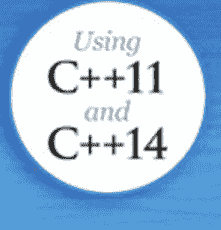


*本页故意留白*


1106

### A.10.1 运算符重载

1107

## A.11 枚举

1107

### A.12 类

1108

#### A.12.1 成员访问

1108

#### A.12.2 类成员定义

1112

### A.12.3 构造、销毁和复制

1112

#### A.12.4 派生类

1116

### A.12.5 位域

1120

### A.12.6 联合体

1121

## A.13 模板

1121

### A.13.1 模板参数

1122

#### A.13.2 模板实例化

1123

### A.13.3 模板成员类型

1124

## A.14 异常

1125

## A.15 命名空间

1127

## A.16 别名

1128

## A.17 预处理器指令

1128

### A.17.1 #include

1128

### A.17.2 #define

1129

# 附录B 标准库摘要

1131

## B.1 概览

1132

### B.1.1 头文件

1133

### B.1.2 命名空间std

1136

### B.1.3 描述风格

1136

## B.2 错误处理

1137

### B.2.1 异常

1138

## B.3 迭代器

1139

### B.3.1 迭代器模型

1140

### B.3.2 迭代器类别

1142

## B.4 容器

1144

### B.4.1 概览

1146

### B.4.2 成员类型

1147

### B.4.3 构造函数、析构函数和赋值

1148

### B.4.4 迭代器

1148

### B.4.5 元素访问

1149

### B.4.6 栈和队列操作

1149

### B.4.7 列表操作

1150

### B.4.8 大小和容量

1150

### B.4.9 其他操作

1151

### B.4.10 关联容器操作

1151

## B.5 算法

1152

### B.5.1 非修改序列算法

1153

### B.5.2 修改序列算法

1154

### B.5.3 工具算法

1156

### B.5.4 排序和查找

1157

### B.5.5 集合算法

1159

### B.5.6 堆

1160

### B.5.7 排列

1160

### B.5.8 最小值和最大值

1161

## B.6 STL工具

1162

### B.6.1 插入器

1162

### B.6.2 函数对象

1163

### B.6.3 pair和tuple

1165

### B.6.4 initializer_list

1166

### B.6.5 资源管理指针

1167

## B.7 I/O流

1168

### B.7.1 I/O流层级

1170

### B.7.2 错误处理

1171

### B.7.3 输入操作

1172

### B.7.4 输出操作

1173

### B.7.5 格式化

1173

### B.7.6 标准操纵器

1173

## B.8 字符串操作

1175

### B.8.1 字符分类

1175

### B.8.2 字符串

1176

### B.8.3 正则表达式匹配

1177

## B.9 数值

1180

### B.9.1 数值限制

1180

### B.9.2 标准数学函数

1181

### B.9.3 复数

1182

### B.9.4 valarray

1183

### B.9.5 泛化数值算法

1183

### B.9.6 随机数

1184

## B.10 时间

1185

## B.11 C标准库函数

1185

### B.11.1 文件

1186

### B.11.2 printf()函数族

1186

### B.11.3 C风格字符串

1191

### B.11.4 内存

1192

### B.11.5 日期和时间

1193

### B.11.6 其他

1194

## B.12 其他库

1195

# 附录C 使用Visual Studio入门

1197

## C.1 运行程序

1198

## C.2 安装Visual Studio

1198

## C.3 创建和运行程序

1199

### C.3.1 创建新项目

1199

### C.3.2 使用std_lib_facilities.h头文件

1199

### C.3.3 向项目中添加C++源文件

1200

### C.3.4 输入你的源代码

1200

### C.3.5 构建可执行程序

1200

### C.3.6 执行程序

1201

### C.3.7 保存程序

1201

## C.4 后续步骤

1201

# 附录D 安装FLTK

1203

## D.1 简介

1204

## D.2 下载FLTK

1204

## D.3 安装FLTK

1205

## D.4 在Visual Studio中使用FLTK

1205

## D.5 测试是否成功

1206

# 附录E 图形用户界面实现

1207

## E.1 回调实现

1208

## E.2 控件实现

1209

## E.3 窗口实现

1210

## E.4 Vector_ref

1212

## E.5 示例：操作控件

1213

# 词汇表

1217

# 参考文献

1223

# 索引

1227

*此页故意留白*

# 前言

> “撞向鱼雷去！  
> 全速前进。”  
> —— 法拉古特海军上将

编程是一门将问题解决方案表达出来，让计算机能够执行这些解决方案的艺术。编程中的许多努力都用于寻找和精炼解决方案。通常，只有通过为问题编写解决方案的过程，才能完全理解该问题。

这本书是为那些没有编程经验但愿意努力工作来学习编程的人准备的。它帮助你理解原则，并使用C++编程语言获得实践技能。我的目标是让你获得足够的知识和经验，以便使用最新的最佳技术执行简单实用的编程任务。这需要多长时间？作为大学一年级课程的一部分，你可以在一个学期内完成本书的学习（假设你的工作量为四门中等难度的课程）。如果你自学，不要期望花费的时间少于那个时间（可能每周15小时，持续14周）。

三个月可能看起来很长，但有很多东西要学习，你在大约一个小时后就会编写出你的第一个简单程序。此外，所有的学习都是循序渐进的：每一章都介绍新的有用概念，并用受实际用途启发的例子来说明它们。你用代码表达想法的能力——让计算机做你想让它做的事情——会逐渐且稳定地随着你的进步而提高。我永远不会说，“学一个月的理论，然后看看你是否能使用它。”

## 为什么要学习编程？

我们的文明依靠软件运转。如果不理解软件，你只能将一切都视为“魔法”，并且会被拒之门外，无法进入许多最有趣、最有利可图且对社会最有用的技术领域。当我提到编程时，我脑海中浮现的是计算机程序的全谱系：从带有图形用户界面（GUI）的个人电脑应用程序，到工程计算和嵌入式系统控制应用（如数码相机、汽车和手机），再到广泛应用于人文学科和商业应用中的文本处理应用程序。与数学一样，编程——当做得好时——是一种宝贵的智力训练，能够磨练我们的思维能力。然而，得益于计算机的即时反馈，编程比大多数数学形式更具体，因此对更多人来说更容易上手。它是伸出援手并改变世界的一种方式——理想情况下是向更好的方向改变。最后，编程可以非常有趣。

## 为什么选择 C++？

没有编程语言就无法学习编程，而 C++ 直接支持实际软件中使用关键概念和技术。C++ 是最广泛使用的编程语言之一，其应用范围无可比拟。你可以在从海底到火星表面的任何地方找到 C++ 应用。C++ 由非专有的国际标准精确且全面地定义。在每种类型的计算机上都可以获得高质量和/或免费的实现。使用 C++ 学习的绝大多数编程概念可以直接应用于其他语言，如 C、C#、Fortran 和 Java。最后，我单纯地喜欢 C++，它是编写优雅且高效代码的语言。

## 引言

这本关于入门编程的书并非最容易读的那本；它的目标也并非如此。我只是希望它是你能从中学习现实世界编程基础的最易读的书。这是一个相当雄心勃勃的目标，因为许多现代软件依赖于几年前还被认为先进的技

术。

我的基本假设是你希望编写供他人使用的程序，并负起责任，提供相当水平的系统质量；也就是说，我假设你希望达到专业水平。因此，我为这本书选择的主题涵盖了开始进行现实世界编程所需的内容，而不仅仅是容易教学和学习的内容。如果你需要某种技术来正确地完成基本工作，我会描述它，演示支持该技术所需的语言和概念设施，提供相关的练习，并期望你完成这些练习。如果你只是想理解一些玩具程序，那么远少于我呈现的内容就足够了。另一方面，我不会浪费你的时间去讲那些实际重要性微乎其微的内容。如果一个概念在这里被解释，那是因为几乎可以肯定你会需要它。

如果你的愿望是使用他人的成果，却不理解事情是如何完成的，并且自己也不显著地贡献代码，那么这本书不适合你。如果是这种情况，请考虑你是否会从另一本书和另一种语言中获益更多。如果这是你对编程的大致看法，也请考虑一下你是从哪里获得这种看法的，以及这种看法实际上是否满足你的需求。人们常常低估编程的复杂性及其价值。如果因为你需要的内容与我描述的软件现实部分不匹配而让你产生对编程的厌恶，我会感到遗憾。在“信息技术”世界的许多部分并不需要了解编程。这本书旨在服务于那些确实想要编写或理解非平凡程序的人。

由于其结构和实际目标，这本书也可以作为第二本编程书，供已经懂一点 C++ 的人，或者使用其他语言编程并想学习 C++ 的人使用。如果你属于上述类别之一，我不猜你阅读这本书需要多长时间，但我鼓励你多做很多练习。这将帮助你克服一个常见问题：即用旧的、熟悉的风格编写程序，而不是在更合适的情况下采用新技术。如果你是以较传统的方式学习 C++ 的，你会在到达第 7 章之前发现一些令人惊讶且有用的内容。除非你叫 Stroustrup，否则我讨论的并不是“你父亲的 C++”。

编程是通过编写程序来学习的。在这方面，编程与其他具有实践成分的活动类似。你无法仅通过阅读书籍来学习游泳、演奏乐器或驾驶汽车——你必须练习。同样，你不阅读和编写大量代码就无法学会编程。本书重点关注与解释性文本和图表紧密结合的代码示例。你需要它们来理解编程的理想、概念和原则，并掌握用于表达这些内容的语言结构。这是必不可少的，但仅凭这一点，你无法获得编程的实际技能。为此，你需要做练习，并习惯于使用编写、编译和运行程序的工具。你需要犯自己的错误并学会纠正它们。编写代码无可替代。此外，乐趣就在那里！

另一方面，编程不仅仅是遵循几条规则和阅读手册——远远不止如此。本书绝非专注于“C++ 的语法”。理解基本的理想、原则和技术是优秀程序员的核心。只有设计良好的代码才有机会成为正确、可靠且可维护系统的一部分。此外，“基础”才是持久的：即使今天的语言工具进化或被取代，它们仍然至关重要。

计算机科学、软件工程、信息技术等呢？那全是编程吗？当然不是！编程是计算机科学相关领域一切事物背后的基本主题之一，在平衡的计算机科学课程中拥有其自然的位置。我简要介绍了算法、数据结构、用户界面、数据处理和软件工程的关键概念和技术。然而，这本书不能替代对这些主题的深入和平衡的研究。

代码可以既美丽又有用。本书旨在帮助你看到这一点，理解代码美丽意味着什么，并帮助你掌握原则并获取创建此类代码的实际技能。祝编程顺利！

## 致学生的一封信

在得克萨斯农工大学使用本书教授的前数千名一年级学生中，大约 60% 以前编程过，而大约 40% 一生中从未看过一行代码。大多数人成功了，所以你也可以做到。

你不必将阅读这本书作为课程的一部分。这本书被广泛用于自学。然而，无论你是作为课程的一部分还是独立学习，试着与其他人合作。编程有一种——不公平的——孤独活动的名声。大多数人作为拥有共同目标团队的一部分时，工作表现更好，学习也更快。共同学习和与朋友讨论问题并不是作弊！这是取得进步最有效——也是最愉快——的方式。退一步说，与朋友合作迫使你阐明自己的想法，这几乎是测试你的理解程度并确保你记住的最有效方法。你实际上不需要亲自发现每一个晦涩的语言和编程环境问题的答案。但是，请不要通过不做练习和相当数量的习题（即使没有老师强迫你）来欺骗自己。记住：编程（除此之外）是一项需要练习才能掌握的实际技能。如果你不写代码（每个章节做几个练习），阅读这本书将是一个毫无意义的理论练习。

大多数学生——尤其是深思熟虑的优秀学生——会遇到质疑自己努力是否值得的时刻。当（而非如果）这种情况发生时，休息一下，重读这篇序言，并查看第 1 章（“计算机、人类与编程”）和第 22 章（“理想与历史”）。在那里，我试图阐述我认为编程令人兴奋的地方，以及为什么我将其视为对世界做出积极贡献的关键工具。如果你对我的教学理念和总体方法有疑问，请看看第 0 章（“致读者”）。

你可能会担心这本书的分量，但你应该放心，重量大的原因之一是我倾向于重复解释或添加示例，而不是让你去寻找唯一正确的解释。另一个主要原因是，书的后半部分是参考资料和“附加材料”，仅在你对编程的特定领域（如嵌入式系统编程、文本分析或数值计算）有更多兴趣时供你探索。

请不要过于急躁。学习任何主要的、有价值的新技能都需要时间，并且值得付出。

## 致教师的话

不，这并非传统的计算机科学 101 课程。这是一本关于如何构建可用软件的书籍。因此，它省略了计算机科学传统教学中涉及的许多内容（如图灵完备性、状态机、离散数学、乔姆斯基语法等）。甚至硬件也被忽略，假设学生们从幼儿园起就已以各种方式使用过计算机。本书甚至不试图提及大多数重要的计算机科学主题。它专注于编程（或更广泛地说，是如何开发软件），因此与许多传统课程相比，它对较少主题进行了更详细的探讨。它力求做好一件事，而计算机科学并非一门课程所能涵盖的主题。如果本书/课程被用作计算机科学、计算机工程、电气工程（我们的许多早期学生都是电气工程专业）、信息科学或任何其他课程的一部分，我期望它作为全面入门教育的一部分，与其他课程一起讲授。

请阅读第 0 章（“致读者”），其中解释了我的教学理念、一般方法等。请尽量在过程中将这些理念传达给你的学生。

## ISO 标准 C++

C++ 由 ISO 标准定义。第一个 ISO C++ 标准于 1998 年批准，因此该版本的 C++ 被称为 `C++98`。我在参与 `C++11` 设计工作期间撰写了本书的第一版。无法使用新颖的特性（如统一初始化、range-for 循环、移动语义、lambda 表达式和概念）来简化原则和技术的阐述，这是最令人沮丧的事情。然而，本书在设计时已考虑到 `C++11`，因此在合适的位置“插入”这些特性相对容易。就撰写本文而言，当前标准是 2011 年的 `C++11`，而即将发布的 2014 年 ISO 标准 `C++14` 的功能正在融入主流 C++ 实现中。本书使用的语言是带有少量 `C++14` 特性的 `C++11`。例如，如果你的编译器对以下代码发出警告：

```cpp
vector<int> v1;
vector<int> v2 {v1};    // C++14 风格的拷贝构造
```

请改用：

```cpp
vector<int> v1;
vector<int> v2 = v1;    // C++98 风格的拷贝构造
```

如果你的编译器不支持 `C++11`，请更换新的编译器。良好的现代 C++ 编译器可以从各种供应商处下载；参见 `www.stroustrup.com/compilers.html`。使用较早且支持较少的语言版本学习编程可能会带来不必要的困难。

## 支持

本书的支持网站 `www.stroustrup.com/Programming` 包含多种支持使用本书进行编程教学和学习的资料。这些资料可能会随时间改进，但一开始，你可以找到：

- 基于本书的课程幻灯片

- 教师指南

- 书中使用的库的头文件和实现

- 书中示例的代码

- 部分练习的解答

- 可能有用的链接

- 勘误表

欢迎提出改进建议。

## 致谢

我特别想感谢我已故的同事兼共同教师 Lawrence “Pete” Petersen，他在我很早就鼓励我尝试教授初学者，这远早于我对此感到舒适的时机，并提供了使课程成功的实践教学经验。没有他，课程的第一版将会失败。我们共同设计了本书所基于的课程初期版本，并多次共同授课，从经验中学习，改进课程和书籍。我在本书中使用“我们”一词最初的意思是“Pete 和我”。

感谢德克萨斯农工大学 ENGR 112、ENGR 113 和 CSCE 121 课程的学生、教学助理和同行教师，他们直接和间接地帮助我们编写了这本书；同时也感谢 Walter Daughenry、Hyunyoung Lee、Teresa Leyk、Ronnie Ward 和 Jennifer Welch，他们也讲授过这门课程。还要感谢 Damian Dechev、Tracy Hammond、Arne Tøstrup Madsen、Gabriel Dos Reis、Nicholas Stroustrup、J. G. van Winkel、Greg Versoender、Ronnie Ward 和 Leor Zolman 对本书草稿提出的建设性意见。感谢 Mogens Hansen 解释发动机控制软件。感谢 Al Aho、Stephen Edwards、Brian Kernighan 和 Daisy Nguyen，他们帮助我远离干扰，在夏季完成写作。

感谢 Art Werschlul 基于他在纽约市福特汉姆大学课程中使用本书第一版给出的许多建设性意见，以及 Nick Maclaren 基于他在剑桥大学使用本书第一版给出的关于练习的许多详细意见。他的学生与 TAMU 一年级学生相比，背景和专业需求截然不同。


感谢 Addison-Wesley 为我找到的审稿人。他们的评论，主要基于在大学层面教授 C++ 或计算机科学 101 的经验，非常有价值：Richard Enbody、David Gustafson、Ron McCarty 和 K. Narayanaswamy。还要感谢我的编辑 Peter Gordon，他提出了许多有用的意见，（尤其）感谢他的耐心。我非常感谢 Addison-Wesley 组建的制作团队；他们极大地提高了书籍的质量：Linda Begley（校对）、Kim Arney（排版）、Rob Mauhar（插图）、Julie Nahir（制作编辑）和 Barbara Wood（文字编辑）。

感谢第一版的翻译者，他们发现了许多问题，并帮助澄清了许多要点。特别是，Loïc Joly 和 Michel Michaud 对法语翻译进行了彻底的技术审查，带来了许多改进。

我还想感谢 Brian Kernighan 和 Doug McIlroy 为编写编程书籍树立了很高的标准，以及 Dennis Ritchie 和 Kristen Nygaard 在实用语言设计方面提供的宝贵经验。

*此页故意留白*


## 致读者

> “当地形与地图不符时，相信地形。”
> — 瑞士谚语

本章是一个信息杂集；其目的是让你对书中的其余内容有一个概念。请略读本章并阅读你感兴趣的部分。教师会发现其中大部分内容立即有用。如果你在没有良好老师帮助的情况下阅读本书，请不要试图理解本章的一切；只需查看“本书的结构”和“教学与学习哲学”的第一部分即可。当你觉得能够编写和执行小程序时，你可能希望回来重读本章。

# 0.1 本书的结构

### 0.1.1 一般方法

### 0.1.2 练习、习题等

### 0.1.3 读完本书后？

## 0.2 教学与学习哲学

## 0.2.1 主题顺序

## 0.2.2 编程与编程语言

## 0.2.3 可移植性

## 0.3 编程与计算机科学

## 0.4 创造力与问题解决

## 0.5 反馈请求

## 0.6 参考资料

## 0.7 参考文献

# 0.1 本书的结构

本书由四部分和一组附录组成：

- 第一部分，“基础”，介绍了编程的基本概念和技术，以及开始编写代码所需的 C++ 语言和库设施。这包括类型系统、算术运算、控制结构、错误处理，以及函数和用户定义类型的设计、实现和使用。
- 第二部分，“输入与输出”，描述了如何从键盘和文件获取数值和文本数据，以及如何向屏幕和文件生成相应的输出。然后，它展示了如何将数值数据、文本和几何形状作为图形输出呈现，以及如何从图形用户界面（`GUI`）获取输入到程序中。
- 第三部分，“数据与算法”，重点介绍 C++ 标准库的容器和算法框架（`STL`，标准模板库）。它展示了容器（如 `vector`、`list` 和 `map`）是如何实现的（使用指针、数组、动态内存、异常和模板）以及如何使用它们。它还演示了标准库算法（如 `sort`、`find` 和 `inner_product`）的设计和使用。
- 第四部分，“拓宽视野”，通过讨论理想和历史、通过示例（如矩阵计算、文本操作、测试和嵌入式系统编程）以及通过简要描述 C 语言，提供了一种对编程的视角。
- 附录提供了不适合在教程式呈现中涵盖的有用信息，如 C++ 语言和标准库设施的综述，以及如何开始使用集成开发环境（`IDE`）和图形用户界面（`GUI`）库的说明。

不幸的是，编程世界并不能被干净利落地划分为四个部分。因此，本书的“部分”仅提供了一个较为粗略的主题分类。我们认为这是一种有用的分类（显然，否则我们不会采用它），但现实总爱打破这种整齐的划分。例如，我们需要使用输入操作的时间，远远早于我们能够彻底解释 C++ 标准 I/O 流（输入/输出流）的时候。当呈现某个概念所需的话题集与整体分类发生冲突时，我们不会仅仅指向其他地方的完整解释，而是会解释能够良好呈现该概念所需的最少内容。僵化的分类适用于手册，却远不适合教程。

话题的顺序由编程技巧决定，而非编程语言特性；参见 §0.2。有关围绕语言特性组织的内容，请参见附录 A。

为了方便复习，并帮助你在首次阅读时若尚未发现哪些信息至关重要而遗漏了关键点，我们在页边栏中放置了三种类型的“警示标记”：
- 蓝色：概念和技巧（本段就是其中一个例子）
- 绿色：建议
- 红色：警告

## 0.1.1 总体方法

在这本书中，我们直接与你交流。这比大多数科学论文中那种传统的、间接的“职业”称呼方式更简单、更清晰。这里的“你”指的是“你，读者”，而“我们”要么指“我们自己，即作者和教师”，要么指你和我们共同解决某个问题，就像我们身处同一房间时那样。

本书的设计初衷是从头到尾逐章阅读。你经常会有回过头来看某处第二遍或第三遍的冲动。事实上，这是唯一明智的做法，因为你总会略过一些当时看不出其重要性的细节。在这些情况下，你最终会回去再看一遍。然而，尽管有索引和交叉引用，这本书并不是那种你可以随意翻开任意一页并开始阅读、并期望获得成功的内容。每一节和每一章都假定你理解前置内容。

每一章都是一个相对自包含的单元，旨在“一气呵成”（从逻辑上是这样，尽管在学生紧张的日程中不一定总能实现）读完。这是将文本划分为章节的一个主要标准。其他标准包括：一个章节是进行操练和练习的合适单元，以及每一章都呈现了某种特定的概念、思想或技巧。这种多重标准导致有几章显得过长，因此请不要将“一气呵成”理解为绝对。特别是，一旦你思考了复习问题，完成了操练，并做了一些练习，你经常会发现不得不回去重读几个章节，而且不知不觉过了好几天。我们将章节聚集成专注于主要主题（如输入/输出）的“部分”。这些部分是良好的复习单元。

对教科书常见的赞美是：“每当我想到一个问题时，它刚好就回答了！”这是对于较小技术问题的理想状态，早期读者确实在这本书中观察到了这一现象。然而，这不能是唯一的理想。我们提出了初学者可能不会想到的问题。我们的目标是提出并回答那些你在为他人编写高质量软件时需要考虑的问题。学会提出正确（往往很困难）的问题，是学会像程序员一样思考的关键部分。只问简单和显而易见的问题会让你感觉良好，但无助于你成为真正的程序员。

我们尊重你的智慧，并体谅你的时间。在我们的讲解中，我们追求专业而非俏皮，我们宁愿轻描淡写也不愿夸大其词。我们尽量避免夸大某种编程技巧或语言特性的重要性，但请不要低估像“这通常很有用！”这样简单的陈述。如果我们含蓄地强调某事物很重要，那意味着如果你不掌握它，迟早会浪费好几天时间。我们对幽默的使用比我们理想中要有限得多，但经验表明，人们对什么好笑的看法差异巨大，失败的幽默尝试可能会造成困惑。

我们并不假装我们的想法或提供的工具是完美的。没有任何工具、库、语言或技巧是所有程序员面临的众多挑战的“终极解决方案”。充其量，它们可以帮助你开发并表达你的解决方案。我们努力避免“善意的谎言”；也就是说，我们避免提供那些清晰易懂但在真实语言和真实问题语境下不正确的过度简化解释。另一方面，这本书不是参考手册；关于 C++ 更精确和完整的描述，请参见 Bjarne Stroustrup 的 *The C++ Programming Language*（第四版，Addison-Wesley，2013）以及 ISO C++ 标准。

## 0.1.2 操练、练习等

编程不仅仅是一种智力活动，因此编写程序对于掌握编程技能是必要的。我们提供两个层级的编程实践：
- **操练 (Drills)**：操练是一种设计用来培养实用的、近乎机械技能非常简单的练习。一个操练通常由对单个程序的一系列修改组成。你应该完成所有的操练。操练并不要求深刻的理解、机智或主动性。我们认为操练是本书基础结构的组成部分。如果你没有做操练，你就没有“做完”这本书。
- **练习 (Exercises)**：有些练习很琐碎，有些则非常难，但大多数旨在为主动性和想象力留出空间。如果你很认真，你会做相当多的练习。至少要做足够多，以了解哪些对你来说是困难的。然后再多做几个那样的。这是你学习效果最好的方式。练习旨在不需要过人的聪明才智也能应对，而不是诡计多端的谜题。然而，我们希望我们提供了足够困难的练习以挑战任何人，并提供了足够多的练习以至于耗尽甚至最好学生的可用时间。我们不期望你做完所有练习，但请随意尝试。

此外，我们建议你（每个学生）参加一个小项目（如果时间允许，则参加更多）。项目旨在产生一个完整的、有用的程序。理想情况下，项目由一小群人（例如，三个人）协作完成，大约花一个月的时间，同时在研读第三部分的相关章节。大多数人发现项目是最有趣的部分，也是将所有内容串联在一起的关键。

有些人喜欢把书放一边，在读完一章之前先尝试一些例子；另一些人则喜欢先读到结尾，然后再尝试让代码运行。为了支持前者这类读者，我们在文本的自然停顿处提供了标记为"**试试这个**"的简单实践建议。**试试这个**通常是一个 narrowly focused on 前置主题的操练性质的练习。如果你跳过了一个**试试这个**——也许是因为你不在电脑旁，或者你被文本深深吸引——请在做章节操练时返回来重新审视它；一个**试试这个**要么是对章节操练的补充，要么是章节操练的一部分。

在每一章的末尾，你都会发现一组复习问题。它们旨在指引你关注本章解释的关键思想。看待复习问题的一种方式是将其视为练习的补充：练习侧重于编程的实用方面，而复习问题则试图帮助你表达思想和概念。在这方面，它们类似于良好的面试问题。

每一章末尾的“术语”部分列出了编程和 C++ 的基本词汇。如果你想理解人们谈论编程主题的含义，并表达自己的想法，你就应该知道每个术语的含义。

学习涉及重复。我们的理想是将每个重要观点至少强调两次，并通过练习加以强化。

## 0.1.3 读完这本书之后是什么？

在这本书结束时，你会成为编程和 C++ 的专家吗？当然不会！当做得好时，编程是一门微妙、深邃且高度依赖技能的艺术，它建立在各种技术技能之上。你不应该期望在四个月内成为编程专家，正如你不应该期望成为生物学、数学或一门自然语言（如中文、英语或丹麦语）方面的专家一样，或者在四个月内——或半年，或一年内——拉好小提琴。你应当抱有的期望，以及如果你认真对待本书时所能预期的结果是：拥有一个真正良好的开端，使你能编写相对简单的实用程序，能够阅读更复杂的程序，并为进一步的工作奠定坚实的概念和实践基础。

对这门入门课程最佳的后续步骤是从事一个真实项目，开发供他人使用的代码。在那之后，或者（更好的是）与一个真实项目并行进行，阅读一本专业水平的通用教科书（如斯特劳斯特鲁普的《The C++ Programming Language》），一本与你项目需求相关的更专门的书籍（如用于GUI的Qt，或用于分布式编程的ACE），或一本聚焦于C++某个特定方面的教科书（如Koenig和Moo的《Accelerated C++》；Sutter的《Exceptional C++》；或Gamma等人的《Design Patterns》）。如需更多参考文献，请参阅§0.6或书末的参考文献部分。

最终，你应该学习另一种编程语言。我们认为，如果你不了解多种语言，就不可能成为软件领域的专业人士——即使你主要不是程序员，也是如此。

## 0.2 教学与学习理念

我们试图帮助你学习什么？我们又是如何开展教学过程的？我们努力为你呈现最少的概念、技巧，以及编写有效的实用程序所需的工具，包括：
- 程序组织
- 调试和测试
- 类设计
- 计算
- 函数和算法设计
- 图形（仅限二维）
- 图形用户界面（`GUI`）
- 文本操作
- 正则表达式匹配
- 文件和流输入输出（I/O）
- 内存管理
- 科学/数值/工程计算
- 设计和编程理念
- C++标准库
- 软件开发策略
- C语言编程技术

在讲解这些主题的过程中，我们涵盖了所谓的程序式编程（如C编程语言所采用的）、数据抽象、面向对象编程和泛型编程等编程技术。本书的主要主题是*编程*，即在代码中表达想法的理念、技术和工具。C++编程语言是我们的主要工具，因此我们详细介绍了C++的许多特性。但请记住，C++只是一种工具，而非本书的主要主题。这是“使用C++进行编程”，而不是“带有一点编程理论的C++”。

我们讨论的每个主题至少有两个目的：它既介绍一种技术、概念或原则，也介绍一种实用的语言或库特性。例如，我们使用二维图形系统的接口来说明类和继承的用法。这使得我们可以节省篇幅（以及你的时间），同时也强调编程不仅仅是尽可能快地堆砌代码以获得结果。C++标准库是这种“一石二鸟”示例的主要来源——许多甚至是一石三鸟。例如，我们介绍标准库的**vector**，用它来说明广泛实用的设计技术，并展示了实现它所采用的许多编程技术。我们的目标之一向你展示主要库设施是如何实现的，以及它们如何映射到硬件。我们坚持认为工匠必须了解他们的工具，而不能仅仅将其视为“魔法”。

一些主题对某些程序员比其他人更有趣。然而，我们鼓励你不要预判你的需求（你怎么知道未来会需要什么？），至少浏览每一章。如果你将本书作为课程的一部分阅读，你的老师会指导你的选择。

我们将我们的方法描述为“深度优先”。它也是“具体优先”和“基于概念的”。首先，我们快速（好吧，相对快速，第1–11章）汇集一组编写小型实用程序所需的技能。在此过程中，我们以最少的细节介绍大量工具和技术。我们专注于简单的具体代码示例，因为人们掌握具体内容的速度比抽象内容快。这只是大多数人学习的方式。在这个初始阶段，你不应该指望理解每一个小细节。特别是，你会发现尝试与刚才有效的操作略有不同的做法可能会产生“神秘”的效果。不过还是试试吧！请务必完成我们提供的练习和习题。请记住，在早期阶段，你还没有足够的概念和技能来准确估计什么是简单的，什么是复杂的；请预期会有意外，并从中学习。

在这个初始阶段我们进展迅速——我们希望尽快让你达到能编写有趣程序的阶段。有人可能会争辩说：“我们必须缓慢而谨慎地前进；在学会跑之前必须学会走！”但你有没有观察过婴儿学步？婴儿在掌握缓慢、受控行走的精细技能之前，确实会自己跑起来。同样，你将向前冲刺，偶尔跌倒，以初步体验编程，然后再慢下来以获得必要的精细控制和理解。在你学会走路之前，你必须先跑起来！

至关重要的是，不要在试图了解某个语言细节或技术的“所有方面”时陷入困境。例如，你可以记住C++的所有内置类型及其所有使用规则。当然你可以做到，这样做可能会让你觉得自己很有知识。然而，这不会让你成为程序员。跳过细节可能会让你在缺乏知识的情况下偶尔“吃亏”，但这是获得编写良好程序所需视角的最快途径。请注意，我们的方法本质上与儿童学习母语以及教授外语最有效的方法是一致的。当你不可避免地遇到瓶颈时，我们鼓励你向老师、朋友、同事、指导者、导师等寻求的帮助。请确信，这些早期章节中没有任何内容在根本上是困难的。然而，许多内容会显得陌生，因此起初可能会感觉困难。

之后，我们在初始技能的基础上构建，以拓宽你的知识和技能基础。我们使用示例和练习来巩固你的理解，并为编程提供概念基础。

我们非常重视理念和理由。你需要理念来指导你在寻找实用解决方案时——知道何时解决方案是良好且有原则的。你需要理解这些理念背后的原因，以便理解为什么它们应该是你的理念，为什么追求它们将有助于你和你的代码用户。没有人应该满足于“因为事情就是这样”作为解释。更重要的是，对理念和原因的理解使你能够将从已知推广到新情况，并以新颖的方式组合想法和工具来解决新问题。知道“为什么”是获取编程技能的重要组成部分。相反，仅仅记忆大量未充分理解的规则和语言特性是局限的、错误的来源，也是对时间的巨大浪费。我们珍视你的时间，并努力不浪费它。

许多C++语言技术细节被移至附录和手册中，需要时你可以查阅。我们假设你在需要时具有主动查找信息的积极性。使用索引和目录。别忘了编译器的在线帮助设施，以及网络。但是请记住，在你有理由相信某个网络资源更好之前，要高度怀疑每一个网络资源。许多看似权威的网站或个人由编程新手或别有用心的人建立。其他人则只是过时了。我们在我们的支持网站上提供了一组链接和信息：www.stroustrup.com/Programming。

请不要对“现实”的示例太过急躁。我们理想的示例是最短、最简单的代码，直接说明语言特性、概念或技术。大多数现实世界的示例比我们的杂乱得多，但并不由比我们所演示内容更复杂的组合构成。拥有数十万行代码的成功商业程序是基于我们在12个50行程序中说明的技术。理解现实代码的最快方式是通过对基本知识的透彻理解。

另一方面，我们不会使用“涉及可爱动物的俏皮例子”来说明观点。我们假设你致力于编写供真实用户使用的实际程序，因此，所有未以语言技术为展示形式的示例均来自真实世界的应用场景。我们基本的语调是专业人士对（未来的）专业人士讲话的方式。

## 0.2.1 主题顺序

教人编程有很多方法。显然，我们并不信奉流行的“我学习编程的方式就是学习编程的最佳方式”这一理论。为了便于学习，我们在早期就引入了几年前还被视为高级主题的内容。我们的理想是，所呈现的主题由你在学习编程过程中遇到的问题驱动，随着你理解和实践技能的提升，主题之间能够流畅过渡。本书的主要脉络更像是一个故事，而非词典或层级结构。

不可能一次性学完编写程序所需的所有原则、技术和语言特性。因此，我们必须选择一个原则、技术和特性的子集作为起点。更一般地说，教科书或课程必须引导学生通过一系列子集。我们认为选择主题并提供强调是我们的责任。我们不能呈现所有内容，因此必须做出选择；在每个学习阶段，我们遗漏的内容至少与我们保留的内容同等重要。

作为对比，列出我们决定不采用的方法（严重简化的）描述可能对你有用：
- **“先学 C”**：这种学习 C++ 的方法浪费学生时间，并迫使学生使用比必要的更少的设施、技术和库来解决问题，从而导致不良的编程实践。C++ 提供了比 C 更强的类型检查、对初学者支持更好的标准库，以及用于错误处理的异常机制。
- **自下而上**：这种方法使学习良好且高效的编程实践分心。通过迫使学生使用语言和支持不足的库来解决问题，它助长了不良且浪费的编程实践。
- **“如果展示某事物，就必须全面展示”**：这种方法隐含自下而上的路径（深入挖掘每个触及的主题）。它以初学者不感兴趣且可能多年后才需要的技术细节使初学者感到无聊。一旦你能够编程，就可以查阅手册获取技术细节。手册在这方面很擅长，而在初始学习概念方面却很糟糕。
- **自上而下**：这种方法从第一原理出发走向细节，容易使读者偏离编程的实践方面，并迫使他们在尚未有机会欣赏其重要性之前就专注于高层概念。例如，在你没有体会到在程序中犯错有多容易以及修正它有多困难之前，你根本无法欣赏适当的软件开发原则。


- `“先抽象”`：专注于通用原则并保护学生免受现实世界不利约束的影响，可能会导致对现实世界问题、语言、工具和硬件约束的轻视。通常，这种方法由随后无法使用且（故意）使学生与硬件和系统关注隔离的“教学语言”支持。

- `“先软件工程原则”`：这种方法与先抽象的方法倾向于共享自上而下方法的问题：没有具体示例和实践经验，你根本无法欣赏抽象和适当软件开发实践的价值。

- `“从第一天开始面向对象”`：面向对象编程是组织代码和编程努力的最佳方式之一，但它不是唯一有效的方式。特别是，我感觉到对类型和算法代码基础的掌握是欣赏类和类层次结构设计的前提条件。我们从第一天起就使用用户定义类型（有些人称之为“对象”），但在第 6 章之前不展示如何设计类，直到第 12 章才展示类层次结构。

- `“只需相信魔法”`：这种方法依赖于展示强大工具和技术，而未向初学者介绍底层技术和设施。这让学生对事物为何如此、使用它们的成本以及在哪里可以合理应用进行猜测——通常猜错。这可能导致僵化地遵循熟悉的工作模式，并成为进一步学习的障碍。

当然，我们不声称这些其他方法永远无用。事实上，我们在若干特定子主题中使用了其中几种方法，因为它们的优点在那里可以被欣赏。然而，作为面向实际使用的学习编程的通用方法，我们拒绝它们并应用我们的替代方案：具体优先和深度优先，强调概念和技术。

## 0.2.2 编程与编程语言


我们首先教编程，并将我们选择的编程语言视为次要的，视为一种工具。我们的通用方法可用于任何通用编程语言。我们的主要目标是帮助你学习通用概念、原则和技术。然而，这些无法孤立地欣赏。例如，语法细节、可以直接表达的思想类型以及工具支持因编程语言而异。然而，许多用于产生无缺陷代码的基本技术，例如编写逻辑简单的代码（第 5 章和第 6 章）、建立不变量（§ 9.4.3）以及将接口与实现细节分离（§ 9.7 和 § 14.1–2），在不同编程语言之间变化很小。

必须使用编程语言来学习编程和设计技术。设计、代码组织和调试不是你可以在抽象中获得的技能。你需要用某种编程语言编写代码并获得实践经验。这意味着你必须学习编程语言的基础知识。我们说“基础知识”，因为你在几周内学完一门主要工业语言的时代已经一去不复返了。我们呈现的 C++ 部分被选为最支持良好代码生成的子集。此外，我们呈现 C++ 特性，因为你无法避免遇到它们，因为它们对于逻辑完整性是必要的，或者在 C++ 社区中很常见。

## 0.2.3 可移植性

在多种机器上运行 C++ 代码很常见。主要的 C++ 应用运行在我们从未听说过的机器上！我们认为可移植性以及使用多种机器架构和操作系统至关重要。本书中的几乎每个示例不仅是 ISO 标准 C++，而且具有可移植性。除非特别说明，我们呈现的代码应在每个 C++ 实现上都能工作，并已在几台机器和操作系统上进行过测试。

如何编译、链接和运行 C++ 程序的具体细节因系统而异。每次我们需要提及实现问题时，列举每个系统和每个编译器的细节将是冗长的。在附录 C 中，我们提供了在 Windows 机器上使用 Visual Studio 和 Microsoft C++ 入门的最基本信息。

如果你在使用流行但相当复杂的集成开发环境（IDE）时遇到麻烦，我们建议你尝试从命令行开始工作；它出乎意料地简单。例如，以下是使用 GNU C++ 编译器在 Unix 或 Linux 系统上编译、链接和执行由两个源文件 `my_file1.cpp` 和 `my_file2.cpp` 组成的简单程序所需的全部命令：

```
c++ -o my_program my_file1.cpp my_file2.cpp
./my_program
```

是的，真的只需要这些。

## 0.3 编程与计算机科学

编程就是计算机科学的全部吗？当然不是！我们提出这个问题的唯一原因是，人们常常对此感到困惑。我们将涉及计算机科学的主要主题，例如算法和数据结构，但我们的目标是教授编程：程序的设计和实现。这既多于又少于大多数关于计算机科学的公认概念：

- *更多*，因为编程涉及许多通常不被认为属于任何科学范畴的技术技能

- *更少*，因为我们没有系统地介绍我们使用的计算机科学部分的基础

本书的目标是成为计算机科学课程的一部分（如果你的目标是成为一名计算机科学家），成为许多软件构建与维护课程中第一门课的基础（如果你的目标是成为一名程序员或软件工程师），并且总体上成为更大整体的一部分。

我们在整个过程中依赖计算机科学，并强调原则，但我们教授编程作为一种基于理论和经验的实用技能，而非作为一种科学。

## 0.4 创造力与问题解决

本书的首要目标是帮助你用代码表达你的想法，而不是教你如何获得这些想法。在此过程中，我们提供了许多关于如何解决问题的例子，通常是通过分析问题，然后逐步完善解决方案。我们认为编程本身就是一种问题解决形式；只有完全理解一个问题及其解决方案，你才能为它表达正确的程序，只有构建和测试程序，你才能确信你的理解是完整的。因此，编程本质上是获得理解过程的一部分。然而，我们旨在通过示例来展示这一点，而不是通过“说教”或提供详细的问题解决处方。

## 0.5 征求反馈

我们认为完美的教科书是不可能存在的；个人的需求差异太大，以至于不可能有一本书适合所有人。然而，我们希望尽可能完善这本书及其辅助材料。为此，我们需要反馈；好的教科书不能脱离读者而孤立编写。请向我们报告错误、错别字、不清晰的文本、缺失的解释等。我们也会感激对更好练习、更好示例以及要添加的主题、要删除的主题等的建议。建设性的意见将帮助未来的读者，我们将会在支持网站上发布勘误表：www.stroustrup.com/Programming。

## 0.6 参考文献

除了列出本章中提到的出版物外，本节还包括你可能发现有用的出版物。

Becker, Pete, ed. *The C++ Standard*. ISO/IEC 14882:2011.

Blanchette, Jasmin, and Mark Summerfield. *C++ GUI Programming with Qt 4*, Second Edition. Prentice Hall, 2008. ISBN 0132354160.

Koening, Andrew, and Barbara E. Moo. *Accelerated C++: Practical Programming by Example*. Addison-Wesley, 2000. ISBN 020170353X.

Myers, Scott. *Effective C++: 55 Specific Ways to Improve Your Programs and Designs*, Third Edition. Addison-Wesley, 2005. ISBN 0321334876.

Schmidt, Douglas C., and Stephen D. Huston. *C++ Network Programming, Volume 1: Mastering Complexity with ACE and Patterns*. Addison-Wesley, 2001. ISBN 0201604647.

Schmidt, Douglas C., and Stephen D. Huston. *C++ Network Programming, Volume 2: Systematic Reuse with ACE and Frameworks*. Addison-Wesley, 2002. ISBN 0201795256.

Stroustrup, Bjarne. *The Design and Evolution of C++*. Addison-Wesley, 1994. ISBN 0201543303.

Stroustrup, Bjarne. “Learning Standard C++ as a New Language.” *C/C++ Users Journal*, May 1999.

Stroustrup, Bjarne. *The C++ Programming Language*, Fourth Edition. Addison-Wesley, 2013. ISBN 0321563840.

Stroustrup, Bjarne. *A Tour of C++*. Addison-Wesley, 2013. ISBN 0321958314.

Sutter, Herb. *Exceptional C++: 47 Engineering Puzzles, Programming Problems, and Solutions*. Addison-Wesley, 1999. ISBN 0201615622.

更全面的参考文献列表可以在书末的参考文献部分找到。

## 0.7 传记

你可能会合理地问，“这些想教我如何编程的人是谁？” 所以这里有一些传记信息。我，Bjarne Stroustrup，写了这本书，并与 Lawrence “Pete” Petersen 一起设计并教授了一门大学水平的入门（一年级）课程，该课程与本书同步开发，使用了本书的草稿。

### Bjarne Stroustrup


我是 C++ 编程语言的设计者和最初实现者。在过去大约 40 年里，我使用该语言以及许多其他编程语言完成了各种各样的编程任务。我非常喜爱在具有挑战性的应用中使用的优雅且高效的代码，例如机器人控制、图形、游戏、文本分析和网络。我教授设计、编程和 C++ 给各种能力和兴趣的人群。我是 C++ ISO 标准委员会的创始成员，并担任语言演进工作组的主席。

这是我的第一本入门书籍。我的其他书籍，如 *The C++ Programming Language* 和 *The Design and Evolution of C++*，是为有经验的程序员编写的。

我出生在丹麦奥胡斯的一个蓝领（工人阶级）家庭，在我家乡的大学获得了数学硕士学位，并辅修计算机科学。我的计算机科学博士学位来自英国剑桥大学。我在 AT&T 工作了大约 25 年，首先在贝尔实验室著名的计算机科学研究中心——Unix、C、C++ 以及更多事物在这里发明——后来在 AT&T Labs–Research。

我是美国国家工程院院士，ACM 会士，也是 IEEE 会士。作为第一位获得该奖项的计算机科学家，我获得了 Sigma Xi（科学研究协会）颁发的 2005 年威廉·普罗克特科学成就奖。2010 年，我获得了奥胡斯大学最古老和最负盛名的荣誉，该荣誉表彰与大学有关联者对科学的贡献，即 *Rigmor og Carl Holst-Knudsens Videnskabspris*。2013 年，我被俄罗斯圣彼得堡国立研究型大学 ITMO 授予计算机科学荣誉博士头衔。

我在工作中也有生活。我已婚，有两个孩子，一个是医生，另一个是博士后研究员。我阅读大量书籍（包括历史、科幻、犯罪和时事），喜欢大多数类型的音乐（包括古典、摇滚、蓝调和国家风格）。与朋友共享美食是生活的必要部分，我喜欢参观世界各地的有趣地方和人物。为了能够享受美食，我跑步。

欲了解更多信息，请访问我的主页：www.stroustrup.com。特别是，你可以在那里找到如何发音我的名字。

### Lawrence “Pete” Petersen


2006 年末，Pete 这样介绍自己：“我是一名教师。近 20 年来，我一直在德克萨斯农工大学教授编程语言。我五次被学生选为教学优秀奖获得者，并在 1996 年获得工程学院校友会颁发的杰出教学奖。我是 Wakoise 教学卓越项目的会士，也是教育者发展学院的会士。

“作为一位陆军军官的儿子，我从小在移动中成长。在华盛顿大学完成哲学学位后，我在军队服役 22 年，担任野战炮兵军官和作战测试研究员。从 1971 年到 1973 年，我曾在俄克拉荷马州锡尔堡的野战炮兵军官高级课程任教。1979 年，我帮助组织了一个‘测试官员培训课程’，并从 1978 年到 1981 年以及从 1985 年到 1989 年，在美国九个不同的地点担任主要讲师。

“1991 年，我成立了一家小型软件公司，生产大学部门的管理软件，直到 1999 年。我的兴趣在于教授、设计和编写真实人们可以使用的软件。我在佐治亚理工学院完成了工业工程硕士学位，在德克萨斯农工大学完成了教育课程与教学硕士学位。我还完成了 NTS 的微计算机硕士项目。我的博士学位是德克萨斯农工大学的信息与运营管理。

“我的妻子芭芭拉和我住在德克萨斯州布莱恩市。我们喜欢旅行、园艺和招待客人；我们尽可能多地与我们的儿子及其家人在一起，特别是与我们的孙辈 Angelina、Carlos、Tess、Avery、Nicholas 和 Jordan 在一起。”

遗憾的是，Pete 于 2007 年因肺癌去世。没有他，这门课程永远不会成功。

## 附言

大多数章节都提供一个简短的“附言”，试图为章节中呈现的信息提供一些视角。我们在提供这些内容时意识到，这些信息可能会——而且经常确实——令人望而生畏，只有在完成练习、阅读后续章节（这些章节会应用本章的理念）以及稍后进行复习之后，才能被完全理解。*不要惊慌！* 放轻松；这是自然而预期的过程。你不可能在一天内成为专家，但当你一步步读完这本书时，你可以成为一名相当称职的程序员。在过程中，你会遇到大量的信息、许多示例，以及许多被众多程序员认为充满启发性和趣味性的技术。


## 计算机、人与编程

> “专业化是昆虫的特质。”

> —R. A. 海因莱因

在本章中，我们介绍了一些我们认为使编程变得重要、有趣和好玩的事物。我们还阐述了一些基本的理念和理想。我们希望破除关于编程和程序员的几个流行迷思。这是一章现在可以快速浏览，日后当你被某些编程问题困扰并怀疑这一切是否值得时再回来重读的内容。

## 1.1 引言

就像大多数学习一样，学习编程是一个“先有鸡还是先有蛋”的问题：我们想要开始，但同时也想知道我们即将学习的内容为何重要。我们想学习一项实用技能，但也要确保它不只是一时的风潮。我们想知道自己不会浪费时间，但也不希望被更多的炒作和说教弄得无聊。就目前而言，只需阅读本章中看似有趣的部分，当你觉得需要刷新对为何技术细节在课堂之外很重要的记忆时，再回来阅读。

本章是我们个人对编程中我们认为有趣和重要之处的陈述。它解释了什么驱动着我们在数十年的职业生涯中坚持在这个领域。这是一章用于了解潜在终极目标以及了解程序员可能是怎样的人的章节。入门级技术书籍不可避免地包含许多相当基础的内容。在本章中，我们将从技术细节中抬起头，放眼大局：为什么编程是有价值的活动？编程在我们的文明中扮演什么角色？程序员可以在哪些领域做出引以为傲的贡献？编程在更广阔的软件开发、部署和维护世界中处于什么位置？当人们谈论“计算机科学”、“软件工程”、“信息技术”等时，编程在图中处于什么位置？程序员做什么？优秀的程序员具备哪些技能？

对学生来说，理解一个想法、技术或章节的最迫切原因可能是为了以优异成绩通过考试——但学习绝不仅仅是为了这些！对于在软件行业工作的人来说，理解一个想法、技术或章节的最迫切原因可能是为了找到一些能帮助当前项目且不会惹恼控制着下一次工资、晋升和解雇的老板的东西——但学习绝不仅仅是为了这些！当我们觉得我们的工作以某种微小的方式让世界成为更适合人类居住的地方时，我们工作得最好。对于我们在数年期间执行的任务（职业和事业由这些“事物”构成），理想和更抽象的想法至关重要。

我们的文明依靠软件运行。改进软件和寻找软件的新用途，是个人帮助改善许多人生活的两种方式。编程在其中起着至关重要的作用。

## 1.2 软件

优秀的软件是隐形的。你看不见它，摸不到它，称不出它的重量，也敲不响它。*软件*是运行在某台计算机上的一组程序。有时，我们可以看到计算机。通常，我们只能看到包含计算机的某样东西，例如电话、相机、面包机、汽车或风力涡轮机。我们可以看到软件做了什么。如果软件没有做它应该做的事情，我们会感到烦恼或受伤。如果软件应该做的事情不符合我们的需求，我们也会感到烦恼或受伤。

世界上有多少台计算机？我们不知道；至少是数十亿。世界上的计算机数量可能比人口还多。我们需要统计服务器、台式电脑、笔记本电脑、平板电脑、智能手机以及嵌入在“小玩意”中的计算机。

你（直接或间接地）每天使用多少台计算机？我的车里有超过30台计算机，我的手机里有2台，我的MP3播放器里有1台，我的相机里有1台。然后还有我的笔记本电脑（你正在阅读的页面就是在此写作的）和我的台式机。将夏日炎热和潮湿拒之门外的空调控制器是一个简单的计算机。计算机科学系电梯里也有一个。如果你使用现代电视，里面某处至少有一台计算机。一点网络浏览让你通过由成千上万台计算机组成的电信系统——电话交换机、路由器等——与数十甚至数百台服务器直接接触。

不，我没有在车后座背着30台笔记本电脑四处跑！重点在于，大多数计算机看起来不像大众眼中的计算机形象（带屏幕、键盘、鼠标等）；它们是我们使用的设备中嵌入的小型“部件”。所以，那辆车里没有任何看起来像计算机的东西，甚至连显示地图和行车方向的屏幕都没有（尽管这类小玩意在其他车上很流行）。然而，它的发动机里包含相当数量的计算机，执行诸如燃油喷射控制和温度监测等任务。动力辅助转向至少涉及一台计算机，收音机和安全系统包含一些，我们甚至怀疑车窗的开关控制也是由计算机控制的。较新的型号甚至有持续监测轮胎压力的计算机。


你每天依赖多少台计算机来完成你做的事？你吃饭；如果你居住在现代城市，把食物送到你手中是一项巨大的努力，需要规划、运输和储存的小奇迹。分销网络的管理当然是计算机化的，将它们串联起来的通信系统也是计算机化的。现代农业高度计算机化；在牛棚旁边你会发现用于监测牛群（年龄、健康状况、牛奶产量等）的计算机，农场设备日益计算机化，而政府各个部门要求的表格数量多到可以让任何诚实的农民哭泣。如果出了什么差错，你可以在报纸上读到所有详情；当然，报纸上的文章是在计算机上撰写的，由计算机排版的，并且（如果你仍然阅读“纸版”）由计算机化设备印刷的——通常在通过电子方式传输到印刷厂之后。书籍是以同样的方式生产的。如果你必须通勤，交通流量由计算机监测，以（通常徒劳地）避免交通堵塞。你更喜欢坐火车？那列火车也是计算机化的；有些甚至没有司机自动运行，并且火车的子系统，如广播、制动和售票，涉及大量计算机。当今的娱乐产业（音乐、电影、电视、舞台演出）是计算机的最大用户之一。即使是非卡通电影也大量使用（计算机）动画；音乐和摄影在录制和分发方面也是数字化的（即使用计算机的）。如果你生病了，医生开的检查将涉及计算机，医疗记录通常是计算机化的，如果你被送去医院治愈，你将遇到的大多数医疗设备都包含计算机。除非你碰巧住在森林里的一间小木屋里，无法使用任何电力驱动的小玩意（包括灯泡），否则你使用能源。石油的发现、开采、加工和分布通过一个在每一步都使用计算机的系统进行，从地下的钻头到你当地的汽油（燃油）泵。如果你用信用卡支付这笔油费，你再次动用了一大群计算机。煤炭、天然气、太阳能和风力的故事也是如此。

迄今为止的例子都是“操作性”的；它们直接参与你正在做的事情。从这个领域中移开一步，是设计这一重要且有趣的领域。你穿的衣服，你说话的电话，以及分配你最爱咖啡的咖啡机，都是使用计算机设计和制造的。现代摄影镜头的卓越品质以及现代日常小玩意和器具设计中精致的外形，几乎一切都归功于基于计算机的设计和生产方法。设计我们环境的工匠/设计师/艺术家/工程师已从许多物理限制中解放出来——...那些曾被认为具有根本性的约束。如果你生病了，用来治愈你的药物将使用计算机设计而成。

最后，研究——科学本身——在很大程度上依赖于计算机。用于探索遥远恒星奥秘的望远镜，如果没有计算机，就无法设计、建造或操作，它们所产生的海量数据，如果没有计算机，也无法进行分析并理解。一个生物学领域的研究者个人可能并不高度计算机化（当然，除非使用了相机、数字录音机、电话等），但在实验室中，数据必须被存储、分析、与计算机模型进行比对，并传达给其他科学家。现代化学和生物学——包括医学研究——使用计算机的程度几年前还难以想象，目前大多数人仍无法想象。人类基因组是由计算机测序的。或者——让我们精确一点——人类基因组是由使用计算机的人类测序的。在所有这些例子中，我们看到计算机是一种让我们能够完成某些事情的事物，如果没有计算机，我们做这些事情会更困难。

所有这些计算机都运行软件。没有软件，它们就只是昂贵的硅、金属和塑料块：门挡、船锚和加热器。这些软件中的每一行代码都是由某个人编写的。实际执行的每一行代码，至少是合理的，如果不是正确的话。这一切都能正常运行，真是令人惊叹！我们正在谈论数以亿计行的代码（程序文本）和数百种编程语言。让这一切正常工作，需要付出惊人的努力，并涉及到无法想象数量的技能。我们希望从根本上改善我们依赖的每一项服务和每一件小装置。随便想想你依赖的一项服务或一件小装置；你希望看到什么方面的改善？如果抛开其他不谈，我们希望我们的服务和装置更小（或更大）、更快、更可靠、功能更丰富、更易用、容量更大、外观更好、更便宜。你想到的改善，很可能需要一些编程。

## 1.3 人

计算机由人制造，供人使用。计算机是一种非常通用的工具；它可以用于一系列范围无法想象的许多任务。需要程序才能使其对某人有用的。换句话说，在某个程序员为其编写代码以完成一些有用功能之前，计算机只是一堆硬件。我们常常忘记软件。更经常的是，我们忘记程序员。好莱坞等类似的“流行文化”虚假信息来源，已经赋予了程序员主要为负面的形象。例如，我们都见过那个孤僻、肥胖、丑陋的书呆子，没有社交技能，对电子游戏和闯入他人计算机痴迷不已。他（几乎总是男性）想要毁灭世界的概率与想要拯救世界的概率一样大。显然，这类漫画的温和版本在现实生活中是存在的，但据我们的经验，软件开发人员中出现这类人物的频率并不比律师、警察、汽车销售员、记者、艺术家或政治家更高。

想想你从自己生活中知道的计算机应用。它们是由某个独居者在黑暗房间里完成的吗？当然不是；创建成功的软件、计算机化小装置或系统，涉及数十人、数百人甚至数千人，他们执行着一套令人眼花缭乱的职责：例如，程序员、（程序）设计师、测试员、动画师、焦点小组经理、实验心理学家、用户界面设计师、分析师、系统管理员、客户关系人员、音响工程师、项目经理、质量工程师、统计学家、硬件接口工程师、需求工程师、安全官员、数学家、销售支持人员、故障排除人员、网络设计师、方法学家、软件工具经理、软件文档管理员等。这些角色的范围非常广泛，而且由于不同组织对其职衔的不同称呼而显得更加令人眼花缭乱：一个组织的“工程师”可能是另一个组织的“程序员”，而又是另一个组织的“开发人员”、“技术人员”或“架构师”。甚至有一些组织让员工自己选择职衔。并非所有这些角色都直接涉及编程。然而，我们亲自见证过许多人在阅读或编写代码作为其工作必不可少的一部分时，承担上述提到的每一个角色。此外，程序员（承担上述任何角色，甚至更多）在较短的时间内可能会与各种应用领域的广泛人群互动，例如生物学家、发动机设计师、律师、汽车销售员、医学研究员、历史学家、地质学家、宇航员、飞机工程师、木材场经理、火箭科学家、保龄球馆建造者、记者和动画师（是的，这个清单是从个人经验中得出的）。有人可能有时是程序员，而在职业生涯的其他阶段则担任非编程角色。

程序员孤立的说法只是一种传说。喜欢独自工作的人会选择那种最可行的工作领域，并且通常会对“干扰”和会议的数量大加抱怨。喜欢与人互动的人会更轻松，因为现代软件开发是一项团队活动。其含义是，社交和沟通技能是必不可少的，其价值远超刻板印象所暗示的程度。在程序员（无论你如何现实地定义程序员）高度期望的技能短名单上，你会发现，与来自各种广泛背景的人——非正式地、在会议中、书面地、以及在正式展示中——良好沟通能力的重要性。我们确信，除非你完成过一两个团队项目，否则你无法了解编程是什么，也无法知道你是否真的喜欢它。我们喜欢编程的方面之一，是我们遇到的大量良好且有趣的人，以及我们在职业生活中得以访问的多样场所。

这一切的一个含义是，具有各种技能、兴趣和工作习惯的人对于生产优秀软件是必不可少的。我们的生活质量取决于这些人——有时甚至是我们自己的生命。没有一个人能够承担这里提到的所有角色；没有明智的人希望承担所有角色。关键在于，你拥有的选择比你能想象的都要多；而不是你必须要做出某种特定的选择。作为个人，你会“自然趋向”于符合你的技能、天赋和兴趣的工作领域。

我们谈论“程序员”和“编程”，但显然编程只是整体图景的一部分。设计轮船或移动电话的人并不把自己视为程序员。编程是软件开发的重要组成部分，但不是软件开发的全部内容。同样，对于大多数产品，软件开发是产品开发的重要组成部分，但不是产品开发的全部内容。

我们并不认为——我们的读者——想要成为一名专业程序员，并花费余生编写代码。即使是最好的程序员——尤其是最好的程序员——大部分时间也不在写代码。理解问题需要认真的时间，并且通常需要大量的智力投入。正是这种智力挑战，使得许多程序员在说编程有趣时指的是它。许多最好的程序员在通常不被视为计算机科学一部分的领域拥有学位。例如，如果你为基因组研究编写软件，那么理解一些分子生物学会高效得多。如果你为分析中世纪文学编写程序，阅读一些该文学，甚至可能了解一种或多种相关的语言，会对你大有裨益。特别是，一个持“我唯一关心的是计算机和编程”态度的人，将无法与其非程序员同事互动。这样的人不仅会错过人际交往中最美好的部分（即生命），而且也会成为一个糟糕的软件开发人员。

那么，我们假设什么？编程是许多重要且有趣的技术领域中的一部分，属于在智力上具有挑战性的技能集合。此外，编程是我们世界的一个基本部分，因此不知道编程的基础就像不知道物理、历史、生物学或文学的基础一样。完全不懂编程的人在许多技术角色中会退化为相信魔法，且是危险的。如果你读过《呆伯特》，将尖头的老板想象成你不想遇到（或者更糟）的人。此外，编程可以很有趣。

但我们要假设你可能使用编程做什么呢？也许你会使用编程作为进一步学习和工作的关键工具，而不会成为专业程序员。也许你会与其他人无论是在职业上还是个人层面，掌握基础的编程知识都会带来优势，例如当你是一位设计师、作家、管理者或科学家时。你可能在学习或工作中以专业水平从事编程。即使你最终成为一名专业程序员，也不太可能整天只做编程这一件事。

你可能会成为一名专注于计算机的工程学家或计算机科学家，但即便如此，你也不会“时刻都在编程”。编程是一种用代码表达思想的方式——一种辅助解决问题的方法。除非你有值得表达的思想或值得解决的问题，否则编程毫无价值，纯粹是浪费时间。

这是一本关于编程的书，我们承诺帮助你学习如何编程，那么为什么我们要强调非编程领域以及编程的有限角色呢？优秀的程序员理解代码和技术在项目中的作用。优秀的程序员（在大多数时候）是出色的团队合作者，并努力理解代码及其开发过程如何最好地支持整体项目。例如，假设我负责开发一款新的 `MP3` 播放器（可能是智能手机或平板电脑的一部分），而我关心的仅仅是代码的优美程度和我能提供的精致功能数量。我可能会坚持使用最大、最强劲的计算机来运行我的代码。我可能会轻视声音编码理论，认为它“不是编程”。我会留在实验室里，而不是走出去接触潜在用户，那些用户无疑在音乐品味上很糟糕，且不会欣赏图形用户界面（`GUI`）编程的最新进展。其结果很可能是项目灾难。更大的计算机意味着更昂贵的 `MP3` 播放器，以及很可能更短的电池续航。编码是数字音乐处理的重要组成部分，因此忽视编码技术的进步可能导致每首歌曲的内存需求增加（同等质量输出下的编码差异可达 100%）。忽视用户偏好——无论它们在你看来多么奇怪或过时——通常会导致用户选择其他产品。编写优秀程序的关键部分在于理解用户需求，以及这些需求对实现（即代码）带来的约束。为了完整描绘这个糟糕程序员的漫画形象，我们只需再加上一条：因为对细节的痴迷和对轻测试代码正确性的过度自信而导致交付延迟。我们鼓励你成为一名优秀的程序员，具备对生产优质软件所需因素的广阔视野。社会的价值和个人满足感的钥匙就在那里。

## 1.4 计算机科学

即使是最宽泛的定义，编程最好被视为更宏大事物的一部分。我们可以将其视为计算机科学、计算机工程、软件工程、信息技术或任何其他软件相关学科的一个子领域。我们将编程视为这些计算机和信息科学及工程领域的赋能技术，同时也适用于物理学、生物学、医学、历史、文学以及任何其他学术或研究领域。

让我们看看计算机科学。1995 年美国政府出版的一部“蓝皮书”将其定义如下：“对计算系统和计算的系统性研究。该学科产生的知识体系包括理解计算系统和方法的理论；设计方法论、算法和工具；概念测试方法；分析和验证方法；以及知识表示与实现。”正如我们所预期的，维基百科的条目不那么正式：“计算机科学，或计算科学，是研究信息和计算的理论基础及其在计算机系统中的实现和应用。计算机科学有许多子领域；有些强调特定结果的计算（如计算机图形学），而另一些（如计算复杂度理论）则与计算问题的性质有关。还有一些则关注实现计算的挑战。例如，编程语言理论研究描述计算的方法，而计算机编程则应用特定的编程语言来解决特定的计算问题。”

编程是一种工具；它是表达基本和实用问题解决方案的基本工具，以便它们可以被测试、通过实验改进并被使用。编程是思想和理论与现实相遇的地方。正是在这里，计算机科学可以成为一个实验性学科，而非纯粹的理论，并影响世界。在此背景下，与许多其他领域一样，编程必须是久经考验的实践以及理论的表达。它不能退化为单纯的胡搞：只是随意写点代码，以任何满足即时需求的方式。

## 1.5 计算机无处不在

没有人知道关于计算机或软件的一切。本节只是给你举几个例子。也许你会看到一些你喜欢的东西。至少，你可能会信服计算机的使用范围——以及由此带来的编程范围——比任何个人所能完全掌握的要大得多。

大多数人认为计算机是一个连接到屏幕和键盘的小灰盒子。这类计算机通常擅长游戏、即时通讯和电子邮件，以及播放音乐。其他称为笔记本电脑的计算机，则被无聊的商务人士在飞机上用来查看电子表格、玩游戏和观看视频。这种刻板印象只是冰山一角。大多数计算机都在我们视线之外工作，并且是维持我们文明运行的系统的一部分。有些计算机占满整个房间；而其他一些比小硬币还小。许多最有趣的计算机并不通过键盘、鼠标或类似设备直接与人类交互。

### 1.5.1 有屏幕和无屏幕

将计算机想象成一个带有屏幕和键盘的较大矩形盒子的想法很常见，而且往往很难摆脱。然而，请考虑下面这两台计算机：


这两个“小玩意”（碰巧是手表）主要是计算机。事实上，我们推测它们本质上是同一种型号计算机，只是具有不同的 `I/O`（输入/输出）系统。左边那款驱动一个小屏幕（类似于传统计算机上的屏幕，但更小），第二款驱动控制传统时钟指针和数字磁盘（用于显示日期）的小型电动机。它们的输入系统是四个按钮（在右手腕的那块表上更容易看到）和一个无线电接收器，用于与极高精度的“原子”时钟同步。控制这两台计算机的大多数程序在它们之间是共享的。

### 1.5.2 航运

这两张照片展示了一台大型船用柴油发动机以及它可能驱动的那种巨大船只：


请考虑计算机和软件在以下方面发挥的关键作用：

- **设计**：当然，船和发动机都是使用计算机设计的。用途列表几乎无穷无尽，包括建筑和工程图纸、一般计算、空间和部件的可视化，以及部件性能的模拟。
- **建造**：现代船厂高度计算机化。船的总体组装使用计算机进行仔细规划，工作也由计算机指导。焊接由机器人完成。特别是，如果没有小型焊接机器人从船体夹层内部进行焊接，现代双层壳油轮就无法建造。那里根本没有空间容纳人类。为船只切割钢板是世界上首批 `CAD/CAM`（计算机辅助设计和计算机辅助制造）应用之一。
- **发动机**：该发动机具有电子燃油喷射，并由几十台计算机控制。对于一台 100,000 马力的发动机（如照片中所示），这是一项非平凡的任务。例如，发动机管理计算机不断调整燃油混合比，以最小化由调校不佳的发动机造成的污染。与发动机（及船只其他部分）相关的许多泵本身也是计算机化的。
- **管理**：船只航行到有货物需要提取和交付的地方。船队的调度是一个持续的过程（当然是计算机化的），以便航线能随天气、供需以及港口空间和装载能力而变化。甚至有一些网站可以让你随时查看大型商船的位置。照片中的船只碰巧是一艘集装箱船（世界上最大的此类船只之一；长 397 米，宽 56 米），但其他类型的大型现代船只也以类似的方式管理。
- **监控**：远洋船只 largely 是自主的；也就是说，在抵达下一港口之前，其船员可以处理大多数可能出现的紧急情况。然而，他们也是全球网络的一部分。船员可以访问相当准确的天气信息（来自并通过——计算机化的——卫星）。他们拥有 `GPS`（全球定位系统）以及计算机控制和计算机增强的雷达。如果船员需要休息，大多数系统（包括发动机、雷达等）都可以通过卫星由船公司的控制中心进行监控。如果发现有异常情况，或者与“老家”的连接中断，船员会收到通知。

请考虑在这简短描述中明确提及或暗示的数百台计算机中某一台发生故障的含义。第 25 章（“嵌入式系统编程”）对此进行了稍详细的考察。为现代船只编写代码是一项需要技巧且有趣的活动。它也是有用的。成本海运的成本实际上低得惊人。当购买非本地制造的商品时，你对此会有深刻的体会。海运一直比陆运更便宜；如今，其成本较低的原因之一是对计算机和信息的深度应用。

### 1.5.3 电信

这两张照片展示了一台电话交换机和一部电话（它同时也恰好是相机、`MP3` 播放器、`FM` 收音机、网页浏览器，以及更多设备）：


思考一下，计算机和软件在此处扮演了哪些关键角色。你拿起电话，“拨打”某人的号码，被拨打者接听，然后你们通话。或者，也许你留下语音邮件，也许你发送手机拍摄的照片，或者也许你发送短信（点击发送，让手机执行拨打操作）。显然，电话就是一台计算机。如果电话（像大多数移动电话一样）配有屏幕并支持超越传统“普通老式电话服务”的功能，例如网页浏览，这一点就尤为明显。实际上，此类手机往往包含多台计算机：一台用于管理屏幕，一台用于与电话系统通信，可能还有更多。

电话中管理屏幕、进行网页浏览等部分，可能是计算机用户最熟悉的：它只是运行图形用户界面来处理“所有常规事项”。大多数用户未知且几乎未察觉的是，小手机在执行任务时所交互的庞大系统。我在德克萨斯州拨打一个号码，而你正在纽约市度假，但在几秒钟内你的手机就响了，我听到你的“你好！”穿过城市交通的喧嚣。许多电话能够基本上在地球上任意两个地点之间完成这一“魔术”，我们对此已习以为常。我的手机是如何找到你的手机的？声音是如何传输的？声音是如何被编码成数据包的？答案可以写满许多比这本书厚得多的书，但这涉及在相关地理区域内分布的数百台计算机上硬件与软件相结合。如果你不幸的话，还涉及几颗电信卫星（它们本身也是计算机化系统）——所谓“不幸”是因为我们无法完美补偿通往太空 20,000 英里的绕行；光速（因此也是你的声音速度）是有限的（光纤电缆要好得多：更短、更快，且承载的数据量更大）。大多数时候，这些运作得非常好；骨干电信系统的可靠性高达 99.9999%（例如，20 年的停机时间仅为 20 分钟 – 即 20/(20*365*24*60)）。我们遇到的问题往往在于我们的移动电话与最近的电话主交换机之间的通信。

有软件用于连接电话，用于将我们说的话切分成数据包以通过有线和无线电链路发送，用于路由这些消息，用于从各种故障中恢复，用于持续监控服务的质量和可靠性，当然还包括计费。即使追踪系统的所有物理部件也需要大量精妙的软件：什么与什么通信？新系统包含哪些部分？何时需要执行预防性维护？


可以说，由半独立但相互连接的系统组成的全球骨干电信系统，是最大、最复杂的人造产物。为了让大家更有实感：请记住，这不仅仅是枯燥的传统电话加上新奇功能。各种基础设施已经合并。它们也是互联网（万维网）运行的基础，我们的银行和交易系统运行的基础，以及将电视节目传送到广播站的基础设施。因此，我们可以再添加几张照片来展示电信领域：


这个房间是纽约华尔街美国证券交易所的“交易大厅”，而该地图是互联网骨干部分的一个表示（完整的地图太杂乱，没有实用性）。

恰好的是，我们也喜欢数码摄影，并使用计算机绘制专用地图来可视化知识。

### 1.5.4 医学

这两张照片展示了一台计算机轴向断层扫描（CAT）扫描仪和一个用于计算机辅助手术（也称为“机器人辅助手术”或“机器人手术”）的手术室：


思考一下，计算机和软件在此处扮演了哪些关键角色。扫描仪基本上就是计算机；它们发出的脉冲由计算机控制，直到应用相当复杂的算法将其转换为我们识别为人体相关部位（三维）图像的东西之前，读数只是一堆乱码。要进行计算机化手术，我们必须更进一步。使用多种成像技术，让外科医生看到患者体内情况，在放大的视角下或以比通常更好的光照条件下看到手术点。在计算机的帮助下，外科医生可以使用人手无法握持的精细工具，或在人手无法在不进行不必要切割的情况下到达的地方进行手术。微创手术（腹腔镜手术）的使用是一个简单的例子，它为数百万人减少了疼痛和恢复时间。计算机还可以帮助稳定外科医生的“手”，从而允许进行比通常更精细的操作。最后，“机器人”系统可以远程操作，从而使医生能够通过互联网远程帮助他人。

涉及的计算机和编程令人难以置信，复杂且有趣。仅用户界面、设备控制和成像挑战就足以让成千上万的研究人员、工程师和程序员忙碌数十年。

我们听说，一大群医生在讨论哪项新工具在工作中提供的帮助最大：是 CAT 扫描仪？MRI 扫描仪？自动化血液分析仪？高分辨率超声波仪器？PDA？经过一番讨论，这项“比赛”出现了一个令人惊讶的“赢家”：即时访问患者病历。了解患者的病史（早期疾病、曾试用的药物、过敏史、遗传问题、健康状况、当前用药等）可以简化诊断问题并最大限度地减少犯错的机会。

### 1.5.5 信息

这两张照片展示了一台普通个人电脑（实际上是两台）和一个服务器集群的一部分：


我们通常将重点放在“小工具”上，原因是：你无法看到、触摸或听到软件。我们无法向你展示一张整洁程序的摄影照片，因此我们展示运行该程序的“小工具”。然而，许多软件直接处理“信息”。因此，让我们来看看运行“普通软件”的“普通计算机”的“普通用途”。

“服务器集群”是提供 Web 服务的计算机集合。运营最新型服务器集群的组织（如谷歌、亚马逊和微软）对其服务器的细节比较守口如瓶，且服务器集群的规格经常变化（因此你在网上找到的大多数信息都已过时）。不过，这些规格令人惊叹，应足以让任何人相信，编程不仅仅是用笔记本电脑计算几个数字那么简单：

-   谷歌使用大约一百万台服务器（每台比你的笔记本电脑更强大），分布在 25 到 50 个“数据中心”中。
-   这样的数据中心设在一个可能面积为 60m * 100m（约合 200ft*330ft）或更大的仓库中。
-   2011 年，《*纽约时报*》报道，谷歌的数据中心持续消耗约 2.6 亿瓦的电力（大约与拉斯维加斯的能耗相当）。
-   假设服务器机器为 3GHz 四核处理器，拥有 24GB 主内存。这意味着大约 12*10^{15} Hz 的计算能力（约每秒 12,000,000,000,000,000 条指令）以及 24*10^{15} 字节的主内存（约 24,000,000,000,000,000 个 8 位字节），以及每台服务器可能拥有 4TB 磁盘，提供 4*10^{18} 字节的存储空间。

我们可能低估了数据的规模，而等到你读到这些内容时，我们几乎肯定已经低估了。特别是，减少能源使用量的努力似乎正推动机器架构走向每台服务器更多的处理器和每个处理器更多的核心。GB 即吉字节，大约是 $10^{9}$ 个字符。TB 即太字节，大约是 1000GB，也就是大约 $10^{12}$ 个字符。PB（拍字节，即 $10^{15}$ 字节）正成为一种更常见的度量单位。这是一个相当极端的例子，但每家主要公司都在网上运行程序以与其用户/客户进行互动。例如亚马逊（书籍及其他销售）、Amadeus（航空售票和汽车租赁）和 eBay（在线拍卖）。数百万家公司、组织和个人的网上都有存在感。大多数公司不运行自己的软件，但许多公司确实运行，且其中很大一部分并非简单无足轻重。

另一种，也是更传统的，大规模计算工作涉及会计、订单处理、工资、记录保存、计费、库存管理、人事档案、学生档案、患者档案等——基本上每个组织（商业和非商业、政府和非政府）都维护的记录。这些记录是各自组织的支柱。作为一项计算工作，处理这些记录看起来很简单：大部分信息（记录）只是被存储和检索，对其进行的处理非常少。例子包括

- 我飞往芝加哥的 12:30 航班还准时吗？
- 吉尔伯特·沙利文得腮腺炎了吗？
- 胡安·巴尔德斯订购的咖啡机发货了吗？
- 杰克·斯普特在 1996 年（或左右）买了什么类型的餐椅？
- 2012 年 8 月有多少通电话是从 212 区号打出的？
- 1 月售出了多少个咖啡壶，总价是多少？

所涉及数据库的巨大规模使得这些系统高度复杂。此外，还需要快速响应（通常单个查询在不到两秒内），并且要正确（至少大部分时间如此）。如今，人们谈论太字节级别的数据并不罕见（一个字节是存储一个普通字符所需的内存量）。这是传统的“数据处理”，它正在与“网络”融合，因为现在对数据库的大部分访问都是通过 Web 界面进行的。

这种计算机使用通常被称为*信息处理*。它专注于数据——往往是大量的数据。这导致了数据组织和传输方面的挑战，以及对如何将海量数据以可理解的形式呈现的大量有趣工作：“用户界面”是处理数据的一个重要方面。例如，想象一下分析一部较旧的文学作品（比如乔叟的*《坎特伯雷故事集》*或塞万提斯的*《堂吉诃德》*），通过比较几十个版本来确定作者实际写了什么。我们需要根据进行分析的人提供的各种标准搜索文本，并以有助于发现关键点的方式显示结果。想到文本分析，就会想到出版：如今，几乎每篇文章、书籍、小册子、报纸等都是在计算机上制作的。为这些工作提供良好的软件支持，对大多数人来说仍然是一个缺乏真正好解决方案的问题。

### 1.5.6 纵向视角

有时声称古生物学家可以通过研究一块小骨头来重建完整的恐龙，并描述其生活方式和自然环境。这可能有点夸张，但从一个简单的产物思考其含义这个想法是有一定道理的。请看这张由 NASA 火星探测器之一上的相机拍摄的火星景观照片：


如果你想从事“火箭科学”，成为一名优秀的程序员是一种途径。各个航天项目雇佣了大量的软件设计师，特别是那些也能理解载人或无人航天项目基础中的物理、数学、电气工程、机械工程、医学工程等方面内容的人。让那两辆漫游车在火星上行驶数年是我们文明最伟大的技术成就之一。其中一辆（机遇号）发送数据长达六年，另一辆（勇气号）在撰写本文时仍在运行，它将在 2014 年 1 月迎来在火星上的第十个年头。它们的预估设计寿命仅为三个月。

该照片通过一个传输延迟每方向 25 分钟的通信信道传输到地球；为了确保图像以最小的位数传输且不丢失任何位数，其中涉及大量的巧妙编程和高等数学。在地球上，随后使用算法渲染该照片，以恢复颜色并最小化由于光学和电子传感器引起的失真。

火星漫游车的控制程序当然是程序——漫游车每次自主行驶 24 小时，并执行前一天从地球发送的指令。传输由程序管理。

用于漫游车、传输和照片重建涉及的各个计算机的操作系统是程序，用于编写本章的应用程序也是程序。运行这些程序的计算机是使用 CAD/CAM（计算机辅助设计和计算机辅助制造）程序设计和制造的。放入这些计算机的芯片是在使用精密工具构建的计算机化装配线上生产的，这些工具在设计和使用中也使用计算机（和软件）。这些漫长构建过程的质量控制涉及大量的计算。所有这些代码都是由人类用高级编程语言编写的，并由编译器翻译成机器代码，而编译器本身也是一个程序。这些程序中的许多使用 GUI 与用户交互，并使用输入/输出流交换数据。

最后，大量的编程用于图像处理（包括处理火星漫游车的照片）、动画和照片编辑（网络上流传着带有“火星人”的漫游车照片版本）。

### 1.5.7 那么又怎样？

所有这些“花哨而复杂”的应用程序和软件系统与学习编程和使用 C++ 有什么关系？联系在于，许多程序员确实有机会参与这类项目。这些是好的编程可以帮助实现的事情。此外，本章使用的每个例子都涉及 C++ 以及我们在本书中描述的一些技术。是的，MP3 播放器、船舶、风力涡轮机、火星以及人类基因组项目中都有 C++ 程序。更多关于使用 C++ 的应用程序，请访问 www.stroustrup.com/applications.html。

## 1.6 程序员的理想

我们希望从我们的程序中得到什么？除了特定程序的特定功能外，我们通常希望什么？我们希望*正确性*，作为其中的一部分，还有*可靠性*。如果程序没有做它应该做的事情，并且以我们可以依赖的方式做到这一点，它充其量是一个严重的麻烦，最差则是一种危险。我们希望它*设计良好*，以便它能很好地满足实际需求；如果程序做的事情对我们无关紧要，或者它以令我们烦恼的方式正确执行某些事情，那么它是否正确就并不重要。我们还希望它是*可负担的*；我可能更喜欢劳斯莱斯或公务机而不是我通常的交通方式，但除非我是亿万富翁，否则成本会进入我的选择考虑。

这些是软件（小工具、系统）的方面，可以从外部，由非程序员来欣赏。它们必须是程序员的理想，如果我们想生产成功的软件，我们必须始终牢记这些，特别是在开发的早期阶段。此外，我们必须关注与代码本身相关的理想：我们的代码必须是*可维护的*；也就是说，其结构必须使没有编写它的人能够理解并进行更改。一个成功的程序“存活”很长时间（通常几十年），并且会一次又一次地被修改。例如，它将被转移到新硬件上，它将添加新功能，它将被修改以使用新的 I/O 设备（屏幕、视频、声音），使用新的自然语言进行交互等。只有失败的程序才永远不会被修改。为了可维护性，程序相对于其要求必须简单，并且代码必须直接表达所表达的思想。复杂性——简单性和可维护性的敌人——可能是问题固有的（在这种情况下我们只需应对它），但也可能源于代码中对思想表达不佳。我们必须通过良好的编码风格来避免这种情况——风格很重要！

这听起来并不太难，但实际上很难。为什么？编程从根本上说很简单：只需告诉机器它应该做什么。那么为什么编程可能最具挑战性？计算机从根本上说很简单；它们只能做一些操作，例如将两个数字相加，并根据两个数字的比较选择下一条要执行的指令。问题在于我们不希望计算机做简单的事情。我们希望“机器”做那些对我们来说足够困难以至于我们需要帮助的事情，但计算机是挑剔的、不宽容的、愚蠢的生物。此外，世界比我们愿意相信的更复杂，因此我们并不真正知道我们请求的隐含意义。我们只是希望一个程序“做类似这样的事”，而不希望被技术细节打扰。我们还倾向于假设“常识”。不幸的是，常识在人类中并不那么普遍，而在计算机中则完全缺失（尽管一些设计良好的程序可以在特定的、充分理解的情况下模仿它）。

这种思路导致了“编程即理解”的想法：当你可以编程一个任务时，你就理解它了。反过来，当你彻底理解一个任务时，你可以编写一个程序来执行它。换句话说，我们可以看到编程是彻底理解一个主题努力的一部分。程序是我们对主题理解的精确表示。

当你编程时，你会花大量时间尝试理解你试图自动化的任务。

我们可以将开发程序的过程描述为四个阶段：

- *分析*：问题是什么？用户想要什么？用户需要什么？用户能负担得起什么？我们需要什么样的可靠性？
- *设计*：我们如何解决问题？系统的整体结构应该是什么？它由哪些部分组成？这些部分如何相互通信？系统如何与其用户通信？

# 章节回顾与练习

-   **编程：** 用代码表达问题的解决方案（即设计）。编写代码时要满足所有约束条件（时间、空间、成本、可靠性等）。确保代码是正确的且可维护的。
-   **测试：** 通过系统地尝试系统，确保其在所有必要情况下都能正确运行。

编程加上测试通常被称为*实现*。显然，将软件开发简单划分为这四个部分是一种简化。关于这四个主题中的每一个，都已经写了很多厚厚的书，关于它们之间如何相互关联的书籍也越来越多。需要注意的是，这些开发阶段并不是独立的，也并不严格按照顺序发生。我们通常从分析开始，但来自测试的反馈可以帮助改进编程；让程序正常运行的问题可能表明设计存在问题；而与设计打交道可能会揭示出此前在分析中被忽视的问题方面。实际上使用该系统通常会暴露出分析的薄弱环节。

这里的关键概念是*反馈*。我们从经验中学习，并根据所学内容修改我们的行为。这对有效的软件开发至关重要。对于任何大型项目，在开始之前，我们并不知道关于问题及其解决方案的所有知识。我们可以通过编程来尝试想法并获取反馈，但在开发的早期阶段，写下设计想法、尝试这些设计想法，并利用场景与朋友交流更容易（也更快速）地获得反馈。我们所知的最好的设计工具是黑板（如果你喜欢化学气味胜过粉笔灰，请改用白板）。如果可以避免，切勿独自设计！在向某人解释你的想法并尝试它们之前，不要开始编码。在转向键盘之前，与朋友、同事、潜在用户等讨论设计和编程技术。仅仅通过试图阐述一个想法，你能学到的东西令人惊讶。毕竟，程序不过是一些想法的代码表达。

同样，当你在实现程序时卡住，请抬起头离开键盘。思考问题本身，而不是你未完成的解决方案。与某人交谈：解释你想做什么以及为什么它不起作用。令人惊讶的是，你经常只需向某人仔细解释问题就能找到解决方案。如果不必如此，请勿独自调试（查找程序错误）！

本书的重点是实现，尤其是编程。除了给你大量问题及其解决方案的例子外，我们不教授“问题解决”。问题解决的很大一部分在于识别已知问题并应用已知的解决技术。只有当大多数子问题都以这种方式处理时，你才有时间去从事激动人心和富有创造力的“跳出框框思考”。因此，我们的重点是展示如何清晰地用代码表达想法。

用代码直接表达想法是编程的一个基本理想。这其实相当明显，但目前我们缺少好的例子。我们将反复回到这一点。当我们在代码中需要整数时，我们将其存储在 `int` 中，它提供了基本的整数操作。当我们想要一串字符时，我们将其存储在 `string` 中，它提供了最基本的文本操作。在最基本的层面上，理想情况是：当我们有一个想法、概念、实体，某种我们认为“东西”，某种我们可以在白板上画出的东西，某种我们可以在讨论中指出的东西，某种我们的（非计算机科学）教科书谈论的东西时，我们希望这个东西在我们的程序中存在为一个命名实体（一种类型），提供我们认为适合它的操作。如果我们想进行数学运算，我们需要一个 `complex` 类型用于复数，一个 `Matrix` 类型用于线性代数。如果我们想做图形，我们需要一个 `Shape` 类型、一个 `Circle` 类型、一个 `Color` 类型和一个 `Dialog` 框。当我们想要处理数据流，例如来自温度传感器的数据时，我们需要一个 `istream` 类型（i 代表输入）。显然，每个这样的类型应该只提供适当的操作，且仅提供适当的操作。这些只是本书中的几个例子。除此之外，我们提供工具和技术，让你构建自己的类型，以便在程序中直接表示你想要的任何概念。

编程部分是实践的，部分是理论的。如果你只注重实践，你将产生不可扩展、不可维护的临时方案。如果你只注重理论，你将产生不可用（或负担不起）的玩具。

要获得关于编程理想的另一种观点，以及几位通过编程语言工作对软件做出重大贡献的人物，请参见第 22 章“理想与历史”。

## 回顾

回顾问题旨在引导你关注章节中解释的关键思想。看待它们的一种方式是将它们视为练习的补充：练习侧重于编程的实际方面，而回顾问题则试图帮助你阐述思想和概念。在这方面，它们类似于好的面试问题。

1. 什么是软件？
2. 为什么软件很重要？
3. 软件在哪些领域很重要？
4. 如果某些软件失败，可能会发生什么？列举一些例子。
5. 软件在哪些地方发挥重要作用？列举一些例子。
6. 有哪些与软件开发相关的工作？列举一些。
7. 计算机科学与编程有什么区别？
8. 在船只的设计、建造和使用过程中，软件用在哪里？
9. 什么是服务器群？
10. 你在线询问哪些类型的问题？列举一些。
11. 软件在科学中有哪些用途？列举一些。
12. 软件在医学中有哪些用途？列举一些。
13. 软件在娱乐中有哪些用途？列举一些。
14. 我们对好软件期望具备哪些一般特性？
15. 软件开发人员是什么样子的？
16. 软件开发有哪些阶段？
17. 为什么软件开发可能很困难？列举一些原因。
18. 软件有哪些用途让你的生活更轻松？
19. 软件有哪些用途让你的生活更困难？

## 术语

这些术语介绍了编程和 C++ 的基本词汇。如果你想理解人们讨论编程主题的内容并表达自己的想法，你应该知道每个术语的含义。

- 可负担性
- 客户
- 程序员
- 分析
- 设计
- 编程
- 黑板
- 反馈
- 软件
- CAD/CAM
- GUI
- 刻板印象
- 沟通
- 理想
- 测试
- 正确性
- 实现
- 用户

## 练习

1. 选择你每天做的活动（如上课、吃晚饭或看电视）。列出计算机直接或间接参与的方面。
2. 选择一个职业，最好是你有些兴趣或有些了解的。列出该职业中人们使用计算机的活动。
3. 与选择不同职业的朋友交换你在练习 2 中列出的清单，并改进他或她的清单。当你们都完成后，比较你们的结果。请记住：对于开放式练习没有完美的解决方案；改进总是可能的。
4. 根据你自己的经验，描述一项没有计算机就不可能实现的活动。
5. 列出你直接使用过的程序（软件应用程序）。只列出你明显与程序交互的例子（如在 MP3 播放器上选择新歌），而不是……
6. 列出十项人们进行但完全不涉及计算机（甚至间接不涉及）的活动。这可能比你想象的更难！


7. 确定五项目前未使用计算机但你认为未来某一天会使用计算机的任务。为你选择的每一项写几句话进行详细说明。

8. 写一段解释（至少 100 字，但不超过 500 字），说明你为什么想成为一名计算机程序员。另一方面，如果你确信自己不想成为程序员，请解释原因。无论哪种情况，都要提出深思熟虑、合乎逻辑的论点。

9. 写一段解释（至少 100 字，但不超过 500 字），说明除了程序员之外，你想在计算机行业中扮演什么角色（无论“程序员”是否是你的首选）。

10. 你认为计算机是否会发展成为有意识、能思考的生物，能够与人类竞争？写一段短文（至少 100 字）支持你的立场。

11. 列出大多数成功程序员共有的特征。然后列出人们普遍假设程序员具有的特征。

12. 识别本章提到的至少五种计算机程序应用程序，并选择你认为最有趣且最有可能未来参与的那一种。写一段短文（至少 100 字）解释为什么你选择了它。

13. 存储 (a) 此页文本、(b) 本章、(c) 莎士比亚所有作品需要多少内存？假设每字节内存存储一个字符，并尝试精确到大约 20%。

14. 你的计算机有多少内存？主内存？磁盘？

# 后记

我们的文明依靠软件运行。软件是一个具有无与伦比多样性和机会的领域，用于有趣、对社会有用且有利可图的工作。当你接触软件时，请以原则性和严肃的态度去做：你想成为解决方案的一部分，而不是增加问题。

我们显然对渗透我们技术文明的软件范围感到敬畏。当然，并非所有软件应用都带来好处，但那是另一个故事。在这里，我们想要强调软件多么普遍，以及我们日常生活中依赖的许多东西如何依赖软件。这些都是像我们一样的人编写的。这里简略提到的所有构建软件的科学家、数学家、工程师、程序员等，他们的起步方式都和你现在开始的方式一样。

现在，让我们回到学习编程所需技术技能这一接地气的实际工作中。如果你开始怀疑这些辛苦的工作是否值得（大多数深思熟虑的人有时都会这么想），请回来重读这一章、前言以及第 0 章的某些部分（“给读者的注释”）。如果你开始怀疑自己能否搞定所有内容，请记住，数以百万计的人都已成功成为合格的程序员、设计师、软件工程师等。你也可以做到。

## 第一部分

## 基础

*此页有意留白*


# 2

你好，世界！

> “编程是通过编写程序来学习的。”
> —Brian Kernighan

在这里，我们展示了最简单的一个实际上能完成某件事的 C++ 程序。编写这个程序的目的在于：

- 让你尝试你的编程环境
- 给你一个初步感受，了解你如何让计算机为你做事

因此，我们引入了程序的概念，介绍了如何使用编译器将程序从人类可读形式翻译为机器指令的想法，最后执行这些机器指令。

## 2.1 程序

为了让计算机做某事，你（或他人）必须确切地——以极其详尽的细节——告诉它要做什么。这种关于“要做什么”的描述被称为程序，而编程就是编写和测试此类程序的活动。

从某种意义上说，我们之前都进行过编程。毕竟，我们曾经给出过任务描述，例如“如何开车去最近的电影院”、“如何找到楼上的卫生间”以及“如何在微波炉中加热食物”。这些描述与程序之间的区别在于精确度：人类倾向于使用常识来弥补指令的不足，但计算机不会。例如，“在走廊右转，上楼梯，它会在你的左边”可能是描述如何到达楼上卫生间的极好说明。然而，当你看着这些简单的指令时，你会发现语法很随意，且指令不完整。人类很容易做出补偿。例如，假设你坐在桌旁，询问去卫生间的路线。你不需要被告知从椅子上起身去走廊，以某种方式绕过桌子（而不是跨过或从桌下穿过），不要踩到猫，等等。你不需要被告知不要带刀叉，或者记得打开灯以便看清楼梯。在进入前打开卫生间的门，可能也是你不需要被明确告知的事项。

相比之下，计算机真的很“笨”。它们必须拥有所有内容的精确且详细的描述。再考虑一下“在走廊右转，上楼梯，它会在你的左边”。走廊在哪里？走廊是什么？“右转”是什么意思？哪段楼梯？我如何上楼梯？（一次一步？两步？扶着栏杆滑上去？）什么在我的左边？什么时候它会在我的左边？为了能够精确地描述“事物”供计算机使用，我们需要一种具有特定语法（英语的结构过于松散，无法满足此要求）和经过良好定义的、用于我们希望执行的操作类型的词汇的精确语言。这种语言被称为编程语言，而 C++ 是为广泛的编程任务设计的编程语言。

如果你希望了解更多关于计算机、程序和编程的哲学细节，（重新）阅读第 1 章。这里，让我们看看一些代码，从一个非常简单的程序以及让它运行所需的工具和技术开始。

## 2.2 经典的首个程序

这是一个经典首个程序的版本。它将“Hello, World!”（你好，世界！）写入你的屏幕：

```cpp
// This program outputs the message “Hello, World!” to the monitor
#include "std_lib_facilities.h"
int main()    // C++ programs start by executing the function main
{
    cout << "Hello, World!\n";    // output “Hello, World!”
    return 0;
}
```

将此文本想象成一组我们交给计算机执行的指令，就像我们交给厨师一份食谱让他们遵循，或者像一份我们遵循以让新玩具工作的汇编指令列表。让我们讨论这个程序的每一行做什么，从下面这行开始：

```cpp
cout << "Hello, World!\n";    // output “Hello, World!”
```

这是实际产生输出的行。它打印字符 **Hello, World!**，后跟一个换行符；也就是说，在写入 **Hello, World!** 之后，光标将位于下一行的开头。*光标*是一个闪烁的小字符或线条，显示你接下来可以输入字符的位置。

在 C++ 中，字符串字面量由双引号（`"`）分隔；也就是说，“**Hello, World!\n**”是一个字符字符串。**\n** 是一个“特殊字符”，表示换行。**cout** 这个名字指代标准输出流。使用输出运算符 **<<** “放入 **cout**” 的字符将出现在屏幕上。**cout** 这个名字发音为 “cee-out”，是 “character **o**utput stream”（字符输出流）的缩写。你会发现编程中缩写相当常见。自然地，缩写在你第一次看到并需要记住时可能会有点麻烦，但一旦你开始反复使用缩写，它们就成了第二本能，并且对于保持程序文本简短和可管理至关重要。

那一行的末尾

```cpp
// output “Hello, World!”
```

是一个注释。行中在标记 **//**（即字符 **/**，“斜杠”，两次）之后写的任何内容都是注释。注释被编译器忽略，是为阅读代码的程序员编写的。这里，我们使用注释来告诉你那一行的开头实际做了什么。

注释被编写来描述程序打算做什么，并且通常提供对人类有用但无法直接在代码中表达的信息。最有可能从你代码中的注释中受益的人是你自己——当你下周或明年回到那段代码，忘记了你当初为什么那样写代码时。所以，请很好地记录你的程序。在 §7.6.4 中，我们将讨论什么构成良好的注释。


程序是为两类受众编写的。自然地，我们编写代码供计算机执行。然而，我们花费大量时间阅读和修改代码。因此，程序员是程序的另一个受众。所以，编写代码也是一种人与人之间的沟通形式。事实上，将我们代码的人类读者视为主要受众是有意义的：如果他们（我们）发现代码不太容易理解，代码就不太可能变得正确。所以，请记住：代码是为了阅读的——尽你所能使其可读。无论如何，注释仅用于人类读者的利益；计算机不看注释中的文本。

程序的第一行是一个典型的注释；它只是告诉人类读者程序应该做什么：

```cpp
// This program outputs the message “Hello, World!” to the monitor
```

这样的注释很有用，因为代码本身说明程序做了什么，而不是我们的意图是什么。此外，我们通常能向人类简洁地（大致）解释程序应该做什么，而不能以同样的方式（详细地）用代码向计算机表达。通常这样的注释是我们编写的程序的第一部分。如果没有其他作用，它提醒我们要尝试做什么。

下一行

```cpp
#include "std_lib_facilities.h"
```

是一个 `#include` 指令。它指示计算机使其（“包含”）来自名为 `std_lib_facilities.h` 的文件的设施可用。我们编写该文件以简化在所有 C++ 实现（“C++ 标准库”）中可用的设施的使用。我们将在过程中解释其内容。它是非常普通的标准 C++，但包含一些我们不想在前面十几个章节中麻烦你的细节。对于这个程序，`std_lib_facilities.h` 的重要性在于它使标准 C++ 流 I/O 设施可用。这里，我们只使用标准输出流 `cout` 及其输出运算符 `<<`。使用 `#include` 包含的文件通常具有后缀 `.h`，被称为*头文件*或*头*。头文件包含我们在程序中使用诸如 `cout` 等术语的定义。

计算机如何知道从哪里开始执行程序？它寻找一个名为 `main` 的函数，并开始执行在那找到的指令。这里是我们“你好，世界！”程序的函数 `main`：

### 2.2 “Hello, World!” 程序

```cpp
int main()                // C++ 程序从执行 main 函数开始
{
    cout << "Hello, World!\n";        // 输出 “Hello, World!”
    return 0;
}
```

每个 C++ 程序都必须有一个名为 `main` 的函数，以指示程序从哪里开始执行。函数基本上是一组命名的指令序列，供计算机按照书写顺序执行。一个函数有四个部分：

- 返回类型，这里是 `int`（意为“整数”），它指定了该函数将向请求执行它的调用者返回何种类型的结果（如果有的话）。单词 `int` 是 C++ 中的保留字（即关键字），因此 `int` 不能用作其他任何事物的名称（见 §A.3.1）。
- 名称，这里是 `main`。
- 用括号括起来的参数列表（见 §8.2 和 §8.6），这里是 `()`；在这种情况下，参数列表是空的。
- 用一组“花括号” `{}` 括起来的函数体，其中列出了该函数要执行的操作（称为语句）。

由此可知，最小的 C++ 程序仅仅是：

```cpp
int main() { }
```

然而，这并不是很有用，因为它什么也没做。我们的 “Hello, World!” 程序中的 `main()`（即“主函数”）的主体中有两条语句：

```cpp
cout << "Hello, World!\n";            // 输出 "Hello, World!"
return 0;
```

首先，它会在屏幕上写入 Hello, World!，然后向调用者返回一个值 0（零）。由于 `main()` 是由“系统”调用的，我们不会使用该返回值。然而，在某些系统上（特别是 Unix/Linux），它可以用于检查程序是否成功。由 `main()` 返回的零 `0` 表示程序已成功终止。

C++ 程序中指定操作且不是 `#include` 指令（或其他预处理器指令；见 §4.4 和 §A.17）的部分称为语句。

### 2.3 编译

C++ 是一种编译型语言。这意味着，要运行一个程序，你必须首先将其从人类可读的形式翻译成机器能够“理解”的形式。这种翻译是由一个称为*编译器*的程序完成的。你所阅读和编写的内容被称为*源代码*或*程序文本*，而计算机执行的内容被称为*可执行文件、目标代码*或*机器代码*。通常，C++ 源代码文件使用后缀 `.cpp`（例如 `hello_world.cpp`）或 `.h`（如 `std_lib_facilities.h`），而目标代码文件使用后缀 `.obj`（在 Windows 上）或 `.o`（在 Unix 上）。因此，单词 code 本身是模糊的，可能会引起混淆；只有当含义显而易见时，才谨慎使用它。除非另有说明，否则我们使用 code 来表示“源代码”甚至“不含注释的源代码”，因为注释确实只供我们人类使用，生成目标代码的编译器看不到它们。

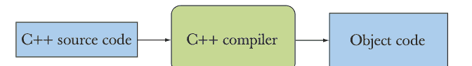

编译器读取你的源代码，并尝试理解你编写的内容。它检查你的程序在语法上是否正确，每个词是否有定义的含义，以及是否存在明显的错误（这些错误可以在不实际执行程序的情况下被检测到）。你会发现编译器对语法相当挑剔。遗漏程序的任何细节，例如 `#include` 文件、分号或花括号，都会导致错误。同样，编译器对拼写错误完全零容忍。让我们通过一系列示例来说明这一点，其中每个示例都有一个小的错误。每个错误都是我们常犯的一类错误的例子：

```cpp
// 这里没有 #include
int main()
{
    cout << "Hello, World!\n";
    return 0;
}
```

我们没有包含任何内容来告诉编译器 `cout` 是什么，因此编译器会发出警告。为了纠正这一点，让我们添加一个头文件：

```cpp
#include "std_lib_facilities.h"
int main()
{
    cout << "Hello, World!\n";
    return 0;
}
```

不幸的是，编译器再次发出警告：我们拼错了 `std_lib_facilities.h`。编译器还反对这种情况：

```cpp
#include "std_lib_facilities.h"
int main()
{
    cout << "Hello, World!;\n";
    return 0;
}
```

我们没有用 `"` 终止字符串。编译器还反对这种情况：

```cpp
#include "std_lib_facilities.h"
integer main()
{
    cout << "Hello, World!\n";
    return 0;
}
```

在 C++ 中，使用缩写 `int` 而不是单词 *integer*。编译器也不喜欢这种写法：

```cpp
#include "std_lib_facilities.h"
int main()
{
    cout < "Hello, World!\n";
    return 0;
}
```

我们使用了 `<`（小于运算符）而不是 `<<`（输出运算符）。编译器还反对这种情况：

```cpp
#include "std_lib_facilities.h"
int main()
{
    cout << 'Hello, World!\n';
    return 0;
}
```

我们使用单引号而不是双引号来界定字符串。最后，编译器对这种情况也会给出错误：

```cpp
#include "std_lib_facilities.h"
int main()
{
    cout << "Hello, World!\n"
    return 0;
}
```

我们忘记了用分号终止输出语句。请注意，许多 C++ 语句以分号 `;` 结尾。编译器需要这些分号来知道一个语句在哪里结束以及下一个语句在哪里开始。没有真正简短、完全正确且非技术性的方法来概括分号需要在哪里使用。目前，只需复制我们的使用模式，这可以概括为：“在每个不以右花括号 `}` 结尾的表达式后面放置一个分号。”

为什么我们要花两页好的篇幅和你宝贵的几分钟时间，向你展示一个琐碎程序中琐碎错误的示例？为了说明这样一个观点：你——像所有程序员一样——将花费大量时间查找程序源文本中的错误。大多数时候，我们查看的是带有错误的文本。毕竟，如果我们确信某些代码是正确的，我们通常会去看其他代码或休息片刻。早期的计算机先驱们惊讶地发现他们也会犯错误，并且必须将大部分时间用于查找这些错误，这是一个巨大的意外。这对大多数编程新手来说仍然是一个惊喜。

当你编程时，有时你会对编译器感到非常恼火。有时它似乎对不重要的细节（如缺少的分号）或你认为“显然正确”的事情发出警告。然而，编译器通常是正确的：当它发出错误消息并拒绝从你的源代码生成目标代码时，你的程序中存在某些不完全正确的地方；也就是说，你所写内容的含义并没有被 C++ 标准精确定义。

编译器没有常识（它不是人类），对细节非常挑剔。既然它没有常识，你就不会喜欢它试图猜测你对某些“看起来没问题”但不符合 C++ 定义的内容的含义。如果它这样做且其猜测与你不同，你可能会花大量时间去弄清楚为什么程序没有做你认为你告诉它要做的事。总而言之，编译器让我们免于许多自我造成的问题。它避免的问题比它造成的问题要多得多。所以，请记住：编译器是你的朋友；也许，编译器是你编程时最好的朋友。

### 2.4 链接

一个程序通常由几个独立的部分组成，这些部分通常由不同的人开发。例如，“Hello, World!” 程序由我们编写的部分以及 C++ 标准库的部分组成。这些独立的部分（有时称为*翻译单元*）必须被编译，并将生成的目标代码文件链接在一起以形成一个可执行程序。将这样的部分链接在一起的程序（不出所料地）被称为*链接器*。

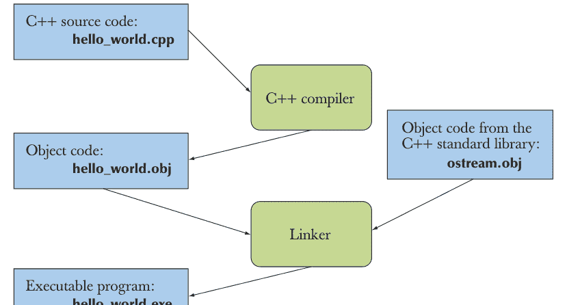

请注意，目标代码和可执行文件在系统之间*不具可移植性*。例如，当你为 Windows 机器编译时，你得到的是 Windows 的目标代码，它无法在 Linux 机器上运行。

*库*仅仅是一些代码——通常由他人编写——我们通过在**包含**文件中找到的声明来访问它。*声明*是一种程序语句，指定了如何代码块；我们稍后将详细研究声明（例如，§4.5.2）。

编译器发现的错误称为*编译时错误*，链接器发现的错误称为*链接时错误*，而在程序运行之前未被发现的错误称为*运行时错误*或*逻辑错误*。一般来说，编译时错误比链接时错误更容易理解和修复，而链接时错误通常比运行时错误和逻辑错误更容易发现并修复。在第 5 章中，我们将更详细地讨论错误及处理方式。

## 2.5 编程环境


为了编程，我们使用编程语言。我们还使用编译器将源代码转换为目标代码，并使用链接器将目标代码链接成一个可执行程序。此外，我们使用某种程序将源代码文本输入计算机并进行编辑。这些只是构成我们程序员工具集或“程序开发环境”的最初且最关键的几个工具。

如果你像许多专业程序员那样，通过命令行窗口工作，那么你必须自己发出编译和链接命令。如果你（许多专业程序员也这样做）使用 IDE（“交互式开发环境”或“集成开发环境”），那么只需简单点击正确的按钮即可完成工作。请参阅附录 C，了解如何在你的 C++ 实现中编译和链接。

IDE 通常包含一个带有有用功能（如颜色编码）的编辑器，有助于区分注释、关键字以及程序源代码的其他部分，并具备其他辅助你调试代码、编译和运行代码的设施。调试是查找并移除程序中错误的活动；在这一过程中，你会听到很多关于它的讨论。

使用本书时，你可以使用任何提供最新且符合标准的 C++ 实现的系统。我们所说的内容，经过非常微小的修改，对于所有 C++ 实现都是正确的，并且代码可以在任何地方运行。在我们的工作中，我们使用了多种不同的实现。

## 练习

到目前为止，我们讨论了编程、代码和工具（如编译器）。现在你需要让一个程序运行起来。这是本书和学习编程中的一个关键点。这是你开始培养实际技能和良好编程习惯的地方。本章的练习旨在让你熟悉你的软件开发环境。一旦你让“Hello, World!”程序运行起来，你就跨出了作为程序员的第一大里程碑。

练习（Drill）的目的是建立或强化你的实际编程技能，并让你熟悉编程环境工具。通常，练习是对单个程序的一系列修改，使其从完全无关紧要的东西“成长”为可能真正有用的程序的一部分。传统的练习集旨在测试你的主动性、巧妙性或创造力。相比之下，练习（Drill）需要你发挥的创造力很少。通常，顺序至关重要，且每个单独的步骤应该很容易（甚至无关紧要）。

请尽量不要耍小聪明跳过步骤；平均而言，这会减慢你的速度，甚至让你感到困惑。

你可能会以为你理解了读到的所有内容和你的导师或讲师告诉你的所有内容，但重复和练习对于培养编程技能是必要的。在这方面，编程就像体育、音乐、舞蹈或任何基于技能的工艺。想象一下人们在没有任何定期练习的情况下试图在这些领域中竞争。你知道他们会表现得多好。持续的练习——对于专业人士来说，这意味着终身的持续练习——是发展和保持高水平实际技能的唯一途径。

所以，无论诱惑有多大，都不要跳过练习；它们是学习过程中必不可少的部分。只需从第一步开始，并继续前进，在过程中测试每一步，以确保你做得正确。

如果你没有理解正在使用的语法的每个细节，请不要惊慌；也不要害怕向讲师或朋友寻求帮助。继续前进，完成所有的练习和许多练习题，一切都会在适当的时候变得清晰。

所以，这是你的第一个练习：

- 1. 前往附录 C，并按照所需步骤设置项目。设置一个名为 `hello_world` 的空控制台 C++ 项目。

- 2. 在 `hello_world.cpp` 中输入以下内容，完全按照下面规定的格式，将其保存在你的练习目录（文件夹）中，并将其包含在你的 `hello_world` 项目中。

```cpp
#include "std_lib_facilities.h"
int main()    // C++ 程序从执行 main 函数开始
{
    cout << "Hello, World!\n";    // 输出 "Hello, World!"
    keep_window_open();    // 等待输入一个字符
    return 0;
}
```

对 `keep_window_open()` 的调用在某些 Windows 机器上是必需的，以防止在你阅读输出之前关闭窗口。这是 Windows 的一个特性/怪异行为，而不是 C++ 的。我们在 `std_lib_facilities.h` 中定义了 `keep_window_open()`，以简化编写简单文本程序。

你如何找到 `std_lib_facilities.h`？如果你在课程中，请询问你的讲师。如果没有，请从我们的支持网站 www.stroustrup.com/Programming 下载。但如果你没有讲师且无法访问网络怎么办？在那种情况下（仅限于此情况），将 `#include` 指令替换为

```cpp
#include<iostream>
#include<string>
#include<vector>
#include<algorithm>
#include<cmath>
using namespace std;
inline void keep_window_open( { char ch; cin>>ch; }
```

这直接使用了标准库，可以让你继续学习直到第 5 章，稍后（§8.7）会详细解释。

- 3. 编译并运行“Hello, World!”程序。很可能有些东西没有完全正常工作。首次尝试使用新的编程语言或新的编程环境时，这种情况很少正常发生。找到问题并修复它！在这种时候，向更有经验的人寻求帮助是明智的，但务必理解别人向你展示的解决方法，以便在继续之前能够独自完成。

- 4. 到现在为止，你可能已经遇到了一些错误并且不得不纠正它们。现在是时候更深入地了解你的编译器的错误检测和错误报告功能了！尝试 §2.3 中的七个错误，看看你的编程环境如何反应。想出至少五个你在输入程序时可能犯的其他错误（例如，忘记 `keep_window_open(` ，在输入单词时开着大写锁定键，或者输入逗号而不是分号），并尝试每一个，看看在尝试编译和运行这些版本时发生了什么。

## 复习

这些复习问题的基本思想是给你一个机会，看看你是否注意并理解了本章的关键点。你可能需要参考正文来回答问题；这是正常且预期的。你可能需要重读整个章节；这也是正常且预期的。然而，如果你不得不重读整章，或者在每个复习问题上都有困难，你应该考虑你的学习风格是否有效。你阅读得太快了吗？你应该停下来做一些 `Try this`（试一试）建议吗？你应该和朋友一起学习，以便讨论正文中解释的问题吗？

- 1. “Hello, World!” 程序的目的是什么？

- 2. 说出函数的四个部分。

- 3. 说出一个必须在每个 C++ 程序中出现的函数。

- 4. 在“Hello, World!” 程序中，`return 0;` 行的目的是什么？

- 5. 编译器的目的是什么？

- 6. `#include` 指令的目的是什么？

- 7. 在 C++ 中，文件名末尾的 `.h` 后缀表示什么？

- 8. 链接器为你的程序做什么？

- 9. 源文件和目标文件之间的区别是什么？

- 10. 什么是 IDE，它为你做什么？

- 11. 如果你理解教科书中的所有内容，为什么还需要练习？

大多数复习问题在其出现的章节中有明确的答案。然而，我们偶尔会包含一些问题，以提醒你来自其他章节的相关信息，有时甚至与本书之外的世界相关。我们认为这是公平的；编写良好的软件和思考其影响比单个章节或一本书所能涵盖的内容要多得多。

## 术语

这些术语介绍了编程和 C++ 的基本词汇。如果你想理解人们谈论编程话题时的说法，并阐述自己的观点，你应该知道每个术语的含义。

- `//`

- `executable`（可执行程序）

- `<<`

- `function`（函数）

- `main()`

- `object code`（目标代码）

- `C++`

- `header`（头文件）

- `output`（输出）

- `comment`（注释）

- `IDE`

- `program`（程序）

- `compiler`（编译器）

- `#include`

- `source code`（源代码）

- `compile-time error`（编译时错误）

- `library`（库）

- `statement`（语句）

- `cout`

- `linker`（链接器）

你也许喜欢逐步发展一份用你自己的话写成的词汇表。你可以通过对每一章重复下面的练习 5 来做到这一点。

## 练习

我们将练习（Drill）与习题（Exercises）分开列出；在尝试任何习题之前，始终先完成本章的练习。这样做会节省你的时间。

- 1. 修改程序以输出以下两行：

   `Hello, programming!` 

   `Here we go!` 

- 2. 扩展你所学到的知识，编写一个程序，列出在 §2.1 中讨论的计算机寻找楼上卫生间的说明。你能想到更多人类会假设但计算机不会的步骤吗？将它们添加到你的列表中。这是“像计算机一样思考”的良好开端。警告：对于大多数人来说，“去卫生间”是一个完全足够的指令。对于一个没有房屋或卫生间经验的人来说（想象一个石器时代的人，不知怎地被传送到你的餐厅），必要的指令列表可能会*非常*长。请不要超过一页。为了读者的利益，你可以添加一段对你想象的房屋布局的简短描述。 

- 3. 描述如何从你的宿舍房间、公寓、房子或其他任何地方的前门走到你的教室门口（假设你正在参加一些学校的课程；如果你没有参加，请另选一个目标）。请让一位朋友尝试按照说明操作，并在过程中批注改进意见。为了留住朋友，在将说明交给朋友之前，最好先对这些说明进行“现场测试”。

4. 找一本好的烹饪书。阅读制作蓝莓松饼（blueberry muffins）的说明（如果你所在的国家“蓝莓松饼”是一道陌生且异域风情的菜肴，请使用更熟悉的菜肴代替）。请注意，在稍加帮助和指导下，世界上大多数人都能烤出美味的蓝莓松饼。这不被视为高级或困难的精致烹饪。然而，对于作者而言，本书很少有练习比这个更难。只要有少许练习，你能做到的事情是惊人的。

    - 重写这些说明，使每个单独的动作都在其自身的编号段落中。务必列出所有食材以及每一步使用的所有厨房用具。注意关键细节，例如所需的烤箱温度、预热烤箱、松饼烤盘的准备工作、计时烹饪的方式，以及在将松饼从烤箱中取出时需保护手部的必要性。

    - 从一个烹饪新手的角度考虑这些说明（如果你不是新手，请向一位不懂烹饪的朋友寻求帮助）。补充那些书中的作者（几乎可以肯定是一位经验丰富的厨师）因显而易见而省略的步骤。

    - 建立一个术语表。（什么是松饼烤盘？预热有什么用？你说“烤箱”是什么意思？）

    - 现在烤一些松饼并享受你的成果。

5. 为“术语”中的每个术语写一个定义。首先试着在不查看章节的情况下完成（这不太可能），然后查阅章节寻找定义。你可能会发现你的第一次尝试与书中版本之间的差异很有趣。你可以查阅一些合适的在线术语表，例如 www.oup.com/glossary.html。在查找之前先写自己的定义，可以强化你通过阅读所获得的学习成果。如果为了形成定义而不得不重读某个章节，那只会帮助你更好地理解。定义时请自由使用你自己的语言，并将定义做到你认为合理程度的详细。通常，在主要定义后加一个例子会有帮助。你最好将这些定义存储在一个文件中，以便可以从后续章节的“术语”部分中添加内容。

# 后记

“Hello, World!” 程序有什么重要之处？它的目的是让我们熟悉编程的基本工具。每当我们要使用新工具时，我们倾向于做一个极其简单的例子，例如“Hello, World!”。这样，我们就把学习分为两部分：首先，我们用简单的程序学习工具的基础知识；然后，我们学习更复杂的程序，而不会被工具本身分心。同时学习工具和语言比先学一个再学另一个要困难得多。这种通过将一个复杂任务分解为一系列较小（且更易于管理）的步骤来简化学习的方法，并不局限于编程和计算机。它在生活的许多领域都是常见且有用的，尤其是在涉及某些实际技能的领域。

# 3

# 对象、类型和值

> “机遇偏爱有准备的头脑。”
>
> —— 路易·巴斯德

本章介绍在程序中存储和使用数据的基础知识。为此，我们首先专注于从键盘读取数据。在确立了对象、类型、值和变量的基本概念后，我们介绍了几种运算符，并给出了使用 `char`、`int`、`double` 和 `string` 类型变量的许多示例。

## 3.1 输入

“Hello, World!” 程序只是向屏幕写入。它产生输出。它不读取任何东西；它不从用户那里获取输入。这相当无聊。实际的程序倾向于根据我们给出的某些输入产生结果，而不是每次执行时都做完全相同的事情。

要读取内容，我们需要一个读取的目标位置；也就是说，我们需要在计算机内存中有一个放置所读取内容的位置。我们将这样的“位置”称为对象。对象是内存的一个区域，具有指定可以放置在其中的信息类型的类型。具有名称的对象称为变量。例如，字符串被放入字符串变量中，整数被放入 int 变量中。你可以将对象想象成一个“盒子”，你可以将对象类型的值放入其中：


这代表了一个名为 `age` 的 `int` 类型对象，包含整数值 42。使用字符串变量，我们可以从输入读取一个字符串，并再次输出它，如下所示：

```cpp
// 读取和写入名字
#include "std_lib_facilities.h"

int main()
{
    cout << "请输入你的名字（按“回车”键确认）:\n";
    string first_name;    // first_name 是类型为 string 的变量
    cin >> first_name;    // 将字符读入 first_name
    cout << "你好, " << first_name << "\n";
}
```

`#include` 和 `main()` 在第二章中已经熟悉。由于 `#include` 对我们所有的程序（直到第十二章）都是必需的，我们将省略它的展示以避免分散注意力。同样，我们有时也会展示代码，这些代码只有放在 `main()` 或其他函数中（如下所示）才能正常工作：

```cpp
cout << "请输入你的名字（按“回车”键确认）:\n";
```

我们假设你能够弄清楚如何将这样的代码放入完整的程序中进行测试。

`main()` 的第一行只是写出一条消息，鼓励用户输入名字。这样的消息通常被称为*提示*，因为它提示用户执行某个操作。接下来的几行定义了一个名为 `first_name` 的 `string` 类型变量，从键盘读取输入到该变量中，并输出一条问候语。让我们依次看看这三行：

```cpp
string first_name;      // first_name 是类型为 string 的变量
```

这为存储字符串留出内存区域，并赋予它名称 `first_name`：


引入一个新名称到程序中并为变量分配内存的语句称为*定义*。

下一行从输入（键盘）中读取字符到该变量：

```cpp
cin >> first_name;      // 将字符读入 first_name
```

名称 `cin` 指的是在标准库中定义的标准输入流（发音为“see-in”，即“字符输入”）。`>>` 运算符（“获取自”）的第二个操作数指定了该输入的去向。因此，如果我们输入一个名字，比如 `Nicholas`，然后按换行键，字符串 "`Nicholas`" 就成为 `first_name` 的值：


换行符对于引起机器的注意是必需的。在输入换行符（按下 Enter 键）之前，计算机只是收集字符。这种“延迟”给了你改变主意、擦除某些字符并用其他字符替换它们的机会，然后再按下 Enter。换行符将不是存储在内存中的字符串的一部分。

得到输入字符串到 `first_name` 后，我们可以使用它：

```cpp
cout << "Hello, " << first_name << "!\n";
```

这在屏幕上打印 `Hello`，然后是 `Nicholas`（`first_name` 的值），然后是 `!` 和一个换行符（`'\n'`）：

```
Hello, Nicholas!
```

如果我们喜欢重复和额外的打字，我们可以写三个独立的输出语句代替：

```cpp
cout << "Hello, ";
cout << first_name;
cout << "!\n";
```

然而，我们是无所谓的打字员，而且——更重要的是——强烈反对不必要的重复（因为重复为错误提供了机会），所以我们将这三个输出操作合并为一个语句。

注意我们使用引号包围 `"Hello, "` 中的字符，但不包围 `first_name`。当我们想要一个字面字符串时，我们使用引号。当我们不加引号时，我们指的是某个有名称的东西的值。考虑以下情况：

```cpp
cout << "first_name" << " is " << first_name;
```

这里，`"first_name"` 给我们十个字符 `first_name`，而普通的 `first_name` 给我们变量 `first_name` 的值，在这种情况下是 `Nicholas`。所以，我们得到

```
first_name is Nicholas
```

## 3.2 变量

基本上，如果不将数据存储到内存中（就像我们上面示例中对输入字符串所做的那样），我们就无法用计算机做任何有趣的事情。我们存储数据的“位置”被称为*对象*。要访问对象，我们需要一个*名称*。具有名称的对象被称为*变量*，并具有特定的*类型*（如 `int` 或 `string`），该类型决定了可以放入对象的内容（例如，`123` 可以放入 `int`，`"Hello, World!\n"` 可以放入 `string`）以及可以应用哪些操作（例如，我们可以使用 `*` 运算符相乘 `ints`，并使用 `<=` 运算符比较 `strings`）。我们放入变量的数据项被称为*值*。一个语句

定义变量被称为（不出所料地）定义，而定义可以（且通常应该）提供一个初始值。考虑以下示例：

```cpp
string name = "Annemarie";
int number_of_steps = 39;
```

你可以将这些变量可视化为：

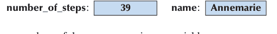

你无法将错误类型的值放入变量中：


```cpp
string name2 = 39;           // 错误：39 不是字符串
int number_of_steps = "Annemarie"; // 错误："Annemarie" 不是 int
```

编译器会记住每个变量的类型，并确保你根据定义中指定的类型来使用它。

C++ 提供了相当多的类型（参见 §A.8）。然而，你仅使用其中的五种类型就能写出完全良好的程序：

```cpp
int number_of_steps = 39;         // int 用于整数
double flying_time = 3.5;         // double 用于浮点数
char decimal_point = '.';         // char 用于单个字符
string name = "Annemarie";        // string 用于字符串
bool tap_on = true;               // bool 用于逻辑变量
```

之所以取名为 `double` 是有历史原因的：`double` 是“双精度浮点数”（double-precision floating point）的缩写。浮点数是计算机对实数数学概念的近似表示。

请注意，这些每种类型都有其特有的字面量风格：

```cpp
39              // int: 一个整数
3.5             // double: 一个浮点数
'.'             // char: 用单引号括起来的单个字符
"Annemarie"     // string: 用双引号分隔的字符序列
true            // bool: 要么 true 要么 false
```

也就是说，数字序列（如 1234, 2, 或 976）表示一个整数，单引号括起来的单个字符（如 '1', '@', 或 'x'）表示一个字符，带小数点的数字序列（如 1.234, 0.12, 或 .98）表示一个浮点值，而双引号括起来的字符序列（如 "1234", "Howdy!", 或 "Annemarie"）表示一个字符串。关于字面量的详细描述，请参见 §A.2。

## 3.3 输入与类型

输入运算符 `>>`（“获取自”）对类型敏感；也就是说，它根据你读取到的变量类型进行读取。例如：

```cpp
// 读取姓名和年龄
int main()
{
    cout << "Please enter your first name and age\n";
    string first_name;    // 字符串变量
    int age;              // 整数变量
    cin >> first_name;    // 读取一个字符串
    cin >> age;           // 读取一个整数
    cout << "Hello, " << first_name << " (" << age << ")\n";
}
```

因此，如果你输入 **Carlos 22**，`>>` 运算符会将 **Carlos** 读取到 **first_name**，将 **22** 读取到 **age**，并产生以下输出：

**Hello, Carlos (age 22)**

为什么它不会将（全部的）**Carlos 22** 读取到 **first_name** 中？因为按照约定，字符串的读取由所谓的*空白字符*终止，即空格、换行符和制表符。否则，默认情况下空白字符会被 `>>` 忽略。例如，你可以读取数字前添加任意数量的空格；`>>` 只会跳过它们并读取该数字。

如果你输入 **22 Carlos**，你会看到一些在思考之前可能让你感到惊讶的内容。**22** 会被读取到 **first_name** 中，因为毕竟 **22** 是一个字符序列。另一方面，**Carlos** 不是整数，所以它不会被读取。输出将是 **22** 后跟 (**age** 后跟 **0**（2011年之前的 ISO C++ 标准实现可能会给出一个随机数，例如 **-96739**）。为什么？你没有给 **age** 初始值，也没有成功读取到一个值到其中。因此，你得到的是输入运算符 `>>` 提供的任何值。在 §10.6 中，我们将研究处理“输入格式错误”的方法。现在，让我们初始化 **age**，以便在输入失败时得到一个可预测的值：

```cpp
// 读取姓名和年龄（第2版）
int main()
{
    cout << "Please enter your first name and age\n";
    string first_name = "???";   // 字符串变量
                                 // ("???" 意思是“不知道姓名”)
    int age = 0;                 // 整数变量 (0 意思是“不知道年龄”)
    cin >> first_name >> age;    // 读取一个字符串后跟一个整数
    cout << "Hello, " << first_name << " (age " << age << ")\n";
}
```

现在输入 22 Carlos 将输出

Hello, 22 (age 0)

请注意，我们可以在单个输入语句中读取多个值，正如我们可以在单个输出语句中写入多个值一样。还请注意，`<<` 和 `>>` 一样对类型敏感，因此我们可以输出 `int` 变量 `age` 以及 `string` 变量 `first_name` 和字符串字面量 “Hello, ” 和 “ (age ” 和 “)\n”。

使用 `>>` 读取的字符串（默认情况下）由空白字符终止；也就是说，它读取一个单词。但有时，我们想读取不止一个单词。当然，实现这一点有很多种方式。例如，我们可以像这样读取一个由两个单词组成的姓名：

```cpp
int main()
{
    cout << "Please enter your first and second names\n";
    string first;
    string second;
    cin >> first >> second;    // 读取两个字符串
    cout << "Hello, " << first << " " << second << "\n";
}
```

我们简单地使用 `>>` 两次，每个姓名一次。当我们想要将姓名写入输出时，必须在它们之间插入一个空格。

## 试一试

让“姓名和年龄”示例运行起来。然后，修改它以月份为单位输出年龄：以年为单位读取输入并乘以（使用 `*` 运算符）12。将年龄读取到 `double` 中，以便允许那些非常自豪自己是五岁半而不是仅仅五岁的儿童。

## 3.4 操作与运算符

除了指定哪些值可以存储在变量中，变量的类型还决定了我们可以对它应用哪些操作以及这些操作的含义。例如：

```cpp
int count;
cin >> count;            // >> 将整数读取到 count
string name;
cin >> name;             // >> 将字符串读取到 name

int c2 = count+2;         // + 添加整数
string s2 = name + " Jr."; // + 追加字符

int c3 = count-2;         // - 减去整数
string s3 = name - " Jr."; // 错误：- 未定义为字符串
```

所谓“错误”，我们的意思是编译器将拒绝尝试减法的字符串程序。编译器确切知道哪些操作可以应用于每个变量，因此可以防止许多错误。然而，编译器并不知道哪些操作对你的哪些值有意义，因此它可能会愉快地接受合法的操作，这些操作可能产生看似荒谬的结果。例如：

```cpp
int age = -100;
```

你显然知道不能有负年龄（为什么没有？），但没有人告诉编译器，所以它会为该定义生成代码。

下面是一个表格，列出了某些常见且有用的类型的一些有用运算符：

| | bool | char | int | double | string |

|---|:---:|:---:|:---:|:---:|:---:|

| 赋值 | = | = | = | = | = |

| 加法 | | | + | + | |

| 连接 | | | | | + |

| 减法 | | | - | - | |

| 乘法 | | | * | * | |

| 除法 | | | / | / | |

| 取模 (余数) | | | % | | |

| 自增 1 | | | ++ | ++ | |

| 自减 1 | | | -- | -- | |

| 自增 **n** | | | += **n** | += **n** | |

| 添加到末尾 | | | | | `+=` |

| 自减 n | | | `-= n` | `-= n` | |

| 乘法并赋值 | | | `*= ` | `*= ` | |

| 除法并赋值 | | | `/=` | `/=` | |

| 取模并赋值 | | | `%= ` | | |

| 从 s 读取到 x | `s >> x` | `s >> x` | `s >> x` | `s >> x` | `s >> x` |

| 将 x 写入 s | `s << x` | `s << x` | `s << x` | `s << x` | `s << x` |

| 等于 | `==` | `==` | `==` | `==` | `==` |

| 不等于 | `!=` | `!=` | `!=` | `!=` | `!=` |

| 大于 | `>` | `>` | `>` | `>` | `>` |

| 大于或等于 | `>=` | `>=` | `>=` | `>=` | `>=` |

| 小于 | `<` | `<` | `<` | `<` | `<` |

| 小于或等于 | `<=` | `<=` | `<=` | `<=` | `<=` |

空白格表示该操作对于某种类型不直接可用（虽然可能存在间接使用该操作的方式；参见 §3.9.1）。随着内容的推进，我们将解释这些操作以及更多内容。这里的关键点是有很多有用的运算符，并且它们的含义对于相似的类型往往相同。

让我们尝试一个涉及浮点数的例子：

```cpp
// 简单的程序以练习运算符
int main()
{
    cout << "Please enter a floating-point value: ";
    double n;
    cin >> n;
    cout << "n == " << n
         << "\nn+1 == " << n+1
         << "\nthree times n == " << 3*n
         << "\ntwice n == " << n+n
         << "\n squared == " << n*n
         << "\nhalf of n == " << n/2
         << "\nsquare root of n == " << sqrt(n)
         << "\n";  // 换行符的名称（输出中的“行尾”）
}
```

显然，我们从小学生时代所熟悉的通常算术操作具有通常的符号和含义。自然，并非我们想要的每一件东西

要对浮点数执行的运算，例如求平方根，都可以作为运算符使用。许多运算则表示为具名函数。在这种情况下，我们使用标准库中的 `sqrt` 来获取 `n` 的平方根：`sqrt(n)`。这种表示法在数学中很常见。我们稍后会用到函数，并在 §4.5 和 §8.5 中详细讨论它们。

## 试一试

让这个小程序运行起来。然后，修改它以读取 `int` 而不是 `double`。请注意，对 `int` 使用 `sqrt()` 返回的是 `double` 而不是 `int`。此外，“练习”其他一些运算。注意，`int` 的 `/` 是整数除法，而 `%` 是余数（取模），因此 `5/2` 等于 `2`（而不是 `2.5` 或 `3`），而 `5%2` 等于 `1`。整数 `*`、`/` 和 `%` 的定义保证对于两个正整数 `a` 和 `b`，我们有 `a/b * b + a%b == a`。

字符串的运算符较少，但正如我们将在第 23 章中看到的，它们有很多具名操作。然而，它们所具有的运算符可以按照惯例使用。例如：

```cpp
// 读取名字和姓氏
int main()
{
    cout << "Please enter your first and second names\n";
    string first;
    string second;
    cin >> first >> second;        // 读取两个字符串
    string name = first + ' ' + second;   // 连接字符串
    cout << "Hello, " << name << "\n";
}
```

对于字符串，`+` 意味着连接；也就是说，当 `s1` 和 `s2` 是字符串时，`s1+s2` 是一个字符串，其中 `s1` 的字符后面跟着 `s2` 的字符。例如，如果 `s1` 的值为 `"Hello"`，`s2` 的值为 `"World"`，那么 `s1+s2` 的值将是 `"HelloWorld"`。字符串的比较特别有用：

```cpp
// 读取并比较名字
int main()
{
    cout << "Please enter two names\n";
    string first;
    string second;
    cin >> first >> second; // 读取两个字符串
    if (first == second) cout << "that's the same name twice\n";
    if (first < second)
        cout << first << " is alphabetically before " << second << "\n";
    if (first > second)
        cout << first << " is alphabetically after " << second << "\n";
}
```

在这里，我们使用了一个 **if** 语句，它将在 §4.4.1.1 中详细解释，以根据条件选择操作。

## 3.5 赋值与初始化

在许多方面，最有趣的运算符是赋值，表示为 `=`。它赋予变量一个新值。例如：

```text
int a = 3; // a 初始值为 3
a: [3]

a = 4; // a 获得值 4（“变成 4”）
a: [4]

int b = a; // b 初始化为 a 值的一个副本（即 4）
a: [4]
b: [4]

b = a+5; // b 获得值 a+5（即 9）
a: [4]
b: [9]

a = a+7; // a 获得值 a+7（即 11）
a: [11]
b: [9]
```

最后那个赋值值得关注。首先，它清楚地表明 `=` 并不意味着等于——显然，`a` 不等于 `a+7`。它意味着赋值，即将一个新值放入变量中。对于 **a=a+7** 所执行的操作如下：

- 1. 首先，获取 `a` 的值；那是整数 4。

- 2. 然后，将那 4 加上 7，得到整数 11。

- 3. 最后，将该 11 放入 `a`。

我们还可以使用字符串来说明赋值：

```text
string a = "alpha"; // a 初始值为 "alpha"
a: alpha

a = "beta"; // a 获得值 "beta"（变成 "beta"）
a: beta

string b = a; // b 初始化为 a 值的一个副本（即 "beta"）
a: beta
b: beta

b = a+"gamma"; // b 获得值 a+"gamma"（即 "betagamma"）
a: beta
b: betagamma

a = a+"delta"; // a 获得值 a+"delta"（即 "betadelta"）
a: betadelta
b: betagamma
```

> 上面，我们使用“初始值”和“获得值”来区分两个相似但在逻辑上不同的操作：

>

> - 初始化（赋予变量其初始值）

> - 赋值（赋予变量一个新值）

这些操作非常相似，以至于 C++ 允许我们对两者使用相同的表示法（`=`）：

```text
int y = 8; // 用 8 初始化 y
x = 9; // 将 9 赋值给 x
string t = "howdy!"; // 用 "howdy!" 初始化 t
s = "G'day"; // 将 "G'day" 赋值给 s
```

然而，从逻辑上讲，赋值和初始化是不同的。你可以通过类型说明（如 `int` 或 `string`）来区分这两者，类型说明始终位于初始化的开头；而赋值没有类型说明。原则上，初始化总是发现变量是空的。另一方面，赋值（原则上）必须先从变量中清除旧值，然后再放入新值。你可以把变量想象成一个小盒子，把值想象成一个具体的物品，比如你放入其中的硬币。在初始化之前，盒子是空的，但在初始化之后，它总是包含一枚硬币，因此要放入新硬币，你（即赋值运算符）必须先移除旧的（“销毁旧值”）。在计算机内存中情况并非如此字面化，但这不是理解正在发生什么的一种坏方法。

### 3.5.1 一个例子：检测重复单词

当我们想把一个新值放入对象时，需要用到赋值。当你仔细想想，显然当我们多次执行某些操作时，赋值最有用。当我们想用不同的值再次执行某事时，我们需要赋值。让我们看一下一个小程序，它检测一系列单词中的相邻重复单词。这样的代码是大多数语法检查器的一部分：


```cpp
int main()
{
    string previous = " ";     // 前一个单词；初始化为“不是单词”
    string current;           // 当前单词
    while (cin>>current) {    // 读取单词流
        if (previous == current) // 检查单词是否与上一个是
            cout <<"repeated word: " << current << "\n";
        previous = current;
    }
}
```

由于它没有告诉重复单词在文本中的发生位置，因此这个程序不是最有用的，但暂且够用。我们将逐行查看这个程序，从以下开始：

```cpp
string current;    // 当前单词
```

这是一个字符串变量，我们立即使用以下语句将当前（即最近读取的）单词读取到其中：

```cpp
while (cin>>current)
```

这种结构被称为 `while` 语句，它本身很有趣，我们将在 §4.4.2.1 中进一步研究它。`while` 表示后面的语句（`cin>>current`）只要输入操作 `cin>>current` 成功就重复执行，而只要标准输入上仍有字符可读，`cin>>current` 就会成功。请记住，对于 `string`，`>>` 读取以空白分隔的单词。你通过给程序提供结束输入字符（通常称为 *文件结尾*）来终止此循环。在 Windows 机器上，这是 Ctrl+Z（同时按下 Control 和 Z）然后按 Enter（回车）。在 Unix 或 Linux 机器上，这是 Ctrl+D（同时按下 Control 和 D）。

因此，我们所做的是将单词读取到 `current` 中，然后将其与前一个单词（存储在 `previous` 中）进行比较。如果它们相同，我们就说明这一点：

```cpp
if (previous == current)    // 检查单词是否与上一个是
    cout << "repeated word: " << current << '\n';
```

然后我们必须准备好对下一个单词再次执行此操作。我们通过将 `current` 单词复制到 `previous` 中来做到这一点：

```cpp
previous = current;
```

只要我们能开始，这就能处理所有情况。对于没有前一个单词可供比较的第一个单词，这段代码应该做什么？这个问题通过 `previous` 的定义得到解决：

```cpp
string previous = " ";    // 前一个单词；初始化为“不是单词”
```

`" "` 只包含一个字符（空格字符，即我们在键盘上按下空格键得到的那个字符）。输入运算符 `>>` 会跳过空白，因此我们不可能从输入中读取到它。因此，在 `while` 语句的第一次执行中，测试

```cpp
if (previous == current)
```

失败（正如我们希望的那样）。

理解程序流程的一种方法是“模拟计算机”，即逐行跟随程序，执行它指定的操作。只需在纸上画框并将其值写在里面。根据程序指定的方式更改存储的值。

## 试一试

使用一张纸自己执行这个程序。使用输入 *The cat cat jumped*。即使是经验丰富的程序员也使用这种技术来可视化小段代码的操作，这些代码看起来似乎不完全明显。

## 3.6 复合赋值运算符

递增一个变量（即给它加 1）在程序中非常常见，因此 C++ 为此提供了一种特殊语法。例如：

```
++counter
```

意味着

```
counter = counter + 1
```

还有许多其他常见的方法可以根据变量的当前值来改变其值。例如，我们可能希望给它加 7、减 9，或者乘以 2。C++ 也直接支持此类操作。例如：

```
a += 7;     // 意味着 a = a+7
b -= 9;     // 意味着 b = b-9
c *= 2;     // 意味着 c = c*2
```

通常，对于任何二元运算符 `oper`，`a oper= b` 意味着 `a = a oper b`（§A.5）。起初，该规则为我们提供了运算符 `+=`、`-=`、`*=`、`/=` 和 `%=`。这提供了一种令人愉悦的紧凑表示法，直接反映了我们的想法。例如，在许多应用领域，`*=` 和 `/=` 被称为“缩放”。

### 3.6.1 一个示例：查找重复单词

考虑前面检测相邻重复单词的例子。我们可以通过提供重复单词在序列中位置的信息来改进这一点。该想法的一个简单变体只是计算单词并输出重复单词的计数：

```
int main()
{
    int number_of_words = 0;
    string previous = " "; // 不是一个单词
    string current;
    while (cin >> current) {
        ++number_of_words; // 增加单词计数
        if (previous == current)
            cout << "word number " << number_of_words
                << " repeated: " << current << "\n";
        previous = current;
    }
}
```

我们从 0 开始计算单词。每当我们看到一个单词，我们就递增该计数器：

```
++number_of_words;
```

这样，第一个单词变成编号 1，下一个变成编号 2，等等。我们也可以说

```
number_of_words += 1;
```

甚至

```
number_of_words = number_of_words + 1;
```

但 `++number_of_words` 更短，直接表达了递增的想法。注意这个程序与 §3.5.1 中的程序多么相似。显然，我们只是拿了 §3.5.1 中的程序并稍作修改以服务于我们的新目的。这是一种非常常见的技术：当我们需要解决一个问题时，我们寻找一个相似的问题，并使用我们针对该问题的解决方案并进行适当修改。除非真的不得不从头开始，否则不要这样做。使用程序的先前版本作为修改基础通常可以节省大量时间，并且我们可以从原始程序中投入的大部分工作中受益。

## 3.7 名称

我们给变量命名，以便能够记住它们，并从程序的其他部分引用它们。在 C++ 中，什么可以作为名称？在 C++ 程序中，名称以字母开头，并且只包含字母、数字和下划线。例如：

- `x`

- `number_of_elements`

- `Fourier_transform`

- `z2`

- `Polygon`

以下不是名称：

```
2x                // 名称必须以字母开头
time$to$market    // $ 不是字母、数字或下划线
Start menu        // 空格不是字母、数字或下划线
```

当我们说“不是名称”时，我们的意思是 C++ 编译器不会接受它们作为名称。

如果你阅读系统代码或机器生成的代码，你可能会看到以下画线开头的名称，例如 `_foo`。永远不要自己写这些；此类名称是保留给实现和系统实体使用的。通过避免以下划线开头，你永远不会发现你的名称与实现生成的某些名称发生冲突。

名称对大小写敏感；也就是说，大写字母和小写字母是不同的，因此 `x` 和 `X` 是不同的名称。这个小程序至少包含四个错误：

```
#include "std_lib_facilities.h"

int Main()
{
    STRING s = "Goodbye, cruel world!";
    cout << s << "\n";
}
```

通常，定义仅在某些字符大小写不同的名称（例如 `one` 和 `One`）不是一个好主意；这不会让编译器混淆，但很容易让程序员混淆。

## 试一试

编译“Goodbye, cruel world!”程序并检查错误消息。编译器找到了所有错误吗？它建议的问题是什么？编译器是否困惑并诊断出超过四个错误？从词法上第一个错误开始，逐个移除错误，看看错误消息如何变化（并改善）。

C++ 语言保留了许多（约 85 个）名称作为“关键字”。我们在 §4.3.1 中列出了它们。你不能将这些名称用于你的变量、类型、函数等命名。例如：

```
int if = 7; // 错误：if 是一个关键字
```

你可以使用标准库中设施的名称，例如 `string`，但不应该这样做。如果你曾经想要使用标准库，重用这样一个常见的名称会带来麻烦：

```
int string = 7; // 这会导致麻烦
```

当你为你的变量、函数、类型等选择名称时，选择有意义的名称；也就是说，选择有助于人们理解你程序的名称。即使你自己也会在试图理解你的程序应该做什么时遇到问题，如果你在其中使用了带有“易于输入”名称（如 `x1`、`x2`、`s3` 和 `p7`）的变量。缩写和首字母缩略词可能会让人困惑，因此请谨慎使用。这些首字母缩略词在我们编写时对我们来说很明显，但我们预计你在至少一个上会有困难：

- `mtbf`

- `TLA`

- `myw`

- `NBV`

我们预计几个月后，我们在至少一个上面也会有困难。

短名称，如 `x` 和 `i`，在惯用使用时是有意义的；也就是说，`x` 应该是一个局部变量或参数（参见 §4.5 和 §8.4），`i` 应该是一个循环索引（参见 §4.4.2.3）。

不要使用过长的名称；它们很难输入，使行变得过长以至于无法显示在屏幕上，并且很难快速阅读。这些可能没问题：

- `partial_sum`

- `element_count`

- `stable_partition`

这些可能太长了：

- `the_number_of_elements`

- `remaining_free_slots_in_symbol_table`

我们的“内部风格”是使用下划线分隔标识符中的单词，例如 `element_count`，而不是替代方案，例如 `elementCount` 和 `Element-Count`。我们从不使用全大写字母的名称，例如 `ALL_CAPITAL_LETTERS`，因为这通常保留给宏（§27.8 和 §A.17.2），我们避免使用它们。我们为我们定义的类型使用首字母大写字母，例如 `Square` 和 `Graph`。C++ 语言和标准库不使用首字母大写风格，因此是 `int` 而不是 `Int`，是 `string` 而不是 `String`。因此，我们的约定有助于最大程度地减少我们的类型与标准类型之间的混淆。

避免容易拼错、误读或混淆的名称。例如：

| 名称 | 名称 | 名称S | 代码 | 代码0 | 旗L | 旗i |

|------|------|-------|------|-------|-----|-----|

字符 `0`（零）、`o`（小写 **o**）、`O`（大写 **O**）、`1`（一）、`l`（小写 **L**）和 `I`（大写 **i**）特别容易造成麻烦。

## 3.8 类型和对象

类型的概念是 C++ 和大多数其他编程语言的核心。让我们更近地、稍微技术性地看着类型，特别是我们在计算期间存储数据的对象的类型。从长远来看，这将节省时间，并且可能会节省你一些困惑。

- 一种 *类型* 定义了一组可能值和一组操作（对于一个对象）。

- 一个 *对象* 是保存给定类型值的一些内存。

- 一个 *值* 是内存中一组位，根据类型进行解释。

- 一个 *变量* 是一个命名的对象。

- 一个 *声明* 是一个给对象起名的语句。

- 一个 *定义* 是一个为对象分配内存的声明。

非正式地，我们认为对象是一个盒子，我们可以将给定类型的值放入其中。`int` 盒子可以保存整数，例如 `7`、`42` 和 `−399`。`string` 盒子可以保存字符串值，例如 “Interoperability”、“tokens: !@#%\^&*\” 和 “Old MacDonald had a farm”。图形上，我们可以这样思考：

```
int a = 7;    int b = 9;    char c = 'a';    double x = 1.2;    string s1 = "Hello, World!";    string s2 = "1.2";
```

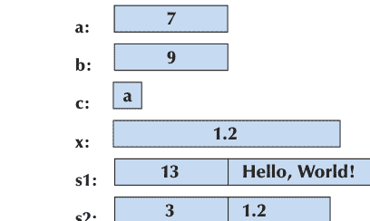

**字符串** 的表示比 **int** 稍微复杂一些，因为 **字符串** 需要记录它包含的字符数量。请注意，**double** 存储的是数值，而 **字符串** 存储的是字符。例如，`x` 存储数值 1.2，而 `s2` 存储三个字符 '1'、' ' 和 '2'。字符和字符串字面量中的引号不会被存储。

所有的 **int** 都是相同大小的；也就是说，编译器为每个 **int** 分配固定大小的内存。在典型的台式电脑上，这个大小是 4 字节（32 位）。类似地，**bool**、**char** 和 **double** 也是固定大小的。通常，台式计算机使用 1 个字节（8 位）来存储一个 **bool** 或一个 **char**，使用 8 个字节来存储一个 **double**。请注意，不同类型的对象占用不同的空间。特别是，一个 **char** 占用的空间比一个 **int** 少，而 **string** 与 **double**、**int** 和 **char** 的不同之处在于，不同的字符串可能占用不同大小的空间。

内存中位的含义完全取决于用于访问它的类型。可以这样理解：计算机内存不知道我们的类型；它只是内存。只有当我们决定如何解释这些内存时，内存中的位才具有含义。这与我们每天使用数字时的做法类似。12.5 意味着什么？我们不知道。它可能是 12.5 美元、12.5 厘米或 12.5 加仑。只有当我们提供单位时，12.5 这个符号才有意义。

例如，当我们把相同的内存位看作 **int** 时，它们表示的值是 120；但如果看作 **char**，则变成 'x'。如果看作 **字符串**，则完全不合理，如果我们尝试使用它，会导致运行时错误。我们可以使用 1 和 0 来表示内存中位的值，以图形化方式说明这一点：

```
00000000 00000000 00000000 01111000
```

这是一块内存区域（一个字）中位的设置，它可以被读作 **int**（120）或者读作 **char**（'x'，只看最右边的 8 位）。**位** 是计算机内存的一个单位，可以保存值 0 或 1。关于 *二进制* 数的含义，请参见 §A.2.1.1。

## 3.9 类型安全

每个对象在定义时都会被赋予一个类型。当对象仅按照其类型的规则使用时，程序（或程序的一部分）是类型安全的。不幸的是，存在非类型安全的操作方式。例如，在使用变量之前未对其进行初始化，这不被认为是类型安全的：

```
int main()
{
    double x;            // 我们“忘记”初始化了：
                        // x 的值未定义
    double y = x;     // y 的值未定义
    double z = 2.0+x;  // + 的含义和 z 的值未定义
}
```

实现甚至允许在使用未初始化的 **x** 时产生硬件错误。请始终初始化你的变量！这条规则有几个——非常少——例外，例如，我们将立即用作输入操作目标的变量，但始终初始化变量是一个好习惯，能让你省去很多麻烦。

完全的类型安全是理想状态，因此也是该语言的一般规则。不幸的是，C++ 编译器无法保证完全的类型安全，但我们可以通过良好的编码实践和运行时检查的结合来避免类型安全违规。理想情况是永远不使用编译器无法证明安全的语言特性：静态类型安全。不幸的是，对于大多数有趣的编程用途来说，这限制太多了。显然的退让方案——编译器隐式生成检查类型安全违规并捕获所有违规的代码——超出了 C++ 的范围。当我们决定执行（非）类型安全操作时，我们必须自行进行一些检查。当我们遇到这种情况时，我们会指出这些情况。

编写代码时，类型安全的理想极其重要。这就是为什么我们在书中这么早花费时间研究它的原因。请留意这些陷阱并避免它们。

### 3.9.1 安全转换

在 §3.4 中，我们看到我们无法直接对 **char** 进行加法或将 **double** 与 **int** 进行比较。然而，C++ 提供了一条间接路径来实现这两者。在需要时，**char** 会被转换为 **int**，而 **int** 会被转换为 **double**。例如：

```c
char c = 'x';
int i1 = c;
int i2 = 'x';
```

这里，**i1** 和 **i2** 都获得值 **120**，这是在最流行的 8 位字符集 ASCII 中字符 'x' 的整数值。这是一种简单且安全的方法，用于获取字符的数值表示。我们将这种 **char** 到 **int** 的转换称为安全的，因为没有信息丢失；也就是说，我们可以将得到的 **int** 复制回 **char** 并恢复原始值：

```c
char c2 = i1;
cout << c << ' ' << i1 << ' ' << c2 << '\n';
```

这将打印出：

```text
x 120 x
```

从这个意义上说——即值总是被转换为相等的值，或者（对于 double）转换为相等值的最佳近似——这些转换是安全的：

- * bool 到 char

- bool 到 int

- bool 到 double

- char 到 int

- char 到 double

- int 到 double

最有用的转换是 int 到 double，因为它允许我们在表达式中混合使用 int 和 double：

```cpp
double d1 = 2.3;
double d2 = d1+2;      // 2 在相加前被转换为 2.0
if (d1 < 0)             // 0 在比较前被转换为 0.0
    cout << "d1 is negative";
```


对于非常大的 `int`，在某些计算机上，转换为 `double` 时可能会遭受精度损失。这是一个罕见的问题。

### 3.9.2 不安全转换

安全转换通常是程序员的福音，简化了代码编写。不幸的是，`C++` 也允许（隐式的）不安全转换。所谓不安全，是指值可以被隐式转换为另一种类型的值，且该值不等于原始值。例如：

```cpp
int main()
{
    int a = 20000;
    char c = a;           // 尝试将大的 int 塞进小的 char
    int b = c;
    if (a != b)           // != 表示“不等于”
        cout << "oops! " << a << "!=" << b << "\n";
    else
        cout << "Wow! We have large characters\n";
}
```

这种转换也被称为“收窄”转换，因为它们将值放入可能太小（“窄”）而无法容纳该值的对象中。不幸的是，很少有编译器会对使用 **`int`** 初始化 **`char`** 的不安全初始化发出警告。问题在于，**`int`** 通常比 **`char`** 大得多，因此它可以（在本例中确实如此）容纳一个无法表示为 **`char`** 的 **`int`** 值。请试试看你的机器上 *b* 得到什么值（32 是一个常见的结果）；更好的方法是进行实验：

```cpp
int main()
{
    double d = 0;
    while (cin>>d) {
        // 只要输入数字，就重复下面的语句
        int i = d;      // 尝试将 double 塞进 int
        char c = i;     // 尝试将 int 塞进 char
        int i2 = c;     // 获取字符的整数值
        cout << "d==" << d              // 原始的 double
             << " i=="<< i              // 转换为 int
             << " i2==" << i2           // char 的整数值
             << " char(" << c << ")"<<"\n";  // 该 char
    }
}
```

我们用来允许尝试许多值的 **`while`** 语句将在 §4.4.2.1 中解释。

## 试一试

使用各种输入运行此程序。尝试小数值（例如 **`2`** 和 **`3`**）；尝试大数值（大于 **`127`**，大于 **`1000`**）；尝试负值；尝试 **`56`**；尝试 **`89`**；尝试 **`128`**；尝试非整数值（例如 **`56.9`** 和 **`56.2`**）。除了展示你的机器上 **`double`** 到 **`int`** 的转换以及 **`int`** 到 **`char`** 的转换是如何进行的之外，该程序还向你展示了对于给定的整数值，你的机器会打印出什么字符（如果有）。

你会发现许多输入值会产生“不合理”的结果。基本上，我们试图将一加仑液体装进一品脱罐中（大约将 4 升液体装进 500 毫升的玻璃杯中）。所有的转换：

- **`double`** 到 **`int`**

- **`double`** 到 **`char`**

- **`double`** 到 **`bool`**

- **`int`** 到 **`char`**

## 10.6 隐式转换

**`int`** 到 **`bool`** 以及 **`char`** 到 **`bool`** 的转换即使不安全，也会被编译器接受。它们之所以被认为不安全，是因为存储的值可能与赋值的值不同。为什么这会成为一个问题？因为通常我们不会怀疑正在发生不安全的转换。考虑以下情况：

```cpp
double x = 2.7;
// 大量代码
int y = x;      // y 变为 2
```

当我们定义 **`y`** 时，可能已经忘记了 **`x`** 是一个 **`double`**，或者暂时忘记了 **`double 到 int`** 的转换是截断（总是向零方向舍入，即向下取整）而不是使用常规的 4/5 舍入法。发生的情况是完全可预测的，但在 `int y = x;` 中没有任何东西提醒我们信息（.7）被丢弃了。

从 **`int`** 到 **`char`** 的转换不存在截断问题——**`int`** 和 **`char`** 都不能表示整数的分数部分。然而，**`char`** 只能容纳非常小的整数值。在 PC 上，**`char`** 占 1 字节，而 **`int`** 占 4 字节：

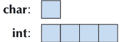

因此，我们无法将大数（如 1000）放入 **`char`** 而不丢失信息：值被“窄化”了。例如：

```cpp
int a = 1000;
char b = a;      // b 变为 -24（在某些机器上）
```

并非所有 **`int`** 值都有对应的 **`char`** 等价值，且 **`char`** 值的确切范围取决于特定的实现。在 PC 上，**`char`** 值的范围是 [-128;127]，但为了可移植性只能使用 [0;127]，因为并非每台计算机都是 PC，不同计算机的 **`char`** 值范围不同，例如 [0;255]。

为什么人们接受窄化转换带来的问题？主要原因是历史原因：`C++` 从其祖先语言 `C` 继承了窄化转换，因此从 `C++` 诞生的第一天起，就存在大量依赖窄化转换的代码。此外，许多这样的转换实际上并不会引起问题，因为涉及的值恰好都在范围内，而且许多程序员反对编译器“告诉他们该怎么做”。特别是，对于小型程序和有经验的程序员来说，不安全转换带来的问题往往是可以管理的。然而，在较大的程序中，它们可能是错误的来源，对新手程序员来说则是造成问题的主要原因。不过，编译器可以对窄化转换发出警告——而且许多编译器确实会这样做。

`C++11` 引入了一种初始化语法，它禁止窄化转换。例如，我们可以（也应该）使用 0-list 语法（花括号初始化）而不是 `=` 语法来重写上述有问题的示例：

```cpp
double x {2.7};    // 合法
int y {x};          // 错误：double -> int 可能导致窄化

int a {1000};       // 合法
char b {a};         // 错误：int -> char 可能导致窄化
```

当初始化器是一个整数字面量时，编译器可以检查实际值并接受那些不暗示窄化的值：

```cpp
char b1 {1000};    // 错误：窄化（假设 char 为 8 位）
char b2 {48};      // 合法
```

那么，如果你认为某种转换可能导致不良值，你应该怎么做？使用 `{}` 初始化器以避免意外发生，当你想要进行转换时，在赋值前检查值，就像我们在本节第一个例子中做的那样。有关执行此类检查的简化方法，请参见 §5.6.4 和 §7.5。基于 {}-list 的语法被称为通用初始化和统一初始化，我们稍后会更多地看到它。

## 练习

在完成本练习的每一步之后，运行你的程序以确保它确实在做你预期的事情。保留一份你犯错误的列表，以便将来尽量避免这些错误。

1. 本练习旨在编写一个基于用户输入生成简单格式信函的程序。首先，输入 §3.1 中的代码，提示用户输入其名字，并输出 “Hello, first_name”，其中 first_name 是用户输入的名字。然后按以下方式修改你的代码：将提示语改为 “Enter the name of the person you want to write to”（输入你想写信的人的名字），并将输出改为 “Dear first_name.”（亲爱的 first_name。）别忘了逗号。

2. 添加一两行开场白，例如 “How are you? I am fine. I miss you.”（你好吗？我很好。我想你了。）确保缩进第一行。再添加几行你自选的内容——这是你的信。

3. 现在提示用户输入另一位朋友的名字，并将其存储在 **`friend_name`** 中。在你的信中加上一行："Have you seen **`friend_name`** lately?"（你最近见到 **`friend_name`** 了吗？）

4. 声明一个名为 **`friend_sex`** 的 `char` 变量并将其初始化为 0。提示用户如果朋友是男性请输入 **`m`**，如果是女性请输入 **`f`**。将输入的值赋值给变量 **`friend_sex`**。然后使用两个 *if*-语句编写以下内容：

    - 如果朋友是男性，编写 "If you see **`friend_name`** please ask him to call me."（如果你见到 **`friend_name`**，请让他给我打电话。）

    - 如果朋友是女性，编写 "If you see **`friend_name`** please ask her to call me."（如果你见到 **`friend_name`**，请让她给我打电话。）

5. 提示用户输入收件人的年龄，并将其赋值给 `int` 变量 **`age`**。让你的程序输出 "I hear you just had a birthday and you are **`age`** years old."（听说你刚过完生日，你今年 **`age`** 岁。）如果 **`age`** 小于等于 0 或大于等于 110，使用来自 **`std_lib_facilities.h`** 的 **`simple_error()`** 调用 **`simple_error`**("you're kidding!")（你在开玩笑吧！）。

6. 在信中加上以下内容：

    - 如果你的朋友未满 12 岁，编写 "Next year you will be **`age+1`**."（明年你将是 **`age+1`** 岁。）

    - 如果你的朋友 17 岁，编写 "Next year you will be able to vote:"（明年你将可以投票：）

    - 如果你的朋友超过 70 岁，编写 "I hope you are enjoying retirement."（希望你享受退休生活。）

7. 检查你的程序，确保它能对每种类型的值做出适当的响应。

8. 加上 "Yours sincerely,"（你真诚的，），随后是两行空白用于签名，最后是你的名字。

## 复习

1. 术语 *prompt*（提示）是什么意思？

2. 你使用哪个运算符将数据读入变量？

3. 如果你希望用户向名为 **`number`** 的变量输入一个整数值，你可以编写哪两行代码来要求用户执行此操作并将值输入你的程序？

4. `\n` 叫什么名字，它起什么作用？

5. 什么结束了对字符串的输入？

6. 什么结束了对整数的输入？

7. 你如何编写

   ```cpp
   cout << "Hello, ";
   cout << first_name;
   cout << "!\n";
   ```

   作为单行代码？

8. 什么是对象？

9. 什么是字面量（literal）？

10. 有哪些类型的字面量？

11. 什么是变量？

12. **`char`**、**`int`** 和 **`double`** 的典型大小是多少？

13. 我们使用什么度量单位来表示内存中小实体的大小，例如 **`ints`** 和 **`strings`**？

14. **`=`** 和 **`==`** 有什么区别？

15. 什么是定义（definition）？

16. 什么是初始化，它与赋值有何不同？

17. 什么是字符串拼接，如何在 C++ 中实现它？

18. 以下哪些是 C++ 中的合法名称？如果一个名称不合法，原因是什么？

    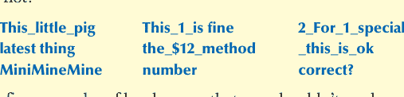

19. 给出五个合法名称的例子，这些名称你不应该使用，因为它们可能会导致混淆。

20. 选择名称的一些好规则是什么？

21. 什么是类型安全，为什么它很重要？

22. 为什么从 **`double`** 到 **`int`** 的转换可能是件坏事？

23. 定义一条规则，帮助判断从一个类型到另一个类型的转换是安全的还是不安全的。

## 术语

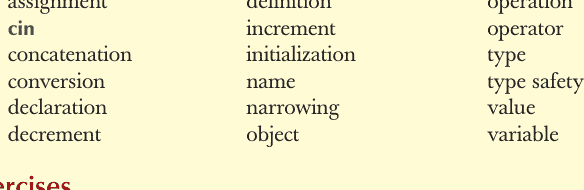

### 习题

1. 如果你还没有做过，请完成本章的 **Try this**（试一试）练习。

2. 用 C++ 编写一个将英里转换为公里的程序。你的程序应该有一个合理的提示，让用户输入英里数。提示：1 英里等于 1.609 公里。

3. 编写一个不做任何事但声明了许多具有合法和非法名称（如 `int double = 0;`）的变量的程序，以便你可以观察编译器的反应。

4. 编写一个提示用户输入两个整数值的程序。将这些值存储在名为 `val1` 和 `val2` 的 `int` 变量中。编写你的程序来确定这些值中较小的、较大的、和、差、积和比，并向用户报告结果。

5. 修改上面的程序，要求用户输入浮点值并将其存储在 `double` 变量中。比较两个程序对于你选择的某些输入的输出处结果是否相同？它们应该相同吗？区别在哪里？

6. 编写一个程序，提示用户输入三个整数值，然后以逗号分隔的形式按数值顺序输出这些值。例如，如果用户输入值 10 4 6，输出应为 4, 6, 10。如果有两个值相同，它们应并排排列。例如，输入 4 5 4 应输出 4, 4, 5。

7. 做第 6 题的练习，但使用三个字符串值。例如，如果用户输入值 Steinbeck, Hemingway, Fitzgerald，输出应为 Fitzgerald, Hemingway, Steinbeck。

8. 编写一个程序来测试一个整数值是奇数还是偶数。一如既往，确保你的输出清晰且完整。换句话说，不要只输出是或否。你的输出应独立成立，例如：The value 4 is an even number.（值 4 是一个偶数。）提示：参见 §3.4 中的取余（模）运算符。

9. 编写一个程序，将拼写出来的数字（如 “zero” 和 “two”）转换为数字（如 0 和 2）。当用户输入数字时，程序应输出对应的数字。对值 0、1、2、3 和 4 这样做，如果用户输入不对应的内容（如 stupid computer!），则写 not a number I know（我不知道的数字）。[注意：“stupid computer!” 是一个俏皮话，不是实际的关键词或代码片段。]

10. 编写一个程序，接收一个操作符和两个操作数，并输出结果。例如：

    ```text
    + 100 3.14
    * 4 5
    ```

    将操作符读入名为 `operation` 的字符串，并使用 `if`-语句来确定用户想要的操作，例如 `if (operation =="+")`。将操作数读入类型为 `double` 的变量。对名为 +, -, *, /, plus, minus, mul, 和 div 的操作实现其明显含义。

11. 编写一个程序，提示用户输入若干数量的便士（1 分硬币）、镍币（5 分硬币）、 dime（10 分硬币）、quarter（25 分硬币）、half dollar（50 分硬币）和一元硬币（100 分硬币）。分别询问用户每种硬币的数量。

硬币，例如：“你有多少个一分硬币？”然后你的程序应该打印出类似这样的内容：

```
**You have 23 pennies.**
**You have 17 nickels.**
**You have 14 dimes.**
**You have 7 quarters.**
**You have 3 half dollars.**
**The value of all of your coins is 573 cents.**
```

进行一些改进：如果只报告了一种硬币，请确保输出在语法上是正确的，例如 **14 dimes** 和 **1 dime**（而不是 **1 dimes**）。此外，请以美元和美分的形式报告总和，即使用 **$5.73** 而不是 **573 cents**。

# 附注

请不要低估类型安全这一概念的重要性。类型是大多数正确程序概念的核心，一些最有效的程序构造技术依赖于类型的设计和使用——你将在第 6 章和第 9 章，以及第二、三、四部分中看到这一点。

*此页故意留白*


# 4 计算

> “如果它不需要产生正确的结果，我可以让它任意地快。”

> —— 杰拉尔德·M·温伯格

本章介绍计算的基础知识。特别是，我们讨论了如何从一组操作数中计算出一个值（*表达式*），如何在备选操作中做出选择（*选择*），以及如何对一系列值重复计算（*迭代*）。我们还展示了如何将一个特定的子计算进行命名并单独指定（*函数*）。我们的主要关注点在于以导致程序正确且组织良好的方式表达计算。为了帮助你执行更真实的计算，我们引入了 **`vector`** 类型来保存值的序列。

- 4.1 计算

- 4.2 目标与工具

- 4.3 表达式

  - 4.3.1 常量表达式

  - 4.3.2 运算符

  - 4.3.3 转换

- 4.4 语句

  - 4.4.1 选择

  - 4.4.2 迭代

- 4.5 函数

  - 4.5.1 为什么要使用函数？

  - 4.5.2 函数声明

- 4.6 vector

  - 4.6.1 遍历 vector

  - 4.6.2 扩充 vector

  - 4.6.3 一个数值示例

  - 4.6.4 一个文本示例

- 4.7 语言特性

## 4.1 计算

从一种角度来看，程序所做的所有事情都是计算；也就是说，它接收一些输入并产生一些输出。毕竟，我们将运行程序的硬件称为计算机。只要我们广泛地看待什么是输入和输出，这种观点就是准确和合理的：

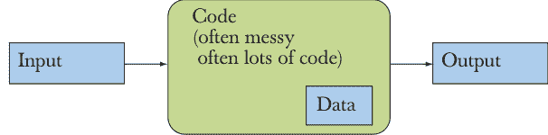


输入可以来自键盘、鼠标、触摸屏、文件、其他输入设备、其他程序，或者程序的其他部分。“其他输入设备”是一个包含大多数真正有趣的输入来源的类别：音乐键盘、视频录音机、网络连接、温度传感器、数码相机图像传感器等。这种多样性基本上是无限的。

为了处理输入，程序通常包含一些数据，有时被称为其数据结构或状态。例如，日历程序可能包含不同国家的节假日列表和你的约会列表。其中一些数据从一开始就是程序的一部分；其他数据是随着程序读取输入并从中收集有用信息而构建起来的。例如，日历程序可能会根据你提供给它的输入来构建你的约会列表。对于日历来说，主要的输入是你请求查看的月份和日期（可能使用鼠标点击）以及你提供给它以保持跟踪的约会（可能通过在键盘上输入信息）。输出是日历和约会的显示，以及日历程序在你屏幕上写入的用于输入的按钮和提示。

输入来自各种各样的来源。同样，输出也可以去往各种各样的目的地。输出可以是到屏幕、文件、网络连接、其他输出设备、其他程序，或者程序的其他部分。输出设备的例子包括网络接口、音乐合成器、电动机、光发生器、加热器等。

从编程的角度来看，最重要和有趣的类别是“与另一个程序之间”和“与程序的其他部分之间”。本书其余的大部分内容可以被视为在讨论最后一个类别：我们如何表达一个作为协作部分集合的程序，以及它们如何共享和交换数据？这些是编程中的关键问题。我们可以通过图形来说明这一点：

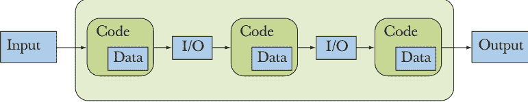

缩写 *I/O* 代表“输入/输出”。在这种情况下，代码某一部分的输出是下一部分的输入。这些“程序部分”共享的是存储在主内存中、持久存储设备（如磁盘）上或通过网络连接传输的数据。通过“程序的部分”，我们的意思是诸如从一个输入参数集合产生结果的函数（例如，从浮点数计算平方根）、对物理对象执行操作的函数（例如，在屏幕上绘制线条的函数）或修改程序内某个表的函数（例如，向客户表中添加名字的函数）之类的实体。

当我们说“输入”和“输出”时，通常是指进入和离开计算机的信息，但正如你所看到的，我们也可以将这些术语用于提供给程序某部分或由该部分产生的信息。程序某部分的输入通常被称为*参数*，程序某部分的输出通常被称为*结果*。

通过*计算*，我们简单指的是基于某些输入产生一些输出的行为，例如使用计算（函数）`square`（参见 §4.5）从参数（输入）7 产生结果（输出）49。作为一个可能有益的知识趣闻，我们注意到直到 20 世纪 50 年代，计算机被定义为执行计算的人，例如会计师、导航员或物理学家。今天，我们 simply 将大多数计算委托给各种形式的计算机（机器），其中口袋计算器是最简单的之一。

## 4.2 目标与工具

我们作为程序员的工作是表达计算：

- 正确地

- 简单地

- 高效地

请注意这些理想的顺序：如果一个程序给出错误的结果，那么它有多快并不重要。同样，一个正确且高效的程序可能复杂到必须被丢弃或完全重写以产生一个新版本（发布）。记住，有用的程序总是会被修改以适应新的需求、新的硬件等。因此，一个程序——以及程序的任何部分——应该尽可能简单地完成其任务。例如，假设你编写了一个完美的程序，用于在当地学校教孩子基础算术，但其内部结构一团糟。你使用什么语言与孩子交流？英语？英语和西班牙语？如果我打算在芬兰或科威特使用它怎么办？你会如何改变用于与儿童交流的自然语言？如果程序的内部结构一团糟，更改用于与用户交流的自然语言这一逻辑上简单（但在实践中几乎总是非常困难）的操作就变得不可逾越。

一旦我们开始为其他人编写代码并承担起负责任地做到这一点的责任，关于正确性、简单性和效率的担忧就成了我们的责任；也就是说，当我们决定成为专业人士时，我们必须接受这种责任。从实际意义上讲，这意味着我们不能只是胡乱堆砌代码直到它似乎能工作；我们必须关注代码的结构。具有讽刺意味的是，对结构和“代码质量”的关注往往是使某物起作用的最快方法。当编程做得好时，这样的关注可以最小化编程中最令人沮丧的部分：调试；也就是说，开发期间良好的程序结构可以最小化错误的发生数量以及查找和消除这些错误所需的时间。

我们组织程序——以及组织我们在编程时的思想——的主要工具是将一个大计算分解为许多小计算。这项技术有两种变体：

- **抽象：** 在方便且通用的接口后面隐藏我们不需要使用某种设施（“实现细节”）的细节。例如，而不是考虑如何排序电话簿的细节（关于如何排序已经写了很多厚书），我们只是从 C++ 标准库中调用 **sort** 算法。我们只需要知道如何调用（调用）该算法来排序，因此我们可以编写 `sort(b)`，其中 *b* 指的是

电话簿；**sort()** 是标准库 **sort** 算法（§21.8, §5.4，定义于 **std_lib_facilities.h**）的一个变体（§21.9）。另一个例子是我们使用计算机内存的方式。直接访问内存可能相当混乱，因此我们通过带有类型和命名的变量（§3.2）、标准库中的**向量**（§4.6，第 17–19 章）、**映射**（第 21 章）等来访问它。

- *“分而治之”：我们将一个大问题分解为几个小问题。例如，如果我们想要构建一个字典，可以将这项任务分为三步：读取数据、对数据排序以及输出数据。产生的每个子问题都显著小于原始问题。

这样做有什么好处呢？毕竟，由部件组合而成的程序可能比将所有内容最优合并在一起的程序稍大一些。原因在于我们并不擅长处理大型问题。我们在编程及其他领域实际处理大型问题的方式，是将它们分解为较小的问题，并继续将这些小问题分解为更小的部分，直到得到足够简单、易于理解和解决的部分为止。就编程而言，你会发现一个 1000 行程序的错误数量远超一个 100 行程序的十倍，因此我们试图用少于 100 行的部件来组合出 1000 行的程序。对于大型程序，比如 10,000,000 行，应用抽象和分治法不仅是一个选项，而是一个基本要求。我们根本无法编写和维护大型单体程序。可以将本书的其余部分视为一系列示例，这些示例展示了需要分解为更小部分的各类问题，以及完成此任务所需的工具和技术。

考虑分解程序时，我们必须始终考虑可用于表达各部分及其通信的工具。一个良好的库，提供有用的设施来表达思想，可以极大地影响我们将功能分配到程序不同部分的方式。我们不能只是坐在那里“想象”如何最好地划分程序；我们必须考虑有哪些库可用于表达各部分及其通信。虽然现在还早，但指出这一点并不为时过早：如果你能使用现有库，例如 C++ 标准库，你就不仅能省下大量编程工作，还能省下测试和文档方面的大量工作。`iostreams` 使我们要免于直接处理硬件的输入/输出端口。这是使用抽象来划分程序的首个示例。每一章新内容都将提供更多示例。

请注意对结构和组织的强调：仅通过编写大量语句并不能获得好的代码。我们为什么现在要提到这一点？在这个阶段，你（或至少许多读者）对代码是什么知之甚少，而且还要过几个月，你才能准备好编写他人能够用于维持生计或生活的代码。我们提到这一点是为了帮助你在学习时把握正确的重点。很容易受到诱惑急于求成，专注于编程中那些具体且立即有用的部分（如本章剩余部分所描述的那样），并忽略软件艺术中那些更概念化、“更柔和”的部分。然而，优秀的程序员和系统设计者知道（通常是以艰难的方式学到的），对结构的关注是优质软件的核心，忽视结构会导致昂贵的混乱。没有结构，你（打个比方）就是在用泥砖盖房子。虽然可以这样做，但你永远无法盖到第五层（泥砖缺乏那样的结构强度）。如果你有雄心建造某种相对持久的东西，你就必须在过程中关注代码结构和组织问题，而不是等到失败后回来补学这些知识。

## 4.3 表达式

程序最基本的构建块是表达式。表达式通过多个操作数计算出一个值。最简单的表达式就是一个字面量值，例如 `10`、`'a'`、`3.14` 或 `"Norah"`。

变量名也是表达式。一个变量代表以其为名称的对象。考虑以下代码：

```
// 计算面积：
int length = 20; // 一个字面整数（用于初始化变量）
int width = 40;
int area = length*width; // 乘法
```

在这里，字面量 **20** 和 **40** 被用于初始化变量 **length** 和 **width**。然后，**length** 和 **width** 相乘；也就是说，我们乘以在 **length** 和 **width** 中找到的值。这里，**length** 仅仅是“在名为 *length* 的对象中找到的值”的简写。还要考虑以下代码：

```
length = 99; // 将 99 赋值给 length
```

在这里，作为赋值的左操作数，**length** 意味着“名为 **length** 的对象”，因此赋值表达式可以读作“将 **99** 放入名为 **length** 的对象中”。我们区分用于赋值或初始化左侧的 **length**（“*length* 的左值”或“名为 *length* 的对象”）与用于赋值或初始化右侧的 **length**（“*length* 的右值”，即名为 **length** 的对象的值，或者简称为“**length** 的值”）。

在此上下文中，我们将变量可视化为一个由其名称标记的盒子很有用：


即，**length** 是一个类型为 **int** 的对象的名称，其中包含值 **99**。有时（作为左值）**length** 指的是盒子（对象），有时（作为右值）**length** 指的是该盒子中的值。

我们可以通过使用我们习惯的方式，利用 **+** 和 **\*** 等运算符组合表达式来创建更复杂的表达式。在需要时，我们可以使用括号对表达式进行分组：

```
int perimeter = (length+width)*2;    // 先加后乘
```

如果没有括号，我们就不得不写成

```
int perimeter = length*2+width*2;
```

这很笨拙，甚至可能会犯这样的错误：

```
int perimeter = length+width*2;      // 将 width*2 加到 length 上
```

最后一个错误是逻辑错误，编译器无法发现。编译器看到的只是一个名为 **perimeter** 的变量被一个有效表达式初始化。如果该表达式的结果是胡扯，那是你的问题。你了解周长的数学定义，但编译器不了解。

通常的数学运算符优先级规则适用，因此 **length+width*2** 意味着 **length+(width*2)**。类似地，**a*b/c/d** 意味着 **((a*b)/c/d)**，而不是 **a*(b+c)/d**。有关优先级表，请参阅 §A.5。

使用括号的第一个规则很简单：“如果拿不准，就加括号”，但请学习足够的表达式知识，以便你对 **a*b+c/d** 感到确定。过度使用括号，如 **((a*b))/(c/d)**，会降低可读性。

为什么你应该关心可读性？因为你自己（可能还有其他人）会阅读你的代码，丑陋的代码会减慢阅读和理解的速度。丑陋的代码不仅难以阅读，而且更难编写得正确。丑陋的代码往往隐藏逻辑错误。阅读速度更慢，让你（以及他人）更难确信该丑陋代码是正确的。不要编写荒谬复杂的表达式，例如：

```
a*b+c/d*(e--f/g)/h+7    // 过于复杂
```

并且始终尝试选择有意义的名称。

### 4.3.1 常量表达式

程序通常使用大量常量。例如，几何程序可能会使用 **pi**，而英寸到厘米的转换程序将使用转换系数，如 **2.54**。显然，我们希望对这些常量使用有意义的名称（就像我们对 **pi** 做的那样；我们没有说 **3.14159**）。类似地，我们也不想意外改变这些常量。因此，C++ 提供了符号常量的概念，即一个初始化后不能再赋予新值的命名对象。例如：

```
constexpr double pi = 3.14159;
pi = 7;              // 错误：赋值给常量
double c = 2*pi*r;  // 正常：我们只是读取 pi；我们并不试图改变它
```

这种常量对于保持代码可读性非常有用。如果你在代码中看到 3.14159，可能已经认出它是 pi 的近似值，但你会认出 299792458 吗？同样，如果有人让你修改代码以使用 12 位精度的 pi 进行计算，你可以在代码中搜索 3.14，但如果有人不小心使用了 22/7，你可能找不到它。最好只是修改 pi 的定义以使用更合适的值：

```
constexpr double pi = 3.14159265359;
```

因此，我们倾向于在代码的大多数地方不使用字面量（除了非常明显的，如 0 和 1）。相反，我们使用具有描述性名称的常量。代码中非显而易见的字面量（在符号常量定义之外）被蔑称为魔术常量。

在某些地方，例如 case 标签（§4.4.1.3），C++ 要求使用常量表达式，即一个完全由常量组成的具有整数值表达式。例如：

```
constexpr int max = 17;        // 字面量是一个常量表达式
int val = 19;
max+2                           // 一个常量表达式（一个 const int 加一个字面量）
val+2                           // 不是常量表达式：它使用了一个变量
```

顺便说一句，299792458 是宇宙的基本常数之一：以米每秒为单位的真空光速。如果你没有立即认出它，那你还能指望不被代码中嵌入的其他字面量弄混淆并拖慢速度吗？避免魔术常量！

`constexpr` 符号常量必须被赋予一个在编译时已知的值。例如：

```
constexpr int max = 100;

void use(int n)
{
```

为了处理那些初始化为编译时未知但初始化后不再改变的值且以“变量”形式出现的值，C++ 提供了一种第二类的常量（即 **const**）：

```cpp
constexpr int max = 100;

void use(int n)
{
      constexpr int c1 = max+7;   // 正确：c1 为 107
      const int c2 = n+7;   // 正确，但请勿尝试修改 c2 的值
      // ...
      c2 = 7;                     // 错误：c2 是 const
}
```

这种“**const 变量**”非常常见，原因有二：

- C++98 没有 **constexpr**，因此人们使用 **const**。

- 那些不是常量表达式（即编译时值未知）但在初始化后不再改变值的“变量”，其本身具有广泛的实用性。

### 4.3.2 运算符

我们刚才使用了最简单的运算符。然而，随着你希望表达更复杂的操作，很快就会需要更多的运算符。大多数运算符都是约定俗成的，因此我们只会在需要时稍作解释，你可以自行查阅细节。以下是常见运算符列表：

| 名称 | 说明 |

|---|---|

| **f**(a) | 函数调用：将 a 作为参数传递给 f |

| **++lval** | 前置自增：自增并使用该自增后的值 |

| **--lval** | 前置自减：自减并使用该自减后的值 |

| **!a** | 非：结果为 bool |

| **-a** | 一元负号 |

| **a\*b** | 乘法 |

| **a/b** | 除法 |

| **a%b** | 取模（余数）：仅适用于整数类型 |

| **a+b** | 加法 |

| **a-b** | 减法 |

| **out<<b** | 将 b 写入 out：其中 out 是一个 ostream |

| **in>>b** | 从 in 读入到 b：其中 in 是一个 istream |

| **a<b** | 小于：结果为 bool |

| **a<=b** | 小于或等于：结果为 bool |

| **a>b** | 大于：结果为 bool |

| **a>=b** | 大于或等于：结果为 bool |

| **a==b** | 等于：不要与 = 混淆 |

| **a!=b** | 不等于：结果为 bool |

| **a && b** | 逻辑与：结果为 bool |

| **a \|\| b** | 逻辑或：结果为 bool |

| **lval = a** | 赋值：不要与 == 混淆 |

| **lval \*= a** | 复合赋值：lval = lval\*a；同样适用于 /, %, +, - |

当运算符会修改操作数时，我们使用 lval（即“可以出现在赋值左侧的值”的缩写）。你可以在 §A.5 中找到完整的列表。

关于逻辑运算符 &&（与）、||（或）和 !（非）的用法的示例，请参阅 §5.5.1、§7.7、§7.8.2 和 §10.4。

请注意，a<b<c 意味着 (a<b)<c，且 a<b 会评估为一个布尔值：true 或 false。因此，a<b<c 等同于 true<c 或 false<c。特别是，a<b<c 并不意味着“b 是否在 a 和 c 之间？”正如许多人天真（且并非毫无道理）所假设的那样。因此，a<b<c 基本上是一个无用的表达式。请勿编写包含两个比较操作的此类表达式，如果你在别人的代码中发现此类表达式，请保持高度警惕——它很可能是一个错误。

自增可以用至少三种方式表达：

```cpp
++a
a+=1
a=a+1
```

我们应该使用哪种符号？为什么？我们倾向于第一种形式 ++a，因为它更直接地表达了自增的概念。它描述了我们想要做什么（对 a 进行自增），而不是如何实现它（将 1 加到 a 上然后将结果写回 a）。通常，在程序中，一种表达方式比另一种更好，如果它更直接地表达了一个概念。结果是更简洁且更容易让读者理解。如果我们写 a=a+1，读者很容易怀疑我们是否真的意指增加 **1**。也许只是误将 **a=b+1**、**a=a+2** 甚至 **a=a-1** 输错了；而对于 **++a**，这种疑虑的可能性要小得多。请注意，这是一个关于可读性和正确性的逻辑论证，而不是关于效率的论证。与流行观点相反，当 **a** 是内置类型之一时，现代编译器倾向于为 **a=a+1** 和 **++a** 生成完全相同的代码。类似地，我们倾向于使用 **a\*=scale** 而不是 **a=a\*scale**。

### 4.3.3 转换


我们可以在表达式中“混合”不同的类型。例如，`2.5/2` 是一个 `double` 类型除以一个 `int` 类型。这意味着什么？我们是进行整数除法还是浮点数除法？整数除法会丢弃余数；例如，`5/2` 的结果是 `2`。浮点数除法不同，因为没有余数可以丢弃；例如，`5.0/2.0` 的结果是 `2.5`。因此，对于“`2.5/2` 是整数除法还是浮点数除法？”这个问题，最直接的答案是“显然是浮点数除法；否则我们会丢失信息。”我们更希望结果是 `1.25` 而不是 `1`，而 `1.25` 正是我们得到的结果。规则（对于到目前为止我们介绍过的类型）是：如果运算符有一个 `double` 类型的操作数，我们就使用浮点算术，产生 `double` 结果；否则，我们使用整数算术，产生 `int` 结果。例如：

```text
5/2 是 2  (不是 2.5)

2.5/2 意味着 2.5/double(2)，即 1.25

'a'+1 意味着 int('a')+1
```

符号 `type(value)` 和 `type{value}` 意味着“将 `value` 转换为 `type`，就好像你要用值 `value` 初始化一个 `type` 类型的变量一样。”换句话说，如果需要，编译器会将 `int` 操作数转换（“提升”）为 `doubles`，或将 `char` 操作数转换为 `ints`。`type(value)` 符号可以防止窄化（§3.9.2），但 `type{value}` 符号不可以。一旦结果计算出来，编译器可能还需要再次转换它，以便将其用作初始化器或赋值语句的右侧。例如：

```cpp
double d = 2.5;
int i = 2;

double d2 = d/i;    // d2 == 1.25
int i2 = d/i;        // i2 == 1
int i3 {d/i};        // 错误：double -> int 转换可能导致窄化 (§3.9.2)

d2 = d/i;            // d2 == 1.25
i2 = d/i;            // i2 == 1
```

请注意，在一个包含浮点数操作数的表达式中，很容易忘记整数除法。考虑一下将摄氏温度转换为华氏温度的常用公式：$f = 9/5 * c + 32$。我们可能会这样写：

```cpp
double dc;
cin >> dc;
double df = 9/5*dc+32;   // 小心！
```

不幸的是，但合乎逻辑地，这并不代表准确的温度刻度转换：`9/5` 的值是 `1`，而不是我们可能希望得到的 `1.8`。为了使代码在数学上正确，必须将 `9` 或 `5`（或两者）更改为 `double`。例如：

```cpp
double dc;
cin >> dc;
double df = 9.0/5*dc+32;   // 更好
```

## 4.4 语句

表达式使用像 §4.3 中提到的那些运算符，从一组操作数计算出一个值。当我们想要产生多个值时怎么办？当我们想要多次执行某事时怎么办？当我们想要从多个选项中选择时怎么办？当我们想要获取输入或产生输出时怎么办？在 C++ 中，正如在许多语言中一样，你使用称为语句的语言结构来表达这些内容。

到目前为止，我们已经看到了两种类型的语句：表达式语句和声明。表达式语句只是一个后跟分号的表达式。例如：

```cpp
a = b;
++b;
```

这是两个表达式语句。请注意，赋值 `=` 是一个运算符，因此 `a=b` 是一个表达式，我们需要终止分号才能使 `a=b;` 成为一个语句。为什么我们需要这些分号？原因在很大程度上是技术性的。考虑一下：

```cpp
a = b + + b;    // 语法错误：缺少分号
```

没有分号，编译器不知道我们的意思是 `a=b++; b;` 还是 `a=b; ++b;`。这种问题并不局限于计算机语言；考虑感叹词“man eating tiger!”（人吃老虎！）。谁在吃谁？标点符号的存在就是为了消除这类问题，例如，“man-eating tiger!”（吃人的老虎！）。

当语句依次排列时，计算机按书写的顺序执行它们。例如：

```cpp
int a = 7;
cout << a << "\n";
```

在这里，带有初始化的声明在执行输出表达式语句之前执行。

通常，我们希望语句有一些效果。没有效果的语句通常是无用的。例如：

```cpp
1+2;        // 执行加法，但不使用总和
a*b;        // 执行乘法，但不使用积
```

这类没有效果的语句通常是逻辑错误，编译器通常会对此发出警告。因此，表达式语句通常是赋值、I/O 语句或函数调用。

我们将提及另一种类型的语句：“空语句”。考虑以下代码：

```cpp
if (x == 5);
{ y = 3; }
```

这看起来像是一个错误，而且几乎肯定是一个错误。第一行中的 `;` 不应该在那里。但不幸的是，这在 C++ 中是一个合法的结构。它被称为空语句，即什么都不做的语句。分号前的空语句很少有用。在这种情况下，不幸的后果是允许几乎肯定是一个错误的写法被编译器接受，因此它不会提醒你存在错误，你将更难找到这个错误。

如果运行这段代码会发生什么？编译器将测试 `x` 是否具有值 `5`。如果此条件为真，则执行随后的语句（即空语句），没有效果。然后程序继续到下一行，将值 `3` 分配给 `y`（这是你希望当 `x` 等于 `5` 时发生的情况）。另一方面，如果 `x` 没有值 `5`，编译器不会执行空语句（仍然没有效果），并继续将值 `3` 分配给 `y`（除非 `x` 等于 `5`，否则这不是你希望发生的情况）。换言之，`if` 语句无关紧要；无论 `x` 是否等于 `5`，`y` 都会获得值 `3`。这是新手程序员常见的错误，且很难发现，因此要当心。

下一节专门介绍用于改变评估顺序的语句，以便我们可以表达比按书写顺序执行语句所得到更有趣的计算。

### 4.4.1 选择

正如在生活中一样，在程序中我们经常需要在多个选项中进行选择。在 C++ 中，这可以通过使用 `if` 语句或 `switch` 语句来实现。

#### 4.4.1.1 if 语句

最简单的选择形式是 `if` 语句，它在两个选项之间进行选择。例如：

```cpp
int main()
{
    int a = 0;
    int b = 0;
    cout << "Please enter two integers\n";
    cin >> a >> b;
    
    if (a<b)    // condition
                // 1st alternative (taken if condition is true):
                cout << "max(" << a << "," << b << ") is " << b <<"\n";
    
    else
                // 2nd alternative (taken if condition is false):
                cout << "max(" << a << "," << b << ") is " << a << "\n";
}
```

`if` 语句在两个选项中进行选择。如果其条件为真，则执行第一个语句；否则，执行第二个语句。这个概念很简单。大多数基本的编程语言特性也是如此。事实上，编程语言中的大多数基本功能只是你在小学（甚至更早以前）学到的事情的新符号。例如，你在幼儿园可能就被教导过，在红绿灯处过马路时，必须等待绿灯亮起：“如果红绿灯是绿色的，就通过”和“如果红绿灯是红色的，就等待。”在 C++ 中，这变成了类似这样的代码

```cpp
if (traffic_light==green) go();
```

以及

```cpp
if (traffic_light==red) wait();
```

因此，基本概念很简单，但很容易以过于简单化的方式使用 `if` 语句。请考虑以下程序有什么错误（除了像往常一样省略 `#include` 之外）：

```cpp
// convert from inches to centimeters or centimeters to inches
// a suffix 'i' or 'c' indicates the unit of the input
int main()
{
constexpr double cm_per_inch = 2.54; // number of centimeters in
// an inch
double length = 1; // length in inches or
// centimeters
char unit = 0;
cout<<"Please enter a length followed by a unit (c or i):\n";
cin >> length >> unit;
if (unit == 'i')
cout << length << "in == " << cm_per_inch*length << "cm\n";
else
cout << length << "cm == " << length/cm_per_inch << "in\n";
}
```

实际上，这个程序大致按预期工作：输入 `1i`，你会得到 `1in == 2.54cm`；输入 `2.54c`，你会得到 `2.54cm == 1in`。请试一试；这是很好的练习。

问题在于我们没有测试无效输入。该程序假设用户输入了正确的输入。条件 `unit=='i'` 区分了单位为 `'i'` 的情况和所有其他情况。它从不查找 `'c'`。

如果用户输入 `15f`（代表英尺）“只是为了看看会发生什么”会怎样？条件 `(unit == 'i')` 将失败，程序将执行 `else` 部分（第二个选项），从厘米转换为英寸。显然，当我们输入 `'f'` 时并不是我们希望得到的结果。

我们必须始终使用“错误”输入来测试我们的程序，因为总会有人——故意或意外地——输入错误输入。即使用户行为不当，程序也应合理地运行。

以下是改进后的版本：

```cpp
// convert from inches to centimeters or centimeters to inches
// a suffix 'i' or 'c' indicates the unit of the input
// any other suffix is an error
int main()
{
constexpr double cm_per_inch = 2.54; // number of centimeters in
// an inch
double length = 1; // length in inches or
// centimeters
char unit = ' '; // a space is not a unit
cout<< "Please enter a length followed by a unit (c or i):\n";
cin >> length >> unit;

if (unit == 'i')
    cout << length << "in = " << cm_per_inch*length << "cm\n";
else if (unit == 'c')
    cout<< length << "cm == " << length/cm_per_inch << "in\n";
else
    cout << "Sorry, I don't know a unit called " << unit << "\n";
}
```

我们首先测试 `unit=='i'`，然后测试 `unit=='c'`，如果都不是（任何一种），我们就会说，“对不起。”看起来我们使用了一个“else-if 语句”，但在 C++ 中并没有这种东西。相反，我们结合了两个 `if` 语句。`if` 语句的一般形式是

```cpp
if ( expression ) statement else statement
```

也就是说，一个 `if`，后跟括号中的表达式，后跟一个语句，后跟一个 `else`，后跟一个语句。我们做的是将 `if` 语句用作 `if` 语句的 `else` 部分：

```cpp
if ( expression ) statement else if ( expression ) statement else statement
```

对于我们的程序，这给出了这样的结构：

```cpp
if (unit == 'i')
    ...
        // 1st alternative
else if (unit == 'c')
    ...
        // 2nd alternative
else
    ...
        // 3rd alternative
```

通过这种方式，我们可以编写任意复杂的测试，并将一个语句与每个选项相关联。但是，请记住代码的一个理想是简洁性，而不是复杂性。你并不是通过编写最复杂的程序来展示你的聪明才智。相反，你通过编写能完成任务的最简代码来展示你的能力。

## 试一试

- 使用上面的例子作为模型，编写一个程序，将日元 `('y')`、`克朗 ('k')` 和英镑 `('p')` 转换为美元。如果你喜欢现实感，你可以在网上找到兑换率。

#### 4.4.1.2 switch 语句

实际上，将 `unit` 与 `'i'` 和 `'c'` 进行比较，是选择的最常见形式的一个例子：基于将值与多个常量进行比较的选择。这种选择如此常见，以至于 C++ 为此提供了一个特殊语句：`switch` 语句。我们可以将我们的例子重写为

```cpp
int main()
{
    constexpr double cm_per_inch = 2.54;     // number of centimeters in
                                              // an inch

    double length = 1;                       // length in inches or
                                              // centimeters

    char unit = 'a';
    cout << "Please enter a length followed by a unit (c or i):\n";
    cin >> length >> unit;
    switch (unit) {
        case 'i':
            cout << length << "in == " << cm_per_inch*length << "cm\n";
            break;
        case 'c':
            cout << length << "cm == " << length/cm_per_inch << "in\n";
            break;
        default:
            cout << "Sorry, I don't know a unit called '" << unit << "'\n";
            break;
    }
}
```

`switch` 语句的语法虽然古老，但当与许多常量进行比较时，它仍然比嵌套的 `if` 语句更清晰。`switch` 后括号中呈现的值与一组常量进行比较。每个常量都作为 `case` 标签的一部分呈现。如果值等于某个 `case` 标签中的常量，则选择该情况的语句。每个 case 都以 `break` 结尾。如果值不匹配任何 `case` 标签，则选择由 `default` 标签标识的语句。你不需要提供默认值，但除非你绝对确定你列出了所有选项，否则这是一个好主意。如果你还不知道，编程会教你很难对任何事情都绝对确定（且正确）。

#### 4.4.1.3 Switch 技术细节

以下是关于 `switch` 语句的一些技术细节：

- 我们要切换的值必须是整数、`char` 或枚举（§9.5）类型。特别是，你不能对 `string` 进行 switch 操作。

- `case` 标签中的值必须是常量表达式（§4.3.1）。特别是，你不能用变量作为 `case` 标签。

- 你不能为两个 `case` 标签使用相同的值。

- 你可以为单个 case 使用多个 `case` 标签。

- 别忘了在每个 `case` 结尾加上 `break`。不幸的是，如果你忘记了，编译器可能不会警告你。

例如：

```cpp
int main()                        // you can switch only on integers, etc.
{
    cout << "Do you like fish?\n";
    string s;
    cin >> s;
    switch (s) {                  // error: the value must be of integer, char, or enum type
        case "no":
            // ...
            break;
        case "yes":
            // ...
            break;
    }
}
```

要基于 `string` 进行选择，你必须使用 `if` 语句或 `map`（第 21 章）。

`switch` 语句生成针对与一组常量进行比较的优化代码。对于较大的常量集合，这通常会产生更高效的代码。

比一堆 `if` 语句要好。然而，这意味着 `case` 标签的值必须是常量且互不相同。例如：


```cpp
int main()            // case labels must be constants
{
    // define alternatives:
    int y = 'y';      // this is going to cause trouble
    constexpr char n = 'n';
    constexpr char m = '?';
    cout << "Do you like fish?\n";
    char a;
    cin >> a;
    switch (a) {
    case n:
        // ...
        break;
    case y:          // error: variable in case label
        // ...
        break;
    case m:
        // ...
        break;
    case 'n':        // error: duplicate case label (n's value is 'n')
        // ...
        break;
    default:
        // ...
        break;
    }
}
```

通常，你希望在一组值中执行相同的操作。重复这些操作会很繁琐，因此你可以用一组 `case` 标签来标记单个操作。例如：

```cpp
int main()            // you can label a statement with several case labels
{
    cout << "Please enter a digit\n";
    char a;
    cin >> a;
    switch (a) {
    case '0': case '2': case '4': case '6': case '8':
        cout << "is even\n";
        break;
    case '1': case '3': case '5': case '7': case '9':
        cout << "is odd\n";
        break;
    default:
        cout << "is not a digit\n";
        break;
    }
}
```

在使用 `switch` 语句时最常见的错误是忘记用 `break` 来终止某个 `case`。例如：

```cpp
int main()    // example of bad code (a break is missing)
{
    constexpr double cm_per_inch = 2.54; // number of centimeters in an inch
    double length = 1;                    // length in inches or centimeters
    char unit = 'a';
    cout << "Please enter a length followed by a unit (c or i)\n";
    cin >> length >> unit;

    switch (unit) {
    case 'i':
        cout << length << "in == " << cm_per_inch*length << "cm\n";
    case 'c':
        cout << length << "cm == " << length/cm_per_inch << "in\n";
    }
}
```

不幸的是，编译器会接受这段代码，当你完成 `case 'i'` 后，你会直接“穿透”到 `case 'c'`，因此如果你输入 `2i`，程序将输出：

```
2in == 5.08cm
2cm == 0.787402in
```

我们已经给你打过预防针了！

## **试一试**

重写你之前 **试一试** 部分中的货币转换程序，使其使用 **switch** 语句。添加元（yuan）和克朗（kronor）的转换。哪个版本的程序更容易编写、理解和修改？为什么？

### 4.4.2 **迭代**

我们很少只做一次某事。因此，编程语言提供了多次执行某事的方法。这被称为 *重复* 或——特别是当你对数据结构的一系列元素执行操作时——*迭代*。

#### 4.4.2.1 **while 语句**

作为迭代的示例，请考虑第一个在存储程序计算机（EDSAC）上运行的程序。它由 David Wheeler 于 1949 年 5 月 6 日在英国剑桥大学的计算机实验室编写并运行，用于计算并打印一个简单的平方表，如下所示：

```
0  1
1  1
2  4
3  9
4  16
...
98  9604
99  9801
```

每一行是一个数字，后跟一个“制表符”字符（`'\t'`），再后跟该数字的平方。C++ 版本看起来像这样：

```cpp
/* calculate and print a table of squares 0–99 */
int main()
{
    int i = 0;            /* start from 0 */
    while (i<100) {
        cout << i << '\t' << square(i) << '\n';
        ++i;               /* increment i (that is, i becomes i+1) */
    }
}
```

符号 `square(i)` 仅表示 `i` 的平方。我们稍后将解释它是如何获得这个含义的（§4.5）。

不，这个最初的现代程序实际上并不是用 C++ 编写的，但其逻辑与此处所示一致：

- 我们从 0 开始。
- 我们检查是否已达到 100，如果是，则完成。
- 否则，我们打印数字及其平方，中间用制表符（`\t`）分隔，增加数字，然后重试。

显然，要做到这一点，我们需要：

- 一种重复执行某些语句的方法（即 *循环*）
- 一个变量来跟踪我们已循环执行了多少次（*循环变量* 或 *控制变量*），这里就是名为 `i` 的 `int` 类型变量
- 循环变量的初始化器，这里是 `0`
- 终止条件，在这里是我们希望循环执行 100 次
- 每次循环执行的内容（循环的 *主体*）

我们使用的语言结构称为 `while` 语句。紧跟其特有的关键字 `while` 之后，它有一个位于“顶部”的条件，随后是其主体：

```cpp
while (i<100)               // the loop condition testing the loop variable i
{
    cout << i << '\t' << square(i) << '\n';
    ++i;                    // increment the loop variable i
}
```

循环主体是一个由大括号围起来的块（block），它写出表格的一行并递增循环变量 `i`。我们每次循环执行时都会先测试 `i<100`。如果是，我们尚未完成，可以执行循环主体。如果我们到达了终点，即 `i` 为 `100`，我们离开 `while` 语句并执行接下来的代码。在这个程序中，紧接着的是程序结束，所以我们离开程序。

`while` 语句的循环变量必须在 `while` 语句外部（之前）定义并初始化。如果我们忘记定义它，编译器会给我们一个错误。如果我们定义了它但忘记初始化它，大多数编译器会警告我们，说类似“局部变量 `i` 未设置”的话，但如果我们坚持，它们也愿意让我们执行程序。不要坚持！当编译器警告关于未初始化变量时，它们几乎总是正确的。未初始化的变量是错误的一个常见来源。在这种情况下，我们写道：

```cpp
int i = 0;        // start from 0
```

所以一切正常。

基本上，编写循环很简单。但要在现实世界的问题中正确地做到这一点，可能会很棘手。特别是，正确表达条件和初始化所有变量以使循环正确启动可能很困难。

## **试一试**

字符 `'b'` 是 `char`(`'a'+1`)，`'c'` 是 `char`(`'a'+2`)，等等。使用循环写出一张字符及其对应整数值表：

```
a  97
b  98
...
z 122
```

#### 4.4.2.2 块

注意我们如何分组了 `while` 必须执行的两个语句：

```cpp
while (i<100) {
    cout << i << '\t' << square(i) << "\n";
    ++i ;     // increment i (that is, i becomes i+1)
}
```

由大括号 `{` 和 `}` 围起来的一个语句序列称为 *块* 或 *复合语句*。块是一种语句。空块 `{}` 有时用于表达不执行任何操作。例如：

```cpp
if (a<=b) {    // do nothing
}
else {         // swap a and b
    int t = a;
    a = b;
    b = t;
}
```

#### 4.4.2.3 for 语句

对一系列数字进行迭代非常常见，因此 C++ 像大多数其他编程语言一样，为此提供了特殊的语法。`for` 语句就像 `while` 语句，除了控制变量的管理集中在顶部，使其更容易看到和理解。我们可以这样写“第一个程序”：

```cpp
// calculate and print a table of squares 0–99
int main()
{
    for (int i = 0; i<100; ++i)
        cout << i << '\t' << square(i) << '\n';
}
```

这意味着“从 `i` 为 `0` 开始执行主体，每次执行主体后递增 `i`，直到达到 `100`。”。`for` 语句始终等同于某个 `while` 语句。在这种情况下：

```cpp
for (int i = 0; i<100; ++i)
    cout << i << '\t' << square(i) << '\n';
```

意味着：

```cpp
{
    int i = 0;           // the for-statement initializer
    while (i<100) {     // the for-statement condition
        cout << i << '\t' << square(i) << '\n';    // the for-statement body
        ++i;            // the for-statement increment
    }
}
```

- 一些初学者喜欢 `while` 语句，而另一些初学者喜欢 `for` 语句。然而，每当循环可以定义为具有简单初始化器、条件和增量操作的 `for` 语句时，使用 `for` 语句会产生更容易理解和更易于维护的代码。仅当情况并非如此时才使用 `while` 语句。
- 永远不要在 `for` 语句的主体内修改循环变量。这将违反所有读者关于循环正在做什么的合理假设。考虑以下例子：

```cpp
int main()
{
    for (int i = 0; i<100; ++i) {    // for i in the [0:100) range
        cout << i << '\t' << square(i) << '\n';
        ++i;        // what’s going on here? It smells like an error!
    }
}
```

任何看到这个循环的人都会合理地认为循环体将执行 100 次。然而事实并非如此。循环体中的 `++i` 确保 `i` 在每次循环中递增两次，因此我们只会在 `i` 的 50 个偶数值时得到输出。如果我们看到这样的代码，我们会认为这是一个错误，可能是由草率的从 *while* 语句转换而来所致。如果你想递增 2，请明确说明：

```cpp
// 计算并打印 [0:100] 范围内偶数平方值的表格
int main()
{
    for (int i = 0; i<100; i+=2)
        cout << i << "\t" << square(i) << '\n';
}
```

请注意，这种更整洁、更明确的版本比混乱的版本更短。这是很典型的。

## 试一试

将上一个 **试一试** 中的字符值示例改写为使用 *for* 语句。然后修改你的程序，使其也输出大写字母和数字的整数值表格。

还有一个更简单的“范围-*for*-循环”用于遍历数据集合，例如 `vector`；参见 §4.6。

## 4.5 函数

在上面的程序中，`square(i)` 是什么？它是一个函数调用。具体来说，它是对名为 `square` 的函数的调用，参数为 `i`。*函数* 是一系列命名的语句。函数可以返回结果（也称为 *返回值*）。标准库提供了许多有用的函数，例如我们在 §3.4 中使用的平方根函数 `sqrt()`。然而，我们也编写许多自己的函数。以下是 `square` 的一个合理定义：

```cpp
int square(int x)    // 返回 x 的平方
{
    return x*x;
}
```

这个定义的第一行告诉我们，这是一个函数（这就是括号的意思），它被称为 `square`，接受一个 `int` 参数（这里称为 `x`），并且返回一个 `int`（结果的类型总是在函数声明中排在第一位）；也就是说，我们可以这样使用它：

```cpp
int main()
{
    cout << square(2) << "\n";     // 打印 4
    cout << square(10) << "\n";    // 打印 100
}
```

我们不一定需要使用函数调用的结果，但我们必须精确地提供函数所需的参数。考虑以下情况：

```cpp
square(2);                    // 可能是个错误：未使用的返回值
int v1 = square();            // 错误：缺少参数
int v2 = square;              // 错误：缺少括号
int v3 = square(1,2);        // 错误：参数过多
int v4 = square("two");      // 错误：参数类型错误 - 期望 int
```

许多编译器会对未使用的结果发出警告，并且所有编译器都会给出如上所述的错误。你可能会认为计算机应该足够聪明，能弄清楚字符串 `"two"` 实际上指的是整数 `2`。然而，C++ 编译器刻意不会那么聪明。编译器的工作是在验证你的代码符合 C++ 定义之后，精确地执行你所指示的操作。如果编译器猜测你的意图，它偶尔会猜错，而你——或你的程序的最终用户——会感到相当恼火。如果没有编译器通过“猜测”来“帮助”你，预测你的代码行为已经够难了。

函数体是实际执行工作的代码块（§4.4.2.2）。

```cpp
{
    return x*x;           // 返回 x 的平方
}
```

对于 `square`，工作是微不足道的：我们生成参数的平方并将其作为结果返回。用 C++ 表达这一点比用英语更容易。这对于简单的想法来说是典型的。毕竟，编程语言旨在简单且精确地表述这些简单的想法。

函数定义的语法可以描述如下：

*类型 标识符 ( 参数列表 ) 函数体*

也就是说，一个类型（返回类型），后跟一个标识符（函数名），后跟括号中的参数列表，再后跟函数体（要执行的语句）。函数所需的参数列表称为 *参数列表*，其元素称为 *参数*（或 *形式参数*）。参数列表可以为空，如果我们不打算返回结果，则使用 `void`（意思是“无”）作为返回类型。例如：

```cpp
void write_sorry()           // 不接受参数；不返回值
{
    cout << "Sorry\n";
}
```

函数的语言技术方面将在第 8 章中更详细地探讨。

### 4.5.1 为什么要麻烦使用函数？

当我们希望有一个带名称的独立计算时，我们就定义一个函数，因为这样做：

- 使计算在逻辑上独立
- 使程序文本更清晰（通过命名计算）
- 使能够在程序中的多个地方使用该函数
- 简化测试

随着我们继续深入，我们将看到每个理由的许多示例，并且我们偶尔会提到某个理由。请注意，现实世界中的程序使用成千上万个函数，有些甚至使用数百或数千个函数。显然，如果程序的各个部分（例如计算）没有清晰地分离和命名，我们将永远无法编写或理解这样的程序。此外，你很快会发现许多函数反复有用，你会很快厌倦重复等效代码。例如，你可能会乐于编写 `x*x` 和 `7*7` 以及 `(x+7)*(x+7)` 等，而不是 `square(x)` 和 `square(7)` 以及 `square(x+7)` 等。然而，这仅仅是因为 `square` 是一个非常简单得计算。考虑平方根（在 C++ 中称为 `sqrt`）：你更喜欢编写 `sqrt(x)` 和 `sqrt(7)` 以及 `sqrt(x+7)` 等，而不是重复（相当复杂且行数较多的）计算平方根的代码。更好的一点是：你甚至不需要查看平方根的计算，因为知道 `sqrt(x)` 给出 `x` 的平方根就足够了。

在 §8.5 中，我们将讨论许多函数的技术细节，但现在，我们将再给出一个例子。


如果我们想让 `main()` 中的循环真正简单，我们可以这样写：


```cpp
void print_square(int v)
{
    cout << v << " " << v*v << "\n";
}

int main()
{
    for (int i = 0; i<100; ++i) print_square(i);
}
```

为什么我们没有使用使用 **`print_square()`** 的版本？那个版本并不比使用 **`square()`** 的版本简单多少，并且请注意：

- **`print_square()`** 是一个相当专门的函数，我们无法指望以后能用到它，而 **`square()`** 是其他用途的明显候选者

- **`square()`** 几乎不需要文档，而 **`print_square()`** 显然需要解释

这两个潜在的原因在于 **`print_square()`** 执行了两个逻辑上分离的操作：

- 它打印。

- 它计算平方。

通常，如果每个函数执行单个逻辑操作，程序更容易编写和理解。基本上，**`square()`** 版本是更好的设计。

最后，为什么我们在问题的第一个版本中使用 **`square(i)`** 而不是简单的 **`i*i`**？嗯，函数的目的之一是通过将复杂的计算分离为命名函数来简化代码，对于 1949 年的程序版本，没有硬件直接实现“乘法”。因此，在 1949 年的程序版本中，**`i*i`** 实际上是一个相当复杂的计算，类似于你用手纸笔计算的过程。此外，那个最初版本的作者 David Wheeler 是现代计算中函数（当时称为子例程）的发明者，因此在这里使用它似乎很合适。

## 试一试

不使用乘法运算符实现 **`square()`**；也就是说，通过重复加法来执行 `x*x`（从一个变量 `result` 开始，设为 **`0`**，并将 **`x`** 加到它 **`x`** 次）。然后运行“第一个程序”的某个版本，使用那个 **`square()`**。

### 4.5.2 函数声明

你注意到调用函数所需的所有信息都在其定义的第一行中了吗？例如：

```cpp
int square(int x)
```

有了这个，我们就知道足够信息来说：

```cpp
int x = square(44);
```

我们真的不需要看函数体。在现实程序中，我们通常不希望看函数体。我们为什么要看标准库 `*sqrt()*` 函数的主体？我们知道它计算其参数的平方根。我们为什么要看 `*square()*` 函数的主体？当然，我们可能只是出于好奇。但几乎在所有的情况下，我们只是有兴趣知道如何调用一个函数 – 查看定义只会分散注意力。幸运的是，C++ 提供了一种提供这些信息的方式，独立于完整的函数定义。它被称为 *函数声明*：

```cpp
int square(int);    // square 的声明
double sqrt(double); // sqrt 的声明
```

注意终止分号。在函数声明中，使用分号代替对应函数定义中使用的主体：

```cpp
int square(int x)      // square 的定义
{
    return x*x;
}
```

所以，如果你只想使用一个函数，你只需编写——或者更常见的是 **`#include`**——其声明。函数定义可以在其他地方。我们将在 §8.3 和 §8.7 中讨论那个“其他地方”可能在哪里。在较大的程序中，声明和定义之间的这种区别变得至关重要，我们使用声明来将大部分代码隐藏起来，以便我们可以一次专注于程序的一部分（§4.2）。

## 4.6 *vector*

要在程序中进行任何有趣的事情，我们需要一个要处理的数据集合。例如，我们可能需要一个电话号码列表、一个足球队成员列表、一个课程列表、过去一年读过的书籍列表、一个目录

可供下载的歌曲列表、一组汽车支付选项、未来一周的天气预报列表、不同网店中相机的价格列表等。可能性实际上是无限的，因此在程序中无处不在。我们将看到多种存储数据集合的方式（多种数据容器；见第 20 章和第 21 章）。这里我们将从存储数据最简单、也许也最有用的一种方式开始：**`vector`**。

**`vector`** 只是一个你可以按索引访问的元素序列。例如，这里有一个名为 **`v`** 的 **`vector`**：

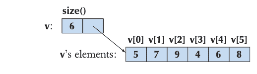

也就是说，第一个元素的索引为 0，第二个为 1，依此类推。我们通过将 **`vector`** 的名称与元素的索引组合来引用元素，因此这里 **`v[0]`** 的值是 **`5`**，**`v[1]`** 的值是 **`7`**，以此类推。**`vector`** 的索引总是从 0 开始并以 1 递增。这应该看起来很熟悉：标准库中的 **`vector`** 只不过是 C++ 标准库对一种古老且众所周知的概念的诠释。我画出向量是为了强调它“知道自己的大小”；也就是说，**`vector`** 不仅存储其元素，还存储其大小。

我们可以像这样创建一个这样的 **`vector`**：

```
vector<int> v = {5, 7, 9, 4, 6, 8};    // 包含 6 个整数的向量
```

我们看到，要创建一个 **`vector`**，我们需要指定元素的类型和初始元素集合。元素类型位于 **`vector`** 之后的尖括号（<, >）中，这里是 **`<int>`**。这是另一个例子：

```
vector<string> philosopher
    = {"Kant", "Plato", "Hume", "Kierkegaard"};   // 包含 4 个字符串的向量
```

自然地，**`vector`** 只会接受其声明的元素类型的元素：

```
philosopher[2] = 99;     // 错误：试图将整数赋值给字符串
v[2] = "Hume";           // 错误：试图将字符串赋值给整数
```

我们还可以定义一个指定大小的 **`vector`** 而不指定元素值。在这种情况下，我们使用 (**`n`**) 表示法，其中 **`n`** 是元素的数量，元素根据其类型获得默认值。例如：

```
vector<int> vi(6);        // 初始化为 0 的 6 个整数的向量
vector<string> vs(4);     // 初始化为 "" 的 4 个字符串的向量
```

没有字符的字符串 `""` 被称为空字符串。

请注意，你不能简单地引用 **`vector`** 中不存在的元素：

```
vi[20000] = 44; // 运行时错误
```

我们将在下一章讨论运行时错误和索引引用。

### 4.6.1 遍历向量

**`vector`** “知道”它的大小，因此我们可以像这样打印 **`vector`** 的元素：

```
vector<int> v = {5, 7, 9, 4, 6, 8};
for (int i=0; i<v.size(); ++i)
cout << v[i] << "\n";
```

调用 **`v.size()`** 给出名为 **`v`** 的 **`vector`** 的元素数量。一般来说，**`v.size()`** 让我们能够访问 **`vector`** 的元素，而不会意外地引用超出 **`vector`** 范围之外的元素。**`vector`** **`v`** 的范围是 **`[0:v.size())`**。这是半开元素序列的数学表示法。**`v`** 的第一个元素是 **`v[0]`**，最后一个元素是 **`v[v.size()-1]`**。如果 **`v.size()==0`**，则 **`v`** 没有元素，也就是说，**`v`** 是一个空 **`vector`**。这种半开序列的概念在整个 C++ 和 C++ 标准库中都有使用（§17.3, §20.3）。

语言利用半开序列的概念来提供一种简单的循环，以遍历序列（例如 **`vector`** 的元素）中的所有元素。例如：

```
vector<int> v = {5, 7, 9, 4, 6, 8};
for (int x : v) // 对于 v 中的每个 x
cout << x << "\n";
```

这被称为范围-**`for`**-循环，因为*范围*一词常被用来表示与“元素序列”相同的意思。我们将 **`for (int x : v)`** 读作“对于 **`v`** 中的每个 **`int x`**”，该循环的含义与遍历下标 **`[0:v.size())`** 的等效循环完全相同。我们使用范围-**`for`**-循环来执行遍历序列所有元素的简单循环，每次查看一个元素。更复杂的循环，例如查看 **`vector`** 中每隔第三个元素、仅查看 **`vector`** 的后半部分，或比较两个 **`vector`** 的元素，通常最好使用更复杂和更通用的传统 **`for`** 语句（§4.4.2.3）。

### 4.6.2 扩展向量

通常，我们从一个空 **`vector`** 开始，并在读取或计算所需数据时将其扩展到期望的大小。这里的关键操作是 **`push_back()`**，它向 **`vector`** 添加一个新元素。新元素成为 **`vector`** 的最后一个元素。例如：

```
vector<double> v; // 从空开始；即 v 没有元素
```


```
v.push_back(2.7); // 在 v 的末尾（“后部”）添加一个值为 2.7 的元素
// v 现在有一个元素且 v[0]==2.7
```


```
v.push_back(5.6); // 在 v 的末尾添加一个值为 5.6 的元素
// v 现在有两个元素且 v[1]==5.6
```

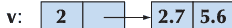

```
v.push_back(7.9); // 在 v 的末尾添加一个值为 7.9 的元素
// v 现在有三个元素且 v[2]==7.9
```


注意 **`push_back`()`** 调用的语法。它被称为*成员函数调用*；**`push_back`()`** 是 **`vector`** 的成员函数，必须使用这种点符号来调用：

```
*成员函数调用*:
对象名称.成员函数名称 ( 参数列表 )
```

可以通过调用 **`vector`** 的另一个成员函数来获取 **`vector`** 的大小：**`size`()`**。最初 **`v.size`()`** 是 **`0`**，在第三次调用 **`push_back`()`** 后，**`v.size`()`** 变成了 **`3`**。

如果你以前编写过程序，你会注意到 **`vector`** 类似于 C 和其他语言中的数组。然而，你不需要预先指定 **`vector`** 的大小（长度），你可以添加任意数量的元素。随着学习的深入，你会发现 C++ 标准 **`vector`** 还有其他有用的属性。

### 4.6.3 一个数值示例

让我们看一个更现实的例子。通常，我们有一系列数值，希望读取到程序中，以便对它们进行处理。“处理”可能包括生成数值的图表，计算均值和中位数，查找最大元素，排序，将它们与其他数据结合，搜索“有趣”的值，将它们与其他数据比较等。我们对数据可能执行的计算范围没有限制，但首先我们需要将它们放入计算机内存中。这里是将未知——可能很大——数量的数据引入计算机的基本技术。作为一个具体的例子，我们选择读取代表温度的浮点数：

```c
// 将一些温度读取到向量中
int main()
{
  vector<double> temps;        // 温度
  for (double temp; cin>>temp; )  // 读取到 temp
    temps.push_back(temp);     // 将 temp 放入向量
    // ... 执行某些操作 ...
}
```

那么，这里发生了什么？首先我们声明一个 **`vector`** 来存储数据：

```c
vector<double> temps;          // 温度
```

这里提到了我们期望的输入类型。我们读取并存储 **`double`**。接下来是实际的读取循环：

```c
for (double temp; cin>>temp; )        // 读取到 temp
  temps.push_back(temp);              // 将 temp 放入向量
```

我们定义了一个类型为 **`double`** 的变量 **`temp`** 用于读取。**`cin>>temp`** 读取一个 **`double`**，该 **`double`** 被压入 **`vector`**（放在后部）。我们之前已经见过这些单独的 operação。这里新的是我们将输入操作 **`cin>>temp`** 用作 **`for`** 语句的条件。基本上，如果值被正确读取，**`cin>>temp`** 为真，否则为假，因此该 **`for`** 语句将读取我们提供的所有 **`doubles`**，并在我们提供其他任何内容时停止。例如，如果你输入

**`1.2 3.4 5.6 7.8 9.0`**

那么 **`temps`** 将包含五个元素 **`1.2`**、**`3.4`**、**`5.6`**、**`7.8`**、**`9.0`**（按此顺序，例如，**`temps[0]=1.2`**）。我们使用字符 ‘␣’ 来终止输入——任何不是 **`double`** 的内容都可以使用。在 §10.6 中，我们讨论如何终止输入以及如何解决输入错误。

### 4.6.3 控制输入与输出

为了将输入变量 `temp` 的作用域限制在循环内部，我们使用了 `for` 语句，而不是 `while` 语句：

```cpp
double temp;
while (cin>>temp)          // 读取
    temps.push_back(temp);  // 放入 vector
// ... temp 可能在此处被使用 ...
```

通常，`for` 循环会“预先”展示发生的事情，使代码更容易理解，也更难犯意外错误。

一旦我们将数据放入 `vector`，就可以轻松地对其进行操作。举个例子，让我们计算平均气温和中位气温：

```cpp
// 计算平均和中位气温
int main()
{
    vector<double> temps;      // 温度
    for (double temp; cin>>temp; )  // 读取到 temp 中
        temps.push_back(temp);  // 将 temp 放入 vector

    // 计算平均气温:
    double sum = 0;
    for (double x : temps) sum += x;
    cout << "Average temperature: " << sum/temps.size() << '\n';

    // 计算中位气温:
    sort(temps);               // 对温度排序
    cout << "Median temperature: " << temps[temps.size()/2] << '\n';
}
```

我们通过将所有元素加到 `sum` 中，然后将总和除以元素数量（即 `temps.size()`）来计算平均值（均值）：

```cpp
// 计算平均气温:
double sum = 0;
for (double x : temps) sum += x;
cout << "Average temperature: " << sum/temps.size() << '\n';
```

请注意 `+=` 运算符的便捷性。

为了计算中位数（一个选定的值，使得一半的数值比它低，另一半比它高），我们需要对元素进行排序。为此，我们使用标准库 `sort` 算法的一个变体，`sort()`：

```cpp
// 计算中位气温:
sort(temps);        // 对温度排序
cout << "Median temperature: " << temps[temps.size()/2] << '\n';
```

我们将在后面（第20章）详细解释标准库算法。一旦温度被排序，找到中位数就很容易了：我们只需选取中间的元素，即索引为 `temps.size()/2` 的元素。如果你喜欢挑剔（如果你喜欢这样做，说明你开始像程序员一样思考了），你可能会发现我们找到的值可能并不完全符合我们上面给出的中位数定义。本章末尾的练习2旨在解决这个微小问题。

### 4.6.4 一个文本示例

我们展示温度示例并不是因为我们对温度特别感兴趣。许多人——如气象学家、农学家和海洋学家——对温度数据及其基于的数值（如均值和中位数）非常感兴趣。然而，我们并不如此。从程序员的观点来看，这个例子的有趣之处在于它的通用性：**`vector`** 及其简单操作可用于极其广泛的应用。可以说，无论你对什么感兴趣，如果你需要分析数据，你都会使用 **`vector`**（或类似的数据结构；参见第21章）。举个例子，让我们构建一个简单的词典：

```cpp
// 简单词典：排序的单词列表
int main()
{
    vector<string> words;
    for(string temp; cin>>temp; )      // 读取空格分隔的单词
        words.push_back(temp);          // 放入 vector
    cout << "Number of words: " << words.size() << '\n';
    sort(words);                        // 对单词排序
    for (int i = 0; i<words.size(); ++i)
        if (i==0 || words[i-1]!=words[i])   // 这是一个新单词吗？
            cout << words[i] << "\n";
}
```

如果我们向这个程序输入一些单词，它会按顺序输出它们，而不重复任何单词。例如，给定 **a man a plan a canal panama**，它会输出：

- a

- canal

- man

- panama

- plan

我们如何停止读取字符串输入？换句话说，我们如何终止输入循环？


```cpp
for (string temp; cin>>temp; ) // 读取
    words.push_back(temp); // 放入 vector
```

当我们读取数字时（在 §4.6.2），我们只是输入了一个非数字的字符。我们不能在这里这样做，因为任何（普通）字符都可以被读取到字符串中。幸运的是，有一些字符是“非普通”的。正如在 §3.5.1 中提到的，在 Windows 下 `Ctrl+Z` 终止输入流，而在 Unix 下 `Ctrl+D` 执行此功能。

这个程序的大部分与我们之前对温度的处理非常相似。实际上，我们通过从“温度程序”中剪切和粘贴来编写了这个“词典程序”。唯一的新颖之处是这个测试：

```cpp
if (i==0 || words[i–1]!=words[i]) // 这是一个新单词吗？
```

如果你删除了这个测试，输出将是：

- a
- a
- a
- canal
- man
- panama
- plan

我们不喜欢重复，所以使用这个测试来消除它。这个测试做什么？它检查我们打印的上一个单词是否与我们即将打印的单词不同（`words[i–1]!=words[i]`），如果是，就打印该单词；否则，不打印。显然，当我们即将打印第一个单词时（`i==0`），我们不能谈论“上一个单词”，所以我们首先测试这一点，并使用 `||`（或）运算符将这两个测试结合起来：

```cpp
if (i==0 || words[i-1]!=words[i])   // 这是一个新单词吗？
```

注意，我们可以比较字符串。这里我们使用 `!=`（不等于）；`==`（等于）、`<`（小于）、`<=`（小于或等于）、`>`（大于）和 `>=`（大于或等于）也适用于字符串。`<`、`>` 等运算符使用通常的词典顺序，因此 `"Ape"` 排在 `"Apple"` 和 `"Chimpanzee"` 之前。

## 试一试

编写一个程序，将你不喜欢的单词“哔哔”掉；也就是说，你使用 `cin` 读取单词，然后再次在 `cout` 上打印它们。如果一个单词在你定义的少数几个单词中，你输出 `BLEEP` 代替该单词。从一个“不喜欢的单词”开始，例如：

```cpp
string disliked = "Broccoli";
```

当那个起作用后，再添加几个。

## 4.7 语言特性

温度和词典程序使用了我们在本章中介绍的大部分基本语言特性：迭代（`for` 语句和 `while` 语句）、选择（`if` 语句）、简单算术（`++` 和 `+=` 运算符）、比较和逻辑运算符（`==`、`!=` 和 `||` 运算符）、变量和函数（*例如*，`main()`、`sort()` 和 `size()`）。此外，我们还使用了标准库设施，如 `vector`（元素容器）、`cout`（输出流）和 `sort()`（算法）。

如果你仔细数一数，你会发现我们实际上用相当少的特性实现了相当多的功能。这就是它的理念！每种编程语言特性都是为了表达一个基本思想而存在的，我们可以将它们以大量的（真的是无限的）方式组合起来编写有用的程序。这是一个关键概念：计算机不是一个具有固定功能的装置。相反，它是一台我们可以编程执行任何我们所能想到的计算的机器，并且鉴于我们可以将计算机连接到与计算机外部世界交互的装置，原则上我们可以让它做任何事情。

## 练习

逐步完成这个练习。不要试图通过跳过步骤来加速。通过输入至少三对数值来测试每个步骤 – 更多的值会更好。

1. 编写一个由 `while` 循环组成的程序，该程序（每次循环时）读取两个 `int` 并打印它们。当输入终止符 `'*'` 时退出程序。
2. 修改程序，使其输出 `the smaller value is:` 后跟较小的数字，以及 `the larger value is:` 后跟较大的数字。
3. 增强程序，使得如果两个数字相等，则输出行 `the numbers are equal (only)`。
4. 修改程序，使其使用 `doubles` 而不是 `ints`。
5. 修改程序，使得如果两个数字的差小于 `1.0/100`，在输出哪个是大、哪个是小之后，输出 `the numbers are almost equal`。
6. 现在修改循环体，使其每次循环只读取一个 `double`。定义两个变量来记录迄今为止看到的最小值和最大值。每次通过循环时输出输入的值。如果它是迄今为止最小的，在数字后写 `the smallest so far`。如果它是迄今为止最大的，在数字后写 `the largest so far`。
7. 为每个输入的 `double` 添加一个单位；也就是说，输入诸如 `10cm`、`2.5in`、`5ft` 或 `3.33m` 的值。接受四个单位：`cm, m, in, ft`。假设转换因子 `1m == 100cm`、`1in == 2.54cm`、`1ft == 12in`。将单位指示符读取到一个字符串中。你可以认为 `12 m`（数字和单位之间有空格）等价于 `12m`（没有空格）。
8. 拒绝没有单位或带有“非法”单位表示的值，例如 `y, yard, meter, km` 和 `gallons`。
9. 记录输入值的总和（以及最小值和最大值）以及输入值的数量。当循环结束时，打印最小值、最大值、值的数量和值的总和。注意，为了保持总和，你必须决定使用哪个单位；使用米。
10. 将所有输入的值（转换为米）保存在一个 `vector` 中。最后，输出这些值。
11. 在从 `vector` 中输出值之前，对它们进行排序（这将使它们按递增顺序输出）。

## 复习

1. 什么是计算（computation）？
2. 我们所说的计算的输入和输出是什么意思？请举例说明。
3. 编程人员在表达计算时应记住哪三个要求？
4. 表达式（expression）的作用是什么？
5. 本章中描述的句子（statement）和表达式之间有什么区别？
6. 什么是左值（lvalue）？列出需要左值的运算符。为什么这些运算符（而不是其他运算符）需要左值？
7. 什么是常量表达式？
8. 什么是字面量（literal）？
9. 什么是符号常量？我们为什么使用它们？
10. 什么是魔术常量（magic constant）？请举例。
11. 我们有哪些可以用于整型和浮点值的运算符？
12. 哪些运算符可以用于整型但不能用于浮点型？
13. 有哪些运算符可以用于字符串？
14. 什么时候编程人员更倾向于使用 switch 语句而不是 if 语句？
15. switch 语句有哪些常见问题？
16. for 循环头部的每一部分起什么作用，它们的执行顺序是什么？
17. 什么时候应该使用 for 循环，什么时候应该使用 while 循环？
18. 如何打印 char 类型的数值？
19. 描述在函数定义中，语句 `char foo(int x)` 的含义。
20. 什么时候应该为程序的一部分定义一个独立的函数？列出原因。
21. 对 int 类型你可以做什么，而对 string 类型不能做？
22. 对 string 类型你可以做什么，而对 int 类型不能做？
23. 向量（vector）中第三个元素的索引是多少？
24. 如何编写一个打印向量中所有元素的 for 循环？
25. `vector<char> alphabet(26);` 起什么作用？
26. 描述 `push_back()` 对向量的操作。
27. 向量的成员函数 `size()` 起什么作用？
28. 是什么使向量如此流行/有用？
29. 如何对向量中的元素进行排序？

## 术语

- 抽象（abstraction）
- 计算（computation）
- 条件语句（conditional statement）
- 声明（declaration）
- 定义（definition）
- 分治法（divide and conquer）
- 否则（else）
- 表达式（expression）
- for 语句（for-statement）
- 范围 for 语句（range-for-statement）
- 函数（function）
- if 语句（if-statement）
- 递增（increment）
- 输入（input）
- 迭代（iteration）
- 循环（loop）
- 左值（lvalue）
- 成员函数（member function）
- 输出（output）
- 后置添加（push_back()）
- 重复（repetition）
- 右值（rvalue）
- 选择（selection）
- 大小（size()）
- 排序（sort()）
- 句子（statement）
- switch 语句（switch-statement）
- 向量（vector）
- while 语句（while-statement）

## 练习

1. 如果你还没有做过，请完成本章中的“试一试”练习。
2. 如果我们定义序列的中位数（median）为“恰好有与它后面元素数量相同的元素位于它前面，的数”，请修改 §4.6.3 中的程序，使其始终打印出一个中位数。提示：中位数不一定是序列中的元素。
3. 将一系列 double 值读入向量。将每个值视为给定路线上两城市之间的距离。计算并打印总距离（所有距离之和）。找出并打印相邻两城市之间的最小和最大距离。找出并打印相邻两城市之间的平均距离。
4. 编写一个程序来玩猜数字游戏。用户想一个 1 到 100 之间的数字，你的程序通过提问来确定这个数字（例如：“你想的数字小于 50 吗？”。你的程序应能在提问不超过七次的情况下识别出该数字。提示：使用 `<` 和 `<=` 运算符以及 if-else 结构。
5. 编写一个作为简易计算器的程序。你的计算器应能处理两个输入值的四种基本数学运算——加法、减法、乘法和除法。你的程序应提示用户输入三个参数：两个 double 值和一个代表操作的字符。如果输入的参数是 35.6、24.1 和 `'+'`，程序的输出应为 The sum of 35.6 and 24.1 is 59.7。在第 6 章中，我们将查看一个更复杂的简易计算器。
6. 创建一个向量，存储 `"zero", "one", ... "nine"` 这十个字符串值。在一个程序中使用该向量，将数字转换为其对应的拼写值；例如，输入 7 给出输出 seven。让同一个程序使用相同的输入循环，将拼写的数字转换为其数字形式；例如，输入 seven 给出输出 7。
7. 修改练习 5 中的“迷你计算器”，使其能够接受（仅）以数字或拼写形式写入的单个位数字。
8. 有一个古老的故事：皇帝想感谢国际象棋的发明者，并要求发明者说出他的奖励。发明者要求在第一个格子上放一粒米，第二个放 2 粒，第三个放 4 粒，依此类推，64 个格子每一格都翻倍！这听起来可能很 modest，但帝国里没有那么多米！编写一个程序，计算至少需要多少个格子才能给发明者 1000 粒米、至少 1,000,000 粒米，以及至少 1,000,000,000 粒米。当然你需要一个循环，很可能需要一个 int 来跟踪你处于哪个格子，一个 int 来保持当前格子上的米粒数，以及一个 int 来跟踪之前所有格子上的米粒总数。我们建议你写出循环每次迭代中所有变量的值，以便你可以看到发生了什么。
9. 尝试计算练习 8 中发明者所要求的米粒数量。你会发现数字太大，无法放入 int 或 double 中。观察当数字大得无法作为 int 或 double 精确表示时发生了什么。使用 int 可以计算出确切米粒数的最大格子数是多少？使用 double 可以计算出近似米粒数的最大格子数是多少？
10. 编写一个程序来玩“石头剪刀布”游戏。如果你不熟悉这个游戏，做一些研究（例如，使用 Google 在网上搜索）。研究是编程人员的常见任务。使用 switch 语句来解决这个练习。此外，机器应该给出随机答案（即，随机选择下一个石头、纸或剪刀）。真正的随机性目前太难提供，所以只需构建一个值序列向量作为“下一个值”。如果你将向量构建在程序中，它将总是玩同一个游戏，所以也许我们应该让用户输入一些值。尝试变体，使用户更难猜测机器下一步走什么。
11. 创建一个程序来找出 1 到 100 之间的所有质数。一种方法是编写一个函数来检查一个数是否为质数（即，查看该数是否可以被小于它本身的质数整除），按顺序使用质数向量（例如，如果向量称为 primes，则 `primes[0]===2, primes[1]===3, primes[2]===5` 等）。然后编写一个循环，从 1 到 100，检查每个数是否为质数，并将找到的每个质数存储在向量中。编写另一个循环列出你找到的质数。你可以通过将你的质数向量与 primes 比较来检查结果。将 2 视为第一个质数。
12. 修改上一个练习中描述的程序，使其接受一个输入值 max，然后找出 1 到 max 之间的所有质数。
13. 创建一个程序来找出 1 到 100 之间的所有质数。有一个经典方法用于这样做，称为“埃拉托斯特尼筛法”（Sieve of Eratosthenes）。如果你不知道这个方法，上网查一下。使用这种方法编写你的程序。
14. 修改上一个练习中描述的程序，使其接受一个输入值 max，然后找出 1 到 max 之间的所有质数。
15. 编写一个程序，接受一个输入值 n，然后找出前 n 个质数。
16. 在练习中，你编写了一个程序，给定一系列数字，找到该序列的最大值和最小值。在一个序列中出现次数最多的数称为众数（mode）。创建一个程序来找出正整数集合的众数。
17. 编写一个程序来找出字符串序列的最小值、最大值和众数。
18. 编写一个程序来求解二次方程。二次方程的形式为：

$$ ax^2 + bx + c = 0 $$

如果你不知道求解此类表达式的二次公式，请做一些研究。记住，在编程人员教计算机如何解决问题之前，研究如何解决问题通常是必要的。对于 a、b 和 c 的用户输入使用 doubles。由于二次方程有两个解，输出 x1 和 x2。
19. 编写一个程序，首先输入一组名称和值的对，例如 Joe 17 和 Barbara 22。对于每对，将名称添加到名为 names 的向量中，将数字添加到名为 scores 的向量中（在对应的位置，即如果 `names[7]=="Joe"`，则 `scores[7]==17`）。使用 `NoName 0` 终止输入。检查每个名称是否唯一，如果输入了两次相同的名称，则用错误消息终止。写出所有的 (name,score) 对，每行一个。
20. 修改练习 19 中的程序，使得当输入一个名称时，程序输出相应的分数或 name not found。
21. 修改练习 19 中的程序，使得当输入一个整数时，程序输出具有该分数的所有名称或 score not found。

# 后记

从哲学的角度来看，你现在可以做任何可以使用计算机做的事情——剩下的只是细节！在其他方面，这表明了价值

关于“细节”的重要性以及实践技能的价值，因为你显然才刚刚踏入程序员行列。但我们是认真的。本章介绍的工具确实允许你表达任何计算：你可以拥有任意多的变量（包括 `vector` 和 `string`），你可以进行算术运算和比较，并且可以执行选择控制和循环迭代。任何计算都可以通过这些基本元素来表达。你拥有文本和数字的输入输出，并且任何输入或输出都可以表示为文本（即使是图形）。你甚至可以将你的计算组织为一组命名的函数。剩下的工作“仅仅”是学习编写良好的程序，也就是说，编写正确、可维护且效率合理的程序。重要的是，你必须努力尝试用合理的努力来实现这一点。


## 错误

> “我意识到，从今往后我生命中的很大一部分时间将用于发现和纠正我自己的错误。”
>
> —莫里斯·威尔克斯，1949年

在本章中，我们将讨论程序的正确性、错误以及错误处理。如果你是真正的初学者，你会发现有些讨论略显抽象，而在其他时候又过于细致。错误处理真的如此重要吗？是的，你最终会明白这一点，无论如何，在你能够编写他人愿意使用的程序之前，你就会了解到这一点。我们试图做的是向你展示“像程序员一样思考”意味着什么。它结合了相当抽象的策略和对细节及替代方案一丝不苟的分析。

- 5.1 引言
- 5.2 错误来源
- 5.3 编译时错误
  - 5.3.1 语法错误
  - 5.3.2 类型错误
  - 5.3.3 非错误
- 5.4 链接时错误
- 5.5 运行时错误
  - 5.5.1 调用方处理错误
  - 5.5.2 被调用方处理错误
  - 5.5.3 错误报告
- 5.6 异常
  - 5.6.1 错误参数
  - 5.6.2 范围错误
  - 5.6.3 错误输入
  - 5.6.4 收窄错误
- 5.7 逻辑错误
- 5.8 估算
- 5.9 调试
  - 5.9.1 实用调试建议
- 5.10 前置条件和后置条件
  - 5.10.1 后置条件
- 5.11 测试

### 5.1 引言

在前几章中，我们多次提到错误，并且——在完成了一些练习和习题后——你对其原因也有了一些了解。在开发程序时，错误是不可避免的，但最终的程序必须没有错误，或者至少没有我们认为不可接受的错误。

对错误进行分类的方法有很多。例如：

- **编译时错误**：由编译器发现的错误。我们可以根据它们违反的语言规则进一步对编译时错误进行分类，例如：
  - 语法错误
  - 类型错误
- **链接时错误**：由链接器在尝试将目标文件组合成可执行程序时发现的错误。
- **运行时错误**：由运行中程序的检查发现的错误。我们可以将运行时错误进一步分类为：
  - 由计算机（硬件和/或操作系统）检测到的错误
  - 由库（例如，标准库）检测到的错误
  - 由用户代码检测到的错误
- **逻辑错误**：由程序员在查找错误结果原因时发现的错误。


我们可能会忍不住说，作为程序员，我们的工作就是消除所有错误。这当然是理想状态，但往往不可行。事实上，对于现实世界的程序来说，准确知道“所有错误”意味着什么可能很难。如果我们在你的程序运行时拔掉了你电脑的电源插头，那是不是你本应处理的错误？在许多情况下，答案显然是“不”，但如果我们讨论的是医疗监控程序或电话交换机控制程序呢？在这种情况下，用户可以合理地期望，即使你的计算机断电或宇宙射线损坏了存放你程序的内存，你程序所在的系统的某些部分仍能做出合理的反应。关键问题变成了：“我的程序应该检测到这个错误吗？”除非我们特别指明，否则我们将假设你的程序：

1. 对于所有合法输入，应产生期望的结果

2. 对于所有非法输入，应给出合理的错误信息

3. 无需担心故障的硬件

4. 无需担心故障的系统软件

5. 在发现错误后允许终止

基本上，所有不符合假设 3、4 或 5 的程序都可以被认为是高级的，超出了本书的范围。然而，假设 1 和 2 包含在基本专业素养的定义中，而专业素养是我们的目标之一。即使我们并非 100% 地符合这一理想，它也必须是理想。

当我们编写程序时，错误是自然的且不可避免的；问题在于：我们如何应对它们？我们的猜测是，在开发严肃软件时，避免、发现和纠正错误占据了 90% 或更多的精力。对于安全关键型程序，精力投入可能更大。对于小型程序，你可以做得更好；另一方面，如果你马虎大意，很容易做得更差。基本上，我们提供三种方法来生产可接受的软件：

- 组织软件以最小化错误。

- 通过调试和测试消除我们犯的大多数错误。

- 确保剩余的错误不严重。

这些方法中的任何一个都无法单独完全消除错误；我们必须使用全部三种方法。

在制作可靠程序（即能够以可接受的错误率执行其预期功能的程序）方面，经验至关重要。请记住，理想情况是我们的程序始终做正确的事情。我们通常只能近似这一理想，但这并不是不努力的理由。

### 5.2 错误来源

以下是一些错误来源：

- **糟糕的规格说明**：如果我们没有明确程序应该做什么，我们就可能无法充分审查“暗角”并确保处理所有情况（即，每个输入都给出正确的答案或足够的错误信息）。

  - **不完整的程序**：在开发过程中，显然有些情况我们尚未处理。这是不可避免的。我们必须努力的目标是知道何时已经处理了所有情况。

  - **意外的参数**：函数接受参数。如果给函数一个我们未处理的参数，就会出现问题。例如，用 −1.2 调用标准库的平方根函数：`sqrt(-1.2)`。由于 `double` 类型的 `sqrt()` 返回一个 `double`，没有可能的正确返回值。§5.5.3 讨论这类问题。

  - **意外的输入**：程序通常读取数据（来自键盘、文件、GUI、网络连接等）。程序会对这类输入做出许多假设，例如，假设用户输入一个数字。如果用户输入的是“哇，闭嘴！”而不是预期的整数怎么办？§5.6.3 和 §10.6 讨论这类问题。

  - **意外的状态**：大多数程序会保留大量数据（“状态”）供系统不同部分使用。例子包括地址列表、电话簿和温度读数的 `vectors`。如果这些数据不完整或错误怎么办？程序的各个部分仍必须设法应对。§26.3.5 讨论这类问题。

  - **逻辑错误**：即代码根本没有做它应该做的事；我们只能寻找并修复这类问题。§6.6 和 §6.9 给出了寻找这类问题的例子。

这个列表有实际用途。当我们考虑程序进展到什么程度时，可以将其用作检查清单。除非我们考虑了所有这些潜在的错误来源，否则程序就不完整。事实上，从项目一开始就记住这些是明智的，因为一个没有经过深思熟虑就匆忙拼凑起来的程序，不太可能在不需要严重重写的情况下发现并移除其错误。

### 5.3 编译时错误

当你编写程序时，你的编译器是你抵御错误的第一道防线。在生成代码之前，编译器分析代码以检测语法错误和类型错误。只有当它发现程序完全符合

语言规范将允许你继续进行。编译器发现的许多错误只不过是“愚蠢的错误”，由源码中的打字错误或编辑不完整引起。另一些错误则源于我们对程序各部分交互方式理解的缺陷。对初学者而言，编译器往往显得吹毛求疵，但当你学会使用语言特性——尤其是类型系统——来直接表达你的想法时，你会逐渐欣赏起编译器检测问题的能力；否则，这些问题可能会让你花费数小时去枯燥地寻找 Bug。

例如，我们将查看这个简单函数的一些调用：

```cpp
int area(int length, int width);    // 计算矩形的面积
```

#### 5.3.1 语法错误

如果我们像这样调用 `area()` 会发生什么：

```cpp
int s1 = area(7);       // 错误：缺少 )
int s2 = area(7)        // 错误：缺少 ;
Int s3 = area(7);       // 错误：Int 不是一种类型
int s4 = area(7);       // 错误：未终止的字符 ( ‘ 缺失)
```

上述每一行都包含语法错误；也就是说，根据 C++ 语法规则，它们的格式是不正确的，因此编译器会拒绝它们。不幸的是，以让程序员（你）容易理解的方式报告语法错误并不总是简单的。这是因为编译器可能需要读取比错误位置更多的内容，以确定确实存在错误。其结果是，尽管语法错误往往微不足道（一旦找到，你常常会觉得难以置信自己会犯这种错误），但错误报告往往晦涩难懂，偶尔还会指向程序中更靠后的行。因此，对于语法错误，如果你在编译器指向的行中看不到任何问题，请也检查程序中前面的行。

请注意，编译器并不知道你试图做什么，因此它无法基于你的意图报告错误，只能基于你实际做了什么。例如，针对上述 `s3` 声明中的错误，编译器不太可能会说：

> “你把 `int` 拼写错了；不要将 `i` 大写。”

相反，它可能会说类似这样的话：

- “语法错误：标识符 ‘`s3`’ 前缺少 ‘;’”

- “‘`s3`’ 缺少存储类别或类型标识符”

- “‘`Int`’ 缺少存储类别或类型标识符”

这些消息往往晦涩难懂，直到你习惯它们为止，并且使用的术语可能难以理解。不同的编译器对相同的代码可能会给出外观差异很大的错误消息。幸运的是，你很快就能习惯阅读这类内容。毕竟，快速浏览这些晦涩的行就可以将其解读为：

> “在 `s3` 之前有一个语法错误，并且它与 `Int` 或 `s3` 的类型有关。”

既然知道了这一点，找到问题也并非难如登天。

**试一试**

尝试编译这些示例，看看编译器是如何响应的。

#### 5.3.2 类型错误

一旦你消除了语法错误，编译器将开始报告类型错误；也就是说，它将报告你为变量、函数等声明（或忘记声明）的类型与你分配给它们的值或表达式的类型、作为函数参数传递的类型等之间的不匹配。例如：

```cpp
int x0 = arena(7);            // 错误：未声明的函数
int x1 = area(7);             // 错误：参数数量错误
int x2 = area("seven",2);     // 错误：第 1 个参数类型错误
```

让我们考虑这些错误。

1. 对于 `arena(7)`，我们将 `area` 误拼为 `arena`，因此编译器认为我们想要调用一个名为 `arena` 的函数。（它还能“认为”什么？那就是我们说的内容。）假设不存在名为 `arena()` 的函数，你将收到一条抱怨未声明函数的错误消息。如果存在名为 `arena` 的函数，并且该函数接受 7 作为参数，那么问题更糟：程序将编译通过，但会做你未预期的事情（这是一个逻辑错误；参见 §5.7）。

2. 对于 `area(7)`，编译器检测到参数数量错误。在 C++ 中，每次函数调用都必须提供预期数量的参数，且类型正确、顺序正确。当恰当使用类型系统时，这是一个避免运行时错误的强大工具（参见 §14.1）。

3. 对于 `area`("`seven`",2)，你可能希望编译器看到 "`seven`" 并推断出你指的是整数 `7`。但它不会。如果函数需要整数，你不能给它字符串。C++ 支持一些隐式类型转换（参见 §3.9），但不支持 *string* 到 *int* 的转换。编译器不会试图猜测你的意图。对于 `area`("Hovel lane",2)、`area`("7,2") 和 `area`("sieben","zwei")，你期望的结果是什么？

这只是几个例子。编译器还能为发现许多其他错误。

**试一试**

尝试编译这些示例，看看编译器是如何响应的。试着自己想几个错误，并尝试它们。

#### 5.3.3 非错误

当你使用编译器时，你希望它足够聪明以理解你的意图；也就是说，你希望它报告的一些错误其实并不是错误。这是很自然的。更令人惊讶的是，随着经验的积累，你会开始希望编译器拒绝更多的代码，而不是更少。考虑以下情况：

```cpp
int x4 = area(10, -7);         // 可以：但宽度为 -7 的矩形是什么？
int x5 = area(10.7, 9.3);      // 可以：但调用的是 area(10, 9)
char x6 = area(100, 9999);    // 可以：但会截断结果
```

对于 `x4`，编译器不会发出错误消息。从编译器的角度来看，`area(10, -7)` 没问题：`area()` 要求两个整数，而你提供了；没人说这些参数必须是正数。

对于 `x5`，良好的编译器会警告双精度浮点数 10.7 和 9.3 被截断为整数 10 和 9 的问题（参见 §9.2）。然而，（古老的）语言规则规定可以隐式地将 `double` 转换为 `int`，因此编译器不允许拒绝调用 `area(10.7, 9.3)`。

`x6` 的初始化存在与调用 `area(10.7, 9.3)` 相同问题的变体。`area(100, 9999)` 返回的 `int` 值（很可能是 999900）将被分配给一个 `char`。最可能的结果是 `x6` 获得“截断”后的值 -36。同样，良好的编译器会给出警告，尽管（古老的）语言规则阻止其拒绝该代码。

随着经验的积累，你将学会如何充分利用编译器检测错误的能力，并规避其已知弱点。但是，不要过于自信：“我的程序编译通过了”并不意味着它能运行。即使它能运行，通常最初也会给出错误结果，直到你发现逻辑中的缺陷。

### 5.4 链接时错误

程序由几个单独编译的部分组成，称为 *翻译单元*。程序中的每个函数在所有使用它的翻译单元中都必须以完全相同的类型进行声明。我们使用头文件来确保这一点；参见 §8.3。每个函数还必须在程序中恰好定义一次。如果违反上述规则之一，链接器将给出错误。我们在 §8.3 中讨论如何避免链接时错误。目前，这里有一个可能导致典型链接器错误的程序示例：

```cpp
int area(int length, int width);   // 计算矩形的面积

int main()
{
    int x = area(2,3);
}
```

除非我们在其他源文件中以某种方式定义了 `area()` 并将由该源文件生成的代码链接到此代码，否则链接器会抱怨找不到 `area()` 的定义。

`area()` 的定义必须与我们在文件中使用的类型完全相同（包括返回类型和参数类型），即：

```cpp
int area(int x, int y) {/* ... */}   // “我们的” area()
```

同名但类型不同的函数不会匹配，将被忽略：

```cpp
double area(double x, double y) {/* ... */}   // 不是“我们的” area()
int area(int x, int y, char unit) {/* ... */}   // 不是“我们的” area()
```

请注意，函数名拼写错误通常不会导致链接器错误。相反，编译器在看到对未声明函数的调用时会立即报错。这是好事：编译时错误比链接时错误更早被发现，通常也更容易修复。

如上所述的函数链接规则也适用于程序的所有其他实体，如变量和类型：给定名称的实体必须恰好有一个定义，但可以有多个声明，且所有这些声明必须完全一致于其类型。有关更多细节，参见 §8.2–3。

### 5.5 运行时错误

如果你的程序没有编译时错误和链接时错误，它就能运行。这才是真正有趣的地方。编写程序时，你能检测到

会出现错误，但一旦在运行时捕获到错误，并不总是容易知道该如何处理。请考虑以下情况：

```C
int area(int length, int width)        // 计算矩形的面积
{
    return length*width;
}

int framed_area(int x, int y)           // 计算框架内的面积
{
    return area(x-2,y-2);
}

int main()
{
    int x = -1;
    int y = 2;
    int z = 4;
    // ...

    int area1 = area(x,y);
    int area2 = framed_area(1,z);
    int area3 = framed_area(y,z);
    double ratio = double(area1)/area3;  // 转换为 double 以获取
                                          // 浮点数除法结果
}
```

我们使用了变量 `x, y, z`（而不是直接使用值作为参数），目的是让问题对人类读者来说不那么明显，同时也更难被编译器检测到。然而，这些调用导致代表面积的负值被赋值给 `area1` 和 `area2`。我们应该接受这种违反大多数数学和物理常识的错误结果吗？如果不行，那么谁应该检测这些错误：`area()` 的调用者，还是函数本身？并且，应该如何报告这些错误？

在回答这些问题之前，请查看上述代码中 `ratio` 的计算。它看起来似乎没什么问题。你发现什么不对了吗？如果没有，请再仔细看看：`area3` 将是 `0`，因此 `double(area1)/area3` 会导致除以零。这会导致一个由硬件检测到的错误，该错误会以一些与硬件相关的晦涩信息终止程序。如果你不检测和合理地处理运行时错误，这就是你（或你的用户）将要面对的那类错误。大多数人对于这种“硬件违规”的容忍度很低，因为对于任何不 intimately 熟悉该程序的人来说，提供的所有信息只是“某处出错了！”。这不足以采取任何建设性的行动，因此我们会感到愤怒，并想对提供该程序的人大喊大叫。

那么，让我们着手解决 `area()` 的参数错误问题。我们有两种明显的替代方案：

- a. 让 `area()` 的调用者处理错误的参数。

- b. 让 `area()`（被调用函数）处理错误的参数。

#### 5.5.1 由调用者处理错误

让我们先尝试第一种替代方案（“让用户自己小心！”）。如果 `area()` 是库中的一个函数且我们无法修改它，我们就不得不选择这种方式。无论好坏，这是最常见的方法。

保护 `main()` 中 `area(x, y)` 的调用相对容易：

```C
if (x<=0) error("non-positive x");
if (y<=0) error("non-positive y");
int area1 = area(x, y);
```

实际上，唯一的问题是当我们发现错误时要做什么。在这里，我们调用了一个函数 `error()`，我们假设它会做一些合理的事情。事实上，在 `std_lib_facilities.h` 中，我们提供了一个 `error()` 函数，默认情况下它会终止程序并输出系统错误消息以及我们作为参数传递给 `error()` 的字符串。如果你更倾向于编写自己的错误消息或采取其他行动，你可以捕获 `runtime_error`（§5.6.2, §7.3, §7.8, §B.2.1）。这种方法对于大多数学生程序来说已经足够了，并且展示了可用于更复杂错误处理的风格示例。

如果我们不需要针对每个参数提供单独的错误消息，我们可以简化如下：

```C
if (x<=0 || y<=0) error("non-positive area() argument");
int area1 = area(x, y);
```

为了完全保护 `area()` 免受错误参数的影响，我们必须处理通过 `framed_area()` 进行的调用。我们可以这样写：

```C
if (z<=2)
    error("non-positive 2nd area() argument called by framed_area()");
int area2 = framed_area(1, z);
if (y<=2 || z<=2)
    error("non-positive area() argument called by framed_area()");
int area3 = framed_area(y, z);
```

这样很杂乱，但也有一些根本性的错误。我们只有确切知道 `framed_area()` 如何使用 `area()` 才能写出这样的代码。我们必须知道 `framed_area()` 从每个参数中减去了 `2`。我们不应该需要了解这些细节！如果有人修改了 `framed_area()` 使其使用 `1` 而不是 `2` 怎么办？那样做的人将不得不查看 `framed_area()` 的每个调用并相应地修改错误检查代码。这样的代码被称为“脆弱”，因为它很容易出错。这也是“魔法常量”（§4.3.1）的一个例子。我们可以通过为 `framed_area()` 减去的那个值命名来使代码不那么脆弱：

```C
constexpr int frame_width = 2;

int framed_area(int x, int y)    // 计算框架内的面积
{
    return area(x-frame_width, y-frame_width);
}
```

调用 `framed_area()` 的代码可以使用这个名称：


```C
if (1-frame_width<=0 || z-frame_width<=0)
    error("non-positive argument for area() called by framed_area()");
int area2 = framed_area(1,z);
if (y-frame_width<=0 || z-frame_width<=0)
    error("non-positive argument for area() called by framed_area()");
int area3 = framed_area(y,z);
```

看看那段代码！你确定它是正确的吗？你觉得它美观吗？它容易阅读吗？实际上，我们认为它很丑陋（因此容易出错）。我们使代码的大小增加了三倍多，并暴露了 `framed_area()` 的一个实现细节。一定有更好的方法！

看看原始代码：

```C
int area2 = framed_area(1,z);
int area3 = framed_area(y,z);
```

它可能是错的，但至少我们可以看到它应该做什么。如果我们把检查放在 `framed_area()` 内部，就可以保留这段代码。

#### 5.5.2 由被调用者处理错误

在 `framed_area()` 内部检查有效参数很容易，并且仍然可以使用 `error()` 来报告问题：

```C
int framed_area(int x, int y)    // 计算框架内的面积
{
    constexpr int frame_width = 2;
    if (x-frame_width<=0 || y-frame_width<=0)
        error("non-positive area() argument called by framed_area()");
    return area(x-frame_width, y-frame_width);
}
```

这样相当不错，我们不再需要为 **`framed_area()`** 的每个调用编写测试。对于在一个大型程序中调用 500 次的有用函数来说，这可能是一个巨大的优势。此外，如果任何与错误处理相关的内容发生变化，我们只需要在一个地方修改代码。

注意一些有趣的事情：我们几乎无意识地从“调用者必须检查参数”的方法滑向了“函数必须检查自身参数”的方法（这也称为“被调用者检查”，因为被调用的函数通常被称为“被调用者”）。后一种方法的一个好处是参数检查代码集中在一个地方。我们不需要在整个程序中搜索调用。此外，那个地方正是参数将被使用的地方，因此我们所需的所有信息都很容易获取，以便进行检查。

让我们将此解决方案应用于 **`area()`**：

```C
int area(int length, int width)        // 计算矩形的面积
{
    if (length<=0 || width <=0) error("non-positive area() argument");
    return length*width;
}
```

这将捕获所有对 **`area()`** 调用的错误，因此我们不再需要在 **`framed_area()`** 中进行检查。不过，我们可能仍希望这样做，以获取更好、更具体的错误消息。

在函数中检查参数看起来如此简单，为什么人们不总是这样做呢？对错误处理的不重视是一个答案，粗心大意是另一个答案，但也有令人尊敬的理由：

- **我们无法修改函数定义：** 该函数位于某个库中，由于某种原因无法更改。也许它被其他人使用，而这些人不认同你关于什么是良好错误处理的想法。也许它属于别人所有，而你并没有源代码。也许它在一个库中，新版本会定期发布，如果你做了修改，你就得在每个新版本发布时再次修改。

- **被调用函数不知道出错时该做什么：** 这种情况通常出现在库函数中。库编写者可以检测到错误，但只有你知道发生错误时应采取什么措施。

- **被调用函数不知道它在哪里被调用：** 当你收到错误消息时，它告诉你某些东西出错了，但没有告诉执行程序是如何到达那一点的。有时，你希望错误消息更具体。

- **性能：** 对于小函数，检查的成本可能高于计算结果的成本。例如，在 **`area()`** 中就是这样，检查还会使函数的 *size* 增加一倍多（也就是说，

（需要执行的机器指令数量，而不仅仅是源代码的长度）。对于一些程序来说，这一点至关重要，特别是当相同的信息在函数相互调用时被反复检查，并且信息在传递过程中基本保持不变时。

那你应该怎么做？除非你有充分的理由不这么做，否则你应该检查函数中的参数。

在考察了若干相关主题后，我们将在 §5.10 回到如何处理错误参数的问题。

### 5.5.3 错误报告

让我们考虑一个稍有不同问题：当你检查了一组参数并发现错误后，应该怎么做？有时你可以返回一个“错误值”。例如：

```cpp
// ask user for a yes-or-no answer;
// return 'b' to indicate a bad answer (i.e., not yes or no)
char ask_user(string question)
{
    cout << question << "? (yes or no)\n";
    string answer = "";
    cin >> answer;
    if (answer=="y" || answer=="yes") return 'y';
    if (answer=="n" || answer=="no") return 'n';
    return 'b';        // 'b' for “bad answer”
}

// calculate area of a rectangle;
// return −1 to indicate a bad argument
int area(int length, int width)
{
    if (length<=0 || width <=0) return -1;
    return length*width;
}
```

这样，被调用的函数可以执行详细的检查，而让每个调用者按照自己的需求处理错误。这种方法看似可行，但它存在一些问题，使其在许多情况下无法使用：

- 现在被调用的函数和所有调用者都必须进行测试。调用者只需进行简单的测试，但仍需编写该测试并决定测试失败时该怎么办。

- 调用者可能会忘记进行测试。这可能导致程序后续出现不可预测的行为。

- 许多函数没有“额外”的返回值来指示错误。例如，一个从输入读取整数的函数（如 `cin` 的 `operator >>`）显然可以返回任何 `int` 值，因此没有可用于指示失败的 `int` 值。

上述第二种情况——调用者忘记测试——很容易导致意外。例如：

```cpp
int f(int x, int y, int z)
{
    int area1 = area(x,y);
    if (area1<=0) error("non-positive area");
    int area2 = framed_area(1,z);
    int area3 = framed_area(y,z);
    double ratio = double(area1)/area3;
    // ...
}
```

你看出错误在哪里了吗？这种错误很难发现，因为没有明显的“错误代码”可供查看：错误在于缺少测试。

## 试一试

> 用各种值测试这个程序。打印 `area1`、`area2`、`area3` 和 `ratio` 的值。插入更多测试，直到捕获所有错误。你如何知道你捕获了所有错误？这不是一个陷阱题；在这个特定示例中，你可以给出一个有效的理由，说明你已经捕获了所有错误。

还有另一种解决方案可以处理这个问题：使用异常。

### 5.6 异常

与大多数现代编程语言一样，C++ 提供了一种处理错误的机制：异常。基本思想是将错误检测（应在被调用的函数中进行）与错误处理（应在调用函数中进行）分离开来，同时确保检测到的错误不能被忽略；也就是说，异常提供了一种机制，允许我们将迄今为止探索的各种错误处理方法的优势结合起来。没有什么能让错误处理变得容易，但异常使其变得更容易。

基本思想是，如果函数发现它无法处理的错误，它不会正常**返回**；相反，它会**抛出**一个异常，指示出了什么问题。任何直接或间接的调用者都可以**捕获**该异常，即指定如果被调用的代码使用了 **`throw`** 时要做什么。函数通过使用**try**块来表达对异常的兴趣（如下面小节所述），并在**try**块的**catch**部分列出它想要处理的异常类型。如果没有调用者捕获异常，程序将终止。

我们将在稍后的章节（第 19 章）再次讨论异常，以查看如何使用它们以稍微高级的方式。

#### 5.6.1 错误参数

下面是使用异常的 **`area()`** 版本：

```cpp
class Bad_area { };
// a type specifically for reporting errors from area()
// calculate area of a rectangle;
// throw a Bad_area exception in case of a bad argument
int area(int length, int width)
{
  if (length<=0 || width<=0) throw Bad_area{};
  return length*width;
}
```

也就是说，如果参数没问题，我们就像往常一样返回面积；如果参数有问题，我们使用 **`throw`** 退出 **`area()`**，希望某个 **`catch`** 能够提供适当的响应。**`Bad_area`** 是我们定义的一种新类型，其唯一目的是提供从 **`area()`** 中 **`throw`** 的独特对象，以便某个 **`catch`** 可以将其识别为 **`area()`** 抛出的异常类型。用户定义类型（类和枚举）将在第 9 章中讨论。符号 **`Bad_area{}`** 表示“创建一个具有默认值的 **`Bad_area`** 类型的对象”，因此 **`throw Bad_area{}`** 表示“创建一个 **`Bad_area`** 类型的对象并 **`throw`** 它”。

我们现在可以编写

```cpp
int main()
try { int x = -1;
 int y = 2;
 int z = 4;
 // ...
 int area1 = area(x,y);
 int area2 = framed_area(1,z);
 int area3 = framed_area(y,z);
 double ratio = area1/area3;
}
catch (Bad_area) {
    cout << "Oops! bad arguments to area()\n";
}
```

首先请注意，这处理了对 **`area()`** 的所有调用，包括 **`main()`** 中的一个以及通过 **`framed_area()`** 的两个。其次，注意错误处理如何与错误检测干净利落地分离：**`main()`** 不知道是哪个函数执行了 **`throw Bad_area()`**，而 **`area()`** 也不知道哪个函数（如果有）关心 **`catch`** 它 **`throws`** 的 **`Bad_area`** 异常。这种分离在使用许多库编写的大型程序中尤为重要。在这样的程序中，没有人能“只需在需要的地方放一些代码来处理错误”，因为没有人希望同时修改应用程序和所有库中的代码。

#### 5.6.2 范围错误

大多数实际代码处理的是数据集合；也就是说，它使用各种数据元素的表、列表等来完成工作。在 C++ 的上下文中，我们通常将“数据集合”称为*容器*。最常见和最有用的标准库容器是我们在 §4.6 中介绍的 **`vector`**。**`vector`** 保存一定数量的元素，我们可以通过调用 **`vector`** 的 **`size()`** 成员函数来确定该数量。如果我们尝试使用索引（下标）不在有效范围 **[0:v.size()]** 内的元素会发生什么？通用符号 [**low:high**] 表示从 **`low`** 到 **`high`**−1 的索引，即包括 `low` 但不包括 `high`：


在回答这个问题之前，我们应该先提出另一个问题并回答它：

> “你为什么要那样做？”毕竟，你知道 **`v`** 的下标应该在范围 **[0:v.size()]** 内，所以只要确保如此即可！

事实上，说起来容易，但有时做起来很难。考虑这个看似合理的程序：

```cpp
vector<int> v;               // A vector of ints
for (int i; cin>>i; )
    v.push_back(i);                // get values
for (int i = 0; i<=v.size(); ++i)  // print values
    cout << "[" << i << "] == " << v[i] << "\n";
```

你看出错误在哪里了吗？请在继续阅读之前尝试找出它。这并不是一个不常见的错误。我们也犯过这样的错误——尤其是在深夜我们疲惫不堪的时候。当你疲劳或匆忙时，错误总是更常见。我们使用 0 和 `size()` 试图确保当我们执行 `v[i]` 时 `i` 始终在范围内。

不幸的是，我们犯了一个错误。看看 `for` 循环：终止条件是 `i<=v.size()` 而不是正确的 `i<v.size()`。这有一个不幸的后果，如果我们读入五个整数，我们将试图写出六个。我们试图读取 `v[5]`，这超出了 `vector` 的末尾。这种错误非常常见且“出名”，因此有几个名称：它是一个 off-by-one 错误的例子，因为索引（下标）不在 `vector` 所需的范围内，所以也是范围错误；因为索引不在 `vector` 的限制（边界）内，所以也是边界错误。

我们为什么不使用范围 `for` 语句来表达那个循环？使用范围 `for`，我们不会弄错循环的结尾。然而，对于这个循环，我们不仅想要每个元素的值，还想要索引（下标）。范围 `for` 不费额外功夫就无法提供这些。

这是一个更简单的版本，产生与上述循环相同的范围错误：

```cpp
vector<int> v(5);
int x = v[5];
```

不过，我们怀疑你不会认为这是现实的，值得认真对待。

那么，当我们犯这种范围错误时，实际会发生什么？`vector` 的下标操作知道 `vector` 的大小，因此它可以进行检查（而且我们使用的 `vector` 确实进行了检查；参见 §4.6 和 §19.4）。如果该检查失败，下标操作将抛出类型为 `out_of_range` 的异常。因此，如果上述 off-by-one 代码是捕获异常程序的一部分，我们至少会得到一个得体的错误信息：

```cpp
int main()
{
    try {
        vector<int> v;            // a vector of ints
        for (int x; cin>>x; )
            v.push_back(x);      // set values
        for (int i = 0; i<=v.size(); ++i)
            cout << "[" << i << "] == " << v[i] << '\n';
    }
catch (out_of_range) {
    cerr << "Oops! Range error\n";
    return 1;
}
catch (...) {             // catch all other exceptions
    cerr << "Exception: something went wrong\n";
    return 2;
}
```


请注意，范围错误实际上是我们在 §5.5.2 中讨论的参数错误的一个特殊情况。由于我们无法保证始终检查 **`vector`** 索引的范围，因此我们告知 **`vector`** 的下标操作为我们执行此检查。基于我们概述的理由，**`vector`** 的编写者甚至无法知道他的代码将作为哪些程序的一部分。

### 5.6.3 不良输入

我们将推迟到 §10.6 再详细讨论如何处理不良输入。然而，一旦检测到不良输入，就会使用与参数错误和范围错误相同的技术和语言特性来处理。在这里，我们将仅展示如何判断输入操作是否成功。假设我们要读取一个浮点数：

```cpp
double d = 0;
cin >> d;
```

我们可以通过测试 **`cin`** 来检查最后一次输入操作是否成功：

```cpp
if (cin) {
    // 一切正常，我们可以再次尝试读取
}
else {
    // 上一次读取未成功，因此我们采取其他措施
}
```

该输入操作失败可能有多种原因。目前你最应该关心的是没有可供 `>>` 读取的 **`double`** 值。

在开发的早期阶段，我们通常希望表明自己发现了错误，但尚不准备采取任何特别巧妙的手段；我们只是想报告错误并终止程序。稍后，也许我们会回过头来采取更合适的措施。例如：

```cpp
double some_function()
{
    double d = 0;
    cin >> d;
    if (!cin) error("couldn't read a double in 'some_function()'");
    // 做一些有用的事情
}
```

条件 `!cin`（即“非 `cin`”，也就是 `cin` 不处于良好状态）意味着对 `cin` 的前一次操作失败。


传递给 `error()` 的字符串随后可以打印出来，以帮助调试或向用户显示消息。我们该如何编写 `error()` 才能在许多程序中发挥作用？它不能返回一个值，因为我们不知道该做什么；相反，`error()` 应该在其消息写入后终止程序。此外，我们在退出前可能希望采取一些小动作，例如保持窗口开启足够长的时间以便我们阅读消息。这显然是异常的一项任务（参见 §7.3）。

标准库定义了少数几种类型的异常，例如由 `vector` 抛出的 `out_of_range`。它还提供了 `runtime_error`，这对我们的需求来说相当理想，因为它持有一个字符串，可供错误处理程序使用。因此，我们可以这样编写简单的 `error()`：

```cpp
void error(string s)
{
    throw runtime_error(s);
}
```

当我们想处理 `runtime_error` 时，只需捕获它即可。对于简单的程序，在 `main()` 中捕获 `runtime_error` 是理想的：

```cpp
int main()
try {
    //... 我们的程序 ...
    return 0;      // 0 表示成功
}
catch (runtime_error& e) {
    cerr << "runtime error: " << e.what() << '\n';
    keep_window_open();
    return 1;      // 1 表示失败
}
```

调用 `e.what()` 会从 `runtime_error` 中提取错误消息。`catch(runtime_error& e)` 中的 `&` 表示我们希望“通过引用传递异常”。暂时，请将其视为一个无关紧要的技术细节。在 §§8.4–6 中，我们将解释通过引用传递某物意味着什么。

注意，我们在错误输出中使用了 `cerr` 而不是 `cout`：`cerr` 与 `cout` 完全相同，只是它专为错误输出设计。默认情况下，`cerr` 和 `cout` 都写入屏幕，但 `cerr` 未经优化，因此对错误更具韧性，并且在某些操作系统上可以被重定向到不同的目标（例如文件）。使用 `cerr` 还有一个简单的作用，即表明我们所写的内容与错误相关。因此，我们在错误消息中使用 `cerr`。

巧合的是，`out_of_range` 并不是 `runtime_error`，因此捕获 `runtime_error` 无法处理我们因误用 `vectors` 和其他标准库容器类型而可能遇到的 `out_of_range` 错误。然而，`out_of_range` 和 `runtime_error` 都是“异常”，因此我们可以捕获 `exception` 来处理两者：

```cpp
int main()
try {
    // 我们的程序
    return 0;      // 0 表示成功
}
catch (exception& e) {
    cerr << "error: " << e.what() << "\n";
    keep_window_open();
    return 1;      // 1 表示失败
}
catch (...) {
    cerr << "Oops: unknown exception!\n";
    keep_window_open();
    return 2;      // 2 表示失败
}
```

我们添加了 `catch(...)` 来处理任何类型的异常。

通过单一类型 `exception`（它是 `out_of_range` 和 `runtime_error` 类型的公共基类，即超类型）来处理这两种类型的异常，是一种极其有用且通用的技术，我们将在第 13–16 章中深入探讨。

再次注意，`main()` 的返回值会传递给调用该程序的“系统”。某些系统（如 Unix）通常使用该值，而另一些系统（如 Windows）通常忽略它。零表示成功完成，而 `main()` 的非零返回值表示某种失败。

使用 `error()` 时，你经常希望传递两部分信息来描述问题。在这种情况下，只需连接描述这两部分信息的字符串。这种情况非常常见，因此我们为 `error()` 提供了第二个版本：

```cpp
void error(string s1, string s2)
{
    throw runtime_error(s1+s2);
}
```

这种简单的错误处理机制可以维持一段时间，直到我们的需求显著增加，且我们作为设计者和程序员的专业程度相应提高。注意，我们可以独立于到达错误之前的函数调用次数来使用 `error()`：`error()` 会找到最近的捕获 `runtime_error` 的位置，通常是位于 `main()` 中的那个。关于使用异常和 `error()` 的示例，参见 §7.3 和 §7.7。如果你没有捕获异常，将会得到一个默认的系统错误（“未捕获异常”错误）。

## 试一试


要查看未捕获异常错误的样子，运行一个使用 `error()` 但未捕获任何异常的小型程序。

### 5.6.4 窄化错误

在 §3.9.2 中，我们看到了一种讨厌的错误类型：当我们把一个“太大而无法容纳”的值赋给变量时，该值会被隐式截断。例如：

```cpp
int x = 2.9;  
char c = 1066;
```

这里 `x` 将获得值 **2** 而不是 **2.9**，因为 `x` 是 **int**，而 **ints** 没有小数值，只有整数（显然）。类似地，如果我们使用常见的 ASCII 字符集，`c` 将获得值 **42**（表示字符 *）而不是 **1066**，因为在该字符集中没有值为 **1066** 的 **char**。

在 §3.9.2 中，我们看到如何通过测试来保护自己免受此类窄化影响。给定异常（以及模板；参见 §19.3），我们可以编写一个函数，如果赋值或初始化会导致值改变，则测试并抛出 **runtime_error** 异常。例如：

```cpp
int x1 = narrow_cast<int>(2.9);    // 抛出异常
int x2 = narrow_cast<int>(2.0);    // OK
char c1 = narrow_cast<char>(1066); // 抛出异常
char c2 = narrow_cast<char>(85);    // OK
```

`< . . . >` 括号与用于 `vector<int>` 的括号相同。当我们需要指定类型而不是值来表达某个概念时使用它们。它们被称为 *模板参数*。当我们需要将值转换且不确定“它是否适合”时，可以使用 `narrow_cast`；它定义在 `std_lib_facilities.h` 中，并使用 `error()` 实现。单词 *cast* 意味着“类型转换”，并表明


该操作在处理损坏事物方面的角色（就像给断腿打石膏一样）。注意，转换不会改变其操作数；它生成一个新值（括号中指定的类型），对应于其操作数值。

### 5.7 逻辑错误

一旦我们移除了最初的编译器和链接器错误，程序就会运行。通常，接下来发生的情况是没有产生输出，或者程序产生的输出只是错误的。这可能由许多原因导致。也许你对底层程序逻辑的理解有缺陷；也许你写的不是你自以为写的；或者也许你在某个 `if` 语句或类似结构中犯了一些“愚蠢的错误”。逻辑错误通常是最难发现和消除的，因为在这个阶段，计算机做的是你要求它做的事情。你现在的任务是弄清楚为什么那并不是你真正想要的。基本上，计算机是一个非常快的傻瓜。它精确地执行你告诉它的指令，而这可能极具挫败感。

让我们尝试通过一个简单的例子来说明这一点。考虑这段用于在一组数据中查找最低、最高和平均温度值的代码：

```cpp
int main()
{
    vector<double> temps; // 温度
    for (double temp; cin>>temp; ) // 读取并放入 temps
        temps.push_back(temp);

    double sum = 0;
    double high_temp = 0;
    double low_temp = 0;

    for (double x : temps)
    {
        if(x > high_temp) high_temp = x; // 查找最高温度
        if(x < low_temp) low_temp = x; // 查找最低温度
        sum += x; // 计算总和
    }

    cout << "High temperature: " << high_temp << '\n';
    cout << "Low temperature: " << low_temp << '\n';
    cout << "Average temperature: " << sum/temps.size() << '\n';
}
```

我们通过输入德克萨斯州拉伯克（Lubbock, Texas）气象中心在 2004 年 2 月 16 日的每小时温度值来测试了这个程序（德克萨斯州仍使用华氏度）：

```
-16.5,  -23.2,  -24.0,  -25.7,  -26.1,  -18.6,  -9.7,  -2.4,
  7.5,   12.6,   23.8,   25.3,   28.0,   34.8,  36.7,   41.5,
 40.3,   42.6,   39.7,   35.4,   12.6,    6.5,  -3.7,  -14.3
```

输出结果为

```
High temperature: 42.6
Low temperature: -26.1
Average temperature: 9.3
```

一个天真的程序员可能会得出结论，认为该程序运行得非常好。一个不负责任的程序员则可能会直接将其交付给客户。明智的做法是使用另一组数据再次进行测试。这次我们使用 2004 年 7 月 23 日的温度数据：

```
 76.5,  73.5,  71.0,  73.6,  70.1,  73.5,  77.6,  85.3,
 88.5,  91.7,  95.9,  99.2,  98.2, 100.6, 106.3, 112.4,
110.2, 103.6,  94.9,  91.7,  88.4,  85.2,  85.4,  87.7
```

这一次，输出结果为

```
High temperature: 112.4
Low temperature: 0.0
Average temperature: 89.2
```

哎呀！有些不对劲。在七月的拉伯克出现霜冻（0.0°F 约为 −18°C）意味着世界末日！你发现错误了吗？由于 `low_temp` 被初始化为 `0.0`，除非数据中某个温度低于零，否则它将保持为 `0.0`。

## 试一试


> 让该程序运行起来。检查我们的输入是否确实产生了该输出。尝试通过提供其他输入集来“破坏”程序（即使其产生错误结果）。你需要提供最少多少输入才能使程序失效？

不幸的是，这个程序中还有更多错误。如果所有温度都低于零会发生什么？`high_temp` 的初始化存在与 **low_temp** 类似的问题：**high_temp** 将保持为 **0.0**，除非数据中存在更高的温度。该程序在南极冬季也将无法正常工作。

这些错误相当典型；它们在编译程序时不会导致任何错误，对于“合理”的输入也不会产生错误结果。然而，我们忘记考虑什么应该被视为“合理”。以下是一个改进后的程序：

```cpp
int main()
{
    double sum = 0;
    double high_temp = -1000;    // initialize to impossibly low
    double low_temp = 1000;      // initialize to "impossibly high"
    int no_of_temps = 0;

    for (double temp; cin>>temp; ) {
        ++no_of_temps;            // count temperatures
        sum += temp;              // compute sum
        if (temp > high_temp) high_temp = temp;   // find high
        if (temp < low_temp) low_temp = temp;      // find low
    }

    cout << "High temperature: " << high_temp << "\n";
    cout << "Low temperature: " << low_temp << "\n";
    cout << "Average temperature: " << sum/no_of_temps << "\n";
}
```

它能工作吗？你如何确定？你如何精确地定义“工作”？我们是如何得出数值 **1000** 和 **–1000** 的？请记住我们关于“魔术常量”（§5.5.1）的警告。在程序中间使用字面量 **1000** 和 **–1000** 是不好的风格，但这些数值本身是否也错了？是否存在温度低于 –1000°F（–573°C）的地方？是否存在温度高于 1000°F（538°C）的地方？

## 试一试

查阅相关资料。检查一些信息来源，为我们的程序选择合适的 **min_temp**（“最低温度”）和 **max_temp**（“最高温度”）常量的值。这些值将决定我们程序的适用极限。

### 5.8 估算

假设你编写了一个执行简单计算的程序，例如计算六边形的面积。你运行它，它给出的面积是 -34.56。你立刻知道这是错误的。为什么？因为没有任何形状具有负面积。所以，你修复了这个 bug（无论它是什么），得到了 21.65685。这正确吗？这更难说，因为我们通常不会把六边形面积的公式记在脑海里。在我们因为交付一个产生荒谬结果的程序而成为傻瓜之前，我们必须做的是检查答案是否合理。在这种情况下，这很容易。六边形很像正方形。我们在纸上涂鸦画一个正六边形，目测它大约是一个 3 乘 3 正方形的尺寸。这样的正方形面积为 9。糟了，我们的 21.65685 不可能正确！于是我们再次修改程序，得到 10.3923。现在，这可能就是正确的了！

这里的一般观点与六边形无关。要点是，除非我们对正确答案应该是什么样子有一个概念——即使只是大致的概念——否则我们完全不知道结果是否合理。始终问自己这个问题：

- 对于这个问题，这个答案是否合理？

你还应该问更一般（且往往更难）的问题：

- 我将如何识别一个合理的结果？

在这里，我们不是在问“确切答案是什么？”或“正确答案是什么？”那是我们正在编写的程序要告诉我们的。我们只想知道答案不是荒谬的。只有当我们知道我们有一个合理的答案时，继续进行进一步的工作才有意义。

*估算*是一门高尚的艺术，它结合了常识以及对几个事实应用的非常简单的算术运算。有些人擅长在头脑中进行估算，但我们更喜欢在“信封背面”打草稿，因为我们发现那样不太容易混淆。我们在这里所说的估算是一套非正式的技术，有时（幽默地）被称为 *guesstimates*（猜测+估算），因为它们结合了少量的猜测和少量的计算。

## 试一试


我们的六边形是正六边形，边长为 2cm。我们得到的答案正确吗？只需做一个“信封背面”的计算。拿张纸，在上面涂鸦。不要觉得这有失身份。许多著名科学家因他们能够使用铅笔和信封背面（或餐巾纸）得出近似答案的能力而备受钦佩。这是一种能力——其实只是一种简单的习惯——它可以为我们节省大量的时间和困惑。

通常，进行估算涉及得出进行正确计算所需但尚未具备的数据的估计值。想象一下你需要测试一个估算城市之间驾车时间的程序。从纽约市到丹佛驾车 15 小时 33 分钟合理吗？从伦敦到尼斯呢？为什么合理或不合理？你需要“猜测”哪些数据来回答这些问题？通常，快速的网络搜索会非常有帮助。例如，2000 英里是从纽约市到丹佛公路距离的一个不错的猜测值，而且保持 130m/hr 的平均速度既困难又违法，所以 15 小时是不合理的（$15 \times 130$ 略小于 2000）。你可以验证：我们高估了距离和平均速度，但对于合理性检查，我们不需要完全正确；我们只需要猜测得足够好。

## 试一试

> 估算这些驾车时间。同时，估算相应的飞行时间（使用普通商业航空旅行）。然后，尝试使用适当的来源（如地图和时刻表）来验证你的估算。我们会使用在线来源。

### 5.9 调试

当你编写（起草）了一个程序后，它会有错误。小程序偶尔会在你第一次尝试时正确编译和运行。但如果这对于任何非完全琐碎的程序都发生了，你最初应该非常、非常怀疑。如果它真的在第一次运行时就正确了，去告诉你的朋友并庆祝吧——因为这种情况不会每年都发生。

所以，当你编写了一些代码后，你必须找到并移除错误。这个过程通常被称为*调试*（debugging），而错误被称为*bugs*（虫子）。*bug* 这个词通常被声称起源于计算机还是真空管和继电器机架填充房间的早期，那时电子设备中的昆虫导致了硬件故障。许多人被认为发现了 *bug* 这个词并将其应用于软件错误。其中最著名的是 Grace Murray Hopper，COBOL 编程语言的发明者（§22.2.2.2）。无论这个词是如何发明超过 50 年前的，*bug* 都是富有表现力且无处不在的。刻意搜索错误并移除错误的活动被称为*调试*。

调试大致是这样工作的：

- 让程序能够编译。

- 让程序能够链接。

- 让程序做它应该做的事。

基本上，我们一遍又一遍地经历这个过程：对于真正大型的程序，几百次、几千次，年复一年地重复。每一次


当程序出现问题时，我们必须找出原因并修复它。我认为调试是编程中最枯燥、最浪费时间的环节，因此在设计和编程阶段我会竭尽全力缩短寻找 bug 所耗费的时间。而另一些人却觉得这种搜寻过程令人兴奋，是编程的本质所在——它的粘性堪比任何电子游戏，能让程序员日日夜夜死死盯在电脑前（就个人经验而言，我深有同感）。

*不要*调试的方式如下：

```cpp
while (the program doesn’t appear to work) { // 伪代码
    随机浏览程序，寻找看起来“不对劲”的地方
    将其修改得看起来好一些
}
```

我们为什么要提这种显而易见糟糕且成功率低的算法呢？不幸的是，这一描述仅仅是许多人在深夜感到极度迷茫、束手无策且已尝试过“其他所有方法”时所做的事情的轻微讽刺化写照。

调试中的关键问题是：

> 我如何判断程序实际上运行是正确的？

如果你回答不了这个问题，那么你即将经历一段漫长而乏味的调试过程，而且你的用户很可能也会面临一些挫败感。我们反复强调这一点，是因为任何有助于回答该问题的措施都能减少调试工作，并帮助编写出正确且可维护的程序。基本上，我们希望设计程序时让 bug 无处遁形。通常这要求太高了，但我们的目标是通过结构化程序设计，最大限度地减少错误发生的可能性，并最大限度地提高发现那些确实混入的错误的概率。

### 5.9.1 实用的调试建议

在写下第一行代码之前就开始考虑调试问题。一旦写了大量代码，再想简化调试过程就太晚了。

决定如何报告错误：`使用 **error()** 并捕获 **main()** 中的 **异常**` 将是本书中的默认答案。

让程序易于阅读，这样你才有机会发现 bug：

- 在代码中充分添加注释。这并不只是意味着“添加大量注释”。对于代码能更好表达的内容，不要说英语（即不要用注释去解释代码本身）。相反，在注释中尽可能清晰简洁地说明那些代码无法清晰表达的内容：

  - 程序名称

  - 程序用途

  - 代码作者及时间

  - 版本号

  - 复杂代码片段预期的功能

  - 一般的设计思想

  - 源代码的组织方式

  - 对输入所做的假设

  - 代码中尚未实现的部分以及尚未处理的案例

- 使用有意义的命名。

  - 这并不只是意味着“使用长名称”。

- 使用一致的代码布局。

  - 你的 IDE 会尝试提供帮助，但它无法做到一切，而你才是责任人。

  - 本书中使用的风格是一个合理的起点。

- 将代码分解为小的函数，每个函数表达一个逻辑动作。

  - 尽量避免函数超过一两页；大多数函数会短得多。

- 避免复杂的代码序列。

  - 尽量避免嵌套循环、嵌套 if 语句、复杂条件等。不幸的是，有时你需要它们，但请记住，复杂代码是 bug 最容易藏身之处。

- 尽可能使用库功能而不是自己的代码。

  - 在你忙于解决主要问题而编写替代方案的同时，库通常经过更周密的考虑和更充分的测试。

现在这些建议还比较抽象，但我们沿途会展示一个又一个示例。

让程序编译通过。显然，编译器是你最好的帮手。它的错误消息通常很有帮助——尽管我们总是希望它们更好——除非你是真正的专家，否则假设编译器总是正确的；如果你是真正的专家，那这本书不是写给你的。偶尔，你会觉得编译器强制执行的规则很愚蠢且多余（极少如此），事情本可以更简单（确实如此，但现状并非如此）。然而，正如人们所说，“糟糕的工匠抱怨工具。”优秀的工匠了解工具的优势和劣势，并相应地调整工作。以下是一些常见的编译时错误：

- 每个字符串字面量是否都结束了？

  ```cpp
  cout << "Hello, " << name << '\n';    // 糟糕！（缺少结束引号或分号）
  ```

- 每个字符字面量是否都结束了？

  ```cpp
  cout << "Hello, " << name << '\n';    // 糟糕！（假设上下文中有错误）
  ```

- 每个代码块是否都结束了？

  ```cpp
  int f(int a)
  {
      if (a>0) { /* 做某事 */ else { /* 做另一件事 */}
  }   // 糟糕！（if 语句缺少右花括号）
  ```

- 每对括号是否都匹配？

  ```cpp
  if (a<=0    // 糟糕！（缺少右括号）
  x = f(y);
  ```

  编译器通常会在“后来”报告这类错误；它不知道你在 **0** 之后打算输入右括号。

- 每个名称是否都已声明？

  - 你是否包含了所需的头文件（暂时用 `#include "std_lib_facilities.h"`）？

  - 每个名称是否都在使用之前声明？

  - 你是否正确拼写了所有名称？

  ```cpp
  int count; /* . . . */ ++Count;      // 糟糕！（大小写不匹配）
  char ch;  /* . . . */ cin>>c;        // 双重糟糕！（大小写不匹配）
  ```

- 你是否用分号结束了每个表达式语句？

  ```cpp
  x = sqrt(y)+2    // 糟糕！（缺少分号）
  z = x+3;
  ```

在本章的练习题中，我们将提供更多示例。此外，请记住 §5.2 中关于错误分类的内容。

程序编译和链接后，接下来通常是 hardest（最难的）部分：弄清楚为什么程序没有执行预期的操作。你查看输出，试图弄清楚你的代码是如何产生这种输出的。实际上，你通常会先看一个空白屏幕（或窗口），疑惑为什么你的程序未能产生任何输出。Windows 控制台模式程序常见的第一个问题是，在你有机会看到输出（如果有）之前，控制台窗口就消失了。一种解决方案是在 `main()` 末尾调用我们 `std_lib_facilities.h` 中的 `keep_window_open()`。这样程序在退出前会请求输入，你就可以在提供让窗口关闭的输入之前查看产生的输出。

在查找 bug 时，从你确信其正确的最后一个点开始，逐语句仔细追踪代码。假装你是执行程序的计算机。输出是否符合你的预期？当然不符合，否则你不需要调试。

- 当你看不到问题时，原因往往是你“看到”了你预期的结果，而不是你写下的代码。考虑以下例子：

  ```cpp
  for (int i = 0; i<=max; ++i) {          // 糟糕！（测试条件）
      for (int i=0; i<max; ++i);            // 打印 v 的元素
      cout << "v[" << i << "]==" << v[i] << '\n';
      // ...                                      // ...
  }
  ```

  这个最后的例子来自一位有经验的程序员编写的真实程序（我们推测那是深夜写的）。

- 当你看不到问题时，原因往往是程序在最后产生正确输出的点和下一个输出（或缺乏输出）之间执行了太多代码。大多数编程环境提供了一种逐步执行（“单步调试”）程序语句的方法。最终，你会学会使用这些功能，但对于简单的问题和简单的程序，你可以暂时添加一些额外的输出语句（使用 `cerr`）来帮助你看清正在发生什么。例如：

  ```cpp
  int my_fct(int a, double d)
  {
      int res = 0;
      cerr << "my_fct(" << a << "," << d << ")\n";
      // ... 此处是行为异常的代码 ...
      cerr << "my_fct() returns " << res << "\n";
      return res;
  }
  ```

- 在疑似隐藏 bug 的代码段中插入检查不变量（即应该始终成立的条件；见 §9.4.3）的语句。例如：

  ```cpp
  int my_complicated_function(int a, int b, int c)
  // 参数为正且 a < b < c
  {
      if (!(0<a && a<b && b<c))    // ! 表示“非”，&& 表示“与”
          error("bad arguments for mcf");
      // ...
  }
  ```

- 如果这不起作用，就在那些*不*疑似隐藏 bug 的代码段中插入不变量；如果你找不到 bug，你几乎肯定是在错误的地方寻找。

陈述（断言）一个不变量的语句称为断言（或仅称为 assert）。有趣的是，有许多有效的编程方法。不同的人使用截然不同的技术都能取得成功。调试技术的许多差异源于人们处理的程序类型不同；另一些似乎与人们思维方式的不同有关。据我们所知，没有一种最好的调试方法。但有一点永远要记住：杂乱的代码很容易滋生 bug。通过将代码保持尽可能简单、逻辑清晰且格式良好，你可以减少调试时间。

### 5.10 前置条件和后置条件

现在，让我们回到如何处理函数的错误参数的问题。函数调用基本上是思考正确代码和捕获错误的最佳切入点：这是逻辑上独立的计算开始（并在返回时结束）的地方。看看我们在上面的建议中做了什么：

```cpp
int my_complicated_function(int a, int b, int c)
// 参数为正且 a < b < c
{
    if (!(0<a && a<b && b<c))    // ! 表示“非”，&& 表示“与”
        error("bad arguments for mcf");
    // ...
}
```

首先，我们（在注释中）说明了该函数对其参数的要求，然后检查该要求是否成立（如果不成立则抛出异常）。这是一种很好的基本策略。函数对其参数的要求通常称为前置条件：为了使函数执行其操作，它必须为真。

正确。问题在于如果前置条件被违反（不成立）时该怎么办。我们基本上有两个选择：

1. 忽略它（希望/假设所有调用者都提供正确的参数）。

2. 检查它（并以某种方式报告错误）。

以这种方式来看，参数类型只是让编译器在编译时为我们检查最简化的前置条件并报告错误的一种方式。例如：

```
int x = my_complicated_function(1, 2, "horsefeathers");
```

这里，编译器会捕捉到第三个参数必须是整数的要求（“前置条件”）被违反了。基本上，我们这里讨论的是编译器无法检查的要求/前置条件该如何处理。

我们的建议是在注释中始终记录前置条件（这样调用者就能看到函数期望什么）。没有注释的函数将被假设可以处理所有可能的参数值。但我们是否应该相信调用者会阅读这些注释并遵守规则？有时我们必须相信，但“在被调用者中检查参数”的规则可以表述为：“让函数检查其前置条件。”只要没有理由不做，我们就应该这样做。通常给出的不检查前置条件的理由有：

- 没人会给出错误的参数。

- 这会减慢我的代码。

- 检查太复杂了。

第一个理由只有在恰好知道“谁”在调用一个函数时才合理——而在现实世界的代码中，这往往很难知道。

第二个理由有效的时候远没有人们想的那么多，通常应该被忽略，这是“过早优化”的一个例子。如果检查确实成为负担，你总是可以重新移除检查。但你不能轻松地获得它们确保的正确性，也不能找回那些测试本可以捕捉到的 bug 让你失去的安眠。

第三个理由比较严重。一旦你成为一名经验丰富的程序员，就容易找到检查前置条件所做的工作比执行函数本身要多得多的例子。例如，字典中的查找：前置条件是字典条目是排序的——而验证字典是否排序可能比查找昂贵得多。有时，用代码表达前置条件并确保你正确表达了它也是困难的。然而，当你编写一个函数时，始终考虑是否可以为前置条件写一个快速检查，除非你有充分的理由不做，否则请这样做。

编写前置条件（即使作为注释）对你的程序质量也有一个显著的好处：它迫使你思考函数需要什么。如果你不能简单而精确地在几行注释中陈述它，那你可能没有认真思考你在做什么。经验表明，编写这些前置条件注释和前置条件测试有助于你避免许多设计错误。我们提到过我们讨厌调试；显式地陈述前置条件有助于避免设计错误以及早期捕捉使用错误。编写

```
int my_complicated_function(int a, int b, int c)
// 参数是正的且 a < b < c
{
if (!(0<a && a<b && b<c))       // ! 表示“非” && 表示“与”
error("mcf 的坏参数");
// ...
}
```

相比于表面更简单的

```
int my_complicated_d_function(int a, int b, int c)
{
// ...
}
```

能为你节省时间和麻烦。

#### 5.10.1 后置条件

陈述前置条件有助于我们改进设计并早期捕捉使用错误。这种显式陈述要求的想法可以在其他地方使用吗？是的，还有一个地方立刻浮现在脑海中：返回值！毕竟，我们通常必须陈述函数返回什么；也就是说，如果我们从函数返回一个值，我们*总是*对返回值做出承诺（否则调用者如何知道期望什么？）。让我们再次看看我们的面积函数（来自 § 5.6.1）：

```
// 计算矩形面积；
// 如果参数无效则抛出 Bad_area 异常
int area(int length, int width)
{
if (length<=0 || width<=0) throw Bad_area();
return length*width;
}
```

它检查了它的前置条件，但没有在注释中陈述（对于这么短的函数这可能没问题），并假设计算是正确的（对于如此简单的计算这大概没问题）。然而，我们可以更明确一点：

```
int area(int length, int width)
// 计算矩形面积；
// 前置条件：length 和 width 是正的
// 后置条件：返回一个正值，即面积
{
    if (length<=0 || width <=0) error("area() 前置条件");
    int a =  length*width;
    if (a<=0) error("area() 后置条件");
    return a;
}
```

我们无法检查完整的后置条件，但我们检查了它应该为正值的那部分。

**试试这个**

找一对值，使得这个版本的 area 的前置条件成立，但后置条件不成立。

前/后置条件在代码中提供基本的健全性检查。因此，它们与不变量（§9.4.3）、正确性（§4.2, §5.2）和测试（第 26 章）的概念密切相关。

### 5.11 测试

我们如何知道何时停止调试？嗯，我们不断调试，直到找到所有的 bug——或者至少我们试图这样做。我们如何知道我们已经找到了最后一个 bug？我们不知道。“最后一个 bug”是程序员的玩笑：没有这种东西；在一个大型程序中，我们永远找不到“最后一个 bug”。当我们可能找到时，我们正在忙于修改程序以满足某种新的用途。

除了调试，我们需要一种系统地搜索错误的方法。这被称为*测试*，我们将在 §7.3、第 10 章的练习以及第 26 章中重新审视它。基本上，测试是使用一组大量且系统地选择的输入执行程序，并将结果与预期进行比较。使用一组给定的输入的运行被称为一个*测试用例*。现实生活中的程序可能需要数百万个测试用例。基本上，系统测试不能由人类一个接一个地输入测试来完成，因此我们需要等待几章才能拥有适当接近测试所需的工具。然而，在此期间，请记住，我们必须以发现错误是好事情的态度来接近测试。考虑：

- 态度 1：我比任何程序都聪明！我要打破那个 @#$%^&* 代码！

- 态度 2：我打磨了这段代码两周。它完美无缺！

你认为谁会找到更多的错误？当然，最好的是一个有经验的，带有少许“态度 1”的人，冷静、平静、耐心和系统地处理程序可能失败的地方。好的测试人员物有所值。

我们在选择测试用例时尽量系统化，并始终尝试正确和不正确的输入。§7.3 给出了此方法的第一种示例。

## 练习

以下是 25 个代码片段。每个旨在插入到这种“脚手架”中：

```cpp
#include "std_lib_facilities.h"
int main()
try {
    <<你的代码在这里>>
    keep_window_open();
    return 0;
}
catch (exception& e) {
    cerr << "error: " << e.what() << '\n';
    keep_window_open();
    return 1;
}
catch (...) {
    cerr << "Oops: unknown exception!\n";
    keep_window_open();
    return 2;
}
```

每个都有零个或多个错误。你的任务是找到并移除每个程序中的所有错误。当移除了这些 bug 后，生成的程序将编译、运行并写入“Success!” 即使你认为你已经发现了一个错误，你仍然需要输入（原始的、未改进的）程序片段并测试它；你可能猜错了错误是什么，或者一个片段中的错误比你发现的更多。另外，这个练习的一个目的是让你感受你的编译器如何对不同类型的错误做出反应。不要输入脚手架 25 次——那是剪切和粘贴或类似“机械”技术的工作。不要通过简单地删除语句来修复问题；通过更改、添加或删除几个字符来修复它们。

1. `cout << "Success!\n";`

2. `cout << "Success!\n";`

3. `cout << "Success" << "\n";`

4. `cout << success << '\n';`

5. `string res = 7; vector<int> v(10); v[5] = res; cout << "Success!\n";`

6. `vector<int> v(10); v(5) = 7; if (v(5)!=7) cout << "Success!\n";`

7. `if (cond) cout << "Success!\n"; else cout << "Fail!\n";`

8. `bool c = false; if (c) cout << "Success!\n"; else cout << "Fail!\n";`

9. `string s = "ape"; boo c = "foo"<s; if (c) cout << "Success!\n";`


10. `string s = "ape"; if (s=="foo") cout << "Success!\n";`

11. `string s = "ape"; if (s=="foo") cout < "Success!\n";`

12. `string s = "ape"; if (s+"foo") cout < "Success!\n";`

13. `vector<char> v(5); for (int i=0; i<v.size(); ++i) ; cout << "Success!\n";`

14. `vector<char> v(5); for (int i=0; i<=v.size(); ++i) ; cout << "Success!\n";`

15. `string s = "Success!\n"; for (int i=0; i<6; ++i) cout << s[i];`

16. `if (true) then cout << "Success!\n"; else cout << "Fail!\n";`

17. `int x = 2000; char c = x; if (c==2000) cout << "Success!\n";`

18. `string s = "Success!\n"; for (int i=0; i<10; ++i) cout << s[i];`

19. `vector v(5); for (int i=0; i<=v.size(); ++i) ; cout << "Success!\n";`

20. `int i=0; int j = 9; while (i<10) ++i; if (i<10) cout << "Success!\n";`

21. `int x = 2; double d = 5/(x−2); if (d==2*x+0.5) cout << "Success!\n";`

22. `string<char> s = "Success!\n"; for (int i=0; i<=10; ++i) cout << s[i];`

23. `int i=0; while (i<10) ++i; if (i<10) cout << "Success!\n";`

24. `int x = 4; double d = 5/(x−2); if (d==2*x+0.5) cout << "Success!\n";`

25. `cin << "Success!\n";`

## 复习

1. 说出四种主要类型的错误，并简要定义每一种。

2. 在学生的程序中，我们可以忽略哪些类型的错误？

3. 每个完成的项目应该提供什么保证？

4. 列出我们可以采取来消除程序中的错误并产生可接受软件的三种方法。

5. 我们为什么讨厌调试？

6. 什么是语法错误？给出五个例子。

7. 什么是类型错误？给出五个例子。

8. 什么是链接错误？请给出三个例子。

9. 什么是逻辑错误？请给出三个例子。

10. 列出文本中讨论的四种潜在的编程错误来源。

11. 你如何判断一个结果是否合理？你有哪些技术来回答这类问题？

12. 比较并对比由函数的调用者处理运行时错误与由被调用函数处理运行时错误。

13. 为什么使用异常比返回“错误值”更好？

14. 你如何测试输入操作是否成功？

15. 描述异常抛出和捕获的过程。

16. 对于一个名为 `v` 的 `vector`，为什么 `v[v.size()]` 是一个范围错误？调用它会得到什么结果？

17. 定义*前置条件*（pre-condition）和*后置条件*（post-condition）；举一个例子（不要使用本章的 `area()` 函数），最好是一个需要循环的计算。

18. 你什么时候*不*测试前置条件？

19. 你什么时候*不*测试后置条件？

20. 调试程序的步骤是什么？

21. 为什么注释有助于调试？

22. 测试与调试有何不同？

## 术语

- 参数错误
- 异常
- 要求
- 断言
- 不变式
- 运行时错误
- 捕获
- 链接时错误
- 语法错误
- 编译时错误
- 逻辑错误
- 测试
- 容器
- 后置条件
- **抛出**
- 调试
- 前置条件
- 类型错误
- 错误
- 范围错误

## 练习

1. 如果你还没有做，请完成本章的 `Try this` 练习。

2. 下面的程序接收一个摄氏温度值并将其转换为开尔文。这段代码包含许多错误。找出错误，列出它们，并纠正代码。

```cpp
double ctok(double c)      // 将摄氏度转换为开尔文
{
    int k = c + 273.15;
    return int
}

int main()
{
    double c = 0;        // 声明输入变量
    cin >> d;           // 获取温度到输入变量
    double k = ctok("c");  // 转换温度
    Cout << k << '/n';  // 输出温度
}
```

3. 绝对零度是可以达到的最低温度；它是 −273.15°C，或 0K。上面的程序，即使纠正了，在给定的温度低于此值时也会产生错误的结果。在 `main` 程序中添加一个检查，如果给定的温度低于 −273.15°C，则产生一个错误。

4. 再次执行练习 3，但这次在 `ctok()` 内部处理错误。

5. 修改程序，使其还可以从开尔文转换为摄氏度。

6. 编写一个程序，将摄氏度转换为华氏度，以及将华氏度转换为摄氏度（公式见 §4.3.3）。使用估算（§5.8）来查看你的结果是否合理。

7. 二次方程的形式为 $ a \cdot x^{2} + b \cdot x + c = 0 $

要解决这些问题，人们使用二次公式：

$ x = \frac{-b \pm \sqrt{b^{2} - 4ac}}{2a} $

但这里有一个问题：如果 $b^2-4ac$ 小于零，那么它将失败。编写一个可以计算二次方程中 x 的程序。创建一个函数，给定 a, b, c，打印出二次方程的根。当程序检测到没有实根的方程时，让它打印出一条消息。你怎么知道你的结果是合理的？你可以检查它们是否正确吗？

8. 编写一个程序，读取并存储一系列整数，然后计算前 N 个整数的和。先询问 N，然后将值读取到一个 `vector` 中，然后计算前 N 个值的和。例如：

"请输入你想要求和的值的数量："

**3**

"请输入一些整数（按 'q' 停止）："

**12 23 13 24 15** |

"前 **3** 个数（**12 23 13**）的和是 **48**。"

处理所有输入。例如，如果用户要求求和的数量超过 `vector` 中的数量，请确保给出错误消息。

9. 修改练习 8 中的程序，如果结果无法表示为 `int`，则写出一个错误。

10. 修改练习 8 中的程序，使用 **double** 而不是 `int`。此外，创建一个包含相邻值之间 $N$−1 个差异的 *doubles* 的 **vector**，并写出该差异 **vector**。

11. 编写一个程序，写出斐波那契数列的前若干个值，即，该数列以 1 1 2 3 5 8 13 21 34 开头。该数列的下一个数是前两个数的和。找出能放入 `int` 中的最大斐波那契数。

12. 实现一个小猜谜游戏，叫做（出于某种晦涩的原因）“ Bulls and Cows ”。程序有一个 **vector**，其中包含 4 个不同的整数，范围在 0 到 9 之间（例如 1234 但不包括 1122），用户的任务是通过反复猜测来发现这些数字。假设要猜的数字是 1234，用户猜测 1359；响应应该是“1 牛 1 牛”（1 bull and 1 cow），因为用户猜对一个数字（1）且位置正确（bull），并猜对一个数字（3）但位置错误（cow）。猜测继续，直到用户猜对四个 bull，即四个数字正确且顺序正确。

13. 该程序有点枯燥，因为答案被硬编码在程序中。制作一个用户可以反复玩（无需停止并重新启动程序）的版本，并且每局游戏都有新的一组四个数字。你可以通过从 `std_lib_facilities.h` 调用随机数生成器 `randint(10)` 四次来获得四个随机数字。你会发现，如果你反复运行该程序，它每次启动程序时都会选择相同的四个数字序列。为了避免这种情况，请用户输入一个数字（任何数字），并调用 `seed_randint(n)`，也来自 `std_lib_facilities.h`，其中 **n** 是用户在调用 `randint(10)` 之前输入的数字。这样的 **n** 被称为*种子*（seed），不同的种子会产生不同的随机数序列。

14. 从标准输入读取（星期几,值）对。例如：

**Tuesday 23 Friday 56 Tuesday −3 Thursday 99**

将一周中每天的每个值收集到一个 `vector<int>` 中。写出七天 **vectors** 的值。打印出每个 **vector** 中值的总和。忽略非法的星期几，如 **Funday**，但接受常见的同义词，如 **Mon** 和 **monday**。写出被拒绝的值的数量。

# 后记

你认为我们是否过分强调了错误？作为初学编程者，我们曾认为如此。明显而自然的反应是“不可能那么糟糕！”嗯，确实有那么糟糕。世界上许多最聪明的人都被编写正确程序的难度所震惊和困惑。在我们的经验中，数学家是最有可能低估 bug 问题的人，但我们很快就会超越我们编写首次就正确的程序的自然能力。你已经收到警告了！幸运的是，经过大约 50 年，我们在组织代码以最小化问题方面积累了大量经验，并且掌握了查找我们在最初编写程序时不可避免地留下的 bug 的技术。本章中的技术和例子是一个良好的开端。


# 6 编写程序

> “编程就是理解。”
>
> – Kristen Nygaard

编写程序涉及逐步完善你对想要做什么以及如何表达它的想法。在本章和下一章中，我们将从一个模糊的初始想法开始，通过分析、设计、实现、测试、重新设计和重新实施的阶段来开发一个程序。我们的目的是让你对开发代码时涉及的思维过程有一些概念。在此过程中，我们讨论了程序组织、用户定义类型和输入处理。

## 6.1 一个问题

编写程序始于一个问题；也就是说，你有一个希望程序帮助解决的问题。理解这个问题对于良好的程序至关重要。毕竟，解决错误问题的程序对你可能没什么用，无论它多么优雅。当程序恰好对从未打算的事情有用时，会有快乐的意外发生，但让我们不要依赖这种罕见的运气。我们要的是一个简单、干净地解决我们决定解决的问题的程序。

在这个阶段，什么是值得看的好的程序？一个程序：

- 说明设计和编程技术
- 给我们机会探索程序员必须做出的决策类型以及这些决策中涉及的考虑因素
- 不需要太多的新编程语言结构
- 足够复杂，需要对其设计进行思考
- 允许其解决方案有许多变体
- 解决一个容易理解的问题
- 解决一个值得解决的问题
- 其解决方案足够小，可以完全呈现并完全理解

我们选择了“让计算机对我们输入的表达进行普通算术运算”；也就是说，我们要写一个简单的计算器。这样的程序显然是有用的；每个台式电脑都带有这样的程序，你甚至可以买到专门构建来仅运行此类程序的计算机：袖珍计算器。

例如，如果你输入

```
2+3.1*4
```

程序应该返回

```
14.4
```

不幸的是，这样一个计算器程序并没有给我们提供我们在计算机上已经拥有的任何新东西，但这对一个初学者的第一个程序来说要求过高了。

## 6.2 思考问题

那么我们要如何开始呢？基本上，我们需要稍微思考一下问题及其解决方法。首先思考程序应该做什么，以及你希望如何与它进行交互。之后，你可以思考如何编写程序来实现这些功能。试着写下一个关于解决方案的简要草图，看看那个最初的点子有什么问题。也许可以和朋友讨论一下问题及其解决方法。向朋友解释某事物是找出想法中问题的绝佳方式，甚至比写下来还要好；纸（或计算机）不会对你说话，也不会挑战你的假设。理想情况下，设计不是一项孤独的活动。

遗憾的是，没有一种适用于所有人和所有问题的通用问题解决策略。整本书都在声称帮助你更好地解决问题，还有一个庞大的文献分支专门讨论程序设计。我们不会深入那里。相反，我们将提供一页篇幅的建议，作为个人可能面临的较小问题的通用策略。之后，我们将快速尝试将这些建议应用于我们的小计算器问题。

在阅读我们关于计算器程序的讨论时，我们建议你采取一种比平时更具怀疑态度的立场。为了真实感，我们通过一系列版本来演化我们的程序，并在每个版本的发展过程中展示导致该版本的推理。显然，这些推理中的大部分必须是不完整的，甚至是有缺陷的，否则我们会在章节早期就完成它。在过程中，我们提供了设计师和程序员时刻都在处理的各类关注和推理的示例。直到下一章结束，我们才能到达一个让我们满意的程序版本。

请记住，在这一章和下一章中，我们到达程序最终版本的过程——穿越部分解决方案、想法和错误的旅程——至少与最终版本同等重要，甚至比我们沿途遇到的语言技术细节更重要（我们稍后会回到那些细节）。

### 6.2.1 开发阶段

这里有一些关于程序开发的术语。当你处理一个问题时，你会反复经历这些阶段：

- *分析：* 弄清楚应该做什么，并写下你对该任务（当前）理解的一份描述。这样的描述被称为*需求集合*或*规范*。我们将不详细讨论如何开发并写下这些需求。这超出了本书的范围，但随着问题规模的增加，它变得越来越重要。
- *设计：* 为系统创建一个总体结构，决定实现部分应具有哪些组件以及这些组件应如何通信。作为设计的一部分，考虑哪些工具——例如库——可以帮助你组织程序结构。
- *实现：* 编写代码，调试它，并测试它是否确实执行了预期功能。

### 6.2.2 策略

以下是一些建议——当深思熟虑且富有想象力地应用时——有助于许多编程项目：

- 要解决的是什么问题？首先要做的是尝试明确你试图完成的事情。这通常涉及构建对问题的描述——或者——如果别人给了你这样的陈述——尝试弄清楚它真正的含义。在这一步，你应该采取用户的观点（而不是程序员/实现者的观点）；也就是说，你应该询问程序应该做什么，而不是它将如何做到。问：“这个程序能为我做什么？”和“我希望如何与这个程序交互？”记住，我们大多数人都有丰富的计算机用户体验可供参考。
- 问题陈述清晰吗？对于实际问题，它从不清晰。即使是学生练习，也很难做到足够精确和具体。因此，我们试图澄清它。如果我们解决了错误的问题，那将是一种遗憾。另一个陷阱是要求过多。当我们试图弄清楚自己想要什么时，我们很容易变得过于贪婪/雄心勃勃。几乎总是要求更少更好，以使程序更容易规范、更容易理解、更容易使用，并且（希望）更容易实现。一旦它工作正常，我们总是可以基于我们的经验构建一个更花哨的“2.0 版本”。
- 考虑到现有的时间、技能和工具，问题是否看起来可管理？开始一个你根本不可能完成的项目是没有意义的。如果没有足够的时间来实现（包括测试）一个执行所有必需功能的程序，通常明智的做法是不要开始。相反，获取更多资源（尤其是更多时间）或（最好的情况）修改需求以简化你的任务。
- 尝试将程序分解为可管理的部分。即使是解决现实问题的最小程序，也足够大到可以细分。
- 你是否知道任何可能有帮助的工具、库等？答案几乎总是肯定的。即使在最初学习编程的阶段，你也有 C++ 标准库的一部分。稍后，你会知道该标准库的大部分以及如何找到更多。你将拥有图形和 GUI 库、矩阵库等。一旦你获得了一些经验，你就可以通过简单的网络搜索找到成千上万的库。记住：当你为实际使用构建软件时，重新发明轮子的价值很小。学习编程时则是另一回事；那时，重新发明轮子以了解其原理往往是个好主意。使用好的库所节省的任何时间都可以用于问题的其他部分，或者用于休息。你如何知道一个库适合你的任务且质量足够好？这是一个困难的问题。解决方案的一部分是询问同事，在讨论组中询问，并在承诺使用某个库之前尝试小例子。
- 寻找可以单独描述的解决方案部分（并可能在程序的多个地方甚至其他程序中使用）。找到这样的部分需要经验，因此我们在整本书中提供了许多例子。我们已经使用了**向量**、**字符串**和**iostreams**（`cin` 和 `cout`）。本章提供了用户定义类型（**Token** 和 **Token_stream**）的设计、实现和使用方面的第一个完整示例。第 8 章和第 13–15 章提供了更多示例及其设计理由。目前，考虑一个类比：如果我们要设计一辆汽车，我们会先识别出车轮、发动机、座椅、门把手等部件，我们可以分别对这些部件进行工作，然后再组装完整的汽车。现代汽车有数万种这样的部件。现实世界的程序在这方面没有不同，当然除了部件是代码。我们不会试图直接由原材料，如铁、塑料和木头来制造汽车。同样，我们也不会试图直接由语言提供的表达式、语句和类型（仅这些）来构建大型程序。设计和实现这些部件是本书及软件开发的一般主要主题；参见用户定义类型（第 9 章）、类层次结构（第 14 章）和通用类型（第 20 章）的讨论。
- 构建一个小的、受限的程序版本，以解决问题的关键部分。开始时，我们很少充分了解问题。我们常常以为我们了解（我们不是知道什么是计算器程序吗？），但我们并不真正了解。只有对问题的思考（分析）和实验（设计和实现）的结合，才能赋予我们需要写好程序所需的扎实理解。因此，我们构建一个小的、受限的版本：
  - 以揭示我们在理解、想法和工具中的问题。
  - 查看问题陈述的细节是否需要更改，以使问题可管理。我们在分析问题并进行初始设计时，很少能预见一切。我们应该利用编写代码和测试带来的反馈。
有时，这种旨在实验的受限初始版本被称为*原型*。如果（很可能）我们的第一个版本不起作用，或者如此丑陋和笨拙以至于我们不想使用它，我们就将其丢弃，并基于我们的经验制作另一个受限版本。重复直到我们找到一个满意的版本。不要带着混乱前进；混乱只会随时间增长。
- 构建一个完整的解决方案，理想情况下通过利用初始版本的部分。理想情况是从*可用的部分*生长出一个程序，而不是一次性编写所有代码。替代方案是希望通过某种奇迹，一个未经测试的想法能正常工作并做我们想要的事情。

## 6.3 回到计算器！


我们希望如何与计算器交互？这很容易：我们知道如何使用 `cin` 和 `cout`，但图形用户界面（GUIs）直到第 16 章才解释，所以我们将坚持使用键盘和控制台窗口。给定从键盘输入的表情，我们评估它们并将结果值输出到屏幕上。例如：

```cpp
Expression: 2+2
Result: 4
Expression: 2+2*3
Result: 8
Expression: 2+3-25/5
Result: 0
```

表达式，例如 `2+2` 和 `2+2*3`，应由用户输入；其余部分则由程序生成。我们选择输出 `Expression:` 以提示用户。本可以选择 `Please enter an expression followed by a newline`（请输入一个表达式，后跟换行符），但这显得冗长且毫无必要。另一方面，一个令人愉悦的简短提示符，例如 `>`，又显得过于晦涩。尽早勾勒出此类使用示例至关重要。它们为程序应至少做到什么提供了非常实际定义。在讨论设计和分析时，此类使用示例被称为*用例*。

当初次面对计算器问题时，大多数人提出的关于程序主逻辑的第一想法如下：

```
read_a_line
calculate    // 执行计算
write_result
```

这种“涂鸦”显然不是代码；它被称为*伪代码*。在设计初期，当尚不完全确定我们的符号含义时，我们倾向于使用它。例如，“calculate”是一个函数调用吗？如果是，它的参数是什么？此时回答这些问题还太早了。

### 6.3.1 首次尝试

此时，我们其实尚未准备好编写计算器程序。我们只是没有深入思考足够多，而思考是一项艰苦的工作——和大多数程序员一样——我们渴望编写一些代码。因此，让我们冒个险，编写一个简单的计算器，看看它会把我们带向何方。第一个想法类似于：

```cpp
#include "std_lib_facilities.h"

int main()
{
    cout << "Please enter expression (we can handle + and -): ";
    int lval = 0;
    int rval;
    char op;
    int res;
    cin>>lval>>op>>rval;  // 读取类似 1 + 3 的内容

    if (op=='+' )
        res = lval + rval;    // 加法
    else if (op=='-')
        res = lval - rval;    // 减法

    cout << "Result: " << res << '\n';
    keep_window_open();
}
    return 0;
}
```

也就是说，读取由运算符分隔的一对数值，例如 `2+2`，计算结果（在此例中为 4），并打印结果值。我们选择了变量名 `lval` 表示左操作数，`rval` 表示右操作数。

这（大致上）可以工作！那么，如果这个程序并不完全呢？看到某些东西运行起来感觉很棒！也许这门编程和计算机科学比传闻中要容易得多。好吧，也许吧，但不要因早期的成功而过于得意忘形。让我们

- 整理一下代码

- 添加乘法和除法（例如，`2*3`）

- 添加处理多个操作数的能力（例如，`1+2+3`）

特别是，我们知道我们应始终检查输入是否合理（由于匆忙，我们“忘记”了），并且，将一个值与许多常量进行比较，使用 `switch` 语句比使用 `if` 语句更好。

对于操作的“链接”，例如 `1+2+3+4`，我们通过在读入数值时累加数值来处理；也就是说，我们从 1 开始，看到 +2 后将 2 加到 1 上（得到中间结果 3），看到 +3 后将该 3 加到中间结果（3）上，等等。经过几次失败的尝试并修正了一些语法和逻辑错误后，我们得到：

```cpp
#include "std_lib_facilities.h"
int main()
{
    cout << "Please enter expression (we can handle +,-,*,and /)\n";
    cout << "add an x to end expression (e.g., 1+2*3x): ";
    int lval = 0;
    int rval;
    cin>>lval;                          // 读取最左侧操作数
    if (!cin) error("no first operand");
    for (char op; cin>>op;) {           // 重复读取运算符和右侧操作数
                                        //
        if (op!='x') cin>>rval;
        if (!cin) error("no second operand");
        switch(op) {
        case '+':
            lval += rval;               // 加：lval = lval + rval
            break;
        case '-':
            lval -= rval;               // 减：lval = lval - rval
            break;
        case '*':
            lval *= rval; // 乘：lval = lval * rval
            break;
        case '/':
            lval /= rval; // 除：lval = lval / rval
            break;
        default:
            // 不是另一个运算符：打印结果
            cout << "Result: " << lval << '\n';
            keep_window_open();
            return 0;
        }
    }
    error("bad expression");
}
```

这还不错，但当我们尝试 `1+2*3` 时，发现结果是 9 而不是我们算术老师告知的正确答案 7。同样，`1−2*3` 给出的是 −3 而非我们预期的 −5。我们执行操作的顺序错误：`1+2*3` 被计算为 `(1+2)*3` 而非传统的 `1+(2*3)`。同样，`1−2*3` 被计算为 `(1−2)*3` 而非传统的 `1−(2*3)`。真糟糕！我们或许可以认为“乘法结合力比加法强”这一约定是一种愚蠢的老约定，但几百年的约定不会仅仅为了简化我们的编程而消失。

### 6.3.2 记号（Token）

因此（以某种方式），我们必须对行进行“向前看”，以查看是否存在 `*`（或 `/`）。如果有，我们必须（以某种方式）调整求值顺序，从简单且直观的从左到右顺序进行调整。不幸的是，试图在这里强行前进时，我们立即遇到了一些障碍：

- 我们实际上并不要求表达式位于同一行。例如：

  1

  +

  2

  使用我们目前的代码可以完美运行。

- 我们如何在多个输入行中的数字、加号、减号和括号中搜索 `*`（或 `/`）？

- 我们如何记住 `*` 的位置？

- 我们如何处理并非严格从左到右的求值（例如，`1+2*3`）？

既然我们决定做超级乐观主义者，我们将首先解决问题 1–3，稍后再担心问题 4。

此外，我们将四处寻求帮助。肯定有人会知道一种常规方法来读取“内容”，例如数字和运算符，并将其存储在数据结构中，以便我们可以方便地查看它。传统且非常有用的答案是“分词”（tokenize）：首先读取输入的字符并将其组装成*记号*（token），因此，如果你输入

```
45+11.5/7
```

程序应生成代表以下内容的记号列表：

```
45
+
11.5
/
7
```

*记号*是一串字符，代表我们认为是一个单元的事物，例如数字或运算符。这就是 C++ 编译器处理其源代码的方式。实际上，“分词”以某种形式是大多数文本分析的起点。遵循 C++ 表达式的示例，我们看到需要三种类型的记号：

- 浮点数字面量：由 C++ 定义，例如 `3.14`, `0.274e2`, 和 `42`

- 运算符：例如 `+`, `−`, `*`, `/`, `%`

- 括号：`(`, `)`

浮点数字面量看起来可能会成为一个问题：读取 `12` 似乎比读取 `12.3e−3` 容易得多，但计算器确实倾向于进行浮点运算。同样，我们怀疑为了被认为是有用的，我们必须接受括号。

我们如何在程序中表示这样的记号？我们可以尝试跟踪每个记号开始（和结束）的位置，但这会变得混乱（特别是如果我们允许表达式跨越行边界）。此外，如果我们保留一个数字作为字符字符串，我们稍后必须确定其值是多少；也就是说，如果我们看到 `42` 并在某处存储字符 `4` 和 `2`，我们稍后必须弄清这些字符代表数值 `42`（即 `4*10+2`）。显然且传统的解决方案是将每个记号表示为 (*类型*,*值*) 对。*类型* 告诉我们记号是数字、运算符还是括号。对于数字，并且仅在此例中针对数字，我们使用其数值作为其*值*。

那么，我们如何在代码中表达 (*类型*,*值*) 对的想法？我们定义一个 `Token` 类型来表示记号。为什么？记得我们使用类型的原因：它们*容纳*我们需要的数据，并为该数据提供有用的操作。例如，*int* 容纳整数，并为我们提供加、减、乘、除和取模运算，而 `string` 容纳字符序列，并为我们提供连接和下标访问。C++ 语言及其标准库为我们提供了许多类型，如 `char`, `int`, `double`, `string`, `vector`, 和 `ostream`，但没有 `Token` 类型。实际上，有大量的类型——成千上万或数十万种——我们希望拥有，但语言及其标准库并未提供它们。在我们最喜欢但不受支持的类型中，包括 `Matrix`（见第 24 章），`Date`（见第 9 章），以及无限精度整数（尝试在网上搜索“`Bignum`”）。如果你稍微思考一下，你就会意识到一种语言无法提供成千上万种类型：谁会定义它们，谁会实现它们，你会如何找到它们，手册需要多厚？像大多数现代语言一样，C++ 通过允许我们在需要时定义自己的类型（用户定义类型）来规避这一问题。

### 6.3.3 实现记号

在我们程序中，记号应该是什么样的？换句话说，我们希望我们的 `Token` 类型是什么样的？一个 `Token` 必须能够表示运算符，如 `+` 和 `-`，以及数值，如 `42` 和 `3.14`。明显的实现是能够表示记号的“类型”并持有具有数值 token 的数值的东西：

| Token:      |             | Token:      |             |

|-------------|-------------|-------------|-------------|

| **kind:**   | **plus**    | **kind:**   | **number**  |

| **value:**  |             | **value:**  | **3.14**    |

在 C++ 代码中表示这种想法有许多方式。这里是我们发现的最简单且有用的方式：

```cpp
    class Token {     // 一个非常简单的用户定义类型
    public:
        char kind;
        double value;
    };
```

一个 `Token` 是一个类型（如 `int` 或 `char`），因此可以用来定义变量并保持值。它有两个部分（称为*成员*）：`kind` 和 `value`。关键字 `class` 意味着“用户定义类型”；它表示正在定义一个具有零个或多个成员的类型。第一个成员，`kind`，是一个字符，`char`，因此它很方便地可以持有 `'+'` 和 `'*'` 来表示 `+` 和 `*`。我们可以用它来创建像这样的类型：

```cpp
    Token t;             // t 是一个 Token
    t.kind = '+';       // t 代表 +
```

我们使用成员访问符号 `object_name . member_name` 来访问成员。你可以将 `t.kind` 读作“`t` 的 `kind`”，将 `t2.value` 读作“`t2` 的 `value`”。我们可以像复制 `ints` 一样复制 `Tokens`：

```cpp
Token tt = t;	// 拷贝初始化
if (tt.kind != t.kind) error("impossible!");
t = t2;	// 赋值
cout << t.value;	// 将输出 3.14
```

给定 `Token`，我们可以用七个令牌表示表达式 `(1.5+4)*11`，如下所示：

| Token | Kind | Value |

| :---: | :---: | :---: |

| '(' | | |

| '8' | | 1.5 |

| '+' | | |

| '8' | | 4 |

| ')' | | |

| '*' | | |

| '8' | | 11 |

请注意，对于简单的令牌，例如 `+`，我们不需要值，因此不使用其 `value` 成员。我们需要一个字符来表示“数字”，选择 `'8'` 仅仅是因为 `'8'` 显然既不是运算符也不是标点字符。使用 `'8'` 来表示“数字”有点晦涩，但暂时这样处理是可以的。

`Token` 是 C++ 用户定义类型的一个例子。用户定义类型可以具有成员函数（操作）以及数据成员。对于 `Token`，我们不需要定义函数，因为为简单用户定义类型的成员的读取和写入提供了默认方式。

```cpp
class Token {
public:
    char kind;	// 令牌的类型
    double value;	// 对于数字：一个值
};
```

我们现在可以初始化（“构造”）`Token` 对象。例如：

```cpp
Token t1 {'+'};	// 初始化 t1 使得 t1.kind = '+'
Token t2 {'8', 11.5};	// 初始化 t2 使得 t2.kind = '8' 且 t2.value = 11.5
```

有关类对象初始化的更多内容，请参见 §9.4.2 和 §9.7。

### 6.3.4 使用令牌

因此，也许现在我们就能完成我们的计算器了！不过，也许稍微提前规划一下是值得的。我们会如何在计算器中使用 `Tokens`？我们可以将输入读取到 `Token` 向量中：

```cpp
Token get_token();    // 从 cin 读取一个令牌的函数

vector<Token> tok;    // 我们将把令牌放在这里
int main()
{
    while (cin) {
        Token t = get_token();
        tok.push_back(t);
    } // . . . 
}
```

现在我们可以先读取表达式，稍后再求值。例如，对于 `11*12`，我们得到：

| Token | Kind | Value |

| :---: | :---: | :---: |

| '8' | | 11 |

| '*' | | |

| '8' | | 12 |

我们可以查看这些内容以找到乘法及其操作数。完成此操作后，我们可以轻松执行乘法，因为数字 11 和 12 是作为数值存储的，而不是作为字符串。

现在让我们看看更复杂的表达式。给定 `1+2*3`，`tok` 将包含五个 `Tokens`：

| Token | Kind | Value |

| :---: | :---: | :---: |

| '8' | | 1 |

| '+' | | |

| '8' | | 2 |

| '*' | | |

| '8' | | 3 |

现在我们可以通过一个简单的循环找到乘法运算：

```cpp
for (int i = 0; i<tok.size(); ++i) {
    if (tok[i].kind=='*') {            // 我们发现了一个乘法！
        double d = tok[i-1].value*tok[i+1].value;
        // 接下来怎么办？
    }
}
```

是的，但接下来呢？我们如何处理这个乘积 *d*？我们如何决定求值子表达式的顺序？嗯，+ 在 * 之前，所以我们不能简单地从左到右求值。我们可以尝试从右到左求值！这对于 1+2*3 有效，但对于 1*2+3 无效。更糟糕的是，考虑 1+2*3+4。这个例子必须“由内向外”求值：1+(2*3)+4。那么我们最终必须处理括号怎么办？我们似乎碰壁了。我们需要退后一步，暂时停止编程，思考我们如何读取和理解输入字符串并将其作为算术表达式求值。

因此，这次首次充满热情地试图解决问题（编写计算器）的努力最终难以为继。这在首次尝试中并不少见，它起到了帮助我们理解问题的重要作用。在这种情况下，它甚至给我们提供了令牌这一有用概念，其本身也是我们在以后会反复遇到的 *(name,value)* 概念的一个例子。然而，我们必须始终确保这种相对缺乏思考且无计划的“编码”不会占用太多时间。在我们进行至少一些分析（理解问题）和设计（确定解决方案的总体结构）之前，应该只做非常少量的编程。

## 试一试


另一方面，为什么我们不能找到这个问题的简单解决方案呢？这似乎并不那么困难。退一步说，尝试一下也能让我们更好地欣赏问题和最终的解决方案。考虑一下你可以立即做什么。例如，查看输入 `12.5+2`。我们可以将其标记化，决定该表达式很简单，并计算答案。这可能有点乱，但很直接，所以也许我们可以朝这个方向前进，找到一个足够好的东西！如果我们在 `2+3*4` 这一行中同时找到了 `+` 和 `*`，该怎么做？这也可以通过“蛮力”来处理。我们如何处理像 `1+2*3/4%5+(6-7*(8))` 这样复杂的表达式？以及我们如何处理错误，例如 `2+*3` 和 `2&3`？思考一下这个问题，也许可以在纸上涂鸦一下，尝试概述可能的解决方案以及有趣或重要的输入表达式。

### 6.3.5 回到绘图板

现在，我们将再次审视这个问题，并试图不要急于推进另一个半生不熟的解决方案。我们发现的一件事是，让程序（计算器）仅评估单个表达式是繁琐的。我们希望能够在一次程序调用中计算多个表达式；也就是说，我们的伪代码扩展为：

```
while (not_finished) {
    read_a_line
    calculate             // 做实际工作
    write_result
}
```

显然这是一个复杂化，但当我们在思考如何使用计算器时，我们意识到执行多个计算非常普遍。我们可以让用户多次调用我们的程序来执行多个计算吗？我们可以，但不幸的是（而且不合理的是），在许多现代操作系统上程序启动速度很慢，所以最好不要依赖这一点。

当我们看这段伪代码、我们早期的解决方案尝试以及使用示例时，产生了一些问题——其中一些有临时答案：

1. 如果我们输入 `45`+`5`/`7`，我们如何在输入中找到各个部分 `45`、`+`、`5`、 `/` 和 `7`？（标记化！）

2. 什么终止一个输入表达式？当然是换行符！（对“当然”保持警惕：“当然”不是一个理由。）

3. 我们如何表示 `45`+`5`/`7` 作为数据以便我们对其进行求值？在执行加法之前，我们必须以某种方式将字符 `4` 和 `5` 转换为整数值 `45`（即 `4`*10+`5`）。（因此标记化是解决方案的一部分。）

4. 我们如何确保 `45`+`5`/`7` 被求值为 `45`+(`5`/`7`) 而不是 `45`+`5`/`7`？

5. `5`/`7` 的值是多少？大约 `.71`，但那不是一个整数。根据使用计算器的经验，我们知道人们会期望一个浮点结果。我们是否也应该允许浮点输入？当然！

6. 我们可以有变量吗？例如，我们可以写

```
v=7
m=9
v*m
```

好主意，但让我们稍后再考虑。让我们先让基本功能运行起来。

这里可能最重要的决定是问题 6 的答案。在 §7.8 中，你将看到如果我们说过“是”，初始项目的规模几乎会增加一倍。这将使获得初始版本运行所需的时间增加一倍以上。我们的猜测是，如果你真的是一名新手，所需的努力至少会增加四倍，并且很可能会使项目超出你的耐心范围。在项目早期避免“功能蔓延”是最重要的。相反，始终首先构建一个简单的版本，仅实现基本功能。一旦你有了正在运行的东西，你可以更有野心。分阶段构建程序比一次性构建容易得多。对问题 6 说“是”还会有另一个坏影响：它将使抵制添加其他“精致功能”的诱惑变得困难。例如添加常见的数学函数？添加循环？一旦我们开始添加“精致功能”，就很难停止。

从程序员的角度来看，问题 1、3 和 4 最令人烦恼。它们也是相关的，因为一旦我们找到了 45 或 +，我们要如何处理它们？也就是说，我们如何在程序中存储它们？显然，标记化是解决方案的一部分，但只是部分。

一位经验丰富的程序员会怎么做？当我们面对一个棘手的技术问题时，通常有一个标准答案。我们知道人们编写计算器程序的历史至少与计算机从键盘接收符号输入的历史一样长。那至少是 50 年。一定有一个标准答案！在这种情况下，经验丰富的程序员会咨询同事和/或文献。盲目地坚持尝试，希望在一个早晨击败 50 年经验，那是愚蠢的。

## 6.4 文法

关于如何理解表达式有一个标准答案：首先读取输入字符并组装成令牌（正如我们发现的）。所以如果你输入 `45+11.5/7`，程序应该生成代表以下内容的令牌列表：

```
45
+
11.5
/
7
```

令牌是一个字符序列，代表我们认为是一个单位的东西，例如数字或运算符。

在生成令牌后，程序必须确保完整的表达式被正确理解。例如，我们知道 45+11.5/7 意味着

45+(11.5/7) 而非 (45+11.5)/7，但我们如何教会程序这条有用的规则（除法“结合力”比加法“更紧”）？标准答案是，我们编写一个定义输入语法的文法，然后编写一个实现该文法规则的程序。例如：

```
// a simple expression grammar:

Expression:
Term
Expression "+" Term // addition
Expression "-" Term // subtraction
Term:
Primary
Term "*" Primary // multiplication
Term "/" Primary // division
Term "%" Primary // remainder (modulo)
Primary:
Number
"(" Expression ")" // grouping
Number:
floating-point-literal
```

这是一组简单的规则。最后一条规则读作“一个 Number 是一个 floating-point-literal。”倒数第二条规则说，“一个 Primary 是一个 Number 或者由 '(' 后跟一个 Expression 再后跟 ')' 组成。”Expression 和 Term 的规则类似；每个都是用其后的某条规则来定义的。

正如 §6.3.2 中所示，我们的词法记号（token）——借鉴自 C++ 的定义——是

- floating-point-literal（由 C++ 定义，例如，3.14, 0.274e2, 或 42）

- +, −, *, /, %（运算符）

- (, )（括号）

从我们的最初尝试性的伪代码到这种使用词法记号和文法的方法，实际上是一个巨大的概念跳跃。这是我们希望达到但很少能在没有帮助的情况下做到的跳跃。这正是经验、文献和导师的作用所在。

乍一看，文法可能看起来完全不知所云。技术符号通常如此。然而，请记住，这是一种通用且优雅的（你最终会欣赏到的）符号系统，用于描述你从中学（或更早）以来就能做的事情。你计算 $1-2*3$、$1+2-3$ 和 $3*2+4/2$ 毫无问题。这似乎是大脑硬编码的本能。但是，你能解释你是如何做到的吗？你能解释得足够好，让一个从未见过常规算术的人理解吗？你能对运算符和操作数的每种组合都这样做吗？为了以足够的细节和精确度阐明解释以便计算机理解，我们需要一种符号——而文法是最强大且惯用的工具。

你如何阅读文法？基本上，给定一些输入，你从“顶层规则” **Expression** 开始，并在阅读词法记号时搜索规则以找到匹配项。根据文法阅读词法记号流被称为 *parsing*（解析），而执行此操作的程序通常被称为 *parser*（解析器）或 *syntax analyzer*（语法分析器）。我们的解析器从左到右阅读词法记号，就像我们输入和阅读它们一样。让我们尝试一个非常简单的例子：**2** 是一个表达式吗？

1. 一个 **Expression** 必须是一个 **Term** 或以一个 **Term** 结尾。那个 **Term** 必须是一个 **Primary** 或以一个 **Primary** 结尾。那个 **Primary** 必须以 ( 开头或是一个 **Number**。显然，**2** 不是 (，但是一个 **floating-point-literal**，这是一个 **Number**，这是一个 **Primary**。

2. 那个 **Primary**（即 **Number** **2**）前面没有 /、* 或 %，因此它是一个完整的 **Term**（而不是 /、* 或 % 表达式的结尾）。

3. 那个 **Term**（即 **Primary** **2**）前面没有 + 或 −，因此它是一个完整的 **Expression**（而不是 + 或 − 表达式的结尾）。

所以，是的，根据我们的文法，**2** 是一个表达式。我们可以这样示意通过文法的进程：

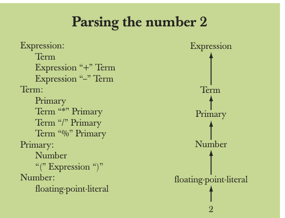

这代表了我们遵循定义的路径。追溯我们的路径，我们可以说 **2** 是一个 **Expression**，因为 **2** 是一个 **floating-point-literal**，它是一个 **Number**，它是一个 **Primary**，它是一个 **Term**，它是一个 **Expression**。

让我们尝试一个稍复杂一点的例子：$\mathbf{2 + 3}$ 是一个 **Expression** 吗？显然，大部分推理与 **2** 的相同：

1. 一个 **Expression** 必须是一个 **Term** 或以一个 **Term** 结尾，它必须是一个 **Primary** 或以一个 **Primary** 结尾，而一个 **Primary** 必须以一个 ( 开头或是一个 **Number**。显然 **2** 不是一个 (，但它是一个 *floating-point-literal*，这是一个 **Number**，这是一个 **Primary**。

2. 那个 **Primary**（即 **Number 2**）前面没有 $/$、$*$ 或 $\%$，因此它是一个完整的 **Term**（而不是 $/$、$*$ 或 $\%$ 表达式的结尾）。

3. 那个 **Term**（即 **Primary 2**）后面跟着一个 $+$，因此它是 **Expression** 第一部分的一个结尾，我们必须查找 $+$ 之后的 **Term**。以与我们发现 **2** 是一个 **Term** 完全相同的方式，我们发现 **3** 是一个 **Term**。由于 **3** 后面没有 $+$ 或 $-$，它是一个完整的 **Term**（而不是 $+$ 或 $-$ **Expression** 的第一部分）。因此，**$2 + 3$** 匹配 **Expression+Term** 规则，是一个 **Expression**。

再次，我们可以图形化地展示这种推理（为了简化，省略了 *floating-point-literal* 到 **Number** 的规则）：

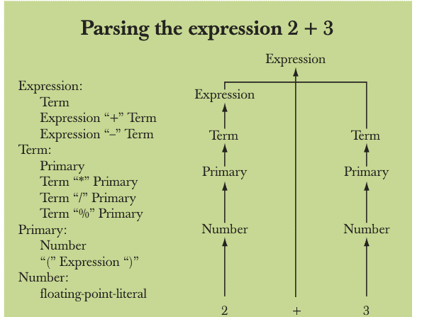

这代表了我们遵循定义的路径。追溯我们的路径，我们可以说 **$2 + 3$** 是一个 **Expression**，因为 **2** 是一个 term（项），它是一个 **Expression**，**3** 是一个 **Term**，并且一个 **Expression** 后跟 $+$ 再跟一个 **Term** 是一个 **Expression**。

我们对文法感兴趣的真正原因是它们可以解决我们如何正确解析同时包含 $+$ 和 $*$ 的表达式的问题，所以让我们试试 45+11.5*7。然而，“扮演计算机”按照上面的规则详细执行是枯燥的，所以让我们跳过我们已经针对 2 和 2+3 走过的某些中间步骤。显然，45、11.5 和 7 都是 floating-point-literal，它们是 Numbers，是 Primarys，因此我们可以忽略 Primary 以下的所有规则。于是我们得到：

1. 45 是一个 Expression，后面跟着 +，所以我们查找一个 Term 来完成 Expression+Term 规则。

2. 11.5 是一个 Term，后面跟着 *，所以我们查找一个 Primary 来完成 Term*Primary 规则。

3. 7 是一个 Primary，所以根据 Term*Primary 规则，11.5*7 是一个 Term。现在我们可以看出，根据 Expression+Term 规则，45+11.5*7 是一个 Expression。特别是，一个先执行乘法 11.5*7 然后执行加法 45+11.5*7 的 Expression，就好像我们写的是 45+(11.5*7) 一样。

再次，我们可以图形化地展示这种推理（再次为了简化，省略了 floating-point-literal 到 Number 的规则）：

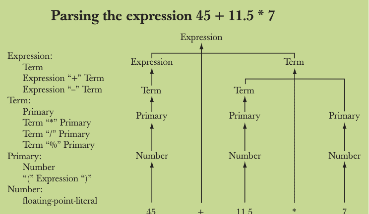

再次，这代表了我们遵循定义的路径。注意 Term*Primary 规则如何确保 11.5 乘以 7，而不是加到 45 上。

你一开始可能会发现这种逻辑很难跟随，但许多人类确实阅读文法，而简单文法并不难理解。然而，我们并不是真的试图教 *你* 理解 2+2 或 45+11.5*7。显然，你已经知道这些了。我们试图找到一种方法让计算机“理解” 45+11.5*7 以及你提供给它去计算的所有其他复杂表达式。实际上，复杂的文法不适合人类阅读，但计算机很擅长此道。它们能最轻松、快速且正确地遵循这类文法规则。遵循精确规则正是计算机擅长的。

### 6.4.1 一个岔路：英语语法

如果你以前从未接触过文法，我们预计你现在的头可能有点晕。事实上，即使你以前见过文法，它可能也会让你头绪混乱，但请看看下面这个针对英语极小子集的文法：

```
Sentence:
Noun Verb // e.g., C++ rules
Sentence Conjunction Sentence // e.g., Birds fly but fish swim
Conjunction:
"and"
"or"
"but"
Noun:
"birds"
"fish"
"C++"
Verb:
"rules"
"fly"
"swim"
```

句子由词性（例如，名词、动词和连词）构建。可以根据这些规则解析句子，以确定哪些词是名词、动词等。这个简单文法还包括语义上无意义的句子，如 "C++ fly and birds rules"，但修正那是另一回事，属于更高级的书籍范畴。

许多人在中学或外语课（例如，英语课）上都接受过/见过这类规则。这些语法规则非常基础。事实上，存在一些严肃的神经学论据支持这些规则被硬编码到我们的大脑中！

现在让我们看看一个解析树，就像我们上面在表达式中使用的那样，但这里是用于简单的英语句子：

#### **解析一个简单的英语句子**

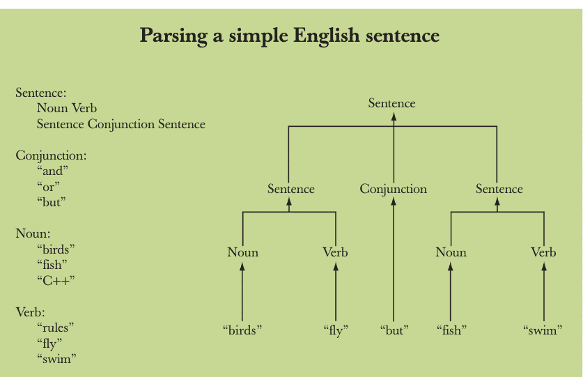

这并不那么复杂。如果你在 §6.4 节遇到了困难，请回去从头阅读该章节；第二次读可能会更有意义！

### 6.4.2 编写文法

我们是如何选择那些表达式文法规则的？“经验”是诚实的答案。我们采用的方式仅仅是人们通常编写表达式文法的方式。然而，编写一个简单的文法相当直接：我们需要知道如何

1. 区分规则和标记

2. 将一个规则放在另一个规则之后（*排序*）

3. 表达替代模式（*交替*）

4. 表达重复模式（*重复*）

5. 识别起始的文法规则

不同的教科书和不同的解析器系统使用不同的符号约定和不同的术语。例如，有些人将标记称为_终结符_，将规则称为_非终结符_或_产生式_。我们简单地将标记放在（双）引号中，并以第一个规则开始。替代项放在单独的行上。例如：

```
List:
     "{" Sequence "}"
Sequence:
    Element
    Element " ," Sequence
Element:
    "A"
    "B"
```

因此，一个**Sequence**（序列）要么是一个**Element**（元素），要么是一个由逗号分隔的**Element**后跟一个**Sequence**。一个**Element**要么是字母**A**，要么是字母**B**。一个**List**（列表）是位于“花括号”中的**Sequence**。我们可以生成这些**List**（如何？）：

```
{ A }
{ B }
{ A,B }
{A,A,A,A,B }
```

然而，这些不是**List**（为什么？）：

```
{ }
A
{ A,A,A,A,B
{A,A,C,A,B }
{ A B C }
{A,A,A,A,B, }
```

这个序列规则不是你在幼儿园学到的，也不是你脑海中根深蒂固的，但它仍然不是火箭科学。有关如何使用文法来表达语法概念的示例，请参见 §7.4 和 §7.8.1。

## 6.5 将文法转换为代码

让计算机遵循文法有很多种方法。我们将使用最简单的一种：我们为每个文法规则编写一个函数，并使用我们的类型 **Token**（标记）来表示标记。实现文法的程序通常被称为_解析器_。

### 6.5.1 实现文法规则

为了实现我们的计算器，我们需要四个函数：一个用于读取标记，以及为文法中的每个规则各写一个函数：

```
get_token()
	// 读取字符并组合标记
	// 使用 cin
expression()
	// 处理 + 和 -
	// 调用 term() 和 get_token()
term()
	// 处理 *, /, 和 %
	// 调用 primary() 和 get_token()
primary()
	// 处理数字和括号
	// 调用 expression() 和 get_token()
```

注意：每个函数处理表达式的一个特定部分，并将其他部分留给其他函数；这极大地简化了每个函数。这很像一群人通过让每个人处理自己专业领域内的问题，并将所有其他问题交给同事来处理，从而解决问题。

这些函数实际上应该做什么？每个函数应该根据其正在实现的文法规则调用其他文法函数，并在规则需要标记时调用 get_token()。例如，当 primary() 试图遵循 (Expression) 规则时，它必须调用

```
get_token()
	// 处理 ( 和 )
expression()
	// 处理 Expression
```


这样的解析函数应该返回什么？不是我们真正想要的答案吗？例如，对于 `2+3`，`expression()` 可以返回 `5`。毕竟，信息都在那里。这就是我们将要尝试的！这样做将使我们避免回答我们列表中一个最难的问题：“我如何表示 `45+5/7` 作为数据，以便我可以评估它？” 与其在内存中存储 `45+5/7` 的表示，我们只是在我们从输入中读取它时直接评估它。这个小小的想法实际上是一个重大突破！它会使程序保持为如果我们让 `expression()` 返回一些复杂的东西以便稍后评估时的四分之一大小。我们刚刚为自己节省了大约 80% 的工作量。

“局外人”是 `get_token()`：因为它处理的是标记，而不是表达式，所以它不能返回子表达式的值。例如，`+` 和 `(` 不是表达式。因此，它必须返回一个 `Token`。我们得出结论，我们希望

```
// 与文法规则匹配的函数：
Token get_token()
	double expression()
	// 读取字符并组合标记
	// 处理 + 和 -
double term()    // 处理 *, /, 和 %
double primary()    // 处理数字和括号
```

### 6.5.2 表达式

让我们首先编写 **expression()**。文法看起来像这样：

```
Expression:
  Term
  Expression '+' Term
  Expression '-' Term
```

由于这是我们第一次尝试将一组文法规则转换为代码，我们将经历几次失败的尝试。使用新技术时通常就是这样，在这个过程中我们会学到有用的东西。特别是，初级程序员可以通过观察相似代码片段截然不同的行为来学到很多。阅读代码是一种值得培养的技能。

#### 6.5.2.1 表达式：第一次尝试

看着 **Expression '+' Term** 规则，我们首先尝试调用 **expression()**，然后寻找 **+**（和 **−**），接着是 **term()**：

```
double expression()
{
  double left = expression();  // 读取并评估一个 Expression
  Token t = get_token();       // 获取下一个标记
  switch (t.kind) {            // 查看它是哪种类型的标记
  case '+':
    return left + term();      // 读取并评估一个 Term，
                               // 然后执行加法
  case '-':
    return left − term();      // 读取并评估一个 Term，
                               // 然后执行减法
  default:
    return left;               // 返回 Expression 的值
  }
}
```

看起来不错。它几乎是对文法的平凡转录。实际上相当简单：首先读取一个 **Expression**，然后查看它后面是否跟着一个 **+** 或一个 **−**，如果是，则读取 **Term**。

不幸的是，这并没有真正的意义。我们如何知道表达式在哪里结束，以便我们可以寻找一个 **+** 或一个 **-**？记住，我们的程序从左到右读取，无法向前查看以判断是否会有 **+**。事实上，这个 **expression()** 永远无法超越其第一行：**expression()** 通过调用 **expression()** 开始，而那个又通过调用 **expression()** 开始，如此“永远”循环下去。这被称为*无限递归*，并且实际上会在计算机用尽内存来持有 **expression()** 的“无尽”调用序列后不久终止。术语*递归*用于描述函数调用自身时发生的情况。并非所有递归都是无限的，递归是一种非常有用的编程技术（见 §8.5.8）。

#### 6.5.2.2 表达式：第二次尝试

那我们要怎么做呢？每个 **Term** 都是一个 **Expression**，但并非每个 **Expression** 都是一个 **Term**；也就是说，我们可以开始寻找一个 **Term**，只有当我们找到一个 **+** 或一个 **-** 时，才去寻找完整的 **Expression**。例如：

```
double expression()
{
    double left = term();                 // 读取并评估一个 Term
    Token t = get_token();                 // 获取下一个标记
    switch (t.kind) {                      // 查看它是哪种类型的标记
    case '+':
        return left + expression();        // 读取并评估一个 Expression，
                                            // 然后执行加法
    case '-':
        return left – expression();        // 读取并评估一个 Expression，
                                            // 然后执行减法
    default:
        return left;                       // 返回 Term 的值
    }
}
```

这实际上 – 或多或少 – 起作用了。我们在完成的程序中尝试过，它解析了我们扔给它的所有正确表达式（并且没有非法的）。它甚至正确评估了大多数表达式。例如，**1+2** 被读作一个 **Term**（值为 **1**，后面跟着 **+**，后面跟着一个 **Expression**（碰巧是一个值为 **2** 的 **Term**）），并给出答案 **3**。同样，**1+2+3** 给出 **6**。我们可以花很长时间来讨论什么起作用，但简而言之：那 **1–2–3** 呢？这个 **expression()** 将读取 **1** 作为一个 **Term**，然后继续读取 **2–3** 作为一个 **Expression**（由 **Term 2** 后面跟着 **Expression 3** 组成）。然后它将从 **1** 中减去 **2–3** 的值。换句话说，它将评估 **1–(2–3)**。**1–(2–3)** 的值是 **2**（正二）。然而，我们被教导（在小学甚至更早之前）**1–2–3** 意味着 **(1–2)–3**，因此其值为 **–4**（负四）。

因此，我们得到了一个非常不错的程序，但它没有做出正确的事情。这是危险的。特别危险的是，因为它在许多情况下给出了正确的答案。例如，1+2+3 给出了正确的答案（6），因为 1+(2+3) 等于 (1+2)+3。从根本上说，从程序员的视角来看，我们做错了什么？当我们发现错误时，我们应该总是问自己这个问题。这样我们可能会避免再次、再再次、以及无数次犯同样的错误。

从根本上说，我们只是看了看代码并进行了猜测。这很少足够好！我们必须理解我们的代码在做什么，并且必须能够解释为什么它做了正确的事情。

分析我们的错误往往也是找到正确解决方案的最佳方式。我们在这里做的是定义 expression() 先寻找一个 Term，然后，如果该 Term 后面跟着 + 或 –，则寻找一个 Expression。这实际上实现了略微不同的文法：

```
Expression:
    Term
    Term '+' Expression    // 加法
    Term '-' Expression    // 减法
```

与我们期望的文法的区别恰恰在于，我们希望 1–2–3 是表达式 1–2 后跟 – 再后跟项 3，但我们在这里得到的是项 1 后跟 – 再后跟表达式 2–3；也就是说，我们希望 1–2–3 意味着 (1–2)–3，但我们得到的是 1–(2–3)。

是的，调试可能乏味、棘手且耗时，但在这种情况下，我们实际上是在梳理你在小学学到的规则，并学会了应用它们而不会遇到太多麻烦。麻烦在于，我们必须把这些规则教给计算机——而计算机的学习速度比你慢得多。

请注意，我们可以定义 1–2–3 为 1–(2–3) 而不是 (1–2)–3，从而完全避免这种讨论。通常，最棘手的编程问题出现在我们必须匹配那些在人类开始使用计算机之前很久就为人类制定并确立的常规规则时。

#### 6.5.2.3 表达式：第三次尝试成功

那么，现在该怎么办？再次查看文法（§6.5.2 中的正确文法）：任何 Expression 都以一个 Term 开头，并且这样的 Term 后面可以跟着 + 或 –。因此，我们必须寻找一个 Term，看看它后面是否跟着 + 或 –，并继续这样做，直到没有更多的加号或减号为止。例如：

```
double expression()
{
    double left = term();    // 读取并求值一个 Term
    Token t = get_token();    // 获取下一个令牌
    while (t.kind=='+'|| t.kind=='-') {    // 寻找 + 或 -
        if (t.kind == '+')
            left += term();              // 求值 Term 并相加
        else
            left -= term();              // 求值 Term 并相减
        t = get_token();
    }
    return left;                     // 最后：没有更多的 + 或 -；返回答案
}
```

这有点杂乱：我们必须引入一个循环来持续寻找加号和减号。我们也变得有点重复：我们两次测试 + 和 -，并两次调用 get_token()。因为它混淆了代码的逻辑，让我们只需去掉对 + 和 - 测试的重复：

```
double expression()
{
    double left = term();             // 读取并求值一个 Term
    Token t = get_token();             // 获取下一个令牌
    while (true) {
        switch (t.kind) {
        case '+':
            left += term();                    // 求值 Term 并相加
            t = get_token();
            break;
        case '-':
            left -= term();                    // 求值 Term 并相减
            t = get_token();
            break;
        default:
            return left;             // 最后：没有更多的 + 或 -；返回答案
        }
    }
}
```

请注意，除了循环之外，这实际上与我们第一次尝试（§6.5.2.1）非常相似。我们所做的是去掉了 expression() 内部对 expression() 的提及，并用一个循环代替。换句话说，我们将 Expression 文法规则中的 Expression 翻译成了一个寻找后跟 + 或 - 的 Term 的循环。

### 6.5.3 项（Terms）

Term 的文法规则与 Expression 规则非常相似：

**Term:**

```
Primary
Term  '*' Primary
Term  '/' Primary
Term  '%' Primary
```

因此，代码也应该非常相似。这是第一次尝试：

```
double term()
{
    double left = primary();
    Token t = get_token();
    while (true) {
        switch (t.kind) {
        case '*':
            left *= primary();
            t = get_token();
            break;
        case '/':
            left /= primary();
            t = get_token();
            break;
        case '%':
            left %= primary();
            t = get_token();
            break;

        default:
            return left;
        }
    }
}
```

不幸的是，这无法编译：余数运算 (%) 未针对浮点数定义。编译器友善地告诉了我们。当我们在 §6.3.5 中回答第 5 个问题——“我们也应该允许浮点数输入吗？”——自信地回答“当然！”时，我们实际上没有仔细考虑这个问题，而成为了功能蔓延的受害者。这种情况总是会发生！那我们要怎么做呢？我们可以在运行时检查 %% 的两个操作数是否都是整数，如果不是则给出错误。或者我们可以简单地不把 %% 包含在我们的计算器中。让我们暂时采取最简单的选择。我们可以稍后再添加 %%；参见 §7.5。

在我们消除 %% 情况之后，该函数可以工作：项被正确解析和求值。然而，有经验的程序员会注意到一个不受欢迎的细节，使得 term() 不可接受。如果你输入 2/0 会发生什么？

你不能除以零。如果你尝试，计算机硬件会检测到这一点并以一个不太有用的错误消息终止你的程序。没有经验的程序员会以艰难的方式发现这一点。因此，我们最好检查一下并给出一个体面的错误消息：

```
double term()
{
    double left = primary();
    Token t = get_token();
    while (true) {
        switch (t.kind) {
            case '*':
                left *= primary();
                t = get_token();
                break;
            case '/':
                {
                    double d = primary();
                    if (d == 0) error("divide by zero");
                    left /= d;
                    t = get_token();
                    break;
                }
            default:
                return left;
        }
    }
}
```

为什么我们将处理 / 的语句放在一个块中？编译器坚持如此。如果你想在 switch 语句中定义和初始化变量，你必须将它们放在一个块内。

### 6.5.4 主表达式（Primary expressions）

主表达式的文法规则也很简单：

```
Primary:
    Number
    '(' Expression ')'
```

实现它的代码有点杂乱，因为语法错误的机会更多：

```
double primary()
{
    Token t = get_token();
    switch (t.kind) {
    case '(':   // 处理 '(' 表达式 ')'
        {   double d = expression();
            t = get_token();
            if (t.kind != ')') error("')' expected");
            return d;
        }
    case '8':   // 我们使用 '8' 来表示数字
        return t.value;   // 返回数字的值
    default:
        error("primary expected");
    }
}
```

基本上，与 expression() 和 term() 相比没有什么是新的。我们使用相同的语言原语，处理 Token 的方式相同，并且使用相同的编程技术。

## 6.6 尝试第一个版本

为了运行这些计算器函数，我们需要实现 get_token() 并提供一个 main()。main() 很简单：我们只需要不断调用 expression() 并打印其结果：

```
int main()
try {
    while (cin)
        cout << expression() << "\n";
    keep_window_open();
}
catch (exception& e) {
    cerr << e.what() << "\n";
    keep_window_open ();
    return 1;
}
catch (...) {
    cerr << "exception\n";
    keep_window_open ();
    return 2;
}
```

错误处理是通常的“样板代码”（§5.6.3）。让我们把 get_token() 实现的描述推迟到 §6.8，并测试这个计算器的第一个版本。

**试一试**


这个计算器程序（包括 `get_token()`）的第一个版本作为文件 `calculator00.cpp` 提供。让它运行并试用一下。

不出所料，这个计算器的第一个版本并没有完全像我们期望的那样工作。因此，我们耸耸肩并问，“为什么不是？”或者更准确地说，“那么，它为什么那样工作？”以及“它做了什么？”输入一个 `2`，然后按回车键。没有响应。再试另一个回车键，看看它是否在睡觉。仍然没有响应。输入一个 `3`，然后按回车键。没有响应！输入一个 `4`，然后按回车键。它回答了 `2`！现在屏幕看起来像这样：

```
2
3
4
2
```

我们继续输入 `5+6`。程序响应了一个 `5`，因此屏幕看起来像这样：

```
2
3
4
2
5+6
5
```

除非你以前编过程序，否则你很可能非常困惑！事实上，即使是有经验的程序员也可能困惑。这里发生了什么？此时，你尝试退出程序。你怎么做到这一点？我们“忘记”了编程一个退出命令，但错误会导致程序退出，因此你输入一个 `x`，程序打印 `Bad token` 并退出。终于，有东西按计划工作了！

然而，我们忘记了区分屏幕上的输入和输出。在我们尝试解决主要难题之前，让我们先修复输出，以便更好地看到我们在做什么。添加一个 `=` 来表示输出暂时就足够了：

```
while (cin) cout << "=" << expression() << '\n';   // 版本 1
```

现在，按照之前的样子输入完全相同的字符序列，我们得到：

```
2

3
4
= 2
5+6
= 5
x
Bad token
```

奇怪！尝试弄清楚程序做了什么。我们尝试了另外几个例子，但让我们只看这个。这是一个谜题：

- 为什么程序在第一个 **2** 和 **3** 以及换行符之后没有响应？
- 为什么在我们输入 **4** 之后，程序响应的是 **2**，而不是 **4**？
- 为什么在 **5+6** 之后，程序回答的是 **5**，而不是 **11**？

面对这种神秘的结果，有许多种可能的推进方式。我们将在下一章研究其中的一些，但在这里，让我们只动脑筋思考。程序可能在做错误的算术吗？这极不可能；**4** 的值不是 **2**，而 **5+6** 的值是 **11** 而不是 **5**。考虑一下当我们输入 **1 2 3 4+5 6+7 8+9 10 11 12** 后跟一个换行符时会发生什么。我们得到：

```
1 2 3 4+5 6+7 8+9 10 11 12
= 1
= 4
= 6
= 8
= 10
```

嗯？没有 **2** 或 **3**。为什么是 **4** 而不是 **9**（即 **4+5**）？为什么是 **6** 而不是 **13**（即 **6+7**）？仔细观察：程序正在输出每第三个词元！也许程序“吃掉”了我们的部分输入而没有对其进行求值？确实如此。考虑 `expression()`：

```cpp
double expression()
{
  double left = term();       // 读取并求值一个 term
  Token t = get_token();     // 获取下一个 token
  while (true) {
    switch (t.kind) {
            case '+':
                left += term();      // 求值 Term 并相加
                t = get_token();
                break;
            case '-':
                left -= term();      // 求值 Term 并相减
                t = get_token();
                break;
            default:
                return left;          // 最后：没有更多 + 或 –；返回答案
            }
        }
```

当 `get_token()` 返回的 **Token** 不是 **+** 或 **–** 时，我们只是返回。我们不使用该 token，也不将其存储在任何地方供其他函数稍后使用。这不明智。丢弃输入而不甚至确定它是什么绝不能是个好主意。快速检查表明 `term()` 存在完全相同的问题。这解释了我们为什么计算器每使用一个 token 就吃掉了两个。

让我们修改 `expression()`，使其不“吃掉” token。当程序不需要该 token 时，我们会把下一个 token (`t`) 放在哪里？我们可以想到许多复杂的方案，但让我们跳到显而易见的回答（一旦看到就会觉得“显而易见”）：该 token 将被其他从输入中读取 token 的函数使用，所以让我们将 token 放回到输入流中，以便它可以被其他函数再次读取！实际上，你可以将字符放回到 `istream`，但这不是我们真正想要的。我们要处理的是 token，而不是字符。我们要的是一个处理 token 并且可以将已读取的 token 放回其中的输入流。

所以，假设我们有一个 token 流 – 一个“**Token_stream**” – 称为 `ts`。进一步假设 **Token_stream** 有一个成员函数 `get()` 返回下一个 token，以及一个成员函数 `putback()` 将 token `t` 放回流中。一旦我们看看它是如何被使用的，我们将在 §6.8 中实现该 **Token_stream**。给定 **Token_stream**，我们可以重写 `expression()`，使其将未使用的 token 放回 **Token_stream**：

```cpp
double expression()
{
    double left = term();      // 读取并求值一个 Term
    Token t = ts.get();        // 从 Token 流中获取下一个 Token

    while (true) {
        switch (t.kind) {
            case '+':
                left += term();      // 求值 Term 并相加
                t = ts.get();
                break;
            case '-':
                left -= term();      // 求值 Term 并相减
                t = ts.get();
                break;

            default:
                ts.putback(t);       // 将 t 放回 token 流
                return left;         // 最后：没有更多 + 或 -；返回答案
        }
    }
}
```

此外，我们必须对 **term()** 做同样的更改：

```cpp
double term()
{
    double left = primary();
    Token t = ts.get();             // 从 Token 流中获取下一个 Token

    while (true) {
        switch (t.kind) {
            case '*':
                left *= primary();
                t = ts.get();
                break;
            case '/':
            {
                double d = primary();
                if (d == 0) error("divide by zero");
                left /= d;
                t = ts.get();
                break;
            }
            default:
                ts.putback(t);      // 将 t 放回 Token 流
                return left;
        }
    }
}
```

对于我们最后一个解析器函数 **primary**()，我们只需要将 **get_token**() 更改为 **ts.get**()；**primary**() 使用它读取的每个 token。

## 6.7 尝试第二个版本

所以，我们要准备测试我们的第二个版本。这个计算器程序的第二个版本（包括 **Token_stream**）作为文件 **calculator01.cpp** 提供。让它运行并尝试一下。输入 **2** 后跟一个换行符。没有响应。尝试另一个换行符看看它是否睡着了。仍然没有响应。输入 **3** 后跟一个换行符，它回答 **2**。尝试 **2+2** 后跟一个换行符，它回答 **3**。现在你的屏幕看起来像这样：

```
2

3
=2
2+2
=3
```

嗯。也许我们引入 **putback**() 并在 **expression**() 和 **term**() 中使用它并没有解决问题。让我们尝试另一个测试：

```
2 3 4 2+3 2*3

= 2

= 3

= 4

= 5
```

是的！这些是正确答案！但最后一个答案（**6**）缺失了。我们仍然有一个 token-look-ahead 问题。然而，这次问题不是我们的代码“吃掉”字符，而是直到我们输入下一个表达式，它才会为某个表达式产生任何输出。表达式的结果不是立即打印的；输出被推迟到程序看到下一个表达式的第一个 token 时。不幸的是，程序直到我们在下一个表达式后按下回车键才会看到那个 token。程序并不是真的错了；它只是响应稍微慢了一点。

我们如何修复这个？一个明显的解决方案是要求一个“打印命令”。所以，让我们接受表达式后的分号来终止它并触发输出。同时，让我们添加一个“退出命令”以允许优雅退出。字符 **q**（代表“quit”）非常适合用作退出命令。在 **main**() 中，我们有：

```cpp
while (cin) cout << "=" << expression() << '\n';    // version 1
```

我们可以将其改为更杂乱但更有用的：

```cpp
double val = 0;
while (cin) {
    Token t = ts.get();
    
    if (t.kind == 'q') break;      // 'q' 代表 "quit"
    if (t.kind == ';')             // ';' 代表 "print now"
        cout << "=" << val << "\n";
    else
        ts.putback(t);
    val = expression();
}
```

现在计算器实际上是可用的。例如，我们得到：

```
2;
= 2
2+3;
= 5
3+4*5;
= 23
q
```

在这一点上，我们有一个良好的计算器初始版本。它并不是我们真正想要的，但我们有一个程序可以用作制作更令人满意的版本的基础。重要的是，我们现在可以逐个修正问题并添加功能，同时在过程中保持一个可工作的程序。

## 6.8 Token 流

在进一步改进我们的计算器之前，让我们展示 Token 流的实现。毕竟，没有什么 – 什么都没有 – 工作直到我们获得正确的输入。我们首先实现了 Token 流，但不想在展示最小解决方案之前过多偏离计算的问题。

我们计算器的输入是一个 token 序列，就像我们在上面（§6.3.3）中展示的 `(1.5+4)*11` 一样。我们需要的是某种东西，它从标准输入 `cin` 读取字符，并在程序请求时向程序呈现下一个 token。此外，我们看到我们 – 即我们的计算器程序 – 经常多读取一个 token，因此我们必须能够将其放回以备后用。这是典型且根本性的；当我们从左到右严格读取 `1.5+4` 时，如何知道数字 `1.5` 已经完整读取而没有读取

`?`。在看到 `+` 之前，我们可能正在读取 `1.55555` 的途中。因此，我们需要一个“流”，当我们使用 `get()` 请求时它会产生一个标记（token），并且我们可以使用 `putback()` 将标记放回流中。我们在 C++ 中使用的一切都有类型，因此我们必须从定义类型 `Token_stream` 开始。

你大概已经注意到 §6.3.3 中 `Token` 定义里的 `public:` 了。在那里，它没有明显的用途。对于 `Token_stream`，我们需要它，并且必须解释其功能。C++ 用户定义类型通常由两部分组成：公共接口（标记为 `public:`）和实现细节（标记为 `private:`）。其想法是将类型用户为方便使用所需的部分与我们为实现类型所需、但宁愿不让用户干扰的细节分开：

```cpp
class Token_stream {
 public:
    // user interface
 private:
    // implementation details
    // (not directly accessible to users of Token_stream)
};
```

显然，用户和实现者通常只是我们在“扮演不同的角色”，但将面向用户的（公共）接口与仅由实现者使用的（私有）实现细节区分开来，是一种强有力的代码结构化工具。公共接口应包含（仅包含）用户所需的内容，通常是一组函数。私有实现包含实现这些公共函数所必需的内容，通常是处理用户无需知晓也不应直接使用的那些杂乱细节的数据和函数。

让我们稍加阐述 `Token_stream` 类型。用户想要什么？显然，我们需要 `get()` 和 `putback()` 函数——这就是我们发明标记流概念的原因。`Token_stream` 的作用是将从输入读取的字符制成 `Tokens`，因此我们需要能够创建 `Token_stream` 并定义它从 `cin` 读取。因此，最简单的 `Token_stream` 看起来像这样：

```cpp
class Token_stream {
 public:
    Token get();            // get a Token
    void putback(Token t);  // put a Token back
 private:
    // implementation details
};
```

这就是用户使用 `Token_stream` 所需的一切。经验丰富的程序员会想知道为什么 `cin` 是字符的唯一可能来源，但我们决定从键盘获取输入。我们将在第 7 章的一个练习中重新审视这一决定。

为什么我们使用冗长的名称 **putback()** 而不是逻辑上足够的 **put()**？我们想强调 **get()** 和 **putback()** 之间的不对称性；这是一个输入流，而不是你也可以用于通用输出的东西。此外，**istream** 有一个 **putback()** 函数：命名的一致性是一个系统有用的属性。它帮助人们记忆并帮助人们避免错误。

我们现在可以创建一个 **Token_stream** 并使用它：

```cpp
Token_stream ts;    // a Token_stream called ts
Token t = ts.get(); // get next Token from ts
// . . . 
ts.putback(t);      // put the Token t back into ts
```

这就是编写计算器其余部分所需的全部内容。

### 6.8.1 实现 Token_stream

现在，我们需要实现那两个 **Token_stream** 函数。如何表示一个 **Token_stream**？也就是说，我们需要在 **Token_stream** 中存储什么数据才能让它完成工作？我们需要为任何放回 **Token_stream** 的标记预留空间。为了简化，假设我们一次最多可以放回一个标记。这恰好足以满足我们的程序（以及许多类似的程序）。这样，我们只需要一个 **Token** 的空间以及一个指示该空间是满还是空的指标：

```cpp
class Token_stream {
public:
    Token get();                    // get a Token (get() is defined in §6.8.2)
    void putback(Token t);         // put a Token back
private:
    bool full {false};             // is there a Token in the buffer?
    Token buffer;                  // here is where we keep a Token put back using putback()
};
```

现在我们可以定义（“编写”）这两个成员函数。**putback()** 很简单，所以我们先定义它。**putback()** 成员函数将其参数放回 **Token_stream** 的缓冲区：

```cpp
void Token_stream::putback(Token t)
{
    buffer = t;       // copy t to buffer
    full = true;      // buffer is now full
}
```

关键字 **void**（意为“无”）用于表示 **putback()** 不返回任何值。

当我们在类定义之外定义类的成员时，我们必须指明该成员属于哪个类。我们使用以下记法：

*class_name :: member_name*

在这种情况下，我们定义 **Token_stream** 的成员 **putback**。


为什么我们要在类外部定义成员？主要答案是清晰度：类定义（主要）声明类能做什么。成员函数定义是实现，指定了事情是如何完成的。我们倾向于将它们放在“其他地方”，以免分散注意力。我们的理想是让程序中的每个逻辑实体都能在一屏内显示。如果成员函数定义放在其他地方，类定义通常能做到这一点；但如果它们放在类定义内部（“类内”），则无法做到。

如果我们要确保不会在没有中间读取（使用 `get()`）的情况下两次尝试使用 `putback()`，我们可以添加一个测试：

```cpp
void Token_stream::putback(Token t)
{
    if (full) error("putback() into a full buffer");
    buffer = t;     // copy t to buffer
    full = true;    // buffer is now full
}
```

对 `full` 的测试检查前置条件：“缓冲区中没有 `Token`。”

显然，`Token_stream` 最初应该是空的。也就是说，直到第一次调用 `get()` 之后，`full` 才应为 `false`。我们通过直接在 `Token_stream` 的定义中初始化成员 `full` 来实现这一点。

### 6.8.2 读取标记

所有实际的工作都是由 `get()` 完成的。如果 `Token_stream::buffer` 中还没有 `Token`，`get()` 必须从 `cin` 读取字符并将它们组合成标记：

```cpp
Token Token_stream::get()
{
    if (full) {
        full = false;        // do we already have a Token ready?
        return buffer;       // remove Token from buffer
    }
    char ch; 
    cin >> ch;    // note that >> skips whitespace (space, newline, tab, etc.)
 
    switch (ch) { 
    case ';':        // for “print” 
    case 'q':        // for “quit” 
    case '(': case ')': case '+': case '-': case '*': case '/': 
                  return Token(ch);    // let each character represent itself 
    case '.': 
    case '0': case '1': case '2': case '3': case '4': 
    case '5': case '6': case '7': case '8': case '9': 
    {     cin.putback(ch);         // put digit back into the input stream 
        double val; 
        cin >> val;                        // read a floating-point number 
        return Token('8',val);            // let '8' represent “a number” 
    } 
    default: 
        error("Bad token"); 
    }
}
```

让我们详细考察 `get()`。首先，我们检查缓冲区中是否已有 `Token`。如果有，我们只需返回它：

```cpp
if (full) {          // do we already have a Token ready? 
    full = false;        // remove Token from buffer 
    return buffer; 
}
```

只有当 `full` 为 `false`（即缓冲区中没有标记）时，我们才需要处理字符。在这种情况下，我们读取一个字符并适当处理它。我们查找括号、运算符和数字。其他任何字符都会触发 `error()` 的调用，从而终止程序：

```cpp
default: 
    error("Bad token");
```

`error()` 函数在 §5.6.3 中有描述，我们在 `std_lib_facilities.h` 中使其可用。

我们必须决定如何表示不同种类的 `Tokens`；也就是说，我们必须为成员 `kind` 选择值。为了简单和易于调试，我们决定让 `Token` 的 `kind` 为括号和运算符本身。这导致了对括号和运算符极其简单的处理：

```cpp
case '(': case ')': case '+': case '-': case '*': case '/':
    return Token(ch);      // let each character represent itself
```

说实话

### 6.8.3 读取数字

现在我们只需要处理数字了。这实际上并不容易。我们如何真正找到 `123` 的值？嗯，那是 `100+20+3`，但 `12.34` 呢，我们应该接受科学计数法吗，例如 `12.34e5`？我们可以花几个小时或几天来正确搞定这件事，但幸运的是，我们不必。输入流知道 C++ 字面量长什么样，以及如何将它们转换为 `double` 类型的值。我们只需弄清楚如何在 `get()` 内部告诉 `cin` 为我们做到这一点：

```cpp
case '1':
case '0': case '1': case '2': case '3': case '4':
case '5': case '6': case '7': case '8': case '9':
{
    cin.putback(ch);             // put digit back into the input stream
    double val;
    cin >> val;                  // read a floating-point number
    return Token('8',val);       // let '8' represent “a number”
}
```

我们—— somewhat arbitrarily（有点武断地）——选择 `'8'` 来表示 `Token` 中的“数字”。

我们怎么知道接下来是数字呢？嗯，如果我们根据经验猜测或在 C++ 参考手册中查找（例如，附录 A），我们会发现数字字面量必须以数字或 `.`（小数点）开头。所以，我们对此进行测试。接下来，我们想让 `cin` 读取数字，但我们已经读取了第一个字符（一个数字或点），所以仅仅让 `cin` 读取剩下的部分会导致错误结果。我们可以尝试将第一个字符的值与 `cin` 读取的“剩余”部分的值结合起来；例如，如果有人输入了 `123`，我们会得到 `1`，`cin` 会读取 `23`，然后我们必须将 `100` 加到 `23` 上。恶心！而且那只是一个简单的情况。幸运的是（并非偶然），`cin` 的工作原理很像 `Token_stream`，即你可以将字符放回其中。因此，与其进行繁琐的算术运算，我们将初始字符放回 `cin`，然后让 `cin` 读取整个数字。

请注意，我们如何一次又一次地避免进行复杂的工作，而是寻找更简单的解决方案——通常依赖于库设施。这就是编程的精髓：对简洁性的持续追求。有时，这种理念——略带戏谑地说——被表述为“好的程序员是懒惰的”。在这种意义上（且仅在这种意义上），我们应该“懒惰”；如果我们能找到一种方法用少得多的代码，为什么要写大量的代码呢？

## 6.9 程序结构

老话说，有时候因为树木而忽略了森林。同样地，当查看程序的所有函数、类等时，很容易失去对程序整体结构的把握。因此，让我们来看看省略了细节的程序：

```cpp
#include "std_lib_facilities.h"

class Token { /* ... */};
class Token_stream { /* ... */};

void Token_stream::putback(Token t) { /* ... */}
Token Token_stream::get() { /* ... */}

Token_stream ts;      // 提供 get() 和 putback()
double expression();  // 声明，以便 primary() 可以调用 expression()

double primary() { /* ... */}     // 处理数字和括号
double term() { /* ... */}        // 处理 * 和 /
double expression() { /* ... */}  // 处理 + 和 –

int main() { /* ... */}   // 主循环和处理错误
```

声明的顺序很重要。你无法在名称被声明之前使用它，因此 `ts` 必须在 `ts.get()` 使用它之前被声明，并且 `error()` 必须在使用它的解析器函数之前被声明，因为它们都使用了它。调用图中存在一个有趣的循环：`expression()` 调用 `term()`，`term()` 调用 `primary()`，而 `primary()` 又调用 `expression()`。

我们可以将其图形化表示（省略对 `error()` 的调用——所有人都调用 `error()`）：

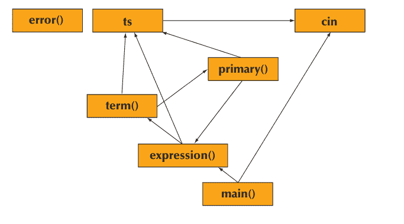

这意味着我们不能仅仅定义那三个函数：没有任何顺序允许我们在每个函数被使用之前都先定义它。我们至少需要一个声明，它不仅仅是定义。我们选择声明（“前向声明”）`expression()`。

但这有效吗？是的，对于某些关于“有效”的定义而言。它编译，运行，正确评估表达式，并给出体面的错误消息。但它以一种我们喜欢的方式工作吗？毫不令人惊讶的答案是“并不是”。我们尝试了 §6.6 中的第一个版本，并删除了一个严重的 bug。这个第二个版本（§6.7）也没有好太多。但这没关系（也是预料之中的）。对于其主要目的——作为一个我们可以用来验证基本思想并从中获得反馈的工具——它已经足够好了。因此，它是一个成功之作，但试试它吧：它（仍然）会让你发疯！

## 试一试

让上述计算器运行起来，看看它做什么，并试图弄清楚它为何如此工作。

## 练习

本练习涉及一系列对有 bug 的程序进行的修改，使其从无用之物变成相对有用的工具。

- 1. 从文件 `calculator02buggy.cpp` 中获取计算器。让它编译。你需要找到并修复一些 bug。这些 bug 不在书本文本中。找出 `calculator02buggy.cpp` 中偷偷插入的三个逻辑错误并移除它们，使计算器产生正确的结果。
- 2. 将用作退出命令的字符从 `q` 更改为 `x`。
- 3. 将用作打印命令的字符从 `;` 更改为 `=`。
- 4. 在 `main()` 中添加一行问候语：

  > "欢迎使用我们的简单计算器。
  > 请使用浮点数输入表达式。"
- 5. 通过提及哪些运算符可用以及如何打印和退出，改进该问候语。

## 复习

- 1. “编程即理解”意味着什么？
- 2. 本章详细介绍了计算器程序的创建。写一段简短的分析，说明计算器应该能够做什么。
- 3. 你如何将一个问题分解为较小的可管理部分？
- 4. 为什么创建一个小型、受限版本的程序是一个好主意？
- 5. 为什么功能蔓延（feature creep）是一个坏主意？
- 6. 软件开发的三个主要阶段是什么？
- 7. 什么是“用例”？
- 8. 测试的目的是什么？
- 9. 根据本章的大纲，描述 `Term`、`Expression`、`Number` 和 `Primary` 之间的区别。
- 10. 在本章中，输入被分解为其组成部分 `Terms`、`Expressions`、`Primary` 和 `Numbers`。请对 `(17+4)/(5-1)` 执行此操作。
- 11. 为什么程序中没有名为 `number()` 的函数？
- 12. 什么是 token？
- 13. 什么是语法？语法规则是什么？
- 14. 什么是类？我们使用类的用途是什么？
- 15. 我们如何为类的成员提供默认值？
- 16. 在表达式函数中，为什么 `switch`-语句的默认操作是将 token “放回”？
- 17. 什么是“前瞻”（look-ahead）？
- 18. `putback()` 做什么，为什么它有用？
- 19. 为什么余数（取模）操作 `%` 在 `term()` 中难以实现？
- 20. 我们使用 `Token` 类的两个数据成员做什么？
- 21. 为什么我们（有时）将类的成员分为 `private` 和 `public` 成员？
- 22. 当缓冲区中有一个 token 且调用了 `get()` 函数时，`Token_stream` 类中会发生什么？
- 23. 为什么字符 `';'` 和 `'q'` 被添加到 `Token_stream` 类的 `get()` 函数中的 `switch`-语句中？
- 24. 我们什么时候应该开始测试程序？
- 25. 什么是“用户定义类型”？我们为什么想要一个？
- 26. C++“用户定义类型”的接口是什么？
- 27. 为什么我们希望依赖代码库？

## 术语

- 分析
- 类
- 类成员
- 数据成员
- 设计
- 除以零
- 语法
- 实现
- 接口
- 成员函数
- 解析器
- 私有
- 原型
- 伪代码
- 公共
- 语法分析器
- token
- 用例

## 练习题

- 1. 如果你还没有做，请完成本章的 **试一试** 练习。
- 2. 为程序添加使用 `{}[]` 以及 `()` 的能力，使得 `"{(3+4)*6}"`（(3+4)）成为一个有效的表达式。
- 3. 添加一个阶乘运算符：使用后缀 `!` 运算符表示“阶乘”。例如，表达式 `7!` 意味着 `7 * 6 * 5 * 4 * 3 * 2 * 1`。让 `!` 的结合性比 `*` 和 `/` 更紧密；即 `7*8!` 意味着 `7*(8!)` 而不是 `(7*8)!`。首先修改语法以考虑更高级别的运算符。为了与标准的数学阶乘定义一致，让 `0!` 评估为 `1`。提示：计算器函数处理 `doubles`，但阶乘仅对 `ints` 定义，所以对于 `x!`，将 `x` 分配给一个 `int` 并计算该 `int` 的阶乘。
- 4. 定义一个类 `Name_value`，用于保存一个字符串和一个值。重新整理第 4 章练习 19，使用 `vector<Name_value>` 代替两个 `vectors`。
- 5. 在 §6.4.1 的“英语”语法中添加冠词 `the`，以便它可以描述诸如“The birds fly but the fish swim.”这样的句子。
- 6. 编写一个程序，检查句子是否根据 §6.4.1 中的“英语”语法是正确的。假设每个句子由一个由空白包围的句点（.）终止。例如，`birds fly but the fish swim .` 是一个句子，但 `birds fly but the fish swim`（缺少终止句点）和 `birds fly but the fish swim.`（句点前没有空格）不是。对于每个输入的句子，程序应简单地响应“OK”或“not OK”。提示：不必处理 token；只需使用 `>>` 读取到一个字符串中。
- 7. 为按位逻辑表达式编写语法。按位逻辑表达式很像算术表达式，但运算符是 `!`（非）、`~`（补）、`&`（与）、`|`（或）和 `^`（异或）。每个运算符对其整数操作数的每个位执行操作（参见 §25.5）。`!` 和 `~` 是前缀一元运算符。`^` 的结合性比 `|` 更紧密（正如 `*` 的结合性比 `+` 更紧密），因此 `x|y^z` 意味着 `x|(y^z)` 而不是 `(x|y)^z`。`&` 运算符的结合性比 `^` 更紧密，因此 `x^y&z` 意味着 `x^(y&z)`。
- 8. 重做第 5 章练习 12 中的“猜数字”游戏，使用四个字母而不是四个数字。
- 9. 编写一个程序，读取数字并将其组合成整数。例如，`123` 被读取为字符 `1`、`2` 和 `3`。程序应输出 `123 is 1 hundred and 2 tens and 3 ones`。数字应以 `int` 值输出。处理一位、两位、三位或四位数字。提示：要从字符 `'5'` 获取整数值 `5`，请减去 `'0'`，即 `'5'-'0'==5`。
- 10. 排列（permutation）是集合的有序子集。例如，假设你想为一个保险箱选择一个组合。有 60 个可能的数字，你需要三个不同的数字用于组合。组合有 `P(60,3)` 个排列，其中 `P` 由以下公式定义：

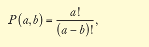

其中 `!` 用作后缀阶乘运算符。例如，`4!` = `4*3*2*1`。组合（combination）与排列类似，但对象顺序无关紧要。例如，如果你在制作“香蕉船”冰淇淋圣代，并希望从五个口味中使用三种不同的冰淇淋，你不会在意是在开头还是结尾使用一勺香草味；你仍然使用了香草味。组合的公式是

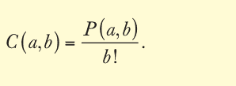


设计一个程序，要求用户输入两个数字，询问他们是希望计算排列还是组合，并打印出结果。这将包含几个部分。对上述需求进行分析。准确写出程序需要执行的操作。然后，进入设计阶段。编写程序的伪代码，并将其分解为子组件。该程序应具备错误检查功能。确保所有错误的输入都能生成良好的错误消息。

## 附言

理解输入是基本的编程活动之一。每个程序在某种程度上都会面临这个问题。理解由人类直接产生的内容是极其困难的问题之一。例如，语音识别的许多方面仍然是一个研究课题。这类问题的简单变体，如我们的计算器，通过使用语法来定义输入来应对。

## 7 完善程序

> “在胖女人唱歌之前，事情还没结束。”

—*歌剧谚语*

编写程序涉及逐步完善你对想要做什么以及如何表达它的想法。在第 6 章中，我们生成了计算器程序的初始可用版本。在这里，我们将对其进行完善。完善程序——即使其适合用户和维护者——包括改进用户界面、在错误处理方面做大量工作、添加一些有用的功能，以及重构代码以便于理解和修改。

### 7.1 引言

当你的程序刚开始“合理地”运行时，你可能才完成了一半。对于大型程序，或者如果表现不佳可能会造成危害的程序，你离完成还很远。一旦程序“基本上可用”，真正的乐趣才开始！那时我们才有足够的可用代码来尝试各种想法。

在本章中，我们将指导你了解专业程序员在尝试改进第 6 章中的计算器时可能会考虑的问题。注意，这里对程序提出的问题以及考虑的问题比计算器本身更有趣。我们所做的是提供一个示例，展示真实程序如何在需求和约束的压力下演变，以及程序员如何逐步改进代码。

### 7.2 输入和输出

如果你回顾第 6 章的开头，你会发现我们决定提示用户

表达式：

并报告答案

结果：

在匆忙让程序运行起来的过程中，我们完全忘记了这一点。这相当典型。我们无法时刻想到所有事情，因此当我们停下来反思时，发现我们遗忘了某些东西。

对于一些编程任务，初始需求无法更改。这通常是一项过于僵化的政策，会导致程序成为解决其所试图解决的问题时不必要的糟糕解决方案。因此，让我们考虑

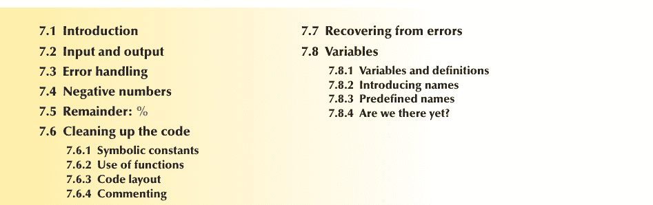

在我们可以更改程序确切行为规格的前提下，我们会怎么做。我们真的希望程序打印 **表达式：** 和 **结果：** 吗？我们怎么知道？仅仅“思考”通常没有帮助。我们必须尝试，看看什么效果最好。

```
2+3; 5*7; 2+9;
```

当前给出

```
= 5
= 35
= 11
```

如果我们使用 **表达式：** 和 **结果：**，我们会得到

```
表达式： 2+3; 5*7; 2+9;
结果 : 5
表达式： 结果： 35
表达式： 结果： 11
表达式：
```

我们确定有些人会喜欢这种风格，而另一些人会喜欢另一种。在这种情况下，我们可以考虑给人们提供选择，但对于这个简单的计算器来说，那是杀鸡用牛刀，所以我们必须做出决定。我们认为打印 **表达式：** 和 **结果：** 有点过于“沉重”且令人分心。使用这些，实际的表达式和结果只是屏幕上显示内容的次要部分，既然表达式和结果才是重要的，任何分心的东西都不应该存在。另一方面，除非我们以某种方式将用户输入的内容与计算机输出的内容分开，否则结果可能会令人困惑。在初始调试期间，我们添加了 **=** 作为结果指示符。我们还希望有一个简短的“提示”来表明程序需要输入。**>** 字符通常用作提示：

```
> 2+3;
= 5
> 5*7;
= 35
>
```

这样看起来好多了，我们可以通过对 `main()` 的主循环进行微小更改来实现：

```
double val = 0;
while (cin) {
cout << "> " ; // 打印提示
Token t = ts.get();
if (t.kind == 'q') break;
if (t.kind == ';')
    cout << " " << val << "\n";    // 打印结果
else
    ts.putback(t);
    val = expression();
}
```

不幸的是，将多个表达式放在一行上的结果仍然很混乱：

```
> 2+3; 5*7; 2+9;
= 5
= 35
= 11
>
```

基本问题是我们在开始时没有考虑到一行上多个表达式（至少我们假装没考虑）。我们想要的是

```
> 2+3; 5*7; 2+9;
= 5
= 35
= 11
>
```

这看起来是对的，但不幸的是，并没有一种明显的方法来实现它。我们首先查看了 `main()`。有没有一种方法可以只在 `=` 前面没有直接跟 `>` 时才打印 `>`？我们无法知道！我们需要在 `get()` 之前打印 `>`，但我们不知道 `get()` 实际上是否读取了新字符，还是只是从键盘已经读取的字符中给我们一个 `Token`。换句话说，我们必须搞乱 `Token_stream` 才能实现这种最终的改进。

就目前而言，我们决定现有的就足够了。如果我们发现必须修改 `Token_stream`，我们将重新考虑这个决定。然而，为了获得次要优势而进行主要的结构更改是不明智的，而且我们还没有彻底测试过计算器。

### 7.3 错误处理


一旦你有了一个“基本上可用”的程序，第一件事就是试图打破它；也就是说，我们试图提供输入，希望它能表现异常。我们说“希望”，因为这里的挑战是尽可能多地发现错误，这样你可以在其他人发现之前修复它们。如果你带着“我的程序能正常工作且我不出错！”的态度参与这项练习，你不会发现很多 bug，当你发现一个时你会感觉糟糕。你这是在自欺欺人！测试时的正确态度是“我会打破它！我比任何程序都聪明——甚至包括我自己的！”所以，我们给计算器提供正确和错误表达式的混合。例如：

```
1+2+3+4+5+6+7+8
1-2-3-4
1+2
;;;
(1+3;
(1+);
1*2/3%4+5-6;
();
1+;
+1
1++;
1/0
1/0;
1++2;
-2;
-2;;;
1234567890123456;
'a';
q
1+q
1+2; q
```

**试试这个**

> 向计算器提供几个这样的“有问题”表达式，并尝试弄清楚你有多少种方法可以让它表现异常。你能让它崩溃吗，也就是说，让它绕过我们的错误处理并产生机器错误？我们认为你做不到。你能让它退出而不提供有用的错误消息吗？你可以。

从技术上讲，这被称为*测试*。有些人以此为生——打破程序。测试是软件开发中非常重要的一部分，实际上可能很有趣。第 26 章详细考察了测试。一个大问题是：“我们能否系统地测试程序，以找到所有错误？” 这个问题没有通用的答案；也就是说，没有适用于所有程序的答案。然而，当你认真对待测试时，对于许多程序，你可以做得很好。你试图系统地创建测试用例，并且为了以防你选择测试的策略不完整，你做一些“不合理”的测试，例如

```
Mary had a little lamb
srtqrqtiwcbet7reawe wre-wqcnrtretewru754389652743nvcnqwq;
!@# $%^&*()~;,
```

有一次，在测试编译器时，我养成了习惯，将报告编译器错误的电子邮件直接提供给编译器——包括邮件头、用户的解释等。这不是“明智的”，因为“没有人会那样做”。然而，程序理想情况下应该捕捉所有错误，而不仅仅是合理的错误，很快该编译器就对“奇怪的输入”非常具有弹性。

我们在测试计算器时注意到的第一个真正令人烦恼的事情是，窗口在输入诸如

```
+1;
()
!+2
```

后立即关闭。

稍微思考（或跟踪程序的执行）就会发现，问题在于窗口在错误消息写入后立即关闭。这是因为我们保持窗口存活的机制是等待你输入一个字符。然而，在上述所有三种情况下，程序在读取所有字符之前就检测到了错误，因此输入行上留有一个字符。程序无法区分这种“遗留”字符和响应“输入字符以关闭窗口”提示而输入的字符。那个“遗留”字符然后关闭了窗口。

我们可以通过修改 `main()`（参见 §5.6.3）来处理这个问题：

```
catch (runtime_error& e) {
cerr << e.what() << '\n';
// keep_window_open();
cout << "Please enter the character ~ to close the window\n";
for (char ch; cin >> ch;) // 持续读取直到找到 ~
if (ch == '~) return 1;
return 1;
}
```

基本上，我们用自定义代码替换了 `keep_window_open()`。请注意，如果一个 `~` 恰好是出错后需要读取的字符，我们仍然会面临同样的问题，但这种情况发生的可能性相当小。

当我们遇到这个问题时，编写了 `keep_window_open()` 的一个版本，该版本接受一个字符串作为参数，并且只有在接收到提示符后输入该字符串时才会关闭窗口。因此，一个更简单的解决方案是：

```cpp
catch (runtime_error& e) {
    cerr << e.what() << '\n';
    keep_window_open("~~");
    return 1;
}
```

现在，像这样的示例：

```
+1
!1~~
()
```

将使计算器给出适当的错误消息，然后显示

`Please enter ~~ to exit`

并且在你输入字符串 `~~` 之前不会退出。

计算器从键盘获取输入。这使得测试变得繁琐：每次我们进行改进，都必须输入大量测试用例（又是！）以确保没有破坏任何东西。如果我们能把测试用例存储在某处，并通过一条命令运行它们，那就更好了。一些操作系统（尤其是 Unix）使 `cin` 无需修改程序即可轻松地从文件读取，同样也可以将 `cout` 的输出重定向到文件。如果这样不方便，我们就必须修改程序以使用文件（参见第 10 章）。

现在考虑：

`1+2; q`

和

`1+2 q`

我们希望两者都打印结果 `(3)` 并退出程序。奇怪的是，

`1+2 q`

确实做到了，但看起来更简洁的

`1+2; q`

却引发了一个 **Primary expected** 错误。我们要去哪里查找这个错误？当然是在 `main()` 中，`;` 和 `q` 被处理的地方。我们相当仓促地添加了这些“打印”和“退出”命令，以便让计算器工作（§6.7）。现在我们要为这种仓促付出代价。再考虑一下：

```cpp
double val = 0;
while (cin) {
    cout << "> ";
    Token t = ts.get();
    if (t.kind == 'q') break;
    if (t.kind == ';')
        cout << "= " << val << "\n";
    else {
        ts.putback(t);
        val = expression();
    }
}
```

如果我们发现分号，我们立即继续调用 `expression()`，而没有检查 `q`。 `expression()` 做的第一件事是调用 `term()`，而 `term()` 首先调用 `primary()`，它发现了 `q`。字母 `q` 不是一个 `Primary`，因此我们得到了错误消息。所以，我们应在测试过分号之后测试 `q`。既然我们要做这件事，我们觉得需要稍微简化一下逻辑，因此完整的 `main()` 如下：

```cpp
int main()
try
{
    while (cin) {
        cout << "> ";
        Token t = ts.get();
        while (t.kind == ';') t = ts.get(); // 吞掉 ';'
        if (t.kind == 'q') {
            keep_window_open();
            return 0;
        }
        ts.putback(t);
        cout << "= " << expression() << "\n";
    }
    keep_window_open();
    return 0;
}
catch (exception& e) {
    cerr << e.what() << "\n";
    keep_window_open("~~");
    return 1;
}
catch (...) {
    cerr << "exception \n";
    keep_window_open("~~");
    return 2;
}
```

这构成了相当健壮的错误处理。因此，我们可以开始考虑还可以做些什么来改进计算器。

### 7.4 负数

如果你测试过计算器，你会发现它不能优雅地处理负数。例如，这是一个错误：

`-1/2`

我们必须写成

`(0-1)/2`

这是不可接受的。

在后期调试和测试过程中发现这类问题很常见。只有现在，我们才有机会看到我们的设计真正做了什么，并获取能够让我们完善想法的反馈。在规划项目时，明智的做法是保留时间和灵活性，以从中吸取的教训中受益。太过经常的情况是，“1.0 版本”在没有必要的精修的情况下发布，因为紧俏的时间表或僵化的项目管理策略阻止了对规范的“后期”更改；“后期”添加“功能”尤其令人担忧。实际上，当一个程序足以让设计者进行简单使用但尚未准备好发布时，它并不是开发顺序中的“后期”；这是我们可以从对程序的扎实经验中受益的最早时间。现实的时间表会考虑这一点。

在这种情况下，我们基本上需要修改文法以允许一元减号。最简单的改变似乎在 `Primary` 中。我们有

```
Primary:
    Number
    "(" Expression ")"
```

我们需要类似以下内容：

```
Primary:
    Number
    "(" Expression ")"
    "-" Primary
    "+" Primary
```

我们添加了一元加号，因为这是 C++ 的做法。当我们有一元减号时，总有人尝试一元加号，实现它比解释它为什么没用要容易。实现 `Primary` 的代码变成了：

```cpp
double primary()
{
    Token t = ts.get();
    switch (t.kind) {
        case '(':	// 处理 '(' 表达式 ')'
            {
                double d = expression();
                t = ts.get();
                if (t.kind != ')') error("')' expected");
                return d;
            }
        case '8':		// 我们使用 '8' 表示数字
            return t.value;	// 返回数字的值
        case '-':
            return - primary();
        case '+':
            return primary();
        default:
            error("primary expected");
    }
}
```

这太简单了，实际上第一次就成功了。

### 7.5 余数：%

当我们最初分析计算器理想功能时，我们需要余数（取模）运算符：`%`。然而，`%` 未定义于浮点数，因此我们退回了。现在我们可以重新考虑它。它应该很简单：

1. 我们将 `%` 作为一个 `Token` 添加。

2. 我们定义 `%` 的含义。

我们知道整数操作数的 `%` 的含义。例如：

```
> 2%3;
= 2
> 3%2;
= 1
> 5%3;
= 2
```

但我们应如何处理非整数操作数？考虑：

```
> 6.7%3.3;
```

结果值应该是什么？没有完美的技术答案。然而，取模通常也定义于浮点操作数。特别是，`x%y` 可以定义为 `x%y==x-y*int(x/y)`，这样 `6.7%3.3==6.7-3.3*int(6.7/3.3)`，即 `0.1`。使用标准库函数 `fmod()`（浮点取模，来自 `<cmath>`，§24.8）很容易实现。我们修改 `term()` 以包含：

```cpp
        case '%':
        {
            double d = primary();
            if (d == 0) error("%: divide by zero");
            left = fmod(left,d);
            t = ts.get();
            break;
        }
```

`<cmath>` 库是我们找到所有标准数学函数的地方，例如 `sqrt(x)`（x 的平方根）、`abs(x)`（x 的绝对值）、`log(x)`（x 的自然对数）和 `pow(x,e)`（x 的 e 次方）。

或者，我们可以禁止在浮点参数上使用 `%`。我们检查浮点操作数是否有小数部分，如果有则给出错误消息。确保 `%` 的 `int` 操作数的问题是收窄问题的一个变体（§3.9.2 和 §5.6.4），因此我们可以使用 `narrow_cast` 来解决：

```cpp
        case '%':
        {
            int i1 = narrow_cast<int>(left);
            int i2 = narrow_cast<int>(primary());
            if (i2 == 0) error("%: divide by zero");
            left = i1%i2;
            t = ts.get();
            break;
        }
```

对于一个简单的计算器，任何一种解决方案都可以。

### 7.6 清理代码


我们对代码做了几处修改。我们认为这些都是改进，但代码开始看起来有点乱。现在是审查代码的好时机，看看我们能否使其更清晰、更简短，添加和改进注释等。换句话说，除非程序处于适合他人接管维护的状态，否则我们没有完成程序。除了几乎完全没有注释之外，计算器代码其实并不那么糟糕，但让我们做一些清理。

### 7.6.1 符号常量

回顾过去，我们发现使用 `'8'` 来表示包含数值的 `Token` 很奇怪。只要表示数字 `Token` 的值与其他表示不同种类 `Tokens` 的值不同，使用什么值并不重要。然而，代码看起来有点奇怪，我们不得不一直提醒自己：

```cpp
case '8':                // 我们使用 '8' 表示数字
    return t.value;      // 返回数字的值
case '-':
    return -primary();
```

老实说，我们也犯了一些错误，输入 `'0'` 而不是 `'8'`，因为我们忘了我们选择使用哪个值。换句话说，直接在操作 `Tokens` 的代码中使用 `'8'` 是草率的、难以记忆且容易出错的；`'8'` 是我们在 §4.3.1 中警告过的“魔术常数”之一。我们应该做的是引入一个符号名称来代表我们用于表示数字的常量：

```cpp
const char number = '8';    // t.kind==number 意味着 t 是一个数字 Token
```

`const` 修饰符只是告诉编译器我们定义的对象不应改变：例如，赋值 `number="0"` 会导致编译器给出错误消息。给定 `number` 的定义，我们不再需要显式使用 `'8'`。上面的 `primary` 代码片段现在变成了：

```cpp
case number:
    return t.value;      // 返回数字的值
case '-':
    return -primary();
```

这需要没有注释。我们不应在注释中说可以在代码中清晰直接表达的内容。反复解释某事的注释通常表明代码应该改进。

类似地，`Token_stream::get()` 中用于识别数字的代码变为

```cpp
case '1':
case '0': case '1': case '2': case '3': case '4':
case '5': case '6': case '7': case '8': case '9':
{
    cin.putback(ch);        // 将数字字符放回输入流
    double val;
    cin >> val;             // 读取一个浮点数
    return Token{number, val};
}
```

我们可以考虑为所有标记（tokens）引入符号名称，但这似乎有些过度设计。毕竟，用 `'('` 和 `'+'` 来表示括号和加号已经是最直观的写法了。浏览所有标记，只有代表“打印”（或“终止表达式”）的 `';'` 和代表“退出”的 `'q'` 显得比较随意。为什么不用 `'p'` 和 `'e'` 呢？在一个大型程序中，这种晦涩且随意的表示法迟早会成为问题的根源，因此我们引入

```cpp
const char quit = 'q';     // t.kind==quit 表示 t 是一个退出 Token
const char print = ';';    // t.kind==print 表示 t 是一个打印 Token
```

现在我们可以这样编写 `main()` 的循环：

```cpp
while (cin) {
    cout << "> ";
    Token t = ts.get();
    while (t.kind == print) t=ts.get();
    if (t.kind == quit) {
        keep_window_open();
        return 0;
    }
    ts.putback(t);
    cout << " " << expression() << "\n";
}
```

为“打印”和“退出”引入符号名称使代码更易于阅读。此外，它不会让阅读 `main()` 的人对“打印”和“退出”在输入中如何表示做出假设。例如，如果我们决定将“退出”的表示更改为 `'e'`（代表“exit”），这应该不出所料。这样修改后，`main()` 无需任何改动。

现在字符串 `">"` 和 `"="` 显得突兀。为什么代码中会有这些“魔法”字面量？一个新程序员阅读 `main()` 时如何猜测它们的用途？也许我们应该添加注释？添加注释可能是一个好主意，但引入符号名称更为有效：

```cpp
const string prompt = "> ";
const string result = "= ";   // 用于指示后面是结果
```

如果我们想要更改提示符或结果指示符，只需修改这些 `consts` 即可。循环现在读作

```cpp
while (cin) {
    cout << prompt;
    Token t = ts.get();
    while (t.kind == print) t=ts.get();
    if (t.kind == quit) {
        keep_window_open();
        return 0;
    }
    ts.putback(t);
    cout << result << expression() << '\n';
}
```

### 7.6.2 函数的使用

我们使用的函数应该反映程序的结构，函数名称应标识代码中逻辑上独立的部分。基本上，我们目前的程序在这方面做得相当不错：`expression()`、`term()` 和 `primary()` 直接反映了我们对表达式语法的理解，而 `get()` 处理输入和标记识别。然而，查看 `main()`，我们注意到它执行了两个逻辑上独立的操作：

- `main()` 提供通用的“脚手架”：启动程序、结束程序，并处理“致命”错误。
- `main()` 处理计算循环。

理想情况下，一个函数执行单一的逻辑操作（§4.5.1）。让 `main()` 执行这两个操作会掩盖程序的结构。显而易见的解决方案是将计算循环提取为一个独立的函数 `calculate()`：

```cpp
void calculate()       // 表达式求值循环
{
    while (cin) {
        cout << prompt;
        Token t = ts.get();
        while (t.kind == print) t=ts.get();   // 首先丢弃所有“打印”标记
        if (t.kind == quit) return;
        ts.putback(t);
        cout << result << expression() << "\n";
    }
}

int main()
{
    try {
        calculate();
        keep_window_open();  // 处理 Windows 控制台模式
        return 0;
    }
    catch (runtime_error& e) {
        cerr << e.what() << "\n";
        keep_window_open("~~");
        return 1;
    }
    catch ( ... ) {
        cerr << "exception\n";
        keep_window_open("~~");
        return 2;
    }
}
```

这样更直接地反映了结构，因此更容易理解。

### 7.6.3 代码布局

在检查代码以寻找丑陋之处时，我们发现

```cpp
switch (ch) {
case 'q': case ';': case '%': case '(': case ')': case '+': case '-': case '*': case '/':
    return Token(ch); // 让每个字符代表自身
}
```

在添加 'q'、';' 和 '%' 之前，这还不算太糟，但现在它开始变得晦涩难懂。难以阅读的代码更容易隐藏错误。是的，这里潜伏着一个潜在的错误！每行使用一个 case 并添加一些注释有助于改善。因此，`Token_stream` 的 `get()` 变为

```cpp
Token Token_stream::get()
// 从 cin 读取字符并组成 Token
{
    if (full) { // 检查是否已有现成的 Token
        full = false;
        return buffer;
    }

    char ch;
    cin >> ch; // 注意 >> 会跳过空白字符（空格、换行符、制表符等）

    switch (ch) {
    case quit:
    case print:
    case '(':
    case ')':
    case '+':
    case '_':
    case '*':
    case '/':
    case '%':
        return Token(ch); // 让每个字符代表自身
    case '.': // 浮点数字面量可以以点开头
    case '0': case '1': case '2': case '3': case '4':
    case '5': case '6': case '7': case '8': case '9': // 数字字面量
    {
        cin.putback(ch); // 将数字字符放回输入流
        double val;
        cin >> val; // 读取一个浮点数
        return Token(number, val);
    }
    default:
        error("Bad token");
    }
}
```

当然，我们也可以将每个数字 case 放在单独的一行，但这似乎并没有带来任何清晰度上的提升。此外，这样做会妨碍我们在屏幕上一次性查看 `get()` 的全部内容。我们的理想是让每个函数都能在一屏内显示；错误隐藏的一个明显地方就是那些我们在水平或垂直方向上看不到的代码。代码布局很重要。

注意，我们还把普通的 `'q'` 改成了符号名称 `quit`。这提高了可读性，并且如果错误地选择了一个与其他标记名称冲突的 `quit` 值，也能保证在编译时出错。

在清理代码时，我们可能会意外引入错误。清理后务必重新测试程序。更好的做法是，在每组微小的改进后进行少量测试，这样如果出现问题，你还能确切记得自己做了什么。记住：尽早且频繁地测试。

### 7.6.4 注释

我们在进行过程中添加了一些注释。良好的注释是编写代码的重要组成部分。在编程的热切氛围中，我们往往容易忘记注释。当你回头清理代码时，正是检查程序每个部分以查看最初编写的注释是否满足以下条件的绝佳时机：

- 仍然有效（你可能在编写注释后修改了代码）
- 对读者来说足够充分（通常都不是）
- 没有冗长到分散对代码的注意力

强调最后一点关切：最好用代码表达的内容就应该用代码表达。避免那些向熟悉编程语言的人解释显然明了之事的注释。例如：

```cpp
x = b+c;   // 将 b 加 c 并将结果赋值给 x
```

你会在本书中看到这样的注释，但仅当我们试图解释可能对你尚不熟悉的语言特性时。

注释用于代码表达不佳的事物。一个例子是意图：代码说明了它做什么，而不是它原本打算做什么（§5.9.1）。查看计算器代码。缺少了一些东西：函数展示了我们如何处理表达式和标记，但没有迹象（除了代码本身）表明我们打算让表达式和标记成为什么。语法是注释或计算器文档中内容的良好候选对象。

```cpp
/*
简单计算器

修订历史：

由 Bjarne Stroustrup 于 2013 年 11 月修订
由 Bjarne Stroustrup 于 2007 年 5 月修订
由 Bjarne Stroustrup 于 2006 年 8 月修订
由 Bjarne Stroustrup 于 2004 年 8 月修订
最初由 Bjarne Stroustrup 编写
(bs@cs.tamu.edu) 2004 年春。

该程序实现了一个基本的表达式计算器。
从 cin 输入；向 cout 输出。
输入语法如下：
*/
```

语句：

    表达式

    打印

    退出

打印：

    ;

退出：

    q

表达式：

    项

    表达式 + 项

    表达式 − 项

项：

    基本项

    项 * 基本项

    项 / 基本项

    项 % 基本项

基本项：

    数字

    ( 表达式 )

    − 基本项

    + 基本项

数字：

    浮点数字面量

输入通过名为 `ts` 的 `Token_stream` 从 `cin` 读取。

\*/

在这里，我们使用了块注释，它以 `/*` 开始，并持续到 `*/` 结束。

在实际程序中，修订历史会包含对所做更正和改进的说明。

请注意，注释并不是代码。事实上，这里的语法稍微简化了一些：请将 `Statement` 的规则与实际发生的情况进行对比（例如，查看下一节的代码）。注释未能解释 `calculate()` 中的循环，该循环允许我们在程序的一次运行中进行多项计算。我们将在 §7.8.1 中回头讨论这个问题。

## 7.7 从错误中恢复

为什么我们在发现错误时选择退出？当时这看起来很简单且显而易见，但原因是什么？难道我们不能只是编写错误信息并继续执行吗？毕竟，我们经常犯一些小的打字错误，而这种错误并不意味着我们决定不进行计算。所以，让我们尝试从错误中恢复。这基本上意味着我们需要捕获异常，并在清理遗留的混乱状态后继续执行。

到目前为止，所有错误都作为异常表示，并由 `main()` 处理。如果我们要从错误中恢复，`calculate()` 必须捕获异常，并在尝试评估下一个表达式之前尝试清理混乱：

```cpp
void calculate()
{
    while (cin)
    try {
        cout << prompt;
        Token t = ts.get();
        while (t.kind == print) t = ts.get();    // 首先丢弃所有“打印”
        if (t.kind == quit) return;
        ts.putback(t);
        cout << result << expression() << '\n';
    }
    catch (exception& e) {
        cerr << e.what() << '\n';             // 写入错误信息
        clean_up_mess();
    }
}
```

我们只是将 while 循环的代码块变成了一个 try 块，该块写入错误信息并清理混乱。完成后，我们像往常一样继续。

“清理混乱”具体涉及什么？基本上，在处理完错误后准备好再次计算意味着确保我们的所有数据都处于良好且可预测的状态。在计算器中，我们在单个函数外部保留的唯一数据是 `Token_stream`。因此，我们需要确保没有与被中断的计算相关的令牌残留下来，以免干扰下一次计算。例如，

```
1**2*3; 4+5;
```

将导致错误，在第二个 `*` 触发异常后，`**2*3; 4+5` 将保留在 `Token_stream` 和 `cin` 的缓冲区中。我们有两个选择：

- 1. 从 `Token_stream` 中清除所有令牌。
- 2. 从 `Token_stream` 中清除当前计算的所有令牌。

第一种选择会丢弃所有内容（包括 `4+5;`），而第二种选择仅丢弃 `2*3;`，留下 `4+5` 待评估。这两种选择都是合理的，也都可能让用户感到意外。事实证明，这两者在实现难度上大致相当。我们选择了第二种替代方案，因为它简化了测试。

因此，我们需要读取输入，直到找到一个分号。这看起来很简单。我们有 `get()` 来为我们读取输入，所以我们可以像这样编写 `clean_up_mess()`：

```cpp
void clean_up_mess()                 // 朴素方法
{
    while (true) {                   // 跳过直到找到打印
        Token t = ts.get();
        if (t.kind == print) return;
    }
}
```

不幸的是，这效果并不理想。为什么？考虑以下输入：

```
1@z; 1+3;
```

`@` 使程序进入 while 循环的 catch 子句。然后，我们调用 `clean_up_mess()` 来查找下一个分号。接着，`clean_up_mess()` 调用 `get()` 并读取 `z`。这导致了另一个错误（因为 `z` 不是一个令牌），我们发现自己在 `main()` 的 `catch(...)` 处理器中，程序退出。糟糕！我们没有机会评估 `1+3`。回到绘图板重新设计！

我们可以尝试更复杂的 try 和 catch，但基本上我们要陷入更大的混乱。错误很难处理，而在错误处理过程中出现的错误比其他错误更糟糕。所以，让我们尝试设计一种方法，将字符从 `Token_stream` 中清除，且该方法绝不会抛出异常。将输入引入我们计算器的唯一方式是 `get()`，正如我们刚刚艰难地发现的那样，它可能会抛出异常。因此，我们需要一个新的操作。将其放入 `Token_stream` 的显而易见的位置是：


```cpp
class Token_stream {
    public:
        Token get();              // 获取一个 Token
        void putback(Token t);    // 将一个 Token 放回去
        void ignore(char c);      // 丢弃字符直到并包括一个 c
private:
    bool full(false);    // 缓冲区中是否有一个 Token？
    Token buffer;        // 这是使用 putback() 放回去的 Token 的存储位置
};
```

这个 `ignore()` 函数必须是 `Token_stream` 的成员，因为它需要查看 `Token_stream` 的缓冲区。我们选择将“要查找的对象”作为 `ignore()` 的参数——毕竟，`Token_stream` 不需要知道计算器认为哪个字符是用于错误恢复的良好字符。我们决定该参数应该是一个字符，因为我们不想冒风险组合 `Tokens` – 我们看看尝试那样做时发生了什么。所以我们得到

```cpp
void Token_stream::ignore(char c)
{
    // c 代表 Token 的种类

    // 首先查看缓冲区：
    if (full && c == buffer.kind) {
        full = false;
        return;
    }
    full = false;

    // 现在搜索输入：
    char ch = 0;
    while (cin >> ch)
        if (ch == c) return;
}
```

这段代码首先查看缓冲区。如果那里有一个 `c`，在丢弃该 `c` 后我们就完成了；否则，我们需要从 `cin` 读取字符，直到找到一个 `c`。

我们现在可以相当简单地编写 `clean_up_mess()`：

```cpp
void clean_up_mess()
{
    ts.ignore(print);
}
```

处理错误总是很棘手。它需要大量的实验和测试，因为极难想象可能会发生哪些错误。试图使程序防错总是一项非常技术性活动；业余人士通常不关心。高质量的错误处理是专业人员的一个标志。

## 7.8 变量

在研究了风格和错误处理后，我们可以回头寻找计算器功能的改进。我们现在有一个运行相当良好的程序；我们如何改进它？计算器的第一个愿望清单包括变量。拥有变量为我们提供了表达更长计算的好方法。同样，对于科学计算，我们希望能有内置的命名值，例如 `pi` 和 `e`，就像我们在科学计算器上拥有的一样。

添加变量和常量是对计算器的重大扩展。它将触及代码的大多数部分。这种类型的扩展，如果没有好的理由和足够的时间，我们不应该着手去做。在这里，我们添加变量和常量，是因为它给了我们一个机会重新审视代码并试用一些更多的编程技术。

### 7.8.1 变量和定义

显然，变量和内置常量的关键在于计算器程序保持 `name,value` 对，以便我们可以根据名称访问值。我们可以像这样定义一个 `Variable`：

```cpp
class Variable {
 public:
 string name;
 double value;
};
```

我们将使用 `name` 成员来标识 `Variable`，并使用 `value` 成员来存储与该 `name` 对应的值。

我们如何存储 `Variables`，以便我们可以搜索具有给定 `name` 字符串的 `Variable` 以找到其值或赋予它新值？回顾我们迄今为止遇到的编程工具，我们只找到一个好的答案：一个 `Variable` 的 `vector`：

```cpp
vector<Variable> var_table;
```

我们可以将任意数量的 `Variables` 放入向量 `var_table`，并通过依次查看向量元素来搜索给定的名称。我们可以编写一个 `get_value()` 函数，它查找给定的 `name` 字符串并返回其对应的 `value`：

```cpp
double get_value(string s)
// 返回名为 s 的 Variable 的值
{
```

```cpp
for (const Variable& v : var_table)
    if (v.name == s) return v.value;
error("get: undefined variable ", s);
```

这段代码其实非常简单：遍历 `var_table` 中的每个 `Variable`，检查它的 `name` 是否与参数字符串 `s` 匹配。如果匹配，则返回其值。

类似地，我们可以定义一个 `set_value()` 函数来为 `Variable` 赋一个新值：

```cpp
void set_value(string s, double d)
// set the Variable named s to d
{
for (Variable& v : var_table)
    if (v.name == s) {
        v.value = d;
        return;
    }
error("set: undefined variable ", s);
}
```

现在，我们可以读取和写入由 `var_table` 中的 `Variables` 表示的“变量”。如何将新的 `Variable` 放入 `var_table`？我们计算器的用户需要写什么来定义一个新变量，并稍后获取其值？我们可以考虑 C++ 的记法：

```cpp
double var = 7.2;
```

这样可以工作，但由于该计算器中的所有变量都持有 `double` 值，因此声明“double”是多余的。我们能否仅使用：

```cpp
var = 7.2;
```

也许可以，但这样我们就无法区分新变量的声明和拼写错误：

```cpp
var1 = 7.2;    // define a new variable called var1
var1 = 3.2;    // define a new variable called var2
```

糟糕！显然，我们本意是写 `var2 = 3.2;` 但我们并没有这么说。我们可以接受这种情况，但我们将遵循 C++ 等语言的惯例，区分声明（含初始化）和赋值。我们可以使用 `double`，但对于计算器而言，我们想要更短的标识，因此——借鉴另一项古老的传统——我们选择关键字 `let`：

```cpp
let var = 7.2;
```

语法如下：

```
Calculation:
    Statement
    Print
    Quit
    Calculation Statement

Statement:
    Declaration
    Expression

Declaration:
    "let" Name "=" Expression
```

`Calculation` 是语法规则中新的顶层生成式。它表达了在 `calculate()` 中的循环，允许我们在运行计算器程序期间进行多次计算。它依赖于 `Statement` 生成式来处理表达式和声明。我们可以像这样处理语句：

```cpp
double statement()
{
    Token t = ts.get();
    switch (t.kind) {
    case let:
        return declaration();
    default:
        ts.putback(t);
        return expression();
    }
}
```

现在，我们可以在 `calculate()` 中使用 `statement()` 来代替 `expression()`：

```cpp
void calculate()
{
    while (cin)
        try {
            cout << prompt;
            Token t = ts.get();
            while (t.kind == print) t=ts.get(); // first discard all "prints"
            if (t.kind == quit) return; // quit
            ts.putback(t);
            cout << result << statement() << '\n';
        }
        catch (exception& e) {
            cerr << e.what() << '\n'; // write error message
            clean_up_mess();
        }
}
```

我们现在必须编写 `declaration()`。它应该做什么？它应该确保 `let` 之后是一个 `Name`，后面跟着一个 `=`，再后面跟着一个 `Expression`。这就是我们的语法所规定的。它应该如何使用这个名称？我们应将一个具有该名称字符串和表达式值的 `Variable` 添加到名为 `var_table` 的 `vector<Variable>` 中。一旦完成，我们即可使用 `get_value()` 获取值，并使用 `set_value()` 修改值。然而，在编写此代码之前，我们必须决定如果定义一个变量两次会发生什么。例如：

```cpp
let v1 = 7;
let v1 = 8;
```

我们选择将这种重新定义视为错误。通常，这只是一个拼写错误。我们可能本意是写：

```cpp
let v1 = 7;
let v2 = 8;
```

定义名为 `var` 且值为 `val` 的 `Variable` 在逻辑上分为两部分：

1. 检查 `var_table` 中是否已经存在名为 `var` 的 `Variable`。
2. 将 `(var, val)` 添加到 `var_table`。

我们不需要未初始化的变量。我们定义了函数 `is_declared()` 和 `define_name()` 来表示这两个逻辑上独立的操作：

```cpp
bool is_declared(string var)
// is var already in var_table?
{
for (const Variable& v : var_table)
    if (v.name == var) return true;
return false;
}
```

```cpp
double define_name(string var, double val)
{
    // add {var,val} to var_table
    if (is_declared(var)) error(var, "declared twice");
    var_table.push_back (Variable{var,val});
    return val;
}
```

将新的 `Variable` 添加到 `vector<Variable>` 中很容易；这就是 `vector` 的 `push_back()` 成员函数所做的：

```cpp
var_table.push_back (Variable{var,val});
```

`Variable(var,val)` 构造了相应的 `Variable`，然后 `push_back()` 将该 `Variable` 添加到 `var_table` 的末尾。鉴于此，并假设我们可以处理 `let` 和 `name` 记号，编写 `declaration()` 是 straightforward 的：

```cpp
double declaration()
{
    // assume we have seen "let"
    // handle: name = expression
    // declare a variable called "name" with the initial value "expression"
    Token t = ts.get();
    if (t.kind != name) error ("name expected in declaration");
    string var_name = t.name;

    Token t2 = ts.get();
    if ((t2.kind != '=')) error("= missing in declaration of ", var_name);

    double d = expression();
    define_name(var_name,d);
    return d;
}
```

注意，我们返回了新变量中存储的值。当初始化表达式不是平凡时，这很有用。例如：

```cpp
let v = d/(t2-t1);
```

此声明将定义 `v`，并且还会打印其值。此外，打印已声明变量的值简化了 `calculate()` 中的代码，因为每个 `statement()` 都返回一个值。通用规则往往使代码保持简单，而特殊情况往往导致复杂性。

这种跟踪 `Variables` 的机制通常被称为*符号表*，可以通过使用标准库中的 `map` 极大地简化；参见 §21.6.1。

### 7.8.2 引入名称

这很好，但不幸的是，它并不完全起作用。到现在为止，这不应该令人惊讶。我们的初稿从未——几乎从未——能正常工作。在这里，我们甚至还没有完成程序——它目前还无法编译。我们没有 '=' 记号，但这很容易通过向 `Token_stream::get()` 添加一个 `case` 来处理。但我们将如何表示 `let` 和 `name` 作为记号？显然，我们需要修改 `get()` 以识别这些记号。如何？这里有一种方法：

```cpp
const char name = 'a';        // name token
const char let = 'L';         // declaration token
const string declkey = "let"; // declaration keyword

Token Token_stream::get()
{
    if (full) {
        full = false;
        return buffer;
    }
    char ch;
    cin >> ch;
    switch (ch) {
        // as before
    default:
        if (isalpha(ch)) {
            cin.putback(ch);
            string s;
            cin >> s;
            if (s == declkey) return Token{let};    // declaration keyword
            return Token{name,s};
        }
        error("Bad token");
    }
}
```

首先注意调用 `isalpha(ch)`。此调用回答问题是“`ch` 是字母吗？”；`isalpha()` 是我们从 `std_lib_facilities.h` 获取的标准库的一部分。有关更多字符分类函数，请参见 §11.6。识别名称的逻辑与识别数字的逻辑相同：找到第一个正确类型的字符，然后使用 `putback()` 将其放回，并使用 `>>` 读取整个名称。

不幸的是，这无法编译；我们没有可以持有 `string` 的 `Token`，因此编译器拒绝了 `Token(name,s)`。为了处理该问题，我们必须修改 `Token` 的定义，使其持有 `string` 或 `double`，并处理三种形式的初始化器，例如

- 仅一个 `kind`；例如，`Token("*")`
- 一个 `kind` 和一个数字；例如，`Token(number,4.321)`
- 一个 `kind` 和一个 `name`；例如，`Token(name,"pi")`

我们通过引入三个初始化函数来处理此问题，这些函数被称为构造函数，因为它们构造对象：

```cpp
class Token {
 public:
  char kind;
  double value;
  string name;

  Token() : kind(0) {}              // default constructor
  Token(char ch) : kind(ch) {}      // initialize kind with ch
  Token(char ch, double val)
   : kind(ch), value(val) {}        // initialize kind // and value
  Token(char ch, string n)
   : kind(ch), name(n) {}           // initialize kind // and name
};
```

构造函数为初始化增加了重要的控制度和灵活性。我们将在第 9 章中详细研究构造函数。

我们选择 `'L'` 作为 `let` 记号的表示，选择字符串 `let` 作为关键字。显然，通过更改我们用于与 `s` 比较的字符串 `declkey`，将关键字更改为 `double`、`var`、`#` 或任何其他字符都是微不足道的。

现在我们再次尝试该程序。如果你输入这些内容，你会发现一切都能正常工作：


```cpp
let x = 3.4;
let y = 2;
x + y * 2;
```

但是，这个不行：

```cpp
let x = 3.4;
let y = 2;
x+y*2;
```

这两个例子之间有什么区别？请查看一下看看会发生什么。

问题在于我们对 **Name** 的定义草率了。我们甚至“忘记”在语法中定义我们的 **Name** 产生式（§7.8.1）。哪些字符可以构成名称的一部分？字母？当然。数字？当然，只要它们不是起始字符。下划线？呃？`+` 字符？嗯？呃？再看一下代码。在读取初始字母之后，我们使用 `>>` 将其读入一个 `string`。这会接受所有字符，直到看到空白字符为止。因此，例如，`x+y*2;` 是一个单独的名称 – 甚至结尾的分号也被读取为名称的一部分。这不是预期的，也是不可接受的。

相反，我们必须做什么？首先，我们必须精确地规定名称应该是什么，然后我们必须修改 `get()` 来执行此操作。这里是名称的一个可行规范：以字母开头的字母和数字序列。根据此定义，

```
a
ab
a1
Z12
asdsddsdifdicasifdsa434RTHHTD12345dfdsa0fsdc088ifadsf
```

是名称，而

```
1a
as_s
#**
as**
a car
```

不是。除了不包含下划线之外，这是 C++ 的规则。我们可以在 `get()` 的默认情况下实现这一点：

```cpp
default:
    if (isalpha(ch)) {
        string s;
        s += ch;
        while (cin.get(ch) && (isalpha(ch) || isdigit(ch))) s+=ch;
        cin.putback(ch);
        if (s == declkey) return Token{let};  // 声明关键字
        return Token{name,s};
    }
    error("Bad token");
```

而不是直接读入 **字符串 s**，我们读取字符并将它们放入 **s**，只要它们是字母或数字。**s+=ch** 语句将字符 **ch** 添加（追加）到字符串 **s** 的末尾。奇怪的是语句

```
while (cin.get(ch) && (isalpha(ch) || isdigit(ch))) s+=ch;
```

它将字符读入 **ch**（使用 **cin** 的成员函数 **get()**）并检查它是字母还是数字。如果是，它将 **ch** 添加到 **s** 并再次读取。**get()** 成员函数的工作方式与 **>>** 完全一样，只是它默认不跳过空白字符。

### 7.8.3 预定义名称

现在既然我们有了名称，我们可以轻松预定义一些常见的名称。例如，如果我们想象我们的计算器将用于科学计算，我们希望有 **pi** 和 **e**。我们在代码中的哪里定义它们？在 **main()** 中在调用 **calculate()** 之前，或者在 **calculate()** 中的循环之前。我们会把它们放在 **main()** 中，因为这些定义实际上不是任何计算的一部分：

```cpp
int main()
try {
    // 预定义名称：
    define_name("pi",3.1415926535);
    define_name("e",2.7182818284);
    calculate();
    keep_window_open();    // 处理 Windows 控制台模式
    return 0;
}
catch (exception& e) {
    cerr << e.what() << '\n';
    keep_window_open("~~");
    return 1;
}
catch (...) {
    cerr << "exception\n";
    keep_window_open("~~");
    return 2;
}
```

### 7.8.4 我们到了吗？

并不完全。我们做了太多更改，我们需要再次测试所有内容，清理代码，并审查注释。此外，我们可以进行更多定义。例如，我们“忘记”提供赋值运算符（参见练习 2），如果我们有一个赋值，我们可能希望区分变量和常量（练习 3）。

最初，我们在计算器中退缩了，没有使用命名变量。回顾实现它们的代码时，我们可能会有两种可能的反应：

1.  实现变量并不那么糟糕；它只需要大约三打行代码。

2.  实现变量是一个主要的扩展。它触及了几乎每个函数，并为计算器添加了一个全新的概念。它使计算器的大小增加了 45%，我们甚至还没有实现赋值！

在一个具有显著复杂度的第一个程序的背景下，第二种反应是正确的。更一般地说，对于任何建议在程序大小和复杂性方面增加约 50% 的东西的建议，这都是正确的反应。当必须这样做时，这更像是在基于以前的程序编写一个新程序，而不是其他任何事情，它应该这样对待。特别是，如果你可以像我们处理计算器那样分阶段构建程序，并在每个阶段测试它，那么你最好这样做，而不是一次性尝试完成整个程序。

## 练习

1.  从文件 **calculator08buggy.cpp** 开始，使计算器能够编译。

2.  遍历整个程序并添加适当的注释。

3.  当添加注释时，你发现了错误（特意插入的，特别为了让你找到）。修复它们；它们不在书中。

4.  测试：准备一组输入，并使用它们来测试计算器。你的列表很完整吗？你应该查找什么？包括负值、0、非常小、非常大和“愚蠢”的输入。

5.  进行测试并修复你在添加注释时遗漏的任何错误。

6.  添加一个预定义名称 **k**，意思是 **1000**。

7.  给用户一个平方根函数 **sqrt()**，例如，**sqrt(2+6.7)**。当然，**sqrt(x)** 的值是 **x** 的平方根；例如，**sqrt(9)** 是 **3**。使用标准库 **sqrt()** 函数，该函数通过头文件 **std_lib_facilities.h** 可用。记得更新注释，包括语法。

8.  捕获尝试对负数取平方根的行为，并打印适当的错误消息。

9.  允许用户使用 **pow(x,i)** 来表示“将 **x** 自身乘以 **i** 次”；例如，**pow(2.5,3)** 是 **2.5*2.5*2.5**。使用我们用于 % 的技术要求 **i** 是整数。

10. 将“声明关键字”从 **let** 更改为 `#`。

11. 将“退出关键字”从 **quit** 更改为 **exit**。这将涉及像我们在 §7.8.2 中为 **let** 做的那样，为 **quit** 定义一个字符串。

## 复习

1.  在第一版程序工作后继续工作的目的是什么？列出一系列原因。

2.  为什么输入到计算器中的 `1+2; q` 在接收到错误后不会退出？

3.  我们为什么选择创建一个名为 **number** 的常量字符？

4.  我们将 **main()** 拆分为两个单独的函数。新函数做什么，我们为什么拆分 **main()**？

5.  我们为什么将代码拆分为多个函数？陈述原则。

6.  添加注释的目的何在，以及应该怎么做？

7.  `narrow_cast` 做什么？

8.  符号常量的用途是什么？

9.  我们为什么关心代码布局？

10. 我们如何处理浮点数的 `%`（余数）？

11. `is_declared()` 做什么，它是如何工作的？

12. **let** 的输入表示不止一个字符。在修改后的代码中，它是如何被接受为单个令牌的？

13. 在计算器程序中，名称可以和不可以在的规则是什么？

14. 为什么增量构建程序是个好主意？

15. 你什么时候开始测试？

16. 你什么时候重新测试？

17. 你如何决定什么应该是单独的函数？

18. 你如何为变量和函数选择名称？列出可能的原因。

19. 你为什么要添加注释？

20. 注释中应该包含什么，不应该包含什么？

21. 我们什么时候认为程序完成了？

## 术语

- 代码布局

- 注释

- 错误处理

- 功能蔓延

- 维护

- 恢复

- 修订历史

- 脚手架

- 符号常量

- 测试

## 练习

1.  允许在计算器的变量名称中使用下划线。

2.  提供一个赋值运算符 =，以便你可以使用 **let** 引入变量后更改其值。讨论为什么这有用，以及它如何成为问题的来源。

3.  提供你真正无法更改值的命名常量。提示：你必须在 **Variable** 中添加一个成员来区分常量和变量，并在 **set_value()** 中检查它。如果你想让用户定义常量（而不是仅仅将 **pi** 和 **e** 定义为常量），你需要添加一种表示法来让用户表达这一点，例如，*const pi = 3.14*；

4.  **get_value()**、**set_value()**、**is_declared()** 和 **define_name()** 函数都操作变量 **var_table**。定义一个名为 **Symbol_table** 的类，其中有一个类型为 **vector<Variable>** 的成员 **var_table** 和成员函数 **get()**、**set()**、**is_declared()** 和 **declare()**。重写计算器以使用类型为 **Symbol_table** 的变量。

5.  修改 **Token_stream::get()**，使其在看到换行符时返回 *Token(print)*。这意味着查找空白字符并特殊对待换行符（"\\n"）。你可能会发现标准库函数 **isspace(ch)** 很有用，如果 **ch** 是空白字符，则返回 **true**。

6.  每个程序应该做的其中一部分是提供某种方式帮助用户。如果用户按下 H 键（大写和小写），让计算器打印出如何使用计算器的一些说明。

7.  将 **q** 和 **h** 命令分别更改为 **quit** 和 **help**。

8.  §7.6.4 中的语法是不完整的（我们确实警告过你不要过度依赖注释）；它没有定义语句序列，如 *4+4; 5-6*；并且它没有合并 §7.8 中概述的语法更改。修复该语法。还要添加你认为需要的任何内容，作为计算器程序及其总体注释的第一个注释。

9.  建议对计算器进行三项改进（本章未提及）。实现其中之一。

10. 修改计算器以仅操作 **ints**；对溢出和下溢给出错误。提示：使用 **narrow_cast**（§7.5）。

11. 重新访问你为第 4 章或第 5 章的练习编写的两个程序。根据本章概述的规则清理该代码。看看你在这个过程中是否发现了任何错误。

# 后记

巧合的是，我们现在已经看到了编译器工作原理的一个简单示例。计算器将输入分析为词法单元，并根据语法规则进行理解。这正是一个编译器所做的。在分析完输入后，编译器会生成一种表示形式（目标代码），以便我们稍后可以执行它。计算器立即执行它所分析的表达式；执行此操作的程序被称为解释器，而非编译器。

# 8 技术细节：函数等

> “再多的天才也无法克服对细节的执着。”

> — *传统观点*

在本章和下一章中，我们将重点从编程转移到我们用于编程的主要工具：C++ 编程语言。我们介绍语言的技术细节，以提供对 C++ 基本功能稍加宽泛的视角，并为这些功能提供更系统的观点。这些章节还作为对迄今为止介绍的许多编程概念的回顾，并提供了一个在不添加新的编程技术或概念的情况下探索我们工具的机会。

## 8.1 技术细节

如果有选择的话，我们更愿意谈论编程，而不是编程语言特性；也就是说，我们认为如何以代码表达想法比使用表达这些想法的编程语言的技术细节更有趣。借用自然语言的类比：比起研究英语的语法和词汇，我们更愿意讨论一本好小说中的想法以及这些想法的表达方式。重要的是想法以及这些想法如何能用代码表达，而不是单独的语言特性。

然而，我们并不总是有选择。当你开始编程时，你的编程语言是一门外语，你需要查看其“语法和词汇”。这就是我们在本章和下一章将要做的，但请记住：

- 我们的主要研究对象是编程。

- 我们的输出是程序/系统。

- 编程语言（仅仅是）一种工具。

保持这种意识似乎非常困难。许多程序员会对语言语法和语义中看似微不足道的细节产生强烈的情感。特别是，太多人错误地认为在其第一种编程语言中处理问题的方式是“唯一正确的方式”。请避免陷入那个陷阱。C++ 在很多方面都是一种非常好的语言，但它并不完美；其他任何编程语言也是如此。

大多数设计和编程概念是通用的，许多这样的概念也被流行的编程语言广泛支持。这意味着我们在良好的编程课程中学到的基本想法和技术可以从一种语言转移到另一种语言。它们可以以不同程度的难易度应用于所有语言。然而，语言的技术细节是特定于给定语言的。幸运的是，编程语言并非在真空中发展，因此你在这里学到的许多内容在其他语言中都有相当明显的对应物。特别是，C++ 属于一组语言，该组还包括 C（第 27 章）、Java 和 C#，因此许多技术在这些语言之间是共享的。

请注意，当我们讨论语言技术问题时，我们故意使用非描述性的名称，例如 $ \mathbf { f } $、$ \mathbf { g } $、$ \mathbf { x } $ 和 $ \mathbf { y } $。我们这样做是为了强调此类示例的技术性质，保持这些示例非常简短，并试图避免通过混合语言技术细节和真实的程序逻辑来混淆你。当你看到非描述性名称（如永远不应在真实代码中使用的名称）时，请关注代码的语言技术方面。技术示例通常包含仅用于说明语言规则的代码。如果你编译并运行它们，你会得到许多“变量未使用”的警告，而且很少有这种技术程序片段能做出任何合理的事情。

请注意，我们在这里编写的并不是 C++ 语法和语义的完整描述——甚至不是针对我们所描述的功能。ISO C++ 标准是 1300 多页密集的技术语言，而 Stroustrup 的《The C++ Programming Language》是 1300 多页面向资深程序员的文本（两者都涵盖了 C++ 语言及其标准库）。我们并不试图在完整性和全面性方面与它们竞争；我们在可读性和阅读时间的价值方面与它们竞争。

## 8.2 声明和定义

*声明* 是一个将名称引入作用域的语句（§8.4）：

- 指定被命名者的类型（例如，变量或函数）

- 可选地，指定一个初始化器（例如，初始化值或函数体）

例如：

```cpp
int a = 7;  // 一个 int 变量
const double cd = 8.7;  // 一个双精度浮点常量
double sqrt(double);  // 一个接受 double 参数的函数
                      // 并返回 double 结果
vector<Token> v;  // 一个令牌向量变量
```

在 C++ 程序中使用名称之前，必须对其进行声明。考虑：

```cpp
int main()
{
    cout << f(i) << '\n';
}
```

编译器至少会为此提供三个“未声明标识符”错误：`cout`、`f` 和 `i` 在这个程序片段中任何地方都没有声明。我们可以通过包含头文件 `std_lib_facilities.h` 来获取 `cout` 的声明，该文件包含其声明：

```cpp
#include "std_lib_facilities.h" // 我们在这里找到 cout 的声明
int main()
{
    cout << f(i) << '\n';
}
```

现在，我们只得到两个“未定义”错误。当你编写现实世界的程序时，你会发现大多数声明都在头文件中。我们在那里定义了对在其他地方定义的有效设施的接口。基本上，声明定义了某物可以如何使用；它定义了函数、变量或类的接口。请注意使用声明的一个明显但不可见的优势：我们不需要查看 `cout` 及其 `<<` 操作符是如何定义的细节；我们只需 `#include` 它们的声明。我们甚至不需要查看它们的声明；从教科书、手册、代码示例或其他来源，我们只知道 `cout` 应该如何被使用。编译器读取头文件中的声明，以“理解”我们的代码。

然而，我们仍然必须声明 `f` 和 `i`。我们可以这样做：

```cpp
#include "std_lib_facilities.h" // 我们在这里找到 cout 的声明
int f(int);                 // f 的声明
int main()
{
    int i = 7;              // i 的声明
    cout << f(i) << '\n';
}
```

这将编译通过，因为每个名称都已声明，但它不会链接（§2.4），因为我们没有定义 `f()`；也就是说，我们在任何地方都没有指定 `f()` 实际上做什么。

完全指定所声明实体的声明被称为*定义*。例如：

```cpp
int a = 7;
vector<double> v;
double sqrt(double d) { /* ... */ }
```

每个定义（根据定义）也是一个声明，但只有一些声明也是定义。以下是一些不是定义的声明示例；如果其所引用的实体被使用，每个必须在代码的其他地方由一个定义匹配：

```cpp
double sqrt(double);    // 这里没有函数体
extern int a;
// “extern 加上没有初始化器”意味着“不是定义”
```

当我们将定义和声明进行对比时，我们遵循惯例，使用“声明”来表示“不是定义的声明”，尽管这种术语稍微有些不严谨。

定义精确指定了一个名称所引用的内容。特别是，变量的定义为该变量分配内存。因此，你不能定义某物两次。例如：

```cpp
double sqrt(double d) { /* ... */ }    // 定义
double sqrt(double d) { /* ... */ }    // 错误：双重定义
int a;                                 // 定义
int a;                                 // 错误：双重定义
```

相比之下，不是定义的声明只是告诉你如何使用一个名称；它只是一个接口，不分配内存或指定函数体。因此，只要你保持一致，就可以尽可能多地声明某物：


```cpp
int x = 7;                         // 定义
extern int x;                      // 声明
extern int x;                      // 另一个声明

double sqrt(double);               // 声明
double sqrt(double d) { /* ... */ } // 定义
double sqrt(double);               // sqrt 的另一个声明
double sqrt(double);               // sqrt 的又一个声明

int sqrt(double);                  // 错误：sqrt 的声明不一致
```

为什么最后一个声明是错误的？因为不可能有两个名为 `sqrt` 的函数，接受类型为 `double` 的参数但返回不同的类型（`int` 和 `double`）。

在 `x` 的第二个声明中使用的 `extern` 关键字只是说明 `x` 的这个声明不是一个定义。它很少有用。我们建议你不要...

使用它，但你会看到其他人的代码中也有，尤其是那些使用过多全局变量的代码（见 §8.4 和 §8.6.2）。

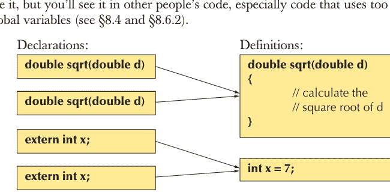

为什么 C++ 同时提供声明和定义？声明与定义的区分反映了我们需要使用某物（接口）与我们需要某物去执行其预期功能（实现）之间的根本区别。对于变量，声明提供类型，但只有定义才提供对象（内存）。对于函数，声明再次提供类型（参数类型加上返回类型），但只有定义才提供函数体（可执行语句）。请注意，函数体作为程序的一部分存储在内存中，因此可以说函数和变量的定义会消耗内存，而声明则不会。

声明/定义的区分允许我们将程序分离成许多部分，这些部分可以单独编译。声明允许程序的每一部分保持对程序其余部分的视图，而无需纠结于其他部分的定义。由于所有声明（包括其中一个定义）必须保持一致，整个程序中名称的使用将保持一致。我们将在 §8.3 中进一步讨论这一点。在这里，我们只是提醒你第 6 章中的表达式解析器：`expression()` 调用 `term()`，而 `term()` 又调用 `primary()`（后者调用 `expression()`）。由于 C++ 程序中的每个名称在使用前都必须声明，我们不可能仅仅定义这三个函数：

```cpp
double expression(); // 只是声明，不是定义

double primary()
{
    // ...
    expression();
    // ...
}

double term()
{
    // ...
    primary();
    // ...
}

double expression()
{
    // ...
    term();
    // ...
}
```

我们可以按任意顺序排列这四个函数；总会有一个调用位于其下方定义的函数。在某个地方，我们需要一个“向前”声明。因此，我们在 `primary()` 的定义之前声明了 `expression()`，一切皆安。这种循环调用模式非常常见。

为什么一个名称在使用前必须被声明？我们不能仅仅要求语言实现读取程序（就像我们这样做的一样）并找到定义来查看函数必须如何被调用吗？我们可以，但这会导致“有趣”的技术问题，所以我们决定不这样做。C++ 的定义要求在使用前声明（类成员除外；见 §9.4.4）。毕竟，这已经是普通（非程序）写作的惯例：当你阅读教科书时，你期望作者在术语使用前先定义术语；否则，你就得猜测或时刻去查索引。“使用前声明”规则简化了人类和编译器的阅读。在程序中，还有一个第二个原因使得“使用前声明”很重要。在一个由成千上万行（也许成千上万行甚至更多）组成的程序中，我们想要调用的大多数函数都定义在“别处”。“别处”往往是一个我们并不真正想了解的地方。只需知道我们使用的声明，就可以节省我们（和编译器）大量阅读程序文本的时间。

### 8.2.1 声明的种类

程序员在 C++ 中可以定义许多种类的实体。最有意思的是

- `变量`
- `常量`
- `函数`（见 §8.5）
- `命名空间`（见 §8.7）
- `类型`（类和枚举；见第 9 章）
- `模板`（见第 19 章）

### 8.2.2 变量和常量声明

变量或常量的声明指定了一个名称、一个类型，以及可选的初始化器。例如：

```cpp
int a;                  // 没有初始化器
double d = 7;           // 使用 = 语法的初始化器
vector<int> vi(10);     // 使用 ( ) 语法的初始化器
vector<int> vi2 {1,2,3,4}; // 使用 { } 语法的初始化器
```

你可以在 ISO C++ 标准中找到完整的语法。

常量具有与变量相同的声明语法。它们的区别在于类型中包含 `const` 并且要求有初始化器：

```cpp
const int x = 7;         // 使用 = 语法的初始化器
const int x2 (9);        // 使用 ( ) 语法的初始化器
const int y;             // 错误：没有初始化器
```

要求 `const` 必须有初始化器的原因显而易见：如果一个 `const` 没有值，它怎能是常量呢？同样，初始化变量也几乎总是一个好主意；未初始化的变量是隐蔽 bug 的配方。例如：

```cpp
void f(int z)
{
    int x;               // 未初始化
    // ... 这里没有对 x 进行赋值 ...
    x = 7;               // 给 x 一个值
    // ...
}
```

这看起来足够无害，但如果第一个 `...` 包含了对 `x` 的使用会怎样？例如：

```cpp
void f(int z)
{
    int x;               // 未初始化
    // ... 这里没有对 x 进行赋值 ...
    if (z > x) {
        // ...
    }
    // ...
    x = 7;               // 给 x 一个值
}
```

由于 `x` 未初始化，执行 `z > x` 将是未定义行为。比较 `z > x` 在不同的机器上以及同一台机器上的不同运行中可能会产生不同的结果。原则上，`z > x` 可能会导致程序因硬件错误而终止，但通常情况并非如此。相反，我们得到的是不可预测的结果。

当然，我们不会故意这样做，但如果我们不一致地初始化变量，最终难免会犯错。请记住，大多数“愚蠢的错误”（例如在变量被赋值前使用未初始化变量）发生在您忙碌或疲劳的时候。编译器会尝试发出警告，但在复杂的代码中——这类错误最可能发生的地方——编译器还不够聪明以捕捉到所有此类错误。有些人不习惯初始化变量，通常是因为他们学习编程的语言不允许或不鼓励一致的初始化；因此你会在别人的代码中看到例子。请不要通过忘记初始化自己定义的变量来加剧这个问题。

我们倾向于使用 `()` 初始化器语法。它是最通用的，并且最明确地表示“初始化器”。除了非常简单的初始化（有时出于旧习惯使用 `=`）和指定向量元素数量（见 §17.4.4）之外，我们倾向于使用 `()`。

### 8.2.3 默认初始化

你可能注意到，我们经常不为字符串、向量等提供初始化器。例如：

```cpp
vector<string> v;
string s;
while (cin >> s) v.push_back(s);
```

这并不违反变量必须在使用前初始化的规则。这里发生的是 `string` 和 `vector` 被定义为，当我们没有显式提供初始化器时，这些类型的变量总是以默认值初始化。因此，在我们到达循环之前，`v` 是空的（它没有元素），而 `s` 是空字符串（`""`）。保证默认初始化的机制称为默认构造函数；见 §9.7.3。

不幸的是，语言不允许我们对内置类型做出这种保证。全局变量（§8.4）默认初始化为 0，但你应该尽量减少全局值的使用。最有用的变量——局部变量和类成员——除非你提供初始化器（或默认构造函数），否则它们是未初始化的。你已被警告过！

## 8.3 头文件

我们如何管理我们的声明和定义？毕竟，它们必须保持一致，而在现实世界的程序中可能有数万条声明；拥有数十万条声明的程序并不罕见。通常，当我们编写程序时，我们使用的大多数定义都不是由我们编写的。例如，`cout` 和 `sqrt()` 的实现是多年前由别人编写的。我们只是使用它们。

管理 C++ 中定义在“别处”的设施声明的关键是头文件。基本上，头文件是一组声明，通常定义在一个文件中，因此头文件也被称为头文件。这样的头文件通过 `#include` 包含在我们的源文件中。例如，我们可能决定通过分离出令牌管理来改进计算器（第 6 章和第 7 章）源代码的组织结构。我们可以定义一个包含使用 `Token` 和 `Token_stream` 所需声明的头文件 `token.h`：

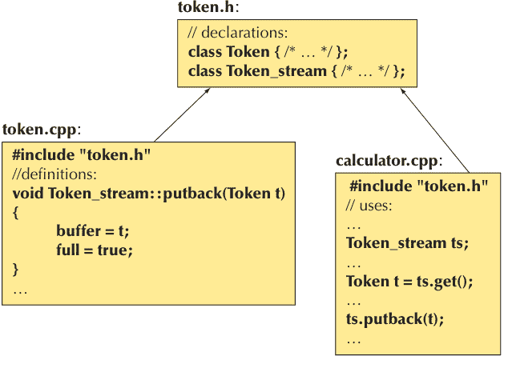

`Token` 和 `Token_stream` 的声明在头文件 `token.h` 中。它们的定义在 `token.cpp` 中。`.h` 后缀是 C++ 头文件中最常见的，而 `.cpp` 后缀是 C++ 源文件中最常见的。实际上，C++ 语言并不关心文件后缀，但某些编译器和大多数程序

开发环境会强制执行，因此请在源代码中使用这种约定。

原则上，`#include "file.h"` 只是将 `file.h` 中的声明在 `#include` 所在的位置复制到你的文件中。例如，我们可以编写一个头文件 `f.h`：

```cpp
// f.h
int f(int);
```

并在我们的文件 `user.cpp` 中包含它：

```cpp
// user.cpp
#include "f.h"
int g(int i)
{
    return f(i);
}
```

在编译 `user.cpp` 时，编译器会执行 `#include` 并编译

```cpp
int f(int);
int g(int i)
{
    return f(i);
}
```

由于 `#includes` 在逻辑上发生在编译器所做的一切之前，处理 `#includes` 是所谓*预处理*（§A.17）的一部分。

为了便于一致性检查，我们在使用其声明的源文件以及提供这些声明定义的源文件中都 `#include` 一个头文件。这样，编译器可以尽早发现错误。例如，想象一下 `Token_stream::putback()` 的实现者犯了错误：

```cpp
Token Token_stream::putback(Token t)
{
    buffer.push_back(t);
    return t;
}
```

这看起来很无害。幸运的是，编译器发现了这些错误，因为它看到了（被 `#include` 的）`Token_stream::putback()` 的声明。将该声明与我们的定义进行比较后，编译器发现 `putback()` 不应该返回一个 `Token`，而且 `buffer` 是一个 `Token`，而不是 `vector<Token>`，所以我们不能使用 `push_back()`。当我们致力于改进代码时，这种错误会发生，但我们没有在整个程序中完全保持一致的更改。

同样，考虑这些错误：

```cpp
Token t = ts.get();    // 错误：没有 get 成员
// ...
ts.putback();          // 错误：缺少参数
```

编译器会立即给出错误；头文件 `token.h` 提供了它进行所需检查的所有信息。

我们的 `std_lib_facilities.h` 头文件包含我们要使用的标准库设施的声明，例如 `cout`、`vector` 和 `sqrt()`，以及几个简单的实用函数，如 `error()`，这些不是标准库的一部分。在 §12.8 中，我们展示了如何直接使用标准库头文件。

一个头文件通常会被包含在许多源文件中。这意味着头文件应仅包含可以在多个文件中重复的声明（例如函数声明、类定义和数值常量的定义）。

## 8.4 作用域

*作用域* 是程序文本的一个区域。名称在作用域中声明，并从其声明点开始有效（“在作用域内”），直到声明它的作用域结束。例如：

```cpp
void f()
{
    g();    // 错误：g() 还（尚未）在作用域内
}

void g()
{
    f();    // 正确：f() 在作用域内
}

void h()
{
    int x = y;    // 错误：y 还（尚未）在作用域内
    int y = x;    // 正确：x 在作用域内
    g();          // 正确：g() 在作用域内
}
```

作用域内的名称可以在嵌套其中的作用域内部看到。例如，`f()` 的调用在“嵌套”于全局作用域中的 `g()` 的作用域内。全局作用域是不嵌套在任何其他作用域中的那个作用域。名称必须在使用前声明的规则仍然成立，因此 `f()` 不能调用 `g()`。

我们有几种类型的作用域，用来控制名称可以使用的位置：

- *全局作用域*：任何其他作用域之外的文本区域
- *命名空间作用域*：嵌套在全局作用域或另一个命名空间中的命名作用域；参见 §8.7
- *类作用域*：类内的文本区域；参见 §9.2
- *局部作用域*：在块或函数参数列表的 `{...}` 大括号之间
- *语句作用域*：例如，在 **for**-语句中

作用域的主要目的是保持名称的局部性，以便它们不会干扰在其他地方声明的名称。例如：

```cpp
void f(int x)  // f 是全局的；x 是 f 的局部变量
{
    int z = x+7;  // z 是局部变量
}

int g(int x)    // g 是全局的；x 是 g 的局部变量
{
    int f = x+2;  // f 是局部变量
    return 2*f;
}
```

或者以图形方式表示：

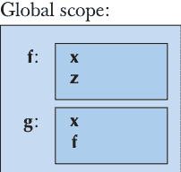

这里 `f()` 的 `x` 与 `g()` 的 `x` 不同。它们不会“冲突”，因为它们不在同一作用域中：`f()` 的 `x` 是 `f` 的局部变量，而 `g()` 的 `x` 是 `g` 的局部变量。同一作用域中的两个不兼容的声明通常被称为*冲突*。同样，在 `g()` 内部定义和使用的 `f` 显然不是函数 `f()`。

这是一个逻辑上等效但更现实的局部作用域使用示例：

```cpp
int max(int a, int b)            // max 是全局的；a 和 b 是局部变量
{
    return (a>=b) ? a : b;
}

int abs(int a)                   // 不是 max() 的 a
{
    return (a<0) ? -a : a;
}
```

你在标准库中会找到 `max()` 和 `abs()`，所以你自己不需要编写它们。`?:` 结构被称为*算术 if* 或*条件表达式*。`(a>=b)?a:b` 的值在 `a>=b` 时为 `a`，否则为 `b`。条件表达式使我们免于编写冗长的代码，如下所示：

```cpp
int max(int a, int b)            // max 是全局的；a 和 b 是局部变量
{
    int m;                       // m 是局部变量
    if (a>=b)
        m = a;
    else
        m = b;
    return m;
}
```

因此，除了全局作用域这一显著例外，作用域使名称保持局部性。对于大多数目的而言，局部性是好的，所以尽可能保持名称的局部性。当我们在函数、类、命名空间等内部声明变量、函数等时，它们不会与你的干涉。请记住：实际的程序有*成千上万* 的命名实体。为了使这样的程序易于管理，大多数名称必须是局部的。

下面是一个较大的技术示例，说明了名称在语句和块（包括函数体）结束时如何退出作用域：

```cpp
// 这里没有 r, l, 或 v
class My_vector {
    vector<int> v;   // v 在类作用域中

public:
    int largest()
    {
        int r = 0;            // r 是局部的（最小非负整数）
        for (int i = 0; i<v.size(); ++i)
            r = max(r,abs(v[i]));  // i 在 for 的语句作用域中
        // 这里没有 i
        return r;
    }
    // 这里没有 r
};
// 这里没有 v

int x;                       // 全局变量 —— 尽可能避免那些
int y;

int f()
{
    int x;                  // 局部变量，隐藏了全局 x
    x = 7;                  // 局部 x
    {
        int x = y;         // 局部 x 由全局 y 初始化，隐藏了之前的局部 x
        ++x;                // 上一行中的 x
    }
    ++x;                    // f() 第一行中的 x
    return x;
}
```

只要你能，避免这种复杂的嵌套和隐藏。记住：“保持简单！”


名称的作用域越大，其名称应该越长、越具有描述性：`x`、`y` 和 `f` 作为全局名称是可怕的。你不希望程序中有一个全局变量的主要原因是很难知道哪些函数修改它们。在大型程序中，基本上不可能知道哪些函数修改一个全局变量。想象一下，你正在调试一个程序，发现一个全局变量有一个意外的值。谁给它那个值？为什么？哪些函数写入那个值？你怎么知道？向该变量写入错误值的函数可能在一个你从未见过的源文件中！一个良好的程序只有很少的（比如说，一两个），如果有的话，全局变量。例如，第 6 章和第 7 章中的计算器有两个全局变量：标记流 `ts` 和符号表 `names`。

请注意，大多数定义作用域的 C++ 结构是嵌套的：

### 类中的函数：成员函数（参见 §9.4.2）

```cpp
class C {
  public:
    void f();
    void g()    // 成员函数可以定义在其类中
    {
      // ...
    }
    // ...
};

void C::f()    // 成员定义可以在其类的外部
{
  // ...
}
```

这是最常见和有用的情况。

### 类中的类：成员类（也称为嵌套类）

```cpp
class C {
  public:
    class M {
      // ...
    };
    // ...
};
```

这往往只在复杂的类中有用；请记住，理想的是保持类小且简单。

### 函数中的类：局部类

```cpp
void f()
{
  class L {
    // ...
  };
  // ...
}
```


避免这个；如果你觉得需要一个局部类，你的函数可能太长了。

## 8.5 函数调用与返回

- 函数内的函数：局部函数（也称为嵌套函数）

```cpp
void f()
{
    void g()    // 非法
    {
        // ...
    }
    // ...
}
```

这在 C++ 中是不合法的；不要这样做。编译器会拒绝它。

- 函数及其他代码块内的块：嵌套代码块

```cpp
void f(int x, int y)
{
    if (x>y) {
        // ...
    }
    else {
        // ...
        {
            // ...
        }
        // ...
    }
}
```

嵌套代码块是不可避免的，但要警惕复杂的嵌套：它很容易隐藏错误。

C++ 还提供了一个专门用于表达作用域的 language 特性，即 `命名空间`；参见 §8.7。

注意我们使用一致的缩进来表示嵌套。如果没有一致的缩进，嵌套结构将变得难以阅读。例如：

```cpp
// 危险且丑陋的代码
struct X {
    void f(int x) {
        struct Y {
            int f() { return 1; } int m;
        };
        int m;
        m=x; Y m2;
return f(m2,f()); }
int m; void g(int m) {
if (m) f(m+2); else {
g(m+2); }
X() { } void m3() {
}
void main() {
X a; a.f(2);}
};
```

难以阅读的代码通常隐藏着 bug。当你使用 IDE 时，它会尝试根据你的代码自动调整缩进（根据某种对“正确”的定义），并且存在“代码美化器”可以为你重新格式化源代码文件（通常提供多种格式选择）。然而，代码可读性的最终责任在于你自己。

函数是我们表示动作和计算的方式。每当我们要做某件值得命名的事情时，我们就编写一个函数。C++ 语言为我们提供了运算符（如 `+` 和 `*`），我们可以用它们在表达式中从操作数生成新值，还提供了语句（如 `for` 和 `if`），我们可以用它们来控制执行顺序。为了组织由这些基本元素构成的代码，我们使用函数。

为了完成其任务，函数通常需要参数，并且许多函数会返回结果。本节重点讨论参数是如何指定和传递的。

### 8.5.1 声明参数和返回类型

函数是我们在 C++ 中用于命名和表示计算及动作的工具。函数声明由返回类型、函数名以及括号中的形式参数列表组成。例如：

```cpp
double fct(int a, double d);            // fct 的声明（无函数体）
double fct(int a, double d) { return a*d; }  // fct 的定义
```

定义包含函数体（即由调用执行的语句），而非定义且非定义的声明只有一个分号。形式参数通常被称为 *参数*。如果你不想让函数接收参数，只需省略形式参数。例如：

```cpp
int current_power();  // current_power 不接收参数
```

如果你不想从函数返回值，请将 `void` 作为其返回类型。例如：

```cpp
void increase_power_to(int level);    // increase_power 不返回值
```

在这里，`void` 意味着“不返回值”或“返回无”。

在声明和定义中，你可以随意命名或不命名参数。例如：

```cpp
// 在 vs 中搜索 s；
// vs[hint] 可能是开始搜索的好地方
// 返回匹配项的索引；–1 表示“未找到”
int my_find(vector<string> vs, string s, int hint); // 命名参数

int my_find(vector<string>, string, int);           // 未命名参数
```

在声明中，形式参数名在逻辑上并非必要，但对于编写良好的注释非常有用。从编译器的角度来看，`my_find()` 的第二个声明与第一个声明一样好：它包含了调用 `my_find()` 所需的所有信息。

通常，我们在定义中为所有参数命名。例如：

```cpp
int my_find(vector<string> vs, string s, int hint)
// 从 hint 开始在 vs 中搜索 s
{
    if (hint<0 || vs.size()<hint) hint = 0;
    for (int i = hint; i<vs.size(); ++i) // 从 hint 开始搜索
        if (vs[i]==s) return i;
    if (0<hint) {                              // 如果没找到 s，则在 hint 之前搜索
        for (int i = 0; i<hint; ++i)
            if (vs[i]==s) return i;
    }
    return -1;
}
```

`hint` 使代码变得相当复杂，但提供 `hint` 背后的想法是假设用户通过大致知道在 `vector` 中哪里能找到 `string` 来有效利用它。然而，想象一下，如果我们使用了 `my_find()` 一段时间后，发现调用者很少能良好地使用 `hint`，以至于它实际上损害了性能。现在我们需要不再使用 `hint`，但外部有很多调用 `my_find()` 并带有 `hint` 的代码。我们不想重写这些代码（或者因为那是别人的代码而无法重写），所以不想更改 `my_find()` 的声明。相反，我们只是不使用最后一个参数。既然我们不使用它，就可以让它不命名：

```cpp
int my_find(vector<string> vs, string s, int)    // 第 3 个参数未使用
{
    for (int i = 0; i<vs.size(); ++i)
        if (vs[i]==s) return i;
    return -1;
}
```

你可以在 ISO C++ 标准中找到函数定义的完整语法。

### 8.5.2 返回值

我们使用 `return` 语句从函数返回值：

```cpp
T f()      // f() 返回一个 T
{
    V v;
    // ...
    return v;
}

T x = f();
```

这里，返回的值正好等于我们使用类型为 V 的值初始化类型为 T 的变量时得到的值：

```cpp
V v;
// ...
T t(v);    // 用 v 初始化 t
```

也就是说，值返回是一种初始化形式。

声明为返回值的函数必须返回值。特别地，“执行完函数末尾”是一个错误：

```cpp
double my_abs(int x)    // 警告：有 bug 的代码
{
    if (x < 0)
        return -x;
    else if (x > 0)
        return x;
}
    // 错误：如果 x 为 0，则没有返回值
```

实际上，编译器可能不会注意到我们“忘记”了 x==0 的情况。原则上它可以做到，但很少有编译器那么聪明。对于复杂的函数，编译器可能无法判断你是否会返回值，所以要小心。这里，“小心”意味着确保对于函数的每一种可能的退出方式，你都有一个 `return` 语句或 `error()`。

由于历史原因，`main()` 是一个特殊情况。执行完 `main()` 底部等同于返回值 0，意味着程序“成功完成”。

在不返回值的函数中，我们可以使用没有值的 `return` 来导致函数返回。例如：

```cpp
void print_until_s(vector<string> v, string quit)
{
    for(string s : v) {
        if (s==quit) return;
        cout << s << "\n";
    }
}
```

如你所见，对于 `void` 函数，“执行完底部”是可以接受的。这等价于 `return;`。

### 8.5.3 按值传递

将参数传递给函数的最简单方法是给函数一个你用作参数的值的副本。函数 `f()` 的参数是 `f()` 中的局部变量，每次调用 `f()` 时都会初始化该变量。例如：

```cpp
// 按值传递（给函数传递值的副本）
int f(int x)
{
    x = x+1;          // 给局部 x 一个新值
    return x;
}

int main()
{
    int xx = 0;
    cout << f(xx) << "\n";  // 打印：1
    cout << xx << "\n";     // 打印：0; f() 没有改变 xx

    int yy = 7;
    cout << f(yy) << '\n';     // 打印：8
    cout << yy << '\n';       // 打印：7; f() 没有改变 yy
}
```

由于传递的是副本，`f()` 中的 `x=x+1` 不会改变两次调用中传入的值 `xx` 和 `yy`。我们可以这样说明按值传递的参数传递：

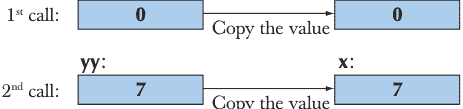

按值传递相当直接，其成本是复制值的成本。

### 8.5.4 按 const 引用传递

当我们传递小值（如 `int`、`double` 或 `Token`（§6.3.2））时，按值传递简单、直接且高效。但如果值很大呢，例如图像（通常有几百万位）、大型值表（比如数千个整数）或长字符串（比如数百个字符）？那时，复制可能代价高昂。我们不应过分关注成本，但做不必要的工作可能会令人尴尬，因为它表明我们没有直接表达我们想要的想法。例如，我们可以编写一个函数来打印浮点数 `vector`，如下所示：

```cpp
void print(vector<double> v)        // 按值传递；合适吗？
{
    cout << "{";
    for (int i = 0; i<v.size(); ++i) {
        cout << v[i];
        if (i!=v.size()-1) cout << ", ";
    }
    cout << "}\n";
}
```

我们可以使用这个 `print()` 来处理所有大小的 `vector`。例如：

```cpp
void f(int x)
{
    vector<double> vd1(10);       // 小 vector
    vector<double> vd2(1000000);  // 大 vector
}
```

```cpp
vector<double> vd3(x);
// fill vd1, vd2, vd3 with values ...
print(vd1);
print(vd2);
print(vd3);
}
```

这段代码可以运行，但 `print()` 的第一次调用需要复制十个 `doubles`（可能为 80 字节），第二次调用需要复制一百万个 `doubles`（可能为 8 兆字节），而我们不知道第三次调用需要复制多少。这里我们必须问自己的问题是：“我们为什么要复制任何内容？” 我们只是想打印 `vectors`，而不是复制它们的元素。显然，必须有一种方法，让我们可以将变量传递给函数而不进行复制。打个比方，如果你被要求列出图书馆的书籍清单，图书管理员不会把图书馆大楼及其所有内容都寄给你；他们会把图书馆的地址发给你，以便你亲自去查看书籍。因此，我们需要一种方式，将 `vector` 的“地址”传递给 `print()` 函数，而不是传递 `vector` 的副本。这种“地址”被称为 `reference`（引用），用法如下：

```cpp
void print(const vector<double>& v)
{
cout << "{";
for (int i = 0; i<v.size(); ++i) {
cout << v[i];
if (i!=v.size()-1) cout << ",";
}
cout << "}\n";
}
```

`&` 表示“引用”，而 `const` 的存在是为了防止 `print()` 意外修改其参数。除了参数声明的变更外，其他一切与之前相同；唯一的改变是，`print()` 不再在副本上操作，而是通过引用指回参数。注意“指回”这一短语；这些参数被称为 `references`（引用），因为它们“指向”在其他地方定义的对象。我们可以像之前一样调用这个 `print()`：

```cpp
void f(int x)
{
vector<double> vd1(10); // small vector
vector<double> vd2(1000000); // large vector
vector<double> vd3(x); // vector of some unknown size
// fill vd1, vd2, vd3 with values ...
    print(vd1);
    print(vd2);
    print(vd3);
}
```

我们可以用图形来展示这一点：

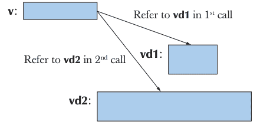

`const` 引用有一个有用的属性，即我们不会意外修改传入的对象。例如，如果我们犯了一个愚蠢的错误，并试图从 `print()` 内部对元素进行赋值，编译器会捕获到它：

```cpp
void print(const vector<double>& v)     // pass-by-const-reference
{
    // . . .
    v[i] = 7;                             // error: v is a const (is not mutable)
    // . . .
}
```

通过 `const` 引用传递是一种有用且流行的机制。再次考虑 `my_find()` 函数（§8.5.1），它在一个 `string`（字符串）的 `vector`（向量）中搜索一个 `string`（字符串）。按值传递可能会带来不必要的开销：

```cpp
int my_find(vector<string> vs, string s);    // pass-by-value: copy
```

如果 `vector` 包含数千个 `strings`，即使在快速计算机上，你也可能会注意到花费的时间。因此，我们可以通过让 `my_find()` 接受 `const` 引用参数来改进它：

```cpp
// pass-by-const-reference: no copy, read-only access
int my_find(const vector<string>& vs, const string& s);
```

### 8.5.5 通过引用传递

但如果我们确实希望函数修改其参数呢？有时，这是一个完全合理的愿望。例如，我们可能希望有一个 `init()` 函数，用于给 `vector` 元素赋值：

```cpp
void init(vector<double>& v)        // pass-by-reference
{
    for (int i = 0; i<v.size(); ++i) v[i]= i;
}

void g(int x)
{
    vector<double> vd1(10);          // small vector
    vector<double> vd2(1000000);     // large vector
    vector<double> vd3(x);           // vector of some unknown size

    init(vd1);
    init(vd2);
    init(vd3);
}
```


在这里，我们希望 `init()` 修改参数 `vector`，因此我们没有复制（没有使用 `pass-by-value` 按值传递）或声明引用为 `const`（没有使用 `pass-by-const-reference` 按常量引用传递），而是简单地向 `vector` 传递了一个“普通引用”。

让我们从更技术性的角度来考虑引用。引用是一种构造，允许用户为对象声明一个新名称。例如，`int&` 是 `int` 的引用，因此我们可以写：

```cpp
int i = 7;

int& r = i;     // r is a reference to i
r = 9;          // i becomes 9
i = 10;
cout << r << ' ' << i << '\n';  // write: 10 10
```

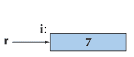

也就是说，对 `r` 的任何使用实际上就是对 `i` 的使用。

引用作为简写可能很有用。例如，我们可能有一个

```cpp
vector<vector<double> > v;    // vector of vector of double
```

我们需要多次引用某个元素 `v[f(x)][g(y)]`。显然，`v[f(x)][g(y)]` 是一个复杂的表达式，我们不希望比必要的时候更频繁地重复它。如果我们只需要它的值，我们可以写：

```cpp
double val = v[f(x)][g(y)]; // val is the value of v[f(x)][g(y)]
```

并反复使用 `val`。但如果我们需要从 `v[f(x)][g(y)]` 读取并向 `v[f(x)][g(y)]` 写入呢？那么，引用就有用了：

```cpp
double& var = v[f(x)][g(y)]; // var is a reference to v[f(x)][g(y)]
```

现在，我们可以通过 `var` 读取和写入 `v[f(x)][g(y)]`。例如：

```cpp
var = var/2 + sqrt(var);
```

引用的这个关键属性，即引用可以是某个对象的便捷简写，正是它作为参数有用的原因。例如：

```cpp
// pass-by-reference (let the function refer back to the variable passed)
int f(int& x)
{
    x = x + 1;
    return x;
}
int main()
{
    int xx = 0;
    cout << f(xx) << "\n"; // write: 1
    cout << xx << "\n"; // write: 1; f() changed the value of xx
    int yy = 7;
    cout << f(yy) << "\n"; // write: 8
    cout << yy << "\n"; // write: 8; f() changed the value of yy
}
```

我们可以像这样通过图形展示通过引用传递参数的过程：

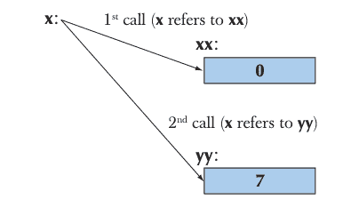

将此与 §8.5.3 中的类似示例进行比较。

通过引用传递显然是一个非常强大的机制：我们可以让函数直接操作我们传入引用的任何对象。例如，交换两个值在许多算法中（如排序）中是一项极其重要的操作。使用引用，我们可以编写一个交换 *doubles* 的函数如下：

```cpp
void swap(double& d1, double& d2)
{
    double temp = d1;     // copy d1's value to temp
    d1 = d2;              // copy d2's value to d1
    d2 = temp;            // copy d1's old value to d2
}

int main()
{
    double x = 1;
    double y = 2;
    cout << "x== " << x << " y== " << y << '\n';    // write: x==1 y==2
    swap(x,y);
    cout << "x== " << x << " y== " << y << '\n';    // write: x==2 y==1
}
```

标准库为每种可复制类型都提供了 `swap()`，因此你不需要为每种类型自己编写 `swap()`。

### 8.5.6 按值传递与按引用传递

什么时候应该使用按值传递、按引用传递和按 `const` 引用传递？首先考虑一个技术示例：

```cpp
void f(int a, int& r, const int& cr)
{
    ++a;     // change the local a
    ++r;     // change the object referred to by r
    ++cr;    // error: cr is const
}
```

如果你想改变传入对象的值，你必须使用非 `const` 引用：按值传递给你一个副本，而按 `const` 引用传递会阻止你改变传入对象的值。因此我们可以尝试

```cpp
void g(int a, int& r, const int& cr)
{
	++a;		// change the local a
	++r;		// change the object referred to by r
	int x = cr;	// read the object referred to by cr
}

int main()
{
	int x = 0;
	int y = 0;
	int z = 0;

	g(x, y, z);	// x==0; y==1; z==0
	g(1, 2, 3);	// error: reference argument r needs a variable to refer to
	g(1, y, 3);	// OK: since cr is const we can pass a literal
}
```

因此，如果你想改变通过引用传递的对象的值，你必须传递一个对象。从技术上讲，整数字面量 `2` 只是一个值（右值），而不是一个持有值的对象。`g()` 的参数 `r` 需要的是一个左值，即可以出现在赋值语句左侧的东西。

请注意，`const` 引用不需要左值。它可以执行与初始化或按值传递完全相同的转换。基本上，在最后一次调用 `g(1, y, 3)` 中发生的事情是，编译器为 `g()` 的参数 `cr` 预留了一个 `int` 供其引用：

```cpp
g(1, y, 3);	// means: int __compiler_generated = 3; g(1, y, __compiler_generated)
```

这种由编译器生成的对象被称为 `temporary object`（临时对象）或简称为 `temporary`（临时变量）。

我们的经验法则是：

- 使用按值传递来传递非常小的对象。
- 使用按 `const` 引用传递来传递不需要修改的大型对象。
- 返回结果，而不是通过引用参数修改对象。
- 仅在必要时使用按引用传递。

这些规则能产生最简单、最不易出错且最高效的代码。这里的“非常小”指的是一两个 `int`，一两个 `double`，或者类似的情况。如果我们看到一个通过非-`const` 引用传递的参数，我们必须假设被调用的函数会修改该参数。

第三条规则反映了当使用函数来修改变量的值时，你有多种选择。考虑以下示例：

```cpp
int incr1(int a) { return a+1; }  // 返回新值作为结果
void incr2(int& a) { ++a; }        // 修改作为引用传递的对象

int x = 7;
x = incr1(x);                      // 相当直观
incr2(x);                          // 相当晦涩
```

我们为什么有时会使用非-`const` 引数？偶尔，它们是不可或缺的：

- 用于操作容器（例如，`vector`）和其他大型对象
- 用于修改多个对象的函数（我们只能有一个返回值）

例如：

```cpp
void larger(vector<int>& v1, vector<int>& v2)
    // 使 v1 中的每个元素成为 v1 和 v2 中对应元素的较大值；
    // 同样，使 v2 中的每个元素成为较小值
{
    if (v1.size()!=v2.size()) error("larger(): different sizes");
    for (int i=0; i<v1.size(); ++i)
        if (v1[i]<v2[i])
            swap(v1[i],v2[i]);
}

void f()
{
    vector<int> vx;
    vector<int> vy;
    // 从输入读取 vx 和 vy
    larger(vx,vy);
    // ...
}
```

对于像 `larger()` 这样的函数，使用引用传递参数是唯一合理的选择。

通常最好避免那些修改多个对象的函数。从理论上讲，总有替代方案，例如返回一个持有多个值的类对象。然而，现实中有很多程序是用修改一个或多个参数的函数来编写的，因此你很可能会遇到它们。例如，在 Fortran 中——这种用于数值计算的主要编程语言已有约 50 年历史——所有参数传统上都是通过引用传递的。许多数值程序员会复制 Fortran 的设计并调用用 Fortran 编写的函数。此类代码通常使用引用传递或 const 引用传递。

如果我们使用引用仅仅是为了避免拷贝，我们会使用 const 引用。因此，当我们看到一个非 const 引用参数时，我们假设函数会改变其参数的值；也就是说，当我们看到一个通过非 const 引用传递的情况时，我们不仅假设该函数可以修改传入的参数，而且它确实会这样做，因此我们必须格外仔细地检查调用，以确保其执行了我们预期的操作。

### 8.5.7 参数检查与转换

传递一个参数是用调用中指定的实际参数来初始化函数的形式参数。考虑以下情况：

```cpp
void f(T x);
f(y);
T x = y;     // 用 y 初始化 x（参见 §8.2.2）
```

只要初始化语句 `T x=y;` 是合法的，调用 `f(y)` 就是合法的，并且当它是合法时，两个 x 获得相同的值。例如：

```cpp
void f(double x);

void g(int y)
{
    f(y);
    double x = y;    // 用 y 初始化 x（参见 §8.2.2）
}
```

注意，为了用 y 初始化 x，我们必须将一个 int 转换为 double。在调用 `f()` 时也会发生同样的情况。`f()` 接收到的 double 值与存储在 x 中的值相同。

转换通常很有用，但偶尔也会产生令人惊讶的结果（参见 §3.9.2）。因此，我们必须谨慎对待它们。将一个 double 作为参数传递给需要 int 的函数很少是个好主意：

```cpp
void ff(int x);

void gg(double y)
{
    ff(y);    // 你怎么知道这是否有意义？
    int x = y; // 你怎么知道这是否有意义？
}
```

如果你确实有意将一个 `double` 值截断为 `int`，请明确说明：

```cpp
void ggg(double x)
{
    int x1 = x;                        // 截断 x
    int x2 = int(x);
    int x3 = static_cast<int>(x);     // 非常明确的转换（§17.8）

    ff(x1);
    ff(x2);
    ff(x3);

    ff(x);                             // 截断 x
    ff(int(x));
    ff(static_cast<int>(x));          // 非常明确的转换（§17.8）
}
```

这样一来，下一个查看此代码的程序员就能看到你对这个问题进行了思考。

### 8.5.8 函数调用实现

但计算机究竟是如何执行函数调用的呢？第 6 章和第 7 章中的 `expression()`、`term()` 和 `primary()` 函数非常适合说明这一点，除了一个细节：它们不接收任何参数，因此我们不能用它们来解释参数是如何传递的。但是等等！它们*必须*接收一些输入；如果没有输入，它们就无法做任何有用的事情。它们确实接收了一个隐含参数：它们使用一个名为 `ts` 的 `Token_stream` 来获取输入；`ts` 是一个全局变量。这有点不光彩。我们可以通过让这些函数接收一个 `Token_stream&` 参数来改进它们。下面是添加了 `Token_stream&` 参数并删除了与函数调用实现无关内容的版本。

首先，`expression()` 完全 straightforward；它有一个参数（`ts`）和两个局部变量（`left` 和 `t`）：

```cpp
double expression(Token_stream& ts)
{
    double left = term(ts);
    Token t = ts.get();
    // ...
}
```

其次，`term()` 很像 `expression()`，只是多了一个局部变量（`d`），用于存储除号‘/’运算的结果：

```cpp
double term(Token_stream& ts)
{
    double left = primary(ts);
    Token t = ts.get();
    // ...
        case '/':
        {
            double d = primary(ts);
            // ...
        }
    // ...
}
```

第三，`primary()` 很像 `term()`，只是没有局部变量 `left`：

```cpp
double primary(Token_stream& ts)
{
    Token t = ts.get();
    switch (t.kind) {
        case '(':
        {   double d = expression(ts);
            // ...
        }
        // ...
    }
}
```

现在它们不再使用任何“不光彩的全局变量”，非常适合我们的说明：它们有参数，有局部变量，并且相互调用。

你可能想借此机会复习一下完整的 `expression()`、`term()` 和 `primary()` 的样子，但就函数调用而言，关键特征已在此展示。

当一个函数被调用时，语言实现会分配一个包含其所有参数和局部变量副本的数据结构。例如，当第一次调用 `expression()` 时，编译器确保创建了类似以下的结构：

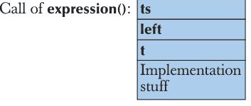

“实现细节”因实现而异，但这基本上就是函数返回给调用者并向调用者返回值所需的信息。这样的数据结构被称为*函数激活记录*（function activation record），每个函数都有其激活记录的详细布局。请注意，从实现的角度来看，参数只是另一个局部变量。

目前一切良好，现在 `expression()` 调用 `term()`，因此编译器确保为这次 `term()` 调用生成了一个激活记录：

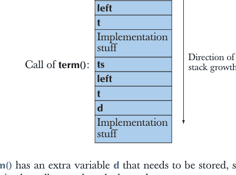

注意，`term()` 有一个额外的变量 `d` 需要存储，因此即使代码可能从未使用它，我们也会在调用中为其预留空间。这没问题。对于合理的函数（如我们在本书中直接或间接使用的每个函数），建立函数激活记录的运行时成本与其大小无关。局部变量 `d` 只有在执行其 `case '/'` 时才会被初始化。

现在 `term()` 调用 `primary()`，我们得到：

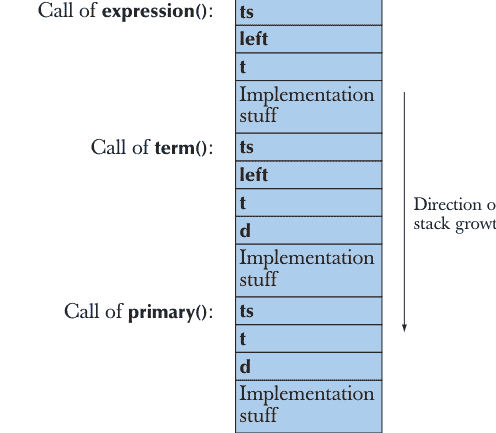

这开始变得有点重复了，但现在 `primary()` 调用 `expression()`：

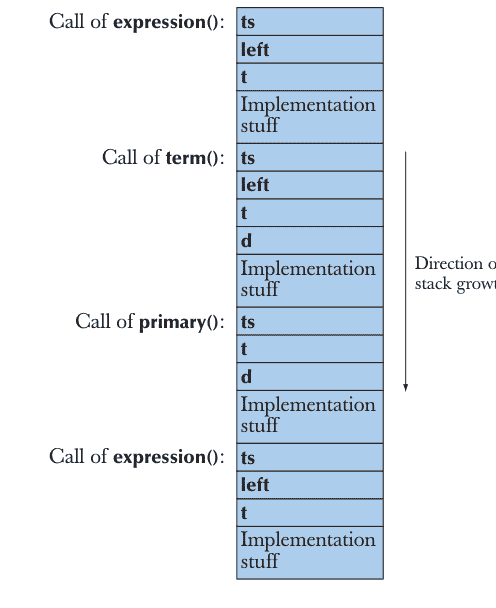

因此，这次对 `expression()` 的调用拥有自己的**激活记录**，与第一次调用 `expression()` 不同。这是好事，否则局面将非常混乱，因为在这两次调用中，`left` 和 `t` 的值是不同的。一个直接或间接（如此处）调用自身的函数被称为*递归*函数。正如你所见，递归函数是自然地从我们用于函数调用和返回的实现技术中衍生出来的（反之亦然）。

因此，每次调用一个函数时，*激活记录栈*（通常简称为*栈*）都会增加一条记录。相反地，当函数返回时，其记录将不再被使用。例如，当最后一次调用 `expression()` 返回到 `primary()` 时，栈将恢复为如下状态：

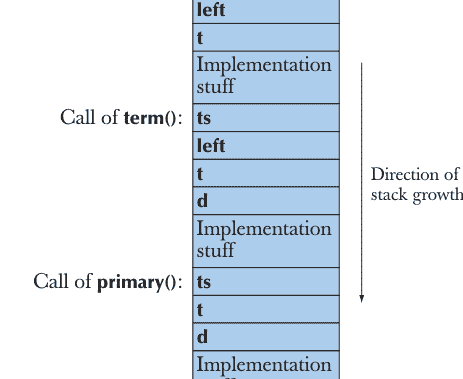

当该次调用 `primary()` 返回到 `term()` 时，我们回到

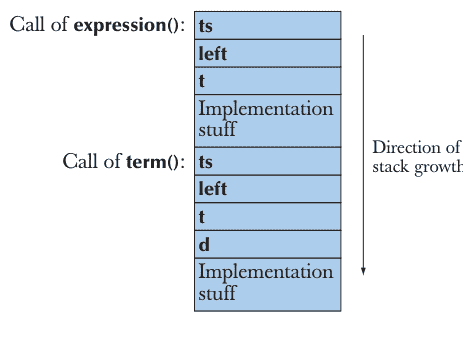


以此类推。栈，也称为*调用栈*，是一种数据结构，它在根据“后进先出”规则在某一端增长和收缩。

请记住，调用栈如何实现和使用，细节因 C++ 实现而异，但基本原理如前所述。你需要了解函数调用是如何实现的才能使用它们吗？当然不需要；在这个实现小节之前，你已经做得足够好了。但许多程序员希望了解这些细节，并且许多人会使用“激活记录”和“调用栈”这样的短语，所以了解它们的含义会更好。

### 8.5.9 constexpr 函数

函数代表一种计算，有时我们希望在编译时执行计算。希望编译器评估计算的原因通常是避免在运行时对同一计算进行数百万次重复。我们使用函数使我们的计算更易懂，因此自然有时希望在常量表达式中使用函数。我们通过声明函数为 `constexpr` 来表达我们意图让编译器在编译时评估该函数。如果给定常量表达式作为参数，`constexpr` 函数可以由编译器评估。例如：

```cpp
constexpr double xscale = 10;   // scaling factors
constexpr double yscale = 0.8;

constexpr Point scale(Point p) { return {xscale*p.x, yscale*p.y}; };
```

假设 `Point` 是一个简单的结构体，成员 `x` 和 `y` 代表 2D 坐标。现在，当我们给 `scale()` 一个 `Point` 参数时，它返回一个 `Point`，其坐标根据因子 `xscale` 和 `yscale` 进行缩放。例如：

```cpp
void user(Point p1)
{
    constexpr Point p2 {10,10};

    Point p3 = scale(p1);    // OK: p3 == {100,8}; run-time evaluation is fine
    constexpr Point p4 = scale(p2);  // p4 == {100,8}

    constexpr Point p5 = scale(p1);  // error: scale(p1) is not a constant
                                     // expression
    constexpr Point p6 = scale(p2);  // p6 == {100,8}

    // ...
}
```

一个 `constexpr` 函数的行为与普通函数完全相同，直到你在需要常量的地方使用它。然后，前提是它的参数是常量表达式（例如 `p2`），它将在编译时计算；如果参数不是常量表达式（例如 `p1`），则会产生错误。为了实现这一点，`constexpr` 函数必须足够简单，以便编译器（每个符合标准的编译器）都能评估它。在 C++11 中，这意味着 `constexpr` 函数必须有一个由单个 `return` 语句组成的函数体（如 `scale()`）；在 C++14 中，我们还可以编写简单的循环。`constexpr` 函数不能有副作用；也就是说，除了它被赋值或用于初始化的变量外，它不能改变其自身函数体之外变量的值。

这里是一个违反简洁性规则的函数示例：

```cpp
int glob = 9;

constexpr void bad(int & arg)    // error: no return value
{
    ++arg;                        // error: modifies caller through argument
    glob = 7;                     // error: modifies nonlocal variable
}
```

如果编译器无法确定一个 `constexpr` 函数“足够简单”（根据标准中的详细规则），该函数将被视为错误。

### 8.6 求值顺序

程序的求值——也称为程序的执行——根据语言规则通过语句进行。当这个“执行线程”到达变量的定义时，变量被构造；也就是说，为对象预留内存并初始化对象。当变量离开作用域时，变量被销毁；也就是说，它引用的对象原则上被移除，编译器可以将其内存用于其他用途。例如：

```cpp
string program_name = "silly";
vector<string> v;                    // v is global

void f()
{
    string s;                            // s is local to f
    while (cin>>s && s!="quit") {
        string stripped;                 // stripped is local to the loop
        string not_letters;
        for (int i=0; i<s.size(); ++i)    // i has statement scope
            if (isalpha(s[i]))
                stripped += s[i];
            else
                not_letters += s[i];
        v.push_back(stripped);
        // ...
    }
    // ...
}
```

全局变量，如 `program_name` 和 `v`，在 `main()` 的第一条语句执行之前初始化。它们“存活”直到程序终止，然后被销毁。它们按照定义顺序构造（即 `program_name` 在 `v` 之前），并按照相反顺序销毁（即 `v` 在 `program_name` 之前）。

当有人调用 `f()` 时，首先构造 `s`；也就是说，`s` 被初始化为空字符串。它将存活直到我们从 `f()` 返回。

每次进入作为 `while` 语句主体的块时，`stripped` 和 `not_letters` 被构造。由于 `stripped` 定义在 `not_letters` 之前，`stripped` 在 `not_letters` 之前构造。它们存活到循环结束，在重新评估条件之前，按照与构造相反的顺序销毁（即 `not_letters` 在 `stripped` 之前）。因此，如果在我们遇到字符串 `quit` 之前看到十个字符串，`stripped` 和 `not_letters` 将各自被构造和销毁十次。

每次到达 `for` 语句时，`i` 被构造。每次退出 `for` 语句时，在到达 `v.push_back(stripped);` 语句之前，`i` 被销毁。

请注意，编译器（和链接器）是聪明的野兽，它们被允许——并且确实——只要结果与我们在此描述的结果等价，就对代码进行优化。特别是，编译器非常擅长避免比实际必要的更频繁地分配和释放内存。

#### 8.6.1 表达式求值

子表达式的求值顺序由旨在取悦优化器而非为程序员简化生活的规则所控制。这是不幸的，但无论如何，你都应该避免复杂的表达式，并且有一条简单的规则可以让你免于麻烦：如果在表达式中改变变量的值，不要在同一表达式中两次读取或写入它。例如：

```cpp
v[i] = ++i;            // don’t: undefined order of evaluation
v[++i] = i;            // don’t: undefined order of evaluation
int x = ++i + ++i;     // don't: undefined order of evaluation
cout << ++i << i << i << '\n'; // don't: undefined order of evaluation
f(++i,++i);            // don't: undefined order of evaluation
```

不幸的是，并非所有编译器在你编写这样的坏代码时都会发出警告；这是坏的，因为如果你将代码移动到另一台计算机，使用不同的编译器，或使用不同的优化器设置，你不能依赖结果相同。编译器在这种代码上确实存在差异；只要别这样做。

特别要注意，`=`（赋值）在表达式中仅被视为另一个运算符，因此不保证赋值的左侧在右侧之前求值。这就是为什么 `v[++i] = i` 是未定义的。

#### 8.6.2 全局初始化

单个翻译单元中的全局变量（和命名空间变量；见 §8.7）按照它们出现的顺序初始化。例如：

```cpp
// file f1.cpp
int x1 = 1;
int y1 = x1+2;               // y1 becomes 3
```

从逻辑上讲，此初始化发生在“main() 中的代码执行之前”。

除最有限的环境外，使用全局变量通常不是一个好主意。我们已经提到过程序员没有真正有效的方法来知道大型程序中哪些部分读取和/或写入全局变量的问题（§8.4）。另一个问题是，不同翻译单元中全局变量的初始化顺序未定义。例如：

```cpp
// file f2.cpp
extern int y1;
int y2 = y1+2;               // y2 becomes 2 or 5
```

由于多种原因，应避免此类代码：它使用全局变量，它给全局变量取短名，并且它使用全局变量的复杂初始化。如果文件 `f1.cpp` 中的全局变量先于文件 `f2.cpp` 中的全局变量初始化，`y2` 将被初始化为 5（这是程序员可能天真且合理地预期的）。然而，如果文件 `f2.cpp` 中的全局变量先于文件 `f1.cpp` 中的全局变量初始化，`y2` 将被初始化为 2（因为用于全局变量的内存在进行复杂初始化尝试之前被初始化为 0）。避免此类代码，并在看到具有非平凡初始值的全局变量时要非常警惕；认为任何不是常量表达式的初始值都是复杂的。

但如果你真的需要一个具有复杂初始化器的全局变量（或常量）该怎么办？一个合理的例子是，我们想为支持商业交易的库提供一个**Date**类型的默认值：

```cpp
const Date default_date(1970,1,1);    // 默认日期是 1970 年 1 月 1 日
```

我们如何知道 **default_date** 在初始化之前从未被使用过？基本上，我们无法知道，因此我们不应该编写该定义。我们最常使用的技术是调用一个返回该值的函数。例如：

```cpp
const Date default_date()                     // 返回默认日期
{
    return Date(1970,1,1);
}
```

这会在每次调用 **default_date()** 时构造 **Date**。这通常没问题，但如果 **default_date()** 被频繁调用且构造 **Date** 开销很大，我们可能希望只构造一次 **Date**。这样实现：

```cpp
const Date& default_date()
{
    static const Date dd(1970,1,1);    // 首次进入时初始化 dd
    return dd;
}
```

**static** 局部变量仅在其函数首次被调用时进行初始化（构造）。注意，我们返回引用以消除不必要的复制，特别是，我们返回 **const** 引用以防止调用函数意外修改该值。关于如何传递参数的论点（§8.5.6）也适用于返回值。

## 8.7 命名空间

我们使用块来组织函数内部的代码（§8.4）。我们使用类将函数、数据和类型组织成一种类型（第 9 章）。函数和类都为我们做两件事：

- 它们允许我们定义若干“实体”，而不用担心它们的名称与程序中的其他名称发生冲突。

- 它们为我们提供一个名称，用于引用我们定义的内容。

目前我们缺少的是某种机制，用于将类、函数、数据和类型组织成程序中可识别且命名的部分，而无需定义类型。用于此类声明分组的语言机制是*命名空间*。例如，我们可能希望提供一个图形库，其中包含名为 **Color**、**Shape**、**Line**、**Function** 和 **Text** 的类（参见第 13 章）：

```cpp
namespace Graph_lib {
    struct Color { /* . . . */ };
    struct Shape { /* . . . */ };
    struct Line : Shape { /* . . . */ };
    struct Function : Shape { /* . . . */ };
    struct Text : Shape { /* . . . */ };
    // . . .
    int gui_main() { /* . . . */ }
}
```

很可能世界上其他人已经使用过这些名称，但现在这并不重要。你定义了一个名为 **Text** 的东西，但我们的 **Text** 不会与之冲突。**Graph_lib::Text** 是我们的类之一，而你的 **Text** 不是。只有当你有一个名为 **Graph_lib** 的类或命名空间，并且其成员中有 **Text** 时，我们才会有问题。**Graph_lib** 是一个稍显丑陋的名称；我们选择它是因为“漂亮且明显”的名称 **Graphics** 更有可能已在某处被使用。

假设你的 **Text** 是文本处理库的一部分。让我们将图形设施放入命名空间 **Graph_lib** 的相同逻辑，也应该让你将你的文本处理设施放入一个类似 **TextLib** 的命名空间中：

```cpp
namespace TextLib {
    class Text { /* . . . */ };
    class Glyph { /* . . . */ };
    class Line { /* . . . */ };
    // . . .
}
```

如果我们俩都使用全局命名空间，我们可能会陷入真正的麻烦。试图同时使用我们两个库的人将在 **Text** 和 **Line** 上遇到严重的名称冲突。更糟糕的是，如果我们俩都有库的用户，我们将无法更改像 **Line** 和 **Text** 这样的名称以避免冲突。我们通过使用命名空间避免了这个问题；也就是说，我们的 **Text** 是 **Graph_lib::Text**，而你的 **Text** 是 **TextLib::Text**。由命名空间名称（或类名称）和成员名称通过 `::` 组合而成的名称被称为*完全限定名称*。

### 8.7.1 **using** 声明和 **using** 指令

编写完全限定名称可能很繁琐。例如，C++ 标准库的设施定义在命名空间 **std** 中，可以这样使用：

```cpp
#include<string>        // 获取 string 库
#include<iostream>      // 获取 iostream 库

int main()
{
    std::string name;
    std::cout << "Please enter your first name\n";
    std::cin >> name;
    std::cout << "Hello, " << name << "\n";
}
```

在数千次见过标准库的 **string** 和 **cout** 之后，我们真的不希望每次都通过它们的“正式”完全限定名称 **std::string** 和 **std::cout** 来引用它们。一种解决方案是说“通过 **string**，我指的是 **std::string**”，“通过 **cout**，我指的是 **std::cout**”，等等：

```cpp
using std::string;    // string 意思是 std::string
using std::cout;      // cout 意思是 std::cout
// . . .
```

这种构造被称为 **using** 声明；它是编程中相当于当房间里没有其他 Greg 时，使用普通的“Greg”来指代 Greg Hansen 的等价物。

有时，我们更喜欢对使用命名空间中的名称使用更强的“简写”：“如果你在这个作用域中找不到某个名称的声明，请在 **std.** 中查找。” 表达这一点的方式是使用 **using** 指令：

```cpp
using namespace std;  // 使 std 中的名称直接可访问
```

因此我们得到这种常见风格：

```cpp
#include<string>        // 获取 string 库
#include<iostream>      // 获取 iostream 库
using namespace std;    // 使 std 中的名称直接可访问

int main()
{
    string name;
    cout<< "Please enter your first name\n";
    cin >> name;
    cout << "Hello, " << name << '\n';
}
```

这里的 `cin` 是 `std::cin`，`string` 是 `std::string`，等等。只要你使用 `std_lib_facilities.h`，你就不必担心标准头文件和 `std` 命名空间。

通常，避免对除 `std` 这类在应用领域极其知名的命名空间之外的任何命名空间使用 `using` 指令是个好主意。过度使用 `using` 指令的问题在于你会失去对哪些名称来自何处的跟踪，从而再次开始出现名称冲突。通过命名空间名称和 `using` 声明进行显式限定不会受到该问题的影响。因此，在头文件中放置 `using` 指令（以便用户无法避免它）是一个坏习惯。然而，为了简化我们的初始代码，我们在 `std_lib_facilities.h` 中为 `std` 放置了一个 `using` 指令。这使我们能够编写


```cpp
#include "std_lib_facilities.h"

int main()
{
    string name;
    cout << "Please enter your first name\n";
    cin >> name;
    cout << "Hello, " << name << '\n';
}
```

我们承诺除了 `std` 之外，从不为任何命名空间这样做。

## 练习

1. 创建三个文件：`my.h`、`my.cpp` 和 `use.cpp`。头文件 `my.h` 包含

```cpp
extern int foo;
void print_foo();
void print(int);
```

源代码文件 `my.cpp` `#include` `my.h` 和 `std_lib_facilities.h`，定义 `print_foo()` 使用 `cout` 打印 `foo` 的值，定义 `print(int i)` 使用 `cout` 打印 `i` 的值。

源代码文件 `use.cpp` `#include` `my.h`，定义 `main()` 将 `foo` 的值设置为 7 并使用 `print_foo()` 打印它，并使用 `print()` 打印值 **99**。注意 **use.cpp** 没有 **#include std_lib_facilities.h**，因为它不直接使用其中的任何设施。

让这些文件编译并运行。在 Windows 上，你需要在项目中同时包含 **use.cpp** 和 **my.cpp**，并在 **use.cpp** 中使用 `{ char cc; cin>>cc; }` 才能看到你的输出。提示：要使用 `cin`，你需要 **#include <iostream>**。

2. 编写三个函数 `swap_v(int,int)`、`swap_r(int&,int&)` 和 `swap_cr(const int&, const int&)`。每个函数都应该有如下函数体

```cpp
{ int temp; temp = a, a=b; b=temp; }
```

其中 **a** 和 **b** 是参数的名称。

尝试按以下方式调用每个交换函数

```cpp
int x = 7;
int y = 9;
swap_? (x,y);             // 用 v、r 或 cr 替换 ?
swap_? (7,9);
const int cx = 7;
const int cy = 9;
swap_? (cx,cy);
swap_? (7.7,9.9);
double dx = 7.7;
double dy = 9.9;
swap_? (dx,dy);
swap_? (7.7,9.9);
```

哪些函数和调用编译成功，为什么？在每个成功编译的交换后，打印调用后参数的值，看看它们是否真的被交换了。如果你对结果感到惊讶，请查阅 §8.6。

3. 编写一个使用单文件并包含三个命名空间 **X**、**Y** 和 **Z** 的程序，使以下 `main()` 正常工作：

```cpp
int main()
{
    X::var = 7;
    X::print();          // 打印 X 的 var
    using namespace Y;
    var = 9;
    print();              // 打印 Y 的 var
    {       using Z::var;
            using Z::print;
            var = 11;
            print();      // 打印 Z 的 var
    }
}
```

print();            // 打印 Y 的变量

X::print();          // 打印 X 的变量

}

每个命名空间都需要定义一个名为 **var** 的变量和一个名为 **print()** 的函数，该函数使用 **cout** 输出相应的 **var**。

## 复习

- 1. 声明和定义有什么区别？
- 2. 我们在语法上如何区分函数声明和函数定义？
- 3. 我们在语法上如何区分变量声明和变量定义？
- 4. 为什么你不能直接在第 6 章的计算器程序中使用那些函数，而不先声明它们？
- 5. **int a**; 是定义还是仅仅是声明？
- 6. 为什么在声明变量时对其进行初始化是个好主意？
- 7. 函数声明可以包含什么？
- 8. 缩进有什么好处？
- 9. 头文件有什么用？
- 10. 声明的作用域是什么？
- 11. 有哪些类型的作用域？请举例说明每种类型。
- 12. 类作用域和局部作用域有什么区别？
- 13. 为什么程序员应该尽量减少全局变量的数量？
- 14. 传值和传引用有什么区别？
- 15. 传引用和传常量引用有什么区别？
- 16. 什么是 **swap()**？
- 17. 你是否会为 **<vector<double>>** 按值传递参数来定义一个函数？
- 18. 举一个求值顺序未定义的例子。为什么求值顺序未定义可能成为一个问题？
- 19. **x&&y** 和 **x|y** 分别代表什么含义？
- 20. 以下哪些是符合标准的 C++：函数中包含函数、类中包含函数、类中包含类、函数中包含类？
- 21. 栈帧（活动记录）中放的是什么？
- 22. 调用栈是什么，为什么我们需要它？
- 23. 命名空间的目的是什么？
- 24. 命名空间和类有什么区别？
- 25. 什么是 **using** 声明？
- 26. 为什么你应该避免在头文件中使用 **using** 指令？
- 27. 命名空间 **std** 是什么？

## 术语

| 列 1 | 列 2 | 列 3 |
|---|---|---|
| 栈帧（活动记录） | 函数 | 传引用 |
| 实参 | 函数定义 | 传值 |
| 实参传递 | 全局作用域 | 递归 |
| 调用栈 | 头文件 | **return** |
| 类作用域 | 初始化器 | 返回值 |
| **const** | 局部作用域 | 作用域 |
| **constexpr** | **namespace**（命名空间） | 语句作用域 |
| 声明 | 命名空间作用域 | 技术细节 |
| 定义 | 嵌套块 | 未声明标识符 |
| **extern** | 形参 | **using** 声明 |
| 前向声明 | 传 **const** 引用 | **using** 指令 |

## 练习

- 1. 修改第 7 章中的计算器程序，使输入流成为一个显式的参数（如 §8.5.8 所示），而不是简单地使用 **cin**。此外，为 **Token_stream** 构造函数（§7.8.2）添加一个 **istream&** 参数，这样当我们学会如何创建自己的 **istream**（例如，附着在文件上）时，我们就可以将这些计算器用于这些流。提示：不要尝试复制 **istream**。
- 2. 编写一个函数 **print()**，将 **int** 的 **vector** 打印到 **cout**。给它两个参数：一个用于“标记”输出的 **string** 和一个 **vector**。
- 3. 创建一个斐波那契数的 **vector** 并使用练习 2 中的函数打印它们。要创建 **vector**，请编写一个函数 **fibonacci(x,y,v,n)**，其中整数 **x** 和 **y** 是 **int**，**v** 是一个空的 **vector<int>**，而 **n** 是要放入 **v** 的元素数量；**v[0]** 将是 **x**，**v[1]** 将是 **y**。斐波那契数是序列的一部分，其中每个元素是前两个元素的和。例如，从 1 和 2 开始，我们得到 1, 2, 3, 5, 8, 13, 21, …。你的 **fibonacci()** 函数应该生成这样一个以其 **x** 和 **y** 参数开始的序列。
- 4. **int** 只能保存最大整数。通过使用 **fibonacci()** 找到该最大数的近似值。
- 5. 编写两个函数来反转 **vector<int>** 中元素的顺序。例如，1, 3, 5, 7, 9 变为 9, 7, 5, 3, 1。第一个反转函数应该生成一个新的 **vector**，其中包含反转的序列，并保持其原始 **vector** 不变。另一个反转函数应该在不使用其他 **vector** 的情况下反转其 **vector** 的元素（提示：**swap**）。
- 6. 编写练习 5 中函数的版本，但使用 **vector<string>**。
- 7. 将五个名字读入 **vector<string> name**，然后提示用户输入这些人的年龄，并将它们存储在 **vector<double> age** 中。然后打印出五对 (**name[i],age[i]**)。对名字进行排序 (**sort(name.begin(),name.end())**) 并打印出 (**name[i],age[i]**) 对。这里的难点在于使 **age vector** 保持正确的顺序以匹配排序后的 **name vector**。提示：在对 **name** 进行排序之前，复制一份并使用它来在对 **name** 排序后以正确的顺序复制 **age**。
- 8. 然后，再次进行该练习，但允许任意数量的名字。
- 9. 编写一个函数，给定两个 **vector<double>** **price** 和 **weight**，计算一个值（一个“指数”），即所有 **price[i]*weight[i]** 的和。确保 **weight.size()==price.size()**。
- 10. 编写一个函数 **maxv()**，返回 **vector** 实参中最大的元素。
- 11. 编写一个函数，找到 **vector** 实参中最小和最大的元素，并计算平均值和中位数。不要使用全局变量。返回一个包含结果的 **struct**，或者通过引用参数返回它们。你更喜欢这两种返回多个结果值的方式中的哪一种，为什么？
- 12. 改进 §8.5.2 中的 **print_until_s1()**。测试它。什么构成一个好的测试用例集？给出理由。然后，编写一个 **print_until_s2()**，它打印内容直到它看到其 **quit** 参数的第二次出现。
- 13. 编写一个函数，接受 **vector<string>** 实参并返回一个包含每个 **string** 中字符数的 **vector<int>**。还要找到最长和最短的 **string** 以及字典序第一和最后一个 **string**。你会使用多少个单独的函数来执行这些任务？为什么？
- 14. 我们可以声明非引用函数实参为 **const** 吗（例如，**void f(const int)**）？这可能意味着什么？我们为什么要这样做？为什么人们不经常这样做？试一试；编写一些小程序来看看哪些有效。

# 附注

我们可以将本章（以及下一章的大部分）放在附录中。然而，你在这本书的第二部分将需要这里描述的大多数设施。你很快就会遇到这些设施旨在帮助解决的大多数问题。你从事的大多数简单的编程项目都需要你解决这类问题。因此，为了节省时间并减少混乱，需要一种稍微系统化的方法，而不是对手册和附录进行一系列“随机”的访问。

*此页故意留白*


# 9 技术细节：类等等

> “记住，事情需要时间。”
> —皮特·海因

在本章中，我们继续将重点放在我们的主要编程工具上：C++ 编程语言。我们介绍了语言的技术细节，主要与用户定义的类型，即类和枚举有关。语言特性介绍的很大一部分采取了一种 Date 类型的逐步改进形式。这样，我们也有机会展示一些有用的类设计技术。

## 9.1 用户定义的类型

- 9.2 类和成员
- 9.3 接口和实现
- 9.4 演进类
    - 9.4.1 struct 和函数
    - 9.4.2 成员函数和构造函数
    - 9.4.3 保持细节私有
    - 9.4.4 定义成员函数
    - 9.4.5 引用当前对象
    - 9.4.6 报告错误
- 9.5 枚举
    - 9.5.1 “普通”枚举
- 9.6 运算符重载
- 9.7 类接口
    - 9.7.1 实参类型
    - 9.7.2 复制
    - 9.7.3 默认构造函数
    - 9.7.4 const 成员函数
    - 9.7.5 成员和“辅助函数”
- 9.8 Date 类

### 9.1 用户定义的类型

C++ 语言提供了一些内置类型，例如 `char`、`int` 和 `double`（§A.8）。如果一个类型被称为内置的，那是因为编译器知道如何表示该类型的对象以及可以在其上执行哪些操作（如 `+` 和 `*`），而不需要程序员在源代码中提供的声明来告知。

不是内置的类型被称为*用户定义类型*（UDT）。它们可以是标准库类型——作为每个 ISO 标准 C++ 实现的一部分供所有 C++ 程序员使用——例如 `string`、`vector` 和 `ostream`（第 10 章），或者是我们自己构建的类型，例如 `Token` 和 `Token_stream`（§6.5 和 §6.6）。一旦我们掌握了必要的技术细节，我们就会构建图形类型，例如 `Shape`、`Line` 和 `Text`（第 13 章）。标准库类型与内置类型一样是语言的一部分，但我们仍然认为它们是用户定义的，因为它们与我们自己构建的类型一样由相同的原始类型和相同的技术构建而成；标准库的构建者并不拥有你没有的特殊权限或设施。与内置类型一样，大多数用户定义类型提供操作。例如，`vector` 有 `[]` 和 `size()`（§4.6.1, §B.4.8），`ostream` 有 `<<`，`Token_stream` 有 `get()`（§6.8），而 `Shape` 有 `add(Point)` 和 `set_color()`（§14.2）。

我们为什么要构建类型？编译器不知道我们可能希望在程序中使用的所有类型。它无法知道，因为有用的类型太多——没有语言设计者或编译器实现者能知道它们所有。我们每天都在发明新的类型。为什么？类型有什么用？类型很适合在代码中直接表示思想。当我们编写代码时，理想情况是直接在代码中表示我们的想法，这样我们、我们的同事和编译器都能理解我们写的内容。当我们想要进行整数算术运算时，`int` 非常有帮助；当我们想要处理文本时，`string` 非常有帮助；当我们想要处理计算器输入时，`Token` 和 `Token_stream` 非常有帮助。这种帮助以两种形式出现：

*   **表示法：** 一种类型“知道”如何表示对象所需的数据。
*   **操作：** 一种类型“知道”可以对对象施加哪些操作。

许多概念都遵循这种模式：“某物”具有表示其当前值的数据——有时被称为*当前状态*——以及一组可以施加的操作。想想计算机文件、网页、烤面包机、音乐播放器、咖啡杯、汽车引擎、手机、电话簿；它们都可以由某些数据来表征，并且都有一个或多或少固定的标准操作集供你执行。在每种情况下，操作的结果都取决于对象的数据——即其“当前状态”。

因此，我们想在代码中将这样一个“想法”或“概念”表示为数据结构加上函数集。问题是：“具体怎么做？”本章介绍了在 C++ 中实现这一目标的基本方式的技术细节。

C++ 提供了两种用户定义类型：类和枚举。类是迄今为止最通用且最重要的，因此我们首先关注类。类在程序中直接表示一个概念。*类*是一种（用户定义的）类型，它指定了该类型对象是如何表示的、如何创建、如何使用以及如何销毁（见 §17.5）。如果你把某物看作一个独立的实体，你很可能会定义一个类来表示程序中的那个“东西”。例子包括*向量*、*矩阵*、*输入流*、*字符串*、FFT（快速傅里叶变换）、阀门控制器、机械臂、设备驱动程序、屏幕上的图片、对话框、图表、窗口、温度读数以及时钟。

在 C++（如大多数现代语言一样）中，类是构建大型程序的关键积木——并且正如我们在计算器中（第 6 章和第 7 章）所见，它对小型程序也非常有用。

### 9.2 类与成员

类是一种用户定义类型。它由内置类型、其他用户定义类型和函数组成。用于定义类的部分被称为*成员*。一个类可以有零个或多个成员。例如：

```cpp
class X { 
  public: 
    int m; // 数据成员 
    int mf(int v) { int old = m; m=v; return old; } // 函数成员 
};
```

成员可以是各种类型。大多数要么是数据成员，定义类对象的表示法；要么是函数成员，提供对这些对象的操作。我们使用 `object.member`（对象.成员）的符号来访问成员。例如：

```cpp
X var;
var.m = 7;    // 将 var 的数据成员 m 赋值为 7
int x = var.mf(9);   // 调用 var 的成员函数 mf()
// var 是一个类型为 X 的变量
```

你可以将 `var.m` 读作 `var` 的 `m`。大多数人将其发音为 "`var dot m`"（var 点 m）或 "`var's m`"（var 的 m）。成员的类型决定了我们可以对其进行哪些操作。我们可以读取和写入 `int` 成员；调用函数成员；等等。

成员函数，如 `X` 的 `mf()`，不需要使用 `var.m` 符号。它可以使用普通的成员名称（在本例中为 `m`）。在成员函数内部，成员名称指的是调用该成员函数的那个对象中具有相同名称的成员。因此，在调用 `var.mf(9)` 时，`mf()` 定义中的 `m` 指的是 `var.m`。

### 9.3 接口与实现


通常，我们认为一个类具有一个接口加上一个实现。接口是类声明中其用户直接访问的部分。实现是类声明中其用户仅通过接口间接访问的部分。公共接口由标签 `public:` 标识，而实现由标签 `private:` 标识。你可以像这样理解类声明：

```cpp
class X {   // 这个类的名称是 X
public:
  // 公共成员：
  //  -- 面向用户的接口（所有人都可访问）
  // 函数
  // 类型
  // 数据（通常最好保持私有）
private:
  // 私有成员：
  //  -- 实现细节（仅由本类的成员使用）
  // 函数
  // 类型
  // 数据
};
```

类成员默认为私有；也就是说，

```cpp
class X {
    int mf(int);
    // ...
};
```

意味着

```cpp
class X {
private:
    int mf(int);
    // ...
};
```

因此

```cpp
X x;              // 类型为 X 的变量 x
int y = x.mf();    // 错误：mf 是私有的（即不可访问）
```

用户不能直接引用私有成员。相反，我们必须通过一个可以使用它的公共函数。例如：

```cpp
class X {
    int m;
    int mf(int);
public:
    int f(int i) { m=i; return mf(i); }
};

X x;
int y = x.f(2);
```

我们使用 `private`（私有）和 `public`（公共）来表示接口（用户对类的视图）与实现细节（实现者对类的视图）之间的重要区别。我们将在此过程中对此进行解释并提供许多示例。在这里，我们只需提到，对于纯数据而言，这种区分没有意义。因此，对于没有私有实现细节的类，有一种有用的简化表示法。一个 `struct` 是一个成员默认为公共的 `class`（类）：

```cpp
struct X {
    int m;
    // ...
};
```

意味着

```cpp
class X {
  public:
    int m;
    // ...
};
```

`structs` 主要用于数据结构，其中成员可以取任何值；也就是说，我们无法定义任何有意义的不变量（§9.4.3）。

### 9.4 类的演化

让我们通过展示我们如何——以及为什么——将一个简单的数据结构演变成一个具有私有实现细节和支持操作的类，来说明支持类及其基本使用技术的语言特性。我们使用一个看似简单的问题：如何在程序中表示日期（例如 1954 年 8 月 14 日）。许多程序对日期的需求是显而易见的（商业交易、天气数据、日历程序、工作记录、库存管理等）。唯一的问题是我们要如何表示它们。

#### 9.4.1 struct 与函数

我们要如何表示日期？当被问到时，大多数人的回答是：“嗯，年份、月份和日期怎么样？”这并非唯一的答案，也并不总是最佳答案，但它足以满足我们的用途，所以我们就这样做。我们的第一次尝试是一个简单的 `struct`：

```cpp
// 简单的 Date（太简单了吗？）
struct Date {
  int y;    // 年份
  int m;    // 一年中的月份
  int d;    // 一个月中的日期
};

Date today;   // 一个 Date 变量（一个命名对象）
```

一个 `Date` 对象，如 `today`，将仅仅是三个 `ints`（整数）：

| | Date: |

|---|:---:|

| y: | `2005` |

| m: | `12` |

| d: | `24` |

在 `Date` 的任何相关地方都没有依赖隐藏数据结构的“魔法”——本章中 `Date` 的每个版本都将保持这种状态。

那么，我们现在有了 `Dates`（日期对象）；我们能对它们做什么？从某种意义上说我们可以做任何事，因为我们可以访问 `today`（以及任何其他 `Date`）的成员并按我们喜欢的方式读取和写入它们。棘手的是，没有什么真正方便。我们几乎想要对 `Date` 做的任何事情都必须用这些成员的读取和写入来表示。例如：

```cpp
// 将 today 设置为 2005 年 12 月 24 日
today.y = 2005;
today.m = 12;
today.d = 24;
```

这很繁琐且容易出错。你发现错误了吗？所有繁琐的事情都容易出错！例如，这有意义吗？

```cpp
Date x;
x.y = -3;
x.m = 13;
x.d = 32;
```

大概没有意义，没人会那样写——或者说真的没人会吗？那这个呢

```cpp
Date y;
y.y = 2000;
y.m = 2;
y.d = 29;
```

2000 年是闰年吗？你确定吗？

那么我们要做的是提供一些辅助函数来为我们执行最常见的操作。这样，我们就不必反复编写相同的代码，也不会反复发现并修复相同的错误。对于几乎每种类型，初始化和赋值都是最常见的操作。对于 `Date`，增加 `Date` 的值是另一个常见操作，因此我们编写

```cpp
// 辅助函数：

void init_day(Date& dd, int y, int m, int d)
{
      // 检查 (y,m,d) 是否是有效日期
      // 如果是，用它来初始化 dd
}
```

#### 9.4.2 成员函数与构造函数

我们为 `Dates` 提供了一个初始化函数，该函数对 `Dates` 的有效性进行了重要的检查。然而，如果我们不使用这些检查函数，它们几乎毫无用处。例如，假设我们为 `Date` 定义了输出运算符 `<<`（§9.8）：

```cpp
void f()
{
    Date today;
    // . . .
    cout << today << "\n";        // 使用 today
    // . . .
    init_day(today, 2008, 3, 30);
    // . . .
    Date tomorrow;
    tomorrow.y = today.y;
    tomorrow.m = today.m;
    tomorrow.d = today.d + 1;     // today 加 1
    cout << tomorrow << "\n";     // 使用 tomorrow
}
```

在这里，我们“忘记”立即初始化 `today`，结果“某人”在我们来得及调用 `init_date()` 之前就使用了它。“另一个人”则认为调用 `add_day()` 是浪费时间——或者他们可能根本不知道有这个函数——于是手动构建了 `tomorrow`。碰巧的是，这是一段糟糕的代码——非常糟糕。有时，很可能在大多数情况下，它是能运行的，但微小的改动会导致严重的错误。例如，输出一个未初始化的 `Date` 会产生垃圾输出，而仅仅通过向其成员 `d` 加 `1` 来增加天数则是一颗定时炸弹：当 `today` 是月份的最后一天时，增加天数会产生无效日期。这种“非常糟糕的代码”最坏的一面是，它看起来并不糟糕。

这种思维方式导致了对一种无法被遗忘的初始化函数的需求，以及对不太容易被忽视的操作的需求。实现这一目标的基本工具是*成员函数*，即在类体内声明为类成员的那些函数。例如：

```cpp
// 简单的 Date
// 通过构造函数保证初始化
// 提供一些表示法上的便利
struct Date {
    int y, m, d;                  // 年，月，日
    Date(int y, int m, int d);    // 检查日期有效性并初始化
    void add_day(int n);          // 日期增加 n 天
};
```

与类同名的成员函数是特殊的。它被称为*构造函数*，将用于类对象的初始化（“构造”）。忘记初始化一个具有需要参数的构造函数的类对象是一个错误——会被编译器捕获——并且有一种特殊的便捷语法来进行此类初始化：

```cpp
Date my_birthday;                  // 错误：my_birthday 未初始化
Date today {12, 24, 2007};        // 糟糕！运行时错误
Date last {2000, 12, 31};         // 正常（口语化风格）
Date next = {2014, 2, 14};        // 也正常（略显冗长）
Date christmas = Date{1976, 12, 24}; // 也正常（冗长风格）
```

尝试声明 `my_birthday` 失败，是因为我们未指定所需的初始值。尝试声明 `today` 会通过编译器，但构造函数中的检查代码会在运行时捕获非法日期（{12, 24, 2007} – 第12年没有第24月的2007日）。

`last` 的定义提供了初始值——即 `Date` 的构造函数所需的参数——作为紧跟在变量名称后的 { } 列表。这是具有需要参数的构造函数的类变量最常见的初始化风格。我们也可以使用更冗长的风格，即显式创建一个对象（在这里，是 `Date(1976, 12, 24)`），然后使用 `=` 初始化器语法使用该对象来初始化变量。除非你真的很喜欢打字，否则很快就会对这种风格感到厌倦。

我们现在可以尝试使用新定义的变量：

```cpp
last.add_day(1);
add_day(2);              // 错误：什么日期？
```

注意，成员函数 `add_day()` 是使用点成员访问符号针对特定的 `Date` 调用的。我们将在 §9.4.4 中展示如何定义成员函数。

在 C++98 中，人们使用括号来界定初始化列表，因此你会看到很多这样的代码：

```cpp
Date last(2000, 12, 31);      // 正常（旧式口语风格）
```

我们更倾向于使用 {} 作为初始化列表，因为这清楚地表明了何时进行初始化（构造），而且这种表示法具有更广泛的实用性。该表示法也可以用于内置类型。例如：

```cpp
int x{7};                    // 正常（现代初始化列表风格）
```

可选地，我们可以在 {} 列表前使用 `=`：

```cpp
Date next = {2014, 2, 14};    // 也正常（略显冗长）
```

有些人认为这种新旧风格的组合更具可读性。

#### 9.4.3 保持细节私有

我们仍然有一个问题：如果某人忘记使用成员函数 `add_day()` 怎么办？如果有人决定直接更改月份怎么办？毕竟，我们“忘记”提供这样一个设施：

```cpp
Date birthday{1960, 12, 31};  // 1960年12月31日
++birthday.d;                // 糟糕！无效日期
                             // (birthday.d==32 使 today 无效)

Date today{1970, 2, 3};
today.m = 14;                // 糟糕！无效日期
                             // (today.m==14 使 today 无效)
```

只要我们将 `Date` 的表示形式保持对每个人可访问，总会有人——无论是意外还是有意——将其搞得一团糟；也就是说，某人会做出产生无效值的事情。在这种情况下，我们创建了一个值不对应于日历上某一天的 `Date`。这样的*无效对象*是定时炸弹；只是时间问题，早晚会有人无辜地使用无效值，从而得到运行时错误，或者——通常更糟——产生错误结果。

这种顾虑导致我们得出结论：`Date` 的表示形式应该除通过我们提供的公共成员函数外，对用户不可访问。这是一个初步的方案：

```cpp
// 简单的 Date (控制访问)
class Date {
    int y, m, d;                       // 年，月，日
public:
    Date(int y, int m, int d);         // 检查日期有效性并初始化
    void add_day(int n);               // 日期增加 n 天
    int month() { return m; }
    int day() { return d; }
    int year() { return y; }
};
```

我们可以像这样使用它：

```cpp
Date birthday {1970, 12, 30};      // 正常
birthday.m = 14;                    // 错误：Date::m 是私有的
cout << birthday.month() << '\n';  // 我们提供了一种读取 m 的方法
```

“有效的 `Date`”的概念是有效值这一想法的重要特殊情况。我们尝试设计类型，使得值保证有效；也就是说，我们隐藏表示形式，提供一个只创建有效对象的构造函数，并设计所有成员函数，使其期望有效值，并在返回时只留下有效值。对象的值通常称为其*状态*，因此有效值的概念通常被称为对象的*有效状态*。

另一种选择是我们每次使用对象时都检查其有效性，或者只是希望没有人遗留无效值。经验表明，“希望”可以导致“还不错”的程序。然而，生产偶尔产生错误结果或偶尔崩溃的“还不错”的程序，不是作为专业人士赢得友谊和尊重的方法。我们更喜欢编写可以被证明是正确的代码。

构成有效值的规则被称为*不变量*。`Date` 的不变量（“`Date` 必须代表过去、现在或未来的某一天”）是不寻常的

很难精确表述：需要记住闰年、格里高利历、时区等。然而，对于`Date`的简单实际用法，我们可以做到这一点。例如，如果我们正在分析互联网日志，我们就不必被格里高利历、儒略历或玛雅历所困扰。如果我们想不出一个好的不变量，那么我们可能正在处理的是纯数据。如果是这样，请使用一个`struct`（结构体）。

#### 9.4.4 定义成员函数

到目前为止，我们从接口设计师和用户的角度审视了`Date`。但迟早，我们必须实现这些成员函数。首先，这里是一个重新组织的`Date`类子集，以符合先提供公共接口的常见风格：

```cpp
// simple Date (some people prefer implementation details last)
class Date {
public:
    Date(int y, int m, int d);  // constructor: check for valid date and initialize
    void add_day(int n);        // increase the Date by n days
    int month();                // ... 
private:
    int y, m, d;                // year, month, day
};
```

人们将公共接口放在首位，是因为接口是大多数人感兴趣的内容。原则上，用户无需查看实现细节。实际上，我们通常出于好奇会快速查看一下，看看实现是否合理，以及实现者是否使用了一些我们可以学习的技术。然而，除非我们是实现者，否则我们往往会花费更多时间关注公共接口。编译器并不关心类函数和数据成员声明的顺序；它会接受任何你想要的顺序声明。

当我们在类外部定义一个成员时，需要指明它是哪个类的成员。我们使用 `class_name::member_name`（类名::成员名）的表示法来做到这一点：

```cpp
Date::Date(int yy, int mm, int dd)    // constructor
    : y(yy), m(mm), d(dd)            // note: member initializers
{
}

void Date::add_day(int n)
{
    // ...
}
```

```cpp
int month() // oops: we forgot Date::
{
 return m; // not the member function, can't access m
}
```

`:y(yy), m(mm), d(dd)` 这种表示法是我们初始化成员的方式。它被称为（成员）初始化列表。我们也可以这样写：

```cpp
Date::Date(int yy, int mm, int dd) // constructor
{
 y = yy;
 m = mm;
 d = dd;
}
```

但那样做的话，原则上我们会先对成员进行默认初始化，然后再给它们赋值。这样也会带来在成员初始化之前意外使用它的风险。`:y(yy), m(mm), d(dd)` 这种表示法更直接地表达了我们的意图。这种区别与以下两种情况的区别完全相同：

```cpp
int x; // first define the variable x
// ...
x = 2; // later assign to x
```

以及

```cpp
int x {2}; // define and immediately initialize with 2
```

我们还可以在类定义内部直接定义成员函数：

```cpp
// simple Date (some people prefer implementation details last)
class Date {
public:
 Date(int yy, int mm, int dd)
 :y(yy), m(mm), d(dd)
 {
 // ...
 }
 void add_day(int n)
 {
 // ...
 }
 int month() { return m; }
 // ...
private:
    int y, m, d;    // year, month, day
};
```


我们注意到的第一件事是，类声明变得更大、更“混乱”了。在这个例子中，构造函数和 `add_day()` 的代码可能各自有十几行或更多。这使得类声明大好几倍，并使得在实现细节中寻找接口变得更加困难。因此，我们不在类声明中定义大型函数。

然而，看看 `month()` 的定义。它很直接，并且比将 `Date::month()` 放在类声明外面的版本更短。对于这种简短、简单的函数，我们可能会考虑将定义直接写在类声明中。

请注意，尽管 **m** 在 `month()` 之后（下方）定义，但 `month()` 仍然可以引用 **m**。成员可以引用其类中的函数或数据成员，而与该其他成员在类中声明的位置无关。在类这个有限的作用域内，“名称必须先声明后使用”的规则被放宽了。

在类定义内部编写成员函数定义会产生三种影响：

- 该函数将是*内联*（inline）的；也就是说，编译器将尝试在每次调用点生成该函数的代码，而不是使用函数调用指令来使用公共代码。对于像 `month()` 这样几乎什么都不做但被频繁使用的函数，这可能是一个显著的性能优势。

- 只要我们修改了内联函数体的任何部分，该类的所有使用处都必须重新编译。如果函数体位于类声明之外，则只有当类声明本身发生变化时，才需要重新编译用户代码。在函数体发生变化时不需要重新编译，在大型程序中可能是一个巨大的优势。

- 类定义会变大。因此，在成员函数定义中查找成员变得更加困难。

明显的经验法则是：除非你知道你需要通过内联小函数来获得性能提升，否则不要在类声明中放置成员函数体。大型函数，比如说五行或更多代码的函数，从内联中获益不多，并会使类声明更难阅读。我们很少内联由一个或两个表达式组成的函数。

### 9.4.5 引用当前对象

考虑一下到目前为止对 `Date` 类的一个简单用法：

```cpp
class Date {
    // ...
    int month() { return m; }
    // ...
private:
    int y, m, d;     // year, month, day
};

void f(Date d1, Date d2)
{
    cout << d1.month() << ' ' << d2.month() << '\n';
}
```

`Date::month()` 如何知道在第一次调用中返回 `d1.m` 的值，而在第二次调用中返回 `d2.m`？再看一遍 `Date::month()`；它的声明没有指定任何函数参数！`Date::month()` 如何知道它是为哪个对象调用的？类成员函数，如 `Date::month()`，有一个隐含的参数，它用它来标识为其调用的对象。因此，在第一次调用中，`m` 正确地引用 `d1.m`，而在第二次调用中引用 `d2.m`。有关此隐含参数的更多用法，请参阅 §17.10。

### 9.4.6 报告错误

当我们发现无效日期时该怎么办？我们在代码的哪里查找无效日期？根据 §5.6，我们知道第一个问题的答案是“抛出异常”，而显然应该查找的地方是第一次构造 `Date` 的地方。如果我们不创建无效的 `Date`，并且正确地编写成员函数，我们就永远不会有具有无效值的 `Date`。因此，我们将防止用户创建具有无效状态的 `Date`：

```cpp
// simple Date (prevent invalid dates)
class Date {
public:
    class Invalid { };
    Date(int y, int m, int d);
    // ...
private:
    int y, m, d;                // year, month, day
    bool is_valid();            // return true if date is valid
};
```

我们将有效性测试放在一个单独的 `is_valid()` 函数中，因为逻辑上检查有效性与初始化是不同的，而且我们可能希望有多个构造函数。如你所见，我们可以拥有私有函数，也可以拥有私有数据：

```cpp
Date::Date(int yy, int mm, int dd)
    : y(yy), m(mm), d(dd)              // initialize data members
{
    if (!is_valid()) throw Invalid{};   // check for validity
}

bool Date::is_valid()                    // return true if date is valid
{
    if (m<1 || 12<m) return false;
    // ...
}
```

有了那个 `Date` 的定义，我们可以编写：

```cpp
void f(int x, int y)
try {
    Date dxy {2004,x,y};
    cout << dxy << '\n';               // see §9.8 for a declaration of <<
    dxy.add_day(2);
}
catch(Date::Invalid) {
    error("invalid date");              // error() defined in §5.6.3
}
```

我们现在知道 `<<` 和 `add_day()` 将拥有一个有效的 `Date` 进行操作。在完成 §9.7 中我们的 `Date` 类的演变之前，我们将绕道描述几个我们需要做得很好的通用语言特性：枚举和运算符重载。

## 9.5 枚举

枚举（enum）是一种非常简单的用户定义类型，指定其值集（枚举器）作为符号常量。例如：

```cpp
enum class Month {
    jan=1, feb, mar, apr, may, jun, jul, aug, sep, oct, nov, dec
};
```

枚举的“主体”只是其枚举值的列表。`enum class` 中的类意味着枚举值处于枚举的作用域内。也就是说，要引用 `jan`，我们必须说 `Month::jan`。

你可以为枚举值指定一个具体的表示值，就像我们为这里的 `jan` 所做的那样，或者留给编译器去选择合适的值。如果你把选择权交给编译器，它会给每个枚举值赋前一个枚举值加 1 的值。因此，我们对 `Month` 的定义使月份从 `1` 开始具有连续的值。我们同样可以这样写：

```
enum class Month {
    jan=1, feb=2, mar=3, apr=4, may=5, jun=6,
    jul=7, aug=8, sep=9, oct=10, nov=11, dec=12
};
```

然而，这很繁琐，并增加了出错的机会。事实上，在得到这个最终正确版本之前，我们犯了两次打字错误；让编译器去做简单的、重复的“机械”工作更好。编译器比我们要擅长这类任务，而且它不会感到厌倦。

如果我们不初始化第一个枚举值，计数将从 `0` 开始。例如：

```
enum class Day {
    monday, tuesday, wednesday, thursday, friday, saturday, sunday
};
```

这里 `monday` 表示为 `0`，`sunday` 表示为 `6`。在实践中，从 `0` 开始通常是一个很好的选择。

我们可以这样使用我们的 `Month`：

```
Month m = Month::feb;

Month m2 = feb;            // 错误：feb 不在作用域内
m = 7;                      // 错误：不能将 int 赋值给 Month
int n = m;                  // 错误：不能将 Month 赋值给 int
Month mm = Month(7);        // 将 int 转换为 Month（未检查）
```

`Month` 与其“底层类型” `int` 是两种不同的类型。每个 `Month` 都有一个等效的整数值，但大多数 `int` 没有 `Month` 等效值。例如，我们确实希望此初始化失败：

```
Month bad = 9999;          // 错误：不能将 int 转换为 Month
```

如果你坚持使用 `Month(9999)` 的表示法，那就自求多福吧！在许多情况下，当程序员明确坚持时，C++ 不会试图阻止程序员做可能愚蠢的事情；毕竟，程序员可能实际上更清楚情况。注意，你不能使用 `Month(9999)` 的表示法，因为这只会允许那些可以在 `Month` 的初始化中使用的值，而 `int` 值不行。

不幸的是，我们不能为枚举定义构造函数来检查初始化值，但编写一个简单的检查函数是微不足道的：

```cpp
Month int_to_month(int x)
{
    if (x<int(Month::jan) || int(Month::dec)<x) error("bad month");
    return Month(x);
}
```

我们使用 `int(Month::jan)` 表示法来获取 `Month::jan` 的 `int` 表示。基于此，我们可以编写：

```cpp
void f(int m)
{
    Month mm = int_to_month(m);
    // ...
}
```

我们使用枚举做什么？基本上，枚举在我们需要一组相关的命名整数常量时是有用的。这经常发生在我们试图表示备选集合（`up`、`down`；`yes`、`no`、`maybe`；`on`、`off`；`n`、`ne`、`e`、`se`、`s`、`sw`、`w`、`nw`）或独特值（`red`、`blue`、`green`、`yellow`、`maroon`、`crimson`、`black`）的时候。

### 9.5.1 “普通”枚举

除了也被称为*作用域枚举*的 `enum class` 之外，还有“普通”枚举，它们与作用域枚举的区别在于隐式地将它们的枚举值“导出”到枚举的作用域，并允许隐式转换为 `int`。例如：

```cpp
enum Month {                 // 注意：没有“class”
    jan=1, feb, mar, apr, may, jun, jul, aug, sep, oct, nov, dec
};
Month m = feb;               // 正确：feb 在作用域内
Month m2 = Month::feb;       // 也正确
m = 7;                       // 错误：不能将 int 赋值给 Month
```

```cpp
int n = m; // 正确：我们可以将 Month 赋值给 int
Month mm = Month(7); // 将 int 转换为 Month（未检查）
```

显然，“普通” `enum` 比 `enum class` 限制更少。它们的枚举值可能会“污染”其枚举值定义所在的作用域。这可能是一种便利，但偶尔会导致意外。例如，如果你尝试将这个 `Month` 与 `iostream` 格式化机制（§11.2.1）一起使用，你会发现十二月的 `dec` 与十进制的 `dec` 发生冲突。

同样，让枚举值转换为 `int` 可能是一种便利（当我们需要转换为 `int` 时，它免去了我们明确指定的麻烦），但偶尔也会导致意外。例如：

```cpp
void my_code(Month m)
{
  if (m==17) do_something(); // 嗯：第 17 个月？
  if (m==monday) do_something_else(); // 嗯：将月份与
  // 星期一进行比较？
}
```

如果 `Month` 是一个 `enum class`，这两个条件都无法编译。如果 `monday` 是“普通” `enum` 的枚举值，而不是 `enum class`，那么月份与 `monday` 的比较将成功，很可能导致不理想的结果。

优先选择更简单、更安全的 `enum class`，而不是“普通” `enum`，但请预期在旧代码中发现“普通” `enum`：`enum class` 是 C++11 中的新特性。

## 9.6 运算符重载

你可以为类或枚举操作数定义几乎所有 C++ 运算符。这通常被称为运算符重载。当我们要为我们设计的类型提供传统表示法时，我们会使用它。例如：

```cpp
enum class Month {
Jan=1, Feb, Mar, Apr, May, Jun, Jul, Aug, Sep, Oct, Nov, Dec
};
Month operator++(Month& m) // 前置递增运算符
{
m = (m==Month::Dec) ? Month::Jan : Month(int(m)+1); // “循环
// 环绕”
return m;
}
```

`?:` 结构是一个“算术 if”：如果 (`m`==`Month::Dec`)，则 `m` 变为 `Jan`，否则变为 `Month`(`int`(`m`)+1)。这是表达月份在十二月后“循环环绕”这一事实的一种相当优雅的方式。`Month` 类型现在可以这样使用：

```cpp
Month m = Month::Sep;
++m;      // m 变为 Oct
++m;      // m 变为 Nov
++m;      // m 变为 Dec
++m;      // m 变为 Jan（“循环环绕”）
```

你可能不认为递增 `Month` 足够常见，值得拥有一个专门的运算符。也许是这样，但输出运算符怎么样？我们可以这样定义一个：

```cpp
vector<string> month_tbl;

ostream& operator<<(ostream& os, Month m)
{
  return os << month_tbl[int(m)];
}
```

这假设 `month_tbl` 已经在某处初始化，使得（例如）`month_tbl[int(Month::Mar)]` 是“`March`”或该月份的其他适当名称；参见 §10.11.3。

你可以为你的类型定义 C++ 提供的几乎任何运算符，但仅限于现有运算符，如 `+`、`-`、`*`、 `/`、`%`、`[]`、`()`、`^`、`!`、`&&`、`<<`、`>>` 和 `>=`。你不能定义自己的运算符；你可能希望 `*` 或 `$` 作为程序中的运算符，但 C++ 不允许你这样做。你只能以传统的操作数数量定义运算符；例如，你可以定义一元 `-`，但不能定义一元 `<=`（小于或等于），可以定义二元 `+`，但不能定义二元 `!`（非）。基本上，语言允许你对自己定义的类型使用现有语法，但不允许扩展该语法。

重载的运算符必须至少有一个用户定义类型作为操作数：

```cpp
int operator+(int,int);   // 错误：你不能重载内置的 +
Vector operator+(const Vector&, const Vector&);      // 正确
Vector operator+=(const Vector&, int);                // 正确
```

除非你确实确定这对你的代码有重大积极改变，否则通常最好不要为类型定义运算符。此外，只以传统含义定义运算符：`+` 应该是加法，二元 `*` 是乘法，`[]` 是访问，`()` 是调用，等等。这只是一条建议，不是语言规则，但它是好的建议：运算符的传统使用，例如用 `+` 表示加法，可以极大地帮助我们理解程序。毕竟，这种使用方式是数百年数学符号使用经验的结果。相反，晦涩的运算符和非常规的运算符使用可能是严重的干扰和错误来源。我们不会详细阐述这一点。相反，在接下来的章节中，我们只会在我们认为合适的少数地方使用运算符重载。

注意，最有趣的需要重载的运算符通常不是人们常常假设的 `+`、`-`、`*` 和 `/`，而是 `=`、`==`、`!=`、`<`、`[]`（下标）和 `()`（调用）。

## 9.7 类接口

我们已经论证过，类的公共接口和实现部分应该分开。只要我们保留使用 `struct` 作为“普通旧数据”类型的可能性，很少有专业人士会不同意这一点。然而，我们如何设计一个好的接口？是什么将一个好的公共接口与一团糟区分开来？这个答案的一部分只能通过例子给出，但我们可以列出一些在 C++ 中得到支持的一般原则：

- 保持接口完整。

- 保持接口最小化。

- 提供构造函数。

- 支持复制（或禁止复制）（参见 §14.2.4）。

- 使用类型提供良好的参数检查。

- 识别非修改成员函数（参见 §9.7.4）。

- 在析构函数中释放所有资源（参见 §17.5）。

另见 §5.5（如何检测和报告运行时错误）。

前两个原则可以概括为“将接口尽可能小，但不能更小”。我们希望接口小，因为小接口容易学习、容易记忆，而且实现者不会浪费大量时间实现不必要且很少使用的功能。小接口还意味着当出现问题时，只需检查少数几个函数即可找到问题。平均而言，公共成员函数越多，发现 bug 就越困难——请不要让我们开始谈论带有公共数据的类的调试复杂性。但当然，我们希望接口是完整的；否则，它将毫无用处。我们不能使用不允许我们完成真正所需所有事情的接口。

让我们看看其他一些——更不抽象、更直接支持的——理想。

### 9.7.1 参数类型

当我们在 §9.4.3 中定义 `Date` 的构造函数时，使用了三个整数作为参数。这引发了一些问题：


```
Date d1 {4,5,2005}; // 糟糕：年份是 4，日期是 2005
Date d2 {2005,4,5}; // 是 4 月 5 日还是 5 月 4 日？
```

第一个问题（非法的月中日期）可以通过构造函数中的测试轻松处理。然而，第二个问题（月份与日期的混淆）无法被用户编写的代码捕获。第二个问题仅仅是因为书写月份和日期的惯例不同；例如，在美国 4/5 表示 4 月 5 日，而在英国则表示 5 月 4 日。既然我们无法通过计算来解决这个问题，我们必须采取其他措施。显然的解决方案是使用 `Month` 类型：

```
enum class Month {
    jan=1, feb, mar, apr, may, jun, jul, aug, sep, oct, nov, dec
};

// 简单的 Date (使用 Month 类型)
class Date {
public:
    Date(int y, Month m, int d); // 检查日期是否有效并初始化
    // ...
private:
    int y; // 年份
    Month m;
    int d; // 日期
};
```

当我们使用 `Month` 类型时，如果我们交换了月份和日期，编译器会捕获错误；而且使用枚举作为 `Month` 类型还为我们提供了符号名称。通常，读写符号名称比处理数字更容易，因此也更不容易出错：

```
Date dx1 (1998, 4, 3); // 错误：第 2 个参数不是 Month
Date dx2 (1998, 4, Month::mar); // 错误：第 2 个参数不是 Month
Date dx2 (4, Month::mar, 1998); // 糟糕：运行时错误：日期 1998
Date dx2 (Month::mar, 4, 1998); // 错误：第 2 个参数不是 Month
Date dx3 (1998, Month::mar, 30); // 正确
```

这解决了大多数“事故”。注意使用了枚举名来限定枚举器 `mar`：`Month::mar`。我们不说 `Month.mar`，因为 `Month` 不是一个对象（它是一个类型），而 `mar` 不是一个数据成员（它是一个枚举器——一个符号常量）。在类、枚举或命名空间（§8.7）名称之后使用 `::`，在对象名称之后使用 `.`（点）。

当我们有选择时，我们宁愿在编译时捕获错误，而不是在运行时。我们更希望编译器发现错误，而不是让我们试图弄清楚代码中确切的问题发生在哪里。此外，在编译时捕获的错误不需要编写和执行检查代码。

这样思考，我们是否也能捕获月中的日期和年份的交换？可以，但解决方案不像 `Month` 那样简单或优雅；毕竟，历史上确实存在第 4 年，你可能希望表示它。即使我们将自己限制在现代，相关的年份可能太多，我们无法在枚举中列出它们全部。

在不知道 `Date` 的预期用法很多细节的情况下，我们能做的最好的（大概）是类似这样的东西：

```
class Year {  // 范围在 [min:max] 内的年份
    static const int min = 1800;
    static const int max = 2200;
public:
    class Invalid(){};
    Year(int x) : y(x){ if (x<min || max<=x) throw Invalid();}
    int year() { return y; }
private:
    int y;
};
class Date {
public:
    Date(Year y, Month m, int d);  // 检查日期是否有效并初始化
    // ... 
private:
    Year y;
    Month m;
    int d;  // 日期
};
```

现在我们得到

```
Date dx1 {Year(1998), 4, 3};  // 错误：第 2 个参数不是 Month
Date dx2 {Year(1998), 4, Month::mar};  // 错误：第 2 个参数不是 Month
Date dx2 {4, Month::mar, Year(1998)};  // 错误：第 1 个参数不是 Year
Date dx2 {Month::mar, 4, Year(1998)};  // 错误：第 2 个参数不是 Month
Date dx3 {Year(1998), Month::mar, 30};  // 正确
```


这种怪异且不太可能的错误直到运行时才不会被捕获：

```
Date dx2 (Year(4), Month::mar, 1998); // 运行时错误：Year: 无效
```

为了检查年份而做的额外工作和记号是否值得？当然，这取决于你使用 `Date` 解决问题时的约束条件，但在这种情况下我们怀疑这一点，并且不会在后续中使用 `Year` 类。

- 当我们编程时，我们总是要问自己对于给定的应用什么才算足够好。通常我们没有那种奢侈，即在已经找到一个足够好的解决方案后，还能“永远”寻找完美的解决方案。进一步搜索，我们甚至可能想出一些过于复杂的东西，比简单的早期解决方案更糟糕。这是那句名言“最好者是良好之敌”（伏尔泰）的一个含义。

- 注意在 `min` 和 `max` 定义中使用了 `static const`。这是我们在类内部定义整数类型符号常量的方式。对于类成员，我们使用 `static` 以确保程序中只有一个值的副本，而不是每个类对象都有一个副本。在这种情况下，因为初始化表达式是一个常量表达式，我们可以使用 `constexpr` 代替 `const`。

### 9.7.2 复制

我们总是必须创建对象；也就是说，我们必须始终考虑初始化和构造函数。可以说它们是类中最重要成员：编写它们时，你必须决定初始化对象需要什么，以及值的含义是什么（不变量是什么？）。仅仅是思考初始化就能帮助你避免错误。

下一个需要考虑的事情通常是：我们可以复制我们的对象吗？如果可以，我们如何复制它们？

对于 `Date` 或 `Month`，答案显然是我们希望复制该类型的对象，且 *copy*（复制）的含义很简单：只需复制所有成员。实际上，这是默认情况。因此，只要你不指定其他内容，编译器就会完全这样做到。例如，如果你将 `Date` 作为初始化器或赋值右侧进行复制，其所有成员都会被复制：

```
Date holiday (1978, Month::jul, 4); // 初始化
Date d2 = holiday;
Date d3 = Date(1978, Month::jul, 4);
holiday = Date(1978, Month::dec, 24); // 赋值
d3 = holiday;
```

这一切都将按预期工作。`Date(1978, Month::dec, 24)` 这种记法会创建适当的未命名 `Date` 对象，然后你可以适当地使用它。例如：

```
cout << Date(1978, Month::dec, 24);
```

这是一个构造函数用法，其作用很像类类型的字面量。它通常作为首先定义变量或 `const` 然后只使用一次的一种方便的替代方案。

如果我们不想要默认的复制含义怎么办？我们可以定义自己的（见 §18.3）或 `delete` 复制构造函数和复制赋值（见 §14.2.4）。

### 9.7.3 默认构造函数

未初始化的变量可能是严重的错误来源。为了应对这个问题，我们有了构造函数的概念，以确保类的每个对象都经过初始化。例如，我们声明了构造函数 `Date::Date(int,Month,int)` 以确保每个 `Date` 都正确初始化。对于 `Date`，这意味着程序员必须提供正确类型的三个参数。例如：

```
Date d0;                     // 错误：没有初始化器
Date d1 {};                 // 错误：空初始化器
Date d2 (1998);             // 错误：参数太少
Date d3 {1,2,3,4};         // 错误：参数太多
Date d4 (1,"jan",2);       // 错误：参数类型错误
Date d5 (1,Month::jan,2);  // 正确：使用三参数构造函数
Date d6 {d5};              // 正确：使用复制构造函数
```

请注意，即使我们为 `Date` 定义了构造函数，我们仍然可以复制 `Dates`。

许多类都有好的默认值概念；也就是说，对于“如果我没有给它一个初始化器，它应该有什么值？”这个问题有一个明显的回答。例如：

```
string s1;                  // 默认值：空字符串 ""
vector<string> v1;          // 默认值：空 vector；没有元素
```

这看起来很合理。它甚至按照注释所指示的那样工作。这是通过给 `vector` 和 `string` 提供隐式提供所需初始化的默认构造函数来实现的。

对于类型 `T, T()` 是默认值的记法，由默认构造函数定义，因此我们可以写

```
string s1 = string();       // 默认值：空字符串 ""
vector<string> v1 = vector<string>();  // 默认值：空 vector；没有元素
```

然而，我们更偏好等效且通俗的

```
string s1;                  // 默认值：空字符串 ""
vector<string> v1;          // 默认值：空 vector；没有元素
```

### 9.7.4 const 成员函数

对于 `int` 和 `double` 等内置类型，默认构造函数表示意味着 `0`，因此 `int()` 是 `0` 的一种复杂写法，而 `double()` 则是 `0.0` 的一种啰嗦写法。

使用默认构造函数不仅仅是为了美观。想象一下，如果我们有一个未初始化的 `string` 或 `vector` 会怎样。

```cpp
string s;
for (int i=0; i<cs.size(); ++i)    // 糟糕：循环次数未定义
    s[i] = toupper(s[i]);           // 糟糕：读写随机内存位置

vector<string> v;
v.push_back("bad");                 // 糟糕：写入随机地址
```

如果 `s` 和 `v` 的值真正未定义，那么 `s` 和 `v` 将没有关于它们包含多少元素或（使用常见的实现技术；见 §17.5）这些元素应存储在哪里概念。结果将是使用随机地址——这会导致最糟糕类型的错误。基本上，没有构造函数，我们无法建立不变量——我们无法确保这些变量中的值有效（§9.4.3）。我们必须坚持要求这些变量进行初始化。我们可以坚持要求一个初始化器，然后写成

```cpp
string s1 = "";
vector<string> v1 {};
```

但我们认为这并不特别漂亮。对于 `string`，`""` 对于“空字符串”来说相当明显。对于 `vector`，`{}` 对于一个没有元素的 vector 来说是漂亮的。然而，对于许多类型，找到一个合理的默认值表示法并不容易。对于许多类型，定义一个构造函数以赋予没有显式初始化的对象创建以意义会更好。这样的构造函数不接受参数，被称为*默认构造函数*。

日期没有明显的默认值。这就是我们之前没有为 `Date` 定义默认构造函数的原因，但让我们提供一个（仅仅为了展示我们可以这样做）：

```cpp
class Date {
public:
    // ...
    Date();                 // 默认构造函数
    // ...
private:
    int y;
    Month m;
    int d;
};
```

我们必须选择一个默认日期。21 世纪的第一天可能是一个合理的选择：

```cpp
Date::Date()
       :y(2001), m(Month::jan), d{1}
{
}
```

与其在构造函数中放置成员默认值，我们可以将它们放在成员变量本身上：

```cpp
class Date {
public:
       // ...
       Date();                          // 默认构造函数
       Date(int y, Month m, int d);
       Date(int y);                     // 年份 y 的 1 月 1 日
       // ...
private:
       int y {2001};
       Month m {Month::jan};
       int d {1};
};
```

这样，默认值对所有构造函数都可用。例如：

```cpp
Date::Date(int yy)                     // 年份 yy 的 1 月 1 日
      :y(yy)
{
       if (!is_valid()) throw Invalid{};     // 检查有效性
}
```

因为 Date(int) 没有显式初始化月份 (m) 或日期 (d)，指定的初始化器（Month::jan 和 1）将被隐式使用。作为成员声明一部分指定的类成员初始化器被称为类内初始化器（in-class initializer）。

如果我们不喜欢在构造函数代码中直接构建默认值，我们可以使用常量（或变量）。为了避免全局变量及其相关的初始化问题，我们使用 §8.6.2 中的技术：

```cpp
const Date& default_date()
{
       static Date dd {2001, Month::jan, 1};
       return dd;
}
```

我们使用 `static` 来得到一个变量 (`dd`)，它只在第一次被创建，而不是每次调用 `default_date()` 时都创建，并且在第一次调用 `default_date()` 时进行初始化。给定 `default_date()`，为 `Date` 定义默认构造函数就变得微不足道了：

```cpp
Date::Date()
    :y(default_date().year()),
    m(default_date().month()),
    d(default_date().day())
{
}
```

注意默认构造函数不需要检查其值；`default_date` 的构造函数已经做了这一点。给定这个默认 `Date` 构造函数，我们现在可以定义非空的 `Dates` vector 而无需列出元素值：

```cpp
vector<Date> birthdays(10); // 十个具有默认 Date 值的元素，
                            // Date{}
```

如果没有默认构造函数，我们不得不明确写出：

```cpp
vector<Date> birthdays(10,default_date()); // 十个默认 Dates

vector<Date> birthdays2 = { // 十个默认 Dates
    default_date(), default_date(), default_date(), default_date(), default_date(),
    default_date(), default_date(), default_date(), default_date(), default_date()
};
```

我们在指定 `vector` 的元素数量时使用圆括号 `()`，而不是 `{}` 初始化列表表示法，以避免在 `vector`<`int`> 的情况下产生混淆（§18.2）。

有些变量旨在被改变——这就是我们称它们为“变量”的原因——但有些不是；也就是说，我们有代表不可变值的“变量”。我们通常将这些称为*常量*或仅仅 `consts`。考虑以下代码：

```cpp
void some_function(Date& d, const Date& start_of_term)
{
    int a = d.day();   // OK
    int b = start_of_term.day(); // 应该是 OK（为什么？）
    d.add_day(3); // 没问题
    start_of_term.add_day(3); // 错误
}
```

在这里，我们打算让 `d` 可变，但让 `start_of_term` 不可变；`some_function()` 改变 `start_of_term` 是不可接受的。编译器如何知道这一点？它知道，因为我们在声明 `start_of_term` 时告诉它它是 const。目前为止一切良好，但为什么使用 `day()` 读取 `start_of_term` 的 `day` 是 OK 的？根据 `Date` 目前的定义，`start_of_term.day()` 是一个错误，因为编译器不知道 `day()` 不会改变其 `Date`。我们从未告诉过它，所以编译器假设 `day()` 可能会修改其 `Date` 并报告错误。

我们可以通过将类上的操作分类为修改性和非修改性来处理这个问题。这是一个相当基本的区别，有助于我们理解一个类，但它也有非常实际的重要性：不修改对象的操作可以在 `const` 对象上调用。例如：


```cpp
class Date {
public:
// ...
int day() const; // const 成员：不能修改对象
Month month() const; // const 成员：不能修改对象
int year() const; // const 成员：不能修改对象

void add_day(int n); // 非 const 成员：可以修改对象
void add_month(int n); // 非 const 成员：可以修改对象
void add_year(int n); // 非 const 成员：可以修改对象

private:
int y; // 年份
Month m;
int d; // 月份中的天数
};

Date d <2000, Month::jan, 20>;
const Date cd <2001, Month::feb, 21>;

cout << d.day() << " " << cd.day() << '\n'; // OK
d.add_day(1); // OK
cd.add_day(1); // 错误：cd 是 const
```

我们在成员函数声明的参数列表后紧跟着使用 `const` 来表示该成员函数可以针对 `const` 对象调用。一旦我们将成员函数声明为 `const`，编译器就会监督我们遵守不修改对象的承诺。例如：

```cpp
int Date::day() const
{
    ++d;    // 错误：尝试从 const 成员函数中改变对象
    return d;
}
```

自然，我们通常不会试图以这种方式“作弊”。编译器为类实现者提供的首先是保护免受意外，这对更复杂的代码特别有用。

### 9.7.5 成员和“辅助函数”

当我们设计接口以使其最小化（尽管是完整的）时，我们必须排除许多仅仅是有用的操作。如果一个函数可以简单、优雅且高效地实现为独立函数（即作为非成员函数），它应该在类外实现。这样，该函数中的 bug 不能直接破坏类对象中的数据。不访问表示很重要，因为通常的调试技术是“围捕惯常嫌疑人”；也就是说，当一个类出现问题时，我们首先查看直接访问表示的函数：其中几乎肯定有一个是罪魁祸首。如果有十几个这样的函数，我们会比有 50 个时更满意。

`Date` 类有五十个函数！你一定会怀疑我们在开玩笑。我们没有：几年前我调查了许多商业使用的 `Date` 库，发现它们充满了像 `next_Sunday()`, `next_workday()` 等函数。对于旨在为用户方便而非易理解、易实现和易维护而设计的类来说，五十并不是一个不合理的数字。

还请注意，如果表示改变，只有直接访问表示的函数需要重写。这是保持接口最小的另一个强有力的实际原因。在我们的 `Date` 示例中，我们可能会决定，一个代表自 1900 年 1 月 1 日起天数的整数，比 `year, month, day` 是适合我们用途的更好的表示。只有成员函数需要改变。

这里有一些*辅助函数*的例子：

```cpp
Date next_Sunday(const Date& d)
{
    // 使用 d.day(), d.month(), 和 d.year() 访问 d
    // 制作新的 Date 以返回
}
```

辅助函数也被称为*便利函数*、*辅助函数*以及许多其他名称。这些函数与其他非成员函数之间的区别是逻辑上的；也就是说，“辅助函数”是一个设计概念，而不是编程语言概念。辅助函数通常接受它们是辅助对象的类的参数作为参数。不过也有例外；请注意 `leapyear()`。通常，我们使用命名空间来标识一组辅助函数；参见§8.7：

```cpp
namespace Chrono {
    enum class Month { /* . . . */ };
    class Date { /* . . . */ };
    bool is_date(int y, Month m, int d);         // true for valid date
    Date next_Sunday(const Date& d) { /* . . . */ }
    Date next_weekday(const Date& d) { /* . . . */ }
    bool leapyear(int y) { /* . . . */ }            // see exercise 10
    bool operator==(const Date& a, const Date& b) { /* . . . */ }
    // . . . 
}
```

请注意，`==` 和 `!=` 运算符是函数。它们是典型的辅助函数。对于许多类，`==` 和 `!=` 显然有意义，但由于它们并不适用于所有类，编译器无法像编写拷贝构造函数的拷贝赋值那样为你编写它们。

还请注意，我们引入了辅助函数 `is_date()`。该函数取代了 `Date::is_valid()`，因为检查日期是否有效在很大程度上独立于 `Date` 的表示方式。例如，我们不需要知道 `Date` 对象是如何表示的，就能知道“2008年1月30日”是有效日期，而“2008年2月30日”不是。仍然可能有日期的某些方面取决于表示方式（例如，我们能表示“1066年1月30日”吗？），但（如果需要）`Date` 的构造函数可以处理这些问题。

## 9.8 Date 类

那么，让我们把所有内容整合起来，看看当我们结合所有的想法/关注点时，`Date` 类可能是什么样的。如果一个函数体只是 ... 注释，那么实际实现是很棘手的（请暂时不要尝试编写这些）。首先，我们将声明放在头文件 `Chrono.h` 中：

```cpp
// file Chrono.h

namespace Chrono {

enum class Month {
    jan=1, feb, mar, apr, may, jun, jul, aug, sep, oct, nov, dec
};

class Date {
public:
    class Invalid { };        // to throw as exception

    Date(int y, Month m, int d);    // check for valid date and initialize
    Date();                          // default constructor
    // the default copy operations are fine

    // nonmodifying operations:
    int day() const { return d; }
    Month month() const { return m; }
    int year() const { return y; }

    // modifying operations:
    void add_day(int n);
    void add_month(int n);
    void add_year(int n);
private:
    int y;
    Month m;
    int d;
};

bool is_date(int y, Month m, int d);    // true for valid date
bool leapyear(int y);                // true if y is a leap year

bool operator==(const Date& a, const Date& b);
bool operator!=(const Date& a, const Date& b);

ostream& operator<<(ostream& os, const Date& d);
istream& operator>>(istream& is, Date& dd);

Day day_of_week(const Date& d);      // day of week of d
Date next_Sunday(const Date& d);     // next Sunday after d
Date next_weekday(const Date& d);     // next weekday after d
}
                              // Chrono
```

定义放在文件 `Chrono.cpp` 中：

```cpp
// Chrono.cpp
#include "Chrono.h"

namespace Chrono {
// member function definitions:

Date::Date(int yy, Month mm, int dd)
           : y(yy), m(mm), d(dd)
{
    if(!is_date(yy,mm,dd)) throw Invalid{};
}

const Date& default_date()
{
    static Date dd {2001,Month::jan,1};  // start of 21st century
    return dd;
}

Date::Date()
     :y(default_date().year()),
      m(default_date().month()),
      d(default_date().day())
{
}

void Date:: add_day(int n)
{
    // ...
}

void Date::add_month(int n)
{
// ...
}

void Date::add_year(int n)
{
if (m==Month::feb && d==29 && !leapyear(y+n)) { // beware of leap years!
m = Month::mar; // use March 1 instead of February 29
d = 1;
}
y+=n;
}

// helper functions:
bool is_date(int y, Month m, int d)
{
// assume that y is valid
if (d<=0) return false; // d must be positive
if (m<Month::jan || Month::dec<m) return false;
int days_in_month = 31; // most months have 31 days
switch (m) {
case Month::feb: // the length of February varies
days_in_month = (leapyear(y))?29:28;
break;
case Month::apr: case Month::jun: case Month::sep: case Month::nov:
days_in_month = 30; // the rest have 30 days
break;
}
if (days_in_month<d) return false;
return true;
}

bool leapyear(int y)
{
// see exercise 10
}

bool operator==(const Date& a, const Date& b)
{
    return a.year()==b.year()
        && a.month()==b.month()
        && a.day()==b.day();
}

bool operator!=(const Date& a, const Date& b)
{
    return !(a==b);
}

ostream& operator<<(ostream& os, const Date& d)
{
    return os << '(' << d.year()
        << ',' << int(d.month())
        << ',' << d.day() << ')';
}

istream& operator>>(istream& is, Date& dd)
{
    int y, m, d;
    char ch1, ch2, ch3, ch4;
    is >> ch1 >> y >> ch2 >> m >> ch3 >> d >> ch4;
    if (!is) return is;
    if (ch1!='(' || ch2!=',' || ch3!=',' || ch4!=')') {   // oops: format error
        is.clear(ios_base::failbit);  // set the fail bit
        return is;
    }
    dd = Date(y, Month(m),d);    // update dd

    return is;
}

enum class Day {
    sunday, monday, tuesday, wednesday, thursday, friday, saturday
};

Day day_of_week(const Date& d)
{
    // . . .
}

Date next_Sunday(const Date& d)
{
// ...
}
Date next_weekday(const Date& d)
{
// ...
}
} // Chrono
```

为 `Date` 实现 `>>` 和 `<<` 的函数将在§10.8 和§10.9 中详细解释。

## 练习

此练习仅涉及让 `Date` 的各个版本能够运行。对于每个版本，定义一个名为 `today` 的 `Date`，初始化为1978年6月25日。然后，定义一个名为 `tomorrow` 的 `Date`，通过将 `today` 复制给它并增加其天数（使用 `add_day()`）来赋予它一个值。最后，使用§9.8中定义的 `<<` 输出 `today` 和 `tomorrow`。

您对有效日期的检查可以非常简单。可以随意忽略闰年。但是，不要接受不在 [1,12] 范围内的月份或不在 [1,31] 范围内的日期。每个版本至少测试一个无效日期（例如，2004年13月-5日）。

- §9.4.1 中的版本

- §9.4.2 中的版本

- §9.4.3 中的版本

- §9.7.1 中的版本

- §9.7.4 中的版本

## 复习

- 本章中描述的类的两个组成部分是什么？

- 类中接口和实现之间有什么区别？

- 章节中创建的原始 `Date struct` 有什么限制和问题？

- 为什么使用构造函数而不是 `init_day()` 函数来处理 Date 类型？

- 什么是不变量？举例说明。

- 什么时候应该将函数放在类定义中，什么时候应该在类外定义？为什么？

- 什么时候应该在程序中使用运算符重载？列出你可能想要重载的运算符（每个都带有理由）。

- 为什么类的公共接口应该尽可能小？

- 给成员函数添加 `const` 会有什么效果？

- 为什么“辅助函数”最好放在类定义之外？

## 术语

- 内置类型

- 类

- `const`

- 构造函数

- 析构函数

- 枚举

- 枚举类型

- 枚举器

- 辅助函数

- 实现

- 类内初始化器

- 内联

- 接口

- 不变量

- 表示

- 结构体

- 结构

- 用户定义类型

- 有效状态

## 练习题

- 列出§9.1中现实世界对象示例（如烤面包机）的合理操作集合。

- 设计和实现一个 `Name_pairs` 类，保存 `(name, age)` 对，其中 `name` 是字符串，`age` 是双精度浮点数。将其表示为 `vector<string>`（名为 `name`）和 `vector<double>`（名为 `age`）成员。提供一个输入操作 `read_names()`，读取一系列姓名。提供一个 `read_ages()` 操作，提示用户为每个姓名输入年龄。提供一个 `print()` 操作，按 `name` 向量确定的顺序打印 `(name[i], age[i])` 对（每行一个）。提供一个 `sort()` 操作，按字母顺序对 `name` 向量进行排序，并重新组织 `age` 向量以匹配。将所有“操作”实现为成员函数。测试该类（当然：尽早且经常测试）。

- 用（全局）`operator <<` 替换 `Name_pair::print()`，并为 `Name_pairs` 定义 `==` 和 `!=`。

- 查看§8.4中令人头痛的最后一个例子。正确缩进并解释每个构造的含义。注意，该示例并没有做任何有意义的事情；它是纯粹的混淆。

- 此练习及接下来的几个练习要求你设计和实现一个 `Book` 类，例如作为图书馆软件的一部分。Class

6. 为 `Book` 类添加运算符。让 `==` 运算符检查两本书的 ISBN 号是否相同。让 `!=` 也比较 ISBN 号。让 `<<` 运算符在单独的行上打印出标题、作者和 ISBN。

7. 为 `Book` 类创建一个名为 `Genre` 的枚举类型。类型包括 `fiction`（小说）、`nonfiction`（非小说）、`periodical`（期刊）、`biography`（传记）和 `children`（儿童）。为每本书指定一个 `Genre`，并对 `Book` 构造函数的成员函数进行适当修改。

8. 为图书馆创建一个 `Patron` 类。该类将包含用户的姓名、借书证号以及拖欠的图书馆费用（如果有）。提供访问这些数据的函数，以及一个设置用户费用的函数。编写一个辅助函数，根据用户是否拖欠费用返回一个布尔值（`bool`）。


## 9. 创建一个 `Library` 类

包含 `Books` 和 `Patrons` 的向量。包含一个名为 `Transaction` 的 `struct`（结构体）。让它包含一个 `Book`、一个 `Patron` 和该章节中的一个 `Date`。创建 `Transactions` 的向量。编写函数将书籍添加到图书馆、将读者添加到图书馆以及借阅书籍。每当用户借阅书籍时，让图书馆确保用户和书籍都在图书馆中。如果不在，则报告错误。然后检查用户是否没有拖欠费用。如果用户拖欠费用，则报告错误。如果没有，创建一个 `Transaction`，并将其放入 `Transactions` 向量中。此外，编写一个函数，返回一个包含所有拖欠费用的 `Patrons` 姓名的向量。

## 10. 实现 §9.8 中的 `leapyear()`。

## 11. 设计并实现一组 `Date` 类的有用辅助函数，包括 `next_workday()` 函数（假设任何不是星期六或星期日的日子都是工作日）和 `week_of_year()` 函数（假设第 1 周是包含 1 月 1 日的那一周，并且一周的第一天是星期日）。

## 12. 将 `Date` 的表示形式更改为自 1970 年 1 月 1 日（被称为第 0 天）以来经过的天数，表示为 `long int`（长整数），并重新实现 §9.8 中的函数。务必拒绝无法以这种方式表示的日期（可以拒绝第 0 天之前的日期，即没有负的天数）。

## 13. 设计并实现一个有理数类，`Rational`。有理数由两部分组成：分子和分母，例如 `5/6`（六分之五，也已知约为 `.83333`）。如有需要，请查阅其定义。提供赋值、加法、减法、乘法、除法和相等运算符。此外，提供到 `double` 的转换。人们为什么想要使用 `Rational` 类？

## 14. 设计并实现一个用于涉及美元和美分计算且算术必须精确到最后一美分（使用 4/5 舍入规则：0.5 美分向上舍入；小于 0.5 向下舍入）的 `Money` 类。将金额表示为 `long int` 中的美分数，但以美元和美分形式输入和输出，例如 `$123.45`。不必担心无法放入 `long int` 的金额。

## 15. 通过添加货币（作为构造函数参数）来改进 `Money` 类。只要可以精确表示为 `long int`，就接受浮点初始化器。不接受非法操作。例如，`Money` * `Money` 没有意义，而 `USD1.23+DKK5.00` 只有在提供定义美元 (`USD`) 和丹麦克朗 (`DKK`) 之间转换因子的转换表时才有意义。

## 16. 定义一个输入运算符（`>>`），将带有货币名称的金额，如 `USD1.23` 和 `DKK5.00`，读取到 `Money` 变量中。还定义相应的输出运算符（`<<`）。

## 17. 给出一个计算示例，其中 `Rational` 比 `Money` 产生数学上更优的结果。

## 18. 给出一个计算示例，其中 `Rational` 比 `double` 产生数学上更优的结果。

### 附言

用户定义类型的内容非常多，远不止我们在这里介绍的这些。用户定义类型，特别是类，是 C++ 的核心，也是许多最有效设计技术的关键。本书其余大部分内容都涉及类的设计和使用。类——或一组类——是我们通过代码表示概念所使用的机制。在这里，我们主要介绍了类的语言技术方面；在其他地方，我们关注如何将有用的想法优雅地表达为类。

# 第二部分

# 输入和输出


# 输入和输出流

> “科学是我们学会如何避免自我欺骗的方式。”
>
> —理查德·P·费曼

在这一章和下一章中，我们将介绍 C++ 标准库中处理来自各种源的输入和输出的设施：I/O 流。我们将展示如何读写文件、如何处理错误、如何处理格式化输入，以及如何提供和使用用户定义类型的 I/O 运算符。本章侧重于基本模型：如何读写单个值，以及如何打开、读取和写入整个文件。最后的例子说明了在较大的代码片段中需要考虑的各种因素。下一章将讨论细节。

- 10.1 输入和输出
- 10.2 I/O 流模型
- 10.3 文件
- 10.4 打开文件
- 10.5 读写文件
- 10.6 I/O 错误处理
- 10.7 读取单个值
  - 10.7.1 将问题分解为可管理的部分
  - 10.7.2 将对话与函数分离
- 10.8 用户定义的输出运算符
- 10.9 用户定义的输入运算符
- 10.10 标准输入循环
- 10.11 读取结构化文件
  - 10.11.1 内存中的表示
  - 10.11.2 读取结构化值
  - 10.11.3 改变表示

## 10.1 输入和输出

没有数据，计算毫无意义。我们需要将数据输入程序以进行有趣的计算，并且需要将结果再次输出。在 §4.1 中，我们提到了数据来源和输出目标的令人困惑的多样性。如果我们不加以注意，最终会编写只能从特定源接收输入并只能向特定输出设备提供输出的程序。对于专门的应用程序，如数码相机或发动机燃油喷射器传感器，这可能是可以接受的（有时甚至是必要的），但对于更常见的任务，我们需要一种方法来分离程序的读写方式与实际使用的输入和输出设备。如果我们必须直接寻址每种设备，那么每当市场上出现新的屏幕或磁盘时，我们就必须更改程序，或者将用户限制在我们碰巧喜欢的屏幕和磁盘上。那将是荒谬的。

大多数现代操作系统将 I/O 设备的详细处理分离到设备驱动程序中，程序然后通过 I/O 库访问设备驱动程序，使得来自/到不同源的 I/O 看起来尽可能相似。通常，设备驱动程序深入操作系统内部，大多数用户看不到它们，而 I/O 库提供 I/O 的抽象，因此程序员不必思考设备和设备驱动程序：

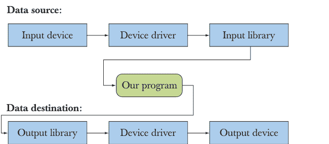

当使用这样的模型时，输入和输出可以看作是输入/输出库处理的字节（字符）流。更复杂的 I/O 形式需要专业知识，超出了本书的范围。作为应用程序程序员，我们的工作就变成了

1. 设置到适当数据源和目的地的 I/O 流
2. 从/向这些流读取和写入

字符实际上如何传输到/从设备的细节由 I/O 库和设备驱动程序处理。在这一章和下一章中，我们将看到如何使用 C++ 标准库进行由格式化数据流组成的 I/O。

从程序员的角度来看，有许多不同种类的输入和输出。一种分类是

- （多个）数据项的流（通常到/来自文件、网络连接、记录设备或显示设备）
- 与键盘用户的交互
- 通过图形界面与用户的交互（输出对象、接收鼠标点击等）

这种分类不是唯一的分类，而且这三种 I/O 之间的区别并不像看起来那么清晰。例如，如果输出字符流恰好是针对浏览器的 HTTP 文档，结果看起来非常像用户交互，并且可以包含图形元素。相反，与 GUI（图形用户界面）交互的结果可以以字符序列的形式呈现给程序。然而，这种分类符合我们的工具：前两种 I/O 由 C++ 标准库 I/O 流提供，并得到大多数操作系统的直接支持。自从第 1 章以来，我们一直在使用 `iostream` 库，并将在本章和下一章中专注于此。图形输出和图形用户交互由各种不同库服务，我们将在第 12 章到第 16 章中专注于这种类型的 I/O。

## 10.2 I/O 流模型

C++ 标准库提供类型 `istream` 以处理输入流，类型 `ostream` 以处理输出流。我们已经使用了标准的 `istream` 称为 `cin` 和标准的 `ostream` 称为 `cout`，因此我们知道如何使用标准库的这一部分（通常称为 `iostream` 库）的基础知识。

一个 `ostream`

- 将各种类型的值转换为字符序列
- 将这些字符“发送到某处”（例如控制台、文件、主内存或另一台计算机）

我们可以这样图形化地表示 `ostream`：

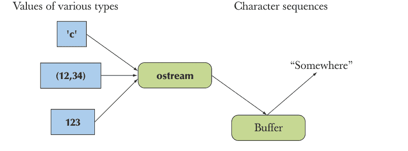

缓冲区是一种数据结构，`ostream` 在内部使用它与操作系统通信时来存储你提供的数据。如果你注意到向 `ostream` 写入和字符出现在目的地之间存在“延迟”，这通常是因为它们仍在缓冲区中。缓冲对性能很重要，而当你处理大量数据时，性能又至关重要。

**一个 `istream`**

- 将字符序列转换为各种类型的值
- 从某个地方获取这些字符（如控制台、文件、主内存或另一台计算机）

我们可以这样图形化地表示 `istream`：

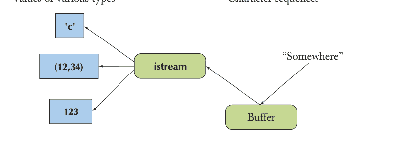

与 `ostream` 一样，`istream` 也使用缓冲区与操作系统通信。对于 `istream`，缓冲效果对用户来说可能非常明显。当你使用连接到键盘的 `istream` 时，你输入的内容会保留在缓冲区中，直到你按下回车键（Enter/换行符），在此期间你可以使用退格键（Backspace）来“改变主意”（在你按下回车键之前）。

输出的主要用途之一是为人类生成可读数据。想想电子邮件、学术文章、网页、账单记录、业务报告、联系人列表、目录、设备状态读数等。因此，`ostreams` 提供了许多用于格式化文本以迎合各种口味的功能。类似地，许多输入是由人类编写的，或者被格式化以便人类阅读。因此，`istreams` 提供了用于读取由 `ostreams` 生成的输出的功能。我们将在 §11.2 中讨论格式化，并在 §11.3.2 中讨论如何读取非字符输入。与输入相关的大部分复杂性在于如何处理错误。为了能够给出更现实的示例，我们将首先讨论 `iostream` 模型与数据文件的关系。

## 10.3 文件

通常，我们拥有的数据量远超计算机主内存所能容纳的容量，因此我们将大部分数据存储在磁盘或其他大容量存储设备上。这些设备还有一个理想的特性：当电源关闭时数据不会消失——数据是持久的。在最基本的层面上，文件仅仅是从 0 开始编号的字节序列：

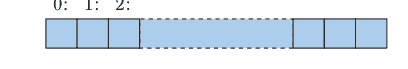

文件具有格式；也就是说，它有一组规则来确定字节意味着什么。例如，如果我们有一个文本文件，前 4 个字节将是前四个字符。另一方面，如果我们有一个使用整数的二进制表示的文件，那么同样前 4 个字节将被解释为第一个整数的（二进制）表示（参见 §11.3.2）。格式对磁盘上的文件所起的作用，相当于类型对主内存中对象所起的作用。只有当我们知道文件的格式时，我们才能理解文件中的位（参见 §11.2–3）。

对于文件，`ostream` 将主内存中的对象转换为字节流并写入磁盘。`istream` 执行相反的操作；也就是说，它从磁盘读取字节流并从中组合成对象：

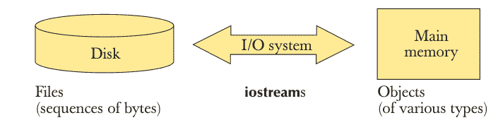

大多数情况下，我们假设这些“磁盘上的字节”实际上是我们常用字符集中的字符。虽然并非总是如此，但我们可以依靠这个假设走很远，而其他表示方式处理起来也并非那么困难。我们也好像所有文件都在磁盘上（即旋转磁存储设备）一样谈论它们。再次强调，这并非总是如此（想想闪存），但在这个编程层面上，实际的存储介质没有区别。这是文件和流抽象之美所在。

要读取文件，我们必须

1. 知道它的名称
2. 打开它（用于读取）
3. 读入字符
4. 关闭它（尽管这通常是隐式完成的）

要写入文件，我们必须

1. 命名它
2. 打开它（用于写入）或创建一个该名称的新文件
3. 写出我们的对象
4. 关闭它（尽管这通常是隐式完成的）

我们已经知道读写的基础，因为附加到文件的 `ostream` 在我们之前所做的操作中表现得与 `cout` 完全相同，附加到文件的 `istream` 在我们之前所做的操作中表现得与 `cin` 完全相同。我们稍后会介绍只能对文件执行的操作（§11.3.3），但现在我们将只是查看如何打开文件，然后专注于适用于所有 `ostreams` 和所有 `istreams` 的操作和技术。

### 10.4 打开文件

如果你想从文件读取或向文件写入，你必须为该文件专门打开一个流。`ifstream` 是用于从文件读取的 `istream`，`ofstream` 是用于向文件写入的 `ostream`，而 `fstream` 是可用于读取和写入两者的 `iostream`。在文件流被使用之前，它必须附加到一个文件。例如：

```cpp
cout << "Please enter input file name: ";
string iname;
cin >> iname;
ifstream ist(iname);       // ist is an input stream for the file named name
if (!ist) error("can't open input file ", iname);
```

使用名称字符串定义 `ifstream` 会为该名称的文件打开读取权限。对 `ist` 的测试检查文件是否被正确打开。之后，我们可以像从任何其他 `iostream` 一样从文件中读取。例如，假设输入运算符 `>>` 已为类型 `Point` 定义，我们可以编写

```cpp
vector<Point> points;
for (Point p; ist >> p; )
    points.push_back(p);
```

向文件输出的处理由 `ofstreams` 以类似的方式进行。例如：

```cpp
cout << "Please enter name of output file: ";
string oname;
cin >> oname;
ofstream ost (oname);      // ost is an output stream for a file named oname
if (!ost) error("can't open output file ", oname);
```

使用名称字符串定义 `ofstream` 会为具有该名称的文件打开写入权限。对 `!ost` 的测试检查文件是否被正确打开。之后，我们可以像向任何其他 `ostream` 一样向文件写入。例如：

```cpp
for (Point p : points)
    ost << '(' << p.x << ',' << p.y << ')\n';
```

当文件流离开作用域时，其关联的文件会被关闭。当文件关闭时，其关联的缓冲区会被“刷新”；也就是说，缓冲区中的字符会被写入文件。

通常在程序早期、在进行任何重大计算之前打开文件最好。毕竟，如果我们发现无法完成工作，因为没有地方写入结果，那么做大量工作就浪费了。

在创建 `ostream` 或 `istream` 时隐式地打开文件，并依赖流的作用域来处理文件关闭，这是理想的。例如：

```cpp
void fill_from_file(vector<Point>& points, string& name)
{
    ifstream ist (name);    // open file for reading
    if (!ist) error("can't open input file ", name);
    // ... use ist ...
    // the file is implicitly closed when we leave the function
}
```

你也可以执行显式的 `open()` 和 `close()` 操作（§B.7.1）。然而，依赖作用域可以最小化某人试图在文件流附加到流之前或在其关闭之后使用该文件流的可能性。例如：

```cpp
ifstream ifs;
// ...
ifs >> foo; // won't succeed: no file opened for ifs
// ...
ifs.open(name, ios_base::in); // open file named name for reading
// ...
ifs.close(); // close file
// ...
ifs >> bar; // won't succeed: ifs' file was closed
// ...
```

在实际代码中，这些问题通常更难发现。幸运的是，你不能在关闭文件流之前第二次打开它。例如：

```cpp
fstream fs;
fs.open("foo", ios_base::in); // open for input
// close() missing
fs.open("foo", ios_base::out); // won't succeed: fs is already open
if (!fs) error("impossible");
```

打开流后不要忘记测试它。

为什么要显式使用 `open()` 或 `close()`？嗯，偶尔与文件的连接生命周期并不方便地被作用域限制，因此你必须这样做。但这足够罕见，以至于我们在这里不必担心它。更相关的是，你会发现这种用法出现在由使用 `iostreams`（以及 C++ 标准库其余部分）所使用的范围惯用法所不支持的语言和库的样式编写代码的人中。

正如我们将在第 11 章中看到的，文件还有很多更多内容，但就目前而言，我们已知道足够的知识来将它们用作数据源和数据目的地。这将允许我们编写程序，如果我们假设用户必须直接输入所有输入，这些程序将是不现实的。从程序员的角度来看，文件的一个巨大优势是你可以在调试期间反复读取它，直到你的程序正确工作。

### 10.5 读取和写入文件

考虑一下你如何可能从文件中读取一组测量结果并在内存中表示它们。这些可能是气象站的温度读数：

## 10.6 I/O 错误处理

此数据文件包含一系列（小时，温度）对。小时编号为 0 到 23，温度单位为华氏度。假设没有其他格式要求；也就是说，文件不包含任何特殊的头部信息（例如读数采集地点）、数值单位、标点符号（例如每对数值周围的括号）或终止指示符。这是最简单的情况。

我们可以使用 `Reading` 类型来表示温度读数：


```cpp
struct Reading { // 温度读数
    int hour; // 午夜后的小时 [0:23]
    double temperature; // 华氏度
};
```

给定上述定义，我们可以这样读取：

```cpp
vector<Reading> temps; // 在此存储读数
int hour;
double temperature;
while (ist >> hour >> temperature) {
    if (hour < 0 || 23 < hour) error("小时超出范围");
    temps.push_back(Reading{hour,temperature});
}
```

这是一个典型的输入循环。称为 `ist` 的 `istream` 可以是前一节中所示的输入文件流（`ifstream`）、标准输入流（`cin`）的别名，或其他任何形式的 `istream`。对于这类代码来说，`istream` 数据的确切来源并不重要。我们的程序只关心 `ist` 是一个 `istream`，并且数据具有预期的格式。下一节将讨论一个有趣的问题：如何检测输入数据中的错误，以及在检测到格式错误后我们可以做什么。

写入文件通常比读取文件更简单。同样，一旦流初始化，我们就不必知道它具体是哪一种流。特别是，我们可以像使用其他 `ostream` 一样使用上面章节中的输出文件流（`ofstream`）。例如，我们可能希望以每对值带括号的形式输出读数：

```cpp
for (int i=0; i<temps.size(); ++i)
    ost << '(' << temps[i].hour << ',' << temps[i].temperature << ')\n';
```

这样，生成的程序将读取原始温度读数文件，并生成一个新文件，其中数据采用（小时，温度）格式。由于文件流在离开作用域时会自动关闭文件，因此完整的程序如下：

```cpp
#include "std_lib_facilities.h"

struct Reading {      // 温度读数
    int hour;         // 午夜后的小时 [0:23]
    double temperature; // 华氏度
};

int main()
{
    cout << "请输入输入文件名称：";
    string iname;
    cin >> iname;
    ifstream ist {iname};     // ist 从名为 iname 的文件读取
    if (!ist) error("无法打开输入文件 ", iname);

    string oname;
    cout << "请输入输出文件名称：";
    cin >> oname;
    ofstream ost {oname};     // ost 写入名为 oname 的文件
    if (!ost) error("无法打开输出文件 ", oname);

    vector<Reading> temps;     // 在此存储读数
    int hour;
    double temperature;
    while (ist >> hour >> temperature) {
        if (hour < 0 || 23 < hour) error("小时超出范围");
        temps.push_back(Reading{hour, temperature});
    }

    for (int i=0; i<temps.size(); ++i)
        ost << '(' << temps[i].hour << ','
            << temps[i].temperature << ')\n';
}
```

在处理输入时，我们必须预期错误并处理它们。会有哪些类型的错误？如何处理？错误的发生是因为人类会犯错（误解指令、输入错误、让猫在键盘上走动等），因为文件不符合规范，因为（作为程序员）我们的预期错误等。输入错误的可能性是无限的！然而，`istream` 将一切简化为四种可能的情况，称为*流状态*：

| 流状态 | 描述 |

| :--- | :--- |

| `good()` | 操作成功。 |

| `eof()` | 遇到了输入结束（“文件尾”）。 |

| `fail()` | 发生了意外情况（例如，我们查找一个数字但发现了 'x'）。 |

| `bad()` | 发生了意外且严重的问题（例如，磁盘读取错误）。 |

不幸的是，`fail()` 和 `bad()` 之间的区别没有精确定义，在为新类型定义 I/O 操作的程序员中存在不同意见。然而，基本思路很简单：如果输入操作遇到简单的格式错误，它会令流 `fail()`，假设你（我们输入操作的使用者）可能能够恢复。另一方面，如果发生了非常糟糕的事情，如坏的磁盘读取，输入操作会令流进入 `bad()` 状态，假设除了放弃从该流获取数据的尝试外，你无事可做。处于 `bad()` 状态的流也是 `fail()`。这留给我们以下通用逻辑：

```cpp
int i = 0;
cin >> i;
if (!cin) {  // 只有当输入操作失败时才会到达这里
    if (cin.bad()) error("cin 状态不良");  // 流已损坏：让我们退出这里！
    if (cin.eof()) {
        // 没有更多输入
        // 这通常是希望一系列输入操作结束的方式
    }
    if (cin.fail()) {   // 流遇到了意外情况
        cin.clear();    // 为更多输入做好准备
        // 某种方式恢复
    }
}
```

`!cin` 可以读作“cin 状态不好”或“cin 出了点问题”或“cin 的状态不是 good()”。它是“操作成功”的反面。注意处理 `fail()` 时的 `cin.clear()`。当流失败时，我们可能能够恢复。为了尝试恢复，我们显式地将流从 `fail()` 状态中取出，以便我们可以再次查看其中的字符；`clear()` 做到这一点 – 在 `cin.clear()` 之后，`cin` 的状态是 `good()`。

下面是一个如何使用流状态的例子。考虑如何读取一串整数，该串可能由字符 `*` 或“文件尾”（Windows 上的 Ctrl+Z，Unix 上的 Ctrl+D）终止，并将其放入一个 **vector** 中。例如：

1 2 3 4 5 *

可以使用类似这样的函数来完成：

```cpp
void fill_vector(istream& ist, vector<int>& v, char terminator)
{
    // 从 ist 读取整数到 v，直到遇到 eof() 或 terminator
    
    for (int i; ist >> i;) v.push_back(i);
    if (ist.eof()) return;    // 没问题：我们找到了文件尾
    
    if (ist.bad()) error("ist 状态不良");    // 流已损坏；让我们退出这里！
    if (ist.fail()) {    // 尽可能清理混乱并报告问题
        ist.clear();    // 清除流状态，
                         // 以便我们可以查找 terminator
        
        char c;
        ist >> c;    // 读取一个字符，希望是 terminator
        if (c != terminator) {    // 意外字符
            ist.unget();    // 将该字符放回去
            ist.clear(ios_base::failbit);    // 将状态设置为 fail()
        }
    }
}
```

注意，当我们没有找到终止符时，我们仍然返回了。毕竟，我们可能已经收集了一些数据，`fill_vector()` 的调用者可能能够从 `fail()` 中恢复。由于我们清除了状态以便检查该字符，我们必须将流状态重置为 `fail()`。我们通过 `ist.clear(ios_base::failbit)` 来做到这一点。注意这里对 `clear()` 的潜在令人困惑的用法：带参数的 `clear()` 实际上设置提到的 `iostream` 状态标志（位），并（仅）清除未提到的标志。通过将状态设置为 `fail()`，我们表明我们遇到了格式错误，而不是更严重的问题。我们使用 `unget()` 将字符放回 `ist`，`fill_vector()` 的调用者可能可以用到它。`unget()` 函数是 `putback()`（§6.8.2, §B.7.3）的较短版本，它依赖于流记住其最后产生的字符，因此你不必提及它。

如果你调用了 `fill_vector()` 并想知道是什么终止了读取，你可以测试 `fail()` 和 `eof()`。你还可以通过捕获 `error()` 抛出的 `runtime_error` 异常来实现，但大家公认，在 `bad()` 状态下从 `istream` 获取更多数据不太可能。大多数调用者不会费心去做。这意味着在几乎所有

如果我们遇到 `bad()`，想要做的唯一事情就是抛出一个异常。为了简化操作，我们可以告诉 `istream` 为我们执行此操作：

```cpp
    // make ist throw if it goes bad
    ist.exceptions(ist.exceptions()|ios_base::badbit);
```

这种写法可能看起来很奇怪，但其效果仅仅是：从该语句开始，如果 `ist` 进入 `bad()` 状态，它将抛出标准库异常 `ios_base::failure`。我们需要在程序中仅执行一次该 `exceptions()` 调用。这将允许我们忽略 `bad()`，从而简化 `ist` 上的所有输入循环：

```cpp
    void fill_vector(istream& ist, vector<int>& v, char terminator)
    // read integers from ist into v until we reach eof() or terminator
    {
        for (int i; ist >> i; ) v.push_back(i);
        if (ist.eof()) return;    // fine; we found the end of file

        // not good() and not bad() and not eof(), ist must be fail()
        ist.clear();             // clear stream state

        char c;
        ist >> c;                // read a character, hopefully terminator

        if (c != terminator) {   // ouch: not the terminator, so we must fail
            ist.unget();         // maybe my caller can use that character
            ist.clear(ios_base::failbit); // set the state to fail()
        }
    }
```

这里和那里出现的 `ios_base` 是 `iostream` 的一部分，它保存诸如 `badbit` 这样的常量，诸如 `failure` 这样的异常，以及其他有用的东西。您使用 `::` 运算符来引用它们，例如 `ios_base::badbit`（§B.7.2）。我们并不打算详细介绍 iostream 库；解释所有的 `iostreams` 可能需要一整门课程。例如，`iostreams` 可以处理不同的字符集，实现不同的缓冲策略，并且还包含用于以各种语言格式化货币金额的设施；我们曾经收到过一份与乌克兰货币格式相关的 bug 报告。如果需要，您可以阅读您必须了解的任意部分内容；请参见 Stroustrup 的 *The C++ Programming Language* 以及 Langer 的 *Standard C++ I/OStreams and Locales*。

您可以对 `ostream` 测试与 `istream` 完全相同的状态：`good()`、`fail()`、`eof()` 和 `bad()`。然而，对于我们要编写的这类程序，输出中的错误比输入中罕见得多，因此我们不会经常这样做。对于输出设备不可用、已满或损坏的可能性更大的程序，我们会像在每次输入操作后测试一样，在每次输出操作后进行测试。

## 10.7 读取单个值

那么，我们知道如何读取一系列以文件结束符或终止符结束的值。随着进程的推进，我们会展示更多示例，但让我们先看看那个非常流行的想法：反复请求一个值，直到输入一个可接受的值为止。这个示例将允许我们检查几种常见的设计选择。我们将通过一系列针对“如何从用户那里获取可接受的值”这一简单问题的替代解决方案来讨论这些替代方案。我们从一种令人不悦且混乱的显而易见的“第一次尝试”开始，然后逐步推进到一系列改进的版本。我们的基本假设是，我们正在处理交互式输入，其中人类正在输入并读取程序的消息。让我们请求一个 1 到 10（含）范围内的整数：

```cpp
cout << "Please enter an integer in the range 1 to 10 (inclusive):\n";
int n = 0;
while (cin>>n) {
    if (1<=n && n<=10) break; // check range
    cout << "Sorry "
         << n << " is not in the [1:10] range; please try again\n";
}
// ... use n here ...
```

这很丑陋，但它“大致有效”。如果您不喜欢使用 `break`（§A.6），您可以将读取和范围检查结合在一起：

```cpp
cout << "Please enter an integer in the range 1 to 10 (inclusive):\n";
int n = 0;
while (cin>>n && !(1<=n && n<=10)) // read and check range
    cout << "Sorry "
         << n << " is not in the [1:10] range; please try again\n";
// ... use n here ...
```

然而，那只是一个表面上的改变。为什么它只是“大致有效”？如果用户小心地输入整数，它是有效的。如果用户打字不好，按下了 `t` 而不是 `6`（在大多数键盘上 `t` 就在 `6` 下方），程序将在不改变 `n` 值的情况下退出循环，因此 `n` 将具有超出范围的值。我们不会称之为高质量代码。恶作剧者（或勤勉的测试员）也可能从键盘发送“文件结束”（在 Windows 机器上是 Ctrl+Z，在 Unix 机器上是 Ctrl+D）。同样，我们将以 `n` 超出范围的状态退出循环。换句话说，为了获得稳健的读取，我们必须处理三个问题：

- 用户输入了超出范围的值

- 未获取到值（文件结束）

- 用户输入了错误类型的值（在此处，即非整数）

在这三种情况下我们想做什么？在编写程序时，这往往是问题所在：我们真正想要什么？这里，对于这三种错误中的每一种，我们都有三种选择：

- 在执行读取的代码中处理问题。

- 抛出一个异常，让其他人处理问题（可能会终止程序）。

- 忽略问题。

碰巧，处理错误条件这三种是非常常见的选择。因此，这是我们需要对错误进行思考的一个很好的例子。

人们很容易说第三种选择，即忽略问题，总是不可接受的，但那是一种居高临下的态度。如果我正在为自己编写一个琐碎的程序，我可以随心所欲，包括忽略错误检查及其可能带来的糟糕后果。然而，对于一个我可能在编写后使用几个小时的程序，我可能会很愚蠢地留下这样的错误，如果我想与任何人共享该程序，我不应该让代码中的错误检查存在这样的漏洞。请注意，我们刻意在这里使用第一人称单数；“我们”会产生误导。即使只有两个人参与，我们不认为替代方案 3 是可以接受的。

替代方案 1 和 2 之间的选择是真实的；也就是说，在给定的程序中，选择任何方式都有很好的理由。首先我们注意到，在大多数程序中，没有一种局部且优雅的方法来应对坐在键盘前的用户没有输入的情况：在输入流关闭后，询问用户输入数字已没有多大意义。我们可以重新打开 `cin`（使用 `cin.clear()`），但用户不太可能意外关闭该流（你会如何意外按下 Ctrl+Z？）。如果程序想要一个整数但发现“文件结束”，尝试读取整数的程序部分通常必须放弃，并希望程序的某些其他部分能够应对；也就是说，我们请求用户输入的代码必须抛出一个异常。这意味着选择不是在抛出异常和局部处理问题之间；而是选择我们应该局部处理哪些问题（如果有）。

### 10.7.1 将问题分解为可管理的部分

让我们尝试局部处理超出范围的输入和错误类型的输入：


```cpp
cout << "Please enter an integer in the range 1 to 10 (inclusive)\n";
int n = 0;
while (true) {
    cin >> n;
    if (cin) {                // we got an integer; now check it
        if (1<=n && n<=10) break;
        cout << "Sorry "
             << n << " is not in the [1:10] range; please try again\n";
    }
    else if (cin.fail()) {   // we found something that wasn't an integer
        cin.clear();          // set the state back to good();
                              // we want to look at the characters
        cout << "Sorry, that was not a number; please try again\n";
        for (char ch; cin>>ch && !isdigit(ch); )  // throw away non-digits
            /* nothing */ ;
        if (!cin) error("no input");    // we didn't find a digit; give up
        cin.unget();      // put the digit back, so that we can read the number
    }
    else {
        error("no input");        // eof or bad: give up
    }
}
// if we get here n is in [1:10]
```

这很混乱，而且相当冗长。事实上，它是如此混乱，以至于我们不建议人们每次需要从用户那里获取整数时都编写这样的代码。另一方面，我们需要处理潜在的错误，因为人们确实会犯这些错误，那么我们能做什么呢？代码之所以混乱，是因为处理几种不同关注点的代码都混在了一起：

- 读取值
- 提示用户输入
- 写入错误消息
- 跳过“坏”的输入字符
- 测试输入是否在范围内

使代码更清晰的方法通常是将有逻辑上不同关注点分离到单独的函数中。例如，我们可以分离出在遇到“坏”（即意外）字符后恢复的代码：

```cpp
void skip_to_int()
{
    if (cin.fail()) {          // we found something that wasn't an integer
        cin.clear();          // we'd like to look at the characters
```

### 10.7.2 将对话与功能分离

```cpp
for (char ch; cin >> ch;) { // 丢弃非数字字符
    if (isdigit(ch) || ch == '-') {
        cin.unget(); // 将数字放回，
                     // 以便我们可以读取该数字
        return;
    }
}
error("no input"); // eof 或 bad：放弃
}
```

有了 **`skip_to_int()`** 这个“工具函数”，我们可以写出如下代码：

```cpp
cout << "Please enter an integer in the range 1 to 10 (inclusive);\n";
int n = 0;
while (true) {
    if (cin >> n) // 我们得到了一个整数；现在检查它
    {
        if (1 <= n && n <= 10) break;
        cout << "Sorry " << n << " is not in the [1:10] range; please try again\n";
    }
    else {
        cout << "Sorry, that was not a number; please try again\n";
        skip_to_int();
    }
}
// 如果我们到达这里，n 在 [1:10] 范围内
```

这段代码更好，但它仍然太长且太混乱，无法在程序中多次使用。除非经过（过度的）测试，否则我们永远无法始终正确地实现它。

我们真正希望拥有的操作是什么？一个合理的答案是“一个读取任意 **`int`** 的函数，以及另一个读取给定范围内 **`int`** 的函数”：

```cpp
int get_int(); // 从 cin 读取一个 int
int get_int(int low, int high); // 从 cin 读取 [low:high] 范围内的一个 int
```

如果我们拥有这些函数，至少能够简单且正确地使用它们。它们编写起来并不那么困难：

```cpp
int get_int()
{
    int n = 0;
    while (true) {
        if (cin >> n) return n;
        cout << "Sorry, that was not a number; please try again\n";
        skip_to_int();
    }
}
```

基本上，**`get_int()`** 固执地持续读取，直到找到一些可以解释为整数的数字。如果我们想要退出 **`get_int()`**，必须提供一个整数或文件结束符（文件结束符将导致 **`get_int()`** 抛出异常）。

使用通用的 **`get_int()`**，我们可以编写带范围检查的 **`get_int()`**：

```cpp
int get_int(int low, int high)
{
    cout << "Please enter an integer in the range "
         << low << " to " << high << " (inclusive):\n";
    
    while (true) {
        int n = get_int();
        if (low <= n && n <= high) return n;
        cout << "Sorry "
             << n << " is not in the [" << low << ':'
             << high << "] range; please try again\n";
    }
}
```

这个 **`get_int()`** 和另一个一样固执。它不断从不带范围的 **`get_int()`** 获取 **`ints`**，直到获取到的 **`int`** 在预期范围内。

我们现在可以像这样可靠地读取整数：

```cpp
int n = get_int(1, 10);
cout << "n: " << n << '\n';

int m = get_int(2, 300);
cout << "m: " << m << '\n';
```

不过，如果你想为 **`get_int()`** 确实无法为我们读取数字的情况（这种情况可能很罕见）提供得体的错误消息，别忘了在某处捕获异常。

**`get_int()`** 函数仍然将读取与向用户写入消息混合在一起。对于一个简单的程序，这可能已经足够好，但在大型程序中，我们可能希望改变写入用户的消息。我们可能希望像这样调用 **`get_int()`**：

```cpp
int strength = get_int(1, 10, "enter strength", "Not in range, try again");
cout << "strength: " << strength << "\n";

int altitude = get_int(0, 50000,
                       "Please enter altitude in feet",
                       "Not in range, please try again");
cout << "altitude: " << altitude << "\t above sea level\n";
```

我们可以像这样实现：

```cpp
int get_int(int low, int high, const string& greeting, const string& sorry)
{
    cout << greeting << ": [" << low << ':' << high << "]\n";

    while (true) {
        int n = get_int();
        if (low <= n && n <= high) return n;
        cout << sorry << ": [" << low << ':' << high << "]\n";
    }
}
```

很难组合任意消息，因此我们“风格化”了这些消息。这通常是可以接受的，而组合真正灵活的消息（例如支持多种自然语言所需的消息（如阿拉伯语、孟加拉语、中文、丹麦语、英语和法语））不是新手应任务。

请注意，我们的解决方案仍然不完整：不带范围的 `get_int()` 仍然“喋喋不休”。这里更深层次的点是，我们在程序许多部分使用的“工具函数”不应该将消息“硬编码”在其中。此外，旨在用于许多程序的库函数根本不应该向用户写入任何内容——毕竟，库编写者可能甚至不知道运行库的程序是在有人类监视的机器上使用的。这就是我们的 `error()` 函数不仅仅写入错误消息（§5.6.3）的一个原因；通常，我们不知道应该在哪里写入。

## 10.8 用户定义的输出运算符

为给定类型定义输出运算符 `<<` 通常很简单。主要的设计问题是，不同的人可能希望输出看起来不同，因此很难就单一格式达成共识。然而，即使没有一种单一的输出格式足以满足所有用途，为用户定义类型定义 `<<` 通常也是一个好主意。这样，我们至少可以在调试和早期开发期间轻松地写出该类型的对象。稍后，我们可能会提供一个更复杂的 `<<`，允许用户提供格式信息。此外，如果我们希望输出看起来与 `<<` 提供的不同，我们可以简单地绕过 `<<` 并以我们在应用中喜欢的方式写出用户定义类型的各个部分。

以下是 §9.8 中 **`Date`** 的一个简单输出运算符，它只是在括号内以逗号分隔打印年、月和日：

```cpp
ostream& operator<< (ostream& os, const Date& d)
{
    return os << '(' << d.year()
              << ',' << int(d.month())
              << ',' << d.day() << ')';
}
```

这将把 2004 年 8 月 30 日打印为 `(2004,8,30)`。这种简单的元素列表表示法，除非我们有更好的想法或更具体的需求，否则通常用于具有少数成员的类型。

在 §9.6 中，我们提到用户定义的运算符是通过调用其函数处理的。这里我们可以看到一个如何做到的例子。给定 **`Date`** 的 `<<` 定义，

```cpp
cout << d1;
```

其中 **`d1`** 是一个 **`Date`**，意味着调用

```cpp
operator<< (cout, d1);
```

注意 `operator<<()` 如何接受一个 `ostream&` 作为其第一个参数并再次将其作为返回值返回。这就是输出流被传递的方式，以便你可以“链式”执行输出操作。例如，我们可以像这样输出两个日期：

```cpp
cout << d1 << d2;
```

这将先解析第一个 `<<`，然后再解析第二个 `<<` 处理：

```cpp
cout << d1 << d2;
// 意味着 operator<< (cout, d1) << d2;
// 意味着 operator<< (operator<< (cout, d1), d2);
```

也就是说，首先将 **`d1`** 输出到 **`cout`**，然后将 **`d2`** 输出到第一个输出操作产生的输出流。实际上，我们可以使用这三种变体中的任何一种来写出 **`d1`** 和 **`d2`**。不过，我们知道哪一个更容易阅读。

## 10.9 用户定义的输入运算符

为给定类型和输入格式定义输入运算符 `>>` 基本上是一个错误处理的练习。因此，它可能相当棘手。

以下是 §9.8 中 *Date* 的一个简单输入运算符，它将读取由上述定义的运算符 `<<` 写入的日期：

```cpp
istream& operator>>(istream& is, Date& dd)
{
    int y, m, d;
    char ch1, ch2, ch3, ch4;
    is >> ch1 >> y >> ch2 >> m >> ch3 >> d >> ch4;
    if (!is) return is;
    if (ch1 != '(' || ch2 != ',' || ch3 != ',' || ch4 != ')') {   // 哎呀：格式错误
        is.clear(ios_base::failbit);
        return is;
    }
    dd = Date(y, Month(m), d);        // 更新 dd
    return is;
}
```

这个 `>>` 将读取如 `(2004,8,20)` 这样的项目，并尝试用这三个整数创建一个 *Date*。一如既往，输入比输出更难处理。输入出错的几率确实比输出高得多，而且往往确实会出错。

如果这个 `>>` 没有找到 `(integer, integer, integer)` 格式的内容，它会将流置于不良状态（`fail`、`eof` 或 `bad`），并保持目标 *Date* 不变。`clear` 成员函数用于设置 `istream` 的状态。显然，`ios_base::failbit` 将流置于 `fail()` 状态。在读取失败时保持目标 *Date* 不变是理想的；这往往会导致更清晰的代码。理想情况是 `operator>>` 不消耗（丢弃）它未使用的任何字符，但在这种情况下这太难了：我们在捕捉到格式错误之前可能已经读取了很多字符。作为一个例子，考虑 `(2004, 8, 30`。只有当我们看到最后的 `)` 时，我们才知道我们遇到了格式错误，而且我们通常不能依赖放回许多字符。保证可以通用的唯一操作是单个字符的 `unget()`。如果这个 `operator>>` 读取无效的 *Date*，例如 `(2004,8,32)`，*Date* 的构造函数将抛出异常，这将使我们退出这个 `operator>>`。

## 10.10 标准输入循环

在 §10.5 中，我们看到了如何读写文件。然而，那是在我们仔细查看错误（§10.6）之前，所以输入循环只是假设

我们可以从文件的开头读到结尾。这是一个合理的假设，因为我们通常应用独立的检查来确保文件有效。然而，我们经常希望在读取过程中进行检查。下面是一种通用策略，假设 `ist` 是一个 `istream`：

```cpp
for (My_type var; ist >> var; ) {    // read until end of file
    // maybe check that var is valid
    // do something with var
}
// we can rarely recover from bad; don't try unless you really have to:
if (ist.bad()) error("bad input stream");
if (ist.fail()) {
    // was it an acceptable terminator?
}
// carry on: we found end of file
```

也就是说，我们读取一系列值到变量中，当我们无法再读取更多值时，我们检查流的状态以查看原因。正如 §10.6 所述，如果流出现错误，我们可以让 `istream` 抛出 `failure` 类型的异常，从而稍微改进这一点。这省去了我们总是检查它的麻烦：

```cpp
// somewhere: make ist throw an exception if it goes bad:
ist.exceptions(ist.exceptions() | ios_base::badbit);
```

我们还可以决定指定一个字符作为终止符：

```cpp
for (My_type var; ist >> var; ) {    // read until end of file
    // maybe check that var is valid
    // do something with var
}
if (ist.fail()) {    // use '!' as terminator and/or separator
    ist.clear();
    char ch;
    if (!(ist >> ch && ch == '!')) error("bad termination of input");
}
// carry on: we found end of file or a terminator
```

如果我们不想接受终止符——也就是说，只接受文件结尾作为结束——我们只需删除对 `error()` 调用前的测试。然而，当读取具有嵌套结构的文件时，终止符非常有用，例如包含每日读数的月度读数文件，又包含每小时读数的文件，因此我们仍将继续考虑终止符的可能性。


不幸的是，那段代码仍然有点混乱。特别是，如果我们读取大量文件，重复终止符测试会很繁琐。我们可以编写一个函数来处理这个问题：

```cpp
// somewhere: make ist throw if it goes bad:
std.exceptions(std.exceptions() | ios_base::badbit);

void end_of_loop(istream& ist, char term, const string& message)
{
    if (ist.fail()) {            // use term as terminator and/or separator
        ist.clear();
        char ch;
        if (ist >> ch && ch == term) return;      // all is fine
        error(message);
    }
}
```

这将输入循环简化为

```cpp
for (My_type var; ist >> var; ) {                // read until end of file
    // maybe check that var is valid
    // ... do something with var ...
}
end_of_loop(ist, '|', "bad termination of file");    // test if we can continue
// carry on: we found end of file or a terminator
```

除非流处于 `fail()` 状态，否则 `end_of_loop()` 什么也不做。我们认为这足够简单，也足够通用，适用于许多用途。

## 10.11 读取结构化文件

让我们尝试将这个“标准循环”用于一个具体的例子。像往常一样，我们将使用这个例子来说明广泛适用的设计和编程技术。假设你有一个温度读数文件，其结构如下：

- 文件包含若干年（每月读数）。
    - 一年以 `{ year }` 开始，后跟表示年份的整数，例如 `1900`，并以 `}` 结束。
- 一年包含若干月（每日读数）。
    - 一个月以 `{ month` 开始，后跟三字母月份名称，例如 `jan`，并以 `}` 结束。
- 一个读数包含一个时间和一个温度。
    - 一个读数以 `(` 开始，后跟月份中的日期、一天中的小时数和温度，并以 `)` 结束。

例如：

```
{ year 1990 }
{year 1991 { month jun }}
{ year 1992 { month jan ( 1 0 61.5) } { month feb ( 1 1 64) (2 2 65.2) } }
{year 2000
    { month feb ( 1 1 68) (2 3 66.66) (1 0 67.2)}
    {month dec (15 15 −9.2) (15 14 −8.8) (14 0 −2) }
}
```

这种格式有点特别。文件格式通常如此。行业中有向更规则和层次结构化的文件（如 HTML 和 XML 文件）发展的趋势，但现实情况是，我们很少能控制我们需要读取的文件所提供的输入格式。文件就是那个样子，我们只能读取它们。如果格式太糟糕或文件包含太多错误，我们可以编写一个格式转换程序来生成更适合我们主程序的格式。另一方面，我们通常可以选择内存中数据的表示方式来满足我们的需求，并且经常可以选择适合需求和口味的输出格式。

因此，让我们假设我们被给予了上述温度读数格式，必须接受它。幸运的是，它包含自识别组件，例如年份和月份（有点像 HTML 或 XML）。另一方面，单个读数的格式不太有帮助。例如，如果有人将月份中的日期值与一天中的小时数互换，或者有人生成了一份摄氏度为温度单位的文件而程序期望的是华氏度（或反之），就没有信息可以帮助我们。我们只能应对。

### 10.11.1 内存表示

我们应该如何在内存中表示这些数据？显然的第一个选择是三个类，`Year`、`Month` 和 `Reading`，以完全匹配输入。`Year` 和 `Month` 在操纵数据时显然很有用；我们想要比较不同年份的温度，计算月度平均值，比较一年中不同的月份，比较不同年份的相同月份，将温度读数与日照记录和湿度读数匹配等。基本上，`Year` 和 `Month` 符合我们思考温度和天气的一般方式：`Month` 持有一个月的信息，`Year` 持有一年的信息。但是 `Reading` 呢？那是一个低层概念，匹配某块硬件（传感器）。`Reading` 的数据（月份中的日期、一天中的小时数、温度）是“奇怪的”，只有在 `Month` 内部才有意义。它也是非结构化的：我们没有任何保证，读数会按月份中的日期或一天中的小时数顺序排列。基本上，每当我们想对读数做有趣的事情时，我们都要对它们进行排序。

为了在内存中表示温度数据，我们做出以下假设：

- 如果我们某个月有任何读数，那么该月通常会有很多读数。
- 如果我们某一天有任何读数，那么该天通常会有很多读数。

在这种情况下，将一个 `Year` 表示为 12 个 `Month` 的 `vector`，将一个 `Month` 表示为大约 30 个 `Days` 的 `vector`，将一个 `Day` 表示为 24 个温度（每小时一个）是有意义的。这对于各种用途来说简单且易于操作。因此，`Day`、`Month` 和 `Year` 是简单数据结构，每个都有一个构造函数。由于我们计划在知道有哪些温度读数之前将 `Months` 和 `Days` 作为 `Year` 的一部分创建，因此我们需要为尚未读取数据的一天中的某个小时拥有“非读数”的概念。

```cpp
const int not_a_reading = -7777;    // less than absolute zero
```

同样，我们注意到经常有月份没有数据，因此我们引入了“非月份”的概念来直接表示这一点，而不是必须遍历所有天数以确保某处没有隐藏数据：

```cpp
const int not_a_month = -1;
```

那么三个关键类变成

```cpp
struct Day {
    vector<double> hour {vector<double>(24, not_a_reading)};
};
```

也就是说，一个 `Day` 有 24 个小时，每个都初始化为 `not_a_reading`。

```cpp
struct Month {                             // a month of temperature readings
    int month {not_a_month};               // [0:11] January is 0
    vector<Day> day {32};                 // [1:31] one vector of readings per day
};
```

我们“浪费” `day[0]` 以保持代码简单。

```cpp
struct Year {  // a year of temperature readings, organized by month
    int year; // positive == A.D.
    vector<Month> month {12}; // [0:11] January is 0
};
```

每个类基本上都是一个由“部分”组成的简单 `vector`，并且 `Month` 和 `Year` 分别具有标识成员 `month` 和 `year`。

这里有几个“魔法常量”（例如，`24`、`32` 和 `12`）。我们试图避免在代码中使用这种字面量常量。这些是相当基本的（一年中的月份数量很少变化），并且不会在代码的其余部分中使用。然而，我们主要将它们保留在代码中是为了提醒你“魔法常量”的问题；符号常量几乎总是更可取（§7.6.1）。使用 `32` 作为一个月中天的数量绝对需要解释；`32` 在这里显然是“魔法”的。

为什么我们没有写成

```cpp
struct Day {
    vector<double> hour {24, not_a_reading};
};
```

那会简单一些，但不幸的是，我们会得到一个包含两个元素（`24` 和 `–1`）的 `vector`。当我们要为 `vector` 指定元素数量，而该 `vector` 的整数可以转换为元素类型时，不幸的是我们必须使用 `()` 初始化器语法（§18.2）。

### 10.11.2 读取结构化值

`Reading` 类仅用于读取输入，而且更简单：

```cpp
struct Reading {
    int day;
    int hour;
    double temperature;
};

istream& operator>>(istream& is, Reading& r)
// read a temperature reading from is into r
// format: ( 3 4 9.7 )
// check format, but don’t bother with data validity
{
```

`char ch1;`

`if (is>>ch1 && ch1!='(') {              // 这可能是一个 Reading 吗？`

`    is.unget();`

`    is.clear(ios_base::failbit);`

`    return is;`

`}`

`char ch2;`

`int d;`

`int h;`

`double t;`

`is >> d >> h >> t >> ch2;`

`if (!is || ch2!=')') error("bad reading"); // 读取的数据格式错误`

`r.day = d;`

`r.hour = h;`

`r.temperature = t;`

`return is;`

`}`

基本上，我们会检查输入格式是否看起来合理，如果不合理，我们就将文件状态设置为 `fail()` 并返回。这允许我们尝试以其他方式读取信息。另一方面，如果在读取部分数据后发现格式错误，且实际上没有恢复的可能性，我们就使用 `error()` 退出。

`Month` 的输入操作基本相同，区别在于它必须读取任意数量的 `Readings`，而不是固定的一组值（就像 `Reading` 的 `>>` 那样）：

```cpp
istream& operator>>(istream& is, Month& m)
// read a month from is into m
// format: { month feb ... }
{
    char ch = 0;
    if (is >> ch && ch!='(') {
        is.unget();
        is.clear(ios_base::failbit);   // 读取 Month 失败
        return is;
    }

    string month_marker;
    string mm;
    is >> month_marker >> mm;
    if (!is || month_marker!="month") error("bad start of month");
    m.month = month_to_int(mm);

    int duplicates = 0;
    int invalids = 0;
    for (Reading r; is >> r;) {
        if (is_valid(r)) {
            if (m.day[r.day].hour[r.hour] != not_a_reading)
                ++duplicates;
            m.day[r.day].hour[r.hour] = r.temperature;
        }
        else
            ++invalids;
    }
    if (invalids) error("invalid readings in month",invalids);
    if (duplicates) error("duplicate readings in month", duplicates);
    end_of_loop(is, '}', "bad end of month");
    return is;
}
```

我们会稍后再讨论 `month_to_int()`；它将月份的符号表示（如 `jun`）转换为 `[0:11]` 范围内的数字。请注意使用 §10.10 中的 `end_of_loop()` 来检查终止符。我们统计了无效和重复的 `Readings`；这可能会引起某些人的兴趣。

`Month` 的 `>>` 在存储之前会对 `Reading` 进行快速检查，以确保其合理性：

```cpp
constexpr int implausible_min = -200;
constexpr int implausible_max = 200;

bool is_valid(const Reading& r)
// a rough test
{
    if (r.day<1 || 31<r.day) return false;
    if (r.hour<0 || 23<r.hour) return false;
    if (r.temperature<implausible_min|| implausible_max<r.temperature)
        return false;
    return true;
}
```

最后，我们可以读取年份。`Year` 的 `>>` 与 `Month` 的 `>>` 类似：

```cpp
istream& operator>>(istream& is, Year& y)
// read a year from is into y
// format: { year 1972 . . . }
{
    char ch;
    is >> ch;
    if (ch!='{') {
        is.unget();
        is.clear(ios::failbit);
        return is;
    }

    string year_marker;
    int yy;
    is >> year_marker >> yy;
    if (!is || year_marker!="year") error("bad start of year");
    y.year = yy;

    while(true) {
        Month m;         // 每次循环都获取一个干净的 m
        if(!(is >> m)) break;
        y.month[m.month] = m;
    }

    end_of_loop(is, '}', "bad end of year");
    return is;
}
```

我们更希望是“平淡无奇地相似”而非仅仅是“相似”，但存在一个显著差异。看看读取循环。你是否期待过类似下面的代码？

```cpp
for (Month m; is >> m; )
        y.month[m.month] = m;
```

你本来应该这样写的，因为这就是我们之前编写所有读取循环的方式。实际上，我们最初就是这样写的，但它是错误的。问题在于 `operator>>(istream& is, Month& m)` 不会给 `m` 赋一个全新的值；它只是将来自 `Readings` 的数据添加到 `m` 中。因此，反复执行 `is>>m` 会不断向唯一的一个 `m` 添加数据。糟糕！每读取一个新的月份，都会累积该年之前所有月份的读数。我们需要一个全新的、干净的 `Month` 对象，以便每次执行 `is>>m` 时都能从中读取。最简单的做法是将 `m` 的定义放在循环内部，以便它在每次迭代时都被初始化。替代方案是让 `operator>>(istream& is, Month& m)` 在读取前先给 `m` 赋一个空月份，或者让循环这样做：

```cpp
for (Month m; is >> m; ) {
    y.month[m.month] = m;
    m = Month{}; // "重新初始化" m
}
```

让我们来试用一下：


```cpp
    // 打开一个输入文件：
    cout << "Please enter input file name\n";
    string iname;
    cin >> iname;
    ifstream ifs {iname};
    if (!ifs) error("can't open input file",iname);
    ifs.exceptions(ifs.exceptions()|ios_base::badbit); // throw for bad()

    // 打开一个输出文件：
    cout << "Please enter output file name\n";
    string oname;
    cin >> oname;
    ofstream ofs {oname};
    if (!ofs) error("can't open output file",oname);

    // 读取任意数量的年份：
    vector<Year> ys;
    while(true) {
        Year y; // 每次循环都获取一个刚初始化的 Year
        if (!(ifs>>y)) break;
        ys.push_back(y);
    }
    cout << "read " << ys.size() << " years of readings\n";
    for (Year& y : ys) print_year(ofs,y);
```

我们将 `print_year()` 留作练习。

### 10.11.3 更改表示法

为了让 `Month` 的 `>>` 正常工作，我们需要提供一种读取月份符号表示的方法。为了对称性，我们将提供一个匹配的使用符号表示的输出写入方法。一种繁琐的方法是编写一个 `if` 语句转换：

```cpp
if (s=="jan")
    m = 1;
else if (s=="feb")
    m = 2;
...
```

这不仅是繁琐的，而且它将月份的名称硬编码进了代码中。最好将这些放在某处的表中，这样即使我们需要更改符号表示，主程序也可以保持不变。我们决定将输入表示表示为一个 `vector<string>`，并加上一个初始化函数和一个查找函数：

```cpp
vector<string> month_input_tbl = {
    "jan", "feb", "mar", "apr", "may", "jun", "jul",
    "aug", "sep", "oct", "nov", "dec"
};

int month_to_int(string s)
// is s the name of a month? If so return its index [0:11] otherwise −1
{
    for (int i=0; i<12; ++i) if (month_input_tbl[i]==s) return i;
    return -1;
}
```

如果你好奇的话：C++ 标准库确实提供了一种更简单的方式来做到这一点。参见 §21.6.1 中的 `map<string,int>`。

当我们想要产生输出时，问题则相反。我们有一个代表月份的 `int`，并希望打印出符号表示。我们的解决方案在本质上是相似的，但不同于使用表从 `string` 到 `int`，我们使用表从 `int` 到 `string`：

```cpp
vector<string> month_print_tbl = {
    "January", "February", "March", "April", "May", "June", "July",
    "August", "September", "October", "November", "December"
};

string int_to_month(int i)
// month [0:11]
{
    if (i<0 || 12<=i) error("bad month index");
    return month_print_tbl[i];
}
```

那么，你实际上读完了所有这些代码和解释吗？还是你的目光变得模糊，直接跳到了结尾？请记住，学习编写良好代码的最简单方法是阅读大量的代码。信不信由你，我们在本例中使用的技术很简单，但没有帮助的话并不容易发现。读取数据是基础。正确编写循环（正确初始化使用的每个变量）是基础。在表示法之间进行转换是基础。也就是说，你*会*学会做这些事情。唯一的问题是你会不会做得很好，以及你是否能在失去太多睡眠之前学会这些基本技术。

## 练习

- 1. 开始一个处理点的程序，如 §10.4 所述。首先定义具有两个坐标成员 `x` 和 `y` 的数据类型 `Point`。

- 2. 使用 §10.4 中的代码和讨论，提示用户输入七个 `(x,y)` 对。当输入数据时，将其存储在名为 `original_points` 的 `vector` 中，该向量包含 `Points`。

- 3. 打印 `original_points` 中的数据，看看它是什么样子。

- 4. 打开一个 `ofstream`，并将每个点输出到名为 `mydata.txt` 的文件中。在 Windows 上，我们建议添加 `.txt` 后缀，以便更容易用普通文本编辑器（如写字板）查看数据。

- 5. 关闭 `ofstream`，然后为 `mydata.txt` 打开一个 `ifstream`。从 `mydata.txt` 读取数据并将其存储在一个名为 `processed_points` 的新 `vector` 中。

- 6. 打印两个 `vectors` 中的数据元素。

- 7. 比较这两个 `vectors`，如果元素数量或元素值不同，则打印 `Something's wrong!`。

## 复习

- 1. 在处理输入和输出时，大多数现代计算机如何处理各种设备？

- 2. `istream` 从根本上做什么？

- 3. `ofstream` 从根本上做什么？

- 4. 从根本上说，文件是什么？

- 5. 文件格式是什么？

- 6. 说出程序可能需要 I/O 的四种不同类型的设备。

- 7. 读取文件的四个步骤是什么？

- 8. 写入文件的四个步骤是什么？

- 9. 命名并定义四种流状态。

## 练习

- 10. 讨论如何解决以下输入问题：

    - a. 用户输入超出范围的值

    - b. 未获取到值（文件末尾）

    - c. 用户输入了错误类型的值

- 11. 输入通常比输出难在哪里？

- 12. 输出通常比输入难在哪里？

- 13. 为什么我们（通常）要将输入输出与计算分离？

- 14. `istream` 成员函数 `clear()` 的两个最常见用途是什么？

- 15. 对于用户自定义类型 `X`，`<<` 和 `>>` 的常规函数声明是什么？

## 术语

- `bad()`

- `buffer`

- `clear()`

- 设备驱动程序

- `eof()`

- `fail()`

- 文件

- `good()`

- `ifstream`

- 输入设备

- 输入运算符

- `iostream`

- `istream`

- `ofstream`

- `open()`

- `ostream`

- 输出设备

- 输出运算符

- 流状态

- 结构化文件

- 终止符

- `unget()`

## 练习

1. 编写一个程序，计算文件中所有以空白符分隔的整数的总和。

2. 编写一个程序，创建一个数据文件，其形式为 §10.5 中定义的 `Reading` 温度类型。为了测试，请用至少 50 个“温度读数”填充该文件。将该程序命名为 `store_temps.cpp`，将其创建的文件命名为 `raw_temps.txt`。

3. 编写一个程序，将练习 2 中创建的 `raw_temps.txt` 文件中的数据读取到一个向量中，然后计算数据集中的平均温度和中间温度。将该程序命名为 `temp_stats.cpp`。

4. 修改练习 2 中的 `store_temps.cpp` 程序，为摄氏温度添加后缀 *c*，为华氏温度添加后缀 *f*。然后修改 `temp_stats.cpp` 程序，测试每个温度，在将摄氏读数放入向量之前将其转换为华氏温度。

5. 编写 §10.11.2 中提到的 `print_year()` 函数。

6. 定义一个 `Roman_int` 类，用于存储罗马数字（作为 `int` 类型），并提供 `<<` 和 `>>` 运算符。为 `Roman_int` 提供一个 `as_int()` 成员，返回 int 值，这样如果 `r` 是一个 `Roman_int`，我们可以编写如下代码：

    ```cpp
    cout << "Roman" << r << " equals " << r.as_int() << "\n";
    ```

7. 制作一个第 7 章中计算器的版本，该版本接受罗马数字而不是通常的阿拉伯数字，例如 `XXI + CIV == CXXV`。

8. 编写一个程序，接受两个文件名，并生成一个新文件，该文件的内容是第一个文件的内容后接第二个文件的内容；即，该程序将两个文件串联起来。

9. 编写一个程序，接受两个包含已排序的、以空白符分隔单词的文件，并将它们合并，同时保持顺序。

10. 在第 7 章的计算器中添加一个来自 `x` 的命令，使其从文件 `x` 读取输入。为计算器添加一个来自 `y` 的命令，使其将输出（标准输出和错误输出）写入文件 `y`。基于 §7.3 中的想法编写一组测试用例，并使用该测试集来测试计算器。讨论如何使用这些命令进行测试。

11. 编写一个程序，计算文本文件中所有以空白符分隔的整数的总和。例如，`bears: 17 elephants 9 end` 应输出 `26`。

# 附录

计算的很大一部分涉及将大量数据从一个地方移动到另一个地方，例如，将文本从文件复制到屏幕，或将音乐从计算机移动到 MP3 播放器。通常，在传输过程中需要对数据进行某种转换。`iostream` 库是一种处理许多此类任务的方法，其中数据可以被视为值的序列（流）。输入和输出可以是常见编程任务中出乎意料的大的一部分。这 partly 是因为我们（或我们的程序）需要大量数据，partly 是因为数据进入系统的位置是许多错误可能发生的地方。因此，我们必须努力保持 I/O 简单，并尽量减少不良数据“溜进”系统的可能性。

# 11

# 定制输入和输出

> “保持简单：
>
> 尽可能简单，
>
> 但不能更简单。”
>
> —阿尔伯特·爱因斯坦

在本章中，我们专注于如何根据特定需求和偏好调整第 10 章中介绍的通用 `iostream` 框架。这涉及许多由人类对阅读内容的感知以及文件使用的实际限制所决定的杂乱细节。最后一个示例展示了如何设计一种可以指定分隔符集合的输入流。

## 11.1 规律性与不规则性

`iostream` 库——ISO C++ 标准库的输入/输出部分——为文本输入和输出提供了一个统一且可扩展的框架。“文本”指的是几乎可以表示为字符序列的任何内容。因此，当我们谈论输入和输出时，我们可以将整数 1234 视为文本，因为我们可以使用四个字符 1、2、3 和 4 来书写它。

到目前为止，我们将所有输入源视为等价。有时，这是不够的。例如，文件与其他输入源（如通信连接）不同，因为我们可以寻址单个字节。类似地，我们是在假设对象的类型完全决定其输入和输出的布局这一前提下工作的。这并不完全正确，而且也不够充分。例如，我们通常希望指定用于表示浮点数的位数（其精度）。本章介绍了我们可以调整输入和输出以满足需求的几种方法。

作为程序员，我们偏好规律性：统一处理所有内存中的对象，等价处理所有输入源，并对进入和退出系统的对象表示方式强加单一标准，这给出了最清晰、最简单、最易于维护且通常最高效的代码。然而，我们的程序旨在为人类服务，而人类有强烈的偏好。因此，作为程序员，我们必须在程序复杂性和适应用户个人品味之间寻求平衡。

## 11.2 输出格式化

人们非常关心他们必须阅读的输出中看似细微的细节。例如，对于物理学家来说，1.25（四舍五入到小数点后两位）可能与 **1.2467047** 有很大不同，而对于会计师来说，(**1.25**) 可能在法律上不同于 (**1.2467**)，并且与 **1.25** 完全不同（在财务文件中，有时使用括号来表示损失，即负值）。作为程序员，我们的目标是将输出制作得尽可能清晰，并尽可能接近我们程序“消费者”的预期。输出流（`ostreams`）提供了格式化内置类型输出的多种方法。对于用户定义的类型，定义合适的 `<<` 运算符是程序员的责任。

对于输出似乎有无穷无尽细节、细化和选项，对于输入也相当多。示例包括用于小数点的字符（通常是点或逗号），输出货币值的方式，在输出时将 true 表示为单词 **true**（或 **vrai** 或 **sandt**）而不是数字 **1** 的方式，处理非 ASCII 字符集（如 Unicode）的方式，以及限制读取到字符串中的字符数的方式。这些设施在你需要它们之前往往没什么吸引力，因此我们将它们的描述留给手册和专门著作，如 *Langer, Standard C++ I/OStreams and Locales*；Stroustrup 的 *The C++ Programming Language* 第 38 章和第 39 章；以及 ISO C++ 标准的 §22 和 §27。在这里，我们将介绍最常用的功能和一些一般概念。

### 11.2.1 整数输出

整数值可以输出为八进制（基数为 8 的数字系统）、十进制（我们常用的基数为 10 的数字系统）和十六进制（基数为 16 的数字系统）。如果你不知道这些系统，请在继续之前先阅读 §A.2.1.1。大多数输出使用十进制。十六进制在输出与硬件相关的信息时很流行。原因是十六进制数字精确表示一个 4 位的值。因此，两个十六进制数字可用于表示 8 位字节的值，四个十六进制数字给出 2 个字节的值（这通常是一个半字），八个十六进制数字可以表示 4 个字节的值（这通常是一个字或寄存器的大小）。当 C++ 的祖先 C 最初设计时（在 1970 年代），八进制在表示位模式时很流行，但现在很少使用。

我们可以指定输出（十进制）值 **1234** 分别为十进制、十六进制（通常称为“hex”）和八进制：

```cpp
cout << 1234 << "\t(decimal)\n"
     << hex << 1234 << "\t(hexadecimal)\n"
     << oct << 1234 << "\t(octal)\n";
```

‘\t’ 字符是“制表符”（“tabulation character”的缩写）。这打印出：

**1234 (decimal)**

**4d2 (hexadecimal)**

**2322 (octal)**

`hex` 和 `oct` 这些标记不会输出数值。相反，`hex` 告知流后续的任何整数值应以十六进制显示，而 `oct` 告知流后续的任何整数值应以八进制显示。例如：

```cpp
cout << 1234 << '\t' << hex << 1234 << '\t' << oct << 1234 << '\n';
    cout << 1234 << '\n'; // the octal base is still in effect
```

这将产生

```text
1234    4d2       2322
        2322  // integers will continue to show as octal until changed
```

请注意，最后的输出是八进制；也就是说，`oct`、`hex` 和 `dec`（用于十进制）是持久的（“粘滞”的）——它们应用于每个输出的整数值，直到我们告知流改变为止。像 `hex` 和 `oct` 这样用于改变流行为的术语被称为*操作符*（manipulators）。

## 试一试

以十进制、十六进制和八进制形式输出你的出生年份。为每个值添加标签。使用制表符将输出对齐到列中。现在输出你的年龄。

看到底数不同于 10 的数值通常令人困惑。例如，除非我们另行通知你，否则你会假设 `11` 代表（十进制）数字 11，而不是 9（`11` 在八进制中）或 17（`11` 在十六进制中）。为了解决此类问题，我们可以要求 `ostream` 显示每个打印的整数的基数。例如：

```cpp
cout << 1234 << '\t' << hex << 1234 << '\t' << oct << 1234 << '\n';
    cout << showbase << dec;       // show bases
    cout << 1234 << '\t' << hex << 1234 << '\t' << oct << 1234 << '\n';
```

这打印

```text
1234    4d2       2322
        1234    0x4d2   02322
```

因此，十进制数没有前缀，八进制数有前缀 `0`，十六进制值有前缀 `0x`（或 `0X`）。这恰好是 C++ 源代码中整数字面量的表示法。例如：

```cpp
cout << 1234 << '\t' << 0x4d2 << '\t' << 02322 << '\n';
```

以十进制形式，这将打印：

```text
1234    1234    1234
```

正如你可能注意到的，`showbase` 是持久的，就像 `oct` 和 `hex` 一样。操作符 `noshowbase` 反转 `showbase` 的作用，恢复到默认状态，即显示每个数字而不显示其基数。

总之，整数输出操作符包括：

| 整数输出操作 | 描述 |

| :--- | :--- |

| **oct** | 使用八进制（基数 8）表示法 |

| **dec** | 使用十进制（基数 10）表示法 |

| **hex** | 使用十六进制（基数 16）表示法 |


| `showbase` | 八进制加前缀 `0`，十六进制加前缀 `0x` |

| `noshowbase` | 不使用前缀 |

### 11.2.2 整数输入

默认情况下，`>>` 假设数字使用十进制表示法，但你可以告诉它读取十六进制或八进制整数：

```cpp
int a; int b; int c; int d; 
cin >> a >> hex >> b >> oct >> c >> d; 
cout << a << '\t' << b << '\t' << c << '\t' << d << '\n';
```

如果你输入：

```text
1234 4d2 2322 2322
```

这将打印：

```text
1234 1234 1234 1234
```

请注意，这意味着 `oct`、`dec` 和 `hex` 对于输入也是“粘滞”的，就像对于输出一样。


## 试一试

完成上述代码片段，使其成为一个程序。尝试建议的输入；然后输入：

`1234 1234 1234 1234`

解释结果。尝试其他输入，看看会发生什么。

你可以让 `>>` 接受并正确解释 `0` 和 `0x` 前缀。要做到这一点，你需要“取消设置”所有默认值。例如：

```cpp
cin.unsetf(ios::dec); // don't assume decimal (so that 0x can mean hex)
cin.unsetf(ios::oct); // don't assume octal (so that 12 can mean twelve)
cin.unsetf(ios::hex); // don't assume hexadecimal (so that 12 can mean twelve)
```

流成员函数 `unsetf()` 清除作为参数给出的标志（或标志）。现在，如果你写：

```cpp
cin >> a >> b >> c >> d;
```

并输入：

`1234 0x4d2 02322 02322`

你会得到：

`1234 1234 1234 1234`

### 11.2.3 浮点数输出

如果你直接处理硬件，你需要十六进制（或可能是八进制）表示法。同样，如果你处理科学计算，你必须处理浮点值的格式化。它们使用 `iostream` 操作符处理，方式与整数值非常相似。例如：

```cpp
cout << 1234.56789 << "\t(defaultfloat)\n" // \t\t to line up columns
     << fixed << 1234.56789 << "\t(fixed)\n"
     << scientific << 1234.56789 << "\t(scientific)\n";
```

这打印：

```text
1234.57        (general)
1234.567890    (fixed)
1.234568e+003  (scientific)
```

操作符 `fixed`、`scientific` 和 `defaultfloat` 用于选择浮点格式；`defaultfloat` 是默认格式（也称为*通用格式*）。现在，我们可以写：

```cpp
cout << 1234.56789 << '\t'
    << fixed << 1234.56789 << '\t'
    << scientific << 1234.56789 << '\n';
cout << 1234.56789 << '\n';            // floating format "sticks"
cout << defaultfloat << 1234.56789 << '\t'
                                        // the default format for
                                        // floating-point output
    << fixed << 1234.56789 << '\t'
    << scientific << 1234.56789 << '\n';
```

这打印：

```text
1234.57    1234.567890    1.234568e+003
1.234568e+003               // scientific manipulator "sticks"
1234.57    1234.567890    1.234568e+003
```

总之，基本的浮点数输出格式操作符是：

| 浮点格式 | 描述 |

| :--- | :--- |

| `fixed` | 使用定点表示法 |

| `scientific` | 使用尾数和指数表示法；尾数始终在 [1,10) 范围内；也就是说，小数点前只有一个非零数字 |

| `defaultfloat` | 选择 `fixed` 或 `scientific` 以提供在 `defaultfloat` 精度范围内数值上最准确的表示 |

### 11.2.4 精度

默认情况下，浮点值使用 `defaultfloat` 格式打印，总共使用六个数字。选择最合适的格式，并对数字进行四舍五入，以给出仅使用六个数字（`defaultfloat` 格式的默认精度）打印的最佳近似值。例如：

```text
1234.567 prints as 1234.57
1.2345678 prints as 1.23457
```

舍入规则是通常的四舍五入规则：0 到 4 向下舍入（向零），5 到 9 向上舍入（远离零）。请注意，浮点格式化仅适用于浮点数，因此：

- `1234567` 打印为 `1234567`（因为它是整数）

- `1234567.0` 打印为 `1.23457e+006`

在后一种情况下，`ostream` 确定 `1234567.0` 无法仅使用六个数字以 `fixed` 格式打印，并切换到 `scientific` 格式以保留最准确的表示。基本上，`defaultfloat` 格式在 `scientific` 和 `fixed` 格式之间选择，向用户提供在 `defaultfloat` 格式精度范围内浮点值的最准确表示，其默认值为总共六个数字。

## 试一试

编写一些代码，将数字 `1234567.89` 打印三次，首先使用 `defaultfloat`，然后是 `fixed`，最后是 `scientific`。哪种输出形式向用户提供最准确的表示？解释原因。

程序员可以使用操作符 `setprecision()` 设置精度。例如：

```cpp
cout << 1234.56789 << '\t' << fixed << 1234.56789 << '\t' << scientific << 1234.56789 << '\n';
cout << defaultfloat << setprecision(5)
     << 1234.56789 << '\t'
     << fixed << 1234.56789 << '\t'
     << scientific << 1234.56789 << '\n';
cout << defaultfloat << setprecision(8)
     << 1234.56789 << '\t'
     << fixed << 1234.56789 << '\t'
     << scientific << 1234.56789 << '\n';
```

这打印（注意舍入）：

```text
1234.57         1234.567890      1.234568e+003
1234.6          1234.56789       1.23457e+003
1234.5679       1234.56789000    1.23456789e+003
```

精度定义为：

| 浮点精度 | 描述 |

| :--- | :--- |

| `defaultfloat` | 精度是数字的总位数 |

| `scientific` | 精度是小数点后的数字位数 |

| `fixed` | 精度是小数点后的数字位数 |

除非有理由不使用，否则使用默认值（精度为 6 的 defaultfloat 格式）。不使用的通常理由是“我们需要更高的输出精度”。

### 11.2.5 域

使用科学计数法和固定点格式，程序员可以精确控制值在输出中占据多少空间。这对于打印表格等显然很有用。整数值等效机制称为域。你可以使用“设置域宽度”操作符 `setw()` 指定整数值或字符串值将占据的确切字符位置数。例如：

```cpp
cout << 123456                    // no field used
     << '|' << setw(4) << 123456 << '|'    // 123456 doesn't fit in a 4-char field
     << setw(8) << 123456 << '|'         // set field width to 8
     << 123456 << "\n";                 // field sizes don't stick
```

这打印：

```text
123456|123456| 123456|123456|
```

首先注意第三个 123456 出现前的两个空格。这就是我们期望的一个六位数在八字符域中的表现。然而，123456 并没有被截断以适配四字符域。为什么不呢？`|1234|` 或 `|3456|` 可能被认为是四字符域的合理输出。然而，这将完全改变打印的值，而没有警告不幸的读者发生了错误。`ostream` 不会这样做；相反，它会打破输出格式。糟糕的格式几乎总是比“糟糕的输出数据”更可取。在域最常见的用途中（例如打印表格），“溢出”在视觉上非常明显，因此可以纠正。

域也可以用于浮点数和字符串。例如：

```cpp
cout << 12345 <<'|'<< setw(4) << 12345 << '|'
     << setw(8) << 12345 << '|' << 12345 << "\n";
cout << 1234.5 <<'|'<< setw(4) << 1234.5 << '|'
     << setw(8) << 1234.5 << '|' << 1234.5 << "\n";
```

## 试一试

- 制作一个简单的表格，包含你自己和至少五位朋友的姓氏、名字、电话号码和电子邮件地址。尝试不同的字段宽度，直到你对表格的呈现效果感到满意为止。

## 11.3 文件的打开与定位

如 C++ 所示，文件是对操作系统所提供内容的一种抽象。正如 §10.3 中所描述的那样，文件仅仅是从 0 开始编号的字节序列：

```
0: 1: 2:
[  ][  ][  ][  ][  ][  ][  ][  ][  ][  ][  ][  ]
```

问题在于我们如何访问这些字节。使用 `iostreams` 时，这主要取决于我们打开文件并将其与流关联的方式。流的属性决定了在打开文件后我们可以执行哪些操作及其含义。最简单的例子是：如果我们为一个文件打开一个 `istream`，我们可以从该文件中读取数据；而如果我们用一个 `ostream` 打开一个文件，我们可以向其写入数据。

### 11.3.1 文件打开模式

你可以以多种模式之一打开文件。默认情况下，`ifstream` 打开其文件以进行读取，而 `ofstream` 打开其文件以进行写入。这满足了大多数常见需求。然而，你可以选择几种替代方案：

| 文件流打开模式 | 描述 |

| :--- | :--- |

| `ios_base::app` | 追加（即添加到文件末尾） |

| `ios_base::ate` | “在末尾”（打开并 seek 到末尾） |

| `ios_base::binary` | 二进制模式 — 注意系统特定行为 |

| `ios_base::in` | 用于读取 |

| `ios_base::out` | 用于写入 |

| `ios_base::trunc` | 将文件截断为 0 长度 |

文件模式是可选的，指定在文件名之后。例如：

```cpp
ostream of1 {name1};              // 默认为 ios_base::out
istream if1 {name2};               // 默认为 ios_base::in

ostream ofs {name, ios_base::app}; // ofstream 默认包含
                                   // ios_base::out
fstream fs {"myfile", ios_base::in|ios_base::out};   // 同时用于输入和输出
```

最后一个例子中的 `|` 是“按位或”运算符（§A.5），可用于如所示那样组合模式。`app` 选项在编写日志文件时很受欢迎，因为你可以始终将内容添加到文件末尾。

在每种情况下，打开文件的确切效果可能取决于操作系统。如果操作系统无法满足以特定方式打开文件的请求，结果将是一个处于非 `good()` 状态的流：

```cpp
if (!fs)          // 糟糕：我们无法以那种方式打开该文件
```

打开文件以供读取失败的最常见原因是该文件不存在（至少不存在于我们使用的名称下）：

```cpp
ifstream ifs {"readings"};
if (!ifs)         // 错误：无法打开 “readings” 以供读取
```

在这种情况下，我们猜测可能是拼写错误导致的问题。

请注意，通常，如果你尝试打开一个不存在的文件用于输出，操作系统会创建一个新文件；但（幸运的是），如果你尝试打开一个不存在的文件用于输入，则不会创建：

```cpp
ostream ofs {"no-such-file"};            // 创建一个名为 no-such-file 的新文件
ifstream ifs {"no-file-of-this-name"};    // 错误：ifs 将不会处于 good() 状态
```

尽量不要在文件打开模式上耍小聪明。操作系统对“不寻常”模式的处理并不一致。只要有可能，请坚持从打开为 `istreams` 的文件中读取，以及向打开为 `ostreams` 的文件中写入。

### 11.3.2 二进制文件

在内存中，我们可以将数字 123 表示为整数值或字符串值。例如：

```cpp
int n = 123;
string s = "123";
```

在第一种情况下，`123` 作为一个（二进制）数字存储在一块内存中，其大小与其他所有 `ints` 相同（在 PC 上为 4 字节，即 32 位）。如果我们选择值 `12345`，也会使用相同的 4 字节。在第二种情况下，`123` 被存储为三个字符的字符串。如果我们选择字符串值 "`12345`" ，它将使用五个字符（加上管理 `string` 的固定开销）。我们可以这样来说明这一点（使用普通的十进制和字符表示，而不是计算机内部实际使用的二进制表示）：

```
123 作为字符： | 1 | 2 | 3 | ? | ? | ? | ? | ? |
12345 作为字符： | 1 | 2 | 3 | 4 | 5 | ? | ? | ? |
123 作为二进制： | 123 |
12345 作为二进制： | 12345 |
```

当我们使用字符表示时，我们必须使用某个字符来表示内存中数字的结尾，就像我们在纸上所做的那样：123456 是一个数字，而 123 456 是两个数字。在“纸上”，我们使用空格字符来表示数字的结尾。在内存中，我们也可以这样做：

```
123456 作为字符： | 1 | 2 | 3 | 4 | 5 | 6 | | ? |
123 456 作为字符： | 1 | 2 | 3 | 4 | 5 | 6 |
```

存储固定大小的二进制表示（例如 `int`）和可变大小的字符串字符表示（例如 `string`）之间的区别也出现在文件中。默认情况下，`iostreams` 处理字符表示；也就是说，`istream` 读取一串字符并将其转换为期望类型的对象。`ostream` 获取指定类型的对象并将其转换为一串字符写入。但是，可以请求 `istream` 和 `ostream` 简单地复制文件中的字节。这被称为*二进制 I/O*，并通过以模式 `ios_base::binary` 打开文件来请求。下面是一个读取和写入整数二进制文件的示例。具体处理“二进制”的关键行在下文中解释：


```cpp
int main() {
    // 为从文件进行二进制输入打开一个 istream：
    cout << "Please enter input file name\n";
    string iname;
    cin >> iname;
    ifstream ifs (iname, ios_base::binary); // 注意：流模式
    // binary 告诉流不要对字节进行任何复杂的操作
    if (!ifs) error ("can't open input file ", iname);

    // 为向文件进行二进制输出打开一个 ostream：
    cout << "Please enter output file name\n";
    string oname;
    cin >> oname;
    ofstream ofs (oname, ios_base::binary); // 注意：流模式
    // binary 告诉流不要对字节进行任何复杂的操作
    if (!ofs) error ("can't open output file ", oname);

    vector<int> v;

    // 从二进制文件读取：
    for (int x; ifs.read(as_bytes(x), sizeof(int));) // 注意：读取字节
        v.push_back(x);

    // … 对 v 做点什么 …

    // 写入二进制文件：
    for (int x : v)
        ofs.write(as_bytes(x), sizeof(int)); // 注意：写入字节
    return 0;
}
```

我们使用 `ios_base::binary` 作为流模式来打开文件：

```cpp
ifstream ifs (iname, ios_base::binary);
ofstream ofs (oname, ios_base::binary);
```

在这两种情况下，我们都选择了更棘手但通常更紧凑的二进制表示。当我们从面向字符的 I/O 转向二进制 I/O 时，我们放弃了通常使用的 `>>` 和 `<<` 运算符。这些运算符专门使用默认约定将值转换为字符序列（例如，字符串 `"asdf"` 转换为字符 **a**、**s**、**d**、**f**，而整数 **123** 转换为字符 **1**、**2**、**3**）。如果我们想要那样的结果，就不需要说明 `binary`——默认值就足够了。只有当我们（或他人）认为我们可以在某种程度上比默认值做得更好时，才使用 `binary`。我们使用 `binary` 来告诉流不要对字节进行任何复杂的操作。

我们对 `int` 可以做什么“复杂操作”？显而易见的是将一个 4 字节的 `int` 存储在 4 字节中；也就是说，我们可以查看内存中 `int` 的表示（4 字节的序列）并将这些字节传输到文件中。稍后，我们可以以相同的方式读回这些字节并重新组装 `int`：

```cpp
ifs.read(as_bytes(i),sizeof(int))    // 注意：读取字节
ofs.write(as_bytes(vii),sizeof(int)) // 注意：写入字节
```

`ostream` `write()` 和 `istream` `read()` 都接受一个地址（由 `as_bytes()` 提供）和通过运算符 `sizeof` 获得的字节（字符）数。该地址应指向内存中存储我们要读取或写入的值的首个字节。例如，如果我们有一个值为 **1234** 的 `int`，我们将得到 4 个字节（使用十六进制表示）：**00, 00, 04, d2**：


`as_bytes()` 函数用于获取对象表示的首个字节的地址。它可以使用尚未解释的语言特性（§17.8 和 §19.3）定义如下：

```cpp
template<class T>
char* as_bytes(T& i)                 // 将 T 视为字节序列
{
    void* addr = &i;                 // 获取存储对象内存的
                                     // 首个字节的地址
    return static_cast<char*>(addr);  // 将该内存视为字节
}
```

使用 `static_cast` 进行的（不安全的）类型转换对于获取变量的“原始字节”是必要的。地址的概念将在第 17 章和第 18 章中详细探讨。在这里，我们只是展示如何将内存中的任何对象视为字节序列，以便用于 `read()` 和 `write()`。

这种二进制 I/O 比较杂乱，有些复杂且容易出错。然而，作为程序员，我们并不总能自由选择文件格式，因此有时我们不得不使用二进制 I/O，仅仅因为那是我们为需要读取或写入的文件所选定的格式。或者，选择非字符表示法可能有充分的逻辑理由。典型的例子是图像或声音文件，它们没有合理的字符表示法：照片或音乐基本上只是一堆比特位。

iostream 库默认提供的字符 I/O 具有可移植性，人类可读，并且得到了类型系统的合理支持。当有选择时请优先使用它，除非真的有必要，否则不要随意使用二进制 I/O。

### 11.3.3 文件定位

只要可能，请从文件开头读取和写入到结尾。这是最简单且最不容易出错的方式。很多时候，当你觉得必须修改某个文件时，更好的解决方案是生成一个包含该修改的新文件。

但是，如果必须这样做，你可以使用定位功能来选择文件中的特定位置进行读取或写入。基本上，每个用于读取的打开文件都有一个“读取/获取位置”，每个用于写入的打开文件都有一个“写入/放入位置”：

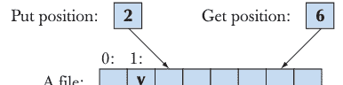

可以这样使用它：

```cpp
fstream fs{name};    // open for input and output
if (!fs) error("can't open ", name);

fs.seekg(5);         // move reading position (g for “get”) to 5 (the 6th character)
char ch;
fs >> ch;            // read and increment reading position
cout << "character[5] is " << ch << ' ' << int(ch) << "\n";

fs.seekp(1);         // move writing position (p for “put”) to 1
fs << 'y';           // write and increment writing position
```

请注意，`seekg(0)` 和 `seekp(0)` 会增加它们各自的位置，因此该图表示的是程序执行*后*的状态。

请务必小心：使用定位功能时，几乎没有任何运行时错误检查。特别是，如果你试图 seek（使用 `seekg()` 或 `seekp()`）超过文件末尾，其行为是未定义的，而且操作系统在这种情况下表现出的差异确实很大。

## 11.4 字符串流

你可以将一个 `string`（字符串）用作 `istream` 的源或 `ostream` 的目标。从 `string` 读取的 `istream` 被称为 `istringstream`，而将写入的字符存储在 `string` 中的 `ostream` 被称为 `ostringstream`。例如，`istringstream` 对于从 `string` 中提取数值非常有用：

```cpp
double str_to_double(string s)
// if possible, convert characters in s to floating-point value
{
    istringstream is {s};
    // make a stream so that we can read from s
    double d;
    is >> d;
    if (!is) error("double format error: ", s);
    return d;
}

double d1 = str_to_double("12.4");
// testing
double d2 = str_to_double("1.34e-3");
double d3 = str_to_double("twelve point three");
// will call error()
```

如果我们试图读取超出 `istringstream` 字符串末尾的内容，该 `istringstream` 将进入 `eof()` 状态。这意味着我们可以对 `istringstream` 使用“常规输入循环”；`istringstream` 确实是一种 `istream`。

相反，`ostringstream` 对于为需要简单 `string` 参数的系统格式化输出很有用，例如 GUI 系统（参见 §16.5）。例如：

```cpp
void my_code(string label, Temperature temp)
{
    // ...
    ostringstream os;
    // stream for composing a message
    os << setw(8) << label << ": ";
    os << fixed << setprecision(5) << temp.temp << temp.unit;
    someobject.display(Point(100,100), os.str().c_str());
    // ...
}
```

`ostrngstream` 的 `str()` 成员函数返回由输出操作到 `ostrngstream` 组成的 `string`。`c_str()` 是 `string` 的一个成员函数，它返回许多系统接口所要求的 C 风格字符串。

`stringstream` 通常用于我们将实际 I/O 与处理分离的时候。例如，`str_to_double()` 的 `string` 参数通常源自文件（例如，Web 日志）或键盘。同样，我们在 `my_code()` 中组成的消息最终会被写入屏幕的某个区域。例如，在 §11.7 中，我们使用 `stringstream` 过滤掉输入中不需要的字符。因此，`stringstreams` 可以被视为一种根据特殊需求和口味定制 I/O 的机制。

使用 `ostrngstream` 的一个简单方法是构造字符串进行拼接。例如：

```cpp
int seq_no = get_next_number();      // get the number of a log file
ostrngstream name;
name << "myfile" << seq_no << ".log"; // e.g., myfile17.log
ofstream log_file(name.str());        // e.g., open myfile17.log
```

通常，我们用 `string` 初始化一个 `istrngstream`，然后使用输入操作从该 `string` 读取字符。相反，我们通常将 `ostrngstream` 初始化为空 `string`，然后使用输出操作填充它。访问 `stringstream` 中字符有一种更直接的方式，有时也很有用：`ss.str()` 返回 `ss` 字符串的副本，而 `ss.str(s)` 将 `ss` 的字符串设置为 `s` 的副本。§11.7 展示了一个 `ss.str(s)` 是必不可少的例子。

## 11.5 面向行的输入

`>>` 运算符根据给定类型的标准格式将数据读入该类型的对象。例如，当读取到 `int` 时，`>>` 会一直读取直到遇到非数字字符；当读取到 `string` 时，`>>` 会一直读取直到遇到空白字符。标准库 `istream` 库还提供了读取单个字符和整行的功能。考虑以下代码：

```cpp
string name;
cin >> name;               // input: Dennis Ritchie
cout << name << '\n';     // output: Dennis
```

如果我们想一次读取该行上的所有内容，稍后再决定如何格式化它怎么办？这可以通过函数 `getline()` 来实现。例如：

```cpp
string name;
getline(cin, name);        // input: Dennis Ritchie
cout << name << '\n';     // output: Dennis Ritchie
```

现在我们就得到了整行。为什么我们需要这样做？一个好的答案可能是“因为我们要做 `>>` 无法做到的事情。” 通常，答案比较糟糕：“因为用户输入了一整行。” 如果这是你能想到的最好理由，请坚持使用 `>>`，因为一旦你拥有了输入的这行内容，你通常以某种方式解析它。例如：

```cpp
string first_name;
string second_name;
stringstream ss {name};
ss >> first_name;          // input: Dennis
ss >> second_name;         // input: Ritchie
```

直接读取到 first_name 和 second_name 会更简单。想要读取整行的一个常见原因是空白的定义并不总是合适的。有时，我们想将换行符视为与其他空白字符不同。例如，与游戏的文本通信可能会将一行视为一个句子，而不是依赖传统的标点符号：

> go left until you see a picture on the wall to your right  

> remove the picture and open the door behind it. take the bag from there

在这种情况下，我们首先读取整行，然后从中提取各个单词。

```cpp
string command;
getline(cin, command);            // read the line

stringstream ss {command};
vector<string> words;
for (string s; ss >> s; )
    words.push_back(s);  // extract the individual words
```

另一方面，如果我们有选择，我们很可能更倾向于依赖适当的标点符号而不是换行符。

## 11.6 字符分类

通常，我们根据格式约定读取整数、浮点数、单词等。然而，我们可以——有时必须——降低抽象级别，读取单个字符。这样做工作量大一些，但当我们读取单个字符时，我们对正在做的事情拥有完全的控制权。考虑

对表达式进行分词（§7.8.2）。例如，我们希望将 `1+4*x<=y/z*5` 分离为十一个标记：

```cpp
1 + 4 * x <= y / z * 5
```

我们可以使用 `>>` 来读取数字，但如果试图将标识符作为字符串读取，会导致 `x<=y` 被读为一个字符串（因为 `<` 和 `=` 不是空白字符），并且 `z*` 也会被读为一个字符串（因为 `*` 也不是空白字符）。相反，我们可以编写如下代码：

```cpp
for (char ch; cin.get(ch); ) {
    if (isspace(ch)) {       // 如果 ch 是空白
        // 什么也不做（即，跳过空白）
    }
    if (isdigit(ch)) {
        // 读取一个数字
    }
    else if (isalpha(ch)) {
        // 读取一个标识符
    }
    else {
        // 处理运算符
    }
}
```

`istream::get()` 函数将一个字符读取到其参数中。它不会跳过空白字符。与 `>>` 类似，`get()` 返回对 `istream` 的引用，以便我们可以检查其状态。

当我们读取单个字符时，通常希望对它们进行分类：这个字符是数字吗？这个字符是大写字母吗？等等。标准库提供了一组函数用于此目的：

### 字符分类

| 函数 | 描述 |

|---|---|

| `isspace(c)` | `c` 是否是空白字符（' '、'\t'、'\n' 等）？ |

| `isalpha(c)` | `c` 是否是字母（'a'...'z'、'A'...'Z'）（注意：不包括 '_'）？ |

| `isdigit(c)` | `c` 是否是十进制数字（'0'...'9'）？ |

| `isxdigit(c)` | `c` 是否是十六进制数字（十进制数字或 'a'..'f' 或 'A'..'F'）？ |

| `isupper(c)` | `c` 是否是大写字母？ |

| `islower(c)` | `c` 是否是小写字母？ |

| `isalnum(c)` | `c` 是否是字母或十进制数字？ |

| `iscntrl(c)` | `c` 是否是控制字符（ASCII 0..31 和 127）？ |

| `ispunct(c)` | `c` 是否既不是字母、数字、空白，也不是不可见的控制字符？ |

| `isprint(c)` | `c` 是否可打印（ASCII `'!'... '~'`）？ |

| `isgraph(c)` | 是否满足 `isalpha(c)` 或 `isdigit(c)` 或 `ispunct(c)`（注意：不包括空格）？ |


请注意，可以使用“或”运算符（`||`）将这些分类组合起来。例如，`isalnum(c)`意味着`isalpha(c)||isdigit(c)`；也就是说，“`c`是字母还是数字？”

此外，标准库还提供了两个用于消除大小写差异的有用函数：

### 字符大小写

| 函数 | 描述 |
|---|---|
| `toupper(c)` | `c`或`c`的大写等价形式 |
| `tolower(c)` | `c`或`c`的小写等价形式 |

这些功能在需要忽略大小写差异时非常有用。例如，在用户输入中，`Right`、`right`和`rigHT`很可能表示同一个词（`rigHT`很可能是误触 Caps Lock 键的结果）。在对这些字符串中的每个字符应用`tolower()`之后，我们得到了每个词的`right`。我们可以对任意`string`做到这一点：

```cpp
void tolower(string& s)        // 将 s 转换为小写
{
    for (char& x : s) x = tolower(x);
}
```

我们使用按引用传递（§8.5.5）来实际改变`string`。如果我们想保留旧字符串，我们可以编写一个函数来创建一个 lowercase 副本。优先使用`tolower()`而不是`toupper()`，因为对于某些自然语言（如德语）中的文本，这种处理方式效果更好，在这些语言中，并非每个小写字符都有对应的大写等价形式。

## 11.7 使用非标准分隔符

本节提供了使用`iostreams`解决实际问题的一个半真实示例。当我们读取字符串时，单词默认由空白字符分隔。不幸的是，`istream`并不提供我们定义哪些字符构成空白，或以其他方式直接更改`>>`如何读取字符串的功能。那么，如果我们需要对空白有另一种定义，该怎么办？考虑一下

§4.6.3中的示例，其中我们读取了“单词”并对它们进行比较。这些单词是由空白字符分隔的，因此如果我们读取：

> *As planned, the guests arrived; then,*

我们将得到以下“单词”：

- *As*
- *planned,*
- *the*
- *guests*
- *arrived;*
- *then,*

这并不是我们在词典中会找到的内容：`planned,`和`arrived;`不是单词。它们是单词加上令人分心且无关的标点字符。对于大多数目的，我们必须将标点字符当作空白字符来处理。我们如何去除这样的标点字符？我们可以读取字符，去除标点字符——或者将它们转换为空白——然后再次读取“清理后”的输入：

```cpp
string line;
getline(cin, line);        // 读取到 line
for (char& ch : line)      // 用空格替换每个标点字符
    switch(ch) {
        case ';': case '.': case ',': case '?': case '!':
            ch = ' ';
    }

stringstream ss(line);   // 创建一个从 line 读取的 istream ss
vector<string> vs;
for (string word; ss >> word; ) // 读取没有标点字符的单词
    vs.push_back(word);
```

使用该方法读取该行，我们得到期望的：

- *As*
- *planned*
- *the*
- *guests*
- *arrived*
- *then*

不幸的是，上面的代码很杂乱且比较特殊化。如果我们有了另一个标点的定义，该怎么办？让我们提供一种更通用且更有用的方法来去除输入流中不需要的字符。那应该是什么样的？我们希望用户代码看起来像什么？比如：

```cpp
ps.whitespace(";:,.");  // 将分号、冒号、逗号和点号视为空白
for (string word; ps >> word; )
    vs.push_back(word);
```

我们如何定义一个像`ps`这样工作的流？基本想法是从普通输入流中读取单词，然后将用户指定的“空白”字符视为空白；也就是说，我们不将“空白”字符交给用户，只是使用它们来分隔单词。例如，

`as.not`

应该是两个单词：

- `as`
- `not`

我们可以定义一个类来为我们做到这一点。它必须从`istream`获取字符，并且拥有一个`>>`运算符，其行为与`istream`的相同，只是我们可以告诉它哪些字符应被视为空白。为了简化起见，我们将不提供一种将现有的空白字符（空格、换行符等）视为非空白字符的方法；我们只是允许用户指定额外的“空白”字符。同样，我们也不会提供一种从流中完全移除指定字符的方法；像以前一样，我们只是将它们转换为空白。让我们把这个类称为`Punct_stream`：

```cpp
class Punct_stream {   // 类似于 istream，但用户可以添加到
                       // 空白字符集中
    public:
        Punct_stream(istream& is)
            : source(is), sensitive(true) { }

        void whitespace(const string& s)     // 使 s 成为空白集
        { white = s; }
        void add_white(char c) { white += c; }  // 添加到空白集
        bool is_whitespace(char c);          // c 在空白集中吗？

        void case_sensitive(bool b) { sensitive = b; }
        bool is_case_sensitive() { return sensitive; }

        Punct_stream& operator>>(string& s);
        operator bool();

    private:
        istream& source;           // 字符源
        istringstream buffer;     // 我们让 buffer 执行格式化
        string white;             // 被视为“空白”的字符
        bool sensitive;          // 流是否区分大小写？
};
```

基本想法是——正如上面的示例所示——从`istream`一次读取一行，将“空白”字符转换为空格，然后使用`istringstream`进行格式化。除了处理用户定义的空白之外，我们还赋予了`Punct_stream`一个相关功能：如果我们要求使用`case_sensitive()`，它可以区分大小写的输入转换为不区分大小写的输入。例如，如果我们要请求，我们可以让`Punct_stream`将

**Man bites dog!**

读取为：

- `man`
- `bites`
- `dog`

`Punct_stream`的构造函数接受用作字符源的`istream`，并将其命名为`source`。构造函数还默认将流设置为通常的区分大小写的行为。我们可以创建一个`Punct_stream`，从`cin`读取，将分号、冒号和点号视为空白，并将所有字符转换为小写：

```cpp
Punct_stream ps(cin);          // ps 从 cin 读取
ps.whitespace(";:.");        // 分号、冒号和点号也是空白
ps.case_sensitive(false);     // 不区分大小写
```

显然，最有趣的運算是输入运算符`>>`。它也是定义起来最困难的。我们的一般策略是从`istream`中读取整行到一个字符串中（称为`line`）。然后我们将所有“我们的”空白字符转换为空格字符（`' '`）。完成后，我们将该行放入`istringstream`

### 11.7 Punct_stream

被称为**buffer**（缓冲区）。现在我们可以使用常规的用于分隔空白的`>>`运算符从**buffer**中读取数据。代码看起来比这稍微复杂一点，因为我们只是尝试从**buffer**中读取，并且仅当发现它为空时才尝试填充它：

```cpp
Punct_stream& Punct_stream::operator>>(string& s)
{
  while (! (buffer>>s)) {   // try to read from buffer
    if (buffer.bad() || !source.good()) return *this;
    buffer.clear();

    string line;
    getline(source,line);   // get a line from source

    // do character replacement as needed:
    for (char& ch : line)
      if (is_whitespace(ch))  // to space
        ch = ' ';
      else if (!sensitive)  // to lower case
        ch = tolower(ch);

    buffer.str(line);   // put string into stream
  }
  return *this;
}
```

让我们逐位考虑这个部分。首先考虑那个有点不寻常的

```cpp
while (! (buffer>>s)) {
```

如果在名为**buffer**的`istringstream`中有字符，读取操作`buffer>>s`将起作用，并且`s`将接收到一个由“空白”分隔的单词；那么就没有更多需要做的事情了。只要**buffer**中有供我们读取的字符，这种情况就会发生。然而，当`buffer>>s`失败 – 也就是说，如果`! (buffer>>s)` – 我们必须从`source`（源）补充**buffer**（缓冲区）。注意`buffer>>s`的读取是在一个循环中进行的；在我们尝试补充**buffer**之后，我们需要再次尝试读取，因此我们得到

```cpp
while (! (buffer>>s)) {   // try to read from buffer
  if (buffer.bad() || !source.good()) return *this;
  buffer.clear();

  // replenish buffer
}
```

如果**buffer**是**bad**()（坏的）或者源存在问题，我们就放弃；否则，我们清除**buffer**并再次尝试。我们需要清除**buffer**，因为我们只有当读取失败时（通常是因为我们到达了**buffer**的**eof**()（文件结束））才会进入那个“补充循环”；也就是说，**buffer**中没有更多供我们读取的字符了。处理流状态总是很混乱，而且往往是细微错误的根源，需要繁琐的调试。幸运的是，补充循环的其余部分相当直接明了：

```cpp
string line;
getline(source, line);              // get a line from source

// do character replacement as needed:
for (char& ch : line)
    if (is_whitespace(ch))
        ch = ' ';                   // to space
    else if (!sensitive)
        ch = tolower(ch);           // to lower case

buffer.str(line);                   // put string into stream
```

我们将一行读入**line**。然后我们检查该行中的每个字符，看看是否需要更改它。**is_whitespace**()函数是**Punct_stream**的成员，我们稍后定义。**tolower**()函数是标准库函数，执行显而易见的操作，例如将**A**转换为**a**（参见 §11.6）。

一旦我们有了正确处理的**line**，我们需要将其放入我们的**istringstream**中。这就是**buffer.str(line)**所做的；它可以被读作“将**istringstream**缓冲区的**string**（字符串）设置为**line**”。

请注意，我们在从**source**使用**getline**()读取后“忘记”测试**source**的状态了。我们不需要这样做，因为我们最终会到达循环顶部的**!source.good()**测试。

一如既往，我们返回指向流本身的引用，***this***，作为**>>**的结果；参见 §17.10。

测试空白很简单；我们将一个字符与持有我们空白字符集的字符串中的每个字符进行比较：

```cpp
bool Punct_stream::is_whitespace(char c)
{
    for (char w : white)
        if (c==w) return true;
    return false;
}
```

请记住，我们将处理常规空白字符（例如换行符和空格）的常规工作留给`istream`，因此我们不需要对这些字符做任何特殊处理。

这就留下了一个神秘的函数：

```cpp
Punct_stream::operator bool()
{
    return !(source.fail() || source.bad()) && buffer.good();
}
```

`istream`的常规用法是测试`>>`的结果。例如：

```cpp
while (ps>>s) { /* ... */ }
```

这意味着我们需要一种方法将`ps>>s`的结果视为布尔值。`ps>>s`的结果是一个`Punct_stream`，因此我们需要一种方法将`Punct_stream`隐式转换为`bool`。这就是`Punct_stream`的`operator bool()`所做的。名为`operator bool()`的成员函数定义了对`bool`的转换。特别是，如果操作在`Punct_stream`上成功，它返回`true`。

现在我们可以编写我们的程序：

```cpp
int main()
{
    // given text input, produce a sorted list of all words in that text
    // ignore punctuation and case differences
    // eliminate duplicates from the output
    Punct_stream ps {cin};
    ps.whitespace(",,?!()}<>@&$#%|^*\~");    // Note `"` means `"` in string
    ps.case_sensitive(false);

    cout << "please enter words\n";
    vector<string> vs;
    for (string word; ps>>word; )
        vs.push_back(word);          // read words

    sort(vs.begin(),vs.end());       // sort in lexicographical order
    for (int i=0; i<vs.size(); ++i)    // write dictionary
        if (i==0 || vs[i]!=vs[i-1]) cout << vs[i] << "\n";
}
```

这将从输入中产生正确排序的单词列表。测试

```cpp
if (i==0 || vs[i]!=vs[i-1])
```

将抑制重复项。将此程序的输入设为

```
There are only two kinds of languages: languages that people complain about, and languages that people don't use.
```

它将会输出

```
about
and
are
complain
don't
kind
languages
of
only
people
that
there
two
use
```

为什么我们得到了 `don't` 而不是 `dont`？我们在 `whitespace()` 调用中省略了单引号。

> 警告：`Punct_stream` 在许多重要和有用的方面表现像 `istream`，但它并不是真正的 `istream`。例如，我们不能使用 `rdstate()` 来询问它的状态，`eof()` 未定义，并且我们并没有费心提供一个读取整数的 `>>`。重要的是，我们不能将 `Punct_stream` 传递给一个期望 `istream` 的函数。我们可以定义一个真的是 `istream` 的 `Punct_istream` 吗？我们可以，但我们还没有具备完成这个壮举所需的编程经验、设计概念和语言设施（如果你 – 稍后 – 想回到这个问题，你必须查阅专家级别的指南或手册中的流缓冲区）。

你觉得 `Punct_stream` 容易阅读吗？你觉得解释容易理解吗？你认为你自己能写出来吗？如果你几天前还是个真正的初学者，诚实的答案很可能是“不，不，不！”甚至是“不，不！不ooo！！– 你疯了吗？”我们理解 – 并且对最后一个问题/爆发的回答是“不，至少我们不这么认为”。这个例子的目的是


- 展示一个相当现实的问题和解决方案
- 展示使用相对有限的手段可以实现什么
- 为看似简单的问题提供一个易于使用的解决方案
- 说明接口与实现之间的区别

要成为一名程序员，你需要阅读代码，而不仅仅是精心打磨的教育性问题解决方案。这是一个例子。再过几天或几周，这对你来说将变得容易阅读，并且你会开始寻找改进解决方案的方法。

思考这个例子的一种方式是将其等同于一位老师在英语初学者课程中引入了一些真正的英语俚语，以增加一点色彩并使教学过程更生动。

## 11.8 And there is so much more

I/O（输入/输出）的细节似乎是无限的。它们可能确实是无限的，因为它们仅受人类创造性和任性的限制。例如，我们没有考虑自然语言所隐含的复杂性。在英语中写作 `12.35` 的内容，在大多数其他欧洲语言中通常表示为 `12,35`。当然，C++ 标准库提供了处理该问题以及 I/O 的许多其他自然语言特定方面的设施。你如何写中文字符？如何比较使用马拉雅拉姆语字符编写的字符串？有答案，但它们远超本书的范围。如果你需要知道，请查阅更专业或更高级的书籍（如 Langer 的 *Standard C++ I/O Streams and Locales* 和 Stroustrup 的 *The C++ Programming Language*）以及库和系统文档。寻找 `locale`（区域设置）；这是通常用于处理自然语言差异的设施的术语。

复杂性的另一个来源是缓冲：标准库 `iostreams` 依赖于一个称为 `streambuf` 的概念。对于高级工作 – 无论是为了性能还是功能 – 使用 `iostreams` 时，这些 `streambufs` 是不可避免的。如果你感觉需要定义自己的 `iostreams` 或调整 `iostreams` 以适配新的数据源/汇，请参见 Stroustrup 的 *The C++ Programming Language* 第 38 章或你的系统文档。

在使用 C++ 时，你也可能会遇到 C 标准 `printf()/scanf()` I/O 函数族。如果确实如此，请查阅 §27.6、§B.11.2，或者 Kernighan 和 Ritchie 的优秀 C 语言教科书（*The C Programming Language*），或网络上无数资源中的任何一个。每种语言都有自己的 I/O 设施；它们都有差异，大多都古怪，但大多数都以各种奇怪的方式反映了我们在第 10 章和第 11 章中介绍的基本概念。

标准库 I/O 设施在附录 B 中进行了总结。

相关的图形用户界面（GUIs）主题在第 12–16 章中描述。

### 演练

1. 启动一个名为 `Test_output.cpp` 的程序。声明一个整数 `birth_year`，并将其赋值为你出生的年份。
2. 以十进制、十六进制和八进制形式输出你的 `birth_year`。
3. 为每个值标注其所使用的进制名称。
4. 你是否使用制表符将输出按列对齐？如果没有，请这样做。
5. 现在输出你的年龄。
6. 遇到问题了吗？发生了什么？将你的输出修复为十进制。
7. 返回第 2 步，使你的输出显示每个值对应的进制。
8. 尝试以八进制、十六进制等方式读取：

```cpp
cin >> a >> oct >> b >> hex >> c >> d;
cout << a << '\t' << b << '\t' << c << '\t' << d << '\n' ;
```

使用以下输入运行这段代码

```
1234 1234 1234 1234
```

解释结果。
9. 编写一些代码，将数字 `1234567.89` 打印三次，首先使用 `defaultfloat`，然后使用 `fixed`，最后使用 `scientific` 格式。哪种输出形式向用户呈现了最精确的表示？解释原因。
10. 制作一个简单的表格，包含你自己和至少五位朋友的姓氏、名字、电话号码和电子邮件地址。尝试不同的字段宽度，直到你满意该表格的展示效果。

### 复习

1. 为什么输入/输出（I/O）对程序员来说很棘手？
2. 符号 `<< hex` 的作用是什么？
3. 十六进制数在计算机科学中有什么用途？为什么？
4. 列举一些你可能想要实现用于格式化整数输出的选项。
5. 什么是操作子（manipulator）？
6. 十进制的前缀是什么？八进制？十六进制？
7. 浮点值的默认输出格式是什么？
8. 什么是字段（field）？
9. 解释 `setprecision()` 和 `setw()` 的作用。
10. 文件打开模式（file open modes）的目的是什么？
11. 以下哪些操作子是临时的（即不“粘附”/不持续生效）：`hex`、`scientific`、`setprecision()`、`showbase`、`setw()`？
12. 字符 I/O 和二进制 I/O 之间有什么区别？
13. 给出一个使用二进制文件代替文本文件可能更有益的示例。
14. 给出两个 `stringstream` 可能很有用的示例。
15. 什么是文件位置（file position）？
16. 如果你将文件位置移动到文件末尾之后，会发生什么？
17. 什么时候你更倾向于使用面向行的输入（line-oriented input）而不是面向类型的输入（type-specific input）？
18. `isalnum(c)` 的作用是什么？

### 术语

- 二进制
- 字符分类
- 十进制
- `defaultfloat`
- 文件定位
- `fixed`
- 十六进制
- 不规则性
- 面向行的输入
- 操作子
- 非标准分隔符
- `noshowbase`
- 八进制
- 输出格式化
- 规则性
- `scientific`
- `setprecision()`
- `showbase`

### 练习

1. 编写一个程序，读取一个文本文件，并将其输入转换为全小写，生成一个新文件。
2. 编写一个程序，给定一个文件名和一个单词，输出包含该单词的每一行及其行号。提示：`getline()`。
3. 编写一个程序，从文件中删除所有元音字母（“去元音”）。例如，`Once upon a time!` 变成 `nc pn tm!`。令人惊讶的是，结果通常仍然可读；试着在你的朋友身上测试一下。
4. 编写一个名为 `multi_input.cpp` 的程序，提示用户以八进制、十进制或十六进制的任意组合输入几个整数，使用 `0` 和 `0x` 进制后缀；正确解释这些数字；并将它们转换为十进制形式。然后你的程序应像这样在适当间隔的列中输出值：
   - `0x43` 十六进制转换为 `67` 十进制
   - `0123` 八进制转换为 `83` 十进制
   - `65` 十进制转换为 `65` 十进制
5. 编写一个程序，读取字符串，对于每个字符串，输出每个字符的字符分类，如 §11.6 中介绍的字符分类函数所定义。注意，一个字符可以有多种分类（例如，`x` 既是字母又是字母数字）。
6. 编写一个程序，用空白替换标点符号。考虑：`.` (句号), `;` (分号), `,` (逗号), `?` (问号), `-` (破折号), `'` (单引号) 这些标点字符。不要修改双引号对（`""`）内的字符。例如，“ - don't use the as-if rule. ” 变成 `don t use the as if rule`
7. 修改上一个练习中的程序，使其将 `don't` 替换为 `do not`，`can't` 替换为 `cannot` 等；保持单词内部的连字符不变（因此我们得到 “ `do not use the as-if rule` ”）；并将所有字符转换为小写。
8. 使用上一个练习中的程序来制作一个词典（作为 §11.7 中方法的替代方案）。在一个多页文本文件上运行结果，查看结果，并看看你是否能改进程序以制作一个更好的词典。
9. 将 §11.3.2 中的二进制 I/O 程序拆分为两个：一个程序将普通文本文件转换为二进制，另一个程序读取二进制并将其转换为文本。通过将文本文件与其转换为二进制再转回后的结果进行比较来测试这些程序。
10. 编写一个函数 `vector<string> split(const string& s)`，返回从参数 `s` 中分割出的以空白分隔的子字符串的 `vector`。
11. 编写一个函数 `vector<string> split(const string& s, const string& w)`，返回从参数 `s` 中分割出的以空白分隔的子字符串的 `vector`，其中空白定义为“普通空白”加上 `w` 中的字符。
12. 反转文本文件中字符的顺序。例如，`asdfghjkl` 变成 `lkjhgfdsa`。警告：没有真正好的、可移植的、高效的方法来向后读取文件。
13. 反转文件中单词（定义为以空白分隔的字符串）的顺序。例如，`Norwegian Blue parrot` 变成 `parrot Blue Norwegian`。你可以假设文件中的所有字符串都能一次性放入内存。
14. 编写一个程序，读取一个文本文件，并输出文件中每种字符分类（§11.6）有多少个字符。
15. 编写一个程序，读取一个以空白分隔的数字文件，并输出一个以科学计数法、精度为 8 的数字文件，每行四个字段，每个字段 20 个字符。
16. 编写一个程序，读取一个以空白分隔的数字文件，并按顺序输出它们（最小值在前），每行一个值。每个值只写一次，如果它出现多次，则在其所在行写出其出现次数。例如，`7 5 5 7 3 117 5` 应给出：

```
3     3
5     3
7     2
117
```

# 后记

输入和输出是混乱的，因为我们的品味和约定并不遵循简单易懂的规则和直接的数学定律。作为程序员，我们很少处于可以要求用户偏离其偏好的位置；即使处于这种位置，我们也通常不应该傲慢地认为可以提供一种简单替代来取代经过时间积累形成的约定。因此，我们必须预期、接受并适应输入和输出的某种混乱，同时仍尽量保持程序尽可能简单——但不再更简。

## 12 显示模型

> “那时的世界是黑白的。直到 20 世纪 30 年代某时某刻它才变得有颜色。”
> — Calvin 的父亲

本章介绍显示模型（GUI 的输出部分），给出使用示例以及屏幕坐标、线条和颜色等基本概念。`Line`、`Lines`、`Polygons`、`Axis` 和 `Text` 是 `Shape` 的示例。`Shape` 是我们可以显示和操作在屏幕上的内存对象。接下来的两章将进一步探讨这些类，第 13 章专注于它们的实现，第 14 章关注设计问题。

- 12.1 为什么图形？
- 12.2 显示模型
- 12.3 第一个示例
- 12.4 使用 GUI 库
- 12.5 坐标
- 12.6 Shape
- 12.7 使用 Shape 基元
    - 12.7.1 图形头文件和 main
    - 12.7.2 一个几乎空白的窗口
    - 12.7.3 Axis
    - 12.7.4 绘制函数图
    - 12.7.5 多边形
    - 12.7.6 矩形
    - 12.7.7 填充
    - 12.7.8 文本
    - 12.7.9 图像
    - 12.7.10 还有更多
- 12.8 如何运行这些
    - 12.8.1 源文件

### 12.1 为什么图形？

我们为什么要花四章讲图形，一章讲 GUI（图形用户界面）？毕竟，这是一本关于编程的书，不是图形学的书。我们有大量有趣的软件主题没有讨论，对于图形学这个主题，我们充其量只能触及表面。那么，“为什么图形？”基本上，图形是一个让我们探索软件设计、编程和编程语言功能中几个重要领域的主题：

- 图形很有用。编程不仅仅是图形，软件也不仅仅是通过 GUI 操纵代码。然而，在许多领域，良好的图形要么是必不可少的，要么是非常重要的。例如，如果无法绘制数据图表，我们甚至不会梦想去研究科学计算、数据分析或几乎任何定量学科。第 15 章提供了简单的（但通用的）数据图表功能。
- 图形很有趣。在计算机科学的领域中，很少有地方像图形这样，代码的效果如此直观明显——当最终摆脱 bug 时——如此令人愉悦。即使图形没有用，我们也倾向于玩弄图形！
- 图形提供了许多有趣的代码供阅读。学习编程的一部分是阅读大量代码，以获得对良好代码的感觉。类似地，要成为优秀的英语写作者，需要阅读大量的书籍、文章和优质报纸。由于我们在屏幕上看到的与我们在程序中编写的内容之间有直接的对应关系，简单的图形代码比大多数同等复杂度的代码更易读。本章将证明你在几分钟的介绍后就可以阅读图形代码；第 13 章将展示如何在再花几个小时后编写图形代码。
- 图形学是设计案例的肥沃源泉。实际上，设计并实现一个优秀的图形和 GUI 库非常困难。图形学是具体且实用的设计决策和设计技巧的丰富来源。一些对于设计类、设计函数、将软件分层（抽象层）以及构建库最有用的技术，都可以用相对少量的图形和 GUI 代码来说明。
- 图形学通常被视为面向对象编程及其支持的语言特性的良好入门。尽管传言相反，面向对象编程并不是为了能够处理图形而发明的（参见第 22 章），但它很快就被应用到了这个领域，并且图形学提供了一些最容易理解的面向对象设计示例。
- 一些关键的图形学概念并非显而易见。因此，它们值得教学讲解，而不是依靠你个人的主动性（以及耐心）去自行寻找信息。如果我们没有展示如何制作图形和 GUI，你可能会认为它们是“魔法”，这就违背了本书的基本目标之一。

## 12.2 显示模型

`iostream` 库面向读写字符流，这些字符可能出现在一系列数值或一本书中。对于图形位置概念的唯一直接支持是新行和制表符。你可以在一维的字符流中嵌入颜色和二维位置等概念。这正是像 Troff、TeX、Word、HTML 和 XML（以及它们相关的图形软件包）这样的布局（排版、“标记”）语言所做的。例如：

```html
<h2>
Organization
</h2>
This list is organized in three parts:
<ul>
<li><b>Proposals</b>, numbered EPddd, ...
<li><b>Issues</b>, numbered Edddd, ...
<li><b>Suggestions</b>, numbered ESddd, ...
</ul>
<p>We try to . . .
</p>
```

这是一段 HTML，指定了标题（`<h2>` . . . `</h2>`）、带有列表项（`<li>` . . . `</li>`）的列表（`<ul>` . . . `</ul>`）和一个段落（`<p>`）。我们省略了大部分实际文本，因为这里无关紧要。要点在于，你可以用纯文本表达布局概念，但写下的字符与屏幕上显示的内容之间的联系是间接的，由解释这些“标记”命令的程序来控制。这种技术从根本上很简单且极其有用（你读到的几乎所有东西都是用它们制作的），但它们也有局限性。

在本章及接下来的四章中，我们提出了一种替代方案：一种直接针对计算机屏幕的图形和图形用户界面概念。基本概念本质上是图形的（并且是二维的，适应计算机屏幕的矩形区域），例如坐标、线、矩形和圆。从编程角度来看，目标是内存中的对象与屏幕上的图像之间具有直接的对应关系。

基本模型如下：我们使用图形系统提供的基本对象（例如线条）来组合对象。我们将这些图形对象“附加”到一个窗口对象上，该对象代表我们的物理屏幕。我们可以将其视为显示本身、“显示引擎”、“我们的图形库”、“GUI 库”或甚至（幽默地说）“在屏幕背面书写的小矮人”的程序，然后该程序获取我们附加到窗口上的对象并将其绘制在屏幕上：

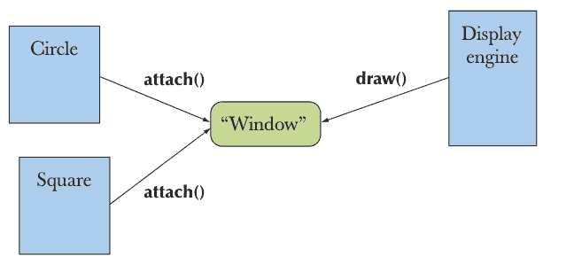

“显示引擎”在屏幕上画线，在屏幕上放置文本字符串，给屏幕区域上色等。为了简单起见，即使我们的 GUI 库所做的远不止绘制对象，我们仍使用“我们的 GUI 库”甚至“系统”这一短语来指代显示引擎。就像我们的代码让 GUI 库为我们做大部分工作一样，GUI 库将其大部分工作委托给操作系统。

## 12.3 第一个示例

我们的任务是定义类，以便我们可以创建希望在屏幕上看到的对象。例如，我们可能希望将图表绘制为一系列连接的线条。这里有一个小程序，展示了该概念的一个非常简单的版本：

```cpp
#include "Simple_window.h"   // 获取对我们的窗口库的访问权限
#include "Graph.h"               // 获取对我们的图形库设施的访问权限

int main()
{
   using namespace Graph_lib;   // 我们的图形设施位于 Graph_lib 中
   Point tl {100,100};          // 将作为窗口的左上角
   Simple_window win {tl,600,400,"Canvas"};   // 创建一个简单的窗口
   Polygon poly;                // 创建一个形状（多边形）
   poly.add(Point{300,200});    // 添加一个点
   poly.add(Point{350,100});    // 添加另一个点
   poly.add(Point{400,200});    // 添加第三个点
   poly.set_color(Color::red);  // 调整 poly 的属性
   win.attach (poly);           // 将 poly 连接到窗口
   win.wait_for_button();       // 将控制权交给显示引擎
}
```

当我们运行这个程序时，屏幕看起来如下：


让我们逐行浏览该程序，看看做了哪些事情。首先，我们包含了图形接口库的头文件：

```cpp
#include "Simple_window.h" // 获取对我们的窗口库的访问权限
#include "Graph.h" // 获取对我们的图形库设施的访问权限
```


然后，在 `main()` 中，我们首先告诉编译器我们的图形设施位于 `Graph_lib` 中：

```cpp
using namespace Graph_lib; // 我们的图形设施位于 Graph_lib 中
```

然后，我们定义一个点，将用作我们窗口的左上角：

```cpp
Point tl {100,100}; // 将作为窗口的左上角
```

接下来，我们在屏幕上创建一个窗口：

```cpp
Simple_window win {tl,600,400,"Canvas"}; // 创建一个简单的窗口
```

我们在 `Graph_lib` 接口库中使用了一个代表窗口的类，称为 `Simple_window`。这个特定的 `Simple_window` 的名称是 `win`；也就是说，`win` 是一个 `Simple_window` 类的变量。`win` 的初始化列表以将用作左上角的点 `tl` 开头，后跟 `600` 和 `400`。它们分别是屏幕上显示的窗口的宽度和高，以像素为单位。我们稍后将详细解释，但这里的主要要点是，我们通过提供宽度和高度来指定一个矩形。字符串 `Canvas` 用于标记窗口。如果你仔细看，可以在窗口框架的左上角看到 `Canvas` 一词。

接下来，我们在窗口中放入一个对象：

```cpp
Polygon poly; // 创建一个形状（多边形）

poly.add(Point{300,200}); // 添加一个点
poly.add(Point{350,100}); // 添加另一个点
poly.add(Point{400,200}); // 添加第三个点
```

我们定义了一个多边形 `poly`，然后向其中添加点。在我们的图形库中，`Polygon` 最初是空的，我们可以随意添加尽可能多的点。由于我们添加了三个点，我们得到一个三角形。点就是一对值，表示窗口内的 x 和 y（水平和垂直）坐标。

仅仅为了展示一下，我们将多边形的线条着色为红色：

```cpp
poly.set_color(Color::red); // 调整 poly 的属性
```

最后，我们将 `poly` 附加到我们的窗口 `win` 上：

```cpp
win.attach(poly);        // 将 poly 连接到窗口
```

如果程序不是那么快，你会注意到到目前为止屏幕上并没有发生任何事情：什么都没有。我们创建了一个窗口（确切地说，是 `Simple_window` 类的一个对象），创建了一个多边形（称为 `poly`），将该多边形涂成红色（`Color::red`），并将其附加到窗口（称为 `win`）上，但我们还没有要求将该窗口显示在屏幕上。这是由程序的最后一行完成的：

```cpp
win.wait_for_button();   // 将控制权交给显示引擎
```

为了让 GUI 系统在屏幕上显示对象，你必须将控制权交给“系统”。我们的 `wait_for_button()` 做到了这一点，它还会等待你“按下”（“点击”）我们的 `Simple_window` 的“Next”按钮后才继续。这让你有机会在程序结束和窗口消失之前查看窗口。当你按下按钮时，程序终止，关闭窗口。

孤立地看，我们的窗口看起来像这样：

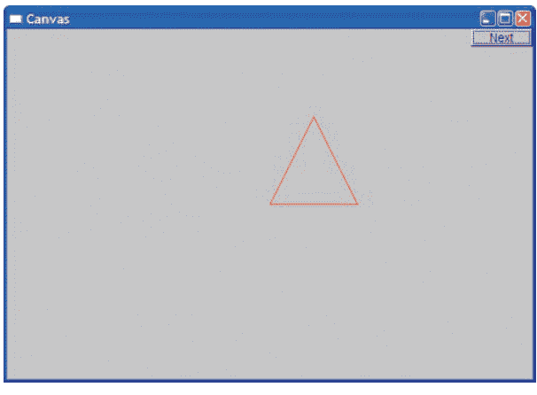

你会注意到我们“作弊”了一点。那个标有“Next”的按钮是从哪里来的？我们将其内置于我们的 `Simple_window` 类中。在第 16 章中，我们将 `Simple_window` 移动到“普通的” `Window`，后者没有可能多余的设施

内置功能，并展示如何编写自己的代码来控制与窗口的交互。

在接下来的三章中，我们将简单地使用那个“下一步”按钮，在我们希望分阶段显示信息（“逐帧”）时，从一个“显示”移动到下一个。

你太习惯操作系统在每个窗口周围加边框了，以至于可能没有特别注意到它。然而，本章和后续章节中的图片是在 Microsoft Windows 系统上生成的，因此你通常会免费获得右上角的三个按钮。这可能很有用：如果你的程序陷入真正的混乱（在调试期间肯定会时不时发生这种情况），你可以通过点击 X 按钮来终止它。当你在其他系统上运行你的程序时，会根据该系统的约定添加不同的边框。我们对边框的唯一贡献是标签（在这里是 Canvas）。

## 12.4 使用 GUI 库

在本书中，我们将不直接操作系统图形的和 GUI（图形用户界面）设施。这样做会将我们的程序限制在单一操作系统上运行，并且也会迫使我们直接处理许多杂乱的细节。与文本 I/O 类似，我们将使用一个库来平滑操作系统差异、I/O 设备变化等，并简化我们的代码。不幸的是，C++ 并没有像提供标准流 I/O 库那样提供一个标准的 GUI 库，因此我们使用许多可用的 C++ 和 GUI 库之一。为了不将你直接绑定到其中一个 GUI 库，并避免让你一次性面对 GUI 库的全部复杂性，我们使用了一组简单的接口类，这些类可以用大约几百行代码为几乎任何 GUI 库实现。

我们使用的 GUI 工具包（目前是通过间接方式使用）叫做 FLTK（Fast Light Tool Kit，发音为“full tick”），来自 www.fltk.org。我们的代码在任何使用 FLTK 的地方（Windows、Unix、Mac、Linux 等）都是可移植的。我们的接口类也可以使用其他工具包重新实现，因此使用它们的代码具有潜在的可移植性更高。

我们的接口类所呈现的编程模型比常见工具包提供的要简单得多。例如，我们完整的图形和 GUI 接口库大约有 600 行 C++ 代码，而极其简洁的 FLTK 文档大约有 1,000 页。你可以从 www.fltk.org 下载，但我们不建议你现在就这么做。你可以暂时不需要那个层级的细节。第 12–16 章中呈现的一般想法可以用于任何流行的 GUI 工具包。当然，我们将解释我们的接口类如何映射到 FLTK，这样你（最终）就能看到如果需要如何直接使用它（以及类似的工具包）。

我们可以像这样说明我们的“图形世界”的各个部分：

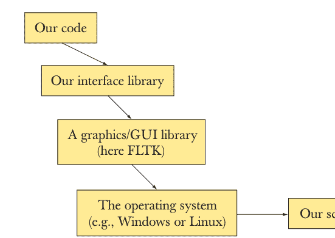

我们的接口类提供了一个简单的、可由用户扩展的二维形状基本概念，并有限地支持颜色的使用。为了驱动这一点，我们提出了一个基于“回调”函数的简单 GUI 概念，这些函数由屏幕上用户定义的按钮等的使用触发（第 16 章）。

## 12.5 坐标

计算机屏幕是由像素组成的矩形区域。像素是一个可以被赋予某种颜色的小点。在程序中建模屏幕的最常见方式是将屏幕视为一个像素矩形。每个像素由一个 $x$（水平）坐标和一个 $y$（垂直）坐标标识。$x$ 坐标从 0 开始，表示最左侧的像素，并向右增加（朝右方向）直到最右侧的像素。$y$ 坐标从 0 开始，表示最顶部的像素，并向下增加（朝下方向）直到最底部的像素：

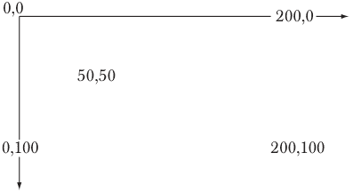


请注意，y 坐标是“向下增长的”。数学家，特别是，觉得这很奇怪，但屏幕（和窗口）有很多尺寸，它们的共同点几乎都是左上角点。

可用的像素数量取决于屏幕：1024-by-768、1280-by-1024、1400-by-1050 和 1600-by-1200 是常见的屏幕尺寸。

在使用屏幕与计算机交互的语境中，窗口是屏幕上专门用于某个特定目的并由程序控制的矩形区域。窗口的寻址方式与屏幕完全相同。基本上，我们将窗口视为一个小屏幕。例如，当我们要说

```
Simple_window win {11,600,400,"Canvas"};
```

时，我们请求了一个 600 像素宽、400 像素高的矩形区域，我们可以将其寻址为 0-599（从左到右）和 0-399（从上到下）。你可以在其上绘图的窗口区域通常被称为画布（canvas）。600-by-400 区域指的是窗口“内部”，即系统提供的边框内的区域；它不包括系统用于标题栏、关闭按钮等的空间。

## 12.6 形状

我们在屏幕上绘图的基本工具箱由大约十几个类组成：

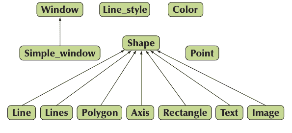

箭头表示指向的类可以在需要被指向类的位置使用。例如，`Polygon` 可以在需要 `Shape` 的地方使用；也就是说，`Polygon` 是 `Shape` 的一种。

我们将开始介绍并使用

- `Simple_window, Window`
- `Shape, Text, Polygon, Line, Lines, Rectangle, Function` 等。
- `Color, Line_style, Point`
- `Axis`

稍后（第 16 章），我们将添加 GUI（用户交互）类：

- `Button, In_box, Menu` 等。

我们可以轻松地添加许多其他类（对于“容易”的某种定义），例如

- `Spline, Grid, Block_chart, Pie_chart` 等。

然而，定义或描述一个包含所有设施的完整 GUI 框架超出了本书的范围。

## 12.7 使用 Shape 原语

在本节中，我们将带你了解我们的图形库的一些原语设施：`Simple_window, Window, Shape, Text, Polygon, Line, Lines, Rectangle, Color, Line_style, Point, Axis`。目的是让你对这些设施能做什么有一个广泛的看法，但还不是对其中任何类都有详细的理解。在接下来的章节中，我们将探索每个类的设计。

我们现在将通过一个简单的程序，逐行解释代码并展示每行代码在屏幕上的效果。当你运行程序时，你会看到随着我们向窗口添加形状和修改现有形状，图像是如何变化的。基本上，我们通过观察程序执行过程来“动画化”代码的执行进度。

### 12.7.1 图形头文件和 main

首先，我们包含定义我们对图形和 GUI 设施接口的头文件：

```c++
#include "Window.h"    // 一个普通的窗口
#include "Graph.h"
```

或者

```c++
#include "Simple_window.h"    // 如果我们想要那个"Next"按钮
#include "Graph.h"
```

正如你可能猜到的，`Window.h` 包含与窗口相关的设施，`Graph.h` 包含与将形状（包括文本）绘制到窗口中相关的设施。这些设施定义在 `Graph_lib` 命名空间中。为了简化符号，我们使用一个命名空间指令使 `Graph_lib` 中的名称在我们的程序中直接可用：

```c++
using namespace Graph_lib;
```

通常，`main()` 包含我们要执行的代码（直接或间接地），并处理异常：

```c++
int main ()
try
{
    // ... 这里是我们的代码 ...
}
catch(exception& e) {
    // 一些错误报告
    return 1;
}
catch(...) {
    // 更多错误报告
    return 2;
}
```

为了让这个 `main()` 能够编译，我们需要定义 `exception`。如果我们像往常一样包含 `std_lib_facilities.h`，就可以得到它，或者我们可以开始直接处理标准头文件并包含 `<stdexcept>`。

### 12.7.2 一个几乎空白的窗口

我们不会在这里讨论错误处理（见第 5 章，特别是 §5.6.3），而是直接进入 `main()` 中的图形部分：

```c++
Point tl {100,100}; // 我们窗口的左上角

Simple_window win {tl,600,400,"Canvas"};
// 屏幕坐标 tl 表示左上角
// 窗口大小(600*400)
// 标题: Canvas
win.wait_for_button(); // 显示!
```

这创建了一个 `Simple_window`，即带有“Next”按钮的窗口，并在屏幕上显示它。显然，为了获得 `Simple_window`，我们需要包含头文件 `Simple_window.h` 而不是 `Window.h`。这里我们具体指定了窗口在屏幕上的位置：其左上角位于 `Point(100,100)`。那是在屏幕左上角附近，但不过于靠近。

显然，`Point` 是一个类，其构造函数接收一对整数，并将其解释为 $(x, y)$ 坐标对。我们也可以这样写：

```cpp
Simple_window win {Point{100,100},600,400,"Canvas"};
```

然而，我们想要多次使用点 (100,100)，因此给它一个符号名称更方便。600 是窗口的宽度，400 是窗口的高度，而 `Canvas` 是我们希望放在窗口边框上的标签。

为了实际让窗口显示在屏幕上，我们需要将控制权交给 GUI 系统。我们通过调用 `win.wait_for_button()` 来实现这一点，结果如下：


在我们的窗口背景中，我们看到了一台笔记本电脑屏幕（为了拍摄略微清理了一下）。对于好奇无关细节的人来说，我们可以告诉你，我站在安提贝斯的毕加索图书馆附近，对着尼斯湾拍了这张照片。部分隐藏在后方的黑色控制台窗口就是正在运行我们程序的那个。拥有一个控制台窗口有点丑陋且没必要，但它的优点在于，如果我们调试了一部分的程序陷入无限循环并拒绝退出，它提供了一种有效的方法来终止我们的窗口。如果你仔细看，会注意到我们运行的是 Microsoft C++ 编译器，但你也完全可以使用其他编译器（如 Borland 或 GNU）。

在后续的演示中，我们将消除窗口周围的干扰因素，只显示该窗口本身：

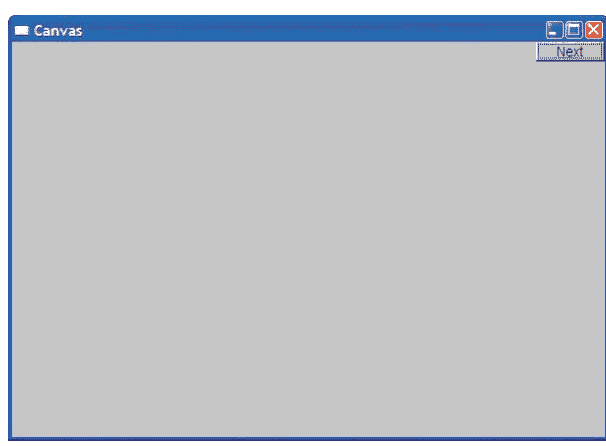

窗口的实际尺寸（以英寸为单位）取决于屏幕的分辨率。有些屏幕的像素比别的屏幕大。

### 12.7.3 坐标轴

一个几乎空白的窗口并不是很有趣，所以我们最好添加一些信息。我们想显示什么？为了提醒你图形并不全是娱乐游戏，我们将从一些严肃且稍显复杂的内容开始：坐标轴。没有坐标轴的图表通常是一种耻辱。没有坐标轴，你根本不知道数据代表什么。也许你在随附的文本中解释了所有内容，但添加坐标轴是更安全的选择；人们经常不读说明，而且漂亮的图形表示往往与其原始上下文分离。因此，图表需要坐标轴：

```cpp
Axis xa {Axis::x, Point(20,300), 280, 10, "x axis"};   // 创建一个 Axis
// Axis 是一种 Shape
// Axis::x 表示水平方向
// 起点在 (20,300)
// 长度为 280 像素
// 10 个“刻度”
// 轴标签为 “x axis”

win.attach(xa);                 // 将 xa 附加到窗口 win 上
win.set_label("Canvas #2");     // 重新标记窗口
win.wait_for_button();          // 显示！
```

操作序列如下：创建轴对象，将其添加到窗口，最后显示它：

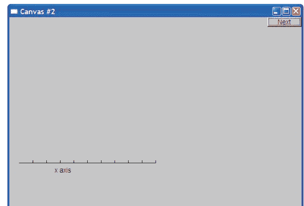

我们可以看到 `Axis::x` 是一条水平线。我们看到了所需的“刻度”数量（10个）以及标签“x axis”。通常，标签会解释轴和刻度代表什么。自然，我们选择将 x 轴放置在窗口底部附近的某个位置。在实际应用中，我们通常会用符号常量来表示高度和宽度，这样我们就可以把“紧邻底部”表示为类似于 `y_max-bottom_margin` 的内容，而不是使用诸如 300 这样的“魔法常数”（参见 §4.3.1, §15.6.2）。

为了帮助识别我们的输出，我们使用 `Window` 的成员函数 `set_label()` 将屏幕重新标记为 Canvas #2。

现在，让我们添加一个 y 轴：

```cpp
Axis ya (Axis::y, Point{20,300}, 280, 10, "y axis");
ya.set_color(Color::cyan);           // 选择颜色
ya.label.set_color(Color::dark_red); // 为文本选择颜色
win.attach(ya);
win.set_label("Canvas #3");
win.wait_for_button();               // 显示！
```

只是为了展示一些功能，我们将 $y$ 轴设为青色，将标签设为深红色。

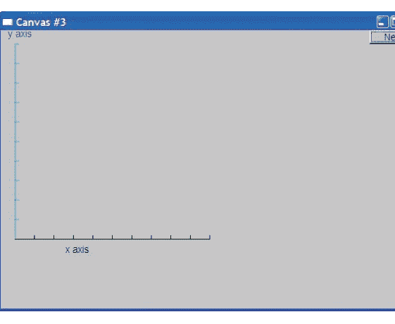

我们实际上并不认为为 $x$ 和 $y$ 轴使用不同的颜色是个好主意。我们只是想向你展示如何设置形状及形状中单个元素的颜色。大量使用颜色并不一定总是好主意。特别是，新手往往比品味更热衷于使用颜色。

### 12.7.4 绘制函数

接下来呢？现在我们有一个带坐标轴的窗口，因此绘制一个函数似乎是个好主意。我们创建一个代表正弦函数的形状并将其附加到窗口：

```cpp
Function sine {sin,0,100,Point(20,150),1000,50,50};    // 正弦曲线
// 在 [0:100] 范围内绘制 sin()，(0,0) 位于 (20,150)
// 使用 1000 个点；x 值缩放 *50，y 值缩放 *50

win.attach(sine);
win.set_label("Canvas #4");
win.wait_for_button();
```


这里，名为 `sine` 的 `Function` 将使用标准库函数 `sin()` 生成数值来绘制正弦曲线。我们在 §15.3 中解释了绘制函数的详细方法。目前，只需注意要绘制函数，我们必须指明它的起点（一个 `Point`）以及我们想查看它的输入值集合（一个范围），并且需要提供有关如何将此信息压缩到我们窗口中的信息（缩放）：

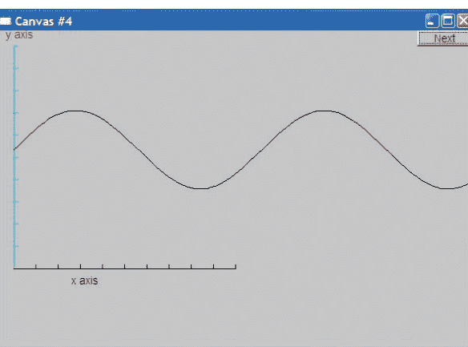

请注意，当曲线碰到窗口边缘时，它只是简单地停止了。绘制在我们窗口矩形之外的点会被 GUI 系统简单地忽略，永远不会被看到。

### 12.7.5 多边形

绘制出来的函数是数据展示的一个例子。我们将在第 15 章中看到更多的内容。然而，我们还可以在窗口中绘制不同类型的对象：几何形状。我们使用几何形状进行图形插图，表示用户交互元素（如按钮），并且通常用于使我们的演示更有趣。`Polygon` 由一系列点表征，`Polygon` 类用线条连接这些点。第一条线连接第一个点到第二个点，第二条线连接第二个点到第三个点，最后一条线连接最后一个点到第一个点：

```cpp
sine.set_color(Color::blue);    // 我们改变了关于 sine 颜色的主意

Polygon poly;                      // 一个多边形；Polygon 是一种 Shape
poly.add(Point(300,200));          // 三个点构成一个三角形
poly.add(Point(350,100));
poly.add(Point(400,200));

poly.set_color(Color::red);
poly.set_style(Line_style::dash);
win.attach(poly);
win.set_label("Canvas #5");
win.wait_for_button();
```

这次我们改变了正弦曲线（*sine*）的颜色，只是为了展示如何做。然后，我们添加了一个三角形，就像我们在 §12.3 的第一个例子中那样，作为一个多边形的例子。再次，我们设置了一个颜色，最后，我们设置了一个样式。`Polygon` 的线条具有“样式”。默认情况下是实线，但我们也可以根据需要将这些线条设置为虚线、点线等（参见 §13.5）。我们得到

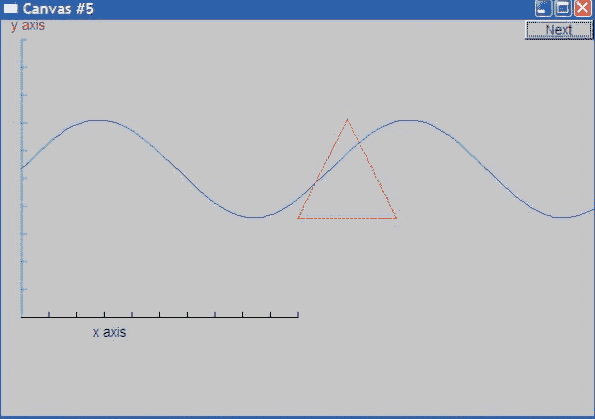

### 12.7.6 矩形

屏幕是一个矩形，窗口是一个矩形，纸张也是一个矩形。事实上，我们现代世界中的许多形状都是矩形（或者至少是圆角矩形）。这是有原因的：矩形是最简单的形状。例如，它很容易描述（左上角加上宽度加上高度，或者左上角加上右下角，或者别的什么），判断一个点在矩形内部还是外部很容易，而且让硬件快速绘制像素矩形也很简单。

因此，大多数高级图形库处理矩形比处理其他闭合形状更好。因此，我们将 `Rectangle` 作为一个与 `Polygon` 类分离的类提供。`Rectangle` 由其左上角加上宽度和高度表征：

```cpp
Rectangle r {Point{200,200}, 100, 50};    // 左上角，宽度，高度
win.attach(r);
win.set_label("Canvas #6");
win.wait_for_button();
```

由此，我们得到

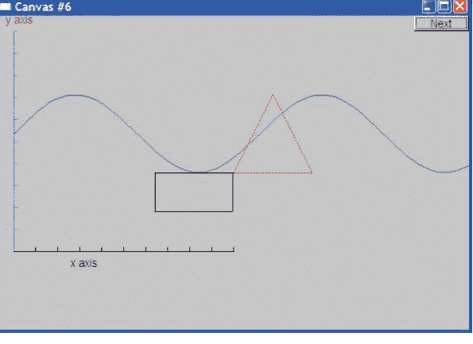

请注意，仅用四个点创建一条折线并不足以构成一个 `Rectangle`。很容易创建一个在屏幕上看起来像 `Rectangle` 的 `Closed_polyline`（你甚至可以创建一个看起来像 `Rectangle` 的 `Open_polyline`）；例如：

```cpp
Closed_polyline poly_rect;
poly_rect.add(Point{100,50});
poly_rect.add(Point{200,50});
poly_rect.add(Point{200,100});
poly_rect.add(Point{100,100});
win.attach(poly_rect);
```


事实上，这种 `poly_rect` 在屏幕上的 *image* 是一个矩形。然而，内存中的 `poly_rect` 对象并不是 `Rectangle`（矩形类），它也并不“知道”任何关于矩形的信息。证明这一点最简单的方法是添加另一个点：

```cpp
poly_rect.add(Point(50,75));
```

没有哪个矩形有五个点：


对于我们的代码推理而言，重要的是 `Rectangle` 不仅仅是碰巧在屏幕上看起来像矩形；它保持了我们从几何学中得知的那些矩形的基本保证。我们编写依赖 `Rectangle` 在屏幕上确实是矩形并保持这种状态的代码。

### 12.7.7 填充

我们之前一直在将形状绘制为轮廓。我们还可以用颜色“填充”矩形：

```cpp
r.set_fill_color(Color::yellow);          // 填充矩形内部的颜色
poly.set_style(Line_style(Line_style::dash,4));
poly_rect.set_style(Line_style(Line_style::dash,2));
poly_rect.set_fill_color(Color::green);
win.set_label("Canvas #7");
win.wait_for_button();
```

我们还决定不喜欢我们的三角形（`poly`）的线型，因此将其线型设置为“粗（厚度为正常的四倍）虚线”。同样，我们也改变了 `poly_rect`（现在看起来不再像矩形）的样式：


如果你仔细观察 `poly_rect`，你会发现轮廓是打印在填充层之上的。

可以填充任何闭合形状（见 §13.9）。矩形之所以特殊，在于它们填充起来既简单又快速。

### 12.7.8 文本

最后，任何绘图系统如果没有一种简单的方式来书写文本，就是不完整的——仅仅将每个字符作为一组线条绘制是远远不够的。我们给窗口本身加上标签，坐标轴也可以有标签，但我们可以使用 `Text` 对象将文本放置在任意位置：

```cpp
Text t {Point(150,150), "Hello, graphical world!"};
win.attach(t);
win.set_label("Canvas #8");
win.wait_for_button();
```


从这个窗口中看到的原始图形元素出发，你可以构建几乎任何复杂程度和微妙细节的显示。目前，只需注意本章代码的一个特点：没有循环，没有选择语句，所有数据都是“硬编码”的。输出仅仅是以最简单的方式由原始元素组合而成。一旦我们开始使用数据和算法来组合这些原始元素，事情就会开始变得有趣。

我们已经看到了如何控制文本的颜色：`Axis`（§12.7.3）的标签仅仅是一个 `Text` 对象。此外，我们还可以选择字体并设置字符的大小：

```cpp
t.set_font(Font::times_bold);
t.set_font_size(20);
win.set_label("Canvas #9");
win.wait_for_button();
```

我们将 `Text` 字符串 `Hello, graphical world!` 的字符放大到 20 点大小，并选择了粗体 Times 字体：


### 12.7.9 图像

我们也可以从文件中加载图像：

```cpp
Image ii {Point(100,50), "image.jpg"};   // 400*212像素的jpg
win.attach(ii);
win.set_label("Canvas #10");
win.wait_for_button();
```

恰好，名为 `image.jpg` 的文件是一张两架飞机突破音障的照片：


这张照片相对较大，我们把它直接放在了我们的文本和形状上面。因此，为了清理一下我们的窗口，让我们把它稍微移开：

```cpp
ii.move(100,200);
win.set_label("Canvas #11");
win.wait_for_button();
```


注意照片中不适合放入窗口的部分是如何简单地被不表示出来的。本应在窗外出现的内容被“裁剪”掉了。

### 12.7.10 还有更多

在这里，没有进一步的评论，只有更多代码：

```cpp
Circle c {Point(100,200), 50};
Ellipse e {Point(100,200), 75, 25};
e.set_color(Color::dark_red);
Mark m {Point(100,200), 'x'};

ostringstream oss;
oss << "screen size: " << x_max() << "*" << y_max()
    << "; window size: " << win.x_max() << "*" << win.y_max();
Text sizes {Point(100,20), oss.str()};

Image cal {Point(225,225), "snow_cpp.gif"};	// 320*240像素的gif
cal.set_mask(Point{40,40}, 200, 150);	// 显示图像的中心部分

win.attach(c);
win.attach(m);
win.attach(e);
win.attach(sizes);
win.attach(cal);
win.set_label("Canvas #12");
win.wait_for_button();
```

你能猜到这段代码做了什么吗？它显而易见吗？


代码与屏幕显示内容之间的联系是直接的。如果你还没有看出那段代码是如何导致那个输出的，它很快就会变得清晰。注意我们如何使用 `ostringstream`（§11.4）来格式化显示大小的文本对象。

## 12.8 让程序运行起来

我们已经看到了如何创建窗口，以及如何在其中绘制各种形状。在接下来的章节中，我们将看到这些 `Shape` 类是如何定义的，并展示更多使用它们的方式。

让该程序运行起来比我们之前展示的程序需要更多的内容。除了我们在 `main()` 中的代码外，我们还需要将接口库代码编译并链接到我们的代码中，最后，除非安装了 FLTK 库（或我们使用的任何 GUI 系统）并正确链接到我们的代码中，否则什么也不会运行。

看待这个程序的一种方式是将它分为四个不同的部分：

- 我们的程序代码（`main()` 等）

- 我们的接口库（`Window`、`Shape`、`Polygon` 等）

- FLTK 库

- C++ 标准库

间接地，我们也使用了操作系统。忽略操作系统和标准库，我们可以这样说明我们的图形代码的组织结构：


附录 D 解释了如何让所有这些协同工作。

### 12.8.1 源文件

我们的图形和 GUI 接口库仅由五个头文件和三个代码文件组成：

- 头文件：

  - `Point.h`

  - `Window.h`

  - `Simple_window.h`

  - `Graph.h`

  - `GUI.h`

- 代码文件：

  - `Window.cpp`

  - `Graph.cpp`

  - `GUI.cpp`

在第 16 章之前，你可以忽略 GUI 文件。

## 演练

演练是图形界面上的“Hello, World!”程序。其目的是让你熟悉最简单的图形输出工具。

1. 编译、链接并运行一个大小为 600 乘 400、标签为 `My window` 的空 `Simple_window`。注意，你需要按照附录 D 中描述的那样链接 FLTK 库；在代码中 `#include` `Graph.h` 和 `Simple_window.h`；并在你的项目中包含 `Graph.cpp` 和 `Window.cpp`。

2. 现在逐个添加 §12.7 中的示例，并在每个添加的小节示例之间进行测试。

3. 遍历并对每个小节示例进行一处小的更改（例如，颜色、位置或点数）。

## 复习

1. 为什么我们要使用图形？
2. 什么时候我们尝试不使用图形？
3. 为什么图形对程序员来说很有趣？
4. 什么是窗口？
5. 我们在哪个命名空间中保留我们的图形接口类（我们的图形库）？
6. 使用我们的图形库进行基本图形绘制需要哪些头文件？
7. 最简单的窗口是什么？
8. 最小窗口是什么？
9. 什么是窗口标签？
10. 如何给窗口加标签？
11. 屏幕坐标是如何工作的？窗口坐标呢？数学坐标呢？
12. 我们可以显示的简单“形状”有哪些例子？
13. 什么命令将形状附加到窗口？
14. 你会使用哪种基本形状来画六边形？
15. 如何在窗口中的某处写入文本？
16. 如何将你最好朋友的照片放入窗口（使用你自己编写的程序）？
17. 你制作了一个 `Window` 对象，但屏幕上没有显示任何东西。可能的原因有哪些？
18. 你制作了一个形状，但它没有在窗口中显示。可能的原因有哪些？

## 术语

- 颜色
- 坐标
- 显示
- 填充颜色
- FLTK
- 图形
- GUI（图形用户界面）
- GUI 库
- HTML
- 图像
- JPEG
- 线型
- 软件层
- 窗口
- XML

## 练习

我们建议你在这些练习中使用 `Simple_window`。

1. 分别以 `Rectangle` 和 `Polygon` 的形式绘制一个矩形。将 `Polygon` 的线条设为红色，将 `Rectangle` 的线条设为蓝色。
2. 绘制一个 100 乘 30 的 `Rectangle`，并在其中放置文本“Howdy!”。
3. 将你的首字母绘制成 150 像素高。使用粗线。将每个首字母绘制成不同的颜色。
4. 绘制一个 3 乘 3 的井字游戏棋盘，交替使用白色和红色方块。
5. 在一个矩形周围绘制一个 1/4 英寸宽的红框，该矩形的高度为你屏幕高度的四分之三，宽度为屏幕宽度的三分之二。
6. 当你绘制一个无法放入其窗口内的`形状`时会发生什么？当你绘制一个无法放在屏幕上的`窗口`时会发生什么？请编写两个程序来演示这两种现象。
7. 绘制一间从正面看的二维房屋，就像小孩子画的那样：带有一扇门、两扇窗户和一个带烟囱的屋顶。可以随意添加细节；也许让烟囱冒出“烟雾”。
8. 绘制奥林匹克五环。如果你记不清颜色，请查找它们。
9. 在屏幕上显示一张图像，例如一位朋友的照片。为图像添加两个标签：一个是窗口上的标题，另一个是窗口内的图注。
10. 绘制 §12.8 中的文件结构图。
11. 绘制一系列正多边形，一个套在另一个里面。最里面的应该是正三角形，外面是正方形，再外面是正五边形，等等。仅限数学能力强者：让每个`N`边形的所有顶点都接触到`（N+1）`边形的边。提示：三角函数在 `<cmath>` 中（§24.8, §B.9.2）。
12. 超椭圆是由以下方程定义的二维形状：

$$ \left| \frac{x}{a} \right|^m + \left| \frac{y}{b} \right|^n = 1; \quad m, n > 0. $$

在网上查找 *superellipse*（超椭圆）以更好地了解这类形状的样子。编写一个程序，通过连接超椭圆上的点来绘制“星形”图案。将 `a, b, m, n,` 和 `N` 作为参数。在由 `a, b, m,` 和 `n` 定义的超椭圆上选择 `N` 个点。对于“相等”的某种定义，使这些点均匀分布。将每个 `N` 个点连接到一个或多个其他点（如果你愿意，可以将要连接的点数作为另一个参数，或者直接使用 `N-1`，即所有其他点）。
13. 找到一种方式为上一题练习中的线条添加颜色。使某些线条为一种颜色，其他线条为另一种颜色或多种颜色。

# 后记

程序设计的一个理想状态是我们的概念直接在程序中作为实体被表示出来。因此，我们通常用类来表示思想，用类的对象来表示现实世界中的实体，用函数来表示操作和计算。图形学是一个这一理念有明显应用的领域。我们有诸如圆形和多边形等概念，并在程序中用类 `Circle` 和类 `Polygon` 来表示它们。图形学的特殊之处在于，在编写图形程序时，我们也有机会在屏幕上看到这些类的对象；也就是说，我们程序的状态被直接展示出来供我们观察——在大多数应用程序中，我们没有这么幸运。思想、代码和输出之间的这种直接对应关系正是图形编程如此吸引人的原因。请切记，图形只是使用类在代码中直接表示概念这一通用思想的插图。这一思想更为通用且有用：我们几乎可以想到任何事物都可以在代码中表示为一个类、一个类的对象或一组类。


## 图形类


> “一种不改变你思维方式的语言不值得学习。”

> —*传统名言*

第12章概述了使用一组简单的接口类在图形方面能做什么，以及我们是如何做到的。本章将介绍所提供的许多类。这里的重点是设计、使用和实现单独的接口类，如 `Point`、`Color`、`Polygon` 和 `Open_polyline` 及其用途。下一章将介绍设计相关类组的思想，并将展示更多的实现技术。

### 13.1 图形类概览

图形和 GUI 库提供了许多功能。这里的“许多”意味着数百个类，每个类通常都有几十个函数。阅读描述、手册或文档就像看一本老式植物学教科书，上面列出了数千种植物的细节，根据晦涩的分类特征组织排列。这令人望而生畏！这也令人兴奋——查看现代图形/GUI 库的功能会让你感觉像糖果店里的孩子，但很难弄清楚从哪里开始以及什么才是真正适合你的。

我们的接口库的一个目的是减轻完整图形/GUI 库复杂性带来的冲击。我们只提供了两打类，几乎没有任何操作。然而，它们允许你产生有用的图形输出。一个密切相关的目标是通过这些类引入关键的图形和 GUI 概念。目前，你可以编写以简单图形显示结果程序。读完本章后，你的图形程序范围将扩大，超过大多数人的初始需求。在第14章之后，你将理解所涉及的大部分设计技术和思想，从而可以在需要时深化你的理解并扩展你的图形表达能力。你可以通过添加这里描述的功能或采用另一个 C++ 图形/GUI 库来实现这一点。

关键的接口类包括：

| 类 | 描述 |
| :--- | :--- |
| `Color` | 用于线条、文本和填充形状 |
| `Line_style` | 用于绘制线条 |
| `Point` | 用于表示屏幕上和窗口内的位置 |
| `Line` | 我们在屏幕上看到的线段，由其两个端点定义 |
| `Open_polyline` | 由一系列点定义的相连线段序列 |
| `Closed_polyline` | 类似 `Open_polyline`，但最后一点与第一点之间有线段段连接 |
| `Polygon` | 任意两条线段不相交的 `Closed_polyline` |
| `Text` | 一串字符 |
| `Lines` | 由点定义的线段集合 |
| `Rectangle` | 优化用于快速和方便显示的常见形状 |
| `Circle` | 由中心和半径定义的圆 |
| `Ellipse` | 由中心和两个轴定义的椭圆 |
| `Function` | 在某个范围内绘制的一元函数 |
| `Axis` | 带有标签的坐标轴 |
| `Mark` | 由字符（如 x 或 o）标记的点 |
| `Marks` | 由标记（如 x 和 o）指示的一系列点 |
| `Marked_polyline` | 点由标记指示的 `Open_polyline` |
| `Image` | 图像文件的内容 |

第15章考察 `Function` 和 `Axis`。第16章介绍主要的 GUI 接口类：

| 类 | 描述 |
| :--- | :--- |
| `Window` | 屏幕上显示我们图形对象的区域 |
| `Simple_window` | 带有“Next”按钮的窗口 |
| `Button` | 窗口中通常带有标签的矩形，按下可运行我们的函数之一 |
| `In_box` | 窗口中通常带有标签的方框，用户可以在其中输入字符串 |
| `Out_box` | 窗口中通常带有标签的方框，我们的程序可以在其中写入字符串 |
| `Menu` | 按钮的 `vector` |

源代码组织成如下文件：

| 文件 | 内容 |
| :--- | :--- |
| `Point.h` | `Point` |
| `Graph.h` | 所有其他图形接口类 |
| `Window.h` | `Window` |
| `Simple_window.h` | `Simple_window` |
| `GUI.h` | `Button` 和其他 GUI 类 |
| `Graph.cpp` | `Graph.h` 中函数的定义 |
| `Window.cpp` | `Window.h` 中函数的定义 |
| `GUI.cpp` | `GUI.h` 中函数的定义 |

除了图形类，我们还提供一个类，它恰好有助于保存 `Shapes` 或 `Widgets` 的集合：

| 类 | 描述 |
| :--- | :--- |
| `Vector_ref` | 具有接口使其便于保存无名元素的 `vector` |

阅读以下各节时，请不要速度过快。没有什么是不太明显的，但本章的目的不仅仅是向你展示一些漂亮的图片——你每天在电脑屏幕或电视上看到的图片都比这些更漂亮。本章的主要要点是

- 展示代码与产生的图片之间的对应关系。
- 让你习惯于阅读代码并思考其工作原理。
- 让你思考代码的设计——特别是思考如何在代码中用类表示概念。为什么这些类长成那样？它们还可以长成什么样子？我们做了许多设计决策，其中大多数可以合理地做出不同的选择，在某些情况下甚至可以是截然不同的选择。

所以请不要着急。如果你着急，你会错过重要的东西，然后可能会发现练习不必要地难。

### 13.2 点（Point）和线（Line）

任何图形系统中最基本的部分是点。定义*点*就是定义我们如何组织几何空间。在这里，我们使用常规的计算机-

由 `(x,y)` 整数坐标定义的二维点的有向布局。如 §12.5 所述，`x` 坐标从 0（代表屏幕左侧）到 `x_max()`（代表屏幕右侧）；`y` 坐标从 0（代表屏幕顶部）到 `y_max()`（代表屏幕底部）。

如 `Point.h` 中定义，`Point` 仅仅是一对 int（坐标）：

```cpp
struct Point { int x, y; };
bool operator==(Point a, Point b) { return a.x==b.x && a.y==b.y; }
bool operator!=(Point a, Point b) { return !(a==b); }
```

在 `Graph.h` 中，我们找到了 `Shape`，我们将在第 14 章中详细描述它，以及 `Line`：

```cpp
struct Line : Shape { // a Line is a Shape defined by two Points
    Line(Point p1, Point p2); // construct a Line from two Points
};
```

`Line` 是一种 `Shape`。这就是 `: Shape` 的含义。`Shape` 被称为 `Line` 的基类，或者简称为 `Line` 的基类。基本上，`Shape` 提供了使 `Line` 定义简化的所需设施。一旦我们对特定的形状（如 `Line` 和 `Open_polyline`）有了感觉，我们就会解释这意味着什么（第 14 章）。

`Line` 由两个 `Point` 定义。忽略如 §12.3 中所述的“脚手架”（`#includes` 等），我们可以创建线条并使其被绘制，如下所示：

```cpp
// draw two lines
constexpr Point x {100,100};
Simple_window win1 {x,600,400, "two lines"};
Line horizontal {x, Point {200,100}}; // make a horizontal line
Line vertical {Point {150,50}, Point {150,150}}; // make a vertical line
win1.attach (horizontal); // attach the lines to the window
win1.attach (vertical);
win1.wait_for_button(); // display!
```

执行该代码，我们得到


作为一个为简洁性设计的用户界面，`Line` 工作得相当好。你不需要是爱因斯坦也能猜到

```cpp
Line vertical {Point(150,50), Point(150,150)};
```

创建了一条从 `(150,50)` 到 `(150,150)` 的（垂直）线。当然，有实现细节，但你不需要知道这些来创建 `Lines`。`Line` 的构造函数的实现相应地简单：

```cpp
Line::Line(Point p1, Point p2) // construct a line from two points
{
  add(p1); // add p1 to this shape
  add(p2); // add p2 to this shape
}
```

也就是说，它只是“添加”了两个点。添加到什么？而且 `Line` 如何在窗口中被绘制？答案在于 `Shape` 类。如我们将在第 14 章中描述的那样，`Shape` 可以持有点以定义线条，知道如何绘制由 `Points` 对定义线条，并提供一个函数 `add()`，允许对象将 `Point` 添加到其 `Shape` 中。这里的关键点（*sic!*）是定义 `Line` 是微不足道的。大部分实现工作由“系统”完成，以便我们可以专注于编写易于使用的简单类。

从现在起，我们将省略 `Simple_window` 的定义以及 `attach()` 的调用。这些只是我们需要完整程序所需的更多“脚手架”，但对特定 `Shapes` 的讨论增加很少。

### 13.3 线条

事实证明，我们很少只画一条线。我们倾向于以由许多线条组成的对象来思考，如三角形、多边形、路径、迷宫、网格、条形图、数学函数、数据图等。其中最简单的“复合图形对象类”之一是 `Lines`：

```cpp
struct Lines : Shape {
                   // related lines
    Lines() {}      // empty
    Lines(initializer_list<pair<Point,Point>> &lst);
                   // initialize from a list
    void draw_lines() const;
    void add(Point p1, Point p2);
                   // add a line defined by two points
};
```

`Lines` 对象只是一组线条的集合，每条线由一对 `Points` 定义。例如，如果我们考虑 §13.2 中 `Line` 示例中的两条线作为单个图形对象的一部分，我们可以这样定义它们：

```cpp
Lines x;
x.add(Point{100,100}, Point{200,100});
    // first line: horizontal
x.add(Point{150,50}, Point{150,150});
    // second line: vertical
```

这给出了与 `Line` 版本无法区分（精确到最后一个像素）的输出：


我们唯一能分辨出这是一个不同窗口的方式是我们给它们标了不同的标签。

一组 `Line` 对象和 `Lines` 对象中的一组线条之间的区别完全是我们对发生的事情的看法不同。通过使用 `Lines`，我们表达了这样的观点：两条线属于一起，并且应该一起操作。例如，我们可以用一条命令更改作为 `Lines` 对象一部分的所有线条的颜色。另一方面，我们可以给作为单独 `Line` 对象的线条赋予不同的颜色。作为一个更现实的例子，考虑如何定义一个网格。网格由许多均匀间隔的水平线和垂直线组成。然而，我们将网格视为一个“事物”，因此我们将这些线条定义为 `Lines` 对象的一部分，我们称之为 `grid`：

```cpp
int x_size = win3.x_max();                  // get the size of our window
int y_size = win3.y_max();
int x_grid = 80;
int y_grid = 40;

Lines grid;
for (int x=x_grid; x<x_size; x+=x_grid)
    grid.add(Point(x,0),Point(x,y_size));    // vertical line
for (int y=y_grid; y<y_size; y+=y_grid)
    grid.add(Point(0,y),Point(x_size,y));    // horizontal line
```

注意我们如何使用 `x_max()` 和 `y_max()` 获取窗口的维度。这也是我们编写代码来计算想要显示哪些对象的第一个例子。通过为每条网格线定义一个命名变量来定义这个网格将是令人难以忍受的繁琐。从那段代码中，我们得到


让我们回到 `Lines` 的设计。`Lines` 类的成员函数是如何实现的？`Lines` 只提供两个构造函数和两个操作。

`add()` 函数简单地将由一对点定义的一条线添加到要显示的线的集合中：

```cpp
void Lines::add(Point p1, Point p2)
{
      Shape::add(p1);
      Shape::add(p2);
}
```

是的，需要 `Shape::` 限定符，因为否则编译器会将 `add(p1)` 视为尝试调用 `Lines’ add()`（非法）而不是 `Shape’s add()`。

`draw_lines()` 函数绘制使用 `add()` 定义的线条：

```cpp
void Lines::draw_lines() const
{
    if (color().visibility())
      for (int i=1; i<number_of_points(); i+=2)
         fl_line(point(i-1).x,point(i-1).y,point(i).x,point(i).y);
}
```

也就是说，`Lines::draw_lines()` 一次取两个点（从点 0 和 1 开始），并使用底层库的线条绘制函数（`fl_line()`）绘制它们之间的线条。可见性是 `Lines’ Color` 对象（§13.4）的属性，因此我们在绘制线条之前必须检查线条是否应该可见。

如我们在第 14 章中解释的，`draw_lines()` 由“系统”调用。我们不需要检查点的数量是否为偶数——`Lines’ add()` 只能添加点对。函数 `number_of_points()` 和 `point()` 在类 `Shape` 中定义（§14.2）并具有其显而易见的含义。这两个函数提供对 `Shape’s` 点的只读访问。成员函数 `draw_lines()` 被定义为 `const`（见 §9.7.4），因为它不修改形状。

`Lines` 的默认构造函数简单地创建一个空对象（不包含线条）；从没有点开始，然后根据需要 `add()` 点的模型比任何构造函数都更灵活。然而，我们还添加了一个接受 `Points` 对的 `initializer_list` 的构造函数，每个对定义一条线。给定该初始化列表构造函数（§18.2），我们可以简单地定义 `Lines`，从 0, 1, 2, 3, … 条线开始。例如，第一个 `Lines` 示例可以这样写：

```cpp
Lines x = {
   {Point{100,100}, Point{200,100}}, // first line: horizontal
   {Point{150,50}, Point{150,150}} // second line: vertical
};
```

甚至像这样写：

```cpp
Lines x = {
        {{100,100}, {200,100}},     // 第一条线：水平
        {{150,50}, {150,150}}       // 第二条线：垂直
};
```

初始化列表构造函数的定义非常简单：

```cpp
void Lines::Lines(initializer_list<pair<Point,Point>> lst)
{
     for (auto p : lst) add(p.first,p.second);
}
```

`auto` 是类型 `pair<Point,Point>` 的占位符，而 `first` 和 `second` 分别是配对体中第一个和第二个成员的命名。类型 `initializer_list` 和 `pair` 在标准库中定义（§B.6.4. §B.6.3）。

### 13.4 颜色

`Color` 是我们用来表示颜色的类型。我们可以这样使用 `Color`：

```cpp
grid.set_color(Color::red);
```

这会将 `grid` 中定义的线设为红色，效果如下


`Color` 定义了颜色的概念，并为一些更常见的颜色赋予了符号名称：


```cpp
struct Color {
    enum Color_type {
        red=FL_RED,
        blue=FL_BLUE,
        green=FL_GREEN,
        yellow=FL_YELLOW,
        white=FL_WHITE,
        black=FL_BLACK,
        magenta=FL_MAGENTA,
        cyan=FL_CYAN,
        dark_red=FL_DARK_RED,
        dark_green=FL_DARK_GREEN,
        dark_yellow=FL_DARK_YELLOW,
        dark_blue=FL_DARK_BLUE,
        dark_magenta=FL_DARK_MAGENTA,
        dark_cyan=FL_DARK_CYAN
    };

    enum Transparency { invisible = 0, visible=255 };

    Color(Color_type cc) :c(FL_Color(cc)), v(visible) { }
    Color(Color_type cc, Transparency vv) :c(FL_Color(cc)), v(vv) { }
    Color(int cc) :c(FL_Color(cc)), v(visible) { }
    Color(Transparency vv) :c(FL_Color()), v(vv) { }  // 默认颜色

    int as_int() const { return c; }

    char visibility() const { return v; }
    void set_visibility(Transparency vv) { v=vv; }
private:
    char v;      // 目前表示不可见和可见
    FL_Color c;
};
```

`Color` 的目的是

- 隐藏实现中对颜色的概念，即 FLTK 的 `Fl_Color` 类型
- 在 `Fl_Color` 和 `Color_type` 值之间进行映射
- 为颜色常量提供作用域
- 提供透明度（可见和不可见）的简单版本

你可以选择颜色

- 从命名颜色列表中选择，例如 `Color::dark_blue`。
- 通过指定 0–255 范围内的值，从大多数屏幕都能良好显示的小型“调色板”中选择；例如，`Color(99)` 是深绿色。代码示例请参见 §13.9。
- 通过选择 RGB（红、绿、蓝）系统中的值来实现，这里我们不做解释。如有需要请自行查阅。特别是，在网上搜索“RGB 颜色”会得到许多资源，如 http://en.wikipedia .org/wiki/RGB_color_model 和 www.rapitables.com/web/color/RGB_Color.htm。另见练习 13 和 14。

注意使用构造函数允许通过 `Color_type` 或普通的 `int` 创建 `Colors`。成员 `c` 由每个构造函数初始化。你可能会认为 `c` 这个名字太短且太晦涩，不适合使用，但由于它仅在 `Color` 的小范围内使用，且不打算用于通用用途，所以那样做可能是可以接受的。我们将成员 `c` 设为私有，以保护它不被用户直接访问。对于数据成员 `c` 的表示，我们使用了 FLTK 类型 `Fl_Color`，我们并不希望将其暴露给用户。然而，将颜色看作表示其 RGB（或其他）值的 `int` 是非常常见的，因此我们为此提供了 `as_int()`。注意 `as_int()` 是一个 `const` 成员，因为它实际上并不改变它所用于的 `Color` 对象。

透明度由成员 `v` 表示，它可以保存 `Color::visible` 和 `Color::invisible` 这两个值，其含义显而易见。你可能没想到“不可见颜色”会有用，但在复合形状的某些部分设置为不可见可能非常有用。

### 13.5 Line_style

当我们在窗口中绘制多条线时，可以通过颜色、样式或两者来区分它们。线的样式是用于勾勒线条的图案。我们可以这样使用 `Line_style`：

```cpp
grid.set_style(Line_style::dot);
```

这将 `grid` 中的线显示为一系列点，而不是一条实线：


这使网格变得“稀疏”了一些，使其更加低调。通过调整宽度（粗细），我们可以根据我们的喜好和需求调整网格线。

`Line_style` 类型看起来像这样：

```cpp
struct Line_style {
    enum Line_style_type {
        solid=FL_SOLID,           // ------
        dash=FL_DASH,             // - - -
        dot=FL_DOT,               // .......
        dashdot=FL_DASHDOT,       // - . -
        dashdotdot=FL_DASHDOTDOT, // -..--
    };
    Line_style(Line_style_type ss) :s(ss), w{0} {}
    Line_style(Line_style_type lst, int ww) :s(lst), w{ww} {}
    Line_style(int ss) :s(ss), w{0} {}
    int width() const { return w; }
    int style() const { return s; }
private:
    int s;
    int w;
};
```

定义 `Line_style` 的编程技术与我们在 `Color` 中使用的技术完全相同。在这里，我们隐藏了 FLTK 使用纯 `int` 来表示线样式这一事实。为什么隐藏这样的细节是值得的？因为随着库的演变，像这样的细节很可能会发生变化。下一个 FLTK 版本很可能会引入一个 `Fl_linestyle` 类型，或者我们可能会将我们的接口类重新指向另一个 GUI 库。在这两种情况下，我们都不希望我们的代码和用户的代码中充斥着那些恰好我们知道代表线样式的纯 `int`。

大多数时候，我们根本不担心样式问题；我们只是依赖默认值（默认宽度实线）。这种默认线宽由构造函数在情况中定义，当我们没有明确指定它时。设置默认值是构造函数擅长的事情之一，良好的默认值可以显著帮助类的用户。

注意 `Line_style` 有两个“组件”：样式本身（例如，使用虚线或实线）和宽度（所用线的粗细）。宽度以整数测量。默认宽度为 1。我们可以像这样请求一条粗虚线：

```cpp
grid.set_style(Line_style(Line_style::dash,2));
```

这产生


注意颜色和样式适用于形状的所有线。这是将许多线分组到单个图形对象（例如 Lines, Open_polyline, 或 Polygon）中的优势之一。如果我们想单独控制线的颜色或样式，必须将它们定义为单独的 Lines。例如：

```cpp
horizontal.set_color(Color::red); vertical.set_color(Color::green);
```

这给我们


## 13.6 Open_polyline

`Open_polyline` 是由一系列点定义的一系列相连线段组成的形状。Poly 是希腊语中“多”的意思；而 polyline 是组成许多线的形状相当常规的名称。例如：

```cpp
Open_polyline o pl = {
		{100,100}, {150,200}, {250,250}, {300,200}
		};
```

这绘制出连接这四个点所得到的形状：


基本上，`Open_polyline` 是我们幼儿园时玩的“连点成线”游戏的花哨说法。

类 `Open_polyline` 定义如下：

```cpp
struct Open_polyline : Shape {   // 开放的线序列
    using Shape::Shape;          // 使用 Shape 的构造函数（§4.16）
    void add(Point p) { Shape::add(p); }
};
```

`Open_polyline` 继承自 `Shape`。`Open_polyline` 的 `add()` 函数存在是为了允许 `Open_polyline` 的用户访问 `Shape` 中的 `add()`（即 `Shape::add()`）。我们甚至不需要定义 `draw_lines()`，因为 `Shape` 默认将 `Points` 解释为相连的线序列。

声明 `using Shape::Shape` 是一个 `using` 声明。它说明 `Open_polyline` 可以使用为 `Shape` 定义的构造函数。`Shape` 有一个默认构造函数（§9.7.3）和一个初始化列表构造函数（§18.2），因此 `using` 声明只是为 `Open_polyline` 定义这两个构造函数的简写形式。与 `Lines` 一样，初始化列表构造函数是作为初始 `add()` 序列的简写形式存在的。

## 13.7 Closed_polyline

`Closed_polyline` 与 `Open_polyline` 类似，只是我们还绘制一条从最后一个点到第一个点的线。例如，我们可以使用我们在 §13.6 中用于 `Open_polyline` 的相同点来定义 `Closed_polyline`：

```
Closed_polyline cpl = {
{100,100}, {150,200}, {250,250}, {300,200}
};
```

结果（自然）与§13.6中的结果相同，只是那条最终的闭合线除外：


`Closed_polyline`的定义如下：

```
struct Closed_polyline : Open_polyline {
using Open_polyline::Open_polyline; // closed sequence of lines

void draw_lines() const; // use Open_polyline's
}; // constructors (§A.16)
```

```
void Closed_polyline::draw_lines() const
{
Open_polyline::draw_lines(); // first draw the “open polyline part”

// then draw closing line:
if (2<number_of_points() && color().visibility())
fl_line(point(number_of_points()-1).x,
point(number_of_points()-1).y,
point(0).x,
point(0).y);
}
```

`using` 声明（§A.16）表明 `Closed_polyline` 具有与 `Open_polyline` 相同的构造函数。`Closed_polyline` 需要自己的 `draw_lines()` 来绘制连接最后一个点与第一个点的闭合线。

我们只需要处理 `Closed_polyline` 与 `Open_polyline` 所提供的不同之处这一小细节。这一点非常重要，有时被称为“差异编程”。我们只需要编程实现我们的派生类（在此为 `Closed_polyline`）与基类（在此为 `Open_polyline`）所呈现的差异部分。

那么，我们如何绘制那条闭合线呢？我们使用 FLTK 的绘制直线函数 `fl_line()`。它接受四个代表两个点的 `int`。因此，这里再次使用了底层的图形库。然而请注意，正如其他所有情况一样，对 FLTK 的提及仅保留在我们类的实现中，而不是暴露给用户。用户代码无需提及 `fl_line()`，也无需了解那些点以整数对形式隐式出现的接口。如果我们愿意，可以用另一个 GUI 库替换 FLTK，而对我们用户的代码影响甚微。

## 13.8 多边形

`Polygon`（多边形）与 `Closed_polyline` 非常相似。唯一的区别在于，对于 `Polygon`，我们不允许线段相交。例如，上面的 `Closed_polyline` 是一个多边形，但我们可以添加另一个点：

```
cpl.add(Point{100,250});
```

结果如下：


根据经典定义，这个 `Closed_polyline` 不是多边形。我们如何定义 `Polygon`，以便在不违反几何规则的前提下，正确捕捉到它与 `Closed_polyline` 的关系？上述介绍中包含了强烈的提示。`Polygon` 是一个线段不相交的 `Closed_polyline`。或者，我们可以强调形状是由点构建的方式，并说明 `Polygon` 是一个 `Closed_polyline`，其中我们不能添加一个定义相交线段的 `Point`。

基于该思想，我们这样定义 `Polygon`：

```cpp
struct Polygon : Closed_polyline {    // closed sequence of nonintersecting
                                       // lines
    using Closed_polyline::Closed_polyline; // use Closed_polyline's
                        // constructors
    void add(Point p);
    void draw_lines() const;
};

void Polygon::add(Point p)
{
    // check that the new line doesn't intersect existing lines (code not shown)
    Closed_polyline::add(p);
}
```

在这里，我们继承了 `Closed_polyline` 的 `draw_lines()` 定义，从而节省了大量工作并避免了代码重复。不幸的是，我们必须检查每次 `add()`。这产生了一个低效的（*N* 平方阶）算法 – 定义一个包含 *N* 个点的 `Polygon` 需要调用 *N*( *N*-1)/2 次 `intersect()`。实际上，我们假设 `Polygon` 类将用于点数较少的多边形。例如，创建一个包含 24 个 `Points` 的 `Polygon` 涉及 24*(24–1)/2 = 276 次 `intersect()` 调用。这可能是可以接受的，但如果我们要一个包含 2000 个点的面多边形，那将耗费大约 2,000,000 次调用，我们可能会寻找更好的算法，这可能需要修改接口。

使用初始化列表构造函数，我们可以像这样创建一个多边形：

```cpp
Polygon poly = {
    {100,100}, {150,200}, {250,250}, {300,200}
};
```

显然，这创建了一个与我们原始 `Closed_polyline` 完全相同（精确到最后一个像素）的 `Polygon`：


确保 `Polygon` 真正代表一个多边形结果出奇地复杂。我们在 `Polygon::add()` 中省略的相交检查，可以说是在整个图形库中最复杂的。如果你对繁琐的几何坐标操作感兴趣，请查看代码。

问题在于 `Polygon` 的不变量“这些点表示一个多边形”只有在所有点都定义完成后才能验证；也就是说，我们没有——尽管强烈建议——在其构造函数中建立 `Polygon` 的不变量。我们考虑过移除 `add()` 并强制要求通过至少包含三个点的初始化列表完全指定 `Polygon`，但这会使程序中生成点序列的用例变得复杂。

## 13.9 矩形

屏幕上最常见的形状是矩形。原因部分是文化上的（我们的大部分门、窗、图片、墙壁、书架、书页等也是矩形的），部分也是技术上的（将坐标保持在矩形空间内比任何其他形状的空间都简单）。无论如何，矩形如此常见，以至于 GUI 系统直接支持它们，而不是仅仅将它们视为恰好有四个角和直角的普通多边形。


```cpp
struct Rectangle : Shape {
    Rectangle(Point xy, int ww, int hh);
    Rectangle(Point x, Point y);
    void draw_lines() const;

    int height() const { return h; }
    int width() const { return w; }
private:
    int h;    // height
    int w;    // width
};
```

我们可以通过两个点（左上角和右下角）或一个点（左上角）以及宽度和高度来指定一个矩形。构造函数可以这样定义：

```cpp
Rectangle::Rectangle(Point xy, int ww, int hh)
    : w{ww}, h{hh}
{
    if (h<=0 || w<=0)
        error("Bad rectangle: non-positive side");
    add(xy);
}

Rectangle::Rectangle(Point x, Point y)
    : w{y.x-x.x}, h{y.y-x.y}
{
    if (h<=0 || w<=0)
        error("Bad rectangle: first point is not top left");
    add(x);
}
```

每个构造函数都适当地初始化成员 `h` 和 `w`（使用成员初始化语法；参见 §9.4.4），并将左上角点存储在 `Rectangle` 的基类 `Shape` 中（使用 `add()`）。此外，它还执行一个简单的合理性检查：我们确实不想要宽度或高度为负的 `Rectangles`。

某些图形/GUI 系统将矩形视为特殊对象的原因之一是，确定哪些像素位于矩形内部的算法比多边形和圆形等其他形状要简单得多——因此也快得多。因此，“填充颜色”的概念——即矩形内部区域的颜色——在矩形中比在其他形状中更常用。我们可以在构造函数中设置填充颜色，或者通过 `set_fill_color()` 操作（由 `Shape` 提供的与其他颜色相关服务一起提供）：

```
Rectangle rect00 {Point({150,100},200,100};
Rectangle rect11 {Point({50,50},Point({250,150}};
Rectangle rect12 {Point({50,150},Point({250,250}}; // just below rect11
Rectangle rect21 {Point({250,50},200,100}; // just to the right of rect11
Rectangle rect22 {Point({250,150},200,100}; // just below rect21

rect00.set_fill_color(Color::yellow};
rect11.set_fill_color(Color::blue};
rect12.set_fill_color(Color::red};
rect21.set_fill_color(Color::green};
```

这产生了


当没有填充颜色时，矩形是透明的；这就是你如何看到黄色 `rect00` 的角落。

我们可以移动窗口中的形状（§14.2.3）。例如：

```cpp
rect11.move({400, 0});        // to the right of rect21
rect11.set_fill_color(Color::white);
win12.set_label("rectangles 2");
```

这产生了


注意只有部分白色 `rect11` 位于窗口内。不适合的部分被“裁剪”了；也就是说，它不会在屏幕上的任何地方显示。

还要注意形状是如何一个叠在另一个上面的。这就像你把纸放在桌子上一样。你放的第一张纸会在最下面。我们的 `Window`（§E.3）提供了一种重新排列形状的简单方法。你可以告诉窗口将某个形状放在顶部（使用 `Window::put_on_top()`）。例如：

```cpp
win12.put_on_top(rect00);
win12.set_label("rectangles 3");
```

这会生成


请注意，尽管我们已经填充了矩形（除了其中一个），我们仍然可以看到构成矩形轮廓的线条。如果我们需要去掉这些轮廓，我们可以移除它们：

```cpp
rect00.set_color(Color::invisible);
rect11.set_color(Color::invisible);
rect12.set_color(Color::invisible);
rect21.set_color(Color::invisible);
rect22.set_color(Color::invisible);
```

我们得到


请注意，当填充颜色和线条颜色都设置为不可见时，`rect22` 将不再可见。

因为需要同时处理线条颜色和填充颜色，`Rectangle` 的 `draw_lines()` 稍微有点杂乱：

```cpp
void Rectangle::draw_lines() const
{
    if (fill_color().visibility()) {   // fill
        fl_color(fill_color().as_int());
        fl_rectf(point(0).x, point(0).y, w, h);
    }

    if (color().visibility()) {      // lines on top of fill
        fl_color(color().as_int());
        fl_rect(point(0).x, point(0).y, w, h);
    }
}
```

正如你所见，FLTK 提供了用于绘制矩形填充（`fl_rectf()`）和矩形轮廓（`fl_rect()`）的函数。默认情况下，我们会绘制两者（线条/轮廓在填充之上）。

## 13.10 管理未命名对象

到目前为止，我们为我们的所有图形对象都赋予了名称。当我们需要大量对象时，这变得不可行。例如，让我们绘制一个简单的 256 种 FLTK 调色板颜色的色卡；也就是说，让我们制作 256 个彩色方块，并将它们绘制在一个 16 乘 16 的矩阵中，以显示具有相似颜色值的颜色之间的关系。首先，这是结果：


为这些 256 个方块命名不仅繁琐，而且很愚蠢。左上角方块最明显的“名称”是它在矩阵中的位置 `(0,0)`，而其他任何方块都通过坐标对 `(i,j)` 类似地识别（“命名”）。在这个例子中，我们需要的是一个对象矩阵的等价物。我们曾想过使用 `vector<Rectangle>`，但这结果证明还不够灵活。例如，拥有一个并非全部为同一类型的未命名对象（元素）的集合可能很有用。我们在 §14.3 中讨论了这种灵活性问题。在这里，我们将直接介绍我们的解决方案：一种可以容纳命名和未命名对象的 vector 类型：

```cpp
template<class T> class Vector_ref {
public:
    // ...
    void push_back(T&); // add a named object
    void push_back(T*); // add an unnamed object

    T& operator[](int i); // subscripting: read and write access
    const T& operator[](int i) const;

    int size() const;
};
```

使用它的方式非常像标准库中的 vector：

```cpp
Vector_ref<Rectangle> rect;

Rectangle x {Point(100,200),Point(200,300)};
rect.push_back(x); // add named

rect.push_back(new Rectangle(Point(50,60),Point(80,90))); // add unnamed

for (int i=0; i<rect.size(); ++i) rect[i].move(10,10); // use rect
```

我们将在第 17 章解释新的运算符，并在附录 E 中介绍 `Vector_ref` 的实现。目前，知道我们可以使用它来容纳未命名对象就足够了。Operator `new` 后面跟着类型名称（这里是 `Rectangle`），后面可选地跟着初始化列表（这里是 `{Point(50,60),Point(80,90)}`）。经验丰富的程序员会感到宽慰的是，我们没有在这个例子中引入内存泄漏。

给定 `Rectangle` 和 `Vector_ref`，我们可以玩弄颜色。例如，我们可以绘制上述 256 种颜色的简单色卡：

```cpp
Vector_ref<Rectangle> vr;

for (int i = 0; i<16; ++i)
    for (int j = 0; j<16; ++j) {
        vr.push_back(new Rectangle(Point(i*20,j*20),20,20));
        vr[vr.size()-1].set_fill_color(Color(i*16+j));
        win20.attach(vr[vr.size()-1]);
    }
```

我们制作了一个包含 256 个 `Rectangles` 的 `Vector_ref`，在 `Window` 中以 16 乘 16 矩阵的图形方式组织。我们给 `Rectangle`s 赋予颜色 0, 1, 2, 3, 4 等。在每个 `Rectangle` 创建后，我们将其附加到窗口，以便它显示出来：


## 13.11 文本

显然，我们希望能够在我们的显示中添加文本。例如，我们可能想为我们 §13.8 中的“奇数” `Closed_polyline` 添加标签：

```cpp
Text t {Point(200,200),"A closed polyline that isn't a polygon"};
t.set_color(Color::blue);
```

我们得到


基本上，一个 `Text` 对象定义了一行从 `Point` 开始的文本。`Point` 将是文本的左下角。限制字符串为单行的原因是为了确保跨系统的可移植性。不要尝试放入换行符；它可能会也可能不会在你的窗口中表示为换行。字符串流（§11.4）对于组合用于在 `Text` 对象中显示的 `string` 很有用（§12.7.7 和 §12.7.8 中的例子）。`Text` 定义如下：

```cpp
struct Text : Shape {
    // the point is the bottom left of the first letter
    Text(Point x, const string& s)
        : lab(s)
        { add(x); }

    void draw_lines() const;

    void set_label(const string& s) { lab = s; }
    string label() const { return lab; }

    void set_font(Font f) { fnt = f; }
    Font font() const { return fnt; }

    void set_font_size(int s) { fnt_sz = s; }
    int font_size() const { return fnt_sz; }

private:
    string lab; // label
    Font fnt { fl_font() };
    int fnt_sz { (fl_size()<14)?14:fl_size() };
};
```

如果你希望字体字符大小小于 14 或大于 FLTK 默认值，你必须显式设置它。这是一个测试保护用户免受底层库行为可能变化的例子。在这种情况下，FLTK 的一次更新以破坏现有程序的方式改变了其默认值，使字符变得非常小，我们决定防止这个问题。

我们将初始化器作为成员初始化器提供，而不是作为构造函数初始化列表的一部分，因为初始化器不依赖于构造函数参数。

`Text` 有自己的 `draw_lines()`，因为只有 `Text` 类知道其字符串是如何存储的：

```cpp
void Text::draw_lines() const
{
    fl_draw(lab.c_str(),point(0).x,point(0).y);
}
```

字符颜色的确定方式与由线条组成的形状（如 `Open_polyline` 和 `Circle`）中的线条完全相同，因此你可以使用 `set_color()` 选择颜色，并通过 `color()` 查看当前使用的颜色。字符大小和字体的处理方式类似。有一些预定义的字体：

```cpp
class Font { // character font
public:
    enum Font_type {
        helvetica=FL_HELVETICA,
        helvetica_bold=FL_HELVETICA_BOLD,
        helvetica_italic=FL_HELVETICA_ITALIC,
        helvetica_bold_italic=FL_HELVETICA_BOLD_ITALIC,
        courier=FL_COURIER,
        courier_bold=FL_COURIER_BOLD,
        courier_italic=FL_COURIER_ITALIC,
        courier_bold_italic=FL_COURIER_BOLD_ITALIC,
        times=FL_TIMES,
        times_bold=FL_TIMES_BOLD,
        times_italic=FL_TIMES_ITALIC,
        times_bold_italic=FL_TIMES_BOLD_ITALIC,
        symbol=FL_SYMBOL,
        screen=FL_SCREEN,
        screen_bold=FL_SCREEN_BOLD,
        zapf_dingbats=FL_ZAPF_DINGBAT
    };

    Font(Font_type ff) :f(ff) {}
    Font(int ff) :f(ff) {}

    int as_int() const { return f; }
private:
    int f;
};
```

用于定义 `Font` 的类定义样式与我们用于定义 `Color`（§13.4）和 `Line_style`（§13.5）的相同。

## 13.12 Circle

只是为了表明世界不完全是矩形的，我们提供了类 `Circle` 和类 `Ellipse`。`Circle` 由中心点和半径定义：

```cpp
struct Circle : Shape {
    Circle(Point p, int rr);    // center and radius

    void draw_lines() const;

    Point center() const ;
    int radius() const { return r; }
    void set_radius(int rr)
    {
        set_point(0,Point{center().x-rr,center().y-rr}); // maintain
                                                          // the center

        r = rr;
    }
private:
    int r;
};
```

我们可以像这样使用 `Circle`：

```cpp
Circle c1 {Point{100,200},50};
Circle c2 {Point{150,200},100};
Circle c3 {Point{200,200},150};
```

这会产生三个不同大小的圆，它们的圆心在一条水平线上对齐：


`Circle` 实现的主要特殊性在于，存储的点不是圆心，而是包围该圆的正方形的左上角。我们本可以存储其中任何一个，但选择了 FLTK 用于其优化圆绘制例程的那个。这样，`Circle` 提供了另一个示例，说明类如何用于呈现一个概念的不同（且据称更好）的视图，与其实现相比：


```cpp
Circle::Circle(Point p, int rr)      // 中心和半径
      :r(rr)
{
    add(Point{p.x-r,p.y-r});          // 存储左上角
}

Point Circle::center() const
{
    return {point(0).x+r, point(0).y+r};
}

void Circle::draw_lines() const
{
    if (color().visibility())
        fl_arc(point(0).x,point(0).y,r,r,r+r,0,360);
}
```

注意使用 `fl_arc()` 来绘制圆。前两个参数指定左上角，接下来两个参数指定包围圆的矩形的宽度和高度，最后两个参数指定要绘制的起始和结束角度。通过走完整的 360 度来绘制一个圆，但我们也可以使用 `fl_arc()` 来绘制圆的一部分（以及椭圆的一部分）；请参见练习 1。

### 13.13 椭圆

椭圆与 `Circle` 类类似，但它是用长轴和短轴定义的，而不是用半径；也就是说，要定义一个椭圆，我们给出圆心的坐标，从圆心到 *x* 轴上一点的距离，以及从圆心到 *y* 轴上一点的距离：

```cpp
struct Ellipse : Shape {
    Ellipse(Point p, int w, int h);    // 圆心，到圆心的最大和最小距离

    void draw_lines() const;

    Point center() const;
    Point focus1() const;
    Point focus2() const;

    void set_major(int ww)
    {
        set_point(0,Point(center().x-ww,center().y-h));    // 保持
                                                           // 圆心不变

        w = ww;
    }
    int major() const { return w; }

    void set_minor(int hh)
    {
        set_point(0,Point(center().x-w,center().y-hh));    // 保持
                                                           // 圆心不变

        h = hh;
    }
    int minor() const { return h; }

private:
    int w;
    int h;
};
```

我们可以像这样使用 `Ellipse`：

```cpp
Ellipse e1 {Point(200,200),50,50};
Ellipse e2 {Point(200,200),100,50};
Ellipse e3 {Point(200,200),100,150};
```

这给了我们三个具有共同圆心但不同大小轴线的椭圆：


请注意，当 `Ellipse` 的 `major()`==`minor()` 时，它看起来就像一个圆。

椭圆的另一种常见视图指定了两个焦点以及从某点到焦点的距离之和。给定一个 `Ellipse`，我们可以计算出一个焦点。例如：

```cpp
Point focus1() const
{
    if (h<=w)     // 焦点在 x 轴上：
        return {center().x+int(sqrt(double(w*w-h*h))),center().y};
    else          // 焦点在 y 轴上：
        return {center().x,center().y+int(sqrt(double(h*h-w*w)))};
}
```

为什么 `Circle` 不是 `Ellipse`？从几何上讲，每个圆都是椭圆，但并非每个椭圆都是圆。特别是，圆是两个焦点相等的椭圆。想象一下，如果我们定义 `Circle` 为 `Ellipse` 会怎样。我们可以这样做，但代价是其表示需要额外的值（圆由一个点和一个半径定义；椭圆需要圆心和一对轴线）。我们不喜欢不必要的空间开销，但我们的 `Circle` 不是 `Ellipse` 的主要原因是，如果不以某种方式禁用 `set_major()` 和 `set_minor()`，我们就无法这样定义它。毕竟，如果我们可以使用 `set_major()` 来获得 `major() != minor()`，那么它就不再是一个圆（正如数学家所认定的那样）——至少在那之后它就不再是一个圆了。我们不能有一个对象在某些时候（即当 `major() == minor()` 时）是一种类型（`Circle`），在另一些时候（即当 `major() != minor()` 时）是另一种类型（`Ellipse`）。我们可以拥有一个有时看起来像圆的对象（即 `Ellipse`）。另一方面，`Circle` 永远不会变形为具有两个不等轴的椭圆。

当我们设计类时，我们必须小心，不要过于聪明，也不要被我们的“直觉”所欺骗，从而定义出在我们的代码中作为类没有意义的类。相反，我们必须确保我们的类代表某个连贯的概念，而不仅仅是一组数据和函数成员。不思考我们正在表达什么思想/概念，只是随意地把代码堆在一起是“黑客行为”，会导致我们无法解释且他人无法维护的代码。如果你不觉得这是利他主义，请记住“他人”可能是几个月后的你自己。这样的代码也更难调试。

### 13.14 Marked_polyline

我们经常想在图表上“标记”点。显示图表的一种方式是在一条开放折线上，因此我们需要一条在点处带有“标记”的开放折线。`Marked_polyline` 做到了这一点。例如：

```cpp
Marked_polyline mpl{"1234"};
mpl.add(Point(100,100));
mpl.add(Point(150,200));
mpl.add(Point(250,250));
mpl.add(Point(300,200));
```

这会产生


`Marked_polyline` 的定义是

```cpp
struct Marked_polyline : Open_polyline {
    Marked_polyline(const string& m) :mark{m} { if (m=="") mark = "*"; }
    Marked_polyline(const string& m, initializer_list<Point> lst);
    void draw_lines() const;
private:
    string mark;
};
```

通过从 `Open_polyline` 派生，我们“免费”获得了 `Points` 的处理；我们要做的只是处理标记。特别是，`draw_lines()` 变成

```cpp
void Marked_polyline::draw_lines() const
{
    Open_polyline::draw_lines();
    for (int i=0; i<number_of_points(); ++i)
        draw_mark(point(i),mark[i]%mark.size());
}
```

调用 `Open_polyline::draw_lines()` 处理线条，因此我们只需处理“标记”。我们提供标记为字符字符串，并按顺序使用它们：`mark[i]%mark.size()` 通过在创建 `Marked_polyline` 时提供的字符中循环选择下一个要使用的字符。`%` 是取模（余数）运算符。这个 `draw_lines()` 使用了一个辅助函数 `draw_mark()` 来实际在给定点处输出一个字母：

```cpp
void draw_mark(Point xy, char c)
{
    constexpr int dx = 4;
    constexpr int dy = 4;
    string m(1,c);    // 包含单个字符 c 的字符串
    fl_draw(m.c_str(),xy.x-dx,xy.y+dy);
}
```

`dx` 和 `dy` 常量用于将字母居中于该点上方。`string m` 被构造为包含单个字符 `c`。

接受初始化列表的构造函数简单地将该列表转发到 `Open_polyline` 的初始化列表构造函数：

```cpp
Marked_polyline(const string& m, initializer_list<Point> lst)
    :Open_polyline(lst),
    mark{m}
{
    if (m=="") mark = "*";
}
```

对空字符串的测试是必要的，以避免 `draw_lines()` 尝试访问不存在的字符。

给定接受初始化列表的构造函数，我们可以将示例简化为

```cpp
Marked_polyline mpl {"1234",{{100,100}, {150,200}, {250,250}, {300,200}}};
```

### 13.15 Marks

有时，我们想在不连接它们的情况下显示标记。我们为这种情况提供了类 `Marks`。例如，我们可以标记我们在各种示例中使用的四个点，而不将它们用线连接起来：

```cpp
Marks pp {"x",{{100,100}, {150,200}, {250,250}, {300,200}}};
```

这会产生


`Marks` 的一个明显用途是显示代表离散事件的数据，使得绘制连接线是不合适的。例如，一组人的（身高，体重）数据。

`Marks` 只是一个线条不可见的 `Marked_polyline`：

```cpp
struct Marks : Marked_polyline {
    Marks(const string& m)
        :Marked_polyline(m)
    {
        set_color(Color{Color::invisible});
    }
    Marks(const string& m, initializer_list<Point> lst)
        : Marked_polyline(m, lst)
    {
        set_color(Color{Color::invisible});
    }
};
```

`::Marked_polyline(m)` 符号用于初始化 `Marks` 对象的 `Marked_polyline` 部分。这种符号是用于初始化成员的语法的变体（§9.4.4）。

## 13.16 Mark

一个 `Point`（点）只是 `Window`（窗口）中的一个位置。它不是我们绘制的东西，也不是我们可以看到的东西。如果我们想要标记一个单独的 `Point` 以便能够看到它，我们可以用 §13.2 中的一对线来表示它，或者使用 `Marks`（标记）。这有点啰嗦，所以我们有 `Marks` 的一个简单版本，它由一个点和一个字符初始化。例如，我们可以像这样标记我们在 §13.12 中圆的中心：

```cpp
Mark m1 {Point{100,200}, 'x'};
Mark m2 {Point{150,200}, 'y'};
Mark m3 {Point{200,200}, 'z'};
c1.set_color(Color::blue);
c2.set_color(Color::red);
c3.set_color(Color::green);
```

这将产生


一个 `Mark`（标记）就是一个 `Marks`，其初始（通常也是唯一的）点被直接给出：

```cpp
struct Mark : Marks {
    Mark(Point xy, char c) : Marks(string(1,c))
    {
        add(xy);
    }
};
```

`string(1,c)` 是 `string` 的一个构造函数，将 `string` 初始化为包含单个字符 `c`。

所有 `Mark` 提供的只是一个方便的表示法，用于创建一个 `Marks` 对象，其中单个点被标记为单个字符。`Mark` 值得我们花精力去定义吗？还是说它只是“无谓的复杂化和混淆”？没有明确的、逻辑上的答案。我们就这个问题来回讨论过，但最终决定它对用户有用，且定义它的代价很小。

为什么要使用字符作为“标记”？我们可以使用任何小形状，但字符提供了一组有用且简单的标记。通常，能够使用多种“标记”来区分不同的点集是非常有用的。像 `x`、`o`、`+` 和 `*` 这样的字符围绕中心是令人愉悦的对称的。

## 13.17 Images

普通的个人计算机在文件中存储成千上万的图像，并且可以通过网络访问数百万张更多图像。自然，我们希望即使在相当简单的程序中也能显示其中的一些图像。例如，这里是一张飓风 Rita 接近得克萨斯湾岸时的投影路径图像（*rita_path.gif*）：


我们可以选择该图像的一部分，并添加一张从太空拍摄的 Rita 照片（rita.jpg）：

```cpp
Image rita {Point(0,0),"rita.jpg"};
Image path {Point(0,0),"rita_path.gif"};
path.set_mask(Point(50,250),600,400);  // select likely landfall
win.attach(path);
win.attach(rita);
```


`set_mask()` 操作选择图像的一个子图像以供显示。在这里，我们从 rita_path.gif（加载为 path）中选择一个 600x400 像素的图像，其左上角点位于 path 的点 (50,250)。只选择图像的一部分进行显示是如此常见，以至于我们选择直接支持它。

形状按它们被附加的顺序铺设，就像桌上的纸片一样，因此我们只需在附加 rita 之前附加 path，就得到了 path “在底部”的效果。

图像可以编码为令人眼花缭乱的多种格式。这里我们只处理最常见的两种，JPEG 和 GIF：

```cpp
enum class Suffix { none, jpg, gif };
```

在我们的图形界面库中，我们在内存中用类 `Image` 的对象来表示图像：

```cpp
struct Image : Shape {
   Image(Point xy, string file_name, Suffix e = Suffix::none);
   ~Image() { delete p; }
   void draw_lines() const;
   void set_mask(Point xy, int ww, int hh)
      { w=ww; h=hh; cx=xy.x; cy=xy.y; }
private:
   int w,h;   // define "masking box" within image relative to position (cx,cy)
   int cx,cy;
   Fl_Image* p;
   Text fn;
};
```

`Image` 构造函数试图打开具有给定名称的文件。然后它试图使用指定为可选参数或（更常见的是）文件后缀的编码来创建图片。如果图像无法显示（例如，因为找不到文件），`Image` 将显示一个 `Bad_image`。`Bad_image` 的定义如下：

```cpp
struct Bad_image : Fl_Image {
   Bad_image(int h, int w) : Fl_Image(h,w,0) { }
   void draw(int x,int y, int, int, int, int) { draw_empty(x,y); }
};
```

在图形库中处理图像是相当复杂的，但我们的图形界面类 `Image` 的主要复杂性在于构造函数的文件处理：


```cpp
// somewhat overlaborate constructor
// because errors related to image files can be such a pain to debug
Image::Image(Point xy, string s, Suffix e)
   :w(0), h(0), fn(xy,"")
{
   add(xy);

   if (!can_open(s)) {     // can we open s?
      fn.set_label("cannot open "+s+"");
      p = new Bad_image(30,20);   // the "error image"
      return;
   }

   if (e == Suffix::none) e = get_encoding(s);

   switch(e) {    // check if it is a known encoding
   case Suffix::jpg:
       p = new Fl_JPEG_Image(s.c_str());
       break;
   case Suffix::gif:
       p = new Fl_GIF_Image(s.c_str());
       break;
   default:      // unsupported image encoding
       fn.set_label("unsupported file type \\"+s\"");
       p = new Bad_image(30,20);    // the "error image"
   }
}
```

我们使用后缀来选择我们要创建的持有图像的对象类型（`Fl_JPEG_Image` 或 `Fl_GIF_Image`）。我们使用 `new` 创建该实现对象并将其赋值给一个指针。这是一个实现细节（有关 operator `new` 和指针的讨论见第 17 章），与 FLTK 的组织有关，在这里没有根本重要性。FLTK 使用 C 风格字符串，因此我们必须使用 `s.c_str()` 而不是普通的 `s`。

现在，我们只需要实现 `can_open()` 来测试是否可以以只读方式打开指定名称的文件：

```cpp
bool can_open(const string& s)
{ // check if a file named s exists and can be opened for reading
    ifstream ff(s);
    return ff.is_open();
}
```

打开一个文件然后又关闭它，是一种相当笨拙的方法，用于可移植地将“无法打开文件”相关的错误与文件数据格式相关的错误分离开来。

如果你喜欢，可以查找 `get_encoding()` 函数。它只是查找后缀，并在已知后缀表中查找该后缀。该查找表是标准库的 `map`（见 §21.6）。

## Drill（练习）

- 1. 创建一个 800 乘 1000 的 `Simple_window`。
- 2. 在该窗口最左侧 800 乘 800 的部分放置一个 8 乘 8 的网格（使得每个方块为 100 乘 100）。
- 3. 将将从左上角开始的对角线上的八个方块设为红色（使用 `Rectangle`）。
- 4. 找到一个 200 乘 200 像素的图像（JPEG 或 GIF），并在网格上放置三个副本（每个图像覆盖四个方块）。如果你找不到恰好为 200 乘 200 的图像，使用 `set_mask()` 选择较大图像中 200 乘 200 的部分。不要遮挡红色方块。
- 5. 添加一个 100 乘 100 的图像。当你点击“Next”按钮时，让它在一个方块到另一个方块之间移动。只需在循环中放入 `wait_for_button()` 以及一些为你的图像选择新方块的代码。

## Review（复习）

- 1. 为什么我们不“仅仅”直接使用商业或开源图形库？
- 2. 要完成简单的图形输出，你需要我们图形界面库中大约多少个类？
- 3. 使用图形界面库需要哪些头文件？
- 4. 哪些类定义了闭合形状？
- 5. 为什么我们不直接对每种形状都使用 `Line`？
- 6. `Point` 的参数表示什么？
- 7. `Line_style` 的组成部分是什么？
- 8. `Color` 的组成部分是什么？
- 9. RGB 是什么？
- 10. 两条 `Lines` 和一个包含两条线的 `Lines` 之间的区别是什么？
- 11. 你能为每个 `Shape` 设置哪些属性？
- 12. 由五个 `Points` 定义的 `Closed_polyline` 有多少条边？
- 13. 如果你定义了一个 `Shape` 但没有将其附加到 `Window`，你会看到什么？
- 14. `Rectangle` 与具有四个 `Points`（角）的 `Polygon` 有何不同？
- 15. `Polygon` 与 `Closed_polyline` 有何不同？
- 16. 哪个在上面：填充还是轮廓？
- 17. 我们为什么没有费心去定义一个 `Triangle` 类（毕竟，我们确实定义了 `Rectangle`）？
- 18. 如何移动 `Window` 中的 `Shape` 到另一个位置？
- 19. 如何用一行文本标记 `Shape`？

## 术语

- 闭合图形
- 颜色
- 椭圆
- 填充
- 字体
- 字号
- GIF
- 图像
- 图像编码
- 不可见
- JPEG
- 线条
- 线条样式
- 开放图形
- 点
- 多边形
- 折线
- 未命名对象
- `Vector_ref`
- 可见

## 练习

对于每个“定义一个类”的练习，请显示该类的一两个对象，以证明它们能够正常工作。

- 1. 定义一个类 `Arc`，用于绘制椭圆的一部分。提示：`fl.arc()`。
- 2. 绘制一个圆角矩形。定义一个类 `Box`，由四条线段和四个圆弧组成。
- 3. 定义一个类 `Arrow`，用于绘制一条带有箭头的线段。
- 4. 定义函数 `n()`、`s()`、`e()`、`w()`、`center()`、`ne()`、`se()`、`sw()` 和 `nw()`。每个函数都接受一个 `Rectangle`（矩形）参数，并返回一个 `Point`（点）。这些函数定义矩形上或内部的“连接点”。例如，`nw(r)` 是名为 `r` 的 `Rectangle` 的西北角（左上角）。
- 5. 为 `Circle`（圆）和 `Ellipse`（椭圆）编写练习 4 中定义的函数。将连接点放置在图形上或外部，但不要超出其外接矩形。
- 6. 编写一个程序，绘制类似第 12.6 节中的类图。如果你先定义一个 `Box` 类（即带有文本标签的矩形），事情会简化很多。
- 7. 制作一张 RGB 颜色表（例如，搜索网络上的“RGB color chart”）。
- 8. 定义一个类 `Regular_hexagon`（正六边形是指所有边长相等的六边形）。使用中心点和中心点到顶点的距离作为构造函数的参数。
- 9. 用 `Regular_hexagons` 填充窗口的某一部分（至少使用八个六边形）。
- 10. 定义一个类 `Regular_polygon`（正多边形）。使用中心点、边数（$>2$）以及中心点到顶点的距离作为构造函数的参数。
- 11. 绘制一个宽 300 像素、高 200 像素的椭圆。在椭圆中心绘制一条长 400 像素的 $x$ 轴和一条长 300 像素的 $y$ 轴。标记出焦点。标记椭圆上不在任一轴上的一个点。绘制从两个焦点到该点的两条线段。
- 12. 绘制一个圆。让一个标记沿圆周移动（每次点击“Next”按钮时移动一点点）。
- 13. 绘制第 13.10 节中的颜色矩阵，但不绘制每个颜色周围的边框线。
- 14. 定义一个直角三角形类。用八个不同颜色的直角三角形拼成一个八边形。
- 15. 用小直角三角形“填充”一个窗口。
- 16. 执行上一个练习，但使用六边形。
- 17. 执行上一个练习，但使用几种不同颜色的六边形。
- 18. 定义一个类 `Poly`，代表一个多边形，但在其构造函数中检查其点是否确实构成一个多边形。提示：你需要向构造函数提供这些点。
- 19. 定义一个类 `Star`。其中一个参数应为顶点的数量。绘制几个具有不同顶点数、不同线条颜色和不同填充颜色的星星。

# 后记

第 12 章展示了如何作为类的用户。本章将我们提升到了程序员“食物链”的更高一层：在这里，除了作为工具使用者，我们还成为了工具构建者。


# 14 图形类设计

> “功能、耐用、美观。”
> —维特鲁威（Vitruvius）

图形章节的目的有二：我们既希望提供用于显示信息的实用工具，同时也利用图形界面类的家族来阐述通用的设计与实现技术。特别是，本章提出了一些关于接口设计的理念以及继承的概念。顺带一提，我们不得不稍微绕个弯，去考察那些最直接支持面向对象的语言特性：类派生、虚函数和访问控制。我们认为设计不能脱离使用和实现单独讨论，因此我们对设计的讨论相当具体。你不妨将本章理解为“图形类设计与实现”。

| `14.1 设计原则` | `14.3 基类与派生类` |
| :--- | :--- |
| `14.1.1 类型` | `14.3.1 对象布局` |
| `14.1.2 操作` | `14.3.2 派生类与定义虚函数` |
| `14.1.3 命名` | `14.3.3 重写（Overriding）` |
| `14.1.4 可变性` | `14.3.4 访问` |
| | `14.3.5 纯虚函数` |
| `14.2 图形（Shape）` | `14.4 面向对象编程的优势` |
| `14.2.1 抽象类` | |
| `14.2.2 访问控制` | |
| `14.2.3 绘制图形` | |
| `14.2.4 复制与可变性` | |

## 14.1 设计原则

我们的图形接口类的设计原则是什么？首先：这是一个什么样的问题？什么是“设计原则”，为什么我们要审视这些而不是直接着手于严肃地制作精美的图形？

### 14.1.1 类型

图形是应用领域的一个例子。因此，我们在这里看到的例子展示了如何将一组基本的领域概念和设施呈现给程序员（例如像我们这样的人）。如果这些概念在我们的代码中呈现得令人困惑、不一致、不完整或以其他方式表现糟糕，那么产生图形输出的难度就会增加。我们希望我们的图形类能最大限度地减少程序员学习和使用它们所需付出的努力。

我们对程序设计的理想是直接以代码形式表示应用领域中的概念。这样一来，如果你理解应用领域，你就理解代码，反之亦然。例如：

- `Window`（窗口）—— 操作系统呈现的窗口
- `Line`（线条）—— 你在屏幕上看到的线条
- `Point`（点）—— 坐标点
- `Color`（颜色）—— 你在屏幕上看到的颜色
- `Shape`（图形）—— 在我们图形/图形用户界面（GUI）的世界观中，所有图形的共性

最后一个例子，`Shape`，与其他例子不同，它是一个泛化，是一个纯粹抽象的概念。我们在屏幕上从不会只看到“一个图形”；我们看到的是特定的图形，如一条线或一个六边形。你会在我们的类型定义中看到这种反映：试图创建一个 `Shape` 变量，编译器会阻止你。

我们的图形接口类集合是一个库；这些类旨在被一起使用和组合使用。它们旨在作为范例供你在定义代表其他图形形状的类时参考，并作为此类类的构建模块。我们不仅仅是在定义一组不相关的类，因此我们不能孤立地为每个类做设计决策。总体而言，我们的类展示了如何做图形处理。我们必须确保这种观点相当优雅且连贯。鉴于我们库的规模以及图形应用领域之庞大，我们不可能指望其完备性。相反，我们追求简单性和可扩展性。

事实上，没有任何类库能直接建模其应用领域的所有方面。这不仅不可能，而且毫无意义。考虑为显示地理信息的库编写代码。你想显示植被吗？国家、州和其他政治边界吗？道路系统吗？铁路吗？河流吗？*突出*社会和经济数据吗？温度和湿度的季节变化吗？*大气上方的风系？*航空路线吗？标记*学校*的位置吗？快餐“餐厅”的位置？当地的景点？“全都要？”对于一个综合性的地理应用来说可能是个好答案，但对于单一的显示来说不是。对于一个支持此类地理应用的库来说，这可能是一个答案，但不太可能这样的库还能涵盖其他图形应用，如徒手绘画、编辑照片图像、科学可视化和飞机控制显示器。

因此，一如既往，我们必须决定什么对我们很重要。在这种情况下，我们必须决定我们想把哪种类型的图形/GUI 做得好。“试图做所有事情是失败的配方。一个好的库从特定的视角直接、清晰地建模其应用领域，强调应用的某些方面，同时弱化其他方面。

我们在此提供的类是为简单图形和简单图形用户界面设计的。它们主要针对需要展示来自数值/科学/工程应用程序的数据和图形输出的用户。你可以在我们的类之上构建自己的类。如果这还不够，我们在实现中暴露了足够的 FLTK 细节，以便你了解如何直接使用该库（或类似的“全功能”图形/GUI 库），如果你希望的话。然而，如果你决定走这条路，请等待直到你吸收了第 17 章和第 18 章的内容。那些章节包含关于指针和内存管理的信息，你需要这些才能成功直接使用大多数图形/GUI 库。

一个关键决策是提供许多带有少量操作的“小”类。例如，我们提供了 `Open polyline`（开放折线）、`Closed polyline`（闭合折线）、`Polygon`（多边形）、`Rectangle`（矩形）、`Marked polyline`（带标记折线）、`Marks`（标记） 和 `Mark`（单个标记），而我们本可以提供单个类（可能称为“polyline”），该类具有许多参数和操作，允许我们指定对象是哪种折线，甚至可能允许将折线从一种类型变异为另一种类型。这种思维的极端是提供每种类型的图形作为单个类 `Shape` 的一部分。我们认为，使用许多小类最能且最有用地建模我们的图形领域。提供“一切”的单个类会让用户陷入混乱

如果缺乏框架来辅助理解、调试和性能分析，仅凭数据和选项是无法胜任的。

### 14.1.2 操作

- 我们为每个类提供最少量的操作。我们的理想是最小的接口，能够让我们完成想要做的事情。如果需要更大的便利性，我们总是可以通过添加非成员函数或另一个类来提供。
- 我们希望类的接口展示出共同风格。例如，在不同类中执行相似操作的所有函数都有相同的名称，接受相同类型的参数，并且尽可能要求以相同的顺序提供这些参数。考虑构造函数：如果形状需要一个位置，它将以 `Point` 作为第一个参数：

```cpp
Line ln{Point{100,200},Point{300,400}};
Mark m{Point{100,200},'x'};  // 将单个点显示为 'x'
Circle c{Point{200,200},250};
```

所有处理点的函数都使用类 `Point` 来表示它们。这似乎很明显，但许多库都表现出风格的混合。例如，想象一个用于画线的函数。我们可以使用两种风格之一：

```cpp
void draw_line(Point p1, Point p2);  // 从 p1 到 p2（我们的风格）
void draw_line(int x1, int y1, int x2, int y2);  // 从 (x1,y1) 到 (x2,y2)
```

我们甚至允许两者并存，但为了一致性、改进的类型检查和提高可读性，我们仅使用第一种风格。一致地使用 `Point` 还能让我们避免坐标对与其他常见的整数对（宽度和高度）之间的混淆。例如，考虑：

```cpp
draw_rectangle(Point{100,200}, 300, 400);  // 我们的风格
draw_rectangle(100,200,300,400);  // 替代风格
```

第一个调用绘制一个具有点、宽度和高度的矩形。这相当容易猜测，但第二个调用呢？那是一个由点 (100,200) 和 (300,400) 定义的矩形吗？还是一个由点 (100,200)、宽度 300 和高度 400 定义的矩形？或者是其他完全不同的东西（尽管对某些人来说可能也是合理的）？一致地使用 `Point` 类型可以避免这种混淆。

顺便说一句，如果函数需要宽度和高度，它们始终按此顺序提供（正如我们始终在 y 坐标之前给出 x 坐标一样）。使这些细微细节保持一致，对易用性和避免运行时错误有着令人惊讶的巨大影响。

逻辑上相同的操作具有相同的名称。例如，每个将点、线等添加到任何类型形状的函数都称为 `add()`，而任何绘制直线的函数都称为 `draw_lines()`。这种统一性帮助我们记忆（通过提供较少的细节来记忆），并在我们设计新类时提供帮助（“只需按常规做法即可”）。有时，它甚至允许我们编写适用于许多不同类型的代码，因为这些类型上的操作具有相同的模式。这种代码被称为 *泛型的*，参见第 19–21 章。

### 14.1.3 命名

逻辑上不同的操作具有不同的名称。再次强调，这似乎很明显，但请考虑：为什么我们将 `Shape` “附加（attach）” 到 `Window`，但将 `Line` “添加（add）” 到 `Shape`？在这两种情况下，我们都将“某物放入另一物中”，因此这种相似性不应由共同名称来反映吗？不。这种相似性掩盖了根本差异。请考虑：

```cpp
Open_polyline opl;
opl.add(Point{100,100});
opl.add(Point{150,200});
opl.add(Point{250,250});
```

在这里，我们将三个点复制到 `opl` 中。在调用 `add()` 之后，形状 `opl` 不再关心“我们的”点；它保留自己的副本。事实上，我们很少保留点的副本——我们将此留给形状处理。另一方面，请考虑：

```cpp
win.attach(opl);
```


在这里，我们在窗口 `win` 和我们的形状 `opl` 之间建立连接；`win` 不会复制 `opl`——它保留对 `opl` 的引用。因此，我们负责在 `win` 使用期间保持 `opl` 的有效性。也就是说，当 `win` 正在使用 `opl` 时，我们不能退出 `opl` 的作用域。我们可以更新 `opl`，下一次 `win` 来到绘制 `opl` 时，我们的更改将显示在屏幕上。我们可以通过图形方式展示 `attach()` 和 `add()` 之间的区别：


基本上，`add()` 使用值传递（复制），而 `attach()` 使用引用传递（共享单个对象）。我们可以选择将图形对象复制到 `Windows` 中。然而，那将给出不同的编程模型，我们将通过使用 `add()` 而不是 `attach()` 来表明这一点。目前，我们只是将图形对象“附加”到 `Window` 上。这具有重要的影响。例如，我们不能创建对象，附加它，允许对象被销毁，并期望结果程序能正常工作：

```cpp
void f(Simple_window& w)
{
    Rectangle r {Point{100,200},50,30};
    w.attach(r);
} // 糟糕，r 的寿命在此结束

int main()
{
    Simple_window win {Point{100,100},600,400,"My window"};
    // ...
    f(win); // 这将会引起麻烦
    // ...
    win.wait_for_button();
}
```

等到我们退出 `f()` 并到达 `wait_for_button()` 时，已经没有 `r` 供 `win` 引用和显示了。在第 17 章中，我们将展示如何在函数内创建对象并使其在函数返回后继续存在。在那之前，我们必须避免附加那些无法持续到调用 `wait_for_button()` 的对象。我们有 `Vector_ref`（§13.10, §E.4）来帮助处理这一点。

注意，如果我们声明 `f()` 将其 `Window` 作为 `const` 引用参数（如 §8.5.6 所推荐），编译器将阻止我们的错误：我们不能将 `attach(r)` 附加到 `const Window`，因为 `attach()` 需要修改 `Window` 以记录 `Window` 对 `r` 的兴趣。

### 14.1.4 可变性

当我们设计一个类时，“谁可以修改数据（表示）？”和“如何修改？”是我们必须回答的关键问题。我们试图确保对对象状态的修改仅由其自身的类执行。`public/private` 的区别对此至关重要，但我们将展示采用更灵活/微妙机制（`protected`）的例子。这意味着我们不能仅仅给类一个数据成员，比如说一个名为 `label` 的 `string`；我们必须还要考虑在构造后是否应该允许修改它，如果是，如何修改。我们还必须决定我们类的成员函数以外的代码是否需要读取 `label` 的值，如果需要，如何读取。例如：

```cpp
struct Circle {
    // . . .
private:
    int r;      // 半径
};
Circle c {Point(100,200),50};
c.r = -9;      // 可以吗？ 不 —— 编译时错误：Circle::r 是私有的
```

正如你可能在第 13 章中注意到的，我们决定防止对大多数数据成员的直接访问。不直接暴露数据给我们提供了检查“愚蠢”值的机会，例如具有负半径的 `Circle`。为了实现的简单性，我们只有限制地利用这个机会，所以要小心你的值。不全面和一致地检查这一决策反映了希望保持代码简短以便呈现的愿望，以及知道如果用户（你、我们）提供“愚蠢”的值，结果仅仅是屏幕上一个混乱的图像，而不是宝贵数据的损坏。

我们将屏幕（视为一组 `Windows`）纯粹视为输出设备。我们可以显示新对象并删除旧对象，但我们从不向“系统”询问我们无法（或不应该）从代表我们图像的数据结构中自行知道的信息。

## 14.2 形状

类 `Shape` 代表了可以在屏幕上的 `Window` 中出现的某物的通用概念：

- 它是将我们的图形对象与我们的 `Window` 抽象联系起来的观念，而 `Window` 抽象进而提供了与操作系统和物理屏幕的连接。

- 它是处理颜色以及用于绘制直线的样式的类。为此，它持有一个 `Line_style`，一个用于直线的 `Color`，和一个用于填充的 `Color`。

- 它可以持有一系列 `Points`，并具有如何绘制它们的基本观念。

有经验的设计者会认识到，一个做三件事的类可能在通用性方面存在问题。然而，在这里，我们需要比最通用的解决方案简单得多的东西。

我们将首先展示完整的类，然后讨论其细节：

```cpp
class Shape {           // 处理颜色和样式，并持有线的序列
public:
    void draw() const;                // 处理颜色并绘制线条
    virtual void move(int dx, int dy); // 将形状坐标 +=dx 且 +=dy

    void set_color(Color col);
    Color color() const;

    void set_style(Line_style sty);
    Line_style style() const;

    void set_fill_color(Color col);
    Color fill_color() const;

    Point point(int i) const;            // 对点的只读访问
    int number_of_points() const;

    Shape(const Shape&) = delete;        // 防止复制
    Shape& operator=(const Shape&) = delete;

    virtual ~Shape() { }
protected:
    Shape() { }
    Shape(initializer_list<Point> lst);   // add() 这些 Point 到该 Shape

    virtual void draw_lines() const;      // 绘制相应的线条
    void add(Point p);                    // 将 p 添加到 points
    void set_point(int i, Point p);       // points[i]=p;
private:
    vector<Point> points;                 // 并非所有形状都使用
    Color lcolor {fl_color()};            // 线条和字符的颜色（带默认值）
    Line_style ls {0};
    Color fcolor {Color::invisible};      // 填充颜色
};
```

这是一个相对复杂的类，旨在支持多种图形类并表示屏幕上图形的通用概念。然而，它仍然只有四个数据成员和 15 个函数。此外，这些函数都接近于琐碎，因此我们可以专注于设计问题。在本节的其余部分，我们将逐一检查这些成员并解释它们在设计中的作用。

### 14.2.1 一个抽象类

首先考虑 `Shape` 的构造函数：

```cpp
protected:
  Shape() { }
  Shape(initializer_list<Point> lst);  // add() 这些 Point 到该 Shape
```

这些构造函数是 `protected`（受保护的）。这意味着它们只能直接从 `Shape` 派生的类中使用（使用 `:Shape` 语法）。换句话说，`Shape` 只能用作 `Line` 和 `Open_polyline` 等类的基类。`protected:` 的目的是确保我们不直接创建 `Shape` 对象。例如：

```cpp
Shape ss;      // 错误：无法构造 Shape
```

`Shape` 被设计为仅用作基类。在这种情况下，如果我们允许人们直接创建 `Shape` 对象，并不会发生什么特别糟糕的事情，但通过限制使用，我们保留了修改 `Shape` 的可能性，使其不再适合直接使用。此外，通过禁止直接创建 `Shape` 对象，我们直接建模了这样一个理念：我们不能拥有/看到通用的形状，只能看到特定的形状，例如 `Circle` 和 `Closed_polyline`。想一想！一个形状长什么样？唯一合理的回答是反问“什么形状？”。我们用 `Shape` 表示的形状概念是一个抽象概念。这是一个重要且经常有用的设计理念，所以我们不希望在我们程序中妥协它。允许用户直接创建 `Shape` 对象将违背我们将类视为概念直接表示的理想。

默认构造函数将成员设置为其默认值。在这里，用于实现的底层库 FLTK 再次“显露出来”。然而，FLTK 的颜色和样式概念并未被用户直接提及。它们只是我们的 `Shape`、`Color` 和 `Line_style` 类实现的一部分。`vector<Point>` 默认为空向量。

初始化列表构造函数也使用默认初始化器，然后使用 `add()` 将参数列表的元素添加到 `Shape` 中：

```cpp
Shape::Shape(initializer_list<Point> lst)
{
  for (Point p : lst) add(p);
}
```

如果一个类只能用作基类，那么它是*抽象*（abstract）的。实现这一点的另一种——更常见的——方式称为*纯虚函数*（pure virtual function）；参见 §14.3.5。可以用于创建对象的类——即抽象类的相反——被称为*具体*（concrete）类。请注意，*抽象*和*具体*只是日常区分的专业技术术语。我们可能去商店买相机。然而，我们不能仅仅要求一台相机就带回家。什么品牌的相机？哪款特定型号的相机？单词 *camera*（相机）是一个概括；它指的是一个抽象概念。Olympus E-M5 指的是一种特定类型的相机，我们（以大量的现金交换）可能会获得其特定实例：一台具有唯一序列号的特定相机。因此，“相机”非常类似于抽象（基）类；“Olympus E-M5”非常类似于具体（派生）类，而我手中实际的相机（如果买到了）则非常类似于对象。

声明

```cpp
virtual ~Shape() { }
```

定义了一个虚析构函数。我们现在不会使用它，因此我们将解释留给 §17.5.2，在那里我们展示了一种用法。

### 14.2.2 访问控制

类 `Shape` 将所有数据成员声明为 `private`（私有）：

```cpp
private:
    vector<Point> points;
    Color lcolor {fl_color()};      // 线条和字符的颜色（带默认值）
    Line_style ls {0};
    Color fcolor {Color::invisible};  // 填充颜色
```

数据成员的初始化器不依赖于构造函数参数，因此我在数据成员声明中指定了它们。一如既往，向量的默认值是“空”的，因此我不必明确说明。构造函数将应用这些默认值。

由于 `Shape` 的数据成员被声明为 `private`，我们需要提供访问函数。实现这一目标有几种可能的风格。我们选择了一种我们认为简单、方便且易读的。如果我们有一个表示属性 `X` 的成员，我们提供一对函数 `X()` 和 `set_X()`，分别用于读取和写入。例如：

```cpp
void Shape::set_color(Color col)
{
    lcolor = col;
}

Color Shape::color() const
{
    return lcolor;
}
```

这种风格的主要不便之处是，你不能将成员变量与其读取函数同名。一如既往，我们为函数选择了最方便的名称，因为它们是公共接口的一部分。我们如何称呼 `private`（私有）变量远没有那么重要。注意我们如何使用 `const` 来表示读取函数不会修改其 `Shape` 对象（§9.7.4）。

`Shape` 保持一个名为 `points` 的 `Points` 向量，这是 `Shape` 为维护其派生类而维持的。我们提供函数 `add()` 用于向 `points` 添加 `Points`：

```cpp
void Shape::add(Point p)    // protected
{
    points.push_back(p);
}
```

显然，`points` 最初是空的。我们决定为 `Shape` 提供一个完整的功能接口，而不是给用户——即使是 `Shape` 派生类的成员函数——提供直接访问数据成员的能力。对一些人来说，提供功能接口是不言自明的，因为他们认为将类的任何数据成员设为 `public`（公共）都是糟糕的设计。对另一些人来说，我们的设计显得过于限制，因为我们不允许直接写入对派生类所有成员的访问。

从 `Shape` 派生的形状，如 `Circle` 和 `Polygon`，知道其点的含义。基类 `Shape` 并不“理解”这些点；它只存储它们。因此，派生类需要控制点是如何被添加的。例如：

- `Circle` 和 `Rectangle` 不允许用户添加点；那将毫无意义。一个带有多余点的矩形会是什么样？（§12.7.6）

- `Lines` 只允许成对添加点（而不是单个点；§13.3）。

- `Open_polyline` 和 `Marks` 允许添加任意数量的点。

- `Polygon` 只允许通过检查相交的 `add()` 来添加点（§13.8）。

我们将 `add()` 设为 `protected`（即仅从派生类可访问），以确保派生类控制点的添加方式。如果 `add()` 是 `public`（每个人都可以添加点）或 `private`（只有 `Shape` 可以添加点），这种功能与我们对形状理念的紧密匹配将不可能实现。

同样，我们将 `set_point()` 设为 *protected*（受保护的）。通常，只有派生类才知道点的含义，以及在不违反不变量的情况下是否允许修改它。例如，如果我们定义了一个由六个点组成的 `Regular_hexagon`（正六边形）类，仅改变其中一个点就会使图形“不再是正六边形”。另一方面，如果我们改变矩形的一个点，结果仍然是一个矩形。事实上，在我们的示例类代码中，我们并没有发现需要使用 `set_point()`，因此提供 `set_point()` 只是为了确保我们可以读取和设置 `Shape`（图形）的每一个属性这一规则成立。例如，如果我们想要一个 `Mutable_rectangle`（可变矩形），我们可以从 `Rectangle`（矩形）派生它，并提供修改点的操作。

我们将 `Points`（点）的 vector，即 `points`，设为 *private*（私有的），以保护它免受不希望的修改。为了使其有用，我们还需要提供访问它的接口：

```cpp
void Shape::set_point(int i, Point p)  // 未使用；目前不必要
{
   points[i]= p;
}

Point Shape::point(int i) const
{
   return points[i];
}

int Shape::number_of_points() const
{
   return points.size();
}
```

在派生类的成员函数中，这些函数是这样使用的：

```cpp
void Lines::draw_lines() const
// 绘制连接成对点的线
{
   for (int i=1; i<number_of_points(); i+=2)
      fl_line(point(i-1).x,point(i-1).y,point(i).x,point(i).y);
}
```

你可能会担心所有这些琐碎的访问函数。它们难道不是低效的吗？它们会让程序变慢吗？它们会增加生成代码的大小吗？

不，编译器会将它们全部编译掉（“内联”）。调用 `number_of_points()` 所占用的内存字节数和执行的指令数，与直接调用 `points.size()` 完全相同。

这些访问控制的考虑和决策非常重要。我们可以提供一个接近极简版的 `Shape`：

```cpp
struct Shape {    // 接近极简的定义 — 过于简单 — 未使用
    Shape();
    Shape(initializer_list<Point>);
    void draw() const;            // 处理颜色并调用 draw_lines
    virtual void draw_lines() const;   // 绘制相应的线条
    virtual void move(int dx, int dy);    // 移动形状 +=dx 和 +=dy
    virtual ~Shape();

    vector<Point> points;      // 并非所有形状都使用
    Color lcolor;
    Line_style ls;
    Color fcolor;
};
```


我们通过那额外的 12 个成员函数和两行访问说明（`private:` 和 `protected:`）增加了什么价值？基本的回答是，保护表示确保它不会以类设计者未预料到的方式发生变化，从而让我们能够更轻松地编写更好的类。这就是关于“不变量”（§9.4.3）的论点。在这里，当我们定义从 `Shape` 派生的类时，我们将指出此类优势。一个简单的例子是，早期版本的 `Shape` 使用了

```cpp
Fl_Color lcolor;
int line_style;
```

结果发现这限制太多（`int` 类型的线型不能优雅地支持线宽，并且 `Fl_Color` 无法适应 `invisible`（不可见）），并导致了一些混乱的代码。如果这两个变量是 `public`（公共的）并在用户代码中使用过，我们只能在破坏该代码的代价下改进我们的接口库（因为代码中提到了 `lcolor` 和 `line_style` 的名称）。

此外，访问函数通常提供了记法上的便利。例如，`s.add(p)` 比 `s.points.push_back(p)` 更容易阅读和编写。

## 14.2.3 绘制形状

我们现在已经描述了类 `Shape` 几乎全部内容，除了其真正核心部分：

```cpp
void draw() const;          // 处理颜色并调用 draw_lines
virtual void draw_lines() const; // 绘制相应的线条
```

`Shape` 最基本的任务是绘制形状。我们可以移除 `Shape` 的其他所有功能，或者让它不拥有自己的数据，而不会造成重大的概念损害（参见 §14.4），但绘制是 `Shape` 的本职工作。它使用 FLTK 和操作系统的底层机制来实现，但从用户的角度来看，它只提供两个函数：

- `draw()` 应用样式和颜色，然后调用 `draw_lines()`。

- `draw_lines()` 在屏幕上放置像素。

`draw()` 函数没有使用任何新技术。它只是调用 FLTK 函数将颜色和样式设置为 `Shape` 中指定的值，调用 `draw_lines()` 进行实际的屏幕绘制，然后尝试将颜色和样式恢复为调用前的状态：

```cpp
void Shape::draw() const
{
    Fl_Color oldc = fl_color();
    // 没有好的可移植方法来获取当前样式
    fl_color(lcolor.as_int());          // 设置颜色
    fl_line_style(ls.style(),ls.width()); // 设置样式
    draw_lines();
    fl_color(oldc);                     // 重置颜色（恢复为之前）
    fl_line_style(0);                  // 将线样式重置为默认值
}
```

不幸的是，FLTK 没有提供获取当前样式的方法，因此样式只是被设置为默认值。这是为了简单性和可移植性而有时不得不接受的妥协。我们认为不值得尝试在我们的接口库中实现该功能。

请注意，`Shape::draw()` 不处理填充颜色或线条的可见性。这些由各个 `draw_lines()` 函数处理，因为它们更清楚如何解释这些属性。原则上，所有颜色和样式处理都可以委托给各个 `draw_lines()` 函数，但那会非常重复。

现在考虑我们可能如何处理 `draw_lines()`。如果你仔细想想，你会发现对于一个 `Shape` 函数来说，为每种形状绘制所需的一切是很困难的。要做到这一点，要求每种形状的最后一个像素以某种方式存储在 `Shape` 对象中。如果我们保留 `vector<Point>` 模型，我们就得存储大量的点。更糟糕的是，“屏幕”（即图形硬件）已经做到了这一点——而且做得更好。

为了避免这种额外的工作和额外的存储，`Shape` 采取了另一种方法：它让每个 `Shape`（即每个从 `Shape` 派生的类）有机会定义如何绘制它。一个 `Text`（文本）、`Rectangle`（矩形）或 `Circle`（圆形）类可能有一种巧妙的方法来绘制自己。事实上，大多数此类类都这样做了。毕竟，此类类“知道”自己应该表示什么。例如，`Circle`（圆）是由一个点和一个半径定义的，而不是由许多线段定义的。在需要时从点和半径生成 `Circle` 所需的位并不真的那么困难或昂贵。因此，`Circle` 定义了自己的 `draw_lines()`，我们希望在调用 `Shape’s` `draw_lines()` 时调用它。这就是 `draw_lines()` 声明中 `virtual` 的含义：

```cpp
struct Shape {
    // ...
    virtual void draw_lines() const; // 让每个派生类如果愿意可以定义自己的 draw_lines()
    // ...
};

struct Circle : Shape {
    // ...
    void draw_lines() const; // “重写” Shape::draw_lines()
    // ...
};
```

因此，如果 `Shape` 是一个 `Circle`，`Shape’s` `draw_lines()` 必须以某种方式调用 `Circle’s` 其中一个函数；如果 `Shape` 是一个 `Rectangle`，则调用 `Rectangle’s` 其中一个函数。`draw_lines()` 声明中的 `virtual` 一词确保了这一点：如果从 `Shape` 派生的类定义了自己的 `draw_lines()`（类型与 `Shape’s` `draw_lines()` 相同），那么将调用该类的 `draw_lines()` 而不是 `Shape’s` `draw_lines()`。第 13 章展示了如何为 `Text`、`Circle`、`Closed_polyline`（闭合折线）等实现这一点。在派生类中定义函数，以便可以通过基类提供的接口使用，被称为 *overriding*（重写）。

请注意，尽管 `draw_lines()` 在 `Shape` 中起着核心作用，但它被设为 *protected*（受保护的）；它不是给“普通用户”调用的——那是 `draw()` 的作用——而仅仅是作为由 `draw()` 和从 `Shape` 派生的类使用的“实现细节”。

这完成了我们在 §12.2 中描述的显示模型。驱动屏幕的系统了解 `Window`。`Window` 了解 `Shape` 并且可以调用 `Shape’s`

`draw()`。最后，`draw()` 调用针对特定形状类型的 `draw_lines()`。在我们用户代码中调用 `gui_main()` 会启动显示引擎。


`gui_main()` 做什么？到目前为止，我们在代码中并没有实际看到过 `gui_main()`。相反，我们使用 `wait_for_button()`，它以一种更简单粗暴的方式调用显示引擎。

`Shape` 的 `move()` 函数只是移动相对于当前位置存储的所有点：

```cpp
void Shape::move(int dx, int dy) // move the shape +=dx and +=dy
{
    for (int i = 0; i<points.size(); ++i) {
        points[i].x+=dx;
        points[i].y+=dy;
    }
}
```

与 `draw_lines()` 一样，`move()` 是虚函数，因为派生类可能有需要移动的数据，而 `Shape` 并不知晓这些数据。例如，参见 `Axis`（§12.7.3 和 §15.4）。

`move()` 函数在逻辑上并不是 `Shape` 所必需的；我们提供它只是为了方便，并作为虚函数的另一个示例。任何拥有未在 `Shape` 中存储的点的 `Shape` 类型都必须定义自己的 `move()`。

## 14.2.4 复制与可变性

`Shape` 类声明了拷贝构造函数和拷贝赋值运算符为 `deleted`：

```cpp
Shape(const Shape&) = delete;     // prevent copying
Shape& operator=(const Shape&) = delete;
```

其效果是消除默认的复制操作。例如：

```cpp
void my_fct(Open_polyline& op, const Circle& c)
{
    Open_polyline op2 = op;    // error: Shape’s copy constructor is deleted
    vector<Shape> v;
    v.push_back(c);           // error: Shape’s copy constructor is deleted
    // . . .
    op = op2;                 // error: Shape’s assignment is deleted
}
```

但在许多地方复制都是非常有用的！看看那个 `push_back()`，如果没有复制，甚至连使用 `vectors`（`push_back()` 将其参数的*副本*放入其 `vector` 中）都很难实现。为什么有人要通过禁止复制来给程序员制造麻烦呢？如果默认复制操作很可能造成麻烦，你就会禁止该类型的默认复制操作。作为“麻烦”的一个主要示例，看看 `my_fct()`。我们无法将 `Circle` 复制到 `v` 中 `Shape`-size 的元素“槽”中；`Circle` 有半径但 `Shape` 没有，因此 `sizeof(Shape)<sizeof(Circle)`。如果允许该 `v.push_back(c)`，`Circle` 将被“切片”，未来对生成的 `Shape` 元素的任何使用都可能导致崩溃；`Circle` 的操作将假设有一个未复制的半径成员 (`r`)：


`op2` 的复制构造和对 `op` 的赋值也遭受着完全相同的问题。考虑：

```cpp
Marked_polyline mp {""x""};
Circle c(p,10);
my_fct(mp,c);    // the Open_polyline argument refers to a Marked_polyline
```

此时，`Open_polyline` 的复制操作会将 `mp` 的 `string` 成员 `mark` “切片”掉。

基本上，类层次结构加上引用传递和默认复制并不兼容。当你设计一个旨在作为层次结构中基类的类时，请使用 `=delete` 禁用其拷贝构造函数和拷贝赋值，就像对 `Shape` 所做的那样。

切片（是的，这真的是一个技术术语）并不是防止复制的唯一原因。有许多概念最好在没有复制操作的情况下表示。请记住，图形系统必须记住 `Shape` 存储在哪里才能将其显示在屏幕上。这就是为什么我们“连接” `Shapes` 到 `Window`，而不是复制它们。例如，如果一个 `Window` 仅持有 `Shape` 的副本，而不是对 `Shape` 的引用，对原始数据的更改将不会影响副本。因此，如果我们更改了 `Shape` 的颜色，`Window` 将不会注意到更改，并会以未更改的颜色显示其副本。从非常实际意义上说，副本不如原始对象好。

如果我们想复制那些默认复制操作已被禁用的类型的对象，我们可以编写一个显式函数来完成任务。这种复制函数通常被称为 `clone()`。显然，只有当读取成员的函数足以表达构建副本所需的内容时，你才能编写 `clone()`，但对于所有 `Shapes` 来说，情况正是如此。

## 14.3 基类与派生类

让我们从更技术的角度审视基类和派生类；也就是说，让我们在本节（仅在此节）中将讨论焦点从编程、应用程序设计和图形转变为编程语言特性。在设计我们的图形接口库时，我们依赖于三个关键的語言机制：

- `继承（Derivation）`：一种从另一个类构建新类的方法，使得新类可以替代原始类使用。例如，`Circle` 是从 `Shape` 派生的，或者换句话说，“`Circle` 是一种 `Shape`”或“`Shape` 是 `Circle` 的基类”。派生类（此处为 `Circle`）除了自己的成员外，还获取其基类（此处为 `Shape`）的所有成员。这通常被称为*继承*，因为派生类“继承”了其基类的所有成员。在某些上下文中，派生类被称为*子类*，而基类被称为*超类*。

- `虚函数（Virtual functions）`：能够在基类中定义一个函数，并在用户调用基类函数时，调用派生类中同名同类型的函数。例如，当 `Window` 调用作为 `Circle` 的 `Shape` 的 `draw_lines()` 时，执行的是 `Circle` 的 `draw_lines()`，而不是 `Shape` 自己的 `draw_lines()`。这通常被称为*运行时多态性、动态分发*或*运行时分发*，因为被调用的函数是根据所使用的对象类型在运行时确定的。

- `私有和保护成员（Private and protected members）`：我们将类的实现细节保持私有，以保护它们免受可能使维护复杂化的直接使用。这通常被称为*封装*。

继承、运行时多态性和封装的使用是*面向对象编程*最常见的定义。因此，C++ 直接支持面向对象编程以及其他编程风格。例如，在第 20–21 章中，我们将看到 C++ 如何支持通用编程。C++ 从 Simula67 借用了其关键机制——并明确致谢，Simula67 是第一个直接支持面向对象编程的语言（参见第 22 章）。

这里有很多技术术语！但这到底意味着什么？它实际上如何在我们的计算机上工作？让我们首先画一个简单的图表，展示我们的图形接口类及其继承关系：


箭头从派生类指向其基类。这样的图表有助于可视化类之间的关系，并经常装饰程序员的黑板。与商业框架相比，这是一个只有 16 个类的微小“类层次结构”，并且只有在 `Open_polyline` 的众多后代的情况下，层次结构才超过一层深度。显然，公共基类（`Shape`）是这里最重要的类，尽管它代表一个抽象概念，因此我们从未直接创建形状。

### 14.3.1 对象布局

对象在内存中是如何布局的？如我们在 §9.4.1 中所见，类的成员定义了对象的布局：数据成员在内存中依次存储。当使用继承时，派生类的数据成员只是简单地添加在基类的成员之后。例如：


`Circle` 拥有 `Shape` 的数据成员（毕竟，它是一种 `Shape`），并可以像 `Shape` 一样使用。此外，`Circle` 还有“自己的”数据成员 `r`，放置在继承的数据成员之后。

为了处理虚函数调用，我们在 `Shape` 对象中需要（并且拥有）额外的数据：某种东西来告诉当我们调用 `Shape` 的 `draw_lines()` 时实际调用的是哪个函数。通常的做法是添加一个函数表的地址。这个表通常被称为 `vtbl`（代表“虚表”或“虚函数表”），其地址通常被称为 `vptr`（代表“虚指针”）。我们在第 17–18 章中讨论指针；在这里，它们的作用类似于引用。给定的实现可能对 `vtbl` 和 `vptr` 使用不同的名称。将 `vptr` 和 `vtbls` 添加到图中，我们得到


由于 `draw_lines()` 是第一个虚函数，它占据 `vtbl` 中的第一个槽位，紧随其后的是第二个虚函数 `move()` 的槽位。一个类可以拥有任意数量的虚函数；其 `vtbl` 的大小会根据需求进行扩展（每个虚函数占用一个槽位）。现在，当我们调用 `x.draw_lines()` 时，编译器会生成对 `x` 的 `vtbl` 中 `draw_lines()` 槽位所在函数的调用。基本上，代码只是遵循了图示中的箭头。因此，如果 `x` 是一个 `Circle`，则会调用 `Circle::draw_lines()`。如果 `x` 是某种类型，例如 `Open_polyline`，且它使用的 `vtbl` 与 `Shape` 定义的那样完全相同，则会调用 `Shape::draw_lines()`。同样地，由于 `Circle` 没有定义自己的 `move()`，因此如果 `x` 是 `Circle`，`x.move()` 将会调用 `Shape::move()`。基本上，为虚函数调用生成的代码只需找到 `vptr`，利用它获取正确的 `vtbl`，然后调用其中相应的函数。其开销大约相当于两次内存访问加上一次普通函数调用的成本。这既简单又快速。

`Shape` 是一个抽象类，因此你无法拥有一个仅仅是 `Shape` 的对象，但一个 `Open_polyline` 将拥有与“普通 shape”完全相同的布局，因为它没有添加数据成员，也没有定义虚函数。对于拥有虚函数的每个类，只有一个 `vtbl`，而不是为每个对象都有一个 `vtbl`，因此 `vtbls` 通常不会显著增加程序的对象代码大小。

请注意，我们在这张图中没有画出任何非虚函数。我们之所以不需要这样做，是因为调用这类函数的方式没有什么特殊之处，而且它们也不会增加其所属类型对象的大小。


定义一个与基类中的虚函数名称和类型相同的函数（例如 `Circle::draw_lines()`），使得派生类中的函数替代基类中的版本放入 **vtbl**，这被称为 *重写（overriding）*。例如，`Circle::draw_lines()` 重写了 `Shape::draw_lines()`。

我们为什么要告诉你关于 **vtbls** 和内存布局的知识？使用面向对象编程需要了解这些吗？不需要。然而，许多人强烈希望了解事物的实现方式（我们也属于这一类），而当人们不理解某些东西时，谣言就会滋生。我们遇到过一些人，他们对虚函数感到恐惧，“因为它们开销很大”。为什么？开销有多大？与什么相比？在哪些情况下成本会成为问题？我们解释虚函数的实现模型，就是为了让你不再有这样的恐惧。如果你需要虚函数调用（为了在运行时从备选方案中进行选择），你无法通过其他语言特性来编写代码，使其运行得更快或使用更少的内存。你可以自己验证这一点。

### 14.3.2 派生类与虚函数的定义

通过在类名后提及基类来指定某个类为派生类。例如：

```cpp
struct Circle : Shape { /* ... */ };
```

默认情况下，**struct** 的成员是 **public** 的（§9.3），这也包括基类的 **public** 成员。我们可以等价地写成：

```cpp
class Circle : public Shape { public: /* ... */};
```

这两个 **Circle** 的声明是完全等价的，但你可能会就此展开冗长且无果的讨论，争论哪种更好。我们认为，时间可以更有成效地花在其他主题上。

小心在需要时使用 **public** 时将其遗漏。例如：

```cpp
class Circle : Shape { public: /* ... */};  // 可能是一个错误
```

这将使 **Shape** 成为 **Circle** 的 **private** 基类，导致 **Shape** 的 **public** 函数对 **Circle** 不可访问。这很可能不是你的本意。一个好的编译器会对此类可能的错误发出警告。确实有使用 **private** 基类的场景，但这超出了本书的范围。

虚函数必须在其类声明中声明为 **virtual**，但如果你在类外部放置函数定义，关键字 **virtual** 既非必需也不允许出现在那里。例如：

```cpp
struct Shape {
  // ...
  virtual void draw_lines() const;
  virtual void move();
  // ...
};
```

```cpp
virtual void Shape::draw_lines() const { /* ... */}  // 错误
void Shape::move() { /* ... */}    // 正确
```

### 14.3.3 重写

当你要重写一个虚函数时，你必须使用与基类中完全相同的名称和类型。例如：

```cpp
struct Circle : Shape {
  void draw_lines(int) const;  // 可能是一个错误（int 参数？）
  void drawlines() const;      // 可能是一个错误（名称拼写错误？）
  void draw_lines();            // 可能是一个错误（缺少 const？）
  // ...
};
```

在这里，编译器将看到三个独立于 `Shape::draw_lines()` 的函数（因为它们的名称或类型不同），并且不会重写它。一个好的编译器会对此类可能的错误发出警告。在重写函数中，没有什么你必须或需要说的话来确保它实际上重写了一个基类函数。

`draw_lines()` 的例子是真实的，因此在所有细节上可能很难跟随，因此这里有一个纯技术性的例子来说明重写：

```cpp
struct B {
    virtual void f() const { cout << "B::f"; }
    void g() const { cout << "B::g"; }    // 不是虚函数
};

struct D : B {
    void f() const { cout << "D::f"; }    // 重写 B::f
    void g() { cout << "D::g"; }
};

struct DD : D {
    void f() { cout << "DD::f"; }         // 不重写 D::f（不是 const）
    void g() const { cout << "DD::g"; }
};
```

这里，我们有一个小型的类层次结构，其中（只有）一个虚函数 `f()`。我们可以尝试使用它。特别是，我们可以尝试调用 `f()` 和非虚函数 `g()`，后者是一个函数，除了知道它是一个 `B`（或从 `B` 派生的某个东西）之外，它并不知道它必须处理的是哪种类型的对象：

```cpp
void call(const B& b)
{
    b.f();
    b.g();
}

int main()
{
    B b;
    D d;
    DD dd;
    // D 是 B 的一种，因此 call() 可以接受 D
    // DD 是 D 的一种，而 D 是 B 的一种，因此 call() 可以接受 DD
    call(b);
    call(d);
    call(dd);

    b.f();
    b.g();

    d.f();
    d.g();

    dd.f();
    dd.g();
}
```

你会得到：

B::f B::g D::f B::g D::f B::g B::f B::g D::f D::g DD::f DD::g

当你明白原因时，你就知道了继承和虚函数的机制。

显然，很难记住哪些派生类函数旨在重写哪些基类函数。幸运的是，我们可以得到编译器的帮助来检查。我们可以显式地声明一个函数旨在重写。假设派生类中的函数旨在重写，我们可以通过添加 `override` 来表明这一点，例如：

```cpp
struct B {
    virtual void f() const { cout << "B::f "; }
    void g() const { cout << "B::g "; } // 不是虚函数
};
```

```cpp
struct D : B {
    void f() const override { cout << "D::f "; } // 重写 B::f
    void g() override { cout << "D::g "; } // 错误：没有可重写的虚函数 B::g
};
```

```cpp
struct DD : D {
    void f() override { cout << "DD::f "; } // 错误：不重写
                                             // D::f（不是 const）
    void g() const override { cout << "DD::g "; } // 错误：没有可重写的
                                                    // 虚函数 D::g
};
```

显式使用 **override** 在大型、复杂的类层次结构中特别有用。

### 14.3.4 访问控制

C++ 提供了一个简单的模型来访问类的成员。类的成员可以是：

- *Private（私有）：* 如果一个成员是 **private** 的，其名称只能被声明它的类的成员使用。

- *Protected（受保护）：* 如果一个成员是 **protected** 的，其名称只能被声明它的类的成员以及从该类派生的类的成员使用。

- *Public（公有）：* 如果一个成员是 **public** 的，其名称可以被所有函数使用。

或者图示如下：


基类也可以是 **private**、**protected** 或 **public** 的：

- 如果类 **D** 的基类是 **private** 的，其 **public** 和 **protected** 成员名称只能被 **D** 的成员使用。

- 如果类 **D** 的基类是 **protected** 的，其 **public** 和 **protected** 成员名称只能被 **D** 的成员以及从 **D** 派生的类的成员使用。

- 如果基类是 **public** 的，其公有成员名称可以被所有函数使用。

这些定义忽略了“友元”的概念和一些次要细节，这些超出了本书的范围。如果你想成为语言律师，你需要研究 Sroustrup 的著作 *The Design and Evolution of C++* 和 *The C++ Programing Language*，以及 ISO C++ 标准。我们不推荐成为语言律师（即了解语言定义的每个细微细节的人）；成为一名程序员（软件开发者、工程师、用户，无论你喜欢怎么称呼那些实际使用该语言的人）要有趣得多，通常对社会也更有用。

### 14.3.5 纯虚函数

抽象类是一种只能用作基类的类。我们使用抽象类来表示那些是抽象的概念；也就是说，我们使用抽象类来表征相关实体共性的一般化概念。关于如何精确定义抽象概念（或抽象化或一般化或……），哲学家们已经写满了厚厚的书。无论你在哲学上如何定义它，抽象概念这一 notion 都极具实用性。例子包括“动物”（相对于任何特定种类的动物）、“设备驱动程序”（相对于任何特定类型设备的驱动程序）以及“出版物”（相对于任何特定类型的书籍或杂志）。在程序中，抽象类通常定义了一组相关类（类层次结构）的接口。

在 §14.2.1 中，我们看了如何通过将类的构造函数声明为 protected 来使类成为抽象类。还有一种——也是更常见的——使类成为抽象类的方法：声明其一个或多个虚函数需要在某个派生类中被重写。例如：

```cpp
class B {
    public:
        virtual void f() =0;    // 纯虚函数
        virtual void g() =0;
};

B b;                              // 错误：B 是抽象的
```

奇特的 `=0` 表示法意味着虚函数 `B::f()` 和 `B::g()` 是“纯”的；也就是说，它们必须在某个派生类中被重写。由于 `B` 拥有纯虚函数，我们无法创建类 `B` 的对象。重写这些纯虚函数解决了这个“问题”：

```cpp
class D1 : public B {
    public:
        void f() override;
        void g() override;
};

D1 d1;                    // OK
```

请注意，除非所有的纯虚函数都被重写，否则生成的类仍然是抽象的：

```cpp
class D2 : public B {
 public:
  void f() override;
  // 没有 g()
};

D2 d2;    // 错误：D2 仍然是抽象的

class D3 : public D2 {
 public:
  void g() override;
};

D3 d3;    // OK
```

拥有纯虚函数的类倾向于成为纯接口；也就是说，它们倾向于没有数据成员（数据成员将位于派生类中），因此也不需要构造函数（如果没有需要初始化的数据成员，就不太可能需要构造函数）。

## 14.4 面向对象编程的好处

当我们说 `Circle` 是从 `Shape` 派生而来的，或者说 `Circle` 是 `Shape` 的一种时，这样做是为了获得（两者之一或两者兼有）：

-   *接口继承*：期望一个 `Shape` 的函数（通常作为引用参数）可以接受一个 `Circle`（并且可以通过 `Shape` 提供的接口使用 `Circle`）。

-   *实现继承*：当我们定义 `Circle` 及其成员函数时，我们可以利用 `Shape` 提供的设施（如数据和成员函数）。

一种不提供接口继承的设计（即派生类的对象不能用作其公共基类对象的设计）是一种糟糕且易出错的设计。例如，我们可能会定义一个名为 `Never_do_this` 的类，其公共基类为 `Shape`。然后我们可以用另一个函数重写 `Shape::draw_lines()`，该函数不绘制形状，而是将其中心向左移动 100 个像素。这种“设计”存在致命缺陷，因为尽管 `Never_do_this` 提供了 `Shape` 的接口，但其实现并没有维持 `Shape` 所要求的语义（含义、行为）。切勿这样做！

-   接口继承之所以得名，是因为其好处来自于使用基类提供的接口（此处为“一个接口”；即 `Shape`）的代码，而不必了解派生类（“实现”；此处为派生自 `Shape` 的类）。

-   实现继承之所以得名，是因为其好处来自于基类（此处为 `Shape`）提供的设施对派生类（例如 `Circle`）实现的简化。

请注意，我们的图形设计严重依赖于接口继承：“图形引擎”调用 `Shape::draw()`，进而调用 `Shape` 的虚函数 `draw_lines()` 来完成将图像显示在屏幕上的实际工作。“图形引擎”实际上也不知道存在哪些类型的形状，类 `Shape` 同样如此。特别是，我们的“图形引擎”（FLTK 加上操作系统的图形设施）早在我们的图形类之前就已编写并编译完成！我们只需定义特定的形状并将它们作为 `Shape` 附加到 `Window` 上（`Window::attach()` 接受一个 `Shape&` 参数；参见 §E.3）。此外，由于类 `Shape` 不了解你的图形类，因此每次你定义一个新的图形接口类时，都不需要重新编译 `Shape`。

-   换句话说，我们可以向程序中添加新的 `Shape` 而无需修改现有代码。这是软件设计/开发/维护的圣杯：在不修改现有代码的情况下扩展系统。我们可以在不修改现有类（例如 `Shape` 提供的服务范围相当有限）的情况下进行变更是有限度的，而且该技术并不适用于所有编程问题（例如，参见第 17–19 章，我们在其中定义 `vector`；对于此类问题，继承提供的帮助很少）。然而，接口继承是设计在变更面前具有鲁棒性的系统以及实现此类系统的最强大技术之一。

同样，实现继承也有诸多贡献，但它并非万灵药。通过在 `Shape` 中放置有用的服务，我们可以避免在派生类中反复重复工作。这在现实世界代码中可能非常重要。然而，代价是 `Shape` 接口的任何变更或 `Shape` 数据成员布局的任何变更都需要重新编译所有派生类及其使用者。对于一个广泛使用的库来说，这种重新编译可能根本不可行。当然，有方法可以在避免大部分问题的同时获得大部分好处；参见 §14.3.5。

## 练习

不幸的是，我们无法为理解通用设计原则制定练习，因此这里我们专注于支持面向对象编程的语言特性。

- 1. 定义一个具有虚函数 `vf()` 和非虚函数 `f()` 的类 **B1**。在类 **B1** 内部定义这两个函数。实现每个函数以输出其名称（例如，**B1::vf**()）。使这些函数为 **public**。创建一个 **B1** 对象并调用每个函数。

- 2. 从 **B1** 派生一个类 **D1** 并重写 `vf()`。创建一个 **D1** 对象并为其调用 `vf()` 和 `f()`。

- 3. 定义一个对 **B1** 的引用（一个 **B1**&），并将其初始化为刚刚定义的 **D1** 对象。为该引用调用 `vf()` 和 `f()`。

- 4. 现在为 **D1** 定义一个名为 `f()` 的函数并重复 1–3。解释结果。

- 5. 向 **B1** 添加一个名为 `pvf()` 的纯虚函数并尝试重复 1–4。解释结果。

- 6. 定义一个从 **D1** 派生的类 **D2** 并在 **D2** 中重写 `pvf()`。创建一个类 **D2** 的对象并为其调用 `f()`、`vf()` 和 `pvf()`。

- 7. 定义一个具有纯虚函数 `pvf()` 的类 **B2**。定义一个具有 **string** 数据成员和一个重写 `pvf()` 的成员函数的类 **D21**；**D21::pvf**() 应输出该 **string** 的值。定义一个类 **D22**，它就像 **D21** 一样，只是其数据成员是一个 **int**。定义一个接受 **B2**& 参数并为其参数调用 `pvf()` 的函数 `f()`。使用 **D21** 和 **D22** 调用 `f()`。

## 复习

- 1. 什么是应用领域？

- 2. 命名的理想是什么？

- 3. 我们可以命名什么？

- 4. **Shape** 提供哪些服务？

- 5. 抽象类与非抽象类有何不同？

- 6. 你如何使一个类成为抽象类？

- 7. 访问控制控制什么？

- 8. 将类成员设为 **private** 有什么好处？

- 9. 什么是虚函数，它与非虚函数有何不同？

- 10. 什么是基类？

- 11. 什么使一个类成为派生类？

- 12. 我们所说的对象布局是什么意思？

- 13. 你可以做些什么使一个类更易于测试？

14. 什么是继承图？

15. 受保护成员和私有成员之间有什么区别？

16. 从某个类派生的类可以访问原类的哪些成员？

17. 纯虚函数与其他虚函数有何不同？

18. 为什么要将成员函数声明为虚函数？

19. 为什么要将虚成员函数声明为纯虚函数？

20. 重写（overriding）是什么意思？

21. 接口继承与实现继承有何不同？

22. 什么是面向对象编程？

## 术语

- 抽象类

- 访问控制

- 基类

- 派生类

- 调度

- 封装

- 继承

- 可变性

- 对象布局

- 面向对象的

- 重写

- 多态

- 私有

- 受保护

- 公有

- 纯虚函数

- 子类

- 父类

- 虚函数


# 虚函数调用

# 虚函数表

## 练习

1. 定义两个类 `Smiley`（笑脸）和 `Frowny`（哭脸），它们都派生自类 `Circle`（圆），并且都有两只眼睛和一个嘴巴。接下来，从 `Smiley` 和 `Frowny` 派生类，分别为它们添加一顶合适的帽子。

2. 尝试复制一个 `Shape`（形状）。会发生什么？

3. 定义一个抽象类，并尝试定义该类型的一个对象。会发生什么？

4. 定义一个类 `Immutable_Circle`（不可变圆），它与 `Circle` 类似，但无法移动。

5. 定义一个 `Striped_rectangle`（条纹矩形），不使用填充，而是通过在矩形内部绘制水平线条来“填充”矩形（例如，每隔一行绘制一条这样的线）。你可能需要调整线宽和行距，以获得喜欢的图案。

6. 使用 `Striped_rectangle` 的技术定义一个 `Striped_circle`（条纹圆）。

7. 使用 `Striped_rectangle` 的技术定义一个 `Striped_closed_polyline`（条纹闭合折线）（这需要一定的算法创造力）。

8. 定义一个类 `Octagon`（正八边形）。编写一个测试，测试其所有函数（由你定义或从 `Shape` 继承而来的函数）。

9. 定义一个 `Group`（组），它是 `Shape` 的容器，并对 `Group` 中的各个成员应用合适的操作。提示：`Vector_ref`。使用一个

10. 定义一个类 **`Pseudo_window`**（伪窗口），在不付出巨大努力的前提下，尽可能使其看起来像一个 **`Window`**（窗口）。它应该有圆角、标签和控制图标。你可能添加一些虚假的“内容”，例如一张图片。它实际上不需要做任何事。让它出现在一个 **`Simple_window`** 中是可以接受的（甚至推荐这样做）。

11. 定义一个 **`Binary_tree`**（二叉树）类，派生自 **`Shape`**。将层级数作为参数（**`levels===0`** 表示没有节点，**`levels===1`** 表示一个节点，**`levels===2`** 表示一个顶层节点和两个子节点，**`levels===3`** 表示一个顶层节点，每个节点有两个子节点，以此类推）。让节点由一个小圆表示。用线连接节点（这是惯例）。附注：在计算机科学中，树是从顶层节点向下生长的（有趣地，但合乎逻辑；通常称为根）。

12. 修改 **`Binary_tree`** 以使用虚函数绘制其节点。然后，从 **`Binary_tree`** 派生一个新类，重写该虚函数，以使用不同的节点表示（例如，三角形）。

13. 修改 **`Binary_tree`** 以接受一个参数（或多个参数），指示使用哪种线来连接节点（例如，指向下方的箭头或指向红色的向上箭头）。注意本练习和上一个练习如何以两种替代方式使类层次结构更加灵活和有用。

14. 为 **`Binary_tree`** 添加一个操作，向节点添加文本。你可能需要修改 **`Binary_tree`** 的设计才能优雅地实现这一点。选择一种识别节点的方式；例如，你可以给出一个字符串 `"lrllr"` 来导航二叉树，依次向左、向右、向左、向右、向右移动（根节点匹配初始的 **`l`** 和初始的 **`r`**）。

15. 大多数类层次结构与图形无关。定义一个类 **`Iterator`**，其中有一个纯虚函数 **`next()`**，返回 **`double*`**（参见第 17 章）。现在从 **`Iterator`** 派生 **`Vector_iterator`** 和 **`List_iterator`**，使得 **`Vector_iterator`** 的 **`next()`** 产生指向 **`vector<double>`** 下一个元素的指针，而 **`List_iterator`** 对 **`list<double>`** 做同样的事。你用 **`vector<double>`** 初始化 **`Vector_iterator`**，并且第一次调用 **`next()`** 会返回指向其第一个元素的指针（如果有）。如果没有下一个元素，则返回 0。通过使用该函数 **`void print(Iterator&)`** 来打印 **`vector<double>`** 和 **`list<double>`** 的元素来测试这一点。

16. 定义一个类 **`Controller`**（控制器），包含四个虚函数 **`on()`**、**`off()`**、**`set_level(int)`** 和 **`show()`**。从 **`Controller`** 派生至少两个类。其中一个应该是一个简单的测试类，其中 **`show()`** 打印该类是否设置为开或关以及当前级别。第二个派生类应该以某种方式控制 **`Shape`** 的线颜色；“级别”的具体含义由你决定。尝试找到第三个用这样的 **`Controller`** 类控制的“事物”。

17. C++ 标准库中定义的异常，例如 **`exception`**、**`runtime_error`** 和 **`out_of_range`** （\S 5.6.3），被组织成一个类层次结构（具有一个有用的虚函数 `what()`），返回一个字符串，该字符串据称解释了出了什么问题。在你的信息来源中搜索 C++ 标准异常类层次结构，并绘制其类层次结构图。

# 后记

软件的理想目标不是构建一个做所有事情的大型程序。理想的目标是构建许多紧密反映我们概念并能协同工作的类，使我们能够以优雅的方式构建应用程序，付出相对较少的努力（相对于任务的复杂性），具备足够的性能，并确信产生的结果是正确的。这样的程序在可理解性和可维护性方面，优于那些仅仅为了尽快完成特定任务而匆忙拼凑的代码。类、封装（由 **`private`** 和 **`protected`** 支持）、继承（由类派生支持）以及运行时多态（由虚函数支持）是我们用于构建系统结构的最强大工具之一。


# 15 绘制函数和数据图

> “最好是最好的敌人。”
>
> —伏尔泰

如果你从事任何实证领域，你需要绘制数据图。如果你从事任何使用数学来建模现象的领域，你需要绘制函数图。本章讨论此类图形的基本机制。照例，我们展示这些机制的使用，并讨论其设计。关键示例是绘制单参数函数和显示从文件读取的值。

## 15.1 简介

## 15.2 绘制简单函数

## 15.3 函数

### 15.3.1 默认参数

### 15.3.2 更多示例

### 15.3.3 Lambda 表达式

## 15.4 坐标轴

## 15.5 近似

## 15.6 绘制数据图

### 15.6.1 读取文件

### 15.6.2 通用布局

### 15.6.3 数据缩放

### 15.6.4 构建图形

## 15.1 简介

与如果你以此为职业时使用的专业软件系统相比，这里介绍的功能很原始。我们的主要目的不是输出的优雅，而是理解如何生成此类图形输出以及使用的编程技术。你会发现在这里介绍的设计技术、编程技术和基本数学工具比介绍的图形功能具有更长期的价值。因此，请不要匆匆略过代码片段——它们包含的兴趣点远不止于它们计算和绘制的形状。

## 15.2 绘制简单函数

让我们开始。让我们看看我们可以绘制的示例以及绘制它们所需的代码。特别是，看看使用的图形接口类。首先，这是一条抛物线、一条水平线和一条斜线：


实际上，由于本章的主题是绘制函数图像，那条水平线不仅仅是一条水平线；它是我们对函数进行绘图得到的结果：

```cpp
double one(double) { return 1; }
```

这是我们所能想到的最简单的函数：它是一个只有一个参数的函数，对于每个参数都返回`1`。由于我们不需要该参数来计算结果，因此我们无需为其命名。对于作为参数传递给`one()`的每个`x`，我们得到`y`值`1`；也就是说，该直线由(`x,y`)==(`x`,`1`)定义，对所有`x`成立。

与所有初级的数学论证一样，这有点琐碎和吹毛求疵，因此让我们来看一个稍微复杂一点的函数：

```cpp
double slope(double x) { return x/2; }
```

这是生成那条倾斜直线的函数。对于每个`x`，我们得到`y`值`x/2`。换句话说，(`x,y`)==(`x`,`x/2`)。两条直线相交的点是(`2`,`1`)。

现在我们可以尝试一些更有趣的内容，即似乎经常在这本书中重新出现的平方函数：

```cpp
double square(double x) { return x*x; }
```

如果你记得中学几何（即使你不记得），这定义了一个抛物线，其最低点位于(`0,0`)，并且关于*y*轴对称。换句话说，(`x,y`)==(`x`,`x`²)。因此，抛物线与倾斜直线相切的最低点是(`0,0`)。

以下是绘制这三个函数的代码：

```cpp
constexpr int xmax = 600;    // 窗口大小
constexpr int ymax = 400;

constexpr int x_orig = xmax/2;    // (0,0) 的位置是窗口中心
constexpr int y_orig = ymax/2;
constexpr Point orig {x_orig, y_orig};

constexpr int r_min = -10;        // 范围 [-10:11]
constexpr int r_max = 11;

constexpr int n_points = 400;     // 范围内使用的点数

constexpr int x_scale = 30;       // 缩放因子
constexpr int y_scale = 30;

Simple_window win {Point{100,100}, xmax, ymax, "函数绘图"};

Function s {one, r_min, r_max, orig, n_points, x_scale, y_scale};
Function s2 {slope, r_min, r_max, orig, n_points, x_scale, y_scale};
Function s3 {square, r_min, r_max, orig, n_points, x_scale, y_scale};

win.attach(s);
win.attach(s2);
win.attach(s3);
win.wait_for_button();
```

首先，我们定义了一堆常量，以便不必在代码中到处散布“魔法常量”。然后，我们创建一个窗口，定义函数，将它们附加到窗口上，最后将控制权交给图形系统以完成实际的绘图。

除了三个`Function`的定义 s, s2 和 s3 之外，这一切都是重复和“样板代码”：

```cpp
Function s {one, r_min, r_max, orig, n_points, x_scale, y_scale};
Function s2 {slope, r_min, r_max, orig, n_points, x_scale, y_scale};
Function s3 {square, r_min, r_max, orig, n_points, x_scale, y_scale};
```

每个`Function`指定了其第一个参数（一个接受一个`double`参数并返回`double`的函数）如何在窗口中绘制。第二个和第三个参数给出`x`的范围（即要绘制图像的函数的参数）。第四个参数（此处为`orig`）告诉`Function`原点(0,0)应位于窗口内的哪个位置。

如果你觉得这么多参数令人困惑，我们也这么认为。我们的理想是尽可能少地提供参数，因为很多参数会让人困惑并提供出错的機會。然而，这里我们需要它们。稍后（§15.3）我们将解释最后三个参数。但是，首先，让我们给我们的图形加上标签：


我们总是试图使我们的图形自我解释。人们并不总是阅读周围的文本，而好的图表会被移动，使得周围的文本“丢失”。我们作为图片本身一部分放入的任何内容都最有可能被注意到，并且——如果合理的话——最有可能帮助读者理解我们正在展示什么。在这里，我们只是在每个图形上放了一个标签。“标记”的代码是三个`Text`对象（参见§13.11）：

```cpp
Text ts {Point{100, y_orig-40}, "one"};
Text ts2 {Point{100, y_orig + y_orig/2 - 20}, "x/2"};
Text ts3 {Point{x_orig-100, 20}, "x*x"};
win.set_label("函数绘图：标记函数");
win.wait_for_button();
```

在本章的后续内容中，我们将省略将图形附加到窗口、标记窗口以及等待用户点击“Next”的重复代码。

然而，那张图片仍然不可接受。我们注意到 x/2 在 (0,0) 处与 x*x 相切，并且 one 在 (2,1) 处与 x/2 相交，但这太细微了；我们需要坐标轴来给读者一个毫不含糊的线索，让他们明白发生了什么：


坐标轴代码是两个 `Axis` 对象（§15.4）：

```cpp
constexpr int xlength = xmax-40; // 使轴比窗口稍小
constexpr int ylength = ymax-40;

Axis x {Axis::Horizontal, Point{20, y_orig},
        xlength, xlength/x_scale, "one notch == 1"};
Axis y {Axis::Vertical, Point{x_orig, ylength+20},
        ylength, ylength/y_scale, "one notch == 1"};
```

使用 `xlength/x_scale` 作为刻度数量可确保一个刻度代表值 1, 2, 3 等。让坐标轴在**(0,0)**处相交是惯例。如果你更喜欢像显示数据那样沿左侧和底部边缘的惯例（参见§15.6），当然可以这样做。区分坐标轴和数据的另一种方法是使用颜色：

```cpp
x.set_color(Color::red);
y.set_color(Color::red);
```

我们得到


这是可以接受的，尽管出于美学原因，我们可能希望顶部有一些空白空间，以匹配底部和两侧的空白。将 x 轴的标签再向左推一些可能也是个好主意。我们保留了这些瑕疵，以便我们可以提及它们——总是还有更多的美学细节可供我们处理。编程艺术的一部分在于知道何时停止，并将节省的时间用于其他更好的事情（如学习新技术或睡觉）。记住：“完美是好的敌人。”

## 15.3 Function

`Function` 图形接口类的定义如下：

```cpp
struct Function : Shape {
 // 函数参数不被存储
 Function(Fct f, double r1, double r2, Point orig,
          int count = 100, double xscale = 25, double yscale = 25);
};
```

Function 是一种 Shape，其构造函数生成大量线段并将它们存储在其 Shape 部分。这些线段近似函数 f 的值。f 的值在 [r1:r2] 范围内以等间距计算 count 次：

```cpp
Function::Function(Fct f, double r1, double r2, Point xy,
                   int count, double xscale, double yscale)
// 在 xy 处显示 (0,0)，使用 count 个线段绘制 [r1:r2] 范围内 f(x) 的图像
// x 坐标通过 xscale 缩放，y 坐标通过 yscale 缩放
{
    if (r2-r1 <= 0) error("bad graphing range");
    if (count <= 0) error("non-positive graphing count");
    double dist = (r2-r1)/count;
    double r = r1;
    for (int i = 0; i < count; ++i) {
        add(Point{xy.x + int(r*xscale), xy.y - int(f(r)*yscale)});
        r += dist;
    }
}
```

xscale 和 yscale 值分别用于缩放 x 坐标和 y 坐标。我们通常需要对值进行缩放，以使它们适当地适应窗口中的绘图区域。

注意，Function 对象不存储传递给其构造函数的值，因此我们无法稍后询问函数的原点在哪里、以不同的缩放比例重绘它等。它所做的只是存储点（在其 Shape 中）并在屏幕上绘制自己。如果我们想要构造后更改 Function 的灵活性，我们就必须存储我们希望更改的值（参见练习 2）。

我们用来表示函数参数的类型 Fct 是什么？它是标准库类型 std::function 的一个变体，它可以“记住”稍后要调用的函数。Fct 要求其参数是 double，返回类型也是 double。

### 15.3.1 默认参数

请注意 Function 构造函数的参数 xscale 和 yscale 在声明中是如何被赋予初始值的。这样的初始值称为默认参数，如果调用者没有提供值，则使用它们的值。例如：


```cpp
Function s {one, r_min, r_max, orig, n_points, x_scale, y_scale};
Function s2 {slope, r_min, r_max, orig, n_points, x_scale}; // 没有 yscale
```

### 15.3.1 默认参数

```cpp
Function s3{square, r_min, r_max, orig, n_points}; // 无 xscale，无 yscale
Function s4 {sqrt, r_min, r_max, orig}; // 无 count，无 xscale，无 yscale
```

这等价于

```cpp
Function s {one, r_min, r_max, orig, n_points, x_scale, y_scale};
Function s2 {slope, r_min, r_max, orig, n_points, x_scale, 25};
Function s3 {square, r_min, r_max, orig, n_points, 25, 25};
Function s4 {sqrt, r_min, r_max, orig, 100, 25, 25};
```

默认参数用作提供多个重载函数的替代方案。与其定义一个带有三个默认参数的构造函数，我们本可以定义四个构造函数：

```cpp
struct Function : Shape {
    // 替代方案，不使用默认参数
    Function(Fct f, double r1, double r2, Point orig,
             int count, double xscale, double yscale);
    // y 的默认比例：
    Function(Fct f, double r1, double r2, Point orig,
             int count, double xscale);
    // x 和 y 的默认比例：
    Function(Fct f, double r1, double r2, Point orig, int count);
    // 默认的 count 以及 x 或 y 的默认比例：
    Function(Fct f, double r1, double r2, Point orig);
};
```

- 定义四个构造函数的工作量会更大，而在四个构造函数版本中，默认值的性质隐藏在构造函数定义中，而不是从声明中显而易见。默认参数常用于构造函数，但也可用于各种函数。你只能为尾随参数定义默认参数。例如：

```cpp
struct Function : Shape {
    Function(Fct f, double r1, double r2, Point orig,
             int count = 100, double xscale, double yscale); // 错误
};
```

如果一个参数有默认参数，则其后的所有参数也都必须有：

```cpp
struct Function : Shape {
    Function(Fct f, double r1, double r2, Point orig,
             int count = 100, double xscale = 25, double yscale = 25);
};
```

有时，选择合适的默认参数很容易。例如，`string`（空`string`）和 `vector`（空`vector`）的默认值就是这样的例子。在其他情况下，如 `Function`，选择默认值就没那么容易；我们使用的那些值是在经过一些实验和一次失败尝试后找到的。记住，你不必提供默认参数，如果你觉得难以提供，那就留给用户去指定该参数。

### 15.3.2 更多示例

我们添加了另外两个函数，一个是来自标准库的简单余弦函数（`cos`），另一个——为了展示如何组合函数——是一个跟随 `x/2` 斜率的倾斜余弦：

```cpp
double sloping_cos(double x) { return cos(x)+slope(x); }
```

结果如下：


代码是

```cpp
Function s4 (cos,r_min,r_max,orig,400,30,30);
s4.set_color(Color::blue);
Function s5 (sloping_cos, r_min,r_max,orig,400,30,30);
s5.set_color(Color::green);
x.label.move(-160,0);
x.notches.set_color(Color::dark_red);
```

除了添加这两个函数外，我们还移动了 $x$ 轴的标签，并且（为了展示如何操作）略微改变了其刻度的颜色。

最后，我们绘制了对数、指数、正弦和余弦：

```cpp
Function f1 {log,0.000001,r_max,orig,200,30,30}; // log() 对数，底数为 e
Function f2 {sin,r_min,r_max,orig,200,30,30}; // sin()
f2.set_color(Color::blue);
Function f3 {cos,r_min,r_max,orig,200,30,30}; // cos()
Function f4 {exp,r_min,r_max,orig,200,30,30}; // exp() 指数 e^x
```

由于 log(0) 是未定义的（数学上为负无穷），我们从一个小正数开始 log 的范围。结果是


我们没有给这些函数加标签，而是使用了颜色。

标准的数学函数，如 `cos()`、`sin()` 和 `sqrt()`，在标准库头文件 `<cmath>` 中声明。关于标准数学函数的列表，参见 § 24.8 和 § 8.9.2。

### 15.3.3 Lambda 表达式

仅仅为了将一个函数作为参数传递给 `Function` 而定义一个函数可能会变得繁琐。因此，C++ 提供了一种语法，用于在需要作为参数的位置定义一个充当函数的实体。例如，我们可以像这样定义 `sloping_cos` 形状：

```cpp
Function s5 {[](double x) { return cos(x)+slope(x); },
     r_min,r_max,orig,400,30,30};
```

`[](double x) { return cos(x)+slope(x); }` 是一个 lambda 表达式；也就是说，它是一个未命名的函数，定义在需要作为参数的位置。`[]` 被称为 lambda 引导符。在 lambda 引导符之后，lambda 表达式指定了所需的参数（参数列表）和要执行的操作（函数体）。返回类型可以从 lambda 主体中推断出来。这里，返回类型是 `double`，因为这是 `cos(x)+slope(x)` 的类型。如果我们愿意，我们可以显式指定返回类型：

```cpp
Function s5([](double x) -> double { return cos(x)+slope(x); },
        r_min,r_max,orig,400,30,30);
```

很少需要为 lambda 表达式指定返回类型。主要原因在于，lambda 表达式应保持简单，以避免成为错误和混淆的来源。如果一段代码做了重要的事情，它应该被赋予名称，并且可能需要注释才能被原始程序员以外的人理解。我们建议使用命名函数来处理那些不容易写在一两行代码中的逻辑。

lambda 引导符可用于让 lambda 表达式访问局部变量；参见 §15.5。另见 §21.4.3。

## 15.4 坐标轴

每当呈现数据时（例如 §15.6.4），我们使用 `Axis`，因为没有提供理解其尺度的信息的图形通常是可疑的。`Axis` 由一条线、该线上的一系列“刻度”和一个文本标签组成。`Axis` 构造函数计算轴线以及（可选地）用作该线上刻度的线：

```cpp
struct Axis : Shape {
enum Orientation { x, y, z};
Axis(Orientation d, Point xy, int length,
     int number_of_notches=0, string label = "");

void draw_lines() const override;
void move(int dx, int dy) override;
void set_color(Color c);

Text label;
Lines notches;
};
```

`label` 和 `notches` 对象保留为公共的，以便用户可以操作它们。例如，你可以给刻度一个不同于线的颜色，并使用 `move()` 将 `label` 移动到更合适的位置。`Axis` 是一个由几个半独立对象组成的对象的例子。

`Axis` 构造函数放置线条，如果 `number_of_notches` 大于零，则添加“刻度”：

```cpp
Axis::Axis(Orientation d, Point xy, int length, int n, string lab)
      :label(Point(0,0),lab)
      {
         if (length<0) error("bad axis length");
         switch (d){
         case Axis::x:
            {  Shape::add(xy);                        // 轴线
               Shape::add(Point(xy.x+length,xy.y));

               if (0<n) {      // 添加刻度
                  int dist = length/n;
                  int x = xy.x+dist;
                  for (int i = 0; i<n; ++i) {
                     notches.add(Point{x,xy.y},Point{x,xy.y-5});
                     x += dist;
               }
            }
               label.move(length/3,xy.y+20);   // 将标签放在线下方
               break;
         }
         case Axis::y:
            {  Shape::add(xy);                        // y 轴向上
               Shape::add(Point(xy.x,xy.y-length));

               if (0<n) {                              // 添加刻度
                  int dist = length/n;
                  int y = xy.y-dist;
                  for (int i = 0; i<n; ++i) {
                     notches.add(Point{xy.x,y},Point{xy.x+5,y});
                     y -= dist;
               }
            }
        label.move(xy.x-10,xy.y-length-10);     // 将标签放在顶部
        break;
      }
      case Axis::z:
        error("z axis not implemented");
      }
    }
```

与许多现实世界的代码相比，这个构造函数非常简单，但请仔细查看它，因为它并不完全琐碎，并展示了一些有用的技术。注意我们如何将线存储在 `Axis` 的 `Shape` 部分（使用 `Shape::add()`），而刻度存储在一个单独的对象（`notches`）中。这样，我们可以独立操作线和刻度；例如，我们可以给它们各自设置不同的颜色。类似地，标签放置在相对于其轴的固定位置，但既然它是一个单独的对象，我们总是可以将其移动到更好的位置。我们使用枚举 `Orientation` 为用户提供一种方便且不易出错的表示法。

由于 `Axis` 有三个部分，当我们想要作为一个整体操作 `Axis` 时，我们必须提供相应的函数。例如：

```cpp
void Axis::draw_lines() const
{
      Shape::draw_lines();
      notches.draw();      // 刻度可能有不同于线的颜色
      label.draw();        // 标签可能有不同于线的颜色
}
```

我们使用 `draw()` 而不是 `draw_lines()` 来绘制刻度和标签，以便能够使用存储在其中的颜色。线存储在 `Axis::Shape` 本身中，并使用存储在该处的颜色。

我们可以单独设置线、刻度和标签的颜色，但从风格上来说，通常最好不要这样做，因此我们提供一个函数将这三者设置为相同：

```cpp
void Axis::set_color(Color c)
{
      Shape::set_color(c);
      notches.set_color(c);
      label.set_color(c);
}
```

同样，`Axis::move()` 会一起移动 `Axis` 的所有部件：

```cpp
void Axis::move(int dx, int dy)
{
    Shape::move(dx,dy);
    notches.move(dx,dy);
    label.move(dx,dy);
}
```

## 15.5 近似

这里我们给出另一个绘制函数图形的小例子：我们将“动画式地”演示指数函数的计算过程。这样做的目的，是帮助你（如果你尚未熟悉的话）直观感受数学函数，展示图形如何被用来阐释计算过程，为你提供一些可供阅读的代码，最后也提醒注意计算中一个常见问题。

计算指数函数的一种方法，是计算如下级数：

$$ e^{x} == 1 + x + x^{2}/2! + x^{3}/3! + x^{4}/4! + \ldots $$

我们计算的级数项数越多，得到的 $e^{x}$ 值就越精确；也就是说，计算的项数越多，结果在数学上正确的位数就越多。我们将做的是：逐项计算该级数，并在计算每一项后绘制当前结果的图形。这里的感叹号采用数学中的常见含义——阶乘；即我们按如下顺序绘制这些函数：

```cpp
exp0(x)= 0           // no terms
exp1(x)= 1           // one term
exp2(x)= 1+x         // two terms; pow(x,1)/fac(1)==x
exp3(x)= 1+x+pow(x,2)/fac(2)
exp4(x)= 1+x+pow(x,2)/fac(2)+pow(x,3)/fac(3)
exp5(x)= 1+x+pow(x,2)/fac(2)+pow(x,3)/fac(3)+pow(x,4)/fac(4)
... 
```

每个函数都比前一个更精确地逼近 $e^{x}$。在这里，`pow(x,n)` 是标准库中返回 $x^{n}$ 的函数。标准库中没有阶乘函数，因此我们必须自己定义：

```cpp
int fac(int n)          // factorial(n); n!
{
    int r=1;
    while (n>1) {
        r*=n;
        --n;
    }
    return r;
}
```

若需了解 `fac()` 的另一种实现方式，请参见练习 1。给定 `fac()`，我们可以这样计算级数的 $n^{th}$ 项：

```cpp
double term(double x, int n) { return pow(x,n)/fac(n); } // $n^{th}$ term of series
```

给定 `term()`，计算精确到 `n` 项的指数值就变得简单了：

```cpp
double expe(double x, int n) // sum of $n$ terms for $x$
{
    double sum = 0;
    for (int i=0; i<n; ++i) sum+=term(x,i);
    return sum;
}
```

让我们用它来生成一些图形。首先，我们提供坐标轴和“真实”的指数函数——标准库的 `exp()`，以便观察我们用 `expe()` 得到的近似值与真实值有多接近：

```cpp
Function real_exp (exp,r_min,r_max,orig,200,x_scale,y_scale);
real_exp.set_color(Color::blue);
```

但我们该如何使用 `expe()`？从编程角度看，难点在于我们的绘图类 `Function` 接收的是单参数函数，而 `expe()` 需要两个参数。就我们迄今所见的 C++ 而言，没有真正优雅的方案来解决这个问题。不过，lambda 表达式提供了一种途径（见 §15.3.3）。考虑如下：


```cpp
for (int n = 0; n<=50; ++n) {
    ostringstream ss;
    ss << "exp approximation; n==" << n ;
    win.set_label(ss.str());
    // get next approximation:
    Function e {[](double x) { return expe(x,n); },
                r_min,r_max,orig,200,x_scale,y_scale};
    win.attach(e);
    win.wait_for_button();
    win.detach(e);
}
```

lambda 引入部分 `[n]` 表示该 lambda 表达式可以访问局部变量 `n`。这样，当 `Function` 被创建时，对 `expe(x,n)` 的调用便获取了 `n` 值，而每次从 `Function` 内部调用时则获取 `x` 值。

注意该循环中最后的 `detach(e)`。`Function` 对象 `e` 的作用域是 `for` 语句的块。每次进入该块时，我们都会获得一个新的名为 `e` 的 `Function`，每次离开该块时，旧的 `e` 便会消失，由下一个替代。窗口不应记得旧的 `e`，因为该对象已被销毁。因此，`detach(e)` 确保窗口不会试图绘制一个已被销毁的对象。

这会先弹出一个仅包含坐标轴和以蓝色渲染的“真实”指数函数的窗口：


可以看到，`exp(0)` 为 `1`，因此我们蓝色的“真实指数函数”在 `(0,1)` 处穿过 *y* 轴。

如果你仔细观察，会发现我们实际上绘制了零项近似（`exp0(x)===0`），即在 x 轴正上方绘制了一条黑色直线。点击“Next”后，我们得到仅使用一项的近似值。请注意，我们在窗口标题中显示了近似值所使用的项数：


这是函数 `exp1(x)==1`，即仅使用级数一项的近似值。它在 `(0,1)` 处与指数函数完全吻合，但我们可以做得更好：


使用两项 `1+x`，我们得到一条在 `(0,1)` 处穿过 *y* 轴的对角线。使用三项 `1+x+pow(x,2)/fac(2)`，我们就能看到收敛的开端：


使用十项时效果已经相当好，尤其对于大于 $\cdot$3 的值：


如果不去深究，我们可能会以为只需不断增加项数就能获得越来越好的近似值。然而，极限是存在的，超过 13 项后奇怪的现象开始出现。首先，近似值开始略微变差，到 18 项时出现了竖直线：


请记住，计算机的算术运算并非纯粹的数学。浮点数只是在固定位数下对实数所能达到的最好近似。若试图将过大的整数放入 `int` 中会导致溢出，而 `double` 存储的也是近似值。当我看到项数较大时输出结果异常，起初我怀疑我们的计算开始产生无法用 `double` 表示的数值，导致结果偏离数学上的正确答案。后来我才意识到，`fac()` 产生了无法存储在 `int` 中的值。将 `fac()` 修改为返回 `double` 后，问题得以解决。更多信息请参见第 5 章练习 11 和 §24.2。

最后一张图也是这样一个原则的很好例证：“看起来没问题”并不等于“经过测试”。在将程序交给他人使用前，首先应在看似合理的范围内进行充分测试。除非你另有把握，否则让程序运行稍长时间或使用略有不同的数据，可能会导致真正的混乱——本例便是如此。

## 15.6 绘制数据

展示数据是一项技术含量极高且备受重视的技艺。做得好时，它融合了技术与艺术两方面，并能显著增强我们对复杂现象的理解。然而，这也意味着图形绘制是一个庞大的领域，其中大部分内容与技术编程并无关联。这里，我们仅展示一个从文件读取数据并显示数据的简单例子。所显示的数据代表日本人在近一个世纪里的年龄组分布。2008 年线右侧的数据为预测值：


我们将以此例来讨论展示此类数据所涉及的编程问题：

- 读取文件
- 将数据缩放以适应窗口
- 显示数据
- 为图形添加标签

我们不会深入艺术细节。基本上，这是“极客式的图表”，而非“图形艺术”。显然，当你需要时，可以做得更具艺术性。

给定一组数据，我们必须考虑如何最好地展示它。为简化起见，我们只处理易于用二维显示的数据，但这已是大多数人处理的数据中的很大一部分。请注意，柱状图、饼图及类似常见展示方式，实际上不过是二维数据的华丽呈现方式。三维数据往往可通过生成一系列二维图像、将多个二维图形叠加到同一窗口（如“日本年龄”示例所做的那样），或通过为单个元素添加标签来带有信息的点。如果我们想超越这些，就必须编写新的图形类或采用其他图形库。

因此，我们的数据基本上就是数值对，例如 `(年份, 儿童数量)`。如果我们有更多数据，比如 `(年份, 儿童数量, 成年人数量, 老年人数量)`，我们只需决定要绘制哪一对数值——或哪几对数值。在我们的例子中，我们简单地绘制了 `(年份, 儿童数量)`、`(年份, 成年人数量)` 和 `(年份, 钢铁产量)`。

观察 `(x,y)` 数值对集合的方式有很多种。在考虑如何绘制这样的一组数据时，重要的是要考虑一个值是否以某种方式是另一个值的函数。例如，对于 `(年份, 钢铁产量)` 对，将钢铁产量视为年份的函数并以连续线显示数据是合理的。`Open_polyline` (§13.6) 是绘制此类数据的明显选择。如果不应将 `y` 视为 `x` 的函数，例如 `(人均国内生产总值, 国家人口)`，可以使用 `Marks` (§13.15) 来绘制不连接的点。

现在，回到我们的日本年龄分布示例。

### 15.6.1 读取文件

年龄分布文件由如下行组成：

```cpp
( 1960 : 30 64 6 )
( 1970 : 24 69 7 )
( 1980 : 23 68 9 )
```

冒号后的第一个数字是人口中儿童（0–14岁）的百分比，第二个是成年人（15–64岁）的百分比，第三个是老年人（65岁以上）的百分比。我们的任务是读取这些数据。请注意，数据的格式稍微不规则。通常，我们必须处理这些细节。

为了简化该任务，我们首先定义一个类型 `Distribution` 来保存一个数据项，并定义一个输入操作符来读取这样的数据项：

```cpp
struct Distribution {
    int year, young, middle, old;
};

istream& operator>>(istream& is, Distribution& d)
// 假设格式：( year : young middle old )
{
    char ch1 = 0;
    char ch2 = 0;
    char ch3 = 0;
    Distribution dd;

    if (is >> ch1 >> dd.year
        >> ch2 >> dd.young >> dd.middle >> dd.old
        >> ch3) {
        if (ch1!='(' || ch2!=':' || ch3!=')') {
            is.clear(ios_base::failbit);
            return is;
        }
    }
    else
        return is;
    d = dd;
    return is;
}
```

这是第10章中想法的直截了当的应用。如果这段代码对你来说不清晰，请回顾那一章。我们并不一定需要定义 `Distribution` 类型和 `>>` 操作符。然而，与“只是读取数字并绘制它们”的蛮力方法相比，它简化了代码。我们对 `Distribution` 的使用将代码分成逻辑部分，有助于理解和调试。不要羞于引入类型“仅为使代码更清晰”。我们定义类以使代码更直接地对应于我们思考代码中概念的方式。即使对于在我们的代码中仅在非常局部范围内使用的“小”概念，例如代表某一年龄分布的一行数据，这样做也可能非常有帮助。

给定 `Distribution`，读取循环变为：

```cpp
string file_name = "japanese-age-data.txt";
ifstream ifs (file_name);
if (!ifs) error("can't open ", file_name);

// ...

for (Distribution d; ifs>>d;) {
    if (d.year<base_year|| end_year<d.year)
        error("year out of range");
    if (d.young+d.middle+d.old != 100)
        error("percentages don't add up");
    // ...
}
```

也就是说，我们尝试打开文件 `japanese-age-data.txt`，如果没有找到该文件则退出程序。*不*将文件名“硬编码”到源代码中通常是个好主意，就像我们在这里做的那样，但我们把这个程序视为一个小“一次性”努力的例子，所以我们不将代码负担上更适合长期运行应用程序的设施。另一方面，我们将 `japanese-age-data.txt` 放入一个命名的 `string` 变量中，因此如果我们想将其用于其他用途——或其部分代码——程序易于修改。

读取循环检查读取的年份是否在预期范围内，且百分比总和为100。这是对数据的基本合理性检查。由于 `>>` 检查每个单个数据项的格式，我们在主循环中没有费心进行进一步检查。

#### 15.6.2 通用布局

那么我们希望屏幕上显示什么？你可以在 `§15.6` 的开头看到我们的回答。数据似乎需要三条 `Open polylines` – 每个年龄组一条。这些图形需要标签，所以我们决定在窗口左侧为每条线编写“标题”。在这种情况下，这似乎比常见替代方案更清晰：将标签放在线本身的某个位置。此外，我们使用颜色来区分图形并关联其标签。

我们希望用年份标记 *x* 轴。穿过2008年的垂直线表明图形从硬数据到预测数据的位置。

我们决定仅使用窗口的标签作为我们图形的标题。

使图形代码既正确又美观可能出奇地困难。主要原因是我们必须进行许多琐碎的尺寸和偏移量计算。为了简化这一点，我们从定义一组符号常数开始，定义我们如何使用屏幕空间：

```cpp
constexpr int xmax = 600;    // 窗口大小
constexpr int ymax = 400;

constexpr int xoffset = 100; // 从窗口左侧到 y 轴的距离
constexpr int yoffset = 60;  // 从窗口底部到 x 轴的距离

constexpr int xpace = 40;    // 轴之外的空间
constexpr int ypace = 40;

constexpr int xlength = xmax–xoffset–xpace;    // 轴的长度
constexpr int ylength = ymax–yoffset–ypace;
```

基本上，这定义了一个矩形空间（窗口），其中包含另一个矩形（由轴定义）：


我们发现，如果没有这种“示意图式”的视图来显示窗口中的内容位置以及定义它的符号常数，当我们的输出不反映我们的意愿时，我们会迷失方向并感到沮丧。

#### 15.6.3 缩放数据

接下来，我们需要定义如何将数据放入该空间。我们通过缩放数据使其适合轴定义的空间来完成。为此，我们需要比例因子，即数据范围与轴范围之间的比率：

```cpp
constexpr int base_year = 1960;
constexpr int end_year = 2040;

constexpr double xscale = double(xlength)/(end_year–base_year);
constexpr double yscale = double(ylength)/100;
```

我们希望我们的缩放因子 (`xscale` 和 `yscale`) 是浮点数 – 否则我们的计算可能会受到严重的舍入误差影响。为了避免整数除法，我们在除法前将长度转换为 `double` (§4.3.3)。

现在我们可以通过减去其基础值 (1960)，用 `xscale` 缩放，并加上 `xoffset` 来在 *x* 轴上放置一个数据点。*y* 值类似处理。我们发现当我们反复尝试时，永远记不住正确做到这一点。这可能是一个琐碎的计算，但它很琐碎且冗长。为了简化代码并最小化错误的可能性（以及最小化令人沮丧的调试），我们定义一个小类为我们进行计算：

```cpp
class Scale {
    // 数据值到坐标转换
    int cbase;      // 坐标基准
    int vbase;      // 值的基准
    double scale;

public:
    Scale(int b, int vb, double s) :cbase{b}, vbase{vb}, scale{s} {}
    int operator()(int v) const { return cbase + (v-vbase)*scale; } // 参见 §21.4
};
```

我们想要一个类，因为计算依赖于三个常量值，我们不想不必要地重复它们。给定这一点，我们可以定义：

```cpp
Scale xs (xoffset,base_year,xscale);
Scale ys (ymax-yoffset,0,-yscale);
```

注意我们如何使 `ys` 的缩放因子为负，以反映 *y* 坐标向下增长的事实，而我们通常更喜欢用较高的点表示较高的值。现在我们可以用 `xs` 将年份转换为 *x* 坐标。类似地，我们可以用 `ys` 将百分比转换为 *y* 坐标。

#### 15.6.4 构建图形

最后，我们具备了以相当优雅的方式编写图形代码的所有先决条件。我们开始创建窗口并放置轴：

```cpp
Window win {Point{100,100},xmax,ymax,"Aging Japan"};

Axis x {Axis::x, Point(xoffset,ymax-yoffset), xlength,
        (end_year-base_year)/10,
        "year    1960    1970    1980    1990    "
        "2000    2010    2020    2030    2040"};
x.label.move(-100,0);

Axis y {Axis::y, Point(xoffset,ymax-yoffset), ylength, 10,"% of population"};

Line current_year {Point{xs(2008),ys(0)},Point{xs(2008),ys(100)}};
current_year.set_style(Line_style::dash);
```

## 5. 人口图表

坐标轴在 `Point(xoffset,ymax-yoffset)` 处相交，该点表示 `(1960,0)`。请注意刻度是如何放置以反映数据的。在 $y$ 轴上，我们有十个刻度，每个刻度代表人口的10%。在 $x$ 轴上，每个刻度代表十年，并且刻度的确切数量是根据 `base_year` 和 `end_year` 计算得出的，因此如果我们改变该范围，坐标轴会自动重新计算。这是避免在代码中使用“魔法常量”的一个好处。$x$ 轴上的标签违反了该规则：它只是反复调整标签字符串直到数字位于刻度下方的正确位置的结果。为了做得更好，我们需要查看一组用于各个“刻度”的独立标签。

请注意标签字符串的奇怪格式。我们使用了两个相邻的字符串字面量：

```cpp
"year 1960 1970 1980 1990" "2000 2010 2020 2030 2040"
```

相邻的字符串字面量会被编译器连接，因此这等价于

```cpp
"year 1960 1970 1980 1990 2000 2010 2020 2030 2040"
```

对于布局较长的字符串字面量以使代码更具可读性，这是一个有用的“技巧”。

`current_year` 是一条垂直线，用于将硬数据与预测数据分隔开。请注意 `xs` 和 `ys` 是如何被用来放置和缩放这条线，使其恰到好处。

给定坐标轴，我们可以继续进行数据处理。我们定义三个 `Open_polyline` 并在读取循环中填充它们：

```cpp
Open_polyline children;
Open_polyline adults;
Open_polyline aged;
```


```cpp
for (Distribution d; ifs>>d; ) {
  if (d.year<base_year||end_year<d.year) error("year out of range");
  if (d.young+d.middle+d.old != 100)
      error("percentages don’t add up");
  const int x = xs(d.year);
  children.add(Point(x,ys(d.young)));
  adults.add(Point(x,ys(d.middle)));
  aged.add(Point(x,ys(d.old)));
}
```

使用`xs`和`ys`使得数据的缩放和放置变得微不足道。“小型类”，例如 `Scale`，对于简化符号和避免不必要的重复——从而提高可读性和增加正确性的可能性——可能极其重要。

为了使图表更具可读性，我们为每条线添加标签并应用颜色：

```cpp
Text children_label {Point{20,children.point(0).y},"age 0-14"};
children.set_color(Color::red);
children_label.set_color(Color::red);

Text adults_label {Point{20,adults.point(0).y},"age 15-64"};
adults.set_color(Color::blue);
adults_label.set_color(Color::blue);

Text aged_label {Point{20,aged.point(0).y},"age 65+"};
aged.set_color(Color::dark_green);
aged_label.set_color(Color::dark_green);
```

最后，我们需要将各种`Shapes`附加到`Window`上并启动 GUI 系统（§14.2.3）：

```cpp
win.attach(children);
win.attach(adults);
win.attach(aged);

win.attach(children_label);
win.attach(adults_label);
win.attach(aged_label);

win.attach(x);
win.attach(y);
win.attach(current_year);

gui_main();
```

所有代码都可以放在 `main()` 内部，但我们更喜欢将辅助类 `Scale` 和 `Distribution` 放在外部，并与 `Distribution` 的输入运算符放在一起。

如果你忘记了我们在制作什么，这里再次展示输出：


## 练习

**函数绘图练习：**

1. 创建一个空的 600x600 `Window`，标签为“Function graphs”。

2. 注意，你需要根据课程网站上关于“FLTK 安装”的备注中指定的属性创建一个项目。

3. 你需要将 `Graph.cpp` 和 `Window.cpp` 移动到项目中。

4. 添加一条 *x* 轴和一条 *y* 轴，长度均为 400，标签为“1 = = 20 pixels”，每 20 像素一个刻度。坐标轴应在 (300,300) 处相交。

5. 将两条坐标轴都设置为红色。

在以下内容中，为每个要绘制的函数使用单独的 `Shape`：

1. 在范围 $[-10,11]$ 内，使用 400 个点且无缩放（在窗口中），在 $(300,300)$ 处对应 $(0,0)$ 的位置绘制函数 `double one(double x) { return 1; }`。

2. 将其改为使用 *x* 缩放 20 和 *y* 缩放 20。

3. 从现在开始，对所有图表使用该范围、缩放等。

4. 向窗口中添加 `double slope(double x) { return x/2; }`。

5. 使用位于其左下端点正上方的点的 `Text` "/x/2/" 来标记斜率。

6. 向窗口中添加 `double square(double x) { return x*x; }`。

7. 向窗口添加一个余弦函数（不要编写新的函数）。

8. 将余弦函数设置为蓝色。

9. 编写一个函数 `sloping_cos()`，将余弦函数加到 `slope()` 上（如上定义），并将其添加到窗口。

**类定义练习：**

1. 定义一个 `struct Person`，包含一个 `string` 名称和一个 `int` 年龄。

2. 定义一个类型为 `Person` 的变量，用 "Goofy" 和 63 进行初始化，并将其写入屏幕（`cout`）。

3. 为 `Person` 定义输入（`>>`）和输出（`<<`）运算符；从键盘（`cin`）读取一个 `Person` 并将其输出到屏幕（`cout`）。

4. 为 `Person` 提供初始化 `name` 和 `age` 的构造函数。

5. 将 `Person` 的表示设为私有，并提供 `const` 成员函数 `name()` 和 `age()` 来读取姓名和年龄。

6. 修改 `>>` 和 `<<` 以适配重新定义的 `Person`。

7. 修改构造函数以检查 `age` 在 [0;150) 范围内，且 `name` 不包含任何 `;: '" \ [ ] & ^ % $ # @ !` 字符。在发生错误时使用 `error()`。进行测试。

8. 从输入（`cin`）读取一系列 `Persons` 到 `vector<Person>`；将它们再次输出到屏幕（`cout`）。使用正确和错误的输入进行测试。

9. 更改 `Person` 的表示，将 `name` 改为 `first_name` 和 `second_name`。未提供名字和姓氏视为错误。确保同时修复 `>>` 和 `<<`。进行测试。

## 复习

1. 什么是单参数函数？

2. 何时使用（连续）线来表示数据？何时使用（离散）点？

3. 哪个函数（数学公式）定义了斜率？

4. 什么是抛物线？

5. 如何制作 x 轴？如何制作 y 轴？

6. 什么是默认参数，何时使用它？

7. 如何将函数相加？

8. 如何为绘制的函数上色和添加标签？

9. 当我们说一个级数近似于一个函数时，意味着什么？

10. 为什么在编写绘制图表的代码之前，要草图布局图表？

11. 如何缩放图表以便输入适合？

12. 如何在没有试错的情况下缩放输入？

13. 为什么要格式化输入，而不是让文件仅包含“数字”？

14. 如何规划图表的总体布局？如何在代码中反映该布局？

## 术语

- 近似

- 默认参数

- 函数

- lambda

- 缩放

- 屏幕布局

### 习题

1. 这里有另一种定义阶乘函数的方式：

   ```cpp
   int fac(int n) { return n>1 ? n*fac(n-1) : 1; } // factorial n!
   ```

   它将通过首先决定由于**4>1**，**fac(4)** 必须是**4\*fac(3)**，这显然是**4\*3\*fac(2)**，进而又是**4\*3\*2\*fac(1)**，即**4\*3\*2\*1**来执行 **fac(4)**。尝试理解它是如何工作的。调用自身的函数被称为*递归*。§15.5 中的替代实现被称为*迭代*，因为它遍历数值（使用 **while**）。通过计算 $0, 1, 2, 3, 4$ 直到包括 20 的阶乘，验证递归的 **fac()** 是否有效，并给出与迭代 **fac()** 相同的结果。你更喜欢哪种 **fac()** 的实现，为什么？

2. 定义一个类 **Fct**，它仅类似于 **Function**，但它存储其构造函数参数。为 **Fct** 提供“重置”操作，以便你可以重复使用它，针对不同范围、不同函数等。

3. 修改上一个练习中的 **Fct**，使其接受一个额外参数来控制精度或其他方面。为该参数类型使用模板参数以增加灵活性。

4. 在单个图表上绘制正弦（**sin()**）、余弦（**cos()**）、它们的和（**sin(x)+cos(x)**）以及它们平方的和（**sin(x)\*sin(x)+cos(x)\*cos(x)**）。请提供坐标轴和标签。

5. “动画化”（如 §15.5 中所述）级数 **1−1/3+1/5−1/7+1/9−1/11+ …**。它被称为莱布尼茨级数，收敛于 pi/4。

6. 设计和实现一个条形图类。其基本数据是一个包含 $\mathcal{N}$ 个值的 **vector<double>**，每个值应由一个表示该值的矩形“条”表示，其高度代表数值。

7. 完善条形图类，允许为图表本身及其单独条形添加标签。允许使用颜色。

8. 这里有一组以厘米为单位的身高以及该身高组的人数（四舍五入到最近的 5cm）：(170,7), (175,9), (180,23), (185,17), (190,6), (195,1)。你会如何绘制该数据

数据？如果你想不出更好的办法，就绘制一个条形图。请记住提供坐标轴和标签。将数据放在一个文件中，并从该文件中读取它。

- 9. 寻找另一个身高数据集（1 英寸 = 2.54 厘米），并使用你在上一练习中编写的程序对其进行绘图。例如，在网络上搜索“身高分布”或“美国人身高”，忽略大量无关信息，或者询问朋友的身高。理想情况下，你不需要为新数据集更改任何代码。从数据中计算比例是一个关键概念。从输入中读取标签也有助于在想要重用代码时最小化更改。

- 10. 哪种数据不适合线图或条形图？找一个例子，并找到一种显示它的方法（例如，作为一组带标签的点）。

- 11. 找到两个或更多地点（例如英国剑桥和马萨诸塞州剑桥；有许多城镇名为“剑桥”）全年每个月的平均最高气温，并将它们一起绘制出来。一如既往地，要注意坐标轴、标签、颜色的使用等。

## 附言

数据的图形化表示非常重要。与用于创建图表的一组数字相比，我们通常能更好地理解制作精良的图表。大多数人需要绘制图表时，会使用别人的代码——一个库。这些库是如何构建的？如果你手边没有现成的库该怎么办？“普通绘图工具”背后的基本思想是什么？现在你知道答案了：它既不是魔法也不是脑部手术。我们只涵盖了两维图；三维绘图在科学、工程、营销等领域也非常有用，而且可能更有趣。总有一天去探索一下吧！

# 16 图形用户界面

> “计算不再关乎计算机。它关乎生活。”

> — 尼古拉斯·尼葛洛庞帝

图形用户界面（GUI）允许用户通过按下按钮、从菜单中选择、以各种方式输入数据以及屏幕上显示文本和图形实体来与程序进行交互。这就是我们在与计算机和网站交互时的习惯。在本章中，我们展示了如何编写代码来定义和控制 GUI 应用程序的基础知识。特别是，我们展示了如何编写使用回调来与屏幕上的实体进行交互的代码。我们的 GUI 功能是构建在系统功能“之上”的。底层功能和接口在附录 E 中介绍，其中使用了第 17 章和第 18 章中介绍的功能和技术。在这里，我们关注的是用法。

- 16.1 用户界面选项

- 16.2 “下一个”按钮

- 16.3 一个简单的窗口

  - 16.3.1 一个回调函数

  - 16.3.2 一个等待循环

  - 16.3.3 作为回调的 lambda 表达式

- 16.4 按钮和其他控件

  - 16.4.1 控件

  - 16.4.2 按钮

  - 16.4.3 In_box 和 Out_box

  - 16.4.4 菜单

- 16.5 一个示例

- 16.6 控制反转

- 16.7 添加菜单

- 16.8 调试 GUI 代码

## 16.1 用户界面选项

每个程序都有用户界面。运行在小设备上的程序可能仅限于通过几个按钮输入，并有一个闪烁的灯作为输出。其他计算机仅通过电缆连接到外部世界。在这里，我们将考虑一种常见情况，即我们的程序与正在观看屏幕并使用键盘和指向设备（如鼠标）的用户进行通信。在这种情况下，我们作为程序员主要有三个选择：

- *使用控制台输入和输出*：对于输入简单且为文本的技术/专业工作，这是一个强有力的竞争者，输入由命令和短数据项（如文件名和简单数据值）组成。如果输出是文本的，我们可以将其显示在屏幕上或存储在文件中。C++ 标准库 iostreams（第 10–11 章）为此提供了合适的便捷机制。如果需要图形输出，我们可以使用图形显示库（如第 12–15 章所示），而无需对我们的编程风格进行重大更改。

- *使用图形用户界面（GUI）库*：当我们希望用户交互基于操作屏幕上对象的隐喻（指向、点击、拖放、悬停等）时，就会这样做。通常（但并非总是），这种风格伴随着大量图形化显示的信息。任何使用过现代计算机的人都知道那些方便的例子。任何想要匹配 Windows/Mac 应用程序“感觉”的人都必须使用 GUI 风格的交互。

- *使用 Web 浏览器界面*：为此，我们需要使用标记（布局）语言（如 HTML），通常还需要使用脚本语言。展示如何这样做超出了本书的范围，但对于需要远程访问的应用程序，这通常是理想的选择。在这种情况下，程序与屏幕之间的通信再次是文本形式的（使用字符流）。浏览器是一个 GUI 应用程序，它将其中的一些文本转换为图形元素，并将鼠标点击等转换为可以发送回程序的文本数据。

对许多人来说，使用 GUI 是现代编程的精髓，有时与屏幕上对象的交互被视为编程的核心关注点。我们不同意：GUI 是 I/O 的一种形式，而将应用程序的主要逻辑与 I/O 分离是我们软件的主要理想之一。在可能的情况下，我们更喜欢在主程序逻辑和我们用于获取输入和产生输出的程序部分之间拥有一个干净的接口。这种分离允许我们更改程序向用户呈现的方式，将我们的程序移植到使用不同的 I/O 系统，并且——最重要的是——将程序的逻辑及其与用户的交互分开思考。

话虽如此，GUI 从几个角度来看都很重要且有趣。本章探索了我们可以将图形元素集成到应用程序中的方式，以及我们如何避免界面关注点主导我们的思考。

## 16.2 “下一个”按钮

我们在第 12–15 章用于驱动图形示例的那个“Next”按钮是如何提供的？在那里，我们在窗口中使用按钮进行图形操作。显然，这是 GUI 编程的一种简单形式。事实上，它如此简单，以至于有些人会争辩说它不是“真正的 GUI”。然而，让我们看看它是如何实现的，因为这会直接引出大家公认的 GUI 编程类型。

我们在第 12–15 章的代码通常是这样结构的：

```cpp
// create objects and/or manipulate objects, display them in Window win:
win.wait_for_button();
```

每次我们到达 `wait_for_button()` 时，我们可以查看屏幕上的对象，直到我们按下按钮以获取程序下一部分的输出。从程序逻辑的角度来看，这与一个向屏幕（控制台窗口）写入输出行，时不时停下来接收键盘输入的程序没有区别。例如：

```cpp
// define variables and/or compute values, produce output
cin >> var;    // wait for input
```

从实现的角度来看，这两种类型的程序非常不同。当你的程序执行 **cin >> var** 时，它会停止并等待“系统”带回你输入的字符。然而，管理你的屏幕并追踪鼠标使用的系统（图形用户界面系统）采用了一种非常不同的模型：GUI 追踪鼠标的位置以及用户正在用鼠标做什么（点击等）。当你的程序需要一个动作时，它必须：

- 告诉 GUI 要寻找什么（例如，“有人点击了‘Next’按钮”）

- 告诉当有人这样做时要执行什么操作

- 等待直到 GUI 检测到程序感兴趣的某个动作

这里的新颖之处和不同之处在于，GUI 不仅仅返回给我们的程序；它被设计为以不同的方式响应不同的用户动作，例如点击众多按钮中的一个、调整窗口大小、在窗口被其他窗口遮挡后重新绘制窗口，以及弹出弹出菜单。

起初，我们只是想，“请有人在点击我的按钮时唤醒我”；也就是说，“请有人在点击鼠标按钮且光标显示在我按钮图像的矩形区域内时，继续执行我的程序”。这几乎是我们能想象到的最简单的动作。然而，“系统”并没有提供这样的操作，所以我们自己写了一个。看到它是如何实现的，是理解 GUI 编程的第一步。

## 16.3 一个简单的窗口

基本上，“系统”（这是 GUI 库和操作系统的组合）不断追踪鼠标的位置以及其按钮是否被按下。程序可以表达对屏幕某个区域感兴趣，并要求“系统”在“发生有趣的事情”时调用一个函数。在这个特定的

在这种情况下，我们要求系统在鼠标按钮点击“我们的按钮”时调用我们的某个函数（即“回调函数”）。为此，我们必须：

- 定义一个按钮

- 将其显示出来

- 定义一个供 GUI 调用的函数

- 告知 GUI 关于该按钮及该函数的信息

- 等待 GUI 调用我们的函数

让我们来实现这一点。按钮是**窗口**（**Window**）的一部分，因此（在 **Simple_window.h** 中）我们将类 **Simple_window** 定义为一个包含成员 **next_button** 的类：

```cpp
struct Simple_window : Graph_lib::Window {
    Simple_window(Point xy, int w, int h, const string& title);

    void wait_for_button(); // simple event loop
private:
    Button next_button; // the "Next" button
    bool button_pushed; // implementation detail

    static void cb_next(Address, Address); // callback for next_button
    void next(); // action to be done when next_button is pressed
};
```


显然，`Simple_window` 派生自 `Graph_lib::Window`。我们的所有窗口都必须直接或间接地派生自 `Graph_lib::Window`，因为该类（通过 FLTK）将我们对窗口的概念与系统的窗口实现连接起来。关于 `Window` 实现的细节，请参见 §E.3。

我们的按钮在 `Simple_window` 的构造函数中进行初始化：

```cpp
Simple_window::Simple_window(Point xy, int w, int h, const string& title)
    : Window(xy,w,h,title),
    next_button(Point{x_max()-70,0}, 70, 20, "Next", cb_next),
    button_pushed(false)
{
    attach(next_button);
}
```

不出所料，`Simple_window` 将其位置（`xy`）、大小（`w,h`）和标题（`title`）传递给 `Graph_lib` 的 `Window` 进行处理。接下来，构造函数使用位置（`Point{x_max()-70,0}`；大致位于右上角）、大小（`(70,20)`）、标签（"Next"）以及一个“回调”函数（`cb_next`）来初始化 `next_button`。前四个参数与我们对 `Window` 所做的操作完全平行：我们在屏幕上放置一个矩形形状并为其加上标签。

最后，我们将 `next_button` `attach()`（附加到）我们的 `Simple_window`；也就是说，我们告知窗口必须在指定位置显示该按钮，并确保 GUI 系统了解该按钮的存在。

`button_pushed` 成员是一个非常晦涩的实现细节；我们使用它来跟踪自上次执行 `next()` 后按钮是否被按下。事实上，这里几乎所有内容都是实现细节，因此被声明为 *private*（私有）。忽略实现细节，我们看到：

```cpp
struct Simple_window : Graph_lib::Window {
    Simple_window(Point xy, int w, int h, const string& title);

    void wait_for_button();   // simple event loop

    // ...
};
```

也就是说，用户可以创建窗口并等待其按钮被按下。

### 16.3.1 回调函数

函数 `cb_next()` 是这里的新颖且有趣的部分。这是我们希望 GUI 系统在检测到点击我们的按钮时所调用的函数。既然我们将函数交给 GUI 以便 GUI“回调我们”，它通常被称为 *callback*（回调）函数。我们通过前缀 `cb_` 表示 `cb_next()` 的 intended use（预期用途），以代表“callback”。这只为我们提供帮助——没有语言或库要求这种命名约定。显然，我们选择名字 `cb_next` 是因为它将作为我们“Next”按钮的回调。 `cb_next` 的定义是一段丑陋的“样板代码”（boilerplate）。

在展示那段代码之前，让我们考虑一下这里发生了什么：


我们的程序运行在多层代码之上。它使用我们实现的图形库，而该图形库又是使用 FLTK 库实现的，FLTK 库则使用操作系统设施实现。在一个系统中，可能还有更多的层和子层。以某种方式，由鼠标设备驱动程序检测到的点击必须导致我们的函数 `cb_next()` 被调用。我们将 `cb_next()` 的地址和我们 `Simple_window` 的地址向下传递通过这些软件层；“下面”的某些代码然后在按下“Next”按钮时调用 `cb_next()`。

GUI 系统（以及操作系统）可以被用各种语言编写的程序使用，因此它不能对所有用户强加某种良好的 C++ 风格。特别地，它不知道我们的 `Simple_window` 类或我们的 `Button` 类。事实上，它完全不知道类或成员函数的存在。回调函数所需的类型是选定的，以便可以从编程的最低层（包括 C 和汇编）使用。回调函数不返回值，并将两个地址作为其参数。我们可以像这样声明一个遵守这些规则的 C++ 成员函数：

```cpp
static void cb_next(Address, Address); // callback for next_button
```

关键字 `static` 的作用确保 `cb_next()` 可以作为普通函数被调用，即不作为针对特定对象调用的 C++ 成员函数。如果系统能够调用适当的 C++ 成员函数，那会好得多。然而，回调接口必须可从多种语言中使用，所以我们得到的是：一个 `static` 成员函数。`Address` 参数指定 `cb_next()` 接受“内存中某物”的地址作为参数。大多数语言不了解 C++ 引用，所以我们不能使用它们。编译器未被告知这些“某物”的类型。我们此时接近硬件，得不到语言通常提供的帮助。“系统”将调用回调函数，其中第一个参数是触发回调的 GUI 实体（`Widget`）的地址。我们不会使用第一个参数，所以不去给它命名。第二个参数是包含该 `Widget` 的窗口的地址；对于 `cb_next()` 而言，那将是我们`Simple_window`。我们可以这样陈述该信息：

```cpp
void Simple_window::cb_next(Address, Address pw)
// call Simple_window::next() for the window located at pw
{
    reference_to<Simple_window>(pw).next();
}
```

`reference_to<Simple_window>(pw)` 告诉编译器，`pw` 中的地址应被视为一个 `Simple_window` 的地址；也就是说，我们可以将 `reference_to<Simple_window>(pw)` 用作对 `Simple_window` 的引用。在第 17 章和第 18 章中，我们将再次讨论内存寻址的问题。在 §E.1 中，我们给出了（到那时已变得微不足道的）**reference to** 的定义。目前，我们只是很高兴最终获得了对我们 `Simple_window` 的引用，这样我们就可以像习惯的那样访问我们的数据和函数。最后，我们尽可能快地离开这段依赖系统的代码，通过调用我们的成员函数 `next()` 来实现。

我们本可以在 `cb_next()` 中写入我们希望执行的所有代码，但我们——像大多数优秀的 GUI 程序员一样——喜欢将混乱的低层东西与我们良好的用户代码分开，因此我们用两个函数来处理回调：

- `cb_next()` 仅将回调的系统约定映射为对普通成员函数（`next()`）的调用。
- `next()` 执行我们希望执行的操作（而无需知道回调的混乱约定）。

在这里使用两个函数的根本原因是普遍原则：“一个函数应该执行单一的逻辑操作”：`cb_next()` 使我们摆脱系统的低层依赖部分，而 `next()` 执行我们期望的操作。每当我们希望（来自“系统”的）回调指向我们的窗口之一时，我们就定义这样一对函数；例如，参见 §16.5–7。在继续深入之前，让我们重复一下这里发生的事情：

- 我们定义我们的 `Simple_window`。
- `Simple_window` 的构造函数将其 `next_button` 注册到 GUI 系统。
- 当我们点击屏幕上 `next_button` 的图像时，GUI 调用 `cb_next()`。
- `cb_next()` 将低层系统信息转换为对我们窗口的成员函数 `next()` 的调用。
- `next()` 执行我们在响应按钮点击时希望执行的任何操作。

这是一种相当复杂的方式来让函数被调用。但请记住，我们处理的是将鼠标（或其他硬件设备）的操作传达给程序的基本机制。具体来说：

- 通常有许多程序在运行。
- 程序编写于操作系统之后很久。
- 程序编写于 GUI 库之后很久。
- 程序可以以一种不同于操作系统使用的语言编写。
- 该技术处理各种类型的交互（不仅仅限于我们的小按钮操作）。
- 一个窗口可以有多个按钮；一个程序可以有多个窗口。

然而，一旦我们理解了 `next()` 是如何被调用的，我们基本上就理解了如何处理具有 GUI 界面的程序中的每个操作。

### 16.3.2 等待循环

因此，在这个——我们最简单的——情况下，每当按钮被“按下”时，我们希望通过 `Simple_window` 的 `next()` 完成什么？基本上，我们希望有一个操作，使程序的执行在某一点停止，从而让我们有机会查看到目前为止完成的工作。并且，我们希望 `next()` 在该等待之后重新启动我们的程序：

```cpp
// create some objects and/or manipulate some objects, display them in a window
win.wait_for_button();    // next() causes the program to proceed from here
// create some objects and/or manipulate some objects
```

实际上，这很容易做到。让我们首先定义 `wait_for_button()`：

```cpp
void Simple_window::wait_for_button()
    // modified event loop:
    // handle all events (as per default), quit when button_pushed becomes true
    // this allows graphics without control inversion
{
    while (!button_pushed) Fl::wait();
    button_pushed = false;
    Fl::redraw();
}
```

就像大多数 GUI 系统一样，FLTK 提供了一个函数，用于暂停程序直到某事发生。FLTK 版本称为 `wait()`。实际上，`wait()` 处理了很多事情，因为我们的程序会在任何影响它的事件发生时被唤醒。例如，在 Microsoft Windows 下运行时，当窗口被移动或在被其他窗口遮挡后变得可见时，重绘其窗口是程序的责任。处理窗口大小的调整也是 `Window` 的职责。`Fl::wait()` 以默认方式处理所有这些任务。每次 `wait()` 处理完某事，它都会返回，给我们的代码一个机会去做某事。


因此，当有人点击我们的“Next”按钮时，`wait()` 调用 `cb_next()` 并返回（回到我们的“等待循环”）。为了在 `wait_for_button()` 中继续，`next()` 只需要将布尔变量 `button_pushed` 设置为 `true`。这很简单：

```cpp
void Simple_window::next()
{
    button_pushed = true;
}
```

当然，我们还需要在某个地方定义 `button_pushed`：

```cpp
bool button_pushed;    // initialized to false in the constructor
```

等待之后，`wait_for_button()` 需要重置 `button_pushed` 并对窗口进行 `redraw()`，以确保我们在屏幕上可以看到所做的任何更改。这就是它所做的。

### 16.3.3 将 lambda 表达式用作回调

因此，对于 `Widget` 上的每个操作，我们必须定义两个函数：一个用于从系统的回调概念进行映射，另一个用于执行我们期望的操作。考虑：

```cpp
struct Simple_window : Graph_lib::Window {
    Simple_window(Point xy, int w, int h, const string& title);
    void wait_for_button();    // simple event loop
    private:
    Button next_button;        // the “Next” button
    bool button_pushed;        // implementation detail
    static void cb_next(Address, Address);    // callback for next_button
    void next();              // action to be done when next_button is pressed
};
```

通过使用 lambda 表达式（§ 15.3.3），我们可以消除显式声明映射函数 `cb_next()` 的需要。相反，我们在 `Simple_window` 的构造函数中定义映射：

```cpp
Simple_window::Simple_window(Point xy, int w, int h, const string& title)
:Window(xy,w,h,title),
next_button(Point{x_max()-70,0}, 70, 20, "Next",
[](Address, Address pw) {
    reference_to<Simple_window>(pw).next();
}
),
button_pushed(false)
{
    attach(next_button);
}
```

## 16.4 按钮和其他组件

我们这样定义 `Button`：

```cpp
struct Button : Widget {
    Button(Point xy, int w, int h, const string& label, Callback cb);
    void attach(Window&);
};
```

因此，`Button` 是一个具有位置 (`xy`)、大小 (`w,h`)、文本标签 (`label`) 和回调 (`cb`) 的 `Widget`。基本上，任何出现在屏幕上并附带操作（例如回调）的东西都是 `Widget`。

### 16.4.1 组件

是的，*widget*（组件）确实是一个技术术语。一个更具描述性但不够生动的组件名称是 *control*（控件）。我们使用组件来定义通过 GUI（图形用户界面）与程序交互的形式。我们的 `Widget` 接口类看起来像这样：

```cpp
class Widget {
    // Widget is a handle to an FL_widget — it is "not" an FL_widget
    // we try to keep our interface classes at arm's length from FLTK
    public:
    Widget(Point xy, int w, int h, const string& s, Callback cb);
    virtual void move(int dx, int dy);
    virtual void hide();
    virtual void show();
    virtual void attach(Window&) = 0;
    Point loc;
    int width;
    int height;
    string label;
    Callback do_it;
    protected:
    Window* own; // every Widget belongs to a Window
    Fl_Widget* pw; // connection to the FLTK Widget
};
```

`Widget` 有两个有趣的函数，我们可以将其用于 `Button`（也可以用于任何其他从 `Widget` 派生的类，例如 `Menu`；参见 § 16.7）：

- `hide()` 使 `Widget` 不可见。
- `show()` 使 `Widget` 再次可见。

`Widget` 开始时是可见的。

就像 `Shape` 一样，我们可以移动（`move()`）窗口中的 `Widget`，并且在使用之前必须将其 `attach()` 到 `Window`。注意，我们将 `attach()` 声明为纯虚函数（§ 14.3.5）；从 `Widget` 派生的每个类都必须定义其附着到 `Window` 的含义。实际上，系统级组件是在 `attach()` 中创建的。`attach()` 函数是从 `Window` 调用的，作为其自身 `attach()` 实现的一部分。基本上，将窗口和组件连接起来是一种精致的小舞蹈，各方都必须完成自己的一部分。结果是，窗口知道它的组件，每个组件都知道它的窗口：


注意，`Window` 不知道它处理的是哪种 `Widget`。如 § 14.4 所述，我们使用基本的面向对象编程来确保 `Window` 可以处理任何类型的 `Widget`。同样，`Widget` 也不知道它处理的是哪种 `Window`。

我们稍显随意，保留了可访问的数据成员。`own` 和 `pw` 成员严格用于派生类的实现，因此我们将它们声明为 `protected`（受保护）。


`Widget` 以及我们在此使用的组件（`Button`、`Menu` 等）的定义位于 `GUI.h` 中。

### 16.4.2 按钮

`Button` 是我们处理的最简单的 `Widget`。它所做的只是在点击时调用回调：

```cpp
class Button : public Widget {
    public:
    Button(Point xy, int ww, int hh, const string& s, Callback cb)
        :Widget{xy,ww,hh,s,cb} {}

    void attach(Window& win);
};
```

就是这样。`attach()` 函数包含所有（相对）杂乱的 FLTK 代码。我们将解释推迟到附录 E（不要在阅读第 17 章和第 18 章之前阅读）。目前，请只需注意定义一个简单的 `Widget` 并不特别困难。

我们并不处理按钮（和其他 `Widget`）在屏幕上看起来如何这一相对复杂和杂乱的问题。问题在于选择近乎无穷，且某些系统规定了某些样式。此外，从编程技术的角度来看，表达按钮的外观并不需要真正的新东西。如果你急不可耐，我们注意到将 `Shape` 放在按钮上方不会影响按钮的功能——而且你知道如何让形状看起来像任何东西。

### 16.4.3 In_box 和 Out_box

我们提供两个 `Widget` 用于文本的输入和输出我们的程序：

```cpp
struct In_box : Widget {
    In_box(Point xy, int w, int h, const string& s)
        :Widget{xy,w,h,s,0} {}
    int get_int();
    string get_string();

    void attach(Window& win);
};
```

```cpp
struct Out_box : Widget {
    Out_box(Point xy, int w, int h, const string& s)
        :Widget(xy,w,h,s,0) { }
    void put(int);
    void put(const string&);

    void attach(Window& win);
};
```

`In_box` 可以接受用户输入到其中的文本，我们可以使用 `get_string()` 将其作为字符串读取，或使用 `get_int()` 将其作为整数读取。如果您想知道是否已输入文本，您可以使用 `get_string()` 进行读取，并检查是否得到空字符串：

```cpp
string s = some_inbox.get_string();
if (s =="") {
    // deal with missing input
}
```

`Out_box` 用于向用户显示某些信息。类比 `In_box`，我们可以使用 `put()` 输出整数或字符串。§16.5 给出了使用 `In_box` 和 `Out_box` 的示例。

我们也可以提供 `get_floating_point()`、`get_complex()` 等函数，但我们没有费心去做，因为您可以获取字符串，将其放入 `stringstream` 中，并以这种方式进行任意想要的输入格式化（§11.4）。

### 16.4.4 菜单

我们提供了一种非常简单的菜单概念：

```cpp
struct Menu : Widget {
    enum Kind { horizontal, vertical };
    Menu(Point xy, int w, int h, Kind kk, const string& label);
    Vector_ref<Button> selection;
    Kind k;
    int offset;
    int attach(Button& b);         // attach Button to Menu
    int attach(Button* p);          // attach new Button to Menu

    void show()                     // show all buttons
    {
        for (unsigned int i =0; i<selection.size(); ++i)
            selection[i].show();
    }

    void hide();              // hide all buttons
    void move(int dx, int dy);// move all buttons

    void attach(Window& win); // attach all buttons to Window win
};
```

`Menu` 基本上是一个按钮向量。通常，`Point xy` 是左上角。宽度和高度用于在将按钮添加到菜单时调整按钮大小。示例参见 §16.5 和 §16.7。每个菜单按钮（即“菜单项”）都是一个独立的 `Widget`，作为参数传递给 `Menu` 的 `attach()` 方法。反过来，`Menu` 提供一个 `attach()` 操作，将其所有 `Button` 附加到 `Window` 上。`Menu` 使用 `Vector_ref` 来跟踪其 `Button`（§13.10，§E.4）。如果您想要“弹出式”菜单，您需要自己制作；参见 §16.7。

## 16.5 一个示例

为了更好地理解基本 GUI 功能，让我们考虑一个涉及输入、输出和少量图形的简单应用程序窗口：


该程序允许用户显示一条由坐标对序列指定的线段序列（开放折线；§13.6）。其思想是用户反复在“next x”和“next y”框中输入 $(x,y)$ 坐标；每输入一对坐标后，用户点击“Next point”按钮。

初始时，“current $(x,y)$”框为空，程序等待用户输入第一个坐标对。输入完成后，起点显示在“current (x,y)”框中，每输入新的坐标对都会画出一条线：从当前点（其坐标显示在“current (x,y)”框中）到新输入的 (x,y) 画一条线，且该 (x,y) 成为新的当前点。

这绘制了一条开放折线。当用户厌倦了这项活动时，可以通过“Quit”按钮退出。这相当直观，该程序练习了多个有用的 GUI 功能：文本输入和输出、线条绘制以及多个按钮。上述窗口显示了输入两个坐标对后的结果；输入七个后，我们可以得到以下结果：


让我们定义一个类来表示这样的窗口。这相当直接：

```cpp
struct Lines_window : Window {
    Lines_window(Point xy, int w, int h, const string& title);
    Open_polyline lines;
 private:
    Button next_button;    // add (next_x,next_y) to lines
    Button quit_button;
    In_box next_x;
    In_box next_y;
    Out_box xy_out;

    void next();
    void quit();
};
```

线条表示为 `Open_polyline`。按钮和框被声明（作为 `Buttons`、`In_boxes` 和 `Out_boxes`），并且为每个按钮定义了实现所需操作的成员函数。我们决定消除“样板”回调函数，改用 lambda 表达式。

`Lines_window` 的构造函数初始化所有内容：

```cpp
Lines_window::Lines_window(Point xy, int w, int h, const string& title)
    :Window(xy,w,h,title),
    next_button(Point{x_max()-150,0}, 70, 20, "Next point",
    [](Address, Address pw){reference_to<Lines_window>(pw).next();}),
    quit_button(Point{x_max()-70,0}, 70, 20, "Quit",
    [](Address, Address pw){reference_to<Lines_window>(pw).quit();}),
    next_x(Point{x_max()-310,0}, 50, 20, "next x:"),
    next_y(Point{x_max()-210,0}, 50, 20, "next y:"),
    xy_out(Point{100,0}, 100, 20, "current (x,y):")
{
    attach(next_button);
    attach(quit_button);
    attach(next_x);
    attach(next_y);
    attach(xy_out);
    attach(lines);
}
```

也就是说，每个控件（widget）被构造后，然后附加到窗口上。

“Quit”按钮删除 `Window`。这是通过 FLTK 中一种奇特的习惯用法实现的，即简单地将其隐藏：

```cpp
void Lines_window::quit()
{
    hide();   // curious FLTK idiom to delete window
}
```

所有真正的工作都在“Next point”按钮中完成：它读取一对坐标，更新 `Open_polyline`，更新位置读数，并重新绘制窗口：

```cpp
void Lines_window::next()
{
    int x = next_x.get_int();
    int y = next_y.get_int();
    lines.add(Point{x,y});

    // update current position readout:
    ostringstream ss;
    ss << '(' << x << ',' << y << ')';
    xy_out.put(ss.str());

    redraw();
}
```

这一切都很明显。我们使用 `get_int()` 从 `ln_box` 获取整数坐标。我们使用 `ostringstream` 格式化要放入 `Out_box` 的字符串；`str()` 成员函数让我们可以获取 `ostringstream` 内部的字符串。最后的 `redraw()` 是必要的，用于向用户展示结果；在调用 `Window` 的 `redraw()` 之前，旧图像将保留在屏幕上。

那么，这个程序有什么特别或不同之处？让我们看看它的 `main()`：

```cpp
#include "GUI.h"

int main()
try {
    Lines_window win {Point{100,100},600,400,"lines"};
    return gui_main();
}
catch(exception& e) {
    cerr << "exception: " << e.what() << '\n';
    return 1;
}
catch (...) {
    cerr << "Some exception\n";
    return 2;
}
```

那里基本上什么都没有！`main()` 的主体只是定义我们的窗口 `win` 并调用函数 `gui_main()`。没有其他的函数、`if`、`switch` 或循环——没有我们在第 6 章和第 7 章中见过的那种代码——只是一个变量的定义和对函数 `gui_main()` 的调用，而 `gui_main()` 本身只是调用 FLTK 的 `run()`。进一步观察，我们发现 `run()` 只是一个无限循环

```cpp
while(wait());
```

除了推迟到附录 E 的一些实现细节外，我们已经看到了使我们的“lines”程序运行的所有代码。我们已经看到了所有基本的逻辑。那么会发生什么呢？

## 16.6 控制反转

发生的情况是，我们将执行顺序的控制权从程序转移到了控件（widgets）：用户激活哪个控件，哪个控件就运行。例如，点击一个按钮，其回调函数就会运行。当该回调函数返回时，程序回归平静，等待用户做其他事情。基本上，`wait()` 告诉“系统”关注控件并调用相应的回调函数。理论上，`wait()` 可以告诉作为程序员的你哪个控件请求了关注，并留给你调用适当的函数。然而，在 FLTK 和大多数其他 GUI 系统中，`wait()` 直接调用相应的回调函数，省去了你编写代码来选择它的麻烦。

“传统程序”组织如下：


“GUI 程序”组织如下：


这种“控制反转”的一个推论是，执行顺序完全由用户的操作决定。这使得程序组织和调试都变得复杂。很难想象用户会做什么，也很难设想随机回调序列的每种可能影响。这使得系统化测试成为一场噩梦（参见第 26 章）。处理这些问题的技术超出了本书的范围，但我们鼓励你在处理通过回调由用户驱动的代码时格外小心。除了明显的控制流问题外，还有可见性问题，以及追踪哪个小部件连接了什么数据的困难。为了最大限度地减少麻烦，保持程序 GUI 部分的简单性并逐步构建 GUI 程序、在每个阶段进行测试至关重要。在处理 GUI 程序时，绘制对象及其交互的小图几乎是必不可少的。

由各种回调触发的代码如何通信？最简单的方法是让函数操作存储在窗口中的数据，如 §16.5 中的示例所示。在那里，`Lines_window` 的 `next()` 函数通过按下“Next point”按钮被调用，它从 `In_boxes`（`next_x` 和 `next_y`）读取数据，并更新 `lines` 成员变量和 `Out_box`（`xy_out`）。显然，由回调调用的函数可以执行任何操作：它可以打开文件、连接网络等。然而，暂时我们只考虑将数据保存在窗口中的简单情况。

## 16.7 添加菜单

让我们通过为“lines”程序提供菜单来探索由“控制反转”引发的控制和通信问题。首先，我们简单地提供一个菜单，允许用户更改 `lines` 成员变量中所有线的颜色。我们添加菜单 `color_menu` 及其回调：

```cpp
struct Lines_window : Window {
    Lines_window(Point xy, int w, int h, const string& title);

    Open_polyline lines;
    Menu color_menu;

    static void cb_red(Address, Address);      // red button 的回调
    static void cb_blue(Address, Address);      // blue button 的回调
    static void cb_black(Address, Address);     // black button 的回调

    // 动作：
    void red_pressed() { change(Color::red); }
    void blue_pressed() { change(Color::blue); }
    void black_pressed() { change(Color::black); }
```

```cpp
void change(Color c) { lines.set_color(c); }

// ... 同前 ...
```

编写所有这些几乎相同的回调函数和“动作”函数很繁琐。然而，从概念上它是简单的，而提供一个显著更易于输入的东西超出了本书的范围。如果你愿意，你可以使用 lambda（§16.3.3）来消除 `cb_` 函数。当按下菜单按钮时，它将线条更改为请求的颜色。

定义了 `color_menu` 成员后，我们需要初始化它：

```cpp
Lines_window::Lines_window(Point xy, int w, int h, const string& title)
    :Window(xy,w,h,title);
    // ... 同前 ...
    color_menu(Point{x_max()-70,40},70,20,Menu::vertical,"color")
{
    // ... 同前 ...
    color_menu.attach(new Button{Point{0,0},0,0,"red",cb_red});
    color_menu.attach(new Button{Point{0,0},0,0,"blue",cb_blue});
    color_menu.attach(new Button{Point{0,0},0,0,"black",cb_black});
    attach(color_menu);
}
```

按钮动态地附加到菜单上（使用 `attach()`），可以根据需要移除和/或替换。`Menu::attach()` 调整按钮的大小和位置，并将其附加到窗口。这就结束了，我们得到


在玩弄了一段时间后，我们决定我们真正想要的是一个“弹出菜单”；也就是说，除了在使用时之外，我们不想在菜单上花费宝贵的屏幕空间。所以，我们添加了一个“color menu”按钮。当我们按下它时，颜色菜单会弹出来，当我们做出选择后，菜单再次隐藏，按钮重新出现。

首先这是在添加了几条线之后的窗口：


我们看到新的“color menu”按钮和一些（黑色）线条。按下“color menu”，菜单出现：


请注意，“color menu”按钮现在被隐藏了。在完成菜单之前我们不需要它。按下“blue”，我们得到


线条现在是蓝色的，并且“color menu”按钮重新出现。

为了实现这一点，我们添加了“color menu”按钮并修改了“pressed”函数以调整菜单和按钮的可见性。这是我们在所有修改后的完整 `Lines_window`：

```cpp
struct Lines_window : Window {
    Lines_window(Point xy, int w, int h, const string& title);
private:
// 数据：
Open_polyline lines;

// 小部件：
Button next_button; // 将 (next_x,next_y) 添加到 lines
Button quit_button; // 结束程序
In_box next_x;
In_box next_y;
Out_box xy_out;
Menu color_menu;
Button menu_button;

void change(Color c) { lines.set_color(c); }

void hide_menu() { color_menu.hide(); menu_button.show(); }

// 由回调调用的动作：
void red_pressed() { change(Color::red); hide_menu(); }
void blue_pressed() { change(Color::blue); hide_menu(); }
void black_pressed() { change(Color::black); hide_menu(); }
void menu_pressed() { menu_button.hide(); color_menu.show(); }
void next();
void quit();

// 回调函数：
static void cb_red(Address, Address);
static void cb_blue(Address, Address);
static void cb_black(Address, Address);
static void cb_menu(Address, Address);
static void cb_next(Address, Address);
static void cb_quit(Address, Address);
};
```

注意除构造函数外所有内容都是私有的。基本上，`Window` 类就是程序。发生的一切都是通过其回调发生的，因此不需要窗口外部的代码。我们稍微整理了声明，希望使类更可读。构造函数为所有子对象提供参数并将它们附加到窗口：

```cpp
Lines_window::Lines_window(Point xy, int w, int h, const string& title)
    : Window(xy, w, h, title),
    next_button(Point{x_max()-150,0}, 70, 20, "Next point", cb_next),
    quit_button(Point{x_max()-70,0}, 70, 20, "Quit", cb_quit),
    next_x{Point{x_max()-310,0}, 50, 20, "next x:"},
    next_y{Point{x_max()-210,0}, 50, 20, "next y:"},
    xy_out{Point{100,0}, 100, 20, "current (x,y):"},
    color_menu{Point{x_max()-70,30},70,20,Menu::vertical,"color"},
    menu_button{Point{x_max()-80,30}, 80, 20, "color menu", cb_menu}
{
    attach(next_button);
    attach(quit_button);
    attach(next_x);
    attach(next_y);
    attach(xy_out);
    xy_out.put("no point");
    color_menu.attach(new Button{Point{0,0},0,0,"red",cb_red});
    color_menu.attach(new Button{Point{0,0},0,0,"blue",cb_blue});
    color_menu.attach(new Button{Point{0,0},0,0,"black",cb_black});
    attach(color_menu);
    color_menu.hide();
    attach(menu_button);
    attach(lines);
}
```

注意初始化器的顺序与数据成员定义的顺序相同。这是编写初始化器的正确顺序。事实上，成员初始化器始终按其数据成员声明的顺序执行。一些编译器（乐于助人地）如果在指定基类或成员构造函数时顺序错误，会给出警告。

## 16.8 调试 GUI 代码

一旦 GUI 程序开始工作，调试通常很容易：你看到的就是你得到的。然而，在第一个形状和小部件开始在窗口中显示之前，甚至在窗口出现在屏幕上之前，往往有一段最令人沮丧的时期。试试这个 `main()`：

```cpp
int main()
{
    Lines_window {Point{100,100},600,400,"lines"};
    return gui_main();
}
```

你看到错误了吗？无论你是否看到，你都应该尝试一下；程序将编译并运行，但 `Lines_window` 并没有给你画线的机会，你最多只能看到屏幕上的闪烁。你如何在这种程序中找到错误？

- 通过仔细使用经过考验的程序部分（类、函数、库）
- 通过简化所有新代码，通过从最简单的版本缓慢“生长”程序，通过仔细逐行检查代码
- 通过检查所有链接器设置
- 通过与已经正常工作的程序比较代码
- 通过向朋友解释代码

你会发现很难做到的一件事是跟踪代码的执行。如果你学会了使用调试器，你还有机会，但在这种情况下仅仅插入“输出语句”行不通——问题是没有输出出现。即使是调试器也会有问题，因为同时有许多事情在发生（“多线程”）– 你的代码不是唯一试图与屏幕交互的代码。简化代码和系统地理解代码是关键。

那么问题出在哪里呢？以下是正确的版本（见 §16.5）：

```cpp
int main()
{
  Lines_window win{Point{100,100},600,400,"lines"};
  return gui_main();
}
```

我们“忘记”了 `Lines_window win` 这个名称。由于实际上并不需要那个名称，这似乎很合理，但编译器随后决定，既然我们没有使用那个窗口，它就可以立即将其销毁。哎呀！那个窗口仅存在了大约一毫秒的时间。难怪我们没看到它。

另一个常见问题是将一个窗口*精确地*放置在另一个窗口之上。这显然（或者更准确地说，完全不显然）看起来就像只有一个窗口。另一个窗口去哪了？我们可能会花大量时间去寻找代码中并不存在的 bug。如果我们将一个图形放置在另一个图形之上，也会发生同样的问题。

最后——使情况变得更糟的是——当我们使用 GUI 库时，异常并不总是像我们希望的那样工作。由于我们的代码由 GUI 库管理，我们抛出的异常可能永远无法到达我们的处理程序——库或操作系统可能会“吞掉”它（也就是说，它们可能依赖于与 C++ 异常不同的错误处理机制，并且可能完全不知道 C++ 的存在）。

在调试过程中发现的常见问题包括 `Shapes`（形状）和 `Widgets`（控件）因为没有附加（`attach`）而没有显示，以及对象因为超出了作用域而出现行为异常。让我们考虑一下程序员可能如何提取菜单中按钮的创建和附加过程：

```cpp
// helper function for loading buttons into a menu
void load_disaster_menu(Menu&m)
{
  Point orig {0,0};
  Button b1 {orig,0,0,"flood",cb_flood};
  Button b2 {orig,0,0, "fire",cb_fire};
  // . . .
  m.attach(b1);
  m.attach(b2);
  // . . .
}
```

```cpp
int main()
{
    // ... 
    Menu disasters {Point{100,100},60,20,Menu::horizontal,"disasters"};
    load_disaster_menu(disasters);
    win.attach(disasters);
    // ... 
}
```

这样行不通。所有这些按钮都是 `load_disaster_menu` 函数的局部变量，将它们附加到菜单不会改变这一事实。可以在 §18.6.4（*不要返回指向局部变量的指针*）中找到解释，§8.5.8 展示了局部变量的内存布局图解。故事的核心是，在 `load_disaster_menu()` 返回后，这些局部对象已被销毁，而 `disasters` 菜单指向的是不存在（已销毁）的对象。结果可能是令人惊讶且并不好看的。解决方案是使用由 `new` 创建的未命名对象，而不是命名的局部对象：

```cpp
// helper function for loading buttons into a menu
void load_disaster_menu(Menu& m)
{
    Point orig {0,0};
    m.attach(new Button{orig,0,0,"flood",cb_flood});
    m.attach(new Button{orig,0,0,"fire",cb_fire});
    // ... 
}
```

正确的解决方案甚至比（非常常见的）bug 还要简单。

## 练习

- 1. 创建一个完全新项目，配置用于 FLTK 的链接器设置（如附录 D 中所述）。
- 2. 使用 `Graph_lib` 的功能，输入 §16.5 中的线条绘制程序并使其运行。
- 3. 修改该程序，使用 §16.7 中描述的弹出式菜单，并使其运行。
- 4. 修改程序，添加一个用于选择线条样式的第二个菜单，并使其运行。

## 复习题

- 1. 为什么你需要图形用户界面？
- 2. 什么时候你会需要非图形用户界面？
- 3. 什么是软件层？
- 4. 为什么要分层软件？
- 5. 从 C++ 与操作系统通信时的根本问题是什么？
- 6. 什么是回调（callback）？
- 7. 什么是控件（widget）？
- 8. 控件的另一个名称是什么？
- 9. 缩写 FLTK 代表什么？
- 10. 你如何发音 FLTK？
- 11. 你还听说过哪些其他 GUI 工具包？
- 12. 哪些系统使用*控件*（widget）一词，哪些更喜欢使用*控制*（control）？
- 13. 控件的例子有哪些？
- 14. 什么时候使用收件箱（inbox）？
- 15. 存储在收件箱中的值的类型是什么？
- 16. 什么时候使用按钮？
- 17. 什么时候使用菜单？
- 18. 什么是控制反转？
- 19. 调试 GUI 程序的基本策略是什么？
- 20. 为什么调试 GUI 程序比调试“使用流进行 I/O 的普通程序”更困难？

## 术语

- 按钮（button）
- 回调（callback）
- 控制台 I/O（console I/O）
- 控制（control）
- 控制反转（control inversion）
- 对话框（dialog box）
- GUI（图形用户界面）
- 菜单（menu）
- 软件层（software layer）
- 用户界面（user interface）
- 可见/隐藏（visible/hidden）
- 等待输入（waiting for input）
- 等待循环（wait loop）
- 控件（widget）

### 习题

- 1. 创建一个 `My_window`，它有点像 `Simple_window`，但它有两个按钮：`next` 和 `quit`。
- 2. 制作一个基于 `My_window` 的窗口，其中包含一个 4x4 的方形按钮棋盘。按下按钮时，执行一个简单的操作，例如在输出框中打印其坐标，或者变成略有不同的颜色（直到按下另一个按钮）。
- 3. 将一个 `Image` 放置在一个 `Button` 上方；当按下按钮时，两者一起移动。使用 `std_lib_facilities.h` 中的这个随机数生成器为“图像按钮”选择一个新位置：

```cpp
#include<random>

inline int rand_int(int min, int max)
{
    static default_random_engine ran;
    return uniform_int_distribution<>(min,max)(ran);
}
```

它返回 `[min,max)` 范围内的一个随机 `int`。
- 4. 制作一个菜单，项目分别用于创建圆形、正方形、等边三角形和六边形。制作一个输入框（或两个）用于输入坐标对，并将按下菜单项所创建的图形放置在该坐标处。抱歉，不支持拖放。
- 5. 编写一个程序，绘制你选择的形状，并在每次点击“Next”时将其移动到一个新点。新点应由从输入流读取的坐标对确定。
- 6. 制作一个“模拟时钟”，即一个指针会移动的时钟。你通过库调用从操作系统获取时间。这个练习的一个重要部分是找到给你提供一天中时间的函数，以及一种等待短时间的（例如，时钟滴答一秒）方法，并根据你找到的文档学习如何使用它们。提示：`clock()`, `sleep()`。
- 7. 使用前面练习中开发的技术，让一架飞机图像在窗口中“飞行”。设有一个“Start”和一个“Stop”按钮。
- 8. 提供一个货币转换器。启动时从文件读取汇率。在输入窗口中输入金额，并提供一种选择要转换的源货币和目标货币的方法（例如，一对菜单）。
- 9. 修改第 7 章中的计算器，使其从输入框获取输入，并在输出框中返回结果。
- 10. 提供一个程序，你可以从中选择一组函数（例如，`sin()` 和 `log()`），为这些函数提供参数，然后绘制它们的图形。

## 跋

GUI 是一个巨大的主题。其中很多涉及风格以及与现有系统的兼容性。此外，很多涉及令人眼花缭乱的控件多样性（例如，GUI 库提供数十种替代的按钮样式），这会让一位传统的植物学家感到宾至如归。然而，其中很少有涉及基本编程技术的，所以我们不会朝那个方向深入。其他主题，如缩放、旋转、变形、三维对象、阴影等，需要我们在图形和/或数学方面的专业知识，而这里我们不作假设。

你应该意识到的一件事是，大多数 GUI 系统都提供一个“GUI 构建器”，允许你以图形方式设计窗口布局，并将回调和操作附加到按钮、菜单等。以图形方式指定。对于许多应用程序，使用这样的 GUI 构建器来减少编写“脚手架代码”（如我们的回调）的繁琐工作是非常值得的。然而，始终要试图理解结果程序是如何工作的。有时，生成的代码与你在本章中看到的内容等价。有时则使用更复杂和/或成本更高的机制。

# 第三部分

# 数据与算法

*此页故意留白*

## 17 向量与自由存储区

> “让 vector 成为默认选择！”
> — Alex Stepanov

本章及接下来的四章将介绍 C++ 标准库中的容器和算法部分，传统上被称为 STL（标准模板库）。我们将描述 STL 的关键设施及其一些用途。此外，我们还会呈现用于实现 STL 的关键设计和编程技术，以及为此使用的一些低级语言特性。这些特性包括指针、数组和自由存储区。本章及接下来两章的重点是最常见且最实用的 STL 容器——`vector`（向量）的设计和实现。

### 17.1 引言

C++ 标准库中最有用的容器是 `vector`。`vector` 提供了一组给定类型的元素序列。你可以通过索引（下标）引用某个元素，使用 `push_back()` 扩展 `vector`，使用 `size()` 询问 `vector` 中元素的数量，并可以访问 `vector`，同时系统会检查是否有试图访问越界元素的行为。标准库中的 `vector` 是一个方便、灵活、高效（在时间和空间上）且静态类型安全的元素容器。标准字符串（`string`）具有类似的特性，其他有用的标准容器类型也是如此，例如我们将在第 20 章中介绍的 `list` 和 `map`。然而，计算机的内存并不直接支持如此有用的类型。硬件直接支持的是字节序列。例如，对于 `vector<double>`，操作 `v.push_back(2.3)` 会将 2.3 添加到 `double` 序列中，并使 `v` 的元素计数（`v.size()`）增加 1。在最低层级，计算机并不知道像 `push_back()` 这样复杂的东西；它只知道如何一次读写几个字节。


在本章及接下来的两章中，我们将展示如何使用每个程序员都可用的基本语言设施来构建 `vector`。这样做让我们能够展示有用的概念和编程技术，并看到它们是如何用 C++ 语言特性表达出来的。我们在 `vector` 实现中遇到的语言设施和编程技术通常是通用的，并且被非常广泛地使用。

一旦我们看到了 `vector` 是如何设计、实现和使用的，我们就可以继续查看其他标准库容器，例如 `map`，并审视 C++ 标准库为其使用提供的优雅且高效的设施（第 20 章和第 21 章）。这些被称为算法的设施使我们免于亲自编写涉及数据的常见任务代码。相反，我们可以使用每个 C++ 实现中提供的部分来简化我们库的编写和测试。我们之前已经看过并使用过标准库中最有用的算法之一：`sort()`（排序）。

我们通过一系列逐渐复杂化的 `vector` 实现方案来接近标准库的 `vector`。首先，我们构建一个非常简单的 `vector`。然后，我们看看那个 `vector` 有什么不足之处，并修复它。当我们重复这个过程几次后，我们达到一个与标准库 `vector` 大致等效的 `vector` 实现——这就是随你的 C++ 编译器发布的、你在前面章节中一直在使用的那个。这种逐步精化的过程紧密地模仿了我们通常处理新编程任务的方式。在这个过程中，我们会遇到并探索许多与内存和数据结构使用相关的经典问题。基本计划如下：

- *第 17 章*（*本章*）：我们如何处理不同量的内存？具体来说，不同的 `vectors` 如何拥有不同数量的元素，以及单个 `vector` 如何在不同时间拥有不同数量的元素？这引导我们去研究自由存储区（堆存储）、指针、强制转换（显式类型转换）和引用。
- *第 18 章*：我们如何复制 `vectors`？我们如何为它们提供下标操作？我们还引入数组并探索它们与指针的关系。
- *第 19 章*：我们如何拥有具有不同元素类型的 `vectors`？我们如何处理越界错误？为了回答这些问题，我们探索 C++ 的模板和异常设施。

除了我们引入用于处理灵活、高效且类型安全的 `vector` 实现的新语言设施和技术外，我们还将（重新）使用许多我们已经见过的语言设施和编程技术。偶尔，我们会趁机给它们一个更正式、更技术性的定义。

所以，到了这里，我们终于可以直接处理内存了。为什么我们必须这样做？我们的 `vector` 和 `string` 极其有用且方便；我们可以直接使用它们。毕竟，像 `vector` 和 `string` 这样的容器旨在将我们与真实内存中的一些不愉快方面隔离开来。然而，除非我们满足于相信有魔法存在，否则我们必须审视最低级别的内存管理。为什么你不应该“只是相信魔法”呢？或者——换一种更积极的说法——为什么你不应该“只是信任 `vector` 的实现者知道自己在做什么”呢？毕竟，我们并不建议你去研究使我们的计算机内存能够工作的器件物理细节。

嗯，我们是程序员（计算机科学家、软件开发人员或其他的什么），而不是物理学家。如果我们是在研究器件物理，我们就不得不深入计算机内存设计的细节。但是，既然我们在研究编程，我们必须深入程序的详细设计。从理论上讲，我们可以将低级内存访问和管理设施视为“实现细节”，就像我们对待器件物理那样。然而，如果我们那样做，你不仅不得不“相信魔法”；你将无法实现新的容器（如果你需要一个的话，而这并不罕见）。此外，你还将无法阅读大量直接使用内存的 C 和 C++ 代码。正如我们将在接下来的几章中看到的，指针（一种低级且直接的引用对象的方式）也因为许多与内存管理无关的原因而有用。不使用指针很难很好地使用 C++。

从更哲学的角度来看，我属于那一大群认为如果你缺乏对程序如何映射到计算机内存和操作的基本且实用的理解，你在掌握更高级的主题（如数据结构、算法和操作系统）时就会遇到问题的计算机专业人士行列中。

### 17.2 vector 基础

我们通过考虑一个非常简单的用途来开始我们 `vector` 的渐进式设计：

```cpp
vector<double> age(4);  // 一个包含 4 个 double 类型元素的 vector
age[0]=0.33;
age[1]=22.0;
age[2]=27.2;
age[3]=54.2;
```

显然，这创建了一个包含四个 `double` 类型元素的 `vector`，并给这四个元素赋值 `0.33`、`22.0`、`27.2` 和 `54.2`。这四个元素的编号为 0、1、2、3。C++ 标准库容器中元素的编号总是从 0（零）开始。从 0 开始编号非常常见，是 C++ 程序员中的通用惯例。`vector` 中元素的数量称为其大小。因此，`age` 的大小是 4。`vector` 中的元素从 0 编号到 size–1。例如，`age` 中的元素编号从 `0` 到 `age.size()–1`。我们可以像这样以图形方式表示 `age`：


我们如何让这种“图形设计”在计算机内存中变成现实？我们如何让值像那样被存储和访问？显然，我们必须定义一个类，并且我们想将这个类称为 `vector`。此外，它需要一个数据成员来保持其大小，另一个来保持其元素。但我们如何表示一组数量可变的元素呢？我们可以使用标准库的 `vector`，但在这种情况下，那是一种作弊：我们正在这里构建一个 `vector`。

那么，我们如何表示上面图中的那个箭头呢？考虑不使用它。我们可以定义一个固定大小的数据结构：

```cpp
class vector {
    int size, age0, age1, age2, age3;
    // ...
};
```

忽略一些符号细节，我们将得到类似这样的东西：

| `size:` | `age:` |

| :---: | :---: | :---: | :---: | :---: |

| age[0]: | age[1]: | age[2]: | age[3]: |

| 4 | 0.33 | 22.0 | 27.2 | 54.2 |

这很简单且不错，但第一次我们尝试用 `push_back()` 添加一个元素时，我们就陷入了困境：我们没有办法添加元素；程序文本中元素的数量固定为四个。我们需要比持有固定数量元素的数据结构更多的东西。如果定义 `vector` 具有固定数量的元素，那么改变 `vector` 中元素数量的操作，如 `push_back()`，将无法实现。基本上，我们需要一个指向元素集的数据成员，以便在我们需要更多空间时让它指向不同的元素集。我们需要类似第一个元素的内存地址的东西。在 C++ 中，可以持有地址的数据类型称为 *pointer（指针）*，并在语法上通过后缀 * 区分，因此 `double*` 意味着“指向 `double` 的指针”。鉴于此，我们可以定义我们第一个严肃版本的 `vector` 类：

```cpp
// 一个简化的 double 类型 vector（类似于 vector<double>）
class vector {
    int sz;                 // 大小
    double* elem;           // 指向第一个元素（类型为 double）的指针
public:
    vector(int s);         // 构造函数：分配 s 个 doubles，
                           // 让 elem 指向它们
                           // 在 sz 中存储 s
    int size() const { return sz; } // 当前大小
};
```

在继续 `vector` 设计之前，让我们详细研究一下“指针”的概念。“指针”的概念——以及与其密切相关的“数组”概念——是 C++“内存”概念的关键。

## 17.3 内存、地址与指针

计算机的内存是字节的序列。我们可以将字节编号从 0 到最后一个。我们将这种“指示内存位置”的数字称为*地址*。你可以将地址视为一种整数值。内存的第一个字节地址为 0，下一个地址为 1，依此类推。我们可以这样可视化一兆字节（1 MB）的内存：


我们放入内存的任何内容都有一个地址。例如：

```
int var = 17;
```

这会在某处保留一块“int 大小”的内存给 `var`，并将值 `17` 放入该内存中。我们还可以存储和操作地址。持有地址值的对象被称为*指针*。例如，用于持有 `int` 地址的类型被称为“指向 int 的指针”或“int 指针”，其表示法为 `int*`：

```
int* ptr = &var;              // ptr 持有 var 的地址
```

“取地址”运算符，一元 `&`，用于获取对象的地址。因此，如果 `var` 恰好始于地址 `4096`（也称为 $2^{12}$），那么 `ptr` 将持有值 `4096`：


基本上，我们将计算机的内存视为从 0 编号到内存大小减 1 的字节序列。在某些机器上，这是一种简化，但作为内存的初始编程模型，这就足够了。

每种类型都有相应的指针类型。例如：

```
int x = 17;
int* pi = &x;                // 指向 int 的指针
```

```
double e = 2.71828;
double* pd = &e;             // 指向 double 的指针
```

如果我们想查看所指向对象的值，可以使用“内容”运算符（一元 `*`）来做到。例如：

```
cout << "pi==" << pi << "; contents of pi==" << *pi << "\n";
cout << "pd==" << pd << "; contents of pd==" << *pd << "\n";
```

`*pi` 的输出将是整数 `17`，而 `*pd` 的输出将是双精度浮点数 `2.71828`。`pi` 和 `pd` 的输出会根据编译器在内存中分配变量 `x` 和 `e` 的位置而变化。用于指针值（地址）的表示法也可能因系统使用的约定而异；十六进制表示法（§A.2.1.1）常用于指针值。

内容运算符（通常称为*解引用*运算符）也可以用于赋值的左侧：

```
*pi = 27;       // 正确：你可以将 27 赋给 pi 所指向的 int
*pd = 3.14159;  // 正确：你可以将 3.14159 赋给 pd 所指向的 double
*pd = *pi;      // 正确：你可以将 int (*pi) 赋给 double (*pd)
```

注意，尽管指针值可以作为整数打印，但指针不是整数。“`int` 指向什么？”不是一个格式良好的问题；**整数**不指向，指针才指向。指针类型提供适合地址的操作，而 `int` 提供适合整数的（算术和逻辑）操作。因此，指针和整数不会隐式混合：

```
int i = pi;        // 错误：不能将 int* 赋给 int
pi = 7;            // 错误：不能将 int 赋给 int*
```

同样，指向 `char` 的指针（一个 `char*` ）不是指向 `int` 的指针（一个 `int*` ）。例如：

```
char *pc = pi;     // 错误：不能将 int* 赋给 char*
pi = pc;           // 错误：不能将 char* 赋给 int*
```

为什么将 `pc` 赋给 `pi` 是错误的？考虑一种答案：`char` 通常比 `int` 小得多，所以考虑以下情况：

```
char ch1 = 'a';
char ch2 = 'b';
char ch3 = 'c';
char ch4 = 'd';
int *pi = &ch3;   // 指向 ch3，一块 char 大小的内存
                   // 错误：我们不能将 char* 赋给 int*
                   // 但让我们假装我们可以
*pi = 12345;      // 写入一块 int 大小的内存
*pi = 67890;
```

编译器如何在内存中分配变量是特定实现的，但我们很可能会得到类似这样的结果：


现在，如果编译器允许这段代码，我们将 `12345` 写入从 `&ch3` 开始的内存。这肯定会改变某些附近内存的值，例如 `ch2` 或 `ch4`。如果我们非常不幸（这很有可能），我们会覆盖 `pi` 本身的一部分！在这种情况下，下一个赋值 `*pi=67890` 会将 `67890` 放到内存中完全不同的部分。很高兴这种赋值是被禁止的，但这是编译器在这个低级别编程中提供的极少数保护之一。

在极不寻常的情况下，如果你真的需要将 `int` 转换为指针或将一种指针类型转换为另一种，你可以使用 `reinterpret_cast`；参见 §17.8。

我们这里非常接近硬件。这对程序员来说不是一个特别舒适的地方。我们只有几个基本操作可用，而且几乎没有语言或标准库的支持。然而，我们必须到达这里，才能了解像 `vector` 这样的高级设施是如何实现的。我们需要理解如何在这个级别编写代码，因为并非所有代码都是“高级的”（见第 25 章）。此外，一旦我们体验过缺失高级抽象层的情况，我们可能会更好地欣赏高级软件层的便利性和相对安全性。我们的目标始终是尽可能在最高的抽象层级上工作，前提是给定问题和其解决方案的约束条件。在本章和第 18–19 章中，我们通过实现 `vector` 来展示如何回到更舒适的抽象层级。

### 17.3.1 `sizeof` 运算符

那么 `int` 到底占用多少内存？指针呢？`sizeof` 运算符回答了这些问题：

```
void sizes(char ch, int i, int* p)
{
    cout << "the size of char is " << sizeof(char) << ' ' << sizeof(ch) << '\n';
    cout << "the size of int is " << sizeof(int) << ' ' << sizeof(i) << '\n';
    cout << "the size of int* is " << sizeof(int*) << ' ' << sizeof(p) << '\n';
}
```

如你所见，我们可以将 `sizeof` 应用于类型名称或表达式；对于类型，`sizeof` 给出该类型对象的大小；对于表达式，它给出结果类型的大小。`sizeof` 的结果是一个正整数，单位是 `sizeof(char)`，它被定义为 `1`。通常，`char` 存储在一个字节中，因此 `sizeof` 报告字节数。

**试一试**


> 运行上述示例，查看你得到的结果。然后扩展示例以确定 `bool`、`double` 和其他一些类型的大小。

类型的大小在 C++ 的每个实现中*并不*保证相同。如今，在笔记本电脑或台式机上，`sizeof(int)` 通常为 4。对于 8 位字节，这意味着 `int` 是 32 位。然而，具有 16 位 `int` 的嵌入式系统处理器和具有 64 位 `int` 的高性能架构很常见。

一个 `vector` 使用多少内存？我们可以尝试

```
vector<int> v(1000); // 包含 1000 个 int 类型元素的 vector
cout << "the size of vector<int>(1000) is " << sizeof(v) << '\n';
```

输出将是类似

the size of vector<int>(1000) is 20

解释在本章和下一章中会变得显而易见（另见 §19.2.1），但显然，`sizeof` 并没有计算元素。

## 17.4 自由存储区与指针

考虑 §17.2 末尾的 `vector` 实现。`vector` 从何处获取元素的空间？我们如何让指针 `elem` 指向它们？当你启动 C++ 程序时，编译器为你的代码保留内存（有时称为*代码存储*或*文本存储*）以及你定义的全局变量（称为*静态存储*）。它还保留一些内存，以便在调用函数时使用，这些函数需要空间来存储其参数和局部变量（这被称为*栈存储*或*自动存储*）。计算机的其余部分

内存实际上可用于其他用途；它是“空闲”的。我们可以用图形来示意：


C++ 语言通过一个名为 `new` 的操作符使这种“自由存储区”（也称为*堆*）变得可用。例如：

```cpp
double* p = new double[4];   // 在自由存储区分配 4 个 double
```

这要求 C++ 运行时系统在自由存储区分配四个`双精度浮点数`并返回指向第一个`双精度浮点数`的指针。我们使用该指针初始化我们的指针变量 `p`。我们可以用图形表示：


`new` 操作符返回指向其创建的对象的指针。如果它创建了多个对象（一个数组），则返回指向这些对象中第一个的指针。如果该对象的类型为 X，则 `new` 返回的指针类型为 X*。例如：

```cpp
char* q = new double[4];    // 错误：将 double* 赋值给 char*
```


那个 `new` 返回的是指向 `double` 的指针，而 `double` 并不是 `char`，因此我们不应（也无法）将其赋值给指向 `char` 的变量 `q`。

### 17.4.1 自由存储区分配

我们使用 `new` 操作符请求在*自由存储区*中*分配*内存：

- `new` 操作符返回指向已分配内存的指针。
- 指针值是内存首字节的地址。
- 指针指向特定类型的对象。
- 指针*不*知道它指向多少元素。

`new` 操作符可以分配单个元素或元素序列（数组）。例如：

```cpp
int* pi = new int;                // 分配一个 int
int* qi = new int[4];             // 分配 4 个 int（4 个 int 的数组）

double* pd = new double;          // 分配一个 double
double* qd = new double[n];       // 分配 n 个 double（n 个 double 的数组）
```

注意，分配的对象数量可以是变量。这一点很重要，因为它允许我们在运行时选择分配多少对象。如果 `n` 是 `2`，我们得到


指向不同类型对象的指针是不同的类型。例如：

```cpp
pi = pd;     // 错误：不能将 double* 赋值给 int*
pd = pi;     // 错误：不能将 int* 赋值给 double*
```

为什么不行？毕竟，我们可以将一个 `int` 赋值给一个 `double`，也可以将一个 `double` 赋值给一个 `int`。原因在于 `[ ]` 操作符。它依赖于元素类型的*大小*来确定在哪里找到元素。例如，`qi[2]` 在内存中比 `qi[0]` 远两个 `int` 的大小，而 `qd[2]` 在内存中比 `qd[0]` 远两个 `double` 的大小。如果 `int` 的大小与 `double` 的大小不同（在许多计算机上确实如此），如果我们允许 `qi` 指向为 `qd` 分配的内存，我们可能会得到一些相当奇怪的结果。

这是“实用解释”。理论解释很简单：“允许将指向不同类型的指针赋值会导致类型错误。”

### 17.4.2 通过指针访问

除了在对指针使用解引用操作符 * 之外，我们还可以使用下标操作符 []。例如：

```cpp
double* p = new double[4]; // 在自由存储区分配 4 个 double
double x = *p; // 读取 p 指向的（第一个）对象
double y = p[2]; // 读取 p 指向的第 3 个对象
```

不出所料，下标操作符从 0 开始计数，就像 `vector` 的下标操作符一样，因此 `p[2]` 指的是第三个元素；`p[0]` 是第一个元素，因此 `p[0]` 与 `*p` 的意思完全相同。[] 和 * 操作符也可以用于写入：

```cpp
*p = 7.7; // 写入 p 指向的（第一个）对象
p[2] = 9.9; // 写入 p 指向的第 3 个对象
```

指针指向内存中的一个对象。“内容”操作符（也称为*解引用操作符*）允许我们读取和写入指针 `p` 指向的对象：

```cpp
double x = *p; // 读取 p 指向的对象
*p = 8.8; // 写入 p 指向的对象
```

当应用于指针时，[] 操作符将内存视为一个对象序列（类型由指针声明指定），其中第一个对象由指针 `p` 指向：

```cpp
double x = p[3]; // 读取 p 指向的第 4 个对象
p[3] = 4.4; // 写入 p 指向的第 4 个对象
double y = p[0]; // p[0] 与 *p 相同
```

就是这样。没有检查，没有实现上的巧妙之处，只是简单地访问计算机的内存：

| p[0]: | p[1]: | p[2]: | p[3]: |

| :---: | :---: | :---: | :---: |

| 8.8   |       | 9.9   | 4.4   |

这正是我们需要来实现 `vector` 的简单且最优化的内存访问机制。

### 17.4.3 范围

指针的主要问题是，指针不知道它指向多少元素。考虑以下情况：

```cpp
double* pd = new double[3];
    pd[2] = 2.2;
    pd[4] = 4.4;
    pd[-3] = -3.3;
```

`pd` 有第三个元素 `pd[2]` 吗？它有第五个元素 `pd[4]` 吗？如果我们查看 `pd` 的定义，我们会发现答案分别是“是”和“否”。然而，编译器不知道这一点；它不跟踪指针值。我们的代码将简单地访问内存，就好像我们分配了足够的内存一样。它甚至会访问 `pd[-3]`，就好像 `pd` 指向位置之前的三个 `doubles` 位置也是我们分配的一部分一样：


| pd[-3]: | pd[-2]: | pd[-1]: | pd[0]: | pd[1]: | pd[2]: | pd[3]: | pd[4]: |

| :---: | :---: | :---: | :---: | :---: | :---: | :---: | :---: |

| -3.3   |        |        |        |        | 2.2    |        | 4.4    |

我们不知道标记为 `pd[-3]` 和 `pd[4]` 的内存位置是用做什么的。然而，我们知道它们本不该被用作由 `pd` 指向的三个 `doubles` 数组的一部分。最有可能的情况是，它们是其他对象的一部分，而我们只是随意地在上面乱写。这不是个好主意。事实上，这通常是一个灾难性的坏主意：“灾难性”是指“我的程序神秘崩溃”或“我的程序给出错误的输出”。试着大声说出来；这听起来一点也不好。我们将付出很大的努力来避免这种情况。越界访问特别棘手，因为表面上与程序无关的部分会受到波及。越界读会产生一个“随机”值，这可能取决于某些完全无关的计算。越界写可能会使某个对象处于“不可能”的状态，或者简单地赋予它一个完全出乎意料且错误的值。此类写入通常直到发生很久之后才会被发现，因此特别难以查找。更糟糕的是：使用稍微不同的输入两次运行包含越界错误的程序，可能会产生不同的结果。这种类型的 bug（“瞬时 bug”）是最难查找的 bug 之一。

我们必须确保不发生这种越界访问。我们使用 `vector` 而不是直接使用由 `new` 分配的内存的原因之一是，`vector` 知道它的大小，因此它（或我们）可以轻松防止越界访问。

使防止越界访问变得困难的一件事是，我们可以独立于每个指针指向的对象数量，将一个 `double*` 赋值给另一个 `double*`。指针确实不知道它指向多少对象。例如：

```cpp
double* p = new double;         // 分配一个 double
double* q = new double[1000];    // 分配 1000 个 double

q[700] = 7.7;                    // 没问题
q = p;                           // 让 q 指向与 p 相同的位置
double d = q[700];               // 越界访问！
```

在这里，仅仅三行代码中，`q[700]` 指代了两个不同的内存位置，而最后一次使用是越界访问，极有可能导致灾难。


至此，我们希望你会问：“但是指针为什么不能记住大小？”显然，我们可以设计一个确实这样做的“指针”——`vector` 几乎就是那样，如果你查阅 C++ 文献和库，你会发现许多“智能指针”弥补了底层内置指针的弱点。然而，在某个地方，我们需要到达硬件级别并理解对象是如何寻址的——而机器地址并不“知道”它寻址的是什么。此外，理解指针对于理解大量的实际代码至关重要。

### 17.4.4 初始化

一如既往，我们希望在对象被使用之前确保其已被赋予值；也就是说，我们想确保我们的指针已初始化，并且它们指向的对象也已初始化。考虑以下情况：

```cpp
double* p0;                       // 未初始化：可能出问题
double* p1 = new double;          // 获取（分配）一个未初始化的 double
double* p2 = new double(5.5);    // 获取初始化为 5.5 的 double
double* p3 = new double[5];      // 获取（分配）5 个未初始化的 doubles
```

显然，声明 `p0` 而不对其进行初始化是在自找麻烦。考虑以下情况：

```cpp
*p0 = 7.0;
```

这将向内存中的某个位置分配 `7.0`。我们不知道该位置具体在内存的哪一部分。这可能无害，但永远、永远、永远不要依赖这一点。迟早，我们会得到与越界访问相同的结果：“我的程序神秘地崩溃了”或者“我的程序输出了错误的结果。”旧式 C++ 程序（“C 风格程序”）中严重问题的很大一部分是由通过未初始化指针访问和越界访问引起的。我们必须尽一切努力避免此类访问，部分原因是我们追求专业性，部分原因是我们不愿浪费时间寻找这种类型的错误。没有比追踪这种类型的 bug 更令人沮丧和繁琐的活动了。预防 bug 比查找 bug 要愉快得多，也更有效率。

由 `new` 分配的内存对于内置类型来说是未初始化的。如果你不喜欢单个对象处于这种状态，可以指定一个值，就像我们对 `p2` 做的那样：“`p2` 是 `5.5`。”注意使用了 `{}` 进行初始化。这与使用 `[]` 来表示“数组”形成对比。

我们可以为 `new` 分配的包含对象的数组指定初始化列表。例如：

```cpp
double* p4 = new double[5] {0.1, 2.3, 3.4};
double* p5 = new double[] {0.1, 2.3, 3.4};
```

现在 `p4` 指向类型为 `double` 的对象，包含值 `0.1`、`2.3` 和 `3.4`（注：原文此处描述可能有误，根据代码逻辑及后续描述，通常指前三个或列表提供的值，但下文紧接着说包含 0.0-4.0 似乎是另一段逻辑或笔误，这里严格翻译原文文本）：现在 `p4` 指向类型为 `double` 的对象，包含值 `0.0`，`1.0`，`2.0`，`3.0` 和 `4.0`。`p5` 也是如此；当提供了一组元素时，可以省略元素数量。

（注：原文文本中关于 p4 包含 0.1, 2.3, 3.4 但下文又说包含 0.0...4.0 存在矛盾，作为翻译员需忠实原文，故照实翻译，哪怕原文逻辑有误。）

照旧，我们应关注未初始化的对象，并确保在读取它们之前赋予它们一个值。务必注意，编译器通常有一个“调试模式”，在该模式下默认将所有变量初始化为可预测的值（通常是 0）。这意味着，当关闭调试功能以发布程序、运行优化器，或者仅仅是在另一台机器上编译时，包含未初始化变量的程序可能会突然运行得不同。不要在未初始化变量上栽跟头。

当我们定义自己的类型时，我们可以更好地控制初始化。如果类型 `X` 有一个默认构造函数，我们将得到

```cpp
X* px1 = new X;    // 一个默认初始化的 X
X* px2 = new X[17];  // 17 个默认初始化的 X
```

如果类型 `Y` 有一个构造函数，但没有默认构造函数，我们必须显式初始化：

```cpp
Y* py1 = new Y;      // 错误：没有默认构造函数
Y* py2 = new Y(13);  // 正常：初始化为 Y(13)
Y* py3 = new Y[17];  // 错误：没有默认构造函数
Y* py4 = new Y[17] {0.1, 2.3, 4.5, 6.7, 8.9, 10.11, 12.13, 14.15, 16};
```

对于 `new` 的长初始化列表可能不实用，但当我们只需要少数几个元素时，它们会非常有用，而这通常是最常见的情况。

### 17.4.5 空指针

如果你没有其他指针用于初始化指针，请使用空指针，`nullptr`：

```cpp
double* p0 = nullptr; // 空指针
```

当赋值给指针时，值零被称为*空指针*，我们经常通过检查它是否为 `nullptr` 来测试指针是否有效（即是否指向某个对象）。例如：

```cpp
if (p0 != nullptr) // 认为 p0 有效
```

这不是一个完美的测试，因为 `p0` 可能包含一个“随机”值，该值恰好非零（例如，如果我们忘记了初始化），或者是已被`删除`的对象的地址（参见 §17.4.6）。然而，这通常是我们能做到的最好结果。我们实际上不需要显式提及 `nullptr`，因为 *if* 语句确实检查其条件是否为 `nullptr`：

```cpp
if (p0) // 认为 p0 有效；等价于 p0!=nullptr
```

我们更喜欢这种更短的形式，认为它是“`p0` 有效”这一想法更直接的表达，但看法不一。

当我们有一个指针，有时它指向对象，有时不指向时，我们需要使用空指针。这比许多人认为的要罕见；请考虑：如果你没有对象供指针指向，你为什么要定义那个指针？你不能等到你有对象时再定义吗？

空指针的名称 `nullptr` 在 C++11 中是新的，所以在较旧的代码中，人们通常使用 `0`（零）或 `NULL` 代替 `nullptr`。这两种较旧的替代方案都可能导致混淆和/或错误，因此更喜欢更具体的 `nullptr`。

### 17.4.6 自由存储的解除分配

`new` 运算符从自由存储中分配（“获取”）内存。由于计算机的内存是有限的，一旦我们不再使用内存，将其返回给自由存储通常是个好主意。这样，自由存储可以重新利用该内存进行新分配。对于大型程序和长期运行的程序，这种内存的释放以供复用是必不可少的。例如：

```cpp
double* calc(int res_size, int max) // 内存泄漏
{
    double* p = new double[max];
    double* res = new double[res_size];
    // 使用 p 计算结果并放入 res
    return res;
}
double* r = calc(100, 1000);
```

按原样编写，`calc()` 的每次调用都会“泄漏”为 `p` 分配的 `doubles`。例如，调用 `calc(100, 1000)` 将使 `1000 doubles` 所需的存储空间在程序剩余时间内无法使用。

用于将内存返回给自由存储的运算符称为 `delete`。我们将 `delete` 应用于由 `new` 返回的指针，以便将该内存提供给自由存储以用于未来的分配。现在的示例变为

```cpp
double* calc(int res_size, int max)
{
    // 调用者负责为 res 分配的内存
    double* p = new double[max];
    double* res = new double[res_size];
    // 使用 p 计算结果并放入 res
    delete[] p; // 我们不再需要该内存：释放它
    return res;
}
double* r = calc(100, 1000);
// 使用 r
delete[] r; // 我们不再需要该内存：释放它
```

顺便提一下，这个例子说明了使用自由存储的主要原因之一：我们可以在函数中创建对象并将其传回给调用者。

`delete` 有两种形式：

- `delete p` 释放由 `new` 分配的单个对象的内存。
- `delete[] p` 释放由 `new` 分配的包含对象数组的内存。

使用正确版本是程序员繁琐的工作。

两次删除对象是一个严重的错误。例如：

```cpp
int* p = new int[5];
delete p; // 正常：p 指向由 new 创建的对象
// . . . 这里不使用 p . . .
delete p; // 错误：p 指向由自由存储管理器拥有的内存
```

第二个 `delete p` 有两个问题：

- 你不再拥有指向的对象，因此自由存储管理器可能已经改变了其内部数据结构，以至于无法再次正确执行 `delete p`。
- 自由存储管理器可能已经“回收”了由 `p` 指向的内存，因此 `p` 现在指向另一个对象；删除那个其他对象（由程序的其他部分拥有）会导致你的程序出错。

这两个问题在实际程序中都会发生；它们不仅仅是理论上的可能性。删除空指针不会做任何事（因为空指针不指向对象），所以删除空指针是无害的。例如：

```cpp
int * p = nullptr;
delete p;    // 正常：无需操作
delete p;    // 也正常（仍然无需操作）
```

我们为什么要费心释放内存？编译器不能确定我们不再需要某块内存的时候并自动回收它吗，而不需要人为干预？它可以。这被称为_自动垃圾收集_或简称为_垃圾收集_。不幸的是，自动垃圾收集并非免费的，也不是适用于所有类型应用程序的理想选择。如果你确实需要自动垃圾收集，你可以将垃圾收集器集成到你的 C++ 程序中。好的垃圾收集器是可用的（参见 www.stroustrup.com/C++/html）。然而，在本书中，我们假设你必须处理自己的“垃圾”，并展示如何方便、高效地做到这一点。


什么时候不泄漏内存很重要？需要“永远”运行的程序不能承受任何内存泄漏。操作系统是“永远运行”程序的例子，大多数嵌入式系统也是如此（参见第 25 章）。库不应该泄漏内存，因为有人可能会将其作为不应泄漏内存的系统的一部分来使用。一般来说，不泄漏内存只是一个好主意。许多程序员认为泄漏是粗心的证明。然而，这稍微有点夸大。当你在操作系统（Unix、Windows 等）下运行程序时，所有内存都会在程序结束时自动返回给系统。因此，如果你知道你的程序使用的内存不会超过可用内存，你可能会合理地决定“泄漏”内存直到操作系统为你做解除分配。但是，如果你决定这样做，请确保你的内存消耗估计是正确的，否则人们将有充分理由认为你很粗心。

## 17.5 析构函数

现在我们知道如何存储`vector`的元素了。我们只需在自由存储区为元素分配足够的空间，并通过指针访问它们：

```cpp
// 一个极其简化的双精度浮点数向量
class vector {
 int sz;                      // 大小
 double* elem;                // 指向元素的指针
public:
 vector(int s)
  :sz(s),                    // 构造函数
   elem(new double[s])       // 初始化 elem
 {
    for (int i=0; i<s; ++i) elem[i]=0;  // 初始化元素
 }
 int size() const { return sz; }         // 当前大小
 // ...
};
```

因此，`*sz*` 是元素的数量。我们在构造函数中初始化它，而`vector`的用户可以通过调用`*size()*`来获取元素的数量。元素的空间使用`*new*`在构造函数中分配，而从自由存储区返回的指针存储在成员指针`*elem*`中。

请注意，我们将元素初始化为它们的默认值（0.0）。标准库中的`vector`也是这样做的，所以我们认为从一开始就这么做最好。

不幸的是，我们最初的原始`vector`会泄露内存。在构造函数中，它使用`*new*`为元素分配内存。为了遵守§17.4中陈述的规则，我们必须确保使用`*delete*`释放这部分内存。考虑以下情况：

```cpp
void f(int n)
{
 vector v(n);            // 分配 n 个双精度浮点数
 // ...
}
```

当我们离开`*f()*`时，由`*v*`在自由存储区创建的未被释放的元素不会被自动清除。我们可以为`vector`定义一个`*clean_up()*`操作并调用它：

```cpp
void f2(int n)
{
 vector v(n);                // 定义一个向量（它会再分配 n 个整数）
 // ... 使用 v ...
 v.clean_up();               // clean_up() 删除 elem
}
```

那样虽然可行。然而，使用自由存储区最常见的问题之一是人们忘记删除。对于`*clean_up()*`也会出现同样的问题；人们会忘记调用它。我们可以做得更好。基本思想是让编译器知道一个执行与构造函数相反功能的函数，就像它知道构造函数一样。不可避免地，这样一个函数被称为析构函数。就像在创建类的对象时隐式调用构造函数一样，当对象超出作用域时，析构函数也会被隐式调用。构造函数确保对象被正确创建和初始化。相反，析构函数确保对象在被销毁之前被正确清理。例如：

```cpp
// 一个极其简化的双精度浮点数向量
class vector {
  int sz;                       // 大小
  double* elem;                 // 指向元素的指针
public:
  vector(int s)                  // 构造函数
    : sz(s), elem(new double[s]) // 分配内存
  {
    for (int i=0; i<sz; ++i) elem[i]=0; // 初始化元素
  }

  ~vector()                     // 析构函数
  { delete[] elem; }            // 释放内存
  // ...
};
```

基于此，我们可以编写

```cpp
void f3(int n)
{
  double* p = new double[n];    // 分配 n 个双精度浮点数
  vector v(n);                  // 向量分配 n 个双精度浮点数
  // ... 使用 p 和 v ...
  delete[] p;                   // 释放 p 的双精度浮点数
} // 向量自动清理 v
```

突然，那个`delete[]` 看起来很繁琐且容易出错！给定`vector`，没有理由在函数末尾使用`new`分配内存，只是为了使用`delete[]`释放它。这正是`vector`所做的事情，而且做得更好。特别是，`vector`不会忘记调用其析构函数来释放用于元素内存。

我们不会在这里详细介绍析构函数的用途，但它们非常适合处理我们需要首先获取（来自某处）然后归还的资源：文件、线程、锁等。还记得`iostreams`是如何自我清理的吗？它们刷新缓冲区、关闭文件、释放缓冲区空间等。这是由它们的析构函数完成的。每个“拥有”资源的类都需要一个析构函数。

### 17.5.1 生成的析构函数

如果类的成员有析构函数，那么当包含该成员的对象被销毁时，该析构函数将被调用。例如：

```cpp
struct Customer {
    string name;
    vector<string> addresses;
    // ...
};

void some_fct()
{
    Customer fred;
    // 初始化 fred
    // 使用 fred
}
```

当我们退出`some_fct()`，使得`fred`超出作用域时，`fred`被销毁；也就是说，`name`和`addresses`的析构函数被调用。这显然是析构函数有用的必要条件，有时表述为“编译器为`Customer`生成了一个析构函数，该析构函数调用成员的析构函数。”这确实是实现析构函数被调用这一明显且必要的保证的常见方式。

成员——以及基类——的析构函数是从派生类的析构函数（无论是用户定义的还是生成的）中隐式调用的。基本上，所有规则汇总起来就是：“当对象被销毁时（通过超出作用域、通过`delete`等），析构函数被调用。”

### 17.5.2 析构函数和自由存储区

析构函数在概念上很简单，但它们是许多最有效的 C++ 编程技术的基础。基本思想很简单：

- 无论类对象需要何种资源来运行，都在构造函数中获取。
- 在对象的生命周期内，它可能释放资源并获取新资源。
- 在对象生命周期的末尾，析构函数释放所有仍由对象拥有的资源。

处理`vector`自由存储区内存的匹配构造函数/析构函数对是一个典型的例子。我们将在§19.5中通过更多示例回顾这一思想。在这里，我们将检查一个重要应用，它来自于自由存储区和类层级的结合使用。考虑：

```cpp
Shape* fct()
{
    Text tt{Point{200,200},"Annemarie"};
    // ...
    Shape* p = new Text(Point{100,100},"Nicholas");
    return p;
}

void f()
{
    Shape* q = fct();
    // ...
    delete q;
}
```

这看起来相当合理——而且它是。所有东西都工作正常，但让我们看看它是如何工作的，因为这揭示了一种优雅、重要且简单的技术。在`fct()`内部，`Text`（§13.11）对象`tt`在退出`fct()`时被正确销毁。`Text`有一个`string`成员，显然需要调用其析构函数——`string`处理其内存获取和释放的方式与`vector`完全相同。对于`tt`，这很容易；编译器只需调用`Text`的生成析构函数，如§17.5.1所述。但是，从`fct()`返回的`Text`对象呢？调用函数`f()`不知道`q`指向一个`Text`：它只知道它指向一个`Shape`。那么`delete q`如何调用`Text`的析构函数？

在§14.2.1中，我们匆匆略过了`Shape`有一个析构函数这一事实。事实上，`Shape`有一个`virtual`析构函数。这是关键。当我们说`delete q`时，`delete`查看`q`的类型以确定是否需要调用析构函数，如果需要则调用它。因此，`delete q`调用`Shape`的析构函数`~Shape()`。但由于`~Shape()`是`virtual`，所以——使用`virtual`调用机制（§14.3.1）——该调用会调用`Shape`派生类的析构函数，在这种情况下是`~Text()`。如果`Shape::~Shape()`不是`virtual`，`Text::~Text()`将不会被调用，`Text`的`string`成员也不会被正确销毁。

作为一个经验法则：如果你有一个带有`virtual`函数的类，它需要一个`virtual`析构函数。原因是：

- 如果一个类有`virtual`函数，它很可能被用作基类，并且
- 如果它是基类，其派生类很可能使用`new`分配，并且
- 如果派生类对象使用`new`分配并通过指向其基类的指针操作，那么
- 它很可能通过指向其基类的指针被`deleted`

请注意，析构函数是通过`delete`隐式或间接调用的。它们不被直接调用。这节省了很多棘手的工作。

### 尝试一下

编写一个使用基类和成员的小程序，其中你定义构造函数和析构函数，在它们被调用时输出一行信息。然后，创建一些对象并观察它们的构造函数和析构函数是如何被调用的。

### 17.6 访问元素

为了使`vector`可用，我们需要一种读取和写入元素的方法。起初，我们可以提供简单的`get()`和`set()`成员函数：

```cpp
// 一个极其简化的双精度浮点数向量
class vector {
    int sz;              // 大小
    double* elem;        // 指向元素的指针
public:
    vector(int s): sz(s), elem(new double[s]) { /* ... */ }   // 构造函数
    ~vector() { delete[] elem; }                              // 析构函数

    int size() const { return sz; }                            // 当前大小

    double get(int n) const { return elem[n]; }                // 访问：读取
    void set(int n, double v) { elem[n]=v; }                   // 访问：写入
};
```

### 17.7 指向类对象的指针

“指针”的概念是通用的，因此我们可以指向几乎任何可以放在内存中的东西。例如，我们可以使用指向`vector`的指针，其用法与使用指向`字符`的指针完全相同：

```cpp
vector* f(int s)
{
   vector* p = new vector(s);   // 在自由存储区分配一个向量
   // 填充 *p
   return p;
}

void ff()
{
   vector* q = f(4);
   // 使用 *q
   delete q;                   // 释放自由存储区上的向量
}
```

`get()` 和 `set()` 都使用 `elem` 指针上的 [] 运算符来访问元素：`elem[n]`。

现在，我们可以创建一个 `double` 类型的 `vector` 并使用它：

```cpp
vector v(5);
for (int i=0; i<v.size(); ++i) {
   v.set(i,1.1*i);
   cout << "v[" << i << "]==" << v.get(i) << "\n";
}
```

这将输出

```
v[0]==0
v[1]==1.1
v[2]==2.2
v[3]==3.3
v[4]==4.4
```

这仍然是一个过于简单的 `vector`，并且与常用的下标表示法相比，使用 `get()` 和 `set()` 的代码显得有些丑陋。然而，我们的目标是从小处和简单处着手，然后逐步扩展我们的程序，并在此过程中进行测试。一如既往，这种逐步增长和反复测试的策略能够最大限度地减少错误和调试工作。

请注意，当我们`删除`一个 `vector` 时，其析构函数会被调用。例如：

```cpp
vector* p = new vector(s);        // 在自由存储区分配一个向量
    delete p;                      // 释放内存
```

在自由存储区创建 `vector` 时，`new` 运算符

- 首先为 `vector` 分配内存
- 然后调用 `vector` 的构造函数来初始化该 `vector`；构造函数会为 `vector` 的元素分配内存并初始化这些元素

删除 `vector` 时，`delete` 运算符

- 首先调用 `vector` 的析构函数；析构函数会调用元素的析构函数（如果它们有的话），然后释放用于 `vector` 元素的内存
- 然后释放用于 `vector` 本身的内存

请注意这一过程如何优雅地递归地工作（参见 §8.5.8）。使用实际的（标准库中的） `vector`，我们还可以这样做：

```cpp
vector<vector<double>>* p = new vector<vector<double>>(10);
    delete p;
```

在这里，`delete p` 会调用 `vector<vector<double>>` 的析构函数；该析构函数进而调用其 `vector<double>` 元素的析构函数，一切都被清理得井井有条，没有留下未销毁的对象，也没有内存泄漏。

因为 `delete` 会调用析构函数（对于像 `vector` 这样拥有析构函数的类型），`delete` 通常被描述为销毁对象，而不仅仅是释放内存。

一如既往，请记住，在构造函数之外使用“裸露”的 `new` 是一个可能忘记 `delete` 该对象（即 `new` 创建的对象）的机会。除非你有一个好的（即真正简单的，如 §13.10 和 §E.4 中的 `Vector_ref`）删除对象的策略，否则尽量将 `new` 保留在构造函数中，将 `delete` 保留在析构函数中。

到目前为止一切良好，但给定一个指针，我们如何访问 `vector` 的成员？请注意，所有类都支持运算符 `.`（点运算符）来访问成员，给定一个对象的名字：

```cpp
vector v(4);
int x = v.size();
double d = v.get(3);
```

类似地，所有类都支持运算符 `->`（箭头运算符）来访问成员，给定指向对象的一个指针：

```cpp
vector* p = new vector(4);
int x = p->size();
double d = p->get(3);
```

与 `.`（点运算符）一样，`->`（箭头运算符）可用于数据成员和函数成员。由于内置类型（如 `int` 和 `double`）没有成员，因此 `->` 不适用于内置类型。点运算符和箭头运算符通常被称为成员访问运算符。

### 17.8 捣乱类型：void* 和转换

使用指针和自由存储区分配的数组，我们非常接近硬件。基本上，我们对指针的操作（初始化、赋值、`*` 和 `[]`）直接映射到机器指令。在这个层面上，语言只提供了一点点符号上的便利以及类型系统提供的编译时一致性。偶尔，我们甚至不得不放弃这最后一丝保护。

当然，我们不想在没有类型系统保护的情况下勉强维持，但有时没有逻辑上的替代方案（例如，我们需要与另一种不了解 C++ 类型的语言进行交互）。还有一种不幸的情况是我们需要与旧代码进行接口，而这些代码在设计时并未考虑静态类型安全性。为此，我们需要两样东西：

- 一种指向内存的指针类型，而无需知道该内存中驻留的是什么类型的对象
- 一个操作，告诉编译器假设指向这些指针之一所指向内存的类型是什么（无需证明）

类型 `void*` 意味着“指向某种编译器不知道其类型的内存的指针”。当我们希望在彼此确实不知道对方类型的代码片段之间传递地址时，我们使用 `void*`。例子包括回调函数的“地址”参数（§16.3.1）和最低层的内存分配器（如 new 运算符的实现）。

没有 `void` 类型的对象，但正如我们所见，我们使用 `void` 来表示“没有返回值”：

```cpp
void v;    // 错误：没有 void 类型的对象
void f();   // () 不返回任何东西 — f() 不返回一个 void 类型的对象
```

指向任何对象类型的指针都可以赋值给 `void*`。例如：

```cpp
void* pv1 = new int;       // 正确：int* 转换为 void*
void* pv2 = new double[10]; // 正确：double* 转换为 void*
```

由于编译器不知道 `void*` 指向什么，我们必须告诉它：


```cpp
void f(void* pv)
{
    void* pv2 = pv;   // 复制是可以的（复制正是 void* 的用途）
    double* pd = pv;  // 错误：无法将 void* 转换为 double*
    *pv = 7;          // 错误：无法解引用 void*
                      // （我们不知道它指向什么类型的对象）
    pv[2] = 9;        // 错误：无法对 void* 使用下标
    int* pi = static_cast<int*>(pv); // 正确：显式转换
    // ...
}
```

可以使用 `static_cast` 在相关的指针类型之间进行显式转换，例如 `void*` 和 `double*`（§A.5.7）。`static_cast` 这个名字是故意取一个难听的名字来对应一个难看（且危险）的操作 – 仅在绝对必要时才使用它。你不应该经常觉得有必要使用它 – 如果有的话，也是极少。像 `static_cast` 这样的操作被称为*显式类型转换*（因为这就是它所做的），或者通俗地称为*强制转换*（因为它用于支持某些损坏的东西）。

C++ 提供了两种可能比 `static_cast` 更糟糕的转换：

- `reinterpret_cast` 可以在不相关的类型之间进行转换，例如 `int` 和 `double*`。

- `const_cast` 可以“去除 `const`”。

例如：

```cpp
Register* in = reinterpret_cast<Register*>(0xFF);
```

```cpp
void f(const Buffer* p)
{
    Buffer* b = const_cast<Buffer*>(p);
    // ...
}
```

第一个例子是 `reinterpret_cast` 的经典且必要的正确使用。我们告诉编译器，内存的某一部分（从位置 `0xFF` 开始的内存）应被视为一个 `Register`（可能具有特殊的语义）。当你编写设备驱动程序之类的东西时，这样的代码是必需的。


在第二个例子中，`const_cast` 从名为 `p` 的 `const Buffer*` 中剥离了 `const`。可以推测，我们知道自己在做什么。

至少 `static_cast` 不能扰乱指针/整数区分或“const 性”，因此如果你感觉需要进行转换，请优先选择 `static_cast`。当你认为需要转换时，请重新考虑：有没有办法在不进行转换的情况下编写代码？有没有办法重新设计程序的那部分，使得不需要转换？除非你正在与其他人的代码或硬件进行接口，通常总是有办法的。如果没有，请期待微妙且讨厌的 bug。不要指望使用 `reinterpret_cast` 的代码具有可移植性。

### 17.9 指针和引用

你可以将引用视为自动解引用的不可变指针，或者视为对象的替代名称。指针和引用在这些方面有所不同：

- 对指针的赋值改变指针的值（而不是所指向的值）。

- 要获取指针，你通常需要使用 `new` 或 `&`。

- 要访问指针指向的对象，你使用 `*` 或 `[]`。

- 对引用的赋值改变所引用对象的值（而不是引用本身）。

- 初始化后，你不能让引用指向不同的对象。

- 引用的赋值执行深拷贝（赋值给被引用的对象）；指针的赋值不执行（赋值给指针对象本身）。

- 小心空指针。

例如：

```cpp
int x = 10;
int* p = &x;    // 你需要 & 来获取指针
*p = 7;         // 通过 p 使用 * 来给 x 赋值
int x2 = *p;    // 通过 p 读取 x
int* p2 = &x2;  // 获取指向另一个 int 的指针
p2 = p;         // p2 和 p 都指向 x
p = &x2;        // 让 p 指向另一个对象
```

对应的引用示例是

```cpp
int y = 10;
int& r = y;      // & 在类型中，而不是在初始化器中
r = 7;          // 通过 r 给 y 赋值（不需要 *）
int y2 = r;     // 通过 r 读取 y（不需要 *）
```

int& r2 = y2; // 获取另一个 int 的引用

r2 = r; // y 的值被赋给 y2

r = &y2; // 错误：你不能改变引用的值

// （不能将 int* 赋值给 int&）

注意最后一个例子；不仅仅这种构造会失败——在初始化之后，没有任何方法可以让引用指向不同的对象。如果你需要指向其他内容，请使用指针。关于如何使用指针的思路，请参阅 §17.9.3。

引用和指针都通过内存地址来实现。它们只是使用地址的方式不同，从而为你——程序员——提供略有不同的功能。

#### 17.9.1 指针和引用参数

当你想要将变量的值更改为由函数计算出的值时，你有三种选择。例如：

```
int incr_v(int x) { return x+1; } // 计算一个新值并返回它
void incr_p(int* p) { ++*p; } // 传递一个指针
// （解除引用并对结果进行递增）
void incr_r(int& r) { ++r; } // 传递一个引用
```

你该如何选择？我们认为，返回值往往能产生最明显（因此也是最少出错）的代码；即：

```
int x = 2;
x = incr_v(x); // 将 x 复制到 incr_v()；然后取出结果并赋值
```

对于小对象，比如 `int`，我们更喜欢这种风格。此外，如果一个“大对象”拥有移动构造器（§18.3.4），我们可以高效地在它们之间来回传递。

我们如何在引用参数和指针参数之间进行选择？不幸的是，两种方法都有吸引人的地方和问题，因此答案并不那么明确。你必须根据单个函数及其可能用途做出决定。

使用指针参数可以提醒程序员某些东西可能会被修改。例如：

```
int x = 7;
incr_p(&x); // 需要 &
incr_r(x);
```

在 `incr_p(&x)` 中使用 `&` 的需要提醒用户 `x` 可能会被修改。相比之下，`incr_r(x)` “看起来人畜无害”。这导致了对指针版本的略微偏好。

另一方面，如果你使用指针作为函数参数，函数必须小心，因为有人可能会传入空指针调用它，即传入 `nullptr`。例如：

```
incr_p(nullptr); // 崩溃：incr_p() 会尝试解除引用空指针
int* p = nullptr;
incr_p(p); // 崩溃：incr_p() 会尝试解除引用空指针
```

这显然很糟糕。编写 `incr_p()` 的人可以防止这种情况：

```
void incr_p(int* p)
{
    if (p==nullptr) error("null pointer argument to incr_p()");
    ++*p; // 解除引用指针并递增所指向的对象
}
```

但现在 `incr_p()` 突然不再像以前那样简单和有吸引力了。第 5 章讨论了如何处理不良参数。相比之下，引用的使用者（例如 `incr_r()`）有理由假设引用指向一个对象。

如果从函数语义的角度来看，“传递无内容”（即不传递对象）是可以接受的，我们必须使用指针参数。注意：对于递增操作而言并非如此——这就是为什么在 `p==nullptr` 时需要抛出异常的原因。

因此，真正的答案是：“选择取决于函数的性质”：

- 对于极小的对象，偏好按值传递。

- 对于“无对象”（由 `nullptr` 表示）是有效参数的函数，使用指针参数（并记得测试 `nullptr`）。

- 否则，使用引用参数。

另请参阅 §8.5.6。

#### 17.9.2 指针、引用和继承

在 §14.3 中，我们看到了如何在使用其公共基类 `Shape` 对象的地方使用派生类，例如 `Circle`。我们可以用指针或引用的术语来表达这个想法：因为 `Shape` 是 `Circle` 的公共基类，所以 `Circle*` 可以隐式转换为 `Shape*`。例如：

```
void rotate(Shape* s, int n); // 将 *s 旋转 n 度

Shape* p = new Circle(Point{100,100},40);
Circle c {Point{200,200},50};
```

以及：

```
rotate(p,35);
rotate(&c,45);
```

引用同理：

```
void rotate (Shape& s, int n); // 将 $s$ 旋转 n 度

Shape& r = c;
rotate(r,55);
rotate(*p,65);
rotate(c,75);
```

这对大多数面向对象编程技术（§14.3–4）至关重要。

#### 17.9.3 一个例子：列表

列表是最常见且最有用的数据结构之一。通常，列表由“链接”组成，每个链接持有一些信息以及指向其他链接的指针。这是指针的经典用途之一。例如，我们可以这样表示一个简短的北欧神祇列表：


这样的列表被称为*双向*列表，因为给定一个链接，我们可以找到前驱和后继。只能找到后继的列表被称为*单向*列表。当我们想要轻松删除元素时，我们会使用双向列表。我们可以这样定义这些链接：

```
struct Link {
string value;
Link* prev;
Link* succ;
Link (const string& v, Link* p = nullptr, Link* s = nullptr)
: value(v), prev(p), succ(s) {}
};
```

也就是说，给定一个**链接**，我们可以使用 **succ** 指针访问其后继，使用 **prev** 指针访问其前驱。我们使用空指针来表示一个**链接**没有后继或前驱。我们可以这样构建我们的北欧神祇列表：

```
Link* norse_gods = new Link("Thor",nullptr,nullptr);
norse_gods = new Link("Odin",nullptr,norse_gods);
norse_gods->succ->prev = norse_gods;
norse_gods = new Link("Freia",nullptr,norse_gods);
norse_gods->succ->prev = norse_gods;
```

我们通过创建**链接**并像图中那样将它们连接起来构建了该列表：首先是 *Thor*，然后 *Odin* 作为 *Thor* 的前驱，最后 *Freia* 作为 *Odin* 的前驱。你可以跟踪指针来检查我们是否做对了，以便每个 **succ** 和 **prev** 都指向正确的神祇。然而，由于我们没有明确定义并命名插入操作，代码显得晦涩：

```
Link* insert(Link* p, Link* n) // 在 p 之前插入 n（不完整）
{
 n->succ = p; // p 在 n 之后
 p->prev->succ = n; // n 在原本 p 的前驱之后
 n->prev = p->prev; // p 的前驱变成 n 的前驱
 p->prev = n; // n 变成 p 的前驱
 return n;
}
```

只要 **p** 确实指向一个 **Link**，并且 **p** 指向的 **Link** 确实有一个前驱，这就能工作。请说服自己确实如此。在思考指针和链表结构（如由 **Links** 组成的列表）时，我们总是在纸上画小的框和箭头图来验证我们的代码对于小例子是否有效。请不要因依赖这种有效的低技术设计技巧而感到不好意思。

该版本的 **insert**() 是不完整的，因为它没有处理 **n**、**p** 或 **p->prev** 为 **nullptr** 的情况。我们添加适当的空指针测试，得到更混乱但正确的版本：

```
Link* insert(Link* p, Link* n) // 在 p 之前插入 n；返回 n
{
 if (n==nullptr) return p;
 if (p==nullptr) return n;
 n->succ = p; // p 在 n 之后
 if (p->prev) p->prev->succ = n;
 n->prev = p->prev; // p 的前驱变成 n 的前驱
 p->prev = n; // n 变成 p 的前驱
 return n;
}
```

给定这些，我们可以写

```
Link* norse_gods = new Link("Thor");
norse_gods = insert(norse_gods,new Link("Odin"));
norse_gods = insert(norse_gods,new Link("Freia"));
```

现在，所有容易出错的 **prev** 和 **succ** 指针操作都消失了。指针操作繁琐且容易出错，*应该*隐藏在编写良好且经过充分测试的函数中。特别是，传统代码中的许多错误源于人们忘记将指针与 **nullptr** 进行测试——正如我们在第一个版本的 **insert**() 中（故意）所做的那样。

注意，我们使用了默认参数（§15.3.1, §A.9.2）来避免用户每次使用构造器时都要提及前驱和后继。

#### 17.9.4 列表操作

标准库提供了一个 **list** 类，我们将在 §20.4 中描述。它隐藏了所有链接操作，但在这里我们将基于 **Link** 类详细说明我们对 **list** 的概念，以感受 **list** 类“幕后”发生的事情，并查看更多指针使用的例子。

我们的 **Link** 类需要什么操作来允许其用户避免“指针操作”？这在某种程度上取决于口味，但这里有一个有用的集合：

- 构造器

- **insert**：在一个元素之前插入

- **add**：在一个元素之后插入

- **erase**：移除一个元素

- **find**：查找具有给定值的 **Link**

- **advance**：获取第 *n* 个后继

我们可以这样编写这些操作：

```
Link* add(Link* p, Link* n)    // 在 p 之后插入 n；返回 n
{
    // 类似于 insert（见练习 11）
}
```

```
Link* erase(Link* p)           // 从列表中移除 *p；返回 p 的后继
{
    if (p==nullptr) return nullptr;
    if (p->succ) p->succ->prev = p->prev;
    if (p->prev) p->prev->succ = p->succ;
    return p->succ;
}
```

### 17.9.5 列表的使用

```cpp
Link* find(Link* p, const string& s)		// 在列表中查找 s
											// 若未找到则返回 nullptr
{
    while (p) {
        if (p->value == s) return p;
        p = p->succ;
    }
    return nullptr;
}

Link* advance(Link* p, int n)			// 在列表中移动 n 个位置
											// 若未找到则返回 nullptr
	// 正数 n 向前移动，负数向后移动
{
    if (p==nullptr) return nullptr;
    if (0<n) {
        while (n--) {
            if (p->succ == nullptr) return nullptr;
            p = p->succ;
        }
    }
    else if (n<0) {
        while (n++) {
            if (p->prev == nullptr) return nullptr;
            p = p->prev;
        }
    }
    return p;
}
```

注意后置 `n++` 的使用。这种自增形式（“后自增”）返回自增之前的值作为其结果值。

作为一个小练习，让我们构建两个列表：

```cpp
Link* norse_gods = new Link{"Thor"};
norse_gods = insert(norse_gods, new Link{"Odin"});
norse_gods = insert(norse_gods, new Link{"Zeus"});
norse_gods = insert(norse_gods, new Link{"Freia"});

Link* greek_gods = new Link{"Hera"};
greek_gods = insert(greek_gods, new Link{"Athena"});
greek_gods = insert(greek_gods, new Link{"Mars"});
greek_gods = insert(greek_gods, new Link{"Poseidon"});
```

“不幸的是”，我们犯了一些错误：宙斯（Zeus）是希腊神话中的神，而不是北欧神话中的神，而且希腊神话中的战神是阿瑞斯（Ares），而不是马尔斯（Mars）（马尔斯是他的拉丁语/罗马语名称）。我们可以修正它们：

```cpp
Link* p = find(greek_gods, "Mars");
if (p) p->value = "Ares";
```


请注意我们是如何谨慎处理 `find()` 可能返回 `nullptr` 的情况的。我们认为在这种情况下不可能发生这种情况（毕竟，我们刚刚把 Mars 插入了 `greek_gods`），但在实际示例中，有人可能会修改那段代码。

同样，我们可以将宙斯移到正确的万神殿中：

```cpp
Link* p = find(norse_gods, "Zeus");
if (p) {
    erase(p);
    insert(greek_gods, p);
}
```

你注意到那个 bug 了吗？它相当微妙（除非你习惯于直接操作链接）。如果我们 `erase()` 的 Link 恰好是 `norse_gods` 所指向的那个会怎样？再次说明，这里实际上并没有发生这种情况，但为了编写良好、可维护的代码，我们必须考虑到这种可能性：

```cpp
Link* p = find(norse_gods, "Zeus");
if (p) {
    if (p==norse_gods) norse_gods = p->succ;
    erase(p);
    greek_gods = insert(greek_gods, p);
}
```

顺便一提，我们还修正了第二个 bug：当我们把宙斯插入到第一个希腊神之前时，我们需要让 `greek_gods` 指向宙斯的 Link。指针非常有用且灵活，但也很微妙。

最后，让我们打印出这些列表：

```cpp
void print_all(Link* p)
{
    cout << "{ ";
    while (p) {
        cout << p->value;
        if (p = p->succ) cout << ",";
    }
    cout << " }";
}

print_all(norse_gods);
cout << "\n";

print_all(greek_gods);
cout << "\n";
```

这应该会给出

{ Freia, Odin, Thor }

{ Zeus, Poseidon, Ares, Athena, Hera }

## 17.10 this 指针

请注意，我们的每个列表函数都将 `Link*` 作为第一个参数，并访问该对象中的数据。这类函数通常会被我们做成成员函数。通过将这些操作变为成员，我们能否简化 `Link`（或链接的使用）？我们是否可以将指针设为私有，以便只有成员函数才能访问它们？我们可以这样做：

```cpp
class Link {
public:
    string value;

    Link(const string& v, Link* p = nullptr, Link* s = nullptr)
        : value(v), prev(p), succ(s) { }

    Link* insert(Link* n); // 在此对象之前插入 n
    Link* add(Link* n);    // 在此对象之后插入 n
    Link* erase();          // 从列表中移除此对象
    Link* find(const string& s); // 在列表中查找 s
    const Link* find(const string& s) const; // 在 const 列表中查找 s (参见 §18.5.1)

    Link* advance(int n) const; // 在列表中移动 n 个位置

    Link* next() const { return succ; }
    Link* previous() const { return prev; }

private:
    Link* prev;
    Link* succ;
};
```

这看起来很有前景。我们将不改变 `Link` 状态的操作定义为 `const` 成员函数。我们添加了（非修改性的）`next()` 和 `previous()` 函数，以便用户可以遍历（由 `Links` 组成的）列表——由于现在禁止直接访问 `succ` 和 `prev`，这些函数是必需的。我们将 `value` 保留为公共成员，因为（到目前为止）我们没有理由不这样做；它只是“数据”。

现在，让我们尝试通过复制我们之前的全局 `insert()` 并对其进行适当修改来实现 `Link::insert()`：

```cpp
Link* Link::insert(Link* n)    // 在 p 之前插入 n；返回 n
{
    Link* p = this;             // 指向当前对象的指针
    if (n==nullptr) return p;   // 没有东西可插入
    n->succ = p;                // p 在 n 之后
    if (p->prev) p->prev->succ = n;
    n->prev = p->prev;          // p 的前驱变成 n 的前驱
    p->prev = n;                // n 变成 p 的前驱
    return n;
}
```

但我们如何获取调用了 `Link::insert()` 的对象指针？没有语言的帮助，我们无法做到。然而，在每个成员函数中，标识符 `this` 是一个指向调用该成员函数的对象的指针。或者，我们可以简单地使用 `this` 代替 `p`：

```cpp
Link* Link::insert(Link* n)    // 在此对象之前插入 n；返回 n
{
    if (n==nullptr) return this;
    n->succ = this;             // 当前对象在 n 之后
    if (this->prev) this->prev->succ = n;
    n->prev = this->prev;       // 当前对象的前驱
                                // 变成 n 的前驱
    this->prev = n;             // n 变成当前对象的前驱
    return n;
}
```

这有点啰嗦，但我们不需要提到 `this` 来访问成员，因此可以简化：

```cpp
Link* Link::insert(Link* n)  // 在此对象之前插入 n；返回 n
{
    if (n==nullptr) return this;
    if (this==nullptr) return n;
    n->succ = this;   // 当前对象在 n 之后
    if (prev) prev->succ = n;
    n->prev = prev;   // 当前对象的前驱变成 n 的前驱
    prev = n;         // n 变成当前对象的前驱
    return n;
}
```

换句话说，每次我们访问成员时，都在隐式地使用 `this` 指针——指向当前对象的指针。只有当我们需要引用整个对象时，才需要显式地提到它。

请注意，`this` 具有特定的含义；它指向调用成员函数的对象。它不指向任何随意的对象。编译器确保我们在成员函数中不改变 `this` 的值。例如：

```cpp
struct S {
    // ... 
    void mutate(S* p)
    {
        this = p;   // 错误：this 是不可变的
        // ... 
    }
};
```

### 17.10.1 更多链接使用

处理了实现问题后，我们可以看到现在的使用方式是怎样的：

```cpp
Link* norse_gods = new Link("Thor");
norse_gods = norse_gods->insert(new Link("Odin"));
norse_gods = norse_gods->insert(new Link("Zeus"));
norse_gods = norse_gods->insert(new Link("Freia"));

Link* greek_gods = new Link("Hera");
greek_gods = greek_gods->insert(new Link("Athena"));
greek_gods = greek_gods->insert(new Link("Mars"));
greek_gods = greek_gods->insert(new Link("Poseidon"));
```

这与之前非常相似。像之前一样，我们纠正了我们的“错误”。纠正战神的名字：

```cpp
Link* p = greek_gods->find("Mars");
if (p) p->value = "Ares";
```

将宙斯移到正确的万神殿中：

```cpp
Link* p2 = norse_gods->find("Zeus");
if (p2) {
    if (p2==norse_gods) norse_gods = p2->next();
    p2->erase();
    greek_gods = greek_gods->insert(p2);
}
```

最后，让我们打印出这些列表：

```cpp
void print_all(Link* p)
{
    cout << "{";
    while (p) {
        cout << p->value;
        if (p = p->next()) cout << ", ";
    }
    cout << "}";
}

print_all(norse_gods);
cout << "\n";

print_all(greek_gods);
cout << "\n";
```

这应该再次给出

{ Freia, Odin, Thor }

{ Zeus, Poseidon, Ares, Athena, Hera }

那么，你更喜欢哪个版本：`insert()` 等是成员函数的版本，还是它们是独立函数的版本？在这种情况下，差异并不重要，但请参见 §9.7.5。

这里需要观察的一点是，我们目前还没有列表类，只有链接类。这迫使我们始终担心哪个指针是指向第一个元素的指针。我们可以做得更好——通过定义一个 List 类——但像这里介绍的设计思路非常常见。标准库中的 list 在 §20.4 中介绍。

## 练习

这个练习分为两部分。第一部分旨在训练/加深你对自由存储分配数组的理解，并对比数组与 vector：

- 1. 使用 `new` 在自由存储上分配一个包含十个 `int` 的数组。
- 2. 将十个 `int` 的值打印到 `cout`。
- 3. 释放该数组（使用 `delete[]`）。
- 4. 编写一个函数 `print_array10(ostream& os, int* a)`，将 `a` 的值（假设有十个元素）打印到 `os`。
- 5. 在自由存储上分配一个包含十个 `int` 的数组；用 100, 101, 102 等值初始化它；并打印其值。
- 6. 在自由存储上分配一个包含十一个 `int` 的数组；用 100, 101, 102 等值初始化它；并打印其值。
- 7. 编写一个函数 `print_array(ostream& os, int* a, int n)`，将 `a` 的值（假设有 `n` 个元素）打印到 `os`。
- 8. 在自由存储上分配一个包含二十个 `int` 的数组；用 100, 101, 102 等值初始化它；并打印其值。
- 9. 你记得删除这些数组了吗？（如果没记得，请执行删除操作。）
- 10. 使用 `vector` 代替数组，使用 `print_vector()` 代替 `print_array()`，完成第 5、6、8 题。

第二部分专注于指针及其与数组的关系。使用上一个练习中的 `print_array()`：

- 1. 分配一个 `int`，将其初始化为 7，并将其地址赋值给变量 `p1`。
- 2. 打印 `p1` 的值以及它所指向的 `int` 的值。
- 3. 分配一个包含七个 `int` 的数组；将其初始化为 1, 2, 4, 8 等；并将其地址赋值给变量 `p2`。
- 4. 打印 `p2` 的值以及它所指向的数组的值。
- 5. 声明一个 `int*` 类型的变量 `p3`，并用 `p2` 初始化它。
- 6. 将 `p1` 赋值给 `p2`。
- 7. 将 `p3` 赋值给 `p2`。
- 8. 打印 `p1` 和 `p2` 的值以及它们所指向的内容。
- 9. 释放你从自由存储分配的所有内存。
- 10. 分配一个包含十个 `ints` 的数组；将其初始化为 1, 2, 4, 8 等；并将其地址赋值给变量 `p1`。
- 11. 分配一个包含十个 `ints` 的数组，并将其地址赋值给变量 `p2`。
- 12. 将 `p1` 所指向数组的值复制到 `p2` 所指向的数组中。
- 13. 使用 **vector** 而不是数组，重复 10–12 题。

## 复习

- 1. 为什么我们需要元素数量可变的数据结构？
- 2. 典型程序有哪四种存储类型？
- 3. 什么是自由存储？通常使用的其他名称是什么？哪些运算符支持它？
- 4. 什么是解引用运算符？为什么我们需要它？
- 5. 什么是地址？C++ 中如何操作内存地址？
- 6. 指针拥有关于所指对象的哪些信息？它缺少哪些有用的信息？
- 7. 指针可以指向什么？
- 8. 什么是泄漏？
- 9. 什么是资源？
- 10. 我们如何初始化指针？
- 11. 什么是空指针？我们何时需要使用它？
- 12. 我们何时需要指针（而不是引用或命名对象）？
- 13. 什么是析构函数？我们何时希望拥有一个析构函数？
- 14. 我们何时希望拥有 **virtual** 析构函数？
- 15. 成员对象如何调用其析构函数？
- 16. 什么是类型转换？我们何时需要使用它？
- 17. 如何通过指针访问类的成员？
- 18. 什么是双向链表？
- 19. 什么是 **this**？我们何时需要使用它？

## 术语

- 地址 `address`
- 取地址：`&`
- 分配 `allocation`
- 类型转换 `cast`
- 容器 `container`
- 取值：`*`
- 释放 `deallocation`
- `delete`
- `delete[]`
- 解引用 `dereference`
- 析构函数 `destructor`
- 自由存储 `free store`
- 链接 `link`
- 列表 `list`
- 成员访问：`->`
- 成员析构函数 `member destructor`
- 内存 `memory`
- 内存泄漏 `memory leak`
- `new`
- 空指针 `null pointer`
- `nullptr`
- 指针 `pointer`
- 范围 `range`
- 资源泄漏 `resource leak`
- 下标引用 `subscripting`
- 下标：`[]`
- `this`
- 类型转换 `type conversion`
- `virtual` 析构函数 `destructor`
- `void*`

## 练习题

- 1. 在你的实现中，指针值的输出格式是什么？提示：不要查阅文档。
- 2. `int` 有多少字节？`double` 有多少字节？`bool` 有多少字节？除了验证答案外，不要使用 `sizeof`。
- 3. 编写一个函数 `void to_lower(char* s)`，将 C 风格字符串 `s` 中所有大写字母替换为其小写对应字符。例如，`Hello, World!` 变为 `hello, world!`。不要使用任何标准库函数。C 风格字符串是零终止的字符数组，因此当你遇到值为 `0` 的 `char` 时，表示已到达结尾。
- 4. 编写一个函数 `char* strdup(const char*)`，将 C 风格字符串复制到在自由存储上分配的内存中。不要使用任何标准库函数。
- 5. 编写一个函数 `char* findx(const char* s, const char* x)`，在 `s` 中查找 C 风格字符串 `x` 的第一次出现位置。
- 6. 本章没有说明使用 `new` 时内存耗尽会发生什么。这被称为 *memory exhaustion*。找出发生了什么。你有两个明显的选择：查找文档，或者编写一个包含无限循环的程序，该程序只分配内存而不释放。尝试这两种方法。你大约在分配失败前成功分配了多少内存？
- 7. 编写一个程序，从 `cin` 读取字符到一个在自由存储上分配的数组中。逐个读取字符，直到输入感叹号 `!` 为止。不要使用 `std::string`。不要担心内存耗尽。
- 8. 重做练习 7，但这次读取到 `std::string` 中，而不是放入自由存储的内存中（`string` 知道如何为你使用自由存储）。
- 9. 堆栈向哪个方向增长：向上（向更高地址）还是向下（向更低地址）？自由存储最初向哪个方向增长（即在使用 `delete` 之前）？编写程序来确定答案。
- 10. 查看你练习 7 的解决方案。输入是否可能导致数组溢出；也就是说，是否存在输入字符数超过分配空间的可能性（这是一个严重错误）？如果你尝试输入超过分配空间的字符，会发生什么合理的事情吗？
- 11. 完成 §17.10.1 中“神祗列表”的示例并运行它。
- 12. 为什么我们要定义两个版本的 `find0`？


- 13. 修改 §17.10.1 中的 `Link` 类，使其保存 `struct God` 类型的值。`struct God` 应该有 `string` 类型的成员：`name`（名字）、`mythology`（神话体系）、`vehicle`（载具）和 `weapon`（武器）。例如，`God("Zeus", "Greek", "", "lightning")` 和 `God("Odin", "Norse", "Eight-legged flying horse called Sleipnir", "Spear called Gungnir")`。编写一个 `print_all()` 函数，逐行列出神祗及其属性。添加一个成员函数 `add_ordered()`，将其 `new` 元素放置在正确的字典序位置。使用类型为 `God` 的值的 `Links`，从三个神话体系中创建一个神祗列表；然后将该列表中的元素（神祗）移动到三个按字典序排列的列表中——每个神话体系一个列表。

- 14. §17.10.1 中的“神祗列表”示例能否使用单向链表编写；也就是说，我们能否从 `Link` 中省略 `prev` 成员？我们为什么可能希望这样做？对于哪种类型的示例，使用单向链表是有意义的？仅使用单向链表重新实现该示例。

# 后记

当我们可以直接使用 `vector` 时，为什么还要费心处理像指针和自由存储这样繁琐的低级事物呢？其中一个答案是，必须有人设计和实现 `vector` 及类似的抽象，而我们也想知道这是如何做到的。有些编程语言不提供与指针等效的功能，从而规避了低级编程的问题。基本上，这类语言的程序员将涉及直接访问硬件的任务委托给 C++ 程序员（以及其他适合低级编程语言的程序员）。然而，我们最喜爱的原因仅仅是：除非你看过软件如何与硬件交互，否则你无法真正声称理解计算机和编程。不了解指针、内存地址等概念的人，往往对其编程语言机制的工作原理有着奇怪的想法；这种错误的想法可能导致“独特地糟糕”的代码。

# 向量与数组

> “买者自负！”
> ——良言

本章描述了向量如何通过下标进行复制和访问。为此，我们将讨论一般的复制机制，并探讨 `向量` 与低层概念——数组之间的关系。我们将阐述数组与指针的关系，并考虑因使用指针而产生的问题。此外，我们还将介绍对于每种类型都必须考虑的五个基本操作：构造、默认构造、复制构造、复制赋值以及析构。除此之外，容器还需要一个移动构造函数和一个移动赋值运算符。

## 18.1 引言

为了升入空中，飞机必须沿着跑道加速，直到其速度足够快，从而“跳”入空中。当飞机沿着跑道笨重地滑行时，它不过是一辆特别笨重且动作不灵活的卡车。一旦进入空中，它便翱翔起来，成为一种完全不同的、优雅且高效的载具。这才是它真正的元素所在。

在本章中，我们正处于“奔跑”的中间阶段，旨在收集足够的编程语言特性和技术，以摆脱纯计算机内存带来的约束和困难。我们希望达到这样一个阶段：我们可以使用那些基于逻辑需求提供我们所需属性的类型进行编程。为了“到达那里”，我们必须克服若干与访问裸机（bare machine）相关的基本约束，例如以下几点：

- 内存中的对象具有固定的大小。
- 内存中的对象位于一个特定的位置。
- 计算机仅提供针对此类对象的少量基本操作（例如复制一个字、将两个字的值相加等）。

基本上，这就是 C++ 内置类型和操作的约束条件（这些约束是通过 C 从硬件继承而来的；参见 §22.2.5 和第 27 章）。在第 17 章中，我们看到了向量类型的雏形，它控制对其元素的所有访问，并为用户提供了一系列看起来“自然”的操作，这种自然性是从用户的角度而非硬件的角度来看的。

本章重点关注复制这一概念。这是一个重要但相当技术性的点：我们所说的复制一个非平凡对象意味着什么？在复制操作之后，副本在多大程度上是独立的？有哪些复制操作？我们如何指定它们？以及它们如何与其他基本操作（如初始化和清理）相关联？

不可避免地，当我们没有使用 `向量` 和 `字符串` 等更高层类型时，我们会讨论内存是如何被操作的。我们将检查数组和指针，它们之间的关系、它们的使用，以及使用它们时存在的陷阱和隐患。对于任何需要处理 C++ 或 C 代码低层用法的人来说，这些信息都是必不可少的。

请注意，`向量` 的细节是 `向量` 特有的，也是 C++ 从低层类型构建新的更高层类型的方式所特有的。然而，每种语言中的每个“更高层”类型（`字符串`、`向量`、`列表`、`映射` 等）在某种程度上都是由相同的机器原语构建的，并反映了对此处描述的基本问题的多种解决方案。

## 18.2 初始化

考虑我们在第 17 章末尾定义的那个 `向量`：

```cpp
class vector {
int sz;                // 大小
double* elem;          // 指向元素的指针
public:
vector(int s)
: sz(s), elem(new double[s]) {/* ... */}  // 构造函数
~vector()
{ delete[] elem; }                // 析构函数
/* ... */
};
```

这没问题，但如果我们想把向量初始化为非默认值的一组值怎么办？例如：

```cpp
vector v1 = {1.2, 7.89, 12.34};
```

我们可以这样做，而且这比先初始化为默认值然后再赋值为我们真正想要的值要好得多：

```cpp
vector v2(2);                // 繁琐且容易出错
v2[0] = 1.2;
v2[1] = 7.89;
v2[2] = 12.34;
```

与 `v1` 相比，`v2` 的“初始化”过程繁琐且容易出错（我们故意在那段代码片段中把元素数量搞错了）。使用 `push_back()` 可以让我们避免提及大小：

```cpp
vector v3;
// 繁琐且重复
v3.push_back(1.2);
v3.push_back(7.89);
v3.push_back(12.34);
```

但这仍然很重复，那么我们要如何编写一个接受初始化器列表作为参数的构造函数呢？一个由 { } 分隔的类型为 `T` 的元素列表，对于程序员来说，表现为标准库类型 `initializer_list<T>` 的对象，即一个 T 的列表，因此我们可以这样写：

```cpp
class vector {
    int sz;               // 大小
    double* elem;         // 指向元素的指针
public:
    vector(int s)         // 构造函数 (s 是元素数量)
      :sz(s), elem(new double[sz])  // 元素的未初始化内存
    {
      for (int i = 0; i<sz; ++i) elem[i] = 0.0;   // 初始化
    }

    vector(initializer_list<double> lst)    // 初始化器列表构造函数
      :sz(lst.size()), elem(new double[sz])  // 元素的
      // 未初始化内存
    {
      copy(lst.begin(),lst.end(),elem); // 初始化 (使用 std::copy(); §B.5.2)
    }
    // . . .
};
```

我们使用了标准库的 `copy` 算法（§B.5.2）。它将由前两个参数指定的一组元素（在此处，是 `初始化器列表` 的开头和结尾）复制到一个以第三个参数开始的元素序列中（在此处，是 `向量` 中从 `elem` 开始的元素）。

现在我们可以这样写：

```cpp
vector v1 = {1.2,3};   // 三个元素 1.0, 2.0, 3.0
vector v2(3);          // 三个元素，每个元素的（默认）值均为 0.0
```

注意我们如何使用 `()` 表示元素数量，而使用 `{}` 表示元素列表。我们需要一种语法来区分它们。例如：

```cpp
vector v1 {3};
		// 一个值为 3.0 的元素
vector v2(3);
		// 三个元素，每个元素的（默认）值均为 0.0
```

这并不非常优雅，但它是有效的。如果有选择的话，编译器会将 `{}` 列表中的值解释为元素值，并将其作为 `initializer_list` 的元素传递给初始化器列表构造函数。

在大多数情况下——包括我们将在本书中遇到的所有情况——`{}` 初始化器列表前的 `=` 是可选的，因此我们可以这样写：

```cpp
vector v11 = {1,2,3};
		// 三个元素 1.0, 2.0, 3.0
vector v12 (1,2,3);
		// 三个元素 1.0, 2.0, 3.0
```

区别纯粹在于风格。

请注意，我们按值传递 `initializer_list<double>`。这是有意为之的，并且是语言规则所要求的：`initializer_list` 仅仅是指向分配在“别处”的元素的句柄（参见 §B.6.4）。

## 18.3 复制

再次考虑我们那个不完整的 `向量`：

```cpp
class vector {
	int sz;
			// 大小
	double* elem;
			// 指向元素的指针
public:
	vector(int s)
			// 构造函数
	: sz(s), elem(new double[s]) { /* ... */ }
			// 分配内存
	~vector()
			// 析构函数
	{ delete[] elem; }
			// 释放内存
	// ...
};
```

让我们尝试复制这些向量中的一个：

```cpp
void f(int n)
{
	vector v(3);
			// 定义一个包含 3 个元素的向量
	v.set(2,2.2);
			// 将 v[2] 设置为 2.2
vector v2 = v;    // 这里发生了什么？
// ...
}
```

理想情况下，`v2` 变成 `v` 的副本（也就是说，`=` 会制作副本）；即，对于范围 `[0, v.size())` 内的所有 i，`v2.size() == v.size()` 且 `v2[i] == v[i]`。此外，从 `f()` 退出时，所有内存都应返回给自由存储区（free store）。这正是标准库中的 `向量` 所做的（当然），但并不是我们那个仍然过于简单的 `向量` 实际发生的情况。我们的任务是改进我们的 `向量`，使其能正确处理此类示例，但首先让我们弄清楚我们当前的版本实际上做了什么。它具体哪里做错了？怎么错的？为什么？一旦知道了这一点，我们大概就能修复这些问题。更重要的是，我们有機會在其他上下文中识别并避免类似的问题。

对于一个类，复制的默认含义是“复制所有数据成员”。这通常非常合理。例如，我们通过复制坐标来复制一个 `Point`。但对于指针成员，仅复制成员会导致问题。特别是对于我们示例中的 `向量`，这意味着在复制之后，我们有 `v.sz == v2.sz` 且 `v.elem == v2.elem`，因此我们的 `向量` 看起来像这样：


也就是说，`v2` 并没有 `v` 的元素副本；它共享 `v` 的元素。我们可以这样写：

```cpp
v.set(1,99);         // 将 v[1] 设置为 99
v2.set(0,88);        // 将 v2[0] 设置为 88
cout << v.get(0) << ' ' << v2.get(1);
```

结果将是输出 `88 99`。这并不是我们想要的。如果 `v` 和 `v2` 之间没有这种“隐藏”连接，我们会得到输出 `0 0`，因为我们从未写入 `v[0]` 或 `v2[1]`。你可以争论说我们得到的这种行为是“有趣的”、“整洁的！”或“有时有用的”，但这并不是我们本意的，也不是标准库 `向量` 所提供的。此外，当从 `f()` 返回时会发生一场不加掩饰的灾难。此时，`v` 和 `v2` 的析构函数将被隐式调用；`v` 的析构函数使用以下代码释放用于存储元素的内存：

```cpp
delete[] elem;
```

`v2` 的析构函数也这样做。由于 `elem` 在 `v` 和 `v2` 中都指向同一内存位置，该内存将被释放两次，并可能导致灾难性的后果（§17.4.6）。

### 18.3.1 拷贝构造

那么，我们该怎么办？我们会做显而易见的事情：提供一个拷贝操作来复制元素，并确保当我们用一个 `vector` 来初始化另一个 `vector` 时，这个拷贝操作会被调用。

对象的初始化是通过构造函数完成的。因此，我们需要一个用于复制的构造函数。不出所料，这样的构造函数被称为*拷贝构造函数*。它被定义为接受一个指向要从中复制的对象的引用作为参数。因此，对于类 `vector`，我们需要

```
vector(const vector&);
```

当我们试图用一个 `vector` 来初始化另一个 `vector` 时，将调用这个构造函数。我们通过引用传递，因为我们（显然）不想复制定义复制行为的构造函数的参数。我们通过 `const` 引用传递，因为我们不想修改我们的参数（§8.5.6）。因此，我们这样细化 `vector`：

```
class vector {
    int sz;
    double* elem;
  public:
    vector(const vector&) ; // 拷贝构造函数：定义拷贝
    // ...
};
```

拷贝构造函数在从参数 `vector` 复制元素值之前，设置元素数量（`sz`）并为元素分配内存（初始化 `elem`）：

```
vector::vector(const vector& arg
    // 分配元素，然后通过复制进行初始化
    :sz(arg.sz), elem(new double[arg.sz])
    {
    copy(arg.elem,arg.elem+sz,elem); // std::copy(); 见 §8.5.2
    }
```

有了这个拷贝构造函数，让我们重新考虑我们的示例：

```
vector v2 = v;
```

这个定义将通过调用 `vector` 的拷贝构造函数来初始化 `v2`，参数为 `v`。再次假设有一个包含三个元素的 `vector`，我们现在得到


给定这一点，析构函数可以正确执行。每组元素都被正确释放。显然，两个 `vectors` 现在是独立的，因此我们可以更改 `v` 中元素的值而不影响 `v2`，反之亦然。例如：

```
v.set(1,99);                // 设置 v[1] 为 99
v2.set(0,88);               // 设置 v2[0] 为 88
cout << v.get(0) << ' ' << v2.get(1);
```

这将输出 `0 0`。

与其说

```
vector v2 = v;
```

我们同样可以说

```
vector v2 {v};
```

当 `v`（初始化器）和 `v2`（被初始化的变量）具有相同的类型，并且该类型以传统方式定义了复制时，这两种表示法的含义完全相同，你可以使用你更喜欢的任何一种表示法。

### 18.3.2 拷贝赋值

我们处理了拷贝构造（初始化），但我们也可以通过赋值来复制 `vectors`。与拷贝初始化一样，拷贝赋值的默认含义是逐成员拷贝，因此，对于迄今为止定义的 `vector` 来说，赋值会导致双重删除（正如 §18.3.1 中针对拷贝构造函数所示的那样）以及内存泄漏。例如：

```
void f2(int n)
{
    vector v(3);        // 定义一个 vector
    v.set(2,2,2);
    vector v2(4);
    v2 = v;             // 赋值：这里发生了什么？
    // ...
}
```

我们希望 `v2` 是 `v` 的一个副本（这也是标准库 `vector` 所做的），但由于我们还没有说明我们的 `vector` 的赋值含义，因此使用默认赋值；也就是说，赋值是逐成员拷贝，因此 `v2` 的 `sz` 和 `elem` 分别变成与 `v` 的 `sz` 和 `elem` 相同。我们可以这样说明：


当我们离开 `f2()` 时，情况与我们在 §18.3 中离开 `f1()`（在添加拷贝构造函数之前）时遇到的灾难相同：`v` 和 `v2` 所指向的元素被释放了两次（使用 `delete[]`）。此外，我们为 `v2` 的四个元素最初分配的内存也泄漏了。我们“忘记”释放那些内存了。解决这种拷贝赋值的方法在根本上与解决拷贝初始化的方法（§18.3.1）相同。我们定义一个正确执行复制的赋值：

```
class vector {
    int sz;
    double* elem;
    public:
        vector& operator=(const vector&); // 拷贝赋值
        // ...
};
```


```cpp
vector& vector::operator=(const vector& a)
// 使这个 vector 成为 a 的副本
{
    double* p = new double[a.sz]; // 分配新空间
    copy(a.elem,a.elem+sz,p);      // 复制元素
    delete[] elem;                 // 释放旧空间
    elem = p;                      // 现在我们可以重置 elem
    sz = a.sz;
    return *this;                  // 返回自身的引用（见 §17.10）
}
```

赋值比构造稍微复杂一些，因为我们必须处理旧的元素。我们的基本策略是复制源 `vector` 的元素：

```cpp
double* p = new double[a.sz]; // 分配新空间
copy(a.elem,a.elem+sz,p);     // 复制元素
```

然后我们释放目标 `vector` 的旧元素：

```cpp
delete[] elem; // 释放旧空间
```

最后，我们让 `elem` 指向新元素：

```cpp
elem = p;                  // 现在我们可以重置 elem
sz = a.sz;
```

我们可以图形化地表示结果如下：


现在我们有了一个 `vector`，它不会泄漏内存，也不会两次释放（`delete[]`）任何内存。

在实现赋值时，你可以考虑通过先释放旧元素的内存来简化代码，然后再创建副本，但通常最好不要在你知道可以替换信息之前丢弃信息。此外，如果你那样做，如果将一个 `vector` 赋值给它自己，就会发生奇怪的事情：

```cpp
vector v(10);
v = v;      // 自赋值
```

请检查我们的实现是否正确处理了这种情况（即使效率不是最优的）。

### 18.3.3 复制术语

复制是大多数程序和大多数编程语言中的一个问题。基本问题是你复制的是指针（或引用）还是复制所指向的信息（引用指向的内容）：

- *浅拷贝* 只复制指针，使得两个指针现在指向同一个对象。这是指针和引用所做的。

- *深拷贝* 复制指针所指向的内容，使得两个指针现在指向不同的对象。这是 `vectors`、`strings` 等所做的。当我们希望我们的类对象具有深拷贝时，我们定义拷贝构造函数和拷贝赋值。

这是一个浅拷贝的例子：

```cpp
int* p = new int(77);
int* q = p;          // 复制指针 p
*p = 88;             // 更改 p 和 q 所指向的 int 的值
```

我们可以这样说明：


相反，我们可以进行深拷贝：

```cpp
int* p = new int(77);
int* q = new int(*p); // 分配一个新的 int，然后复制 p 指向的值
*p = 88;              // 更改 p 指向的 int 的值
```

我们可以这样说明：


使用这些术语，我们可以说，我们最初的 `vector` 的问题是它执行了浅拷贝，而不是复制其 `elem` 指针所指向的元素。我们改进后的 `vector`，就像标准库 `vector` 一样，通过为元素分配新空间并复制其值来执行深拷贝。提供浅拷贝的类型（如指针和引用）被称为具有指针语义或引用语义（它们复制地址）。提供深拷贝的类型（如 `string` 和 `vector`）被称为具有值语义（它们复制所指向的值）。从用户的角度来看，具有值语义的类型表现得好像没有涉及指针 – 只是可以复制的值。思考具有值语义的类型的一种方式是将它们视为“就复制而言，表现得就像整数一样”。

### 18.3.4 移动

如果一个 `vector` 有很多元素，复制可能代价很高。因此，我们只在需要时才复制 `vectors`。考虑一个例子：

```cpp
vector fill(istream& is)
{
    vector res;
    for (double x; i>=x0; ) res.push_back(x);
    return res;

}

void use()
{
    vector vec = fill(cin);
    // ... 使用 vec ...
}
```

这里，我们从输入流填充局部 `vector` `res` 并返回给 `use()`。将 `res` 从 `fill()` 中复制出来并放入 `vec` 可能代价很高。但为什么要复制？我们不想复制！在返回后，我们再也不会使用原来的（`res`）。实际上，`res` 作为 `fill()` 返回过程的一部分被销毁了。那么，我们如何避免复制？让我们再次考虑 `vector` 在内存中的表示：


我们想要“窃取”`res` 的表示来用于 `vec`。换句话说，我们希望 `vec` 指向 `res` 的元素，而不进行任何复制。

在将 `res` 的元素指针和元素计数移动到 `vec` 之后，`res` 不再持有任何元素。我们成功地将值从 `res` 移出 `fill()` 到 `vec`。现在，`res` 可以被销毁（简单且高效地），而不会产生任何不希望的副作用：


我们成功地将 100,000 个 `doubles` 从 `fill()` 移到其调用者，代价只是四个单字赋值。

我们如何在 C++ 代码中表达这样的移动？我们定义移动操作来补充复制操作：

```cpp
class vector {
   int sz;
   double* elem;
   // ...
};
```

public:

    `vector(vector&& a)`; // 移动构造函数

    `vector& operator=(vector&&)`; // 移动赋值

    // ...

};

这个有趣的 `&&` 符号被称为“右值引用”。我们用它来定义移动操作。请注意，移动操作不接受 `const` 参数；也就是说，我们写的是 `(vector&&)` 而不是 `(const vector&&)`。移动操作的一部分目的是修改源对象，使其变“空”。移动操作的定义往往很简单。它们往往比对应的复制操作更简单、更高效。对于 `vector`，我们得到：

```cpp
vector::vector(vector&& a)
    :sz(a.sz), elem(a.elem) // 复制 a 的 elem 和 sz
{
    a.sz = 0; // 使 a 变为空 vector
    a.elem = nullptr;
}
```

```cpp
vector& vector::operator=(vector&& a) // 将 a 移动到当前 vector
{
    delete[] elem; // 释放旧内存
    elem = a.elem; // 复制 a 的 elem 和 sz
    sz = a.sz;
    a.elem = nullptr; // 使 a 变为空 vector
    a.sz = 0;
    return *this; // 返回自身引用（参见 §17.10）
}
```

通过定义移动构造函数，我们可以轻松且低成本地移动大量信息，例如包含许多元素的 `vector`。让我们再次考虑：

```cpp
vector fill(istream& is)
{
    vector res;
    for (double x; is>>x; ) res.push_back(x);
    return res;
}
```

移动构造函数被隐式用于实现返回。编译器知道即将返回的局部值（`res`）马上要离开作用域，因此可以从它进行移动操作，而不是复制。

移动构造函数的重要性在于，我们不需要处理指向大量信息的指针或引用，就能将其从函数中提取出来。考虑这个有缺陷（但传统）的替代方案：

```cpp
vector* fill2(istream& is)
{
    vector* res = new vector;
    for (double x; is>>x; ) res->push_back(x);
    return res;
}

void use2()
{
    vector* vec = fill2(cin);
    // ... 使用 vec ...
    delete vec;
}
```

现在我们必须记得释放这个 `vector`。正如 §17.4.6 所述，释放堆上分配的对象并不像看起来那么容易做到始终一致且正确。

## 18.4 基本操作

我们现在已经到达可以讨论如何决定一个类应该具备哪些构造函数、是否应该具有析构函数，以及是否需要提供复制和移动操作的阶段。我们需要考虑七个基本操作：

- 从一个或多个参数构造的构造函数

- 默认构造函数

- 复制构造函数（复制同类型对象）

- 复制赋值（复制同类型对象）

- 移动构造函数（移动同类型对象）

- 移动赋值（移动同类型对象）

- 析构函数

通常我们需要一个或多个构造函数，它们接受初始化对象所需的参数。例如：

```cpp
string s {"cat.jpg"}; // 将 s 初始化为字符串 "cat.jpg"
Image ii {Point{200,300}, "cat.jpg"}; // 使用坐标 {200,300}
 // 初始化一个 Point，
 // 然后在该 Point 处显示文件
 // cat.jpg 的内容
```

初始化器的含义/用途完全取决于构造函数。标准 `string` 的构造函数使用字符串作为初始值，而 `image` 的构造函数则使用该字符串作为要打开的文件名。通常我们使用构造函数来建立不变量（§9.4.3）。如果我们无法为一个类定义良好的不变量（即其构造函数能够建立的不变量），那么很可能这是一个设计不良的类或一个普通的数据结构。

接受参数的构造函数与其服务的类一样多样化。其余操作具有更规律的模式。

我们如何知道一个类是否需要默认构造函数？如果我们希望在不指定初始化器的情况下创建类的对象，我们就需要一个默认构造函数。最常见的例子是当我们想把类的对象放入标准库 `vector` 中时。下面的代码之所以能工作，是因为 `double`、`string` 和 `vector<int>` 都有默认值：

```cpp
vector<double> vi(10); // 包含 10 个 double 的 vector，每个初始化为 0.0
vector<string> vs(10); // 包含 10 个 string 的 vector，每个初始化为 ""
vector<vector<int>> vvi(10); // 包含 10 个 vector 的 vector，每个初始化为 vector{}
```

因此，拥有默认构造函数通常很有用。那么问题变成了：“什么时候拥有默认构造函数是有意义的？”答案是：“当我们能够用一个有意义且显而易见的默认值来建立类的不变量时。”对于值类型，如 `int` 和 `double`，显而易见的值是 0（对于 `double`，即 0.0）。对于 `string`，空字符串 `""` 是显而易见的选择。对于 `vector`，空 `vector` 就很合适。对于每种类型 T，如果存在默认值，则 `T{}` 就是默认值。例如，`double{}` 是 0.0，`string{}` 是 `""`，`vector<int>{}` 是空的 `int` `vector`。

如果类获取了资源，它就需要析构函数。资源是指你“从某处获取”并且使用完毕后必须归还的东西。一个明显的例子是你从堆上获取的内存（使用 `new`），并且必须将其归还给堆（使用 `delete` 或 `delete[]`）。我们的 `vector` 获取内存以存储其元素，因此必须归还该内存；所以，它需要一个析构函数。随着你的程序在雄心和技术上变得更加复杂，你可能会遇到的其他资源包括文件（如果你打开了它，你也必须关闭它）、锁、线程句柄和套接字（用于与进程和远程计算机通信）。

另一个表明类需要析构函数的标志是它拥有指针或引用成员。如果类有一个指针或引用成员，它通常需要析构函数和复制操作。

需要析构函数的类几乎总是也需要复制构造函数和复制赋值。原因很简单：如果对象获取了资源（并且有一个指向该资源的指针成员），复制的默认含义（浅拷贝、逐成员复制）几乎肯定是错误的。再次，`vector` 是一个经典的例子。

类似地，需要析构函数的类几乎总是也需要移动构造函数和移动赋值。原因很简单：如果对象获取了资源（并且有一个指向该资源的指针成员），复制的默认含义（浅拷贝、逐成员复制）几乎肯定是错误的，而通常的补救措施（复制完整对象状态的复制操作）可能代价高昂。再次，`vector` 是一个经典的例子。

此外，如果派生类可能具有析构函数的基类需要一个虚析构函数（§17.5.2）。

### 18.4.1 显式构造函数

接受单个参数的构造函数定义了从参数类型到其类类型的转换。这通常非常有用。例如：

```cpp
class complex {
public:
complex(double);
// 定义了从 double 到 complex 的转换
complex(double,double);
// ...
};

complex z1 = 3.14;
// 正常：将 3.14 转换为 (3.14,0)
complex z2 = complex(1.2, 3.4);
```

然而，隐式转换应该谨慎且稀疏地用于，因为它们可能导致意外和 undesirable 的效果。例如，我们的 `vector`，就目前定义而言，有一个接受 `int` 的构造函数。这意味着它定义了从 `int` 到 `vector` 的转换。例如：

```cpp
class vector {
// ...
vector(int);
// ...
};
```

```cpp
vector v = 10; // 奇怪：创建一个包含 10 个 double 的 vector
v = 20; // 嗯？为 v 分配一个新的包含 20 个 double 的 vector
void f(const vector&);
f(10); // 嗯？调用 f，传入一个新的包含 10 个 double 的 vector
```

看起来我们得到的比预期多。幸运的是，抑制构造函数作为隐式转换的用法很简单。构造函数定义的 `explicit` 仅提供常规的构造语义，而不提供隐式转换。例如：

```cpp
class vector {
    // ...
    explicit vector(int);
    // ...
};
vector v = 10; // 错误：没有 int 到 vector 的转换
v = 20; // 错误：没有 int 到 vector 的转换
vector v0(10); // 正常
void f(const vector&);
f(10); // 错误：没有 int 到 vector<double> 的转换
f(vector(10)); // 正常
```

为了避免令人意外的转换，我们——以及标准——将 `vector` 的单参数构造函数定义为 `explicit`。遗憾的是，构造函数默认并不是 `explicit`；如有疑问，请将任何可以用单个参数调用的构造函数显式声明为 `explicit`。

### 18.4.2 调试构造函数和析构函数

构造函数和析构函数在程序执行的明确且可预测的点被调用。然而，我们并不总是写显式的调用，例如 `vector(2)`；相反，我们做一些事情，比如声明一个 `vector`，将一个 `vector` 作为值参数传递，或使用 `new` 在堆上创建一个 `vector`。这可能会让那些基于语法思考的人感到困惑。不仅仅是触发构造函数的单一语法。以这种方式思考构造函数和析构函数更简单：

- 每当创建一个类型 X 的对象时，X 的某个构造函数就会被调用。

- 每当销毁一个类型 X 的对象时，X 的析构函数就会被调用。

每当某个类的对象被销毁时，都会调用析构函数；这种情况发生在名称离开作用域、程序终止或对指向对象的指针使用 `delete` 时。每当某个类的对象被创建时，都会调用构造函数（某个合适的构造函数）；这种情况发生在变量被初始化、使用 `new` 创建对象（内置类型除外）以及对象被复制时。

但具体是在什么时候发生呢？获取这种感觉的一个好方法是，在构造函数、赋值操作和析构函数中添加打印语句，然后直接尝试。例如：

```cpp
struct X {                    // simple test class
    int val;

    void out(const string& s, int nv)
    { cerr << this << "->" << s << ": " << val << " (" << nv << ")\n"; }

    X() { out("X(",0); val=0; }                    // default constructor
    X(int v) { val=v; out( "X(int)",v); }
    X(const X& x) { val=x.val; out("X(X&)",x.val); }    // copy constructor
    X& operator=(const X& a)                         // copy assignment
    { out("X::operator=",a.val); val=a.val; return *this; }
    ~X() { out("~X(",0); }                         // destructor
};
```

我们对这个 `X` 所做的任何操作都会留下我们可以研究的痕迹。例如：


```cpp
X glob(2);                      // a global variable

X copy(X a) { return a; }

X copy2(X a) { X aa = a; return aa; }

X& ref_to(X& a) { return a; }

X* make(int i) { X a(i); return new X(a); }

struct XX { X a; X b; };

int main()
{
    X loc {4};                   // local variable
    X loc2 {loc};               // copy construction
    loc = X(5); // copy assignment
    loc2 = copy(loc); // call by value and return
    loc2 = copy2(loc);
    X loc3 {6};
    X& r = ref_to(loc); // call by reference and return
    delete make(7);
    delete make(8);
    vector<X> v{4}; // default values
    XX loc4;
    X* p = new X(9); // an X on the free store
    delete p;
    X* pp = new X[5]; // an array of Xs on the free store
    delete[] pp;
}
```

试着执行一下这段代码。

## 试一试

> 我们是认真的：请运行此示例并确保你理解结果。如果你做到了，你将理解关于对象构造和销毁的大部分内容。

根据你的编译器质量，你可能会注意到一些与我们对 `copy()` 和 `copy2()` 调用相关的“缺失副本”。我们（人类）可以看到这些函数什么都不做；它们只是将值未加修改地从输入复制到输出。如果编译器足够聪明，能够注意到这一点，它被允许消除对复制构造函数的调用。换句话说，编译器被允许假设复制构造函数只进行复制，而不做其他任何事情。一些编译器足够聪明，可以消除许多多余的复制。然而，编译器并不保证都这么聪明，所以如果你想要可移植的性能，请考虑移动操作（§18.3.4）。

现在考虑一下：为什么要费心处理这个“愚蠢的类 X”呢？这有点像音乐家必须做的指法练习。做完之后，其他事情——重要的事情——就会变得更容易。此外，如果你在构造函数和析构函数方面遇到问题，你可以在实际类的构造函数中插入这样的打印语句，以查看它们是否按预期工作。对于大型程序，这种精确跟踪变得乏味，但类似的技术仍然适用。例如，你可以通过检查构造次数减去销毁次数是否等于零来确定是否存在内存泄漏。忘记为分配内存或持有对象指针的类定义复制构造函数和复制赋值是一个常见且容易避免的问题来源。


如果你的问题变得太大，无法通过如此简单的手段处理，你将学到足够的知识，能够开始使用用于查找此类问题的专业工具；它们通常被称为“泄漏检测器”。当然，理想的情况是使用避免此类泄漏的技术，从而不泄漏内存。

## 18.5 访问 vector 元素

迄今为止（§17.6），我们使用 `set()` 和 `get()` 成员函数来访问元素。这样的用法冗长且丑陋。我们希望使用通常的下标表示法：`v[i]`。获得这种表示法的方法是定义一个名为 `operator[]` 的成员函数。这是我们第一次（天真）尝试：

```cpp
class vector {
    int sz;             // the size
    double* elem;       // a pointer to the elements
public:
    // ...
    double operator[](int n) { return elem[n]; }  // return element
};
```

这看起来不错，特别是它看起来很简洁，但遗憾的是它过于简单。让下标运算符（`operator[]()`）返回一个值允许读取元素，但不允许写入：

```cpp
vector v(10);
double x = v[2];          // fine
v[3] = x;                 // error: v[3] is not an lvalue
```

在这里，`v[i]` 被解释为调用 `v.operator[](i)`，该调用返回 `v` 的第 `i` 个元素的值。对于这种过于天真的 `vector`，`v[3]` 是一个浮点值，而不是一个浮点变量。

## 试一试


制作这个 `vector` 的一个版本，使其足够完整以能够编译，并查看你的编译器对 `v[3]=x;` 产生什么错误消息。

我们的下一次尝试是让 `operator[]` 返回指向相应元素的指针：

```cpp
class vector {
    int sz;             // the size
    double* elem;       // a pointer to the elements
public:
    //...
    double* operator[](int n) { return &elem[n]; }
};
```

根据该定义，我们可以编写

```cpp
vector v(10);
for (int i=0; i<v.size(); ++i) {
    *v[i] = i;
    cout << *v[i];
}
```

在这里，v[i] 被解释为调用 v.operator[](i)，该调用返回指向 v 的第 i 个元素的指针。问题是我们必须编写 * 来取消引用该指针以获取元素。这几乎和必须编写 set() 和 get() 一样糟糕。从下标运算符返回引用解决了这个问题：

```cpp
class vector {
    //...
    double& operator[] (int n) { return elem[n]; }
};
```

现在我们可以编写

```cpp
vector v(10);
for (int i=0; i<v.size(); ++i) {
    v[i] = i;
    cout << v[i];
}
```

我们实现了传统的表示法：v[i] 被解释为调用 v.operator[](i)，该调用返回指向 v 的第 i 个元素的引用。

### 18.5.1 关于 const 的重载

目前定义的 operator[] 存在一个问题：它不能用于 const vector。例如：

```cpp
void f(const vector& cv)
{
    double d = cv[1];
    cv[1] = 2.0;
}
```

原因是我们的 `vector::operator[]()` 可能会改变 `vector`。它实际上没有改变，但编译器不知道这一点，因为我们“忘记”告诉它。解决方案是提供一个版本，使其成为 `const` 成员函数（见 §9.7.4）。这很容易做到：

```cpp
class vector {
    // ... 
    double& operator[](int n);          // for non-const vectors
    double operator[](int n) const;     // for const vectors
};
```

显然，我们不能从 `const` 版本中返回 `double&`，所以我们返回了一个 `double` 值。我们同样可以返回 `const double&`，但由于 `double` 是一个小对象，返回引用没有意义（§8.5.6），所以我们决定按值传回。现在我们可以编写

```cpp
void ff(const vector& cv, vector& v)
{
    double d = cv[1];                    // fine (uses the const [])
    cv[1] = 2.0;                         // error (uses the const [])
    double d = v[1];                    // fine (uses the non-const [])
    v[1] = 2.0;                         // fine (uses the non-const [])
}
```

由于 `vectors` 经常以 `const` 引用的方式传递，这种 `const` 版本的 `operator[]()` 是一个必不可少的补充。

## 18.6 数组

在一段时间内，我们使用 *array* 来指代在自由存储上分配的对象序列。我们也可以将数组作为命名字变量分配在其他地方。事实上，它们很常见

- 作为全局变量（但全局变量通常是个坏主意）
- 作为局部变量（但数组在那里有严重的限制）
- 作为函数参数（但数组不知道它自己的大小）
- 作为类成员（但成员数组可能难以初始化）

现在，你可能已经发现我们对 `vectors` 相对于数组持有一种不那么微妙的偏好。在有选择的地方使用 `std::vector` —— 在大多数上下文中你有选择。然而，数组在 `vectors` 之前很久就存在了，并且大致相当于其他语言（特别是 C）提供的功能，所以你必须知道数组，并且要很好地理解它们，以便能够处理旧代码以及那些没有意识到 `vector` 优点的人编写的代码。

那么，什么是数组？我们如何定义数组？我们如何使用数组？数组是分配在连续内存中的同构对象序列；也就是说，数组的所有元素具有相同的类型，并且序列中的对象之间没有间隙。数组的元素从 0 开始向上编号。在声明中，数组用“方括号”表示：

```
const int max = 100;
int gai[max];   // 一个全局数组（包含 100 个 int）；“永远存在”

void f(int n)
{
    char lac[20];     // 局部数组；“存活”直到作用域结束
    int lai[60];
    double lad[n];    // 错误：数组大小不是常量
    // ...
}
```

注意限制：命名数组的元素数量必须在编译时已知。如果你希望元素数量是一个变量，你必须将其放在自由存储区，并通过指针访问它。这就是 `vector` 对其元素数组所做的工作。

与自由存储区上的数组一样，我们使用下标和解引用运算符（[] 和 *）来访问命名数组。例如：

```
void f2()
{
    char lac[20];     // 局部数组；“存活”直到作用域结束

    lac[7] = 'a';
    *lac = 'b';      // 等价于 lac[0]='b'

    lac[-2] = 'b';   // 怎么回事？
    lac[200] = 'c';   // 怎么回事？
}
```

这个函数可以编译，但我们要知道，“编译通过”并不意味着“正确运行”。[] 的用法是显而易见的，但没有范围检查，因此 f2() 可以编译，而向 lac[-2] 和 lac[200] 写入的结果（就像所有越界访问一样）通常是灾难性的。不要这样做。数组不进行范围检查。再次强调，我们在此直接操作物理内存；不要期待“系统支持”。

但是编译器难道不能看到 `iac` 只有 20 个元素，因此 `iac[200]` 是一个错误吗？编译器可以做到，但据我们所知，没有生产级编译器这样做。问题在于在编译时跟踪数组边界在一般情况下是不可能的，而仅仅捕获最简单情况下的错误（如上例所示）并没有多大帮助。

### 18.6.1 指向数组元素的指针

指针可以指向数组的元素。考虑以下情况：

```cpp
double ad[10];
double* p = &ad[5];
// 指向 ad[5]
```

我们现在有一个指向被称为 `ad[5]` 的 `double` 的指针 `p`：


我们可以对该指针进行下标访问和解引用：

```cpp
*p = 7;
p[2] = 6;
p[-3] = 9;
```

我们得到


也就是说，我们可以使用正数和负数对指针进行下标访问。只要结果元素在范围内，一切正常。然而，访问所指向数组范围之外的内存是非法的（与自由存储区分配的数组相同；参见 §17.4.3）。通常，数组之外的访问不会被编译器检测到，并且（迟早）是灾难性的。

一旦指针指向数组内部，可以使用加法和下标运算使其指向数组的另一个元素。例如：

```
`p += 2;`  // 将 p 向右移动 2 个元素
```

我们得到


以及

```
`p -= 5;`  // 将 p 向左移动 5 个元素
```

我们得到


使用 `+`、`-`、`+=` 和 `-=` 来移动指针被称为 *指针算术*。显然，如果我们这样做，我们必须非常小心，确保结果不是指向数组外部内存的指针：

```c
p += 1000;          // 疯狂：p 指向一个仅有 10 个元素的数组
double d = *p;     // 非法：可能是一个坏值
                   // （肯定是一个不可预测的值）
*p = 12.34;        // 非法：可能会扰乱某些未知数据
```

不幸的是，并非所有涉及指针算术的糟糕错误都那么容易被发现。最好的策略通常就是避免指针算术。

指针算术最常见的用法是指针自增（使用 `++`）以指向下一个元素，以及指针自减（使用 `--`）以指向前一个元素。例如，我们可以这样打印 `ad` 中元素的值：

```
for (double* p = &ad[0]; p<=&ad[10]; ++p) cout << *p << '\n';
```

或者反向操作：

```
for (double* p = &ad[9]; p>=&ad[0]; --p) cout << *p << '\n';
```

这种指针算术的用法并不罕见。然而，我们发现最后一个（“反向”）示例很容易出错。为什么是 `&ad[9]` 而不是 `&ad[10]`？为什么是 `>=` 而不是 `>`？这些示例同样可以（同样高效地）使用下标运算来完成。使用对 `vector` 的下标运算也可以同样良好地完成这些示例，而 `vector` 更容易进行范围检查。

请注意，大多数实际中的指针算术使用都涉及作为函数参数传递的指针。在这种情况下，编译器完全不知道被指向的数组中有多少个元素：你必须自己负责。这是我们在可能的情况下尽量避免的情况。

为什么 C++ 拥有（允许）指针算术？这可能带来很多麻烦，并且在我们拥有下标运算后并不提供任何新东西。例如：

```
double* p1 = &ad[0];
double* p2 = p1+7;
double* p3 = &p[7];
if (p2 != p3) cout << "impossible!\n";
```

- 主要原因在于历史。这些规则是为几十年前的 C 语言制定的，如果不打破大量代码就无法移除。部分原因是，在某些重要的底层应用中，使用指针算术可能会带来一些便利，例如内存管理器。

### 18.6.2 指针和数组

- 数组的名称指的是数组的所有元素。考虑以下情况：

```
char ch[100];
```

`ch` 的大小，`sizeof(ch)`，是 100。然而，数组的名称在稍有借口时就会变成（“退化为”）指针。例如：

```
char* p = ch;
```

这里 `p` 被初始化为 `&ch[0]`，而 `sizeof(p)` 大约是 4（不是 100）。

这可能很有用。例如，考虑一个函数 `strlen()`，它计算零终止字符数组中字符的数量：

```
int strlen(const char* p)     // 类似于标准库的 strlen()
{
    int count = 0;
    while (*p) { ++count; ++p; }
    return count;
}
```

我们现在可以用 `strlen(ch)` 以及 `strlen(&ch[0])` 来调用它。你可能会指出，这是一个非常小的记法优势，我们也会同意。

让数组名称转换为指针的一个原因是为了避免意外地按值传递大量数据。考虑以下情况：

```
int strlen(const char a[])     // 类似于标准库的 strlen()
{
    int count = 0;
    while (a[count]) { ++count; }
    return count;
}

char lots [100000];

void f()
{
    int nchar = strlen(lots);
    // . . .
```


天真地（并且相当合理地），你可能会期望这个调用会复制作为 `strlen()` 参数指定的 100,000 个字符，但事实并非如此。相反，参数声明 `char p[]` 被认为等价于 `char* p`，而调用 `strlen(lots)` 被认为等价于 `strlen(&lots[0])`。这使你免于昂贵的复制操作，但这应该让你感到惊讶。为什么你应该感到惊讶？因为在其他所有情况下，当你传递一个对象并且没有显式声明参数按引用传递（§8.5.3–6）时，该对象会被复制。

请注意，通过将其视为指向其第一个元素的指针而从数组名称获得的指针是一个值，而不是一个变量，因此你 cannot 对其赋值：

```
char ac[10];
ac = new char [20];           // 错误：不能对数组名称赋值
&ac[0] = new char [20];       // 错误：不能对指针值赋值
```

终于！一个编译器能捕获的问题！

由于这种隐式的数组名称到指针的转换，你甚至不能使用赋值来复制数组：

```c
int x[100];
int y[100];
// ...
x = y;                   // 错误
int z[100] = y;          // 错误
```

这是一致的，但通常是个麻烦。如果你需要复制一个数组，你必须编写更复杂的代码来做到这一点。例如：

```c
for (int i=0; i<100; ++i) x[i]=y[i];      // 复制 100 个 int
memcpy(x,y,100*sizeof(int));                 // 复制 100*sizeof(int) 字节
copy(y,y+100, x);                           // 复制 100 个 int
```

请注意，C 语言不支持类似 `vector` 的东西，因此在 C 中，你必须大量使用数组。这意味着许多 C++ 代码使用数组（§27.1.2）。特别是 C 风格的字符串（零终止的字符数组；参见 §27.5）非常常见。

如果我们想要赋值，我们必须使用类似标准库 `vector` 的东西。上述复制代码的 `vector` 等价物是

```c
vector<int> x(100);
vector<int> y(100);
// ...
x = y;                    // 复制 100 个 int
```

### 18.6.3 数组初始化

一个 `chars` 数组可以用字符串字面量进行初始化。例如：

```c
char ac[] = "Beorn";                 // 包含 6 个字符的数组
```

数一下这些字符。有五个，但 `ac` 变成一个包含六个字符的数组，因为编译器在字符串字面量的末尾添加了一个终止零字符：

| 'B' | 'e' | 'o' | 'r' | 'n' | 0 |

在 C 语言和许多系统中，以零结尾的字符串是常态。我们将这种以零结尾的字符数组称为 C 风格字符串。所有字符串字面量都是 C 风格字符串。例如：

```cpp
char* pc = "Howdy";       // pc 指向一个包含 6 个字符的数组
```

图示如下：


请注意，数值为 `0` 的 `char` 并不是字符 `'0'` 或其他任何字母或数字。那个终止零的作用是允许函数找到字符串的末尾。请记住：数组不知道其自身的大小。依靠终止零的约定，我们可以这样写：

```cpp
int strlen(const char* p)   // 类似于标准库中的 strlen()
{
    int n = 0;
    while (p[n]) ++n;
    return n;
}
```

实际上，我们不需要定义 `strlen()`，因为它是一个标准库函数，定义在 `<string.h>` 头文件中（§27.5, §B.11.3）。请注意，`strlen()` 统计字符数，但不包括终止的 `0`；也就是说，要在 C 风格字符串中存储 $n$ 个字符，你需要 $n+1$ 个 `chars`。

只有字符数组可以由字符串字面量初始化，但所有数组都可以用其元素类型的值列表进行初始化。例如：

```cpp
int ai[] = { 1, 2, 3, 4, 5, 6 };            // 包含 6 个 int 的数组
int ai2[100] = {0,1,2,3,4,5,6,7,8,9};        // 最后 90 个元素初始化为 0
double ad[100] = { };                         // 所有元素初始化为 0.0
char chars[] = {'a', 'b', 'c'};               // 没有终止 0！
```

请注意，`ai` 的元素个数是六（不是七），而 `chars` 的元素个数是三（不是四）—— “在末尾添加一个 `0`” 的规则仅适用于字面量字符串。如果未给定数组大小，则该大小会从初始化列表推导出来。这是一个相当有用的特性。如果初始化值的数量少于数组元素的数量（如 `ai2` 和 `ad` 的定义中那样），剩余的元素将由元素类型的默认值进行初始化。

### 18.6.4 指针问题

与数组类似，指针经常被过度使用和误用。通常，人们陷入的麻烦涉及指针和数组两者，因此我们将在此总结这些问题。特别地，所有严重的指针问题都涉及尝试访问不是预期类型对象的内容，其中许多问题涉及访问数组边界之外的区域。这里我们将讨论：

- 通过空指针进行访问

- 通过未初始化的指针进行访问

- 访问数组末尾之外

- 访问已释放的对象

- 访问超出作用域的对象

在所有情况下，对程序员来说实际的问题是，实际的访问看起来完全无害；只是指针没有被赋予使该使用有效的值。更糟糕的是（在通过指针写入的情况下），问题可能只在很久之后才显现出来，当时某个看似无关的对象已被损坏。让我们考虑一些例子：

> *不要通过空指针进行访问：*

```cpp
int* p = nullptr;
*p = 7;         // 糟糕！
```

显然，在现实世界的程序中，这种情况通常发生在初始化和使用之间存在一些代码的时候。特别是，将 `p` 传递给函数以及从函数接收 `p` 作为结果是常见的例子。我们最好避免传递空指针，但如果必须这样做，请在使用前测试空指针：

```cpp
int* p = fct_that_can_return_a_nullptr();

if (p == nullptr) {
    // 做点什么
}
else {
    // 使用 p
    *p = 7;
}
```

以及

```cpp
void fct_that_can_receive_a_nullptr(int* p)
{
    if (p == nullptr) {
        // 做点什么
    }
    else {
        // 使用 p
        *p = 7;
    }
}
```

使用引用（§17.9.1）和使用异常来指示错误（§5.6 和 §19.5）是避免空指针的主要工具。

> *请初始化你的指针：*

```cpp
int* p;
*p = 9;      // 糟糕！
```

特别是，不要忘记初始化作为类成员的指针。

> *不要访问不存在的数组元素：*

```cpp
int a[10];
int* p = &a[10];
*p = 11;        // 糟糕！
a[10] = 12;     // 糟糕！
```

注意循环的第一个和最后一个元素，并尽量避免将数组作为指向其首元素的指针来回传递。相反，使用 `vectors`（向量）。如果你确实需要在多个函数中使用数组（作为参数传递），请格外小心并传递其大小。

> *不要通过已删除的指针进行访问：*

```cpp
int* p = new int(7);
// ...
delete p;
// ...
*p = 13;         // 糟糕！
```

`delete p` 或其后的代码可能已在 `*p` 上乱写乱画或将其用于其他目的。在所有这些问题中，我们认为这是最难系统性地避免的。针对这个问题最有效的防御措施是不要使用需要“裸露” `deletes` 的“裸露” `news`：在构造器和析构函数中使用 `new` 和 `delete`，或者使用容器（如 `Vector_ref`（§E.4））来处理 `deletes`。

*不要返回指向局部变量的指针：*

```cpp
int* f()
{
    int x = 7;
    // ...
    return &x;
}
// ...

int* p = f();
// ...
*p = 15;               // 糟糕！
```

从 `f()` 返回后的代码可能已在 `*p` 上乱写乱画或将其用于其他目的。原因在于函数的局部变量在进入函数时分配（在栈上），并在退出函数时再次释放。特别是，对于具有析构函数的类，其局部变量会调用析构函数（§I7.5.1）。编译器可以捕捉到大多数与返回局部变量指针相关的问题，但很少有编译器这样做。

考虑一个逻辑上等价的例子：

```cpp
vector& ff()
{
    vector x(7);    // 7 个元素
    // ...
    return x;
}       // 向量 x 在这里被销毁

// ...

vector& p = ff();
// ...
p[4] = 15;                // 糟糕！
```

相当多的编译器能捕捉到这种返回问题的变体。

程序员常常低估这些问题。然而，许多经验丰富的程序员已被这些简单的数组和指针问题的无数变体和组合所打败。解决方案并不是在你的代码中到处撒布指针、数组、`news` 和 `deletes`。如果你这样做，“小心”在现实规模的程序中是不够的。相反，依靠 `vectors`、RAII（“Resource Acquisition Is Initialization”，资源获取即初始化；见 §19.5）以及其他系统化的方法来管理内存和其他资源。

## 18.7 示例：回文

够了，技术示例！让我们试试一个小谜题。*回文* 是从两端拼写都相同的单词。例如，*anna*、*petep* 和 *malayalam* 是回文，而 *ida* 和 *homestick* 不是。判断一个单词是否为回文有两种基本方法：

- 将字母按相反顺序制作副本，并将该副本与原始字符串进行比较。

- 查看第一个字母是否与最后一个相同，然后查看第二个字母是否与倒数第二个相同，一直进行到中间。

这里，我们将采用第二种方法。根据我们如何表示单词以及我们如何跟踪字符比较的进度，用代码表达这一想法有很多方式。我们将编写一个小程序，以几种不同的方式测试单词是否为回文，以查看不同的语言特性如何影响代码的外观和工作方式。

### 18.7.1 使用 string 判断回文

首先，我们尝试一个使用标准库 `string` 和 `int` 索引来跟踪比较进度的版本：

```cpp
bool is_palindrome(const string& s)
{
    int first = 0;                  // 第一个字母的索引
    int last  = s.length()-1;       // 最后一个字母的索引
    while (first < last) {          // 我们尚未到达中间
        if (s[first]!=s[last]) return false;
        ++first;                   // 向前移动
        --last;                    // 向后移动
    }
    return true;
}
```

如果我们到达中间而没有发现差异，则返回 `true`。我们建议你查看这段代码，以确信当没有……

字符串中的字母，字符串中只有一个字母，字符串中字母数量为偶数，以及字符串中字母数量为奇数。当然，我们不能仅依赖逻辑来确认代码的正确性，我们还应该进行测试。我们可以像这样测试 `is_palindrome()` 函数：

```cpp
int main()
{
	for (string s; cin>>s; ) {
		cout << s << " is";
		if (!is_palindrome(s)) cout << " not";
		cout << " a palindrome\n";
	}
}
```

从根本上说，我们使用 `string` 的原因是“`字符串`适合处理单词”。将空白分隔的单词读取到字符串中非常简单，而且 `string` 知道其自身的大小。如果我们想测试包含空白字符的字符串的 `is_palindrome()` 函数，我们可以使用 `getline()`（§11.5）进行读取。这将显示 *ah ha* 和 *as df fid sa* 为回文。

### 18.7.2 使用数组处理回文

如果我们要不使用 `string`（或 `vector`），而是使用数组来存储字符，该怎么办？让我们看看：

```cpp
bool is_palindrome(const char s[], int n)
	// s points to the first character of an array of n characters
{
	int first = 0;		// index of first letter
	int last = n-1;		// index of last letter
	while (first<last) {	// we haven’t reached the middle
		if (s[first]!=s[last]) return false;
		++first;		// move forward
		--last;		// move backward
	}
	return true;
}
```

为了测试 `is_palindrome()` 函数，首先必须将字符读取到数组中。一种安全的方法（即没有溢出数组的风险）如下：

```cpp
istream& read_word(istream& is, char* buffer, int max)
	// read at most max-1 characters from is into buffer
{
    is.width(max);        // read at most max-1 characters in the next >>
    is >> buffer;         // read whitespace-terminated word,
                          // add zero after the last character read into buffer
}
```

适当设置 `istream` 的宽度可以防止下一次 `>>` 操作发生缓冲区溢出。不幸的是，这也意味着我们不知道读取是因空白字符终止还是因缓冲区已满而终止（因此我们需要读取更多字符）。此外，谁还记得 `width()` 输入行为的具体细节呢？标准库中的 `string` 和 `vector` 作为输入缓冲区确实更好，因为它们会根据输入量扩展。需要终止 `0` 字符，因为大多数常见的字符数组（C 风格字符串）操作都假设以 0 结尾。使用 `read_word()`，我们可以编写如下代码：

```cpp
int main()
{
    constexpr int max = 128;
    for (char s[max]; read_word(cin,s,max); ) {
        cout << s << " is";
        if (!is_palindrome(s,strlen(s))) cout << " not";
        cout << " a palindrome\n";
    }
}
```

调用 `strlen(s)` 返回在调用 `read_word()` 之后数组中的字符数量，而 `cout<<s` 输出数组中直到终止 `0` 之前的字符。

我们认为这种“数组解决方案”比“`string` 解决方案”混乱得多，如果我们试图认真处理长字符串的可能性，情况会更糟。见练习 10。

### 18.7.3 使用指针处理回文

除了使用索引来识别字符，我们还可以使用指针：

```cpp
bool is_palindrome(const char* first, const char* last)
    // first points to the first letter, last to the last letter
{
    while (first < last) {        // we haven't reached the middle
        if (*first!=*last) return false;
        ++first;                  // move forward
        --last;                   // move backward
    }
    return true;
}
```

注意，我们实际上可以对指针进行自增和自减操作。自增使指针指向数组的下一个元素，自减使指针指向前一个元素。如果数组没有下一个元素或前一个元素，你就会遇到严重的未捕获的越界错误。这是指针的另一个问题。

我们像这样调用 `is_palindrome()`：


```cpp
int main()
{
    const int max = 128;
    for (char s[max]; read_word(cin,s,max); ) {
        cout << s << " is";
        if (!is_palindrome(&s[0],&s[strlen(s)-1])) cout << " not";
        cout << " a palindrome\n";
    }
}
```

仅为娱乐，我们将 `is_palindrome()` 重写如下：

```cpp
bool is_palindrome(const char* first, const char* last)
    // first points to the first letter, last to the last letter
{
    if ((first<last)) {
        if (*first!=*last) return false;
        return is_palindrome(first+1,last-1);
    }
    return true;
}
```

当我们重新表述 *回文* 的定义时，这段代码就变得显而易见了：如果一个单词的第一个和最后一个字符相同，并且通过移除第一个和最后一个字符得到的子串也是回文，那么该单词就是回文。

## 练习

在本章中，我们有两个练习：一个用于练习数组，另一个以大致相同的方式练习 `vector`。请执行这两个练习并比较其中涉及的劳动量。

### 数组练习：

1. 定义一个包含十个 `int` 的全局 `int` 数组 `ga`，初始化为 1, 2, 4, 8, 16 等。

2. 定义一个函数 `f()`，接受一个 `int` 数组参数和一个指示数组元素数量的 `int` 参数。

3. 在 `f()` 中：

    - a. 定义一个包含十个 `int` 的局部 `int` 数组 `la`。
    - b. 将 `ga` 中的值复制到 `la` 中。
    - c. 打印 `la` 的元素。
    - d. 定义一个指向 `int` 的指针 `p`，并将其初始化为在自由存储区分配的具有与参数数组相同元素数量的数组。
    - e. 将参数数组中的值复制到自由存储区数组中。
    - f. 打印自由存储区数组的元素。
    - g. 释放自由存储区数组。

4. 在 `main()` 中：

    - a. 使用 `ga` 作为参数调用 `f()`。
    - b. 定义一个包含十个元素的数组 `aa`，并用前十个阶乘值（1, 2*1, 3*2*1, 4*3*2*1 等）进行初始化。
    - c. 使用 `aa` 作为参数调用 `f()`。

### 标准库 vector 练习：

1. 定义一个全局 `vector<int>` `gv`；用十个 `int` 初始化，分别为 1, 2, 4, 8, 16 等。

2. 定义一个函数 `f()`，接受一个 `vector<int>` 参数。

3. 在 `f()` 中：

    - a. 定义一个局部 `vector<int>` `lv`，其元素数量与参数 `vector` 相同。
    - b. 将 `gv` 中的值复制到 `lv` 中。
    - c. 打印 `lv` 的元素。
    - d. 定义一个局部 `vector<int>` `lv2`；将其初始化为参数 `vector` 的副本。
    - e. 打印 `lv2` 的元素。

4. 在 `main()` 中：

    - a. 使用 `gv` 作为参数调用 `f()`。
    - b. 定义一个 `vector<int>` `vv`，并用前十个阶乘值（1, 2*1, 3*2*1, 4*3*2*1 等）进行初始化。
    - c. 使用 `vv` 作为参数调用 `f()`。

## 复习

1. “Caveat emptor!” 是什么意思？
2. 类对象的默认复制含义是什么？
3. 类对象的默认复制含义何时是合适的？何时是不合适的？
4. 什么是拷贝构造函数？
5. 什么是拷贝赋值？
6. 拷贝赋值和拷贝初始化的区别是什么？
7. 什么是浅拷贝？什么是深拷贝？
8. `vector` 的副本与其源相比如何？
9. 一个类的五个“基本操作”是什么？
10. 什么是 `explicit` 构造函数？你在什么情况下更喜欢使用它而不是（默认的）替代方案？
11. 类对象可以隐式调用哪些操作？
12. 什么是数组？
13. 如何复制数组？
14. 如何初始化数组？
15. 何时应该更喜欢指针参数而不是引用参数？为什么？
16. 什么是 C 风格字符串？
17. 什么是回文？

## 术语

- 数组
- 数组初始化
- 拷贝赋值
- 拷贝构造函数
- 深拷贝
- 默认构造函数
- 基本操作
- `explicit` 构造函数
- 移动赋值
- 移动构造
- 回文
- 浅拷贝

## 练习题

1. 编写一个函数 `char* strdup(const char*)`，将 C 风格字符串复制到它在自由存储区分配的内存中。不要使用任何标准库函数。不要使用下标操作；而是使用解引用运算符 `*`。

2. 编写一个函数 `char* findx(const char* s, const char* x)`，在 `s` 中查找 C 风格字符串 `x` 的第一次出现位置。不要使用任何标准库函数。不要使用下标操作；而是使用解引用运算符 `*`。

3. 编写一个函数 `int strcmp(const char* s1, const char* s2)`，用于比较 C 风格字符串。如果 `s1` 在字典序上小于 `s2`，则让它返回一个负数

在 `s2` 之前，如果 `s1` 等于 `s2` 则为零，如果 `s1` 在字典序上位于 `s2` 之后则为正数。不要使用任何标准库函数。不要使用下标索引；请改用解引用运算符 `*`。

4. 思考一下，如果你给 `strup()`、`findx()` 和 `strcmp()` 传递一个非 C 风格字符串作为参数会发生什么。试一试！首先弄清楚如何获取一个不指向零终止字符数组的 `char*`，然后使用它（切勿在真实——非实验性——代码中这样做；它会带来混乱）。尝试使用自由存储分配和栈分配的“伪 C 风格字符串”。如果结果看起来仍然合理，关闭调试模式。重新设计并重新实现这三个函数，使它们接受另一个参数，指定参数字符串中允许的最大元素数量。然后，用正确的 C 风格字符串和“错误”字符串进行测试。

5. 编写一个函数 `string cat_dot(const string& s1, const string& s2)`，它用点连接两个字符串。例如，`cat_dot("Niels", "Bohr")` 将返回一个包含 `Niels.Bohr` 的字符串。

6. 修改上一道练习中的 `cat_dot()`，使其第三个参数为一个用作分隔符（而不是点）的字符串。

7. 编写上一道练习中 `cat_dot()` 的版本，使其接受 C 风格字符串作为参数，并返回一个自由存储分配的 C 风格字符串作为结果。在实现中不要使用标准库函数或类型。使用几个字符串测试这些函数。确保释放（使用 `delete`）你从自由存储（使用 `new`）分配的所有内存。比较这道练习与第 5 和第 6 道练习所涉及的工作量。

8. 重写第 18.7 节中的所有函数，使其采用“制作字符串的逆向副本然后进行比较”的方法；例如，取 "home"，生成 "emoth"，然后比较这两个字符串以发现它们不同，因此 home 不是回文。

9. 考虑第 17.4 节中的内存布局。编写一个程序，指出静态存储、栈和自由存储在内存中的布局顺序。栈是向高地址方向（向上）增长，还是向低地址方向（向下）增长？在自由存储中的数组中，索引较高的元素是分配在较高地址还是较低地址？

10. 查看第 18.7.2 节中回文问题的“数组解法”。修复它以处理长字符串：(a) 如果输入字符串过长则报告，(b) 允许任意长度的字符串。评论这两种版本的复杂度。

11. 查找（例如在网上）跳表（skip list）并实现这种类型的列表。这不是一个容易的练习。

12. 实现“猎穴魔”（Hunt the Wumpus）游戏的版本。“猎穴魔”（或简称为“Wump”）是一个简单的（非图形化）计算机游戏，最初由 Gregory Yob 发明。基本前提是一个相当难闻的怪物住在一个由相连房间组成的黑暗洞穴中。你的任务是使用弓箭消灭穴魔。除了穴魔之外，洞穴还有两个危险：无底深渊和巨型蝙蝠。如果你进入一个有无底深渊的房间，游戏对你来说就结束了。如果你进入一个有蝙蝠的房间，蝙蝠会把你抓起并扔到另一个房间。如果你进入穴魔所在的房间，或者它进入你的房间，它都会吃掉你。当你进入一个房间时，你会被告知附近是否有危险：

- "I smell the wumpus"（我闻到了穴魔）：它在相邻的房间。
- "I feel a breeze"（我感到一阵微风）：其中一个相邻的房间是无底深渊。
- "I hear a bat"（我听到了蝙蝠）：一只巨型蝙蝠在相邻的房间。

为了方便起见，房间有编号。每个房间通过隧道与其他三个房间相连。进入房间时，你会收到类似“你在 12 号房间；通往 1、13 和 4 号房间的隧道；移动或射击？”的信息。可能的回答包括 `m13`（“移动到 13 号房间”）和 `s13–4–3`（“射出一支箭穿过 13、4 和 3 号房间”）。箭的范围是三个房间。游戏开始时，你有五支箭。射击的麻烦在于它会唤醒穴魔，它会移动到他所在房间的一个相邻房间——那可能是你的房间。

这个练习中最棘手的部分可能是通过选择哪些房间与哪些其他房间相连来构建洞穴。你可能想要使用一个随机数生成器（例如 `std_lib_facilities.h` 中的 `randint()`），以便让程序的不同运行使用不同的洞穴，并让蝙蝠和穴魔移动。提示：务必有一种方法来产生洞穴状态的调试输出。

# 后记

标准库中的 `vector` 是由底层内存管理设施（如指针和数组）构建的，其主要作用是帮助我们避免这些设施的复杂性。每当我们设计一个类时，我们必须考虑初始化、复制和销毁。


# 向量、模板与异常

> “成功绝不是最终的。”
> —温斯顿·丘吉尔

本章完成了最常见且最有用的 STL 容器 `vector` 的设计和实现。在这里，我们展示了如何实现元素数量可以变化的容器，如何指定元素类型作为参数的容器，以及如何处理范围错误。通常，所使用的技术具有普遍适用性，而不仅限于 `vector` 甚至容器本身的实现。基本上，我们展示了如何安全地处理各种类型、数量变化的数据。此外，我们增加了一些现实的设计教训。这些技术依赖于模板和异常，因此我们展示了如何定义模板，并提供了资源管理的基本技术，这是正确使用异常的关键。

## 19.1 问题

在第 18 章结束时，我们的 `vector` 达到了以下状态：

- 可以创建任意数量的双精度浮点元素（`vector` 类对象）的 `vectors`
- 可以使用赋值和初始化来复制我们的 `vector`
- 可以依赖 `vectors` 在超出作用域时正确释放其内存
- 可以使用传统的下标记法访问 `vector` 元素（在赋值的右侧和左侧）

这很好且有用，但要达到我们期望的复杂程度（基于使用标准库 `vector` 的经验），我们需要解决另外三个问题：

- 我们如何改变 `vector` 的大小（改变元素的数量）？
- 我们如何捕捉并报告越界的 `vector` 元素访问？
- 我们如何将 `vector` 的元素类型指定为参数？

例如，我们如何定义 `vector` 以使以下内容合法：

```cpp
vector<double> vd; // 类型为 double 的元素
for (double d; cin>>d; )
    vd.push_back(d); // 扩展 vd 以容纳所有元素

vector<char> vc(100); // 类型为 char 的元素
int n;
cin>>n;
vc.resize(n); // 使 vc 拥有 n 个元素
```

显然，拥有允许这样做的 `vectors` 是美好且有用的，但从编程角度来看，为什么这很重要？对于收集有用编程技巧以备将来使用的人来说，是什么让它变得有趣？我们正在使用两种类型的灵活性。我们有一个单一的实体 `vector`，我们可以改变两件事：

- 元素的数量
- 元素的类型

这些可变性在相当基本的方式上是很有用的。我们总是收集数据。环顾我的办公桌，我看到成堆的银行对账单、信用卡账单和电话账单。其中每一个基本上都是各种类型信息的列表：字母字符串和数值。在我面前有一部电话；它保存着电话号码和姓名的列表。在房间对面的书架上，一排排架子上摆满了书。我们的程序往往类似：我们有包含各种类型元素的容器。我们有许多不同类型的容器（`vector` 只是最广泛有用的），它们包含诸如电话号码、姓名、交易金额和文档等信息。实际上，我桌子和房间里的大多数示例都起源于某个计算机程序或另一个。显然的例外是电话：它*就*是一台计算机，当我查看它上面的号码时，我看到的是与我们编写的程序类似的程序的输出。事实上，这些号码很可能存储在 `vector<Number>` 中。

显然，并非所有容器都有相同数量的元素。我们能否接受一个大小由初始定义固定的 `vector`？也就是说，我们能否在不使用 `push_back()`、`resize()` 和等效操作的情况下编写代码？当然可以，但会给程序员带来不必要的负担：处理固定大小容器的基本技巧是，当元素数量增长超过初始大小时，将元素移动到更大的容器中。例如，我们可以这样向 `vector` 中读取元素，而从不改变 `vector` 的大小：

```cpp
// 不使用 push_back 将元素读入向量：
vector<double>* p = new vector<double>(10);
int n = 0; // 元素数量
for (double d; cin>>d; ) {
    if (n==p->size()) {
        vector<double>* q = new vector<double>(p->size()*2);
        copy(p->begin(), p->end(), q->begin());
    }
}
```

### 19.2 改变大小

#### 19.2.1 表示

#### 19.2.2 reserve 和 capacity

#### 19.2.3 resize

#### 19.2.4 push_back

#### 19.2.5 赋值

#### 19.2.6 目前的 vector

### 19.3 模板

#### 19.3.1 作为模板参数的类型

#### 19.3.2 泛型编程

#### 19.3.3 概念

#### 19.3.4 容器与继承

#### 19.3.5 作为模板参数的整数

#### 19.3.6 模板参数推导

#### 19.3.7 泛化 vector

### 19.4 范围检查和异常

#### 19.4.1 旁白：设计考量

#### 19.4.2 坦白：宏

### 19.5 资源与异常

#### 19.5.1 潜在的资源管理问题

#### 19.5.2 资源获取即初始化

#### 19.5.3 保证

### 19.5.4 unique_ptr

### 19.5.5 通过移动返回

#### 19.5.6 vector 的 RAII

`delete p;`

`p = q;`

}

`(*p)[n] = d;`

`++n;`

}

这看起来不太美观。你确信我们做得对吗？你如何能保证这一点？注意我们突然开始使用指针和显式的内存管理了。我们所做的是模仿我们在“贴近机器”编程时使用的风格，这种风格仅使用处理固定大小对象（数组；参见 §18.6）的基本内存管理技术。使用容器（如 `vector`）的原因之一就是为了做得比这更好；也就是说，我们希望 `vector` 在内部处理这些大小变化，从而为我们——用户——免去麻烦并避免出错的机会。换句话说，我们更喜欢那些能够增长以容纳我们恰好所需的确切元素数量的容器。例如：

```cpp
vector<double> vd;
for (double d; cin>>d; ) vd.push_back(d);
```

这样的大小变化常见吗？如果不常见，那么改变大小的功能就只是次要的便利设施。然而，这样的大小变化非常常见。最明显的例子是从输入中读取未知数量的值。其他例子包括收集搜索结果的一组数据（我们事先不知道会有多少结果）以及逐个从集合中移除元素。因此，问题不在于我们是否应该处理容器的大小变化，而是如何处理。

我们为什么要费心处理大小变化呢？为什么不“直接分配足够的空间然后了事”呢？那似乎是最简单且最高效的策略。但是，只有当我们能够可靠地分配足够的空间而不会分配出多得离谱的空间时，才确实如此——而我们做不到。尝试这样做的人往往不得不重写代码（如果他们仔细且系统地检查了溢出情况），或者面对灾难（如果他们在检查时粗心大意）。

显然，并非所有 `vectors` 的元素类型都相同。我们需要双精度浮点数的 `vectors`、温度读数的 `vectors`、记录（各种类型）的 `vectors`、字符串的 `vectors`、操作的 `vectors`、GUI 按钮的 `vectors`、形状的 `vectors`、日期的 `vectors`、指向窗口的指针的 `vectors`，等等。可能性是无限的。


容器有很多种类型。这是一个重要的观点，并且由于它有重要的影响，因此不应不加思考地接受。为什么所有容器不能都是 `vector`？如果我们可以用一种容器（例如 `vector`）就足够了，我们就可以抛弃所有关于如何编程使用它的担忧，只需让它成为语言的一部分。如果我们可以用一种容器就足够了，我们就不必费心去学习不同种类的容器；我们将一直使用 `vector`。

好吧，数据结构是大多数重要应用的关键。有许多厚重且有用的书籍讲述了如何组织数据，其中许多信息可以描述为对“我如何最好地存储我的数据？”这一问题的回答。因此，答案是说我们需要许多不同类型的容器，但这个主题太大，无法在此处充分解决。然而，我们已经广泛使用了 `vector` 和 `string`（`string` 是字符的容器）。在下一章中，我们将看到 `list`、`map`（`map` 是值对的树）和矩阵。由于我们需要许多不同的容器，构建和使用容器所需的语言特性和编程技术非常有用。事实上，我们用于存储和访问数据的技术是非平凡计算形式中最基本且最实用的技术之一。

在最基本的内存层面，所有对象都是固定大小的，且不存在类型。我们在这里做的是引入语言设施和编程技术，允许我们提供包含各种类型对象的容器，并且我们可以改变元素的数量。这给了我们根本性的有用程度和灵活性以及便利性。

### 19.2 改变大小

标准库 `vector` 提供了哪些改变大小的设施？它提供了三个简单的操作。给定

```cpp
vector<double> v(n);      // v.size()==n
```

我们可以通过三种方式改变其大小：

```cpp
v.resize(10);                // v 现在有 10 个元素
v.push_back(7);              // 在 v 的末尾添加一个值为 7 的元素
                             // v.size() 增加 1
v = v2;                      // 赋值另一个向量；v 现在是 v2 的副本
                             // v.size() 现在等于 v2.size()
```

标准库 `vector` 提供了更多可以改变 `vector` 大小的操作，例如 `erase()` 和 `insert()`（见 B.4.7），但在这里我们只看看如何为我们的 `vector` 实现这三个操作。

#### 19.2.1 表示

在 §19.1 中，我们展示了改变大小最简单策略：仅为新数量的元素分配空间并将旧元素复制到新空间中。然而，如果你经常调整大小，那是低效的。在实践中，如果我们改变一次大小，通常我们会这样做很多次。特别是，我们很少只看到一次 `push_back()`。

因此，我们可以通过预测这样的大小变化来优化我们的程序。事实上，所有的向量实现都会跟踪元素数量和为“未来扩展”保留的“空闲空间”数量。例如：

```cpp
class vector {
    int sz;        // 元素数量
    double* elem;  // 第一个元素的地址
    int space;     // 元素数量加上“空闲空间”/“插槽”
                   // 用于新元素（“当前分配”）
  public:
    // ...
};
```

我们可以用图形表示如下：


由于我们从 0 开始计算元素，我们将 `sz`（元素数量）表示为指向最后一个元素之后一个位置，将 `space` 表示为指向最后一个分配插槽之后一个位置。所示的指针实际上是 `elem+sz` 和 `elem+space`。

当向量最初构建时，`space==sz`；也就是说，没有“空闲空间”：


我们不会开始分配额外的插槽，直到我们开始改变元素数量。通常 `space==sz`，因此除非我们使用 `push_back()`，否则没有内存开销。

默认构造函数（创建一个没有元素的向量）将整型成员设置为 0，将指针成员设置为 `nullptr`：

```cpp
vector::vector() :sz(0), elem(nullptr), space{0} {}
```

这给出了


那个超出末尾的元素完全是虚构的。默认构造函数不进行自由存储分配，并占用最小存储（但见练习 16）。

请注意，我们的 `vector` 说明了可用于实现标准 `vector`（和其他数据结构）的技术，但标准库实现被给予了相当大的自由度，因此你系统上的 `std::vector` 可能使用不同的技术。

#### 19.2.2 reserve 和 capacity

当我们改变大小（即改变元素数量）时，最基本的操作是 `vector::reserve()`。这是我们用来为新元素添加空间的操作：

```cpp
void vector::reserve(int newalloc)
{
    if (newalloc<=space) return;           // 永不减少分配
    double* p = new double[newalloc];      // 分配新空间
    for (int i=0; i<sz; ++i) p[i]= elem[i]; // 复制旧元素
    delete[] elem;                        // 释放旧空间
    elem = p;
    space = newalloc;
}
```

注意，我们不初始化保留空间中的元素。毕竟，我们只是保留空间；使用那个空间作为元素是 `push_back()` 和 `resize()` 的工作。

显然，`vector` 中可用的空闲空间数量可能会引起用户的兴趣，因此我们（与标准一样）提供了一个成员函数来获取该信息：

```cpp
int vector::capacity() const { return space; }
```

也就是说，对于称为 `v` 的 `vector`，`v.capacity()-v.size()` 是我们可以在不导致重新分配的情况下向 `v` `push_back()` 的元素数量。

#### 19.2.3 resize

给定 `reserve()`，为我们的 `vector` 实现 `resize()` 相当简单。我们需要处理几种情况：

- 新大小大于旧分配。
- 新大小大于旧大小，但小于或等于旧分配。
- 新大小等于旧大小。
- 新大小小于旧大小。

让我们看看我们得到的结果：

```cpp
void vector::resize(int newsize)
// 使 vector 具有 newsize 个元素
// 用默认值 0.0 初始化每个新元素
{
  reserve(newsize);
  for (int i=sz; i<newsize; ++i) elem[i]= 0;  // 初始化新元素
  sz = newsize;
}
```

我们让 `reserve()` 处理内存方面的工作。循环初始化新元素（如果有的话）。

我们没有明确处理任何情况，但你可以验证所有情况都正确处理了。

**试一试**

如果我们想让自己相信这个 `resize()` 是正确的，我们需要考虑（并测试）哪些情况？那 `newsize == 0` 呢？那 `newsize == -77` 呢？

#### 19.2.4 push_back

当我们最初想到它时，`push_back()` 可能看起来很难实现，但给定 `reserve()`，它相当简单：

```cpp
void vector::push_back(double d)
// 将 vector 大小增加一；用 d 初始化新元素
{
  if (space==0)
    reserve(8);  // 从 8 个元素的空间开始
```

else if (sz===space)

    reserve(2*space);       // 获取更多空间

    elem[sz] = d;           // 在末尾添加 d

    ++sz;                   // 增加大小（sz 是元素数量）

}

换句话说，如果没有空闲空间，我们就将分配大小翻倍。在实践中，对于 `vector` 的绝大多数使用场景，这被证明是一个非常明智的选择，大多数标准库 `vector` 实现也采用这种策略。

#### 19.2.5 赋值

我们可以用几种不同的方式定义 vector 的赋值。例如，我们可以决定只有当两个涉及的向量元素数量相同时，赋值才是合法的。然而，在 §18.3.2 中，我们决定 vector 赋值应具有最通用且 arguably 最直观的含义：赋值 `v1=v2` 之后，向量 `v1` 是 `v2` 的副本。考虑：


显然，我们需要复制元素，但那些空闲空间呢？我们要“复制”末尾的“空闲空间”吗？我们不这么做：新的 `vector` 会获得元素的副本，但由于我们不知道新的 `vector` 将如何被使用，我们不会为末尾的额外空间费心：


最简单的实现方式是：

- 为副本分配内存。
- 复制元素。
- 删除旧分配。
- 将 `sz, elem` 和 `space` 设置为新值。

代码如下：

```cpp
vector& vector::operator=(const vector& a)
// 类似拷贝构造函数，但必须处理旧元素
{
double* p = new double[a.sz]; // 分配新空间
for (int i = 0; i<a.sz; ++i) p[i] = a.elem[i]; // 复制元素
delete[] elem; // 释放旧空间
space = sz = a.sz; // 设置新大小
elem = p; // 设置新元素
return *this; // 返回自身引用
}
```

按照惯例，赋值运算符返回被赋值对象的引用。该表示法为 *this*，详见 §17.10 的解释。

此实现是正确的，但稍加审视我们会发现它进行了大量冗余的内存分配和释放。如果我们赋值的 `vector` 比源向量包含更多元素怎么办？如果我们赋值的 `vector` 与源向量包含相同数量的元素又该怎么办？在许多应用程序中，最后这种情况非常常见。在任何一种情况下，我们只需将元素复制到目标 `vector` 中已有的空间里即可：

```cpp
vector& vector::operator=(const vector& a)
{
if (this==&a) return *this; // 自赋值，无需工作
if (a.sz<=space) { // 空间足够，无需新分配
for (int i = 0; i<a.sz; ++i) elem[i] = a.elem[i]; // 复制元素
sz = a.sz;
return *this;
}
double* p = new double[a.sz]; // 分配新空间
for (int i = 0; i<a.sz; ++i) p[i] = a.elem[i]; // 复制元素
 delete[] elem;        // 释放旧空间
 space = sz = a.sz;    // 设置新大小
 elem = p;             // 设置新元素
 return *this;         // 返回自身引用
}
```

这里，我们首先测试自赋值（例如，`v=v`）；在这种情况下，我们什么也不做。该测试在逻辑上是冗余的，但有时是一个重要的优化。不过，它展示了 `this` 指针的一个常见用法，即检查参数 `a` 是否与调用成员函数（这里是 `operator=()`）的对象相同。请自行验证，如果移除 `this==&a` 这一行，该代码是否仍然有效。`a.sz<=space` 也只是一个优化。请自行验证，如果移除 `a.sz<=space` 分支，该代码是否仍然有效。

#### 19.2.6 目前为止的 vector

现在，我们有了一个几乎真实的 `double` 类型 `vector`：

```cpp
// 一个几乎真实的 double 向量：
class vector {
/*
 不变量：
 若 0<=n<sz，则 elem[n] 是第 n 个元素
 sz<=space;
 若 sz<space，则在 elem[sz-1] 之后有 (space-sz) 个 double 的空间
*/
 int sz;                  // 大小
 double* elem;            // 指向元素的指针（或 0）
 int space;              // 元素数量加上空闲槽位数量
 public:
  vector() : sz{0}, elem{nullptr}, space{0} { }
  explicit vector(int s) :sz{s}, elem{new double[s]}, space{s}
  {
   for (int i=0; i<sz; ++i) elem[i]=0;     // 元素已初始化
  }
  vector(const vector&);                     // 拷贝构造函数
  vector& operator=(const vector&);          // 拷贝赋值
  vector(vector&&);                          // 移动构造函数
  vector& operator=(vector&&);               // 移动赋值
 ~vector() { delete[] elem; } // 析构函数
 double& operator [](int n) { return elem[n]; } // 访问：返回引用
 const double& operator [](int n) const { return elem[n]; }
 int size() const { return sz; }
 int capacity() const { return space; }
 void resize(int newsize); // 增长
 void push_back(double d);
 void reserve(int newalloc);
};
```

注意它具有基本操作（§18.4）：构造函数、默认构造函数、拷贝操作、析构函数。它有用于访问数据（下标访问：`[]`）的操作，用于提供有关该数据的信息（`size()` 和 `capacity()`）以及控制增长（`resize()`、`push_back()` 和 `reserve()`）的操作。

### 19.3 模板

但我们并不只想要 `vectors` 的 `doubles`；我们想要自由地指定我们 `vectors` 的元素类型。例如：

```cpp
vector<double>
vector<int>
vector<Month>
vector<Window*> // 指向 Windows 的指针的向量
vector<vector<Record>> // Record 的向量的向量
vector<char>
```

要做到这一点，我们必须了解如何定义模板。我们从第一天起就使用了模板，但直到现在还没有需要定义一个模板。标准库提供了我们目前所需的一切，但我们不能迷信“魔法”，因此我们需要考察标准库的设计者和实现者是如何提供如 `vector` 类型和 `sort()` 函数（§21.1, §B.5.4）等设施的。这不仅仅是理论上的兴趣，因为——一如既往——标准库使用的工具和技术对于我们自己的代码也是最有用的。例如，在第 21 章和第 22 章中，我们展示了如何使用模板实现标准库容器和算法。在第 24 章中，我们展示了如何设计用于科学计算的矩阵。

基本上，*模板* 是一种机制，允许程序员将类型用作类或函数的参数。编译器随后会在我们稍后提供具体类型作为参数时生成具体的类或函数。

#### 19.3.1 类型作为模板参数

我们想让元素类型成为 `vector` 的参数。因此，我们取出我们的 `vector`，并用 `T` 替换 `double`，其中 `T` 是一个可以赋予诸如 `double`、`int`、`string`、`vector<Record>` 和 `Window*` 等“值”的参数。C++ 中引入类型参数 `T` 的表示法是前缀 `template<typename T>`，意味着“对于所有类型 `T*`”。例如：


```cpp
// 一个几乎真实的 T 的向量：
template<typename T>
class vector {    // 读作“对于所有类型 T”（就像数学中一样）
    int sz;       // 大小
    T* elem;      // 指向元素的指针
    int space;    // 大小 + 空闲空间
    public:
        vector() : sz{0}, elem{nullptr}, space{0} {}
        explicit vector(int s) :sz{s}, elem{new T[s]}, space{s}
        {
            for (int i=0; i<sz; ++i) elem[i]=0;   // 元素已初始化
        }
        vector(const vector&);                       // 拷贝构造函数
        vector& operator=(const vector&);            // 拷贝赋值
        vector(vector&&);                            // 移动构造函数
        vector& operator=(vector&&);                 // 移动赋值
        ~vector() { delete[] elem; }                 // 析构函数
        T& operator[](int n) { return elem[n]; }     // 访问：返回引用
        const T& operator[](int n) const { return elem[n]; }
        int size() const { return sz; }               // 当前大小
        int capacity() const { return space; }
        void resize(int newsize);                     // 增长
        void push_back(const T& d);
        void reserve(int newalloc);
};
```

那只是我们在 §19.2.6 中定义的**双精度数向量**（**vector of doubles**），只是将 **double** 替换为了模板参数 **T**。我们可以像这样使用这个类模板 **vector**：

```cpp
vector<double> vd;            // T 是 double
vector<int> vi;               // T 是 int
vector<double*> vpd;          // T 是 double*
vector<vector<int>> vvi;      // T 是 vector<T>，其中 T 是 int
```

思考编译器在使用模板时所做的一种方式是：它生成一个使用实际类型（即模板实参）替换模板形参的类。例如，当编译器在代码中看到 **vector<char>** 时，它在某处生成了类似以下内容：

```cpp
class vector_char {
  int sz;                    // 大小
  char* elem;               // 指向元素的指针
  int space;                // 大小 + 空闲空间
public:
  vector_char() : sz(0), elem(nullptr), space(0) { }
  explicit vector_char(int s) :sz(s), elem(new char[s]), space(s)
  {
    for (int i=0; i<sz; ++i) elem[i]=0;    // 元素被初始化
  }

  vector_char(const vector_char&);          // 拷贝构造函数
  vector_char& operator=(const vector_char&); // 拷贝赋值运算符

  vector_char(vector_char&&);               // 移动构造函数
  vector_char& operator=(vector_char&&);    // 移动赋值运算符

  ~vector_char ();                          // 析构函数

  char& operator[] (int n) { return elem[n];} // 访问：返回引用
  const char& operator[] (int n) const { return elem[n]; }

  int size() const;                         // 当前大小
  int capacity() const;

  void resize(int newsize);                  // 增长
  void push_back(const char& d);
  void reserve(int newalloc);
};
```

对于 **vector<double>**，编译器大致生成了 §19.2.6 中的 **vector**（**double** 类型），并使用了一个合适的内部名称来表示 **vector<double>**（即生成 **vector<double>** 的含义）。

有时，我们将类模板称为 *类型生成器*（*type generator*）。根据模板实参从类模板生成类型（类）的过程被称为 *特化*（*specialization*）或 *模板实例化*（*template instantiation*）。例如，**vector<char>** 和 **vector<Poly_line>** 被称为 **vector** 的特化。在简单的情况下，例如我们的 **vector**，实例化是一个相当简单的过程。在最通用和最先进的情况下，模板实例化极其复杂。幸运的是，对于模板的用户来说，这种复杂性属于编译器编写者的领域，而不是模板用户的领域。模板实例化（生成模板特化）发生在编译时或链接时，而不是运行时。

自然，我们可以使用此类类模板的成员函数。例如：

```cpp
void fct(vector<string>& v)
{
    int n = v.size();
    v.push_back("Norah");
    // ...
}
```

当使用类模板的成员函数时，编译器会生成适当的函数。例如，当编译器看到 **v.push_back("Norah")** 时，它会根据模板定义生成一个函数

```cpp
void vector<string>::push_back(const string& d) {/*...*/}
```

其形式源自模板定义

```cpp
template<typename T> void vector<T>::push_back(const T& d) {/*...*/};
```

这样一来，就存在一个供 **v.push_back("Norah")** 调用的函数。换句话说，当你需要针对给定对象类型和参数类型的函数时，编译器会根据其模板为你编写该函数。

代替编写 **template<typename T>**，你可以编写 **template<class T>**。这两个构造含义完全相同，但有些人更喜欢 *typename*，“因为它更清晰”以及“因为没有人会因为 *typename* 而误以为你不能用内置类型（如 **int**）作为模板实参。”我们的观点是 **class** 已经意味着类型，所以没有区别。此外，**class** 更短。

### 19.3.2 泛型编程

模板是 C++ 中泛型编程的基础。事实上，C++ 中“泛型编程”（generic programming）最简单的定义是“使用模板”。不过，那个定义有点过于简单。我们不应该用编程语言特性来定义基本的编程概念。编程语言特性的存在是为了支持编程技术——而不是反过来的。与大多数流行概念一样，“泛型编程”也有许多定义。我们认为最有用的简单定义是

*泛型编程*（*Generic programming*）：编写代码，使其能够以各种呈现为实参的类型正常工作，只要这些实参类型满足特定的语法和语义要求。

例如，**vector** 的元素必须是我们可以拷贝的类型（通过拷贝构造和拷贝赋值），而在第 20 章和第 21 章中，我们将看到要求对实参进行算术运算的模板。当我们参数化的对象是类时，我们就得到了*类模板*（*class template*），这通常被称为*参数化类型*（*parameterized type*）或*参数化类*（*parameterized class*）。当我们参数化的对象是函数时，我们就得到了*函数模板*（*function template*），这通常被称为*参数化函数*（*parameterized function*），有时也被称为*算法*（*algorithm*）。因此，泛型编程有时被称为“以算法为中心的编程”（“algorithm-oriented programming”）；设计的重点更侧重于算法，而不是它们使用的数据类型。

由于参数化类型的概念对编程如此核心，让我们进一步探索一下这个略显令人困惑的术语。这样，当我们在其他上下文中遇到这些概念时，就有机会不至于太混淆。

这种依赖于显式模板参数的泛型编程形式通常被称为 *参数多态*（*parametric polymorphism*）。相比之下，通过使用类层次结构和虚函数获得的多态被称为 *特设多态*（*ad hoc polymorphism*），这种编程风格被称为 *面向对象编程*（*object-oriented programming*，§14.3–4）。这两种编程风格之所以都被称为 *多态*（*polymorphic*），是因为每种风格都依赖于程序员通过单一接口呈现概念的许多版本。*多态*（*Polymorphism*）是希腊语，意为“许多形状”，指的是你可以通过通用接口操作的许多不同类型。在第 16–19 章的 **Shape** 示例中，我们字面上通过 **Shape** 定义的接口访问了许多形状（如 **Text**、**Circle** 和 **Polygon**）。当我们使用 **vectors** 时，我们通过 **vector** 模板定义的接口使用了许多 **vectors**（如 **vector<int>**、**vector<double>** 和 **vector<Shape>**）。

面向对象编程（使用类层次结构和虚函数）与泛型编程（使用模板）之间有几个区别。最明显的是，当你使用泛型编程时，被调用的函数的选择是由编译器在编译时确定的，而对于面向对象编程，则直到运行时才确定。例如：

```cpp
v.push_back(x);       // 将 x 放入向量 v
s.draw();             // 绘制形状 s
```

对于 `v.push_back(x)`，编译器将确定 **v** 的元素类型并使用适当的 `push_back()`，而对于 `s.draw()`，编译器将间接调用某个 `draw()` 函数（使用 **s** 的 *vtbl*；参见 §14.3.1）。这赋予了面向对象编程一种泛型编程所缺乏的自由度，但使普通的泛型编程更加规整、更容易理解且性能更好（因此有了“特设”和“参数”的标签）。

总结一下：

- *泛型编程*（*Generic programming*）：由模板支持，依赖编译时解析

- *面向对象编程*（*Object-oriented programming*）：由类层次结构和虚函数支持，依赖运行时解析

这两种风格的组合是可能的且有用的。例如：

```cpp
void draw_all(vector<Shape*>& v)
{
    for (int i = 0; i<v.size(); ++i) v[i]->draw();
}
```

这里我们在基类（`Shape`）上调用虚函数（`draw()`）——这绝对是面向对象编程。然而，我们还将 `Shape*` 存储在 `vector` 中，这是一个参数化类型，因此我们也使用了（简单的）泛型编程。

所以——假设你此刻已经受够了哲学——人们实际上使用模板做什么？为了无与伦比的灵活性和性能：

- 在性能至关重要的地方使用模板（例如，数值计算和硬实时；参见第 24 章和第 25 章）。

- 在组合来自多个类型的信息至关重要的地方使用模板（例如，C++ 标准库；参见第 20–21 章）。

### 19.3.3 概念

模板有许多有用的属性，如极大的灵活性和接近最优的性能，但遗憾的是它们并不完美。像往常一样，优点伴随着相应的弱点。对于模板来说，主要问题在于灵活性和性能是以模板的“内部”（其定义）与其接口（其声明）之间分离不佳为代价的。这表现为糟糕的错误诊断——通常是灾难性地糟糕的错误消息。有时，这些错误消息出现在编译过程中比我们所期望的要晚得多。

当编译器编译模板的使用时，它会“深入检查”模板及其模板参数。这样做是为了获取生成优化代码所需的信息。为了确保拥有所有这些信息，当前的编译器往往要求模板在其被使用的任何地方都必须是**完全**定义的。这包括其所有成员函数以及从这些函数中调用的所有模板函数。因此，模板编写者倾向于将模板定义放在头文件中。标准实际上并未强制要求这样做，但在有根本性改进的实现广泛可用之前，我们建议你对自己的模板也这样做：将要在多个编译单元中使用的任何模板的定义放在头文件中。


起初，自己只编写非常简单的模板，并谨慎推进以积累经验。一种有用的开发技术是像我们为**vector**所做的那样：首先开发并测试使用特定类型的类。一旦该代码正常工作，就用模板参数替换特定类型，并使用各种模板参数进行测试。使用基于模板的库，如 C++ 标准库，以实现通用性、类型安全性和性能。第 20 章和第 21 章专门介绍标准库中的容器和算法，并将提供模板使用的示例。

C++14 提供了一种机制，极大地改进对模板接口的检查。例如，在 C++11 中，我们编写了如下代码：

```cpp
template<typename T>    // 对于所有类型 T
class vector {
    // ...
};
```

我们无法精确陈述对参数类型 **T** 的期望。标准说明了这些要求是什么，但仅用英语描述，而不是用编译器能理解的代码。我们将对模板参数的一组要求称为*概念*。模板参数必须满足其所应用的模板的要求，即概念。例如，**vector** 要求其元素可以被复制或移动，可以获取其地址，并且可以被默认构造（如果需要）。换句话说，元素必须满足一组要求，我们可以称之为 **Element**。在 C++14 中，我们可以使这一点明确化：

```cpp
template<typename T>    // 对于所有类型 T
requires Element<T>()  // 使得 T 是一个 Element
class vector {
    // ...
};
```

这表明概念实际上是一个类型谓词，即一个在编译时求值的（**constexpr**）函数，如果类型参数（此处为 **T**）具有概念（此处为 **Element**）所需的属性，则返回 **true**，否则返回 **false**。这有点冗长，但简写形式让我们得到了：

```cpp
template<Element T>                 // 对于所有类型 T，使得 Element<T>() 为 true
class vector {
    // . . .
};
```

如果我们没有支持概念的 C++14 编译器，我们可以通过名称和注释来指定我们的要求：

```cpp
template<typename Elem>          // 需要 Element<Elem>()
class vector {
    // . . .
};
```

编译器不理解我们的名称或阅读我们的注释，但明确说明概念有助于我们思考代码，改善通用代码的设计，并帮助其他程序员理解我们的代码。随着进度推进，我们将使用一些常见且有用的概念：

- **Element<E>(): E** 可以是容器中的一个元素。

- **Container<C>(): C** 可以容纳**元素**并作为 [**begin():end()**] 序列访问。

- **Forward_iterator<For>(): For** 可用于遍历序列 [**b:e**]（如链表、向量或数组）。

- **Input_iterator<In>(): In** 可用于只读取一次序列 [**b:e**]（如输入流）。

- **Output_iterator<Out>(): A** 序列可以使用 **Out** 输出。

- **Random_access_iterator<Ran>(): Ran** 可用于反复读取和写入序列 [**b:e**]，并支持使用 [**i**] 进行索引访问。

- **Allocator<A>(): A** 可用于获取和释放内存（如自由存储）。

- **Equal_comparable<T>(): We** 可以使用 `==` 比较两个 **T** 的相等性以获取布尔结果。

- **Equal_comparable<T,U>(): We** 可以使用 `==` 比较一个 **T** 和一个 **U** 的相等性以获取布尔结果。

- **Predicate<P,T>: We** 可以使用类型为 **T** 的参数调用 **P** 以获取布尔结果。

- **Binary_predicate<P,T>: We** 可以使用两个类型为 **T** 的参数调用 **P** 以获取布尔结果。

- **Binary_predicate<P,T,U>: We** 可以使用类型为 **T** 和 **U** 的参数调用 **P** 以获取布尔结果。


- `Less_comparable<L,T>`: We 可以使用 `L` 使用 `<` 比较两个 `T` 的大小关系以获取布尔结果。

- `Less_comparable<L,T,U>`: We 可以使用 `L` 使用 `<` 比较一个 `T` 和一个 `U` 的大小关系以获取布尔结果。

- `Binary_operation<B,T,U>`: We 可以使用 `B` 对两个 `T` 执行操作。

- `Binary_operation<B,T,U>`: We 可以使用 `B` 对一个 `T` 和一个 `U` 执行操作。

- `Number<N>`: `N` 表现得像一个数字，支持 `+`、`-` 和 `/`。

对于标准库的容器和算法，这些概念（以及更多概念）以极其详细的程度指定。在此，特别是在第 20 章和第 21 章中，我们将非正式地使用它们来记录我们的容器和算法。

容器类型和迭代器类型 `T` 有一个值类型（写为 `Value_type<T>`），即元素类型。通常，该 `Value_type<T>` 是成员类型 `T::value_type`；参见 `vector` 和 `list`（§20.5）。

#### 19.3.4 容器与继承

有一种面向对象编程与泛型编程的结合方式，人们总是尝试但行不通：尝试将派生类对象的容器用作基类对象的容器。例如：

```cpp
vector<Shape> vs;
vector<Circle> vc;
vs = vc; // 错误：需要 vector<Shape>
void f(vector<Shape>&);
f(vc); // 错误：需要 vector<Shape>
```

但是为什么不呢？毕竟，你会说，我可以将 `Circle` 转换为 `Shape`！实际上，不行。你可以将 `Circle*` 转换为 `Shape*`，将 `Circle&` 转换为 `Shape&`，但我们故意禁用了 `Shapes` 的赋值，以免你不得不猜测将半径的 `Circle` 放入没有半径的 `Shape` 变量时会发生什么（§14.2.4）。如果我们允许这样做，会发生的情况被称为“切片”（slicing），它是类对象中整数截断的等价物（§3.9.2）。

因此，我们再次使用指针尝试：

```cpp
vector<Shape*> vps;
vector<Circle*> vpc;
vps = vpc;           // 错误：需要 vector<Shape*>
void f(vector<Shape*>&);
f(vpc);             // 错误：需要 vector<Shape*>
```

再次，类型系统产生了抵抗；为什么？考虑 `f()` 可能会做什么：

```cpp
void f(vector<Shape*>& v)
{
   v.push_back(new Rectangle{Point{0,0},Point{100,100}});
}
```

显然，我们可以将一个 `Rectangle*` 放入一个 `vector<Shape*>` 中。然而，如果那个 `vector<Shape*>` 在其他地方被当作 `vector<Circle*>` 处理，某人将会得到一个糟糕的惊喜。特别是，如果编译器接受了上面的示例，一个 `Rectangle*` 会在 `vpc` 中做什么？继承是一种强大且微妙的机制，模板不会隐式地扩展其范围。使用模板来表达继承的方法是有的，但超出了本书的范围。只需记住，“D 是 B”并不意味着对于任意模板 `C`，“C<D> 是 C<B>” – 我们应该将这一点视为防止意外类型违规的保护。另见 §25.4.4。

#### 19.3.5 整数作为模板参数

显然，使用类型参数化类是有用的。那么使用“其他东西”参数化类呢，比如整数值和字符串值？基本上，任何类型的参数都可能有用的，但我们只考虑类型和整数参数。其他类型的参数不太常用，而且 C++ 对其他类型参数的支持使得它们的使用需要对语言特性有相当详细的知识。

考虑整数值作为模板参数最常见用途的一个示例，一个元素数量在编译时已知的容器：

```cpp
template<typename T, int N> struct array {
   T elem[N];           // 在成员数组中持有元素
   // 依赖默认构造函数、析构函数和赋值
};
```

#### 19.3.5 数组

```cpp
T& operator[](int n);                    // 访问：返回引用
const T& operator[](int n) const;

T* data() { return elem; }               // 转换为 T*
const T* data() const { return elem; }

int size() const { return N; }
```

我们可以像这样使用 `array`（参见 §20.7）：

```cpp
array<int,256> gb;                       // 256 个整数
array<double,6> ad = { 0.0, 1.1, 2.2, 3.3, 4.4, 5.5};
const int max = 1024;
```

```cpp
void some_fct(int n)
{
    array<char,max> loc;
    array<char,n> oops;                  // 错误：编译器不知道 n 的值
    // ...
    array<char,max> loc2 = loc;          // 制作备份副本
    // ...
    loc = loc2;                          // 恢复
    // ...
}
```

显然，`array` 非常简单——比 `vector` 简单得多，功能也更少——那么为什么有人会选择使用 `array` 而不是 `vector` 呢？一个答案是“效率”。我们在编译时就知道 `array` 的大小，因此编译器可以分配静态内存（对于全局对象，如 `gb`）和栈内存（对于局部对象，如 `loc`），而不是使用自由存储区（free store）。当我们进行范围检查时，检查对象可以是常量（大小参数 `N`）。对于大多数程序，这种效率提升微乎其微，但如果你正在编写关键的系统组件（例如网络驱动程序），即使是微小的差异也可能很重要。更重要的是，某些程序根本不允许使用自由存储区。这类程序通常是嵌入式系统程序和/或安全关键程序（参见第 25 章）。在这样的程序中，`array` 让我们获得了 `vector` 的许多优势，同时没有违反关键限制（不使用自由存储区）。

让我们换个角度提问：不是“为什么我们不能只用 `vector`？”，而是“为什么不直接用内置数组？”正如我们在 §18.6 中看到的，数组的行为往往不太好：它们不知道自己有多大，稍微有点原因就会隐式转换为指针，而且无法正确复制；与 `vector` 类似，`array` 没有这些问题。例如：

```cpp
double* p = ad;            // 错误：没有到指针的隐式转换
double* q = ad.data();     // OK：显式转换
```

```cpp
template<typename C> void printout(const C& c)  // 函数模板
{
    for (int i = 0; i<c.size(); ++i) cout << c[i] << '\n';
}
```

这个 `printout()` 既可以被 `array` 调用，也可以被 `vector` 调用：

```cpp
printout(ad);                  // 使用 array 调用
vector<int> vi;
// ...
printout(vi);                  // 使用 vector 调用
```

这是将通用编程应用于数据访问的一个简单例子。之所以可行，是因为 `array` 和 `vector` 使用的接口（`size()` 和下标操作）是相同的。第 20 章和第 21 章将详细探讨这种编程风格。

#### 19.3.6 模板参数推导

对于类模板，在创建某个具体类的对象时，你需要指定模板参数。例如：

```cpp
array<char,1024> buf;           // 对于 buf，T 是 char，N 是 1024
array<double,10> b2;           // 对于 b2，T 是 double，N 是 10
```

对于函数模板，编译器通常根据函数参数推导模板参数。例如：

```cpp
template<class T, int N> void fill(array<T,N>& b, const T& val)
{
    for (int i = 0; i<N; ++i) b[i] = val;
}

void f()
{
    fill(buf,'x');             // 对于 fill()，T 是 char，N 是 1024
                               // 因为这是 buf 的类型
    fill(b2,0.0);              // 对于 fill()，T 是 double，N 是 10
                               // 因为这是 b2 的类型
}
```

严格来说，`fill(buf, 'x')` 是 `fill<char,1024>(buf,'x')` 的简写，`fill(b2,0)` 是 `fill<double,10>(b2,0)` 的简写，但幸运的是，我们通常不需要如此具体。编译器会为我们推导出来。

#### 19.3.7 泛化 `vector`

当我们将 `vector` 从一个“`double` 的 vector”类泛化为“`T` 的 `vector`”模板时，我们并没有重新审查 `push_back()`、`resize()` 和 `reserve()` 的定义。我们现在必须这样做，因为根据 §19.2.2 和 §19.2.3 中的定义，它们做出了对于 `double` 成立但对于我们希望作为 `vector` 元素类型使用的所有类型并不成立的假设：

- 如何处理没有默认值的 `vector<X>`（其中 `X` 没有默认值）？

- 如何确保在使用完元素时它们被正确销毁？

我们必须解决这些问题吗？我们可以说：“不要尝试创建没有默认值的类型的 `vectors`”以及“不要以导致问题的方式使用带有析构函数的类型的 `vectors`。”对于一个旨在“通用使用”的设施，这些限制对用户来说很烦人，并且给人一种设计者没有深思熟虑或不真正关心用户体验的印象。通常，这种怀疑是正确的，但标准库的设计者并没有保留这些缺陷。为了镜像标准库中的 `vector`，我们必须解决这两个问题。

我们可以通过给用户提供一个选项来处理没有默认值的类型，该选项允许用户在需要“默认值”时指定要使用的值：

```cpp
template<typename T> void vector<T>::resize(int newsize, T def = T());
```

也就是说，除非用户另有说明，否则使用 `T()` 作为默认值。例如：

```cpp
vector<double> v1;
v1.resize(100); // 添加 100 个 double() 的副本，即 0.0
v1.resize(200, 0.0); // 添加 100 个 0.0 的副本 — 提及 0.0 是冗余的
v1.resize(300, 1.0); // 添加 100 个 1.0 的副本

struct No_default {
 No_default(int); // No_default 唯一的构造函数
 // ...
};

vector<No_default> v2(10); // 错误：尝试创建 10 个 No_default 对象
vector<No_default> v3;
v3.resize(100, No_default(2)); // 添加 100 个 No_default(2) 的副本
v3.resize(200); // 错误：尝试添加 100 个 No_default 对象
```

析构函数问题更难解决。基本上，我们需要处理一个非常棘手的情况：由部分已初始化的数据和部分未初始化的数据组成的数据结构。到目前为止，我们走了很长一段路来避免未初始化的数据以及通常伴随出现的编程错误。现在——作为 `vector` 的实现者——我们必须面对这个问题，以便我们——作为 `vector` 的用户——在应用程序中不必面对它。

首先，我们需要找到一种获取和操作未初始化存储的方法。幸运的是，标准库提供了一个类 `allocator`，它提供未初始化的内存。一个稍微简化后的版本如下：

```cpp
template<typename T> class allocator {
  public:
    // . . .
    T* allocate(int n);    // 分配类型为 T 的 n 个对象的空间
    void deallocate(T* p, int n); // 从 p 开始释放 n 个类型为 T 的对象
    void construct(T* p, const T& v); // 在 p 处用值 v 构造一个 T
    void destroy(T* p);        // 销毁 p 处的 T
};
```

如果你需要了解完整细节，请查看 *The C++ Programming Language*、`<memory>`（§B.1.1）或标准。然而，这里展示的是允许我们执行以下操作的四个基本操作：

- 分配适合保存类型为 `T` 的对象的内存，而不进行初始化

- 在未初始化空间中构造类型为 `T` 的对象

- 销毁类型为 `T` 的对象，从而将其空间返回到未初始化状态

- 释放适合保存类型为 `T` 的对象的未初始化空间

不出所料，`allocator` 正是实现 `vector<T>::reserve()` 所需的。我们首先为 `vector` 提供一个分配器参数：

```cpp
template<typename T, typename A = allocator<T>> class vector {
  A alloc;   // 使用 allocate 来处理元素内存
  // . . .
};
```

除了提供一个 `allocator`——并且默认使用标准分配器而不是使用 `new`——其他一切都和以前一样。作为 `vector` 的用户，我们可以忽略分配器，直到我们发现需要使用某种特殊方式管理元素内存的 `vector`。作为 `vector` 的实现者和试图理解基本问题并学习基本技术的学生，我们必须看到 `vector` 如何处理未初始化的内存，并向其用户呈现正确构造的对象。唯一受影响的代码是直接与内存打交道的 `vector` 成员函数，例如 `vector<T,A>::reserve()`：

```cpp
template<typename T, typename A>
void vector<T,A>::reserve(int newalloc)
{
    if (newalloc<=space) return;      // 从不减少分配量
    T* p = alloc.allocate(newalloc);  // 分配新空间
    for (int i=0; i<sz; ++i) alloc.construct(&elem[i],elem[i]); // 复制
    for (int i=0; i<sz; ++i) alloc.destroy(&elem[i]); // 销毁
    alloc.deallocate(elem,space);     // 释放旧空间
    elem = p;
    space = newalloc;
}
```

我们通过在未初始化空间中构造一个副本，然后销毁原始对象，将元素移动到新的空间。我们不能使用赋值，因为对于如 `string` 这样的类型，赋值假设目标区域已经初始化。

有了 `reserve()`，编写 `vector<T,A>::push_back()` 就变得简单了：

```cpp
template<typename T, typename A>
void vector<T,A>::push_back(const T& val)
{
    if (space==0) reserve(8);        // 从 8 个元素的空间开始
    else if (sz==space) reserve(2*space); // 获取更多空间
    alloc.construct(&elem[sz],val); // 在末尾添加 val
    ++sz;                           // 增加大小
}
```

类似地，`vector<T,A>::resize()` 也不太难：

```cpp
template<typename T, typename A>
void vector<T,A>::resize(int newsize, T val = T())
{
    reserve(newsize);
    for (int i=sz; i<newsize; ++i) alloc.construct(&elem[i],val); // 构造
```

请注意，由于某些类型没有默认构造函数，我们再次提供了指定一个值的选项，该值将用作新元素的初始值。

这里的另一个新事物是在将 `vector` 缩小尺寸时对“多余元素”的销毁。可以把析构函数想象成将类型化对象转化为“原始内存”。


“摆弄分配器”是相当高级且棘手的内容，在准备好成为专家之前，最好先别碰它。

### 19.4 范围检查和异常

我们回顾一下目前的`vector`，发现（令人恐惧的是？）访问并没有进行范围检查。`operator[]`的实现仅仅是：

```cpp
template<typename T, typename A> T& vector<T,A>::operator[](int n)
{
    return elem[n];
}
```

因此，考虑一下以下情况：

```cpp
vector<int> v(100);
v[-200] = v[200];		// 糟糕！
int i;
cin>>i;
v[i] = 999;			// 破坏任意内存位置
```

这段代码可以编译并运行，访问了不属于我们`vector`的内存。这可能带来大麻烦！在实际程序中，这样的代码是不可接受的。让我们尝试改进我们的`vector`以解决这个问题。最简单的方法是添加一个经过检查的访问操作，称为`at()`：

```cpp
struct out_of_range { /* . . . */};	// 用于报告范围访问错误的类

template<typename T, typename A = allocator<T>> class vector {
    // . . .
    T& at(int n);			// 经过检查的访问
    const T& at(int n) const;	// 经过检查的访问
    T& operator[](int n);          // 未经检查的访问
    const T& operator[](int n) const;   // 未经检查的访问
    // ...
};   

template<typename T, typename A > T& vector<T,A>::at(int n)
{
    if (n<0 || sz<=n) throw out_of_range();
    return elem[n];
}

template<typename T, typename A > T& vector<T,A>::operator[](int n)
// 如前所示
{
    return elem[n];
}
```

基于此，我们可以编写如下代码：

```cpp
void print_some(vector<int>& v)
{
    int i = -1;
    while(cin>>i && i!=-1)
    try {
        cout << "v[" << i << "]==" << v.at(i) << "\n";
    }
    catch(out_of_range) {
        cout << "bad index: " << i << "\n";
    }
}
```

在这里，我们使用 `at()` 来获取经过范围检查的访问，并捕获非法访问时的 `out_of_range` 异常。

总体思想是：当我们确定拥有有效索引时使用 `[]` 进行下标访问，而当我们可能拥有超出范围的索引时使用 `at()`。

#### 19.4.1 插曲：设计考量

到目前为止很好，但我们为什么不直接在 `operator[]()` 中添加范围检查呢？嗯，标准库的 `vector` 提供了经过检查的 `at()` 和未经检查的 `operator[]()`，正如上面所示。让我们试着解释一下这为何有些道理。基本上有四个理由：

1.  *兼容性*：在 C++ 拥有异常机制之前，人们就已经在使用未经检查的下标访问了很长时间。

2.  *效率*：你可以在一个优化到极致的未经检查的访问操作符之上构建一个经过检查的访问操作符，但你不能在一个经过检查的访问操作符之上构建一个优化到极致的访问操作符。

3.  *约束*：在某些环境中，异常是不可接受的。

4.  *可选检查*：标准实际上并没有说你不能对 `vector` 进行范围检查，因此如果你需要检查，请使用一个会进行检查的实现。

##### 19.4.1.1 兼容性

人们真的、真的不喜欢他们的旧代码被破坏。例如，如果你有一百万行代码，要将其全部重构以正确使用异常可能会是一件非常昂贵的事情。我们可以争论说，额外的工作会使代码变得更好，但随之而来的（时间或金钱）代价并不是由我们来支付的。此外，现有代码的维护者通常认为，未经检查的代码原则上可能不安全，但他们特定的代码已经过测试并使用了多年，所有的 bug 都已经发现了。我们可以对这种论据持怀疑态度，但再次强调，任何没有在处理真实代码时做出过此类决定的人都不应过于妄下判断。自然，在标准库 `vector` 引入 C++ 标准之前，并没有使用它的代码，但已有数百万行代码使用了非常相似的、因为早于标准而不使用异常的 `vector`。其中许多代码后来被修改以使用标准库。

##### 19.4.1.2 效率

是的，在极端情况下，范围检查可能是一种负担，例如网络接口缓冲区和高性能科学计算中的矩阵。然而，在我们大多数人花费大部分时间进行的“普通计算”中，范围检查的成本很少是一个问题。因此，只要可能，我们都建议并采用 `vector` 的经过范围检查的实现。

##### 19.4.1.3 约束

再次强调，这个论点适用于某些程序员和某些应用程序。事实上，它适用于大量的程序员，不应被轻易忽视。然而，如果你在一个不涉及硬实时的环境中开始编写新程序（参见 §25.2.1），请优先选择基于异常的错误处理和经过范围检查的 `vectors`。

##### 19.4.1.4 可选检查

ISO C++ 标准只是陈述超出范围的 `vector` 访问不保证具有任何特定语义，并且应避免这种访问。当程序尝试进行超出范围的访问时抛出异常是完全符合标准的。所以，如果你喜欢 `vector` 抛出异常，并且对于特定应用程序不担心上述前三个理由，请使用 `vector` 的经过范围检查的实现。这就是我们在本书中做的。

长话短说，现实世界的设计可能比我们希望的更复杂，但总有应对方法。

#### 19.4.2 忏悔：宏

就像我们的 `vector` 一样，标准库 `vector` 的大多数实现都不保证对下标操作符 [] 进行范围检查，但提供了会进行检查的 `at()`。那么，我们程序中的那些 `std::out_of_range` 异常是从哪里来的呢？基本上，我们选择了 §19.4.1 中的“选项 4”：`vector` 实现没有义务对 [] 进行范围检查，但也不禁止这样做，因此我们安排了进行检查。你可能正在使用的是我们的调试版本，称为 `Vector`，它会对 [] 进行检查。这就是我们在开发代码时使用的。它以很少的性能代价减少了错误和调试时间：

```cpp
struct Range_error : out_of_range { // 增强的 vector 范围错误报告
    int index;
    Range_error(int i) : out_of_range("Range error"), index(i) {}
};

template<typename T> struct Vector : public std::vector<T> {
    using size_type = typename std::vector<T>::size_type;
    using vector<T>::vector;            // 使用 vector<T> 的构造函数（§20.5）

    T& operator[](size_type i)         // 而不是返回 at(i);
    {
        if (i<0 || this->size()<=(i)) throw Range_error(i);
        return std::vector<T>::operator[](i);
    }

    const T& operator[](size_type i) const
    {
        if (i<0 || this->size()<=(i)) throw Range_error(i);
        return std::vector<T>::operator[](i);
    }
};
```

我们使用 `Range_error` 以便在调试时获取导致错误的索引。从 `std::vector` 派生使我们为 `Vector` 获得了 `vector` 的所有成员函数。第一个 `using` 引入了 `std::vector` 的 `size_type` 的便捷同义词；参见 §20.5。第二个 `using` 为 `Vector` 提供了 `vector` 的所有构造函数。

这个 `Vector` 在调试非平凡程序中很有用。替代方案是使用完整的标准库 `vector` 的系统性检查实现 – 实际上，*可能*你一直在使用的就是这样；我们没有办法确切知道你的编译器和库提供了何种程度的检查（除了标准保证之外）。

在 `std_lib_facilities.h` 中，我们使用了一个讨厌的技巧（宏替换），将 `vector` 重新定义为意味着 `Vector`：

```cpp
// 用于获取经过范围检查的 vector 的恶心宏技巧：
#define vector Vector
```

这意味着，每当你写 `vector` 时，编译器看到的是 `Vector`。这个技巧很讨厌，因为你查看代码时看到的东西与编译器看到的不一样。在现实世界的代码中，宏是晦涩错误的一个重要来源（§27.8，§A.17.2）。

我们同样为 `string` 提供了经过范围检查的访问。

不幸的是，从 `vector` [ ] 的实现中获取范围检查没有标准的、可移植的且干净的方法。然而，我们可以比我们所做的更干净、更完整地实现经过范围检查的 `vector`（和 `string`）。但是，这通常涉及替换供应商的标准库实现、调整安装选项，或摆弄标准库源代码。这些选项对于初学者编程的第一周来说都不合适 – 我们在第 2 章中就使用了 `string`。

### 19.5 资源和异常

所以，`vector` 可以抛出异常，我们建议当函数无法执行其所需操作时，它应该抛出一个异常来告知调用者（第 5 章）。现在是时候考虑当我们编写必须处理由 `vector` 操作和其他我们调用的函数抛出的异常时该怎么办了。天真的回答 –“使用 `try` 块捕获异常，写一条错误消息，然后终止程序” – 对于大多数非平凡系统来说过于粗糙。

编程的基本原则之一是，如果我们获取了一个资源，我们必须 – 以某种方式，直接或间接地 – 将其返回给系统中管理该资源的部分。资源的例子包括：

- 内存

- 锁

- 文件句柄

- 线程句柄

- 套接字

- 窗口

基本上，我们将资源定义为某种需要获取并且必须由某个“资源管理器”归还（释放）或回收的东西。最简单的例子是通过 `new` 获取并归还给自由存储区（free store）的内存。例如：

```cpp
void suspicious(int s, int x)
{
    int* p = new int[s];    // 获取内存
    // . . .
    delete[] p;             // 释放内存
}
```

正如我们在 §17.4.6 中所看到的，我们必须记得释放内存，而这并不总是容易做到的。当我们引入异常时，资源泄漏可能会变得很常见；只要有疏忽或不小心，就足以引发泄漏。特别是，对于像 `suspicious()` 这样显式使用 `new` 并将结果指针赋给局部变量的代码，我们持高度怀疑的态度。

我们将负责释放资源的对象，例如 `vector`，称为该资源的 *所有者（owner）* 或 *句柄（handle）*。

#### 19.5.1 潜在的内存管理问题

对于那些看似无害的指针赋值产生怀疑的一个原因是，很难验证 `new` 是否有对应的 `delete`。至少 `suspicious()` 有一个可能释放内存的 `delete[] p;` 语句，但让我们设想一些可能导致该释放操作未发生的情况。我们在 `...` 部分填入什么会导致内存泄漏？我们发现的那些有问题的例子应该引起你的深思，并让你对这样的代码保持怀疑态度。它们还应该让你认识到这种代码的简单而强大的替代方案的价值。

也许等到执行到 `delete` 时，`p` 不再指向该对象：

```cpp
void suspicious(int s, int x)
{
    int* p = new int[s];    // 获取内存
    // . . .
    if (x) p = q;          // 让 p 指向另一个对象
    // . . .
    delete[] p;            // 释放内存
}
```

我们加入这个 `if (x)` 是为了确保你不知道我们是否修改了 `p` 的值。也许我们根本执行不到 `delete`：

```cpp
void suspicious(int s, int x)
{
    int* p = new int[s]; // 获取内存
    // ...
    if (x) return;
    // ...
    delete[] p; // 释放内存
}
```

也许因为抛出异常，我们根本执行不到 `delete`：

```cpp
void suspicious(int s, int x)
{
    int* p = new int[s]; // 获取内存
    vector<int> v;
    // ...
    if (x) p[x] = v.at(x);
    // ...
    delete[] p; // 释放内存
}
```

正是最后这种可能性最让我们担忧。当人们第一次遇到这个问题时，他们倾向于将其视为异常问题，而不是资源管理问题。由于错误地分类了根本原因，他们提出的解决方案涉及捕获异常：

```cpp
void suspicious(int s, int x) // 混乱的代码
{
    int* p = new int[s]; // 获取内存
    vector<int> v;
    // ...
    try {
        if (x) p[x] = v.at(x);
        // ...
    } catch (...) { // 捕获所有异常
        delete[] p; // 释放内存
        throw; // 重新抛出异常
    }
    // ...
    delete[] p; // 释放内存
}
```

这解决了问题，但代价是增加了一些代码并重复了资源释放代码（在此处为 `delete[] p;`）。换句话说，这个解决方案很丑陋；更糟的是，它的通用性不好。请考虑获取更多资源的情况：

```cpp
void suspicious(vector<int>& v, int s)
{
    int* p = new int[s];
    vector<int> v1;
    // ...
    int* q = new int[s];
    vector<double> v2;
    // ...
    delete[] p;
    delete[] q;
}
```

注意，如果 `new` 未能找到自由存储区内存进行分配，它将抛出标准库异常 `bad_alloc`。对于此示例，`try ... catch` 技术也有效，但你需要多个 `try` 块，代码变得重复且丑陋。我们不喜欢重复且丑陋的代码，因为“重复”意味着代码存在维护隐患，而“丑陋”意味着代码难以写对、难以阅读且存在维护隐患。

> **试一试**
>
> 在这个最后的例子中添加 `try` 块，以确保在所有可能抛出异常的情况下，所有资源都能被正确释放。

#### 19.5.2 资源获取即初始化

幸运的是，我们不需要用复杂的 `try ... catch` 语句来修补代码以应对潜在的资源泄漏。请考虑以下代码：

```cpp
void f(vector<int>& v, int s)
{
    vector<int> p(s);
    vector<int> q(s);
    // ...
}
```

这样更好。更重要的是，它*显而易见*更好。资源（在此处为自由存储区内存）由构造函数获取，并由对应的析构函数释放。我们实际上在解决向量的内存泄漏问题时，已经解决了这个特定的“异常问题”。该解决方案是通用的；它适用于各种资源：在管理该资源的对象的构造函数中获取资源，并在对应的析构函数中再次释放它。通常最好以这种方式处理的资源示例包括数据库锁、套接字和 I/O 缓冲区（iostreams 已经为你做到了这一点）。这种技术通常被称为一个别扭的短语：“资源获取即初始化”（Resource Acquisition Is Initialization），缩写为 RAII。

请考虑上面的例子。无论以何种方式离开 f()，p 和 q 的析构函数都会被适当调用：由于 p 和 q 不是指针，我们无法给它们赋值，return 语句不会阻止析构函数的调用，抛出异常也不会。这条通用规则成立：当执行流离开一个作用域时，每个完全构造的对象和子对象的析构函数都会被调用。当对象的构造函数完成时，该对象被视为已构造。探索这两个语句的详细影响可能会让人头痛，但它们只是意味着构造函数和析构函数会按需被调用。特别是，当你在作用域内需要不定量的存储时，请使用 vector 而不是显式的 new 和 delete。

#### 19.5.3 保证

如果我们不能在单一作用域（及其子作用域）内保持 vector 会发生什么？例如：

```cpp
vector<int>* make_vec() // 创建一个填满数据的向量
{
    vector<int>* p = new vector<int>(); // 我们在自由存储区分配内存
    // 用数据填充向量；这可能抛出异常 . . .
    return p;
}
```


这是一个常见类型代码的示例：我们调用一个函数来构建复杂的数据结构，并将该数据结构作为结果返回。棘手之处在于，如果在“填充”向量期间抛出异常，`make_vec()` 将泄漏该向量。一个无关的问题是，如果函数成功，某人必须删除 `make_vec()` 返回的对象（参见 §17.4.6）。

我们可以添加一个 try 块来处理抛出异常的可能性：

```cpp
vector<int>* make_vec() // 创建一个填满数据的向量
{
    vector<int>* p = new vector<int>(); // 我们在自由存储区分配内存
    try {
        // 用数据填充向量；这可能抛出异常
        return p;
    }
    catch ( . . ) {
        delete p; // 进行局部清理
        throw; // 重新抛出异常，以便调用者处理 make_vec()
                // 未能完成所需工作的情况
    }
}
```

这个 `make_vec()` 函数展示了一种非常常见的错误处理风格：它尝试完成其任务，如果不能，它会清理任何局部资源（在此处为自由存储区上的 `vector`）并通过抛出异常来指示失败。在此处，抛出的异常是其他函数（例如 `vector::at()`）抛出的；`make_vec()` 只是使用 `throw` 简单地重新抛出它。这是一种简单而有效的处理错误的方式，可以系统地使用。

- *基本保证*：`try ... catch` 代码的目的是确保 `make_vec()` 要么成功，要么在不泄漏任何资源的情况下抛出异常。这通常被称为*基本保证*。程序所有期望从异常 `throw` 中恢复的部分都应该提供基本保证。所有标准库代码都提供基本保证。
- *强保证*：如果除了提供基本保证外，函数还确保所有可观察值（所有不是函数局部的值）在失败后与我们调用函数时相同，那么该函数被认为提供*强保证*。强保证是编写函数时的理想状态：要么函数成功完成了它被要求做的一切，要么除了抛出指示失败的异常外没有任何事情发生。
- *无抛出保证*：除非我们可以执行任何操作而不冒失败和抛出异常的风险，否则我们将无法编写满足基本保证和强保证的代码。幸运的是，C++ 中几乎所有的内置设施都提供无抛出保证：它们根本无法抛出异常。为了避免抛出异常，只需避免 `throw` 本身、`new` 以及对引用类型的 `dynamic_cast`（§A.5.7）。

基本保证和强保证对于思考程序的正确性最为有用。RAII 对于按照这些思想编写代码至关重要，它使代码实现既简单又具有高性能。

当然，我们始终应避免未定义（且通常具有灾难性后果）的操作，例如解引用 0、除以 0 以及访问超出范围的数组。捕获异常并不能保护你免受基本语言规则违反的惩罚。

### 19.5.4 `unique_ptr`

因此，`make_vec()` 是一种有用的函数，它遵循了异常存在时的良好资源管理基本规则。当我们希望从异常抛出中恢复时，它提供了基本保证——所有优秀的函数都应如此。除非在“向向量填充数据”部分对非局部数据进行了某些恶劣的操作，否则它甚至提供了强保证。然而，那段 `try... catch` 代码仍然很丑陋。解决方案很明显：以某种方式我们必须使用 RAII；也就是说，我们需要提供一个对象来持有那个 `vector<int>`，以便在发生异常时能够删除该向量。在 `<memory>` 中，标准库为此提供了 `unique_ptr`：

```c++
vector<int>* make_vec()  // 创建一个已填充的向量
{
    unique_ptr<vector<int>> p(new vector<int>);  // 在自由存储区分配
    // ... 向向量填充数据；这可能抛出异常 ...
    return p.release();  // 返回 p 持有的指针
}
```

`unique_ptr` 是一个持有指针的对象。我们立即用它从 `new` 获得的指针进行初始化。我们可以像使用内置指针一样使用 `unique_ptr` 上的 `->` 和 `*`（例如，`p->at(2)` 或 `(*p).at(2)`），因此我们将 `unique_ptr` 视为一种指针。然而，`unique_ptr` 拥有其所指向的对象：当 `unique_ptr` 被销毁时，它会删除其指向的对象。这意味着如果在填充 `vector<int>` 期间抛出异常，或者如果我们从 `make_vec` 提前返回，`vector<int>` 将被正确销毁。`p.release()` 从 `p` 中提取所包含的指针（指向 `vector<int>`），以便我们可以返回它，同时它也使 `p` 持有 `nullptr`，这样销毁 `p`（如 `return` 所为）就不会销毁任何内容。

使用 `unique_ptr` 极大地简化了 `make_vec()`。基本上，它使 `make_vec()` 与朴素但不安全的版本一样简单。重要的是，拥有 `unique_ptr` 使我们能够重复我们的建议，即以怀疑的眼光看待显式的 `try` 块；大多数 `try` 块——就像在 `make_vec()` 中那样——可以被“资源获取即初始化”技术的某种变体所替代。

使用 `unique_ptr` 的 `make_vec()` 版本很好，除了它仍然返回一个指针，这意味着仍有人需要记得删除该指针。返回一个 `unique_ptr` 将解决这个问题：

```c++
unique_ptr<vector<int>> make_vec()         // 创建一个已填充的向量
{
    unique_ptr<vector<int>> p(new vector<int>);  // 在自由存储区分配
    // ... 向向量填充数据；这可能抛出异常 ...
    return p;
}
```

`unique_ptr` 非常像一个普通指针，但它有一个重大的限制：你不能将一个 `unique_ptr` 赋值给另一个以获得指向同一对象的两个 `unique_ptr`。必须如此，否则可能会产生关于哪个 `unique_ptr` 拥有被指向对象并必须 `delete` 它的混乱。例如：

```
void no_good()
{
    unique_ptr<X> p { new X };
    unique_ptr<X> q {p};    // 错误：幸运的是
    // . . .
} // 这里 p 和 q 都会删除该 X
```

如果你想要一个既保证删除又可复制的“智能”指针，请使用 `shared_ptr`（§B.6.5）。然而，这是一个更重量级的解决方案，涉及一个使用计数以确保最后一个被销毁的副本销毁所引用的对象。

`unique_ptr` 具有与普通指针相比没有开销的有趣特性。

### 19.5.5 通过移动返回

通过在自由存储区放置大量信息并返回指向它的指针来返回信息的技术非常常见。它也是许多复杂性的来源，并是内存管理错误的主要来源之一：谁 `deletes` 从函数返回的指向自由存储区的指针？我们是否确定在发生异常时，指向自由存储区对象的指针被正确 `deleted`？除非我们系统地管理指针（或使用 `unique_ptr` 和 `shared_ptr` 等“智能”指针），否则答案将是“嗯，我们认为是的”，而这还不够好。

幸运的是，当我们在 `vector` 中添加移动操作时，我们为 `vectors` 解决了这个问题：只需使用移动构造函数即可从函数中获取元素的所有权。例如：

```
vector<int> make_vec()   // 创建一个已填充的向量
{
    vector<int> res;
    // . . . 向向量填充数据；这可能抛出异常 . . .
    return res;             // 移动构造函数高效地转移所有权
}
```

这个（最终）版本的 `make_vec()` 是最简单的，也是我们要推荐的。移动解决方案可以推广到所有容器，甚至进一步推广到所有资源句柄。例如，`fstream` 使用此技术来跟踪文件句柄。移动解决方案简单且通用。使用资源句柄简化了代码，并消除了一大错误来源。与直接使用指针相比，使用此类句柄的运行时代价微乎其微，或者非常轻微且可预测。

### 19.5.6 用于 `vector` 的 RAIL

即使使用智能指针，如 `unique_ptr`，也可能显得有点临时拼凑。我们如何确定我们已经找到了所有需要保护的指针？我们如何确定我们已释放了所有指向不应在作用域结束时销毁的对象的指针？请考虑 §19.3.7 中的 `reserve()`：

```c++
template<typename T, typename A>
void vector<T,A>::reserve(int newalloc)
{
    if (newalloc<=space) return;     // 绝不减少分配
    T* p = alloc.allocate(newalloc);   // 分配新空间
    for (int i=0; i<sz; ++i) alloc.construct(&p[i],elem[i]);   // 复制
    for (int i=0; i<sz; ++i) alloc.destroy(&elem[i]);   // 销毁
    alloc.deallocate(elem,space);   // 释放旧空间
    elem = p;
    space = newalloc;
}
```

请注意，旧元素的复制操作，`alloc.construct(&p[i],elem[i])`，可能会抛出异常。因此，`p` 是我们警告过的问题的一个例子（§19.5.1）。哦！我们可以应用 `unique_ptr` 解决方案。更好的解决方案是退后一步，认识到“`vector` 的内存”是一种资源；也就是说，我们可以定义一个类 `vector_base` 来表示我们一直使用的基本概念，即定义 `vector` 内存使用的三个元素的示意图：


在代码中，这是（为了完整性添加了分配器）

```c++
template<typename T, typename A>
struct vector_base {
    A alloc;   // 分配器
    T* elem;   // 分配的起始位置
    int sz;          // 元素数量
    int space;       // 分配的空间量

    vector_base(const A& a, int n)
       : alloc(a), elem{alloc.allocate(n)}, sz(n), space(n)
    {}
    ~vector_base() { alloc.deallocate(elem,space); }
};
```

注意，`vector_base` 处理的是内存而不是（类型化的）对象。我们的 `vector` 实现可以使用它来保存所需元素类型的对象。基本上，`vector` 只是 `vector_base` 的一个方便接口：

```c++
template<typename T, typename A = allocator<T>>
class vector : private vector_base<T,A> {
public:
   // . . .
};
```

然后我们可以将 `reserve()` 重写为更简单且更正确的形式：

```c++
template<typename T, typename A>
void vector<T,A>::reserve(int newalloc)
{
   if (newalloc<=this->space) return;      // 绝不减少分配
   vector_base<T,A> b(this->alloc, newalloc);  // 分配新空间
   uninitialized_copy(b.elem,&b.elem[this->sz],this->elem);  // 复制
   for (int i=0; i<this->sz; ++i)
      this->alloc.destroy(&this->elem[i]);    // 销毁旧的
   swap<vector_base<T,A>>(*this,b);    // 交换表示
}
```

我们使用标准库函数 `uninitialized_copy` 来从 `b` 构建元素的副本，因为它正确处理了元素复制构造函数抛出的异常，并且调用函数比编写循环更简单。当我们退出 `reserve()` 时，如果复制操作成功，旧分配将由 `vector_base` 的析构函数自动释放。相反，如果退出是由复制操作抛出异常引起的，则新分配将被释放。`swap()` 函数是标准库算法（来自 `<algorithm>`），用于交换两个对象的值。我们使用 `swap<vector_base<T,A>>(*this,b)` 而不是更简单的 `swap(*this,b)`，是因为 `*this` 和 `b` 的类型不同（分别是 `vector` 和 `vector_base`），因此我们必须明确想要哪种 `swap` 特化。同样，当我们引用基类的成员时，我们必须显式使用 `this->`。

从派生类 `vector<T,A>` 的成员，例如 `vector<T,A>::reserve()`，查看 `class vector_base<T,A>`。

## 试一试

修改 `reserve` 以使用 `unique_ptr`。记得在返回前释放资源。将该解决方案与 `vector_base` 的解决方案进行比较。考虑哪个更容易编写，哪个更容易编写正确。

## 练习

- 1. 定义 `template<typename T> struct S { T val; };`。
- 2. 添加一个构造函数，以便你可以用 `T` 进行初始化。
- 3. 定义类型为 `S<int>`、`S<char>`、`S<double>`、`S<string>` 和 `S<vector<int>>` 的变量；用你选择的值初始化它们。
- 4. 读取这些值并打印它们。
- 5. 添加一个函数模板 `get()`，返回对 `val` 的引用。
- 6. 将 `get()` 的定义放在类外部。
- 7. 使 `val` 变为私有。
- 8. 再次执行步骤 4，使用 `get()`。
- 9. 添加一个 `set()` 函数模板，以便你可以更改 `val`。
- 10. 用 `S<T>::operator=(const T&)` 替换 `set()`。提示：比\S19.2.5 简单得多。
- 11. 提供 `get()` 的 `const` 和非 `const` 版本。
- 12. 定义函数 `template<typename T> read_val(T& v)`，从 `cin` 读取到 `v`。
- 13. 使用 `read_val()` 读取除 `S<vector<int>>` 变量之外的步骤 3 中的每个变量。
- 14. 奖励：为 `vector<T>` 定义输入和输出运算符（`>>` 和 `<<`）。对于输入和输出，使用 `{ val, val, val }` 格式。这将允许 `read_val()` 也能处理 `S<vector<int>>` 变量。

记得在每一步之后进行测试。

## 回顾

- 1. 为什么我们要改变 `vector` 的大小？
- 2. 为什么我们要为不同的 `vectors` 使用不同的元素类型？
- 3. 为什么我们不总是定义一个足够大的 `vector` 以应对所有情况？
- 4. 我们为新的 `vector` 分配多少备用空间？
- 5. 何时必须将 `vector` 元素复制到新位置？
- 6. 哪些 `vector` 操作可以在构造后改变 `vector` 的大小？
- 7. `vector` 在复制后的值是什么？
- 8. 哪两个操作定义了 `vector` 的复制？
- 9. 类对象的默认复制含义是什么？
- 10. 什么是模板？
- 11. 最有用的是什么两种类型的模板参数？
- 12. 什么是泛型编程？
- 13. 泛型编程与面向对象编程有何不同？
- 14. `array` 与 `vector` 有何不同？
- 15. `array` 与内置数组有何不同？
- 16. `resize()` 与 `reserve()` 有何不同？
- 17. 什么是资源？定义并给出示例。
- 18. 什么是资源泄漏？
- 19. 什么是 RAII？它解决了什么问题？
- 20. `unique_ptr` 有什么用途？

## 术语

- `#define`
- `at()`
- 基本保证
- 异常
- 保证
- 句柄
- 实例化
- 宏
- 所有者
- `push_back()`
- RAII
- `resize()`
- 资源
- 重新抛出
- 自赋值
- `shared_ptr`
- 特化
- 强保证
- 模板
- 模板参数
- `this`
- `throw;`
- `unique_ptr`

### 习题

对于每个习题，创建并测试（带有输出）定义类的几个对象，以证明你的设计和实现确实按你的想法工作。当涉及异常时，这可能需要对错误可能发生的地点进行仔细的思考。

- 1. 编写一个模板函数 `f`()，将一个 `vector<T>` 的元素加到另一个元素的元素上；例如，`f`(v1,v2) 应该对 `v1` 的每个元素执行 `v1[i]+=v2[i]`。
- 2. 编写一个模板函数，接受 `vector<T> vt` 和 `vector<U> vu` 作为参数，并返回所有 `vt[i]*vu[i]` 的和。
- 3. 编写一个模板类 `Pair`，它可以保存任意类型的值对。使用它来实现一个简单的符号表，就像我们在计算器中使用的符号表（\S7.8）一样。
- 4. 修改 \S17.9.3 中的类 `Link`，使其成为一个模板，值的类型作为模板参数。然后使用 `Link<God>` 重做第 17 章的练习 13。


- 5. 定义一个类 `int`，它有一个类 `int` 的单个成员。为它定义构造函数、赋值和运算符 `+`、`-`、`*`、 `/`。测试它，并根据需要改进其设计（例如，定义运算符 `<<` 和 `>>` 以便进行方便的 I/O）。

- 6. 重复上一个练习，但使用类 `Number<T>`，其中 `T` 可以是任何数值类型。尝试在 `Number` 中添加 `%`，看看当你尝试在 `Number<double>` 和 `Number<int>` 中使用 `%` 时会发生什么。

- 7. 尝试使用一些 `Numbers` 来运行练习 2 的解决方案。

- 8. 使用基本分配函数 `malloc()` 和 `free()`（`\S11.4`）实现一个分配器（`\S19.3.7`）。使 `\S19.4` 末尾定义的 `vector` 在几个简单的测试用例中正常工作。提示：在完整的 C++ 参考中查找“定位 `new`”和“显式调用析构函数”。

- 9. 使用分配器（`\S19.3.7`）进行内存管理，重新实现 `vector::operator=()`（`\S19.2.5`）。

- 10. 实现一个简单的 `unique_ptr`，仅支持构造函数、析构函数、`->`、`*` 和 `release()`。特别是，不要尝试实现赋值或复制构造函数。

- 11. 设计并实现一个 `counted_ptr<T>`，它是一种保持指向类型 `T` 对象的指针和一个“使用计数”（一个 `int`）的指针的类型，该计数由所有指向相同类型 `T` 对象的计数指针共享。使用计数应保存指向给定 `T` 的计数指针的数量。让 `counted_ptr` 的构造函数在自由存储上分配一个 `T` 对象和一个使用计数。让 `counted_ptr` 的构造函数接受一个参数，用作 `T` 元素的初始值。当最后一个指向 `T` 的 `counted_ptr` 被销毁时，`counted_ptr` 的析构函数应该 `delete` 该 `T`。给予 `counted_ptr` 允许我们像指针一样使用它的操作。这是一个“智能指针”的示例，用于确保对象在其最后一个用户停止使用它之后才被销毁。使用 `counted_ptr` 作为调用参数、容器元素等来编写一组测试用例。

- 12. 定义一个 `File_handle` 类，其构造函数接受一个 `string` 参数（文件名），在构造函数中打开文件，并在析构函数中关闭文件。

- 13. 编写一个 `Tracer` 类，其构造函数打印一个字符串，其析构函数打印一个字符串。将字符串作为构造函数参数提供。用它来查看 RAII 管理对象在哪里会完成它们的工作（即，使用 `Tracer` 作为局部对象、成员对象、全局对象、由 `new` 分配的对象等进行实验）。然后添加一个复制构造函数和一个复制赋值，以便你可以使用 `Tracer` 对象来查看何时进行复制。

- 14. 为第 18 章习题中的“寻找空木兽（Hunt the Wumpus）”游戏提供一个 GUI 界面和一些图形输出。在一个输入框中获取输入，并在窗口中显示玩家当前已知的洞穴部分的地图。

- 15. 修改上一个练习中的程序，允许用户基于知识和猜测来标记房间，例如“可能有蝙蝠”或“无底深渊”。

- 16. 有时，希望空的 `vector` 尽可能小。例如，某人可能会大量使用 `vector< vector< vector< int > > >`，但大多数元素向量都是空的。定义 `vector`，使得 `sizeof( vector< int > )==sizeof( int *)`，即 `vector` 本身仅由一个指针组成，该指针指向由元素、元素数量和 `space` 指针组成的表示。

# 后记

模板和异常是极其强大的语言特性。它们支持极具灵活性的编程技术——主要是允许人们分离关注点，即一次处理一个问题。例如，使用模板，我们可以将容器的定义（如 `vector`）与元素类型的定义分离。类似地，使用异常，我们可以将检测和报告错误的代码与处理该错误的代码分离。本章的第三个主要主题，改变 `vector` 的大小，也可以从类似的角度看待：`push_back()`、`resize()` 和 `reserve()` 允许我们将 `vector` 的定义与其大小的规范分离。

# 容器与迭代器

> “编写只做一件事的程序，并把它做好。编写能够协同工作的程序。”
> 
> —道格·麦卡洛伊（Doug McIlroy）

本章和下一章将介绍 STL，即 C++ 标准库中的容器和算法部分。STL 是一个可扩展的框架，用于处理 C++ 程序中的数据。在展示一个简单的示例之后，我们将介绍通用的理念和基本概念。我们将讨论迭代、链表操作以及 STL 容器。序列和迭代器这两个核心概念被用来将容器（数据）与算法（处理）结合在一起。本章为下一章中介绍的通用、高效且实用的算法奠定了基础。作为一个示例，它还介绍了作为样本应用程序的文本编辑框架。

## 20.1 存储和处理数据

### 20.1.1 处理数据

### 20.1.2 代码的通用化

## 20.2 STL 理念

## 20.3 序列和迭代器

### 20.3.1 回到示例

## 20.4 链表

### 20.4.1 列表操作

### 20.4.2 迭代

### 20.5 再次通用化 vector

### 20.5.1 容器遍历

### 20.5.2 *auto*

## 20.6 一个示例：简单的文本编辑器

### 20.6.1 行

### 20.6.2 迭代

## 20.7 vector、list 和 string

#### 20.7.1 *insert* 和 *erase*

## 20.8 将我们的 vector 适配到 STL

## 20.9 将内置数组适配到 STL

## 20.10 容器概览

### 20.10.1 迭代器类别

## 20.1 存储和处理数据

在研究如何处理大量数据项之前，让我们考虑一个简单的示例，该示例指明了处理一大类数据处理问题的方法。杰克（Jack）和吉尔（Jill）都在测量车辆速度，并将它们记录为浮点值。杰克是在 C 语言环境中长大的，因此他将值存储在数组中，而吉尔则将值存储在 `vector` 中。现在，我们希望在我们的程序中使用他们的数据。我们该怎么做？

我们可以让杰克的和吉尔的程序将值写入文件，然后读回到我们的程序中。这样，我们就可以完全与他们的数据结构和接口选择隔离开来。通常，这种隔离是个好主意，如果我们决定这样做，我们可以使用第 10-11 章中的输入技术以及用于计算的 `vector<double>` 。

但是，如果对于我们要执行的任务来说，使用文件不是一个好的选择怎么办？假设数据收集代码被设计为通过函数调用触发，每秒提供一个新数据集合。每秒，我们调用杰克和吉尔的函数来获取供我们处理的数据：

```cpp
double* get_from_jack(int& count);  // Jack puts doubles into an array and
                                    // returns the number of elements in *count
vector<double> get_from_jill();      // Jill fills the vector

void fct()
{
    int jack_count = 0;
    double* jack_data = get_from_jack(&jack_count);
    vector<double>* jill_data = get_from_jill();
    // ... process ...
    delete[] jack_data;
    delete jill_data;
}
```

假设数据存储在全局堆（free store）上，并且当我们使用完它时应该将其删除。另一个假设是我们不能重写杰克和吉尔的代码，或者不想这样做。

### 20.1.1 处理数据

显然，这是一个简化的示例，但它与许多现实世界的问题并不相似。如果我们能优雅地处理这个示例，我们就能处理大量的常见编程问题。这里的基本问题是我们无法控制“数据供应商”存储他们给我们的数据的方式。我们的工作要么以获取数据的原始形式处理它，要么读取并以我们更喜欢的形式存储它。

我们想用这些数据做什么？排序？找到最大值？找到平均值？找到所有超过 65 的值？比较吉尔的数据和杰克的数据？看看有多少个读数？可能性是无限的，在编写真实程序时，我们将简单地执行所需的计算。在这里，我们只想做某事以了解如何处理数据以及执行涉及大量数据的计算。让我们先做一件非常简单的事：找到每个数据集中具有最高值的元素。我们可以通过在 fct() 中用以下代码替换“… process …”注释来实现：

```cpp
// ...
double h = -1;
double* jack_high; // jack_high will point to the element with the highest value
double* jill_high;  // jill_high will point to the element with the highest value
for (int i=0; i<jack_count; ++i)
    if (h<jack_data[i]) {
        jack_high = &jack_data[i];     // save address of largest element
        h = jack_data[i];              // update "largest element"
    }

h = -1;
for (int i=0; i<jill_data->size(); ++i)
    if (h<(*jill_data)[i]) {
        jill_high = &(*jill_data)[i];  // save address of largest element
        h = (*jill_data)[i];           // update "largest element"
    }

cout << "Jill's max: " << *jill_high
     << "; Jack's max: " << *jack_high;

// ...
```

注意我们访问吉尔数据时使用的丑陋记法：`(*jill_data)[i]`。函数 `get_from_jill()` 返回指向 `vector` 的指针，即 `vector<double>*` 。要访问数据，我们首先必须取消引用来获取 `vector` ，即 `*jill_data` ，然后我们才可以对其下标进行访问。然而，`*jill_data[i]` 并不是我们想要的；这意味着 `*(jill_data[i])` ，因为 `[]` 的绑定优先级高于 `*` ，所以我们需要在 `*jill_data` 周围加上括号，得到 `(*jill_data)[i]` 。

**试一试**

如果你能够修改吉尔的代码，你会如何重新设计其接口以消除这种丑陋？

### 20.1.2 代码的通用化

我们希望有一种访问和操纵数据的统一方式，这样当数据以略有不同的形式呈现给我们时，我们就无需每次都编写不同的代码。让我们看看杰克和吉尔的代码，作为如何让我们的代码更抽象和统一的示例。

显然，我们对杰克数据所做的操作与我们对吉尔数据所做的操作非常相似。然而，存在一些恼人的差异：`jack_count` 与 `jill_data->size()` 以及 `jack_data[i]` 与 `(*jill_data)[i]` 。我们可以通过引入引用来消除后者的差异：

```cpp
vector<double>& v = *jill_data;
for (int i=0; i<v.size(); ++i)
    if (h<v[i]) {
        jill_high = &v[i];
        h = v[i];
    }
```

这与杰克数据的代码非常接近。编写一个函数来执行与杰克数据一样以及吉尔数据的计算需要做什么？我们可以想到几种方法（参见练习 3），但由于在接下来两章中会变得清晰的通用性原因，我们选择了一种基于指针的解决方案：

```cpp
double* high(double* first, double* last)
// return a pointer to the element in [first,last) that has the highest value
{
    double h = -1;
    double* high;
    for(double* p = first; p!=last; ++p)
        if (h<=*p) { high = p; h = *p; }
    return high;
}
```

有了这个，我们可以写

```cpp
double* jack_high = high(jack_data, jack_data+jack_count);
vector<double>& v = *jill_data;
double* jill_high = high(&v[0], &v[0]+v.size());
```

这看起来更好了。我们不会引入那么多变量，并且循环和循环体只写一次（在 high() 中）。如果我们想知道最高值，我们可以查看 *jack_high 和 *jill_high。例如：

```cpp
cout << "Jill's max: " << *jill_high
     << "; Jack's max: " << *jack_high;
```

请注意，high() 依赖于 vector 将其元素存储在数组中，这样我们就可以用数组中的指针来表示我们的“查找最大元素”算法。

**试一试**


> 我们在这个小程序中留下了两个潜在的错误。其中一个可能导致崩溃，而另一个如果在许多其他程序中使用 high() 可能会产生错误的结果。我们将在下面描述的一般技术将使这些错误显而易见，并显示如何系统地避免它们。暂时，只需找出它们并提出补救措施。

这个 high() 函数是有限的，因为它是针对单个特定问题的解决方案：

- 它仅适用于数组。我们依赖于 vector 的元素存储在数组中，但存储数据的方式有很多更多，例如列表和映射（参见 §20.4 和 §21.6.1）。

- 它可以用于双精度浮点数的向量和数组，但不能用于具有其他元素类型的数组或向量，例如 vector<double> 和 char[10] 。

- 它查找具有最高值的元素，但我们想要在此类数据上执行许多其他简单的计算。

让我们来探讨一下，我们如何以更具普遍性的方式支持对这类数据集进行的计算。

请注意，通过决定使用指针来表达我们的“查找最高元素”算法，我们“意外地”将其泛化了，使其功能超出了我们的需求：我们不仅可以——如期望的那样——找到数组或**向量**的最高元素，还可以找到数组或**向量**中某一部分的最高元素。例如：

```cpp
// ...
vector<double>& v = *jill_data;
double* middle = &v[0]+v.size()/2;
double* high1 = high(&v[0], middle);  // 前半部分的最大值
double* high2 = high(middle, &v[0]+v.size());  // 后半部分的最大值
// ...
```

在这里，**high1** 将指向向量前半部分中值最大的元素，而 **high2** 将指向向量后半部分中值最大的元素。从图形上看，它看起来大致如下：


我们在 **high()** 中使用了指针参数。这有点底层，且容易出错。我们猜想，对于许多程序员来说，查找**向量**中最大值元素的明显函数看起来应该像这样：

```cpp
double* find_highest(vector<double>& v)
{
    double h = -1;
    double* high = 0;
    for (int i=0; i<v.size(); ++i)
        if (h<v[i]) { high = &v[i]; h = v[i]; }
    return high;
}
```

然而，那样做不会给我们提供从 **high()** “意外”获得的灵活性——我们无法使用 **find_highest()** 来查找**向量**中某一部分的最高值元素。实际上，通过“摆弄指针”来编写一个可用于数组和**向量**的函数，我们获得了一个实际的好处。我们将记住这一点：泛化可以导致对更多问题有用的函数。

## 20.2 STL 理想

C++ 标准库提供了一个处理数据作为元素序列的框架，称为 STL。STL 通常被说是“标准模板库”的缩写。STL 是 ISO C++ 标准库中提供容器（如 **vector**、**list** 和 **map**）和通用算法（如 **sort**、**find** 和 **accumulate**）的部分。因此，我们可以——并且确实——将 *vector* 等设施称为“STL”和“标准库”的一部分。标准库的其他特性，如 **ostream**（第 10 章）和 C 风格字符串函数（§B.11.3），不属于 STL。为了更好地欣赏和理解 STL，我们将首先考虑处理数据时必须解决的问题，以及我们对解决方案的理想期望。


计算有两个主要方面：计算和数据。有时我们关注计算，谈论 `if` 语句、循环、函数、错误处理等。其他时候，我们关注数据，谈论数组、向量、字符串、文件等。然而，要完成有用的工作，我们需要两者兼备。没有分析、可视化和搜索“有趣的部分”，大量数据将难以理解。反之，我们可以进行尽可能多的计算，但如果我们有一些数据将我们的计算与某些真实事物联系起来，这将是枯燥和乏味的。此外，程序的“计算部分”必须与“数据部分”优雅地交互。


当我们这样谈论数据时，我们想到的是大量数据：几十个 Shape，几百个温度读数，几千条日志记录，数百万个点，数十亿个网页等等；也就是说，我们谈论的是处理数据容器、数据流等。特别地，这不是关于如何最好地选择两个值来表示一个小对象（如复数、温度读数或圆）的讨论。对于这类类型，请参见第 9、11 和 14 章。

考虑一些我们希望用“大量数据”完成的简单示例任务：

- 按字典顺序对单词进行排序。
- 根据姓名在电话簿中查找一个号码。
- 查找最高温度。
- 查找所有大于 8800 的值。
- 查找值 17 的首次出现。
- 按单元号对遥测记录进行排序。
- 按时间戳对遥测记录进行排序。
- 查找大于“Petersen”的第一个值。
- 查找最大金额。
- 查找两个序列之间的第一个差异。
- 计算两个序列元素的逐对乘积。
- 查找一个月中每天的最高温度。
- 在销售记录中查找前十名畅销品。
- 统计“Stroustrup”在网页上出现的次数。
- 计算元素之和。

注意，我们可以描述这些任务中的每一个，而无需实际提及数据是如何存储的。显然，为了使这些任务有意义，我们必须处理类似列表、向量、文件、输入流等事物，但我们不需要知道数据存储（或收集）的细节来讨论如何处理它。重要的是值或对象的类型（元素类型），我们如何访问这些值或对象，以及我们希望用它们做什么。

这些任务非常常见。自然，我们希望编写代码来简单且高效地执行此类任务。相反，对我们程序员来说，问题是：

- 数据类型有无限的变化（“数据种类”）。
- 存储数据元素集合的方式令人困惑地多。
- 我们希望用数据集合执行的任务种类繁多。

为了最大限度地减少这些问题的影响，我们希望我们的代码能够利用类型之间、数据存储方式之间以及我们的处理任务之间的共性。换句话说，我们希望泛化我们的代码以应对这些种类的变化。我们真的不想从头开始手工编写每个解决方案；那将是对时间的枯燥浪费。

为了了解我们希望编写代码时获得的支持，让我们考虑一个关于我们如何处理数据的更抽象的观点：

- 将数据收集到容器中
  - 例如 `vector`、`list` 和数组
- 组织数据
  - 用于打印
  - 用于快速访问
- 检索数据项
  - 按索引（例如，第 42 个元素）
  - 按值（例如，“年龄字段”为 7 的第一条记录）
  - 按属性（例如，“温度字段”>32 且 <100 的所有记录）
- 修改容器
  - 添加数据
  - 删除数据
  - 排序（根据某些标准）
- 执行简单的数值操作（例如，将所有元素乘以 1.7）

我们希望做这些事情时，不要陷入容器差异、元素访问方式差异以及元素类型差异的细节泥潭。如果我们能做到这一点，我们将朝着简单高效地利用大量数据的目标迈出了一大步。

回顾前几章中的编程工具和技术，我们注意到我们可以（已经）编写类似于独立于使用的数据类型的程序：

- 使用 `int` 与使用 `double` 没有太大不同。
- 使用 `vector<int>` 与使用 `vector<string>` 没有太大不同。
- 使用 `double` 数组与使用 `vector<double>` 没有太大不同。

我们希望组织我们的代码，使得只有当我们想做真正新的、不同的事情时才需要编写新代码。特别是，我们希望为常见的编程任务提供代码，这样当我们找到存储数据的新方法或找到解释数据的方式略有不同时，就不必每次都重写我们的解决方案。

- 在 `vector` 中查找一个值与在数组中查找一个值没有太大不同。
- 忽略大小写查找 `string` 与考虑大写字母与小写字母不同来查看 `string` 没有太大不同。
- 使用精确值绘制实验数据与使用舍入值绘制数据没有太大不同。
- 复制文件与复制 `vector` 没有太大不同。

我们希望基于这些观察来编写代码，使其：

- 易于阅读
- 易于修改

## 20.3 序列与迭代器

*常规*
*简短*
*快速*

为了最大限度地减少我们的编程工作量，我们希望拥有：

* 对数据的统一访问
  * 独立于其存储方式
  * 独立于其类型
* 类型安全的数据访问
* 便捷的数据遍历
* 紧凑的数据存储
* 快速
  * 数据检索
  * 数据添加
  * 数据删除
* 最常见算法的标准版本
  * 例如复制、查找、搜索、排序、求和、……

STL 提供了上述功能，甚至还更多。我们将不仅将其视为一组非常实用的设施，还将其视为一个为最大化灵活性和性能而设计的库示例。STL 由 Alex Stepanov 设计，旨在为操作数据结构的通用、正确且高效的算法提供框架。其理想目标在于数学的简洁性、通用性和优雅性。

与使用具有明确阐述的理想和原则的框架来处理数据相比，另一种选择是每位程序员都利用当时认为合适的设计理念，使用基础语言设施来编写每一个程序。那意味着大量的额外工作。此外，结果往往是一个缺乏原则的混乱体；结果很少能被原设计者以外的人轻松理解，而且只有在偶然的情况下，结果代码才能在其他上下文中被使用。

在考虑了动机和理想之后，让我们来看看 STL 的基本定义，最后再来看一些示例，向我们展示如何近似实现这些理想——以更轻松的方式编写更好的代码来处理数据。

STL 的核心概念是序列。从 STL 的角度来看，一个数据集合就是一个序列。一个序列有一个开始和一个结束。我们可以从序列的开始遍历到结束， optionally 读取或写入每个元素的值。我们通过一对迭代器来标识序列的开始和结束。*迭代器* 是一个标识序列中某个元素的对象。我们可以这样理解序列：


在这里，`begin` 和 `end` 是迭代器；它们标识序列的开始和结束。STL 序列通常被称为“半开区间”；也就是说，`begin` 标识的元素是序列的一部分，而 `end` 迭代器指向序列末尾之后的位置。此类序列（范围）的通常数学表示法是 [`begin`:`end`]。从一个元素指向下一个元素的箭头表明，如果我们有一个指向某个元素的迭代器，我们就可以获得指向下一个元素的迭代器。什么是迭代器？迭代器是一个相当抽象的概念：

- 迭代器指向（引用）序列中的一个元素（或最后一个元素之后的位置）。
- 你可以使用 `==` 和 `!=` 比较两个迭代器。
- 你可以使用一元 `*` 运算符（“解引用”或“内容”）访问迭代器所指向元素的值。
- 你可以使用 `++` 获取指向下一个元素的迭代器。

例如，如果 `p` 和 `q` 是同一序列中元素的迭代器：

| 基本标准迭代器操作 | 描述 |
| :--- | :--- |
| `p==q` | 当且仅当 `p` 和 `q` 指向相同的元素，或者都指向最后一个元素之后的位置时为 true |
| `p!=q` | `!(p==q)` |
| `*p` | 引用由 `p` 指向的元素 |
| `*p=val` | 写入由 `p` 指向的元素 |
| `val=*p` | 读取由 `p` 指向的元素 |
| `++p` | 使 `p` 引用序列中的下一个元素或最后一个元素之后的位置 |

显然，迭代器的概念与指针的概念（§ 17.4）是相关的。事实上，指向数组元素的指针就是一个迭代器。然而，许多迭代器不仅仅是指针；例如，我们可以定义一个范围检查迭代器，如果你试图让它指向 [`begin`:`end`] 序列之外或解引用 end，它会抛出异常。事实证明，将迭代器作为一个抽象概念而不是特定类型，能带来巨大的灵活性和通用性。本章和下一章将给出几个示例。

### 试一试

编写一个函数 `void copy(int* f1, int* e1, int* f2)`，它将由 `[f1:e1]` 定义的整型数组的元素复制到另一个 `[f2:f2+(e1-f1)]` 中。仅使用上述提到的迭代器操作（不使用下标索引）。

迭代器用于将我们的代码（算法）与我们的数据连接起来。代码编写者知道关于迭代器的信息（而不知道迭代器实际上如何访问数据的细节），而数据提供者提供迭代器，而不是向所有用户暴露数据是如何存储的细节。结果令人愉悦地简单，并在算法和容器之间提供了重要的独立性。引用 Alex Stepanov 的话：“STL 算法和容器之所以配合得如此好，是因为它们彼此一无所知。” 相反，两者都理解由迭代器对定义的序列。


换句话说，我的算法不再需要知道存储和访问数据的令人眼花缭乱的多种方式；它们只需要知道关于迭代器。反过来，如果我是一个数据提供者，我不再需要为令人眼花缭乱的多种用户编写代码；我只需要为我的数据实现一个迭代器。在最基本的层面上，迭代器仅由 `*`、`++`、`==` 和 `!=` 运算符定义。这使得它们既简单又快速。

STL 框架由大约十个容器和大约六十个通过迭代器连接的算法组成（见第 21 章）。此外，许多组织和个人提供了 STL 风格的容器和算法。STL 可能是目前最知名且最广泛使用的通用编程（§19.3.2）示例。如果你了解基本概念和几个示例，你就可以使用剩下的部分。

#### 20.3.1 回到示例

让我们看看如何使用 STL 的序列概念来表达“查找具有最大值的元素”这个问题：

```cpp
template<typename Iterator>
Iterator high(Iterator first, Iterator last)
{
    // 返回指向 [first:last) 中具有最高值的元素的迭代器

    Iterator high = first;
    for (Iterator p = first; p!=last; ++p)
        if (*high<*p) high = p;
    return high;
}
```

请注意，我们消除了之前用于保存目前为止看到的最高值的局部变量 `h`。当不知道序列元素的实际类型名称时，使用 `-1` 进行初始化看起来完全是任意的且奇怪的。这是因为它确实是任意的且奇怪的！它也是一个等待发生的错误：在我们的例子中，`-1` 之所以有效，仅仅是因为我们恰好没有负速度。我们知道“魔法常量”，例如 `-1`，不利于代码维护（§4.3.1, §7.6.1, §10.11.1, 等）。在这里，我们看到它们还可能限制函数的实用性，并且是解决方案思考不完整的迹象；也就是说，“魔法常量”可以是——而且往往是——思维不严谨的标志。

请注意，这种“通用”的 `high()` 可用于任何可以使用 `<` 进行比较的元素类型。例如，我们可以使用 `high()` 来查找 `vector<string>` 中按字典序最后一个字符串（见练习 7）。

`high()` 模板函数可用于任何由迭代器对定义的序列。例如，我们可以精确地复现我们的示例程序：

```cpp
double* get_from_jack(int* count);       // Jack 将双精度数放入数组，
                                          // 并将元素数量返回给 *count
vector<double> get_from_jill();          // Jill 填充向量

void fct()
{
    int jack_count = 0;
    double* jack_data = get_from_jack(&jack_count);
    vector<double> jill_data = get_from_jill();

    double* jack_high = high(jack_data,jack_data+jack_count);
    vector<double>& v = jill_data;
    double* jill_high = high(&v[0],&v[0]+v.size());
}
```

```cpp
cout << "Jill's high " << *jill_high << "; Jack's high " << *jack_high;
// ...
delete[] jack_data;
delete jill_data;
}
```

对于这里的两次调用，`high()` 的 `Iterator` 模板参数类型是 `double*`. 除了（最终）修正了 `high()` 的代码之外，与我们之前的解决方案似乎没有区别。更准确地说，执行的代码没有区别，但我们的代码在通用性上存在一个极其重要的差异。`high()` 的模板版本可用于任何可由一对迭代器描述的类型序列。在查看 STL 的详细约定以及它提供的有用标准算法（这些算法可以让我们免于编写常见的棘手代码）之前，让我们考虑几种存储数据元素集合的更多方式。

### 试一试

我们再次在那个程序中留下了一个严重的错误。找到它，修复它，并为这类问题提出一种通用补救措施。

## 20.4 链表

再次考虑序列概念的图形表示：


将其与我们在内存中可视化 `vector`（向量）的方式进行比较：


基本上，下标 `0` 与迭代器 `v.begin()` 标识的是同一个元素，而下标 `v.size()` 与迭代器 `v.end()` 标识的是最后一个元素之后的那个元素。

`vector`（向量）中的元素在内存中是连续的。STL 的序列概念并不要求这一点，而事实上也存在许多算法，我们希望在不移动现有元素的情况下在两个现有元素之间插入一个元素。抽象概念的图形表示暗示了插入（和删除）元素而无需移动其他元素的可能性。STL 的迭代器概念支持了这一点。

STL 序列图最直接建议的数据结构称为 *链表*（linked list）。抽象模型中的箭头通常通过指针实现。链表的元素是一个“链接”的一部分，该链接由该元素和一个或多个指针组成。链接中只有一个指针（指向下一个链接）的链表称为 *单链表*（singly-linked list），而链接中具有指向前一个和后一个链接的指针的列表称为 *双链表*（doubly-linked list）。我们将概述双链表的实现，这就是 C++ 标准库在名称 `list` 下提供的类型。在图形上，它可以表示为：


这在代码中可以表示为：

```cpp
template<typename Elem>
struct Link {
    Link* prev;         // previous link
    Link* succ;         // successor (next) link
    Elem val;           // the value
};

template<typename Elem> struct list {
    Link<Elem>* first;
    Link<Elem>* last;  // one beyond the last link
};
```

`Link`（链接）的布局如下：


实现链表和向用户呈现链表的方法有很多种。标准库版本的描述可以在附录 B 中找到。在这里，我们只需概述列表的关键属性——你可以插入和删除元素而不干扰现有元素——展示如何遍历列表，并给出列表使用的一个示例。

当你试图思考列表时，我们强烈建议你绘制小图表来可视化你所考虑的操作。链表操作确实是一个“一图胜千言”的主题。

### 20.4.1 列表操作

列表需要哪些操作？

- 我们为 `vector`（向量）拥有的操作（构造函数、size 等），除了下标操作
- 插入（添加元素）和擦除（移除元素）
- 某种可用于引用元素和遍历列表的东西：迭代器

在 STL 中，该迭代器类型是其类的成员，因此我们也将做同样的事：


```cpp
template<typename Elem>
class list {
    // representation and implementation details
public:
    class iterator;            // member type: iterator

    iterator begin();         // iterator to first element
    iterator end();           // iterator to one beyond last element

    iterator insert(iterator p, const Elem& v);   // insert v into list after p
    iterator erase(iterator p);                   // remove p from the list

    void push_back(const Elem& v);                // insert v at end
    void push_front(const Elem& v);               // insert v at front
    void pop_front();                             // remove the first element
    void pop_back();                              // remove the last element

    Elem& front();                                // the first element
    Elem& back();                                 // the last element

    // ...
};
```

正如我们的 `vector`（向量）不是完整的标准库 `vector`（向量）一样，这个 `list`（列表）也不是标准库 `list`（列表）的完整定义。这个 `list`（列表）没有错误，它只是不完整。“我们的” `list`（列表）的目的是传达对链表是什么、`list`（列表）可能如何实现以及如何利用关键特性的理解。有关更多信息，请参阅附录 B 或专家级 C++ 书籍。

迭代器对于 STL `list`（列表）的定义至关重要。迭代器用于标识插入位置和移除（擦除）元素。它们也用于“导航”列表，而不是使用下标。这种迭代器的使用方式与我们在 §20.1 和 §20.3.1 中使用指针遍历数组和向量的方式非常相似。这种样式的迭代器是标准库算法（§21.1–3）的关键。

`list`（列表）为什么没有下标操作？我们可以对列表进行下标操作，但会是一个惊人缓慢的操作：`lst[1000]` 将涉及从第一个元素开始，然后沿途访问每个链接，直到到达第 `1000` 个元素。如果我们想这样做，我们可以自己完成（或使用 `advance()`；参见 §20.6.2）。因此，标准库 `list`（列表）不提供看似无害的下标语法。

我们将 `list`（列表）的迭代器类型设为成员（嵌套类），因为它没有理由成为全局的。它仅与 `list`（列表）一起使用。此外，这允许我们将每个容器的迭代器类型命名为 `iterator`。在标准库中，我们有 `list<T>::iterator`、`vector<T>::iterator`、`map<K,V>::iterator`，等等。

### 20.4.2 迭代

`list`（列表）迭代器必须提供 `*`、`++`、`==` 和 `!=`。由于标准库列表是双链表，它还提供了 `--` 用于向列表前端“向后”迭代：

```cpp
template<typename Elem>
class list<Elem>::iterator {
    Link<Elem>* curr;          // current link
public:
    iterator(Link<Elem>* p): curr(p) { }

    iterator& operator++() {curr = curr->succ; return *this; }  // forward
    iterator& operator--() { curr = curr->prev; return *this; }  // backward
    Elem& operator*() { return curr->val; }  // get value (dereference)

    bool operator==(const iterator& b) const { return curr==b.curr; }
    bool operator!=(const iterator& b) const { return curr!=b.curr; }
};
```

这些函数简短简单，而且显然高效：没有循环，没有复杂的表达式，也没有“可疑”的函数调用。如果实现对你来说不清楚，只需快速查看上面的图表即可。这个 `list`（列表）迭代器只是一个带有所需操作的指向链接的指针。请注意，尽管 `list` `Elem>::` `Iter` 的实现（代码）与我们用作 `vector`（向量）和数组迭代器的简单指针有很大不同，但操作的含义（语义）是完全相同的。基本上，`list`（列表）迭代器为 `Link`（链接）指针提供了合适的 `++`、`--`、`*`、`==` 和 `!=`。

现在再次看看 `high()`：

```cpp
template<typename Iter> // requires Input_Iter<Iter> (§19.3.3)
Iter high(Iter first, Iter last)
{ // return an iterator to the element in [first,last) that has the highest value
 	Iter high = first;
 	for (Iter p = first; p!=last; ++p)
 		if (*high<*p) high = p;
 	return high;
 }
```

我们可以将其用于 `list`（列表）：

```cpp
void f()
{ 
 	list<int> lst; for (int x; cin >> x; ) lst.push_front(x);
 
 	list<int>::iterator p = high(lst.begin(), lst.end());
 	cout << "the highest value was " << *p << "\n";
 }
```

在这里，`Iterator` 参数的“值”是 `list`<int>::`iterator`，并且 `++`、`*` 和 `!=` 的实现与数组情况相比发生了巨大变化，但含义仍然相同。模板函数 `high()` 仍然遍历数据（这里是一个 `list`（列表））并找到最高值。我们可以将元素插入 `list`（列表）的任何位置，因此我们使用 `push_front()` 在前端添加元素，仅仅是为了表明我们可以这样做。我们同样可以使用 `push_back()`，就像我们对 `vector`（向量）做的那样。

## 试一试

> 标准库 `vector`（向量）不提供 `push_front()`。为什么？为 `vector`（向量）实现 `push_front()` 并将其与 `push_back()` 进行比较。

现在，终于到了提出“但如果`列表`为空呢？”的时候。换句话说，“如果 `lst.begin()==lst.end()` 该怎么办？”在这种情况下，`*p` 将尝试解引用最后一个元素之后的那个元素（即 `lst.end()`）：这将是一场灾难！或者——情况可能更糟——结果可能是一个随机值，这可能会被误认为是正确答案。

问题的最后一种表述形式强烈暗示了解决方案：我们可以通过比较 `begin()` 和 `end()` 来测试列表是否为空——事实上，我们可以通过比较其起始和结束位置来测试任何 STL 序列是否为空：


这就是为什么 `end` 指向最后一个元素之后而非最后一个元素本身这一设计背后更深层次的原因：空序列并不是特殊情况。我们不喜欢特殊情况，因为——根据定义——我们必须记得为它们编写特殊的代码。

在我们的示例中，可以这样使用它：

```cpp
list<int>::iterator p = high(lst.begin(), lst.end());
if (p==lst.end())      // 我们是否到达了末尾？
    cout << "The list is empty";
else
    cout << "the highest value is " << *p << '\n';
```

我们系统地使用与 `end()` 的返回值进行测试——表示“未找到”——来配合 STL 算法。

由于标准库提供了一个列表实现，我们在此不再深入探讨其实现细节。相反，我们将简要看看列表适用于什么场景（如果你对列表实现细节感兴趣，请参见练习 12–14）。

## 20.5 再次泛化 vector

显然，从 §20.3–4 的例子中可以看出，标准库的 `vector` 拥有 `iterator` 成员类型以及 `begin()` 和 `end()` 成员函数（就像 `std::list` 一样）。然而，我们在第 19 章中并没有为我们的 `vector` 提供这些成员。在 §20.3 中介绍的 STL 通用编程风格中，要让不同的容器能够或多或少互换使用，真正需要的是什么？首先，我们将概述解决方案（忽略分配器以简化问题），然后解释它：

```cpp
template<typename T>  // 要求 Element<T>() (§19.3.3)
class vector {
public:
    using size_type = unsigned long;
    using value_type = T;
    using iterator = T*;
    using const_iterator = const T*;
    // ...
    iterator begin();
    const_iterator begin() const;
    iterator end();
    const_iterator end() const;
    size_type size();
    // ...
};
```

`using` 声明为类型创建一个别名；也就是说，对于我们的 `vector`，`iterator` 是我们选择的用作迭代器的类型的同义词，即 `T*`。现在，对于一个名为 `v` 的 `vector`，我们可以写：

```cpp
vector<int>::iterator p = find(v.begin(), v.end(),32);
```

以及

```cpp
for (vector<int>::size_type i = 0; i<v.size(); ++i) cout << v[i] << '\n';
```

关键在于，要写出这些代码，我们实际上并不需要知道 `iterator` 和 `size_type` 所代表的具体类型。特别是，上述代码由于是用 `iterator` 和 `size_type` 来表达的，因此适用于那些 `size_type` 不是 `unsigned long`（在许多嵌入式系统处理器中并非如此）以及 `iterator` 不是简单指针而是类（在许多流行的 C++ 实现中也是如此）的 `vectors`。

标准类似地定义了 `list` 和其他标准容器。例如：

```cpp
template<typename T> // 要求 Element<T>() (§19.3.3)
class list {
public:
    class Link;
    using size_type = unsigned long;
    using value_type = T;
    class iterator; // 参见 §20.4.2
    class const_iterator; // 类似于 iterator，但不允许写入元素
    // ...
    iterator begin();
    const_iterator begin() const;
    iterator end();
    const_iterator end() const;
    size_type size();
    // ...
};
```

这样，我们可以编写不关心使用的是 `list` 还是 `vector` 的代码。所有标准库算法都是用这些成员类型名称（如 `iterator` 和 `size_type`）定义的，因此它们不会不必要地依赖于容器的实现或具体操作的是哪种容器（参见第 21 章）。

作为表示某个容器 `C` 的 `C::iterator` 的替代方案，我们通常更喜欢使用 `Iterator< C >`。这可以通过一个简单的模板别名来实现：

```cpp
template<typename C> using Iterator = typename C::iterator; // Iterator<C> 意味着 typename C::iterator
```

出于语言技术原因，我们需要在 `C::iterator` 前加上 `typename` 以说明 `iterator` 是一个类型，这也是我们偏爱 `Iterator< C >` 的原因之一。类似地，我们定义：

```cpp
template<typename C> using Value_type = typename C::value_type;
```

这样，我们就可以写 `Value_type< C >`。这些类型别名不在标准库中，但你可以在 `std_lib_facilities.h` 中找到它们。

`using` 声明是 C++11 中用于替代并推广 C 和 C++ 中所谓的 `typedef`（A.16）的记法。

### 20.5.1 容器遍历

使用 `size()`，我们可以从 `vectors` 的第一个元素遍历到最后一个元素。例如：

```cpp
void print1(const vector<double>& v)
{
    for (int i = 0; i<v.size(); ++i)
        cout << v[i] << '\n';
}
```

这对列表不起作用，因为 `list` 不提供下标操作。然而，我们可以使用更简单的范围-`for`-循环（S4.6.1）来遍历标准库的 `vector` 和 `list`。例如：

```cpp
void print2(const vector<double>& v, const list<double>& lst)
{
    for (double x : v)
        cout << x << '\n';

    for (double x : lst)
        cout << x << '\n';
}
```

这既适用于标准库容器，也适用于“我们的” `vector` 和 `list`。怎么做到的？“技巧”在于范围-`for`-循环是通过返回指向我们 `vector` 元素第一个及末尾之后位置的迭代器的 `begin()` 和 `end()` 函数来定义的。范围-`for`-循环仅仅是使用迭代器对序列进行循环的“语法糖”。当我们为 `vector` 和 `list` 定义 `begin()` 和 `end()` 时，我们“意外地”提供了范围-`for` 所需要的东西。

### 20.5.2 auto

当我们不得不编写遍历通用结构的循环时，命名迭代器可能真的是一种麻烦。考虑：

```cpp
template<typename T>           // 要求 Element<T>
void user(vector<T>& v, list<T>& lst)
{
    for (vector<T>::iterator p = v.begin(); p!=v.end(); ++p) cout << *p << '\n';

    list<T>::iterator q = find(lst.begin(), lst.end(),T{42});
}
```

最让人烦恼的是，编译器显然已经知道 *list* 的 *iterator* 类型和 *vector* 的 *size_type*。为什么我们要告诉编译器它已经知道的东西呢？这样做只会困扰我们中那些打字辛苦的人，并制造出错的机会。幸运的是，我们不需要这样做：我们可以将变量声明为 *auto*，意思是使用 *iterator* 的类型作为变量的类型：

```cpp
template<typename T>       // 要求 Element<T>()
void user(vector<T>& v, list<T>& lst)
{
    for (auto p = v.begin(); p!=v.end(); ++p) cout << *p << "\n";

    auto q = find(lst.begin(), lst.end(),T{42});
}
```

在这里，`p` 是 `vector<T>::iterator`，`q` 是 `list<T>::iterator`。我们可以几乎在所有包含初始化器的定义中使用 `auto`。例如：


```cpp
auto x = 123;     // x 是一个 int
auto c = 'y';     // c 是一个 char
auto& r = x;      // r 是一个 int&
auto y = r;       // y 是一个 int（引用被隐式解引用）
```

请注意，字符串字面量的类型是 `const char*`，因此对字符串字面量使用 `auto` 可能会导致不愉快的意外：

```cpp
auto s1 = "San Antonio";       // s1 是一个 const char*（意外吗？！）
string s2 = "Fredricksburg";   // s2 是一个 string
```

当我们确切知道想要的类型时，使用 `auto` 往往和直接指定类型一样容易。

使用 `auto` 的常见用途之一是指定范围-`for`-循环中的循环变量。考虑：

```cpp
template<typename C>       // 要求 Container<T>
void print3(const C& cont)
{
    for (const auto& x : cont)
        cout << x << "\n";
}
```

在这里，我们使用 `auto`，因为为容器 `cont` 的元素类型命名并不那么简单。我们使用 `const`，因为我们不会写入容器元素，并且使用 `&`（引用），以防元素过大而导致复制成本过高。

## 20.6 一个例子：简单的文本编辑器

列表的基本特性是你可以添加和删除元素，而无需移动列表中的其他元素。让我们尝试一个简单的示例来说明这一点。考虑一下如何在简单的文本编辑器中表征文本文档中的字符。表征方式应使对文档的操作简单且效率合理。

哪些操作？假设文档能装入计算机的主内存中。这样，我们可以选择任何适合我们的表征方式，并在想要将其存储到文件时简单地将其转换为字节流。类似地，我们可以从文件中读取字节流，并将其转换为我们内存中的表征方式。决定了这一点后，我们可以专注于选择一个方便的内存表征方式。基本上，有五种事情是我们的表征方式必须很好地支持的：

- 从输入的字节流构建它

- 插入一个或多个字符

- 删除一个或多个字符

- 搜索字符串

- 为输出到文件或屏幕生成字节流

最简单的表征方式将是 `vector<char>`。然而，要添加或删除一个字符，我们将不得不移动文档中每个后续字符。考虑：

> This is he start of a very long document.

> There are lots of . . .

我们可以添加所需的 `t` 以获得

> This is the start of a very long document.

> There are lots of . . .

然而，如果这些字符存储在单个 `vector<char>` 中，我们将不得不从 `h` 开始的每个字符向右移动一个位置。这可能涉及大量的复制。事实上，对于一个长 70,000 个字符的文档（如此章节，包括空格），插入或删除一个字符时，平均需要移动 35,000 个字符。由此产生的实时延迟可能会明显且令用户烦恼。因此，我们将表征方式“分解”为“块”，以便在不移动大量字符的情况下更改文档的一部分。我们将文档表征为“行”列表 `list<Line>`，其中 `Line` 是 `vector<char>`。例如：


现在，当我们插入那个 `t` 时，我们只需移动该行上其余的字符。此外，当我们需要时，我们可以添加一行而无需移动任何字符。例如，我们可以在 `document.` 之后插入 `This is a new line.` 以获得

```
This is the start of a very long document.
This is a new line.
There are lots of . . .
```

我们只需要在中间插入一个新“行”：


逻辑上，能够插入新链接而不移动现有链接之所以重要，是因为我们可能有指向这些链接的迭代器或指针（以及引用）指向这些链接中的对象。这样的迭代器和指针不受行的插入或删除的影响。例如，字处理器可以保持一个 `vector<list<Line>::iterator>`，持有指向当前 `Document` 中每个标题和副标题开头的迭代器：


我们可以向“段落 20.2”添加行，而不会使指向“段落 20.3”的迭代器失效。

总之，出于逻辑和性能原因，我们使用行**列表**而不是行**向量**或所有字符的**向量**。请注意，这些原因适用的情况相当罕见，因此“默认使用 `vector`”的经验法则仍然成立。你需要特定的理由来优先选择 `list` 而不是 `vector` – 即使你认为你的数据是元素列表！（参见 §20.7）列表是一个逻辑概念，你可以在程序中将其表征为（链接）`list`或`vector`。与我们日常概念中的列表（例如，待办事项列表、杂货清单或日程表）最接近的 STL 类似物是序列，大多数序列最好表征为 `vector`。

### 20.6.1 行

我们如何决定文档中的“行”是什么？有三个明显选择：

1. 依赖用户输入中的换行符（例如，`\n`）。

2. 以某种方式解析文档并使用某些“自然”标点符号（例如，`.`）。

3. 将超过给定长度（例如，50 个字符）的任何一行分成两行。

无疑还有一些不太明显的选择。为了简单起见，我们在这里使用替代方案 1。

我们将编辑器中的文档表征为类 `Document` 的对象。去除了所有修饰，我们的文档类型看起来像这样：

```cpp
using Line = vector<char>;        // 一行是字符向量

struct Document {
    list<Line> line;              // 文档是行的列表
    Document() { line.push_back(Line{}); }
};
```

每个 `Document` 都以一个空行开始：`Document` 的构造函数创建一个空行并将其压入行的列表中。读取和拆分行可以像这样完成：

```cpp
istream& operator>>(istream& is, Document& d)
{
    for (char ch; is.get(ch); ) {
        d.line.back().push_back(ch);        // 添加字符
        if (ch=='\n')
            d.line.push_back(Line{});       // 添加另一行
    }
    if (d.line.back().size()) d.line.push_back(Line{}); // 添加最后的空行
    return is;
}
```

`vector` 和 `list` 都有一个成员函数 `back()`，它返回最后一个元素的引用。要使用它，你必须确实存在最后一个元素供 `back()` 引用 – 不要在对空容器上使用它。这就是为什么我们定义 `Document` 以一个空 `Line` 结束的原因。注意，我们存储来自输入的每个字符，即使是换行符（`"\n"`）。存储这些换行符极大地简化了输出，但你必须小心如何定义字符计数（仅计算字符会给出包含空格和换行符的数字）。

### 20.6.2 迭代

如果文档只是一个 `vector<char>`，迭代它将很简单。我们如何迭代行列表？显然，我们可以使用 `list<Line>::iterator` 迭代列表。但是，如果我们想要按顺序访问字符，而不必担心换行符怎么办？我们可以提供一个专门为我们的 `Document` 设计的迭代器：

```cpp
class Text_iterator {  // 跟踪行和行内字符位置
    list<Line>::iterator ln;
    Line::iterator pos;
public:
    // 将迭代器启动于行 ll 的字符位置 pp：
    Text_iterator(list<Line>::iterator ll, Line::iterator pp)
        :ln(ll), pos(pp) { }

    char& operator*() { return *pos; }
    Text_iterator& operator++();
    bool operator==(const Text_iterator& other) const;
    bool operator!=(const Text_iterator& other) const;
};
```

```cpp
bool Text_iterator::operator==(const Text_iterator& other) const
{
    return ln==other.ln && pos==other.pos;
}
bool Text_iterator::operator!=(const Text_iterator& other) const
{
    return !(*this==other);
}
```

```cpp
Text_iterator& Text_iterator::operator++()
{
    ++pos; // 移动到下一个字符
    if (pos==(*ln).end()) {
        ++ln; // 移动到下一行
        pos = (*ln).begin(); // 如果 ln==line.end() 则无效；所以确保它不是
    }
    return *this;
}
```

为了使 `Text_iterator` 有用，我们需要为类 `Document` 配备传统的 `begin()` 和 `end()` 函数：

```cpp
struct Document {
    list<Line> line;
    Text_iterator begin() // 第一行的第一个字符
    {
        return Text_iterator(line.begin(), (*line.begin()).begin());
    }
    Text_iterator end() // 最后一行的最后一个字符之后一个位置
    {
        auto last = line.end();
        --last; // 我们知道文档不为空
        return Text_iterator(last, (*last).end());
    }
};
```

我们需要奇特的 `(*line.begin()).begin()` 表示法，因为我们要 `line.begin()` 所指内容的开头；或者我们可以使用 `line.begin()->begin()`，因为标准库迭代器支持 `->`。

现在我们可以通过这种方式迭代文档中的字符：

```cpp
void print(Document& d)
{
    for (auto p : d) cout << p;
}

print(my_doc);
```

### 展示文档与迭代

将文档表示为字符序列在许多方面都有用，但我们通常会在文档中查找比单个字符更具体的内容。例如，下面是一段用于删除第 `n` 行的代码：

```c++
void erase_line(Document& d, int n)
{
    if (n<0 || d.line.size()-1<=n) return;
    auto p = d.line.begin();
    advance(p,n);
    d.line.erase(p);
}
```

调用 `advance(p,n)` 会将迭代器 `p` 向前移动 `n` 个元素；`advance()` 是标准库函数，但我们可以自己实现它，如下所示：

```c++
template<typename Iter>    // requires Forward_iterator<Iter>
void advance(Iter& p, int n)
{
    while (0<n) { ++p; --n; }
}
```

请注意，`advance()` 可用于模拟下标访问。实际上，对于一个名为 `v` 的 `vector`，`p=v.begin`；`advance(p,n)`；`p=x` 大致等同于 `v[n]=x`。注意，“大致”意味着 `advance()` 费力地逐个跳过前 `n-1` 个元素，而下标访问直接跳转到第 `n` 个元素。对于 `list`，我们必须使用这种费力的方法。这是为了获得 `list` 元素更灵活的布局所必须支付的成本。

对于可以向前和向后移动的迭代器，例如 `list` 的迭代器，标准库 `advance()` 的负参数会使迭代器向后移动。对于可以处理下标访问的迭代器，例如 `vector` 的迭代器，标准库 `advance()` 会直接跳到正确的元素，而不是使用 `++` 缓慢地移动。显然，标准库的 `advance()` 比我们的实现更智能。这一点值得注意：通常，标准库设施投入了更多的精力和时间，超出了我们所能负担的范围，因此应优先使用标准设施而非“自制”方案。

### 尝试一下


重写 `advance()`，使其在提供负参数时能够“向后移动”。

## 搜索迭代

可能，搜索是用户最直观的一种迭代方式。我们搜索单个单词（例如 `milkshake` 或 `Gavin`），搜索不容易被视为单词的字母序列（例如 `secret` 后接下一行的 `homestead`），搜索正则表达式（例如 `[bB]\w*\ne` – 即一个大写或小写的 `B` 后跟 0 个或多个字母，再后跟 `ne`；参见第 23 章），等等。让我们展示如何处理第二种情况，即在 `Document` 布局中寻找字符串。我们使用一个简单的 – 非最优的 – 算法：

- 在文档中找到搜索字符串的第一个字符。

- 检查该字符及其后续字符是否匹配我们的搜索字符串。

- 如果匹配，则完成；如果不匹配，则查找该第一个字符的下一个出现位置。

为了通用性，我们采用 STL 惯例，将搜索文本定义为由一对迭代器定义的序列。这样，我们可以将搜索函数用于文档的任何部分以及完整文档。如果我们在文档中找到字符串的出现位置，我们返回指向其第一个字符的迭代器；如果我们未找到出现位置，我们返回指向序列末尾的迭代器：

```cpp
Text_iterator find_txt(Text_iterator first, Text_iterator last, const string& s)
{ 
    if (s.size()==0) return last;  // 找不到空字符串
    char first_char = s[0];
    while (true) {
        auto p = find(first,last,first_char);
        if (p==last || match(p,last,s)) return p;
        first = ++p;           // 查看下一个字符
    }
}
```

返回序列末尾以指示“未找到”是一个重要的 STL 惯例。`match()` 函数很琐碎：它只是比较两个字符序列。请尝试自己编写它。用于在字符序列中查找字符的 `find()` 可以说是最简单的标准库算法（§21.2）。我们可以这样使用 `find_txt()`：

```cpp
auto p = find_txt(my_doc.begin(), my_doc.end(), "secret\nhomestead");
if (p==my_doc.end())
    cout << "not found";
else {
    // 执行某些操作
}
```

## 文本处理操作

我们的“文本处理器”及其操作非常简单。显然，我们追求的是简单性和合理的效率，而不是提供“功能丰富”的编辑器。但不要误以为提供对任意字符序列的*高效*插入、删除和搜索是微不足道的。我们选择这个例子是为了说明 STL 概念 `sequence`（序列）、`iterator`（迭代器）和 `container`（容器）（如 `list` 和 `vector`）的功能和通用性，以及一些 STL 编程惯例（技术），例如返回序列末尾以指示失败。注意，如果我们愿意，我们可以将 `Document` 开发为 STL 容器 – 通过提供 `Text_iterator`，我们已经完成了将 `Document` 表示为值序列的关键部分。

## 20.7 vector、list 和 string

为什么我们使用 `list` 存储行，使用 `vector` 存储字符？更准确地说，为什么我们使用 `list` 存储行序列，使用 `vector` 存储字符序列？此外，为什么我们不用 `string` 来存储一行？

我们可以提出这个问题的一个稍微更通用的变体。我们现在已经看到了四种存储字符序列的方法：

- `char[]`（字符数组）

- `vector<char>`

- `string`

- `list<char>`


对于给定的问题，我们如何在它们之间进行选择？对于非常简单的任务，它们是可以互换的；也就是说，它们具有非常相似的接口。例如，给定一个*迭代器*，我们可以使用 `+` 遍历每一个，并使用 `*` 访问字符。如果我们查看与 `Document` 相关的代码示例，实际上我们可以将 `vector<char>` 替换为 `list<char>` 或 `string`，而不会产生任何逻辑问题。这种可互换性从根本上是好的，因为它允许我们基于性能进行选择。然而，在考虑性能之前，我们应该查看这些类型的逻辑属性：每种类型能做而其他类型不能做什么？

- `Elem[]`：不知道自己的大小。没有 `begin()`、`end()` 或其他有用的容器成员函数。无法进行系统性的范围检查。可以传递给 C 和 C 风格函数的参数。元素在内存中连续分配。数组大小在编译时固定。比较（`==` 和 `!=`）和输出（`<<`）使用指向数组第一个元素的指针，而不是元素本身。

- `vector<Elem>`：几乎可以做任何事情，包括 `insert()` 和 `erase()`。提供下标访问。列表操作，如 `insert()` 和 `erase()`，通常涉及移动元素（对于大型元素和大量元素，这可能效率低下）。可以进行范围检查。元素在内存中连续分配。`vector` 是可扩展的（例如，使用 `push_back()`）。vector 的元素存储（连续地）在一个数组中。比较运算符（`==`, `!=`, `<`, `<=`, `>`, 和 `>=`）比较元素。

- `string`：提供所有常见和有用的操作，外加特定的文本操作，如连接（`+` 和 `+=`）。保证元素在内存中连续。`string` 是可扩展的。比较运算符（`==`, `!=`, `<`, `<=`, `>`, 和 `>=`）比较元素。

- `list<Elem>`：提供所有常见和通常的操作，除了下标访问。可以 `insert()` 和 `erase()` 而无需移动其他元素。每个元素需要额外两个单词（用于链接指针）。`list` 是可扩展的。比较运算符（`==`, `!=`, `<`, `<=`, `>`, 和 `>=`）比较元素。

正如我们所见（§17.2, §18.6），数组在处理最低层级的内存以及与 C 编写的代码进行接口时是有用且必要的（§27.1.2, §27.5）。除此之外，`vector` 更受青睐，因为它更易用、更灵活且更安全。

### 尝试一下

这些差异列表在实际代码中意味着什么？对于每个值为 "Hello" 的 `char` 数组、`vector<char>`、`list<char>` 和 `string`，定义一个，将其作为参数传递给一个函数，写出传入字符串中的字符数，尝试在该函数中将其与 "Hello" 进行比较（以查看你是否真的传入了 "Hello"），并将参数与 "Howdy" 进行比较，以查看哪个在词典中靠前。将参数复制到另一个相同类型的变量中。

### 尝试一下

对于值为 `{1, 2, 3, 4, 5}` 的 `int` 数组、`vector<int>` 和 `list<int>`，执行上一个 `尝试一下` 的内容。

### 20.7.1 插入和擦除

标准库 `vector` 是我们容器的默认选择。它具有大多数期望的特性，因此我们只在必要时才使用替代方案。它的主要问题是它在执行列表操作（`insert()` 和 `erase()`）时习惯移动元素；当处理具有许多元素的 `vectors` 或具有大型元素的 `vectors` 时，这可能是昂贵的。不过，不要太担心这一点。我们一直挺满意的

使用 `push_back()` 向 `vector` 中读取五十万个浮点数值——测量确认，预分配并没有带来明显的性能差异。在出于性能考虑做出重大更改之前，请务必进行测量；即使是对于专家来说，猜测性能也是非常困难的。

正如 §20.6 中所指出的，移动元素也意味着一个逻辑约束：在执行列表操作（例如 `insert()`、`erase()` 和 `push_back()`）时，不要保留指向 `vector` 中元素的迭代器或指针；如果元素发生移动，你的迭代器或指针将指向错误的元素或根本不会指向任何元素。这是 `lists`（以及 `maps`；参见 §21.6）相对于 `vectors` 的主要优势。如果你需要一个大型对象或程序中被多处引用的对象的集合，请考虑使用 `list`。

让我们比较一下 `vector` 和 `list` 的 `insert()` 和 `erase()`。首先，我们采用一个仅用于说明要点的示例：

```
vector<int>::iterator p = v.begin();     // 获取一个 vector
++p; ++p; ++p;                            // 指向其第 4 个元素
auto q = p;
++q;                                      // 指向其第 5 个元素
```


```
p = v.insert(p,99);                      // p 指向插入的元素
```


注意，`q` 现在无效了。随着 vector 大小的增加，元素可能已被重新分配。如果 `v` 有剩余容量，使其原地增长，那么 `q` 很可能指向值为 `3` 的元素，而不是值为 `4` 的元素，但不要试图利用这一点。

```
p = v.erase(p);                          // p 指向被擦除元素之后的那个元素
```


也就是说，先执行一次 `insert()` 再执行一次针对已插入元素的 `erase()`，我们就回到了起点，但 `q` 已失效。然而，在此期间，我们移动了插入点之后的所有元素，并且随着 `v` 的增长，所有元素可能都被重新定位了。

作为对比，我们对 `list` 执行完全相同的操作：

```
list<int>::iterator p = v.begin();      // 获取一个 list
++p; ++p; ++p;                          // 指向其第 4 个元素
auto q = p;
++q;                                    // 指向其第 5 个元素
```


```
p = v.insert(p,99);    // p 指向插入的元素
```


注意，`q` 仍然指向值为 `4` 的元素。

```
p = v.erase(p);          // p 指向被擦除元素之后的那个元素
```


再次发现我们回到了起点。然而，与 `vector` 不同，对于 `list`，我们没有移动任何元素，且 `q` 始终有效。

`list<char>` 占用的内存至少是其他三种替代方案三倍——在 PC 上，`list<char>` 每个元素使用 12 字节；而 `vector<char>` 每个元素仅使用 1 字节。对于大量字符，这可能会产生显著影响。

`vector` 在哪些方面优于 `string`？查看它们的属性列表，似乎 `string` 能做 `vector` 能做的所有事情，甚至更多。这是问题的一部分：由于 `string` 需要处理更多事务，因此优化起来更困难。事实上，`vector` 往往针对“内存操作”（如 `push_back()`）进行优化，而 `string` 通常不是。相反，`string` 往往针对复制处理、短 `strings` 的处理以及与 C 风格字符串的交互进行优化。在文本编辑器示例中，我们选择 `vector`，是因为我们使用了 `insert()` 和 `erase()`。这确实是一个性能原因。主要的逻辑差异在于，你可以拥有几乎任何元素类型的 `vector`。只有当我们考虑字符时，我们才有选择。总之，除非你需要字符串操作，如连接或读取以空白分隔的单词，否则请优先选择 `vector` 而非 `string`。

## 20.8 将我们的 vector 适应 STL

在 §20.5 中添加 `begin()`、`end()` 和类型别名之后，`vector` 现在只缺少 `insert()` 和 `erase()` 就能成为我们需要的那种 `std::vector` 的近似：

```
template<typename T, typename A = allocator<T>>
// requires Element<T>() & Allocator<A>() (§19.3.3)
class vector {
int sz;         // 大小
T* elem;        // 指向元素的指针
int space;      // 元素数量加上空闲“槽位”数量
A alloc;        // 使用 allocate 来处理元素的内存
public:
// . . . 第 19 章和 §20.5 中的所有其他内容 . . .
using iterator = T*;   // T* 是最简单的迭代器

iterator insert(iterator p, const T& val);
iterator erase(iterator p);
};
```

我们再次使用指向元素类型的指针 `T*` 作为迭代器类型。这是最简单的解决方案。我们将提供具有范围检查的迭代器作为练习（练习 18）。

通常，人们不会为保持元素连续存储的数据类型（如 `vector`）提供列表操作，例如 `insert()` 和 `erase()`。然而，对于短 `vectors` 或少量元素，列表操作（如 `insert()` 和 `erase()`）极其有用且效率惊人高。我们已经反复看到 `push_back()` 的有用性，这是另一种传统上与列表相关的操作。

基本上，我们通过复制我们擦除（移除、删除）元素之后的所有元素来实现 `vector<T,A>::erase()`。使用 §19.3.7 中 `vector` 的定义加上上述添加，我们得到：

```cpp
template<typename T, typename A>      // requires Element<T>() &&
                                      // Allocator<A>() (§19.3.3)
vector<T,A>::iterator vector<T,A>::erase(iterator p)
{
   if (p==end()) return p;
   for (auto pos = p+1; pos!=end(); ++pos)
       *(pos-1) = *pos;               // 将元素“向左移动一个位置”进行复制
   alloc.destroy(&*(end()-1));        // 销毁最后一个元素的多余副本
   --sz;
   return p;
}
```

如果你查看图形表示，理解这样的代码会更容易：


`erase()` 的代码相当简单，但试图在纸上画出几个例子可能是个好主意。空 `vector` 是否正确处理了？为什么我们需要 `p==end()` 测试？如果我们擦除了 `vector` 的最后一个元素会怎样？如果我们使用下标表示法，这段代码是否更容易阅读？

实现 `vector<T,A>::insert()` 稍微复杂一些：

```cpp
template<typename T, typename A>      // requires Element<T>() &&
                                      // Allocator<A>() (§19.3.3)
vector<T,A>::iterator vector<T,A>::insert(iterator p, const T& val)
{
   int index = p-begin();
   if (size()==capacity())
       reserve(size()==0?8:2*size());   // 确保我们有空间

   // 首先将最后一个元素复制到未初始化的空间：
   alloc.construct(elem+sz,*back());
   ++sz;
   iterator pp = begin()+index; // val 要放置的位置
   for (auto pos = end()−1; pos!=pp; −−pos)
       *pos = *(pos−1); // 将元素向右移动一个位置进行复制
   *(begin()+index) = val; // “插入” val
   return pp;
}
```

请注意：

- 迭代器可能不指向其序列外部，因此我们使用指针（如 `elem+sz`）来做到这一点。这是分配器被定义为指针而非迭代器的原因之一。

- 当我们使用 `reserve()` 时，元素可能会被移动到新的内存区域。因此，我们必须记住元素要插入的索引，而不是指向它的迭代器。当 `vector` 重新分配其元素时，指向该 `vector` 的迭代器变得无效 – 你可以将它们视为指向旧内存。

- 我们对分配器参数 `A` 的使用是直观的，但不准确。如果你将来需要实现一个容器，你必须仔细阅读标准。

- 正是这些细微差别让我们尽量避免处理低级内存问题，只要有可能的话。自然，标准库 `vector` – 以及所有其他标准库容器 – 都能正确处理这种重要的语义细节。这是优先选择标准库而非“自制”的原因之一。

出于性能原因，你不会在包含 100,000 个元素的 `vector` 中间使用 `insert()` 和 `erase()`；为此，`lists`（以及 `maps`；参见 §21.6）更好。然而，`insert()` 和 `erase()` 操作对所有 `vectors` 都可用，当你只是移动几个字的数据 – 甚至几十个字节 – 时，它们的性能是无可匹敌的，因为现代计算机非常擅长这种类型的复制；参见练习 20。避免使用（链接）`lists` 来表示少量小元素的列表。

## 20.9 将内置数组适应 STL

我们反复指出了内置数组的弱点：它们在最轻微的挑衅下就会隐式转换为指针，它们不能使用赋值进行复制，它们不知道自己的大小（§18.6.2）等。我们也指出了它们的主要优势：它们几乎完美地模拟了物理内存。

为了兼得两者之长，我们可以构建一个`数组`容器，它具备数组的优点而没有其缺点。`数组`现在是 `<array>` 中定义的标准的一部分，但让我们看看我们该如何定义它。这个想法既简单又实用：

```cpp
template <typename T, int N>
// requires Element<T>()
struct array {
    // not quite the standard array
    using value_type = T;
    using iterator = T*;
    using const_iterator = const T*;
    using size_type = unsigned int;
    // the type of a subscript
    T elems[N];
    // no explicit construct/copy/destroy needed
    iterator begin() { return elems; }
    const_iterator begin() const { return elems; }
    iterator end() { return elems+N; }
    const_iterator end() const { return elems+N; }
    size_type size() const;
    T& operator[](int n) { return elems[n]; }
    const T& operator[](int n) const { return elems[n]; }
    const T& at(int n) const;
    // range-checked access
    T& at(int n);
    // range-checked access
    T * data() { return elems; }
    const T * data() const { return elems; }
};
```

这个定义并不完整，也不完全符合标准，但它能让你了解其大意。如果你的实现尚未提供标准`数组`，它也能给你一些可用的东西。如果可用，它位于 `<array>` 中。请注意，因为`array<T,N>` “知道”其大小为 N，我们可以（并且确实）提供赋值、`==`、`!=` 等，就像对`vector`那样。

举个例子，让我们使用 §20.4.2 中 STL 版本的 `high()` 来配合数组使用：


```cpp
void f()
{
    array<double,6> a = { 0.0, 1.1, 2.2, 3.3, 4.4, 5.5 };
    array<double,6>::iterator p = high(a.begin(), a.end());
    cout << "the highest value was " << *p << '\n';
}
```

请注意，当我们编写 `high()` 时并没有考虑到 `数组`。能够将 `high()` 用于 `数组` 仅仅是遵循两者标准约定后的简单结果。

## 20.10 容器概览

STL 提供了相当多的容器：

| 标准容器 | 描述 |
|---|---|
| `vector` | 连续分配的序列；将其用作默认容器 |
| `list` | 双向链表；当你需要插入和删除元素而不移动现有元素时使用它 |
| `deque` | `list` 和 `vector` 之间的折中方案；除非你对算法和机器架构有专家级知识，否则不要使用它 |
| `map` | 平衡有序树；当你需要通过值访问元素时使用它（参见 §21.6.1–3） |
| `multimap` | 允许有多个键副本的平衡有序树；当你需要通过值访问元素时使用它（参见 §21.6.1–3） |
| `unordered_map` | 哈希表；`map` 的优化版本；在大型 map 中当你需要高性能且能设计良好的哈希函数时使用（参见 §21.6.4） |
| `unordered_multimap` | 允许有多个键副本的哈希表；`multimap` 的优化版本；在大型 maps 中当你需要高性能且能设计良好的哈希函数时使用（参见 §21.6.4） |
| `set` | 平衡有序树；当你需要跟踪单个值时使用它（参见 §21.6.5） |
| `multiset` | 允许有多个键副本的平衡有序树；当你需要跟踪单个值时使用它（参见 §21.6.5） |
| `unordered_set` | 类似于 `unordered_map`，但只包含值，而不是（键，值）对 |
| `unordered_multiset` | 类似于 `unordered_multimap`，但只包含值，而不是（键，值）对 |
| `array` | 固定大小的数组，不受大多数与内置数组相关的问题困扰（参见 §20.9） |

你可以在书籍和在线文档中查阅关于这些容器及其用法的丰富信息。以下是一些高质量的信息来源：

* Josuttis, Nicolai M. *The C++ Standard Library: A Tutorial and Reference*. Addison-Wesley, 2012. ISBN 978-0321623218. 仅使用第二版。
* Lippman, Stanley B., Jose Lajoie, and Barbara E. Moo. *The C++ Primer*. Addison-Wesley, 2005. ISBN 0201721481. 仅使用第五版。
* Stroustrup, Bjarne. *The C++ Programming Language*. Addison-Wesley, 2012. ISBN 978-0321714114. 仅使用第四版。
* STL 和 iostream 库的 SGI 实现文档：www.sgi.com/tech/stl。注意，他们还提供了完整代码。

你觉得被剥夺了吗？你认为我们应该向你解释所有关于容器及其使用的知识吗？那是不可能做到的。标准设施、有用技术和有用库太多了，你无法一次性全部吸收。编程是一个极其丰富的领域，没有人能掌握所有的设施和技巧——它也可以是一门高尚的艺术。作为一名程序员，你必须养成寻找关于语言设施、库和新技术的习惯。编程是一个动态且快速发展的领域，所以仅仅满足于你已知并熟悉的内容注定会被淘汰。“查阅一下”是许多问题的完全合理的答案，随着你技能的成长和成熟，它将会越来越频繁地成为答案。

另一方面，你会发现，一旦你理解了 `vector`、`list` 和 `map` 以及第 21 章介绍的标准算法，你会发现使用其他 STL 和类 STL 容器很容易。你还会发现你具备了理解非 STL 容器及使用它们的代码的基本知识。

什么是容器？你可以在上述所有来源中找到 STL 容器的定义。这里我们只给出一个非正式的定义。STL 容器：

* 是元素序列 `[begin():end()]`。
* 提供复制元素的复制操作。复制可以通过*赋值*或复制构造函数完成。
* 将其元素类型命名为 `value_type`。
* 具有名为 `iterator` 和 `const_iterator` 的迭代器类型。迭代器提供 `*`、`++`（前缀和后缀）、`==` 和 `!=`，并具有适当的语义。`list` 的迭代器还提供 `--` 以在序列中向后移动；这被称为*双向迭代器*。`vector` 的迭代器还提供 `--`、`[]`、`+` 和 `—`，被称为`随机访问迭代器`。（参见 §20.10.1。）
* 提供 `insert()`、`erase()`、`front()` 和 `back()`、`push_back()` 和 `pop_back()`、`size()` 等；`vector` 和 `map` 还提供下标访问（例如 operator []）。
* 提供比较运算符（`==`、`!=`、`<`、`<=`、`>` 和 `>=`），用于比较元素。容器对 `<`、`<=`、`>` 和 `>=` 使用词典顺序；也就是说，它们从第一个开始按顺序比较元素。

这份列表的目的是给你一个概览。更多细节请参见附录 B。更精确的规范和完整列表请参见 *The C++ Programming Language* 或标准。

一些数据类型提供了标准容器所需的大部分功能，但并非全部。我们有时将其称为“近似容器”。其中最有趣的是：

| “近似容器” | 描述 |
|---|---|
| `T[n]` 内置数组 | 没有 `size()` 或其他成员函数；当你有选择时，首选容器，如 `vector`、`string` 或 `array`，而不是内置数组 |
| `string` | 仅包含字符，但提供对文本操作有用的操作，如连接（`+` 和 `+=`）；首选标准 string 而非其他 string |
| `valarray` | 具有向量操作的数值向量，但有许多限制以鼓励高性能实现；仅当你进行大量向量算术运算时使用 |

此外，许多人和许多组织都生产了满足标准容器要求或几乎满足的容器。

如果有疑问，请使用 `vector`。除非你有充分的理由不使用它，请使用 `vector`。

### 20.10.1 迭代器类别

我们一直在谈论迭代器，好像所有迭代器都可以互换。如果你只执行最简单的操作，例如遍历序列一次并读取每个值一次，那么它们是可以互换的。如果你想要做更多事情，例如向后迭代或下标访问，你需要更高级的迭代器之一。

## 迭代器类别

- **输入迭代器**：我们可以使用 `++` 向前迭代，并使用 `*` 读取元素值。这是 `istream` 提供的迭代器类型；参见 §21.7.2。如果 `(*p).m` 是合法的，则可以使用 `p->m` 作为简写。
- **输出迭代器**：我们可以使用 `++` 向前迭代，并使用 `*` 写入元素值。这是 `ostream` 提供的迭代器类型；参见 §21.7.2。
- **前向迭代器**：我们可以重复使用 `++` 向前迭代，并使用 `*` 读取和写入元素值（当然，除非元素是 `const`）。如果 `(*p).m` 是合法的，则可以使用 `p->m` 作为简写。
- **双向迭代器**：我们可以向前（使用 `++`）和向后（使用 `--`）迭代，并使用 `*` 读取和写入元素值（除非元素是 `const`）。这是 `list`、`map` 和 `set` 提供的迭代器类型。如果 `(*p).m` 是合法的，则可以使用 `p->m` 作为简写。
- **随机访问迭代器**：我们可以向前（使用 `++`）和向后（使用 `--`）迭代，并使用 `*` 或 `[]` 读取和写入元素值（除非元素是 `const`）。我们可以使用 `+` 对随机访问迭代器进行下标访问并加上一个整数，使用 `-` 减去一个整数。我们可以通过从一个随机访问迭代器中减去另一个指向同一序列的随机访问迭代器来找出它们之间的距离。这是 `vector` 提供的迭代器类型。如果 `(*p).m` 是合法的，则可以使用 `p->m` 作为简写。

从提供的操作来看，我们可以看到，在任何可以使用输出迭代器或输入迭代器的地方，我们都可以使用前向迭代器。双向迭代器也是前向迭代器，随机访问迭代器也是双向迭代器。图形化地，我们可以这样表示迭代器类别：


注意，由于迭代器类别不是类，因此这个层次结构不是一个通过继承实现的类层次结构。

## 练习

- 1. 定义一个包含十个元素 `{ 0, 1, 2, 3, 4, 5, 6, 7, 8, 9 }` 的 `ints` 数组。
- 2. 用这十个元素定义一个 `vector<int>`。
- 3. 用这十个元素定义一个 `list<int>`。
- 4. 定义第二个数组、向量（vector）和列表（list），分别初始化为第一个数组、向量和列表的副本。
- 5. 将数组中每个元素的值增加 2；将向量中每个元素的值增加 3；将列表中每个元素的值增加 5。
- 6. 编写一个简单的 `copy()` 操作，

```cpp
template<typename Iter1, typename Iter2> // requires Input_iterator<Iter1> && Output_iterator<Iter2>
Iter2 copy(Iter1 f1, Iter1 e1, Iter2 f2);
```

将 `[f1,e1)` 复制到 `[f2,f2+(e1-f1))`，并像标准库的 copy 函数一样返回 `f2+(e1-f1)`。注意，如果 `f1==e1`，则序列为空，因此没有内容需要复制。
- 7. 使用你的 `copy()` 将数组复制到向量中，并将列表复制到数组中。
- 8. 使用标准库的 `find()` 检查向量是否包含值 3，如果包含则打印其位置；使用 `find()` 检查列表是否包含值 27，如果包含则打印其位置。第一个元素的“位置”是 0，第二个元素的位置是 1，等等。注意，如果 `find()` 返回序列的末尾，则表示未找到该值。

记得在每一步之后进行测试。

## 复习

- 1. 为什么不同人编写的代码看起来不同？举例说明。
- 2. 我们对数据有哪些简单的问题？
- 3. 存储数据有哪些不同的方式？
- 4. 我们可以对一组数据项执行哪些基本操作？
- 5. 对于数据的方式有哪些理想？
- 6. 什么是 STL 序列？
- 7. 什么是 STL 迭代器？它支持哪些操作？
- 8. 如何将迭代器移动到下一个元素？
- 9. 如何将迭代器移动到前一个元素？
- 10. 如果你试图将迭代器移动到序列末尾之外，会发生什么？
- 11. 哪种迭代器可以移动到前一个元素？
- 12. 为什么将数据与算法分离很有用？
- 13. 什么是 STL？
- 14. 什么是链表？它与向量（vector）在根本上有何不同？
- 15. 链接（链表中的）是什么？
- 16. `insert()` 的作用是什么？`erase()` 的作用是什么？
- 17. 如何知道一个序列是否为空？
- 18. `list` 的迭代器提供哪些操作？
- 19. 如何使用 STL 遍历容器？
- 20. 什么时候会使用 `string` 而不是 `vector`？
- 21. 什么时候会使用 `list` 而不是 `vector`？
- 22. 什么是容器？
- 23. 对于容器，`begin()` 和 `end()` 应该做什么？
- 24. STL 提供哪些容器？
- 25. 什么是迭代器类别？STL 提供哪些类型的迭代器？
- 26. 随机访问迭代器提供了哪些双向迭代器没有的操作？

## 术语

- 算法
- `array` 容器
- `auto`
- `begin()`
- 容器
- 连续的
- 双向链表
- 元素
- 空序列
- `end()`
- `erase()`
- `insert()`
- 迭代
- 迭代器
- 链表
- 序列
- 单链表
- `size_type`
- STL
- 遍历
- `using`
- 类型别名
- `value_type`

### 习题

- 1. 如果还没有完成，请完成本章中所有的 **Try this** 练习。
- 2. 让 §20.1.2 中的杰克和吉尔（Jack-and-Jill）示例运行起来。使用几个小文件的输入对其进行测试。
- 3. 查看回文示例（§18.7）；使用那种类型的技术重新执行 §20.1.2 中的杰克和吉尔示例。
- 4. 通过使用 STL 技术，查找并修复 §20.3.1 中杰克和吉尔示例中的错误。
- 5. 为 `vector` 定义输入和输出操作符（`>>` 和 `<<`）。
- 6. 基于 §20.6.2，编写一个针对 **Documents** 的查找和替换操作。
- 7. 在一个未排序的 `vector<string>` 中找到字典序最后一个字符串。
- 8. 定义一个函数来统计 **Document** 中的字符数量。
- 9. 定义一个程序来统计 **Document** 中的单词数量。提供两个版本：一个将 *word* 定义为“由空白字符分隔的字符序列”，另一个将 *word* 定义为“连续的字母字符序列”。例如，在前一种定义下，**alpha.numeric** 和 **as12b** 都是单个单词，而在后一种定义下它们都是两个单词。
- 10. 定义一个单词计数程序的版本，其中用户可以指定空白字符集。
- 11. 给定一个作为（按引用）参数的 `list<int>`，创建一个 `vector<double>` 并将列表的元素复制到其中。验证副本是否完整且正确。然后按值递增的顺序打印元素。
- 12. 完成 §20.4.1–2 中 `list` 的定义，并让 `high()` 示例运行。分配一个 `Link` 来表示末尾后一个。
- 13. 我们并不真正需要一个“实际的”末尾后一个 `Link` 用于 `list`。修改前一个练习的解决方案，使用 `0` 来表示指向（不存在的）末尾后一个 `Link` 的指针（`list<Elem>::end()`）；这样，空列表的大小就可以等于单个指针的大小。
- 14. 以 `std::list` 的风格定义一个单链表，`slist`。由于没有反向指针，你可以合理地消除 `list` 中的哪些操作？
- 15. 定义一个 `pvector`，它类似于指针的 `vector`，但它包含指向对象的指针，并且其析构函数对每个对象执行 `delete` 操作。
- 16. 定义一个 `ovector`，它类似于 `pvector`，但 `[]` 和 `*` 操作符返回元素所指向对象的引用，而不是指针。
- 17. 定义一个 `ownership_vector`，它像 `pvector` 一样持有指向对象的指针，但提供机制让用户决定哪些对象由向量拥有（即，哪些对象被析构函数 `delete`）。提示：如果你在第十三章时醒着，这个练习很简单。
- 18. 为 `vector` 定义一个范围检查迭代器（一种随机访问迭代器）。
- 19. 为 `list` 定义一个范围检查迭代器（一种双向迭代器）。
- 20. 运行一个小型计时实验来比较使用 `vector` 和 `list` 的成本。你可以在 §26.6.1 中找到如何对程序进行计时的说明。在范围 $[0{:}N)$ 中生成 $\mathcal{N}$ 个随机 **int** 值。每生成一个 **int**，就将其插入 `vector<int>`（每次增加一个元素）。保持 `vector` 排序；即，一个值插入在所有小于或等于新值的前值之后，在所有大于新值的前值之前。现在使用 `list<int>` 来持有 **ints** 并做同样的实验。对于哪个 $\mathcal{N}$，`list` 比 `vector` 更快？试着解释你的结果。这个实验最初由 John Bentley 提出。

# 附注

如果我们有 $\mathcal{N}$ 种数据容器，并且想要对它们执行 $M$ 种操作，我们很容易就会编写出 $\mathcal{N}^{*}M$ 段代码。如果数据有 $K$ 种不同的类型，我们甚至可能要编写 $\mathcal{N}^{*}M^{*}K$ 段代码。STL 通过将元素类型作为参数（从而处理 $K$ 这个因子）并将数据访问与算法分离，解决了这种代码膨胀问题。通过使用迭代器，可以从任何算法中以任意方式访问任何容器中的数据，这样我们只需 $\mathcal{N}+M$ 个算法即可满足需求。这是一个巨大的简化。例如，如果我们拥有 12 种容器和 60 种算法，蛮力方法需要 720 个函数，而 STL 策略仅需要 60 个函数和 12 个迭代器定义：这就节省了 90% 的工作量。事实上，这还低估了节省的努力，因为许多算法接收两对迭代器，且这两对迭代器的类型不必相同（例如，参见练习 6）。此外，STL 提供了定义算法的约定，简化了编写正确且可组合的代码，因此节省的幅度更大。


# 算法与映射

> *在理论上，实践是简单的。*
>
> $\quad$——Trygve Reenskaug


本章完成了我们对 STL 基本思想的阐述，以及对其所提供设施的介绍。这里，我们将重点放在算法上。我们的首要目标是向你介绍大约一打最实用的算法，这将为你节省几天甚至几个月的努力工作。每个算法都配有其用法示例以及它支持的编程技巧示例。我们的第二个目标是为你提供足够的工具，以便在标准库和其他可用库无法提供所需功能时，能够自行编写——优雅且高效的——算法。此外，我们引入了另外三个容器：`map`、`set` 和 `unordered_map`。

## 21.1 标准库算法

标准库提供了大约 80 种算法。所有算法对某些人有时都有用；我们重点介绍那些对很多人经常有用的算法，以及那些对某些人偶尔非常有用的算法：

### 精选标准算法

- `r=find(b,e,v)` `r` 指向 `[b:e)` 中 `v` 的第一次出现位置。

- `r=find_if(b,e,p)` `r` 指向 `[b:e)` 中第一个使 `p(x)` 为真的元素 `x`。

- `x=count(b,e,v)` `x` 是 `v` 在 `[b:e)` 中出现的次数。

- `x=count_if(b,e,p)` `x` 是 `[b:e)` 中使 `p(x)` 为真的元素数量。

- `sort(b,e)` 使用 `<` 对 `[b:e)` 进行排序。

- `sort(b,e,p)` 使用 `p` 对 `[b:e)` 进行排序。

- `copy(b,e,b2)` 将 `[b:e)` 复制到 `[b2:b2+(e-b))`；`b2` 之后必须有足够的元素。

- `unique_copy(b,e,b2)` 将 `[b:e)` 复制到 `[b2:b2+(e-b))`；不复制相邻的重复元素。

- `merge(b,e,b2,e2,r)` 将两个有序序列 `[b2:e2)` 和 `[b:e)` 合并到 `[r:r+(e-b)+(e2-b2))`。

- `r=equal_range(b,e,v)` `r` 是有序范围 `[b:e)` 中值为 `v` 的子序列，基本上是对 `v` 的二分查找。

| 精选标准算法 |  |

| :--- | :--- |

| `equal(b,e,b2)` | `[b:e)` 和 `[b2:b2+(e-b))` 中的所有元素是否都相等？ |

| `x=accumulate(b,e,i)` | `x` 是 `i` 与 `[b:e)` 中元素之和。 |

| `x=accumulate(b,e,i,op)` | 类似于另一个 `accumulate`，但使用 `op` 计算“和”。 |

| `x=inner_product(b,e,b2,i)` | `x` 是 `[b:e)` 和 `[b2:b2+(e-b))` 的内积。 |

| `x=inner_product(b,e,b2,i,op,op2)` | 类似于另一个 `inner_product`，但使用 `op` 和 `op2` 代替 `+` 和 `*`。 |

默认情况下，相等性比较使用 `==` 完成，排序基于 `<`（小于）完成。标准库算法位于 `<algorithm>` 中。更多信息，请参见 §5.5 以及 §21.2–21.5 中列出的来源。这些算法接收一个或多个序列。输入序列由一对迭代器定义；输出序列由指向其第一个元素的迭代器定义。通常，算法由一个或多个操作参数化，这些操作可以定义为函数对象或函数。算法通常通过返回输入序列的末尾来报告“失败”。例如，如果 `find(b,e,v)` 未找到 `v`，则返回 `e`。

### 21.2 最简单的算法：find()

可以说，最简单的实用算法是 `find()`。它查找序列中具有给定值的元素：

```cpp
template<typename In, typename T>
// requires Input_iterator<In>()
//      && Equality_comparable<Value_type<T>>() (§19.3.3)
In find(In first, In last, const T& val)
// find the first element in [first,last) that equals val
{
  while (first!=last && *first != val) ++first;
  return first;
}
```

让我们来看看 `find()` 的定义。当然，你不需要确切知道它是如何实现的也可以使用 `find()`——事实上，我们之前已经使用过它（例如，§20.6.2）。然而，`find()` 的定义展示了许多有用的设计思想，因此值得一看。

首先，`find()` 操作于一对迭代器定义的序列。我们在半开序列 `[first:last)` 中查找值 `val`。`find()` 返回的结果是一个迭代器。该结果指向序列中值为 `val` 的第一个元素，或者指向 `last`。返回序列末尾之后那个元素的迭代器是 STL 报告“未找到”的最常见方式。因此，我们可以像这样使用 `find()`：

```cpp
void f(vector<int>& v, int x)
{
    auto p = find(v.begin(),v.end(),x);
    if (p!=v.end()) {
        // we found x in v
    }
    else {
        // no x in v
    }
    // ...
}
```

这里，像往常一样，序列由容器（一个 STL `vector`）的所有元素组成。我们将返回的迭代器与序列的末尾进行比较，以检查是否找到了我们的值。返回值的类型是作为参数传入的迭代器类型。

为了避免命名返回类型，我们使用了 `auto`。使用“类型” `auto` 定义的对象将获得其初始化器的类型。例如：

```cpp
auto ch = 'c';   // ch is a char
auto d = 2.1;    // d is a double
```

`auto` 类型说明符在通用代码中特别有用，例如在 `find()` 中，在那里实际类型（此处为 `vector<int>::iterator`）的命名可能非常繁琐。

我们现在知道如何使用 `find()`，因此也知道如何使用一批遵循与 `find()` 相同约定的其他算法。在继续进行更多用途和更多算法之前，让我们更仔细地看看那个定义：

```cpp
template<typename In, typename T>
// requires Input_iterator<In>()
//      && Equality_comparable<Value_type<T>>() ($19.3.3)
In find(In first, In last, const T& val)
// find the first element in [first,last] that equals val
{
    while (first!=last && *first != val) ++first;
    return first;
}
```

你第一眼看到这个循环觉得它明显吗？我们没觉得。它实际上是最小化、高效的，并且是基本算法的直接表达。然而，在你看过几个例子之前，它并不明显。让我们用“平凡的方式”编写它，看看该版本如何比较：

```cpp
template<typename In, typename T>
// requires Input_iterator<In>()
// && Equality_comparable<Value_type<T>>() (§19.3.3)
In find(In first, In last, const T& val)
// find the first element in [first,last) that equals val
{
    for (In p = first; p!=last; ++p)
        if (*p == val) return p;
    return last;
}
```

这两个定义在逻辑上是等价的，真正好的编译器会为两者生成相同的代码。然而，实际上许多编译器不够优秀，无法消除那个额外的变量 (`p`) 并重新排列代码，使所有测试都在同一处完成。为什么要担心并解释呢？部分原因是第一种（也是首选的）`find()` 版本的风格变得非常流行，你必须理解它才能阅读其他人的代码；部分原因是性能对于处理大量数据的小型、常用函数至关重要。

**试一试**

你确定这两个定义在逻辑上是等价的吗？你如何确定？尝试构建它们等价的论证。完成后，尝试在数据上测试两者。一位著名的计算机科学家（Don Knuth）曾说道，“我只证明了算法的正确性，没有测试过。”即使是数学证明也可能包含错误。为了有信心，你需要既进行推理又进行测试。

#### 21.2.1 一些通用用途

`find()` 算法是通用的。这意味着它可以用于不同的数据类型。事实上，它在两种意义上是通用的；它可以用于：

-   任何 STL 风格的序列

-   任何元素类型

以下是一些示例（如果你感到困惑，请参见 §20.4 中的图表）：

```cpp
void f(vector<int>& v, int x)            // works for vector of int
{
  vector<int>::iterator p = find(v.begin(),v.end(),x);
  if (p!=v.end()) {/* we found x */}
  // ...
}
```

在此处，`find()` 使用的迭代操作是 `vector<int>::iterator` 的操作；也就是说，`++`（在 `++first` 中）只是将指针移动到内存中的下一个位置（即 `vector` 的下一个元素存储的位置），而 `*`（在 `*first` 中）则解引用该指针。迭代器比较（在 `first!=last` 中）是指针比较，而值比较（在 `*first!=val` 中）则只是比较两个整数。

让我们尝试使用 `list`：

```cpp
void f(list<string>& v, string x)          // works for list of string
{
  list<string>::iterator p = find(v.begin(),v.end(),x);
  if (p!=v.end()) {/* we found x */}
  // ...
}
```

在此处，`find()` 使用的迭代操作是 `list<string>::iterator` 的操作。这些运算符具有所需的含义，因此逻辑与上述 `vector<int>` 中的逻辑相同。然而，实现方式却非常不同；也就是说，`++`（在 `++first` 中）只是跟随元素 `Link` 部分中的指针，到达 `list` 下一个元素的存储位置，而 `*`（在 `*first` 中）则找到 `Link` 的值部分。迭代器比较（在 `first!=last` 中）是 `Link*` 的指针比较，而值比较（在 `*first!=val` 中）则使用 `string` 的 `!=` 运算符比较 `strings`。

因此，`find()` 具有极大的灵活性：只要我们遵守迭代器的简单规则，我们就可以使用 `find()` 在我们能想到的任何序列以及我们想要定义的任何容器中查找元素。例如，我们可以使用 `find()` 在 §20.6 中定义的 `Document` 中查找字符：

```cpp
void f(Document& v, char x)               // works for Document of char
{
  Text_iterator p = find(v.begin(),v.end(),x);
  if (p!=v.end()) {/* we found x */}
  // ...
}
```

这种灵活性是 STL 算法的标志，这使得它们比大多数人初次接触时想象的更有用。

### 21.3 通用搜索：find_if()

我们实际上并不经常查找特定的值。更常见的是，我们感兴趣的是找到满足某些标准的值。如果我们能够自己定义搜索标准，我们就能获得一个更有用的 `find` 操作。也许我们想要找到一个大于 42 的值。也许我们想要在不考虑大小写（大写与小写）的情况下比较字符串。也许我们想要找到第一个奇数值。也许我们想要找到一个地址字段为 `"17 Cherry Tree Lane"` 的记录。

基于用户提供的标准进行搜索的标准算法是 `find_if()`：

```cpp
template<typename In, typename Pred>
// requires Input_iterator<In> && Predicate<Pred,Value_type<In>>()
In find_if(In first, In last, Pred pred)
{
    while (first!=last && !pred(*first)) ++first;
    return first;
}
```

显然（当你比较源代码时），它与 `find()` 几乎一样，只是它使用 `!pred(*first)` 而不是 `*first!=val`；也就是说，一旦谓词 `pred()` 成功，它就不再继续搜索，而不是当元素等于某个值时停止。

谓词（Predicate）是一个返回 `true` 或 `false` 的函数。显然，`find_if()` 需要一个接受一个参数的谓词，以便它可以执行 `pred(*first)`。我们可以轻松编写一个谓词来检查值的某些属性，例如“该字符串是否包含字母 *x*？”、“该值是否大于 42？”、“该数字是否为奇数？”。例如，我们可以像这样在一个 `ints` 向量中找到第一个奇数值：

```cpp
bool odd(int x) { return x%2; }    // % is the modulo operator

void f(vector<int>& v)
{
    auto p = find_if(v.begin(), v.end(), odd);
    if (p!=v.end()) { /* we found an odd number */ }
    // . . .
}
```

对于该 `find_if()` 调用，`find_if()` 会对每个元素调用 `odd()`，直到找到第一个奇数值为止。请注意，当你将一个函数作为参数传递时，不要在其名称后添加 ()，因为这样做会调用它。

类似地，我们可以像这样找到列表中第一个值大于 42 的元素：

```cpp
bool larger_than_42(double x) { return x>=42; }

void f(list<double>& v)
{
    auto p = find_if(v.begin(), v.end(), larger_than_42);
    if (p!=v.end()) {/* we found a value > 42 */}
    // ...
}
```

然而，最后一个例子并不令人满意。如果我们接下来想要找一个大于 41 的元素呢？我们将不得不编写一个新函数。找一个大于 19 的元素？编写另一个函数。一定有更简单的方法！

如果我们想与任意值 `v` 进行比较，我们需要以某种方式使 `v` 成为 `find_if()` 谓词的隐式参数。我们可以尝试（选择 `v_val` 作为不太可能与其他名称冲突的名称）

```cpp
double v_val; // the value to which larger_than_v() compares its argument
bool larger_than_v(double x) { return x>v_val; }
```

```cpp
void f(list<double>& v, int x)
{
    v_val = 31; // set v_val to 31 for the next call of larger_than_v
    auto p = find_if(v.begin(), v.end(), larger_than_v);
    if (p!=v.end()) {/* we found a value > 31 */}

    v_val = x; // set v_val to x for the next call of larger_than_v
    auto q = find_if(v.begin(), v.end(), larger_than_v);
    if (q!=v.end()) {/* we found a value > x */}

    // ...
}
```

> 太糟糕了！我们确信编写此类代码的人最终会自食其果，但我们同情他们的用户以及任何不得不维护他们代码的人。再次强调：一定有更简单的方法！

## 试一试

> 我们为什么那么讨厌 `v` 的这种用法？请给出至少三种这种方式可能导致晦涩错误的方式。列举三个你特别不喜欢看到此类代码的应用场景。

### 21.4 函数对象

因此，我们希望向 `find_if()` 传递一个谓词，并希望该谓词将元素与我们指定为某种参数的值进行比较。特别是，我们希望编写类似这样的代码：

```cpp
void f(list<double>& v, int x)
{
    auto p = find_if(v.begin(), v.end(), Larger_than(31));
    if (p!=v.end()) { /* we found a value > 31 */}

    auto q = find_if(v.begin(), v.end(), Larger_than(x));
    if (q!=v.end()) { /* we found a value > x */}

    // ... 
}
```

显然，`Larger_than` 必须是某种能够：

- 作为谓词被调用的东西，例如 `pred(*first)`

- 在调用时存储值，如 `31` 或 `x`


为此，我们需要一个“函数对象”，即可以像函数一样行为的对象。我们需要一个对象，因为对象可以存储数据，例如要比较的值。例如：

```cpp
class Larger_than {
    int v;
    public:
        Larger_than(int vv) : v(vv) {}   // store the argument
        bool operator()(int x) const { return x>v; }  // compare
};
```

有趣的是，这个定义使上述示例如规范所述正常工作。现在我们需要弄清楚它为什么有效。当我们说 `Larger_than(31)` 时（显然），我们创建一个 `Larger_than` 类的对象，其数据成员 `v` 中存储着 `31`。例如：

```cpp
find_if(v.begin(),v.end(),Larger_than(31))
```

在这里，我们将其作为参数 `pred` 传递给 `find_if()`。对于 `v` 的每个元素，`find_if()` 进行一次调用

```cpp
pred(*first)
```

这使用参数 `*first` 调用我们的函数对象的调用运算符，即 `operator()`。结果是该元素的值 `*first` 与 `31` 的比较。

我们在这里看到，函数调用可以被视为一种运算符，即“( ) 运算符”，就像其他任何运算符一样。“( ) 运算符”也称为*函数调用运算符*和*应用运算符*。因此，`pred(*first)` 中的 ( ) 由 `Larger_than::operator()` 赋予其含义，正如 `v[i]` 中的下标由 `vector::operator[]` 赋予其含义一样。

### 21.4.1 函数对象的抽象视图

我们在这里拥有一种机制，允许“函数”“携带”其所需的数据。显然，函数对象为我们提供了一种非常通用、强大且方便的机制。考虑函数对象的更一般概念：

```cpp
class F {          // abstract example of a function object
  S s;             // state
public:
  F(const S& ss) :s(ss) { /* establish initial state */ }
  T operator() (const S& ss) const
  {
    // do something with ss to s
    // return a value of type T (T is often void, bool, or S)
  }

  const S& state() const { return s; }   // reveal state
  void reset(const S& ss) { s = ss; }    // reset state
};
```

类 `F` 的对象在其成员 `s` 中持有数据。如果需要，函数对象可以拥有许多数据成员。另一种说法是某物“拥有状态”时，即它持有数据。当我们创建一个 `F` 时，我们可以初始化该状态。只要我们想要，就可以读取该状态。对于 `F`，我们提供了一个操作 `state()` 来
读取该状态以及另一个 `reset()` 函数，以便写入该状态。然而，在设计函数对象时，我们可以自由提供我们认为合适的任何访问其状态的方式。当然，我们还可以通过普通的函数调用语法直接或间接地调用函数对象。我们在定义 `F` 时指定它接受一个参数，但我们可以定义拥有任意数量参数的函数对象。

使用函数对象是 STL 中参数化的主要方法。我们使用函数对象来指定在搜索中查找的内容（§21.3）、定义排序标准（§21.4.2）、指定数值算法中的算术运算（§21.5）、定义值相等意味着什么（§21.8）以及更多用途。函数对象的使用是灵活性和通用性的主要来源。

函数对象通常非常高效。特别是，将小型函数对象按值传递给模板函数通常会导致最佳性能。原因很简单，但对于更熟悉将函数作为参数传递的人来说可能令人惊讶：通常，传递函数对象比传递函数生成的代码更小、速度更快！这仅在该对象很小（例如包含零个、一个或两个字的数据）或通过引用传递，并且函数调用运算符很小（例如，使用 `<` 定义的简单比较，并且被定义为内联，即其定义位于其类内部）时成立。本章 – 以及本书 – 中的大多数示例都遵循这种模式。小型且简单的函数对象高性能的基本原因是，它们保留了足够的类型信息，以便编译器生成最优代码。即使是带有不复杂优化器的旧编译器，对于 `Larger than` 中的比较，也能生成一个简单的“大于”机器指令，而不是调用函数。调用函数通常比执行简单的比较操作慢 10 到 50 倍。此外，函数调用的代码大小通常是简单比较代码的好几倍。

### 21.4.2 类成员的谓词

正如我们所见，标准算法与基本类型（如 `int` 和 `double`）的元素序列配合得很好。然而，在某些应用领域，包含类值的容器更为常见。考虑一个在许多领域的应用中起关键作用的示例，即按多个标准对记录进行排序：

```c
struct Record {
    string name;      // 使用标准 string 以简化使用
    char addr[24];    // 使用旧样式以匹配数据库布局
    // . . .
}; 

vector<Record> vr;
```

有时我们希望按 `name` 对 `vr` 进行排序，有时我们希望按 `addr` 进行排序。除非我们能优雅且高效地做到这两点，否则我们的技术在实际兴趣方面是有限的。幸运的是，做到这一点很容易。我们可以编写

```cpp
// ... sort(vr.begin(), vr.end(), Cmp_by_name()); // 按名称排序
// ... sort(vr.begin(), vr.end(), Cmp_by_addr()); // 按地址排序
// ...
```

`Cmp_by_name` 是一个函数对象，通过比较两个 `Record` 的 `name` 成员来比较它们。`Cmp_by_addr` 是一个函数对象，通过比较两个 `Record` 的 `addr` 成员来比较它们。为了允许用户指定这样的比较标准，标准库的 `sort` 算法接受一个可选的第三个参数来指定排序标准。`Cmp_by_name()` 创建一个供 `sort()` 使用的 `Cmp_by_name` 来比较 `Record`。这看起来还可以 – 意思是我们可以忍受维护像这样的代码。现在我们要做的只是定义 `Cmp_by_name` 和 `Cmp_by_addr`：

```cpp
// 不同的 Record 对象比较：
struct Cmp_by_name {
    bool operator()(const Record& a, const Record& b) const {
        return a.name < b.name;
    }
};

struct Cmp_by_addr {
    bool operator()(const Record& a, const Record& b) const {
        return strncmp(a.addr, b.addr, 24) < 0;
    }
};
```

`Cmp_by_name` 类非常明显。函数调用运算符 `operator()` 只是使用标准 `string` 的 `<` 运算符比较两个 `name` 字符串。然而，`Cmp_by_addr` 中的比较很难看。这是因为我们选择了一种很难看的地址表示方式：一个 24 个字符的数组（没有零终止符）。我们这样选择部分是为了展示函数对象如何用于隐藏难看且易错的代码，部分是因为这种特定的表示法曾经被展示给我作为一个挑战：“一个 STL 无法处理的难看且重要的现实问题。” 嗯，STL 可以。比较函数使用标准的 C（和 C++）库函数 `strncmp()`，该函数比较固定长度的字符数组，如果第二个“字符串”在字典序上位于第一个之后，则返回一个负数。如果需要执行这种晦涩的比较（例如，§B.11.3），请查阅相关资料。

### 21.4.3 Lambda 表达式

在程序的一个位置定义函数对象（或函数），然后在另一个位置使用它可能有点繁琐。特别是，如果我们要执行的操作很容易指定、易于理解，且以后永远不会再需要，这就成了一个麻烦。在这种情况下，我们可以使用 lambda 表达式（§15.3.3）。理解 lambda 表达式的最佳方式可能是将其视为定义函数对象（具有 operator() 的类）并立即创建其对象的简写符号。例如，我们可以编写

```cpp
// ...
sort(vr.begin(), vr.end(),                    // 按名称排序
     [](const Record& a, const Record& b)
     { return a.name < b.name; } 
     );
// ...
sort(vr.begin(), vr.end(),                    // 按地址排序
     [](const Record& a, const Record& b)
     { return strncmp(a.addr, b.addr, 24) < 0; } 
     );
// ...
```

在这种情况下，我们可能会疑惑命名的函数对象是否不会提供更易维护的代码。也许 `Cmp_by_name` 和 `Cmp_by_addr` 有其他用途。

然而，考虑 §21.4 中的 `find_if()` 示例。在那里，我们需要传递一个操作作为参数，并且该操作需要携带数据：

```cpp
void f(list<double>& v, int x)
{
    auto p = find_if(v.begin(), v.end(), Larger_than(31));
    if (p != v.end()) { /* 我们找到了一个大于 31 的值 */}

    auto q = find_if(v.begin(), v.end(), Larger_than(x));
    if (q != v.end()) { /* 我们找到了一个大于 x 的值 */}

    // ...
}
```

或者，等价地，我们可以编写

```cpp
void f(list<double>& v, int x)
{
    auto p = find_if(v.begin(), v.end(), [](double a) { return a > 31; });
    if (p != v.end()) { /* 我们找到了一个大于 31 的值 */}

    auto q = find_if(v.begin(), v.end(), [&](double a) { return a > x; });
    if (q != v.end()) { /* 我们找到了一个大于 x 的值 */}

    // ...
}
```

与局部变量 `x` 的比较使得 lambda 版本具有吸引力。

## 21.5 数值算法

标准库算法中的大多数涉及数据管理问题：它们复制、排序、搜索等数据。然而，少数算法有助于数值计算。当你进行计算时，这些数值算法可能很重要，它们也展示了如何在 STL 框架内表达数值算法。

仅有四个 STL 风格的标准库数值算法：

| 算法 | 描述 |
| :--- | :--- |
| `x = accumulate(b, e, i)` | 添加一系列值；例如，对于 {a,b,c,d} 产生 i+a+b+c+d。结果 `x` 的类型是初始值 `i` 的类型。 |
| `x = inner_product(b, e, b2, i)` | 将两个序列中的值成对相乘并求和；例如，对于 {a,b,c,d} 和 {e,f,g,h} 产生 i+a*e+b*f+c*g+d*h。结果 `x` 的类型是初始值 `i` 的类型。 |
| `r = partial_sum(b, e, r)` | 产生序列前 *n* 个元素之和的序列；例如，对于 {a,b,c,d} 产生 {a, a+b, a+b+c, a+b+c+d}。 |
| `r = adjacent_difference(b, e, r)` | 产生序列中相邻元素之差的序列；例如，对于 {a,b,c,d} 产生 {a, b-a, c-b, d-c}。 |

它们位于 `<numeric>` 中。我们将在这里描述前两个，如果你有需要，请自行探索后两个。

### 21.5.1 Accumulate

最简单且最有用的数值算法是 `accumulate()`。在其最简单的形式中，它添加一系列值：

```cpp
template<typename In, typename T>
// requires Input_iterator<In>() && Number<T>()
T accumulate(In first, In last, T init)
{
  while (first!=last) {
    init = init + *first;
    ++first;
  }
  return init;
}
```

给定一个初始值 `init`，它仅仅将 [`first`: `last`) 序列中的每个值相加并返回总和。用于计算总和的变量 `init` 通常被称为*累加器*。例如：

```cpp
int a[] = { 1, 2, 3, 4, 5 };
cout << accumulate(a, a+sizeof(a)/sizeof(int), 0);
```

这将打印 `15`，即 $0+1+2+3+4+5$（其中`0`是初始值）。显然，`accumulate()` 可用于各种类型的序列：

```cpp
void f(vector<double>& vd, int* p, int n)
{
  double sum = accumulate(vd.begin(), vd.end(), 0.0);
  int sum2 = accumulate(p, p+n, 0);
}
```

结果（即总和）的类型是 `accumulate()` 用于持有累加器的变量的类型。这种灵活性在某些情况下非常重要。例如：

```cpp
void g(int* p, int n)
{
  int s1 = accumulate(p, p+n, 0);        // 累加到 int 中
  long sl = accumulate(p, p+n, long(0)); // 将 int 累加到 long 中
  double s2 = accumulate(p, p+n, 0.0);   // 将 int 累加到 double 中
}
```

在某些计算机上，`long` 的有效位数比 `int` 多。`double` 可以表示比 `int` 更大（或更小）的数值，但精度可能会降低。我们将在第 24 章重新审视数值计算中范围和精度的作用。

将希望得到结果的变量用作初始化器，是指定累加器类型的一种常用惯用写法：

```cpp
void f(vector<double>& vd, int* p, int n)
{
    double s1 = 0;
    s1 = accumulate(vd.begin(), vd.end(), s1);
    int s2 = accumulate(vd.begin(), vd.end(), s2);    // 糟糕
    float s3 = 0;
    accumulate(vd.begin(), vd.end(), s3);              // 糟糕
}
```

请记住初始化累加器，并将 `accumulate()` 的结果赋值给该变量。在这个例子中，`s2` 在未自身初始化之前就被用作初始化器；因此结果是未定义的。我们将 `s3` 传给了 `accumulate()`（按值传递；参见 §8.5.3），但结果从未被赋值到任何地方；该编译仅仅是浪费时间的行为。

### 21.5.2 泛化 accumulate()

因此，基本的三参数 `accumulate()` 执行加法运算。然而，还有许多其他有用的操作，例如乘法和减法，我们可能希望对序列执行这些操作，因此 STL 提供了第二个四参数版本的 `accumulate()`，在其中我们可以指定要使用的操作：

```cpp
template<typename In, typename T, typename BinOp>
// requires Input_iterator<In> && Number<T>
//     & Binary_operator<BinOp,Value_type<In>,T>
T accumulate(In first, In last, T init, BinOp op)
{
    while (first!=last) {
        init = op(init, *first);
        ++first;
    }
    return init;
}
```

任何接受两个累加器类型参数的二元操作都可以在这里使用。例如：

```cpp
vector<double> a = { 1.1, 2.2, 3.3, 4.4 };
cout << accumulate(a.begin(),a.end(), 1.0, multiplies<double>());
```


这将打印**35.1384**，即 `1.0*1*2.2*3.3*4.4`（其中**1.0**是初始值）。这里提供的二元运算符 `multiplies<double>` 是一个执行乘法运算的标准库函数对象；`multiplies<double>` 对**双精度浮点数**进行乘法，`multiplies<int>` 对**整数**进行乘法，等等。还有其他二元函数对象：`plus`（执行加法）、`minus`（执行减法）、`divides`（执行除法）和 `modulus`（取模运算）。它们都定义在 `<functional>` 中（§B.6.2）。

请注意，对于浮点数的乘积，明显的初始值是 **1.0**。

与 `sort()` 示例（§21.4.2）一样，我们通常感兴趣的不仅仅是简单的内置类型，而是类对象中的数据。例如，如果我们已知单价和数量，我们可能想要计算项目的总成本：

```cpp
struct Record {
    double unit_price;
    int units;      // 销售数量
    // ...
};
```

我们可以让 `accumulate` 的运算符从 `Record` 元素中提取 `units`，并将其与累加器值相乘：

```cpp
double price(double v, const Record& r)
{
    return v + r.unit_price * r.units;    // 计算价格并累加
}

void f(const vector<Record>& vr)
{
    double total = accumulate(vr.begin(), vr.end(), 0.0, price);
    // ...
}
```

我们“偷懒”使用了函数而不是函数对象来计算价格——只是为了展示我们也可以这样做。我们通常更倾向于使用函数对象：

- 如果它们需要在调用之间存储值，或者
- 如果它们足够短，以至于内联可能会带来差异（最多只是少数几个基本操作）

在这个例子中，我们可能出于第二个原因选择函数对象。

## 试一试

定义一个 `vector<Record>`，用你选择的四条记录对其进行初始化，并使用上述函数计算它们的总价格。

### 21.5.3 内积

取两个向量，将具有相同下标的每对元素相乘，然后将所有这些乘积相加。这就是这两个向量的*内积*，在许多领域（例如物理和线性代数；参见 §24.6）中都是一个非常实用的操作。如果你更喜欢代码而非文字，以下是 STL 版本：

```cpp
template<typename In, typename In2, typename T>
// requires Input_iterator<In> && Input_iterator<In2>
//      && Number<T> (§19.3.3)
T inner_product(In first, In last, In2 first2, T init)
// 注意：这是我们将两个向量相乘（产生标量）的方式
{
    while(first!=last) {
        init = init + (*first) * (*first2);    // 将成对的元素相乘
        ++first;
        ++first2;
    }
    return init;
}
```

这将内积的概念推广到任何类型的序列和任何类型的元素。作为一个例子，考虑一下股票市场指数。其工作原理是选取一组公司，并为每家分配一个“权重”。例如，在我们最后一次查看道琼斯工业平均指数时，Alcoa 的权重为 2.4808。为了获取指数的当前值，我们将每家公司的股价与其权重相乘，并将所有得到的加权价格相加。显然，这就是价格与权重的内积。例如：

```cpp
// 计算道琼斯工业平均指数：
vector<double> dow_price = {        // 每家公司的股价
    81.86, 34.69, 54.45,
    // . . .
};

list<double> dow_weight = {          // 每家公司的指数权重
    5.8549, 2.4808, 3.8940,
    // ...
};

double dji_index = inner_product(    // 将（权重，价值）对相乘并求和
              dow_price.begin(), dow_price.end(),
              dow_weight.begin(),
              0.0);

cout << "DJI value " << dji_index << '\n';
```

请注意，`inner_product()` 接受两个序列。然而，它只接受三个参数：只提到了第二个序列的开始位置。第二个序列必须至少拥有与第一个序列相同数量的元素。如果没有，就会发生运行时错误。就 `inner_product()` 而言，第二个序列拥有的元素多于第一个序列是可以的；那些“多余的元素”将 simply 不会被使用。

这两个序列不需要是同一类型，也不需要具有相同的元素类型。为了说明这一点，我们使用了一个 `vector` 来保存价格，使用了一个 `list` 来保存权重。

### 21.5.4 泛化 `inner_product()`

`inner_product()` 可以像 `accumulate()` 那样进行泛化。不过，对于 `inner_product()`，我们需要两个额外的参数：一个用于将累加器与新值结合，完全类似于 `accumulate()`；另一个用于结合元素值对：

```cpp
template<typename In, typename In2, typename T, typename BinOp,
          typename BinOp2>
//    requires Input_iterator<In> && Input_iterator<In2> && Number<T>
//        && Binary_operation<BinOp,T, Value_type<In>>
//        && Binary_operation<BinOp2,T, Value_type<In2>>
T inner_product(In first1, In last, In2 first2, T init, BinOp op, BinOp2 op2)
  {
      while(first1!=last) {
          init = op(init, op2(*first1, *first2));
          ++first1;
          ++first2;
      }
      return init;
  }
```

在§21.6.3中，我们将回到道琼斯指数的例子，并将这种广义的 `inner_product()` 用作更优雅解决方案的一部分。

## 21.6 关联容器

在 `vector` 之后，标准库中最有用的容器可能是 `map`。一个 `map` 是一个有序的(key,value)对序列，你可以根据键查找值；例如，`my_phone_book["Nicholas"]` 可以是 Nicholas 的电话号码。在流行度竞争中，`map` 唯一的潜在竞争者是 `unordered_map`（参见§21.6.4），那是一种针对字符串键进行优化的 `map`。与 `map` 和 `unordered_map` 类似的数据结构有许多名称，例如*关联数组*、*哈希表*和*红黑树*。流行且有用的概念总是有许多名称。在标准库中，我们将所有这样的数据结构统称为*关联容器*。

标准库提供了八个关联容器：

### 关联容器

| 容器 | 描述 |
| :--- | :--- |
| `map` | 有序的(key,value)对容器 |
| `set` | 有序的键容器 |
| `unordered_map` | 无序的(key,value)对容器 |
| `unordered_set` | 无序的键容器 |
| `multimap` | 键可以出现多次的 `map` |
| `multiset` | 键可以出现多次的 `set` |
| `unordered_multimap` | 键可以出现多次的 `unordered_map` |
| `unordered_multiset` | 键可以出现多次的 `unordered_set` |

这些容器在 `<map>`、`<set>`、`<unordered_map>` 和 `<unordered_set>` 中提供。

### 21.6.1 map

考虑一个概念上简单的任务：创建一个文本中单词出现次数的列表。显而易见的做法是维护一个我们见过的单词列表，并记录每个单词出现的次数。当我们读取一个新单词时，查看我们是否已经见过它；如果见过，我们将它的计数加一；如果没有，我们将其插入列表并赋予值1。我们可以使用 `list` 或 `vector` 来做这件事，但那样我们就会不得不为读取的每个单词进行搜索。这可能很慢。`map` 以使其键易于判断是否存在的方式存储键，从而使任务的搜索部分变得微不足道：

```cpp
int main()
{
    map<string,int> words;      // 存储(单词, 频率)对

    for (string s; cin>>s; )
        ++words[s];            // 注意：words 由字符串下标访问

    for (const auto& p : words)
        cout << p.first << ": " << p.second << "\n";
}
```

程序中最有趣的部分是 `++words[s]`。正如我们从 `main()` 的第一行看到的，`words` 是一个(string,int)对的 `map`；也就是说，`words` 将字符串映射到整数。换句话说，给定一个字符串，`words` 可以让我们访问其对应的整数。因此，当我们用一个字符串（保存从输入读取的单词）对 `words` 取下标时，`words[s]` 是对应于 `s` 的整数的引用。让我们看一个具体的例子：

```cpp
words["sultan"]
```

如果我们之前没有见过字符串 "sultan"，"sultan" 将以整数的默认值 0 进入 `words`。现在，`words` 有一个条目("sultan",0)。因此，如果之前没看到 "sultan"，`++words["sultan"]` 将把值 1 与字符串 "sultan" 关联起来。详细地说：`map` 会发现 "sultan" 未被找到，插入一个("sultan",0)对，然后 `++` 将该值递增，得到 1。

现在再看一遍程序：`++words[s]` 获取我们从输入获得的每个 "单词" 并将其值增加一。当第一次看到一个新单词时，它获得值 1。现在循环的含义就清楚了：

```cpp
for (string s; cin>>s; )
    ++words[s];                // 注意：words 由字符串下标访问
```

这读取输入中的每个（空白分隔的）单词并计算每个单词的出现次数。现在我们要做的只是产生输出。我们可以遍历 `map`，就像遍历其他任何 STL 容器一样。`map<string,int>` 的元素类型是 `pair<string,int>`。`pair` 的第一个成员称为 *first*，第二个成员称为 *second*，因此输出循环变为

```cpp
for (const auto& p : words)
    cout << p.first << ": " << p.second << "\n";
```

作为测试，我们可以将 *The C++ Programming Language* 第一版的开篇语句输入给我们的程序：

> C++ is a general purpose programming language designed to make programming more enjoyable for the serious programmer. Except for minor details, C++ is a superset of the C programming language. In addition to the facilities provided by C, C++ provides flexible and efficient facilities for defining new types.

我们得到输出

```text
C: 1
C++: 3
C_: 1
Except: 1
In: 1
a: 2
addition: 1
and: 1
by: 1
defining: 1
designed: 1
details,,: 1
efficient: 1
enjoyable: 1
facilities: 2
flexible: 1
for: 3
general: 1
is: 2
language: 1
language.: 1
make: 1
minor: 1
more: 1
new: 1
of: 1
programmer: 1
programming: 3
provided: 1
provides: 1
purpose: 1
serious: 1
superset: 1
the: 3
to: 2
types.: 1
```

如果我们不喜欢区分大写字母和小写字母，或者希望消除标点符号，我们可以这样做：见练习13。

### 21.6.2 map 概览

那么什么是 `map`？实现 `map` 的方法有很多种，但 STL 的 `map` 实现倾向于使用平衡二叉搜索树；更具体地说，它们是红黑树。我们不会深入细节，但现在你知道了技术术语，因此，如果你想了解更多，可以在文献或网络上查找它们。

一棵树是由节点构成的（类似于列表由链接构成；参见§20.4）。一个 `Node` 持有一个键、其对应的值以及指向两个后代 `Node` 的指针。


假设我们插入了(Kiwi,100)、(Quince,0)、(Plum,8)、(Apple,7)、(Grape,2345)和(Orange,99)，那么 `map<Fruit,int>` 在内存中可能看起来是这样的：


给定持有键值的 `Node` 成员名称为 *first*，二叉搜索树的基本规则是

```cpp
left->first < first && first < right->first
```

也就是说，对于每个节点，

- 它的左子节点的键小于该节点的键，且
- 该节点的键小于其右子节点的键

你可以验证这对树中的每个节点都成立。这允许我们 "从树的根向下搜索"。奇怪的是，在计算机科学文献中，树是从根向下生长的。在例子中，根节点是(*Orange*, 99)。我们只需沿着树向下比较，直到找到我们要找的东西或它应该在的位置。当（如上面的例子中）每棵子树拥有的节点数大致与同样距离根的每棵其他子树相同时，树被称为*平衡*的。保持平衡将我们需要访问以到达某个节点的平均节点数降至最低。

一个 `Node` 也可能持有一些额外的数据，`map` 将使用这些数据来保持其节点树的平衡。当每个节点左侧和右侧的后代数量大致相同时，树是平衡的。如果一棵有 N 个节点的树是平衡的，我们最多需要查看 log₂(N) 个节点来找到一个节点。这比我们在列表中包含键并从头搜索时需要检查的平均 N/2 个节点好得多（这种线性搜索的最坏情况是 N）。（另见§21.6.4。）例如，看一棵不平衡的树：


这棵树仍然满足每个节点的键大于其左子节点的键且小于其右子节点的键的条件：

```cpp
left->first < first && first < right->first
```

然而，这棵树的版本是不平衡的，因此我们现在需要三次 "跳跃" 才能到达 *Apple* 和 *Kiwi*，而在平衡树中只需要两次。对于包含许多节点的树，差异可能非常显著，因此用于实现 `map` 的树是平衡的。

我们不需要理解树的内部原理就能使用 `map`。假设专业人员至少了解其工具的基本原理是合理的。我们必须理解的是标准库提供的 `map` 接口。这里是一个简化版本：


```cpp
template<typename Key, typename Value, typename Cmp = less<Key>>
    // requires Binary_operation<Cmp, Value>() (§19.3.3)
class map {
    // . . .
    using value_type = pair<Key,Value>; // a map deals in (Key,Value) pairs

    using iterator = sometype1;         // similar to a pointer to a tree node
    using const_iterator = sometype2;

    iterator begin();                   // points to first element
    iterator end();                     // points one beyond the last element

    Value& operator[](const Key& k);    // subscript with k

    iterator find(const Key& k);        // is there an entry for k?

    void erase(iterator p);             // remove element pointed to by p
    pair<iterator, bool> insert(const value_type&); // insert a (key,value) pair
    // . . .
};
```

你可以在 `<map>` 中找到真实版本。你可以想象迭代器类似于 `Node*`，但你不能依赖实现使用那个特定类型来实现 `iterator`。

与 `vector` 和 `list` 的接口（§20.5 和 §B.4）的相似性是显而易见的。主要区别在于，当你遍历元素时，元素是类型为 `pair<Key,Value>` 的键值对。这种类型是另一个有用的 STL 类型：

```cpp
template<typename T1, typename T2>
struct pair {                        // simplified version of std::pair
    using first_type = T1;
    using second_type = T2;

    T1 first;
    T2 second;
};

template<typename T1, typename T2>
pair<T1,T2> make_pair(T1 x, T2 y)
{
    return {x,y};
}
```


我们从标准中复制了 `pair` 的完整定义及其有用的辅助函数 `make_pair()`。

请注意，当你遍历 `map` 时，元素将按照键定义的顺序出现。例如，如果我们遍历示例中的水果，我们会得到：

(Apple,7) (Grape,2345) (Kiwi,100) (Orange,99) (Plum,8) (Quince,0)

我们插入这些水果的顺序并不重要。

`insert()` 操作有一个奇怪的返回值，我们在简单的程序中通常忽略它。它是一个包含指向 (key,value) 元素的迭代器和一个 bool 的 `pair`，如果 (key,value) 对是由这次 `insert()` 调用插入的，则该 bool 为 true。如果该键已经存在于 `map` 中，则插入失败，bool 为 false。

请注意，你可以通过提供第三个参数（`map` 声明中的 `Cmp`）来定义 `map` 使用顺序的含义。例如：

```cpp
map<string, double, No_case> m;
```

`No_case` 定义不区分大小写的比较；见 §21.8。默认情况下，顺序由 `less<Key>` 定义，意味着“小于”。

### 21.6.3 另一个 map 示例

为了更好地欣赏 `map` 的实用性，让我们回到 §21.5.3 中的道琼斯指数示例。那里的代码只有在所有权重在其向量中与对应的名称处于相同位置时才是正确的。这是隐含的，很容易成为模糊 bug 的来源。解决该问题有许多方法，但一种吸引人的方法是让每个权重与其公司的股票代码放在一起，例如，（"AA",2.4808）。"股票代码" 是公司名称的缩写，用于需要简洁表示的场景。同样，我们可以让公司的股票代码与其股价放在一起，例如，（"AA",34.69）。最后，对于不经常参与美国股市的人，我们可以让公司的股票代码与其公司名称放在一起，例如，（"AA": "Alcoa Inc."）；也就是说，我们可以保持三个对应值的 `map`。

首先我们制作 (symbol,price) `map`：

```cpp
map<string,double> dow_price = {  // Dow Jones Industrial index (symbol,price);
// for up-to-date quotes see
// www.djindexes.com
{"MMM",81.86},
{"AA",34.69},
{"MO",54.45},
// ...
};
```

(symbol,weight) `map`：

```cpp
map<string,double> dow_weight = {   // Dow (symbol,weight)
{"MMM",5.8549},
{"AA",2.4808},
{"MO",3.8940},
// ...
};
```

(symbol,name) `map`：

```cpp
map<string,string> dow_name = {     // Dow (symbol,name)
{"MMM","3M Co."},
{"AA", "Alcoa Inc."},
{"MO", "Altria Group Inc."},
// ...
};
```

给定这些 `map`，我们可以方便地提取各种信息。例如：

```cpp
double alcoa_price = dow_price ["AA"];          // read values from a map
double boeing_price = dow_price ["BA"];

if (dow_price.find("INTC") != dow_price.end())  // find an entry in a map
    cout << "Intel is in the Dow\n";
```

遍历 `map` 很容易。我们只需要记住键被称为 `first`，值被称为 `second`：

```cpp
// write price for each company in the Dow index:
for (const auto& p : dow_price) {
  const string& symbol = p.first;       // the “ticker” symbol
  cout << symbol << ' '
       << p.second << ' '
       << dow_name[symbol] << '\n';
}
```

我们甚至可以直接使用 `map` 进行一些计算。特别是，我们可以计算指数，就像我们在 §21.5.3 中做的那样。我们必须从各自的 `map` 中提取股票价值和权重并将它们相乘。我们可以轻松编写一个函数来完成任何两个 `map<string,double>` 的该操作：

```cpp
double weighted_value(
  const pair<string,double>&& a,
  const pair<string,double>&& b
)  // extract values and multiply
{
  return a.second * b.second;
}
```

现在我们只需将该函数插入 `inner_product()` 的通用版本，我们就有了指数的值：

```cpp
double dji_index =
  inner_product(dow_price.begin(), dow_price.end(),    // all companies
                dow_weight.begin(),                   // their weights
                0.0,                                  // initial value
                plus<double>(),                        // add (as usual)
                weighted_value);                       // extract values and weights
                                                       // and multiply
```

为什么有人要将此类数据存储在 `maps` 中而不是 `vectors` 中？我们使用 `map` 使不同值之间的关联变得明确。这是一个常见原因。另一个原因是 `map` 按其键定义的顺序保持元素。当我们在上面遍历 `dow` 时，我们按字母顺序输出股票代码；如果我们使用 `vector`，我们就必须排序。使用 `map` 的最常见原因简单地说是我们想根据键查找值。对于大型序列，使用 `find()` 查找某事物比在排序结构（如 `map`）中查找它慢得多。

## 试一试


让这个例子运行起来。然后添加几家你选择的公司，权重也是你自己选择的。

### 21.6.4 *unordered_map*

要在 `vector` 中找到元素，`find()` 需要从开头检查所有元素，直到具有正确值的元素或末尾。平均而言，成本与 `vector` 的长度（$N$）成正比；我们称该成本为 $O(N)$。

要在 `map` 中找到元素，下标运算符需要从根节点检查树的所有元素，直到具有正确值的元素或叶子。平均而言，成本与树的深度成正比。包含 $N$ 个元素的平衡二叉树的最大深度为 log$_{2}(N)$；成本为 $O(\log_{2}(N))$。$O(\log_{2}(N))$——即成本与 log$_{2}(N)$ 成正比——与 $O(N)$ 相比实际上非常好：

| $\mathcal{N}$ | 15 | 128 | 1023 | 16,383 |

| :--- | :--- | :--- | :--- | :--- |

| $\log_{2}(\mathcal{N})$ | 4 | 7 | 10 | 14 |

实际成本将取决于我们在搜索中多快找到我们的值以及比较和迭代的开销。追逐指针（如 `map` 查找所做的那样）通常比增加指针（如 `find()` 在 `vector` 中做的那样）更昂贵。

对于某些类型，特别是整数和字符串，我们可以比 `map` 的树搜索做得更好。我们不会深入细节，但想法是给定一个键，我们计算一个 `vector` 的索引。该索引被称为 *哈希值*，使用此技术的容器通常被称为 *哈希表*。可能键的数量远远大于哈希表中的槽数。例如，我们经常使用哈希函数将数十亿个可能的字符串映射到具有 1000 个元素的 `vector` 的索引。这可能有点棘手，但可以很好地处理，并且特别适用于实现大型 `map`。哈希表的主要优点是查找的平均成本是（接近）常数，并且独立于表中的元素数量，即 $O(1)$。显然，对于大型 `map`，例如包含 500,000 个网址的 `map`，这可能是一个显著优势。有关哈希查找的更多信息，你可以查看 `unordered_map` 的文档（可在网上获取）或几乎任何关于数据结构的基础文本（查找“哈希表”和“哈希”）。

### 21.6 查找（Lookup）

我们可以通过图形化方式展示在（未排序）向量、平衡二叉树和哈希表中的查找过程：

-   在 `vector`（向量）中的查找：


-   在 `map`（平衡二叉树）中的查找：


-   在 `unordered_map`（哈希表）中的查找：


STL 中的 `unordered_map` 使用哈希表实现，正如 STL 中的 `map` 使用平衡二叉树实现，以及 STL 中的 `vector` 使用数组实现一样。STL 的一个实用之处，在于将所有这些数据存储和访问方式整合到一个通用框架中，并配合算法使用。一般原则是：

-   除非有很好的理由，否则使用 `vector`。

-   如果需要基于值进行查找（且键类型具有合理且高效的“小于”操作），则使用 `map`。

-   如果需要在大型映射中进行大量查找，且不需要有序遍历（并且能为键类型找到良好的哈希函数），则使用 `unordered_map`。

在这里，我们将不详细描述 `unordered_map`。你可以将键类型为 `string` 或 `int` 的 `unordered_map` 像 `map` 一样使用，除了迭代元素时，元素将不是有序的。例如，我们可以像这样重写 §21.6.3 中道琼斯指数示例的一部分：

```cpp
unordered_map<string,double> dow_price;

for (const auto& p : dow_price) {
    const string& symbol = p.first;   // 股票代码
    cout << symbol << '\t'
         << p.second << '\t'
         << dow_name[symbol] << '\n';
}
```

查找 `dow` 的速度现在可能更快了。然而，由于该指数只有 30 家公司，这一差异并不显著。如果我们保存纽约证券交易所所有公司的价格，我们可能会注意到性能差异。不过，我们会注意到逻辑上的差异：迭代的输出将不再是按字母顺序排列的。

无序映射（`unordered maps`）在 C++ 标准中是新的，且尚未成为完全的“一等公民”，因为它们定义在“技术报告”（Technical Report）而非标准正文中。尽管如此，它们已广泛可用，如果在某些环境中不可用，通常可以找到其前身，名称类似于 `hash_map`。

## 试一试（TRY THIS）

> 编写一个使用 `#include<unordered_map>` 的小程序。如果这不起作用，说明你的 C++ 实现没有包含 `unordered_map`。如果你的 C++ 实现没有提供 `unordered_map`，你需要下载其中一个可用的实现（例如，参见 www.boost.org）。

### 21.6.5 set

我们可以将 `set` 视为一个不关心值，或者更准确地说，没有值的 `map`。我们可以这样可视化一个 `set` 节点：


我们可以这样表示 `map` 示例（§21.6.2）中使用的 `set`（集合）的水果：


`set` 有什么用途？恰好，有很多问题需要我们要记住是否见过某个值。跟踪哪些水果可用（独立于价格）是一个例子；构建词典是另一个。一种稍微不同的使用风格是拥有一组“记录”；也就是说，元素是潜在包含“大量”信息的对象 – 我们只是使用一个成员作为键。例如：

```cpp
struct Fruit {
    string name;
    int count;
    double unit_price;
    Date last_sale_date;
    // ...
};

struct Fruit_order {
    bool operator()(const Fruit& a, const Fruit& b) const
    {
        return a.name<b.name;
    }
};

set<Fruit, Fruit_order> inventory; // 使用 Fruit_order(x,y) 来比较 Fruits
```

再次，我们可以看到使用函数对象如何显著增加 STL 组件有用的问题范围。

由于 `set` 没有值类型，它不支持下标操作（`operator[]()`）。我们必须使用“列表操作”，如 `insert()` 和 `erase()` 作为替代。不幸的是，`map` 和 `set` 也不支持 `push_back()` – 原因显而易见：`set` 而非程序员决定新值插入的位置。而是使用 `insert()`。例如：

```cpp
inventory.insert(Fruit{"quince",5});
inventory.insert(Fruit{"apple",200,0.37});
```

使用 `set` 相对于 `map` 的一个优点是你可以直接使用从迭代器获得的值。由于没有像 `map`（§21.6.3）那样的（键，值）对，解引用运算符给出的是元素类型的值：

```cpp
for (auto p = inventory.begin(); p!=inventory.end(); ++p)
    cout << *p << '\n';
```


当然，假设你为 `Fruit` 定义了 `<<`。或者我们可以等价地写为：

```cpp
for (const auto& x : inventory)
    cout << x << '\n';
```

## 21.7 复制（Copying）

在 §21.2 中，我们认为 `find()` 是“最简单有用的算法”。自然，这一点可以争论。许多简单的算法是有用的 – 即使是一些写起来很琐碎的算法。当你可以使用他人编写并调试过的代码时，为什么要费心编写新代码呢，无论它有多简单？谈到简单性和实用性，`copy()` 给 `find()` 带来了强劲的竞争。STL 提供了三种复制版本：

| 复制操作 | 描述 |
| :--- | :--- |
| `copy(b,e,b2)` | 将 `b:e` 复制到 `b2:b2+(e-b)`。 |
| `unique_copy(b,e,b2)` | 将 `b:e` 复制到 `b2:b2+(e-b)`；抑制相邻复制。 |
| `copy_if(b,e,b2,p)` | 将 `b:e` 复制到 `b2:b2+(e-b)`，但仅复制满足谓词 `p` 的元素。 |

### 21.7.1 Copy

基本复制算法定义如下：

```cpp
template<typename In, typename Out>
// requires Input_iterator<In> && Output_iterator<Out>
Out copy(In first, In last, Out res)
{
    while (first!=last) {
        *res = *first;    // 复制元素
        ++res;
        ++first;
    }
    return res;
}
```

给定一对迭代器，`copy()` 将一个序列复制到由指向其第一个元素的迭代器指定的另一个序列中。例如：

```cpp
void f(vector<double>& vd, list<int>& li)
    // 将 int 列表的元素复制到 double 向量中
{
    if (vd.size() < li.size()) error("目标容器太小");
    copy(li.begin(), li.end(), vd.begin());
    // ...
}
```

注意 `copy()` 输入序列的类型可以与输出序列的类型不同。这是 STL 算法的一个有用的通用性：它们适用于所有类型的序列，而不对它们的实现做不必要的假设。我们记得检查输出序列是否有足够的空间来容纳我们放入的元素。检查这样的尺寸是程序员的工作。STL 算法针对最大通用性和最佳性能进行编程；它们（默认情况下）不执行范围检查或其他可能昂贵的测试来保护用户。有时，你会希望它们这样做，但当你需要检查时，可以像上面那样添加它。

### 21.7.2 流迭代器

你听过“复制到输出”和“从输入复制”这样的短语。这是一种漂亮且有用的思考某些形式 I/O 的方式，我们可以实际上使用 `copy()` 来做恰好这件事。

- 有开始和结束
- 我们可以使用 `++` 获取下一个元素
- 我们可以使用 `*` 获取当前元素的值

我们可以轻松地以这种方式表示输入和输出流。例如：

```cpp
ostream_iterator<string> oo{cout}; // 赋值给 *oo 就是写入 cout

*oo = "Hello, "; // 意味着 cout << "Hello, "
++oo; // “为下一个输出操作做准备”
*oo = "World!\n"; // 意味着 cout << "World!\n"
```

你可以想象这是如何实现。标准库提供 `ostream_iterator` 类型，工作方式如此；`ostream_iterator<T>` 是一个迭代器，你可以用它来写入类型 `T` 的值。

类似地，标准库提供类型 `istream_iterator<T>` 用于读取类型 `T` 的值：

```cpp
istream_iterator<string> ii{cin}; // 读取 *ii 就是从 cin 读取一个字符串

string s1 = *ii; // 意味着 cin>>s1
++ii; // “为下一个输入操作做准备”
string s2 = *ii; // 意味着 cin>>s2
```

使用 `ostream_iterator` 和 `istream_iterator`，我们可以将 `copy()` 用于我们的 I/O。例如，我们可以像这样制作一个“快速且粗糙”的词典：

```cpp
int main()
{
    string from, to;
    cin >> from >> to; // 获取源文件和目标文件名
    
    ifstream is {from}; // 打开输入流
    ofstream os {to}; // 打开输出流
    
    istream_iterator<string> ii (is); // 为流创建输入迭代器
    istream_iterator<string> eos; // 输入哨兵
    ostream_iterator<string> oo (os, "\n"); // 为流创建输出迭代器
    
    vector<string> b (ii, eos); // b 是从输入初始化的向量
    sort(b.begin(), b.end()); // 对缓冲区进行排序
    copy(b.begin(), b.end(), oo); // 将缓冲区复制到输出
}
```

迭代器 `eos` 是流迭代器对“输入结束”的表示。当一个 `istream` 达到输入结束（通常称为 `eof`）时，其 `istream_iterator` 将等于默认的 `istream_iterator`（这里称为 `eos`）。

请注意，我们使用一对迭代器初始化了 `vector`。作为容器的初始化器，迭代器对 `(a,b)` 意味着“将序列 `[a:b]` 读入容器”。自然，我们使用的迭代器对是 `(ii,eos)` —— 即输入的起始和结束。这让我们免于显式使用 `>>` 和 `push_back()`。我们强烈建议不要使用替代方案

```cpp
vector<string> b {max_size};     // 不要猜测输入量！
copy(ii,eos,b.begin());
```

那些试图猜测输入最大尺寸的人通常会发现他们低估了，由此产生的缓冲区溢出会给他们或他们的用户带来严重问题。这种溢出也是安全问题的来源。

## 试一试

首先，让按原样编写的程序运行起来，并用一个小文件进行测试，例如包含几百个单词的文件。然后，尝试那个*强烈*不推荐的版本，该版本会猜测输入的大小，并查看当输入缓冲区 `b` 溢出时会发生什么。请注意，最坏的情况是溢出在你的特定示例中并没有导致任何坏事，这会诱惑你把它发布给用户。

在我们的小程序中，我们读取单词，然后对它们进行排序。当时这似乎是一种显而易见的方式，但为什么我们要把单词放在“错误的位置”，以至于后来不得不对它们进行排序？更糟糕的是，我们发现我们存储一个单词并打印它的次数等于它在输入中出现的次数。

我们可以通过使用 `unique_copy()` 而不是 `copy()` 来解决后一个问题。`unique_copy()` 简单地不复制重复的相同值。例如，使用普通的 `copy()`，程序将采用

the man bit the dog

并产生

bit

dog

man

the

the

如果我们使用 `unique_copy()`，程序将写入

bit

dog

man

the

这些换行符是从哪里来的？带有分隔符的输出非常常见，以至于 `ostream_iterator` 的构造函数允许你（可选地）指定在每个值之后打印的字符串：

`ostream_iterator<string> oo(os, "\n");` // 为流创建输出迭代器

显然，换行符是给人阅读的输出的一种流行选择，但也许我们更喜欢空格作为分隔符？我们可以这样写

`ostream_iterator<string> oo(os, " ");` // 为流创建输出迭代器

这将给我们输出

bit dog man the

### 21.7.3 使用集合保持顺序

有一种更简单的方法可以获得该输出；使用集合而不是向量：

```cpp
int main()
{
    string from, to;
    cin >> from >> to; // 获取源文件名和目标文件名

    ifstream is (from); // 创建输入流
    ofstream os {to}; // 创建输出流

    set<string> b (istream_iterator<string>(is), istream_iterator<string>{});
    copy(b.begin() , b.end() , ostream_iterator<string>(os, " "));// 将缓冲区复制到输出
}
```

当我们向集合中插入值时，重复项会被忽略。此外，集合中的元素按顺序保存，因此不需要排序。拥有合适的工具，大多数任务都很简单。

### 21.7.4 copy_if

`copy()` 算法无条件地复制。`unique_copy()` 算法抑制具有相同值的相邻元素。第三个复制算法仅复制谓词为真的元素：

```cpp
template<typename In, typename Out, typename Pred>
// requires Input_iterator<In> && Output_operator<Out>() &&
// Predicate<Pred, Value_type<In>>
Out copy_if(In first, In last, Out res, Pred p)
// 复制满足谓词的元素
{
 while (first!=last) {
 if (p(*first)) *res++ = *first;
 ++first;
 }
 return res;
}
```

使用我们在 §21.4 中的 `Larger_than` 函数对象，我们可以像这样找到序列中所有大于 6 的元素：

```cpp
void f(const vector<int>& v)
// 复制所有值大于 6 的元素
{
 vector<int> v2(v.size());
 copy_if(v.begin(), v.end(), v2.begin(), Larger_than(6));
 // . . .
}
```


由于我犯的一个错误，该算法在 1998 年 ISO 标准中缺失。这个错误现在已经得到补救，但你仍然可能找到没有 `copy_if` 的实现。如果是这样，请仅使用本节的定义。

## 21.8 排序和搜索


通常，我们需要数据有序。我们可以通过使用维护顺序的数据结构（如 `map` 和 `set`）或进行排序来实现。STL 中最常见且最有用的排序操作是我们已经使用过几次的 `sort()`。默认情况下，`sort()` 使用 `<` 作为排序标准，但我们也可以提供自己的标准：

```cpp
template<typename Ran>
// requires Random_access_iterator<Ran>()
void sort(Ran first, Ran last);

template<typename Ran, typename Cmp>
// requires Random_access_iterator<Ran>()
// && Less_than_comparable<Cmp,Value_type<Ran>>()>
void sort(Ran first, Ran last, Cmp cmp);
```

作为一个基于用户指定标准的排序示例，我们将展示如何在不区分大小区分的情况下对字符串进行排序：

```cpp
struct No_case { // lowercase(x)< lowercase(y)?
bool operator()(const string& x, const string& y) const
{
for (int i = 0; i< x.length(); ++i) {
if (i == y.length()) return false; // y<x
char xx = tolower(x[i]);
char yy = tolower(y[i]);
if (xx<yy) return true; // x<y
if (yy<xx) return false; // y<x
}
if (x.length()==y.length()) return false; // x==y
return true; // x<y (x 中的字符较少)
}
};

void sort_and_print(vector<string>& vc)
{
sort(vc.begin(),vc.end(),No_case());
for (const auto& s : vc)
cout<< s << "\n";
}
```

一旦序列被排序，我们就不再需要使用 find() 从头开始搜索；我们可以利用顺序进行二分查找。基本上，二分查找是这样工作的：

假设我们要查找值 *x*；查看中间元素：

- 如果元素的值等于 *x*，我们找到了它！
- 如果元素的值小于 *x*，任何值为 *x* 的元素必须在右侧，因此我们查看右半部分（在该半部分执行二分查找）。
- 如果 $x$ 的值小于元素的值，任何值为 $x$ 的元素必须在左侧，因此我们查看左半部分（在该半部分执行二分查找）。
- 如果我们达到了最后一个元素（向左或向右）而没有找到 $x$，则没有具有该值的元素。

对于更长的序列，二分查找比 find()（线性搜索）快得多。用于二分查找的标准库算法是 binary_search() 和 equal_range()。我们所说的“更长”是什么意思？这取决于情况，但通常十个元素就足以让 binary_search() 在性能上优于 find()。对于一个包含 1000 个元素的序列，binary_search() 的速度将是 find() 的约 200 倍，因为其成本是 $O(log_2(N))$；见 §21.6.4。

binary_search 算法有两种变体：

```cpp
template<typename Ran, typename T>
bool binary_search(Ran first, Ran last, const T& val);

template<typename Ran, typename T, typename Cmp>
bool binary_search(Ran first, Ran last, const T& val, Cmp cmp);
```

这些算法要求并假设其输入序列是排序好的。如果不是，“有趣的事情”，如无限循环，可能会发生。binary_search() 只是告诉我们一个值是否存在：

```cpp
void f(vector<string>& vs)     // vs 已排序
{
    if (binary_search(vs.begin(),vs.end(),"starfruit")) {
        // 我们有一个 starfruit
    }
    // ...
}
```

因此，当我们只关心某个值是否在序列中时，binary_search() 是理想的。如果我们关心找到的元素，我们可以使用 lower_bound()、upper_bound() 或 equal_range()（§B.5.4、§23.4）。在关心找到哪个元素的情况下，原因通常是该对象包含比键更多的信息，可能存在许多具有相同键的元素，或者我们想知道哪个元素满足了搜索标准。

## 21.9 容器算法

因此，我们使用迭代器指定的元素序列来定义标准库算法。输入序列被定义为一对迭代器 `[b:e)`，其中 `b` 指向序列的第一个元素，`e` 指向序列末尾之后的元素（§20.3）。输出序列则简单地指定为其第一个元素的迭代器。例如：

```cpp
void test(vector<int> & v)
{
    sort(v.begin(),v.end());   // 对 v 从 v.begin() 到 v.end() 的元素进行排序
}
```

这样做既简洁又通用。例如，我们可以对一个 `vector` 的一半进行排序：

```cpp
void test(vector<int> & v)
{
    sort(v.begin(),v.begin()+v.size()/2);   // 对 v 的前半部分元素进行排序
    sort(v.begin()+v.size()/2,v.end());      // 对 v 的后半部分元素进行排序
}
```

然而，指定元素范围有点冗长，而且大多数时候，我们是对整个 `vector` 而不是对其一半进行排序。因此，大多数时候，我们想这样写：

```cpp
void test(vector<int> & v)
{
    sort(v);     // 对 v 进行排序
}
```

标准库没有提供 sort() 的这种变体，但我们可以为自己定义它：

```cpp
template<typename C>   // 要求 Container<C>()
void sort(C& c)
{
    std::sort(c.begin(),c.end());
}
```

事实上，我们发现它非常有用，因此将其添加到了 std_lib_facilities.h 中。

像这样处理输入序列很容易，但为了保持简单，我们倾向于将返回类型保留为迭代器。例如：


```cpp
template<typename C, typename V>  // 要求 Container<C>()
Iterator<C> find(C& c, V v)
{
    return std::find(c.begin(),c.end(),v);
}
```

当然，`Iterator<C>` 是 `C` 的迭代器类型。

## 练习

在每个操作之后（由本练习中的一行定义），打印该 `vector`。

- 1. 定义一个 `struct Item { string name; int iid; double value; /* ... */};`，创建一个 `vector<Item>`，`vi`，并从文件中读取十个项目填充它。
- 2. 按名称对 `vi` 进行排序。
- 3. 按 `iid` 对 `vi` 进行排序。
- 4. 按 `value` 对 `vi` 进行排序；并按 `value` 递减的顺序打印（即，`value` 最大的在前）。
- 5. 插入 `Item{"horse shoe",99,12.34}` 和 `Item{"Canon S400", 9988,499.95}`。
- 6. 从 `vi` 中删除（erase）两个由 `name` 标识的 `Items`。
- 7. 从 `vi` 中删除（erase）两个由 `iid` 标识的 `Items`。
- 8. 使用 `list<Item>` 代替 `vector<Item>` 重复上述练习。

现在尝试使用 `map`：

- 1. 定义一个名为 `msi` 的 `map<string,int>`。
- 2. 向其中插入十个 `(name,value)` 对，例如 `msi["lecture"]=21`。
- 3. 以你选择的格式将 `(name,value)` 对输出到 `cout`。
- 4. 从 `msi` 中删除 `(name,value)` 对。
- 5. 编写一个函数，从 `cin` 读取 `value` 对并将它们放入 `msi`。
- 6. 从输入中读取十个对并将它们输入到 `msi`。
- 7. 将 `msi` 的元素写入 `cout`。
- 8. 输出 `msi` 中 `(整数) value` 的总和。
- 9. 定义一个名为 `mis` 的 `map<int,string>`。
- 10. 将 `msi` 中的值输入到 `mis` 中；即，如果 `msi` 有一个元素 `("lecture",21)`，`mis` 应有一个元素 `(21,"lecture")`。
- 11. 将 `mis` 的元素输出到 `cout`。

更多 `vector` 用法：

- 1. 从文件中读取一些浮点值（至少 16 个值）到一个名为 `vd` 的 `vector< double>` 中。
- 2. 将 `vd` 输出到 `cout`。
- 3. 创建一个类型为 `vector<int>` 的 `vector` `vi`，其元素数量与 `vd` 相同；将 `vd` 中的元素复制到 `vi` 中。
- 4. 将 `vd[i],vi[i]` 对输出到 `cout`，每行一对。
- 5. 输出 `vd` 元素的总和。
- 6. 输出 `vd` 元素的总和与 `vi` 元素的总和之间的差值。
- 7. 有一个标准库算法称为 `reverse`，它接受一个序列（迭代器对）作为参数；反转 `vd`，并将 `vd` 输出到 `cout`。
- 8. 计算 `vd` 中元素的平均值；输出它。
- 9. 创建一个名为 `vd2` 的新 `vector<double>`，将 `vd` 中所有小于平均值的元素复制到 `vd2` 中。
- 10. 对 `vd` 进行排序；再次输出它。

## 复习

- 1. 有用的 STL 算法有哪些例子？
- 2. `find()` 做什么？给出至少五个例子。
- 3. `count_if()` 做什么？
- 4. `sort(b,e)` 使用什么作为其排序标准？
- 5. STL 算法如何接受容器作为输入参数？
- 6. STL 算法如何接受容器作为输出参数？
- 7. STL 算法通常如何表示“未找到”或“失败”？
- 8. 什么是函数对象？
- 9. 函数对象与函数在哪些方面不同？
- 10. 什么是谓词？
- 11. `accumulate()` 做什么？
- 12. `inner_product()` 做什么？
- 13. 什么是关联容器？给出至少三个例子。
- 14. `list` 是关联容器吗？为什么不是？
- 15. 二叉树的基本排序属性是什么？
- 16. 树是“平衡”的大概是什么意思？
- 17. `vector` 每个元素占用多少空间？
- 18. `vector` 每个元素占用多少空间？
- 19. 当有（有序的）`map` 可用时，为什么有人会使用 `unordered_map`？
- 20. `set` 与 `map` 有何不同？
- 21. `multimap` 与 `map` 有何不同？
- 22. 为什么要在我们可以“只写一个简单的循环”的情况下使用 `copy()` 算法？
- 23. 什么是二分查找？

## 术语

- `accumulate()`
- algorithm
- application: ()
- associative container
- balanced tree
- `binary_search()`
- `copy()`
- `copy_if()`
- `equal_range()`
- `find()`
- `find_if()`
- function object
- generic
- hash function
- `inner_product()`
- lambda
- `lower_bound()`
- `map`
- predicate
- searching
- sequence
- `set`
- `sort()`
- sorting
- stream iterator
- `unique_copy()`
- `unordered_map`
- `upper_bound()`

## 练习

- 1. 浏览本章并完成所有你尚未做过的 `Try this` 练习。
- 2. 找到一个可靠的 STL 文档来源，并列出所有标准库算法。
- 3. 自己实现 `count()`。测试它。
- 4. 自己实现 `count_if()`。测试它。
- 5. 如果我们不能返回 `end()` 来指示“未找到”，我们需要做什么？重新设计并重新实现 `find()` 和 `count()`，使其接受指向第一个和最后一个元素的迭代器。将结果与标准版本进行比较。
- 6. 在 §21.6.5 中的 Fruit 示例中，我们将 `Fruits` 复制到 `set` 中。如果我们不想复制 `Fruits` 怎么办？我们可以改用 `set<*Fruit*>`。然而，要做到这一点，我们必须为该 `set` 定义一个比较操作。使用 `set<*Fruit*>, _Fruit_comparator_` 实现 Fruit 示例。讨论这两种实现之间的区别。
- 7. 为 `vector<int>` 编写一个二分查找函数（不使用标准库的）。你可以选择任何你喜欢的接口。测试它。你对你的二分查找函数是正确的有多大把握？现在为 `list<string>` 编写一个二分查找函数。测试它。这两个二分查找函数有多大程度相似？如果你不知道 STL，你认为它们会有多大程度相似？
- 8. 取 §21.6.1 中的词频示例，并修改它以频率顺序（而不是字典序）输出其行。例如，一行应该是 `3: C++` 而不是 `C++: 3`。
- 9. 定义一个 `Order` 类，包含（客户）名称、地址、数据以及 `vector<Purchase>` 成员。`Purchase` 是一个类，包含（产品）`name`、`unit_price` 和 `count` 成员。定义一种从文件读取和写入 `Orders` 的机制。定义一种打印 `Orders` 的机制。创建一个包含至少十个 `Orders` 的文件，将其读入 `vector<Order>`，按名称（客户）排序，并将其写回文件。创建另一个包含至少十个 `Orders` 的文件，其中约三分之一与第一个文件相同，将其读入 `list<Order>`，按地址（客户）排序，并将其写回文件。使用 `std::merge()` 将两个文件合并到第三个文件中。
- 10. 计算前一个练习中两个文件中订单的总价值。单个 `Purchase` 的价值（当然是）其 `unit_price*count`。
- 11. 提供一个 GUI 界面，用于将 `Orders` 输入到文件中。
- 12. 提供一个 GUI 界面，用于查询 `Orders` 文件；例如，“查找来自 `Joe` 的所有订单”，“查找文件 `Hardware` 中订单的总价值”，以及“列出文件 `Clothing` 中的所有订单”。提示：先设计一个非 GUI 接口；然后在该接口之上构建 GUI。
- 13. 编写一个程序来“清理”用于单词查询程序的文本文件；即，将标点符号替换为空格，将单词转换为小写，将 `don’t` 替换为 `do not`（等等），并去除复数（例如，`ships` 变成 `ship`）。不要太有野心。例如，确定一般情况的复数很难，所以如果你同时找到 `ship` 和 `ships`，只需去除 `s` 即可。使用该程序处理一个至少包含 5000 个单词的实际文本文件（例如，一篇研究论文）。
- 14. 编写一个程序（使用前一个练习的输出）来回答诸如以下问题：“文件中有多少个 `ship`？”“哪个词出现得最频繁？”“文件中哪个词最长？”“哪个词最短？”“列出所有以 `s` 开头的单词”“列出所有四个字母的单词”。
- 15. 为前一个练习的程序提供一个 GUI。

# 后记

STL 是 ISO C++ 标准库中关注容器和算法的部分。因此，它提供了非常通用、灵活且实用的基本工具。它可以为我们节省大量工作：重新发明轮子可能很有趣，但很少能带来生产力。除非有强有力的理由不使用，否则请使用 STL 容器和基本算法。更重要的是，STL 是泛型编程的一个例子，展示了具体的问题和具体的解决方案如何产生一组强大而通用的工具。如果你需要操纵数据——大多数程序员都是这样——STL 提供了一个示例、一套想法和一种通常有帮助的方法。

# 第四部分

# 拓宽视野

## 22 理想与历史

> “当有人说：
> ‘我想要一种编程语言，
> 我只需说出我想做什么，’
> 就给他一颗棒棒糖。”
> —艾伦·佩尔里斯

本章简要且选择性地介绍了编程语言的历史，以及设计这些语言时所服务的理想。这些理想以及表达它们的语言是职业素养的基础。由于本书使用的语言是 C++，我们将重点放在 C++ 及影响 C++ 的语言上。其目的是为本书中呈现的思想提供背景知识和视角。对于每种语言，我们都介绍了其设计者或设计团队：语言不仅仅是一种抽象的创造，而是个人针对当时面临的问题而设计的具体解决方案。

### 22.1 历史、理想与职业素养

- 22.1.1 编程语言的目标与哲学
- 22.1.2 编程理想
- 22.1.3 风格/范式

## 22.2 编程语言历史概览

- 22.2.1 最早的语言
- 22.2.2 现代语言的根源
- 22.2.3 Algol 家族
- 22.2.4 Simula
- 22.2.5 C
- 22.2.6 C++
- 22.2.7 当今
- 22.2.8 信息来源

### 22.1 历史、理想与职业素养

亨利·福特曾著名地宣称：“历史是废话。”相反的观点自古以来就被广泛引用：“不知史者，注定重蹈覆辙。”问题在于选择了解历史的哪些部分，丢弃哪些部分：“所有事物的 95% 都是废话”是另一句相关的名言（我们对此表示同意，尽管 95% 可能是一个低估的数字）。我们看待历史与当前实践关系的方法是：如果没有对历史的一定理解，就不可能有职业素养。如果你对你所在领域的背景知之甚少，你就容易轻信，因为任何工作领域的历史都充斥着看似合理但行不通的想法。历史的“干货”是那些在实践应用中证明其价值的思想和理想。

我们本希望能讨论更多语言中关键思想的起源，以及各种软件领域（如操作系统、数据库、图形、网络、Web、脚本语言等），但你得在其他地方去发现这些重要且有用的软件和编程领域。我们仅有足够的篇幅来略窥编程语言的理想和历史的一角。

编程的最终目标始终是生产有用的系统。在关于编程技术和编程语言的激烈讨论中，这一点很容易被遗忘。别忘了这一点！如果你需要提醒，请再看一下第 1 章。

#### 22.1.1 编程语言的目标与哲学

什么是编程语言？编程语言应该为我们做什么？对于“什么是编程语言？”这个问题，流行的答案包括：

- 指导机器的工具
- 算法的表示法
- 程序员之间沟通的手段
- 实验的工具
- 控制计算机化设备的手段
- 表达概念间关系的方式
- 表达高层设计的手段

我们的答案是“以上皆是 – 还有其他！”显然，我们要适应应用领域变化：

- 易于学习
- 简洁
- 支持流行的编程风格（例如，面向对象编程和泛型编程）
- 任何有助于程序分析的功能
- 大量的功能设施
- 由大型社区支持
- 对初学者（学生、学习者）友好
- 为专家提供全面的功能设施（例如，基础架构构建者）
- 大量的软件开发工具可用
- 大量的软件组件可用（例如，库）
- 由开源软件社区支持
- 由主要平台供应商（Microsoft, IBM 等）支持

不幸的是，我们无法同时拥有所有这些。这很遗憾，因为这些“特性”中的每一个客观上都是好事；每个特性都提供益处，而不提供这些特性的语言会给其用户带来额外的工作和复杂性。我们不能拥有一切的原因同样根本：其中几个特性是互斥的。例如，你不可能 100% 平台独立，同时又能访问所有系统附件；访问在每个平台上都不可用的资源的程序无法在所有地方运行。类似地，我们显然希望一种语言（以及使用它所需的工具和库）是简洁且易于学习的，但如果在提供对所有类型系统的编程支持以及对所有类型应用领域的支持时，这是无法实现的。

这就是理想变得重要的地方。理想指导每种语言、库、工具和程序设计者必须做出的技术选择和权衡。是的，当你编写程序时，你是一名设计者，必须做出设计选择。

#### 22.1.2 编程理想

《C++ 程序设计语言》的序言开头写道：“C++ 是一种通用编程语言，旨在使严肃的程序员享受编程的乐趣。”什么？编程不都是关于交付产品的吗？关于正确性、质量和可维护性吗？关于上市时间吗？关于效率吗？关于支持软件工程吗？当然也是，但我们不应该忘记程序员。考虑另一个例子：唐纳德·克努斯说：“Alto 最好的地方是它不会在夜间运行得更快。”Alto 是施乐帕洛阿尔托研究中心（PARC）的一台计算机，它是首批“个人电脑”之一，与当时白天的访问竞争激烈的共享计算机相对。

我们用于编程的工具和技术旨在让程序员（一个人类）更好地工作并产生更好的结果。请记住这一点。那么，我们可以表述哪些准则来帮助程序员以最小的痛苦生产最好的软件？我们在整本书中明确阐述了我们的理想，所以这一节基本上是一个总结。

我们想要代码拥有良好结构的主要原因，是结构使我们能够在不过多努力的情况下进行修改。结构越好，修改、查找和修复 bug、添加新功能、移植到新架构、使其运行更快就越容易。这就是我们所说的“好”的确切含义。

在本节的其余部分，我们将：

- 重新审视我们要达到的目标，即我们对代码的期望
- 介绍两种一般的软件开发方法，并决定组合起来比单独使用任何一种更好
- 考虑以代码表达的程序结构的关键方面：
  - 直接表达思想
  - 抽象级别
  - 模块化
  - 一致性与极简主义

理想是为了被使用。它们是思考的工具，而不仅仅是为了取悦经理和考官而搬出来的华丽辞藻。我们的程序旨在近似我们的理想。当我们在程序中陷入困境时，我们会退后一步看看我们的问题是否源于背离了某个理想；有时这会有帮助。当我们评估一个程序（最好是在将其交付给用户之前）时，我们会寻找偏离理想的地方，这些地方可能会在未来引起问题。尽可能广泛地应用理想，但要记住，实际考量（例如，性能和简洁性）以及语言的弱点（没有语言是完美的）通常会阻止你达到理想的更好近似。

理想可以在做出具体技术决策时指导我们。例如，我们不能单独且孤立地仅为库的每个接口做决定（§ 14.1）。那样结果会是一团糟。相反，我们必须回到第一性原理，决定这个特定库重要的事情是什么，然后产生一组一致的接口。理想情况下，我们会在该设计的文档和代码注释中阐述我们的设计原则和权衡。

在项目开始时，回顾理想，看看它们如何与问题及其早期解决方案想法相关联。这可能是获取和细化想法的好方法。在设计过程的后期，当你陷入困境时，退后一步看看你的代码哪里最偏离理想 – 这就是 bug 最可能潜伏和设计问题最可能发生的地方。这是一种替代默认技术的方法，默认技术通常是在同一个地方反复查找并尝试相同的技术来找到 bug。“Bug 总是在你没看的地方 – 否则你早就找到了。”

##### 22.1.2.1 我们的目标

通常，我们希望做到：

- **正确性**：是的，定义“正确”的含义可能很困难，但这样做是完成完整工作的重要组成部分。通常，其他人会为某个项目定义什么是正确的，但随后我们必须解释他们的说法。
- **可维护性**：每个成功的程序都会随时间改变；它将被移植到新的硬件和软件平台，会被扩展新的功能，并且会发现必须修复的新 bug。下面关于程序结构理想的部分将阐述这一目标。


- **性能**：性能（“效率”）是一个相对术语。性能必须足以满足程序的目的。人们常声称高效的代码必然是低层次的，而对代码良好的高层结构所怀有顾虑会导致低效。恰恰相反，我们发现通过遵守我们所推荐的理想和目标，通常可以实现可接受的性能。`STL` 就是一个代码既抽象又非常高效的例子。对底层细节的痴迷与对底层细节的轻视同样容易导致性能低下。

- **按时交付**：晚一年交付完美的程序通常是不够的。显然，人们期望不可能的事情，但我们需要在合理的时间内交付高质量的软件。有一个迷思认为“按时完工”意味着粗制滥造。相反，我们发现强调良好的结构（例如资源管理、不变式和接口设计）、为可测试性进行设计以及使用适当的库（通常是为特定应用或应用领域设计的），是满足截止日期的一种良好方式。

这导致我们要关注代码中的结构：

- 如果程序中有一个 `bug`（并且每个大型程序都有 `bug`），在具有清晰结构的程序中更容易找到它。

- 如果一个程序需要由新人理解或以某种方式进行修改，与底层细节的混乱堆砌相比，清晰的结构可以用少得多的努力来理解。

- 如果一个程序遇到性能问题，通常调整高级程序（即对理想是良好近似且结构定义良好的程序）比调整低级或混乱的程序更容易。首先，高级程序更易于理解。其次，高级程序通常在低级程序准备好测试和调优之前很久就准备好了。

请注意关于程序可理解性的观点。任何有助于我们理解程序并帮助我们对其推理的东西都是好的。从根本上说，规律性比不规则性更好——只要这种规律性不是通过过度简化来实现的。

### 22.1.2.2 通用方法

编写正确软件有两种方法：

- **自底向上**：仅使用已被证明正确的组件来构建系统。

- **自顶向下**：由被假设包含错误的组件构建系统，并捕获所有错误。

有趣的是，最可靠的系统结合了这两种——表面上相互矛盾——方法。原因很简单：对于一个大型实际系统，单独使用任何一种方法都无法提供所需的正确性、适应性和可维护性：

- 我们无法构建并“证明”足够多的基础组件来消除所有错误来源。

- 当在最终系统中组合它们时，我们无法完全弥补有缺陷的基础组件（库、子系统、类层次结构等）的不足。

然而，对这两种方法的近似组合可以比单独使用任何一种方法提供更多效果：我们可以生产（或借用或购买）足够好的组件，使得剩余的问题可以通过错误处理和系统测试来补偿。此外，如果我们继续构建更好的组件，就可以使用它们构建更大一部分系统，从而减少所需的“杂乱无章的临时代码”数量。

测试是软件开发的重要组成部分。第 26 章对此进行了详细讨论。测试是系统性地搜索错误。“尽早测试，经常测试”是一个流行的口号。我们试图设计程序以简化测试，并使错误更难以在混乱的代码中“隐藏”。

### 22.1.2.3 想法的直接表达

当我们表达某些东西——无论是高级还是低级——理想情况是直接在代码中表达，而不是通过变通方法。在代码中直接表示我们的想法这一基本理想有几个具体的变体：

- **在代码中直接表示想法。** 例如，将参数表示为特定类型（例如 `Month` 或 `Color`）比表示为更通用的类型（例如 `int`）更好。

- **在代码中独立地表示独立的想法。** 例如，除少数例外情况外，标准 `sort()` 可以排序任何元素类型的任何标准容器；排序、排序标准、容器和元素类型的概念是独立的。如果我们构建了一个包含在自由存储上分配的对象、元素是从 **Object** 派生的类且为 `vector::sort()` 定义了用于使用的 `before()` 成员函数的 `vector`，那么我们将拥有一个通用性远不如 `sort()` 的版本，因为我们做出了关于存储、类层次结构、可用成员函数、排序等的假设。

- **在代码中直接表示想法之间的关系。** 可以直接表示的最常见关系是继承（例如，**Circle** 是 **Shape** 的一种）和参数化（例如，`vector<T>` 表示所有向量共同的东西，独立于特定的元素类型）。

- **自由组合代码中表达的想法 – 在组合有意义的地方且仅在那些地方。** 例如，`sort()` 允许我们使用多种元素类型和多种容器，但元素必须支持 `<`（如果不支持，我们使用带有指定比较标准的额外参数的 `sort()`），并且我们排序的容器必须支持随机访问迭代器。

- **简单表达简单的想法。** 遵循上述列出的理想可能会导致代码过于通用。例如，我们可能会得到具有比任何人都需要的更复杂分类法（继承结构）的类层次结构，或者每个（表面上）简单的类都有七个参数。为了避免每个用户都必须面对每个可能的复杂情况，我们试图提供处理最常见或最重要情况的简单版本。例如，除了使用 `op` 排序的通用版本 `sort(b,e,op)` 外，我们还有一个使用小于号隐式排序的 `sort(b,e)`。我们还可以提供用于使用小于号排序标准容器的 `sort(c)` 版本，以及用于使用 `op` 排序标准容器的 `sort(c,op)` 版本。

### 22.1.2.4 抽象层级


例如，考虑如何表示电话簿条目（我们可能将其保存在 PDA 或手机上）。我们可以将一组 `(name,value)` 对表示为 `vector<pair<string,Value_type>>`。然而，如果我们基本上总是通过名称访问该集合，那么 `map<string,Value_type>` 将是更高一级的抽象，省去我们编写（和调试）访问函数的麻烦。另一方面，`vector<pair<string,Value_type>>` 本身又是比两个数组 `string[max]` 和 `Value_type[max]` 更高一级的抽象，在这些数组中，字符串及其值之间的关系是隐含的。最低级别的抽象可能是类似 `int`（元素数量）加上两个 `void*`（指向程序员知道但编译器不知道的某种表示形式）的东西。在我们的例子中，到目前为止的每一个建议都可以被视为太低级，因为它们关注的是值对的表示，而不是其功能。我们可以通过定义直接反映用途的类来更接近应用程序。例如，我们可以使用接口设计便于使用的 `Phonebook` 类来编写我们的应用程序代码。那个 `Phonebook` 类可以使用上述任何建议的表示形式来实现。

偏好更高层级抽象的原因（当我们有适当的抽象机制并且我们的语言以可接受的效率支持它时）在于，这种表述比在计算机硬件层级上表述的解决方案更接近我们思考问题和解决方案的方式。

降低到较低抽象层级的原因通常被归结为“效率”。只有在真正需要时（§25.2.2）才应该这样做。使用较低级（更原始）的语言特性并不一定带来更好的性能。有时，它消除了优化机会。例如，使用 `Phonebook` 类，我们可以选择实现方式，比如介于 `string[max]` 加 `Value_type[max]` 和 `map<string,Value_type>` 之间。对于某些应用程序，前者更高效；对于其他应用程序，后者更高效。自然，在一个仅涉及个人通讯录的应用程序中，性能不会是主要问题。然而，当我们必须追踪并操作数百万个条目时，这种权衡就变得有趣了。更严重的是，过一段时间后，低级特性的使用会消耗程序员的时间，使得由于缺乏时间而错过改进（性能或其他方面）的机会。

### 22.1.2.5 模块化

模块化是一个理想目标。我们希望用我们可以独立构建、理解和测试的“组件”（函数、类、类层次结构、库等）来构建我们的系统。理想情况下，我们还希望设计和实现这些组件，以便它们可以在多个程序中使用（“重用”）。*重用* 是用之前在其他地方使用并经过测试的组件构建系统——以及设计和应用此类组件。我们在讨论类、类层次结构、接口设计和泛型编程时已经触及了这一点。我们对“编程风格”（在 §22.1.3 中）所说的很多内容都涉及潜在“可重用”组件的设计、实现和使用。请注意，并非每个组件都可以用于多个程序；有些代码过于专门，不易改进以用于其他地方。

代码中的模块化应该反映应用程序中重要的逻辑区别。我们不会仅仅通过将两个完全分开的

将 A 类和 B 类合并为一个名为 C 的“可重用组件”。通过提供 A 和 B 接口的并集，引入 C 使我们的代码变得复杂：


在这里，用户 1 和用户 2 都使用 C。除非你深入研究 C，否则你可能会认为用户 1 和用户 2 从共享一个流行组件中获益。共享（即“重用”）的好处（在这种情况下，这种假设是错误的）被认为包括更好的测试、更少的总代码量、更大的用户群等。不幸的是，除了轻微的过度简化之外，这并不是一种特别罕见的现象。

什么会有所帮助？也许可以为 A 和 B 提供公共接口：


这些图表分别旨在示意继承和参数化。在这两种情况下，为了使这一练习有价值，所提供的接口必须小于 A 和 B 接口的简单并集。换句话说，用户要想从中受益，A 和 B 必须具有根本性的共同点。注意，我们又一次回到了接口（§9.7, §25.4.2），并由此隐含地回到了不变式（§9.4.3）。

### 22.1.2.6 一致性与极简主义

一致性和极简主义主要是表达思想的理念。因此，我们可能会将它们视为关乎外观。然而，要优雅地呈现一个杂乱的设计真的很难，因此对一致性和极简主义的要求可以被用作设计准则，并影响程序中最细微的细节：

- 如果对其效用存疑，就不要添加功能。

- 请为相似的功能提供相似的接口（和名称），但仅当相似性是根本性的。

- 请为不同的功能提供不同的名称（和可能的不同接口风格），但仅当差异是根本性的。

一致的命名、接口风格和实现风格有助于维护。当代码具有一致性时，新的程序员不需要为大型系统的每个部分学习一套新的约定。`STL` 就是一个例子（第 20–21 章，§B.4–6）。当这种一致性不可能实现时（例如，对于古老代码或其他语言的代码），提供一个与程序其余部分风格匹配的接口可能是一个好主意。另一种选择是让这种外来的（“奇怪的”、“糟糕的”）风格感染程序中需要访问该问题代码的每一部分。

保留极简主义和一致性的一种方法是仔细（并一致地）记录每个接口。这样，不一致和重复更有可能被注意到。记录前置条件、后置条件和不变式可能特别有用，对资源管理和错误报告的仔细关注也是如此。一致的错误处理和资源管理策略对于简洁性至关重要（§19.5）。

对一些程序员来说，关键的设计原则是 KISS（“Keep It Simple, Stupid”，保持简单，笨蛋）。我们甚至听到有人说 KISS 是唯一有价值的设计原则。然而，我们更喜欢不那么令人浮想联翩的表述，例如“让简单的事情保持简单”和“保持简单：尽可能简单，但不要更简单”。后者是阿尔伯特·爱因斯坦的一句名言，它反映了存在一种危险，即简化过度以至于不再合理，从而损害设计。显而易见的问题是，“对谁来说简单，与什么相比简单？”

### 22.1.3 风格/范式

当我们设计和实现程序时，我们追求一致的风格。C++ 支持四种可被视为根本性的主要风格：

- 过程式编程

- 数据抽象

- 面向对象编程

- 通用编程

这些有时（有点自吹自擂地）被称为“编程范式”。还有许多其他的“范式”，例如函数式编程、逻辑编程、基于规则的编程、基于约束的编程和面向切面的编程。然而，C++ 并不直接支持这些，而且我们不可能在一本入门书中涵盖所有内容，因此我们将这些留给“未来的工作”，连同我们必须省略关于我们所覆盖的范式/风格的细节的大量内容：

- **过程式编程**：将程序组合为对参数进行操作的功能的概念。例如数学函数库，如 `sqrt()` 和 `cos()`。C++ 通过函数的概念支持这种编程风格（第 8 章）。能够选择按值、按引用和按 `const` 引用传递参数可能最有价值。通常，数据被组织为数据结构，表示为**结构体**（**structs**）。不使用显式抽象机制（如类的私有数据成员或成员函数）。注意，这种编程风格和函数是其他每种风格的组成部分。

- **数据抽象**：首先提供一组适合应用领域类型，然后使用这些类型编写程序的概念。矩阵是一个经典例子（§24.36）。显式数据隐藏（例如，使用类的私有数据成员）被大量使用。标准的**字符串**（**string**）和**向量**（**vector**）是流行的例子，它们展示了数据抽象与通用编程使用的参数化之间的强关系。这被称为“抽象”，因为类型是通过接口使用的，而不是通过直接访问其实现。

- **面向对象编程**：将类型组织成层次结构，以便直接在代码中表达它们的关系的概念。经典例子是第 14 章中的**形状**（**Shape**）层次结构。当类型确实具有根本性的层次关系时，这显然很有价值。然而，存在过度使用的强烈趋势，即人们构建了由根本原因而不属于一起的类型组成的层次结构。当人们进行派生时，要问为什么。表达的是什么？基类/派生类的区分在这个特定情况下如何帮助我？

- **通用编程**：将具体算法“提升”到更高抽象级别的概念，通过添加参数来表达在不改变算法本质的情况下可以变化的部分。第 20 章中的 `high()` 示例是一个简单的提升示例。`STL` 中的**find()** 和 **sort()** 算法是使用通用编程表达的经典算法，具有非常通用的形式。参见第 20-21 章以及以下示例。

现在，让我们一起！通常，人们谈论编程风格（“范式”）时，好像它们是简单的互斥替代方案：要么使用通用编程，要么使用面向对象编程。如果你的目标是以尽可能好的方式表达问题的解决方案，你将使用风格的组合。我们所说的“最好”意味着易于阅读、易于编写、易于维护，以及足够的效率。考虑一个例子：经典的“**形状**示例”起源于 Simula（§22.2.4），通常被视为面向对象编程的例子。第一个解决方案可能看起来像这样：

```cpp
void draw_all(vector<Shape*&> v)
{
    for(int i = 0; i<v.size(); ++i) v[i]->draw();
}
```

这确实看起来“相当面向对象”。它关键依赖于类层次结构，以及虚函数调用为每个给定的 `Shape` 找到正确的 `draw()` 函数；也就是说，对于 `Circle`，它调用 `Circle::draw()`，对于 `Open_polyline`，它调用 `Open_polyline::draw()`。但 `vector<Shape*>` 基本上是一个通用编程结构：它依赖于在编译时解析的参数（元素类型）。我们可以通过使用简单的标准库算法来表达对所有元素的迭代来强调这一点：

```cpp
void draw_all(vector<Shape>*& v)
{
    for_each(v.begin(),v.end(),mem_fun(&Shape::draw));
}
```

`for_each()` 的第三个参数是对由前两个参数指定的序列中的每个元素调用的函数（§B.5.1）。现在，假设第三个函数调用是一个普通的函数（或仿函数对象），使用 `f(x)` 语法调用，而不是使用 `p->f()` 语法调用的成员函数。因此，我们使用标准库函数 `mem_fun()`（§B.6.2）来表示我们确实想要调用成员函数（虚函数 `Shape::draw()`）。关键在于，作为模板的 `for_each()` 和 `mem_fun()` 并不非常像“面向对象”；它们显然属于我们通常认为的通用编程。更有趣的是，`mem_fun()` 是一个独立的（模板）函数，返回一个类对象。换句话说，它可以很容易地被归类为纯粹的数据抽象（无继承）甚至过程式编程（无数据隐藏）。因此，我们可以说，这一行代码使用了 C++ 支持的所有四种基本风格的关键方面。

但为什么我们要编写“绘制所有 `Shapes`”示例的第二个版本呢？它在根本上做与第一个版本相同的事情；它甚至需要多写几个字符！我们可以争论说，使用 `for_each()` 表达循环比写出 `for` 循环“更直观且更不容易出错”，但对许多人来说，这不是一个非常有说服力的论点。更好的论据是“`for_each()` 说明了要做什么（遍历序列），而不是怎么做”。然而，对大多数人来说，有说服力的论据 simply 是“它有用”：它指向了一般化（在最好的通用编程传统中）的道路，使我们能够解决更多的问题。为什么形状在 `vector` 中？为什么不在 `list` 中？为什么不在一般序列中？因此，我们可以编写第三个（更通用的）版本：

```cpp
template<typename Iter> void draw_all(Iter b, Iter e)
{
    for_each(b,e,mem_fun(&Shape::draw));
}
```


现在，这段代码适用于各种形状序列。特别是，我们甚至可以在 **Shapes**（形状）数组的元素上调用它：

```cpp
Point p {0,100};
Point p2 {50,50};
Shape* a[] = { new Circle{p,50}, new Triangle{p,p2,Point{25,25}} };
draw_all(a,a+2);
```

我们还可以通过限制其仅作用于容器，来提供一个更易于使用的版本：

```cpp
template<class Cont> void draw_all(Cont& c)
{
    for (auto& p : c) p->draw();
}
```

或者，甚至使用 C++14 概念（§19.3.3）：

```cpp
void draw_all(Container& c)
{
    for (auto& p : c) p->draw();
}
```

关键点仍然是，这段代码显然是面向对象的、通用的，并且非常像普通的 procedural（过程式）代码。它依赖于其类层次结构中的数据抽象以及各个容器的实现。由于缺乏更好的术语，使用最合适的风格混合进行的编程被称为*多范式编程*（multi-paradigm programming）。然而，我现在将这简单地视为*编程*；“范式”主要反映了对问题求解方式的一种受限观点，以及我们在表达解决方案时所使用的编程语言的弱点。我预测，随着技术、编程语言和支持工具的显著改进，编程将迎来光明的未来。

## 22.2 编程语言历史概览


在最初，程序员是手工将零和一雕刻在石头上的！好吧，差不多是这样。在这里，我们（几乎）从头开始，并快速介绍编程语言历史上的一些主要发展，这些发展与使用 C++ 进行编程相关。

编程语言有很多。语言发明的速度至少每十年 2000 种，而“语言死亡”的速度也差不多。在这里，我们通过简要提及十种语言来覆盖近 60 年的时间。更多信息请参见 [http://research.ihost.com/hopl/HOPL.html](http://research.ihost.com/hopl/HOPL.html)。在那里，你可以找到三次 ACM SIGPLAN HOPL（编程语言历史）会议的所有文章链接。这些是经过广泛同行评审的论文——因此比一般的网络信息来源更加可靠和完整。我们在这里讨论的语言都在 HOPL 会议上有所代表。请注意，如果你将一篇著名论文的完整标题输入网络搜索引擎，很有可能会找到该论文。此外，这里提到的大多数计算机科学家都有个人主页，你可以在那里找到关于他们工作的许多信息。

本章中对一种语言的介绍必然是非常简短的：这里提到的每一种语言——以及这里提到的每一种语言——都是一项重大成就，并对我们的世界做出了重要贡献。我们在这个狭小的篇幅内没有方法能够公正地对待这些语言——但不提及任何一种是更糟的。我们本想为每种语言提供一小段代码，但抱歉，这不是进行此类项目的地方（参见练习 5 和 6）。

太经常发生的情况是，一个产物（例如，一种编程语言）仅仅被展示为它本身，或者被展示为某个匿名的“开发过程”的产物。这歪曲了历史：通常——尤其是在早期和形成期——一种语言是一个或（通常）多个个体的理想、工作、个人品味和外部约束的结果。因此，我们强调与这些语言相关的关键人物。IBM、贝尔实验室、剑桥大学等并不设计语言；来自这些组织的个人才设计——通常与朋友和同事合作。

请注意一个奇特的现象，它往往会扭曲我们对历史的看法。著名科学家和工程师的照片通常是在他们成名和杰出之后拍摄的，当时他们是国家科学院成员、皇家学会院士、圣约翰骑士、图灵奖获得者等——换句话说，是在他们从事最辉煌工作的几十年之后拍摄的。几乎所有人在生命晚期都是其职业中最具生产力的成员之一。然而，当你回顾你喜爱的语言特性和编程技术的诞生时，试着想象一个年轻人（科学和工程领域的女性仍然远远不够多）在试图弄清楚是否有足够的现金邀请女朋友去一家像样的餐馆，或者一位家长在试图决定一篇关键论文能否在一个可以与年轻家庭度假结合的时间和地点提交到会议上。灰白的胡须、秃顶和邋遢的衣服要晚得多才出现。

### 22.2.1 最早的语言

当——从 1949 年开始——第一台“现代”存储程序电子计算机出现时，每台计算机都有自己的语言。算法的表达（例如，行星轨道的计算）与特定机器的指令之间存在一一对应关系。显然，科学家（用户大多是科学家）有包含数学公式的笔记，但程序是一个机器指令列表。最初的原始列表是十进制或八进制数字——与它们在计算机内存中的表示完全匹配。后来，汇编器和“自动码”（auto codes）出现；也就是说，人们开发了机器指令和机器设施（如寄存器）具有符号名称的语言。因此，程序员可能会写`LD R0 123`将地址为 123 的内存内容加载到寄存器 0 中。然而，每台机器都有自己的指令集和自己的语言。


剑桥大学计算机实验室的 David Wheeler 是代表那个时代编程语言设计者的显然人选。1949 年，他编写了第一个在存储程序计算机上运行的真实程序（我们在 §4.4.2.1 中看到的“平方表”程序）。他是大约十个声称编写了第一个编译器（针对特定机器的“自动码”）的人之一。他发明了函数调用（是的，甚至如此看似简单的东西都需要在某个时刻被发明）。1951 年，他撰写了一篇关于如何设计库的精彩论文；那篇论文至少领先时代 20 年！他与 Maurice Wilkes（请查找他的资料）和 Stanley Gill 合著了第一本关于编程的书。他获得了计算机科学领域的第一个博士学位（1951 年来自剑桥），后来对硬件（缓存架构和早期局域网）和算法（例如 TEA 加密算法 [§25.5.6] 和“Burrows-Wheeler 变换”[bzip2 中使用的压缩算法]）做出了重大贡献。David Wheeler 恰好是 Bjarne Stroustrup 的博士论文导师——计算机科学是一门年轻的学科。David Wheeler 在研究生期间完成了一些最重要工作。他努力成为剑桥大学的一名教授和皇家学会院士。

## 参考文献

- Burrows, M., and David Wheeler. “A Block Sorting Lossless Data Compression Algorithm.” Technical Report 124, Digital Equipment Corporation, 1994.
- Bzip2 链接：www.bzip.org/.
- Cambridge Ring 网站：http://koo.corpus.cam.ac.uk/projects/earlyatm/cr82.
- Campbell-Kelly, Martin. “David John Wheeler.” *Biographical Memoirs of Fellows of the Royal Society*, Vol. 52, 2006.（他的技术传记。）
- EDSAC：http://en.wikipedia.org/wiki/EDSAC.
- Knuth, Donald. *The Art of Computer Programming*, Addison-Wesley, 1968, 以及许多修订版。请在每一卷的索引中查找“David Wheeler”。
- TEA 链接：http://en.wikipedia.org/wiki/Tiny_Encryption_Algorithm.
- Wheeler, D. J. “The Use of Sub-routines in Programmes.” Proceedings of the 1952 ACM National Meeting.（那是 1951 年的库设计论文。）
- Wilkes, M. V., D. Wheeler, and D. J. Gill. *Preparation of Programs for an Electronic Digital Computer*. Addison-Wesley, 1951；第 2 版，1957。第一本关于编程的书。

### 22.2.2 现代语言的根源

这是一张重要早期语言的图表：


这些语言之所以重要，部分是因为它们被（在某些情况下仍然被）广泛使用，或者因为它们成为了重要现代语言的祖先——通常是拥有相同名称的直接后代。在本节中，我们讨论了大多数现代语言追溯其祖先的三种早期语言——Fortran、COBOL 和 Lisp。

#### 22.2.2.1 Fortran

1956 年 Fortran 的引入可以说是编程语言发展中最重要的一步。“Fortran”代表“公式转换”（Formula Translation），其基本思想是从一种为人类而非机器设计的符号系统中生成高效的机器代码。Fortran 符号系统的模型是科学家和工程师在解决问题时编写的

而不是电子计算机（当时非常新颖）所提供的机器指令。

从现代的角度来看，Fortran 可以被看作是最早尝试直接在代码中表示应用领域的尝试。它允许程序员编写线性代数，就像他们在教科书中发现的那样。Fortran 提供了数组、循环和标准数学函数（使用标准数学符号，例如 $\mathbf{x+y}$ 和 $\mathbf{sin(x)}$）。有一个标准数学函数库、$I/O$ 机制，用户还可以定义额外的函数和库。

该记法在很大程度上是机器无关的，因此 Fortran 代码通常只需进行微小修改即可在不同计算机之间移植。这与当时的技术水平相比，是一个巨大的改进。因此，Fortran 被认为是第一种高级编程语言。

从 Fortran 源代码生成的机器代码必须尽可能高效，这是至关重要的：当时的机器体积巨大且极其昂贵（价值是优秀程序员团队年薪的许多倍），它们（以现代标准衡量）速度慢得离谱（例如 100,000 条指令/秒），而且内存容量小得荒谬（例如 8K 字节）。然而，人们正在这些机器上运行有用的程序，记法的改进（旨在提高程序员生产力和可移植性）不能成为阻碍这一进程的障碍。

Fortran 在其目标领域——科学和工程计算——中取得了巨大成功，并自问世以来一直在不断演进。Fortran 语言的主要版本包括 II、IV、77、90、95 和 03。目前对于 Fortran77 还是 Fortran90 在使用上更为广泛，仍存在争议。


Fortran 的第一个定义和实现是由 IBM 的一个团队完成的，由 John Backus 领导：“我们不知道我们想要什么，也不知道该怎么做。它只是慢慢成长起来的。”他们怎么可能知道呢？此前从未有人做过类似的事情，但在这一过程中，他们开发或发现了编译器的基本结构：词法分析、语法分析、语义分析和优化。直到今天，Fortran 在数值计算优化方面仍处于领先地位。在最初的 Fortran 之后出现的一个成果是用于指定语法的记法：Backus-Naur 范式（BNF）。它最初用于 Algo60（§22.2.3.1），现在用于大多数现代语言。我们在第 6 章和第 7 章中使用 BNF 的一个版本来描述我们的语法。

很久以后，John Backus 开创了编程语言的一个全新分支（“函数式编程”），倡导一种基于数学的编程方法，而不是基于对内存位置进行读写操作的机器视角。请注意，纯数学中没有赋值的概念，甚至没有动作的概念。相反，你只是“简单地”陈述在给定一组条件的情况下必须为真的内容。函数式编程的一些根源在于 Lisp（§22.2.2.3），函数式编程中的一些思想也反映在 STL 中（第 21 章）。

## 参考文献

- Backus, John. "Can Programming Be Liberated from the von Neumann Style?" *ACM 通讯*, 1977. (他的图灵奖演讲。)
- Backus, John. "The History of FORTRAN I, II, and III." *ACM SIGPLAN 通讯*, 第 13 卷第 8 期, 1978. 特刊: 编程语言历史会议.
- Hutton, Graham. *Haskell 编程*. 剑桥大学出版社, 2007. ISBN 0521692695.
- ISO/IEC 1539. *编程语言 – Fortran*. (即 "Fortran95" 标准.)
- Paulson, L. C. *实用程序员 ML*. 剑桥大学出版社, 1991. ISBN 0521390222.

#### 22.2.2.2 COBOL

COBOL（“通用商业导向语言”）对商业程序员来说，就像 Fortran 对科学程序员一样（有时至今仍是如此）。其重点在于数据操作：

- 复制
- 存储和检索（记录保存）
- 打印（报告）

计算/运算（在 COBOL 的核心应用领域中通常被正确地视为）次要事项。人们希望/声称 COBOL 如此接近“商业英语”，以至于经理们可以进行编程，而程序员很快就会变得多余。这是多年来我们常听那些热衷于削减编程成本的经理们反复提及的一种希望。但这从未在任何程度上成为现实。

COBOL 最初是由一个委员会（CODASYL）于 1959–60 年应美国国防部和一组主要计算机制造商的倡议而设计的，旨在满足商业相关计算的需求。该设计直接建立在 Grace Hopper 发明的 FLOW-MATIC 语言之上。她的贡献之一是使用接近英语的语法（与 Fortran 开创并在今天仍占主导地位的数学记法相对）。与 Fortran 一样——并且与所有成功的语言一样——COBOL 经历了持续的演变。主要修订版本包括 60、61、65、68、70、80、90 和 04。

Grace Murray Hopper 拥有耶鲁大学数学博士学位。她在二战期间为美国海军工作，参与最早期的计算机研发。在早期计算机行业工作了几年后，她回到了海军：


> “美国海军 Rear Admiral Dr. Grace Murray Hopper 是一位非凡的女性，她豪迈地接受了为早期计算机编程的挑战。在她作为软件开发概念领域领导者的生涯中，她促成了从原始编程技术到使用复杂编译器的转变。她认为，‘我们一直这样做’并不一定是继续这样做的一个好理由。”
>
> –Anita Borg，在 1994 年“计算机领域女性庆祝大会”上

Grace Murray Hopper 通常被认为是第一个称计算机错误为“bug”（虫子）的人。她肯定是早期使用该术语的人之一，并记录了一个使用案例：


可以看出，那个 bug 是真实的（一只飞蛾），并且直接影响了硬件。大多数现代 bug 似乎存在于软件中，并且视觉上没那么吸引人。

## 参考文献

- G. M. Hopper 的传记：[http://tergestesoftware.com/~eddyworld/hopper.htm](http://tergestesoftware.com/~eddyworld/hopper.htm)。
- ISO/IEC 1989:2002. *信息技术 - 编程语言 - COBOL*。
- Sammet, Jean E. “The Early History of COBOL.” *ACM SIGPLAN 通讯*, 第 13 卷第 8 期, 1978. 特刊: 编程语言历史会议.

#### 22.2.2.3 Lisp

Lisp 最初由 John McCarthy 于 1958 年在麻省理工学院（MIT）设计，用于链表和符号处理（因此其名称为：“LISp Processing”）。最初 Lisp 是（并且现在通常仍是）被解释执行的，而非编译执行的。有几十种（很可能有几百种）Lisp 方言。事实上，人们常说“Lisp 隐含着复数形式”。当前最受欢迎的方言是 Common Lisp 和 Scheme。这个语言家族一直是（并且是）人工智能（AI）研究的主要支柱（尽管交付的产品通常是用 C 或 C++ 编写的）。Lisp 的一个主要灵感来源是数学概念 lambda 演算。

Fortran 和 COBOL 都是专门设计用来帮助解决其各自应用领域的实际问题的。Lisp 社区则更关注编程本身以及程序的优雅性。这些努力往往是成功的。Lisp 是第一种将其定义与硬件分离，并基于数学形式定义其语义的语言。如果 Lisp 有具体的应用领域，要精确定义它要困难得多：“AI”和“符号计算”不像“商业处理”和“科学编程”那样能清晰地映射到日常任务中。Lisp（以及 Lisp 社区）的思想可以在许多更现代的语言中找到，尤其是函数式语言。


John McCarthy 的学士学位来自加州理工学院数学系，博士学位来自普林斯顿大学数学系。你可能会注意到，编程语言设计者中有许多数学专业出身的人。在 MIT 留下难忘的工作经历后，McCarthy 于 1962 年移居斯坦福，帮助创立了斯坦福人工智能实验室。他被广泛认为是发明 *artificial intelligence*（人工智能）一词的人，并对此领域做出了许多贡献。

## 参考文献

- Abelson, Harold, and Gerald J. Sussman. *Structure and Interpretation of Computer Programs, Second Edition.* MIT 出版社, 1996. ISBN 0262011530.
- ANSI INCITS 226-1994 (原 ANSI X3.226:1994). *American National Standard for Programming Language – Common LISP.*
- McCarthy, John. “History of LISP.” *ACM SIGPLAN 通讯*, 第 13 卷第 8 期, 1978. 特刊: 编程语言历史会议.
- Steele, Guy L., Jr. *Common Lisp: The Language.* Digital 出版社, 1990. ISBN 155580416.
- Steele, Guy L., Jr., and Richard Gabriel. “The Evolution of Lisp.” Proceedings of the ACM History of Programming Languages Conference (HOPL‑2). *ACM SIGPLAN 通讯*, 第 28 卷第 3 期, 1993.

### 22.2.3 Algol 家族

在 20 世纪 50 年代末，许多人认为编程变得过于复杂、过于临时拼凑且缺乏科学性。他们认为编程语言的种类多得不必要，并且这些语言在缺乏对通用性和健全基本原则的足够关注的情况下被拼凑在一起。这种情绪自那以后曾多次浮现，但一群人在国际信息处理联合会（IFIP）的赞助下走到一起，在短短几年内创建了一种革命性地改变了我们对语言及其定义之思考方式的新语言。大多数现代语言——包括 C++——都深受这一努力的影响。

#### 22.2.3.1 Algol60

由国际信息处理联合会（IFIP）2.1 工作组努力成果而诞生的“算法语言”（ALGOrithmic Language，简称 Algol），是**现代编程语言概念**的一次突破：

- 词法作用域


- 使用语法定义语言
- 清晰地分离语法规则和语义规则
- 清晰地分离语言定义和实现
- 系统地使用（静态的，即编译时的）类型
- 直接支持结构化编程

**“通用编程语言”**的概念正是随着 Algol 的出现而产生的。在此之前，语言都是面向特定领域的，例如科学计算（如 Fortran）、商业处理（如 COBOL）、列表操作（如 Lisp）、模拟等等。在这些语言中，Algol60 与 Fortran 的关系最为密切。

不幸的是，Algol60 从未在学术界之外获得广泛应用。在工业界的许多人眼中，它被看作“太怪异”；在 Fortran 程序员眼中，它“太慢”；在 COBOL 程序员眼中，它“不支持商业处理”；在 Lisp 程序员眼中，它“不够灵活”；在工业界大多数人（包括控制工具投资的管理者）眼中，它“太学术化”；而在许多美国人眼中，它“太欧洲化”。大多数批评都是正确的。例如，Algol60 报告根本没有定义任何 I/O 机制！然而，类似的批评也可以用于几乎任何当时的语言——而且 Algol 在很多领域都设定了新的标准。

Algol60 的一个问题是没人知道如何实现它。这个问题由 Peter Naur（Algol60 报告的编辑）和 Edsger Dijkstra 带领的一支程序员团队解决了：


Peter Naur 在哥本哈根大学接受过教育（作为天文学家），并在哥本哈根工业大学（DTH）和丹麦计算机制造商 Regnecentralen 工作。他很早就（1950–51 年）在英国剑桥的计算机实验室学会了编程（当时丹麦还没有计算机），后来在学术界和工业界都拥有辉煌的职业生涯，跨越了两者之间的鸿沟。他是用于描述语法的 BNF（Backus-Naur 范式）的共同发明者，也是关于程序的正式推理的早期强烈倡导者（Bjarne Stroustrup 大约在 1971 年第一次从 Peter Naur 的技术文章中了解到了不变量的使用）。Naur 始终保持着对计算的深思熟虑的观点，总是考虑编程的人类层面。事实上，他后期的作品可以合理地被视为哲学的一部分（尽管他认为传统的学术哲学完全是胡说八道）。他是哥本哈根大学第一位 Datalogi 教授（丹麦语 datologi 最好翻译为“信息学”；Peter Naur 讨厌“计算机科学”这一术语，认为它是误称——计算主要不是关于计算机的）。


Edsger Dijkstra 是计算机科学史上另一位伟大的先驱。他在莱顿学习物理，但在阿姆斯特丹的数学中心（Mathematisch Centrum）进行了早期的计算工作。他后来在许多地方工作过，包括埃因霍温理工大学、Burroughs 公司和德克萨斯大学（奥斯汀分校）。除了他在 Algol 方面的开创性工作外，他还是在编程、算法中应用数学逻辑的先驱和强烈倡导者之一，也是 THE 操作系统的設計者和实现者之一——这是最早系统性地处理并发的操作系统之一。THE 代表“Technische Hogeschool Eindhoven”（埃因霍闻工业大学）——即 Edsger Dijkstra 当时工作的大学。可以说，他最著名的论文是《[有害的 Go-To 语句](https://example.org/go-to-statement-considered-harmful)》，这篇论文令人信服地展示了非结构化控制流的问题。

Algol 的家族树令人印象深刻：


注意 Simula67 和 Pascal。这些语言是许多（可能是大多数）现代语言的祖先。

# 参考文献

- Dijkstra, Edsger W. “Algol 60 Translation: An Algol 60 Translator for the x1 and Making a Translator for Algol 60.” 报告 MR 35/61。数学中心（阿姆斯特丹），1961。
- Dijkstra, Edsger. “Go-To Statement Considered Harmful.” *ACM 通讯*（Communications of the ACM），第 11 卷第 3 期，1968。
- Lindsey, C. H. “The History of Algol68.” 美国计算机协会编程语言历史会议（HOPL-2）论文集。*ACM SIGPLAN 简报*，第 28 卷第 3 期，1993。
- Naur, Peter，编。“Revised Report on the Algorithmic Language Algol 60”（《算法语言 Algol 60 修订报告》）。A/S Regnecentralen（哥本哈根），1964。
- Naur, Peter. “Proof of Algorithms by General Snapshots”（《通过通用快照证明算法》）。*BIT*，第 6 卷，1966，第 310–16 页。（这可能是第一篇关于如何证明程序正确性的论文。）
- Naur, Peter. “The European Side of the Last Phase of the Development of ALGOL 60”（《ALGOL 60 开发最后阶段的欧洲方面》）。*ACM SIGPLAN 简报*，第 13 卷第 8 期，1978。特刊：编程语言历史会议。
- Perlis, Alan J. “The American Side of the Development of Algol”（《Algol 开发的美国方面》）。*ACM SIGPLAN 简报*，第 13 卷第 8 期，1978。特刊：编程语言历史会议。
- van Wijngaarden, A., B. J. Mailloux, J. E. L. Peck, C. H. A. Koster, M. Sintzoff, C. H. Lindsey, L. G. L. T. Meertens, 和 R. G. Fisker，编。*Revised Report on the Algorithmic Language Algol 68*（《算法语言 Algol 68 修订报告》）（1973 年 9 月）。Springer-Verlag，1976。

### 22.2.3.2 Pascal

Algol 家族树中提到的 Algol68 语言是一个庞大且雄心勃勃的项目。与 Algol60 一样，它是“Algol 委员会”（IFIP 2.1 工作组）的作品，但其完成过程花费了“永远”的时间，许多人对这个项目最终能否产生有用的成果感到不耐烦且持怀疑态度。Algol 委员会的成员之一 Niklaus Wirth 决定简单地设计和实现他自己的 Algol 后继语言。与 Algol68 相反，该语言被称为 Pascal，它是 Algol60 的简化版。

Pascal 于 1970 年完成，确实简单，而且因此有些缺乏灵活性。人们经常声称它仅仅是为了教学而设计的，但早期的论文将其描述为当时超级计算机上 Fortran 的替代品。Pascal 确实很容易学习，并且在一种非常可移植的实现方式可用后，它作为一种教学语言变得非常流行，但它被证明对 Fortran 构不成威胁。


Pascal 是苏黎世瑞士联邦理工学院（ETH）Niklaus Wirth 教授（1969 年和 2004 年的照片）的作品。他的博士（电气工程与计算机科学）毕业于加州大学伯克利分校，并与加利福尼亚保持着终身的联系。Wirth 教授是世界上最接近职业语言设计者的人。在 25 年的时间里，他设计和实现了

- Algol W
- PL/360
- Euler
- Pascal
- Modula
- Modula-2
- Oberon
- Oberon-2
- Lola（一种硬件描述语言）

Niklaus Wirth 将这一系列工作描述为他对简单性的无尽追求。他的工作最具影响力。研究这一系列语言是一项非常有趣的练习。Wirth 教授是唯一一位在 HOPL 会议上介绍过两种语言的人。

最终，纯 Pascal 被证明对于工业成功来说过于简单和僵化。在 20 世纪 80 年代，它主要得益于 Anders Hejlsberg 的工作而从灭绝中得以拯救。Anders Hejlsberg 是 Borland 的三位创始人之一。他首先设计和实现了 Turbo Pascal（提供了更灵活的参数传递机制等），后来又添加了类似 C++ 的对象模型（但仅支持单继承，并拥有一个良好的模块机制）。Anders Hejlsberg 在哥本哈根工业大学接受教育，那里 Peter Naur 偶尔会讲课——有时世界真的很小。Anders Hejlsberg 后来为 Borland 设计了 Delphi，并为微软设计了 C#。

（必须简化的）Pascal 家族树看起来像这样：


# 参考文献

- Borland/Turbo Pascal。http://en.wikipedia.org/wiki/Turbo_Pascal。
- Hejlsberg, Anders, Scott Wiltamuth, and Peter Golde. The C# Programming Language, Second Edition. Microsoft .NET Development Series. ISBN 0321334344.
- Wirth, Niklaus. “The Programming Language Pascal”（《编程语言 Pascal》）。Acta Informatics，第 1 卷第 1 期，1971。
- Wirth, Niklaus. “Design and Implementation of Modula”（《Modula 的设计与实现》）。Software—Practice and Experience（软件—实践与经验），第 7 卷第 1 期，1977。
- Wirth, Niklaus. “Recollections about the Development of Pascal”（《关于 Pascal 开发的回忆》）。美国计算机协会编程语言历史会议（HOPL-2）论文集。ACM SIGPLAN Notices，第 28 卷第 3 期，1993。
- Wirth, Niklaus. Modula-2 and Oberon. 第三次 ACM SIGPLAN 编程语言历史会议（HOPL-III）论文集。圣地亚哥，加利福尼亚州，2007。http://portal.acm.org/toc.cfm?aid=1238844。

### 22.2.3.3 Ada

Ada 编程语言被设计为一种能够满足美国国防部所有编程需求的语言。特别是，它旨在成为一种用于嵌入式系统编程，以提供可靠且易于维护代码的语言。其最直接的祖先语言是 Pascal 和 Simula（参见 §22.2.3.2 和 §22.2.4）。负责设计 Ada 的小组领导人是 Jean Ichbiah——他是 Simula 用户组的前主席。Ada 的设计强调：

- 数据抽象（但在 1995 年之前不支持继承）
- 强静态类型检查
- 直接语言支持并发

Ada 的设计旨在成为软件工程在编程语言中的化身。因此，美国国防部设计的并非语言本身，而是一个用于设计该语言的精密流程。大量的人员和组织参与了这一设计过程，该过程通过一系列竞赛推进，以产生最佳规范，进而产生体现获奖规范理念的最佳语言。这个规模庞大的 20 年项目（1975–98 年）自 1980 年起由一个名为 AJPO（Ada 联合计划办公室）的部门管理。

1979 年，由此产生的语言以奥古斯塔·阿达·拉夫莱斯女爵（Lord Byron，诗人拜伦之女）的名字命名。拉夫莱斯女爵可以被认为是现代第一位程序员（取决于对“现代”的定义），因为她在 19 世纪 40 年代与 Charles Babbage（剑桥大学卢卡斯数学教授——即牛顿的教席！）合作开发了一台革命性的机械计算机。不幸的是，Babbage 的机器未能作为实用工具取得成功。


得益于这一精密流程，Ada 一直被认为是终极的“委员会设计”语言。获奖设计团队的首席设计师、来自法国公司 Honeywell Bull 的 Jean Ichbiah 坚决否认了这一点。然而，我怀疑（基于与他的讨论），如果他没有受到流程的如此严格限制，他本可以设计出更好的语言。

多年来，美国国防部强制要求在军事应用中使用 Ada，由此产生了一句名言：“Ada，它不仅是个好主意，它是法律！”起初，Ada 的使用只是被“强制要求”，但当许多项目获得“豁免”以使用其他语言（通常是 C++）时，美国国会通过了一项法律，要求大多数军事应用必须使用 Ada。后来，面对商业和技术现实，该法律被废止。Bjarne Stroustrup 是极少数其工作曾被美国国会禁止的人之一。

话虽如此，我们坚持认为 Ada 是一种比其声誉所暗示的更好的语言。我们怀疑，如果美国国防部在强制其使用以及使用方式（应用开发流程、软件开发工具、文档等标准）上不那么强硬，它本可以取得显著更大的成功。直到今天，Ada 在航空航天应用及类似的高级嵌入式系统应用领域仍然非常重要。

Ada 在 1980 年成为军用标准，1983 年成为 ANSI 标准（第一个实现在 1983 年完成——在第一个标准发布三年后！），1987 年成为 ISO 标准。ISO 标准在 1995 年的 ISO 标准中进行了广泛（但当然兼容的）修订。显著的改进包括并发机制的更大灵活性以及对继承的支持。

# 参考文献

- Barnes, John. *Programming in Ada 2005*. Addison-Wesley, 2006. ISBN 0321340787. Consolidated Ada Reference Manual, consisting of the international standard (ISO/IEC 8652:1995). *Information Technology – Programming Languages – Ada*, as updated by changes from *Technical Corrigendum 1* (ISO/IEC 8652:1995/TC1:2000). Ada information page: www.adaic.org.
- Whitaker, William A. *ADA – The Project: The DoD High Order Language Working Group*. Proceedings of the ACM History of Programming Languages Conference (HOPL-2). *ACM SIGPLAN Notices*, Vol. 28 No. 3, 1993.

### 22.2.4 Simula

Simula 由 Kristen Nygaard 和 Ole-Johan Dahl 于 20 世纪 60 年代初期至中期在挪威计算中心和奥斯陆大学开发。Simula 无可争议地属于 Algol 语言家族。事实上，Simula 几乎完全是 Algol60 的超集。然而，我们选择特别关注 Simula，因为它是如今被称为“面向对象编程”的大多数基本思想的源泉。它是第一个提供继承和虚函数（virtual functions）的语言。“用户定义类型”的术语 *class*（类）和可被覆盖并通过基类提供的接口调用的函数的术语 *virtual*（虚的）都源自 Simula。

Simula 的贡献不仅限于语言特性。它还带来了一种基于在代码中对现实世界现象进行建模的思想的面向对象设计概念：

- 将思想表示为类和类对象。
- 将层次关系表示为类层次结构（继承）。

因此，程序变成了一组相互交互的对象，而非一个整体。


Kristen Nygaard——Simula67 的联合创始人（与左侧戴眼镜的 Ole-Johan Dahl 共同创立）——无论以何种标准衡量（包括身高），都是一位巨人，拥有相匹配的激情和慷慨。他构思了面向对象编程和设计的根本思想，特别是继承，并在数十年间追求其影响。他从未满足于简单、短期且短视的答案。他拥有持续数十年的积极参与社会事务。挪威没有加入欧盟，他也应该得到相当程度的功劳，因为他认为欧盟可能是一个集权且官僚主义的噩梦，对处于联盟边缘的小国——挪威的需求漠不关心。在 20 世纪 70 年代中期，Kristen Nygaard 在丹麦奥胡斯大学计算机科学系度过了大量时间（当时 Bjarne Stroustrup 正在那里攻读硕士学位）。

Kristen Nygaard 拥有奥斯陆大学的数学硕士学位。他于 2002 年去世，就在一个月前，他本应与他的终身好友 Ole-Johan Dahl 一起获得 ACM 图灵奖，这可以说是计算机科学家所能获得的最高专业荣誉。

Ole-Johan Dahl 是一位更传统的学者。他对规范语言和形式化方法非常感兴趣。1968 年，他成为奥斯陆大学第一位信息学（计算机科学）正教授。


2000 年 8 月，Dahl 和 Nygaard 被挪威国王授予圣奥拉夫勋章司令级。即使是极客，也能在家乡获得认可！

# 参考文献


- Birrwistle, G., O-J. Dahl, B. Myhrhaug, and K. Nygaard. *SIMULA Begin*. Student-litteratur (Lund, Sweden), 1979. ISBN 9144062125.

- Holmevik, J. R. “Compiling SIMULA: A Historical Study of ‘Technological Genesis’” *IEEE Annals of the History of Computing*, Vol. 16 No. 4, 1994, pp. 25–37.

- Krogdahl, S. “The Birth of Simula.” Proceedings of the HiNC 1 Conference in Trondheim, June 2003 (IFIP WG 9.7, in cooperation with IFIP TC 3).

- Nygaard, Kristen, and Ole-Johan Dahl. “The Development of the SIMULA Languages.” *ACM SIGPLAN Notices*, Vol. 13 No. 8, 1978. Special Issue: History of Programming Languages Conference.

- SIMULA Standard. *DATA Processing – Programming Languages – SIMULA*. Swedish Standard, Stockholm, Sweden (1987). ISBN 9171622349.

### 22.2.5 C

1970 年，人们“众所周知”地认为，严肃的系统编程——特别是操作系统的实现——必须用汇编代码完成，且无法可移植地实现。这与 Fortran 出现之前科学编程的情况类似。几个个人和团体开始挑战这一正统观念。从长远来看，C 编程语言（第 27 章）是这些努力中成功得最多的。

Dennis Ritchie 在新泽西州默里山（Murray Hill）贝尔电话实验室计算机科学研究中心设计并实现了 C 编程语言。C 语言的美妙之处在于它是一门刻意保持简单的编程语言，非常贴近硬件的基本方面。目前大多数复杂性（其中大部分因兼容性原因在 C++ 中重新出现）是在其原始设计之后添加的，并且在某些情况下是在 Dennis Ritchie 反对的情况下添加的。C 的成功部分归功于其早期的广泛可用性，但其真正的优势在于语言特性到硬件设施（参见 §25.4–5）的直接映射。Dennis Ritchie 简洁地将 C 描述为“强类型但弱检查的语言”；也就是说，C 具有静态（编译时）类型系统，使用对象的方式与其定义不同的程序是不合法的。然而，C 编译器无法检查这一点。当 C 编译器需要在 48K 字节内存中运行时，这是有道理的。C 开始被使用后不久，人们开发了一个名为 lint 的程序，独立于编译器验证对类型系统的合规性。


与 Ken Thompson 一起，Dennis Ritchie 是 Unix 的联合创始人，Unix 无疑是历史上具有影响力的操作系统。C 曾经——并且现在——与 Unix 操作系统相关联，并通过 Unix 与 Linux 和开源运动相关联。

在长达 40 年的时间里，Dennis Ritchie 在贝尔实验室计算机科学研究中心工作。他是哈佛大学的毕业生（物理学专业）；他来自哈佛大学的博士（应用数学）学位从未被授予，因为他要么忘记了，要么拒绝支付一小笔（60 美元）注册费。


在早期阶段（1974–79 年），贝尔实验室的许多人都影响了 C 语言的设计及其推广。Doug McIlroy 是每个人最喜欢的批评者、讨论伙伴和创意大师。他对 C、C++、Unix 以及更多领域都产生了影响。


Brian Kernighan 是一位杰出的程序员和作家。他的代码和文字都是清晰简洁的典范。本书的风格部分源自其代表作 *《C 程序设计语言》*（以其合著者 Brian Kernighan 和 Dennis Ritchie 的姓氏首字母缩写 “K&R” 而闻名）中的教程章节。

仅有好的想法是不够的；要在大规模上发挥作用，这些想法必须简化为最简形式，并以目标受众中大量人员易于理解的方式清晰地表达出来。冗长是此类思想展示中最糟糕的敌人之一；晦涩难懂和过度抽象也是如此。纯粹主义者通常对这种普及化结果嗤之以鼻，更喜欢以只有专家才能理解的方式呈现的“原始结果”。我们并不如此：让一个新手理解一个不平凡但有价值的想法是困难的，这对专业能力的提升至关重要，并对整个社会有价值。

多年来，Brian Kernighan 参与了许多具有影响力的编程和出版项目。两个例子是 *AWK*——一种早期脚本语言，以其作者 Aho、Weinberger 和 Kernighan 的姓氏首字母命名——以及 *AMPL*（“一种数学规划语言”）。

Brian Kernighan 目前是普林斯顿大学的教授；当然，他也是一位优秀的教师，擅长将原本复杂的主题讲得清晰明了。在超过 30 年的时间里，他在贝尔实验室计算机科学研究中心工作。贝尔实验室后来变成了 AT&T 贝尔实验室，再后来分裂为 AT&T 实验室和 Lucent 贝尔实验室。他是多伦多大学的毕业生（物理学专业）；他的博士是普林斯顿大学电气工程专业的。

C 语言的家谱看起来像这样：


C 语言的起源在于英国从未完成的 CPL 项目、Martin Richards 在从剑桥大学休假期间访问 MIT 时开发的 BCPL（Basic CPL）语言，以及 Ken Thompson 开发的一种称为 *B* 的解释型语言。后来，C 语言由 *ANSI* 和 *ISO* 标准化，并且受到了 C++ 的许多影响（例如函数参数检查和 const 常量）。

CPL 是剑桥大学和伦敦帝国理工学院之间的一个合作项目。最初，该项目在剑桥进行，因此“C”官方代表“Cambridge”。当帝国理工学院成为合作伙伴时，“C”的官方解释变成了“Combined”。实际上（或者我们被告知如此），它始终代表“Christopher”，以 CPL 的主要设计者 Christopher Strachey 命名。

# 参考文献

- Brian Kernighan 的个人主页：http://cm.bell-labs.com/cm/cs/who/bwk 和 www.cs.princeton.edu/–bwk/。

- Dennis Ritchie 的个人主页：http://cm.bell-labs.com/cm/cs/who/dmr。

- ISO/IEC 9899:1999. 编程语言 – C。（C 语言标准。）

- Kernighan, Brian，和 Dennis Ritchie。 *《C 程序设计语言》*。Prentice Hall, 1978。第二版，1988。ISBN 0131103628。

- 贝尔实验室计算机科学研究中心成员列表：http://cm.bell-labs.com/cs/alumni.html。

- Richards, Martin。 *《BCPL – 语言及其编译器》*。剑桥大学出版社，1980。ISBN 0521219655。

- Ritchie, Dennis。“C 编程语言的发展。” *《ACM 编程语言历史会议论文（HOPL-2）》*。 *《ACM SIGPLAN 通告》*，第 28 卷第 3 期，1993 年。

- Salus, Peter。 *《UNIX 的二十五年》*。Addison-Wesley, 1994。ISBN 0201547775。

### 22.2.6 C++

C++ 是一种通用编程语言，偏向于系统编程，它：

- 是更好的 C

- 支持数据抽象

- 支持面向对象编程

- 支持泛型编程

它最初由 Bjarne Stroustrup 在新泽西州默里希尔的贝尔电话实验室计算机科学研究中心设计和实现，也就是说，就在 Dennis Ritchie、Brian Kernighan、Ken Thompson、Doug McIlroy 和其他 Unix 大师的走廊对面。


Bjarne Stroustrup 在家乡丹麦奥胡斯的大学获得了硕士学位（主修数学，辅修计算机科学）。然后他去了剑桥，在那里为 David Wheeler 工作并获得了博士学位（计算机科学）。C++ 的主要贡献在于：

- 让抽象技术对主流项目变得可负担且易于管理

- 在效率至关重要的应用领域率先使用面向对象和泛型编程技术

在 C++ 出现之前，这些技术（通常被粗糙地归类为“面向对象编程”标签之下）在行业中大多默默无闻。正如 Fortran 出现前的科学编程和 C 出现前的系统编程一样，这些技术在现实世界中被认为太昂贵而不被使用，对“普通程序员”来说也过于复杂而无法掌握的观点是“众所周知”的。

C++ 的工作始于 1979 年，并于 1985 年导致商业发布。在最初的设计和实现之后，Bjarne Stroustrup 与贝尔实验室及其他地方的朋友一起进一步开发，直到 1990 年正式启动标准化。自那以后，C++ 的定义先由 ANSI（美国国家标准机构）开发，自 1991 年起由 ISO（国际标准化组织）开发。Bjarne Stroustrup 作为负责新语言功能的小组主席，在该工作中发挥了主要作用。第一个国际标准（C++98）于 1998 年通过，第二个标准于 2011 年通过（C++11）。下一个 ISO 标准将是 C++14，再下一个有时被称为 C++1y，可能会成为 C++17。

在 C++ 最初十年的发展之后，最显著的发展是 STL——标准库中用于容器和算法的设施。这是数十年来工作的成果——主要由 Alexander Stepanov 完成——旨在受数学之美和实用性的启发，产生最通用和高效的软件。


Alex Stepanov 是 STL 的发明者和泛型编程的先驱。他是莫斯科大学的毕业生，曾使用多种语言（包括 Ada、Scheme 和 C++）从事机器人、算法和其他领域的工作。自 1979 年以来，他一直在美国学术界和工业界工作，特别是在 GE Labs、AT&T 贝尔实验室、惠普、Silicon Graphics 和 Adobe。

C++ 的家谱看起来像这样：


“C with Classes”是 Bjarne Stroustrup 对 C 和 Simula 想法的初步综合。随着其继任者 C++ 的实现，它立即消亡了。

语言讨论往往聚焦于优雅和高级功能。然而，C 和 C++ 并没有以这种方式成为计算历史上最成功的两种语言。它们的优势在于灵活性、性能和稳定性。主要软件系统存活数十年，通常耗尽其硬件资源，并经常遭受完全意想不到的需求变化。C 和 C++ 能够在这种环境中蓬勃发展。我们最喜欢的 Dennis Ritchie 语录是：“有些语言是为证明一个观点而设计的；其他语言是为解决一个问题而设计的。” 通过“其他”，他主要指的是 C。Bjarne Stroustrup 喜欢说：“甚至我也知道如何设计一种比 C++ 更漂亮的语言。” C++ 的目标——就像 C 一样——不是抽象的美（尽管当我们能享受到时我们强烈欣赏它），而是实用性。

# 参考文献

- Alexander Stepanov 的出版物：www.stepenovpapers.com。

- Bjarne Stroustrup 的个人主页：www.stroustrup.com。

- ISO/TEC 14882:2011。 *《编程语言 – C++》*。（C++ 标准。）

- Stroustrup, Bjarne。“C++ 的历史：1979–1991。” *《ACM 编程语言历史会议论文（HOPL-2）》*。 *《ACM SIGPLAN 通告》*，第 28 卷第 3 期，1993 年。

- Stroustrup, Bjarne。 *《C++ 的设计与演化》*。Addison-Wesley, 1994。ISBN 0201543303。

- Stroustrup, Bjarne。 *《C++ 编程语言，第四版》*。Addison-Wesley, 2013。ISBN 978-0321563842。

- Stroustrup, Bjarne。 *《C++ 之旅》*。Addison-Wesley, 2013。ISBN 978-0321958310。

- Stroustrup, Bjarne。“C 和 C++：兄弟姐妹”；“C 和 C++：兼容性的案例”；以及“C 和 C++：兼容性案例研究。” *《C/C++ 用户期刊》*，2002 年 7 月、8 月和 9 月。

- Stroustrup, Bjarne。“在现实世界中演化一门语言：C++ 1991–2006。” *《第三届 ACM SIGPLAN 编程语言历史会议（HOPL-III）论文》*。加州圣迭戈，2007 年。http://portal.acm.org/toc.cfm?tid=1238844。

### 22.2.7 当下

当前使用哪些编程语言以及用于什么用途？这是一个真正难以回答的问题。当前语言的家谱是——即使以最简化的形式——有点拥挤和混乱：


事实上，我们在网页上（以及其他地方）发现的大多数统计数据，其准确性几乎不比谣言好多少，因为它们测量的是与使用情况仅有弱相关性的指标，例如包含某编程语言名称的网络帖子数量、编译器出货量、学术论文、图书销量等。所有这些指标都偏向新事物而非既有标准。那么，什么是程序员？是每天使用编程语言的人吗？只是为了学习而编写小程序的算什么？只是谈论编程的教授算什么？几乎每年写一次程序的物理学家算什么？一个职业程序员——按定义几乎总是——每周使用多种编程语言，是算很多次还是只算一次？我们看过这些统计以各种方式回答过上述每一个问题。

然而，我们觉得有义务给你们一个观点，因此在2014年，全世界大约有1000万职业程序员。对于这个观点，我们依赖于IDC（一家数据收集公司）、与出版商和编译器供应商的讨论，以及各种网络来源。尽管大家可以随意质疑，但我们知道在任何尚算合理的程序员定义下，这个数字大于100万且小于1亿。他们使用哪种语言？Ada、C、C++、C#、COBOL、Fortran、Java、PERL、PHP、Python 和 Visual Basic 可能（仅仅是可能）占据了所有程序的90%以上。

除了这里提到的语言，我们还可以列出几十种甚至上百种。除了试图对有趣或重要的语言保持公平外，我们看不到继续列举的意义。请自行查找所需信息。专业人士熟悉多种语言，并会根据需要学习新语言。对于所有人和所有应用来说，并没有“唯一的正确语言”。事实上，我们能想到的所有主要系统都使用多于一种语言。

### 22.2.8 信息来源

上述每种语言的描述都有一个参考列表。以下是涵盖多种语言的参考资料：

*更多语言设计师的链接/照片*

www.angelfire.com/tx4/cus/people/.

*一些语言示例*

http://dmoz.org/Computers/Programming/Languages/.

*教材*

- Scott, Michael L. *Programming Language Pragmatics*. Morgan Kaufmann, 2000. ISBN 1558604421.

- Sebesta, Robert W. *Concepts of Programming Languages*. Addison-Wesley, 2003. ISBN 0321193628.

*历史书籍*

- Bergin, T.J., and R. G. Gibson, eds. *History of Programming Languages – II*. Addison-Wesley, 1996. ISBN 0201895021.

- Hailpern, Brent, and Barbara G. Ryder, eds. *Proceedings of the Third ACM SIGPLAN Conference on the History of Programming Languages (Hopl-III)*. San Diego, CA, 2007. http://portal.acm.org/toc.cfm?id=1238844.

- Lohr, Steve. *Go To: The Story of the Math Majors, Bridge Players, Engineers, Chess Wizards, Maverick Scientists and Iconoclasts–The Programmers Who Created the Software Revolution*. Basic Books, 2002. ISBN 978-0465042265.

- Sammet, Jean. *Programming Languages: History and Fundamentals*. Prentice Hall, 1969. ISBN 0137299885.

- Wexelblat, Richard L., ed. *History of Programming Languages*. Academic Press, 1981. ISBN 0127450408.

## 复习题

1. 历史有哪些用途？

2. 编程语言有哪些用途？请举例。

3. 列出一些编程语言客观上具有良好特性的基本属性。

4. 抽象意味着什么？更高层次的抽象又意味着什么？

5. 我们对代码的四个高层次理想是什么？


### 6. 列出高级编程的一些潜在优势。

### 7. 什么是复用？它能带来什么好处？

### 8. 什么是过程式编程？举一个具体的例子。

### 9. 什么是数据抽象？举一个具体的例子。

### 10. 什么是面向对象编程？举一个具体的例子。

### 11. 什么是泛型编程？举一个具体的例子。

### 12. 什么是多范式编程？举一个具体的例子。

### 13. 第一个在存储程序计算机上运行的程序是什么时候？

### 14. 大卫·惠勒（David Wheeler）的哪项工作使他值得注意？

### 15. 约翰·巴库斯（John Backus）的第一种语言的主要贡献是什么？

### 16. 格蕾丝·莫瑞·霍珀（Grace Murray Hopper）设计的第一种语言是什么？

### 17. 约翰·麦卡锡（John McCarthy）主要在计算机科学的哪个领域工作？

### 18. 彼得·诺尔（Peter Naur）对 Algol60 做出了哪些贡献？

### 19. 艾兹赫尔·戴克斯特拉（Edsger Dijkstra）的哪项工作使他值得注意？

### 20. 尼古拉斯·维尔特（Niklaus Wirth）设计和实现了哪些语言？

### 21. 安德斯·海尔斯伯格（Anders Hejlsberg）设计了哪些语言？

### 22. 让·伊什比亚（Jean Ichbiah）在 Ada 项目中扮演什么角色？

### 23. Simula 开创了哪种编程风格？

### 24. 克里斯廷·尼加德（Kristen Nygaard）在奥斯陆以外的哪里任教？

### 25. 奥勒-约翰·达尔（Ole-Johan Dahl）的哪项工作使他值得注意？

### 26. 肯·汤普森（Ken Thompson）是哪个操作系统的主要设计者？

### 27. 道格·麦考利（Doug McIlroy）的哪项工作使他值得注意？

### 28. 布莱恩·科尼汉（Brian Kernighan）最著名的书是什么？

### 29. 丹尼斯·里奇（Dennis Ritchie）在哪里工作？

### 30. 比贾恩·斯特鲁普（Bjarne Stroustrup）的哪项工作使他值得注意？

### 31. 亚历克斯·斯特潘诺夫（Alex Stepanov）在设计 STL 时使用了哪些语言？

### 32. 列出十种未在 §22.2 中描述的语言。

### 33. Scheme 是哪种语言的方言？

### 34. C++ 的两个最显着的祖先是什么？

### 35. C++ 中的 “C” 代表什么？

### 36. Fortran 是缩写吗？如果是，代表什么？

### 37. COBOL 是缩写吗？如果是，代表什么？

### 38. Lisp 是缩写吗？如果是，代表什么？

### 39. Pascal 是缩写吗？如果是，代表什么？

### 40. Ada 是缩写吗？如果是，代表什么？

### 41. 哪种是最好的编程语言？

## 术语

在这一章中，“术语”实际上是语言、人物和组织。

- **语言：**
  - Ada
  - Algol
  - BCPL
  - C
  - C++
  - COBOL
  - Fortran
  - Lisp
  - Pascal
  - Scheme
  - Simula

- **人物：**
  - Charles Babbage
  - John Backus
  - Ole-Johan Dahl
  - Edsger Dijkstra
  - Anders Hejlsberg
  - Grace Murray Hopper
  - Jean Ichbiah
  - Brian Kernighan
  - John McCarthy
  - Doug McIlroy
  - Peter Naur
  - Kristen Nygaard
  - Dennis Ritchie
  - Alex Stepanov
  - Bjarne Stroustrup
  - Ken Thompson
  - David Wheeler
  - Niklaus Wirth

- **组织：**
  - Bell Laboratories
  - Borland
  - Cambridge University (England)
  - ETH (Swiss Federal Technical University)
  - IBM
  - MIT
  - Norwegian Computer Center
  - Princeton University
  - Stanford University
  - Technical University of Copenhagen
  - U.S. Department of Defense
  - U.S. Navy

## 练习

1. 定义 *programming*（编程）。
2. 定义 *programming language*（编程语言）。
3. 浏览全书，查看各章的题图。哪些题图来自计算机科学家？写一段话总结每位科学家的贡献。
4. 浏览全书，查看各章的题图。哪些题图不来自计算机科学家？指出每人的国籍和工作领域。
5. 用本章提到的每种语言编写一个“Hello, World!”程序。
6. 对于本章提到的每种语言，查看一本流行的教材，看看第一个完整程序是什么。用其他所有语言编写那个程序。警告：这很容易成为一个包含100个程序的项目。
7. 我们显然“遗漏”了许多重要的语言。特别是，我们基本上不得不裁掉 C++ 之后的所有发展。列出你认为应该涵盖的五种现代语言，并仿照本章的语言部分，其中三种各写一页半。
8. C++ 用于什么，为什么？写一篇10到20页的报告。
9. C 用于什么，为什么？写一篇10到20页的报告。
10. 选择一种语言（不是 C 或 C++），写一篇10到20页的介绍，说明其起源、目标和功能。提供大量的具体示例。谁在使用它，用于什么？
11. 目前谁拥有剑桥大学的卢卡斯数学教授席位？
12. 在本章提到的语言设计者中，谁拥有数学学位？谁没有？
13. 在本章提到的语言设计者中，谁拥有博士学位？在哪个领域？谁没有博士学位？
14. 在本章提到的语言设计者中，谁获得过图灵奖？图灵奖是什么？查找此处提到的获奖者的实际图灵奖提名。
15. 编写一个程序，给定一个包含（名称，年份）对的的文件，例如（Algol, 1960）和（C, 1974），在时间轴上绘制这些名称。
16. 修改上一个练习中的程序，使其读取一个包含（名称，年份，（祖先））元组的文件，例如（Fortran, 1956, ()），（Algol, 1960, (Fortran)），和（C++, 1985, (C, Simula)），并在时间轴上绘制它们，用箭头从祖先指向后代。使用此程序绘制 §22.2.2 和 §22.2.7 中图表的改进版本。

# 后记

显然，我们仅仅是触及了编程语言历史以及驱动着追求更优软件的那些理想的皮毛。我们认为历史和理想足够重要，因此对未能深入探讨感到十分遗憾。我们希望已经传达了我们的一些热情，以及关于追求更优软件和更优编程这一宏大愿景的些许概念，它体现在编程语言的设计和实现之中。话虽如此，请记住：编程——即开发高质量软件——是根本且重要的主题；编程语言只是实现这一目标的工具。


## 文本处理

> “没有什么事情是显而易见的，以至于它显然是显而易见的……‘显然’一词的使用表明缺乏逻辑论证。”——Errol Morris

本章主要讨论从文本中提取信息。我们将大量知识以文字形式存储在文档中，例如书籍、电子邮件或“打印”表格，以便日后将其提取为对计算更有用的形式。在这里，我们回顾文本处理中最常用的标准库设施：**字符串**（**strings**）、**iostreams** 和 **映射**（**maps**）。然后，我们介绍正则表达式（**regexes**）作为表达文本中模式的一种方式。最后，我们展示如何使用正则表达式从文本中查找和提取特定数据元素（如邮政编码），并验证文本文件的格式。

- 13.1 文本
- 13.2 字符串
- 13.3 I/O 流
- 13.4 映射
  - 13.4.1 实现细节
- 13.5 一个问题
- 13.6 正则表达式的思想
  - 13.6.1 原始字符串字面量
- 13.7 使用正则表达式搜索
- 13.8 正则表达式语法
  - 13.8.1 字符和特殊字符
  - 13.8.2 字符类
  - 13.8.3 重复
  - 13.8.4 分组
  - 13.8.5 选择
  - 13.8.6 字符集和范围
  - 13.8.7 正则表达式错误
- 13.9 使用正则表达式匹配
- 13.10 参考文献

### 13.1 文本

我们几乎无时无刻不在处理文本。我们的书中充满了文字，我们在电脑屏幕上看到的很多东西也是文字，我们的源代码也是文本。我们的各种通信渠道充满了词汇。任何在两个人之间传达的信息都可以表示为文本，但让我们不要走得太远。图像和声音通常最好分别表示为图像和声音（即只是一堆位），但除此之外几乎所有内容都是程序文本分析和转换的合法对象。

自从第 3 章以来，我们一直在使用 iostreams 和字符串，因此在这里，我们将简要回顾这些库。映射（§13.4）对于文本处理特别有用，因此我们展示一个用于电子邮件分析的用法示例。在此回顾之后，本章将讨论如何使用正则表达式（§13.5-10）在文本中搜索模式。

### 13.2 字符串

字符串包含一系列字符，并提供一些有用的操作，例如向字符串添加字符、获取字符串长度以及连接字符串。实际上，标准字符串提供了相当多的操作，但大多数操作仅当你需要在底层进行相当复杂的文本操作时才有用。这里，我们只提及其中一些更有用的操作。如果需要，你可以在手册或专家级教材中查找它们的详细信息（以及完整的字符串操作集合）。它们位于 `<string>` 中（注意：不是 `<string.h>`）：

| 选定的字符串操作 | 描述 |
| :-------------------------- | :------------------------------------------------------- |
| `s1 = s2` | 将 `s2` 赋值给 `s1`；`s2` 可以是字符串或 C 风格字符串。 |
| `s += x` | 在末尾添加 `x`；`x` 可以是字符、字符串或 C 风格字符串。 |
| `s[i]` | 下标访问。 |
| `s1 + s2` | 连接；结果字符串中的字符将是 `s1` 字符的副本，后跟 `s2` 字符的副本。 |
| `s1 == s2` | 比较字符串值；`s1` 或 `s2`（但不能同时是）可以是 C 风格字符串。也支持 `!=`。 |
| `s1 < s2` | 按字典序比较字符串值；`s1` 或 `s2`（但不能同时是）可以是 C 风格字符串。也支持 `<=`、`>` 和 `>=`。 |
| `s.size()` | `s` 中的字符数。 |
| `s.length()` | `s` 中的字符数。 |
| `s.c_str()` | `s` 中字符的 C 风格版本。 |
| `s.begin()` | 指向第一个字符的迭代器。 |
| `s.end()` | 指向 `s` 末尾后一个位置的迭代器。 |
| `s.insert(pos, x)` | 在 `s[pos]` 之前插入 `x`；`x` 可以是字符串或 C 风格字符串。`s` 会扩展以为 `x` 中的字符腾出空间。 |
| `s.append(x)` | 在 `s` 的最后一个字符之后插入 `x`；`x` 可以是字符串或 C 风格字符串。`s` 会扩展以为 `x` 中的字符腾出空间。 |
| `s.erase(pos)` | 从 `s` 中移除从 `s[pos]` 开始到末尾的字符。`s` 的大小变为 `pos`。 |
| `s.erase(pos, n)` | 从 `s` 中移除从 `s[pos]` 开始的 `n` 个字符。`s` 的大小变为 `max(pos, size-n)`。 |
| `pos = s.find(x)` | 在 `s` 中查找 `x`；`x` 可以是字符、字符串或 C 风格字符串；`pos` 是找到的第一个字符的索引，或者 `string::npos`（`s` 末尾之外的位置）。 |
| `in >> s` | 从 `in` 中读取由空白分隔的单词到 `s`。 |
| `getline(in, s)` | 从 `in` 中读取一行到字符串 `s`。 |
| `out << s` | 从 `s` 写入到 `out`。 |

I/O 操作在第 10 章和第 11 章中有解释，并在 §13.3 中有总结。注意，针对字符串的输入操作会根据需要扩展字符串，因此不会发生溢出。

`insert()` 和 `append()` 操作可能会移动字符以为新字符腾出空间。`erase()` 操作会将字符串中的字符“向前”移动，以确保在删除字符的地方不会留下空隙。

标准库中的 **string** 实际上是一个模板，称为 **basic_string**，它支持多种字符集，如 Unicode，提供数千个字符（除了“普通字符”外，还包括 $\mathcal{L}$、$\mathfrak{Q}$、$\Omega$、$\delta$、$\mathscr{S}$ 和 $\sharp$ 等）。例如，如果你有一个保存 Unicode 字符的类型，例如 **Unicode**，你可以写：

```cpp
basic_string<Unicode> a_unicode_string;
```

标准字符串 **string**，即我们一直在使用的，不过是普通 **char** 的 **basic_string**：

```cpp
using string = basic_string<char>;  // string 意味着 basic_string<char> (§13.5)
```

我们在这里不涵盖 Unicode 字符或 Unicode 字符串，但如果你需要它们，可以查找相关资料，你会发现它们可以由语言、**string**、**iostreams** 和正则表达式以与普通字符和字符串相似的方式处理。如果你需要使用 Unicode 字符，最好向有经验的人寻求建议；为了有用，你的代码不仅要遵循语言规则，还要遵循一些系统约定。

在文本处理的上下文中，重要的是几乎任何内容都可以表示为字符字符串。例如，在本页上，数字 **12.333** 被表示为六个字符的字符串（由空白字符包围）。如果我们读取这个数字，我们必须将这些字符转换为浮点数，然后才能对该数字执行算术运算。这导致了将值转换为**字符串**以及将**字符串**转换为值的需求。在 §11.4 中，我们看到了如何使用 **ostringstream** 将整数转换为 **string**。这种技术可以推广到任何拥有 **<<** 操作符的类型：

```cpp
template<typename T> string to_string(const T& t)
{
    ostringstream os;
    os << t;
    return os.str();
}
```

例如：

```cpp
string s1 = to_string(12.333);
string s2 = to_string(1+5*6-99/7);
```

**s1** 的值现在是 "**12.333**"，**s2** 的值是 "**17**"。事实上，**to_string()** 不仅可用于数值，还可用于任何拥有 **<<** 操作符的类 **T**。

## 23.3 I/O 流

考虑到字符串与其他类型之间的联系，我们进入 I/O 流的领域。I/O 流库不仅仅执行输入和输出；它还在内存中的字符串格式和类型之间进行转换。标准库 I/O 流提供了读取、写入和格式化字符字符串的功能。iostream 库在第 10 章和第 11 章中有描述，因此这里我们只做简要总结：

| 流 I/O | |
|---|---|
| in >> x | 根据 **x** 的类型，从 **in** 中读取到 **x**。 |
| out << x | 根据 **x** 的类型，将 **x** 写入 **out**。 |
| in.get(c) | 从 **in** 中读取一个字符到 **c**。 |
| getline(in,s) | 从 **in** 中读取一行到字符串 **s**。 |

标准流被组织成一个类层次结构（§14.3）：


这些类共同为我们提供了与文件和字符串（以及任何可以表现得像文件或字符串的对象，如键盘和屏幕；参见第 10 章）进行 I/O 的能力。如第 10 章和第 11 章所述，iostream 提供了相当复杂的格式化功能。箭头表示继承关系（参见 §14.3），因此，例如，sstream 可以作为 istream 或 ostream 使用。

与 string 一样，iostream 也可以与较大的字符集（如 Unicode）一起使用，方式与普通字符非常相似。请再次注意，如果你需要使用 Unicode I/O，最好向有经验的人寻求建议；为了有用，你的代码不仅要遵循语言规则，还要遵循一些系统约定。

## 23.4 映射


关联数组（映射、哈希表）是许多文本处理的关键（双关语：`key`）。原因很简单，当我们处理文本时，我们会收集信息，而这些信息通常与文本字符串相关联，例如姓名、地址、邮政编码、社会保障号、职位名称等。即使其中一些文本字符串可以转换为数值，将它们作为文本处理并使用该文本进行识别通常更方便、更简单。单词计数示例（`\S21.6`）就是一个很好的简单例子。如果你对使用 **maps** 感到不自在，请在继续之前重读 `\S21.6`。

考虑电子邮件。我们经常搜索和分析电子邮件消息和电子邮件日志——通常借助某些程序（例如 Thunderbird 或 Outlook）。大多数情况下，这些程序避免了让我们看到消息的完整源，但有关谁发送、谁接收、消息沿途经过哪里以及更多内容的信息，都以文本形式在消息头部呈现给这些程序。这是一个完整的消息。有数千种工具用于分析头部。大多数使用正则表达式（如 `\S23.5–9` 所述）来提取信息，并使用某种形式的关联数组来关联相关消息。例如，我们经常搜索邮件文件以收集具有相同发送者、相同主题或包含特定主题信息的所有消息。

在这里，我们将使用一个非常简化的邮件文件来说明从文本文件中提取数据的一些技术。头部是来自 `www.faqs.org/rfcs/rfc2822.html` 的真实 RFC2822 头部。考虑以下示例：

```
----
From: John Doe <jdoe@machine.example>
To: Mary Smith <mary@example.net>
Subject: Saying Hello
Date: Fri, 21 Nov 1997 09:55:06 -0600
Message-ID: <1234@local.machine.example>

This is a message just to say hello.
So, "Hello".
----
From: Joe Q. Public <john.q.public@example.com>
To: Mary Smith <@machine.ltd:mary@example.net>, , jdoe@test .example
Date: Tue, 1 Jul 2003 10:52:37 +0200
Message-ID: <5678.21-Nov-1997@example.com>

Hi everyone.
----
To: "Mary Smith: Personal Account" <smith@home.example>
From: John Doe <jdoe@machine.example>
Subject: Re: Saying Hello
Date: Fri, 21 Nov 1997 11:00:00 – 0600
Message-ID: <abcd.1234@local.machine.tld>
In-Reply-To: <3456@example.net>
References: <1234@local.machine.example> <3456@example.net>

This is a reply to your reply.
----
```

基本上，我们丢弃了大部分信息并缩短了文件，并通过在每个消息后添加一个仅包含 `----`（四个短横线）的行来简化分析。我们将编写一个小的“玩具应用程序”，查找所有由“John Doe”发送的消息，并输出它们的“Subject”。如果我们能做到这一点，我们就可以做很多有趣的事情。

首先，我们必须考虑我们是想要随机访问数据，还是仅仅在输入流中随着数据流通过时进行分析。我们选择前者，因为在实际程序中，我们可能对多个发送者或来自给定发送者的多条信息感兴趣。此外，这实际上是两个任务中较难的一个，因此它将允许我们考察更多的技术。特别地，我们将再次使用迭代器。

我们的基本想法是将完整的邮件文件读入一个结构（我们称之为 `Mail_file`）。这个结构将保存邮件文件的所有行（在一个 `vector<string>` 中）以及每条单独消息开始和结束位置的指示器（在一个 `vector<Message>` 中）：

邮件文件：


为此，我们将添加迭代器以及 `begin()` 和 `end()` 函数，以便我们可以按通常的方式遍历每一行和每条消息。这种“样板代码”将使我们能够方便地访问这些消息。在此基础上，我们将编写一个“玩具应用程序”，将来自每个发送者的所有消息收集起来，以便可以轻松地一起访问它们：


最后，我们将输出来自“John Doe”的所有消息的主题头，以说明我们创建的访问结构的一种用法。

我们使用了标准库中的许多基本功能：

```
#include<string>
#include<vector>
#include<map>
#include<fstream>
#include<iostream>
using namespace std;
```

我们将 `Message` 定义为一对指向 `vector<string>`（我们的行向量）的迭代器：

```c++
typedef vector<string>::const_iterator Line_iter;

class Message {  // 一条 Message 指向一条消息的首行和末行
    Line_iter first;
    Line_iter last;
public:
    Message(Line_iter p1, Line_iter p2):first(p1), last(p2) { }
    Line_iter begin() const { return first; }
    Line_iter end() const { return last; }
    // ... 
};
```

我们将 `Mail_file` 定义为一个包含文本行和消息的结构：

```c++
using Mess_iter = vector<Message>::const_iterator;

struct Mail_file {                              // Mail_file 持有文件中的所有行
                                                // 并简化了对消息的访问
    string name;                                // 文件名
    vector<string> lines;                       // 按顺序排列的行
    vector<Message> m;                          // 按顺序排列的消息

    Mail_file(const string& n);                 // 将文件 n 读取到 lines 中

    Mess_iter begin() const { return m.begin(); }
    Mess_iter end() const { return m.end(); }
};
```

请注意我们是如何在数据结构中添加迭代器，以便系统地遍历它们变得容易。我们实际上不会在这里使用标准库算法，但如果我们需要的话，迭代器已准备就绪以允许这样做。

要在消息中查找信息并将其提取出来，我们需要两个辅助函数：

```c++
// 在 Message 中查找发送者的名称；
// 如果找到则返回 true
// 如果找到，将发送者的名称放入 s：
bool find_from_addr(const Message* m, string& s);

// 返回消息的主题（如果存在），否则返回 "";
string find_subject(const Message* m);
```

最后，我们可以编写一些代码来从文件中提取信息：

```
int main()
{
    Mail_file mfile {"my--mail-file.txt"};     // 从文件初始化 mfile

    // 首先将来自每个发送者的消息收集到一个 multimap 中：
    multimap<string, const Message*> sender;

    for (const auto& m : mfile) {
        string s;
        if (find_from_addr(&m,s))
            sender.insert(make_pair(s,&m));
    }

    // 现在遍历 multimap
    // 并提取 John Doe 的消息主题：
    auto pp = sender.equal_range("john Doe <jdoe@machine.example>");
    for(auto p = pp.first; p !=pp.second; ++p)
        cout << find_subject(p->second) << '\n';
}
```

让我们详细检查 map 的使用。我们使用了 `multimap`（§20.10，§B.4），因为我们希望将来自同一地址的许多消息收集在一起。标准库中的 `multimap` 做到了这一点（使访问具有相同键的元素变得容易）。显然（且通常如此），我们的任务分为两个部分：

- 构建映射。
- 使用映射。

我们通过遍历所有消息并使用 `insert()` 将它们插入到 `multimap` 中，来构建这个 `multimap`：

```
for (const auto& m : mfile) {
    string s;
    if (find_from_addr(&m,s))
        sender.insert(make_pair(s,&m));
}
```

放入映射中的是一个 (key, value) 对，我们通过 `make_pair()` 来创建它。我们使用自制的 `find_from_addr()` 来查找发送者的名称。

为什么我们先将 `Messages` 放入 `vector`，然后再构建 `multimap`？为什么我们不直接将 `Messages` 放入 `map`？原因简单且根本：

- • 首先，我们构建一个通用结构，可用于许多用途。
- • 然后，我们将此结构用于特定应用。

这样，我们就建立了一个或多或少可重用的组件集合。如果我们立即在 `Mail_file` 中构建一个 `map`，每当我们要执行不同的任务时，就不得不重新定义它。特别是，我们的 `multimap`（显著地命名为 `sender`）是基于消息的 Address 字段进行排序的。大多数其他应用程序可能不会发现这种排序特别有用：它们可能会查看 Return 字段、收件人、抄送字段、主题字段、时间戳等。

这种分阶段（或者有时被称为*层*）构建应用程序的方式可以极大地简化程序的设计、实现、文档和维护。关键在于每个部分只做一件事，并以直接的方式做这件事。另一方面，试图一次完成所有事情需要巧妙的技巧。显然，我们“从电子邮件头提取信息”的程序只是应用程序的一个微小例子。将事物分开、模块化以及逐步构建应用程序的价值随着规模的增加而增加。

为了提取信息，我们简单地使用 `equal_range()` 函数（8.4.10）找到所有键为“**John Doe**”的条目。然后，我们遍历由 `equal_range()` 返回的序列 [first,second) 中的所有元素，使用 `find_subject()` 提取主题：

```cpp
auto pp = sender.equal_range("John Doe <jdoe@machine.example>");

for (auto p = pp.first; p!=pp.second; ++p)
    cout << find_subject(p->second) << '\n';
```

当我们遍历 `map` 的元素时，我们得到一个 (key, value) 对序列，与所有 `pairs` 一样，第一个元素（在这里是 `string` 键）被称为 `first`，第二个元素（在这里是 `Message` 值）被称为 `second`（8.21.6）。

### 23.4.1 实现细节

显然，我们需要实现我们使用的函数。试图节省一棵树（指省略练习）是很有诱惑力的，但我们决定让这个示例完整。 `Mail_file` 构造函数打开文件并构建 `lines` 和 `m` 向量：

```cpp
Mail_file::Mail_file(const string& n)
// 打开名为 n 的文件
// 从 n 读取行到 lines
// 在 lines 中找到消息并在 m 中组成它们
// 为简单起见，假设每条消息都由一条 ---- 行结束
{

  ifstream in {n};              // 打开文件
  if (!in) {
    cerr << "no " << n << '\n';
    exit(1);                    // 终止程序
  }

  for (string s; getline(in,s); )  // 构建行向量
    lines.push_back(s);

  auto first = lines.begin();      // 构建消息向量
  for (auto p = lines.begin(); p!=lines.end(); ++p) {
    if (*p == "----") {            // 消息结束
      m.push_back(Message(first,p));
      first = p+1;                 // ---- 不是消息的一部分
    }
  }
}
```

错误处理是基础性的。如果这是一个我们计划给朋友使用的程序，我们就必须做得更好。

## 试一试

我们是认真的：请运行这个示例并确保你理解结果。什么是“更好的错误处理”？修改 `Mail_file` 的构造函数以处理与 `----` 使用相关的可能的格式错误。

在能够使用正则表达式（参见 §23.6–10）更好地识别文件中的信息之前，`find_from_addr()` 和 `find_subject()` 函数只是简单的占位符：

```
int is_prefix(const string& s, const string& p)
{                     // p 是 s 的第一部分吗？
  int n = p.size();
  if (string(s,0,n)==p) return n;
  return 0;
}

bool find_from_addr(const Message* m, string& s)
{
	for (const auto& x : *m)
		if (int n = is_prefix(x, "From: ")) {
			s = string(x,n);
			return true;
		}
	return false;
}

string find_subject(const Message* m)
{
	for (const auto& x : *m)
		if (int n = is_prefix(x, "Subject: ")) return string(x,n);
	return "";
}
```

注意我们使用子字符串的方式：`string(s,n)` 构造一个由 `s` 从 `s[n]` 开始的尾部组成的字符串（`s[n]..s[size()-1]`），而 `string(s,0,n)` 构造一个由字符 `s[0]..s[n-1]` 组成的字符串。由于这些操作实际上会构造新的字符串并复制字符，因此在性能重要的地方应谨慎使用它们。

为什么 `find_from_addr()` 和 `find_subject()` 函数如此不同？例如，一个返回 `bool`，另一个返回 `string`。它们之所以不同，是因为我们想要说明一个观点：

- `find_from_addr()` 区分找到带有空地址（""）的地址行和没有地址行这两种情况。在前一种情况下，`find_from_addr()` 返回 `true`（因为它找到了地址）并将 `s` 设置为 ""（因为地址恰好为空）。在后一种情况下，它返回 `false`（因为没有地址行）。
- `find_subject()` 如果主题为空或没有主题行，则返回 ""。

`find_from_addr()` 所做的区分有用吗？必要吗？我们认为这种区分可能有用，而且我们绝对应该注意它。这是在数据文件中查找信息时一次又一次出现的区分：我们是否找到了我们在找的字段，以及该字段中是否有有用的内容？在实际程序中，`find_from_addr()` 和 `find_subject()` 函数都会按照 `find_from_addr()` 的风格编写，以允许用户做出这种区分。

此程序未针对性能进行调优，但对于大多数用途来说可能速度足够快。特别是，它只读取其输入文件一次，并且它不保留

该文件的多个副本。对于大文件，用 `unordered_multimap` 替换 `multimap` 可能是一个好主意，但除非你进行测量，否则你永远不会知道。

参见 §21.6 了解标准库中关联容器（`map`、`multimap`、`set`、`unordered_map` 和 `unordered_multimap`）的简介。

## 23.5 一个问题

I/O 流和 `string` 帮助我们读写字符序列，帮助我们存储它们，并帮助我们进行基本的操作。然而，在对文本进行某些操作时，我们常常需要考虑字符串的上下文或涉及许多类似的字符串。考虑一个平凡例子。取一封电子邮件消息（一个单词序列），检查它是否包含美国州缩写和邮政编码（两个字母后跟五位数字）：


```cpp
for (string s; cin>>s; ) {
if (s.size() == 7
&& isalpha(s[0]) && isalpha(s[1])
&& isdigit(s[2]) && isdigit(s[3]) && isdigit(s[4])
&& isdigit(s[5]) && isdigit(s[6]))
cout << "found " << s << "\n";
}
```

在这里，如果 `x` 是字母，`isalpha(x)` 为真；如果 `x` 是数字，`isdigit(x)` 为真（参见 `§11.6`）。这个简单（过于简单）的解决方案存在几个问题：

- 它很冗长（四行代码，八次函数调用）。
- 我们遗漏了（故意吗？）所有未通过空白字符与其上下文分隔的邮政编码（例如 `"TX77845"`、`TX77845-1234` 和 `ATX77845`）。
- 我们遗漏了（故意吗？）所有字母和数字之间有空格的邮政编码（例如 `TX 77845`）。
- 我们接受了（故意吗？）所有小写字母形式的邮政编码（例如 `tx77845`）。
- 如果我们决定查找不同格式的邮政编码（例如 `CB3 OFD`），我们不得不在完全不同地重写代码。

肯定有更好的方法！在揭示该方法之前，让我们先考虑一下，如果我们决定坚持通过编写更多代码来处理更多情况来沿用“古老的简单方式”，我们会遇到哪些问题。

- 如果我们想处理一种以上的格式，我们就不得不开始添加 `if` 语句或 `switch` 语句。
- 如果我们想处理大写和小写，我们就不得不显式地进行转换（通常转换为小写）或者添加另一个 `if` 语句。
- 我们需要以某种方式（如何？）描述我们要查找的内容的上下文。这意味着我们必须处理单个字符而不是字符串，这也意味着我们失去了 `iostreams` 提供的许多优势（`§7.8.2`）。

如果你喜欢，你可以尝试编写那个代码，但显然，沿着这条路走下去，我们将陷入一团由处理各种特殊情况的 `if` 语句组成的烂摊子。即使对于这样简单的例子，我们也需要处理替代方案（例如，同时处理五位和九位邮政编码）。对于许多其他例子，我们需要处理重复（例如，任意数量的数字后跟一个感叹号，如 `123!` 和 `123456!`）。最终，我们还必须同时处理前缀和后缀。正如我们所观察到的（`§11.1–2`），人们对输出格式的喜好并不受程序员对规整性和简洁性的愿望所限制。想想人们写日期的令人眼花缭乱的各种方式：

- `2007–06–05`
- `June 5, 2007`
- `jun 5, 2007`
- `5 June 2007`
- `6/5/2007`
- `5/6/07`
- ...

此时 – 如果更早的话 – 有经验的程序员会宣称，“肯定有更好的方法！”（比编写更多普通代码更好）并开始寻找它。最简单且最流行的解决方案是使用所谓的*正则表达式*。正则表达式是许多文本处理的支柱，是 Unix `grep` 命令的基础（参见练习 8），也是此类处理中大量使用的语言（如 `AWK`、`PERL` 和 `PHP`）的重要组成部分。

我们将使用的正则表达式是 C++ 标准库的一部分。它们与 `PERL` 中的正则表达式兼容。这使得许多解释、教程和手册得以普及。例如，参见 C++ 标准委员会的工作文档（在网络上查找 `"WG21"`）、John Maddock 的 `boost::regex` 文档以及大多数 `PERL` 教程。在这里，我们将描述基本概念以及使用正则表达式的一些最基本和最实用的方法。

## 试一试

最后两段“随意地”使用了一些名称和缩写而没有解释。请花点时间浏览网络，看看我们在指什么。

## 23.6 正则表达式的思想

正则表达式的基本思想是，它定义了一个我们可以用来在文本中查找的模式。考虑我们如何简洁地描述一个简单的美国邮政编码的模式，例如 `TX77845`。这是第一次尝试：

```text
wwddddd
```

这里，`w` 代表“任何字母”，`d` 代表“任何数字”。我们使用 `w`（代表“word”）而不是 `l`（代表“letter”），因为 `l` 很容易与数字 `1` 混淆。这种记法适用于这个简单的例子，但让我们尝试将其用于九位邮政编码格式（例如 `TX77845-5629`）。看看这个：

```text
wwddddd-dddd
```

那看起来没问题，但为什么 `d` 意味着“任何数字”，而 `-` 意味着“普通”短划线？在某种程度上，我们应该表示 `w` 和 `d` 是特殊的：它们代表字符类，而不是它们本身（`w` 意味着“a 或 b 或 c 或 . . .”，`d` 意味着“1 或 2 或 3 或 . . .”）。这太微妙了。让我们像 C++ 中一直指示特殊字符那样，在作为字符类名称的字母前加一个反斜杠（例如，`\n` 是字符串字面量中的换行符）。这样我们就得到：

```text
\w\w\d\d\d\d\d-\d\d\d\d
```

这有点难看，但至少它是明确的，反斜杠表明“有些不同寻常的事情正在发生”。在这里，我们通过简单重复来表示字符的重复。这可能会有点乏味，并且潜在地容易出错。快问：我们真的把短划线前的五位数字和短划线后的四位数字写对了吗？我们写对了，但我们从未明确说过 5 和 4，所以你必须数一下以确保正确。我们可以在字符后添加一个计数来表示重复。例如：

```text
\w2\d5-\d4
```

然而，我们确实应该有一些语法来表明该模式中的 2、5 和 4 是计数，而不仅仅是字母数字字符 2、5 和 4。让我们通过把它们放在花括号中来表示计数：

```text
\w{2}\d{5}-\d{4}
```

这使得 `{` 和 `\`（反斜杠）一样特殊，但这无法避免，我们可以处理它。

到目前为止还好，但我们必须处理两个更麻烦的细节：邮政编码末尾的四个数字是可选的。我们 somehow 必须能够表示我们接受 `TX77845` 和 `TX77845-5629` 两者。表达这种想法有两种基本方式：

```text
\w{2}\d{5} 或 \w{2}\d{5}-\d{4}
```

以及

```text
\w{2}\d{5} 以及可选的 -\d{4}
```

为了简洁而精确地表达这一点，我们首先必须表达分组（或子模式）的思想，以便谈论 `\w{2}\d{5}-\d{4}` 中的 `\w{2}\d{5}` 和 `-\d{4}` 部分。惯例上，我们使用括号来表示分组：

```text
(\w{2}\d{5})(-\d{4})
```

现在我们将模式分成了两个子模式，所以我们只需要说明要对它们做什么。通常，引入新设施的代价是引入另一个特殊字符：`(` 现在变得像 `\` 和 `{` 一样“特殊”。惯例上 `|` 用于表示“或”（替代方案），`?` 用于表示有条件的东西（可选），因此我们可以写：

```text
(\w{2}\d{5})|(\w{2}\d{5}-\d{4})
```

以及

```text
(\w{2}\d{5})(-\d{4})?
```

与计数记法中的花括号（例如 `\w{2}`）一样，我们将问号 (`?`) 用作后缀。例如，`(-\d{4})?` 意味着“可选的 `-\d{4}`”；也就是说，我们接受以短划线开头的四个数字作为后缀。实际上，我们并没有将括号用于五位邮政编码模式 `\w{2}\d{5}` 中的任何用途，因此我们可以省略它们：

```text
\w{2}\d{5}(-\d{4})?
```

为了完成我们在 `§23.5` 中陈述问题的解决方案，我们可以在两个字母后添加一个可选的空格：

```text
\w{2} ?\d{5}(-\d{4})?
```

那个 `?` 看起来有点奇怪，但当然它是一个空格字符后跟 `?`，表示空格字符是可选的。如果我们希望避免空格如此不显眼以至于看起来像 bug，我们可以把它放在括号中：

```text
\w{2}( )?\d{5}(-\d{4})?
```

如果有人认为这仍然太晦涩，我们可以发明一个表示空白字符的记法，例如 `\s`（`s` 代表 'space'）。这样我们可以写：

```text
\w{2}\s?\d{5}(-\d{4})?
```

但如果有人在字母后写了两个空格呢？按目前的定义，该模式会接受 `TX77845` 和 `TX 77845`，但不会接受 `TX  77845`。这有点微妙。我们需要能够表示“零个或多个空白字符”，因此我们引入后缀 `*` 来表示“零个或多个”，得到：

```text
\w{2}\s*\d{5}(-\d{4})?
```

如果你遵循了逻辑演进的每一个步骤，这就是有意义的。这种模式记法合乎逻辑且极其简洁。此外，我们的设计选择并非随机选取：这种特定记法极其常见且流行。对于许多文本处理任务，你需要读写这种记法。是的，它看起来有点像猫在键盘上走过，是的，打错一个字符（甚至是一个空格）会完全改变含义，但请习惯它。我们不能提出任何更具戏剧性的改进，而这种记法风格自 30 多年前首次为 Unix `grep` 命令引入以来就已经非常流行 – 即使当时它也不是完全新的。

### 23.6.1 原始字符串字面量

注意正则表达式模式中的所有那些反斜杠。要在 C++ 字符串字面量中获得一个反斜杠 (`\`)，我们必须在其前加一个反斜杠。考虑我们的邮政编码模式：

## 23.7 使用正则表达式进行搜索

为了将该模式表示为字符串字面量，我们必须编写 `"\\w{2}\\s*\\d{5}(–\\d{4})?"`

提前思考一下，我们意识到我们想要匹配的许多模式都包含双引号 (`"`)。要在字符串字面量中获得双引号，我们必须在前面加上反斜杠。这可能很快就会变得难以管理。事实上，在实际使用中，这种“特殊字符问题”变得如此令人厌烦，以至于 C++ 和其他语言引入了原始字符串字面量（raw string literals）的概念，以应对现实的正则表达式模式。在原始字符串字面量中，反斜杠仅仅是反斜杠字符（而不是转义字符），双引号仅仅是双引号字符（而不是字符串结束符）。作为原始字符串字面量，我们的邮政编码模式变为 `R"(\w{2}\s*\d{5}(–\d{4})?)"`

`R"(` 开始字符串，`)"` 结束它，因此该字符串的 22 个字符是 `\w{2}\s*\d{5}(–\d{4})?`，不包括终止零。

现在，我们将使用上一节中的邮政编码模式在文件中查找邮政编码。程序定义模式，然后逐行读取文件，搜索模式。如果程序在一行中找到模式的实例，它会写出行号及其找到的内容：

```cpp
#include <regex>
#include <iostream>
#include <string>
#include <istream>
using namespace std;

int main()
{
	istream in ("file.txt");		// 输入文件
	if (!in) cerr << "no file\n";
	
	regex pat {R"(\w{2}\s*\d{5}(–\d{4})?)"};		// 邮政编码模式
	int lineno = 0;
	for (string line; getline(in, line); ) {  // 将输入行读取到输入缓冲区
		++lineno;
		smatch matches;
		if (regex_search(line, matches, pat))
			cout << lineno << ": " << matches[0] << '\n';
	}
}
```

这需要稍微详细的解释。我们在 `<regex>` 中找到标准库的正则表达式。鉴于此，我们可以定义模式 *pat*：

```cpp
regex pat {R"(\w{2}\s*\d{5}(–\d{4})?)"};  // 邮政编码模式
```

*regex* 模式是 *string* 的一种形式，因此我们可以用字符串对其进行初始化。这里，我们使用了原始字符串字面量。然而，*regex* 不仅仅是 *string*，而是当你初始化 *regex*（或分配给它）时创建的某种复杂的模式匹配机制，这隐藏且超出了本书的范围。但是，一旦我们用邮政编码的模式初始化了 *regex*，我们就可以将其应用于文件的每一行：

```cpp
smatch matches;
if (regex_search(line, matches, pat))
    cout << lineno << ": " << matches[0] << '\n';
```

`regex_search(line, matches, pat)` 在 `line` 中搜索与存储在 `pat` 中的正则表达式匹配的任何内容，如果找到任何匹配项，它将它们存储在 `matches` 中。自然地，如果没有找到匹配项，`regex_search(line, matches, pat)` 返回 `false`。

`matches` 变量的类型是 `smatch`。`s` 代表“sub”（子）或“string”（字符串）。基本上，`smatch` 是一个 `string` 类型的子匹配向量。第一个元素，这里是 `matches[0]`，是完全匹配。如果 `i < matches.size()`，我们可以将 `matches[i]` 作为字符串处理。因此，如果——对于给定的正则表达式——子模式的最大数量是 `N`，我们发现 `matches.size()==N+1`。

那么，什么是子模式？一个好的初步答案是“模式中的括号内的任何内容”。查看 `(\w{2})\s*\d{5}(–\d{4})?`，我们看到 ZIP 代码四位数扩展部分周围的括号。这是我们看到的唯一的子模式，所以我们（正确地）猜测 `matches.size()==2`。我们还猜测我们可以轻松访问最后四个数字。例如：

```cpp
for (string line; getline(in, line); ) {
    smatch matches;
    if (regex_search(line, matches, pat)) {
        cout << lineno << ": " << matches[0] << '\n';   // 完整匹配
        if (!matches.size() && matches[1].matched)
            cout << "\t: " << matches[1] << '\n';         // 子匹配
    }
}
```

严格来说，我们不需要测试 `1 < matches.size()`，因为我们已经仔细查看了模式，但我们想多此一举（因为我们一直在 `pat` 中尝试各种模式，它们并不都只有一个子模式）。我们可以通过查看其 `matched` 成员来询问子匹配是否成功，这里是 `matches[1].matched`。如果你好奇的话：当 `matches[i].matched` 为 false 时，未匹配的子模式 `matches[i]` 打印为空字符串。类似地，不存在的子模式，例如上述模式的 `matches[17]`，被视为未匹配的子模式。

我们尝试了这个程序，使用一个包含以下内容的文件：

```
address TX77845
ffff tx 77843 asasasaa
ggg TX3456–23456
howdy
zzz TX23456–3456sss ggg TX33456–1234
cvzcv TX77845–1234 sdsas
xxxTx77845xxx
TX12345–123456
```

并得到以下输出：

```
1: TX77845
2: tx 77843
5: TX23456–3456
: –3456
6: TX77845–1234
: –1234
7: Tx77845
8: TX12345–1234
: –1234
```

请注意，我们

- 没有被以 `ggg` 开头的行中格式错误的“邮政编码”迷惑（那里面有什么问题？）
- 只找到了包含 `zzz` 的那一行中的第一个邮政编码（我们每行只要求一个）
- 在第 5 行和第 6 行找到了正确的后缀
- 在第 7 行找到了“隐藏”在 `xxxx` 中的邮政编码
- 在 `TX12345-123456` 中找到了“隐藏”的邮政编码（不幸的是？）

## 23.8 正则表达式语法

我们已经看到了正则表达式匹配的一个相当基本的例子。现在是时候稍微系统且更完整地考虑正则表达式（在 `regex` 库中使用的形式）了。

正则表达式（“regexps”或“regexes”）基本上是一种用于表达字符模式的小型语言。它是一种强大（富有表现力）且简洁的语言，因此可能相当晦涩。经过数十年的使用，有许多细微的特性和几种方言。在这里，我们将只描述（一个大的且有用的）当前使用最广泛的方言（PERL 方言）的子集。如果你需要更多的内容来表达你需要说的内容或理解他人的正则表达式，请去网上查找。教程（质量参差不齐）和规范比比皆是。

该库还支持 `ECMAScript`、`POSIX`、`awk`、`grep` 和 `egrep` 表示法以及许多搜索选项。这可能极其有用，特别是如果你需要匹配在另一种语言中指定的某些模式。如果你觉得需要超越这里描述的基本功能，你可以查找这些选项。但是，请记住，“使用最多的特性”不是良好编程的目标。只要可能，请怜悯那些必须阅读和理解你的代码的可怜维护程序员（也许几个月后的你自己）：编写不必要聪明的代码，并尽可能避免晦涩的特性。

### 23.8.1 字符和特殊字符

正则表达式指定了一个可用于匹配字符串中字符的模式。默认情况下，模式中的字符匹配字符串中的自身。例如，正则表达式（模式）`"abc"` 将匹配 `Is there an abc here?` 中的 `abc`。

正则表达式的真正威力来自于在模式中具有特殊含义的“特殊字符”和字符组合：

| 具有特殊含义的字符 |

| --- |

| `.` 任何单个字符（“通配符”） |

| `[` 字符类 |

| `{` 计数 |

| `(` 开始分组 |

| `)` 结束分组 |

| `\` 下一个字符具有特殊含义 |

| `*` 零个或更多 |

| `+` 一个或多个 |

| `?` 可选（零个或一个） |

| `|` 替代（或） |

| `^` 行首；否定 |

| `$` 行尾 |

例如，`x.y` 匹配任何以 **x** 开头并以 **y** 结尾的三字符字符串，例如 `xxy`、`x3y` 和 `xay`，但不匹配 `yxy`、`3xy` 和 `xy`。

请注意，`{...}`、`*`、`+` 和 `?` 是后缀运算符。例如，`\d+` 意味着“一个或多个十进制数字”。

如果你想在模式中使用其中一个特殊字符，你必须使用反斜杠“转义它”；例如，在模式中 `\+` 是一个或多个运算符，但 `\-` 是加号。

### 23.8.2 字符类

最常见的字符组合以简洁的形式表示为“特殊字符”：


| --- |

| `\d` 十进制数字 `[:digit:]` |

| `\l` 小写字符 `[:lower:]` |

| `\s` 空格（空格、制表符等） `[:space:]` |

| `\u` 大写字符 `[:upper:]` |

| `\w` 字母（a–z 或 A–Z）或数字（0–9）或下划线（`_`） `[:alnum:]` |

| `\D` 非 `\d` `[^::digit:]` |

### 23.8.2 字符类

#### 特殊字符

字符类的特殊字符（续）：

- `\L` 而不是 `\l`
- `\S` 而不是 `\s`
- `\U` 而不是 `\u`
- `\W` 而不是 `\w`

请注意，大写的特殊字符表示“不是该特殊字符小写版本的字符”。特别是，`\W` 的意思是“不是字母”而不是“大写字母”。

第三列中的条目（例如，`[[:digit:]]`）提供了一种使用更长名称的替代语法：

- `\L` 而不是 `\l`：`[^:lower:]`
- `\S` 而不是 `\s`：`[^:space:]`
- `\U` 而不是 `\u`：`[^:upper:]`
- `\W` 而不是 `\w`：`[^:alnum:]`

与字符串和 `iostream` 库一样，正则表达式库可以处理大型字符集，例如 Unicode。与字符串和 `iostream` 一样，我们仅仅提及这一点，以便您需要时可以查找帮助和更多信息。Unicode 文本处理超出了本书的范围。

### 23.8.3 重复

通过后缀运算符指定重复模式：

| 重复 | 描述 |
|---|---|
| `{n}` | 恰好 $n$ 次 |
| `{n,}` | $n$ 次或更多次 |
| `{n,m}` | 至少 $n$ 次且至多 $m$ 次 |
| `*` | 零次或多次，即 `{0,}` |
| `+` | 一次或多次，即 `{1,}` |
| `?` | 可选（零次或一次），即 `{0,1}` |

例如，`A x*` 匹配一个 A 后跟零个或多个 x，例如：

- A
- Ax
- Axx
- Axxxxxxxxxxxxxxxxxxxxxxxxxxxx

如果您希望至少出现一次，请使用 `+` 而不是 `*`。例如，`Ax+` 匹配一个 A 后跟一个或多个 x，例如：

- Ax
- Axx
- Axxxxxxxxxxxxxxxxxxxxxxxxxxxx

但不匹配 A。

零次或一次出现（“可选”）的常见情况由问号表示。例如，`\d–?d` 匹配两个数字，中间有一个可选的连字符（–），例如：

- 1–2
- 12

但不匹配 1––2。

要指定特定次数的出现或特定范围的次数，请使用花括号。例如，`\w{2}–\d{4,5}` 匹配恰好两个字母和一个连字符（–），后跟四个或五个数字，例如：

- Ab–1234
- XX–54321
- 22–54321

但不匹配：

- Ab–123
- ?b–1234

是的，数字是 `\u` 字符。

### 23.8.4 分组

要将正则表达式指定为子模式，请使用括号进行分组。例如：`(\d*\:)`

这定义了一个由零个或多个数字后跟冒号的子模式。组可以作为更复杂模式的一部分使用。例如：`(\d\*\:)\?\(\d\+\)`

这指定了一个可选的、可能为空的数字序列，后跟冒号，再后跟一个或多个数字序列。难怪人们发明了一种简洁且精确的方式来表达这些内容！

### 23.8.5 选择

“或”字符 (`|`) 指定一种替代。例如：

```
Subject: \( \b\w|\re\:. \)\? (.*\)
```

这识别带有可选 `U` 或 `U:` 后跟零个或多个字符的电子邮件主题行。例如：

- Subject: U: U, U!
- Subject: U:
- Subject: U U

但不匹配：

- U: U U
- U U: U U!

不允许空替代：

```
|U U ) // U
```

但是，我们可以同时指定多个替代项：

```
(UU | UU | UUU)
```

### 23.8.6 字符集和范围

特殊字符为最常见的字符类提供了简写：数字 (`\d`)；字母、数字和下划线 (`\w`)；等等。（§23.7.2）。然而，定义自己的字符类既简单又常常有用。例如：

- `[\w @]` 单词字符、空格或 `@`
- `[a–z]` 从 a 到 z 的小写字符
- `[a–zA–Z]` 从 a 到 z 的大写或小写字符
- `[Pp]` 大写或小写 P
- `[\w–]` 单词字符或连字符（普通的 `–` 表示“范围”）
- `[asdfghjkl;]` 美国 QWERTY 键盘中间一行的字符
- `[.]` 点
- `[.{}\[\]*+?^$\]}]` 在正则表达式中具有特殊含义的字符

在字符类规范中，`–`（连字符）用于指定范围，例如 `[1–3]`（1、2 或 3）和 `[\w–z]`（\w、x、y 或 z）。请小心使用这样的范围：并非每种语言都有相同的字母，也并非每种字母编码都有相同的顺序。如果您觉得需要任何不是英语字母表和数字中最常见字母和数字的子范围，请查阅文档。

请注意，我们可以在字符类规范中使用特殊字符，例如 `\w`（意思是“任何单词字符”）。那么，我们如何将反斜杠 (`\`) 放入字符类中？像往常一样，我们用反斜杠“转义它”：`\\`。

当字符类规范的第一个字符是 `^` 时，该 `^` 意味着“否定”。例如：

- `[^aeiouy]` 不是英语元音
- `[^\d]` 不是数字
- `[ _^aeiouy]` 空格、`^` 或英语元音

在最后一个正则表达式中，`^` 不是 `[` 后的第一个字符，因此它只是一个字符，而不是否定运算符。正则表达式可能很微妙。

正则表达式的实现还提供了一组命名字符类用于匹配。例如，如果您想要匹配任何字母数字字符（即，字母或数字：a–z 或 A–Z 或 0–9），您可以通过正则表达式 `[[:alnum:]]` 来实现。在这里，`alnum` 是一个字符集的名称（字母数字字符集）。包含非空引号的字母数字字符字符串的模式将是 `"[[:alnum:]]+"`。要将该正则表达式放入普通字符串字面量中，我们必须转义引号：

```cpp
string s {"\"[[:alnum:]]+\""};
```

此外，要将该字符串字面量放入正则表达式中，我们必须转义反斜杠：

```cpp
regex s {"\\\"[[:alnum:]]+\\\""};
```

使用原始字符串字面量更简单：

```cpp
regex s2 {R""([[:alnum:]]+)""};
```

对于包含反斜杠或双引号的模式，优先使用原始字符串字面量。事实证明，许多应用程序中的大多数模式都是如此。

使用正则表达式会导致大量的表示约定。无论如何，以下是标准字符类的列表：

| 字符类 | 描述 |
|-------------------|---|
| alnum | 任何字母数字字符 |
| alpha | 任何字母字符 |
| blank | 任何非换行符的空白字符 |
| ctrl | 任何控制字符 |
| d | 任何十进制数字 |
| digit | 任何十进制数字 |
| graph | 任何图形字符 |
| lower | 任何小写字符 |
| print | 任何可打印字符 |
| punct | 任何标点符号字符 |
| s | 任何空白字符 |
| space | 任何空白字符 |
| upper | 任何大写字符 |
| w | 任何单词字符（字母数字字符加上下划线） |
| xdigit | 任何十六进制数字字符 |

正则表达式的实现可能提供更多的字符类，但如果您决定使用此处未列出的命名类，请确保检查它是否足够适合您的预期用途。

### 23.8.7 正则表达式错误

如果我们指定了一个非法的正则表达式，会发生什么？考虑：

```cpp
regex pat1 {"(|ghi)"};      // 缺少替代项
regex pat2 {"[c-a]"};       // 不是范围
```

当我们把模式分配给 `regex` 时，模式会被检查，如果正则表达式匹配器因为它是非法的或太复杂而无法用于匹配，则会抛出 `bad_expression` 异常。

这里有一个小程序，对于熟悉正则表达式匹配很有用：

```cpp
#include <regex>
#include <iostream>
#include <string>
#include <fstream>
#include <sstream>
using namespace std;

// accept a pattern and a set of lines from input
// check the pattern and search for lines with that pattern
int main()
{
    regex pattern;

    string pat;
    cout << "enter pattern: ";
    getline(cin,pat);         // read pattern

    try {
        pattern = pat;        // this checks pat
        cout << "pattern: " << pat << '\n';
    }
    catch (bad_expression) {
        cout << pat << " is not a valid regular expression\n";
        exit(1);
    }

    cout << "now enter lines:\n";
    int lineno = 0;

    for (string line; getline(cin,line); ) {
        ++lineno;
        smatch matches;
```

```cpp
if (regex_search(line, matches, pattern)) {
    cout << "line " << lineno << ": " << line << '\n';
    for (int i = 0; i < matches.size(); ++i)
        cout << "\tmatches[" << i << "]: "
             << matches[i] << '\n';
}
else
    cout << "didn't match\n";
```

## 试一试

让程序运行起来，并尝试使用它来测试一些模式，例如 `abc`、`x.*x`、`(.*), \(^\)*\` 和 `\w+\w+(\r\n)?`。

## 23.9 使用正则表达式进行匹配

正则表达式有两种基本用途：

- **搜索** 匹配正则表达式的字符串于（任意长度的）数据流中 - `regex_search()` 在数据流中查找其模式作为子串。
- **匹配** 将正则表达式与字符串（已知大小）进行匹配 - `regex_match()` 查找其模式和字符串的完整匹配。

§23.6 中搜索邮政编码就是一个搜索的例子。在这里，我们将研究一个匹配的示例。考虑从一个像这样的表格中提取数据：

| KLASSE | ANTAL DRENGE | ANTAL PIGER | ELEVER I ALT |
|:-------|:-------------|:-----------|:-----------|
| 0A     | 12           | 11         | 23         |
| 1A     | 7            | 8          | 15         |
| 1B     | 4            | 11         | 15         |
| 2A     | 10           | 13         | 23         |
| 3A     | 10           | 12         | 22         |
| 4A     | 7            | 7          | 14         |
| 4B     | 10           | 5          | 15         |
| 5A     | 19           | 8          | 27         |
| 6A     | 10           | 9          | 19         |
| 6B     | 9            | 10         | 19         |
| 7A     | 7            | 19         | 26         |
| 7G     | 3            | 5          | 8          |
| 7I     | 7            | 3          | 10         |
| 8A     | 10           | 16         | 26         |
| 9A     | 12           | 15         | 27         |
| 0M0    | 3            | 2          | 5          |
| 0P1    | 1            | 1          | 2          |
| 0P2    | 0            | 5          | 5          |
| 10B    | 4            | 4          | 8          |
| 10CE   | 0            | 1          | 1          |
| 1M0    | 8            | 5          | 13         |
| 2CE    | 8            | 5          | 13         |
| 3DCE   | 3            | 3          | 6          |
| 4M0    | 4            | 1          | 5          |
| 6CE    | 3            | 4          | 7          |
| 8CE    | 4            | 4          | 8          |
| 9CE    | 4            | 9          | 13         |
| REST   | 5            | 6          | 11         |
| Alle klasser | 184 | 202      | 386        |

这个表格（列出了 Bjarne Stroustrup 2007 年就读的旧小学的学生人数）是从一个上下文（网页）中提取的，在那里它看起来很不错，并且相当典型地代表了我们需要分析的那类数据：

- 它有数值数据字段。
- 它有字符串字段，其内容只有在理解表格上下文中的人那里才有意义。（在这里，使用丹麦语强调了这一点。）
- 字符串中包含空格。
- 此数据的“字段”由“分隔符”分隔，在本例中是制表符字符。

我们选择这个表格是“相当典型”且“不太难”的，但请注意我们必须面对的一个细微差别：我们实际上看不到空格和制表符字符之间的区别；我们必须把这个问题留给我们的代码。

我们将说明如何使用正则表达式来：

- 验证该表格的布局是否正确（即，每一行都有正确数量的字段）
- 验证数字是否相加正确（最后一行声称是上方各列的总和）

如果我们能做到这一点，我们几乎可以完成任何事情！例如，我们可以创建一个新表格，其中具有相同首位数字（表示年级：一年级以 1 开头）的行被合并，或者查看在这些年份内学生人数是增加还是减少（参见练习 10–11）。

要分析该表格，我们需要两个模式：一个用于标题行，另一个用于其余的行：

```cpp
regex header {R"(^[\w ]+(\t[\w ]+)*$)"};
regex row {R"(^[\w ]+(\t\d+)(\t\d+)(\t\d+)$)"};
```

请记住，我们曾称赞正则表达式语法的简洁性和实用性；我们并没有称赞它对初学者易于理解。事实上，正则表达式以“只写语言”而闻名。让我们从标题开始。由于它不包含任何数值数据，我们本来可以直接丢弃第一行，但 – 为了练习 – 让我们解析它。它由四个“单词字段”（“字母数字字段”）组成，由制表符分隔。这些字段可以包含空格，因此我们不能简单地使用普通的 `\w` 来指定其字符。相反，我们使用 `[\w ]`，即单词字符（字母、数字或下划线）或空格。其中一个或多个写作 `[\w ]+`。我们希望在行首有这些中的一个，所以我们得到 `^[\w ]+`。“帽子”(`^`) 意味着“行首”。其余的每个字段都可以表示为制表符后跟一些单词：`(\t[\w ]+)`。现在，我们取任意数量的这些后跟行尾：`(\t[\w ]+)*`。美元符号 (`$`) 意味着“行尾”。

注意我们看不到制表符字符实际上是制表符，但在本例中，它们在排版中展开以显示自己。

现在是练习中更有趣的部分：我们要从中提取数值数据的行的模式。第一个字段与之前一样：`^[\w ]+`。它后面跟着正好三个数值字段，每个字段前面都有一个制表符，`(\t\d+)`，这样我们就得到：

```
^[\w ]+(\t\d+)(\t\d+)(\t\d+)$
```

这放入原始字符串字面量后变为：

```cpp
"^\\[\\w ]+(\\d+)(\\d+)(\\d+$)"
```

现在我们要做的就是使用这些模式。首先，我们将只是验证表格布局：


```cpp
int main() {
    ifstream in {"table.txt"}; // input file
    if (!in) error("no input file\n");
    string line; // input buffer
    int lineno = 0;

    regex header {R"(^[\w ]+( [\w ]+*$)}; // header line
    regex row {R"(^[\w ]+( \d+)( \d+)( \d+$)}; // data line

    if (getline(in,line)) { // check header line
        smatch matches;
        if (!regex_match(line, matches, header)) error("no header");
    }
    while (getline(in,line)) { // check data line
        ++lineno;
        smatch matches;
        if (!regex_match(line,matches, row))
            error("bad line",to_string(lineno));
    }
}
```

为了简洁，我们省略了 `#includes`。我们正在检查每一行上的所有字符，因此我们使用 `regex_match()` 而不是 `regex_search()`。这两者的区别恰好在于 `regex_match()` 必须匹配其输入的每个字符才能成功，而 `regex_search()` 则查看输入试图找到匹配的子串。错误地输入了 `regex_match()` 而本意是 `regex_search()`（或反之亦然）可能是一个最令人沮丧的 bug 来查找。然而，这两个函数都以相同的方式使用它们的“matches”参数。

我们现在可以继续验证该表格中的数据。我们保留男孩（“drenge”）和女孩（“piger”）列中学生数量的总和。对于每一行，我们检查最后一个字段（“ELEVER IALT”）确实是否是前两个字段的总和。最后一行（“Alle klasser”）声称是上方各列的总和。要检查这一点，我们修改 `row` 使文本字段成为一个子匹配，以便我们可以识别“Alle klasser”：

```cpp
int main()
{
    ifstream in {"table.txt"};          // input file
    if (!in) error("no input file");

    string line;                         // input buffer
    int lineno = 0;

    regex header {R"(^\[w ]+(        [w ]+)$)"};   // header line
    regex row {R"(^\[w ]+(        \d+)( \d+)( \d+)$)"}; // data line

    if (getline(in,line)) {             // check header line
        smatch matches;
        if (regex_match(line, matches, header)) {
            error("no header");
        }
    }
    {
        // column totals:
        int boys = 0;
        int girls = 0;

        while (getline(in,line)) {
            ++lineno;
            smatch matches;
            if (!regex_match(line, matches, row))
                cerr << "bad line: " << lineno << '\n';

            if (in.eof()) cout << "at eof\n";

            // check row:
            int curr_boy = from_string<int>(matches[2]);
            int curr_girl = from_string<int>(matches[3]);
            int curr_total = from_string<int>(matches[4]);
            if (curr_boy+curr_girl != curr_total) error("bad row sum \n");

            if (matches[1]=="Alle klasser") {     // last line
                if (curr_boy != boys) error("boys don't add up\n");
                if (curr_girl != girls) error("girls don't add up\n");
            }
        }
    }
}
```

```cpp
if (!in>=ws).eof() error("characters after total line");
    return 0;
}
// 更新总计：
boys += curr_boy;
girls += curr_girl;
}
error("didn't find total line");
}
```

最后一行在语义上与其他行不同——它是其他行的总和。我们通过其标签（“Alle klasster”）来识别它。我们决定不接受该标签之后出现任何非空白字符（使用 `to->o` 中提到的技术；§23.2），如果发现缺失该行则报错。
我们在 §23.2 中使用了 `from string()` 从数据字段中提取整数值。由于我们已经检查过这些字段仅由数字组成，因此不需要检查 `字符串转整数` 是否成功。

## 23.10 参考文献

正则表达式是一种流行且实用的工具。它们存在于许多编程语言中，且形式多样。正则表达式基于形式语言的优雅理论，并依靠基于状态机的高效实现技术得到支持。正则表达式的完整通用性、其理论、实现以及状态机的一般用法超出了本书的范围。然而，由于这些主题在计算机科学课程中相当标准，且正则表达式非常流行，因此（如果你需要或仅仅感兴趣的话）很容易找到更多信息。
欲了解更多信息，请参见：

- Aho, Alfred V., Monica S. Lam, Ravi Sethi, 和 Jeffrey D. Ullman. 《编译原理、技术与工具》（Compilers: Principles, Techniques, and Tools），第二版（通常被称为“龙书”）。Addison-Wesley, 2007. ISBN 0321547985.
- Cox, Russ. “Regular Expression Matching Can Be Simple and Fast (but Is Slow in Java, Perl, PHP, Python, Ruby, …)” http://swtch.com/~rsc/regexp/regexp1.html.
- Maddock, J. boost:regex 文档。www.boost.org/.
- Schwartz, Randal E., Tom Phoenix, 和 Brian D. Foy. 《学习 Perl》（Learning Perl），第四版。O’Reilly, 2005. ISBN 0596101058.

## 练习（Drill）

1. 查明 `regex` 是否作为标准库的一部分提供。提示：尝试 `std::regex` 和 `tr1::regex`。
2. 让 §23.7 中的小程序运行起来；这可能涉及弄清楚如何设置项目和/或命令行选项以链接到 `regex` 库并使用 `regex` 头文件。
3. 使用练习 2 中的程序来测试 §23.7 中的模式。

## 复习（Review）

1. 我们在哪里寻找“文本”？
2. 哪些标准库功能在文本分析中最常用且有用？
3. `insert()` 是在其位置（或迭代器）之前还是之后添加元素？
4. 什么是 Unicode？
5. 如何在 `string` 表示形式与其他类型之间进行转换？
6. 假设 `s` 是一个 `string`，`cin>>s` 和 `getline(cin,s)` 之间有什么区别？
7. 列出标准流。
8. `map` 的键是什么？给出一些有用的键类型示例。
9. 如何遍历 `map` 中的元素？
10. `map` 和 `multimap` 之间有什么区别？哪种有用的 `map` 操作在 `multimap` 中缺失？为什么？
11. 前向迭代器需要哪些操作？
12. 空字段和不存在的字段之间有什么区别？给出两个例子。
13. 为什么我们需要转义字符来表达正则表达式？
14. 如何将正则表达式放入 `regex` 变量中？
15. `\w+\s\d{4}` 匹配什么？给出三个示例。你会使用哪个字符串字面量来用该模式初始化一个 `regex` 变量？
16. （在程序中）如何判断一个字符串是否为有效的正则表达式？
17. `regex_search()` 做什么？
18. `regex_match()` 做什么？
19. 如何在正则表达式中表示字符点 (.)？
20. 如何在正则表达式中表示“至少三个”的概念？
21. `7` 是 `\w` 字符吗？`_`（下划线）呢？
22. 大写字母的符号是什么？
23. 如何指定你自己的字符集？
24. 如何提取整数字段的值？
25. 如何用正则表达式表示浮点数？
26. 如何从匹配结果中提取浮点值？
27. 什么是子匹配（sub-match）？如何访问它？

## 术语（Terms）

- 匹配（match）
- multimap
- 模式（pattern）
- regex_match()
- regex_search()
- 正则表达式（regular expression）
- 搜索（search）
- smatch
- 子模式（sub-pattern）

## 练习题（Exercises）

1. 让电子邮件文件示例运行起来；使用你自己创建的一个更大文件进行测试。确保包含可能触发错误的信息，例如带有两行地址的信息、多个具有相同地址和/或相同主题的信息，以及空信息。此外，使用不符合该程序规范的内容来测试程序，例如包含没有 `----` 行的大型文件。
2. 添加一个 `multimap` 并让它保存主题。让程序从键盘接收一个输入字符串，并打印出所有将该字符串作为主题的信息。
3. 修改 §23.4 中的电子邮件示例，使其使用正则表达式来查找主题和发件人。
4. 找一个真实的电子邮件消息文件（包含真实的电子邮件消息），并修改电子邮件示例以提取从用户输入中获取的发件人姓名中的主题行。
5. 找一个大型电子邮件消息文件（数千条消息），然后测量使用 `multimap` 以及用 `unordered_multimap` 替换该 `multimap` 后的运行时间。注意，我们的应用程序并未利用 `multimap` 的排序特性。
6. 编写一个在文本文件中查找日期的程序。以 `行号: 行` 的格式输出每个至少包含一个日期的行。从一个简单的格式的正则表达式开始，例如 12/24/2000，并用该格式测试程序。然后，添加更多格式。
7. 编写一个在文件中查找信用卡号的程序（类似于上一个练习中的程序）。做一些研究，了解实际使用的信用卡格式。
8. 修改 §23.8.7 中的程序，使其将模式和一个文件名作为输入。其输出应为包含该模式匹配内容的编号行 `(行号: 行)`。如果未找到匹配项，则不产生任何输出。
9. 使用 `eof()` (§B.7.2)，可以确定表格的最后一行。利用这一点（尝试）简化 §23.9 中的表格检查程序。务必使用表格后以空行结束的文件，以及完全没有以换行符结束的文件来测试你的程序。
10. 修改 §23.9 中的表格检查程序，写一个新的表格，其中初始数字相同（表示年份：一年级以 1 开头）的行被合并。
11. 修改 §23.9 中的表格检查程序，查看在相关年份中，学生人数是在增加还是减少。
12. 编写一个基于查找包含日期的行的程序（练习 6）的程序，找到所有日期并将它们重新格式化为 ISO yyyy-mm-dd 格式。程序应接收一个输入文件，并生成一个输出文件，该文件与输入文件相同，除了日期格式改变外。
13. 点 (.) 匹配 `\n' 吗？编写一个程序来查明。
14. 编写一个程序，它可以像 §23.8.7 中的程序一样，通过输入模式来实验模式匹配。然而，让它将文件读入内存（用换行符 `\n' 表示换行），以便你可以实验跨越换行符的模式。测试它并记录一打测试模式。
15. 描述一个不能用正则表达式表达的模式。
16. 仅面向专家：证明上一个练习中找到的模式确实不是正则表达式。

## 后记（Postscript）

很容易陷入一种观点，认为计算机和计算都是关于数字的，认为计算是数学的一种形式。显然，事实并非如此。看看你的电脑屏幕；它充满了文本和图片。也许它正忙着播放音乐。对于每个应用程序，使用合适的工具都很重要。在 C++ 的语境中，这意味着使用适当的库。对于文本操作，正则表达式库通常是一个关键工具——别忘了 `maps` 和标准算法。


# 数值计算

> “对于每个复杂的问题
> 都有一个
> 清晰、简单且错误的
> 答案。”
> —H. L. Mencken

本章概述了一些支持数值计算的基础语言特性和库设施。我们介绍了尺寸、精度和截断的基本问题。本章的核心部分讨论了多维数组——既包括 C 风格的数组，也包括 N 维矩阵库。我们引入了随机数，因为在测试、模拟和游戏中经常需要用到它们。最后，我们列出了标准数学函数，并简要介绍了标准库中复数的基本功能。


- 24.1 引言
- 24.2 尺寸、精度与溢出
  - 24.2.1 数值限制
- 24.3 数组
- 24.4 C 风格多维数组
- 24.5 Matrix 库
  - 24.5.1 维度与访问
  - 24.5.2 一维 Matrix
  - 24.5.3 二维 Matrix
  - 24.5.4 Matrix 输入/输出
  - 24.5.5 三维 Matrix
- 24.6 一个示例：求解线性方程
  - 24.6.1 经典的高斯消元法
  - 24.6.2 主元选取
  - 24.6.3 测试
- 24.7 随机数
- 24.8 标准数学函数
- 24.9 复数
- 24.10 参考文献

## 24.1 引言

对于一些人来说，数值计算——即严肃的数值运算——就是一切。许多科学家、工程师和统计学家属于这一类。对于许多人来说，数值计算有时是不可或缺的。例如，偶尔与物理学家合作的计算机科学家就属于这一类。对于大多数人而言，除了整数和浮点数的简单算术运算之外，对数值计算的需求是罕见的。本章的目的是讨论处理简单数值问题所需的技术细节。我们不打算教授数值分析或浮点运算的细微之处；这些主题远远超出了本书的范围，并融合到了应用领域中的专业话题里。在这里，我们将介绍

- 与具有固定大小的内置类型相关的问题，例如精度和溢出
- 数组，包括内置的多维数组概念以及更适合数值计算的 Matrix 库
- 随机数的最基本描述
- 标准库数学函数
- 复数

重点在于 Matrix 库，它使得矩阵（多维数组）的处理变得微不足道。

## 24.2 尺寸、精度与溢出

当我们使用内置类型和常规计算技术时，数字存储在固定大小的内存中；也就是说，整数类型（`int`, `long` 等）只是数学上整数概念的近似值，而浮点类型（`float`, `double` 等）只是（或仅仅是）数学上实数概念的近似值。这意味着从数学角度看，某些计算是不精确或错误的。考虑以下代码：

```cpp
float x = 1.0/333;
float sum = 0.0;
for (int i=0; i<333; ++i) sum+=x;
cout << setprecision(15) << sum << "\n";
```

运行这段代码，我们得到的结果并不是像某些人可能天真地预期的那样是 1，而是 `0.999999463558197`。

我们对此有所预期。这里我们看到的是舍入误差的效果。浮点数只有固定数量的比特位，因此我们总是可以通过指定一个需要比硬件提供的比特位更多的结果表示计算来“愚弄”它。例如，有理数 1/3 无法精确表示为十进制数（无论使用多少位小数）。1/333 也是如此，所以当我们加上 333 个 `x`（机器对 1/333 的最佳 `float` 近似值）时，我们得到的结果与 1 略有不同。只要我们大量使用浮点数，就会发生舍入误差；问题只在于误差是否显著影响结果。

始终检查结果是否合理。当你进行计算时，你必须对合理的结果看起来是什么样有一个概念，否则很容易被一些“愚蠢的 bug”或计算误差所愚弄。要意识到舍入误差的可能性，如有疑问，请咨询专家或阅读有关数值技术的资料。

## 试一试

> 将示例中的 `333` 替换为 `10`，并再次运行该示例。你预期会得到什么结果？你实际得到了什么结果？我们已经警告过你了！

整数固定大小的影响可能会以更显著的方式显现出来。原因是浮点数按定义是（实）数的近似值，因此它们倾向于失去精度（即丢失最不重要的位）。另一方面，整数倾向于溢出（即丢失最重要的位）。这使得浮点错误往往隐蔽（初学者常常没有注意到），而整数错误则非常显眼（通常很难不被注意到）。请记住，我们希望错误尽早且显眼地表现出来，以便我们可以修复它们。

考虑一个整数问题：


`short int y = 40000;`

`int i = 10000000;`

`cout << y << " " << i*i << "\n";`

```
运行这段代码，我们得到了输出

-25536   -727379968
```

这是预料之中的。我们在这里看到的是溢出的效果。整数类型仅表示（相对）较小的整数。仅仅没有足够的比特位来以适合高效计算的方式精确表示我们需要的所有数字。在这里，2 字节的 `short` 整数无法表示 40,000，4 字节的 `int` 无法表示 1,000,000,000,000。C++ 内置类型的确切大小（`§ A.8`）取决于硬件和编译器；`sizeof(x)` 给出变量 `x` 或类型 `x` 的字节大小。按定义，`sizeof(char)==1`。我们可以像这样说明大小：


这些大小适用于使用微软编译器的 Windows 环境。C++ 提供了各种大小的整数和浮点数，但除非你有非常充分的理由使用其他类型，否则请坚持使用 `char`、`int` 和 `double`。在大多数（当然不是所有）程序中，剩余的整数和浮点类型带来的麻烦多于它们带来的好处。

你可以将整数赋值给浮点变量。如果该整数大于浮点类型所能表示的范围，你会丢失精度。例如：

```cpp
cout << "sizes: " << sizeof(int) << ' ' << sizeof(float) << '\n';

int x = 2100000009;    // 大整数

float f = x;

cout << x << ' ' << f << '\n';

cout << setprecision(15) << x << ' ' << f << '\n';
```

在我们的机器上，这产生了

Sizes: 4 4
2100000009 2.1e+009
2100000009 2100000000

一个 `float` 和一个 `int` 占用相同的空间（4 字节）。`float` 表示为一个“`尾数`”（通常是 0 到 1 之间的值）和一个指数（`mantissa`⁄*10^{exponent}），因此它无法精确表示最大的 `int`。（如果我们尝试这样做，在取走指数所需的空间后，我们将哪里找空间来容纳尾数呢？）正如应有的那样，`f` 将 `2100000009` 表示为尽可能正确的近似值。然而，最后那个 `9` 超出了它精确表示的能力——当然也是我们选择那个数字的原因。

另一方面，当你将一个浮点数赋值给一个整数时，你会得到截断；也就是说，小数部分——小数点后的数字——只是被丢弃了。例如：

```cpp
float f = 2.8;

int x = f;

cout << x << ' ' << f << "\n";
```

`x` 的值将是 `2`。即使你习惯了“四舍五入”规则，它也不会是 `3`。C++ 的 `float-to-int` 转换是截断而不是舍入。

当你进行计算时，必须意识到可能的溢出和截断。C++ 不会为你捕捉这类问题。考虑以下代码：

```cpp
void f(int i, double fpd)
{
    char c = i;         // 是的：字符真的是非常小的整数
    short s = i;        // 小心：int 可能放不下 short int
    i = i+1;            // 如果 i 是最大 int 怎么办？
    long lg = i*i;      // 小心：long 可能不比 int 大
    float fps = fpd;    // 小心：大 double 可能放不下 float
    i = fpd;            // 截断：例如，5.7 -> 5
    fps = i;            // 可能会丢失精度（对于非常大的 int 值）
}

void g()
{
    char ch = 0;
    for (int i = 0; i<=500; ++i)
        cout << int(ch++) << '\t';
}
```

如果拿不准，就去核实、做实验！不要只是一味地绝望，也不要只是阅读文档。除非你经验丰富，否则很容易误解与数值相关的高度技术性文档。

## 试一试

运行 `g0`。修改 `f0` 以打印出 `c`、`s`、`i` 等。用各种各样的值来测试它。

整数的表示及其转换将在 `§25.5.3` 中进一步考察。只要有可能，我们倾向于将自己限制在少数几种数据类型上。这有助于最大限度地减少混淆。例如，在一个程序中不使用 `float`，而只使用 `double`，就能消除从 `double` 转换为 `float` 的问题。事实上，我们倾向于将计算仅限于使用 `int`、`double` 和 `complex`（见 `§24.9`），字符使用 `char`，逻辑实体使用 `bool`。只有迫不得已时，我们才处理其余的算术类型。

### 24.2.1 数值限制

在 `<limits>`、`<climits>`、`<limits.h>` 和 `<float.h>` 中，每种 C++ 实现都指定了内置类型的属性，以便程序员可以使用这些属性来检查限制、设置哨兵值等。这些值列在 `§B.9.1` 中，对于底层工具构建者来说可能至关重要。如果你认为需要这些值，那你可能离硬件太近了，但它们也有其他用途。例如，对语言实现的某些方面感到好奇（例如“`int` 有多大？”或“`char` 是有符号的吗？”）并不罕见。试图在系统文档中找到确切且正确的答案可能很困难，而且标准只规定了最低要求。然而，编写一个给出答案的程序是非常简单的：

```cpp
cout << "number of bytes in an int: " << sizeof(int) << '\n';
cout << "largest int: " << INT_MAX << '\n';
cout << "smallest int value: " << numeric_limits<int>::min() << '\n';
if (numeric_limits<char>::is_signed)
    cout << "char is signed\n";
else
    cout << "char is unsigned\n";
char ch = numeric_limits<char>::min();       // smallest positive value
cout << "the char with the smallest positive value: " << ch << '\n';
cout << "the int value of the char with the smallest positive value: "
    << int(ch) << '\n';
```

当你编写旨在多种硬件上运行的代码时，向程序提供这类信息偶尔会变得非常有价值。否则，通常的做法是将答案硬编码到程序中，从而带来维护隐患。

当需要检测溢出时，这些限制也可能很有用。

## 24.3 数组

*数组* 是一组元素序列，我们可以按其索引（位置）访问元素。描述这一通用概念的另一个词是 *向量*。这里我们特别关注元素本身也是数组的数组：多维数组。多维数组的一个常用词是 *矩阵*。名称的多样性表明了通用概念的普及程度和实用性。标准的 *vector*（`§ B.4`）、*array*（`§ 20.9`）以及内置数组（`§ A.8.2`）是一维的。那么，如果我们需要两个维度（例如矩阵）怎么办？如果需要七个维度呢？

我们可以像这样将一维和二维数组可视化：


数组是大多数计算（“数值处理”）的基础。大多数有趣的科学、工程、统计和金融计算都严重依赖数组。

我们经常将数组视为由行和列组成：


一列是具有相同第一个（x）坐标的元素序列。一行是具有相同第二个（y）坐标的元素集合。

## 24.4 C 风格多维数组

C++ 内置数组可以用作多维数组。我们只是将多维数组视为数组的数组，也就是说，以数组为元素的数组。例如：

```cpp
int ai[4];          // 1-dimensional array
double ad[3][4];    // 2-dimensional array
char ac[3][4][5];   // 3-dimensional array
ai[1] = 7;
ad[2][3] = 7.2;
ac[2][3][4] = 'c';
```

这种方法继承了一维数组的优点和缺点：

- 优点
  - 直接映射到硬件
  - 对底层操作效率较高
  - 语言直接支持
- 问题
  - C 风格多维数组是数组的数组（见下文）。
  - 固定大小（即在编译时固定）。如果你想让大小在运行时确定，就必须使用自由存储。
  - 无法干净地传递。数组在稍微有点刺激（provocation）的情况下就会变成指向其第一个元素的指针。
  - 没有范围检查。一如既往，数组不知道自己的大小。
  - 没有数组操作，甚至连赋值（复制）都没有。

内置数组广泛用于数值计算。它们也是*主要*的 bug 和复杂性来源。对大多数人来说，编写和调试它们非常痛苦。如果你被迫使用它们（例如，在 *The C++ Programming Language* 中查找）。不幸的是，C++ 与 C 共享其多维数组，所以有很多代码“在外面”使用它们。

最根本的问题是你不能干净地传递多维数组，因此你不得不退回到使用指针并在多维数组中显式计算位置。例如：

```cpp
void f1(int a[3][5]);              // useful for [3][5] matrices only
void f2(int [ ] [5], int dim1);    // 1st dimension can be a variable
void f3(int [5] [ ], int dim2);    // error: 2nd dimension cannot be a variable
void f4(int [ ], int dim1, int dim2);  // error (and wouldn't work anyway)
void f5(int* m, int dim1, int dim2)    // odd, but works
{
    for (int i=0; i<dim1; ++i)
        for (int j = 0; j<dim2; ++j) m[i*dim2+j] = 0;
}
```

在这里，尽管 `m` 是一个二维数组，但我们将其作为 `int*` 传递。只要第二维需要是变量（参数），实际上就没有办法告诉编译器 `m` 是一个（`dim1`，`dim2`）数组，所以我们只是传递指向存储它的内存起始位置的指针。表达式 `m[i*dim2+j]` 实际上意味着 `m[i,j]`，但因为编译器不知道 `m` 是一个二维数组，我们必须计算 `m[i,j]` 在内存中的位置。

这在我们看来过于复杂、原始且容易出错。它也可能很慢，因为显式计算元素位置会使优化复杂化。与其尝试教你所有相关知识，我们将专注于一个 C++ 库，该库消除了内置数组的问题。

## 24.5 矩阵库

对于面向数值计算的数组/矩阵，我们想要的基本“事物”是什么？

- “我的代码应该看起来非常像我在数学/工程教科书中关于数组的内容。”
  - 或者关于向量、矩阵、张量。
- 编译时和运行时检查。
- 任意维度的数组。
- 具有任意元素数量的维度。
- 数组是合适的变量/对象。
  - 你可以随意传递它们。
- 常规数组操作：
  - 下标索引：()
  - 切片：[]
  - 赋值：=
  - 标量运算（+=, -=, *=, %= 等）
  - 融合向量操作（例如，res[i] = a[i]*c+b[i]）
  - 点积（res = a[i]*b[i] 之和；也称为 inner_product()）
- 基本上，将传统的数组/向量表示法转换为你不得不费力自己编写的代码（并且运行效率至少等同于该代码）。
  - 你可以根据需要自行扩展（其实现中没有使用“魔法”）。

矩阵库做到了这些，并且仅做这些。如果你想要更多，例如高级数组函数、稀疏数组、内存布局控制等，你必须自己编写它，或者（最好）使用一个更能近似满足你需求的库。然而，许多这样的需求可以通过在 Matrix 之上构建算法和数据结构来满足。Matrix 库不是 ISO C++ 标准库的一部分。你可以在书籍支持站点找到 Matrix.h。它在命名空间 Numeric_lib 中定义了其功能。我们选择“matrix”这个名字，因为“vector”和“array”在 C++ 库中被使用得更为频繁。matrix 的复数形式是 matrices（matrice s 是更罕见的形式）。当 Matrix 指代 C++ 语言实体时，我们将使用 Matrices 作为复数形式以避免混淆。Matrix 库的实现使用了高级技术，此处不作描述。

### 24.5.1 维度和访问

考虑一个简单的例子：

```cpp
#include "Matrix.h"
using namespace Numeric_lib;

void f(int n1, int n2, int n3)
{
    Matrix<double,1> ad1(n1);  // elements are doubles; one dimension
    Matrix<int,1> a11(n1);     // elements are ints; one dimension
    ad1(7) = 0;                // subscript using () -- Fortran style
    ad1[7] = 8;                // [] also works -- C style
}
```

## 24.5 Matrix

```cpp
Matrix<double,2> ad2(n1,n2);	// 二维
Matrix<double,3> ad3(n1,n2,n3);	// 三维
ad2(3,4) = 7.5;	// 真正的多维下标
ad3(3,4,5) = 9.2;
}
```

因此，当你定义一个 `Matrix`（`Matrix` 类的对象）时，你需要指定元素类型和维度数。显然，`Matrix` 是一个模板，而元素类型和维度数是 *模板参数*。将一对参数传递给 `Matrix`（例如，`Matrix<double,2>`）的结果是一种类型（一个类），你可以通过提供参数（例如，`Matrix<double,2> ad2(n1,n2)`）来定义该类型的对象；这些参数指定了维度。所以，`ad2` 是一个维度为 `n1` 和 `n2` 的二维数组，也被称为 `n1-by-n2` 矩阵。要从一维 `Matrix` 中获取声明元素类型的元素，使用一个下标；要从二维 `Matrix` 中获取声明元素类型的元素，使用两个下标；以此类推。

与内置数组和 *vectors* 类似，我们的 `Matrix` 下标是从 0 开始的（而不是像 Fortran 数组那样从 1 开始）；也就是说，`Matrix` 的元素编号为 `[0,max]`，其中 *max* 是元素的数量。

这很简单，是“教科书式”的做法。如果你对此有问题，你需要查看合适的数学教科书，而不是程序员手册。这里唯一的“巧妙”之处在于，你可以省略 `Matrix` 的维度数：“一维”是默认值。也要注意，我们可以使用 `[]` 进行下标访问（C 和 C++ 风格），或者使用 `()` 进行下标访问（Fortran 风格）。两者兼有允许我们更好地处理多维。`[x]` 下标符号始终接受单个下标，返回 `Matrix` 的相应行；如果 `a` 是一个 N 维 `Matrix`，`a[x]` 是一个 N-1 维 `Matrix`。`(x,y,z)` 下标符号接受一个或多个下标，返回 `Matrix` 的相应元素；下标的数量必须等于维度的数量。

让我们看看发生错误时会发生什么：

```cpp
void f(int n1, int n2, int n3)
{
	Matrix<int,0> ai0;	// 错误：没有 0D 矩阵
	Matrix<double,1> ad1(5);
	Matrix<int,1> ai(5);
	Matrix<double,1> ad11(7);
	ad1(7) = 0;	// Matrix_error 异常（7 超出范围）
	ad1 = ai;	// 错误：不同的元素类型
	ad1 = ad11;	// Matrix_error 异常（维度不同）
	Matrix<double,2> ad2(n1);
	// 错误：缺少第 2 维的长度
	ad2(3) = 7.5;
	// 错误：下标数量错误
	ad2(1,2,3) = 7.5;
	// 错误：下标数量错误
	Matrix<double,3> ad3(n1,n2,n3);
	Matrix<double,3> ad33(n1,n2,n3);
	ad3 = ad33;
	// 正常：相同的元素类型，相同的维度
}
```


我们在编译时捕获声明的维度数量与其使用之间的不匹配。我们在运行时捕获范围错误并抛出 `Matrix_error` 异常。

第一维是行，第二维是列，因此我们用 (行,列) 索引 2D 矩阵（二维数组）。我们也可以使用 `[row]` `[column]` 符号，因为用单个下标索引 2D 矩阵会得到作为该行的 1D 矩阵。我们可以像这样可视化：


这个 `Matrix` 将在内存中以“行优先”顺序布局：


`Matrix` “知道”它的维度，因此我们可以非常简单地寻址作为参数传递的 `Matrix` 的元素：

```cpp
void init(Matrix<int,2>& a)

// 将每个元素初始化为特征值
{
    for (int i=0; i<a.dim1(); ++i)
        for (int j = 0; j<a.dim2(); ++j)
            a(i,j) = 10*i+j;
}
```

```cpp
void print(const Matrix<int,2>& a)
// 逐行打印元素
{
    for (int i=0; i<a.dim1(); ++i) {
        for (int j = 0; j<a.dim2(); ++j)
            cout << a(i,j) << '\t';
        cout << "\n";
    }
}
```

因此，`dim1()` 是第一维的元素数量，`dim2()` 是第二维的元素数量，以此类推。元素的类型和维度数是 `Matrix` 类型的一部分，因此我们不能编写一个接受任何 `Matrix` 作为参数的函数（但我们可以编写一个模板来做到这一点）：

```cpp
void init(Matrix& a);  // 错误：缺少元素类型和维度数
```

注意，`Matrix` 库不提供矩阵操作，例如两个 4D `Matrices` 相加或 2D `Matrix` 与 1D `Matrix` 相乘。优雅且高效地做到这一点目前超出了本库的范围。可以在 `Matrix` 库之上构建各种设计的矩阵库（参见练习 12）。

### 24.5.2 1D `Matrix`

我们对最简单的 `Matrix`，即 1D（一维）`Matrix`，能做些什么？

我们可以在声明中省略维度数，因为 1D 是默认值：

```cpp
Matrix<int,1> a1(8);  // a1 是一个 int 类型的 1D Matrix
Matrix<int> a(8);     // 意味着 Matrix<int,1> a(8);
```

因此，`a` 和 `a1` 具有相同的类型 (`Matrix`<`int,1`>)。我们可以询问大小（元素数量）和维度（维度中的元素数量）。对于 1D `Matrix`，这两者是相同的。

```cpp
a.size();            // Matrix 中的元素数量
a.dim1();            // 第一维中的元素数量
```

我们可以询问元素在内存中的布局，即指向第一个元素的指针：

```cpp
int* p = a.data();   // 将数据提取为指向数组的指针
```

这对于将 `Matrix` 数据传递给接受指针参数的 C 风格函数非常有用。我们可以进行下标访问：

```cpp
a(i);    // 第 i 个元素（Fortran 风格），但经过范围检查
a[i];    // 第 i 个元素（C 风格），经过范围检查
a(1,2);  // 错误：a 是一个 1D Matrix
```

算法引用 `Matrix` 的一部分很常见。这种“部分”被称为 `slice()`（子-`Matrix` 或元素范围），我们提供两个版本：

```cpp
a.slice(0);   // 从 a[0] 到最后一个元素的元素
a.slice(i,n); // 从 a[i] 到 a[i+n-1] 的 n 个元素
```

下标和切片既可以在赋值的右侧使用，也可以在左侧使用。它们引用其 `Matrix` 的元素而不对其做副本。例如：

```cpp
a.slice(4,4) = a.slice(0,4); // 将 a 的前半部分赋值给后半部分
```

例如，如果 `a` 初始为

```
{1 2 3 4 5 6 7 8}
```

我们得到

```
{1 2 3 4 1 2 3 4}
```

注意，最常见的切片是 `Matrix` 的“前几个元素”和“最后几个元素”；也就是说，`a.slice(0,j)` 是范围 `[0,j)`，而 `a.slice(j)` 是范围 `[j:a.size())`。特别是，上述例子最容易写成

```cpp
a.slice(4) = a.slice(0,4); // 将 a 的前半部分赋值给后半部分
```

也就是说，这种符号法偏重于常见情况。你可以指定 `i` 和 `n`，使得 `a.slice(i,n)` 在 `a` 的范围之外。然而，生成的切片仅引用 `a` 中实际存在的元素。例如，`a.slice(i,a.size())` 引用范围 `[i:a.size())`，而 `a.slice(a.size())` 和 `a.slice(a.size(),2)` 是空 `Matrices`。这对于许多算法来说恰好是一个有用的约定。我们从数学中借用了这个约定。显然，`a.slice(i,0)` 是一个空 `Matrix`。我们不会故意那样写，但如果 `a.slice(i,n)` 中 `n` 恰好为 `0` 时是一个空 `Matrix`（而不是我们要避免的错误），那么有些算法会更简单。

我们拥有通常的（针对 C++ 对象的）复制操作，复制所有元素：

```cpp
Matrix<int> a2 = a; // 复制初始化
a = a2;             // 复制赋值
```

我们可以对 `Matrix` 的每个元素应用内置操作：

```cpp
a *= 7; // 缩放：对每个 i, a[i] *= 7 (还有 +=, -=, /= 等)
a = 7;  // 对每个 i, a[i] = 7
```

只要元素类型支持该运算符，这对于每个赋值和每个复合赋值运算符（`=`, `+=`, `-=`, `*=`, `%=`, `^=`, `&=`, `|=`, `<<=`, `>>=`）都适用。我们还可以对 `Matrix` 的每个元素应用一个函数：

```cpp
a.apply(f);    // 对每个元素 a[i][j], a[i][j] = f(a[i][j])
a.apply(f,7);  // 对每个元素 a[i][j], a[i][j] = f(a[i][j],7)
```

复合赋值运算符和 `apply()` 修改其 `Matrix` 参数的元素。如果我们希望创建一个新 `Matrix` 作为结果，我们可以使用

```cpp
b = apply(abs,a); // 创建一个新 Matrix, 其中 b[i][j] = abs(a[i][j])
```

这个 `abs` 是标准库的绝对值函数（§ 24.8）。基本上，`apply(f,x)` 与 `x.apply(f)` 的关系就如同 `+` 与 `\+=` 的关系。例如：

```cpp
b = a*7;          // 对每个 i, b[i][j] = a[i][j]*7
a *= 7;          // 对每个 i, a[i][j] = a[i][j]*7
y = apply(f,x);  // 对每个 i, y[i][j] = f(x[i][j])
x.apply(f);      // 对每个 i, x[i][j] = f(x[i][j])
```

这里我们得到 `a==b` 和 `x==y`。在 Fortran 中，这个第二个 `apply` 被称为“广播”函数，通常写为 `f(x)` 而不是 `apply(f,x)`。为了使这种功能对每个函数 `f`（而不是像 Fortran 中那样仅限于选定的几个函数）可用，我们需要为“广播”操作命名，所以我们使用 `apply`。此外，为了匹配成员 `apply` 的双参数版本，`a.apply(f,x)`，我们提供

```cpp
b = apply(f,a,x); // 对每个 i, b[i][j] = f(a[i][j],x)
```

例如：

```cpp
double scale(double d, double s) { return d*s; }
b = apply(scale,a,7); // 对每个 i, b[i][j] = a[i][j]*7
```

注意，“自由”的 `apply()` 接受一个从其参数产生结果的函数；然后 `apply()` 使用该结果初始化生成的 `Matrix`。通常它不修改应用它的 `Matrix`。成员 `apply()` 的不同之处在于它接受一个修改其参数的函数；也就是说，它修改应用它的 `Matrix` 的元素。例如：

```cpp
void scale_in_place(double& d, double s) { d *= s; }
b.apply(scale_in_place,7); // 对每个 i, b[i][j] *= 7
```

我们还提供了传统数值计算库中一些最常用的函数：

```cpp
Matrix<int> a3 = scale_and_add(a,8,a2);    // 融合乘法和加法
int r = dot_product(a3,a);                 // 点积
```

`scale_and_add()` 操作通常被称为*融合乘加*或简称*fma*；其定义为对*Matrix*中的每个*i*，`result(i)=arg1(i)*arg2+arg3(i)`。点积也被称为*inner_product*，并在 §21.5.3 中描述；其定义为对*Matrix*中的每个*i*，`result+=arg1(i)*arg2(i)`，其中 `result` 的初始值为 `0`。

一维数组非常常见；你可以使用内置数组、*vector* 或 `Matrix` 来表示它。如果你需要提供的矩阵运算（例如 `*=`），或者如果 `Matrix` 需要与更高维度的 `Matrices` 交互，你会使用 `Matrix`。

你可以这样解释此类库的实用性：“它更好地匹配了数学”或“它免除了你编写所有那些用于逐元素执行的循环”。无论如何，生成的代码都显著更短，并且在编写时出错的机会也更少。`Matrix` 操作——例如复制、对所有元素赋值以及对所有元素的操作——使我们免于阅读或编写循环（也免除了担心循环是否完全正确）。

`Matrix` 支持两个构造函数，用于将数据从内置数组复制到 `Matrix` 中。例如：

```cpp
void some_function(double* p, int n)
{
    double val[] = { 1.2, 2.3, 3.4, 4.5 };
    Matrix<double> data(p,n);
    Matrix<double> constants(val);
    // ...
}
```

当我们的数据以数组或 *vectors* 的形式从程序的未使用 *Matrices* 的部分传入时，这些通常很有用。

注意，编译器能够推导出已初始化数组的元素数量，因此我们在定义 `constants` 时不需要给出元素数量——它是 `4`。另一方面，编译器仅凭指针不知道元素数量，因此对于 `data`，我们必须同时指定指针（`p`）和元素数量（`n`）。

### 24.5.3 二维矩阵

`Matrix` 库的一般理念是，不同维度的 `Matrices` 确实非常相似，除了需要具体指明维度的地方，因此关于 1D `Matrix` 的大部分内容都适用于 2D `Matrix`：

```cpp
Matrix<int,2> a(3,4);
int s = a.size();          // 元素数量
int d1 = a.dim1();         // 一行中的元素数量
int d2 = a.dim2();         // 一列中的元素数量
int* p = a.data();         // 以 C 风格数组指针的形式提取数据
```

我们可以请求总元素数量以及每个维度的元素数量。我们可以获取指针，指向作为矩阵在内存中布局的元素。

我们可以使用下标：

```cpp
a(i,j);      // 第(i,j)个元素（Fortran 风格），但进行范围检查
a[i];        // 第 i 行（C 风格），进行范围检查
a[i][j];     // 第(i,j)个元素（C 风格）
```

对于二维 `Matrix`，使用 `a[i]` 进行下标访问将返回第 i 行的一维 `Matrix`。这意味着我们可以提取行并将其传递给需要一维 `Matrix` 甚至内置数组（`a[i].data()`）的操作和函数。请注意，`a(i,j)` 可能比 `a[i][j]` 更快，但这很大程度上取决于编译器和优化器。


我们可以切片：

```cpp
a.slice(i);    // 从 a[i] 到最后一行的行
a.slice(i,n);  // 从 a[i] 到 a[i+n-1] 的行
```


请注意，二维 `Matrix` 的切片本身也是一个二维 `Matrix`（可能行数较少）。

分布式操作与 1D `Matrix` 相同。这些操作不关心我们如何组织元素；它们只是按照元素在内存中布局的顺序应用于所有元素：

```cpp
Matrix<int,2> a2= a;  // 复制初始化
a= a2;  // 复制赋值
a *= 7;  // 缩放（以及 +=, -=, /=, 等）
a.apply(f);  // 对每个元素 a(i,j)，a(i,j)=f(a(i,j))
a.apply(f,7);  // 对每个元素 a(i,j)，a(i,j)=f(a(i,j),7)
b=apply(f,a);  // 创建新的 Matrix，使得 b(i,j)=f(a(i,j))
b=apply(f,a,7);  // 创建新的 Matrix，使得 b(i,j)=f(a(i,j),7)
```

事实证明交换行通常很有用，因此我们提供了这个功能：

```cpp
a.swap_rows(1,2);  // 交换 a[1] 和 a[2] 行
```

没有 `swap_columns()`。如果你需要它，请自己编写（练习 11）。由于行优先布局，行和列并不是完全对称的概念。这种不对称性也体现在 `[i]` 生成行（我们未提供列选择运算符）上。在 `[i,j]` 中，第一个索引 `i` 选择行。这种不对称性还反映了更深层的数学属性。

似乎有无穷多个“事物”是二维的，因此显然是 2D `Matrix` 应用的明显候选者：

```cpp
enum Piece { none, pawn, knight, queen, king, bishop, rook };
Matrix<Piece,2> board(8,8);  // 棋盘
const int white_start_row = 0;
const int black_start_row = 7;
Matrix<Piece> start_row
   = {rook, knight, bishop, queen, king, bishop, knight, rook};
Matrix<Piece> clear_row(8);  // 8 个默认值元素
```

`clear_row` 的初始化利用了 `none==0` 以及元素默认初始化为 `0` 的事实。

我们可以像这样使用 `start_row` 和 `clear_row`：

```cpp
board[white_start_row]= start_row;  // 重置白棋
for (int i= 1; i<7; ++i) board[i]= clear_row;  // 清除棋盘中部
board[black_start_row]= start_row;  // 重置黑棋
```

注意，当我们使用 `[i]` 提取行时，我们得到一个左值（§4.3）；也就是说，我们可以将结果赋值给 `board[i]`。

#### 24.5.4 矩阵 I/O

`Matrix` 库为 1D 和 2D `Matrix` 提供了*非常*简单的 I/O：

```cpp
Matrix<double> a(4);
cin >> a;
cout << a;
```

这将读取四个由空白字符分隔并由花括号分隔的 `doubles`；例如：

```
{ 1 2 3 4 5.6 7.8 }
```

输出非常相似，因此你可以读入你写出的内容。

2D `Matrix` 的 I/O 只是读写由花括号分隔的 1D `Matrix` 序列。例如：

```cpp
Matrix<int,2> m(2,2);
cin >> m;
cout << m;
```

这将读取

```
{
{ 1 2 }
{ 3 4 }
}
```


输出也会非常相似。

**Matrix** 的 `<<` 和 `>>` 运算符主要提供用于简化简单程序的编写。对于更高级的用途，你很可能需要用你自己的来替换它们。因此，**Matrix** 的 `<<` 和 `>>` 位于 `MatrixI/O.h` 头文件中（而不是 `Matrix.h` 中），这样你在不使用 **Matrix** 时就不必包含它。

### 24.5.5 三维矩阵

基本上，三维（及更高维度） **Matrix** 就像二维 **Matrix**，只是多了几个维度。考虑：

```cpp
Matrix<int,3> a(10,20,30);
a.size(); // 元素数量
a.dim1(); // 维度 1 中的元素数量
a.dim2(); // 维度 2 中的元素数量
a.dim3(); // 维度 3 中的元素数量
int* p = a.data();       // 以 C 风格数组指针的形式提取数据
a(i,j,k);                // 第(i,j,k)个元素（Fortran 风格），但进行范围检查
a[i];                    // 第 i 行（C 风格），进行范围检查
a[i][j][k];              // 第(i,j,k)个元素（C 风格）
a.slice(i);              // 从第 i 行到最后一行的行
a.slice(i,j);            // 从第 i 行到第 j 行的行
Matrix<int,3> a2 = a;    // 复制初始化
a = a2;                  // 复制赋值
a *= 7;                  // 缩放（以及 +=, -=, /=, 等）
a.apply(f);              // 对每个元素 a(i,j,k)，a(i,j,k)=f(a(i,j,k))
a.apply(f,7);            // 对每个元素 a(i,j,k)，a(i,j,k)=f(a(i,j,k),7)
b=apply(f,a);            // 创建新的 Matrix，使得 b(i,j,k)==f(a(i,j,k))
b=apply(f,a,7);          // 创建新的 Matrix，使得 b(i,j,k)==f(a(i,j,k),7)
a.swap_rows(7,9);        // 交换 a[7] 和 a[9] 行
```

如果你理解二维矩阵，你就理解三维矩阵。例如，这里 `a` 是三维的，所以 `a[i]` 是二维的（前提是 `i` 在范围内），`a[i][j]` 是一维的（前提是 `j` 在范围内），而 `a[i][j][k]` 是 `int` 元素（前提是 `k` 在范围内）。

我们倾向于将世界视为三维的。这导致在建模中使用三维矩阵的明显用途（例如，使用笛卡尔网格的物理模拟）：

```cpp
int grid_nx;                  // 网格分辨率；在启动时设置
int grid_ny;
int grid_nz;
Matrix<double,3> cube(grid_nx, grid_ny, grid_nz);
```

然后，如果我们添加时间作为第四维度，我们就得到了一个需要 4D `Matrix` 的 4D 空间。以此类推。

对于支持通用 N 维矩阵的更高级版本 `Matrix`，请参阅《The C++ Programming Language》第 29 章。

## 24.6 一个例子：解线性方程组

数值计算代码如果你理解它所表达的数学，它就说得通；如果你不理解，它往往看起来完全无意义。这里使用的例子如果你已经学过基础线性代数，应该相当简单；如果没有，就把它看作是将教科书解决方案转录为代码并最少改写的例子。

这里选择的例子旨在展示 `Matrix` 的一个相当现实且重要的用途。我们将解一组（任意一组）具有以下形式的线性方程：


在这里，$\textbf{x}$s 代表 $n$ 个未知数；$\textbf{a}$s 和 $\textbf{b}$s 是给定的常数。为了简化，我们假设未知数和常数都是浮点数值。目标是为未知数找到一组值，使其同时满足这 $n$ 个方程。这些方程可以用一个矩阵和两个向量紧凑地表示为：


在这里，$\textbf{A}$ 是由系数定义的 $n$ 乘 $n$ 的方阵：


向量 $\textbf{x}$ 和 $\textbf{b}$ 分别是未知数向量和常数向量：


根据矩阵 $\textbf{A}$ 的系数和向量 $\textbf{b}$，该方程组可能有零个、一个或无限多个解。求解线性方程组有各种方法。我们使用一种经典的方案，称为高斯消元法（参见 Freeman 和 Phillips 的 *Parallel Numerical Algorithms*；Stewart 的 *Matrix Algorithms, Volume I*；以及 Wood 的 *Introduction to Numerical Analysis*）。首先，我们变换 $\textbf{A}$ 和 $\textbf{b}$，使得 $\textbf{A}$ 成为一个上三角矩阵。所谓上三角，是指 $\textbf{A}$ 对角线下方的所有系数均为零。换句话说，方程组看起来像这样：


这很容易做到。要在位置 $a(i,j)$ 得到零，只需将第 $i$ 行的方程乘以一个常数，使得 $a_{i,j}$ 等于 $j$ 列中的另一个元素，比如 $a(k, j)$。完成后，我们只需减去这两个方程，此时 $a(i, j) = 0$，且第 $i$ 行的其他值会相应改变。

如果能使所有对角线系数非零，那么该方程组就有唯一解，可以通过“回代”求得。最后一个方程很容易求解：


显然，$x[n]$ 是 $b[n]/a(n,n)$。完成这一步后，从方程组中消除第 $n$ 行，继续寻找 $x[n-1]$ 的值，依此类推，直到计算出 $x[1]$ 的值。对于每个 $n$，我们都要除以 $a(n,n)$，因此对角线值必须非零。如果这一点不成立，回代方法就会失败，这意味着方程组有零个解或有无限多个解。

### 24.6.1 经典高斯消元法

现在让我们看看用 C++ 代码来表达上述过程。首先，我们通过约定俗成的命名法来简化符号，命名我们要使用的两个 `Matrix` 类型：

```cpp
using Matrix = Numeric_lib::Matrix<double,2>;
using Vector = Numeric_lib::Matrix<double,1>;
```

接下来，我们将表达所需的计算过程：

```cpp
Vector classical_gaussian_elimination(Matrix A, Vector b)
{
    classical_elimination(A, b);
    return back_substitution(A, b);
}
```

也就是说，我们复制输入 `A` 和 `b`（使用按值调用），调用一个函数来解方程组，然后通过回代计算要返回的结果。关键在于，我们将问题分解的方式以及求解的符号表达完全出自教科书。为了完成我们的求解方案，我们需要实现 `classical_elimination()` 和 `back_substitution()`。同样，解法就在教科书里：

```cpp
void classical_elimination(Matrix& A, Vector& b)
{
    const Index n = A.dim1();
    // 从第 1 列遍历到倒数第二列
    // 将对角线下方的所有元素填充为零：
    for (Index j = 0; j<n-1; ++j) {
        const double pivot = A(j,j);
        if (pivot == 0) throw Elem_failure(j);
        // 将第 i 行对角线下方的每个元素填充为零：
        for (Index i = j+1; i<n; ++i) {
            const double mult = A(i,j) / pivot;
            A[i].slice(j) = scale_and_add(A[j].slice(j), -mult, A[i].slice(j));
            b(i) -= mult*b(j);         // 对 b 进行相应的变更
        }
    }
}
```

“主元”`pivot` 是当前处理行中位于对角线上的元素。它必须非零，因为我们需要用它进行除法；如果它是零，我们通过抛出异常来放弃处理：

```cpp
Vector back_substitution(const Matrix& A, const Vector& b)
{
    const Index n = A.dim1();
    Vector x(n);
    for (Index i = n-1; i>= 0; --i) {
        double s = b(i)-dot_product(A[i].slice(i+1),x.slice(i+1));
        if (double m = A(i,i))
            x(i) = s/m;
        else
            throw Back_subst_failure(i);
    }
    return x;
}
```

### 24.6.2 选主元（Pivoting）

我们可以通过对行进行排序，使零和小数值远离对角线，从而避免除以零的问题，并获得更稳健的解。这里“更稳健”是指对舍入误差的敏感性更低。然而，随着我们将对角线下方的元素置零，数值会发生变化，因此我们还必须重新排序，以使小数值远离对角线（也就是说，我们不能仅仅重新排序矩阵，然后使用经典算法）：

```cpp
void elim_with_partial_pivot(Matrix& A, Vector& b)
{
    const Index n = A.dim1();
    for (Index j = 0; j<n; ++j) {
        Index pivot_row = j;
        // 寻找合适的主元：
        for (Index k = j+1; k<n; ++k)
            if (abs(A(k,j)) > abs(A(pivot_row,j))) pivot_row = k;
        // 如果找到了更好的主元，则交换行：
        if (pivot_row!=j) {
            A.swap_rows(j,pivot_row);
            std::swap(b(j), b(pivot_row));
        }
        // 消元：
        for (Index i = j+1; i<n; ++i) {
            const double pivot = A(j,j);
            if (pivot==0) error("can't solve: pivot==0");
            const double mult = A(i,j)/pivot;
            A[i].slice(j) = scale_and_add(A[j].slice(j), -mult, A[i].slice(j));
            b(i) -= mult*b(j);
        }
    }
}
```

我们使用 `swap_rows()` 和 `scale_and_add()` 使代码更符合常规，并避免编写显式循环。

### 24.6.3 测试

显然，我们必须测试我们的代码。幸运的是，有一种简单的方法可以做到这一点：

```cpp
void solve_random_system(Index n)
{
    Matrix A = random_matrix(n);      // 参见 §24.7
    Vector b = random_vector(n);
    cout << "A = " << A << '\n';
    cout << "b = " << b << '\n';
    try {
        Vector x = classical_gaussian_elimination(A, b);
        cout << "classical elim solution is x = " << x << '\n';
        Vector v = A*x;
        cout << "A*x= " << v << '\n';
    }
    catch(const exception& e) {
        cerr << e.what() << '\n';
    }
}
```

我们可以通过三种方式进入 **catch** 子句：

- 代码中的 bug（不过，作为乐观主义者，我们认为没有 bug）
- 使 **classical_elimination** 陷入困境的输入（**elim_with_partial_pivot** 在许多情况下可以做得更好）
- 舍入误差

然而，由于真正随机的矩阵不太可能导致 **classical_elimination** 出现问题，我们的测试并不像我们希望的那样具有现实性。

为了验证我们的解，我们输出 **A*x**，它最好等于 **b**（考虑到舍入误差，或者足够接近以满足我们的需求）。舍入误差的可能性是我们没有直接执行以下代码的原因：

```cpp
if (A*x!=b) error("substitution failed");
```

因为浮点数只是实数的近似值，我们必须接受近似正确的答案。通常，在浮点运算的结果上使用 **==** 和 **!=** 是最好避免的：浮点本质上是一种近似。

**Matrix** 库没有定义矩阵与向量的乘法，因此我们为这个程序实现了它：

```cpp
Vector operator*(const Matrix& m, const Vector& u)
{
    const Index n = m.dim1();
    Vector v(n);
    for (Index i = 0; i<n; ++i) v(i) = dot_product(m[i],u);
    return v;
}
```

同样，一个简单的 **Matrix** 操作为我们完成了大部分工作。**Matrix** 的输出操作来自 `MatrixI.O.h`，如 §24.5.4 中所述。`random_matrix()` 和 `random_vector()` 函数是随机数的简单用法（§24.7），留作练习。`Index` 是 **Matrix** 库所使用的索引类型的类型别名（§A.16）。我们通过 `using` 声明将其引入作用域：

```cpp
using Numeric_lib::Index;
```

## 24.7 随机数

如果你向人们要一个随机数，大多数人会说 7 或 17，因此有人建议这些是“最随机”的数字。人们几乎从不给出答案 0。零被视为一个如此整洁的整数，以至于不被认为是“随机”的，因此可以被判定为“最不随机”的数字。从数学角度来看，这是完全荒谬的；单个数字并不具有随机性。我们经常需要的，以及我们经常称为随机数的，是一组符合某种分布的数字序列，在给定前几个数字的情况下，你无法轻松预测序列中的下一个数字。这类数字在测试中最为有用（这是生成大量测试用例的一种方式）、在游戏中（这是确保游戏下一次运行与上一次不同的方法之一），以及在模拟中（我们可以在参数限制内让模拟实体以“随机”的方式行动）。

作为一种实用工具和一个数学问题，随机数达到了与其现实世界重要性相匹配的高度精密程度。在这里，我们将只涉及简单测试和模拟所需的基础知识。在 `<random>` 中，标准库提供了一组精密的设施，用于生成符合多种数学分布的随机数。标准库的随机数设施基于两个基本概念：

- **引擎**（随机数引擎）：引擎是一个函数对象，生成均匀分布的整数值序列。
- **分布**：分布是一个函数对象，给定来自引擎的数值序列作为输入，它根据一个数学公式生成数值序列。

例如，考虑在 §24.6.3 中使用的函数 `random_vector()`。调用 `random_vector(n)` 会产生一个包含 `n` 个类型为 `double` 的随机值（范围在 [0;n) 内）的 `Matrix<double,1>`：

```cpp
Vector random_vector(Index n)
{
    Vector v(n);
    default_random_engine ran{};           // 生成整数
    uniform_real_distribution<> ureal(0,max); // 将整数映射到 [0:max) 范围内的 double
}
```


```
for (Index i = 0; i < n; ++i)
  v(i) = ureal(ran);
return v;
}
```

`default_random_engine`非常简单，运行成本低，对于非正式用途来说已经足够好了。对于更专业的用途，标准库提供了一系列具有更好随机性属性和不同运行成本的引擎。示例包括`linear_congruential_engine`、`mersenne_twister_engine`和`random_device`。如果你想使用这些引擎，或者总的来说，如果你需要比`default_random_engine`更好的随机数生成器，那么你有一些内容需要阅读。要想了解你的系统随机数生成器的质量，请完成练习 10。

`std_lib_facilities.h`中的两个随机数生成器定义如下：

```cpp
int randint(int min, int max)
{
    static default_random_engine ran;
    return uniform_int_distribution<>{min,max}(ran);
}

int randint(int max)
{
    return randint(0,max);
}
```

这些简单的函数通常非常有用，但为了尝试点别的，让我们生成一个正态分布：

```cpp
auto gen = bind(normal_distribution<double>{15,4.0}, default_random_engine{});
```

标准库函数`bind()`来自`<functional>`，它构造一个函数对象，当调用该对象时，会使用其第二个参数作为第一个参数的参数来调用第一个参数。因此在这里，`gen()`返回符合正态分布的值，其均值为 15，标准差为 4.0，并使用`default_random_engine`。我们可以这样使用它：

```cpp
vector<int> hist(2*15);
for (int i = 0; i < 500; ++i)    // generate histogram of 500 values
    ++hist[int(round(gen()))];
```

```cpp
for (int i = 0; i != hist.size(); ++i) {   // write out histogram
    cout << i << '\t';
    for (int j = 0; j != hist[i]; ++j)
        cout << '*';
    cout << '\n';
}
```

我们得到：

0
1
2
3  **
4  *
5  *****
6  ****
7  ****
8  ******
9  *********
10  **************************
11  ****************************
12  *******************************
13  *****************************
14  ******************************
15  *******************************
16  ************************
17  ****************************
18  ****************************
19  ***************************
20  ***********
21  *********
22  *********
23  ******
24  *****
25  *
26  *
27
28
29

正态分布非常常见，也被称为高斯分布或（原因显而易见） simply “钟形曲线”。其他分布包括`bernoulli_distribution`、`exponential_distribution`和`chi_squared_distribution`。你可以在《C++程序设计语言》中找到它们的描述。整数分布返回封闭区间 `[a:b]`内的值，而实数（浮点数）分布返回开区间 `[a:b)`内的值。

默认情况下，引擎（除了可能的`random_device`）在每次运行程序时都会给出相同的序列。这对初始调试最为方便。如果我们想要引擎产生不同的序列，我们需要用不同的值对其进行初始化。这类初始化器通常被称为“种子”。例如：

```cpp
auto gen1 = bind(uniform_int_distribution<>{0,9}, 
default_random_engine{}); 
auto gen2 = bind(uniform_int_distribution<>{0,9}, 
default_random_engine(10)); 
auto gen3 = bind(uniform_int_distribution<>{0,9}, 
default_random_engine(5));
```

为了获得不可预测的序列，人们通常使用当天时间（精确到最后一纳秒；§26.6.1）或类似的东西作为种子。

## 24.8 标准数学函数

标准数学函数（`cos`、`sin`、`log`等）由标准库提供。它们的声明位于`<cmath>`中。

| 标准数学函数 | 描述 |
|:---|:---|
| `abs(x)` | 绝对值 |
| `ceil(x)` | 大于或等于 x 的最小整数 |
| `floor(x)` | 小于或等于 x 的最大整数 |
| `sqrt(x)` | 平方根；x 必须为非负数 |
| `cos(x)` | 余弦 |
| `sin(x)` | 正弦 |
| `tan(x)` | 正切 |
| `acos(x)` | 反余弦；结果非负 |
| `asin(x)` | 反正弦；返回最接近 0 的结果 |
| `atan(x)` | 反正切 |
| `sinh(x)` | 双曲正弦 |
| `cosh(x)` | 双曲余弦 |
| `tanh(x)` | 双曲正切 |
| `exp(x)` | 以 e 为底的指数 |
| `log(x)` | 自然对数，以 e 为底；x 必须为正数 |
| `log10(x)` | 以 10 为底的对数 |

标准数学函数为`float`、`double`、`long double`和`complex`（§24.9）类型的参数提供。如果你进行浮点运算，你会发现这些函数很有用。如果你需要更多细节，文档随处可见；你的在线文档是一个很好的起点。

如果标准数学函数无法产生在数学上有效的结果，它会设置变量`errno`。例如：

```cpp
errno = 0;
double s2 = sqrt(-1);
if (errno) cerr << "something went wrong with something somewhere";
if (errno == EDOM) // domain error
cerr << "sqrt() not defined for negative argument";
pow(very_large, 2) // not a good idea
if (errno == ERANGE) // range error
cerr << "pow(" << very_large << ", 2) too large for a double";
```

如果你进行严肃的数学运算，你必须检查`errno`，以确保在得到结果后它仍为 0。如果不为 0，说明出了问题。查看你的手册或在线文档，看看哪些数学函数可以设置`errno`，以及它们使用哪些值作为`errno`。

如示例所示，非零的`errno`仅表示“出问题了”。非标准库函数在出错时设置`errno`的情况并不少见，因此你必须更仔细地查看`errno`的值，以了解具体出了什么问题。如果在调用标准库函数后立即测试`errno`，并且你确保在调用前`errno==0`，你就可以依赖我们在示例中对`EDOM`和`ERANGE`的使用方式。`EDOM`在域错误（即参数问题）时设置。`ERANGE`在范围错误（即结果问题）时设置。

基于`errno`的错误处理相当原始。它源自最初的（1975 版）C 语言数学函数。

## 24.9 复数

复数在科学和工程计算中广泛使用。我们假设如果你需要复数，你将了解它们的数学性质，因此我们只展示如何在 ISO C++ 标准库中表示复数。你在`<complex>`中找到复数的声明及其相关标准数学函数：

```cpp
template<class Scalar> class complex {
// a complex is a pair of scalar values, basically a coordinate pair
    Scalar re, im;
public:
    constexpr complex(const Scalar & r, const Scalar & i) :re(r), im(i) { }
    constexpr complex(const Scalar & r) :re(r), im(Scalar ()) { }
    complex() :re(Scalar ()), im(Scalar ()) { }
    constexpr Scalar real() { return re; }   // real part
    constexpr Scalar imag() { return im; }   // imaginary part
    // operators: = += -= *= /=
};
```

标准库`complex`保证支持标量类型`float`、`double`和`long double`。除了`complex`的成员和标准数学函数（§24.8）外，`<complex>`还提供了一组有用的操作：

| 复数运算符 | 描述 |
|:---|:---|
| `z1+z2` | 加法 |
| `z1-z2` | 减法 |
| `z1*z2` | 乘法 |
| `z1/z2` | 除法 |
| `z1==z2` | 相等 |
| `z1!=z2` | 不等 |
| `norm(z)` | `abs(z)`的平方 |
| `conj(z)` | 共轭：如果`z`是`{re,im}`，则`conj(z)`是`{re,-im}` |
| `polar(rho,theta)` | 给定极坐标`(rho,theta)`构造复数 |
| `real(z)` | 实部 |
| `imag(z)` | 虚部 |
| `abs(z)` | 也称为 rho |
| `arg(z)` | 也称为 theta |
| `out << z` | 复数输出 |
| `in >> z` | 复数输入 |

注意：`complex`不提供`<`或`%`。完全像使用内置类型（如`double`）一样使用`complex<T>`。例如：

```cpp
using cplx = complex<double>; // sometimes complex<double> gets verbose
void f(cplx z, vector<cplx>& vc)
{
    cplx z2 = pow(z,z);
    cplx z3 = z*9.3+vc[3];
    cplx sum = accumulate(vc.begin(), vc.end(), cplx{});
    // ...
}
```

请记住，并非我们习惯从`int`和`double`中获得的所有运算都定义在`complex`上。例如：

```cpp
if (z2<z3)     // error: there is no < for complex numbers
```


注意，C++ 标准库中复数的表示（布局）与其在 C 和 Fortran 中的对应类型兼容。

## 24.10 参考文献

基本上，本章讨论的问题，例如舍入误差、**矩阵** 运算和复数算术，孤立来看既不感兴趣也没意义。我们只是描述 C++ 为那些需要并具备数学概念和技术知识以进行数值计算的人提供的（部分）支持。

如果您对这几个领域有些生疏，或者单纯出于好奇，我们推荐一些信息来源：

MacTutor 数学史档案，http://www-gap.dcs.st-and.ac.uk/~history

- 对于喜欢数学或仅仅需要使用数学的人来说，这是一个很棒的链接
- 对于希望看到数学人性化一面的人来说，这是一个很棒的链接；例如，谁是唯一一位获得奥运奖牌的主要数学家？
- 著名数学家：传记、成就
- 奇闻轶事
- 著名曲线
- 著名难题
- 数学主题
    - 代数
    - 分析
    - 数与数论
    - 几何与拓扑
    - 数学物理
    - 数学天文学
        - 数学史
    - …

Freeman, T. L. 和 Chris Phillips。*并行数值算法*。Prentice Hall，1992 年。

Gullberg, Jan。*数学——从数字的诞生开始*。W. W. Norton，1996 年。ISBN 039304002X。这是一本关于基础且实用数学中最令人愉悦的书之一。一本（罕见的）您可以出于兴趣阅读，也可用于查阅特定主题（如矩阵）的数学书。

Knuth, Donald E。*计算机程序设计艺术，第二卷：半数值算法，第三版*。Addison-Wesley，1998 年。ISBN 0201896842。

Stewart, G. W。*矩阵算法，第一卷：基本分解*。SIAM，1998 年。ISBN 0898714141。

Wood, Alistair。*数值分析导论*。Addison-Wesley，1999 年。ISBN 020194291X。

## 训练

1. 打印 `char`、`short`、`int`、`long`、`float`、`double`、`int*` 和 `double*` 的大小（使用 `sizeof`，而不是 `<limits>`）。
2. 打印 `sizeof` 报告的 `Matrix<int> a(10)`、`Matrix<int> b(100)`、`Matrix<double> c(10)`、`Matrix<int,2> d(10,10)` 和 `Matrix<int,3> e(10,10,10)` 的大小。
3. 打印第 2 题中每个 `Matrix` 的元素数量。
4. 编写一个程序，从 `cin` 接收 `ints`，并输出每个 `int` 的 `sqrt()`，如果某个 `x` 的 `sqrt(x)` 不合法（即，检查您的 `sqrt()` 返回值），则输出“no square root”。
5. 从输入读取十个浮点值并将它们放入一个 `Matrix<double>` 中。`Matrix` 没有 `push_back()`，因此要小心处理尝试输入错误数量的 `doubles` 的情况。打印出该 `Matrix`。
6. 计算 `[0,n)*[0,m)` 的乘法表，并将其表示为 2D `Matrix`。从 `cin` 获取 `n` 和 `m`，并整齐地打印出表格（假设 `m` 足够小，结果能在一行内显示）。
7. 从 `cin` 读取十个 `complex<double>`（是的，`cin` 支持 `complex` 的 `>>`）并将它们放入一个 `Matrix` 中。计算并输出这十个复数的和。
8. 将六个 `ints` 读取到 `Matrix<int,2> m(2,3)` 中并打印它们。

## 复习

1. 谁使用数值计算？
2. 什么是精度？
3. 什么是溢出？
4. `double` 的常见大小是多少？`int` 的呢？
5. 如何检测溢出？
6. 在哪里可以找到数值限制，例如最大的 `int`？
7. 什么是数组？行？列？
8. 什么是 C 风格的多维数组？
9. 语言支持（例如，库）用于矩阵计算的期望特性是什么？
10. 矩阵的维度是什么？
11. 矩阵可以有多少个维度（在理论/数学上）？
12. 什么是切片（slice）？
13. 什么是广播操作（broadcast operation）？列举几个。
14. Fortran 风格和 C 风格的下标访问有什么区别？
15. 如何对矩阵的每个元素应用操作？给出示例。
16. 什么是融合操作（fused operation）？
17. 定义点积（dot product）。
18. 什么是线性代数？
19. 什么是高斯消元法？
20. 什么是主元（pivot）？（在线性代数中？在“现实生活中”？）
21. 是什么使一个数字随机？
22. 什么是均匀分布？
23. 在哪里可以找到标准的数学函数？它们针对哪些参数类型定义？
24. 复数的虚部是什么？
25. -1 的平方根是什么？

## 术语

- 数组
- G
- 列
- 复数
- 维度
- 点积
- 逐元素操作
- `errno`
- Fortran
- 融合操作
- 虚部
- 矩阵
- 多维
- 随机数
- 实部
- 行
- 缩放
- 大小
- `sizeof`
- 切片
- 下标
- 均匀分布

## 练习

1. 函数参数 `f` 在 `a.apply(f)` 和 `apply(f,a)` 中是不同的。为每种情况编写一个 `triple()` 函数，并使用它们将数组 `{ 1 2 3 4 5 }` 的元素加倍（三倍）。定义一个单一的 `triple()` 函数，使其能同时用于 `a.apply(triple)` 和 `apply(triple,a)`。解释为什么将所有要在 `apply()` 中使用的函数都写成这种形式可能是一个坏主意。
2. 重做练习 1，但使用函数对象，而不是函数。提示：`Matrix.h` 包含示例。
3. 仅限专家级（这无法通过本书中描述的功能实现）：编写一个 `apply(f,a)`，它可以接受 `void (T&)`、`T (const T&)` 及其等效的函数对象。提示：`Boost::bind`。
4. 让高斯消元法程序正常工作；也就是说，完成它，使其编译，并用一个简单的例子进行测试。
5. 使用 `A=={ {0 1} {1 0} }` 和 `b=={ 5 6 }` 尝试高斯消元法程序，并观察其失败。然后，尝试 `elim_with_partial_pivot()`。
6. 在高斯消元法示例中，将向量操作 `dot_product()` 和 `scale_and_add()` 替换为循环。测试并对代码的清晰度发表评论。
7. 在不使用 Matrix 库的情况下重写高斯消元法程序；也就是说，使用内置数组或向量而不是 Matrixes。
8. 动画化高斯消元法过程。
9. 重写非成员 `apply()` 函数，使其返回一个类型与被应用函数的返回类型相同的 Matrix；也就是说，`apply(f, a)` 应返回 `Matrix<R>`，其中 `R` 是 `f` 的返回类型。警告：解决方案需要本书中未提供的模板信息。
10. 您的 `default_random_engine` 随机性如何？编写一个程序，接受两个整数 `n` 和 `d` 作为输入，调用 `randint(n)` `d` 次，并记录结果。输出 `[0:n]` 中每个值的抽取次数，并“凭直觉”看看这些计数有多相似。尝试使用较小的 `n` 值和较小的 `d` 值，以查看仅抽取少数随机数是否会导致明显的偏差。
11. 编写 `aswap_columns()` 以匹配 §24.5.3 中的 `swap_rows()`。显然，要做到这一点，您必须阅读并理解一些现有的 Matrix 库代码。不要太担心效率：不可能让 `swap_columns()` 运行得和 `swap_rows()` 一样快。
12. 实现

```cpp
Matrix<double> operator*(Matrix<double,2>&,Matrix<double>&);
```

和

```cpp
Matrix<double,N> operator+(Matrix<double,N>&,Matrix<double,N>&)
```


如果需要，请在教科书中查找数学定义。

# 后记

如果您不擅长数学，您可能不喜欢这一章，而且您可能会选择一个不太可能需要这里所述信息的职业领域。另一方面，如果您确实喜欢数学，我们希望您能欣赏数学基本概念如何在代码中得到紧密表示。


# 25 嵌入式系统编程

> “不安全”意味着“可能有人会死。”
>
> — 安全官员

我们展示了嵌入式系统编程的观点；也就是说，我们主要讨论与为不像传统带有屏幕和键盘的计算机那样的“小工具”编写程序相关的主题。我们重点介绍“贴近硬件”工作所需的原则、编程技术、语言设施和编码标准。主要涉及的语言问题是资源管理、内存管理、指针和数组的使用以及位操作。重点在于安全使用以及底层功能使用的替代方案。我们并不试图展示专门的机器架构或硬件设备的直接访问；那是专门文献和手册的作用。作为一个示例，我们展示了加密/解密算法的实现。

## 25.1 嵌入式系统

### 25.2 基本概念
#### 25.2.1 可预测性
#### 25.2.2 理想状态
#### 25.2.3 与故障共存

### 25.3 内存管理
#### 25.3.1 自由存储区问题
#### 25.3.2 通用自由存储的替代方案
#### 25.3.3 内存池示例
#### 25.3.4 栈示例

### 25.4 地址、指针和数组
#### 25.4.1 未经检查的转换
#### 25.4.2 一个问题：功能失效的接口
#### 25.4.3 一种解决方案：接口类
#### 25.4.4 继承与容器

### 25.5 位、字节和字
#### 25.5.1 位与位操作
#### 25.5.2 bitset
#### 25.5.3 有符号与无符号
#### 25.5.4 位操纵
#### 25.5.5 位域
#### 25.5.6 示例：简单加密

### 25.6 编码标准
#### 25.6.1 编码标准应该包含什么？
#### 25.6.2 示例规则
#### 25.6.3 实际的编码标准

世界上大多数计算机并不立即被识别为计算机。它们只是更大系统或“装置”的一部分。例如：

- 汽车：一辆现代汽车可能拥有数十个计算机，用于控制燃油喷射、监控发动机性能、调节收音机、控制刹车、监测轮胎气压不足、控制雨刷等。
- 电话：一部移动电话至少包含两个计算机；通常其中一个专门用于信号处理。
- 飞机：一架现代飞机包含各种计算机，从运行乘客娱乐系统到抖动翼尖以获得最佳飞行特性。
- 摄像机：有些摄像机拥有五个处理器，甚至每个镜头都有自己的独立处理器。
- 信用卡（“智能卡”类型）
- 医疗设备监视器和控制器（例如，CAT扫描仪）
- 电梯
- 个人数字助理（PDA）
- 打印机控制器
- 音响系统
- MP3 播放器
- *厨房电器*（如电饭煲和面包机）
- *电话交换设备*（通常由数千个专用计算机组成）
- *水泵控制器*（用于水泵和油泵等）
- *焊接机器人*：有些用于人类焊工无法进入的狭窄或危险场所
- *风力涡轮机*：有些能够产生兆瓦级的电力，且高度达 200 米（650 英尺）
- *海堤闸门控制器*
- *装配线质量监视器*
- *条形码阅读器*
- *汽车装配机器人*
- *离心机控制器*（常用于许多医疗分析过程）
- *硬盘驱动器控制器*

这些计算机是更大系统的组成部分。这类“大型系统”通常看起来不像计算机，我们通常也不将其视为计算机。当我们看到一辆汽车从街上驶过时，我们不会说：“看，那是一套分布式计算机系统！”嗯，汽车*也*是一套分布式计算机系统，但它的运行与机械、电子和电气部件如此紧密地整合在一起，以至于我们真的不能孤立地看待其中的计算机。对它们计算的限制（在时间和空间上）以及程序正确性的定义，不能与更大的系统分离。通常，嵌入式计算机控制一个物理设备，而计算机的正确行为被定义为该物理设备的正确运行。考虑一台大型船用柴油发动机：


注意位于 5 号气缸顶部的工程师。这是一台大型发动机，属于驱动最大型船舶的那类发动机。如果像这样的发动机发生故障，你将在早报的头版上看到相关报道。在这台发动机上，每个气缸盖上都坐落着一个由三台计算机组成的气缸控制系统。每个气缸控制系统通过两个独立网络连接到发动机控制系统（另外三台计算机）。发动机控制系统随后连接到控制室，工程师们可以通过专门的 GUI 系统与其通信。整个系统还可以通过无线电（经由卫星）从航运公司控制中心进行远程监控。更多示例，请参见第 1 章。

那么，从程序员的角度来看，运行在该发动机内那些计算机上的程序有什么特别之处？更普遍地说，对于各种类型的嵌入式系统，有哪些我们通常无需为“普通程序”过多担心的关注点会变得突出？

- 通常，可靠性至关重要：故障可能是灾难性的、昂贵的（例如“数十亿美元”），甚至可能是致命的（对于沉船上的乘客或其环境中的动物而言）。
- 通常，资源（内存、处理器周期、电力）是有限的：在发动机计算机上这可能不是问题，但想想智能手机、传感器、太空探测器上的计算机等。在一个双处理器 2GHz 笔记本电脑配 8GB 内存成为常态的世界里，飞机或太空探测器上的关键计算机可能仅有 60MHz 和 256KB，而一个小装置可能仅略低于 1MHz 且只有几百个字的 RAM。经过加固以抵御环境危害（振动、撞击、不稳定的电力供应、高温、低温、湿度、工人踩踏等）的计算机，通常比驱动学生笔记本电脑的计算机慢得多。
- 通常，实时响应至关重要：如果燃油喷射器错过了一个喷射周期，对于产生 100,000 马力的极其复杂的系统，可能会发生糟糕的事情；错过几个周期——也就是说，在一秒左右未能正确工作——直径可达 33 英尺（10 米）、重量可达 130 吨的螺旋桨可能会出现异常。你绝对不希望这种情况发生。
- 通常，系统必须无中断地运行数年：也许系统运行在环绕地球轨道的通信卫星上，或者也许系统如此廉价且存在如此多的副本，以至于任何显著的维修率都会毁掉其制造商（想想 MP3 播放器、嵌入式芯片的信用卡和汽车燃油喷射器）。在美国，骨干电话交换机的强制可靠性标准是 20 年内停机 20 分钟（甚至不要想到每次想更换其程序时都让这样的交换机停机）。
- 通常，*手动维护是不可行的或非常罕见的*：你可以将大型船舶驶入港口，每隔大约两年当船舶其他部件需要服务且所需的计算机专家在正确的时间出现在正确的地点时，服务这些计算机。计划外的手动维护是不可行的（当船舶在太平洋中部遭遇特大风暴时，不允许有 bug）。你根本无法派人去修复绕火星轨道运行的太空探测器。

很少有系统同时遭受所有这些限制，而任何遭受甚至其中一项限制的系统都是专家领域。我们的目标不是让你成为“即时专家”；试图那样做是相当愚蠢且非常不负责任的。我们的目的是让你熟悉基本问题及其解决方案涉及的基本概念，以便你能欣赏构建此类系统所需的某些技能。也许你会对获取这些宝贵的技能产生兴趣。设计并实现嵌入式系统的人对我们技术文明的许多方面至关重要。这是一个专业人士能做出巨大贡献的领域。

这与初学者相关吗？与 C++ 程序员相关吗？是的，是的。现有的嵌入式系统处理器比传统 PC 多得多。很大一部分编程工作与嵌入式系统编程相关，因此你的第一份实际工作可能涉及嵌入式系统编程。此外，本节开头列出的嵌入式系统示例，均取材于我亲眼所见使用 C++ 完成的项目。

### 25.2 基本概念

作为嵌入式系统一部分的计算机的许多编程可以与其他编程一样，因此本书中提出的大多数思想都适用。然而，重点往往不同：我们必须根据任务的限制调整编程语言特性的使用，并且通常我们必须在最底层操纵硬件：

- *正确性*：这比通常情况更重要。“正确性”不仅仅是一个抽象概念。在嵌入式系统的背景下，程序正确不仅意味着产生正确的结果，还意味着在正确的时间、以正确的顺序，且仅使用可接受的资源集来产生这些结果。理想情况下，构成正确性的细节经过仔细指定，但通常这种指定只能在某些实验之后才能完成。通常，关键实验只能在完整系统（运行该程序的计算机是其中一部分）构建完成后进行。为嵌入式系统完全指定正确性，可能既极其困难又极其重要。在这里，“极其困难”可能意味着“在可用的时间和资源下是不可能的”。

我们必须竭尽全力使用所有可用的工具和技术。幸运的是，在特定领域中，规格说明、仿真、测试及其他技术的范围可能非常可观。在这里，“极其重要”可以意味着“失败会导致伤害或毁灭”。

- *容错性：* 我们必须小心地规定程序应该处理的条件集合。例如，对于一个普通的学生程序，如果在演示过程中拔掉电源线，你可能认为这不公平。失去电源并不是普通 PC 应用程序应该处理的条件之一。然而，对于嵌入式系统来说，失去电源并不罕见，有些系统被期望能够处理这种情况。例如，系统的关键部分可能拥有双电源、备用电池等。更糟糕的是，“但我假设硬件工作正常”在某些应用程序中并不是借口。在长时间和广泛的条件下，硬件根本无法正确工作。例如，一些电话交换机和某些航空航天应用程序是基于这样的假设编写的：迟早，计算机内存中的某个位会自行“决定”改变其值（例如，从 0 变为 1）。或者，它可能会“决定”它喜欢值 1，并忽略将其从 1 改为 0 的尝试。如果你拥有足够的内存并长时间使用它，这种错误行为最终会发生。如果你将内存暴露在强辐射环境中，例如在地球大气层之外，这种情况会更早发生。当我们处理一个系统（无论是否嵌入式）时，我们必须决定提供何种程度的硬件故障容忍度。通常的默认值是假设硬件按规范工作。随着我们处理更关键的系统，这一假设必须被修改。

- *无停机时间：* 嵌入式系统通常需要在没有软件更改或没有熟悉实现的熟练操作员干预的情况下长时间运行。“长时间”可以是几天、几个月、几年或硬件的整个生命周期。这并非嵌入式系统所独有，但它与绝大多数“普通应用程序”以及本书中所有示例和练习（到目前为止）存在差异。这种“必须永远运行”的要求意味着对错误处理和资源管理的强调。什么是“资源”？资源是机器仅有有限供应的东西；对于程序而言，你通过某些明确的操作（“获取资源”、“分配”）来获取资源，并显式或隐式地将其归还（“释放”、“解除分配”）给系统。资源的例子包括内存、文件句柄、网络连接（套接字）和锁。作为长期运行系统一部分的程序必须释放其所需的每个资源，除了少数它永久拥有的资源。例如，一个每天忘记关闭文件的程序在大多数操作系统上无法存活超过大约一个月。一个每天未能解除分配 100 字节内存的程序，一年将浪费超过 32K —— 这足以让一个小装置在几个月后崩溃。这种资源“泄漏”的可怕之处在于，程序在完全停止功能之前可能完美运行数月。如果程序将会崩溃，我们最好让它尽早崩溃，以便我们可以解决问题。特别是，我们更希望它在交付给用户之前很久就崩溃。

- **实时约束**：如果某个响应必须在截止日期前发生，我们可以将嵌入式系统分类为*硬实时*。如果响应大多数时间必须在截止日期前发生，但我们可以承受偶尔的超时，我们将系统分类为*软实时*。软实时的例子包括汽车窗户控制器和立体声放大器。人类不会注意到窗户移动中几分之一秒的延迟，只有经过训练的听众才能听到音调变化中一毫秒的延迟。硬实时的例子是燃油喷射器，它必须在相对于活塞运动的精确正确时间“喷射”。如果时间差甚至只有几分之一毫秒，性能就会下降，发动机开始恶化；重大的时间问题可能导致发动机完全停止，进而可能引发事故或灾难。

- **可预测性**：这是嵌入式系统代码中的一个关键概念。显然，这个术语有许多直观的含义，但在这里——在编程嵌入式系统的背景下——我们将使用专门的技术含义：如果一个操作在每次在特定计算机上执行时都花费相同的时间，并且所有此类操作都花费相同的时间执行，那么该操作*是可预测的*。例如，当 **x** 和 **y** 是整数时，**x+y** 每次执行都花费相同的时间，当 **xx** 和 **yy** 是另外两个整数时，**xx+yy** 也花费相同的时间。通常，我们可以忽略与机器架构相关（例如，由缓存和流水线引起的差异）的执行速度的小变化，只需依赖所需时间存在固定的、恒定的上限即可。不可预测的操作（在这个词义的意义上）不能用于硬实时系统，并且在所有实时系统中必须极其小心地使用。不可预测操作的经典例子是对列表的线性搜索（例如，**find()**），其中元素数量未知且不易限制。只有当我们能够可靠地预测元素数量或至少预测最大元素数量时，这样的搜索才能在硬实时系统中变得可接受；也就是说，为了*保证*在给定固定时间内做出响应，我们必须能够——可能借助代码分析工具——计算导致截止日期的所有可能代码序列所需的时间。

- *并发性：* 嵌入式系统通常必须响应来自外部世界的事件。这导致了许多事情“同时”发生的程序，因为它们对应于确实同时发生的真实事件。一个同时处理多个动作的程序被称为*并发*或*并行*。不幸的是，引人入胜、困难且重要的并发性问题超出了本书的范围。

#### 25.2.1 可预测性

从可预测性的角度来看，C++ 还不错，但并不完美。C++ 语言中的所有设施（包括虚函数调用）都是可预测的，除了：

- 使用 `new` 和 `delete` 的自由存储分配（见 §25.3）
- 异常（§19.5）
- `dynamic_cast`（§A.5.7）

对于硬实时应用程序，必须避免使用这些设施。`new` 和 `delete` 的问题在 §25.3 中有详细描述；这些是根本性的。请注意，标准库 `string` 和标准容器（`vector`、`map` 等）间接使用自由存储，因此它们也不具备可预测性。`dynamic_cast` 的问题是当前实现的问题，但并非根本性问题。

异常的问题在于，当查看特定的 `throw` 时，程序员——如果不查看大段代码——无法知道找到匹配的 `catch` 需要多长时间，甚至不知道是否存在这样的 `catch`。在嵌入式系统程序中，最好存在 `catch`，因为我们不能依赖 C++ 程序员随时准备使用调试器。异常的问题原则上可以通过一个工具来解决，该工具为每个 `throw` 精确告诉你将调用哪个 `catch` 以及 `throw` 到达那里需要多长时间，但目前，这是一个研究问题，因此如果你需要可预测性，你将不得不依靠基于返回代码以及其他古老、繁琐但可预测的技术来进行错误处理。

## 25.2.2 理想

在编写嵌入式系统程序时，存在一种危险，即对性能和可靠性的追求可能导致程序员退回到仅使用低级语言设施。对于单独的代码小块，这种策略是可行的。然而，它很容易使整体设计变得混乱，使人难以确信正确性，并增加构建系统所需的时间和金钱。

一如既往，我们的理想是在问题约束允许的最高抽象级别上工作。不要退回到编写美化了的汇编代码！一如既往，请在所有约束条件下，尽可能直接以代码形式表达你的想法。一如既往，努力编写最清晰、最整洁、最具可维护性的代码。在必须进行优化之前，不要过早优化。对于嵌入式系统而言，性能（时间或空间）通常至关重要，但试图从每一小段代码中榨取极致性能是 misguided 的。此外，对于许多嵌入式系统来说，关键在于正确且足够快；一旦达到“足够快”的程度，系统就会空闲，直到需要另一个操作为止。试图将每一行代码都写得尽可能高效会耗费大量时间，引入大量错误，并且由于算法和数据结构变得难以理解和修改，往往导致错失优化机会。例如，那种“底层优化”方法常常导致错失内存优化机会，因为许多地方出现几乎相似的代码，由于细微差异而无法共享。

约翰·本特利（John Bentley）——以其高效代码闻名——提出了两条“优化法则”：

- 第一定律：不要做。
- 第二定律（仅限专家）：暂时不要做。

在优化之前，确保你理解该系统。只有这样，你才能有把握地确认它是——或者能够成为——正确且可靠的。专注于算法和数据结构。一旦系统的早期版本运行起来，仔细测量并根据需要调整。幸运的是，令人愉快的意外并不罕见：干净的代码有时运行得足够快，且不会占用过多的内存空间。但不要指望这种运气；要测量。令人不快的意外也不罕见。

#### 25.2.3 与故障共存

想象我们需要设计和实现一个可能不会故障的系统。这里“不会故障”是指“能在无需人工干预的情况下运行一个月”。我们需要防范哪些类型的故障？我们可以排除太阳变成新星以及系统被大象踩踏等极端情况。然而，通常我们无法预知可能发生什么错误。对于特定系统，我们可以且必须假设某些类型的错误比其他类型更常见。例如：

- 电源浪涌/故障
- 连接器因振动而脱离插座
- 系统被坠落碎片击中，压碎处理器
- 系统跌落（磁盘可能因撞击而损坏）
- X射线导致某些内存位以语言定义所不可能的方式改变值

瞬时错误通常最难查找。*瞬时错误*是指“有时”发生但在每次运行程序时并不总是发生的错误。例如，我们听说过一种处理器，只有当温度超过 130°F（54°C）时才会出现异常行为。它本不应该达到那么高的温度；然而，当系统在工厂地板上被（无意中且偶尔地）覆盖时，确实出现了这种情况，而在实验室测试期间从未发生过。

在实验室之外发生的错误最难修复。你将很难想象让 JPL 工程师诊断火星探测器上的软件和硬件故障（信号以光速传播，距离实验室有 20 分钟的延迟）并在理解问题后更新软件以修复故障所涉及的设计和实施工作量。

领域知识——即关于系统、其环境和其用途的知识——对于设计和实现具有良好容错能力的系统至关重要。这里我们仅涉及一些普遍性原理。请注意，我们在每个提到的“普遍性原理”都是数千篇论文和数十年研究与开发的主题。

- *防止资源泄漏：* 不要泄漏。明确你的程序使用哪些资源，并确保你节约它们（完美地）。任何泄漏最终都会杀死你的系统或子系统。最基本的资源是时间和内存。通常，程序还会使用其他资源，如锁、通信通道和文件。

- *复制：* 如果系统关键地需要某种硬件资源（例如，计算机、输出设备、轮子）才能运行，那么设计者面临一个基本选择：系统是否应包含该关键资源的多个副本？我们可以接受硬件损坏时的故障，或者提供一个备用件并让软件切换到使用备用件。例如，船用柴油发动机的燃油喷射控制器是连接的复制计算机，通过重复网络相连。注意，“备用件”不必与原件相同（例如，太空探测器可以有一个主要强天线和一个较弱的备用天线）。还要注意，“备用件”通常可以在系统无故障运行时用于提升性能。

- *自检：* 知道程序（或硬件）何时行为异常。硬件组件（例如，存储设备）在这方面可以非常有帮助，它们可以监控自身错误，纠正小错误，并报告重大故障。软件可以检查其数据结构的一致性，检查不变量（§9.4.3），并依赖内部“健全性检查”（断言）。不幸的是，自检本身可能不可靠，必须注意报告错误本身不会引起错误——完全检查错误检查是非常困难的。

- *为行为异常的代码提供快速退出方式：* 使系统模块化。基于模块进行错误处理：每个模块有一个特定任务要执行。如果一个模块决定它无法执行其任务，它可以向其他模块报告这一点。保持模块内部的错误处理简单（这样更可能是正确和高效的），并由其他模块负责严重错误。一个好的可靠系统是模块化的和多层次的。在每一层，严重错误都报告给下一层的模块——最终，也许报告给一个人。被通知发生严重错误的模块（另一个模块无法自行处理的错误）可以采取适当行动——这可能涉及重启检测到错误的模块，或运行一个更不复杂（但更健壮）的“备用”模块。定义给定系统中“模块”的确切含义是整体系统设计的一部分，但你可以将其视为类、库、程序或计算机上的所有程序。

- *监控子系统*，以防它们无法或未能自行注意到问题。在多层系统中，高层可以监控低层。许多绝对不允许失败的系统（*例如*，船用发动机或空间站控制器）有两个关键子系统的副本。这种三重化不仅是为了拥有三个备用件，还为了通过 2 比 1 的投票解决关于哪个子系统行为异常的争议。三重化在多层组织困难的地方特别有用（即，在可能不会失败的系统的最高层或子系统处）。

我们可以尽可能地进行设计，并尽我们所能小心实现，但系统仍然会行为异常。在将系统交付给用户之前，必须对其进行系统且彻底的测试；参见第 26 章。

### 25.3 内存管理

计算机中最基本的两个资源是时间（用于执行指令）和空间（用于存储数据和代码的内存）。在 C++ 中，有三种方式为数据分配内存（§17.4, §A.4.2）：

- *静态* 内存：由链接器分配，并在程序运行期间持续存在
- *栈（自动）* 内存：在调用函数时分配，在从函数返回时释放
- *动态（堆）* 内存：由 `new` 分配，并由 `delete` 释放以便重新使用

让我们从嵌入式系统编程的角度来考虑这些。特别是，我们将考虑在可预测性（§25.2.1）被认为至关重要的任务中的内存管理，例如硬实时编程和安全关键编程。

静态内存在嵌入式系统编程中不会造成特殊问题：所有事情都在程序开始运行之前以及系统部署之前很久就处理好了。

栈内存可能是一个问题，因为它可能会使用过多，但这不难处理。系统设计者必须确定，对于程序的任何执行，栈都不会增长超过可接受的极限。这通常意味着必须限制函数调用的最大嵌套深度；也就是说，我们必须能够证明调用链（例如，`f1` 调用 `f2` 调用 ... 调用 `fn`）永远不会过长。在某些系统中，这导致了禁止递归调用。对于某些系统和某些递归函数，这种禁令可能是合理的，但它不是根本性的。例如，我*知道* `factorial(10)` 最多只会调用 `factorial` 十次。然而，嵌入式系统程序员可能更喜欢使用 `factorial` 的迭代实现（§15.5），以避免任何疑虑或意外。

动态内存分配通常被禁止或严格限制；也就是说，`new` 要么被禁止，要么其使用限制在启动阶段，而 `delete` 被禁止。基本原因是

- *可预测性：* 自由存储分配是不可预测的；也就是说，它不保证是一个常数时间操作。通常它不是：在许多 `new` 的实现中，在分配和释放大量对象后，分配新对象所需的时间可能会急剧增加。
- *碎片化：* 自由存储可能会碎片化；也就是说，在分配和释放对象后，剩余的未使用内存可能会“碎片化”成许多无用的小“空洞”，因为每个空洞都太小，无法容纳应用程序使用的对象类型。因此，有用的自由存储大小可能远小于初始自由存储大小减去已分配对象大小。

下一节解释了这种不可接受的状态是如何产生的。底线是，我们必须避免在硬实时或安全关键系统中使用同时使用 `new` 和 `delete` 的编程技术。接下来的章节解释了如何系统地使用栈和池来避免自由存储的问题。

### 25.3.1 自由存储问题

`new` 的问题是什么？嗯，实际上是 `new` 和 `delete` 一起使用的问题。考虑以下分配和释放序列的结果：

```cpp
```


`Message*` `get_input(Device&)`; // 在自由存储上创建一个 `Message`

`while(/* . . . */)`

{

    `Message*` `p` = `get_input(dev)`;

    // . . .

}

```cpp

Node* n1 = new Node(arg1, arg2);

// ... 

delete p;

Node* n2 = new Node(arg3, arg4);

// ... 

}
```

每次循环迭代我们都会创建两个 `Node`，在这个过程中我们会创建一个 `Message` 然后又将其删除。这样的代码在构建基于某种“设备”输入的数据结构时是不寻常的。观察这段代码，我们可能期望每次循环迭代“消耗” `2*sizeof(Node)` 字节的内存（加上自由存储开销）。不幸的是，并不能保证内存的“消耗”限制在期望的 `2*sizeof(Node)` 字节范围内。事实上，情况往往并非如此。

假设一个简单的（虽不现实但合理的）内存管理器。同样假设 `Message` 比 `Node` 稍大一些。我们可以使用橙色表示 `Message`，绿色表示 `Nodes`，白色表示“空洞”（即“未使用空间”）来可视化自由空间的使用情况如下：


因此，每次执行循环时，我们都会留下一些未使用的空间（“空洞”）在自由存储中。这可能只是几个字节，但如果我们不能使用这些空洞，其后果将与内存泄漏一样严重——甚至微小的泄漏最终也会终止长期运行的程序。内存中的自由空间分散在许多对于分配新对象来说太小而无用的“空洞”中，这被称为内存碎片。基本上，自由存储管理器最终会使用掉所有能够容纳程序所使用的对象类型的足够大的“空洞”，只留下那些太小而无用的空洞。对于大量使用 `new` 和 `delete` 的几乎所有长期运行程序来说，这都是一个严重问题；发现不可用的碎片占用大部分内存的情况并不罕见。这通常会显著增加执行 `new` 所需的时间，因为它必须在许多对象和碎片中搜索合适大小的内存块。显然，这不是嵌入式系统可以接受的行为。对于设计粗浅的非嵌入式系统，这也可能是一个严重问题。

为什么“语言”或“系统”不能处理这个问题？或者，我们能不能编写程序以避免创建这样的“空洞”？让我们首先检查处理内存中所有这些无用小“空洞”的最明显解决方案：让我们移动 `Nodes`，使所有空闲空间被紧凑到一个连续的、可用于分配更多对象的区域。

不幸的是，“系统”无法这样做。原因是 C++ 代码直接引用内存中的对象。例如，指针 `n1` 和 `n2` 包含真实的内存地址。如果我们移动了被指向的对象，这些地址将不再指向正确的对象。假设我们在某处保存了指向已创建节点的指针。我们可以将数据结构的相关部分表示为如下所示：


现在我们通过移动对象来紧凑内存，使所有未使用的内存集中在一个位置：


不幸的是，由于我们移动了指针所指向的对象而没有更新指针，因此破坏了这些指针。我们为什么不在移动对象时更新指针呢？我们可以编写一个程序来做到这一点，但前提是我们知道数据结构的细节。通常，“系统”（C++ 运行时支持系统）并不清楚指针在哪里；也就是说，给定一个对象，“程序中哪些指针目前指向这个对象？”这个问题没有好的答案。即使这个问题可以轻易解决，这种方法（称为*紧凑型垃圾回收*）也不总是正确的选择。例如，为了有效工作，它通常要求拥有程序所需内存的两倍以上来跟踪指针并移动对象。在嵌入式系统上，这种额外的内存可能不可用。此外，高效的紧凑型垃圾回收器很难做到可预测。

当然，我们可以回答“指针在哪里？”这个问题来针对我们自己的数据结构进行紧凑。这是可行的，但更简单的方法是一开始就避免碎片。在此示例中，我们只需在分配 `message` 之前先分配两个 `Nodes`：

```cpp

while(...){

    Node* n1 = new Node;

    Node* n2 = new Node;

    Message* p = get_input(dev);

    //... store information in nodes ...

    delete p;

    // ...

}

```

然而，重新安排代码以避免碎片通常并不容易。可靠地做到这一点最好也是非常困难的，而且常常与良好代码的其他规则不兼容。因此，我们更倾向于将自由存储的使用限制在不会首先导致碎片的方式上。通常，预防问题比解决问题更好。

## 试一试

完成上面的程序并打印出创建的对象地址和大小，看看“空洞”是否以及如何在你的机器上出现。如果有时间，你可以像上面那样绘制内存布局图，以便更好地可视化正在发生的事情。

### 25.3.2 通用自由存储的替代方案

因此，我们必须避免导致碎片。那我们要怎么做呢？首先简单观察到，`new` 本身不能导致碎片；它需要 `delete` 来创建空洞。所以我们从禁止 `delete` 开始。这意味着一旦分配了对象，它将永远保留在程序中。

在没有 `delete` 的情况下，`new` 是否可预测；也就是说，所有 `new` 操作是否花费相同的时间？是的，在所有常见实现中都是如此，但标准实际上并未保证这一点。通常，嵌入式系统在启动时有一个代码序列，用于在初始上电或重启后将系统设置为“就绪”状态。在此期间，我们可以任意方式分配内存，直到允许的最大值。我们可以决定在启动时使用 new。或者（另外）我们可以预留全局（静态）内存以备将来使用。出于程序结构的原因，通常最好避免全局数据，但使用该语言机制来预分配内存可能是合理的。具体的规则应在系统的编码标准中制定（见 §25.6）。

有两种数据结构对于可预测的内存分配特别有用：

- *堆栈*：堆栈是一种数据结构，可以分配任意数量的内存（不超过给定的最大大小）并取消最后一次分配（仅限最后一次）；即，堆栈只能在顶部增长和缩小。不可能存在碎片，因为两个分配之间不可能有“空洞”。
- *池*：池是一组相同大小的对象。只要分配的对象数量不超过池能容纳的数量，我们就可以分配和取消分配对象。不可能存在碎片，因为所有对象大小相同。

对于堆栈和池，分配和取消分配都是可预测且快速的。

因此，对于硬实时或关键系统，我们可以根据需要定义堆栈和池。更好的做法是，我们应该能够使用由他人指定、实现和测试的堆栈和池（只要其规范满足我们的需求）。

请注意，C++ 标准容器（`vector`、`map` 等）和标准字符串不应使用，因为它们间接使用 new。你可以构建（购买或借用）“类似标准”的容器以实现可预测性，但随实现提供的默认容器对于嵌入式系统使用没有约束。

请注意，嵌入式系统通常具有非常严格的可信性要求，因此无论我们选择哪种解决方案，我们都必须确保不要通过退回到直接大量使用低级设施来损害我们的编程风格。充满指针、显式转换等的代码很难保证正确性。

### 25.3.3 池示例

*池*是一种数据结构，我们可以从中分配给定类型的对象，并稍后取消分配（释放）此类对象。池包含对象的最大数量；该数量在创建池时指定。使用绿色表示“已分配对象”，蓝色表示“准备好作为对象分配的可用空间”，我们可以将池可视化为如下：


**池**（Pool）可以这样定义：

```cpp

template<typename T, int N>

class Pool {    // 类型为T的N个对象的池

public:

   Pool();        // 创建包含N个T对象的池

   T* get();      // 从池中获取一个T；如果没有可用的T则返回0

   void free(T*); // 将get()发出的T归还到池中

   int available() const; // 可用T的数量

private:

   // T[N]的空间以及用于跟踪哪些T已被分配、哪些未被分配（例如，空闲对象列表）的数据

};

```

每个**池**对象都具有特定的元素类型和最大对象数量。我们可以像这样使用**池**：

```cpp

Pool<Small_buffer,10> sb_pool;

Pool<Status_indicator,200> indicator_pool;

Small_buffer* p = sb_pool.get();

// . . .

sb_pool.free(p);

```

程序员有责任确保池永远不会耗尽。“确保”的确切含义取决于应用程序。在某些系统中，程序员必须编写代码，使得只有在有对象可分配时才调用 `get()`。在其他系统中，程序员可以测试 `get()` 的结果，如果结果为 0，则采取一些补救措施。后者的一个典型例子是一个设计用于同时处理最多 100,000 个电话的系统。对于每个通话，都会分配某些资源，例如拨号缓冲区。如果系统耗尽拨号缓冲区（例如，`dial_buffer_pool.get()` 返回 0），系统将拒绝建立新连接（并且可能会“终止”一些现有通话以创建容量）。等待拨号的用户可以稍后再试。

自然，我们的**池**模板只是池这一通用概念的一种变体。例如，在对内存分配的限制不那么苛刻的地方，我们可以定义池，其中元素的数量在构造函数中指定，或者甚至定义元素数量可以根据需要（如果需要比最初指定的更多对象）在稍后更改的池。

### 25.3.4 堆栈示例

*堆栈*是一种数据结构，我们可以从中分配内存块并解除最后一次分配的内存块。使用绿色表示“已分配内存”，蓝色表示“准备好分配的内存”，我们可以这样可视化堆栈：


如所示，此堆栈向右侧“增长”。

我们可以像定义对象池一样定义对象堆栈：

```cpp

template<typename T, int N>

class Stack {        // 类型为T的N个对象的堆栈

// ...  

};

```

然而，大多数系统都需要分配大小可变的对象。堆栈可以做到这一点，而池不能，因此我们将展示如何定义一个堆栈，从中分配大小可变的“原始”内存，而不是固定大小的对象：

```cpp

template<int N>

class Stack {          // N字节的堆栈

public:

    Stack();            // 创建一个N字节的堆栈

    void* get(int n);   // 从堆栈分配n字节；

                        // 如果没有空闲空间则返回0

    void free();        // 将get()返回的最后一个值归还到堆栈

    int available() const;   // 可用字节的数量

private:

    // char[N]的空间以及用于跟踪哪些已分配、哪些未分配（例如，栈顶指针）的数据

};

```

由于`get()`返回指向所需字节数的`void*`，将内存转换为我们想要的对象类型是我们的工作。我们可以像这样使用这样的堆栈：

```cpp

Stack<50*1024> my_free_store;      // 50K大小的存储，用作堆栈

void* pv1 = my_free_store.get(1024);

int* buffer = static_cast<int*>(pv1);

void* pv2 = my_free_store.get(sizeof(Connection));

Connection* pconn = new(pv2) Connection(incoming,outgoing,buffer);

```

`static_cast`的使用在 §17.8 中有描述。`new(pv2)` 构造是一个“放置`new`”。它意味着“在 `pv2` 指向的空间中构造一个对象”。它不分配任何空间。这里的假设是，类型 `Connection` 有一个构造函数，该构造函数将接受参数列表 (`incoming,outgoing,buffer`)。如果不是这种情况，程序将无法编译。

自然，我们的**堆栈**模板只是堆栈这一通用概念的一种变体。例如，在对内存分配的限制不那么苛刻的地方，我们可以定义堆栈，其中可用于分配的字节数量在构造函数中指定。

### 25.4 地址、指针和数组

可预测性是某些嵌入式系统的需求；可靠性是所有系统的关注点。这导致了避免已证明容易出错的语言特性和编程技术（在嵌入式系统编程的背景下，即使不一定在所有地方）的尝试。漫不经心地使用指针是这里的主要嫌疑。有两个问题领域尤为突出：

- 显式的（未检查且不安全的）转换
- 将指向数组元素的指针传递

前一个问题通常可以通过严重限制显式类型转换（强制类型转换）的使用来简单处理。指针/数组问题更微妙，需要理解，最好使用（简单的）类或库设施（如 `array`，§20.9）来处理。因此，本节专注于如何解决后一个问题。

#### 25.4.1 未检查的转换

物理资源（例如，外部设备的控制寄存器）及其最基本的软件控制通常在低级系统中的特定地址处存在。我们必须将这些地址输入程序，并为这些数据指定类型。例如：

```cpp

Device_driver* p = reinterpret_cast<Device_driver*>(0xfffb8);

```

参见 §17.8。这是那种需要打开手册或在线文档才能进行的编程。硬件资源 – 资源寄存器的地址（通常表示为整数，通常是十六进制整数）– 与操作该硬件资源的软件指针之间的对应关系是脆弱的。你需要在没有编译器太多帮助的情况下做对（因为这并非编程语言问题）。通常，从 `int` 到指针类型的简单（丑陋、完全未检查的）`reinterpret_cast` 是应用程序与其非平凡硬件资源之间连接链中的关键链接。

在显式转换（`reinterpret_cast`，`static_cast` 等；参见 §A.5.7）不是必要的地方，避免使用它们。对于主要经验是 C 和 C 风格 C++ 的程序员来说，这种转换（强制类型转换）的必要性通常被高估了。

#### 25.4.2 一个问题：功能失调的接口

如前所述（§18.6.1），数组通常作为指向元素的指针（通常是指向第一个元素的指针）传递给函数。因此，它们“丢失”了大小，使得接收函数无法直接知道指向多少个元素，如果有的话。这是许多微妙且难以修复的 bug 的原因。在这里，我们检查这些数组/指针问题的示例并介绍一种替代方案。我们从非常差（但不幸的是并不罕见）的接口的示例开始，然后逐步改进它。考虑以下代码：

```cpp

void poor(Shape* p, int sz)                // 糟糕的接口设计

{

    for (int i = 0; i<sz; ++i) p[i].draw();

}

void f(Shape* q, vector<Circle>& s0)       // 非常糟糕的代码

{

    Polygon s1[10];

    Shape s2[10];

    // 初始化

    Shape* p1 = new Rectangle(Point(0,0),Point(10,20));

    poor(&s0[0],s0.size());                // #1 (传递来自vector的数组)

    poor(s1,10);                            // #2

    poor(s2,20);                            // #3

    poor(p1,1);                             // #4

    delete p1;

    p1 = 0;

    poor(p1,1);                             // #5

    poor(q,max);                            // #6

}
```


函数 `poor()` 是糟糕接口设计的示例：它提供了一个接口，该接口为调用者提供了大量犯错的機會，但基本上没有为实施者提供防御此类错误的機會。

## 试一试

> 在阅读更多内容之前，试着找出 `f()` 中尽可能多的错误。具体来说，`poor()` 的哪些调用可能导致程序崩溃？

乍一看，这些调用似乎没问题，但这正是那种会让程序员彻夜调试、让质量工程师夜不能寐的代码类型。

1. 传递了错误的元素类型，例如 `poor(&s0[0], s0.size())`。此外，如果 `s0` 为空，`&s0[0]` 就是错误的。
2. 使用“魔法常量”（此处正确）：`poor(s1, 10)`。此外，元素类型也错误。
3. 使用“魔法常量”（此处不正确）：`poor(s2, 20)`。
4. 正确（易于验证）：第一次调用 `poor(p1, 1)`。
5. 传递空指针：第二次调用 `poor(p1, 1)`。
6. 可能是正确的：`poor(q, max)`。仅查看此代码片段无法确定。要查看 `q` 是否指向一个包含至少 `max` 个元素的数组，我们必须找到 `q` 和 `max` 的定义并确定它们在使用点处的值。

在每种情况下，错误都很简单。我们并没有处理某种微妙的算法或数据结构问题。问题在于 `poor()` 的接口涉及将数组作为指针传递，这打开了一系列潜在问题的大门。你可能会意识到，由于我们使用了无助于理解的“技术性”名称（如 `p1` 和 `s0`），这些问题被掩盖了。然而，助记性但具有误导性的名称会使这类问题更难发现。

理论上，编译器可以捕获其中的一些错误（例如 `poor(p1, 1)` 的第二次调用中 `p1==0` 的情况），但实际上，对于此特定示例，我们之所以能免于灾难，只是因为编译器捕获了尝试定义抽象类 `Shape` 对象的行为。然而，这与 `poor()` 的接口问题无关，因此我们不应对此感到过于安慰。在下文中，我们使用 `Shape` 的一个非抽象变体，以免被接口问题以外的东西分散注意力。

为什么 `poor(&s0[0], s0.size())` 调用是一个错误？`&s0[0]` 指向 `Circle` 数组的第一个元素；它是一个 `Circle*`。我们期望一个 `Shape*`，却传递了一个指向从 `Shape` 派生的类的对象（这里是 `Circle*`）的指针。这显然是可以接受的：我们需要这种转换才能进行面向对象编程，通过共同接口（此处为 **Shape**（§14.2））访问各种类型的对象。然而，**poor()** 不仅仅将 **Shape\*** 作为指针使用；它将其作为数组使用，通过索引遍历该数组：

```cpp
for (int i = 0; i < sz; ++i) p[i].draw();
```

也就是说，它从内存位置 `&p[0]`、`&p[1]`、`&p[2]` 等开始查看对象：


就内存地址而言，这些指针之间的间距为 `sizeof(Shape)`（§17.3.1）。不幸的是，对于 **poor()** 的调用者来说，`sizeof(Circle)` 大于 `sizeof(Shape)`，因此内存布局可以可视化如下：


也就是说，**poor()** 正在使用指向 **Circles** 中间的指针来调用 **draw()**！这很可能立即导致灾难（崩溃）。

调用 `poor(s1,10)` 更加隐蔽。它依赖于“魔法常量”，因此作为维护隐患立即值得怀疑，但存在更深层的问题。使用 **Polygons** 数组之所以没有立即遭受我们在 **Circles** 中看到的问题，唯一原因是 **Polygon** 没有向基类 **Shape** 添加数据成员（而 **Circle** 添加了；参见 §13.8 和 §13.12）；即 `sizeof(Shape)===sizeof(Polygon)`，并且——更一般地说——**Polygon** 具有与 **Shape** 相同的内存布局。换句话说，我们“只是碰巧运气好”；**Polygon** 定义的微小变化就会导致崩溃。因此 `poor(s1,10)` 有效，但这是一个等待发生的 bug。这绝对不是高质量代码。

我们在这里看到的是通用语言规则“**D** 是 **B**”并不意味着“**Container<D>** 是 **Container<B>**”（§19.3.3）的实现原因。例如：

```cpp
class Circle : public Shape { /* ... */ };

void fv(vector<Shape>&);

void f(Shape&);
```

```cpp
void g(vector<Circle>& vd, Circle & d)
{
    f(d);        // 正常：从 Circle 到 Shape 的隐式转换
    fv(vd);      // 错误：从 vector<Circle> 到 vector<Shape> 没有转换
}
```

好的，**poor**() 的使用确实是糟糕的代码，但这样的代码能被视为嵌入式系统代码吗？也就是说，在安全性或性能至关重要的领域，我们应该担心这类问题吗？我们可以将其视为非关键系统程序员面临的隐患，并简单地告诉他们“不要那样做”吗？好吧，许多现代嵌入式系统严重依赖 GUI，而 GUI 几乎总是按照我们示例中的面向对象方式组织的。例子包括 iPod 用户界面、某些手机界面，以及从“小工具”到飞机上的操作员显示器。另一个例子是类似设备（如各种电动机）的控制器可以构成一个经典的类层次结构。换句话说，这种代码——特别是这种函数声明——正是我们应该担心的代码类型。我们需要一种更安全的方式来传递有关数据集合的信息，而不引起其他重大问题。

因此，我们不想将内置数组作为指针加大小传递给函数。那该怎么做呢？最简单的解决方案是传递容器（例如 **vector**）的引用。我们在下面看到的针对

```cpp
void poor(Shape* p, int sz);
```

的问题，对于

```cpp
void general(vector<Shape>&);
```

根本不会发生。

如果你编程的环境允许使用 `std::vector`（或等效物），请在接口中一致地仅使用 **vector**（或等效物）；永远不要将内置数组作为指针加大小传递。

如果你无法将自己限制在 **vector** 或等效物上，你就进入了一个更困难的领域，那里的解决方案涉及并非简单的技术和语言特性——尽管我们提供的类（*Array_ref*）的使用很直接。

#### 25.4.3 一种解决方案：接口类

不幸的是，在许多嵌入式系统中我们不能使用 `std::vector`，因为它依赖于自由存储区。我们可以通过拥有 **vector** 的特殊实现，或者（更简单地）使用行为类似 **vector** 但不进行内存管理的容器来解决这个问题。在概述这样一个接口类之前，让我们先考虑一下我们希望从它那里得到什么：

- 它是内存中对象的引用（它不拥有对象、不分配对象、不删除对象等）。
- 它“知道”其大小（因此潜在地进行范围检查）。
- 它“知道”其元素的精确类型（因此它不会是类型错误的来源）。
- 传递（复制）它的成本与（指针，计数）对一样低。
- 它*不会*隐式转换为指针。
- 容易表达由接口对象描述的元素的子范围。
- 使用它像使用内置数组一样容易。

我们只能近似达到“像使用内置数组一样容易”。我们不想让它变得如此容易使用，以至于错误开始变得可能。
这里有一个这样的类：

```cpp
template<typename T>
class Array_ref {
public:
    Array_ref(T* pp, int s):p(pp), sz(s) { }
    T& operator [](int n) { return p[n]; }
    const T& operator [](int n) const { return p[n]; }
    bool assign(Array_ref a)
    {
        if (a.sz!=sz) return false;
        for (int i=0; i<sz; ++i) { p[i]=a.p[i]; }
        return true;
    }
    void reset(Array_ref a) { reset(a.p, a.sz); }
    void reset(T* pp, int s) { p=pp; sz=s; }
    int size() const { return sz; }
    // 默认复制操作：
    // Array_ref 不拥任何资源
    // Array_ref 具有引用语义
private:
    T* p;
    int sz;
};
```

**Array_ref** 接近最小化：

- 没有 **push_back()**（那将需要自由存储区）也没有 **at()**（那将需要异常）。
- **Array_ref** 是一种引用形式，因此复制只是复制 **（p,sz）**。
- 通过初始化不同的数组，我们可以拥有类型相同但大小不同的 **Array_ref**s。
- 通过使用 **reset()** 更新 **（p,size）**，我们可以改变现有 **Array_ref** 的大小（许多算法需要指定子范围）。
- 没有迭代器接口（但如果我们需要，可以很容易地添加）。事实上，**Array_ref** 在概念上非常接近由两个迭代器描述的范围。

**Array_ref** 不拥有其元素；它不进行内存管理；它只是一个访问和传递元素序列的机制。在这方面，它与标准库 **array**（§20.9）不同。

为了促进 **Array_ref**s 的创建，我们提供了一些有用的辅助函数：

```cpp
template<typename T> Array_ref<T> make_ref(T* pp, int s)
{
    return (pp)? Array_ref<T>{pp,s} : Array_ref<T>{nullptr,0};
}
```

如果我们用指针初始化 **Array_ref**，必须显式提供大小。这是一个明显的弱点，因为它给我们提供了给错误大小的机会。它还给我们提供了使用派生类数组隐式转换为基类指针的结果的机会，例如 **Polygon[10]** 到 **Shape***（§25.4.2 中最初的糟糕问题），但有时我们 simply 不得不信任程序员。

我们决定小心处理空指针（因为它们是一个常见的问题来源），并对空 **vectors** 采取了类似的预防措施：

```cpp
template<typename T> Array_ref<T> make_ref(vector<T>&& v)
{
    return (v.size())? Array_ref<T>{&v[0],v.size()} : Array_ref<T>{nullptr,0};
}
```

这里的想法是传递**向量**的元素数组。尽管**向量**通常不适用于**Array_ref** 有用的系统类型，但我们在本文中仍然关注**向量**。原因在于它与那里可用的容器共享关键特性（例如，基于池的容器；参见 §25.3.3）。

最后，我们处理编译器已知大小的内置数组：

```cpp
template <typename T, int s> Array_ref<T> make_ref(T (&pp)[s])
{
    return Array_ref<T>{pp,s};
}
```

陌生的 **T(&pp)[s]** 记法将参数 **pp** 声明为指向包含 **s** 个类型为 **T** 的元素的数组的引用。这允许我们使用数组初始化一个 **Array_ref**，并记住其大小。由于我们无法声明空数组，因此不需要测试零个元素：

```cpp
Polygon ar[0];    // 错误：没有元素
```

给定 **Array_ref**，我们可以尝试重写我们的示例：

```cpp
void better(Array_ref<Shape> a)
{
    for (int i = 0; i<a.size(); ++i) a[i].draw();
}
void f(Shape* q, vector<Circle>& s0)
{
    Polygon s1[10];
    Shape s2[20];
    // 初始化
    Shape* p1 = new Rectangle{Point{0,0},Point{10,20}};
    better(make_ref(s0));    // 错误：需要 Array_ref<Shape>
    better(make_ref(s1));    // 错误：需要 Array_ref<Shape>
    better(make_ref(s2));    // 正常（无需转换）
    better(make_ref(p1,1));  // 正常：一个元素
    delete p1;
    p1 = 0;
    better(make_ref(p1,1));  // 正常 错误：没有元素
    better(make_ref(q,max));  // 正常（如果 max 是合理的）
}
```

我们看到了一些改进：

- 代码更简洁。程序员很少需要思考大小，但当需要时，它们位于特定位置（在创建 `Array_ref` 时，而不是散布在代码各处。）
- `Circle[]` 到 `Shape[]` 和 `Polygon[]` 到 `Shape[]` 转换中的类型问题被捕获。
- `s1` 和 `s2` 中元素数量错误的问题被隐式解决。
- `max`（以及其他指针的元素计数）的潜在问题变得更加明显 – 这是我们唯一需要明确说明大小的地方。
- 我们隐式且系统地处理空指针和空 `vectors`。

#### 25.4.4 继承与容器

但如果我们想把一组 `Circles` 当作一组 `Shapes` 来处理，也就是说，如果我们真的希望 `better()`（这是我们老朋友 `draw_all()` 的一个变体；参见 §19.3.2、§22.1.3）能处理多态性呢？嗯，基本上，我们不能。在 §19.3.3 和 §25.4.2 中，我们看到类型系统有很好的理由拒绝接受 `vector<Circle>` 作为 `vector<Shape>`。出于同样的原因，它也拒绝接受 `Array_ref<Circle>` 作为 `Array_ref<Shape>`。如果你还记得原因有困难，重新阅读 §19.3.3 可能是个好主意，因为这一点虽然不便，但相当基础。

此外，为了保持运行时多态行为，我们必须通过指针（或引用）来操作我们的多态对象：`better()` 中 `a[i].draw()` 中的点就是个破绽。当我们看到点而不是箭头（`->`）时，就应该预期会出现多态性问题。

那我们能做什么呢？首先，我们*必须*使用指针（或引用）而不是直接处理对象，因此我们将尝试使用 `Array_ref<Circle*>`、`Array_ref<Shape*>` 等，而不是 `Array_ref<Circle>`、`Array_ref<Shape>` 等。

然而，我们仍然无法将 `Array_ref<Circle*>` 转换为 `Array_ref<Shape*>`，因为我们可能会随后向 `Array_ref<Shape*>` 中放入不是 `Circle*` 的元素。但是有一个漏洞：

- 在这里，我们不想修改我们的 `Array_ref<Shape*>`；我们只想绘制 `Shapes`！这是一个有趣且有用的特殊情况：我们对 `Array_ref<Circle*>` 到 `Array_ref<Shape*>` 转换的反对意见不适用于不修改 `Array_ref<Shape*>` 的情况。
- 所有指针数组都具有相同的布局（独立于它们指向的对象类型），因此我们不会遇到 §25.4.2 中的布局问题。

也就是说，将 `Array_ref<Circle*>` 视为*不可变*的 `Array_ref<Shape*>` 并没有什么问题。因此，我们“只需”找到一种方法将 `Array_ref<Circle*>` 视为不可变的 `Array_ref<Shape*>`。考虑：


从逻辑上讲，将该 `Circle*` 数组视为不可变的 `Shape*` 数组（来自 `Array_ref`）没有问题。
我们似乎已经进入了专家领域。事实上，这个问题确实棘手，并且用迄今为止提供的工具无法解决。然而，让我们看看要产生一个接近完美但功能失调 – 但非常流行 – 的接口风格（指针加元素计数；参见 §25.4.2）的替代方案需要做什么。请记住：不要仅仅为了证明你有多聪明而进入“专家领域”。大多数时候，更好的策略是找到一个库，在那里一些专家已经为你完成了设计、实现和测试。
首先，我们将 `better()` 重构为使用指针并保证我们不“搞乱”参数容器内容的东西：

```cpp
void better2(const Array_ref<Shape* const>& a)
{
    for (int i = 0; i<a.size(); ++i)
        if (a[i])
            a[i]->draw();
}
```


我们现在处理的是指针，因此应该检查空指针。为了确保 `better2()` 不会通过 `Array_ref` 以不安全的方式修改我们的数组和向量，我们添加了一对 `const`。第一个 `const` 确保我们不将修改（变异）操作，如 `assign()` 和 `reset()`，应用于我们的 `Array_ref`。第二个 `const` 放在 `*` 之后，表示我们想要一个常量指针（而不是指向常量的指针）；也就是说，即使有可用操作，我们也不想修改变量指针。

接下来，我们必须解决核心问题：如何表达 `Array_ref<Circle*>` 可以转换的思想
- 到类似于 `Array_ref<Shape*>` 的东西（我们可以用于 `better2()`）
- 但仅到 `Array_ref<Shape*>` 的不可变版本

我们可以通过向 `Array_ref` 添加转换运算符来实现：

```cpp

template<typename T>

class Array_ref {

public:

    // 如前所述

    template<typename Q>

    operator const Array_ref<const Q>()

    {

        // 检查元素的隐式转换：

        static_cast<Q>(*static_cast<T*>(nullptr));    // 检查元素

                                                    // 转换

        return Array_ref<const Q>(reinterpret_cast<Q*>(p),sz); // 转换

                                                            // Array_ref

    }

    // 如前所述

};

```

这令人头痛，但基本上：

- 该运算符将转换为任何类型 `Q` 的 `Array_ref<const Q>`，前提是我们能将 `Array_ref<T>` 的元素转换为 `Array_ref<Q>` 的元素（我们不使用该转换的结果；我们只检查能否转换元素类型）。
- 我们通过使用暴力手段（`reinterpret_cast()`）来获取所需元素类型的指针，构造一个新的 `Array_ref<const Q>`。暴力解决方案往往有代价；在这种情况下，切勿使用使用多重继承（§A.12.4）的类的 `Array_ref` 转换。
- 注意 `Array_ref<const Q>` 中的 `const`；这就是确保我们不能将 `Array_ref<const Q>` 复制到普通的可变的 `Array_ref<Q>` 的原因。

我们确实警告过你这是“专家领域”和“令人头痛”。然而，**Array_ref** 的这个版本易于使用（只有定义/实现是棘手的）：

```cpp

void f(Shape* q, vector<Circle>&& s0)

{

    Polygon* s1[10];

    Shape* s2[20];

    // 初始化

    Shape* p1 = new Rectangle{Point(0,0),10};

    better2(make_ref(s0));        // 正常：转换为 Array_ref<Shape*const>

    better2(make_ref(s1));        // 正常：转换为 Array_ref<Shape*const>

    better2(make_ref(s2));        // 正常（无需转换）

    better2(make_ref(p1,1));      // 错误

    better2(make_ref(q,max));     // 错误

}

```

尝试使用指针会导致错误，因为它们是指向 **Shape*** 的指针，而 **better2()** 期望的是 **Array_ref<Shape*>**；也就是说，**better2()** 期望持有指针的东西，而不是指针本身。如果我们想向 **better2()** 传递指针，我们必须将它们放入容器（例如，内置数组或 **vector**）并传递该容器。对于单个指针，我们可以使用笨拙的 **make_ref(&p1,1)**。然而，对于数组（具有多个元素），没有不创建对象指针容器就能解决的方案。

总之，我们可以创建简单、安全、易用且高效的接口来弥补数组的弱点。这是本节的主要目标。“每个问题都由另一个间接引用解决”（引自 David Wheeler）被提议为“计算机科学第一定律”。这就是我们解决这个接口问题的方式。

### 25.5 位、字节和字

我们之前讨论过硬件内存概念，如位、字节和字，但在一般编程中，这些不是我们经常思考的对象。相反，我们思考特定类型的对象，如 **double**、**string**、**Matrix** 和 **Simple_window**。在这里，我们将查看一个编程层面，在这个层面我们需要更了解底层内存的现实。

如果你对自己关于整数的二进制和十六进制表示的知识不确定，这可能是复习 §A.2.1.1 的好时机。

#### 25.5.1 位与位操作

将一个字节视为 8 个位的序列：


请注意，通常约定从右（最低有效位）到左（最高有效位）对字节中的位进行编号。现在，将一个字视为 4 个字节的序列：


同样，我们从右向左编号，即从最低有效字节到最高有效字节。这些图示简化了现实世界中的情况：曾经存在字节为 9 位的计算机（但我们十年来没见过），而字为 2 字节的机器也不罕见。然而，只要你记得在利用“8 位”和“4 字节”之前先查阅系统手册，就应该没问题。

在需要移植性强的代码中，请使用 `<limits>`（§24.2.1）来确保你对大小的假设是正确的。可以在代码中放置断言供编译器检查：

```cpp

static_assert(4<=sizeof(int),"ints are too small");

static_assert(!numeric_limits<char>::is_signed,"char is signed");

```

`static_assert` 的第一个参数是一个假定为真的常量表达式。如果它不为真，即断言失败，编译器会将第二个参数（一个字符串）作为错误信息的一部分输出。

我们在 C++ 中如何表示一组位？答案取决于我们需要多少位以及我们希望哪些操作既方便又高效。我们可以将整数类型用作位的集合：

- `bool` – 1 位，但占用整个字节的存储空间
- `char` – 8 位
- `short` – 16 位
- `int` – 通常是 32 位，但许多嵌入式系统有 16 位的 int
- `long int` – 32 位或 64 位（但至少与 `int` 位数相同）
- `long long int` – 32 位或 64 位（但至少与 `long` 位数相同）

引用的大小是典型的，但不同的实现可能具有不同的大小，因此如果需要知道，请进行测试。此外，标准库提供了处理位的方法：

- `std::vector<bool>` – 当我们需要超过 `8*sizeof(long)` 位的位时
- `std::bitset` – 当我们需要超过 `8*sizeof(long)` 位的位时
- `std::set` – 命名位的无序集合（参见 §21.6.5）
- 文件：大量的位（参见 §25.5.6）

此外，我们可以使用两种语言特性来表示位：

- 枚举（**枚举**）；参见 §9.5
- 位域；参见 §25.5.5

这种表示“位”的多种方法反映了这样一个事实：最终计算机内存中的一切都是位的集合，因此人们感到有必要提供多种查看位、命名位和对位进行操作的方式。请注意，内置设施处理固定数量位的集合（例如，8、16、32 和 64），这样计算机可以使用硬件直接提供的操作以最佳速度对它们执行逻辑运算。相比之下，标准库设施提供任意数量的位。这可能限制性能，但不要预判效率问题：库设施可以 – 而且通常确实 – 如果你选择一个与底层硬件映射良好的位数，则经过优化以良好地运行。

让我们先看看整数。对于这些，C++ 基本上提供了硬件直接实现的按位逻辑操作。这些操作适用于操作数的每一位：

**按位操作**

| 操作 | 名称 | 描述 |
| :---: | :---: | :--- |
| `|` | 或 | 如果 **x** 的 **n** 位或 **y** 的 **n** 位为 1，则 **x\|y** 的 **n** 位为 1。 |
| `&` | 与 | 如果 **x** 的 **n** 位和 **y** 的 **n** 位都为 1，则 **x&y** 的 **n** 位为 1。 |
| `^` | 异或 | 如果 **x** 的 **n** 位或 **y** 的 **n** 位为 1 但不同时为 1，则 **x^y** 的 **n** 位为 1。 |
| `<<` | 左移 | **x<<s** 的 **n** 位是 **x** 的 **n+s** 位。 |
| `>>` | 右移 | **x>>s** 的 **n** 位是 **x** 的 **n-s** 位。 |
| `~` | 补 | **~x** 的 **n** 位是 **x** 的 **n** 位的相反数。 |

你可能会觉得将“异或”（`^`，有时称为“xor”）作为基本操作包含在内有些奇怪。然而，那是许多图形和加密代码中的基本操作。

编译器不会将按位逻辑的 `<<` 与输出运算符混淆，但你可能会混淆。为了避免混淆，请记住输出运算符以其左操作数为 **ostream**，而按位逻辑运算符以其左操作数为整数。

注意 `&` 与 `&&` 不同，`|` 与 `||` 不同，前者分别对其操作数的每一位单独操作（§A.5.5），产生与操作数位数相同的结果。相比之下，`&&` 和 `||` 仅返回 **true** 或 **false**。

让我们尝试几个例子。我们通常用十六进制表示法来表示位模式。对于半字节（4 位），我们有

| 十六进制 | 位 | 十六进制 | 位 |
| :--: | :--: | :--: | :--: |
| 0x0 | 0000 | 0x8 | 1000 |
| 0x1 | 0001 | 0x9 | 1001 |
| 0x2 | 0010 | 0xa | 1010 |
| 0x3 | 0011 | 0xb | 1011 |
| 0x4 | 0100 | 0xc | 1100 |
| 0x5 | 0101 | 0xd | 1101 |
| 0x6 | 0110 | 0xe | 1110 |
| 0x7 | 0111 | 0xf | 1111 |

对于 9 及以下的数字，我们可以使用十进制，但使用十六进制有助于我们记住我们在思考位模式。对于字节和字，十六进制变得非常有用。字节中的位可以用两个十六进制数字表示。例如：

| 十六进制字节 | 位 |
| :--: | :--: |
| 0x00 | 0000 0000 |
| 0x0f | 0000 1111 |
| 0xf0 | 1111 0000 |
| 0xff | 1111 1111 |
| 0xaa | 1010 1010 |
| 0x55 | 0101 0101 |

因此，使用 **无符号**（§25.5.3）以保持尽可能简单，我们可以编写

```cpp

unsigned char a = 0xaa;

unsigned char x0 = ~a;        // a 的补

```

| | | | | | | | | |
|:---:|:---:|:---:|:---:|:---:|:---:|:---:|:---:|:---:|
| a: | 1 | 0 | 1 | 0 | 1 | 0 | 1 | 0 | 0xaa |
| ~a: | 0 | 1 | 0 | 1 | 0 | 1 | 0 | 1 | 0x55 |

```cpp

unsigned char b = 0x0f;

unsigned char x1 = a&b;       // a 和 b

```

| | | | | | | | | |
|:---:|:---:|:---:|:---:|:---:|:---:|:---:|:---:|:---:|
| a: | 1 | 0 | 1 | 0 | 1 | 0 | 1 | 0 | 0xaa |
| b: | 0 | 0 | 0 | 0 | 1 | 1 | 1 | 1 | 0x0f |
| a&b: | 0 | 0 | 0 | 0 | 1 | 0 | 1 | 0 | 0x0a |

```cpp

unsigned char x2 = a^b;       // 异或：a xor b

```

| | | | | | | | | |
|:---:|:---:|:---:|:---:|:---:|:---:|:---:|:---:|:---:|
| a: | 1 | 0 | 1 | 0 | 1 | 0 | 1 | 0 | 0xaa |
| b: | 0 | 0 | 0 | 0 | 1 | 1 | 1 | 1 | 0x0f |
| a^b: | 1 | 0 | 1 | 0 | 0 | 1 | 0 | 1 | 0xa5 |

```cpp

unsigned char x3 = a<<1;      // 左移 1

```

| | | | | | | | | |
|:---:|:---:|:---:|:---:|:---:|:---:|:---:|:---:|:---:|
| a: | 1 | 0 | 1 | 0 | 1 | 0 | 1 | 0 | 0xaa |
| a<<1: | 0 | 1 | 0 | 1 | 0 | 1 | 0 | 0 | 0x54 |

注意，从 0 位（最低有效位）之外移入一个 0 以填满字节。最左边的位（位 7）直接消失。

```cpp

unsigned char x4 = a>>2;      // 右移 2

```

| | | | | | | | | |
|:---:|:---:|:---:|:---:|:---:|:---:|:---:|:---:|:---:|
| a: | 1 | 0 | 1 | 0 | 1 | 0 | 1 | 0 | 0xaa |
| a>>2: | 0 | 0 | 1 | 0 | 1 | 0 | 1 | 0 | 0x2a |

注意，从 7 位（最高有效位）之外移入两个 0 以填满字节。最右边的 2 位（位 1 和位 0）直接消失。

我们可以像这样画出位模式，对位模式产生感觉是很好的，但很快会变得繁琐。这是一个将整数转换为其位表示的小程序：

```cpp

int main()

{

    for (unsigned i; cin>>i; )

        cout << dec << i << "=="

             << hex << "0x" << i << "=="

             << bitset<8*sizeof(unsigned)>(i) << '\n';

}

```

为了打印整数的各个位，我们使用标准库的 **bitset**：

```cpp

bitset<8*sizeof(unsigned)>(i)

```

**bitset** 是固定数量的位。在这种情况下，我们使用 `int` 中的位数 – `8*sizeof(unsigned)` – 并用我们的无符号整数 `i` 初始化该 **bitset**。

## 试一试

> 让位示例运行起来，并尝试一些值以培养对二进制和十六进制表示的感觉。如果你混淆了负值的表示，请在阅读 §25.5.3 后再试一次。

#### 25.5.2 bitset

来自 `<bitset>` 的标准库模板类 **bitset** 用于表示和操作位集合。每个 **bitset** 都是固定大小的，在构造时指定：

```cpp

bitset<4> flags;

bitset<128> dword_bits;

bitset<12345> lots;

```

**bitset** 默认初始化为“全零”，但通常给定一个初始化器；**bitset** 初始化器可以是无符号整数或零和一组成的字符串。例如：

```cpp

bitset<4> flags = 0xb;

bitset<128> dword_bits {string("101010101010101010")};

bitset<12345> lots;

```

## 25.5.2 位集（根据上下文推断，第 992 页从章节中部开始）

在这里，`lots` 将全为零，而 `dword_bits` 将包含 112 个零，后接我们明确指定的 16 位。如果您尝试使用包含除 `'0'` 和 `'1'` 以外字符的字符串进行初始化，将抛出 `std::invalid_argument` 异常：

```cpp

string s;

cin >> s;

bitset<12345> my_bits(s); // 可能抛出 std::invalid_argument

```

我们可以对 **位集（bitsets）** 使用通常的位运算运算符。假设 **b1**、**b2** 和 **b3** 是 **位集**：

```cpp

b1 = b2 & b3;        // 按位与

b1 = b2 | b3;        // 按位或

b1 = b2 ^ b3;        // 按位异或

b1 = ~b2;            // 取反

b1 = b2 << 2;        // 左移

b1 = b2 >> 3;        // 右移

```

基本上，对于位操作（按位逻辑操作），**位集** 的行为类似于一个大小由用户任意指定的 **无符号整数**（§25.5.3）。你可以对 **无符号整数** 做的操作（除了算术运算外），也可以对 **位集** 做。特别是，**位集** 在 I/O 方面非常有用：

```cpp

cin >> b;           // 从输入读取一个位集
```


`cout << bitset<8>('\''c'\''); // 输出字符 'c' 的位模式`

当读入一个**位集**时，输入流寻找零和一。考虑以下情况：

```text
10121
```

这将被读取为**101**，留下**21**在流中未读。与字节和字一样，**位集**的位是从右向左编号的（从最低有效位向最高有效位），因此，例如，位 7 的数值是 $2^{7}$：


对于**位集**来说，编号不仅仅是一个约定，因为**位集**支持对位进行下标访问。例如：

```cpp
int main()
{
    constexpr int max = 10;
    for (bitset<max> b; cin >> b; ) {
        cout << b << "\n";
        for (int i = 0; i < max; ++i) cout << b[i]; // 逆序
        cout << "\n";
    }
}
```

如果您需要更完整的**位集**描述，请查阅在线文档、手册或专家级教科书。

## 25.5.3 有符号和无符号

像大多数语言一样，C++ 支持有符号和无符号整数。无符号整数在内存中的表示很简单：`bit0` 表示 1，`bit1` 表示 2，`bit2` 表示 4，等等。然而，有符号整数提出了一个问题：我们如何区分正数和负数？C++ 给硬件设计者提供了一些选择自由，但几乎所有的实现都使用补码表示法。最左边（最高有效位）被视为“符号位”：


如果符号位是 1，则数字为负。几乎普遍采用补码表示法。为了节省篇幅，我们考虑如何在 4 位整数中表示有符号数字：

| | | 1 | 2 | 4 | 7 |
|---|---|---|---|---|---|
| **正数：** | 0 | 1 | 2 | 4 | 7 |
| | 0000 | 0001 | 0010 | 0100 | 0111 |
| **负数：** | -1 | -2 | -3 | -5 | -8 |
| | 1111 | 1110 | 1101 | 1011 | 1000 |

–`(x+1)` 的位模式可以描述为 x 中各位的补数（也称为 `~x`；参见 §25.5.1）。

到目前为止，我们只使用了有符号整数（例如，**int**）。一个稍微更好的规则集合是：

- 对数字使用有符号整数（例如，**int**）。
- 对位集合使用无符号整数（例如，**unsigned int**）。

这不是一个坏的经验法则，但很难坚持，因为有些人喜欢使用无符号整数进行某些形式的算术运算，而且我们有时需要使用他们的代码。特别是，出于历史原因，追溯到 C 的早期，当时 **int** 是 16 位，每个位都很重要，**vector** 的 `v.size()` 是一个无符号整数。例如：

```cpp
vector<int> v;
// ...
for (int i = 0; i < v.size(); ++i) cout << v[i] << '\n';
```

一个“乐于助人”的编译器可能会警告我们混合使用了有符号（即 **i**）和无符号（即 `v.size()`）值。混合使用有符号和无符号变量可能导致灾难。例如，循环变量 **i** 可能会溢出；也就是说，`v.size()` 可能大于最大的有符号 **int**。然后，**i** 将达到有符号 **int** 中能表示的最大正整数（**int** 的位数减 1 的 2 的幂，再减 1，例如 $2^{15}-1$）。然后，下一个 `++` 将无法产生下一个最大整数，而是产生一个负值。循环将永远无法终止！每次达到最大整数时，我们将从最小的负 **int** 值重新开始。因此，对于 16 位 **int**，如果 `v.size()` 是 32*1024 或更大，该循环是一个（可能非常严重的）bug；对于 32 位 **int**，当 **i** 达到 2*1024*1024*1024 时会出现问题。

因此，从技术上讲，本书中大多数循环都是草率的，可能会导致问题。换句话说，对于嵌入式系统，我们应该要么验证循环永远无法达到临界点，要么用另一种形式的循环替换它。为了避免这个问题，我们可以使用 **vector** 提供的 `size_type`、迭代器或范围-**for**-语句：

```cpp
for (vector<int>::size_type i = 0; i < v.size(); ++i) cout << v[i] << '\n';
```

```cpp
for (auto p = v.begin(); p != v.end(); ++p) cout << *p << '\n';
```

```cpp
for (int x : v) cout << x << '\n';
```

`size_type` 保证是无符号的，因此第一种（无符号整数）形式比上面的 **int** 版本多一个位可用。这可能很重要，但它仍然只提供单个位的范围（将可执行的迭代次数加倍）。使用迭代器的循环没有这种限制。

## 试一试

以下示例可能看起来无害，但它是一个无限循环：

```cpp
void infinite()
{
    unsigned char max = 160;    // 非常大
    for (signed char i = 0; i < max; ++i) cout << int(i) << "\n";
}
```

运行它并解释原因。

基本上，使用无符号整数作为整数有两个原因，与简单地将其用作位集合（即不使用 `+`、`-`、`*` 和 `/`）相比：

- 获得额外一位精度
- 表达整数不能为负的逻辑属性

前者是程序员使用无符号循环变量所获得的。

混合使用有符号和无符号类型的问题在于，在 C++ 中（如 C 中），它们以令人惊讶且难以记住的方式相互转换。考虑：

```cpp
unsigned int ui = -1;
```

```cpp
int si = ui;
int si2 = ui + 2;
unsigned ui2 = ui + 2;
```

令人惊讶的是，第一个初始化成功，**ui** 获得值 4294967295，这是具有与有符号整数 -1（“全 1”）相同表示（位模式）的无符号 32 位整数。一些人认为这很巧妙，并使用 -1 作为“全 1”的简写；另一些人认为这是一个问题。相同的转换规则适用于从无符号到有符号，因此 **si** 获得值 -1。正如预期的那样，**si2** 变为 1（-1+2 == 1），**ui2** 也是。对于 **ui2** 的结果你应该会感到片刻惊讶：为什么 4294967295+2 是 1？将 4294967295 看作十六进制数（**0xffffffff**），情况就会清晰起来：4294967295 是最大的无符号 32 位整数，因此 4294967297 不能表示为 32 位整数 – 无论是无符号还是有符号。因此，我们要么说 4294967295+2 溢出了，要么（更精确地）说无符号整数支持模算术；也就是说，对 32 位整数的运算是模 32 位运算。

到目前为止一切都清楚吗？即使清楚，我们也希望已经让你相信，在玩弄无符号整数中那额外的精度时是在玩火。这可能令人困惑，因此是一个潜在的错误来源。

如果整数溢出会发生什么？考虑：

```cpp
Int i = 0;  
while (++i) print(i);      // 打印 i 作为整数后跟一个空格
```

将打印哪个值的序列？显然，这取决于 `Int` 的定义（不，这一次，使用大写的 I 不是笔误）。对于位数有限的整数类型，我们最终会溢出。如果 `Int` 是无符号的（例如，`unsigned char`、`unsigned int` 或 `unsigned long long`），`++` 是模运算，因此在可表示的最大数字之后得到 0（循环终止）。如果 `Int` 是有符号整数（例如，`signed char`），数字会突然变为负数，并开始回升到 0（循环将在那里终止）。例如，对于 `signed char`，我们将看到 1 2 ... 126 127 -128 -127 ... -2 -1。

如果整数溢出会发生什么？答案是，我们就像有足够的位一样继续，但丢弃结果中不适合存储结果的那些整数位。该策略会丢失最左边（最高有效）的位。这与我们在赋值时看到的效果相同：

```cpp
int si = 257;          // 不适合放入 char
char c = si;           // 隐式转换为 char
unsigned char uc = si;
signed char sc = si;
print(si); print(c); print(uc); print(sc); cout << '\n';
si = 129;              // 不适合放入 signed char
c = si;
uc = si;
sc = si;
print(si); print(c); print(uc); print(sc);
```

我们得到

```text
257       1         1         1
129      -127      129      -127
```

对这一结果的解释是，257 比 8 位能容纳的多了两个（255 是"8 个 1"），129 比 7 位能容纳的多了两个（127 是"7 个 1"），因此符号位被设置。插曲：这个程序表明我们机器上的 `chars` 是有符号的（`c` 表现得像 `sc`，并且与 `uc` 不同）。

## 25.5.4 位操作

我们为什么要操纵位呢？好吧，大多数人倾向于不这样做。“位操作”是底层且容易出错的，所以如果有替代方案，我们通常会选择替代方案。然而，位既是基础又非常有用，因此我们中的许多人无法假装它们不存在。这可能听起来有点消极和令人沮丧，但这是故意的。有些人确实喜欢玩弄位和字节，所以值得记住的是，位操作是你必须做的时候才做的事（在这个过程中可能还会有一些乐趣），但位不应该遍布你的代码中。

引用 John Bentley 的话："玩弄位的人会被咬一口" 和 "玩弄字节的人也会被咬一口"。

那么，我们为什么要操纵位呢？有时，应用程序的自然对象本身就是位，因此应用程序领域中的某些自然操作是位操作。此类领域的例子包括硬件指示器（"标志"）、底层通信（我们需要从中提取各种类型的值）、图形（我们需要将几个层次的图像组合成图片）以及加密（参见下一节）。

例如，考虑如何从整数中提取（底层）信息（也许是因为我们希望像二进制 I/O 那样将其作为字节传输）：

```c
void f(short val)              // 假设是 16 位、2 字节的短整数
{
    unsigned char right = val&0xff;   // 最右边（最低有效）字节
    unsigned char left = val>>8;      // 最左边（最高有效）字节
    // ...
    bool negative = val&0x8000;      // 符号位
    // ...
}
```

这类操作很常见。它们被称为“移位和掩码”。我们使用 `<<` 或 `>>` 进行“移位”，将我们要考虑的位移动到字的最右边（最低有效部分），以便于操纵。我们使用 `and (&)` 与位模式（这里是 `0xff`）一起进行“掩码”，以消除（置零）我们不想在结果中出现的位。

当我们想要命名位时，我们经常使用枚举。例如：

```cpp
enum Printer_flags {
    acknowledge=1,
    paper_empty=1<<1,
    busy=1<<2,
    out_of_black=1<<3,
    out_of_color=1<<4,
    // ...
};
```

这定义了每个枚举器具有其名称指示的确切值：

| 枚举器 | 十进制 | 十六进制 | 二进制 |
|:---|:---|:---|:---|
| out_of_color | 16 | 0x10 | 0001 0000 |
| out_of_black | 8 | 0x8 | 0000 1000 |
| busy | 4 | 0x4 | 0000 0100 |
| paper_empty | 2 | 0x2 | 0000 0010 |
| acknowledge | 1 | 0x1 | 0000 0001 |

这些值很有用，因为它们可以独立组合：

```cpp
unsigned char x = out_of_color | out_of_black;    // x 变为 24 (16+8)
x |= paper_empty;                                  // x 变为 26 (24+2)
```

注意 `|=` 可以读作“置位”（或“置某些位”）。类似地，`&=` 可以读作“位是否被置位？”例如：

```cpp
if (x&out_of_color) {    // out_of_color 是否被置位？（是的，它是）
// …
}
```

我们仍然可以使用 `&` 进行掩码：

```cpp
unsigned char y = x&(out_of_color | out_of_black); // y 变为 24
```

现在 `y` 拥有 `x` 中位置 4 和 3 的位的副本（`out_of_color` 和 `out_of_black`）。

使用 `enum` 作为位集合非常常见。这样做时，我们需要一个转换，将按位逻辑运算的结果“转换回” `enum`。例如：

```cpp
Flags z = Printer_flags(out_of_color | out_of_black); // 转换是必需的
```

需要转换的原因是，编译器无法知道 `out_of_color | out_of_black` 的结果是 `Flags` 变量的有效值。编译器的怀疑是有道理的：毕竟，没有枚举器具有值 24（`out_of_color | out_of_black`），但在这种情况下，我们知道这种赋值是合理的（但编译器并不知道）。

### 25.5.5 位域

如前所述，硬件接口是经常涉及位的一个领域。通常，接口被定义为各种大小的位和数字的混合体。这些“位和数字”通常被命名，并出现在字的特定位置，这通常被称为设备寄存器。C++ 具有一种专门的语言设施来处理这种固定布局：位域。考虑操作系统深处页面管理器中使用的页码。以下是来自操作系统手册的图示：

position: 31: 9: 6: 3: 2: 1: 0:
PPN: 22 3 3 1 1 1 1
name: PFN unused CCA /dirty/global nonreachable valid

这个 32 位字被用作两个数字字段（一个是 22 位，一个是 3 位）和四个标志（每个 1 位）。这些数据片段的大小和位置是固定的。甚至还有一个未使用（且未命名）的中间“字段”。我们可以用 **struct** 来表达这个结构：

```cpp
struct PPN {
unsigned int PFN : 22;   // R6000 物理页号
int : 3;                 // 未使用
unsigned int CCA : 3;    // 缓存一致性算法
bool nonreachable : 1;
bool dirty : 1;
bool valid : 1;
bool global : 1;
};
```

我们必须阅读手册才能看到 **PFN** 和 **CCA** 应被解释为无符号整数，但除此之外，我们可以直接从图示中写出该 **struct**。位域从左到右填充一个字。你在冒号后指定一个整数值作为位数。你无法指定绝对位置（例如，第 8 位）。如果你通过位域“消耗”了超过一个字能容纳的位数，那些放不下的字段会被放入下一个字。希望这就是你想要的。一旦定义，位域的使用与其他变量完全相同：

```cpp
void part_of_VM_system(PPN *p)
{
// ...
if (p->dirty) {  // 内容已更改
// 复制到磁盘
p->dirty = 0;
}
// ...
}
```

位域主要帮你省去为了获取放置在字中间的信息而进行移位和掩码的麻烦。例如，给定一个名为 *pn* 的 **PPN**，我们可以这样提取 **CCA**：

```cpp
unsigned int x = pn.CCA;  // 提取 CCA
```

如果我们使用一个名为 *pni* 的 **int** 来表示相同的位，我们本可以写：

```cpp
unsigned int y = (pni>>4)&0x7;  // 提取 CCA
```


也就是说，将`pn`右移，使`CCA`成为最左边的位，然后用`0x7`（即最后三位置位）掩码掉其他所有位。如果你查看机器代码，你很可能会发现这两行生成的代码是相同的。

“缩写汤”（`CCA`、`PPN`、`PFN`）是这个级别代码的典型特征，脱离上下文意义不大。

### 25.5.6 一个例子：简单加密

作为在数据和字节表示级别操纵数据的例子，让我们考虑一个简单的加密算法：Tiny Encryption Algorithm (TEA)。它最初由剑桥大学的 David Wheeler 编写（§22.2.1）。它很小，但对非预期解密的保护非常优秀。

不要仔细查看代码（除非你真的想这样做并愿意承受头痛的风险）。我们展示代码只是为了让你了解一些真实世界中有用的位操作代码的味道。如果你想研究加密，你需要一本单独的教科书。有关该算法的更多信息和其他语言的变体，请参见 http://en.wikipedia.org/wiki/Tiny_Encryption_Algorithm 以及英国布拉德福德大学 Simon Shephard 教授的 TEA 网站。代码并非旨在自解释（没有注释！）。

加密/解密（也称为 encryption/decryption）的基本思想很简单。我想发送一些文本给你，但我不希望其他人阅读它。因此，我以一种方式转换文本，使得不知道我确切如何修改它的人无法阅读它——但以这样一种方式，你可以反转我的转换并阅读文本。这被称为加密。为了加密，我使用一个算法（你必须假设非知情的监听者不知道）和一个称为“密钥”的字符串。你和我都有密钥（我们希望非知情的监听者没有）。当你收到加密文本时，你使用“密钥”解密；也就是说，你重构我发送的“明文”。

TEA 接受两个无符号 `long` 数组 `[v[0],v[1]]` 作为参数，代表要加密的 8 个字符，一个两个无符号 `long` 数组 `[w[0],w[1]]`，加密的输出将写入其中，以及一个四个无符号 `long` 数组 `[k[0]...k[3]]`，这是密钥：

```cpp
void encipher(
    const unsigned long *const v,
    unsigned long *const w,
    const unsigned long * const k)
{
    static_assert(sizeof(long)==4,"size of long wrong for TEA");
    unsigned long y = v[0];
    unsigned long z = v[1];
}
```


```cpp
unsigned long sum = 0;
const unsigned long delta = 0x9E3779B9;

for (unsigned long n = 32; n-->0; ) {
    y += (z<<4 ^ z>>5) + z^sum + k[sum&3];
    sum += delta;
    z += (y<<4 ^ y>>5) + y^sum + k[sum>>11 & 3];
}
w[0]=y;
w[1]=z;
}
```

请注意，所有数据均为无符号类型，这样我们在对其执行位操作时，就不必担心因负数特殊处理而引起的意外情况。移位（`<<` 和 `>>`）、异或（`^`）以及按位与（`&`）完成了核心工作，此外还加入了普通的（无符号）加法以确保稳妥。这段代码是专门为字长（`long`）为 4 字节的机器编写的。代码中充满了“魔术”常量（例如，它假设 `sizeof(long)` 为 4）。这通常不是一个好主意，但这款软件恰好可以印在单页纸上。作为一个数学公式，它可以写在信封背面，或者——正如最初的设计意图——保存在记忆力良好的程序员脑海中。David Wheeler 希望能够在旅途中不携带笔记、笔记本电脑等工具的情况下进行加密。除了代码体积小之外，它还运行迅速。变量 `n` 决定了迭代次数：迭代次数越高，加密强度越强。据我们所知，当 `n==32` 时，TEA 从未被破解。

以下是相应的解密函数：

```cpp
void decipher(
    const unsigned long *const v,
    unsigned long *const w,
    const unsigned long * const k)
{
    static_assert(sizeof(long)==4,"size of long wrong for TEA");

    unsigned long y = v[0];
    unsigned long z = v[1];
    unsigned long sum = 0xC6EF3720;
    const unsigned long delta = 0x9E3779B9;

// sum = delta<<5, in general sum = delta * n
for (unsigned long n = 32; n-- > 0; ) {
    z -= (y << 4 ^ y >> 5) + y ^ sum + k[sum>>11 & 3];
    sum -= delta;
    y -= (z << 4 ^ z >> 5) + z ^ sum + k[sum&3];
}
w[0]=y;
w[1]=z;
}
```

我们可以使用 TEA 以这种方式生成要通过不安全连接发送的文件：

```cpp
int main()           // 发送方
{
    const int nchar = 2*sizeof(long);         // 64 位
    const int kchar = 2*nchar;                // 128 位

    string op;
    string key;
    string infile;
    string outfile;
    cout << "请输入输入文件名、输出文件名和密钥：\n";
    cin >> infile >> outfile >> key;
    while (key.size()<kchar) key += '0';      // 填充密钥
    ifstream inf(infile);
    ofstream outf(outfile);
    if (!inf || !outf) error("文件名错误");

    const unsigned long* k =
                    reinterpret_cast<const unsigned long*>(key.data());

    unsigned long outptr[2];
    char inbuf[nchar];
    unsigned long* inptr = reinterpret_cast<unsigned long*>(inbuf);
    int count = 0;

    while (inf.get(inbuf[count])) {
        outf << hex;                           // 使用十六进制输出
        if (++count == nchar) {
            encipher(inptr,outptr,k);
            // 用前导零填充：
outf << setw(8) << setfill('0') << outptr[0] << '\n'
            << setw(8) << setfill('0') << outptr[1] << '\n';
            count = 0;
        }
    }

    if (count) { // 填充
        while(count != nchar) inbuf[count++] = '0';
        encipher(inptr,outptr,k);
        outf << outptr[0] << '\n' << outptr[1] << '\n';
    }
```

核心代码部分是 `while` 循环；其余部分只是支持代码。`while` 循环将字符读入输入缓冲区 `inbuf`，每当累积了 TEA 所需的 8 个字符时，就将它们传递给 `encipher()`。TEA 并不关心字符；事实上，它根本不知道自己在加密什么。例如，你可以加密照片或电话录音。TEA 只关心它接收到了 64 位数据（两个无符号 `long`），以便生成相应的 64 位输出。因此，我们获取指向 `inbuf` 的指针并将其转换为无符号 `long*`，然后传递给 TEA。我们对密钥也做同样的处理；TEA 将使用密钥的前 128 位（四个无符号 `long`），因此我们“填充”用户输入以确保有足够的 128 位数据。最后一条语句用零填充文本，使其满足 TEA 要求的 64 位（8 字节）倍数。

我们如何传输加密后的文本？我们可以自由选择，但由于它是“纯粹的比特”而不是 ASCII 或 Unicode 字符，我们不能真正将其作为普通文本处理。二进制 I/O（参见 §11.3.2）是一个选项，但这里我们决定将单词输出为十六进制数：

| 5b8fb57c | 806fbcce | 2db72335 | 23989d1d | 991206bc | 0363a308 |
| :--- | :--- | :--- | :--- | :--- | :--- |
| 8f8111ac | 38f3f2f3 | 9110a4bb | c5e1389f | 64d7efe8 | ba133559 |
| 4cc00fa0 | 6f77e537 | bde7925f | ef87045f | 472bad6e | dd228bc3 |
| a5686903 | 51cc9a61 | fc19144e | d3bced62 | 4fdb7dc8 | 43d565e5 |
| f1d3f026 | b2887412 | 975d0690 | d2ea4f8b | 248fb3b7 | 936cfa6d |
| 6a13ef90 | fd036721 | b80035e1 | 7467d8d8 | d32b6b7e | 29923fde |
| 197d4cd6 | 76874951 | 418e8a43 | e9644c2a | eb10e848 | ba67dcd8 |
| 7115211f | dbe32069 | e4e92f87 | 8bf3e33e | b18f942c | c965b87a |
| 44489114 | 18d4f2bc | 256dabf2 | c57a1788 | 9113c372 | 12662c23 |
| eeb63c45 | 82499657 | a8265f44 | 7c866aae | 7c80a631 | e91475e1 |
| 5991ab8b | 6aedbb73 | 71b642c4 | 8d78f68b | d602bfe4 | d1eaddb7 |
| 55f20835 | 1a6d3a4b | 202c36b8 | 66a1e0f2 | 771993f3 | 11d1d0ab |
| 74a8cfd4 | 4ce54f5a | e5fda09d | acbdf110 | 2591a119 | b964a3a9 |
| 456fd8a3 | 1e78591b | 07c85fa2 | 101461ec | d0c9d7e1 | 60d8eb11 |
| b9ad8e72 | ad30b839 | 201c5553 | a34a79c4 | 217ca84d | 30f66c6c |
| d018e61c | d1c9a6a4 | 6ca73314 | cdded513 | 45b6070e | 45f94dc0 |
| d7b44fcd | 96e0425a | 72839f71 | d5b6427c | 214340f9 | 8745882f |
| 0602c1a2 | b437c759 | ca0e3903 | bd4d8460 | edd0551e | 31d34dd3 |
| c3f943ed | d2cae477 | 4d9d0b61 | 6647c377 | 0d9d303a | ce1de974 |
| f9449784 | df460350 | 5d42b06c | d1811b5f | 17811b5f | 4f723692 |
| 14d67edb | 11da5447 | 67bc059a | 4600c047 | 63e439e3 | 2e9d15f7 |
| 4f21bbbe | 3d7c5e9b | 433564f5 | c3ff2597 | 3alealdf | 305e2713 |
| 9421d209 | 2b52384f | f78fbae7 | d03clf58 | 6832680a | 207609f3 |
| 9f2c5a59 | ee31f147 | 2ebc3651 | e017d9d6 | d6d60ce2 | 2be1f2f9 |
| eb99de5a8 | 95657e30 | cad37fda | 7bce06f4 | 457daf44 | eb257206 |
| 418c2a45 | de687477 | 5c1b3155 | f744fbff | 26800820 | 92224e9d |
| 43c03a51 | d168f2d1 | 624c5f91 | 73c99473 | 1bcea80ba | 62424495 |
| 5de382c1 | 1a789445 | aa00178a | 3e583446 | dcbd64c5 | ddadale73 |
| fa168da2 | 60bc109e | 7102ce40 | 9fed3a0b | 44245e5d | f612ed4c |
| b5c161f8 | 97ff2fc0 | 1dbf5674 | 45965600 | b04c0afe | b537a770 |
| 9ab9bee7 | 1624516c | 0d3e556b | 6de6eda7 | d159b10e | 71d5c1a6 |
| b8bb87de | 316a0fc9 | 62c01a3d | 0a24a51f | 86365842 | 52dabf4d |
| 372ac18b | 9a5df281 | 35c9f8d7 | 07c8f9b4 | 36b6d9a5 | a08ae934 |
| 239efba5 | 5fe3fa6f | 659df805 | faf4c378 | 4c2048d6 | 8e8f4939 |
| 31167a93 | 43d17818 | 998ba244 | 55dba8ee | 799e07e7 | 43d26aef |
| d5682864 | 05e641dc | b5948ec8 | 03457e3f | 80c934fe | cc5adf49 |
| 0dc16bb2 | a50aa1ef | d62ef1cd | f8fbbf67 | 30c17f12 | 718f4d9a |
| 43295fed | 561de2a0 | | | | |

## 试一试


> 密钥是 `bs`；原文是什么？

任何安全专家都会告诉你，将明文和加密文件放在一起存储是个愚蠢的主意，并且会对填充方式、使用双字母密钥等发表意见，但这是一本编程书，而不是一本关于计算机安全的书。

我们通过读取加密文本并还原出原文来测试这些程序。编写程序时，能够进行简单的正确性测试总是件好事。

以下是解密程序的核心部分：

```cpp
unsigned long inptr[2];
char outbuf[nchar+1];
outbuf[nchar]=0;    // 终止符
unsigned long* outptr = reinterpret_cast<unsigned long*>(outbuf);
inf.set(ios_base::hex,ios_base::basefield);   // 使用十六进制输入

while (inf>>inptr[0]>>inptr[1]) {
   decipher(inptr,outptr,k);
   out<<outbuf;
}
```

注意这里使用了

`inf.set(ios_base::hex,ios_base::basefield);`

来读取十六进制数。对于解密，我们将**输出缓冲区 outbuf** 视为比特，并通过强制转换来处理。

TEA 是嵌入式系统编程的一个例子吗？并不特别如此，但你可以想象它会被用在任何需要隐私或进行金融交易的地方——这可能包括许多“小玩意”。无论如何，TEA 展示了良好嵌入式系统代码的许多特征：它基于一个理解透彻的（数学）模型，让我们对其正确性有信心；它体积小、速度快，并且直接依赖硬件特性。`encipher()` 和 `decipher()` 的接口风格不太符合我们的品味。然而，`encipher()` 和 `decipher()` 被设计为既是 C 函数也是 C++ 函数，因此不能使用任何 C++ 特性，除非 C 也支持它。此外，许多“魔术常量”直接来自数学公式的手工转换。

### 25.6 编码标准

错误有很多来源。最严重且最难修复的错误与高层设计决策有关，例如整体的错误处理策略、对特定标准的符合程度（或缺失）、算法、数据表示等。这些问题*不是*我们要在这里解决的。相反，我们关注的是由糟糕编写的代码引起的错误，即代码以不必要的易错方式使用编程语言设施，或以模糊含义的方式表达思想。

编码标准试图通过定义一种“内部风格”来解决后一类问题，这种风格引导程序员使用 C++ 语言中针对特定应用被认为合适的子集。例如，针对...

对于涉及硬实时约束的嵌入式系统，或需要“永久”运行的系统，可能禁止使用 `new`。通常，编码标准还试图确保两位程序员编写的代码比他们自由地从所有可能风格中任选时要更加相似。例如，编码标准可能要求使用 `for` 语句来实现循环（从而禁止使用 `while` 语句）。这可以使代码更加统一，在大型项目中，这对维护可能很重要。请注意，编码标准旨在针对特定类型的程序员改进特定编程类型的代码。没有一种编码标准适合所有的 C++ 应用程序和所有的 C++ 程序员。

因此，编码标准试图解决的问题，是由我们表达解决方案的方式所产生的，而不是由我们试图用应用程序解决的问题的固有复杂性所产生的。我们可以说，编码标准试图解决的是偶发复杂性，而不是固有复杂性。

这种偶发复杂性的主要来源包括：

- *过度聪明的程序员*，他们使用自己不理解的功能，或喜欢复杂的解决方案
- *教育不足的程序员*，他们未使用最合适的语言和库功能
- *编程风格的不必要差异*，导致执行相似任务的代码看起来不同，并让维护者感到困惑
- *不合适的编程语言*，导致使用与特定应用领域或特定程序员群体适配不佳的语言功能
- *库使用不足*，导致大量对低级资源的临时性操作
- *不合适的编码标准*，导致额外工作或禁止解决某些问题类别的最佳方案，从而成为标准旨在解决的问题的来源

### 25.6.1 编码标准应该是什么？

一个好的编码标准应该帮助程序员编写良好的代码；也就是说，它应该通过回答每个程序员原本需要逐一花费时间决定的许多小问题来帮助他们。有一句古老的工程师谚语说：“形式是解放性的。”理想情况下，编码标准应该是规范性的，说明应该做什么。这似乎显而易见，但许多编码标准只是一系列禁止事项列表，在遵守了一长串*不要做*的事项后，没有关于接下来该做什么的指导。仅仅被告知什么不该做很少有帮助，且经常令人烦恼。

一个好的编码标准的规则应该是可验证的，最好是通过程序；也就是说，一旦我们编写了代码，我们应该能够查看它并轻松回答“我是否违反了我编码标准的任何规则？”这个问题。

一个好的编码标准应该为规则提供理由。程序员不应该只被告知“因为这是我们做事的方式！”当遇到这种情况时，他们会感到不满。更糟糕的是，程序员总是会试图规避他们认为毫无意义、且妨碍他们做好工作的编码标准部分。不要指望你喜欢编码标准的所有方面。即使最好的编码标准也是一种妥协，大多数标准禁止某些被认为会导致问题的做法——即使它们从未给你带来过问题。例如，不一致的命名规则是混淆的来源，但不同的人对一些命名约定有强烈的偏好，而对另一些则有强烈的反感。例如，我认为标识符的 CamelCodingStyle 是“丑陋的”，并强烈倾向于 `underscore_style`，因为它更干净、本质上更易读，许多人也同意这一点。另一方面，许多合理的人不同意。显然，没有一种命名标准能让所有人满意，但在这种情况下，以及许多其他情况下，一致的风格肯定比没有标准要好。

总结如下：

- 一个好的编码标准是为特定的应用域和特定的程序员群体设计的。
- 一个好的编码标准既是规范性的，也是限制性的。
  - 推荐一些“基础”库设施通常是对规范性规则最有效的使用方式。
- 编码标准是关于代码应该看起来什么样的规则集，
  - 通常指定命名和缩进规则；例如，“使用 'Stroustrup 布局'。”
  - 通常指定语言的一个子集；例如，“不要使用 new 或 throw。”
  - 通常指定注释规则；例如，“每个函数都必须有一个注释说明它的作用。”
  - 通常要求使用特定的库；例如，“使用 `<iostream>` 而不是 `<stdio.h>`” 或 “使用 vector 和 string 而不是内置数组和 C 风格字符串。”
- 大多数编码标准的共同目标是改善：
  - 可靠性
  - 可移植性
  - 可维护性
  - 可测试性
  - 可重用性
  - 可扩展性
  - 可读性
- 一个好的编码标准比没有标准更好。我们不会在没有标准的情况下开始一个大型（多人、多年）工业项目。
- 一个糟糕的编码标准可能比没有标准更糟。例如，限制编程像 C 子集一样的 C++ 编码标准会造成损害。不幸的是，糟糕的编码标准并不少见。
- 所有编码标准都受到程序员的反感，即使是好的标准也是如此。大多数程序员希望以自己的方式编写代码。


#### 25.6.2 示例规则

在这里，我们希望列出一些规则，让你对编码标准有一个初步了解。当然，我们选择希望对你有用的规则。然而，我们从未见过一个可以用少于 35 页描述的真实世界编码标准，大多数都要长得多。因此，我们并不试图在这里提供一套完整的规则。此外，每一个好的编码标准都是为特定的应用区域和特定的程序员集设计的。因此，我们并不假装具有普遍性。

规则是编号的，并包含（简短的）理由。许多规则包含示例以便更易于理解。我们区分*建议*，程序员偶尔可以决定忽略它们，和*严格规则*，必须遵守它们。在真实的规则集中，严格规则通常只有在获得主管的书面许可后才能（通常）被打破。每次违反建议或严格规则都需要在代码中加注释。任何对规则的例外都可以在规则中列出。严格规则通过其编号中的大写 R 来标识。建议通过其编号中的小写 r 来标识。

规则被分类为：

- 通用
- 预处理器
- 命名和布局
- 类规则
- 函数和表达式规则
- 硬实时
- 关键系统

“硬实时”和“关键系统”规则仅适用于被归类为这样的项目。

与一个好的真实世界编码标准相比，我们的术语定义不足（例如，“关键”到底意味着什么？），规则也过于简略。这些规则与 JSF++ 规则（参见 [25.6.3]）之间的相似之处并非偶然；我参与制定了 JSF++ 规则。然而，本书中的代码示例不符合以下规则——毕竟，书籍代码不是关键嵌入式系统代码。

### 通用规则

- **R100：** 任何一个函数或类应包含不超过 200 行逻辑源代码（非注释）。
  - *理由：* 长函数和长类往往复杂，因此难以理解和测试。

- **r101：** 任何一个函数或类应该适合在一个屏幕上，并服务于单一的逻辑目的。
  - *理由：* 仅查看函数或类的一部分的程序员更容易忽略问题。试图执行几个逻辑功能的函数可能比不这样做函数更长、更复杂。

- **R102：** 所有代码应符合 ISO/IEC 14882:2011 (E) 标准 C++。
  - *理由：* 语言扩展或偏离 ISO/IEC 14882 的变化可能稳定性较差、规范定义较少，并限制可移植性。

### 预处理器规则

- **R200：** 不得使用宏，除了使用 `#ifdef` 和 `#ifndef` 进行源控制外。
  - *理由：* 宏不遵守作用域和类型规则。在视觉检查源文本时，宏的使用不明显。

- **R201：** `#include` 仅用于包含头文件（*.h）文件。
  - *理由：* `#include` 用于访问接口声明，而不是实现细节。

- **R202：** 所有 `#include` 指令应先于所有非预处理器声明。
  - *理由：* 文件中间的 `#include` 更容易被读者忽略，并导致由不同位置解析不同名称造成不一致。

- **R203：** 头文件（*.h）不应包含非 const 变量定义或非内联、非模板函数定义。

## 命名与布局

**R300：** 缩进必须使用，且在同一个源文件内必须保持一致。
*原因：* 可读性与风格。

**R301：** 每个新语句必须从新的一行开始。
*原因：* 可读性。

```cpp
```


// Example:

int a = 7; x = a+7; f(x,9); // violation

int a = 7; // OK

x = a+7; // OK

f(x,9); // OK

```
```cpp

// Example:

if (p<q) cout << *p; // violation

```
```cpp

// Example:

if (p<q)

  cout << *p; // OK

```
**R302：** 标识符应使用描述性名称。
- 标识符可以包含通用的缩写和缩略词。
- 当惯用使用时，**x、y、i、j** 等是描述性的。
- 应使用 `number_of_elements` 风格，而不是 `numberOfElements` 风格。
- 不得使用匈牙利记法。
- 类型、模板和命名空间名称（仅限这些）以大写字母开头。
- 避免使用过长的名称。
- *示例：* `Device_driver` 和 `Buffer_pool`。
*原因：* 可读性。
*注意：* 以下划线开头的标识符根据 C++ 标准保留给语言实现使用，因此是被禁止的。
*例外：* 在调用经过批准的库时，可以使用该库中的名称。

**R303：** 标识符之间不得仅因以下原因而异：
- 大小写的混合使用
- 下划线的存在或缺失
- 字母 **O** 与数字 0 或字母 **D** 的互换
- 字母 **I** 与数字 1 或字母 **l** 的互换
- 字母 **S** 与数字 5 的互换
- 字母 **Z** 与数字 2 的互换
- 字母 **n** 与字母 **h** 的互换
*示例：* `Head and head` || 违规
*原因：* 可读性。

**R304：** 不得使用全大写字母和下划线的标识符。
*示例：* `BLUE and BLUE_CHEESE` || 违规
*原因：* 全大写字母通常用于宏，这些宏可能用于经过批准的库的 `#include` 文件中。
*例外：* 用于 `#include` 保护宏的名称。

## 函数和表达式规则

**R400：** 内层作用域中的标识符不应与外层作用域中的标识符相同。
*示例：*
`int var = 9; { int var = 7; ++var; }` || 违规：var 遮蔽了 var
*原因：* 可读性。

**R401：** 声明应位于尽可能小的作用域中。
*原因：* 保持初始化和使用接近可以最小化混淆的机会；让变量超出作用域会释放其资源。

**R402：** 变量必须被初始化。
*示例：*
`int var;` || 违规：var 未初始化
*原因：* 未初始化的变量是常见的错误来源。
*例外：* 立即从输入填充的变量无需初始化。
*注意：* 许多类型，如 `vector` 和 `string`，具有默认构造函数以保证初始化。

**R403：** 不得使用强制类型转换。
*原因：* 强制类型转换是常见的错误来源。
*例外：* 可以使用 **dynamic_cast**。
*例外：* 可以使用命名强制类型转换将硬件地址转换为指针，以及将来自程序外部源（例如 GUI 库）的 **void\*** 转换为正确类型的指针。

**R404：** 不得在接口中使用内置数组；也就是说，作为函数参数的指针应假定指向单个元素。使用 **Array_ref** 来传递数组。
*原因：* 数组作为指针传递，其元素数量不会传递给被调用的函数。此外，隐式的数组到指针转换与隐式的派生类到基类转换的组合可能导致内存损坏。

## 类规则

**R500：** 对于没有公共数据成员的类，使用 **class**。对于没有私有数据成员的类，使用 **struct**。不要使用同时具有公共和私有数据成员的类。
*原因：* 清晰度。

**R501：** 如果类具有析构函数或指针或引用类型的成员，它必须定义或禁止拷贝构造函数和拷贝赋值。
*原因：* 析构函数通常释放资源。默认的拷贝语义很少对指针和引用成员或具有析构函数的类“做正确的事”。

**R502：** 如果类具有虚函数，它必须具有虚析构函数。
*原因：* 类具有虚函数以便可以通过基类接口使用。仅通过该基类知道对象的函数可以删除它，而派生类需要机会清理（在它们的析构函数中）。

**R503：** 接受单个参数的构造函数必须声明为 **explicit**。
*原因：* 避免令人惊讶的隐式转换。

## 硬实时规则

**R800：** 不得使用异常。
*原因：* 不可预测。

**R801：** `new` 只能在启动期间使用。
*原因：* 不可预测。
*例外：* 对于从堆栈分配的内存，可以使用放置式 `new`（具有标准含义）。

**R802：** 不得使用 `delete`。
*原因：* 不可预测；可能导致碎片。

**R803：** 不得使用 `dynamic_cast`。
*原因：* 不可预测（假设常见的实现技术）。

**R804：** 不得使用标准库容器，`std::array` 除外。
*原因：* 不可预测（假设常见的实现技术）。

## 关键系统规则

**R900：** 不得将自增和自减操作用作子表达式。
*示例：*
```cpp

int x = v[++i]; // violation

```
*示例：*
```cpp

++i;

int x = v[i]; // OK

```
*原因：* 这样的自增操作可能会被忽略。

**R901：** 代码不应依赖于算术表达式级别以下的优先级规则。
*示例：*
```cpp

x = a*b+c; // OK

```
*示例：*
```cpp

if (a<b || c<=d) // violation: parenthesize(a<b) and (c<=d)

```
*原因：* 在由 C/C++ 基础较弱的程序员编写的代码中，反复发现对优先级的混淆。

我们在编号中留有空缺，以便可以在不更改现有编号的情况下添加新规则，同时仍通过编号识别一般分类。规则通过其编号被广泛认知的现象非常常见，因此重新编号会受到用户的抵制。

### 25.6.3 实际编码标准

有很多 C++ 编码标准。大多数是企业的，并且不对外广泛提供。在许多情况下，这可能是一件好事，除了那些公司的程序员可能例外。这里列出了一组标准——当在适用领域适当使用时——可以带来一些好处：

- Google C++ 风格指南：http://google-styleguide.googlecode.com/svn/trunk/cppguide.xml。一个相当老式且限制性较强但在不断演变的风格指南。
- 洛克希德·马丁公司。*联合攻击战斗机（JSF）航空器系统开发与演示项目编码标准*。文档编号 2RDU00001 修订版 C。2005 年 12 月。俗称“JSF++”；这是一组由洛克希德·马丁航空部门为航空器（即“飞机”）软件编写的规则。这些规则确实是由编写和负责生产关乎人类生命安全软件的程序员编写和使用的。www.stroustrup.com/JSF-AV-rules.pdf。
- Programming Research。高完整性 C++ 编码标准手册版本 2.4。www.programmingresearch.com。
- Sutter, Herb 和 Andrei Alexandrescu。*C++ 编码标准：101 条规则、指南和最佳实践*。Addison-Wesley，2004 年。ISBN 0321113586。这更像是一个“元编码标准”；也就是说，它不是具体的规则，而是关于哪些规则良好以及原因的指导。

请注意，了解你的应用领域、编程语言和相关编程技术没有替代品。对于大多数应用程序——尤其是大多数嵌入式系统编程——你还需要了解你的操作系统和/或硬件架构。如果你需要为低级编码使用 C++，请查看 ISO C++ 委员会关于性能的报告（ISO/IEC TR 18015，www.stroustrup.com/performanceTR.pdf）；“性能”在这里/在我们这里主要指的是“嵌入式系统编程”。

在嵌入式系统世界中，语言方言和专有语言比比皆是，但只要你能够，请使用标准化语言（如 ISO C++）、工具和库。这将最小化你的学习曲线，并增加你的工作能够长久使用的可能性。

## 练习

- 1. 运行此代码：
    ```cpp

    int v = 1; for (int i = 0; i < sizeof(v) * 8; ++i) { cout << v << ' '; v <<= 1; }


- 2. 将 `v` 声明为 `unsigned int` 类型，再次运行上述代码。
- 3. 使用十六进制字面量，定义 `short unsigned int` 类型变量，使得：
    - a. 所有位均置 1
    - b. 最低位（最低有效位）置 1
    - c. 最高位（最高有效位）置 1
    - d. 最低字节置 1（即所有位为 1）
    - e. 最高字节置 1（即所有位为 1）
    - f. 每隔一位置 1（且最低位为 1）
    - g. 每隔一位置 1（且最低位为 0）
- 4. 将上述变量分别以十进制和十六进制打印输出。
- 5. 仅使用位运算操作符（`|`、`&`、`<<`）以及字面量 1 和 0，完成第 3 和第 4 题。

## 复习

- 1. 什么是嵌入式系统？举出十个例子，其中至少三个不能是本章中提到的例子。
- 2. 嵌入式系统有什么特别之处？列出五个常见的关注点。
- 3. 在嵌入式系统的背景下，定义“可预测性”。
- 4. 为什么维护、修理嵌入式系统会很难？
- 5. 为什么为性能优化系统可能是个坏主意？
- 6. 为什么我们更偏爱较高抽象层次的代码而非低级代码？
- 7. 什么是瞬时错误？我们为何对它们尤其恐惧？
- 8. 我们该如何设计系统以应对故障？
- 9. 为什么我们无法防止所有故障？
- 10. 什么是领域知识？举例说明应用领域。
- 11. 为什么在编写嵌入式系统程序时需要领域知识？
- 12. 什么是子系统？举例说明。
- 13. 从 C++ 语言的角度看，有哪三种存储类型？
- 14. 什么情况下你希望使用自由存储（堆内存）？
- 15. 为什么在嵌入式系统中通常不可行使用自由存储？
- 16. 什么情况下你可以在嵌入式系统中安全使用 `new`？
- 17. 在嵌入式系统背景下，`std::vector` 的潜在问题是什么？
- 18. 在嵌入式系统背景下，异常的潜在问题是什么？
- 19. 什么是递归函数调用？为什么一些嵌入式系统程序员避免使用它们？他们用什么替代？
- 20. 什么是内存碎片？
- 21. 什么是垃圾回收器（在编程背景下）？
- 22. 什么是内存泄漏？为什么它可能成为问题？
- 23. 什么是资源？举例说明。
- 24. 什么是资源泄漏，如何系统性地预防它？
- 25. 为什么我们不能轻松地将对象从内存中的一个位置移动到另一个位置？
- 26. 什么是栈（Stack）？
- 27. 什么是内存池（Pool）？
- 28. 为什么使用栈和内存池不会导致内存碎片？
- 29. 为什么需要 `reinterpret_cast`？为什么它很麻烦？
- 30. 为什么指针作为函数参数是危险的？举例说明。
- 31. 使用指针和数组可能引发什么问题？举例说明。
- 32. 在接口中，使用指针（指向数组）的替代方案是什么？
- 33. 什么是“计算机科学第一定律”？
- 34. 什么是位（bit）？
- 35. 什么是字节（byte）？
- 36. 一个字节通常有多少位？
- 37. 我们对位集合有哪些操作？
- 38. 什么是“异或”（exclusive or）？为什么它有用？
- 39. 我们如何表示一个位集合（序列等）？
- 40. 我们通常如何对一个字（word）中的位进行编号？
- 41. 我们通常如何对一个字中的字节进行编号？
- 42. 什么是字（word）？
- 43. 一个字通常有多少位？
- 44. `0xf` 的十进制值是多少？
- 45. `0xab` 对应的位序列是什么？
- 46. 什么是 `bitset`？什么时候需要它？
- 47. `unsigned int` 与 `signed int` 有何不同？
- 48. 什么时候你更愿意使用 `unsigned int` 而不是 `signed int`？
- 49. 如果需要遍历的元素数量非常大，你会如何编写循环？
- 50. 向 `unsigned int` 赋值 `-3` 后，其值是多少？
- 51. 为什么我们要操作位和字节（而不是更高阶的类型）？
- 52. 什么是位域（bitfield）？
- 53. 位域的用途是什么？
- 54. 什么是加密（enciphering）？我们为什么使用它？
- 55. 你可以加密一张照片吗？
- 56. TEA 代表什么？
- 57. 如何以十六进制格式输出一个数字？
- 58. 编码标准的目的是什么？列出制定编码标准的原因。
- 59. 为什么我们不能有一个通用的编码标准？
- 60. 列出良好编码标准的一些特性。
- 61. 编码标准如何造成危害？
- 62. 列出你喜欢的（或发现有用的）至少十条编码规则。为什么它们有用？
- 63. 为什么我们要避免使用全大写标识符？

## 术语

- 地址
- 加密
- 内存池
- 位
- 异或
- 可预测性
- 位域
- 小工具
- 实时
- 位集
- 垃圾回收器
- 资源
- 编码标准
- 硬实时
- 软实时
- 嵌入式系统
- 泄漏
- 无符号

## 练习题

- 1. 如果你还没做，请完成本章中的 **试一试** 练习题。
- 2. 列出可以用十六进制记法拼写的单词。将 0 读作 o，1 读作 l，2 读作 to，等等；例如，Fool 和 Beef。提交评分前请友好地从列表中剔除粗俗用语。
- 3. 使用位模式初始化一个 32 位有符号整数，并打印结果：全 0、全 1、交替 1 和 0（以左侧第一个 1 开头）、交替 0 和 1（以左侧第一个 0 开头）、110011001100... 模式、001100110011... 模式、以全 1 字节开头的交替全 1 字节和全 0 字节的模式、以全 0 字节开头的交替全 1 字节和全 0 字节的模式。用 32 位无符号整数重复该练习。
- 4. 将按位逻辑运算符 `&`、`|`、`^` 和 `~` 添加到第 7 章的计算器中。
- 5. 编写一个无限循环。运行它。
- 6. 编写一个难以被识别为无限循环的循环。一个因完全消耗某种资源而并非真正无限（最终会终止）的循环也是可以接受的。
- 7. 写出从 0 到 400 的十六进制值；写出从 −200 到 200 的十六进制值。
- 8. 写出你键盘上每个字符的数值。
- 9. 在不使用任何标准头文件（如 `<limits>`）或文档的情况下，计算 `int` 的位数，并确定在你的实现中 `char` 是有符号还是无符号。
- 10. 查看 §25.5.5 中的位域示例。编写一个示例，初始化一个 PPN，然后读取并打印每个字段的值，接着更改每个字段的值（通过对字段赋值）并打印结果。重复此练习，但将 PPN 信息存储在一个 32 位无符号整数中，并使用位操作运算符（§25.5.4）来访问字中的位。
- 11. 重复上一个练习，但将位存储在 `bitset<32>` 中。
- 12. 写出 §25.5.6 中示例的明文。
- 13. 使用 TEA（§25.5.6）在两台计算机之间“安全地”通信。电子邮件是最低可接受的方式。
- 14. 实现一个简单的向量，它可以持有最多从内存池中分配的 N 个元素。对 N==1000 和整数元素进行测试。
- 15. 测量（§26.6.1）使用 `new` 在 [1000:0] 字节范围内分配 10,000 个随机大小对象所需的时间；然后测量使用 `delete` 释放它们所需的时间。做两次，一次按分配的逆序释放，一次按随机顺序释放。然后，对从内存池中分配 10,000 个 500 字节大小的对象并释放它们执行等效操作。接着，对在栈上分配 10,000 个 [1000:0] 字节范围内随机大小的对象并按逆序释放它们执行等效操作。比较这些测量结果。每项测量至少进行三次，以确保结果的一致性。
- 16. 制定 20 条编码风格规则（不要仅仅复制 §25.6 中的那些）。将它们应用于你最近编写的一个超过 300 行的程序。简短（一两页）评论应用这些规则的经历。你发现代码中有错误吗？代码变得更清晰了吗？有些代码变得更不清晰了吗？根据这一经历修改规则集。
- 17. 在 §25.4.3–4 中，我们提供了一个声称使访问数组元素更简单、更安全的类 `Array_ref`。特别是，我们声称能正确处理继承。尝试各种方法，使用 `Array_ref<Shape*>` 将 `Rectangle*` 放入 `vector<Circle*>`，但不使用强制转换或其他涉及未定义行为的运算。这应该是可能的。

# 后记

那么，嵌入式系统编程基本上就是“位操作”吗？完全不是，特别是如果你刻意试图将位操作作为潜在的正确性问题加以最小化。然而，在系统中的某个地方，位和字节“必须被操作”；问题只是在哪里以及如何进行。在大多数系统中，低级代码可以被并且应该被局部化。我们处理的许多最有趣的系统都是嵌入式的，而该领域中一些最有趣且具有挑战性的编程任务也存在于此。

# 26 测试

> “我证明了代码的正确性，但并没有尝试运行它。”
> — 唐纳德·克努特

本章介绍测试以及为正确性而设计。这些主题非常庞大，我们只能略触及表面。重点在于提供一些实用的思想和技术，用于测试程序中的单元，例如函数和类。我们讨论了接口的使用以及选择哪些测试来针对接口运行。我们强调设计系统以简化测试的重要性，以及在开发早期阶段使用测试的重要性。还会简要考虑证明程序的正确性以及处理性能问题。

## 26.1 我们的期望

让我们尝试一个简单的实验。写一个二分查找。现在就写。不要等到章节结束。不要等到下一节之后。你尝试一下很重要。现在！二分查找是在排序序列中从中间开始的搜索：

- 如果中间元素等于我们要查找的内容，我们就完成了。
- 如果中间元素小于我们要查找的内容，我们查看右半部分，并在那上面执行二分查找。
- 如果中间元素大于我们要查找的内容，我们查看左半部分，并在那上面执行二分查找。
- 结果是搜索是否成功的指示器，以及如果找到该元素，允许我们修改该元素的某种东西，例如索引、指针或迭代器。

使用小于号 `<` 作为比较（排序）标准。你可以随意使用任何数据结构和任何调用约定，以及任何你喜欢的方式来返回结果，但请自己编写搜索代码。在这种罕见的情况下，使用别人的函数是适得其反的，即使有适当的致谢也是如此。特别是，不要使用标准库算法（`binary_search` 或 `equal_range`），尽管这在大多数情况下会是你的首选。你可以花任意长的时间。

现在，你已经编写了你的二分查找函数。如果没有，请回到上一段。你怎么知道你的搜索函数是正确的？如果你还没有，写下你确信这段代码是正确的理由。你对你的推理有多大把握？你的论证中是否有可能是薄弱部分的环节？

“那段代码简单得微不足道。它实现了一个非常规整且众所周知的算法。你的编译器大约有 20 万行代码，你的操作系统有 1000 万到 5000 万行代码，而你下次度假或参加大会时要乘坐的飞机上的安全关键代码有 50 万到 200 万行代码。这让你感到安心吗？你用于二分查找函数的技术如何扩展到真实世界的软件规模？”

奇怪的是，尽管有所有这些复杂的代码，大多数软件在大多数时候都是正确运行的。我们不把任何在充斥着游戏的游戏 PC 上运行的东西算作“关键的”。更重要的是，安全关键软件几乎总是正确运行的。我们回想不起来过去十年里有一架飞机或汽车因软件故障而坠毁的例子。关于银行软件因一张 0.00 美元的支票而严重混乱的故事现在已经非常陈旧了；这种事情基本上不再发生。然而，软件是由像你这样的人编写的。你知道你会犯错误；我们都会，那么“他们”是怎么做对的？

最根本的答案是，“我们”已经找到了如何从不稳定的组件中构建可靠系统的方法。我们努力确保每个程序、每个类和每个函数都是正确的，但我们通常会在第一次尝试时失败。然后我们调试、测试并重新设计，以尽可能多地发现和消除错误。然而，在任何非平凡系统中，仍然会有 bug 隐藏在其中。我们知道这一点，但我们无法找到它们——或者更准确地说，我们无法在我们能够且愿意投入的时间和精力范围内找到所有的错误。然后，我们再次重新设计系统，以从意外和“不可能”的事件中恢复。结果可以是异常可靠的系统。请注意，这些可靠的系统可能仍然潜藏错误——通常确实如此——并且仍然偶尔表现得不如我们期望的那样好。但是，它们不会崩溃，并且始终提供最低限度的可接受服务。例如，电话系统可能无法在需求特别高的时候连接所有呼叫，但它绝不会无法连接许多呼叫。

现在，我们可以进行哲学讨论，推测我们已预测并加以应对的意外错误是否真的是错误，但我们还是不要这样做。对于系统构建者来说，仅仅弄清楚如何使我们的系统更加可靠是更有利可图且更有生产力的。

### 26.1.1 注意事项

测试是一个巨大的主题。关于如何进行测试有几种不同的观点，不同的行业和应用程序领域有不同的测试传统和标准。这是自然的——你真的不需要对视频游戏和机载软件采用相同的可靠性标准——但这导致了术语和工具上令人困惑的差异。请将本章作为你个人项目创意的来源，也作为当你遇到主要系统测试时的创意来源。主要系统的测试涉及各种工具和组织结构的组合，在这里试图描述它们是毫无意义的。

## 26.2 证明

等等！我们为什么不多费周章地进行测试，而是直接证明我们的程序是正确的呢？正如艾兹格·迪吉斯科（Edsger Dijkstra）简洁指出的那样，“测试可以揭示错误的存在，但不能证明它们的缺席。” 这导致了一种显而易见的欲望，即“就像数学家证明定理一样”证明程序的正确性。

不幸的是，证明非平凡程序的正确性超出了目前的技术水平（除了非常受限的应用领域之外），证明本身可能包含错误（就像数学家产生的证明一样），而且程序证明这一整个领域是一个高级话题。因此，我们尽最大努力结构化我们的程序，以便我们可以对其推理并确信其正确性。然而，我们也进行测试（§26.3），并尝试组织我们的代码以抵御剩余的错误（§26.4）。

## 26.3 测试

在 §5.11 中，我们将测试描述为“一种寻找错误的系统性方法”。让我们看看执行这种方法的技巧。

人们区分*单元测试*和*系统测试*。“单元”类似于函数或类，它是完整程序的一部分。如果我们孤立地测试这样的单元，当我们发现错误时，我们知道去哪里寻找问题的原因；任何错误都将存在于我们正在测试的单元中（或者在我们用于执行测试的代码中）。这与系统测试形成对比，在系统测试中，我们测试完整的系统，我们所知道的只是一个错误“在系统的某处”。通常，在系统测试中发现的错误——在我们很好地完成了单元测试之后——与单元之间不良的相互作用有关。它们比单个单元内的错误更难发现，修复成本也往往更高。

显然，一个单元（比如说，一个类）可以由其他单元（比如说，函数和其他类）组成，而系统（比如说，一个电子商务系统）可以由其他系统（比如说，数据库、GUI、网络系统和订单验证系统）组成，因此单元测试和系统测试之间的区别并不像你想象的那样清晰，但总的想法是，通过很好地测试我们的单元，我们可以节省工作——以及终端用户的痛苦。

看待测试的一种方式是，任何非平凡系统都是由单元构建的，而这些单元本身又是由更小的单元构建的。因此，我们开始测试最小的单元，然后测试由这些单元组成的单元，我们一层层向上推进，直到测试了整个系统；也就是说，“系统”只是最大的单元（直到我们将它作为更大系统的某个单元使用）。

因此，让我们首先考虑如何测试一个单元（例如函数、类、类层次结构或模板）。测试人员区分白盒测试（你可以查看所测试对象的详细实现）和黑盒测试（在这里你只能查看被测试对象的接口）。我们不会过分强调这种区别；请随意阅读你所测试内容的实现。但要记住，日后可能会有人重写该实现，因此尽量避免依赖接口中未保证的任何内容。事实上，在测试任何内容时，基本思路是尽可能地向其接口提供各种输入，以观察其是否做出合理的响应。

提到有人（也许是你自己）可能会在你测试之后修改代码，这就引出了回归测试。基本上，每当你做出更改时，都必须重新测试，以确保没有破坏任何功能。因此，当你改进一个单元后，需重新运行其单元测试；而在将完整系统交付给他人之前（或你自己将其用于实际场景前），应运行完整的系统测试。

运行这类针对整个系统的完整测试通常被称为*回归测试*，因为它通常包括运行先前已发现错误的测试，以检查这些错误是否仍然保持修复状态。如果没有，程序就“退化”了，需要再次修复。

### 26.3.1 回归测试

构建一个包含大量过去曾有助于发现错误的测试的大型集合，是构建系统有效测试套件的重要组成部分。假设你有用户；他们会向你发送缺陷报告。切勿丢弃缺陷报告！专业人士使用缺陷跟踪系统来确保这一点。无论如何，缺陷报告要么揭示了系统中的错误，要么揭示了用户对系统理解的错误。无论哪种情况，它都是有用的。

通常，缺陷报告包含过多的无关信息，处理它的首要任务是生成一个能复现所报告问题的最小化程序。这通常涉及删除大部分提交的代码：特别地，我们尝试消除对不影响错误的库和应用代码的使用。找到这个最小化测试程序通常有助于我们在系统代码中定位缺陷，而这个最小化程序就是被添加到回归测试套件中的内容。我们找到最小化程序的方法是不断删除代码，直到错误消失——然后重新插入最后删除的那部分代码。我们这样做，直到没有更多可删除的候选项为止。

仅仅运行数百个（或数万个）由旧缺陷报告生成的测试似乎并不太系统化，但我们真正做的是系统地利用用户和开发者的经验。回归测试套件是开发者团队机构记忆的重要组成部分。对于大型系统，我们根本无法依赖原始开发者始终可用，来解释设计和实现的细节。回归测试套件确保系统不会偏离开发者和用户所认可的预期行为。

### 26.3.2 单元测试

好的。现在的文字描述已经够多了！让我们尝试一个具体的例子：我们来测试一个二分查找。以下是来自 ISO 标准（§25.3.3.4）的规范：

```cpp
template<class ForwardIterator, class T>
bool binary_search(ForwardIterator first, ForwardIterator last,
    const T& value);

template<class ForwardIterator, class T, class Compare>
bool binary_search(ForwardIterator first, ForwardIterator last,
    const T& value, Compare comp);
```


**要求：** 范围 `[first,last)` 中的元素 `e` 必须根据表达式 `e<value` 和 `!(value<=e)`，或者 `comp(e,value)` 和 `!comp(value,e)` 进行分区。此外，对于范围 `[first,last)` 中的所有元素 `e`，`e<value` 蕴含 `!(value<=e)`，或者 `comp(e,value)` 蕴含 `!comp(value,e)`。

**返回：** 如果在范围 `[first,last)` 中存在一个满足相应条件的迭代器 `i`，则返回 **true**：`!(*i<value) && !(value<=*i)`，或者 `comp(*i,value) == false && comp(value,*i) == false`。

**复杂度：** 最多 `log(last-first )+2` 次比较。

没人说过非正式规范（好吧，半正式）对初学者来说容易阅读。然而，如果你确实做了我们本章开头强烈建议的设计并实现二分查找的练习，你对二分查找做什么以及如何测试它应该有了相当好的了解。这个（标准）版本接受一对前向迭代器（§20.10.1）和一个值作为参数，如果值在迭代器定义的范围中，则返回 **true**。迭代器必须定义一个有序序列。比较（排序）标准是 `<`。我们将接受比较标准作为额外参数的第二个版本的 `binary_search` 留作练习。

在这里，我们只关注编译器未捕获的错误，因此像这样的例子是别人的问题：

```cpp
binary_search(1,4,5);         // 错误：int 不是前向迭代器

vector<int> v(10);

binary_search(v.begin(),v.end(),"7");   // 错误：不能在 int 向量中搜索字符串

binary_search(v.begin(),v.end());        // 错误：忘记传入值
```

我们如何*系统地*测试 `binary_search()`？显然，我们不能只是尝试其所有可能的参数，因为所有可能的参数将是所有可能值类型的每种可能序列——那将是无限数量的测试！因此，我们必须选择测试用例，而为了做出选择，我们需要一些选择的原则：

- 测试*可能的错误*（发现最多的错误）。
- 测试*严重的错误*（发现潜在后果最严重的错误）。

这里的“严重”指的是具有直接后果的错误。通常这是一个模糊的概念，但针对特定程序可以使其精确化。例如，对于孤立考虑的二分查找，所有错误都同样严重；但如果我们在一个所有答案都经过仔细复查的程序中使用了该 `binary_search()`，那么 `binary_search()` 返回错误答案可能比它进入无限循环而不返回更可接受。在这种情况下，我们会花费更多精力诱使 `binary_search()` 陷入无限（或非常长）的循环，而不是试图诱使它给出错误答案。注意这里“诱使”的使用。测试——除了其他方面之外——是对“我们如何让这段代码表现异常？”这一问题的创造性思维练习。优秀的测试人员不仅系统化，而且相当狡黠（当然是为了好的目的）。

### 26.3.2.1 测试策略

我们如何破坏 `binary_search()`？我们从查看 `binary_search()` 的要求开始，即它对其输入的假设。不幸的是，从测试者的角度来看，明确规定 `[first,last)` 必须是一个有序序列；也就是说，确保这一点是调用者的职责，因此我们不能公平地通过提供无序输入或 `last<first` 的 `[first,last)` 来尝试破坏 `binary_search()`。注意，`binary_search()` 的要求并没有说明如果我们提供不满足其要求的输入会发生什么。在标准的其他地方，它说在这种情况下可能会抛出异常，但并不要求这样做。在测试 `binary_search()` 的使用时，记住这些事实是有帮助的，因为调用者未能确立函数（如 `binary_search()`）的要求，是错误的可能来源。

我们可以想象 `binary_search()` 的以下类型的错误：

- 从未返回（例如，无限循环）
- 崩溃（例如，错误引用，无限递归）
- 尽管值在序列中，但未找到该值
- 尽管值不在序列中，却找到了该值

此外，我们记住以下用户错误的“机会”：

- 序列未排序（例如，⟨2,1,5,−7,2,10⟩）。
- 序列不是有效序列（例如，`binary_search(&a[100], &a[50],77)`）。

对于一个简单调用 `binary_search(p1, p2,v)`，实现者可能犯有怎样的错误（供测试者发现）？错误通常发生在“特殊情况”中。特别地，在考虑序列（任何类型）时，我们始终关注开头和结尾。特别地，空序列应该始终被测试。因此，让我们考虑几个按要求正确排序的整数数组：

```cpp
{ 1,2,3,5,8,13,21 } // 一个“普通序列”

{ } // 空序列

{ 1 } // 仅一个元素

{ 1,2,3,4 } // 偶数个元素

{ 1,2,3,4,5 } // 奇数个元素

{ 1, 1, 1, 1, 1, 1, 1 } // 所有元素相等

{ 0,1,1,1,1,1,1,1,1,1,1,1 } // 开头元素不同

{ 0,0,0,0,0,0,0,0,0,0,0,0,0,1 } // 结尾元素不同
```

一些测试序列最好由程序生成：

- `vector<int> v;`
  for (int i=0; i<100000000; ++i) v.`push_back`(i); // 一个非常大的序列
- 一些具有随机数量元素的序列
- 一些具有随机元素（但仍有序）的序列

这不如我们希望的那么系统化。毕竟，我们只是“随手挑选”了一些序列。然而，我们使用了一些相当通用的经验法则，在处理值集合时通常有用；考虑：

- 空集
- 小集合
- 大集合
- 具有极端分布的集合
- “感兴趣的部分”发生在末尾附近的集合
- 具有重复元素的集合
- 具有偶数和奇数个元素的集合
- 使用随机数生成的集合

我们使用随机序列只是为了看看我们是否能靠运气（即，发现我们未想到的错误）。这是一种蛮力技术，但在我们的时间成本方面相对便宜。

为什么是“奇数和偶数”？好吧，许多算法将它们的输入序列分区，例如分为前半部分和后半部分，也许程序员只考虑了奇数或偶数情况。更一般地说，当我们对一个序列进行分区时，我们划分序列的位置将成为一个子序列的结束点，而我们知道错误很可能出现在序列的末端附近。

通常，我们寻找：

- 极端情况（大、小、奇怪的输入分布等）
- 边界条件（任何接近极限的情况）

其具体含义取决于我们正在测试的特定程序。

### 26.3.2.2 简单的测试框架

我们有两类测试：应该成功的测试（例如，在序列中搜索一个存在的值）和应该失败的测试（例如，在空序列中搜索一个值）。对于我们的每个序列，让我们构造一些成功和失败的测试。我们将从最简单、最明显的情况开始，并逐步改进，直到我们得到对 *binary_search* 示例来说足够好的测试：

```cpp
vector<int> v { 1,2,3,5,8,13,21 };

if (binary_search(v.begin(),v.end(),1) == false) cout << "failed";

if (binary_search(v.begin(),v.end(),5) == false) cout << "failed";

if (binary_search(v.begin(),v.end(),8) == false) cout << "failed";

if (binary_search(v.begin(),v.end(),21) == false) cout << "failed";

if (binary_search(v.begin(),v.end(),-7) == true) cout << "failed";

if (binary_search(v.begin(),v.end(),4) == true) cout << "failed";

if (binary_search(v.begin(),v.end(),22) == true) cout << "failed";
```

这是重复且繁琐的，但作为一个开始是可以的。事实上，许多简单的测试只不过是像这样的一长串调用。这种朴素方法的优点在于极其简单。即使是测试团队的新成员也可以向测试集添加新测试。然而，我们通常可以做得更好。例如，当这里有测试失败时，我们没有被告知是哪个测试失败了。这是不可接受的。此外，编写测试并不是退回到“剪切和粘贴”编程的借口。我们需要像对待其他任何代码一样考虑测试代码的设计。因此：

```cpp
vector<int> v { 1,2,3,5,8,13,21 };

for (int x : {1,5,8,21,-7,2,44})
    if (binary_search(v.begin(),v.end(),x) == false) cout << x << " failed";
```

假设我们最终会有几十个测试，这将产生巨大的差异。对于测试现实世界系统，我们通常有数千个测试，因此精确指出哪个测试失败是至关重要的。

在继续之前，请注意另一个（半系统性）测试技术的示例：我们使用正确的值进行了测试，从序列的两端和“中间”各选取了一些。对于这个序列，我们可以尝试所有值，但通常这不是一个现实的选择。对于失败的值，我们选择了每个末端各一个和中间一个。同样，这并不是完全系统性的，但我们开始看到一种在处理值序列或值范围时非常有用的模式——而这非常常见。

这些测试有什么问题？

- 我们（最初）反复编写了相同的内容。
- 我们（最初）手动为测试编号。
- 输出非常简略（帮助不大）。

在审视了一段时间后，我们决定将测试作为数据保存在文件中。每个测试将包含一个识别标签、一个要查找的值、一个序列和一个预期结果。例如：

`{ 27 7 { 1 2 3 5 8 13 21} 0}`

这是测试编号 **27**。它在序列 `{1, 2, 3, 5, 8, 13, 21}` 中查找 **7**，预期结果为 **0**（意味着 **false**）。为什么我们将测试输入放在文件中，而不是直接放在测试程序的文本中？嗯，在这种情况下，我们可以将测试直接输入到程序文本中，但在源代码文件中放入大量数据可能会很杂乱，而且通常，我们使用程序来生成测试用例。机器生成的测试用例通常在数据文件中。此外，我们现在可以编写一个测试程序，它可以使用各种测试用例文件来运行：

```cpp
struct Test {
    string label;
    int val;
    vector<int> seq;
    bool res;
};

istream& operator>>(istream& is, Test& t);  // use the described format

int test_all(istream& is)
{
    int error_count = 0;
    for (Test t; is>>t; ) {
        bool r = binary_search(t.seq.begin(), t.seq.end(), t.val);
        if (r != t.res) {
            cout << "failure: test " << t.label
            << " binary_search: "
            << t.seq.size() << " elements, val==" << t.val
            << " -> " << t.res << '\n';
            ++error_count;
        }
    }
    return error_count;
}

int main()
{
    int errors = test_all(ifstream("my_tests.txt"));
    cout << "number of errors: " << errors << "\n";
}
```

这里是一些使用上述列出的序列的测试输入：

```
{1.1 1 {1 2 3 5 8 13 21} 1}
{1.2 5 {1 2 3 5 8 13 21} 1}
{1.3 8 {1 2 3 5 8 13 21} 1}
{1.4 21 {1 2 3 5 8 13 21} 1}
{1.5 -7 {1 2 3 5 8 13 21} 0}
{1.6 4 {1 2 3 5 8 13 21} 0}
{1.7 22 {1 2 3 5 8 13 21} 0}
{2.1 1 {2} 0}
{3.1 1 {1} 1}
{3.2 0 {1} 0}
{3.3 2 {1} 0}
```

在这里，我们可以看到为什么我们使用字符串标签而不是数字：这样我们可以使用更灵活的系统来“编号”我们的测试——这里使用十进制系统来指示同一序列的独立测试。更复杂的格式将消除在测试数据文件中重复序列的需要。

### 26.3.2.3 随机序列

当我们选择用于测试的值时，我们试图智胜实现者（通常是我们自己），并使用集中在我们知道可能存在 bug 的区域（例如，复杂的条件序列、序列的末端、循环等）的值。然而，这也正是我们在尝试编写和调试代码时所做的。因此，我们在设计测试时可能会重复设计中的逻辑错误，从而完全错过问题。这就是为什么让开发人员以外的其他人参与测试设计是一个好主意。我们有一项技术偶尔可以帮助解决这个问题：只需生成（大量）随机值。例如，这里是一个使用 §24.7 中的 `randint()` 和 `std_lib_facilities.h` 将测试描述写入 `cout` 的函数：

```cpp
void make_test(const string& lab, int n, int base, int spread)
    // write a test description with the label lab to cout
    // generate a sequence of n elements starting at base
    // the average distance between elements is uniformly distributed
    // in [0:spread]
{
    cout << "{" << lab << " " << n << " { ";
    vector<int> v;
    int elem = base;
    for (int i = 0; i<n; ++i) {   // make elements
        elem+= randint(spread);
        v.push_back(elem);
    }
    int val = base+ randint(elem-base);     // make search value
    bool found = false;
    for (int i = 0; i<n; ++i) {     // print elements and see if val is found
        if (v[i]==val) found = true;
        cout << v[i] << " ";
    }
    cout << "}" << found << " }\n";
}
```

请注意，我们没有使用 `binary_search` 来查看随机 `val` 是否在随机序列中。我们不能使用我们正在测试的功能来确定测试的正确值。实际上，`binary_search` 并不是蛮力随机数测试方法的特别合适的例子。我们怀疑这将找不到那些未被我们“手工”测试发现的 bug，但通常这项技术是有用的。无论如何，让我们制作一些随机测试：

```cpp
int no_of_tests = randint(100);    // make about 50 tests
for (int i = 0; i<no_of_tests; ++i) {
    string lab ="rand_test_";
    make_test(lab+to_string(i), // to_string from §23.2
    randint(500), // number of elements
    0, // base
    randint(50)); // spread
}
```


基于随机数生成的测试在我们需要测试许多操作的累积效应时特别有用，其中操作的结果取决于之前操作的处理方式，也就是说，当系统具有状态时；参见 §5.2。

随机数对于 `binary_search` 不太有用的原因是，序列的每次搜索都独立于该序列的所有其他搜索。当然，这假设 `binary_search` 的实现没有做一些极其愚蠢的事情，例如修改其序列。我们有更好的测试方法（练习 5）。

### 26.3.3 算法和非算法

我们以 `binary_search()` 作为例子。它是一个适当的算法，具有：

- 对其输入有明确规定的要求
- 对其输入有明确规定的影响（在这种情况下，没有影响）
- 不依赖于非其显式输入的对象
- 没有由环境强加的严重约束（例如，没有指定的时间、空间或资源共享要求）

它具有明显且明确陈述的前置条件和后置条件（§5.10）。换句话说，它是测试人员的梦想。通常，我们没有那么幸运：我们必须测试杂乱的代码，这些代码（充其量）是由略显粗糙的英文文本和几个图表定义的。

等等！我们在这里是否陷入了粗糙的逻辑？当我们没有精确的规范说明代码应该做什么时，我们如何谈论正确性和测试？问题在于，软件中需要做的很多事情不容易用完全清晰的数学术语来规范。此外，在许多理论上可以这样规范的情况下，数学超出了编写和测试代码的程序员的能力。因此，我们只剩下理想中完全精确的规范，以及在现实世界条件和时间压力下某人（比如我们）能够管理的现实。

所以，假设你有一个杂乱的函数，你需要测试它。“杂乱”意味着：

- **输入：** 对其（显式或隐式）输入的要求没有规定得尽可能好。
- **输出：** 其（显式或隐式）输出没有规定得尽可能好。
- **资源：** 其对资源（时间、内存、文件等）的使用没有规定得尽可能好。

#### 26.3.3.1 依赖关系

“显式或隐式”意味着我们要考察的不仅限于形式参数和返回值，还必须关注其对全局变量、 `io-streams`（输入输出流）、文件、堆内存分配等产生的副作用。那么，我们该怎么办呢？首先，这样的函数几乎肯定太长了——或者我们可以更清晰地陈述其需求与副作用。也许我们在讨论一个长达五页或复杂且非显而易见地使用“辅助函数”的函数。你可能认为对一个函数来说五页已经很长了。确实如此，但我们见过远比这长得多的函数。不幸的是，这类函数并不罕见。

如果是我们的代码且时间充裕，我们首先会尝试将这种“混乱的函数”拆分成更小的函数，使其更接近我们对功能规范良好的函数的理想，并首先测试这些子函数。然而，在此我们假设我们的目标是测试软件——即尽可能系统地发现错误——而非仅仅（只是）在发现时修复 bug。

那么，我们要寻找什么？作为测试人员，我们的工作是发现错误。bug 可能潜伏在何处？什么样的代码特征预示着可能包含 bug？

- 对“其他代码”的微妙依赖：查找全局变量的使用、非-`const`-引用参数、指针等。
- 资源管理：查找内存管理（`new` 和 `delete`）、文件使用、锁等。
- 查找循环：检查终止条件（如同对 `binary_search()` 的检查）。
- `if`-语句和 switch（通常被称为“分支”）：查找其逻辑中的错误。

让我们看看每个方面的示例。

#### 26.3.3.1 依赖关系

考虑以下无意义的函数：

```cpp

int do_dependent(int a, int& b)          // messy function

{

     // undisciplined dependencies

     int val ;

     cin>>val;

     vec[val] += 10;

     cout << a;

     b++;

     return b;

}

```

要测试 `do_dependent()`，我们不能仅仅合成一组参数集然后观察它对它们做了什么。我们必须考虑它使用了全局变量 `cin`、`cout` 和 `vec`。在这个小小的无意义函数中这一点很明显，但在实际代码中，这些依赖关系可能隐藏在大量的代码中。幸运的是，有软件可以帮助我们找到这些依赖关系。不幸的是，这些软件并不总是容易获取或广泛使用。假设我们没有分析软件来帮助我们，我们就逐行检查函数，列出其所有依赖关系。

要测试 `do_dependent()`，我们必须考虑：

- 它的输入：
    - `a` 的值
    - `b` 的值以及 `b` 所引用的 int 的值
    - 来自 `cin` 的输入（进入 `val`）以及 `cin` 的状态
    - `cout` 的状态
    - `vec` 的值，特别是 `vec[val]` 的值
- 它的输出：
    - 返回值
    - `b` 所引用的 int 的值（我们对其进行了自增）
    - `cin` 的状态（注意流状态和格式状态）
    - `cout` 的状态（注意流状态和格式状态）
    - `vec` 的状态（我们对 `vec[val]` 进行了赋值）
    - `vec` 可能抛出的任何异常（`vec[val]` 可能越界）

这是一个长长的列表。事实上，该列表比函数本身还长。这在很大程度上解释了我们为何不喜欢全局变量以及我们对非常量引用的担忧。让函数仅仅读取其参数并产生结果作为返回值，这确实是一件非常好的事情：我们可以轻松理解和测试它。

一旦确定了输入和输出，我们就基本上回到了 `binary_search()` 的情况。我们只需使用输入值（针对显式和隐式输入）生成测试，查看它们是否给出期望的输出（考虑隐式和显式输出）。对于 `do_dependent()`，我们可能首先使用非常大的 `val` 和负数的 `val`，看看会发生什么。看起来 `vec` 最好是一个带范围检查的 vector（否则我们可以非常简单地生成严重的错误）。当然，我们会检查关于所有这些输入和输出的文档说明，但对于像这样混乱的函数，我们很难指望其规格说明是完整和精确的，所以我们将只是破坏函数（即发现错误）并开始询问什么是正确的。通常，这样的测试和提问应该导致重新设计。

#### 26.3.3.2 资源管理

考虑以下无意义的函数：

```cpp

void do_resources1(int a, int b, const char* s)    // messy function

// undisciplined resource use

{

FILE* f = fopen(s,"r");            // open file (C style)

int* p = new int[a];               // allocate some memory

if (b<=0) throw Bad_arg();        // maybe throw an exception

int* q = new int[b];              // allocate some more memory

delete[] p;                        // deallocate the memory pointed to by p

}

```

要测试 `do_resources1()`，我们必须考虑是否每个获取的资源都已正确释放，也就是说，是否每个资源要么被释放，要么被传递给其他某个函数。

在这里，显而易见的是

- 名为 `s` 的文件没有被关闭
- 为 `p` 分配的内存如果 `b<=0` 或第二个 `new` 抛出异常就会泄漏
- 为 `q` 的内存如果 `0<b` 就会泄漏

此外，我们还应该始终考虑打开文件尝试可能会失败的可能性。为了得到这种糟糕的结果，我们故意使用了一种非常过时的编程风格（`fopen()` 是标准的 C 语言打开文件的方式）。如果我们这样写，测试人员的工作会更简单明了：

```cpp

void do_resources2(int a, int b, const char* s)    // less messy function

{

ifstream is(s);                        // open file

vector<int>v1(a);                      // create vector (owning memory)

if (b<=0) throw Bad_arg();             // maybe throw an exception

vector<int> v2(b);                     // create another vector (owning memory)

}

```

现在每个资源都由一个对象拥有，该对象有一个析构函数，将释放该资源。考虑如何更简单（更干净地）编写函数，有时是获取测试想法的好方法。“资源获取即初始化”（RAII）技术（见 §19.5.2）为这种资源管理问题提供了一般策略。

请注意，资源管理不仅仅是检查每个分配的内存是否被删除。有时我们从其他地方接收资源（例如作为参数），有时我们将资源传出函数（例如作为返回值）。确定这类情况的正确性可能相当困难。考虑：

```cpp

FILE* do_resources3(int a, int* p, const char* s)

// messy function

// undisciplined resource passing

{

FILE* f = fopen(s,"r");

delete p;

delete var;

var = new int[27];

return f;

}

```

`do_resources3()` 将（假设已打开的）文件作为返回值传回是否正确？`do_resources3()` 删除作为参数 `p` 传入的内存是否正确？我们还加入了对全局变量 `var` 的一个非常狡猾的使用（显然是一个指针）。基本上，在函数之间传入和传出资源是常见且有用的，但要知道它是否正确，需要了解资源管理策略。谁拥有该资源？谁应该删除/释放它？文档应该清晰简单地回答这些问题。（做白日梦吧。）在这两种情况下，资源的传递都是 bug 的肥沃区域，也是测试的诱人目标。

注意我们（故意）通过使用全局变量使资源管理示例变得复杂。当我们开始混合可能的 bug 来源时，事情可能会变得真的很混乱。作为程序员，我们试图避免这种情况。作为测试人员，我们寻找此类示例作为轻松摘取的果子。

#### 26.3.3.3 循环

在我们讨论 `binary_search()` 时已经看过循环了。基本上大多数错误都发生在两端：

- 开始循环时，是否一切都已正确初始化？
- 我们是否以最后一个情况（通常是最后一个元素）正确结束？

这是一个我们做错的例子：

```cpp

int do_loop(const vector<int>& v)

// messy function

// undisciplined loop

{

int i;

int sum;

while (i<=vec.size()) sum+=v[i];

return sum;

}

```

#### 26.3.3.4 分支结构

这里有三个明显的错误。（它们是什么？）此外，一名优秀的测试人员会立即发现我们在向*sum*（求和变量）累加时存在溢出（overflow）的可能性：

- 许多循环涉及数据处理，当输入值很大时可能会导致某种形式的溢出。

一种著名且特别棘手的循环错误——缓冲区溢出（buffer overflow），属于通过系统性地提出关于循环的两个关键问题就能发现的类型：

```cpp

char buff[MAX];    // 固定大小的缓冲区

char* read_line()  // 极其草率的危险做法

{

    int i = 0;

    char ch;

    while(cin.get(ch) && ch!='\n') buff[i++] = ch;

    buff[i+1] = 0;

    return buff;

}

```

当然，*你*绝对不会写出这样的代码！（为什么不应该这样写？`read_line()`有什么问题？然而，这种做法其实很常见，并且有许多变体，例如：

```cpp

// 极其草率的危险做法：

gets(buf);       // 将一行读入 buf

scanf("%s",buf); // 将一行读入 buf

```

请在文档中查阅 `gets()` 和 `scanf()`，并像躲避瘟疫一样避免使用它们。这里所说的“危险”，是指此类缓冲区溢出是计算机“破解”——即非法入侵——中的常见手段。许多现代实现出于这一原因已经对 `gets()` 及其类似函数发出了警告。

显然，当我们必须做出选择时，可能会做出错误的选择。这使得 *if* 语句和 *switch* 语句成为测试人员的良好目标。我们需要关注两个主要问题：

- 是否覆盖了所有可能性？
- 正确的操作是否对应了正确的可能性？

考虑下面这个荒谬的函数：

```cpp

void do_branch1(int x, int y)      // 杂乱的函数

    // 无序的 if 使用

    {

        if (x<0) {

            if (y<0)

                cout << "非常负\n";

            else

                cout << "稍微负\n";

        }

        else if (x>0) {

            if (y<0)

                cout << "非常正\n";

            else

                cout << "稍微正\n";

        }

    }

```

这里最明显的错误是我们“忘记”了 `x` 为 0 的情况。在对零（或正值和负值）进行测试时，零常常被遗忘或被错误地归入某一类（例如被视为负值）。此外，这里还潜藏着一个更微妙（但并不罕见）的错误：(`x>`0 且 `y<`0) 和 (`x>0` 且 `y>=0`) 的操作“不知怎么地”被反转了。这在剪切粘贴编辑中经常发生。

`if` 语句的使用越复杂，出现此类错误的可能性就越大。从测试人员的角度来看，我们审视这类代码并试图确保每个分支都经过测试。对于 `do_branch1()`，显然的测试集是：

```cpp

do_branch1(-1,-1);

do_branch1(-1, 1);

do_branch1(1,-1);

do_branch1(1, 1);

do_branch1(-1,0);

do_branch1(0,-1);

do_branch1(1,0);

do_branch1(0, 1);

do_branch1(0,0);

```

基本上，这就是在我们注意到 `do_branch1()` 使用 `<` 和 `>` 针对 0 进行判断后，采用的“尝试所有替代方案”的暴力方法。为了捕获 `x` 为正值的错误操作，我们必须将调用与其期望输出结合起来。

处理 `switch` 语句本质上与处理 `if` 语句相似。

```cpp

void do_branch2(int x, int y)  // 杂乱的函数

    // 无序的 switch 使用

    {

        if (y<0 && y<=3)

        switch (x) {

            case 1:

                cout << "一\n";

                break;

            case 2:

                cout << "二\n";

            case 3:

                cout << "三\n";

        }

    }
```


在这里我们犯了四个典型的错误：

- 我们对错误的变量进行了范围检查（用了 `y` 而不是 `x`）。
- 我们忘记了 `break` 语句，导致 `x==2` 时执行了错误的操作。
- 我们忘记了一个默认（`default`）情况（以为通过 `if` 语句已经处理了这种情况）。
- 我们写了 `y<0`，但本意是想表达 `0<y`。


作为测试人员，我们总是寻找未处理的情况。请注意，“仅仅修复问题”是不够的。它可能会在我们没注意到的时候再次出现。作为测试人员，我们希望编写能够系统性地捕获错误的测试。如果我们只是修复这段简单代码，很可能我们的修复本身就是错误的，导致问题未解决或引入了新的、不同的错误。审视代码的目的并不真正是为了发现错误（尽管这总是有用的），而是为了设计一套合适的测试集，以捕获所有错误（或者更现实地说，捕获许多错误）。


注意，循环隐含了一个“`if`”：它们测试我们是否已经到达末尾。因此循环也是分支语句。当我们查看包含分支结构的程序时，第一个问题总是：“我们是否覆盖（测试）了每个分支？”令人惊讶的是，在真实代码中这并不总是可能的（因为在真实代码中，函数是根据其他函数的需要被调用的，而不一定在所有可能的方式下）。因此，测试人员的一个常见问题是：“你的代码覆盖率是多少？”而答案最好应该是：“我们测试了大部分分支”，随后解释为什么剩下的分支难以到达。100% 的覆盖率是理想目标。

### 26.3.4 系统测试

测试任何大型系统都是一项专业的工作。例如，控制电话系统的计算机测试在专门建造的房间里进行，房间内装满了模拟数万人通信流量的计算机机架。这类系统耗资数百万美元，是极具技能的工程师团队的作品。部署后，主要电话交换机应能连续工作 20 年，停机时间（无论出于任何原因，包括断电、洪水或地震）最多仅为 20 分钟。我们在这里不会详细介绍——教一个大一生计算火星探测器的轨道修正可能更容易——但我们会尽量提供一些对小型项目或理解大型系统测试有用的想法。

首先，请记住测试的目的是找出错误，特别是那些潜在频繁且潜在严重的错误。它不仅仅是编写并运行尽可能多的测试。这意味着对正在测试的系统有一些理解是非常可取的。甚至比单元测试更需要，有效的系统测试依赖于对应用程序（领域知识）的了解。开发系统不仅需要对编程语言问题和计算机科学的了解，还需要理解应用领域和使用这些应用程序的人。我们发现这对激励我们处理代码非常重要：我们能够看到许多有趣的应用程序并结识有趣的人。

对于一个完整的系统要进行测试，它必须由所有部分（单元）构建而成。这可能花费大量时间，因此在完成所有单元测试之后，许多系统测试每天只运行一次（通常是在夜间，开发者应该睡觉的时候）。回归测试（`regression tests`）是这里的关键组成部分。程序中最可能发现错误的区域是新代码和之前发现过错误的代码区域。因此，运行旧测试集（回归测试）是必不可少的；没有它们，大型系统永远不会稳定。我们会以与移除旧 bug 同样快的速度引入新 bug。

注意，我们理所当然地认为，当我们修复几个错误时，会不小心引入几个新错误。我们希望新 bug 的数量少于我们移除的旧 bug 的数量，并且新 bug 的后果不那么严重。然而，至少在我们重新运行回归测试并为新代码添加新测试之前，我们必须假设我们的系统是被破坏的（由我们的 bug 修复所导致）。

### 26.3.5 发现不成立的假设

**二分查找**（`binary search`）的规范明确声明我们要搜索的序列必须是排序的。这剥夺了我们许多编写狡猾单元测试的机会。但显然，存在编写糟糕代码的机会，而我们尚未设计测试来检测它们（除了系统测试）。我们能否利用对系统“单元”（函数、类等）的理解来设计更好的测试？

遗憾的是，最简单的答案是否定的。作为纯粹的测试人员，我们不能修改代码，但要检测接口要求（前置条件）的违规情况，必须有人在每次调用之前进行检查，或者将检查作为每次调用实现的一部分（参见 §5.5）。然而，如果我们测试的是自己的代码，我们可以插入此类测试。如果我们是测试人员，而编写代码的人会听取我们的意见（情况并非总是如此），我们可以告诉他们关于未经检查的需求，并要求他们确保这些需求被检查。

再次考虑 **binary_search**：我们无法测试输入序列 `[first:last)` 确实是一个序列，且它是排好序的（§26.3.2.2）。然而，我们可以编写一个执行这些检查的函数：

```
template<class Iter, class T>  
bool b2(Iter first, Iter last, const T& value)  
{
    // check if [first,last) is a sequence:  
    if (last<first) throw Bad_sequence();
    // check if the sequence is ordered:  
    if (2<=last-first)   
        for (Iter p = first+1; p<last; ++p)
            if (*p<=*(p-1)) throw Not_ordered();
    // all’s OK, call binary_search:
    return binary_search(first,last,value);
}
```

现在，有各种理由说明为什么 **binary_search** 不使用此类测试，包括以下几点：

- 对于 **last<first** 的测试不能适用于正向迭代器；例如，**std::list** 的迭代器没有 **<** 运算符（§B.3.2）。通常，没有真正好的方法来测试一对迭代器是否定义了一个序列（从 **first** 开始迭代并希望遇到 **last** 不是一个好主意）。
- 扫描序列以检查值是否有序，比执行 **binary_search** 本身（**binary_search** 的真实目的不是为了盲目遍历序列查找值，就像 **std::find** 那样）昂贵得多。

那么我们可以做什么？当我们进行测试时，可以用 **b2** 替换 **binary_search**（尽管仅适用于使用随机访问迭代器调用 **binary_search** 的情况）。

或者，我们可以让 **binary_search** 的实现者插入一些测试人员可以启用的代码：

```c++
    template<class Iter, class T>   // warning: contains pseudo code
    bool binary_search (Iter first, Iter last, const T& value)
    {
        if (test enabled) {
            if (Iter is a random access iterator) {
                // check if [first:last) is a sequence:
                if (last<first) throw Bad_sequence();
            }
            // check if the sequence is ordered:
            if (first!=last) {
                Iter prev = first;
                for (Iter p = ++first; p!=last; ++p, +++ prev)
                    if (*p< *prev) throw Not_ordered();
            }
        }
        // now do binary_search
    }
```

由于 **test enabled** 的含义取决于代码测试是如何组织的（在特定组织中的特定系统），我们将其保留为伪代码：当测试你自己的代码时，你可以简单地使用一个 **test_enabled** 变量。我们也将 **Iter is a random access iterator** 测试保留为伪代码，因为我们还没有解释“迭代器特征”。如果你确实需要这样的测试，请在更高级的 C++ 教材中查找 *iterator traits*。

## 26.4 面向测试的设计

当我们开始编写程序时，我们知道我们希望它最终是完整且正确的。我们也知道，为了实现这一点，我们必须对其进行测试。因此，我们试图从第一天就开始面向正确性和测试进行设计。事实上，许多优秀的程序员将“尽早且频繁地测试”作为他们的座右铭，在他们弄清楚如何进行测试之前，不会编写任何代码。早期思考测试有助于首先避免错误（也有助于后续发现它们）。我们认同这一理念。一些程序员甚至在实现单元之前编写单元测试。

§26.3.2.1 中的示例以及 §26.3.3 中的示例阐明了以下关键概念：

- 使用定义良好的接口，以便你可以编写针对这些接口使用的测试。
- 拥有一种将操作表示为文本的方式，以便它们可以被存储、分析和重放。这也适用于输出操作。
- 在调用代码中嵌入对否则未经检查的假设（断言）的测试，以便在系统测试之前捕捉到错误的参数。
- 最小化依赖并保持依赖关系显式。
- 拥有明确的资源管理策略。

从哲学上讲，这可以被视为为子系统和完整系统启用单元测试技术。

如果性能不重要，我们可以让对（否则）未经检查的假设（需求，前置条件）的测试一直启用。然而，通常有理由不系统性地检查它们。例如，我们看到了检查序列是否排序既复杂又比使用二分排序昂贵得多。因此，设计一个允许我们选择性启用和禁用此类检查的系统是一个好主意。对于许多系统，即使在最终（发布）版本中保留相当数量的更便宜的检查启用也是个好主意：有时“不可能”的事情会发生，我们更希望从特定的错误消息而不是简单的崩溃中得知。

## 26.5 调试

调试是技术和态度的问题。在这些方面，态度更为重要。请回顾第 5 章。注意调试和测试的区别。两者都捕捉 bug，但调试更加临时性，通常涉及移除已知的 bug 并实现功能。我们可以做的一切使调试更像测试的事情都应该做。说我们喜欢测试略微夸张，但我们确实讨厌调试。良好的早期单元测试和面向测试的设计有助于最小化调试。

## 26.6 性能

程序正确是不够的，使其有用还需要更多。即使假设它具有足够的功能使其有用，它也必须提供适当的性能。好的程序是“足够高效的”；也就是说，在可用资源的情况下，它会在可接受的时间内运行。注意，绝对效率并不有趣，而对让程序运行得快的痴迷可能会通过使代码复杂化（导致更多 bug 和更多调试）并使维护（包括移植和性能调整）更困难和昂贵，从而严重损害开发过程。

那么，我们如何知道一个程序（或程序的某个单元）是“足够高效”的？在抽象层面上我们无法知道，并且对于许多程序来说，硬件速度如此之快，以至于这个问题并不存在。我们看到过一些产品是在调试模式下编译的（即，运行速度比必要的慢大约 25 倍），以便对部署后发生的错误进行更好的诊断（即使是最优秀的代码，当它必须与“其他地方”开发的代码共存时，这种情况也可能发生）。

因此，对于“它足够高效吗？”这个问题的答案是：“测量有趣测试用例所需的耗时。” 要做到这一点，显然你需要充分了解你的最终用户，以便对他们认为什么是“有趣的”以及这些有趣的使用可以接受多少时间有一个概念。逻辑上，我们只是简单地用秒表计时我们的测试，并检查没有一个消耗不合理的时间。当我们使用像 `system_clock`（¶26.6.1）这样的设施来为我们计时，并且我们可以自动比较测试所花的时间与合理估计时，这就变得实际可行。或者（或额外地），我们可以记录测试所需的时间并将它们与早期的测试运行进行比较。这样我们就获得了性能的一种回归测试形式。

一些最糟糕的性能 bug 是由糟糕的算法引起的，可以通过测试发现。使用大数据集测试的原因之一就是暴露低效的算法。举个例子，假设一个应用程序必须计算矩阵行中元素的总和（使用第 24 章中的 `Matrix` 库）。某人提供了一个适当的函数：

```cpp
double row_sum(Matrix<double,2> m, int n);  // sum of elements in m[n]
```

现在某人用它来生成一个 `vector` 的总和，其中 `v[n]` 是前 `n` 行元素的总和：

```cpp
double row_accum(Matrix<double,2> m, int n)  // sum of elements in m[0:n)
{
    double s = 0;
    for (int i=0; i<n; ++i) s+=row_sum(m,i);
    return s;
}

// compute accumulated sums of rows of m:
vector<double> v;
for (int i = 0; i<m.dim1(); ++i) v.push_back(row_accum(m,i+1));
```

## 26.6 性能与测试（续）

你可以想象这是单元测试的一部分，或者是系统测试中执行的应用程序的一部分。在任何情况下，如果矩阵变得非常大，你都会注意到一些奇怪的现象：基本上，所需时间会随着 **m** 大小的平方而增加。为什么？我们所做的是添加第一行的所有元素，然后添加第二行的所有元素（重新访问第一行的所有元素），接着添加第三行的所有元素（重新访问第一行和第二行的所有元素），依此类推。

如果你觉得这个例子很糟糕，那么请想象一下，如果 `row_sum()` 需要访问数据库来获取数据会怎么样。从磁盘读取比从主内存读取慢数千倍。

现在，你可能会抱怨：“没人会写得这么愚蠢！”抱歉，但我们见过更糟糕的情况，通常来说，从性能角度看，糟糕的算法隐藏在应用代码中时并不容易发现。你第一眼看到代码时就发现了性能问题吗？除非你专门在寻找那类问题，否则问题往往很难被察觉。这里有一个在服务器上发现的简单实际案例：

```c
for (int i=0; i<strlen(s); ++i) {
    // . . . do something with s[i] . . .
}
```

通常，`s` 是一个包含约 20K 个字符的字符串。

并非所有性能问题都与糟糕的算法有关。事实上（正如我们在 §26.3.3 中指出的那样），我们编写的大多数代码不能被归类为适当的算法。这些“非算法性”性能问题通常属于“糟糕设计”这一广泛类别。它们包括：

- 重复计算信息（例如，上述的行求和问题）
- 重复检查相同的事实（例如，每次在循环中使用索引时都检查其是否在范围内，或者当参数在函数之间传递时重复检查该参数）
- 重复访问磁盘（或网络）

注意那个（重复的）*重复*。显然，我们的意思是“不必要的重复”，但重点是，除非你多次执行某事，否则它不会影响性能。我们都赞成彻底检查函数参数和循环变量，但如果我们对相同的值进行一百万次相同的检查，这些冗余检查可能会损害性能。如果通过测量我们发现性能确实受到了损害，我们会尝试看看是否可以移除重复的操作。除非你确定性能真的是一个问题，否则不要这样做。过早优化是许多 bug 和大量时间浪费的根源。

### 26.6.1 计时

如何知道一段代码是否足够快？如何知道一个操作需要多长时间？嗯，在许多重要的情况下，你只需看一个时钟（秒表、挂钟或手表）即可。这不是科学或准确的，但如果这样做不可行，你通常可以得出程序足够快的结论。痴迷于性能并不是好事。

如果你需要测量更小的时间增量，或者你不能坐在那里拿秒表计时，你需要让计算机帮你；它知道时间并可以提供给你。例如，在 Unix 系统上，只需在命令前加上 **time** 前缀，系统就会打印出所花费的时间。你可以使用 **time** 来查看编译 C++ 源文件 **x.cpp** 需要多长时间。通常，我们像这样编译它：

```bash
g++ x.cpp
```

要对该编译进行计时，只需添加 **time**：

```bash
time g++ x.cpp
```

这将编译 **x.cpp** 并在屏幕上打印出所花费的时间。这是一种简单且有效的对小型程序进行计时的方法。记得总是进行几次计时运行，因为机器上的“其他活动”可能会干扰结果。如果你得到三次大致相同的答案，通常可以信任该结果。

但是，如果你想测量仅耗费的几毫秒呢？如果你想对程序的一部分进行更详细的自定义测量呢？你使用 `<chrono>` 中的标准库设施。例如，要测量函数 `do_something()` 使用的时间，你可以编写如下代码：

```cpp
#include <chrono>
#include <iostream>
using namespace std;
int main()
{
    int n = 10000000;          // repeat do_something() n times
    auto t1 = system_clock::now();          // begin time
    for (int i = 0; i<n; i++) do_something();  // timing loop
    auto t2 = system_clock::now();      // end time
    cout << "do_something() " << n << " times took "
         << duration_cast<milliseconds>(t2-t1).count() << "milliseconds\n";
}
```


`system_clock`是标准计时器之一，`system_clock::now()`返回调用它时的时间点（一个`time_point`）。减去两个`time_points`（这里是`t2–t1`），你就得到一段时间（一个`duration`）。我们可以使用`auto`来避免`duration`和`time_point`类型的细节，这些类型如果仅仅基于你在手表上看到的时间观念来看，是出乎意料地复杂。事实上，标准库的计时设施最初是为高级物理应用设计的，比大多数用户需要的更加灵活和通用。

要以特定的时间单位（如`秒`、`毫秒`或`纳秒`）表示一个`duration`，我们需要使用转换函数`duration_cast`将其转换为该单位。你需要像`duration_cast`这样的东西，因为不同的系统和不同的计时器以不同的单位测量时间。不要忘记`.count()`。它从同时包含时钟节拍及其单位的`duration`中提取时钟节拍（“clock ticks”）的数量。

`system_clock`旨在测量从几分之一秒到几秒的区间。不要试图用它来测量小时。

再次强调，不要相信任何你无法以大致相同的结果重复三次的任何时间测量。“大致相同”意味着什么？“10% 以内”是一个合理的答案。请记住，现代计算机很`快`：每秒 1,000,000,000 条指令是普通的。这意味着，除非你能重复它数万次，或者它执行某些真正缓慢的操作（如写入磁盘或访问网络），否则你将无法测量任何东西。在后一种情况下，你只需让它重复几百次，但你要担心的是，有太多事情在发生，你可能无法理解结果。

## 26.7 参考文献

- Stone, Debbie, Caroline Jarrett, Mark Woodroffe, and Shailcy Minocha. *用户界面设计与评估*。Morgan Kaufmann，2005年。ISBN 0-7853-3377-0（注意：原文 ISBN 为 0120884364，可能是 OCR 或源文件中的格式错误，根据指示保留原始数字，除非明显是拼写错误，但 "Carolinc" 显然是 "Caroline"）。
- Whittaker, James A. *如何破坏软件：软件测试实用指南*。Addison-Wesley，2003年。ISBN 0321194330。

## 练习

让`binary_search`的测试运行起来：

1. 实现 §26.3.2.2 中`Test`的输入运算符。
2. 完成 §26.3 中序列的测试文件：
    a. `{1 2 3 5 8 13 21}` // 一个“普通序列”
    b. `{}`
    c. `{1}`
    d. `{1 2 3 4}` // 偶数元素
    e. `{1 2 3 4 5}` // 奇数元素
    f. `{1 1 1 1 1 1 1 1}` // 所有元素相等
    g. `{0 1 1 1 1 1 1 1 1 1 1 1}` // 开头不同的元素
    h. `{0 0 0 0 0 0 0 0 0 0 0 0 0 1}` // 结尾不同的元素
3. 基于 §26.3.1.3，完成一个生成以下内容的程序：
    a. 一个非常大的序列（你认为多大的算非常大，为什么？）
    b. 十个具有随机元素数量的序列
    c. 十个分别具有 0, 1, 2 ... 9 个随机元素的序列（但仍然是有序的）
4. 对字符串序列重复这些测试，例如 `{Bohr Darwin Einstein Lavoisier Newton Turing}`。

## 复习

1. 列出一系列应用程序，每个都简要说明如果有 bug 会发生的最糟糕的事情；例如，飞机控制 – 坠毁：231 人死亡；5 亿美元设备损失。
2. 为什么我们不直接证明我们的程序是正确的？
3. 单元测试和系统测试有什么区别？
4. 什么是回归测试，为什么它很重要？
5. 测试的目的是什么？
6. 为什么`binary_search`不直接检查其要求？
7. 如果我们无法检查所有可能的错误，我们主要寻找哪类错误？
8. 在操作元素序列的代码中，bug 最可能出现在哪里？
9. 为什么测试大值是个好主意？
10. 为什么我们经常将测试表示为数据而不是代码？
11. 为什么以及在何时我们会使用基于随机值的许多测试？

12. 为什么使用 GUI 测试程序很难？
13. 隔离测试一个“单元”需要什么？
14. 可测试性与可移植性之间有什么联系？
15. 为什么测试类比测试函数更难？
16. 为什么测试的可重复性很重要？
17. 当测试人员发现一个“单元”依赖于未经检查的假设（前置条件）时，可以做些什么？
18. 设计者/实现者可以做些什么来提高可测试性？
19. 测试与调试有何不同？
20. 什么时候性能很重要？
21. 请给出两个（或更多）如何（轻松）制造不良性能问题的例子。

## 术语

- 假设（assumptions）
- 黑盒测试（black-box testing）
- 分支（branching）
- 面向测试的设计（design for testing）
- 输入（inputs）
- 输出（outputs）
- 后置条件（post-condition）
- 前置条件（pre-condition）
- 证明（proof）
- 回归（regression）
- 资源使用（resource usage）
- 状态（state）
- 系统时钟（system clock）
- 系统测试（system test）
- 测试覆盖率（test coverage）
- 测试支架（test harness）
- 测试（testing）
- 计时（timing）
- 单元测试（unit test）
- 白盒测试（white-box testing）

## 练习

1. 使用 §26.3.2.1 中介绍的测试用例运行 §26.1 中的二分查找算法。
2. 修改 `binary_search` 的测试以处理任意元素类型。然后，使用字符串序列和浮点数序列对其进行测试。
3. 对带有比较准则版本的 `binary_search` 重复练习 1。列出由该额外参数引入的新错误可能性。
4. 设计一种测试数据格式，以便你可以定义一次序列，然后针对它运行多个测试。
5. 在 `binary_search` 测试集中添加一个测试，以捕捉（不太可能的） `binary_search` 修改序列的错误。
6. 对第 7 章中的计算器进行最小修改，使其能够从文件读取输入并产生到文件的输出（或使用你的操作系统用于重定向 I/O 的功能）。然后为它设计一个相当全面的测试。
7. 测试 §20.6 中的“简单文本编辑器”。
8. 为第 12–15 章中的图形接口库添加基于文本的接口。例如，字符串 `Circle(Point(0,1),15)` 应该生成调用 `Circle(Point(0,1),15)`。使用此文本接口制作一个二维房屋的“儿童画”，带有屋顶、两扇窗户和一扇门。
9. 为图形接口库添加基于文本的输出格式。例如，当执行调用 `Circle(Point(0,1),15)` 时，应在输出流上生成如 `Circle(Point(0,1),15)` 之类的字符串。
10. 使用练习 9 中的基于文本的接口，为图形接口库编写更好的测试。
11. 对 §26.6 中的求和示例进行计时，其中 `m` 为维度分别为 100、10,000、1,000,000 和 10,000,000 的方阵。使用 $[-10:10]$ 范围内的随机元素值。重写 `v` 的计算以使用更高效的（非 $O(N^2)$）算法，并比较计时。
12. 编写一个程序，生成随机浮点数并使用 `std::sort()` 对它们进行排序。测量对 500,000 个 `双精度浮点数（doubles）` 和 5,000,000 个 `双精度浮点数（doubles）` 进行排序所用的时间。
13. 重复上一个练习的实验，但使用长度在 [0:100] 范围内的随机字符串。
14. 重复上一个练习，但使用 `map` 而不是 `vector`，这样我们就无需排序。

## 跋

作为程序员，我们梦想着编写出美丽且即插即用的程序——最好在我们第一次尝试时就能正常工作。但现实不同：让程序正确是困难的，而且在它们（以及我们的同事）努力改进它们时，让它们保持正确也是困难的。测试——包括面向测试的设计——是确保我们交付的系统确实正常运行的主要方式。在我们这个高科技世界的每一天结束时，我们都应该善意地对待那些（常常被遗忘的）测试人员。

*此页故意留白*

# C 编程语言


> “C 是一种强类型、
> 弱检查的
> 编程语言。”
> 
> —丹尼斯·里奇（Dennis Ritchie）

本章从了解 C++ 的人的角度，简要概述了 C 编程语言及其标准库。它列出了 C 中缺失的 C++ 特性，并给出了 C 程序员如何在没有这些特性的情况下应对的示例。展示了 C/C++ 不兼容性，并讨论了 C/C++ 互操作性。包含了 I/O、列表操作、内存管理和字符串操作的示例作为说明。

## 27.1 C 和 C++：手足

C 编程语言由贝尔实验室的丹尼斯·里奇设计和实现，并通过布赖恩·科尼根（Brian Kernighan）和丹尼斯·里奇的书 *《C 编程语言》*（俗称“K&R”）而流行起来，这本书可以说仍然是学习 C 的最佳介绍之一，也是编程领域的伟大书籍之一（§22.2.5）。C++ 原始定义文本是对丹尼斯·里奇提供的 1980 年 C 定义文本的编辑。在这次初始分支之后，两种语言都进一步演进。与 C++ 一样，C 现在由 ISO 标准定义。

我们主要将 C 视为 C++ 的子集。因此，从 C++ 的角度来看，描述 C 的问题归结为两个问题：

- 描述 C 不是 C++ 子集的地方。
- 描述 C 中缺失哪些 C++ 特性，以及可以使用哪些设施和技巧来弥补。

从历史上看，现代 C 和现代 C++ 是手足。它们都是“经典 C”（Classic C）的直接后代，“经典 C”是科尼根和里奇的 *《C 编程语言》* 第一版普及的 C 方言，外加结构体赋值和枚举：


今天使用的 C 版本仍然是 C89（如 K&R 第二版所述），这就是我们要描述的内容。仍有一些经典 C 在使用，还有一些 C99，但当你了解 C++ 和 C89 时，这不应该给你带来任何问题。

C 和 C++ 都“诞生”于新泽西州默里山（Murray Hill）的贝尔实验室计算机科学研究中心（有一段时间，我的办公室就在丹尼斯·里奇和布赖恩·科尼根办公室走廊对面的两扇门之后）：


这两种语言现在都由 ISO 标准委员会定义/控制。对于每种语言，许多受支持的实现都在使用中。通常，一个实现支持两种语言，通过编译器开关或源文件后缀选择所需的语言。这两种语言在其他任何语言可用的更多平台上都可用。它们主要是为硬系统编程任务设计的，现在也广泛用于此类任务，例如：

- 操作系统内核
- 设备驱动程序
- 嵌入式系统
- 编译器
- 通信系统

等效的 C 和 C++ 程序之间没有性能差异。

与 C++ 一样，C 也被非常广泛地使用。加起来，C/C++ 社区是地球上最大的软件开发社区。

### 27.1.1 C/C++ 兼容性

听到对“C/C++”的引用并不罕见。然而，并没有这样的语言，使用“C/C++”通常是无知的标志。我们仅在 C/C++ 兼容性问题的上下文中，以及谈论庞大的共享 C/C++ 技术社区时使用“C/ C++”。

C++ 在很大程度上，但不是完全地，是 C 的超集。除了一些非常罕见的例外，既是 C 又是 C++ 的结构在两种语言中具有相同的含义（语义）。C++ 被设计为“尽可能接近 C，但不会更近”：
- 为了便于过渡
- 为了共存

大多数不兼容性与 C++ 更严格的类型检查有关。

一个合法的 C 但不合法的 C++ 程序的示例是使用 C++ 关键字（在 C 中不是关键字）作为标识符的程序（参见 §27.3.2）：

```cpp
int class(int new, int bool);    /* C，但不是 C++ */
```

在两种语言中都合法的结构，其语义不同的示例更难找到，但这里有一个：

```cpp
int s = sizeof('a');    /* sizeof(int)，在 C 中通常为 4，在 C++ 中为 1 */
```


字符字面量（如 `'a'`）的类型在 C 中是 `int`，在 C++ 中是 `char`。然而，对于 `char` 变量 `ch`，我们在两种语言中都有 `sizeof(ch)===1`。

与兼容性和语言差异相关的信息并不令人兴奋。没有新的巧妙编程技巧可学。你可能会喜欢 `printf()`（§27.6），但除了这个可能的例外（以及一些微弱的极客幽默尝试）外，本章非常枯燥。它的目的很简单：如果你需要，允许你阅读和编写 C。这包括指出那些对有经验的 C 程序员来说是显而易见的危险，但对 C++ 程序员来说通常是出乎意外的。我们希望你能以最小的痛苦学会避免这些危险。

大多数 C++ 程序员在某个时候必须处理 C 代码，正如大多数 C 程序员必须处理 C++ 代码一样。本章中描述的许多内容对于大多数 C 程序员来说是熟悉的，但一些内容将被认为是“专家级别”的。原因很简单：并非每个人都对什么是“专家级别”达成一致，我们只是描述真实世界代码中常见的内容。也许理解兼容性问题可以成为一种获得“C 专家”不公平声誉的廉价方式。但要记住：真正的专业知识在于语言的使用（在这种情况下是 C），而不是在于理解冷僻的语言规则（如考虑兼容性问题时所暴露的那样）。

# 参考文献

- ISO/IEC 9899:1999。*编程语言 – C*。这定义了 C99；大多数实现实现 C89（通常带有一些扩展）。
- ISO/IEC 9899:2011。*编程语言 – C*。这定义了 C11。
- ISO/IEC 14882:2011。*编程语言 – C++*。
- Kernighan, Brian W., 和 Dennix M. Ritchie。*《C 编程语言》*。Prentice Hall，1988 年。ISBN 0131103628。
- Stroustrup, Bjarne。“将标准 C++ 作为新语言学习。” *C/C++ Users Journal*，1999 年 5 月。
- Stroustrup, Bjarne。“C 和 C++：手足”；“C 和 C++：兼容性的理由”；以及“C 和 C++：兼容性案例研究”。*The C/C++ Users Journal*，2002 年 7 月、8 月和 9 月。

Stroustrup 的论文最易在我的出版物主页上找到。

## 27.1.2 C 中缺失的 C++ 特性

从 C++ 的角度来看，C（即 C89）缺乏许多特性，例如：

- 类和成员函数
  - 使用 `struct` 和全局函数。

- `派生类和虚函数`
    - 使用结构体、全局函数和函数指针（§27.2.3）。
- `模板和内联函数`
    - 使用宏（§27.8）。
- `异常`
    - 使用错误代码、错误返回值等。
- `函数重载`
    - 为每个函数赋予独特的名称。
- `new/delete`
    - 使用 `malloc()/free()` 以及独立的初始化/清理代码。
- `引用`
    - 使用指针。
- `const、constexpr 或常量表达式中的函数`
    - 使用宏。
- `bool`
    - 使用 `int`。
- `static_cast、reinterpret_cast 和 const_cast`
    - 使用 C 风格强制转换，例如使用 `*(int)*a` 而不是 `*static_cast<int>*(a)`。

大量有用的代码是用 C 语言编写的，因此这份列表应提醒我们，没有任何一种语言特性是绝对必要的。大多数语言特性——甚至大多数 C 语言特性——仅仅是为了程序的便利性而存在的。毕竟，给定足够的时间、智慧和耐心，任何程序都可以用汇编语言编写。请注意，由于 C 和 C++ 共享一个非常接近真实机器的机器模型，它们非常适合模拟各种编程风格。

本章的其余部分解释了如何在不使用这些特性的情况下编写有用的程序。我们关于使用 C 的基本建议是：

- 使用 C 提供的设施来模拟 C++ 特性旨在支持的编程技术。
- 在编写 C 代码时，使用 C++ 的 C 子集。
- 使用确保函数参数检查的编译器警告级别。
- 对于大型程序，使用 `lint`（见 §27.2.2）。

C/C++ 不兼容性的许多细节相当晦涩且技术性较强。然而，要阅读和编写 C 代码，实际上不需要记住其中大部分内容：

- 当你使用 C 中没有的 C++ 特性时，编译器会提醒你。
- 如果你遵循上述规则，你不太可能会遇到在 C 中含义与在 C++ 中不同的东西。

由于缺乏所有这些 C++ 设施，一些设施在 C 中变得更为重要：

- 数组和指针
- 宏
- `typedef`（C 和 C++98 中与简单 `using` 声明等效；见 §20.5，§A.16）
- `sizeof`
- 强制转换

我们在本章中提供了此类用途的几个示例。

在我对输入 `/*...*/` 注释感到极其厌烦时，我将 `//` 注释从 C 的前身 BCPL 引入了 C++。`//` 注释被大多数 C 方言包括 C99 和 C11 接受，因此可能只是安全地使用它们。在这里，我们将专在意指为 C 的示例中使用 `/*...*/`。C99 和 C11 引入了几个更多的 C++ 特性（以及一些与 C++ 不兼容的特性），但在这里我们将坚持使用 C89，因为它的使用范围更广。

## 27.1.3 C 标准库

自然，依赖类和模板的 C++ 库设施在 C 中不可用。这包括

- `vector`
- `map`
- `set`
- `string`
- STL 算法：例如，`sort()`、`find()` 和 `copy()`
- `iostreams`
- `regex`

对于这些，通常有基于数组、指针和函数的 C 库来帮助弥补。C 标准库的主要部分是

- `< stdlib.h>`：通用工具（例如，`malloc()`）和 `free()`；见 §27.4
- `< stdio.h>`：标准 I/O；见 §27.6
- `< string.h>`：C 风格字符串处理和内存处理；见 §27.5
- `< math.h>`：标准浮点数数学函数；见 §24.8
- `< errno.h>`：`< math.h>` 的错误代码；见 §24.8
- `< limits.h>`：整数类型的大小；见 §24.2
- `< time.h>`：日期和时间；见 §26.6.1
- `< assert.h>`：调试断言；见 §27.9
- `< ctype.h>`：字符分类；见 §11.6
- `< stdbool.h>`：布尔宏

要获得完整的描述，请参阅一本优秀的 C 教科书，例如 K&R。所有这些库（和头文件）在 C++ 中也可用。

## 27.2 函数

在 C 中：

- 给定名称的函数只能有一个。
- 函数参数类型检查是可选的。
- 没有引用（因此没有按引用传递）。
- 没有成员函数。
- 没有内联函数（除了 C99 中）。
- 存在替代的函数定义语法。

除此之外，情况与你在 C++ 中习惯的差不多。让我们探讨一下这意味着什么。

### 27.2.1 没有函数名称重载

考虑：

```C
void print(int);             /* 打印一个 int */
void print(const char*);     /* 打印一个字符串 */ /* 错误！ */
```

第二个声明是一个错误，因为不能有同名的两个函数。因此，你必须发明一对合适的名称：

```
void print_int(int); /* 打印一个 int*/
void print_string(const char*); /* 打印一个字符串*/
```

这偶尔被认为是一个优点：现在你无法错误地使用错误的函数来打印一个 int！显然我们不认可这种观点，并且缺少重载函数确实使通用编程概念变得难以实现，因为通用编程依赖于语义相似的函数具有相同的名称。

### 27.2.2 函数参数类型检查

考虑：

```
int main()
{
    f(2);
}
```

C 编译器将接受这个：你不必在调用之前声明函数（尽管你可以并且应该）。某处可能有 `f()` 的定义。`f()` 可能在另一个编译单元中，但如果不在，链接器会抱怨。不幸的是，那个在另一个源文件中的定义可能看起来像这样：

```
/* other_file.c: */
int f(char* p)
{
    int r = 0;
    while (*p++) r++;
    return r;
}
```

链接器不会报告那个错误。你会得到一个运行时错误或某个随机结果。

我们如何管理这类问题？一致地使用头文件是一个实用的答案。如果你调用或定义的每个函数都在一个始终在需要时 `#include` 的头文件中声明，我们就得到了检查。然而，在大型程序中，这可能很难实现。因此，大多数 C 编译器都有提供对未声明函数调用警告的选项：使用它们。此外，从 C 的最早日子起，就有用于检查各种一致性问题的程序。它们通常称为 `lint`。对每个非平凡的 C 程序使用 `lint`。你会发现 `lint` 推动你朝着与使用 C++ 子集相当类似的 C 使用风格发展。导致 C++ 设计的一个观察是，编译器可以轻松检查 `lint` 检查的许多（但不是全部）内容。

你可以在 C 中要求检查函数参数。你只需通过声明一个指定其参数类型的函数（就像在 C++ 中一样）来做这件事。这样的声明称为*函数原型*。然而，要小心那些未指定参数的函数声明；那些*不是*函数原型，并且不暗示函数参数检查：

```
int g(double);           /* 原型 — 类似于 C++ 函数声明 */
int h();                /* 不是原型 — 参数类型未指定 */
void my_fct()
{
    g(0);                    /* 错误：缺少参数 */
    g("asdf");              /* 错误：参数类型错误 */
    g(2);                    /* OK：2 被转换为 2.0 */
    g(2,3);                  /* 错误：多了一个参数 */
    h(0);                    /* 对编译器来说 OK！可能会产生意外结果 */
    h("asdf");              /* 对编译器来说 OK！可能会产生意外结果 */
    h(2);                    /* 对编译器来说 OK！可能会产生意外结果 */
    h(2,3);                  /* 对编译器来说 OK！可能会产生意外结果 */
}
```

`h()` 的声明没有指定任何参数类型。这并不意味着 `h()` 不接受参数；它意味着“接受任何一组参数并希望它们对于被调用的函数是正确的”。再次，一个好的编译器会警告，并且 `lint` 会发现这个问题。

| C++ | C 等效 |
| :--- | :--- |
| `void f( );` // 首选 | `void f(void);` |
| `void f(void);` | `void f(void);` |
| `void f( . . );` // 接受任何参数 | `void f();` /* 接受任何参数 */ |

对于没有函数原型作用域的参数转换有一组特殊的规则。例如，`char` 和 `short` 会被转换为 `int`，`float` 会被转换为 `double`。如果你需要知道，比如说，`long` 会发生什么，请在优秀的 C 教科书中查阅。我们的建议很简单：不要调用没有原型的函数。

请注意，即使编译器允许传递错误类型的参数（例如将 `char*` 传递给类型为 `int` 的参数），使用这种错误类型的参数仍然是错误。正如丹尼斯·里奇所说，“C 是一种强类型、弱检查的编程语言。”

### 27.2.3 函数定义

你可以像 C++ 中那样精确地定义函数，而这些定义就是函数原型：

```c
double square(double d)
{
    return d*d;
}
void ff()
{
    double x = square(2);    /* 正确：将 2 转换为 2.0 并调用 */
    double y = square();     /* 缺少参数 */
    double y = square("Hello"); /* 错误：参数类型不正确 */
    double y = square(2,3);  /* 错误：参数过多 */
}
```

没有参数列表的函数定义并不是一个函数原型：

```c
void f() { /* 做一些事情 */ }
void g()
{
    f(2); /* 在 C 中正确；在 C++ 中错误 */
}
```

拥有

```c
void f();  /* 未指定参数类型 */
```

“`f()` 可以接受任意数量、任意类型的参数”这一观点确实很奇怪。作为回应，我发明了一种新的表示法，通过关键字 `void`（`void` 是一个四个字母的词，意为“无”）来显式声明“无”：

```c
void f(void);  /* 不接受任何参数 */
```

但我很快就对此感到后悔了，因为当参数类型检查被统一应用时，这种写法看起来很奇怪且完全冗余。更糟糕的是，丹尼斯·里奇（C 语言的创造者）和道格·麦克罗伊（贝尔实验室计算机科学研究中心的品味最终仲裁者；见 §22.2.5）都称其为“一种恶习”。不幸的是，这种“恶习”在 C 社区中变得非常流行。尽管如此，不要在 C++ 中使用它，因为在那里它不仅丑陋，而且逻辑上也是冗余的。

C 还提供了一种第二种形式的、Algol60 风格的函数定义，其中参数类型（可选地）与其名称分开指定：

```c
int old_style(p,b,x) char* p; char b; {
/*...*/
}
```

这种“旧式定义”早于 C++ 出现，并且不是一个原型。默认情况下，未声明类型的参数是 `int`。因此，`x` 是 `old_style()` 的 `int` 类型参数。我们可以这样调用 `old_style()`：

```c
old_style(); /* 正确：所有参数都缺失 */
old_style("hello", 'a', 17); /* 正确：所有参数的类型都正确 */
old_style(12, 13, 14); /* 正确：12 的类型不正确， */
/* 但也许 old_style() 不会使用 p */
```

编译器应该接受这些调用（但对于第一个和第三个，我们希望它会发出警告）。

关于函数参数检查，我们的建议如下：

- 一致地使用函数原型（使用头文件）。
- 设置编译器警告级别，以便捕获参数类型错误。
- 使用（某些）`lint` 工具。

其结果将是既可作为 C 又可作为 C++ 的代码。

### 27.2.4 从 C++ 调用 C 以及从 C 调用 C++

只要两个编译器是为这种用途设计的，你就可以将由 C 编译器编译的文件与由 C++ 编译器编译的文件链接在一起。例如，你可以将使用 GNU C 和 C++ 编译器 (GCC) 从 C 和 C++ 生成的目标文件链接在一起。你也可以将使用 Microsoft C 和 C++ 编译器 (MSC++) 从 C 和 C++ 生成的目标文件链接在一起。这是常见且有用的，因为它允许你使用比仅使用其中一种语言时可用的更大的库集合。

C++ 提供了比 C 更严格的类型检查。特别是，C++ 编译器和链接器会检查两个函数 `f(int)` 和 `f(double)` 是否被一致地定义和使用——即使是在不同的源文件中。C 语言的链接器不会进行这种检查。要从 C++ 调用在 C 中定义的函数，并让在 C++ 中定义的函数被 C 调用，我们需要告诉编译器我们要做什么：

```cpp
// 从 C++ 调用 C 函数：
extern "C" double sqrt(double);   // 作为 C 函数链接
void my_c_plus_plus_fct()
{
    double sr = sqrt(2);
}
```

基本上，`extern "C"` 告诉编译器使用 C 链接约定。除此之外，从 C++ 的角度看，一切都是正常的。事实上，C++ 标准中的 `sqrt(double)` 通常是 C 标准库中的 `sqrt(double)`。C 程序不需要做任何事情就能使函数以这种方式被 C++ 调用。C++ 只是适应了 C 的链接约定。

我们还可以使用 `extern "C"` 使 C++ 函数能被 C 调用：

```cpp
// 可被 C 调用的 C++ 函数：
extern "C" int call_f(S* p, int i)
{
    return p->f(i);
}
```

在 C 程序中，我们现在可以像下面这样间接地调用成员函数 `f()`：

```c
/* 从 C 调用 C++ 函数： */
int call_f(S* p, int i);
struct S* make_S(int, const char*);
void my_c_fct(int i)
{
    /* ... */
    struct S* p = make_S(x, "foo");
    int x = call_f(p, i);
    /* ... */
}
```

为了让这有效，C 中不需要（也不可能）提及 C++。

这种互操作性的好处是显而易见的：可以用 C 和 C++ 的混合编写代码。特别是，C++ 程序可以使用用 C 编写的库，而 C 程序可以使用用 C++ 编写的库。此外，大多数语言（特别是 Fortran）都有调用 C/从 C 调用的接口。

在上面的示例中，我们假设 C 和 C++ 可以共享 `p` 指向的类对象。对于大多数类对象，这是真的。特别是，如果你有一个像这样的类，

```cpp
// 在 C++ 中：
class complex {
double re, im;
public:
// 所有常见的操作
};
```


你可以放心地将指向对象的指针在 C 和 C++ 之间传递。甚至可以在 C 程序中使用声明来访问 `re` 和 `im`：

```c
/* 在 C 中： */
struct complex {
double re, im;
/* 没有操作 */
};
```

任何语言中的布局规则可能很复杂，语言之间的布局规则甚至可能难以指定。然而，你可以在 C 和 C++ 之间传递内置类型，也可以传递没有虚函数的类（**结构体**）。如果一个类有虚函数，你应该只传递指向其对象的指针，并将实际操作留给 C++ 代码。`call_f()` 就是一个例子：`f()` 可能是 **虚** 函数，然后该示例将展示如何从 C 调用虚函数。

除了坚持使用内置类型外，最简单的、最安全的类型共享方法是在公共 C/C++ 头文件中定义的 **结构体**。然而，这种策略严重限制了 C++ 的使用方式，因此我们不会局限于此。

### 27.2.5 指向函数的指针

如果我们想在 C 中使用面向对象技术（§14.2–4），我们可以做什么？基本上，我们需要虚函数的替代方案。对于大多数人来说，第一个想到的想法是使用带有“类型字段”的 **结构体**，该字段描述给定对象代表的形状类型。例如：

```c
struct Shape1 {
    enum Kind { circle, rectangle } kind;
    /* ... */
};
void draw(struct Shape1* p)
{
    switch (p->kind) {
    case circle:
        /* 绘制为圆形 */
        break;
    case rectangle:
        /* 绘制为矩形 */
        break;
    }
}
int f(struct Shape1* pp)
{
    draw(pp);
    /* ... */
}
```

这是可行的。但是有两个陷阱：

- 对于每个“伪虚”函数（如 `draw()`），我们都必须编写一个新的 `switch` 语句。
- 每次我们添加一个新形状时，我们都必须通过向 `switch` 语句添加一个案例来修改每个“伪虚”函数（如 `draw()`）。

第二个问题相当棘手，因为它意味着我们不能将这些“伪虚”函数作为库的一部分提供，因为我们的用户将不得不经常修改这些函数。最有效的替代方案涉及指向函数的指针：

```c
typedef void (*Pctf0)(struct Shape2*);
typedef void (*Pctfint)(struct Shape2*,int);
struct Shape2 {
    Pctf0 draw;
    Pctfint rotate;
    /* ... */
};
```

```c
void draw(struct Shape2* p)
{
    (p->draw)(p);
}
void rotate(struct Shape2* p, int d)
{
    (p->rotate)(p,d);
}
```

这个 `Shape2` 可以像 `Shape1` 一样使用。

```c
int f(struct Shape2* pp)
{
    draw(pp);
    /* ... */
}
```

通过稍微额外的工作，对象不必为每个伪虚函数持有一个指向函数的指针。相反，它可以持有一个指向函数指针数组的指针（就像 C++ 中实现虚函数那样）。在现实世界程序中使用这种方案的主要问题是正确初始化所有这些指向函数的指针。

### 27.3 次要的语言差异

本节举例说明了次要的 C/C++ 差异，如果你从未听说过它们，这些差异可能会让你跌倒。由于这些差异都有明显的变通方法，因此它们很少会对编程产生严重影响。

#### 27.3.1 struct 标签命名空间

在 C 中，**结构体**的名称（没有 **class** 关键字）与其他标识符处于单独的命名空间中。因此，每个 **结构体** 的名称（称为*结构标签*）都必须以关键字 **struct** 为前缀。例如：

```c
struct pair { int x,y; };   pair p1;              /* 错误：作用域内没有标识符 pair */
struct pair p2;            /* 正确 */
int pair = 7;             /* 正确：结构标签 pair 不在作用域内 */
struct pair p3;            /* 正确：结构标签 pair 没有被 int 隐藏 */
pair = 8;                 /* 正确：pair 指的是 int */
```

令人惊讶的是，由于一个巧妙的兼容性技巧，这在 C++ 中也能正常工作。使用与 `struct` 同名的变量（或函数）是一种相当常见的 C 语言惯用法，尽管我们并不推荐这种做法。

如果你不想在每个结构名称前都写上 `struct`，请使用 `typedef`（§20.5）。以下惯用法很常见：

```c
typedef struct { int x, y; } pair;  
pair p1 = { 1, 2 };
```

一般来说，你会发现 `typedefs` 在 C 中更常见且更有用，因为在 C 中你无法定义带有关联操作的新类型。

在 C 中，嵌套 `struct` 的名称位于它们所嵌套的 `struct` 的同一作用域中。例如：

```c
struct S {
    struct T { /* … */ };
    /* … */
};
struct T x;   /* 在 C 中合法（在 C++ 中不合法） */
```

在 C++ 中，你会这样写：

```cpp
S::T x;       // 在 C++ 中合法（在 C 中不合法）
```

在 C 中，尽可能避免嵌套 `struct`：它们的作用域规则与大多数人天真（且合理）的期望不同。

#### 27.3.2 关键字

C++ 中的许多关键字在 C 中并非关键字（因为 C 不提供相应的功能），因此可以在 C 中用作标识符：

**在 C++ 中是关键字但在 C 中不是关键字的**

| alignas | class | inline | private | true |
| :--- | :--- | :--- | :--- | :--- |
| alignof | compl | mutable | protected | try |
| and | concept | namespace | public | typeid |
| and_eq | const_cast | new | reinterpret_cast | typename |
| asm | constexpr | noexcept | requires | using |
| bitand | delete | not | static_assert | virtual |
| bitor | dynamic_cast | not_eq | static_cast | wchar_t |
| bool | explicit | nullptr | template | xor |
| catch | export | operator | this | xor_eq |
| char16_t | false | or | thread_local | |
| char32_t | friend | or_eq | throw | |

不要在 C 中使用这些名称作为标识符，否则你的代码将无法移植到 C++。如果你在一个头文件中使用这些名称之一，那么该头文件在 C++ 中将无法使用。

一些 C++ 关键字在 C 中是宏：

**在 C++ 中是关键字但在 C 中是宏的**

| and | bitor | false | or | wchar_t |
| :--- | :--- | :--- | :--- | :--- |
| and_eq | bool | not | or_eq | xor |
| bitand | compl | not_eq | true | xor_eq |

在 C 中，它们定义在 `<ciso646.h>` 和 `<stdbool.h>`（bool, true, false）中。不要利用它们在 C 中是宏这一事实。

#### 27.3.3 定义

C++ 允许在比 C89 更多的地方进行定义。例如：

```c
for (int i = 0; i<max; ++i) x[i] = y[i];    // i 的定义在 C 中不被允许
while (struct S* p = next(q)) {               // p 的定义在 C 中不被允许
    /* ... */
}
void f(int i)
{
    if (i<0 || max<=i) error("range error");
    int a[max];       // 错误：在语句后声明在 C 中不被允许
    /* ... */
}
```

C（C89）不允许在 for 语句的初始化部分、条件中，或块内的语句之后使用声明作为初始化。我们必须写成类似这样的形式：

```c
int i;
for (i = 0; i<max; ++i) x[i] = y[i];
struct S* p;
while (p = next(q)) {
    /* ... */
}
void f(int i)
{
    if (i<0 || max<=i) error("range error");
    {
        int a[max];
        /* ... */
    }
}
```

在 C++ 中，未初始化的声明是一个定义；在 C 中，它只是一个声明，因此可以有两个：

```c
int x;
int x;    /* 在 C 中定义或声明一个名为 x 的单个整数；在 C++ 中是错误 */
```

在 C++ 中，一个实体必须恰好被定义一次。如果两个 **int** 位于不同的翻译单元中，情况会变得更有趣一些：

```c
/* 在文件 x.c 中： */
int x;
/* 在文件 y.c 中： */
int x;
```

无论是 C 还是 C++ 编译器，在 **x.c** 或 **y.c** 中都不会发现任何错误。然而，如果 **x.c** 和 **y.c** 作为 C++ 编译，链接器会给出一个“重复定义”错误。如果 **x.c** 和 **y.c** 作为 C 编译，链接器接受该程序，并根据 C 规则（正确地）认为只有一个 **x**，它在 **x.c** 和 **y.c** 的代码之间共享。如果你希望在一个程序共享全局变量 **x**，请明确说明：

```c
/* 在文件 x.c 中： */
int x = 0;             /* 定义 */
/* 在文件 y.c 中： */
extern int x;         /* 声明，而非定义 */
```

更好的做法是使用头文件：

```c
/* 在文件 x.h 中： */
extern int x;        /* 声明，而非定义 */
/* 在文件 x.c 中： */
#include "x.h"
int x = 0;            /* 定义 */
/* 在文件 y.c 中： */
#include "x.h"
/* x 的声明在头文件中 */
```

更好的做法是避免使用全局变量。

#### 27.3.4 C 风格转换

在 C（以及 C++）中，你可以使用以下最小化表示法将值 `v` 显式转换为类型 `T`：

```c
(T)v
```

这种“C 风格转换”或“旧式转换”深受打字不熟练者和思维粗糙者的喜爱，因为它很简洁，你无需知道如何将 **v** 转换为 **T**。另一方面，这种转换风格被维护程序员正当地所恐惧，因为它几乎不可见，且没有留下关于作者意图的任何线索。C++ 转换（*命名转换* 或 *模板风格转换*；参见 §A.5.7）的引入旨在使显式类型转换易于识别（丑陋）且具体。在 C 中，你别无选择：

```c
int* p = (int*)7;     /* 重新解释位模式：reinterpret_cast<int*>(7) */
int x = (int)7.5;     /* 截断双精度浮点数：static_cast<int>(7.5) */
typedef struct S1 { /* . . . */ } S1;
typedef struct S2 { /* . . . */ } S2;
S2 a;
const S2 b;           /* 在 C 中允许未初始化的 const */
S1* p = (S1*)&a;     /* 重新解释位模式：reinterpret_cast<S1*>(&a) */
S2* q = (S2*)&b;     /* 去除 const：const_cast<S2*>(&b) */
S1* r = (S1*)&b;     /* 去除 const 并更改类型；可能是一个 bug */
```

即使在 C 中，我们也不建议推荐使用宏（§27.8），但像这样表达意图可能是一个好主意：

```cpp
#define REINTERPRET_CAST(T, v) ((T) (v))
#define CONST_CAST(T, v) ((T) (v))
S1* p = REINTERPRET_CAST(S1*, &a);
S2* q = CONST_CAST(S2*, &b);
```

这并没有提供由 **reinterpret_cast** 和 **const_cast** 进行的类型检查，但它确实使这些本质上丑陋的操作可见，并使程序员的意图明确。

#### 27.3.5 void* 的转换

在 C 中，**void\*** 可以作为赋值给或初始化任意指针类型变量的操作数的右操作数；在 C++ 中则不允许。例如：

```cpp
void* alloc(size_t x);            /* 分配 x 字节 */
void f(int n)
{
    int* p = alloc(n * sizeof(int));  /* 在 C 中合法；在 C++ 中是错误 */
    /* ... */
}
```

在这里，**alloc()** 的 **void\*** 结果被隐式转换为 **int\***。在 C++ 中，我们必须将该行重写为：

```cpp
int* p = (int*) alloc(n * sizeof(int));  /* 在 C 和 C++ 中都合法 */
```

我们使用了 C 风格转换（§27.3.4），以便在 C 和 C++ 中都合法。

为什么 **void\*-to-T\*** 的隐式转换在 C++ 中是非法的？因为这样的转换可能不安全：

```cpp
void f()
{
    char i = 0;
    char j = 0;
    char* p = &i;
    void* q = p;
    int* pp = q;       /* 不安全；在 C 中合法，在 C++ 中是错误 */
    *pp = -1;          /* 覆盖从 &i 开始的内存 */
}
```

在这里，我们甚至无法确定覆盖了哪些内存。也许是 **j** 和 **p** 的一部分？也许是用于管理 **f()** 调用的内存（f 的栈帧）？无论这里覆盖了什么数据，调用 **f()** 都是坏消息。

请注意，（相反的）从 **T\*** 到 **void\*** 的转换是完全安全的——你无法为这种情况构造像上面那样的糟糕示例——并且这些转换在 C 和 C++ 中都是允许的。

不幸的是，隐式的 **void\*** 到 **T\*** 转换在 C 中很常见，并且可能是实际代码中主要的 C/C++ 兼容性问题（参见 §27.4）。

#### 27.3.6 enum

在 C 中，你可以将一个 **int** 赋值给一个 **enum** 而无需转换。例如：

```c
enum color { red, blue, green };
int x = green;         /* 在 C 和 C++ 中都合法 */
enum color col = 7;    /* 在 C 中合法；在 C++ 中是错误 */
```

其中一个影响是，在 C 中我们可以对枚举类型的变量使用自增（**++**）和自减（**--**）。这很方便，但意味着存在危险：

```c
enum color x = blue;
++x;      /* x 变为 green；在 C++ 中是错误 */
++x;      /* x 变为 3；在 C++ 中是错误 */
```

“掉出”枚举值列表的末尾可能不是我们想要的结果。

请注意，与结构标签类似，枚举的名称位于它们自己的命名空间中，因此每次使用它们时都必须加上关键字 **enum**：

```c
color c2 = blue;      /* 在 C 中是错误：color 不在作用域内；在 C++ 中合法 */
enum color c3 = red;  /* 合法 */
```

#### 27.3.7 命名空间

C 中没有命名空间（C++ 意义下的命名空间）。那么当你想在大型 C 程序中避免名称冲突时该怎么办？通常，人们使用前缀或后缀。例如：

```c
/* 在 bs.h 中： */
typedef struct bs_string { /* ... */ } bs_string;  /* Bjarne 的字符串 */
typedef int bs_bool;                          /* Bjarne 的布尔类型 */


## 27.4 自由存储区

C 语言不提供处理对象的 `new` 和 `delete` 运算符。要使用自由存储区，你需要使用处理内存的函数。最重要的函数定义在“通用工具”标准头文件 `<stdlib.h>` 中：

```c
void* malloc(size_t sz);          /* 分配 sz 字节 */
void free(void* p);               /* 释放 p 指向的内存 */
void* calloc(size_t n, size_t sz); /* 分配 n*sz 字节，并初始化为 0 */
void* realloc(void* p, size_t sz); /* 重新分配 p 指向的内存
                                     至大小为 sz 的空间 */
```

`typedef size_t` 也是一种在 `<stdlib.h>` 中定义的无符号类型。

为什么 `malloc()` 返回 `void*`？因为 `malloc()` 不知道你希望在内存中放置什么类型的对象。初始化是你的问题。例如：

```c
struct Pair {
    const char* p;
    int val;
};
struct Pair p2 = {"apple",78};
struct Pair* pp = (struct Pair*) malloc(sizeof(Pair)); /* 分配 */
pp->p = "pear";                    /* 初始化 */
pp->val = 42;
```

请注意，我们不能写

```c
*pp = {"pear", 42};              /* 错误：不是 C 或 C++98 */
```

这在 C 或 C++ 中都不允许。然而，在 C++ 中，我们会为 `Pair` 定义一个构造函数，并编写

```cpp
Pair* pp = new Pair("pear", 42);
```

在 C 中（但在 C++ 中不行；见 §27.3.4），你可以省略 `malloc()` 之前的强制类型转换，但我们不推荐这样做：

```c
int* p = malloc(sizeof(int)*n);   /* 避免这种写法 */
```

省略强制类型转换非常流行，因为这样可以节省打字，并且可以捕获一个罕见错误（即在不合法的情况下忘记在使用 `malloc()` 前包含 `<stdlib.h>`）。然而，这也可能会消除关于大小计算错误的视觉提示：

```c
p = malloc(sizeof(char)*m);       /* 可能是 bug —— 没有空间容纳 m 个 int */
```

不要在 C++ 程序中使用 `malloc()`/`free()`；`new`/`delete` 无需强制类型转换，处理初始化（构造函数）和清理（析构函数），报告内存分配错误（通过异常），并且速度同样快。不要用 `delete` 删除由 `malloc()` 分配的对象，也不要用 `free()` 释放由 `new` 分配的对象。例如：

```c
int* p = new int[200];
// ...
free(p);              // 错误
```

```c
X* q = (X*)malloc(n*sizeof(X));
// ...
delete q;             // 错误
```

这可能行得通，但这不是可移植的代码。此外，对于具有构造函数或析构函数的对象，混合使用 C 风格与 C++ 风格的自由存储区管理是灾难的根源。

`realloc()` 函数通常用于扩展缓冲区：

```c
int max = 1000;
int count = 0;
int c;
char* p = (char*)malloc(max);
while ((c=getchar())!=EOF) {  /* 读取；忽略 eof 行的字符 */
    if (count==max-1) {        /* 需要扩展缓冲区 */
        max += max;            /* 将缓冲区大小翻倍 */
        p = (char*)realloc(p,max);
        if (p==0) quit();
    }
    p[count++] = c;
}
```

有关 C 输入操作的介绍，请参见 §27.6.2 和 §B.11.2。

`realloc()` 函数可能会或不会将旧分配移动到新分配的内存中。千万不要试图对由 `new` 分配的内存使用 `realloc()`。

使用 C++ 标准库，（大致）等效的代码是

```cpp
vector<char> buf;
char c;
while (cin.get(c)) buf.push_back(c);
```

参考论文“将标准 C++ 作为一种新语言来学习”（参见 §27.1 中的参考文献列表），可获得关于输入和分配策略更深入的讨论。

## 27.5 C 风格字符串

在 C 语言中，字符串（在 C++ 文献中通常称为 *C 字符串* 或 *C 风格字符串*）是一个以零结尾的字符数组。例如：

```c
char* p = "asdf";
char s[] = "asdf";
```


在 C 语言中，我们不能拥有成员函数，不能重载函数，也不能为 `struct` 定义运算符（如 `==`）。因此，我们需要一组（非成员）函数来操作 C 风格字符串。C 和 C++ 标准库在 `<string.h>` 中提供了这样的函数：

```c
size_t strlen(const char* s); // 计算字符数
char* strcat(char* s1, const char* s2); // 将 s2 复制到 s1 的末尾
int strcmp(const char* s1, const char* s2); // 按字典顺序比较
char* strcpy(char* s1, const char* s2); // 将 s2 复制到 s1
char* strchr(const char* s, int c); // 在 s 中查找 c
char* strstr(const char* s1, const char* s2); // 在 s1 中查找 s2
char* strncpy(char*, const char*, size_t n); // strcpy，最多 n 个字符
char* strncat(char*, const char*, size_t n); // strcat，最多 n 个字符
int strncmp(const char*, const char*, size_t n); // strcmp，最多 n 个字符
```

这并不是完整的函数集合，但这些是最有用且最常用的函数。我们将简要说明它们的使用。

我们可以比较字符串。相等运算符（`==`）比较指针值；标准库函数 `strcmp()` 比较 C 风格字符串的值：

```c
const char* s1 = "asdf";
const char* s2 = "asdf";
if (s1==s2) {        /* s1 和 s2 指向同一个数组吗？ */
                     /*（通常不是你想要的结果）*/
}
if (strcmp(s1,s2)==0) {     /* s1 和 s2 包含相同的字符吗？ */
}
```

`strcmp()` 函数对其两个参数进行三路比较。给定上述 `s1` 和 `s2` 的值，`strcmp(s1,s2)` 将返回 `0`，表示完全匹配。如果 `s1` 在字典顺序上位于 `s2` 之前，它将返回一个负数；如果 `s1` 在字典顺序上位于 `s2` 之后，它将返回一个正数。*字典顺序* 一词大致意味着“像在字典中那样”。例如：

```c
strcmp("dog","dog")==0
strcmp("ape","dodo")<0      /* “ape” 在字典中位于 “dodo” 之前 */
strcmp("pig","cow")>0       /* “pig” 在字典中位于 “cow” 之后 */
```

指针比较 `s1==s2` 的值不保证为 `0 (false)`。某种实现可能决定使用相同的内存来存放所有字符字面量的副本，因此我们可能会得到答案 `1 (true)`。通常，`strcmp()` 是比较 C 风格字符串的正确选择。

我们可以使用 `strlen()` 找到 C 风格字符串的长度：

```c
int lgt = strlen(s1);
```

请注意，`strlen()` 计算的字符数不包括结尾的 0。在这种情况下，`strlen(s1)==4`，而存储 "asdf" 需要 5 个字节。这个小小的差异是许多差一错误（off-by-one errors）的来源。

我们可以将一个 C 风格字符串（包括结尾的 0）复制到另一个：

```c
strcpy(s1,s2);                /* 将字符从 s2 复制到 s1 */
```

确保目标字符串（数组）有足够空间容纳源字符是你自己的责任。

`strncpy()`、`strncat()` 和 `strncmp()` 函数分别是 `strcpy()`、`strcat()` 和 `strcmp()` 的版本，它们将最多考虑 `n` 个字符，其中 `n` 是它们的第三个参数。请注意，如果源字符串中的字符多于 `n` 个，`strncpy()` 不会复制结尾的 `0`，因此结果将不是一个有效的 C 风格字符串。

`strchr()` 和 `strrchr()` 函数在其第一个参数（一个字符串）中查找第二个参数，并返回指向匹配的第一个字符的指针。与 `find()` 一样，它们在字符串中从左到右进行查找。

令人惊讶的是，使用这些简单的函数能完成多少工作，同时也多么容易犯小错误。考虑一个简单的问题：将用户名与地址拼接，并在中间放置 @ 字符。使用 `std::string`，可以这样实现：

```cpp
string s = id + '@' + addr;
```

使用标准的 C 风格字符串函数，我们可以将其写为

```c
char* cat(const char* id, const char* addr)
{
    int sz = strlen(id)+strlen(addr)+2;
    char* res = (char*) malloc(sz);
    strcpy(res,id);
    res[strlen(id)+1] = '@';
    strcpy(res+strlen(id)+2,addr);
    res[sz-1]=0;
    return res;
}
```

我们写对了吗？谁会 `free()` 从 `cat()` 返回的字符串？

## 试一试

- 测试 `cat()`。为什么是 2？我们在 `cat()` 中留下了一个初学者性能错误；找到它并移除它。我们“忘记”了为代码添加注释。请添加适合那些假定了解标准 C 字符串函数的读者的注释。

### 27.5.1 C 风格字符串与 const

考虑：

```c
char* p = "asdf";
p[2] = 'x';
```

这在 C 语言中是合法的，但在 C++ 中不合法。在 C++ 中，字符串字面量是一个常量，即不可变的值，因此 `p[2]='x'`（旨在修改 `"asdf"` 所指向的值）是非法的。不幸的是，很少有编译器能捕获到导致该问题的对 `p` 的赋值操作。如果你运气好，可能会发生运行时错误，但不要依赖这一点。相反，请编写如下代码：

```
const char* p = "asdf";   // 现在你无法通过 p 写入 "asdf"
```

这一建议适用于 C 和 C++ 两者。
C 中的 `strchr()` 存在一个类似但更难察觉的问题。请考虑：

```
char* strchr(const char* s, int c);  /* 在常量 s 中查找 c (非 C++)*/
const char aa[] = "asdf";            /* aa 是一个常量数组 */
char* q = strchr(aa, 'd');          /* 找到 'd' */
*q = 'x';                            /* 将 aa 中的 'd' 修改为 'x' */
```

同样，这在 C 和 C++ 中都是非法的，但 C 编译器无法捕获此错误。有时这被称为“变性”（transmutation）：它将 const 转换为非 const，违反了对代码的合理假设。
在 C++ 中，标准库通过以不同方式声明 strchr() 解决了这个问题：

```
char const* strchr(const char* s, int c);  // 在常量 s 中查找 c
char* strchr(char* s, int c);             // 在 s 中查找 c
```

`strstr()` 的情况也类似。

### 27.5.2 字节操作

在遥远的黑暗时代（20 世纪 80 年代初），在 `void` 被发明之前，C（以及 C++）程序员使用字符串操作来处理字节。现在，基本内存操作标准库函数使用 `void` 参数和返回类型，以警告用户它们正在直接操作本质上无类型的内存：

```
/* 从 s2 复制 n 个字节到 s1 (类似于 strcpy:) */
void* memcpy(void* s1, const void* s2, size_t n);
/* 从 s2 复制 n 个字节到 s1 ([s1:s1+n) 可能与 [s2:s2+n) 重叠 : */
void* memmove(void* s1, const void* s2, size_t n);
/* 比较 s2 和 s1 中的 n 个字节 (类似于 strcmp:) */
int memcmp(const void* s1, const void* s2, size_t n);
/* 在 s 的前 n 个字节中查找 c (转换为无符号字符)：*/
void * memchr( const void* s, int c, size_t n);
/* 将 c (转换为无符号字符)
 复制到 s 所指向的前 n 个字节中：*/
void * memset(void* s, int c, size_t n);
```

不要在 C++ 中使用这些函数。特别是，`memset()` 通常会干扰构造函数提供的保证。

### 27.5.3 一个示例：`strcpy()`

`strcpy()` 的定义既著名又臭名昭著，它是 C（以及 C++）所能达到的简洁风格的一个例子：

```
char* strcpy(char* p, const char* q)
{
    while (*p++ = *q++);
    return p;
}
```

我们将解释“为什么这实际上将 C 风格字符串 `q` 复制到了 `p`”留给读者。后置自增运算符在 §A.5 中有描述：`p++` 的值是递增前 `p` 的值。

## 试一试

`strcpy()` 的这个实现是正确的吗？解释原因。

如果你无法解释原因，我们不会认为你是一名 C 程序员（无论你在其他语言上的编程能力多强）。每种语言都有其惯用法，这就是 C 的惯用法之一。

### 27.5.4 一个风格问题

我们在一个长期存在、经常引发激烈争论且 largely 无关紧要的风格问题上悄悄表明了立场。我们这样声明指针：

```
char* p;    // p 是一个指向 char 的指针
```

而不是像这样：

```
char *p;    // p 是某种你可以解引用以获取 char 的东西
```

空格的放置对编译器来说完全无关紧要，但程序员们会在意。我们的风格（在 C++ 中很常见）强调正在声明的变量的类型，而另一种风格（在 C 中更常见）强调变量的使用。请注意，我们不推荐在单个声明中声明多个变量：

```
char c, *p, a[177], *f();  /* 合法，但令人困惑 */
```

这种声明在较旧的代码中并不罕见。相反，请使用多行，并利用额外的水平空间用于注释和初始化器：

```
char c = 'a';              /* 使用 f() 进行输入时的终止字符 */
char* p = 0;               /* f() 读取的最后一个字符 */
char a[177];                /* 输入缓冲区 */
char* f();                  /* 读取到缓冲区 a；返回指向读取到的第一个字符的指针 */
```

此外，请选择有意义的名称。

## 27.6 输入/输出：stdio

C 中没有 `iostreams`，因此我们使用定义在 `<cstdio.h>` 中的 C 标准 I/O，通常称为 stdio。`cin` 和 `cout` 的 stdio 对应物分别是 `stdin` 和 `stdout`。可以在单个程序中混合使用 Stdio 和 `iostream`（针对相同的 I/O 流），但我们不推荐这样做。如果你觉得需要混合使用，请在专家级教科书中阅读关于 stdio 和 `iostreams`（特别是 `ios_base::sync_with_stdio()`）的内容。另见 §B.11。

### 27.6.1 输出

stdio 中最受欢迎且最有用的函数是 `printf()`。`printf()` 最基本的用法只是打印一个（C 风格的）字符串：

```
#include<stdio.h>
```


`void f(const char* p)`

```
{
    printf("Hello, World!\n");
    printf(p);
}
```

这并不特别有趣。有趣的地方在于 `printf()` 可以接受任意数量的参数，并且初始字符串控制是否以及如何打印这些额外参数。C 中 `printf()` 的声明如下：

```
int printf(const char* format, ...);
```

`...` 表示“和可选的更多参数”。我们可以这样调用 `printf()`：

```
void f1(double d, char* s, int i, char ch)
{
    printf("double %g char %s int %d char %c\n", d, s, i, ch);
}
```

这里，`%g` 表示“使用一般格式打印一个浮点数”，`%s` 表示“打印一个 C 风格的字符串”，`%d` 表示“使用十进制数字打印一个整数”，`%c` 表示“打印一个字符”。每个这样的格式说明符都会选取下一个尚未使用的参数，因此 `%g` 打印 `d`，`%s` 打印 `s`，`%d` 打印 `i`，`%c` 打印 `ch`。你可以在 §B.11.2 中找到 `printf()` 格式说明符的完整列表。

不幸的是，`printf()` 不是类型安全的。例如：

```
char a[] = { 'a', 'b' }; /* 没有终止符 0 */
void f2(char* s, int i)
{
    printf("good %s\n", i); /* 未捕获的错误 */
    printf("good %d: %s\n", i); /* 未捕获的错误 */
    printf("good %s\n", a); /* 未捕获的错误 */
}
```

最后一个 `printf()` 的效果很有趣：它打印 `a[1]` 之后的内存中的每个字节，直到遇到 0。这可能包含大量字符。

缺乏类型安全是我们宁愿使用 `iostream` 而不是 stdio 的原因之一，尽管 stdio 在 C 和 C++ 中工作方式相同。另一个原因是 stdio 函数不可扩展：你无法像使用 `iostreams` 那样扩展 `printf()` 来打印你自己类型值的，例如，没有办法定义你自己的 `%Y` 来打印某个 `struct Y`。

`printf()` 有一个有用的版本，它接受文件描述符作为第一个参数：

```
int fprintf(FILE* stream, const char* format, ...);
```

例如：

```
printf(stdout, "Hello, World!\n");    // 完全等同于 printf("Hello, World!\n");
FILE* ff = fopen("My_file", "w");      // 打开 My_file 用于写入
printf(ff, "Hello, World!\n");          // 将 "Hello, World!\n" 写入 My_file
```

文件句柄在 §27.6.3 中有描述。

### 27.6.2 输入

最受欢迎的 stdio 函数包括

```
int scanf(const char* format, ...);   /* 使用格式从 stdin 读取 */
int getchar(void);                     /* 从 stdin 获取一个字符 */
int getc(FILE* stream);                /* 从 stream 获取一个字符 */
char* gets(char* s);                  /* 从 stdin 获取字符 */
```

读取一串字符最简单的方法是使用 `gets()`。例如：

```
char a[12];
gets(a);    /* 读取到字符数组 a 指向的位置，直到输入 '\n' */
```

切勿这样做！请将 `gets()` 视为有毒的。与其近亲 `scanf("%s")` 一起，`gets()` 曾经是所有成功黑客尝试中约四分之一的根本原因。它仍然是一个主要的安全问题。在上面的简单示例中，你如何知道在换行之前最多会输入 11 个字符？你无法知道。因此，`gets()` 几乎必然导致内存破坏（缓冲区之后的字节），而内存破坏是破解者的主要工具。不要认为你可以猜测一个“足够大以适用于所有用途”的最大缓冲区大小。也许输入流另一端的“人”是一个不符合你合理性标准的程序。

`scanf()` 函数使用格式读取，正如 `printf()` 使用格式写入一样。与 `printf()` 一样，它可以非常方便：

```
void f()
{
    int i;
    char c;
    double d;
    char* s = (char*)malloc(100);
    /* 读取到作为指针传递的变量中：*/
    scanf("%oi %c %g %s", &i, &c, &d, s);
    /* %s 跳过初始空白，并以空白终止 */
}
```

与 `printf()` 类似，`scanf()` 也不是类型安全的。格式字符和参数（所有指针）必须完全匹配，否则在运行时会出现怪异的情况。另外请注意，将 `%s` 读入 `s` 可能会导致溢出。永远不要使用 `gets()` 或 `scanf("%s")`！

那么，我们如何安全地读取字符呢？我们可以使用一种对读取字符数量设置限制的 `%s` 形式。例如：

```c
char buff[20];
scanf("%19s", buff);
```

我们需要空间来存放终止符 0（由 `scanf()` 提供），因此 19 是我们可以读入 `buff` 的最大字符数。然而，这给我们留下了一个问题：如果有人输入了超过 19 个字符该怎么办？那些“多余”的字符将留在输入流中，等待后续的输入操作去“发现”它们。

`scanf()` 存在的问题意味着使用 `getchar()` 通常更加谨慎且简单。使用 `getchar()` 读取字符的典型方式是：

```c
while ((x = getchar()) != EOF) {
    /* ... */
}
```

`EOF` 是一个 stdio 宏，意味着“文件结束”；另见 §27.4。

C++ 标准库提供了 `scanf("%s")` 和 `gets()` 的替代方案，并不存在上述问题：

```cpp
string s;
cin >> s;          // 读取一个单词
getline(cin, s);   // 读取一行
```

### 27.6.3 文件

在 C（或 C++）中，可以使用 `fopen()` 打开文件，使用 `fclose()` 关闭文件。这些函数，连同文件句柄的表示 `FILE` 以及 `EOF`（文件结束）宏，都位于 `<stdio.h>` 中：

```c
FILE *fopen(const char *filename, const char *mode);
int fclose(FILE *stream);
```

基本上，你这样使用文件：

```c
void f(const char *fn, const char *fn2)
{
    FILE *fi = fopen(fn, "r");      /* 打开 fn 用于读取 */
    FILE *fo = fopen(fn2, "w");     /* 打开 fn2 用于写入 */

    if (fi == 0) error("failed to open input file");
    if (fo == 0) error("failed to open output file");

    /* 使用 stdio 输入函数（例如 getc()）从文件读取 */
    /* 使用 stdio 输出函数（例如 fprint()）向文件写入 */

    fclose(fo);
    fclose(fi);
}
```

请考虑这一点：C 语言中没有异常，那么无论发生什么错误，我们如何确保文件被关闭呢？

## 27.7 常量和宏

在 C 中，**const** 永远不是编译时常量：

```c
const int max = 30;
const int x;          /* const 未初始化：在 C 中是合法的（在 C++ 中是错误） */

void f(int v)
{
    int a1[max];      /* 错误：数组边界不是常量（在 C++ 中是合法的） */
                      /* （max 不允许出现在常量表达式中！） */
    int a2[x];        /* 错误：数组边界不是常量 */

    switch (v) {
    case 1:
        /* ... */
        break;
    case max:          /* 错误：case 标签不是常量（在 C++ 中是合法的） */
        /* ... */
        break;
    }
}
```

在 C 中的技术原因（C++ 中则不同）是，**const** 变量隐式地可以从其他翻译单元访问：

```c
/* 文件 x.c: */
const int x;          /* 在其他地方初始化 */
```

```c
/* 文件 xx.c: */
const int x = 7;     /* 这里才是真正的定义 */
```

在 C++ 中，这将是两个不同的对象，各自在自己的文件中称为 **x**。C 程序员倾向于使用宏而不是使用 **const** 来表示符号常量。例如：

```c
#define MAX 30

void f(int v)
{
    int a1[MAX];     /* 合法 */

    switch (v) {
    case 1:
        /* ... */
        break;
    case MAX:         /* 合法 */
        /* ... */
        break;
    }
}
```

宏 **MAX** 的名称被字符 **30** 所替换，这是该宏的值；也就是说，**a1** 的元素数量是 **30**，第二个 case 标签中的值是 **30**。按照惯例，我们使用全大写字母来表示 **MAX** 宏。这种命名惯例有助于减少由宏引起的错误。

## 27.8 宏

要注意宏：在 C 中没有真正有效的方法来避免使用宏，但它们的使用有严重的副作用，因为它们不服从普通的 C（或 C++）作用域和类型规则。宏是一种文本替换。另见 §A.17.2。

除了（依赖 C++ 替代方案并）尽可能少地使用宏之外，我们如何尝试保护自己免受宏潜在问题的影响？

- 给所有我们定义的宏命名 **ALL_CAPS**。
- 不要给非宏的事物命名 **ALL_CAPS**。
- 永远不要给宏起短小的或“可爱”的名字，例如 **max** 或 **min**。
- 希望其他所有人都遵循这一简单且通用的惯例。

宏的主要用途包括

- 定义“常量”
- 定义类似函数的结构
- 对语法的“改进”
- 控制条件编译

此外，还有许多不太常见的用途。

我们认为宏被严重过度使用，但在 C 程序中对宏的使用并没有合理且完整的替代方案。即使在 C++ 程序中，避免使用宏也可能很困难（特别是当你需要编写必须移植到非常旧的编译器或具有特殊约束的平台上的程序时）。

向那些认为下面描述的技巧是“肮脏诡计”并认为在客套场合最好不要提及此类内容的人表示歉意。然而，我们认为编程是在现实世界中进行的，这些（非常温和的）关于宏的使用和误用的例子可以为新程序员节省数小时的痛苦。对宏一无所知并不是幸福。

### 27.8.1 类函数宏

下面是一个相当典型的类函数宏：

```c
#define MAX(x, y) ((x)>=(y)?(x):(y))
```

我们使用大写 **MAX** 来将其与许多名为 **max** 的函数区分开来（存在于不同的程序中）。显然，这与函数非常不同：没有参数类型，没有代码块，没有 return 语句，等等，那么所有那些括号是做什么的？请考虑：

```c
int aa = MAX(1,2);
double dd = MAX(aa++,2);
char cc = MAX(dd,aa+2);
```

这会展开为

```c
int aa = ((1)>=(2)?(1):(2));
double dd = ((aa++)>=(2)?(aa++):(2));
char cc = ((dd)>=(aa+2)?(dd):(aa+2));
```

如果没有“所有的括号”，最后一个展开结果将变成

```c
char cc = dd>=aa?dd:aa+2;
```

也就是说，**cc** 很容易得到一个与查看 **cc** 定义后合理预期不同的值。当你定义宏时，请记住将每个作为表达式使用的参数都放在括号中。

另一方面，世界上所有的括号都无法拯救第二个展开结果。宏参数 **x** 被赋予值 **aa++**，并且由于 **x** 在 **MAX** 中被使用了两次，**a** 可能会被递增两次。不要向宏传递具有副作用的参数。

碰巧，某个天才确实定义了一个这样的宏，并将其放入一个流行的头文件中。不幸的是，他将其命名为 **max**，而不是 **MAX**，所以当 C++ 标准头文件定义

```cpp
template <class T> inline T max(T a, T b) { return a<b?b:a; }
```

时，**max** 会被展开为带有参数 **T a** 和 **T b** 的形式，编译器看到的是

```cpp
template <class T> inline T ((T a)>=(T b)?(T a):(T b)) { return a<b?b:a; }
```

编译器的错误信息“很有趣”且没什么帮助。在紧急情况下，你可以“取消定义”一个宏：

```cpp
#undef max
```

幸运的是，那个宏并不是那么重要。然而，流行头文件中有成千上万个宏；你不能取消定义所有宏而不造成混乱。

并非所有宏参数都作为表达式使用。请考虑：

```c
#define ALLOC(T, n) ((T*)malloc(sizeof(T)*n))
```

这是一个真实例子，对于避免因分配的预期类型与其在 **sizeof** 中的使用不匹配而导致的错误非常有用：

```c
double *p = malloc(sizeof(int)*10);    /* 可能的错误 */
```

不幸的是，编写一个也能捕获内存耗尽的宏并非易事。只要你在某处适当地定义了 **error_var** 和 **error()**，这可能就足够了：

```c
#define ALLOC(T, n) (error_var = (T*)malloc(sizeof(T)*n), \
                     (error_var == 0) \
                     ? (error("memory allocation failure"), 0) \
                     : error_var)
```

以 `\` 结尾的行并不是排版问题；这是跨行拆分宏定义的方式。在编写 C++ 时，我们更倾向于使用**新式**写法。

### 27.8.2 语法宏

你可以定义使源代码看起来更符合你口味的宏。例如：

```c
#define forever for(;;)
#define CASE break; case
#define begin {
#define end }
```

我们强烈建议不要这样做。*许多人*都尝试过这个想法。他们（或维护其代码的人）发现：

- 许多人并不认同他们关于何种语法更好的观点。
- “改进后的”语法是非标准的且令人惊讶；其他人会感到困惑。
- “改进后的”语法存在一些用法会导致难以理解的编译时错误。
- 你看到的内容并非编译器看到的内容，编译器会根据其已知的词汇（以及在源代码中看到的内容）报告错误，而不是根据你的词汇报告。

不要编写语法宏来“改善”代码的外观。你和你最好的朋友可能会觉得这真的很棒，但经验表明，在更大的社区中你将是极少数，因此最终将不得不有人重写你的代码（假设它能存活下来）。

### 27.8.3 条件编译

想象一下你有两个版本的头文件，比如一个用于 Linux，另一个用于 Windows。如何在代码中选择？这是一种常见的方法：

```c
#ifdef WINDOWS
   #include "my_windows_header.h"
#else
   #include "my_linux_header.h"
#endif
```

现在，如果有人在编译器看到此之前定义了**WINDOWS**，其效果是

```c
#include "my_windows_header.h"
```

否则是

```c
#include "my_linux_header.h"
```

`#ifdef WINDOWS` 测试并不关心 `WINDOWS` 被定义为什么；它只是测试是否已定义。

大多数主要系统（包括所有操作系统变体）都定义了宏，以便你可以进行检查。检查你是作为 C++ 还是作为 C 进行编译的方法是

```c
#ifdef __cplusplus
  // in C++
#else
  /* in C */
#endif
```

一种类似的构造，通常称为包含保护（include guard），常用于防止头文件被 `#include` 两次：

```c
/* my_windows_header.h: */
#ifndef MY_WINDOWS_HEADER
#define MY_WINDOWS_HEADER
  /* here is the header information */
#endif
```


`#ifndef`测试检查某事物是否未被定义；即，`#ifndef`是`#ifdef`的反面。从逻辑上讲，用于源文件控制的这些宏与我们用于修改源代码的宏非常不同。它们只是恰好使用相同的底层机制来完成工作。

## 27.9 一个例子：侵入式容器

C++标准库容器，如`vector`和`map`，是非侵入式的；也就是说，它们不要求用作元素的类型包含任何数据。这就是它们能够很好地泛化到基本上所有类型（内置类型或用户定义类型）的原因，只要这些类型可以被复制即可。还有另一种容器，即侵入式容器，在C和C++中都很流行。我们将使用侵入式链表来说明C风格的结构体、指针和自由存储区的使用。

让我们定义一个带有九个操作的双向链表：

```c
void init(struct List* lst);       /* initialize lst to empty */
struct List* create();              /* make a new empty list on free store */
void clear(struct List* lst);       /* free all elements of lst */
void destroy(struct List* lst);     /* free all elements of lst, then free lst */

void push_back(struct List* lst, struct Link* p); /* add p at end of lst */
void push_front(struct List* lst, struct Link* p);    /* add p at front of lst */

/* insert q before p in lst:*/
void insert(struct List* lst, struct Link* p, struct Link* q);

struct Link* erase(struct List* lst, struct Link* p); /* remove p from lst */

/* return link n "hops" before or after p: */
struct Link* advance(struct Link* p, int n);
```

想法是定义这些操作，使得用户只需要使用`List*`和`Link*`。这意味着这些函数的实现可以发生根本性的改变而不影响那些用户。显然，命名受到了STL的影响。`List`和`Link`可以以明显且简单的方式定义：

```c
struct List {
    struct Link* first;
    struct Link* last;
};

struct Link { /* link for doubly-linked list*/
    struct Link* pre;
    struct Link* suc;
};
```

这里是一个`List`的图形表示：


我们的目的并不是展示巧妙的表示技术或巧妙的算法，因此这里没有这些东西。然而，请注意，并没有提到`Links`保存的任何数据（`List`的元素）。回顾提供的函数，我们注意到我们做的事情与定义一对抽象类`Link`和`List`非常相似。`Links`的数据稍后提供。`Link*`和`List*`有时被称为不透明类型的句柄；也就是说，将`Link*`和`List*`传递给我们的函数允许我们操作`List`的元素而无需了解`Link`或`List`的内部结构。

为了实现我们的`List`函数，我们首先`#include`一些标准库头文件：

```c
#include <stdio.h>
#include <stdlib.h>
#include <assert.h>
```

C没有命名空间，因此我们不必担心`using`声明或`using`指令。另一方面，我们应该担心我们使用了一些非常常见的短名称（`Link`、`insert`、`init`等），因此这组函数不能在玩具程序之外“原样”使用。

初始化很简单，但请注意`assert()`的使用：

```c
void init(struct List* lst)     /* initialize *lst to the empty list */
{
    assert(lst);
    lst->first = lst->last = 0;
}
```

我们决定不在运行时处理指向列表的无效指针的错误。通过使用`assert()`，如果列表指针为空，我们简单地给出一个（运行时）系统错误。“系统错误”将给出失败的`assert()`的文件名和行号；`assert()`是定义在`<assert.h>`中的一个宏，检查仅在调试期间启用。在没有异常的情况下，很难知道如何处理无效指针。

`create()`函数仅仅在自由存储区创建一个`List`。它是构造器（`init()`初始化）和`new`（`malloc()`分配）的某种组合：

```c
struct List* create()           /* make a new empty list */
{
    struct List* lst = (struct List*)malloc(sizeof(struct List));
    init(lst);
    return lst;
}
```

`clear()`函数假设所有`Links`都在自由存储区创建并`free()`它们：

```c
void clear(struct List* lst)    /* free all elements of lst */
{
    assert(lst);
    struct Link* curr = lst->first;
    while(curr) {
        struct Link* next = curr->suc;
        free(curr);
        curr = next;
    }
    lst->first = lst->last = 0;
}
```

注意我们使用`Link`的`suc`成员进行遍历的方式。在对象被`free()`之后，我们不能安全地访问结构体对象的成员，因此我们引入变量`next`在`free()` `Link`时保存我们在`List`中的位置。

如果我们没有将所有`Links`分配在自由存储区，最好就不要调用`clear()`，否则`clear()`将会造成混乱。

`destroy()`函数基本上是`create()`的反面，即析构器和`delete`的某种组合：

```c
void destroy(struct List* lst)	/* free all elements of lst; then free lst */
{
    assert(lst);
    clear(lst);
    free(lst);
}
```

注意，我们并没有为调用由`Links`表示的元素的清理函数（析构器）做准备。这种设计并不是对C++技术或通用性的完全忠实模仿——它不能也不应该做到这一点。

`push_back()`函数 – 将`Link`添加为新的最后一个`Link` – 相当直接明了：

```c
void push_back(struct List* lst, struct Link* p)	/* add p at end of lst */
{
    assert(lst);
    struct Link* last = lst->last;
    if (last) {
        last->suc = p;				/* add p after last */
        p->pre = last;
    }
    else {
        lst->first = p;				/* p is the first element */
        p->pre = 0;
        lst->last = p;
    }
}
```

        }

        lst->last = p;      /* p is the new last element */

        p->suc = 0;

      }

}

然而，如果没有在涂鸦本上画几个方框和箭头，我们绝对无法把它做对。注意，我们“忘记”考虑参数`p`为`null`的情况。如果传入`0`而不是指向`Link`的指针，这段代码将惨败收场。这从本质上说并不是糟糕的代码，但它*并非*工业级强度。其目的在于阐释常见且有用的技术（并且在这种情况下，也展示了常见的弱点/缺陷）。

`erase()`函数可以写成这样：

```c
struct Link* erase(struct List* lst, struct Link* p)
/*
    remove p from lst;
    return a pointer to the link after p
*/
{
    assert(lst);
    if (p==0) return 0;             /* OK to erase(0) */

    if (p == lst->first) {
        if (p->suc) {
            lst->first = p->suc;    /* the successor becomes first */
            p->suc->pre = 0;
            return p->suc;
        }
        else {
            lst->first = lst->last = 0;  /* the list becomes empty */
            return 0;
        }
    }
    else if (p == lst->last) {
        if (p->pre) {
            lst->last = p->pre;     /* the predecessor becomes last */
            p->pre->suc = 0;
        }
        else {
            lst->first = lst->last = 0;  /* the list becomes empty */
            return 0;
        }
    }
    else {
        if (p->suc && p->pre) {
            p->suc->pre = p->pre;
            p->pre->suc = p->suc;
            return p->suc;
        }
    }
}
```

我们将其余函数的实现留给读者作为练习，因为我们的（过于简单的）测试并不需要使用它们。然而，现在我们必须面对这个设计中的核心谜团：列表元素中的数据在哪里？我们如何用一个以C风格字符串表示名称的简单列表来实现这一点？请考虑：

```c
struct Name {
    struct Link lnk;      /* the Link required by List operations */
    char* p;              /* the name string */
};
```

到目前为止一切顺利，尽管我们如何使用那个`Link`成员还是个谜；但既然我们知道`List`喜欢其`Link`位于自由存储区（free store），我们就编写一个在自由存储区创建`Name`的函数：

```c
struct Name* make_name(char* n)
{
    struct Name* p = (struct Name*)malloc(sizeof(struct Name));
    p->p = n;
    return p;
}
```

或者图示如下：


现在让我们使用它：

```c
int main()
{
    int count = 0;
    struct List names;     /* make a list */
    struct List* curr;
    init(&names);

    /* make a few Names and add them to the list: */
    push_back(&names,(struct Link*)make_name("Norah"));
    push_back(&names,(struct Link*)make_name("Annemarie"));
    push_back(&names,(struct Link*)make_name("Kris"));

    /* remove the second name (with index 1): */
    erase(&names,advance(names.first,1));

    curr = names.first;    /* write out all names */
    for (; curr!=0; curr=curr->suc) {
        count++;
        printf("element %d: %s\n", count, ((struct Name*)curr)->p);
    }
}
```

所以我们“作弊”了。我们使用强制类型转换将`Name*`当作`Link*`来处理。这样，用户知道“库类型”的`Link`。然而，“库”并不知道“应用类型”的`Name`。这样可以吗？可以：在C（以及C++）中，你可以将指向`struct`的指针视为指向其第一个元素的指针，反之亦然。

显然，这个`List`示例也是C++，且完全是按照C++语法编写的。

## 试一试

C++程序员在与C程序员交谈时常说的一句话是：“你能做的任何事，我都能做得更好！”因此，请用C++重写侵入式（intrusive）`List`示例，展示如何使其更简短、更易用，而不使代码变慢或使对象变大。

## 演练

1. 用C编写一个"Hello, World!"程序，编译并运行它。

2. 定义两个分别保存"Hello"和"World!"的变量；用空格连接它们，并输出为`Hello World!`。

3. 定义一个C函数，它接受一个`char*`参数`p`和一个`int`参数`x`，并按此格式打印它们的值：`p is "foo" and x is 7`。用几组参数对调用它。

## 复习

在以下内容中，假设C指的是ISO标准C89。

1. C++是C的子集吗？

2. 谁发明了C？

3. 列举一本备受推崇的C语言教科书。

4. C和C++是在哪个组织发明的？

5. 为什么C++（几乎）与C兼容？

6. 为什么C++只是*几乎*与C兼容？

7. 列举C++中C没有的十二项特性。

8. 哪个组织“拥有”C和C++？

9. 列举六个不能用在C中的C++标准库组件。

10. 哪些C标准库组件可以用在C++中？

11. 在C中如何实现函数参数类型检查？

12. 与函数相关的C++特性中哪些在C中缺失？至少列举三项。举例说明。

13. 如何在C++中调用C函数？

14. 如何在C中调用C++函数？

15. C和C++之间哪些类型具有内存布局兼容性？（仅）举例说明。

16. 什么是结构体标签（structure tag）？

17. 列举20个在C中不是关键字但在C++中是关键字的词。

18. `int x`;在C++中是定义吗？在C中是定义吗？

19. 什么是C风格强制类型转换，为什么它是危险的？

20. `void*`是什么，它在C和C++中有什么区别？

21. 枚举在C和C++中有什么不同？

22. 在C中如何避免由流行名称引起的链接问题？

23. 从自由存储区使用的三个最常见的C函数是什么？

24. C风格字符串的定义是什么？

25. 对于C风格字符串，`==`和`strcmp()`有何不同？

26. 如何复制C风格字符串？

27. 如何查找C风格字符串的长度？

28. 如何复制一个大的`int`数组？

29. `printf()`有什么优点？它有哪些问题/局限性？

30. 为什么你永远不应该使用`gets()`？你可以用什么替代？

31. 在C中如何打开文件进行读取？

32. C中的`const`和C++中的`const`有什么区别？

33. 为什么我们不喜欢宏？

34. 宏的常见用途是什么？

35. 什么是包含保护（include guard）？

## 术语

`#define` Dennis Ritchie 非侵入式

`#ifdef` `FILE` 不透明类型

`#ifndef` `fopen()` 重载

Bell Labs 格式字符串 `printf()`

Brian Kernighan 侵入式 `strcpy()`

C/C++ K&R 结构体标签

兼容性 字典序 三向比较

条件编译 链接 `void`

C风格强制类型转换 宏 `void*`

C风格字符串 `malloc()`

## 练习

对于这些练习，最好使用C和C++编译器编译所有程序。如果你只使用C++编译器，可能会意外使用非C特性。如果你只使用C编译器，类型错误可能未被检测到。

1. 实现`strlen()`、`strcmp()`和`strcpy()`的版本。

2. 完成§27.9中的侵入式`List`示例，并使用每个函数进行测试。


3. 尽可能“美化”§27.9中的侵入式`List`示例，使其便于使用。捕捉/处理尽可能多的错误。改变`struct`定义的细节、使用宏等都是允许的。

4. 如果尚未完成，请用C++编写§27.9中的侵入式`List`示例并使用每个函数进行测试。

5. 比较练习3和4的结果。

6. 不改变函数提供的用户接口，改变§27.9中`Link`和`List`的表示。在链接数组中分配`Link`，并让成员`first`, `last`, `pre`, and `suc`为`int`（数组中的索引）。

7. 与C++标准（非侵入式）容器相比，侵入式容器有什么优点和缺点？列出利弊列表。

8. 你机器上的字典序是什么？将键盘上的每个字符与其整数值一起写出；然后，按照其整数值确定的顺序写出字符。

9. 仅使用C特性，包括C标准库，从`stdin`读取一系列单词，并以字典序将它们写入`stdout`。提示：C的排序函数名为`qsort()`；在某处查找它。或者，在阅读时将单词插入到有序列表中。C标准库中没有列表。

10. 列出从C++或C with Classes（§27.1）中采纳的C语言特性。

11. 列出C++未采纳的C语言特性。

12. 实现一个(C风格字符串, int)查找表，具有`find(struct table*, const char*)`, `insert(struct table*, const char*, int)`和`remove(struct table*, const char*)`等操作。表的表示可以是结构体对的数组，或两个数组(`const char*[]`)和`int*`)；由你决定。同时也为你的函数选择返回类型。记录你的设计决策。

13. 编写一个在C中执行`string s; cin>>s;`等效操作的程序；即，定义一个输入操作，读取任意长度的由空白符终止的字符序列到以零终止的字符数组中。

14. 编写一个函数，接受一个`int`数组作为输入，找到最小和最大元素。还应计算中位数和平均值。使用持有结果的`struct`作为返回值。

15. 在C中模拟单继承。让每个“基类”包含一个指向函数指针数组的指针（将虚函数模拟为以指向“基类”对象的指针作为第一个参数的独立函数）；见§27.2.3。通过将“基类”作为派生类的第一个成员的类型来实现“派生”。对每个类，适当地初始化“虚函数”数组。为了测试这些想法，实现一个“旧版Shape示例”的版本，其中基类和派生类的`draw()`只打印出它们的类名。仅使用标准C中可用的语言特性和库设施。

16. 使用宏来混淆（简化上一个练习实现的表示法）。

# 后记

我们曾提到，兼容性问题其实没那么令人兴奋。然而，外部存在大量的 C 代码（数十亿行代码），如果你需要阅读或编写这些代码，本章将为你做好相应准备。就个人而言，我们更偏好 C++，而本章中的信息也部分解释了这种偏好的原因。请不要低估那个“侵入式 List”示例——无论是“侵入式 List”还是不透明类型，它们都是 C 和 C++ 中重要且强大的技术。

# 第五部分

# 附录


# 语言摘要

> “你要小心你许下的愿望；
> 它可能会实现。”
> — 传统谚语

本附录总结了 C++ 的关键语言元素。

这份摘要非常具有选择性，并且专门面向那些希望略超书本主题顺序进行探索的新手。其目标是简洁性，而非完整性。

## A.1 总体

- A.1.1 术语
- A.1.2 程序启动与终止
- A.1.3 注释

## A.2 字面量

- A.2.1 整数字面量
- A.2.2 浮点数字面量
- A.2.3 布尔字面量
- A.2.4 字符字面量
- A.2.5 字符串字面量
- A.2.6 指针字面量

## A.3 标识符

- A.3.1 关键字

## A.4 作用域、存储类别和生命周期

- A.4.1 作用域
- A.4.2 存储类别
- A.4.3 生命周期

## A.5 表达式

- A.5.1 用户定义运算符
- A.5.2 隐式类型转换
- A.5.3 常量表达式
- A.5.4 sizeof
- A.5.5 逻辑表达式
- A.5.6 new 和 delete
- A.5.7 类型转换

## A.6 语句

## A.7 声明

- A.7.1 定义

## A.8 内置类型

- A.8.1 指针
- A.8.2 数组
- A.8.3 引用

## A.9 函数

- A.9.1 重载决议
- A.9.2 默认参数
- A.9.3 未指定参数
- A.9.4 链接规范

## A.10 用户定义类型

- A.10.1 运算符重载

## A.11 枚举

### A.12 类

- A.12.1 成员访问
- A.12.2 类成员定义
- A.12.3 构造、析构和复制
- A.12.4 派生类
- A.12.5 位域
- A.12.6 联合体

## A.13 模板

- A.13.1 模板参数
- A.13.2 模板实例化
- A.13.3 模板成员类型

## A.14 异常

## A.15 命名空间

## A.16 别名

## A.17 预处理器指令

- A.17.1 #include
- A.17.2 #define

## A.1 总体

本附录是一个参考手册。它不打算像章节那样从头到尾阅读。它（大致）系统地描述了 C++ 语言的关键元素。但它并不是一个完整的参考手册，仅仅是一份摘要。其焦点和强调内容由学生的问题决定。通常，你需要查阅各章节以获得更完整的解释。本摘要不试图达到标准中精确度和术语的水平。相反，它试图保持通俗易懂。更多信息，请参考 Stroustrup 的 *The C++ Programming Language*。

C++ 的定义是 ISO C++ 标准，但该文档并非为新手设计，也不适合新手。不要忘记使用你的在线文档。如果你在研读早期章节时查看本附录，可能会发现很多内容“神秘莫测”，这些内容将在后续章节中加以解释。

关于标准库设施，请参见附录 B。

C++ 标准由一个在 ISO（国际标准化组织）支持下，并与各国标准机构（如美国的 INCITS、英国的 BSI 和法国的 AFNOR）合作工作的委员会制定。当前的定义是 ISO/IEC 14882:2011 *Standard for Programming Language C++*。

### A.1.1 术语

C++ 标准定义了什么是 C++ 程序以及各种结构构造的含义：

- *符合标准的*：根据标准，符合 C++ 规范的程序被称为*符合标准的*（或口语中称为*合法的*或*有效的*）。
- *实现定义的*：程序可能（且通常确实）依赖于仅在特定编译器、操作系统、机器架构等才明确定义的特性（例如 `int` 的大小或 `'a'` 的数值）。实现定义的特性在标准中列出，并必须在实现文档中记录，许多特性体现在标准头文件中，例如 `<limits>`（参见 §B.1.1）。因此，符合标准并不等同于可移植到所有 C++ 实现。
- *未指定的*：某些构造的含义是*未指定的*、*未定义的*，或者*不符合标准但不要求诊断的*。显然，最好避免使用此类特性。本书避免使用这些特性。应避免的未指定特性包括：
  - 在独立的源文件中不一致的定义（请始终如一地使用头文件；参见 §8.3）
  - 在一个表达式中反复读取*并*写入同一个变量（主要示例是 `a[i] = ++i;`）
  - 显式类型转换（casts）的许多用法，特别是 `reinterpret_cast` 的用法

### A.1.2 程序启动与终止

C++ 程序必须有一个全局函数，名为 `main()`。程序通过执行 `main()` 启动。`main()` 的返回类型是 `int`（`void` 是*不符合标准的*替代方案）。`main()` 返回的值是程序返回给“系统”的返回值。某些系统会忽略该值，但成功终止由返回零值指示，而失败则由返回非零值或未捕获的异常指示（但未捕获的异常被认为是不好的风格）。

`main()` 的参数可以是实现定义的，但每个实现必须接受两个版本（尽管每个程序只能用一个）：

```cpp
int main(); // 无参数
int main(int argc, char* argv[]); // argv[] 持有 argc 个 C 风格字符串
```

`main()` 的定义无需显式返回一个值。如果没有返回，即“从底部跌落”，它会返回零。这是最简的 C++ 程序：

```cpp
int main() { }
```

如果你定义了一个具有构造函数和析构函数的全局（命名空间）作用域对象，构造函数将在逻辑上在 `main()` 之前执行，而析构函数将在逻辑上在 `main()` 之后执行（技术上，执行这些构造函数是调用 `main()` 的一部分，而执行析构函数是从 `main()` 返回的一部分）。只要可能，避免使用全局对象，特别是需要非平凡构造和析构的全局对象。

### A.1.3 注释

代码中能够说明的，应该通过代码说明。然而，C++ 提供了两种注释风格，允许程序员表达代码无法很好表达的内容：

```cpp
// 这是行注释
```

```cpp
/*
 * 这是
 * 块注释
 */
```

显然，块注释主要用于多行注释，尽管有些人即使对于多行注释也偏好使用单行注释：

```cpp
// 这是
// 多行注释
// 使用三行行注释表达
```

```cpp
/* 这是使用块注释表达的单行注释 */
```

注释对于记录代码的意图至关重要；另见 §7.6.4。

## A.2 字面量

字面量代表各种类型的值。例如，字面量 `12` 代表整数值“十二”，`"Morning"` 代表字符串值 *Morning*，`true` 代表布尔值 *true*。

### A.2.1 整数字面量

*整数字面量*有三种形式：

- 十进制：一系列十进制数字
  - 十进制数字：`0, 1, 2, 3, 4, 5, 6, 7, 8` 和 `9`
- 八进制：以 `0` 开头的一系列八进制数字
  - 八进制数字：`0, 1, 2, 3, 4, 5, 6` 和 `7`
- 十六进制：以 `0x` 或 `0X` 开头的一系列十六进制数字
  - 十六进制数字：`0, 1, 2, 3, 4, 5, 6, 7, 8, 9, a, b, c, d, e, f`、`A, B, C, D, E` 和 `F`
- 二进制：以 `0b` 或 `0B` 开头的一系列二进制数字（C++14）
  - 二进制数字：`0, 1`

后缀 `u` 或 `U` 使整数字面量变为*无符号*（§25.5.3），后缀 `l` 或 `L` 使其变为*长整型*，例如 `10u` 和 `123456UL`。

C++14 还允许在数字字面量中使用单引号作为数字分隔符。例如，`0b0000’0001’0010’0011` 表示 `0b0000000010010011`，`1’000’000` 表示 `1000000`。

#### A.2.1.1 数字系统

我们通常以十进制写出数字。`123` 表示 `1` 个百加 `2` 个十加 `3` 个一，即 `1*100+2*10+3*1`，或者（使用 `^` 表示“幂”） `1*10^2+2*10^1+3*10^0`。*十进制*的另一个词是*十进制*。这里 10 并没有什么特别的。我们拥有的是 `1*base^2+2*base^1+3*base^0`，其中 `base==10`。关于为什么使用十进制有许多理论。一种理论已经被“植入”某些自然语言中：我们有十根手指，而在位值数字系统中，每个直接代表值的符号（如 0、1 和 2）都称为*数字*。*Digit* 一词源自拉丁语，意为“手指”。

偶尔也会使用其他进制。通常，计算机内存中的正整数值以二进制表示（在材料中相对容易可靠地用物理状态表示 0 和 1），而处理底层硬件问题的人类有时使用八进制，更常使用十六进制来引用内存内容。

考虑十六进制。我们需要为从 0 到 15 的 16 个数值命名。通常，我们使用 0、1、2、3、4、5、6、7、8、9、A、B、C、D、E、F，其中 A 的十进制值为 10，B 的十进制值为 11，依此类推：

`A===10, B===11, C===12, D===13, E===14, F===15`

现在，我们可以使用十六进制表示法将十进制值 `123` 写作 `7B`。为了解释这一点，请注意在十六进制系统中 `7B` 代表 `7*16+11`，即（十进制）`123`。反之，十六进制 `123` 代表 `1*16^2+2*16+3`，即 `1*256+2*16+3`，也就是（十进制）`291`。如果你从未处理过非十进制整数表示法，我们强烈建议你尝试将一些数字在十进制和十六进制之间进行转换。请注意，十六进制位与二进制值之间存在非常简单的对应关系：

| 十六进制 | 0 | 1 | 2 | 3 | 4 | 5 | 6 | 7 | 8 | 9 | A | B | C | D | E | F |
| :--- | :--- | :--- | :--- | :--- | :--- | :--- | :--- | :--- | :--- | :--- | :--- | :--- | :--- | :--- | :--- | :--- |
| 二进制 | 0000 | 0001 | 0010 | 0011 | 0100 | 0101 | 0110 | 0111 | 1000 | 1001 | 1010 | 1011 | 1100 | 1101 | 1110 | 1111 |

这一点在很大程度上解释了十六进制表示法的流行。特别是，一个字节的值可以简单地用两个十六进制位表示。

在 C++ 中（幸运的是），除非我们另有说明，否则数字都是十进制。要说明一个数字是十六进制，我们在前面加 `0X`（“X 代表十六进制”），因此 `123===0X7B` 且 `0X123===291`。我们同样可以使用小写的 `x`，因此也有 `123===0x7B` 和 `0x123===291`。类似地，我们可以使用小写的 `a, b, c, d, e` 和 `f` 作为十六进制位。例如，`123===0x7b`。

八进制是基数 8。我们只需要八个八进制数字：`0, 1, 2, 3, 4, 5, 6` 和 `7`。在 C++ 中，以 `0` 开头的数字表示八进制，因此 `0123` 不是十进制数 `123`，而是 `1*8^2+2*8+3`，即 `1*64+2*8+3`，也就是（十进制）`83`。反之，八进制 `83`，即 `083`，是 `8*8+3`，也就是（十进制）`67`。使用 C++ 表示法，我们得到 `0123===83` 和 `083===67`。

二进制是基数 2。我们只需要两个数字，`0` 和 `1`。在 C++14 中（而在较早的标准中不行），我们可以使用前缀 `0b` 来表示二进制字面量。例如，（十进制）`123` 是 `0b1111011`。在早期版本中，你必须像这样写：`1*64+1*32+1*16+0*8+0*4+1*2+1`。

当字面量有很多位时，阅读起来可能很困难。在这种情况下，我们可以使用另一个 C++14 特性：数字分隔符。例如：

```
0b1010'1111'0110      0xFF00'AAAA'77BB'00FF      1'000'000'345.75
```

数字分隔符不会改变数字的值，但它使数字对人类来说更容易阅读，因此有助于避免错误。

#### A.2.2 浮点数字面量

*浮点数字面量* 包含小数点（`.`）、指数（例如 `e3`）或浮点后缀（`d` 或 `f`）。例如：

| 字面量 | 描述 |
| :--- | :--- |
| 123 | // int（没有小数点、后缀或指数） |
| 123. | // double: 123.0 |
| 123.0 | // double |
| .123 | // double: 0.123 |
| 0.123 | // double |
| 1.23e3 | // double: 1230.0 |
| 1.23e-3 | // double: 0.00123 |
| 1.23e+3 | // double: 1230.0 |

除非后缀另有说明，否则浮点数字面量的类型是 `double`。例如：

```
1.23 // double
1.23f // float
1.23L // long double
```

#### A.2.3 布尔字面量

类型 `bool` 的字面量是 `true` 和 `false`。 `true` 的整数值为 1，`false` 的整数值为 0。

#### A.2.4 字符字面量

*字符字面量* 是用单引号包围的字符，例如 `'a'` 和 `'@'`。此外，还有一些“特殊字符”：

| 名称 | ASCII 名称 | C++ 名称 |
| :--- | :--- | :--- |
| 换行符 | NL | \n |
| 水平制表符 | HT | \t |
| 垂直制表符 | VT | \v |
| 退格符 | BS | \b |
| 回车符 | CR | \r |
| 换页符 | FF | \f |
| 警讯 | BEL | \a |
| 反斜杠 | `\\` | `\\` |
| 问号 | `?` | `\?` |
| 单引号 | `'` | `\'` |
| 双引号 | `"` | `\"` |
| 八进制数 | **ooo** | `\ooo` |
| 十六进制数 | **hhh** | `\xhh` |

特殊字符用其“C++ 名称”加单引号表示，例如 `'\n'`（换行符）和 `'\t'`（制表符）。

字符集包括以下可见字符：

```
abcdefghijklmnopqrstuvwxyz
ABCDEFGHIJKLMNOPQRSTUVWXYZ
0123456789
!@#$%^&*()_+-|{}[];:”,‘<>?./
```


在可移植代码中，你不能依赖更多的可见字符。字符的值（例如 **a** 的 `\'a'`）取决于实现（但很容易发现，例如，`cout << int('a')`）。

### A.2.5 字符串字面量

*字符串字面量* 是用双引号包围的一系列字符，例如 "**Knuth**" 和 "**King Canute**"。换行符不能成为字符串的一部分；相反，使用特殊字符 `\n` 在字符串中表示换行：

```
"King
Canute"    // 错误：字符串字面量中的换行符
"King\nCanute"    // 正确：在字符串字面量中获得换行符的正确方式
```

仅由空白分隔的两个字符串字面量被视为一个字符串字面量。例如：

```
"King" "Canute"    // 等同于 "KingCanute"（没有空格）
```

请注意，特殊字符（如 `\n`）可以出现在字符串字面量中。

### A.2.6 指针字面量

只有一个 *指针字面量*：空指针，`nullptr`。为了兼容性，任何计算结果为 `0` 的常量表达式也可以用作空指针。例如：

```
t* p1 = 0;        // 正确：空指针
int* p2 = 2-2;    // 正确：空指针
int* p3 = 1;      // 错误：1 是 int，不是指针
int z = 0;
int* p4 = z;      // 错误：z 不是常量
```

值 `0` 会隐式转换为空指针。

在 C++ 中（但在 C 中不是，所以要注意 C 头文件），`NULL` 被定义为 `0`，这样你就可以写：

```
int* p4 = NULL;    // （假设 NULL 的定义正确）空指针
```

## A.3 标识符

*标识符* 是以字母或下划线开头，后跟零个或多个（大写或小写）字母、数字或下划线的字符序列：

```
int foo_bar;        // 正确
int FooBar;         // 正确
int foo bar;        // 错误：空格不能用于标识符
int foo$bar;        // 错误：$ 不能用于标识符
```

以下划线开头或包含双下划线的标识符保留给实现使用；请勿使用它们。例如：

```
int _foo;           // 不要使用
int foo_bar;        // 正确
int foo__bar;       // 不要使用
int foo_;           // 正确
```

### A.3.1 关键字

*关键字* 是语言本身用于表示语言结构的标识符。

| 关键字（保留标识符） | | | | | |

| :--- | :--- | :--- | :--- | :--- | :--- |

| alignas | class | explicit | noexcept | signed | typename |

| alignof | compl | export | not | sizeof | union |

| and | concept | extern | not_eq | static | unsigned |

| and_eq | const | false | nullptr | static_assert | using |

| asm | const_cast | float | operator | static_cast | virtual |

| auto | constexpr | for | or | struct | void |

| bitand | continue | friend | or_eq | switch | volatile |

| bitor | decltype | goto | private | template | wchar_t |

| bool | default | if | protected | this | while |

| break | delete | inline | public | thread_local | xor |

| case | do | int | register | throw | xor_eq |

| catch | double | long | reinterpret_cast | true | |

| char | dynamic_cast | mutable | requires | try | |

| char16_t | else | namespace | return | typedef | |

| char32_t | enum | new | short | typeid | |

## A.4 作用域、存储类别和生命周期

C++ 中的每个名称（令人遗憾的是预处理器的名称除外；参见 § A.17）都存在于一个作用域中；也就是说，该名称属于文本的一个区域，在该区域内可以使用它。数据（对象）存储在内存的某处；用于存储对象的内存类型称为其存储类别。对象的生命周期从它首次初始化开始，到最终销毁为止。

### A.4.1 作用域

有五种类型的作用域（§ 8.4）：

- 全局作用域：除非名称声明在某些语言结构（例如类或函数）内部，否则它处于全局作用域。

- 命名空间作用域：如果名称定义在命名空间内且不在某些语言结构（例如类或函数）内部，则该名称处于命名空间作用域。严格来说，全局作用域是带有“空名称”的命名空间作用域。

- **局部作用域**：如果一个名称在函数内部声明（包括函数参数），则它位于局部作用域中。

- **类作用域**：如果一个名称是某个类的成员的名称，则它位于类作用域中。

- **语句作用域**：如果一个名称在 `for`、`while`、`switch` 或 `if` 语句的 `(...)` 部分中声明，则它位于语句作用域中。

变量的作用域延伸（且仅延伸）到其定义所在语句的末尾。例如：

```cpp
for (int i = 0; i < v.size(); ++i) {
    // i 可以在这里使用
}
if (i < 27)         // for 语句中的 i 在这里不在作用域内
```

类和命名空间作用域都有名称，因此我们可以从“其他地方”引用成员。例如：

```cpp
void f();            // 在全局作用域中

namespace N {
    void f()         // 在命名空间作用域 N 中
    {
        int v;       // 在局部作用域中
        ::f();       // 调用全局的 f()
    }
}

void f()
{
    N::f();          // 调用 N 中的 f()
}
```

如果你调用 `N::f()` 或 `::f()` 会发生什么？另请参阅 §A.15。

### A.4.2 存储类

有三种*存储类*（§17.4）：

- **自动存储**：在函数中定义的变量（包括函数参数）放置在自动存储中（即“在栈上”），除非显式声明为 `static`。自动存储在函数调用时分配，在调用返回时释放；因此，如果一个函数（直接或间接）调用自身，可以存在多个自动数据副本：每次调用对应一个（§8.5.8）。

- **静态存储**：在全局和命名空间作用域中声明的变量存储在静态存储中，在函数和类中显式声明为 `static` 的变量也是如此。链接器在“程序开始运行之前”分配静态存储。

- **自由存储（堆）**：由 `new` 创建的对象分配在自由存储中。

例如：

```cpp
vector<int> vg(10);      // 在程序开始时构造一次 ("在 main() 之前")

vector<int>* f(int x)
{
    static vector<int> vs(x);    // 仅在 f() 的第一次调用中构造
    vector<int> vf(x + x);       // 在每次调用 f() 时构造

    for (int i = 1; i < 10; ++i) {
        vector<int> v1(i);       // 在每次迭代中构造
        // ...
    }                             // v1 在这里销毁 (在每次迭代中)

    return new vector<int>(vf);  // 在自由存储上作为 vf 的副本构造
}                                 // vf 在这里销毁

void ff()
{
    vector<int>* p = f(10);      // 从 f() 获取 vector
    // ...
    delete p;                    // 删除来自 f 的 vector
}
```

静态分配的变量 `vg` 和 `vs` 在程序终止时销毁（“在 `main()` 之后”），前提是被构造过。

类成员本身不会分配。当你在某处分配一个对象时，非静态成员也会放置在那里（具有与其所属类对象相同的存储类）。

代码与数据分开存储。例如，成员函数*不*存储在其类的每个对象中；程序只存储一份副本，与其他代码放在一起。

另请参阅 §14.3 和 §17.4。

### A.4.3 生命周期

在对象可以被（合法地）使用之前，它必须被初始化。这种初始化可以是显式的（使用初始化器），也可以是隐式的（使用构造函数或内置类型的默认初始化规则）。对象的生命周期在其作用域和存储类确定的点结束（例如，参见 §17.4 和 §B.4.2）：

- **局部（自动）对象**在执行线程到达它们时/处构造，并在作用域末尾销毁。

- **临时对象**由特定的子表达式创建，并在其完整表达式末尾销毁。完整表达式不是其他表达式子表达式的表达式。

- **命名空间对象**和**静态类成员**在程序开始时（“在 `main()` 之前”）构造，并在程序结束时（“在 `main()` 之后”）销毁。

- **局部静态对象**在执行线程到达它们时/处构造，并（如果已构造）在程序结束时销毁。

- **自由存储对象**由 `new` 构造，并可选地使用 `delete` 销毁。

绑定到局部引用或命名空间引用的临时变量“生存”时间与该引用相同。例如：

```cpp
const char* string_tbl[] = { "Mozart", "Grieg", "Haydn", "Chopin" };
const char* f(int i) { return string_tbl[i]; }

void g(string s) {
    // ...
}

void h()
{
    const string& r = f(0);      // 将临时 string 绑定到 r
    g(f(1));                     // 创建一个临时 string 并传递它
    string s = f(2);             // 从临时 string 初始化 s
    cout << "f(3): " << f(3)     // 创建一个临时 string 并传递它
          << " s: " << s
          << " r: " << r << "\n";
}
```

结果是

**f(3): Chopin s: Haydn r: Mozart**

为调用 `f(1)`、`f(2)` 和 `f(3)` 生成的 `string` 临时对象在创建它们的表达式末尾销毁。然而，为 `f(0)` 生成的临时对象绑定到 `r`，并“生存”直到 `h()` 结束。

## A.5 表达式

本节总结了 C++ 的运算符。我们使用一些助记缩写，例如 **m** 表示成员名称，**T** 表示类型名称，**p** 表示产生指针的表达式，**x** 表示表达式，**v** 表示左值表达式，**lst** 表示参数列表。算术运算的结果类型由“通常的算术转换”决定（¶A.5.2.2）。本节的描述是关于内置运算符的，而不是你自己可能定义的运算符，尽管当你定义自己的运算符时，鼓励你遵循为内置运算描述的语义规则（¶9.6）。

| 表达式 | 描述 |

| :--- | :--- |

| `N::m` | `m` 在命名空间 `N` 中；`N` 是命名空间或类的名称。 |

| `::m` | `m` 在全局命名空间中。 |

注意，成员本身可以嵌套，因此你可以得到 `N::C::m`；另请参阅 §8.7。

| 表达式 | 描述 |

| :--- | :--- |

| `x.m` | 成员访问；`x` 必须是类对象 |

| `p->m` | 成员访问；`p` 必须指向类对象；等价于 `(*p).m` |

| `p[x]` | 下标访问；等价于 `*(p+x)` |

| `f(lst)` | 函数调用：使用参数列表 `lst` 调用 `f` |

| `T(lst)` | 构造：使用参数列表 `lst` 构造一个 `T` |

| `v++` | （后置）自增；`v++` 的值是 `v` 自增前的值 |

| `v--` | （后置）自减；`v--` 的值是 `v` 自减前的值 |

| `typeid(x)` | `x` 的运行时类型识别 |

| `typeid(T)` | `T` 的运行时类型识别 |

| `dynamic_cast<T>(x)` | 将 `x` 转换为 `T` 的运行时检查转换 |

| `static_cast<T>(x)` | 将 `x` 转换为 `T` 的编译时检查转换 |

| `const_cast<T>(x)` | 不受检查的转换，用于添加或移除 `x` 类型中的 `const` 以获得 `T` |

| `reinterpret_cast<T>(x)` | 通过重新解释 `x` 的位模式将 `x` 转换为 `T` 的未检查转换 |

`typeid` 运算符及其用途不在本书中涵盖；请参阅专家级参考。注意，转换不会修改其参数。相反，它们产生与其类型对应的结果，该结果在某种程度上对应于参数值；参见 §A.5.7。

| 表达式 | 描述 |

| :--- | :--- |

| `sizeof(T)` | `T` 的大小（以字节为单位） |

| `sizeof(x)` | `x` 类型对象的大小（以字节为单位） |

| `++v` | （前置）自增；等价于 `v+=1` |

| `--v` | （前置）自减；等价于 `v-=1` |

| `~x` | `x` 的补码；`~` 是位运算 |

| `!x` | `x` 的非；返回 `true` 或 `false` |

| `&v` | `v` 的地址 |

| `*p` | 由 `p` 指向的对象的内容 |

| `new T` | 在自由存储上创建一个 `T` |

| `new T(lst)` | 在自由存储上创建一个 `T` 并用 `lst` 初始化它 |

| `new(lst) T` | 在由 `lst` 确定的位置构造一个 `T` |

| `new(lst) T(lst2)` | 在由 `lst` 确定的位置构造一个 `T` 并用 `lst2` 初始化它 |

| `delete p` | 释放由 `p` 指向的对象 |

| `delete[] p` | 释放由 `p` 指向的对象数组 |

| `(T)x` | C 风格转换；将 `x` 转换为 `T` |

注意，`delete p` 和 `delete[] p` 中由 `p` 指向的对象必须使用 `new` 分配；参见 §A.5.6。注意，`(T)x` 比更具体的转换运算符低得多 – 因此更容易出错 – 参见 §A.5.7。

| 表达式 | 描述 |

| :--- | :--- |

| `x.*ptm` | 由指向成员的指针 `ptm` 识别的 `x` 的成员 |

| `p->*ptm` | 由指向成员的指针 `ptm` 识别的 `*p` 的成员 |

本书未涵盖；请参阅专家级参考。

### 乘法运算符

- `x*y`：`x` 乘以 `y`。

- `x/y`：`x` 除以 `y`。

- `x%y`：`x` 对 `y` 取模（余数）（不适用于浮点类型）。

如果 `y==0`，`x/y` 和 `x%y` 的效果是未定义的。如果 `x` 或 `y` 为负数，`x%y` 的效果是实现定义的。

### 加法运算符

- `x+y`：`x` 加 `y`。

- `x-y`：`x` 减 `y`。

### 移位运算符

- `x<<y`：将 `x` 左移 `y` 个比特位。

- `x>>y`：将 `x` 右移 `y` 个比特位。

关于 `>>` 和 `<<` 在（内置）比特移位中的使用，参见 §25.5.4。当它们的最左侧操作数是 iostreams 时，这些运算符用于 I/O；参见第 10 章和第 11 章。

### 关系运算符

- `x<y`：`x` 小于 `y`；返回一个 `bool`

- `x<=y`：`x` 小于或等于 `y`

- `x>y`：`x` 大于 `y`

- `x>=y`：`x` 大于或等于 `y`

关系运算符的结果是一个 `bool`。

### 相等运算符

- `x==y`：`x` 等于 `y`；返回一个 `bool`

- `x!=y`：`x` 不等于 `y`

请注意，`x!=y` 等价于 `!(x==y)`。相等运算符的结果是一个 `bool`。

请注意，`&`（就像 `|`、`~`、`>>` 和 `<<` 一样）传递的是一组比特。例如，如果 `a` 和 `b` 是无符号字符，则 `a&b` 是一个无符号字符，其每一位都是对 `a` 和 `b` 中对应位应用 `&` 的结果；参见 §A.5.5。

参见 §A.5.5。

例如：

```cpp
template<class T> T& max(T& a, T& b) { return (a>b)?a:b; }
```

“问号冒号运算符”在 §8.4 中解释。

### 按位与

- `x&y`：`x` 和 `y` 的按位与

### 按位异或

- `x^y`：`x` 和 `y` 的按位异或


### 按位或
- `x|y`：`x` 和 `y` 的按位或

### 逻辑与
- `x&&y`：逻辑与；返回 `true` 或 `false`；仅当 `x` 为真时才计算 `y`

### 逻辑或
- `x||y`：逻辑或；返回 `true` 或 `false`；仅当 `x` 为假时才计算 `y`

### 条件表达式
- `x?y:z`：如果 `x` 为真，结果是 `y`；否则结果是 `z`。

### 赋值
- `v=x`：将 `x` 赋值给 `v`；结果是得到的 `v`
- `v*=x`：大致相当于 `v=v*(x)`

## 赋值（续）

| 运算符 | 描述 |
| :--- | :--- |
| `v/=x` | 大致相当于 `v=v/(x)` |
| `v%=x` | 大致相当于 `v=v%(x)` |
| `v+=x` | 大致相当于 `v=v+(x)` |
| `v-=x` | 大致相当于 `v=v-(x)` |
| `v>>=x` | 大致相当于 `v=v>>(x)` |
| `v<<=x` | 大致相当于 `v=v<<(x)` |
| `v&=x` | 大致相当于 `v=v&(x)` |
| `v^=x` | 大致相当于 `v=v^(x)` |
| `v|=x` | 大致相当于 `v=v|(x)` |

所谓“大致相当于 `v=v*(x)`”，是指 `v*=x` 具有该值，但 `v` 只被计算一次。例如，`v[+i]=7+3` 意味着 `(++i, v[i]=v[i]+(7+3))` 而不是 `(v[+i]=v[+i]+(7+3))`（后者是未定义的；参见 §8.6.1）。

### 抛出表达式
- `throw x`：抛出 `x` 的值。

`throw` 表达式的类型是 `void`。

### 逗号表达式
- `x,y`：先执行 `x` 然后执行 `y`；结果是 `y`。

每个方框持有具有相同优先级的运算符。较高方框中的运算符比较低方框中的运算符具有更高的优先级。例如，`a+b*c` 意味着 `a+(b*c)` 而不是 `(a+b)*c`，因为 `*` 的优先级高于 `+`。同样，`*p++` 意味着 `*(p++)`，而不是 `(*p)++`。一元运算符和赋值运算符是右结合的；所有其他运算符都是左结合的。例如，`a=b=c` 意味着 `a=(b=c)`，而 `a+b+c` 意味着 `(a+b)+c`。

左值（lvalue）是一个标识原则上可以被修改（但显然具有 `const` 类型的左值受类型系统保护，不可被修改）并可以取地址的对象的表达式。左值的补集是右值（rvalue），即标识可能不能被修改或取地址的某事物的表达式，例如从函数返回的值（`&f(x)` 是一个错误，因为 `f(x)` 是一个右值（除非 `f` 返回引用））。

### A.5.1 用户定义运算符

这里定义的规则适用于内置类型。如果使用用户定义运算符，表达式简单地转换为对相应用户定义运算符函数的调用，函数调用规则决定发生什么。例如：

```cpp
class Mine { /* ... */ };
bool operator==(Mine, Mine);

void f(Mine a, Mine b)
{
    if (a==b) {       // a==b 意味着 operator==(a,b)
        // ...
    }
}
```

用户定义类型是一个类（§A.12，第 9 章）或一个枚举（§A.11，§9.5）。

### A.5.2 隐式类型转换

整型和浮点类型（§A.8）可以在赋值和表达式中自由混合。在可能的地方，值会被转换，以免丢失信息。不幸的是，破坏值的转换也会被隐式执行。

#### A.5.2.1 提升

保存值的隐式转换通常被称为*提升*。在执行算术操作之前，使用*整数提升*从较短的整数类型生成 `int`。这反映了这些提升的原始目的：将操作数提升到算术操作的“自然”大小。此外，`float` 到 `double` 被认为是一种提升。

提升是常用算术转换的一部分（参见 §A.5.2.2）。

#### A.5.2.2 转换

基本类型可以以令人困惑的多种方式相互转换。编写代码时，你应始终力求避免未定义行为和悄悄丢弃信息的转换（参见 §3.9 和 §25.5.3）。编译器可以对许多可疑的转换发出警告。

- *整数转换*：整数可以转换为另一种整数类型。枚举值可以转换为整数类型。如果目标类型是 `unsigned`，结果值仅仅是源值中能装入目标类型的那么多位（必要时丢弃高位比特）。如果目标类型是有符号的，且值

- *浮点转换*：浮点值可以转换为另一种浮点类型。如果源值可以精确表示为目标类型，结果是原始数值。如果源值位于两个相邻的目标值之间，结果是这两个值之一。否则，行为是未定义的。请注意，`float` 到 `double` 被认为是一种提升。

- *指针和引用转换*：指向对象类型的任何指针都可以隐式转换为 `void*`（§17.8，§27.3.5）。指向派生类的指针（引用）可以隐式转换为指向可访问且无歧义基类的指针（引用）（§14.3）。求值为 0 的常量表达式（§4.5，§4.3.1）可以隐式转换为任何指针类型。`T*` 可以隐式转换为 `const T*`。同样，`T&` 可以隐式转换为 `const T&`。

- *布尔转换*：指针、整型和浮点值可以隐式转换为 `bool`。非零值转换为 `true`；零值转换为 `false`。

- *浮点到整数转换*：当浮点值转换为整数值时，小数部分被丢弃。换句话说，从浮点类型到整数类型的转换会截断。如果截断后的值不能表示为目标类型，则行为是未定义的。从整数到浮点类型的转换在硬件允许的范围内是数学上正确的。如果整数值不能精确表示为浮点类型的值，则会发生精度损失。

- *常用算术转换*：这些转换在二元运算符的操作数上执行，以将它们提升为公共类型，然后该类型用作结果类型：
    1. 如果任一操作数的类型为 `long double`，另一个转换为 `long double`。否则，如果任一操作数为 `double`，另一个转换为 `double`。否则，如果任一操作数为 `float`，另一个转换为 `float`。否则，对两个操作数进行整数提升。
    2. 然后，如果任一操作数为 `unsigned long`，另一个转换为 `unsigned long`。否则，如果一个操作数是 `long int` 而另一个是 `unsigned int`，则如果 `long int` 可以表示 `unsigned int` 的所有值，`unsigned int` 转换为 `long int`；否则，两个操作数都转换为 `unsigned long int`。否则，如果任一操作数为 `long`，另一个转换为 `long`。否则，如果任一操作数为 `unsigned`，另一个转换为 `unsigned`。否则，两个操作数都是 `int`。

### A.5.2.3 用户定义转换

除了标准提升和转换之外，程序员还可以为用户定义类型定义转换。接受单个参数的构造函数定义了一个从参数类型到该类型自身的转换。如果构造函数是 **explicit**（见 §18.4.1），则只有在程序员明确要求转换时才会发生转换。否则，转换可以是隐式的。

### A.5.3 常量表达式

*常量表达式* 是指可以在编译时求值的表达式。例如：

```cpp
const int a = 2.7*3;
const int b = a+3;

constexpr int a = 2.7*3;
constexpr int b = a+3;
```

**const** 可以用包含变量的表达式进行初始化。而 **constexpr** 必须由常量表达式进行初始化。在若干地方必须使用常量表达式，例如数组边界、case 标签、枚举器初始值以及 **int** 模板参数。例如：

```cpp
int var = 7;
switch (x) {
case 77:    // OK
case a+2:   // OK
case var:    // 错误（var 不是常量表达式）
  // ...
};
```

声明为 **constexpr** 的函数可以在常量表达式中使用。

### A.5.4 sizeof

在 **sizeof(x)** 中，**x** 可以是一个类型或一个表达式。如果 **x** 是一个表达式，则 **sizeof(x)** 的值是结果对象的大小。如果 **x** 是一个类型，则 **sizeof(x)** 是类型 **x** 的对象的大小。大小以字节为单位。根据定义，**sizeof(char)==1**。

### A.5.5 逻辑表达式

C++ 为整型提供逻辑运算符：

| 位逻辑运算 |
| :--- |
| `x&y` | `x` 和 `y` 的按位与 |
| `x|y` | `x` 和 `y` 的按位或 |
| `x^y` | `x` 和 `y` 的按位异或 |
| 逻辑运算 |
| :--- |
| `x&&y` | 逻辑与；返回 `true` 或 `false`；仅当 `x` 为 `true` 时才计算 `y` |
| `x||y` | 逻辑或；返回 `true` 或 `false`；仅当 `x` 为 `false` 时才计算 `y` |

位运算符对其操作数的每一位执行运算，而逻辑运算符（`&&` 和 `||`）将 `0` 视为值 `false`，将其他任何值视为 `true`。这些运算的定义如下：

| | `0` | `1` | | `0` | `1` | | `0` | `1` |
|:---|:---|:---|:---|:---|:---|:---|:---|:---|
| `&` | `0` | `0` | `|` | `0` | `1` | `^` | `0` | `1` |
| `1` | `0` | `1` | `1` | `1` | `1` | `1` | `1` | `0` |

### A.5.6 new 和 delete

使用 `new` 在自由存储区（动态存储区、堆）中分配内存，并使用 `delete`（针对单个对象）或 `delete[]`（针对数组）释放（“解除分配”）内存。如果内存耗尽，`new` 会抛出 `bad_alloc` 异常。成功的 `new` 操作至少分配 1 个字节，并返回指向已分配对象的指针。所分配对象的类型在 `new` 之后指定。例如：

```cpp
int* p1 = new int;              // 分配一个（未初始化的）int
int* p2 = new int(7);           // 分配一个初始化为 7 的 int
int* p3 = new int[100];        // 分配 100 个（未初始化的）int
// ...                     
delete p1;                       // 解除分配单个对象
delete p2;
delete[] p3;                    // 解除分配数组
```

如果使用 **new** 分配内置类型的对象，除非指定了初始化器，否则它们不会被初始化。如果使用 **new** 分配具有构造函数的类对象，则会调用构造函数；除非指定初始化器，否则调用默认构造函数（§17.4.4）。

**delete** 会调用其操作数的析构函数（如果有）。请注意，析构函数可以是虚函数（§A.12.3.1）。

### A.5.7 类型转换

有四种类型转换运算符：

| 类型转换运算符 | 描述 |
| :--- | :--- |
| `x=dynamic_cast<D*>(p)` | 尝试将 **p** 转换为 **D***（可能返回 **0**）。 |
| `x=dynamic_cast<D&>(p)` | 尝试将 **p** 转换为 **D&**（可能抛出 **bad_cast**）。 |
| `x=static_cast<T>(v)` | 如果 **T** 可以转换为 **v** 的类型，则尝试将 **v** 转换为 **T**。 |
| `x=reinterpret_cast<T>(v)` | 将 **v** 转换为具有相同位模式的 **T**。 |
| `x=const_cast<T>(v)` | 通过添加或去除 **const** 将 **v** 转换为 **T**。 |
| `x=(Tv)` | C 风格类型转换：执行任何旧式转换。 |
| `x=T(v)` | 函数风格类型转换：执行任何旧式转换。 |
| `x=T{v}` | 从 **v** 构造一个 **T**（不会进行窄化转换）。 |

动态类型转换通常用于类层次结构导航，其中 **p** 是指向基类的指针，而 **D** 派生自该基类。如果 **v** 不是 **D***，则返回 **0**。

如果你希望 **dynamic_cast** 抛出异常（**bad_cast**）而不是返回 **0**，请将对象转换为引用而不是指针。动态类型转换是唯一依赖运行时检查的类型转换。

静态类型转换用于“行为相对规范的转换”，即 **v** 可能是从 **T** 隐式转换的结果；见 §17.8。

重新解释类型转换用于重新解释位模式。它不保证可移植性。事实上，最好假设 **reinterpret_cast** 的每次使用都是不可移植的。一个典型的例子是**int** 到指针的转换，以将机器地址引入程序中；见 §17.8 和 §25.4.1。

C 风格类型转换和函数风格类型转换可以执行通过 **static_cast** 或 **reinterpret_cast** 与 **const_cast** 组合所能实现的任何转换。

最好避免使用类型转换。在大多数情况下，应考虑其使用是编程不良的标志。本节规则（§17.8 和 §25.4.1）中存在例外。C 风格类型转换和函数风格类型转换有一个不好的特性，即你不需要确切了解该类型转换正在做什么（§27.3.4）。在无法避免显式类型转换时，请优先使用命名类型转换。

## A.6 语句

以下是 C++ 语句的语法（opt 表示“可选”）：

```
statement:
	declaration
	{ statement-list opt }
	try { statement-list opt } handler-list
	expression opt ;
	selection-statement
	iteration-statement
	labeled-statement
	control-statement

selection-statement:
	if ( condition ) statement
	if ( condition ) statement else statement
	switch ( condition ) statement

iteration-statement:
	while ( condition ) statement
	do statement while ( expression ) ;
	for ( for-init-statement condition opt ; expression opt ) statement
	for ( declaration : expression ) statement

labeled-statement:
	case constant-expression : statement
	default : statement
	identifier : statement

control-statement:
	break ;
	continue ;
	return expression opt ;
	goto identifier ;

statement-list:
	statement statement-list opt

condition:
	expression
	type-specifier declarator = expression
```

- *for-init-statement:*
  - *expression*opt ;
  - *type-specifier declarator* = *expression* ;

- *handler-list:*
  - **catch** ( *exception-declaration* ) { *statement-list*opt }
  - *handler-list* *handler-list*opt

请注意，声明是一种语句，并且没有赋值语句或过程调用语句；赋值和函数调用都是表达式。更多信息：

- 迭代（**for** 和 **while**）；见 §4.4.2。
- 选择（**if**、**switch**、**case** 和 **break**）；见 §4.4.1。**break** 会“跳出”最近的包含 **switch** 语句、**while** 语句、**do** 语句或 **for** 语句；也就是说，接下来执行的语句将是该包含语句之后的语句。
- 表达式；见 §A.5，§4.3。
- 声明；见 §A.6，§8.2。
- 异常（**try** 和 **catch**）；见 §5.6，§19.4。

这里有一个例子，仅仅是为了展示各种语句（它做什么？）：


```cpp
int* f(int p[ ], int n)
{
    if (p==0) throw Bad_p(n);
    vector<int> v;
    int x;
    while (cin>>x) {
        if (x==terminator) break;    // 退出 while 循环
        v.push_back(x);
    }
    for (int i = 0; i<v.size() && i<n; ++i) {
        if (v[i]==*p)
            return p;
        else
            ++p;
    }
    return 0;
}
```

## A.7 声明

*声明*由三部分组成：

- 被声明实体的名称
- 被声明实体的类型
- 被声明实体的初始值（大多数情况下为可选）

我们可以声明：

- 内置类型和自定义类型的对象（§A.8）
- 自定义类型（类和枚举）（§A.10–11，第 9 章）
- 模板（类模板和函数模板）（§A.13）
- 别名（§A.16）
- 命名空间（§A.15，§8.7）
- 函数（包括成员函数和运算符）（§A.9，第 8 章）
- 枚举器（枚举的值）（§A.11，§9.5）
- 宏（§A.17.2，§27.8）

初始化器可以是 `{}` 分隔的表达式列表，包含零个或多个元素（§3.9.2，§9.4.2，§18.2）。例如：

```cpp
vector<int> v {a,b,c,d};
int x {y*z};
```

如果在定义中对象的类型是 `auto`，则必须对该对象进行初始化，且其类型为初始化器的类型（§13.3，§21.2）。例如：

```cpp
auto x = 7;                 // x 是 int
const auto pi = 3.14;       // pi 是 double
for (const auto& x : v)     // x 是 v 中元素的引用
```

### A.7.1 定义

初始化、分配内存或以其他方式提供使用程序名称所需所有信息的声明被称为*定义*。程序中的每个类型、对象和函数必须恰好有一个定义。示例：

```cpp
double f();                 // 一个声明
double f() { /* . . . */ }; // （也是）一个定义
extern const int x;         // 一个声明
int y;                      // （也是）一个定义
int z = 10;                 // 带有显式初始化器的定义
```

`const` 必须被初始化。这是通过要求对 `const` 进行初始化来实现的，除非其声明中包含显式的 `extern`（这意味着初始化器必须在别处的定义中），或者它是具有默认构造函数的类型（§A.12.3）。作为类的成员且为 `const` 的成员必须在每个构造函数中使用成员初始化器进行初始化（§A.12.3）。

## A.8 内置类型

C++ 拥有大量基本类型以及使用修饰符从基本类型构造的类型：

| 内置类型 | 描述 |
| :--- | :--- |
| `bool x` | `x` 是一个布尔值（值为 `true` 和 `false`）。 |
| `char x` | `x` 是一个字符（通常 8 位）。 |
| `short x` | `x` 是一个短 `int`（通常 16 位）。 |
| `int x` | `x` 是默认整数类型。 |
| `float x` | `x` 是一个浮点数（一种“短双精度”）。 |
| `double x` | `x` 是一个（“双精度”）浮点数。 |
| `void* p` | `p` 是一个指向原始内存（未知类型的内存）的指针。 |
| `T* p` | `p` 是一个指向 `T` 的指针。 |
| `T *const p` | `p` 是一个指向 `T` 的常（不可变）指针。 |
| `T a[n]` | `a` 是一个包含 `n 个 T` 的数组。 |
| `T& r` | `r` 是一个指向 `T` 的引用。 |
| `T f(arguments)` | `f` 是一个接受 `arguments` 并返回 `T` 的函数。 |
| `const T x` | `x` 是 `T` 的常（不可变）版本。 |
| `long T x` | `x` 是一个 `long T`。 |
| `unsigned T x` | `x` 是一个 `unsigned T`。 |
| `signed T x` | `x` 是一个 `signed T`。 |

这里，`T` 表示“某种类型”，因此你可以拥有 `long unsigned int`、`long double`、`unsigned char` 和 `const char *`（指向常量 `char` 的指针）。然而，该系统并非完全通用；例如，没有 `short double`（那将是一个 `float`），没有 `signed bool`（那将没有意义），没有 `short long int`（那将是冗余的），也没有 `long long long long int`。保证 `long long` 至少保存 64 位。

*浮点类型*是 `float`、`double` 和 `long double`。它们是 C++ 对实数的近似。

*整数类型*（有时称为*整型类型*）包括 `bool`、`char`、`short`、`int`、`long` 和 `long long` 及其无符号变体。请注意，枚举类型或值通常可以用在需要整数类型或值的地方。

内置类型的大小在 §3.8、§17.3.1 和 §25.5.1 中讨论。指针和数组在第 17 章和第 18 章中讨论。引用在 §8.5.4–6 中讨论。

### A.8.1 指针

*指针*是对象或函数的地址。指针存储在指针类型的变量中。有效的对象指针持有对象的地址：

```cpp
int x = 7;
int* p1 = &x;          // p1 指向 x
int xx = *p1;          // *p1 是 p1 所指向对象的值，即 7
```

无效指针是不持有对象值的指针：

```cpp
int* p2;              // 未初始化
*p2 = 7;              // 未定义行为
p2 = nullptr;         // 空指针（p2 仍然无效）
*p2 = 7;              // 未定义行为
```

```cpp
p2 = new int(7);      // 现在 p2 是有效的
int xx = *p2;         // 正常：xx 变为 7
```

我们尝试让无效指针持有空指针（`nullptr`），以便我们可以对其进行测试：

```cpp
if (p2 == nullptr) {  // “如果无效”
    // 不要使用 *p2
}
```

或者简单地：

```cpp
if (p2) {            // “如果有效”
    // 使用 *p2
}
```

参见 §17.4 和 §18.6.4。

对（非 `void`）对象指针的操作是：

| 操作 | 描述 |
| :--- | :--- |
| `*p` | 解引用/间接访问 |
| `p[i]` | 解引用/下标访问 |
| `p=q` | 赋值和初始化 |
| `p==q` | 相等 |
| `p!=q` | 不相等 |
| `p+i` | 加整数 |
| `p-i` | 减整数 |
| `p-q` | 距离：减去指针 |
| `++p` | 前置自增（向前移动） |
| `p++` | 后置自增（向前移动） |
| `--p` | 前置自减（向后移动） |
| `p--` | 后置自减（向后移动） |
| `p+=i` | 向前移动 `i` 个元素 |
| `p-=i` | 向后移动 `i` 个元素 |

请注意，任何形式的指针算术（例如 `++p` 和 `p+=7`）仅允许用于数组内的指针，且解引用指向数组外部的指针的效果是未定义的（并且很可能不会被编译器或语言运行时系统检查）。对于指向同一对象或数组的同类型指针，也可以使用比较运算符 `<`、`<=`、`>` 和 `>=`。

`void*` 指针的唯一操作是复制（赋值或初始化）、强制转换（类型转换）和比较（`==`、`!=`、`<`、`<=`、`>` 和 `>=`）。

指向函数的指针（§27.2.5）只能被复制和调用。例如：

```cpp
using Handle_type = void (*)(int);
void my_handler(int);
Handle_type handle = my_handler;
handle(10);    // 等同于 my_handler(10)
```

### A.8.2 数组

*数组*是给定类型的对象（元素）的固定长度连续序列：

```cpp
int a[10];      // 10 个 int
```

如果数组是全局的，其元素将初始化为该类型的相应默认值。例如，`a[7]` 的值将是 `0`。如果数组是局部的（函数中声明的变量）或使用 `new` 分配的，内置类型的元素将未初始化，而类类型的元素将根据类的构造函数要求进行初始化。

数组的名称隐式转换为其第一个元素的指针。例如：

```cpp
int* p = a;        // p 指向 a[0]
```

数组或数组元素的指针可以使用 `[ ]` 运算符进行下标访问。例如：

```cpp
a[7] = 9;
int xx = p[6];
```

数组元素从 0 开始编号；参见 §18.6。

数组不进行范围检查，并且由于它们经常作为指针传递，用于进行范围检查的信息对用户来说并不可靠。首选 `vector`。

数组的大小是其元素大小之和。例如：

```cpp
int a[max];         // sizeof(a)；即 sizeof(int)*max
```

你可以定义和使用数组的数组（二维数组）、数组的数组的数组等（多维数组）。例如：

```cpp
double da[100][200][300];        // 300 个类型为
                                   // 200 个类型为
                                   // 100 个 double 类型
da[7][9][11] = 0;
```

多维数组的非平凡用法是微妙且容易出错的；参见 §24.4。如果有选择，首选 `Matrix` 库（如第 24 章中的库）。

### A.8.3 引用

*引用*是对象的别名（替代名称）：

```cpp
int a = 7;
int& r = a;
r = 8;   // a 变为 8
```

引用在函数参数中最为常见，用于避免拷贝：

```cpp
void f(const string& s);
// ...
f("this string could be somewhat costly to copy, so we use a reference");
```

参见 §8.5.4–6。

## A.9 函数

*函数* 是一段具名代码，它接受一组参数（可能为空），并可选地返回一个值。通过指定返回类型，后跟名称，再后跟参数列表来声明函数：

```cpp
char f(string, int);
```

因此，`f` 是一个接受一个 `string` 和一个 `int` 作为参数并返回一个 `char` 的函数。如果该函数仅被声明，则声明以分号结束。如果该函数被定义，则在参数声明之后是函数体：

```cpp
char f(string s, int i) { return s[i]; }
```

函数体必须是一个块（§8.2）或一个 `try` 块（§5.6.3）。

声明为返回值的函数必须返回一个值（使用 `return` 语句）：

```cpp
char f(string s, int i) { char c = s[i]; }  // 错误：未返回值
```

`main()` 函数是这条规则的一个特殊例外（§A.1.2）。除了 `main()` 之外，如果你不想返回值，请将该函数声明为 `void`；也就是说，使用 `void` 作为“返回类型”：

```cpp
void increment(int& x) { ++x; }     // 正确：不需要返回值
```

使用调用运算符（应用运算符）`( )` 和一个可接受的参数列表来调用函数：

```cpp
char x1 = f(1,2);                // 错误：f()的第一个参数必须是 string
string s = "Battle of Hastings";
char x2 = f(s);                  // 错误：f()需要两个参数
char x3 = f(s,2);                // 正确
```

有关函数的更多信息，请参见第 8 章。

函数定义可以以 `constexpr` 为前缀。在这种情况下，它必须足够简单，以便在调用时使用常量表达式参数时让编译器能够求值。`constexpr` 函数可用于常量表达式中（§8.5.9）。

### A.9.1 重载决议

重载决议是根据一组参数选择要调用的函数的过程。例如：

```cpp
void print(int);
void print(double);
void print(const std::string&);
print(123);      // 使用 print(int)
print(1.23);     // 使用 print(double)
print("123");    // 使用 print(const string&)
```

根据语言规则选择合适的函数是编译器的工作。不幸的是，为了处理复杂的示例，语言规则相当复杂。这里我们提供一个简化版本。

从一组重载函数中找到要调用的正确版本，是通过寻找参数表达式的类型与函数参数（形式参数）之间的最佳匹配来完成的。为了近似我们对合理性的理解，按顺序尝试一系列标准：

- 1. 精确匹配，即不使用或仅使用琐碎转换的匹配（例如，数组名到指针、函数名到函数指针，以及 `T 到 const T`）
- 2. 使用提升进行匹配，即整型提升（`bool 到 int`、`char 到 int`、`short 到 int` 及其无符号对应项；参见 §A.8）和 `float 到 double`
- 3. 使用标准转换进行匹配，例如，`int 到 double`、`double 到 int`、`double 到 long double`、`Derived* 到 Base*`（§14.3）、`T* 到 void*`（§17.8）、`int 到 unsigned int`（§25.5.3）
- 4. 使用用户定义转换进行匹配（§A.5.2.3）
- 5. 使用函数声明中的省略号 `...` 进行匹配（§A.9.3）

如果在找到匹配的最高层级上发现了两个匹配，则调用因存在歧义而被拒绝。决议规则如此细致，主要是为了考虑内置数值类型的复杂规则（§A.5.3）。

对于基于多个参数的重载决议，我们首先为每个参数找到最佳匹配。如果一个函数对于每个参数都至少与其他所有函数一样匹配良好，并且对于其中一个参数比所有其他函数都匹配得更好，则选择该函数；否则调用存在歧义。例如：

```cpp
void f(int, const string&, double);
void f(int, const char*, int);
f(1,"hello",1);      // 正确：调用 f(int, const char*, int)
f(1,string("hello"),1.0);     // 正确：调用 f(int, const string&, double)
f(1,"hello",1.0);     // 错误：存在歧义
```

在最后一次调用中，`"hello"` 无需转换即可匹配 `const char*`，而匹配 `const string&` 则需要转换。另一方面，`1.0` 无需转换即可匹配 `double`，但匹配 `int` 则需要转换，因此两个 `f()` 中没有一个比另一个更匹配。

如果这些简化规则与你的编译器所说的以及你认为合理的都不一致，请首先考虑你的代码是否比必要的更复杂。如果是，简化你的代码；如果不是，请咨询专家级参考资料。

### A.9.2 默认参数

通用函数有时需要的参数比最常见情况所需的更多。为了处理这种情况，程序员可以提供默认参数，以便在函数调用者未指定参数时使用。例如：

```cpp
void f(int, int=0, int=0);
f(1,2,3);
f(1,2);      // 调用 f(1,2,0)
f(1);        // 调用 f(1,0,0)
```

只有尾随参数可以默认并在调用中省略。例如：

```cpp
void g(int, int =7, int);      // 错误：非尾随参数有默认值
f(1,,1);                       // 错误：缺少第二个参数
```

重载可以作为使用默认参数的替代方案（反之亦然）。

### A.9.3 未指定参数

可以指定一个函数而不指定其参数的数量或类型。这通过省略号 `( . . . )` 表示，意为“可能还有更多参数”。例如，这里是有争议的最著名的 C 函数之一 `printf()`（§27.6.1, §B.11.2）的声明和一些调用：


`void printf(const char* format ...);   // 接受格式字符串，可能还有更多`

`int x = 'x';`

`printf("hello, world!");`

`printf("print a char '%c\n",x);      // 将 int x 打印为 char`

`printf("print a string \"%s\"",x);    // 自己挖坑`

格式字符串中的“格式说明符”，如 `%c` 和 `%s`，决定了是否以及如何进一步使用参数。正如所演示的那样，这会导致严重的类型错误。在 C++ 中，最好避免使用未指定参数。

### A.9.4 链接规范

C++ 代码通常与 C 代码在同一程序中一起使用；也就是说，程序的一部分是用 C++ 编写的（并由 C++ 编译器编译），另一部分是用 C 编写的（并由 C 编译器编译）。为了简化这一点，C++ 提供 *链接规范*，让程序员指出某个函数遵循 C 链接约定。C 链接规范可以放在函数声明之前：

```cpp
extern "C" void callable_from_C(int);
```

或者，它可以应用于块中的所有声明：

```cpp
extern "C" {
    void callable_from_C(int);
    int and_this_one_also(double, int*);
    /* . . . */
}
```

有关使用的详细信息，请参见 §27.2.3。

C 不提供函数重载，因此您最多只能对一个 C++ 重载函数的一个版本使用 C 链接规范。

## A.10 用户定义类型

程序员有两种方式定义新的（用户定义的）类型：作为类（*class*、*struct* 或 *union*；参见 §A.12）和作为枚举（*enum*；参见 §A.11）。

### A.10.1 运算符重载

程序员可以定义大多数运算符的含义，使其接受一个或多个用户定义类型的操作数。不可能更改内置运算符的标准含义，或引入新的运算符。用户定义运算符（“重载运算符”）的名称是关键词 **operator** 加上运算符；例如，定义 **+** 的函数名称是 **operator +**：

```cpp
Matrix operator+(const Matrix&, const Matrix&);
```

示例请参见 **std::ostream**（第 10–11 章）、**std::vector**（第 17–19 章，§B.4）、**std::complex**（§B.9.3）和 **Matrix**（第 24 章）。

除以下运算符外，所有运算符都可以由用户定义：

```
?: . .* :: sizeof typeid alignas noexcept
```

定义以下运算符的函数必须是类的成员：

```
= [] () ->
```

其他所有运算符都可以定义为成员函数或自由函数。请注意，每个用户定义类型都默认定义了 **=**（赋值和初始化）、**&**（取地址）和 **,**（逗号）。

在运算符重载方面请保持克制并遵循惯例。

## A.11 枚举

*枚举* 定义了一种类型，该类型包含一组具名值（*枚举器*）：

```cpp
enum Color { green, yellow, red };          // "普通" 枚举
enum class Traffic_light { yellow, red, green }; // 作用域枚举
```

**enum class** 的枚举器在枚举的作用域内，而“普通” **enum** 的枚举器则导出到 **enum** 的作用域外。例如：

```cpp
Color col = red;              // 正确
Traffic_light tl = red;       // 错误：无法将整数值
                              // （即 Color::red）转换为 Traffic_light
```

默认情况下，第一个枚举器的值为**0**，因此**Color::green==0**，且后续值依次递增，因此**Color**的**yellow==1**、**red==2**。也可以显式地定义枚举器的值：

```cpp
enum Day { Monday=1, Tuesday, Wednesday };
```

这里，我们得到**Monday==1**、**Tuesday==2**和**Wednesday==3**。

“普通”**enum** 的枚举器和枚举值会隐式转换为整数，但整数不会隐式转换为枚举类型：

```cpp
int x = ::green; // OK: 隐式的 Color 到 int 转换
Color c = green; // OK
c = 2; // 错误：没有隐式的 int 到 Color 转换
c = Color(2); // OK:（未检查的）显式转换
int y = c; // OK: 隐式的 Color 到 int 转换
```

**enum class** 的枚举器和枚举值不会转换为整数，且整数不会隐式转换为枚举类型：

```cpp
int x = Traffic_light::green; // 错误：没有隐式的 Traffic_light 到 int 转换
Traffic_light c = green; // 错误：没有隐式的 int 到 Traffic_light 转换
```

关于枚举的使用讨论，请参阅§9.5。

### A.12 类

*类* 是一种类型，用户在其中定义其对象的表示形式以及允许对这些对象执行的操作：

```cpp
class X {
public:
    // 用户接口
private:
    // 实现
};
```

在类定义内定义的变量、函数或类型称为该类的*成员*。有关类的技术细节，请参见第 9 章。

#### A.12.1 成员访问

**public** 成员可由用户访问；**private** 成员只能由类自身的成员访问：

```cpp
class Date {
public:
        // ...
        int next_day();
private:
        int y, m, d;
};
void Date::next_day() { return d+1; }         // OK
void f(Date d)
{
        int nd = d.d+1;             // 错误：Date::d 是私有的
        // ...
}
```

`struct` 是一种类，其成员默认为 `public`：

```cpp
struct S {
          // 成员（除非显式声明为 private，否则为 public）
};
```

关于成员访问的更多细节，包括对 `protected` 的讨论，请参阅§14.3.4。可以通过变量访问对象的成员，使用 `. (点)` 运算符；或者通过指针使用 `-> (箭头)` 运算符：

```cpp
struct Date {
         int d, m, y;
         int day() const { return d; }         // 在类内定义
         int month() const;                     // 仅声明；在别处定义
         int year() const;                     // 仅声明；在别处定义
};
Date x;
x.d = 15;                                   // 通过变量访问
int y = x.day();                             // 通过变量调用
Date* p = &x;
p->m = 7;                                    // 通过指针访问
int z = p->month();                          // 通过指针调用
```

可以使用 `:: (作用域解析)` 运算符引用类的成员：

```cpp
int Date::year() const { return y; }          // 类外定义
```

在成员函数内部，我们可以使用非限定名称引用其他成员：

```cpp
struct Date {
    int d, m, y;
    int day() const { return d; }
    // ...
};
```

此类非限定名称引用的是调用该成员函数的对象的那个成员：

```cpp
void f(Date d1, Date d2)
{
    d1.day();    // 将访问 d1.d
    d2.day();    // 将访问 d2.d
    // ...
}
```

##### A.12.1.1  this 指针

如果希望在引用调用成员函数的对象时更明确，可以使用预定义指针**this**：

```cpp
struct Date {
    int d, m, y;
    int month() const { return this->m; }
    // ...
};
```

声明为**const** 的成员函数（**const** 成员函数）不能修改其被调用的对象的成员值：

```cpp
struct Date {
    int d, m, y;
    int month() const { ++m; }  // 错误：month() 是 const
    // ...
};
```

有关**const** 成员函数的更多信息，请参阅§9.7.4。

##### A.12.1.2 友元

通过**friend** 声明，可以授予非类成员函数访问所有成员的权限。例如：

```cpp
// 需要访问 Matrix 和 Vector 成员：
Vector operator*(const Matrix&, const Vector&);
class Vector {
    friend
        Vector operator*(const Matrix&, const Vector&); // 授予访问权限
    // ...
};
class Matrix {
    friend
        Vector operator*(const Matrix&, const Vector&); // 授予访问权限
    // ...
};
```

如图所示，这通常用于需要访问两个类的函数。**friend** 的另一种用途是提供不应使用成员访问语法调用的访问函数。例如：

```cpp
class Iter {
public:
    int distance_to(const iter& a) const;
    friend int difference(const Iter& a, const Iter& b);
    // ...
};
void f(Iter& p, Iter& q)
{
    int x = p.distance_to(q); // 使用成员语法调用
    int y = difference(p,q); // 使用“数学语法”调用
    // ...
}
```

注意，声明为**friend** 的函数不能同时声明为**virtual**（虚函数）。

#### A.12.2 类成员定义

类的成员如果是整型常量、函数或类型，可以在*类内*（§9.7.3）或*类外*（§9.4.4）定义/初始化：

```cpp
struct S {
    int c = 1;
    int c2;
    void f0() { }
    void f2();
    struct SS { int a; };
    struct SS2;
};
```

未在类内定义的成员必须在“别处”定义：

```cpp
int S::c2 = 7;
void S::f2() { }
struct S::SS2 { int m; };
```

如果您希望使用创建者指定的值初始化数据成员，请在构造函数中执行此操作。

函数成员不占用对象空间：

```cpp
struct S {
    int m;
    void f0;
};
```

这里，`sizeof(S)==sizeof(int)`。标准实际上并不保证这一点，但据我们所知，所有实现均如此。但请注意，包含虚函数的类有一个“隐藏”成员以允许虚调用（§14.3.1）。

#### A.12.3 构造、析构和拷贝

通过定义一个或多个*构造函数*，您可以定义类的对象的初始化含义。构造函数是与其类同名且无返回类型的成员函数：

```cpp
class Date {
  public:
    Date(int yy, int mm, int dd) :y(yy), m(mm), d(dd) { }
    // ...
  private:
    int y,m,d;
};
Date d1 {2006,11,15};  // OK：由构造函数完成初始化
Date d2;               // 错误：没有初始化器
Date d3 (11,15);       // 错误：初始化器无效（需要三个初始化器）
```

注意，可以通过在构造函数中使用初始化列表（基类和成员初始化列表）来初始化数据成员。成员将按照它们在类中声明的顺序进行初始化。

构造函数通常用于建立类的不变量并获取资源（§9.4.2–3）。

类对象是“自底向上”构造的，从基类对象开始（§14.3.1），按声明顺序，然后是成员按声明顺序，最后是构造函数本身的代码。除非程序员做了非常奇怪的事，否则这确保每个对象在使用前都已构造完毕。

除非声明为**explicit**，单参数构造函数定义从其参数类型到其类的隐式转换：

```cpp
class Date {
  public:
    Date(const char*);
    explicit Date(long);   // 使用整数的 Date 编码
    // ...
};
void f(Date);
Date d1 = "June 5, 1848";   // OK
f("June 5, 1848");          // OK
Date d2 = 2007*12*31+6*31+5;   // 错误：Date(long) 是 explicit
f(2007*12*31+6*31+5);          // 错误：Date(long) 是 explicit
Date d3(2007*12*31+6*31+5);    // OK
Date d4 = Date{2007*12*31+6*31+5};    // OK
f(Date{2007*12*31+6*31+5});            // OK
```

除非类有需要显式参数的基类或成员，且类没有其他构造函数，否则会自动生成默认构造函数。此默认构造函数初始化每个具有默认构造函数的基类或成员（未初始化没有默认构造函数的成员）。例如：

```cpp
struct S {
    string name, address;
    int x;
};
```

此 `S` 有一个隐式构造函数 `S{}`，它初始化 `name` 和 `address`，但不初始化 `x`。此外，没有构造函数的类可以使用初始化列表进行初始化：

```cpp
S s1 {"Hello!"};             // s1 变为 { "Hello!",0}
S s2 {"Howdy!", 3};
S* p = new S{"G'day!"};  // *p 变为 {"G'day",0};
```

如图所示，末尾未指定的值变为默认值（在这里，`int` 的默认值为 `0`）。

##### A.12.3.1  析构函数

通过定义*析构函数*，您可以定义对象被销毁（例如，超出作用域）的含义。析构函数的名称是 `~`（补运算符号）后跟类名：

```cpp
class Vector { // double 类型的向量
public:
    explicit Vector(int s) : sz(s), p(new double[s]) {}   // 构造函数
    ~Vector() { delete[] p; }                              // 析构函数
    // ...
private:
    int sz;
    double* p;
};
void f(int s)
{
    Vector v(s);
    // ...
} // v 将在退出 f() 时被销毁；v 的 Vector 析构函数将被调用
```

编译器可以生成调用类成员析构函数的析构函数，并且如果类将被用作基类，它通常需要一个 **virtual**（虚）析构函数；参见 §17.5.2。

析构函数通常用于“清理”和释放资源。

类对象被销毁时采用“从上到下”的方式，首先是析构函数本身的代码，然后是按照声明顺序的反序销毁成员，最后是按照声明顺序的反序销毁基类对象，即与构造顺序相反。

##### A.12.3.2 复制

你可以定义类对象的 *copying*（复制）含义：

```cpp
class Vector {// vector of doubles
public:
    explicit Vector(int s) : sz(s), p(new double[s]) {} // constructor
    ~Vector() { delete[] p; }                           // destructor
```


```cpp
Vector(const Vector&);                               // copy constructor

Vector& operator=(const Vector&);                    // copy assignment

// ...

private:

    int sz;

    double* p;

};

void f(int ss)

{

    Vector v(ss);

    Vector v2 = v;                                      // use copy constructor

    // ...

    v = v2;                                              // use copy assignment

    // ...

}
```

默认情况下（即除非你定义了复制构造函數和复制赋值运算符），编译器会为你生成复制操作。复制的默认含义是逐成员复制；参见 §14.2.4 和 §18.3。

### A.12.3.3 移动

你可以定义类对象的 *moving*（移动）含义：

```cpp
class Vector {// vector of doubles
public:
    explicit Vector(int s) : sz(s), p(new double[s]) {} // constructor
    ~Vector() { delete[] p; }                           // destructor
    Vector(Vector&&); // move constructor
    Vector& operator=(Vector&&); // move assignment
    // ... 
private:
    int sz;
    double* p;
};
Vector f(int ss)
{
    Vector vs(ss);
    // ... 
    return v; // use move constructor
}
```

默认情况下（即除非你定义了复制构造函數和复制赋值运算符），编译器会为你生成移动操作。移动的默认含义是逐成员移动；参见 §18.3.4。

#### A.12.4 派生类

一个类可以被定义为派生自其他类，在这种情况下，它继承自其基类（它从中派生的类）的成员：

```cpp
struct B {
    int mb;
    void fb() {};
};
class D : B {
    int md;
    void fd();
};
```

在这里，`B` 有两个成员，`mb` 和 `fb()`，而 `D` 有四个成员，`mb`、`fb()`、`md` 和 `fd()`。

与成员类似，基类可以是 public 或 private：

```cpp
class DD : public B1, private B2 {
    // ...
};
```

因此，`B1` 的 public 成员成为 `DD` 的 public 成员，而 `B2` 的 public 成员成为 `DD` 的 private 成员。派生类对其基类的成员没有特殊的访问权限，因此 `DD` 无法访问 `B1` 或 `B2` 的 `private` 成员。

具有多个直接基类的类（如 `DD`）被称为使用 *multiple inheritance*（多重继承）。

指向派生类 `D` 的指针可以隐式转换为指向其基类 `B` 的指针，前提是 `B` 是可访问的且在 `D` 中是明确的。例如：

```cpp
struct B {};
struct B1: B {};   // B is a public base of B1
struct B2: B {};   // B is a public base of B2
struct C {};
struct DD : B1, B2, private C {};
DD* p = new DD;
B1* pb1 = p;       // OK
B* pb = p;         // error: ambiguous: B1::B or B2::B
C* pc = p;         // error: DD::C is private
```

类似地，指向派生类的引用可以隐式转换为明确且可访问的基类引用。

有关派生类的更多信息，参见 §14.3。有关 `protected` 的更多信息，请参阅专家级教科书或参考文献。

##### A.12.4.1 虚函数

*virtual function*（虚函数）是一个成员函数，它定义了与派生类中同名且参数类型相同的函数的调用接口。当调用虚函数时，实际调用的函数是对于最派生类定义的函数。派生类被认为覆盖了（override）基类中的虚函数。

```cpp
class Shape {
public:
    virtual void draw();    // virtual means "can be overridden"
    virtual ~Shape() {}    // virtual destructor
    // ...
};
class Circle : public Shape {
public:
    void draw();            // override Shape::draw
    ~Circle();              // override Shape::~Shape()
    // ...
};
```

基本上，基类的虚函数（在这里是 `Shape`）为派生类（在这里是 `Circle`）定义了一个调用接口：

```cpp
void f(Shape& s)
{
    // ...
    s.draw();
}
void g()
{
    Circle c{Point{0,0}, 4};
    f(c);    // will call Circle's draw
}
```

注意 `f()` 并不知道 `Circle` 类，只知道 `Shape` 类。包含虚函数的类的对象包含一个额外的指针，以便找到一组覆盖函数；参见 §14.3。

注意，包含虚函数的类通常需要一个虚析构函数（如 `Shape` 所拥有）；参见 §17.5.2。

要显式地覆盖基类的虚函数，可以使用 `override` 后缀。例如：

```cpp
class Square : public Shape {
public:
    void draw() override;    // override Shape::draw
    ~Circle() override;      // override Shape::~Shape()
    void silly() override;   // error: Shape does not have a virtual Shape::silly()
    // ...
};
```

##### A.12.4.2 抽象类

*abstract class*（抽象类）是只能用作基类的类。你不能创建抽象类的对象：

```cpp
Shape s;        // error: Shape is abstract
class Circle : public Shape { 
public:
    void draw();  // override Shape::draw
    // ... 
};
Circle c(p,20);  // OK: Circle is not abstract
```

使类变为抽象类最常见的方法是定义至少一个纯虚函数。纯虚函数是要求必须被覆盖的虚函数：

```cpp
class Shape {
public:
    virtual void draw() = 0;  // =0 means “pure”
    // ... 
};
```

参见 §14.3.5。

较少见但同样有效的使类变为抽象类的方法是声明其所有构造函数为 `protected`（§14.2.1）。

##### A.12.4.3 生成的操作

当你定义一个类时，其对象默认会有几个操作被定义：

- 默认构造函数
- 复制操作（复制赋值和复制初始化）
- 移动操作（移动赋值和移动初始化）
- 析构函数

每一个（再次默认地）都被定义为递归地应用于其每个基类和成员。构造是“自下而上”进行的，即先基类后成员。销毁是“自上而下”进行的，即先成员后基类。成员和基类按照出现顺序构造，并按相反顺序销毁。这样，构造函数和析构函数代码总是依赖于定义良好的基类和成员对象。例如：

```cpp
struct D : B1, B2 {
    M1 m1;
    M2 m2;
};
```

假设 `B1`、`B2`、`M1` 和 `M2` 已被定义，我们现在可以写

```cpp
D f()
{
    D d;        // default initialization
    D d2 = d;   // copy initialization
    d = D();    // default initialization followed by copy assignment
    return d;   // d is moved out of f()
} // d and d2 are destroyed here
```

例如，`d` 的默认初始化调用四个默认构造函数（按顺序）：`B1::B1()`、`B2::B2()`、`M1::M1()` 和 `M2::M2()`。如果其中任何一个不存在或无法调用，`d` 的构造将失败。在 `return` 时，调用四个移动构造函数（按顺序）：`B1::B1()`、`B2::B2()`、`M1::M1()` 和 `M2::M2()`。如果其中任何一个不存在或无法调用，`return` 将失败。`d` 的销毁调用四个析构函数（按顺序）：`M2::~M2()`、`M1::~M1()`、`B2::~B2()` 和 `B1::~B1()`。如果其中任何一个不存在或无法调用，`d` 的销毁将失败。这些构造函数和析构函数中的每一个都可以是用户定义或生成的。

如果类具有用户定义的构造函数，则隐式（编译器生成的）默认构造函数将不被定义（生成）。

### A.12.5 位域

*bitfield*（位域）是一种将许多小值打包到一个字中或匹配外部强加位布局格式（如设备寄存器）的机制。例如：

```cpp
struct PPN { // R6000 Physical Page Number
    unsigned int PFN : 22 ;  // Page Frame Number
    int : 3 ;               // unused
    unsigned int CCA : 3 ;  // Cache Coherency Algorithm
    bool nonreachable : 1 ;
    bool dirty : 1 ;
    bool valid : 1 ;
    bool global : 1 ;
};
```

将位域从左到右打包到一个字中会导致字中的位布局如下所示（参见 §25.5.5）：

| 位置 | 31: | 8: | 5: | 2: | 1: | 0: |
| :------- | :-- | :- | :- | :- | :- | :- |
| PPN | 22 | 3 | 3 | 1 | 1 | 1 |
| 名称 | PFN | unused | CCA | dirty | valid | global |

### A.12.5 位域

位域可以没有名称，但如果它没有名称，你就无法访问它。

令人惊讶的是，将许多小值打包到一个单词中并不一定节省空间。事实上，使用这些值中的任何一个，与使用 `char` 或 `int` 来表示甚至只有一个位相比，往往会浪费空间。原因是，从一个单词中提取一个位，以及在不修改单词其他位的情况下写入单词的一个位，需要几条指令（这些指令必须在内存的某处存储）。除非你需要许多具有极小数据字段的对象，否则不要试图使用位域来节省空间。

### A.12.6 联合体

*联合体*（union）是一种类，其中所有成员都从相同地址开始分配。联合体一次只能保存一个元素，并且当读取一个成员时，它必须与最后写入的相同。例如：

```cpp
union U {
    int x;
    double d;
}
U a;
a.x = 7;
int x1 = a.x;    // OK
a.d = 7.7;
int x2 = a.x;    // oops
```

要求读取和写入保持一致的规则并不由编译器检查。我们已经警告过你了。

## A.13 模板

*模板*（template）是由一组类型和/或整数参数化的类或函数：

```cpp
template<typename T>
class vector {
public:
    // ...
    int size() const;
private:
    int sz;
    T* p;
};
    template<class T>
    int vector<T>::size() const
    {
            return sz;
    }
```

在模板参数列表中，`class` 表示类型；`typename` 是一个等效的替代。模板类的成员函数隐式地成为与其类具有相同模板参数的模板函数。

整数模板参数必须是常量表达式：

```cpp
template<typename T, int sz>
class Fixed_array {
public:
        T a[sz];
        // ...
        int size() const { return sz; };
};
Fixed_array<char,256> x1;   // OK
int var = 226;
Fixed_array<char,var> x2;    // error: non-const template argument
```

### A.13.1 模板参数

模板类的参数在使用其名称时指定：

```cpp
    vector<int> v1;                       // OK
    vector v2;                            // error: template argument missing
    vector<int,2> v3;                     // error: too many template arguments
    vector<2> v4;                         // error: type template argument expected
```

模板函数的参数通常是从函数参数推导出来的：

```cpp
    template<class T>
    T find(vector<T>& v, int i)
    {
            return v[i];
    }
    vector<int> v1;
    vector<double> v2;
// ...
int x1 = find(v1,2);    // find()’s T is int
int x2 = find(v2,2);    // find()’s T is double
```

可以定义一种模板函数，无法从其函数参数中推导其模板参数。在这种情况下，我们必须明确指定缺失的模板参数（与类模板完全相同）。例如：

```cpp
template<class T, class U> T* make(const U& u) { return new T(u); }
int* pi = make<int>(2);
Node* pn = make<Node>(make_pair("hello",17));
```

如果 `Node` 可以由 `pair<const char*, int>`（§B.6.3）初始化，则此方法有效。只能省略显式参数特化中尾部的模板参数（以便推导）。

#### A.13.2 模板实例化

模板针对特定的一组模板参数的版本称为*特化*。从模板和一组参数生成特化的过程称为*模板实例化*。通常，编译器从模板和一组模板参数生成特化，但程序员也可以定义特定的特化。当通用模板不适合特定的一组参数时，通常这样做。例如：

```cpp
template<class T> struct Compare {           // general compare
    bool operator()(const T& a, const T& b) const
    {
        return a<b;
    }
};
template<> struct Compare<const char*> {     // compare C-style strings
    bool operator()(const char* a, const char* b) const
    {
        return strcmp(a,b)<0;
    }
};
Compare<int> c2;                              // general compare
Compare<const char*> c;                       // C-style string compare
bool b1 = c2(1,2);
```


```
// use general compare

bool b2 = c("asd","dfg");

// use C-style string compare
```

对于函数，通过重载可以实现大致等效的效果：

```cpp
template<class T> bool compare(const T& a, const T& b)
{
    return a<b;
}

bool compare (const char* a, const char* b) // compare C-style strings
{
    return strcmp(a,b)==0;
}

bool b3 = compare(2,3);

// use general compare

bool b4 = compare("asd", "dfg");

// use C-style string compare
```

模板的分离编译（即，仅在头文件中保留声明，在 `.cpp` 文件中保留唯一定义）不可移植，因此如果模板需要在多个 `.cpp` 文件中使用，请将其完整定义放在头文件中。

### A.13.3 模板成员类型

模板可以有类型成员和非类型成员（如数据成员和成员函数）。这意味着通常很难判断成员名称指的是类型还是非类型。出于语言技术原因，编译器必须知道，因此我们偶尔必须告知它。为此，我们使用关键字 `typename`。例如：

```cpp
template<class T> struct Vec {
    typedef T value_type; // a member type
    static int count; // a data member
    //...
};

template<class T> void my_fct(Vec<T>& v)
{
    int x = Vec<T>::count; // by default member names
                          // are assumed to refer to non-types
    v.count = 7;
    // a simpler way to refer to a non-type member
    typename Vec<T>::value_type xx = x; // typename is needed here
    //...
}
```

有关模板的更多信息，请参见第 19 章。

## A.14 异常

异常被用来（通过 `throw` 语句）告知调用者一个无法在本地处理的错误。例如，将 `Bad_size` 移出 `Vector`：

```cpp
struct Bad_size {
    int sz;
    Bad_size(int s) : ss{s} { }
};

class Vector {
    Vector(int s) { if (s<0 || maxsize<s) throw Bad_size{s); }
    // ...  
};
```

通常，我们抛出一种专门定义来表示特定错误的类型。调用者可以捕获异常：

```cpp
void f(int x)
{
    try {
        Vector v{x);  // may throw
        // ...  
    }
    catch (Bad_size bs) {
        cerr<< "Vector with bad size (" << bs.sz << ")\n";
        // ...  
    }
}
```

可以使用“捕获所有”子句来捕获每个异常：

```cpp
    try {
        // ...  
    } catch (...) { // catch all exceptions
        // ...  
    }
```

通常，RAII（“资源获取即初始化”）技术比使用大量的显式 `try` 和 `catch` 更好（更简单、更容易、更可靠）；参见 §19.5。

不带参数的 `throw`（即 `throw`）重新抛出当前异常。例如：

```cpp
try { // ... } catch (Some_exception& e) { // do local cleanup throw; // let my caller do the rest }
```

你可以定义自己的类型用作异常。标准库定义了少数几种异常类型，你也可以使用；参见 \S B.2.1。切勿将内置类型用作异常（其他人可能已经这样做过，你的异常可能会与那些异常混淆）。

当抛出异常时，C++ 的运行时支持系统会在“调用栈”中向上搜索具有与抛出对象类型匹配的类型的 `catch`-子句；也就是说，它查看抛出异常的函数中的 `try`-语句，然后查看调用了抛出异常函数的函数，然后查看调用了该函数的函数，等等，直到找到匹配项。如果未找到匹配项，程序将终止。在搜索匹配的 `catch`-子句时遇到的每个函数以及每个作用域中，都会调用析构函数进行清理。此过程称为*栈展开*（stack unwinding）。

一旦对象构造完成，即视为已构造，然后将在展开或任何其他方式离开其作用域时销毁。这意味着部分构造的对象（某些成员或基类已构造，某些未构造）、数组以及作用域中的变量会被正确处理。子对象当且仅当它们已构造时才会被销毁。

不要抛出异常以致其离开析构函数。这意味着析构函数不应失败。例如：

```cpp
X::~X() { if (in_a_real_mess()) throw Mess{}; } // never do this!
```

这条严厉建议的主要原因是，如果析构函数在展开期间抛出异常（且自身未捕获该异常），我们将不知道该处理哪个异常。避免析构函数通过 `throw` 退出的努力是值得的，因为我们知道没有系统的方法来编写在这种情况下正确的代码。特别是，如果发生这种情况，没有任何标准库设施保证能正常工作。

## A.15 命名空间

*命名空间*将相关的声明组合在一起，用于防止名称冲突：

```cpp
int a;
namespace Foo {
    int a;
    void f(int i)
    {
        a+= i;    // 这是 Foo 的 a (Foo::a)
    }
}
void f(int);
int main()
{
    a = 7;        // 这是全局的 a (::a)
    f(2);         // 这是全局的 f (::f)
    Foo::f(3);    // 这是 Foo 的 f
    ::f(4);       // 这是全局的 f (::f)
}
```

可以通过其命名空间名称显式限定名称（例如，`Foo::f(3)`），或者通过 `::`（例如，`::f(2)`）来指示全局作用域。

通过一条命名空间指令，可以访问命名空间（此处为标准库命名空间 `std`）中的所有名称：

```cpp
using namespace std;
```

要谨慎使用 `using` 指令。`using` 指令提供的符号便利性是以潜在的名称冲突为代价的。特别是，请避免在头文件中使用 `using` 指令。可以通过命名空间声明使命名空间中的单个名称可用：

```cpp
using Foo::g;
g(2);             // 这是 Foo 的 g (Foo::g)
```

有关命名空间的更多信息，请参阅 §8.7。

## A.16 别名

我们可以为一个名称定义*别名*；也就是说，我们可以定义一个符号名称，其含义与其所引用的对象完全相同（对于该名称的大多数用途）：

```cpp
using Pint = int*;              // Pint 意味着 int 指针
namespace Long_library_name {/*...*/}
namespace Lib = Long_library_name;  // Lib 意味着 Long_library_name
```

```cpp
int x = 7;
int& r = x;                    // r 意味着 x
```

引用（§8.5.5, §A.8.3）是一种运行时机制，引用对象。`using`（§20.5）和 `namespace` 别名是编译时机制，引用名称。特别是，`using` 并不引入新的类型，只是为*类型*引入一个新的名称。例如：

```cpp
using Pchar = char*;              // Pchar 是 char* 的名称
Pchar p = "idx";                 // OK: p 是 char*
char* q = p;                    // OK: p 和 q 都是 char*
int x = strlen(p);              // OK: p 是 char*
```

旧代码使用关键字 `typedef`（§27.3.1）而不是 C++ `using` 符号来定义类型别名。例如：

```cpp
typedef char* Pchar;            // Pchar 是 char* 的名称
```

## A.17 预处理器指令

每个 C++ 实现都包含一个*预处理器*。原则上，预处理器在编译器主体之前运行，并将我们编写的源代码转换为编译器所见的内容。实际上，此操作已集成到编译器中，除非它引发问题，否则不太有趣。每行以 `#` 开头的行都是预处理器指令。

### A.17.1 #include

我们广泛使用预处理器来包含头文件。例如：

```cpp
#include "file.h"
```

这是一个指令，告诉预处理器在源文本中出现该指令的地方包含 `file.h` 的内容。对于标准头文件，我们也可以使用 `<...>` 代替 "..."。例如：

```cpp
#include<vector>
```

这是包含标准头文件的推荐写法。

### A.17.2 #define

预处理器实现了一种称为*宏替换*的字符操作形式。例如，我们可以为字符串定义一个名称：

```cpp
#define FOO bar
```

现在，每当看到 `FOO` 时，都会替换为 `bar`：

```cpp
int FOO = 7;
int FOOL = 9;
```

基于此，编译器将看到

```cpp
int bar = 7;
int FOOL = 9;
```

注意，预处理器足够了解 C++ 名称，不会替换作为 `FOOL` 一部分的 `FOO`。

你也可以定义接受参数的宏：

```cpp
#define MAX(x,y) (((x)>(y))?(x) : (y))
```

我们可以像这样使用它：

```cpp
int xx = MAX(FOO+1,7);
int yy = MAX(++xx,9);
```

这将扩展为

```cpp
int xx = (((bar+1)>(7))?(bar+1) : (7));
int yy = (((++xx)>(9))?(++xx) : (9));
```


注意，括号对于获得 `FOO+1` 的正确结果是必要的。还要注意，`xx` 以非常不明显的方式被递增了两次。宏非常流行——主要是因为 C 程序员很少有其他替代方案。常见的头文件定义了数千个宏。我们要警告你！

如果你必须使用宏，惯例是使用 `ALL_CAPITAL_LETTERS` 命名它们。普通名称不应全部使用大写字母。不要指望其他人遵循这条明智的建议。例如，我们在一个 otherwise 声誉良好的头文件中找到了一个名为 `max` 的宏。

另请参阅 §27.8。


# B. 标准库摘要

> “如果可能，所有的复杂性都应该被隐藏在视线之外。” ——大卫·J·惠勒

本附录总结了关键的 C++ 标准库设施。摘要是选择性的，旨在为那些想要概览标准库设施并稍微探索书中主题序列之外的新学者提供指导。

## B.1 概述

本附录是一个参考。它并不打算像章节一样从头到尾阅读。它（或多或少）系统地描述了 C++ 标准库的关键元素。不过，它也不是一个完整的参考；它只是一个带有几个关键示例的摘要。通常，你需要查看章节以获得更完整的解释。还要注意，本摘要并不试图达到标准的精确性和术语。有关更多信息，请参阅 Stroustrup, The C++ Programming Language。完整的定义是 ISO C++ 标准，但该文件并非为或适合新学者而设计。别忘了使用你的在线文档。

选择性（因此不完整）的摘要有什么用？你可以快速查找已知的操作，或快速浏览一节以查看哪些常用操作可用。你可能需要去其他地方寻找详细的解释，但这没关系：现在你有了查找什么的线索。此外，本摘要包含对章节中教程材料的交叉引用。本附录提供了标准库设施的紧凑概览。请试图不要记忆这里的信息；这不是它的用途。相反，本附录是一个工具，可以帮助你避免无谓的记忆。

这是一个寻找有用设施的地方——而不是试图自己发明它们。标准库中的所有内容（特别是本附录中展示的所有内容）都对大批用户有用。标准库设施几乎肯定比你匆忙设计和实现的东西设计得更好、实现得更好、文档更完善、可移植性更强。因此，只要可以，请优先选择标准库设施而不是“自制的”。这样做也会让你的代码更容易被他人理解。

如果你是个理智的人，你会发现设施的大量规模令人望而生畏。别担心：忽略你不需要的。如果你是一个“细节控”，你会发现很多缺失。然而，完整性是专家级指南和在线文档所提供的。在任何情况下，你都会发现许多看似神秘但可能有趣的内容。探索其中的一些吧！

### B.1.1 头文件

标准库设施的接口定义在头文件中。使用本节可以了解有哪些可用设施，并帮助你猜测设施可能在哪里定义和描述：

| 头文件 | 描述 |
| :--- | :--- |
| `<algorithm>` | 算法；`sort()`, `find()` 等（§B.5, §21.1） |
| `<array>` | 固定大小数组（§20.9） |
| `<bitset>` | `bool` 数组（§25.5.2） |
| `<deque>` | 双端队列 |
| `<functional>` | 函数对象（§B.6.2） |
| `<iterator>` | 迭代器（§B.4.4） |
| `<list>` | 双向链表（§B.4, §20.4） |
| `<forward_list>` | 单向链表 |
| `<map>` | (`key`,`value`) `map` 和 `multimap`（§B.4, §21.6.1–3） |

### STL（容器、迭代器和算法）

| 组件 | 描述 |
| :--- | :--- |
| `<memory>` | 容器分配器 |
| `<queue>` | 队列和优先队列 |
| `<set>` | 集合和多重集（§B.4, §21.6.5） |
| `<stack>` | 栈 |
| `<unordered_map>` | 哈希映射（§21.6.4） |
| `<unordered_set>` | 哈希集合 |
| `<utility>` | 运算符和 `pair`（§B.6.3） |
| `<vector>` | 向量（可动态扩展）（§B.4, §20.8） |

### I/O 流

| 组件 | 描述 |
| :--- | :--- |
| `<iostream>` | I/O 流对象（§B.7） |
| `<fstream>` | 文件流（§B.7.1） |
| `<sstream>` | 字符串流（§B.7.1） |
| `<iomanip>` | 声明（但不定义）I/O 流设施 |
| `<ios>` | I/O 流基类 |
| `<streambuf>` | 流缓冲区 |
| `<istream>` | 输入流（§B.7） |
| `<ostream>` | 输出流（§B.7） |
| `<iomanip>` | 格式化和操纵器（§B.7.6） |

### 字符串操作

| 组件 | 描述 |
| :--- | :--- |
| `<string>` | 字符串（§B.8.2） |
| `<regex>` | 正则表达式（第 23 章） |

### 数值

| 组件 | 描述 |
| :--- | :--- |
| `<complex>` | 复数和算术运算（§B.9.3） |
| `<random>` | 随机数生成（§B.9.6） |
| `<valarray>` | 数值数组 |
| `<numeric>` | 通用数值算法，例如 `accumulate()`（§B.9.5） |
| `<limits>` | 数值极限（§B.9.1） |

### 实用工具和语言支持

| 组件 | 描述 |
| :--- | :--- |
| `<exception>` | 异常类型（§B.2.1） |
| `<stdexcept>` | 异常层次结构（§B.2.1） |
| `<locale>` | 特定文化的格式化 |
| `<typeinfo>` | 标准类型信息（来自 `typeid`） |
| `<new>` | 分配和释放函数 |
| `<memory>` | 资源管理指针，例如 `unique_ptr`（§B.6.5） |

### 并发支持

| 组件 | 描述 |
| :--- | :--- |
| `<thread>` | 线程（超出本书范围） |
| `<future>` | 线程间通信（超出本书范围） |
| `<mutex>` | 互斥设施（超出本书范围） |

### C 标准库

| 组件 | 描述 |
| :--- | :--- |
| `<cstring>` | C 风格字符串操作（§B.11.3） |
| `<cstdio>` | C 风格 I/O（§B.11.2） |
| `<ctime>` | `clock()`, `time()` 等（§B.11.5） |
| `<cmath>` | 标准浮点数学函数（§B.9.2） |
| `<cstdlib>` | 其他函数：`abort()`, `abs()`, `malloc()`, `qsort()` 等（第 27 章） |
| `<cerrno>` | C 风格错误处理（§24.8） |
| `<cassert>` | `assert` 宏（§27.9） |
| `<clocale>` | 特定文化的格式化 |
| `<climits>` | C 风格数值极限（§B.9.1） |
| `<cfloat>` | C 风格浮点极限（§B.9.1） |
| `<cstdlib>` | C 语言支持；`size_t` 等 |
| `<cstdarg>` | 用于可变参数处理的宏 |
| `<csetjmp>` | `setjmp()` 和 `longjmp()`（切勿使用这些） |
| `<csignal>` | 信号处理 |
| `<cwchar>` | 宽字符 |
| `<cctype>` | 字符类型分类（§B.8.1） |
| `<cwctype>` | 宽字符类型分类 |

对于每个 C 标准库头文件，都有一个版本去除了名称开头的 `c` 并加上了结尾的 `.h`，例如 `<ctime>` 对应 `<time.h>`。这些 `.h` 版本定义的是全局名称，而非 `std` 命名空间中的名称。
其中一些——但并非全部——在这些头文件中定义的设施在下文的各章节和章节中有描述。如果需要更多信息，请查阅在线文档或专家级 C++ 书籍。

### B.1.2 std 命名空间

标准库设施定义在 `std` 命名空间中，因此要使用它们，你需要显式限定、`using` 声明或 `using` 指令：

```cpp
std::string s;         // 显式限定

using std::vector;     // using 声明

vector<int> v(7);

using namespace std;  // using 指令

map<string, double> m;
```

在本书中，我们对 `std` 使用了 `using` 指令。请非常谨慎地使用 `using` 指令；参见 §A.15。

### B.1.3 描述风格

即使是简单的标准库操作，如构造函数或算法，完整的描述也可能需要好几页。因此，我们使用极其简略的展示风格。例如：

**符号表示法示例**

| 符号 | 描述 |
| :--- | :--- |
| `p=op(b,e,x)` | `op` 对范围 `[b,e)` 和 `x` 执行某些操作，并返回 `p`。 |
| `foo(x)` | `foo` 对 `x` 执行某些操作，但不返回结果。 |
| `bar(b,e,x)` | `x` 是否与 `[b,e)` 有关？ |

我们尝试在标识符的选择上具有助记性，因此 `b,e` 将是指定范围的迭代器，`p` 是指针或迭代器，`x` 是某个值，具体取决于上下文。在这种表示法中，只有注释能区分无结果和布尔结果，因此如果你足够努力地尝试，你可能会混淆它们。对于返回 `bool` 的操作，解释通常以问号结尾。

当算法遵循通常的模式，即返回输入序列的末尾以指示“失败”、“未找到”等（§B.3.1）时，我们不会明确提及这一点。

## B.2 错误处理

标准库由在 40 多年期间开发的组件组成。因此，它们的风格和错误处理方法并不一致。

- C 风格库由函数组成，其中许多函数通过设置 `errno` 来指示发生了错误；参见 §24.8。
- 许多操作元素序列的算法返回指向最后一个元素之后的迭代器，以指示“未找到”或“失败”。
- I/O 流库依赖于每个流中的状态来反映错误，并且可能（如果用户请求）抛出异常以指示错误；参见 §10.6, §B.7.2。
- 一些标准库组件，如 `vector`、`string` 和 `bitset`，通过抛出异常来指示错误。

标准库的设计使得所有设施都遵守“基本保证”（参见 §19.5.3）；也就是说，即使抛出异常，也没有资源（如内存）泄漏，标准库类的任何不变量都不会被破坏。

### B.2.1 异常

一些标准库设施通过抛出异常来报告错误：

| 组件 | 标准库异常 |
| :--- | :--- |
| `bitset` | 抛出 `invalid_argument`, `out_of_range`, `overflow_error` |
| `dynamic_cast` | 如果无法执行转换，则抛出 `bad_cast` |
| `iostream` | 如果启用了异常，则抛出 `ios_base::failure` |
| `new` | 如果无法分配内存，则抛出 `bad_alloc` |
| `regex` | 抛出 `regex_error` |
| `string` | 抛出 `length_error`, `out_of_range` |
| `typeid` | 如果无法提供 `type_info`，则抛出 `bad_typeid` |
| `vector` | 抛出 `out_of_range` |

在任何直接或间接使用这些设施的代码中都可能遇到这些异常。除非你*知道*没有设施以可能抛出异常的方式使用，否则最好在某个地方（例如在 `main()` 中）捕获标准库异常层次结构中的一个根类（如 `exception`）。

我们强烈建议你不要抛出内置类型，如 `ints` 和 C 风格字符串。相反，应抛出专门定义为用于异常的类型的对象。从标准库类 `exception` 派生的类可以用于此目的：

```cpp
class exception {
   public:
      exception();
      exception(const exception&);
      exception& operator=(const exception&);
      virtual ~exception();
      virtual const char* what() const;
};
```

`what()` 函数可用于获取一个字符串，该字符串旨在指示导致异常的某些错误信息。

这种标准异常类的层次结构可能通过提供异常分类来帮助理解：

你可以通过派生自标准库中的异常来定义一个异常，例如：

```cpp
struct My_error : runtime_error {
    My_error(int x) : interesting_value(x) { }
    int interesting_value;
    const char* what() const override { return "My_error"; }
};
```

## B.3 迭代器

迭代器是将标准库算法与其数据连接起来的纽带。反过来说，你可以认为迭代器是一种机制，用于最小化算法对其所操作的数据结构的依赖（§20.3）：


### B.3.1 迭代器模型

迭代器类似于指针，它提供了间接访问操作（例如，使用 `*` 解引用）以及移动到新元素的操作（例如，使用 `++` 移动到下一个元素）。一个元素序列由一对定义半开区间 [begin:end) 的迭代器定义：


也就是说，`begin` 指向序列的第一个元素，而 `end` 指向序列最后一个元素之后的一个位置。永远不要从 `*end` 读取或写入。请注意，空序列具有 `begin==end`；即，对于任何迭代器 `p`，[p:p] 都是空序列。

要读取一个序列，算法通常接受一对迭代器 (b,e)，并使用 `++` 进行迭代，直到到达末尾：

```cpp
while (b!=e) {    // 使用 != 而不是 <
// 做某事
++b;               // 移动到下一个元素
}
```

在序列中查找某些内容的算法通常返回序列的末尾，以表示“未找到”；例如：

```cpp
p = find(v.begin(),v.end(),x);   // 在 v 中查找 x
if (p!=v.end()) {
// 在 p 处找到 x
}
else {
// 在 [v.begin():v.end()) 中未找到 x
}
```

参见 §20.3。

写入序列的算法通常只被给予指向其第一个元素的迭代器。在这种情况下，程序员有责任不写入该序列的末尾之后。例如：

```cpp
template<typename Iter> void f(Iter p, int n)
{
while (n>0) *p++ = --n;
}
vector<int> v(10);
f(v.begin(),v.size());      // 正常
f(v.begin(),1000);          // 大麻烦
```


某些标准库实现会对 `f()` 的最后一次调用进行范围检查——即抛出异常——但你不能指望便携式代码具有这种行为；许多实现并不进行检查。

迭代器的操作有：

| 操作 | 描述 |
| :--- | :--- |
| `++p` | 前置自增：使 `p` 指向序列中的下一个元素或最后一个元素之后的位置（“前进一个元素”）；结果值为 `p+1`。 |
| `p++` | 后置自增：使 `p` 指向序列中的下一个元素或最后一个元素之后的位置（“前进一个元素”）；结果值为 `p`（自增前）。 |
| `--p` | 前置自减：使 `p` 指向前一个元素（“后退一个元素”）；结果值为 `p–1`。 |
| `p--` | 后置自减：使 `p` 指向前一个元素（“后退一个元素”）；结果值为 `p`（自减前）。 |
| `*p` | 访问（解引用）：`*p` 指向 `p` 所指向的元素。 |
| `p[n]` | 访问（下标）：`p[n]` 指向 `p+n` 所指向的元素；等价于 `*(p+n)`。 |
| `p->m` | 访问（成员访问）；等价于 `(*p).m`。 |
| `p==q` | 相等：如果 `p` 和 `q` 指向同一个元素或都指向最后一个元素之后的位置，则为真。 |
| `p!=q` | 不等：`!(p==q)`。 |
| `p<q` | `p` 是否指向 `q` 所指元素之前的元素？ |
| `p<=q` | `p<q` \|\| `p==q`。 |
| `p>q` | `p` 是否指向 `q` 所指元素之后的元素？ |
| `p>=q` | `p>q` \|\| `p==q`。 |
| `p+=n` | 前进 `n`：使 `p` 指向其当前所指元素之后的第 `n` 个元素。 |
| `p-=n` | 前进 `-n`：使 `p` 指向其当前所指元素之前的第 `n` 个元素。 |
| `q=p+n` | `q` 指向 `p` 所指元素之后的第 `n` 个元素。 |
| `q=p-n` | `q` 指向 `p` 所指元素之前的第 `n` 个元素；此后，我们有 `q+n==p`。 |
| `advance(p,n)` | 类似于 `p+=n`，但即使 `p` 不是随机访问迭代器，也可以使用 `advance()`；它可能需要 `n` 步（例如通过链表）。 |
| `x=distance(p,q)` | 类似于 `q-p`，但即使 `p` 不是随机访问迭代器，也可以使用 `distance()`；它可能需要 `n` 步（例如通过链表）。 |

请注意，并非每种迭代器（§B.3.2）都支持所有迭代器操作。

### B.3.2 迭代器类别

标准库提供五种迭代器（五种“迭代器类别”）：

| 类别 | 描述 |
| :--- | :--- |
| 输入迭代器 | 我们可以使用 `++` 向前迭代，并使用 `*` 只读取每个元素一次。我们可以使用 `==` 和 `!=` 比较迭代器。这是 `istream` 提供的迭代器类型；参见 §21.7.2。 |
| 输出迭代器 | 我们可以使用 `++` 向前迭代，并使用 `*` 只写入每个元素一次。这是 `ostream` 提供的迭代器类型；参见 §21.7.2。 |
| 前向迭代器 | 我们可以重复使用 `++` 向前迭代，并使用 `*` 读取和写入（除非元素是 `const`）元素。如果它指向类对象，它可以使用 `->` 访问成员。 |
| 双向迭代器 | 我们可以向前（使用 `++`）和向后（使用 `--`）迭代，并使用 `*` 读取和写入（除非元素是 `const`）元素。这是 `list`、`map` 和 `set` 提供的迭代器类型。 |
| 随机访问迭代器 | 我们可以向前（使用 `++` 或 `+=`）和向后（使用 `--` 或 `-=`）迭代，并使用 `*` 或 `[]` 读取和写入（除非元素是 `const`）元素。我们可以使用下标操作，使用 `+` 将整数加到随机访问迭代器上，使用 `-` 减去整数。我们可以通过从相减两个指向同一序列的随机访问迭代器来找到它们之间的距离。我们可以使用 `<`、`<=`、`>` 和 `>=` 比较迭代器。这是 `vector` 提供的迭代器类型。 |

从逻辑上讲，这些迭代器在一个层级结构中组织（$20.8）：


请注意，由于迭代器类别不是类，因此这个层级结构不是通过派生实现的类层级结构。如果你需要对迭代器类别进行高级操作，请在高级参考书中查找 `迭代器特性`。

每个容器提供指定类别的迭代器：

- `vector` – 随机访问
- `list` – 双向
- `forward_list` – 前向
- `deque` – 随机访问
- `bitset` – 无
- `set` – 双向
- `multiset` – 双向
- `map` – 双向
- `multimap` – 双向
- `unordered_set` – 前向
- `unordered_multiset` – 前向
- `unordered_map` – 前向
- `unordered_multimap` – 前向

## B.4 容器

容器持有一组对象序列。序列的元素是名为 `value_type` 的成员类型。最常用的容器有：

### 序列容器

| 容器 | 描述 |
| :--- | :--- |
| `array<T,N>` | 大小为 `N`、元素类型为 `T` 的固定大小数组 |
| `deque<T>` | 双端队列 |
| `list<T>` | 双向链表 |
| `forward_list<T>` | 单向链表 |
| `vector<T>` | 元素类型为 `T` 的动态数组 |

### 关联容器

| 容器 | 描述 |
| :--- | :--- |
| `map<K,V>` | 从 `K` 到 `V` 的映射；一个 (`K,V`) 对的序列 |
| `multimap<K,V>` | 从 `K` 到 `V` 的映射；允许重复键 |
| `set<K>` | `K` 的集合 |
| `multiset<K>` | `K` 的集合（允许重复键） |
| `unordered_map<K,V>` | 使用哈希函数从 `K` 到 `V` 的映射 |
| `unordered_multimap<K,V>` | 使用哈希函数从 `K` 到 `V` 的映射；允许重复键 |
| `unordered_set<K>` | 使用哈希函数构建的 `K` 的集合 |
| `unordered_multiset<K>` | 使用哈希函数构建的 `K` 的集合；允许重复键 |

有序的关联容器（`map`、`set` 等）有一个可选的额外模板参数，指定用于比较器的类型；例如，`set<K,C>` 使用 `C` 来比较 `K` 值。

### 容器适配器

| 容器 | 描述 |
| :--- | :--- |
| `priority_queue<T>` | 优先队列 |
| `queue<T>` | 带有 `push()` 和 `pop()` 的队列 |
| `stack<T>` | 带有 `push()` 和 `pop()` 的栈 |

### B.4.1 概述

这些容器定义在 `<vector>`、`<list>` 等头文件中（参见 §B.1.1）。序列容器是连续分配的或由其 `value_type`（即上文记法中的 `T`）元素组成的链表。关联容器是具有其 `value_type`（即上文记法中的 `pair(K,V)`）节点的链式结构（树）。`set`、`map` 或 `multimap` 的序列由其键值（`K`）排序。`unordered_*` 的序列没有保证的顺序。`multimap` 与 `map` 的区别在于，键值可以多次出现。容器适配器是由其他容器构建的、具有专门操作功能的容器。

如有疑问，请使用 `vector`。除非你有充分的理由不使用，否则请始终使用 `vector`。

容器使用“分配器”来分配和释放内存（§19.3.7）。此处我们不介绍分配器；如有必要，请参阅专家级参考书籍。默认情况下，分配器在需要为元素获取或释放内存时使用 `new` 和 `delete`。

在有意义的前提下，访问操作存在两个版本：一个用于 `const` 对象，另一个用于非 `const` 对象（§18.5）。

本节列出了标准容器常见及几乎常见的成员。更多细节，请参见第 20 章。那些特定于某个容器的成员，例如 `list` 的 `splice()`，并未在此列出；请参阅专家级参考书籍。

某些数据类型提供了标准容器所需的大部分功能，但并非全部。我们有时将这些称为“准容器”。其中最有趣的有：

| “准容器” | 描述 |
| :--- | :--- |
| `T[N]` | 内置数组。没有 `size()` 或其他成员函数；在有选择的情况下，优先使用容器，如 `vector`、`string` 或 `array`，而不是数组。 |
| `string` | 仅保存字符，但提供有用的文本操作，如连接（`+` 和 `+=`）；优先使用标准 `string` 而非其他字符串实现。 |
| `valarray` | 具有向量操作的数值向量，但有许多限制以鼓励高性能实现；仅在你进行大量向量算术运算时使用。 |

标准容器提供的操作可以总结如下：


我们省略了 `array` 和 `forward_list`，因为它们不完全符合标准库关于可互换性的理想标准：

- `array` 不是一个句柄，初始化后不能改变其元素数量，并且必须由初始化列表而非构造函数进行初始化。
- `forward_list` 不支持后置操作。具体来说，它没有 `size()`。最好将其视为针对空序列和接近空的序列优化的容器。

### B.4.2 成员类型

容器定义了一组成员类型：

| 成员类型 | 描述 |
| :--- | :--- |
| `value_type` | 元素类型 |
| `size_type` | 下标、元素计数等的类型 |
| `difference_type` | 迭代器之间的差值类型 |
| `iterator` | 行为类似于 `value_type*` |
| `const_iterator` | 行为类似于 `const value_type*` |
| `reverse_iterator` | 行为类似于 `value_type*` |
| `const_reverse_iterator` | 行为类似于 `const value_type*` |
| `reference` | `value_type&` |
| `const_reference` | `const value_type&` |
| `pointer` | 行为类似于 `value_type*` |
| `const_pointer` | 行为类似于 `const value_type*` |
| `key_type` | 键的类型（仅关联容器） |
| `mapped_type` | 映射值的类型（仅关联容器） |
| `key_compare` | 比较准则的类型（仅关联容器） |
| `allocator_type` | 内存管理器的类型 |

### B.4.3 构造函数、析构函数和赋值

容器提供了多种构造函数和赋值操作。对于一个名为 `C` 的容器（例如 `vector<double>` 或 `map<string,int>`），我们有：

| 构造函数、析构函数和赋值 | 描述 |
| :--- | :--- |
| `C c;` | `c` 是一个空容器。 |
| `C{}` | 创建一个空容器。 |
| `C c(n);` | `c` 初始化为包含 `n` 个具有默认元素值的元素（不适用于关联容器）。 |
| `C c(n,x);` | `c` 初始化为包含 `n` 个 `x` 的副本（不适用于关联容器）。 |
| `C c (b,e);` | `c` 初始化为包含 `b:e` 之间的元素。 |
| `C c (elems);` | `c` 初始化为包含持有 `elems` 的 `initializer_list` 中的元素。 |
| `C c (c2);` | `c` 是 `c2` 的副本。 |
| `~C()` | 销毁 `C` 及其所有元素（通常隐式调用）。 |
| `c1=c2` | 复制赋值；将 `c2` 的所有元素复制到 `c1`；赋值后 `c1==c2`。 |
| `c.assign(n,x)` | 分配 `n` 个 `x` 的副本（不适用于关联容器）。 |
| `c.assign(b,e)` | 从 `b:e` 进行分配。 |

注意，对于某些容器和某些元素类型，构造函数或元素复制可能会抛出异常。

### B.4.4 迭代器

容器可以被看作是一个序列，顺序由容器的 *迭代器* 定义，或者是反向顺序。对于关联容器，顺序基于容器的比较准则（默认情况下为 `<`）：

| 迭代器 | 描述 |
| :--- | :--- |
| `p=c.begin()` | `p` 指向 `c` 的第一个元素。 |
| `p=c.end()` | `p` 指向 `c` 的最后一个元素之后的位置。 |
| `p=c.rbegin()` | `p` 指向 `c` 的反向序列的第一个元素。 |
| `p=c.rend()` | `p` 指向 `c` 的反向序列的最后一个元素之后的位置。 |

### B.4.5 元素访问

某些元素可以直接访问：

| 元素访问 | 描述 |
| :--- | :--- |
| `c.front()` | `c` 的第一个元素的引用 |
| `c.back()` | `c` 的最后一个元素的引用 |
| `c[i]` | `c` 的第 `i` 个元素的引用；未经检查的访问（不适用于 `list`） |
| `c.at(i)` | `c` 的第 `i` 个元素的引用；经过检查的访问（仅 `vector` 和 `deque`） |

某些实现 – 特别是调试版本 – 始终执行范围检查，但你不能可移植地依赖于此来保证正确性，也不能依赖不存在检查来保证性能。当这些问题很重要时，请检查你的实现。

### B.4.6 堆栈和队列操作

标准 `vector` 和 `deque` 在其元素序列的末尾（后部）提供高效的操作。此外，`list` 和 `deque` 在其序列的开头（前部）提供等价的操作：

| 堆栈和队列操作 | 描述 |
| :--- | :--- |
| `c.push_back(x)` | 将 `x` 添加到 `c` 的末尾。 |
| `c.pop_back()` | 从 `c` 中移除最后一个元素。 |
| `c.emplace_back(args)` | 将 `T(args)` 添加到 `c` 的末尾；`T` 是 `c` 的值类型。 |
| `c.push_front(x)` | 在 `c` 的第一个元素之前添加 `x`（仅 `list` 和 `deque`）。 |
| `c.pop_front()` | 从 `c` 中移除第一个元素（仅 `list` 和 `deque`）。 |
| `c.emplace_front(args)` | 在 `c` 的第一个元素之前添加 `T(args)`；`T` 是 `c` 的值类型。 |

注意，`push_front()` 和 `push_back()` 将元素复制到容器中。这意味着容器的大小增加（增加一个）。如果元素类型的复制构造函数可能会抛出异常，则 `push` 操作可能会失败。

`push_front()` 和 `push_back()` 操作将其参数对象复制到容器中。例如：

```
vector<pair<string,int>> v;

v.push_back(make_pair("Cambridge",1209));
```

如果先创建对象然后再复制它显得笨拙或潜在低效，我们可以直接在序列中新分配的元素槽中构造对象：

```
v.emplace_back("Cambridge",1209);
```


Replace 意味着“就地放置”或“定位”。

注意，`pop` 操作不返回值。如果它们这样做了，抛出异常的复制构造函数可能会使实现变得非常复杂。使用 `front()` 和 `back()`（§B.4.5）来访问堆栈和队列元素。我们在此未记录完整的要求集；请自由猜测（如果你猜错了，编译器通常会告诉你）并查阅更详细的文档。

### B.4.7 列表操作

容器提供列表操作：

| 列表操作 | 描述 |
| :--- | :--- |
| `q=c.insert(p,x)` | 在 `p` 之前添加 `x`。 |
| `q=c.insert(p,n,x)` | 在 `p` 之前添加 `n` 个 `x` 的副本。 |
| `q=c.insert(p,first,last)` | 在 `p` 之前添加 `[first:last)` 中的元素。 |
| `q=c.emplace(p,args)` | 在 `p` 之前添加 `T(args)`；`T` 是 `c` 的值类型。 |
| `q=c.erase(p)` | 从 `c` 中移除位于 `p` 的元素。 |
| `q=c.erase(first,last)` | 擦除 `c` 的 `[first:last)`。 |
| `c.clear()` | 擦除 `c` 的所有元素。 |

对于 `insert()` 函数，结果 `q` 指向最后一个插入的元素。对于 `erase()` 函数，`q` 指向被擦除的最后一个元素之后的元素。

### B.4.8 大小和容量

大小是容器中的元素数量；容量是容器在分配更多内存之前可以持有的元素数量：

| 大小和容量 | 描述 |
| :--- | :--- |
| `x=c.size()` | `x` 是 `c` 的元素数量。 |
| `c.empty()` | `c` 是否为空？ |

### B.4.9 其他操作

容器可以被复制（参见 §B.4.3）、比较和交换：

| 比较和交换 |  |
| :-- | :-- |
| `c1==c2` | `c1` 和 `c2` 的所有对应元素是否都相等？ |
| `c1!=c2` | `c1` 和 `c2` 的任意对应元素是否不相等？ |
| `c1<c2` | `c1` 是否在字典序上先于 `c2`？ |
| `c1<=c2` | `c1` 是否在字典序上先于或等于 `c2`？ |
| `c1>c2` | `c1` 是否在字典序上后于 `c2`？ |
| `c1>=c2` | `c1` 是否在字典序上后于或等于 `c2`？ |
| `swap(c1, c2)` | 交换 `c1` 和 `c2` 的元素 |
| `c1.swap(c2)` | 交换 `c1` 和 `c2` 的元素 |

当使用运算符（例如 `<`）比较容器时，其元素会使用相应的元素运算符（即 `<`）进行比较。

### B.4.10 关联容器操作

关联容器提供基于键的查找：

| 关联容器操作 |  |
| :-- | :-- |
| `c[k]` | 引用键为 `k` 的元素（仅适用于具有唯一键的容器） |
| `p=c.find(k)` | `p` 指向键为 `k` 的第一个元素 |
| `p=c.lower_bound(k)` | `p` 指向键为 `k` 的第一个元素 |
| `p=c.upper_bound(k)` | `p` 指向键大于 `k` 的第一个元素。 |
| `pair(p1,p2)=c.equal_range(k)` | `(p1:p2)` 是键为 `k` 的元素。 |
| `r=c.key_comp()` | `r` 是键比较对象的副本。 |
| `r=c.value_comp()` | `r` 是映射值比较对象的副本。如果未找到键，则返回 `c.end()`。 |

`equal_range` 返回的迭代器对中，第一个是 `lower_bound`，第二个是 `upper_bound`。你可以像这样打印 `multimap<string,int>` 中所有键为 "Marian" 的元素的值：

```cpp
string k = "Marian";

auto pp = m.equal_range(k);

if (pp.first!=pp.second)
  cout << "elements with value " << k << "\n";
else
  cout << "no element with value " << k << "\n";

for (auto p = pp.first; p!=pp.second; ++p)
  cout << p->second << '\n';
```

我们也可以用等价的方式：

```cpp
auto pp = make_pair(m.lower_bound(k),m.upper_bound(k));
```

然而，这会使执行时间大约翻倍。`equal_range`、`lower_bound` 和 `upper_bound` 算法也适用于有序序列（§ B.5.4）。`pair` 的定义在 § B.6.3 中。

## B.5 算法

`<algorithm>` 中定义了大约 60 个标准算法。它们都操作于由一对迭代器（用于输入）或单个迭代器（用于输出）定义的序列。

在复制、比较等两个序列时，第一个序列由一对迭代器 `[b:e]` 表示，而第二个序列仅由单个迭代器 `b2` 表示，`b2` 被视为一个包含足够元素（例如，与第一个序列相同数量的元素）的序列的起点：`[b2:b2+(e-b)]`。

某些算法，如 `sort`，需要随机访问迭代器；而许多算法，如 `find`，只是按顺序读取元素，因此可以使用前向迭代器。

许多算法遵循通常的惯例，通过返回序列的末尾来表示“未找到”。我们不会在每个算法的描述中提及这一点。

### B.5.1 非修改序列算法

非修改算法仅读取序列的元素；它不重新排列序列，也不改变元素的值：

| 非修改序列算法 |  |
| :-- | :-- |
| `f=i=for_each(b,e,f)` | 对 `[b:e)` 中的每个元素执行 `f`；返回 `f`。 |
| `p=find(b,e,v)` | `p` 指向 `v` 在 `[b:e)` 中的第一次出现位置。 |
| `p=find_if(b,e,f)` | `p` 指向 `[b:e)` 中满足 `f(*p)` 的第一个元素。 |
| `p=find_first_of(b,e,b2,e2)` | `p` 指向 `[b:e)` 中满足 `*p==*q` 的第一个元素，其中 `q` 是 `[b2:e2)` 中的某个元素。 |
| `p=find_first_of(b,e,b2,e2,f)` | `p` 指向 `[b:e)` 中满足 `f(*p,*q)` 的第一个元素，其中 `q` 是 `[b2:e2)` 中的某个元素。 |
| `p=adjacent_find(b,e)` | `p` 指向 `[b:e)` 中满足 `*p==*(p+1)` 的第一个 `p`。 |
| `p=adjacent_find(b,e,f)` | `p` 指向 `[b:e)` 中满足 `f(*p,*(p+1))` 的第一个 `p`。 |
| `equal(b,e,b2)` | `[b:e)` 和 `[b2:b2+(e-b))` 的所有元素是否都相等？ |
| `equal(b,e,b2,f)` | 使用 `f(*p,*q)` 作为测试，`[b:e)` 和 `[b2:b2+(e-b))` 的所有元素是否都相等？ |
| `pair(p1,p2)=mismatch(b,e,b2)` | `(p1,p2)` 指向 `[b:e)` 和 `[b2:b2+(e-b))` 中第一个不满足 `!(*p1==*p2)` 的元素对。 |
| `pair(p1,p2)=mismatch(b,e,b2,f)` | `(p1,p2)` 指向 `[b:e)` 和 `[b2:b2+(e-b))` 中第一个不满足 `!f(*p1,*p2)` 的元素对。 |
| `p=search(b,e,b2,e2)` | `p` 指向 `[b:e)` 中第一个满足 `*p` 等于 `[b2:e2)` 中某个元素的 `*p`。 |
| `p=search(b,e,b2,e2,f)` | `p` 指向 `[b:e)` 中第一个满足 `f(*p,*q)` 的 `*p`，其中 `*q` 是 `[b2:e2)` 中的某个元素。 |
| `p=find_end(b,e,b2,e2)` | `p` 指向 `[b:e)` 中最后一个满足 `*p` 等于 `[b2:e2)` 中某个元素的 `*p`。 |
| `p=find_end(b,e,b2,e2,f)` | `p` 指向 `[b:e)` 中最后一个满足 `f(*p,*q)` 的 `*p`，其中 `*q` 是 `[b2:e2)` 中的某个元素。 |
| `p=search_n(b,e,n,v)` | `p` 指向 `[b:e]` 中的第一个元素，使得 `[p:p+n]` 中的每个元素值都为 `v`。 |
| `p=search_n(b,e,n,v,f)` | `p` 指向 `[b:e]` 中的第一个元素，使得对于 `[p:p+n]` 中的每个元素 `*q`，都有 `f(*q,v)`。 |
| `x=count(b,e,v)` | `x` 是 `v` 在 `[b:e]` 中出现的次数。 |
| `x=count_if(b,e,v,f)` | `x` 是 `[b:e]` 中满足 `f(*p,v)` 的元素数量。 |

请注意，传给 `for_each` 的操作并没有阻止其修改元素；这被视为可接受的。将改变其检查元素的操作传递给其他算法（例如 `count` 或 `==`）是不可接受的。

一个例子（正确用法）：

```cpp
bool odd(int x) { return x&1; }

int n_even(const vector<int>& v) // 计算 v 中偶数值的数量
{
    return v.size()-count_if(v.begin(),v.end(),odd);
}
```

### B.5.2 修改序列算法

修改算法（也称为可变序列算法）可以（并且通常确实）修改其参数序列的元素。

| 修改序列算法 |  |
| :-- | :-- |
| `p=transform(b,e,out,f)` | 对 `[b:e]` 中的每个 `*p1` 应用 `*p2=f(*p1)`，写入对应的 `[out:out+(e-b)]` 中的 `*p2`；`p=out+(e-b)`。 |
| `p=transform(b,e,b2,out,f)` | 对 `[b:e]` 中的每个元素 `*p1` 和 `[b2:b2+(e-b))` 中对应的元素 `*p2` 应用 `*p3=f(*p1, *p2)`，写入 `[out:out+(e-b)]` 中的 `*p3`；`p=out+(e-b)`。 |
| `p=copy(b,e,out)` | 将 `[b:e]` 复制到 `[out:p)`。 |
| `p=copy_backward(b,e,out)` | 从最后一个元素开始，将 `[b:e]` 复制到 `[p:out)`。 |
| `p=unique(b,e)` | 移动 `b:e` 中的元素，使得 `b:p` 删除了相邻的重复项（`==` 定义“重复”）。 |
| `p=unique(b,e,f)` | 移动 `b:e` 中的元素，使得 `b:p` 删除了相邻的重复项（`f` 定义“重复”）。 |
| `p=unique_copy(b,e,out)` | 将 `b:e` 复制到 `out:p`；不复制相邻的重复项。 |
| `p=unique_copy(b,e,out,f)` | 将 `b:e` 复制到 `out:p`；不复制相邻的重复项（`f` 定义“重复”）。 |
| `replace(b,e,v1,v2)` | 将 `b:e` 中满足 `*q==v1` 的元素 `*q` 替换为 `v2`。 |
| `replace(b,e,f,v2)` | 将 `b:e` 中满足 `f(*q)` 的元素 `*q` 替换为 `v2`。 |
| `p=replace_copy(b,e,out,v1,v2)` | 将 `b:e` 复制到 `out:p`，将满足 `*q==v1` 的元素 `*q` 替换为 `v2`。 |
| `p=replace_copy(b,e,out,f,v2)` | 将 `b:e` 复制到 `out:p`，将满足 `f(*q)` 的元素 `*q` 替换为 `v2`。 |
| `p=remove(b,e,v)` | 移动 `b:e` 中的元素 `*q`，使得 `b:p` 变为满足 `!(*q==v)` 的元素。 |
| `p=remove(b,e,v,f)` | 移动 `b:e` 中的元素 `*q`，使得 `b:p` 变为满足 `!f(*q)` 的元素。 |
| `p=remove_copy(b,e,out,v)` | 将满足 `!(*q==v)` 的 `b:e` 中的元素复制到 `out:p`。 |
| `p=remove_copy_if(b,e,out,f)` | 将满足 `!f(*q,v)` 的 `b:e` 中的元素复制到 `out:p`。 |
| `reverse(b,e)` | 反转 `b:e` 中元素的顺序。 |
| `p=reverse_copy(b,e,out)` | 将 `b:e` 以反转顺序复制到 `out:p`。 |
| `rotate(b,m,e)` | 旋转元素：将 `b:e` 视为一个圆圈，第一个元素紧跟最后一个元素之后。将 `*b` 移动到 `*m`，通常将 `*(b+i)` 移动到 `*((b+(i+(e-m))%(e-b)))`。 |
| `p=rotate_copy(b,m,e,out)` | 将 `b:e` 复制到一个旋转序列 `out:p` 中。 |
| `random_shuffle(b,e)` | 使用默认均匀随机数生成器，将 `b:e` 中的元素洗牌成一种分布。 |
| `random_shuffle(b,e,f)` | 使用 `f` 作为随机数生成器，将 `b:e` 中的元素洗牌成一种分布。 |

shuffle 算法洗牌其序列的方式，就像我们洗牌一副扑克牌一样；也就是说，洗牌后，元素处于随机顺序，其中“随机”是由随机数发生器产生的分布来定义的。

请注意，这些算法并不知道其参数序列是否是一个容器，因此它们没有添加或删除元素的能力。因此，像 `remove` 这样的算法不能通过删除（擦除）元素来缩短其输入序列；相反，它将其保留的元素（重新）移动到序列的前部：

```cpp
template<typename Iter>
void print_digits(const string& s, Iter b, Iter e)
{
    cout << s;
    while (b!=e) { cout << *b; ++b; }
    cout << "\n";
}

void ff()
{
    vector<int> v {1,1,1, 2,2, 3, 4,4,4, 3,3,3, 5,5,5,5, 1,1,1};
    print_digits("all: ", v.begin(), v.end());
    auto pp = unique(v.begin(), v.end());
    print_digits("head: ", v.begin(), pp);
    print_digits("tail: ", pp, v.end());
    pp=remove(v.begin(), pp, 4);
    print_digits("head: ", v.begin(), pp);
    print_digits("tail: ", pp, v.end());
}
```

产生的输出是

```
all:  1112234443335555111
head: 1234351
tail: 443335555111
head: 123351
tail: 1443335555111
```


### B.5.3 实用算法

从技术上讲，这些实用算法也是修改序列算法，但我们认为将它们单独列出来是个好主意，以免它们被遗漏。

| 实用算法 | 描述 |
| :--- | :--- |
| `swap(x, y)` | 交换 x 和 y。 |
| `iter_swap(p, q)` | 交换 `*p` 和 `*q`。 |
| `swap_ranges(b, e, b2)` | 交换 `[b : e]` 和 `[b2 : b2 + (e-b)]` 中的元素。 |
| `fill(b, e, v)` | 将 v 赋给 `[b : e]` 中的每个元素。 |
| `fill_n(b, n, v)` | 将 v 赋给 `[b : b + n]` 中的每个元素。 |
| `generate(b, e, f)` | 将 `f()` 赋给 `[b : e]` 中的每个元素。 |
| `generate_n(b, n, f)` | 将 `f()` 赋给 `[b : b + n]` 中的每个元素。 |
| `uninitialized_fill(b, e, v)` | 用 v 初始化 `[b : e]` 中的所有元素。 |
| `uninitialized_copy(b, e, out)` | 用 `[b : e]` 中对应的元素初始化 `[out : out + (e-b)]` 中的所有元素。 |

请注意，未初始化的序列应仅出现在编程的最底层，通常是在容器的实现内部。作为 `uninitialized_fill` 或 `uninitialized_copy` 目标的元素必须是内置类型或未初始化的。

### B.5.4 排序和搜索

排序和搜索是基础，程序员的需求也各不相同。默认情况下，比较是使用 `<` 运算符完成的，并且一对值 `a` 和 `b` 的等价性是通过 `!(a < b) && !(b < a)` 来确定的，而不是要求运算符 `==`。

| 排序和搜索 | 描述 |
| :--- | :--- |
| `sort(b, e)` | 对 `[b:e]` 进行排序。 |
| `sort(b, e, f)` | 使用 `f(*p,*q)` 作为排序标准对 `[b:e]` 进行排序。 |
| `stable_sort(b, e)` | 对 `[b:e]` 进行排序，保持等价元素的顺序。 |
| `stable_sort(b, e, f)` | 使用 `f(*p,*q)` 作为排序标准对 `[b:e]` 进行排序，保持等价元素的顺序。 |
| `partial_sort(b, m, e)` | 对 `[b:e]` 进行排序以得到 `[b:m]` 有序；`[m:e]` 无需排序。 |
| `partial_sort(b, m, e, f)` | 使用 `f(*p,*q)` 作为排序标准对 `[b:e]` 进行排序以得到 `[b:m]` 有序；`[m:e]` 无需排序。 |
| `partial_sort_copy(b,e,b2,e2)` | 对 `[b:e)` 进行足够的排序，以便将 `e2-b2` 个元素复制到 `[b2:e2)`。 |
| `partial_sort_copy(b,e,b2,e2,f)` | 使用 `f` 作为比较标准，对 `[b:e)` 进行足够的排序，以便将 `e2-b2` 个元素复制到 `[b2:e2)`。 |
| `nth_element(b,p,e)` | 将 `[b:e)` 中的第 n 个元素放到其正确的位置；`[b:p)` 是排序的。 |
| `nth_element(b,p,e,f)` | 使用 `f` 进行比较，将 `[b:e)` 中的第 n 个元素放到其正确的位置；`[b:p)` 是排序的。 |
| `p=lower_bound(b,e,v)` | `p` 指向 `[b:e)` 中 `v` 的第一次出现。 |
| `p=lower_bound(b,e,v,f)` | 使用 `f` 进行比较，`p` 指向 `[b:e)` 中 `v` 的第一次出现；`[b:p)` 是排序的。 |
| `p=upper_bound(b,e,v)` | `p` 指向 `[b:e)` 中大于 `v` 的第一个值。 |
| `p=upper_bound(b,e,v,f)` | 使用 `f` 进行比较，`p` 指向 `[b:e)` 中大于 `v` 的第一个值。 |
| `binary_search(b,e,v)` | `v` 是否在排序后的序列 `[b:e)` 中？ |
| `binary_search(b,e,v,f)` | 使用 `f` 进行比较，`v` 是否在排序后的序列 `[b:e)` 中？ |
| `pair(p1,p2)=equal_range(b,e,v)` | `[p1,p2)` 是 `[b:e)` 中值为 `v` 的子序列；基本上是对 `v` 的二分查找。 |
| `pair(p1,p2)=equal_range(b,e,v,f)` | 使用 `f` 进行比较，`[p1,p2)` 是 `[b:e)` 中值为 `v` 的子序列；基本上是对 `v` 的二分查找。 |
| `p=merge(b,b2,e2,e2,out)` | 将两个排序后的序列 `[b2:e2)` 和 `[b:e)` 合并到 `[out:p)`。 |
| `p=merge(b,b2,e2,e2,out,f)` | 使用 `f` 作为比较标准，将两个排序后的序列 `[b2:e2)` 和 `[b:e)` 合并到 `[out:+p)`。 |
| `inplace_merge(b,m,e)` | 将两个排序后的子序列 `[b:m)` 和 `[m:e)` 合并为一个排序后的序列 `[b:e)`。 |
| `inplace_merge(b,m,e,f)` | 使用 `f` 作为比较标准，将两个排序后的子序列 `[b:m)` 和 `[m:e)` 合并为一个排序后的序列 `[b:e)`。 |
| `p=partition(b,e,f)` | 将 `f(*p)` 为真的元素放在 `[b:p)` 中，其他元素放在 `[p:e)` 中。 |
| `p=stable_partition(b,e,f)` | 将 `f(*p)` 为真的元素放在 `[b:p)` 中，其他元素放在 `[p:e)` 中，并保持相对顺序。 |

例如：

```cpp
vector<int> v {3,1,4,2};

list<double> lst {0.5,1.5,3,2.5};         // lst 是有序的

sort(v.begin(),v.end());                   // 将 v 排序

vector<double> v2;

merge(v.begin(),v.end(),lst.begin(),lst.end(),back_inserter(v2));

for (auto x : v2) cout << x << ", ";
```

有关插入器，请参阅 § B.6.1。输出是

0.5, 1, 1.5, 2, 2, 2.5, 3, 4,

`equal_range`、`lower_bound` 和 `upper_bound` 算法的使用方式与它们的关联容器等价物相同；请参阅 § B.4.10。

### B.5.5 集合算法

这些算法将序列视为一组元素，并提供基本的集合操作。输入序列假定为已排序，输出序列也是已排序的：

| 集合算法 | 描述 |
| :--- | :--- |
| `includes(b,e,b2,e2)` | `[b2:e2]` 中的所有元素是否也在 `[b:e]` 中？ |
| `includes(b,e,b2,e2,f)` | 使用 `f` 进行比较，`[b2:e2]` 中的所有元素是否也在 `[b:e]` 中？ |
| `p=set_union(b,e,b2,e2,out)` | 构造一个排序后的序列 `[out:p]`，包含 `[b:e]` 或 `[b2:e2]` 中的元素。 |
| `p=set_union(b,e,b2,e2,out,f)` | 使用 `f` 进行比较，构造一个排序后的序列 `[out:p]`，包含 `[b:e]` 或 `[b2:e2]` 中的元素。 |
| `p=set_intersection(b,e,b2,e2,out)` | 构造一个排序后的序列 `[out:p]`，包含 `[b:e]` 和 `[b2:e2]` 中均存在的元素。 |
| `p=set_intersection(b,e,b2,e2,out,f)` | 使用 `f` 进行比较，构造一个排序后的序列 `[out:p]`，包含 `[b:e]` 和 `[b2:e2]` 中均存在的元素。 |
| `p=set_difference(b,e,b2,e2,out)` | 构造一个排序后的序列 `[out:p]`，包含 `[b:e]` 中但不在 `[b2:e2]` 中的元素。 |
| `p=set_difference(b,e,b2,e2,out,f)` | 使用 `f` 进行比较，构造一个排序后的序列 `[out:p]`，包含 `[b:e]` 中但不在 `[b2:e2]` 中的元素。 |
| `p=set_symmetric_difference(b,e,b2,e2,out)` | 构造一个排序后的序列 `[out:p]`，包含 `[b:e]` 或 `[b2:e2]` 中但不同时在两者中的元素。 |
| `p=set_symmetric_difference(b,e,b2,e2,out,f)` | 使用 `f` 进行比较，构造一个排序后的序列 `[out:p]`，包含 `[b:e]` 或 `[b2:e2]` 中但不同时在两者中的元素。 |

### B.5.6 堆

堆是一种数据结构，它将具有最高值的元素放在首位。堆算法允许程序员将随机访问序列视为堆：

| 堆操作 | 描述 |
| :--- | :--- |
| `make_heap(b,e)` | 使序列准备好被用作堆。 |
| `make_heap(b,e,f)` | 使用 `f` 进行比较，使序列准备好被用作堆。 |
| `push_heap(b,e)` | 向堆中添加一个元素（放在其正确的位置）。 |
| `push_heap(b,e,f)` | 使用 `f` 进行比较，向堆中添加一个元素。 |
| `pop_heap(b,e)` | 从堆中移除最大（第一个）元素。 |
| `pop_heap(b,e,f)` | 使用 `f` 进行比较，从堆中移除一个元素。 |
| `sort_heap(b,e)` | 对堆进行排序。 |
| `sort_heap(b,e,f)` | 使用 `f` 进行比较，对堆进行排序。 |

堆的意义在于提供快速的元素添加和对具有最高值的元素的快速访问。堆的主要用途是实现优先级队列。

### B.5.7 排列

排列用于生成序列元素的组合。例如，`abc` 的排列是 `abc`、`acb`、`bac`、`bca`、`cab` 和 `cba`。

### B.5.7 排列

| 函数 | 描述 |
| :--- | :--- |
| `x = next_permutation(b, e)` | 将 `b:e` 调整为字典序中的下一个排列。 |
| `x = next_permutation(b, e, f)` | 使用 `f` 进行比较，将 `b:e` 调整为字典序中的下一个排列。 |
| `x = prev_permutation(b, e)` | 将 `b:e` 调整为字典序中的上一个排列。 |
| `x = prev_permutation(b, e, f)` | 使用 `f` 进行比较，将 `b:e` 调整为字典序中的上一个排列。 |

对于 `next_permutation`，如果 `b:e` 已经包含最后一个排列（例如示例中的 `cba`），则其返回值 (`x`) 为 `false`；在这种情况下，它返回第一个排列（例如示例中的 `abc`）。对于 `prev_permutation`，如果 `b:e` 已经包含第一个排列（例如示例中的 `abc`），则其返回值为 `false`；在这种情况下，它返回最后一个排列（例如示例中的 `cba`）。

### B.5.8 min 和 max

值比较在许多上下文中都非常有用：

### min 和 max

| 函数 | 描述 |
| :--- | :--- |
| `x = max(a, b)` | `x` 是 `a` 和 `b` 中较大的一个。 |
| `x = max(a, b, f)` | 使用 `f` 进行比较，`x` 是 `a` 和 `b` 中较大的一个。 |
| `x = max({elems})` | `x` 是 `{elems}` 中的最大元素。 |
| `x = max({elems}, f)` | 使用 `f` 进行比较，`x` 是 `{elems}` 中的最大元素。 |
| `x = min(a, b)` | `x` 是 `a` 和 `b` 中较小的一个。 |
| `x = min(a, b, f)` | 使用 `f` 进行比较，`x` 是 `a` 和 `b` 中较小的一个。 |
| `x = min({elems})` | `x` 是 `{elems}` 中的最小元素。 |
| `x = min({elems}, f)` | 使用 `f` 进行比较，`x` 是 `{elems}` 中的最小元素。 |
| `pair(x, y) = minmax(a, b)` | `x` 是 `max(a, b)`，`y` 是 `min(a, b)`。 |
| `pair(x, y) = minmax(a, b, f)` | `x` 是 `max(a, b, f)`，`y` 是 `min(a, b, f)`。 |
| `pair(x, y) = minmax({elems})` | `x` 是 `max({elems})`，`y` 是 `min({elems})`。 |
| `pair(x, y) = minmax({elems}, f)` | `x` 是 `max({elems}, f)`，`y` 是 `min({elems}, f)`。 |

### min 和 max（续）

| 函数 | 描述 |
| :--- | :--- |
| `p = max_element(b, e)` | `p` 指向 `[b, e)` 中的最大元素。 |
| `p = max_element(b, e, f)` | 使用 `f` 作为元素比较，`p` 指向 `[b, e)` 中的最大元素。 |
| `p = min_element(b, e)` | `p` 指向 `[b, e)` 中的最小元素。 |
| `p = min_element(b, e, f)` | 使用 `f` 作为元素比较，`p` 指向 `[b, e)` 中的最小元素。 |
| `lexicographical_compare(b, e, b2, e2)` | `[b, e) < [b2, e2]` 是否成立？ |
| `lexicographical_compare(b, e, b2, e2, f)` | 使用 `f` 作为元素比较，`[b, e) < [b2, e2]` 是否成立？ |

## B.6 STL 工具

标准库提供了一些机制，以简化标准库算法的使用。

### B.6.1 插入迭代器

通过迭代器向容器产生输出意味着迭代器所指向的元素及其后续元素可能会被覆盖。这也意味着可能会发生溢出以及随之而来的内存损坏。例如：

```cpp
void f(vector<int>& vi)
{
	fill_n(vi.begin(), 200, 7);	// 将 vi[0]..[199] 赋值给 7
}
```

如果 `vi` 的元素少于 200 个，我们就陷入了困境。

在 `<iterator>` 中，标准库提供了三个迭代器，通过向容器添加（插入）元素而不是覆盖旧元素来处理这个问题。提供了三个函数来生成这些插入迭代器：

### 插入迭代器

| 函数 | 描述 |
| :--- | :--- |
| `r = back_inserter(c)` | `*r = x` 会导致执行 `c.push_back(x)`。 |
| `r = front_inserter(c)` | `*r = x` 会导致执行 `c.push_front(x)`。 |
| `r = inserter(c, p)` | `*r = x` 会导致执行 `c.insert(p, x)`。 |

对于 `inserter(c, p)`，`p` 必须是容器 `c` 的有效迭代器。当然，每次通过插入迭代器向其写入值时，容器的大小都会增加一个元素。当写入发生时，插入器使用 `c.push_back(x)`、`c.push_front()` 或 `c.insert()` 将新元素插入到序列中，而不是覆盖现有元素。例如：

```cpp
void g(vector<int>& vi)
{
    fill_n(back_inserter(vi), 200, 7); // 在 vi 的末尾添加 200 个 7
}
```

### B.6.2 函数对象

许多标准算法接受函数对象（或函数）作为参数，以控制其工作方式。常见的用途包括比较准则、谓词（返回 `bool` 的函数）以及算术运算。在 `<functional>` 中，标准库提供了一些常用的函数对象。

### 谓词

| 函数 | 描述 |
| :--- | :--- |
| `p = equal_to<T>{}` | 当 `x` 和 `y` 为类型 `T` 时，`p(x, y)` 意味着 `x == y`。 |
| `p = not_equal_to<T>{}` | 当 `x` 和 `y` 为类型 `T` 时，`p(x, y)` 意味着 `x != y`。 |
| `p = greater<T>{}` | 当 `x` 和 `y` 为类型 `T` 时，`p(x, y)` 意味着 `x > y`。 |
| `p = less<T>{}` | 当 `x` 和 `y` 为类型 `T` 时，`p(x, y)` 意味着 `x < y`。 |
| `p = greater_equal<T>{}` | 当 `x` 和 `y` 为类型 `T` 时，`p(x, y)` 意味着 `x >= y`。 |
| `p = less_equal<T>{}` | 当 `x` 和 `y` 为类型 `T` 时，`p(x, y)` 意味着 `x <= y`。 |
| `p = logical_and<T>{}` | 当 `x` 和 `y` 为类型 `T` 时，`p(x, y)` 意味着 `x && y`。 |
| `p = logical_or<T>{}` | 当 `x` 和 `y` 为类型 `T` 时，`p(x, y)` 意味着 `x || y`。 |
| `p = logical_not<T>{}` | 当 `x` 为类型 `T` 时，`p(x)` 意味着 `!x`。 |

例如：

```cpp
vector<int> v; // ...
```


`sort(v.begin(), v.end(), greater<int>{});` // 按降序对 v 进行排序

请注意，`logical_and` 和 `logical_or` 总是对其两个参数进行评估（而 `&&` 和 `||` 则不会）。

此外，lambda 表达式（§15.3.3）通常是简单函数对象的一个替代方案：

```cpp
sort(v.begin(), v.end(), [](int x, int y) { return x > y; });  // 按降序对 v 进行排序
```

### 算术运算

| 函数 | 描述 |
| :--- | :--- |
| `f = plus<T>{}` | 当 `x` 和 `y` 为类型 `T` 时，`f(x, y)` 意味着 `x + y`。 |
| `f = minus<T>{}` | 当 `x` 和 `y` 为类型 `T` 时，`f(x, y)` 意味着 `x - y`。 |
| `f = multiplies<T>{}` | 当 `x` 和 `y` 为类型 `T` 时，`f(x, y)` 意味着 `x * y`。 |
| `f = divides<T>{}` | 当 `x` 和 `y` 为类型 `T` 时，`f(x, y)` 意味着 `x / y`。 |
| `f = modulus<T>{}` | 当 `x` 和 `y` 为类型 `T` 时，`f(x, y)` 意味着 `x % y`。 |
| `f = negate<T>{}` | 当 `x` 为类型 `T` 时，`f(x)` 意味着 `-x`。 |

*更正说明：OCR 文本在 negate 中使用了 `~x`，但标准 C++ 的 `negate` 执行的是零减法，即 `-x`。鉴于算术运算的上下文，`~x` 很可能是 `-x` 的 OCR 错误，或者文本本意是位 NOT 但错误地使用了 `negate` 名称。然而，标准的 `std::negate` 是加法逆元。如果可能的话，让我们查看源代码。在《C++ 编程原理与实践》中，描述了 `negate`。实际上，查看 OCR，`~x` 显然是 `negate` 作为算术函子语境下 `-x` 的错字。我将把 `~x` 更正为 `-x`。*

### 适配器

| 函数 | 描述 |
| :--- | :--- |
| `f = bind(g, args)` | `f(x)` 意味着 `g(x, args)`，其中 `args` 可以是一个或多个参数。 |
| `f = mem_fun(mf)` | `f(p, args)` 意味着 `p->mf(args)`，其中 `args` 可以是一个或多个参数。 |
| `function<F> f {g}` | `f(args)` 意味着 `g(args)`，其中 `args` 可以是一个或多个参数。`F` 是 `g` 的类型。 |
| `f = not1(g)` | `f(x)` 意味着 `!g(x)`。 |
| `f = not2(g)` | `f(x, y)` 意味着 `!g(x, y)`。 |

请注意，`function` 是一个模板，因此您可以定义类型 `function<T>` 的变量，并将可调用对象赋值给这些变量。例如：

```cpp
int f1(double);

function<int(double)> fct {f1};     // 初始化为 f1

int x = fct(2.3);                   // 调用 f1(2.3)

function<int(double)> fun;          // fun 可以保存任何 int(double)

fun = f1;
```

### B.6.3 pair 和 tuple

在 `<utility>` 中，标准库提供了一些“实用组件”，包括 `pair`：

```cpp
template <typename T1, typename T2>  
struct pair {
  using first_type = T1;
  using second_type = T2;
  T1 first;
  T2 second;
    // ... 拷贝和移动操作 ...
};

template <typename T1, typename T2>
constexpr pair<T1,T2> make_pair(T1 x, T2 y) { return pair<T1,T2>{x,y}; }
```

`make_pair()` 函数使使用 pair 变得简单。例如，下面是一个返回值和错误指示器的函数大纲：

```cpp
pair<double, error_indicator> my_fct(double d)
{
  errno = 0;      // 清除 C 风格全局错误指示器
  // ... 进行大量涉及 d 并计算 x 的运算 ...
  error_indicator ee = errno;
  errno = 0;      // 清除 C 风格全局错误指示器
  return make_pair(x, ee);
}
```

这个有用的习语示例可以这样使用：

```cpp
pair<int, error_indicator> res = my_fct(123.456);
if (res.second == 0) {
    // ... 使用 res.first ...
}
else {
    // 糟糕：出错
}
```

当我们需要恰好两个元素且不关心定义具体类型时，我们会使用 `pair`（对组）。如果需要零个或多个元素，我们可以使用来自 `<tuple>` 的 `tuple`（元组）：

```cpp
template <typename... Types>
struct tuple {
    explicit constexpr tuple(const Types& ...);    // construct from N values
    template<typename... Atypes>
    explicit constexpr tuple(const Atypes&& ...); // construct from N values
    // . . . copy and move operations . . .
};

template <class... Types>
constexpr tuple<Types...> make_tuple(Types&&...);      // construct tuple
                                                        // from N values
```

`tuple` 的实现使用了一种超出本书范围的特性，即可变参数模板。那些省略号（. . .）指的就是这个特性。然而，我们可以像使用 `pairs`（对组）一样大量使用 `tuples`（元组）。例如：

```cpp
auto t0 = make_tuple();              // no elements
auto t1 = make_tuple(123.456);       // one element of type double
auto t2 = make_tuple(123.456, 'a');  // two elements of types double and char
auto t3 = make_tuple(12,'a',string{"How?"});  // three elements of types int,
                                               // char, and string
```

`tuple` 可以包含许多元素，因此我们不能仅仅使用 `first` 和 `second` 来访问它们。相反，使用一个函数 `get`：

```cpp
auto d = get<0>(t1);   // the double
auto n = get<0>(t3);    // the int
auto c = get<1>(t3);    // the char
auto s = get<2>(t3);    // the string
```

`get` 的下标是作为模板参数提供的。正如示例所示，`tuple` 的下标从 0 开始。

元组主要用于通用编程。

### B.6.4 initializer_list

在 `<initializer_list>` 中，我们找到了 `initializer_list`（初始化列表）的定义：

```cpp
template<typename T>
class initializer_list {
public:
    initializer_list() noexcept;
    size_t size() const noexcept;  // number of elements
    const T* begin() const noexcept; // first element
    const T* end() const noexcept;  // one-past-last element
    // ...
};
```

当编译器看到一个包含 `X` 类型元素的 `{}` 初始化列表时，该列表被用来构造一个 `initializer_list<X>`（§14.2.1, §18.2）。不幸的是，`initializer_list` 不支持下标运算符（`[]`）。

### B.6.5 资源管理指针

内置指针并不表示它是否代表其所指向对象的所有权。这可能会使编程变得非常复杂（§19.5）。资源管理指针 `unique_ptr` 和 `shared_ptr` 在 `<memory>` 中定义，用于解决这个问题：

- `unique_ptr`（§19.5.4）表示独占所有权；一个对象只能有一个 `unique_ptr`，当该 `unique_ptr` 被销毁时，对象也会被删除。
- `shared_ptr` 表示共享所有权；一个对象可以有多个 `shared_ptr`，当最后一个 `shared_ptr` 被销毁时，对象也会被删除。

### unique_ptr<p>（简化版）

| 操作 | 描述 |
| :--- | :--- |
| `unique_ptr up {};` | 默认构造函数：`up` 持有 `nullptr`。 |
| `unique_ptr up (p);` | `up` 持有 `p`。 |
| `unique_ptr up (up2);` | 移动构造函数：`up` 持有 `up2` 的 `p`；`up2` 持有 `nullptr`。 |
| `up.~unique_ptr()` | 删除 `up` 持有的指针。 |
| `p=up.get()` | `p` 是 `up` 持有的指针。 |
| `p=up.release()` | `p` 是 `up` 持有的指针；`up` 持有 `nullptr`。 |
| `up.reset(p)` | 删除 `up` 持有的指针；`up` 持有 `p`。 |
| `up=make_unique<X>(args)` | `up` 持有 `new<X>(args)`（C++14）。 |

通常的指针操作，如 `*`、`->`、`==` 和 `<`，可以用于 `unique_ptrs`。此外，可以定义 `unique_ptr` 使用不同于普通 `delete` 的删除动作。

### shared_ptr<p>（简化版）

| 操作 | 描述 |
| :--- | :--- |
| `shared_ptr sp {};` | 默认构造函数：`sp` 持有 `nullptr`。 |
| `shared_ptr sp (p);` | `sp` 持有 `p`。 |
| `shared_ptr sp (sp2);` | 拷贝构造函数：`sp` 和 `sp2` 都持有 `sp2` 的 `p`。 |
| `shared_ptr sp (move(sp2));` | 移动构造函数：`sp` 持有 `sp2` 的 `p`；`sp2` 持有 `nullptr`。 |
| `sp.~shared_ptr()` | 如果 `sp` 是该指针的最后一个 `shared_ptr`，则删除 `sp` 持有的指针。 |
| `sp = sp2` | 拷贝赋值：如果 `sp` 是引用其指针的最后一个共享指针，则删除该指针；`sp` 和 `sp2` 都持有 `sp2` 的 `p`。 |
| `sp = move(sp2)` | 移动赋值：如果 `sp` 是引用其指针的最后一个共享指针，则删除该指针；`sp` 持有 `sp2` 的 `p`；`sp2` 持有 `nullptr`。 |
| `p=sp.get()` | `p` 是 `sp` 持有的指针。 |
| `n=sp.use_count()` | 有多少 `shared_ptrs` 引用 `sp` 持有的指针？ |
| `sp.reset(p)` | 如果 `sp` 是引用其指针的最后一个共享指针，则删除该指针；`sp` 持有 `p`。 |
| `sp=make_shared<X>(args)` | `sp` 持有 `new<X>(args)`。 |

通常的指针操作，如 `*`、`->`、`==` 和 `<`，可以用于 `shared_ptrs`。此外，可以定义 `shared_ptr` 使用不同于普通 `delete` 的删除动作。

还有一种 `weak_ptr` 用于打破 `shared_ptrs` 的循环引用。

## B.7 输入/输出流

I/O 流库提供文本和数值的格式化和非格式化的缓冲输入/输出。I/O 流设施的定义位于 `<iostream>`、`<ostream>` 等头文件中；参见 §B.1.1。

`ostream` 将带类型的对象转换为字符（字节）流：


`istream` 将字符（字节）流转换为带类型的对象：


`iostream` 是一种可以既作为 `istream` 又作为 `ostream` 的流。图中的缓冲区是“流缓冲区”（`streambufs`）。如果你需要定义从 `iostream` 到新类型设备、文件或内存的映射，请在专家级教科书中查找它们。

有三个标准流：

**标准 I/O 流**

| 流 | 描述 |
| :--- | :--- |
| `cout` | 标准字符输出（通常默认是屏幕） |
| `cin` | 标准字符输入（通常默认是键盘） |
| `cerr` | 标准字符错误输出（无缓冲） |

### B.7.1 I/O 流层次结构

`istream` 可以连接到输入设备（例如，键盘）、文件或 `string`。类似地，`ostream` 可以连接到输出设备（例如，文本窗口）、文件或 `string`。I/O 流设施组织在一个类层次结构中：


可以通过构造函数或 `open()` 调用来打开流：

**流类型**

| 类型 | 描述 |
| :--- | :--- |
| `stringstream(m)` | 创建一个具有模式 `m` 的空字符串流。 |
| `stringstream(s,m)` | 创建一个包含 `字符串 s` 且模式为 `m` 的字符串流。 |
| `fstream()` | 创建一个稍后打开的文件流。 |
| `fstream(s,m)` | 以模式 `m` 打开名为 `s` 的文件，并创建一个指向该文件的文件流。 |
| `fs.open(s,m)` | 以模式 `m` 打开名为 `s` 的文件，并让 `fs` 引用该文件。 |
| `fs.is_open()` | `fs` 是否已打开？ |

对于文件流，文件名是一个 C 风格字符串。你可以以几种模式之一打开文件：

**流模式**

| 模式 | 描述 |
| :--- | :--- |
| `ios_base::app` | 追加（即，添加到文件末尾） |
| `ios_base::ate` | “位于末尾”（打开并定位到末尾） |
| `ios_base::binary` | 二进制模式——注意系统特定的行为 |
| `ios_base::in` | 用于读取 |
| `ios_base::out` | 用于写入 |
| `ios_base::trunc` | 将文件截断为 0 长度 |

在每种情况下，打开文件的确切效果可能取决于操作系统，如果操作系统无法满足以特定方式打开文件的请求，结果将是一个不处于 `good()` 状态的流。

一个例子：

```cpp
void my_code(ostream& os);    // my code can use any ostream

ostringstream os;              // o for “output”

ofstream of("my_file");

if (!of) error("couldn't open 'my_file' for writing");

my_code(os);                   // use a string
my_code(of);                   // use a file
```


参见 §11.3。

### B.7.2 错误处理

`iostream`可以处于四种状态之一：

**流状态**

| 状态 | 描述 |
| :--- | :--- |
| `good()` | 操作成功。 |
| `eof()` | 遇到了输入结束（“文件末尾”）。 |
| `fail()` | 发生了意外事件（例如，我们要查找数字但找到了 `'x'`）。 |
| `bad()` | 发生了意外且严重的事件（例如，磁盘读取错误）。 |

通过使用`s.exceptions()`，程序员可以请求`iostream`在从`good()`变为其他状态时抛出异常（参见 §10.6）。

在不处于`good()`状态的流上尝试的任何操作都没有效果；它是一个“无操作”（no op）。

`iostream`可以作为条件使用。在这种情况下，如果`iostream`的状态是`good()`，则条件为真（成功）。这是读取值流的常见惯用做法的基础：

```cpp
for (X buf; cin>>buf; ) {  // buf is an “input buffer” for holding one value of type X

  // ... do something with buf, ...

}

// we get here when >> couldn't read another X from cin
```

### B.7.3 输入操作

除了用于读取到字符串的操作外，其他输入操作都位于`<iostream>`中；读取到字符串的操作位于`<string>`中：

#### 格式化输入
| 操作 | 描述 |
| :--- | :--- |
| `in >> x` | 根据`x`的类型，从`in`读取到`x`。 |
| `getline(in,s)` | 从`in`读取一行到字符串`s`中。 |

除非另有说明，istream操作返回对其istream的引用，因此我们可以“链接”操作，例如`cin >> x >> y;`。

#### 非格式化输入
| 操作 | 描述 |
| :--- | :--- |
| `x=in.get()` | 从`in`读取一个字符并返回其整数值。 |
| `in.get(c)` | 从`in`读取一个字符到`c`中。 |
| `in.get(p,n)` | 从`in`读取最多`n`个字符到以`p`为起始的数组中。 |
| `in.get(p,n,t)` | 从`in`读取最多`n`个字符到以`p`为起始的数组中；将`t`视为终止符。 |
| `in.getline(p,n)` | 从`in`读取最多`n`个字符到以`p`为起始的数组中；从`in`中移除终止符。 |
| `in.getline(p,n,t)` | 从`in`读取最多`n`个字符到以`p`为起始的数组中；将`t`视为终止符；从`in`中移除终止符。 |
| `in.read(p,n)` | 从`in`读取最多`n`个字符到以`p`为起始的数组中。 |
| `x=in.gcount()` | `x`是最近一次对`in`执行的非格式化输入操作所读取的字符数。 |
| `in.unget()` | 回退流，使得下次读取的字符与上一次读取的字符相同。 |
| `in.putback(x)` | 将`x`“放回”流中，使其成为下次读取的字符。 |

`get()`和`getline()`函数会在写入到`p[0] ...`的字符末尾（如果有）放置一个0；`getline()`会移除终止符（`t`）（如果找到），而`get()`不会。`read(p,n)`不会在读取的字符之后向数组写入0。显然，格式化输入运算符比非格式化运算符更简单、更不易出错。

### B.7.4 输出操作

除了用于写出字符串的操作外，其他输出操作都位于`<ostream>`中；写出字符串的操作位于`<string>`中：

#### 输出操作
| 操作 | 描述 |
| :--- | :--- |
| `out << x` | 根据`x`的类型，将`x`写入`out`。 |
| `out.put(c)` | 将字符`c`写入`out`。 |
| `out.write(p,n)` | 将字符`p[0]..p[n–1]`写入`out`。 |

除非另有说明，ostream操作返回对其ostream的引用，因此我们可以“链接”操作，例如`cout << x << y;`。

### B.7.5 格式化

流I/O的格式由对象类型、流状态、区域设置信息（参见`<locale>`）和显式操作的组合控制。第10章和第11章解释了其中大部分内容。在这里，我们仅列出标准操纵器（修改流状态的操作），因为它们提供了修改格式的最直接方式。

区域设置超出了本书的范围。

### B.7.6 标准操纵器

标准库提供了与各种格式状态和状态更改相对应的操纵器。标准操纵器定义在`<ios>`、`<istream>`、`<ostream>`、`<iostream>`以及`<iomanip>`（用于接受参数的操纵器）中：

#### I/O 操纵器
| 操纵器 | 效果 |
| :--- | :--- |
| `s << boolalpha` | 使用`true`和`false`的符号表示（输入和输出）。 |
| `s << noboolalpha` | `s.unsetf(ios_base::boolalpha)`。 |
| `s << showbase` | 输出时，在`oct`前加`0`，在`hex`前加`0x`。 |
| `s << noshowbase` | `s.unsetf(ios_base::showbase)`。 |
| `s << showpoint` | 始终显示小数点。 |
| `s << noshowpoint` | `s.unsetf(ios_base::showpoint)`。 |
| `s << showpos` | 为正数显示`+`。 |
| `s << noshowpos` | `s.unsetf(ios_base::showpos)`。 |
| `s << skipws` | 跳过空白字符。 |
| `s << noskipws` | `s.unsetf(ios_base::skipws)`。 |
| `s << uppercase` | 在数值输出中使用大写字母，例如1.2E10和0X1A2，而不是1.2e10和0x1a2。 |
| `s << nouppercase` | 使用`x`和`e`而不是`X`和`E`。 |
| `s << internal` | 在格式化模式中标记的位置进行填充。 |
| `s << left` | 在值之后填充。 |
| `s << right` | 在值之前填充。 |
| `s << dec` | 整数基数为10。 |
| `s << hex` | 整数基数为16。 |
| `s << oct` | 整数基数为8。 |
| `s << fixed` | 浮点格式dddd.dd。 |
| `s << scientific` | 科学计数法格式d.ddddEdd。 |
| `s << defaultfloat` | 任何能提供最精确浮点输出的格式。 |
| `s << endl` | 放入`'\n'`并刷新缓冲区。 |
| `s << ends` | 放入`'\0'`。 |
| `s << flush` | 刷新流。 |
| `s >> wv` | 吃掉空白字符。 |
| `s << resetiosflags(f)` | 清除标志`f`。 |
| `s << setiosflags(f)` | 设置标志`f`。 |
| `s << setbase(b)` | 以基数`b`输出整数。 |
| `s << setfill(c)` | 使`c`成为填充字符。 |
| `s << setprecision(n)` | 精度为`n`位数字。 |
| `s << setw(n)` | 下一个字段宽度为`n`个字符。 |

这些操作中的每一个都返回对其第一个（流）操作数`s`的引用。例如：

```cpp
cout << 1234 << ',' << hex << 1234 << ',' << oct << 1234 << endl;
```

产生

```cpp
1234,4d2,2322
```

以及

```cpp
cout << '(' << setw(4) << setfill('#') << 12 << ")" << 12 << ")\n";
```

产生

```
(##12) (12)
```

要显式设置浮点数的一般输出格式，请使用

```cpp
b.set(ios_base::fmtflags(0), ios_base::floatfield)
```

参见第11章。

## B.8 字符串操作

标准库在`<cctype>`中提供字符分类操作，在`<string>`中提供字符串及相关操作，在`<regex>`中提供正则表达式匹配，并在`<cstring>`中提供对C风格字符串的支持。

### B.8.1 字符分类

基本执行字符集中的字符可以这样分类：

| 函数 | 描述 |
| :--- | :--- |
| `isspace(c)` | `c`是空白字符（`' '`, `'\t'`, `'\n'`等）吗？ |
| `isalpha(c)` | `c`是字母（`'a'..'z'`, `'A'..'Z'`）吗？（注意：不包括`'_'`。） |
| `isdigit(c)` | `c`是十进制数字（`'0'..'9'`）吗？ |
| `isxdigit(c)` | `c`是十六进制数字（十进制数字或`'a'..'f'`或`'A'..'F'`）吗？ |
| `isupper(c)` | `c`是大写字母吗？ |
| `islower(c)` | `c`是小写字母吗？ |
| `isalnum(c)` | `c`是字母或十进制数字吗？ |
| `iscntrl(c)` | `c`是控制字符（ASCII 0..31和127）吗？ |
| `ispunct(c)` | `c`不是字母、数字、空白字符或不可见控制字符吗？ |
| `isprint(c)` | `c`是可打印的（ASCII`' '..'~'`）吗？ |
| `isgraph(c)` | 是`isalpha(c)`或`isdigit(c)`或`ispunct(c)`吗？（注意：不包括空格。） |

此外，标准库提供了两个消除大小写差异的有用函数：

| 函数 | 描述 |
| :--- | :--- |
| `toupper(c)` | `c`或`c`的大写等效字符 |
| `tolower(c)` | `c`或`c`的小写等效字符 |

扩展字符集，如Unicode，得到支持但超出了本书的范围。

### B.8.2 字符串

标准库字符串类`string`是通用字符串模板`basic_string`针对字符类型`char`的特化；也就是说，`string`是一个`char`序列：

| 操作 | 描述 |
| :--- | :--- |
| `s=s2` | 将`s2`赋值给`s`；`s2`可以是字符串或C风格字符串。 |
| `s+=x` | 将`x`附加到`s`的末尾；`x`可以是字符、字符串或C风格字符串。 |
| `s[i]` | 下标访问。 |
| `s+s2` | 连接；结果是一个新字符串，包含`s`的字符后跟`s2`的字符。 |
| `s==s2` | 字符串值比较；`s`或`s2`（但不能同时两者）可以是C风格字符串。 |
| `s!=s2` | 字符串值比较；`s`或`s2`（但不能同时两者）可以是C风格字符串。 |
| `s<s2` | 字符串值的字典序比较；`s`或`s2`（但不能同时两者）可以是C风格字符串。 |
| `s<=s2` | 字符串值的字典序比较；`s`或`s2`（但不能同时两者）可以是C风格字符串。 |
| `s>s2` | 字符串值的字典序比较；`s`或`s2`（但不能同时两者）可以是C风格字符串。 |
| `s>=s2` | 字符串值的字典序比较；`s`或`s2`（但不能同时两者）可以是C风格字符串。 |
| `s.size()` | `s`中的字符数。 |
| `s.length()` | `s`中的字符数。 |

### B.8.3 正则表达式匹配

正则表达式设施位于`<regex>`中。主要功能包括：

- 在任意长度的数据流中搜索匹配正则表达式的字符串 – 由`regex_search()`支持
- 将正则表达式与已知大小的字符串进行匹配 – 由`regex_match()`支持
- 替换匹配项 – 由`regex_replace()`支持；本书未对此进行描述；请参阅专家级文本或手册

`regex_search()`或`regex_match()`的结果是一组匹配项，通常表示为`smatch`对象：

```cpp
regex row("^\\w+(	|\\d+)|(\\d+)$(\\d+)\\$" );   // data line

while (getline(in,line)) {                // check data line

    smatch matches;

    if (!regex_match(line, matches, row))

        error("bad line", lineno);

    // check row:

    int field1 = from_string<int>(matches[1]);

    int field2 = from_string<int>(matches[2]);

    int field3 = from_string<int>(matches[3]);

    // ...

}
```

正则表达法的语法基于具有特殊含义的字符（第23章）：

| `正则表达式特殊字符` | |
| :--- | :--- |
| `.` | 任意单个字符（“通配符”） |
| `[` | 字符类 |
| `{` | 计数 |
| `(` | 开始分组 |
| `)` | 结束分组 |
| `\` | 下一个字符具有特殊含义 |
| `*` | 零次或多次 |
| `+` | 一次或多次 |
| `?` | 可选（零次或一次） |
| `\|` | 替代（或） |
| `^` | 行首；取反 |
| `$` | 行尾 |

| `重复` | |
| :--- | :--- |
| `{n}` | 恰好n次 |
| `{n,}` | n次或更多 |
| `{n,m}` | 至少n次且至多m次 |
| `*` | 零次或多次，即{0,} |
| `+` | 一次或多次，即{1,} |
| `?` | 可选（零次或一次），即{0,1} |

| `字符类` | |
| :--- | :--- |
| `alnum` | 任意字母数字字符或下划线 |
| `alpha` | 任意字母字符 |
| `blank` | 任意非换行分隔符的空白字符 |
| `cntrl` | 任意控制字符 |
| `d` | 任意十进制数字 |
| `digit` | 任意十进制数字 |
| `graph` | 任意图形字符 |
| `lower` | 任意小写字符 |
| `print` | 任意可打印字符 |
| `punct` | 任意标点字符 |
| `s` | 任意空白字符 |
| `space` | 任意空白字符 |
| `upper` | 任意大写字符 |
| `w` | 任意单词字符（字母数字字符） |
| `xdigit` | 任意十六进制数字字符 |

几个字符类由简写表示支持：

| `字符类简写` | | |
| :--- | :--- | :--- |
| `\d` | 十进制数字 | `[[:digit:]]` |
| `\l` | 小写字符 | `[[:lower:]]` |
| `\s` | 空格（空格、制表符等） | `[[:space:]]` |
| `\u` | 大写字符 | `[[:upper:]]` |
| `\w` | 字母、十进制数字或下划线 (\_) | `[[:alnum:]]` |
| `\D` | 非 `\d` | `[^[:digit:]]` |
| `\L` | 非 `\l` | `[^[:lower:]]` |
| `\S` | 非 `\s` | `[^[:space:]]` |
| `\U` | 非 `\u` | `[^[:upper:]]` |
| `\W` | 非 `\w` | `[^[:alnum:]]` |

## B.9 数值

C++标准库提供了数学（科学、工程等）计算的最基本构建块。

### B.9.1 数值限制

每个C++实现都指定了内置类型的属性，以便程序员可以使用这些属性来检查限制、设置哨兵值等。

从`<limits>`中，我们获得每个内置或库类型`T`的`numeric_limits<T>`。此外，程序员可以为用户定义的数值类型`X`定义`numeric_limits<X>`。例如：

```cpp
class numeric_limits<float> {

public:

    static const bool is_specialized = true;

    static constexpr int radix = 2;       // base of exponent (in this case, binary)

    static constexpr int digits = 24;     // number of radix digits in mantissa

    static constexpr int digits10 = 6;    // number of base-10 digits in mantissa

    static constexpr bool is_signed = true;
```


```cpp
static constexpr bool is_integer = false;

static constexpr bool is_exact = false;

static constexpr float min() { return 1.17549435E-38F; }  // example value

static constexpr float max() { return 3.40282347E+38F; }  // example value

static constexpr float lowest() { return -3.40282347E+38F; } // example value

static constexpr float epsilon() { return 1.19209290E-07F; } // example value

static constexpr float round_error() { return 0.5F; }        // example value

static constexpr float infinity() { return /* some value */; }

static constexpr float quiet_NaN() { return /* some value */; }

static constexpr float signaling_NaN() { return /* some value */; }

static constexpr float denorm_min() { return min(); }

static constexpr int min_exponent = -125;      // example value

static constexpr int min_exponent10 = -37;     // example value

static constexpr int max_exponent = +128;      // example value

static constexpr int max_exponent10 = +38;     // example value

static constexpr bool has_infinity = true;

static constexpr bool has_quiet_NaN = true;

static constexpr bool has_signaling_NaN = true;

static constexpr float_denorm_style has_denorm = denorm_absent;

static constexpr bool has_denorm_loss = false;

static constexpr bool is_iec559 = true;              // conforms to IEC-559

static constexpr bool is_bounded = true;

static constexpr bool is_modulo = false;

static constexpr bool traps = true;

static constexpr bool tininess_before = true;

static constexpr float_round_style round_style = round_to_nearest;

};
```

从 `<limits.h>` 和 `<float.h>` 中，我们获得指定整数和浮点数关键属性的宏，包括：

| **限制宏** | |
| :--- | :--- |
| `CHAR_BIT` | `char` 中的位数（通常为 8） |
| `CHAR_MIN` | 最小 `char` 值 |
| `CHAR_MAX` | 最大 `char` 值（如果 `char` 是有符号则为 127，如果是无符号则为 255） |

### B.9.2 标准数学函数

标准库提供了最常见的数学函数（定义在 `<cmath>` 和 `<complex>` 中）：

| **标准数学函数** | |
| :--- | :--- |
| `abs(x)` | 绝对值 |
| `ceil(x)` | 大于等于 `x` 的最小整数 |
| `floor(x)` | 小于等于 `x` 的最大整数 |
| `round(x)` | 四舍五入到最近的整数（.5 向远离零的方向舍入） |
| `sqrt(x)` | 平方根；`x` 必须为非负数 |
| `cos(x)` | 余弦 |
| `sin(x)` | 正弦 |
| `tan(x)` | 正切 |
| `acosh(x)` | 反余弦；结果为非负数 |
| `asinh(x)` | 反正弦；返回最接近 0 的结果 |
| `atanh(x)` | 反正切 |
| `sinh(x)` | 双曲正弦 |
| `cosh(x)` | 双曲余弦 |
| `tanh(x)` | 双曲正切 |
| `exp(x)` | 以 e 为底的指数 |
| `log(x)` | 自然对数，以 e 为底；x 必须为正数 |
| `log10(x)` | 以 10 为底的对数 |

有接受 `float`, `double`, `long double`, 和 `complex` 参数的版本。对于每个函数，返回类型与参数类型相同。如果标准数学函数无法产生数学上有效的结果，它会设置变量 `errno`。

### B.9.3 复数

标准库提供了复数类型 `complex<float>`, `complex<double>`, 和 `complex<long double>`。当 `Scalar` 是支持常规算术运算的其他类型时，`complex<Scalar>` 通常可以工作，但不保证可移植性。

```cpp
template<class Scalar> class complex {  // a complex is a pair of scalar values, basically a coordinate pair

  Scalar re, im;

public:

  constexpr complex(const Scalar &r, const Scalar &i) :re(r), im(i) { }

  constexpr complex(const Scalar &r):re(r), im(Scalar{}) { }

  constexpr complex() :re(Scalar{}), im(Scalar{}) { }

  Scalar real() { return re; }  // real part

  Scalar imag() { return im; }  // imaginary part

  // operators: += -= *= /=

};
```

## B.9.3 complex

除了 `complex` 的成员函数外，`<complex>` 还提供了许多有用的操作：

| 复数运算符 | |
| :--- | :--- |
| `z1+z2` | 加法 |
| `z1-z2` | 减法 |
| `z1*z2` | 乘法 |
| `z1/z2` | 除法 |
| `z1==z2` | 相等 |
| `z1!=z2` | 不相等 |
| `norm(z)` | `abs(z)` 的平方 |
| `conj(z)` | 共轭：如果 `z` 为 `{re,im}`，则 `conj(z)` 为 `{re,-im}` |
| `polar(x,y)` | 根据极坐标 (rho,theta) 生成一个复数 |
| `real(z)` | 实部 |
| `imag(z)` | 虚部 |
| `abs(z)` | 也称为 rho |
| `arg(z)` | 也称为 theta |
| `out << z` | 复数输出 |
| `in >> z` | 复数输入 |

标准的数学函数（参见 §B.9.2）也适用于复数。注意：`complex` 不提供 `<<` 或 `>>` 操作符；另请参见 §24.9。

### B.9.4 valarray

标准 `valarray` 是一维数值数组；也就是说，它为数组类型提供算术运算（很像第 24 章中的 `Matrix`），并支持切片和跨步（strides）。

### B.9.5 通用数值算法

这些来自 `<numeric>` 的算法提供了对数值序列进行常见操作的通用版本：

| 数值算法 | |
| :--- | :--- |
| `x = accumulate(b,e,i)` | `x` 是 `i` 与 `[b:e]` 中元素之和。 |
| `x = accumulate(b,e,i,f)` | 累加，但使用 `f` 代替 `*`。 |
| `x = inner_product(b, e, b2, i)` | `x` 是 `[b, e)` 和 `[b2, b2+(e-b))` 的内积，即对于 `[b, e)` 中的所有 `p1` 和 `[b2, b2+(e-b))` 中对应的所有 `p2`，计算 `(*p1)*(*p2)` 并加上 `i` 的总和。 |
| `x = inner_product(b, e, b2, i, f, f2)` | `inner_product`，但分别使用 `f` 和 `f2` 代替 `+` 和 `*`。 |
| `p = partial_sum(b, e, out)` | `[out, p)` 中的第 `i` 个元素是 `[b, e)` 中 0..i 元素的和。 |
| `p = partial_sum(b, e, out, f)` | `partial_sum`，使用 `f` 代替 `+`。 |
| `p = adjacent_difference(b, e, out)` | `[out, p)` 中的第 `i` 个元素是 `(*b[i]+- *b[i-1])`（当 `i` > 0 时）；如果 e-b > 0，则 `*out` 等于 `*b`。 |
| `p = adjacent_difference(b, e, out, f)` | `adjacent_difference`，使用 `f` 代替 `-`。 |
| `iota(b, e, v)` | 为 `[b, e)` 中的每个元素赋值 `++v`。 |

例如：

```cpp
vector<int> v(100);

iota(v.begin(), v.end(), 0); // v=={1, 2, 3, 4, 5 . . . 100}
```

### B.9.6 随机数

在 `<random>` 中，标准库提供了随机数引擎和分布（§24.7）。默认使用 `default_random_engine`，它被选为具有广泛的适用性和较低的成本。
分布包括：

| 分布 | |
| :--- | :--- |
| `uniform_int_distribution<int>(low, high)` | `[low: high]` 中的值 |
| `uniform_real_distribution<double>(low, high)` | `[low: high]` 中的值 |
| `exponential_distribution<double>(lambda)` | `[0: ∞)` 中的值 |
| `bernoulli_distribution(p)` | `{true, false}` 中的值 |
| `normal_distribution<double>(median, spread)` | `[-∞: ∞)` 中的值 |

可以将引擎作为参数来调用分布。例如：

```cpp
uniform_real_distribution<> dist;

default_random_engine engn;

for (int i = 0; i<10; ++i)

    cout << dist(engn) << ' ';
```

## B.10 时间

在 `<chrono>` 中，标准库提供了计时工具。时钟以时钟滴答（clock ticks）的数量来计数时间，并将当前时间点作为调用 `now()` 的结果报告。定义了三种时钟：

- `system_clock`：默认系统时钟
- `steady_clock`：对于时钟 `c`，其连续调用 `now()` 满足 `c.now()<=c.now()`，且时钟滴答之间的时间间隔是常数
- `high_resolution_clock`：系统上可用的最高分辨率时钟

给定时钟的若干时钟滴答数可通过函数 `duration_cast<>` 转换为常规时间单位，如 `seconds`、`milliseconds` 和 `nanoseconds`。例如：

```cpp
auto t = steady_clock::now();

// . . . do something . . .

auto d = steady_clock::now()-t;    // something took d time units
```

```cpp
cout << "something took "
     << duration_cast<milliseconds>(d).count() << "ms";
```

这将打印“something”所花费的时间（以毫秒为单位）。另请参见 §26.6.1。

## B.11 C 标准库函数

C 语言的标准库在极小的改动下被整合进了 C++ 标准库。C 标准库提供了许多多年来在各种情境下证明有用的函数 – 特别是用于相对较低层级的编程。在这里，我们将它们组织成几个传统的类别：

- C 风格 I/O
- C 风格字符串
- 内存
- 日期和时间
- 其他

这里介绍的 C 标准库函数比实际存在的要多；如果需要了解更多信息，请参阅一本优秀的 C 语言教科书，如 Kernighan 和 Ritchie 的 *The C Programming Language* (K&R)。

### B.11.1 文件

`<stdio>` I/O 系统基于“文件”。文件（`FILE*`）可以指向一个文件，或者指向标准输入和输出流之一，即 `stdin`、`stdout` 和 `stderr`。标准流默认可用；其他文件需要打开：

| 文件打开和关闭 | |
| :--- | :--- |
| `f=fopen(s,m)` | 以模式 `m` 打开名为 `s` 的文件流。 |
| `x=fclose(f)` | 关闭文件流 `f`；如果成功，返回 `0`。 |

“模式”是一个包含一个或多个指令的字符串，指定文件应如何打开：

| 文件模式 | |
| :--- | :--- |
| `"r"` | 读取 |
| `"w"` | 写入（丢弃之前的内容） |
| `"a"` | 追加（在末尾添加） |
| `"r+t"` | 读取和写入 |
| `"w+t"` | 读取和写入（丢弃之前的内容） |
| `"b"` | 二进制；需与其他一个或多个模式一起使用 |

在特定系统上可能（并且通常）有更多的选项。某些选项可以组合；例如，`fopen("foo", "rb")` 试图以二进制读取模式打开名为 `foo` 的文件。stdio 和 `iostreams` 的 I/O 模式应该相同（§ B.7.1）。

### B.11.2 `printf()` 函数族

最受欢迎的 C 标准库函数是 I/O 函数。然而，我们推荐使用 `iostreams`，因为该库是类型安全且可扩展的。格式化输出函数 `printf` 被广泛使用（也在 C++ 程序中），并被其他编程语言广泛模仿：

| printf | |
| :--- | :--- |
| `n=printf(fmt,args)` | 将“格式字符串” `fmt` 打印到 `stdout`，并按适当方式插入参数 `args`。 |
| `n=fprintf(f,fmt,args)` | 将“格式字符串” `fmt` 打印到文件 `f`，并按适当方式插入参数 `args`。 |
| `n=sprintf(s,fmt,args)` | 将“格式字符串” `fmt` 打印到 C 风格字符串 `s`，并按适当方式插入参数 `args`。 |

对于每个版本，`n` 是写入的字符数，如果输出失败则为负数。`printf()` 的返回值基本上总是被忽略。

`printf()` 的声明为

```cpp
int printf(const char* format . . . );
```

换句话说，它接受一个 C 风格字符串（通常是字符串字面量），随后是任意数量的任意类型参数。这些“额外参数”的含义由格式字符串中的转换规范控制，例如 `%c`（作为字符打印）和 `%d`（作为十进制整数打印）。例如：

```cpp
int x = 5;

const char* p = "asdf";

printf("the value of x is '%d' and the value of p is '%s'\n",x,p);
```

`%` 后面的字符控制参数的处理。第一个 `%` 应用于第一个“额外参数”（此处，`%d` 应用于 `x`），第二个 `%` 应用于第二个“额外参数”（此处，`%s` 应用于 `p`），等等。特别是，该 `printf()` 调用的输出为

> `the value of x is '5' and the value of p is 'asdf'`

后跟一个换行符。

一般来说，`%` 转换指令与其应用到的类型之间的对应关系无法检查，即使可以检查，通常也不会检查。例如：


`printf("the value of x is '%o's' and the value of p is '%d'\n",x,p); // oops`

转换说明符集相当庞大，提供了很高的灵活性（同时也带来了混淆的可能性）。在 `%` 之后，可能存在以下内容：

- 一个可选的减号，指定将转换后的值在字段内进行左对齐。
- 一个可选的加号，指定有符号类型的值总是以 + 或 – 符号开头。
- 一个可选的 0，指定使用前导零来填充数值。如果指定了 – 或精度，则忽略此 0。
- 一个可选的 #，指定即使没有非零数字跟随，浮点值也会打印小数点；打印尾随零；八进制值以初始的 0 打印；十六进制值以初始的 0x 或 0X 打印。
- 一个可选的数字字符串，指定字段宽度；如果转换后的值字符数少于字段宽度，则左侧（若给出了左对齐指示符则为右侧）用空格填充以达到字段宽度；如果字段宽度以零开头，则使用零填充代替空格填充。
- 一个可选的句点，用于将字段宽度与下一个数字字符串分开。
- 一个可选的数字字符串，指定精度，即 e- 和 f- 转换中小数点后出现的位数，或从字符串中打印的最大字符数。
- 字段宽度或精度可以用 `*` 代替数字字符串。在这种情况下，由整数参数提供字段宽度或精度。
- 一个可选的字符 `h`，指定随后的 d、o、x 或 u 对应于短整型参数。
- 一个可选的字符 `l`（字母 l），指定随后的 d、o、x 或 u 对应于长整型参数。
- 一个可选的字符 `L`，指定随后的 e、E、g、G 或 f 对应于长双精度参数。
- `%` 指示打印字符 `%`；不使用参数。
- 一个指示要应用的转换类型的字符。转换字符及其含义如下：
  - `d` 整型参数转换为十进制表示。
  - `i` 整型参数转换为十进制表示。
  - `o` 整型参数转换为八进制表示。
  - `x` 整型参数转换为十六进制表示。
  - `X` 整型参数转换为十六进制表示。
  - `f` `float` 或 `double` 参数转换为 [−]d.dddd.dd 样式的十进制表示。小数点后的 *d* 的数量等于该参数的精度。必要时，数字会被四舍五入。如果缺失精度，则给出六位数字；如果精度显式指定为 `0` 且未指定 #，则不打印小数点。
  - `e` `float` 或 `double` 参数转换为 [−]d.ddde+dd 或 [−]d.ddde−dd 科学计数法样式的十进制表示，其中小数点前有一位数字，小数点后的位数等于该参数的精度规格。必要时，数字会被四舍五入。如果缺失精度，则给出六位数字；如果精度显式指定为 `0` 且未指定 #，则不打印数字和小数点。
  - `E` 类似于 `e`，但使用大写字母 E 来标识指数。
  - `g` `float` 或 `double` 参数以 d、f 或 e 样式打印，采用能提供最大精度且占用最小空间的那种样式。
  - `G` 类似于 `g`，但使用大写字母 E 来标识指数。
  - `c` 打印字符参数。空字符被忽略。
  - `s` 参数被视为字符串（字符指针），从字符串中打印字符，直到遇到空字符或达到精度规格指示的字符数为止；但是，如果精度为 `0` 或缺失，则打印直到空字符之前的所有字符。
  - `p` 参数被视为指针。打印的表示形式取决于实现。
  - `u` 无符号整型参数转换为十进制表示。
  - `n` 由 `printf()`、`fprintf()` 或 `sprintf()` 调用迄今为止写入的字符数被写入指向 `int` 的指针所指向的 `int`。

在任何情况下，不存在的或较小的字段宽度都不会导致字段的截断；只有当指定的字段宽度超过实际宽度时，才会进行填充。

由于 C 语言没有 C++ 意义上的用户定义类型，因此没有为定义用户定义类型（如 `complex`、`vector` 或 `string`）的输出格式提供规定。

C 标准输出 `stdout` 对应于 `cout`。C 标准输入 `stdin` 对应于 `cin`。C 标准错误输出 `stderr` 对应于 `cerr`。C 标准 I/O 与 C++ I/O 流之间的这种对应关系非常紧密，以至于 C 风格 I/O 和 I/O 流可以共享缓冲区。例如，混合使用 `cout` 和 `stdout` 操作可以产生单一的输出流（这在混合 C 和 C++ 代码中并不少见）。这种灵活性是有代价的。为了获得更好的性能，请勿对单一流混合使用 stdio 和 `iostream` 操作，并在第一次 I/O 操作之前调用 `ios_base::sync_with_stdio(false)`。

stdio 库提供了一个函数 `scanf()`，它是一个模仿 `printf()` 风格的输入操作。例如：

```c
int x;
char s[buf_size];
int i = scanf("the value of x is '%d' and the value of s is '%s'\n",&x,s);
```

在这里，`scanf()` 试图读取一个整数到 `x`，以及一系列非空白字符到 `s`。非格式字符指定输入应包含该字符。例如，

`the value of x is '123' and the value of s is 'string "n"'`

会将 `123` 读入 `x`，并将 `string` 后跟一个 `0` 读入 `s`。如果 `scanf()` 调用成功，结果值（上述调用中的 `i`）将是被赋值的参数指针数量（例如，在示例中希望为 2）；否则为 `EOF`。这种指定输入的方式容易出错（例如，如果在该输入行中 `string` 后漏掉了空格会发生什么？）。`scanf()` 的所有参数都必须是指针。我们强烈建议不要使用 `scanf()`。

如果我们必须使用 stdio，对于输入我们可以做什么？一个流行的答案是，“使用标准库函数 `gets()`”：

```c
// 非常危险的代码：
char s[buf_size];
char* p = gets(s);  // 读取一行到 s
```

调用 `p=gets(s)` 将字符读入 `s`，直到遇到换行符或文件末尾，并在写入 `s` 的最后一个字符后放置一个 `0` 字符。如果遇到文件末尾或发生错误，`p` 被设置为 `NULL`（即 `0`；否则被设置为 `s`。永远不要使用 `gets(s)` 或其粗略等价物（`scanf("%s",s)`）！多年来，它们是病毒编写者的最爱：通过提供溢出输入缓冲区（示例中的 `s`）的输入，程序可能会损坏，计算机可能会潜在地被攻击者接管。`sprintf()` 函数也存在类似的缓冲区溢出问题。

stdio 库还提供了简单且有用的字符读写函数：

| stdio 字符函数 | |
|---|---|
| `x=getc(st)` | 从输入流 `st` 读取一个字符；返回字符的整数值；如果文件末尾或发生错误，则 `x==EOF`。 |
| `x=putc(c,st)` | 将字符 `c` 写入输出流 `st`；返回所写字符的整数值；如果发生错误，则 `x==EOF`。 |
| `x=getchar()` | 从 `stdin` 读取一个字符；返回字符的整数值；如果文件末尾或发生错误，则 `x==EOF`。 |
| `x=putchar(c)` | 将字符 `c` 写入 `stdout`；返回所写字符的整数值；如果发生错误，则 `x==EOF`。 |
| `x=ungetc(c,st)` | 将 c 放回输入流 `st`；返回推送字符的整数值；如果发生错误，则 `x==EOF`。 |

注意，这些函数的结果是 `int`（而不是 `char`，否则无法返回 `EOF`）。例如，这是一个典型的 C 风格输入循环：

```c
int ch; /* 不是 char ch; */
while ((ch=getchar())!=EOF) { /* 执行某些操作 */}
```

不要对一个流进行两个连续的 `ungetc()`。其结果是未定义的（因此）不可移植的。

还有更多的 stdio 函数；如果需要了解更多信息，请参阅好的 C 语言教科书，例如 K&R。

### B.11.3 C 风格字符串

C 风格字符串是一个以零结尾的 `chars` 数组。这种字符串概念由定义在 `<cstring>`（或 `<cstring.h>`；注意：`不是 <cstring>` 和 `<cstdlib>`。这些函数通过 `char*` 指针操作 C 风格字符串（对于只读内存使用 `const char*` 指针）：

| C 风格字符串操作 | |
|---|---|
| `x=strlen(s)` | 计算字符数（不包括终止的 0）。 |
| `p=strcpy(s,s2)` | 将 `s2` 复制到 `s`；`[s;s+n]` 和 `[s2;s2+n]` 不得重叠；`p=s`；终止的 0 被复制。 |
| `p=strcat(s,s2)` | 将 `s2` 复制到 `s` 的末尾；`p=s`；终止的 0 被复制。 |
| `x=strcmp(s,s2)` | 按字典序比较：如果 `s<s2` 则 `x` 为负；如果 `s==s2` 则 `x==0`；如果 `s>s2` 则 `x` 为正。 |

## C 风格字符串操作（续）

| 函数 | 描述 |
| :--- | :--- |
| `p=strncpy(s,s2,n)` | `strcpy`；最多 `n` 个字符；可能未复制终止符 `0`；`p=s`。 |
| `p=strncat(s,s2,n)` | `strcat`；最多 `n` 个字符；可能未复制终止符 `0`；`p=s`。 |
| `x=strncmp(s,s2,n)` | `strcmp`；最多 `n` 个字符。 |
| `p=strchr(s,c)` | 让 `p` 指向 `s` 中第一个 `c` 的位置。 |
| `p=strrchr(s,c)` | 让 `p` 指向 `s` 中最后一个 `c` 的位置。 |
| `p=strstr(s,s2)` | 让 `p` 指向 `s` 中第一个与 `s2` 相等的子串的起始字符。 |
| `p=strpbrk(s,s2)` | 让 `p` 指向 `s` 中同时也出现在 `s2` 中的第一个字符。 |
| `x=atof(s)` | 从 `s` 中提取一个 `double`（双精度浮点数）。 |
| `x=atoi(s)` | 从 `s` 中提取一个 `int`（整型数）。 |
| `x=atol(s)` | 从 `s` 中提取一个 `long int`（长整型数）。 |
| `x=strtod(s,p)` | 从 `s` 中提取一个 `double`；将 `p` 设置为该 `double` 之后的第一个字符。 |
| `x=strtol(s,p)` | 从 `s` 中提取一个 `long int`；将 `p` 设置为该 `long` 之后的第一个字符。 |
| `x=strtoul(s,p)` | 从 `s` 中提取一个 `unsigned long int`（无符号长整型数）；将 `p` 设置为该 `long` 之后的第一个字符。 |

请注意，在 C++ 中，`strchr()` 和 `strstr()` 被重复定义以实现类型安全（它们不像 C 语言中的等价函数那样，会将 `const char*` 转换为 `char*`；参见 §27.5）。

提取函数会在其 C 风格字符串参数中查找数字的常规格式化表示形式，例如 "`124`" 和 " `1.4`" 。如果未找到这样的表示形式，提取函数将返回 `0`。例如：

```
int x = atoi("fortytwo");    /* x 变为 0 */
```

### B.11.4 内存

内存操作函数通过 `void*` 指针（对于只读内存使用 `const void*` 指针）操作“原始内存”（无类型信息）：

| 函数 | 描述 |
| :--- | :--- |
| `q=memcpy(p,p2,n)` | 将 `n` 个字节从 `p2` 复制到 `p`（类似 `strcpy`；[`p:p+n`) 和 [`p2:p2+n`) 不得重叠；`q=p`。 |
| `q=memmove(p,p2,n)` | 将 `n` 个字节从 `p2` 复制到 `p`；`q=p`。 |
| `x=memcmp(p,p2,n)` | 将 `p2` 的 `n` 个字节与 `p` 中对应的 `n` 个字节进行比较（类似 `strcmp`）。 |

请注意，`malloc()` 等函数不会调用构造函数，`free()` 也不会调用析构函数。不要对具有构造函数或析构函数的类型使用这些函数。此外，绝不要对具有构造函数的任何类型使用 `memset()`。

mem* 系列函数位于 `<cstring>` 中，而内存分配函数位于 `<cstdlib>` 中。

另见 §27.5.2。

### B.11.5 日期和时间

在 `<ctime>` 中，你可以找到几种与日期和时间相关的类型和函数：

`struct tm` 定义如下：

```
struct tm {
	int tm_sec;		// 分钟内的秒数 [0,61]；60 和 61 表示闰秒
	int tm_min;	// 小时内的分钟数 [0,59]
	int tm_hour;	// 一天中的小时数 [0,23]
	int tm_mday;	// 一个月中的天数 [1,31]
	int tm_mon;	// 一年中的月份 [0,11]；0 表示一月（注意：不是 [1:12]）
	int tm_year;	// 自 1900 年以来的年份；0 表示 1900 年，102 表示 2002 年
	int tm_wday;	// 自周日起的天数 [0,6]；0 表示周日
	int tm_yday;	// 自 1 月 1 日起的天数 [0,365]；0 表示 1 月 1 日
	int tm_isdst;	// 夏令时小时数
};
```

日期和时间函数：

```
clock_t clock();    // 程序启动以来的时钟滴答数
time_t time(time_t* pt);    // 当前日历时间
double difftime(time_t t2, time_t t1); // t2-t1 的秒数
tm* localtime(const time_t* pt); // *pt 的本地时间
tm* gmtime(const time_t* pt);    // *pt 的格林尼治平均时间 (GMT) 对应的 tm，或 0
time_t mktime(tm* ptm);    // *ptm 对应的 time_t，或 time_t(-1)
char* asctime(const tm* ptm);   // *ptm 的 C 风格字符串表示
char* ctime(const time_t* t) { return asctime(localtime(t)); }
```

调用 `asctime()` 的一个结果示例是 `"Sun Sep 16 01:03:52 1973\n"`。
函数 `strftime()` 提供了针对 `tm` 的一套令人惊叹的格式化选项。如有需要，请查阅相关资料。

### B.11.6 其他

在 `<cstdlib>` 中，我们可以找到：

### 其他 `stdlib` 函数

| 函数 | 描述 |
| :--- | :--- |
| `abort()` | “异常”终止程序。 |
| `exit(n)` | 以值 n 终止程序；n==0 表示成功终止。 |
| `system(s)` | 将 C 风格字符串 s 作为命令执行（取决于系统）。 |
| `qsort(b,n,s,cmp)` | 使用比较函数 cmp 对从 b 开始、包含 n 个大小为 s 的元素的数组进行排序。 |
| `bsearch(k,b,n,s,cmp)` | 在从 b 开始、包含 n 个大小为 s 的元素的已排序数组中搜索 k，使用比较函数 cmp。 |

`qsort()` 和 `bsearch()` 使用的比较函数 (`cmp`) 必须具有以下类型：

```
int (*cmp)(const void* p, const void* q);
```


也就是说，排序函数不知道类型信息，它仅仅将数组看作是一系列字节。返回的整数为：

- 如果 `*p` 被认为小于 `*q`，则返回负数
- 如果 `*p` 被认为等于 `*q`，则返回零
- 如果 `*p` 被认为大于 `*q`，则返回正数

请注意，`exit()` 和 `abort()` 不会调用析构函数。如果你希望为已构造的自动对象和静态对象（§A.4.2）调用析构函数，请抛出一个异常。

更多标准库函数请参阅 K&R 或其他权威 C 语言参考书籍。

## B.12 其他库

浏览标准库设施时，你很可能发现缺少了某些你想使用的东西。与程序员面临的挑战以及世界上可用的库的数量相比，C++ 标准库是微不足道的。有许多库用于：

- 图形用户界面
- 高级数学
- 数据库访问
- 网络
- XML
- 日期和时间
- 文件系统操作
- 3D 图形
- 动画
- 等等

然而，这些库不是标准的一部分。你可以通过搜索网络或询问朋友和同事来找到它们。请不要认为只有标准库中的库才是有用的。

*本页故意留白*


# C 使用 Visual Studio 入门

> “宇宙不仅比我们想象的更奇怪，它比我们*能*想象的还要奇怪。”
> —J. B. S. 霍尔丹

本附录解释了你在 Microsoft Visual Studio 中输入程序、编译并运行程序所需经过的步骤。

## C.1 让程序运行

C.1 让程序运行
C.2 安装 Visual Studio
C.3 创建和运行程序
C.3.1 创建新项目
C.3.2 使用 *std_lib_facilities.h* 头文件
C.3.3 将 C++ 源文件添加到项目
C.3.4 输入你的源代码
C.3.5 构建可执行程序
C.3.6 执行程序
C.3.7 保存程序
C.4 后续步骤

## C.1 让程序运行

为了让程序运行，你需要以某种方式将文件放在一起（这样当一个文件引用另一个文件时——例如，你的源文件引用一个头文件——它就能找到它）。然后你需要调用编译器和链接器（至少是为了链接 C++ 标准库），最后你需要运行（执行）程序。有多种方法可以做到这一点，不同的系统（例如 Windows 和 Linux）有不同的约定和工具集。但是，你可以使用任何主流工具集在所有主要系统上运行本书中的所有示例。本附录解释了如何在 Microsoft 的 Visual Studio 这一流行系统上实现这一点。

就个人而言，我们发现没有什么练习比在新的、陌生的系统上让第一个程序正常工作更令人沮丧的了。这是一项寻求帮助的合理任务。然而，如果你寻求帮助，请确保帮助者教你怎么做，而不是直接帮你做。

## C.2 安装 Visual Studio

Visual Studio 是 Windows 的交互式开发环境 `IDE`。如果你的计算机上没有安装 Visual Studio，你可以购买一份副本并按照附带的说明进行操作，或者从 `www.microsoft.com/express/download` 下载并安装免费的 Visual C++ Express。这里的描述基于 Visual Studio 2005。其他版本可能略有不同。

## C.3 创建并运行程序

步骤如下：

1. 创建一个新项目。
2. 向项目中添加一个 C++ 源文件。
3. 输入你的源代码。
4. 构建可执行文件。
5. 执行程序。
6. 保存程序。

### C.3.1 创建一个新项目

在 Visual Studio 中，“项目”是一组文件的集合，这些文件共同提供了在 Windows 下创建和运行程序（也称为*应用程序*）所需的一切。

1. 通过点击 Microsoft Visual Studio 2005 图标，或从**开始 > 程序 > Microsoft Visual Studio 2005 > Microsoft Visual Studio 2005**中选择，打开 Visual C++ 集成开发环境（IDE）。
2. 打开**文件**菜单，指向**新建**，然后点击**项目**。
3. 在**项目类型**下，选择**Visual C++**。
4. 在**模板**区域，选择**Win32 控制台应用程序**。
5. 在**名称**文本框中输入你项目的名称，例如，**Hello, World!**
6. 为你的项目选择一个目录。默认的**C:\Documents and Settings\Your Name\My Documents\Visual Studio 2005\Projects**通常是一个不错的选择。
7. 点击**确定**。
8. **WIN32 应用程序向导**应该会出现在屏幕上。
9. 在对话框的左侧选择**应用程序设置**。
10. 在**附加选项**下选择**空项目**。
11. 点击**完成**。此时，所有编译器设置应该都已经为你的控制台项目初始化完毕。

### C.3.2 使用 *std_lib_facilities.h* 头文件

对于你的前几个程序，我们强烈建议你使用来自 `www.stroustrup.com/Programming/std_lib_facilities.h` 的自定义头文件 **std_lib_facilities.h**。

将其副本放置在你在 §C.3.1 第 6 步中选择的目录中。（注意：以文本形式保存，而不是 HTML。）要使用它，你的程序中需要包含这一行：

```
#include "../std_lib_facilities.h"
```

`../` 告诉编译器，你将头文件放在了**C:\Documents and Settings\Your Name\My Documents\Visual Studio 2005\Projects**中，这样你的所有项目都可以使用它，而不是放在某个项目的源文件旁边（那样你就不得不为每个项目复制一份）。

### C.3.3 向项目中添加一个 C++ 源文件

你的程序至少需要一个源文件（而且通常会有很多）：

1. 点击菜单栏上的**添加新项**图标（通常是左侧第二个图标）。这将打开**添加新项**对话框。在**Visual C++**类别下选择**代码**。
2. 在模板窗口中选择**C++ 文件 (.cpp)** 图标。在**名称**文本框中输入你的程序文件名（**Hello, World!**），然后点击**添加**。

你已创建一个空的源代码文件。现在你准备好输入你的源代码程序了。

### C.3.4 输入你的源代码

此时，你可以直接在 IDE 中输入源代码，也可以从其他来源复制并粘贴。

### C.3.5 构建可执行程序

当你认为已经正确输入了程序的源代码时，前往**生成**菜单并选择**生成解决方案**，或者点击 IDE 窗口顶部图标列表中指向右侧的三角形图标。IDE 将尝试编译和链接你的程序。如果成功，**输出**窗口中应显示以下消息：

```
Build: 1 succeeded, 0 failed, 0 up-to-date, 0 skipped
```

否则，将出现一系列错误消息。调试程序以纠正错误，然后再次**生成解决方案**。如果你使用的是三角形图标，如果没有错误，程序将自动开始运行（执行）。如果你使用的是**生成解决方案**菜单项，你需要按照 §C.3.6 的描述显式启动程序。

### C.3.6 执行程序

一旦所有错误都被消除，通过前往**调试**菜单并选择**启动但不进行调试**来执行程序。

### C.3.7 保存程序

在**文件**菜单下，点击**全部保存**。如果你忘记了并试图关闭 IDE，IDE 会提醒你。

## C.4 后续步骤

IDE 拥有看似无穷无尽的功能和选项。早期不必担心这些 – 否则你会完全迷失。如果你把项目搞得一团糟，导致它“行为怪异”，请向有经验的朋友寻求帮助，或者从头开始构建一个新项目。随着时间推移，慢慢地尝试新的功能和选项。

*此页故意留白*


# D 安装 FLTK

> “如果代码和注释不一致，那么两者可能都是错的。”
> —Norm Schryer

本附录描述了如何下载、安装以及链接 FLTK 图形和 GUI 工具包。

- D.1 简介
- D.2 下载 FLTK
- D.3 安装 FLTK
- D.4 在 Visual Studio 中使用 FLTK
- D.5 测试是否全部成功

## D.1 简介

我们选择 FLTK（Fast Light Tool Kit，读作“full tick”）作为我们表示图形和 GUI 问题的基础，因为它可移植、相对简单、相对传统且相对容易安装。我们解释了如何在 Microsoft Visual Studio 下安装 FLTK，因为这是大多数学生使用的，也是最困难的。如果你使用其他系统（我们的部分学生也是这样做的），只需在下载文件的主文件夹（目录）中（§D.3）查找适用于你偏好系统的说明。

每当使用不属于 ISO C++ 标准的库时，你（或某人）必须下载它、安装它，并在你自己的代码中正确使用它。这很少是微不足道的，安装 FLTK 可能是一个很好的练习 – 因为当你没有经验时，下载和安装即使是最优秀的库也可能非常令人沮丧。不要过于迟疑向有经验的人寻求建议，但也不要让他们替你完成：向他们学习。

请注意，文件和我们这里描述的过程可能会有细微差别。例如，可能有新版本的 FLTK，或者你可能使用与我们在 §D.4 中描述的不同版本的 Visual Studio，或者是完全不同的 C++ 实现。

## D.2 下载 FLTK

在做任何事情之前，首先查看你的机器上是否已经安装了 FLTK；参见 §D.5。如果没有，首先要做的是将文件下载到你的计算机：

1. 前往 `http://fltk.org`。（在紧急情况下，改为从我们的书籍支持网站下载副本：`www.stroustrup.com/Programming/FLTK`。）
2. 在导航菜单中点击**下载**。
3. 在下拉菜单中选择**FLTK 1.1.x**，然后点击**显示下载位置**。
4. 选择一个下载位置并下载 `.zip` 文件。

你得到的文件将是 `.zip` 格式。这是一种适合通过网络传输大量文件的压缩格式。你需要机器上的一个程序来“解压”它成普通文件；在 Windows 上，WinZip 和 7-Zip 是此类程序的例子。

## D.3 安装 FLTK

按照我们的说明时，你可能遇到的主要问题之一便是：自我们编写和测试说明以来发生了一些变化（这种情况很常见），或者术语对你来说是陌生的（对此我们无能为力；抱歉）。在后一种情况下，找个朋友来翻译。

1. 解压下载的文件并打开主文件夹，**fltk-1.1.?**。在 Visual C++ 文件夹（例如，**vc2005** 或 **vcnet**）中，打开 **fltk.dsw**。如果询问是否更新旧项目文件，选择**全部是**。
2. 从**生成**菜单中，选择**生成解决方案**。这可能需要几分钟。源代码正在被编译成静态链接库，这样你在新建项目时就不必重新编译 FLTK 源代码。当过程结束后，关闭 Visual Studio。
3. 从 FLTK 主目录打开 **lib** 文件夹。将所有 **.lib** 文件（除了 **README.lib**，应该有七个）复制（而不仅仅是移动/拖放）到 `C:\Program Files\Microsoft Visual Studio\Vc\lib`。
4. 回到 FLTK 主目录，并将 **FL** 文件夹复制到 `C:\Program Files\Microsoft Visual Studio\Vc\include`。

专家会告诉你，将文件复制到 `C:\Program Files\Microsoft Visual Studio\Vc\lib` 和 `C:\Program Files\Microsoft Visual Studio\Vc\include` 并不是安装的最佳方式。他们是对的，但我们并不试图让你成为 VS 专家。如果专家坚持，让他们负责向你展示更好的替代方案。

## D.4 在 Visual Studio 中使用 FLTK

1. 在 Visual Studio 中创建一个新项目，对通常程序做一处修改：在选择项目类型时，创建“Win32 项目”而不是“控制台应用程序”。务必创建一个“空项目”；否则，某些“软件向导”会向你的项目添加大量你不太可能需要或理解的内容。
2. 在 Visual Studio 中，从主（顶部）菜单中选择**项目**，然后从下拉菜单中选择**属性**。
3. 在**属性**对话框中，在左侧菜单中点击**链接器**文件夹。这会展开一个子菜单。在此子菜单中，点击**输入**。在右侧的**附加依赖项**文本字段中，输入以下文本：
   `fltkd.lib wsock32.lib comctl32.lib fltkjpeg.lib fltkimagesd.lib`
   [以下步骤可能不需要，因为这现在已是默认设置。] 在**忽略特定库**文本字段中，输入以下文本：
   `libcd.lib`
4. [这一步可能是不必要的，因为 /MDd 现在已经是默认值。] 在同一 **属性**（**Properties**）窗口的左侧菜单中，点击 C/C++ 以展开另一个子菜单。点击 **代码生成**（**Code Generation**）子菜单项。在右侧菜单中，将 **运行时库**（**Runtime Library**）下拉框更改为 **多线程调试 DLL**（**Multi-threaded Debug DLL**）（`/MDd`）。点击确定以关闭 **属性**（**Properties**）窗口。

## D.5 测试是否一切正常

在你新建的项目中创建一个单一的 `.cpp` 文件，并输入以下代码。它应该没有问题地编译通过。

```cpp
#include <Fl/Fl.h>
#include <Fl/Fl_Box.h>
#include <Fl/Fl_Window.h>

int main()
{
    Fl_Window window(200,200, "Window title");
    Fl_Box box(0,0,200,200, "Hey, I mean, Hello, World!");
    window.show();
    return Fl::run();
}
```

如果未成功：

- “编译错误，指出找不到 `.lib` 文件”：你的问题很可能出在安装部分。请注意第 3 步，该步骤涉及将链接库（`.lib`）文件放置在你的编译器可以轻松找到的位置。
- “编译错误，指出无法打开 `.h` 文件”：你的问题很可能出在安装部分。请注意第 4 步，该步骤涉及将头文件（`.h`）文件放置在你的编译器可以轻松找到的位置。
- “链接器错误，涉及未解析的外部符号”：你的问题很可能出在项目部分。

如果上述方法没有帮助，找个朋友问问吧。


# GUI 实现

> “当你最终理解自己在做什么时，事情就会顺利进行。” ——Bill Fairbank

**本**附录介绍了回调函数、**Window**、**Widget** 和 **Vector_ref** 的实现细节。在第 16 章中，我们无法假设读者具备更完整解释所需的指针和转换知识，因此我们将该解释推迟到了这个附录中。

- E.1 回调函数实现
- E.2 Widget 实现
- E.3 Window 实现
- E.4 Vector_ref
- E.5 一个示例：操作 Widgets

## E.1 回调函数实现

我们这样实现回调函数：

```cpp
void Simple_window::cb_next(Address addr)
// 调用位于 addr 处的窗口的 Simple_window::next()
{
    reference_to<Simple_window>(addr).next();
}
```

一旦你理解了第 17 章，`Address` 必须是 `void*` 这一点也就相当明显了。而且，当然，`reference_to<Simple_window>(addr)` 必须以某种方式从名为 `addr` 的 `void*` 创建一个 `Simple_window` 的引用。然而，除非你之前有编程经验，否则在你阅读第 17 章之前，这一点并没有什么“相当明显”或“当然”可言，因此让我们详细看看地址的使用。

如 §A.17 所述，C++ 提供了一种为类型命名的方式。例如：

```cpp
typedef void* Address; // Address 是 void* 的同义词
```

这意味着现在可以使用名称 `Address` 来代替 `void*`。在这里，我们使用 `Address` 来强调传递了一个地址，同时也隐藏了 `void*` 是指向未知类型对象的指针这一事实。

因此，`cb_next()` 接收一个名为 `addr` 的 `void*` 作为参数，并以某种方式迅速将其转换为 `Simple_window&`：

```cpp
reference_to<Simple_window>(addr)
```

`reference_to` 是一个模板函数（§A.13）：

```cpp
template<class W> W& reference_to(Address pw)
// 将地址视为 W 的引用
{
    return *static_cast<W*>(pw);
}
```

这里，我们使用一个模板函数来编写一个操作，该操作充当从 `void*` 到 `Simple_window&` 的转换。类型转换 `static_cast` 在 §17.8 中有描述。

编译器无法验证我们的断言，即 `addr` 指向一个 `Simple_window`，但语言规则要求编译器在此信任程序员。幸运的是，我们是对的。我们知道我们是对的，是因为 FLTK 正在将我们提供给它的指针原样返回给我们。既然我们在将其交给 FLTK 时知道该指针的类型，我们就可以使用 `reference_to` 来“取回”它。这很乱，没有检查，在系统的较低级别中也不少见。

一旦我们拥有了 `Simple_window` 的引用，就可以使用它来调用 `Simple_window` 的成员函数。例如（§16.3）：


`void Simple_window::cb_next(Address, Address pw)`

```
{
    // 调用位于 pw 处的窗口的 Simple_window::next()
    reference_to<Simple_window>(pw).next();
}
```

我们仅仅使用混乱的回调函数 `cb_next()` 来调整类型，以便调用一个完全普通的成员函数 `next()`。

## E.2 Widget 实现

我们的 `Widget` 接口类看起来像这样：

```cpp
class Widget {
    // Widget 是 Fl_widget 的一个句柄 —— 它 *不是* 一个 Fl_widget
    // 我们试图让接口类与 FLTK 保持距离
public:
    Widget(Point xy, int w, int h, const string& s, Callback cb)
        :loc(xy), width(w), height(h), label(s), do_it(cb)
    {}
    virtual ~Widget() { }      // 析构函数
    virtual void move(int dx,int dy)
    { hide(); pw->position(loc.x+=dx, loc.y+=dy); show(); }
    virtual void hide() { pw->hide(); }
    virtual void show() { pw->show(); }
    virtual void attach(Window&) = 0; // 每个 Widget 至少定义
                                      // 针对窗口的一个动作
    Point loc;
    int width;
    int height;
    string label;
    Callback do_it;
protected:
    Window* own; // 每个 Widget 都属于一个 Window
    Fl_Widget* pw; // 一个 Widget “知道” 它的 FL_Widget
};
```

请注意，我们的 `Widget` 跟踪其 `FLTK` widget 和与之关联的 `Window`。请注意，我们需要指针，因为一个 `Widget` 在其生命周期内可以与不同的 `Window` 关联。引用或命名对象是不够的。（为什么？）

它具有位置（`loc`）、矩形形状（`width` 和 `height`）和标签。有趣的是，它还有一个回调函数（`do_it`）——它将屏幕上 `Widget` 的图像连接到我们代码的一部分。操作（`move()`、`show()`、`hide()` 和 `attach()`）的含义应该是显而易见的。

`Widget` 有一种“半成品”的外观。它是作为实现类设计的，用户不应该经常看到它。它是重新设计的理想候选者。我们怀疑所有这些公共数据成员，并且“显而易见”的操作通常需要重新检查是否有未计划的细微差别。

`Widget` 具有虚函数，可以作为基类使用，因此它具有虚析构函数（§17.5.2）。

## E.3 Window 实现

我们什么时候使用指针，什么时候使用引用？我们在 §8.5.6 中考察了这个普遍问题。在这里，我们只是观察到一些程序员喜欢指针，并且当我们需要在不同的时间指向不同的对象时，我们需要指针。

到目前为止，我们还没有展示图形和 GUI 库中的一个核心类，`Window`。最重要的原因是它使用指针，并且其使用 `FLTK` 的实现需要自由存储。在 `Window.h` 中找到的代码如下：

```cpp
class Window : public Fl_Window {
public:
    // 让系统选择位置：
    Window(int w, int h, const string& title);
    // xy 处的左上角：
    Window(Point p, int w, int h, const string& title);
    virtual ~Window() { }
    int x_max() const { return w; }
    int y_max() const { return h; }
    void resize(int ww, int hh) { w=ww, h=hh; size(ww,hh); }
    void set_label(const string& s) { label(s.c_str()); }
    void attach(Shape& s) { shapes.push_back(&s); }
    void attach(Widget&);
    void detach(Shape& s); // 从 shapes 中移除 w
    void detach(Widget& w); // 从 window 中移除 w
    // （禁用回调函数）
    void put_on_top(Shape& p); // 将 p 置于其他图形之上
protected:
    void draw();
private:
    vector<Shape*> shapes; // 附加到窗口的图形
    int w,h; // 窗口大小
    void init();
};
```

因此，当我们 `attach()` 一个 `Shape` 时，我们在 `shapes` 中存储一个指针，以便 `Window` 可以绘制它。由于我们稍后可以 `detach()` 该图形，因此我们需要一个指针。基本上，一个 `attach` 的图形仍由我们的代码拥有；我们只是给 `Window` 一个对它的引用。`Window::attach()` 将其参数转换为指针，以便它可以存储

### E.3.2 Window::detach()

正如上文所示，`attach()` 非常简单；而 `detach()` 则稍微复杂一些。查看 `Window.cpp`，我们发现：

```cpp
void Window::detach(Shape& s)
{
    // 猜测最后附加的会最先释放
    for (vector<Shape*>::size_type i = shapes.size(); i > 0; --i)
        if (shapes[i-1]==&s)
            shapes.erase(shapes.begin()+(i-1));
}
```

`erase()` 成员函数从 `vector` 中移除（“擦除”）一个值，使 `vector` 的大小减少一（§20.7.1）。

`Window` 旨在作为基类使用，因此它有一个 `virtual`（虚）析构函数（§17.5.2）。

## E.4 Vector_ref

基本上，`Vector_ref` 模拟了一个引用 `vector`。你可以使用引用或指针对其进行初始化：

- 如果对象以引用形式传递给 `Vector_ref`，则假设它由调用者拥有，调用者负责其生命周期（例如，该对象是一个有作用域的变量）。
- 如果对象以指针形式传递给 `Vector_ref`，则假设它由 `new` 分配，并且 `Vector_ref` 负责删除它。

元素以指针形式存储到 `Vector_ref` 中——而不是对象的副本——并具有引用语义。例如，你可以将一个 `Circle` 放入 `Vector_ref<Shape>` 中而不会发生切片（slicing）。

```cpp
template<class T> class Vector_ref {
    vector<T*> v;
    vector<T*> owned;
public:
    Vector_ref() {}
    Vector_ref(T* a, T* b = 0, T* c = 0, T* d = 0);
    ~Vector_ref() { for (int i=0; i<owned.size(); ++i) delete owned[i]; }
    void push_back(T& s) { v.push_back(&s); }
    void push_back(T* p) { v.push_back(p); owned.push_back(p); }
    T& operator[](int i) { return *v[i]; }
    const T& operator[] (int i) const { return *v[i]; }
    int size() const { return v.size(); }
};
```

`Vector_ref` 的析构函数会 `delete` 所有作为指针传递给 `Vector_ref` 的对象。

## E.5 示例：操作 Widgets

下面是一个完整的程序。它练习了许多 `Widget/Window` 特性。它的注释非常少。不幸的是，这种注释不足的情况并不罕见。让此程序运行并解释它是一项练习。
基本上，当你运行它时，它似乎定义了四个按钮：

```cpp
#include "../GUI.h"
using namespace Graph_lib;

class W7 : public Window {
    // 让按钮看起来在移动的四种方式：
    // 显示/隐藏，改变位置，创建新的，以及附加/分离
public:
    W7(int w, int h, const string& t);
    Button* p1;        // 显示/隐藏
    Button* p2;
    bool sh_left;
    Button* mvp;       // 移动
    bool mv_left;
    Button* cdp;       // 创建/销毁
    bool cd_left;
    Button* adp1;      // 激活/停用
    Button* adp2;
    bool ad_left;
    void sh();         // 动作
    void mv();
    void cd();
    void ad();
    static void cb_sh(Address, Address addr) // 回调
       { reference_to<W7>(addr).sh(); }
    static void cb_mv(Address, Address addr)
       { reference_to<W7>(addr).mv(); }
    static void cb_cd(Address, Address addr)
       { reference_to<W7>(addr).cd(); }
    static void cb_ad(Address, Address addr)
       { reference_to<W7>(addr).ad(); }
};
```

然而，`W7`（窗口实验编号 7）实际上有六个按钮；它只是保持其中两个隐藏：

```cpp
W7::W7(int w, int h, const string& t)
     :Window<w,h,t>,
     sh_left{true}, mv_left{true}, cd_left{true}, ad_left{true}
{
p1 = new Button{Point{100,100},50,20,"show",cb_sh};
p2 = new Button{Point{200,100},50,20,"hide",cb_sh};
mvp = new Button{Point{100,200},50,20,"move",cb_mv};
cdp = new Button{Point{100,300},50,20,"create",cb_cd};
adp1 = new Button{Point{100,400},50,20,"activate",cb_ad};
adp2 = new Button{Point{200,400},80,20,"deactivate",cb_ad};
attach(*p1);
attach(*p2);
attach(*mvp);
attach(*cdp);
p2->hide();
attach(*adp1);
}
```

有四个回调。每个都使看起来你按下的按钮消失了，而一个新按钮出现了。然而，这是以四种不同的方式实现的：

```cpp
void W7::sh() // 隐藏一个按钮，显示另一个
{
if (sh_left) {
p1->hide();
p2->show();
}
else { 
    p1->show();
    p2->hide();
    }
    sh_left=!sh_left;
}
```

```cpp
void W7::mv() // 移动按钮
{
    if(mv_left)
    {
        mvp->move(100,0);
    }
    else
    {
        mvp->move(-100,0);
    }
    mv_left = !mv_left;
}
```

```cpp
void W7::cd() // 删除按钮并创建一个新的
{
    cdp->hide();
    delete cdp;
    string lab = "create";
    int x = 100;
    if(cd_left)
    {
        lab = "delete";
        x = 200;
    }
    cdp = new Button(Point(x,300), 50, 20, lab, cb_cd);
    attach(*cdp);
    cd_left = !cd_left;
}
```

```cpp
void W7::ad() // 将按钮从窗口分离并附加其替代者
{
    if(ad_left)
    {
        detach(*adp1);
        attach(*adp2);
    }
    else
    {
        detach(*adp2);
        attach(*adp1);
    }
    ad_left = !ad_left;
}
```

```cpp
int main()
{
W7 w(400,500,"move");
return gui_main();
}
```


```

这个程序演示了向窗口添加和移除 widget 的基本方式——或者仅仅是看起来如此。

# 术语表

> “通常，几个精心选择的词语
胜过千幅图片。”
— 佚名

*术语表*是对文本中使用的词语的简要解释。这是我们要介绍的最基本术语的一个相当短的术语表，特别是在学习编程的早期阶段。索引和章节中的“Terms”部分可能也有帮助。一个更广泛的、专门与 C++ 相关的术语表可以在 www.stroustrup.com/glossary.html 找到，并且网络上还有种类繁多的专门术语表（质量参差不齐）。请注意，一个术语可以有多个相关的含义（因此我们偶尔会列出一些），并且我们要列出的大多数术语在其他语境中都有（通常较弱地）相关的含义；例如，我们不会定义与当代绘画、法律实践或哲学相关的 *abstract*（抽象）。

-   **abstract class**（抽象类） 不能直接用于创建对象的类；通常用于定义派生类的接口。通过拥有纯虚函数或受保护的构造函数，类被定义为抽象类。
-   **abstraction**（抽象） 对某物的描述，选择性地、刻意地忽略（隐藏）细节（例如，实现细节）；选择性无知。
-   **address**（地址） 允许我们在计算机内存中找到对象的一个值。
-   **algorithm**（算法） 解决问题的过程或公式；产生结果的一系列有限计算步骤。
-   **alias**（别名） 引用对象的替代方式；通常是一个名称、指针或引用。
-   **application**（应用程序） 用户视为一个实体的一个程序或一组程序。
-   **approximation**（近似） 接近完美或理想（值或设计）的东西（例如，值或设计）。近似通常是理想之间权衡的结果。
-   **argument**（实参） 传递给函数或模板的值，在其中通过参数访问。
-   **array**（数组） 元素的同质序列，通常编号，例如 [0: max]。
-   **assertion**（断言） 插入程序中用以陈述（断言）在此程序点某事必须始终为真的语句。
-   **base class**（基类） 用作类层次结构基础的类。通常基类有一个或多个虚函数。
-   **bit**（比特） 计算机中信息的基本单位。比特可以是值 0 或值 1。
-   **bug**（错误） 程序中的错误。
-   **byte**（字节） 大多数计算机中寻址的基本单位。通常，一个字节包含 8 个比特。
-   **class**（类） 用户定义的类型，可能包含数据成员、函数成员和成员类型。
-   **code**（代码） 程序或程序的一部分；含糊地用于源代码和目标代码两者。
-   **compiler**（编译器） 将源代码转换为目标代码的程序。
-   **complexity**（复杂性） 难以精确定义的概念或衡量解决某个问题的难度或解决方案本身难度的度量。有时复杂性被用来（简单地）表示执行算法所需操作数的估计。
-   **computation**（计算） 执行某些代码，通常接受一些输入并产生一些输出。
-   **concept**（概念） (1) 概念，想法；(2) 一组要求，通常针对模板参数。
-   **concrete class**（具体类） 可以创建对象的类。
-   **constant**（常量） 不能改变的值（在给定范围内）；不可变的。
-   **constructor**（构造函数） 初始化（“构造”）对象的操作。通常构造函数建立不变式，并且通常获取对象使用所需的资源（这些资源通常随后由析构函数释放）。
-   **container**（容器） 持有元素（其他对象）的对象。
-   **copy**（拷贝） 使两个对象具有比较相等的值的操作。另见移动。
-   **correctness**（正确性） 如果程序或程序的一部分满足其规范，则是正确的。不幸的是，规范可能不完整或不一致，或者可能无法满足用户的合理期望。因此，为了产生可接受的代码，我们有时必须做比仅仅遵循形式规范更多的事情。

## 成本
产生程序或执行程序所耗费的花费（例如，程序员时间、运行时间或空间）。理想情况下，成本应该是复杂度的函数。

## 数据
计算中使用的值。

### 调试
查找并移除程序中错误的过程；通常比测试缺乏系统性得多。

## 声明
在程序中对名称及其类型的指定。

## 定义
对实体的声明，提供了使用该实体以完成程序所需的所有信息。简化的定义：分配内存的声明。

## 派生类
从一个或多个基类派生的类。

## 设计
对软件如何运行以满足其规范的总体描述。

## 析构函数
当对象被销毁（例如，在作用域结束时）时隐式调用（invoke）的操作。通常，它用于释放资源。

## 封装
保护那些旨在保持私有（例如，实现细节）的事物免受未授权访问。

## 错误
程序行为的合理预期（通常表述为需求或用户指南）与程序实际行为之间的不匹配。

## 可执行文件
准备好在计算机上运行（执行）的程序。

## 表达式
通常产生一个值或将其结果存入对象的计算。

## 功能蔓延
一种向程序添加过量功能的倾向，“以防万一”。

## 文件
计算机中永久性信息的容器。

## 浮点数
计算机对实数的近似值，例如 7.93 和 10.78e-3。

## 函数
可以从程序的不同部分调用（invoke）的具名代码单元；逻辑计算单元。

## 泛型编程
一种专注于算法设计和高效实现的编程风格。泛型算法适用于满足其要求的所有参数类型。在 C++ 中，泛型编程通常使用模板。

## 句柄
一个允许通过成员指针或引用访问另一个对象的类。另见 **拷贝、移动、资源**。

## 头文件
包含用于在程序不同部分之间共享接口的声明的文件。

## 隐藏
防止某条信息被直接看到或访问的行为。例如，嵌套（内部）作用域中的名称可以阻止外部（封闭）作用域中的同名名称被直接使用。

## 理想
我们努力追求的某事物的完美版本。通常我们不得不在权衡之后，满足于一个近似值。

## 实现
(1) 编写和测试代码的行为；(2) 实现程序的代码。

## 无限循环
终止条件永远不会变为真的循环。见 **迭代**。

## 无限递归
一种直到机器用完存储调用的内存才结束的递归。实际上，这种递归永远不会是无限的，而是由某种硬件错误终止。

## 信息隐藏
分离接口和实现的行为，从而隐藏那些不打算让用户注意的实现细节，并提供抽象。

## 初始化
赋予对象其第一个（初始）值。

## 输入
计算使用的值（例如，函数参数和键盘输入的字符）。

## 整数
整数，例如 42 和 -99。

## 接口
指定一段代码（如函数或类）如何被调用的声明或一组声明。

## 不变量
在程序的某一点（或某些点）必须始终为真的事物；通常用于描述对象的状态（值集合）或循环进入重复语句前的状态。

## 迭代
反复执行一段代码的行为；见 **递归**。

## 迭代器
标识序列中元素的对象。

## 库
实现了旨在潜在地用于一个以上程序的一组设施（抽象）的类型、函数、类等的集合。

## 生命周期
从对象初始化开始直到其变得不可用（离开作用域、被删除或程序终止）的时间。

## 链接器
将目标代码文件和库组合成可执行程序的程序。

## 字面量
直接指定值的记法，例如 12 指定整数值“十二”。

## 循环
反复执行的代码段；在 C++ 中，通常是 for 语句或 while 语句。

## 移动
将一个值从一个对象转移到另一个对象，留下表示“空”的值的操作。另见 **拷贝**。

## 可变的
可更改的；不可变的、常量和变量的对立面。

## 对象
(1) 具有已知类型的已初始化内存区域，持有该类型的值；(2) 内存区域。

## 目标代码
编译器的输出，旨在作为链接器的输入（供链接器生成可执行代码）。

## 目标文件
包含目标代码的文件。

## 面向对象编程
一种专注于类设计和类层次结构使用的编程风格。

## 操作
可以执行某些动作的事物，例如函数和运算符。

## 输出
计算产生的值（例如，函数结果或写在屏幕上的字符行）。

## 溢出
产生无法在其预期目标中存储的值。

## 重载
定义具有相同名称但不同参数（操作数）类型的两个函数或运算符。

## 重写
在派生类中定义与基类中虚拟函数具有相同名称和参数类型的函数，从而使该函数可以通过基类定义的接口调用。

## 所有者
负责释放资源的对象。

## 范式
设计或编程风格的某种傲慢术语；通常带有（错误的）暗示，即存在一种优于所有其他范式的范式。

## 参数
函数或模板的显式输入的声明。当被调用时，函数可以通过其参数名访问传递的参数。

## 指针
(1) 用于标识内存中具类型对象的值；(2) 持有这种值的变量。

## 后置条件
在离开某段代码（如函数或循环）时必须成立的条件。

## 前置条件
在进入某段代码（如函数或循环）时必须成立的条件。

## 程序
足够完整以便由计算机执行的代码（可能包含相关数据）。

## 编程
将问题的解决方案表达为代码的艺术。

## 编程语言
用于表达程序的语言。

## 伪代码
用非正式记法而不是编程语言编写的计算描述。

## 纯虚拟函数
必须在派生类中重写的虚拟函数。

## RAII
（“资源获取即初始化”）一种基于作用域的基本资源管理技术。

## 范围
可以用起点和终点描述的值的序列。例如，[0:5] 表示值 0, 1, 2, 3 和 4。

## 递归
函数调用自身的行为；另见迭代。

## 引用
(1) 描述内存中具类型值位置的表示；(2) 持有这种表示的变量。

## 正则表达式
字符字符串中模式的记法。

## 需求
(1) 程序或程序部分期望行为的描述；(2) 函数或模板对其参数所做假设的描述。

## 资源
获取后必须稍后释放的事物，例如文件句柄、锁或内存。另见句柄、所有者。

## 舍入
将值转换为数学上最接近的较低精度类型的值。

## 作用域
名称可以被引用的程序文本（源代码）区域。

## 序列
可以按线性顺序访问的元素。

## 软件
代码片段和相关数据的集合；常与 **程序** 互换使用。

## 源代码
程序员产生且（原则上）可被其他程序员读取的代码。

## 源文件
包含源代码的文件。

## 规范
描述某段代码应该做什么。

## 标准
某事物的官方商定定义，例如编程语言。

## 状态
一组值。

## 语句
控制函数中执行流的基本程序单元，例如 if 语句、for 语句、表达式语句和声明。

## 字符串
字符序列。

## 风格
导致语言特性使用一致的编程技术集合；有时以非常有限的意义使用，仅指代码命名和外观的低级规则。

## 子类型
派生类型；具有某类型所有属性且可能更多的一种类型。

## 超类型
基类型；具有某类型属性子集的一种类型。

## 系统
(1) 在计算机上执行任务的程序或程序集；(2) “操作系统”的简称，即计算机的基本执行环境和工具。

## 模板
由一个或多个类型或（编译时）值参数化的类或函数；支持泛型编程的基本 C++ 语言构造。

## 测试
系统性查找程序中错误的行为。

## 权衡
平衡几个设计和实现准则的结果。

## 截断
从一种类型转换为另一种类型时信息的丢失，后者无法精确表示要转换的值。

## 类型
定义对象可能值的集合和操作的某种事物。

## 未初始化
对象初始化前的（未定义）状态。

## 单元
(1) 赋予值意义的标准度量（例如，距离的 km）；(2) 更大整体的区分部分（例如，命名的部分）。

## 用例
用于测试程序功能并展示其目的的特定（通常简单）使用。

## 值
根据类型解释的内存中的一组位。

## 变量
给定类型的具名对象；除非未初始化，否则包含值。

## 虚拟函数
可以在派生类中重写的成员函数。

## 字
计算机中内存的基本单元，通常用于保存整数的单元。

# 参考文献

Aho, Alfred V., Monica S. Lam, Ravi Sethi, 和 Jeffrey D. Ullman. Compilers: Principles, Techniques, and Tools, Second Edition（通常被称为“龙书”）。Addison-Wesley, 2006. ISBN 0321486811.

Andrews, Mike, 和 James A. Whittaker. How to Break Software: Functional and Security Testing of Web Applications and Web Services（如何破坏软件：Web 应用程序和 Web 服务的功能与安全性测试）。Addison-Wesley, 2006. ISBN 0321369440.

Bergin, Thomas J., 和 Richard G. Gibson，编著. History of Programming Languages, Volume 2（编程语言史，第二卷）。Addison-Wesley, 1996. ISBN 0201895021.

Blanchette, Jasmin, 和 Mark Summerfield. C++ and GUI Programming with Qt 4（使用 Qt 4 进行 C++ 和 GUI 编程）。Prentice Hall, 2006. ISBN 0131872494.

Boost.org. "A Repository for Libraries Meant to Work Well with the C++ Standard Library"（一个旨在与 C++ 标准库良好协作的库仓库）。www.boost.org.

Cox, Russ. "Regular Expression Matching Can Be Simple and Fast (but Is Slow in Java, Perl, PHP, Python, Ruby, . . . )"（正则表达式匹配可以简单且快速（但在 Java、Perl、PHP、Python、Ruby 等中较慢）） http://swtch.com/~rsc/regexp/regexp1.html. dmoz.org, http://dmoz.org/Computers/Programming/Languages.

Freeman, T. L., 和 C. Phillips. Parallel Numerical Algorithms（并行数值算法）。Prentice Hall, 1992. ISBN 0136515975.

Gamma, Erich, Richard Helm, Ralph Johnson, 和 John Vlissides. Design Patterns: Elements of Reusable Object-Oriented Software（设计模式：可重用面向对象软件元素）。Addison-Wesley, 1994. ISBN 0201633612.

Goldthwaite, Lois，编著. Technical Report on C++ Performance（C++ 性能技术报告）。ISO/IEC PDTR 18015. www.stroustrup.com/performanceTR.pdf.

Gullberg, Jan. Mathematics – From the Birth of Numbers（数学——从数字的诞生开始）。W. W. Norton, 1996. ISBN 039304002X.

Haipern, Brent, 和 Barbara G. Ryder，编著. Proceedings of the Third ACM SIGPLAN Conference on the History of Programming Languages (HOP-L-III)（第三届 ACM SIGPLAN 编程语言史会议论文集）。San Diego, CA, 2007. http://portal.acm.org/toc.cfm?id=1238844.

ISO/IEC 9899:2011. Programming Languages – C（编程语言 – C）。C 标准。

ISO/IEC 14882:2011. Programming Languages – C++（编程语言 – C++）。C++ 标准。

Kernighan, Brian W., 和 Dennis M. Ritchie. The C Programming Language, Second Edition（C 编程语言，第二版）。Prentice Hall, 1988. ISBN 0131103628.

Knuth, Donald E. The Art of Computer Programming, Volume 2: Seminumerical Algorithms, Third Edition（计算机程序设计艺术，第二卷：半数值算法，第三版）。Addison-Wesley, 1997. ISBN 0201896842.

Koenig, Andrew, 和 Barbara E. Moo. Accelerated C++: Practical Programming by Example（加速 C++：通过示例进行实用编程）。Addison-Wesley, 2000. ISBN 020170353X.

Langer, Angelika, 和 Klaus Kreft. Standard C++ IOSTreams and Locales: Advanced Programmer's Guide and Reference（标准 C++ IOSTreams 和区域设置：高级程序员指南和参考）。Addison-Wesley, 2000. ISBN 0321585585.

Lippman, Stanley B., José Lajoie, 和 Barbara E. Moo. The C++ Primer, Fifth Edition（C++  Primer，第五版）。Addison-Wesley, 2005. ISBN 0321714113.（仅使用第五版。）

Lockheed Martin Corporation. "Joint Strike Fighter Air Vehicle Coding Standards for the System Development and Demonstration Program."（联合攻击战斗机空中载具系统开发与演示计划编码标准。）Document Number 2RDUD0001 Rev C. December 2005. 俗称“JSF++”。www.stroustrup.com/JSF-AV-rules.pdf.

Lohr, Steve. Go To: The Story of the Math Majors, Bridge Players, Engineers, Chess Wizards, Maverick Scientists and Iconoclasts — The Programmers Who Created the Software Revolution（Go To：数学专业生、桥牌手、工程师、象棋高手、离经叛道的科学家和异端——创造软件革命的程序员们）。Basic Books, 2002. ISBN 978-0465042265.

Meyers, Scott. Effective STL: 50 Specific Ways to Improve Your Use of the Standard Template Library（Effective STL：50 种改进标准模板库使用的方法）。Addison-Wesley, 2001. ISBN 0201749629.

Meyers, Scott. Effective C++: 55 Specific Ways to Improve Your Programs and Designs, Third Edition（Effective C++：55 种改进你的程序和设计的方法，第三版）。Addison-Wesley, 2005. ISBN 0321334876.

Programming Research. High-Integrity C++ Coding Standard Manual Version 2.4（高完整性 C++ 编码标准手册 2.4 版）。www.programmingresearch.com.

Richards, Martin. BCPL – The Language and Its Compiler（BCPL – 语言及其编译器）。Cambridge University Press, 1980. ISBN 0521219655.

Ritchie, Dennis. “The Development of the C Programming Language.”（C 编程语言的发展。）Proceedings of the ACM History of Programming Languages Conference (HOP'2). ACM SIGPLAN Notices, Vol. 28 No. 3, 1993.

Salus, Peter H. A Quarter Century of UNIX（UNIX 的四分之一个世纪）。Addison-Wesley, 1994. ISBN 0201547775.

SammET, Jean E. Programming Languages: History and Fundamentals（编程语言：历史与基础）。Prentice Hall, 1969. ISBN 0137299885.

Schmidt, Douglas C., 和 Stephen D. Huston. C++ Network Programming, Volume 1: Mastering Complexity with ACE and Patterns（C++ 网络编程，第一卷：使用 ACE 和设计模式掌握复杂性）。Addison-Wesley, 2002. ISBN 0201604647.

Schmidt, Douglas C., 和 Stephen D. Huston. C++ Network Programming, Volume 2: Systematic Reuse with ACE and Frameworks（C++ 网络编程，第二卷：使用 ACE 和框架进行系统化重用）。Addison-Wesley, 2003. ISBN 0201795256.

Schwartz, Randal L., Tom Phoenix, 和 Brian D. Foy. Learning Perl, Fourth Edition（学习 Perl，第四版）。O'Reilly. 2005. ISBN 0596101058.

Scott, Michael L. Programming Language Pragmatics（编程语言学）。Morgan Kaufmann, 2000. ISBN 1558604421.

Sebesta, Robert W. Concepts of Programming Languages, Sixth Edition（编程语言概念，第六版）。Addison-Wesley, 2003. ISBN 0321193628.

Shepherd, Simon. “The Tiny Encryption Algorithm (TEA).”（微小加密算法 (TEA)。）www.tayloredge.com/reference/Mathematics/TEA-XTEA.pdf 和 http://143.53.36.235:8080/tea.htm.

Stepanov, Alexander. www.stepanovpapers.com.

Stewart, G. W. Matrix Algorithms, Volume I: Basic Decompositions（矩阵算法，第一卷：基本分解）。SLAM, 1998. ISBN 0898714141.

Stone, Debbie, Carolin e Jarrett, Mark Woodroffe, 和 Shailey Minocha. User Interface Design and Evaluation（用户界面设计与评估）。Morgan Kaufmann, 2005. ISBN 0120884364.

Stroustrup, Bjarne. “A History of C++: 1979–1991.”（C++ 的历史：1979–1991。）Proceedings of the ACM History of Programming Languages Conference (HOPL-2). ACM SIGPLAN Notices, Vol. 28 No. 3, 1993.

Stroustrup, Bjarne. The Design and Evolution of C++（C++ 的设计与演变）。Addison-Wesley, 1994. ISBN 0201543303.

Stroustrup, Bjarne. “Learning Standard C++ as a New Language.”（将标准 C++ 作为新语言学习。）C/C++ Users Journal, May 1999.

Stroustrup, Bjarne. “C and C++: Siblings”; “C and C++: A Case for Compatibility”; and “C and C++: Case Studies in Compatibility.”（“C 和 C++：手足情深”；“C 和 C++：兼容性的论据”；以及“C 和 C++：兼容性案例研究。” The C/C++ Users Journal, July, Aug., and Sept. 2002.

Stroustrup, Bjarne. “Evolving a Language in and for the Real World: C++ 1991–2006.”（在现实世界中为现实世界演变一门语言：C++ 1991–2006。）Proceedings of the Third ACM SIGPLAN Conference on the History of Programming Languages (HOPL-III). San Diego, CA, 2007. http://portal.acm.org/toc.cfm?id=1238844.

Stroustrup, Bjarne. The C++ Programming Language, Fourth Edition（C++ 编程语言，第四版）。Addison-Wesley, 2013. ISBN 0321563840.

Stroustrup, Bjarne. A Tour of C++（C++ 之旅）。Addison-Wesley, 2013. ISBN 978-0321958310.

Stroustrup, Bjarne. Author’s home page（作者主页），www.stroustrup.com.

Sutter, Herb. Exceptional C++: 47 Engineering Puzzles, Programming Problems, and Solutions（非凡的 C++：47 个工程谜题、编程问题及解决方案）。Addison-Wesley, 2000. ISBN 0201615622.

Sutter, Herb, 和 Andrei Alexandrescu. C++ Coding Standards: 101 Rules, Guidelines, and Best Practices（C++ 编码标准：101 条规则、指南和最佳实践）。Addison-Wesley, 2004. ISBN 0321113586.

University of St. Andrews. The MacTutor History of Mathematics archive（St Andrews 大学。MacTutor 数学史档案）。http://www-gap.dcs.st-and.ac.uk/~history.

Wexelblat, Richard L.，编著. History of Programming Languages（编程语言史）。Academic Press, 1981. ISBN 0127450408.

Whittaker, James A. How to Break Software: A Practical Guide to Testing（如何破坏软件：测试实用指南）。Addison-Wesley, 2002. ISBN 0201796198.

Wood, Alastair. Introduction to Numerical Analysis（数值分析导论）。Addison-Wesley, 2000. ISBN 020134291X.

# 索引

- `!`: 参见 Not，1087
- `!=`: 参见 不等于（不等式），67, 1088, 1101
- `"...":` 参见 字符串字面量，62
- `#`: 参见 预处理器指令，1129
- `$`: 参见 行尾，873, 1178
- `%`: 参见 输出格式说明符，1187
  - 余数（取模），68
- `%=`: 参见 余数并赋值，1090
- `&`: 参见 取地址，588, 1087
  - 位逻辑运算（与），956, 1089, 1094
  - 引用（在声明中），276-279, 1099
- `&&`: 参见 逻辑与，1089, 1094
- `&=`: 参见 位逻辑运算（与并赋值），1090
- `'...'`: 参见 字符字面量，161, 1079-1080
- `(...)`: 参见 表达式（分组），95, 867, 873, 876
  - 函数调用，285, 766
  - 函数（在声明中），113-115, 1099
  - 正则表达式（分组），1178
- `*`: 参见 内容（引用），594
  - 乘法，1088
  - 指向（在声明中），587, 1099
  - 重复（在正则表达式中），868, 873-874, 1178
- `*/`: 块注释结束，238
- `*=`: 参见 乘法并赋值（缩放），67
- `+`: 参见 加，66, 1088
  - 拼接（字符串），68-69, 851, 1176
  - 正则表达式中的重复，873-875, 1176
- `++`: 参见 自增，66, 721
  - `+=`: 参见 加并赋值，1089
    - 向前移动，1101
    - string（在末尾添加），851, 1176
- `,` (逗号): 参见 逗号运算符，1090
  - 列表分隔符，1103, 1122-1123
- `-`: 参见 减号（减法），66, 1088
  - 正则表达式（范围），877
- `--`: 参见 自减，66, 1087, 1141
- `->` (箭头): 参见 成员访问，608, 1087, 1109, 1141
  - `-=`: 参见 向后移动，1101, 1142
    - 减并赋值，67, 1090
- `.` (点): 参见 成员访问，306, 607-608, 1086-1087
  - 正则表达式，872, 1178
- `...` (省略号): 参见 参数（未检查），1105-1106
  - 捕获所有异常，152
- `/`: 参见 除，66, 1088
- `//`: 参见 行注释，45
- `/*...*/`: 参见 块注释，238
- `/=`: 参见 除并赋值，67, 1090
- `:` (冒号): 参见 基类和成员初始化器，315, 477, 555
  - 条件表达式，268
  - 标签，106-108, 306, 511, 1096
- `::`: 参见 作用域（解析），295, 314, 1083, 1086
- `;` (分号): 参见 语句（终止符），50, 100

# 索引

< . 参见 小于，67, 1088  
<< . 位逻辑运算（左移），956, 1088  
输出，363–365, 1173

<<= . 参见 小于或等于，67, 1088

<<<< . 参见 位逻辑运算（左移并赋值），1090

< . . .. 参见 模板（实参与形参），153, 678–679

= . 参见  
赋值，66, 1090  
初始化，69–73, 1219

== . 参见 等于，67, 1088

> . 参见  
大于，67, 1088  
输入提示，223  
模板（实参列表终止符），679

>= . 参见 大于或等于，67, 1088

>> . 参见  
位逻辑运算（右移），956, 1088  
输入，61, 365

>>= . 参见 位逻辑运算（右移并赋值），1090

? . 参见  
条件表达式，268, 1089  
正则表达式，867–868, 873, 874–875, 1178

[] []. 参见  
数组（在声明中），649, 1099  
正则表达式（字符类），872, 1178

\ (反斜杠) . 参见  
字符字面量，1079–1080  
下标访问，594, 649, 1101  
转义字符，1178  
正则表达式（转义字符），866–867, 873, 877

^ . 参见  
位逻辑运算（异或），956, 1089, 1094  
正则表达式（非），873, 1178

^= . 参见 位逻辑运算（异或并赋值），1090

_ . 参见 下划线，75, 76, 1081

{ } . 参见  
块定界符，47, 111  
初始化，83  
列表，83  
正则表达式（范围），867, 873–875, 1178

| . 参见  
位逻辑运算（按位或），956, 1089, 1094  
正则表达式（或），867–868, 873, 876, 1178

|= . 参见 位逻辑运算（或并赋值），1090

|| . 参见 逻辑或，1089, 1094

~ . 参见  
位逻辑运算（补码），956, 1087  
析构函数，601–603

0 (零) . 参见  
空指针，598  
前缀，382, 384

printf() 格式说明符，1188–1189

0x . 参见 前缀，382, 384

# A

- a, 追加文件模式，1186
- \a 警报，字符字面量，1079

- abort()，1194–1195

- abs()，绝对值，917, 1181
  - 复数，920, 1183

- 抽象类，495, 1217
  - 类层次结构，512
  - 创建，495, 512, 1118–1119
  - Shape 示例，495–496

- 抽象优先的编程方法，10
- 抽象，92–93, 1217
  - 层次，理想，812–813

- 访问控制，306, 505, 511
  - 基类，511
  - 封装，505
  - 成员，492–493
  - 私有，505, 511
  - 默认为私有，306–307
  - *private* : 标签，306
  - 私有与公有，306–308
  - 受保护，505, 511
  - *protected* : 标签，511
  - 公有，306, 505, 511
  - 默认为公有，307–308. 另见 struct
  - **public** : 标签，306
  - Shape 示例，496–499

- accumulate()，759, 770–772, 1183
  - 累加器，770
  - 泛化，772–774

- acos()，反余弦，917, 1182

## +
- 动作，47
- 激活记录，287. *另见* 堆栈
- Ada 语言，832–833

### 适配器
- `bind( )`，1164
- 容器，1144
- 函数对象，1164
- `mem_fn( )`，1164
- `not1( )`，1164
- `not2( )`，1164
- `priority_queue`，1144
- `queue`，1144
- `stack`，1144

- `add( )`，449–450, 491–492, 615–617
- 加法（加号） `+`，66, 1088
- 加并赋值 `+=`，66, 73, 1090
- 加法运算符，1088

### 地址，588, 1217
- 未检查的转换，943–944

- 取地址（一元） `&`，588, 1087
- 临时多态，682–683
- `adjacent_difference( )`，770, 1184
- `adjacent_find( )`，1153
- `advance( )`，615–617, 739, 1142
- 软件的可负担性，34
- 年龄分布示例，538–539
- 警报标记，3
- Algol60 语言，827–829
- Algol 语言家族，826–829

### `<algorithm>`，759, 1133

### 算法，1217
- 与容器，722
- 头文件，1133–1134
- 数值算法，1183–1184
- 传递实参. *见* 函数对象

### 数值算法，770, 1183–1184
- `accumulate( )`，759, 770–774, 1183
- `adjacent_difference( )`，770, 1184
- `inner_product( )`，759, 770, 774–776, 1184
- `partial_sum( )`，770, 1184

### STL 算法，1152–1153
- `<algorithm>`，759
- `binary_search( )`，796
- 比较元素，759
- `copy( )`，758, 789–790
- `copy_if( )`，789
- 复制元素，758
- `count( )`，758
- `count_if( )`，758
- `equal( )`，759
- `equal_range( )`，758, 796
- `find( )`，758, 759–763
- `find_if( )`，758, 763–764
- 堆，1160
- `lower_bound( )`，796
- `max( )`，1161
- `merge( )`，758
- 合并有序序列，758
- `min( )`，1161
- 修改序列，1154–1156
- 变异序列，1154–1156
- 非修改序列，1153–1154
- 数值算法. *见* 数值算法
- 排列，1160–1161
- `search( )`，795–796
- 搜索，1157–1159. *另见* `find_if( )`; `find( )`
- 集合，1159–1160
- `shuffle( )`，1155–1156
- `sort( )`，758, 794–796
- 排序，758, 794–796, 1157–1159
- 元素求和，759
- 测试，1001–1008
- `unique_copy( )`，758, 789, 792–793
- `upper_bound( )`，796
- 工具，1157
- 值比较，1161–1162

- 别名，1128, 1218. *另见* 引用
- 内存分配. *另见* 内存释放; 内存
  - `allocator_type`，1147
  - `bad_alloc` 异常，1094
  - C++ 与 C，1043–1044
  - `calloc( )`，1193
  - 嵌入式系统，935–936, 940–942
  - 自由存储区，593–594
  - `malloc( )`，1043–1044, 1193
  - `new`，1094–1095
  - 存储池，940–941
  - `realloc( )`，1045
  - 堆栈，942–943
  - `allocator_type`，1147

- 准容器，751, 1145
- `alnum`，`regex` 字符类，878, 1179
- `alpha`，`regex` 字符类，878, 1179
- 交替
  - 模式，194
  - 正则表达式，876
- 模糊的函数调用，1104
- 分析，35, 176, 179
- and，`&` 的同义词，1037, 1038

## and_eq
- `&=` 的同义词，1037, 1038

## app 模式
- 389, 1170

## append()
- 851, 1177

### 追加
- 文件，389, 1186
- 字符串 `+s`，851

### 应用程序
- 程序集合，1218
- 运算符 0，766

### 近似
- 532–537, 1218

### 反正弦
- `acos()`，917

### 反正弦
- `asin()`，918

### 反正切
- `atan()`，918

### `arg()`
- 复数的 theta，920, 1183

### 实参推导
- 689–690

### 实参错误
- 调用者责任，143–145
- 被调用者责任，142–143
- 原因，144–145

### 实参，272, 1218
- 形参. 见 参数
- 函数，1105–1106
- 传递. 见 传递实参
- 程序输入，91
- 异常的来源，147–148
- 模板，1122–1123
- 类型，类接口，324–326
- 未检查的，1029–1030, 1105–1106
- 意外的，136

### 算术 if t
- 268. 另见 条件表达式 `?`

### 算术运算
- 见 数值

### `<array>`
- 1133

### 数组，648–650, 1218
- 另见 容器; vector
- `[]` 声明，649
- `[]` 解引用，649
- 访问元素，649, 899–901
- 赋值，653–654
- 关联数组. 见 关联容器
- 内置，747–749
- 复制，653–654
- C 风格字符串，654–655
- 解引用，649
- 元素编号，649
- 初始化，596–598, 654–656
- 多维，895–897, 1102
- 回文示例，660–661
- 传递指向数组的指针，944–951
- 指向元素的指针，650–652
- 范围检查，649
- 下标访问 `[]`，649
- 终止零，654–655
- vector 替代方案，947–951

### 数组与指针
- 651–658

### 调试
- 656–659

### array 标准库类
- 747–749, 1144

### `asin()`
- 反正弦，918, 1182

### `asm()`
- 汇编插入，1037

### 汇编器
- 820

### 断言
- `assert()`，1061
- `<cassert>`，1135
- 调试，163
- 定义，1218

### `assign()`
- 1148

### 赋值 `=`
- 69–73
  - 数组，653–654
  - 赋值与初始化，69–73
  - 复合赋值运算符，73–74
  - 容器，1148
  - Date 示例，309–310
  - 枚举器，318–319
  - 表达式，1089–1090
  - 字符串，851
  - vector，调整大小，675–677

### 赋值运算符（复合）
- 66
  - `%=`，73, 1090
  - `&=`，1090
  - `*=`，73, 1089
  - `+=`，73, 1090, 1141
  - `-=`，73, 1090, 1142
  - `/=`，73, 1090
  - `<<=`，1090
  - `>>=`，1090
  - `^=`，1090
  - `|=`，1090

### 关联数组
- 见 关联容器

### 关联容器
- 776, 1144
  - 电子邮件示例，856–860
  - 头文件，776
  - map，776
  - multimap，776, 860–861
  - multiset，776
  - 操作，1151–1152
  - set，776
  - unordered_map，776
  - unordered_multimap，776
  - unordered_multiset，776
  - unordered_set，776

## 假设
- 测试，1009–1011

## `at()`
- 范围检查下标访问，693–694, 1149

## `atan()`
- 反正切，918, 1182

## `ate 模式`
- 389, 1170

## `atof()`
- 字符串转 double，1192

## `atoi()`
- 字符串转 int，1192

## `atol()`
- 字符串转 long，1192

## AT&T Bell 实验室
- 838

## AT&T 实验室
- 838

## attach() 与 add() 示例
- 491–492

## `auto`
- 732–734, 760

## 自动存储
- 591–592, 1083. 另见 堆栈存储

## Axis 示例
- 424–426, 443, 529–532, 543–546

# B

- b, 二进制文件模式，1186
- Babbage, Charles，832
- `back()`，最后元素，737, 1149
- `back_inserter()`，1162
- Backus, John，823
- Backus-Naur (BNF) 范式，823, 828
- `bad_alloc` 异常，1094
- `bad()` 流状态，355, 1171
- 二进制数制，1078–1079
- 八进制数制，1077–1078
- 十进制
  - 对数，918
  - 数制（十进制），1077–1078
- 十六进制数制，1077–1078
- 平衡树，780–802
- 基类与成员初始化器，315, 477, 555
- 基类，493–496, 504–507, 1218
  - 抽象类，495, 512–513, 1118–1119
  - 访问控制，511
  - 派生类，1116–1117
  - 描述，504–506
  - 初始化，477, 555, 1113, 1117
  - 接口，513–514
  - 对象布局，506–507
  - 重写，508–511
  - Shape 示例，495–496
  - 虚函数调用，501, 506–507
  - vptr，506
  - vtbl，506
- e 底指数，918
- `basic_string`，852
- 基本保证，702
- BCPL 语言，838
- `begin()`
  - 迭代器，1148
  - 字符串，851, 1177
  - vector，721
- 贝尔电话实验室（Bell Labs），836, 838–842, 1022–1023
- Bentley, John，933, 966
- 双向迭代器，1142
- 双向迭代器，752
- 大 O 记号，复杂度，785
- 二进制 I/O，390–393
- 二进制模式，389, 1170
- 二进制数制，1078–1079
- 二分查找，758, 779, 795–796
- `binary_search()`，796, 1158
- `bind()` 适配器，1164
- `bitand`，`&` 的同义词，1037, 1038
- 位域，956–957, 967–969, 1120–1121
- `bitor`，`|` 的同义词，1038

## 位，78, 954, 1218
- 位域，956–957
- bool，955
- char，955
- 枚举，956
- 整数类型，955
- 操作，965–967
- 有符号，961–965
- 大小，955–956
- 无符号，961–965

## `<bitset>`
- 1133

## bitset
- 959–961
  - 位逻辑运算，960
  - 构造，959
  - 异常，1138
  - I/O，960

## 位逻辑运算
- 956–959, 1094
  - 与 `&`，956–957, 1089, 1094
  - 或 `|`，956, 1089, 1094
  - 或并赋值 `|=`，966
  - 并并赋值 `&=`，1090
  - 补码 `~`，956
  - 异或 `^`，956, 1089, 1094
  - 异或并赋值 `^=`，1089
  - 左移 `<<`，956
  - 左移并赋值 `<<=`，1089
  - 右移 `>>`，956
  - 右移并赋值 `>>=`，1089


黑板，36

黑盒测试，992–993

**空白**，字符类，**正则表达式**，878, 1179

块，111
- 调试，161
- 分隔符，47, 111
- 函数内嵌套，271
- **try** 块，146–147

块注释 /* ... */，238

蓝色页边警告，3

BNF（巴科斯-瑙尔范式），823, 828

函数体，114

**bool**，63, 66–67, 1099
- 内存中的位，78
- 位空间，955
- C++ 和 C，1026, 1038
- 大小，78

**boolalpha**，操纵器，1173

布尔转换，1092

Borland，831

自底向上方法，9, 811

边界错误，149

分支测试，1006–1008。*另见* 条件语句

**break**，**case** 标签终止，106–108

广播函数，903

**bsearch()**，1194–1195

缓冲区，348
- 刷新，240–241
- **iostream**，406
- 溢出，661, 792, 1006。*另见* **gets()**、**scanf()**

缺陷（Bug），158, 1218。*另见* 调试；测试
- 查找最后一个缺陷，166–167
- 最早记录，824–825
- 回归测试，993

内置类型，304, 1099
- 数组，747–749, 1101–1102
- **bool**，77, 1100
- 字符，77, 891, 1100
- 默认构造函数，328
- 异常，1126
- 浮点数，77, 891–895, 1100
- 整数，77, 891–895, 961–965, 1100
- 指针，588–590, 1100–1101
- 引用，279–280, 1102–1103

**Button** 示例，443, 561–563
- 附加到菜单，571
- 检测点击，557

字节，1218
- 操作，*C 风格字符串*，1048–1049

# C

**.c** 后缀，1029

**.cpp** 后缀，48, 1200

C# 语言，831

C++ 语言，839–842。*另见* 编程；程序；软件
- 编码标准列表，983
- 可移植性，11
- 用于教学，xxiv, 6–9

C++ 和 C，1022–1024

C 函数，1028–1032

C 链接约定，1033

C 缺失的特性，1025–1027
- 互相调用，1032–1034
- 类型转换（Casts），1040–1041
- 兼容性，1024–1025
- **const**，1054–1055
- 常量，1054–1055
- 容器示例，1059–1065
- 定义，1038–1040
- **enum**，1042
- 家族树，1023
- 自由存储区，1043–1045
- 输入/输出，1050–1054
- 关键字，1037–1038
- 布局规则，1034
- 宏，1054–1059
- **malloc()**，1043–1044
- 命名空间，1042–1043
- 嵌套 **structs**，1037
- 旧式类型转换，1040
- 不透明类型，1060
- 性能，1024
- **realloc()**，1045
- 结构体标签，1036–1037
- 类型检查，1032–1033
- **void**，1030
- **void\***，1041–1042

“C 优先”的编程方法，9

C 语言，836–839。*另见* C 标准库

C++ 兼容性，1022–1024。*另见* C++ 和 C
- K&R，838, 1022–1023
- 链接约定，1033
- 缺失的特性，1025–1027

C 标准库
- C 风格字符串，1191
- 头文件，1135
- 输入/输出。参见 C 风格 I/O (stdio)
- 内存，1192–1193

C 风格类型转换，1040–1041, 1087, 1095

C 风格 I/O (stdio)
- %，转换说明符，1187
- 转换说明符，1188–1189
- 文件模式，1186
- 文件，打开和关闭，1186
- fprintf()，1051–1052, 1187
- getc()，1052, 1191
- getchar()，1045, 1052–1053, 1191
- gets()，1052, 1190–1191
- 输出格式，用户定义类型，1189–1190
- 填充，1188
- printf()，1050–1051, 1187
- scanf()，1052–1053, 1190
- stderr，1189
- stdin，1189
- stdout，1189
- 截断，1189

C 风格字符串，654–655, 1045–1047, 1191
- 字节操作，1048–1049
- const，1047–1048
- 复制，1046–1047, 1049
- 作为命令执行，system()，1194
- 字典序比较，1046
- 操作，1191–1192
- 指针声明，1049–1050
- strcmp()，拼接，1047
- strchr()，查找字符，1048
- strcmp()，比较，1046
- strcpy()，复制，1047, 1049
- 来自 string，c_str()，350, 851
- strlen()，长度，1046
- strncat()，1047
- strncmp()，1047
- strncpy()，1047
- 三路比较，1046

CAD/CAM，27, 34

计算器示例，174, 186–188
- 分析和设计，176–179
- expression()，197–200
- get_token()，196
- 文法和编程，188–195
- 解析，190–193
- primary()，196, 208
- 符号表，247
- term()，196, 197–202, 206–207
- Token，185–186
- Token_stream，206–214, 240–241

调用栈，290

回调函数，556–559

回调实现，1208–1209

调用函数。参见 函数调用

calloc()，1193

剑桥大学，839

**capacity()**，673–674, 1151

大写字母。参见 大小写（字符）

大小写（字符）
- 格式化，397–398
- 识别，397
- islower()，397, 1175
- map 容器，782
- 在名称中，74–77
- 敏感性，397–398
- tolower()，更改大小写，398, 1176
- toupper()，更改大小写，398, 1176

case 标签，106–108

<cassert>，1135

<cassert>，1135

消除 const，609–610

类型转换。另见 类型转换
- C++ 和 C，1026, 1038
- 消除 const，609
- const_cast，1095
- C 风格类型转换，1040–1041
- dynamic_cast，932, 1095
- lexical_cast 示例，855
- narrow_cast 示例，153
- reinterpret_cast，609
- static_cast，609, 944, 1095
- 无关类型，609

catch，147, 1038

捕获所有异常，152

捕获异常，146–153, 239–241, 1126

cb_next() 示例，556–559

<cctype>，1135, 1175

ceil()，917, 1181

cerr，151, 1169, 1189

<cio>，1135

<cfloat>，1135

链式操作，180–181

字符类
- 列表，1179
- 在正则表达式中，873–874, 878

字符分类，397–398, 1175–1176

字符字面量，161, 1079–1080

CHAR_BIT 限制宏，1181

CHAR_MAX 限制宏，1181

CHAR_MIN 限制宏，1181

- `char` 类型，63, 66–67, 78
  - 位，955
  - 内置，1099
  - 属性，741–742
- `signed` 与 `unsigned`，894, 964
- `cin`，61
  - `C` 等价物。参见 `stdin`
  - 标准字符输入，61, 347, 1169
- `Circle` 示例，469–472, 497
  - 与 `Ellipse` 对比，474
- 循环引用。参见 `Reference`（循环）
- `class`，183, 1036–1037
- `Class`
  - 抽象类，495, 512–513, 1118–1119。另见 `Abstract` 类
  - 基类，504–506
  - 编码标准，981
  - 具体类，495–496, 1218
  - `const` 成员函数，1110
  - 构造函数，1112–1114, 1119–1120
  - 复制，1115, 1119
  - 创建对象。参见 `Concrete` 类
  - 默认构造函数，327–330
  - 定义，212, 305, 1108, 1218
  - 派生类，504
  - 析构函数，1114–1115, 1119
  - 封装，505
  - `friend` 声明，1111
  - 生成的操作，1119–1120
  - 分组相关项，512
  - 层次结构，512
  - 历史，834
  - 实现，306–308
  - 继承，504–505, 513–514
  - 接口，513–514
  - 成员访问。参见 `Access` 控制
  - 命名。参见 `Namespaces`
  - 嵌套，270
  - 对象布局，506–507
  - 组织。参见 `Namespaces`
  - 参数化，682–683。另见 `Template`
  - `private`，306–308, 505, 511, 1108–1109
  - `protected`，495, 505, 511
  - `public`，306–308, 505, 511, 1108–1109
  - 运行时多态性，504–505
  - 子类，504。另见 `Derived` 类
  - 超类，504。另见 `Base` 类
  - 模板，681–683
  - `this` 指针，1110
  - 类型作为参数。参见 `Template`
  - `union`，1121
  - 非限定名称，1110
  - 用途，305
- `Class` 接口，323, 1108
  - 参数类型，324–326
  - `const` 成员函数，330–332
  - 常量，330–332。另见 `const`
  - 复制，326–327
  - 辅助函数，332–334
  - 不可变值，330–332
  - 初始化对象，327–330
  - 成员，332–334
  - 可变值，332–334
  - `public` 与 `private`，306–308
  - 定义符号常量，326
  - 未初始化变量，327–330
- `Class` 成员，305, 1108
  - `.dot.`，306, 1109
  - `::`（作用域解析），1109
  - 访问，306。另见 `Access` 控制
  - 分配在同一地址，1121
  - 位域，1120–1121
  - 类内定义，1112
  - 类内接口，332–334
  - 数据，305
  - 定义，1112
  - 函数，314–316
  - 类外定义，1112
  - `Token_stream` 示例，212
  - `Token` 示例，183–184
- `Class` 作用域，267, 1083
- `Class` 模板
  - 参数化类，682–683
  - 参数化类型，682–683
  - 特化，681
  - 类型生成器，681
- `class_e_limination()` 示例，910–911
- 清理代码
  - 注释，237–238
  - 函数，234–235
  - 布局，235–236
  - 逻辑分隔，234–235
  - 修订历史，237–238
  - 脚手架，234–235
  - 符号常量，232–234
- `clear()`，355–358, 1150
- `<<limits>`，1135
- `<<locale>`，1135

# 索引

# C

- clock()，1015–1016, 1193
- clock_1，1193
- close() 示例，504
- Closed_polyline 示例，456–458
  - 与 Polygon 的对比，458
- close() 文件，352
- <cmath>，918, 1135, 1182
- ctrl，878, 1179
- COBOL 语言，823–825
- 代码
  - 定义，1218
  - 布局，整理，235–236
  - 库，用途，177
  - 存储，591–592
  - 结构，理想标准，810–811
  - 测试覆盖率，1008
- 编码规范，974–975
- C++，列表，983
- 复杂性，来源，975
- 理想标准，976–977
- 示例规则，977–983
- 颜色示例，425–426, 450–452
- 颜色聊天示例，465–467
- 填充，431–432, 462–464, 500
- 透明度，451
- 列，矩阵，900–901, 906
- 命令行，47
- 注释，45–46
  - 块注释 /*…*/，238, 1076
  - C++ 和 C，1026
  - 整理，237–238
  - 与代码的对比，238
  - 行注释 //，45–46, 1076
  - 在调试中的作用，159–160
- Common Lisp 语言，825
- 沟通技巧，程序员，22
- 压缩式垃圾回收，938–939
- Common Lisp 语言，825
- 沟通技巧，程序员，22
- 压缩式垃圾回收，938–939
- Common Lisp 语言，825
- 沟通技巧，程序员，22
- 压缩式垃圾回收，938–939

```
