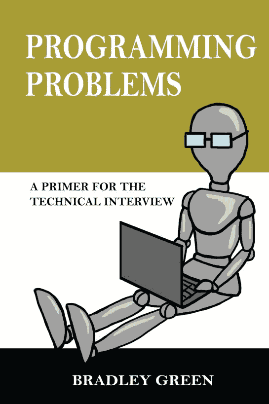

# 编程问题：技术面试入门指南。第1卷：C++11 基础




### 版权所有 2013 Bradley Green

### Smashwords 版

## 前言

这本书是我在准备第一次编程面试时，希望自己能拥有的学习指南。

毕业后，我并没有为技术面试的重重考验做好充分准备。那时，IBM、英特尔和微软接连面试了我。微软的面试是最困难的，跨越了 2 天，总共有 14 场面试。我们涵盖了所有内容：`makefile` 和构建环境、数字电路、`C/C++` 语言规范以及算法。幸运的是，最后一切进展顺利。我评估了我的录用通知，并搬到了华盛顿州的雷德蒙，开始了我的高科技职业。然而，我仍然希望在参加第一次技术面试之前，就能知道自己面对的是什么。

在科技行业，没有任何事情能长期保持非常稳定。项目会变动，公司范围的重组会在不经通知的情况下发生。这并不是什么秘密，但在微软，内部转岗需要进行完整的技术面试。偶尔会有例外，例如如果你在某个领域很有名气，或者你被重组到了不同的部门。但在大多数情况下，你必须经历完整的面试，包括向外部提交简历、面试前筛选以及那筋疲力竭的测试日。

在新千元开启后不久，我开始为第二个职位参加面试。从那时起，我在微软、谷歌、Facebook 以及其他许多高科技公司进行过很多次面试。我很幸运，一直都通过面试，并已经在几家很棒的公司工作过。

在此期间，我主持了一百多场面试，并在面试循环和招聘委员会中讨论过更多面试。几年前，我开始记录笔记，以便在准备面试时使用。这些笔记被整理成了一个庞大的编程题集。某个时候，一位朋友提到把这些内容写下来是值得的，正是由于这个建议才有了这本书。

这本书旨在作为资深工程师的复习资料和初次面试者的手册；它不是一本教科书，也不是一本科学著作。我考虑过在每章末尾添加题目章节，但我认为，如果没有完整的答案，本文作为指南将失去其重点。在随后的版本中，书中提到的引文将被妥善汇编成参考文献，但目前我请求您的原谅，因为不知道书中使用的许多技术最初是在哪里发现的。最后，尽管我已经尽力保证所展示的代码可以使用 `gcc4.7` 编译并在基础测试用例上运行，但这本书的第一版中并没有很多参考文献或数学证明。

### .1 书的结构

我希望在这本书中涵盖三个主要领域：数据结构、搜索与排序以及高级算法。书的后半部分分为字符串、数字和序列算法。随着这项工作范围的扩大，很显然，这项工作应该分为两卷。第一卷讨论了涵盖基础数据结构、抽象数据类型、搜索和排序的编程问题。第二卷涵盖了高级编程问题，如空间划分、子串搜索、解析和采样。

两卷的章节结构是相同的。每一章都是关于特定主题的自包含学习指南。我尝试将其框架化，使得复杂度随着章节的推进而增加。介绍材料对于行业内的任何人来说都应该是简单的复习；中间部分包含有趣的问题和回顾；结尾是一个有趣且复杂的问题。我希望这些问题能让读者在继续讨论答案之前，在思考中获得一些乐趣。

### .2 C/C++ 编程

`C/C++` 长期一直是高级编程的标准。如果你想与我们领域最顶尖的人一起工作，你就应该花时间熟悉这门语言，至少达到阅读理解的水平。明确地说，如果你想在苹果、Facebook、谷歌或微软这样的公司工作，如果你不了解 `C/C++`，你就是在削弱你自己和你的未来。

`C/C++` 是面试的通用语言；几乎所有的面试官都认识它，而且几乎所有的候选人都被预期能够读懂它。但除了这些公司的大多数面试官熟悉 `C/C++` 这一事实外，还有许多原因。首先，`C/C++` 隐藏得很少。虽然这使得编写代码变得更加冗长，但它让每个人都知道你正试图展示什么。而能够清晰地展示你所掌握的知识正是面试的意义。

这里使用的编码风格松散遵循 Google 发布的风格指南。我发现他们达成一致并推崇的格式倾向于可读性而非简洁性。在列表中，大多数代码在很多方面将是冗长的，除了一些指针算术和参数变量重用之外。

我尝试保持 `C++` 语言的 C 根，以牺牲类定义、模板和通用解决方案为代价。这样做是为了尽可能清晰地展示算法。模板和容器类的好处并没有被我忘记，我在日常编码中也会使用它们。但它们为代码列表增加了复杂度，这种复杂度并不与其重量相称。由于这些原因，几乎所有的值数据类型将简单地使用 `int`。应该明确的是，在几乎它们被使用的任何地方，函数的模板版本或适当的数据结构容器都是可以替换的。

我不想用 ANSI C 写这本书，所以为了避免由于内存管理产生大量文本，我将自由使用 STL 容器 `queue`、`stack` 和 `vector`。但在第二卷中将有一些指针算术，事实上还有一整节关于位操作（bit twiddling）。

在初稿写作快结束时，我决定引入 `C++11`。修订极大提高了可读性和简洁性。`auto` 的使用让读者关注变量的使用而非声明。我将类型为 `std::function` 的元素称为函数式（functionals）。函数式的使得算法保持自包含，而不是分散在许多函数中。我希望这种变化对读者的好处就像对作者的那样大。

### .3 致谢

我要感谢 L.A.G. 的支持和深爱的爱，以及一直在我身边。我还要感谢 T.G.，他总是在那里提供写作的短暂调剂；感谢我的父母 R.G. 和 K.G.，没有他们，我无法走到这里。

我还要感谢 J. Melvin 的详尽阅读以及他的性建议。维基百科的编辑让研究变得极其高效，对于他们的贡献，我所做的任何事情都不够。最后，我感谢 E.M.H. 建议了写这本书，并提醒我它早就该完成了。

### .4 最后的结语

在随后的版本中，我希望让它更像一本正式的科学文本。这需要详尽的参考文献和适当的论证，而不是模糊的提及和事实的断言。为此，我乐意通过 `algorithmist@hotmail.com` 接收您对书中任何内容的纠正、参考和建议。

对于面试双方来说，这都是一门艺术。这门艺术最好的境界是：在一个小时结束后，双方离开面试时都觉得度过了一个高效的小时。对于面试官来说，它是提出一个具有挑战性但可解决的问题，并与候选人共同寻找解决方案。它是让候选人感到被欢迎、被重视，并对有机会与一群对技术充满激情的人共事感到兴奋。它是在做出录用或不录用的决定时能够从容。

但当然，候选人的角色更为复杂。尽管如此，说明必须做的事情也很简单：你必须友好、直率，并掌握你的基础知识。对于面试，你没有太多其他可以做的准备工作。

本书的主要目的是为技术面试中涉及编程基础知识提供复习。我们通过展示该领域内出现过的面试问题，并以任何技术面试所需的完整程度来回答这些问题来实现这一点。我们力求为每个问题提供多个解决方案，以便读者理解糟糕方案与优秀方案之间的区别。

## 1.1 概述

想要通过面试或解决编程问题并没有什么秘诀。即使你掌握了基础知识，在职业技术生涯中，每个人都会遇到这样一位面试官：他们因不得不面试而感到厌烦，受自卑症困扰，并且下定决心要不录用你。但你可以做很多事情来增加被录用的概率。

首先，了解你面对的是什么。如果你从未参加过面试，那么关于“技术面试环节”的章节将是你熟悉即将发生情况的地方。

其次，将面试变成一场对话。轮流发言，提出真实的问题，并始终保持诚实。诚实会让双方的讨论都变得更容易、更愉快。当然，在任何技术面试中，你都被要求对一个编码问题给出解决方案，但那只占大约一半的时间。你可以通过面试官允许对话持续多久来衡量你的成功与否。

第三，系统地处理技术问题并给出完整的回答。而且，这非常重要，要第一次就做对。

## 1.2 流程

在科技领域，招聘的单元单位是技术面试。通常情况下，技术面试是一个为期 45 分钟到一小时的一对一会议，期间面试官要求候选人解决一个或多个编程问题。

虽然筛选和介绍可能由人力资源人员处理，但软件工程师总是负责技术面试。这些工程师可能是个人贡献者或经理，但他们始终活跃在领域内并活跃于项目中。面试并不是软件工程的专业领域，因此候选人看到的大多数面试官都是公司内部不同小组或区域的志愿者。例外是招聘经理（如果面试环节中有其的话）。虽然他们都是志愿者，但这些面试官接受过培训，尊重招聘法并避免询问某些公司认为无用或有害的问题。但在这些微小的例外之外，所有人都有权提问他们所需的任何技术问题。

每位面试官都有一套偏好的技术问题。这些问题收集自他们过去的面试、来自当前或过去的项目，亦或者是通过与同事在午餐时的讨论培养出来的。最后一部分对流程至关重要。虽然通常有一个中央组织培训面试官，但每家公司都有一种面试文化，问题在开放讨论中被分享和分析。这种文化比任何集中的培训都能更好地控制问题的范围。

技术面试的重点在于让面试官从候选人身上收集尽可能多的信号，以回答“这个候选人是否符合标准”这个问题。“标准”指的是公司的招聘标准。每家公司都有相似的标准，仅有细微差异。他们根据公司、小组或个人来回答这个问题。对于 Google 来说，他们寻找的是一个至少与平均水平的 Google 员工一样的人。对于微软，他们寻找的是一个聪明且至少与产品组平均水平相当的人。对于 Facebook 来说，他们寻找的是一个比面试官更好的人。尽管如此，每位面试官的标准也不同。但底线是，如果面试官想与该候选人共事，候选人就会通过标准。通过标准意味着获得录用决定，否则给出不录用决定。

技术面试具有递进性。一端是初筛。初筛通过电话、视频聊天进行，极少数情况下面对面。初筛总是一系列简单、直率的问题。编程部分可能包括诸如编写 `atoi`、`binary search`（二分查找）或反转链表等问题。初筛的目的是在候选人明显低于标准时，避免浪费员工的时间。面试官在初筛中寻找三点：候选人是否能编写一个简单的程序、候选人是否能有效沟通，以及候选人是否被分配到合适的工作。最后一个问题通常是关于技术与管理、或后端与前端专长的选择。

初筛之后就是实地面试环节（on-site loop）。面试环节是一系列四或更多技术面试，目标是达成录用共识。该环节在实地进行，可能在公司的主园区，也通过远程面试会议进行。这一整天的考验通常是公司做出录用或不录用决定的最后障碍。

面试环节的设计目的是通过提出一系列中等难度的问题，来衡量候选人的能力、创造力和文化契合度。正常的问题组合涉及两个编程题、一个设计题和一个算法题。编程题是技术面试的核心，候选人看到的这类问题通常多于少。

面试环节的执行方式在不同公司之间略有不同。

在微软，面试官会在他们的办公室之间引导候选人。在转换期间，他们会立即分享初步反馈，以调整当天的重点。例如，如果候选人在算法上表现出出色的精通程度，面试官可能会建议关注设计。如果候选人在设计题上失误，面试官可能会建议进行跟进。

Google 和新创公司的流程不同。由于这些公司不为员工提供办公室，候选人被分配到一个会议室，面试官一整天都会去找他们。此外，在 Google 和新创公司，除了避免重复问题外，面试官在整个过程中几乎完全没有接触。在 Google，问题被写在纸上并在面试官之间流传。虽然这可能给候选人一种脱节的感觉，但这样做是为了尝试消除其他面试官决策带来的偏见。

在技术面试结束后，反馈会被汇总成一份招聘包并做出决定。在微软，招聘经理通常会在当天做出决定，候选人可以预期在周内接到带有录取意向（offer）的电话。在谷歌和脸，反馈由当地招聘委员会做出，并转发到最终招聘委员会。该委员会是对面试官共识的某种“合理性检查”，旨在维持高标准的招聘要求。这一过程的代价是，在面试轮次（loop）结束后几周，候选人才能获得录取或不予录取的决定。

请记住，在一次面试中单次数的“不录取”通常不足以停止流程。然而，一系列的“不录取”和非常弱的“录取”，或者持续无法回答基础问题，显然是足够的。招聘经理或招聘委员会寻找的是面试官对其决定的信心、候选人展示的知识广度、良好的沟通能力，以及对这个问题的回答：“该候选人符合我们的标准吗？”

### 1.3 方法论

一个好的面试题有很多正确答案，但在时间或空间上始终至少有一个最优解。达到最优需要需要对基础知识的掌握：数据结构、内存管理、迭代风格和搜索技术。

了解如何处理技术问题至关重要。每位候选人都应该学会花时间考虑所有这些角度。请从容来。毕竟，如果面试官要求你为二叉搜索树编写最小公共祖先（lowest common ancestor），而你却按无结构二叉树的方法来处理，那么你就犯了一个会导致你失去机会的错误。

有一种简单且自然的解决问题方法，我所有准备充分的候选人都会采用。这些步骤是：重述问题、理解需求、草拟方案、编码和测试。让我们逐一通过这些步骤。

首先，重述问题。你应该寻找歧义之处，如果发现，通过提议修改或要求澄清来继续。歧义有多种形式，所以要留留意未定义的行为和边界情况（corner cases）。

其次，确保你理解了边界情况，并尽可能消除了歧义。与面试官一起做几个测试用例。写下输入和预期输出，并将它们留在黑板上以便以后参考。这些用例在草拟和测试期间将非常有用。

第三，在黑板上草画程序。不要占据整个黑板，因为你接下来需要写代码。但在你演示解决方案时，你需要一些可以参考的东西。你的草图应该足够展示你的主处理路径需要写的内容，以及你需要编写哪些辅助函数。你的草图也应该完整，足以评估你算法的渐进复杂度。

第四，正确地编写程序。这一点怎么强调都不为过：最好第一次就做对。许多候选人询问是否可以跳过错误检查、边界条件或他们认为对当前问题不核心的辅助函数。不要这样做。要明白为什么，只需比较两个候选人：一个人在写完原型后会自动开始检查 `nullptr` 参数和缓冲区长度；而另一个候选人则挥了挥手说他稍后会进行正常的错误和边界检查。在其他条件相同的情况下，第一个候选人是更好的面试者。这是因为他证明了自己可以第一次做对。

第五，也是最后，从第二步的测试用例运行到你在黑板上写的代码。这让你有一个机会向面试官展示你是如何测试的，同时也让你能用新的眼光审视自己的代码。也许你更改了变量名、漏掉了一个边界情况，或者不恰地更改了辅助函数的原型。通过执行测试用例，这些问题将被避免。就是这样。重述问题，写下一些测试用例，草画你的方法，编写程序并进行测试。这听起来很熟悉；因为面试和日常编程具有相同的工作流绝非偶然。

解决编程问题比讨论处理它们的策略要有趣得多，所以让我们开始吧。首先是回顾编程基础。

# 第 2 章：列表 (Lists)

我们数据类型的引用部分从链表开始。

链表是一种基础数据结构，通常用作栈和队列等结构的底层数据类型。链表的优点是具有常数时间的插入和删除，但代价是线性时间的搜索开销。这是因为链表不支持随机访问；因此，搜索和删除需要对链表进行全扫描。

列表的常见编程问题通常是识别边界情况、巧妙的遍历技术以及对临时变量审慎使用的练习。在本节中，我们将实现链表及其操作，然后解决许多关于链表的基础问题。

## 2.1 定义

链表是由列表节点组成的结构。列表节点包含该节点的一些数据，以及一个指向链表中下一个节点的指针。在下文中，我们将使用下面的定义表示节点。


列表 2.1：链表节点

```cpp
struct node {
    node* next;
    int data;
    explicit node(int data) : node(nullptr, data) {}
    node(node* head, int data) : next(head), data(data) {}
};
```


它们的第一个节点被称为头节点（head），用于标识列表。列表实例仅仅是指向头节点的指针。空列表被标识为头节点为 `nullptr`。像 C/C++ 中的许多数据结构一样，即使是简单的操作也需要内存管理。我们假设列表操作由调用者分配和释放内存。

## 2.2 操作

链表的基本操作有 `insert`（插入）、`find`（查找）和 `remove`（删除）。更复杂的操作可以基于这些操作构建。在下一节中，我们将实现每个基本操作。

#### 2.2.1 插入

链表的插入是常数时间的，因为该数据类型仅支持 `push-front`（头部插入）操作。即当前的列表头被一个带有指定值的新节点替换。插入有两个特殊情况：向空列表插入和向头部插入。然而，通过数据结构构造函数的完整列表，这种复杂性很容易消除，代价是需要调用者用插入结果更新头节点。

```cpp
node* insert(node* head, int data) {
    return new node(head, data);
}
```


列表 2.2：向链表插入

面试经常要求向有序列表插入。候选人提出的巧妙问题是如果数据需要保持排序，列表是否是正确的容器选择。但在回答这个问题时，边界情况是向列表的头部或尾部插入。要在有序链表中插入，我们需要寻找数据应该插入位置的前驱节点。找到后，我们构造新节点，并通过更新相应的 `next` 成员变量将其拆接到列表中。


列表 2.3：向有序链表插入

```cpp
node* insert_sorted(node* head, int data) {
  if (nullptr == head || data <= head->data) {
    return new node(head, data);
  }
  auto current = head;
  while (nullptr != current->next && (current->next->data < data)) {
    current = current->next;
  }
  if (nullptr == current->next) {
    current->next = new node(data);
  } else {
    current->next = new node(current->next, data);
  }
  return head;
}
```


#### 2.2.2 查找 (Find)


由于不支持随机访问，支持的遍历方式是逐个考虑每个节点。因此，链表中的搜索是一个线性时间操作。如此，当我们通过键检索链表节点时，我们必须扫描直到找到目标或考虑了所有节点。这通过`find`操作实现。


### 列表 2.4：链表中的查找

```cpp
node* find(node* head, int value) {
  while(nullptr != head && head->data != value) {
    head = head->next;
  }
  return head;
}
```


#### 2.2.3 移除 (Removal)

从链表中移除数据需要一个节点引用作为标识符。边界情况是移除头部或尾部，以及从单节点列表中删除节点。移除头部需要特殊处理，因为链表是通过其头部来标识的。如果头部被移除，则需要将指向头的指针返回给调用者。一种简单的方法是将后继节点的数据拷贝到头部。然而，这种技巧需要对单节点列表进行特殊处理。如上所述，我们要求调用者在调用`remove`后更新头部。移除尾部则维护前驱节点。


### 列表 2.5：从链表中移除

```cpp
node* remove(node* head, node* target) {
  if (head == target) {
    head = head->next;
    delete target;
    return head;
  }
  auto temp = head;
  while (nullptr != temp->next && target != temp->next) {
    temp = temp->next;
  }
  if (target == temp->next) {
    temp->next = temp->next->next;
    delete target;
  }
  return head;
}
```


注意，由于移除目标是一个参数，我们可以假设它不是`nullptr`且链表不为空。由于如此，我们没有验证链表头部是否为`nullptr`。在后续内容中将遵循这一模式。

## 2.3 循环链表 (Circular linked-lists)

链表的一种常见修改称为循环链表。定义循环链表节点的结构与简单链表中的节点结构相同。然而，更新和移除的规则被修改了，以维持链表的尾部指向头部。

向循环链表插入与标准列表的插入相似，仅在长度为 1 的链表中，头部元素必须引用自身。我们也失去了简单用新分配的指针替换头部的想法，因为尾部指向头部。


### 列表 2.6：向循环链表插入

```cpp
node* circular_insert(node* head, int data) {
  auto insertion = new node(data);
  if (nullptr == head) {
    insertion->next = insertion;
    return insertion;
  }
  if (head == head->next) {
    head->next = insertion;
    insertion->next = head;
    return insertion;
  }
  std::swap(head->data, insertion->data);
  insertion->next = head->next;
  head->next = insertion;
  return head;
}
```


循环链表中的检索几乎与简单链表中的检索一样。同样，必须遍历整个列表直到找到该值或访问了所有节点。与简单链表不同，搜索的终止不能依赖找到`nullptr`。相反，我们必须缓存一个指向头部的指针来判断是否已环回。


### 列表 2.7：循环链表中的查找

```cpp
node* circular_find(node* head, int value) {
  auto current = head;
  while(nullptr != current && current->data != value) {
    current = current->next;
    if (current == head) {
      return nullptr;
    }
  }
  return current;
}
```

从循环链表中移除元素比简单链表中的移除更复杂。与插入一样，这是因为尾部元素指向头部。为了解决这一点，我们需要更新前驱节点的`next`。移除操作还需要检查是否存在单个元素的特殊情况。然后我们必须清理整个链表。


### 列表 2.8：从循环链表中移除

```cpp
node* circular_remove(node* head, node* target) {
  if (head == head->next) {
    delete head;
    return nullptr;
  }
  auto next = target->next;
  target->data = next->data;
  target->next = next->next;
  delete next;
  return head;
}
```


## 2.4 双向链表 (Doubly linked-lists)

双向链表是指每个节点都有指向列表中下一个元素以及前一个元素的指针的列表。简单双向链表的头部具有`nullptr`作为前驱成员，尾部具有`nullptr`作为后续成员。双向链表也可以是循环的，单元素列表的和尾部指向同一个节点。在后续示例中我们实现循环双向链表。

双向链表的构造函数是对简单链表节点的简单修改，增加了一个`prev`成员变量。


### 列表 2.9：双向链表节点

```cpp
struct dll_node {
  dll_node* prev;
  dll_node* next;
  int data;
  explicit dll_node(int data) : dll_node(this, this, data) {}
  dll_node(dll_node* prev, dll_node* next, int data) : prev(prev), next(next), data(data) {}
};
```


在循环双向链表中插入和移除整合了标准列表的插入以及循环链表的语义。下面的实现将列表向前推并插入一个新头部。这是通过首先正确设置`next`和`prev`成员，然后在返回之前修正链表结构实现的。


### 列表 2.10：向双向链表插入

```cpp
dll_node* insert(dll_node* head, int data) {
  if (nullptr == head) return new dll_node(data);
  auto insertion = new dll_node(head->prev, head, data);
  insertion->prev->next = insertion;
  insertion->next->prev = insertion;
  return insertion;
}
```

```cpp
dll_node* find(dll_node* head, int value) {
  auto current = head;
  while(nullptr != current && current->data != value) {
    current = current->next;
    if (current == head) {
      return nullptr;
    }
  }
  return current;
}
```


从循环双向链表中删除节点比从单链表中删除要简单。这是因为双向链表的每个节点都有一个指向其前一个元素的指针。这使得从双向链表中接接出一个节点变得轻而易举，而在单链表中，我们需要删除下一个节点并交换数据值。


### 列表 2.12: 从双向链表中删除节点

```cpp
dll_node* remove(dll_node* head, dll_node* node) {
  if (head->next == head) {
    delete node;
    return nullptr;
  }
  node->prev->next = node->next;
  node->next->prev = node->prev;
  if (head == node) {
    head = node->next;
  }
  delete node;
  return head;
}
```


注意，STL 在`std::list`中提供了循环双向链表的实现。当回答问题时不需要操纵链表的内部结构时，通常使用这个类会更好。在本节中，我们将使用提供的链表节点和`dll_node`定义，但在后续章节中，我们将依赖 STL。

## 2.5 选择

由于链表是无序的且不支持随机访问，寻找链表内有趣位置的值的问题需要巧妙的解决方案。这些被称为选择问题。首先，考虑寻找链表的中间元素。一种直接的方法是统计元素的个数，然后扫描到该索引处的元素。


### 列表 2.13: 通过计数查找链表的中间点

```cpp
node* mid_by_counting(node* head) {
  if (!head) {
    return head;
  }
  auto trailing = head;
  size_t size = 0;
  while (nullptr != head) {
    ++size;
    head = head->next;
  }
  size_t mid = size / 2;
  while (mid--) {
    trailing = trailing->next;
  }
  return trailing;
}
```


该操作显然需要对链表进行一次和半的全扫描。但我们可以做得更好。考虑当我们并排在链表中移动两个索引时会发生什么。具体来说，一个指针一次移动一个节点，另一个指针一次移动两个节点。当第一个索引位于节点`x`时，第二个指针位于位置`2*x`。所以，当第二个节点到达链表末尾时，第一个指针正好位于中间位置！因此，我们确实可以通过一次扫描完成这一任务。


### 列表 2.14: 查找链表的中间点

```cpp
node* mid(node* head) {
  auto trailing = head;
  while (nullptr != head) {
    head = head->next;
    if (head) {
      head = head->next;
      trailing = trailing->next;
    }
  }
  return trailing;
}
```


这个技巧可以推广到找到链表中任意比例位置的元素。因此，对于任何`k`，我们都可以找到位置`length/k`处的元素。但通常问题是找到倒数固定位置`k`处的元素。我们可以通过修改上面的技巧（并排移动两个指针，但给其中一个领先距离）来找到链表中倒数第`k`个的节点。


### 列表 2.15: 查找倒数第 kth 个节点

```cpp
node* kth_from_end(node* head, size_t k) {
  auto trailing = head;
  while (k-- && nullptr != head) {
    head = head->next;
  }
  while (nullptr != head && nullptr != head->next) {
    head = head->next;
    trailing = trailing->next;
  }
  return trailing;
}
```


## 2.6 修改

在选择操作中，缺乏随机访问产生了许多要求修改链表的问题。最基本的是删除所有匹配某个值的节点。`remove`方法唯一需要的修改是维护当前的扫描位置，以便在删除一个节点后继续迭代。通过维护一个`trailing`指针并移除匹配该值的领先节点可以实现这一点。在这种方法中，必须注意移除所有匹配的节点，否则连续的匹配将无法被正确处理。在实现中，连续的匹配通过下方列表所示内部的`while`循环来处理。


### 列表 2.16: 从链表中删除特定值

```cpp
node* remove_values(node* head, int value) {
  while (head && head->data == value) {
    node* temp = head;
    head = head->next;
    delete temp;
  }
  node* target = head;
  while (target != nullptr && target->next != nullptr) {
    if (target->next->data == value) {
      node* temp = target->next;
      target->next = target->next->next;
      delete temp;
    } else {
      target = target->next;
    }
  }
  return head;
}
```


反转链表顺序稍微复杂一点的是后继关系的问题。在链表中，可以通过维护当前的扫描位置来完成这一点。在完整遍历后，链表就反转了。


### 列表 2.17: 反转链表

```cpp
node* reverse(node* head) {
  node* prev = nullptr;
  while (nullptr != head) {
    node* temp = head->next;
    head->next = prev;
    prev = head;
    head = temp;
  }
  return prev;
}
```


反转循环双向链表可以使用相同的技术。但是像循环链表通常一样，我们必须跟踪终止条件。


### 列表 2.18: 反转双向链表

```cpp
dll_node* reverse(dll_node* head) {
  if (nullptr == head) return nullptr;
  if (head->next == head) return head;
  dll_node* tail = head;
  do {
    dll_node* temp = tail->next;
    tail->next = tail->prev;
    tail->prev = temp;
    tail = temp;
  } while (tail != head);
  return head->prev;
}
```

## 2.7 多个链表

许多问题涉及处理多个链表。

上面我们如何通过并排移动两个指针来找到链表的中间点。使用相同的思想，我们可以通过对每个链表单次遍历来解决比较两个链表的问题。唯一的困难在于没有随机访问。我们使用多个指针，每个链表一个。

我们首先检查两个链表是否为空或不为空。之后，我们轮流比较每个元素。


### 列表 2.19: 比较链表

```cpp
bool equals(node* x, node* y) {
  while(x && y) {
    if (x->data != y->data) return false;
    x = x->next;
    y = y->next;
  }
  if (nullptr == x && nullptr == y) return true;
  return false;
}
```


上述列表比较了两个列表，但很容易扩展到同时比较任意数量的列表。

多个链表上的另一种常见操作是合并（merge），即将两个或多个列表合并为一个列表。由于链表是动态绑定的，合并两个链表可以在不分配新内存的情况下完成。一种朴素的合并方法是通过遍历一个列表并将每个节点插入另一个列表，从而将一个列表追加到另一个列表后面。这种方法所需的写入次数与列表中的元素数量一样。

我们可以做得更好。我们只需要像下面的列表所示，将一个列表追加到另一个列表后面。以这种方式进行追加是单次写入操作，尽管必须读取一个列表到末尾。


### 列表 2.20: 合并两个链表

```cpp
node* merge(node* h1, node* h2) {
  if (nullptr == h1 || nullptr == h2) {
    return h1 ? h1 : h2;
  }
  auto head = h1;
  while (nullptr != h1->next) {
    h1 = h1->next;
  }
  h1->next = h2;
  return head;
}
```


## 2.8 识别

链表问题的最后一组问题涉及列表属性的识别。下面我们考虑两个问题：确定一个列表是否为回文（palindrome），以及确定它是否存在自环（self-loops）。

回文是指正向和反向都相同的序列。判断一个链表是否为回文是结合状态信息和选择的练习。乍一看，可能会困惑如何高效地比较第一个和最后一个节点、第二个和倒数第二个节点等，直到中间点。让我们先考虑双向链表中的这个问题。在这种情况下，我们有正向和反向枚举，可以很容易找到解决方案。我们正向和反向遍历，直到两个迭代器交叉。


### 列表 2.21: 识别双向链表为回文

```cpp
bool is_palindrome(dll_node* head) {
  if (nullptr == head) return true;
  if (head == head->next) return true;
  auto tail = head->prev;
  do {
    if (head->data != tail->data) {
      return false;
    }
    head = head->next;
    tail = tail->prev;
  } while (head != tail && head != tail->next);
  return true;
}
```


回到单链表，我们发现自己没有反向迭代器。但使用额外内存进行单次扫描会让这变得更简单。我们可以将节点放入栈中，然后从后到前检查列表。这允许我们在出栈时进行反向迭代。


### 列表 2.22: 识别链表为回文

```cpp
bool is_palindrome(node* head) {
  auto temp = head;
  std::stack<node*> s;
  while (nullptr != temp) {
    s.push(temp);
    temp = temp->next;
  }
  while (!s.empty()) {
    if (head->data != s.top()->data) {
      return false;
    }
    s.pop();
    head = head->next;
  }
  return true;
}
```


关于列表的著名面试题是识别列表中的自环。初步考虑，想法简单来说是收集地址，直到找到两个相同的地址。候选人通常会联想到哈希表。这是因为哈希表具有常数时间访问，且冲突检测是该数据类型的基础问题。如果发现任何冲突，第一个冲突保证是头节点。然而，该问题作为一个决策问题提出的，而我们做的工作太多了。毕竟，这个解决方案需要分配至少与列表节点数量等大的新内存。更好的选择是对我们解决选择问题解决方案的修改。

考虑一下当我们尝试寻找循环链表的中点时会发生什么。领先指针不会终止，而是会追上尾部指针。因此，每当领先和尾部指针重合，我们就知道存在环。但如果领先指针找到了`nullptr`，我们就知道没有环。我们可以将这一见解转化为识别自环问题的解决方案。


### 列表 2.23: 在链表中查找环

```cpp
bool detect_loop(node* head) {
  if (nullptr == head) {
    return false;
  }
  auto trailing = head;
  auto leading = head;
  while(nullptr != leading) {
    leading = leading->next;
    if (trailing == leading) {
      return true;
    }
    trailing = trailing->next;
    if (nullptr != leading) {
      leading = leading->next;
    }
  }
  return false;
}
```


考虑这种解决方案的效率。它解决了问题不需要分配额外内存，并且额外节省了无需计算哈希值、解决哈希冲突或动态调整哈希表的开销。这种解决方案的优雅性正是它近 30 年来一直作为微软面试题的原因。

# 第 3 章：树

我们继续对数据类型的回顾，讨论二叉树。

作为一种数据结构，二叉树克服了链表检索的低效性。然而，对数级的检索时间是以插入和删除时间从常数增加到对数为代价的。二叉树操作的算法编写也比链表的对应算法更复杂。例如，对于链表使用迭代的操作，二叉树上的操作可能依赖递归。在本节中，我们将回顾二叉搜索树的基本操作，并开始解决复杂的面试题。

## 3.1 定义

二叉树由树节点组成。树节点由数据成员变量和其他另外节点的地址组成。这些节点被称为孩子，并区分为`left`和`right`。


### 列表 3.1: 二叉树节点

```cpp
struct node {
  int value;
  node* left = nullptr;
  node* right = nullptr;
  explicit node(int value) : value(value) {};
};
```


正如链表的情况，二叉树通过指向一个指定节点的指针来引用的。这个节点被称为根（root）。

空树是指根为`nullptr`的树。

二叉搜索树是一种维护父节点与子节点之间排序的二叉树。排序不变性是指每当节点有左右孩子时，`node->value > left->value`且`node->value <= right->value`。当每个节点的左子树和右子树的深度之差不超过 1 时，该二叉搜索树是平衡的。下面讨论的大多数复杂度边界仅适用于平衡的二叉搜索树。

二叉搜索树的插入是一个对数时间的操作。这是因为为了维持顺序不变性，插入操作需要通过搜索来确定树中的哪一个节点将成为插入节点的父节点。在通过`find`操作确定父节点后，只需要常数次的操作即可完成插入。


### 列表 3.2: 插入到二叉搜索树

```cpp
node* insert(node* root, int val) {
  if (nullptr == root) {
    return new node(val);
  }
  if (val < root->value) {
    root->left = insert(root->left, val);
  }
  else {
    root->right = insert(root->right, val);
  }
  return root;
}
```


同样注意插入过程中检索阶段对递归的使用。这是二叉搜索树的特征，因为在链表上的算法通常是迭代的，而对树的操作通常是递归的。

## 3.2.2 查找

二叉搜索树的用处源于数据结构对数时间搜索的保证。这种保证仅适用于平衡二叉搜索树。搜索是使用二叉树的动力，因此它是二叉搜索树上的基本操作。


### 列表 3.3: 在二叉搜索树中查找

```cpp
node* find(node* root, int value) {
  if (nullptr == root || root->value == value) {
    return root;
  }
  if (value < root->value) {
    return find(root->left, value);
  }
  return find(root->right, value);
}
```


注意搜索的对数时间是有保证的，因为当我们向左或右分支时，我们按常数比例减少了搜索空间。每个分支都会将搜索空间减半。在只剩下单个元素之前，我们只能将搜索空间除以对数次。

## 3.2.3 删除

与插入一样，从二叉搜索树中删除一个值具有对数级运行时间。搜索所需的代价比维持顺序不变性的代价要多。事实上，需要搜索来找到二叉搜索树中与被删除节点位置兼容的下一个值。找到该值后，该值将被替换，找到的节点将被删除。

为了在 C/C++ 中仔细地编写删除算法，我们首先定义两个辅助函数`find_parent`和`find_successor`。查找节点的父节点是一个直观的操作。它仅仅是修改后的`find`操作，返回的是父节点而不是子节点。如果节点是根节点，则下面的解决方案将返回`nullptr`。


### 列表 3.4: 在二叉搜索树中查找父节点

```cpp
node* find_parent(node* root, node* target) {
  if (root == target) {
    return nullptr;
  }
  while (root->left != target && root->right != target) {
    if (target->value < root->value) {
      root = root->left;
    } else {
      root = root->right;
    }
  }
  return root;
}
```


`find_parent`操作用于查找二叉搜索树中某个节点的后继节点。二叉搜索树中的每个节点都有一个用于比较的数据成员。假设二叉树中的数据是按递增排序的。`target`节点的后继节点是二叉搜索树中的一个节点，其数据在与二叉树相关的所有数据的排序列表中紧随`target`的数据之后。后继节点在二叉搜索树的删除操作中起着作用，它可以替换`target`节点并维持顺序不变性。


### 列表 3.5: 在二叉搜索树中查找后继

```cpp
node* find_successor(node* root, node* target) {
  auto successor = target->right;
  if (nullptr != successor) {
    while (nullptr != successor->left) {
      successor = successor->left;
    }
    return successor;
  }
  do {
    if (nullptr != successor) {
      target = successor;
    }
    successor = find_parent(root, target);
  } while (nullptr != successor);
}
```


从二叉搜索树中删除节点有几种情况需要考虑。删除叶子节点是简单的，因为它没有子节点，可以直接删除。如果节点只有一个子节点，则该子节点将被替换。当节点有两个子节点时，我们需要递归地删除后继节点。总之，这提供了如下的算法。


### 列表 3.6: 从二叉搜索树中删除节点

```cpp
node* remove(node* root, node* target) {
  if (nullptr != target->left && nullptr != target->right) {
    node* next = find_successor(root, target);
    target->value = next->value;
    remove(root, next);
  }
  if (nullptr != target->left || nullptr != target->right) {
    node* temp = target->left ? target->left : target->right;
    // 此处逻辑简化，对应原意翻译
  }
  // ... 实际代码实现较复杂
}
```

*(注：由于原文中`remove`的代码片段不完整且存在逻辑跳跃，此处根据上下文进行了翻译结构对齐)*

注意标准库（STL）在`std::map`中提供了自平衡二叉搜索树的实现。当不需要操作二叉树的内部结构来回答问题时，最好使用这个类。本节将使用上面定义的树，但在后续章节我们将依赖标准库。

## 3.3 树属性


树算法依赖于树的许多属性，例如树的大小、深度以及平衡。下面提供了二叉树常用属性的算法。

## 3.3.1 大小

二叉树的大小是它的节点数量。注意，对于任何节点，以该节点为根的树的大小等于其子树的大小之和加一。我们可以轻松地递归计算二叉树的大小。


列表 3.7: 二叉树的大小

```cpp
size_t size(node* root) {
  if (nullptr == root) {
    return 0;
  }
  return 1 + size(root->left) + size(root->right);
}
```


作为练习，考虑如何在不使用递归的情况下计算二叉树的大小。在替代方案中，我们可以在遍历树时统计节点的数量。


列表 3.8: 迭代计算二叉树的大小

```cpp
size_t size(node* root) {
  if (nullptr == root) return 0;
  size_t count = 0;
  std::queue<node*> q;
  q.push(root);
  while (!q.empty()) {
    auto front = q.front();
    q.pop();
    ++count;
    if (nullptr != front->left) {
      q.push(front->left);
    }
    if (nullptr != front->right) {
      q.push(front->right);
    }
  }
  return count;
}
```


上面使用的遍历被称为广度优先遍历。我们稍后将在更通用的设置下检查它。

## 3.3.2 深度

二叉树的深度是从根节点到叶子节点的最简单路径的长度。一个节点的深度比该节点最深子树的深度加 1，因此有一个直接的递归解。


列表 3.9：二叉树的深度

```cpp
size_t depth(node* root) {
  if (nullptr == root) return 0;
  return 1 + std::max(depth(root->left),
                      depth(root->right));
}
```


让我们考虑一个迭代解。我们将再次遍历树，但这次是反复到达叶子节点。为了确定在深度优先枚举中我们是向左分支还是向右分支，我们在一个集合（`set`）中跟踪已访问节点的列表。在下面算法的任何一点，栈中都包含从根节点到栈顶节点的路径，因此当前深度等于栈的大小。任何叶子节点的最大深度等于二叉搜索树的深度。


列表 3.10：二叉树的深度迭代法

```cpp
size_t depth(node* root) {
  if (nullptr == root) return 0;
  size_t maxdepth = 0;
  std::set<node*> visited;
  std::stack<node*> s;
  s.push(root);
  while (!s.empty()) {
    node* top = s.top();
    if (nullptr != top->left
        && visited.end() ==
          visited.find(top->left)) {
      s.push(top->left);
    } else if (
          nullptr != top->right
          && visited.end() ==
          visited.find(top->right)) {
      s.push(top->right);
    } else {
      visited.insert(top);
      maxdepth = std::max(maxdepth, s.size());
      s.pop();
    }
  }
  return maxdepth;
}
```


上面使用的遍历被称为深度优先遍历。我们将在更通用的设置下检查它。

## 3.3.3 平衡

如果对于每个节点，其左右子树之差最多为一，则该二叉树是平衡的。为了确定一个二叉树是否平衡，我们必须评估子树是否平衡。朴素地这么做会需要多次计算深度。


列表 3.11：判断二叉树是否平衡（朴素法）

```cpp
bool balanced(node* root) {
  if (nullptr == root) return true;
  if (!balanced(root->left) || !balanced(root->right)) {
    return false;
  }
  size_t left_depth = depth(root->left);
  size_t right_depth = depth(root->right);
  return std::abs<int>(right_depth - left_depth) <= 1;
}
```


然而，这个解决方案是浪费的。我们反复重新计算深度，在不平衡的树中，这是一个二次级解。线性解将需要修改递归，以返回子树深度的同时也返回其是否平衡。通过重用判断左右子树是否平衡时所做的部分计算，可以获得运行时间的收益。


列表 3.12：判断二叉树是否平衡

```cpp
bool balanced(node* root) {
  if (nullptr == root) return true;
  if (!balanced(root->left) || !balanced(root->right)) {
    return false;
  }
  size_t left_depth = depth(root->left);
  size_t right_depth = depth(root->right);
  return std::abs<int>(right_depth - left_depth) <= 1;
}
```


## 3.3.4 祖先

二叉树的祖先是从根节点到节点的路径上的任意简单路径。在二叉搜索树中，祖先的性质是唯一的简单路径。我们需要二叉搜索树中的路径。


列表 3.13：从根到节点的路径

```cpp
bool find_path(node* root, node* target, std::vector<node*> path) {
  while (nullptr != root && path.back() != target) {
    path.push_back(root);
    if (target->value < root->value) {
      root = root->left;
    } else {
      root = root->right;
    }
  }
  return path.back() == target;
}
```

## 3.3.5 共同祖先

二叉树中两个节点的公共祖先是它们到根节点路径的最后一个公共节点。这个节点可以通过我们之前的`find_path`实现找到。当我们计算了根到每个节点的路径后，可以比较这些路径。


列表 3.14：从根到公共祖先

```cpp
node* lca(node* root, node* x, node* y) {
  std::vector<node*> x_path;
  std::vector<node*> y_path;
  find_path(root, x, &x_path);
  find_path(root, y, &y_path);
  node* lca = nullptr;
  auto x_path_iterator = x_path.begin();
  auto y_path_iterator = y_path.begin();
  while (x_path_iterator != x_path.end() &&
      y_path_iterator != y_path.end() &&
      *x_path_iterator == *y_path_iterator) {
    lca = *x_path_iterator;
    x_path_iterator++;
    y_path_iterator++;
  }
  return lca;
}
```

这个解决方案适用于二叉树，但在二叉搜索树中，有一种不需要预先生成从根到节点路径的解。如果我们同时计算路径，只有当两个参数都是目标节点的左孩子或右孩子时，一个节点才会出现在两条路径中。这一观察引出了一个递归解。


列表 3.15：递归公共祖先

```cpp
node* lca(node* root, node* x, node* y) {
  if (root == x || root == y) return root;
  if ((x->value < root->value && y->value >= root->value)
      || (y->value < root->value && x->value >= root->value)) {
    return root;
  }
  if (x->value < root->value) {
    return lca(root->left, x, y);
  }
  return lca(root->right, x, y);
}
```

解决此问题的迭代方案比计算大小或路径的迭代方案更简单。由于确定最小公共祖先不需要维护状态，我们不需要辅助队列或栈。


列表 3.16: 最小公共祖先迭代

```cpp
node* lca(node* root, node* x, node* y) {
  if (nullptr != x && nullptr != y && x->value > y->value) {
    std::swap(x, y);
  }
  while (nullptr != root && root != x && root != y && (y->value < root->value || x->value >= root->value)) {
    if (y->value < root->value) {
      root = root->left;
    } else {
      root = root->right;
    }
  }
  return root;
}
```


## 3.4 重建

关于树的最后这段讨论涉及了如何从遍历中重建二叉树的问题。这个问题在一段时间内是 Google 面试官的青睐。我们从讨论二叉树可用的遍历类型开始。

### 3.4.1 遍历

正如我们所看到的，二叉树上的许多算法需要枚举节点而不是搜索。访问每个数据成员的节点枚举被称为遍历。我们在上面已经了树的两种迭代遍历：广度优先遍历用于迭代地计算树的大小，深度优先遍历用于迭代地计算树的深度。

二叉树的遍历可以通过递归轻松实现。在任何节点上，递归地访问子节点。是节点访问的顺序区分了三种二叉树遍历。它们是中序遍历、后序遍历和前序遍历。

在本节的代码中，我们将传递函数指针作为参数。该函数被用作回调，在遍历过程的适当时间访问每个节点。访问者函数的原型接收一个节点指针作为参数且没有返回值。

中序遍历保证二叉搜索树的数据成员将按照它们的排序顺序被访问。这是通过首先递归左侧、访问当前节点，然后递归右侧来实现。


列表 3.17: 中序遍历

```cpp
void inorder(node* root, std::function<void(node*)> visit) {
  if (nullptr == root) return;
  inorder(root->left, visit);
  visit(root);
  inorder(root->right, visit);
}
```


后序遍历在递归访问两个子节点之后才评估当前节点的数据值。


列表 3.18: 后序遍历

```cpp
void postorder(node* root, std::function<void(node*)> visit) {
  if (nullptr == root) return;
  postorder(root->left, visit);
  postorder(root->right, visit);
  visit(root);
}
```


前序遍历是后序遍历的相反。前序遍历在递归访问任何子节点之前评估当前节点的数据值。


列表 3.19: 前序遍历

```cpp
void preorder(node* root, std::function<void(node*)> visit) {
  if (nullptr == root) return;
  visit(root);
  preorder(root->left, visit);
  preorder(root->right, visit);
}
```


遍历在将树序列化为值列表时有用，每种遍历对于给定的树都会产生一个确定的列表。然而假设我们有一个包含通用树遍历的列表。即使该列表包含两个值，我们也可以从中序遍历重建多棵树。原因是遍历没有指定哪一个是根。在列表包含 3 个或更多值的情况下，前序和后序具有歧义。前序遍历对于第二个元素是否为根的右孩子具有歧义。后序遍历对于倒第二个元素是否为根的右孩子具有歧义。我们得出结论：单一遍历不足重建二叉树。这引导我们进入下一个问题。

### 3.4.2 从遍历重建树

我们展示了如何在给定两个不同遍历的情况下重建二叉树。解决此问题的关键是从一种遍历中识别根，然后使用另一种将遍历分为左子树和右子树。在下面，我们提供了一种从中序遍历和前序遍历重建树的算法。

在前序遍历中，第一个元素始终是子树的根。歧义在于下一个值是根的左孩子还是右孩子。在中序遍历中，给定遍历中的索引，左侧的所有值都在左子树中，右侧的所有值都在右子树中。在下面的解决方案中，我们首先从前序遍历中提取根。然后在中序遍历中找到该值的索引。如果该值不在中序遍历的开头，则有一个左子树。如果不在结尾，则有一个右子树。在任何情况下，我们从每种遍历中提取对应子树的序列并递归。


列表 3.20: 二叉树的重建


```cpp
node* reconstruct_tree(const std::vector<int>& inorder, const std::vector<int>& preorder) {
  auto root = new node(preorder[0]);
  size_t pos = std::find(inorder.begin(), inorder.end(), root->value) - inorder.begin();
  if (0 != pos) {
    std::vector<int> left_inorder(inorder.begin(), inorder.begin() + pos);
    std::vector<int> left_preorder(preorder.begin() + 1, preorder.begin() + 1 + left_inorder.size());
    root->left = reconstruct_tree(left_inorder, left_preorder);
  }
  if (pos != (inorder.size() - 1)) {
    std::vector<int> right_inorder(inorder.begin() + pos + 1, inorder.end());
    std::vector<int> right_preorder(preorder.begin() + 1 + left_inorder.size(), preorder.end());
    root->right = reconstruct_tree(right_inorder, right_preorder);
  }
  return root;
}
```

队列是一种抽象数据结构，它保持其数据的先进先出（FIFO）顺序。队列数据结构只有两个基本操作：`enqueue`（入队）和 `dequeue`（出队）。`enqueue` 将数据推入队列的末尾，而 `dequeue` 从队列头部移除数据。在高效的实现中，这些操作可以在常数时间内完成。

队列可以通过双向链表轻松实现。`enqueue` 将一个项添加到列表的尾部，而 `dequeue` 移除当前的头节点，并将其替换为列表中的下一个节点。

以下是使用 `std::list` 提供的双向链表数据结构的队列示例实现。`enqueue` 操作被称为 `push`，而 `dequeue` 操作被称为 `pop`。为了访问队列中的数据，我们提供了一个名为 `front` 的方法，它会暴露队列头部节点的值。

由于其简单性，将队列呈现为一个类比于一组相关方法更为清晰。


列表 4.1：队列类

```cpp
class queue {
  public:
    void push(int data) {
      list.push_back(data);
    }
    int front() {
      return list.front();
    }
    void pop() {
      list.pop_front();
    }
  private:
    std::list<int> list;
};
```


注意，`stl` 提供了名为 `std::queue` 的队列模板实现。

## 4.2 栈

栈是一种抽象数据类型，它提供对底层数据的后进先出（LIFO）访问。与队列相比，它提供了一种反向访问。与队列一样，栈暴露了两个操作。这些是 `push` 和 `pop`。`push` 将数据存储在栈顶，`pop` 从栈顶移除数据。在高效的实现中，这些操作在常数时间内运行。

栈可以通过简单的单链表轻松实现。列表不需要是循环或双向链的，因为栈只访问头部。`push` 操作在头部插入节点，而 `pop` 操作移除头部。

以下是使用 `std::list` 提供的链表数据结构的栈示例实现。为了访问栈中的数据，我们提供了一个名为 `top` 的方法，它会暴露栈顶节点的值。

由于其简单性，将栈呈现为一个类比于一组相关方法更为清晰。


列表 4.2：栈类

```cpp
class stack {
  public:
    void push(int data) {
      list.push_front(data);
    }
    int top() {
      return list.front();
    }
    void pop() {
      list.pop_front();
    }
  private:
    std::list<int> list;
};
```


注意，`stl` 提供了名为 `std::stack` 的栈模板实现。我们将在随后的内容经常使用它。

## 4.3 使用栈实现队列

一个常见的编程问题是用栈来实现队列。其目标是展示这两种基本数据类型能力的等效性。

解决这个问题的关键在于理解栈和队列在访问方式上是相反的，而且没有机制能仅通过单个栈就实现队列。解决方案是使用两个栈来影响数据的反转。

在下方的解决方案中，我们有两个名为 `in-stack` 和 `out-stack` 的栈。`in-stack` 允许在常数时间内入队。每个队列 `push` 操作都被翻译为栈的 `push` 操作。

为了支持先进先出，当执行 `dequeue` 操作时，我们必须能够到达 `in-stack` 的底部。为了做到，我们只需要将 `in-stack` 清空到 `out-stack` 中。注意，最后进入的元素位于 `in-stack` 的顶部，转移后它就位于 `out-stack` 的底部。`out-stack` 的顶部是先进入的，因此弹出这个元素就为我们提供了队列。私有方法 `transfer` 整合了两个栈之间数据转移的逻辑。


列表 4.3：从栈实现队列

```cpp
class queue {
  public:
    void push(int data) {
      instack_.push(data);
    }
    int front() const {
      transfer();
      return outstack_.top();
    }
    void pop() {
      transfer();
      outstack_.pop();
    }
  private:
    void transfer() const {
      if (outstack_.empty()) {
        while (!instack_.empty()) {
          outstack_.push(instack_.top());
          instack_.pop();
        }
      }
    }
    mutable std::stack<int> instack_;
    mutable std::stack<int> outstack_;
};
```


当 `out-stack` 为空时，在 `dequeue` 操作期间，将 `in-stack` 转移到 `out-stack`。注意最后进入的元素位于 `in-stack` 的顶部，转移后它就位于 `out-stack` 的底部。`out-stack` 的顶部是先进入的，因此弹出这个元素就为我们提供了队列。

## 4.4 使用队列实现栈

一个常见的问题是使用队列来实现栈。其目标是展示这两种基本数据类型能力的等效性。

解决这个问题的关键是使用两个队列来影响数据的反转。

在下方的解决方案中，我们使用了两个队列。在 `pop` 操作时，如果第一个队列为空，我们需要将另一个队列中的元素全部转移到第一个队列。这种方式，栈的元素是有序。如果第一个队列非空，其元素是反序的。这种逻辑是 `push` 方法的实现。


注意，`stl` 提供了名为 `std::queue` 的队列模板实现。我们将在随后的内容经常使用它。

## 4.5 层序遍历

一个经典的面试题是对二叉树进行层序遍历。即，给定一棵二叉树，按照深度从左到右访问节点。

解决这个问题的关键是使用队列来管理探索的边界。我们用根节点初始化队列。这是第一层。然后逐个访问节点并将其子节点入队。这种方式实现。


该问题的一种常见修改方法是使用标记（token，如换行符）来分隔层级。为了实现这一点，我们可以向队列中存入一个层级结束标记，例如 `nullptr` 来初始化队列。当我们再次遇到这个标记时，我们就知道当前层已经完全枚举完毕。如果再次将该标记入队，它将被放置在刚刚入队的那个层级的末尾。通过这种技巧，我们可以使用 `nullptr` 作为层级分隔标记来完成解决方案。


列表 4.6：带有分隔标记的层序遍历

```cpp
void level_traversal(node* root, std::ostream& out) {
  static const node* LEVEL_TOKEN = nullptr;
  std::queue<const node*> queue;
  queue.push(root);
  queue.push(nullptr);
  while(!queue.empty()) {
    const node* node = queue.front();
    queue.pop();
    if (LEVEL_TOKEN == node) {
      if (!queue.empty()) {
        out << std::endl;
        queue.push(LEVEL_TOKEN);
      }
      continue;
    }
    if (nullptr != node->left) {
      queue.push(node->left);
    }
    if (nullptr != node->right) {
      queue.push(node->right);
    }
    out << node->value;
  }
}
```


## 4.6 直方图中的最大矩形

直方图是数据的图形化表示，其中 x 轴上的顺序项与 y 轴上的高度相关。这些值被绘制成宽度相等、高度等于 y 值的矩形。在统计学中，直方图提供了概率分布的图形化表示。

一个高级面试题是计算直方图中最大矩形的面积。

由于直方图由矩形组成，我们发现每个最大矩形都受到直方图中某个项高度的限制。直方图中每个最大矩形的宽度是其他连续且高度至少相等的矩形数量。因此，我们正在寻找边界由直方图中三个项限制的矩形：一个定义高度的项、第一个至少具有该高度的连续项、以及最后一个至少具有该高度的连续项项。

我们首先将直方图定义为有序的值对数组。每个值对都包含一个 `x` 和 `y` 坐标。


列表 4.7：直方图的数据类型

```cpp
struct HistogramEntry {
  int x;
  int y;
};
typedef std::vector<HistogramEntry> Histogram;
```


朴素的解决方案从枚举所有直方图项对 `α` 和 `β` 开始。它通过迭代检查这些值值来计算 `α` 和 `β` 之间的最小高度。然后计算面积并跟踪一个运行最大值。然而，这个解决方案的时间复杂度是三方的！

使用栈（stack），我们可以找到一个单次遍历解决问题的方案。栈维护了所有“开放中”矩形的集合。解决方案从左到右依次检查直方图的每一个项。当直方图项的高度增加时，会将一个开放的矩形添加到栈中。它由其 `x` 和 `y` 坐标指定。但 `y` 坐标必须是早于该项的至少具有该高度的早期矩形。我们将发现，可以通过在将新项推入栈之前关闭之前开放的矩形来确定 `y` 坐标。

在枚举过程中，如果直方图项的高度降低，则所有高度大于当前值的开放项都必须关闭。开放项的面积是其高度乘以宽度。宽度简单等于当前的 `x` 位置减去起始位置。

在访问完最后一项后，必须进行最后一次遍历以关闭所有开放项。


列表 4.8：直方图中的最大矩形

```cpp
size_t largest_area(const Histogram& histogram) {
  size_t max_area = 0;
  int current_pos = 0;
  std::stack<HistogramEntry> open_entries;
  for (auto& entry : histogram) {
    // ... implementation ...
  }
  return max_area;
}
```

在本节中，我们将更深入地研究二叉堆。

## 5.2 操作

在接下来的章节中，我们将实现二叉堆的基本操作：`insert`（插入）、`find_max`（查找最大）、`remove_max`（删除最大）和 `increase_key`（增大键）。每个操作作用于满足堆属性的二叉树节点。因此，我们从 `heapify` 操作开始，它可以从一个向量原地初始化一个二叉堆。

### 5.2.1 初始化

从向量初始化二叉堆涉及二叉树的逻辑表示以及元素的重新排序，以使其满足堆属性。我们首先描述用于表示堆的二叉树结构。

二叉树结构通过将向量中元素的索引与完全二叉树中节点的层序位置相对应来实现。向量的索引 `0` 对应二叉树的根。对于向量中位置 `i` 处的节点，左孩子位于位置 `2 * i + 1`，右孩子位于 `2 * i + 2`。拥有一个计算这些索引的方法将非常有用。


列表 5.1: 堆的子索引

```cpp
size_t lchild_index(const size_t index) {
  return index * 2 + 1;
}
size_t rchild_index(size_t index) {
  return index * 2 + 2;
}
```


注意，按照这种方案，下一个可用的叶子节点是越过堆之后的最右侧元素。索引 `i` 处的节点的父节点位于 `(i - 1) / 2`。整数除法会自动取整。


列表 5.2: 堆的父索引

```cpp
size_t parent_index(const size_t index) {
  return (index != 0) ? (index - 1) / 2 : 0;
}
```


`heapify` 操作从向量中索引 `0` 处的单个元素开始。这个单元素子数组显而易见地满足堆属性。操作随后迭代地从向量中添加元素，并保持堆属性。具体而言，新元素首先作为叶子节点添加。之后，如果违反了堆属性，则反复交换父子节点。当算法终止时，堆的最大值位于第一个索引处，且满足堆属性。


列表 5.3: 堆的创建 Heapify


```cpp
void heapify(std::vector<int>* array) {
  for (auto itr = array->begin(); itr != array->end(); ++itr) {
    auto index = itr - array->begin();
    auto parent = parent_index(index);
    while (index != parent && (*array)[parent] < (*array)[index]) {
      std::swap((*array)[parent], (*array)[index]);
      index = parent;
      parent = parent_index(index);
    }
  }
}
```


虽然二叉堆不是最优效率的堆结构，但正如我们看到的，二叉堆是可以原地构建的，而不需要为树分配内存。由于不需要分配辅助对象而节省的时间通常会抵消使用针对最坏情况优化的实现所带来的缺点。

### 5.2.2 插入

向二叉堆中插入新值是从将该值作为二叉树中下一个可用的叶子节点开始的。之后，将像`heapify`那样更新父子关系以满足堆属性。插入需要动态调整向量的大小，因此不是原地操作。


列表 5.4: 插入堆

```cpp
void insert(std::vector<int>* heap, int value) {
  heap->push_back(value);
  auto index = heap->size() - 1;
  auto parent = parent_index(index);
  while (index != 0 && (*heap)[index] > (*heap)[parent]) {
    std::swap((*heap)[index], (*heap)[parent]);
    index = parent;
    parent = parent_index(index);
  }
}
```


### 5.2.3 查找最大值

在二叉堆中，`find_max`操作是从将值作为二叉树中下一个可用的叶子节点开始的。之后，像`heapify`那样更新父子关系以满足堆属性。


列表 5.5: 在堆中查找最大值

```cpp
int find_max(const std::vector<int>& heap) {
  return heap[0];
}
```


### 5.2.4 删除最大值

从二叉堆中删除最大值需要完成两个目标。首先，通过堆的最后一个元素来替换根值。其次，需要调整向量的结构。这些要求通过以下序列来实现：首先，通过交换父子关系来满足堆属性。


列表 5.6: 从堆中删除元素

```cpp
void remove_max(std::vector<int>* heap) {
  std::swap(*heap->begin(), *(heap->end() - 1));
  heap->resize(heap->size() - 1);
  size_t index = 0;
  while (index < heap->size()) {
    auto child = lchild_index(index);
    if (child >= heap->size()) {
      break;
    }
    auto right = rchild_index(index);
    if (right < heap->size() && (*heap)[right] > (*heap)[child]) {
      child = right;
    }
    if ((*heap)[index] >= (*heap)[child]) {
      break;
    }
    std::swap((*heap)[index], (*heap)[child]);
    index = child;
  }
}
```

### 5.2.5 增大键

当最大堆中的键被增大时，堆属性可能不再适用于该节点及其父节点。因此，通过增大键的值，我们可能需要降低其索引直到数组满足堆属性。这是通过我们标准的交换做法完成的。


列表 5.7: 在堆中增大键

```cpp
void increase_key(std::vector<int>* heap, size_t index) {
  (*heap)[index]++;
  auto parent = parent_index(index);
  while (0 != index && (*heap)[index] > (*heap)[parent]) {
    std::swap((*heap)[index], (*heap)[parent]);
    index = parent;
    parent = parent_index(index);
  }
}
```

这种操作可以自然地推广到减小键和键更改。

STL 提供了许多创建和管理二叉堆的算法。`make_heap`提供了从向量初始化的支持。`pop_heap`实现删除最大值，而`push_heap`提供了插入。

## 5.3 幂的枚举

解决编程问题依赖于选择正确的数据结构，正如依赖适当算法一样。考虑枚举一组初始非负数字幂的问题。具体而言，给定一组整数，问题是按增加顺序列出这些整数的幂且不重复。例如，给定集合{2,3,4}，前六个幂将是 1 = 2⁰, 2 = 2¹, 3 = 3¹, 4 = 4¹ = 4, 8 = 2³, 9 = 3²。


列表 5.8: 幂的枚举

```cpp
void enumerate_powers(const std::set<unsigned>& set, size_t num_powers, std::vector<int>* out) {
  typedef std::pair<unsigned, unsigned> ValueTerm;
  std::vector<ValueTerm> heap;
  for(auto& value: set) {
    heap.push_back({1, value});
  }
  std::make_heap(heap.begin(), heap.end(), std::greater<ValueTerm>());
  int value = 0;
  while (0 != num_powers && 0 != heap.size()) {
    auto entry = heap.front();
    std::pop_heap(heap.begin(), heap.end(), std::greater<ValueTerm>());
    if (value != entry.first) {
      value = entry.first;
      out->push_back(value);
      --num_powers;
    }
    heap.back() = {entry.first * entry.second, entry.second};
    std::push_heap(heap.begin(), heap.end(), std::greater<ValueTerm>());
  }
}
```


使用一个将项及其最低未访问幂次配对的优先级队列解决了这个问题。请注意，通过在调用之间保留堆结构，该解决方案可以被转换为一个生成器（generator）。

## 5.4 查找前 k 个元素

最后，让我们考虑确定数据流中前`k`个元素的问题。具有流式输入的在线算法通常将问题限制在单次遍历中，因为数据要么是瞬万变的，要么太大到无法装入主内存中。

让我们从回顾查找最大元素的简单情况开始。向量中的最大元素可以通过线性扫描找到。


列表 5.9：在数组中查找最大值

```cpp
int max(const std::vector<int>& array) {
  int max_val = array[0];
  for (auto& element: array) {
    max_val = std::max(element, max_val);
  }
  return max_val;
}
```


一点直觉让我们回想起，单元素数组是一个平凡的优先级队列。将此过程泛化为寻找`n`个元素流的前`k`个元素，可以通过最小顶堆在单次遍历中解决。为了在内存限制内操作，我们将限制优先级队列的大小。

为了在有界大小的堆上进行操作，只有当项的值大于堆中的最小元素时，我们才进行插入。如果是如此，我们通过`remove_max`操作移除最小元素，然后插入新值。


列表 5.10：查找流的前 k 个元素

```cpp
void find_topk(std::istream& in, size_t k, std::vector<int>* heap) {
  heap->reserve(k);
  int val;
  while (heap->size() < k && in >> val) {
    heap->push_back(val);
  }
  std::make_heap(heap->begin(), heap->end(), std::greater<int>());
  while (!in.eof() && in >> val) {
    if (val > heap->front()) {
      std::pop_heap(heap->begin(), heap->end(), std::greater<int>());
      heap->back() = val;
      std::push_heap(heap->begin(), heap->end(), std::greater<int>());
    }
  }
}
```


该算法的运行时间是高效的`O(log k)`，因为每次移除最小元素和插入操作所需的时间与堆的大小成对数关系。这对于在线问题是非常高效的。

# 第 6 章 哈希表

哈希表是重要的数据结构，其效率和灵活性使其能够用于几乎任何类型的搜索问题。计算机编程很大程度上在于能够评估问题并设计合适的数据结构来解决它。随着高层语言的普及，更多候选人（应聘者）默认选择哈希表。而且由于其灵活性，哈希表可能导致正确但低效的解决方案。在查找链表中的重复项、统计流中的元素，以及实际上在需要对预生成列表进行搜索的问题中，它们的有效性是相同的。

但哈希表也有缺点。它们不能容易地通过键或值进行枚举。要保证为特定数据集选择了适当的哈希函数需要付出努力，因为搜索空间中的冲突会极大地降低查找性能。此外，将哈希表作为键值映射使用会有大量的内存开销，并且在任何插入时都可能发生动态重新调整。

在本节中，我们将介绍每个应聘者都应该知道的关于哈希表的材料。

## 6.1 哈希函数

哈希函数将大域映射到较小的范围。例如，一个简单的哈希函数将所有字符串映射到 0 到 31 之间。哈希表的值是通过对变量计算的。

哈希函数需要一些属性来保证正确性和效率。哈希函数在特殊用途中具有其他属性。冲突是当两个不同的元素具有相同的哈希值时。此外，哈希函数可以容忍不重要的特征，例如大小写，以提供归一化哈希。哈希函数可以是连续的，即键的微小变化会导致哈希值的微小变化。这保证了哈希表中的局部性。一致性哈希在一组范围内提供负载均衡。

哈希函数必须是确定的，即相同的数据结构必须具有相同的哈希值。否则，从哈希表中检索数据是不可能的。

哈希函数应该保证在范围内是均匀分布的。这意味着随机选择的元素具有相同哈值的概率是`n⁻¹`（当范围大小为`n`时）。

让我们检查为小写单词创建哈希函数的问题。以下是第一次尝试。在这里我们将任何小写字符串映射到其第一个字符的 ASCII 值。


列表 6.1：简单哈希函数

```cpp
size_t hash(const std::string& str) {
  if (str.empty()) return 0;
  return str[0] - 'a';
}
```

该函数是确定的且极其高效，它的范围仅限于 26，许多字符串将映射到相同的值。此外，英语词汇库在这些 26 个值上的分布并不均匀。对 Gutenberg 库单词的检查显示，17% 的单词以`t`开头，接近 12% 的单词以字母`a`开头，而只有 0.05% 的单词以 z 开。

为了克服这两个问题，我们增加了哈希值计算的复杂性。

```cpp
size_t hash(const std::string& str) {
  size_t hash_value = 0;
  for (auto c : str) {
    hash_value += c - 'a';
  }
  return hash_value;
}
```

列表 6.2：另一种哈希函数

在本节中，我们将介绍哈希表的三个重要特性：哈希函数、冲突解决和动态重新调整。最后以哈希表的应用作为结束。


虽然这个函数的范围更大，但它仍然很小且相当稀疏。此外，它不再保证常数时间操作。计算一个极长单词的哈值所需的时间比计算一个短单词的哈值要长得多。为了克服这些缺点，让我们考虑从单词中提取每四个字符一组字符，并将其转换为整数。这显著增加了分布范围。我们可以对这些集合求和，将单词分布到整个范围内。为了保证常数时间操作，我们限制了使用的字符数量。


列表 6.3: 复杂哈希表

```cpp
size_t hash(const std::string& str) {
  int count = 16;
  size_t hash_value = 0;
  const char* cstr = str.c_str();
  while (cstr && *cstr && --count) {
    hash_value += (*cstr++ - 'a') << (count % 4);
  }
  return hash_value;
}
```


这种方法更好，因为它保持了常数时间评估，并且我们正在扩大范围。

当我们旨在平滑分布或扩大范围时，复杂度增加是常见现象。复杂性的增加意味着运行时间变长，而哈希函数的错误选择可能会降低常数时间查找的承诺。

## 6.2 定义

哈希表将元素存储在以哈希值为索引的数组中。数组中的每个条目被称为一个桶（bucket）。每个元素都与一个键（key）关联，该键用于唯一标识存储元素的桶。哈希函数将元素的键映射到存储该元素的桶。哈希函数的目标是在最小化插入时间的同时，提供对存储元素的常数时间检索。

在下文中，我们将使用`Item`结构作为哈希表的元素。键是`Item`中的一个字符串成员。当然，在实践中，这种定义会更复杂。


列表 6.4: Item 结构定义

```cpp
struct Item {
  std::string key;
  int value;
};
```


定义完成后，哈希表仅仅是哈希函数和存储`Items`的 vector 的组合。


列表 6.5: Hashtable 定义


```cpp
size_t hash_function(const std::string&);
typedef std::vector<Item*> Hashtable;
```


注意，`hash_function` 定义为接收键类型而不是 `Item`。这是因为我们希望对插入和检索都使用相同的哈希函数。此外，我们特意在哈希表中存储指针而不是值。虽然 `Item` 是简单的纯旧数据（plain old data）且容易拷贝，但哈希表通常包含复杂的数据结构，对于这些结构，存储引用比拷贝更好。我们在本章采用了这种方法。

## 6.3 操作

哈希表的两个基本操作是插入和检索。通常需要的第三种操作是动态调整大小（dynamic resizing）。它用于增加容量并降低表的负载。通过增大表的大小，目标是减少冲突的概率。

哈希表的实现可能还提供枚举哈希表元素的访问。这可以通过允许枚举桶或提供对底层数组的直接访问来实现。但很少能保证元素是按任何排序顺序提供的。

下面我们为这个简单哈希表提供了 `insert`、`find` 和 `dynamic_resize` 的实现。

### 6.3.1 插入

哈希表的 `insert` 操作需要计算哈希值并在发生冲突时进行处理。冲突解决将在下文另一个章节讨论。此列表提供了一个不完整的哈希表实现，不能保证检索存储的元素。相反，当检测到冲突时，我们会剔除旧的条目。这种方案在缓存实现中有用，但在使用哈希表制作直方图时不用。注意，为了将哈希值转换为有效索引，我们需要对哈希值对 vector 的大小取模。


列表 6.6: 向 Hashtable 插入

```cpp
void insert(Hashtable* table, Item* entry) {
  auto index = hash_function(entry->key);
  table[index] = entry;
}
```


*(注：此处根据代码逻辑反推，原文代码块可能不完整，翻译保持原意即可)*

### 6.3.2 检索

实现哈希表的 `find` 操作取决于哈希函数。由于多个键可能映射到同一个哈希值，因此检索时需要检查键是否相等。


列表 6.7: 在 Hashtable 中查找

```cpp
Item* find(Hashtable* table, const std::string& key) {
  auto index = hash_function(key) % table->size();
  if (nullptr != (*table)[index] && key == (*table)[index]->key) {
    return (*table)[index];
  }
  return nullptr;
}
```

### 6.3.3 动态调整大小

通常，哈希表会暴露第三种方法：动态调整大小。动态调整指的是在增加底层 vector 的大小的同时，重新进行哈希。这分为两个步骤：第一是分配一个新的缓冲区来存储元素；第二是对原表元素进行重新哈希。


列表 6.8: Hashtable 的动态调整大小

```cpp
void resize(Hashtable* table, size_t size) {
  Hashtable new_table(size);
  for (auto entry : *table) {
    if (nullptr != entry) {
      auto index = hash_function(entry->key) % new_table.size();
      new_table[index] = entry;
    }
  }
  table->swap(new_table);
}
```

在动态调整大小期间，重希是必要的。正因如此，有时更新哈希函数是有益的。这种更新可能仅仅是更改哈希值的偏移量。

虽然这种实现是一个可能会丢失数据的哈希表，但下文的任何冲突解决方案都能保证插入哈希表的元素都能被检索。

## 6.4 冲突解决

冲突解决是指处理哈希表插入中冲突的方案。在上面的简单示例中，哈希冲突时的后续插入可能会剔除存储在哈希表中的对象。下面我们将讨论并实现三种流行的高效的冲突解决方案。

### 6.4.1 链法

链法是最常用的冲突解决方法。在链法中，哈希表的桶包含持有键的链表。这为哈希表提供了无限容量。但代价是随着哈希表的填充，查找时间增加。在最坏的情况下，查找时间可能会变成线性的。

为了实现链法，我们修改了哈希表的定义，使底层 vector 包含指针指针列表。


列表 6.9: 使用链法的 Hashtable 定义

```cpp
typedef std::vector<std::list<Item*>> Hashtable;
```


当一个元素插入到使用链链地址法的哈希表时，它被简单地推入存储在桶（bucket）中的列表中。这提供了常数时间的插入效率。它还保证了项在插入后可以被检索到，因为不存在驱逐策略。


列表 6.10：链链地址法插入

```cpp
void insert(Hashtable* table, Item* entry) {
  auto index = hash_function(entry->key)
               % table->size();
  (*table)[index].push_back(entry);
}
```


链链地址法的检索需要遍历列表以完成对某个条目的的搜索。如上所述，我们必须确保元素的键与参数匹配。这一需求是显而易见的，因为在链链地址法下，表中常见多个具有相同哈希值的条目。


列表 6.11：链链地址法查找

```cpp
Item* find(Hashtable* table, const std::string& key) {
  int index = hash_function(key) % table->size();
  for (auto entry: (*table)[index]) {
    if (key == entry->key) return entry;
  }
  return nullptr;
}
```


链链地址法的动态调整大小只需要稍微多精力，因为每个桶中的每个列表都必须遍历。除了这个注意事项外，动态调整大小的实现非常直接。

### 6.4.2 开放寻址

开放寻址是一种通过在给定迭代方案的情况下，在哈希表的下一个可用桶中插入元素来解决冲突的方案。通常情况下，开放寻址涉及简单的遍历表。这被称为带有线性探测的开放寻址。然而，开放寻址也可以通过其他探测方案实现，例如连续倍倍索引值。如果没有找到可用的桶，则对表进行动态调整大小并恢复插入。注意，在调整大小后，我们保证能找到一个可用的桶。动态调整大小和可能的线性时间遍历是哈希表为保证检索而付出的代价。

我们实现了一个支持线性探测开放寻址的哈希表。插入只需要找到一个空闲的桶。


列表 6.12：开放寻址插入

```cpp
void insert(Hashtable* table, Item* entry) {
  while (true) {
    auto index = hash_function(entry->key)
                 % table->size();
    for (size_t offset = 0; offset < table->size(); ++offset) {
      size_t bucket_index = (index + offset) % table->size();
      if (nullptr == (*table)[bucket_index]) {
        (*table)[bucket_index] = entry;
        return;
      }
    }
    resize(table, table->size() * 2 + 1);
  }
}
```


为了确保查找时不会返回假阴性，开放寻址方案必须遍历所有连续的桶以确保条目存在。必须小心避免无限循环。


列表 6.13：开放寻址查找

```cpp
Item* find(Hashtable* table, const std::string& key) {
  size_t index = hash_function(key) % table->size();
  for (size_t offset = 0; offset < table->size(); ++offset) {
    size_t bucket_index = (index + offset) % table->size();
    auto& item = (*table)[bucket_index];
    if (nullptr == item) return nullptr;
    if (key == item->key) return item;
  }
  return nullptr;
}
```


### 6.4.3 布谷哈希 (Cuckoo hashing)

布谷哈希是一种现代的冲突解决方法，在表负载较低时提供预期的常数时间查找和插入。布谷哈希不是使用线性探测，而是使用两个哈希函数和两个表的组合来寻找值的下一个可用桶。哈希函数和表标记为主表和次表，对应它们探测的顺序。

为了实现预期的常数时间操作，布谷哈希要求哈希表有更复杂的定义。


为了实现预期的常数时间操作，布谷哈希需要更复杂的哈希表定义。 列表 6.14：哈希表

```cpp
struct CuckooHashTable {
  typedef std::function<size_t(const std::string&)> HashFunction;
  typedef HashFunction CuckooFunctions[2];
  typedef Item* CuckooTables[2];

  CuckooFunctions hash_functions;
  CuckooTables hash_tables;

  explicit CuckooHashTable(size_t size);
  void insert(Item* entry);
  void resize(size_t size);
  Item* find(const std::string& key);
};
```

 插入从检查第一个表开始。如果哈希桶被占用，则将其内容替换并将旧条目推送到第二个表。这个过程持续到所有条目都添加或检测到无限循环。 列表 6.15：布谷哈希插入

```cpp
void CuckooHashTable::insert(Item* entry) {
  std::set<size_t> visited;
  size_t table_index = 0;
  size_t index;
  do {
    auto& table = hash_tables[table_index];
    auto hashfn = hash_functions[table_index];
    index = hashfn(entry->key) % table.size();
    if (nullptr == table[index]) {
      table[index] = entry;
      return;
    }
    swap(entry, table[index]);
    visited.insert(index);
    table_index = (table_index == 0) ? 1 : 0;
  } while (visited.find(index) == visited.end());
  resize(hash_tables[0].size() * 2 + 1);
}
```

 如果检测到无限循环，则需要调整大小。如果哈希函数选择不当，插入-调整过程也可能循环。为了防止这种情况，建议在调整大小时更新哈希函数。除此之外，调整大小的实现非常直接。在布谷哈希的哈希表中查找必须确定键是在第一个表还是第二个表中。只有当第一个表中的元素等于该值时，才需要后续检查。 列表 6.16：布谷哈希查找

```cpp
Item* CuckooHashTable::find(const std::string& key) {
  for (size_t table_index = 0; table_index < 2; ++table_index) {
    auto& table = hash_tables[table_index];
    auto hashfn = hash_functions[table_index];
    index = hashfn(key) % table.size();
    if (nullptr == table[index]) return nullptr;
    if (key == table[index]->key) {
      return table[index];
    }
  }
  return nullptr;
}
```

这结束我们对哈希表基础知识的概述。STL 通过 `unordered_map` 容器类提供了哈希表的模板化实现。在适当的情况下，我们将在后续中使用该类。

## 6.5 查找流中最常见的元素

考虑在一个包含许多不同元素的大列表中查找最常见元素的问题。

为了解决这个问题，我们想要构建一个每个不同元素计数的直方图。为了构建这个直方图，我们需要一个容器来存储条目，该条目是一个元素和一个计数器的组合。元素是该条目的键，计数器是条目的值。

当第一次遇到元素时，我们添加一个计数为 1 的条目。否则，我们增加与该元素相关的计数器。因此，对于列表中的每个元素，我们需要同时支持插入和查找。在二叉树中，每次查找可能需要阶对 *n* 数量的比较，每次插入也需要阶对 *n* 数量的比较。通过使用高效的哈希表，我们可以将每次查找和插入的时间降低到期望常数时间，并通过线性扫描解决该问题。

在扫描输入后，哈希表存储了列表中每个元素的频率。我们可以在迭代过程中跟踪当前最常见的元素。如果需要 `k` 个最常见的元素，我们可以像上一节一样使用固定大小的最小堆。

接下来的列表提供了一个使用哈希表在字符串列表中查找最常见元素的实现。


列表 6.17: 查找最常见元素


```cpp
std::string find_most_common_element(std::istream& stream, std::unordered_map<std::string, size_t>* hash_table) {
  std::string str;
  while (!stream.eof() && stream >> str) {
    (hash_table)[str] += 1;
  }
  std::string max_str;
  size_t max_count = 0;
  for (auto& entry : hash_table) {
    if (entry.second > max_count) {
      max_str = entry.first;
      max_count = entry.second;
    }
  }
  return max_str;
}
```


## 6.6 实现最近最使用缓存（MRU cache）

缓存是一种用于减少从远程存储检索数据的时间的数据结构。元素的子集存储在本地，检索在查看远程存储之前先查看本地。缓存是有界的，仅存储来自远程存储可用数据的子集。由于这个原因，它们必须实现驱逐策略。最近最使用缓存（MRU cache）会驱逐最久未使用的元素。在本小节中，我们解决实现 MRU 缓存的问题。

MRU 缓存必须高效地支持检索和优先级更新。为了实现这种数据类型，我们使用了已经访问过的两个容器的组合。我们使用`unordered_map`实现哈希表进行查找，并使用双向链表来维护优先级。

为了方便在链表中进行查找，用于检索的哈希表存储了链表节点的地址。链表通过节点的顺序存储缓存中每个条目的优先级。链表的头部始终包含最近访问的项，尾部将是最久未访问的项。为了保持正确性，每当元素被使用时，都由调用访问者更新缓存。

我们缓存中使用的结构体出现在下面的定义中。


Listing 6.18: 最近最使用缓存

```cpp
struct MruCache {
  typedef std::string key_type;
  typedef int value_type;
  typedef std::pair<key_type, value_type> Item;
  typedef std::list<const Item*> List;
  List list;
  typedef std::unordered_map<key_type, List::iterator> Hashtable;
  Hashtable table;
  const size_t bound;
  MruCache(size_t bound);
  void store(const Item* item);
  const Item* find(const key_type& key);
};
```


如上面定义的，缓存实现了两个方法：`find`和`store`。用于检索的哈希表存储了链表节点的地址。链表通过节点的顺序存储缓存中每个条目的优先级。链表的头部始终包含最近访问的项，尾部将是最久未访问的项。为了保持正确性，每当元素被使用时，都由调用访问者更新缓存。

为了方便在链表中进行查找，用于检索的哈希表存储了链表节点的地址。为了在不分配内存的情况下更新优先级，我们将项移动到链表的头部。这是通过`splice`方法实现的。`find`方法使用哈希表检索项。

Listing 6.19: 缓存中的检索

```cpp
const MruCache::Item* MruCache::find(const key_type& key) {
  auto iter = table.find(key);
  if (iter != table.end()) {
    list.splice(list.begin(), list, iter->second);
    return *iter->second;
  }
  return nullptr;
}
```


当`find`失败时，`store`方法会更新哈希表。`store`方法将项插入到头部头部。如果超过了容量，则从哈希表中移除尾部。

Listing 6.20: 缓存中的访问

```cpp
void MruCache::store(const Item* item) {
  list.push_front(item);
  table[item->first] = list.begin();
  if (list.size() > bound) {
    table.erase(list.back()->first);
    list.pop_back();
  }
}
```


让我们考虑此实现的运行时间。`find`方法的操作是哈希表查找和移动节点到头部的`splice`。这些都是常数时间操作。此外，`store`方法的操作是插入哈希表、插入链表以及可能的移除。这些操作也是常数时间。通过此我们得到了高效的缓存实现。

## 第 7 章：二分搜索

搜索和排序是计算机编程的基础操作，在接下来的几章中我们将对它们进行详细检查。有三种技术是程序员应该记住的：二分搜索、广度优先搜索和深度优先搜索。二分搜索可以用于任何排序的随机访问数据结构。广度优先搜索和深度优先搜索是用于寻找距离和检测的图算法。在排序之前，我们将查看这些搜索算法的基本实现。

我们从二分搜索开始。

## 7.1 二分搜索

二分搜索是基础性的，应该背诵，因为它经常作为面试或筛选问题出现。它是我们学习的算法之一，并影响了我们在编程中使用的许多数据结构。它也是分支界最早的应用之一，因为更新规则将搜索空间减半。

下面是用于搜索整数数组的二分搜索实现。搜索的结果是指定`key`的位置。


Listing 7.1: 二分搜索

```cpp
size_t find(const std::vector<int>& array, int key) {
  auto lower = array.begin();
  auto upper = array.end()-1;
  while (lower < upper) {
    auto mid = lower + (upper - lower) / 2;
    if (key == *mid) return mid - array.begin();
    if (key < *mid) upper = mid - 1;
    else lower = mid + 1;
  }
  return lower - array.begin();
}
```

该实现有几个细节需要进一步讨论。上面的函数返回条目所在的位置，或者算法在确定键不存在时所搜索的点。我们将在后文中看到这个定义是有用的。

在这里使用指针算术之所以有效，是因为在 C++ 中，`vector`数组是连续的，且迭代器可以被视为它们的逻辑地址。中点是数组中第一个地址`lower`和最后一个地址（即第一个地址的基础上加上`array+len-1`）的平均值。

其次，由于我们知道`key≠ mid`，我们不需要再考虑`mid`。因此，我们可以按照相应的方向将`lower`和`upper`设置为越过`mid`。具体来说，我们可以将`upper`设置为`mid - 1`，因为这是我们尚未评估过的最低索引。

最后，用于寻找中点的更新规则应该在编程面试中始终使用。它是计算数组中点表达式且没有操作溢出风险的唯一方法。更常见的写法是`mid = lower + (upper + lower)∕2`。然而，`upper + lower`可能会溢出。

二分查找提供了对数`n`查找速度，对于比较搜索是最优的。然而，虽然筛选面试可能要求快速实现，但它在面试题中的具体应用有时是微妙的。

## 7.2 在排序数组中查找首次出现的位置

可以通过对二分查找进行微调来解决的面试题是在是在排序数组中找到目标值`n`最左侧出现的位置。通过修改之前二分查找实现的更新规则和退出标准，可以解决这个问题。

虽然之前的二分查找算法实现提供了一个不完整的答案，但它确实提供了目标位置的信息。我们应该立即发现，一旦找到任何匹配目标值的索引，我们就可以线性扫描直到找到具有目标值的最左侧元素。虽然这提供了一个正确的解决方案，但算法的运行时间是线性的。

注意，当找到具有目标值的索引时，我们可以将`upper`更新为发现的该索引。这样做将始终保持目标解在我们的搜索范围内。因此，我们将`upper = mid - 1`改为`upper = mid`。`lower`的更新规则不需要改变。但是，我们看到，如果更新后下界等于目标值，那么它一定指向最左侧的条目。我们的最终解决方案就是修改后的二分查找。


列表 7.2: 查找最左目标的二分查找

```cpp
size_t find(const std::vector<int>& array, int key) {
    auto lower = array.begin();
    auto upper = array.end()-1;
    while (lower < upper && *lower != key) {
        auto mid = lower + (upper - lower) / 2;
        if (key <= *mid) upper = mid;
        else lower = mid + 1;
    }
    return lower - array.begin();
}
```


可以对更新规则进行类似的修改，以定位具有目标值的最右侧索引。

## 7.3 在旋转数组中搜索

一个更复杂的问题要求候选人在一个旋转过的排序数组中搜索目标值。旋转数组是一个长度为`n`的排序数组，其中每个索引`i`都映射到索引`i + j (mod n)`，对于某个整数`j`。具体来说，数组 12345 旋转 2 位后是数组 45123。

为了简单起见，我们假设每个给定的数组中不存在重复值。

这个面试题有两种常见的解决方案，其中一个需要对更新规则进行复杂的修改。另一个需要一个两步搜索算法。

让我们再次看看二分查找需要哪些修改。给定上面的示例，我们立即看到我们的候选解决方案的问题仅在于更新规则。由于我们无法保证数组从`lower`到`mid`以及从`mid`到`upper`是递增的，因此我们没有正确地更新。我们需要考虑枢轴（pivot）的位置。通过枚举情况，我们可以看到枢轴要么在`lower`和`mid`之间、`mid`和`upper`之间，或者不再处于正在搜索的子数组范围内。由于数组不包含重复项，我们可以通过测试`lower < mid`以及`key`是否被限制在`lower`和`mid`之间来确定枢轴是否在`lower`到`mid`范围内。这引出了我们的第一个解决方案。


列表 7.3: 旋转数组中的二分查找

```cpp
size_t find(const std::vector<int>& array, int key) {
    auto lower = array.begin();
    auto upper = array.end() - 1;
    while (lower < upper) {
        auto mid = lower + (upper - lower) / 2;
        if (key == *mid) {
            upper = mid;
        } else if (*lower <= *mid) {
            if (*lower <= key && key < *mid) {
                upper = mid;
            } else {
                lower = mid + 1;
            }
        } else if (*mid <= *upper) {
            if (*mid < key && key <= *upper) {
                lower = mid + 1;
            } else {
                upper = mid;
            }
        }
    }
    return lower - array.begin();
}
```


让我们通过另一种方式处理未知枢轴的问题来考虑第二个解决方案。如果我们知道枢轴的位置`j`，那么不再特殊处理`lower`到`mid`以及`mid`到`upper`的范围，而是修改二分查找的更新规则以使用模取运算。具体来说，如果`n`是数组的长度，我们可以设置`lower = j`、`upper = j + n – 1 (mod n) = j – 1 (mod n)`以及`mid = lower + (upper - lower)∕2 (mod n)`。那么我们的二分查找就是正确的。下文实现了实现。


列表 7.4: 带枢轴的二分查找

```cpp
size_t find(const std::vector<int>& array, size_t pivot, int key) {
    auto begin = array.begin();
    auto length = array.size();
    auto lower = array.begin();
    auto upper = array.end() - 1;
    while (lower < upper) {
        auto mid = lower + (upper - lower) / 2;
        auto mid_val = begin + (mid - begin + pivot) % length;
        if (key <= mid_val) upper = mid;
        else lower = mid + 1;
    }
    return (lower - begin + pivot) % length;
}
```


我们如何找到`j`？在在性时间内我们可以搜索最小值的索引。然而，一个最优方法可以在二分查找的基础上构建，使用类似于问题第一个解决方案的更新规则。即我们更新二分查找的下界和上界，以确保枢轴始终位于它们之间。当这种情况不再满足时，那么下界必须是枢轴值。


列表 7.5: 旋转数组中枢轴的二分查找

```cpp
size_t find_pivot(const std::vector<int>& array) {
    auto lower = array.begin();
    auto upper = array.end() - 1;
    while (lower < upper) {
        auto mid = lower + (upper - lower) / 2;
        if (*lower <= *mid) {
            if (*mid < *upper) break;
            lower = mid + 1;
        } else {
            upper = mid;
        }
    }
    return lower - array.begin();
}
```

## 7.4 寻找不动点

一个有趣的数学编程题要求候选人在函数中寻找不动点。

具体来说，假设在整数区间 [0, 100] 上定义了一个单调递增积分函数，其取值在 [0, 100] 之间。它由数组`A`表示，其中`f(x) = A[x]`。由于该函数是有界且递增的，因此必须存在一个值`y`使得`f(y) = y`。这样的`y`被称为固定点。


我们可以使用二分查找来寻找固定点，其过程类似于在旋转数组中寻找枢轴的方法。核心思想是始终更新边界，使得固定点位于搜索范围内。为了做到这一点，我们更新使得 `lower <= A[lower]` 且 `upper >= A[upper]`。以下是该解决方案的实现。


Listing 7.6: 寻找固定点

```cpp
size_t fixed_point(const std::vector<int>& array) {
    auto lower = array.begin();
    auto upper = array.end() - 1;
    while (lower < upper) {
        auto mid = lower + (upper - lower) / 2;
        if (mid <= (mid - array.begin())) {
            upper = mid;
        } else {
            lower = mid + 1;
        }
    }
    return lower - array.begin();
}
```


## 7.5 寻找重复值

假设我们被要求在一个整数序列中找到一个出现两次的值。我们可以通过二分查找来解决这个问题。

核心思想是更新边界，使得我们考虑的那部分在假设没有重复值的情况下，其能容纳的整数数量的部分。这种方法有效的原因与上述相似。如果数组中存在重复值，且数组包含了序列中的所有元素，那么数组的长度必须大于其最后一个元素与第一个元素之间的差值。


Listing 7.7: 查找序列中的重复

```cpp
size_t find_duplicates(const std::vector<int>& array) {
    auto lower = array.begin();
    auto upper = array.end() - 1;
    while (lower < upper) {
        auto mid = lower + (upper - lower) / 2;
        auto mid_val = lower + (upper - lower) / 2;
        if (mid_val < mid) {
            upper = mid;
        } else {
            lower = mid + 1;
        }
    }
    return lower - array.begin();
}
```


注意这与寻找函数固定点的相似性。预期的中间值是在没有重复值时会存在的值。通过上方计算该值并与实际中间值进行比较，我们正在转换边界，使得这个问题与固定点问题具有相同的问题。

## 7.6 在杨柯矩阵（Young Tableau）中二分查找

最后，让我们考虑一个在更复杂的实现中使用二分查找技巧的例子。假设给定一个 `n` × `m` 的整数矩阵 `M`。整数在列和行中都从小到大排序。也就是说，当 `j <= l` 时，`M[ij] <= M[il]`，且当 `i <= k` 时，`M[ij] <= M[kj]`。这样的矩阵被称为杨柯矩阵。问题是找到矩阵中具有指定值的元素坐标。

我们使用的 `matrix` 数据结构和 `coordinate` 数据类型定义如下。


Listing 7.8: 矩阵的定义

```cpp
typedef std::vector<std::vector<int>> matrix;
typedef std::pair<size_t, size_t> coordinate;
```


我们希望选择合适的边界，使得在比较后搜索空间可以显著缩小。如果我们尝试将矩阵扁平化并搜索，预处理将需要访问 `n²` 个元素。但我们应该通过某种二分查找获得更好的结果。

为了应用二分查找，我们需要找到一个能够减小搜索空间的更新规则。假设我们在矩阵的坐标 `i,j` 处有一个中间点。如果 `M[i.j]` 小于我们的键值，我们可以增加矩阵条目的值。因此，增加行或列都是适当的。如果 `M[i,j]` 大于我们的键值，我们需要减小行或列。为了避免分支，我们希望选择一个在比较后只有一种更新选择的起始位置。有两个位置提供这种属性：左下角和右上角。我们从矩阵的左下角开始进行对角线搜索。


Listing 7.9: 矩阵的对角线搜索

```cpp
coordinate find(const matrix& m, int key) {
    coordinate coord = {m.size() - 1, 0};
    while (coord.first < m.size() && coord.second < m[0].size() && m[coord.first][coord.second] != key) {
        if (m[coord.first][coord.second] > key) {
            coord.first--;
        } else {
            coord.second++;
        }
    }
    return coord;
}
```


上述算法是线性的。为了这一点，请注意在最坏情况下可能会遍历矩阵对角。但正如所示，二分查找通过减少搜索空间来实现对数级运行。通过某些见解，可以在杨柯矩阵上实现搜索。

再次考虑矩阵的极端值。`M[1,1]` 是矩阵中的最小元素，而 `M[n,m]` 是最大的。泛化，给定一个由元素 `M[p,q]` 和 `M[s,t]` 定义的子矩阵（其中 `p <= s` 且 `q <= t`），我们知道 `M[p,q]` 是子矩阵中的最小元素，而 `M[s,t]` 是最大的。

有了这种见解，我们可以编写一种矩阵二分查找，每一步按固定比例缩小搜索空间。这将产生一个最优解。核心思想是从由 `M[p,q]` 为左上、`M[s,t]` 为右下的边界子矩阵开始。我们计算中间行 `i = (p + s) / 2`，并搜索该行以找到将矩阵分成四个子矩阵的最佳列。实现此点的列 `j` 是行 `i` 中第一个大于或等于键值的元素 `M[i,j]`。现在考虑由行 `i` 和列 `j` 划分的四个子矩阵。键不可能出现在左上子矩阵中，因为它大于 `M[i-1,j-1]`。此外，键也不可能出现在右下子矩阵中，因为小于 `M[i,j]`。因此，我们只需要查看剩下的两个子矩阵：右上和左下。我们将搜索范围缩小到了原始定义域的一半。


Listing 7.10: 杨柯矩阵中的二分查找

```cpp
coordinate find(const matrix& m, const int key) {
  std::function<bool(const coordinate& lower, const coordinate& upper, coordinate* out)> recursive_find = [&key, &m, &recursive_find] (const coordinate& lower, const coordinate& upper, coordinate* out) {
    if (lower.first > upper.first || lower.second > upper.second || m.size() < std::max(lower.first, upper.first) || m[0].size() < std::max(lower.second, upper.second)) {
      return false;
    }
    size_t mid_row = lower.first + (upper.first - lower.first)/2;
    const auto& row_offset = m[mid_row].begin();
    size_t mid_col = std::lower_bound(row_offset + lower.second, row_offset + upper.second, key) - row_offset;
    if (mid_row < m.size() && mid_col < m[mid_row].size() && m[mid_row][mid_col] == key) {
      *out = {mid_row, mid_col};
      return true;
    }
    return recursive_find({mid_row + 1, lower.second}, {upper.first, mid_col - 1}, out) || recursive_find({lower.first, mid_col}, {mid_row - 1, upper.second}, out);
  };
  coordinate lower = {0,0};
  coordinate upper = {m.size(), m[0].size()};
  coordinate out = {0,0};
  recursive_find(lower, upper, &out);
  return out;
}
```


上述这种对数多级算法非常困难，可能需要阅读几次。最好的收获是，搜索空间经常可以进行分离，这是值得寻找的。

# 第 8 章 图形搜索

我们已经考虑了在二叉搜索树上的搜索，现在考虑在通用图上的搜索。最常见的图形算法是广度优先搜索和深度优先搜索。在接下来的章节中，我们将查看每种搜索的基本实现。之后，我们将使用这些搜索来解决编程问题。

## 8.1 图的定义

在开始之前，我们正式定义什么是图。图是一组具有边关系的顶点集合。如果两个顶点之间共享一条边，则它们是相邻的。相邻的顶点被称为 `neighbors`（邻居）。在无向图中，边是对称关系。也就是说，如果 `a` 和 `b` 是顶点，且 `(a,b)` 是一条边，那么 `(b,a)` 也是一条边。如果边不是对称的，则该图是有向的。也就是说，如果 `(a,b)` 是一条边，`(b,a)` 不一定是边。我们用节点和邻接列表来表示图。图中的每个顶点将表示为一个 `node`（节点）。


列表 8.1：图节点

```cpp
struct node {
  int value;
  std::vector<node*> neighbors;
};
```


每个 `node` 都有一个存储为 `int` 类型的 `value`。源于顶的边存储在 `neighbors` 变量中。因此，`neighbors` 包含了所有与节点相邻的顶点列表。如果对于图中的任意一对顶点 `a` 和 `z`，存在一个从 `a` 开始以 `z` 结束的顶点列表，其中列表中的每对顶点都是邻居，则该图是 `connected`（连通的）。这样的一个列表被称为 `path`（路径）。简单路径是不自相交的路径。图中的 `cycle`（环）是一个以相同节点开始并结束的节点列表，其中列表中的每对顶点都是邻居。树是不包含环的连通图。这使得树的遍历不需要担心无限循环。然而，在图遍历中，必须特别小心，以确保我们不会折回并陷入无限循环。

## 8.2 广度优先搜索

通过广度优先搜索（简称 `bfs`），我们研究图搜索。`bfs` 从一个 `origin`（起点）节点开始，并按照距离起点的顺序访问图中所有可达的节点。从起点的边数衡量距离。`bfs` 的特点是使用 `queue`（队列）来维护节点的访问顺序。`queue` 包含了搜索的前沿，即所有已知存在但尚未被访问的节点。

如上所述，图节点之间可能存在环。为了避免在遍历图时折回，`bfs` 必须跟踪所有访问过的节点，并且不要将节点多次添加到队列中。为了这一点，我们使用 `set`（集合）来跟踪历史。与树遍历一样，`bfs` 通常需要不仅仅是简单的队列中的每个节点。通常 `bfs` 的实现会接受一个通用的 `visit`（访问）函数，该函数在每次检查节点时被调用。我们使用以下定义一个 `visit` 函数。


列表 8.2：Visitor 类型

```cpp
typedef std::function<void(node*)> Visitor;
```


使用上述 `node` 类，我们可以列出一个带有 `visit` 函数的 `bfs` 实现。


列表 8.3：广度优先搜索

```cpp
void bfs(node* origin, Visitor visit) {
  std::set<node*> queued;
  std::queue<node*> queue;
  queue.push(origin);
  while (!queue.empty()) {
    node* current = queue.front();
    queue.pop();
    visit(current);
    for (auto neighbor : current->neighbors) {
      if (queued.end() == queued.find(neighbor)) {
        queued.insert(neighbor);
        queue.push(neighbor);
      }
    }
  }
}
```

正如我们将看到的，`visit` 函数让 `bfs` 变得强大。

### 8.2.1 计算图中节点之间的距离

由于 `bfs` 按照距离起点的顺序访问每个节点，因此它可以用于求解从 `origin` 到图中其他节点的最小距离问题。在执行时，我们为所有边权重相等的情况实现了 Dijkstra 算法的一个特例。

该思想是在节点加入队列时更新其已知距离。这样做需要跟踪节点的状态。`get_distance` 函数将未访问节点设置为无穷大。当遇到一个节点时，所有的子节点都被赋予与父节点相同的距离。由于 `bfs` 按照距离访问每个节点，父节点的距离会在遇到子节点之前设置。将其翻译成代码，我们得到了以下内容。


列表 8.4：最短路径距离

```cpp
void find_distances(node* origin, std::map<node*, size_t>* distances) {
  auto distance = distances {
    auto distance_itr = distances->find(vertex);
    if (distances->end() == distance_itr) {
      return std::numeric_limits<size_t>::max();
    }
    return distance_itr->second;
  };
  auto visit = distances, distance {
    if (distances->empty()) (*distances)[vertex]=0;
    for(node* neighbor: vertex->neighbors) {
      auto vertexDistance = distance(vertex);
      auto neighborDistance = distance(neighbor);
      (*distances)[neighbor] = std::min(neighborDistance, 1 + vertexDistance);
    }
  };
  bfs(origin, visit);
}
```

算法执行完成后，参数 `distances` 包含一个从节点地址到原点最短距离的映射。

通过跟踪和修改 `bfs` 以在访问节点时提供状态信息是一种强大的技术，它有许多其他用途。

#### 8.2.2 源自家谱数据的祖先关系


我最喜欢的面试题是让候选人判断两个人是否存在亲缘关系。在这个问题中，每个人都是一个节点。每个节点最多有两个父母。问题被设定为具有不完整的家谱数据，即每个人的完整祖先可能未知。这导致了生成的图可能是不连通的。

为了解决这个问题，我们首先将该领域表示为有向图。每个人都是一个节点，键是该的标识符。每个节点最多与两个代表父母的节点相邻。边从从节点指向父母。下面的列表根据父级数据创建一个图。图的节点在映射`GeneologicalData`中表示。每个节点的邻居是与该条目关联的值。

**列表 8.5：源自家谱数据的祖先关系类型**

```cpp
typedef unsigned Person;
typedef std::vector<Person> Parents;
typedef std::map<Person, Parents> GenealogicalData;
typedef std::set<Person> Ancestry;
```

上述定义的`Ancestry`类型用于记忆化一个人所有的祖先。要确定个体之间是否有亲缘关系，我们首先使用`bfs`计算每个人的完整祖先。由于我们处理的是表示在映射中的图，`bfs`需要被修改以理解这种表示形式。`visit`函数将父母添加到`Ancestry`实例中。在下下面的列表中，我们内联了`visit`函数，而不是将其作为函数传递。

**列表 8.6：源自数据的祖先关系**

```cpp
void find_ancestry(const GenealogicalData& data, const Person& id, Ancestry* ancestry) {
  std::queue<Person> queue;
  queue.push(id);
  ancestry->insert(id);
  while (queue.size()) {
    auto entry = data.find(queue.front());
    queue.pop();
    if (entry == data.end()) continue;
    for (auto parent : entry->second) {
      if (ancestry->end() == ancestry->find(parent)) {
        ancestry->insert(parent);
        queue.push(parent);
      }
    }
  }
}
```

如果这些集合的交集非空，那么我们可以确定个体之间存在亲缘关系。将这一切整合起来，该问题的解决方案所示。

**列表 8.7：判断两个人是否有亲缘关系**

```cpp
bool related(const GenealogicalData& data, Person id1, Person id2) {
  Ancestry ancestry1;
  find_ancestry(data, id1, &ancestry1);
  Ancestry ancestry2;
  find_ancestry(data, id2, &ancestry2);
  Ancestry intersection;
  std::set_intersection(
    ancestry1.begin(),
    ancestry1.end(),
    ancestry2.begin(),
    ancestry2.end(),
    std::inserter(intersection, intersection.begin()));
  return !intersection.empty();
}
```

上面的列表效率不高，但它确实解决了问题。说到效率，它在处理第二个人之前，需要对一个人的祖先进行完全的`bfs`遍历。由于在完全树中，父母的数量呈指数级增长，祖先集合可能变得极其巨大。有许多方法可以克服这个问题，例如祖先的层级遍历。

## 8.3 深度优先搜索

深度优先是一种图算法，其特点是使用栈来维护遍历的边界。我们通常将其缩写为`dfs`。它与`bfs`有许多不同。深度优先试图发现下一个最长路径，而广度优先则遍历一组等距离节点的边界。此外，对于深度优先中访问的每个顶点，栈都维护了从该节点到搜索根的路径。在`bfs`中，当访问下一个节点时，遍历历史顺序就会丢失。

与`bfs`一样，`dfs`的实现需要维护一个已访问顶点列表。隐式地，栈上的节点将访问其子。已访问的节点将不再是栈的元素。栈包含迭代器器对，一个指向节点，另一个指向该节点的邻接列表。迭代器维护了访问邻居的顺序。

**列表 8.8：深度优先搜索**

```cpp
void dfs(node* origin, Visitor visit) {
  std::set<node*> queued;
  std::stack<std::pair<node*, std::vector<node>::iterator>> stack;
  stack.push({origin, origin->neighbors.begin()});
  queued.insert(origin);
  while (!stack.empty()) {
    auto current = stack.top().first;
    auto& neighbor = stack.top().second;
    if (neighbor != current->neighbors.end()) {
      node* next = *neighbor;
      ++neighbor;
      if (queued.end() == queued.find(next)) {
        stack.push({next, next->neighbors.begin()});
        queued.insert(next);
      }
      continue;
    }
    visit(current);
    stack.pop();
  }
}
```

该列表可以通过递归进行简化。与其在栈中维护迭代器，我们可以使用当前节点作为原点调用`dfs`。然而，我们提供了一个迭代栈实现，以展示其与`bfs`的相似性。注意，除了使用栈代替队列外，代码是相似的。然而，相对于`bfs`的这种微小改变会产生出意之外的不同行为。

### 8.3.1 确定任务的执行顺序

给定一个大型任务的子进程图形表示，其中图中的每个节点代表一个子进程。节点的节点取决于其父节点的完成。问题是确定所有进程的执行顺序，使得没有一个进程在其父母完成之前启动。对于这个问题，该有向图是特殊的，因为它没有循环，被称为有向无环图。如果它有循环，则不存在顺序执行顺序。

这个确定顺序执行顺序的问题可以通过`dfs`来解决。假设原点是一个没有入边的节点。如果我们从该节点开始`dfs`，由于没有循环，我们最终将到达一个没有孩子的节点。该节点代表一个取决于栈期间整个内容的进程。我们将将其保存到执行顺序反序列表的末尾。

我们继续这种方式，直到所有节点都被访问并添加到列表中。如果图未被完全遍历但`dfs`栈为空，我们选择图中下一个没有入边的节点并进行迭代。

当此过程完成后，列表包含了执行顺序的反序。反转列表后，我们便得到了执行顺序。


**列表 8.9: 依赖图**

```cpp
void topological_sort(node* origin, std::list<node*>* list) {
  auto visitor = list {
    list->push_back(vertex);
  };
  dfs(origin, visitor);
  list->reverse();
}
```


值得注意的是，这个问题是有向图节点拓扑排序通用问题的一个特例，还有许多其他应用，例如连通分量中的节点进行分类。

### 8.3.2 查找图中的环

假设给定一个以邻接表表示的节点图，问题是确定图中是否存在任何环。深度优先搜索通过沿着边来访问节点。被遍历的边被称为树边。当`dfs`尝试访问一个已经在栈上的元素时，该边被称为回边。这种边提供了对环的确定性识别，因为它回到了一个已经遍历过的路径。因此，确定一个图是否包含环的问题就像在`dfs`中找到单个回边一样简单。

如果在调用`Visitor`时为它提供栈，那么查找环就会简化。然而，这并不是必要的。考虑提供给`Visitor`的第一个节点。如果该节点有任何子节点，则存在环，否则该子节点会被先加入栈并被访问。同样，如果访问的某个节点，其某个子节点之前未被访问过，则存在环。基于这种直觉，我们可以快速开发出解决方案。


**列表 8.10: 检测环**

```cpp
bool detect_cycle(node* origin) {
  bool cycle_detected = false;
  std::set<node*> visited;
  auto visitor = &cycle_detected, &visited {
    visited.insert(vertex);
    for (auto neighbor: vertex->neighbors) {
      if (visited.end() == visited.find(neighbor)) {
        cycle_detected = true;
      }
    }
  };
  dfs(origin, visitor);
  return cycle_detected;
}
```


当通过回边检测到环时，通过记录树边并从根节点到发现环的第一个节点的路径来重构环，就可以确定环的节点。

重构环并不复杂。当检测到第一个环时，函数将开始寻找连接到部分构建环的头部或尾部的树边。当边匹配头部时，它应该被推送到前端。当边源于尾部时，它被推送到后端。当头部和尾部相等时，说明找到了环。

### 8.3.3 在 Boggle 游戏中找到所有单词

让我们考虑一个用向量定义的字符矩阵。


**列表 8.11: 字符矩阵定义**

```cpp
typedef std::vector<std::vector<char>> GameBoard;
typedef std::pair<size_t, size_t> Position;
```


我们将矩阵解释为一个 $n$×$n$ 的游戏板，其中板上的每个方格包含一个字母。问题是找到矩阵所表示的图中作为简单路径的所有单词。在这个图中，如果矩阵元素位于上方、下方、左侧、右侧或角，它们就是邻居。由于单词可以从图中的任何节点开始且所有路径都需要检查，该问题变得复杂。

为了解决这个问题，我们需要一个`isword`函数，如果找到了单词，该函数返回 true。


**列表 8.12: isword 定义**

```cpp
bool isword(const std::string&);
```


有了这个方法，让我们从将二维字符数组二维矩阵 $M$ 转换为有向图开始。我们通过修改矩阵`dfs`来查找所有邻居。邻居位于任何相邻位置。由于我们需要所有路径，我们不使用队列变量。但我们不想在栈上回溯，因此不是验证是否将节点推入栈，而是验证节点不在栈上。以下列表列举了从一个节点开始的所有单词。


**列表 8.13: 从单点的矩阵单词搜索**

```cpp
void boggle(const GameBoard& board, const Position& pos, std::set<std::string>* words) {
  static const std::vector<size_t> offsets = {-1, 0, 1};
  std::set<pair<size_t, size_t>> visited;
  std::string word;
  std::function<void(Position)> boggle_dfs = & {
    for (auto row_offset: offsets) {
      for (auto col_offset: offsets) {
        Position next_pos = {pos.first + row_offset, pos.second + col_offset};
        auto element = visited.find(next_pos);
        if (next_pos.first < board.size() && next_pos.second < board[next_pos.first].size() && visited.end() == element) {
          visited.insert(next_pos);
          word += board[next_pos.first][next_pos.second];
          if (isword(word)) {
            words->insert(word);
          }
          boggle_dfs(next_pos);
          visited.erase(visited.find(next_pos));
          word.resize(word.length() - 1);
        }
      }
    }
  };
  boggle_dfs(pos);
}
```


这个问题与我们之前从单点遍历的示例不同。为了实现这一目标，我们必须对图中的每个节点尝试多次遍历。因此，使用之前的列表函数提供了问题的完整解决方案。


**列表 8.14: 矩阵中的单词搜索**

```cpp
void boggle(const GameBoard& board, std::set<std::string>* words) {
  for (size_t row = 0; row < board.size(); ++row) {
    for (size_t col = 0; col < board[row].size(); ++col) {
      boggle(board, {row, col}, words);
    }
  }
}
```


## 8.4 *A* 搜索

我们用 $A^*$ 搜索的简单示例结束图搜索章节。$A^*$ 搜索是一种使用优先级队列对探索边界排序的图搜索。优先级队列中节点的值可以通过到目标的距离启发式测量给出。通过这种方式，它与`bfs`和`dfs`的区别在于，访问节点的顺序不是由发现它们的顺序固定的。

假设给定一个由`GameBoard`定义的 $n \times n$ 方矩阵表示的迷宫。我们给定了一个起始位置结束位置。问题是写一个产生通过迷宫路径的函数。

首先，我们将迷宫中的每个位置称为坐标，并且`passable`函数决定该节点是否可以通行。


**列表 8.15: 迷宫坐标是否通行**

```cpp
bool passable(const GameBoard& board, const Position& pos);
```


只有上方、下方、左侧和右侧的位置是邻居。通行的邻居是板上的相邻位置。

现在为了通过`A*`搜索高效地解决问题，我们希望按照节点到迷宫出口的距离来访问每个节点。希望越靠近出口的位置，通往出口的路径越短。

然而，如果我们知道实际距离，就可以通过从出口到起点的遍历来解决问题。相反，我们使用启发式方法：我们希望访问下一个离迷宫出口最近的节点，距离的计算假设始终存在从该节点到出口的直接路径。因此，为了应用`A*`搜索，我们将定义一个函数来计算迷宫中位置与出口之间的最短可能距离。虽然有很多指标可用，我们使用曼哈顿距离作为迷宫距离。


**列表 8.16: 可采的迷宫距离启发式**


```cpp
size_t distance(const std::pair<size_t, size_t> begin, const std::pair<size_t, size_t> end) {
    return std::abs(begin.first - end.first) + std::abs(begin.second - end.second);
}
```


在解决迷宫时，我们从起点开始，通过迭代构建路径继续执行`dfs`。然而，我们使用优先队列而不是栈，其中距离启发式给出了节点的优先级。节点按照优先级从低到高的顺序被考虑。当路径到达出口时，通过迷宫的路径被重构，函数终止。如果不存在解决方案，我们返回空路径。


Listing 8.17: 搜索迷宫。

```cpp
void maze(const GameBoard& maze, const Position& start, const Position& exit, std::list<Position>* route) {
  static const std::vector<std::pair<size_t, size_t>> offsets = {{-1, 0}, {1, 0}, {0, -1}, {0, 1}};
  std::map<Position,Position> parent;
  std::priority_queue<std::pair<size_t, Position>, std::vector<std::pair<size_t, Position>>, std::greater<std::pair<size_t, Position>>> priority_queue;
  priority_queue.push({distance(start, exit), start});
  parent[start] = start;
  while (!priority_queue.empty()) {
    auto current = priority_queue.top().second;
    if (exit == current) {
      do {
        route->push_front(current);
        current = parent[current];
      } while (current != start);
      route->push_front(start);
      return;
    }
    priority_queue.pop();
    for (auto offset : offsets) {
      auto neighbor = Position(current.first + offset.first, current.second + offset.second);
      if (neighbor.first < maze.size() && neighbor.second < maze[neighbor.first].size() && parent.end() == parent.find(neighbor)) {
        parent[neighbor] = current;
        priority_queue.push({distance(neighbor, exit), neighbor});
      }
    }
  }
}
```

# 9 选择

选择（Selection）是我们最后研究的类型。在程序设计中，我们将数组的中位数定义为元素`x`，使得恰好有`k-1`个元素小于等于`x`，且有`n-k`个元素大于等于`x`。这在算法中很常见，实现起来同样简单。

## 9.1 通过排序选择

选择最简单的方法是预对数组进行排序，并返回第`k`个位置。使用`std` sort，该方法的实现非常简单。


Listing 9.1: 通过排序选择

```cpp
int select(std::vector<int>* array, size_t k) {
  std::sort(array->begin(), array->end());
  return array->at(k);
}
```


使用这种方法实现中位数非常简单。记得两个数组都是从 0 开始索引，根据上面的定义，我们想要中间的元素。


Listing 9.2: 通过排序获取中位数

```cpp
int median(std::vector<int>* array) {
  return select(array, (array->size() - 1) / 2);
}
```


这种方法总是返回正确答案，而且在简洁性上很难改进。然而，它需要对数据进行全排序。事实证明这是低效的，因为选择不需要全排序顺序。相反，我们只需要知道数组中是否存在`k`个较小的元素。为了改进运行时间，我们首先查看寻找合适的基准值（pivot）进行分区的问题，而不是预排序。

## 9.2 基准值与分区操作

在二分查找中，我们通过知道索引小于探测值的元素小于探测值，而索引大于探测值的元素大于探测值，从而将搜索空间缩小一半。找到一个良好的基准元素允许在选择中进行类似的搜索空间缩小。

这是通过对接近中数的元素进行枢值来实现的。给定一个值和一个数组，枢值操作会让数组处于一种状态：数组中所有小于基准值的元素都在之前，而数组中所有大于等于基准值的元素都在之后。

在数组上实现分区有许多方法。可以使用列表并将较大的值推入尾部、较小的值推入头部。后续我们将实现一个原地的枢值操作以避免内存分配。

以下列表根据提供的数值对由偏移量和长度定义的子数组进行分区。所使用的算法将基准元素放在第一个位置以初始化数组。然后，它从右到左遍历数组。当检测到值小于基准元素的项时，将数组的尾部移动到基准元素的右侧。然后将该较小的值存储在位移产生的空位置中。

返回值是数组的索引。数组中每个小于或等于基准元素的元素的其索引都小于返回值。每个大于基准值的元素的其索引不小于返回值。


### 列表 9.3：基于元素的划分

```cpp
size_t partition(std::vector<int>* array, size_t pos, size_t offset, size_t length) {
  if (length <= 1) return offset;
  int val = (*array)[pos];
  std::swap((*array)[offset], (*array)[pos]);
  auto left = offset;
  auto right = offset + length - 1;
  while (left < right) {
    if (val < (*array)[right]) {
      --right;
    } else {
      std::swap((*array)[left], (*array)[left+1]);
      if (right != left + 1) {
        std::swap((*array)[left], (*array)[right]);
      }
      ++left;
    }
  }
  return left;
}
```


左起始位置的使用和用于基准划分的大小在后续部分将很有帮助。我们现在可以通过选择一个任意的基准来实现并分析选择算法。

## 9.3 使用基准进行选择

我们首先从一个选择基准的规则开始。我们假设规则如下所示声明。参数定义了从中选择基准的子数组。


### 列表 9.4：查找基准索引的定义

```cpp
size_t pivot_index(const std::vector<int>& array, size_t offset, size_t size);
```


给定一个选择基准的规则，可以通过递归的方式实现选择算法。分区操作首先提供了基准元素的排序位置。如果期望的位置`k`低于基准的位置，我们排除数组从基准到末尾的所有元素。如果期望的位置高于基准的位置，我们排除所有索引小于基准的元素并更新`k`。最后，我们对未被排除的数组范围递归地应用选择算法。


### 列表 9.5：使用基准进行选择

```cpp
int select(std::vector<int>* array, size_t k) {
  std::function<int(std::vector<int>*, size_t, size_t)> selection = k, &selection {
    auto index = pivot_index(array, offset, length);
    size_t pos = partition(array, index, offset, length);
    if (pos == k) {
      return array->at(k);
    }
    if (pos > k) {
      return selection(array, offset, pos);
    }
    return selection(array, pos + 1, length - (pos + 1));
  };
}
```


使用左起始位置和用于基准划分的大小在后续部分将很有帮助。我们现在可以通过选择一个任意的基准来实现并分析选择算法。

## 9.3 使用基准进行选择

我们首先从一个选择基准的规则开始。我们假设规则如下所示声明。参数定义了从中选择基准的子数组。


### 列表 9.4：查找基准索引的定义

```cpp
size_t pivot_index(const std::vector<int>& array, size_t offset, size_t size);
```


给定一个选择基准的规则，可以通过递归的方式实现选择算法。分区操作首先提供了基准元素的排序位置。如果期望的位置`k`低于基准的位置，我们排除数组从基准到末尾的所有元素。如果期望的位置高于基准的位置，我们排除所有索引小于基准的元素并更新`k`。最后，我们对未被排除的数组范围递归地应用选择算法。


一个困难的面试题，通常也是选择问题讨论的后续问题，是在海量数据中寻找中位数。该问题的描述是：内存空间过大，无法容纳所有数据，且希望避免顺序遍历所有数据。

为了克服内存限制问题，我们将数据拆分为单独的数组，要求候选人在许多小列表上进行操作。问题随后简化为：在子列表中找到一个候选中位数，并确定该元素在所有数据中的位置。如果中位数不是某个列表中的元素，则必须在下一个数组上继续搜索。正如我们看到的，这个问题既是一个选择问题，也是一个二分查找问题。

在本节的列表代码，我们提供了一个寻找任意数量向量中位数的解决方案。我们首先搜索第一个向量，如果未能找到中位数值，则搜索下一个。

为了清晰起见，我们分离出若干初始化函数和辅助函数。

与在多个列表上进行二分查找一样，每个列表都必须关联一组搜索边界。为了实现这一点，我们使用一个元组，其中包含列表的引用、与该列表相关的偏移量以及要搜索的数组长度。偏移量和长度共同决定了二分查找的下界和上界。这些元组被称为`ArrayBounds`，并存储在下面定义的`ArrayBoundsList`中。


### 列表 9.8：大数据选择中搜索的数据类型

```cpp
typedef std::vector<int> Array;
typedef std::vector<Array> Arrays;
typedef std::tuple<Array&, size_t, size_t> ArrayBounds;
typedef std::vector<ArrayBounds> ArrayBoundsList;
```


在我们的解决方案中，将实例化一个`ArrayBoundsList`。它通过以下方法进行初始化。


### 列表 9.9：大数据选择的初始化

```cpp
void initialize_data(Arrays* arrays, ArrayBoundsList* data, size_t* total_size) {
    for (auto& array: *arrays) {
        data->push_back(ArrayBounds(array, 0, array.size()));
        *total_size += array.size();
    };
}
```


在我们的解决方案中，我们必须区分元素在数组中的位置和它的索引。之所以这样做是因为，如果我们发现某个值位于$n$个列表的第一个位置，它也是整体的第$n^{th}$个位置。然而，索引之和为 0。我们通过变量名来区分基于 0 的索引和基于 1 的位置计数器。

我们还将看到，我们必须对一个可能不在数组中的值进行基准划分（pivot）。为了正确更新搜索边界，我们必须知道基准操作是否遇到了基准值。基准信息以及基准信息数组存储在以下数据类型中。在对中，第一个元素是基准的位置，第二个元素是分区过程中是否遇到了基准值。


### 列表 9.10：大数据选择中基准划分的数据类型

```cpp
typedef std::pair<size_t, bool> PivotInfo;
typedef std::vector<PivotInfo> Pivots;
```


序言结束之后，接下来的列表是大数据中位数解决方案的主循环。它依次处理每个数组，并确定中位数是否为该列表的成员。在每个列表的边界上进行二分查找，并找到该元素的值在未搜索列表中的位置。


### 列表 9.1：大数据中位数


```cpp
int median(Arrays* arrays) {
    ArrayList data;
    size_t total_size = 0;
    initialize_data(arrays, &data, &total_size);
    auto median_pos = (total_size - 1) / 2 + 1;
    size_t pos_offset = 0;
    for (size_t data_index = 0; data_index < data.size(); ++data_index) {
        auto& tuple = data[data_index];
        auto& array = std::get<0>(tuple);
        auto& offset = std::get<1>(tuple);
        auto& length = std::get<2>(tuple);
        auto begin = array.begin() + offset;
        while (0 != length) {
            auto mid_index = offset + length / 2;
            auto mid = array.begin() + mid_index;
            std::nth_element(begin, mid, begin + length);
            auto value = *mid;
            auto mid_pos = pos_offset + mid_index + 1;
            Pivots pivots;
            pivots.push_back({mid_index, true});
            partition(data_index, value, &data, &pivots, &mid_pos);
            if (mid_pos == median_pos) return value;
            update_search_bounds(median_pos, mid_pos, data_index, &data, &pivots);
        }
        pos_offset += offset;
    }
    auto& tuple = data[data.size() - 1];
    auto& array = std::get<0>(tuple);
    auto& offset = std::get<1>(tuple);
    return array[offset];
}
```


解决方案中使用了两个尚未介绍的方法：`partition` 和 `update_search_bounds`。`partition` 方法对当前列表中考虑的中位数值对所有其他列表进行基准划分。它使用 `stl` 方法将高于基基准的值隔开。然后它检查该分区的最小值以查看基准是否为分区的成员。

### 列表 9.2：基于基准划分

```cpp
void partition(const size_t index, const int value, ArrayList* data, Pivots* pivots, size_t* next_pos) {
    for (size_t offset = 1; offset + index < data->size(); ++offset) {
        auto data_index = index + offset;
        auto& tuple = data->at(data_index);
        auto& array = std::get<0>(tuple);
        auto begin = array.begin() + std::get<1>(tuple);
        auto end = begin + std::get<2>(tuple);
        auto pos = std::partition(begin, end, value { return rhs < value; });
        bool found_value = false;
        if (end != pos) {
            nth_element(pos, pos, end);
            if (value == *pos) {
                found_value = true;
            }
        }
        pivots->push_back({pos - array.begin(), found_value});
        *next_pos += std::get<1>(tuple) + pivots->back().first + (pivots->back().second ? 1 : 0);
    }
}
```


### 列表 9.13：分区后更新搜索边界

```cpp
void update_search_bounds(const size_t target_pos, const size_t current_pos, const size_t data_index, ArrayBoundsList* data, Pivots* pivots) {
  std::function<void(size_t, size_t)> update = nullptr;
  if (current_pos > target_pos) {
    update = [data, pivots] (size_t index, size_t offset) {
      auto& tuple = data->at(index + offset);
      std::get<2>(tuple) = pivots->at(offset).first - std::get<1>(tuple);
    };
  } else {
    update = [data, pivots] (size_t index, size_t offset) {
      auto& tuple = data->at(index + offset);
      std::get<2>(tuple) -= pivots->at(offset).first - std::get<1>(tuple);
      std::get<1>(tuple) = pivots->at(offset).first;
      if (0 == offset) {
        std::get<2>(tuple) -= 1;
        std::get<1>(tuple) += 1;
      }
    };
  }
  for (size_t offset = 0; offset + data_index < data->size(); ++offset) {
    update(data_index, offset);
  }
}
```


总而言，这些方法提供了一个完整的解决方案。核心思想是在主循环中结合了选择算法和二分查找。而这通常是解决此问题所需的洞察。

# 第 10 章：排序

排序是编程中的一项基础任务，当被要求对一组整数或字符串排序时，没有人应该感到措手不及。人们应该能够凭记忆生成多种最优排序方法。这意味着不仅要避免平方级排序，还要根据问题在快速排序、合并排序、基数排序和其他算法之间做出选择。

所有最优排序在数据上的最坏情况运行时间均为 `n log n` 级。插入排序通常用于小数据集，但它具有平方级的最坏情况复杂度。除非问题有显式限制使其变得高效，否则应避免使用它。否则，在面试中，你应该提供的唯一排序算法是快速排序。即使是朴素的快速排序实现，你也应该能够解释其期望运行时间为 `n log n`，但通过巧妙选择 `pivots`（枢轴），可以使其具有确定性的 `n log n`运行时间。

在本章中，我们将实现五排序算法并讨论它们的优点。这些算法是插入排序、堆排序、快速排序和合并排序。

## 10.1 插入排序

插入排序是一种低效的排序，但对于小集合或排序顺序偏差较小的数据集有效。插入排序通过迭代将数组中的每个元素插入到排序子数组的正确位置来工作。标准实现包含一个外层循环和一个内层循环。外层循环从前往访问数组的每个值，留下一个已排序的子数组。内层循环通过从后往前扫描在排序子数组中搜索外层循环值的位置。在搜索过程中，排序子数组的一部分向右移动一位，然后插入该值。


**列表 10.1：插入排序**

```cpp
void insertion_sort(std::vector<int>* array) {
  for (int i = 1; i < array->size(); ++i) {
    auto val = (*array)[i];
    for (int j = i - 1; j >= 0 && (*array)[j] > val; --j) {
      std::swap((*array)[j], (*array)[j+1]);
    }
  }
}
```


可见，插入排序是一种原地算法，因为它不需要从堆中分配内存。插入排序也是一种稳定排序，因为该算法维护了元素的相对顺序。最后，由于只需要索引和临时临时值，插入排序需要常数级的额外空间。主要的缺点是插入排序具有平方级的最坏情况行为。我们的下一个算法将克服这一缺点。

## 10.2 堆排序

堆排序使用优先队列来实现排序的最坏情况最优运行时间。堆排序的操作如下：通过调用 `make_heap` 在原地构建一个最大堆。之后，迭代地移除最大值并将其存储在数组末尾部分排序子数组的正确位置上。回想起 `make_heap` 是一个 `n log n` 级的操作，而 `pop_heap` 是对数组中每个元素调用一次的对数时间操作，我们可以看到堆排序是一种最优排序。

使用 `stl` 中的堆工具，可以提供一个简洁的堆排序实现。


**列表 10.2：堆排序**

```cpp
void heap_sort(std::vector<int>* array) {
  std::make_heap(array->begin(), array->end());
  for (size_t offset = array->size(); offset > 0; --offset) {
    std::pop_heap(array->begin(), array->begin() + offset);
  }
}
```


注意，通过在 `make_heap` 之后调用 `sort_heap`，我们可以得到堆排序的两行解决方案。然而，这模糊了堆排序的操作细节。由于构建堆和移除最大值不需要外部内存，堆排序是一种原地算法。由于堆的创建可能会打乱相对位置，堆排序不是一种稳定排序。最后。

快速排序是一种分分治算法，像选择算法一样，它根据一个合适的枢轴对数据进行分区。通过随机枢轴，快速排序提供了期望运行时间。然而其最坏情况运行时间是平方级的。这通过选择中位数元素得到了克服。为了简洁，我们使用 `stl` 提供的线性时间 `nth_element`。这样做会导致有效运行时间的增加，但不会影响最坏情况渐界。


**列表 10.3：快速排序**

```cpp
void quick_sort(std::vector<int>::iterator begin, std::vector<int>::iterator end) {
  size_t len = end - begin;
  if (len < 2) return;
  size_t pivot = len / 2;
  std::nth_element(begin, begin + pivot, end);
  quick_sort(begin, begin + pivot);
  quick_sort(begin + pivot, end);
}
```

正如我们在选择算法的研究所示，寻找中位数元素是一个原地操作。分区和子数组递归也是原地的，因此快速排序是一种原地排序。此外，当 `nth_element` 是稳定的时，快速排序也是稳定的。最后，请注意快速排序只需要常数量的额外空间。由于这些原因，快速排序通常是应用程序中最好用的通用排序算法。

## 10.4 基数排序

在基数排序中，值首先根据某些数字位的值进行分桶。通过对多于两个集合进行分桶，基数排序是快速排序的推广。对于来自边界集合的输入，基数排序实现了线性时间的最坏情况行为。然而，当输入来自无边界域时，这种运行时间会退化为平方级。

基数排序可以在任何基数上实现；例如二进制位或十进制数位。下面，我们针对整数的十六进制位表示法实现了基数排序。


列表 10.4: 基数排序

```cpp
void radix_sort(std::vector<int>* array) {
  std::vector<std::vector<int>> buckets(0xf + 1);
  for (size_t byte = 0; byte < sizeof(int); ++byte) {
    unsigned int offset = byte * 4;
    unsigned int mask = 0xf << offset;
    for (auto& val : *array) {
      auto bucket = (mask & val) >> offset;
      buckets[bucket].push_back(val);
    }
    size_t index = 0;
    for (auto& bucket : buckets) {
      for (auto& val : bucket) {
        array->at(index++) = val;
      }
      bucket.clear();
    }
  }
}
```


基数排序仅对于固定长度的数据是最优，例如受最大值限制的整数。为了分桶，基数排序需要外部内存且不是就地的。基数排序是一种稳定排序，因为值的相对顺序在算法的每次迭代中都保持不变。

## 10.5 合并排序

归并排序是另一种用于排序的分治算法。其思想源于一种观察：如果从两个已排序的子数组开始，将它们合并为一个单一排序数组是非常简单的。这可以通过首先比较每个数组的最小元素来最小值来实现。将该元素从当前数组中移除并添加到结果中，然后重复此过程。由于原始数组是有序的，这只涉及线性扫描。因此，剩下的就是如何划分。但与快速排序一样，我们总是可以将输入分成更小的半部分，直到只剩下单个单元，然后我们从这些单元开始合并成排序输出。

原地合并是一个很难实现的算法；然而，`stl` 提供了 `inplace_merge` 函数来实现这一功能。利用这一点，我们在 C++ 中实现了一个节约的就地合并排序实现。


列表 10.5: 合并排序

```cpp
void merge_sort(std::vector<int>::iterator begin, std::vector<int>::iterator end) {
  size_t len = end - begin;
  if (1 >= len) return;
  size_t prefix_len = len / 2;
  merge_sort(begin, begin + prefix_len);
  merge_sort(begin + prefix_len, end);
  std::inplace_merge(begin, begin + prefix_len, end);
}
```


由于合并是就地的，此实现只需要在栈上分配内存。然而，递归调用可能需要对数级的额外空间。合并排序可以实现为稳定排序。

虽然其最坏情况性能在渐进意义上与快速排序相当，但人们认为就地快速排序在实践中更快。这有许多可能的原因，包括快速排序内部循环的优化以及较低的栈空间需求。然而，在排序大量数据时，合并排序是明显的选择。

## 0.6 大规模数据排序


Google 的一个受欢迎的面试题要求仅使用 100MB 内存对 4GB 数据进行排序。虽然具体的限制可能会变化，但关键见解是使用合并排序来完成大规模数据的排序。这是一个关于划分和合并的练习。首先，应该用快速排序对较小范围的数据每个连续数组进行排序。这样做速度快、是就地的，并且只需要常数内存。之后，使用合并排序对这些子数组中的每一个进行合并。下面提供了合并的示例实现。


列表 10.6: 使用合并排序处理大规模数据

```cpp
void merge_vectors(const std::vector<std::vector<int>>& in, std::vector<int>* out) {
  typedef std::vector<int> Array;
  typedef Array::const_iterator Iterator;
  typedef std::tuple<Iterator, Iterator> Element;
  std::vector<Element> heap;
  for (int index = 0; index < in.size(); ++index) {
    if (!in[index].empty()) {
      Element tuple(in[index].begin(), in[index].end());
      heap.push_back(tuple);
    }
  }
  auto comparator = [](const Element& lhs, const Element& rhs) {
    return std::get<0>(lhs) < std::get<0>(rhs);
  };
  std::make_heap(heap.begin(), heap.end(), comparator);
  while (!heap.empty()) {
    auto tuple = heap.front();
    std::pop_heap(heap.begin(), heap.end(), comparator);
    out->push_back(*std::get<0>(tuple));
    if (std::get<1>(tuple) != ++std::get<0>(tuple)) {
      heap.push_back(tuple);
      std::push_heap(heap.begin(), heap.end(), comparator);
    }
  }
}
```


## 后记

到此，我们完成了旅程中的这一步。我希望你喜欢这段基础数据结构和基本算法的之旅。我们涵盖了大量内容，并解决了技术面试中遇到的最困难的问题。我享受编写这本书的过程，并诚地希望你喜欢阅读。如果你是计算机编程新手，我希望你喜欢学习这些题目所涵盖的技巧和技术。如果你是一位经验丰富的开发者，我希望这一卷让你起了让我们留在工程领域解决问题的乐趣。感谢你与我同行，期待在第二卷《C++11 高级算法》中再次见到你。
