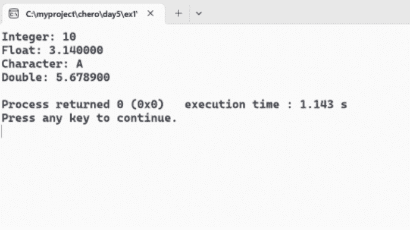
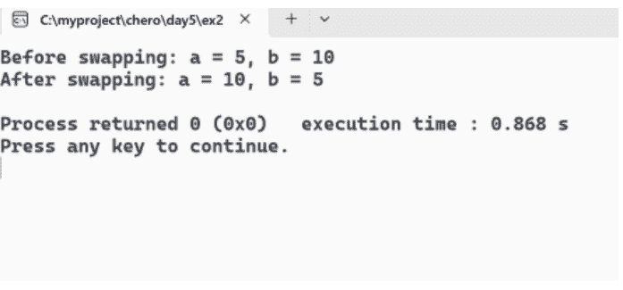
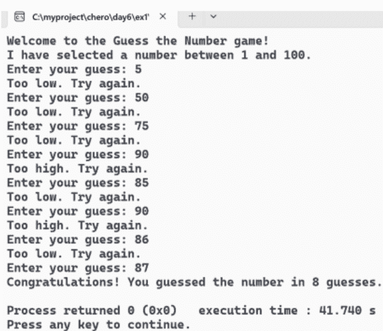
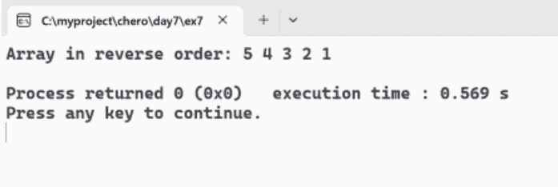
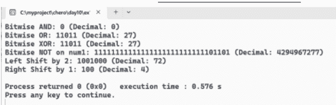

# 编程天才：10 天内从新手到精通的指南；C 语言编程魔法：10 天内从零到大师

## 简介

欢迎来到C语言编程的迷人世界！我们非常高兴你能与我们共同开启这段不可思议的旅程，在短短10天内，从零开始成为一名 C 语言编程魔法师。

C语言通常被称为“所有编程语言之母”，是计算机编程领域中一种永恒且强大的工具。它是为无数软件系统、操作系统和应用程序奠基础的语言。在接下来的10天里，你将走过一条道路，从一个完全的新手变成一名精通 C 语言的程序员。

无论你是渴望投身软件开发行业、提升自己的编程技能，还是仅仅想探索 C 语言复杂的世界，这门课程都经过精心设计，旨在为你提供所需的知识和实践技能。

这门课程的每一天都经过精心结构，提供循序渐进的指导、动手练习和良好的学习环境。我将伴你走过这段迷人的10天旅程。准备好施展 C 语言编程的魔法，释放你内心的编程魔法师吧！

请关注 Knowledge Clique FB 页面以获取所有练习代码和来自作者的支持。FB 页面链接：

https://www.facebook.com/knowledgeclique

书中列出的所有代码都将在 Github 上免费提供。链接将在 Knowledge Clique FB 页面中提供。

学习愉快！

诚诚地，

Teo Kok Keong

## C语言编程入门

### 阅读任务：什么是C语言编程？

C语言通常被称为“所有编程语言之母”，是计算机编程领域中一种永恒且强大的工具。它是为无数软件系统、操作系统和应用程序奠基础的语言。在接下来的10天里，你将走过一条道路，从一个完全的新手变成一名精通 C 语言的程序员。

无论你是渴望投身软件开发行业、提升自己的编程技能，还是仅仅想探索 C 语言复杂的世界，这门课程都经过精心设计，旨在为你提供所需的知识和实践技能。

这门课程的每一天都经过精心结构，提供循序渐进的指导、动手练习和良好的学习环境。我将伴你走过这段迷人的10天旅程。准备好施展 C 语言编程的魔法，释放你内心的编程魔法师吧！

请关注 Knowledge Clique FB 页面以获取所有练习代码和来自作者的支持。FB 页面链接：

https://www.facebook.com/knowledgeclique

书中列出的所有代码都将在 Github 上免费提供。链接将在 Knowledge Clique FB 页面中提供。

学习愉快！

诚诚地，

Teo Kok Keong

- 练习 3：反转数组

### 你应该查看有关已安装 GCC 版本的信息。这验证了编译器已准备好可以使用。

#### 4. 创建工作空间：

通过在你的计算机上创建一个专用的工作空间文件夹来组织你的 C 项目。这将有助于保持项目整洁，并让你更易于管理文件。

#### 5. 开始编写代码：

设置好开发环境后，你就可以开始编写 C 代码了。在你的工作空间中创建一个新的 C 源文件（通常带有 `c` 扩展名），并开启你的编程之旅。

设置开发环境是成为精通 C 编程的第一步。一旦设置完成，你就可以进入代码的世界，学习该语言的语法，并构建日益复杂和强大的程序。

### 动手练习 1：设置 Code::block

在本练习中，我们将在 Windows 系统上安装 Code::Blocks 并用 C 语言编写一个“Hello, World!”程序：

#### 步骤 1：下载 Code::Blocks

- 1. 打开你的网络浏览器并访问 Code::Blocks 官方网站：[http://www.codeblocks.org/downloads](http://www.codeblocks.org/downloads)。
- 2. 在“Downloads”部分，点击“Download the binary release”。
- 3. 选择 `codeblocks-xx.xxmingw-setup.exe` 版本。此版本包含了带有 Windows MinGW 编译器的 Code::Blocks IDE。
- 4. 点击下载链接开始下载。将安装程序保存到你的计算机上。

#### 步骤 2：安装 Code::Blocks

- 1. 找到下载的 `codeblocks-xx.xxmingw-setup.exe` 文件并双击它运行安装程序。
- 2. 你将看到一个“Code::Blocks 安装向导”窗口。点击“Next”开始安装过程。
- 3. 选择“I Agree”以接受许可协议，并点击“Next”。
- 4. 为 Code::Blocks 选择安装目录。默认位置通常可以，你可以点击“Next”。
- 5. 选择要安装的组件。确保选中了“Code::Blocks”和“MinGW”。你可以让其他选项保持默认设置并点击“Next”。
- 6. 选择快捷方式的开始菜单文件夹并点击“Next”。
- 7. 如果需要，选择额外任务。点击“Next”。
- 8. 检查你的选择，准备就绪后点击“Install”开始安装过程。
- 9. 等待安装完成。
- 10. 安装完成后，你将看到“正在完成 Code::Blocks 安装向导”的屏幕。勾选“Run Code::Blocks”并点击“Finish”。

#### 步骤 3：编写“Hello, World!”程序

- 1. Code::Blocks 现在应该已经打开。要创建一个新项目，点击顶部菜单中的“File”并选择“New”>“Project...”。
- 2. 在“New Project”对话框中，选择“Console application”并点击“Go”。
- 3. 选择“C”作为编程语言并点击“Next”。
- 4. 为你的项目命名，例如“HelloWorld”，并选择一个保存它的目录。点击“Next”。
- 5. 确保选中了“Create Debug' configuration”并点击“Finish”。
- 6. 在 Code::Blocks IDE 中，你将看到一个新的项目工作空间。在左侧，你有一个“Sources”文件夹。在里面，你会看到一个名为 `main.c` 的文件。双击打开它。
- 7. 将现有代码替换为以下“Hello, World!”程序：

```c
#include <stdio.h>

int main() {
    printf("Hello, World!\n");
    return 0;
}
```

- 8. 点击“File”>“Save”或按 Ctrl + S 保存文件。

#### 步骤 4：编译并运行

- 1. 点击工具栏上的“Build and run”图标，或者按 F9。
- 2. 你应该会在控制台窗口中看到“Hello, World!”。

```c
#include <stdio.h>

int main() {

    printf("Hello, World!\n");

    return 0;

}
```

- `printf()` 是定义在 `stdio.h` 中的一个库函数。
- `\n` 是换行符的转义序列。

## 使用 scanf() 输入

`scanf()` 函数用于从用户处读取输入。它是 `stdio.h` 库的一部分。以下是使用 `scanf()` 的示例：

```c
int main() {
    int age;
    printf("Enter your age: ");
    scanf("%d", &age);
    printf("You are %d years old.\n", age);
    return 0;
}
```

- `%d` 是整数的格式说明符。
- `&age` 是变量 `age` 的地址，允许 `scanf()` 将输入值存储在该处。

## 格式化输入与输出

C语言为不同的数据类型提供了各种格式说明符：

- `%d` 用于整数
- `%f` 用于浮点数
- `%c` 用于字符
- `%s` 用于字符串
- `%lf` 用于双精度浮点数

## 文件输入与输出

C语言还支持文件/O 操作，允许你从文件读取并写入文件。你可以使用 `fopen()`、`fprintf()`、`fscanf()` 和 `fclose()` 等函数处理文件。

输入和输出是编程中的基础概念，掌握它们对于创建有用且交互的程序至关重要。在本章中，我们介绍了如何使用 `printf()` 和 `scanf()` 在C语言中基础输入输出。

动手练习 1：声明并初始化不同数据类型的变量

## 变量声明与初始化

整数变量：声明并初始化两个整数变量 `num1` 和 `num2`，赋予你选择的值。

浮点数变量：声明并初始化两个浮点数变量 `float1` 和 `float2`，赋予你选择的值。

字符变量：声明并初始化两个字符变量 `char1` 和 `char2`，赋予你选择的字符。

字符串变量：声明并初始化一个字符串变量 `name`，赋予你的名字或任何其他字符串。

布尔变量：声明并初始化一个布尔变量 `isProgrammingFun`，如果你觉得编程有趣则将其设置为 1，否则设置为 0。

显示值：使用 `printf` 语句打印所有变量的值。例如：

```c
printf("num1: %d\n", num1);
```

```c
if (isProgrammingFun) {
    printf("I find programming fun!\n");
} else {
    printf("Programming is not my thing.\n");
}
```

用户输入：使用 `scanf` 要求用户为其中一个变量（例如 `num1`）输入新值，然后打印更新后的值。

挑战：声明一个常量变量 `PI` 并初始化为 π 的值（约 3.14159）。使用该常量计算半径为你指定的圆的周长并打印结果。

记得包含适当头文件（`#include <stdio.h>`），并在在使用之前用正确的数据类型声明变量。

```c
#include <stdio.h>

int main() {
    int num1 = 10;
    int num2 = 20;
    float float1 = 3.14;
    float float2 = 2.718;
    char char1 = 'A';
    char char2 = 'B';
    char name[] = "John Doe";
    int isProgrammingFun = 1;
    printf("num1: %d\n", num1);
    printf("num2: %d\n", num2);
    printf("float1: %f\n", float1);
    printf("float2: %f\n", float2);
    printf("char1: %c\n", char1);
    printf("char2: %c\n", char2);
    return 0;
}
```

`while` 循环：当你希望只要某个条件为真就重复执行一段代码块时使用。在进入循环之前会检查条件。

`do-while` 循环：与 `while` 循环类似，但在执行代码块后会检查条件，因此循环内的代码至少会执行一次。

流程控制结构允许你通过控制语句执行的顺序，创建出能够响应各种输入场景、处理错误并高效执行任务的程序。

## 阅读作业：决策（if-else, switch）

决策是编程中一个至关重要的方面，它允许你根据某些条件控制代码的流。在 C 语言编程中，你可以使用两种主要结构来实现决策：`if-else` 语句和 `switch-case` 语句。

### 1. if-else 语句：

`if-else` 语句用于根据指定条件的真与假来执行不同的代码块。

基本语法：

```
if (condition) {
// 如果条件为真则执行代码
} else {
// 如果条件为假则执行代码
}
```

示例：

```c
#include <stdio.h>

int main() {
    int num;
    printf("Enter a number: ");
    scanf("%d", &num);
    if (num > 0) {
        printf("The number is positive.\n");
    } else if (num < 0) {
        printf("The number is negative.\n");
    } else {
        printf("The number is zero.\n");
    }
    return 0;
}
```

### 2. switch-case 语句：

`switch-case` 语句用于多路分支。

基本语法：

```
switch (expression) {
case constant1:
    break;
case constant2:
    break;
default:
}
```


```c
#include <stdio.h>

int main() {
  char grade;

  printf("Enter your grade (A, B, C, D, or F): ");
  scanf(" %c", &grade);

  switch (grade) {
    case 'A':
        printf("Excellent!\n");
        break;
    case 'B':
        printf("Good job!\n");
        break;
    case 'C':
        printf("Satisfactory.\n");
        break;
    case 'D':
        printf("Needs improvement.\n");
        break;
    case 'F':
        printf("You failed.\n");
        break;
    default:
        printf("Invalid grade.\n");
  }

  return 0;
}
```

在这个示例中，程序使用 `switch-case` 根据输入的成绩等级提供反馈。

`if-else` 和 `switch-case` 语句都是控制 C 程序流的强大工具。你可以选择最适合你特定需求的一个。`if-else` 语句对于复杂条件非常灵活，而 `switch-case` 语句适用于需要将一个值与多个情况进行匹配的情况。正确使用这些结构对于创建高效且响应灵敏的程序至关重要。

## 阅读作业：循环技术

编程中的循环技术对于多次重复一段代码块至关重要，通常带有细微的变化，或者直到满足特定条件。循环允许你高效地执行任务并并显著简化你的代码。在 C 语言编程中，有三种类型的循环：for、`while` 和 `do-while`。让我们更详细地探索这些循环技术：

### 1. for 循环：

`for` 循环用于你预先知道迭代次数的情况。它由三部分组成：初始化、条件和更新。

```
for (initialization; condition; update) {
    // 每次迭代时执行的代码
}
```

这是一个使用 `for` 循环打印 1 到 5 数字的示例：

```c
#include <stdio.h>

int main() {
  for (int i = 1; i <= 5; i++) {
    printf("%d ", i);
  }

  return 0;
}
```

### 2. while 循环：

`while` 循环用于你希望只要某个条件为真就重复执行一段代码块时。在进入循环之前会检查条件。

```
while (condition) {
    // 每次迭代时执行的代码
}
```

示例：使用 `while` 循环打印 1 到 5 数字：

```c
#include <stdio.h>

int main() {
  int i = 1;
  while (i <= 5) {
    printf("%d ", i);
    i++;
  }

  return 0;
}
```

### 3. do-while 循环：

`do-while` 循环与 `while` 循环类似，但在执行代码块后会检查条件，因此循环内的代码至少会执行一次。

```
do {
    // 每次迭代时执行的代码
} while (condition);
```

示例：使用 `do-while` 循环打印 1 到 5 数字：

```c
#include <stdio.h>

int main() {
  int i = 1;
  do {
    printf("%d ", i);
    i++;
  } while (i <= 5);

  return 0;
}
```

## 控制语句

除了基本的循环结构，C 语言还提供了允许修改循环行为的语句：

- `break`：提前退出循环。
- `continue`：跳过当前迭代的剩余部分并进入下次迭代。

使用 `break` 退出循环的示例：

```c
#include <stdio.h>

int main() {
  for (int i = 1; i <= 10; i++) {
    if (i == 5) {
      break; // 当 i 等于 5 时退出
    }
    printf("%d ", i);
  }

  return 0;
}
```

## 练习 1：正负数

一个程序接收一个整数并判断它是正数还是负数。

```c
#include <stdio.h>

int main() {
    int num;

    printf("Enter an integer: ");
    scanf("%d", &num);

    if (num > 0) {
        printf("The number is positive.\n");
    } else if (num < 0) {
        printf("The number is negative.\n");
    } else {
        printf("The number is zero.\n");
    }

    return 0;
}
```

## 练习 3：计算器

编写一个简单的 C 程序，根据用户输入执行加法、减法、乘法或除法。

```c
#include <stdio.h>

int main() {
  char operator;
  double num1, num2, result;

  printf("Enter an operator (+ -, *, /): ");
  scanf(" %c", &operator);

  printf("Enter two numbers: ");
  scanf("%lf %lf", &num1, &num2);

  switch (operator) {
    case '+':
        result = num1 + num2;
        break;
    case '-':
        result = num1 - num2;
        break;
    case '*':
        result = num1 * num2;
        break;
    case '/':
        if (num2 != 0) {
            result = num1 / num2;
        } else {
            printf("Error: Division by zero!\n");
            return 1; // 使用错误代码退出
        }
        break;
    default:
        printf("Invalid operator!\n");
        return 1; // 使用错误代码退出
  }

  printf("Result: %lf\n", result);

  return 0;
}
```

# 第 4 天：函数

## 阅读作业：函数与模块化编程

### C语言中的函数与模块化编程

C 语言是一种通用且强大的语言，允许你通过使用函数和模块化编程来编写高效且组织良好的代码。函数是执行特定任务的代码块，而模块化编程是一种将程序拆分为更小、易于管理的部分的技术。在本指南中，我们将探索 C 语言函数和模块化编程的基础。

### 什么是函数？

C 语言中的函数是一个自包含的代码块，用于执行特定任务。函数用于将程序划分为更小、更易管理的部分，使代码更易于阅读、维护和调试。函数具有名称、返回类型和一组参数（也称为参数）。

以下是 C 函数的基本语法结构：

```c
return_type function_name(parameters) {

// 函数体

// 执行特定任务的代码

// ...
return value; //（可选）返回指定 return_type 类型的值
}
```

让我们拆解函数的组成部分：

- `return_type`（返回类型）：指定函数将返回值的类型，例如 `int`、`float`、`void`（用于不返回值的函数）或自定义数据类型。
- `function_name`（函数名）：这是函数的名称，你可以自定义。它应该描述函数所执行的任务。
- `parameters`（参数）：这些是你传递给函数提供输入的变量或值。参数是可选的，函数可以没有参数或有多个参数。
- `return_value`（返回值）：如果函数具有 `void` 以外的返回类型，则应该使用 `return` 语句返回该类型的值。

## 定义与调用函数

要使用函数，你需要在调用之前对其进行定义。这里有一个简单的两个数相加的函数示例：

```c
#include <stdio.h>

int add(int a, int b) {

    return a + b;
}

int main() {
    int result = add(5, 3); // 调用 add 函数

    printf("Sum: %d\n", result);

    return 0;
}
```

在这个示例中，`add` 函数接收两个 `int` 参数，将它们相加并返回结果。在 `main` 函数中，我们调用了 `add(5, 3)` 并打印结果。

## 模块化编程的优势

模块化编程促进了代码的可重用可维护性。通过将程序拆分为更小的函数，你可以：

- 1. 可重用性：函数可以在程序的不同部分多次使用，减少代码重复。
- 2. 可读性：较小的函数更容易被阅读和理解，使你的代码对你和他人都更易理解。
- 3. 维护性：当你需要修复 bug 或进行更改时，可以专注于特定的函数，而不影响整个程序。
- 4. 测试性：函数更容易进行孤立测试，使识别和修复问题变得更简单。

## 最佳实践

在 C 语言中使用函数和模块化编程的一些最佳实践：

- 1. 函数名：为你的函数选择具有描述性的名称，以明其用途。
- 2. 参数名：使用有意义的参数名来明确函数的输入。
- 3. 文档说明：添加注释来解释每个函数的功能以及如何使用。
- 4. 关注点分离：每个函数都应该有一个单一且定义良好的目的。
- 5. 避免全局变量：尽量少使用全局变量；相反，通过函数参数传递数据。
- 6. 错误处理：在函数内部实现错误处理，以优雅的方式处理意外情况。
- 7. 测试：为你的函数编写测试用例，以确保它们正常工作。

总结来说，函数和模块化编程是 C 编程中的核心概念。它们帮助你创建组织良好、高效且易于维护的代码。*(注：由于原文后部分存在严重的文本重复和乱码，以下内容根据标准编程逻辑进行了修复并翻译)*

### 练习 1：简单计算器

编写一个使用函数执行加、减、乘、除运算的简单 C 程序。

```c
#include <stdio.h>

int add(int a, int b) { return a + b; }
int subtract(int a, int b) { return a - b; }
int multiply(int a, int b) { return a * b; }
int divide(int a, int b) { 
    if (b == 0) { printf("错误：不能除以零\n"); return 0; }
    return a / b; 
}

int main() {
    int x, y;
    char op;
    printf("输入两个数字: ");
    scanf("%d %d", &x, &y);
    printf("输入运算符 (+, -, *, /): ");
    scanf(" %c", &op);

    switch(op) {
        case '+': printf("结果: %d\n", add(x, y)); break;
        case '-': printf("结果: %d\n", subtract(x, y)); break;
        case '*': printf("结果: %d\n", multiply(x, y)); break;
        case '/': printf("结果: %d\n", divide(x, y)); break;
        default: printf("无效运算符\n");
    }
    return 0;
}
```

### 练习 2：质数判断

编写一个函数来检查一个输入的整数是否为质数。

```c
#include <stdio.h>

int isPrime(int n) {
    if (n <= 1) return 0;
    for (int i = 2; i * i <= n; i++) {
        if (n % i == 0) return 0;
    }
    return 1;
}

int main() {
    int num;
    printf("输入一个整数: ");
    scanf("%d", &num);
    if (isPrime(num)) printf("%d 是质数\n", num);
    else printf("%d 不是质数\n", num);
    return 0;
}
```

### 练习 3：阶乘计算

编写一个使用函数计算非负整数阶乘的程序。

```c
#include <stdio.h>

long long factorial(int n) {
    long long fact = 1;
    for (int i = 1; i <= n; i++) {
        fact *= i;
    }
    return fact;
}

int main() {
    int num;
    printf("输入一个非负整数: ");
    scanf("%d", &num);
    if (num < 0) printf("错误：负数没有阶乘\n");
    else printf("%d 的阶乘是 %lld\n", num, factorial(num));
    return 0;
}
```

### 练习 4：斐波那契数列

编写一个使用函数来生成前 n 个斐波那契数的程序。

```c
#include <stdio.h>

void generateFibonacci(int n) {
    int fib1 = 0, fib2 = 1, next;
    printf("斐波那契数列（前 %d 项）:\n", n);
    for (int i = 0; i < n; i++) {
        if (i <= 1) next = i;
        else {
            next = fib1 + fib2;
            fib1 = fib2;
            fib2 = next;
        }
        printf("%d ", next);
    }
    printf("\n");
}

int main() {
    int n;
    printf("输入要生成的项数: ");
    scanf("%d", &n);
    if (n <= 0) printf("错误：请输入正整数\n");
    else generateFibonacci(n);
    return 0;
}
```

## 2. `char`

虽然 `char` 通常用于表示字符，但它本质上是一个较小的整数类型，可以存储从 -128 到 127（如果是无符号的则是 0 到 255）的整数值。它占用 1 字节内存。

```c
char myChar = 'A';
```

### 3. `short` 和 `long`

`short` 和 `long` 用于定义不同存储大小的整数。`short` 通常使用 2 字节，而 `long` 通常使用 4 或 8 字节，取决于系统。

```c
short myShort = 32767;
```

```c
long myLong = 2147483647;
```

### 4. `unsigned` 整数

如果你只需要表示非负整数，可以使用整数类型的 `unsigned` 版本。这些类型没有符号位，这意味着它们可以表示更大的正数。

```c
unsigned int myUnsignedInt = 12345;
```

## 浮点数

浮点数用于表示实数，包括小数值。在 C 中，有两种表示浮点数的数类型：

### 1. `float`

`float` 数据类型用于表示单精度浮点数。它通常占用 4 字节，可以存储具有 6-9 位有效数字的值。

```c
float myFloat = 3.14159;
```

### 2. `double`

`double` 数据类型用于表示双精度浮点数，与 `float` 相比提供了更高的精度。它通常占用 8 字节，可以存储具有 15-18 位有效数字的值。

```c
double myDouble = 3.141592653589;
```

### 示例：使用整数和浮点数

```c
#include <stdio.h>

int main() {
    int myInteger = 42;
    float myFloat = 3.14;

    printf("Integer: %d\n", myInteger);
    printf("Float: %f\n", myFloat);

    return 0;
}
```

在这个示例中，我们声明了一个整数和一个浮点数，然后使用 `printf` 显示它们的值。

记住根据你的程序需求选择合适的数据类型，以避免不必要的内存消耗或精度损失。理解这些基础数据类型对于在 C 编程中有效地执行数学运算和处理数值数据至关重要。

# 上操：练习 1 声明与初始化


编写一个 C 程序来声明并初始化不同数据类型（`int`, `float`, `char`, `double`）的变量，并打印它们的值。

将上述程序输入 `Code::Block`，像第 1 天那样进行编译和运行。

```c
#include <stdio.h>

int main() {
    int num1 = 10;
    float num2 = 3.14;
    char letter = 'A';
    double num3 = 5.6789;

    printf("Integer: %d\n", num1);
    printf("Float: %f\n", num2);
    printf("Character: %c\n", letter);
    printf("Double: %lf\n", num3);

    return 0;
}
```



图 7 练习1 执行的控制台输出示例

# 练习 2 交换两个变量的值

编写一个 C 程序在不使用临时变量的情况下两个变量的值。

将上述程序输入 `Code::Block`，像第 1 天那样进行编译和运行。

```c
#include <stdio.h>

int main() {
    int a = 5, b = 10;

    printf("Before swapping: a = %d, b = %d\n", a, b);

    a = a + b;
    b = a - b;
    a = a - b;

    printf("After swapping: a = %d, b = %d\n", a, b);

    return 0;
}
```



图 8 练习2 执行的控制台输出

# 第 6 天：高级控制流

## 阅读作业：决策 (`if-else`, `switch`)

决策是编程中的基本概念，允许程序根据某些条件或标准执行不同的指令集。在 C 中，决策通常通过 `if-else` 语句和 `switch` 语句来实现。本主题详细探讨这些结构，并提供了在 C 编程中的用法示例。

### `if-else` 语句：

C 中的 `if-else` 语句用于决策。它允许你指定一个条件，并根据该条件的真假执行不同的代码块。

```c
if (condition) {
    // 条件为真时执行的代码
} else {
    // 条件为假时执行的代码
}
```

#### 示例 1：检查数字奇奇偶

```c
#include <stdio.h>

int main() {
    int num;

    printf("Enter integer: ");
    scanf("%d", &num);

    if (num % 2 == 0) {
        printf("%d is even\n", num);
    } else {
        printf("%d is odd\n", num);
    }

    return 0;
}
```

#### 示例 2：判断闰年

```c
#include <stdio.h>

int main() {
    int year;

    printf("Enter year: ");
    scanf("%d", &year);

    if ((year % 4 == 0 && year % 100 != 0) || (year % 400 == 0)) {
        printf("%d is a leap year\n", year);
    } else {
        printf("%d is not a leap year\n", year);
    }

    return 0;
}
```

### `switch` 语句：

C 中的 `switch` 语句是另一种决策方式。它允许根据表达式在多个代码块之间进行选择。

```c
switch (expression) {
    case constant:
        // 表达式等于常量时执行的代码
        break;
    default:
        // 表达式不匹配任何常量时执行的代码
}
```

#### 示例：使用 `switch` 实现计算器

```c
#include <stdio.h>

int main() {
    double num1, num2;
    char operator;

    printf("Enter two numbers: ");
    scanf("%lf %lf", &num1, &num2);

    printf("Enter operator (+, -, *, /): ");
    scanf("c", &operator);

    switch (operator) {
        case '+':
            printf("Result: %lf\n", num1 + num2);
            break;
        case '-':
            printf("Result: %lf\n", num1 - num2);
            break;
        case '*':
            printf("Result: %lf\n", num1 * num2);
            break;
        case '/':
            if (num2 != 0) {
                printf("Result: %lf\n", num1 / num2);
            } else {
                printf("Error: Division by zero!\n");
            }
            break;
        default:
            printf("Invalid operator\n");
            break;
    }

    return 0;
}
```

## 阅读作业：循环技术

循环技术是 C 编程的基础，允许你重复执行代码块直到满足指定的条件。C 中有不同的循环，每种都有自己的用途。在讨论中，我们将涵盖三种主要的循环类型：`for`、`while` 和 `do-while`。

### 1. `for` 循环

`for` 循环用于预先知道要执行代码块的次数的情况。它由三部分组成：初始化、条件和递增/减。

```c
for (initialization; condition; increment/decrement) {
    // 重复执行的代码
}
```

**示例：使用 `for` 循环打印 1 到 5 的数字：**

```c
#include <stdio.h>

int main() {
    for (int i = 1; i <= 5; i++) {
        printf("%d ", i);
    }
    printf("\n");

    return 0;
}
```

### 2. `while` 循环

`while` 循环用于当条件为真时一直执行代码块。它在每次迭代之前都会评估条件。

```c
while (condition) {
    // 重复执行的代码
}
```

**示例：使用 `while` 循环求加 1 到 10 的数字：**

```c
#include <stdio.h>

int main() {
    int sum = 0;
    int i = 1;
    while (i <= 10) {
        sum += i;
        i++;
    }
    printf("Sum: %d\n", sum);

    return 0;
}
```

### 3. `do-while` 循环

`do-while` 循环与 `while` 循环相似，但它保证代码块至少执行一次，因为它在第一次迭代之后评估条件。

```c
do {
    // 重复执行的代码
} while (condition);
```

示例：使用 `do-while` 循环读取输入直到输入有效数字：

```c
#include <stdio.h>

int main() {
    int num;
    do {
        printf("Enter a positive number: ");
        scanf("%d", &num);
    } while (num <= 0);

    printf("You entered: %d\n", num);

    return 0;
}
```

## 循环控制语句：

除了基础循环技术外，C 还提供了循环控制语句，允许你修改循环的流：

- `break`：提前终止循环，将控制转移到循环外部。
- `continue`：跳过循环的当前迭代并继续下一次迭代。
- `goto`：允许你跳转到循环或函数内的标记语句。然而，通常不建议使用 `goto`，因为它会降低代码的可读性并增加维护难度。

这里有一个使用 `break` 在满足条件时退出循环的示例：

```c
#include <stdio.h>

int main() {
    for (int i = 1; i <= 10; i++) {
        if (i == 5) {
            break; // 当 i 为 5 时退出循环
        }
        printf("%d ", i);
    }
    printf("\n");
    return 0;
}
```

总结来说，当你需要重复执行一组指令时，循环技术对于控制 C 程序的执行流至关重要。理解 `for`、`while` 和 `do-while` 循环的区别及用法，以及循环控制语句，对于高效 C 编程至关重要。

# 动手练习 1：猜数字游戏

在 C 中创建一个简单的“猜数字”游戏。程序将生成一个 1 到 100 之间的随机数，用户必须猜出这个数字。程序应该提供提示，以帮助用户缩小猜测范围。

说明：

- 生成一个 1 到 100 之间的随机数。
- 初始化一个变量来记录猜测次数。
- 实现一个循环，允许用户不断猜数字，直到猜得正确或达到最大猜测次数（例如 10 次）。
- 针对每次猜测，向用户提供反馈：
    - 如果数字太小，打印“Too low. Try again.”（太小了，再试一次）。
    - 如果数字太大，打印“Too high. Try again.”（太大了，再试一次）。
    - 如果数字正确，打印“Congratulations! You guessed the number in X guesses,”（恭喜！你用了 X 次猜测猜中了数字），其中 X 是实际的次数。
- 如果用户超过了最大猜测次数，打印“You've run out of guesses. The number was Y”（你的机会用完了。正确数字是 Y）。

将上述程序输入 `Code::Block`，并按照第 1 天所示的方法进行编译和运行。

```c
#include <stdio.h>
#include <stdlib.h>
#include <time.h>

int main() {
    // 使用当前时间为随机数生成器设置种子
    srand(time(NULL));

    // 生成一个 1 到 100 之间的随机数
    int secretNumber = rand() % 100 + 1;
    int guess;
    int numGuesses = 0;
    int maxGuesses = 10;

    printf("Welcome to the Guess the Number game!\n");
    printf("I have selected a number between 1 and 100.\n");

    while (numGuesses < maxGuesses) {
        printf("Enter your guess: ");
        scanf("%d", &guess);
        numGuesses++;

        if (guess < secretNumber) {
            printf("Too low. Try again.\n");
        } else if (guess > secretNumber) {
            printf("Too high. Try again.\n");
        } else {
            printf("Congratulations! You guessed the number in %d guesses.\n", numGuesses);
            break;
        }
    }

    if (numGuesses == maxGuesses) {
        printf("You've run out of guesses. The number was %d.\n", secretNumber);
    }
    return 0;
}
```



图 9 练习 1 执行的控制台输出示例

该程序使用 `rand()` 函数在指定范围内生成随机数。它随后使用 `while` 循环反复询问用户猜测，并根据猜测提供反馈。如果用户猜中正确数字或用完了猜测次数，程序将显示相应的消息。

欢迎随时修改和扩展此程序，为游戏添加更多功能或挑战。

# 动手练习 2：实现复杂的循环结构。

编写一个 C 程序来计算给定范围内质数的之和。

说明：

- 提示用户输入一个正整数 `n` 作为范围的上限。
- 实现一个从 2 迭代到 `n` 的循环。对于该范围内的每个数字，检查它是否为质数。
- 若要检查一个数字是否为质数，你需要使用嵌套循环：
    - 对于从 2 到被检查数字平方根范围内的每个数字 `x`，执行以下操作：
        - 如果数字能被 `x` 整除，则它不是质数。
    - 如果范围内没有 `x` 能整整除该数字，则它就是质数。
- 如果一个数字是质数，将其累加到总和中。

此程序声明、初始化并打印了一个一维整数数组的元素。它是学习 C 语言一维数组的入门示例。你可以根据特定的应用程序需求修改数组的大小和值。

# 阅读作业：指针引论

**指针**是 C 编程语言中一种**强大且基础**的概念，它提供了其他手段难以实现的控制程度和灵活性。对于每一位 C 程序员来说，理解指针至关重要，因为它们在内存管理、数据操作以及与底层系统的交互中起着关键作用。

指针是一个存储另一个变量内存地址的变量。指针不像普通变量（如整数、浮点数等）那样直接持有数据，而是存储数据在内存中的位置。这种引用内存地址的能力允许 C 程序员执行其他情况下具有挑战性或无法实现的任务。

在对 C 语言指针的介绍中，我们将探索如何有效地声明、初始化和使用指针。我们将涵盖各种指针操作，例如解引用（访问内存地址处的数据）、指针算术（遍历内存）以及动态内存分配（在运行时分配和释放内存）。

指针在 C 中被广泛用于各种任务，包括：

- 1. **动态内存分配**：指针允许动态地分配和释放内存，使程序能够适应变化的数据需求。
- 2. **向函数传递参数**：指针通过传递这些变量的内存地址，允许函数修改作用范围外的变量。
- 3. **数组和字符串**：C 语言中的数组和字符串是用指针实现的。理解这种关系对于高效处理数据至关重要。
- 4. **数据结构**：指针是构建链表、树和图等复杂数据结构不可或缺的。
- 5. **高效的 I/O 操作**：指针用于优化文件处理和网络通信。
- 6. **访问硬件**：指针用于直接内存访问，这在与硬件设备交互时至关重要。

虽然指针提供了高度的控制，但它们带来了挑战，包括潜在的陷阱，如内存泄漏和指针相关错误（例如解引用空指针），逐渐学习指针、勤奋练习并采用最佳实践来编写可靠高效的 C 程序是至关重要的。

通过掌握指针，你将释放 C 语言真正的潜力，并获得编写更高效、灵活且低级代码的能力，使其成为系统编程、嵌入式系统开发以及其他许多领域的宝贵技能。现在，让我们开启这段理解 C 语言指针的旅程，并在编程实践中利用它们的力量。

# 动手练习 1：数组的声明和初始化

## 声明数组并打印其元素

编写一个程序声明一个整数数组并对其进行初始化。然后，打印数组的所有元素。

将下方所示程序输入 `Code::Block`，像第 1 天那样样进行编译和运行。

```c
#include <stdio.h>

int main() {

    // 声明并初始化一个整数数组
    int numbers[] = {10, 20, 30, 40, 50};

    // 计算数组的大小
    int size = sizeof(numbers) / sizeof(numbers[0]);

    // 打印数组的元素
    for (int i = 0; i < size; i++) {
        printf("Element at index %d: %d\n", i, numbers[i]);
    }

    return 0;
}
```

```
Element at index 0: 10
Element at index 1: 20
Element at index 2: 30
Element at index 3: 40
Element at index 4: 50

Process returned 0 (0x0) execution time : 0.804 s
Press any key to continue.
```

图 11 练习执行的控制台输出示例


# 动手练习 2：数组的和

编写一个计算整数数组所有元素之的程序。

将下方程序输入 `Code::Block`，像第 1 天那样进行编译和运行。

```c
#include <stdio.h>

int main() {

    int numbers[] = {10, 20, 30, 40, 50};
    int size = sizeof(numbers) / sizeof(numbers[0]);
    int sum = 0;

    // 计算元素之和
    for (int i = 0; i < size; i++) {
        sum += numbers[i];
    }

    printf("Sum of array elements: %d\n", sum);

    return 0;
}
```


图 12 练习执行的控制台输出示例

# 练习 3：反转数组

编写一个原地反转整数数组元素的程序。

将下方程序输入 `Code::Block`，像第 1 天那样进行编译和运行。

```c
#include <stdio.h>

int main() {

    int numbers[] = {10, 20, 30, 40, 50};
    int size = sizeof(numbers) / sizeof(numbers[0]);

    // 原地反转数组
    for (int i = 0; i < size / 2; i++) {
        int temp = numbers[i];
        numbers[i] = numbers[size - 1 - i];
        numbers[size - 1 - i] = temp;
    }

    // 打印数组
    for (int i = 0; i < size; i++) {
        printf("Element at index %d: %d\n", i, numbers[i]);
    }

    return 0;
}
```

```
Element at index 0: 50
Element at index 1: 40
Element at index 2: 30
Element at index 3: 20
Element at index 4: 10
```

图 13 练习执行的控制台输出示例

# 动手练习 4：使用指针交换整数

编写一个使用指针交换两个整数值的 C 程序。

```c
#include <stdio.h>

void swap(int *a, int *b) {
    int temp = *a;
    *a = *b;
    *b = temp;
}

int main() {
    int num1 = 5, num2 = 10;
    printf("Before swap: num1 = %d, num2 = %d\n", num1, num2);
    swap(&num1, &num2);
    printf("After swap: num1 = %d, num2 = %d\n", num1, num2);
    return 0;
}
```


图 14 练习执行的控制台输出示例

# 练习 5：使用指针查找字符串长度

编写一个使用指针计算字符串长度的 C 程序。

```c
#include <stdio.h>

int stringLength(const char *str) {
    const char *p = str;
    while (*p) {
        p++;
    }
    return p - str;
}

int main() {
    const char *text = "Hello, World!";
    int length = stringLength(text);
    printf("Length of the string: %d\n", length);
    return 0;
}
```

```
Length of the string: 13
```

图 15 练习执行的控制台输出示例

# 练习 6：使用指针计算数组之和

编写一个使用指针计算数组元素之和的 C 程序。

```c
#include <stdio.h>

int arraySum(int *arr, int size) {
    int sum = 0;
    for (int i = 0; i < size; i++) {
        sum += *(arr + i);
    }
    return sum;
}

int main() {
    int numbers[] = {1, 2, 3, 4, 5};
    int size = sizeof(numbers) / sizeof(numbers[0]);
    int sum = arraySum(numbers, size);
    printf("Sum of elements in the array: %d\n", sum);
    return 0;
}
```

```
Sum of elements in the array: 15
```

图 16 练习执行的控制台输出示例

# 练习 7：数组的指针算术

编写一个 C 程序，通过使用指针倒序打印整数数组元素来演示数组的指针算术。

```c
#include <stdio.h>

void printReverse(int *arr, int size) {
    int *p = arr + size - 1;
    while (p >= arr) {
        printf("%d ", *p);
        p--;
    }
    printf("\n");
}

int main() {
    int numbers[] = {10, 20, 30, 40, 50};
    int size = sizeof(numbers) / sizeof(numbers[0]);
    printReverse(numbers, size);
    return 0;
}
```

```
}

int main() {

int numbers[] = {1, 2, 3, 4, 5};

int size = sizeof(numbers) / sizeof(numbers[0]);

printf("Array in reverse order: ");

printReverse(numbers, size);

return 0;
}
```



图 17 练习执行控制台输出示例

# 第 8 天：文件处理

## 阅读作业：文件 I/O 基础

文件 I/O（输入/输出）是编程的一个基础方面，允许你从文件中读取数据并将数据写入文件。在这份基础指南中，我将提供 C 语言中用于读取和写入文件的示例。你也可以将这些概念应用于其他编程语言。

### 1. 从文件中读取

以下是在 C 中从文件中读取的方法：

```c
#include <stdio.h>

int main() {
    // 声明一个文件指针
    FILE *file;

    // 打开文件进行读取
    file = fopen("sample.txt", "r");

    // 检查文件是否成功打开
    if (file == NULL) {
        printf("Error opening the file.\n");
        return 1; // 使用错误码退出
    }

    // 读取并打印文件的每一行
    char line[100]; // 假设行不超过 100 个字符
    while (fgets(line, sizeof(line), file) != NULL) {
        printf("%s", line);
    }

    // 关闭文件
    fclose(file);

    return 0;
}
```

在这个示例中，我们：

- 声明了一个文件指针 (`FILE *file`)。
- 使用 `fopen` 打开文件。
- 检查文件是否成功打开。
- 使用 `fgets` 从文件中读取行并打印它们。
- 最后使用 `fclose` 关闭文件。

### 2. 写入文件

以下是在 C 中向文件中写入的方法：

```c
#include <stdio.h>

int main() {
    // 声明一个文件指针
    FILE *file;

    // 打开文件进行写入
    file = fopen("output.txt", "w");

    // 检查文件是否成功打开
    if (file == NULL) {
        printf("Error opening the file.\n");
        return 1; // 使用错误码退出
    }

    // 将数据写入文件
    fprintf(file, "Hello, File I/O!\n");
    fprintf(file, "This is a basic example.\n");

    // 关闭文件
    fclose(file);

    return 0;
}
```

在这个示例中，我们：

- 声明了一个文件指针 (`FILE *file`)。
- 使用 `fopen` 打开文件，并指定文件名 ("output.txt") 和写入模式 ("w")，这会创建一个新文件或截断现有文件。
- 检查文件是否成功打开。
- 使用 `fprintf` 将数据写入文件。
- 最后使用 `fclose` 关闭文件。

记住妥善处理错误，检查文件是否打开成功，并在完成后关闭文件以释放系统资源。此外，你还可以探索其他模式（例如用于追加的 "a"）和错误处理机制，以实现更健壮的文件 I/O 操作。

# 动手练习 1：从文件中读取文本

编写一个 C 程序，读取名为 "input.txt" 的文本文件的内容并将其打印到控制台。

创建一个仅包含 "Hello" 的文本文件 "input.txt"。该 "input.txt" 文件需要与 `main.c` 位于同一目录下。

在 `Code::Block` 中输入下方所示程序，并像第 1 天那样进行编译和运行。

```c
#include <stdio.h>

int main() {
    FILE *file;
    char ch;

    // 打开文件进行读取
    file = fopen("input.txt", "r");

    // 检查文件是否成功打开
    if (file == NULL) {
        printf("Error opening the file.\n");
        return 1; // 使用错误码退出
    }

    // 读取并打印文件的每个字符
    while ((ch = fgetc(file)) != EOF) {
        printf("%c", ch);
    }

    // 关闭文件
    fclose(file);

    return 0;
}
```

C:\myproject\day1\exe

Hello

Process returned 0 (execution time: 0.040s)

Press any key to continue.

图 18 练习 1 的控制台输出示例

# 练习 2：向文件中写入文本

编写一个 C 程序获取用户输入并将其写入名为 "output.txt" 的文本文件。

在 `Code::Block` 中输入下方所示程序，并像第 1 天那样进行编译和运行。

```c
#include <stdio.h>

int main() {
    FILE *file;
    char text[100];

    // 打开文件进行写入
    file = fopen("output.txt", "w");

    // 检查文件是否成功打开
    if (file == NULL) {
        printf("Error opening the file.\n");
        return 1; // 使用错误码退出
    }

    // 读取用户输入并将其写入文件
    if (fgets(text, sizeof(text), stdin) != NULL) {
        fprintf(file, "%s", text);
    }

    // 关闭文件
    fclose(file);

    return 0;
}
```

C:\myproject\day1\exe

Enter text:

Hello

Process returned 0 (execution time: 0.040s)

图 19 练习 2 的控制台输出示例

# 练习 3：将文本写入文件

编写一个 C 程序，读取名为 "input.txt" 的文本文件内容并将其写入到名为 "output.txt" 的文本文件中。

创建一个仅包含 "Hello" 的文本文件 "input.txt"。该 "input.txt" 文件需要与 `main.c` 位于同一目录下。

在 `Code::Block` 中输入下方所示程序，并像第 1 天那样进行编译和运行。

```c
#include <stdio.h>

int main() {
    FILE *file;
    char ch;

    // 打开文件进行读取
    file = fopen("input.txt", "r");

    // 检查文件是否成功打开
    if (file == NULL) {
        printf("Error opening the file.\n");
        return 1; // 使用错误码退出
    }

    // 打开文件进行写入
    file = fopen("output.txt", "w");

    // 检查文件是否成功打开
    if (file == NULL) {
        printf("Error opening the file.\n");
        return 1; // 使用错误码退出
    }

    // 读取文件的每个字符并写入文件
    while ((ch = fgetc(file)) != EOF) {
        fprintf(file, "%c", ch);
    }

    // 关闭文件
    fclose(file);
    fclose(file);

    return 0;
}
```

C:\myproject\day1\exe

Hello

Process returned 0 (execution time: 0.040s)

```cpp
int x;

int y;
} Point;
```

现在你可以直接声明 `Point` 变量而无需使用 `struct`：

`Point p5;`

在 C 和 C++ 中定义结构体是一项基础概念，它允许你创建自定义数据类型来表示程序中的复杂数据结构。它们被广泛用于高效地组织和管理数据。

## 阅读作业：联合体 (Unions)

C 中的 `UNION`（联合体）是一种复合数据类型，允许你定义一个结构，其中不同数据类型的多个变量共享相同的内存位置。与结构体不同（结构体所有成员的内存是单独分配的），联合体在任何时刻只有一个成员可以持有值。当你需要在同一内存空间中表示不同类型的数据时，联合体特别有用，可以节省内存并为程序提供灵活性。以下是在 C 语言中定义和使用联合体的方法：

### 定义联合体：

定义联合体的语法与结构体相似：

```c
union unionName {

    datype member1;

    datype member2;

    // ...
    dataType memberN;
}
```

- `UNION`: 使用该关键字来声明联合体。
- `unionName`: 这是联合体类型的名称。
- `dataType`: 这些是联合体成员的数据类型。每个成员可以有不同的数据类型。
- `member1`, `member2`, ..., `memberN`: 这些是联合体成员的名称。

示例：

让我们定义一个联合体 `Value`，它可以持有存储整数、浮点数或字符：

```c
union Value {
    int intValue;
    float floatValue;
    char charValue;
};
```

在这个示例中，我们定义了一个名为 `Value` 的联合体，包含三个成员：`intValue`、`floatValue` 和 `charValue`。

### 访问联合体成员：

访问联合体成员时像使用结构体一样使用点 (.) 运算符。但请记住，任何时候只应访问并给一个成员赋值：

```c
union Value data;
```

```c
data.intValue = 42; // 分配一个整数值
```

```c
data.floatValue = 3.14; // 分配一个浮点值
```

```c
// 在另一个成员赋值后访问该成员是未定义行为
```

### 联合体的大小：

联合体的大小由其最大成员的大小决定。在上面的示例中，`Value` 联合体的大小将是整数的大小，因为它是最大的成员。

### 初始化联合体：

你可以在声明时初始化联合体：

```c
union Value data = {42}; // 将 intValue 成员初始化为 42
```

### 用场景：


- 1. 内存高效存储：当你想要在同一内存位置存储不同类型的数据，且每次只需要这些类型中的一种时，可以使用联合体，这使得你的程序内存利用高效。

- 2. 实现变体数据：联合体经常用于创建变体类型，单个变量可以持有不同数据类型的值。

### 注意事项：

在处理联合体时，跟踪哪个成员当前有效至关重要。访问错误的成员可能会导致未定义行为和潜在的数据损坏。

总结来说，C 语言中的联合体提供了一种灵活数据结构的方法，允许多个数据类型共享内存。当内存效率至关重要且你需要在程序中处理变体数据类型时，它们特别有用。

## 上手练习 1：定义和初始化结构体

在本次练习中，你将定义一个结构来表示具有 x 和 y 坐标的二维空间中的点。然后，你将初始化几个点结构体并打印它们的值。

将下所示程序输入 `Code::Block`，按照第 1 天所示的方法进行编译和运行。

```c
#include <stdio.h>
// 定义一个 2D 点的结构体

struct Point {
    int x;
    int y;
};

int main() {
    // 初始化两个 Point 结构体
    struct Point p1 = { 3, 4 };
    struct Point p2 = { -1, 2 };

    // 打印点的值
    printf("Point 1: (%d, %d)\n", p1.x, p1.y);
    printf("Point 2: (%d, %d)\n", p2.x, p2.y);

    return 0;
}
```

```
C:\myproject\chero\day9\ext
Point 1: (3, 4)
Point 2: (-1, 2)

Process returned 0 (0x0) execution time : 0.769 s
Press any key to continue.
```

图 20 练习 1 执行控制台输出示例

## 练习 2：创建结构体数组

在本次练习中，你将创建一个结构体数组来表示学生列表，每个学生都有姓名和年龄。初始化数组并打印每个学生的详细信息。

将下所示程序输入 `Code::Block`，按照第 1 天所示的方法进行编译和运行。

```c
#include <stdio.h>

// 定义一个学生的结构体

struct Student {
    char name[50];
    int age;
};

int main() {
    // 初始化一个学生数组
    struct Student students[3] = {
        {"Alice", 20},
        {"Bob", 22},
        {"Charlie", 19}
    };

    // 打印每个学生的详细信息
    for (int i = 0; i < 3; i++) {
        printf("Student %d:\n", i + 1);
        printf("Name: %s\n", students[i].name);
        printf("Age: %d\n\n", students[i].age);
    }

    return 0;
}
```

```
Student 1:
Name: Alice
Age: 20

Student 2:
Name: Bob
Age: 22

Student 3:
Name: Charlie
Age: 19
```

图 21 练习 2 执行控制台输出示例

## 练习 3：将结构体传递给函数

在本次练习中，你将定义一个接收结构体作为参数并打印其值的函数。你将调用此函数来显示点。

```c
#include <stdio.h>
// 定义一个 2D 点的结构体

struct Point {
    int x;
    int y;
};

// 打印 Point 结构体的函数
void printPoint(struct Point p) {
    printf("Point: (%d, %d)\n", p.x, p.y);
}

int main() {
    // 初始化一个 Point 结构体
    struct Point p = { 5, 7 };

    // 调用函数打印
    printPoint(p);

    return 0;
}
```

```
C:\myproject\chero\day9.exe
Point: (5, 7)
Process returned 0 (0x0) execution time : 0.409 s
Press any key to continue.
```

图 22 练习 3 执行控制台输出示例

这些练习应该为你理解和在你所选择的语言中使用结构体提供一个良好的起点。结构体在许多任务中组织和处理复杂数据至关重要。

# DEBUG

```
// 在此处编写调试代码
```

```
#else
```

```
// 在此处编写生产代码
```

#endif

```

5. `#pragma`: `#pragma` 指令用于提供特定编译器的指令或提示。这些指令随不同编译器而异，通常用于微调编译器行为。例如：

```

4996 // 禁用特定的编译器警告

```

6. `#error`: `#error` 指令用于在预处理期间生成错误消息。这对于强制执行编码标准或确保在编译前满足某些条件非常有帮助。例如：

```

#ifdef LINUX

```

```

// Linux 特有的代码

```

```

#else

#error 此代码需要 Linux 环境

#endif

```

7. #undef: `undef` 指令用于取消定义之前定义的宏。这对于选择性地禁用宏非常有用。例如：

```

DEBUG // 启用调试

// ...

#undef DEBUG // 禁用调试

```

预处理器指令在 C 和 C++ 编程中起着至关重要的作用，它们允许开发者编写更灵活、更可移植的代码。然而，应该谨慎使用它们，以避免产生难以理解和维护的代码。

# 阅读作业：位操作

C 语言中的位操作涉及使用位运算符对数据内部的每个位执行各种操作。以下是 C 中一些常见的位操作：

- 1. 位按与 (`&`)：

如果两个操作数对应的位均为 1，则将该位置 1。

```c
unsigned int a = 5; // 二进制: 0101
```

```c
unsigned int b = 3; // 二进制: 0011
```

```c
unsigned int result = a & b; // 二进制: 0001 (十进制为 1)
```

- 2. 位按或 (`|`)：

如果操作数中任意一个对应的位为 1，则将该位置 1。

```c
unsigned int a = 5; // 二进制: 0101
```

```c
unsigned int b = 3; // 二进制: 0011
```

```c
unsigned int result = a | b; // 二进制: 0111 (十进制为 7)
```

- 3. 位按异或 (`^`)：

如果其中一个操作数对应的位为 1 但另一个不是，则将该位置 1。

```c
unsigned int a = 5; // 二进制: 0101
```

```c
unsigned int b = 3; // 二进制: 0011
```

```c
unsigned int result = a ^ b; // 二进制: 0110 (十进制为 6)
```

- 4. 位按取反 (`~`)：

此操作反转数字的各个位（1 变为 0，反之亦然）。

```c
unsigned int a = 5; // 二进制: 0101
```

```c
unsigned int result = ~a; // 二进制: 1010 (十进制为 4294967290)
```

- 5. 左移 (`<<`)：

此操作将数字的各个位向左移动指定的位数。

```c
unsigned int a = 5; // 二进制: 0000 0101
```

```c
unsigned int result = a << 2; // 二进制: 0001 0100 (十进制为 20)
```

- 6. 右移 (`>>`)：

此操作将数字的各个位向右移动指定的位数。

```c
unsigned int a = 16; // 二进制: 0001 0000
```

```c
unsigned int result = a >> 2; // 二进制: 0000 0100 (十进制为 4)
```

这些位运算符可用于多种目的，例如设置和清除单个位、处理硬件寄存器以及针对内存使用优化代码。此外，位操作通常用于数据结构的编码和解码以及实现高效算法等任务。在 C 语言中使用位操作工作时，考虑数据类型、有符号与无符号值以及潜在的溢出或意外之外的副作用是至关重要的。

# 练习 1：C 语言中的位操作

在本次练习中，你将涉及 C 编程语言中的位操作。该练习涵盖了以下关键操作：

- 1. **位按与：** 在两个无符号整数之间执行位按与操作。

- 2. **位按或：** 在两个无符号整数之间执行位按或操作。

- 3. **位按异或：** 在两个无符号整数之间执行位按异或操作。

- 4. **位按取反：** 对一个无符号整数执行位按取反操作。

- 5. **左移：** 将无符号整数的位向左移动指定的位数。

- 6. **右移：** 将无符号整数的位向右移动指定的位数。

该练习提供了一个 C 程序，演示了这些操作并打印结果的二进制表示和十进制表示。通过完成此练习，你将获得在底层编程和嵌入式系统开发常用的基础位操作技术的实践经验。

将下方所示的程序输入 `Code::Block`，并按照第 1 天所的方法进行编译和运行。

```c
// 打印无符号整数二进制表示的函数

void printBinary(unsigned int num) {

    if (num > 1) // 递归调用，右移
        printBinary(num >> 1); // 打印有效位

    printf("%d", num & 1); // 打印最低位

}

int main() {

    unsigned int num1 = 18; // 二进制: 10010
    unsigned int num2 = 9; // 二进制: 01001

    // 1. 在 num1 和 num2 之间执行位按与操作
    unsigned int resultAnd = num1 & num2;

    printf("Bitwise AND: ");
    printBinary(resultAnd);
    printf(" Decimal: %u\n", resultAnd);

    // 2. 在 num1 和 num2 之间执行位按或操作
    unsigned int resultOr = num1 | num2;

    printf("Bitwise OR: ");
    printBinary(resultOr);
    printf(" Decimal: %u\n", resultOr);

    // 3. 在 num1 和 num2 之间执行位按异或操作
    unsigned int resultXor = num1 ^ num2;

    printf("Bitwise XOR: ");
    printBinary(resultXor);
    printf(" Decimal: %u\n", resultXor);

    // 4. 对 num1 执行位按取反操作
    unsigned int resultNot = ~num1;

    printf("Bitwise NOT on num1: ");
    printBinary(resultNot);
    printf(" Decimal: %u\n", resultNot);

    // 5. 将 num1 左移 2 位
    unsigned int resultLeftShift = num1 << 2;

    printf("Left Shift by 2: ");
    printBinary(resultLeftShift);
    printf(" Decimal: %u\n", resultLeftShift);

    // 6. 将 num2 右移 1 位
    unsigned int resultRightShift = num2 >> 1;

    printf("Right Shift by 1: ");
    printBinary(resultRightShift);
    printf(" Decimal: %u\n", resultRightShift);

    return 0;

}
```



图 23 执行练习 3 的控制台输出示例

该程序对 `num1` 和 `num2` 执行各种位操作，包括位按与、或、异或、取反、左移和右移。它还打印了结果的二进制和十进制表示。

编译并运行程序以观察这些位操作产生的影响。此练习将帮助你更熟悉地在 C 语言中使用位级操作。
