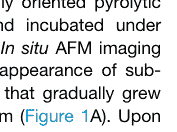
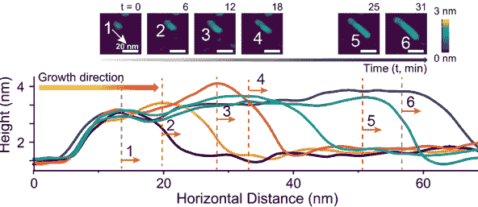
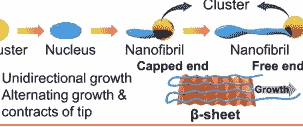
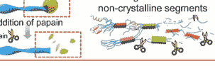
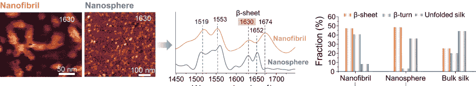
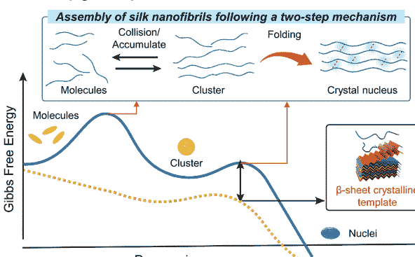
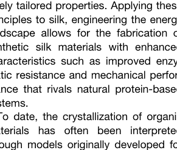

# 编程丝：纳米纤维组装中的两步结晶与定向生长

Jun Ho Hwang,¹ Nathan C. Gianneschi,² 和 Eunji Lee³*

¹光州科学与技术大学 (GIST) 材料科学与工程系，光州 61005，大韩韩国

²西北大学材料科学与工程系、生物医学工程系，以及药理学系，伊万斯斯顿，IL 60208，美国

³光州科学与技术大学 (GIST) 化学系，光州 61005，大韩韩国

*联系邮箱：lee@gist.ac.kr

实时可视化揭示了一种可控的两步法丝蛋白纳米纤维组装机制，其中能量景观引导了从无定形簇到 β-折叠层晶的构象转变，从而实现了增强丝蛋白材料的合理设计。

蜘蛛和蚕产生的丝蛋白因其卓越的强度和生物相容性，在纺织品、化妆品和防护材料中发挥着多种功能。¹从材料角度来看，这种坚韧的纤维——甚至超过了钢和凯夫拉——是非常显著。尽管试图通过合成策略提高这些性能，但丝蛋白的性能在很大程度上仍然难以达到⁴这种差距是因为对定义天然丝蛋白机制的分级结构和形成路径理解不完全。

氢键以及无定形链之间建立新的、高度有序的相互作用。⁵识别赋予丝蛋白纳米纤维组装特性的机制需要高分辨率分析技术，以实时捕捉结构变化。

垂直收缩至 ~3 nm，标志着方向性对齐的开始。形态转变反映了一种韧化的成核机制，其中发生了向紧密 β-折叠结构的构象转变。值得注意的是，伸长发生在分子在单个纤维上的附着过程中。

丝质蛋白是丝绸的主要成分，具有亲水域和疏水域的双亲性。这种结构基元支持了环境中丝蛋白组装的基于区块的模型。⁷考虑其在丝蛋白组装中的作用，⁸纤维形成过程中由剪切力和方向性力驱动的构建单元尚未被完全理解。特别是纳米纤维结构内部的构象取向仍待探索，因为它受到动力学和热力学限制的影响。⁹

在最近发表于《先进材料》的一项研究中，James J. Doe 和 Yoore 利用原位电子显微镜和光诱荧光显微镜 (PIFM) 捕捉丝纤维形成的早期阶段，并追踪分子结构相应的构象变化。

实时可视化显示了多路径成核：单分子首先聚集成成无定形簇，然后通过方向性对齐和生长转化为 β-折叠结构。通过刻意重塑底层景观，作者证明了所得组装可以定制其固有的抗降解性能。

为了检查丝纳米纤维的组装，将来自骨蛾茧的丝蛋白沉积在高度取向的石墨 (HOG) 上，并在退火条件下进行孵化。AFM 图像捕捉到了亚纳米参数的初始出现，这些参数逐渐生长并达到 3-4 nm（图 1）。局部簇的形成

从经典理论的角度观察，这些发现指向了一个更细致的两步路径。

总的来说，这些观察强调了纤维末端在引导丝蛋白纳米纤维生长和取向方面的关键作用。

在该模型中，纤维末端生长期间的一个中间体转化为稳定的 β-折叠结构。这种中间体是通过选择性酶促降解识别的。

由于丝蛋白中的蛋白水解位点随二级结构而变化，蛋白酶胰蛋白针对非段结构结构域。蛋白处理停止了纤维的伸长并抑制了末端的降解，证实了该区域富含折叠蛋白。这些结果进一步表明亚临界簇

构象收缩不是

# 丝蛋白纳米纤维的伸长过程

末端的连续成核

丝蛋白纳米纤维的构象结构

PIFM 图像和光谱

分子构象的分布

丝纳米纤维形成的两步法生长过程

丝蛋白形成的自由能

**图 1.** 通过构象转变实现丝的分级纳米纤维组装

(A) 丝纳米纤维的时间分辨率生长。核发生构象转变为紧密结构，随后通过三个阶段生长：段的附着、末端。加入溶液后，纳米纤维生长停止，从末端开始降，表明末端由非自取向部分组成。

(B) 使用 PIFM 的纳米颗粒构象结构。

(C) 丝纳米纤维形成的两步法生长过程。

(D) 丝蛋白形成的自由能。

分子自组装的高级结构从根本上受底层能量景观支配，包括热力学稳定性和动力学性质。通过调节这种组装，可以控制组装的动力学，也可以控制自取向的。

传统的结构表征提供了最终自组装状态的快照，但未能捕捉定义自组装路径的关键过程。构象动力学揭示了集合、扩散生长过程、结构重组以及颗粒间的相互作用。这些分析强调了不仅要而且而且获取引导组装动力学和方向偏好的瞬态中间体的重要性。未来，将这些方法与先进技术相结合，将揭示跨越多个空间和时间尺度的分子行为的动态原理。

7. Sorrenti, A., Leila-Ilesias, J., Markvoort, A.J.,, T.P.A., and Hermans, T.M. (2017). 非平衡态超分子聚聚。Chem. Soc. Rev. 46, 5476–5480. https://doi.org/10.1039/C7CS00512E

8. Koh, L-D., Cheng, Y., Teng, C-P., Kohn, Y.-W., Loh, X-J., Tee, S-Y., Low, M., Ye, E., Yu, H.-D., Zhang, Y-W., and Han, M.Y. (2019). 丝胶蛋白材料的结构、机械性能与应用。Prog. Polym. Sci. 46, 88–110. https://doi.org/10.1016/j.polymymsci.2015.02.001.

9. Shi, C., Bae, Y., Zhang, M., and De Yore, J.J. (2025). 操控纤维丝丝的组装与架构。Adv. Mater, 37,

10. Erdemir, D., Lee, A.Y., and Myerson, A.S. (2009). 溶液中晶体的成核：经典模型与两步模型。Acc. Chem. 42, 621–629. https://doi.org/10.1021/ar800217x.
