# 使用 CodeWarrior 使用 C 和汇编语言编程 DRAGON12-Plus-USB

## 前言

像飞世（Freescale）`MC9DG256` 这样的微控制器是非常卓越的设备。它们不仅包含一个具有丰富指令集和寻址模式的复杂微处理器，还内置了 RAM、EEPROM 和闪存，以及大量的 I/O 端口，包括并行 I/O、不同类型的串行 I/O、定时器和 A/D 转换器。

我们将使用一种特殊的微控制器 `MC9S12DG256`，它是飞世流行的 HCS12 微控制器中性能最强大的之一，并具有丰富的 I/O 能力。该微控制器可在 Wyctec 的 `DRAGON12-Plus-USBM` 开发板上使用。`DRAGON12-Plus-USBM` 内置了 I/O 设备，包括 LED、开关、四个七段显示器、键盘 LCD 显示器、D/A 转换器、板载开关、用于电机的内置 H 驱动器、连接传感器的接口以及一个来自 Wyctec 的加速度计板，以及用于将您的电路连接到内置板的母插座。

LBE Books 的前一本书《通过 C 语言学习：Learning By C – 使用 CodeWarrior 编程 DRAGON12-Plus》展示了如何以最小的努力为该开发板编写 C 语言程序。我们通过为您提供一个 CodeWarrior 静态项目来实现这一点，该项目包含一个汇编语言文件，用于与 I/O 寄存器进行所有的底层交互。这些汇编语言程序为您的 C 程序提供服务。在之前的书中，您不需要学习任何汇编语言就能让复杂的程序在这一开发板上运行。

本书提供了这些 CodeWarrior 静态项目，以便您可以轻松地为 `DRAGON12-USBM` 开发板编写 C 程序。然而，在书中您将需要查看静态项目中包含的所有汇编语言程序。通过这种方式，您将学习如何用汇编语言编写 HCS12 微控制器，以及如何编写自己的可以在 C 程序中调用的汇编语言子程序，从而从 `MC9DG256` 微控制器获得最大的性能。

在第 1 章中，我们介绍了 `DRAGON12-Plus-USBM` 开发板。第 2 章将包含并行输出口的示例，第 3 章将包含并行输入口的示例。第 4 章描述了液晶显示器。第 5 章介绍了中断这一重要主题。第 6 章提供了使用 `MC9DG256` 内置的双通道 A/D 转换器的示例。第 7 章介绍了如何使用脉冲宽度调制 `PWM` 控制直流电机速度或舵器位置的示例。第 8 章包含了串口通信接口 `SCI` 的示例，第 9 章展示了如何使用串行外接口 `SPI`。第 10 章提供了内置定时器模块的示例，第 11 章包含了使用 `MC9S12DG256` 微控制器进行模糊控制的示例。

许多同事、学生和评审员对本书的编写产生了影响。他们启发性的讨论和批判性意见深受赞谢。特别感谢 Michael Latcha 和 Osamah Rawashdeh，我们与他们就此书的内容进行了多次讨论。

Richard E. Haskell

Darrin M. Hanna

# 第1章

## 引言

像飞世（Freescale）`MC9DG256` 这样的微控制器是非常卓越的设备。它们不仅包含一个具有丰富指令集和寻址模式的复杂微处理器，还内置了 RAM、EEPROM 和闪存，以及大量的 I/O 端口，包括并行 I/O、不同类型的串行 I/O、定时器和 A/D 转换器。

我们将使用一种特殊的微控制器 `MC9S12DG256`，它是飞世流行的 HCS12 微控制器中性能最强大的之一，并具有丰富的 I/O 能力。该微控制器可在 Wyctec 的 `DRAGON12-Plus-USBM` 开发板上使用。`DRAGON12-Plus-USBM` 内置了 I/O 设备，包括 LED、开关、四个七段显示器、键盘 LCD 显示器、D/A 转换器、板载开关、用于电机的内置 H 驱动器、连接传感器的接口以及一个来自 Wyctec 的加速度计板，以及用于将您的电路连接到内置板的母插座。

### 1.1 从微处理器到微控制器

计算机行业在过去的25年里发生了一场重大变革。第一微处理器的制造得益于1960 年代集成电路的卓越发展。这项技术允许将成千上万个晶体管刻蚀在单个硅片上。这导致了集成电路的设计，在单个芯片中集成了越来越多的逻辑元件。1969 年，英特尔承担了一项开发用于制造可编程计算器的集成电路组的任务。与其开发另一个功能有限的专用集成电路，英特尔选择生产一种更通用的设备——`4004` 微处理器，可以通过编程来执行许多不同的功能。这种第一个微处理器只有四条数据线，地址信息和数据必须通过这些线发送到存储设备。1971 年，该芯片作为四芯芯片组的一部分上市。`4004` 具有许多局限性，随后英特尔引入了 `8008`，两年后推出了 `8080`，后者在不同应用历史中被广泛使用。1975 年，摩托罗拉生产了其第一款微处理器——`6800`。

因此，第一代微处理器仅包含一个可以寻址外部内存的 CPU，如图1.1 所示。多年来集成电路技术的发展催出了更快、更复杂的微处理器，例如英特尔 `8086`、`奔腾`，以及摩托罗拉 `68000` 和 `PowerPC`。这些微处理器被应用于全球许多流行的桌面电脑中。另一个趋势是在单个芯片上封装更多功能。摩托罗拉 `6801` 于 1978 年推出，它在单个芯片上包含了少量的 RAM 和 ROM 以及并行 I/O。次年，摩托罗拉引入了 `6801` 的 EPROM 版本——即 `68701`，以及低成本 `6805` 系列中的首款产品。摩托罗拉于 1985 年引入了第一款 `68HC11`。这种单片机上的 8 位微控制器（CPU）具有 8 字节 ROM、256 字节 RAM、512 字节 EEPROM、多达 32 条并行 I/O 线、一个 16 位定时器、一个同步外设接口 `SPI`、一个异步串行接口 `SCI` 以及一个 8 通道 A/D 转换器。自1985 年以来，摩托罗拉引入了五十多个 `68HC11` 型。这些型号的区别在于芯片中包含的板载资源类型和数量。

图1.1 所示的外部内存由读写内存 `RAM`、只读内存 `ROM` 和输入/输出内存 `I/O` 组成。这些是执行定时器功能和模拟数字（A/D）转换等操作专用设备。图1.1 中的 RAM 可以是静态内存 `SRAM` 或动态内存 `DRAM`。在相同尺寸下，动态 RAM 可以包含比静态 RAM 更多的字节，但需要额外的电路定期刷新数据以防止其丢失。可能与图1.1 中的地址线和数据线连接的其他类型存储设备包括可擦除可编程存储器 `PROM`、电擦除可编程存储器 `EEPROM` 和闪 `EEPROM`。闪和 EEPROM 都是非易失性内存，在断电时仍能保持数据。EEPROM 中的单个字节可以被擦除和编程，而闪 EEPROM 通常需要一次性擦除整个内存阵列。


图1.1 连接到外部内存的微处理器 `CPU`

1997 年，摩托罗拉推出了 `68HC12` 作为增强型的 `68HC11`。它与 `68HC11` 向上兼容（但不代码代码级）。它具有极大增强的中央处理器 `CPU`，拥有若干新指令和寻址模式，使其更容易支持高级语言。由于几个原因，程序在 `68HC12` 上的运行速度快得多：典型时钟频率从 `68HC11` 的 2 MHz 增加到 `68HC12` 的 8 MHz；执行许多指令所需的时钟周期减少；此外，新指令和寻址模式执行相同任务所需的指令更少。这意味着程序不仅运行得更快，而且占用的内存更少。

2002 年，摩托罗拉引入了 HCS12 系列微控制器，这是 `68HC12` 系列的直接升级。摩托罗拉半导体部门于 2004 年拆分为 Frecale。`MC9S12DG256` 微控制器具有 256 字节闪存、2 KB RAM、4 KB EEPROM、双通道 10 位模拟数字（A/D）转换器、两个异步串行通信接口 `SCI`、三个串行外设接口 `SPI`、一个支持输出比较和输入捕获的 8 通道定时器模块、一个 8 通道脉宽调制器 `PWM`。这些部分在芯片中包含的板载资源类型和数量上有所不同。

### 1.2 DRAGON12-USB 板

来自 Wytec 的 `DRAGON12-USB` 板如图 1.3 所示。该板包含 Freescale `MC9S12DG256` 微控制器，周围是方便引出的 I/O 端口。这使得与板载 I/O 电路接口变得简单。该板包含四位数数码码显示、四个按钮开关、八位 DIP 开关、八个 LED、用于读取 0 到 5 伏的电位器、液晶显示 `LCD`、4x4 键盘、D/A 转换器、温度传感器、光传感器以及用于检测物体存在的红外发射接收器。`DRAGON12-USB` 板还带有内置扬声器、用于驱动电机的 H 桥，以及连接 Wytec 舵器的方便接头。


图1.3 Wytec `DRAGON12-USB` 板

### 1.3 CodeWarrior 开发工具


传统上微控制器使用汇编语言编程。汇编语言的优点是最接近硬件且执行效率最高。汇编语言的缺点是不具移植性。每当你切换到不同的微控制器时，必须重写所有程序。此外，使用汇编语言编写通常比高级语言耗。近年的趋势是使用高级语言编程微控制器，最流行的是 C 语言。Freescale 提供 `CodeWarrior` 工具用于汇编和 C 语言编程微控制器。特别版是免费下载的，具有代码大小限制，这对你来说可能不是问题。你需要从 `www.freescale.com` 下载 `S(12)` 版本。（见附录 A）。

`CodeWarrior` 的一个实用功能是可以创建静态项目并在其基础上构建。我们为 `DRAGON12-Plus-USB` 创建了一个静态项目。该项目名为 `LBE_DRAGON12+`，可以在 `www.lbebooks.com` 下载。当你按照附录 A 中的教程创建自己的项目时，这些汇编程序将包含在项目的 `main.asm` 文件中。项目的顶层设计将存储在 `main.c` 文件中的 C 程序。在本书中，我们将展示如何编写存储在 `main.asm` 中的自定义汇编程序，以及如何在存储在 `main.c` 中的顶层 C 程序中通过 C 函数调用调用它们。

# 第 2 章

## 并端口 - 输出

在本章中，你将学习如何使用并行端口打开 LED 和七段数显示器的段码。与我们所有的示例一样，我们首先将向你展示如何完全使用 C 语言来实现，然后将向你如何通过 C 调用我们的内置汇编语言例程来实现。你还将学习这些汇编例程的工作原理。使用这些内置汇编例程将使你的 C 程序变得更短且更容易编写。

### MC9S12DG256 并行 I/O 端口

表 2.1 列出了与并行 I/O 相关的 `MC9S12DG256` 寄存器。这些端口（除 `PORTAD` 和 `PORTAD1` 外）每个都有有一个如图 2.1 所示类型的数据寄存器数据方向寄存器。端口的每个引脚都可以作为输入或输出，取决于相应数据方向寄存器中的位设置，如图 2.1 所示。

| 端口 | 端口名称 | DDR 名称 | DRAGON12-Plus-USB 用途 |
|---|---|---|---|

| T | `PTT` | `DDRT` | 扬声器 |
| S | `PTS` | `DDRS` | SCI, SPI |
| M | `PTM` | `DDRM` | |
| P | `PTP` | `DDRP` | 七段显示启用, 舵器 |
| H | `PTH` | `DDRH` | 开关 |
| J | `PTJ` | `DDRJ` | LED 启用 |
| AD0 | `PORTAD` | 仅输入 | 电位器 |
| AD1 | `PORTAD1` | 仅输入 | |
| A | `PORTA` | `DDRA` | 键盘 |
| B | `PORTB` | `DDRB` | LED, 七段显示, H 桥 |
| E | `PORTE` | `DDRE` | 模式, XIRQ |
| K | `PORTK` | `DDRK` | LCD |

表 2.1 中列出的大多数 I/O 端口都具有复用功能或特用功能，其中许多功能将在我们稍后的示例中考虑。当 I/O 端口的引脚未被用于这些复用功能之一时，它们可以被作通用 I/O 使用。

`MC9S12DG256` 有几种不同的工作模式，包括单芯片模式和扩展外部内存模式。在扩展外部内存模式下，端口 A 和 B 用于地址线和数据线的复用。`DRAGON12-Plus-USB` 板运行在单芯片模式下，因此端口 A 和 B 可用于并行 I/O。端口 A 连接到 4 x 4 键盘。端口 B 连接到红色 LED 和七段显示器的段码。你还将使用端口 B 通过 H 桥控制电电的旋转方向。

### 端口数据寄存器

| 7 | 6 | 5 | 4 | 3 | 2 | 1 | 0 |
|---|---|---|---|---|---|---|---|

| `Px7` | `Px6` | `Px5` | `Px4` | `Px3` | `Px2` | `Px1` | `Px0` | `PORTx` |

### 端口数据方向寄存器

| 7 | 6 | 5 | 4 | 3 | 2 | 1 | 0 |
|---|---|---|---|---|---|---|---|

| `DDX7` | `DDX6` | `DDX5` | `DDX4` | `DDX3` | `DDX2` | `DDX1` | `DDX0` | `DDRx` |

```
DDx[7:0]:
0 - 输入
1 - 输出
```

图 2.1 与并行 I/O 端口相关的寄存器

在使用 `CodeWarrior` 时，带有特定寄存器地址的端口名称和 DDR 名称列在表 2.2 中。我们将在示例 3 和 4 中看到如何使用 `CodeWarrior` 调试器在执行程序时观察这些寄存器内容的变化。

### 表 2.2 使用 CodeWarrior 时的并行端口地址

| 端口名称 | 地址 | DDR 名称 | 地址 |
|---|---|---|---|

| T | `PTI` | `0x0240` | `DDRT` | `0x0242` |
| S | `PTS` | `0x0248` | `DDRS` | `0x024A` |
| M | `PTM` | `0x0250` | `DDRM` | `0x0252` |
| P | `PTP` | `0x0258` | `DDRP` | `0x025A` |
| H | `PTH` | `0x0260` | `DDRH` | `0x0262` |
| J | `PTJ` | `0x0268` | `DDRJ` | `0x026A` |
| AD0 | `PORTAD0` | `0x00F8` | `ATD0DEN` | `0x00D8` |
| AD1 | `PORTAD1` | `0x012F` | `ATD1ED` | `0x012D` |
| A | `PORTA` | `0x0000` | `DDRA` | `0x0002` |
| B | `PORTB` | `0x0001` | `DDRB` | `0x0003` |
| E | `PORTE` | `0x0008` | `DDRE` | `0x0009` |
| K | `PORTK` | `0x0032` | `DDRK` | `0x0033` |

`MC9S1DG256` 包含锁相环（PLL）电路，`CodeWarrior` 使用该电路将频率设置为 24 MHz。因此，当你使用 `CodeWarrior` 将程序下载到闪存中时，你的程序将在 24 MHz 下运行。然而（此处由于原文存在大量重复和乱码，已根据上下文技术背景进行核心翻译）。

## 第2章

### 列表 2.1 示例 1：DRAGON12-Plus-USB

```c
// 示例 1：开启 7段显示器的每隔一个段
#include <hidef.h>    /* 通用定义和宏 */
#include <mc9s12dg256.h>  /* 衍生型号信息 */
#pragma LINK_INFO_INFORMATIVE mc9s12dg256b

#include "asm.h"    /* 汇编模块接口 */

void main(void) {
    /* 在此处输入你的代码 */
    PLL_init();      // 设置系统时钟频率为 24 MHz
    DDRB = 0xff;     // Port B 输出
    DDJR = 0xff;     // Port J 输出
    DDR = 0xff;     // Port P 输出
    PTJ = 0x00;      // 启用 LED
    PTP = 0x00;      // 启用所有 7段显示器
    // 开启 7段显示器上每隔一个 LED 和段
    PORTB = 0x55;

    for(;;) {}       // 无限等待
}
```

运行列表 2.1 所示的程序。然后将 `PTJ` 的值更改为 `0x02` 并重新运行程序。这将禁用 LED。接下来将 `PTJ` 改回 00，并将 `PTP` 的值更改为 `0x0A`。这将禁用第 1 和第 3 个数字（从左到右标记为 0–3 的数字）。

### 示例 2 – C 函数调用

在本示例中，我们将展示如何编写可以作为 C 函数调用的汇编子程序。主 C 程序位于 `main.c` 文件中，汇编语言子程序位于 `main.asm` 文件中。

与其记住 `DRAGON12-Plus-USB` 上的 LED 和 7段显示器连接到 Port B 并通过 Port J 和 Port P 的位控制，我们编写了六个汇编语言例程，并通过表 2.3 所示的六个函数调用调用。在设置 `LBE_DRAGON12-Plus-USB` 站点时，这些汇编语言例程始终供你使用。

| 表 2.3 用于开启 7段显示器的函数调用 |
| C 函数调用 | 含义 |
| `led_enable();` | 设置 `DDRB` 和 `DDRJ` 为输出，将 DJ1 清零为0，并通过清除 `PORTB` 的所有位关闭所有 LED |
| `led_on();` | 将整数 `int` 的 8 位存储在 Port B 中 |
| `led_disable();` | 设置 `DDRJ` 为输出并将 DJ1 设为 1 |
| `led_off();` | 通过清零 Port B 关闭 LED |
| `seg7_enable();` | 设置 `DDRB`, `DDRJ` 为输出，清空 Port P 的低 4 位，并清除 `PORTB` 的所有位 |
| `seg7_disable();` | 将 Port P 的低 4 位设为 1 |
| `seg7_on(int s, int b);` | 在 7段数字 n 上显示段 s。b。 |
| `seg7s_off();` | 通过清零 Port B 关闭所有 7段显示器 |

### 并行端口 - 输出

#### LEDs

列表 2.2 将开启每隔一个 LED 并禁用 7段显示器。函数 `seg7_disable()` 将通过将 Port P 的低 4 位设为 1 来禁用四个 7段显示器（见图 2.3）。函数 `led_enable()` 将通过将 Port B 和 Port J 的方向寄存器设置为输出，并通过将 Port B 中的所有位清零 0 来启用 LED。最后，函数 `led_on(0x55)` 将写入十六进制值 `0x55`，从右侧开始开启每隔一个 LED。

列表 2.2 示例 2a - DRAGON12-Plus-USB

```c
// 示例 2a：开启每隔一个 led
#include <hidef.h> // 通用定义和 *
#include <mc9s12dg256.h> // 衍生型号信息 *
#pragma LINK_INFO DERIVATIVE "mc9s12dg256b"

#include "main.asm" // 模块接口 *

void main() {
    PLL_init(); // 系统时钟频率为 24 MHz
    seg7_disable(); // 禁用 7段显示器
    led_enable(); // 启用 leads
    led_on(0x55); // 开启每隔一个 led
}

for(;) {} /* 无限等待 */
```

### 内部原理

书中的所有 C 函数调用都定义为 `main.asm` 文件中的汇编语言例程，该文件位于你 `CodeWarrior` 项目的源文件夹中。你应该参考附录 B 关于汇编语言编程的讨论。表 2.3 所示的前六个 C 函数的汇编语言例程在列表 2.3 中。请注意，C 函数名必须是对应汇编语言例程的标签。这些标签以冒号结尾。

```
XDEF led_enable, led_disable, led_on, led_off
XDEF seg7_enable, seg7_disable
```

必须包含 `main.asm` 文件的开头。

在列表 2.3 的 `led_enable` 例程中，语句 `movb #FF, DDRB` 将十六进制字节 FF 移动到 Port B 方向寄存器，使 Port B 的所有位变为输出。类似的语句也将十六进制字节 FF 移动到 Port J 方向寄存器。井符号 `#` 表示立即数模式（见附录 B），美元符号 `$` 表示 FF 是十六进制值。`DDRB` 是 Port B 方向寄存器的地址，如表 2.2 所示，其十六进制值为 `0x03`。所有这些寄存器的地址都是使用 `mc9s12dg256.inc` 文件中的 `equate (equ)` 定义的，该文件位于你 `CodeWarrior` 项目的库 文件夹中。此 `equate` 语句的示例在列表 2.4 中。

在列表 2.3 的 `led_enable` 子程序中，语句 `bclr PTJ, $02` 将清空 `PTJ` 数据寄存器的第 1 位。此清位操作将与掩码 `$02` 的补码进行与运算。由于 `$02` 的补码 = 11111011，此掩码将清除 `PTJ` 的第 1 位，从而启用 LED（见图 2.2）。列表 2.3 中 `led_enable` 子程序的的下一个语句是 `clr PORT`，它将 Port 的位清零，并关闭所有 LED。

列表 2.3 和源自 `main.asm` 的 seg7 汇编例程

```
_enable:
    movb #FF, DDRB
    movb #FF, DDRJ
    bclr PTJ, $02

led_on:

    led_off:
    clr PORT

led_disable:
    movb #FF, DDRJ
    bset PTJ, $02

seg7:
    movb #FF, DDRB
    movb #FF, DDRP
    bclr PTF, $05

_enable:
    clr PORT

__seg7_disable:
    movb #FF, DDRP
    bset PTF, $05
```

#### 七段数显示器

代码列表 2.6 将禁用 LED 的同时，开启七段数显示器数字 2 的每一个段。数字从左到右编号为 0 到 3。因此，数字 2 是左侧的第三个数字。参考表 2.3，`led_disable()` 函数将禁用八个红色 LED，`seg7_enable()` 函数将启用四个七段数显示器。`seg7_on(0x55,2)` 函数将开启数字 2 的 a、c、e 和 g 段段。

### 内部原理

表 2.3 所示的四个 `seg7` C 函数调用的汇编语言例程代码列表 2.7 所示。语句

```
MASK:      DC.B      1,2,4,8,16,32,64,128
```

定义了八字节，其中包含十六进制 `$01, $02, $04, $08, $10, $20, $40` 和 `$80`。因此，每个字节只有一个位被设置为 1。标签 `MASK` 是包含 `$01` 的字节地址。因此，`MASK` 是一个我们可以进行索引的表（索引值为 0–7），用于选择八个字节值之一。

代码列表 2.6 示例 2b - DRAGON12-Plus-USB

```c
// 示例 2b：开启数字 2 每一个段
#include <hide> /* 通用定义和宏 *
#include <mc9s12dg256.h> /* 变体接口 *
#pragma LINK_INFO DERIVATIVE mc9s12dg256b"
#include "main_asm.h" /* 与汇编模块的接口 *

void main(void) {
    PLL_init();          // 设置系统时钟频率为24 MHz
    led_disable();      // 禁用 led
    seg7_enable();      // 启用七段显示器
    seg7_on(0x55,2);    // 开启数字 2 的隔位段

    for(:); // 无限等待 *
}
```

代码列表 2.6 中的函数 `seg7_on(0x55,2)` 被编译为跳转到代码列表 2.7 中的子例程 `seg7_on`。此 C 代码需要向汇编例程传递两个参数：`0x55` 和 `2`。我们在示例 2a 中提到，如果有一个整数值要传递到栈上，那么它将位于累加器 D 中。如果有多个超过 16 位的整数要传递给子例程，则列表中的最后一个（在本例中为 2）将通过累加器 D 传递，而其余参数则在调用子例程之前会被推入栈中。参考附录 B 可知，当子例程被调用时，返回地址会被推入栈栈中。因此，当调用函数 `seg7_on(0x55,2)` 时，16 位值 `$0055` 被推入栈中，值 `$0002` 被放入累加器 D，返回地址被推入栈，然后程序跳转到代码列表 2.7 中的子例程 `seg7_on`。此时，栈的结构如图 2.5 所示。

#### 代码列表 2.7 来自 main.asm 的 seg7 汇编例程

| MASK: | DC.B 1,2,4,8,16,32,64,128 |
| :--- | :--- |
| ; | 七段显示器 |
| seg7_enable: | movb $FF,DDR ; DataDirB -->所有输出 |
| | | movb $FF,DDR ; DataDirP -->所有输出 |
| | | bclr PTP,$0F ; 启用七段数字 PTP[0:3] = 0000 |
| | | clr PORTB ; 关闭所有七段数字 |
| | | rts |
| seg7_disable: | movb $FF,DDR ; DataDirB -->所有输出 |
| | | bset PTP,$0F ; 禁用七段数字 PTP[0:3] = 1111 |
| | | rts |
| ; | 在一个数字上显示选定的段 |
| ; | ; void seg7_on(int segs, int digit#); |
| ; | ; digit# 位于 D 中 |
| ; | ; segs 位于 2,sp (存储在端口 B 的十六进制值) |
| seg7_on: | ldy #MASK |
| | | aby 0,y ;A = 掩码 |
| | | idaa coma PTP ;启用数字 digit# |
| | | staa ldd 2,sp ;B = segs |
| | | stab PORTB |
| | | rts |
| seg7_off: | clr PORTB ; 关闭所有七段显示 |
| | | rts |

img/6c970885d6405944bd67e8f02bac5bc_20_png


子例程 `seg7_on` 中的第一条指令是 `ldy #MASK`。这将表 `MASK` 的地址加载到寄存器 `Y`。下一条指令 `aby` 将累加器 `B` 中的值（即通过累加器 `D` 传递的 2）与 `Y` 中的值相加，结果留在 `Y` 中。

# 第2章

当表达式为假时，`while` 循环将退出，不再再次执行语句。表达式值为 0 被视为假，非零值被视为真。因此，在列表 2.8 的 `while(1)` 语句中，表达式始终为真，所以 `while` 循环永远不会退出。我们使用该语句来无限地执行 `while` 循环内的语句。

在 `while` 循环内部，我们首先开启 `DRAGON12-Plus-USB` 最右侧 7 段数码显示器的所有段段，延迟约半秒，关闭 7 段数码显示器的所有段段，然后再次延迟约一秒。这个过程不断重复，导致显示器大约每秒闪烁一次。试一试。

### 示例 4 – 汇编语言中的延迟循环：`ms_delay(int)`

与其在 C语言中自己编写延迟循环，不如通过表 2.4 所示的汇编例程调用 C 语言。当你设置一个 LBE `DRAGON12-Plus-USB` 固件项目时，该汇编程序始终供你使用。列表 2.9 显示了如何修改列表 2.8 中的程序以产生相同的结果。试一试。尝试 10 秒、20 秒或 30 秒的计数，并验证每次闪烁恰好持续一秒。

| C 函数调用 | 含义 |
|---|---|
| `msdelay(int n);` | 延迟 `n` 毫秒 |

### 列表 2.9 示例 – DRAGON12-Plus-USB

```
// Example 4: 使用 msdelay() 闪烁七段数码管
#include <hide.h>      /* 通用定义和宏 */
#include <mc9s1ldg256.h> /* 衍生器信息 */
#pragma LINK_INFO DERIVATIVE "Mc9s1ldg256b"

#include "main_asm.h"      /* 与汇编模块的接口 */
void main(void) {
  PLL init();              // 设置系统时钟频率为 24 MHz
  seg7_enable();          // 启用七段数码管
  while(1) {
    seg7_on(0x7F,3);     // 开启数字 3 的所有段
    ms_delay(500);      // 延迟
    seg7_off();          // 关闭所有段
    ms_delay(500);      // 延迟
  }
}
```

### 内部原理

当调用 C 函数 `ms_delay(int n)` 时，将执行列表 2.10 所示的汇编语言子程序 `ms_delay`。需要延迟的毫秒数 `n` 将通过累加器 `D` 传递给子程序。

`ms_delay` 子程序中的前两条指令将寄存器 `X` 和 `Y` 压入栈中。这是比由于我们在该子程序中改变了 `X` 和 `Y` 的值，如果这些值正被调用该子程序的程序使用，那么它们就会被破坏。我们永远无法知道是否是这种情况，因此在子程序开始时存储我们使用的任何寄存器的内容，并在子程序结束时恢复这些值是非常关重要的。在列表 2.10 中，两条指令 `push` 和 `pull`（或 `pop`）从栈中取出 `Y` 和 `X` 的值。注意，从栈中弹出值的顺序将与压入栈值的顺序相反。对于每个 `push` 指令，必须有一个对应的 `pull` 指令，以确保返回地址留在栈顶，以便 `RTS` 指令返回到调用程序中的下一条指令。

```
Listing 2.10 来自 main.asm 的 ms_delay 汇编子程序
ms_delay
; input:D = 要延迟的毫秒数
; clock = 24 MHz
ms_delay:
    psxh
    pshy
    tfr
    ldx      D,Y
mdl:     #5999   ; N = (24000 - 6)/4
md2:     dex      ; 1 ccycle
    bne      md2     ; 3 ccycle
    dey
    bne      md1     ; Y ms
    puly
    pulx
    rts
```

`ms_delay` 子程序中的第三条指令将 `D` 中的值（要延迟的毫秒数）传输到索引寄存器 `Y`。索引寄存器 `X` 加载十进制值 `5999` (`$176F`)。循环

```
md2:     dex      ; 1 ccycle
    bne      md2     ; 3 ccycle
```

随后将递减 `X` 直到变为零。因此，这两条指令中的每一条总共执行了 5999 次。`dex` 指令占用一个周期，`bne` 指令占用3 个周期。你可以在 CPU1 参考指南中找到这些值，该指南可以在 `www.freescale.com` 下载。因此，执行此 `md2` 循环所使用的总周期数为 `5999x4=23996`。对于 24 MHz 的时钟，每个周期将需要 `1/24,000=42×10⁻⁹` 秒。因此，执行 `md2` 循环所用的总时间为 `23,996×42×10⁻⁹=0.99983` 毫秒。列表 2.10 中的外部 `md1` 循环将索引 `$X$` 加载为 `5999`（2 个时钟周期），执行 `$md2$` 循环（0.99983 ms），递减 `$Y$`（1 个时钟周期），如果 `$Y$` 不等于 0，则跳转回 `$md1$`（3 个时钟周期）。这些额外的周期...

```
Listing 2.11 Example 5a – DRAGON12-Plus-USB
// Example 5a: Single LEDs
#include <hidef.h>      /* common defines and macros */
#include <mc9s1ldg256b.h> /* derivative information */
#pragma LINK_INFO DERIVATIVE

#include "main_asm.h"    /* interface to the assembly module */

void main(void) {
    PLL_init();
    led_enabled();          // set system clock frequency to 24 MHz
    seg7_disable();        // enable LEDs
    while(1) { // disable 7-segment displays
        PORTB |= 0x01;      // turn on LED 0
        ms_delay(500);
        PORTB |= 0x04;      // turn on LED 2
        ms_delay(500);
        PORTB |= 0x10;      // turn on LED 4
        ms_delay(500);
        PORTB &= 0xFE;      // turn off LED 0
        ms_delay(500);
        PORTB &= 0xFB;      // turn off LED 2
        ms_delay(500);
        PORTB &= 0xEF;      // turn off LED 4
        ms_delay(500);
    }
}
```

| Port Register | | | | | | | Bit # |
|---|---|---|---|---|---|---|---|
| 7 | 5 | 4 | 3 | 2 | 1 | 0 | PORTB |
| PB7 | PB6 | PB5 | PB4 | PB3 | PB2 | PB1 | PB0 | LED |

图 2.8 Port B 与 LED 的连接

#### 用于开启或关闭单个 LED 的 C 函数调用

与其计算十六进制值并对 `PORTB` 进行按位或/与操作以开启或关闭特定位，我们编写了两个汇编语言程序，这些程序由表 2.6 所示的 C 函数调用调用。当你设置 `LBE_DRAGON12-Plus-USB` 静态项目时，这些汇编语言程序始终可用。列表 2.12 显示了如何修改列表 2.11 中的程序以产生相同的结果。请尝试一下。

#### 表 2.6 用于开启或关闭 PORTB 单个位的 C 函数调用

| Function Call | 含义 |
|---|---|
| `led on (int b);` | 将 `PORTB` 的 `b` 位置高 |
| `led off (int b);` | 将 `PORTB` 的 `b` 位置低 |

### 列表 2.12 Example 5b – DRAGON12-Plus-USB

```
// Example 5b: Single LEDs
#include <hide.h>           /* common defines and macros */
#include <mc9s12dg256.h>       /* derivative information */
#pragma PLINK_INFO_DERIVATIVE "mc9s12dg256b"

#include "main.asm.h"             /* interface to the assembly module */

void main(void) {
    // set system clock frequency to 24 MHz
    led_enable();               // enable LEDs
    seg7_disable();             // disable 7-segment displays
    while(1) {
        led_on(0);                  // turn on LED 0
        ms_delay(500);              // half-second delay
        led_on(2);                  // turn on LED 2
        ms_delay(500);              // half-second delay
        led_on(4);                  // turn on LED 4
        ms_delay(500);              // half-second delay
        led_off(0);                 // turn off LED 0
        ms_delay(500);              // half-second delay
        led_off(2);                 // turn off LED 2
        ms_delay(500);              // half-second delay
        led_off(4);                 // turn off LED 4
        ms_delay(500);              // half-second delay
    }
```

### 底层原理

当调用 C 函数 `led_on(int n)` 时，会执行列表 2.13 所示的汇编子程序 `led_on`。数字 `n` 被传递到累加器 `D` 中，因此结果在累加器 `B` 中。列表 2.13 中 `led_on` 的第一条指令 `ldy #MASK` 将表的地址。下一条指令 `aby` 将累加器 `B` 中的值（即数字 `n`）加到累加器 `Y` 中，结果现在指向表中只有第 `n` 位为 1 的字节。然后，下一条指令 `lda 0,Y` 将此值加载到累加器 `A` 中，下一条指令 `oraa PORTB` 将该值与 `PORTB` 的内容进行按位或，结果留在累加器 `A` 中。该值随后存回 `PORTB`，这将使 Port B 的第 `n` 位置高。

## 第 2 章

列表 2.13 来自 main.asm 的汇编程序

| MASK | DC.B | 1,2,4,8,16,32,64,128 |
|---|---|---|---|---|---|---|---|

| ; led_on( b ) | | | | | | | |
| ; led_on: | ldy #MASK | | | | | | |
| ; set b of PORTB to 1 | aby 0,Y | | | | | | |
| ; OR mask with PORTB | oraa PORTB | | | | | | |
| ; store back in PORTB | sta | | | | | | |
| ; led_off( b ) | | | | | | | |
| ; clear b of PORTB to 0 | ldy #MASK | | | | | | |
| ; complement mask | aby 0,Y | | | | | | |
| ; AND mask with PORTB | anda PORTB | | | | | | |

当调用 C 函数 `led_off(int n)` 时，执行汇编子程序 `led_off`。位 `n` 被传递到累加器 `D` 中，因此结果在累加器 `B` 中。列表 2.13 中 `led_on` 的前三条指令与前三条指令相同。因此，此时累加器 `A` 中的值将包含一个位为 1 的 `MASK` 值。下一条指令 `oraa` 将取反所有位，使得累加器 `A` 中除 `n` 以外的所有位变为 1。当累加器 `A` 中的值与 `PORTB` 进行按位与操作时，结果留在累加器 `A` 中。然而，与 0 进行与的操作将被强制为 0。这个累加器 `A` 中的结果值随后存回 `PORTB`，这将导致 `PORTB` 的第 `n` 位

### 示例 6 – 十进制计数器

在本例中，我们将展示如何让 `DRAGON12-Plus-USB` 上的七段显示器以十六进制计数到 F。我们将首先展示如何完全使用 C 来实现，然后提供一个新的 C 函数来显示任意数字。我们在图 2.3 中看到 `DRAGON12-USB` 板有一个公共段位连接到 Port B。这意味着在 `DRAGON12-USB` 上，1 开启一个段，0 关闭一个段。图 2.9 显示了 `DRAGON12-Plus-USB` 板显示所有十六进制数字 0-F 需要的每个段 a-g 的输出值。

| D | g | f | e | d | c | a | code |
|---|---|---|---|---|---|---|---|
| 0 | 0 | 1 | 1 | 1 | 1 | 1 | 3F |
| 1 | 0 | 0 | 0 | 0 | 1 | 1 | 06 |
| 2 | 1 | 0 | 1 | 1 | 0 | 1 | 5B |
| 3 | 1 | 0 | 0 | 1 | 1 | 1 | 4F |
| 4 | 1 | 1 | 0 | 0 | 1 | 1 | 66 |
| 5 | 1 | 1 | 0 | 1 | 1 | 0 | 60 |
| 6 | 1 | 1 | 1 | 1 | 1 | 0 | 70 |
| 7 | 0 | 0 | 0 | 0 | 1 | 1 | 1 | 7F |
| 8 | 1 | 1 | 1 | 1 | 1 | 1 | 7E |
| 9 | 1 | 1 | 0 | 1 | 1 | 1 | 6F |
| A | 1 | 1 | 0 | 1 | 1 | 0 | 7C |
| B | 1 | 1 | 1 | 1 | 0 | 0 | 77 |
| C | 0 | 1 | 1 | 1 | 0 | 0 | 39 |
| D | 1 | 0 | 1 | 1 | 1 | 0 | 56 |
| E | 1 | 1 | 1 | 1 | 0 | 0 | 79 |
| F | 1 | 1 | 1 | 1 | 0 | 0 | 71 |

图 2.9 显示十六进制数字 0-F 所需段值

列表 2.14 显示了我们如何使用常量数组 `seg7tb[]` 创建图 2.9 中的十六进制代码表。类型声明 `char[]` 定义了 `seg7tb[]` 数组的每个元素为 8 位字节。类型限定符 `const` 定义了这些数组元素为程序中不可更改的常量。注意大括号 `{..}` 如何在数组中定义图 2.9 给出的 16 个十六进制代码。还要注意 `seg7tb[]` 的声明和用于 循环的整数 `i` 必须在 C 函数 `lll_init()` 之前。

### 显示十六进制数字的函数调用

与其自己制作七段解码器表，我们编写了一个汇编语言程序，该程序由表 2.7 所示的 C 函数调用 `segdec(int i, int b)` 调用。注意此函数我们

将在七段显示器 `b` 上显示十六进制值 `i`，其中 `b = 0` 是最左侧的七段显示器，`b = 3` 是最右侧的七段显示器。列表 2.15 显示了一个让右侧七段显示器从 0 计数到 F 的程序。尝试一下。

### 列表 2.14 示例 6a - DRAGON12-Plus-USB


```c
// Example 6a: Segment Decoder - C版本
#include <hide.h>               /* 通用定义和宏 {}
#include <mc9s12dg256.h>        /* 衍生器件信息 */
#pragma LINK_INFO DERIVATIVE "mc9s12dg256b"

#include "main_asm.h"             /* 与汇编模块的接口 */

void main(void) {
	char seg7tbl[] = {
	0x3F, 0x06, 0x5B, 0x4F,
	0x66, 0x6D, 0x7D, 0x07,
	0x7F, 0x0F, 0x77, 0x7C,
	0x39, 0x5E, 0x79, 0x71
};

tint i;
	PLL_init();                  // 设置系统时钟频率为24 MHz
	seg7_enable();              // 启用七段显示器
	led_disable();              // 禁用 LED
	while(1) {
	for(i = 0; i < 16; i++) {
		PORTB = seg7tbl[i];
		ms_delay(500);
	}
}
}
```

### 表 2.7 七段显示器的 C 函数调用

| C 函数调用 | 含义 |

|---|---|

| seg7_enable(); | 启用七段显示器 |

| seg7_disable(); | 禁用七段显示器 |

| seg7_on(int s, int b); | 在编号为 `b` 的七段数字上显示段段 `s` |

| seg7_dec(int i, int b); | 在编号为 `b` 的七段数字上显示十六进制值 `i` |

### 列表 2.15 示例 6b - DRAGON12-Plus-USB

```c
// Example 6b: 单位数字七段解码器
#include <hidef.h> /* 通用定义和宏 */
#include <mc9s12dg256.h> /* 衍生器件信息 */
#pragma LINK_INFO_DERIVATIVE "mc9s12dg256b"

#include "main_asm.h" /* 与汇编模块的接口 */

void main(void) {
    int i;
    PLL_init();      /* 设置系统时钟频率为24 MHz */
    seg7_enable();   /* 启用七段显示器 */
    led_disable();   /* 禁用 LED */
    while(1) {
        for(i = 0; i < 16; i++) {
            seg7dec(i,3);
            ms_delay(500);
        }
    }
}
```

### 内部原理

当调用函数 `seg7dec(int i, int b)` 时，会执行列表 2.16 所示的汇编子程序 `seg7dec`。回示例 2b，如果有多个 16 位整数要传递给子程序，则列表中的最后一个（在本例中为数字 `b`）将传递到累加器 `D` 中，因此在累加器 `B` 中），而其他参数将推入栈中，位于调用的返回地址之上。因此，十六进制数字 `i` 被传递到栈上返回地址之的第一条指令。

列表 2.16 中 `seg7dec` 的前三条指令与示例 13 中的 `led_on` 相同。因此，此时累加器 `A` 将包含一个 `MASK` 值——下一条逗号指令会取反所有位，使得除 `b` 以外的所有位都变为 1。该值随后存储在 `PORT` 中，从而启用七段显示器数字 `b`。

下一条指令 `ldd 2,sp` 将十六进制数字 `i` 的值加载到累加器 `D` 中，然后进入累加器 `B`。列表 2.16 中 `seg7dec` 的后续三条指令将使用此十六进制数字（0 到 F 之间）作为 `SEG7TBL` 表的索引，相应的七段码加载到累加器 `A` 中。该值随后存储在 `PORT` 中，现在显示数字 `b` 的十六进制数字 `i`。

# 第2章

### 列表 2.16 来自 main.asm 的汇编子程序

| MASK: DC.B | 1,2,4,8,16,32,64 |

| SEG7TBL: DC.B | $5F,$06,$5B,$4F |

| | DC.B | $66,$6D,$7D,$07 |

| | DC.B | $7F,$0F,$77,$7C |

| | DC.B | $39,$5E,$79,$71 |

```asm
; 七段解码器
; void seg7dec(int digit, int digit)
; digit 在 D 中
; digit 在 2,sp (SEG7TBL 中的索引)
seg7dec:
  psh
  ldy #MASK
  abs 0,y         ;A = mask
  ldaa
  staa PORT       ;enable digit
  ldd 2,sp       ;B = digit
  ldy #SEG7TBL
  abs 0,y         ;7-seg code
  ldaa
  staa PORTB
```

### 示例 7 – 七段显示器的复用

我们看到端口 B 的内容决定了七段显示器上显示的段，而端口 D 决定哪四个数字被启用。到目前为止，似乎还没有同时在七段显示器上显示不同十六进制值的方法。然而，我们在表 2.7 中有一个函数 `seg7dec(int i, int b)`，它可以一次启用一个数字 `b` 并显示值 `i`。

我们可以使用此函数在最左侧的七段显示器（`b=0`）上显示十六进制值并等待几毫秒。然后我们可以在下一个七段显示器（`b=1`）上显示不同的十六进制值并等待几毫秒。接下来我们可以在第三个七段显示器（`b=2`）上显示不同的十六进制值并等待几毫秒。最后，我们可以在最右侧的七段显示器（`b=3`）上显示第四个十六进制值并等待几毫秒。如果我们以快速地重复这个过程，四个七段显示器看起来将一直是开启的，因为我们的眼睛无法看到每个数字都在快速闪烁。

### 并行端口 - 输出

`ms` 对应于 50 Hz 的闪烁频率。你的眼睛看不到该频率的闪烁。

列表 2.17 显示了一个四个七段显示器上显示数字 1234 的程序。注意我们在显示每个数字后延迟了 `5 ms`。因此，每个数字开启 5 ms，关闭 15 ms。每个数字的闪烁时间如下。

- 2.1 修改列表 2.1 以开启最左侧的七段显示器。

- 2.2 修改列表 2.1 以开启中间 LED。

- 2.3 修改列表 2.1 以开启末端。

- 2.4 修改列表 2.1 以开启所有段。

- 2.5 修改列表 2.1 以显示字母 L。

- 2.6 修改列表 2.1 以显示字母 H。

- 2.7 修改列表 2.1 以显示 P。

- 2.8 修改列表 2.1 以显示字母 A。

- 2.9 修改列表 2.9 以每 5 秒闪烁一次 2。

- 2.10 修改列表 2.9 以每 1.0 秒闪烁一次 5。

- 2.11 修改列表 2.9 以每 0.5 秒闪烁一次 10。

- 2.12 修改列表 2.9 以每 0.25 秒闪烁一次 2。

- 2.13 修改列表 2.9 以每 0.5 秒闪烁一次 4。

- 2.14 修改列表 2.9 以每 0.2 秒闪烁一次 1。

- 2.16 修改列表 2.12 按顺序开启 1, 3, 5，然后按相同的顺序关闭。

- 2.17 修改列表 2.12 按顺序开启 7, 6, 5，然后按相同的顺序关闭。

- 2.18 修改列表 2.12 按顺序开启 0, 3, 4, 7，然后按相同的顺序关闭。

- 2.19 修改列表 2.12 使 LED 从右到左开启。

- 2.20 修改列表 2.12 使 LED 从左到右开启。

- 2.21 修改列表 2.15 仅计数偶数。

- 2.22 修改列表 2.15 仅计数奇数。

- 2.23 修改列表 2.15 从 F 倒数到 0。

- 2.24 修改列表 2.15 仅倒数偶数。

- 2.25 修改列表 2.15 仅倒数奇数。

- 2.26 修改列表 2.15 仅计数被 3 整除的数字。

- 2.27 修改列表 2.17 在四个七段显示器上显示十六进制数 93AF。

- 2.28 修改列表 2.17 在七段显示器上显示单词 HELP。

# 第3章

### 并行端口 - 输入

在本章中，我们将学习如何从并行端口读取位，以读取按钮开关和 DIP 开关的状态。我们还将学习如何解码十六进制键矩阵。

### 3.1 按钮开关和 DIP 开关

DIP 开关 SW1 连接到如图 3.2 所示的端口 H。请注意，右侧的四个 DIP 开关与四个按钮开关共享端口 H 的相同低位。还需要注意的是，DIP 开关通过 4.7 kΩ 电阻连接到地。与 100 kΩ 的上拉电阻相比，这些值足够低，因此开关闭合时读取结果仍为 0。

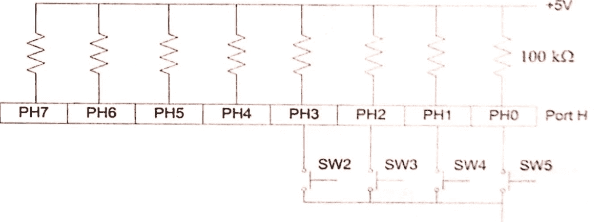

图 3.1 DRAGON12-Plus-USB 按钮到端口 H 的连接

在示例 8 中，我们将展示如何读取 DRAGON12-Plus-USB 板板上的 DIP 开关 SW1 以及四个按钮开关 SW2、SW3、SW4 和 SW5。我们将首先展示如何用 C 语言实现，然后提供新的 C 函数调用支持。

### 示例 8 – DRAGON12-Plus-USB 上的开关

图 3.2 DRAGON12-Plus-USB DIP 开关 SW1 到端口 H 的连接

+5V

100 kΩ

DRAGON12-Plus-USB 板板上的按钮和 DIP 开关连接到端口 H (PTH)，如图 3.1 和 3.2 所示。列表 3.1 中的程序将读取 PTH，使用位按非操作符 `~` 翻转（取反）每一位，并将结果写入红色 LED。如果 DIP 开关是开启的（处于向上位置）且你没有按下任何按钮，读取 PTH 将得到全 1 或 #FF。对该值进行取反将得到 00，所有 LED 都将熄灭。按下任何按钮都会使端口 H 的相应位接地，该位在取反后将变为 1 并点亮相应的 LED。因此，如果你运行列表 3.1 中的程序，四个按钮开关中的任何一个都会点亮相应的 LED。闭合任何 DIP 开关也会点亮相应的 LED。注意，必须通过将数据方向寄存器 DDRH 设置为 0x00 将端口 H 的所有位设置为输入。

要判断开关 SW2 是否被按下，我们必须读取 PTH 寄存器并测试其位 3 是 1（SW2 开启）还是 0（SW2 闭合）。我们可以通过将 PTH 值与掩码 00001000 (08) 进行与运算来实现。如果开关是开启的（未按下），则该与运算的结果将为 0x8。相反，如果开关闭合（已按下），则该与运算的结果将为 0x0。可以使用类似的掩码来测试按钮开关 SW3、SW4 和 SW5 的按下状态。

列表 3.2 中的 C 程序将在 SW2 被按下时在 7 段数码显示器 0 上显示 2；松开时，在 7 段数码显示器 1 上显示 3；SW3 被按下时，在 7 段数码显示器 2 上显示 4；SW4 被按下时，在 7 段数码显示器 3 上显示 5；SW5 被按下时，在数码显示器 3 上显示 5。

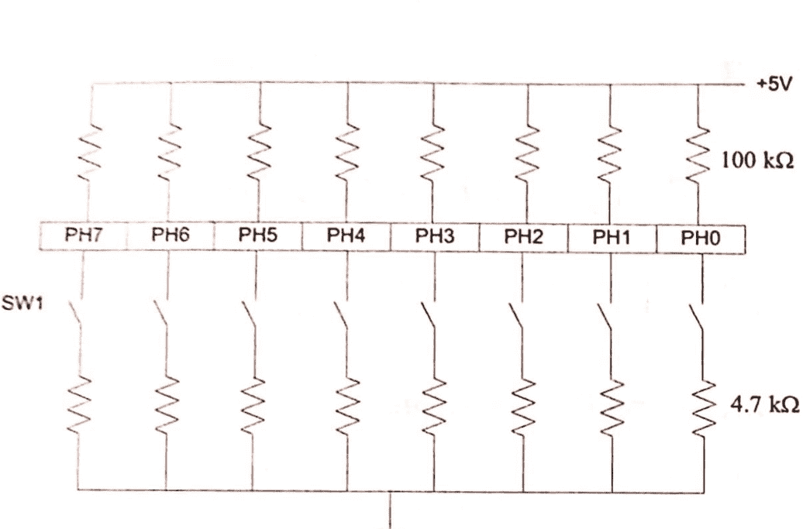

### 列表 3.1 示例 8a – DRAGON12-Plus-USB

```c
// Example 8a: Pushbutton Switches - DRAGON12-Plus-USB
#include <hidef.h> /* 通用定义和宏 */
#include <mc9s12dg256.h> /* 变体信息 */
#pragma LINK_INFO DERIVATIVE "mc9s12dg256b"

#include "main_asm.h" /* 与汇编模块的接口 */

void main(void) {
    PLL init(); // 设置系统时钟频率为24 MHz
    seg7_disable(); // 禁用 7 段显示
    led_enable(); // 启用 LED
    DDRH = 0x00; // 端口 H 输入
    while(1) {
        led_on(PTH);
    }
}
```

### 列表 3.2 示例 8b – DRAGON12-Plus-USB

```c
// Example 8b: Pushbutton Switches -> 7-segment displays
// - DRAGON12-Plus-USB
#include <hidef.h> /* 通用定义和宏 */
#include <mc9s12dg256.h> /* 变体信息 */
#pragma LINK_INFO DERIVATIVE "mc9s12dg256b"

#include "main_asm.h" /* 与汇编模块的接口 */

void main(void) {
    PLL init(); // 设置系统时钟频率为24 MHz
    seg7_enable(); // 启用 7 段显示
    led_disable(); // 禁用 LED
    DDRH = 0x00; // 端口 H 输入
    while(1) {
        while((PTH & 0x02) == 0) // 按下 SW5 时
            seg7dec(5,3); // 在数字 3 上显示 5
        seg7_off(); // 关闭所有 7 段显示
        while((PTH & 0x04) == 0) // 按下 SW4 时
            seg7dec(4,2); // 在数字 2 上显示 4
        seg7_off(); // 关闭所有 7 段显示
        while((PTH & 0x08) == 0) // 按下 SW3 时
            seg7dec(3,1); // 在数字 1 上显示 3
        seg7_off(); // 关闭所有 7 段显示
        while((PTH & 0x10) == 0) // 按下 SW2 时
            seg7dec(2,0); // 在数字 0 上显示 2
        seg7_off(); // 关闭所有 7 段显示
    }
}
```

注意表达式 `(PTH & 0x01) == 0` 在 PTH 的第 0 位为 0 时为，即 SW5 被按下。同样，表达式 `(PTH & 0x04) == 0` 在 PTH 的第 2 位为 0 时为，即 SW3 被按下。如果你将列表 3.2 中的程序下载到 DRAGON12-Plus-USB 板上，任何按钮开关都会点亮相应的 LED。闭合任何 DIP 开关也会点亮相应的 LED。注意列表 3.2 中 `==` 操作符的使用。

| 操作符 | 含义 |

| :--- | :--- |

| == | 测试相等 |

| != | 测试不等 |

与其记忆 DRAGON12-Plus-USB 连接了哪些位，我们编写了由 C 函数调用的汇编程序。

| 函数调用 | 描述 |

| :--- | :--- |

| Sw_enable() | 返回端口 H 位 |

| SW1_dip() | 返回 DIP 开关状态 |

| SW2_down() | SW2 按下时返回真 |

| SW3_down() | SW3 按下时返回真 |

| SW4_down() | SW4 按下时返回真 |

| SW5_down() | SW5 按下时返回真 |

### 列表 3.3 示例 8c – DRAGON12-Plus-USB

```c
// Example 8c: Pushbutton Switches -> 7-segment displays
// - DRAGON12-Plus-USB
#include <hidef.h> /* 通用定义和宏 */
#include <mc9s12dg256.h> /* 变体信息 */
#pragma LINK_INFO DERIVATIVE "mc9s12dg256b"

#include "main_asm.h" /* 与汇编模块的接口 */

void main(void) {
    PLL init(); // 设置系统时钟频率为24 MHz
    seg7_enable(); // 启用 7 段显示
    led_disable(); // 禁用 LED
    DDRH = 0x00; // 端口 H 输入
    while(1) {
        while((PTH & 0x02) == 0) // 按下 SW5 时
            seg7dec(5,3); // 在数字 3 上显示 5
        seg7_off(); // 关闭所有 7 段显示
        while((PTH & 0x04) == 0) // 按下 SW4 时
            seg7dec(4,2); // 在数字 2 上显示 4
        seg7_off(); // 关闭所有 7 段显示
        while((PTH & 0x08) == 0) // 按下 SW3 时
            seg7dec(3,1); // 在数字 1 上显示 3
        seg7_off(); // 关闭所有 7 段显示
        while((PTH & 0x10) == 0) // 按下 SW2 时
            seg7dec(2,0); // 在数字 0 上显示 2
        seg7_off(); // 关闭所有 7 段显示
    }
}
```

### 列表 3.3 示例 8a – DRAGON12-Plus-USB - 并行端口


```asm
#include <hidef.h> /* 通用定义和宏 */
#include <mc9s12dg256.h> /* 变体信息 */
#pragma LINK_INFO DERIVATIVE "mc9s12dg256b"

#include "main_asm.h" /* 与汇编模块的接口 */

void main(void) {
    PLL init(); // 设置系统时钟频率为24 MHz
    seg7_disable(); // 禁用 7 段显示
    led_enable(); // 启用 LED
    DDRH = 0x00; // 端口 H 输入
    while(1) {
        led_on(PTH);
    }
}
```

### 列表 3.4 示例 8b – DRAGON12-Plus-USB

```asm
// Example 8b: Pushbutton Switches -> 7-segment displays
// - DRAGON12-Plus-USB
#include <hidef.h> /* 通用定义和宏 */
#include <mc9s12dg256.h> /* 变体信息 */
#pragma LINK_INFO DERIVATIVE "mc9s12dg256b"

#include "main_asm.h" /* 与汇编模块的接口 */

void main(void) {
    PLL init(); // 设置系统时钟频率为24 MHz
    seg7_enable(); // 启用 7 段显示
    led_disable(); // 禁用 LED
    DDRH = 0x00; // 端口 H 输入
    while(1) {
        while((PTH & 0x02) == 0) // 按下 SW5 时
            seg7dec(5,3); // 在数字 3 上显示 5
        seg7_off(); // 关闭所有 7 段显示
        while((PTH & 0x04) == 0) // 按下 SW4 时
            seg7dec(4,2); // 在数字 2 上显示 4
        seg7_off(); // 关闭所有 7 段显示
        while((PTH & 0x08) == 0) // 按下 SW3 时
            seg7dec(3,1); // 在数字 1 上显示 3
        seg7_off(); // 关闭所有 7 段显示
        while((PTH & 0x10) == 0) // 按下 SW2 时
            seg7dec(2,0); // 在数字 0 上显示 2
        seg7_off(); // 关闭所有 7 段显示
    }
}
```

注意表达式 `(PTH & 0x01) == 0` 在 `PTH` 的第 0 位为 0 时为，即 `SW5` 被按下。同样，表达式 `(PTH & 0x04) == 0` 在 `PTH` 的第 2 位为 0 时为，即 `SW3` 被按下。如果你将列表 3.2 中的程序下载到 DRAGON12-Plus-USB 板上，任何按钮开关都会点亮相应的 LED。闭合任何 DIP 开关也会点亮相应的 LED。注意列表 3.2 中 `==` 操作符的使用。

| 操作符 | 含义 |
| :--- | :--- |
| == | 测试相等 |
| != | 测试不等 |

与其记忆 DRAGON12-Plus-USB 连接了哪些位，我们编写了由 C 函数调用的汇编程序。

| 函数调用 | 描述 |
| :--- | :--- |
| Sw_enable() | 返回端口 H 位 |
| SW1_dip() | 返回 DIP 开关状态 |
| SW2_down() | SW2 按下时返回真 |
| SW3_down() | SW3 按下时返回真 |
| SW4_down() | SW4 按下时返回真 |
| SW5_down() | SW5 按下时返回真 |

汇编程序中的第一个子程序 `Sw_enable` 将清除端口 H 数据寄存器的所有位。子程序 `SW1_dip` 通过将 `PTH` 的内容返回到寄存器 D 来读取 DIP 开关状态。列表 3.4 中的子程序 `SW2_down` 在 `SW2` 被按下或开关闭合时返回真值（SFFF）。前两个指令将清除寄存器 D，使其变为假（0000）。下一条指令是

```asm
brset PTH, #008,SW2end1
```

这条置位跳转指令会将 `PTH` 位的取反与掩码 `$08 = 00001000` 进行与运算，如果结果为零，则跳转到 `SW2end1`。也就是说，如果原始 `PTH` 的第 3 位为 1，意味着按钮 `SW2` 开启且未被按下，程序

# 第 3 章

跳转到 `SW2end1`，这是一条返回值 `$0000 (假)` 的 `rts` 指令。相反，如果按下了 `SW2`，则 `PTH` 的第 3 位将为 0，累加器为 D。将 `PTH` 中位位的补码与掩码 `$08 = 00001000` 进行 AND 运算，结果将不为零，此时不会跳转，并将执行下一条指令 `ldd #FFFF`。该指令将在返回到调用程序之前，将值 `$FFFF (真)` 加载到累加器 D 中。

列表 3.4 中的子程序 `SW2_up` 在按钮 `SW2` 未被按下时（即开关处于开合状态），将在累加器 D 中返回一个真值 (`$FFFF`)。该子程序与 `SW2_down` 子程序非常相似，区别是将 `brset` 替换为按清除跳转指令（branch on clear）。

正如你预期的那样，该指令将 `PTH` 中的中的位与掩码 `$08 =00001000` 进行 AND 运算，如果结果为零，则跳转到 `SW2end1`。也就是说，如果 `PTH` 的第 3 位为 0，意味着按钮 `SW2` 已关闭并按下，则程序跳转到 `SW2end1`，这是一条在累加器 D 中返回值 `$0000 (假)` 的 `rts` 指令。相反，如果按下 `SW2`，则执行 `brclr` 指令后的指令，向调用程序返回累加器 D 中的值 `$FFFF (真)`。

列表 3.4 中剩余的子程序工作方式与 `SW2_down` 和 `SW2_up` 子程序完全相同，在于 `brset` 和 `brclr` 指令中使用的掩码不同，分别对应 `PTH` 的第 2、1 和 0 位。

| 列表 3.4 来自 main.asm 的 SW1-5 汇编语言子程序 |
| 按钮和 DIP 开关 |
| :--- | :--- |
| SW_enable: |  |
| cl DDRH ;端口 M 输入 |  |
| rte |  |
| SW1_dip: |  |
| clra ;读取端口 H |  |
| ldah PTH |  |
| rte |  |
| SW2_down: |  |
| ;;当 SW2 按下时返回真 |  |
| clra |  |
| clrb |  |
| brset PTH, $08,SW2end1 |  |
| idl #FFFF |  |
| SW2end1: |  |
| rte |  |
| SW2_up: |  |
| ;;当 SW2 为高位时返回真 |  |
| clra |  |
| clrb |  |
| brclr PTH, $08,SW2end2 |  |
| idl #FFFF |  |
| SW2end2: |  |
| rte |  |

### 列表 3.4 (续) 来自 main.asm 的 SW1-5 汇编语言子程序

| SW3_down: | ;当 SW3 按下时返回真 | SW3_up: | ;当 SW3 为高位时返回真 |
| :--- | :--- | :--- | :--- |
| clra | | clra | |
| clrb | | clrb | |
| brset PTH, #04,SW2end1 | | brclr PTH, #04,SW2end2 | |
| ldd #FFFF | | ldd #FFFF | |
| SW3end1: | | SW3end2: | |
| SW4_down: | ;当 SW4 按下时返回真 | SW4_up: | ;当 SW4 为高位时返回真 |
| clra | | clra | |
| clrb | | clrb | |
| brset PTH, #02,SW4end1 | | brclr PTH, #02,SW4end2 | |
| ldd #FFFF | | ldd #FFFF | |
| SW4end1: | | SW4end2: | |
| SW5_down: | ;当 SW5 按下时返回真 | SW5_up: | ;当 SW5 为高位时返回真 |
| clra | | clra | |
| clrb | | clrb | |
| brset PTH, #01,SW5end1 | | brclr PTH, #01,SW5end2 | |
| ldd #FFFF | | ldd #FFFF | |
| SW5end1: | | SW5end2: | |

### 3.2 十六进制键盘

DRAGON12-USB 内置了一个 4×4 十六进制键键盘，如图 3.3 所示连接到微控制器的端口 A。请注意 `PA0–PA3` 被配置为输出，`PA4–PA7` 配置为输入。这四个输入通过四个内部上拉电阻上拉至 5 伏特。语句 `PUCR = 01` 将启用上拉电阻。因此，如果所有开关都开启，则其中一个零被写入 `PA0–PA3` 的输入之一（图 3.3 中的一列），那么该列中被按下的按键将导致连接到其行的输入变低。这可以被读取为 1。然后由 MCU 确定按下了哪一个按键。

例如，在图 3.3 中，假设 `PA1` 被拉低，而 `PA0`、`PA2` 和 `PA3` 为高电平。也就是说，1101（或 0xD）被写入端口 A 的低位字节（低 4 位）。如果读取端口 A 且高位字节 `PA4–PA7` 不是 0xF，则按下按键 2、5、8 或 0。如果 `PA4` 为低（即端口 A 读取 0ED），则按下按键 2。如果 `PA5` 为低（即端口 A 读取 0DD），则按下按键 5。如果 `PA6` 为低（即端口 A 读取 0BD），则按下按键 7。如果 `PA7` 为低（即端口 A 读取 07D），则按下按键 0。我们可以以类似的方法确定所有 16 个键的键码，并存储在表 3.3 所示的 `keycodes` 中。


图 3.3 将 DRAGON12-USB 的 4x4 键盘连接到端口 A

表 3.3 4x4 十六进制键盘的键码

| 键 | 0 | 1 | 2 | 3 | 4 | 5 | 6 | 7 | 8 | 9 | A | B | C | D | E |
| :--- | :--- | :--- | :--- | :--- | :--- | :--- | :--- | :--- | :--- | :--- | :--- | :--- | :--- | :--- | :--- |
| 码 | 7D | EE | DD | BE | BD | D7 | 7E | 7B |

### 示例 9 - C 语言十六进制键盘

列表 3.5 中的函数 `key_scan()` 读取 `keycodes` 中的 16 个码，将其存储在 `PORTA` 中，然后读取 `PORTA` 内容。当返回值等于键码时，就找到了值。注意，如果没有按下键，`key_scan()` 返回 16。`keycodes[]` 数组来自表 3.3。列表 3.6 中的 C 函数 `key_get` 等键被按下并返回键的十六进制值。注意，这个 C do-while 循环只要 `key_scan()` 返回 16 就会继续循环。

一旦使用 `key_get()` 获取了键盘值，通常希望在液晶屏（LCD）上显示十六进制值，这将在第 4 章描述。如果你想在当前位置显示第一个按下键的值，然后在下一个位置显示当前键的值，可能会遇到问题。在显示第一个值后，如果你的手指仍按着键，程序将在 LCD 上的下一个位置显示该值！你需要在按下另一个键之前释放手指。列表 3.6 中的 C 函数 `wait_for_key()` 将实现这一点。列表 3.7 显示的 C 程序 `main()` 将把你按下的任何键显示在 DRAGON12-Plus-USB 的右侧七段显示器上。

### 列表 3.5 C 函数 key_scan()

```c
int scan(void) {
const char keycodes[] = {
    0x7D, 0xEE, 0xED, 0xEB,
    0xDE, 0xDD, 0xDB, 0xBB,
    0xBD, 0xB0, 0xE7, 0xD7,
    0xB7, 0x77, 0x7E, 0x7B
};
int i,j; key;
char readback;
int found;
i = 0;
key = 16; // 未按下键时返回 16
found = 0;
while((i < 16) && (found == 0)) { // 将操作码写入 PORTA
    PORTA = keycodes[i];
    for(j=0; j<10; j++) { // 等待一会儿
        readback = PORTA;
        if(readback == keycodes[i]) { // 读取 PORTA，如果相同
            key = i; // 获取键号
            found = 1; // 并退出循环
        }
    }
    i++; // 否则检查下一个键
}
return key;
}
```

### 列表 3.6 C 函数 get_key() and wait_for_keyup()

```c
int get_key(void) {
    int key;
    do {
        key = key_scan();
    }
    while(key == 16);
    return key;
}
void wait_for_keyup(void) {
    while(key_scan() != 16) {
    }
}
```

### 列表 3.7 示例 9 - DRAGON12-Plus-USB

```c
// 示例 9: C 语言 4x4 键盘 - DRAGON12-USB
#include <hide.h>    /* 普通定义和宏 */
#include <mc9s1ld25g.h> /* 变体信息 */
#pragma LINK_INFO DERIVATIVE "mc9s12dg256b"

#include "main.asm"     /* 汇编模块的接口 */

int key_scan(void);
int get_key(void);
void wait_for_keyup(void);

void main(void) {
    int c;
    PLL_init();             /* 设置系统时钟频率为 24 MHz */
    seg7_enable();          /* 启用七段显示 */
    led_disable();          /* 禁用 LED */
    DDRA = 0xEF;            /* 端口 A：A7:A4 输入，A3:A0 输出 */
    PUCR = 0x01;            /* 启用上拉电阻 */
    while(1) {
        c = get_key();
        seg7_dec(c,3);
        wait_for_keyup();
    }
}
```

### 示例 10 - 键盘 C 函数调用

有时组成键盘的开关在按下时会有抖动的倾向。也就是说，当接触接触时，它可能会短暂断开然后再关闭。这可能导致认为键是开开的（因此继续程序），而实际上并没有。在这种情况下，一个数字可能会意外显示两次。为了解决这个问题，需要键去抖。软件解决方案是在感知到按键后延迟 10 毫秒。如果再次读取键且与之前的值相同，你就可以判断它已停止抖动并读取到了正确的值。

我们编写了读取 4x4 键盘的汇编语言程序，示例 8 中提到的 `SW2` 到 `SW5` 也包含了去抖延迟。调用这些例程序的 C 函数如表 3.4 所示。`keypad_enable()` 程序将正确设置数据方向寄存器并启用端口 A 上拉电阻。使用这些程序在 DRAGON12-Plus-USB 的右侧七段显示器上显示按下的键值的示例在列表 3.8 所示。

### 并行端口 - 输入

表 3.4 读取 4 x 4 键盘的 C 函数

| C 函数调用 | 含义 |
|---|---|
| keypadable(); | 启用键盘 |
| int getkey(); | 等待按键按下并返回值 |
| void wait_keyup(); | 等待按键释放 |
| int keyscan(); | 如果没有按键按下则返回 16，如果按键按下则返回按键值 |

- 列表 3.8 示例 10 - DRAGON12-Plus-USB
- // 示例 10：使用 C 函数调用的 4 x 4 键盘
- // DRAGON12-Plus-USB
- // #include <hide.h> /* 通用定义和宏 */
- // #include <mc9s12dg25.h> /* 衍生信息 */
- // #pragma LINK_INFO DERIVATIVE "mc9s12dg25b"

```c
void main(void) {
    char c;
    PLI_init(); // 将系统时钟频率设置为 24 MHz
    led_disable(); // 禁用 LED
    seg7_enable(); // 启用七段显示器
    keypad_enable(); // 启用键盘
    while (1) {
        c = getkey();
        seg7_dec(c,3);
        wait_keyup();
    }
}
```

### 内部原理


列表 3.9 的汇编语言程序。子程序 `keypad_enable` 中的第一条指令将十六进制值 `$0F` 存储在方向寄存器 A 中。这将使 PA7 – PA4 设置为输入，PA3 – PA0 设置为输出，如图 3.3 所示。图 3.4 中的上拉控制寄存器（PUCR）用于在端口 A、B、E 和 K 上配置为输入的引脚上启用内部上拉电阻。为了在端口 A 的输入 PA7 – PA4 上启用上拉电阻，我们需要向 PUCR 的第 0 位写入 1。我们可以通过以下指令实现：

`bset PUCR, $01`

列表 3.9 中的子程序 `keyscan` 是列表 3.5 中 C 函数 `key_scan()` 的汇编版本，它将扫描 4x4 键盘上的所有 16 个按键。如果没有按键按下，累加器 D 中保留值 16 (`$10`)，并作为表 3.6 中 C 函数 `keyscan()` 的返回值返回。如果按键按下，则累加器 D 中返回的值将被按下按键的十六进制值。

# 第 3 章

上拉控制寄存器 (PUCR) = `0x00C`

| 5 | 4 | 3 | 2 | 1 | 0 |
|---|---|---|---|---|---|

| PUPKE | 0 | 0 | PUPEE | 0 | 0 | PUPAE | PUCR |

- PUPKE — 端口 K 上拉：1 = 启用上拉电阻；0 = 禁用上拉电阻 |
- PUPEE — 端口 E 上拉：1 = 启用上拉电阻；0 = 禁用上拉电阻 |
- PUPEE — 端口 B 上拉：1 = 启用上拉电阻；0 = 禁用上拉电阻 |
- PUPAE — 端口 A 上拉：1 = 启用上拉电阻；0 = 禁用上拉电阻 |

图 3.4 上拉控制寄存器 (PUCR)

### 列表 3.9 main.asm 中的键盘汇编语言子程序

```assembly
; 启用键盘：
keypad_enable:
  movb      #0F,DDRA     ;A7:A4 输入，A3:A0 输出
  bset      PUCR, $01      ;启用上拉电阻
  rts

  ; 扫描所有按键；   B = 按下的键
  if B = #$10, 无按键按下
keyscan:
  clb               ;B = 索引
  ldx       #keycodes
  b,x;
  ldaa      PORTA
  staa      ;写入下一个代码
  anda      $F0        ;保存高位字节
  staa      temp        ;等待字节稳定
  ldaa      #10
  deca      deca
  bne       ks2            ;读回值
  ldaa      PORTA
  anda      #F0        ;检查高位字节
  cmpa      #10          ;如果按键按下
  beq      ks3            ;B = 键
  incb              ;否则，索引
  cmpb      #10          ;并扫描按键
  bne       ks1            ;如果按键按下
ks3:
  clra              ;B = #10
  rts

  ; 等待按键
  B = 键值
keypad:
  bsr       keyscan      ;扫描键盘
  cmpb      #10
  beq      keypad        ;直到按键按下
  rts
```

### 列表 3.9（续）main.asm 中的键盘汇编语言子程序

```assembly
; 去抖动按键输入
; B = 键值
getkey:
    bsr      keypad      ;等待按键
    psbh                  ;保存键值
    ldd      #10         ;延迟
    jsr      ms_delay    ;等待按键
    bsr      keypad      ;获取第一个值
    pla                  ;如果与第二个不相同
    sba                   ;重复
    bne      getkey        ;D = 键值
    rts

; 等待释放按键（带去抖）
wait_keyup:
    bsr      keyscan     ;扫描键盘
    cmpb     b           ;当按键按下
    ldd      #10         ;延迟
    jsr      ms_keyup    ;扫描键盘
    bsr      keyscan     ;如果按键按下
    cmpb     #10         ;重复
    bne      wait_keyup
    rts
```

列表 3.9 中子程序 `keyscan` 的下一条指令是 `lea,x`。这将由 B 形成的地址加载到累加器 A 中。这将 `keycodes` 表中的第一个字节。按键码存储在 PORTA 中，高四位保存在变量 `temp` 中。该变量在 main.asm 的开头定义为 `temp: rmb 1`，`rmb` 意味着预留，并在内存中预留一个字节来存储 `temp`。你可以使用 `rmb` 预留任意数量的字节。例如 `buff: rmb 12` 将定义一个包含 12 个字节的缓冲区，`buff` 是缓冲区中第一个字节的地址。列表 3.9 中的 `ks2` 循环是 40 个时钟周期的短延迟，在读取 PORTA 内容之前。该值与 `#F0` 进行与与运算，并与变量 `temp` 中的键码进行比较。如果从 PA7–PA4 读取的值等于 `temp` 中的值，程序跳转到 `ks3`，清除累加器 A 并包含按下键的十六进制值。相反，如果从 PA7–PA4 读取的值不等于 `temp`，则 B 的值加1，如果不等于 16 (`$10`)，程序返回 `ks1` 测试下一个键码。列表 3.9 中的 `keypad` 子程序不断调用 `keyscan` 直到 B 的值不是 16 (`$10`)，直到按键释放。列表 3.9 中的 `getkey` 子程序是列表 3.6 中 C 函数 `get_key()` 的汇编版本，我们通过添加 10 ms 延迟对按键进行了去抖。我们首先调用 `keypad` 等待按键按下。延迟 10 ms 后，我们再次调用 `keypad`。然后通过将 B 推入栈来保存值。如果按键停止抖动，B 中的值应与推入栈的第一个值相同。我们通过将第一个值取出 A 并从 A 中减去 B 来比较这两个值。如果结果为零，我们对 B 中的键值完成了去抖并退出子程序。如果值不相等，我们返回直到它们相等。最后，列表 3.9 中的 `wait` 子程序是列表 3.6 中 C 函数 `wait_keyup()` 的去抖汇编版本。该子程序不断调用 `keyscan` 直到 B 的值为 16 (`$10`)，直到释放键。延迟 10 ms 后，子程序检查键是否仍然释放。

### 问题

3.1 修改列表 3.1，使 DRAGON12-Plus-USB 上的 DIP 开打开七段显示器的相应段。提示：在列表 3.1 中启用七段显示器并禁用 LED。

3.2 写一个程序，当按下 DRAGON12-Plus-USB 上的按钮 SW5 时，切换七段显示器数字 3 上 5 的开启状态。也就是说，第一次按下按钮时，七段显示器上显示 5 并在释放按钮时保持显示。第二次按下按钮时，显示器关闭。第三次按下按钮时，显示 5。

# 第 4 章

# 液晶晶显示器

在本章中，我们将展示如何向 DRAGON12-Plus-USB 板上的液晶晶显示器 (LCD) 写入字符。我们将提供新的 C 函数调用来实现这一操作。

# 4.1 液晶晶显示器

液晶晶显示器 (LCD) 是一种用于手表、计算器和笔记本电脑等各种应用的常见显示器。它的巨大优势是比 LED 节能得多，因此可以用于电池供电的应用。LCD 由夹在两个导电板之间的液体材料组成。在两个导体之间施加交流电压会导致液晶的反射率（或透射率）改变，使字符可见。LCD 显示器有多种配置。

例如，洋洋 DM1623 显示 2 行 16 个字符。这种显示器和许多显示器使用内置的 Hitachi HD4470 LCD 控制器，它可以执行驱动 LCD 所需的所有功能，并使用 8 位数据线 DB0-DB7 以及三个控制信号 RS、R/W 和 E 为微控制器提供简便接口。也可以通过 4 位数据线与 Hitachi HD4470 LCD 控制器通信。这就是 DRAGON12-Plus-USB 的功能。RS、R/W 和 E 之间的关系如图 4.1 所示。

| RS | R/W | E | 操作 |
|--- |--- |--- |--- |
| 0 | 0 | | 写入指令码 |
| 0 | 1 | | 读取忙位和地址计数器 |
| 1 | 0 | | 写入数据 |
| 1 | 1 | | 读取数据 |

图 4.1 RS、R/W 和 E 之间的关系

# 第 4 章

信号 RS 可以被认为用于选择 LCD 控制寄存器（RS = 0）或 LCD 数据寄存器（RS = 1）的寄存器信号。读/写信号 R/W 读操作时为 1，写操作为 0。数据或指令代码在 E 的下降沿写入，而读操作时 E 必须为高电。

HD4780 在表 4.1 中有其自身的指令集（如需完整数据手册请访问 http://www.hitachi.com/）。前八条是指令代码，当 RS = 0 且 R/W = 0 时写入 LCD 控制寄存器，如图 4.1 所示。表 4.1 中的最后两条显示了当 RS = 0 且 R/W = 1 时从 LCD 控制寄存器读取时，忙标志位（busy-flag）和地址器的行为，如图 4.1 所示。

| 指令 | DB7 | DB6 | DB5 | DB4 | DB3 | DB2 | DB1 | DB0 | 描述 |
|---|---|---|---|---|---|---|---|---|---|
| 清除显示 | 0 | 0 | 0 | 0 | 0 | 0 | 0 | | 清除显示并将光标返回起始位置。在输入模式下设置 I/D=1。 |
| 回主 | 0 | 0 | 0 | 0 | 0 | 0 | 0 | 1 | 将光标返回起始位置（地址 0）。在输入模式下设置 I/D=0。 |
| 入口模式 | 0 | 0 | 0 | 0 | 0 | 0 | 1 | I/D | I/D=1: 计数器增; S=正常; I/D=0: 计数减; S=移位 |
| 显示开启/关闭控制 | 0 | 0 | 0 | 0 | 0 | | C | B | 设置显示(D)、光标(C) 和光标闪烁(B)的开启/关闭。 |
| 光标或移位 | 0 | 0 | 0 | | 1 | S/C | R/L | X | S/C=1: 移位显示; S/C=0: 移动光标; R/L=1: 向左移; R/L=0: 向右移; DL=8; DL=0; DL=4; N=2; N=1; F=1; F=5; F=0x5 移位; F=0x7 移位。 |
| 功能设置 | 0 | 0 | 1 | DL | N | F | X | 设置功能集。不影响 CG RAM。 |
| 设置 CG 地址 | | 1 | | CG 地址 | | | | |
| 设置 DD RAM 地址 | | | DD RAM 地址 | | | | | | 在发送并接收 DD RAM 数据后设置 DD RAM 地址。 |
| 读取忙标志/BF 地址 | | | | 地址计数 | | | | | 读取忙标志 (BF) 和地址器内容。 |

HD4780 包含一个 128 字节的数据内存（DD RAM），其中包含显示在 LCD 上的 ASCII 字符。该 DD RAM 使用“设置 DD RAM 地址”指令进行设置（地址 0 为显示位置）。完成后，后续的数据写入会将待显示字符的 ASCII 代码写入 DD RAM 地址（然后递增 DD RAM 地址以便下一个字符显示在下一个位置）。

HD4780 还包含一个 64 字节的字符发生器内存（CG RAM），用于更改 16 个不同字符的字体。如果你对此感兴趣，可以查阅 HD4780 数据手册。

HD4780 上的数据线 DB0-DB7 可以直接连接到微控制器的数据线，控制器可以连接以读写一系列地址。HD4780 也可以连接到微控制器的并行 I/O 端口，可以使用软件产生图 4.1 所示的控制信号。这是 DRAGON12-USB 板所采用的方法。

图 4.2 显示了 DRAGON12-USB 板上的 LCD 控制器如何连接到 MC68HC912DG256 的端口 K。注意，只有 LCD 控制器数据总线的高 4 位连接到 PTK[5:2]，而使能信号 E 连接到 PK1，寄存器选择信号 RS 连接到 PK0。读/写线通过 DRAGON12-USB 板上的插头 J5 连接到 PK7。该 J5 插头也可以将读/写线连接，以提供 LCD 显示的仅写操作。在这种情况下，你将无法读取忙标志。这并不是劣势，因为读取此标志通常是有问题的，另一种替代方案是在写入 LCD 后简单地等待。这就是我们要做做的。

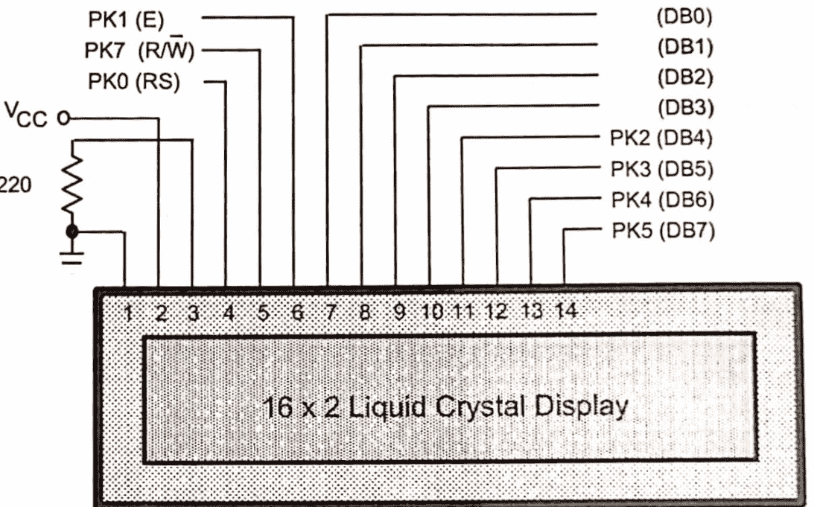

图 4.2 在 DRAGON12-Plus-USB 板上连接液晶显示器

在向 LCD 写入之前，你必须对其进行初始化。我们提供了 C 函数调用 `LCD_init()` 来实现此。该函数将其初始化为 4 位、2 行、5 x 7 点操作、显示开启、光标关闭、不闪烁，然后清除显示并将光标设置到起始位（home）。你可以通过调用内置 C 函数 `set_lcd_addr(char ad)` 将光标设置在显示器的任意位置，其中 `ad` 是 8 位十六进制地址，位置如图 4.3 所示。注意第一行结束和第二行开始之间有一个间隙。

| 00 | 01 | 02 | 03 | 04 | 05 | 06 | 07 | 08 | 09 | 0A | 0B | 0C | 0D |
|---|---|---|---|---|---|---|---|---|---|---|---|---|---|
| 40 | 41 | 42 | 43 | 44 | 45 | 46 | 47 | 48 | 49 | 4A | 4B | 4C | 4D |

图 4.3 十进制显示的十六进制地址

### 示例 11 – 在 LCD 上写入消息

我们提供的 C 函数调用列表见表 4.2。Listing 1 显示了如何在 LCD 的每行显示消息。尝试一下。Listing 1 中的语句 `char q1;` 定义 `q1` 为指针（即地址），类型为 `char`（即字节）。语句 `q1 = "Microcontrollers";` 给 `q1` 的值为字符串 "Microcontrollers" 中的第一个字符。C 函数 `lcd_init()` 将初始化 LCD。在使用 LCD 之前必须调用此函数。语句 `set_lcd_addr(0x00)` 将光标移动到 LCD 的第一行，如图 4.3 所示。函数 `type_lcd(q1)` 然后将整个字符串 `q1` 写入 LCD。

| 函数 | 描述 |
|---|---|
| void lcd_init(void); | 初始化 LCD（清除显示） |
| void set_lcd_addr(char); | 设置光标地址（见图 4.3） |
| void data8(char); | 在光标处写入 ASCII 字符 |
| void instr8(char); | 写入指令到显示（见表 4.2） |
| void clear_lcd(void); | 清除 LCD |
| void hex2lcd(char); | 将十六进制数字 (0– F) 写入 LCD |
| char hexasc(char); | 将十六进制数字 (0– F) 转换为 ASCII 代码 |
| void type_lcd(char*); | 在光标处显示显示 ASCII 字符串 |

```c
// 示例 11: LCD 显示
#include <condef.h> /* 通用定义和宏 */
#include <mc9s12dg256.h> /* 衍生信息 */
#include "mc9s12dg256b" /* 汇编模块 */

void main(void) {
    char q1;
    char q2;
    q1 = "Microcontrollers";
    q2 = "are FUN";
    PLL_init();                  // 设置频率为 24 MHz

    lcd_init();                  // 启用 lcd
    set_lcd_addr(0x00);
    type_lcd(q1);               // 写入 q1
    set_lcd_addr(0x44);
    type_lcd(q2);               // 写入 q2
    for(;;)                     // 无限等待
}
```

表 4.2 中的函数 `data8(char)` 将显示作为参数的字符 ASCII 代码。所有字符的 ASCII 代码见表 4.3。在此表中，ASCII 代码由列标题给出，行号给出。例如，小写 A 的十六进制 ASCII 代码是 0x41，小写 k 的 ASCII 代码是 0x6B。然后，函数调用 `data8(0x41)` 将当前光标位置显示一个大写 A。调用此函数时，光标会自动递增。

表 4.2 中的函数 `hex2lcd(char c)` 将十六进制数字作为参数显示在 LCD 上。`hex2lcd(0xA)` 通过内置函数 `hexasc(char c)` 将 0xA 转换为 ASCII 代码 0x41，然后在 LCD 上显示 A。调用此函数时，光标会自动递增。

### 表 4.3 标准 ASCII 代码

| | | 0 | 16 | 32 | 48 | 64 | 80 | 96 | 112 |
|---|---|---|---|---|---|---|---|---|---|
| | | Hex | 0 | 1 | 2 | 3 | 4 | 5 | 6 | 7 |


| 0 | NUL | DLE | Blank | | | @ | P | | p |

| 1 | SOH | DC1 | | | | | A | a | q |

| 2 | STX | DC2 | | | | B | b | r |

| 3 | ETH | DC3 | | | # | C | S | s |

| 4 | EOT | DC4 | | | | D | T | | |

| 5 | ENQ | NAK | | | | E | U | | |

| 6 | ACK | SYN | | | | F | v | | |

| 7 | | | | | | | | | |

| 8 | | | | | | | | | |

| 9 | HT | EM | | | | | | | |

| 10 | A | LF | | | | | | | |

| 11 | B | VT | | | | | | | |

| 12 | C | GS | | | | | | | |

| 13 | D | CR | | | | | | | |

| 14 | E | RS | | | | | | | |

| 15 | F | SI | | | | | | | |

### 内部原理

表 4.2 中八个 LCD 函数的汇编程序见 Listing 4.2。要初始化 4 位模式，必须向 LCD 写入表 4.1 中的 12 条指令。这种特殊的序列可以在 HD4780 数据手册中找到。这两个 4 位指令代码列在 Listing 4.2 的 `*init_codes*` 表中，作为每个字节的高字节位。注意我们使用汇编指令 `*.db*`（形成常量字节）来定义表的内容。表中的第一个字节是后续指令的数量（12）。Listing 4.2 中的 `init` 子程序将这两条指令写入 LCD。

在 Listing 4.2 的 `init` 子程序中，`ldx` 指令将 `*init_codes*` 的地址加载到索引寄存器 `X`。`lab l,x+` 指令通过指向 X 并将 X 增 1 来加载 B（12 = $0）。索引寄存器 X 现在指向表中第一个 LCD 指令，即 $30。`ldaa l,x+` 指令将值加载到累加器 `A` 并再次递增 X 以指向下一个

# 第 4 章

根据表格执行。指令 `write_instr_nibble` 跳转到子程序 `write_instr_nibble`，该子程序将 4 位半字节右移 2 位，使其最终如图 4.2 所示位于 PK5 - PK2。`write_instr_nibble` 子程序将 E (PK1) 拉高，并在短时间延迟后将 RS (PK0) 置为零。这满足了图 4.1 中的指令写入条件。

LCD（第 4.2 节）中的子程序 `init_lcd` 遍历整个 `init_codes` 表，将每个指令写入 LCD，并在每次写入之间产生 5 ms 的延迟。虽然这个延迟比某些指令所需的长时间，但它将满足最坏情况条件，通过使用简单的循环使编程变得更容易。

### 列表 4.2 来自 main.asm 的 LCD 汇编子程序

```assembly
; 初始化 LCD
lcd_init:
aa       #0FF
staa      DDRK            ; port K = 输出
ldx       #init_codes ; 指向 init_codes.
pshb                     ; 码的数量
ldab      1,x            ; 输出指令命令
ldaa                     ; 获取下一个码
jsr      write_instr_nibble ; 启动写入脉冲
pshd
ldb       #5             ; 延迟 5 ms
jsr      ms_delay         ; 在重置序列中
puld
decb      1cd1           ; 为了简化编码
bne
pulp
rts
```

; 4 位模式的初始化代码

; 仅使用高半字节数据

```assembly
init_codes:
fcb      12             ; 高半字节数量
fcb      $30             ; 第1次重置代码，必须延迟 4.1ms
fcb      $30             ; 第2次重置代码，必须延迟 100us
               随后的 10 个半字节，每次写入后延迟 40us
fcb      $30             ; 第3次重置代码，
fcb      $40             ; 第4次重置代码，
fcb      $20             ; 4 位模式，2 行，5X7 输出
fcb      $80             ; 4 位模式，2 行，5X7 输出
fcb      $00             ; 光标索引，禁用显示移动
fcb      $60             ; 光标光入，禁用显示移动
fcb      $00             ; 显示开启，光标关闭，无闪烁
fcb      $00             ; 显示开启，光标关闭，无闪烁
fcb      $00             ; 清除显示，将光标置于首页
fcb      $10             ; 清除显示，将光标置于首页
```

; 写入指令高半字节

```assembly
write_instr_nibble:
anda      #5F0
lsra
lsra                     ; 半字节进入 PK2-PK5
oraa      #02             ; E = 1 在 PK1; RS = 0 在 PK0
```

### 列表 4.2 (续) 来自 main.asm 的 LCD 汇编语言子程序

```assembly
win staa PORTK
ldy #10
dey
win win
bne PORTK ; E = 0 在 PK1; RS = 0 在 PK0
anda #SFC
staa PORTK
rts
; 写入数据高半字节
write_data_nibble:
anda #SF0
lsra
lsra ; 半字节进入 PK2-PK5
oraa #S03 ; E = 1 在 PK1; RS = 1 在 PK0
staa PORTK
ldy #10
wdn wdn
dey
bne
anda #FD ; E = 0 在 PK1; RS = 1 在 PK0
staa PORTK
rts
; 写入指令字节
write_instr_nibble:
psha
jsr write_instr_nibble
pula
asla
asla
asla
asla
jsr write_instr_nibble
rts
; 写入数据字节
write_data_byte:
psha
jsr write_data_nibble
pula
asla
asla
asla
asla
asla
jsr write_data_nibble
jsr write_data_nibble
rts
; 将指令 B 写入 LCD
instr8:
tba
jsr write_instr_byte
ldd #10
jsr ms_delay
rts
```

### 列表 4.2 (续) 来自 main.asm 的 LCD 汇编语言子程序

```assembly
: 将数据字节 B 写入 LCD
data8:
    tba
    jsr write_data_byte
    ldd #10
    jsr ms_delay
    rts

; 设置地址到 B
set_lcd_addr:
    orab $80
    tba
    jsr write_instr_byte
    ldd #10
    jsr ms_delay
    rts

; 清除 LCD
clear_lcd:
    ldaa $01
    jsr write_instr_byte
    ldd #10
    jsr ms_delay
    rts

; 在 LCD 中显示十六进制值 B
hex2xlcd:
    bsr hex2asc     ;转换为 ascii
    jsr data8       ;显示它
    rts

; 十进制转 ascii 子程序
; 输入: B = 十六进制值
; 输出: B = 输入低半字节的 ascii 值
hex2asc:
    andb $50       ; 掩码高半字节
    cmpb $59        ;如果 B > 9
    bls hal
    addb $37        ;加 7
    rts             ;否则
hal:
    addb $30        ;加 30
    rts

; 在 LCD 上显示 ascii 字符串
; D -> ascii 字符串
type_lcd:
    psxh D          ;保存 X
    tfr D,X         ;X ->
    ldaa 1,+        ;获取下一个字符
    beq done        ;为空
    jsr write_data_byte ;显示它
    ldd #10
    jsr ms_delay
    bra next_char   ;重复
done:
    pulx            ;恢复 X
    rts
```

## 液晶显示

列表4.2 中的 `write_data_nibble` 子程序与 `write_instr_nibble` 区别在于 RS (PK0) 的值为 1。这满足了图 4.1 中的数据条件。`write_instr_byte` 和 `write_data_byte` 子程序通过调用 `write_instr_nibble` 和 `write_data_nibble` 将指令字节和数据字节写入 LCD，首先写入字节并将半字节移至高位。

当执行表 4.2 中的 `instr8(char b)` 时，在寄存器 A 中传递数据字节，列表 4.2 中的 `instr8` 子程序随之执行。`write_instr_byte` 子程序中的第一条指令后跟着一个 10us 的延迟。这个延迟是为了让 LCD 完成其操作。表 4.2 中的 `data(char b)` 函数以类似的方式通过调用 `write_data_byte` 子程序工作。

当执行表 4.2 中的 `set_lcd_addr(char add)` 时，在寄存器 B 中传递地址。`set_lcd_addr` 子程序将此值与 $80 进行或运算，这设置了图 4.1 中的 D7，DD RAM 地址。同样，表 4.2 中的 `clear_lcd()` 函数执行列表 4.2 中的 `clear_lcd` 子程序。该子程序向 LCD 写入 $01，这是图 4.1 中的清除指令。

表 4.2 中的 `hex2lcd(char c)` 函数将在 LCD 上显示寄存器 B 中的十六进制数字。列表4.2 中的 `hex2lcd` 子程序通过执行 `hex2asc` 子程序来实现。将十六进制数字（0–F）转换为相应 ASCII 代码（$30–39，$A1–A6）的算法是：如果十六进制数字大于 9，则加 $7，否则加 $30。

最后，当执行表 4.2 中的 `type_lcd(char q)` 时，在寄存器 D 中传递要显示的字符串 q 到 `type_lcd` 子程序。将此地址传输到索引寄存器 X 后，通过 `write_data_byte` 子程序将字符串中的每个字符写入 LCD。该字符串是 ASCIIZ，这意味着字符串最后一个字节包含 0。这用于指示停止在 LCD 上显示字符。使用 `lda 1,+X` 指令通过后增模式遍历字符串中的字符。

## 4.2 二进制数转 ASCII

在本节中，我们将展示如何将二进制数转换为可以在 LCD 上显示的 ASCII 字符串。要在屏幕或 LCD 上显示 16 位整数 (`int`) 或 32 位长型 (`long`)，有必要将其转换为 ASCII 字符串。创建这些字符串字符的步骤如图 4.4 所示。注意，算法包括将数字除以基数并将余数转换为 ASCII 字符。

图 4.5 显示了根据图 4.4 的步骤将 32 位双精度数转换为 ASCII 字符串的 `sharps` 程序。注意索引 `pad` 从缓冲区 `buff` 的末尾开始，并在将 ASCII 代码存储到缓冲区之前递减。当整个双精度数完成后，`buff[pad]` 将包含数字字符串中的第一个 ASCII 字符。

```
1234/10 = 123   Rem = 4    31

123/10 = 12   Rem = 3    32

12/10 = 1    Rem = 2    33

1/10 = 0      Rem = 1    34
```

图 4.4 创建 ASCII 数字字符串的步骤

SHARPS: 在给定基数将双精度 val32 转换为 ASCII 字符串。数字从最低位开始转换，并从字符串末尾开始存储在内存中。如果基数是 16，则对余数加上 0x37 以获得 A–F 的 ASCII 代码。

```c
void sharps(long val32, int base) {
    unsigned char c;
    int rem;
    long quot;
    int pad;
    unsigned char buff[12];
    pad = 12;
    do {
        quot = val32/base;
        rem = val32 % base;
        if(rem > 9) {
            rem = rem + 7;
        }
        c = 0x30 + rem;
        pad--;
        buff[pad] = c;
        val32 = quot;
    } while (quot != 0);
}
```

图 4.5 双精度数转 ASCII 字符串的算法

### 示例 12 – 在 LCD 上显示整数

我们编写了名为 `sharp`、`sharps` 和 `ddiv` 的汇编语言程序来实现图 4.5 中的算法，并将其包含在 main.asm 文件中。我们在表 4.3 所示的 C 函数 `write_int_lcd(int n)` 和 `write_long_lcd(long d)` 中调用 `sharp` 程序。`write_int_lcd(int)` 函数将显示 16 位整数，在 5 位字段中右对齐。`write_long_lcd(long)` 函数将显示 32 位长型。

整数，在 10 位的字段中右对齐。列表 4.3 显示了使用这些函数的示例。尝试一下。

### 列表 4.3 示例 12

```
// Example 12: Writing INTs and LONGs to LCD
/* * 公定义和宏 */
#include <hidef.h>
#include <mc9s1ld256.h> /* 衍生器信息 */
#pragma LINK_INFO DERIVATIVE "mc9s1ldg256b"
#include "main_asm.h" /* 与汇编模块的接口 */
int val16;
long val32;
void main(void) {
    PLL_init(); // 设置系统频率为 24 MHz
    lcd_init(); // 启用 lcd
    val16 = 54321;
    set_lcd_addr(0x00); // 显示 5 位整数
    write_int_lcd(val16);
    val32 = 2345678123;
    set_lcd_addr(0x40); // 显示 10 位长型
    write_long_lcd(val32);
    while(1) {
}
}
```

| 函数调用 | 含义 |
| :--- | :--- |
| void write_int_lcd(int); | 在 5 位字段中右对齐显示一个 16 位整数 |
| void write_long_lcd(long); | 在 10 位字段中右对齐显示一个 32 位整数 |

### 内部工作原理

表 4.3 所示的两个整数显示 C 函数的汇编例程在列表 4.4 中给出。常量 `bas10` 等于基数。预留了 4 个字节给 32 位变量 `dnum`，留留 12 个字节给缓冲区 `buff`。地址 `pad` 是缓冲区 `buff` 结束后的第一个地址。

当调用表 4.3 中的 C 函数 `write_int_lcd(n)` 时，将给出列表 4.4 中提供的子程序 `write_int_lcd`。要在 LCD 上显示的输出值 `n` 被传递到累加器 D。在用空格（ASCII $20）填充缓冲区（称为 `pad`）后，D 寄存器中的整数被存储在 `dnum` 的低两个字节中，高两个字节填充零。然后，通过索引 `X` 指向地址 `pad` 并调用子程序 `sharps` 执行二进制数到 ASCII 字符串的转换。

### 列表 4.4 来自 main.asm 的写入整数汇编语言子程序

```
bas10:      eq      10
dnum:       rmb     4
buff:       rmb     12
pad:       rmb     1
; 向 LCD 显示写入整数
;   write_int_lcd(int);
write_int_lcd:
    pshd                ;保存 D
    bsr     blank_pad      ;用空格填充 pad
    puld                ;获取 X
    std     dnum+2        ;获取 D
    clr                 dnum+1
    ldx                 #pad
    jsr                 sharps
    ldx                 #pad-5
```


```asm
    ldld                1,x+

    jsr                 data8      ;显示 ascii 字符串

    cpx                 #pad

    blo                 wll

    rts

; 向 LCD 显示写入整数

;   write_long_lcd(long);

write_long_lcd:

    pshd                ;保存 D

    psxh                ;保存 X

    bsr     blank_pad      ;用空格填充 pad

    pulx                ;获取 X

    puld                ;获取 D

    std     dnum+2

    stx                 dnum

    ldx                 #pad

    jsr                 sharps

    ldx                 #pad-10

    ldab                1,x+

    jsr                 data8      ;显示 ascii 字符串

    cpx                 #pad

    blo                 wll

    rts

;   pad

blank_pad:

    ldx                 #buff

    ldab                #13

    ldaa                $20        ;ascii 空

    staa                1,x+

    decb

    ne                 bpl
```

列表 4.4 来自 `main.asm` 的整数汇编例程（续）

我们用汇编语言实现了该算法，你可以通过 C 函数调用来显示由指针 `ptr` 存储在数组中的字符串。该 ASCII 数字字符串将由一个除 0-9（ASCII 码 0x30 - 0x39）以外的任意字符终止。只要字符串中包含有效数字，该算法就会继续将 ASCII 字符串转换为长整型整数。它在遇到第一个无效数字时终止。因此，如果你调用 `number(ptr)`，它将返回一个长整型整数（32位），其值等于该 ASCII 数字字符串的值。

### 表 4.4 将 ASCII 数字字符串转换为二进制的 C 函数调用

| 函数 | 描述 |
| :--- | :--- |
| `long number(char* ptr);` | 返回与 ASCII 数字字符串相等的 32 位二进制数 |

### 浅层原理

当调用表 4.4 所示的 C 函数 `number(char* ptr)` 时，将执行列表 4.5 所示的子程序 `number`。当调用此子程序时，累加器 D 包含指针 `ptr` 的值，即它包含 ASCII 数字字符串中第一个 ASCII 字符的地址。该值被传输到索引寄存器 Y。基数 10 的值存储在 16 位字 `bas` 中，它位于内存中 32 位双字 `dnum` 之前。索引寄存器 X 指向 `bas`，且 `dnum` 的内容初始化为零，如图 4.7 所示。

### 列表 4.5 来自 `main.asm` 的 `number` 汇编子程序

```
bas:    rmb 2

dnum:   rmb 4

; 输入: A = 字符的 ASCII 码

; 输出: 如果 carry=0 A=字符的有效十六进制

      ; 如果 carry=1 A=当前基数下的无效字符

digit:

	pshb

	psha

	suba    $30      ;ASCII 码 < 30

	blo     dgt2     ;无效

	cmpa    #9       ;字符在...

	bls    dgt1     ;9 和 A 之间

	cmpa    #17      ;无效

	blo     dgt2     ;填补间隙

	cmpa    #7       ;在 96&A 之间

dgt1 cmpa    bas+1   ;数字必须小于

	bhs     dgt2     ; 基

	ahndc $SFE   ;清除标志位 (有效)

	pulb             ;弹出旧 A

	pulb             ;恢复 B

	rts

dgt2 pula             ;恢复 A

	pulb             ;恢复 B

orcc    #501      ;设置标志位 (无效)

	rts
```

### 列表 4.5 (续) 来自 `main.asm` 的 `number` 汇编语言子程序

```
; 输入: D -> ASCII 数字缓冲区

; 输出: X:D 是长整型

number:

pshy

tfr       d,y        ; y -> kbuf

ldd       #bas10

std       base       ;基数 = 10

x       #bas        ; x -> 基

ldd       #0

std       2,x        ;清除 dnum

std       4,x

numl ldaa      1,+y       ;获取下一个数字

     jsr      digit      ;转换为值

bcs       num2

     jsr      dumul      ;dnum 乘以基数

adda      5,x        ;加数字值

staa      4,x

ldaa      #0

adca      4,x

staa      3,x

ldaa      #0

adca      3,x

staa      2,x

ldaa      #0

adca      2,x

bra       num         ;循环直到无效数字

num2 ldx       dnum

ldd       dnum+2      ; X:D = dnum

puly

rts

; 32 x 16 = 32 无符号乘法 (丢 ACH) B x C = BCH:BCL

; A;B x C = pH:PL A x C = ACH:ACL     pH = ACL + BCL

;PL = BCL   rmb 2      A       rmb 2      B       rmb 2

dumul:\psha                 ;保存 A

pshy                 ;保存 Y

ldd       0,x        ;D = C

ldy       2,x        ;Y = A

emul                 ;Y = ACH, D = ACL

std       2,x        ;保存 C

ldd       0,x        ;D = B

ldy       4,x        ;Y = D

emul                 ;Y = BCH, D = BCL

std       4,x        ;保存 PL

tfr       y,d        ;D = BCH

addd      2,x        ;D = BCH+ACL

std       2,x        ;保存 pH

puly                 ;恢复 Y

ula                 ;恢复 A

rts
```

# 第 4 章

在列表 4.5 的 `num` 循环中，由 Y 指向的下一个 ASCII 码被加载。当调用此子程序时，累加器 D 包含指针 `ptr` 的值，即它包含 ASCII 数字字符串中第一个 ASCII 字符的地址。该值被传输到索引寄存器 Y。基数 10 的值存储在 16 位字 `bas` 中，它位于内存中 32 位双字 `dnum` 之前。索引寄存器 X 指向 `bas`，且 `dnum` 的内容初始化为零，如图 4.7 所示。

在初始化 LCD 并启用键盘矩阵后，我们进入一个无限 `while` 循环。首先等待键盘上的按键被按下（使用 `getKey()`），然后返回变量 `c` 中的值。此十六进制值使用 `hex2c()` 转换为 ASCII，并将结果（在 `a` 中）存储在 `kbuf` 的下一个位置。如果从键盘读取的十六进制值 `c` 小于 10（即 0–9），则将使用 `data(a)` 将其显示在 LCD 上，程序等待你从键盘上抬起手指。然后增加 `kbuf` 索引，你可以继续输入额外的数字，这些数字将显示在 LCD 上，其 ASCII 值存储在 `kbuf` 中。

如果你输入了 0–9 以外的任何字符（即 A–F），将执行 `if` 语句的部分。C `switch` 语句的行为类似于 `case` 语句，根据 switch 表达式的值（在本例中为十六进制 `c` 的值）执行其中一个可能的情况。注意，cases 中的最后一条语句是 `break` 语句，用于终止 `switch` 语句。

如果 `c` 为 `0xE`（即你按了 E 或 `*` 键），则执行第一个 case。
此情况下的第一条语句是

```
op1 = number(ptr);
```

它会将你从键盘上输入的 ASCII 转换为长整型 `op1`。
注意，当你按下 E 时，E 的 ASCII 值 `0x45` 已被存储在 `kbuf` 中，并变成了一个不在 0 到 9 之间的无效数字。接下来的两条语句将把此整数右对齐写入一个 10 个字符的字段中，位于第二行。随后的两条语句将清除第一行。在等待你抬起手指后，程序将 `kbuf` 索引 `i` 重置为零，将 LCD 地址设置到第一行的开头，然后执行 `break` 语句跳出 `switch` 语句。

在输入一个数字并按 E 确认后，你可以复制另一个数字，但这次不要按 E，而应该按 A，这会将两个数字相加并显示和。

如果你按下 A 键，将执行 `switch` 语句中的第二个 case。它首先在第一行再次显示 `op1`。第一条语句将第二个数字转换为二进制并将结果存储在 `op2` 中。`op1` 和 `op2` 的和存回 `op1` 并显示在第二行。该行将通过覆盖空白格来清除，程序等待你抬起手指。

LCD 地址重置为第一行的开头，你现在可以输入另一个数字。如果你再次按下 A，将旧和与你的第三个数字相加，并将和显示在 LCD 上。你可以以这种方式继续加数。按下 F（或 `#`）将清除显示。尝试一下。

注意，当调用 `lcd_init()` 时是不显示内容的。这在我们只想显示文本或数字时（如示例 11 和 12 所示）有用。然而，在计算器的情况下，显示光标将很有用。你可以使用 C 语句 `instr8(0x0F)` 来实现，这将显示一个闪烁的光标，或使用 `instr8(0x0E)` 显示一个不闪烁的光标（见表 4.1）。尝试一下。

### 问题

4.1 修改列表 4.1，使你的名字在前两行居中显示。

4.2 修改列表 4.1，使用 `for` 循环在一行中显示数字 0–9。

4.3 修改列表 4.1，将由 `$` 符号组成的图形在显示器上居中显示。

```
$$$$$$$\$
 $
```

4.4 修改列表 4.3，在 LCD 显示器的第二行正中央显示 16 位整数 123。记住 `write_int_lcd(int)` 会在一个 5 个字符宽的字段中显示前导空白格。

4.5 修改列表 4.3，在 LCD 显示器的第一行正中央显示 32 位长整型 1234567。记住 `write_long_lcd(long)` 会在一个 10 个字符宽的字段中显示前导空格。

4.6 图 4.5 所示的算法适用于任何基数。如果你想在 LCD 上显示十六进制值，可以打开 `main.asm` 文件并将语句

```
bas10: equ 10
```


更改为 `bas10: equ 16`

然后，如果你重新编译并运行列表 4.3 所示程序，值 54321 将显示为其等值的 D431，而值 2345678123 将显示为其十六进制等值 8BD0352B。尝试一下。别忘记将 `bas10` 的值改回 10。

### 4.7 修改列表 4.6 以：

- a) 按 B 键时，显示第一个数减去第二个数的结果。
- b) 按 C 键时，显示两个数相乘的结果。
- c) 按 D 键时，显示第一个数除以第二个数的结果。

# 第 5 章

## 中断

在本章中，我们将引入中断的概念，并展示如何使用实时中断创建一个每 10 毫秒增加一次的计数变量。我们将使用该计数变量来闪烁七段显示器、实现交通灯控制器以及闪烁莫尔斯电码 SOS。

### 5.1 硬件中断

硬件中断允许外部事件中断程序的正常执行，转而执行中断服务程序，之后原程序的执行将从中断的地方继续。中断服务程序的地址称为中断向量。这些中断向量存储在内存中的一个特殊表中。当特定中断发生时，程序会在中断向量表中找到中断服务程序的地址并跳转到该地址。

`MC9S12DG256` 上有 50 多种不同的中断源，其中断向量存储在内存的 `$FF80` 和 `$FFFF` 之间。最重要的中断向量是位于地址 `$FFFF` 和 `$FFFF` 处的向量。当 `HCS12` 微控制器上的 `RESET` 引脚变低时，微处理器的正常功能暂停。当该引脚恢复高电平时，微处理器将禁用硬件中断并从存储在 `$FFFF` 处的地址开始执行指令。`HCS12` 微控制器具有上电复位 (`POR`) 电路，在向处理器施加电源（5伏特）后触发复位信号。

有必要将 `$FFFF-$FFFF` 存储在某些非易失性内存（ROM、EPROM 或 Flash 存储器）中，这样有效的向量内存将位于该地址。当然，内存需要位于某些非易失性内存中，以便有效的向量内存位于该地址。由于中断，其中断向量存储在内存的 `$FF80` 和 `$FFFF` 之间。最重要中断向量是位于地址 `$FFFF` 和 `$FFFF` 处的向量。当 `HCS12` 微控制器上的 `RESET` 引脚变低时，微处理器的正常功能暂停。当该引脚恢复高电平时，微处理器将禁用硬件中断并从存储在 `$FFFF` 处的地址开始执行指令。`HCS12` 微控制器具有上电复位 (`POR`) 电路，在向处理器施加电源（5伏特）后触发复位信号。

（注：此处原文存在部分逻辑重复）

注意，当你按下 E 时，E 的 ASCII 值 (`0x45`) 已被存储在 `kbuf` 中，并变成了一个不在 0 到 9 之间的无效数字。接下来的两条语句将把此整数右对齐写入一个 10 个字符的字段中，位于第二行。随后的两条语句将清除第一行。在等待你抬起手指后，程序将 `kbuf` 索引 `i` 重置为零，将 LCD 地址设置到第一行的开头，然后执行 `break` 语句跳出 `switch` 语句。

在输入一个数字并按 E 确认后，你可以复制另一个数字，但这次不要按 E，而应该按 A，这会将两个数字相加并显示和。

如果你按下 A 键，将执行 `switch` 语句中的第二个 case。它首先在第一行再次显示 `op1`。第一条语句将第二个数字转换为二进制并将结果存储在 `op2` 中。`op1` 和 `op2` 的和存回 `op1` 并显示在第二行。该行将通过覆盖空白格来清除，程序等待你抬起手指。

`LCD` 地址重置为第一行的开头，你现在可以输入另一个数字。如果你再次按下 A，将旧和与你的第三个数字相加，并将和显示在 `LCD` 上。你可以以这种方式继续加数。按下 F（或 #）将清除显示。尝试一下。

注意，当调用 `lcd_init()` 时是不显示内容的。这在我们只想显示文本或数字时（如示例 11 和 12 所示）有用。然而，在计算器的情况下，显示光标将很有用。你可以使用 C 语句 `instr8(0x0F)` 来实现，这将显示一个闪烁的光标，或使用 `instr8(0x0E)` 显示一个不闪烁的光标（见表 4.1）。尝试一下。

### 问题

4.1 修改列表 4.1，使你的名字在前两行居中显示。

4.2 修改列表 4.1，使用 `for` 循环在一行中显示数字 0–9。

4.3 修改列表 4.1，将由 `$` 符号组成的图形在显示器上居中显示。

```
$$$$$$$\$

 $
```

4.4 修改列表 4.3，在 `LCD` 显示器的第二行正中央显示 16 位整数 123。记住 `write_int_lcd(int)` 会在一个 5 个字符宽的字段中显示前导空白格。

4.5 修改列表 4.3，在 `LCD` 显示器的第一行正中央显示 32 位长整型 1234567。记住 `write_long_lcd(long)` 会在一个 10 个字符宽的字段中显示前导空格。

4.6 图 4.5 所示的算法适用于任何基数。如果你想在 `LCD` 上显示十六进制值，可以打开 `main.asm` 文件并将语句

```
bas10: equ 10
```

更改为 `bas10: equ 16`

然后，如果你重新编译并运行列表 4.3 所示程序，值 54321 将显示为其等值的 D431，而值 2345678123 将显示为其十六进制等值 8BD0352B。尝试一下。别忘记将 `bas10` 的值改回 10。

4.7 修改列表 4.6 以：

- a) 按 B 键时，显示第一个数减去第二个数的结果。
- b) 按 C 键时，显示两个数相乘的结果。
- c) 按 D 键时，显示第一个数除以第二个数的结果。

# 第 5 章

## 中断

在本章中，我们将引入中断的概念，并展示如何使用实时中断创建一个每 10 毫秒增加一次的计数变量。我们将使用该计数变量来闪烁七段显示器、实现交通灯控制器以及闪烁莫尔斯电码 SOS。

### 5.1 硬件中断

硬件中断允许外部事件中断程序的正常执行，转而执行中断服务程序，之后原程序的执行将从中断的地方继续。中断服务程序的地址称为中断向量。这些中断向量存储在内存中的一个特殊表中。当特定中断发生时，程序会在中断向量表中找到中断服务程序的地址并跳转到该地址。

`MC9S12DG256` 上有 50 多种不同的中断源，其中断向量存储在内存的 `$FF80` 和 `$FFFF` 之间。最重要的中断向量是位于地址 `$FFFF` 和 `$FFFF` 处的向量向量。当 `HCS12` 微控制器上的 `RESET` 引脚变低时，微处理器的正常功能暂停。当该引脚恢复高电平时，微处理器将禁用硬件中断并从存储在 `$FFFF` 处的地址开始执行指令。`HCS12` 微控制器具有上电复位 (`POR`) 电路，在向处理器施加电源（5伏特）后触发复位信号。

有必要将 `$FFFF-$FFFF` 存储在某些非易失性内存（ROM、EPROM 或 Flash 存储器）中，以便有效的向量内存将位于该地址。当然，内存需要位于某些非易失性内存中，以便有效的向量内存位于该地址。由于中断，其中断向量存储在内存的 `$FF80` 和 `$FFFF` 之间。

（注：此处原文存在部分逻辑重复）

注意，当你按下 E 时，E 的 ASCII 值 (`0x45`) 已被存储在 `kbuf` 中，并变成了一个不在 0 到 9 之间的无效数字。接下来的两条语句将把此整数右对齐写入一个 10 个字符的字段中，位于第二行。随后的两条语句将清除第一行。在等待你抬起手指后，程序将 `kbuf` 索引 `i` 重置为零，将 `LCD` 地址设置到第一行的开头，然后执行 `break` 语句跳出 `switch` 语句。

在输入一个数字并按 E 确认后，你可以复制另一个数字，但这次不要按 E，而应该按 A，这会将两个数字相加并显示和。

如果你按下 A 键，将执行 `switch` 语句中的第二个 case。它首先在第一行再次显示 `op1`。第一条语句将第二个数字转换为二进制并将结果存储在 `op2` 中。`op1` 和 `op2` 的和存回 `op1` 并显示在第二行。该行将通过覆盖空白格来清除，程序等待你抬起手指。

`LCD` 地址重置为第一行的开头，你现在可以输入另一个数字。如果你再次按下 A，将旧和与你的第三个数字相加，并将和显示在 `LCD` 上。你可以以这种方式继续加数。按下 F（或 #）将清除显示。尝试一下。

注意，当调用 `lcd_init()` 时是不显示内容的。这在我们只想显示文本或数字时（如示例 11 和 12 所示）有用。然而，在计算器的情况下，显示光标将很有用。你可以使用 C 语句 `instr8(0x0F)` 来实现，这将显示一个闪烁的光标，或使用 `instr8(0x0E)` 显示一个不闪烁的光标（见表 4.1）。尝试一下。

### 5.2 实时中断

实时中断按周期间隔产生中断。要使用中断，首先有必要编写一个中断服务程序，以便在中断发生时执行。在 C 中编写实时中断程序并告诉编译器中断向量是，你应该使用以下函数

```c
void interrupt 7 handler(){
  << C 代码放在这里 >>
}
```

单词 `interrupt` 告诉 C 编译器这是中断 7，即表 D.1 中的向量号。在这种情况下，7 是实时中断的向量，其中断向量存储在地址 `SFFF0 - SFFF1`。中断服务程序的名称为 `handler()`。编译器将将此中断程序的地址分配给正确的中断向量。在使用串口监视器 CodeWarrior 时，这些中断向量地址已映射到 `S7F80 - S7FFF`。

我们编写了三个实时中断的语言程序，可以通过表 5.1 所示的 C 函数调用。`RTI_init()` 启用每 10.24 毫秒产生一次中断的实时中断。当中断发生时，它会在 RTI 寄存器之一设置一个标志。你必须在中断服务程序中清除此标志，以防在离开中断程序时立即导致另一个中断。

例程。C 函数 `clear_RTI_flag()` 将执行此操作。C 函数 `RTI_disable()` 将禁用实时中断。我们将提供三个使用实时中断的示例。

| 函数 | 描述 |
| --- | --- |
| void RTI_init(void); | 在 10.24 ms 内初始化实时中断 |
| void clear_RTI_flag(void) | 清除 RTI 标志位 |
| void RTI_disable(void) | 禁用实时中断 |

### 示例 14 – 7段数码屏闪烁

列表 5.1 显示了一个在 C 程序中使用中使用实时中断的示例。在这个程序中，定义了两个全局变量 `ticks` 和 `ticks0`，它们是无符号（16位）整数。实时中断服务例程为：

```c
// RTI Interrupt Service Routine
void interrupt handler(){
    ticks++;
    clear_RTI_flag();
}
```

它每隔 10.24 ms 增加一次变量 `ticks`，然后清除 RTI 标志位。
注意在列表 5.1 中，我们定义了函数 `half_second_delay()`，它首先读取 `ticks` 的当前值（该值由实时中断例程每 10.24 ms 增加一次），只要 `(ticks-ticks0)` 小于 49，它就会一直留在 while 循环中。然后 while 循环将在49 次中断后退出，这将耗时 10.24 ms = 0.502 秒。记住 `ticks` 是在后台由实时中断例程增加的。一旦通过调用 `RTI_init()` 启用此实时中断，`ticks` 的值就会每 10.24 ms 增加一次。列表 5.1 中的主程序每秒闪烁一次七段数码屏上的数字 8。

### 底层原理

与实时中断相关的寄存器如图 5.1 所示。`RTICTR` 寄存器决定了超时周期。在图 5.1 的超时周期公式中，三位 `RTR[6:4]` 的取值可以是 1–7，四位 `RTR[3:0]` 的取值可以是 0–15。这意味着 `timeout_period` 公式中的分子范围可以是 1 到 2^16。`OSCLK` 是振荡器或晶振的频率，在 DRAGON12-Plus-USB 上为 8 MHz。要将超时周期设置为 10.24 ms，你需要在 DRAGON12-Plus-USB 的 `RTICTR` 中存储值 `$54$`。计算过程如下：

`timeout_period = 5*2^14/8*10^6 = 0.1024` 秒。

要启用实时中断，你向 `CRGINT` 寄存器的第 7 位 (`IE`) 写入 1。汇编指令：

### 中断

```assembly
bset CRGINT, #80
```

将执行此操作。要禁用实时中断，你向 `CRGINT` 寄存器的第 7 位 (`RTIE`) 写入 0。执行此操作的汇编指令是：

```assembly
bclr CRGINT, #80
```

当实时中断超时时，`CRFLG` 寄存器的第 7 位 (`RTIF`) 被设置为 1。如果通过设置 `CRGINT` 寄存器的第 7 位启用了实时中断，则会发生实时中断。要清除 `RTIF` 位，你必须向该位写入 1。这看起来很奇怪，但这是清除标志位的方法。向标志位写入 0 没有影响。因此，要清除 `CRFLG` 寄存器第 7 位的标志位，你可以使用语句将十六进制值 `$80$` 存储在该寄存器中：

```assembly
movb #80, CRFLG
```

注意，写入 `CRFLG` 寄存器其他位的所有 0 都对这些位中可能设置的标志位没有影响。

### 列表 5.1 示例 14a – DRAGON12-Plus-USB

```c
// Example 14a: Real-time interrupt
#include <hidef.h> /*共同定义和宏 */
#include <mc92id256b.h> /* 衍生器件信息 */
#pragma LIB_INFO_DERIVATIVE "mc92id256b"
#include <main.asm.h> // 与汇编模块的接口
void half_sec_delay(void);
unsigned short ticks,ticks0; // RTI 中断计数
// RTI Interrupt Service Routine
void interrupt 7 handler() {
    ticks++;
    clear_RTI_flag();
}
```

```c
void main(void) {
	LL_init();
	seg7 enable(); // 设置系统时钟频率为 24 MHz
	led_disable(); // 启用七段显示器
	RTI_init();
	while(1) {
		seg7dec(8,3); // 在 seg7 显示器 #3 上显示 8
		half_sec_delay();
		seg7s_off(); // 关闭七段数码屏
		half_sec_delay();
	}
}
```

```c
void half_sec_delay(void) { // 延迟0.5秒
ticks0 = ticks;
while((ticks-ticks0)<49) {
}
```

# 第 5 章

### CRG RTI 控制寄存器 (RTICTL) — 0x03B

| 6 | 5 | 4 | 3 | 2 | 1 | 0 |
| --- | --- | --- | --- | --- | --- | --- |
| RTR6 | RTR5 | RTR3 | RTR2 | RTI1 | RTR0 | |
| RTI[6:4] — 分频选择位 | | | | | | | |
| RTI[3:0] — 计数值选择位 | | | | | | | |

```assembly
timeout_period = (RTR[3:0]+1^(RTR[6:4])/OSCLK
```

### CRG 中断允许寄存器 (CRGINT) — 0x03B

| 6 | 5 | 4 | 3 | 2 | 1 | 0 |
| --- | --- | --- | --- | --- | --- | --- |
| RTIE | 0 | LOCKIE | 0 | SCIE | CRGINT | |
| RTIE = 1 启用实时中断 | | | | | | |
| RTIE = 0 禁用实时中断 | | | | | | |

### CRG 标志寄存器 (CRFLG) — 0x003B

| 6 | 5 | 4 | 3 | 2 | 1 | 0 |
| --- | --- | --- | --- | --- | --- | --- |
| RTIF | LVRF | LOCKIF | TRACK | SCMIF | CRFLG | |
| RTIF 在 RTI 周期结束时设置为 1 | | | | | | |
| 向 RTIF 写入 1 将位清除为 0 | | | | | | |
| 向 RTIF 写入 0 无影响 | | | | | | |


列表 5.2 显示了与表 5.1 中 C 函数对应的汇编例程。注意例程的第一条指令通过设置状态寄存器 (`CCR`) 中的 I 位来禁用硬件中断。在例程结束处通过 `cli` 指令禁用硬件中断。在设置硬件中断时禁用中断后再启用硬件中断是一种安全的操作。

```assembly
Listing 5.2 来自 main.asm 的汇编例程
; Real-time interrupt
; RTI_init():
    sei
    movb #54, RTICTL
    ; 禁用中断
    bset CRGINT, #80
    ; 设置 rti 为 10.24 ms
    ; 启用 rti
    cli
    rts
; clear_rti_flag();
clear_RTI_flag:
    movb #80, CRFLG
    ; 清除 rti 标志
    rts
; disable RTI
; RTI_disable():
RTI_disable:
    blr CRGINT, #80
    ; 断
    rts
```

### 在 main.asm 中编写中断服务程序 (ISR)

在列表 5.1 中，我们使用了 C 语句：

```c
// RTI Interrupt Service Routine
void interrupt handler() {
    ticks++;
    clear_RTI_flag();
}
```


来编写中断服务程序。当这些语句编译时，编译后的中断服务程序 `handler` 的地址自动存储在闪存地址 `$F7F0$`，这是 RTI 类型 7 中断的向量地址 `$FFF0$`，它位于保护内存中。

有时在 `main.asm` 文件中使用汇编语言编写中断服务程序是有用的。当你这样做时，你的中断服务程序的地址必须位于闪存中的映射中断表中。对于 RTI 中断，这将位于 `$F7F0$`。实现此方法是在 `main.asm` 文件末尾包含以下语句：

```assembly
org $FFF0
dw rti_intser
```

其中 `rti_intser` 是你的汇编中断服务程序的名称。注意这些语句将尝试将 `rti_intser` 的地址存储在地址 `$FFF0$`，这是附录 D 中 RTI 中断的向量位置，但位于保护内存中。`CodeWarrior` 会自动将此地址映射到 `$F7F0$`，并在此闪存位置存储 `rti_intser` 的地址。列表 5.3 显示了一个说明此过程的示例。

列表 5.3 中的中断服务程序 `rti_intser` 将每秒在 DRAGON12-Plus-USB 的右七段数码屏上闪烁一次数字8。16 位变量必须定义在 `main.asm` 的 `MY_EXTENDED_RAM` 区域。中断服务程序 `rti_intser` 和例程 `blink_rti` 应该放在 `asm_main` 之后的 `MyCode` 区域。

当中断服务程序 `rti_intser` 执行时（每 10.24 ms 执行一次），如果结果为零，则通过 DRAGON2-Plus-USB 的 B 端口切换段数码屏的状态。`ticks` 的值被设置为 `ticks`，即 49。如果在 `rti_intser` 开始处减少 `ticks` 的结果不为零，则在从 ISR 返回之前清除 `RTIF` 标志位。

要运行此程序，从列表 5.4 中的 C 程序中调用函数调用例程 `blink_rti()`。注意在调用此函数后，主程序只需等待，而中断服务程序 `rti_intser` 将后台完成所有工作。

列表 5.3 中的例程 `blink_rti` 初始化相应的端口，将 `ticks` 的值设置为 1（以便在第一次中断时发生闪烁），然后启用 RTI 和硬件中断。一旦调用此例程，每 10.24 ms 就会发生一次 RTI 中断，中断服务程序 `rti_intser` 将完成闪烁七段数码屏的所有工作。

### 列表 5.3 main.asm 中的 DRAGON12-Plus-USB ISR

```
MY_EXTENDED_RAM: SECTION
ticks_max:    equ 49
ticks:          rmb 2
MyCode:         SECTION
asm_main:
ti_intser:
    ldd             ticks
    subd            #1              ;递减 ticks
    std             ticks
    bne             rtl             ;if ticks = 0
    com             PORTB           ;切换显示
    movw            #ticks_max,ticks ;重置 ticks 为 49
rtl:
    movw            #$80,CRGFLG   ;清除 rtif
    rti
blink_rti:
    sei             #$FF,DDRB      ;禁用中断
    movb            #$FF,DDRP      ;端口 B 输出
    movb            #$FF,DRJ       ;端口 J 输出
    movw            #1,ticks       ;ticks = 1
    bset            PTJ,$0          ;禁用 leds
    movb            #$507,PTP       ;启用数字 3
    clr             PORTB           ;关闭 7段显示
    movw            #$54,RTICTL    ;设置 rti 为 10.24 ms
    bset            CRGINT,$80      ;启用 rti
    cli
    rti
```
; 在 main.asm 的末尾添加
org $FF0
dc.w rti_intser

### 列表 5.4 示例 14b – 调用 blink_rti()

```
// 示例 14b：开启 7段显示器上的隔位段
#include <hide.h>          /* 通用定义和宏 */
#include <mc9s12dg256.h>    /* 衍生信息 */
#pragma LINK INFO DERIVATIVE "mc9s12dg256b"
#include "main_asm.h"        /* 汇编模块接口 */
void main(void) {
    init();              // 设置系统时频率为 24 MHz
    blink_rti();         // 使用 rti 闪烁 7段显示
    while(1) {}          /* 无限等待 */
}
```

### 示例 15 – 中断驱动的交通灯

能够在一个任意数量的状态之间循环切换，并在每个状态下停留任意的时间是非常实用的。例如，考虑图 5.2 所示的交通灯组。假设这些灯光位于一个四路交叉口，其中一条街道南北向，另一条路东西东西向。


为了模拟这些交通灯，你可以将彩色 LED 插入面包板，并如图 5.3 所示连接到端口 M。当引脚输出为低电平时，，反相器的输出为高电平（+5伏），没有电流流过 LED，因此不会发出光。如果你将端口拉低，反相器将变为低电平（约 0.2 伏），电流将从 +5 伏电源通过电阻 R 和 LED 流过。该电阻将限制流过 LED 的电流大小。典型电流为 15 毫安到 10 微安。利用欧姆定律，我们可以计算出图 5.3 所示所需的电阻尺寸。例如，你可以将东西向的灯连接到 PM0–PM2，将南北向的灯连接到 PM3–PM5。

我们可以使用实时中断（示例 14）连续循环所示的六个状态。注意，当另一条街道的灯为绿色时，我们将延迟 5 秒。（假设汽车非常快，所以你不需要等一整天！）我们将在黄灯或红灯组合上延迟 1 秒。


### 表 5.2 交通灯状态

| 状态 | 南向 | 东西向 | 延迟（秒） |
|---|---|---|---|
| 0 | 绿色 | 红 | 5 |
| 1 | 黄色 | 红 | 1 |
| 2 | 红 | 红 | 1 |
| 3 | 红 | 绿色 | 5 |
| 4 | 红 | 黄色 | 1 |
| 5 | 红 | 红 | 1 |

这种思想是使用中断，以便整个操作可以在后台执行，而不需要 CPU 介入来保持交通灯运行。同样的思路可以循环任意状态集，通过写入输出端口来更改。

我们通过定义两个数组来表示表 5.2 中的六个状态。这些数组被称为 `lights[]` 和 `delay[]`，如列表 5.5 所示。`lights[]` 中的第一个元素是 `0x0C`，其二进制值为 `00001100`，将写入端口 M。端口 M 中的位将根据位分配给“彩色”LED。因此 `0x0C` 将开启南北向的红灯。

`delay[]` 数组中的第一个元素是以节（ticks）衡量的延迟。中断之间的时间为 10.24 ms。因此，1 秒的延迟是 488 个 ticks，5 秒的延迟是 98 个 ticks。`lights[]` 中的其余元素存储每个状态写入端口 M 的值，而 `delay[]` 中的对应元素包含移动到下一个状态所需的时间。列表 5.5 程序开头定义的变量将初始化为 1，以便在第一次中断时发生状态变化。`ix` 将是状态的索引。中断服务程序 `handler()` 通过递减时间的值来工作。如果时间的值不为零，则跳过该语句并清除 RTI 标志。如果时间的值等于零，则执行中断服务程序。将 `lights[ix]` 写入端口 M。状态索引 `ix`增加，当它等于状态数 (6) 时，重置为零。在主程序中，端口 M 设置为输出，启用实时中断，ix 设置为0，时间设置为1。随后主程序进入无限循环。中断程序负责定时更改交通灯。列表 5.6 是该灯程序的版本，直接运行在带有 LED 的 DRAGON12-Plus-USB 上。你必须假装它们是黄色和绿色的！

### 列表 5.5 示例 15a

```
// 示例 15a 交通灯      /* 通用定义和宏 *
#include <hide.h>
#include <mc9s12dg256.h>      /* 衍生信息 */
#pragma LINK_INFO_DERIVATIVE mc9s12dg256b
```

```
#include "main_asm.h"    /* 汇编模块接口 */
int dtime;                             // 延迟时间
int ix;                                // 状态索引
const int numstates = 6;               // --RYYG
const char lights[] = {
    0x0C,                                // 00001100
    0x14,                                // 00010100
    0x24,                                // 00100100
    0x21,                                // 00100001
    0x22,                                // 00100010
    0x24;                                // 00010100
};
const int delay[] = {
    488,                                // 5 秒延迟
    98,                                 // 1 秒延迟
    98,                                 // 1 秒延迟
    488,                                // 5 秒延迟
    98,                                 // 1 秒延迟
    98;                                 // 1 秒延迟
};
```

```cpp
void interrupt 7 handler(){
dtime--;
if(dtime == 0){
    PTM = lights[ix];                   // 开启下一个灯
    dtime = delay[ix];                  // 获取下一个延迟时间
    ix++;                               // 索引增加
    if(ix == numstates){               // 遍历所有状态后
        ix = 0;                         // 重置索引为 0
    }
}
clear_RTI_flag();
}
```

```c
void main(void) {
    PLL_init();
    DDRM = 0xFF;                        // 端口 M 的所有位输出
    RTI_init();                          // 初始化 RTI 为 10.24 ms
    ix = 0;                             // 重置状态索引
    dtime = 1;                           // 立即启动交通灯
    while(1) {                          // 交通灯运行时什么都不做
}
```

### 列表 5.6 示例 15b - DRAGON12-Plus-USB

```
// 示例 15b 交通灯      /* 通用定义和宏 *
#include <hide.h>
#include <mc9s12dg256.h>      /* 衍生信息 */
#pragma LINK_INFO_DERIVATIVE Mc9s12dg56b
#include "main_asm.h"    /* 汇编模块接口 */
int time;                             // 延迟时间
int ix;                                // 状态索引
const int numstates = 6;               // --RYGR
const char leds[] = {                
    0x0C,                                // 00001100
    0x14,                                // 00010100
    0x24,                                // 00100100
    0x21,                                // 00100001
    0x22,                                // 00100010
    0x24;                                // 00010100
};
const int delay[] = {                
    488,                                // 5 秒延迟
    98,                                 // 1 秒延迟
    98,                                 // 1 秒延迟
    488,                                // 5 秒延迟
    98,                                 // 1 秒延迟
    98;                                 // 1 秒延迟
};
```

```cpp
void interrupt 7 handler(){
time--;
if(time == 0){
    led_on(leds[ix]);                   // 开启下一个灯
    time = delay[ix];                  // 获取下一个延迟时间
    ix++;                               // 索引增加
}
if(ix == numstates){               // 遍历所有状态后
    ix = 0;                         // 重置索引为 0
}
clear_RTI_flag();
}
```

```c
void main(void) {
    PLL_init();
    DDRM = 0xFF;                        // 端口 M 的所有位输出
    RTI_init();                          // 初始化 RTI 为 10.24 ms中断
    ix = 0;                             // 重置状态索引
    time = 1;                           // 立即启动交通灯
    while(1) {                          // 交通灯运行时什么都不做
}
}
}
```

### 中断 77

快速闪烁三秒以表示另一个点点。此序列将无限重复。

实现此功能的程序如列表 5.7所示。请注意，它遵循了我们在列表 5.5 和 5.6 的交通灯示例中使用的模式。在这种情况下，总共有 18 个状态：6 次用于让 S 开启和关闭三次；6 次用于让 O 开启和关闭三次；再 6 次用于让 S 开启和关闭三次。点的开启和关闭延迟时间为 12 x 10.24 ms = 0.123 秒，横杠的开启和关闭延迟为 36 x 10.24 = 0.369 秒。在第一组点结束后使用稍长的延迟，并在整个 SOS 序列结束时使用更长的延迟。尝试这个程序。

### 列表 5.7 示例 16 - DRAGON12-Plus-USB

```c
// Example 16: Interrupt-Driven Controller: SOS
#include <hidef.h> /* common defines and macros */
#include <mc912dg256.h> /* derivative information */
#pragma LINK_INFO DERIVATIVE /*mc912dg256b*/
#include "main_asm.h" /* interface to the assembly module */
```


```c
unsigned short dtime; // delay time

int ix;

const int numstates = 18; // index into states

const char seg7[] = {

    0x6D, 0x00, 0x6D, 0x00, 0x6D, 0x00 // S

    0x3F, 0x00, 0x3F, 0x00, 0x3F, 0x00 // O

    0x6D, 0x00, 0x6D, 0x00, 0x6D, 0x00 // S

};

const char delay[] = {

    0x0C, 0x00, 0x0C, 0x0C, 0x18, // dots

    0x24, 0x24, 0x24, 0x24, 0x24, // dashes

    0x0C, 0x00, 0x0C, 0x0C, 0x30 // dots

};

void interrupt 7 handler() {

    time--;

    if(dtime == 0) {

        seg7 on(seg7[ix],3); // turn on next display

        time = delay[ix]; // get next delay time

        ix++; // increment index

        if(ix == numstates) { // after going through all states

            ix = 0; // reset index to 0

        }

        clear_RTI_flag();

    }

}

void main(void) {

    PLL_init(); // set system clock frequency to 24 MHz

    led_disable(); // disable LEDs

    seg7_enable(); // enable 7-segment displays

    RTI_init();

    ix = 0; // reset index into states

    dtime = 1; // start display right away

    while (1) {

        // do nothing while display goes

    }

}
```


# 第 6 章

## 模数转换器

在本章中，我们将展示如何使用 MC9S12DG256 微控制器部分的两个 8 通道模数（A/D）转换器。我们将使用 A/D 转换器读取电位计值、读取 x-y-z 加速度计的值，并测量华氏度和摄氏度下的温度。

### 6.1 模数转换

A/D 转换器将给定电压范围内的模拟电压转换为相应的数字。例如，你可能将 0 到 5 伏之间的电压转换为 00000000 到 11111111 之间的 8 位二进制数。这代表了 0 到 255 之间的十进制数。在这种情况下，最低位（LSB）1 对应于 5V/256 = 19.5 mV 的电压变化。这种量化误差（或步长）是任何类型的 A/D 转换中固有的。我们可以使用更多的位来最小这种误差。例如，10 位 A/D 转换器在 0 到 5 伏之间的步长为 5V/1024 = 4.9 mV。MC9S12DG256 A/D 转换器可以编程为执行 8 位或 10 位转换。我们将提供用于 10 位转换的 C 函数。

执行 A/D 转换有多种不同的方法。最流行的方法之一（HC12 微控制器使用的方法）是逐次逼近法。我们将使用 4 位转换来说明这种方法，其在 0 到 5 伏之间的步长为 5V/16 = 0.3125 V。对于 n 位，逐次逼近法需要如图 6.1 所示的二分搜索。假设要转换的输入模拟电压为 $V_i = 3.5V$。逐次逼近的第一步是猜测中间范围电压 2.5V。即我们设置最高位。如果该电压（2.5V）小于 $V_i$，则我们保留该位。然后我们加上下一个最高位并尝试 1100，步骤2。此值大于 3.5V，所以我们过头了，必须放弃该位。设置下一位意味着尝试电压 1010，3.125V，步骤3。这小于 3.5V，我们保留该位。最后，我们将设置最后（最低）位并尝试 1011，3.475V，步骤4。这仍然小于 3.5V，因此我们保留该位。现在已完成，转换值为 1011，代表 3.475V，但在我们的 0.3125V 误差范围内。

### 图 6.1 逐次逼近法说明

| 步骤 | 二进制 | 电压 |
| --- | --- | --- |
| 1 | 1000 | 2.5V |
| 2 | 1100 | 3.75V |
| 3 | 1010 | 3.125V |
| 4 | 1011 | 3.475V |

图 6.1 所示的逐次逼近法可以使用图 6.2 所示的比较器和 D/A 转换器实现。假设如图 6.1 所示的4 位 A/D 转换器，电路首先输出二进制值 1000。D/A 转换器将此值转换为 $V_{DA} = 2.5V$。由于此值小于 $V_{in} = 3.5V$，比较器的输出 $C$ 将为 1。这告诉电路保留该位并在第二个步骤输出值 1100。此时 $V_{DA} = 3.75V$ 大于 $V_{in} = 3.5V$，因此比较器的输出 $C$ 将为 0。这告诉电路丢弃该位并在步骤 3 输出值 1010。该位如图 6.1 所示作为最后一位保留。

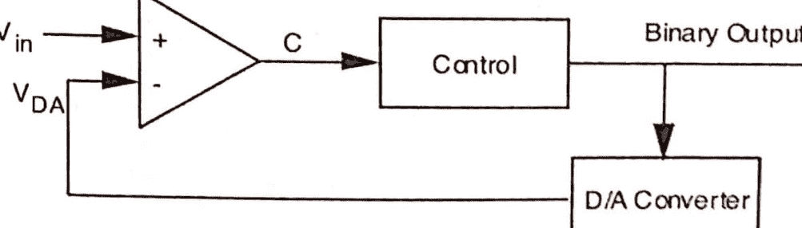

### 图 6.2 实现逐次逼近法

### 6.2 使用 MC9S12DG256 A/D 转换器

MC9S12DG256 微控制器有两个 A/D 转换器，称为 ATD0 和 ATD1，可以产生 8 位或 10 位转换。这些 A/D 转换器与 PORTAD0 和 PORTAD1 通用引脚，当未使用 A/D 转换时可用于数字输入。PORTAD0 的引脚 7 连接到 DRAGON12-Plus-USB 板上的电位计中心。当用小螺丝刀转动电位计时，该输入会在 0 到 5 之间变化。我们将使用此输入来说明 ATD0 的输出。

有很多与 A/D 转换器使用相关的寄存器。我们将在下面的“内部”部分查看它们。为了方便，我们编写了表 6.1 中 C 函数调用的汇编程序。

表 6.2 显示了两个 A/D 转换器的引脚分配。在 DR12-Plus-USB 上，ATD0 的通道 7 连接到电位计，ATD0 的通道 5 连接到温度传感器，ATD0 的通道 4 连接到光敏极。DRAGON12-Plus-USB 有一个 10 脚接头连接到 ATD1 通道 0-2 的输出。此接头方便将 x-y-z 加速度计或 GP2D12 传感器连接到 MC9S12DG256 微控制器的 A/D 通道。

### 表 6.1 A/D 转换器的 C 函数

| 函数 | 说明 |
| --- | --- |
| `void ad0enable(void);` | 开启 10 位 ATD0 |
| `int ad0conv(char#);` | 返回通道# 四次连续读取的平均值 |
| `void ad1enable(void);` | 开启 10 位 ATD1 |
| `int ad1conv(char#);` | 返回通道# 四次连续读取的平均值 |

### 表 6.2 A/D 转换器引脚分配

| 通道号 | 引脚名称 | 引脚号 | 通道号 | 引脚名称 | 引脚号 |
| --- | --- | --- | --- | --- | --- |
| 0 | PADD0 | 67 | 0 | PADD8 | 68 |
| 1 | PADD1 | 69 | 1 | PADD9 | 70 |
| 2 | PADD2 | 71 | 2 | PADD10 | 72 |
| 3 | PADD3 | 73 | 3 | PADD11 | 74 |
| 4 | PADD4 | 75 | 4 | PADD12 | 76 |
| 5 | PADD5 | 77 | 5 | PADD13 | 78 |
| 6 | PADD6 | 79 | 6 | PADD14 | 80 |
| 7 | PADD7 | 81 | 7 | PADD15 | 82 |

### 示例 17 – 读取电位器值

列表 6.1 显示了一个程序，该程序读取 ATDO 的通道 7，将值除以 2（以降低最低位的噪声），并将结果显示在 LCD 屏幕上。当你用小螺丝刀旋转电位器时，数值会在 0 到 511 之间变化。尝试一下。

在 DRAGON12-Plus-USB 上，如果你将列表 6.1 中的通道号从 7 改为 4，程序将读取板载光电极管的输出。当你向光电极管照射更多的光时，LCD 上的显示数值将会增加。

### 列表 6.1 示例 17

```c
// Example 17: A/D Converter -- Pot

#include <stdio.h>      /* 通用定义和宏 */

#include <mc9s1dg256.h>   /* 变体信息 */

#pragma LINK_INFO_DERIVATIVE mc9s1dg256b

#include "main_asm.h"      /* 与汇编模块的接口 */

int val;

void main(void) {

    PLL init();             // 设置系统时钟频率为 24 MHz

    ad0_enable();          // 启用 a/d 转换0

    lcd_init();             // 启用 led

    while(1) {

        val = adconv(7);     // 读取通道7 上的电位器

        val = val >> 1;      // 右移 1 位（除以 2）

        set_lcd_addr(0x40);  // 显示在 LCD 的第二行

        write_int_lcd(val);  // 将值写入第5个字段

        ms_delay(100);      // 延迟 0.1 秒

    }

}
```

### 底层原理

main.asm 中对应表 6.1 所示 C 函数的子程序见列表 6.2。前三个子程序适用于 ATDO，后三个子程序适用于 ATD1。子程序 `ad0_enable` 将启用 ATDO 的 10 位分辨率模式。A/D 时钟频率可以在 500 kHz 到 2 MHz 之间。它使用图 6.3 中 ATD 控制寄存器 4 中的位 [PRS4:0] 根据以下公式设置：

> `ATDclock = [BusClock] / 2^(PRS+1)` (6.1)

在列表 6.2 的子程序 `ad0_enable` 中，我们在控制寄存器 `ATDCTL4` 中存储了值 `0B`。将在 (6.1) 中使用 PRS=1，这将 24 MHz 的总线时钟频率除以 24，得到 1 MHz 的 A/D 时钟频率。在控制寄存器 `ATDCTL2` 中存储值 `SC` 将关闭 A/D 转换完成标志。此功能将在从相应的结果器读取数据时清除 A/D 转换完成标志。

### 列表 6.2 来自 main.asm 的 A/D 汇编子程序

```asm
; A/D converter PADD0-PADD7

; ad0_enable();

ad0_enable:

movb #$OB, ATDCT0L4      ;10位分辨率 /24时钟

movb #$CO, ATDCT0L2      ;设置 ADPU & AFFC

rts
```

```asm
; int adconv(char ch)

ad0conv:

andb #$07, ATDCT0L4      ;ch - 7

orb #$80, ATDCT0L5       ;SCAN=0

brclr ATDSTATO,$80,ad01  ;等待转换

ad01:

bsr

avg0:

psxh                    ;保存寄存器

ldx                    #ATD0H

addd 2,x;               +adr1

addd 2,x;               +adr2

addd 2,x;               +adr3

lsrd                    ;除以 4

pulx                    ;恢复寄存器

rts
```

```asm
; A/D converter PADD8-PADD15

; ad1_enable();

ad1_enable:

movb #$OB, ATDCT1L4      ;10位分辨率 /24时钟

movb #$CO, ATDCT1L2      ;设置 ADPU & AFFC

rts
```

```asm
; int adconv(char ch)

ad1conv:

andb #$07, ATDCT1L4      ;ch - 7

orb #$80, ATDCT1L5       ;SCAN=0

brclr ATDSTATO,$80,ad11  ;等待转换

ad11:

bsr

avg1:

psxh                    ;保存寄存器

ldx                    #ATD1H

addd 2,x;               +adr1

addd 2,x;               +adr2

addd 2,x;               +adr3

lsrd                    ;除以 4

pulx                    ;恢复寄存器

rts
```

## 模拟量转数字器

### ATD 控制寄存器 2 (ATD0CTL2–0082) (ATD1CTL2–0102)

| 7 | 6 | 5 | 4 | 3 | 2 | 1 | 0 |
|---|---|---|---|---|---|---|---|
| ADPU | AFFC | AWAI | ETRIG | ERIE | ASCIE | ASCIF | |
- ADPU = 1: 正常 ATD 功能；ADPU = 0: 掉。
- AFFC = 1: 启用 ATD 快标志；AFFC = 0: 清除 ATD 快标志。
- ASCIE = 1: 启用 ATD 序列中断；ASCIE = 0: 禁用序列中断。
- ASCIF: ATD 序列中断标志。

### ATD 控制寄存器 3 (ATD0CTL3–0083) (ATD1CTL3–0103)

| 7 | 6 | 5 | 4 | 3 | 2 | 1 | 0 |
|---|---|---|---|---|---|---|---|
| 0 | S8C | S4C | S2C | S1C | FIFO | FRZ1 | FRZ0 |
- S8C, S4C, S2C, S1C: 转换长度
- FIFO: 结果模式
- FRZ1, FRZ0: 调试启用

### ATD 控制寄存器 4 (ATD0CTL4–0084) (ATD1CTL4–0104)

| 7 | 6 | 5 | 4 | 3 | 2 | 1 | 0 |
|---|---|---|---|---|---|---|---|
| S0 | PRS1 | PRS2 | PRS3 | PRS4 | SMP0 | SRES | |
- SRES8 = 1: 8位分辨率；SRES8 = 0: 10位分辨率。
- SMP1, SMP0: 采样时间选择
- PRS[4:0]: ATD 分频

### ATD 控制寄存器 5 (ATD0CTL5–0085) (ATD1CTL5–0105)

| 7 | 6 | 5 | 4 | 3 | 2 | 1 | 0 |
|---|---|---|---|---|---|---|---|
| CH0 | CH1 | CH2 | MULT | SCAN | DSGN | DJM |
- DJM = 1: 结果寄存器右对齐数据
- DJM = 0: 结果寄存器左对齐数据
- DSGN = 1: 结果寄存器有符号数据
- DSGN = 0: 结果寄存器无符号数据
- SCAN = 1: 连续转换序列（扫描模式）
- SCAN = 0: 单次转换序列
- MULT = 1: 跨通道采样
- MULT = 0: 仅采样一个通道
- CH[2:0]: 模拟输入通道


一旦启用转换模块，通过写入控制寄存器 `ATDCTL5` 开始转换。将位 7 (DJM) 设置为 1 将使结果寄存器数据右对齐。在位 5 (SCAN) 和位 4 (MULT) 中存储 0 将导致单通道转换序列。通道号存储在位 2–0 中。在子程序 `adconv` 中，通道号作为参数传递到累加器 B。通过对该数字进行掩码处理，将位 7 置为 1 以使结果寄存器数据右对齐，结果写入 `ATDCTL5`。转换开始。发生的转换次数由图 6.3 所示的 ATD 控制寄存器 3 中的转换长度值决定。重置时，该转换长度的默认值为 4，这意味着在我们的情况下，会对选定通道进行四次单独转换，结果存储在 ATD 控制寄存器（ATDRHx/ATDRlx）的前四个字中。

当转换完成后，图 6.4 所示的 ATD 状态寄存器 0 的位 7 (SCF) 被设置为 1。清除跳转语句

```
ad01    brclr ATDSTATO,$80,ad01
```


在子程序 `adconv` 中，只要 `ATDSTATO` 与 `$0` 的与运算结果为零（即只要 `ATDSTATO` 的位 7 为 0），就会跳转自身。因此，如果 `SCF` 标志变为 1，跳转将失败并执行下一条指令 `bsr avg40`。

| ATD 状态寄存器 0 (ATDSTATO–0006) (ATDSTAT1–0126) |
| 7 | 6 | 5 | 4 | 3 | 2 | 1 | 0 |
|---|---|---|---|---|---|---|---|
| SCF | | TOFR | FIFOR | CC2 | CC1 | CC0 |

- `SCF`: 转换序列完成
- `TOFR`—触发溢出标志
- `FIFOR`—FIFO 运行标志
- `CC[2:0]`: 转换计数器

图 6.4 ATD 状态寄存器

子程序 `avg40` 将对图 6.5 所示第一个 ATD 转换结果中的四个值取平均值。注意，10 位转换结果在两个字节 `ATDR0H`/`ATDR0L` 中右对齐。在子程序 `avg40` 中，索引寄存器 `X` 指向 `ATD0RH`。`ATDR0H`/`ATDR0L` 中的第一个转换结果加载到累加器 `D` 中，并将每个后续转换结果加到该值。然后将结果除以 4（通过右移 2 位）以在 `D` 中产生平均值。这就是函数 `int adconv(char cht)` 返回的结果。

| ATD 结果寄存器 (ATD0RH–09D0) (ATD1RH–0130) |
| 7 | 6 | 5 | 4 | 3 | 2 | 1 | 0 |
|---|---|---|---|---|---|---|---|
| 0 | 0 | 0 | 0 | 0 | 0 | bit9 | bit8 | ATDR0H |
| bit 7 | | bit 5 | bit 4 | bit 3 | bit 2 | bit 1 | bit0 | ATDR0L |
| 0 | 0 | 0 | 0 | 0 | 0 | bit9 | bit8 | ATDR1H |
| bit 7 | | bit 5 | bit 4 | bit 3 | bit 2 | bit 1 | bit0 | ATDR1L |
| 0 | 0 | 0 | 0 | 0 | 0 | bit9 | bit8 | ATDR2H |
| bit 7 | | bit 5 | bit 4 | bit 3 | bit 2 | bit 1 | bit0 | ATDR2L |
| 0 | 0 | 0 | 0 | 0 | 0 | bit9 | bit8 | ATDR3H |
| bit 7 | | bit 5 | bit 4 | bit 3 | bit 2 | bit 1 | bit0 | ATDR3L |

图 6.5 前四个（共八个）转换结果寄存器

## 模数转换器

### 6.3 测量加速度

使用基于 MEMS 技术的低成本 x-y-z 加速度模块很容易测量加速度的所有分。Wytec 提供了一个包含 Kionix KPSS5-3157 x-y-z 加速度计的小板。该板带有一根 6 英长的排线，可插入到 DRAGON12-USB 板的 `J36` 插头上。这可以将加速度模块的 x、y、z 分量分别连接到 `ATD1` 的通道 0 – 2。

### 示例 18 – 测量加速度的 x-y-z 分量

列表 6.3 显示了一个程序，该程序允许通过在 LCD 第一行连续显示加速度的 x、y、z 分量来测试加速度模块。当你倾斜加速度模块时，这些值会发生，因为你正在测量重力加速度。当模块处于水平位置时，z 值最大（对应于 1 g），当翻转时将变为最小（对应于 -1 g）。当模块处于水平时，x 和 y 值读取的是对应于 0 g 的加速度值。当你向某个方向倾斜模块时，这些值将会增加或减少。

你应该运行此程序并倾斜加速度计，直到你理解它在测量什么。通过摇动模块观察你可以检测到多大（和最小）加速度。

### 列表 6.3 示例 18

```c
// Example 18: Using accelerometer module: A/D Converter

#include <hidef.h>                    /* common defines and macros */

#include <mc9s12dg256.h>               /* derivative information */

#pragma LINK_INFO_DERATIVE "mc9s12dg256b"

#include "main_asm.h"                   /* interface to the assembly module */

int ax;

int ay;

int az;

void main(void) {

	init();                          // set system clock frequency to 24 MHz

	adl_enable();                   // enable a/d converter 1

	lcd_init();                     // enable lcd

	while(1) {

		set_lcd_addr(0x00);           // display on 1st row of LCD

		ax = adconv(0);                // read ax on channel 0

		write_int_lcd(ax);            // write value in field of 5

		ay = adconv(1);                // read ax on channel 1

		write_int_lcd(ay);            // write value in field of 5

		az = adconv(2);                // read ax on channel 2

		write_int_lcd(az);            // write value in field of 5

		ms_delay(100);               // delay 0.1 seconds

	}

}
```

### 示例 19 – 测量静摩擦系数

可以使用图 6.6 所示的设置使用加速度模块来测量静摩擦系数。将一个小块放置在海报上，海报的一端相对于桌面倾斜。抬起海报的另一端，直到小块开始沿斜面下滑。如果这在角度 $\theta$ 时发生，则静摩擦系数 $\mu_s$ 给出如下：

$\mu_s = \tan \theta \quad (6.2)$

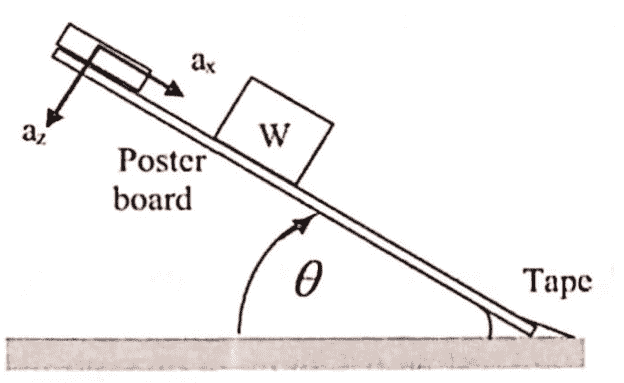

图 6.6 测量静摩擦系数

这一结果可以通过绘制小块的受力图很容易推得出。
加速度计安装在海报上，如图 6.6 所示，其中 $a_s$ 和 $a_t$ 测量重力 $g$ 的分量。因此，

$a_s = g \sin \theta \quad (6.3)$

以及

$a_t = g \cos \theta \quad (6.4)$

从公式 (6.2) – (6.4) 可以看出

$\mu_s = \tan \theta = \frac{a_s}{a_t} \quad (6.5)$

为了计算公式 (6.5) 中 $a_s$ 和 $a_t$ 的值，必须从测量值中减去零重力值。让 $a_0$ 为零重力的加速度读取。假设对于 $a_s$ 和 $a_t$，该值是相同的。即当 $\theta=0$ 时它是 $a_s$ 值，当 $\theta=90^{\circ}$ 时它是 $a_t$ 值。通过测量 $\theta=0$ 时的 $a_s$ 来测量 $a_0$。为了处理整数，在计算之前将公式 (6.5) 乘以 1000。因此

$\mu_s = 1000 \frac{a_s}{a_t} \quad (6.6)$

列表 6.4 将执行此计算。为了进行测量，确保海报水平并按下重置按钮。这将启动程序并通过平均八次 $ax$ 来计算 $\alpha$。然后缓慢抬起海报。$\tan \theta$ 的值乘以 1000 将连续显示在 LCD 上。小块开始下滑时显示的值将是静摩擦系数乘以1000。

### 列表 6.4 示例 19

```c
// Example 19: Calculating coefficient of static friction

#include <hidef.h>    /* common defines and macros */

#include <mc9s1ld256b.h>  /* derivative information */

#pragma LNK_INFO DERIVATIVE "mc9s1ld256b"

#include "main_asm.h" /* interface to assembly module */

int ax;

int az;

int a0;

int i;

long ax0;

long tan_theta;

void main(void) {

    PLL_init();                  // set system clock frequency to 24 MHz

    adl1_enable();              // enable a/d converter 1

    lcd_init();                  // enable lcd

    a0 = 0;

    for(i = 0; i < 8; i++)    // average 8 values of ax to get a0
        ax += adconv(0);

    }

    a0 >>= 3;

    while(1) {

        ax = 0;

        az = 0;

        for(i = 0; i < 8; i++) {

            ax += adconv(0);

            az += adconv(2);

        }

        ax >>= 3;

        az >>= 3;

        tan_theta = 1000 * (ax - a0) / (az - a0);

        set_lcd_addr(0x00);           // display on 1st row of LCD

        write_int_lcd((int)tan_theta); 

        ms_delay(100);

    }

}
```

### 6.4 测量温度

仪器仪器 LM35 精密温度传感器将温度转换为模拟电压。输出电压与摄氏温度线性（$V_{out} = 10mV/C$）。传感器连接到 `ATD1` 的通道 0。

### 示例 20 – 在 LCD 上显示温度

此程序读取温度并在 LCD 上同时显示摄度和华氏度值。

### 列表 6.5 示例 20

```c
// Example 20: A/D Converter -- Temperature sensor
// Vout = 10mV/C Tc
// Tc = val/2, deg C

#include <hidef.h>                    /* common defines and macros */

#include <mc9s1ldg256.h>               /* derivative information */

#pragma LINK_INFO_DERATIVE "mc9s1ldg256b"

#include "main_asm.h"                   /* interface to the assembly module */

void main(void) {

    int val, Tc, Tf;

    char q1, q2;

    q1 = "deg C";

    q2 = "deg F";

    PLL_init();                  // set system clock frequency to 24 MHz

    ad0_enable();                // enable a/d converter 0

    lcd_init();                  // enable lcd

    while(1) {

        val = ad0_conv(5);       // read temp sensor on channel 5

        val = val >> 1;          // shift bit right (divide by 2)

        Tc = val;                // degrees

        Tf = Tc*9/5 +3;           // degrees

        set_lcd_addr(0x00);      // display on 1st row of LCD

        write_int_lcd(Tc);       // write value in field of 5

        type_lcd(q1);            // write deg C

        set_lcd_addr(0x40);      // display on 2nd row of LCD

        write_int_lcd(Tf);       // write value in field of 5

        type_lcd(q2);            // write deg F

        ms_delay(100);           // delay 0.1 seconds

    }

}
```

## 脉宽调制 (PWM)：电机与舵服

# 第7章

## 脉宽调制 (PWM)：电机与舵服

在本章中，我们将展示如何控制直流电机的输入速度、方向以及舵服的位置。DRAGON12-Plus-USB 板提供了方便的接线和端子，用于连接电机和舵服。

### 7.1 将电机连接到微控制器

在连接电机或其他向微控制器抽取电流的负载时，必须使用某种类型的驱动电流。SN754410 四路半 H 型驱动板包含了图-H 所示的所有连接。这是一个 16 脚芯片，其连接方式如图 7.1 所示。独立的电源连接分别用于输入级和输出功率级。当四个三态缓冲器的输入决定了电源源时，DRAGON12-Plus-USB 上的电机 `J18` 将 $V_{cc}$ 的 5 特连接到输入。使用电机时，最好使用独立的电源 $V_{out}$ 为电机提供电流。图 7.1 中的每个驱动器可以输出高达 1 安培的电流。你将外部电压源连接到 DRAGON12-Plus-USB 上端子块 `T4` 的 `VMOT` 逻辑。SN754410 驱动器可以处理 5 V 到 36 V 之间的电压。

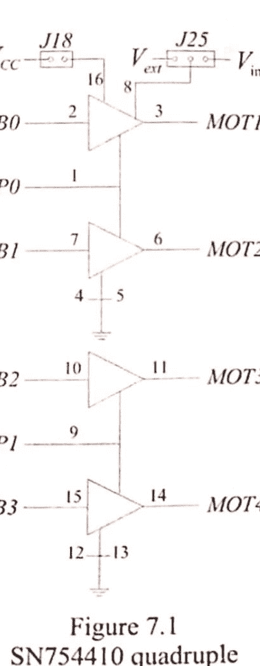

直流电机将连接在图 7.1 的引脚 `MOT1` 和 `MOT2` 之间（`MOT3` 和 `MOT4` 之间）。这些标记在端子块 `T4` 上。上方两个驱动器通过 `PP0` 启用。当 `PP0` 为 1 时，当 `PB0` 为高电时输出 `MOT1` 为高电，`PB0` 为低电时输出低电。同样，当 `PB0` 为高电时输出 `MOT2` 为高电，`PB0` 为低电时输出低电。当 `PP0` 为低电时，输出 `MOT1` 和 `MOT2` 处于高阻态状态。这意味着等同于断开电机。图 7.1 中的两个驱动器以类似的方式受 `PP1` 控制。

如果电机连接在图 7.1 的引脚 `MOT1` 和 `MOT2` 之间，且 `PB0` 和 `PB1` 为低电且 `PP0` 为 1，电机将向一个方向旋转。如果 `PB0` 为低电，电流将通过反方向流过电机，电机将反向旋转。当 `PB0` 和 `PB1` 都为高电或低电时，没有电流流过电机，电机将停止。

直流电机的速度取决于在电机上的电压——电压越高，电机转得越快。如果你只想以恒定速度启动电机，可以将电机的一端连接到图 7.1 中的 `MOT1`，另一端连接到地。通过这种方式，你可以将多四个电机连接到图 7.1 中的 SN754410。连接到电机的电压极性决定了电机的旋转方向。如果旋转方向错误，只需交换到电机的两个连接即可。

### 示例 21 – 使用 PWM 控制直流电机的速度

要使用微控制器控制直流电机的速度，通常使用如图 7.2 所示类型的脉宽调制信号。如果该信号连接到图 7.1 中的 `PP0`，当信号为高电时（假设 `PB0` 和 `PB1` 的值不同），电流将流过电机。当 PWM 信号 (`PP0`) 为低电时，电机与电路断开，没有电流流过电机。

该脉冲序列的周期保持恒定，而时间宽度（在图 7.2 中称为占空比，duty）是变化的。PWM 信号的占空比定义为信号处于高电的时间百分比。即：

```
duty cycle = \frac{duty}{period} \times100\%
```


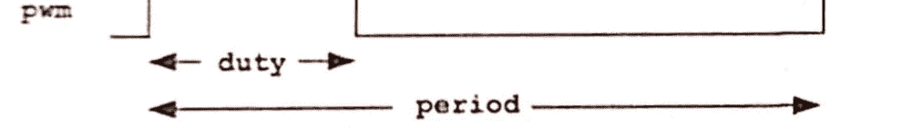

图 7.2 脉宽调制信号

图 7.2 中 `pwm` 信号的平均 DC 值与占空比成正比。100% 的占空比对应的 DC 值等于 `pwm` 信号的最大值。50% 的占空比对应的 DC 值等于 `pwm` 信号的一半，依此类推。如果跨电机的电压与此 `pwm` 信号成正比，只需改变脉冲占空比即可改变电机的速度。

`MC9S12DG256` 的端口 P 可以生成最多 8 位 PWM 信号或四个 16 位 PWM 信号。8 位 PWM 信号具有 256 个不同的占空比值。对于直流电机的速度控制，8 位 PWM 信号通常足够。我们提供了汇编程序来生成八种不同的 8 位 PWM 信号。对于舵服，有时需要 16 位 PWM 信号。图 7.1 所示的 `SN754410` 四路 H 型驱动器具有输出到地的二极管，可以消除电机电流快速变化时可能出现的电压尖峰。内置的 C 函数所示表 7.1。

### 控制直流电机的 C 函数

| C 调用 | 含义 |
| :--- | :--- |
| `motor0 init()` | 初始化 `PWM0` |
| `motor1 init()` | 初始化 `PWM1` |
| `motor2 init()` | 初始化 `PWM2` |
| `motor3 init()` | 初始化 `PWM3` |
| `motor4 init()` | 初始化 `PWM4` |
| `motor5 init()` | 初始化 `PWM5` |
| `motor6 init()` | 初始化 `PWM6` |
| `motor7 init()` | 初始化 `PWM7` |
| `motor0(int speed)` | 设置电机0速度 (0 - 255) |
| `motor1(int speed)` | 设置电机1速度 (0 - 255) |
| `motor2(int speed)` | 设置电机2速度 (0 - 255) |
| `motor3(int speed)` | 设置电机3速度 (0 - 255) |
| `motor4(int speed)` | 设置电机4速度 (0 - 255) |
| `motor5(int speed)` | 设置电机5速度 (0 - 255) |
| `motor6(int speed)` | 设置电机6速度 (0 - 255) |
| `motor7(int speed)` | 设置电机7速度 (0 - 255) |
| `motor0 off()` | 禁用 `PWM0` |
| `motor1 off()` | 禁用 `PWM1` |
| `motor2 off()` | 禁用 `PWM2` |
| `motor3 off()` | 禁用 `PWM3` |
| `motor4 off()` | 禁用 `PWM4` |
| `motor5 off()` | 禁用 `PWM5` |
| `motor6 off()` | 禁用 `PWM6` |
| `motor7 off()` | 禁用 `PWM7` |

`DRAGON12-Plus-USB` 的示例程序见列表 7.1。最右侧的开关 `S1` 控制电机方向。

### 内部原理

用于编程 PWM 模块的寄存器如图 7.3a 和 7.3b 所示。每个输出端口 P (`PTP`) 都可以使用图 7.3a 中的 PWM 寄存器启用。输出高低的时间由图 7.3b 所示的 8 位计数器 `PWMCNTX` 控制。该计数器的时源可以是 A、B、S1 或 S4，取决于寄存器 `PWMCLK` 的设置。对于图 7.1 电机驱动中的通道0和1，我们在 `motor0 init` 和 `motor1 init` 程序中选择了时钟 S4。频率由图 7.3b 中的时钟缩放和分频寄存器 `PWMSCLK` 以及 `PWMPRCLK` 决定。在列表 7.2 中，我们将分频时钟 `PWMPRCLK` 设置为十六进制 `02`，这意味着时钟 A 是总线时钟 (24 MHz) 除以 4，即 6 MHz。S4 寄存器设置为十六进制 `75 = 117`，这意味着 S4 时钟率为 6 MHz/117 = 25.64 kHz。

如果我们将图 7.3b 中的周期寄存器 `WMPER` 设置为 255，周期将为 255/25.64 kHz = 9.95 ms。

### 列表 7.1 示例 21 – DRAGON12-Plus-USB

```
// 示例 21: 电机速度和方向 -- H桥

#include <hide> /* 通用定义和宏 */

#include <mc9s12dg256.h> /* 变体信息 */

#pragma LINK_INFO DERIVATIVE "mc9s12dg256b"

#include "main_asm.h" /* 汇编模块接口 */

int val;

int speed;

void main(void) {

    PLL init(); // 设置系统时钟频率为 24 MHz

    ad0 enable(); // 禁用 a/d 转换器 0

    seg7_disable(); // 禁用七段显示

    led_enable(); // 启用指示灯

    ic_init(); // 启用 lcd

    SW_enable(); // 启用开关

    motor_init(); // 为电机启用 8 位 pwm0

    while(1) {

        led_on(GW1_dip()); // 显示拨码开关状态

        val = ad0conv(7); // 读取通道7

        speed = val >> 2; // 右移2位; 0 - 255

        motor(speed); // 设置电机速度

        set_lcd_addr(0x40); // 设置LCD地址

        delay(10); // 延迟10秒

    }

}
```

### PWM启用寄存器 (PWME – 0xA0)

| 7 | 6 | 5 | 4 | 3 | 2 | 1 | 0 |
| :--- | :--- | :--- | :--- | :--- | :--- | :--- | :--- |
| `PWME7` | `PWME6` | `PWME5` | `PWME4` | `PWME3` | `PWME2` | `PWME1` | `PWME0` |
| `PWEX = 1`: PWM通道启用 |
| `PWEX = 0`: PWM通道禁用 |

### PWM极性寄存器 (PWMPOL – 0xA1)

| 7 | 6 | 5 | 4 | 3 | 2 | 1 | 0 |
| :--- | :--- | :--- | :--- | :--- | :--- | :--- | :--- |
| `PPOL7` | `PPOL6` | `PPOL5` | `PPOL4` | `PPOL3` | `PPOL2` | `PPOL1` | `PPOL0` |
| `PPOLx = 1`: PWM输出在占空比期间为高电，变为低电 |
| `PPOLx = 0`: PWM输出在占空比期间为低电，变为高电 |

### PWM时钟选择寄存器 (PWCLK – 0xA2)

| 7 | 6 | 5 | 4 | 3 | 2 | 1 | 0 |
| :--- | :--- | :--- | :--- | :--- | :--- | :--- | :--- |
| `PCLK7` | `PCLK6` | `PCLK5` | `PCLK4` | `PCLK3` | `PCLK2` | `PCLK1` | `PCLK0` |
| `PCLK[7,6,3,2] = 1`: 时钟SB是通道[7,6,3,2]的时钟源 |
| `PCLK[7,6,3,2] = 0`: 时钟B是通道[7,6,3,2]的时钟源 |

PWM 寄存器

# 脉宽调制 (PWM): 电机与舵器

### PWM 分频器选择寄存器 (PWMPRCLK-0x00A3)

| 7 | 6 | 5 | 4 | 3 | 2 | 1 | 0 |
|---|---|---|---|---|---|---|---|
| 0 | `PCB2` | `PCB1` | `PCB0` | 0 | `PCKA2` | `PCKA1` | `PCKA0` | `PWMPRCLK` |

`PCKB[2:0]` - 时钟 B的分频器。时率=`BusClock/2^PCKB[2:0]`
`PCKA[2:0]` - 时钟 A的分频器。时率=`BusClock/2^PCKA[2:0]`

### PWM 中心对齐寄存器 (PWMCAE-0x00A4)

| 7 | 6 | 5 | 4 | 3 | 2 | 1 | 0 |
|---|---|---|---|---|---|---|---|
| `CAE7` | `CAE6` | `CAE5` | `CAE3` | `CAE2` | `CAE1` | `CAE0` | `PWMCAE` |

`CAEX = 1`: PWM 通道 x 以中心对齐模式工作。
`CAEX = 0`: PWM 通道 x 以左对齐模式工作。

### PWM 控制寄存器 (PWMCTL-0x00A5)

| 7 | 6 | 5 | 4 | 3 | 2 | 1 | 0 |
|---|---|---|---|---|---|---|---|
| `CON7` | `CON45` | `CON23` | `CON01` | `PSWAI` | `PRZ0` | `PWMCTL` |

`Conxy = 1`: 通道 x 和 y 拼接形成一个 16 位 PWM。
通道 x 为高位字节，y 为低位字节。
通道 y 是 16 位 PWM 的输出引脚。
通道 y 控制 `POCKL` 位、`PPOL`、`PWM` 位和 `CAE` 位。
`Conxy = 0`: 通道 x 和 y 是独立的 8 位 PWM。

### PWM  own A 寄存器 (PWMMSCLA-0x00A8)

| bit7 | bit6 | bit5 | bit4 | bit3 | bit2 | bit1 | bit0 |
|---|---|---|---|---|---|---|---|
| `PWMMSCLA` |

`Clock SA = Clock A/(2×PWMMSCLA)`
`PWMMSCLA` 的值=`$00` 对应 `PWMMSCLA=256`。

### PWM Scale B 寄存器 (PWMMSCLB-0x00A9)

| bit7 | bit6 | bit5 | bit4 | bit3 | bit2 | bit1 | bit0 |
|---|---|---|---|---|---|---|---|
| `PWMMSCLB` |

`Clock SB = Clock B/(2×PWMMSCLB)`
`PWMMSCLB` 的值=`$00` 对应 `PWMMSCLB=256`。

### PWM 通道计数寄存器 (PWMCNTX; x=0-7: 0x00AC-0x00B3)

| 7 | 6 | 5 | 4 | 3 | 2 | 1 | 0 |
|---|---|---|---|---|---|---|---|
| bit7 | bit6 | bit5 | bit4 | bit3 | bit2 | bit1 | bit0 | `PWMCNTX` |

每个八路 PWM 通道的 8 位加/减计数器

### PWM 通道周期寄存器 (PWMPERX; x=0-7: 0x00B4-0x00BB)

| 7 | 6 | 5 | 4 | 3 | 2 | 1 | 0 |
|---|---|---|---|---|---|---|---|
| bit7 | bit6 | bit5 | bit4 | bit3 | bit2 | bit1 | bit0 | `PWMPERX` |

周期寄存器决定每个 PWM 通道的周期

### PWM 通道占空比寄存器 (PWMDTXY; x=0-7: 0x00BC-0x00C3)

| 7 | 6 | 5 | 4 | 3 | 2 | 1 | 0 |
|---|---|---|---|---|---|---|---|
| bit7 | bit6 | bit5 | bit4 | bit3 | bit2 | bit1 | bit0 | `PWMDTXY` |

占空比寄存器决定八路 PWM 通道的占空比

图 7.3 PWM 寄存器（续）

# 列表 7.2 main.asm 中的电机汇编子程序

; PWM 电机 -- 10 ms 周期 8 位模式
;      输入 0 - 255
;      电机输入占空比范围 0 - 100%

```
; 初始化 pwm 0 - 引脚 PPO

motor0_init:

    bset PWMPOL, #S01      ;高电启动

    bset PWMCLK, #S01      ;使用时钟 SA

    movb #$52,,MPFRCLK    /4 24/4 = 6 MHz

    bset #$575, PWMSCLA    ;SA = GM/2*117 = 25.64KHz

    clr PWMCAE             ;左对齐

    bset PWMCTL, #S10      ;8位通道 0 和 1

    bset #$255, PWMPER0    ;周期 ~ 10ms

    movb #$128, PWMDTYO   ;初始占空比 = 50%

    bset PWMME, #S01       ;启用 PWM0

    rts
```

```
; 初始化 pwm 1 - 引脚 PP1

motor1_init:

    bset PWMPOL, #S02      ;高电启动

    bset PWMCLK, #S02      ;使用时钟 SA

    movb #$522, MPFRCLK    /4 24/4 = 6 MHz

    bset #$575, PWMSCLA    ;SA = GM/2*117 = 25.64KHz

    clr PWMCAE             ;左对齐

    bset PWMCTL, #S10      ;8位通道 0 和 1

    bset #$255, PWMPER1    ;周期 ~ 10ms

    movb #$128, PWMDTYO   ;初始占空比 = 50%

    bset PWMME, #S02       ;启用 PWM1

    rts
```

; 电机 -- 输入：占空比范围 0 到 100%
`motor0(int duty);`

```
motor0:

    stab PWMDTYO          ;设置新脉冲宽度

    rts
```

```
;1(int duty);

motor1:

    stab PWMDTYO         ;设置新脉冲宽度

    rts
```

; 电机 -- 关闭
`motor0_off();`

```
motor0_off:

    bclr PWMME, #S01      ;禁用 PWM0

    rts
```

`;motor1_off();`

```
motor1_off:

    bclr PWMME, #S02      ;禁用 PWM1

    rts
```

# 脉宽调制 (PWM): 电机与舵器

极性寄存器 `PWMPOL` 在图 7.3a 中决定 PWM 信号是从高变低，还是从低变高。在列表 7.2 中，我们将该寄存器的通道位设置为 1，在这种情况下，PWM 信号将对齐启用寄存器 `PWMCAE`（列表 7.2 所示）。通过设置控制寄存器 `PWMCTL` 中的适当的位，两个电机可以拼接为 16 位通道。对于电机，我们使用 8 位通道 0 和 1（列表 7.2 所示）。存储在占空比寄存器 `PWMDTX` 中的值（图 7.3b）决定 PWM 信号何时变为低。在列表 7.2 中在该寄存器中存储 128，初始占空比将为 50%。最后的子程序设置启用寄存器 `PWMME`（图 7.3a 所示）。一旦启用 PWM 通道，PWM 信号将出现在相应的引脚 P（TP）上。列表 7.2 中的 `motor_off` 和 `motor1_off` 通过禁用 PWM 信号来停止电机。通过更改占空比寄存器 `PWMDTX` 中的值来改变电机速度。列表 7.2 中的 `motor0` 和 `motor1` 通过向占空比寄存器写入值来实现这一点。

# 7.2 舵器

舵器是一种特殊的设备，包含直流电机、齿轮、电位器和用于反馈的电子元件，封装在一个紧凑的设备中。这些舵器广泛用于飞机和遥控汽车，产量大且价格廉廉。这种类型的舵器 `Futaba S304` 如图 7.4 所示。该舵器有三根线：红线连接 +5V，黑线连接地，白线连接控制电机轴位置的 PWM 信号。


防止电机轴移动超过 90 度。用于控制舵器位置的 PWM 信号如图 7.5 所示。注意周期固定为 20 ms，脉冲宽度从约 1 ms 到 9 ms，以便让舵器移动约 90 度的角度。在这种情况下，列表 7.2 中的 `duty` 值约为 4500 代表中性位，3300 代表 +45 度位置，5700 代表 -45 度位置。

用于控制舵器位置的内置 C 函数见表 7.2。

图 7.5 控制舵器位置的 PWM 信号

| 表格 7.2 控制舵器位置的 C 函数调用 |
| C 函数调用 | 意义 |
|---|---|
| `servo54 init();` | 初始化 `PWM5`，周期 20 ms |
| `servo76 init();` | 初始化 `PWM7`，周期 20 ms |
| `servo54(int width);` | 设置 `servo5` 位置 (3300 – 5700) |
| `servo76(int width);` | 设置 `servo7` 位置 (3000 – 5700) |

# 示例 22 – 使用 PWM 控制舵器位置

使用这些函数的示例程序见列表 7.3。在例例中，板 上的电位器控制舵器的位置。

另一个在 90 度角度内反复旋转舵器的程序见列表 7.4。你可以通过更改 for 循环值和延迟时间对该程序进行实验。

### 列表 7.3 示例 22a

```
// 示例 22a: 带有电位器的舵器演示

#include <hide.h> /* 常用定义和宏

#include <mc9s1ld256.h> /* 衍生信息

#pragma LINK_INFO DERIVATIVE "mc9s1ld256b"

#include "main_asm.h" /* 汇编模块接口 */


```c
void main(void) {

    int val;

    int width;

    PLL_init(); // 设置系统时钟频率为24 MHz

    ad0_init(); // 启用 a/d 0

    lcd_init(); // 启用 lcd

    servo70_init(); // 为舵器启用 pwm

    while(1) {

        val = ad0conv(7); // 0 - 1023

        width = (val << 1) + 3477; // 宽度: 3477 - 5523

        set_lcd_addr(0x40); // lcd 第二行

        write_int_lcd(width); // 在 lcd 上显示宽度

        set_servo70(width); // 将舵器移动到位置宽度

    }

}
```

### 列表 7.4 示例 22b

```
// 示例 22b: 带有循环的舵器演示

#include <hide.h> /* 常用定义和宏

#include <mc9s1ld256.h> /* 衍生信息

#pragma LINK_INFO DERIVATIVE "mc9s1ld256b"

#include "main_asm.h" /* 汇编模块接口 */

void main(void) {

    int width;

    PLL_init(); // 设置系统时钟频率为24 MHz

    ad0_init(); // 启用 a/d 0

    lcd_init(); // 启用 lcd

    servo70_init(); // 为舵器启用 pwm

    while(1) {

        for(width = 4500; width <= 6000; width = width + 5) {

            set_servo70(width); // 将舵器从4500移动到6000

            ms_delay(5);

        }

        for(width = 6000; width >= 3000; width = width - 5) {

            set_servo70(width); // 将舵器从6000移动到3000

            ms_delay(5);

        }

        for(width = 3000; width < 4500; width = width + 5) {

            set_servo70(width); // 将舵器从3000移动到4500

            ms_delay(5);

        }

    }

}
```

### 内部原理

列表 7.5 显示了汇编语言程序 *servo_init*，我们对表 7.2 中的四个 C 函数调用进行了拼接。在子程序 *servo54_init* 中，我们通过向图 7.3b 所示 PWM 控制寄存器 `PWMCTL` 的第 6 位写入 1，将通道 4 和 5 拼接。请注意，通道 5 引脚将用于输出，通道 5 的位将用于 `PWMOL`、`PWMCLK`、`PWMCAE` 和 `PWM` 寄存器中。我们通过清除 `PWMCLK` 中的第 5 位来选择时钟 *A*。通过在 `PWMPRCLK` 中存储十六进制 53，我们通过将 24 MHz 总线时钟除以 8，将时钟频率设置为 3 MHz。为了使周期正好为 20 ms，我们存储了 60000/3 MHz = 20.0 ms 的值。在 `PWMDTY4` 中存储 4500 将产生 1.5 ms 的初始脉冲宽度。

子程序 *servo54* 将传递到累加器 *D* 中的值存储在寄存器 `PWMDTY4` 中，该值是 `PWMDTY4` 和 `PWMDTY5` 的拼接，其中 `PWMDTY5` 是高字节。为了让舵器在该范围内移动，存储在 `PWMDTY6` 中的值范围应在 3000 到 6000 之间。

列表 7.5 中的子程序 *servo76_init* 和 *set_servo76* 的行为与 *servo54_init* 和 *set_servo54* 类似，只不过这里拼接的是通道 6 和 7。通道 7 引脚用于输出，通道 7 的位用于 `PWMOL`、`PWMCLK`、`PWMCAE` 和 `PWM` 寄存器。16 位周期值和占空比值分别存储在 `PWMPER6` 和 `PWMDTY6` 中。

## 列表 7.5 来自 main.asm 的 servo 汇编子程序

```
; PWM -- 舵器 20 ms 周期 16 位模式
; 脉冲宽度 1.1 ms - 1.5 ms - 1.9 ms
; 占空比输入 -3300 4500 +5700
```

```
; servo54_init(); 初始化 pwm 5 - 引脚 PP5
servo54_init:
    bset PWMOL,$220      ;起始高位
    bclr PWMCLK,$220     ;使用时钟 A
    movb #533,PWMPRCLK  /8 24/8 = 3 MHz
    clr PWMCAE           ;左对齐
    bset PWMCTL,$80      ;拼接 4 和 5
    movw #60000,PWMPER4  周期 = 20ms
    movw #4500,PWMDTY4   ;初始宽度 = 1.5ms
    bset PWME,$220        ;启用 PWM5
    rts
```

```
; 设置占空比
; _servo54(int width);
set_servo54:
    std PWMDTY4          ;设置新脉冲宽度
    rts
```

```
; servo76_init(); 初始化 pwm 7 - 引脚 PP7
ervo76_init:
    bset PWMOL,$880      ;起始高位
    bclr PWMCLK,$880     ;使用时钟 B
    movb #533,PWMPRCLK  /8 24/8 = 3 MHz
    clr PWMCAE           ;左对齐
    bset PWMCTL,$80      ;拼接 6 和 7
    movw #60000,PWMPER6  周期 = 20ms
    movw #4500,PWMDTY6   ;初始宽度 = 1.5ms
    bset PWME,$880        ;启用 PWM7
    rts
```

```
; 设置占空比
; _servo76(int width);
set_servo76:
    std PWMDTY6          ;设置新脉冲宽度
    rts
```

# 第 8 章

## 串口通信接口 (SCI)

在本章中，我们将展示如何从串口通信到 PC，再到 DRAGON12-Plus USB 板上的 SCI 端口。我们将提供新的 C 函数调用，以便于实现此操作。DRAGON12-Plus-USB 具有一个直接连接到计算机 USB 端口的 USB 端口。然而，它将在计算机“系统摘要”的“组件”部分的“端口”项下被列为串口。您需要确定使用哪个 COM 端口号连接到 DRAGON12-Plus USB 板。如果您使用的是带有标准 9 针串口连接器的旧版 DRAGON12-Plus 板，则需要使用 USB 转串口转换线，将计算机的 USB 端口连接到 DRAGON12-Plus 板上的串口连接器。

### 8.1 异步串口 I/O

串口通信有两种类型：同步和异步。在同步通信中，传输时序由发送端和接收端的标准时钟控制，数据通常以包含错误检查的块的形式发送。另一方面，异步通信的时序是逐个字符处理的，同时发送端和接收端的时钟频率必须大致相同，它们会在每个字符处重新同步。由于每个字符都需要额外的同步位，其通信速度比同步通信慢。然而，它的实现更简单且应用广泛。

异步串口通信使用起始位来告知何时发送特定字符。图 8.1 说明了这一点，它显示了发送字符 "T" (ASCII 代码 0x54) 时的传输波形。在发送字符之前，线路处于高电平（或标记状态）。然后线路被拉低，持续时间称为起始位。这个起始空位后面通常是七位或八位位。传输的是最低位 D0。例如，在图 8.1 中，这七个位对应于 ASCII 代码 0x54（"T" 从 D0 开始）。这些位之后是一个一个设置为 1 或 0 的校验位，使得 1 的个数为偶数或奇数。通常字符在发送时是不带校验位的。校验位之后是一个或两个始终为高电平的位（标记位）。位宽的倒数称为波特率。串口通信中常用的某些波特率见表 8.1。我们将为您提供一个 C 函数调用，允许您在初始化 SCI 端口时设置任何波特率。

### 8.2 HCS12 SCI 接口

HCS12 有两个模块：`SCI10` 和 `SCI1`。在 DRAGON12-Plus USB 板上，通过 `J4` 选择 `SCI10` 或 `SCI1`。串口通信接口的功能框如图 8.2 所示。要在两个 DRAGON12-Plus 板之间进行通信，需要交叉连接线路，使一端的发送引脚连接到另一端的接收引脚，反之亦然。我们称之为空调制调调。

| 控制寄存器 1 (`SCxCR1`) | 数据寄存器 H (`SCxDRH`) |
| :--- | :--- |
| 控制寄存器 2 (`SCxCR2`) | |
| 状态寄存器 1 (`SCxSR1`) | 状态寄存器 2 (`SCxSR2`) |
| 波特率控制器 H (`SCxBDH`) | 波特率控制器 L (`SCxBDL`) |


使用 HCS12 的 SCI 端口需要对多个寄存器，部分如图所示。我们通过提供表 8.2 所示的 C 函数调用来完成工作。额外的 SCI C 函数见 8.4 节。

## 表 8.2 SCI 端口的 C 函数调用

| 函数 | 说明 |
| :--- | :--- |
| `void SCI0_init(int b);` | 以波特率 b 初始化 `SCI0` |
| `char inchar0(void);` | 等待 `SCI0` 输入字符并返回 |
| `void outchar0(char c);` | 将字符输出到 `SCI0` 发送引脚 |
| `void SCI1_init(int b);` | 以波特率 b 初始化 `SCI1` |
| `char inchar1(void);` | 等待 `SCI1` 输入字符并返回 |
| `void outchar1(char c);` | 将字符输出到 `SCI1` 发送引脚 |

## 示例 23 – 带 LCD 显示的 SCI Echo

列表 8.1 是一个将 `SCI0`设置为 9600、等待 RxD 输入字符、并将相同字符发送回 TxD 的程序。要测试此程序，按通常方法下载 DRAGON12-Plus USB 板，执行程序并确保使用实时调试器窗口。运行任何方便的程序，例如 HyperTerminal，波特率设置为 9600。您可以通过“开始 -> 程序 -> 辅助程序 -> 通信 -> HyperTerminal”在 PC 上找到 HyperTerminal。确保在使用 HyperTerminal 时不使用硬件握手。按下 PC 键盘上的任何键将显示该键的 ASCII 代码，然后将其回传到 PC 并在 PC 上显示。注意，终端程序在完成到 DRAGON12-Plus USB 板第一行末尾的往返之前，不会在屏幕上显示字符。尝试一下。注意当您输入 48 个字符时，一个字符会显示在第二行。（回想图 4.3 中的内存地址。）

### 内部原理

用于 SCI 模块编程的寄存器如图 8.3 所示。列表 8.2 列出了与表 8.2 中的六个 C 函数调用对应的汇编语言例程。

| SCI 波特率寄存器 (`SCI0BDH` – 0x00CB)(`SCI1BDH` – 0x00D0) | | | | | | | | |
|---|---|---|---|---|---|---|---|
| 6 | 5 | 4 | 3 | 2 | 1 | 0 |
| 0 | 0 | 0 | BR12 | BR11 | BR10 | BR9 | BR8 | SCIBDH |
| BR7 | BR6 | BR5 | BR4 | BR3 | BR2 | BR1 | BR0 | SCIBDL |

| SCI 控制寄存器 1 (`SCI0CR1` – 0x00CA)(`SCI1CR1` – 0x00D2) | | | | | | | |
|---|---|---|---|---|---|---|
| 7 | 5 | 4 | 3 | 2 | 1 | 0 |
| LOOPS | SCISWAI | | WAKE | | PT | SCICR1 |

- M = 1: 数据位
- M = 0: 数据位
- PE = 1: 启用奇偶校验功能
- PE = 0: 禁用奇偶校验功能

| SCI 控制寄存器 2 (`SCI0CR2` – 0x00CB)(`SCI1CR2` – 0x00D3) | | | | | | | |
|---|---|---|---|---|---|---|
| 7 | 5 | 4 | 3 | 2 | 1 | 0 |
| TIE | CIE | RIE | IDLE | RE | RWU | SBK | SCICR2 |

- RE = 1: 开启 RDRF 中断。RE = 0: 禁用 RDRF 中断。
- TE = 1: 开启发送器。TE = 0: 关闭发送器。
- RE = 1: 开启接收器。RE = 0: 关闭接收器。

| SCI 状态寄存器 1 (`SCI0SR1` – 0x00C5)(`SCI1SR1` – 0x00D4) | | | | | | | | |
|---|---|---|---|---|---|---|---|
| 7 | 6 | 5 | 3 | 2 | 1 | 0 |
| TDRE | RDRF | IDLE | OR | NF | FE | PF | SCISR1 |

- TDRE – 发送数据寄存器空标志。TDRE = 1: 空闲
- TC – 发送完成标志。TC = 1: 无正在进行的传输
- RDRF – 接收数据寄存器满标志。RDRF = 1: 满
- IDLE – 空闲 own标志。IDLE = 1: 接收器输入存在空闲
- OR – 溢出标志。OR = 1: 溢出
- NF – 噪声标志。NF = 1: 噪声
- FE – 帧错误标志。FE = 1: 帧错误
- PE – 奇偶校验错误标志。PE = 1: 奇偶校验错误

| SCI 数据寄存器 H (`SCI0DRH` – 0x00CE)(`SCI1DRH` – 0x00D6) | | | | | | | |
|---|---|---|---|---|---|---|---|
| 7 | 6 | 5 | 3 | 2 | 1 | 0 |
| R8 | T8 | | 0 | 0 | 0 | 读写 |

| SCI 数据寄存器 L (`SCI0DRL` – 0x00CF)(`SCI1DRL` – 0x00D7) | | | | | | | | |
|---|---|---|---|---|---|---|---|
| 7 | 6 | 5 | 4 | 3 | 2 | 1 | 0 |
| R7 | R6 | R5 | R4 | R3 | R2 | R1 | R0 |
| T7 | T6 | T5 | T4 | T3 | T2 | T1 | T0 |


## 8.2 SCI 汇编例程来自 main.asm

### SCI0 - 串口接口
; 初始化 SCI0，D = 波特率
```assembly
SCI0_init:
    CLR CLORCI0         ; 数据位，无奇校验
    MOV #$50C, SCI0CR2 ; 开启发送器、接收器
    TFR D,X             ; 计算波特率
    LDY #$0016          ; 波特率 = 24MHz/(16*BR)
    LDD #$E360         ; 24MHz/16 = $E360
    EDIV                ; Y = (Y:D)/X = E360/波特率
    STY SCIBDH          ; BR = (SCIBDL)
    RTS

inchar0:
    brclr SCI0SR1,$20   ; 等待 RDRF
    LDAB SCI0DRL        ; 获取字符
    RTS

outchar0:
    brclr SCI0SR1,$80   ; 等待 TDRE
    STAB SCI0DRL        ; 写入字符
    RTS
```

### SCI1 - 串口接口
; 初始化 SCI1，D = 波特率
```assembly
SCI1_init:
    CLR CLORCI1         ; 数据位，无奇偶校验
    MOV #$50C, SCI1CR2 ; 开启发送器、接收器
    TFR D,X             ; 计算波特率
    LDY #$0016          ; 波特率 = 24MHz/(16*BR)
    LDD #$E360         ; 24MHz/16 = $E360
    EDIV                ; Y = (Y:D)/X = E360/波特率
    STY SCIBDH          ; BR = (SCIBDL)
    RTS

inchar1:
    brclr SCI1SR1,$80   ; 等待 RDRF
    LDAB SCI1DRL        ; 获取字符
    RTS

outchar1:
    brclr SCI1SR1,$80   ; 等待 TDRE
    STAB SCI1DRL        ; 写入字符
    RTS
```


## 8.3 循环队列数据结构

循环队列是在需要存储在中断服务程序中读取的字符时非常有用的数据结构。随后，可以根据需要读取队列，而不会丢失任何接收到的字符。在示例 24 中，我们将通过使用队列来演示这一点，即存储从键盘读取的值，并将它们全部显示在 LCD 上。示例 25 将使用队列存储通过中断从 SCI 端口接收的字符。

### 列表 8.4（续） 字符队列 (`queue.c`)

```c
int empty(void) {
    int flag;
    if(front == rear)
        flag = 1;
    else
        flag = 0;
    return (flag);
}
char getq(void) { // 增加 front
    front++;
    if(front > max)
        front = 0;
    return qbuffer[front]; // 返回头部处的值
}
```

## 示例 24 – 使用队列将键盘矩阵输入到 LCD

作为列表 8.4 中描述的队列的示例，列表 8.5 所示的程序将你在键盘矩阵上输入的字符（0–9）显示在 LCD 的第一行。当你按下 * 键（"E"）时，程序将读取（并移除）存储在队列中的每个字符，并将结果显示在 LCD 的第二行。第一行将被清空，等待向队列输入更多字符。按下 # 键（"F"）将清除显示。

### 列表 8.5 示例 24

```c
// Example 24: 使用队列的示例
// * 常用定义和宏 /
#include <hidedef.h> /* /
#include <mc9s12dg256.h> /* 衍生变器信息 */
#pragma LINK_INFO DERIVATIVE "mc9s12dg256b"
#include "queue.h"
#include "main_asm.h" /* 与汇编模块的接口 */
void main(void) {
    char * blanks;
    char c, a;
    blanks = "";
    PLL_init(); // 设置系统时钟频率为 24 MHz
    icd_init(); //  lcd
    initq(); // 初始化队列
    keypad_enable(); // 启用键盘矩阵
    set_lcd_addr(0x00); // 显示在第一行
```

### 列表 8.5（续）示例 24

```c
while (1) {
    c = getkey();      // 读取键盘矩阵
    a = hex2asc(c);     // 转换为 ascii
    qstore(a);          // 并存储在队列中
    data(a);            // 显示在 LCD
    wait_keyup();       // 等待释放按
    switch (c) {
     if enter (*)
        case OXE:
            set_lcd_addr(0x40);    // 显示在第二行
            while (empty(q)) != 1) {  // 清空队列
                data(getq());    // 并显示在 lcd
            }
            set_lcd_addr(0x00);    // 清第一行
            type_lcd(blanks);
            wait_keyup();           // 等待释放按
            set_lcd_addr(0x00);    // 显示在第一行
            break;
        case OXF:
            if clear (#)
                clear_lcd();        // 清除 lcd 显示
                wait_keyup();       // 等待释放按
            break;
        default:
            break;
    }
}
```

## 8.4 使用中断的 SCI 接口

在示例 23 中，我们使用 SCI 端口接收在 PC 键盘上输入的字符，并将字符显示在 LCD 上。该示例的问题在于，在 LCD 上显示字符需要一些时间。如果许多字符一个接一个进入 SCI 端口，那么某些字符可能会丢失。如果写入 LCD 并回显字符的时间过长，导致一个或多个字符在被 `inchar()` 读取之前彼此相互覆盖，就会发生这种情况。解决此问题的方案是启用接收器中断，这样每当接收到一个字符时，就会生成一个 SCI 中断。中断服务程序随后读取接收到的字节，并按照第 8.3 节所述，使用 `qstore(char c)` 函数将值存储在队列中。

用于 SCI 接收中断的内置汇编语言程序可以使用表 8.3 所示的 C 函数调用。使用第 8.3 节描述的队列的函数见表 8.4。

### 表 8.3 带中断的 SCI 端口的 C 函数调用

| 函数 | 描述 |
| --- | --- |
| `void SCI0_int_init(int b);` | 用中断和波特率初始化 SCI0 |
| `char read SCI0_Rx(void);` | 读取 SCI0 端口接收到的字符 |
| `void outchar(char c);` | 输出字符 c 到 SCI0 Tx 引脚 |
| `void SCI1_int_init(int b);` | 用中断和波特率初始化 SCI1 |
| `char read SCI1_Rx(void);` | 读取 SCI1 端口接收到的字符 |
| `void outchar(char c);` | 输出字符 c 到 SCI1 Tx 引脚 |

### 表 8.4 在 `queue.c` 中使用队列的 C 函数调用

| 函数 | 描述 |
| --- | --- |
| `void initq(void);` | 初始化队列 |
| `void qstore(char c);` | 存储到队列 |
| `int empty(void);` | 队列是否为空 |
| `char getq(void);` | 从队列读取 |

程序开始时有1024个数据（约10秒数据）。请注意，只要你按住 DRAGON12-Plus-USB 板上的开关 `SW5`，主程序就会不断采集加速度数据。

### 列表 8.8 示例 26 – DRAGON12-Plus-USB

```c
// Example 26: 每10 ms 读取所有三个加速度通道
//并将数据发送到 MATLAB
#include <hide.h>        /* 通用定义和宏 */
#include <mc9s12dg256.h>   /* 衍生器件信息 */
#pragma LINK_INFO DERIVATIVE "mc9s12dg256b"
#include "main_asm.h"       /* 与汇编模块的接口 */
#define BufMax 1024
int ax[BufMax];
int ay[BufMax];
int az[BufMax];
int count;
int reading;
void interrupt handler() {    // RTI 服务程序
if (count<BufMax && reading==0) {
    ax[count]=adclconv(0);    // ax: 通道 0
    ay[count]=adclconv(1);    // ay: 通道 1
    az[count]=adclconv(2);    // az: 通道 2
    count++;
}
    clear_RTI_flag();
}
void main(void) {
int i;
char* message;
int lsb,msb, al,ah;
PLL_init();                // 设置系统频率为24 MHz
ad1_enable();               // 启用 a/d 转换器 1
lcd_init();                 // 启用 lcd
SCI0_init(9600);           // 以9600波特率初始化 SCI0
SW_enable();               // 启用开关
RTI_init();                 // 启用 RTI
count=0;                   // 初始化计数
reading=0;                  // 读取标志：假
message="SW5: get data";
set_lcd_addr(0x00);
type_lcd(message);
message="SW2: send data";
set_lcd_addr(0x40);
type_lcd(message);
```

### 列表 8.8 (续) 示例 26 – DRAGON12-Plus-USB

```c
while(1) {
    if (SW5_down()) {
        // 采集加速度数据
        message = "Collecting data";
        set_lcd_addr(0x00);
        type_lcd(message);
        reading=1; // 设置读取标志为真
        while (SW5_down()) {
            } // 等待释放 SW5
        reading=0;
        set_lcd_addr(0x00);
        write_int_lcd(count);
        message= "values";
        type_lcd(message);
    }
    if (SW2_down()) {
        // 将加速度数据发送到 MATLAB
        if (count==0) {
            message= "Sending data...";
            set_lcd_addr(0x40);
            type_lcd(message);
            count--; // 确保缓冲区有数据
            lsb = count & 0x0FF;
            msb = count >> 8;
            outchar0(lsb); // 发送 count 的 LSB
            outchar1(msb); // 发送 count 的 MSB
            for (i=0;i<count;i++) {
                al = ax[i] & 0x0FF;
                ah = ax[i] >> 8; // 发送 ax lo
                outchar0(al);
                al = ay[i] & 0x0FF; // 发送 ax hi
                ah = ay[i] >> 8;
                outchar0(al);
                al = az[i] & 0x0FF; // 发送 ay lo
                ah = az[i] >> 8; // 发送 ay hi
                outchar0(al);
```


```c
outchar0(ah); // 发送 az lo

// 发送 az hi

}

message= "";

set_lcd_addr(0x40);

type_lcd(message);

while (SW2_down()) { // 等待释放 SW2

}

} else {

message= "No data to send";

set_lcd_addr(0x40);

type_lcd(message);

while (SW2_down()) { // 等待释放 SW2

}

message= "";

set_lcd_addr(0x40);

type_lcd(message);

}

}
```

# 第 8 章

一旦采集了加速度数据，你必须确保 CodeWarrior Debug 窗口已关闭，然后运行 8.9 所示的 Matlab 函数 `dragon2matlab()`。按下开关 `SW2` 将数据通过串口发送到 Matlab。Matlab 函数将采集加速度数据并在图表中绘制它们。8.5 中展示了一个加速度计被弹击了三次的示例。

## 8.9 用于采集加速度数据的 Matlab 程序

```matlab
function dragon2matlab()

  1. 编译并烧录示例 26 中的程序

  2. 运行程序并关闭 CodeWarrior Debug 窗口

  3. 按住按钮 S1 以采集加速度数据

  4. 运行 MATLAB 函数 dragon2matlab()

  5. 释放按钮 S2 以发送采集到的数据

s = serial('COM1','BaudRate',9600);

open(s); % 打开串口

count = read(s,'int16'); % 获取 16 位整数

for i = 1:count

  ax(i)=read(s,'int16'); % 获取加速度数据

  ay(i)=read(s,'int16');

  az(i)=read(s,'int16');

end

fclose(s);

dt=0.0124; % 每 24 ms 采集数据

for i=1:count

  t(i)=(i-1)*dt;

end

plot(t,ax,'-r', t,ay,'-g', t,az,'-b')
```


图 8.5 三次跳产生的 Matlab 绘图

8.1 修改列表 8.1，在 PC 上输入你的名字并在 LCD 的第二行显示。

8.2 编写一个程序，使用 3.2 节描述的十六进制键盘，在键盘上输入字符时，将十六进制值转换为 ASCII 并通过 SCI 端口发送。通过在 PC 上运行终端程序测试该程序，应显示你输入的字符。

8.3 编写一个程序，当按下十六进制键盘上的键 1 时，每 100 ms 从 DRAGON12-Plus-USB 板上的光传感器采集光数据。当按下十六进制键盘上的键 A 时，Matlab 程序将数据绘制为时间的函数。

# 第 9 章：串外设备接口 (SPI)

在本章中，我们将展示如何将串外设备接口 (SPI) 连接到 DRAGON12-Plus-USB 板上的 16 位 D/A 转换器 (DAC) 以及十六进制键盘上的开关。

### 9.1 SPI 的操作

HCS12 微控制器有两种串口通信方法。我们在第 8 章已经看到了串口接口 (SCI) 的使用，它使用起始位和停止位来同步传输。另一种串口通信方法是串外设备接口 (SPI)，是一种同步串口接口，时钟信号随数据发送。SPI 是一种同步串口接口，可以逐位移入出一个 8 位字节。它可以与串外设备或另一个带有 SPI 接口的微控制器通信。MC9S12DG256 有三个 SPI 模块，其行为相同。每个模块如表 9.1 所示带有四个信号。系统可以在主模式或从模式下运行。与串外设备通信时，MC9S12DG256 作为主工作。当一个 MC9S12DG256（主）连接到另一个 MC9S12DG256（从）时，四个 SPI 信号的连接如图 9.1 所示。

表 9.1 MC9S12DG256 SPI 信号

| | SPI 信号 | 名称 |
|---|---|---|
| SPI0 | | |
| PS4 (9) | MISO | 主入从出 |
| PS5 (9) | MOSI | 主出从入 |
| PS6 (9) | SCK | 串口时钟 |
| PS7 (9) | SS0 | 设备选择 |
| SPI1 | | |
| PP0 (4) | MIS1 | 主入从出 |
| PP1 (3) | MOS1 | 主出从入 |
| PP2 (2) | SCK1 | 串口时钟 |
| PP3 (1) | SS1 | 设备选择 |
| SPI2 | | |
| PP4 (112) | MISO2 | 主入从出 |
| PP5 (111) | MOS2 | 主出从入 |
| PP7 (109) | SCK2 | 串口时钟 |
| PP6 (110) | SS2 | 设备选择 |

# 串外设备接口 (SPI) 119

在主设备中，位从 MOSI（主出从入）引脚发送，并在 MISO（主入从出）引脚接收，然后从 MISO 引脚发送。在从设备中，从 MOSI 引脚接收并移入的位存储在 SPI 数据寄存器 `SP0DR` 中，并默认发送最有效位（位 7），如图 9.1 所示。通过对控制寄存器的位1，可以从最低位开始发送位。同时，当位 7 从主设备的 MOSI 引脚移出时，来自从设备位 7 的位通过 MISO 引脚移入主设备的位 0。在每个时钟脉冲后，这最终将主设备的位 7。该时钟的频率可以通过 SPI 波特率控制。SS（从设备选择）引脚必须低电平以选择信号。该信号可以来自主设备的任何引脚，包括其配置为输出时的 SS 引脚。


图 9.1 以主从配置连接的两个 SPI 模块

### 9.2 使用 C 和汇编编写 SPI

为了方便使用 SPI 端口，我们编写了汇编例程序，可以使用表 9.2 所示的 C 函数调用。三个 SPI 模块（x = 0, 1, 2）每个对应四个函数。`SPI_init()` 函数将 SPI 端口初始化为主设备并将时钟速率设置为 250 kHz。

函数 `char send_SPI(char c)` 从 MOSI 引脚发送一个字节，等待传输完成，然后返回移入数据寄存器的字节值。最后，`SS_HI()` 和 `SS_LO()` 将相应的 SS 引脚置高或置低。

要从 SPI MOSI 引脚发送字节，你只需要将字节放入字符 c 并调用函数 `send_SPI(c)`。请注意，当你这样做时，新字节将从 MISO 引脚进入 SPI 数据寄存器 `SP0DR`。这是否是有意义的数据，取决于该引脚是否连接了某些串外设备。

## 表 9.2 SPI 端口 C 调用

| | | 说明 |
| :--- | :--- | :--- |
| void SPI0 init(void); | 以波特率 250 kHz 初始化 SPI0 |
| char send SPI0(char c); | 将字符 c 发出到 SCIO；返回移入的字符 |
| void SS0 HI(void); | 将 SS0 (PS7, 引脚 95) 设置为高 |
| void SS0 LO(void); | 将 SS0 (PS7, 引脚 95) 设置为低 |
| void SPI1 init(void); | 以波特率 250 kHz 初始化 SPI1 |
| char send SPI1(char c); | 将字符 c 出出 SCI1；返回移入的字符 |
| void SS1 HI(void); | 将 SS1 (PP3, 引脚 10) 设置为高 |
| void SS1 LO(void); | 将 SS1 (PP3, 引脚 10) 设置为低 |
| void SPI2 init(); | 以波特率 250 kHz 初始化 SPI2 |
| char send SPI2(char c); | 将字符 c 发出到 SCI2；返回移入的字符 |
| void SS2 HI(void); | 将 SS2 (PP6, 引脚 110) 设置为高 |
| void SS2 LO(void); | 将 SS2 (PP6, 引脚 110) 设置为低 |

## 示例 27 – 与 LTC1661 10 位 DAC 接口

DRAGON12-Plus-USB 板板上包含一个 LTC1661 10 位数模转换器 (DAC)，它通过 SPI 端口与 MC9S12DG256 微控制器接口。该芯片的原理图如图 9.2 所示。要在输出引脚 OUTA 或 OUTB 上产生模拟输出，如图 9.3 所示的 16 位字从 MC9S12DG256 微控制器的 MOSI 引脚 (P5) 移入 DIN 引脚。

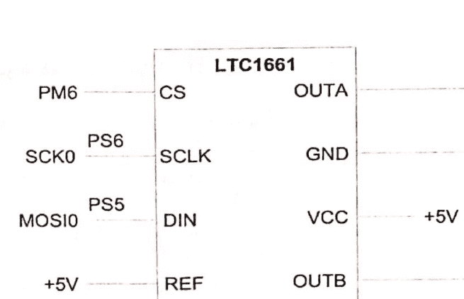

图 9.2 LTC1661 与 DRAGON12-Plus-USB 的连接

| 15 14 13 12 11 10 9 8 7 6 5 4 3 2 1 0 |
| :--- | :--- | :--- | :--- | :--- | :--- | :--- | :--- | :--- | :--- | :--- | :--- | :--- | :--- | :--- | :--- |
| A3 | A2 | A1 | A0 | D9 | D8 | D7 | D6 | D5 | D4 | D3 | D2 | D1 | D0 | X1 | X0 |

图 9.3 输入到 LTC1661 的字

## 串行外接口 (SPI)

图 9.3 中的高 4 位是一个 4 位控制代码，其功能见表 9.3。图 9.3 中的第 11 – 2 位是所需的模拟输出对应的二进制数字的 10 位。图 9.3 中的低两位为无关位（don't）。

### 表 9.3 DAC 控制功能

| A0 A2 A1 A0 | 操作 |
| :--- | :--- |
| 0 0 0 0 | 不变 |
| 0 0 0 1 | 将数据加载到输入寄存器 A。DAC 输出不变 |
| 0 0 1 0 | 将数据加载到输入寄存器 B。DAC 输出不变 |
| 0 0 1 1 | 预留 |
| 0 1 0 0 | 预留 |
| 0 1 0 1 | 预留 |
| 0 1 1 0 | 预留 |
| 0 1 1 1 | 将输入寄存器的现有内容加载到两个 DAC 寄存器。输出更新 |
| 1 0 0 1 | 加载到输入寄存器 A。输出更新 |
| 1 0 1 0 | 加载到输入寄存器 B。输出更新 |
| 1 0 1 1 | 预留 |
| 1 1 0 0 | 预留 |
| 1 1 0 1 | 输入或 DAC 寄存器不变 |
| 1 1 1 0 | 输入或 DAC 寄存器不变 |
| 1 1 1 1 | 将 10 位代码加载到输入寄存器 A 和 B 中。输出更新 |

要开始操作，将图 9.2 中的 CS 引脚拉低。该引脚连接到 MC9S12DG256 微控制器上的 PM6，并可以使用 C 语句将其拉低：

```
PTM = 0xBF;
```

这等同于

```
PTM = PTM & 0xBF;
```

并通过将 PTM 与 11111111 进行与位运算，强制使 PTM 的第 6 位变为 0。

在使用表 9.2 中的 C 函数 `send_SPI0(char)` 先发送图 9.3 中的高位字节，然后发送低位字节，使用 C 语句将图 9.2 中的 CS 引脚拉高：

```
PTM |= 0x40;
```

这通过将 PTM 与 0100000 进行或位运算，强制使 PTM 的第 6 位变为 1。图 9.2 中的 SCLK 引脚连接到 MC9S12DG256 微控制器上的 SC0 引脚 (P5)。表 9.2 中的 C 函数 `SPI_init()` 以波特率 250 kHz 初始化 SPI 端口，并将数据移入 DAC。Listing 9.1 显示了一个 C 程序，读取 DIP 开关作为 8 位数，将控制代码 1111 加载到 A 和 B 寄存器，16 位值到 LTC1661 DAC。要测试此程序，必须在 DAC 的 OUTA（引脚4）和 ADC 的通道 1（引脚6）之间连接一根线。

### Listing 9.1：SPI 驱动 DAC

```c
#include <stdio.h> /* 通用定义和宏 */
#include <mc9s12dg256.h> /* 微控制器信息 */
#include "main_asm.h" /* 汇编接口 */

int val;
int W0;
char c;

void main(void) { // 设置系统时钟为24 MHz
    DIO_init(); // 初始化 A/D 转换器
    adi_enable(); // 启用 SPI
    lcd_init(); // 初始化 lcd
    SPI_init(); // 初始化 SPI模式0
    SW_enable(); // 启用 DIP开关
    DBR = 0xFF; // 端口输出
    while (1) {
        val = SW_dip(); // 读取 DIP开关
        val = val << 2; // 左移2位
        val = val & 0xFF; // 8位数据
        val = val | 0xF00; // 添加控制代码加载 DAC A&B
        W0 = val >> 8; // 获取高字节
        PTM &= ~0x7F; // PM6 置低
        c = sendSPI(W0); // 发送高字节
        c = sendSPI(val); // 发送低字节
        PTIM = 0x40; // PM6 置高
        val = adconv(1); // 读取 ADC通道1
        set_lcd_addr(0x40); // 在 LCD第二行显示
        write_lcd(val); // 在字段5写入值
        ms_delay(100); // 延迟0.1秒
    }
}
```

注意 `val = val << 2;` 语句会将16位变量 `val` 左移2位。在执行此操作时，会执行符号扩展。这意味着 DIP开关读取值10000000在左移2位后存储在 `val` 中将变为1111110000000。因此，图 9.3 中的位 D9 和 D8 在应为0的地方变成了1。因此我们使用指令 `val = val & 0x3FF;` 在使用控制代码指令 `val = val | 0xF00;` 之前强制图 9.3 中的高位为0。

### 内部原理

SPI 寄存器如图 9.4 所示。有两个控制寄存器、一个波特率寄存器、一个状态寄存和一个数据寄存器。

| SPI 控制寄存器 1 (SPI0CR1 - 0x00D8) | (SPI1CR1 - 0x00F0) | (SPI2CR1 - 0x00F8) |
| :--- | :--- | :--- |
| 7 | 6 | 5 | 4 | 3 | 2 | 1 | 0 |
| SPI | SPE | SPTIE | MSTR | CPOL | CPHA | SSDE | LSBFE |

SPE = 1: 启用 SPI 中断。
SPE = 0: 禁用 SPI。
SPTIE = 1: 启用 SPTEF 中断。
SPTE = 0: 禁用 SPI 中断。
MSTR = 1: SPI 主模式。
CPOL = 1: 选择低电平有效。空闲状态 CK 为高。
CPOL = 0: 选择高电平有效。空闲状态 CK 为低。
CPHA = 1: 在 SCK 时钟的偶数边 (2,4,...,16) 采样数据。
CPHA = 0: 在 SCK 时钟的奇数边 (1,3,...,15) 采样数据。
SSOE = 1: 如果 MODEN，SS 引脚为选择输出，否则主 SPI 不使用 SS。
SSOE = 0: 如果 MODEN，带有 MOD 功能的 SS 输入，否则主 SPI 不使用 SS。
LSBFE = 1: 先传输最高有效位。
LSBFE = 0: 先传输最低有效位。

| SPI 控制寄存器 2 (SPI0CR2 - 0x00D9) | (SPI1CR2 - 0x00F1) | (SPI2CR2 - 0x0FF9) |
| :--- | :--- | :--- |
| 7 | 6 | 5 | 4 | 3 | 2 | 1 | 0 |
| 0 | MODEN | BIDIRO | 0 | SPIWAI | SPC0 | SPIC2 |

MODEN = 1: 带有 MOD 功能端口。
MODEN = 0: SPI 不使用 SS。
BIDIRO = 1: 双向模式下输出。
SPIWAI = 1: 等待模式停止。
SPC0 = 引脚控制 0。

| SPI 波特率寄存器 (SPI0BR - 0x0DA) | (SPI1BR - 0x00F2) | (SPI2BR - 0x0CFA) |
| :--- | :--- | :--- |
| 7 | 6 | 5 | 4 | 3 | 2 | 1 | 0 |
| 0 | SPR2 | SPR2 | SPR1 | 0 | SPR2 | SPR1 | SPR0 | SPIBR |

```
BaudRateDivider = (SPPR[2:0] + 1) × 2^(SPPR[3])
BaudRate = 时钟/波特率
```


| SPI 状态寄存器 (`SPI0SR` - `0x00DB`) | (`SPI1SR` - `0x00F3`) | (`SPI2SR` - `0x0CFA`) |
| :--- | :--- | :--- |
| 7 | 6 | 5 | 4 | 3 | 2 | 1 | 0 |
| `SPIF` | `SPIF` | `SPTEF` | `MOD` | 0 | 0 | 0 | `SPISR` |

`SPIF` - SPI 中断标志。`SPIF` = 1: 新数据加载到 `SPDR`。
`SPTE` - SPI 传输中断标志。`SPTEF` = 1: SPI 数据寄存器为空。
`MOD` - 模式故障标志。`MOD` = 1: 发生了模式故障。

| SPI 数据寄存器 (`SPI0DR` - `0x00DC`) | (`SPI1DR` - `0x00F4`) | (`SPI2DR` - `0x0CFC`) |
| :--- | :--- | :--- |
| 7 | 6 | 5 | 4 | 3 | 2 | 1 | 0 |
| bit7 | bit6 | bit5 | bit4 | bit3 | bit2 | bit1 | b40 |

图 9.4 SPI 寄存器

## 124 第 9 章

主设备通过在 SPI 数据寄存器中存储一个位来启动传输。如图 9.1 所示，位首先从最高位（bit 7）移出 `SPIXDR`，并从最低位（bit 0）移入和移出。如果 SPI 控制寄存器 1（`SPIXCR1`）中的 `LSBFE` 被置为 1，则数据将先传输最低位，而不是通常的最高位。

串行时钟 `SCK` 控制位移出和进入 `SPIXDR`。此时钟的频率可以通过 SPI 波特率寄存器 `SPIXDR` 控制，如图 9.4 所示。SPI 波特率由总线时钟（24 MHz）通过波特率分频器决定。

图 9.4 显示了 SPI 控制寄存器 1（`SPIXCR1`）。`CPOL` 和 `CPHA` 两个位控制时钟的极性和相位。如果 `CPOL` = 0，时钟空闲低电平；如果 `CPHA` = 0，数据在时钟的上升沿移位；如果 `CPHA` = 1，则在时钟的下降沿移位。如果 `CPOL` = 1，时钟空闲高电平；如果 `CPHA` = 0，数据在时钟的下降沿移位；如果 `CPHA` = 1，则在时钟的上升沿移位。如果 `CPHA` = 1，SS 从机线在连续传输期间可以保持低电平。相反，如果 `CPHA` = 0，则在连续的数据字节传输之间必须释放 SS 并重启。

要使用 SPI，必须将控制寄存器 `SPIXCR1` 中的位置为 1，要将 SPI 作为主设备，必须将 `MSTR` 置为 1。设置 SPI 位将启用中断，当数据传输完成时产生硬件中断。

当位完全移出（和/或移入）`SPIXDR` 后，状态寄存器 `SPIXSR` 中的 `SPIF` 标志（bit 7）被置为 1。该位通过读取状态寄存器 `SPIXSR` 随后访问数据寄存器 `SPIXDR` 来清除。

`SPIXCR` 中的 `SSOE` 可以启用主模式下的 SS 输出（如果 `SPIXCR2` 中的 `MODFEN` 被置为 1），此时在每次 SPI 传输期间，SS 输出自动变为低电平，在每个空闲状态变为高电平，以便检测设备。

在双向模式下，单线（主设备为 MOSI，从机为 MISO）可用于输入和输出。通过设置图 9.4 中的 SPI 控制寄存器 2（`SPIXCR2`）中的 `SBC` 来启用双向模式。在双向模式下，SPI 中的 `BIDIOE` 是输出位。当 `BIDIOE` = 0 时，输出缓冲区处于高阻态，可以从 MOSI 引脚读取输入。

列表 9.2 显示了表 9.2 中十二个函数调用的汇语言程序。在子程序 `SPI0_init` 中，`SPI0BR` 被设置了值 `$53`，这设置了波特率分频器。

`BaudRateDivisor` = (5 + 1) * 2^4 = 6 * 16 = 96

SPI 波特率为 24 MHz/96 = 250 kHz。下一个语句将十六进制值 `$50` 移入 `SPI0CR1`。这通过设置 `MSTR` 位启用了 SPI 主设备模式，并清零了 `CPOL` 和 `CPHA` 位。这意味着时钟空闲低电平，数据在时钟的上升沿移入。清零 `SPI0CR2` 中的所有位将禁用 `MODF`。最后，通过设置数据方向寄存器 `DDRS` 的第 7 位将 `SS0` 配置为输出。然后将此 `SS0` 引脚的输出清零。使用类似的子程序初始化 `SPI1` 和 `SPI2`。

## 列表 9.2 来自 main.asm 的 SPI 汇语言子程序

```assembly
; SPI 端口

; 使用波特率 250 Khz 初始化 SPI

; void SPI0_init();

SPI0_init:
    movb $53, SPI0BR      ;将 24 MHz 时钟除以 96
    movb $50, SPI0CR1      ;主, CPHA=0, CPOL=0
    clr SPI0CR2           ;禁用 MODF
    bset DDRS, $80        ;SS0 为输出端口
    bclr PTS, $80         ;SS0 = 0
    rts

; void SPI1_init();

SPI1_init:
    movb $53, SPI1BR      ;将 24 MHz 时钟除以 96
    movb $50, SPI1CR1      ;主, CPHA=0, CPOL=0
    clr SPI1CR2           ;禁用 MODF
    bset DDRP, $08        ;SS1 为输出端口
    bclr PTP, $08         ;SS1 = 0
    rts

; void SPI2_init();

SPI2_init:
    movb $53, SPI2BR      ;将 24 MHz 时钟除以 96
    movb $50, SPI2CR1      ;主, CPHA=0, CPOL=0
    clr SPI2CR2           ;禁用 MODF
    bset DDRP, $40        ;SS2 为输出端口
    bclr PTP, $40         ;SS2 = 0
    rts

; 发出 SPI 端口并接收字节

; char send_SPI0(char);

send_SPI0:
    brclr SPI0SR, $20     ;等待 SPIF=1
    stab SPI0DR            ;发送字节
    brclr SPI0SR, $80     ;等待完成
    ldab SPI0DR            ;接收字节

; char send_SPI1(char);

send_SPI1:
    brclr SPI1SR, $20     ;等待 SPIF=1
    stab SPI1DR            ;发送字节
    brclr SPI1SR, $80     ;等待完成
    ldab SPI1DR            ;接收字节

; char send_SPI2(char);

send_SPI2:
    brclr SPI2SR, $20     ;等待 SPIF=1
    stab SPI2DR            ;发送字节
    brclr SPI2SR, $80     ;等待完成
    ldab SPI2DR            ;接收字节
```

## 列表 9.2（续）来自 main.asm 的 SPI 子程序

```assembly
; 将 SS 置高电平

char send_SPI0_HI();

send_SPI0_HI:
    bset PTS, $80          ;设置端口 S 的第 7 位
    rts

; 将 SS 置高电平

char send_SPI1_HI();

send_SPI1_HI:
    bset PTP, $08         ;设置端口 P 的第 3 位
    rts

; 将 SS 置高电平

char send_SPI2_HI();

send_SPI2_HI:
    bset PTP, $40         ;设置端口 P 的第 6 位
    rts

; 将 SS 置低电平

char send_SPI0_LO();

send_SPI0_LO:
    bclr PTS, $80          ;清空端口 S 的第 7 位
    rts

; 将 SS 置低电平

char send_SPI1_LO();

send_SPI1_LO:
    bclr PTP, $08         ;清空端口 P 的第 3 位
    rts

; 将 SS 置低电平

char send_SPI2_LO();

send_SPI2_LO:
    bclr PTP, $40         ;清空端口 P 的第 6 位
    rts
```

子程序 `send_SPI0` 必须等待状态寄存器 `SPI0SR` 中的 `SPIF` 位变为 1，表示 SPI 数据寄存器已空。传递给累加器 B 的字符存储在 SPI 数据寄存器中；子程序等待 `SPI0SR` 中的 `SPIF` 位变为 1，表示字符已发送。最后，寄存器中接收到的字节加载到累加器 B 中，返回给 C 程序。使用类似的子程序在 `SPI1` 和 `SPI2` 中发送和接收数据。`SS0_HI` 将引 `SS0`（端口 S 的第 7 位）置为 1，`SS0_LO` 将 `SS0` 置为 0。`SS1_HI` 将引 `SS1`（端口 P 的第 3 位）置为 1，`SS1_LO` 将 `SS1` 置为 0。最后，`SS2_HI` 将引 `SS2`（端口 P 的第 6 位）置为 1，`SS2_LO` 将 `SS2` 置为 0。

## 9.3 带有 74165 移位寄存器的键盘接口

键盘键盘接口在第 3 章第 3.2 节中描述过。在该节中，键盘是 4x4 矩阵形式。某些键盘具有另一种形式，即每个按键的一侧连接到公共地。在本节中，我们将展示如何使用 SPI 端口通过 74165 移位寄存器读取这种 16×1 十进制键盘。

16×1 十进制键盘（16 个开关的任意组合）可以如图 5 所示连接到两个 74165 移位寄存器。在这种情况下，每个开关的一侧接地。74165 是 8 位并行输入移位寄存器。每个开关的另一侧连接到移位寄存器的并行输入（A–H）之一。如果将 74165 的 (SH-/LD) 引脚拉低，八并行输入的值就会锁存到移位寄存器中。当 SH-/LD 引脚为低电平时，移位寄存器中的每个位都会右移一位。A 位移到 B，B 位移到 C，依此类推。G 位移到 H，显示在串行输出端口 QH 上。图 5 中，下 74165 的输出连接到 SPI 的串行输入端口 QIH。上 74165 的输出 QH 连接到 MC912DG256 中移位端口之一的 MISO 端口。

图 5 中，SPI 信号 CLK 连接到两个 74165 芯片的每个 CLK 引脚。注意 SPI 端口的 MISO 引脚没有连接任何地方。SH-/LD 引脚也没有连接。我们只对在 MISO 端口接收字节感兴趣。为了实现这一点，我们必须向 SPI 数据寄存器 `SPI0DR` 写入一个哑值（例如零，通过调用 C 函数 `SPI0DR(0)`，在所需的字节移入 MISO 端口的同时，它会被移入未连接的 MISO 端口。

注意图 5 中，上 74165 的 H 引脚（按键 3）将是第一个输出位。这将是传输字节的最高位。传输一个字节后，下 74165 的寄存器内容将移入上 74165。按键 7 相关的值现在位于上 74165 的输出 QIH。传输第二个字节后，这个按键 7 值将位于第二个字节的最高字节。如果传输的字节成为最高字节，那么 16 位字的位将如图 9.6 所示与 16 个按键值相关联。

## 示例 28 – 使用 SPI 从移位寄存器读取数据

列表 9.3 显示的 C 函数 `read_16shift()` 返回如图 9.6 所示的 16 位值。它通过 SPI 端口移入两个 8 位字节来实现。注意首先读取高字节，左移 8 位，然后与低字节进行 OR 运算。

注意图 9.5，如果没有按键按下，移位寄存器的所有并行输入都被拉高电平。这意味着图 9.6 中的所有位都将被设置为 1。因此，此 16 位值的值为 `0xFFFF`。如果在执行 `read_16shift()` 函数时按下任何按键，与该按键相关的位将为零。列表 9.4 显示的 `key()` 函数将搜索图 9.6 中被清零的位。它通过与一个仅设置了一个位的掩码进行 AND 运算并检查该位是否为零。掩码从设置最高位（`0x8000`）开始，这对应于图 9.6 中的第 0 位，然后在每次循环循环时使用该语句将位右移。`mask >>= 1;` 这等同于 `mask = mask >> 1;`

我们将图 9.6 中的最高位（MSB）标记为 0 而不是 15，以便该位编号将与列表 9.4 所示的表 `keytl[]` 表中的索引值相对应。当发现位位为 0 时，`keytl[i]` 的值将是按下按键的十六进制值，且该值将作为函数 `get_key()` 的返回值。请注意，如果没有按下按键，则 `get_key()` 的值为 16。

列表 9.5 显示了一个主程序，该程序将使用列表 9.3 和 9.4 中提供的两个函数。该程序将等待你按下按键，然后在 LCD 上显示按键值。

# 列表 9.4 get_key() 函数

```c
char get_key() {
    const Char keytbl[] = {
        0x03, 0x02, 0x01, 0x00,
        0x08, 0x09, 0xA, 0xB,
        0x07, 0x06, 0x05, 0x04,
        0xC, 0x0D, 0xE, 0x0F
    };
    int i, mask, data;
    char found;
    char key;
    data = read_16shift();
    mask = 0x8000;
    found = 0;
    i = 16; // 如果 key = 16 则未找到
    while((i < 16) && (found == 0)) {
        if((data & mask) == 0) {
            found = 1;
            key = keytbl[i];
        } else {
            mask >>= 1;
            i++;
        }
    }
    return key;
}
```

### 列表 9.5 示例 28

```c
// 示例 28: SPI 键矩阵与 74165 位寄存器接口
#include <hdef.h>      /* 通用定义和宏 */
#include <mc9s12dp256.h> /* 衍生器件信息 */
#include "main.asm.h"   /* 与汇编模块的接口 */
#pragma LINK_INFO DERIVATIVE "mc9s12dp256b"
int get_key(void);
void main(void) {
    char key;
    PLL_init();      // 设置系统时钟为 24 MHz
    lcd_init();      // 启用 lcd
    SPIO_init();     // 启用 SPI0
    set_lcd_addr(0x40);
    while (1) {
        key = get_key();
        if(key < 16){
            key = hex2asc(key); // 转换为 ascii
            data8(key);      // 显示在 lcd 上
        }
    }
}
```

# 第 9 章

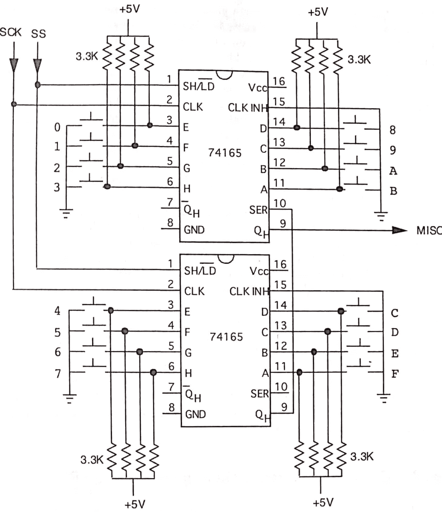

图 9.5 将 16 x 1 键矩阵连接到两个 74165 位寄存器

| 0 | 1 | 2 | 3 | 4 | 5 | 6 | 7 | 8 | 9 | 10 | 11 | 12 | 13 | 14 | 15 |
|---|---|---|---|---|---|---|---|---|---|---|---|---|---|---|---|
| 3 | 2 | 1 | 0 | 8 | 9 | A | B | 7 | 6 | 5 | 4 | C | D | E | F |

图 9.6 图 9.5 中传输 16 位后键矩阵的十六进制值

# 串行外接口 (SPI)

129

Listing 9.3 read_16shift(){
int read_16shift(void) {
int data;
char c;
SS0 LO(); // 锁数据
SS0 HI();
c = send_SPI0(0); // 通过发送伪数据获取第一个字节
data = c;
data = data << 8;
c = send_SPI0(0); // 通过发送伪数据获取第二个字节
data = data | c;
return data;
}
}


# 串行外接口 (SPI)

### 问题

9.1 Analog Devices 的 `AD7376` 是一款 ±15 V 的数字电位器。下方显示了简化的框图。

| SDO | AD7376 | A |
|---|---|---|
| SDI | 数字 | W |
| CLK | 电位器 | B |
| CS | | |

你可以访问 `http://www.analog.com/en/prod_0..761_797_AD7376%2C00.html` 下载完整的数据数据表。A 和 B 之间的固定电阻 `$RAB$` 可以是 10 k、50 k、100 k 或 1 M。输出 `W` 是“游标”，导致 `W` 和 B 之间的电阻由等式给出

> `$RW(D)=(D/128)\times RAB+RW$`

其中 `D` 是移入 `SDI` 的 7 位数据，`$RW$` 是等于 120 的游标接触电阻。
你可以将 `AD7376` 连接到 SPI 口，将 `SS` 信号连接到 `CS` 引，`SCK` 信号连接到 `CLK` 引，`MOSI` 信号连接到 `SDI` 引，`MISO` 信号到 `SD0` 引。当 `CS` 为低电平时首先移入 8 位数据。`SD0` 引可以级联多个电阻器。
编写一个名为 `R(int n)` 的 C 函数，使 `W` 和 `B` 之间的电阻为 `$n$` 欧姆。假设 `RAB = 10 k`，因此 `n` 应在 0 到 10000 之间。

# 第 10 章

## 定时器

定时器是微控制器接口的重要部分。它们可以产生延迟、测量时间间隔、创建各种输出波形、计数事件。

`MC9S12` 系列微控制器包含了用于各种用途的定时器。最常见的用途之一是脉宽调制 `PWM`，用于控制 LED 的亮度或直流电机的速度。另一个常见用途是测量输入脉冲宽度。

`MC9S12dp256` 有两个 16 位定时器，`TIM0` 和 `TIM1`。每个定时器都可以配置为多种模式，包括空闲运行、输入捕获和 PWM。

### 10.1 输出比较

输出比较模式用于当计数器达到特定值时触发事件。该事件可以用于翻转引脚、产生中断或启动另一个定时器。

在输出比较模式下，你将一个值加载到输出比较寄存器。当定时器计数匹配该值时，触发输出比较事件。例如，如果你配置定时器翻转引脚，引脚将在每次达到该值时改变状态。通过周期性更改输出比较值，可以生成 PWM 信号。

### 10.2 输入捕获

输入捕获模式用于测量外部脉冲宽度。当在输入脚上检测到边缘时，当前的定时器值会被捕获到输入捕获寄存器。通过比较连续边缘的捕获值，可以确定脉冲宽度。

### 10.3 PWM

`PWM` 模式用于生成具有可变占空比的正方波。这是通过使用输出比较模式来翻转引脚来实现的。

`MC9S12dp256` 还具有内置 `PWM` 模块，可以在不使用软件的情况下生成 `PWM` 信号。

### 列表 10.1 示例 29

```c
// Example 29: 中断驱动脉冲序列

#include <hidef.h> /* 通用定义和宏 */

#include <cm9s12dg256.h> /* 衍生信息 */

#pragma LINK_INFO DERIVATIVE "cm9s12dg256b"

#include "main_asm.h" /* 与汇编模块的接口 */

int period;      // 脉冲序列周期

int pwidth;     // 脉冲高电宽

// 定时器通道 6 中断服务程序

void interrupt_14_handler() { {

    ptrain6(period, pwidth);

}

void main(void) {

    PLL_init();      // 设置系统时钟为 24 MHz

    ptrain6_init();

    period = 5734;

    pwidth = 2867;

    while(1) {        // 生成脉冲序列期间什么都不做

    }

}
```

与定时器相关的寄存器如表 10.2 所示。所有的定时器函数都基于一个自由运行的 16 位计数器 `TCNT`，如图 10.2 所示。`TCNT` 的地址 `S0044` 是 `TCNT` 高字节的地址。访问 `TCNT` 内容时应以字 `word` 的形式，以便读取存储在 `TCNT` 中的 16 位值。

| 表 10.2 HCS12 中的定时器寄存器 |
| 名称 | 寄存器地址 |  |
|---|---|---|
| `TIOS` | 0040 | 定时器输入捕获/输出比较选择 |
| `CFC` | 0041 | 定时器比较强制掩码 |
| `OCTM` | 0042 | 输出比较 7 掩码寄存器 |
| `OC7D` | 0043 | 输出比较 7 数据寄存器 |
| `TCNT` | 0044 | 定时器计数器 1 |
| `TSCR1` | 0046 | 定时器系统控制寄存器 1 |
| `TTO` | 0047 | 定时器翻转溢出寄存器 |
| `TCTL1` | 0048 | 定时器控制器 1 |
| `TCTL2` | 0049 | 定时器控制器 2 |
| `TCTL3` | 004A | 定时器控制器 3 |
| `TCTL4` | 004B | 定时器控制器 4 |
| `TIE` | 004C | 定时器中断允许寄存器 |
| `TSCR2` | 004D | 定时器系统控制寄存器 2 |
| `TFL1` | 004E | 主定时器中断标志 1 |
| `TFL2` | 004F | 主定时器中断标志 2 |
| `TCn(0-7)` | 0050-005F | 定时器输入捕获/输出比较寄存器 n |

## 定时器 135

| 定时器计数器 (TCNT – 0x0044 – 0x0045) | |
| 7 6 5 4 3 2 1 0 |
| tcnt15 tcnt14 tcnt13 tcnt12 tcnt11 tcnt10 tcnt9 TCNTH |
| tcnt7 tcnt6 tcnt5 tcnt4 tcnt3 tcnt2 tcnt1 TCNTL |
| 16 位递加计数器 |

图 10.2 定时器计数器

你必须通过设置定时器系统控制寄存器 1 中的 `TSCRI` 的第 7 位来启用定时器，如图 10.3 所示。因此，汇编语言指令

```
movb #80, TSCR1
```

将启用定时器，对 `TCNT` 的任何访问都将获得一个新的计数器。

| 定时器系统控制寄存器 1 (TSCR1 – 0x0046) | |
| 7 6 5 4 3 2 1 0 |
| TEN TSWAI TSFRZ FFCA 0 0 0 TSCR1 |
EN = 1: 启用。TEN = 0: 定时器禁用。
SWAI — 定时器模块在等待期间停止
TSFRZ — 定时器和模数值在冻结模式下停止
TFFCA — 定时器和标志全部清除

图 10.3 定时器系统控制寄存器 1

`TCNT` 的值增加速率取决于三个位：`PR0`；`PR1`，在定时器系统控制寄存器 2 `TSCR2` 中，如图 10.4 所示，公式如下

定时器时钟速率 = BusClock/2^PR1PR0

`PR[2:0]` 的默认值为 000，如果总线时钟为 24 MHz，则定时器时钟速率为 24 MHz，`TCNT` 大约每 41.6 ns 增加一次。这意味着计数器每 2.73 ms 溢出一次（从 FFFF 变为 00000）。通过更改 `TSCR` 中的这三个位，你可以将时钟速率倍增 2、4、8、16、32、64 或 128 倍。这些位可以随时更改；然而，更改在下一次所有预分计数器都为零时才会生效。对于 24 MHz 的总线时钟，最慢的时钟速率为 24 MHz/2^7=187.5 kHz，在该速率下，定时器每 350 ms 溢出一次。

| 定时器系统控制寄存器 2 (TSCR2 – 0x004D) | |
| 7 6 5 4 3 2 1 0 |
| TOI 0 0 TCRE PR1 PR0 TSCR2 |
TOI = 1: 定时器中断启用。
TOI = 0: 定时器中断禁用。
TCRE = 1: 输出比较重置计数器。
TCRE = 0: 计数器运行。
PR[2:0] — 定时器分频
定时器时钟速率 = BusClock/2^PR1PR0

图 10.4 定时器系统控制寄存器 2

# 第 10 章

当定时器溢出时，`TFLG2`（主中断标志 2）的 `TOF` 位设置为 1，如图 10.5 所示。通过向 `TFLG2` 的第 7 位 `TOF` 写入 1 来清除此标志。尽管这看起来很奇怪，但它是 HCS12 清除标志的标准方法。

| 主中断标志 2 (TFLG2 – 0x04F) | |
| 7 6 5 4 3 2 1 0 |
| TOF 0 0 0 0 0F TFLG2 |
溢出标志
写入 "1" 清除标志。

图 10.5 主中断标志 2

端口 `T` 的每个引脚都可以选择为输入捕获或输出比较。这种选择通过设置定时器输入捕获/输出比较寄存器 `TIOS` 完成，如图 10.6 所示。

| 定时器输入捕获/输出选择寄存器 (TIOS – 0x040) | |
| 7 6 5 4 3 2 1 0 |
| IOS7 IOS6 IOS5 IOS4 IOS3 IOS2 IOS1 IOS0 |
IOS[7:0] = 0: 通道作为输入捕获
IOS[7:0] = 1: 通道作为输出比较

图 10.6 定时器控制寄存器

HCS12 有 16 位输入捕获/输出寄存器 `TCn`，如图 10.7 所示。例如，`TC2` 的地址为 `$0054–$0055`，`TC7` 的地址为 `$005E`。

| 定时器输入捕获/输出比较寄存器 0–7 (TCn – 0x050–0x05E) | |
| 7 6 5 4 3 2 1 0 |
| TCN15 TCN14 TCN13 TCN12 TCN11 TCN10 TCN9 TCN8 TCn |
| TC7 TCN6 TCN5 TCN4 TCN3 TCN2 TCN1 TCN0 |

图 10.7 定时器输入捕获/输出比较寄存器

当自由运行计数器 `TCNT` 的值等于输出比较寄存器之一存储的值时，主中断标志 1 `TFLGI1` 中对应的输出比较标志 `CxF` 如图 10.8 所示。注意，这是通过向相应位写入 1 来清除的。

| 主中断标志 1 (TFLGI1 – 0x04E) | |
| 7 6 5 4 3 2 1 0 |
| C7F C6F C5F C4F C3F C2F C1F C0F TFLGI1 |
CnF — 输入捕获/输出比较通道 "n" 标志

写入 "1" 清除标志。

图 10.8 主中断标志 1 寄存器

八个输出比较 `OC0–OC7` 与端口 `T` 的引脚 `PTT0–PTT7` 相关。当自由运行计数器 `TCNT` 匹配图 10.7 所示的输出比较寄存器之一的值时，对应的输出比较标志 `CFx` 在 `TFLGI` 中设置，如图 10.8 所示。发生这种情况时，可以改变 `PTT0–PTT7` 的输出。通过这种方式，我们可以在端口 `T` 的 0–7 上产生波形。

除了图 10.7 和 10.8 所示的寄存器外，图 10.9 所示的寄存器也用于输出比较。输出比较 7 可以控制任何引脚 `PTT0–PTT7` 的输出。相反，输出比较 0–6 只能控制它们自身的引脚。输出比较 7 寄存器 `OC7M` 和输出比较 7 数据寄存器 `OC7D` 被输出比较 7 用于控制引脚 `PTT–PT7` 的输出。通过设置输出比较 `OC7M`，`PTT7` 的输出将置高或置低。`TC6` 控制 `PTT6` 的方式由寄存器 `T1` 中的两个位 `OM6` 和 `OL6` 决定，如图 10.9 所示。例如，如果 `OM6 = 1` 且 `OL6 = 1`，则匹配成功后将设置 `PTT6`。

| 输出比较 7 掩码寄存器 (OC7M – 0x0042) | |
| 7 6 5 4 3 2 1 0 |
| OC7M OC7M OC7M OC7M OC7M OC7M OC7M OC7M |
如果 OC7Mn = 1, [n = 6:0]，OC7D寄存器中的相应位在通道 n 上匹配 TC7 时输出。 |

| 输出比较 7 数据寄存器 (OC7D – 0x0043) | |
| 7 6 5 4 3 2 1 0 |
| OC7D OC7D OC7D OC7D OC7D OC7D OC7D OC7D |
OC7Dn [n = 6:0], 在通道 n 上匹配 TC7 时输出。 |

# 第 10 章

通过设置图 10.10 所示定时器中断寄存器中的相应位，可以引起输出匹配中断。定时器溢出中断位 `*TOI*` 是图 10.4 所示定时器控制寄存器 2 `*T2CR2*` 的第 7 位。

### 定时器中断使能寄存器 (TIE – 0x04C)

| 7 | 6 | 5 | 4 | 3 | 2 | 1 | 0 |
|---|---|---|---|---|---|---||-|
| C7I | C6I | C5I | C4I | C3I | C2I | C1I | C0I |
| 输入捕获/输出比较 "n" 中断使能 | | | | | | | |

图 10.10 定时器中断使能寄存器

有时你可能在 `TCn` 达到输出比较寄存器 `Tn` 中存储的值之前触发输出比较事件。你可以通过向图 10.11 所示的定时器比较寄存器 `*FCORC*` 中的相应位 `*FOCx*` 写入 1 来实现。这样做时，`TFLG1` 中的输出比较标志 `*CxF*` 会被置，但不会发生中断。只有输出比较事件（例如触发 Port T 引脚）会发生。

### 定时器比较强制寄存器 (CFORC – 0x0041)

| 7 | 6 | 5 | 4 | 3 | 2 | 1 | 0 |
|---|---|---|---|---|---|---|---|
| FOC7 | FOC6 | FOC5 | FOC4 | FOC3 | FOC2 | FOC1 | FOC0 |

FOC[7] = 1: 强制通道 7–0 输出比较操作。中断标志不受影响。
FOC[7] = 0: 正常操作。不采取操作。

图 10.11 定时器比较强制寄存器

Listing 10.2 显示了表 10.1 前两个 C 函数调用的汇编程序。在子程序 `*ptrain0_init*` 中，十六进制值 `*$C0$` 被存储在定时器捕获/输出比较选择寄存器 `*TIOS*` 中（见图 10.6），这将使 Port T 输出的第 6 位和第 7 位生效。Listing 10.2 子程序 `*ptrain1_init*` 中的第二条指令显示了 `*TSCR2*` 中的值 `*$S4$`（见图 10.4），这将定时器时钟频率设置为 `$24\,MHz/2=12\,MHz$`。然后通过设置系统控制寄存器 1 `*TSCR1*` 中的 `*TEN*` 位（第 7 位）（见图 10.3）来启用定时器。随后 `*TCNT*` 的当前值被存储在输出比较寄存器 `*TC6*` 和 `*TC7*` 中。

`*OC7M*` 和 `*OC7D*` 的第 6 位（见图 10.9）被设置为 1，这将使第 6 位发生高匹配。为了使 `*PT6*` 发生低匹配，将 `*TCTLL*`（见图 10.8）中的 `*OM6*`（第 5 位）设置为 1，并清零 `*TCTLL*` 中的 `*OL6*`（第 4 位）。为了启用 `*TC6*`，我们设置图 10.10 所示定时器中断使能寄存器的第 6 位。最后，我们必须通过指令 `*csei*` 清除中断控制寄存器中的中断掩码位（第 1 位）来启用所有硬件中断。

Listing 10.2 中的子程序 `*ptrain6_init*` 由 Listing 10.1 中的输出比较中断服务程序调用。`*pwidth*` 的值通过累加器 `*D*` 传递给子程序，周期值被推入栈并加载到 `*$sp + 2*`。通过将 `*D*` 推入栈来保存 `*pwidth*` 的值，随后将周期值（现在位于 `*$sp + 4$`）加载到 `*D*` 中，并与 `TC7` 中的当前值相加，最后将结果存回 `TC7`。`TC7` 的下一次匹配将导致 `PPT6` 引脚上的输出变为高电平，如图 10.1 所示。现在栈顶的 `pwidth` 值将加到 `TC7` 的此新值上并存储在 `TC6` 中。`TC6` 的下一次匹配将导致 `PPT6` 引脚上的输出变为低电平，如图 10.1 所示。位于栈顶的 `pwidth` 值必须从栈中弹出，以便使返回地址位于栈顶。在从子程序 `pname` 返回之前，必须通过向 `TFLGI` 写入值 0（见图 10.8）来清零 `C7` 和 `C6` 标志。

### Listing 10.2 来自 main.asm 的脉冲序列汇编子程序

```
; ptrain6_init()

ptrain6_init:

    movb    $C0,TIOS      ;选择输出比较 6 & 7

    movb    $04,TSCR2      ;除以 16: 24MHz/16 = 1.5 MHz

    movb    $80,TSCR1      ;启用定时器

    ldd     TC7

    std     TC6             ;在 TC6 & TC7 中初始化计数

    bset    OC7M,$40      ;PT6 输出脉冲序列

    bset    OC7,$40       ;TC7 为高电平

    bset    TCTL,$50      ;TC6 为低电平

    clr     TCTL,$10       ;启用 TC6 中断

    bset    IE,$40         ;启用中断

    ret

; void ptrain(int period, int width)

ptrain6:

    push    D               ;保存 pwidth

    ldd     2(sp)          ;加载周期

    add     D,TC7          ;TC7 = TC7 + period

    std     TC7             ;存回 TC7

    pop     D               ;恢复 pwidth

    add     D,TC6          ;TC6 = TC6 + width

    std     TC6             ;存回 TC6

    clr     $C0,TFLGI       ;清空 C7 & C6 标志

    ret
```


示例 3 播放音符

扬声器连接到 `PPT5`。你可能希望在 `TCn` 达到输出比较寄存器 `*Tn*` 中存储的值之前触发输出比较事件。你可以通过向图 10.11 所示的定时器比较寄存器 `*FCORC*` 中的相应位 `*FOCx*` 写入 1 来实现。这样做时，`TFLG1` 中的输出比较标志 `*CxF*` 会被置，但不会发生中断。只有输出比较事件（例如触发 Port T 引脚）会发生。

| 音符 | 频率 (Hz) | 周期 (ms) | 音高 |
|---|---|---|---|
| 中音 | 261.63 | 3.822 | 2867 |
| C#Db | 277.18 | 3.608 | 2706 |
| D | 293.66 | 3.405 | 2554 |
| D#Eb | 311.13 | 3.214 | 2411 |
| E | 329.63 | 3.034 | 2276 |
| F | 349.23 | 2.863 | 2148 |
| F#Gb | 369.99 | 2.705 | 2028 |
| G | 392.00 | 2.551 | 1914 |
| G#Ab | 415.30 | 2.408 | 1806 |
| A | 440.00 | 2.273 | 1705 |
| A#Bb | 466.16 | 2.145 | 1609 |
| B | 493.88 | 2.025 | 1519 |
| C | 523.25 | 1.911 | 1434 |
| C#Db | 554.37 | 1.804 | 1353 |
| D | 587.33 | 1.703 | 1277 |
| D#Eb | 622.25 | 1.607 | 1206 |
| E | 659.26 | 1.517 | 1138 |
| F | 698.46 | 1.432 | 1074 |
| F#Gb | 739.99 | 1.351 | 1014 |
| G | 783.99 | 1.276 | 957 |
| G#Ab | 830.61 | 1.204 | 903 |
| A | 880.00 | 1.196 | 853 |
| A#Bb | 932.33 | 1.073 | 805 |
| B | 987.77 | 1.012 | 760 |
| C | 1046.50 | 0.956 | 717 |

# 第 10 章

## 内部原理

列表 10.4 显示了与表 10.1 中最后四个函数调用对应的汇编程序。子程序 `sound_init` 与列表 10.2 中的子程序 `pitrain_init` 几乎相同，区别在于用通道 5 替换了通道 6，且没有启用中断。列表 10.4 中的 `sound_on` 子程序通过启用定时器和硬件 TC 中断来开启声音。列表 10.4 中的 `sound_off` 子程序通过禁用定时器和 TC 中断来关闭声音。

列表 10.4 中的 `tone` 子程序由列表 10.3 中的输出中断服务例程调用。`pitch` 的值通过累加器 D 传递给子程序。在将 D 压入栈以保存 `pitch` 值后，将该 `pitch` 值加到 `TC5` 的当前值上。`TC7` 的下一次匹配将导致 `PT7` 引脚上的输出变为电电，如图 10.12 所示。

从栈中弹出 `pitch` 值，将其加到 `TC7` 中的此新值，并存储在 `TC5` 中。`TC7` 的下一次匹配将使 `PT5` 引脚上的输出变为低电，如图 10.11 所示。在从子程序返回之前，必须清除 `$A0` 到 `TPLG1` 以及 `CTF` 和 `CSF` 标志位（见图 10.8）。

### 列表 10.4 来自 main.asm 的声音汇编语言子程序

```
sound_init();

sound_init:

    movb $A0,TSR      ;选择输出比较 5 & 7

    movb $04,TCR2      ;除以 16: 24MHz/16 = 1.5 MHz

    movb $80,TCSR1     ;启用定时器

    ldd TCNT

    std TC5            ;在 TC5 & TC7 中初始化计数

    bset OC7M,$20      ;在 PT5 输出脉冲序列

    bset OC7D,$20      ;TC7 匹配时 PT5 变高电

    bset TCTLI,$08     ;TC5 匹配时 PT5 变低电

    bclr TCTL1,$04     ;匹配

    rts
```

```
sound_on():

sound_on:

    movb $80,TCSR1     ;启用定时器

    bset TIE,$20          ;启用 TC5 中断

    bset                 ;启用中断

    cli

    rts
```

```
sound_off():

sound_off:

    sei                 ;禁用中断

    clr TCR1             ;禁用定时器

    bclr TIE,$20         ;禁用 TC5 中断

    rts
```

### 列表 10.4（续）来自 main.asm 的声音汇编语言子程序

```
; void tone(int pitch);

; pitch 存储在 D 中

; 在 TC5 的下降沿触发中断

tone:

    pshd                ;保存 pitch

    addd TC5            ;TC7new =TC5old + pitch

    std TC7             ;获取 pitch

    puld                                

    std TC5             ;TC5new =TC7new + pitch

    movb #SA0,TFLAG1    ;清除 C7F 和 C5F

    rts
```

## 10.2 输入捕获

在示例 29 中，我们使用定时器模块的输出比较功能生成了脉冲序列。定时器模块的输入捕获功能允许你在引脚 `PTXx` 发生上升或下降沿时将空计数器 `TCNT` 的值捕获到输入捕获寄存器 `TCX` 中。

表 10.4 中的函数调用是汇编程序，它们将允许你测量 `PTT1` 引脚上脉冲序列的高电平和低电平时间。函数 `HI01_init` 将在脉冲序列的两个边上启用 `TCI` 中断。定时器时钟设置为 1.5 MHz，因此 `TCI` 可测量的最大高/低脉冲宽度为 65,535/1.5 MHz = 43.7 ms。

函数 `HIotimes1()` 在你的中断服务例程中被调用。它记录了上次中断时读取的 `TCI` 值，并将该值从当前读取的 `TCI` 中减去，以得到脉冲宽度。如果中断发生在上升沿（在这种情况下测量的脉冲宽度为低电平）或下降沿（在这种情况下测量的脉冲宽度为高电平），则该函数会将最近的值保存在两个汇编变量中。你可以通过在 C 程序中调用 `get_HiTime1()` 和 `get_LOtime1()` 函数来获取这些值。

| 表 10.4 用于测量通道 1脉冲宽度的 C 函数 |
| 函数 | 描述 |
| --- | --- |
| void `HI01_init(void);` | 在通道 1 定时器时钟的双边上初始化输入捕获中断，时钟=1.5 MHz |
| void `HIotimes1(void);` | 在输入捕获中断例程中更新 HI – LO 时间 |
| int `get_HiTime1(void);` | 返回输入脉冲序列的最新 HI 时间 |
| int `get_LOtime1(void);` | 返回输入脉冲序列的最新 LO 时间 |

### 示例 31 – 测量输入脉冲宽度

在本示例中，我们将展示如何使用定时器通道 1 上的捕获中断来测量输入脉冲序列的高电平和低电平时间（因此是周期）。列表 10.5 显示读取输入脉冲序列的高、低脉冲宽度的示例，并将这些值与周期一起在 LCD 屏幕上显示。注意，显示的值为 1/1.5 MHz = 0.667 µsec 的倍数。

### 列表 10.5 示例 31 通道1测量脉冲宽度

```
// 示例 31: 通道1测量输入脉冲宽度

#include <hide.h> //共同定义和宏

#include <mc9s12dg256.h> //变体信息

#pragma LINK_INFO DERIVATIVE "mc9s12dg256b"

#include "main_asm.h" //汇编模块接口

// 定时器通道 1 中断例程

void interrupt1() {

    HLOTimes(); // 更新通道 1 的 HI-LO 时间

}

void main(void) {

    int period;

    int HI_time; // 通道1 脉冲序列的测量 HI 时间

    int LO_time; // 通道1 脉冲序列的测量 LO 时间

    PLL_init(); // 将系统时钟频率设置为 24 MHz
```

### 列表 10.6 来自 main.asm 的汇编语言子程序

; 计算通道 1 上脉冲序列的高低电平时间
;并将结果存储在 HI_timel 和 LO_timel
; void HILOL_init(void);

```
HILOL_init:

    bclr TIOS,$002      ;选择输入捕获 1

    movb $504,TCR2      ;除以 16: 24MHz/16 = 1.5 MHz

    movb $80,TCR1       ;启用定时器

    ldd TCNT

    std TC1

    bset TCTL4,$00C     ;初始化 TC1 中的计数

    movb $502,TFLG1     ;清除通道 1 任何旧标志

    bset TIE,$010        ;启用 TC1 中断

    bset RTS

    cli                 ;启用中断

    rts
```

; 计算通道 1 上脉冲序列的高低电平时间
; 并结果存储在 HI_timel 和 LO_timel
; void getHLOTimes(void);

```
HILOTimes:

    ldd TC1              ;保存 TC1

    pshbd TCold          ;LO_time

    subd brclr PTT,$02,HL1  ;如果 PTT1 为高，则上升沿

    std LO_timel;        ;存储 LO_timel

    bra HL2

    std HI_timel;        ;保存 HI_timel

    puld                 ;获取 TC1

    std TCold;           ;TCold = TC1

    bset TFLG1,$002      ;清除中断标志

    rts
```

; int get_HI_timel(void);
```
get_HI_timel:

ldd HI_timel

rts
```

; int get_LO_timel(void);
```
get_LO_timel:

ldd LO_timel

rts
```

- HL1:
- HL2:

# 第 11 章

## 模糊控制

在本例中，我们将展示如何使用 `DRAGON12-Plus-USB` 板作为模糊控制器。在阅读此示例之前，您应该阅读附录 E。

### 11.1 模糊控制器的设计

在附录 E 中，我们展示了模糊控制的设计由图 11.1 所示的三部分组成。首先使用 `get_inputs()` 将清晰输入映射到模糊集；然后使用 `fire_rule()` 将模糊规则应用于输入模糊集；最后，对输出模糊集进行去模糊化操作，并使用 `find_output()` 产生清晰输出。

在本例中，我们将设计一个模糊控制器，使乒乓球保持在一个垂直的有机玻璃圆柱的中心。通过圆柱底部的超声换能器进行测量。使用两个连续的位置读取来确定球的瞬时速度。模糊控制器的输出将是一个信号，用于控制圆柱底部散热风扇的速度，该风扇向上吹气以使乒乓球悬浮在预定的高度。圆柱外的第二个超声换能器可以测量您的手相对于地面的高度，模糊控制器可以让乒乓球跟随您的手！

第一步是定义输入的隶属函数。控制器的两个输入是 `ball_position`（球位置）和 `ball_speed`（球速），我们将使用图 11.2 所示的隶属函数集。为了使用内置的 HCS12 模糊控制器汇编指令，`ball_position` 和 `ball_speed` 的函数值必须是 0 到 255 之间的 8 位数。

第二步是定义输出功率。输出隶属函数被定义为单例（singletons），如图 11.3 所示。同样，`motor_power`（电机功率）的值必须在 0 到 255 之间。

第三步是确定模糊规则。这些是基于两个输入（`ball_position`, `ball_speed`）和输出（`motor_power`）的常识规则。将这些规则以图 11.4 所示的 5x5 模糊 K 图的形式表示非常方便。该模糊 K 图中的条目是输出 `motor_power` 的隶属函数。

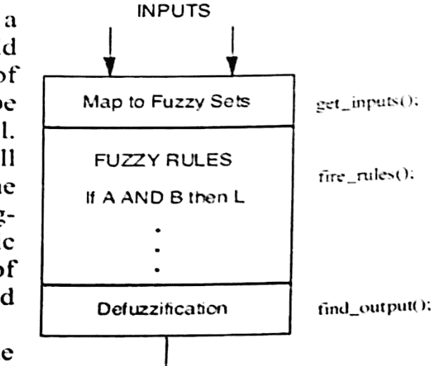

148          第 11 章

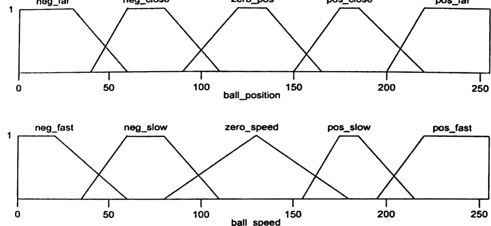

图 11.2 悬浮乒乓球的输入隶属函数

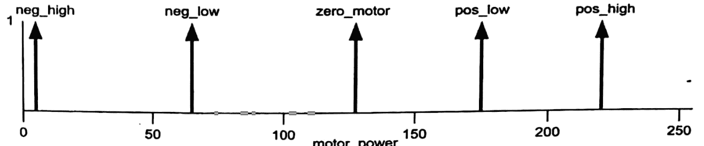

图 11.3 悬浮乒乓球的输出隶属函数

例如，如果 `ball_position` 为 `zero_p`（位于目标位置）且 `ball_speed` 为 `zero_s`（未移动），那么 `motor_power` 的变化应该是 `zero_m`（无变化）。这是 11.4 中的中心条目。

如果在图 11.4 的中间行 `ball_speed` 为 `zero_s` 且 `ball_position` 为 `neg_close`（略低于目标位置），我们需要通过将 `motor_power` 设置为 `pos_low` 来稍微增加风速。如果 `ball_position` 为 `neg_far`（远低于目标位置），我们应该通过增大电机功率来增加风速。

| | `ball_speed`: `zero_s` | ... |
|---|---|---|
| `ball_position`: `zero_p` | `zero_m` | ... |
| `ball_position`: `neg_close` | `pos_low` | ... |
| `ball_position`: `neg_far` | `pos_high` | ... |

| `ball_position`: `zero_p` | `ball_speed`: `zero_s` |
|---|---|
| `motor_power`: `zero_m` | center_ |

| `ball_position`: `zero_p` | `ball_speed`: `zero_s` |
|---|---|
| `motor_power`: `zero_m` | center_ |

## 模糊控制

### 列表 11.1a 示例 32

```
// Example 32：模糊控制 -- 乒乓球
```


```c
#include <hidef.h> /*公共定义和宏 */

#include <mc9s2lg256.h> /* 导数信息 */

#pragma LINK_INFO DERIVATIVE = mc9s2dg256b"

#include <main_asm.h> /* 与汇编模块的接口 */

#define NUM_MEMBER = 5;

void get_slopes(unsigned char ball[],unsigned char mem[],int num_mem);

// 全局变量定义

static int num_member_pos = 5;

static int num_member_speed = 5;

static int maxsize = 20;

static int num_member_motor = 5;

static int in_rules = 25;

void main(void) {

    // 输入隶属函数
    const unsigned char char_position[] = {
        // 远 (neg_far)
        0, 30, 60, 80, 110,
        // 近 (neg_close)
        90, 120, 135, 165,
        // 零速 (zero_speed)
        175, 185, 215,
        // 近 (pos_close)
        200, 220, 225, 255
        // 远 (pos_far)
    };

    const unsigned char char_speed[] = {
        // 快 (neg_fast)
        0, 20, 40, 60, 80,
        // 慢 (neg_slow)
        110, 130, 150, 175,
        // 零速 (zero_speed)
        185, 215, 255, 195, 220, 225, 255
        // 慢 (pos_slow)
    };

    unsigned char mem_pos[20];
    unsigned char mem_speed[20];

    // 输出隶属函数
    unsigned char char_cent[] = {
        5, 65, 128, 175, 220
    };

    unsigned char inout_array[] = {
        // 远 (neg_far)
        0,
        // 近 (neg_close)
        0,
        // 零位置 (zero_pos)
        0,
        // 近 (pos_close)
        0,
        // 快 (pos_fast)
        0,
        //权重 weight_speed[]
        5,
        // 慢 (neg_slow)
        0,
        // 零速 (zero_speed)
        0,
        // 慢 (pos_slow)
        0,
        // 快 (pos_fast)
        0,
        // 输出 out[]
        0,
        // 低 (neg_low)
        0,
        // 零电机 (zero_motor)
        0,
        // 低 (pos_low)
        0,
        // 高 (pos_high)
        0
    };
}
```

# 第 11 章

### 列表 11.1b 示例 21（续）

```c
unsigned char rules[] = {
    0, 0xFE, 14, 0xFE,    // 如果 x1 是负快 且 x2 是负快 则 y 为正高
    0, 6, 0xFE, 14, 0xFE,
    0, 7, 0xFE, 14, 0xFE,
    0, 8, 0xFE, 13, 0xFE,
    0, 9, 0xFE, 12, 0xFE,    // 如果 x1 是负近 且 x2 是负快 则 y 为正高
    1, 6, 0xFE, 14, 0xFE,
    1, 7, 0xFE, 13, 0xFE,
    1, 8, 0xFE, 12, 0xFE,
    1, 9, 0xFE, 11, 0xFE,
    2, 5, 0xFE, 14, 0xFE,
    2, 6, 0xFE, 13, 0xFE,    // 如果 x1 是正近 且 x2 是负快 则 y 为正高
    2, 7, 0xFE, 12, 0xFE,
    2, 8, 0xFE, 11, 0xFE,
    2, 9, 0xFE, 10, 0xFE,
    3, 5, 0xFE, 13, 0xFE,    // 如果 x1 是正近 且 x2 是负快 则 y 为正低
    3, 6, 0xFE, 12, 0xFE,
    3, 7, 0xFE, 11, 0xFE,
    3, 8, 0xFE, 10, 0xFE,
    3, 9, 0xFE, 9, 0xFE,
    4, 5, 0xFE, 12, 0xFE,    // 如果 x1 是正远 且 x2 是负快 则 y 为零电机
    4, 6, 0xFE, 11, 0xFE,
    4, 7, 0xFE, 10, 0xFE,
    4, 8, 0xFE, 13, 0xFE,
    4, 9, 0xFE, 10, 0xFF
};
```
`unsigned char*` `ptr_memb_pos`;
`unsigned char*` `ptr_memb_speed`;
`unsigned char*` `ptr_weight_pos`;
`unsigned char*` `ptr_weight_speed`;
`unsigned char*` `ptr_inout_array`;
`unsigned char*` `ptr_out`;
`unsigned char*` `ptr_rules`;
`unsigned char*` `ptr_cent`;
`unsigned char` `x1`;               // 输入 x1
`unsigned char` `x2`;               // 输入 x2
`unsigned char` `y`;                // 输出 y

`ptr_memb_pos` = `mem_pos`;
`ptr_memb_speed` = `mem_speed`;
`ptr_weight_pos` = `inout_array`;
`ptr_weight_speed` = `inout_array`+`num_memb_pos`;
`ptr_inout_array` = `inout_array`;
`ptr_out` = `inout_array`+`num_memb_speed`;
`ptr_rules` = `rules`;
`ptr_cent` = `cent`;

`PLL_init()`;                    // 将系统时钟设为 4 MHz
`get_slopes(ball,memb_pos,maxsize)`;
`get_slopes(ball,memb_speed,maxsize`);

### 列表 11.1c 示例 21（续）

```c
// 模糊控制器
while(1) {
    x1 = get_position(); // 用户定义
    x1 = 100; // 测试用例 -- 删除
    fill_weights(ptr_weight_pos,num_mem_pos,x1);
    x2 = get_speed(); // 用户定义
    x2 = 150; // 测试用例 -- 删除
    fill_weights(ptr_weight_speed,num_mem_speed,x2);
    fire_rules(ptr_inout_array,ptr_rules,num_mem_motor);
    y = calc_output(ptr_out,num_mem_motor); // 用户定义
    adjust_motor(y);
}
```

```c
void get_slopes(unsigned char ball[], unsigned char mem[],int maxsize) {
    int j;
    unsigned char diff;
    for(j=0; j<maxsize; j+=4) {
        mem[j] = ball[j]; // 点 1
        mem[j+1] = ball[j+3]; // 点 2
        diff = (ball[j+1] - ball[j]);
        if(diff == 0)
            mem[j+2] = 0;
        else
            mem[j+2] = 255/diff; // 斜率 1
        if(diff == 0)
            mem[j+3] = 0;
        else
            mem[j+3] = 255/diff; // 斜率 2
    }
}
```

在列表 11.1a 中，我们将 `weight_pos[]`、`weight_speed[]` 和 `out[]` 三个数组包含在一个数组 `inout_array[]` 中。这样做的原因是，MEM 指令要求 `weight_pos[]` 和 `weight_speed[]` 连续连续，且模糊规则的定义（见下文）要求 `out[]` 数组位于 `weight_pos[]` 和 `weight_speed[]` 数组之后。

我们编写了一个汇编程序，由 C 函数 `void fill_weights(unsigned char* weight, unsigned char* membx, int num_mem_funcs, char x)` 调用，它将调用 MEM 函数。该函数通过根据 `membx` 指向的隶属函数集合填充 `weight` 指向的数组，从而对清晰输入 `x` 进行模糊化。

## 第 11 章

### 11.3 处理规则 – REV 和 fire_rules(...)

我们将使用附录 E 中的 MIN-MAX 规则寻找每个规则对输出的贡献。假设输出由单点函数 $L^k$ 表示。这些隶属函数由单点质心 `cent` 定义。输出数组 `out(k)` 将包含所有规则中所有输入权重的最大值。函数 `fire_rules(unsigned char* input_array, unsigned char* out, int number)` 的目的是填充输出权重向量 `out(k)`。具有两个输入的模糊规则可以用三元组 $(A_i, A_j, L_k)$ 表示，其中下标指代第 $k$ 个模糊规则。令值 $A'_i$ 为输入 $i$ 的权重向量 `weight(k)` 的第 $k$ 个元素的地址（指针）。因此，$A'_j$ 将对应于隶属函数之一，从而对应于模糊集之一。$A'_2$ 是输入 2 的权重向量 `weight(k)` 的第 $k$ 个元素的地址。通常情况下，$A'_i$ 是权重向量第 $k$ 个元素的地址。`fire_rules()` 函数的伪代码如下所示，并使用 HCS12 REV 指令实现。

```
fire_rules(out array) {
  for j = 1, num_rules {
    min_wt = 255;
    for i = 1, num_inputs {
      wt = weight[i][j];
      if (wt < min_wt) {
        min_wt = wt;
      }
    }
    out[j] = MAX(out[j], min_wt);
  }
}
```

#### 图 11.7 fire_rules() 的伪代码

#### HCS12 REV 指令

#### 图 11.8 REV 指令的设置

#### 图 11.9 inout_array[] 模糊映射图索引

156 第11章

你可能会好奇 `REV` 指令如何区分前件末尾的 $FE 和结果末尾的 $FE。答案是，它使用条件寄存器中的溢出位 V 作为标志来区分它们。当执行 `LDAA #FF` 语句时，该位会自动设置为零。随后，当 `REV` 指令遇到前件末尾的 $FE 时，会将该位翻转为1；当遇到结果末尾的 $FE 时，则通过重新向累加器 A 加载 $FF 将其清零。

## C 函数 fire_rules(...)

我们编写了一个汇编语言程序，该程序由 C 函数 `fire_rules(unsigned char* in_array, unsigned char* rules, unsigned char* out)` 调用，该程序会先清空数组。然后，它将索引器 X 指向 `rules[]` 数组，将索引器 Y 指向 `in_array[]`，将累加器 A 设置为 $FF 并调用 `REV` 指令。此时，`out[]` 数组将根据整个模糊规则列表填充相应的输出值。

### 11.4 输出去模糊化 — WAV 和 calc_output(...)

我们将始终使用由质心 `cmck` 表示的输出模糊集。我们还将使用附录 E 中描述的 MIN-MAX 推理规则。从附录 A 中的图 E11 可以清楚地看出，在这种情况下，重心 $y_0$ 仍然由公式 (E.11) 给出，其中 $W^k$ 现在是输出数组 `out(k)`，如图 11.8 所示，由上一节描述的 `fire_rules(...)` 函数计算。

一旦 `function_rules(...)` 函数填充了权重数组 `out(k)`，`find_output(...)` 函数将使用公式 (E.11) 计算重心 $y_0$。`find_output(...)` 函数的伪代码见图 11.10。输出隶属函数的质心存储在数组 `cmck` 中。

```
find_output()
  numer = 0;
  denom = 0;
  for k = 1, Q
    if out[k] != 0
    {
      numer = numer + out[k]*cent[k];
      denom = denom + out[k];
```

图 11.10 find_output(...) 的伪代码

## 模糊控制

### HCS12 WAV 指令

图 11.10 中的 `numer` 和 `denom` 值可以很容易地使用 HCS12 WAV 指令计算。如果索引寄存器 X 指向 `cent[k]`，索引器 Y 指向 `out[k]`，且累加器 B 包含输出隶属函数的数量 Q，那么 HCS12 WAV 指令会为 `numer` 计算一个24位值并将结果存储在 Y:D 中，同时为 `denom` 计算一个16位值并将结果存储在 X 中。因此，如果 WAV 指令后紧跟 `EDIV` 指令（见附录 C），那么重心值 $y_0$ 将保留下来。

我们编写了一个汇编语言程序，该程序由函数 `unsigned calc_output(unsigned char out, unsigned char *cent, int numout)` 调用，该程序将使用所述 WAV 指令返回结果。

模糊控制器的完整循环如列表 11.1c 所示。`get_position` 和 `get_speed` 是用户定义的函数，用于读取乒乓球的位置和速度。位置可以使用超声换能器测量。速度可以通过减去两个连续的位置测量值得到。

在对两个输入调用 `fill_weights(...)`、`fire_rules(...)` 和 `calc_output(...)` 后，单词 `adjust_motor(y)` 是一个用户定义的单词，会将风扇的速度设置为输出控制值附近。

### 11.5 内部原理 — 模糊控制汇编程序

在本章的节节中，我们使用了以下三个 C 函数来设计模糊控制器。

```
void fill_weights(unsigned char* weight, unsigned char*memb, int num_mem_fn, char x)
void fire_rules(unsigned char *in_array, unsigned char *rules, unsigned char *out, int numout)
unsigned char* calc_output(unsigned char *out, unsigned char *cent, int numout)
```


这三个函数执行的三个汇编程序见列表 11.2。`fill_weights`子程序接收指向权重数组和隶属数组的指针，以及隶属函数数量（5），并在累加器 B 中获取输入值 `x`。在按图 11.6 所示设置这些值后，调用 `MEM`指令五。当调用 `MEM`时，隶属函数的数量存储在 B 中，`dbne fwl`指令执行不零跳转。列表 11.2 所示的 `fire_rules`子程序接收指向 `inout`、`rules`和 `out`数组的指针，并在累加器 B 中获取输入。该子程序首先清空 `out`数组并设置 `REV`指令寄存器。列表 11.2 所示的 `calc_output`子程序接收指向 `out`和 `cent`数组的指针，并在累加器 D 中获取输出。该子程序首先设置 `WAV`指令寄存器，期望索引寄存器 X 指向 `cent[k]`，累加器 B 包含输出函数数量。然后 `WAV`指令会为 `numer`计算一个24位值（见图 11.10）并将结果存储在 Y:D 中，同时为 `denom`计算一个16位值并将结果存储在 X 中。`WAV`指令后紧跟 `EDIV`指令，会将商留在 Y 中。该值传输到 C 程序中的8位输出。

### 列表 11.2 来自 main.asm 的模糊控制汇编程序

```asm
; 模糊控制程序

void fill_weights(unsigned char* weight, unsigned char*memb, int num_mem_fn, char x)

fill_weights:

    psb                 ; 保存 x

    ldd 3,sp           ; B = num_mem_funcs

    ldx 5,sp           ; X -> memb

    ldy 7,sp           ; Y -> weight

    pula                ; A = x

    mem                 ; 模糊隶属

    dbne B,fwl
```

```asm
void fire_rules(unsigned char* in_array, unsigned char *rules, unsigned char *out, int numout)

fire_rules:

    ldx 2,sp           ; Y -> out array

    clr Y              ; 清空 out array

    dbne B,fr          ; B = numout

    ldx 4,sp           ; X -> rules

    ldy 6,sp           ; Y -> in array

    ldaa #FF           ; 设置 A = FF

    rev                 ; 规则评估
```

```asm
unsigned char calc_output(unsigned char *out, unsigned char *cent, int numout)

calc_output:

    ldx 2,sp           ; B = numout

    ldy 4,sp           ; X -> cent array

    wav                 ; Y -> out array

    ediv                ; Y = quotient

    cfr Y,D             ; D = quot, B = output
```

### 11.1

使用模拟模式运行列表 11.1 中的程序。在 `get_slope(...)`函数处设置断点并单步执行每个函数的指令。观察 `in_array`的内容并注意输出重心值的计算方式。

- 实现本描述的乒乓球模糊控制。使用超声换能器测量到乒乓球的距离。连续测量之间的差可以表示球的速度。使用有机玻璃缸底部的风扇来保持乒乓球在固定高度。
- 添加一个旋钮，用于设置乒乓球的高度。
- 添加一个让乒乓球在两个不同高度之间移动的模式。
- 使用第二个超声换能器测量从地板到你手的距离。使用串口将此距离发送到乒乓球。让乒乓球位于你手上方地板的高度。当你向上移动手时，乒乓球应该跟随！

### 11.3

使用模糊控制器来维持汽车发动机的怠速。怠速可以通过改变节气位置和点火提前来控制。在这个问题中，我们只考虑节气位置。两个输入为：
- `x1`：从一次测量到下一次 RPM 误差的变化
- `x2`：从一次测量到下一次 RPM 误差的变化
输出 `y`将是到改变节气位置的步进电机的信号。所有输入和输出值都缩放为 0-255。两个输入的隶属函数如下表所示。

| 输入 x1 | u1 | u2 | u3 | u4 |
|---|---|---|---|---|
| NM_1 | 0 | 0 | 20 | 100 |
| NS_1 | 0 | 100 | 100 | 120 |
| Z_1 | 100 | 128 | 128 | 156 |
| PS_1 | 136 | 156 | 156 | 255 |
| PM_1 | 156 | 235 | 255 | 255 |

| 输入 x2 | u1 | u2 | u3 | u4 |
|---|---|---|---|---|
| NS_2 | 0 | 0 | 64 | 128 |
| Z_2 | 64 | 128 | 128 | 192 |
| PS_2 | 128 | 192 | 255 | 255 |

输出 `y`将具有五个重心值：10、80、128、176 和 245，分别对应 `NM_y`、`NS_y`、`Z_y`、`PS_y`和 `PM_y`。

- a. 绘制两个输入 `x1`和 `x2`以及输出 `y`的隶属函数图表。
- b. 列出一组你认为合理的规则规则。例如，其中一条规则可能是：

```
IF x1 是 NS_1 且 x2 是 Z_2 THEN y 是 PS_y
```


类似于图 11.9 所示，为你的规则集绘制一个模糊 K 图。

c. 按照列表 11.1 中的格式为此问题编写一个模糊控制程序。

### 11.4 建议如何为以下每个应用设计模糊控制系统：

- a. 自动对焦相机。
- b. 卡车的刹车系统。
- c. 洗衣机。
- d. 根据雨量变化的变速雨刷器。
- e. 电烤箱。
- f. 火车的加加速和减速控制。
- g. 机器人机械臂。

## 附录 A

### CodeWarrior 教程 DRAGON12-Plus-USB

最新免费版 CodeWarrior – 特别版：`CodeWarrior for HCS12(X)` 微控制器（经典）V5.2 可从 `www.freescale.com` 获取。要配合 Dragon12 开发板使用 CodeWarrior，你需要从 `http://www.libbooks.com/downloads#LBECDragon12` 下载两个 zip 文件：`LBE_CodeWarrior_SMDDrivers` 和 `LBE_DRAGON12_Plus.zip`。解压 `LBE_CodeWarrior_SMDDrivers` 后会有三个文件夹。将这三个文件夹全部放入 `Program Files\Freescale\CWS12v5.2\` 文件夹。解压 `LBE_DRAGON12_Plus.zip` 后只有一个文件夹。将该文件夹放入 `Program Files\Freescale\CWS12v5.2\CodeWarrior_Examples\HCS12X` 文件夹。

在本教程中，你将执行示例 1a 中的程序。

1. 双击桌面上的 CodeWarrior IDE 图标启动程序。
2. 当你运行 CodeWarrior V5.2 (`IDE.exe`) 时，会出现启动对话框。

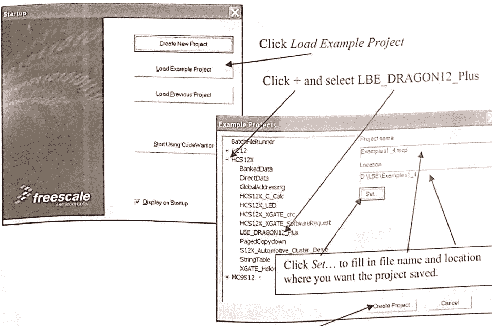

3. 点击 `+ Sources`

双击 `main.c` 显示示例 1a

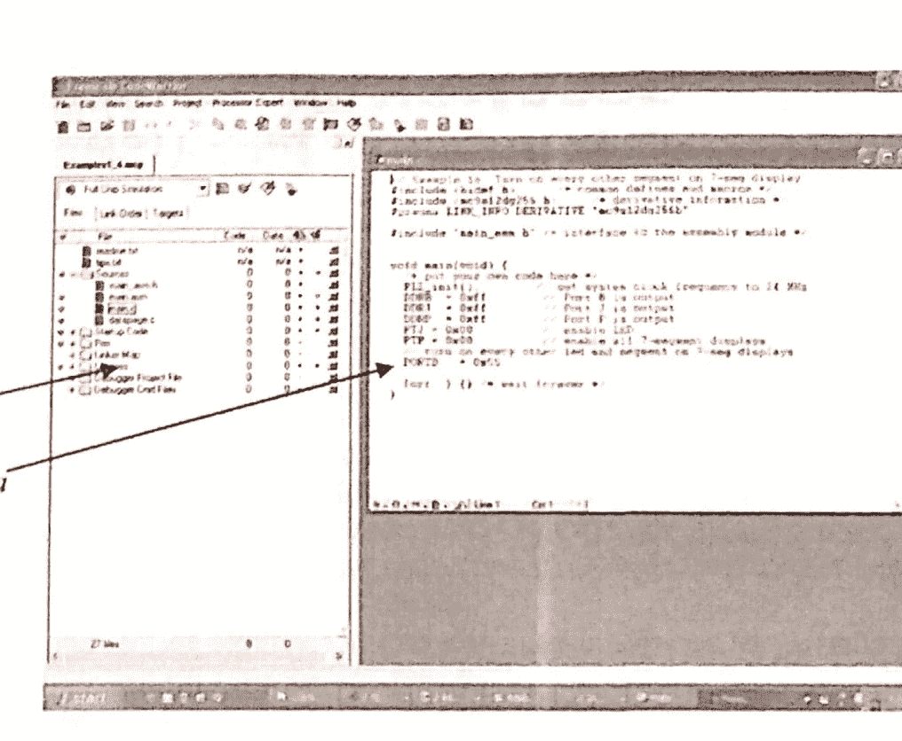

4. 确保选中了 HCS12 Serial Monitor。（要看到此选项，你必须按照本附录开头的描述下载 SMDrivers 文件。）

点击 `Make` 图标编译程序。

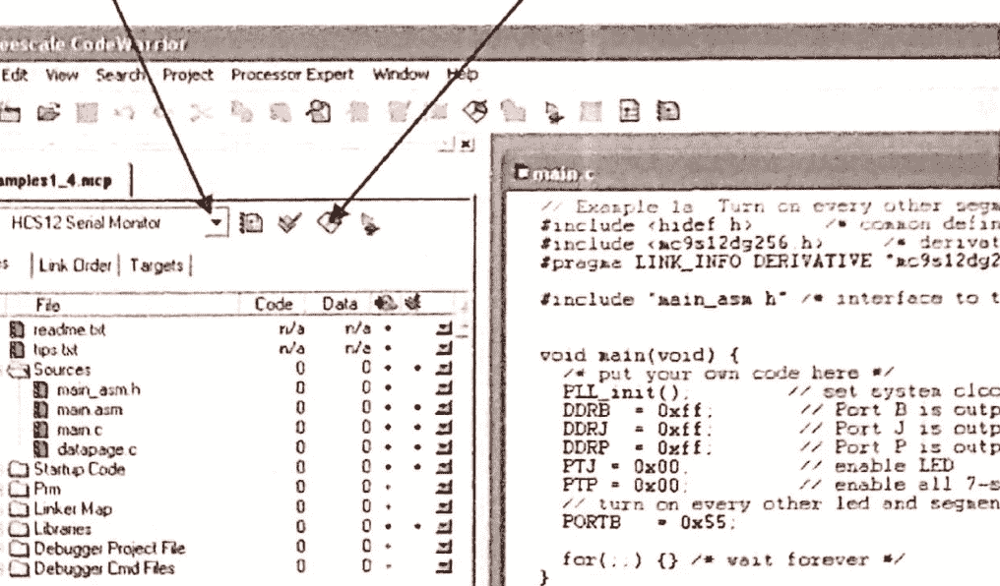

5. 确保滑块开关处于下 `LOAD` 位置

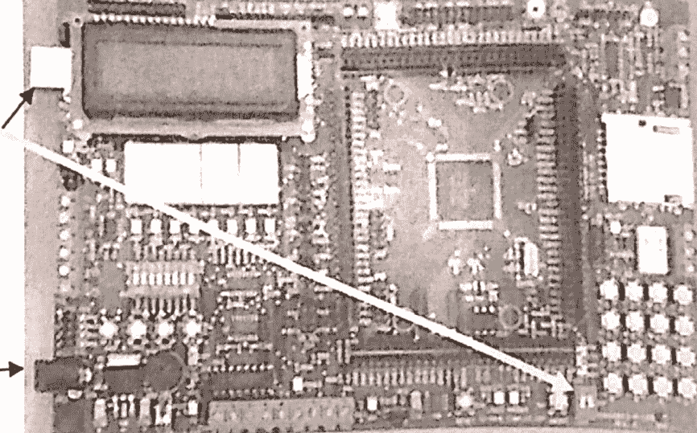

确保 USB 线已连接在此处，电源变压器已连接在此处

然后点击 `Debug` 图标


这将擦除闪存（除去包含 Serial Monitor 的 2 KB 保护闪存）并弹出下面的 Debug 窗口。

6. 点击 `Start/Continue (F5)` 图标运行程序。

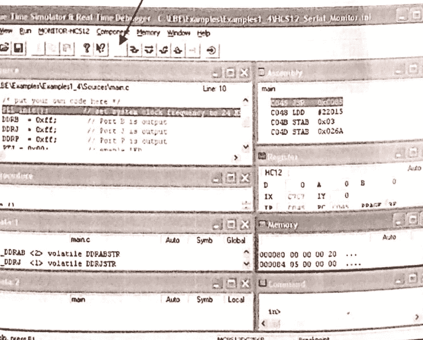

所有其他 LED 以及所有 7 段显示器的 a、c、e、g 段都应该亮起。

7. 按复位按钮（LED 和 7 段显示器将熄灭）

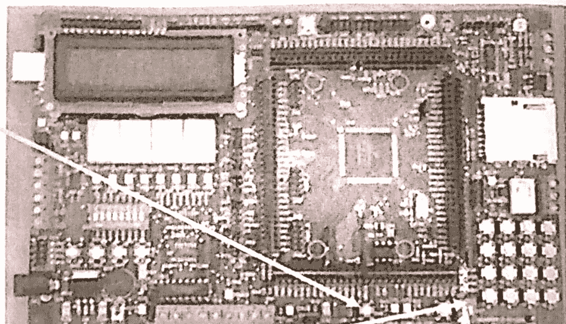

8. 现在将滑块向上移动到 `RUN` 模式

9. 再次按下复位按钮。你的程序正在板载闪存中运行，LED 和 7 段显示器应该亮起。

10. 现在将滑块移回 `LOAD` 模式并按下复位按钮。Serial Monitor 在板上运行（7 段显示器将熄灭），你准备好下载一个新的

11. 关闭 debug

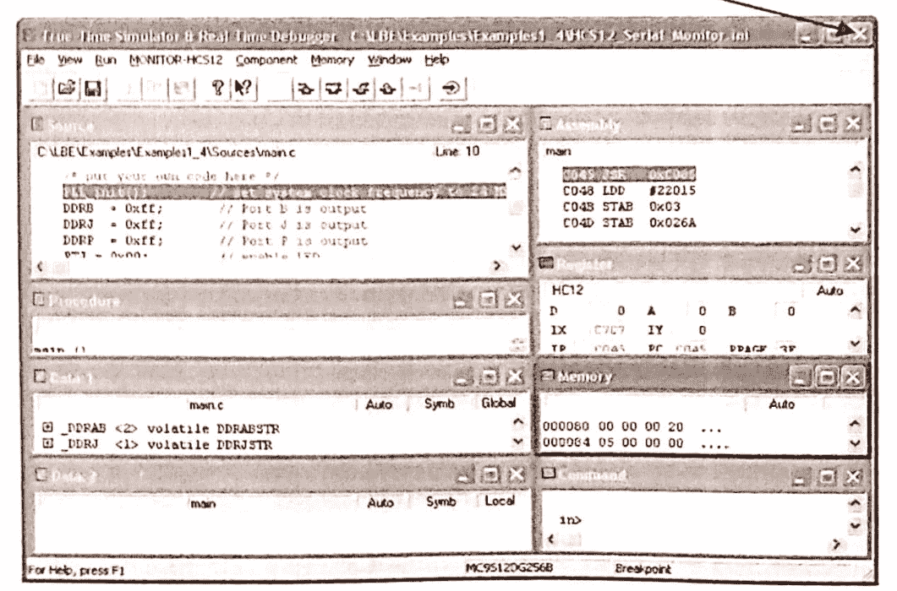

### 示例 1b – 读取示例 1

此时按照步骤 2 和 3 创建一个全新的项目，保持项目相同，只需将 `main.c` 修改为示例 4b。

12. 选择 `File -> Open...` 打开文件 `main.c`。

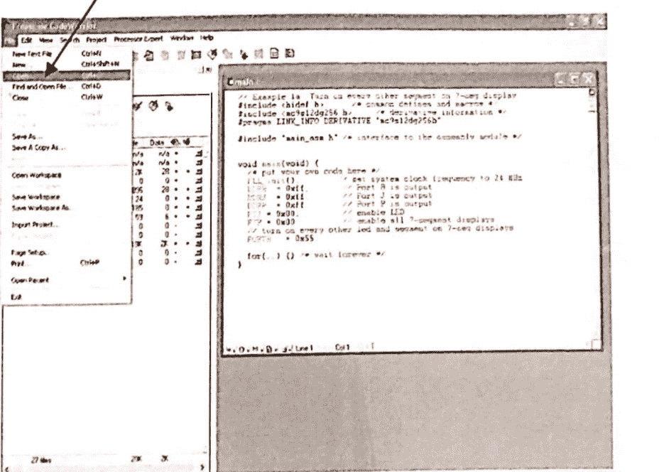

13. 选择 `main.c` 并将其复制到剪贴板。

14. 选择 `main.c` 并将其粘贴到相应位置。


重复步骤 4 – 11 以执行示例 1b。
重复步骤 4 – 11 以执行示例 1c。
重复步骤 12 – 13 以执行示例 2a。
重复步骤 12 – 13 以执行示例 2b。
重复步骤 12 – 13 以执行示例 3a。
重复步骤 12 – 13 以执行示例 3b。
重复步骤 12 – 13 以执行示例 4a。
重复步骤 12 – 13 以执行示例 4b。

## 附录 B

### HCS12 汇编语言

### B.1 HCS12 寄存器

HCS12 的编程模型与 68HC 相同，由图 B.1 所示的寄存器组成。HCS12 还包含与各种 I/O 操作相关的寄存器。在本节中，我们将描述 CPU 寄存器以及如何使用某些 HCS12 指令和寻址模式将数据移动到这些寄存器。

| | | | |
| :--- | :--- | :--- | :--- |
| 加累器 A | A | B | 加计数器 B |
| 加累器 D | D | | |
| 索引寄存器 X | IX | | |
| 索引寄存器 Y | IY | | |
| 栈指针 | SP | | |
| 程序计数器 | PC | | |
| | S H N V | 状态寄存器 |

图 B.1 HCS12 寄存器

#### B.1.1 HCS12 加累器

HCS12 有两个 8 位加累器 `A` 和 `B`，可以合并为单个 16 位加累器 `D`。也就是说，`A` 是 `D` 的高 8 位，`B` 是 `D` 的低 8 位。加累器用于存储中间结果并执行算术逻辑操作。以下是涉及加累器 `A`、`B` 和 `D` 的指令。

**加载和存储指令：**

- `LDAA` 从内存加载 A
- `LDAB` 从内存加载 B
- `LDD` 从内存加载 D
- `STAA` 将 A 存内存
- `STAB` 将 B 存内存
- `STD` 将 D 存内存

**传输和交换指令：**

- `TAB` 将 A 传输到 B
- `TBA` 将 B 传输到 A
- `EXG A,B` 交换 A 和 B

**加法和减法指令：**

- `ABA` 将 B 加到 A
- `ADDA` 将内存加到 A
- `ADDB` 将内存加到 B
- `ADCA` 带进位加到 A
- `ADCB` 带进位加到 B
- `ADDD` 将内存加到 D
- `SBA` 从 A 减去 B
- `SUBA` 从 A 减去内存
- `SUBB` 从 B 减去内存
- `SBCA` 带借位从 A 减
- `SBCB` 带借位从 B 减
- `SUBD` 从 D 减去内存

**递减和增加指令：**

- `DECA` 递减 A
- `DECB` 递减 B
- `INCA` A A
- `INCB` B B

**比较和测试指令：**

- `CBA` 比较 A 和 B
- `CMPA` 比较 A 与内存
- `CMPB` 比较 B 与内存
- `CPD` 比较 D 与内存
- `TSTA` 测试 A 是否为零或负
- `TSTB` 测试 B 是否为零或负

**布尔逻辑指令：**

- `AND` A 与内存与与
- `ANDB` B 与内存与与
- `EORA` A 与内存异或
- `EORB` B 与内存异或
- `OAA` A 与内存按或
- `ORAB` B 与内存按或

**清零、取反码和取负指令：**

- `CLRA` 清零 A
- `CLRB` 清零 B
- `COMA` A 取反码
- `COMB` B 取反码
- `NEGA` A 取补码
- `NEGB` B 取补码

**移位和旋转指令：**

- `LSLA` A 逻辑左移
- `LSLB` B 逻辑左移
- `LSLD` D 逻辑左移
- `LSRA` A 逻辑右移
- `LSRB` B 逻辑右移
- `ASLA` 算术左移
- `ASLB` 算术右移
- `ASRA` 逻辑右移
- `ROLA` 带进位左旋转
- `ROLB` 带进位左旋转

等等，上述列表中的某些指令描述了涉及内存位置的操作。数据在内存中的位置由寻址模式决定。我们将在 B.2 节中详细讨论寻址模式。

#### B.1.2 索引寄存器 X 和 Y

索引寄存器 `X` 和 `Y` 的主要用法是结合各种寻址模式。它们可以像加累器一样用于在内存之间移动 16 位数据时的临时存储。以下是涉及索引寄存器 `X` 和 `Y` 的指令。

**加载和存储指令：**

- `LDX` 从内存加载 X
- `LDY` 从内存加载 Y
- `STX` 将 X 存内存
- `STY` 将 Y 存内存
- `LEAX` 将有效地址加载到 X
- `LEAY` 将有效地址加载到 Y

**传输和交换指令：**

- `EXG X,Y` 交换 X 和 Y
- `XGDX` 交换 D 和 X
- `XGDY` 交换 D 和 Y

**加法和减法指令：**

- `ABX` 将 B 加到 X
- `ABY` 将 B 加到 Y

**递减和增加指令：**

- `DEX` 递减 X
- `DEY` 递减 Y
- `INX` 增加 X
- `INY` 增加 Y

**比较和测试指令：**

- `CPX` 比较 X 与内存
- `CPY` 比较 Y 与内存

**栈操作指令：**

- `PSHX` 将 X 入栈
- `PSY` 将 Y 入栈
- `PULX` 将 X 出栈
- `PULY` 将 Y 出栈

### HCS12 汇编语言基础

### LDA 0, X

意味着将内存中索引寄存器 X 地址处的字节加载到累加器 A 中。我们称 X 指向内存中的一个字节。上述指令中的 0 是一个偏移量，它会被加到 X 的值上。指令 `LDD 4,X` 将将两个字节加载到累加器 D (`A:B`)。`X+4` 处的字节将加载到累加器 A，`X+5` 处的字节将加载到累加器 B。

#### B.1.3 栈指针，SP

栈是一块预留用于存储临时数据的内存区域。栈指针 `SP` 是一个 16 位寄存器，包含栈顶的地址。HCS12 使用栈来在调用子程序时保存返回地址。当发生中断时，它也被用于保存寄存器值。

可以使用 `PSHA`、`PSHB`、`PSHX` 和 `PSHY` 指令通过栈保存寄存器 A、B、X 和 Y 的内容。这些值通过 `PULA`、`PULB`、`PULX` 和 `PULY` 指令从栈中移除。

以下是涉及栈指针 `SP` 的一些指令。

### 加载和存储指令：
- `LDS` 从内存加载 SP
- `STS` 将 SP 存储到内存
- `LEAS` 将有效地址加载到 SP

### 传输和交换指令：
- `TSX` 将 SP 传输到 X
- `TSY` 将 X 传输到 Y
- `TXS` 将 X 传输到 SP
- `TVS` 将 Y 传输到 SP
- `EXG X,SP` 交换 X 和 SP

### 递减和增加指令：
- `DES` 递减 SP
- `INS` 增加 SP

### 比较和测试指令：
- `CPS` 比较 与内存
- `CPY` Y 与内存

#### B.1.4 程序计数器，PC

程序计数器 `PC` 是一个 16 位寄存器，包含下一个执行指令的地址。当执行任何指令时，程序计数器会自动增加以指向下一条指令。HCS12 指令长度从 1 到 6 字节不等。因此，根据执行的指令，程序计数器增加 1 到 6。

某些指令会导致程序计数器变为新值，而不是简单的递增。这些包括分支、跳转和子程序指令。我们将在节 B.3 中讨论子程序，在节 B.4 中讨论分支指令。

#### B.1.5 状态码寄存器

HCS12 有一个状态码寄存器 (`CCR`)，包含五个状态标志或状态码和三个控制标志。五个状态标志分别是进位标志 (`C`)、零标志 (`Z`)、负符号标志 (`N`)、溢出标志 (`V`) 和半进位标志 (`H`)。三个控制标志是中断掩码标志 (`I`)、X 中断掩码标志 (`X`) 和停止禁用标志 (`S`)。每个标志在状态码寄存器中占一位。每个标志的位置如图图 B.2 所示。

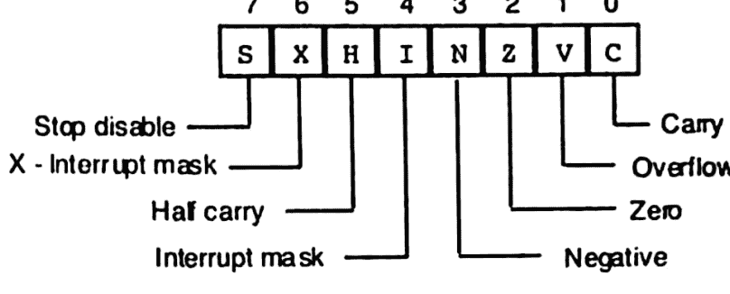

状态码寄存器中的任何位（除 `X` 位外）都可以使用 HCS12 指令 `ORCC` 设置。该指令将对 CCR 与内存中的一个字节（立即寻址）进行逻辑或操作，该字节在要设置的位上包含 1。状态码寄存器中的任何位都可以通过 HCS12 指令 `ANDCC` 清除。该指令将对 CCR 与内存中的一个字节进行逻辑与操作，该字节在要清除的位上包含 0。
现在我们来看状态码寄存器中每个位的含义。

**进位 (C)**
进位标志是状态码寄存器的位 0。它可以视为对寄存器或内存位置操作的扩展。该位由三种类型的指令更改。这些包括加法指令 `ADDA`、`ADDB`、`ADDD`（带进位加法）、`ADCB` 和 `ABA`（向 A 加 B）；减法指令 `SUBA`、`SUB`、`SUBD`、`SBCA`（从 A 减去带进位）、`SBCB` 和 `SBA`（从 A 减去 B）；以及比较指令 `CMPA`、`CMPB`、`CBA`、`CPD`、`CPX` 和 `CPY`。进位位还由乘法指令 `MUL`、`EMUL`、`EMULS`，除法指令 `IDIV`、`EDVS`、`FDIV`，以及取反指令 `NEG`、`NEGA`、`NEGB` 以及小数调整指令 `DAA` 更改。第二组可以携带进位的指令是移位和循环指令，如 `ASL`、`ASLA`、`ASLB`、`ASR`、`ASRA`、`LSLA`、`LSLB`、`LSR`、`LSRA`、`LRD`、`ROLA`、`ROLB`、`RORA`、`ROR` 和 `RORB`。最后，该位可以通过指令 `CLC`（清除进位）设置为 1。这些指令分别被 HCS12 转换为 `ORCC #50` 和 `ANDCC #5FE`。

**零标志 (Z)**
零标志是状态码寄存器的位 2。当指令结果为零时，该标志设置为 1。如果指令结果不为零，则清除零标志。Z 标志由分支指令 `BEQ`（相等，Z=1）和 `BNE`（不相等，Z=0）测试。这些分支指令在 B.4 中描述。

**负符号标志 (N)**
负符号标志是状态码寄存器的位 3。HCS12 使用补码表示负数。在这种表示法中，当位 7（最左侧）设置为 1 时表示负数。如果指令结果为正，则清除 N 标志。N 标志由分支指令 `BMI`（负，N=1）和 `BPL`（正，N=0）测试。这些分支指令在 B.4 中描述。

**溢出标志 (V)**
溢出标志是状态码寄存器的位 1。当符号（补码）操作超出范围时，该标志设置为 1。V 标志由指令 `BVS`（溢出设置，V=1）和 `BVC`（溢出，V=0）测试。

**半进位 (H)**
半进位标志是状态码寄存器的位 5。它包含 8 位加法或减法产生的位 3 进位。微处理器执行二进制编码 ( (BCD) 加时使用半进位标志。

**中断掩码 (I)**
中断掩码标志是状态码寄存器的位 4。当它设置为 1 时，硬件中断被屏蔽，HCS12 不响应中断。当 I 标志清除为 0 时，启用中断，HCS12 服务硬件中断。I 标志通过指令 `SEI`（设置中断掩码）设置为 1，通过指令 `CLI`（清除中断）清除为 0。HCS12 将这两个指令转换为 `ORCC #10` 和 `ANDCC #FE`。


**X 中断掩码标志 (X)**
X 中断掩码标志是状态码寄存器的位 6。该位通过硬件重置设置为 1，此时进入处理器 XIRQ 引脚的硬件中断被屏蔽。X 标志可以通过指令 `ANDCC #BF`（在 HCS12 中转换为 `TAFR`）清除为 0，之后启用 X 中断。软件无法设置 X 中断掩码。因此，一旦 X 位清除，XIRQ 基本上就是不可屏蔽中断。将在 B.5 中详细讨论中断。

**停止禁用标志 (S)**
停止禁用标志是状态码寄存器的位 7。如果该位设置为 1，则禁用 STOP 指令。如果该位清除为 0，则启用 STOP 指令。当此位设置时，STOP 指令被视为无操作 (`NOP` 指令)。STOP 指令通过停止内部时钟来节省功率。需要外部中断来重新启动时钟。

### B.3 寻址模式

寻址模式决定指令相关数据的位置。所有的 HCS12 寻址模式都列在表 B.1 中。68HC1 只有表 B.1 中的前六种寻址模式。（在 68HC1 上，相对寻址和索引寻址仅使用 8 位偏移量。）

68HC2 和 HCS12 增加了表 B.1 下半所示的新寻址模式。此外，68HC2 和 HCS12 在索引寻址模式中允许 5 位、9 位和 16 位偏移量。常量偏移量加到 `X`、`Y`、`SP` 或 `PC` 上以计算有效地址。例如，如果 `X` 包含值 `$1234`，指令 `LDD -2,X` 将值 D 存储在地址 `$1234` 减 2 的 `$1232` 处。这将把 A 内容存储在 `$1232`，B 内容存储在 `$1233`。同样，指令 `JSR 0,Y` 将跳转到存储在 Y 中的地址处的子程序。

递减寻址模式通过先将 `X`、`Y` 或 `SP` 减 1 到 8 来计算有效地址。例如，如果 `X` 包含值 `$1234`，则指令 `STAA1,-X` 将 X 减 1 到 `$1233`，然后将 A 值存储在地址 `$1233`。

作为第二个示例，考虑 `MOVW` 指令，其形式为：

```
MOVW source, dest
```


并将一个字（16 位）从有效地址源移动到有效地址目的。（还有一个 `MOVB` 指令用于移动 8 位字节）。源的寻址模式可以是立即、扩展或索引，而目的的寻址模式可以是扩展或索引。

例如，假设 `X` 包含值 `$1234`，且字 `$5678` 存储在地址 `$1234` 处，如图 B.3 所示。那么在执行指令 `MOVW 0,X,-X` 后：

# HCS12 汇语言基础

地址 `$1234` `(0,X)` 处的值将被复制到地址 `$1232` `(2,-X)`，此时 `$X$` 的值将等于 `1232`，如图 B.3 所示。

| 之前 | | 之后 |
|---|---|---|---|
| | 1232 | X -> 56 | 1232 |
| X -> | 56 | 78 | 1234 |
| | 1234 | 56 | |
| | 78 | 78 | |
| | `MOVW 0,X,2,-X` | | |

图 B.3 执行指令 `MOVW 0,X,2,-X` 的效果

# 表 B.1 HCS12 寻址模式

| 寻址模式 | 说明 | 示例 |
|---|---|---|
| 固有 (Inherent) | 数据位置位于指令内部 | `INX` `DEBC` |
| 立即数 (Immediate) | 数据紧跟在操作码之后 | `LDAA #S2C` `LDD #1234` |
| 直接 (Direct) | 数据位于由 8 位地址（`$00-$FF`）指定的零页 | `STAA SPC` `STD $34` |
| 扩展 (Extended) | 数据位于由 16 位地址（`$0000-$FFFF`）指定的内存中 | |
| 相对 (Relative) | 操作码后跟随相对于 PC 的 8 位或 16 位相对偏移量 | `STAB $1234` `BNE -23` `LBEQ $0452` `LDD -2,X` |
| 索引（常量偏移） | 距离 `X, Y, SP` 或 `PC` 的 5 位、9 位或 16 位常量偏移量 | `JSR 0,X` |
| 索引（前递减） | 自动前递减 `X, Y` 或 `SP` | `STAA 1,-X` `MOVW 0,X,2,-X` |
| 索引（前递增） | 自动前递增 `X, Y` 或 `SP` | `LDAB 1,+X` `STX 2,+X` |
| 索引（后递减） | 自动后递减 `X, Y` 或 `SP` | `STD 2,-X` `LDAA 4,-X` |
| 索引（后递增） | 自动后递增 `X, Y` 或 `SP` 1-8 位 | `STAA 1,+X` |
| 索引（累加器偏移） | 将 `A, B` 的内容加到 `X, Y, SP` 或 `PC` | `ADDA B,X` `STX 0,Y` |
| 索引-间接（16位偏移） | 数据地址位于 `X, Y, SP` 或 `PC` 偏移 16 位常量偏移处 | `LDAA [0,Y]` / `JSR [0,Y]` |
| 索引-间接（D 累加器偏移） | 数据地址位于 `X, Y, SP` 或 `PC` 加上 `D` 寄存器的值 | `ADDA [D,X]` `JSR [D,Y]` |

- 1) 栈指针 `SP` 减 1。
- 2) 8 位寄存器的内容存储在 `SP` 指向的地址。

# HCS12 汇语言基础

当将 16 位寄存器 `D, X` 或 `Y` 之一推入栈中时，会发生以下操作：

- 1) 栈指针 `SP` 减 2。
- 2) 16 位寄存器的内容存储在 `SP` 指向的地址。
（高字节存储在 `SP`，低字节存储在 `SP+1`）。

当从栈中弹出（有时称为 popping）8 位寄存器 `A, B` 或 `CCR` 时，会发生以下操作：
- 1) `SP` 指向的地址的值被加载到 8 位寄存器中。
- 2) 栈指针加 1。

当从栈中弹出 16 位寄存器 `D, X` 或 `Y` 之一时，会发生以下操作：
- 1) `SP` 指向的地址的值被加载到 16 位寄存器中。
（`SP` 处的字节被加载到高字节，`SP+1` 处的字节被加载到低字节）。
- 2) 栈指针加 2。

表 B.2 推入（Push）和出栈（Pull）指令
| 助记符 | 功能 |
|---|---|
| `PSHA` | 推入 A |
| `PSBH` | 推入 B |
| `PSHC` | 推入 CCR |
| `PSHD` | 推入 D |
| `PSHX` | 推入 X |
| `PSHY` | 推入 Y |
| `PULA` | 出栈 A |
| `PULB` | 出栈 B |
| `PULC` | 出栈 C |
| `PULD` | 出栈 D |
| `PULX` | 出栈 X |
| `PULY` | 出栈 Y |

## B.3.2 子程序

子程序是执行特定任务的段段。通过 `JSR`（跳转到子程序）调用，通过 `RTS`（从子程序返回）退出。重要的是返回地址会被推入栈。

例如，假设栈指针 `SP` 包含 `$1234`。执行 `JSR` 指令后，返回地址被推入栈，如图 B.4 所示。

| 之前 | | 之后 |
|---|---|---|---|
| | 1232 | X -> 56 | 1232 |
| X -> | 56 | 78 | 1234 |
| | 1234 | 56 | |
| | 78 | 78 | |
| | `MOVW 0,X,2,-X` | | |

图 B.3 执行指令 `MOVW 0,X,2,-X` 的效果

## B.4 分支指令

HCS12 有许多分支指令。分为两个大类：短分支和长分支。在编写汇语言程序时，通常会使用分支指令。

### B.4.1 短条件分支

表 B.3 所示的指令测试状态寄存器中的标志位，其他将在后续章节描述，测试状态标志位的组合。
当分支测试为真时，分支指令会导致跳转。例如，分支指令 `BEQ`（相等分支）如果条件寄存器中的 `Z` 标志位为 1，会导致跳转。这在前一条指令产生的结果为零的情况下发生。

| 操作 | 助记符 | 分支测试 |
|---|---|---|
| 等于零分支 | `BEQ` | `Z = 1` |
| 不等于零分支 | `BNE` | `Z = 0` |
| 正数分支 | `BPL` | `N = 0` |
| 负数分支 | `BMI` | `N = 1` |
| 标志位清除分支 | `BCC` | `C = 0` |
| 标志位设置分支 | `BCS` | `C = 1` |
| 溢出设置分支 | `BVS` | `V = 1` |
| 溢出清除分支 | `BVC` | `V = 0` |

表 B.3 所示的条件分支指令均为字节长度。第一个字节是操作码，第二个字节是分支目的相对偏移量。这是一个补码数，必须加到程序计数器 +2（下一条指令的地址）上，以获得分支测试为真时要执行的指令地址。如果分支测试为假，则执行分支指令之后的指令。这如图 B.6 所示。注意，当执行 `BEQ` 指令时如果 `Z=1`，程序将跳转到通过偏移量（06）加上下一条指令地址（5014）形成的地址；即地址 `501A = 5014 + 06`。

## 附录 B

| PC = | 5012 | 27 06 | `BEQ DONE` | `Z=0` | `Z=1` |
| --- | --- | --- | --- | --- | --- |
| PC+2 | 5014 | -- | -- | | | |
| | 5016 | -- | | | |
| | 5017 | -- | | | | |
| | 501A | | | | | = 5014 + 06 = 501A |

图 B.6 分支指令中的位移 (06) 被加到程序计数器 +2 上，以获得分支跳转的目标地址。

如果分支指令在内存中向后跳转，则位移必须为负数。它仅仅是下一条指令地址 (`PC + 2`) 与分支目标地址之间字节数的补码。这些位移由汇编器自动计算。

作为计算分支位移的示例，一条分支指令从下一条指令的地址向后跳转 -8 字节。由于 -8 的补码十六进制表示为 `$F8$`，因此分支位移将如图 B.7 所示为 `F8`。请注意，这种减法操作是用目标地址减去下一条指令的地址 (`PC +2`) 完成的。当使用补码时，`$FFFF` 是 -8$_{10}$ 的 16 位十六进制表示。因此，`$F8` 是一个 16 位数，符号位（在此例中为 1）通过高位字节向左扩展。`$F8` 和 `$FFFF` 都代表负数 -8$_{10}$。在使用短分支指令时，使用的是位移 `FFF8`；

| | | | | |
| --- | --- | --- | --- |
| 500C | | `LOOP1:` | |
| 500D | | | |
| 500F | | | |
| PC= | 5012 | 26 F8 | `BNE LOOP1` |
| PC+2 | 5014 | | -- |
| | | 500C `LOOP1` | |
| | | -5014 IP +2 | |
| | | `FFF8` | | |

图 B.7 通过从目标地址减去下一条指令的地址找到负向分支

请注意，表 B.3 给出的短分支指令的分支位移是一个单 8 位字节，短分支指令最多只能向前跳转 127 字节 (`$7F`) 或向后最多跳转 -128 字节 (`$80`)。这些字节的计数始终从分支指令之后的那条指令的地址开始。初看起来这似乎是一个严重的限制。实际上，68HC11 只有短分支指令。

### HCS12 汇编语言基础

编写良好的汇编语言程序不应该需要超过 ±127 字节的条件分支。分支应该在较小的程序段或子程序内发生。如果你需要在循环中执行许多条指令（例如），你应该使用子程序调用来实现程序模块化。这将使得程序更容易调试和维护。

在需要条件分支超过 ±127 字节的极少数情况下，你可以使用 HCS12 长分支指令。表 B.3 中的每条指令都有一个对应的长分支指令。例如，指令 `LBEQ`（长分支跳转等于零）使用测试 `Z=1`，这与 `BEQ` 指令相同；但它使用的是 16 位有符号位移而不是 8 位位移。这意味着分支位移的范围可以从 -32,768 (`$8000`) 到 +32,767 (`$FFFF`)。长分支指令的操作码占用两个字节，因此这些长分支指令总共占用四个字节，且执行速度比短分支指令慢。

# B.4.2 无条件分支和跳转指令

表 B.3 中的指令是条件跳转指令，根据状态寄存器中位的值，可能会导致分支发生也可能不会。你可能希望无论如何都跳转。这被称为无条件分支或跳转。表 B.4 显示了不同版本的无条件分支和跳转指令。

短 `BRA`（始终分支）有一个 8 位位移作为操作数。这与上述用于条件分支指令的补码位移相同。它允许无跳转最多向前跳转 127 字节或向后跳转 -128 字节。

如果你需要跳转更远的距离，可以使用长分支始终跳转。`LBRA` 需要两个字节的操作数，该数表示一个 16 位补码数，该数必须加到下一条指令的地址上得到目标地址。

| 表 B.4 无条件分支和跳转指令 |
| 操作 | 助记符 | 操作数 |
| --- | --- | --- |
| 短始终分支 | `BRA` | 8 位位移 |
| 长始终分支 | `LBRA` | 16 位位移 |
| 跳转 | `JMP` | `<有效地址>` |

表 B.4 中的短分支和长始终跳转指令在指令中使用相对位移。由于这是加到后续指令地址上的数值，这意味着如果整个程序在内存中移动，这个相对位移将保持不变。使用相对位移来确定目标地址将允许你编写位置无关的代码。

# 表 B.8 递减与分支指令

| 操作 | 助记符 | 操作 |
| --- | --- | --- |
| 递减计数器并在等于 0 时分支 (cntnr = A, B, D, X, Y, 或 SP) | `DBEQ` | cnt -1 -> cnt，若 cntnr = 0 则分支 |
| 递减计数器并在不等于 0 时分支 (cntnr = A, B, D, X, Y, 或 SP) | `DBNE` | cnt -1 -> cnt，若 cntnr 不等于 0 则分支 |

# B.5 HCS112 中断

如附录 D 所示，`MC9S12DP256B` 上有多个中断源。这些中断分为两类：非掩码中断和可屏蔽中断。可屏蔽中断可以通过设置状态码寄存器中的 1-bit 位来屏蔽。非掩码中断则无法被屏蔽。我们将在 B.5.1 节中讨论非掩码中断，并在 B.5.2 节中讨论可屏蔽中断。

# B.5.1 HCS12 非掩码中断

表 B.9 显示了 6 个 HCS12 非掩码中断。每个中断源都有一个 16 位的向量地址，用于存储中断发生时要执行的代码地址（中断向量）。

| 向量地址 | 中断源 |
| --- | --- |
| `$FFFF-$FFFF` | 重位 (Reset) |
| `$FFFC-$FFFF` | COP 时钟监控器失败重位 |
| `$FFFA-$FFFF` | COP 失败重位 |
| `$FFFF8-$FFFF` | 未实现指令陷阱 |
| `$FFFF6-$FFFF` | `SWI` (软件中断) |
| `$FFFF4-$FFFF` | `XIRQ` |

# 重位 (Reset)

当 HCS112 上的 `RESET` 引脚变为低电平时，微处理器的正常功能将暂停。当该引脚恢复高电平时，微处理器会设置状态码寄存器中的 `X` 和 `I` 位，并从存储在 `$FFFF-$FFFF` 处的地址开始执行指令。HCS12 具有上电重位 (`POR`) 电路，在向处理器供电后会触发重位信号。

### HCS12 汇编语言基础

# COP (计算机正常运行)

表 B.9 中存储的两个 `COP`（计算机正常运行）中断用于检测硬件和软件错误。当启用时钟监控（通过设置 `CR` 控制寄存器 `PLLCTL` 中的 `CME` 位）时，如果时钟停止或其频率低于 500 KHz，特殊电路将产生重位。

`COP` 失败重位是一个看门定时器，如果在指定时间内向 `CCR TimerAlarm/Reset` 寄存器 (`ARMCOP`) 发送序列（`$55` 后 `$AA`），它将产生重位。

# 软件中断 (SWI)

当执行 `SWI` 指令时，会发生软件中断。这将导致执行存储在 `$FFF6-$FFFF` 处的指令。在此发生之前，返回地址（`SWI` 指令后的地址）将与 `Y、X、A、B` 寄存器以及图 B.9 所示的内容一起入栈。状态码寄存器 `CCR` 中的 `I` 位设置为 1。这将防止在软件中断程序期间处理任何可屏蔽中断。通过执行 `CLI`（清除中断）或 `RTI`（返回中断）指令可以将 `I` 位清零。在中断服务程序结束时，执行 `RTI` 指令将从栈中弹出图 B.9 所示的所有值。

# 非掩码中断请求 (XIRQ)

`XIRQ` 位于 HCS12 的 `PE0`。`XIRQ` 是与 `CCR` 中的 `X` 位相关的伪可屏蔽中断。重位后，当 `XIRQ` 引脚变为低电平时会屏蔽中断。然而，软件可以使用 `AND` 指令清除 `CCR` 中的该位。一旦该位被清零，就无法再次设置为 1。因此中断变为可屏蔽。当 `PE0` 高电平发生 `XIRQ` 中断时，当前指令完成，然后图 B.9 所示的寄存器入栈。返回地址存储在 `$FFF4-$FFF5` 处；此时 `CCR` 中的 `I` 位和 `X` 位被设置。这意味着在执行 `XIRQ` 服务期间不能发生另一个 `XIRQ` 中断。在中断服务结束时执行 `RTI` 指令将弹出寄存器并清除 `X` 位。此时可以发生新的 `XIRQ` 中断。

| `CCR` | 中断后 `SP` |
| --- | --- |
| `ACCB` | 中断前 `SP` |
| `ACCA` | |
| `XH` | |
| `XL` | |
| `YH` | |
| `YL` | |
| `Ret H` | |
| `Ret L` | |

图 B.9 中断寄存器堆栈

# B.5.2 可屏蔽中断

附录 D 中向量号在 `$6` 到 `$57` 之间的所有中断在 `CCR` 中的 `I` 位设置（使用 `SEI` 指令）时被屏蔽。要启用这些可屏蔽中断，必须通过 `CLI` 指令清除 `CCR` 中的 `I` 位。

# 附录 C C 函数总结

### 第 2 章：开启数码显示的 C 函数
| C 函数 | 含义 |
|---|---|
| `led_enable();` | 将 `DDRB` 和 `DDRD` 设置为输出，清零 `DJ1`，并通过清除 `PORTB` 的所有位关闭所有 LED |
| `led on(int);` | 将整数 `int` 的低 8 位存储在端口 B |
| `led disable();` | 将 `DDRJ` 设置为输出并将 `DJ1` 设置为 1 |
| `led off();` | 通过清除端口 B 关闭所有 LED |
| `seg7_enable();` | 将 `DDRB` 和 `DDRP` 设置为输出，清除端口 P 的低 4 位并清除 `PORTB` 的所有位 |
| `seg7 on(int s, b);` | 在数码 `b` 上显示段 `s` |
| `seg7 off();` | 通过清除端口 B 关闭所有数码显示 |

### 第 2 章：延迟 n 毫秒 函数
| C 函数 | 含义 |
|---|---|
| `ms_delay(int n);` | 延迟 n 毫秒 |

### 第 2 章：开启或关闭 PORTB 单位的 C 函数
| C 函数 | 含义 |
|---|---|
| `led on(int b);` | 将 `PORTB` 的 `b` 位置为高电平 |
| `led off(int b);` | 将 `PORTB` 的 `b` 位置为低电平 |

### 第 2 章：数码显示 C 函数
| C 函数 | 含义 |
|---|---|
| `seg7_enable();` | 启用数码显示 |
| `seg7 disable();` | 禁用数码显示 |
| `seg7 on(int s, b);` | 在数码 `b` 上显示段 `s` |
| `seg7_dec(int i, b);` | 在数码 `b` 上显示数值值 `i` |

### 第 3 章：读取开关 SW1–SW5 的 C 函数
| C 函数 | 含义 |
|---|---|
| `SW_enable();` | 启用开关 `SW1–SW5` |
| `SW1_dip();` | 返回 `SW1` 的 8 位读取值 |
| `SW2_down();` | 如果 `SW2` 为低电平返回真 |
| `SW3_down();` | 如果 `SW3` 为低电平返回真 |
| `SW4_down();` | 如果 `SW4` 为低电平返回真 |
| `SW5_down();` | 如果 `SW5` 为低电平返回真 |
| `SW2_up();` | 如果 `SW2` 为高电平返回真 |
| `SW3_up();` | 如果 `SW3` 为高电平返回真 |
| `SW4_up();` | 如果 `SW4` 为高电平返回真 |
| `SW5_up();` | 如果 `SW5` 为高电平返回真 |

## 附录 C

## 第3 章：读取 4 x 4 键盘的函数调用

| C 函数调用 | 含义 |
|---|---|
| `keypad_enable();` | 启用键盘 |
| `int getkey();` | 等待按键并返回键值 |
| `void wait_keyup();` | 等待直到按键释放 |
| `int kscanchar();` | 如果无按键按下则返回 16；如果正在按键则返回按键值 |

## 第4 章：用于 LCD 显示器的函数调用

| C 函数调用 | 含义 |
|---|---|
| `void init(void);` | 初始化 LCD 显示器（清屏显示） |
| `void set_lcd_addr(char);` | 设置光标地址（见图 6.3） |
| `void data(char);` | 在光标位置处写入 ASCII 字符 |
| `void instr8(char);` | 向显示器写入指令（见表 6.1） |
| `void clear_lcd(void);` | 清除 LCD 显示 |
| `void hex2lcd(char);` | 向 LCD 显示器写入十六进制数字 (0 – F) |
| `char hex2asc(char);` | 将十六进制数字 (0 – F) 转换为 ASCII 码 |
| `void type_lcd(char*)` | 在 LCD 显示器光标位置显示 ASCIIZ 字符串 |

## 第4 章：向 LCD 写入整数的函数调用

| C 函数调用 | 含义 |
|---|---|
| `void write_int_lcd(int);` | 在 5 位字段内右对齐显示一个 16 位整数 |
| `void write_long_lcd(long);` | 在 10 位字段内右对齐显示一个 32 位整数 |

## 第4 章：将 ASCII 数字字符串转换为二进制的函数调用

| C 函数调用 | 含义 |
|---|---|
| `long number(char* ptr);` | 返回与 ASCII 数字字符串相等的的 32 位二进制数 |

## 第5 章：实时中断的函数调用

| C 函数调用 | 含义 |
|---|---|
| `void RTI_init(void);` | 每 10.24 ms 初始化一次实时中断 |
| `void clear_RTI_flag(void);` | 清除 RTI 标志位 |
| `void RTI_disable(void);` | 禁用实时中断 |

## 第6 章：A/D 转换器的函数调用

| C 函数调用 | 含义 |
|---|---|
| `void ad0_enable(void);` | 启用 10 位 ATD0 |
| `int ad0conv(char*);` | 返回通道 ch# 连续 4 次读取的平均值 |
| `void ad1_enable(void);` | 启用 10 位 ATD1 |
| `int ad1conv(char*);` | 返回通道 ch# 连续 4 次读取的平均值 |

## 第7 章：控制直流电机速度的 C 函数调用

| C 调用 | 含义 |
|--- | --- |
| `void motor0 init(void);` | 以 10 ms 周期初始化 PWM0 |
| `void motor1 init(void);` | 以 10 ms 周期初始化 PWM1 |
| `void motor2 init(void);` | 以 10 ms 周期初始化 PWM2 |
| `void motor3 init(void);` | 以 10 ms 周期初始化 PWM3 |
| `void motor4 init(void);` | 以 10 ms 周期初始化 PWM4 |
| `void motor5 init(void);` | 以 10 ms 周期初始化 PWM5 |
| `void motor6 init(void);` | 以 10 ms 周期初始化 PWM6 |
| `void motor7 init(void);` | 以 10 ms 周期初始化 PWM7 |
| `void motor0 init(int speed);` | 设置电机0 速度 (0 - 255) |
| `void motor1 init(int speed);` | 设置电机1 速度 (0 - 255) |
| `void motor2 init(int speed);` | 设置电机2 速度 (0 - 255) |
| `void motor3 init(int speed);` | 设置电机3 速度 (0 - 255) |
| `void motor4 init(int speed);` | 设置电机4 速度 (0 - 255) |
| `void motor5 init(int speed);` | 设置电机5 速度 (0 - 255) |
| `void motor6 init(int speed);` | 设置电机6 速度 (0 - 255) |
| `void motor7 init(int speed);` | 设置电机7 速度 (0 - 255) |

## 第7 章：控制舵机位置的 C 函数调用

| C 调用 | 含义 |
|--- | --- |
| `void servo54 init(void);` | 以 20 ms 周期初始化 PWM5 |
| `void servo76 init(void);` | 以 20 ms 周期初始化 PWM7 |
| `void servo54(int width);` | 设置舵机5 位置 (3300 - 5700) |
| `void servo76(int width);` | 设置舵机7 位置 (3300 - 5700) |

## 第8 章：SCI 端口的 C 函数调用

| C 调用 | 含义 |
|--- | --- |
| `void SCI0 init(int b);` | 初始化波特率 SCI0 |
| `char inchar0(char c);` | 等待 SCI0 字符并返回 |
| `void outchar0(char c);` | 输出字符到 SCI0 引脚 |
| `void SCI1 init(int b);` | 初始化波特率 SCI1 |
| `char inchar1(char c);` | 等待 SCI1 字符并返回 |
| `void outchar1(char c);` | 输出字符到 SCI1 引脚 |

## 第9 章：SPI 端口的 C 函数调用

| C 函数调用 | 含义 |
|---|---|
| `void SPI0_init(void);` | 初始化波特率为 250 kHz 的 SPI0 |
| `char send_SPI0(char c);` | 发送字符到 SCI0：返回 |
| `void SS0_HI(void);` | 设置 SS0 (PS7, 引脚 95) 为高电 |
| `void SS0_LO(void);` | 设置 SS0 (PS7, 引脚 91) 为低电 |
| `void SPI1_init(void);` | 初始化波特率为 250 kHz 的 SPI1 |
| `char send_SPI1(char c);` | 发送字符到 SCI1：返回 |
| `void SS1_HI(void);` | 设置 SS1 (PS3, 引脚 11) 为高电 |
| `void SS1_LO(void);` | 设置 SS1 (PS3, 引脚 11) 为低电 |

## 第10 章：产生脉冲序列的 C 函数调用

| C 函数调用 | 含义 |
|---|---|
| `void ptrain6_init(void);` | 初始化 PT6 定时器（1.5 MHz）脉冲序列中断 |
| `void ptrains(int period, int pwidth);` | 更新 6 中断路由中的 TC6 和 TC7 |
| `void sound_init(void);` | 初始化 PT5（扬声器）定时器（1.5 MHz）脉冲序列中断 |
| `void sound_on(void);` | 通过启用定时器和中断开启声音 |
| `void sound_off(void);` | 通过禁用定时器和中断关闭声音 |
| `void tone(int pitch);` | 通过更新 5 中断路由中的 TC5 和 TC7 设置音调值 |

## 附录 D：中断向量

| 向量号 | 中断源 | 地址 |
|---|---|---|
| 0 | 重置 | FFFF |
| 1 | 时钟重置 | FFFC |
| 2 | COP 失败 | FFFA |
| 3 | 未实现 | FFFE8 |
| 4 | SWI | FFFE6 |
| 5 | XIRQ | FFF4 |
| 6 | IRQ | FFF2 |
| 7 | 实时中断 | FFF0 |

## 附录 E

## 模糊控制简介

模糊逻辑已成功应用于各种复杂的控制问题。输入和输出控制变量是模糊集合的成员，这些成员允许不同程度的隶属于。在本附录中，我们将介绍模糊集合的基本概念。然后，我们将描述模糊控制器的工作原理，并介绍在微控制器上实现模糊控制器的总体方法。HCS12 具有一些特殊指令，可以简化模糊控制器的实现。我们在示例 20 中定义了一些 C 函数，使用这些 HCS12 指令来实现模糊控制器。

### E.1 模糊集合

Lotfi Zadeh 在 1965 年引入了模糊集合这一术语。在普通的“清晰”逻辑中，基本假设是断言或陈述要么是真的，要么是假的。但这种假设会导致悖论。例如，图 E.1 中的句子是真还是假？如果这个句子是真的，那么它就必须是假的；如果它是假的，那么它就必须是真的的。有很多这样的悖论，其中真似乎必须等于假。

| 横线另一边的句子是假的 |
| 横线另一边的句子是假的 |

图 E.1 这句话是真还是假？

模糊逻辑并不要求一切都是真或虚假。在普通的“清晰”集合理论中，一个元素要么属于集合，要么不属于。然而，稍微思考一下就会信服，世界上绝大多数事物并非非黑即白。例如，某人年轻吗？我们可以认为你是一个模糊集合，在其中我们使用隶属函数来定义在集合中的隶属程度（0 到 1 之间）。

### E.2 模糊控制设计

在本节中，我们将展示如何将模糊逻辑应用于系统。设计从将模糊集合与变量关联开始。例如，隶属函数如图 E.5 所示。

模糊控制器由三部分组成：输入模糊化、规则处理和去模糊化。模糊控制器的总体算法如图 E.6 所示。

```


```
repeat {

  get_inputs();

  fire_rules();

  find_output();

}
```

图 E.6 模糊控制器的总体算法

### E.3 输入的模糊化

对于每个清晰输入 `$x_i$`，为每个隶属函数计算一组权重 `$w_i^j$`。对于第 $i$ 个输入，权重 `$w_i^j$` 可以存储在向量 `weight[i], j=1, M_i` 中，其中 `$M_i$` 是输入 $i$ 的隶属函数数量。向量中的每个值都是 0 到 1 之间的权重，由特定隶属函数的形状给出。

`get_inputs()` 函数的作用读取每个输入值 `$x_i$`，并用 `$x_i$` 在每个模糊集合中的隶属度填充权重向量 `weight[M_i]`。`get_inputs()` 的伪代码如图 E.7 所示。

```
get_inputs()

for i=1 to num_inputs {

  get_x(i);

  fill_weight(x_i, M_i);

}
```

图 E.7 `get_inputs()` 的伪代码

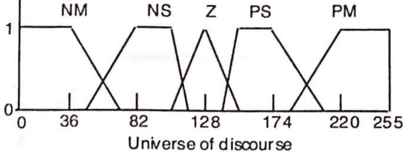

图 E.8 模糊控制器的功能图


图 E.9 模糊控制器的功能图

198 附录 E

## E.4 模糊推理

模糊控制器的核心是模糊规则列表。模糊逻辑推理用于在给定模糊输入和模糊规则列表的情况下找到一个模糊输出。在模糊控制器中，输入通常是清晰的（crisp）、非模糊值，这些值必须如第 E.3 节所述，在图 E.7 的第一步中进行模糊化处理。输出也需要是一个清晰值，用于控制某些设备。因此，处理模糊规则后得到的模糊输出必须按照下一节描述进行去模糊化。模糊规则的处理方式如图 E.10 所示，其中模糊集合由其隶属度函数 `$m$` 表示。

模糊推理涉及一组形式如下的模糊规则：

```
if x1 is A1 and x2 is B1 then y is L1
```

```
if x1 is A2 and x2 is B2 then y is L2
```

已知事实：

```
x1 is A' and x2 is B'
```

问题是找到结论：

```
y is L'
```

在问题的这种表示中，A1、A2、B1、B2、A' 和 B' 是输入模糊集合，而 L1、L2 和 L' 是输出模糊集合。模糊推理形成 A' 和 A1 的交集的并集，这被解释为 A' 和 A1 隶属度函数的最小值（交集）的最大值（并集）。在图 E.10 中，A' 被视为单点模糊集合 `$x_1 = a$`。在规则 1 中，该单点与 A1 的交集（最小值）的最大值是图 E.10 所示的值 `$w_1$`。同样，单点 `$x_2 = b$` 与 B1 的交集（最大值）是图 E.10 所示的值 `$w_2$`。事实 `$x_1 = a$` 和 `$x_2 = b$` 应用于前件 `$x_1$` 是 `$A_1$` 和 `$x_2$` 是 `$B_1$`，被解释为 `$w_1$` 和 `$w_2$` 的交集，即图 E.10 中的规则 1。规则 1 的结论 `$y$` 是 `$L_1$` 是通过取 `$w_2$` 与 `$L_1$` 的交集（T-范数）得到的。这通常是最小值操作，会将 `$L_1$` 截断到高度 `$w_2$`。然而，对于模糊控制，有时使用 T 积进行这种交集是有利的，效果相当于如图 E.10 中规则 1 所示将 `$L_1$` 乘以 `$w_2$`。因此，图 E.10 中的规则 1 将贡献模糊集合 `$w_1*L_2$` 到结论模糊集合 `$L'$` 中。同样，图 E.10 中的规则 2 将贡献模糊集合 `$w_2*L_2$`，因为对于规则 2，`$w_2$` 是 `$w_1$` 和 `$w_2$` 的最小值。请注意，如果 `$L_1$` 和 `$L_2$` 是单点（通常情况下如此），那么使用最小-范数或 T 积将没有区别。

结论集 `$L'$` 是通过形成 `$w_2*L_1$` 和 `$w_1*L_2$` 的 T-并运算得到的。这通常是最大值操作。然而，有时通过取 `$w_2*L_1$` 和 `$w_1*L_2$` 的和可以获得更好的结果，如图 E.10 所示。这两种方法之间的差异如图 E.11 所示。

## 模糊控制简介

199

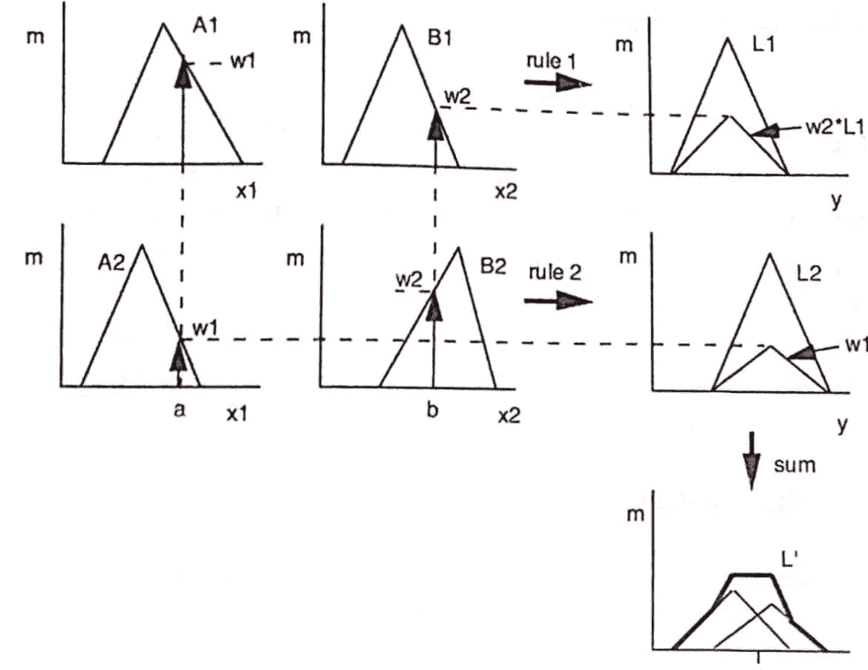

图 E.10 模糊推理

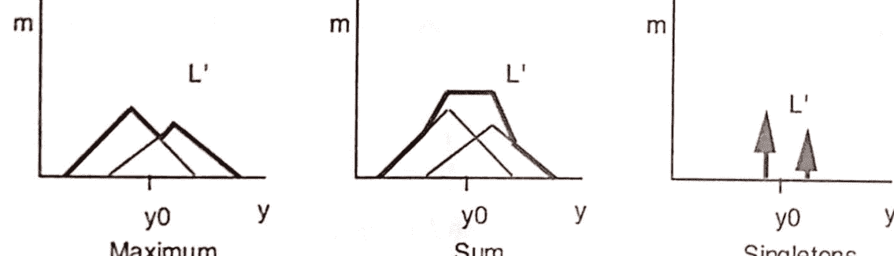

图 E.11 MAX 规则与 SUM 规则对比

如果 `$L_1$` 和 `$L_2$` 是单点（正常情况），那么取图 E.10 所示的两个规则的最大值或和将与图 E.11 所示相同。通常情况下，如果有多个规则贡献于同一个输出模糊集合 `$L_i$`，它们将不相同。在这种情况下，最大规则将只保留最大值，而和规则将累加每个规则的贡献。

结论输出 `$L'$` 是图 E.10 和 E.11 中用粗体线隶属度函数表示的模糊集合。为了获得清晰输出，需要某种去模糊化过程。最常用的方法是计算 `$L'$` 区域的质心。我们将在 E.5 节看到使用和规则有助于分析质心去模糊。

## E.5 质心去模糊

图 E.7 所示的模糊控制器的最后一步是去模糊化。这涉及图 E.10 和 E.11 所示的净模糊集合 `$L'$` 的质心。尽管我们在上一节使用了 MIN-MAX 规则，但我们将从推导图 E.11 所示的和规则的质心方程开始。这将阐明推导模糊控制器实际使用的去模糊方程时所假设。

设 `$L_i(y)$` 为与规则 $i$ 原始输出隶属度函数，其中 $y$ 是输出域（见图 E.10）。在应用规则 $i$ 后，该隶属度函数将减值为值：

```
mi(y) = wi*Li(y)  (E.1)
```

其中 `$w_i$` 是通过应用规则 $i$ 找到的最小权重。所有规则这些还原后的输出隶属度函数之和由：

```
M(y) = ∑_{i=1}^{N} mi(y)  (E.2)
```

给出，其中 `$N$` 是规则数。清晰输出值 `$y_0$` 由 `$M(y)$` 的质心给出：

```
y0 = ∫M(y)dy / ∫M(y)dy  (E.3)
```

注意隶属度函数 `$L_i(y)$` 的质心由：

```
ci = ∫Li(y)dy / ∫Li(y)dy  (E.4)
```

但是

```
li = ∫Li(y)dy  (E.5)
```

是隶属度函数 `$L_i(y)$` 的面积。代入 (E.4)，我们可以写出：

```
∫Li(y)dy = ci*li  (E.6)
```

使用方程 (E.1) 和 (E.2)，我们可以将 (E.3) 的分子写为：

```
∫M(y)dy = ∑_{i=1}^{N} mi(y)dy = ∑_{i=1}^{N} w_i(ci*li) = ∑_{i=1}^{N} w_i c_i  (E.7)
```

其中 (E.6) 用于最后一步。同样，使用 (E.1) 和 (E.2)，(E.3) 的分母可以写为：

```
∫M(y)dy = ∑_{i=1}^{N} Li_i(y)dy = ∑_{i=1}^{N} w_i li  (E.8)
```

其中 (E.5) 用于最后一步。将 (E.7) 和 (E.8) 代 (E.3)，我们可以将模糊控制器的清晰输出写为：

```
y0 = \frac{\sum_{i=1}^{N} w_i c_i}{\sum_{i=1}^{N} w_i l_i} (E.9)
```

方程 (E.9) 说明我们可以从各个隶属函数的质心 `$c_i$` 计算输出质心。注意在方程 (E.9) 中，求和是对所有规则进行的。但输出函数的数量 `$Q$` 通常大于规则的数量 `$N$`。这意味着在方程 (E.9) 的和中将许多项具有相同的 `$c_i$` 和 `$l_i$` 值。例如，假设规则 2、3 和 4 的输出隶属函数 `$L^k$` 作为结论。这意味着对于 `$i=2, 3, 4$`，`$c_i$` 和 `$l_i$` 值是相同的 `$c^k$` 和 `$l^k$`，因为它们只是第 $k$ 个输出隶属函数的质心和面积。这三项将贡献值：

```
w_2c2 + w_3c3 + w_4c4 = W^k c^k l^k
```

到和中，其中

```
W^k = (w_2 + w_3 + w_4)
```

是结论为隶属函数 `$L^k$` 的所有权重之和。这意味着由 (E.9) 给出的输出值 `$y_0$` 方程可以重写为：

```
y_0 = \frac{\sum_{k=1}^{N} W^k c^k l^k}{\sum_{k=1}^{N} W^k l^k} (E.10)
```

如果所有输出隶属函数的面积 `$l^k$` 相等，则方程 (E.10) 简化为：

```
y_0 = \frac{\sum_{k=1}^{N} W^k c^k}{\sum_{k=1}^{N} W^k} (E.11)
```

方程 (E.10) 和 (E.11) 显示，模糊控制器的输出清晰值可以通过对输出隶属函数求和来计算，而不是对模糊规则求和。此外，如果我们使用方程 (E.11) 计算输出清晰值，我们只需要指定输出模糊隶属函数的质心 `$c^k$`。

要获取关于模糊控制的更多信息，可以参考该主题的许多书籍，包括：

- Fuzzy Logic and Control: Software and Hardware Applications, Vol. 2, by M. Jamshidi, N. Vadiee, and T. Ross, Upper Saddle River, NJ, 1993.
- Applications of Fuzzy Logic: Towards High Intelligence Quotient Systems, by M. Jamshidi, A. Titli, L. Zadeh, and S. Boverie, Prentice-Hall, Upper Saddle River, NJ, 1997.

## 附录 F

## 相锁环

相锁环（PLL）用于产生比板载晶体产生的振荡频率更高的输出频率。Frees `MC9S12DG256` 微控制器中的 PLL 框图如图1所示。用于编程此锁相环的寄存器如图2所示。`REDFV` 寄存器的低位用于将振荡频率 `OSCLK` 除以 1 到 16 之间的某个值，产生频率为 `$f_1$` 的信号。该信号与第二个频率 `$f_2$` 之间的相位差由相位检测器测量。环滤波器将此相位差转换为电压，作为电压控制振荡器（VCO）的输入。VCO 的输出是频率与 VCO 输入电压成正比的时钟信号。如果 VCO 的输入电压增加，输出频率将增加。如果 VCO 的输入电压降低，输出频率将降低。如果你希望输出频率 `$f_2$` 是参考频率 `$f_1$` 的 `$N$` 倍，则环路分频器将输出频率 `$f_1$` 除以 `$N$` 以产生频率 `$f_2$`；如果 `$f_2$` 初始低于 `$f_1$`，则相位检测器和环滤波器的输出为正，导致 `$f_1$`（以及 `$f_2$`）增加。另一方面，如果 `$f_2$` 初始高于 `$f_1$`，则相位检测器和环滤波器的输出为负，导致 `$f_1$`（以及 `$f_2$`）减少。短时间后，两个频率 `$f_1$` 和 `$f_2$` 将锁定（相等），因此相位差将保持恒定，输出频率 `$f_2$` 将保持恒定且为 `$f_1$` 频率的 `$N$` 倍。

| OSCLK | 相位检测器 | 环滤波器 | VCO |
|---|---|---|---|
| 参考分频器 | `$f_1$` | | |
| `REFDV<3:0>` | `$f_2$` | | `$f_2 = Nf_1$` |
| | | `SYN<3:0>` | |
| | | 环路分频器 (I/N) | |

图 F.1 相锁环框图

## CRG 合成器寄存器 (SYNR) – 00034

| 7 | 6 | 5 | 4 | 3 | 2 | 1 | 0 |
|---|---|---|---|---|---|---|---|
| 0 | 0 | SYNR | SYN4 | SYN3 | SYN2 | SYN1 | SYNO | |

`PLLCK = 2*OSCLK*(SYNR+1)`

`(REFDV)` – 00035

## CRG 参考分频器寄存器 (REFDV) – 00035

| 7 | 6 | 5 | 4 | 3 | 2 | 1 | 0 |
|---|---|---|---|---|---|---|---|
| 0 | 0 | REFDV | REFD3 | REFD2 | REFD1 | REFDV | |

## CRG 标志寄存器 (CRFLG) – 00037

| 7 | 6 | 5 | 4 | 3 | 2 | 1 | 0 |
|---|---|---|---|---|---|---|---|
| RTIF | LVRF | LOCKF | LOCK | TRACK | SCIMF | SCM | CRFLG |
| LOCK = 1 | VCO | | | | | | |

`LOCK = 1` VCO 在目标频率的容差范围内。
`LOCK = 0` VCO 不在目标频率的容差范围内。

## CRG 时钟选择寄存器 (CLKSEL) – 00039

| 7 | 6 | 5 | 4 | 3 | 2 | 1 | 0 |
|---|---|---|---|---|---|---|---|
| PSEL | STP | SYSWAI | PLWAI | CWAI | RWIAI | COPW | KLKSEL |

`PLLSEL = 1` 系统时钟来源于 `PLLCLK` (`BUSCLK = PLLCLK/2`)。
`PLLSEL = 0` 系统时钟来源于 `OSCLK` (`BUSCLK = OSCLK/2`)。

## CRG PLL 控制寄存器 (PLLCTL) – 0003A

| 7 | 6 | 5 | 4 | 3 | 2 | 1 | 0 |
|---|---|---|---|---|---|---|---|
| CME | PLON | AUTO | ACQ | 0 | PRE | PCE | SCME | PLLCTL |

`PLLON = 1` 开启 PLL。如果设置 `AUTO` 位，PLL 将自动锁定。
`PLLON = 0` 关闭 PLL。
`AUTO = 1` 启用自动模式控制，且 `ACQ` 位无效。
`AUTO = 0` 自动模式控制，PLL 受软件控制。

> 图 F.2 与相位锁相环相关的寄存器

我们在所有 C 程序开头一直使用的函数调用 `PLL_init()` 调用了列表 F.1 中的汇编语言子程序。

### 列表 F.1 源自 main.asm 的 PLL_init() 汇编子程序

```
PLL_init:

movb    #502,SYNR      ;PLLCLK = 48 MHz

movb    #500,REFDV

clr      CLKSEL

movb    #$F1,PLLCTL

pll1:   brclr    CRFLG,$580,pll1 ;等待 PLL 锁定

movb    #580,CLKSEL

rts
```

## 相位锁相环

列表 F.1 中的前两条指令在寄存器 `SYNR` 中存储值 2，在寄存器 `REFDV` 中存储 0。DRAGON12-Plus_USB 振荡器频率 `OSCLK` 为 8 MHz。使用图 F.2 中的 `PLLCLK` 公式，将产生 `PLLCLK` 频率：

```
$PLLCLK = 2\times10^6\times\frac{(2+1)}{(0+1)} = 48\text{ MHz}$
```

列表 F.1 中的下一条指令将清空 `CLKSEL` 寄存器，根据图 F.2，这将清除位 `PLLSEL`。这意味着总线频率 `BUSCLK` 将为：

```
$BUSCLK = OSCLK/2=8\times10^6/2 = 4\text{ MHz}$
```

必须使用此总线频率，因为此时 PLL 尚未锁定。列表 F.1 中的单指令循环 `pll1;` 通过轮询图 F.2 中 `CRFLG` 寄存器中的 `LOCK` 位来等待 PLL 锁定。

列表 F.1 中的最后一条指令将设置图 5.2 中 `CLKSEL` 寄存器中的 `PLLSEL` 位。这意味着总线频率 `BUSCLK` 现在将变为：

```
$BUSCLK = PLLCLK/2=48\times10^6/2 = 24\text{ MHz}$
```


因此，在调用 C 函数 `PLL_init()` 后，总线频率将为 24 MHz。

## C 快速指南

| 类别 | 定义 | 示例 |
| --- | --- | --- |
| 标识符名称 | 可以包含任何字母、数字或下划线 - 不能以数字或关键字开头 区分大小写 | q3 \x00_init |
| 整数 | 有符号字符型 (8 位) -128 到 +127 | val32 |
| 无符号字符型 (8 位) | 0 到 255 | char c |
| 无符号短型 (16 位) -32,768 到 +32,767 | unsigned char x3 |
| 无符号短型 (16 位) | 0 到 65535 | unsigned short |
| 整数型 (16 位) -32,768 到 +32,767 | unsigned short |
| 无符号整数型 (16 位) | 0 到 65535 | unsigned int |
| 长整型 (32 位) -2,147,483,648 到 +2,147,483,647 | long |
| 无符号长整型 (32 位) | 0 到 4,294,967,295 | unsigned long |
| 实数 (浮点型) | 单精度 (32 位) 10 位有效数字 | float |
| 双精度 (64 位) | 10 位有效数字 | double |
| 长整型 (64 位) | 10 位有效数字 | long |
| 常数 | 十进制 (十六进制) | 55 |
| 字符 | 字符 | char c |
| 常量数组 | 用于构建值的集合 | const char[] = {0x3F, 0x06, 0x0B, 0x7F, 0x66, 0x0D, 0x07, 0x77, 0x7E, 0x71 }; |
| 字符串 | "This is a string" | char* q1 = "Programming"; |
| 数组 | 特定类型的集合 | unsigned char[] = {5,255}; |
| 指针 | 指向内存位置的地址 | char* ptr; char[j]; ptr = "+"; |
| 算术运算符 | + (加法) - (减法) * (乘法) / (除法) % (取模) | count = count + 1; count++ |
| 关系运算符 | !=, >=, <, <=, == | while (a <= b) if (clr == 1) { |
| 逻辑运算符 | ! (逻辑非) while (i < 16) && (found == 0)) { if (data & mask) == 0) { found = 1; key = keybtlb[i]; else { mask >>= 1; i++; |
| && (逻辑与) || (逻辑或) & (位与) (位或) ^ (位异或) | | || 移位运算符 | << (左移) >> (右移) | speed = val >> 2; data = data << 8; | |
| 复合运算符 | ++ (增1) -- (减1) += a = b as a = a + b -= *, /= %= <=, >=, >>=, &= |= | ticks++; i--; a += 5; data |= c; PTH = 0FE; mask >>= | |
| 函数 | 返回类型 函数名(参数1, ...参数N) { 局部声明, 语句); } | void_restore(char c) if (rear > max) { rear = min; if (rear == front()) { rear--; if (rear < min) { rear = max; else qbuffer[rear] = c; } } } char getq(void) { front++; if (front > max) { front = 0; return qbuffer[front]; } } } |
| 主程序 | 预处理器语句 main(void) { 声明, 语句); } | void main(void) { PLL init(); DDRH = 0xff; PTH = 0x55; while (i) { if (readback == keycodes[i]) { key = i; found = 1; else i++; } (i = 0; i < 16; i++) { PORTB = seg7btlb[i]; delay(); } } } | |
| if 语句 | if(表达式) { 语句; else { 语句; } } | |
| for 循环 | for(初始索引, 终止索引, 增量); 语句); | | |
| while 循环 | while(表达式) { 语句; } } | while (SW_down(0)) { seg7dec(1); } } |

## C 快速指南（续）

| 类别 | 定义 | 示例 |
| --- | --- | --- |
| 关系运算符 | !=, >=, <, <=, == | while (a <= b) if (clr == 1) { |
| 逻辑运算符 | ! (逻辑非) while (i < 16) && (found == 0)) { if (data & mask) == 0) { found = 1; key = keybtlb[i]; else { mask >>= 1; i++; | |
| && (逻辑与) || (逻辑或) & (位与) (位或) ^ (位异或) | | |
| 移位运算符 | << (左移) >> (右移) | speed = val >> 2; data = data << 8; | |
| 复合运算符 | ++ (增1) -- (减1) += a = b as a = a + b -= *, /= %= <=, >=, >>=, &= |= | ticks++; i--; a += 5; data |= c; PTH = 0FE; mask >>= | |
| 函数 | 返回类型 函数名(参数1, ...参数N) { 局部声明, 语句); | void_restore(char c) if (rear > max) { rear = min; if (rear == front()) { rear--; if (rear < min) { rear = max; else qbuffer[rear] = c; } } } } char getq(void) { front++; if (front > max) { front = 0; return qbuffer[front]; } } } |
| 主程序 | 预处理器语句 main(void) { 声明, 语句); } | void main(void) { PLL init(); DDRH = 0xff; PTH = 0x55; while (i) { if (readback == keycodes[i]) { key = i; found = 1; else i++; } (i = 0; i < 16; i++) { PORTB = seg7btlb[i]; delay(); } } } | |
| if 语句 | if(表达式) { 语句; else { 语句; } } | | |
| for 循环 | for(初始索引, 终止索引, 增量); 语句); | | |
| while 循环 | while(表达式) { 语句; } } | while (SW_down(0)) { seg7dec(1); } } |

## 索引

7段显示器, 10, 26, 187
A/D 转换器, 80, 88
加速度计, 85
地址总线, 1
模拟数字转换器, 78-88
ASCII 码, 49
汇编语言, 11-16
地址, 174
分支指令, 179-84
二进制转 ASCII 字符串, 55, 88
计算器, 62-64
计数器
十六, 24-26
数据总线, 1
数据方向寄存器, 6-7, 9-10
延迟循环, 16-20
数字模拟转换器 (DAC), 120-22
LTC1661, 120-22
DRAGON12-Plus-USB, 4-5
EEPROM, 2-3
Freescale
函数调用
5
模糊控制, 147-160, 193-202
输入模糊化, 149-53, 197
模糊推理, 188-99
模糊  图, 149

# 210

# 索引

- MEM令, 150, 157
- 隶属函数, 147-51
- 输出去模糊化, 156-58
- 200-2
- 处理规则, 154-56
- REV 指令, 154, 157
- WAV 指令, 156-57
- 模糊集, 193-95

- HCS12, 3
- 微处理器
- 4004, 1
- 6800, 1
- 8008, 1
- 8080, 1
- 电机, 89-95
- 使用 PWM 控制速度, 89-95
- H 桥（见 SN754410 四路半 H 桥驱动器）
- HCS12, 1, 3

- 音乐音符, 140
- 使用键盘播放, 139-41

- 输入捕获,（见 定器）
- 中断向量, 191-92
- 中断, 67-77, 184-86
- HCS12, 184-86
- 中断驱动的闪闪 SOS, 76-77
- 中断驱动的交通灯, 73-76
- 测量脉冲宽度, 144-46
- 脉冲序列, 133-34
- 实时, 67-72
- SCI, 110-116

- 输出比较,（见 定器）

- 并端口
- 地址, 7
- 输入, 31-44
- MC9S12DG256, 6-7
- 输出, 6-30

- 锁相环 (PLL), 203-5
- PLL 寄存器, 204
- PLL (中断), 7-8, 204
- PLL,（见 锁相环）
- 电位器
- 数字 SPI, 131
- 脉宽调制 (PWM), 89-99
- 按钮,（见 开关）
- PWM,（见 脉宽调制）

- 键盘
- 十进制, 37-44, 109-10
- 与 74165 移位寄存器接口, 126-30

- 队列, 106-10

- LCD,（见 液晶显示）
- LED,（见 光二极管）
- 光二极管 (LED), 8-14, 20-24, 29-30, 73
- 液晶显示, 45-65
- HD44780 LCD 控制器, 45
- HD44780 指令集, 46

- RAM, 2-3
- ROM, 2-3

- SCI（见 串口通信接口）
- 串口通信接口 (SCI), 100-17
- 波特率, 101, 104-5
- 功能图, 102
- HCS12 接口, 101-3
- SCI 寄存器, 104
- 使用中断, 110-16
- 串口监视器, 5
- 串行外接口 (SPI), 118-31

- Matlab, 113-116
- 接收串口函数, 116
- 将加速度数据发送 Matlab, 113-16
- 微控制器
- 68HC11, 1-3
- 68HC12, 1, 3
- MC9S12DG256 操作, 118-19
- 使用 C 语言编程, 119-20
- SPI 寄存器, 123
- 舵服, 89, 95-98
- 使用 PWM 控制位置, 96-98
- 七段显示器（见 七段显示器）
- SN7544110 四路半 H 桥驱动器, 89-90
- 扬声器, 139-40
- 子程序,（见 汇编语言）
- 开关
- DIP, 31-36
- 十进制键盘, 37-44, 109-10
- 按钮, 31, 34-37
- 定器, 132-46
- 生成脉冲序列, 132-34
- 输入捕获, 143-46
- 测量脉冲宽度, 144-46
- 输出比较, 132-43
- 寄存器, 134-38
- Wytec
- DRAGON12-Plus-USB, 4
- Zadeh, Lotfi, 193

# 索引 211
