# 使用汇编和 C 语言的 8 位 PIC 有限状态机编程

Elektor 是 EIM 的一部分，是为专业工程师、电子设计人员以及寻求他们的公司提供核心技术信息和电子产品的全球领先来源。每天，我们的国际团队都会通过多种媒体渠道（例如杂志、视频、数字媒体和社交媒体）以多种语言开发并交付有关电子设计和 DIY 电子的高质量内容。`www.elektor.com`

## 目录

### 9.2.3 • 用于 64 位 Debian 系发行版的 XC8 — 152

### 9.3.2 • 在 Windows 中使用 XC8 编译器 — 156

### 9.3.3 • 在 Linux 中使用 XC8 编译器 — 157

### 9.3.4 • 嵌入式代码对比 C 语言 — 157

### 9.3.5 • C 语言中的中断 — 159

### 9.3.6 • `delay()` 函数 — 161

### 9.3.7 • 扩展 If 语句 — 162

### 9.3.8 • Switch 语句 — 163

### 9.3.9 • 速度测量实验 — 167

## 9.4 • 串口通信 — 168

### 9.4.1 • 串口传输 — 168

### 9.4.2 • 串口接收 — 169

### 10.5.1 • 使用位操作控制位开关 — 179

### 10.5.2 • 使用位运算符控制位开关 — 183

### 10.5.3 • 使用位域控制位开关 — 183

## 10.6 • 汇编、C 与有限状态机的总结 — 184

索引 — 185

## 前言

本实用指南面向电子类学生和爱好者。它旨在为使用汇编语言编写有限状态机（FSM）程序提供有价值的帮助。最后两章引入了 C 语言的使用，并与汇编开发进行了直接比较。

有限状态机是一种编写程序的方法，使其更容易制作和修改。这种机器是抽象的，因为它仅仅是程序的结构。这种抽象机器可以通过纸上画图来表示。该图独立于所使用的编程语言。FSM 图完整地描述了程序的功能，然后可以将其实现源代码。

本书应该对电子与软件结合感兴趣，并对事物工作原理的人产生吸引。书中将描述两个特定微控制器的代码：`12F1822` 和 `16F1823`。两者都是中端且廉价的。为了在 PIC 之间读写程序，除了一条 FTDI TTL 电平 USB 线（`TTL-232R-5V-WE`）外，还需要两个从 Electronics 免费下载的可执行文件和源代码的程序。可以使用 Microsoft Windows 或 Linux。

PIC 程序是用汇编语言编写的。这违背了使用 C 等高级语言的传统观点。之所以这样做的原因之一是汇编是学习底层发生什么情况的好方法。这很重要，因为微控制器编程需要对芯片有深入。使用有限状态机方法的另一个原因是使汇编程序变得出奇地易读。开始嵌入式编程的主要障碍之一是安装和学习新的软件工具。

# 第 1 章 入门

## 1.1 引言

不要被“有限状态机”（Finite State Machine, FSM）这类听起来很专业的词汇吓倒。它们的工作原理其实很容易理解。首先，这种机器并不是一个你必须实际构建的实体机器，它仅仅是你程序中的一种结构。其核心思想是将程序分解为固定数量的状态。当程序处于这些状态之一时，它可以对一组输入或事件做出响应，导致程序跳转到另一个状态。程序的输出仅取决于状态（摩尔机 Moore machine）或取决于状态和输入（梅利机 Mealy machine）。让我们从基本的“Hello World”微控制器程序开始，通过闪烁 LED 作为一个作为一个具有两个状态（LED 开启和关闭）的状态机示例。

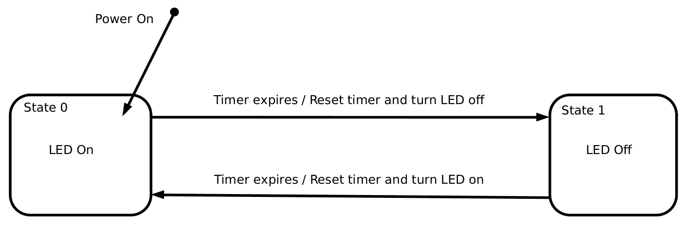

图 1-1 显示了程序的功能以及如何编写。

该程序的功能是：

- 上电后，初始状态为 LED 开启，且定时器重位并启动。
- 定时器到期后，LED 关闭，定时器重位并启动。
- 定时器再次到期后，LED 开启，定时器重位并启动。
- 这一过程持续进行，直到微控制器断电。

在这个示例中，只有一个事件会触发状态变化：即定时器到期。到期的影响取决于当前状态——它可能会跳转到 LED 开启状态或 LED 关闭状态。输入或事件仅由当前状态使用的这一事实，有助于让复杂的程序变得更健壮且更易于理解。这个示例是一个梅利机，其输出或动作由当前状态和输入决定。在状态图中，状态之间的转换由箭头表示。箭头旁边是触发转换的输入条件以及产生的输出。在摩尔机中，输出仅取决于机器的当前状态。输出将显示在图中状态内部。本书专门针对实用的程序。我不会尝试去遵循严格的定义。至于如何编写程序（图 1-1 一个双状态机器），你已经通过规划完成了最重要的一部分。现在要做的仅仅是将图表实现为代码，这样可以减少出错概率，因为你可以专注于局部细节。本书将主要使用梅利型机器。引起转换的输入将用正斜杠与输出分开。这将写在两个状态之间的转换旁边。关于 FSM，输入和输出（I/O）并不限于电气 I/O。它们还包括其他类型的变化。输入可以是定时器超时，输出可以是向 CPU 寄存器中写入一个值。FSM 可以用几乎任何编程语言编写。

## 1.2 实际实现

微控制器项目并不需要昂贵。书中贯穿使用的两个 PIC 是 `12F1822` 和 `16F1823` 变体。它们都是廉价的中端设备，在撰写本书时，它们在英国的价格不到 1 英镑。它们以双直插封装（DIP）形式提供，易于焊接，也可以插入插座中。程序将在文本编辑器中编写，并使用开源汇编器 `gpasm` 进行汇编。若要将将的程序加载到 PIC 中，你可以使用如 PICKIT 3 这样的编程器，但没有必要购买一个。本书编写了两个程序，可以使用 FTDI USB 线缆 `TTL-232R-5V-WE` 进行读写。同样的线缆也可以在后续项目中用于读取和写入 PIC 中的数据。

### 1.2.1 操作系统的选择

可以使用 Microsoft Windows 或 Linux 来汇编和加载程序到 PIC 中。你可以从 Elektor 网站免费下载两个归档文件：一个适用于 Windows，另一个适用于 Linux。这些文件包含了书中示例以及上述应用程序的所有源文件。正如前言中所述，书中在 Linux 还是 Windows 中都统一使用了命令行方法。对于那些还记得使用 DOS 的人来说，在终端中输入命令可能看起来像是回到了上个世纪。然而，这是一种非常简单的方法，特别是对于像运行汇编程序或将程序加载到 PIC 这样的重复性任务。可以通过脚本简化任务以节省输入，并可以使用向上和向下键找回最近的命令。如果你使用 Linux，输入历史（typing history）将列出你之前使用过的命令的编号列表。可以使用感叹号后跟数字来重新运行它们。自动补全允许你使用 `tab` 键列出可能的文件。你永远不需要输入完整名称。如果你乐于使用文本文件为电子设备编写源代码，那么使用命令行应该是逻辑上的选择。图形用户界面（GUI）有其优势。然而，如果你在做重复性的工作，与运行脚本或调用之前的命令及其选项相比，频繁点击鼠标甚至使用键盘快捷键都是枯燥的。

### 1.2.2 机器语言与汇编源文件

PIC 微控制器需要通过将机器码加载到闪存器中编程。最后一句中的“编程”是指将机器码从计算机传输到 PIC，而不是编写代码。机器码是程序运行时处理的原始字节值。这些机器码首先被汇组成一个名为 hex 的文件。它的名称源于英特尔十六进制（Intel Hex Format），这是该用途的文件标准。然后，hex 文件通过计算机上的程序和一个称为编程器的硬件接口写入 PIC。当谈到机器码时，指的不是有限状态机，而是被称为“机器”的处理器本身。

可以通过直接在文本编辑器中输入 hex 文件来编写程序。手动汇编机器指令太耗时，不能被认为是一项现实的任务。为了方便起见，使用汇编语言编写，通过机器指令的短缩写来产生更具读性的代码。你通过这种方式编写的文件是源代码，通常具有 `.asm` 后缀。该文件随后由汇编器程序读取并写入 hex 文件中。

人们通常认为使用高级语言编写程序更好。如果你想更快地完成任务并减少出错几率，那么这是绝对正确的。C 语言的发明是为了摆脱汇编语言编程的问题。本书关于在简单的 PIC 上实现的有限状态机。为微控制器编写代码，你必须理解软件与硬件交界处发生了什么。虽然 C 让编码更快更容易，但它让事情变得更复杂。然而，你并没有看到这些额外的复杂：它们是由编译器和链接器处理的。这一切都会阻碍你理解代码在做什么。对于书中使用的 PIC，有 49 条可用指令。常用的很容易学会。汇编语言的妙之处在于你可以看到发生的一切。你编写的代码正是进入 PIC 的机器码。一旦源文件完成，它将由汇编器程序转换为机器语言：即 `gpasm`。汇编器读取你的源代码并输出 hex 文件。然后，hex 文件由另一个应用程序读取，并通过某种形式的硬件接口写入 PIC。下方的图 1-2 展示了这一编程链。

如果你愿意，也可以使用 Microchip 的 MPLABX 和 PICKET 3 或 4。你可能已经拥有这些设备并对它们很熟悉。接下来的两段描述了使用下载包中提供的程序的替代方案。

### 1.2.3 • 在 Microsoft Windows 上使用应用程序

首先，你需要从这里下载并安装适用于 Windows 的 gputils：

`https://sourceforge.net/projects/gputils/files/gputils-win32/`

编写本文时使用的版本是 1.4.0。虽然不是最新版本，但选择它是为了与当前 Debian 和 Ubuntu 使用的版本一致。如果你愿意，可以使用最新版本。

你需要为你的 USB 连接线准备 FTDI 驱动程序，并安装 `FTD2XX.DLL` 文件。此此最佳方法是从处下载 Windows 版本的可执行设置程序：

`http://www.ftdichip.com/Drivers/D2XX.htm`

在编写时，它的名为 `CDM2128_Setup.zip`。压缩包内部是 `CDM2128_Setup.exe`，它将安装驱动程序和所需的 DLL 文件。请在插入连接线之前安装。

你需要将从 Elektor 网站下载的文件解压到电脑上方便的目录。请确保你下载了正确的文件。Linux 版本无法在 Windows 上运行，反之亦然。不仅仅是可执行文件不兼容。文本文件的行尾不同：Linux 文件使用换行符，而 Windows 文件在每行末尾都有回车符和换行符。图 1-2 编程链

文件会解压出几个目录。工作目录包含一个名为 `terminal_here` 的批处理文件。点击此这将打开一个虚拟终端。如果你输入 `dir` 并按回车，将显示目录的内容。最初，工作目录中的文件是可执行的。这些可执行文件将从命令行运行。这只需输入几个单词并按回车。在本章的后半部分，将提供如何使用这些应用程序的说明。读写 PIC 源文件，你可以使用 Windows 的文本编辑器记事本，但任何文本编辑器都可以，包括 `notepad++`。

### 1.2.4 • 在 Linux 上安装应用程序

Linux 的归档文件是一个 tar 文件。可以通过在命令行输入以下命令来提取它：

```bash
tar -xvf <文件名>.tar
```

Linux 有许多变体。我不会尝试详细涵盖所有版本的说明。我将提供两个版本的说明：Debian 和 Fedora。Debian 的细节适用于 Ubuntu 和其他 Debian 衍生版本。

汇编器程序 `gpasm` 是 GNU PIC Utilities（`gputils`）包的一部分。在基于 Debian 的 Linux 上可以通过打开终端窗口并输入以下命令来安装：

```bash
sudo apt-get install gputils
```

当然，你必须连接到互联网。在 Fedora 上，命令是：

```bash
sudo dnf install gputils
```

对于 Fedora：

为了将 hex 文件内容加载到 PIC 微控制器并读回已加载的字节，专门为本书编写的两个程序被称为 `program_writer_xx` 和 `program_reader_xx`，其中 `xx` 是 32 或 64。这两个版本都提供了：一个适用于 32 位，一个适用于 64 位操作系统。这些程序需要安装 `libftdi1-dev` 包才能才能工作。在 Debian 上可以通过打开终端窗口并输入以下命令来安装：

```bash
sudo apt-get install libftdi1-dev
```

图 1-3a 在 Debian（Ubuntu 等）上安装 `gputils`

图 1-3b 在 Fedora 上安装 `gputils`

图 1-4a 在 Debian（Ubuntu 等）上安装 `libftdi1-dev`

对于 Fedora：

这两个应用程序仅在这两个 PIC 上进行过测试。图 1-5 显示了 Linux 和 Windows 下载的目录树。

一旦安装了所有软件，下一步就是使用硬件进行尝试。

### 1.2.5 • FTDI 连接线与测试编程链

所有需要的只是一个 FTDI `TTL-232R-5V-WE` USB 线端连接。它们可以在 Farnell、RS Components 和 Digi-Key 等供应商处轻松获得。建议在引脚 4、6 和 7 上使用 1k 电阻进行保护。连接到引脚 5 的一个用于限制电流。

## 1.3 二进制与十六进制

### 1.3.1 二进制计数法

信息：它只有两种状态，通常被称为 0 或 1。在物理上，这些状态可以用例如 0V 或 +5V 的电压来表示。任何可以具有两个不同值的物理量都可以使用。现在，如果将两个位（bits）放在一起，这些位就有四种可能的排列方式：00, 01, 10, 11。

如果使用三个位，就有八种排列方式：000, 001, 010, 011, 100, 101, 110, 111。每当向组添加一个位时，排列方式就会翻倍。一个字节（byte）通常是八个位的一组，它们有 256 种排列方式。每种位排列都可用来表示一个整数。首先，我们将查看正整数和零。负整数也可以表示，但那是以后的事情。

位为 1 的位有时被称为“开启”（on），位为 0 时被称为“关闭”（off）。

字节中的每个位不仅有 0 或 1 的值，在字节中还有一个位置。我们对位置赋予权重，使得右侧的位在开启时值为 1，在关闭时值为 0。下一个位置的权重为 2，因此该位在开启时值为 2，关闭时值为 0。继续将这种二进制权重应用到字节中的所有八位，从 0 到 255 的所有值都可以分配给位状态。

| 128 | 64 | 32 | 16 | 8 | 4 | 2 | 1 | 结果 |
| :--- | :--- | :--- | :--- | :--- | :--- | :--- | :--- | :--- |
| 0 | 0 | 0 | 0 | 0 | 0 | 0 | 0 | 0 |
| 0 | 0 | 0 | 0 | 0 | 0 | 0 | 1 | 1 |
| 0 | 0 | 0 | 0 | 0 | 0 | 0 | 0 | 2 |
| 0 | 0 | 0 | 0 | 0 | 0 | 0 | 1 | 3 |
| 0 | 0 | 0 | 0 | 0 | 0 | 1 | 0 | 4 |
| 0 | 0 | 0 | 0 | 0 | 0 | 0 | 1 | 5 |
| 0 | 0 | 0 | 0 | 0 | 0 | 1 | 1 | 6 |
| 0 | 0 | 0 | 0 | 0 | 1 | 1 | 1 | 7 |
| 0 | 0 | 0 | 0 | 1 | 0 | 0 | 1 | 8 |
| 0 | 0 | 0 | 0 | 0 | 0 | 0 | 1 | 9 |
| 0 | 0 | 0 | 0 | 0 | 0 | 1 | 1 | 10 |
| 0 | 0 | 0 | 0 | 0 | 1 | 1 | 1 | 11 |
| 0 | 0 | 0 | 0 | 1 | 1 | 0 | 0 | 12 |
| 0 | 0 | 0 | 0 | 0 | 0 | 1 | 1 | 13 |
| 0 | 0 | 0 | 0 | 0 | 0 | 1 | 1 | 14 |
| 0 | 0 | 0 | 0 | 1 | 1 | 1 | 1 | 15 |
| 0 | 0 | 0 | 1 | 0 | 0 | 0 | 0 | 16 |
| 1 | 1 | 1 | 1 | 1 | 1 | 1 | 1 | 255 |

表 1-1 二进制权重

例如，十一是由权重为 8、2 和 1 的位被开启来表示的。这与我们十进制计数的方式没有区别。数字 364 是四个单位加上六个十位加上三个百位。每个位置的权重都是十的十次方倍数。如果我们给 364 加上 6，它就变成了 370。个位发生了溢出，十的值被进位并加到了十位。二进制加法也是如此。这里有三个独立的示例：

当加法导致字节溢出时，会产生一个进位并加到下一个字节。如果第一个字节计数到 255，下一个字节将计算 256 的个数，更高一级的字节将计算 65536 的个数，以此类推。

### 1.3.2 十六进制计数法

在日常生活中，我们使用十进制。微控制器和计算机像上面提到的那样使用位和字节使用二进制系统运行。将值的表示形式来回转换为二进制模式并不方便。十进制系统有另一种替代方案，它使用 16 个字符而不是十个。这之所以很方便，是因为一组四个位有十六种排列方式。为了用 16 个字符来表示 0-15 的值，使用了 A 到 F。这使得一组四个位的十六种排列在表示变得非常方便。

例如，十一是由权重为 8、2 和 1 的位被开启来表示的。这与我们十进制计数的方式没有区别。数字 364 是四个单位加上六个十位加上三个百位。每个位置的权重都是十的十次方倍数。如果我们给 364 加上 6，它就变成了 370。个位发生了溢出，十的值被进位并加到了十位。二进制加法也是如此。这里有三个独立的示例：

当加法导致字节溢出时，会产生一个进位并加到下一个字节。如果第一个字节计数到 255，下一个字节将计算 256 的个数，更高一级的字节将计算 65536 的个数，以此类推。

### 1.3.3 十进制计数

在日常生活中，我们使用十进制。微控制器和计算机像上面提到的那样使用位和字节使用二进制系统运行。将值的表示形式来回转换为二进制模式并不方便。十进制系统有另一种替代方案，它使用 16 个字符而不是十个。这之所以很方便，是因为一组四个位有十六种排列方式。为了用 16 个字符来表示 0-15 的值，使用了 A 到 F。这使得一组四个位的十六种排列在表示变得非常方便。


例如，十一是由权重为 8、2 和 1 的位被开启来表示的。这与我们十进制计数的方式没有区别。数字 364 是四个单位加上六个十位加上三个百位。每个位置的权重都是十的十次方倍数。如果我们给 364 加上 6，它就变成了 370。个位发生了溢出，十的值被进位并加到了十位。二进制加法也是如此。这里有三个独立的示例：

当加法导致字节溢出时，会产生一个进位并加到下一个字节。如果第一个字节计数到 255，下一个字节将计算 256 的个数，更高一级的字节将计算 65536 的个数，以此类推。

### 1.3.2 十进制计数

在日常生活中，我们使用十进制。微控制器和计算机像上面提到的那样使用位和字节使用二进制系统运行。将值的表示形式来回转换为二进制模式并不方便。十进制系统有另一种替代方案，它使用 16 个字符而不是十个。这之所以很方便，是因为一组四个位有十六种排列方式。为了用 16 个字符来表示 0-15 的值，使用了 A 到 F。这使得一组四个位的十六种排列在表示变得非常方便。

例如，十一是由权重为 8、2 和 1 的位被开启来表示的。这与我们十进制计数的方式没有区别。数字 364 是四个单位加上六个十位加上三个百位。每个位置的权重都是十的十次方倍数。如果我们给 364 加上 6，它就变成了 370。个位发生了溢出，十的值被进位并加到了十位。二进制加法也是如此。这里有三个独立的示例：

当加法导致字节溢出时，会产生一个进位并加到下一个字节。如果第一个字节计数到 255，下一个字节将计算 256 的个数，更高一级的字节将计算 65536 的个数，以此类推。

### 1.3.2 十进制计数

在日常生活中，我们使用十进制。微控制器和计算机像上面提到的那样使用位和字节使用二进制系统运行。将值的表示形式来回转换为二进制模式并不方便。十进制系统有另一种替代方案，它使用 16 个字符而不是十个。这之所以很方便，是因为一组四个位有十六种排列方式。为了用 16 个字符来表示 0-15 的值，使用了 A 到 F。这使得一组四个位的十六种排列在表示变得非常方便。

例如，十一是由权重为 8、2 和 1 的位被开启来表示的。这与我们十进制计数的方式没有区别。数字 364 是四个单位加上六个十位加上三个百位。每个位置的权重都是十的十次方倍数。如果我们给 364 加上 6，它就变成了 370。个位发生了溢出，十的值被进位并加到了十位。二进制加法也是如此。这里有三个独立的示例：

当加法导致字节溢出时，会产生一个进位并加到下一个字节。如果第一个字节计数到 255，下一个字节将计算 256 的个数，更高一级的字节将计算 65536 的个数，以此类推。

### 1.3.2 十进制计数

在日常生活中，我们使用十进制。微控制器和计算机像上面提到的那样使用位和字节使用二进制系统运行。将值的表示形式来回转换为二进制模式并不方便。十进制系统有另一种替代方案，它使用 16 个字符而不是十个。这之所以很方便，是因为一组四个位有十六种排列方式。为了用 16 个字符来表示 0-15 的值，使用了 A 到 F。这使得一组四个位的十六种排列在表示变得非常方便。

例如，十一是由权重为 8、2 和 1 的位被开启来表示的。这与我们十进制计数的方式没有区别。数字 364 是四个单位加上六个十位加上三个百位。每个位置的权重都是十的十次方倍数。如果我们给 364 加上 6，它就变成了 370。个位发生了溢出，十的值被进位并加到了十位。二进制加法也是如此。这里有三个独立的示例：

当加法导致字节溢出时，会产生一个进位并加到下一个字节。如果第一个字节计数到 255，下一个字节将计算 256 的个数，更高一级的字节将计算 65536 的个数，以此类推。

### 1.3.2 十进制计数

在日常生活中，我们使用十进制。微控制器和计算机像上面提到的那样使用位和字节使用二进制系统运行。将值的表示形式来回转换为二进制模式并不方便。十进制系统有另一种替代方案，它使用 16 个字符而不是十个。这之所以很方便，是因为一组四个位有十六种排列方式。为了用 16 个字符来表示 0-15 的值，使用了 A 到 F。这使得一组四个位的十六种排列在表示变得非常方便。

例如，十一是由权重为 8、2 和 1 的位被开启来表示的。这与我们十进制计数的方式没有区别。数字 364 是四个单位加上六个十位加上三个百位。每个位置的权重都是十的十次方倍数。如果我们给 364 加上 6，它就变成了 370。个位发生了溢出，十的值被进位并加到了十位。二进制加法也是如此。这里有三个独立的示例：

当加法导致字节溢出时，会产生一个进位并加到下一个字节。如果第一个字节计数到 255，下一个字节将计算 256 的个数，更高一级的字节将计算 65536 的个数，以此类推。

### 1.3.2 十进制计数

在日常生活中，我们使用十进制。微控制器和计算机像上面提到的那样使用位和字节使用二进制系统运行。将值的表示形式来回转换为二进制模式并不方便。十进制系统有另一种替代方案，它使用 16 个字符而不是十个。这之所以很方便，是因为一组四个位有十六种排列方式。为了用 16 个字符来表示 0-15 的值，使用了 A 到 F。这使得一组四个位的十六种排列在表示变得非常方便。

例如，十一是由权重为 8、2 和 1 的位被开启来表示的。这与我们十进制计数的方式没有区别。数字 364 是四个单位加上六个十位加上三个百位。每个位置的权重都是十的十次方倍数。如果我们给 364 加上 6，它就变成了 370。个位发生了溢出，十的值被进位并加到了十位。二进制加法也是如此。这里有三个独立的示例：

当加法导致字节溢出时，会产生一个进位并加到下一个字节。如果第一个字节计数到 255，下一个字节将计算 256 的个数，更高一级的字节将计算 65536 的个数，以此类推。

### 1.3.2 十六进制计数

在日常生活中，我们使用十进制。微控制器和计算机像上面提到的那样使用位和字节使用二进制系统运行。将值的表示形式来回转换为二进制模式并不方便。十进制系统有另一种替代方案，它使用 16 个字符而不是十个。这之所以很方便，是因为一组四个位有十六种排列方式。为了用 16 个字符来表示 0-15 的值，使用了 A 到 F。这使得一组四个位的十六种排列在表示变得非常方便。

例如，十一是由权重为 8、2 和 1 的位被开启来表示的。这与我们十进制计数的方式没有区别。数字 364 是四个单位加上六个十位加上三个百位。每个位置的权重都是十的十次方倍数。如果我们给 364 加上 6，它就变成了 370。个位发生了溢出，十的值被进位并加到了十位。二进制加法也是如此。这里有三个独立的示例：

当加法导致字节溢出时，会产生一个进位并加到下一个字节。如果第一个字节计数到 255，下一个字节将计算 256 的个数，更高一级的字节将计算 65536 的个数，以此类推。

### 1.3.2 十六进制计数

在日常生活中，我们使用十进制。微控制器和计算机像上面提到的那样使用位和字节使用二进制系统运行。将值的表示形式来回转换为二进制模式并不方便。十进制系统有另一种替代方案，它使用 16 个字符而不是十个。这之所以很方便，是因为一组四个位有十六种排列方式。为了用 16 个字符来表示 0-15 的值，使用了 A 到 F。这使得一组四个位的十六种排列在表示变得非常方便。

例如，十一是由权重为 8、2 和 1 的位被开启来表示的。这与我们十进制计数的方式没有区别。数字 364 是四个单位加上六个十位加上三个百位。每个位置的权重都是十的十次方倍数。如果我们给 364 加上 6，它就变成了 370。个位发生了溢出，十的值被进位并加到了十位。二进制加法也是如此。这里有三个独立的示例：

当加法导致字节溢出时，会产生一个进位并加到下一个字节。如果第一个字节计数到 255，下一个字节将计算 256 的个数，更高一级的字节将计算 65536 的个数，以此类推。

### 1.3.2 十六进制计数

在日常生活中，我们使用十进制。微控制器和计算机像上面提到的那样使用位和字节使用二进制系统运行。将值的表示形式来回转换为二进制模式并不方便。十进制系统有另一种替代方案，它使用 16 个字符而不是十个。这之所以很方便，是因为一组四个位有十六种排列方式。为了用 16 个字符来表示 0-15 的值，使用了 A 到 F。这使得一组四个位的十六种排列在表示变得非常方便。

例如，十一是由权重为 8、2 和 1 的位被开启来表示的。这与我们十进制计数的方式没有区别。数字 364 是四个单位加上六个十位加上三个百位。每个位置的权重都是十的十次方倍数。如果我们给 364 加上 6，它就变成了 370。个位发生了溢出，十的值被进位并加到了十位。二进制加法也是如此。这里有三个独立的示例：

当加法导致字节溢出时，会产生一个进位并加到下一个字节。如果第一个字节计数到 255，下一个字节将计算 256 的个数，更高一级的字节将计算 65536 的个数，以此类推。

### 1.3.2 十六进制计数

在日常生活中，我们使用十进制。微控制器和计算机像上面提到的那样使用位和字节使用二进制系统运行。将值的表示形式来回转换为二进制模式并不方便。十进制系统有另一种替代方案，它使用 16 个字符而不是十个。这之所以很方便，是因为一组四个位有十六种排列方式。为了用 16 个字符来表示 0-15 的值，使用了 A 到 F。这使得一组四个位的十六种排列在表示变得非常方便。

例如，十一是由权重为 8、2 和 1 的位被开启来表示的。这与我们十进制计数的方式没有区别。数字 364 是四个单位加上六个十位加上三个百位。每个位置的权重都是十的十次方倍数。如果我们给 364 加上 6，它就变成了 370。个位发生了溢出，十的值被进位并加到了十位。二进制加法也是如此。这里有三个独立的示例：

当加法导致字节溢出时，会产生一个进位并加到下一个字节。如果第一个字节计数到 255，下一个字节将计算 256 的个数，更高一级的字节将计算 65536 的个数，以此类推。

### 1.3.2 十六进制计数

在日常生活中，我们使用十进制。微控制器和计算机像上面提到的那样使用位和字节使用二进制系统运行。将值的表示形式来回转换为二进制模式并不方便。十进制系统有另一种替代方案，它使用 16 个字符而不是十个。这之所以很方便，是因为一组四个位有十六种排列方式。为了用 16 个字符来表示 0-15 的值，使用了 A 到 F。这使得一组四个位的十六种排列在表示变得非常方便。

例如，十一是由权重为 8、2 和 1 的位被开启来表示的。这与我们十进制计数的方式没有区别。数字 364 是四个单位加上六个十位加上三个百位。每个位置的权重都是十的十次方倍数。如果我们给 364 加上 6，它就变成了 370。个位发生了溢出，十的值被进位并加到了十位。二进制加法也是如此。这里有三个独立的示例：

当加法导致字节溢出时，会产生一个进位并加到下一个字节。如果第一个字节计数到 255，下一个字节将计算 256 的个数，更高一级的字节将计算 65536 的个数，以此类推。

### 1.3.2 十六进制计数

在日常生活中，我们使用十进制。微控制器和计算机像上面提到的那样使用位和字节使用二进制系统运行。将值的表示形式来回转换为二进制模式并不方便。十进制系统有另一种替代方案，它使用 16 个字符而不是十个。这之所以很方便，是因为一组四个位有十六种排列方式。为了用 16 个字符来表示 0-15 的值，使用了 A 到 F。这使得一组四个位的十六种排列在表示变得非常方便。

例如，十一是由权重为 8、2 和 1 的位被开启来表示的。这与我们十进制计数的方式没有区别。数字 364 是四个单位加上六个十位加上三个百位。每个位置的权重都是十的十次方倍数。如果我们给 364 加上 6，它就变成了 370。个位发生了溢出，十的值被进位并加到了十位。二进制加法也是如此。这里有三个独立的示例：

当加法导致字节溢出时，会产生一个进位并加到下一个字节。如果第一个字节计数到 255，下一个字节将计算 256 的个数，更高一级的字节将计算 65536 的个数，以此类推。

### 1.3.2 十六进制计数

在日常生活中，我们使用十进制。微控制器和计算机像上面提到的那样使用位和字节使用二进制系统运行。将值的表示形式来回转换为二进制模式并不方便。十进制系统有另一种替代方案，它使用 16 个字符而不是十个。这之所以很方便，是因为一组四个位有十六种排列方式。为了用 16 个字符来表示 0-15 的值，使用了 A 到 F。这使得一组四个位的十六种排列在表示变得非常方便。

例如，十一是由权重为 8、2 和 1 的位被开启来表示的。这与我们十进制计数的方式没有区别。数字 364 是四个单位加上六个十位加上三个百位。每个位置的权重都是十的十次方倍数。如果我们给 364 加上 6，它就变成了 370。个位发生了溢出，十的值被进位并加到了十位。二进制加法也是如此。这里有三个独立的示例：

当加法导致字节溢出时，会产生一个进位并加到下一个字节。如果第一个字节计数到 255，下一个字节将计算 256 的个数，更高一级的字节将计算 65536 的个数，以此类推。

### 1.3.2 十六进制计数

在日常生活中，我们使用十进制。微控制器和计算机像上面提到的那样使用位和字节使用二进制系统运行。将值的表示形式来回转换为二进制模式并不方便。十进制系统有另一种替代方案，它使用 16 个字符而不是十个。这之所以很方便，是因为一组四个位有十六种排列方式。为了用 16 个字符来表示 0-15 的值，使用了 A 到 F。这使得一组四个位的十六种排列在表示变得非常方便。

例如，十一是由权重为 8、2 和 1 的位被开启来表示的。这与我们十进制计数的方式没有区别。数字 364 是四个单位加上六个十位加上三个百位。每个位置的权重都是十的十次方倍数。如果我们给 364 加上 6，它就变成了 370。个位发生了溢出，十的值被进位并加到了十位。二进制加法也是如此。这里有三个独立的示例：

当加法导致字节溢出时，会产生一个进位并加到下一个字节。如果第一个字节计数到 255，下一个字节将计算 256 的个数，更高一级的字节将计算 65536 的个数，以此类推。

### 1.3.2 十六进制计数

在日常生活中，我们使用十进制。微控制器和计算机像上面提到的那样使用位和字节使用二进制系统运行。将值的表示形式来回转换为二进制模式并不方便。十进制系统有另一种替代方案，它使用 16 个字符而不是十个。这之所以很方便，是因为一组四个位有十六种排列方式。为了用 16 个字符来表示 0-15 的值，使用了 A 到 F。这使得一组四个位的十六种排列在表示变得非常方便。

例如，十一是由权重为 8、2 和 1 的位被开启来表示的。这与我们十进制计数的方式没有区别。数字 364 是四个单位加上六个十位加上三个百位。每个位置的权重都是十的十次方倍数。如果我们给 364 加上 6，它就变成了 370。个位发生了溢出，十的值被进位并加到了十位。二进制加法也是如此。这里有三个独立的示例：

当加法导致字节溢出时，会产生一个进位并加到下一个字节。如果第一个字节计数到 255，下一个字节将计算 256 的个数，更高一级的字节将计算 65536 的个数，以此类推。

### 1.3.2 十六进制计数

在日常生活中，我们使用十进制。微控制器和计算机像上面提到的那样使用位和字节使用二进制系统运行。将值的表示形式来回转换为二进制模式并不方便。十进制系统有另一种替代方案，它使用 16 个字符而不是十个。这之所以很方便，是因为一组四个位有十六种排列方式。为了用 16 个字符来表示 0-15 的值，使用了 A 到 F。这使得一组四个位的十六种排列在表示变得非常方便。

例如，十一是由权重为 8、2 和 1 的位被开启来表示的。这与我们十进制计数的方式没有区别。数字 364 是四个单位加上六个十位加上三个百位。每个位置的权重都是十的十次方倍数。如果我们给 364 加上 6，它就变成了 370。个位发生了溢出，十的值被进位并加到了十位。二进制加法也是如此。这里有三个独立的示例：

当加法导致字节溢出时，会产生一个进位并加到下一个字节。如果第一个字节计数到 255，下一个字节将计算 256 的个数，更高一级的字节将计算 65536 的个数，以此类推。

### 1.3.2 十六进制计数

在日常生活中，我们使用十进制。微控制器和计算机像上面提到的那样使用位和字节使用二进制系统运行。将值的表示形式来回转换为二进制模式并不方便。十进制系统有另一种替代方案，它使用 16 个字符而不是十个。这之所以很方便，是因为一组四个位有十六种排列方式。为了用 16 个字符来表示 0-15 的值，使用了 A 到 F。这使得一组四个位的十六种排列在表示变得非常方便。

例如，十一是由权重为 8、2 和 1 的位被开启来表示的。这与我们十进制计数的方式没有区别。数字 364 是四个单位加上六个十位加上三个百位。每个位置的权重都是十的十次方倍数。如果我们给 364 加上 6，它就变成了 370。个位发生了溢出，十的值被进位并加到了十位。二进制加法也是如此。这里有三个独立的示例：

当加法导致字节溢出时，会产生一个进位并加到下一个字节。如果第一个字节计数到 255，下一个字节将计算 256 的个数，更高一级的字节将计算 65536 的个数，以此类推。

### 1.3.2 十六进制计数

在日常生活中，我们使用十进制。微控制器和计算机像上面提到的那样使用位和字节使用二进制系统运行。将值的表示形式来回转换为二进制模式并不方便。十进制系统有另一种替代方案，它使用 16 个字符而不是十个。这之所以很方便，是因为一组四个位有十六种排列方式。为了用 16 个字符来表示 0-15 的值，使用了 A 到 F。这使得一组四个位的十六种排列在表示变得非常方便。


例如，十一是由权重为 8、2 和 1 的位被开启来表示的。这与我们十进制计数的方式没有区别。数字 364 是四个单位加上六个十位加上三个百位。每个位置的权重都是十的十次方倍数。如果我们给 364 加上 6，它就变成了 370。个位发生了溢出，十的值被进位并加到了十位。二进制加法也是如此。这里有三个独立的示例：

当加法导致字节溢出时，会产生一个进位并加到下一个字节。如果第一个字节计数到 255，下一个字节将计算 256 的个数，更高一级的字节将计算 65536 的个数，以此类推。

当你为计算机编写程序时，有一个像 Windows、Linux、BSD 或 macOS 这样的操作系统，通过内核来处理硬件接口。PIC 没有操作系统。你必须处理硬件细节，例如配置输入和输出、振荡器频率，或者串口配置（如果你想与 PC 通信）。图 1-14 显示了如果将 PIC 编程为一个与门，它会是什么样的。你可能会争辩说我画的是一个“非或门”（NOT OR）。由于开关在关闭时会将输入拉低到 0V，从输入电压的角度来看，为了输出高电平，所有输入都必须为高电平。因此，它是一个与门。每个输入都有一个内部高阻电阻，当引脚开路时，它会将其拉高到 5V。这被称为弱上拉，并在代码中配置。这节省了外部组件，因为只需要一个开关将引脚上的电压拉低即可。

我应该提到的是，我的程序所使用的编程方法 `program_writer` 和 `program_reader` 使用带有 FTDI 线缆的低电压编程，而不是高电压编程；高电压编程需要对引脚 5 `MCLR/Vpp/` `RA3` 加上 8V 到 9V 的电压以进入编程模式。低电压编程仅需 5V 电源和应用于 `ICPDAT` 引脚的特殊位序列即可进入编程模式。

这种方法的缺点是引脚 4 只能用作 `MCLR`（而不是主清除复位）。这意味着应用于此引脚的 0V 会重置 PIC。因此，引脚 4 必须始终加上 5V 电压。弱上拉就实现了这一点。它在低电压编程模式下默认启用。这意味着我们失去了将 `RA3` 作为输入引脚的使用。反正它从不是输出引脚。

现在不要担心这些所有关于编程方法的细节。如果你想获得更多关于这些细节的信息，请查看图 1-14“作为与门的 PIC 12F1822”，并参阅数据表中第 1 页关于在系统 `DS41390C` 编程的第 2 条注释。该数据表解释了关于这些 PIC 在系统编程的所有信息。

最后一点：画在 `MCLR` 上方的横线表示“非 MCLR”。如果电压是 5V，它就不会重置 PIC。它在 0V 时重位。

现在来看一些汇编语言代码。一旦写入 PIC 的代码是一系列机器指令。通常，每四个时钟周期执行一条指令。时钟周期由振荡器产生。此书中的所有内容都将使用内部振荡器。振荡器不需要外部组件。每条指令都位于 PIC 闪存内存中的一个内存地址。

随着程序的运行，程序计数器指向当前指令。每执行一条指令，该计数器就会加 1。某些指令可以导致程序计数器向前或向后跳转。这些跳转可以通过逻辑或数学操作的结果来决定。

如果你用过 C/C++、Java、Python 等其他语言编程，你将熟悉常用的 `if...else` 语句，它经常根据表达式的真假来执行某一段代码或另一段代码。考虑这个伪代码示例。

```text
if STATUS 寄存器中的 Z 位为高则
    开启输出；
else
    关闭输出；
end_if;
```

图 1-15 显示了如何在 PIC 汇编语言中实现这一点。在此显示的代码之前，会执行一个减法计算。如果结果为零，`STATUS` 中的 `Z` 位将被设置。`BTFSS`（位测试跳过设置）测试文件中的一个位。如果该位为高，将跳过下一条指令。如果为低，将执行下一条指令。

在编写你的汇编程序时，操作码助符是缩进的。最左侧的单词是你发明的标签，用于标记代码中的位置。这些标签可以作为 `GOTO` 操作码的目标。

`PORTA` 是持有端口 A 引脚状态的寄存器。在这个示例中，位 5 被配置为输出。因此，写入位 5 会设置引脚的电学状态。`BTFSS STATUS, Z` 决定是否跳过下一条指令。如果 `Z` 为高，程序将跳转到行 `BSF PORTA, 5`（位设置）并开启 `PORTA` 中的位 5。如果 `Z` 为低，则执行下一条指令 `GOTO ELSE`。程序随后跳转到 `BCF PORTA, 5`（位清除），从而关闭位 5。

程序存储在闪存内存中。每个位置宽度为 14 位，存储一条机器指令。要执行的下一条指令存在宽度为 15 位的程序计数器，使其能够寻址 32k 个位置。12F1822 和 16F1823 PIC 实现了 2048 个位置。

指令的执行速率取决于振荡器频率。每个指令周期需要四个时钟周期。程序内存被分为长度为 2048 个位置的页。指向程序中当前位置的程序计数器 PC 宽度为 15 位。它可以指向 0 到 32767 或 32568 个位置的范围。

PC 从两个寄存器加载：`PCL` 和 `PCLATH`。这发生在数据表第 38 页描述的五种情况之一。`PCL` 是特殊功能寄存器并出现在所有银行中。它提供了 PC 的低 8 位（程序计数器低位）。`PCLATH`（程序计数器高位）提供高 7 位。

如果你使用超过 2048 个内存位置的 PIC，必须意识到你的程序将跨越页边界。幸运的是，对于这两个 PIC，我们不必担心这个问题，因为我们的程序都在页 0 上。这可以在数据表的第 18 页看到。

## 1.5 • Hello World

这是一个闪烁 LED 的强制“Hello World”程序。它与引言描述的状态相同，只是状态 1 中 LED 是关闭的，定时器是一个从 255 翻转到 0 的计数器。

```asm
; 01.asm Hello World
LIST P=12f1822
#INCLUDE <12f122.inc>

__CONFIG 0x7007, FOSC=INTOS, WDTE=OFF, PWRTE=OFF, CP=OFF, BREN=OFF, IESO=OFF, LVP=ON

CBLOCK 0x70
COUNTER
ENDC

ORG 0x00
MOVLW 0x00
MOVWF TRISA
MOVLW 0x10
MOVWF OSCCON

STATE_0
DECFSZ COUNTER, F
GOTO ELSE
BSF PORTA, 5
GOTO STATE_0
ELSE:
BCF PORTA, 5
GOTO STATE_0
END
```

### 1.5.1 • 关键点

- 在任何带有分号的行上，分号之后都是注释，汇编器会忽略它们。
- 第二行有单词 `LIST`，后面跟着 `p=12f1822`，这告诉汇编程序正在使用什么类型的处理器。
- `#include <12f1822>` 行告诉汇编器读取此文件。该文件是包含汇编代码中所用缩写数值定义的头文件。如果你想读取此文件，在 Linux 上它位于 `/usr/share/gputils/headers/`，在 Windows 上它位于 `C:\Program Files(x86)\gputils\header\`。可以使用文本编辑器读取。不要修改它！
- 以 `__CONFIG` 开头的行至关重要。它们设置了两个配置字内存位置中的位。对于 PIC 来说，它们位于闪存中地址 `0x8007` 和 `0x8008`。

内存。这些位决定了诸如使用哪个振荡器等。这次使用的是内部振荡器，查看包含文件 `_FOSC_INTOSC_` 可知其十六进制值为 `0x3FFC`。这类事情可能完全没有意义。如果你按照这个例子操作下去，你将会看到它是多么逻辑化。

用二进制表示，`0x3FFC` 是 `11 1111 1111 11100`。正如数据手册第 46 页描述的那样，配置字 1 使用了 14 位。最低有效的三个位是振荡器选择位。对于内部振荡器，这些位是 `100`。该整个字中剩余的位被设置为默认值。

有趣的地方在于，此行代码中用于配置项的其他属性（例如“关闭门狗定时器” `_WDTE_OFF = 0x3FE7 = 0011 1111 1110 0111`）通过位与（AND）运算得到配置字的值。图 1-16 显示了我们程序的情况。

- `CBLOCK 0x70` 行是汇编器的一个指令，用于将从 `0x70` 开始的文件标记为后续行中给出的名称，直到指令 `ENDC`。这里只给了一个名称，即 `COUNTER`，它将用作变量来存储一个值。
- `ORG 0x00` 告诉汇编器从闪存器中的地址 `0x00` 位置开始汇编机器码。`MOVLB` 意味着将一个字面值移动到器选择寄存器，在本例中，值为 1。上文第 1.3.6 节对分页寻址进行了解释。在用汇编语言编写 PIC 时，你需要始终关注分页寻址。
- `BCF TRISA, 2` 意味着清除文件中的位，即将其设置为 0。该位是第 2 位，文件是 `TRISA`。`TRISA` 在数据手册的第 117 页中描述。它是决定 `PORTA` 引脚数据方向的文件。如果该位被设置为 0，引脚为输出，可以由程序驱动高或低电平。如果该位被设置为 1，引脚为输入，如图 1-16“位与运算确定配置字”所示，它具有高输入阻抗。这被称为三态引脚。第 2 位是设置 12F1822 PIC 第 5 引脚方向的位。数据手册第 3 页显示了一个图。
- `MOVLW 0x10` 将此处的二进制字面值移动到 CPU 的工作寄存器。
- `MOVF OSCCON` 将工作寄存器中的值移动到振荡器控制寄存器，产生 31.25 kHz 的频率。每当向文件传递值时，必须通过工作寄存器传递。十六进制值 `0X10` 的二进制为 `B’00100000`。这意味着设置振荡器的 `IRCF` 位将是 `0010`。参考数据手册第 65 页。
- 现在有一个标签 `STATE_0`，用于标记程序中的位置。
- `DECFSZ` 意味着减一个文件，如果结果为零则跳过下一条指令。该文件是 `COUNTER`。现在 `COUNTER` 可以是 0 到 255 (`0xFF`) 任何值。当它达到 0 时，下一次减法将其带回 255。如果结果不是零，下一条指令是 `GOTO STATE_0`，因此程序循环运行直到达到零。
- 如果结果为零，跳过下一条指令并执行 `BSF PORTA, 2` 指令。这会导致 `PORTA` 由位 2（物理引脚 5）控制的引脚被开启。`BSF` 意味着设置文件中的位。程序随后移动到 `STATE_1`。
- `STATE_1` 的工作方式与 `STATE_0` 相同，但以 `BCF PORTA, 2`（清除位）结束以关闭 LED，然后跳回 `STATE_0`。
- 最后，代码必须以 `END` 结束。

### 1.5.2 汇编程序

要汇编程序，请执行以下操作：

从 `chap01_source_xxxx`（xxxx = Windows 或 Linux）目录将源文件 `prog_01_01.asm` 拷贝到工作目录。

**Windows：**

在工作终端中点击 `terminal_here.bat` 批文件打开终端窗口。在命令行中输入以下内容并按回车：

```text
gpasm.exe prog_01_01.asm
```

**Linux：**

打开虚拟终端并导航到工作目录。在命令行中输入以下内容并按回车：

```text
./gpasm prog_01_01.asm
```

将生成几个文件，其中之一是十六进制文件 `prog_01_01.hex`。要将其写入 PIC，在命令行中输入以下内容并按回车：

**Windows：**

```text
program_writer.exe prog_01_01.hex
```

**Linux 32 位：**

```text
sudo ./program_writer_32 prog_01_01.hex
```

**Linux 64 位：**

```text
sudo ./program_writer_64 prog_01_01.hex
```

`gpasm` 汇编器产生文件 `prog_01_01.hex`，该文件使用 `program_writer` 写入 PIC。当然，你必须按照本章早前的介绍连接所有内容。提示检查位位的消息不是错误。它只是提醒确保你处于正确的位中。注意写入闪存器地址 `0x007` 的值与图 1-16 一致。对于 Windows 和 Linux 之间的差异，请学习图 1-7 和图 1-8。

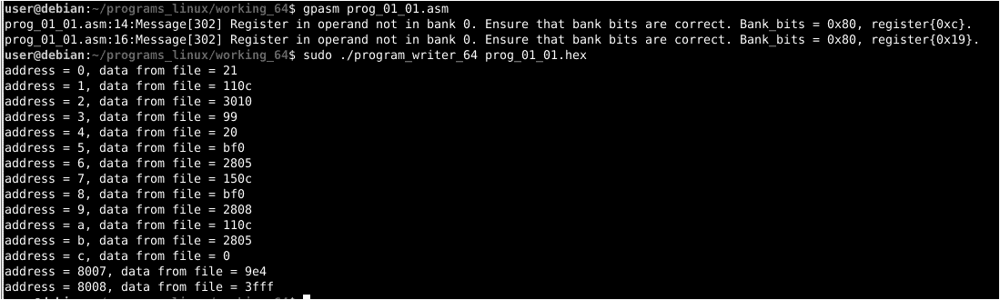

希望你正在感受汇编是如何工作的。它是极其冗余的，每一个动作在代码中都是可见的。这使得这一切变得有趣，因为不像高级语言中事情似乎是像魔法一样发生的，在这里你可以追踪硬件层面正在发生什么。这意味着你必须掌握更多的细节，工作量也更大。

状态图显示了序列的逻辑，在任何实际程序中，侧边都会有一些辅助代码来执行诸如配置 PIC 外围或计算时钟周期等操作。

接下来的两个部分将描述如何配置和使用此快速定时器，以及如何计算它的节拍（ticks）以为机器提供输入。

## 2.3 • Timer 器0

这些 PIC 有三个独立于程序运行的板载定时器。在上一章的“Hello World”程序中，我们通过递减一个文件值直到其变为零来创建一个延迟。这是创建较长延迟的糟糕方法，因为 CPU 除了计算指令周期外，什么都没做。

这三个定时器是 `timer0`、`timer1` 和 `timer2`。我们将从查看 `timer0` 开始。首要问题是，定时器是如何跟踪时间的？它们作为计数器工作，对时钟周期进行计数，但由于每个定时器都是一个独立的硬件实体，它们与程序并发执行此操作的。

由于定时器是在计算时钟周期，我们必须考虑到所使用的振荡器频率。我们将使用内部振荡器，可以选择从 31 kHz 到 32 MHz 范围内的频率。

`Timer0` 是一个八位定时器/计数器，可以作为定时器或计数器使用。在这里我将描述如何将其配置为定时器。模块的核心是 `TMR0` 寄存器，它位于数据内存的 bank 0 中。参见数据手册第 22 页。

当定时器运行时，它将不断递加直到值达到 255，然后溢出或回零到 0。溢出的时间取决于加载到它的值、初始的时钟频率，以及可以分频输入频率的分频器（Prescaler）的配置。完整的框图可以在数据手册第 162 页查看。图 2-2 是我们应用程序的简化图。

### 图 2-2 `timer0` 简化框图

从图表的左侧开始，锥形框是一个多路复用器，它可以从多个源中选择信号。简化图显示了一条来自与输入引脚相关电路的虚线。我们在这里没有使用这个源。

我们使用的信号是带有除以四的时钟频率的信号。要选择此，必须将 `OPTION_REG` 中的 `TMRCS` 位设置为 0。下一个选择是：我们希望周期频率直接馈送进行计数，还是使用分频器？

分频器可以根据 `OPTION_REG` 中的 `PS` 位将频率除以 2 到 256。`PS<2:0>` 编号为 0、1 和 2 的三位被称为 PS，使用此表示法时参见数据手册第 164 页；在使用此表示法时，数字指的不是寄存器中的位号，而是该组中的位号。

这里是一个将在下一个程序中用到的示例。我们将内部振荡器设置为以 32 MHz 运行。内部振荡器已经在配置字 1 中被选中。频率使用位 `IRCF<3:0>` 进行设置，实际上是寄存器 `OSCCON` 中的第 6、5、4 和 3 位（位于第 65 页）。这些位被设置为 1110。执行此操作的代码为：

```asm
MOVLW 0x70 ;Move (copy) 0x70 to W (working register)
MOVWF OSCCON ;Move (copy) W to OSCCON
```

在数据手册中，对于这些位的选择，取决于锁相环（PLL）是否启用，显示为 8 MHz 或 32 MHz。由于锁相环在配置字 1 中默认启用，因此频率将为 32 MHz。

下表是计算您需要移动到寄存器配置的内容的方便方法。您可以在纸上完成：只需将位 7-0 写在垂直列中，并通过读取数据手册添加位设置，然后将 7-4 和 3-0 这两组位转换为十六进制数字。一旦转换为十六进制，在输入代码时发生输入错误的概率就会更小。从表 2-1 可以，`OSCCON` 将加载 `0x70`。

| OSCCON | 位 | 十进制值 |
| :--- | :--- | :--- |
| 7-4 | 1110 | 7 |
| 3-0 | 0000 | 0 |

| OPTIONS_REG | 位 | 十进制值 |
| :--- | :--- | :--- |
| 7-4 | 1101 | D |
| 3-0 | 0111 | 7 |

要使用分频器，必须将 `OPTION_REG` 中的 `PSA` 设置为 0。分频比例应为 1:256，因此 `OPTION_REG` 中的位 `PS<2:0>` 必须设置为 111。我们需要启用上拉，因此通过将其他不影响此的位保持默认值，我们得到 `OPTION_REG` 的位为 1101111。这总结在表 2-2 中。

```asm
MOVLW 0xD7 ;Move (copy) 0xD7 to W (working register)
MOVWF OPTION_REG ;Move (copy) W to OPTION_REG
```

使用分频器，`OPTION_REG` 中的 `PSA` 必须设置为 0。分频比例为 1:256，因此 `OPTION_REG` 中的位 `PS<2:0>` 必须设置为 111。我们不需要启用上拉，因此通过将其他不影响此的位保持默认值，我们得到 `OPTION_REG` 的位为 1101111。这总结在表 2-2 中。

```asm
MOVLW 0xD7 ;Move (copy) 0xD7 to W (working register)
MOVWF OPTION_REG ;Move (copy) W to OPTION_REG
```

使用分频器，`OPTION_REG` 中的 `PSA` 必须设置为 0。分频比例应为 1:256，因此 `OPTION_REG` 中的位 `PS<2:0>` 必须设置为 111。我们不需要启用上拉，因此通过将其他不影响此的位保持默认值，我们得到 `OPTION_REG` 的位为 1101111。这总结在表 2-2 中。

```asm
MOVLW 0xD7 ;Move (copy) 0xD7 to W (working register)
MOVWF OPTION_REG ;Move (copy) W to OPTION_REG
```

使用分频器，`OPTION_REG` 中的 `PSA` 必须设置为 0。分频比例应为 1:256，因此 `OPTION_REG` 中的位 `PS<2:0>` 必须设置为 111。我们不需要启用上拉，因此通过将其他不影响此的位保持默认值，我们得到 `OPTION_REG` 的位为 1101111。这总结在表 2-2 中。


```asm
MOVLW 0xD7 ; Move (copy) 0xD7 to W (working register)
MOVWF OPTION_REG ; Move (copy) W to OPTION_REG
```

使用分频器，`OPTION_REG` 中的 `PSA` 必须设置为 0。分频比例应为 1:256，因此 `OPTION_REG` 中的位 `PS<2:0>` 必须设置为 111。我们不需要启用上拉，因此通过将其他不影响此的位保持默认值，我们得到 `OPTION_REG` 的位为 1101111。这总结在表 2-2 中。

这三个定时器是 `timer0`、`timer1` 和 `timer2`。我们将从查看 `timer0` 开始。首要问题是，定时器是如何跟踪时间的？它们作为计数器工作，对时钟周期进行计数，但由于每个定时器都是一个独立的硬件实体，它们与程序并发执行此操作。由于定时器是在计算时钟周期，我们必须考虑到所使用的振荡器频率。我们将使用内部振荡器，可以选择从 31 kHz 到 32 MHz 范围内的频率。

`Timer0` 是一个八位定时器/计数器，可以作为定时器或计数器使用。在这里我将描述如何将其配置为定时器。模块的核心是 `TMR0` 寄存器，它位于数据内存的 bank 0 中。参见数据手册第 22 页。当定时器运行时，它将不断递加直到值达到 255，然后溢出或回零到 0。溢出的时间取决于加载到它的值、初始的时钟频率，以及可以分频输入频率的分频器（Prescaler）的配置。完整的框图可以在数据手册第 162 页查看。图 2-2 是我们应用程序的简化图。

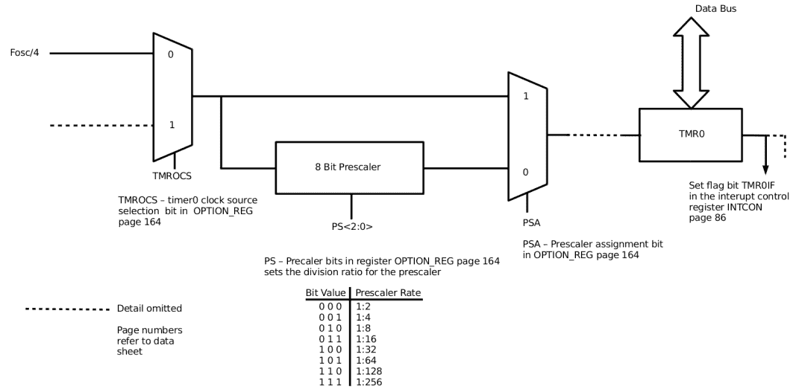

从图表的左侧开始，锥形框是一个多路复用器，它可以从多个源中选择信号。简化图显示了一条来自与输入引脚相关电路的虚线。我们在这里没有使用这个源。我们使用的信号是带有除以四的时钟频率的信号。要选择此，必须将 `OPTION_REG` 中的 `TMRCS` 位设置为 0。下一个选择是：我们希望周期频率直接馈送进行计数，还是使用分频器？分频器可以根据 `OPTION_REG` 中的 `PS` 位将频率除以 2 到 256。`PS<2:0>` 编号为 0、1 和 2 的三位被称为 PS，使用此表示法时参见数据手册第 164 页；在使用此表示法时，数字指的不是寄存器中的位号，而是该组中的位号。

这里是一个将在下一个程序中用到的示例。我们将内部振荡器设置为以 32 MHz 运行。内部振荡器已经在配置字 1 中被选中。频率使用位 `IRCF<3:0>` 进行设置，实际上是寄存器 `OSCCON` 中的第 6、5、4 和 3 位（位于第 65 页）。这些位被设置为 1110。执行此操作的代码为：

```asm
MOVLW 0x70 ; Move (copy) 0x70 to W (working register)
MOVWF OSCCON ; Move (copy) W to OSCCON
```

在数据手册中，对于这些位的选择，取决于锁相环（PLL）是否启用，显示为 8 MHz 或 32 MHz。由于锁相环在配置字 1 中默认启用，因此频率将为 32 MHz。下表是计算您需要移动到寄存器配置的内容的方便方法。您可以在纸上完成：只需将位 7-0 写在垂直列中，并通过读取数据手册添加位设置，然后将 7-4 和 3-0 这两组位转换为十六进制数字。一旦转换为十六进制，在输入代码时发生错误的概率就会更小。从表 2-1 可以看出，`OSCCON` 将加载 0x70。

表 2-1 `OSCCON` 的位设置：

| `OSCCON` | 位 | 十进制值 |
| :--- | :--- | :--- |
| 7-4 | 1110 | 7 |
| 3-0 | 0000 | 0 |

要使用分频器，必须将 `OPTION_REG` 中的 `PSA` 设置为 0。分频比例应为 1:256，因此 `OPTION_REG` 中的位 `PS<2:0>` 必须设置为 111。我们不需要启用上拉，因此通过将其他不影响此的位保持默认值，我们得到 `OPTION_REG` 的位为 1101111。这总结在表 2-2 中。

表 2-2 `OPTION_REG` 的位设置：

| `OPTION_REG` | 位 | 十进制值 |
| :--- | :--- | :--- |
| 7-4 | 1101 | D |
| 3-0 | 0111 | 7 |

```asm
MOVLW 0xD7 ; Move (copy) 0xD7 to W (working register)
MOVWF OPTION_REG ; Move (copy) W to OPTION_REG
```

## 配置中断

我们需要的第一个代码是配置 `INTCON`。所有的位默认均为 0。第 7 位 `GEI`，全局中断允许位必须设置。第 6 位 `PEIE` 外设中断允许位和第 5 位 `TMR0` 溢出中断允许位 `TMR0IE` 也必须设置。这得到了十六进制值 0xE0。

```asm
MOVLW 0xE0 ; 参见表 2-3。
MOVWF INTCON ; 参见第 86 页。
```

如果 `TMR0` 溢出，上述描述的自动事件将会发生，程序将位于 0x0004。我们必须编写中断服务程序来处理这种情况。

在这个第一个简单的示例中，我们可以“走捷径”，因为只启用了一个中断。不需要检查是哪种中断，所以中断服务程序更加简单。我们要做的是每发生一次中断，计数器就加 1。这个计数器计算滴答（ticks）。这里是此示例的简化版 ISR。

```asm
ORG 0X04 ; 中断向量。

BCF INTCON, TMR0IF ; 清除 TMR0 溢出中断标志，INTCON 位于所有银行中。

INCF TICK_COUNTER, F ; TICK_COUNTER 加 1，结果存回文件。

RETFIE ; 中断返回。
```

图 2-3 中断程序流（`timer0`）

表 2-3 `INTCON` 寄存器的示例位设置：

| 位 | 值 | 描述 |
| :--- | :--- | :--- |
| 7 | 1 | 全局中断允许位 |
| 6 | 1 | 外设中断允许位 |
| 5 | 1 | Timer0 溢出中断允许位 |
| 4 | 0 | INT 外部中断允许位 |
| 3 | 0 | 变化中断允许位 |
| 2 | 0 | Timer0 溢出中断标志位 |
| 1 | 0 | INT 外部中断标志位 |
| 0 | 0 | 变化中断标志位 |

`INTCON` 寄存器在所有银行中均可用（第 22 页）。该计数器位于所有银行可访问的 16 个内存单元块中，`0x070–0x07F`（第 21 页）。现在每当 `TMR0` 从 255 回到 0 时，就会发生一次中断，每秒 122 次。

对于我们的闪烁 LED 来说这太快了，它看起来一直亮着，但亮度较暗。这就是计数器的用武之地。代码将有两个状态：一个用于 LED 开启，一个用于熄灭。计数器 `TICK_COUNTER` 将由中断代码递增。在开启状态下，将检查计数器是否大于或等于 31。如果是，状态将发生改变。这意味着开启时间将是 31/122 秒：大约 0.25 秒。在熄灭状态下，将检查计数器是否达到 91。这将提供 91/122 秒的延迟：大约 0.75 秒。以下是开启状态的代码行。计数器在转换过程中作为输出或操作之一被重置。

```asm
S0 ; LED 开启。

MOVLW 31

SUBWF TICK_COUNTER, W ; 当 counter_on >= 31 时，STATUS 中的 C 被设置。

BTFSS STATUS, C ; 如果发现 STATUS 中的 C 位为 1，则跳过下一条指令

GOTO S0 ; 发现 status 中的 C 位未设置。

CLRF TICK_COUNTER ; 重置计数器。

BCF PORTA, 2 ; 关闭 LED。
```

使用 `gpasm` 时，默认进制是十六进制。要表示大于 9 的十进制数（如九十一），你必须放入 `D’91’`。我倾向于在代码中添加 `RADIX DEC` 行，这样进制现在变为 10。现在可以使用传统的数字表示法。从现在起，数字将如下所示：

- 11 表示十进制的十一。
- 0x11 表示十六进制的十七。
- B’11’ 表示二进制的三。

混淆十进制和十六进制的进制是导致 bug 的另一个特定原因。

`SUBWF` 指令可能有些困惑，需要仔细考虑。该指令的意思是用工作寄存器 `W` 中的值减去文件中的值。文件可以是任何寄存器。`W` 中的值从 `COUNTER_ON` 中去，如果结果为负，`STATUS` 中的进位标志位设置为 0。如果结果为零或正，进位标志位设置为 1。如果 `COUNTER_ON` 达到或超过了 `W` 中的值（在此情况下为 31），则结果为正数或零。第 31 页。

熄灭状态的代码原理相同，但定时不同，且 LED 是开启的。这里是完整的程序：


使用`gpasm`时，默认进制是十六进制。要表示大于 9 的十进制数（如九十一），你必须放入`D'91'`。我倾向于在代码中添加`RADIX DEC`行，这样进制现在变为 10。现在可以使用传统的数字表示法。从现在起，数字将如下所示。

`11`表示十进制的十一。

`0x11`表示十六进制的十七。

`B'11'`表示二进制的三。

混淆十进制和十六进制的进制是导致 bug 的另一个特定原因。

## 表 2-3 `INTCON`寄存器的示例位设置

`SUBWF`指令可能有些困惑，需要仔细考虑。该指令的意思是用工作寄存器`W`中的值减去文件中的值。文件可以是任何寄存器。`W`中的值从`COUNTER_ON`中去，如果结果为负，`STATUS`中的进位标志位设置为 0。如果结果为零或正，进位标志位设置为 1。如果`COUNTER_ON`达到或超过了`W`中的值（在此情况下为 31），则结果为正数或零。第 31 页。

熄灭状态的代码原理相同，但定时不同，且 LED 是开启的。这里是完整的程序：

```
; prog_02_02.asm

; 页码参考数据数据表 DS40001413E。

; 表格参考书籍。

LIST P=12f1822

#INCLUDE <p12f1822.inc>

RADIX DEC ; 默认数字为 10 进制。

__CONFIG 0X8007, (_FOSC_INTOSC & _WDTE_OFF & _PWRTE_OFF & _CP_OFF & _IESO_OFF & _IESO_OFF & _FCMEN_OFF)

__CONFIG 0X8008, (_LVP_ON)

CBLOCK 0x70 ; 在通用 RAM 中，所有 bank均可访问。

TICK_COUNTER

PULSE_COUNTER

ENDC

ORG 0X00

GOTO START

ORG 0X04 ; 中断向量。

BCF INTCON, TMR0IF ; 清除 tmr0 溢出标志位。INTCON 在所有 bank 中。

INCF TICK_COUNTER, F ; 计数器加一。

RETFIE ; 从中断返回

START

MOVLB 1 ; 为了访问 TRISA, OSCCON, OPTION_REG。

BCF TRISA, 2 ; 将 PORTA 位 2（芯片引脚 5）配置为输出

MOVLW 0x70

MOVWF OSCCON ; 第 65 页，32MHz。见书籍中的表 2-1。

MOVLW 0xD7

MOVWF OPTION_REG ; 数据表中的第 164 页和书籍中的表 2-2。

MOVLW 0xE0

MOVWF INTCON ; 数据表中的第 86 页和书籍中的表 2-3。

MOVLB 0 ; 程序其余部分用于访问 PORTA。

Figure 2-6 周期循环的示波器波形

BSF PORTA, 2 ; 初始化 LED 打开；

;-----------机器状态。

S0 ; LED 开启。快速循环。

MOVLW 3

SUBWF TICK_COUNTER, W ; 当 TICK_COUNTER >= 3 时，STATUS 中的 C 位置位。

BTFSS STATUS, C ; 如果发现 STATUS 中的 C 位置位，则跳过下一条指令。

GOTO S0 ; STATUS 中的 C 位未置位。保持在此状态。

BCF PORTA, 2 ; 关闭 LED

CLRF TICK_COUNTER ; 重置滴计数器。

INCF PULSE_COUNTER, F ; PULSE_COUNTER 加 1 结果存入 PULSE_COUNTER。

; 继续到 S1

S1 ; LED 关闭。快速循环。

MOVLW 10

SUBWF PULSE_COUNTER, W ; 当 PULSE_COUNTER >= 10 时，STATUS 中的 C 位置位。

BTFSS STATUS, C ; 如果发现 STATUS 中的 C 位置位，则跳过下一条指令。

GOTO $+3 ; 未达到 10 个脉冲，跳转到滴答检查。

CLRF PULSE_COUNTER ; 已计数 10 个脉冲，重置 PULSE_COUNTER。

GOTO S3 ; 到 S3。

MOVLW 9 ; 为 W 载入 9 用于滴答检查。

SUBWF TICK_COUNTER, W ; 当 TICK_COUNTER >= 9 时，STATUS 中的 C 位置位。

BTFSS STATUS, C ; 如果发现 STATUS 中的 C 位置位，则跳过下一条指令。

GOTO S1 ; STATUS 中的 C 位置位，已计数 9 次滴答。

CLRF TICK_COUNTER

BSF PORTA, 2 ; 打开 LED。

GOTO S0

S2

MOVLW 31

SUBWF TICK_COUNTER, W ; 当 TICK_COUNTER >= 31 时，STATUS 中的 C 位置位。

BTFSS STATUS, C ; 如果发现 STATUS 中的 C 位置位，则跳过下一条指令。

GOTO S2 ; STATUS 中的 C 位未置位。

BCF PORTA, 2 ; 关闭 LED

CLRF TICK_COUNTER ; 重置滴计数器。

INCF PULSE_COUNTER, F ; PULSE_COUNTER 加 1 结果存入 PULSE_COUNTER。

; 继续到 S3

S3 ; LED 打开。慢循环。

MOVLW 3

SUBWF PULSE_COUNTER, W ; 当 PULSE_COUNTER >= 3 时，STATUS 中的 C 位置位。

BTFSS STATUS, C ; 如果发现 STATUS 中的 C 位置位，则跳过下一条指令。

GOTO $+3 ; 未达到 3 个脉冲，跳转到滴答检查。

CLRF PULSE_COUNTER ; 重置 PULSE_COUNTER。

GOTO S1 ; 到 S1。

MOVLW 91

SUBWF TICK_COUNTER, W ; 当 TICK_COUNTER >= 91 时，STATUS 中的 C 位置位。

BTFSS STATUS, C ; 如果发现 STATUS 中的 C 位置位，则跳过下一条指令。

GOTO S3 ; STATUS 中的 C 位置位。

CLRF TICK_COUNTER

BSF PORTA, 2 ; 打开 LED。

GOTO S2

END
```

图 2-6 显示了 LED 两电压的示波器波形。

## 2.6 • 在程序中运行多个机器

到目前的 FSM 程序每个状态都有一小段代码，并反复运行，直到某些输入事件跳转到另一个状态。现在我将提出一种在程序中同时运行多个机器的方法：这就像通过执行一个任务的一部分、另一个任务的一部分、然后回到第一个任务来完成两件事。这就是时间复用，微控制器的 CPU 每次只能执行一条指令，因此为了共同执行任务，它们必须共享处理器的时间。与定时器等 PIC 的其他可以真正并行运行的独立硬件部分不同，如果程序中存在多个任务，它们看起来像是在并行运行。它们以线程的形式运行，每个线程共享处理器的时间。

循环之间的程序流

时间复用，微控制器的 CPU 每次只能执行一条指令，因此为了共同执行任务，它们必须共享处理器的时间。为了实现这种多线程，程序流在机器之间切换。不同机器的状态共享处理器的时间。两个机器之间的程序流示例

交变电压。LED 的缺点是每个段都需要几毫安的电流。目前有许多七段 LED 显示器可用。我使用的是一个单数字显示器。图 2-8 显示了一个典型模式的物理连接。显示器有两种不同的排列：共阴极和共阳极。对于共阴极，阴极必须连接到 0V。对于共阳极，阳极必须连接到 +5V。然后将段连接连接到 PIC 的输出引脚。输出代码的逻辑必须设计为适应显示器的极性。如果你使用具有这种引脚布局的显示器会更简单，但如果没有，你将不得不自己接线。RS Components 可以提供的 LA-601VB 共阳极显示器与我使用的相似。Farnell 也有类似的型号（部件号 SA52-11SRWA）。

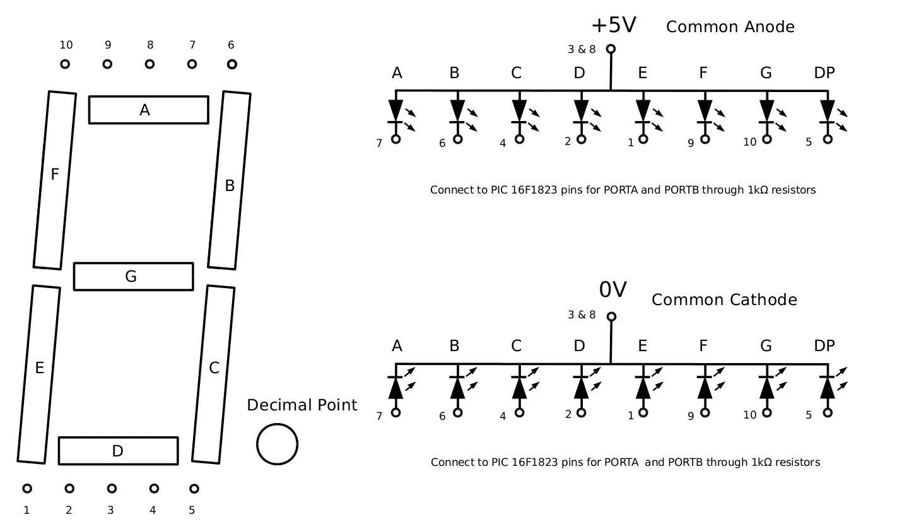

由于总共有 8 个 LED 需要驱动，因此使用了 16F1823 PIC。它有一个额外的 IO 端口 PORTC。让我们从图 2-9 开始——连接到 PIC 的电路图。

图 2-8 典型七段 LED 显示器的连接

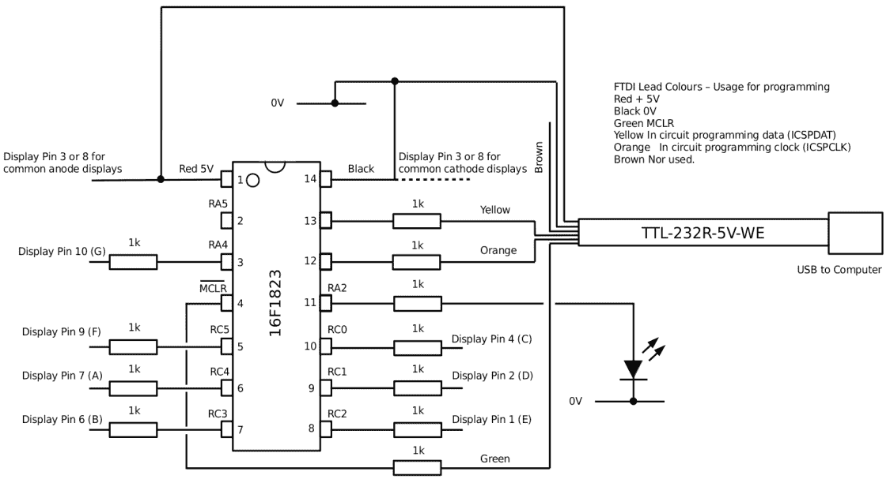

设计过程的下一步是绘制有限状态机图（见图 2-10）。机器`M1`是显示驱动器。上电时，LED 初始化为开启，然后机器`M0`从状态 0 开始。0.25s 后，定时器到期，机器 0 转换到状态 1。定时器重位，LED 关闭，脉冲计数器加 1，并将名为`UPDATE`的信号置高电平。这个`UPDATE`信号被机器 1 使用。在状态 1 下，当定时器在 0.75s 到期时，机器转换到状态 0，定时器重位并开启其 LED。这会无限持续下去。在状态 1 下，如果脉冲计数器达到 10，则跳转到同一状态。这是为了将脉冲计数器重置为零。同时，机器`M1`独立运行但共享 CPU。机器`M1`从状态 0 开始，显示器将为空。当`UPDATE`信号变为高平时，机器转换到状态 2 并将`UPDATE`信号置为低电平。根据变量`N`的值，机器转换回状态 1，驱动显示器必要段的开启和关闭。机器将保持在状态 0 等待另一个更新信号。为机器`M1`显示的输出细节是针对共阳极显示器的。代码中的注释显示了共阴极显示器的替代方案。

图 2-9 PIC 16F1823 与七段 LED 显示器的连接

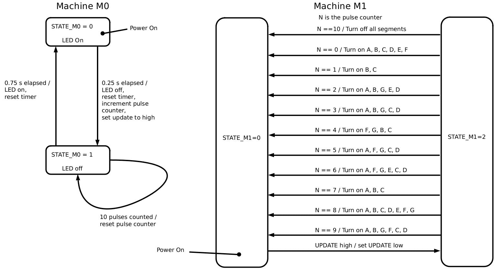

程序`prog_02_03.asm`中的几乎所有内容都解释过了，但有一点你必须注意：在使用`BSF`和`BCF`指令时可能会发生“读-修改-写”（READ MODIFY WRITE）问题。到为止，我们只通过设置`PORTA`上的位值来设置一个输出引脚。如果你只在一个端口上操作一个输出引脚，这是有效的，但在更改另一个引脚后立即尝试更改输出引脚时会发生奇怪的事情。要理解这个问题，我们必须查看有关电容器充电和放电的基础电理论，以及 PIC 如何处理一次更改一个引脚的值。当 PIC 写入输出时，它只能写入一个完整的字节或八位，因此为了更改一个位，它必须读取引脚状态，修改它想要更改的那个位，然后写回输出。问题在于，假设`PORTA`位 5（物理引脚 2）已从 0 变为 1，然后在下一条指令中，你想更改`PORTA`位 4（物理引脚 3）的值。PIC 读取`PORTA`引脚上的值——你可能认为位 5的值是高，因为你刚刚设置了它，但并不是，因为在现实世界中，电路可能是电容性的，电压升高需要时间，导致位 5 的读取值为低。当输出被写回端口时，位 5（引脚 2）被置回低电平。这是一个在仿真器中测试可能会让你失望的例子。通常，在使用`BCF`和`BSF`时，你应该向端口的锁存寄存器（`LATA`和`LATC`）写入。但是，如果你作为寄存器写入整个端口，例如使用`MOVWF PORTA`，那么就是安全的。

图 2-10 程序 2-3 状态图

```asm
; prog_02_03.asm
; 页码参考数据表 DS413；表格参考书籍。
LIST=16f1823
#include <16f1823.inc>
#include <fsm_macros.inc>

; 默认数字为 10 进制。
__CONFIG 0x807 (FOSC_INTC & WDTE_OFF & PWRTE_OFF & CP_OFF & IEO_OFF), 0x08 (LVP_ON)

BLOCK 0x70
TICK_COUNTER
STATE_M0
STATE_M1
PULSE_COUNTER
UPDATE

ORG 0x00
GOTO START

ORG 0x04 ; 中断向量
BCF INTCON, TMR0 ; 清除 TMR0 溢出标志
INCF TICK_COUNTER, F ; 增加 TICK_COUNTER
RETF ; 从中断返回

START
BCF TRISA, 2 ; 配置 PORTA 引脚 2 为输出
BCF TRISA, 4 ; 配置 PORTA 引脚 4 为输出
CLRF TRISC ; 配置 PORTC 所有输出
MOVLW 0xD7 ; 查看表 2-2
MOVWF OPTION_REG ; 设置 2MHz，页 164
MOVLW 0xE0
MOVWF INTCON ; 数据表 86 和表 2-3
CLRF STATE_M0 ; 将 STATE_M0 置为 0
CLRF STATE_M1 ; 将 STATE_M1 置为 0
CLRF UPDATE ; 将 UPDATE 置为低
CLRF PULSE_COUNTER ; 将 PULSE_COUNTER 置为 0
CLRF TICK_COUNTER ; 将 TICK_COUNTER 置为 0
MOV2 ; 后续程序访问 LATA 和 LATC
BSF LATA, 2 ; 开启 LED
MOVLW 0xFF ; 共阴极 0x00。空显示
MOVWF PORTC
BSF LATA, 4 ; 共阴极使用 BCF。空显示

SWITCH_M0
MOVF STATE_M0, W ; 将 STATE_0 移入 W
BRW ; 程序根据 W 的值跳转
GOTO M0_S0 ; 如果 W 为 0
GOTO M0_S1 ; 如果 W 为 1

SWITCH_M1
MOVF STATE_M1, W ; 将 STATE_0 移入 W
BRW ; 程序根据 W 的值跳转
GOTO M1_S0 ; 如果 W 为 0
GOTO M1_S1 ; 如果 W 为 1

M0_S0
MOVLW 31
SUBWF TICK_COUNTER, W ; 当 TICK_COUNTER_ON >= 31 时 STATUS 置位
BTFSS STATUS, C ; 如果 STATUS 置位则跳过下条指令
GOTO SWITCH_M1 ; STATUS 未置位
INCF STATE_M0, F ; 转换到状态 1
BCF LATA, 2 ; 关闭 LED
CLRF TICK_COUNTER ; 重置 TICK_COUNTER
INCF PULSE_COUNTER, F ; 增加脉冲计数
BSF UPDATE, 0 ; 设置 UPDATE 位 0
GOTO SWITCH_M1

M0_S1
MOVLW 10
SUBWF PULSE_COUNTER, W ; 测试脉冲计数是否达到 10
BTFSS STATUS, C ; 如果脉冲计数 < 10 则跳过清除 PULSE_COUNTER
GOTO $+2
CLRF PULSE_COUNTER ; 在状态图中显示为离开重新进入状态。实际上我们留在状态中
MOVLW 91
SUBWF TICK_COUNTER, W ; 当 TICK_COUNTER_OFF >= 91 时 STATUS 置位
BTFSS STATUS, C ; 如果 STATUS 置位则跳过下条指令
GOTO SWITCH_M1 ; STATUS 未置位。保持在此状态。
INCF STATE_M0, F ; 时间过期跳转到此处
CLRF TICK_COUNTER ; 清除 TICK_COUNTER
BSF LATA, 2 ; 开启 LED
CLRF STATE_M0 ; 切换到状态 0
GOTO SWITCH_M1

M1_S0
BTFSS UPDATE, 0 ; 测试 UPDATE 位 0 查看是否已调用更新，如果是则跳过
GOTO SWITCH_M0 ; 未调用更新，保持在此状态
BCF UPDATE, 0 ; 已调用更新，清除更新信号
MOVLW 1
MOVWF STATE_M1 ; 切换到状态 1
GOTO SWITCH_M0

M1_S1
MOVF PULSE_COUNTER, W
BRW ; 程序根据 W 的值跳转
GOTO N_0 ; 跳转到 PULSE_COUNTER 需要的适当输出设置
GOTO N_1
GOTO N_2
GOTO N_3
GOTO N_4
GOTO N_5
GOTO N_6
GOTO N_7
GOTO N_8
GOTO N_9
GOTO N_10

N_0
MOVLW 0x00 ; 共阴极 0x3F。
MOVWF PORTC
BSF LATA, 4 ; 共阴极使用 BCF。
CLRF STATE_M1
GOTO SWITCH_M0

N_1
MOVLW 0x36 ; 共阴极 0x09。
MOVWF PORTC
BSF LATA, 4 ; 共阴极使用 BCF。
CLRF STATE_M1
GOTO SWITCH_M0

N_2
MOVLW 0x21 ; 共阴极 0x1E。
MOVWF PORTC
BSF LATA, 4 ; 共阴极使用 BCF。
CLRF STATE_M1
GOTO SWITCH_M0

N_3
MOVLW 0x24 ; 共阴极 0x1B。
MOVWF PORTC
BSF LATA, 4 ; 共阴极使用 BCF。
CLRF STATE_M1
GOTO SWITCH_M0

N_4
MOVLW 0x16 ; 共阴极 0x29。
MOVWF PORTC
BSF LATA, 4 ; 共阴极使用 BCF。
CLRF STATE_M1
GOTO SWITCH_M0

N_5
MOVLW 0x0C ; 共阴极 0x33。
MOVWF PORTC
BSF LATA, 4 ; 共阴极使用 BSF。
CLRF STATE_M1
GOTO SWITCH_M0

N_6
MOVLW 0x08 ; 用于共阴极 0x37。
MOVWF PORTC
BCF LATA, 4 ; 共阴极请使用 BSF。
CLRF STATE_M1
GOTO SWITCH_M0

N_7
MOVLW 0x26 ; 用于共阴极 0x19。
MOVWF PORTC
BSF LATA, 4 ; 共阴极请使用 BCF。
CLRF STATE_M1
GOTO SWITCH_M0

N_8
MOVLW 0x00 ; 用于共阴极 0x3F。
MOVWF PORTC
BCF LATA, 4 ; 共阴极请使用 BSF。
CLRF STATE_M1
GOTO SWITCH_M0

N_9
MOVLW 0x04 ; 用于共阴极 0x3B。
MOVWF PORTC
BSF LATA, 4 ; 共阴极请使用 BCF。
CLRF STATE_M1
GOTO SWITCH_M0
```


```asm
MOVWF PORTC

BCF LATA, 4 ; 共阴极请使用 BSF。

CLRF STATE_M1

GOTO SWITCH_M0

N_10

MOVLW 0xFF ; 用于共阴极 0x00。

MOVWF PORTC

BSF LATA, 4 ; 共阴极请使用 BCF。

CLRF STATE_M1

GOTO SWITCH_M0

END

GOTO SWITCH_M0

N_6
```

## 2.8 PIC 12F1822 与 16F1823 的区别

明显的区别是 12F1822 有 8 个引脚，而 16F1823 有 14 个。这是因为 16F1823 拥有两个 I/O 端口。除了这个区别外，编程方式几乎相同。你必须在源代码顶部引用正确的包含文件，并为你的芯片指定正确的控制器。以下是相关行：

```asm
LIST P=12F1822

#INCLUDE <p12f1822.inc>

LIST P=16F1823

#INCLUDE <p16f1823.inc>
```

较小芯片的优点是它占据电路板的空间更少，如果你不需要额外的端口，需要焊接的引脚也更少。你必须查阅数据手册，因为其中总会有陷阱需要避开。在某些情况下，你会盯着代码试图理解哪里出错了，但答案就在数据手册中。

程序 2-3 两台机器七段显示器计数脉冲

## 2.9 中断与状态图

我没有尝试在状态图中以任何方式显示中断，因为它们不会改变机器的状态。当中断发生时，主程序会被挂起：参见上文第 2.4 节。因此，在从中断返回之前，不会发生状态变化，并且只有当中断改变了状态机的输入时（例如计数器的增加改变了比较结果），才会变化。

# 第 3 章 宏、子程序与银行切换

## 3.1 引言

第 2 章图 2-9 的电路可以用于本章中的所有示例。该电路使用 16F1823 PIC 驱动七段 LED 显示器和单个 LED。到此时，你可能认为汇编语言太不方便了。编写它确实需要更长时间，而且可能难以阅读。以上一章的图 2-4 为例，其中对两个值进行了比较，以决定程序中的两种执行方案。如果你习惯使用 C 等等高级语言，它可能像这样：

```c
if (tick_counter < 31)
{
    goto S0
}
else
{
    goto S1
}
```

即使你以前没见过这种编程语言，也能读懂。相比之下，这就是我们现在的代码。

```asm
;----------机器状态
S0 ; LED 开启。
MOVLW 31
SUBWF TICK_COUNTER, W ; 当 counter_on >= 31 时，STATUS 中的 C 位被设置。
BTFSS STATUS, C ; 如果发现 STATUS 中的 C 位设置，则跳过下一条指令。
GOTO S0 ; status 中的 C 位未设置。
CLRF TICK_COUNTER ; 重置计数器。
BCF PORTA, 2 ; 关闭 LED。

S1 ; LED 关闭。
MOVLW 91
```

`MOVLW 31` 这一行很容易理解。它只是将十进制字面值 31 移动到工作寄存器中。下一行 `SUBWF TICK_COUNTER, W` 意味着从寄存器 `TICK_COUNTER` 中减去 `W` 寄存器的值，并将结果放入 `W` 寄存器中。下一行让阅读变得困难。你需要知道结果的符号对 `STATUS` 寄存器中进位标志 `C` 有什么影响，然后判断是否会发生跳转。数据手册第 320 页解释了 `SUBWF`（从 f 中减去 w）是如何工作的。这描述了代码的含义：

- `C = 1`：31 ≤ `TICK_ON`
- `C = 0`：31 > `TICK_ON`

如果 `C` 为 0，程序执行 `GOTO S0`，因为 `TICK_ON` 尚未达到 31。如果 `C` 为 1，它将跳过此行并继续后续代码。我们需要一种看起来更像 `if...else` 语句且易于阅读的指令。既然说到这个话题，如果你在好奇 `goto`，它是 C 语言的一部分，但不建议使用。

## 3.2 创建你自己的指令

宏允许你定义可以重用的指令。对于上面的问题，代码可以如下：

```asm
;----------机器状态
S0 ; LED 开启。
MOVLW 31
SUBWF TICK_COUNTER, W ; 当 counter_on >= 31 时，STATUS 中的 C 位被设置。
BTFSS STATUS, C ; 如果发现 STATUS 中的 C 位设置，则跳过下一条指令。
GOTO S0 ; status 中的 C 位未设置。
CLRF TICK_COUNTER ; 重置计数器。
BCF PORTA, 2 ; 关闭 LED。

S1 ; LED 关闭。
MOVLW 91
```

`MOVLW 31` 这一行很容易理解。它只是将十进制字面值 31 移动到工作寄存器中。下一行 `SUBWF TICK_COUNTER_ON, W` 意味着从寄存器 `TICK_COUNTER_ON` 中减去 `W` 寄存器的值，并将结果放入 `W` 寄存器中。下一行让阅读变得困难。你需要知道结果的符号对 `STATUS` 寄存器中进位标志 `C` 有什么影响，然后判断是否会发生跳转。数据手册第 320 页解释了 `SUBWF`（从 f 中减去 w）是如何工作的。这描述了代码的含义：

- `C = 1`：31 ≤ `TICK_ON`
- `C = 0`：31 > `TICK_ON`

如果 `C` 为 0，程序执行 `GOTO S0`，因为 `TICK_ON` 尚未达到 31。如果 `C` 为 1，它将跳过此行并继续后续代码。我们需要一种看起来更像 `if...else` 语句且易于阅读的指令。既然说到这个话题，如果你在好奇 `goto`，它是 C 语言的一部分，但不建议使用。

宏 `SET_TMR0_CASE1` 需要使用 Bank 1，产生 8.2 ms 的脉冲。

```asm
SET_TMR0_CASE1 macro ; 需要使用 Bank 1。产生 8.2 ms 的脉冲。
    MOVLW 0xD7 ; 查看书中的表 2-2。
    MOVWF OPTION_REG ; 第 164 页。
    MOVLW 0xE0
    MOVWF INTCON ; 数据手册中的第 86 页和书中的表 2-3。
ENDM ; 结束后留在 bank 1
```

另一个设置定时器 0，使其以每秒 976.56 次中断的速度（每 1.024 ms）产生溢出中断。区别在于分频器倍比例为 1/32 而不是 1/256。

```asm
SET_TMR0_CASE2 macro ; 需要使用 Bank 1。产生 1.024 ms 的脉冲。
    MOVLW 0xD4 ; 查看书中的表 2-2。
    MOVWF OPTION_REG ; 第 164 页。
    MOVLW 0xE0
    MOVWF INTCON ; 数据手册中的第 86 页和书中的表 2-3。
ENDM ; 结束后留在 bank 1
```

为了节省书中空间，定义一个设置配置字中位位的宏：

```asm
BOOK_CONFIGURATION macro
    __CONFIG 0X8007, (_FOSC_INTOSC & _WDTE_OFF & _PWRTE_OFF & _CP_OFF & _BOREN_OFF & _IESO_OFF & _FCMEN_OFF)
    __CONFIG 0X8008, (_LVP_ON)
ENDM
```

这是另一个 `if...else` 宏，用于比较寄存器值以判断其是否大于或等于工作寄存器中的值。它与另一个 `if else` 宏之间只有一个区别：这里的跳过条件是标志位清除（clear）而不是标志位设置（set）。

```asm
IF_REG_GREATER_THAN_OR_EQUAL_W macro ARG1
    SUBWF ARG1, W
    BTFSC STATUS, C ; 查看第 32 页的 SUBWF，如果 ARG1 >= W，则 C = 1
ENDM
```

```asm
; 这里的‘if’ 代码 - 将是一个 GOTO，用于跳过 else 代码。

; 这里的‘else’ 代码。
```

程序 3-2 是程序 2-2，但使用了宏。宏以粗体显示。

```asm
; prog_03_02.asm
; 这是使用宏的 prog_02_02.asm。
; 页码参考数据手册 DS40001413E。
; 表格参考书籍。

LIST P=12f1822

#INCLUDE <p12f1822.inc>
#INCLUDE <fsm_macros.inc>

RADIX DEC ; 默认数字为 10 进制。

BOOK_CONFIGURATION ; 查看 fsm_macros.inc 中的宏。

CBLOCK 0x70 ; 在通用 RAM 中，所有 bank 均可访问。
    TICK_COUNTER
    PULSE_COUNTER
ENDC

ORG 0X00
    GOTO START

ORG 0X04 ; 中断向量。
    BCF INTCON, TMR0IF ; 清除 tmr0 溢出标志位。INTCON 在所有 bank 中。
    INCF TICK_COUNTER, F ; 计数器加 1。
    RETFIE ; 中断返回

START
    MOVLB 1 ; 用于访问 TRISA, OSCCON, OPTION_REG。
    BCF TRISA, 2 ; 配置 PORTA 位 2（芯片引脚 5）为输出
    SET_FREQ_32MHZ ; 查看 fsm_macros.inc 中的宏。
    SET_TMR0_CASE1 ; 查看 fsm_macros.inc 中的宏。
    MOVLB 0 ; 在程序的剩余部分用于访问 PORTA。
    BSF PORTA, 2 ; 初始化 LED 开启；

;-----------机器状态。

S0 ; LED 开启。快速循环。
    MOVLW 4
    IF_REG_LESS_THAN_W TICK_COUNTER
    GOTO S0 ; STATUS 中发现 C 位未设置。保持在此状态。
    BCF PORTA, 2 ; 关闭 LED
    CLRF TICK_COUNTER ; 重置脉冲计数器。
    INCF PULSE_COUNTER, F ; 将 PULSE_COUNTER 加 1 并将结果存入 PULSE_COUNTER。
    ; 继续到 S1

S1 ; LED 关闭。快速循环。
    MOVLW 10
    IF_REG_LESS_THAN_W PULSE_COUNTER
    GOTO $+3 ; 尚未达到 10 个脉冲，跳转到脉冲检查。
    CLRF PULSE_COUNTER ; 已计数 10 个脉冲，重置 PULSE_COUNTER。
    GOTO S3 ; 跳转到 S3。
    MOVLW 9 ; 加载 9 到 W 以进行脉冲检查。
    IF_REG_LESS_THAN_W TICK_COUNTER
    GOTO S1 ; STATUS 中发现 C 位设置，已计数 9 次脉冲。
    CLRF TICK_COUNTER
    BSF PORTA, 2 ; 开启 LED。
    GOTO S0

S2
    MOVLW 32
    IF_REG_LESS_THAN_W TICK_COUNTER
    GOTO S2 ; STATUS 中发现 C 位未设置。
    BCF PORTA, 2 ; 关闭 LED
    CLRF TICK_COUNTER ; 重置脉冲计数器。
    INCF PULSE_COUNTER, F ; 将 PULSE_COUNTER 加 1 并将结果存入 PULSE_COUNTER。
    ; 继续到 S3

S3 ; LED 开启。慢循环。
    MOVLW 3
    IF_REG_LESS_THAN_W PULSE_COUNTER
    GOTO $+3 ; 尚未达到 3 个脉冲，跳转到脉冲检查。
    CLRF PULSE_COUNTER ; 重置脉冲计数器。
    GOTO S1 ; 跳转到 S1。
    MOVLW 91
    IF_REG_LESS_THAN_W TICK_COUNTER
    GOTO S3 ; STATUS 中发现 C 位设置。
    CLRF TICK_COUNTER
    BSF PORTA, 2 ; 开启 LED。
    GOTO S2
```

我们可以从第 2 章的程序 2-3 取一个完整的有限状态机并创建一个宏。那么每当我们想要驱动数码显示器时，只需要添加一行代码。程序 3-3 显示了这一点。宏的插入在程序 3-2 中显示，使用了粗体宏。再次汇编此代码并查看 `.lst` 文件，你将看到宏参数 `FLGS`、`VALUE`、`S0` 和 `S1` 如何替换为程序中的 `FLAGS`、`VALUE`、`M1_S0` 和 `M1_S1`。

```asm
; prog_03_03.asm
; 这是使用宏的 prog_02_03.asm。

LIST P=16f1823

#INCLUDE <p16f1823.inc>
#INCLUDE <fsm_macros.inc>

RADIX DEC ; 默认数字为 10 进制。

BOOK_CONFIGURATION ; 查看 fsm_macros.inc 中的宏。

CBLOCK 0x70
    TICK_COUNTER
    STATE_M0
    STATE_M1
    PULSE_COUNTER
    FLAGS ; 位 0 将作为显示信号。
ENDC

ORG 0X00
    GOTO START

ORG 0X04 ; 中断向量。
    BCF INTCON, TMR0IF ; 清除 tmr0 溢出标志。
    INCF TICK_COUNTER, F ; 计数器加 1。
    RETFIE ; 中断返回

START
    MOVLB 1 ; 用于访问 TRISA, OSCCON, OPTION_REG。
    BCF TRISA, 2 ; 配置 PORTA 位 2（芯片引脚 5）为输出
    SET_FREQ_32MHZ ; 查看 fsm_macros.inc 中的宏。
    SET_TMR0_CASE1 ; 查看 fsm_macros.inc 中的宏。
    MOVLB 0 ; 在程序的剩余部分用于访问 PORTA。
    BSF PORTA, 2 ; 初始化 LED；

;-----------机器状态。

S0 ; LED 开启。快速循环。
    MOVLW 4
    IF_REG_LESS_THAN_W TICK_COUNTER
    GOTO S0 ; STATUS 中发现 C 位未设置。保持在此状态。
    BCF PORTA, 2 ; 关闭 LED
    CLRF TICK_COUNTER ; 重置脉冲计数器。
    INCF PULSE_COUNTER, F ; 将 PULSE_COUNTER 加 1 并将结果存入 PULSE_COUNTER。
    ; 继续到 S1

S1 ; LED 关闭。快速循环。
    MOVLW 10
    IF_REG_LESS_THAN_W PULSE_COUNTER
    GOTO $+3 ; 尚未达到 10 个脉冲，跳转到脉冲检查。
    CLRF PULSE_COUNTER ; 重置脉冲计数器。
    GOTO S3 ; 跳转到 S3。
    MOVLW 9 ; 加载 9 到 W 以进行脉冲检查。
    IF_REG_LESS_THAN_W TICK_COUNTER ; 查看 fsm_macros.inc 中的宏。
    GOTO S1 ; STATUS 中发现 C 位设置，已计数 9 次脉冲。
    CLRF TICK_COUNTER
    BSF PORTA, 2 ; 开启 LED。
    GOTO S0

S2
    MOVLW 32
    IF_REG_LESS_THAN_W TICK_COUNTER
    GOTO S2 ; STATUS 中发现 C 位未设置。
    BCF PORTA, 2 ; 关闭 LED
    CLRF TICK_COUNTER ; 重置脉冲计数器。
    INCF PULSE_COUNTER, F ; 将 PULSE_COUNTER 加 1 并将结果存入 PULSE_COUNTER。
    ; 继续到 S3

S3 ; LED 开启。慢循环。
    MOVLW 3
    IF_REG_LESS_THAN_W PULSE_COUNTER
    GOTO $+3 ; 尚未达到 3 个脉冲，跳转到脉冲检查。
    CLRF PULSE_COUNTER ; 重置脉冲计数器。
    GOTO S1 ; 跳转到 S1。
    MOVLW 91
    IF_REG_LESS_THAN_W TICK_COUNTER
    GOTO S3 ; STATUS 中发现 C 位设置。
    CLRF TICK_COUNTER
    BSF PORTA, 2 ; 开启 LED。
    GOTO S2

END
```


我们可以从第 2 章的程序 2-3 取一个完整的有限状态机（如 M1）并创建一个宏。那么每当我们想要驱动数码显示器时，只需要添加一行代码。程序 3-3 显示了这一点。宏的插入在程序 3-2 中显示，使用了`粗体宏`。再次汇编此代码并查看`.lst`文件，你将看到宏参数`FLGS`、`VALUE`、`S0`和`S1`如何替换为程序中的`FLAGS`、`VALUE`、`M1_S0`和`M1_S1`。

```assembly
; prog_03_03.asm

; 这是使用宏的 prog_02_03.asm。

LIST P=16f1823

#INCLUDE <p16f1823.inc>

#INCLUDE <fsm_macros.inc>

RADIX DEC ; 默认数字为 10 进制。

BOOK_CONFIGURATION ; 查看 fsm_macros.inc 中的宏。

CBLOCK 0x70

    TICK_COUNTER

    STATE_M0

    STATE_M1

    PULSE_COUNTER

    FLAGS ; 位 0 将作为显示信号。

ENDC

ORG 0X00

    GOTO START

ORG 0X04 ; 中断向量。

    BCF INTCON, TMR0IF ; 清除 tmr0 溢出标志。

    INCF TICK_COUNTER, F ; 计数器加1。

    RETFIE ; 中断返回

START

    MOVLB 1 ; 用于访问 TRISA, OSCCON, OPTION_REG。

    BCF TRISA, 2 ; 配置 PORTA 位 2（芯片引脚 5）为输出

    SET_FREQ_32MHZ ; 查看 fsm_macros.inc 中的宏。

    SET_TMR0_CASE1 ; 查看 fsm_macros.inc 中的宏。

    MOVLB 0 ; 在程序的剩余部分用于访问 PORTA。

    BSF PORTA, 2 ; 初始化 LED；

;-----------机器状态。

S0 ; LED 开启。快速循环。

    MOVLW 4

    IF_REG_LESS_THAN_W TICK_COUNTER

    GOTO S0 ; STATUS 中发现 C 位未设置。保持在此状态。

    BCF PORTA, 2 ; 关闭 LED

    CLRF TICK_COUNTER ; 重置脉冲计数器。

    INCF PULSE_COUNTER, F ; 将 PULSE_COUNTER 加1并将结果存入 PULSE_COUNTER。

    ; 继续到 S1

S1 ; LED 关闭。快速循环。

    MOVLW 10

    IF_REG_LESS_THAN_W PULSE_COUNTER

    GOTO $+3 ; 尚未达到 10 个脉冲，跳转到脉冲检查。

    CLRF PULSE_COUNTER ; 已计数 10 个脉冲，重置 PULSE_COUNTER。

    GOTO S3 ; 跳转到 S3。

    MOVLW 9 ; 加载 9 到 W 以进行脉冲检查。

    IF_REG_LESS_THAN_W TICK_COUNTER ; 查看 fsm_macros.inc 中的宏。

    GOTO S1 ; STATUS 中发现 C 位设置，已计数 9 次脉冲。

    CLRF TICK_COUNTER

    BSF PORTA, 2 ; 开启 LED。

    GOTO S0

S2

    MOVLW 32

    IF_REG_LESS_THAN_W TICK_COUNTER

    GOTO S2 ; STATUS 中发现 C 位未设置。

    BCF PORTA, 2 ; 关闭 LED

    CLRF TICK_COUNTER ; 重置脉冲计数器。

    INCF PULSE_COUNTER, F ; 将 PULSE_COUNTER 加1并将结果存入 PULSE_COUNTER。

    ; 继续到 S3

S3 ; LED 开启。慢循环。

    MOVLW 3

    IF_REG_LESS_THAN_W PULSE_COUNTER

    GOTO $+3 ; 尚未达到 3 个脉冲，跳转到脉冲检查。

    CLRF PULSE_COUNTER ; 重置脉冲计数器。

    GOTO S1 ; 跳转到 S1。

    MOVLW 91

    IF_REG_LESS_THAN_W TICK_COUNTER

    GOTO S3 ; STATUS 中发现 C 位设置。

    CLRF TICK_COUNTER

    BSF PORTA, 2 ; 开启 LED。

    GOTO S2

END
```

### 3.2.3 条件汇编

上面的宏之一`SET_FREQ_32MHZ`用于设置振荡器频率。我们可以编写多个宏，每个频率对应一个，但还有另一种方法，允许我们在宏内部选择不同的代码，取决于宏参数的值。条件汇编使用`if`语句来选择放置在源代码中的汇编代码。这里是频率选择的一个示例。宏接收一个指定所需频率的参数，并根据`if`语句插入相关代码。每个`if`语句由`endif`结束。

```assembly
SET_FREQ_HZ 宏 ARG0

    if (ARG0 == 32000000);

    MOVLW 0x70;

    endif;

    if (ARG0 == 16000000)

    MOVLW 0x78;

    endif;

    if (ARG0 == 4000000)

    MOVLW 0x68;

    endif;

    if (ARG0 == 2000000)

    MOVLW 0x60;

    endif;

    if (ARG0 == 1000000)

    MOVLW 0x58;

    endif;

    if (ARG0 == 500000)

    MOVLW 0x50;

    endif;

    if (ARG0 == 125000)

    MOVLW 0x40;

    endif;

    if (ARG0 == 31250)

    MOVLW 0x18;

    endif;

    MOVLB 1

    MOVWF OSCCON;

    ENDM
```

这些`if`语句不是汇编代码。它们属于汇编器指令，用于在生成 hex 文件之前选择放入你的源码的汇编代码。此示例是为`gpasm`1.4.0 版本编写的，以兼容当前的 Debian 版本。

## 3.3 子程序

编写可重用的另一种方法是使用子程序。子程序是一段独立于主程序的代码块。它根据需要被调用。当它被调用时，主程序会暂时停止。子程序代码运行，完成后，主程序继续执行。然而，我们可以通过宏（macros）来实现相同的结果，但每当你使用宏时，组成宏的代码都会被插入到代码中，导致你产生大量的重复代码并占用程序内存空间。而子程序在程序内存中只出现一次。缺点是调用子程序会有时间开销。决定使用子程序还是宏取决于你如何优化代码。如果宏很长，那么子程序将节省更多空间。如果宏只有几行，那么调用和返回的开销可能会让宏成为更好的选择。

### 3.3.1 子程序示例

为了演示子程序调用和返回的工作原理，这里有一个短程序，它再次闪烁 LED。LED 将点亮 1 秒并熄灭 2 秒。它没有使用带中断的定时器，而是使用了一个通过消耗时钟周期来产生延迟的子程序。虽然我提到过通过循环计数计数时钟周期不是一件好事，但这仅仅是为了演示子程序的调用。

要创建一个子程序，以行左侧的标签开始例程，后面跟着你需要的任何代码。使用`RETURN`或`RETLW`指令结束例程。关于`RETLW`的信息请参考数据手册第 319 页。程序 3-4 显示了程序。有两个状态：LED 亮和 LED 灭。在每个状态下，都会调用名为`DELAY`的子程序。该子程序有两个递减的嵌套循环。完成后，程序将在调用后的下一行继续执行。要设置延迟周期，在调用子程序之前会将一个值移入`BUFFER0`。

```assembly
;prog_03_04.asm
LIST P=16F1823
#INCLUDE <p16f1823.inc>
#INCLUDE <fsm_macros.inc>
RADIX DEC ; 默认数字为10 进制。
BOOK_CONFIGURATION
CBLOCK 0x70
BUFFER0
BUFFER1
ENDC
ORG 0X00
GOTO START
START:
CLRF BUFFER1
MOVLB 1 ; OSCCON, OPTION_REG
SET_FREQ_HZ 125000 ; Page 65 125k, and fsm_macros.inc.
BCF TRISA, 2 ; 将 RA2 设置为输出
MOVLB 0 ; 程序剩余部分访问 PORTA。
;机器状态
S0 ; LED 亮。
MOVLW d’40’ ; 40 约产生0.99 秒。
MOVWF BUFFER0 ; 调用子程序前加载缓冲区。
CALL DELAY ; 调用子程序。
BCF PORTA, 2 ; 灭 LED。
返回到状态 1。
S1 ; LED 灭。
MOVLW d’80’ ; 80 约产生1.99 秒。
MOVWF BUFFER0 ; 调用子程序前加载缓冲区。
CALL DELAY ; 调用子程序。
BSF PORTA, 2 ; 点亮 LED。
GOTO S0 ; 回到状态 0。

Subroutine
DELAY
DECFSZ BUFFER1, F
GOTO $-1 ; 循环 256 次，内层循环共 256*3 + 1 = 769 个指令周期。
DECFSZ BUFFER0, F
GOTO DELAY ; 根据加载到 BUFFER0 的次数循环，外层循环。
RETURN ; 从子程序返回
END
```

### 3.3.2 返回地址与栈

当使用`CALL`指令时，程序计数器加 1（`PC+1`）的值会被压入栈顶。在描述“返回”的章节之前已经提到过栈。然后将子程序的地址移动到程序计数器中，以便现在执行该子程序。如果你查看数据手册第 39 页，有关于栈的解释。如第 1 章所述，这两款 PIC 具有 2048 个程序字，因此程序不会跨越边界。请参阅数据手册第 18 页。

### 3.3.3 计算延迟

以下是时间如何计算的说明：内层循环运行 256 次，因为它从 0 开始并逐次减 1 直到零。每个循环由 3 个指令周期组成：一个用于`DECFSZ`，两个用于`GOTO`。在跳过时有一个额外一个周期。外层循环根据加载到`BUFFER0`的次数运行。内层循环需要 769 次周期（256*3 + 1)。如果我们在调用子程序前在`BUFFER0`中放入 40，将得到 30885 次。由于时钟频率为 125kHz，一个指令的时间间隔如下：1/125000 = 8 微秒。这使得点亮时间为 1.02 秒（30885 x 32e-6 = 1.019 秒）。

故事还没有结束。S0 状态中还有三个指令周期，增加了 96 微秒。需要注意的是，循环内部的周期数。它们的时间会被乘以外层循环的次数。同样的解释适用于 S1 状态的 LED 灭期间。此外，可以通过设置`OSCTUNE`寄存器的位来微调振荡器频率。请查看数据手册第 67 页。

### 3.3.4 从子程序调用子程序

栈的目的是存储子程序和中断的返回地址。它的深度为 16，因此可以从子程序调用子程序并反向返回主程序。请参考数据手册从 39 页开始的图表。为了演示这一点，程序 3-5 将两个循环拆分为两个子程序，使得主程序调用第一个子程序，然后调用第二个子程序。第二个子程序包含一个运行 256 次的循环，每次被调用都是如此。第二个子程序会被第一个子程序反复调用。次数由主程序在调用第一个子程序之前放入`BUFFER0`的值决定。

```assembly
;prog_03_05.asm
...
```

`MOVLB`指令可将银行号移动到`BSR`中。或者，可以使用 gpasm 的`BANKSEL`指令来生成所需的代码，例如：

```asm
BANKSEL TRISA
```

这可以节省你查找`TRISA`银行号的次数。虽然这很方便，但有时你仍然需要知道所需的银行号。例如，如果你在配置振荡器、中断以及输入/输出时需要访问几个特殊寄存器，你可以通过编写代码将这些特殊寄存器按银行分组，从而节省切换银行的次数。

随着程序变得越来越复杂，银行切换问题会变得更加棘手。由于`GOTO`和从子程序返回的操作，你很容易在执行后续指令时处于错误的银行。如果代码没有运行，这是你应该优先检查的地方之一。中断具有自动保存上下文的功能。因此，在返回时，`BSR`的值会被恢复，所以你只需要在中断内部更改银行。请参阅数据手册的第 85 页。如果你使用 C 语言编程，编译器将为你处理银行切换。

我的建议是，通过查看小块代码来检查你的程序，例如每个机器状态、子程序或宏的代码。通过查看那小块代码，你就可以判断其内部指令是否处于正确的银行。你最终可能会产生冗余的银行切换，一旦程序运行，你随时可以对其进行优化。处理宏时要格外小心，因为代码可能在另一个文件中是不可见的。

对于宏，我采用的策略是：只有在宏执行过程中途需要切换银行时，才在宏内部放置银行切换。这意味着在进入宏之前，你必须检查是否处于正确的银行。这看起来可能不方便，但如果你在宏的开头进行银行切换，可能会导致冗余并浪费程序内存。

# 第 4 章 • 输入与输出

## 4.1 • 引言

前三章仅使用了 PIC 输出来驱动 LED。这只是为了让你熟悉工具链和 FSM（有限状态机）的概念。本章将详细介绍输入和输出，并处理数字/模拟输入、脉冲调制输出以及与计算机的串行通信。PIC 还可以通过 I2C 总线与其他设备通信，并利用电容传感技术接受手指触摸输入。然而，根据已涵盖的内容，本书将不会深入介绍这些，但根据数据手册的信息，你应该能够在项目中使用这些功能。从状态机的角度来看，本章中的程序是非常微不足道的。本章的核心是关于使用 I/O。

## 4.2 • 向计算机的串口输出

这些 PIC 具有“增强型通用同步异步收发器”（EUSART），我们可以结合`FTDI`串口连接线，实现 PIC 与计算机之间的直接通信。在适用于 Windows 和 Linux 的压缩包下载中包含一个名为`serial_reader`的程序，它可以打印 PIC 发送的屏幕数值。为了产生要传输的数据，程序 3-1 将闪烁 LED 并增加计数器值。计数器值将通过串口链路传输到计算机并显示在屏幕上。

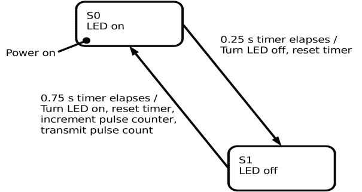

### 4.2.1 • TTL 电平串行通信

通常，RS232 串口链路使用 -3V 到 -25V 之间的负电压表示逻辑 1，使用 +3V 到 +25V 之间的正电压表示逻辑 0。PIC 和 FTDI 线使用的电压为：0V 表示逻辑 0，+5V（约）表示逻辑 1。这非常方便，因为我们只需要电源电压，不需要电平转换电路。串口链路以“波特率”（Baud）速率传输数据字节。在这种情况下，波特率可以被视为每秒比特数。我们将使用 19200 波特的速率。沿线发送的字节由一个起始位、7 或 8 个数据位、一个校验位以及 1 或 2 个停止位组成。这里提供的程序不会使用校验位，采用一个停止位和 8 位数据位。这是通过设置寄存器中的值配置的，之后每当一个字节加载到`TXREG`寄存器时，`EUSART`就会传输数值。一旦配置，每次发送数据只需要几行代码。

### 4.2.2 • 配置 EUSART 发送字节

数据手册对两个 PIC 中的增强型通用同步异步收发器进行了完整描述。它的可用功能比我将使用的多得多。第 268 页显示了传输细节的图。表 4-1 显示了配置`EUSART`发送字节所需的步骤。

| 目的 | 代码 | 注释 |
| :--- | :--- | :--- |
| 启用传输。 | `BSF TXSTA, TXEN` | TXEN 是状态控制寄存器中的第 5 位（第 277 页）。 |
| 启用串口。 | `BSF RCSTA, SPEN` | SPEN 是状态控制寄存器中的第 7 位（第 278 页）。 |
| 设置波特率为 19200 | `MOVLW 0x19, MOVWF SPBRGL, CLRF SPGH` | 波特率 = clock/(64*(spgh:spgl+1)) = 19200（第 280 页和第 282 页）。 |
| 在 PIC 16F183 上，传输引脚可以是引脚 13 (RA0) 或引脚 6 (RC4)，我们需要引脚 13。 | `BSF APFCON, TXCKSEL` | 设置 APFCON（备用功能）中的第 2 位使传输引脚变为 RA0（第 114 页）。 |

这种为此目的进行的 EUSART 配置已制成一个宏。该宏用于 32 MHz：

```asm
SET_SERIAL_TX_16F1823 MACRO ; 需要银行 3。
BSF TXSTA, TXEN ; 启用传输 BIT 5。参见第 277 页。
BSF RCSTA, SPEN ; 启用串口 BIT 7。参见第 278 页。
MOVLW 0x19 ; 为 clock=32MHz 设置波特率=clock/(64*(spgh:spgl+1))=19200。参见第 280 页和第 282 页。
MOVWF SPBRGL
CLRF SPGH
MOVLB 2
BSF APFCON, TXCKSEL ; 设置 APFCON 的第 2 位将引脚 13 的用途更改为 TX。参见第 114 页。
```

对于宏，我采用的策略是：只有在宏执行过程中途有切换银行的需求时，才在宏内部放置银行切换。这意味着你必须在进入宏之前检查是否处于正确的银行。这看起来可能不方便，但如果你在宏的开头进行银行切换，可能会导致冗余并浪费程序内存。


前三章仅使用了 PIC 输出来驱动 LED。这只是为了让你上手工具链和 FSM（有限状态机）的概念。本章将详细介绍输入和输出，并处理数字/模拟输入、脉冲调制输出以及与计算机的串行通信。PIC 还可以通过 I2C 总线与其他设备通信，并利用电容传感接受手指触摸输入。然而，根据已涵盖的内容，本书将不会深入介绍这些，但根据数据手册的信息，你应该能够在项目中使用这些功能。从状态机的角度来看，本章中的程序是非常微不足道的。本章的核心是关于使用 I/O。

## 4.2 • 向计算机的串口输出

这些 PIC 具有“增强型通用同步异步收发器”（EUSART），我们可以结合 `FTDI` 串口连接线，实现 PIC 与计算机之间的直接通信。在适用于 Windows 和 Linux 的压缩包下载中包含一个名为 `serial_reader` 的程序，它可以打印 PIC 发送的屏幕数值。为了产生要传输的数据，程序 3-1 将闪烁 LED 并增加计数器值。计数器值将通过串口链路传输到计算机并显示在屏幕上。


### 4.2.1 • TTL 电平串行通信

通常，RS232 串口链路使用 -3V 到 -25V 之间的负电压表示逻辑 1，使用 +3V 到 +25V 之间的正电压表示逻辑 0。PIC 和 FTDI 线使用的电压为 0V 表示逻辑 0，+5V（约）表示逻辑 1。这非常方便，因为我们只需要电源电压，不需要电平转换电路。

串口链路以“波特率”（Baud）速率传输数据字节。在这种情况下，波特率可以被视为每秒比特数。我们将使用 19200 波特的速率。沿线发送的字节由一个起始起始位、7 或 8 个数据位、一个校验位以及 1 或 2 个停止位组成。这里提供的程序不会使用校验位，采用一个停止位和 8 位数据位。

这是通过设置寄存器中的值配置的，之后每当一个字节加载到 `TXREG` 寄存器时，`EUSART` 就会传输数值。一旦配置，每次发送数据只需要几行代码。

### 4.2.2 • 配置 EUSART 发送字节

数据手册对两个 PIC 中的增强型通用同步异步收发器进行了完整描述。它的可用功能比我将使用的多得多。第 268 页显示了传输细节的图。表 4-1 显示了配置 `EUSART` 发送字节所需的步骤。

| 目的 | 代码 | 注释 |
| :--- | :--- | :--- |
| 启用传输。 | `BSF TXSTA, TXEN` | `TXEN` 是状态控制寄存器中的第 5 位（第 277 页）。 |
| 启用串口。 | `BSF RCSTA, SPEN` | `SPEN` 是状态控制寄存器中的第 7 位（第 278 页）。 |
| 设置波特率为 19200 | `MOVLW 0x19, MOVWF SPBRGL, CLRF SPGH` | 波特率 = `clock/(64*(spgh:spgl+1))` = 19200（第 280 页和 282 页）。 |
| 在 PIC 16F183 上，传输引脚可以是引脚 13 (RA0) 或引脚 6 (RC4)，我们需要引脚 13。 | `BSF APFCON, TXCKSEL` | 设置 `APFCON`（备用功能）中的第 2 位使传输引脚变为 RA0（第 114 页）。 |

这种为此目的进行的 `EUSART` 配置已制成一个宏。该宏用于 32 MHz：

```asm
SET_SERIAL_TX_16F1823 MACRO ; 需要银行 3。
BSF TXSTA, TXEN ; 启用传输 BIT 5。参见第 277 页。
BSF RCSTA, SPEN ; 启用串口 BIT 7。参见第 278 页。
MOVLW 0x19 ; 为 clock=32MHz 设置波特率=clock/(64*(spgh:spgl+1))=19200。参见第 280 页和第 282 页。
MOVWF SPBRGL
CLRF SPGH
MOVLB 2
BSF APFCON, TXCKSEL ; 设置 APFCON 的第 2 位将引脚 13 的用途更改为 TX。参见第 114 页。
```

宏的传输通过将银行号移动到 `BLB` 实现的。`TSR`（寄存器）为空时，引脚变为 RA0。这行传输。

### 4.2.3 • 串口输出示例

以下是演示传输数值的完整程序。单个字节的最大值为 255。如果增加，它将回绕到 0。

```asm
;prog_04_01.asm
LIST P=16F123
## <p6f1823.inc>
#INCLUDE <fsm_macros.inc>
RADIX DEC ; 默认进制为 10。
BOOK_CONFIGURATION ; 见 fsm_macros.inc 中的宏。
CBLOCK 0x70
TICK_COUNTER
PULSE_COUNTER
ENDC
ORG 0X00
GOTO START
ORG 0X04 ; 中断向量
BCF INTCON, TMR0IF ; 清除定时器溢出标志。
INCF TICK_COUNTER, F ; 增加。
RETFIE ; 返回中断。
START:
MOVLB 1
SET_FREQ_32MH ; 见 fsm_macros.inc。
BCF TRISA, 2 ; 设置 RA4 为输出。
SET_TMR0_CASE1 ; 见 fsm_macros.inc。
MOVLB 3
SET_SERIAL_TX_16F1823 ; 见 fsm_macros.inc，这设置了 TXEN、SPEN，设置了波特率并将引脚 2 的用途更改为 TX。
BANKSEL LATA
BSF LATA, 2 ; 初始化 LED 开启。我们处于银行 2。
CLRF PULSE_COUNTER
;-------机器状态
S0 ; LED 开启
MOVLW 31 ; 将 31 放入 W 与 TICK_COUNTER 比较。
IF_REG_LESS_THAN_W TICK_COUNTER ; 见 fsm_macros.inc 中的宏。
GOTO S0
BANKSEL LATA ; 银行 2。
BCF LATA, 2
CLRF TICK_COUNTER
S1 ; LED 开启
MOVLW 91 ; 将 91 放入 W 与 TICK_COUNTER 比较。
IF_REG_LESS_THAN_W TICK_COUNTER ; 见 fsm_macros.inc 中的宏。
GOTO S1
BANKSEL LATA ; 银行 2。
BSF LATA, 2
BANKSEL TXREG ; 银行 3。
INCF PULSE_COUNTER, F
MOVFW PULSE_COUNTER
MOVWF TXREG ; 将计数器加载到 TXREG 进行传输。
BTFSS TXSTA, TRMT ; 传输完成后 TRMT 被设置，在此之前该行和下一次循环。
GOTO $-1
CLRF TICK_COUNTER
GOTO S0
END
```

电路图如图 4-2 所示。它与用于七段显示器的使用的相同，但没有显示器。

程序 4-1 发送字节

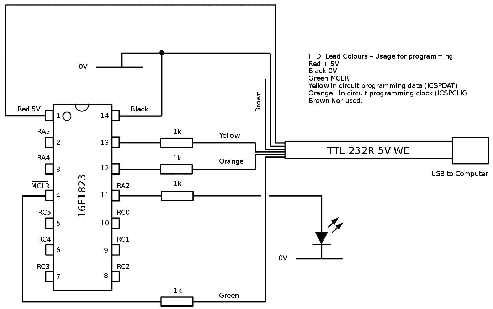

程序的组装并将其写入 PIC 与第一章中描述的相同。

一旦程序加载，LED 将闪烁，且闪烁次数将从串口传输。若要在您的计算机上读取此值，您可以在 Windows 上使用程序 `serial_reader.exe` 或 Linux 下的等效程序。串口读取程序位于工作目录中，并在使用 TTL-232-5V-WE 引线接收时将单字节值打印到屏幕上。无需更改电气连接，只需运行程序即可。

图 4-3a 显示了 64 位 Linux 版本的示例。其他版本也是相同的，只需记住在 Windows 版本的 `serial_reader.exe` 前不需要加 `./`，而在 Linux 中需要使用 `sudo` 来允许打开 USB 端口。


图 4-2 串口读写程序电路图

图 4-3a 调用串口读取

注意，当达到 255 时，值将回零到 0。

如果您在命令后添加 `-o some_filename`，则读取器的输出将写入此文件。输出内容将追加到文件中，因此后续对程序的调用不会破坏之前捕获的数据。

**Windows：**

```text
serial_reader.exe -o data.csv
```

**Linux 64 bit：**

```bash
sudo ./serial_reader_64 -o data.csv
```

**Linux 32 bit：**

```bash
sudo ./serial_reader_32 -o data.csv
```

`serial_reader` 程序还有其他可用于更改其操作的命令行参数。这些参数将在稍后进行说明。

然后可以使用文本编辑器或如 excel 等电子表格程序打开该文件。这在 Windows 和 Linux 上均可行。

串口读取程序打印一列值。每个值都是从 PIC 的 `EUSART` 发出的字节值。

当两个设备进行通信时（例如此处 PIC 与计算机之间），有一点可能会令人困惑：一个设备的输出是另一个设备的输入。因此，当 PIC 正在传输时，计算机正在接收，且运行在计算机上的程序正在读取，也就是说它是计算机的输入。

## 4.3 • 从计算机进行串口输入

也可以通过串口线从计算机向 PIC 写入数据。计算机将向 PIC 传输。LED 开启 0.25 秒，关闭时间由图 4-3b 所示的从计算机写入 PIC 的串口读取输出值决定。如果值为 0，则 LED 将常亮。如果数值为 255，则它将关闭 2.1 秒。

您可能会发现这个程序很难懂，因此我几乎对每一行都加了注释。只有两种状态：LED 开启和关闭。额外的复杂性源于 `EUSART` 从计算机读取字节。使用 C 语言编程仍然需要理解 PIC 内部正在发生什么。图 4-4 显示了状态图。

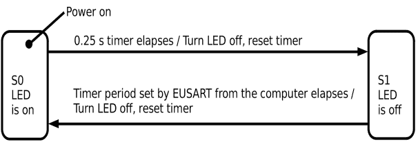

### 4.3.1 • 配置 EUSART 接收字节

接下来的内容与上述关于字节传输的描述相似。表 4-2 显示了配置 EUSART 接收字节的步骤。设置几乎相同。差异部分已加粗显示。

| 目的 | 代码 | 注释 |
| :--- | :--- | :--- |
| 启用接收 | `BSF RCSTA, CREN` | `CREN` 是接收状态和控制寄存器 `RCSTA` 中的第 4 位（数据手册第 278 页）。启用串口。 |
|  | `BSF RCSTA, SPEN` | `SPEN` 是接收状态和控制寄存器中的第 7 位（第 278 页）。通过设置串口波特率发生寄存器 `SPBRGL`（低位字节）和 `SPBRGH`（高位字节）中的值来设置 19200 的波特率，这些值组成一个 16 位字。 |
|  | `MOVLW 0x19`<br>`MOVWF SPBRGL`<br>`CLRF SPBRGH` | 波特率 = 频率/`(64*(spbrgh:spbrgl+1))`；波特率 = 19200（第 280 和 282 页）。 |
| 在 PIC 16F1823 上，接收引可以是引脚 12 (RA1) 或引脚 5 (RC5)，我们需要引脚 12。 | `BSF APFCON, RXDT` | 设置 `APFCON`（备引脚配置）中的第 7 位，使接收引脚变为 RA1（第 114 页）。 |
| 在 `INTCON` 中启用全局和外设中断位 | `MOVLW 0xE0`<br>`MOVWF INTCON` | 上一个程序也启用了第 7 和第 6 位，但是是针对定时器 0。外设中断寄存器（第 87 页）中的串口接收中断也需要第 7 和第 6 位。 |
|  | `BSF PIE1, RCIE` | 表 4-2 配置 EUSART 接收。 |

出于此目的，EUSART 的接收配置已定义为如下宏。同样，这些是用于 32MHz 的。

```asm
SET_SERIAL_RX_16F1823 MACRO

BSF PIE1, RCIE | 设置 RCIE 位

BSF APFCON, RXDT | 设置接收引脚为 RA1（第 114 页）

BSF RCSTA, CREN | 启用串口。

MOVLW 0x19

MOVWF SPBRGL | 波特率=频率/(64*(spbrgh:spbrgl+1))；波特率=19200（第 280 和 282 页）

CLRF SPBRGH | 32MHz。

MOVLW 0xE0

MOVWF INTCON | 87。

BSF PIE1, RCIE | 接收中断。
```

### 4.3.2 • 接收程序

```asm
MOVLB 0 ; 选择 PIR1 的存储器器，参见第 89 页。

BTFSS PIR1, RCIF ; 测试接收中断标志，如果置位，则跳转到接收例程。

RETFIE ; 如果无适用条件，则退出中断程序。

INT_RECEIVE

MOVLB 3 ; 选择 RCREG 的存储器器，接收到的字节可以在

; 与 RCSTA 相同的存储器区中恢复。

BTFSC RCSTA, FERR ; 测试是否存在帧错误，停止位为 0 表示帧错误，

; 参见第 278 页。

GOTO ABORT_READ ; 检测到帧错误，因此值不可靠，跳转到

; ABORT_READ。

MOVF RCREG, W ; 将值从 RCREG 移动到工作寄存器。

MOVWF PERIOD ; 将 RCREG 的接收字节值移动到 PERIOD 文件。

BTFSS RCSTA, OERR ; 检查溢出错误，如果是则跳转到禁用/启用

; 连续读取以重置错误标志。

RETFIE ; 如果没有溢出错误，从中断返回。

BCF RCSTA, CREN ; 禁用连续读取 (CREN)，参见第 278 页和第

; 274 页溢出错误。

BSF RCSTA, CREN ; 再次启用 CREN。

RETFIE ; 从中断返回。

INT_TMR0

BCF INTCON, TMR0IF ; 清除 tmr0 溢出中断标志。

INCF TICK_COUNTER, F ; 将 COUNTER_ON 加1。

RETFIE ; 从中断返回。

ABORT_READ

MOVF RCREG, W ; 读取 RCREG 并丢弃值。

RETFIE ; 从中断返回。

;--------------中断程序结束

START:

MOVLB 1 ; 选择 TRISA 的存储器区，它也是后续

; 宏的存储器区。

BCF TRISA, 2 ; 将 RA2 引脚设置为输出。

SET_FREQ_HZ 32000000 ; 参见文件 fsm_macros.inc，保持在存储器区 1

SET_TMR0_CASE1 ; 参见文件 fsm_macros.inc，保持在存储器区 1

SET_SERIAL_RX_16F1823 ; 参见文件 fsm_macro.inc。从宏输出到存储器区 3

CLRF PULSE_COUNTER ; 清零（初始化）PULSE_COUNTER 为 0。

MOVLW 91

MOVWF PERIOD ; 初始偏移时间 91/122 = 0.75 s

BANKSEL LATA

BSF LATA, 2

;--------------------------机器状态

S0 ; LED 开启

MOVLW 31

IF_REG_LESS_THAN_W TICK_COUNTER

GOTO S0

BANKSEL LATA

BCF LATA, 2

CLRF TICK_COUNTER

S1 ; LED 关闭

MOVF PERIOD, W ; PERIOD 由电脑通过 EUSART 写入。

IF_REG_LESS_THAN_W TICK_COUNTER

GOTO S1

BANKSEL LATA

BSF LATA, 2

CLRF TICK_COUNTER

GOTO S0

END
```

## 4.4 • 模拟输入

PIC 上的某些输入可以配置为将加在其上的电压转换为 0 到 1023 的数字，范围为 0–5V。PIC 12F1822 在其唯一的端口（`PORTA`）上有四个模拟输入。PIC 16F1823 有八个模拟输入，四个在 `PORTA` 上，四个在 `PORTC` 上。

尽管有多个模拟输入通道，但只有一个模拟数字转换器，因此你必须选择用于 A/D 转换器的通道。

程序 4-2 接收字节

数据手册第 130 页显示了 A/D 复用图。配置模拟输入通道的步骤如下。对于此程序，将使用一个引脚作为模拟输入。

必须配置端口以使引脚为输入并设置为模拟模式。

- 使用 `TRISA` 或 `TRISC` 将引脚设置为输入。默认设置为是输入。
- `ANSELA` 和 `ANSELC` 用于将输入设置为模拟。`ANSELC` 仅用于 16F1823。默认设置为是模拟。

必须选择 A/D 转换器所使用的通道。

- `ADCON0` 中的通道选择位 `CHS` 用于选择通道。

必须选择电压参考源。电压参考是测量输入电压的基准。这可以是 +5V 电源、外部电压参考或内部电压参考。

- `ADCON1` 中的 `ADPREF` 位用于选择电压参考。

必须设置转换时钟。数据手册第 131 页和 132 页详细解释了此点。

- `ADCON1` 中的 `ADCS` 位用于选择转换时钟。

转换结果是一个 10 位字，在两个寄存器中：`ADRESH` 和 `ADRESL`。这些是模拟数字结果的高字节和低字节。我们可以对左侧位进行对齐，使最高 8 位位于 `ADRESH` 中，最低两个位位于 `ADRESL` 中；或者我们可以右对齐，使最低 8 位位于 `ADRESL` 中，最高两个位位于 `ADRESH` 中。数据手册中的图 16-3 显示了这一点。

- 对齐通过 `ADCON1` 中的第 7 位 `ADFM` 设置。

表 4-4 显示了模拟通道到引脚和 I/O 位的映射。注意通道编号并不总是与 I/O 编号匹配。在设置 `ADCON0` 中的 `CHS` 位时要小心。

### 模拟输入

| 12F1822 端口 | 12F1822 引脚 | 12F1822 I/O | 12F1822 A/D | 16F1823 端口 | 16F1823 引脚 | 16F1823 I/O | 16F1823 A/D |
| :--- | :--- | :--- | :--- | :--- | :--- | :--- | :--- |


| 端口 | 引脚 | 模拟输入 | 通道 | 端口 | 引脚 | 模拟输入 | 通道 |
| :--- | :--- | :--- | :--- | :--- | :--- | :--- | :--- |
| `PORTA` | 7 | `RA0` | `AN0` | `PORTA` | 13 | `RA0` | `AN0` |
| `PORTA` | 6 | `RA1` | `AN1` | `PORTA` | 12 | `RA1` | `AN1` |
| `PORTA` | 5 | `RA2` | `AN2` | `PORTA` | 11 | `RA2` | `AN2` |
| `PORTA` | 3 | `RA4` | `AN3` | `PORTA` | 3 | `RA4` | `AN3` |
| `PORTC` | 10 | `RC0` | `AN4` | `PORTC` | 9 | `RC1` | `AN5` |
| `PORTC` | 8 | `RC2` | `AN6` | `PORTC` | 7 | `RC3` | `AN7` |

表 4-4 模拟输入引脚

此程序将读取 `RA4`（`AN3`）上的模拟电压。它将传输 A/D 转换器的可用最高位位供电脑读取。通过忽略两个最低位，分辨率为 20 mV 而不是 5 mV。通过设置 `ADCON0` 中的第 1 位启动模拟数字转换。该位名为 `GO/DONE`，意味着当它置高电平时开始转换。转换完成后，硬件会将该位置低电平。代码内部是一个等待完成的循环。

```asm
BTFSC ADCON0, 1 ; 此行和下一行循环直到转换完成。
GOTO $-1
```

### 4.4.1 设置 `ADCON0` 和 `ADCON1`

| `ADCON0` | 位 7 | 位 6 | 位 5 | 位 4 | 位 3 | 位 2 | 位 1 | 位 0 |
| :--- | :--- | :--- | :--- | :--- | :--- | :--- | :--- | :--- |
| `0x70` | 已实现 | 0 | 0 | 0 | 0 | 0 | `GO/DONE` | 0 |

| `ADCON1` | 位 7 | 位 6 | 位 5 | 位 4 | 位 3 | 位 2 | 位 1 | 位 0 |
| :--- | :--- | :--- | :--- | :--- | :--- | :--- | :--- | :--- |
| `0x60` | ADC 启用 | 0 | 0 | 0 | 0 | 0 | 0 | 0 |

`ADRESH:ADRESL` 左对齐。最高 8 位位于 `ADRESH`。设置 ADC 时钟周期为 32 MHz 的 μS。参见数据手册中的表 16-1。`0x40` 已实现。`REF` 连接到 `VDD`。

表 4-5 `ADCON0`

表 4-6 `ADCON1`

### 4.4.2 电路和状态图

向模拟输入提供变电压的简单方法是使用电位器。值并不关键：一个 1KΩ 即可。由于我们使用电源电压 `VDD` 作为参考，当电位器从 0V 扫描到 `Vdd` 时，结果（查看结果中的最高位）应该从 0 扫描到 255。

状态图简单，只有两个状态。机器在等待模拟数字转换的状态和等待串口传输的状态不断切换。源代码中的注释解释了代码的操作。

图 4-5 程序 4-3 电路

图 4-6 程序 4-3 状态图

```asm
; prog_04_03.asm

; 页码参考数据手册。

LIST P=16F1823

#INCLUDE <p16f1823.inc>

#INCLUDE <fsm_macros.inc>

RADIX DEC ; 默认数字为 10 进制。

BOOK_CONFIGURATION

ORG 0x00

GOTO START

ORG 0x08

START:

MOVLB 1 ; 宏需要存储器区 1，TRISA 在存储器区 1。

SET_FREQ_32MHZ ; 参见文件 fsm_macros.inc。

BSF TRISA, 4 ; RA4 (AN3) 作为输入。参见书中文字 RA4 是 AN3！

MOVLW 0x0D ; 选择通道 AN3 并启用 ADC。

MOVWF ADCON0 ; 参见书中的表4-5。

MOVLW 0x60 ; 参见第137页，左对齐结果，转换时钟为 Fosc/64，Vref 是 PIC 电源 Vdd。

MOVWF ADCON1 ; 参见书中的表4-5。

MOVLB 3

SET_SERIAL_TX_161823 ; 参见文件 fsm_macros.inc。

S0

BANKSEL ADCON0 ; 存储器区 1

BSF ADCON0, 1 ; 启动模拟数字转换

BTFSC ADCON0, 1 ; 此行和下一行循环直到转换完成。

GOTO $-1

S1

MOVF ADRESH, W ; 最高8位位于 ADRESH（左对齐）。

BANKSEL TXREG ; 存储器区 3

MOVWF TXREG ; 加载 TXREG 开始传输。

BTFSS TXSTA, TRMT ; 传输完成后 TRMT 被置位，否则此行和下一行循环。

GOTO $-1

GOTO S0

END
```

工作目录中提供的 `serial_reader` 程序可以接受缩放系数作为命令行参数。如果全量程读取 255 时输入电压为 4.99 V，则 0.01957 的缩放系数将以电压输出到屏幕：参见下图 7。这是可用的命令行选项之一。通过添加 `-f` 后跟缩放系数，程序的输出将从原始字节值变为原始字节值和缩放浮点值。你还可以在命令行中添加 `-o file_name` 选项来捕捉结果。请注意此程序将在 10 秒内创建一个 500k 字节的文件，包含约 20000 个样本。

程序 4-3 读取并传输模拟值

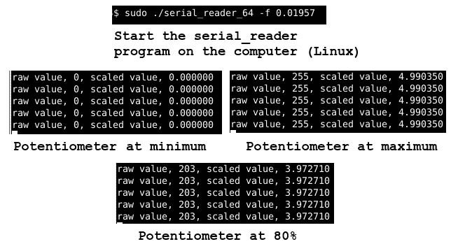

如果 `Vdd` 电压经过调节，那么这样做是可以的；但如果你希望测量结果不受电源电压的影响，可以使用芯片的内部电压基准，正如我们在书中稍后将看到的那样。

## 4.5 调制输出脉冲

为了给负载提供可变电压，PIC 使用了脉宽调制（PWM）技术。这涉及以快速速率切换输出的开启和关闭。我们的示例速率为 1.95 kHz。输出切换的频率保持不变，但每个周期内输出开启的时间长度会发生变化，以控制供给给负载的功率。图 4-8 显示了三条迹形：

- 迹形 A，输出开启时间短，关闭时间长，产生低功率输出。
- 迹形 B。
- 迹形 C，开启时间长，关闭时间短，产生高输出功率。PIC 允许我们改变这种开启/关闭比例，精度高达 1/1024，即 10 位分辨率。

PWM 的巨大优势是，当完美的开关开启时，有电流通过但两端没有电压；当关闭时，两端有电压但没有电流通过。因此，它不会消耗任何功率。如果你尝试用串联通路晶体管来控制输出功率，晶体管将会产生功率损。然而，输出并非完美的开关，但损失非常小。输出电压可能是 5V 或 0V，但通过在输出端并联电容可以使其看起来像平均电压。对于 LED 来说这不是必需，因为你的眼睛会对亮度取平均。

图 4-7 读取输入电压

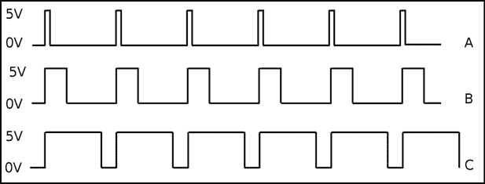

### 4.5.1 脉冲亮度 LED

为了演示 PWM 的用法，程序 4-4 以周期性地改变 LED 的亮度。LED 应该像之前那样通过电阻连接，但连接到 `RC5`。从状态图图 4-9 开始，共有四种状态。在状态 0 中，亮度恒定 41 ms，之后亮度增加 1，程序跳转到状态 1。如果已达到最大亮度，机器将跳转到状态 4 并将 `TICK_COUNTER` 重置为零。如果未达到最大亮度，状态变回 0 并重复此循环。当达到最大亮度且处于状态 4 时，状态保持 41 ms，然后状态变为 3，亮度减 1。如果亮度高于最低值，状态返回 4 并重置 `TICK_COUNTER` 为零。

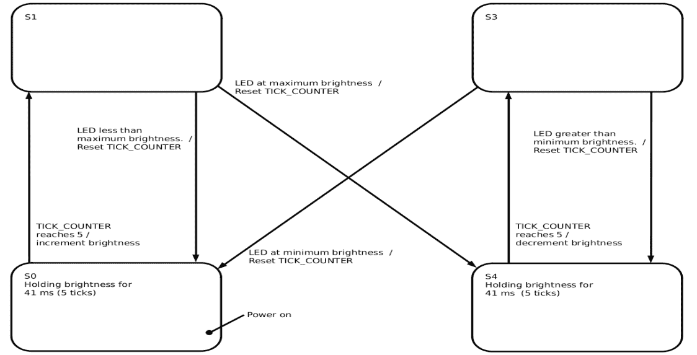

图 4-8 脉宽调制

图 4-9 程序 4-4 状态图

当亮度达到最低值时，状态从 3 变为 0，回到起始条件。

PIC 具有许多与 PWM 外围设备相关的复杂功能。在这里，我们将使用一个简单的配置示例。我将展示如何使用解释位值的表格来设置此示例。数据手册提供了完整的解释。

必须配置四个特殊目的寄存器：`PR2`、`T2CON`、`CCP1CON` 和 `CCPR1L`。PWM 周期的周期是其频率的倒数。如上述，此频率将为 1.95 kHz。使用 `Timer2` 来确定频率。数据手册第 176 页的图 22-1 是该定时器的框图。寄存器 `TMR2` 通过来自 `Fosc/4` 的预分频器的脉冲递增。当 `TMR2` 中的值达到 `PR2` 中的值时，比较器给出输出，寄存器 `TMR2` 重置为零。

如果你查看数据手册第 195 页的图 24-4，你会看到它是与另一个比较器和一个 S-R 触发器配合使用的。概述解释是：`Timer2` 以固定的间隔设置触发器，该间隔即为 PWM 周期的周期，在周期中间，触发器由另一个比较器通过比较来自 `CCPR1L` 的值来重置。这意味着我们可以通过改变 `CCPR1L`（8 位）以及来自 `CCP1CON` `<5:4>` 的两个额外位的值来控制输出功率。来自 `CCP1CON` 的两个位是低有效位，因此我们不会使用它们。功率将通过在 `CCPR1L` 0 到 255 的范围内改变数值来调整。

`T2CON` 特殊寄存器被设置为提供 1.95 kHz 的 PWM 频率。表 4-7 显示了这些设置。预分频值 16 来自数据手册第 197 页的表 24-5。

为了解释此设置，振荡器频率将为 32MHz。预分频器由 `Fosc/4` 馈电。

**`T2CON`**

| 位 | 值 | 描述 |
| :--- | :--- | :--- |
| 7 | 0 | 未实现 |
| 6 | 0 | 后分频器未使用，保持默认 |
| 5 | 0 | |
| 4 | 0 | |
| 3 | 1 | `Timer2` 开启 |
| 2 | 1 | 预分频器设置为 16 |
| 1 | 0 | |
| 0 | 0 | |

**`CCP1CON`**

| 位 | 值 | 描述 |
| :--- | :--- | :--- |
| 7 | 0 | 单输出 P1A（16F823，数据手册第 5 页） |
| 6 | 0 | |
| 5 | 0 | 这些是用于设置脉冲宽的最低低有效位 |
| 4 | 0 | |
| 3 | 1 | 设置为 P1A 高电平 PWM 模式。如果选择一个低电平模式，亮暗相位将反转。 |
| 2 | 1 | |
| 1 | 1 | |
| 0 | 0 | |

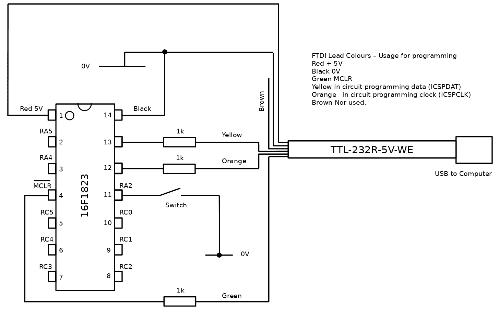

图 4-11 显示了程序的状态图。当开关打开时，程序保持在状态 0；如果关闭，则移动到状态 1。在转换过程中，脉冲计数器加 1 并传输该值。机器保持在状态 2，直到开关再次打开，然后转换到状态 0。

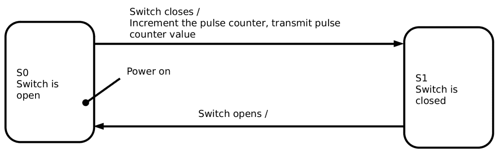

下面的程序几乎每一行都有注释。

通过运行串口读取程序，你可以看到每关闭一次开关，计数器都会增加。不过，取决于你所使用的开关，可能会出现问题。如果你只是触碰一下电线末端来当作开关，问题会非常明显。这就是开关抖动（Switch bounce）问题。开关抖动是指开关没有干净地关闭或打开，而是弹了好几次。PIC 的速度足够足够这些抖动，

图 4-10 程序 4-5 的电路

图 4-11 程序 4-5 的状态图

当开关关闭时，将记录多次计数，而不仅仅是一个。这个问题可以通过使用电阻-电容网络将开关连接到输入端来克服。然而，这些是更多占用空间的组件。开关抖动可以使用软件来消除。

图 4-12 显示了按键开关关闭时跨电压的示波器轨迹。两条垂直虚线尺线之间的时间间隔为 1ms。这仅仅是一个例子。不同的开关具有不同的特性，而且给定的开关并不总是每次都以相同的方式响应。

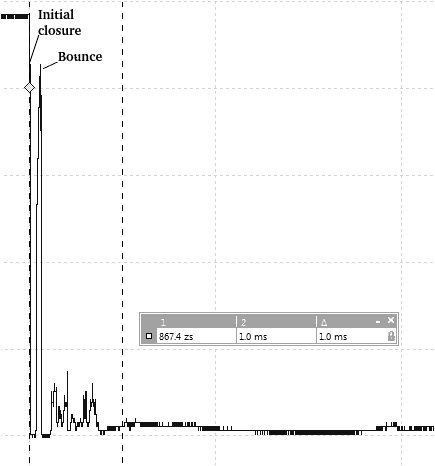

图 4-12 开关触抖抖示例

```asm
; prog_04_05.asm

LIST P=16F1823

#INCLUDE <p16f1823.inc>

#INCLUDE <fsm_macros.inc>

RADIX DEC ; 默认数字为 10 进制。

BOOK_CONFIGURATION ; 查看 fsm_macros.inc 中的宏。

CBLOCK 0x70

PULSE_COUNTER

ENDC

ORG 0X00

MOVLB 1

BCF OPTION_REG, 7 ; 启用弱上拉

SET_FREQ_32MHZ ; 查看文件 fsm_macros.inc。

MOVLB 3

BCF ANSELA, 2 ; 将 RA2 设置为数字输入。

SET_SERIAL_TX_16F1823 ; 查看文件 fsm_macros.inc，这设置了 TXEN、SPEN，设置了波特率并将引脚 2 的改为 TX。

CLRF PULSE_COUNTER ; 初始化计数为零。

BANKSEL PORTA

;-------机器状态

S0

BTFSC PORTA, 2 ; 如果开关打开，输入将为高电，弱上拉电阻将使输入变为高电。弱上拉默认启用。参阅数据手册第 119 页。

; 如果为高电则不跳过，程序保持在状态 0

GOTO S0

INCF PULSE_COUNTER, F

MOVF PULSE_COUNTER, W ; 将 PULSE_COUNTER 中的值移动到 W

BANKSEL TXREG

MOVWF TXREG ; 加载 TXREG 开始传输。

BTFSS TXSTA, TRMT ; 当传输完成时 TRMT 会被设置，否则此行和下一个循环将循环。

GOTO $-1

S2

BANKSEL PORTA

BTFSS PORTA, 2 ; 如果开关关闭，输入将为低电。不跳过，程序保持在状态 2。

GOTO S2

GOTO S0

END
```

## 4.6.2 消除开关抖动影响的方法

消除开关抖动影响的一种软件方法是在第一次检测到开关打开或关闭后引入时间延迟。这是程序 4-6 中使用的方法。这不是处理该问题的最佳方法，因为它会导致程序短时间暂停：在这种情况下大约为 33 ms。虽然人类察觉不到这一点，但在繁忙的程序中，这可能是不理想的。在 32MHz 的时钟频率下，这是 264000 条指令。

```text
一个指令周期 = 4/(32x10^6) = 1.25x10^-7 s

33 ms 内的指令数 = 33/1.25x10^-7 = 264000 条指令
```

程序 4-5 无抖动计数脉冲

```asm
; prog_04_06.asm

LIST P=16F1823

#INCLUDE <p16f1823.inc>

#INCLUDE <fsm_macros.inc>

; 这不是处理抖动问题的最佳方法。

RADIX DEC ; 默认数字为 10 进制。

BOOK_CONFIGURATION ; 查看 fsm_macros.inc 中的宏。

CBLOCK 0x70

PULSE_COUNTER

TICKS

ENDC

ORG 0X00

GOTO START

ORG 0X04 ; 中断向量。

BCF INTCON, TMR0IF ; 清除 tmr0 溢出标志。

INCF TICKS, F ; TICKS 加 1。

RETFIE ; 从中断返回。

START:

MOVLB 1

SET_TMR0_CASE1 ; 查看文件 fsm_macros.inc。

BCF OPTION_REG, 7 ; 弱上拉启用。

SET_FREQ_32MHZ ; 查看文件 fsm_macros.inc。

MOVLB 3

BCF ANSELA, 2 ; 将 RA2 设置为数字输入。

SET_SERIAL_TX_16F1823 ; 查看文件 fsm_macros.inc，这设置了 TXEN、SPEN，设置了波特率并将引脚 2 的改为 TX。

CLRF PULSE_COUNTER ; 初始化计数为零。

;-------机器状态

S0

BANKSEL PORTA

BTFSC PORTA, 2 ; 如果开关打开，输入将为高电，弱上拉电阻将使输入变为高电。默认启用单独上拉。参阅数据手册第 19 页。

; 如果为高电则不跳过，程序保持在状态 0

GOTO S0

CALL DELAY_33_ms ; 调用 33 ms 子程序。

S1

INCF PULSE_COUNTER, F

MOVF PULSE_COUNTER, W ; 将 PULSE_COUNTER 中的值移动到 W

BANKSEL TXREG

MOVWF TXREG ; 加载 TXREG 开始传输。

BTFSS TXSTA, TRMT ; 当传输完成时 TRMT 会被设置，否则此行和下一个循环将循环。

GOTO $-1

S2

BANKSEL PORTA

BTFSS PORTA, 2 ; 如果开关关闭，输入将为低电。不跳过，程序保持在状态 2。

GOTO S2

CALL DELAY_33_ms ; 调用 33 ms 子程序。

GOTO S0

; 子程序

DELAY_33_ms

BANKSEL TMR0

CLRF TMR0 ; TMR0 为 0 开始子程序。

CLRF TICKS ; TICKS 为 0 开始子程序。

LOOP

MOVLW 4

IF_LESS_THAN_W TICKS

GOTO LOOP ; 在子程序中保持直到 4 ticks。

RETURN ; 从子程序返回。

END
```

程序 4-6 使用时间延迟消除脉冲计数

这种方法在程序没有其他事情要做时是有效的。下一个程序采用了不同的方法，不会阻塞程序，这样在等待触点稳定时可以执行其他操作。

## 4.6.3 消除开关抖动影响的更好方法

此程序可能看起来复杂且难以追踪，因为它使用了两个共同运行的状态机。状态机技术使不同的函数分离并易于编写。第一个机器 `M0` 与之前的程序相同，只是它不直接查看输入。通过另一个机器 `M1` 的信号获取开关位置。

机器 `M1` 直接监控输入，如果开关从关闭变为打开，它开始计数 1ms 中断。只有当计数器达到 25 且没有抖动时，才会更改 `M0` 使用的信号。

两个机器共同运行的方式是：一旦在一个机器中执行一段状态代码，程序就在另一个机器中执行一段状态代码。除了等待一个字节串口传输外，没有使用旋转循环。这意味着处理器没有浪费周期。图 4-13 显示了程序 4-7 的状态图。


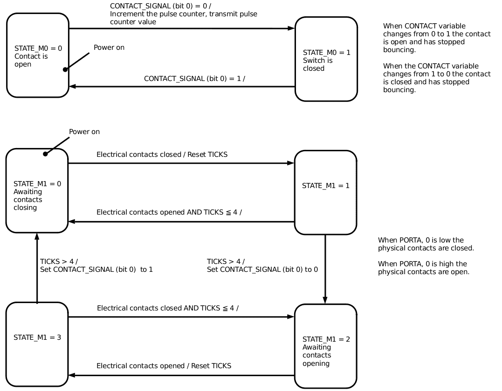

图 4-13 程序 4-7 的状态图

```asm
;prog_04_07.asm

LIST P=16F1823

#INCLUDE <p16f1823.inc>

#INCLUDE <fsm_macros.inc>

RADIX DEC ; 默认数字为 10 进制。

BOOK_CONFIGURATION ; 查看 fsm_macros.inc 中的宏。

CBLOCK 0x70

PULSE_COUNTER

TICKS

STATE_M0

STATE_M1

CONTACT_SIGNAL ; 位 0 中的去抖动信号。

ENDC

ORG 0X00

GOTO START

ORG 0X04 ; 中断向量。

BCF INTCON, TMR0IF ; 清除 tmr0 溢出标志。

INCF TICKS, F

RETFIE ; 从中断返回。

START:

MOVLB 1

SET_TMR0_CASE2 ; 提供 1ms 脉冲。查看文件 fsm_macros.inc

BCF OPTION_REG, 7 ; 弱上拉启用。

SET_FREQ_32MHZ ; 查看文件 fsm_macros.inc。

MOVLB 3

BCF ANSELA, 2 ; 将 RA2 设置为数字输入。

SET_SERIAL_TX_16F1823 ; 查看文件 fsm_macros.inc，这设置了 TXEN、SPEN，设置了波特率并将引脚 2 的改为 TX。

CLRF TICKS ; 初始化计数为零。

CLRF STATE_M0

CLRF STATE_M1

CLRF PULSE_COUNTER

BANKSEL PORTA

SWITCH_M0

MOVF STATE_M0, W ; 将 STATE_0 移动到工作寄存器。

BRW ; 程序根据移动工作寄存器的值跳转。

GOTO M0_S0

GOTO M0_S1

SWITCH_M1

MOVF STATE_M1, W ; 将 STATE_1 移动到工作寄存器。

BRW ; 程序根据进入工作寄存器的值跳转。

GOTO M1_S0

GOTO M1_S1

GOTO M1_S2

GOTO M1_S3

;-------机器状态

M0_S0

BTFSC CONTACT_SIGNAL, 0 ; 使用触点作为变量。如果是低电关闭则跳过。

GOTO M0_S1 ; 保持在状态 0 等待开关关闭。

M0_S1

BTFSS CONTACT_SIGNAL, 0 ; 如果打开则跳过。

GOTO M0_S1 ; 保持在状态 1 等待开关打开。

GOTO SWITCH_M0 ; 电触断开，保持在状态 0。

CLRF TICKS ; 电触关闭，切换到状态 1 并重置 TICKS。

INCF STATE_M1, F

GOTO SWITCH_M0

M1_S1

BTFSS PORTA, 2 ; 如果电触断开，位将为高电。

GOTO $+3

CLRF STATE_M1 ; 跳到此处是因为开关发生抖动开启。

GOTO SWITCH_M0

MOVLW 4

IF_REG_LESS_THAN_W TICKS

GOTO SWITCH_M0 ; 时间未到。

INCF STATE_M1, F ; 时间已到，切换到状态 2。

BCF CONTACT_SIGNAL, 0 ; 表示电触关闭。

GOTO SWITCH_M0

M1_S2 ; 等待开启。

BANKSEL PORTA

BTFSC PORTA, 2 ; 如果电触关闭，位将为低电。

GOTO $+2

GOTO SWITCH_M0 ; 电触关闭，保持在状态 2

CLRF TICKS ; 电触断开，切换到状态 3 并重置 TICKS。

MOVLW 3

MOVWF STATE_M1

GOTO SWITCH_M0

M1_S3

BTFSC PORTA, 2 ; 如果电触关闭，位将为低电。

GOTO $+3

GOTO SWITCH_M0 ; 跳到此处是因为开关发生抖动关闭。

MOVLW 4

IF_REG_LESS_THAN_W TICKS

GOTO SWITCH_M0

CLRF STATE_M1

BSF CONTACT_SIGNAL, 0

GOTO SWITCH_M0

END
```

图 4-14 显示了执行完每个状态代码块后，代码如何跳转到开关，以便另一台机器执行其当前的状态代码块。这样，两台机器就可以共享处理器时间。由于机器可以访问所有内存，`M1` 可以在开关抖动停止时向 `M0` 信号。不要将电开关与用于选择状态代码块的开关代码混淆。

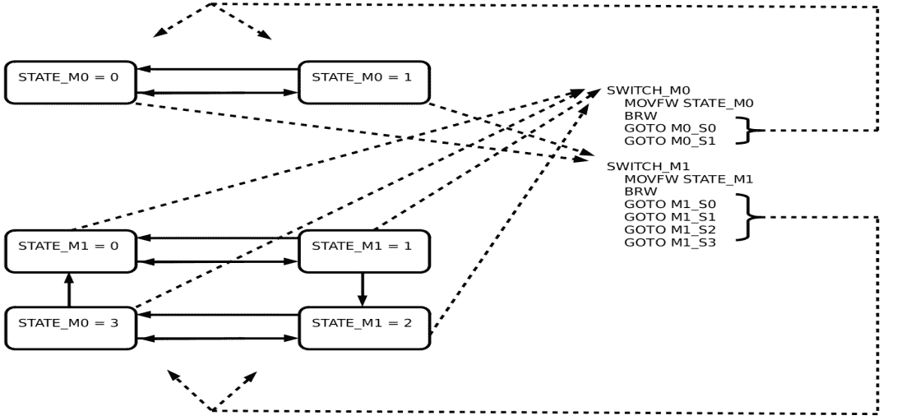

程序 4-7 使用独立线程计数输入脉冲以消除开关抖动效应

图 4-14 机器交替执行代码块

# 第 5 章 项目硬件构建

## 5.1 • 引言

使用插件面包板是开发软件或尝试不同电路的方便方法。早晚，你会想要制作一个可以保留的项目，这将需要某种电路板。目前有很多可选方案，如果你擅长构建，会有你自己青睐的方法。本章是为那些电路构建的新手或想尝试新事物的人准备的。这里描述的方法是我首选的方法。不过，它们比看起来专业的方法更实用。它们需要使用基础手工具，但不需要车间。只需要一块胶合或刨板来保护你的工作表面即可。你需要进行焊接，因此必须考虑健康和安全。如果碰到错误的一端，电烙会烫伤你。你还可能意外烧穿电源。此外，不建议吸入热焊锡产生的烟雾。在使用钻和其他带有尖端或锐边缘的工具时，可能会割伤自己。记得保护眼睛免受焊锡和金属屑的伤害。**小心！** 上述事故列表并非详尽无遗。

我将首先概述建议的方法，并将其与类似的方法进行比较。这种方法适用于构建单个项目，而不是用于商业化生产。它提供了一个可靠的板，如果你更改了设计，它很容易修改。规划布局和布线也非常容易。你的板做得多整洁取决于你。丑的板工作效果同样良好。本章将描述一个完整项目的构建，这是一个范围为 0V 到 20V 的数字直流电压表，由四个 1.5V 电池（AA 或 AAA 尺寸）供电。显示器是一个单数字七段 LED，会闪烁读数的四位有效数字。当三次读取未检测到电压时，它会关闭。本章将只处理板的构建和测试。电压表程序将在第 6 章描述二进制运算后在第 7 章中介绍。本章最后有一个演示板的测试程序。

## 5.2 • 建议的方法概述

电路板在普通的单面铜板上。它们非常常见，通常是环氧玻璃纤维层压板或合成树脂粘合纸。前者较贵。组件安装在铜侧，首先为组件引脚钻 0.5 mm 直径的孔使其穿过，然后使用带有焊点的细细单芯线在非铜侧连接电路。孔需要进行沉孔扩槽处理，以防止铜接触引脚。板的铜侧用作 0 V 的地平面。任何到 0 V 的连接都可以直接焊接在铜上，无需打孔。有一些……

转一两圈以清除孔周围的铜。接子 T1 到 T8 是穿过 1.0 mm 孔的铜销。接子 `T1` 和 `T4` 到 `T7` 穿过到接线一侧。孔是沉孔的，引脚用一滴像 Araldite 这样的环氧胶水固定。接子引脚 `T2`、`T3` 和 `T8` 也插入到 1.0 mm 直径的孔中，但这些孔没有沉孔，因为引脚将焊接在接地平面。图 5-3b 显示了孔的细节。在板板角处钻四个 4 mm 直径的孔：如果你想将板板安装在盒子里，这些孔用于固定螺丝。当你在无铜侧面焊接接线时，可以临时用螺丝和螺母穿过这些孔将其作为支脚，将板板倒过来立起来，这样在焊接时可以让元件远离桌面。要将电路板切割成尺寸，最简单的方法是使用金属直尺，并用模型刀在两面刻一条线。然后用两块木板夹住电路板，沿线将其折断。

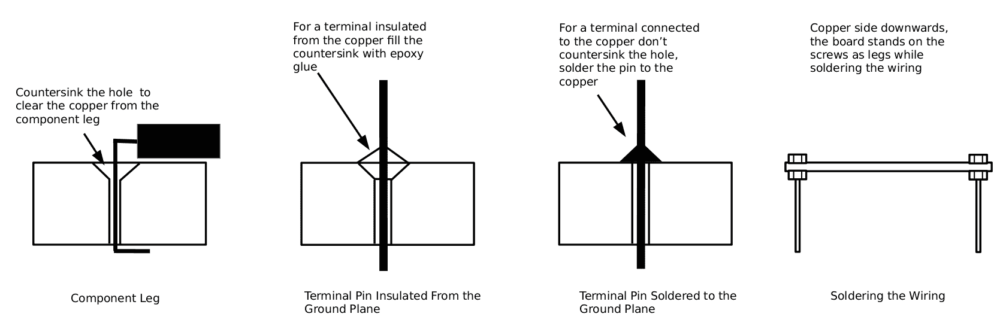

## 5.4 • 电路板的装配与接线

钻孔后，将接子放入孔中，焊接接地的部分，并用胶水将绝缘部分固定好。可以使用如快速固化 Araldite 这样的胶水。对于 PIC 本身，我建议使用 IC 插座，将其放入孔中并在插座上焊接接线。在完成所有焊接后再将 PIC 插入。这样可以减少损坏 PIC 的概率。如果将来它发生电学损坏，你可以轻松更换它。对于其他元件，将引脚弯成直角以与孔对齐。将它们穿过直到元件几乎贴紧铜表面。剪掉除 5mm 外的所有引脚，并在无铜侧弯成直角并平放，见图 5-3b。确保你的二极管方向正确。这些二极管的作用是保护 PIC 的输入免受反向电压的影响（如果探头意外反向使用），以及防止输入电压高于电源电压时的过压。通过使用螺丝和螺母制作支脚让电路板倒立起来，可以方便地焊接接线，同时保持元件远离工作表面。如果 IC 插座掉落，可以用胶带将其临时固定。对于元件引脚和 IC 插座引脚之间的连接，我发现绕线线是理想的，因为它是一根实心单股，而且非常细。

图 5-3b 孔的细节

图 5-4 显示了翻转到接线一侧的电路板，接线用直线表示。如果你使用绝缘线，可以采取最直接的路径进行连接。仅仅为了美观而将电缆束缚在一起并没有电气上的优势，有时反而可能是一个劣势。

电池及其开关未在接线图中显示。它们通过线连接到 `T1` 和 `T2`。如前所述，该项目使用电池而不是 5 V USB。可以使用四节 1.5 V 电池，因为为 PIC 提供的最大电压为 6.5 V。请参阅数据表第 322 页。你必须确保极性正确。否则 PIC 将无法存活。

所示的接线用于共阳极显示器。可以使用共阴极，但显示器上的公共端**必须**连接到 0V 而不是电源，并对显示器宏应用相应的修改。

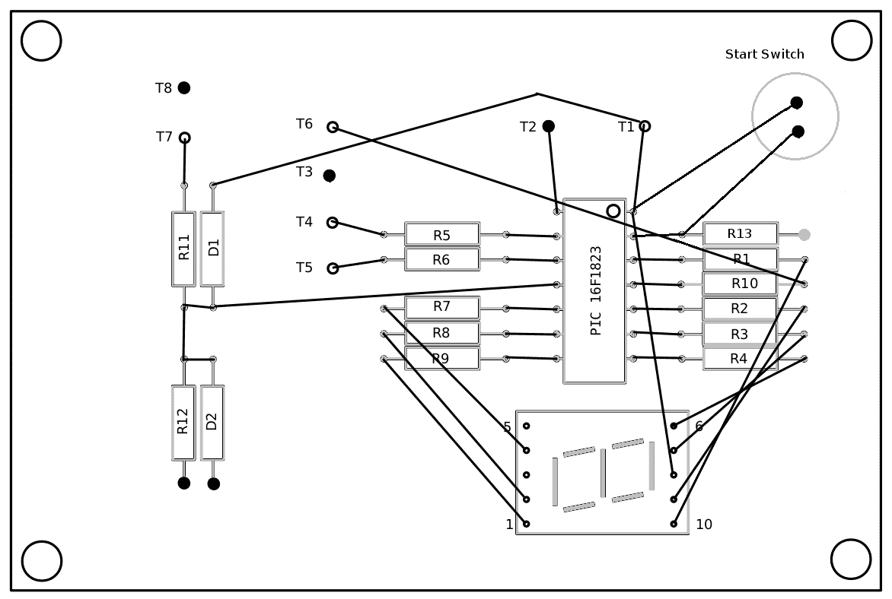

## 5.5 • 电路板测试程序

这个项目是迄为止最复杂的，但它汲取了之前程序的经验。在开发任何项目时，边构建边测试是非常明智的。这对于软件和硬件都是如此。将问题拆分成若干部分并测试每个部分。这样在你进行下一步工作之前，可以依赖于你已经完成的内容。在制作好电路板后，将使用一个程序来测试其功能是否正常，然后再对剩余部分进行实验。

图 5-4 电路板的接线侧

观察电路图，用于测量电压的探头连接到 `RA2` 输入，该输入通过 `R11`、`R12` 电压分位器配置为 `AN2` 模拟通道。我们将配置 PIC，将输入电压与 4.096 V 的内部参考进行比较。为了在输入引脚处实现 4.096 V，探头之间的电压将为 22.7 V：这是满量程读数。如果电源电压为 5 V，在不损坏 PIC 的情况下可以应用的最大电压为 29.4 V。见数据表第 322 页。不能向任何输入引脚施加高于电源电压 0.3 V 的电压，如果发生这种情况，肖特基二极管 `D1` 将处于正偏置，并将输入电压限制在 `Vss` 之上 0.3 V 左右。

PIC 电源电压为 5 V 时探头跨最大允许电压的计算：

最大电压 = (`Vss` + 0.3) x 22/5 V。其中 `Vss` 是电源电压。例如 5.3x22/5 = 29.4 V。

此程序不显示探头两端的输入电压值。这将在第 7 章介绍。

## 程序 5-1

● 101

```asm
;PROG_05_01.asm

LIST P=16F1823

#INCLUDE <p16f1823.inc>

#INCLUDE <fsm_macros.inc>

RADIX DEC ; 默认数字为100进制。

BOOK_CONFIGURATION ; 参见 fsm_macros.inc 中的宏。

CBLOCK 0x70

TICKS ; 用于计数 8.2ms 的滴答周期。

STATE_M0

STATE_M1

VALUE

FLAGS

ENDC

ORG 0X00

GOTO START

ORG 0X04 ; 中断向量。

BCF INTCON, TMR0IF ; 清除 tmr0 溢出中断标志。

INCF TICKS, F ; 8.2ms 滴答计数加1。

RETFIE ; 中断返回。

START:

MOVLB 1

SET_TMR0_CASE1 ; 提供 8.2 ms 的滴答周期。参见 fsm_macros.inc

MOVLW 0x24 ; 0x24 = b’00100100’。

MOVWF TRISA ; 设置 PORTA 的 RA2 和 RA5 为输入，其他为输出。

CLRF TRISC ; 设置所有 PORTC 为输出。

BSF TRISA, 2 ; 设置 RA2 (AN2) 为输入。

BSF TRISA, 5 ; 设置 RA5 为输入。

MOVLW 0x09 ; 选择通道 AN2 并开启 ADC。

MOVWF ADCON0

MOVLW 0x63 ; 参见第137页，结果左左对齐，
; 转换时钟为 Fosc/64，
; Vref 来自内部参考电压 4.096 V。

MOVWF ADCON1

SET_FREQ_32MHZ ; 参见文件 fsm_macros.inc。

MOVLB 2

MOVLW 0x83 ; 启用固定电压参考，并设置为 4.096 V。

MOVWF FVRCON ; 参见数据手册第128页。

CLRF LATC

COMF LATC, F

BSF LATA, 4

MOVLB 3

CLRF TICKS ; 初始化计数为零。

CLRF STATE_M0 ; 初始化为0。

CLRF STATE_M1 ; 初始化为0。

BCF FLAGS, 0 ; 初始化为低电平。

SWITCH_M0

MOVF STATE_M0, W ; 将 STATE_M0 移入工作寄存器。

BRW ; 根据移入工作寄存器的值进行跳转。

GOTO M0_S0

GOTO M0_S1

GOTO M0_S2

SWITCH_M1

MOVLB 2 ; 七段码驱动器需要 Bank 2。

MOVF STATE_M1, W ; 将 STATE_1 移入工作寄存器。

BRW ; 根据移入工作寄存器的值进行跳转。

GOTO M1_S0

GOTO M1_S1

;-------机器状态

M0_S0

BANKSEL PORTA

BTFSC PORTA, 5 ; 测试数字输入启动开关是否激活。

GOTO M0_S0_L0 ; 如果启动开关激活，跳转到标签 M0_S0_L0。

BANKSEL ADCON0 ; Bank 1

BSF ADCON0, 1 ; 开始 a 到 d 的转换

BTFSC ADCON0, 1 ; 此行和下一行将循环直到转换完成。

GOTO $-1

MOVLW 45 ; 参见书中的文字，180 是电路探头端 4V 的 A/D 值。

IF_REG_GREATER_THAN_OR_EQUAL_TO_W ADRESH

GOTO M0_S0_L0

GOTO SWITCH_M1 ; 如果输入电压为 4V 或更低...

M0_S0_L0

CLRF VALUE ; 将 VALUE 设置为 0。

BSF FLAGS, 0 ; 设置 FLAGS 中的更新位。

INCF STATE_M0, F ; 如果输入电压大于 4V...

CLRF TICKS

GOTO SWITCH_M1

M0_S1

MOVLW 91

IF_REG_GREATER_THAN_OR_EQUAL_TO_W TICKS

GOTO $+2 ; 如果超时。

GOTO SWITCH_M1 ; 如果未超时。保持在此状态。

INCF VALUE, F ; 如果超时则跳过此处。

INCF STATE_M0, F ; 现在进入状态 2。

GOTO SWITCH_M1

M0_S2

BSF FLAGS, 0

MOVLW 10

IF_REG_GREATER_THAN_OR_EQUAL_TO_W VALUE

GOTO $+4 ; 如果 VALUE 为 10。

CLRF TICKS ; 如果 VALUE < 10。

DECF STATE_M0, F ; 现在回到状态 1。

GOTO SWITCH_M1

CLRF STATE_M0 ; 当 VALUE 为 10 跳到此处。

GOTO SWITCH_M1

SEVEN_SEG_DRIVE_MACHINE FLAGS, VALUE, M1_S0, M1_S1

END
```

程序 5-1 测试电路板

# 第 6 章 • 二进制算术

## 6.1 • 引言

如果你使用 C 等高级语言进行编程，涉及加、减、除的简单算术可能看起来微而易举，因为你只需要像在纸上一样写出表达式即可。但在汇编语言中，情况大不相同。

## 6.2 • 二进制加法

二进制加法与十进制加法非常相似，但只有 0 和 1 两个数字。加法规则如下：

- 0 + 0 = 0
- 0 + 1 = 1
- 1 + 0 = 1
- 1 + 1 = 10（结果为 0，进位 1）
- 1 + 1 + 1 = 11（结果为 1，进位 1）

让我们来看一个二进制加法的例子：

```text
    1011 (11)
  + 0111 (7)
  ------
   10010 (18)
```

在这个例子中，11 + 7 等于 18。

## 6.3 • 二进制减法

二进制减法也与十进制类似，主要规则如下：

- 0 - 0 = 0
- 1 - 0 = 1
- 1 - 1 = 0
- 0 - 1 = 1（需要借位，从高位借）

在微控制器中，减法通常通过加补码（Two's Complement）来实现。

## 6.4 • 位移操作

位移是二进制算术中一个非常强大的工具：

- 左移（Shift Left）相当于乘以 2 的 n 次。
- 右移（Shift Right）相当于除以 2 的 n 次。


```asm
;PROG_06_01.asm
LIST P=16F1823
#INCLUDE <p16f1823.inc>
#INCLUDE <fsm_macros.inc>

RADIX DEC ; 默认数字为110进制。
BOOK_CONFIGURATION ; 参见 fsm_macros.inc 中的宏。

CBLOCK 0x70 
TICKS ; 用于计数 8.2ms 的节拍。
Xa ; 加数（Augend）。
Xb ; 加数（Addend）。
Y0 ; 加法结果的低字节。
Y1 ; 加法结果的高字节。
ENDC

ORG 0X00
GOTO START
ORG 0X04 ; 中断向量。
BCF INTCON, TMR0IF ; 清除 tmr0 溢出中断标志。
INCF TICKS, F ; 将 8.2ms 的节拍加1。
RETFIE ; 中断返回。

START
MOVLB 1
SET_FREQ_32MHZ ; 参见文件 fsm_macros.inc。
SET_TMR0_CASE1 ; 提供 8.1 ms 的节拍。参见 fsm_macros.inc
MOVLB 3 ; EUSART 宏需要银行 3。
SET_SERIAL_TX_16F1823 ; 设置 EUSART。

LOOP
CLRF TICKS
MOVLW 244
IF_REG_LESS_THAN_W TICKS ; 2秒的延迟 = 244*8.2 ms。
GOTO $-3 ; 我们必须在宏中回跳两行。
MOVLW 192
MOVWF Xa ; 将 192 移入 Xa。
MOVLW 168
MOVWF Xb ; 将 168 移入 Xb。
CALL ADD_TWO_EIGHT_BIT_NUMBERS ; 调用子程序。
CALL TX_SIXTEEN_BIT_NUMBER ; 调用子程序。
MOVLW 192
MOVWF Xa ; 将 192 移入 Xa。
MOVLW 3
MOVWF Xb ; 将 3 移入 Xb。
CALL ADD_TWO_EIGHT_BIT_NUMBERS ; 调用子程序。
CALL TX_SIXTEEN_BIT_NUMBER ; 调用子程序。
GOTO LOOP

; 子程序。
ADD_TWO_EIGHT_BIT_NUMBERS ; Y = Xa + Xb，注意每个 X 变量占用一个字节。
; 输出 Y 有一个高字节和一个低字节。
CLRF Y1 ; 清零高字节。
MOVF Xa, W ; 将 Xa 的内容移入 W。
ADDWF Xb, W ; 将 Xb 加到 W，结果在 W 中，进位在 STATUS C 中。
MOVWF Y0 ; 将结果的低字节存入 Y0。
CLRW ; 清零 W，下一行需要它为 0。
ADDWFC Y1, F ; 将 W、Y1 和 C 相加，结果在 Y1 中。
RETURN

TX_SIXTEEN_BIT_NUMBER
BANKSEL TXREG
MOVF Y1, W ; 将高字节存入 W。
MOVWF TXREG ; 使用 EUSART 发送 W。
BTFSS TXSTA, TRMT
GOTO $-1 ; 等待 TRMT 变高时循环。
MOVF Y0, W
MOVWF TXREG ; 发送结果的低字节。
BTFSS TXSTA, TRMT
GOTO $-1 ; 等待 TRMT 变高时循环。
RETURN

END
```

程序 6-1 两个八位正数加

### 6.2.2 • 串口读取程序命令行参数

用于从你的 PIC 读取数据的程序`serial_read_x`具有一些命令行参数，可以附加这些参数来更改输出，具体取决于你如何使用 PIC。共有四种模式：

- 在种模式中没有命令行参数，输出仅为简单的无符号字节值（0–255）。
- 第二种模式使用`-h`时，输出是有符号的短整数值（-32768 到 +32767），从两个连续字节得出，以大端序排列。
- 第三种模式使用`-d`时，输出是四个字节的有符号整数值（-2147483648 到 +2147483647）。
- 第四种模式使用`-f <系数>`时，每个字节乘以一个实数以缩放输出，正如我们在程序 4-3 中所示。虽然串口读取程序可以解释有符号整数，但最初只输出正数。此外，还有`-o filename`参数可以将所有输出记录到指定的文件。可以使用任何模式完成。

| 操作系统 | 程序命令 |
| :--- | :--- |
| Windows | `serial_reader.exe [options]` |
| 64 位 Linux | `sudo ./serial_reader_64 [options]` |
| 32 位 Linux | `sudo ./serial_reader_32 [options]` |

| Windows 示例 | 带选项的命令 | 输出格式 |
| :--- | :--- | :--- |
| `serial_reader.exe` |  | 每个字节输出一个 0 到 255 的值，每行一个。 |
| `serial_reader.exe -o file_name` |  | 每个字节输出一个 0 到 255 的值，每行一个，并写入文件`file_name`。 |
| `serial_reader.exe -h` |  | 两个字节输出一个 -32768 到 +32767 的值，第一个字节为高位，每行一个。 |
| `serial_reader.exe -h -o file_name` |  | 两个字节输出一个 -32768 到 +32767 的值，第一个字节为高位，每行一个，并写入文件`file_name`。 |
| `serial_reader.exe -d` |  | 三个字节输出一个 -2147483648 到 +2147483647 的值，第一个字节为高位，每行一个。 |
| `serial_reader.exe -d -o file_name` |  | 三个字节输出一个 -2147483648 到 +2147483647 的值，每行一个，并写入文件`file_name`。 |
| `serial_reader.exe -f scale_coefficient` |  | 每行输出两个值，第一个是单字节值，第二个乘以系数。 |
| `serial_reader.exe -f scale_coefficient -o file_name` |  | 每行输出两个值，第一个是单字节值，第二个乘以系数，并写入文件`file_name`。 |

图 6-2 显示了如何在 64 位 Linux 上读取程序 0601 的输出。

### 6.2.3 • 两个十六位数加

仅使用八位数在一定程度上有限，因为最大的无符号数是 255。如果我们提升到十六位，将得到 0–65535 的范围，这对于实际程序有用得多。这需要每个加数两个字节，和需要三个字节来处理两个十六位数加的最大可能结果。图 6-3 显示了如何操作。相加的两个十六位数是 65000 (253*256 + 232) 和 50000 (195*256 + 80)，和为 115000 (1*256*256 + 193*256 + 56)，需要三个字节。两个 65535 输入的最大和为 131070 (1*256*256 + 255*256 + 254)。这个数字也可以由三个字节容纳。程序 6-2 执行此操作。注释解释了每一行的功能。串口读取程序通过命令行`-h`读取十六位整数。下一个长类型是 32 位（4字节）整数。PIC 中的传输子程序必须输出 4 个字节。当只加两个十六位加数时，高字节始终为 0。

表 6-2 使用串口读取程序

图 6-2 使用串口读取

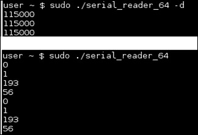

## 6.3 • 无符号整数的二进制减法

减法的原理是类似的。下一个程序将一个 16 位数减去另一个。作为例如，我们将从 1500 中减去 1000。这两个数都大于 255，因此每个都需要两个字节。1500 是 256x5 + 220，1000 是 256x3 + 232。减法过程在表 6-3 中列出，并解释了汇编代码中需要发生的情况。

| 高位字节计算256的倍数 | 低位字节计算个位 | 十进制值 |
| :--- | :--- | :--- |
| 5 | 220 (需要从 256 处借位，这使得 C 为非借位 C= 0) | 1500 |
| 3 | 232 | 1000 |
| 5 - 3 – C = 1, C 因为借位为 0，因此 C 为 1 | 使用`SUBWFB`指令。 | |
|  | 220 + 256(借位) – 232 = 244 | 使用`SUBWF`指令。 |

执行起来有些困惑但在实践中不会产生问题的是`SUBWFB`指令，它在多字节减法中减去高位字节时，使用“带借位的从文件中减去W*”的操作。在多字节减法中，如果减法结果为零或正数，`STATUS`寄存器中的进位（carry bit）将设置为 1。这表示不需要借位。如果减法结果为负数，`STATUS`寄存器中的进位将清零为0，表示需要借位。接下来发生的是，在涉及`SUBWFB`的下一对高位字节的减法中，将考虑进位状态。工作寄存器`W`减去`F`。如果 C 为 0，则再减去 1。如果 C 为 1，则不额外减去 1。除了使用该指令外，你不需要做任何事情：

`F – W – C -> 目标 (W 或 F) (同样，进位 C 也会受到影响)`

程序 6-3 展示了这一点，图 6-5 显示了输出。由于输出是一个 16 位字，因此使用了`-h`。

```asm
;PROG_06_03.asm
LIST P=16F1823
#INCLUDE <p16f1823.inc>
#INCLUDE <fsm_macros.inc>

RADIX DEC ; 默认数字为10 进制。
BOOK_CONFIGURATION ; 查看 fsm_macros.inc 中的宏。

CBLOCK 0x70
TICKS ; 用于计算 8.2ms 的滴答。
Xa0 ; 被减数低字节。
Xa1 ; 被减数高字节。
Xb0 ; 减数低字节。
Xb1 ; 减数高字节。
Y0 ; 差值最低字节。
Y1 ; 差值最高字节。
ENDC

ORG 0X00
GOTO START

ORG 0X04 ; 中断向量。
BCF INTCON, TMR0IF ; 清除 tmr0 溢出中断标志。
INCF TICKS, F ; 8.2ms 滴答加 1。
RETFIE ; 从中断返回。

START ;
MOVLB 1
SET_FREQ_32MHZ ; 查看文件 fsm_macros.inc。
SET_TMR0_CASE1 ; 产生 8.1 ms 的滴答。查看 fsm_macros.inc
MOVLB 3 ;
SET_SERIAL_TX_16F1823 ; 设置 EUSART。

LOOP
CLRF TICKS
MOVLW 244
IF_REG_LESS_THAN_W TICKS ; 2 秒的延迟 = 244*8.2 ms。
GOTO $-3 ; 我们必须在宏中跳回两行。

; 加载值 Xa 256*5 + 220 = 1500
MOVLW 5 ; 这可以表示为 MOVLW HIGH 1500
MOVWF Xa1 ; 将 5 移动到 Xa1。这是 1500 的高字节。
MOVLW 220 ; 这可以表示为 MOVLW LOW 1500
MOVWF Xa0 ; 将 220 移动到 Xa0。这是 1500 的低字节。

; 加载值到 Xb 256*3 + 232 = 1000
MOVLW 3 ; 这可以表示为 MOVLW HIGH 1000
MOVWF Xb1 ; 将 3 移动到 Xb1。这是 1000 的高字节。
MOVLW 232 ; 这可以表示为 MOVLW LOW 1000
MOVWF Xb0 ; 将 232 移动到 Xb0。这是 1000 的低字节。
CALL SIXTEEN_BIT_NUMBERS ; 调用子程序。
CALL SIXTEEN_BIT_NUMBER ; 调用子程序。
GOTO LOOP

子程序。
SIXTEEN_BIT_NUMBERS ; Y = Xa - Xb，注意每个变量都有高字节和低字节。
CLRF Y1 ; 清空结果字节。
MOVF Xb0, W ; 将低字节移动到 W。
SUBWF Xa0, W ; 从 Xa0 减去 W (xb1)。如果结果为负，则不需要借位，STATUS 中的进位置位。C 也称为“非借位”。
MOVWF Y0 ; 将低字节移动到 Y1。
MOVF Xb1, W ; 将 Xb 高字节移动到 W。
SUBWFB Xa1, W ; 从 Xa1 减去“非借位”和 W (xb0)，将结果放入 W。
MOVWF Y1 ; 将结果移动到 Y1，高字节。
RETURN

SIXTEEN_BIT_NUMBER
BANKSEL
MOVF Y1, W ; 将高字节放入 W。
MOVWF TXREG ; 使用 EUSART 传输。
BTFSS STATUS, TRMT ; 等待 TRMT 置位。
MOVF Y0, W ; 传输结果的低字节。
BTFSS STATUS, TRMT ; 等待 TRMT 置位。
RETURN
END
```

## 6.4 结果为负数的二进制减法

在上例中，虽然低位字节产生了负结果，但它是通过`STATUS`寄存器从高位字节借位处理的。如果高位减法结果为负数，该如何处理？我将使用相同的程序进行修改，从 1000 减去 1500 以得到 -500。这是程序 6-4，区别在于这里显示的值。为了节省空间，书中只保留修改部分：

```asm
LOOP
CLRF TICKS
MOVLW 244
IF_REG_LESS_THAN_W TICKS ; 2 秒的延迟 = 244*8.2 ms。
GOTO $-3 ; 我们必须在宏中跳回两行。

; 加载值 Xb 256*3 + 232 = 1000
MOVLW 3 ; 这可以表示为 MOVLW HIGH 1000
MOVWF Xa1 ; 将 3 移动到 Xa0。这是 1000 的高字节。
MOVLW 232 ; 这可以表示为 MOVLW LOW 1000
MOVWF Xa0 ; 将 232 移动到 Xa1。这是 1000 的低字节。

; 加载值 Xa 256*5 + 220 = 1500
MOVLW 5 ; 这可以表示为 MOVLW HIGH 1500
MOVWF Xb1 ; 将 5 移动到 Xb0。这是 1500 的高字节。
MOVLW 220 ; 这可以表示为 MOVLW LOW 1000
MOVWF Xb0 ; 将 220 移动到 Xb1。这是 1500 的低字节。
CALL SIXTEEN_BIT_NUMBERS ; 调用子程序。
CALL SIXTEEN_BIT_NUMBER ; 调用子程序。
GOTO LOOP
```

程序 6-3 从另一个数减去 16 位数

程序 6-4 节选

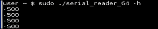

如图 6-4 所示，当使用短整数`-h`（两个字节）选项时，串口读取器正确显示 1000 减去 1500 的输出为 -500。那么，二进制是如何表示负数的？

## 6.5 • 二进制中的负数

当我们在纸上运算表示负数时，只需在数字前加一个负号，并在加减法时考虑它。计算机中的二进制运算有所不同。让我们从考虑仅限 4 位的整数类型开始。这意味着可以表示 0 到 15 之间的无符号数。表 6-4 显示了位模式，但有两列值：一列用于无符号，另一列用于带符号的表示。注意，0 到 +15 的无符号与 -8 到 +7 的带符号使用了相同的位模式。对于 0 到 +7，带符号和无符号的值是相同的，但无符号的 +8 到 +15 范围映射到带符号的 -8 到 -1。

现在取 +3（即 0011），从带符号整数中取 -3（即 1101）。如果将 +3 和 -3 相加，将得到 0。让我们相加二进制数 0011 和 1101。

```text
0011 = +3

1101 = -3

0000 产生 1 进位。
```

你可以尝试表中任意两个绝对值相同的正数和负数对。例如，+2 和 -2。所有这些二进制数之和将为 0。

现在例如，如果相加 +3 和 -8，答案是 -5。使用表中的二进制数 0011 和 1000：

```text
0011 = +3

1000 = -8

1011 = -5
```

给出表中正确的答案 -5。

图 6-6 使用串口读取器

## 表 6-4 四位整数符号与无符号使用的位模式

| 位 | 8 | 4 | 2 | 1 | 无符号 | 有符号 |
| :--- | :--- | :--- | :--- | :--- | :--- | :--- |
|  | 0 | 0 | 0 | 0 | 0 | 0 |
|  | 0 | 0 | 0 | 1 | 1 | +1 |
|  | 0 | 0 | 1 | 0 | 2 | +2 |
|  | 0 | 0 | 1 | 1 | 3 | +3 |
|  | 0 | 1 | 0 | 0 | 4 | +4 |
|  | 0 | 1 | 0 | 1 | 5 | +5 |
|  | 0 | 1 | 1 | 0 | 6 | +6 |
|  | 0 | 1 | 1 | 1 | 7 | +7 |
|  | 1 | 0 | 0 | 0 | 8 | -8 |
|  | 1 | 0 | 0 | 1 | 9 | -7 |
|  | 1 | 0 | 1 | 0 | 10 | -6 |
|  | 1 | 0 | 1 | 1 | 11 | -5 |
|  | 1 | 1 | 0 | 0 | 12 | -4 |
|  | 1 | 1 | 0 | 1 | 13 | -3 |
|  | 1 | 1 | 1 | 0 | 14 | -2 |
|  | 1 | 1 | 1 | 1 | 15 | -1 |

这种表示负数的方法称为补码。正如我们所演示的，将一个数的补码与该数相加，结果为零。这意味着一个数的补码就是它的负数。那么，我们该如何计算一个数的补码呢？

让我们先从表格中的正数范围任取一个二进制数，例如 5 = 0101。如果我们反转这些位（即将 0 变为 1，将 1 变为 0），就会得到 1010。将这些数字相加得到：

```text
0101
1010
1111
```

应该看到，这适用于所有的二进制数。如果你将一个数字与通过反转位得到的数字相加，其和将包含所有的 1。原数的位反转对应的数字称为反码。如果在反码上加 1 会发生什么？


```text
1111
0001
0000 (进位 1)
```

通过在反码上加 1，你得到了该数的补码，即该负的负值。以值 4 为例：在我们的四位整数类型 `0100` 中，其反码是 `1011`。对其加 1 得到 `1100`，这在表格中显示为 -4。

同样注意，这种操作是可逆的，如果我们取表示为 `1100` 的 -4，取其反码 `0011`，然后加 1。我们得到 `0100`，即 +4。

计算机通过加上被减数（被减数）的补码来实现减法。

为了演示，我仅使用了四位的整数类型。这里需要记住的一点是，你必须知道整数的位宽。你可以拥有：

- 范围从 -128 到 +127 的符号字节（`bytes`）。
- 符号短整型，通常为 16 位，范围从 -32768 到 +32767。
- 符号整数，通常为 32 位，范围从 -2147483648 到 +2147483647。对于 64 位长整型，其范围巨大，每增加一个位，容量就会翻倍。

你还会注意到，对于符号整数，最高位（符号位）在正数时为 0，在负数时为 1。如果是负数，记住它是补码。你如何知道一个二进制数是有符号整数、无符号整数还是其他数据类型？

嗯，仅通过观察是无法判断的。这就是为什么在 C 和其他静态类型语言中必须声明变量，声明规定了数据类型，以便编译器知道它正在处理什么。

## 6.6 • 二进制乘法

PIC 并没有方便的乘法指令。因此，我们必须编写自己的例程。如果你取一个二进制数并将位向左移动一位，该数就会翻倍。通过结合加法和乘以 2 的幂次，可以乘以除 2 以外的值。例如，如果我想将变量 `X` 乘以 5，我可以取 `X` 的一个副本并将位左移 2 位。每移动一位相当于乘以 2。如果我再取一个 `X` 的副本并将位向左移动一位，我就乘以了 2。最后，如果我再取一个 `X` 的副本并将其加到输出中 3 次 `X`，我就得到了 5 倍的 `X`。

`X + 2X + 2X = 5X`

这种方法执行速度非常快，但不是我将要的方法。我将描述的乘法方法不是快的，但易于实现且用途广泛。它简单就是重复加法。如果我想将 `X` 乘以 5，我只需将 `X` 加到 16 位无符号输出变量中以完成相乘。当我测试这种方法时，将 4630 乘以 4641 大约花费了 75 毫秒，得到结果 21,474,940。这是我们在不溢出 32 位符号整数正数范围的情况下可以使用的最坏情况。它将 65535 乘以 65535 大约需要 107 毫秒，但由于溢出，结果是负数。实现乘法的子程序被写成一个有限状态机。图 6-5 显示了它的状态图。这种实现仅用于正整数。


该状态机仅用于乘以两个 16 位变量 `Xa` 和 `Xb` 的子程序，并将积存在变量 `Y` 中。`Xa` 由高字节 `Xa1` 和低字节 `Xa0` 组成，同样，`Xb` 也有 `Xb1` 和 `Xb0`。

```asm
GOTO $+4 ; 因为 BUFFH 不为 0。

MOVF BUFFL, F ; 因为 BUFFH 为 0。

BTFSC STATUS, Z ; 检查 BUFFL。

RETURN ; 因为 BUFFH 和 BUFFL 均为 0。

ADD_REGISTERS_16 Y1, Y0, Xb1, Xb0, Y3, Y2, Y1, Y0

MOVLW 1

SUBWF BUFFL, F

CLRW

SUBWFB BUFFH, F

GOTO MULT_S1 

TX_THIRTY_TWO_BIT_NUMBER ; 这里有 4 个字节，因为串口读取器程序读取 1、

; 2 或 4 字节，而我们需要 3 个。

BANKSEL TXREG

MOVF Y3, W ; 将最高位字节放入 W 中。

MOVWF TXREG ; 使用 EUSART 发送 W。

BTFSS TXSTA, TRMT

GOTO $-1

MOVF Y2, W ; 将高位位字节放入 W 中。

MOVWF TXREG ; 使用 EUSART 发送 W。

BTFSS TXSTA, TRMT

GOTO $-1

MOVF Y1, W ; 将低位中间字节放入 W 中。

MOVWF TXREG ; 使用 EUSART 发送 W。

BTFSS TXSTA, TRMT

GOTO $-1

MOVF Y0, W ; 将最低位字节放入 W 中。

MOVWF TXREG ; 使用 EUSART 发送 W。

BTFSS TXSTA, TRMT

GOTO $-1

RETURN

END
```

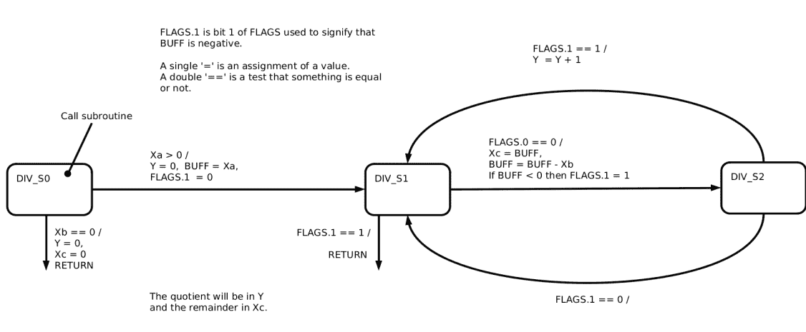

## 6.7 • 二进制除法

对于二进制除法，我将使用相似的重复减法技术。这将是整数除法，结果为实值下方的整数。例如，将 35 除以 4 在实数集中的结果是 8.75，而整数除法的结果将是 8。以这个例子来计算 35 除以 4：

```text
35 – 4 – 4 – 4 – 4 – 4 – 4 – 4 = 3
```

这表明 4 可以除 32 次 8 次余 3。对于除法，我们需要做的就是不断减去除数，并计算它可以被减掉的次数。

程序 6-5 两个十六位整数相乘

图 6-8 使用串口读取器

再次，状态机仅用于将一个 16 位无符号整数除以另一个整数的子程序。`Xa` 是分子或被除数，`Xb` 是分母或除数，`Y` 是商。`Xa` 由 `Xa1` 和 `Xa0` 组成，而 `Xb` 由 `Xb1` 和 `Xb0` 组成。`Y` 由 `Y1` 和 `Y0` 组成。商只需要一个 16 位整数。除后的余数将位于 `Xc` 中。

为了在程序再次需要时保留 `Xa` 的值，将其传输到由 `BUFFH` 和 `BUFFL` 组成的 `BUFF` 中。然后在每个循环中从 `BUFF` 中减去 `Xb`。

状态 0 将 `Xa` 传输到 `BUFF` 并将 `Y` 和 `Xc` 重置为零。重置 `Y` 和 `Xc` 看起来不像 Mealy 机器，因为它在跳转开始之前就已经完成了，但这样做是为了缩短代码。从状态 0 的跳转取决于 `Xb` 是否为 0。如果是，则子程序返回，因为除以 `Xb` 将导致减法循环无限运行，即除以零！

如果 `Xb` 大于 0，则跳转到状态 1。在状态 1 中，从 `BUFF` 中减去 `Xb`，并将结果放在 `BUFF` 中，直到 `BUFF` 小于零。如果结果小于 0，子程序返回。如果不是，则 `Y` 加 1 并重复循环。这导致 `Y` 持有整数除法的商，`Xc` 保存余数。

余数是最后一次减法之前 `BUFF` 的值。它存储在 `Xc` 中。图 6-9 显示了状态图。程序 6-6 是该程序。此列表显示了 65535 除以 5997 得到商 11，余数 8。图 6-10 显示了使用串口读取器通过选项 `-h` 读取短整数（16 位整数）的输出。

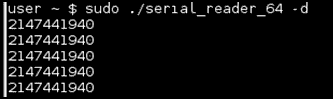

图 6-9 除法子程序状态图

```asm
;PROG_06_06.asm

LIST P=16F1823

#INCLUDE <p16f1823.inc>

#INCLUDE <fsm_macros.inc>

RADIX DEC ; 默认数字为十进制基数。

CONFIGURATION ; 参见 fsm_macros.inc 中的宏。

CBLOCK 0x70

TICKS ; 用于计算 8.2ms 的滴答。

Y0 ; 商的低字节。

Y1 ; 商的高位字节。

FLAGS ; 位 1 将用于表示结束。

CBLOCK 0x20

Xa0 ; 被除数的低字节。

Xa1 ; 被除数高字节。

Xb0 ; 除数的低字节。

Xb1 ; 除数高字节。

Xc0 ; 余数的低字节。

Xc1 ; 余数高字节。

BUFFL

BUFFH

ENDC

ORG 0x00

LIST P=16F1823

#INCLUDE <p16f1823.inc>

#INCLUDE <fsm_macros.inc>

RADIX DEC ; 默认数字为十进制基数。

CONFIGURATION ; 参见 fsm_macros.inc 中的宏。

CBLOCK 0x70

TICKS ; 用于计算 8.2ms 的滴答。

Y0 ; 商的低字节。

Y1 ; 商的高位字节。

FLAGS ; 位 1 将用于表示结束。

CBLOCK 0x20

Xa0 ; 被除数的低字节。

Xa1 ; 被除数高字节。

Xb0 ; 除数的低字节。

Xb1 ; 除数高字节。

Xc0 ; 余数的低字节。

Xc1 ; 余数高字节。

BUFFL

BUFFH

ENDC

ORG 0x00

LIST P=16F1823

#INCLUDE <p16f1823.inc>

#INCLUDE <fsm_macros.inc>

RADIX DEC ; 默认数字为十进制基数。

CONFIGURATION ; 参见 fsm_macros.inc 中的宏。

CBLOCK 0x70

TICKS ; 用于计算 8.2ms 的滴答。

Y0 ; 商的低字节。

Y1 ; 商的高位字节。

FLAGS ; 位 1 将用于表示结束。

CBLOCK 0x20

Xa0 ; 被除数的低字节。

Xa1 ; 被除数高字节。

Xb0 ; 除数的低字节。

Xb1 ; 除数高字节。

Xc0 ; 余数的低字节。

Xc1 ; 余数高字节。

BUFFL

BUFFH

ENDC

ORG 0x00

LIST P=16F1823

#INCLUDE <p16f1823.inc>

#INCLUDE <fsm_macros.inc>

RADIX DEC ; 默认数字为十进制基数。

CONFIGURATION ; 参见 fsm_macros.inc 中的宏。

CBLOCK 0x70

TICKS ; 用于计算 8.2ms 的滴答。

Y0 ; 商的高位字节。

Y1 ; 商的高位字节。

FLAGS ; 位 1 将用于表示结束。

CBLOCK 0x20

Xa0 ; 被除数的低字节。

Xa1 ; 被除数高字节。

Xb0 ; 除数的低字节。

Xb1 ; 除数高字节。

Xc0 ; 余数的低字节。

Xc1 ; 余数高字节。

BUFFL

BUFFH

ENDC

ORG 0x00

LIST P=16F1823

#INCLUDE <p16f1823.inc>

#INCLUDE <fsm_macros.inc>

RADIX DEC ; 默认数字为十进制基数。

CONFIGURATION ; 参见 fsm_macros.inc 中的宏。

CBLOCK 0x70

TICKS ; 用于计算 8.2ms 的滴答。

Y0 ; 商的低字节。

Y1 ; 商的高位字节。

FLAGS ; 位 1 将用于表示结束。

CBLOCK 0x20

Xa0 ; 被除数的低字节。

Xa1 ; 被除数高字节。

Xb0 ; 除数的低字节。

Xb1 ; 除数高字节。

Xc0 ; 余数的低字节。

Xc1 ; 余数高字节。

BUFFL

BUFFH

ENDC

ORG 0x00

LIST P=16F1823

#INCLUDE <p16f1823.inc>

#INCLUDE <fsm_macros.inc>
```

对歉，出现了重复。以下是为您正确翻译的文本：

```asm
GOTO $+4 ; 因为 BUFFH 不为 0。

MOVF BUFFL, F ; 因为 BUFFH 为 0。

BTFSC STATUS, Z ; 检查 BUFFL。

RETURN ; 因为 BUFFH 和 BUFFL 均为 0。

ADD_REGISTERS_16 Y1, Y0, Xb1, Xb0, Y3, Y2, Y1, Y0

MOVLW 1

SUBWF BUFFL, F

CLRW

SUBWFB BUFFH, F

GOTO MULT_S1 

TX_THIRTY_TWO_BIT_NUMBER ; 这里有 4 个字节，因为串口读取器程序读取 1、

; 2 或 4 字节，而我们需要 3 个。

BANKSEL TXREG

MOVF Y3, W ; 将最高位字节放入 W 中。

MOVWF TXREG ; 使用 EUSART 发送 W。

BTFSS TXSTA, TRMT

GOTO $-1

MOVF Y2, W ; 将高位中间字节放入 W 中。

MOVWF TXREG ; 使用 EUSART 发送 W。

BTFSS TXSTA, TRMT

GOTO $-1

MOVF Y1, W ; 将低位中间字节放入 W 中。

MOVWF TXREG ; 使用 EUSART 发送 W。

BTFSS TXSTA, TRMT

GOTO $-1

MOVF Y0, W ; 将最低位字节放入 W 中。

MOVWF TXREG ; 使用 EUSART 发送 W。

BTFSS TXSTA, TRMT

GOTO $-1

RETURN

END
```


## 6.7 • 二进制除法

对于二进制除法，我将使用相似的重复减法技术。这将是整数除法，结果为实值下方的整数。例如，将 35 除以 4 在实数集中的结果是 8.75，而整数除法的结果将是 8。以这个例子来计算 35 除以 4：

`35 – 4 – 4 – 4 – 4 – 4 – 4 – 4 = 3`

这表明 4 可以除 32 次 8 次余 3。对于除法，我们需要做的就是不断减去除数，并计算它可以被减掉的次数。

程序 6-5 两个十六位整数相乘

图 6-8 使用串口读取器

再次，状态机仅用于将一个 16 位无符号整数除以另一个整数的子程序。`Xa` 是分子或被除数，`Xb` 是分母或除数，`Y` 是商。`Xa` 由 `Xa1` 和 `Xa0` 组成，而 `Xb` 由 `Xb1` 和 `Xb0` 组成。`Y` 由 `Y1` 和 `Y0` 组成。商只需要一个 16 位整数。除后的余数将位于 `Xc` 中。

为了在程序再次需要时保留 `Xa` 的值，将其传输到由 `BUFFH` 和 `BUFFL` 组成的 `BUFF` 中。然后在每个循环中从 `BUFF` 中减去 `Xb`。

状态 0 将 `Xa` 传输到 `BUFF` 并将 `Y` 和 `Xc` 重置为零。重置 `Y` 和 `Xc` 看起来不像 Mealy 机器，因为它在跳转开始之前就已经完成了，但这样做是为了缩短代码。从状态 0 的跳转取决于 `Xb` 是否为 0。如果是，则子程序返回，因为除以 `Xb` 将导致减法循环无限运行，即除以零！

如果 `Xb` 大于 0，则跳转到状态 1。在状态 1 中，从 `BUFF` 中减去 `Xb`，并将结果放在 `BUFF` 中，直到 `BUFF` 小于零。如果结果小于 0，子程序返回。如果不是，则 `Y` 加 1 并重复循环。这导致 `Y` 持有整数除法的商，`Xc` 保存余数。

余数是最后一次减法之前 `BUFF` 的值。它存储在 `Xc` 中。图 6-9 显示了状态图。程序 6-6 是该程序。此列表显示了 65535 除以 5997 得到商 11，余数 8。图 6-10 显示了使用串口读取器通过选项 `-h` 读取短整数（16 位整数）的输出。


图 6-9 除法子程序状态图

```asm
;PROG_06_06.asm

LIST P=16F1823

#INCLUDE <p16f1823.inc>

#INCLUDE <fsm_macros.inc>

RADIX DEC ; 默认数字为十进制基数。

CONFIGURATION ; 参见 fsm_macros.inc 中的宏。

CBLOCK 0x70

TICKS ; 用于计算 8.2ms 的滴答。

Y0 ; 商的低字节。

Y1 ; 商的高位字节。

FLAGS ; 位 1 将用于表示结束。

CBLOCK 0x20

Xa0 ; 被除数的低字节。

Xa1 ; 被除数高字节。

Xb0 ; 除数的低字节。

Xb1 ; 除数高字节。

Xc0 ; 余数的低字节。

Xc1 ; 余数高字节。

BUFFL

BUFFH

ENDC

CALL TX_THIRTY_TWO_BIT_NUMBER ; 调用子程序。传输余数。

GOTO LOOP

; 子程序。

DIV_24_BY_16_BIT ; Y = Xa/Xb,

DIV_S0

CLRF Y0 ; 将 Y 置为零。

CLRF Y1

CLRF Xc1 ; 将 Xc1 置为零。

CLRF Xc0

MOVF Xb1, F

BTFSS STATUS, Z 

GOTO $+4 ; 因为 Xb1 不为 0，跳转。

MOVF Xb0, F ; 因为 Xb1 为 0。

BTFSC STATUS, Z

RETURN ; 因为 Xb0 为 0。且 Xb1 也为 0。

MOVF Xa2, W

MOVWF BUFFH ; 将 Xa 的高位加载到 BUFFH。

MOVF Xa1, W

MOVWF BUFFM ; 将 Xa 的中位加载到 BUFFM。

MOVF Xa0, W

MOVWF BUFFL ; 将 Xa 的低位加载到 BUFFL。

BCF FLAGS, 1 ; 确保除法结束位。

DIV_S1

BTFSC FLAGS, 1

RETURN ; 因为除法已结束。

MOVF BUFFH, W

MOVWF Xc2 ; Xc 将包含余数。

MOVF BUFFM, W

MOVWF Xc1 ; Xc 将包含余数。

MOVF BUFFL, W

MOVWF Xc0 ; Xc 将包含余数。
```


```asm
MOVF Xb0, W
SUBWF BUFFL, F ; 从 BUFFL 中减去 Xb0。

MOVF Xb1, W
SUBWF BUFFM, F ; 从 BUFFM 中减去 Xb1。

CLRW
SUBW BUFFH, F ; 如果有借位则减去借位。

BTFSS STATUS, C
DIV_S2

GOTO DIV_S1 ; 因为 BUFF 现在小于 Xb，这是最后一次循环，X 包含余数。

INCF Y0, F ; 计数 BUFF 减去 Xb 且得到正结果的次数。

BTFSC STATUS, Z ; 如果 Y0 溢出回到 0，则 Y1 必须进位。
INCF Y1, F
GOTO DIV_S1

TX_THIRTY_TWO_BIT_NUMBER ; 有 4 个字节，因为串口读取器读取 1 或 4 字节，而我们需要 3 字节。

BANKSEL TXREG
MOVF Y3, W ; 将最高位字节放入 W。
MOVWF TXREG ; 使用 EUSART 传输 W。

BTFSS TXSTA, TR
GOTO $-1

MOVF Y2, W ; 将高中间字节放入 W。
MOVWF TXREG ; 使用 EUSART 传输 W。

BTFSS TXSTA, TR
GOTO $-1

MOVF Y1, W ; 将低中间字节放入 W。
MOVWF TXREG ; 使用 EUSART 传输 W。

BTFSS TXSTA, TR
GOTO $-1

MOVF Y0, W ; 将最低位字节放入 W。
MOVWF TXREG ; 使用 EUSART 传输 W。

BTFSS TXSTA, TR
GOTO $-1

RETURN
END
```

## 程序 6-7：24 位数字除以 16 位数字

该程序将 16,777,215 除以 5,957。得到商 2816，余数为 2303。图 6-11 显示了程序的输出，首先输出商，然后以 32 位整数的形式输出余数，因此使用了 `-d` 选项。

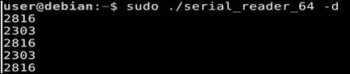

图 6-11 使用串口读取器

# 第 7 章 数字电压表项目

## 7.1 引言

第 5 章是构建项目硬件部分的指南。使用程序 5-1 测试了电路。本章将开发一个程序，使该电路作为数字电压表。这是到目前为止最复杂的程序。它涉及显示数字的顺序控制、模拟测量、用于节省电池寿命的睡眠模式以及第 6 章处理的二进制算术。

电压通过单位显示器进行读取，通过轮流闪烁四个数字来显示四位有效数字。每个数字出现 1/2 秒，数字之间留 1/4 秒的空白，下次读取前留有 1 秒的空白。这意味着 7.25 伏的读取值将显示为“0”、“7”、“2”、“5”，然后在下次读取之前延迟一秒。

程序中有三个状态机：

- 序列处理器
- 七段显示驱动器
- 电压读取和数字值处理器

该项目引入了睡眠模式，当探头没有检测到电压时，允许 PIC 节省电量。

## 7.2 状态图

三个机器分别在图 7-1 和图 7-2 中所示。这三个机器是独立的，但共享处理器和内存空间。由于这是一个更复杂的程序，我将总结一下几个机器是如何协同运行的。每个机器都由若干状态组成。机器将保持在当前状态，直到某个条件为真导致其切换到另一个状态。该条件可以是某种输入，例如引脚上的实际输入，或者值与常数的比较，或者是这些值的逻辑组合。

该项目引入了睡眠模式，当探头没有检测到电压时，允许 PIC 节省电量。

```asm
CLRF FLAGS ; 将 FLAGS 初始化为 false。
CLRF LAPS
MOVLB 0

CLRF F10V ; 初始化为 0。
CLRF F1V ; 初始化为 0。
CLRF F100mV ; 初始化为 0。
CLRF F10mV ; 初始化为 0。

SWITCH_M0
MOVLB 0
MOVF STATE_M0, W ; 将 STATE_M0 移入工作寄存器。
BRW ; 程序根据移入工作寄存器的值跳转。

GOTO M0_S0
GOTO M0_S1
GOTO M0_S2
GOTO M0_S3
GOTO M0_S4
GOTO M0_S5
GOTO M0_S6
GOTO M0_S7
GOTO M0_S8
GOTO M0_S9

SWITCH_M1
MOVLB 2 ; 七段显示驱动程序需要存储器 2。
MOVF STATE_M1, W ; 将 STATE_1 移入工作寄存器。
BRW ; 程序根据移入工作寄存器的值跳转。

GOTO M1_S0
GOTO M1_S1

SWITCH_M2
MOVF STATE_M2, W ; 将 STATE_2 移入工作寄存器。
BRW ; 程序根据移入工作寄存器的值跳转。

GOTO M2_S0
GOTO M2_S1

M0_S0
MOVLB 0
MOVLW 61
IF_REG_LESS_THAN_W TICKS ; 等待 10 mV 显示结束。
GOTO SWITCH_M2

MOVLW 10 ; 设置空屏。
MOVWF VALUE
BSF FLAGS, 0 ; 更新显示位。
BSF FLAGS, 3 ; 触发机器 2 的读取。

CLRF TICKS ; 重置 TICKS 以准备下一个状态。
INCF STATE_M0, F ; 状态加加。
GOTO SWITCH_M2

M0_S1
MOVLB 0
MOVLW 122
IF_REG_LESS_THAN_W TICKS ; 完成读取后延迟 0.5 s。
GOTO SWITCH_M2

BTFSS FLAGS, 2 ; 测试是否有非零读取值。
GOTO $+5 ; 此处读取值低于 111 mV。

MOVLW 3 ; 此处读取值高于 111 mV。
CLRF LAPS ; 因为有电压可读，清空圈数计数器。
MOVWF STATE_M0
GOTO SWITCH_M2

; 此块在探针电压低于 111 mV 时执行。
MOVLW 2
MOVWF STATE_M0 ; 无非零读取值，跳转到状态 2。
GOTO SWITCH_M2

M0_S2
MOVLW 3
IF_REG_GREATER_THAN_OR_EQUAL_TO_W LAPS
GOTO $+11 ; 如果 LAPS == 3 则。

INCF LAPS, F ; 如果 LAPS < 3 则。
CLRF F10V
CLRF F1V
CLRF F100mV
CLRF F10mV
CLRF VALUE
BSF FLAGS, 0

MOVLW 3
MOVWF STATE_M0
GOTO SWITCH_M2

; 此块在 LAPS == 3 时执行。
CLRF LAPS
BANKSEL FVRCON
BCF FVRCON, FVREN ; 禁用固定电压参考。

BANKSEL IOCAP
BSF IOCAP, 5 ; 开启 RA5 上升沿变化中断。
SLEEP
BCF IOCAP, 5 ; 禁用 RA5 上升沿变化中断。

BANKSEL FVRCON
BCF FVRCON, FVREN ; 开启固定电压参考。
CLRF STATE_M0
GOTO SWITCH_M2

M0_S3
MOVLB 0
MOVF F10V, W
MOVWF VALUE ; 设置 F10V。
BSF FLAGS, 0
CLRF TICKS
INCF STATE_M0, F
GOTO SWITCH_M2

M0_S4
MOVLB 0
MOVLW 61
IF_REG_LESS_THAN_W TICKS ; 等待 F10V 显示结束。
GOTO SWITCH_M2

MOVLW 10 ; 设置空屏。
MOVWF VALUE
BSF FLAGS, 0
CLRF TICKS
INCF STATE_M0, F
GOTO SWITCH_M2

M0_S5
MOVLB 0
MOVLW 31
IF_REG_LESS_THAN_W TICKS ; 等待空屏显示结束。
GOTO SWITCH_M2

MOVF F1V, W ; 设置 F1V。
MOVWF VALUE
BSF FLAGS, 0
CLRF TICKS
INCF STATE_M0, F
GOTO SWITCH_M2

M0_S6
MOVLB 0
MOVLW 61
IF_REG_LESS_THAN_W TICKS ; 等待 F1V 显示结束。
GOTO SWITCH_M2

MOVLW 10 ; 设置空屏。
MOVWF VALUE
BSF FLAGS, 0
CLRF TICKS
INCF STATE_M0, F
GOTO SWITCH_M2

M0_S7
MOVLB 0
MOVLW 31
IF_REG_LESS_THAN_W TICKS ; 等待空屏显示结束。
GOTO SWITCH_M2

; 设置 F100mV。
MOVF F100mV, W
MOVWF VALUE
BSF FLAGS, 0
CLRF TICKS
INCF STATE_M0, F
GOTO SWITCH_M2

M0_S8
MOVLB 0
MOVLW 61
IF_REG_LESS_THAN_W TICKS ; 等待 F100mV 显示结束。
GOTO SWITCH_M2

MOVLW 10 ; 设置空屏。
MOVWF VALUE
BSF FLAGS, 0
CLRF TICKS
INCF STATE_M0, F
GOTO SWITCH_M2

M0_S9
MOVLB 0
MOVLW 31
IF_REG_LESS_THAN_W TICKS ; 等待空屏结束。
GOTO SWITCH_M2

MOVF F10mV, W ; 设置 F10mV。
MOVWF VALUE
BSF FLAGS, 0
CLRF TICKS
CLRF STATE_M0
GOTO SWITCH_M2

SEVEN_SEG_DRIVE_MACHINE
VALUE, M1_S0, M1_S1

M2_S0
BTFSS FLAGS, 3 ; 未测量则跳转到 M2_S0。
INCF STATE_M2, F ; 此处已调用测量。
GOTO SWITCH_M1 ; 已测量则跳转到。

M2_S1
BCF FLAGS, 3 ; 由 M0_S1 重置读取可用标志位。
MOVLB 1 ; 切换到存储器 1 以处理 ADCON、ADRESH。

BSF ADCON, 1 ; 开始转换。
BTFSC ADCON, 1 ; 循环此行直到转换完成。
GOTO $-1

BCF FLAGS, 2 ; 设置读取可用标志为 false。
MOVF ADRESH, F
BTFSS STATUS, Z
GOTO M2_S1 ; 此处 ADRESH 不为 0。

MOVLW 5
IF_REG_GREATER_THAN_OR_EQUAL_TO_W ADRESH ; 测试探针电压是否大于 111 mV。
GOTO M2_S1 ; 电压大于 111 mV。

CLRF STATE_M2 ; 电压小于 111 mV。
GOTO SWITCH_M1

M2_S1 ; 此状态下的标签 0。
BSF FLAGS, 2 ; 因为电压大于 111 mV 跳到此处。

设置读取可用为 true。

MOVLB 1
MOVF ADRESH, W
MOVWF Xa1 ; 将 ADRESH 移入 Xa1。

MOVF ADRESH, W
MOVWF Xa0 ; 将 ADRESH 移入 Xa0。

MOVLB 0
MOVLW HIGH 1091 ; 缩放因子高字节。
MOVWF Xb1

MOVLW LOW 1091 ; 缩放因子低字节。
MOVWF Xb0

缩放通过先乘以 1091，然后除以 500 完成。

CALL MULT_TWO_BIT_NUMBERS

MOVF Y0, W
MOVWF Xa0 ; 乘法结果从 Y 传输到 Xa。
MOVF Y1, W
MOVWF Xa1
MOVF Y2, W
MOVWF Xa2

CLRF Xb2 ; 清空 Xb2 和 Xb1，将 500 移入 Xb0 进行除法。
MOVLW HIGH 500
MOVWF Xb1

MOVLW LOW 500
MOVWF Xb0

DIV_24_BY_16_BIT ; 通过除以 500 完成缩放。

MOVLB 0
MOVF Y1, W
MOVWF RESBUFFH ; 缩放后的电压读取现在移入 RESBUFF。缩放得到单位为 mV 的电压值。

MOVF Y0, W
MOVWF RESBUFFL

MOVLB 0
MOVLW HIGH 10000
MOVWF Xb1

MOVLW LOW 10000
MOVWF Xb0

CALL EXTRACT_SIGFS ; 提取有效数字使用 10000 作为分母提取十位电压。

MOVF FIG, W
MOVWF F10V ; 加载十位电压 F10V。

MOVLW HIGH 1000
MOVWF Xb1

MOVLW LOW 1000
MOVWF Xb0

CALL EXTRACT_SIGFS ; 提取有效数字使用 1000 作为分母提取个位电压。

MOVF FIG, W
MOVWF F1V ; 加载个位电压 F1V。

CLRF Xb1
MOVLW 100
MOVWF Xb0

CALL EXTRACT_SIGFS ; 提取有效数字使用 100 作为分母提取百位毫伏。

MOVF FIG, W
MOVWF F100mV ; 加载百位毫伏 F100mV。

CLRF Xb1
MOVLW 10
MOVWF Xb0

CALL EXTRACT_SIGFS ; 提取有效数字使用 10 作为分母提取十位毫伏。

MOVF FIG, W
MOVWF F10mV ; 加载十位毫伏 F10mV。

CLRF STATE_M2
GOTO SWITCH_M1

; 第 6 章图 6-7 中的状态图。

DIV_24_BY_16_BIT ; Y = Xa/Xb。

DIV_S0
CLRF Y0 ; 将 Y 置零。
CLRF Y1
CLRF Xc1 ; 将 Xc 置零。
CLRF Xc0

MOVF Xb1, F
BTFSS STATUS, Z
GOTO $+4 ; 因为 Xb1 不为 0。

MOVF Xb0, F ; 因为 Xb1 为 0。
BTFSC STATUS, Z
RETURN ; 因为 Xb0 为 0，且 Xb1 也为 0。

MOVF Xa2, W
MOVWF BUFFH ; 将 Xa 高字节移入 BUFFH。
MOVF Xa1, W
MOVWF BUFFM ; 将 Xa 高字节移入 BUFFM。
MOVF Xa0, W
MOVWF BUFFL ; 将 Xa 高字节移入 BUFFL。

BCF FLAGS, 1 ; 确保除结束标志置位。

DIV_S1
BTFSC FLAGS, 1
RETURN ; 因为除结束标志已设置。

MOVF BUFFH, W
MOVWF Xc2 ; Xc 将包含余数。
MOVF BUFFM, W
MOVWF Xc1 ; Xc 将包含余数。
MOVF BUFFL, W
MOVWF Xc0 ; Xc 将包含余数。

MOVF Xb0, W
SUBWF BUFFL, F ; 从 BUFFL 中减去 Xb0。

MOVF Xb1, W
SUBWFB BUFFM, F ; 从 BUFFM 中减去 Xb1。

CLRW
SUBWFB BUFFH, F ; 如果有借位则减去。

BTFSS STATUS, C
BSF FLAGS, 1 ; 因为 C == 0 所以为负。

DIV_S2
BTFSC FLAGS, 1
GOTO DIV_S1 ; 因为 BUFF 现在小于 Xb，这是最后一次循环，且 Xc 余数。

INCF Y0, F ; 统计从 BUFF 中减去 Xb 且结果为正的次数。

BTFSC STATUS, Z ; 如果 Y0 溢出到 0，则 Y1 必须进位加 1。
INCF Y1, F
GOTO DIV_S1

MULT_TWO_SIXTEEN_BIT_NUMBERS ; Y = Xa*Xb，注意每个变量都有高字节和低字节。

MULT_S0
CLRF Y3 ; 将输出清零。这里是因为 Xb0 不为零。
CLRF Y2 ; 将输出清零。
CLRF Y1 ; 将输出清零。
CLRF Y0 ; 将输出清零。

MOVF Xb1, F ; 通过将文件移动到自身，STATUS 寄存器中的 Z 标志会受到影响。
BTFSS STATUS, Z ; 测试 Xb1。
GOTO $+4 ; 这里是因为 Xb1 不为零。

MOVF Xb0, F ; 这里是因为 Xb1 为零。
BTFSC STATUS, Z ; 测试 Xa0。
RETURN ; 这里是因为 Xb1 和 Xa0 均为零。

MOVF Xa1, W
MOVWF BUFFH ; 将 Xa1 移动到 BUFFH。
MOVF Xa0, W
MOVWF BUFFL ; 将 Xa0 移动到 BUFFL。

MULT_S1
MOVF BUFFH, F ; 通过将文件移动到自身，STATUS 寄存器中的 Z 标志会受到影响。
BTFSS STATUS, Z ; 测试 BUFFH。
GOTO $+4 ; 这里是因为 BUFFH 不为零。

MOVF BUFFL, F ; 这里是因为 BUFFH 为零。
BTFSC STATUS, Z ; 测试 BUFFL。
RETURN ; 这里是因为 BUFFH 和 BUFFL 均为零。

ADD_REGISTERS_16 Y1, Y0, Xb1, Xb0, Y3, Y2, Y1, Y0

MOVLW 1
SUBWF BUFFL, F
CLRW
SUBWFB BUFFH, F
GOTO MULT_S1

EXTRACT_SIG_FIGS ; 调用子程序时除数在 Xb1:Xb0 中。

MOVLB 0
CLRF Xa2

MOVF RESBUFFH, W
MOVWF Xa1
MOVF RESBUFFL, W
MOVWF Xa0

CALL DIV_24_BY_16_BIT

MOVF Y0, W
MOVWF FIG ; 提取的有效数字。FIG = RESBUFF/Xb。

MOVF Xc1, W ; 除法 RESBUFF/Xb 的余数。
MOVWF RESBUFFH

MOVF Xc0, W ; 除法 RESBUFF/Xb 的余数。


```asm
MOVWF RESBUFFL
RETURN
END
```

## 7.3 • 原始模拟值的缩放

机器`M3`处理模拟量数字转换。它将原始值放入`ADRESH:ADRESL`中，十位结果右对齐，使得八个最低位位于`ADRESL`中，而两个最高位位于`ADRESH`中。这在`ADCON1`中配置。

**程序 7-1 电压表程序**

| ADCON1 | 描述 |
| :--- | :--- |
| E 7 1 | `ADRESH:ADRESL`右对齐。八个最低位在`ADRESL`中 |
| 6 1 | 将 ADC 时钟周期设置为 2 μS，对应 32 Mhz 时钟速度。参见数据表表 16-1 |
| 5 1 4 0 3 0 | 未实现 |
| 2 0 | 未实现 |
| 1 1 | `V REF+`连接到内部固定电压参考（`FVR`）模块 |
| 0 1 | |

参考电压为 4.096 V 或 4096 mV。这等于 1024 次 A-D 转换。因此，最低位的变化代表 4096/1024 或 4 mV。

从图 5-2 可以，输入电压通过输入电位分器按 22/122 的系数缩小。最低位的变化意味着变化了 4x122/22 mV，在电压表探头处等于 22.1818 mV。为了以毫伏读取，我们必须将`ADRESH:ADRESL`中的结果乘以 22.1818。然而，我们不能进行浮点运算，只能进行整数运算。因此，我们需要找到两个比例为 22.1818:1 的整数。

现在，22.1818/1 等于 221818/10000。我们需要先乘以 221818 然后除以 10000。然而，在计算 221818 x 1023（这是可能的最高结果）时需要非常小心。它将产生 226919814（28 位）。对于我们的 24 位除数来说太大了。通过先将分子和分母同时除以 20 得到 11090.9/500，舍入后为 11091/500，得到的比例为 22.182。最大乘积将是 1023 x 11091，等于 11,346,093（24 位）。

在用整数缩放时还有一点需要注意：即必须先乘后除，否则会产生精度损失。例如，如果我想将 60 乘以 1.125，可以通过乘以 9 然后除以 8 来完成：

- `60 x 1.125 = 67.5` 正确答案。
- 使用整数运算
- 先乘：
  - `60 x 9 = 540`
  - `540/8 = 67` 丢失了 0.5。
- 先除：
  - `60/8 = 7` 丢失了 0.5。
  - `7 * 9 = 63` 错误。

**表 7-1 ADCON1**

运算细节见程序。探头处测量的电压缩放为毫伏后移动到`RESBUFF`。结果缓冲区由两个文件组成：`RESBUFFH:RESBUFFL`。提取伏、伏、毫伏的各个数字。

## 7.4 • 提取显示数字

每个数字都通过调用`EXTRACT_FIG`子程序获得。该程序被调用四次：每次一个数字。假设电压为 12345 mV 或 12.345 V。我们希望显示首先显示 1，然后是 2，最后是 4。由于我们只解析到毫伏，5 将被丢弃。值 12345 保存在`RESBUFF`中，每当调用`EXTRACT_FIG`程序时，它会将`RESBUFF`除以除数 Xb。整数除法的结果放在`FIG`中供下次使用。

所以从除以 10000 开始，`RESBUFF(12345)/10000`得到结果 1，余数 2345 进入`FIG`。1 是十伏，放在`F10V`中。

下次调用，`RESBUFF(2345)/100`得到结果 2，余数 345 进入`FIG`。2 是伏，放在`F1V`中。

下次调用，`RESBUFF(345)/100`得到结果 3，余数 45 进入`FIG`。3 是百毫伏，放在`F100mv`中。

最后，在最后一次调用中，`RESBUFF(45)/10`得到结果 4，余数 5 进入`FIG`。4 是十毫伏，放在`F10mv`中。

## 7.5 • 检测电压

无电压或小于 1 mV 检测是通过比较`ADRESH:ADRESL`中的值实现的。这两个寄存器持有 10 位结果，右对齐，因此八个最低位在`ADRESL`中，两个最高位在`ADRESH`中。首先检查`ADRESH`是否为零。然后检查`ADRESL`是否小于 5。值 5 表示 PIC 引脚处的 0 mV，或探头处的 1 mV。

## 7.6 • 重新校准

可以使用不同的分压器并重新计算缩放来调整电压范围。注意你正在处理的电压。如果你熟悉电学知识，甚至可以通过连接采样电阻将其转换为电流表。

# 第 8 章 故障排除与规划

## 8.1 • 引言

如果你一直在尝试程序或尝试从零开始编写，你可能会遇到奇怪的 Bug 或完全无法运行的程序。汇语言程序可能是不友好的。汇编器会警告你语法错误或跳转到未识别的标签。它不会帮助解决代码的功能问题。本章将尝试在代码无法工作时帮助你调试，或者更好，防止你犯错。如果在编码时出错，请不要气馁。我很少有代码是第一次就能运行的。产生可靠代码的一种方法是保持它。本章涵盖了修复 Bug 和避免 Bug 的程序规划。本章中的大多数建议适用于通用编程。如果你使用 C、Python、Java 或编写工业编程逻辑控制器（PLC），情况也是一样。

## 8.2 • 项目概述

你需要对项目将做什么有一个清晰的想法。仅仅让它增长可能会导致你必须重新开始。如果你查看图 7-1 和图 7-2（电压表的状态图），你就得到了整个程序的表示。三个独立的状态机并发运行，每个状态负责一个有限范围的活动。你可以看到程序在做什么，而无需陷入局部。

### 8.2.1 • 状态图和流程图

你可能见过流程图：它们出现在各种地方，墙贴图、说明书，甚至是漫画。它们通常易于理解，因为可以被看作通过动作和决策的路径。看着状态图，你可能会认为它们是一样的，但它们是不同的。

例如，想象一个建筑的中央供暖系统，其中有一个锅炉和一个循环泵。为了控制系统，有一个主开关和一个温度器。当主开关打开时，系统启用；当关闭时，系统禁用。如果系统启用，当温度低于温度器上设置的设定点时，锅炉和泵将运行。当温度达到设定点时，它们将停止。图 8-1 对比了状态图和流程图来描述该系统。情况下，有限状态机（FSM）显示为摩尔机，其输出仅取决于状态。在图中，输出显示在状态内部。

状态图（statechart）胜出。使用状态机，可以更容易分离具有特定目的的代码。这引出了下一段的主题。

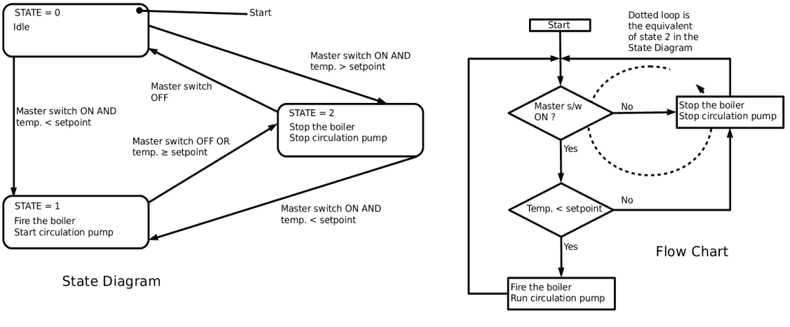

## 8.3 • 将大问题分解为较小问题

如果你的项目涉及多项任务，请将其拆分为不同的部分。在电压计项目中，程序必须使用模数转换器读取输入电压，然后判断电压是否高于 111 mV。如果是，则必须对此转换的原始结果进行缩放，以用毫伏表示。必须提取组成输出的各个数字，直到实现项目的所有功能。这些操作中的每一步都应该被视为一个独立的问题。

这就是状态机方法可以发挥作用的地方，因为你可以拥有只执行一项任务的状态，或者执行少数几个任务的机器。子程序和宏也有助于可靠性。在编写出可以运行的代码后，它可以被重复使用并被依赖。在开发代码时，将其编写成小部分，以便它们可以进行独立测试。这种测试可以通过编写短小的微型项目来测试单个代码块来实现。

## 8.4 • 详细阅读你的代码并添加注释

花时间仔细阅读你的代码。仔细尝试视觉化正在发生的情况。首先，为每一行代码添加注释。这将迫使你思考每一个细节。你可能是唯一读过这些注释的人，但当你日后查看代码时，它们将非常有用。如果你出于任何原因更改了代码，请保持你的状态图与代码同步并更新你的注释。错误的注释会让人非常困惑！

## 8.5 • 调试运行中的程序

由于本书没有要求使用 Microchip 的 PICKIT 编程器/调试器，我们而是使用 FTDI 线缆和书中提供的程序。我们无法利用图 8-1 状态图和流程图进行“在线”调试。然而，我们可以利用 FTDI 线和`serial_reader`程序并将数据输出到计算机。这等同于在 Python、C 或其他语言中放置打印语句以辅助调试。

我们将做的是编写一个调试宏，它可以插入到任何地方，将变量值输出到计算机，以查看正在发生什么。

## 8.6 • 交通灯

这是一个用来练习上述要点的小项目。第一步是定义程序将做什么。我们的交通灯将由六个 LED 组成，代表两组红、黄绿灯。它们模仿了道路施工中用于控制单行交通流量的类型。

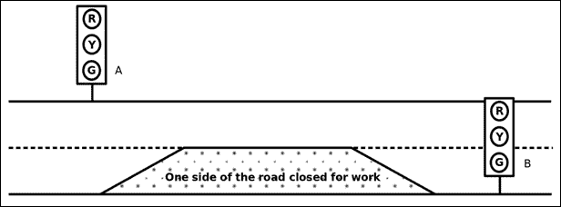

上电时，两组灯都将显示红灯并保持 10 秒。然后 A 组将变为红黄色持续 2 秒，然后变为绿色。在另外 20 秒后，A 组将变为黄色持续 5 秒，然后变为红色。两组灯都将保持红色 10 秒，然后 B 组经历相同的变化。此循环将一直重复直到断电。

此外，还有一个信号可以启用灯光序列。如果该信号变为低电平，序列将在下一个双红灯处停止。在启动序列之前，两组灯红亮的整个 10 秒期间，启用信号必须保持高电平。

根据文字描述，我们需要确定系统可能处于的不同状态。图 8-2 施工交通控制

| 状态 | A 组灯 | B 组灯 |
| :--- | :--- | :--- |
| 0 | 红 | 红 |
| 1 | 红黄 | 红 |
| 2 | 绿 | 红 |
| 3 | 黄 | 红 |
| 4 | 红 | 红 |
| 5 | 红 | 红黄 |
| 6 | 红 | 绿 |
| 7 | 红 | 黄 |

确定了所需的状态后，下一步是确定触发这些条件的允许转换和输入条件。这是一个非常简单的例子，状态一个接一个地循环。到目前为止，状态机一直遵循 Mealy 格式，输出取决于当前状态。输入和输出显示在图中转换箭头旁边。

Moore 机器的区别在于输出仅取决于当前状态。对于本项目，我将使用 Moore 形式。输出仅取决于当前状态，并显示在每个状态的框内。

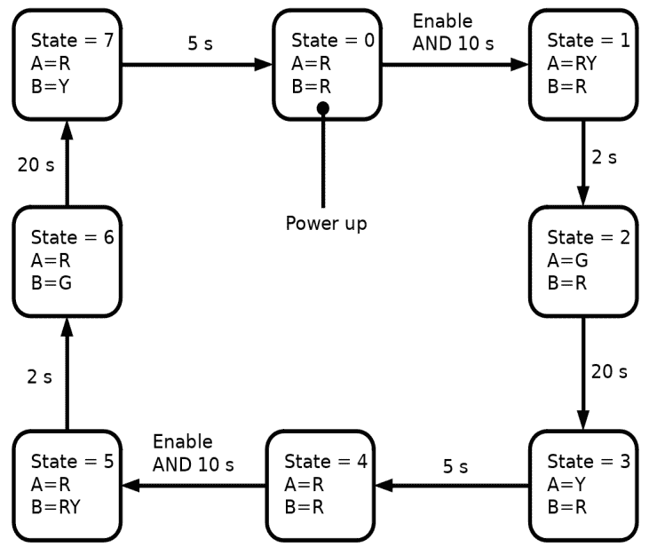

向状态状态转换由状态 0 和 4 决定。在启动序列之前，两组灯红亮的整个 10 秒期间，启用信号必须保持高电平。如果该信号变为低电平，序列将在下一个双红灯处停止。图 8-3 交通灯状态

### 8.6.1 • 电路图

在编写代码之前，你需要规划电路。FTDI 线和 LED 需要限流电阻。这些电阻的数值约为 1kΩ。

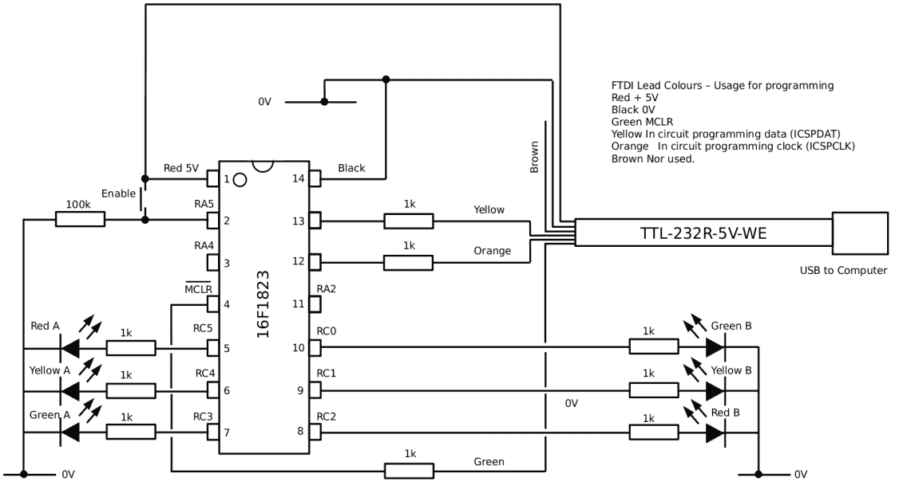

### 8.6.2 • 分离问题

程序需要计数到 20 秒。我们首先编写实现此目的的代码并对其进行测试。根据之前的程序，我们可以创建一个基于中断的计数器，基于`timer0`生成 8.2ms 的脉冲。122 个脉冲大约是 1 秒。程序 8-1 是计时器的测试程序。

### 8.6.3 • 生成代码

在生成上述状态机的代码之前，PIC 需要特定的配置，包括配置文件设置、振荡器频率和端口配置。最好的方法是分部分进行，边写边测试。这种测试将以添加调试代码的形式进行，证明你添加的每一部分都是正常的且可以依赖的。编写一个完整的程序然后尝试让它运行不是可行的方法。

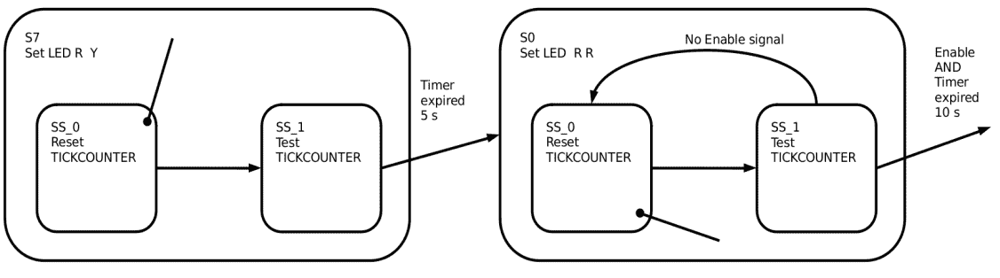

**图 8-5 子状态的使用**

```asm
;PROG_08_01.asm

LIST P=16F1823

#INCLUDE <p16f1823.inc>

#INCLUDE <fsm_macros.inc>

RADIX DEC ; 默认数字为10进制。

BOOK_CONFIGURATION ; 参见 fsm_macros.inc 中的宏。

CBLOCK 0x70

TICKS ; 用于计数 8.2ms 的滴答。

SECONDS ; 用于存储秒数。

ENDC

ORG 0X00

GOTO START

ORG 0X04 ; 中断向量。

BCF INTCON, TMR0IF ; 清除 tmr0 溢出中断标志。

DECF TICKS, F ; 将 8.2ms 的滴答减 1。

BTFSS STATUS, Z ; 测试 TICKS 是否达到零。

GOTO $+4 ; 如果 TICKS 未达到零，则跳转到中断返回。

INCF SECONDS, F ; 如果 TICKS 达到零，则增加秒数。

MOVLW 122

MOVWF TICKS ; 将 TICKS 恢复为 122 (122 x 8.2 ms =1秒)。

RETFIE ; 中断返回。

START

MOVLB 1 ; 后续宏需要 Bank 1。

SET_FREQ_32MHZ ; 参见文件 fsm_macros.inc。

SET_TMR0_CASE1 ; 产生 8.2 ms 的滴答。参见 fsm_macros.inc。

MOVLB 3 ; 后续宏需要 Bank 3。

SET_SERIAL_TX_16F1823 ; 配置串口通信，参见文件 fsm_macros.inc。

MOVLB 3 ; 将上一个宏留在 bank 2，后续宏需要 bank 3。

S0

BTFSS SECONDS, 0 ; 如果最低位为高电平，则跳过下一行。

GOTO S0 ; 如果最低位为低电平，保持在状态 0。

S1

DEBUG SECONDS ; 发送奇数秒

S2

BTFSC SECONDS, 0 ; 如果最低位为低电平，则跳过下一行。

GOTO S2 ; 如果最低位为高电平，保持在状态 0。

S3

DEBUG SECONDS ; 发送偶数秒

GOTO S0

END
```

在`START`标签处有三个宏：

- 用于设置频率；
- 用于设置`timer0`以产生 8.2 ms 的中断滴答；
- 最后，是一个用于设置串口通信的宏，它将与串口读取程序配合。

回到代码中中断向量处的几行，是中断服务程序。程序中只有一个有效中断：来自`timer0`。第一件事是重置`timer0`中断标志`TMROIF`。接下来，`TICKS`变量减 1，并测试`STATUS`寄存器中的零标志以检查`TICKS`是否已达到零。如果是，程序将跳过一行，`SECONDS`变量加 1 以计数另一秒。然后将值 122 重新载入`TICKS`，最后返回中断。

为了测试目前为止的程序，我们将通过串口线将`SECONDS`文件的值传输到计算机。

**程序 8-1 开发红绿灯的定时器**

### 调试 Debug 宏


由于我们还将进行其他测试，因此拥有一个可以放在程序中任何需要监控值地方的宏是有意义的。这里是该宏。它有一个参数：即要监控的寄存器或文件。在使用它之前必须选择 Bank 3。

```asm
DEBUG MACRO REG_TO_TX ; 需要 Bank 3。EUSART 必须配置为传输。

MOVF REG_TO_TX, W

MOVWF TXREG ; 通过加载 TXREG 开始传输

BTFSS TXSTA, TRMT ; 轮询 TXSTA 的 TRMT 位以查看移位寄存器是否

GOTO $-1 ; 空闲。参见数据手册第 271 页，第 26.1.1.14 段。

ENDM ; 留在 bank 3。
```

为了读取`SECONDS`文件，我们只需要将`DEBUG`宏放在循环中，它就会不断传输`SECONDS`中持有的值。遗憾的是，这可能会导致读取到错误的值。可以通过在传输之间引入 25 ms 的延迟来解决这个问题，但你每秒只能得到约30 个输出……比你需要的多了 29 个。

更优雅的解决方案是在`SECONDS`文件的最低位（LSB）每次上升沿和下降沿之后传输`SECONDS`值。一个简单的四状态机提供了一种检测边缘的方法。如图 8-6 所示。

从状态 0 开始，如果`SECONDS`的最低 LSB 为高电平，将跳转到`S1`，在其中传输`SECONDS`的值。传输后，将跳转到`S2`，机器将等待 LSB 变为低电平，然后跳转到`S3`再次传输，最后返回到`S0`等待 LSB 再次变为高电平。`S1`发送`SECONDS`的奇值。`S3`发送偶值。

这被实现为一个 Moore 机器，其输出仅取决于当前状态。Mealy 机器只需要两个状态，因为传输将在状态转换时完成。在这种情况下，对代码的影响几乎忽略不计，因为状态 1 和 3 仅仅是标签。（img/a08bd0095da48f76）

**图 8-7 测试秒计数**

**图 8-8 测试输出**

现在我们将`SECONDS`文件的值通过串口线传输到计算机，以证明秒计数是正确的。可以编写代码来证明输出是正常工作的。通过在`SECONDS`文件的最低位（LSB）每次上升沿和下降沿之后传输`SECONDS`值，可以更优雅地解决这个问题。一个简单的四状态机提供了一种检测边缘的方法。如图 8-6 所示。

从状态 0 开始，如果`SECONDS`的最低 LSB 为高电平，将跳转到`S1`，在其中传输`SECONDS`的值。传输后，将跳转到`S2`，机器将等待 LSB 变为低电平，然后跳转到`S3`再次传输，最后返回到`S0`等待 LSB 再次变为高电平。`S1`发送`SECONDS`的奇值。`S3`发送偶值。

这被实现为一个 Moore 机器，其输出仅取决于当前状态。Mealy 机器只需要两个状态，因为传输将在状态转换时完成。在这种情况下，对代码的影响几乎忽略不计，因为状态 1 和 3 仅仅是标签。

```asm
START

MOVLB 1 ; 后续宏和 TRISC 需要银行 1 (Bank 1)。

SET_FREQ_32MHZ ; 查看 fsm_macros.inc。

SET_TMR0_CASE1 ; 提供 8.2 ms 的滴答。查看 fsm_macros.inc。

CLRF TRISC ; 将所有 PORTC 设置为输出。

MOVLB 0 ; 为 PORTA 和 PORTC 选择银行 0。

;===============================================================================================

S0

MOVLW b'00100100'

MOVWF PORTC ; 开启红色 A (RC5) 和 红色 B (RC2)，关闭其他。

SS0_0

CLRF SECONDS ; 清空秒计数器。

SS0_1

BTFSS PORTA, 5

GOTO SS0_0 ; 如果使能信号为低，则返回子状态 0。

MOVLW 10

IF_REG_LESS_THAN_W SECONDS
```


```asm
GOTO SS0_1 ; 如果未超过 10 秒，则保持在子状态 1。

;===============================================================================================

S1

MOVLW b'00110100'

MOVWF PORTC ; 开启红色 A (RC5) 和黄色 A (RC4) 和红色 B (RC2)，关闭其他。

SS1_0

CLRF SECONDS ; 清空秒计数器。

SS1_1

MOVLW 2

IF_REG_LESS_THAN_W SECONDS

GOTO SS1_1

S2

MOVLW b'00001100'

MOVWF PORTC ; 开启绿色 A (RC3) 和红色 B (RC2)，关闭其他。

SS2_0

CLRF SECONDS

SS2_1

MOVLW 20

IF_REG_LESS_THAN_W SECONDS

GOTO SS2_1 ; 如果未超过 20 秒，则保持在子状态 1。

;===============================================================================================

S3

MOVLW b'00010100'

MOVWF PORTC ; 开启黄色 A (RC4) 和红色 B (RC2)，关闭其他。

SS3_0

CLRF SECONDS ; 清空秒计数器。

SS3_1

MOVLW 5

IF_REG_LESS_THAN_W SECONDS

GOTO SS3_1 ; 如果未超过 5 秒，则保持在子状态 1。

;===============================================================================================

S4

MOVLW b'00100100'

MOVWF PORTC ; 开启红色 A (RC5) 和红色 B (RC2)，关闭其他。

SS4_0

CLRF SECONDS ; 清空秒计数器。

SS4_1

BTFSS PORTA, 5

GOTO SS4_0 ; 如果使能信号为低，则返回子状态 0。

MOVLW 10

IF_REG_LESS_THAN_W SECONDS

GOTO SS4_1 ; 如果未超过 10 秒，则保持在子状态 1

;===============================================================================================

S5

MOVLW b'00100110'

MOVWF PORTC ; 开启红色 A (RC5) 和红色 B (RC2) 和黄色 B (RC1)，关闭其他。

SS5_0

CLRF SECONDS ; 清空秒计数器。

SS5_1

MOVLW 2

IF_REG_LESS_THAN_W SECONDS

GOTO SS5_1 ; 如果未超过 2 秒，则保持在子状态 1 。

;===============================================================================================

S6

MOVLW b'00100001'

MOVWF PORTC ; 开启红色 A (RC5) 和绿色 B (RC0)，关闭其他。

SS6_0

CLRF SECONDS ; 清空秒计数器。

SS6_1

MOVLW 20

IF_REG_LESS_THAN_W SECONDS

GOTO SS6_1 ; 如果未超过 20 秒，则保持在子状态 1。

;===============================================================================================

S7

MOVLW b'00100010'

MOVWF PORTC ; 开启红色 A (RC5) 黄色 B (RC1)，关闭其他。

SS7_0

CLRF SECONDS ; 清空秒计数器。

SS7_1

MOVLW 5

IF_REG_LESS_THAN_W SECONDS

GOTO SS7_1 ; 如果未超过 5 秒，则保持在子状态 1。

GOTO S0

END
```

## 8.7 在电压表可编程程序上使用调试宏

有限状态编程之所以非常有用的原因之一是，在任何给定状态运行的代码与程序中的其他代码是隔离的。如果你可以监控状态变量的值，就可以看到程序正在做什么。为了演示这一点，我们可以使用 Debug 宏将当前状态传输到计算机并观察正在发生什么。程序 8-4 是带有一些额外调试代码的电压表程序 (7-1)。完整程序在下载文件中，但此处重现了用尖括号 `>` 标记的修改行。添加了 25 ms 延迟宏，以防止 PIC 的串口通信更新率过快。

```asm
CBLOCK 0x70
TICKS ; 用于计算 8.2ms 的滴答。
STATE_M0
STATE_M1
STATE_M2
Y0 ; 算术输出变量。
Y1 ; 算术输出变量。
Y2 ; 算术输出变量。
Xa0 ; 算术输入变量。
Xa1 ; 算术输入变量。
Xa2 ; 算术输入变量。
VALUE ; 写入显示（0 为空白）。
FLAGS ; FLAGS 位：0 是显示更新，1 是除法完成，2 是电压可用，3 是需要读取。
LAPS ; 显示的循环次数。
BUFF_DEBUG1 ; 用于调试 <<<<<<<<<<<<<<<
BUFF_DEBUG2 ; 用于调试 <<<<<<<<<<<<<<<
ENDC

;================================================================================
MOVLB 3
CLRF TICKS ; 初始化为零。
CLRF STATE_M0 ; 初始化状态为零。
CLRF STATE_M1 ; 初始化状态为零。
CLRF STATE_M2 ; 初始化状态为零。
CLRF FLAGS ; 初始化为假。
LAPS
SET_SERIAL_TX 6F23 ; 用于传输 <<<<<<<<<<<
MOVLB 0
CLRF F0 ; 初始化为零。
CLRF F1 ; 初始化为零。
CLRF F100 ; 初始化为零。
CLRF Fm ; 初始化为零。

;================================================================
SWITCH_M0
DELAY_25ms BUFF_DEBUG1, BUFF_DEBUG2 ; 延迟通信 <<<<<<<<<<<<<
MOVLB 3 ; 需要 3 <<<<<<<<<<<<<
DEBUG STATE_M0 ; 传输状态 <<<<<<<<<<<<<
```

程序 8-3 交通灯节选 添加调试代码

```asm
MOVLB 0
MOVF STATE_M0, W ; 将 STATE_M0 移动到工作寄存器。
BRW ; 程序跳转由工作寄存器。
GOTO M0_S0 唤醒
GOTO M0_S1 状态 1 执行多次等待 1s 在延迟期间控制显示。上述状态循环在睡眠前运行两次。回到睡眠
```

### 示例：调试传输

上面是状态的一个示例，使用 `serial_read` 打印到文件。PIC 被唤醒并在状态周围运行四次。

## 8.8 需要记住的事项

- 对程序需要做什么有清晰的认识
- 将程序拆分成较小的独立问题
- 绘制顶层状态图或使用流程图来获取你想要的内容
- 考虑在主状态内部使用子状态，否则会增加许多状态
- 绘制电路图并识别所需的输入和输出
- 分块编码并边写边测试
- 使用小型测试程序正确配置输入、输出和定时器等
- 尽可能对许多行添加注释
- 保持注释、代码和状态图的同步
- 使用调试进行故障排除
- 银行选择可能是查找问题的第一个地方
- 如果完全卡住了，停止工作做点事情，稍后再尝试

# 第 9 章 与 C 的比较

## 9.1 引言

汇编语言有优点也有缺点。一个优点是能够深入了解硬件以及你的代码在做什么。如果你是一个爱好者，那么使用汇编可以是很有趣且有趣的。如果你是一个学生，当你以后使用高级语言或需要充分利用芯片性能时，它将为你提供更好的基础。对于 PIC，XC8 编译器的免费版本生成的代码通常比你自己用汇编编写的大。本书的目的之一是展示有限状态机方法如何为汇编程序提供结构，使其更容易编写，同样也更容易阅读。最后两个章节关于如何将 C 与 FSM 使用。我假设你从未使用过 C。这一章首先将介绍安装编译器，并详细介绍有关该语言的基本知识。使用高级语言编写软件可以节省时间，前提是运行正确并符合内存限制。

## 9.2 Microchip XC8 编译器

使用的编译器是 Microchip XC8 的免费版本。代码将写在文本文件中，编译器产生的 hex 文件将通过书中使用的 FTDI 引导线和程序写入器写入芯片。对于本书，我们将 XC8 作为一个独立程序使用，而不是在具有图形用户界面 (GUI) 的 MPLAB 中。这将通过命令行运行来实现。确保获取了适用于 Linux 或 Windows 的正确版本。

### 9.2.1 适用于 Microsoft Windows 的 XC8

运行安装文件并回答条款问题。接受默认安装位置，并同意将 XC8 添加到路径环境变量中。是否购买许可证、使用付费版本的免费试用版或直接使用免费版本取决于你。对于本书，免费版本就是你需要的。

### 9.2.2 适用于 32 位 Debian 发行版的 XC8

这适用于 Debian 及其衍生版本（如 Ubuntu 和 Mint）。下载 Linux 版本的安装程序。其文件名以 `.run` 结尾。注意，这并不是开源软件意义上的“免费”。你不会像通常那样通过包管理器来安装它。你必须的第一的第一是运行如图 9-1 所示的命令使文件变为可执行。这里我将文件下载到 Downloads 目录，命令 `chmod +x xc8-v2.10-full-install-linux-installer.run` 将使其可执行。注意：现在的版本可能不同。

现在可以运行安装程序了。然而，你需要 root 权限：这通过在命令前使用 `sudo` 来实现，如图 9-2 所示。


正如在 Windows 中描述的，你将被问及几个问题。这次默认位置位于 `/opt` 目录。这是可以的，因为它不会影响你的包管理器。

### 9.2.3 适用于 64 位 Debian 系系统的 XC8

XC8 编译器是一个 32 位程序。要在 Ubuntu 等 64 位 Debian 系系统上运行它，你必须进行一些操作才能使其运行 32 位程序。

在命令行中以 `sudo` 运行这些命令：

```bash
sudo dpkg --add-architecture i386
sudo apt-get update
```

接下来，你必须运行此命令来安装库：

```bash
sudo apt-get install libc6:i386
```

现在，你可以像上述方法为 32 位 Debian 系系统那样安装 XC8 了。

### 9.2.4 适用于 64 位 Fedora 的 XC8

目前 Fedora 只有 64 位系统。要运行 32 位的 XC8，你需要添加库。图 9-3 显示了执行此操作的步骤。使用包管理器 `dnf`，你可以找到所需的库版本并安装。图 9-3 展示了如何操作。在你阅读此内容时，具体细节可能已经发生了变化。完成后，就可以像上述 Debian 系系统那样使用 XC8 安装程序了。

图 9-1 使 XC8 安装程序可执行

图 9-2 运行 XC8 安装程序

## 9.3 C 语言简介

假设你以前没有使用过 C 语言。如今，C 可能不再被视为高级语言，但它比汇编语言更人性友好。它不像 Python，在 Python 中你不需要了解关于运行它的机器的任何信息。使用 C 时，你离硬件并不远，并且可以直接访问内存位置，这对于微控制器特别重要。你可以使用 Linux 上的 GCC 编译器或 Windows 上的 MinGW 在电脑上练习 C 编程。如果你想尝试，书籍和网上有很多帮助信息。对于我们的两款 PIC，所有的示例都将使用 XC8。这不是一门 C 语言编程课程。我要做的是重现之前章节已经制作的一些程序，但用 C 语言来实现。我会对发生的情况进行一些解释，并提供额外的 C 语言特定点。书中的这两个章节无法涵盖所有的 C 语言和 XC8 编译器的完整细节。关于编译器的更多信息，可以下载 Microchip 用户指南 DS50002053G。

首先，让我们看看第 1 章中的“Hello World”程序。这是一个简单的 LED 闪烁程序。

图 9-3 为 Fedora 安装 32 位库

### 9.3.1 C 语言中的 Hello World

如果你看第 1 章的程序 1-1，这是一个非常简单的 LED 闪烁程序，使用两个循环作为时间延迟。每个循环中的延迟是通过递减一个 8 位文件直到其归零实现的，然后移动到下一个循环执行相同操作，然后反复回到开头。进入一个循环会关闭 LED，另一个循环会开启它。振荡器频率设置为 31.25 kHz。如下所示程序 9-1 执行了相同的功能，但使用的是 C 语言。我将使用这两个程序来解释 C 语言的一些关键点。

```c
//prog_09_01

#include <xc.h> // 所有程序都必须包含此文件。

// PIC12F1822 配置位设置

// CONFIG1

#pragma config FOSC = INTOSC

#pragma config WDTE = OFF

#pragma config PWRTE = OFF

#pragma config CP = OFF

#pragma config BOREN = OFF

#pragma config IESO = OFF

#pragma config MCLRE = OFF

#pragma config FCMEN = OFF

// CONFIG2

#pragma config LVP = ON

void main(void) @ 0x20 // @ 0x20 使编译器从此地址开始 main()

{ // 以节省 'program_writer' 的加载时间。

 unsigned char counter; // 声明变量 'counter'。

 TRISAbits.TRISA2 = 0; // 将 RA2 设置为输出。

 OSCCON = 0;

}
```


位和完整寄存器的名称可以从数据手册中获取。这里使用的 `TRISA2` 位位于数据手册的第 117 页。这些定义可以在 `xc.h` 包含的头文件 `pic12f1822.h` 中找到。当我们编译代码时，我们会介绍 XC8 是如何知道你正在使用 12F1822 的。如果你想自己查看此文件，可以使用文本编辑器打开它。如果你使用的是 Linux，可以在 `/opt/microchip/xc8/v2.10/pic/include/` 找到它；如果你使用的是 Windows，则可以在 `C:\Program Files (x86)\Microchip\xc8\v2.10\pic\include` 找到它。注意：版本可能会不同。

下一行将振荡器频率设置为 31.25kHz。编程人员仍然需要了解硬件细节。请参阅芯片的数据手册（第 65 页设置 `OSCCON`）。

最后，我们来到程序的逻辑部分。到目前为止，与汇编版本相比没有太大变化，但这就是使用 C 语言开始发挥优势的地方。程序的其余部分几乎是自然语言。有一个以 `while (1)` 开始的外部循环。C 语言中的 `while` 循环只要 `()` 括号内的表达式求值为逻辑上的真，就会一直执行。值 1 被视为真，0 被视为假，因此此循环将永远执行。循环包含一些代码，并以第一个左括号 `{` 标记，以右括号 `}` 结束。对代码行进行缩进是一个好习惯，这样你就可以轻松看到循环等结构嵌套在其他结构内部。可以很容易看到 `while` 循环的结束，因为左右括号在垂直方向是对齐的。对于编译器来说，这并不重要。它不关心空格。你可以将整个函数放在同一行中，但不建议这样做。

在 `while` 循环内部，有两个 `do` 循环。它们的目的与汇编版本中的延迟循环相同。`while` 循环和 `do` 循环的区别在于：

- `while` 循环在开始时检查逻辑表达式。如果它为假，则会跳过它，因此可能完全不会执行。
- `do` 循环在循环结束时检查逻辑表达式，因此它至少会被执行一次。无论计数器的值如何，它都会减1 1。这就是 `counter--` 的作用，然后在循环结束时检查该值。如果大于 0，循环将再次进行，直到计数器为 0。程序随后离开循环并将输出置低。然后运行下一个循环：当它结束时，输出置高，然后外部 `while` 循环无限重复。

在 `main(void)` 之后使用 `@0x20` 的目的是让编译器从此内存地址开始代码。这可以加速使用 `program_writer` 程序向芯片写入。

## 9.3.2 • 在 Microsoft Windows 中使用 XC8 编译器

XC8 编译器从命令行使用，但非常快速且易用。通过使用批处理文件编写的脚本，并使用上下方向键调用之前的命令，它可以比 GUI 和鼠标点击更快。要做的第一件事是打开终端窗口。如果你使用 Windows 资源管理器导航到 `working_windows` 目录并点击 `terminal_here.bat`，它将在工作目录中打开终端窗口。要将 C 源文件编译生成 hex 文件，有两个批处理文件会调用 XC8 编译器：一个用于 12F1822 芯片，另一个用于 16F1823 芯片。这些批处理文件为您节省了每次运行编译器时向命令行添加 `--chip=12F1822` 或 `--chip=16F1823` 的麻烦。


除了 hex 文件外，编译器还会产生许多其他文件。可以通过从命令行运行 `clean.bat` 或在 Windows 资源管理器中点击它来轻松删除它们。

### 9.3.3 • 在 Linux 中使用 XC8 编译器

在 Linux 上使用 XC8 编译器与在 Windows 上相同。在工作目录中有两个脚本，每种 PIC 各对应一个。如果 Microchip 更新了 XC8 版本，你可能需要使用文本编辑器编辑这些脚本。要运行它们，如图 9-5 所示，在源文件名名前加上 `./`。还有一个清理脚本，用于删除 XC8 生成的除 hex 文件以外的所有文件。


## 9.3.4 • 输出代码

使用汇编语言时，你会使用如 `DECF` 这样的助记符。在助记符后面将有一个或多个参数：`DECFSZ, F` 等。要查看详细信息，请看数据手册第 30 页。使用汇编时，你编写的内容被翻译为机器。使用 C 语言时，它由编译器处理。程序的形式与汇编版本相同。

- `DECFSZ, COUNTER`；一条指令
- `GOTO LOOP`；两条指令
- `BSF PORTA, LED`；三条指令
- 9-4 Windows 示波器追踪
- 9-5 Linux 示波器追踪
- 9-6 汇编示波器追踪
- 9-7 C 语言示波器追踪

```c
//prog_09_02

#include <xc.h>

// PIC16F1823 配置位设置

// CONFIG1

#pragma config FOSC = INTOSC

#pragma config WDTE = OFF

#pragma config PWRTE = OFF

#pragma config MCLRE = OFF

#pragma config CP = OFF

#pragma config BOREN = OFF

#pragma config IESO = OFF

#pragma config FCMEN = OFF

// CONFIG2

#pragma config LVP = ON

unsigned char tick_counter; /* 在这里声明该变量是为了使其在中断
函数和主函数的范围内有效.*/

void interrupt tick(void)
{
    TMR0IF = 0; // 清除 TMR0 溢出中断标志。
    tick_counter++; // 8.2 ms 滴答
}

void main() @ 0x20
{
    TRISA2 = 0; // 将 RA2 设置为输出。
    OSCCON = 0x70; // 第 65 页 32 MHz，参见书中的表 2-1。
    OPTION_REG = 0xD7; // 数据手册中的第 164 页以及书中的表 2-2。
    INTCON = 0xE0; // 数据手册中的第 86 页以及书中的表 2-3。
    char state, pulse_counter_fast, pulse_counter_slow;
    state = 0;

    while (1) // 无限循环。
    {
        // LED 开启状态；
        if (state == 0) // 双符号 '==' 是比较操作符。
        {
            if (tick_counter >= 31) // 31x8.2 ms = 0.25 s。
            {
                tick_counter = 0; /* 单符号 '=' 是赋值操作，
                将 tick_counter 设置为 0。 */
                RA2 = 0;
                state = 1;
            }
        }

        // LED 关闭状态。
        if (state == 1)
        {
            if (tick_counter >= 91) // 91x8.2 ms = 0.75 s。
            {
                tick_counter = 1;
                RA2 = 1;
                state = 0;
            }
        }
    }
}
```

从图 9-7 的轨迹中可以看出，定时是由 `timer0` 中断设置的。

**程序 9-2 使用中断**

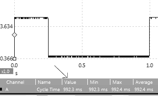

## 9.3.6 • `__delay()` 函数

XC8 中提供了可用的延迟函数，通过指定时钟频率，你可以调用具有所需毫秒或微秒延迟的函数。这些函数通过循环时钟周期来提供延迟。这将阻塞程序执行任何其他操作。如果你需要一个微小的、不会产生碍事的延迟——这些函数非常方便使用。程序 9-3 使用 `__delay()` 函数让 LED 闪烁 0.25s 并关闭 0.5s。这种方法非常简单，但在延迟进行期间，任何其他事情都不会发生。每秒只执行两个有用的指令。除了极短的延迟外，这不是一个好方法。

**图 9-8 基于中断定时的 C 版本示波器轨迹**

```c
//prog_09_03_delay

#include <xc.h>

// PIC16F1823 配置位设置

// CONFIG1

#pragma config FOSC = INTOSC

#pragma config WDTE = OFF

#pragma config PWRTE = OFF

#pragma config MCLRE = OFF

#pragma config CP = OFF

#pragma config BOREN = OFF

#pragma config IESO = OFF

#pragma config FCMEN = OFF

// CONFIG2

#pragma config LVP = ON

#define _XTAL_FREQ 32000000 /* #define 将 _XTAL_FREQ 设置为 32 MHz，这
告诉编译器频率，以便它可以设置所需延迟
的时钟周期数量.*/

void main() @ 0x20
{
    TRISA2 = 0;
    OSCCON = 0x70; // 第 65 页 32 MHz，参见书中的表 2-1。
    OPTION_REG = 0xD7; // 数据手册中的第 164 页以及书中的表 2-2。

    while (1) // 无限循环。
    {
        __delay_ms(750); // 函数参数单位为毫秒。
        RA2 = 1;
        __delay_ms(250); // 函数参数单位为毫秒。
        RA2 = 0;
    }
}
```

## 9.3.7 扩展 `if` 语句

为了在程序中决策，`if..else` 语句比编写汇编代码要容易得多……即使你编写了宏来提高其可读性。如果选择很复杂，可能有多个条件为真，但你又倾向于其中一个呢？举一个简单的例子，假设 LED 在上电后前 3 秒关闭，接下来的 5 秒内开启，然后以四分之一的功率运行 4 秒，然后重复该序列。我们扩展 `if` 语句的方法是使用 `else if`。这允许我们对决策进行优先级排序。向 LED 开启的变化发生在 3 秒处。1/4 功率的变化发生在 7 秒处，然后在 12 秒处变回 LED 关闭。每秒有 122 次滴答，因此要达到 12 秒需要 1464 次滴答。这对于单字节（byte）来说太多了，因此我们需要使用两个字节来计数。我们可以让编译器完成工作，并将计数器声明为无符号整数（unsigned integer），允许计数达到 65535。为了方便，你可以让编译器将秒乘以 122，这样你就不需要手动计算。这种运算在 PIC 代码编译之前完成。程序 9-4 所示。除了 `tick_counter`，还有一个声明为无符号字符（unsigned char）的变量 `dim_counter`。每当执行 `else` 部分时它就会递增。除以 4 后每 4 次产生一个余数。如果余数为零（`dim_counter%4 == 0` 为真），LED 开启；在其他三次中 LED 关闭。这使得 LED 的平均功率降为四分之一。

**程序 9-3 使用 `__delay()` 函数**

```c
//prog_09_04

#include <xc.h>

// PIC16F1823 配置位设置

// CONFIG1

#pragma config FOSC = INTOSC

#pragma config WDTE = OFF

#pragma config PWRTE = OFF

#pragma config MCLRE = OFF

#pragma config CP = OFF

#pragma config BOREN = OFF

#pragma config IESO = OFF

#pragma config FCMEN = OFF

// CONFIG2

#pragma config LVP = ON

#define TICKS_PER_SECOND 122 // 定义常量 TICKS_PER_SECOND 为 122。

unsigned int tick_counter = 0; // 此变量定义为无符号整数。

void interrupt tick(void)
{
    TMR0IF = 0; // 清除 TMR0 溢出中断标志。
    tick_counter++; // 8.2 ms 滴答。
}

void main() @ 0x20
{
    TRISA2 = 0;
    OSCCON = 0x70; // 32 MHz 第65页，参见书中的表 2-1。
    OPTION_REG = 0xD7; // 数据手册中的第 164 页以及书中的表 2-2。
    INTCON = 0xE0; // 数据手册中的第 86 页以及书中的表 2-3。
    unsigned char dim_count = 0; // 声明并初始化变量。

    while (1) // 无限循环。
    {
        if (tick_counter < 122*3) // 如果 tick_counter < 366，第一个选择。
        {
            RA2 = 0; // 输出关闭。
        }
        else if (tick_counter < 122*8) // 如果 tick_counter < 976，第二个选择。
        {
            RA2 = 1; // 输出开启。
        }
        else if (tick_counter < 122*12) // 如果 tick_counter < 1464，第三个选择。
        {
            dim_count++; // 计数器递增 1。
            LATA2 = dim_count%4 == 0; // LED 在 1/4 的时间内开启。
        }
        else // 其他选择。
        {
            tick_counter = 0; // 当达到 12 秒时。
        }
    }
}
```

在此程序中，没有使用式状态机，尽管 `if` 语句的行为类似于状态机。

### 9.3.8 • `Switch` 语句

在之前的汇编程序中，我们使用 `GOTO` 跳转到特定状态。在 C 中，`switch` 后面跟着括号。这是 `switch` 的形式：匹配整数的值。需要记住的一个非常重要的点是，每个 `case` 结尾必须有一个 `break`。书中的状态机程序倾向于 Mealy 类型，其输出取决于当前状态和输入。如果你看程序 9-5，这是一个 Moore 机器，因为输出根据状态驱动。参见图 2-10。虽然程序没有显式命名这两个状态，但测量速度改进的实验见节 9.3.9。程序 9-6 引入了用于更新信号的 `bool` 类型。在代码中使用它，必须包含 `stdbool.h` 文件。

```c
//prog_09_05

#include <xc.h>

// PIC16F1823 配置位设置

// CONFIG1

#pragma config FOSC = INTOSC

#pragma config WDTE = OFF

#pragma config PWRTE = OFF

#pragma config MCLRE = OFF

#pragma config CP = OFF

#pragma config BOREN = OFF

#pragma config IESO = OFF

#pragma config FCMEN = OFF

// CONFIG2

#pragma config LVP = ON

char tick_counter = 0;

void interrupt tick(void)
{
    INTCONbits.TMR0IF = 0;
    tick_counter++;
}

void main() @ 0x20
{
    TRISAbits.TRISA4 = 0;
    TRISC = 0;
    OSCCON = 0x70;
    OPTION_REG = 0xD7;
    INTCON = 0xE0;
    char value = 0, seconds_counter;

    while (1)
    {
        if (tick_counter >= 121) // 当达到一秒时。
        {
            value++; // 状态递增 1。
        }
    }
}
```

```c
// prog_09_06

#include <xc.h>
#include <stdbool.h>

// PIC16F1823 配置位设置
// CONFIG1
#pragma config FOSC = INTOSC
#pragma config WDTE = OFF
#pragma config PWRTE = OFF
#pragma config MCLRE = OFF
#pragma config CP = OFF
#pragma config BOREN = OFF
#pragma config IESO = OFF
#pragma config FCMEN = OFF
// CONFIG2
#pragma config LVP = ON

char tick_counter = 0;

void interrupt tick(void)
{
    INTCONbits.TMR0IF = 0;
    tick_counter++;
}

void main() @ 0x20
{
    TRISA4 = 0;
    TRISC = 0;
    OSCCON = 0x70; // 书中第 65 页，32 MHz，见表 2-1。
    OPTION_REG = 0xD7; // 数据手册中的第 164 页，书中的表 2-2。
    INTCON = 0xE0; // 数据手册中的第 86 页，书中的表 2-3。
    char state_m1 = 0, value = 0;
    bool update = false;

    while (1)
    {
        if (tick_counter >= 121) // 当达到一秒时。
        {
            value++; // 状态加 1。
            update = true;
            tick_counter = 0; // 重置 tick_counter。
        }

        if (value > 9) // 当 超过 9 时，value 将返回 0。
        {
            value = 0;
        }

        if (update) // 只有在 update 为 true 时才会调用 switch 语句。
        {
            update = false; // 重置 update。
            switch (value) // switch 语句仅在调用时运行。
            {
                case 0:
                    PORTC = 0x00; // 共阴极使用 0x3F。
                    LATA4 = 1; // 共阴极使用 0。
                    break;
                case 1:
                    PORTC = 0x36; // 共阴极 0x09。
                    LATA4 = 1; // 共阴极使用 0。
                    break;
                case 2:
                    PORTC = 0x21; // 共阴极 0x1E。
                    LATA4 = 0; // 共阴极使用 1。
                    break;
                case 3:
                    PORTC = 0x24; // 共阴极 0x1B。
                    LATA4 = 0; // 共阴极使用 1。
                    break;
                case 4:
                    PORTC = 0x16; // 共阴极 0x29。
                    LATA4 = 0; // 共阴极使用 1。
                    break;
                case 5:
                    PORTC = 0x0C; // 共阴极 0x33。
                    LATA4 = 0; // 共阴极使用 1。
                    break;
                case 6:
                    PORTC = 0x08; // 共阴极 0x37。
                    LATA4 = 0; // 共阴极使用 1。
                    break;
                case 7:
                    PORTC = 0x26; // 共阴极 0x19。
                    LATA4 = 1; // 共阴极使用 0。
                    break;
                case 8:
                    PORTC = 0x00; // 共阴极 0x3F。
                    LATA4 = 0; // 共阴极使用 1。
                    break;
                case 9:
                    PORTC = 0x04; // 共阴极 0x3B。
                    LATA4 = 0; // 共阴极使用 1。
                    break;
            }
        }
    }
}
```

## 程序 9-6 嵌套在 `if` 语句中的 `switch` 语句

程序 9-6 有一个小的错误，即上电时显示器在进入序列之前显示 8。这在共阳极显示器上被注意到。你能找出原因并修正代码吗？

### 9.3.9 测量代码速度的实验

程序 9-5 和 9-6 的区别在于，一个在每个循环中运行 `switch` 语句，而另一个将其嵌套在 `if` 语句中，仅在需要更改显示时才运行。为了测量循环的执行时间，将 RA2 I/O 引脚配置为数字输出并在每个循环中翻转它。这是对两个程序进行的临时修改，以便可以使用示波器直接测量循环时间。9-5 和 9-6 之间 hex 文件大小的差异多出了 36 字节。这使得循环时间提升了 40%。

```c
void main() @ 0x20
{
    TRISA4 = 0;
    TRISA2 = 0; // 临时修改。
    TRISC = 0;
    OSCCON = 0x70;
    OPTION_REG = 0xD7;
    INTCON = 0xE0;
    char value = 0, seconds_counter;

    while (1)
    {
        LATA2 = !LATA2; // 翻转 RA2 的值。

        if (tick_counter >= 121) // 当达到一秒时。
        {
            tick_counter = 0; // 重置计数器。
            value++; // 值加 1。
        }

        // 在 value 前加 ! 翻转其值。
        // 示波器迹形显示每次循环翻转 RA2。
        // 仅在需要更改显示时运行 switch 语句。
        // 时间为 5.3µs 而不是 3.1µs。
        // 在显示更新前大约运行 190000 次。
    }
}
```

## 9.4 串口通信

通过串口链路与计算机通信，使用 C 语言与汇编语言类似。关于寄存器选择，你不需要担心它。在赋值值给特殊寄存器时，编译器会替你处理。编译后的代码大大几个字节。

### 9.4.1 字节传输

程序 9-7 通过串口输出字节，可以像之前一样被 `serial_reader` 程序读取。每秒增加一个。

```c
// prog_09_07

#include <xc.h>

// PIC16F1823 配置位设置
// CONFIG1
#pragma config FOSC = INTOSC
#pragma config WDTE = OFF
#pragma config PWRTE = OFF
#pragma config MCLRE = OFF
#pragma config CP = OFF
#pragma config BOREN = OFF
#pragma config IESO = OFF
#pragma config FCMEN = OFF
// CONFIG2
#pragma config LVP = ON

char tick_counter = 0;

void interrupt tick(void)
{
    TMR0IF = 0;
    tick_counter++;
}

void main() @ 0x20
{
    OPTION_REG = 0xD7; // 数据手册中的第 164 页，书中的表 2-2。
    OSCCON = 0x70; // 书中第 65 页，32 MHz，见表 2-1。
    INTCON = 0xE0; // 数据手册中的第 86 页，书中的表 2-3。
    TXCKSEL = 1; // 设置 APFCON 的第 2 位以将引脚 2 用于 TX。见第 114 页。
    SPBRG = 0x19; // 对于 32MHz 时钟，设置波特率=clock/(64*(spbrgh:spbrgl))=19200。
    SPEN = 1; // 开启串口。见第 278 页。
    TXEN = 1; // 开启发送。见第 277 页。
    unsigned char value = 0;

    while (1)
    {
        if (tick_counter >= 122) // 一秒后成立。
        {
            tick_counter = 0; // 重置以开始计数。
            value++; // 值加 1。
            TXREG = value; // 将值赋予 TXREG 进行传输。
            while (!TRMT); // 等待 TRMT 变为高电。
        }
    }
}
```

### 9.4.2 字节接收

字节接收程序 9-8 的示例程序是程序 4-2 的 C 版本，它有一个闪烁的 LED，其点亮时间为固定的 0.25 秒，关闭时间由运行 `serial_writer` 的计算机写入的字节值决定。


```c
{
    CREN = 1;
}
else
{
    period = RCREG; // 将接收到的字节赋值给 period。
}

void main() @ 0x30
{
    unsigned char counter = 0;

    OPTION_REG = 0xD7; // 数据手册中的第 164 页和书中的表 2-2。

    OSCCON = 0x70; // 第 65 页 32 MHz，参见书中的表 2-1。

    INTCON = 0xE0; // 数据手册中的第 86 页和书中的表 2-3。

    RXDTSEL = 1; // 设置 APFCON 的第 7 位以将引脚 12 (RA1) 的用途改为 RX，
    // 参见第 114 页。

    RCIE = 1;

    SPBRG = 0x19; // 设置波特率=clock/(64*(spbrgh:spbrgl+1))=19200
    // 当时钟=32MHz 时。参见第 280 和 282 页。

    SPEN = 1; // 启用串口 BIT 7。参见第 278 页。

    CREN = 1; // 启用连续接收，参见第 278 页。

    TRISA2 = 0;

    ANSA1 = 0; // 将 RA1 (RX) 设置为数字输入。

    LATA2 = 0;

    unsigned char state = 0;

    while (1)
    {
        if (state == 0)
        {
            if (tick_counter > 30)
            {
                state = 1;
                LATA2 = 0;
                tick_counter = 0;
                counter++;
                read = counter % 5;
            }
        }
        else
        {
            if (tick_counter >= period)
            {
                state = 0;
                LATA2 = 1;
                tick_counter = 0;
            }
        }
    }
}
```

该程序遵循图 4-4 中的状态图。电路图为图 4-2。配置与汇编程序相同，但不需要担心存储器分页（bank switching）。状态机通过 `if..else` 语句和嵌套的 `if` 语句实现，用于触发转换并驱动输出。中断函数已重命名为 `isr`（中断服务例程）。

现在有两种可能的中断：`timer0` 溢出和字节接收。代码结合注释将解释其操作过程。你会注意到，`if` 后面的括号内是一个单一变量，没有任何形式的比较。这样做是因为变量本身就表达了真或假。不需要进行任何比较。

程序 9-8 串口字节接收

# 第 10 章 • 进阶 C 语言

## 10.1 • 引言

C 语言节省了你的一些精力，因为它处理了编程中一些较为单调的方面。例如，处于正确的存储器页，以及 C 语言的 `if..else` 语句比汇编中的条件跳转易用得多。与大多数其他语言相比，C 并不是一门大语言，但它仍然有很多内容。即使你只了解一部分，也可以很好地利用它。如果你是初学者，最后一章将涵盖一些更重要的方面，以丰富你的技能库。

## 10.2 • 数据类型

C 语言提供了几种不同的数据类型。当它们存在内存中时，这些不同的数据类型只是位，即 0 或 1。使它们成为不同数据类型的是在使用时如何被解释。

例如，在 PIC 中，如果我们取寄存器 `ADRESH` 和 `ADRESL` 中的模拟量数字转换结果，这两个寄存器都是 8 位的，可以读取为两个独立的值，每个值从 0 到 255。由于已知它们包含一个 10 位的值，因此它们被合在一起视为一个 16 位的寄存器。感兴趣的 10 位要么左对齐，要么右对齐——请参见数据手册第 133 页的图 16-3。

使用 XC8，有不同长度的整数：8 位、16 位和 32 位（包括有符号和无符号）。请参考第 6 章关于二进制中负数的内容。由于编译器需要知道它正在处理什么，因此声明变量时要带有其名称和类型。在声明变量时，也可以给它赋值。这是一种良好的习惯，因为如果稍后在代码中使用它而没有安全的值，可能会导致错误。以下是一些示例：

```c
char x = 10; // 有符号 8 位整数值 -128 到 127。

unsigned char y = 5; // 无符号 8 位整数值 0 到 255。

int z; // 有符号 16 位整数值 -32768 到 32767，未赋值。

unsigned int a = 0; // 无符号 16 位整数值 0 到 65535。

unsigned long int a = 0; // 无符号 32 位整数值 0 到 4294967296。

bool update = false;
```

`char` 类型可以赋值，通过在单引号中写入一个字符来表示。此时该值就是该字符的 ASCII 值，例如：

```c
char x = 'A'; // 分配给 x 的数值将是 65。
```

在 PIC 中，如果我们在寄存器 `ADRESH` 和 `ADRESL` 中取模拟量数字转换的结果，这两个寄存器都是 8 位的，可以读取为两个独立的值，每个值从 0 到 255。由于已知它们包含一个 10 位的值，因此它们被合在一起视为一个 16 位的寄存器。感兴趣的 10 位要么左对齐，要么右对齐——请参见数据手册第 133 页的图 16-3。

使用 XC8，有不同长度的整数：8 位、16 位和 32 位（包括有符号和无符号）。请参考第 6 章关于二进制中负数的内容。由于编译器需要知道它正在处理什么，因此声明变量时要带有其名称和类型。在声明变量时，也可以给它赋值。这是一种良好的习惯，因为如果稍后在代码中使用它而没有安全的值，可能会导致错误。以下是一些示例：

```c
char x = 10; // 有符号 8 位整数值 -128 到 127。

unsigned char y = 5; // 无符号 8 位整数值 0 到 255。

int z; // 有符号 16 位整数值 -32768 到 32767，未赋值。

unsigned int a = 0; // 无符号 16 位整数值 0 到 65535。

unsigned long int a = 0; // 无符号 32 位整数值 0 到 4294967296。

bool update = false;
```

`char` 类型可以赋值，通过在单引号中写入一个字符来表示。此时该值就是该字符的 ASCII 值，例如：

```c
char x = 'A'; // 分配给 x 的数值将是 65。
```

函数名为 `tx_long_int`。你可以为函数命名：标准是使用小写。C 是大小敏感的，名称必须以字母开头，也可以用下划线开头。库函数使用下划线开头是为了避免名称冲突。最好不要用下划线开头命名。下划线可以在名称内部自由使用。由于名称中不能有空格，下划线提供了一种易读的单词组合方式。

此函数接收一个变量：一个要传输的长整型。参数在函数名后的括号中声明，其数据类型为 `long int`，名称为 `w`。变量 `w` 在函数的局部作用范围内，当函数被调用时，要赋给 `w` 的值会被传递给它。变量 `w` 不能在该函数以外的任何地方写入或读取。它的初始赋值被称为“值传递”。

当调用函数时（例如在主函数某处），编写函数名并在括号内传入传递的值。它可能像这样出现在主函数（或其他函数）中：

```c
tx_long_int(42000);
```

`42000` 是我们想要传递给函数的整数值。函数的作用是获取长整型的四字节字 `w`，逐个提取每个字节并进行传输。每个字节的传输已在程序 9-7 中处理过。将值赋给 `TXREG`，然后通过 `while` 循环等待传输完成。

较复杂的部分是从最高字节开始提取四个字节。在汇编中执行此操作时，四个字节可以很容易地通过四个寄存器访问。参考第 6 章中命名为 `Y3`、`Y2`、`Y1` 和 `Y0` 的程序。我们将利用位移和位与 `AND` 运算。

| 字节 3 | 字节 2 | 字节 1 | 字节 0 |
| :--- | :--- | :--- | :--- |
| 31 | 23 | 15 | 7 |
| 30 | 22 | 14 | 6 |
| 29 | 21 | 13 | 5 |
| 28 | 20 | 12 | 4 |
| 27 | 19 | 11 | 3 |
| 26 | 18 | 10 | 2 |
| 25 | 17 | 9 | 1 |
| 24 | 16 | 8 | 0 |

表 10-1 整数中的字节

表 10-1 显示四字节整数中的 32 位。要访问字节 3，我们可以使用运算符 `>>` 将所有位向右移动 24 位。这会将字节 3 放在字节 0 的位置，其他字节将从末尾丢弃且可见。

编写类似 `w >> 24` 的代码需要注意——这并不会改变 `w`，它意味着我们看到的是 `w` 右移后的值。如果我们想通过移位来改变 `w`，则必须写此赋值：`w = w >> 24`。`w` 现在被重新赋值为右移后的值。

查看代码段：

```c
TXREG = w >> 24 & 0xFF; // 与最高字节进行 0xFF 位与运算。

while (!TRMT); // 等待 TMRT 变为高电。

TXREG = w >> 16 & 0xFF; // 与下一个有效字节进行 0xFF 位与运算。

while (!TRMT); // 等待 TMRT 变为高电。

TXREG = w >> 8 & 0xFF; // 与下一个有效字节进行 0xFF 位与运算。

while (!TRMT); // 等待 TMRT 变为高电。

TXREG = w; // 与最低字节进行 0xFF 位与运算。

while (!TRMT); // 等待 TMRT 变为高电。
```

我们可以通过将变量 `w` 右移 24 位后赋给 `TXREG` 来访问最高字节。变量 `w` 不改变，所以我们现在可以通过将 `w` 右移 16 位后赋给 `TXREG` 来访问下一个有效字节，依此类推。

```c
void tx_long_int(long w)
{
    TXREG = w >> 24 & 0xFF; // 与最高字节进行 0xFF 位与运算。

    while (!TRMT); // 等待 TMRT 变为高电。

    TXREG = w >> 16 & 0xFF; // 与下一个有效字节进行 0xFF 位与运算。

    while (!TRMT); // 等待 TMRT 变为高电。

    TXREG = w >> 8 & 0xFF; // 与下一个有效字节进行 0xFF 位与运算。

    while (!TRMT); // 等待 TMRT 变为高电。

    TXREG = w; // 与最低字节进行 0xFF 位与运算。

    while (!TRMT); // 等待 TMRT 变为高电。
}
```

```c
OPTION_REG = 0xD7; // 数据表中第 164 页和书中的表 2-2。

OSCCON = 0x70; // 第 65 页 32 MHz，见书中表 2-1。

INTCON = 0xE0; // 数据表中第 86 页和书中的表 2-3。
```


```c
TXCKSEL = 1; // 设置 APFCON 的第 2 位将引脚 2 的用途改为 TX。见第 114 页。

SPBRG = 0x19; // 当频率=32MHz，设置波特率=clock/(64*(spbrgh:spbrgl+1))=19200

// 见第 280 和 282 页。

SPEN = 1; // 开启串口 BIT 7。见第 278 页。

TXEN = 1; // 开启发送 BIT 5。见第 277 页。

long x[6] = {50000, 1, 2, 3, 100, 200}; // 长整型数组的声明。

while (1)
{
  if (tick_counter >= 122) // 1 秒后为真。
  {
    tick_counter = 0; // 重置以开始计数另一秒。

    for (int n = 0; n < 6; n++) // 'for' 循环。
    {
      tx_long_int(65000 + x[n]); // 每次循环中加上数组中一个不同的成员。
    }
  }
}
```

加法的输出可以使用带有 `-d` 选项的 `serial_reader` 程序查看。见图 10-1 下：

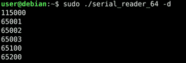

乘法通过程序 10-2 进行演示。除了下文所示的变化外，其余部分相同。完整程序在下载文件中。此处用尖括号符号显示了更改处。

```c
long x[6] = {46340, 57, 55, 12, 111, 43}; // 长整型数组的声明 <<<<<<<<

// 整数。

while (1)
{
  if (tick_counter >= 122) // 1 秒后为真。
  {
    tick_counter = 0; // 重置以开始计数另一秒。

    for (int n = 0; n < 6; n++) // 'for' 循环。
    {
      tx_long_int(46341 * x[n]); // 每次循环中乘以数组中一个不同的成员 <<<<<<<<

// 成员。
    }
  }
}
```

程序 10-1 加法  
图 10-1 `serial_reader` 的使用  
程序 10-2 乘法（节选）

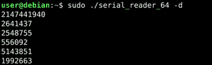

最后，除法通过程序 10-3 进行演示，节选部分如下所示。使用取模除法运算符 `%` 获取余数。图 10-3 显示了每个情况下整数商后跟余数的输出。

```c
long x[6] = {5957, 57, 55, 12, 111, 43}; // 长整型数组的声明 <<<<<<<<

// 整数。

while (1)
{
  if (tick_counter >= 122) // 1 秒后为真。
  {
    tick_counter = 0; // 重置以开始计数另一秒。

    for (int n = 0; n < 6; n++) // 'for' 循环。
    {
      tx_long_int(65535 / x[n]); // 整数除法 <<<<<<<<
      tx_long_int(65535 % x[n]); // 取模除法，得到余数 <<<<<<<<
    }
  }
}
```

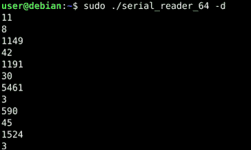

图 10-2 `serial_reader` 的使用（2）  
程序 10-3 除法（节选）  
图 10-3 `serial_reader` 的使用（3）

## 10.5 C 语言中的电压表

最后一个程序是第 7 章用 C 语言编写的电压表。它遵循与 07-01 和 07-02 相同的状态图。如果你将 C 程序与汇编程序对比，由于它们遵循相同的状态图，不同的部分可以直接进行比较。汇编程序包含子程序和用于的宏，这些在 C 版本中仅以简单表达式的形式出现。比较 hex 文件的大小，C 编译器生成的生成的大约大 70%。这部分可以归咎于使用了免费版本的编译器。由于其占用的程序空间为 37%，这是一个满意的结果。对于更大的项目，你可能必须使用汇编语言来容纳它。程序所示。再次，注释应该解释代码的作用。

### 10.5.1 使用位开启/关闭

处理位（bits）是此类编程的核心。在汇编语言中，PIC 有 BSF 和 BCF 指令允许你开启或关闭位。注意“读取-修改-写入”问题。参见程序 2-3 的连接，更新使用了一个数据类型 `bool`，但如果你需要多个位，有另一种方法。XC8 编译器有一个名为 `bit` 的数据类型，其值为 0 或 1。除了使用它们外，不需要做任何其他操作。通常在函数中声明变量时，它们被视为自动的（automatic）。它们必须是静态或全局的。要将变量声明为静态，请在声明前加上 `static`。

```c
// prog_04 C语言中的电压表

#include <xc.h>

// PIC16F182 配置位

#pragma config FOSC = INTOSC
#pragma config WDTE = OFF
#pragma config PWRTE = OFF
#pragma config MCLRE = OFF
#pragma config CP = OFF
#pragma config BOREN = OFF
#pragma config ESO = OFF
#pragma config FCMEN = OFF
#pragma config LVP = ON

char tick_counter = 0;

void interrupt(void)
{
  if (IOCAF5) // 检查是否为变化中断。
  {
    IOCAF5 = 0; // 重置中断标志。
  }
  else // 只有开启的中断必须是定时器溢出。
  {
    TMR0IF = 0; // 重置中断标志。
    tick_counter++;
  }
}

void main()
{
  OPTION_REG = 0xD7; // 书中的表 2-2。
  INTCON = 0xE0; // 书中的表 2-3。
  IOCIE = 1; // IOCIE 位。在 INTCON 寄存器中（第 3 位），之前的行可以写成 INTCON = xE8，此处省略。
  TRISC = 0; // 设置 PORTC 为输出。
  TRISA = 0x24; // 设置 PORTA 为输出，除去 RA2 和 RA5。
  ADCON0 = 0x09; // 选择 AN2 (RA2) 并启用 ADC。数据表第 136。
  ADCON1 = 0xE3; // 右对齐结果，Fosc/64，内部 Vref。第 137。
  OSCCON = 0x70; // 第 65 页，32 MHz。
  FVRCON = 0x83; // 见第 5 章表 5-3 和数据表第 128。
  tick_counter = 0;

  unsigned char value = 0, state_m0 = 0, state_m1 = 0, state_m2 = 0, laps = 0, F10V = 0, F1V = 0, F100mV = 0;

  static bit dis_update = 0, vol_available = 0, read_required = 0; // 标志位。

  while (1)
  {
    /* M0 */

    switch (state_m0)
    {
      case 0:
        if (tick_counter > 61)
        {
          value = 10;
          dis_update = 1;
          read_required = 1;
          tick_counter = 0;
          state_m0++;
        }
        break;

      case 1:
        if (tick_counter > 122)
        {
          if (vol_available)
          {
            laps = 0;
            state_m0 = 3;
          }
          else
          {
            state_m0 = 2;
          }
        }
        break;

      case 2:
        if (laps >= 3)
        {
          laps = 0;
          IOCAF5 = 1;
          FREN = 0;
        }
        else
        {
          laps++;
        }
        break;

      case 3:
        if (tick_counter > 61)
        {
          value = F10V;
          dis_update = 1;
          read_required = 1;
          tick_counter = 0;
          state_m0++;
        }
        break;

      case 4:
        if (tick_counter > 61)
        {
          value = F1V;
          dis_update = 1;
          read_required = 1;
          tick_counter = 0;
          state_m0++;
        }
        break;

      case 5:
        if (tick_counter > 61)
        {
          value = F100mV;
          dis_update = 1;
          read_required = 1;
          tick_counter = 0;
          state_m0++;
        }
        break;

      case 6:
        if (tick_counter > 61)
        {
          value = F10mV;
          dis_update = 1;
          read_required = 1;
          tick_counter = 0;
          state_m0++;
        }
        break;
    }

    if (dis_update)
    {
      /* M1 */

      switch (state_m1)
      {
        case 0:
          if (tick_counter > 122)
          {
            F10V = value;
            tick_counter = 0;
            state_m1++;
          }
          break;

        case 1:
          if (tick_counter > 122)
          {
            F1V = value;
            tick_counter = 0;
            state_m1++;
          }
          break;

        case 2:
          if (tick_counter > 122)
          {
            F100mV = value;
            tick_counter = 0;
            state_m1++;
          }
          break;

        case 3:
          if (tick_counter > 122)
          {
            F10mV = value;
            tick_counter = 0;
            state_m1++;
          }
          break;
      }
    }

    if (read_required)
    {
      /* 更新逻辑此处 */
    }
  }
}
```

```c
LATAbits.LATA4 = 0; // 用于共阴极使用 1。
break;

case 4:
  PORTC = 0x16;
  // 用于共阴极 0x29。
  LATAbits.LATA4 = 0; // 用于共阴极使用 1。
  break;

case 5:
  PORTC = 0x0C;
  // 用于共阴极 0x33。
  LATAbits.LATA4 = 0; // 用于共阴极使用 1。
  break;

case 6:
  PORTC = 0x08;
  // 用于共阴极 0x37。
  LATAbits.LATA4 = 0; // 用于共阴极使用 1。
  break;

case 7:
  PORTC = 0x26;
  // 用于共阴极 0x19。
  LATAbits.LATA4 = 1; // 用于共阴极使用 0。
  break;

case 8:
  PORTC = 0x00;
  // 用于共阴极 0x3F。
  LATAbits.LATA4 = 0; // 用于共阴极使用 1。
  break;

case 9:
  PORTC = 0x04;
  // 用于共阴极 0x3B。
  LATAbits.LATA4 = 0; // 用于共阴极使用 1。
  break;

case 10:
  PORTC = 0xFF;
  // 用于共阴极 0x3B。
  LATAbits.LATA4 = 1; // 用于共阴极使用 1。
}
}
```

****************机器 M2****************

```c
unsigned long analog_value;

switch (state_m2)
{
  case 0:
    if (read_required)
    {
      state_m2 = 1;
    }
    break;

  case 1:
    read_required = 0;
    GO = 1;
    while (GO);

    vol_available = 0;

    if (ADRESH == 0 && ADRESL < 6)
    {
      state_m2 = 0;
    }
    else
    {
      vol_available = 1;
      analog_value = (ADRESH << 8) + ADRESL; // 需要加括号，因为 '+' 的优先级高于 '<<'。
      analog_value = analog_value * 11091;
      analog_value = analog_value / 500;
      F10V = analog_value / 10000;
      analog_value = analog_value % 10000;
      F1V = analog_value / 1000;
      analog_value = analog_value % 1000;
      F100mV = analog_value / 100;
      analog_value = analog_value % 100;
      F10mV = analog_value / 10;
      state_m2 = 0;
    }
}
}
```

C 语言编写的程序 10-4 电表程序

## 10.5.2 使用位运算符开启和关闭位

更改单个位位的另一种方法是使用位逻辑和位掩码。假设我们有一个八位变量 `var`，并想要开启位 2，而保持其他位不变。这样做的方法是将该字节与掩码进行位或（OR）操作，掩码除了要开启的位外，所有位都关闭状态。假设标志字节 `var` 的状态为 B'01100001'，下表显示了与掩码 B'00000100' 进行位或操作的结果。在代码中，这以十六进制形式写为 `0x04`。

```c
var = var | 0x04; // | 是 C 语言中的位或运算符。
```

|  | 位 7 | 位 6 | 位 5 | 位 4 | 位 3 | 位 2 | 位 1 | 位 0 |
| :--- | :---: | :---: | :---: | :---: | :---: | :---: | :---: | :---: |
| `var` | 0 | 1 | 1 | 0 | 0 | 0 | 0 | 1 |
| `mask` | 0 | 0 | 0 | 0 | 0 | 1 | 0 | 0 |
| `result` | 0 | 1 | 1 | 0 | 0 | 1 | 0 | 1 |

赋值操作将位或的结果赋给 `var`。要将其关闭则没那么直观了。我们仍然需要一个掩码和一个位运算符来改变我们想要改变的位，同时保持其他位不变。这可以通过位与（AND）来实现，其中掩码在位不会改变的位置设为 1，在要关闭的位的位置设为 0。为了产生所需的掩码，取一个将你想要改变的位置的位设为 1 的字节，即在本例中为 B'00000100'，然后反转这些位以得到 B'11111011'。有一个运算符 `~` 可以执行此操作。关闭位 2 的代码是：`var = var & ~0x04;`。

### 10.5.3 使用位域开启和关闭位

标准 C 语言还具有位域（bitfield），它允许你访问字中的单个位。要理解这一点，你需要了解结构体，它是一个包含命名成员的对象。如下所示：

```c
struct
{
  unsigned int vol_available : 1;
  unsigned int read_required : 1;
} flags;
```

位域允许你定义具有特定位宽的成员。例如：

```c
struct
{
  unsigned int F10V : 4;
```


```c
    unsigned int F1V : 3;

    unsigned int F100mV : 2;

    unsigned int F10mV : 1;

} voltage;
```

这种方法可以有效地节省内存，特别是在内存受限的微控制器应用中。

- Fedora 14, 15, 152, 153
- 有限状态机 9, 12, 31, 47, 58, 105, 117, 151, 184
- 流程图 136
- FSM 9, 10, 11, 32, 43, 67, 136, 184
- gpasm 11, 12, 14, 23, 29, 30, 38, 40, 41, 56, 61, 66
- gputils 13, 14, 27
- 十六进制 20, 28, 29, 34, 37, 38, 65
- 进制文件 12, 14, 17, 22, 23, 29, 61, 151, 156, 157, 167, 176
- 头文件 28, 51, 156
- 指令 12, 14, 23, 25, 26, 48, 63, 65, 66, 88, 104, 157, 161, 184
- 整数 19, 107, 108, 114, 116, 119, 120, 134, 135, 154, 155, 162, 163, 164, 171, 172, 173, 174, 175, 178
- 中断服务程序 36, 37, 74, 75, 76, 142, 159, 170
- 中断向量 36, 142
- 宏 49, 54, 55, 56, 57, 58, 59, 60, 61, 62, 65, 66, 70, 75, 76, 80, 84, 88, 91, 101, 106, 109, 112, 118, 121, 123, 128, 137, 142, 145, 146, 147, 162, 172
- Mealy 10, 11, 32, 120, 139, 140, 143, 164, 184
- 微芯片 9, 13, 18, 22, 30, 32, 137, 151, 153, 156
- Microsoft Windows 9, 11, 13, 41, 107, 151, 156
- Mint 151
- Moore 10, 32, 136, 139, 140, 143, 164, 184
- 法 103, 116, 117, 131
- 负数 114, 115, 171
- 嵌套 62, 140, 156, 159, 167, 170
- 非 21
- 补码 115, 116
- 操作系统 11, 107
- 或 23
-  41
- 轮询 35
- 程序读取器 14, 16, 24
- 程序写入器 14, 16, 24, 29, 30, 40, 41, 151, 154, 156
- 脉宽调制 81
- 寄存器 11, 23, 25, 26, 27, 28, 29, 33, 34, 35, 36, 38, 39, 44, 48, 49, 53, 54, 55, 57, 59, 64, 65, 68, 69, 73, 83, 85, 91, 99, 101, 103, 104, 111, 113, 117, 129, 142, 143, 149, 157, 168, 171, 175
- 返回地址 36
- 串口读取器 67, 71, 72, 80, 107, 108, 138, 168, 177, 178
- 串口写入器 169
- 七段显示 58, 70
- 移位 116, 143
- 有符号 107, 114
- 睡眠 126, 149
- 栈 36, 63
- 状态图 32, 41, 64, 69, 73, 79, 82, 86, 117, 120, 132, 136, 141, 144, 170
- 子状态 140, 146
- 定时器 33, 37, 56, 57, 74, 75, 140, 159, 160, 170
- 转换 10, 47, 79, 86, 120, 139, 143, 170
- TTL 9, 11, 15, 67, 71
- TTL-3V 9, 11, 15
- 二补码 115, 116
- Ubuntu 13, 14, 151, 152
- USB 9, 11, 13, 15, 16, 71
- 工作寄存器 29, 34, 35, 39, 49, 53, 57, 59, 91, 101, 104, 111, 117, 149, 157
- XC8 9, 30, 151, 152, 153, 155, 157, 171
- 或或 21

## Andrew Pratt

Andrew Pratt 详细介绍了 PIC 微控制器的编程，并全面概述了有限状态机（FSM）编程方法。书中大部分内容使用汇编语言，但请不要因此被吓到。FSM 为程序提供了结构，使其易于规划、编写和修改。最后两章介绍了 C 语言编程，以便对这两种技术进行直接比较。

本书面向 Microsoft Windows 和 Linux 用户。为了尽可能降低成本并简化工具链，提供了一些免费下载的应用程序，可以使用 FTDI 串口线作为编程器。书中使用了微芯片（Microchip）数据手册的相关部分，这是获取详细信息的最佳方法。使用的汇编器是开源 `gpasm`。所有编程可以在编辑器中完成。书中详细介绍了如何在 Windows、Linux Debian 及其衍生版（如 Ubuntu 和 Fedora）上进行必要的安装。对于 C 语言编程，从命令行使用 `XC8` 编译器。除了编程程序外，提供了两个串口读取和串口写入程序，用于从计算机与 PIC 进行通信。

书中包含电压表项目，以及从零开始构建电路的实用说明。在此之前涵盖了所有理论知识，包括如何在汇编中进行整数算术。涵盖了两个 PIC：PIC12F1822 和 PIC16F1823。它们都可以在内部振荡器支持下以 32 MHz 运行。你不需要购买成品开发板和编程器。只需一些廉价的元件，包括串口线、微控制器、一些电阻和 LED，即可开始嵌入式编程。
