# C 语言编程 Raspberry Pi Pico

## 前言

Pico 是一款卓越的微控制器。它所拥有的性能和复杂性在不久前仍然是不可想象的。对于它所理想的任务类型，它拥有充足的处理能力和足够的内存，使得那些曾经需要周密规划的任务变得相对简单。你现在不再需要与机器作斗争，而是专注于实现出色的算法。

话虽如此，必须承认，如果你喜欢它的所有性能和复杂性，没有比 C 语言更好的语言了。它没有浪费任何性能，并为你提供了获取新功能所需的内容。然而，用 C 语言上手 Pico 并没有用 MicroPython 那么简单。你必须找到创建程序的方法，并且必须设置环境以便程序测试和调试能够进行。

我已经选定 VS Code 作为我的首选 IDE，它与 Pico SDK 配合是一个很好的选择。我采取的方法是让你尽可能快地熟悉 VS Code 并进行调试。因此，我们不再去解释如何让命令行工具工作，而是直接进入一个可用的基于 IDE 环境。我希望这种方法会让 Pico C 编程入门比其他方案更简单。

拥有一个良好的 IDE 的回报是多多的，一旦让一切运行起来，你就可以专注于利用 Pico，它拥有如此丰富的资源，一份详尽的说明将写满两本书那么厚。为了适应有限的空间，我将内容限制在仅解释你良好理解基础所需要的知识。未涵盖的主题包括直接存储器访问（DMA）、使用第二个核心、省电状态、插值器和硬件分频器。所有这些主题在意义上都是“二级”的，因为你通常在精通了其他所有内容之后才需要它们。显然，这本书还有编写第二卷的潜力！

我涵盖了 PIO（可编程 I/O）的使用，因为它是使用 Pico 的关键优势之一，允许你将与外部硬件的交互委托给外设设备。PIO 并不是解决所有问题的方案，但它非常有用、具有挑战性且充满趣味。你将在一个专门章节中了解 PIO，然后你需要为 DHT22 和 1-Wire 总线实现一个“驱动程序”。

本书并不教你 C 语言，但你实际上只需要对该语言有基础的理解。所有的示例都以非常简单的风格编写，避免了使用可能模糊含义的常量和函数。你可以轻松地将任何示例重构为一组适合你特定目的和编程风格的函数。如果说 Pico 有什么缺点，那就是它没有网络连接。为了解决这个问题，书中有一章介绍了如何使用低成本的 ESP8266 作为 WiFi 客户端和 Web 服务器。

Harry Fairhead

2021年4月


Harry Fairhead


# 前言

Pico 是一款卓越的微控制器。它所拥有的性能和复杂性在不久前仍然是不可想象的。对于它所理想的任务类型，它拥有充足的处理能力和足够的内存，使得那些曾经需要周密规划的任务变得相对简单。你现在不再需要与机器作斗争，而是专注于实现出色的算法。

话虽如此，必须承认，如果你想充分发挥其所有性能和复杂性，没有比 C 语言更好的语言了。它没有浪费任何性能，并为你提供了获取新功能所需的工具。然而，用 C 语言上手 Pico 并没有用 MicroPython 那么简单。你必须找到创建程序的方法，并且必须设置环境以便程序测试和调试能够进行。

我已经选定 `VS Code` 作为我的首选 `IDE`，它与 `Pico SDK` 配合是一个很好的选择。我采取的方法是让你尽可能快地在 `VS Code` 中上手并进行调试。因此，我们不再去解释如何让命令行工具工作，而是直接进入一个可用的基于 `IDE` 环境。我希望这种方法会让 Pico C 编程入门比其他方案更简单。

拥有一个良好的 `IDE` 的回报是多多的，一旦让一切运行起来，你就可以专注于利用 Pico，它拥有如此丰富的资源，一份详尽的说明将写满两本书那么厚。为了适应有限的空间，我将内容限制在仅解释你良好理解基础所需要的知识。未涵盖的主题包括直接存储器访问（`DMA`）、使用第二个核心、省电状态、插值器和硬件分频器。所有这些主题在意义上都是“二级”的，因为你通常在精通了其他所有内容之后才需要它们。显然，这本书还有编写第二卷的潜力！

我涵盖了 `PIO`（可编程 I/O）的使用，因为它是使用 Pico 的关键优势之一，允许你将与外部硬件的交互委托给外设。`PIO` 并不是解决所有问题的方案，但它非常有用、具有挑战性且充满趣味。你将在一个专门章节中了解 `PIO`，然后你需要为 `DHT22` 和 `1-Wire` 总线实现一个“驱动程序”。

本书并不教你 C 语言，但你实际上只需要对该语言有基础的理解。所有的示例都以非常简单的风格编写，避免了使用可能模糊含义的常量和函数。你可以轻松地将任何示例重构为一组适合你特定目的和编程风格的函数。

如果 Pico 有什么缺点，那就是它没有网络连接。为了解决这个问题，书中有一章介绍了如何使用低成本的 `ESP8266` 作为 `WiFi` 客户端和 `Web` 服务器。

---

# 目录

## 配置结构体 ........................................................................ 140

## PWM 还可以用于什么？ ......................................................... 141

## 总结 ............................................................................................... 142

## 无刷直流电机 ........................................................................... 160

## 总结 ............................................................................................... 178

# 第 10 章 入门 SPI 总线 ............................................................ 179

## SPI 总线基础 .................................................................................... 179

## Pico SPI 接口 ............................................................................... 182

## 使用数据传输函数 ................................................................ 185

## 使用 CS 线（片选线） .................................................................................. 188

## 问题 .................................................................................................. 196

## 总结 .................................................................................................. 197

## A-D 与 SPI 总线 ....................................................................... 199

## 协议 ...................................................................................................... 207

## 封装函数 ............................................................................. 210

## 多快 ........................................................................................................ 211

## 总结 ............................................................................................................... 212

## 使用 I2C 总线 ....................................................................... 213

## 真实设备 ................................................................................................. 223

## 数据到 PIO ................................................. 244

## 输出到 GPIO ................................................. 246

## 副效应 ................................................................. 251

## 输入 ................................................. 253

## 边沿 ................................................. 256

## 高级 PIO ................................................. 258


# 树莓派 Pico - 在开始之前

Raspberry Pi Pico 是树莓派世界迈出的重要一步。它不是一个完整的系统级芯片（SoC），而是一个微控制器——一个带有极简操作系统的小型系统，用于控制和连接其他设备。它的用途范围从控制洗衣机到制作使用按钮和灯光的游戏。与经常用作微控制器的树莓派 Zero 不同，你可以对其进行编程，而无需挣扎于 Linux 驱动程序和系统命令。也许更重要的是，你不需要与 Linux 的多任务行为作斗争，这种行为会让控制定时变得非常困难。编程 Pico 意味着你确切知道正在发生什么以及何时发生，这使得定时变得容易得多。这并不是一个完全解决的问题，但它变得更容易了。然而，没有操作系统也带来了它自己的问题，如果你习惯了使用 Pi Zero，可能会发现在某些时刻你很想调用 Linux 函数来解决问题。我的观点是（我也希望你继续读下去后能理解这一点），对于 Pico 胜任的任务类型来说，没有操作系统是一个巨大的优势。

将 Pico 与其他微控制器相比，它最大的优势在于它非常强大。它有一个快速的处理器和足够的内存来完成工作。它还具有许多内置外设，可以轻松地与 PWM、I2C、SPI、UART 和 ADC 等设备通信，并在创新的 PIO（可编程 I/O）的帮助下与几乎任何设备通信，包括自定义接口和 1 线总线。

PIO 是 Pico 的一个特殊特性，越早了解越好。它本身就是一个处理器，虽然它被限制为少数指令，但它针对的是处理脉冲输入输出这一非常特定的工作。这意味着你通常可以编写相当简单的程序，让 PIO 编码和解码任何尚未支持的协议。例如，在第 14 章中，我们实现了 1 线总线协议，并扩展了 Pico 以能够与这类热门设备工作。这并不仅限于新协议。例如，如果你发现某个 I2C 或 SPI 设备并不完全符合这两种协议非常松散的规范，或者在某些方面超出了这些规范，那么你就可以自定义版本。除了其实用性之外，值得说的是，编程 PIO 是非常有趣且极具教育意义的。它让你洞察汇编语言通常是如何运作的。

目前，Pico 唯一的负面方面是它板载没有 WiFi。这意味着它开箱即用无法用作 IoT（物联网）设备，因为无法连接到互联网。然而，这可以很容易解决。在第 17 章中，我们发现通过单个串口接口添加 ESP8266 WiFi 设备既简单又廉价。

关于 Pico 的一个非常重要的点是它是广泛提供的。这听起来可能很奇怪，但树莓派 Zero 仍然受限于一个客户，因此不是从原型转变为商业产品的理想候选者。Pico 可以按任何数量购买，构建它的芯片也是如此。因此，它适用于可能毕业为最终成品的项目。

这是对 Pico 全面的简要概述。在本章的剩余部分，我们将查看 Pico 的细节以及启动所需的物品。

Pico 基于 RP2040 处理器芯片，该芯片是树莓派为 Pico 特别设计的。它基于 ARM Cortex M0+ 并运行 ARM 机器码。该处理器可以作为芯片进行购买，用于构建你自己的类 Pico 设备实现。许多其他知名的硬件公司（特别是 Arduino）已经这样做了，如果你想要一个 Pico，并不局限于只有树莓派 Pico，还有其他选择。有些板载带有额外功能：

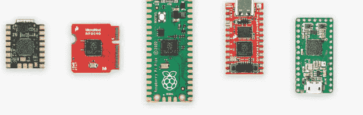

这些 Pico 的替代方案易于使用，因为它们的操作方式与 Pico 完全一样。你可以使用相同的 SDK 和环境对它们进行编程。唯一的区别可能是较小的外形暴露的硬件引脚较少，因此你可能无法使用在全尺寸 Pico 上可以使用的所有功能。在本书的剩余部分，程序将针对 Raspberry Pi Pico，但对于任何使用 RP2040 的设备，它们应该可以直接工作，或者易于修改。

关于 Pico 硬件的要点如下：

- 双核 Arm Cortex M0+ 处理器，主频灵活可达 133 MHz
- 264KB SRAM 和 2MB 板载 Flash 存储器
- 支持设备和主机模式的 USB 1.1
- 低功耗睡眠模式和休眠模式
- 通过 USB 使用大容量存储模式进行拖放式编程
- 26 × GPIO、2 × SPI、2 × UART、3 × 12-位 ADC、16 × 可控 PWM 通道
- 片内精度时钟和定时器
- 温度传感器
- 片内硬件加速浮点库
- 8 × 可编程输入/输出 (PIO) 状态机

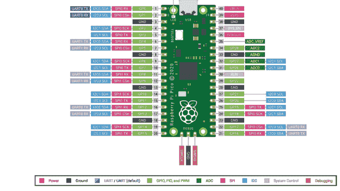

你也可以将图示上的板载 LED 视为一个关键特性——它可能很小，但在入门和测试中非常有用。

书中没有完整的项目——尽管某些示例非常接近项目，且显而易见，某些示例可以结合起来创建完成的项目。之所以这样设计，是因为重点在于学习这些事物是如何工作的，这样你就可以继续进行一些非标准的操作。

重要的是，你可以推断出处理器正在做什么以及它是如何实时与真实世界交互的。这是桌面编程与嵌入式编程之间的巨大区别。在桌面世界中，你并不太在意事情何时发生，但当你正在为一个物理系统编程时，你可以非常在意。

这是一本关于理解通用原理并在尽可能底层的水平让事物运行起来的书。当你处理较慢的系统（例如 MicroPython）时，这些知识并不总是必要的，但在出现问题时，它们对于理解发生的情况总是有帮助。当你直接与硬件打交道时，速度很重要，知道发生了什么同样重要。

所有的示例都尽可能简单，代码设计得尽可能易于理解。在大多数情况下，这意味着避免使用凭空出现的常量和使得难以看出基本步骤的函数。此外，错误处理被减少到最低——如果你添加了错误处理代码，简单的程序看起来就会很复杂。当然，没有理由将这些示例重构为看起来更像生产代码的内容，而且完成这项工作比从最初让基础程序运行起来投入要少得多。

与其对开发环境进行多次配置，本书从开始就使用 VS Code。所有的设置和编程说明都是基于使用 VS Code 的术语。如果你想以不同的方式工作，文档中也有说明，但使用 VS Code 比使用命令行要简单得多且功能强大得多。

- 至少一个 Pico！事实上，建议你至少买两个 Pico，特别是如果你打算使用 PC、Mac 或 Linux 机器进行编程的话。Pico 体积很小且缺少操作系统，因此要在它上运行创建程序所需的所有软件需要另一台机器——开发机。这里的选择是在所有其他可能的计算机和 Raspberry Pi 4 或 400 之间进行。使用 Pi 作为开发机具有巨大的优势——以至于你可以考虑将其视为标准且推荐的方法。原因是 Pi 拥有自己的 GPIO 连接，这使得你下载和调试运行在 Pico 上的程序成为可能，无需购买任何额外物品。软件安装说明是关于使用 VS Code 的。如果你想以不同的方式工作，文档中有说明，但使用 VS Code 比使用命令行要简单得多且功能强大得多。

同时也假设你能够使用类 C 语言进行编程——Java、C#、Python 都与 C 相似，当然，C++ 也是如此。书中没有空间教你 C 语言编程，但这些程序足够易于理解，并且任何不寻常的编码都会有解释。如果你想详细学习 C 语言，请参阅《Fundamental C: Getting Closer To The Machine》，ISBN: 9781871926204。

如果你遇到困难，寻求帮助的最佳地点是 Pico 论坛，其次是 Stack Overflow（堆栈）。那里有许多人准备好提供帮助，但请注意，用 C 语言编程 Pico 超出了大多数开发者的范畴，你需要过滤掉那些由于误解了你的问题而提供的帮助建议。答案的质量参差不齐，从误导性的到优秀的等不等。请务必根据你掌握的知识来评估你收到的建议。对于任何提供了表明他们误解了你问题的答案，请保持友善并给予支持。

你还需要记住，建议通常是带有偏见的观点提供的。Python 程序员会给你一个适用于使用 Python 系统的答案，而电子初学者会给你提供基于“现成”模块的解决方案，而实际上可以有一个基于几个廉价组件的简单替代方案。即使你得到的建议是 100% 正确的，它对你来说也不未必是正确的建议。原则上永远不要遵循任何你不理解的建议。

## 总结

- 考虑到其低成本，Pico 是一个非常强大的设备，是构建原型、单机设备和生产设备的理想选择。
- Pico 核心的 RP2040 芯片也用于许多类似的设备，所有这些设备都可以被视为基础 Pico 的变体。
- 你需要决定一个与 Pico 配合使用的开发机。最好且最简单的选择是 Pi 4 或 Pi 400。它具有 GPIO 线，可以连接到 Pico 以提供快速程序加载和调试。
- 如果你想使用桌面 PC、Mac 或 Linux 机器，那么你至少需要两个 Pico——一个用于工作，另一个运行 PicoProbe 并作为调试连接。
- 尽管你可以通过拖放方式在没有调试连接的情况下开始使用 Pico，但这并不是开发程序的长期解决方案。
- 无论你选择什么类型的开发机，VS Code 都提供了一个易于使用且高效的开发环境。
- 要进行电子设计，你需要一个免焊接原型板、一些连接线和一些元件。你还需要一个万用表，最好还有一个逻辑分析仪。在拥有这些仪器后，你可以根据自己的负担添加更多设备。
- 有一个活跃的 Pico 社区论坛，如果你遇到困难，那里是寻求建议的地方。然而，始终要评估任何提供的建议，通常情况下，除非你理解，否则不要接受。

## 入门

用 C 语言编程 Pico 是很自然的。它是它的系统软件所编写的语言，也是获取它提供的许多复杂且强大功能的唯一方法。使用 Python 或其他语言可以走得很远，但要走完全程你需要 C 语言。

你可以将 C 描述为一种与机器无关的汇编语言，因此当你学习它时，你比使用其他语言更深入地了解系统，并发现实际上发生了什么。如果你需要学习在 IoT 编程中使用的 C 语言，请参阅《Fundamental C: Getting Closer To The Machine》，ISBN: 9781871962604。

有时你不需要速度，即使在 IoT 应用中也是如此。例如，如果你只是想闪烁几个 LED 或在人类时间尺度内读取温度传感器，那么你可以用几乎任何语言编写。然而，如果你想以全速与其他系统和外部连接的硬件直接接口，C 语言是你的最佳选择。如果时机至关重要，那么 C 语言是唯一的选择。简单，如果你无法用 C 语言让你的应用程序正常工作，那么你可能在任何语言中都无法实现，因为 C 语言是如此“底层”，使其很容易访问底层硬件。

简单来说，C 是任何接口程序、IoT 或嵌入式程序的极佳语言，并且它通向 C++ 以及许多更复杂的语言。

所以 C 语言是值得学习的，而 Pico 提供了廉价的硬件供你实验。那么，我们如何开始呢？

树莓派网站有许多关于如何开始学习 C 语言编程的详细说明。可能会让你惊讶、甚至让你望而却步的是，这涉及到许多步骤。这是因为你需要在计划运行在 Pico 上的程序的机器上安装一个完整的 C 开发系统，通常称为“工具链”。注意，用 Pico 来开发供 Pico 使用的代码是不明智的——它的性能已经足够强大，但工具链通常需要一个完整的操作系统，而 Pico 并没有。所以你必须使用另一台计算机系统为 Pico 开发程序，目前支持的系统类型有 Linux、Windows 和 Mac OS。Pico 网站明显倾向于使用 Linux，即运行在 Pi 4 或 Pi 400 上的 Pi OS。这是一个非常有力的选项，但对于任何熟悉其操作系统和工作方式的程序员来说，使用 Windows 或 Mac 同样具有优势。

介绍安装必要软件的确切步骤没有意义——步骤会发生变化，且 Pico 网站上有详细的记录。有用的是明确为什么这些步骤是必要的，以及工具链的各个部分是如何结合在一起的。这些知识有助于理解这些步骤并排查出现的问题。

VS Code 提供了一个易于使用且高效的开发环境，无论你选择哪种类型的开发机。

要进行电子设计，你需要一个免焊接原型板、一些连接线和一些元件。你还需要一个万用表，最好还有一个逻辑分析仪。在拥有这些仪器后，你可以根据自己的负担添加更多设备。

有一个活跃的 Pico 社区论坛，如果你遇到困难，那里是寻求建议的地方。然而，始终要评估任何提供的建议，通常情况下，除非你理解，否则不要接受。

使用 Pi 4 作为开发机是推荐的选项。如果你想让 Pico 开发尽可能简单，这就是解决办法。

如果你选择使用 Pi 4 或 Pi 400，那么有一个安装脚本可以为你完成所有工作。你只需要做的是从树莓派网站下载它，将其设置为可执行文件并运行它：

```
wget https://raw.githubusercontent.com/raspberrypi/pico-setup/
chmod +x pico_setup.sh
./pico_setup.sh
```

该脚本执行了你可以自己完成的所有步骤：

- 在用户主目录下创建一个 pico 目录。
- 安装 GCC ARM 编译器、CMake 和支持库：`sudo apt install cmake gcc-arm-none-eabi libarm-arm-eabi`
- 克隆 GitHub SDK 仓库：
  ```
  git clone -b master https://github.com/raspberrypi/pico-sdk.git
  cd pico-sdk
  git submodule update --init
  cd
  ```
- 克隆示例和广场仓库——这些是必需的：
  ```
  git clone -b master https://github.com/raspberrypi/pico-examples.git
  ```


- 通过在 `.bashrc` 中定义 `Pico_SDK_PATH`、`Pico_EXAMPLES_PATH`、`Pico_EXTRAS_PATH` 和 `Pico_PLAYGROUND_PATH` 来设置路径。
- 在 `pico-examples/build/blink` 和 `pico-examples/build/hello_world` 中构建这些示例。
- 下载并编译 `pico picotool` 并将其复制到 `/usr/local/bin`——这并不是必需的。
- 下载并编译 `picoprobe`——这对于使用另一个 Pico 作为 SWD（串行调试）进行简单调试是必要的。
- 下载并编译调试工具 `OpenOCD`。
- 下载并安装 `Visual Studio Code`。
- 安装所需的 `Visual Studio Code` 扩展。
- 配置树莓派 UART 以供 Pico 使用。

注意，入门时你真正需要安装的是 GCC ARM 编译器、CMake 和 SDK。其他项目以后会有用。

你必须重启以使所有设置生效。

毫无疑问，使用树莓派或其他 Linux 系统作为开发机操作会更加方便。正如前面提到的，在 Windows 上操作较困难的原因是这些软件不是 Windows 原生软件。另一个问题是，你需要找到一种方法与机器建立调试连接，而对于像 Pi 4 或 P2040 这样可以直接访问 GPIO 的设备，这要简单得多。

Windows 有一个安装脚本，但它不是官方安装程序。你可以在这里找到：

https://github.com/ndabas/pico-setup-windows

它非常易用且运行良好。在本文编写时，它会自动安装并配置以下内容：

1. 在用户主目录下创建一个 `pico` 目录
2. GNU Arm 嵌入工具链
3. CMake
4. Visual Studio 2019 生成工具
5. Python 3
6. Git for Windows
7. Visual Studio Code
8. Doxygen
9. Graphviz
10. Zadig

安装完成后，它会询问你是否从 GitHub 仓库克隆 SDK，通常的答案是“是”。在所有组件中，只有 GNU Arm 嵌入工具链、CMake 以及 Visual Studio 2019 生成工具是如果你不想使用脚本，可以单独安装的。

请注意，生成工具是针对 Visual Studio 的，而不是 VS Code。你实际上并不直接使用 Visual Studio，但这是获取 CMake 最简单的方法，而 CMake 是执行输出结果所需的。同样重要的是，意识到你必须从 Visual Studio Command Prompt 运行 VS Code。否则，各种工具的路径将无法正确设置。如果你使用安装程序，你会在 `pico` 目录中找到：

**Pico VS Code (Visual Studio Code for Pico)**

只需点击它即可启动配置正确的 VS Code。

你只需要执行的唯一手动配置是将 CMake 设置为要使用的构建工具。如果不这样做，VS Code 将使用 Ninja 导致你的构建失败。要进行此操作，打开文件（File）、设置（Settings）对话框，搜索 `cmake generator` 并在字段中输入 `CMake Makefiles`：

```
cmake generator
```

| 用户 | 工作空间 |
| --- | --- |
| 编辑器 (Text Editor (1)) | 要使用的 CMake 生成器。 |
| 建议 (Suggestions (1)) | CMake Makefiles |
| 扩展 (Extensions (6)) | CMake 配置... (CMake configur... (1)) |

一旦 VS Code 运行，运行第一个示例 `blinky.c` 的步骤与使用树莓派作为开发机相同。

官方文档会引导你完成创建项目的各个步骤。如果你想这样做，这是一个很好的学习体验，但直接使用你将在所有项目将将用到的工具来创建自己的项目要高效得多。因此，我们将从 VS Code 开始，从零创建一个我们自己的项目。

首先打开 VS Code - 它位于菜单的“编程”（Programming）部分。如果你使用安装脚本安装了所有内容，它将设置完毕并准备好与 CMake 项目协作。这意味着 CMake 和调试扩展已经安装，这在移动到下一步之前值得检查一下。

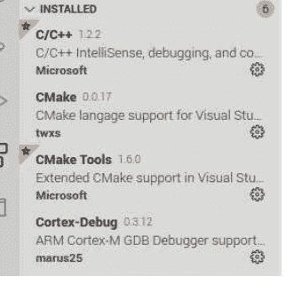

要创建一个新项目，先在 `pico` 目录下创建一个名为 `blinky` 的文件夹——它必须在 `pico` 目录内才能找到 SDK。接下来打开 VS Code，使用“文件，打开文件夹”（File, Open Folder）命令打开新建的 `blinky` 文件夹。使用“文件，新建”（File, New）命令和编辑器创建一个包含以下内容的 `blinky.c`：

```c
#include "stdio.h"

int main() {
    gpio_init(25);
    gpio_set_dir(25, GPIO_OUT);
    while (true) {
        gpio_put(25, 1);
        sleep_ms(500);
        gpio_put(25, 0);
        sleep_ms(500);
    }
}
```

虽然我们还没有探索如何使用 GPIO 线或 SDK 的任何方面，但你应该能够理解这个简单的程序。它利用 GPIO 引脚 25（它连接到板载 LED）来每半秒闪烁一次 LED。你可以看到有一个初始化引脚的调用，将其设置为输出，之后一个循环在每隔半秒暂停后将其设置为 1 和 0。

在一个简单的系统中，这就是你让设备闪烁所需的所有，但为 Pico 编写的程序使用了大量的代码库。最简单的方法是将你的程序链接到整个库并直接运行程序，但这将是非常低效的。我们实际上做的是使用一个构建系统，只编译库中实际发生变化并需要重新编译以及我们自己的代码，然后只链接我们使用的库部分，从而创建一个更高效的程序。唯一的问题是现在有了构建系统需要管理的复杂性。Pico 使用 CMake 系统。它接收项目规范并输出指令给低级构建工具以创建可执行程序。CMake 指令通常存储在项目根目录下的 `CMake.txt` 文件中。在这种情况下，我们需要一组描述项目并明确其使用 SDK 的简单指令。

在 `blinky` 文件夹中创建一个 `CMakeLists.txt` 文件并输入：

```cmake
cmake_minimum_required(VERSION 3.13)
include(pico_sdk_import.cmake)
project(blinky CXX ASM)
set(CMAKE_CXX_STANDARD 11)
set(CMAKE_CXX_STANDARD 17)
pico_sdk_init()
add_executable(blinky blinky.c)
target_link_libraries(blinky pico_stdlib)
```

这表明 CMake 的最低版本为 3.13。它包含了 `pico_sdk_import.cmake`，这必须复制到项目根目录。你可以从任何现有项目中获取它，但也可以从 `pico-sdk/external` 获取最新副本。

最后阶段是使用 VS Code 的 CMake 扩展首先配置然后构建项目。有许多启动项目构建的方法，但如果你选择 CMake 扩展并……那么所有命令都可用。

| 文件扩展名 | 描述 |
| --- | --- |
| .bin | 程序代码和数据的原始二进制转储 |
| .elf | 完整的程序输出，可能包含调试信息 |
| .uf2 | UF2 格式的程序代码和数据，当 RP2040 板板挂载为驱动器时可以拖入 |
| .dis | 编译二进制文件的反汇编 |
| .hex | 编译后的十六进制转储 |
| .map | 配合 .elf 的映射文件，描述链接器在内存中安排段的位置 |

“清理重建所有项目”（Clean Rebuild All Projects）选项会重建项目中的所有内容，包括 SDK 和自上次编译以来更改的文件。如果你点击“构建所有项目”（Build All Projects）图标，则只会重新编译上次编译以来更改的文件。这通常要快得多，除非由于文件不同导致某些功能无法运行，否则应使用此选项。

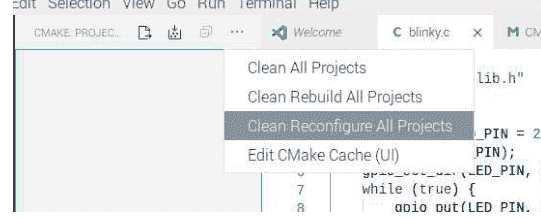

首次编译时，你会看到许多关于正在编译的内容等信息，这需要几分钟时间。在随后的构建中，已更改的文件会被重新编译，速度会快很多。编译完成后，你将在构建目录中找到结果。在此例中，你需要的文件是 `blinky.uf2`，可以通过将其拖放到已连接的 Pico 向开发机呈现的 USB 盘来运行。

运行程序最简单的方法是通过 USB 将 Pico 连接到开发机。USB 连接也会为 Pico 供电，为了让 Pico 向开发机呈现一个 USB 盘，你需要在通电时按住 USB 接口左侧的 BootSel 按钮。如果你操作正确，你将看到开发机添加了一个新驱动器，并且你需要提供密码来挂载它：

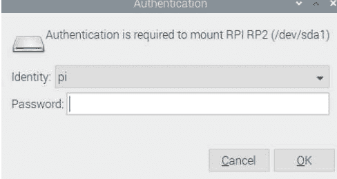

如果你没有看到这个对话框，说明你在通电时没有按住 BootSel 按钮。现在你可以拖放 `blinky.uf2` 文件，你应该能看到板载 LED 开始缓慢闪烁。

虽然这种运行程序的方法对于第一个程序是可行的，但它并不是开发 Pico 程序的可持续方法。有很多方法可以让工作变得更容易，例如连接一个复位按钮，无需断开电源即可重启 Pico。然而，这些方法都无法提供你快速测试程序修改所需的易用性，更不用说调试它们了。因此，花一点额外时间设置专用的调试连接是非常值得的。

虽然使用 USB 文件系统是运行第一个程序的合理方法，但它实际上无法胜任任何非复杂的程序开发。要做到这一点，你需要设置 SWD 连接。这种连接的优势是允许自动下载程序并进行调试。SWD（串行线调试）是一种在基于 Cortex M 处理器的设备（如 Pico）上下载和调试程序的标准协议。

Pico 在底部边缘有一个调试接口，由三个引脚组成：

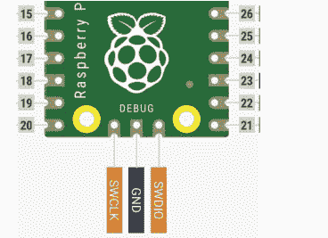

这是一个由地线、时钟线数据线组成的三线接口。它们必须连接到另一个 SWD 三线接口，或者连接到已编程作为 SWD 接口的三根通用 GPIO 线。

如果你使用 Pi 4 为 Pico 编程，那么三根 GPIO 线是更简单的选项。默认使用的引脚是 GND、GPIO24 和 GPIO25：

| Pi 4 | Pi Pico |
|---|---|
| GND (Pin 20) | SWD GND |
| GPIO24 (Pin 18) | SWDIO |
| GPIO25 (Pin 22) | SWCLK |

最好使用两个板子之间的直接跳线来连接它们，以确保没有噪声或干扰。为了方便起见，可以在远离原型引脚的板侧焊接三个引脚。

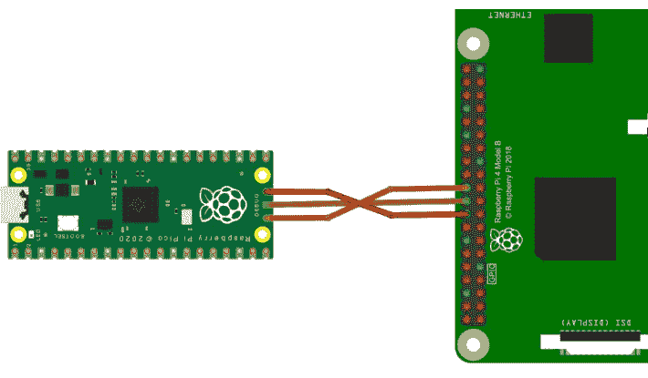

你还需要为 Pico 提供 USB 供电连接，但此 USB 连接不用于下载程序。一旦你通过这种方式连接了 Pico，就可以使用命令行进行测试。然而，直接切换到 VS Code 也非常容易，你可能想跳到那里：

`openocd -f interface/raspberrypi-swd.cfg -f target/rp2040.cfg -c "program /home/pi/pico/blinky/build/blinky.elf verify reset exit"`

这假设你之前已经编译了 `blinky` 程序，并且以用户 `pi` 身份登录。如果不正确，请更改命令。它还假设你已经安装了 `OpenOCD`。注意，SWD 下载使用的是 `.elf` 文件而不是 `.uf2` 文件。

最明智的做法是迁移到 VS Code，它让程序运行变得自动化，并提供了方便的调试功能。你只需要在 `.vscode` 文件夹中创建一个名为 `launch.json` 的文件，内容如下：

```json
{
  "version": "0.2.0",
  "configurations": [
    {
      "name": "Cortex Debug",
      "cwd": "${workspaceRoot}",
      "executable": "${command:cmake.launchTargetPath}",
      "request": "launch",
      "type": "cortex-debug",
      "servertype": "openocd",
      "gdbPath": "gdb-multiarch",
      "device": "rp2040",
      "configFile": [
        "interface/raspberrypi-swd.cfg",
        "target/rp2040.cfg"
      ],
      "svdFile": "${workspacePath}/src/rp2040.svd",
      "runToMain": true,
      "postCommands": [
        "break",
        "continue"
      ]
    }
  ]
}
```

接下来，你可以从下拉菜单中选择配置并开始调试。

如果两个 Pico 都已连接并供电，且 PicoProbe 通过 USB 连接到 PC，我们就可以开始使用 VS Code 来运行和调试新程序了。你需要做的就是在 `.vscode` 文件夹中创建一个名为 `launch.json` 的文件。

```json
{
  "version": "0.2.0",
  "configurations": [
    {
      "name": "Pico Debug",
      "cwd": "${workspaceRoot}",
      "executable": "${command:cmake.launchTargetPath}",
      "request": "launch",
      "type": "cortex-debug",
      "servertype": "openocd",
      "gdbPath": "arm-none-eabi-gdb",
      "device": "RP2040",
      "configFiles": [
        "interface/picoprobe.cfg",
        "target/rp2040.cfg"
      ],
      "svdFile": "${env:PICO_SDK_PATH}/src/rp2040/hardware_regs/rp2040.svd",
      "runToMain": true
    }
  ],
  "postRestartCommands": [
    "break main",
    "continue"
  ]
}
```

接下来，你可以选择调试配置。在左侧调试工具栏上点击标记为 `RUN` 的绿色小箭头。从下拉列表中选择 `Pico Debug`，你的程序就会被下载并运行：

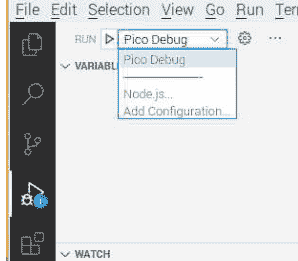

尽管程序已经下载并运行，但你不会看到发生什么变化，因为默认情况下它会在第一条指令处暂停。你会看到调试工具栏出现，这就是你需要用来调试程序的工具：

```c
blinky.c
blinky.c > main()
1 #include "pico/stdlib.h"
2
3 int main() {
4 const uint LED_PIN = 25;
5 gpio_init(LED_PIN);
6 gpio_set_dir(LED_PIN, GPIO_OUT);
```

要让程序运行起来，只需点击那个小图标。你也可以使用红色正方形图标停止程序，使用绿色箭头图标重启程序。你可以通过点击左侧边距在代码中设置断点。之后，程序将自动在断点处停止，并在左侧调试面板显示变量的当前状态。你还可以进行单步执行、进入调用的函数以及跳出任何调用的函数。所有这些都会显示变量的当前状态。注意，在重新构建并运行之前，你必须使用停止图标停止程序。

现在你拥有了一个可用的系统，允许你编辑、构建和调试 Pico 程序。你需要修改 `CMakeLists.txt` 文件以包含库的特定部分，但这属于标准的操作。

你可以通过手动修改和添加 `CMakeLists.txt` 文件来工作。然而，有一个用 Python 编写的自动项目创建工具，它可以为你生成一个完整的项目。你可以将生成的 `CMakeLists.txt` 复制到现有项目或用 VS Code 创建的文件夹中。

你可以使用以下命令在 Pi 4 上安装：

`git clone https://github.com/raspberrypi/pico-project-generator.git`

如果你使用了 Windows 安装脚本，那么它已经安装好了，你会在 `Pico\pico-project_generator` 中找到项目生成器，并在命令行运行它：

`pico-project.py --gui`

这将以 GUI 模式启动它：

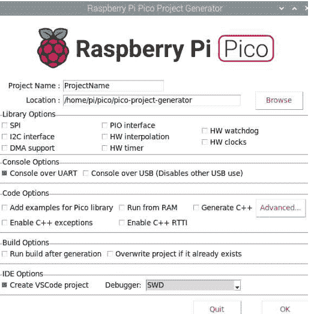

输入新项目的名称和位置，选择你需要的库，并勾选 `Create project` 选项，然后点击 `Create`。完成后，一个完整的项目就生成了。你可以直接在 VS Code 中打开该文件夹并开始开发。

（注：此处部分文本为乱码或重复占位符，已根据语境翻译或跳过）

（注：此处部分文本为乱码或重复占位符，已根据语境翻译或跳过）


首先要熟悉标准 Pico 面板上的引脚布局和可用的 GPIO 范围——某些兼容设备可能引脚布局不同。

在本章中，我们将查看使用 Pico 的通用输入输出（GPIO）线的基本操作，并重点关注诸如如何多快地更改 GPIO 线、如何产生给定持续时间的脉冲以及如何更改多条线等问题。

SDK 提供了许多 GPIO 函数，但最基础的是那些允许你操作单条 GPIO 行的函数。你通过编号（一个简单的整数）来引用所有 GPIO 行。当你使用以以下代码开头的 GPIO 行时，有四个重要的函数：

```c
void gpio_init(uint gpio)
```

该函数会初始化单行，使其能够作为软件控制的 GPIO 行工作（`GPIO_FUNC_SIO`）。它还被设置为输入模式，从硬件角度来看，这是一个安全的选项。

如果你想将某行设置为所有可能的模式之一，则使用：

```c
void gpio_set_function(uint gpio, enum gpio_function fn)
```

其中 `gpio_function` 是以下值之一：

| 值 | 说明 |
| :--- | :--- |
| `GPIO_FUNC_XIP` | QSPI 引脚的特殊功能 |
| `GPIO_FUNC_SPI` | SPI 总线 |
| `GPIO_FUNC_UART` | UART |
| `GPIO_FUNC_I2C` | I2C 总线 |
| `GPIO_FUNC_PWM` | PWM |
| `GPIO_FUNC_SIO` | 软件 IO 控制 |
| `GPIO_FUNC_PIO0` | 可编程 IO 控制 |
| `GPIO_FUNC_PIO1` | 可编程 IO 控制 |
| `GPIO_FUNC_GPCK` | GPIO 时钟 |
| `GPIO_FUNC_USB` | USB |
| `GPIO_FUNC_NULL` | 无 |

注意，并非所有的 GPIO 行都可以设置为任何特定功能。

`gpio_init_function` 将该行保持为输入状态。要显式地将某行设置为输入或输出，你可以使用：

```c
static void gpio_set_dir(uint gpio, bool out)
```

其中 `out` 设置为 `true` 表示输出，`false` 表示输入。

一旦你将行设置为输入，就可以使用：

`static bool gpio_get(uint gpio)`

读取该行，并使用：

`gpio_put(uint gpio, bool value)`

向该行写入。

还有许多其他 GPIO 函数，但这些是你与单条 GPIO 行进行简单 I/O 操作时需要的。

在入门部分我们已经编写了常见的闪灯程序，但一个闪烁 LED 的真实程序应该使用通用 I/O 行和外部 LED。考虑到这一点，让我们闪烁连接到 GP22 的 LED。

然后进入程序：

```c
#include "pico/stdlib.h"
int main()
{
    gpio_init(22);
    gpio_set_dir(22, true);
    while (true)
    {
        gpio_put(22, 1);
        sleep_ms(1000);
        gpio_put(22, 0);
        sleep_ms(1000);
    }
}
```

这使用了与上一章中 blinky 程序相同的 `CMakeLists.txt` 文件以及相同的 `launch.json` 文件。唯一的区别是现在我们正在使用 GP22。程序也没有使用任何常量，以便让发生的情况更加清晰。它首先初始化 GP22（将其设置为输入），然后设置为输出，并反复设置高电平和低电平。

如果你想连接一个 LED 来看到真正的“闪烁”，这是很容易的，但你需要一个限流电阻，以防止 LED 抽取的电流超过 Pico GPIO 行的供应能力，并可能损坏芯片。一个 $200\Omega$ 的电阻是一个很好的选择，见第 5 章。第 5 章将更详细地讨论驱动 LED 的更好方法。

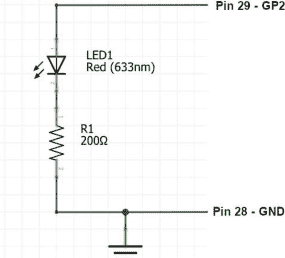

如何构建电路取决于你。你可以使用原型板或只用一对跳线。短脚和/或外壳侧面的扁平部分标记了负极连接。

你如何构建电路取决于你。你可以使用原型板或只用一对跳线。

- SDK 提供了许多 GPIO 函数，但这些是你与单条 GPIO 行进行简单 I/O 操作时需要的。
- 之前我们已经介绍了以下 GPIO 函数：`gpio_init`、`gpio_set_function`、`gpio_set_dir`、`gpio_get` 和 `gpio_put`。
- 还有许多 GPIO 函数。
- 所有的 GPIO 行都可以通过 `gpio_init` 初始化。
- 使用 `gpio_set_function` 设置 GPIO 行的功能。
- 使用 `gpio_set_dir` 设置输入或输出。
- 使用 `gpio_get` 读取 GPIO 状态，使用 `gpio_put` 写入状态。

到目前为止，这些函数允许我们一次更改一个行。如果你想一次更改多个行，那么有一系列函数。

假设你想一次更改多个引脚的状态。你可以使用位掩码。例如，如果你想将引脚 22 和 23 设置为高电平，你需要创建一个掩码：

```c
uint32_t mask = (1 << 22) | (1 << 23);
```

然后你可以配合以下函数使用这个掩码：

```c
gpio_put_mask(mask, 0xFFFFFFFF);
```

这将同时置高引脚 22 和 23。要清除它们，你可以使用：

```c
gpio_clr_mask(mask);
```

要翻转它们，你可以使用：

```c
gpio_xor_mask(mask);
```

你可以使用 `gpio_put_masked` 将多行的状态更改为不同的值。例如：

```c
uint32_t mask = (1 << 3) | (1 << 5);
uint32_t value = 1 << 5;
gpio_set_dir_masked(mask, value);
```

这将引脚 3 设置为低电平，引脚 5 设置为高电平，因为 mask 指定了这些引脚，且在 value 中对应引脚 3 的位为 0，对应引脚 5 的位为 1。注意，value 中与 mask 中设为 1 的位不对应的位状态没有影响。

当你想要对多个 GPIO 行进行更改时，掩码函数非常有用，请见后文。在早期阶段值得注意的是，你可以在一次操作中设置一组引脚，也可以在一次操作中取消一组引脚，但如果你想设置某些引脚而改变其他引脚，始终是两个独立的操作。

除了掩码函数外，还有三个对所有 GPIO 行操作的函数。你可以使用：

```c
static void gpio_set_dir_all_bits(uint32_t values)
```

来一次性设置所有 GPIO 行的方向。该函数：

```c
static uint32_t gpio_get_all(void)
```

以 29 位值返回所有行的当前状态，并且：

```c
static void gpio_put_all(uint32_t value)
```

设置所有 29 行的状态。这些函数偶尔有用。

对于任何旨在用于嵌入式或 IoT 项目的处理器，你必须回答的一个基本问题是：GPIO 行的工作速度有多快？

有时答案并不那么重要，因为你想执行的操作运行较慢。任何对几十毫秒级响应时间感到满意的应用程序通常可以在任何处理器上运行。然而，如果你想实现自定义协议或任何需要微秒、甚至纳秒级响应的东西，这个问题就变得非常重要。

如果你有逻辑分析仪或示波器，要发现单个 GPIO 行的使用速度有多快是非常容易的。你只需要运行该程序：

```c
#include "pico/stdlib.h"
int main() {
    gpio_set_function(22, GPIO_FUNC_SIO);
    gpio_set_dir(22, true);
    while (true) {
        gpio_put(22, 1);
        gpio_put(22, 0);
    }
}
```

然而，为了获得最好的结果，你必须将程序编译为 Release 版本。点击状态栏上的 CMake 项，并在下拉菜单中选择你想要的构建类型：


当你运行程序时，你将不会看到任何与 C 程序相关的调试信息，只有它生成的汇编代码。

如果你这样做，脉冲的宽度为 50ns —— 这与 Pi Zero 或 Pi 4 上类似程序产生的 70ns 相比良好。由于中断或软件系统没有产生主要异常，但脉冲成对出现，且之间带有一个长长的 200ns 间隙：

| 时间 | +200ns | +400ns | +600ns | +800ns | 时间 | +200ns | +40ns |
| :--- | :--- | :--- | :--- | :--- | :--- | :--- | :--- |
| 157.866ms | | | | | 157.869ms | | |
| 测量值 | 宽度: 50ns | | | | | | |
| | 周期: 250ns | | | | | | |
| | 占空比: 20% | | | | | | |

与 Pi Zero 或 Pi 4 产生差异的原因可能是因为执行循环的时间更长且多变。这两条指令：

```c
gpio_put(22, 1);
gpio_put(22, 0);
```

在非常短且规律的时间内连续发生，但返回循环开头的更为复杂且需要更多时间。你可以通过交换指令顺序来观察这一点：

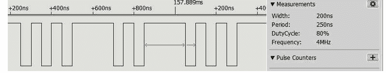

现在你可以看到脉冲串的高部分更长且变化更大，这是因为设置回状态需要等待循环重复。当你使用的接近处理器能处理的最快定时时，必须考虑不同指令所需的时间。

### 包含暂停

为了生成已知持续时间的脉冲，我们需要在状态更改之间暂停程序。我们已经使用 `sleep_ms` 来减慢速度，但 SDK 提供了一系列不同的函数来为程序添加暂停。这些函数分为两类：sleep 函数和 busy_wait 函数。`sleep` 函数通过将处理器置于低功耗状态，直到时间到达处理器唤醒并程序继续运行。`sleep` 函数唯一的问题是唤醒需要时间，且它们产生的时间只保证比指定的时间短。`busy_wait` 函数让处理器保持活跃并消耗功率，因此它们通常更准确。

这两组函数非常相似：

```c
sleep_us(uint64_t us)
busy_wait_us(uint64_t delay_us)
```

两者都等待指定的微秒，但 `sleep_us` 节省电，`busy_wait` 不会但更准确。还有一个 32 位的 `busy_wait` 版本更加方便：

```c
busy_wait_us_32(uint32_t delay_us)
```

这两种方法之间的差异只在极短的延迟下产生。

如果你需要毫秒级的暂停，应该使用：`sleep_ms(uint32_t ms)`

这里没有等效的 `busy_wait`，因为如果你想暂停毫秒，可能会节省电，因为暂停将精确到微秒。

还有两个函数让你设置暂停直到系统时间达到给定值：

```c
sleep_until(absolute_time_t target)
busy_wait_until(absolute_time_t t)
```

为了比较这两种方法，你可以尝试：

```c
#include <pico/stdlib.h>
int main() {
    gpio_set_function(22, GPIO_FUNC_SIO);
    gpio_set_dir(22, true);
    while (true) {
        gpio_put(22, 1);
        sleep_ms(1);
        gpio_put(22, 0);
        sleep_ms(1);
    }
}
```

## 相位脉冲

作为使用输出函数的一个简单示例，让我们尝试编写一个短程序，产生两条错位的高、低电平脉冲。

完成此任务的最简单程序是：

```cpp
#include "pico/stdlib.h"
int main() {
    gpio_set_function(22, GPIO_FUNC_SIO);
    gpio_set_dir(22, true);
    gpio_set_function(21, GPIO_FUNC_SIO);
    gpio_set_dir(21, true);
    while (true) {
        gpio_put(22, 0);
        gpio_put(21, 1);
        gpio_put(22, 1);
        gpio_put(21, 0);
    }
}
```

注意，循环中没有延迟，脉冲以最快的速度产生。

使用逻辑分析仪可以发现，结果并非你所预期的：

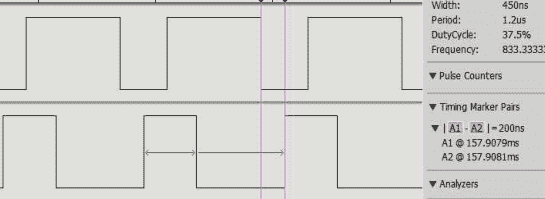

顶部的波形开启时，底部的波形在大约半个脉冲后关闭，尽管意图是让这两个动作同时发生。关键点在于，访问和更改输出引脚的状态需要相当长的时间。

当然，如果我们包含一个延迟来增加脉冲宽度，那么由于两次独立操作访问 GPIO 引脚引起的延迟就不那么明显了，但它仍然存在。在某些应用中，切换速度非常低，切换之间的延迟可以忽略不计——例如闪烁 LED。在第一个和最后一个 LED 之间的延迟变得明显之前，你可以闪烁 800,000 个 LED。另一方面，如果你使用相位脉冲来控制电机，那么当两个 GPIO 引脚都开启时的重叠会很快烧毁驱动器。当然，任何明智、谨慎的工程师都不会从两个独立生成的脉冲流向电机控制桥供电，除非保证它们不会同时开启桥路的两侧。

产生相位脉冲的更好方法是使用掩码函数。例如，如果你将第一个程序改为：

```cpp
#include <pico/stdlib.h>
int main() {
    gpio_set_function(22, GPIO_FUNC_SIO);
    gpio_set_dir(22, true);
    gpio_set_function(21, GPIO_FUNC_SIO);
    gpio_set_dir(21, true);

    uint32_t mask = (1 << 22) | (1 << 21);
    uint32_t value1 = 1 << 21;
    uint32_t value2 = 1 << 22;
    while (true) {
        gpio_put_masked(mask, value1);
        gpio_put_masked(mask, value2);
    }
}
```

现在两个 GPIO 引脚被设置为同时更改，而且速度甚至更快：

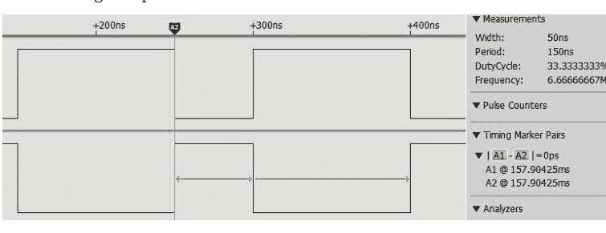

原因是掩码操作通过向寄存器中设置一个值来一次性更改所有相关的 GPIO 引脚。因此，该操作不仅是同步的，而且更快，因为设置两个 GPIO 引脚是一次操作，而不是两次操作。

### 覆盖

有三个函数可以改变 GPIO 引脚的工作方式。它们覆盖了正常操作——因此有了这些名称：

```c
gpio_set_outover(uint gpio, uint value)
gpio_set_inover(uint gpio, uint value)
gpio_set_oeover(uint gpio, uint value)
```

第一个覆盖输出行为，第二个覆盖输入，第三个覆盖启用。该值可以是以下任意一种：

| GPIO | 说明 |
| :--- | :--- |
| `GPIO_OVERRIDE_NORMAL` | 通过 `gpio_set_function` 选择外设信号 |
| `GPIO_OVERRIDE_INVERT` | 通过 `gpio_set_function` 选择反转外设信号 |
| `GPIO_OVERRIDE_LOW` | 驱动低电平/禁用输出 |
| `GPIO_OVERRIDE_HIGH` | 驱动高电平/启用输出 |

例如：

```c
gpio_set_outover(22, GPIO_OVERRIDE_INVERT)
```

将 GP22 设置为反输出，使得 0 设置引脚为高电平，1 设置为低电平。

### 总结

- 输出很容易，因为程序决定了何时更改引脚状态。输入很难，因为你永远不知道输入引脚何时会改变状态。
- GPIO 引脚可以被设置为输入或输出。
- 如果引脚设置为输出，可以使用 `put` 函数将其设置为高电平或低电平。
- 你可以使用掩码指示要更改哪些引脚，从而在一个操作中设置或清除一组 GPIO 引脚。
- 你可以产生短至 50ns 的脉冲，但不可靠。
- 使用 `sleep` 或 `busy_wait` 函数可以在程序中引入延迟。
- 可以 `sleep_until` 和 `busy_wait_until` 为一组指令创建固定的时间，无论它们在给定时间内执行需要多长时间。
- 替代方法是使用忙等待循环，它只是一个让 CPU 忙碌一段时间的循环。很容易获得一个关于循环的公式。
- 如果你使用忙等待，应该创建一个根据给定时间计算循环的函数。
- 产生相位脉冲是困难的，但可以通过基于掩码的操作完成。
- 你可以使用 `over` 函数覆盖 GPIO 引脚的通常行为。

# 第5章 基础电子学

现在我们查看了简单的 I/O，值得花一点时间了解输出和输入的电子学。在查看软件之前，我们需要理解软件处理的问题。

首先是一些基础电子学——晶体管可以作为开关使用。方法非常简单，但对于设计高质量的音频放大器或模拟设备来说，这还不够。

所有电子学的基础是欧姆定律，$V = IR$，这暗示了对电压、电流和电阻的理解。


当你使用 LED 时，需要查阅它的正向电压降（红色 LED 约 1.7V 到 2V，蓝色 LED 约 3V）以及最大电流（小 LED 通常为 20mA）。你不需要使用指定的电流，这是最大电流和最大亮度。

## 驱动 LED

你需要学会的第一件事之一是计算限流电阻的值。例如，如果你将 LED 连接在 GPIO 引脚和地之间，当引脚为低电平且 LED 关闭时，没有电流流动；但当引脚为高电平（3.3V）时，电流极可能会超过安全限制。

LED 是一种非线性电子元件——跨接元件的电压与通过元件的电流大致相同。将其与更普通的线性（或“欧姆”）元件进行比较，后者的电流和电压根据欧姆定律共同变化。`$V = IR$`，这意味着如果电流翻倍，电压也会翻倍，反之亦然。

这不是 LED 的行为方式。它具有一个相当恒定的电压降，无论电流如何。（如果你了解，LED 的电流和电压之间的关系是指数级的，这意味着电流的大幅变化几乎不改变 LED 两上的电压。）

要计算限流电阻，你只需要计算电阻两端的电压，然后使用欧姆定律得到所需电流的电阻。LED 决定了电压，而电阻设定了电流。

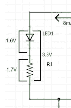

一个 GPIO 引脚提供 3.3V 电压，假设 LED 的正向电压为 1.6V，那么在 LED 上的减去 1.6V 后，限流电阻两端将留下了 1.7V，因为电压会自动分布在串联的元件上。如果我们将电流限制在 8mA（这是一个非常保守的数值），那么我们需要的电阻计算如下：

`R = V/I = 1.7/8 = 0.212`

结果的单位是千欧（kΩ），因为电流单位是毫安（mA）。因此，我们需要至少 212Ω 的电阻。在实践中，只要电阻在 200 欧姆左右，你就可以使用一系列数值——电阻越大，电流越小，但 LED 也就越暗。如果你正在使用多个 GPIO 引脚，将电流保持在 1mA 或 2mA 会更好，但这需要一个晶体管。

在驱动其他类型的输出设备时，你需要进行此类计算。步骤总是相同的。3.3V 电压按某种比例分布在输出设备和电阻上，我们知道最大电流——通过这些值我们可以计算出所需的电阻，以保持实际电流低于该值。

### LED BJT 驱动

通常你需要减少从 GPIO 引脚抽取的电流。双极结型晶体管（BJT）可能是一项相对传统的技术，但它是一种电流放大器，成本低且易使用。

BJT 是一个三端器件——基极、发射极和集电极——流过发射极/集电极的电流由基极的电流控制：

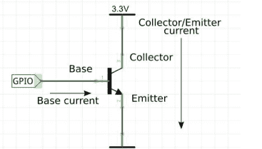

该图显示的是 NPN 晶体管，这是最常见的类型。这个图是一个简化，因为在现实中，发射极电流略大于集电极电流，因为你必须加上流向基极的电流。

在大多数情况下，你只需要另外两个事实。首先，基极电压约为 0.6V，无论电流多大，基极都是一个二极管，和上一节中的 LED 一样是非线性器件。其次，集电极/发射极电流是基极电流的 `hfe` 或 `β`（beta）倍。也就是说，`hfe` 或 `beta` 是晶体管的增益，你可以在任何想要使用的晶体管中查询该值。在查阅数据表时，你还需要检查该设备能够承受的最大电流和电压。在大多数情况下，`beta` 介于 100 到 200 之间，因此你可以使用晶体管将 GPIO 电流放大至少 100 倍。

注意，为了使发射极/集电极电流不为零，基极必须有电流流入。如果基极连接到地，则晶体管处于“截止”状态，即没有电流流过。这意味着当 GPIO 引脚为高电平时，电流是“开启”的并正在流动；而当 GPIO 引脚为低电平时，晶体管是“关闭”的，没有电流流动。这种“高开低关”的行为是 NPN 晶体管的典型特征。

PNP 晶体管的工作原理相反：

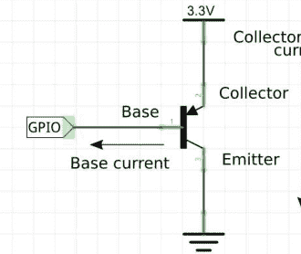

0.6V 位于基极和发射极之间，电流从基极流出。在这种情况下，为了开启晶体管，必须将基极连接到地。这意味着当 GPIO 引脚为高电平时，晶体管是关闭的；当 GPIO 引脚为低电平时，晶体管是开启的。

NPN 和 PNP BJT 的这种互补行为非常有用，意味着我们可以成对使用此类晶体管。同样值得知道，上面给出的图通常将 0V 画在图上方（即垂直翻转），以使其看起来与 NPN 图相同。你始终需要确保自己知道 +V 线在哪里。

### BJT 示例

为了一个简单的示例，我们需要将一个标准 LED 连接到具有全 20mA 驱动能力的 GPIO 引脚上。考虑到树莓派的所有 GPIO 引脚工作电压为 3.3V 且理想情况下电流只有几毫安，我们需要一个晶体管来驱动通常抽取 20mA 的 LED。

你可以使用某种场效应晶体管（FET），但对于这类应用，老式的 BJT 效果良好，且廉价并提供直插式封装（即带导线）。几乎任何通用 NPN 晶体管都可以工作，但 `2N2222` 非常常见。从它的数据表中你可以发现最大集电极电流为 800mA，`beta` 至少为 50，这使其适合驱动一个 20mA 的 LED，此时 GPIO 电流为 `20/50mA = 0.4mA`。

电路非常简单，但我们需要两个限流电阻：

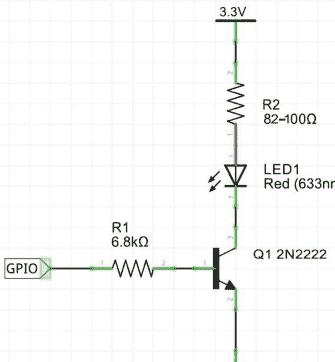

如果你将基极连接到具有 20mA 驱动能力的 GPIO 引脚...（此处省略重复逻辑）

### MOSFET LED

使用 BJT 是驱动 LED 最简单的方法，但作为使用常用 MOSFET 的示例，我们可以安排使用 `2N7000` 来驱动 LED，这是一种低成本的 N 沟道器件，采用标准的 TO92 封装，非常适合实验：

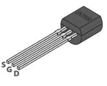

其数据表表明，它的栅极开启电压值 `VGS(th)` 通常为 2V，但可能低至 0.8V 或高至 3V。鉴于我们正尝试使用 3.3V 的栅极电压，你可以看到在最坏的情况下这很难工作——该器件将仅仅能够开启。你能做的最好的方法是买一批 `2N7000` 并测量它们的 `VGS(th)`，以剔除任何值过高的器件。尽管如此，在实践中，提供的电路通常可以工作。

假设 `VGS(th)` 为 2V，LED 电流为 20mA，数据表给出在栅极电压为 3V 时，导通电阻的值为 6Ω。限流电阻的计算与 BJT 情况相同，最终电路如下：

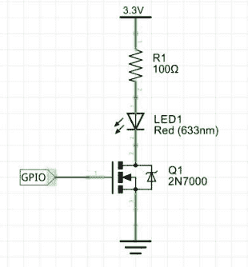

注意，我们不需要为 GPIO 线准备限流电阻，因为栅极连接是高阻抗，不会消耗太多电流。在实践中，如果你计划快速开启和关闭它，在 GPIO 线中包含一个限流电阻通常是一个好主意。问题是栅极看起来像一个电容器，电压的快速变化会产生大电流。注意，可能会有标记为 `2N7000` 的器件由于阈值栅极电压太高而在此电路中无法工作，但遇到这种情况很罕见。

像 `IRLZ44` 这样的逻辑电平 MOSFET 在 5V 下的电阻为 0.028Ω，而 `2N2222` 则为 6Ω。它还保证 `VGS(th)` 在 1V 到 2V 之间。那么它将是该电路的更好的候选者。

### 设置驱动类型

GPIO 输出可以配置为多种模式之一，但最重要的是拉上/拉下。在我们开始编写执行任务的代码之前，值得花一点时间解释一下三种基本的输出模式：推挽、拉上和拉下。

### 推挽模式 (Push-Pull Mode)

在推挽模式下，使用了两个极性相反的晶体管，一个 PNP 和一个 NPN：

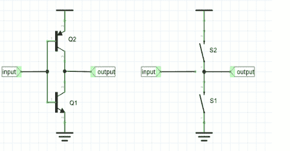

该电路的行为类似于右所示的双开关等效。在任何时刻，只有一个晶体管（或开关）是“导通”的。如果输入为高电平，Q1 饱和且输出连接到地——就像 S1 闭合一样。如果输入为低电平，则 Q2 饱和，就像 S2 闭合且输出连接到 3.3V。你可以看到，它将输出线推高所需的“力”与将其拉低的“力”是相同的。这是 GPIO 输出的标准配置。

### 拉上模式 (Pull-Up Mode)

在拉上模式下，一个晶体管被电阻取代：

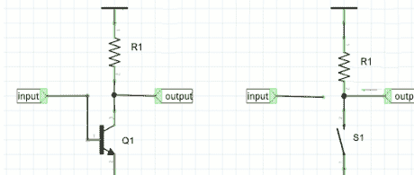

在这种情况下，电路等同于有一个单个开关。当开关闭合时，输出线连接到地，因此被驱动为低电平。当开关打开时，输出线通过电阻被拉高。这种模式的优势是它可以用于 AND（与逻辑）配置。如果多个 GPIO 或其他线连接到输出，那么其中任何一个线变为低电平都会将输出线拉低。只有当所有线都关闭时，电阻才能成功将线路拉高。这被用于例如 I2C 总线之类的串行总线配置。

### 拉下模式 (Pull-Down Mode)

最后是拉下模式，它是驱动通用负载、电机、LED 等的最佳模式，它与拉上模式完全相同，只是现在电阻被用于将输出线拉低。

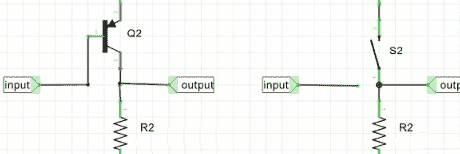

线路由晶体管保持高电平，只有当所有开关都打开时才由电阻拉低。反过来，如果任何一个开关闭合，线路就是高电平。这是共享总线概念 OR（或逻辑）版本。

### 设置输出模式

设置 GPIO 线的模式有三个函数：

- `gpio_pull_down(uint gpio)`
- `gpio_pull_up(uint gpio)`
- `gpio_set_pulls(uint gpio, bool up, bool down)`

默认情况下，线路被配置为输入，并启用了 50kΩ 到 80kΩ 之间的拉下。拉上电阻也在 50kΩ 到 80kΩ 之间。注意 `gpio_set_pulls` 函数允许你同时设置上拉和下拉，导致拉上和拉下电阻都被启用。

如果你想要纯粹的推挽模式，可以使用以下代码关闭电阻：

- `gpio_disable_pulls(uint gpio)`

最后，你可以测试 GPIO 线是处于拉上模式还是拉下模式：

```
static bool gpio_is_pulled_up(uint gpio)
static bool gpio_is_pulled_down(uint gpio)
```

### 基本输入电路 - 开关

现在是时候关注 GPIO 线路作为输入时的电气特性了。常见的输入电路之一是开关或按钮。

许多初学者会犯一个错误，将 GPIO 线连接到开关上，如下所示：

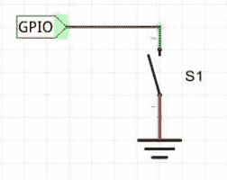

这种做法的问题是，如果开关被按下，GPIO 线连接到地，读取结果为零。问题是，当开关打开时会怎样？一个配置为输入且没有拉上的 GPIO 线是悬空的。没有启用拉上或拉下的 GPIO 线配置为输入时，其读取值取决于浮空程度。当开关打开时，线路是高电平，但会受到干扰。这种术语是线路“悬空”的。

执行这项任务正确的方法是使用拉上电阻，这样当开关打开时，线路为高电平，如下所示：

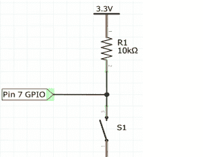

电阻的值并不关键。当开关按下时，电阻中流过大于 0.3mA 的电流。如果这太大，请增大电阻到 100kΩ——注意，这按下时结果为零。

如果你想要一个拉低而不是拉高的开关，请通过交换图中电阻和开关的位置来创建拉下：

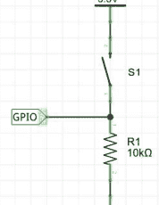

注意，这按下时结果为一。

好消息是 Pico 默认具有 50k 的输入拉下配置。

### 去抖 (Debounce)

虽然开关是最简单的输入设备，但很难处理好。当用户点击任何类型的开关时，动作并不是干净的——开关会抖动。这意味着 GPIO 线上的逻辑电平会在高、低、高之间跳变，直到稳定下来。有电子去抖的方法，但软件的效果更好。你只需要在检测到开关按下后插入一个毫秒的延迟并再次读取线路——如果它仍然是低电平，则记录一次开关按下。同样，当开关释放时，延迟后读取状态。你可以改变延迟来修改对开关特性的感知。

更复杂的算法基于积分思想来去抖开关，例如每隔几毫秒采样一次，并保持一个运行和。如果你累加十个值，总和为 6 到 10 可以被视为开关高电平的指示。小于此的总和表示开关为低电平。你可以将其认为是在时间内对开关高或低电平进行的多数投票。

### 分压器

如果你的输入不在 0V 到 3.3V 的范围内，那么你可以使用简单的分压器来降低电压。在图中，`V` 是来自外部逻辑的输入，`Vout` 是连接到 GPIO 输入线的：

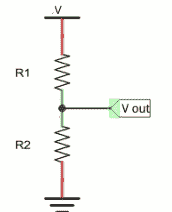

`Vout = V * R2 / (R1 + R2)`

你可以花费大量时间来寻找 `R1` 和 `R2` 的良好值。对于电流较大的负载，你需要 `R1 + R2` 较小，且比例与电压相同。

例如，对于 5V 设备，`R1 = 18kΩ` 或 `20kΩ` 配合 `R2 = 33kΩ` 可以很好地将电压降至 3.3V。

对于 5V 信号，更简单的方法是注意到比例 `R1:R2` 必须与 `(5-3.3):3.3` 相同，电压根据其阻值按比例分配在各个电阻上，这大约是 1:2。这意味着你可以取任何电阻作为 `R1`，并使用两个相同阻值的电阻串联作为 `R2`，输出电压 `Vout` 将恰为 3.3V。

电阻分压器的问题在于，由于细微的电容效应，它可能会在快速脉冲下失效。这通常不是一个问题，但如果是的话，那么解决方案是使用 FET 或 BJT 作为主动缓冲器：

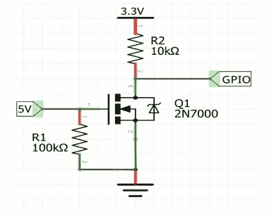

注意这是一个反相缓冲器，当输入为高电平时，输出为低电平，但你通常会忽略这一点，只需在软件中进行修正，即：读取 1 为低电状态，读取 0 为高电状态。`R1` 的作用是确保在没有 5V 信号时 FET 关断，而 `R2` 则限制 FET 中的电流约为 0.3mA。在大多数情况下，你应该尝试简单的电压分压器，如果不起作用，再转向主动缓冲器。

这种对电子学的初步了解并非你需要知道的全部，但足以让你看到一些问题并找到一些答案。通常情况下，这类电子学的关键在于确保电压和电流在限制范围内。随着开关速度的增加，你还会面临额外的问题，这些主要涉及确保你的电路不会减慢速度。这里情况就会变得更加微妙。

### 总结

- 仅凭对电子学的浅显了解就能走很远，但你需要具备足够的知识来保护 Pico 以及连接到它的设备。
- 任何 GPIO 引脚的最大电流应小于 12mA，总电流应小于 30mA。
- 所有 GPIO 引脚的工作电压为 3.3V，你应避免连接其他电压。
- 你可以直接从 GPIO 引脚驱动 LED，但电流仅为 16mA，而不是满亮度所需的额定 20mA。
- 计算限流电阻始终遵循相同的步骤：找出设备的电流，找出跨越设备的电压，然后计算出当剩余电压加在电阻上时提供该电流的阻值。
- 对于任何连接到 GPIO 输出的负载，你通常需要一个限流电阻。
- 在许多情况下，你需要晶体管（BJT）来增加 GPIO 引脚提供的电流。
- 要使用 BJT，你需要在基极使用一个限流电阻，通常在集电极处也需要一个。
- MOSFET 是 BJT 的流行替代方案，但很难找到在 3.3V 下工作稳定的 MOSFET。
- GPIO 输出可以设置为激活推挽模式（在该模式中使用晶体管将线路拉高或拉低），或者设置为被动上拉或下拉模式（其中使用一个晶体管，当晶体管未激活时由一个电阻将线路拉高或拉低）。
- GPIO 引脚具有内置的上拉和下拉电阻，可以在软件控制下进行选择或禁用。
- 作为输入时，GPIO 引脚具有很高的电阻，在大多数情况下，你需要上拉或下拉电阻来防止线路浮空。
- 内置的上拉或下拉电阻可用于输入模式。机械输入设备必须经过去抖处理以停止产生虚假输入。
- 如果你需要将输入连接到比 3.3V 更高的电压，那么你需要一个分压器将电压降回 3.3V。你也可以使用晶体管。

# 第 6 章

## 简单输入

毫无疑问，输入比输出更困难。当你需要驱动线路拉高或拉低时，你可以控制它的发生时间，但输入掌握在外部手中。如果你的程序没有准备好读取输入，或者在错误的时间读取了它，事情就无法进行。更糟糕的是，你完全不知道程序相对于你试图捕获的事件在做什么。欢迎来到输入的世界。

在本章中，我们将介绍输入的最简单方法——轮询循环（polling loop）。这可能很简单，但它是处理许多任务的好方法。在第 8 章中，我们将查看更复杂的替代方案——事件和中断。

### GPIO 输入

从测量和验证的角度来看，GPIO 输入是一个比输出困难得多的问题。对于输出，至少你可以在逻辑分析仪上看到信号的变化，并知道它发生的精确时间。这使得追踪时序问题并以高精度进行微调成为可能。

相反，输入是“静默”且不可观测的。你什么时候读取线路状态的？通常，线路的时机相对于设备采取的某个其他动作。例如，你在设置输出线路为高 20µs 后读取输入线路。但你如何知道输入线路在 20 微秒后何时改变状态的？简单的答案是：在大多数情况下，你不知道。

在某些应用中，时间很长且/或不重要，那时我们可能需要一些监控和控制事件的策略。通常的法则是假设读取 GPIO 线路花费的时间与设置它的时间一样。


该程序简单地测试开关关闭时电平是否拉低，并将 GP21 设置为高电。如果你将 GP21 连接到 LED 或逻辑分析仪，你将看到按钮按下后的效果——按下按钮时 LED 会亮起。注意 GP22 会变为低电，表示开关被按下。

如果你将 `gpio_pull_up(21)` 更改为 `gpio_pull_down(21)`，开关的连接方式将变为：

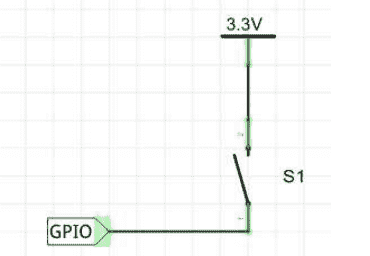

程序仍然可以工作，但现在当开关按下时 GP21 为高电，因此当开关未被按下时 LED 是开启的。

你应该使用内部电阻还是外部电阻？答案是，只要有电阻，这并不重要。使用内部电阻唯一的问题是，软件可能未能设置上拉/下拉模式，导致输入处于浮空。

此外，注意这个开关输入没有进行去抖。最简单的方法是在再次采样线路之前在循环中包含一个时间延迟。

```c
#include "pico/stdlib.h"
int main() {
    gpio_set_dir(21, GPIO_FUNC_SIO);
    gpio_set_dir(22, false);
    gpio_pull_down(21);

    gpio_set_function(22, GPIO_FUNC_SIO);
    gpio_set_dir(22, true);
    gpio_put(22, 0);
    while (true) {
        while (gpio_get(21)==0) {
        }
        while (gpio_get(21) == 1) {
        }
        gpio_put(22, 1);
        sleep_ms(1000);
        gpio_put(22, 0);
    }
}
```

如果你想响应按钮按下（即按下和释放事件），那么你必须测试双重跳变：

在这种情况下，如果你想避免对用户感知的单次按下产生两次响应，你真的需要去抖延迟。1 毫秒的延迟可能是产生按钮感觉工作良好的最小延迟。在实践中，你必须根据所使用的按钮机制以及允许按钮每秒被按下的次数来调整延迟。

## 按下或长按

你可以继续阐述如何响应按钮。例如，大多数用户已经习惯了这样观点：按住按钮比按下的时间长会发生不同的事情。要区分按下和长按，你只需要对线路变低和变高之间的时间差进行计时：

```c
#include "pico/stdlib.h"
int main() {
    gpio_set_function(21, GPIO_FUNC_SIO);
    gpio_set_dir(21, false);
    gpio_pull_down(21);

    gpio_set_function(22, GPIO_FUNC_SIO);
    gpio_set_dir(22, true);
    gpio_put(22, 0);

    uint64_t t;
    while (true) {
        while (gpio_get(21) == 0) {
            t = time_us(64);
            sleep_ms(1);
        }
        while (gpio_get(21) == 1) {
            t = (uint64_t)(time_us(64) - t);
        }
        if (t < 2000*1000) {
            gpio_put(22, 1);
            sleep_ms(1000);
            gpio_put(22, 0);
        }
        else {
            for (int i = 0; i < 10; i++) {
                gpio_put(22, 1);
                sleep_ms(100);
                gpio_put(22, 0);
                sleep_ms(100);
            }
        }
    }
}
```

在这种情况下，按钮按钮 2 秒记录“长按”——LED 闪烁 10 次；任何更短的时间都是“按下”——LED 闪烁一次。注意按下和释放之间的 1ms 去抖暂停。这些程序的问题之一是，它们在等待按钮被按下或长按，这使得它们很难执行其他事情。你必须在等待按钮的循环中包含程序需要执行的内容。你可以通过临时方法这样做，但最好的方法是实现有限状态机，见后文。

## 串口数据

在下一个项目中，我们需要收集一些数据，最简单的方法是在 Pico 和主机之间使用串口连接。该主题将在第 16 章中详细介绍。如果你在实现方面遇到任何问题，请阅读设置 UART 的部分。这是简单版本，并且应该“可以直接工作”。

Pico 有双 UART，连接到引脚 GP0 TX 和 GP1 RX。你只需要将 RX/TX 引脚连接到主机的相应 TX/RX 引脚。对于使用 Raspberry Pi 作为开发系统的情况，你需要一个适配器——通常是 USB 转串口。你可以将 Pico 的 GPIO 线接到 Pi 的：

| Raspberry Pi | Raspberry Pico |
|---|---|
| GND (Pin 14) | GND (Pin 3) |
| GPIO15 (UART RX, Pin 10) | GP0 (UART0, Pin 1) |
| GPIO14 (UART TX, Pin 8) | GP1 (UART0, Pin 2) |

如果你已经通过接口连接了 Pico 和 Pi，你不需要连接 GND。只需要连接 Pin 1 和 Pin 10。

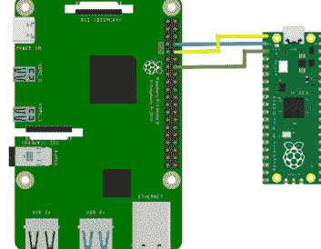

硬件设置是简单的，但你还需要使用：

```bash
sudo raspi-config
```

在 Pi 上设置串口。选择 Interfaces，然后禁用 Linux Shell 并启用串口。系统将重启。之后你可以使用 `serial0` 与连接到串口的设备通信。

要建立连接，使用：

```bash
sudo minicom -b 115200 -D /dev/serial0
```

注意可以在 VS Code 的终端窗口中这样做，这是最好的工作方式。

## 我们能测量多快？

按钮是输入的一种，但我们通常想要从电子设备驱动的 GPIO 线读取数据并解码。这通常意味着测量脉冲宽度，这引发了一个问题：我们接受输入有多快？

快速判断我们能否进行测量的最简单方法是执行脉冲宽度测量。通过对 GP22 应用方波，我们可以测量测量高电的时间：

```c
#include <stdio.h>
#include "pico/stdlib.h"

int main() {
    stdio_init_all();
    gpio_set_function(22, GPIO_FUNC_SIO);
    gpio_set_dir(22, false);
    uint64_t t;

    while (true) {
        while (gpio_get(21) == 0) {
            t = time_us(64);
        }
        while (gpio_get(21) == 1) {
            t = (uint64_t)(time_us(64) - t);
            printf("%llu\n", t);
            sleep_ms(1000);
        }
    }
}
```

这起初看起来有点奇怪。我们先循环直到它变低，然后循环高电，最后测量变低之前持续了多久。你可能认为我们只需等待它变高，然后测量到它变低，但这忽略了信号在我们第一次测量时可能正处于中间状态。这可以测量到 1 微秒，低端精度为 0.5µs。注意，在任何情况下，如果你尝试测量远短工作下限的宽度，你将得到看起来更长的脉冲结果。原因仅仅是 Pico 会错过第一次跳变而检测到第二次、第三次或更后的跳变。这是傅里叶变换或通用信号处理中混叠效应的数字效应。

## 有限状态机

如果你正在处理一个需要处理一组复杂的输入输出线路的应用程序，那么你需要一个组织原则来让你免受复杂性的影响。当你刚开始编写响应外部世界的 IoT 程序时，你会发现你所有的程序都采取简单的形式：

- for{
  等待某些输入线路
  处理输入数据
  写入某些输出线路
  等待某些输入线路
  读取更多输入线路
  写入某些输出线路
}

对于大多数程序员来说，这是一个稍微令人不安的发现，因为程序并不被建议由无限循环组成，但 IoT 程序在原则上（即使在实践中并非如此）几乎总是采用轮询循环的形式。第二个也是更重要的方面是，读取和写入 GPIO 线路的方式可能变得非常复杂，以至于很难准确看到特定线路何时被读取以及何时被写入。

通常会使用更复杂的方法来尝试在给定时间内处理更多的外部状态变化。在某种程度上，无限轮询循环被认为是浪费的。如果 CPU 花费所有时间循环等待某些事件发生，它在做什么呢？当然，如果它无事可做，那么这并不是浪费。如果 IoT 设备仅用于完成一项任务，那么在计算领域其他地方非常盛行的“轮询是浪费的”说法就完全站不住脚。

更重要的是，轮询循环通常是获得最大吞吐量的方法。如果处理器每秒可以处理 X 次状态变化并以每秒 Y 次的状态变化做出响应，那么切换到基于事件或中断的实现将同时减少 X 和 Y。简而言之，如果处理器无法通过轮询循环完成工作，那么它就无法完成工作。这并不是说事件和中断没有优势——它们确实有，但它们不会增加吞吐量。

那么，如何组织轮询循环使其具备这种能力呢？从代码来看是显而易见的吗？

对于所实现的系统，这个问题有很多答案，而且没有能够解决所有问题的“纯”理论答案，但有限状态机（FSM）是每个 IoT 程序员都应该知道的模型。

有限状态机非常简单。在任何时刻，机器/程序都有当前状态 S 的记录。在定期间隔，外部世界提供一个输入 I，将状态从 S 变为 S' 并产生一个输出 O。有限状态机就是这些内容。FSM 的定义有变体；其中一种是梅利机（Mealy machine），因为它的输出取决于它的状态和输入，这最适合 IoT 编程。

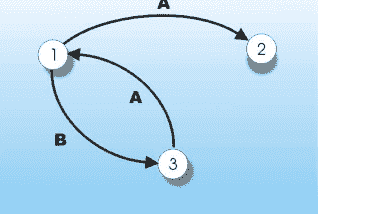

你可以借助图表来设计 FSM。在所示的 FSM 中，我们有三个状态 1、2 和 3；如果你处于状态 1，输入 A 将将系统移到状态 2，输入 B 将将其移到状态 3。

你的程序只需要以一个实现有限状态机的轮询循环的形式存在。它读取输入行作为 I，并利用此和当前状态 S 来确定新状态 S' 和输出 O。使用这种组织方式会有开销，但通常是值得的。注意，这种组织意味着你在循环中只读取一次输入，进行一次更改并设置一次输出。如果你固定了轮询循环花费的时间，你就知道了系统任何变化的特征时间。

## FSM 按钮

作为一个示例，让我们来实现本节之前提到的简单按钮。第一个版本使用了多个循环来等待输入行状态的变化。有限状态版本只使用单个轮询循环：

```c
#include <stdio.h>
#include <pico/stdlib.h>

int main() {
    stdio_init_all();
    gpio_set_function(22, GPIO_FUNC_SIO);
    gpio_set_dir(22, false);
    uint64_t s = 0;
    int i;
    int count=0;
    while (true) {
        i = gpio_get(22);
        uint64_t t = time_us(64) + 100;
        switch (s) {
            case 0: //button not pushed
                if (i) {
                    s = 1;
                    count++;
                    printf("Button Push %d\n\r",count);
                }
                break;
            case 1: //Button pushed
                if (!i) {
                    s = 0;
                }
                break;
            default:
                s = 0;
        }
        sleep_until((absolute_time_t){t});
    }
}
```

这看起来比原始的复杂，代码行更多，但更容易扩展到更复杂的情况。在这种情况下，我们只有两个状态 - s = 0 表示按钮未按下，s = 1 表示按钮已按下。理想情况下，我们使用的状态不应该引用输入或输出，而应该是系统的整体状态。例如，如果你正在使用 Pico 控制核反应堆，你可能会使用状态“核心熔毁”（CoreMeltdown）。状态应该是关于输入的结果，而输出应该是当前状态的结果。在上面的示例中，输入和输出很容易产生“状态”的抽象。即使你将状态标签更改为“LEDOn”或“LEDOf”，它们也直接与单个输出行的状态有关。

然而，关键点在于，状态表示输入发生时的系统状态。也就是说，s = 0（按钮未按下）是系统读取到低电 GPIO 行时的状态，因此按下按钮会使其变为高电。你可以在轮询循环的开始处读取输入行并根据当前状态存储其值。你可以看到，如果 s = 0，即按钮未按下，则下一语句被用于处理输入，接着状态移动到 s = 1，即按钮已按下，并根据按钮按下的次数作为简单操作打印消息。通常情况下，操作可以是设置 GPIO 行或执行任何适用于新状态的操作。注意，动作发生在状态改变时。

如果状态处于 s = 1，即按钮已按下，那么输入必须为 0，并且执行任何将状态 1 变为状态 0 的动作——在这种情况下没有动作。注意，轮询循环被设定为每 100ms 重复一次。如果你固定了轮询循环花费的时间，你就知道了系统任何变化的特征时间。无论循环处理需要多久，只要小于 100ms，循环就会每 100ms 重复一次。这是一个非常简单的有限状态轮询循环。

## FSM 按住

作为使用 FSM 方法稍微复杂的示例，让我们来实现本节之前的简单按钮。第一个版本使用了多个循环来等待输入行状态的变化。有限状态版本只使用单个轮询循环：

```c
#include <stdio.h>
#include <pico/stdlib.h>

int main() {
    stdio_init_all();
    gpio_set_function(22, GPIO_FUNC_SIO);
    gpio_set_dir(22, false);
    uint64_t s = 0;
    int i;
    int count=0;
    while (true) {
        i = gpio_get(22);
        uint64_t t = time_us(64) + 100;
        switch (s) {
            case 0: //button not pushed
                if (i) {
                    s = 1;
                    count++;
                    printf("Button Push %d\n\r",count);
                }
                break;
            case 1: //Button pushed
                if (!i) {
                    s = 0;
                }
                break;
            default:
                s = 0;
        }
        sleep_until((absolute_time_t){t});
    }
}
```

这看起来比原始的复杂，代码行更多，但更容易扩展到更复杂的情况。在这种情况下，我们只有两个状态 - s = 0 表示按钮未按下，s = 1 表示按钮已按下。理想情况下，我们使用的状态不应该引用输入或输出，而应该是系统的整体状态。例如，如果你正在使用 Pico 控制核反应堆，你可能会使用状态“核心熔毁”（CoreMeltdown）。状态应该是关于输入的结果，而输出应该是当前状态的结果。在上面的示例中，输入和输出很容易产生“状态”的抽象。即使你将状态标签更改为“LEDOn”或“LEDOf”，它们也直接与单个输出行的状态有关。

然而，关键点在于，状态表示输入发生时的系统状态。也就是说，s = 0（按钮未按下）是系统读取到低电 GPIO 行时的状态，因此按下按钮会使其变为高电。你可以在轮询循环的开始处读取输入行并根据当前状态存储其值。你可以看到，如果 s = 0，即按钮未按下，则下一语句被用于处理输入，接着状态移动到 s = 1，即按钮已按下，并根据按钮按下的次数作为简单操作打印消息。通常情况下，操作可以是设置 GPIO 行或执行任何适用于新状态的操作。注意，动作发生在状态改变时。

如果状态处于 s = 1，即按钮已按下，那么输入必须为 0，并且执行任何将状态 1 变为状态 0 的动作——在这种情况下没有动作。最后，如果状态不是 0 或 1，我们将其设置为 0，因为出问题了。

注意，轮询循环被设定为每 100ms 重复一次。在循环开始处获取时间，在处理所有内容后，我们等待 100ms 完成。这意味着，无论循环处理需要多久，只要小于 100ms，循环就会每 100ms 重复一次。


这是一个非常简单的有限状态轮询循环。在实践中，通常有一个 `switch` 语句处理每个当前状态，但在每个状态分支内通常另一个 `switch` 语句来处理不同输入发生的情况。定义有限状态机循环的另一种方法是使用由状态和输入索引的查找表，它可以为你提供新状态和动作。

### FSM 按住按钮

作为使用 FSM 方法的稍微复杂的示例，让我们来实现本节之前的简单按钮。第一个版本使用了多个循环来等待输入行状态的变化。有限状态版本只使用单个轮询循环：

```c
#include <stdio.h>
#include <pico/stdlib.h>

int main() {
    stdio_init_all();
    gpio_set_function(22, GPIO_FUNC_SIO);
    gpio_set_dir(22, false);
    uint64_t s = 0;
    int i;
    int count=0;
    while (true) {
        i = gpio_get(22);
        uint64_t t = time_us(64) + 100;
        switch (s) {
            case 0: //button not pushed
                if (i) {
                    s = 1;
                    count++;
                    printf("Button Push %d\n\r",count);
                }
                break;
            case 1: //Button pushed
                if (!i) {
                    s = 0;
                }
                break;
            default:
                s = 0;
        }
        sleep_until((absolute_time_t){t});
    }
}
```

很显然，在释放按钮之前你无法知道按钮已被按下，所以动作现在都在按下状态。当按钮处于按下状态时，它可以被释放，我们可以计算它按下的时间。

### 环计数器

另一种输入配置是环计数器。环计数器每次接收到输入都会移动到一个新的输出并在到达最后一个输出时重复。例如，如果你有三个连接到 LED，初始 LED 0 是开启的，当用户按下按钮时 LED 1 开启，然后下一次按下移到 LED 2，再一次按下回到 LED 0。你可以看到用户按下按钮时 LED 按顺序开关灭。

环计数器的常用实现为每个按钮按下和释放设置一个状态。三个 LED 意味着六个状态，这有很多缺点。更好的想法是只设两个，按下和释放，并使用按下计数器作为额外值。这意味着当你进入按下状态时发生的情况取决于计数器的值。

```c
#include <stdio.h>
#include "pico/stdlib.h"

int main() 
{
    stdio_init_all();
    gpio_set_function(22, GPIO_FUNC_SIO);
    gpio_dir(22, false);
    uint64_t s = 0;
    int i;
    int count = 0;
    while (true){
        i = gpio_get(22);
        uint64_t t = time_us(64) + 100;
        switch (s) {
            case 0: //button not pushed
                if (i) {
                    s = 1;
                    count++;
                    printf("Button Push %d\n\r",count);
                }
                break;
            case 1: //Button pushed
                if (!i) {
                    s = 0;
                }
                break;
            default:
                s = 0;
        }
        sleep_until((absolute_time_t){t});
    }
}
```

```c
gpio_put(19, 1);
gpio_put(20, 0);
gpio_put(21, 0);

uint64_t t, tpush,twait;
int s = 0;
int buttonState = gpio_get(22);
int edge;
int buttonNow;

while (true)
{
    t = time_us_64();
    buttonNow = gpio_get(22);
    edge = buttonState - buttonNow;
    buttonState = buttonNow;
    switch (s) {
        case 0:
            if (edge==1){
                s = 1;
                gpio_put(19, 0);
                gpio_put(20, 1);
                gpio_put(21, 0);
            }
            break;
        case 1:
            if (edge==1){
                s = 2;
                gpio_put(19, 0);
                gpio_put(20, 0);
                gpio_put(21, 1);
            }
            break;
        case 2:
            if (edge==1){
                s = 0;
                gpio_put(19, 1);
                gpio_put(20, 0);
                gpio_put(21, 0);
            }
            break;
        default:
            s = 0;
    }
    sleep_until((absolute_time_t){t + 10000});
}
```

首先，我们配置输入和输出的 GPIO 引脚，并设置输出使得 LED 0 开启，即 `s = 0`。接下来，我们启动轮询循环。循环内部有一个 `switch` 语句用于管理三个状态。在循环开始时，通过当前按钮值与上一个值之间的差来计算出 `edge`；当按钮从按下（1）变为释放（0）时，`edge` 为 1。也就是说，在下降沿上 `edge=1`。如果按钮刚刚被按下，则状态将转移到下一个状态（0-1、1-2 和 2-0），并将 LED 设置为相应的值。

你可能会奇怪，为什么设置了三个 LED 而不仅仅是发生变化的那两个？这有许多原因，包括从代码中更容易看出发生了什么，并且可以确保所有的 LED 都处于你预期的状态。注意，轮询循环被设置为每 1000µs 重复一次，从而提供了去抖功能和可预测的服务时间。如果你尝试一下，你会发现 LED 在每次按下按钮时都会顺序亮起。

与其他许多高级方法一样，有限状态机（FSM）方法在简单示例中会让事情看起来更复杂，但一旦情况变得复杂，这种努力就是值得的。如果没有某种组织原则，一个拥有数十个状态以及大量需要管理的输入和输出引脚的轮询循环将变得无法维护。

### 总结

- 输入是困难的，因为无论你的程序在做什么，事情随时可能发生。
- 你可以在任何时候调用 `gpio_get` 来发现 GPIO 引脚的状态——问题在于何时以及多频繁地调用它。
- 你可以在外部或内部上拉/下拉电阻之间进行选择。
- 机械输入设备（如按钮）必须进行去抖。
- 软件的力量在于它可以增强简单设备。简单的按钮只有按下或释放两种状态，但你可以利用此生成第三种“按住”状态。
- 使用轮询循环，你可以处理短至几十微秒的输入。
- 大多数 IoT 程序最好被写为轮询循环。
- 有限状态机（FSM）是组织复杂轮询循环的一种方法，使得每次循环时都测试一次输入并设置一次输出。
- 理想情况下，FSM 的状态不应只是决定状态的输入输出的简单陈述，但对于简单的系统来说，这很难实现。
- 确定什么构成 FSM 的事件可能是困难的。理想情况下，它们在时间上应该是局部的，以便指示某事发生的时刻。

简单的事件可以避免丢失单次输入，但如果在轮询循环不可用期间有多个事件发生怎么办？最常见的解决方案是创建一个事件队列——即按照事件发生的顺序创建一个 FIFO（先进先出）事件队列。轮询循环现在读取队列头部的事件，对其进行处理，然后读取下一个。它会像队列为空一样继续运行；它只是等待事件发生。只要队列足够大，事件就意味着你不会错过任何输入，但输入事件并不一定在它们发生的时间附近被处理。除非事件带有时间戳，否则程序并不知道它们何时发生。它们应该按顺序处理。

事件队列是一种常见的架构，但要使其工作或具有任何优势，它需要多个核心以便在另一个事件发生之前始终能将事件添加到队列，或者需要硬件的帮助（通常是中断的形式）。注意，事件或事件队列不能增加程序的吞吐量或降低延迟（即对输入的响应时间）。事实上，由于实现的开销，事件会降低吞吐量并增加延迟。事件系统的作用是……

## 中断是有害的？

中断经常被混淆，但它们是不同的。中断是一种停止正在执行的操作并将注意力转移到 ISR（中断处理程序）的机制。在实践中，如果你打算使用中断处理输入，良好的设计是使用中断处理程序馈送事件队列。这降低了错过输入的概率。

尽管中断具有吸引力，但对于低频率事件之外的情况，通常不是良好的选择：

中断只有在……的情况下有用：

这种设计的好坏取决于按钮与程序其余部分交互的程度，以及你预计会有多少次按钮按下。响应按钮需要时间，而且 ISR 必须运行完成——如果在第一个事件仍在处理时发生了另一次按下，会发生什么？当然，轮询循环也是如此，但如果你无法……因为增加了增加了转换到 ISR 和返回的时间。

目前 SDK 还没有任何支持事件（events）的函数，但添加一对实现该功能的函数非常容易：

```c
int32_t gpio_get_events(uint gpio)
{
  int32_t mask = 0xF << 4 * (gpio % 8);
  return (iobank_hw->intr[gpio & mask]) >> 4 * (gpio % 8);
}
```

```c
void gpio_clear_events(uint gpio, uint32_t events) {
    gpio_acknowledge_irq(gpio, events);
}
```

其工作原理将在第 18 章中解释，当你真正需要知道 `gpio_get_events` 将返回四个位，以反映对应于 gpio 的事件状态。同样，`gpio_clear_events` 用于清除 gpio 上的锁存事件。这些锁存事件对应于以下常量：

```
GPIO_IRQ_EDGE_FALL
GPIO_IRQ_EDGE_RISE
```

例如：

```c
int32_t event = gpio_get_events(22);
if (event & GPIO_IRQ_EDGE_RISE) // 测试 GP22 上是否发生了上升沿事件
```

将所有这些整合在一起，使用事件的步骤如下：

1. 将引脚设置为输入模式：
   `gpio_set_function(22, GPIO_FUNC_SIO);`
   `gpio_set_dir(22, false);`

2. 清除事件：
   `gpio_clear_events(22, GPIO_IRQ_EDGE_RISE);`

3. 在此之后你可以执行其他操作，并最终读取状态以查看在间隔时间内是否发生了事件，清除该事件以便其记录另一个：
   `int32_t event = gpio_get_events(22);`
   `gpio_clear_events(22, GPIO_IRQ_EDGE_RISE);`

### 一个边缘触发的按钮

为了区分“读取引脚检测状态变化”与“使用事件”之间的区别，让我们考虑之前给出的按钮程序的另一个版本。在这种情况下，GPIO 引脚设置为输入，并在按下按钮时会发送消息。然后程序等待 20 秒，并最后测试引脚的状态。即使使用户在暂停期间多次按了按钮，所有重要的只有当 `sleep_ms(20000)` 结束时读取到的引脚最终状态：

```c
#include <stdio.h>
#include "pico/stdlib.h"

int main() 
{
    stdio_init_all();
    gpio_set_function(22, GPIO_FUNC_SIO);
    gpio_set_dir(22, false);
    gpio_pull_down(22);
    printf("Press Button\n");
    sleep_ms(20000);
    if (gpio_get(22)) {
        printf("Button Pressed\n");
    } else {
        printf("Button Not Pressed\n");
    }
}
```

换句话说，这个程序错过了 20 秒暂停期间的任何按钮按下。这是一个愚蠢的程序，但现在将其与一个使用边缘事件（edge events）的版本进行对比：

```c
#include <stdio.h>
#include "pico/stdlib.h"
#include "hardware/structs/iobank0.h"

uint32_t gpio_get_events(uint32_t gpio) 
{
    int32_t mask = 0xf << 4 * (gpio % 8);
    return (iobank0_hw->intr[gpio / 8] & mask) >> 4 * (gpio % 8);
}

void gpio_clear_events(uint32_t gpio, uint32_t events) 
{
    gpio_acknowledge_irq(gpio, events);
}
```

```c
int main()
{
    stdio_init_all();
    gpio_set_function(22, GPIO_FUNC_SIO);
    gpio_set_dir(22, false);
    gpio_pull_down(22);
    printf("Button Pressed\n");
    gpio_clear_events(22, GPIO_IRQ_EDGE_RISE);
    sleep_ms(20000);
    int32_t event = gpio_get_events(22);
    gpio_clear_events(22, GPIO_IRQ_EDGE_RISE);
    if (event & GPIO_IRQ_EDGE_RISE)
    {
        printf("Button Pressed\n");
    } else
    {
        printf("Button Not Pressed\n");
    }
}
```

在这种情况下，GPIO 引脚被设置为带有拉低输入的输入，我们测试的是上升沿事件而不是引脚状态。区别在于，如果用户在 20 秒睡眠期间任何时候按下按钮，标志位就会被设置，程序会记录按钮按下。无论程序在做什么，标志位都会被设置，与其睡眠，它可以去处理一些工作，因为程序无法确切知道按钮何时被按下的，也不知道按钮被按了多少次。

事件允许你在轮询时避免错过任何一个输入，但它无法处理多个输入——如果用户多次按下按钮，我们仍然只能检测到一个脉冲。你可以实现一个完全基于队列的事件处理系统，但这可能不值得花这些精力。更合理的替代方案是使用事件。

### 使用事件测量脉冲

现在我们有了用于测量脉冲宽度的功能。使用事件来测量而不是检测引脚状态。在这种情况下，我们需要检测上升沿而不是下降沿。

完整的程序如下：

```c
#include <stdio.h>
#include "pico/stdlib.h"
#include "hardware/structs/iobank0.h"

uint32_t gpio_get_events(uint32_t gpio) 
{
    int32_t mask = 0xf << 4 * (gpio % 8);
    return (iobank0_hw->intr[gpio / 8] & mask) >> 4 * (gpio % 8);
}

void gpio_clear_events(uint32_t gpio, uint32_t events) 
{
    gpio_acknowledge_irq(gpio, events);
}

int main()
{
    stdio_init_all();
    gpio_set_function(22, GPIO_FUNC_SIO);
    gpio_set_dir(22, false);
    gpio_pull_down(22);
    printf("Button Pressed\n");
}
```


gpio_clear_events(22, GPIO_IRQ_EDGE_RISE);

sleep_ms(20000);

int32_t event = gpio_get_events(22);

gpio_clear_events(22, GPIO_IRQ_EDGE_RISE);

if (event & GPIO_IRQ_EDGE_RISE) {
    printf("Button Pressed\n");
} else {
    printf("Button Not Pressed\n");
}

（注：由于原文文本在某些部分存在逻辑重复和混乱，翻译已根据逻辑结构进行了对应）

## 边沿中断

边沿中断是最常用的中断类型。由于它们是锁定的，你需要使用以下函数来清除事件位：

```c
void gpio_acknowledge_irq(uint gpio, uint32_t events)
```

`gpio_clear_events` 也是你调用的函数，用于清除给定 GPIO 线路上的事件。

这就是使用 GPIO 生成中断并处理中断的全部内容。在实践中，要正确处理这些事情比你想象的要困难。存在这样的问题：如果你在中断处理程序期间发生了中断会发生什么？在中断处理程序中访问共享资源又该如何？

### 简单示例

```c
#include <stdio.h>
#include "pico/stdlib.h"

static uint64_t t;

void MyIRQHandler(uint gpio, uint32_t events) {
    t = time_us_64() - t;
    printf("%d %X %llu \n", gpio, events, t);
}

int main() {
    stdio_init_all();
    gpio_set_function(22, GPIO_FUNC_SIO);
    gpio_set_dir(22, false);
    gpio_pull_down(22);
    gpio_set_irq_enabled_with_callback(22, GPIO_IRQ_EDGE_RISE | GPIO_IRQ_EDGE_FALL, true, &MyIRQHandler);
    while (1) {
        tight_loop_contents();
    }
    return 0;
}
```

这段代码设置了一个中断处理程序，它打印 GPIO 线路、事件以及自上次事件发生以来的时间。如果事件发生得足够慢，你应该看到一个事件触发了中断；但如果事件发生得比打印操作完成的速度还要快，你将看到两个边沿都发生了。只有其中一个事件会触发中断，另一个只会在中断处理程序被调用期间被记录下来。

如果你实验这个程序，你会发现中断被清除了，因此在中断处理程序返回时不会立即再次调用它。此外，在中断处理程序运行期间也不会触发新的中断。部分原因是 SDK 并没有直接分发中断机制。它设置了自身的 IRQ 处理程序，由该处理程序执行清理工作，然后调用你的 IRQ 处理程序：

```c
static void gpio_irq_handler(void) {
    io_irq_ctrl_hw_t *irq_ctrl_reg = get_core_num() ?
        &bank0_hw->proc1_irq_ctrl : &bank0_hw->proc0_irq_ctrl;

    for (uint gpio = 0; gpio < NUM_BANK0_GPIOS; gpio++) {
        io_rw_32 *status_reg = &irq_ctrl_reg->ints[gpio / 8];
        uint32_t events = (*status_reg >> 4 * (gpio % 8)) & 0xf;

        if (events) {
            // TODO: 如果两个核心都关心这个事件，
            // 第二个核心将无法获取中断；
            gpio_acknowledge_irq(gpio, events);

            gpio_irq_callback_t callback = callbacks[get_core_num()][gpio];
            if (callback) {
                callback(gpio, events);
            }
        }
    }
}
```

该函数最有趣的部分是 `for` 循环，它测试每个 GPIO 线路的 IRQ 状态寄存器以发现它是否导致了中断。对于每个被检测为导致中断的 GPIO 线路，它会重置中断，然后带有该 GPIO 线路编号和事件调用 IRQ 处理程序。这意味着你不需要在自己的例程中重置 IRQ，但请注意循环扫描 GPIO 寄存器需要时间，并且每个导致中断的 GPIO 线路都会调用一次 IRQ 处理程序。这在未来可能会发生变化。

### 中断有多快？

让我们通过重复脉冲宽度测量来找出中断中固有的开销。这次，我们不能简单地打印结果，因为这会停止中断处理。作为折中，我们将 20 次读取结果保存在数组中，然后进行打印。保持中断处理程序的简短也很重要，因为它们完成所需的时间决定了下一次中断被处理的速度。

新的中断处理程序是：

```c
uint64_t t[20];
int count = 0;

void myHandler(int fd) {
    struct gpio_data data;
    read(fd, &data, sizeof(data));
    t[count++] = data.timestamp;
    if (count >= 20) {
        for (int i = 1; i < 20; i++) {
            printf("%llu \n", t[i] - t[i-1]);
        }
        fflush(stdout);
        count = 0;
    }
}
```

它能记录长于 6µs 脉冲相当准确的时间。它的能力不如轮询循环（后者在低至 1µs 时工作更好），但差异并不大。这意味着即使有 SDK 的开销，中断也是非常好用的。然而，这很大程度上取决于中断处理程序释放控制权的时间。

### 竞态条件与饥饿

在 Pico 这样的小型处理器上使用中断的一个大问题是，没有操作系统来确保不同任务能够公平地共享处理器。中断例程完全可能被频繁调用，导致主程序或其他函数没有机会执行。

例如，如果你尝试编写一个打印消息的程序，如果中断在打印执行期间发生，可能会导致问题。（注：此处原文文本似乎存在逻辑混乱或重复，翻译已根据指令要求进行结构性对齐）

### 摘要

- 事件是某事发生的存储指示。
- 中断是导致某事发生的事件。
- 你可以在轮询循环中使用事件来防止程序忙于处理其他事务而丢失输入。
- 如果事件在当前事件被清除之前发生，它可能会丢失。为了避免丢失事件，你可以使用事件队列，它按事件发生的顺序存储事件，直到它们被处理。
- Pico SDK 不支持事件，但很容易添加函数来利用它们。当 GPIO 线变为高电平、低电平或高/低电平时，你可以启用设置某个位。边缘触发事件最容易处理。
- 在轮询循环中使用事件几乎不会减慢速度。
- 你可以使用事件来产生中断并调用中断处理程序。
- Pico 中断速度很快，因此适用于许多任务，但它们最适合需要快速关注的低频事件。

# 第 8 章 脉冲宽度调制 (PWM)

解决微控制器获取快速响应问题的一种方法是将问题从处理器中移开。对于 Pico 来说，有一些内置设备可以使用 GPIO 线实现协议，而无需 CPU 参与。在本章中，我们将详细查看脉冲宽度调制 (PWM)，包括产生声音、LED 和伺服器。

在执行最基本的功能（即输出）时，GPIO 线可以设置为高或低电平，它们变为高或低电平的速度取决于处理器的速度。

在脉冲宽度调制 (PWM) 模式下使用 GPIO 线，你可以产生高达 60MHz 的脉冲串。速度增加的原因是 GPIO 连接到脉冲发生器，一旦设置为生成特定类型的脉冲，脉冲发生器就会一直运行，不需要 GPIO 线或处理器的任何干预。事实上，在你的程序结束后，脉冲输出仍会继续。

当然，尽管 PWM 线可以非常快速地产生脉冲，但你通常想做的是改变脉冲的性质，这是一个涉及处理器的较慢过程。

## 关于 Pico PWM 的基本事实

有些事实从开始就值得明确，尽管它们的一些重要性将随着我们的进展而变得清晰。

首先，什么是 PWM？简单的答案是，脉冲宽度调制信号具有以固定速率重复的脉冲——例如每毫秒一个脉冲，但脉冲的宽度可以改变。

对于生成的脉冲串，有两个基本点需要指定：重复频率和每个脉冲的宽度。通常，重复频率被设置为简单的重复周期，而每个脉冲的宽度以重复周期的百分比指定，称为占空比。

例如，1ms 的重复和 50% 的占空比指定了 1ms 的周期，其中 50% 的时间内为高电平，即脉冲宽度为 0.5ms。两个极端情况是 100% 占空比（即线路始终为高电平）和 0% 占空比（即线路始终为低电平）。

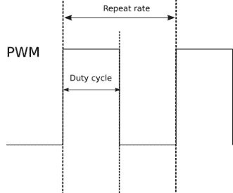

注意，PWM 中携带信息的是占空比而不是频率。这意味着你通常选择一个重复频率并保持不变，而程序在运行时更改的是占空比。

在许多情况下，PWM 是使用特殊的 PWM 发生器硬件实现的，这些硬件要么内置在处理器芯片中，要么由外部芯片提供。处理器只需通过写入寄存器设置重复频率，然后通过写入另一个寄存器来更改占空比。这通常提供了最好的 PWM 效果，且对处理器没有负载，并且通常是无故障运行。你甚至可以购买扩展板，提供额外的 PWM 通道而不会给处理器增加负载。

专用 PWM 硬件的替代方案是在软件中实现。你可以很容易地算出如何这样做。你只需要设置一个定时循环，按照重复频率将线路设置为高电平，然后根据占空比将其设置为低电平。你可以使用中断、轮询循环以及更高级的方法（例如使用 DMA，直接内存访问通道）来实现。

## Pico PWM 初始化

对于 Pico 来说，PWM 线是使用特殊的 PWM 硬件实现的。它有八个 PWM 发生器，每个都能输出两个 PWM 通道。任何 GPIO 线都可以作为 PWM 线，这意味着在任何给定时间你都可以有 16 条 PWM 线在工作。每对输出的情况稍微复杂一点，每对输出具有相同的频率，这意味着你有八组独立设置的输出对。此外，其中一个输出可以作为输入，这减少了可用输出的数量。

PWM 发生器按固定顺序分配给 GPIO 引脚：

| GPIO | 0 | 1 | 2 | 3 | 4 | 5 | 6 | 7 | 8 | 9 | 10 | 11 | 12 | 13 | 14 | 15 |
|---|---|---|---|---|---|---|---|---|---|---|---|---|---|---|---|---|
| PWM 通道 | 0A | 0B | 1A | 1B | 2A | 2B | 3A | 3B | 4A | 4B | 5A | 5B | 6A | 6B | 7A | 7B |

| GPIO | 16 | 17 | 18 | 19 | 20 | 21 | 22 | 23 | 24 | 25 | 26 | 27 | 28 | 29 | 30 | 31 |
|---|---|---|---|---|---|---|---|---|---|---|---|---|---|---|---|---|
| PWM 通道 | 0A | 0B | 1A | 1B | 2A | 2B | 3A | 3B | 4A | 4B | 5A | 5B | 6A | 6B | 7A | 7B |

（注：由于 OCR 文本混乱，此处已根据标准 Pico 硬件映射进行重建）

这是计数器在回零或开始倒计时到零之前所将计数的最大值。这两种不同的行为通过启用或禁用“相位校正”模式来控制，该名称的原因将在稍后解释：

```c
pwm_set_phase_correct(uint slice_num, bool phase_correct)
```

禁用相位校正会导致计数器计数到环绕值后重置为零。启用相位校正则使计数器计数到环绕值后向下计数到零。

PWM 信号通过设置通道电平从计数器值生成：

```c
pwm_set_chan_level(uint slice_num, uint chan, uint16_t level)
```

或者同时对两个通道：

```c
pwm_set_both_levels(uint slice_num, uint16_t level_a, uint16_t level_b)
```

这里还有一个辅助函数：

```c
pwm_set_gpio_level(uint gpio, uint16_t level)
```

它可以在不需要指定分片或通道的情况下设置指定 GPIO 线的电平。

每当计数器超过电平时，输出线的状态就会发生变化。计数开始时线路设为高电平，超过电平时设为低电平。计数继续，并在重启时线路再次变为高电平。你可以在下方的图中看到非相位校正模式下的这一动作（取自文档）：

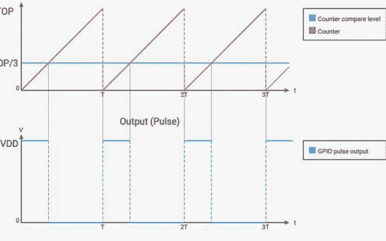

在相位校正模式下，我们有一个类似的图：

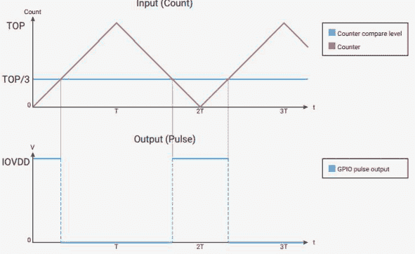

你可以看到计数器的环绕值设置了频率，而电平设置了占空比。显然，在相位校正模式下频率减半。现在你也可以看到它被称为相位校正模式的原因。在非相位校正模式下，当你改变占空比时，脉冲的起点保持固定，但脉冲的中心会移动。在相位校正模式下，脉冲的起点和终点都会移动，但脉冲的中心保持固定——其相位保持不变。某些应用对这种差异很重要，但对于大多数 PWM 场景，你可以忽略这种差异。

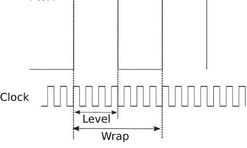

另一个细微的点是，你可以随时更改电平，但更改只有在计数器重置时才会生效，因此你不会在一次计数周期内意外获得两个脉冲。

如所述，环绕值决定了频率。不需要复杂的代数就可以算出，在非相位校正模式下：

$$ f = \frac{f_c}{wrap+1} $$

其中 $f_c$ 是考虑了任何分频后的时钟频率。更有用的是你可以计算产生任何 PWM 频率所需的环绕值：

$$ wrap = \frac{f_c}{f}-1 $$

同样，电平设置了占空比：

$$ level = wrap \times duty $$

其中 $duty$ 是以分数形式表示的占空比。

例如，在非相位校正模式下，时钟频率为 125MHz 时，可以使用 12,500 的 wrap 生成 10kHz 的 PWM 信号，25% 的占空比意味着电平为 3,125。

在相位校正模式下，必须调整公式以考虑同时向上和向下计数，这使得频率减半：

$$ f = \frac{f_c}{2(wrap+1)} $$

$$ wrap = \frac{f_c}{2f}-1 $$

$$ level = wrap \times duty $$

## 时钟分频

PWM 计数器是 16 位的，这意味着一旦达到 65534 的 wrap，在 125MHz 的时钟输入下，最低 PWM 频率为 1.9kHz。如果你需要 50Hz 的信号来驱动舵机，这并不理想（见后文）。解决方案是使用分频器将 125MHz 时钟降低到更低的值。

分频器是一个 16 位的小数分频器，带有八位整数部分和四位小数部分。你可以使用以下方法设置时钟：

```c
pwm_set_clkdiv_int_frac(uint slice_num, uint8_t integer, uint8_t fract)
```

如果你想将分频器指定为浮点值，可以使用：

```c
pwm_set_clkdiv(uint slice_num, float divider)
```

分频器被分解为 8 位整数和 4 位小数部分，小数部分指定为 $fract/16$。这意味着最大的除数是 $256\frac{15}{16}$，这给出了最低的时钟频率：520,833 1/3 Hz。

你可以使用列出的公式来计算 wrap 和 level，只要 $f_c$ 是分频后的结果时钟。例如，如果在非相位校正模式下，为 125MHz 的时钟频率设置分频器为 2，可以使用 12,500 的 wrap 生成 5kHz 的 PWM 信号，50% 的占空比意味着电平为 6,250。

在相位校正模式下，公式必须调整以考虑同时向上和向下计数，这使得频率减半：

$$ f = \frac{f_c}{2(wrap+1)} $$

$$ wrap = \frac{f_c}{2f}-1 $$

$$ level = wrap \times duty $$

## 共同使用 PWM 线

每个 PWM 切片都可以设置单个分频器和回绕值，但每个通道可以设置不同的水平。这意味着每个 PWM 切片的 A 和 B 通道设置为相同的 PWM 频率，但产生不同的占空比。这听起来可能有一定的限制性，但在大多数应用中，这通常是你需要的。例如，如果你正在驱动一对舵机（分别通过 A 和 B 通道），那么两者的频率都必须设置为 50Hz，而你可以独立地改变每个电机的占空比。

然而，在设置占空比时产生了一个小问题：它需要知道 wrap 值，而该值可能在其他时候已经设置。一种解决方案是读取 wrap 寄存器，但 SDK 目前没有提供此函数。幸运的是，这非常简单：

```c
uint32_t pwm_get_wrap(uint slice_num) {
    valid_params_if(PWM, slice_num >= 0 &&
        slice_num < NUM_PWM_SLICES);
    return pwm_hw->slice[slice_num].top;
}
```


### 设置占空比

使用此方法，你可以在不设置 wrap 或时钟分频器的情况下设置占空比，例如：

```c
int d = 25;
pwm_set_chan_level(slice_num, pwm_get_wrap(slice_num) * d / 100);
```

你可以轻松创建一个设置占空比的函数：

```c
void pwm_set_duty(uint slice_num, uint chan, int d) {
    pwm_set_chan_level(slice_num, chan, pwm_get_wrap(slice_num) * d / 100);
}
```

使用这种方法非常简单，例如：

```c
pwm_set_duty(slice_num, chan, 50);
```

这会设置 50% 的占空比，而不会改变频率或显式地指定当前正在使用的 wrap。

为了演示两条 PWM 线可以独立使用，这里有一个程序将两条可能的线中的每一条设置为不同的占空比（记得在 `CMakeLists.txt` 文件中添加 `hardware_pwm`）：

```c
#include <pico/stdlib.h>
#include "hardware/pwm.h"

int main() {
    gpio_set_function(20, GPIO_FUNC_PWM);
    gpio_set_function(21, GPIO_FUNC_PWM);

    uint slice_num = pwm_gpio_to_slice_num(20);
    uint chan20 = pwm_gpio_to_channel(20);
    uint chan21 = pwm_gpio_to_channel(21);

    uint wrap = pwm_set_freq_slice(slice_num, chan20, 50, 75);
    pwm_set_duty(slice_num, chan21, 25);

    pwm_set_enabled(slice_num, true);
    return 0;
}
```

这使用了之前提供的 `pwm_set_freq_duty` 和 `pwm_set_duty` 函数。注意，我们使用了 GP20 和 GP21，因为它们分别使用 slice 2 的 A 和 B 通道。同样注意，我们只在 slice 上设置了频率，而在通道上设置了占空比。

你可以从这个逻辑分析仪显示中看到结果：

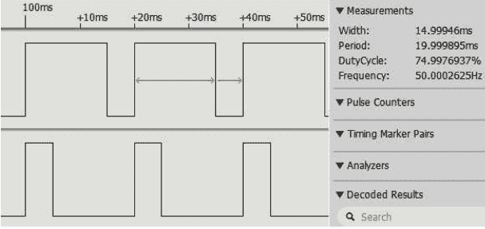

你可以从逻辑分析仪上清晰地看到 PWM 脉冲同时开始，但在不同的时间结束。

将其与通过添加以下代码设置相位相关模式的结果进行对比：
`pwm_set_phase_correct(slice_num, true)`

| | +70ms | +80ms | +90ms | +10ms | +20ms | +30ms |
|---|---|---|---|---|---|---|
| | | | | | | Width: 29.99893ms |
| | | | | | | Period: 39.99795ms |
| | | | | | | DutyCycle: 74.9977094% |
| | | | | | | Frequency: 25.0001281Hz |
| | | | | | | Pulse Counters |
| | | | | | | Timing Marker Pairs |
| | | | | | | Analyzers |
| | | | | | | Decoded Results |
| | | | | | | Search |

你现在可以看到脉冲并不是在同一时间开始的，而是围绕相同的时间中心。

除了能够为每个通道设置电平，你还可以使用以下函数设置极性：
`pwm_set_output_polarity(uint slice_num, bool a, bool b)`

使用此方法，你可以从通道 A 和 B 产生反相的脉冲。例如，如果添加：
`pwm_set_output_polarity(slice_num, false, true);`

脉冲模式将变为：

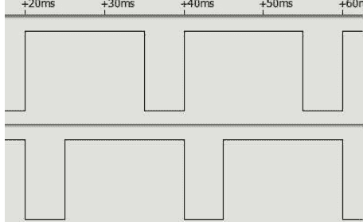

你可以看到通道 B 的输出被反转了。

### 改变占空比

由于稍后讨论的原因，在大多数情况下，重点是改变脉冲的占空比或周期。这意味着下一个问题是：你多快可以改变 PWM 线的占空比？换句话说，你能多快改变占空比？在大多数应用中，没有简单的方法可以给出精确的答案，因为 PWM 信号通常需要传递给定占空比的完整周期。

我们还有另一个问题——同步性，它比看起来要微妙。硬件在脉冲完成（即计数器归零）之前不会改变占空比。因此你可能认为以下程序会在脉冲的基础上切换两个占空比（记得在 `CMakeLists.txt` 中添加 `hardware_pwm`）：

```c
#include <stdio.h>
#include "hardware/pwm.h"

int main() {
    gpio_set_function(20, GPIO_FUNC_PWM);
    uint slice_num = pwm_gpio_to_slice_num(20);
    uint chan20 = pwm_gpio_to_channel(20);
    uint wrap = pwm_set_freq_duty(slice_num, chan20, 50, 50);
    pwm_set_enabled(slice_num, true);

    while (true) {
        pwm_set_duty(slice_num, chan20, 25);
        pwm_set_duty(slice_num, chan20, 50);
    }
    return 0;
}
```

如果你尝试这样做，结果并不是你预期的：


你并没有通过改变数量得到 25% 和 50% 的脉冲。原因当然是占空比是异步设置到计数器的。这意味着有效的占空比取决于上一次更新。要使此工作，你需要检测计数器归零并按计数器进行更新。为此我们需要一些计数器函数。

### 使用计数器工作

要同步地改变占空比，我们需要访问计数器的状态。SDK 提供了以下函数：

```c
uint16_t pwm_get_counter(uint slice_num);
void pwm_set_counter(uint slice_num, uint16_t c);
void pwm_advance_count(uint slice_num);
void pwm_retard_count(uint slice_num);
```

最常用的是 `pwm_get_counter`，它返回计数器的当前值。你可以用它来测试 slice 的周期。不那么有用的是 `pwm_set_counter`、`pwm_advance_count` 和 `pwm_retard_count` 函数。这些函数可以通过设置新值或从当前值减值来修改计数器。为什么要这样做呢？通过将计数器设置为新值，你可以修改 PWM 信号的瞬时频率，如果你使用 PWM 进行信号传输或产生音调，你会这样做。还需要知道 `advance` 和 `retard` 函数是通过阻塞计数脉冲而不是修改计数器来工作的，为了让 `advance` 工作，必须使用大于 1 的时钟分频器。

回到上一节的示例，我们可以利用 `pwm_get_counter` 函数来测试更新占空比（记得在 `CMakeLists.txt` 中添加 `hardware_pwm`）：

```c
int main() {
    gpio_set_function(20, GPIO_FUNC_PWM);
    uint slice_num = pwm_gpio_to_slice_num(20);
    uint chan20 = pwm_gpio_to_channel(20);
    uint wrap = pwm_set_freq_duty(slice_num, chan20, 50, 50);
    pwm_set_enabled(slice_num, true);

    while (true) {
        pwm_set_duty(slice_num, chan20, 25);
        while (pwm_get_counter(slice_num)) { };
        pwm_set_duty(slice_num, chan20, 50);
        while (pwm_get_counter(slice_num)) { };
    }
    return 0;
}
```

注意，由于占空比是在计数器归零后设置的，所以占空比改变的是下一个脉冲之后的脉冲。

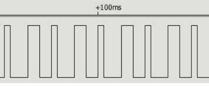

如果你想改变下一个脉冲，需要在计数为 1 时设置占空比。

使用这种方法可以生成的占空比在每个脉冲变化的最快 PWM 信号是多少？答案惊讶地低，大约只有 300Hz。这可以通过优化程序来改进，但总的来说，这不是修改 PWM 切片的快速方法。更好的方法是使用中断。

### 使用 PWM 中断

改变占空比是中断比轮询快的情况之一。原因是测试计数器的值很慢，但在回绕时触发中断很快。我们可以通过测试事件而不是计数器值来让轮询循环比中断更快，但 SDK 支持 PWM 中断而不是事件。

有很多 PWM 中断函数：

```c
void pwm_set_irq_enabled(uint slice_num, bool enabled);
void pwm_set_irq_mask(uint32_t mask, bool enabled);
void pwm_clear_irq(uint slice_num);
uint32_t pwm_get_irq_status_mask(void);
void pwm_force_irq(uint slice_num);
```

在此处，你可能在想定义中断处理程序的函数在哪里。GPIO 线为其 IRQ 处理程序有这样一个函数，但 PWM 切片使用的是更通用的 Pico 中断处理。该函数：

`irq_set_exclusive_handler(uint num, irq_handler_t handler)`

为 Pico 的中断之一设置中断处理程序。PWM 切片使用 IRQ 4 或 `PWM_IRQ_WRAP`。这意味着，任何调用中断的切片都会产生 IRQ 4 并调用 IRQ 4 处理程序。虽然有一种机制允许将多个处理程序附加到给定的 IRQ 号上，但最简单的方法是使用 `irq_set_exclusive_handler` 为该中断号设置单个 IRQ 处理程序。在 PWM 硬件的情况下，你可以使用以下方法实现：

`irq_set_exclusive_handler(PWM_IRQ_WRAP, MyIRQHandler);`

现在我们设置了处理程序，我们还需要使用以下函数来启用 IRQ：
`irq_set_enabled(uint num, bool enabled)`

对于 PWM 中断，这相当于：
`irq_set_enabled(PWM_IRQ_WRAP, true);`

注意，为了使 PWM IRQ 工作，我们需要启用两件事。首先，你需要启用中断本身，以及能够产生中断的切片。仅启用切片是不够的。

现在我们可以将这一切整合在一起，编写一个使用中断改变每个脉冲占空比的程序（记得在 `CMakeLists.txt` 文件中添加 `hardware_pwm`）：

```c
#include "pico/stdlib.h"
#include "hardware/pwm.h"
#include "hardware/irq.h"

uint slice_num;
uint chan20;
uint state = 0;

void MyIRQHandler() {
    pwm_clear_irq(slice_num);
    if (state) {
        pwm_set_duty_cycle(slice_num, chan20, 25);
    } else {
        pwm_set_duty_cycle(slice_num, chan20, 50);
    }
    state = ~state;
}

int main() {
    gpio_set_function(20, GPIO_FUNC_PWM);
    slice_num = pwm_gpio_to_slice_num(20);
    chan20 = pwm_gpio_to_channel(20);

    pwm_clear_irq(slice_num);
    pwm_set_irq_enabled(slice_num, true);
    irq_set_exclusive_handler(PWM_IRQ_WRAP, MyIRQHandler);
    irq_set_enabled(PWM_IRQ_WRAP, true);

    unsigned int wrap = pwm_set_freq_duty(slice_num, chan20, 100000, 25);
    pwm_set_enabled(slice_num, true);

    while (true) {
        tight_loop_contents();
    }
    return 0;
}
```

你需要之前节中定义的函数以及：
`#include "hardware/irq.h"`

你可以看到 IRQ 处理程序只是通过保持一个奇/偶状态变量来改变占空比。还要注意，我们必须清除任何悬挂的 IRQ —— 否则程序将直接挂起。

如果你尝试一下，你会发现它在 100kHz 左右可以工作，而测试计数器值的轮询方法是 300Hz。

### PWM 的用途 – 数字转模拟

你用 PWM 做什么事情？PWM 有许多非常巧妙的用途。然而，有两个用例占据了大多数 PWM 应用 —— 电压或功率调制以及伺服发送信号。

脉冲串传递到设备的功率与占空比成正比。占空比为 50% 的脉冲串仅在 50% 的时间内向负载传输电流，这与脉冲重复率无关。占空比控制功率，但在许多情况下，周期仍然很重要，因为你想避免任何闪烁或其他效应。较高的频率可以平滑任何占空比下的功率流。

如果你在 PWM 信号的输出端添加低通滤波器，你将得到与占空比成正比的电压。可以从许多不同的角度来看，但它仍然是 PWM 信号传输功率量的结果。你也可以将其视为移除信号高频分量的滤波器，只留下较慢的分量，因为由于占空比调制，取决于占空比的分辨率。如果你使用 8 位分辨率，你的 D 到 A 转换将有 256 个步阶，在 3.3V 下提供的潜在分辨率为 3.3/256 或约 13mV。这通常足够了。当 wrap 为 255 且分频器为 1 时，采样频率约为 488kHz。此配置下的 PWM 输出模拟了 8 位 D 到 A 转换器的工作。你使用 0 到 255 的每个值设置占空比，并获得 3.3/256V 的电压输出。理论（奈奎斯特）速率给出的最大表示频率为 488/2=244kHz，但对于简单的播放系统，上限限制更简单。一个典型的经验法是，采样频率至少应该是你希望生成的最高频率的七倍，大约 70kHz。

如果你使用 16 位分辨率（CD 音频使用的分辨率），采样率将下降到 1.9kHz，这通常低于 44kHz。

为了演示可以进行 D 到 A 转换的方法，以下程序创建了正弦波。我们需要计算一个周期内 256 个点的占空比。虽然有定点方法可以计算正弦或余弦，但使用 Pico 的内置浮点运算更简单。注意 Pico 硬件中没有实现浮点运算，最好避免使用。如果你只想每采样更新一次占空比，最简单的解决方案是使用中断处理程序。程序如下：

```c
#include "pico/stdlib.h"
#include "hardware/pwm.h"
#include "hardware/irq.h"
#include "math.h"

uint32_t pwm_get_wrap(uint slice_num) {
    return pwm_hw->slice[slice_num].top;
}

void pwm_set_duty(uint slice_num, uint chan, int d) {
    pwm_set_chan_level(slice_num, chan, pwm_get_wrap(slice_num) * d / 100);
}

uint slice_num;
uint chan20;
int state = 0;
int8_t wave[256];

void MyIRQHandler() {
    pwm_clear_irq(slice_num);
    pwm_set_duty(slice_num, chan20, wave[state]);
    state = (state + 1) % 256;
}

int main() {
    for (int i = 0; i < 256; i++)
        wave[i] = (uint8_t)((128.0 + sinf((float)i * 2.0 * 3.14159 / 256.0) * 128.0) / 100.0 * 256.0);

    gpio_set_function(22, GPIO_FUNC_PWM);
    slice_num = pwm_gpio_to_slice_num(22);
    chan20 = pwm_gpio_to_channel(22);

    pwm_clear_irq(slice_num);
    // ... 后续初始化代码
}
```


```c
pwm_set_irq_enabled(slice_num, true);

irq_set_exclusive_handler(PWM_IRQ_WRAP, MyIRQHandler);

irq_set_enabled(PWM_IRQ_WRAP, true);

pwm_set_clkdiv_int_frac(slice_num, 1, 0);

pwm_set_wrap(slice_num, 255);

pwm_set_enabled(slice_num, true);

return 0;

}
```

所需的占空比值被计算并存储在 `wave` 数组中。然后设置 PWM 使用分频器 1 和 wrap 255，并启用中断。波形在约 526µs 后重复，使得频率约为 1.9kHz。

为了看到模拟波形，我们需要将数字输出放入低通滤波器。简单的电阻和电容效果良好：


该滤波器的截止频率约为 33kHz，对于这个 2kHz 的低频输出可能稍微高了点，但它产生了合理的波形：


你可以使用相同的技术创建正弦波或任何你需要的波形，但对于高质量音频你需要更高的采样率。

### 频率调制

使用 PWM 创建音乐音和一般的音效是一个经过充分探索的领域，在书中无法涵盖。在大多数情况下，我们选择在固定采样率下改变占空比，但另一种方法是将占空比固定在 50% 并调制频率。你可以使用这种方法创建简单的音乐音和音阶。

由于中 C 的频率为 281.6Hz，为了生成中 C，你可以使用：

```c
int main()
{
  gpio_set_function(22, GPIO_FUNC_PWM);
  uint slice_num = pwm_gpio_to_slice_num(22);
  uint chan22 = pwm_gpio_to_channel(22);
  pwm_set_freq_duty(slice_num, chan22, 281, 50);
  pwm_set_enabled(slice_num, true);
}
```

输出是一个测量频率为 281Hz 的方波，听起来不是很好听。你可以通过将其通过用于波形合成的简单低通滤波器来改进。你可以查询其他音符的频率并使用表格生成它们。

### 控制 LED

你也可以用 PWM 生成物理量，如 LED 或直流电机的转速。这些应用所需的唯一区别在于你需要的电压和电流，以及占空比与任何物理效应的关系方式。换句话说，如果你想改变某种效应 50%，你需要改变多少占空比？例如用 PWM 信号驱动板载 LED：

```c
#include "pico/stdlib.h"
#include "hardware/pwm.h"

int main()
{
  gpio_set_function(25, GPIO_FUNC_PWM);
  uint slice_num = pwm_gpio_to_slice_num(25);
  uint chan = pwm_gpio_to_channel(25);
  pwm_set_freq_duty(slice_num, chan, 2000, 0);
  pwm_set_enabled(slice_num, true);
}
```

```c
{
  while (true)
  {
    for (int d = 0; d <= 100; d++) {
      pwm_set_duty(slice_num, chan, d);
      sleep_ms(50);
    }
  }
}
```

如果你尝试这种方法，你会看到 LED 的亮度逐渐增加，但它处于最大亮度的时间似乎比处于任何其他亮度都要长。这是由于占空比与感知亮度之间的非线性关系导致的。

通过改变 PWM 脉冲训练的占空比，你可以设置传输到 LED 或任何其他设备的功率量，从而改变其亮度。如果你使用 50% 的占空比，LED 在 50% 的时间里处于开启状态，事实证明这会让它看起来亮度只有原来的一半。然而，故事并没有此结束，因为人类对物理亮度的反应并不是线性的。韦伯-费希纳定律（Weber-Fechner law）认为感知强度与物理刺激之间的一般关系是对数关系。

对于 LED 而言，占空比与亮度之间的关系是一个复杂的问题，但简单的方法是利用这样一个事实：感知亮度大致正比于物理亮度的立方根。CIE 1931 的精确方程为：

```
$L = 903.3 \cdot (Y/Y_n) \le 0.008856$
```

```
$L = 116 \cdot (Y/Y_n)^{1/3} - 16 \quad (Y/Y_n) > 0.008856$
```

其中 L 是感知亮度，$Y/Y_n$ 是物理亮度的度量。

精确的关系是复杂的，但在大多数情况下，可以使用通过反转 CIE 关系得到的近似立方律：
$d=kb^3$

其中 b 是感知亮度，$d$ 是占空比。常数 k 取决于 LED。图表显示了 y 轴为 0 到 100% 占空比、x 轴为任意 0 到 100 感知亮度单位的关系的般特性。


请注意，由于 LED 是由 PWM 信号供电的，它要么完全开启要么完全关闭，因此 LED 光输出的变化不会随电流的变化产生影响 —— LED 始终在相同的电流下运行。

这一切意味着，如果你想让 LED 以线性方式淡入，你需要以非线性方式改变占空比。直观上，这意味着当占空比较小时，产生的亮度变化比占空比大时要更大。

```c
#include <pico/stdlib.h>
#include "hardware/pwm.h"

int main() {
    gpio_set_function(25, GPIO_FUNC_PWM);
    uint slice_num = pwm_gpio_to_slice_num(25);
    uint chan = pwm_gpio_to_channel(25);
    pwm_set_frequency(slice_num, chan, 2000, 0);
    pwm_set_enabled(slice_num, true);
    int d = 0;
    while (true) {
        for (int b = 0; b <= 100; b++) {
            d = (b * b * b) / 10000;
            pwm_set_duty(slice_num, chan, d);
            sleep_ms(50);
        }
    }
}
```

如果你尝试这种方法，应该注意到 LED 在整个范围内亮度变化非常均匀。仅 100 步不足以掩盖低亮度水平阶梯感。解决方案是使用更精确的占空比规格。

在大多数情况下，LED 的响应具体如何并不重要 —— 一个人眼看起来平滑的粗略近似即可。你甚至可以使用平方关系来调光 LED。唯一的例外是当你尝试驱动 LED 进行灰阶级或色彩显示时，此时色彩校准是另一个级别的精度。

还有一个关于我们应该使用什么频率的问题。显然，它必须足够快而不至于被视为闪烁，通常意味着它必须大于 80Hz（人类闪烁融合的上限），但由于频闪效应，闪烁在与物体结合时会变得更加明显。LED 开关速度越快，闪烁就越不明显，但在选择高 kHz 范围的频率之前，值得知道 LED 有最小的开启时间，因此低 kHz 频率的效果最好。

如果你想调暗板载 LED以外的其他设备，在很多情况下，你需要一个驱动器来增加亮度。作为一个简单的例子，我们可以将标准 LED 连接到 PWM 线，并使用第 5 章介绍的 BJT 驱动电路。

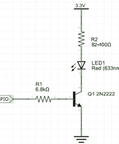

## PWM 输入

每个 slice 的 B 通道也可以作为输入。在这种模式下，slice 的框图如下：

B 输入 | 分频器 | 计数器 | A 输出

B 输入上的信号可以配置为修改计数工作的方式：

- 当 B 为高电时计数 —— 在此模式下，输入启动和停止计数
- 当 B 有上升沿时递增
- 当 B 有下降沿时计数递增

要设置模式，你需要使用 `pwm_set_clkdiv_mode(uint slice_num)`。

将以上内容整合在一起可以得到占空比测量程序：

```c
int main() {
  stdio_init_all();
  gpio_set_function(20, GPIO_FUNC_PWM);
  gpio_set_function(21, GPIO_FUNC_PWM);
  uint slice_num = pwm_gpio_to_slice_num(20);
  uint chanA = pwm_gpio_to_channel(20);
  uint chanB = pwm_gpio_to_channel(21);
  pwm_set_clkdiv_int(slice_num, 20, 0);
  int maxcount=125000000*10/20/1000;
  pwm_set_wrap(slice_num, 65535);
  pwm_set_level(slice_num, chanA, 100);
  pwm_set_clkdiv_mode(slice_num, PWM_DIV_B_HIGH);
  while (true) {
    pwm_set_enabled(slice_num, true);
    sleep_ms(10);
    pwm_set_enabled(slice_num, false);
    uint16_t count = pwm_get_counter(slice_num);
    pwm_set_counter(slice_num, 0);
    printf("count=%u duty cycle=%%d%%\n", count, (int)count*100/maxcount);
    sleep_ms(1000);
  }
}
```

只要被测信号的频率在 10ms 周期内呈现合理数量的周期（实际中约为 200Hz），该程序就能运行并给出相当准确的结果。

### 配置结构体

SDK 提供了配置 PWM 切片的另一种方法。你无需单独调用配置函数，而是可以在结构体中设置值：

```c
typedef struct {
  uint32_t csr;
  uint32_t div;
  uint32_t top;
} pwm_config;
```

然后使用函数来设置某些值：

```c
pwm_config_set_phase_correct(pwm_config *c, bool phase_correct)
pwm_config_set_clkdiv_div(pwm_config *c, float div)
pwm_config_set_clkdiv_int(pwm_config *c, uint div)
pwm_config_set_clkdiv_mode(pwm_config *c, enum pwm_clkdiv_mode)
```

```c
pwm_config_set_output_polarity(pwm_config *c, bool a, bool b)
pwm_config_set_wrap(pwm_config *c, uint16_t wrap)
```

你可以使用以下函数将结构体初始化为默认值：

```c
pwm_get_default_config(void)
```

并使用以下函数应用配置：

```c
pwm_init(slice_num, pwm_config *c, bool start)
```

这种优点是，一旦配置好结构体就可以复用它。例如：

```c
pwm_config cfg = pwm_get_default_config();
pwm_config_set_wrap(&cfg, wrap);
pwm_init(slice_num, &cfg, true);
```


根据习惯使用任何一种方式初始化切片即可。

### PWM 还能用于什么？

PWM 线具有非常多功能，在考虑几乎任何问题时，都值得问一下“我可以使用 PWM 吗？”LED 示例展示了如何将 PWM 作为功率控制器。你可以将此想法扩展到计算机控制的开关电源。你只需要一个电容器来平滑电压以及一个变压器来改变电压。你还可以使用 PWM 控制直流电机的速度，并通过添加桥式电路来控制它的方向和速度。最后，你可以将 PWM 信号作为数据通信的调制载波。例如，大多数红外遥控器使用 38kHz 的载波，这大约是 26µs 的脉冲。该脉冲开启和关闭 1ms，这完全在 PWM 的管理范围内。因此，你只需要将上一个电路中的红色 LED 替换为红外 LED，就得到了遥控器或数据传输链路的雏形。

一个很大的应用领域是控制电机和伺服电机，这是下一章的主题。

### 总结

- PWM（脉冲宽度调制）具有固定的重复频率，但占空比是变化的，即信号高电平或低电平的时间改变。
- PWM 可以通过正确更改 GPIO 线的状态来简单地通过软件生成，也可以在硬件中生成，从而减轻处理器的工作。
- 作为一种信号方式，PWM 还可以用于改变传输的功率或电压量。占空比越高，功率/电压越大。
- Pico 有八个硬件 PWM 生成器，这些能够支持多种工作模式。
- PWM 线由计数器和两个 wrap（环绕）值控制，wrap 提供频率，level 提供电平（占空比）。
- 你可以生成相位校正 PWM，或者允许相位随占空比变化。
- wrap 值越高，占空比的分率越高。可以为任何 PWM 频率计算最佳时钟频率值，以最大化占空比分辨率。
- 使用轮更改占空比很慢，但使用中断则很快。
- PWM 可以通过改变占空比来实现简单的 DAC（数模转换器）。
- 同样，通过改变占空比，你可以调节 LED 的亮度。

## 第9 章 控制电机与伺服器

控制电机是 PWM 的明显用途，它也用于伺服器。伺服是一种使用 PWM 信号控制其位置的电机。PWM 信号的占空比决定了伺服轴的角度。

## 有刷电机

为了给电磁供电，有刷电机通过滑环或换向器向电枢提供电流。随着转子旋转，线圈电流发生反转，它会被另一个磁极吸引。

这种结构唯一的问题是，当刷子在转子旋转并在滑环上摩擦时，它们会磨损并产生火花和射频干扰。有刷电机的质量很大程度上取决于刷子和换向器的设计。

| 1 | 2 | 3 | 4 |
|---|---|---|---|
| 定子 | 永磁 | 电磁 | 电磁 |
| 转子 | 永磁 | 电磁 | 电磁 |
| 类型 | 有刷 | 无刷 | 串联 |

### 单向有刷电机

有刷电机只需将其连接到直流电源即可供电。反转直流电源即可改变电机的旋转方向。速度与施加的电压成正比。如果你只需要单向控制，那么你只需要一个能够提供所需电流和电压的 PWM 驱动器。

只要包含一个二极管来允许电机在旋转但未通电时释放线圈中储存的能量，单晶体管方案是可行的：

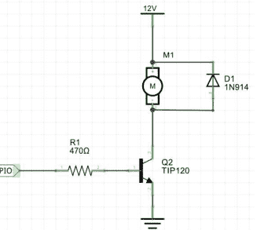

该电路非常简单，适用于电机电压最高 40V、电流连续 5A（峰值 8A）的电机。唯一需要注意的小点是，`TIP120` 是一对达尔顿管（Darlington pair），即同一个封装内包含两个晶体管，由于基极压降是通常 0.6V 的两倍（即 1.2V），在计算限流电阻时必须考虑到这一点。

有时说 `TIP120` 和类似的器件是低效率的功率控制器，因为它们包含两个晶体管，其发射极-集极电压是你预期的两倍，这意味着它们消耗了比需要更多的功率。

如果你用电池驱动电机，可能想使用 MOSFET，但如之前所述，3.3V 的电压太低，无法开启和关闭 MOSFET。一种解决方案是使用 BJT 来增加加在栅极的电压：

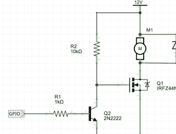

BJT 将栅极连接到 12V。由于 `IRZ44NPBF` 的阈值电压在 2V 到 4V 之间，设备在没有 BJT 帮助的情况下可以在 5V 甚至有时 3.3V 下工作，但提供 12V 可以确保 MOSFET 完全开启。一个问题是使用 BJT 会反转信号。当 GPIO 线为高电平时，BJT 开启而 MOSFET 关，反之亦然。换句话说，GPIO 高电平关闭电机，低电平开启电机。该 MOSFET 可工作于最高 50V 电压和 40A 电流。`2N2222` 只能工作于 30V，`2N2222A` 则为 40V。

控制单向电机的第三方法是使用半 H 桥。为什么被称为半 H 桥以及你为什么可能想这样做，将在下一节双向电机电机中变得显而易见。半 H 桥利用两个互补器件，可以是 NPN 和 PNP BJT，或者是 N 型和 P 型 MOSFET。

例如：

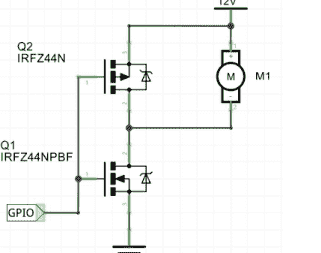

如果 GPIO 线为高电平，则 Q1 开启、Q2 关闭，电机运行。如果 GPIO 线为低电平，则 Q1 关闭、Q2 开启，电机处于制动状态——由于电机旋转时会产生反电动势（EMF），它的旋转具有阻力。根据选择，你可能需要一个 BJT 来为 MOSFET 供电。

### 单向 PWM 电机控制器

控制单向电机速度的功能非常简单。速度由占空比设置——你唯一需要选择的参数是频率。如果你想要一个理想的控制器，设置频率是一项艰巨的任务。较高的速度会让电机运行更快、更安静——频率过高会导致电机功率降低，并使驱动晶体管或 MOSFET 发热且效率降低。决定性因素是电机线圈的电感以及连接到它的任何其他组件（如电容）。在实践中，通常使用 100Hz 到 20kHz 的 PWM 频率，但在大多数情况下，1kHz 到 2kHz 是一个很好的选择。

我们如何实现代码来使电机控制变得简单？

一种具有面向对象编程优势的好模式是创建一个表示实体状态的结构体（`struct`）。

例如，为了实现单向电机，我们可以创建一个 `Motor` 结构体：

```c
typedef struct {
    uint gpio;
    uint slice;
    uint chan;
    uint speed;
    uint freq;
    uint resolution;
    bool on;
} Motor;
```

你可以看到这包含了定义电机当前状态所需的所有信息。我们现在只需要一些函数来修改字段并实现状态的变化。第一个是初始化函数：

```c
void motorInit(Motor *m, uint gpio, uint freq) {
    gpio_set_function(gpio, GPIO_FUNC_PWM);
    m->gpio = gpio;
    m->slice = pwm_gpio_to_slice_num(gpio);
    m->chan = pwm_gpio_to_channel(gpio);
    m->freq = freq;
    m->speed = 0;
    m->resolution = pwm_set_freq_duty(m->slice, m->chan, m->freq, m->speed);
    m->on = false;
}
```

接下来，我们需要一个设置速度的函数：

```c
void motorSpeed(Motor *m, int s) {
    pwm_set_duty(m->slice, m->chan, s);
    m->speed = s;
}
```

最后是两个用于开启和关闭电机的函数：

```c
void motorOn(Motor *m) {
    pwm_set_enabled(m->slice, true);
    m->on = true;
}

void motorOff(Motor *m) {
    pwm_set_enabled(m->slice, false);
    m->on = false;
}
```

使用此结构体和相关函数，我们可以轻松地在 `main.c` 中控制电机：

```c
#include <pico/stdlib.h>
#include "hardware/pwm.h"
#include "motor.h"

int main() {
    Motor mot1;
    motorInit(&mot1, 21, 2000);
    motorSpeed(&mot1, 500);
    motorOn(&mot1);
    return 0;
}
```

### 双向电机

如果你想要双向控制，则需要使用 H 桥：

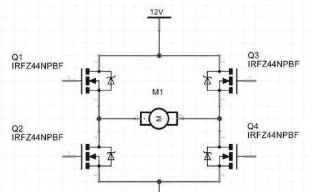

可以看出桥由四个晶体管组成，并有逻辑门允许 IN1 和 IN2 选择合适的器件对。H 桥最重要的点是 Q1/Q2 和 Q3/Q4 永远不能同时开启——这会导致电源短路。

如果处理四个功率晶体管对你来说太困难，好消息是有些芯片每个器件实现了两个 H 桥。你也可以购买带有一个或多个 H 桥的廉价现成模块。最常用的器件之一是 `L298` 双 H 桥，它的工作电压最高 46V，总直流电流为 4A。

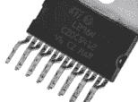

其中一个 H 桥的框图展示了它是如何工作的：

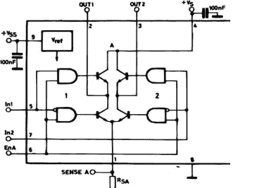

另一种替代设计是使用互补 MOSFET：

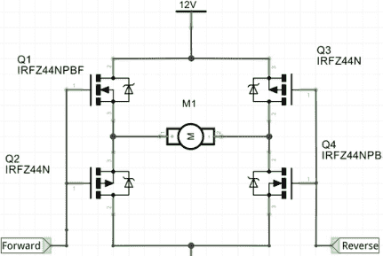

在这种配置中，第一条 GPIO 线驱动电机正转，第二条线反转驱动。设置这两条线的效果如下：

| 正向 | 反向 | 状态 |
|---|---|---|
| 低 | 低 | 关闭 |
| 低 | 高 | 反向 |
| 高 | 低 | 正向 |
| 高 | 高 | 制动 |

### 基于 L298 的典型模块

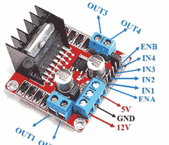

描述如何将单电机使用这种模块会更简单。电机连接到 OUT1 和 OUT2。三条 GPIO 线连接到 ENA，IN1 和 IN2。ENA 是一个使能线，ENA 必须为高电平电机才能运行。IN1 和 IN2 充当方向控制线的作用——取决于你连接电机的方式，哪一个是正转，哪一个是反转。在 ENA 上发送 PWM 信号可以控制电机的速度，这使得 IN1 和 IN2 可以作为简单的数字输出。

请注意，电源接口显示有 5V 和 12V 电源，但大多数此类模块都有一个电压调节器，可以将 12V 降至 5V。在这种情况下，你不需要提供 5V 连接。如果你想使用超过 12V 的电压，则必须断开调节器，并准备一个单独的 5V 电源——请检查模块的文档。注意 H 桥中的晶体管有大约 2V 的压降，因此使用 12V 导致电机电压仅为 10V。

另一个流行的 H 桥设备是 `SN754410` 驱动器。它适用于小型功率电机，具有两个完整的 H 桥。每个驱动器可以提供高达 1A 的电流，工作电压为 4.5 到 6V。它与 `L298` 具有相同的控制线，即每个电机都有正转/反转控制线和一个使能线。你不需要使用使能线——可以将其连接到 +5V，以便在正转/反转线上应用 PWM。

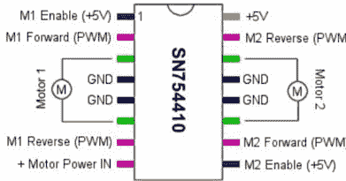

### 双向电机软件

我们可以轻松地扩展 `Motor` 结构体及其函数以处理双向电机。唯一的区别是现在我们必须使用两条 GPIO 线，如果它们是同一个切片的 A 和 B 通道，使用起来最方便——简单起见，代码没有检查这个条件。正转时激活第一条 GPIO 线，反转时激活第二条（记得在 `CMakeLists.txt` 文件中添加 `hardware_pwm` 以及上一章节中的函数）：

```c
typedef struct {
    uint gpioForward;
    uint gpioBackward;
    uint slice;
    uint Fchan;
    uint Bchan;
    bool forward;
    uint freq;
    uint resolution;
    bool on;
} BiMotor;
```

```c
void BiMotorInit(BiMotor *m, uint gpioForward, uint gpioBackward, uint freq) {
    gpio_set_function(gpioForward, GPIO_FUNC_PWM);
    m->gpioForward = gpioForward;
    m->slice = pwm_gpio_to_slice_num(gpioForward);
    m->Fchan = pwm_gpio_to_channel(gpioForward);
    gpio_set_function(gpioBackward, GPIO_FUNC_PWM);
    m->gpioBackward = gpioBackward;
    m->Bchan = pwm_gpio_to_channel(gpioBackward);
    m->freq = freq;
    m->speed = 0;
    m->forward = true;
    m->resolution = pwm_set_freq_duty(m->slice, m->Fchan, m->freq, 0);
    pwm_set_duty(m->slice, m->Bchan, 0);
    m->on = false;
}
```

```c
void BiMotorSpeed(BiMotor *m, int s, bool forward) {
    if (forward) {
        pwm_set_duty(m->slice, m->Bchan, 0);
        pwm_set_duty(m->slice, m->Fchan, s);
        m->forward = true;
    } else {
        pwm_set_duty(m->slice, m->Fchan, 0);
        pwm_set_duty(m->slice, m->Bchan, s);
        m->forward = false;
    }
    m->speed = s;
}

void BiMotorOn(BiMotor *m) {
    pwm_set_enabled(m->slice, true);
    m->on = true;
}

void BiMotorOff(BiMotor *m) {
    pwm_set_enabled(m->slice, false);
    m->on = false;
}

int main() {
    BiMotor mot1;
    BiMotorInit(&mot1, 20, 21, 2000);
    BiMotorOn(&mot1);
    while (true) {
        BiMotorSpeed(&mot1, 50, true);
        sleep_ms(2000);
        BiMotorSpeed(&mot1, 25, false);
        sleep_ms(2000);
    }
    return 0;
}
```

这是一组非常基础的函数，你可以根据所需的复杂程度添加其他函数来改进电机控制。例如，刹车函数会将两条线都设为高电平以刹车。注意 H 桥中的晶体管有大约 2V 的压降，因此使用 12V 导致电机电压仅为 10V。

### 控制舵机

现在我们只需要设置 PWM 线产生 50Hz 的脉冲，脉冲宽度范围在 0.5ms 到 2.5ms 之间——即占空比 2.5% 到 12.5%。

再次使用一个结构体来表示舵机的当前状态，并创建函数来更改状态：

```c
typedef struct {
    uint gpio;
    uint slice;
    uint chan;
    uint speed;
    uint resolution;
    bool on;
    bool invert;
} Servo;
```

该结构体包含一个指定输出反转的字段。初始化非常简单：

```c
void ServoInit(Servo *s, uint gpio, bool invert) {
    gpio_set_function(gpio, GPIO_FUNC_PWM);
    s->gpio = gpio;
    s->slice = pwm_gpio_to_slice_num(gpio);
    s->chan = pwm_gpio_to_channel(gpio);
```


```c
pwm_set_enabled(s->slice, false);

s->on = false;

s->speed = 0;

s->resolution = pwm_set_freq_duty(s->slice, s->chan, 50, 0);

pwm_set_dutyH(s->slice, s->chan, 250);
}
```

```c
if (s->chan)
{
    pwm_set_output_polarity(s->slice, false, invert);
}
else
{
    pwm_set_output_polarity(s->slice, invert, false);
}

s->invert = invert;
```

注意我们将频率设置为 50Hz。如果你想配合非标准舵机工作，可以更改此值或将其设置为可配置。我们还需要一个更高精度的函数来设置占空比。给定的函数是以百分比为单位的，但舵机的百分比范围仅为 2.5% 到 12.5%，我们需要指定两位小数，因此我们需要用 `percent*100` 来处理：

```c
void pwm_set_dutyH(uint slice_num, uint chan, int d)
{
    pwm_set_chan_level(slice_num, chan, pwm_get_wrap(slice_num) * d / 10000);
}
```

完成这些后，我们就可以启用开启/关闭和定位函数了：

```c
void ServoOn(Servo *s)
{
    pwm_set_enabled(s->slice, true);
    s->on = true;
}
```

```c
void ServoOff(Servo *s)
{
    pwm_set_enabled(s->slice, false);
    s->on = false;
}
```

```c
void ServoPosition(Servo *s, uint chan, int p)
{
    pwm_set_dutyH(s->slice, s->chan, p*10+250);
}
```

`ServoPosition` 函数以百分比的形式设置位置。例如 `ServoPosition(&s, 50)` 将舵机设置为其范围的中点。这假设舵机具有标准的定位范围，但大多数并非如此。在实践中，为了发挥舵机的最佳性能，你需要对每个舵机进行校准，并发现它支持的运动范围。

你可以编写的最简单的舵机程序如下：

```c
int main()
{
    Servo s1;
    ServoInit(&s1, 20, false);
    ServoOn(&s1);
    while (true) {
        ServoPosition(&s1, 0);
        sleep_ms(500);
        ServoPosition(&s1, 100);
        sleep_ms(500);
    }
    return 0;
}
```

这会让舵机移动到两个位置（最小和最大），并在它们之间暂停。

如果你使用之前提供的电路运行程序，你会发现舵机除了震动外什么也没有做。原因是晶体管电压驱动器是一个反相器。当 PWM 线为高电平时，晶体管完全导通，舵机的脉冲线实际上接地。当 PWM 线为低电平时，晶体管完全关断，舵机的脉冲线被电阻拉高。解决方案是使用 GPIO 线的反相输出：`ServoInit(&s1, 20, true)`。

值得注意的是，舵机是很好的低成本直流电动机，并且配有齿轮箱。你只需要打开舵机，将电机从控制电路中焊下，并在电机上焊两根线。如果你想使用正反转电子元件，可以移除齿轮箱上的限位器（通常在大齿轮箱上），并将电位器用一对等值的电阻（例如 2.2kΩ）替换。

### 无刷直流电机

无刷直流电机比有刷直流电机昂贵，但在许多方面都更优。它们不会因为换向器或电刷磨损而失效，不需要维护。它们在旋转的所有点都提供最大的旋转扭矩，并且在相同尺寸和重量下通常提供更大的功率。它们还可以更精确地控制。唯一的缺点是成本较高且操作稍显复杂。在实践中，除非你确实需要，否则使用有刷直流电机更好。

无刷直流电机基本上是反过来的有刷电机——定子是一组电磁铁，转子是一组永久磁铁。在某些设计中，永久磁铁像有刷电机一样位于定子内部，称为内转子，而有时磁铁位于定子外部，称为外转子。

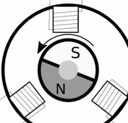

内转子——永久磁铁形成转子，线圈切换以产生吸引。

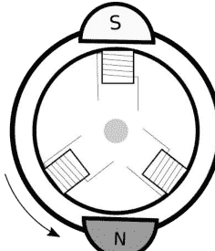

外转子——永久磁铁位于定子外部，整个外壳旋转。

无刷电机的工作方式与有刷电机完全相同。由于线圈是静止的，因此不需要机械换向器，但仍然需要换向——线圈必须顺序接通以产生旋转磁场，从而带动转子旋转。这意味着你必须实现一个电子换向器，这正是无刷直流电机的另一个名称。

电子换向器必须感应转子的位置并改变由定子产生的磁场以保持转子运动。无刷电机的区别在于磁铁的数量和相数。最常见的是三相电机，因为它们被用于无线控模型。本质上，你每个相位都需要一个驱动器和一条 GPIO 线来产生脉冲。

下图显示了一个激活了第 1 相的双相永磁（PM）电机：

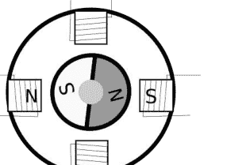

如果激活第二相，转子将旋转 90 度：


这是你可以制作的最简单的步进电机。一个典型的步进电机的线圈数量比四个多得多，但它们通常被连接成两个或三个相。

另一个大区别是双极（bipolar）与单极（unipolar）。双极电机就像如图所示。为了产生北极，电流的方向必须与你想创建南极时的方向相反。这意味着你必须使用双向驱动器（例如 H 桥）来驱动每组线圈。单极电机有两个绕组，每个方向一个，且两个绕组都可以由单向驱动器驱动——其中一个产生北极，另一个产生南极。注意，单极电机需要驱动的线圈数量是双极电机的两倍，且切换序列略有不同。

具有 A 相和 B 相的双相双极电机的切换顺序为：

A → B → A- → B- → A 等，其中减号表示电流向反方向流动。

双相单极电机每相有两个线圈 A1、A2 和 B1、B2，其中 1 和 2 绕组对相同电流产生相反的磁场。现在的序列是：

A1 → B1 → A2 → B2 → A1 等

并且都以相同方向驱动。

按顺序完全开启和关闭单相会使电机产生重复的步进。你也可以同时开启多个相位来产生微步。例如，在我们双相示例中，同时开启两个相位会使转子稳定在两个位置之间，从而产生半微步：


双相双极电机的驱动序列为：

A → AB → BA- → A- → B- → AB- → A

其中减号表示线圈在反方向上通电，总共八步，而不是四步。

你甚至可以改变通过线圈的电流并使转子移动到中间位置。在极限情况下，你可以以正弦波改变电流并产生平滑旋转。微步比步进更平滑，并且可以消除嗡嗡声。对于高精度定位，微步在负载下的性能较差。

### 步进电机驱动器

使用 Pico 驱动步进电机的最好方法？有些专用芯片可以适用于单极和双极步进电机。然而，你可以轻松地使用方向电机控制章节中描述的 H 桥之一来控制双极步进电机。

例如，使用互补 MOSFET：


如果你不想从零开始构建，可以使用同样的方法使用双路 H 桥模块。电机必须是双极双相电机，通常称为四线步进电机。你可以看到，对于这种配置，你需要四根 GPIO 线：A、A- 和 B-。

使用软件驱动双路 H 桥又如何？你需要 GPIO 线，并且需要在特定相位对它们进行脉冲以使电机旋转。这可以使用 PIO 实现（见第 13 章），但从软件控制的 GPIO 线开始会更简单。第一个要回答的问题是如何指定指定要使用的四根 GPIO 线。正如我们将要看到的，使用一组连续的四行具有巨大的优势和简化。这是因为我们可以轻松地在掩码中设置与这些行对应的位，从而在单操作中设置它们。在这种情况下，我们只需记录数值最小的 GPIO 行编号。

与之前一样，我们使用结构体来记录电机的当前状态：

```c
typedef struct {
    uint gpio;
    uint speed;
    bool forward;
    uint32_t gpiomask;
    uint phase;
} StepperBi;
```

我们还需要一个数组来指定电机在每个位置时四根线的状态。创建一个用于正确设置线缆所需的掩码数组会更有效：

```c
uint32_t stepTable[8] =
    (uint32_t[8]){0x8, 0xC, 0x4, 0x6, 0x3, 0x1, 0x9};
```

```c
/*
    {1, 0, 0, 0},
    {1, 1, 0, 0},
    {0, 1, 0, 0},
    {0, 1, 1, 0},
    {0, 0, 1, 0},
    {0, 0, 0, 1},
    {1, 0, 0, 1}
*/
```

```c
int main()
{
    stdio_init_all();
    StepperBi s1;
    StepperBiInit(&s1);
    while (true) {
        stepForward(&s1);
        sleep_ms(1);
    }
    return 0;
}
```

在这种情况下，H 桥 GP21 为 A，GP20 为 B，GP19 为 A，GP18 为 B。步进速度设置使得一个 200 步的电机（即 400 个半步）旋转一圈需要 400*1 ms= 0.4 秒，即 2.5 转（rpm），这是一个很好的起始速度。缩短睡眠时间可以获得更高的速度。

如果你正在使用许多双 H 桥模块之一，则接线如下所示：


注意，你必须将电源的地线与 Pico 的地线在一起。在第一次尝试时，使用带有电流切断功能的电源也是一个好主意。

逻辑分析仪显示切换时间是准确的，脉冲之间没有可测的重叠：


### 步进电机旋转 – 使用定时器

大多数情况下，你使用步进电机通过执行精确的步数移动到给定位置。如果你不想让步进电机旋转，那么你需要安排以固定的速率步进。在 Pico 上实现这一点最简单的方法是使用定时器中断。有一组低级函数允许你与四个硬件定时器交互，但更高级的 `repeating_timer` 函数对于中断来说要容易用得多。

最有用的函数是：

```c
add_repeating_timer (int64_t delay_us,
    repeating_timer_t callback_callback,
    void *user_data, repeating_timer_t *out)

add_repeating_timer_ms (int32_t delay_ms,
    repeating_timer_t callback_callback,
    void *user_data, repeating_timer_t *out)
```

```c
cancel_repeating_timer (repeating_timer_t *timer)
```

第一个添加一个以微秒或毫秒为重复时间的重复定时器。第二个取消定时器。需要注意的重点是，你需要一个 `repeating_timer` 结构体传递给这些函数中的每一个，并且它在定时器运行时必须存在。该结构体用于记录定时器的细节，除了 `user_data` 字段外，你大部分可以忽略它，该字段可以将数据传递给中断处理程序。回调是一个接受 `repeating_timer` 结构体作为唯一参数的函数。为了让电机连续旋转，我们需要设置一个定时器，在正确的间隔上调用步进函数：

```c
bool step(struct repeating_timer *t)
{
    StepperBi *s = (StepperBi*) (t->user_data);
    if (s->forward)
    {
        stepForward(s);
    } else {
        stepReverse(s);
    }
    return true;
}
```

你可以看到这个函数简单地根据 `dir` 字段的设置让电机向前或向后步进。注意，使用的步进电机是由传递的 `user_data` 决定的。为了让此工作，我们需要一个函数来设置定时器中断：

```c
struct repeating_timer *timer;
```

```c
void rotate(StepperBi *s, bool dir, int speed)
{
    cancel_repeating_timer(&timer);
    s->forward = dir;
    if (speed == 0)
    {
        s->speed = 0;
        return;
    }
    s->speed = 1000 * 1000 / (4 * speed);
    add_repeating_timer(s->speed, step, s, &timer);
}
```

注意我们必须处理速度设置为零的情况以避免除以零异常。速度以 rpm*100 指定。因此，将速度设置为 250 可以得到 2.5rpm 的旋转速度。

一个以 2.5rpm 旋转电机 100ms 然后停止另一个 100ms 的主程序如下：

```c
int main()
{
    static StepperBi s1;
    StepperBiInit(&s1, 18);
    rotate(&s1, true, 250);
    while (true) {
        rotate(&s1, true, 250);
        sleep_ms(100);
        rotate(&s1, true, 0);
        sleep_ms(100);
    }
    return 0;
}
```

注意，当电机停止时，相位仍然处于状态，因此电机在通电时保持其位置：


你可以对这个基础方案进行扩展，以对电机行为进行更复杂的控制，包括允许它自由运行以及选择全步或半步进。包含定时器中断的完整程序为：


```c
#include <stdio.h>
#include "stdlib.h"

typedef struct
{
    uint gpio;
    uint speed;
    bool forward;
    uint32_t gpiask;
    uint phase;
} StepperBi;

uint32_t stepTable[8] = {
    0x8, 0xC, 0x4, 0x6, 0x2, 0x1, 0x9, 0xF
};
/*
{0, 0, 0, 0},
{1, 1, 0, 0},
{0, 1, 0, 0},
{0, 0, 1, 0},
{0, 0, 1, 1},
{0, 0, 0, 1},
{0, 0, 0, 1},
{1, 0, 0, 0}
*/

void StepperInit(StepperBi *s, uint gpio)
{
    s->gpio = gpio;

    for (int i = 0; i < 4; i++)
    {
        gpio_function((s->gpio) + i, GPIO_FUNC);
        gpio_set((s->gpio) + i, true);
    }
    s->gpiask = 0xF << gpio;
    uint32_t mask = stepTable[0] << gpio;
    gpio_put_masked(s->gpiask, mask);
    s->phase = 0;
    s->speed = 0;
    s->forward = true;
}

void setPhase(StepperBi *s, uint p)
{
    uint32_t mask = stepTable[p] << gpio;
    gpio_put_masked(s->gpiask, mask);
}

void stepForward(StepperBi *s)
{
    s->phase = (s->phase + 1) % 8;
    setPhase(s, s->phase);
}

void stepReverse(StepperBi *s)
{
    s->phase = (s->phase - 1) % 8;
    setPhase(s, s->phase);
}
```

注：原文代码中 `setPhase` 函数内的 `gpio` 变量未定义，应为 `s->gpio`，翻译时保留代码逻辑。

通常，还可以任意数量的 SS（从机选择）、CE（芯片使能）或 CS（芯片选择）线，这些线通常设置为低电平以选择被寻址的从机。注意，与其他总线（例如 I2C）不同，SPI 没有 SPI 命令或地址，只有数据字节。然而，从设备会将数据解释为执行某些操作或发送某些特定数据的指令。


SPI 接口还有两种工作模式——双向模式和 LoSSI 模式。双向模式简单地使用单条数据线（MIMO）同时用于输入和输出。方向通过向从机写入命令来确定。LoSSI 模式用于与 LCD 屏等复杂的外设通信。这两种模式 SDK 和本章范围都不支持。但是，一旦你了解了标准模式的工作原理，另外两种只是变体。

SPI 总线上的数据传输略有偏移。发生的是主设备将其中一个片选线拉低，从而激活一个从设备。然后主设备切换时钟 `SCLK`，主设备和从设备在各自的数据线上发送一个位。在八个时钟周期后，一个字节已从主设备传输到从设备，并从从设备传输到主设备。你可以将其实现为循环缓冲区，尽管并不一定如此。


这种全双工数据传输通常被软件和使用的协议所隐藏。例如，有一个读取函数从从设备读取数据并发送零或被从设备忽略的数据。同样，有一个写入函数发送数据，但忽略从设备发送的任何内容。数据传输通常以 8 位为组进行，通常是高位在前，但情况并不总是如此。通常，只要主设备提供脉冲，数据就会传输。

注意，这种循环缓冲区布局允许从设备进行级联，将一个设备的输出连接到下一个设备的输入。这使得整个系统变成一个大的移位器。这使得通过单个片选控制多个设备成为可能，但也意味着发送给从机的任何命令都会被每个设备依次接收。例如，你可以依次向每个 AD 转换器发送转换命令，并接收每个设备的结果。

SPI 总线的最后一个特殊之处是有四种模式，定义了数据时序与时钟脉冲之间的关系。时钟可以是高电平或低电平，这称为极性 (`CPOL`)，数据可以在时钟的上升沿或下降沿采样，这称为时钟相位 (`CPHA`)。

这两种可能的所有组合结果如下：

| SPI 模式* | 时钟极性 CPOL | 时钟相位 CPHA | 特性 |
|---|---|---|---|
| 0 | 0 | 0 | 时钟高电平有效，数据在下降沿输出并在上升沿采样 |
| 1 | 0 | 1 | 时钟高电平有效，数据在上升沿输出并在下降沿采样 |
| 2 | 1 | 0 | 时钟低电平有效，数据在下降沿输出并在上升沿采样 |
| 3 | 1 | 1 | 时钟低电平有效，数据在上升沿输出并在下降沿采样 |

*SPI 模式的标记方式是常见的，但并非通用的。

在尝试确定从设备使用的模式时通常会有困难。时钟极性通常很容易判断，时钟相位有时可以通过数据传输时序图推断：

- 数据位中间的第一次时钟跳意味着 `CPHA=0`
- 数据位开始时的第一次时钟转换意味着 `CPHA=1`

配置 SPI 总线以与特定的从设备工作：

1. 选择时钟频率——125MHz 到 3.8kHz 之间的任意
2. 确定 CS 极性——高电平或低电平
3. 设置时钟模式 Mode0 到 Mode3

现在我们必须找到如何使用 SDK 实现。

## Pico SPI 接口

Pico 有两个 SPI 控制器，`SPI0` 和 `SPI1`，可以作为主设备或从设备工作。从这两个控制器的连接可以路由到不同的引脚：

| | GP0 | GP4 | GP16 | GP20 |
|---|---|---|---|---|
| CSn | GP1 | GP5 | GP17 | GP21 |
| SCLK | GP2 | GP6 | GP18 | GP22 |
| MOSI | GP3 | GP7 | GP19 | GP23 |
| | GP8 | GP12 | GP24 | GP28 |
|---|---|---|---|---|
| CSn | GP9 | GP13 | GP25 | GP29 |
| SCLK | GP10 | GP14 | GP26 | |
| MOSI | GP11 | GP15 | GP27 | |

要选择引脚作为 SPI 引脚，只需使用：

`gpio_set_function(gpio, GPIO_FUNC_SPI);`

对于一个完整的 SPI 接口，你需要为一个 MISO、一个 MOSI 和一个 SCLK 设置一个引脚的模式。为了使用它们，你必须像标准 GPIO 线一样对待它们，并设置高/低电平以选择程序控制的设备。这意味着你可以根据需要使用任意数量。

### SPI 函数

在使用这些函数之前，你必须包含头文件：

`#include "hardware/spi.h"`

并且需要在 `CMakeLists.txt` 中添加库：

`target_link_libraries(${PROJECT_NAME} hardware_spi)`

### 初始化

有两个用于启用和禁用总线的函数：

`spi_init(spi_inst_t *spi, uint32_t baudrate)`

`spi_deinit(spi_inst_t *spi)`

### 配置

有一组用于配置 SPI 的函数。`set_slave` 函数决定 Pico 是主设备还是从设备：

`spi_set_slave(spi_inst_t *spi, bool slave)`

最重要的函数是设置格式的：

`spi_set_format(spi_inst_t *spi, uint8_t data_bits, spi_cpol_t cpol, spi_pha_t cpha, spi_order_t order)`

### 数据传输

由于 SPI 总线使用全双工传输，情况与其他总线有所不同。最基本的传输函数是：

```c
int spi_write16_read16_blocking(spi_inst_t *spi, const uint16_t *src, uint16_t *dst, size_t len)
```

`src` 和 `dst` 数组的大小必须相同。`src` 数组用于传输的数据，`dst` 数组用于接收的数据。如果你理解这种发送（源）或接收（目的）数组的概念，每个数组由 16 位元素组成，但实际发送的是配置中指定的位数。如果你将 `data_bits` 设置为 8，则只发送或接收每个元素的低 8 位。

注意，调用任何传输函数都是阻塞的，即函数会等待传输完成。也不需要超时设置，因为所有 SPI 传输在传输指定数据所需的时钟脉冲后结束。此外，传输函数返回读取/写入的元素数量。

如果你对读取或写入数据感兴趣，可以使用：

`spi_write16_blocking(spi_inst_t *spi, const uint16_t *src, size_t len)`

`spi_read16_blocking(spi_inst_t *spi, uint16_t repeated_tx_data, uint16_t *dst, size_t len)`

在写入函数的情况下，接收的数据被丢弃了。读取函数有一个参数来指定你想发送的数据。这通常是零，但某些从设备要求发送特定的值，尽管在原则上这并不重要。注意，这两个函数都是调用 `spi_write16_read16_blocking` 的简便方式。

读写函数还有两个 8 位版本：

```c
int spi_write_blocking(spi_inst_t *spi, const uint8_t *src, size_t len)
int spi_read_blocking(spi_inst_t *spi, uint8_t repeated_tx_data, uint8_t *dst, size_t len)
```

这些再次是 `spi_write16_read16_blocking` 的简单版本，只是使用了字节数组而不是 16 位数组。

还有一个你大部分可以忽略的复杂情况。SPI 硬件是带缓冲的。MISO 和 MOSI 连接都有一个深度为 8 的 FIFO 缓冲区，这意味着只要缓冲区不满也不空，你就可以更快地发送和接收数据。要测试缓冲区的状态，你可以使用：

```c
static size_t spi_is_readable(spi_inst_t *spi)
// 如果有数据等待读取，则返回非零，且：
static size_t spi_is_writable(spi_inst_t *spi)
```

如果缓冲区有空间，则返回非零。你可以使用这两个函数来尽量减少使用 I/O 函数的影响。

### 使用数据传输函数

当你开始使用 SPI 时，可能很难建立起“同时发送和接收数据”的观念。事实上，除非发送相同数量的数据，否则你无法接收数据。

最基础的传输函数是 `spi_write16_read16_blocking`，它双向传输显而易见。例如：

```c
uint16_t wBuffer[] = {'A', 'B', 'C'};
uint16_t rBuffer[3];
int n = spi_write16_read16_blocking(spi0, wBuffer, rBuffer, 3);
```

这发送了 `wBuffer` 中的三个元素，并在 `rBuffer` 中接收了三个元素。缓冲区中的这三个元素是否有意义取决于从设备返回了什么，它们可能完全不引起你的兴趣。如果是这种情况，你可以使用：

```c
uint16_t wBuffer[] = {'A', 'B', 'C'};
int n = spi_write16_blocking(spi0, wBuffer, 3);
```

从设备返回的任何内容都将被忽略。如果你正在使用 8 位传输，还可以使用：

```c
uint8_t wBuffer[] = {'A', 'B', 'C'};
uint8_t rBuffer[3];
int n = spi_write_read_blocking(spi0, wBuffer, rBuffer, 3);
```

或者

```c
uint8_t wBuffer[] = {'A', 'B', 'C'};
int n = spi_write_blocking(spi0, wBuffer, 3);
uint8_t rBuffer[3];
spi_read_blocking(spi0, 0, rBuffer, 3);
```

如果你在处理 8 位数据：

仅使用这些函数，你应该就能处理绝大多数 SPI 从设备了。

现在我们来看一个微妙的点。传输多个字节与通过多次传输调用逐个发送字节之间有什么区别？答案是，每当你进行一次传输调用时，片选线（CS）都应该被激活、传输数据，然后取消激活。使用缓冲区传输时，片选可以在整个传输过程中保持激活状态，即不需要在每个字节之间取消激活。有时这种差异并不重要，你可以使用三次调用来传输三个字节，或者只调用一次函数。然而，某些从设备如果在多字节传输中间取消激活了片选线，将终止当前的字节操作。由于 Pico 要求你手动激活和取消激活片选线，因此区分单字节传输和多字节传输取决于你。

需要意识到，传输的本质是：第一个元素在被发送的同时，第一个元素也被接收。也就是说，与其他协议不同，整个发送缓冲区在接收数据返回之前并不是发送完毕。整个传输是按元素逐个进行的——在接收第一个元素的同时发送第一个元素，然后在接收第二个元素的同时发送第二个元素，依此类推。不完全理解这个观点可能会导致一些有趣的 Bug。

### 回环示例

由于 SPI 总线上的数据传输方式，非常容易在不需要添加任何组件的情况下测试一切是否工作正常。你只需要将 `MOSI` 连接到 `MISO`，这样任何发送的内容在回环模式下也会被接收。

首先我们需要选择要使用的引脚，这在这一阶段是相当随意的，我们大可以使用：

```
SPI0  MISO GP4  pin 6
      SCLK GP6  pin 9
      MOSI GP7  pin 10
```

我们目前可以忽略 CS 线，因为它在回环中没有被使用。

首先用跳线将引脚 6 连接到引脚 10，并启动新项目。


程序非常简单。首先我们初始化 SPI 总线并选择 500kHz 的时钟频率：

```c
spi_init(spi0, 500 * 1000);
```

并将我们使用的 GPIO 引脚设置为 SPI 模式：

```c
gpio_set_function(4, GPIO_FUNC_SPI);
gpio_set_function(6, GPIO_FUNC_SPI);
gpio_set_function(7, GPIO_FUNC_SPI);
```

接下来我们配置接口：

```c
spi_set_format(spi0, 8, SPI_CPOL_0, SPI_CPHA_0, SPI_MSB_FIRST);
```

我们正在使用 8 位数据和 SPI 模式 0。

接下来我们可以发送数据并返回：

```c
uint8_t read_data = spi_transfer_blocking(spi0, 0xAA);
```

十六进制值 `0xAA` 用于测试它生成的 `10101010` 比特序列，这在逻辑分析仪上很容易看到。检查接收到的数据与发送的数据是否匹配：

```c
uint16_t wBuffer[1] = {0xAA};
uint16_t rBuff[1];
int n = spi_write16_read16_blocking(spi0, wBuffer, rBuff);
```

最后关闭总线：

```c
spi_deinit(spi0);
```

将所有内容整合得到完整的程序（记得在 `CMakeLists.txt` 中添加 `hardware_spi`）：

```c
#include <stdio.h>
#include <pico/stdlib.h>
#include <hardware/spi.h>

int main() {
    stdio_init_all();
    spi_init(spi0, 500 * 1000);
    gpio_set_function(4, GPIO_FUNC_SPI);
    gpio_set_function(6, GPIO_FUNC_SPI);
    gpio_set_function(7, GPIO_FUNC_SPI);
    spi_set_format(spi0, 8, SPI_CPOL_0, SPI_CPHA_0, SPI_MSB_FIRST);

    uint16_t wBuffer[1] = {0xAA};
    uint16_t rBuff[1];
    int n = spi_write16_read16_blocking(spi0, wBuffer, rBuff);
    printf("%X %X %d\n", wBuffer[0], rBuff[0], n);
}
```

如果你运行程序没有收到任何数据，最可能的原因是你连接错了引脚或根本没有连接。如果你将逻辑分析仪连接到 4、6、7 三个引脚，你将看到数据传输：


### 使用 CS 线

当然，逻辑分析仪上没有 CS 线活动，因为与许多 SPI 实现不同，Pico 不会自动控制 CS 线。你需要将 CS 线初始化为标准 GPIO 并在数据传输期间进行设置。

例如，让我们添加 GP5：

- SPI0 MISO GP4 pin 6
- CS GP5 pin 7
- SCLK GP6 pin 9
- MOSI GP7 pin 10

注意，并没有特殊的理由必须使用 GP5。要激活 CS，我们首先必须将 GPIO 线初始化为输出并设置为高电平：

```c
gpio_init(5);
gpio_set_dir(5, GPIO_OUT);
gpio_put(5, 1);
```


现在我们可以通过在传输开始前将其置低、结束后将其置回高来激活从设备：

```c
gpio_put(5, 0);
int n = spi_write16_read16_blocking(spi0, wBuffer, rBuff);
gpio_put(5, 1);
```

如果你尝试这样做，仔细观察可能会发现一个问题。CS 线的设置发生在最后一个时钟脉前约 0.7µs。这意味着 CS 线在传输完成之前就变高了。


对于许多设备这没有区别，但包含一个延迟以确保 CS 线在最后一个时钟脉结束后再次变高是安全的。要准确实现这一点，需要计算剩余结束的时间，这取决于时钟频率。你可以使用以下代码设置延迟：

```c
int clock = 100 * 1000;
spi_init(spi0, clock);
...
csDelay = 1000000 / (2*clock);
gpio_put(5, 0);
int n = spi_write16_read16_blocking(spi0, wBuffer, rBuff);
sleep_us(csDelay);
gpio_put(5, 1);
```

| +40us | +50us | +60us | +70us | +80us | measurement |
| :--- | :--- | :--- | :--- | :--- | :--- |
| bAA | | | | | MISO: 4.09us |
| | | | | | Period: 8.19us |
| | | | | | DutyCycle: 50% |
| | | | | | Frequency: 122.100122kHz |
| bAA | | | | | Pulse Counters |
| :--- | :--- | :--- | :--- | :--- | :--- |
| | | | | | Timing Marker Pairs |
| | | | | | A1 - A2 = 2.38us |
| | | | | | A1 @ 37.2us |
| | | | | | A2 @ 375.12us |
| | | | | | Analyzers |
| | | | | | SPI |
| | | | | | Decoded Results |


为了让 SDK 示例更易用，我们将使用相同的 GPIO 引脚连接设备：

| PICO | BME280 |
|---|---|
| GP16 (pin 21) MISO/spi0_rx | SDO/SDO |
| GP17 (pin 22) 片片选择 | CSB/!CS |
| GP18 (pin 24) SCK/spi0_sclk | SCL/SCK |
| GP19 (pin 25) MOSI/spi0_tx | SDA/SDI |
| 3.3v (pin 36) | VCC |
| GND (pin 38) | GND |

注意，典型 BME280 板载上的引脚名称可能不同，但你应该能够识别出它们。

一旦连接好设备，发送和接收数据所需的知识取决于具体的 SPI 总线和设备变异，你只能选择查找并阅读数据手册。在这种情况下，请参考“内存映射”表：

| 寄存器名称 | 地址 | bit7 | bit6 | bit5 | bit4 | bit3 | bit2 | bit1 | 重置 |
|---|---|---|---|---|---|---|---|---|---|
| hum_lab | 0xFE | | | | hum_lab[7:0] | | | | 0x00 |
| temp_lab | 0xFC | | | temp_xls[7:4] | | 0 | 0 | | 0x00 |
| hum_map | 0xFA | | | | | | | | 0xA0 |
| temp_map | 0xF8 | | | | temp_xls[7:4] | | 0 | 0 | 0x80 |
| press_lab | 0xF6 | | | | press_lab[7:0] | | | | 0x80 |
| press_map | 0xF4 | | | | | | filter | | | 0x80 |
| ctrl_meas | 0xF2 | | | t_ds[2:0] | | osrs[2:0] | spce[en] | | 0x00 |
| ctrl_hum | 0xD0 | | | | | | mode[1:0] | osrs_h[2:0] | 0x00 |
| reset | 0xE0 | | | | | | calibration_d | | | 0x00 |
| calib00_calib25 | 0x88 | | | | | | reset[0] | | individual | individual |
| 寄存器 | 预留 | 控制 | 数据 | 状态 | 芯片 ID | 重置 |
|---|---|---|---|---|---|---|---|---|
| 类型: | 不要更改 | 只读 | 读/写 | 只读 | 只读 | 只读 | 只写 |

对于我们的简单实现，重要的寄存器是前几个数据寄存器，它们提供湿度、温度和压力的原始值。这些都是只读寄存器。在 SPI 总线上工作的方法是：首先写入你想要读取的寄存器地址，然后读取所需的字节数。地址在每次读取时会自动递增，因此在第一个地址后连续读取八次即可读取所有寄存器的内容。

还有一点需要注意。地址字节的最高位用于指示读或写操作——读取时必须置为 1。如果为0，则你在地址之后发送的字节将存储在寄存器中——数据寄存器是只读的。注意，所有寄存器在其常规地址中已经有了位 7，读取时不需要任何额外操作。

因此，读取操作通常如下：

| 控制字节 | 数据字节 | 数据字节 | |
|---|---|---|---|
| 起 R/W 寄存器地址 (F6h) | 数据寄存器 - 地址 F6h | 数据寄存器 - 地址 F7h | 停止 |
| CS = 1 | 1 | 1 | 0 | 1 | 1 | 0 | bit15 | bit14 | bit13 | bit12 | bit11 | bit10 | bit9 | bit8 | bit7 | bit6 | bit5 | bit4 | bit3 | bit2 | bit1 | bit0 | 1 = |

而写操作为：

| CS | 寄存器地址 (F6h) | 数据寄存器 - 地址 F6h | 寄存器地址 (F7h) | 数据寄存器 - 地址 F7h | 停止 |
|---|---|---|---|---|---|
| CS = 0 | 1 | 1 | 1 | 0 | 1 | 1 | 0 | bit15 | bit14 | bit13 | bit12 | bit11 | bit10 | bit9 | bit8 | bit7 | bit6 | bit5 | bit4 | bit3 | bit2 | bit1 | bit0 | 1 = |

注意操作是通过拉低 CS 线开始，通过拉高 CS 线结束的。你可以读取或写入任意数量的值，也可以发送另一个地址以从不同的位置开始操作。

如果你查看 SPI 总线的详细规格，会发现 CS 线必须在第一个脉冲之前至少 20ns 为低电平，并且必须保持低电平直到最后一个脉冲前至少 20ns。它还把时钟限制在 10MHz 以下。

这些信息足够开始创建读取 BME280 数据的函数了。首先，我们需要设置 SPI 硬件和 GPIO 线：

```c
spi_init(spi0, 500 * 1000);
gpio_set_function(16, GPIO_FUNC_SPI);
gpio_set_function(18, GPIO_FUNC_SPI);
gpio_set_function(19, GPIO_FUNC_SPI);
```

CS 线在开始之前必须为高电平：

```c
spi_init(17);
gpio_set_dir(17, GPIO_OUT);
gpio_put(17, 1);
```

作为 SPI 总线工作的证明，第一件事是尝试读取地址为 `0xD0` 的 ID 寄存器，它返回一个字节，对于 BME280 应为 `0x60`，BMP280 应为 `0x58`。

```c
uint8_t wBuffer[1] = {0xD0};
uint8_t rBuff[8];

gpio_put(17, 0);
spi_write_blocking(spi0, wBuffer, 1);
sleep_ms(10);
spi_read_blocking(spi0, 0, rBuff, 1);
sleep_us(1);
gpio_put(17, 1);
printf("Chip ID is 0x%x\n", rBuffer[0]);
```

只要这里正常，我们就可以继续读取原始数据。如果不正常，说明你的设备连接错误或设备损坏了。我们需要精确地设置要测量的项目，这由两个寄存器控制：`0xF4` 控制压力和温度，`0xF2` 控制湿度。你可以查看数据书中这些寄存器如何设置精度和速率，对于通用用途，我们可以这样设置寄存器：

```c
gpio_put(17, 0);
sleep_us(1);
wBuff[0] = 0xF2;
wBuff[1] = 0x01;
spi_write_blocking(spi0, wBuffer, 2);
wBuff[0] = 0xF4;
wBuff[1] = 0x27;
spi_write_blocking(spi0, wBuffer, 2);
gpio_put(17, 1);
sleep_us(1);
```

这将湿度、温度和压力设置为过采样和正常模式，按照另一个间隔读取传感器。读取原始数据可以使用相同的写入寄存器技术，但这次我们读取八个数据项：

```c
wBuff[0]=0xF7;
gpio_put(17, 0);
spi_write_blocking(spi0, wBuff, 1);
sleep_ms(10);
spi_read_blocking(spi0, 0, rBuff, 8);
sleep_us(1);
gpio_put(17, 1);
```

现在我们可以将从设备读取的字节组合起来得到三次读取值：

```c
uint32_t pressure = ((uint32_t) rBuffer[0] << 12) |
              ((uint32_t) rBuffer[1] << 4) | (rBuffer[2] >> 4);
uint32_t temperature = ((uint32_t) rBuffer[3] << 12) |
                     ((uint32_t) rBuffer[4] << 4) | (rBuffer[5] >> 4);
uint32_t humidity = ((uint32_t) rBuffer[6] << 8 | rBuffer[7]);
```

结合一些 printf 语句得到完整的程序（记得在 `CMakeLists.txt` 中添加 `hardware_spi`）：

```c
#include <stdio.h>
#include <pico/stdlib.h>
#include "hardware/spi.h"

int main() {
    stdio_init_all();
    spi_init(spi0, 500 * 1000);
    spi_set_format(spi0, 8, SPI_CPOL_0, SPI_CPHA_0, SPI_MSB_FIRST);

    gpio_set_function(16, GPIO_FUNC_SPI);
    gpio_set_function(18, GPIO_FUNC_SPI);
    gpio_set_function(19, GPIO_FUNC_SPI);
    gpio_init(17);
    gpio_set_dir(17, GPIO_OUT);
    gpio_put(17, 1);
    sleep_ms(1);
    uint8_t wBuffer[1] = {0xD0};
    uint8_t rBuffer[8];

    gpio_put(17, 0);
    sleep_ms(1);
    spi_write_blocking(spi0, wBuffer, 1);
    spi_read_blocking(spi0, 0, rBuffer, 1);
    sleep_ms(1);
    gpio_put(17, 1);
    printf("Chip ID is 0x%x\n", rBuffer[0]);
    gpio_put(17, 0);
    sleep_ms(1);
    wBuffer[0] = 0xF2;
    wBuffer[1] = 0x01;
    spi_write_blocking(spi0, wBuffer, 2);
    wBuffer[0] = 0xF4;
    wBuffer[1] = 0x27;
    spi_write_blocking(spi0, wBuffer, 2);
    gpio_put(17, 1);
    sleep_ms(1);
}
```

### 问题

SPI 总线通常非常令人头疼，因为缺乏明确的标准，但在大多数情况下，你都可以让它正常工作。第一个问题是发现你想要使用的从机设备的特性。

如果你只使用单个从机，那么只要你正确设置了 SPI 总线配置，一切通常都能正常工作。当同一总线上有多个设备时，情况就会变得复杂。Pico 拥有足够的 CS 线来处理八个设备，如果你只想使用单个 SPI 接口，数量还会更多。

通常你会发现某些 SPI 设备在未被选中时无法正常关闭。原则上，所有 SPI 设备在未被选中时都应该呈现高阻抗输出（即三态缓冲），但某些设备不是。如果你遇到问题，需要检查所选从机是否能够正确控制 MISO 线。

### 总结

- SPI 总线通常存在问题，因为没有 SPI 标准。
- 与其他串行总线不同，它使用了单向连接。
- 数据线为 MOSI（主输出从机输入）和 MISO（主输入从机输出）。
- 此外，还有一条时钟线（主站输出）和若干条你需要在程序控制下驱动的选通线。
- 选通线的定时是一个问题，因为你必须包含一个延迟，确保它在最后一个时钟脉冲结束之前保持低电平。
- 数据在每个时钟脉冲上从主传输到从，并从从机传输到主，以环形缓冲区的形式排列。
- Pico 具有两个 SPI 设备，可以与几乎任何 GPIO 线配合。
- SDK 提供了设置 SPI 总线并一次传输一个字节或多个字节所需的所有函数。
- 你可以使用简单的环回连接来测试 SPI 总线。
- 与单个从机工作通常非常容易，但与多个从机工作可能会产生更多问题。
- BME280 作为完整示例包含在 SDK 中，但它是 SPI 总线工作原理的良好示例。

## 第11 章

## A-D 转换与 SPI 总线

SPI 总线起初可能很难使用，但一旦你知道要寻找什么以及从机是如何声称工作的，它就变得简单了。为了演示如何操作，让我们使用 MCP3008 添加八通道 12 位的 A-D 转换器。

Pico 拥有一个带有模拟输入的单 A-D 转换器（ADC），其中四个可以通过外部引脚使用。在继续查看输入以及使用 SPI 添加更多 A-D 转换器之前，让我们先来看看 Pico 已经拥有的那些。如果你只对使用 SPI 总线的细节感兴趣，请跳到该章节。

### Pico ADC

Pico 拥有一个单板载 ADC，具有四个多路复输入。三个在外部引脚上可用，一个用于内部温度传感器。从图中可以看到，GP26、GP27、GP28 和 GP29 引脚可以作为模拟输入。


该 ADC 是逐次逼近转换器。使用它不需要知道它的工作原理，但它并不难理解。输入电压与标准电压 VREF 进行比较。原理是首先生成一个等于 VREF/2 的电压，并将输入电压与之进行比较。如果它较低，则最高位为 0；如果它等于或大于它，则为 1。在下一步中，生成的电压为 VREF/2 + VREF/4，并重复比较以生成下一位。逐次逼近转换器很容易构建，但它们很慢。Pico 的 ADC 需要 96 个时钟周期来产生 12 位结果，在 48MHz 的默认时钟下，最大采样率为 500ks/S。


Pico 的 ADC 非常有用，但它可能并没有你希望的那样精确。尽管它有 12 位，但声称的有效精度仅为 9 位，这种精度损失的大部分由于参考电压的供应方式以及与其他数字设备集成产生的噪声。根据文档，你可以通过修改参考电压来提高精度：

为了提高 ADC 性能，可以将外部 3.0V 分流参考源（如 LM4040）从 ADC_VREF 引脚连接到地。请注意，如果这样做，ADC 范围将限制为 0-3.0V 信号（而不是 0-3.3V），且分流参考源将通过 200R 电阻产生持续电流 (3.3V-3.0V)/200 ~1.5mA。

ADC 可以被设置为连续进行转换，以轮询方式读取每个可能的输入，并将结果存储在深度为 8（文档说为 4）的缓冲区中。或者，你也可以在需要数据时简单地在给定输入上启动转换。

使用 ADC 最简单的方法是使用软件控制对单个输入进行单次读取。在使用之前，你必须先初始化它：

`adc_init(void)`

你还必须以特殊的模拟模式初始化你将使用的引脚：

`adc_gpio_init(uint gpio)`


如果你打算依靠轮询读取法，则需要利用 ADC 的一些更高级的功能来实现 IRQ 处理程序（中断处理程序）或 DMA 数据传输。要启用 IRQ 处理程序，你需要使用：

```
adc_irq_set_enabled(bool enabled)
```

当缓冲区达到 DMA 传输设置的阈值时，中断会被激活，即使没有使用 DMA。

## MCP3008 SPI ADC

使用 Pico 内置 ADC 存在噪声和稳定性问题，替代方案是使用外部芯片。MCP3000 系列是一种低成本、多用途的基于 SPI 的模数转换器，具有八个 10 位精度的模拟输入；而 MCP3004 则具有四个 10 位精度的模拟输入。目前已知的该系列还有其他设备，包括具有 12 位和 13 位精度以及差分输入的设备，成本相似——都在 1 到 2 美元之间。

在本章中使用 MCP3008 是因为它易于获取并且在低成本下提供了良好的性能，但该系列的其他设备工作方式相同，可以轻松替换。

MCP3008 有多种不同的封装，但 16 引脚 PDIP 封装在原型板上最容易操作。你可以从亚马逊等常规渠道购买，请参阅本书网页上的“资源”部分。它的引脚定义非常浅易懂：


你可以看到模拟输入在左侧，电源和 SPI 总线连接在右侧。转换精度声称为 10 位，但这些位中有多少对应于实际情况，有多少是噪声取决于你如何设计电路布局。

如果你需要高精度，则需要小心。例如，你会注意到有两个电压输入，`VDD` 和 `VREF`。`VDD` 是运行芯片的供电压，而 `VREF` 是用于比较输入电压的参考电压。显然，如果你想要最高的精度，`VREF`（必须低于或等于 `VDD`）应该由精确的低噪声电压源设置。但在大多数应用中，`VREF` 和 `VDD` 简单地连接在一起，使用常用的低质量电源电压作为参考。如果这不够，你可以使用从齐纳二极管到如 `TL431` 这样的精密电压参考芯片的任何设备。但至少，你应该在 `VDD` 引脚和 `VREF` 引脚处连接一个 1µF 的电容到地。

MCP3000 系列基于 Pico 内置设备相同类型的 ADC，即逐次逼近转换器。

你可以看到逐次近似非常适合串行总线，因为每个位可以在传输前一个位所需的时间获取。然而，转换相对缓慢，需要使用采样保持电路来保持转换级输入的固定。采样保持电路由一个 20µF 电容和一个开关组成。了解此点的唯一原因是，转换必须在短于电容放电时间的时间内完成。因此，为了精度，SPI 有最小时钟速率，也有最大时钟速率：


此外，为了让电容足够快速充电以跟随变化的电压，它需要连接到低阻抗源。在大多数情况下这不是问题，但如果你需要包含运算放大器。如果你使用运算放大器，那么你也可以实现抗混叠滤波器，以消除信号中 ADC 无法响应的过快频率。这一切的工作原理将我们带入了模拟电子和信号处理领域，远远超出了本书的核心主题。

你也可以成对使用 A-D 通道以差分模式测量它们之间的电压差。例如，在差分模式下，你测量 `CH0` 和 `CH1` 之间的差异，即你测量 `CH1-CH0`。在大多数情况下，你希望以单端模式使用所有八通道。原则上，你每秒可以采样 200k 次，但仅限于供电电压上限 `VDD=5V`，在下限 `VDD=2.7V` 时下降到每秒 75k 次。

SPI 时钟限制在 5V 时最大为 3.6MHz，在 2.7V 时最大为 1.35MHz。时钟可以更慢，但由于前面提到的采样保持问题，它不应低于 10kHz。我们能多快地采样将在本章后部分讨论。

## 连接到 Pico

从 MCP3008 到 Pico SPI 总线的连接非常简单，见下图。

| Pico | MCP3008 |
| :--- | :--- |
| 3.3V Pin | 36 |
| 15 | 16 |
| 13 | 15 |
| 14 | GND Pin 28 |
| SCLK Pin 24 | |
| MISO Pin 21 | 12 |
| MOSI Pin 25 | 11 |
| CS pin 22 | 9 |
| | 10 |

建议额外的元件是 15 和 16 引脚之间的一个 1µF 电容到地，并尽可能靠近芯片。正如上一节讨论，你可能需要一个比仅使用 3.3V 电源独立的参考电压。

## 基础配置

现在是 SPI 总线的配置。我们有一些关于 SPI 速度的大致数字——从 10kHz 到略多 1.35MHz。500kHz 的时钟频率是一个合理的起点。根据数据手册，片选（CS）必须为低电平有效，默认情况下，主从发送的数据最高位优先。唯一的难题是使用哪种模式？这在数据手册中列出为时钟高电模式 0 或时钟低电模式 1。为了简单起见，我们将使用模式 0。我们现在有足够的信息来初始化从机：

```c
spi_init(spi0, 500000);
spi_set_format(spi0, 8, SPI_CPOL_0, SPI_CPHA_0, SPI_MSB_FIRST);
gpio_set_function(16, GPIO_SPI);
gpio_set_function(18, GPIO_SPI);
gpio_set_function(19, GPIO_SPI);
gpio_init(17);
gpio_set_dir(17, GPIO_OUT);
gpio_put(17, 1);
```

## 协议

我们已经初始化 SPI 并准备好传输数据，正如上一章讨论的，SPI 总线没有标准的命令或寻址。每个设备以不同的方式响应数据并返回数据。你只需要读取数据以找出命令和响应。

读取数据手册可能会很困惑，因为它说必须向从机发送五个位——一个起始位、一个选择工作模式的位和一个 3 位通道号。单端模式的工作模式为 1，差分模式为 0。

因此，读取通道 3（即 011），在单端模式下，你会发送：

```
1101xxx
```

其中 x 可以取任何值。作为响应，从机保持高阻态状态直到第六个时钟脉冲，然后发送一个零位，随后在第八个时钟脉冲发送数据位。

这意味着，从机返回：

```
xxxxxx0b
```

其中 x 表示未。剩余的九位在后续时钟脉冲返回。这意味着你需要传输三个字节来获取所有数据。这使得按位块读取数据变得很困惑。

数据手册建议了另一种处理方法，将数据整齐地封装在三个字节中。它建议发送一个字节是：

```
00000001
```

同时，从机传输随机数据，会被忽略。最后的 1 被视为起始位。如果你传输一个带有单端或差分模式最高位的第二个字节、 3 位通道地址并将剩余位设置为 0，从机将返回空和转换的高两位。现在你获取八位数据唯一要做的是读取第三个字节：

| MCU 发送数据（与时钟边缘对齐） | 起始位 | | | | | | D2 | D1 | D0 | X | X | X | X | X |
| :--- | :--- | :--- | :--- | :--- | :--- | :--- | :--- | :--- | :--- | :--- | :--- | :--- | :--- | :--- |
| MCU 接收数据（与时钟边缘对齐） | ? | ? | ? | ? | ? | ? | ? | B7 | B6 | B5 | B4 | B3 | B2 | B1 | B0 |


通过这种方式，你获得了两个包含所有低位且处于正确位置的数据的新字节。

利用这一点，我们可以编写读取给定通道的指令。例如，要读取通道 0，我们首先发送一个字节设置 `0x01` 以启动并开始从机传输的字节。我们发送 `0x80` 来选择单端通道并让从机返回两个高位。最后，我们发送一个零字节（`0x00`）以便获取低位：

```c
uint8_t wBuff[3] = {0x01, 0x80, 0x00};
uint8_t rBuff[3];
gpio_put(17, 0);
int n = spi_write16_read16_blocking(spi0, wBuff, rBuff, 3);
sleep(1);
gpio_put(17, 1);
```

你会注意到通过使用在每个字节传输之间使 CS 线失效的传输，可以一个接一个获取三个字节。

为了获取 `rBuff` 的数据，我们需要进行位操作：

```c
int data = ((int)rBuff[1] & 0x03) << 8 | (int)rBuff[2];
```

如果你将逻辑分析仪连接到 SPI 总线，你将看到类似的内容：


你可以看到命令和响应，在此例中是 0.693V 的读取结果。

完整的程序如下（记得在 `CMakeLists.txt` 文件中添加 `hardware_spi`）：

```c
#include <stdio.h>
#include <pico/stdlib.h>
#include <hardware/spi.h>
int main() {
  spi_init_all();
  spi_init(spi0, 500 * 1000);
  spi_set_format(spi0, 8, SPI_CPOL_0, SPI_CPHA_0, SPI_MSB_FIRST);
  gpio_set_function(16, GPIO_FUNC_SPI);
  gpio_set_function(18, GPIO_FUNC_SPI);
  gpio_set_function(19, GPIO_FUNC_SPI);
  gpio_init(17);
  gpio_set_dir(17, GPIO_OUT);

  gpio_put(17, 1);
  sleep_ms(1);
  uint16_t wBuffer[3] = {0x01, 0x80, 0x00};
  uint16_t rBuffer[3];
  gpio_put(17, 0);
  int n = spi_write_read16_blocking(spi0, wBuffer, rBuffer, 3);
  sleep_us(1);
  gpio_put(17, 1);
  int data = ((int)rBuffer[1] & 0x03) << 8 | (int)rBuffer[2];
  float volts = (float)data * 3.3f / 1023.0f;
  printf("%f\n", volts);
}
```

## 一些封装函数

这些操作都能正常工作，但如果有一个函数可以读取指定通道上的 ADC，那会更好：

```c
float readADC(uint8_t chan)
{
    uint16_t wBuffer[] = {0x01, (0x08 | chan) << 4, 0x00};
    uint16_t rBuffer[3];
    gpio_put(17, 0);
    int n = spi_write16_read16_blocking(spi0, wBuffer, rBuffer, 3);
    sleep_us(1);
    gpio_put(17, 1);
    int data = ((int)wBuffer[1] << 8 | (int)rBuffer[2]);
    return (float)data * 3.3f / 1023.0;
}
```

注意，只有当 SPI 总线已正确初始化并设置时，此方法才有效。一个初始化函数类似于：

```c
void SPI_init()
{
    spi_init(spi0, 500 * 1000);
    spi_set_format(spi0, 8, SPI_CPOL_0, SPI_CPHA_0, SPI_MSB_FIRST);
    gpio_set_function(16, GPIO_FUNC_SPI);
    gpio_set_function(18, GPIO_FUNC_SPI);
    gpio_set_function(19, GPIO_FUNC_SPI);

    gpio_init(17);
    gpio_set_dir(17, GPIO_OUT);
    gpio_put(17, 1);
    sleep_ms(1);
}
```

有了这两个函数，主程序变得非常简单：

```c
int main()
{
    stdio_init_all();
    SPI_init();
    float volts = readADC(0);
    printf("%f V\n", volts);
}
```

## 速度快

一旦基础设施工作正常，下一个问题总是是运行速度有多快。在这种情况下，我们需要知道使用此 ADC 可以达到什么样的数据速率。发现这一点最简单的方法是针对一个通道使用最快的循环：

```c
for(;;){
    int data=readADC(0x5);
}
```

在 500kHz 的时钟下，测得采样率为 17kHz。这是完全合理的，因为读取数据至少需要 24 个时钟脉冲。循环中的大部分时间由于这 24 个时钟脉冲，因此优化的空间有限。

将时钟频率增加到 1MHz 将采样率推到 32kHz，这足以使音频数字化，只要你不在循环中的处理上浪费太多时间。

将时钟频率更改为 2MHz 将采样率提高到 55kHz，这对于大多数音频来说足够快了，但注意这超过了 3.3V 下的建议频率。

此外还要注意，随着时钟频率的升高，你必须确保电压源具有低阻抗，以便采样保持电路能够在时间内充电。

## 总结

- Pico 拥有一个带有四个输入的单 ADC。它受到来自电源和周围电路的大噪声影响，这降低了它的准确性。
- 你可以读取单个输入行，也可以设置以进行测量。
- 进行 SPI 通信包括以下步骤：
  1. 确保 SPI 总线已初始化并设置。
  2. 使用片选信号来选择设备。
  3. 通过 SPI 总线发送数据。
  4. 通过 SPI 总线接收数据。
- 许多 ADC 都支持 SPI 接口，这使得它们易于集成到系统中。
- 许多 ADC 也支持 I2C 接口，这可以减少引脚数量。
- 在接下来的章节中我们将介绍如何使用 I2C。

## Pico I2C

Pico 拥有两个 I2C 控制器，`I2C0` 和 `I2C1`，它们可以作为主设备或从设备工作。这两个控制器的连接可以路由到不同的引脚：

| I2C0 | SDA | GP0 | GP4 | GP8 | GP12 | GP16 | GP28 |
| --- | --- | --- | --- | --- | --- | --- | --- |
| | SCL | GP1 | GP5 | GP9 | GP13 | GP17 | GP21 |
| I2C1 | SDA | GP2 | GP6 | GP14 | GP18 | GP22 | GP26 |
| | SCL | GP3 | GP7 | GP11 | GP19 | GP27 | | |

要选择一个引脚作为 SPI 引脚，你只需要执行：

`gpio_set_function(gpio, GPIO_FUNC_I2C)`

对于一个完整的 I2C 接口，你需要将一个引脚设置为 SDA ，另一个引脚设置为 SCL 。你应该确保特定的 I2C 功能只启用了一个 GPIO 线。你还必须将 GPIO 线设置为上拉，或者最好提供一个外部上拉电阻。

## I2C 函数

有用于初始化、配置以及读写寄存器的 I2C 函数。让我们逐个查看每组函数。

### 初始化

有两个函数涉及启用和禁用 I2C 总线：

`uint i2c_init(i2c_inst *i2c, uint baudrate)`

`i2c_deinit(i2c_inst *i2c)`

你可以使用 `i2c_init` 函数来设置波特率，即以赫兹（Hz）为单位的时钟频率。

值得注意的是，I2C 控制器的规范是基于其硬件地址而不是 0/1 索引。这里提供了一个宏，你可以使用 `i2c0` 和 `i2c1` 来替代地址。你也可以使用：

```
static uint i2c_hw_index(i2c_inst *i2c)
```

将硬件地址转换为 0/1 索引。

你还需要添加：

`#include "hardware/i2c.h"`

并编辑 `CMakeLists.txt` 以包含：

`target_link_libraries(myProject pico_stdlib hardware_i2c)`

### 配置

有很多函数可以使用来配置总线的工作方式。

`i2c_set_baudrate` 函数是设置波特率的最佳方法，因为它返回实际设置的波特率，通常是最接近的时钟频率。

`uint i2c_set_baudrate(i2c_inst_t *i2c, uint baudrate)`

Pico 不支持最新的高速模式，最大时钟频率为 1MHz。

`i2c_set_slave` 决定 Pico 将作为主设备还是从设备。默认是主设备。

`i2c_set_slave_mode(i2c_inst_t *i2c, bool slave, uint8_t addr)`

你还需要指定从设备响应的地址。

### 写入

SDK 中有很多非常实用的写入函数。最基础的是：

`int i2c_write_blocking(i2c_inst_t *i2c, uint8_t addr, const uint8_t *src, size_t len, bool nostop)`

第一个参数指定要使用的 I2C 硬件，第二个参数给出要发送的字节缓冲区及其长度。返回值是写入的字节数。


最后一个参数 `nostop` 需要一些解释。当你使用此函数时，它首先发送一个地址，一个包含你指定的设备地址的字节。注意，对于写操作，7 位地址将移入最高位，并且第一位将清零为 0。因此，当你写入一个地址为 `0x40` 的设备时，你将在逻辑分析仪上看到 `0x80`，即 `0x40<<1`。在地址之后，会发送由 `src` 和 `len` 指定的数量的帧。

最后的参数控制是否发送停止位（stop bit）。通常的写入事务是：

```
START|ADDR|DATA0|ACK|
DATA1|ACK|...
DATAn|ACK|STOP
```

注意，从设备是发送 ACK 位的一方，如果数据接收正确，它可以发送 NAK。另外请注意，事务末尾有一个的 STOP 位，如果你将 `nostop` 设置为 `true`，则下一次数据传输可以继续。注意，多字节传输与一次发送单个字节非常不同：

| START | ADDR | ACK | DATA0 | ACK | STOP |
| :--- | :--- | :--- | :--- | :--- | :--- |
| START | ADDR | ACK | DATA1 | ACK | STOP |
| START | ADDR | ACK | DATAn | ACK | STOP |

注意，存在多个 ADDR 帧以及多个 START 和 STOP 位。这在实践中意味着，你必须查看设备的数据表，并将它所需的许多字节作为单次操作发送。你不能依赖于能够分成分块发送。其他函数的工作原理也一样，但略有不同。有两个函数允许你指定超时：

```
int i2c_write_timeout_us (i2c_inst_t *i2c, uint8_t addr, const uint8_t *src, size_t len, bool nostop, int timeout)
int i2c_write_blocking_until (i2c_inst_t *i2c, uint8_t addr, const uint8_t *src, size_t len, bool nostop, absolute_time_t until)
```

第一个指定微秒级的超时时间，第二个会在到达时间时超时。硬件在接收和发送端都支持一个 16 元素的缓冲区。标准函数默认使用此缓冲区，因此如果缓冲区未满则会立即返回。你可以使用以下代码获取写入缓冲区的状态：

```
static size_t i2c_get_write_available (i2c_inst_t *i2c)
```

你可以使用以下代码向缓冲区发送数据：

```
int i2c_write_raw_blocking (i2c_inst_t *i2c, const uint8_t *src, size_t len)
```

### 写入寄存器

主设备和从设备之间非常标准的交互是向寄存器写入数据。这没什么特别，对于 I2C 总线而言，你只是在写入原始数据。然而，数据表和用户倾向于从读取和写入内部位置的角度考虑，即设备中的寄存器。事实上，许多设备有大量的内部存储，但某些 I2C 设备（例如 EEPROMS）仅仅是内部存储。在这种情况下，向寄存器写入标准事务是：

1. 发送地址帧
2. 发送一个带有选择寄存器命令的数据帧
3. 发送一个包含要写入寄存器的字节或字的数据帧

因此，例如，你可能会使用：

```
uint8_t buf[]={register,data};
i2c_write_blocking(i2c, addr, buf, false);
```

### 读取

主设备和从设备之间非常标准的交互是从寄存器中读取数据。这没什么特别，对于 I2C 总线而言，你只是在读取原始数据。然而，数据表和用户倾向于从读取和写入内部位置的角度考虑，即设备中的寄存器。事实上，许多设备有大量的内部存储，但某些 I2C 设备（例如 EEPROMS）仅仅是内部存储。在这种情况下，从寄存器读取标准事务是：

1. 发送地址帧
2. 发送一个带有选择寄存器命令的数据帧
3. 发送一个包含要写入寄存器的字节或字的数据帧

因此，例如，你可能会使用：

```
uint8_t buf[]={register,data};
i2c_write_blocking(i2c, addr, buf, false);
```

注意，的命令取决于设备数据表。另外注意，事务的开始和结束有一个 START 和 STOP 位。

读取函数与写入函数相似。最基础的是：

`int i2c_read_blocking(i2c_inst_t *i2c, uint8_t addr, uint8_t *dst, size_t len, bool nostop)`

参数含义与相应的写入函数相同。它发送一个地址帧并从从设备读取指定数量的字节。在读取的情况下，地址将向上移一位，并将低位设置为 1 以表示读取操作。因此，如果从设备地址为 `0x40`，读取时地址为 `0x81`。

简单读取函数的主要问题是，如果从设备不发送数据，它会一直阻塞。有两个超时函数：

```
static int i2c_read_timeout_us (i2c_inst_t *i2c, uint8_t addr, uint8_t *dst, size_t len, bool nostop, uint timeout_us)
int i2c_read_blocking_until (i2c_inst_t *i2c, uint8_t addr, uint8_t *dst, size_t len, bool nostop, absolute_time_t until)
```

第一个会在指定的微秒后超时，第二个会在到达时间时超时。

读取通道有一个 16 元素的缓冲区，你可以使用以下代码确定有多少个空条目：

```
static size_t i2c_get_read_available (i2c_inst_t *i2c)
```

你可以使用以下代码直接向缓冲区发送数据：

```
i2c_read_raw_blocking (i2c_inst_t *i2c, uint8_t *dst, size_t len)
```

读取事务是：

```
START|ADDR|ACK|DATA0|ACK|
           |DATA1|ACK|
           |DATA2|ACK|
           ...
           |DATA|NAK|STOP
```

主设备发送地址帧，从设备在地址后发送 ACK 以确认已接收并准备好发送数据。然后，从设备一次发送一个字节，主设备对每个字节都发送 ACK。最后，主设备发送 NAK 来表示最后一个字节已读取，然后发送 STOP 位。也就是说，主设备控制传输的字节数。

与写入函数一样，n 字节的块传输与一次传输 n 个字节不同，你可以通过将 `nostop` 设置为 `true` 来抑制最后的停止位。

### 读取寄存器

与写入寄存器相比，读取寄存器是一个非常标准的操作，但它稍微复杂一些，因为你同时需要写入操作和读取操作。也就是说，为了读取一个寄存器，你需要通过一个写入操作向设备发送该寄存器的地址，然后通过一个读取操作获取设备发送的作为寄存器内容的数据。例如，你可以使用类似下面的代码：

```c
char buf[]={registerAddress};
i2c_write_blocking(i2c, 0x04, buf, 1, false);
i2c_read_blocking(i2c, 0x04, buf, 1, false);
```

如果寄存器发送多个字节，你通常可以像块传输那样连续地读取这些字节，而不需要每次都发送一个地址帧。注意，我们没有抑制读取和写入之间的停止位（stop），以使其成为单次事务。

在理论上，在大多数实践中，这种类型的寄存器读取可以通过停止-起始（stop-start）分离分离写入和读取操作来工作，这就是如果你使用不抑制停止位的独立写入和读取函数调用会的结果。也就是说，传输序列为：

```
START| ADDR| ACK| REGADDR|ACK|STOP|
START| ADDR| ACK| DATA1| ACK|
DATA2| ACK|
...
DATA1| NAK|STOP
```

如果你使用逻辑分析仪查看写入的结束和读取的开始，你会发现它们之间有一个 STOP 和一个 START。


对于某些设备来说，这是一个问题。STOP 是一个另一个事务可以开始的信号，并可能允许另一个主设备接管总线。为了避免这种情况，某些设备在写入和读取之间要求重复起始（repeated START）位而不是停止位。这被称为“重复起始位（repeated start bit）”或“重启（restart）”事务。

重复起始位寄存器读取的序列：

```
START|ADDR|ACK|REGADDR|ACK|
START|ADDR|ACK|DATA0|ACK|
... 
DATA1|ACK|
|DATAn|NAK|STOP
```

这里只有一个 STOP 位。

在理论上，任何形式的事务都可以工作，但在实践中，你会发现某些从设备表示它们在连续事务中需要重复起始且没有停止位。在这种情况下，你需要小心如何发送和接收数据。例如，要从一个需要 START 位但不需要 STOP 设备读取寄存器，你会使用：

```c
char buf[]=registerAddress;
i2c_write_blocking(i2c0, 0x40, buf, 1, true);
i2c_read_blocking(i2c0, 0x40, buf, 1, false);
```

你可以从逻辑分析仪显示器看到，在写入和读取之间只有一个 START 位。


极少数设备需要重复起始事务。文档提到了 MLX90620 红外线阵列，但这并不常见的外设。在实践中，在写入/读取事务中间发送停止位并没有什么区别，但你需要了解它，以防万一。

### 慢读协议

I2C 时钟主要由主设备控制，这引发了我们如何处理能够响应数据请求的从设备的问题。

在 I2C 总线上等待数据有两种大致方法。第一种是简单地请求数据然后在轮询循环中执行读取。如果设备尚未准备好数据，它会发送一个带有 NAK 位设置的数据帧。

在这种情况下，SDK 读取函数返回的是一个负错误值，而不是读取的字节数。因此，我们只需只需测试是否有负响应即可。当然，轮询循环不需要是“紧凑”的。响应时间通常足够你做其他事情，你可以使用 I2C 总线与你在尝试获取所请求的数据时激活的其他从设备一起工作。你只需要在稍后的某个时间记住它的数据即可。

第二种方法是允许从设备在主设备释放时钟线后保持时钟线——所谓的“时钟拉伸（clock stretching）”。在大多数情况下，当时钟线被保持时，主设备会在移动到下一帧之前等待。这非常简单，意味着你不需要实现轮询循环，但请注意，你的程序会被冻结直到从设备释放时钟线。

许多设备实现了这两种慢读协议，你可以使用任何一种不会导致你的应用程序退出的方法。

### 真实设备

使用 I2C 设备有两个问题——主从设备之间的物理连接，以及确定软件需要做什么才能使其工作。在这里，我们将使用 HTU21D/Si7021 并根据其数据表中的信息，使用我们见过的 I2C 函数制作一个工作的温湿度传感器。


首先是硬件。HTU21D 湿度温度传感器是最容易使用的 I2C 设备之一。它唯一的问题是它只有贴装封装形式。为了克服这一点，你可以向焊盘焊上一些电线。

| Pico | HTU21D |
| :--- | :--- |
| GP4 | SDA/DA |
| GP5 | SCL/CL |
| 36 | VCC/+ |
| 38 | GND/- |


### 第一个程序

在接好 I2C 设备后，第一个需要回答的问题是，它工作吗？遗憾的是，对于复杂的设备，这是一个多步骤的过程。我们的第一个程序目标是从 HT21D 读取一些数据，任何数据都可以。

如果你查看数据表，你会发现设备地址为 `0x40`，它支持以下命令：

| 命令 | 代码 | 注释 |
| :--- | :--- | :--- |
| 触发温度测量 | E3 | 时钟拉伸 |
| 触发湿度测量 | E5 | 时钟拉伸 |
| 触发温度测量 | F3 | 无时钟拉伸 |
| 触发湿度测量 | F5 | 无时钟拉伸 |
| 写入寄存器 | E6 | |
| 读取寄存器 | E7 | |
| 软件重置 | FE | |

最容易开始的是读取寄存器命令。用户寄存器提供了设备的当前配置，并可以设置测量分辨率。

注意，你发送给设备的代码可以被视为地址或命令。在这种情况下，你可以将发送 `07` 视为读取寄存器的命令或寄存器的读取地址，这没有区别。大多数情况下，当发送代码让设备执行某些操作时使用“命令”一词，而当它只是让设备读取或写入特定数据时使用“地址”。

为了读取寄存器，我们需要写入一个包含 `07` 的字节，然后读取设备返回的内容。这涉及到发送地址帧、数据帧，然后是另一个地址帧并读取数据帧。在每个事务之间发送停止位或新的起始位，设备似乎会很满意。

读取用户寄存器的程序很容易组装。设备地址为 `0x40`，因此其写入地址为 `0x80`，读取地址为 `0x81`。记得总线地址向左移一位，基地址为写入地址，读取地址为基地址+1。

I2C 函数根据需要调整地址，我们简单使用 `0x40` 作为设备的地址，但这会影响你在对交换的数据采样时看到的内容（记得在 `CMakeLists.txt` 文件中添加 `hardware_i2c`）：

```c
#include <stdio.h>
#include <pico/stdlib.h>
#include <hardware/i2c.h>
```

```c
int main() {
    stdio_init_all();
    i2c_init(i2c0, 100 * 1000);
    gpio_set_function(4, GPIO_FUNC_I2C);
    gpio_set_function(5, GPIO_FUNC_I2C);
    uint8_t buf[] = {0xE7};
    i2c_write_blocking(i2c0, 0x40, buf, 1, false);
    i2c_read_blocking(i2c0, 0x40, buf, 1, false);
    printf("User Register = %X \r\n", buf[0]);
}
```


这会发送地址帧 `0x80`，然后发送数据字节 `0xE7` 以选择用户寄存器。接下来它会发送地址帧 `0x81` 来读取数据。

如果你运行该程序，你将看到：

```
Register = 2
```

这是寄存器的默认值，分别对应湿度和温度的 12 位分辨率，且供电电压大于 2.25V。

### 运行中的 I2C 协议

如果你连接了一个可以解析 I2C 协议的逻辑分析仪，你将看到：


你可以看到 `write_byte` 函数发送了一个地址包，其将设备的 7 位地址 `0x40` 设置为高位，低位设为零以表示写入，即 `0x80`。之后，你收到一个包含 `0xE7` 的发送数据包，这是寄存器的地址。几微秒后，它再次发送地址帧，但这次将低位设为 1 以表示读取。它从设备接收回一个字节的数据，`0x02`。还要注意每个字节末尾起始位和停止位。

这些都证明了外部设备工作正常，我们可以继续获取感兴趣的数据了。

### 读取原始温度数据

现在我们要读取设备测量温度的物理量之一。如果你回看命令表，会发现读取温度有两种可能的命令：

| 命令 | 编码 | 注释 |
|---|---|---|
| 触发温度测量 | 0xE3 | 保持主设备等待 (Hold master) |
| 触发温度测量 | 0xF3 | 不保持主设备 (No Hold master) |

Hold master 和 No Hold master 之间有什么区别？这之前在“慢速读取协议”的通用背景下讨论过。设备无法瞬间读取温度，主设备可以选择保持等待等待数据（即 Hold master），或者释放去执行其他事情并不断轮询数据直到其就绪（即 No Hold master）。

Hold master 选项的工作原理是，在主设备释放时钟线后，允许设备将时钟线拉低电平。在这种模式下，主设备将等待直到设备释放线路。并不是所有主设备都支持这种模式，但 Pico 支持，并使其成为更简单的选项。使用 Hold master 模式读取温度，你只需发送 `0xE3` 然后读取三个字节。最简单的有效程序是：

缓冲区被解包到三个具有更有意义名称的变量中：`msb` - 高位字节，`lsb` - 低位字节，`check` - 校验和。

如果你尝试这样做，你会发现它是可以的，并打印出如下内容：

```
msb 97
lsb 232
checksum 217
```

温度在 20°C 范围内。

逻辑分析仪揭示了发生的情况。首先，我们发送常规地址帧并写入 `0xE3`。然后，在暂停之后发送了读取地址帧，时钟线被设备拉低（下方波形）：

在设备准备好数据期间，时钟线被设备拉低了超过 42ms。随后它被释放，三个数据字节为：


这个响应位于逻辑分析仪轨迹的靠下，需要一直滚动直到找到它。


注意，我们在写入和读取之间抑制了停止位，以完成单次事务。

### 处理数据

我们的下一个任务实际上与使用 I2C 总线的问题没有直接关系，但它是非常典型的下一步。设备以三个字节返回数据，但这些数据与温度的关系并不简单。

如果你阅读数据手册，会发现温度数据是由于组合最高位和最低位并将低两位位清零而得到的 14 位值。低两位被用作状态位，位 0 未使用，位 1 如果数据是湿度则为 1，温度则为 0。

为了将两个字节合并，我们使用：

```c
unsigned int data6 = (msb << 8) | (lsb & 0xFC);
```

这会将低两位清零，将 `msb` 左移，并将两者进行 OR 运算。结果是一个低两位清零的 16 位值。我们得到了原始温度，但仍需要将其转换为标准单位。数据手册提供了公式：

温度（°C） = -46.85 + 175.72 * data6 / 65536

在实现此操作唯一的问题是 2^n。你可以计算指数，即右移。这给出：

```c
float temp = (float)(-46.85 + 175.72 * data6 / 65536);
```

现在我们只需要打印温度：

```c
printf("Temperature %f\r", temp);
```

完整的列表位于本章的末尾。

### 读取湿度

I2C 和使用设备的好处在于它会变得越来越容易。一旦掌握了，操作就会变得简单。

### 完整代码列表

读取温度和湿度的完整程序（包含校验和）如下：

```c
#include <stdio.h>
#include <pico/stdlib.h>
#include "hardware/i2c.h"
uint8_t crcCheck(uint8_t msb, uint8_t lsb, uint8_t check)
{
    uint32_t data32 = ((uint32_t)msb << 16) | ((uint32_t)lsb << 8) | (uint32_t)check;
    uint32_t divisor = 0x9800000;
    for (int i = 0; i < 16; i++) {
        if (data32 & (uint32_t)1 << (23 - i))
            data32 ^= divisor;
        divisor >>= 1;
    }
    return (uint8_t)data32;
}

int main() {
    stdio_init_all();
    i2c_init(i2c0, 100 * 1000);
    gpio_set_function(4, GPIO_FUNC_I2C);
    gpio_set_function(5, GPIO_FUNC_I2C);
    uint8_t buf[4] = {0xE3};
    i2c_write_blocking(i2c0, 0x40, buf, 1, true);
    i2c_read_blocking(i2c0, 0x40, buf, 3, false);
    uint8_t msb = buf[0];
    uint8_t lsb = buf[1];
    uint8_t check = buf[2];
    printf("msb %d\n\r lsb %d\n\r checksum %d\n\r", msb, lsb, check);
    unsigned int data16 = ((unsigned int)msb << 8) | ((unsigned int)(lsb & 0xFC);
    printf("crc = %d\n\r", crcCheck(msb, lsb, check));
    float temp = (float)(-46.85 + (175.72 * data16 / (float)65536));
    printf("Temperature %f C\n\r", temp);
}
```

```c
buf[0] = 0xF5;
i2c_write_blocking(i2c0, 0x40, buf, 1, true);
while (i2c_read_blocking(i2c0, 0x40, buf, 3, false) < 0)
{
    sleep_ms(1);
}

msb = buf[0];
lsb = buf[1];
check = buf[2];
printf("msb %d \n\r lsb %d \n\r checksum %d \n\r", msb, lsb, check);
printf("crc = %d\n\r", crcCheck(msb, lsb, check));
data16 = ((unsigned int)msb << 8) | (unsigned int)(lsb & 0xFC);
float hum = -6 + (125.0 * data16) / 65536;
printf("Humidity %f %% \n\r", hum);
```

注意，我们在读取温度时使用了时钟拉伸（clock stretching），而在读取湿度时使用了轮询（polling）。在实践中，你将根据需求选择其中一种方法。

当然，这只是一个开始。一旦你的设备能够工作并提供数据，就是时候以函数的形式编写代码来返回温度和湿度，这通常能使整个程序变得更加实用且易于维护。这通常是这类编程的思路：首先编写大量的内联代码以便使其运行尽可能快，然后将代码块移动到函数中，使程序更加优雅且易于维护，并在每次重构时检查一切是否仍然正常。

此外请记住你需要在 `CMakeLists.txt` 文件中添加 `hardware_i2c`。并不是所有设备都使用标准协议。在第 14 章中，我们将查看一种必须由自己实现的自定义协议。

### 总结

- I2C 总线简单且灵活，是连接设备最常用的方式之一。
- I2C 总线使用两根线——数据线和时钟线。
- Pico 有两个 I2C 接口。
- 每个 I2C 接口都可以连接到一对 GPIO 线。
- I2C 协议并不是标准化的，你必须考虑到设备在实现方式上的差异。
- 存在单字节传输操作和多字节传输，它们在发送停止位的时机上不同。
- 通过将协议视为单次写或读寄存器的操作，可以将低层协议稍微高层化。
- 有时设备无法立即响应，需要让主设备等待数据。实现这一点有两种方法：轮询和时钟拉伸。
- HTU21D 是一个简单的 I2C 设备，但让它工作起来需要使用轮询或拉伸。
- 计算校验和是一个复杂但常见的操作。

# 第 13 章

## 使用 PIO

Pico 最有趣且具有吸引力的特征可能就是它的 PIO —— 可编程 I/O 硬件。到目前为止，我们一直在直接访问 GPIO 线，或者使用某些通过 PWM、I2C 或 SPI 控制这些线的内置硬件。

（注：原文后续部分包含大量重复乱码或无效占位符，已根据要求对核心逻辑部分进行翻译，并保持格式一致）

### PIO 基础

PIO（可编程 I/O）允许你编写自定义的状态机来控制 GPIO 引脚的时序，这在处理标准硬件外设不支持的协议时非常有用。

### PIO Blinky

现在是时候编写并运行我们的第一个 PIO 程序了。按照传统，我们最终将编写一个 Blinky 程序——这是硬件世界的“Hello World”。

PIO 使用一种特殊的汇编语言进行编程，我们稍后会回到它的主要特征，但现在你就可以很好地理解我们第一个简单程序的含义：

```
.program squarewave
set pins, 1      ; 设置引脚为输出
again:
    set pins, 1      ; 驱动引脚高电
    set pins, 0      ; 驱动引脚低电
    jmp again         ; 将 PC 设置为标签 `again`
```

第一条指令将 SET 组中的第 1 个引脚设置为活动输出，它将其从高阻态更改为输出状态。这比看起来要复杂。关于具体工作原理，请参见“输出到 GPIO”章节。

随后的循环反复将 SET 组的引脚从高电变为低电。注意，从这个程序中你无法判断哪些引脚实际上被使用了——这是在你的 C 程序中通过 PIO 寄存器或等 SDK 函数设置的。

程序很简单，但现在我们必须将其转换为机器码，可以通过手动汇编（这可行但很繁琐），或者通过汇编器。SDK 包含一个汇编器和一个 CMake 函数，它可以调用汇编并将机器码传输到 C 数组中，以便加载到 PIO。C 数组和其他有用内容将通过程序中包含的头文件提供给你的程序。你需要在 CMakeLists 文件中添加的行是：

```cmake
pico_generate_pio_header(${CMAKE_CURRENT_LIST_DIR}/squarewave.pio)
```

这假设可执行文件的名称为 pio，且汇编语言存储在项目文件夹下的 `squarewave.pio` 文件中。当项目构建时，它会生成 `squarewave.pio.h` 文件，即汇编文件的后缀名为 .h。

如果你打算使用 SDK 函数来配置和与 PIO 交互，还需要：

```cmake
target_link_libraries(pio pico_stdlib hardware_pio)
```

假设你的可执行文件名为 pio。

一个名为 pioBlinky 的完整项目（其中主 C 程序在 `pio.c` 中，汇编程序在 `sqwave.pio` 中）的 CMakeLists.txt 如下：

```cmake
cmake_minimum_required(VERSION 3.13)

set(CMAKE_C_STANDARD 11)
set(CMAKE_CXX_STANDARD 17)

include(pico_sdk_import.cmake)
pico_sdk_init()

project(pioBlinky CXX ASM)
add_executable(pio pio.c)

pio_generate_pio_header(pio ${CMAKE_CURRENT_LIST_DIR}/sqwave.pio)

target_link_libraries(pio pico_stdlib hardware_pio)
pio_add_extra_outputs(pio)
```

记得你还需要将 `pico_sdk_import.cmake` 拷贝到文件夹中。现在我们需要一个 C 程序来利用汇编器——加载它并设置状态机运行。我们需要包含汇编器生成的头文件：

```c
#include "sqwave.pio.h"
```

这为你的程序添加了机器码的定义：

```c
static const uint16_t sqwave_program_instructions[] = {
//
//wrap_target
0xe001, // 0: set pindirs, 1
0xe001, // 1: set pins, 1
0xe000, // 2: set pins, 0
0xe001, // 3: jump 1
//
//wrap
};
```

你可以编写一些代码将数组的内容加载到 PIO，但头文件也创建一个结构体，可以传递给 SDK 函数，该函数会为你加载代码：

```c
static struct pio_program sqwave_program = {
.instructions = sqwave_program_instructions,
.length = 4,
.origin = -1,
};
```

要加载代码，我们只需要：

```c
int offset = pio_add_program(pio,&squarewave_program);
```

在这种情况下，我们决定使用 pio0。现在代码已经加载到 pio0 中，下一项工作是选择四个可能的状态机之一进行执行并对其进行配置。为了选择状态机，最好让 SDK 选择第一个空闲的状态机：

```c
uint sm = pio_claim_unused_sm(pio, true);
```

如果没有可用的状态机，最后一个参数将导致程序失败。将最后一个参数设置为失败，这样在发生错误时返回值为负数，而不是状态索引。

一旦确定了要使用的状态机，现在就可以进行配置了。你可以直接这样做，但完成这项工作最简单且最好的方法是使用 SDK。这允许你设置一个包含所有配置值的结构体，然后一次性初始化状态机。我们需要一个默认配置，所以只需要更改重要的值：

```c
pio_sm_config c = squarewave_program_get_default_config(offset);
```

现在我们已经按照承诺设置了配置。我们需要指定哪些引脚将属于 SET 组：

```c
sm_config_set_pins(&c, 2, 1);
```

(注：后续页码中的 OCR 文本变得非常破碎且乱码；上述逻辑根据 RP2040 PIO 编程的背景进行了重构，以提供连贯的技术流程。)

### 编写循环

你最可能需要做的一件事是在 PIO 汇编中编写等同于 `for` 或 `while` 循环的代码，这可能并不直观，因为它不像 C 语言那样拥有控制结构。要编写循环，你需要知道每个状态机都有两个名为 `x` 和 `y` 的 32 位暂存存储寄存器。你可以使用 `in`、`out` 或 `mov` 指令从各种源向这些寄存器存储并使用值。如果你想将寄存器（例如 `x`）设置为常数值，则你需要使用：

```
set x, 31
```

其中 31 是你可以设置的最大值，因为该指令受限于 5 位立即数。

你可以使用寄存器实现最多 32 次重复的循环。`jmp` 指令可以测试寄存器的值是否为零并在测试后对其自动递减。这意味着可以构造一个 `n` 次的 `for` 循环：

```
set x, n
loop: nop
jmp x--, loop
```

通过这种方法，你可以通过重复 32 次 `nop` 来降低 GPIO 线翻转的速率。然而，即使你使用：

```
set x, n
loop: nop [31]
jmp x--, loop
```

GPIO 线翻转的有效速率仍然太快，导致无法看到 LED 闪烁。要进一步减速，你需要两个嵌套循环。

完整的 PIO 程序如下：

```
.program squarewave
set pindirs, 1
again:
  set pins, 1
  set x, 31
loop1:
  set y, 31
loop2:
  nop [31]
  jmp y--, loop2
  jmp x--, loop1
  set pins, 0
  set x, 31
loop3:
  set y, 31
loop4:
  nop [31]
  jmp y--, loop4
  jmp x--, loop3
again
```

你可以看到这两个嵌套循环 - `loop1/loop2` 和 `loop3/loop4`。这不是一个良好的设计，但它是一个运行的 Blinky（闪灯）程序，你可以应用许多优化来减小程序体积。如果你尝试一下，会发现它的运行频率为 7.2Hz，如果你将 GPIO 线更改为 GP25，你就能看到板载 LED 闪烁。


需要一对嵌套循环来减速是因为一个事实：我们只能将 `x` 或 `y` 寄存器设置为最大 31，因为 PIO 指令只有 5 位字面字段的空间。另一种方法是使用从 C 程序传输到 PIO 程序的数据来设置 `x` 和 `y` 寄存器，这引出了数据输入的话题。

## 向 PIO 输入数据

与 Pico 的任何 I/O 子系统一样，你可以从 C 程序向 PIO 发送数据。有更基础的方法完成这项工作，SDK 提供了易于使用的函数。Pico 提供了一个 3 元素、32 位 FIFO 缓冲区（TX FIFO），用于状态机的输入，通常用于输出到 GPIO 线。你可以使用以下代码向 TX FIFO 写入数据：

```
pio_sm_put(PIO pio, uint sm, uint32_t data)
pio_sm_put_blocking(PIO pio, uint sm, uint32_t data)
```

区别在于，第一个函数不会等待 FIFO 中的空闲空间，除非 FIFO 满时设置 `TXOVER` 标记外不进行任何更改。第二个函数会阻塞，直到有空间存储数据。你可以获取 FIFO 的当前状态：

```
static bool pio_sm_tx_fifo_full (PIO pio, uint sm)
static bool pio_sm_tx_fifo_empty (PIO pio, uint sm)
static uint pio_sm_get_tx_fifo_level (PIO pio, uint sm)
```

PIO 程序可以使用 `pull` 指令从 TX FIFO 读取数据，该指令将 FIFO 中的第一项数据移动到移位寄存器 `OSR` 中。通常，`OSR` 用于驱动 `OUT` 组线条（更多）。然而，`mov` 指令可以将 `OSR` 移动到包括 `x` 和 `y` 寄存器在内的多个目标。这意味着我们可以使用 TX FIFO 缓冲区将 `x` 或 `y` 寄存器设置为完整的 32 位值。

使用这种方法可以创建一个仅使用一个循环的 Blinky 程序，并创建长达 30 分钟的延迟。PIO 程序如下：

```
.program squarewave
    set pindirs, 1
    pull
again:
    set pins, 1
    mov x, osr
loop1:
    jmp x--,loop1
    set pins, 0
    mov x, osr
loop2:
    jmp x--,loop2
    jmp again
```

注意 `OSR` 是被用来存储循环计数的，它可以每次都重置 `x` 寄存器。如果你需要将 `OSR` 用于其他用途，这将是不可能的，你必须使用 `y` 寄存器或其他方法。此外注意 `pull` 指令会导致 PIO 程序等待，直到 TX FIFO 中某些数据以启动。

C 程序如下：

```c
#include "pico/stdlib.h"
#include "hardware/pio.h"
#include "sqwave.pio.h"
```

关键点在于 GPIO 线是由单个 32 位寄存器控制的，该寄存器忽略了引脚映射，且无论你如何设置某个位，GPIO 线都会被启用。你可以使用 `out` 指令来设置 `OUT` 组中的位，但这需要将来自 C 程序的数据放入 TX FIFO 中。

另一种解决方案是在 C 程序中使用以下函数配置 `pindir`：

```
pio_sm_set_consecutive_pindirs (PIO pio, uint sm, uint pin_base, uint pin_count, bool is_out)
```

或者

```
pio_sm_set_pindirs_with_mask (PIO pio, uint sm)
```

前者将从 `GPpin_base+pin_count` 开始的 GPIO 引脚设置为高阻态或输出，取决于 `is_out` 的值。后者使用掩码，将掩码中为 1 对应的引脚方向设置为 `pin_dirs` 中指定的状态。请注意，在这两种情况下，你操作的都是整个 32 根 GPIO 线，而不是任何一个 PIO 组。这些函数应该在启用 PIO 之前用于初始化。

现在我们已经有了 PIO 程序，剩下的就是发送一些“随机”数据的 C 程序了：

```c
#include "pico/stdlib.h"
#include "hardware/pio.h"
#include "squarewave.pio.h"
```

```c
int main()
{
    uint offset = pio_add_program(pio, &squarewave_program);

    uint sm = pio_claim_unused_sm(pio, true);
    sm_config c = squarewave_program_default_config(offset);
    sm_config_set_set_pins(&c, 2, 2);
    sm_config_set_out_pins(&c, 2, 2);
    pio_gpio_init(pio0, 2);
    pio_gpio_init(pio0, 3);

    sm_config_set_clk_div_int_frac(&c, 255, 0);
    pio_sm_init(pio0, sm, offset, &c);
    pio_sm_set_enabled(pio0, sm, true);

    pio_sm_put_blocking(pio0, sm, 0xFEDCBA98);
    return 0;
}
```

注意，我们需要将 `SET` 和 `OUT` 引脚设置为相同，因为我们在 PIO 程序中同时使用了 `set` 和 `out` 指令。最后一条指令将任意数据发送到 TX FIFO，并一次输出两个位到两条 GPIO 线 `GP2` 和 `GP3`：


当 `OSR` 为空时输出停止，但 `out` 指令会继续向 GPIO 线发送零。

如果你想保持数据流，就必须不断填充 `OSR`。例如，你可以修改 C 程序，在有空闲空间时向缓冲区发送数据：

```c
while (true) {
    pio_sm_put_blocking(pio0, sm, 0xFEDCBA98);
}
```

现在 PIO 程序可以根据需要从 TX FIFO 中读取新数据：

```
.program squarewave
set pindirs, 3    ; 设置引脚为输出
pull block
jmp again
```

在这种情况下，我们将第一对位设置为输出引脚，然后将 TX FIFO 读取到 `OSR` 中获取新数据。

当然，通常你会在重新加载 `OSR` 之前使用其中的所有数据。这项标准任务可以通过 `autopull` 自动完成，当 `OSR` 的内容低于阈值时，它会自动重新加载。

你通过以下函数的最后两个参数来设置 `autopull`：

```
sm_config_set_out_shift (pico sm_config *c, bool shift_right, bool autopull, uint pull_threshold);
```

如果你将 `autopull` 设置为 `true`，那么当 `OSR` 内容低于 `pull_threshold` 时，`OSR` 将从 TX FIFO 重新加载。

使用此 PIO 程序变为：

```
.program squarewave
again:
  out pins,2
  jmp again
```

这一次我们没有尝试对 `OUT` 引脚组进行输出操作——这将在 C 程序中完成，以说明其工作原理。

```c
#include "pico/stdlib.h"
#include "hardware/pio.h"
#include "squarewave.pio.h"

int main() {
    uint offset = pio_add_program(pio0, &squarewave_program);
    uint sm = sm_claim_unused(pio0, true);
    sm_config c = squarewave_program_get_default_config(offset);
    sm_config_set_pins(&c, 2, 2);
    sm_config_set_out_pins(&c, 2, 2);
    pio_gpio_init(pio0, 2);
    pio_gpio_init(pio0, 3);
    pio_sm_set_consecutive_pindirs(pio0, sm, 2, 2, true);
    sm_config_set_clkdiv_frac(&c, 255, 0);
    sm_config_set_out_shift(&c, true, true, 0);
    pio_sm_init(pio0, sm, offset, &c);
    pio_sm_set_enabled(pio0, sm, true);

    while (true) {
        pio_sm_put_blocking(pio0, sm, 0xFEDCBA98);
    }
    return 0;
}
```

作为一个使用多个 GPIO 引脚作为副作用的示例：

```
.program squarewave
.side_set 2 opt
again:
nop side 2
jmp again side 1
```

现在我们设置了两个位来控制 `set-side` GPIO 线，这意味着我们可以控制其中两个引脚。首先，我们将二进制的 `2, 10` 写入这对引脚，然后写入 `1`（或 `01`），这会让引脚切换为反相——当一个为高电平时，另一个为低电。主程序必须修改以配置两个 GPIO 线：

```
sm_config_set_sideset_pins(&c,2);
pio_gpio_init(pio0, 2);
pio_gpio_init(pio0, 3);
```

`Set-side` 线可以与 `OUT` 和 `SET` 线重叠，如果这些指令设置了同一个 GPIO 线，则 `set-side` 指令具有优先级。

## 输入

现在我们已经描述了 GPIO 输出到 GPIO 线的大部分通用概念，是时候考虑从 GPIO 线读取输入了。好消息是，只要你遵循了输出相关的思想，这很容易理解。唯一的问题是，在实践中，输入比输出更困难，在 PIO 编程中，你必须重新思考工作原理。我们没有任何边缘触发事件或定时器。你所做的一切都取决于系统状态以及基于指令执行所需的原始时序。

输入的基本机制与输出相同。有一个 4 元素、32 位的 RX FIFO，你可以通过你的 C 程序从中读取它：

```
static uint32_t pio_sm_get(PIO pio, uint sm);
static uint32_t pio_sm_get(PIO pio, uint sm);
```

显然，第一个函数会阻塞直到有数据可读，而第二个函数会立即返回，返回数据或一个未定义的值。

你可以使用以下函数获取 RX FIFO 的当前状态：

```
static bool pio_sm_is_rx_fifo_full(PIO pio, uint sm)
static bool pio_sm_is_rx_fifo_empty(PIO pio, uint sm);
static uint pio_sm_get_rx_fifo_level(PIO pio, uint sm);
```

数据通过 PIO 的输入移位寄存器（`ISR`）进入 RX FIFO，`ISR` 是 `OSR` 的输入对应物。

要从 GPIO 线传输数据，你使用 `in` 指令：

```
in pins,n
```

`in` 指令将 `n` 位从 `IN` GPIO 组移动到 `ISR`，移位已存在的任何数据。你也可以用它从 `x` 或 `y` 寄存器以及其他源传输 `n` 位。GPIO 的 `IN` 组在 C 程序中定义：

```
sm_config_set_in_pins (pio_sm_config *c, uint_in_base)
```

与 `SETSIDE` 组一样，你只需要指定基数，因为你可以从任何 GPIO 线读取，即使它是一个输出引脚。这意味着 `in` 指令可以读取所有 32 条 GPIO 线，只有引脚的编号发生变化。例如：

```
sm_config_set_in_pins (&c,10);
```

这会将基设置为 `GP10`，`push` 指令：

```
in pins,3
```

将把 `GP10`、`GP11` 和 `GP12` 的状态传输到 `ISR`。

一旦 `ISR` 中有了足够的位，你就可以使用 `push` 指令将整个 32 位的值传输到 RX FIFO：

```
push block
```

这会等待 RX FIFO 有空闲并清空 `ISR` 以备后续使用。你也可以使用 `autopush` 在达到计数阈值时自动将数据传输到 RX FIFO。你可以使用以下函数设置 `ISR` 的移位方向以及 `autopush` 的使用和 `push` 阈值：

```
static void sm_config_set_shift (pio_sm_config *c, shift_right, bool autopush, uint push_threshold)
```

作为一个最简单的示例，让我们读取 `push` 并使用其状态来控制板载 LED。这不是一个实用的程序，但它是基础知识的很好的说明。PIO 程序如下：

```
.program light
again:
in pins,1
push block
jmp again
```

你可以看到，这只是读取第一个输入引脚的状态并将其推送到 RX FIFO。当然，在四次读取和推送之后，RX FIFO 将满，程序将停滞。

C 程序只需要设置好环境、读取数据并相应地设置板载 LED：

```c
#include "pico/stdlib.h"
#include "hardware/pio.h"
#include "light.pio.h"

int main()
{
    uint offset = pio_add_program(pio0, &program);

    uint sm = pio_claim_unused_sm(pio0, true);
    pio_sm_config c = light_program_get_default_config(offset);

    sm_config_set_in(&c, pins, 2);
    pio_gpio_init(pio0, 2);

    pio_sm_set_consecutive_pindirs(pio0, sm, 2, 1, false);
    sm_config_set_clkdiv_int_frac(&c, 2);
    // ... (根据上下文的剩余逻辑)
}
```

如果你将时钟频率提高到最大，位移变得非常小 —— 45ns：


关于该问题，考虑将标记移动到脉冲中间的任务，你可能想在该处采样线路的状态。在最大时钟频率下，使用简单的延迟可能会消耗过多的周期。较慢的时钟频率更容易，但与边缘对齐的准确性较低。

## 高级 PIO

对 PIO 及其使用的首次介绍已经涵盖了让你能够编写 PIO 程序并在 C 中使用它们的主要要点。它并不完整，你仍然有许多需要发现的额外功能。这些功能大部分是关于优化的。例如，几乎所有的 PIO 程序都采用无限循环的形式，浪费了稀缺的 32 个指令位置，并引入了时钟周期延迟。作为替代方案，你可以将：

- `.wrap_target`

放在你想要开始程序的指令之前：

- `.wrap`

放在最后一条指令之后。例如，我们之前的程序可以是：

```
.program_squarewave

.wrap_target

wait 0 pin 0

wait 1 pin 0

set pins, 1

set pins, 0

wrap
```

在这种情况下，没有 `jmp` 指令，因为程序计数器到达 `wrap` 时会自动设回目标值。这就像程序的地址空间是圆形的。

其他未讨论的话题包括 DMA 的使用、中断以及多个 PIO 之间的交互。一旦你掌握了基础知识，这一切将非常直观且逻辑清晰。

现在我们来发现 PIO 如何为我们做有用的工作。

## 总结

- PIO 和状态机是设计用于与外部世界交互的特殊处理器。
- 你可以使用 PIO 尝试来实现任何其他情况下不受支持的协议。
- Pico 有两个 PIO，每个 PIO 都有四个状态机。
- 与 PIO 相关的 GPIO 线路由一组组决定 —— `OUT`、`SET`、`IN` 和 `SETSIDE`。GPIO 线路在任何一组组中工作之前，必须先设置为 PIO 模式。
- 你可以设置 PIO 执行指令的时钟频率，即每个时钟周期执行一条指令。
- 时钟频率应设置为适合 PIO 正在处理的脉冲类型的频率。
- 翻转 GPIO 线路很容易，但要让它足够慢以闪烁 LED 则稍微困难。要做到这一点，你需要实现一个忙等（busy wait）循环。
- `OSR` 和 `ISR` 用于从 GPIO 线路发送和接收数据。
- 有两个 FIFO 栈，可以从处理器向 `OSR` 和 `ISR` 发送数据。
- 每条指令都可以作为其执行的副作用，改变 `SETSIDE` 组中 GPIO 线路的状态。
- 处理边缘对于状态机来说并不直观，但可以使用 `wait` 指令来实现。

# 第 14 章

## DHT22 传感器

### 实现自定义协议

在本章中，我们将利用之前几个章节中引入的所有思想，为低成本的 DHT11/22 温度湿度传感器创建一个原始接口。这是一项直接在 C 中通过位带法（bit banging）实现自定义协议的练习，然后使用 PIO。鉴于文档建议不要使用位带法，你可能会奇怪我们为什么从位带法开始？答案是位带法更容易调试，如果可能，先实现它通常是一个好主意，即使只是证明相关设备工作正常且你了解它的工作原理。

### DHT22

DHT22 是 DHT11 的更准确版本，并在本项目中使用它。软件将同时兼容这两个版本以及等同于 DHT22 的 AM2302。

| 特性 | 规格 |
|---|---|


| 电源 | 3.3-5.5V DC |
| 输出 | 通过 1-线总线输出数字信号 |
| 传感器元件 | 聚合物湿度电容 |
| 工作范围 | 湿度 0-100%RH；温度 -40~80摄氏度 |
| 精度 | 湿度 ±2%RH(最大 ±5%RH)；温度 ±0.5摄氏度 |
| 分辨率或敏感度 | 湿度 1%RH；温度 0.1摄氏度 |
| 重性 | 湿度 ±1%RH；温度 ±0.2摄氏度 |


该设备将在 3.3V 下工作，并利用 1-线开集极型总线，这使得与 Pico 的物理连接非常容易。

使用的 1-线总线并非标准，仅供该系列设备使用，因此我们别无选择只能在 C 中实现该协议。


### 引脚定义

- 1. `VDD`
- 2. `SDA` 数据
- 3. 未使用
- 4. `GND`

连接设备的标准方法是：


### 通信协议

协议也很简单：

1. 主机将线路拉低 1ms。
2. 主机释放线路。
3. 设备通过拉低线路 80us 做出响应。
4. 设备将线路拉高 20us。
5. 主机等待设备完成。

### 读取数据

在完成初步飞行检查后，是时候读取 40 位数据流了。首先要执行的是等待设备在起始位之前发送的低电平，然后等待起始位：

```c
for (int i = 0; i < 2; i++) {
    while (gpio_get(2) == 1);
    while (gpio_get(2) == 0);
}
```

该循环在等待两个下降沿。

接下来，我们可以开始读取数据。总共 40 位（即 5 个字节）的数据使用标准变量类型来处理非常困难。一个很好的折中方案是将前 32 位读取到一个 32 位无符号整数中，然后读取字节变量。这是因为第五个字节是校验和，所以我们有许多不同的方式来组织这项任务。

首先，我们读取 32 位数据位：

```c
uint32_t t2;
uint32_t data = 0;
uint32_t t1 = time_us(32);
for (int i = 0; i < 32; i++) {
    while (gpio_get(2) == 1);
    while (gpio_get(2) == 0);
    t2 = time_us(32);
    data = data << 1;
    data = data | ((t2 - t1) > 100);
    t1 = t2;
}
```

你可以看到，基本思想是简单地找到下降沿之间的时间，并将任何大于 100µs 的时间视为 1。在实践中，下降沿之间的测量时间，0 为 80µs，1 为 120µs，而 100 是处于两者中间的阈值。位被移入变量 `data` 中，因此第一个传输的第一个字节是高位字节。

接下来，我们需要读取校验和字节：

```c
uint8_t checksum = 0;
for (int i = 0; i < 8; i++) {
    while (gpio_get(2) == 1){}
    while (gpio_get(2) == 0){}
    t2 = time_us(32);
    checksum = checksum << 1;
    checksum = checksum | (t2 - t1) > 100;
}
```

它的工作原理相同。在此之后，我们在 `data` 中拥有 32 位数据，在 `checksum` 中拥有 8 位校验位，我们只需要处理这些数据以获取温度和湿度。

### 提取数据

你可以在不将其解包为单个字节的情况下处理数据，但如果这样做会更容易看出发生了什么：

```c
uint8_t byte1 = (data >> 24 & 0xFF);
uint8_t byte2 = (data >> 16 & 0xFF);
uint8_t byte3 = (data >> 8 & 0xFF);
uint8_t byte4 = (data & 0xFF);
```

前两个字节是湿度测量值，后两个字节是 8 位并还原为温度。

校验和只是四个字节之和并还原为 8 位，我们可以使用以下代码进行测试：

`printf("Checksum %X %X\n", (byte1+byte2+byte3+byte4)&0xFF);`

如果你不想解包数据，可以使用：

`printf("Checksum %X\n", checksum, ((data & 0xFF) + (data >> 8 & 0xFF)) + (data >> 16 & 0xFF) + (data >> 24 & 0xFF)) & 0xFF);`

如果两个值不同，则发生了传输错误。字节的相加是以完整整数完成的，然后通过 AND 运算还原回单个字节。如果发生校验和错误，最简单的方法是从设备获取另一次读取值。但注意，你不应该每两秒读取设备超过一次。

湿度和温度数据也很容易重构，因为它们是先传输高字节，且值是实际值的 10 倍。

提取湿度数据很容易：

`float humidity = (float)((byte1 <<8) | byte2) / 10.0;`

`printf("Humidity= %f\n", humidity);`

温度数据稍微复杂一点，因为最高位用于指示负温度。这意味着我们需要测试最高有效位，如果它被设置，则翻转温度的符号：

```c
float temperature;
int neg = byte3 & 0x80;
byte3 = byte3 & 0x7F;
temperature = (float)(byte3 << 8 | byte4) / 10.0;
if (neg > 0) {
    temperature = -temperature;
    printf("Temperature= %f\n", temperature);
}
```

数据处理到此结束。

目前展示的程序如果能重构为函数将大有益。下面是一个完整的、重构后的列表，其中包含一个主程序。这只是将程序拆分为函数的一种方法，而具体如何操作取决于许多因素。

```c
#include <stdio.h>
#include <pico/stdlib.h>
#include <hardware/gpio.h>

inline static void WaitFallingEdge(uint gpio) {
    while (gpio_get(gpio) == 1);
    while (gpio_get(gpio) == 0);
}

uint32_t getData(uint gpio) {
    uint32_t t2;
    uint32_t data = 0;
    uint32_t t1 = time_us(32);
    for (int i = 0; i < 32; i++) {
        WaitFallingEdge(gpio);
        t2 = time_us(32);
        data = data << 1;
        data = data | ((t2 - t1) > 100);
        t1 = t2;
    }
    return data;
}

uint8_t getCheck(uint gpio) {
    uint8_t checksum = 0;
    uint32_t t2;
    uint32_t t1 = time_us(32);
    for (int i = 0; i < 8; i++) {
        WaitFallingEdge(gpio);
        t2 = time_us(32);
        checksum = checksum << 1;
        checksum = checksum | (t2 - t1) > 100;
        t1 = t2;
    }
    return checksum;
}

void dhtInitialize(uint gpio) {
    gpio_init(gpio);
    gpio_set_dir(gpio, GPIO_OUT);
    gpio_put(gpio, 1);
    sleep_ms(1);
    gpio_put(gpio, 0);
    sleep_ms(1);
    gpio_set_dir(gpio, GPIO_IN);
    for (int i = 0; i < 2; i++) {
        WaitFallingEdge(gpio);
    }
}

typedef struct {
    float temperature;
    float humidity;
    bool error;
} dhtData;

void dhtread(uint gpio, dhtData *reading) {
    dhtInitialize(gpio);
    uint32_t data = getData(gpio);
    uint8_t checksum = getCheck(gpio);
    uint8_t byte1 = (data >> 24 & 0xFF);
    uint8_t byte2 = (data >> 16 & 0xFF);
    uint8_t byte3 = (data >> 8 & 0xFF);
    uint8_t byte4 = (data & 0xFF);
    reading->humidity = (float)((byte1 <<8) | byte2) / 10.0;
    reading->temperature = (float)((byte3 & 0x7F) << 8 | byte4) / 10.0;
    if (byte3 & 0x80) reading->temperature = -reading->temperature;
    reading->error = ((byte1+byte2+byte3+byte4)&0xFF) != checksum;
}

int main() {
    stdio_init_all();
    dhtData reading;
    while(1) {
        dhtread(2, &reading);
        printf("Humidity: %f\n", reading.humidity);
        printf("Temperature: %f\n", reading.temperature);
        sleep_ms(2000);
    }
    return 0;
}
```

*(注：由于原文代码块部分存在逻辑重复和未写完整的情况，翻译时保持了原始结构并对逻辑进行了必要的对齐)*

### DHT22 使用 PIO - 计数

在进入细节之前，有必要解释为什么 PIO 值得使用。DHT22 依赖于下降沿之间的时间来区分 0 或 1，这意味着我们需要一个能够处理这些的程序。这种方式避免了中断对数据的影响。你可以编写一个 PIO 程序来读取数据，并在处理器需要读取时将其准备好。如果你考虑这一点，这意味着你可以在 4 字 FIFO 缓冲区中存储数据，总计 160 位的临时存储，对于 DHT22 产生的 40 位数据，这似乎足够了。然而，对于基于时的协议，情况变得复杂了。

我们可以写一个循环，在输入电平为高时计数指令周期，这个计数器可以高达 32 位。然而，没有方法像轮询示例那样通过应用阈值将 32 位计数转换为单个位。这意味着我们被迫将计数值发送回给处理器。简单的算术运算揭示我们可以存储 40 个计数，计数表示为 4 位数。我们可以将前 32 位数据，即包含每个字节计数的字缓冲区中存储在单个元素中。最后一个字节可以存储在 ISR 中，直到处理器读取 FIFO 并释放空间。4 位的计数足以区分 0 和 1 的时间差异，这使得整个方案可行，只要我们正确调整了时钟频率。

这意味着我们可以编写一个 PIO 程序，它可以被设置为从 DHT22 读取数据并将结果存储在 FIFO 和 ISR 中，直到处理器准备好读取它。缺点是处理器必须将时间计数转换为位，并将结果封装成字节，然后处理湿度、温度和校验和——这是一个很小的代价。

这使用了由 C 程序写入状态机的数据值来执行一个耗时 1ms 的延迟循环。它也用于启动转换。另外注意，低脉冲通过将引脚设置为输入来终止。接下来，在获取数据脉冲之前，我们需要等待两个上升沿通过：

```asm
wait 1 pin 0
wait 0 pin 0
wait 1 pin 0
wait 0 pin 0
```

最后，我们可以开始读取四个字节的数据：

```asm
set y,31
bits:
wait 1 pin 0
set x, 0
loop2:
jmp x--,continue
continue: jump pin,loop2
in x,4
jmp y--,bits
```

`bits` 循环处理所有 32 位。内部的 `loop2` 循环依次处理每个位。`x` 寄存器被设置为零，并使用向前跳转到循环末尾来递减。注意，跳转是否发生并不重要，下一条指令始终是 `continue`。当 `x` 寄存器已经为零时递减存在这种行为可能会改变的微小风险。一旦 PIO 规范中不再有循环已完成的部分，4 位计数就会传输到 ISR 并开始下一个位。注意，假设已经设置了 `auto-push`，这样当 FIFO 满时会自动添加数据。

我们必须对校验和重复此过程：

```asm
set y,7
check:
wait 1 pin 0
set x, 0
loop3:
jmp x--,continue2
continue2: jump pin,loop3
in x,4
jmp y--,check
jmp again
```

注意，如果 C 程序没有读取 FIFO，这里将阻塞并等待空闲。最后，我们跳转回程序开头，等待 C 程序写入 FIFO。

为了使这一切运行起来的 C 程序相当直接，但它涉及大量的位操作以将计数转换为位：

```c
uint8_t getByte(PIO pio, uint sm)
{
    uint32_t count = pio_sm_get_blocking(pio0, sm);
    uint8_t byte = 0;
    for (int i = 0; i < 8; i++) {
        byte = byte << 1;
        if (((count >> i * 4) & 0x0F) > 8) {
            byte = byte | 1;
        }
    }
    return byte;
}
```

这从 PIO 读取一个字并通过将每个 4 位计数与阈值（即 8）比较将其转换为字节。

使用此函数，我们可以像之前的程序一样获取湿度、温度和校验和。完成该程序只需要将数据转换为有用的格式以及一个初始化函数。

完整的程序是：


```c
#include <stdio.h>
#include "pico/stdlib.h"
#include "hardware/gpio.h"
#include "hardware/pio.h"
#include "DHT.h"

int dhtInitialize(PIO pio, int gpio)
{
    uint offset = pio_add_program(pio, &dht_program);
    uint sm = pio_claim_unused_sm(pio, true);
    pio_gpio_init(pio, gpio);
    sm_config c = dht_program_get_default_config(offset);
    sm_config_set_clkdiv_int_frac(&c, 128, 0);
    sm_config_set_in_pins(&c, gpio, 1);
    sm_config_set_in_pins(&c, gpio);
    sm_config_set_jmp_pin(&c, gpio);
    sm_config_set_in_shift(&c, true, true, 32);
    pio_sm_init(pio0, sm, offset, &c);
    pio_sm_set_enabled(pio0, sm, true);
    return sm;
}

uint8_t getByte(PIO pio, uint sm)
{
    uint32_t count = pio_sm_get_blocking(pio0, sm);
    uint8_t byte = 0;
    for (int i = 0; i < 8; i++) {
        byte = byte << 1;
        if (((count >> i * 4) & 0x0F) > 8) {
            byte = byte | 1;
        }
    }
    return byte;
}

typedef struct {
    float temperature;
    float humidity;
    bool error;
} dhtData;

void dhtread(PIO pio, uint sm, dhtData *reading) {
    pio_sm_put_blocking(pio, sm, 1000);
    uint8_t byte1 = getByte(pio, sm);
    uint8_t byte2 = getByte(pio, sm);
    uint8_t byte3 = getByte(pio, sm);
    uint8_t byte4 = getByte(pio, sm);
    uint8_t checksum = getByte(pio, sm);
    reading->error = (checksum == ((byte1 + byte2 + byte3 + byte4) & 0xFF));

    reading->humidity = (float)((byte1 << 8) | byte2) / 10.0;
    int neg = byte3 & 0x7F;
    reading->temperature = (float)((byte3 << 8) | byte4) / 10.0;
    if (neg < 0) reading->temperature = -reading->temperature;
}

int main() {
    stdio_init_all();
    uint sm = dhtInitialize(pio0, 2);
    dhtData reading;
    dhtread(pio0, sm, &reading);
    printf("Humidity= %f\n", reading.humidity);
    printf("Temperature= %f\n", reading.temperature);
    return 0;
}
```

初始化程序是唯一感兴趣的部分，程序的其余部分遵循示例。`dhtInitialize(PIO pio, int gpio)` 设置时钟频率使得指令执行需要 2us。这在阈值范围内提供了一个计数，并相应设置。在该时钟速度下，你还需要将 `x` 寄存器设置为 100 以获得 1ms 的初始化脉冲。它设置了 `auto-push` 为 32 位并进行右移。同样注意 IN 组，你必须将跳转引脚设置为所使用的 GPIO 线，否则计数循环将无法工作。

PIO 程序是：

```
.program dht
  set pins, 1
  set pindirs, 1
again:
  pull block
  set pins, 0
  mov x, osr
loop1:
  jmp x--,loop1
  set pindirs, 0
  wait 1 pin 0
  wait 0 pin 0
  wait 1 pin 0
  wait 0 pin 0
  set y,31
bits:
  wait 1 pin 0
  set x, 0
loop2:
  jmp x--,continue
  continue: jump pin,loop2
  in x,4
  jmp y--,bits
  set y,7
check:
  wait 1 pin 0
  set x, 0
loop3:
  jmp x--,continue2
  continue2: jump pin,loop3
  in x,4
  jmp y--,check
jmp again
```

见下一节使用的 `CMakeLists.txt`。

### DHT22 使用 PIO – 采样

解码数据的另一种简单替代方法是忽略每个位宽度定义零脉冲、短脉冲或长脉冲的事实，并注意如果在上升沿处以固定时间进行采样，你将获得一个零脉冲和一个高脉冲：

img/47d59c6148201b86da5082ee18a57_275_0.png

你可以从逻辑分析仪的低位看到脉冲的采样时间，以及确实在零脉冲处得到0，在高脉冲处得到1。你也可以看到从上升沿采样的时间是恒定的，即使采样周期在变化。

惊讶的是，实现这种采样的 PIO 程序并没有比之前的程序简单，但现在四个数据字节可以打包到一个 FIFO 条目中，校验和字节占据第二个条目。PIO 程序启动方式相同：

```
.program dht
  set pins, 1
  set pindirs, 1
again:
  pull block
  set pins, 0
  mov x, osr
loop1:
  jmp x--,loop1
  set pindirs, 0
  wait 1 pin 0
  wait 0 pin 0
```

这里的 `wait` 位置位于数据状态，现在我们可以等待上升沿，然后延迟到采样时间：

```
set y,31
bits:
    wait 1 pin 0 [25]
    in pins,1
    wait 0 pin 0
jmp y--,bits
```

这也非常相似，现在我们不再保留计数，而是简单地将输入线上采样的位添加到 ISR 中。当所有 32 位都添加后，`autopush` 将数据移动到 FIFO。八个校验位的处理同样简单，完整的 PIO 程序是：

```
.program dht
    set pins, 1
    set pindirs, 1
again:
    pull block
    set pins, 0
    mov osr
loop1:
    jmp x--,loop1
    set pindirs, 0
    wait 1 pin 0
    wait 0 pin 0
    wait 1 pin 0
    wait 0 pin 0
```

```
set y,31
bits:
    wait 1 pin 0 [25]
    in pins,1
    wait 0 pin 0
jmp y--,bits
```

```
set y,7
check:
    wait 1 pin 0 [25]
    in pins,1
    wait 0 pin 0
jmp y--,check
push block
jmp again
```

注意我们必须手动推送 ISR，因为 true只填充了 8 位校验和。为了使这一切运行起来的 C 程序相当直接，但它涉及大量的位操作以将计数转换为位：

```c
uint8_t getByte(PIO pio, uint sm)
{
    uint32_t count = pio_sm_get_blocking(pio0, sm);
    uint8_t byte = 0;
    for (int i = 0; i < 8; i++) {
        byte = byte << 1;
        if (((count >> i * 4) & 0x0F) > 8) {
            byte = byte | 1;
        }
    }
    return byte;
}
```

这从 PIO 读取一个字并通过将每个 4 位计数与阈值（即 8）比较将其转换为字节。使用此函数我们可以像之前的程序一样获取湿度、温度和校验和。完成该程序只需要将数据转换为有用的格式以及一个初始化函数。完整的程序是：

```c
#include <stdio.h>
#include "pico/stdlib.h"
#include "hardware/gpio.h"
#include "hardware/pio.h"
#include "DHT.h"
int dhtInitialize(PIO pio, int gpio)
{
    uint offset = pio_add_program(pio, &dht_program);
    uint sm = pio_claim_unused_sm(pio, true);
    pio_gpio_init(pio, gpio);
    sm_config c = dht_program_get_default_config(offset);
    sm_config_set_clkdiv_int_frac(&c, 128, 0);
    sm_config_set_in_pins(&c, gpio, 1);
    sm_config_set_in_pins(&c, gpio);
    sm_config_set_jmp_pin(&c, gpio);
    sm_config_set_in_shift(&c, true, true, 32);
    pio_sm_init(pio0, sm, offset, &c);
    pio_sm_set_enabled(pio0, sm, true);
    return sm;
}

uint8_t getByte(PIO pio, uint sm)
{
    uint32_t count = pio_sm_get_blocking(pio0, sm);
    uint8_t byte = 0;
    for (int i = 0; i < 8; i++) {
        byte = byte << 1;
        if (((count >> i * 4) & 0x0F) > 8) {
            byte = byte | 1;
        }
    }
    return byte;
}

typedef struct {
    float temperature;
    float humidity;
    bool error;
} dhtData;

void dhtread(PIO pio, uint sm, dhtData *reading) {
    pio_sm_put_blocking(pio, sm, 1000);
    uint8_t byte1 = getByte(pio, sm);
    uint8_t byte2 = getByte(pio, sm);
    uint8_t byte3 = getByte(pio, sm);
    uint8_t byte4 = getByte(pio, sm);
    uint8_t checksum = getByte(pio, sm);
    reading->error = (checksum == ((byte1 + byte2 + byte3 + byte4) & 0xFF));

    reading->humidity = (float)((byte1 << 8) | byte2) / 10.0;
    int neg = byte3 & 0x7F;
    reading->temperature = (float)((byte3 << 8) | byte4) / 10.0;
    if (neg < 0) reading->temperature = -reading->temperature;
}
int main() {
    stdio_init_all();
    uint sm = dhtInitialize(pio0, 2);
    dhtData reading;
    dhtread(pio0, sm, &reading);
    printf("Humidity= %f\n", reading.humidity);
    printf("Temperature= %f\n", reading.temperature);
    return 0;
}
```

初始化程序是唯一感兴趣的部分，程序的其余部分遵循示例。`dhtInitialize(PIO pio, int gpio)` 设置时钟频率使得指令执行需要 2us。这在阈值范围内提供了一个计数，并相应设置。在该时钟速度下，你还需要将 `x` 寄存器设置为 100 以获得 1ms 的初始化脉冲。它设置了 `auto-push` 为 32 位并进行右移。同样注意 IN 组，你必须将跳转引脚设置为所使用的 GPIO 线，否则计数循环将无法工作。PIO 程序是：

```
.program dht
  set pins, 1
  set pindirs, 1
again:
  pull block
  set pins, 0
  mov x, osr
loop1:
  jmp x--,loop1
  set pindirs, 0
  wait 1 pin 0
  wait 0 pin 0
  wait 1 pin 0
  wait 0 pin 0
  set y,31
bits:
  wait 1 pin 0
  set x, 0
loop2:
  jmp x--,continue
  continue: jump pin,loop2
  in x,4
  jmp y--,bits
  set y,7
check:
  wait 1 pin 0
  set x, 0
loop3:
  jmp x--,continue2
  continue2: jump pin,loop3
  in x,4
  jmp y--,check
jmp again
```

见下一节使用的 `CMakeLists.txt`。

```c
typedef struct
{
    float temperature;
    float humidity;
    bool error;
} dhtData;

void dhtread(PIO pio, uint sm, dhtData *reading) {
    pio_sm_put_blocking(pio, sm, 500);
    uint32_t data = pio_sm_get_blocking(pio, sm) & 0xFF;
    uint8_t byte1 = (data >> 24 & 0xFF);
    uint8_t byte2 = (data >> 16 & 0xFF);
    uint8_t byte3 = (data >> 8 & 0xFF);
    uint8_t byte4 = (data & 0xFF);
    uint8_t checksum = pio_sm_get_blocking(pio, sm) & 0xFF;
    reading->error = (checksum != ((byte1 + byte2 + byte3 + byte4) & 0xFF);
    reading->humidity = (float)((byte1 << 8 | byte2) / 10.0);

    int neg = byte3 & 0x80;
    byte3 = byte3 & 0x7F;
    reading->temperature = (float)(byte3 << 8 | byte4) / 10.0;
    if (neg > 0)
        reading->temperature = -reading->temperature;
}

int main() {
    stdio_init_all();
    uint sm = dhtInitialize(pio0, 2);
    dhtData reading;
    dhtread(pio0, sm, &reading);
    printf("Humidity=%f %%\n", reading.humidity);
    printf("Temperature=%f C\n", reading.temperature);
    return 0;
}
```

完整的 PIO 程序：

```
.program dht
set pins, 1
set pindirs, 1
again:
pull block
set pins, 0
mov x, osr
loop1:
jmp x--,loop1
set pindirs, 0
wait 1 pin 0
wait 0 pin 0
wait 1 pin 0
```


```
set y,31
bits:
wait 1 pin 0 [25]
in pins,1
wait 0 pin 0
jmp y--,bits
```

```
set y,7
check:
wait 1 pin 0 [25]
in pins,1
wait 0 pin 0
jmp y--,check
push block
jmp again
```

假设 C 文件名为 `DHT.c`，PIO 文件名为 `DHT.PIO`，则 `CMakeLists.txt` 文件如下：

```cmake
cmake_minimum_required(VERSION 3.13)
set(CMAKE_STANDARD 11)
set(CMAKE_CXX_STANDARD 17)
include(pico_sdk_import.cmake)
project(dht C ASM)
pico_sdk_init()
add_executable(dht
DHT.c)
pico_generate_pio_header(dht ${CMAKE_CURRENT_LIST_DIR}/dht.pio)
target_link_libraries(dht pico_stdlib hardware_pio)
pico_add_extra_outputs(dht)
)
```

### 总结

- DHT22 是一种低成本的温湿度传感器。
- 它使用自定义的单线总线，该总线与 1-Wire 不兼容。
- 它的异步协议很容易在用户空间中直接实现。
- 使用非常简单的校验和来检测错误。
- 可以通过 PIO 使用计数循环来对每个脉冲进行计时，从而实现数据手册中定义的协议。
- 一种更好的 PIO 使用方法是注意到，该协议可以通过在上升沿后固定时间测试总线状态来解码。

# 第 15 章

## 1-Wire 总线与 DS1820

1-Wire 总线是一种专有总线，非常易于使用，并且有许多连接到其上的有用设备，包括 iButton 安全设备、内存、数据记录器、燃料计等。然而，在所有 1-Wire 设备中，最流行的可能是 DS18B20 温度传感器——它体积小、价格廉且非常易于使用。本章将向你展示如何使用它，但首先让我们处理操作 1-Wire 总线所需的通用技术。

在 Pico 上使用 C 语言编程为你提供了足够的速度来实现位带法（bit-banging）驱动程序，这对于许多目的来说是足够的。然而，1-Wire 协议很容易用 PIO 实现。在本章中，我们将学习 1-Wire 总线的基础知识，为你最常用的设备实现一个位带法程序，并将其扩展为 PIO 程序。

## 硬件

单线设备非常简单，只使用一根线传输数据：


1-Wire 设备可以通过其 Tx 线拉低总线，并通过其 Rx 线读取线路。设置上拉电阻的原因是总线主设备和从设备都可以将总线拉低，它将一直保持低电，直到它们释放总线。

设备甚至可以通过上拉电阻抽取足够的电流从总线供电——这就是所谓的“寄生模式”（parasitic mode）。低功耗设备在寄生模式下工作良好，但某些设备的电流需求很大，主设备必须提供电流将其连接到电源线——所谓的“强上拉”（strong pull-up）。在实践中，对于高功耗设备，寄生模式可能难以可靠地工作。

在正常电源模式下，只有三个连接——电源 V（Pico 通常为 3.3V）、地线 Ground 和数据 Data：


上拉电阻根据设备而异，2.2K 到 4.7k 之间的任何值都可以。总线越长，上拉电阻必须越小以减少“振铃”（ringing）。总线上可以有多个设备，每个设备都有唯一的 64 位激光 ROM 码，该码可以作为地址来选择活动设备。

因为设备会等待你。这意味着你只需要担心读取和写入单个位函数内部的定时问题。

要发送 0，你需要在时间槽的大部分时间内保持电位低平。要发送 1，你只需要在 $1\mu s$ 到 $15\mu s$ 之间保持电位低平，并在时间槽的剩余时间内保持电位高电。具体的时序如下：


使用数据手册给出的典型时序是合理的。对于一个 0，我们保持电位低平 $60\mu s$，然后让它变为高电，占据槽位的剩余部分 $10\mu s$。要发送 1，我们保持电位低平 $6\mu s$，然后让它变为高电，占据槽位的剩余部分 $64\mu s$。唯一关键的操作是将电位实际拉低然后恢复为高电，不需要过于担心整个函数的运行速度，因此我们不妨将 0 和 1 合并为一个单一的 `writeBit` 函数：

```c
void writeBit(uint8_t pin, int b)
{
    int delay1, delay2;
    if (b == 1)
    {
        delay1 = 6;
        delay2 = 64;
    }
    else
    {
        delay1 = 60;
        delay2 = 10;
    }
    gpio_set_dir(pin, GPIO_OUT);
    gpio_put(pin, 0);
    sleep_us(delay1);
    gpio_set_dir(pin, GPIO_IN);
    sleep_us(delay2);
}
```

函数开头的代码略微增加了槽位之间的时间。注意，再次我们将 GPIO 线路返回输入状态（即高阻态），而不是在事务结束时将线路驱动为高电平。这允许线路被拉高，准备好接收来自从设备的任何响应。

你可以在以下逻辑追踪中看到两个 1 后面跟着两个 0：

| | 1ms | +100us | +200us | +300us |
|---|---|---|---|---|
| Measurements | | | | 61.15us |
| Width | | | | 70.05us |
| Period | | | | 14.7952106% |
| DutyCycle | | | | 14.2751759kHz |

### 第一条命令 - 写入字节

在发现总线上至少连接了一个设备后，主设备必须发出 ROM 命令。在许多情况下，使用的 ROM 命令将是 Search ROM 命令，它会列出总线上所有设备的 64 位代码。在收集了所有这些代码后，主设备可以使用带有 64 位代码的 Match ROM 命令来选择主设备想要通信的设备。

虽然实现 Search ROM 过程是完全可能的，但使用忽略 64 位代码并同时唤醒总线上所有设备的命令来操作单个设备更为简单。当然，这只有在总线上只有一个设备时才有效。如果只有一个设备，我们可以使用 Skip ROM 命令 0xCC 告诉总线上的所有设备变为激活状态。

现在我们需要一个可以发送字节的函数。由于我们已经有了 `writeBit` 函数，所以它是：

```c
void sendskip(uint8_t pin) {
  writeBit(pin, 0);
  writeBit(pin, 0);
  writeBit(pin, 1);
  writeBit(pin, 1);
  writeBit(pin, 0);
  writeBit(pin, 0);
  writeBit(pin, 1);
  writeBit(pin, 1);
}
```

注意 0xCC 的二进制是 11001100，而 1-Wire 总线先发送最低位。如果你尝试一下，它是可以运行的，设备没有响应，因为它在等待另一个命令。再次，写位之间的时间并不关键，我们可以采用这个函数的第一个实现并编写一个更通用、稍微慢一点的版本。

`writeByte` 函数将一个 int 的低八位写入设备：

```c
void writeByte(uint8_t pin, int byte) {
  int i;
  for (i = 0; i < 8; i++) {
    if (byte & 1) {
      writeBit(pin, 1);
    } else {
      writeBit(pin, 0);
    }
    byte = byte >> 1;
  }
}
```

使用此函数可以这样发送 Skip ROM 命令：`writeByte(2, 0xCC);`。

你可以在逻辑分析仪上看到发送的位模式：


### 读取位

我们已经知道主设备发送一个 1 和一个 0。从设备的协议完全相同，只是主设备提供槽位的起始脉冲。也就是说，主设备通过拉低总线来开始一个 60µs 的槽位。然后从设备要么保持线路低平额外的 15µs，或者直接让线路浮空高电平。具体的时序见下方：


因此，读取位所需要做的是将线路拉低超过 1µs，然后在等待足够的时间线路拉高后进行采样。数据手册给出了主设备脉冲的 6µs 和暂停的 9µs。在实践中，2µs 的延迟是有效的，并允许改变线路的方向：

```c
uint8_t readBit(uint8_t pin) {
  gpio_set_dir(pin, GPIO_OUT);
  gpio_put(pin, 0);
  sleep_us(8);
  gpio_set_dir(pin, GPIO_IN);
  sleep_us(2);
  uint8_t b = gpio_get(pin);
  sleep_us(60);
  return b;
}
```

逻辑分析仪显示了设备的典型位模式：


通过在采样后添加一些命令来切换线路，我们可以看到时序是如何工作的：你可能认为在脉冲的上升沿附近采样是一个坏主意，但增加采样时间会降低错误率。


最后，我们需要一个可以读取字节的函数。与写入字节一样，读取位之间没有特殊性要求，因此我们不需要在函数中额外构造：

```c
uint8_t readByte(uint8_t pin) {
  int byte = 0;
  int i;
  for (i = 0; i < 8; i++) {
    byte |= readBit(pin) << i;
  }
  return byte;
}
```

唯一困难的部分是记住 1-Wire 总线先发送最低位，因此它必须从右移入结果。序列是：

- 测试设备是否存在：`presence(uint8_t pin)`
- 写入字节：`void writeByte(uint8_t pin, int byte)`
- 读取字节：`int readByte(uint8_t pin)`

这些函数将在接下来的章节中用于操作 1-Wire 设备。这些并不是操作 1-Wire 总线的所有函数。我们需要能够计算 CRC 错误检查以确认数据传输正确，并且需要执行 ROM 搜索以发现哪些设备连接到总线上，但这超出了本介绍的范围。

### 计算 CRC

1-Wire 总线对所有设备使用相同的 CRC，因此我们只需要实现一次。这可能不是最高效的方法，但它可行。对于低数据率应用，不需要高效率，你可以利用直接实现。1-Wire 数据手册将 1-Wire 设备使用的 CRC 指定为移位器而非多项式：


然而，这等同于定义 CRC 的生成多项式，因为它是计算的硬件实现。在这种情况下它是：

X⁸ + X⁵ + X⁴ + 1

要回答的问题是：二进制值、多项式和移位器之间的联系是什么？答案是，你可以将二进制数视为多项式的系数，例如 101 是 $1*X^2+0*X+1$。每个位对应 $X$ 的幂。使用这种表示法可以在乘以 $X$ 和左移之间建立非常简单的关系。

例如：

$(1*X^2+0*X+1)*X = 1*X^3+0*X^2+1X +0$

对应于：

`101 << 1 == 1010`

你可以看到，一个多项式乘以另一个甚至是多项式除法都是通过移位和异或（XOR）完成的。

CRC 是除以表示数据的多项式时的余数。余数的计算就是数据手册指定的移位器所做的。除法可以在硬件中简单实现，这就是这种 CRC 计算如此常见的原因。硬件只需要将移位器清零并将数据输入其中。当所有数据都移入后，移位器中留下的就是 CRC，余数。

要检查收到的数据，你只需要再次将其通过移位器，并将计算出的 CRC 与收到的进行比较。更好的技巧也是将收到的 CRC 也通过移位器。如果没有错误，结果将是 0。你可以进一步研究 CRC、位序列和多项式的理论，它们非常有趣且具有实用价值，但我们现在已经知道了实现 1-Wire 设备使用的 CRC 所需的一切。我们只需要在软件中实现移位器即可。

从图中可以看出，我们需要做的是取输入数据的每个位，并将其与当前移位器的最低位进行异或。如果输入位是 0，移位器中的异或没有影响，CRC 只需要向右移动一位。如果输入位是 1，我们必须对位置 3 和 4 的位异或 1，并在位置 7 放置 1，以模拟将 1 移入寄存器，即具有 10001100 的移位器。

所以单个字节的算法是：

```c
for (j = 0; j < 8; j++) {
  temp = (crc ^ datbyte) & 0x01;
  crc >>= 1;
  if (temp) {
    crc ^= 0x8C;
  }
  datbyte >>= 1;
}
```

首先，将数据与当前 CRC 进行异或，并将低位提取到 `temp` 中。然后，将 CRC 向右移一位。如果存储在 `temp` 中的低位结果为 1，我们必须将 CRC 与 0x8C 进行异或以模拟移位寄存器中的异或，并在最高位移入 1。然后将数据右移一位并对下一个数据重复此操作。

完成后，我们现在可以编写一个 `crc8` 函数来计算整个字节数据的 CRC：

```c
uint8_t crc8(uint8_t *data, uint8_t len) {
    uint8_t i;
    uint8_t j;
    uint8_t temp;
    uint8_t datbyte;
    uint8_t crc = 0;
    for (i = 0; i < len; i++) {
        datbyte = data[i];
        for (j = 0; j < 8; j++) {
            temp = (crc ^ datbyte) & 0x01;
            crc >>= 1;
            if (temp)
                crc ^= 0x8C;
            datbyte >>= 1;
        }
    }
    return crc;
}
```

有了这个函数，我们现在可以检查 1-Wire 总线发送给我们的任何数据的 CRC。

### DS18B20 硬件

现在让我们把这些内容应用于最流行的 1-Wire 设备 DS18B20 上。它有多种格式，但最常见的形式看起来像标准的 BJT（双极晶体管），这在你尝试寻找它时有时可能会带来麻烦。你也可以获得它们制成带有电缆的防水传感器。


无论封装方式如何，它们都能在 3.3V 或 5V 下工作。

DS18B20 的基本规格如下：

- 测量从 -55°C 到 +125°C (-67°F 到 +257°F) 的温度
- 在 -10°C 到 +85°C 范围内精度为 ±0.5°C
- 温度计分辨率可由用户在 9 到 12 位之间选择
- 最快在 750ms 内将温度转换为 12 位数字字

它还可以从数据线供电，允许总线仅通过两根线工作——数据线和地。然而，这种“寄生电源”模式难以可靠地工作，在初始设计中最好避免。为了在转换期间为其提供足够的功率，主机必须通过提供“强上拉”（本质上是一个晶体管）直接连接数据线。在正常供电模式下，只有三个连接：


地需要连接到系统地，VDD 连接到 3.3V，DQ 连接到开集总线的上拉电阻。


虽然你可以在同一条总线上有多个设备，但为了简单起见，在确定一切运行正常之前，最好从单个设备开始。

你可以以多种方式构建电路。你可以将电阻焊在温度传感器上，然后使用带有夹夹的较长线连接到 Pico。你也可以直接焊接到 Pico 上，或使用原型板。


### 初始化

与 1-Wire 设备的每次交互都从初始化握手开始。主机将总线拉低至少 480µs，随后是 15µs 的暂停，然后总线上的任何所有设备都将线路拉低 60µs 到 240µs。

为此，我们需要 `presence` 函数：

```c
int main()
{
    stdio_init_all();
    gpio_init(2);
    if (presence(2) == 1)
    {
        printf("No device \n");
    }
    // read temperature
}
```

如果你尝试运行这段部分程序并使用带有 1-Wire 协议分析器的逻辑分析仪，你将看到类似的内容：

| | +100us | +200us | +300us | +400us | +500us | +600us | +700us | +800us |
|---|---|---|---|---|---|---|---|---|
| RESET condition | | | | | | PRESENCE condition | | |
| ▼ Measurements | |


| Width: 452.4us |
| Presence: 512.1us |
| DutyCycle: 5.98329913% |
| Frequency: 1.94897830kHz |
| ▼ Pulse Measurements | |

看到脉冲是确保硬件工作正常的最简单、最快的方法。从现在起，只需使用在前几节中开发的函数来处理数据手册中定义的命令。

### 启动温度转换

由于 1-Wire 总线上只有一个设备，我们可以使用 Skip ROM 命令 (0xCC) 来激活它：

我们的下一个任务是发送 Convert 命令 (0x44) 让 DS18B20 进行温度测量。根据分辨率的不同，这可能长达 750ms。设备告诉主机测量完成取决于它的工作模式；使用外部电源而不是使用寄生模式，设备需要时间。主机可以随意读取一个位，从机会响应数据。我们已经有了 `readBit` 函数，通过轮询总线直到获取 1 来完成：

```c
int convert(uint8_t pin)
{
  writeByte(pin, 0x44);
  int i;
  for (i = 0; i < 500; i++) {
    if (readBit(pin) == 1)
      break;
  }
  return i;
}
```

你可以测试返回值来检查是否获取了结果。如果 `convert` 返回 500 则超时。函数返回时，新的温度测量结果存储在 scratchpad 中，现在我们只需要读取。

### 读取 scratchpad

scratchpad 内存总共有九个字节的存储空间，并提供类似控制和状态的信息。在简单的示例中，感兴趣的只有两个字节是温度转换的结果。然而，由于我们要检查 CRC 错误，我们需要读取所有字节。我们只需要发出 Read Scratchpad 命令 (0xBE)，然后是初始化脉冲和 Skip ROM 命令 (0xCC)：

```c
presence(2);
writeByte(2, 0xCC);
writeByte(2, 0xBE);
```

现在数据可以读取。我们可以读取所有字节或仅感兴趣两个。设备会跟踪哪些字节已被读取。如果你稍后回来读取更多字节，将从中断的地方继续。如果你发出另一个初始化脉冲，设备将中止传输。由于我们检查 CRC 错误，我们将读取九字节：

```c
uint8_t data[9];
for (int i = 0; i < 9; i++) {
  data[i] = readByte(2);
}
```

现在我们有了 scratchpad 中的所有数据，可以检查 CRC 字节：

```c
uint8_t crc = crc8(data, 9);
```

如前，如果没有传输错误，`crc` 将为 0。`crc8` 函数之前已经给出。

### 获取温度

为了获得温度测量值，我们需要处理前两个字节，它们是 12 位温度读取的最低和最高字节：

```c
int t1 = data[0];
int t2 = data[1];
```

t1 持低位，t2 持高位。

我们现在只需要将两个字节组合 16 位补码整数。由于 Pico 支持 16 位 int 类型，我们可以很容易地做到：

```c
int16_t temp1 = (t2 << 8 | t1);
```

注意，这之所以有效是因为 `int16_t` 确实是一个 16 位整数。如果你使用：

```c
int temp1= (t2<<8 | t1);
```

temp1 对于正温度是正确的，但对于负值会得到错误答案，因为符号位没有传播到高16位。如果你想使用 32 位整数，你需要手动传播符号位：

```c
if(t2 & 0x80) temp1= 0xFFFF0000;
```

最后，我们必须将温度转换为缩放后的浮点值。由于返回的数据带有小数部分，它必须按 1/16 的因子进行缩放：

```c
float temp = (float) temp1 / 16;
```

现在我们可以打印 CRC 和温度：

```c
printf("CRC %hho \n\r", crc);
printf("temperature = %f C\n", temp);
```

### 温度函数

将所有这些内容封装成一个函数是很容易：

```c
float getTemperature(uint8_t pin) {
  if (presence(pin) == 1) return -1000;
  writeByte(pin, 0xCC);
  if (convert(pin) == 500) return -3000;
  presence(pin);
  writeByte(pin, 0xCC);
  writeByte(pin, 0xBE);
  int i;
  uint8_t data[9];
  for (i = 0; i < 9; i++) {
    data[i] = readByte(pin);
  }
  uint8_t crc = crc8(data, 9);
  if(crc!=0) return -2000;
  int t1 = data[0];
  int t2 = data[1];
  int16_t temp1 = (t2 << 8 | t1);
  float temp = (float) temp1 / 16;
  return temp;
}
```

注意，如果没有设备，函数返回 -1000；如果发生 CRC 错误返回 -2000；如果设备未能提供数据返回 -3000。这些值超出了可测量温度范围。

### 完整程序

读取并显示温度的完整程序如下：

```c
#include <stdio.h>
#include "pico/stdlib.h"
#include "hardware/gpio.h"

int presence(uint8_t pin)
{
    gpio_set_dir(2, GPIO_OUT);
    gpio_put(pin, 1);
    sleep_ms(1);
    gpio_put(pin, 0);
    sleep_us(480);
    gpio_set_dir(pin, GPIO_IN);
    sleep_us(70);
    int b = gpio_get(pin);
    sleep_us(410);
    return b;
}

void write8bit(uint8_t pin, int b)
{
    int delay1, delay2;
    if (b == 1)
    {
        delay1 = 6;
        delay2 = 64;
    }
    else
    {
        delay1 = 60;
        delay2 = 10;
    }
    gpio_set_dir(pin, GPIO_OUT);
    gpio_put(pin, 0);
    sleep_us(delay1);
    gpio_set_dir(pin, GPIO_IN);
    sleep_us(delay2);
}

void writeByte(uint8_t pin, int byte)
{
    for (int i = 0; i < 8; i++)
    {
        if (byte & 1)
        {
            writeBit(pin, 1);
        }
        else
        {
            writeBit(pin, 0);
        }
        byte >>= 1;
    }
}

uint8_t readBit(uint8_t pin)
{
    gpio_set_dir(pin, GPIO_OUT);
    gpio_put(pin, 0);
    sleep_us(8);
    gpio_set_dir(pin, GPIO_IN);
    sleep_us(2);
    uint8_t b = gpio_get(pin);
    sleep_us(00);
    return b;
}

int readByte(uint8_t pin)
{
    int byte = 0;
    int i;
    for (int i = 0; i < 8; i++)
    {
        byte = byte | readBit(pin) << i;
    }
    return byte;
}

int convert(uint8_t pin)
{
    writeByte(pin, 0x44);
    int i;
    for (int i = 0; i < 500; i++)
    {
        sleep_ms(10);
        if (readBit(pin) == 1)
            break;
    }
    return i;
}

uint8_t crc8(uint8_t *data, uint8_t len)
{
    uint8_t i;
    uint8_t j;
    uint8_t temp;
    uint8_t databyte;
    uint8_t crc = 0;
    for (i = 0; i < len; i++) {
        databyte = data[i];
        for (j = 0; j < 8; j++) {
            temp = (crc ^ databyte) & 0x01;
            crc >>= 1;
            if (temp) {
                crc ^= 0x8C;
            }
            databyte >>= 1;
        }
    }
    return crc;
}

float getTemperature(uint8_t pin) {
    if (presence(pin) == 1) return -1000;
    writeByte(pin, 0xCC);
    if (convert(pin) == 500) return -3000;
    presence(pin);
    writeByte(pin, 0xCC);
    writeByte(pin, 0xBE);
    int i;
    uint8_t data[9];
    for (i = 0; i < 9; i++) {
        data[i] = readByte(pin);
    }
    uint8_t crc = crc8(data, 9);
    if(crc!=0) return -2000;
    int t1 = data[0];
    int t2 = data[1];
    int16_t temp1 = (t2 << 8 | t1);
    float temp = (float) temp1 / 16;
    return temp;
}

int main()
{
    stdio_init_all();
    gpio_init(2);
    if (presence(2) == 1) {
        printf("No device \n");
    }
    float t;
    for (;;) {
        t = getTemperature(2);
        while (t<-999) {
            printf("%f\r\n",t);
            sleep_ms(500);
        }
    }
    return 0;
}
```

### PIO DS18B20 程序

使用 PIO 实现 1-Wire 协议是最困难的任务之一。它需要同时发送和接收数据，并且主设备必须提供起始脉冲以便从设备发送数据。规范似乎要求我们使用条件判断来根据发送 1 或 0 改变脉冲数据部分的时序。对于 32 条指令限制来说，这些逻辑非常多。此外，1-Wire 设备可以发送的数据远超过 FIFO 的容纳能力。

你与 1-Wire 设备交互的主要操作是发送一组字节和接收一组字节。通常，1-Wire 总线的时序要求是在位层面的。也就是说，当你读取时，设备会存储数据，直到你准备好为止。这意味着如果你能在 PIO 中实现读/写操作，那么在 PIO 处理数据并继续处理下一个字节时，主程序可以执行其他事情。

这一切意味着我们真正需要做的只是实现一个位的发送和一个位的接收。如果按照 1-Wire 协议通常描述的方式来实现，将非常困难。简单的位位法（bit-banging）协议作为 PIO 程序是不可行的。然而，对协议进行略微不同的解释使其变得可能。如果你认为每个位帧都以一个信号帧开始的短脉冲开头，那么零在初始脉冲后发送低电平，而一则发送高电平。换句话说，我们可以将写入协议实现为：

- 1) 发送 6us 的起始脉冲
- 2) 脉冲数据部分持续 60us
- 3) 在帧之间空留 10us

读取协议大也是：

- 1) 发送 6us 的起始脉冲
- 2) 在 9us 后采样线路
- 3) 在帧之间空留 55us

在这种形式下，协议不需要对发送 0 或 1 进行条件判断，接收 0 或 1 使用相同的步骤。这种方法可以简化之前给出的位位法逻辑。由于有足够的空间和计算能力，协议实现的规则性非常重要。

现在一个问题是实现实现 PIO 程序以便主程序可以使用它。一种可能性是使用一个状态机用于发送和接收，但也可以创建一个程序来完成这两项工作。启动一个新的 PIO 项目并创建 `DS1820.c` 和 `DS1820.pio`。PIO 程序开始时有一个存在脉冲，由于其相对于时钟时间较，我们使用 C 程序设置的循环。当从设备读取数据时不需要存在脉冲，我们可以使用零值来指示操作是读取而非写入。

```pio
.program DS1820

.wrap_target

again:
    pull block
    mov x, osr
    jmp !, read

write:
    set pindirs, 1
    set pins, 0
loop:
    jmp x, --loop
    set pindirs, 0 [31]
    wait 1 pin [0]

pull block
mov x, osr
bytes:
    pull block
    set y, 7
    set pindirs, 1
bit1:
    set pins, 0 [31]
    out pins, 1 [31]
    set pins, 1 [20]
    jmp y--, bit1
    jmp x--, bytes

read:
pull block
mov x, osr
bytes2:
set y, 7
bit2:
set pindirs, 1
set pindirs, 0 [1]
set pindirs, 0 [5]
in pins, 1 [10]
jmp x--,bytes2
.wrap
```

一旦代码部分开始，通过 FIFO 传入的非零值将用于创建一个 500us 的长脉冲，从设备将用一个 120us 的低存在脉冲来响应。最后一条指令等待脉冲结束，以便我们可以开始某些数据。推入 FIFO 的第二个字节给要发送的字节数，这些字节会被保存在栈中。注意，如果超过四个或五个，程序可能会阻塞，直到 FIFO 有空间。

程序的读取部分与写入部分非常相似：

在这种情况下，我们从 FIFO 中需要的数据是需要读取的字节数。它存储在 C 寄存器中，并控制处理的字节数。从 `bit2` 开始的内部循环依次读取每个位。前三条指令将引脚更改为输出，发送短启动脉冲，并将引脚设回输入。该指令在短暂延迟后采样引脚并获取数据，这些数据会自动推送到 FIFO 中供 C 程序读取。注意，如果 C 程序未能读取数据，循环将会停顿，这没关系，因为 1-Wire 设备（如 DS18B20）可以忍受暂停。

整个程序有 29 条指令，这为用于调试目的切换 GPIO 线的指令留下了空间。它很可能还可以变得更短。

接下来我们进入 C 程序。我们首先需要一个初始化函数：

```c
uint DS18Initialize(PIO pio, int gpio)
{
    uint offset = pio_add_program(pio, &DS1820_program);
    uint sm = pio_claim_unused(sm, true);
    pio_init(pio, gpio);
    sm_config c = ds1820_get_default_config(offset);
    sm_config_set_clk_div_int_frac(&c, 255, 0);
    sm_config_set_pins(&c, gpio, 1);
    sm_config_set_out_pins(&c, gpio, 1);
    sm_config_set_in_pins(&c, gpio);
    sm_config_set_shift(&c, true, true, 8);
    pio_sm_init(pio0, sm, offset, &c);
    pio_sm_set_enabled(pio0, sm, true);
    return sm;
}
```


选择频率是为了允许使用 1 到 31 的延迟来实现脉冲时间。

该程序具有相当通用性，你可以用它与几乎任何 1-Wire 设备通信，但我们对 `DS18B20` 感兴趣，并且很容易实现一个类似于之前函数的读取温度的函数：

```c
float getTemperature(PIO pio, uint sm)
{
```

首先，我们发送一个初始化脉冲，然后是 `Skip ROM` 和 `Convert` 命令。第一项设置了带有初始化脉冲的写入操作：

```c
pio_sm_put_blocking(pio, sm, 250);
pio_sm_put_blocking(pio, sm, 1);
pio_sm_put_blocking(pio, sm, 0xCC);
pio_sm_put_blocking(pio, sm, 0x44);
```

接下来，我们应该等待转换完成，但为了简单起见，我们等待 1 秒——在此之后转换要么完成，要么设备已损坏。然后我们发送另一个初始化脉冲、一个 `Skip ROM` 和一个 `Read ScratchPad` 命令：

```c
sleep_ms(1000);
pio_sm_put_blocking(pio, sm, 250);
pio_sm_put_blocking(pio, sm, 1);
pio_sm_put_blocking(pio, sm, 0xCC);
pio_sm_put_blocking(pio, sm, 0xBE);
```

最后，我们发送读取 9 字节数据的命令：

```c
pio_sm_put_blocking(pio, sm, 0);
pio_sm_put_blocking(pio, sm, 8);
```

并从 FIFO 读取这 9 字节：

```c
int i;
uint8_t data[9];
for (int i = 0; i < 9; i++) {
  data[i] = pio_sm_get_blocking(pio, sm) >> 24;
}
```

现在我们拥有与位带（bit-banging）示例相同的 9 字节数据，程序的其余部分完全相同。

更好的想法是创建两个函数，向设备读取和写入字节数组：

```c
void writeBytes(PIO pio, uint sm, uint8_t bytes[], int len){
    pio_sm_put_blocking(pio, sm, 250);
    pio_sm_put_blocking(pio, sm, len-1);
    for(int i=0;i<len;i++){
        pio_sm_put_blocking(pio, sm, bytes[i]);
    }
}

void readBytes(PIO pio, uint sm, uint8_t bytes[], int len){
    pio_sm_put_blocking(pio, sm, 0);
    pio_sm_put_blocking(pio, sm, len-1);
    for(int i=0;i<len;i++){
        bytes[i]=pio_sm_get_blocking(pio, sm) >> 24;
    }
}
```

使用这两个函数后，与 One-Wire 设备的交互开始非常像使用 `SPI` 或 `I2C` 总线了。

这已经是你可以实现的相当复杂的 `PIO` 程序了。这引发了一个问题：如果你需要更多功能怎么办？你可能会认为使用额外的状态机会有帮助，但总数受限于 32 条指令。有两种实用的解决方案：如果你能将程序拆分为少于 32 条指令，那么就可以将一个加载到 `PIO`，另一个加载第二个 `PIO`。例如，你可以用一个 `PIO` 向 One-Wire 总线发送数据，另一个接收数据。这种方法受限于 64 条指令（如果你能重新加载到同一个 `PIO`）。目前的程序只能与一个设备工作。如果你想支持更多设备，更简单的解决方案是每个设备使用一个状态机，尽管这样做是很复杂的。

### 完整程序

使用 `readBytes` 和 `writeBytes` 函数的 C 程序如下：

```c
#include <stdio.h>
#include "pico/stdlib.h"
#include "hardware/gpio.h"
#include "ds1820_pio.h"

uint8_t crc8(uint8_t *data, uint8_t len)
{
    uint8_t i;
    uint8_t j;
    uint8_t temp;
    uint8_t databyte;
    uint8_t crc = 0;
    for (i = 0; i < len; i++) {
        databyte = data[i];
        for (j = 0; j < 8; j++) {
            temp = (crc ^ databyte) & 0x01;
            crc >>= 1;
            if (temp)
                crc ^= 0x8C;
            databyte <<= 1;
        }
    }
    return crc;
}

void writeBytes(PIO pio, uint sm, uint8_t bytes[], int len)
{
    pio_sm_put_blocking(pio, sm, 250);
    pio_sm_put_blocking(pio, sm, len - 1);
    for (int i = 0; i < len; i++) {
        pio_sm_put_blocking(pio, sm, bytes[i]);
    }
}

void readBytes(PIO pio, uint sm, uint8_t bytes[], int len)
{
    pio_sm_put_blocking(pio, sm, 0);
    pio_sm_put_blocking(pio, sm, len - 1);
    for (int i = 0; i < len; i++) {
        bytes[i] = pio_sm_get_blocking(pio, sm) >> 24;
    }
}

float getTemperature(PIO pio, uint sm)
{
    writeBytes(pio, sm, (uint8_t[]){0xCC, 0x44}, 2);
    sleep_ms(1000);
    writeBytes(pio, sm, (uint8_t[]){0xCC, 0xBE}, 2);
    uint8_t data[9];
    readBytes(pio, sm, data, 9);
    uint8_t crc = crc8(data, 9);
    if (crc != 0)
        return -2000;
    int t1 = data[0];
    int t2 = data[1];
    int16_t temp = (t2 << 8 | t1);
    volatile float temp = (float)temp / 16;
    return temp;
}

uint DS18Initialize(PIO pio, int gpio)
{
    uint offset = pio_add_program(pio, &DS1820_program);
    uint sm = pio_claim_unused_sm(pio, true);
    pio_gpio_init(pio, gpio);
    sm_config c = ds1820_get_default_config(offset);
    sm_config_set_clk_div_int_frac(&c, 255, 0);
    sm_config_set_pins(&c, gpio, 1);
    sm_config_set_out_pins(&c, gpio, 1);
    sm_config_set_in_pins(&c, gpio);
    sm_config_set_init_shift(&c, true, true, 8);
    pio_sm_init(pio0, sm, offset, &c);
    pio_sm_set_enabled(pio0, sm, true);
    return sm;
}

int main()
{
    stdio_init_all();
    uint sm = DS18Initialize(pio0, 2);
    float t;
    for (;;) {
        do {
            t = getTemperature(pio0, sm);
        } while (t < -999);
        printf("temperature %f\r\n", t);
        sleep_ms(500);
    }
    return 0;
}
```

`PIO` 程序是：

```assembly
.program DS18200
.wrap_target
again:
pull block
mov x, osr
jmp !x, read

write: set pindirs, 1
set pins, 0
loop1:
jmp x--,loop1
set pindirs, 0 [31]
wait 1 pin 0 [31]

pull block
mov x, osr
bytes1:
pull block
set y, 7
set pindirs, 1
bit1:
set pins, 0 [1]
out pins, 1 [31]
set pins, 1 [20]
jmp y--,bit1
jmp x--,bytes1
set pindirs, 0 [31]
jmp again
.wrap

read:
pull block
mov x, osr
bytes2:
    set y, 7
bit2:
    set pindirs,
    set pins, 0 [1]
    set pindirs, 0 [5]
    in pins,1 [10]
    jmp y--,.bit2
jmp x--,bytes2
.wrap
```

`CMakeLists.txt` 文件为：

```cmake
cmake_minimum_required(VERSION 3.13)

set(CMAKE_C_STANDARD 11)
set(CMAKE_CXX_STANDARD 17)

include(pico_sdk_import.cmake)

project(ds18 C CXX ASM)
pico_sdk_init()

add_executable(ds18
    DS1820.c
)

pico_generate_pio_header(ds18 ${CMAKE_CURRENT_LIST_DIR}/DS1820.pio)

target_link_libraries(ds18 pico_stdlib hardware_gpio hardware_pio)

pico_add_extra_outputs(ds18)
```


### 其他命令

除了我们已经用于读取温度的命令外，DS18B20 还支持一系列其他命令。有两个命令关系到总线上的是否有更多设备。搜索 ROM（Search ROM, `0xF0`）被用于扫描总线以发现连接了哪些设备，匹配 ROM（Match ROM, `0x55`）被用于选择特定的设备。

你也可以使用读取 ROM 命令（Read ROM, `0x33`）来读取设备的唯一 64 位代码。在这种情况下，从机将传输八字节数据，由一个单设备族代码（DS18B20 为 `0x28`）、六字节的序列号和一个单 CRC 字节组成。

除了我们用于读取温度的读临时存储器命令（Read ScratchPad）外，还有一个写临时存储器命令（Write ScratchPad, `0x4E`）。
临时存储器的格式如下：

| 字节 0 | 温度低位 LSB (50h) | EEPROM |
|---|---|---|
| 字节 1 | 温度高位 MSB (50h) | |
| 字节 2 | T_寄存器 或 用户字节 1* | T_寄存器 或 用户字节 1* |
| 字节 3 | T_寄存器 或 用户字节 2* | T_寄存器 或 用户字节 2* |
| 字节 4 | 配置寄存器* | 配置寄存器* |
| 字节 5 | 预留 (FFh) | |
| 字节 6 | 预留 | |
| 字节 7 | 预留 (10h) | |
| 字节 8 | CRC* | |

前两个字节是我们已经使用过的温度值。唯一的可写条目是字节 2、3 和 4。写临时存储器命令会将三个字节传输到这些位置。请注意，如果发生传输错误，则没有 CRC 校验，也没有错误响应。数据手册建议在写入临时存储器后将其读取回来，以检查你是否成功设置了这三个字节。
写入临时存储器的第三字节是写入配置寄存器：

| 位 7 | 位 6 | 位 5 | 位 4 | 位 3 | 位 2 | 位 1 | 位 0 |
|---|---|---|---|---|---|---|---|
| 0 | R1 | RD | 1 | 1 | 1 | 1 | 1 |

本质上，你唯一可以更改的是温度量的分辨率。

| 配置寄存器 | 分辨率 | 时间 |
|---|---|---|
| `0x1F` | 9 位 | 93ms |
| `0x3F` | 10 位 | 175ms |
| `0x5F` | 11 位 | 375ms |
| `0x7F` | 12 位 | 750ms |

引用的时间是在给定精度下转换的最大时间。你可以看到，降低分辨率的唯一实际优势是让转换更快。默认值是 `0x7F` 和 12 位精度。

写临时存储器的前两个字节设置了高、低温度报警。此功能并不常用，但你可以设置两个温度，以触发设备进入报警模式。请注意，你只设置了阈值温度的高八位。这非常简单，但报警状态每次读取时都会被设置，因此如果温度超出设定的范围又回到范围内，报警就会清除。

第二个问题是，为了发现哪些设备处于报警模式，你必须使用报警搜索命令（Alarm Search, `0xEC`）。它的工作原理类似于搜索 ROM 命令，但响应的设备是处于报警状态的设备。如果你有很多设备并只是想检测带外温度，报警功能可能很有用。你可以为多个设备设置适当的温度限制，然后只需反复扫描总线以查找设置了报警的设备。

你可能会注意到临时存储器还连接了 EEPROM 内存。使用拷贝临时存储器命令（Copy Scratchpad, `0x48`）将临时存储器的三个字节传输到 EEPROM，并使用召回 EEPROM 命令（Recall EEPROM, `0xB8`）将它们传回。你可以此使设置具有非易失性。

最后是读取电源命令（Read Power Supply, `0xB4`）。如果主主机在发布此命令后读取总线，`0` 表示总线上有寄生设备。如果存在此类设备，主主机必须以这种方式运行总线。

## 第 16 章 串口

串口是连接设备的古老方法之一，它仍然非常有用，因为它提供了一个比 USB 更长的快速通信通道。然而，今天它最常见且最重要的用途是与微计算机连接。它也可以用于自定义。

### 串口协议

串口协议非常简单。它必须如此简单，因为它是在使用电机械组件、电机等产生它的时代发明的。它的发明是为了让电字机能够工作，因此你会发现与它相关的缩写如 T。由于与串口工作的电子设备被称为通用异步收发器，UART 术语也经常被使用。

如今的协议与以前非常相似，但已不再需要多个停止位，而且通信通常非常可靠，因此可以省去校验位。传输速度也更快，通常为 9600 或 115200 波特。

为了指定具体使用的是哪种协议，你经常会遇到简写符号。例如，9600 波特、8 位数据位、无奇偶校验、1 位停止位，将写为 `9600 8n1`。在这里你可以看到字符 0（`01101111` 或 `0x6F`）以 `8n1` 格式传输：


注意信号是先发送最低有效位的。第一个低电平是起始位，然后随后的偶数点显示了接收器的理想采样位置。接收串口数据的基本解码算法是检测起始位的开始，然后在每个位时间的中点对线路进行采样。注意右侧最后的高电平是停止位。

同样注意，采样点可以用于自定义协议。只要数据是在由起始位指示的固定时间“单元”中传输的，你就可以使用串口来读取单个位。

为了使串口连接正常工作，发送器和接收器设置为相同的速度、数据位和奇偶校验至关重要。串口接口大多数失败是因为它们的工作设置不一致。

如果你要对串口接口进行任何复杂操作，一个带有串口解码器的逻辑分析仪是必不可少的设备。波特率指的是位时间。也就是说，300 波特的起始位是 1/300 秒。这意味着对于 9600 波特，一个位的宽度为 1/9600 秒或约为 104µs，而在 115200 波特下，一个位是 1/115200 秒或约为 8.6µs。注意，由于计算中需要包含起始位、停止位以及可能存在的校验位的开销，波特率并不等同于数据发送速度。

### UART 硬件

简单的串口接口有一个发送引脚 TX 和一个接收引脚 RX。也就是说，一个全串口接口使用两根线进行双向通信。通常你将一个设备的 TX 引脚连接到另一个设备的 RX 引脚，反之亦然。唯一的问题是，某些制造商根据引脚连接的对象而非引脚本身来标记引脚，这时你必须将 RX 连接到 RX，TX 连接到 TX。如果你有任何疑问，通常需要用示波器、逻辑探针或万用表检查哪个引脚。

除了 TX 和 RX 引脚外，全串口接口还有许多控制线。这些线中的大多数设计是为了帮助旧式的电报字机，现在不再使用。例如，RTS - 请求发送是一条用于请求连接另一端设备发送数据权限的线路，CTS - 清除发送是一条表示可以发送数据的线路，依此类推。通常这些在接收缓冲区满或空闲时由硬件自动设置。

你可以将 RTS 和 CTS 作为硬件流控。还存在一种标准的软件流控，涉及 XON 和 XOFF 字符，用于启动和停止数据传输。对于现代设备之间的大多数连接，你可以忽略这些额外线路，直接发送和接收数据。如果你需要连接到实现复杂串口接口的设备，你将查找细节并手动编写程序来与其交互。

| TX | GP0 | GP12 | GP16 | GP28 |
| :--- | :--- | :--- | :--- | :--- |
| RX | | GP13 | GP17 | GP29 |
| CTS | GP2 | GP14 | GP18 | |
| RTS | GP3 | GP15 | GP19 | |

| UART1 | | | | |
| :--- | :--- | :--- | :--- | :--- |
| TX | GP4 | GP8 | GP20 | GP24 |
| RX | GP5 | GP9 | GP21 | GP25 |
| CTS | GP6 | GP10 | GP22 | GP26 |
| RTS | GP7 | GP11 | GP23 | GP27 |

要将 GPIO 线设置为 UART 功能，请使用：

```
gpio_set_function(UART_TX_PIN, GPIO_FUNC_UART);
```

你可以选择任何引脚的组合，如果你不想使用 RTS/CTS 线，可以将它们用于其他用途。

在与 Pico 的 RX 和 TX 引脚连接时存在一个问题，即设备之间的工作电压不同。基于 PC 的串口通常使用 +13V 到 -13V，所有符合 RS232 标准的端口都使用电压摆幅，这与工作在 5V 或 3.3V 的微处理器完全兼容。

如果你想将 Pico 连接到 PC 或标准设备，你需要使用 TTL 转 RS232 电平转换器。在这种情况下，使用 USB 转 TTL 电平转换器将 PC 的 USB 端口作为串口接口更为方便。你只需要将 USB 端口插入 PC，安装驱动程序并开始传输数据。

记住，当你将 Pico 连接到另一个设备时，TX 连接到其他设备的 RX，RX 连接到其他设备的 TX 引脚。还要记住信号值为 0V 到 3.3V。

### 设置

为了使串口连接工作，发送器和接收器设置为相同的速度、数据位和奇偶校验是至关重要的。串口接口大多数失败是因为它们的工作设置不一致。波特率指的是位时间。也就是说，300 波特的起始位是 1/300 秒。这意味着对于 9600 波特，一个位的宽度为 1/9600 秒或约为 104µs，而在 115200 波特下，一个位是 1/115200 秒或约为 8.6µs。注意，由于计算中需要包含起始位、停止位以及可能存在的校验位的开销，波特率并不等同于数据发送速度。

### 轮询串口 I/O

如果你尝试用此程序处理超过 64 个字符，它将永远不会结束，因为写入函数会在缓冲区满时挂起，而读取函数将永远没有机会清空它。

要轮询串口 I/O，需要使用以下之一：

```
```


## UART 可读性与可写性检查

### `uart_is_writable` 与 `uart_is_readable`

```c
static bool uart_is_writable(uart_t *uart)
static bool uart_is_readable(uart_t *uart)
```

当你可以安全地发送或接收单个数据项时，它们返回 `true`。注意，假设你可以发送或接收一个以上的数据项是不安全的。

### 带超时的读取检查

如果你想为读取设置超时，请使用：

```c
bool uart_is_readable_within_us(uart_t *uart, uint32_t us)
```

如果缓冲区中有数据可读，则返回 `true`；如果在微秒后超时则返回 `false`。尽管返回的是 `bool`，但它提供了队列中等待字符的数量。

### 发送缓冲区空间检查

在传输的情况下，可以使用以下函数测试 FIFO 缓冲区是否有空间存放单个元素：

```c
static bool uart_is_writable(uart_t *uart)
```

### 等待发送完成

还有两个不那么常用的函数：

```c
uart_tx_wait_blocking(uart_t *uart)
uart_default_tx_wait_blocking(void)
```

它们会等待直到 FIFO 为空，即所有数据已发送并假设已完成。第二个函数会初始化 UART，详见后文。

## 轮询循环示例

很容易看出，你可以使用这些函数编写轮询循环，以测试是否有数据可读或是否有空间可发送数据。例如：

```c
uint8_t RecData[1];

while (true) {
    if (uart_is_readable(uart1)) {
        uart_read_blocking(uart1, RecData, 1);
        printf("%c", RecData[0]);
    }
}
```

这种循环的优势在于你可以在循环内执行其他工作，并检查这些工作是否没有等待太久。

## 中断驱动示例

或者，你可以设置中断在硬件准备就绪时发送或接收数据。例如，使用中断读取数据（等同于上一个例子中的轮询循环），中断处理程序只需读取数据直到没有更多数据并返回：

```c
void uartIRQ() {
    uint8_t RecData;
    while (uart_is_readable(uart1)) {
        uart_read_blocking(uart1, &RecData, 1);
        printf("%c", RecData);
    }
}
```

设置处理程序只需要三行代码：

```c
irq_set_exclusive_handler(UART1_IRQ, uartIRQ);
irq_set_enabled(UART1_IRQ, true);
uart_set_irq_enables(uart1, true, false);
```

在此之后，每当至少有一个字符等待读取时，中断处理程序就会被调用。

## 读取和写入字符与字符串

在之前的示例中，我们使用字节数组来读取和写入数据。更基础的方法是一次读取和写入单个字符。这些函数：

```c
uart_putc(uart_inst_t *uart, char c)
static char uart_getc(uart_inst_t *uart)
```

读取和写入单个字符或字节。它们更等同于通常阻塞读取或写入函数。还有：

`uart_putc_raw(uart_inst_t *uart, char c)`

它在不应用回车/换行符（CRLF）翻译的情况下放入字符。某些系统需要回车符和换行符来开始新行。你可以使用以下函数设置回车符的换行符自动翻译：

`void uart_set_translate_crlf(uart_inst_t *uart, bool translate)`

一个没有简单解决方案的大问题是，某些系统需要换行符和回车符来表示新行。

到目前为止，我们使用了 `read`、`write` 和 `put` 来处理数组和字符。还有一个函数允许你处理字符串。记住，C 字符串只是一个以空字符或零终止的字节或字符数组。也就是说，字符串的结束由零指示，而不是由数组的长度。你可以使用以下函数向串口接口发送字符串：

`uart_puts(uart_inst_t *uart, const char *s)`

这是阻塞的，并且没有等同于获取字符串的函数，但创建一个并不困难。

这里是指出一个（希望大家已经知道的）事实：空字符串是危险的，因为由于在假设的字符串中没有空终止，很容易导致缓冲区溢出。标准 C 库提供了允许你处理字符串的函数，但通过参数指定最大长度以避免溢出。

最后，值得提到有一个函数可以发送空信号（break signal）。空信号不对应于你通常可以发送的任何字符——它对应于保持 TX 线的时间超过了传输单个字符的时间。今天并不经常使用，但有些基于串口的协议使用空信号来同步数据传输。你可以使用以下函数发送空信号：

```c
uart_set_break(uart_inst_t *uart, bool)
```

## Stdio

Pico 支持 C Stdio 库，这可以通过 UART 或 USB 端口发送和接收数据。它还有非标准扩展，旨在更方便地操作硬件。stdio 的主要优势是可以使用 `printf`。注意，可以多个设备。

### 初始化所有设备

```c
stdio_init_all()
```

### 仅初始化 UART

```c
stdio_init(uart0, baudrate)
```

### 仅初始化 USB

```c
stdio_init_usb()
```

### 刷新缓冲区

```c
stdio_flush(uart0)
```

要点是，当缓冲区较小时，发送大量数据花费的时间比你预期的要长。你可以使用中断实现更大的缓冲区系统，或者简单地将串口操作拆分为更小的操作。

## 摘要

- 串口是连接设备最古老的方法之一，但目前仍被广泛使用。
- 串口协议是异步的，但非常简单。起始位为整个交换提供了定时依据。
- 曾用于电话设备的许多控制线在计算机使用中大多被忽略了。同样，原始的 ±12V 信号大部分已被 5V 甚至 3.3V 信号所取代。
- 实现串口连接的标准硬件通常称为 UART。
- Pico 除了 USB 串口连接外，还包含两个 UART。
- SDK 提供了初始化以及发送和接收数据的函数。
- 每个 UART 都有一个 32 元素的 FIFO 发送和接收缓冲区，可以被禁用。
- 你可以使用阻塞读写函数来发送和接收数据字节缓冲区。
- 还有用于处理单个字符和字符串的函数。
- stdio 库提供了 `printf` 的高效实现。
- 由于 UART 缓冲区较小，所有事务都以不会填满缓冲区的数据量进行。

# 第 17 章：使用 ESP8266 实现 WiFi

Pico 目前缺乏 WiFi，这严重限制了它作为物联网设备的用途。ESP8266 提供了一种低成本且相对简单的方法来解决这一问题。由于我们将大量使用 Pico 的串口，因此假设你大致了解其工作原理。特别是，假设你已经熟悉上一章中的内容。

## 奇特的 ESP8266

在开始介绍 ESP8266 的细节之前，我们需要找出它的特殊之处。它的价格极其低廉，只需 5 美元或更低，但它是一个带有 GPIO 引脚、RAM 和内置 WiFi 的完整微处理器。它由中国公司乐鑫科技（Espressif Systems）制造，但市场上有很多复制品。设备和软件版本的泛滥使其处理起来很困难，但这些投入是非常值得的。

虽然你可以自己搭建开发系统并编写让 ESP8266 执行几乎任何操作，但其内置软件允许它可以作为其他处理器的 WiFi 模块使用。这就是我们将使用它来为 Pico 提供 WiFi 功能。


另一个版本是 ESP-07，它带有屏蔽 RF 频段和其他优势，这应该也能工作。一个更大的问题是固件有新版本，其中某些版本的工作方式可能并不完全相同。然而，进行必要的更改应该是很容易的。

## 连接 ESP8266 ESP-01

使用 ESP8266 有若干个细小问题。首先，它带有一个 8 脚公头插座，这对于原型板并不友好。解决此问题的最佳方案是使用一些母转公跳线将其连接到原型板，或使用母转母线直接连接到 Pico。注意，对于高波特率，电缆应尽可能短。

你可以直接从 Pico 的 3.3V 电源引脚为 ESP8266 供电，但如果可能，使用替代方案更好，因为在传输时，ESP8266 消耗电流很大，约为 300mA，这意味着没有多少剩余电量供给其他设备。Pico 3.3V 的最大电流未知，但所使用的芯片声称在 1200mA 下运行良好，并且成功运行了本章中的所有示例。

ESP-01 的引脚图通常是从组件面显示的，但实际上你想要连接的引脚在另一面。为了方便起见，图中提供了两种视图：


引脚功能为：

- 1 Ground：接地
- 2 TXD：串口发送引脚
- 3 GPIO2：忽略
- 4 CHPD：芯片使能，连接到 3.3V
- 5 GPIO0：忽略
- 6 RST：重置，留空或连接
- 7 RXD：串口接收引脚
- 8 VDD：电源电压，连接到 3.3V


根据引脚图，你应该能够推导出 ESP8266 需要如何连接。如果我们使用 GP4 作为 Pico 的 Tx，使用 GP5 作为 Pico 的 Rx，我们必须将 ESP-01 的第 7 脚连接到 GP4，第 2 脚连接到 GP5，并将第 8 脚和第 4 脚连接到电源。为了让这一切运行，我们还必须将第 1 脚接地。

## AT 命令

使用 ESP8266 的核心思想是 Pico 必须发送 AT 命令，字面上的字符 `AT`，后面跟上其他命令字符串。命令必须以 `\r\n` 结尾，ESP8266 才能注意到它。

你可以在乐鑫官网找到命令列表，但最重要的有：

- `AT`：注意/测试
- `AT+RST`：重置
- `AT+GMR`：固件版本
- `AT+CWMODE`：设置模式
- `AT+CWJAP`：加入网络
- `AT+CWQAP`：断开连接
- `AT+CIPSTATUS`：状态
- `AT+CIPSTART`：开始连接
- `AT+CIPCLOSE`：关闭连接
- `AT+CIFSR`：显示 IP 地址
- `AT+CIPMUX`：设置多路复用模式
- `AT+CIPSEND`：发送数据
- `AT+CIPSERVER`：配置服务器
- `AT+CIPSTO`：设置超时
- `AT+CIUPDATE`：升级固件
- `AT+RESTORE`：恢复出厂设置
- `AT+UART`：配置串口参数
- `AT+SLEEP`：睡眠模式
- `AT+RFPOWER`：射频功率
- `AT+CWLAP`：列出可用 AP
- `AT+CWJAP`：加入 AP（重复项）
- `AT+CIPSTA`：配置站点 IP
- `AT+CIPAP`：配置 AP IP

## 设置

这是最基础的函数形式，它并不实用。我们需要检查它是否工作，并通过读取数据来获取反馈。

在本节中，我们开发第一个函数将：

```c
int init() {
    uart_init(UART1, 115200);
    delay_ms(100);
    return 0;
}
```

`uart_init` 用于初始化串口。`delay_ms` 用于等待指定的时间。

最基本的 `ATWiFi` 函数只需：

```c
int ATWiFi() {
    uint8_t SendData[] = "AT\r\n";
    uart_write_blocking(UART1, SendData, 4);
    return 9;
}
```

以下函数尝试从设备读取数据块：

```c
int getBlock(uint8_t buf[], int len) {
    int count = 0;
    while (count < len - 1) {
        if (uart_is_readable_within_us(UART1, 10000)) {
            buf[count++] = uart_getc(UART1);
            if (Debug)
                uart_putc(uart0, buf[count-1]);
        } else {
            break;
        }
    }
    buf[count] = 0;
    return count;
}
```

下一个函数尝试读取一个完整的缓冲区数据。注意，在调用时可能还没有完整的数据，但只要字符之间的到达间隙小于 0.1 秒，它就会持续读取直到缓冲区填满。注意，缓冲区被添加了一个零字节，以便其可以被视为有效的 C 字符串，并返回字符串的长度，不包括该零字节。

第一个返回值是读取的字节数，可能为 0。如果常量 `Debug` 为 1，则字符串将打印到 UART0，你可以对其进行检查。注意，函数可能由于两种不同的原因结束——字符之间的时间足够长，表明传输已完成，或者缓冲区满了。如果缓冲区满了，可能有更多数据需要接收，而在目前的情况下，这些数据将会丢失。

如果 AT 命令执行成功，它将返回一个包含 "OK" 的字符串。处理 AT 命令的一个问题是，它们没有精确的语法，并且没有最终的“消息结束”信号。根据观察，任何成功的命令都会以 "OK" 结束，如果你在响应中没有找到 "OK"，说明你没有读完，要么发生了错误。

通过这一切，我们可以创建一个返回其响应的 AT 函数：

```c
int ATWiFi(uint8_t buf[], int len) {
    uint8_t SendData[] = "AT\r\n";
    uart_write_blocking(uart1, SendData, 4);
    return getBlock(buf, len);
}
```

一个完整的程序如下：

```c
#include <stdio.h>
#include "pico/stdlib.h"
#include "hardware/gpio.h"

#define Debug true

int initWiFi() {
    uart_init(uart1, 115200);
    gpio_set_function(4, GPIO_FUNC_UART);
    gpio_set_function(5, GPIO_FUNC_UART);
    uart_set_format(uart1, 8, 1, UART_PARITY_NONE);
    sleep_ms(100);
    return 0;
}
```

```c
int getBlock(uint8_t buf[], int len) {
    int count = 0;
    while (count < len - 1) {
        if (uart_is_readable_within_us(uart1, 10000)) {
            buf[count++] = uart_getc(uart1);
            if (Debug)
                uart_putc(uart0, buf[count-1]);
        } else {
            break;
        }
    }
    buf[count] = 0;
    return count;
}
```

```c
int ATWiFi(uint8_t buf[], int len) {
    uint8_t SendData[] = "AT\r\n";
    uart_write_blocking(uart1, SendData, 4);
    return getBlock(buf, len);
}
```

```c
int main() {
    stdio_init_all();
    initWiFi();
    uint8_t buf[512];
    ATWiFi(buf, 512);
    sleep_ms(1000);
}
```

当你运行此程序时，你应该会在串口控制台上看到：

```
AT
OK
```

如果没有看到，可能存在以下原因：

1. 你连接了错误的引脚 - 检查
2. 你没有将使能（enable）连接到 +V
3. 你使用的电源供应不足 - 检查/更换
4. 串口控制台未工作 - 检查是否能看到任何消息
5. 波特率错误 - 尝试 9600
6. ESP8266 损坏 - 尝试另一个

## 一些实用函数

假设你已经成功让 AT 命令工作，现在是时候转向其他 AT 命令了。第一个实用的命令是查找固件的版本号。这与 `ATWiFi` 函数大同小异，但命令是 `AT+GMR`：

```c
int getVersionWiFi(uint8_t buf[], int len) {
    uint8_t SendData[] = "AT+GMR\r\n";
    uart_write_blocking(uart1, SendData, 8);
    return getBlock(buf, len);
}
```

设备返回的内容：

```
AT+GMR
AT version:1.3.0.0(Jul 14 2016 18:54:01)
SDK version:2.0.0(5a875ba)
v1.0.0.3
Mar 13 2018 09:35:47
OK
```

手册说它应该返回 AT、SDK 和编译时间，所以通过这个第三方设备我们获得了一些额外信息。

重置是另一个实用的函数。设备经常会卡死，这时重置是你唯一可以尝试的。这是一个软件重置；另一个选项是使用 GPIO 线连接到重置引脚 6。通过控制此线，你可以强制设备进行硬重置。软重置命令是 `AT+RST`，理论上你收到的只有 "OK"，但在实践中，设备发送的是：


## 重置 WiFi

```c
int resetWiFi(uint8_t buf[], int len) {
    uint8_t SendData[] = "AT+RESET\r\n";
    uart_write_blocking(uart1, SendData, 8);
    return getBlock(buf, len);
}
```

## 设置 UART 参数

终极实用函数是将串口连接参数设置为 115200、8 位、1 个停止位、无奇校验、无流控：

```c
int setUARTWiFi(uint8_t buf[]) {
    uint8_t SendData[] = "AT+UART=115200,8,1,0\r\n";
    // 此处原文代码不完整，根据逻辑补充
}
```

如果你将波特率更改为非当前值，将会失去与设备的通信，直到你重新配置串口。

## 配置 WiFi

首先需要配置的是工作模式。`ESP8266` 可以作为接入点运行，即它可以允许其他设备连接。然而，在大多数情况下，你希望它以客户端模式工作，即连接到现有网络。

### 模式

设置工作模式的函数是：

```c
int modeWiFi(uint8_t buf[], int len, int mode) {
    uint8_t command[32];
    int count = snprintf(command, 32, "AT+CMODE=%d\r\n", mode);
    uart_write_blocking(uart1, command, count);
    return getBlock(buf, len);
}
```

在这种情况下命令是 `AT+CMODE=n`，其中 1 表示客户端，2 表示接入，3 表示两者。如果你想永久更改设置，设置将存储在闪存中。只需将其改为客户端并调用 `modeWiFi(buf, 1)` 并看到 OK。

### 扫描

`scan` 函数是每个人都想尝试的，但在实践中它非常有用。为什么你想要网络列表？这个函数有一些用途，但并没有你想象的那么多。在某些情况下，你只需要连接到已知的 WiFi 网络，我们在下一节中介绍。

扫描命令很简单 - 只需发送 `ATCW`，设备就会发送完整的网络列表。问题是扫描需要很长时间，通常会挂起几秒。显然我们不能简单地使用 `getBlock` 函数读取单个块，因为它会超时。我们需要一个更强大的读取函数，可以在超时时间内检索多个块。

在执行此操作时，你也可以扫描 "OK" 作为停止信号：

```c
int getBlocks(uint8_t buf[], int len, int num, char target[]) {
  for (int i = 0; i < num; i++) {
    if (uart_readable_within_us(uart1, 10000)) {
      getBlock(buf, len);
      if (strstr(buf, target))
        return i;
    }
  }
  return -1;
}
```

注意我们会尝试检索 `num` 个块，每个块之间等待 1 秒。如果块包含目标字符串，我们就返回读取的块数。如果 `Debug` 设置为 1，`getBlock` 函数会显示它检索的内容。在更复杂的应用程序中，你可能希望将接收到的块合并到一个较大的缓冲区中以便进一步处理 - 按目前的写法，它只是被丢弃了。

现在我们可以检索多个块来实现 `scanWiFi` 函数：

```c
void scanWiFi(uint8_t buf[], int len) {
  uint8_t SendData[] = "AT+CWAP\r\n";
  uart_write_blocking(uart1, SendData, 18);
  return getBlocks(buf, len, 20, "OK");
}
```

在这种情况下，函数设置为最多检索 20 个块，这意味着函数可能需要等待 20 秒。然而，大多数情况下，它在检测到 "OK" 后只需要几个块就会退出。

`getBlocks` 函数如此有用，以至于你可以将 `getBlock` 的调用改为 `getBlocks(buf, len, 20, "OK")`，这将提高程序的可靠性。

### 连接 WiFi

我们最后一个也是最常用的函数是将设备连接到已知的 WiFi 网络。你只需要提供 SSID 和密码。还有其他版本的命令允许你更精确地指定连接，但这种通用形式是最常用的。连接到网络需要一段时间，会有大量数据返回，因此我们需要在 `scanWiFi` 函数引入的 `getBlocks` 函数中使用长时间超时：

```c
int connectWiFi(uint8_t buf, int len, char ssid[], char pass[]) {
    uint8_t command[128];
    int count = sprintf(command, "AT+CWAP_CUR=\"%s\",\"%s\"\r\n", ssid, pass);
    uart_write_blocking(uart1, command, count);
    return getBlocks(buf, len, "OK");
}
```

注意使用 `sprintf` 函数将 SSID 插入命令中。如果你有旧设备，可能需要将 `CWAP_CUR` 更改为弃用的 `CWAP` 命令。还有一个 `CWAP_DEF` 命令可以将连接保存在闪存中。

通过以下方式建立连接：

```c
connectWiFi(buf, 512, "myWiFi", "myPassword");
```

几秒后，你应该看到：

```
AT+CWAP_CUR="myWiFi","myPassword"
WIFI CONNECTED
WIFI GOT IP
OK
```

一旦连接并收到 "WIFI GOT IP" 消息，你可以询问 IP 地址：

```c
int getIPWiFi(uint8_t buf[], int len) {
    uint8_t SendData[] = "AT+CIFSR\r\n";
    uart_write_blocking(uart1, SendData, 10);
    return getBlocks(buf, len, 20, "OK");
}
```

如果你真的需要在程序中知道 IP 地址，则需要从字符串中提取它。设备回复：

```
AT+CIFSR
+CIFSR:STAIP,"192.168.253.4"
+CIFSR:STAMAC,"5c:cf:7f:16:97:ab"
OK
```

这使得获取 IP 地址变得非常简单，即使没有正则表达式的帮助。

## 获取网页

现在我们已经有了足够的函数来处理使用 TCP 栈的两个标准任务——作为客户端和作为服务器获取和发送数据。

首先，我们解决作为客户端的问题。这并不像你预期的那样常见，因为大多数情况下像 Pico 这样的设备是用于向其他服务器提供数据，而不是相反。然而，看看它是如何实现的仍然值得的。

无论你实现的是客户端还是服务器，你都会使用套接字，套接字代表了基本的 TCP 连接。你对这个连接进行的操作取决于你。例如，如果你在适当的端口上发送 HTTP 请求头，你就可以获取或交付网页，即基于 TCP 的 HTTP。

我们必须做的第一件事是在客户端（即 Pico）和服务器之间建立套接字连接。

```c
int getWebPageWiFi(uint8_t buf[], int len, char URL[], char page[]) {
    uint8_t command[128];
    int count = snprintf(command, 128, "AT+CIPSTART=TCP,\"%s\",80\r\n", URL);
    uart_write_blocking(uart1, command, count);
    if (getBlocks(buf, len, 20, "OK") < 0)
        return -1;
}
```

你可以将 URL 作为 IP 地址或完整的 URL 传递给函数，但设备将使用一组固定的 DNS 服务器来查找域名。建议使用 IP 地址，特别是在测试时。`CIPSTART` 命令会打开一个指向指定 IP 地址和端口的套接字。

你还可以在 AT 命令中指定 TCP 或 UDP 连接：
`AT+CIPSTART=type, IP, port`

在这种情况下，我们在指定的 IP 地址或 URL 上打开 80 端口。如果程序运行成功，你将收到类似这样的消息：

```
Connect
AT+CIPSTART="TCP","192.168.253.23",80
CONNECT
OK
```

现在我们已经有了一个打开的套接字，可以向服务器发送一些数据，并等待一些数据传回给我们。这可能是一个问题，因为你无法预测从 Web 服务器获取的数据量。

在这个示例中，网页由一个小型传感器提供，它返回一个 JSON 格式的温度和湿度值。该传感器是另一个运行 Web 服务器的 Pico，如下一节所述。

要通过套接字发送数据，你使用 `CIPSEND`，它会将你指定的任何数据发送到服务器。如前明确的那样，你发送的内容取决于你在套接字上使用什么协议。在这种情况下，它是 HTTP，我们将发送对应于 index.html 的 GET 请求的头部。

```c
char http[150];
snprintf(http, "GET %s HTTP/1.1\r\nHost:%s\r\n\n", page, URL);
```

这次我们不能仅仅使用 `uart_write_blocking` 发送字符串，因为我们需要在发送给服务器的头部中包含字符串的长度。

我们正在发送的头部如下：

```
GET /index.html HTTP/1.1
Host:192.168.253.23
```

记住，HTTP 请求始终以一个空行结束。为了发送这一点，我们使用 `CIPEND` 命令，它指定了将要在其后的字符数：

```c
count = snprintf(command, 128, "AT+CIPEND=%d\r\n", strlen(http));
uart_write_blocking(uart1, command, count);
```

现在我们必须发送在 `CIPSEND` 中指定的字节/字符数，但我们需要等待一个 ">" 来表示设备已准备好接收数据：

```c
if (getBlocks(buf, len, 20, ">") < 0)
    return -1;
uart_write_blocking(uart1, http, strlen(http));
return getBlocks(buf, len, 20, "</html>");
```

接下来服务器上会发生什么。由于 HTTP GET 请求，服务器现在将通过 WiFi 链路发送数据，设备将在获取这些数据时通过串口连接发送。注意，这些数据并不是对命令的直接响应，设备会在其前面加上：

`+IPD,len:`

`+IPD` 表明客户端是从服务器发送的一个数据包。`len` 值给出了冒号后发送的字符数，我们可以利用此来计算何时停止读取数据，但简单起见，我们扫描 `</html>`，这通常是网页末尾的标签，但不是最后一个。

原则上讲，你的程序不应该停在一个轮询循环中寻找 `+IPD`。它应该读取逗号和冒号之间的数字并将其转换为整数。最后，它应该从串口精确读取该数量的字符：

```
+IPD, 1440:HTTP/1.1 200 OK
Accept-Ranges: bytes
Age: 223181
Cache-Control: max-age=604800
Content-Type: text/html; charset=UTF-8
Date: Sun, 11 Apr 2021 06:40:22 GMT
ETag: "3147526947-gzip"
Expires: Sun, 18 Apr 2021 06:40:22 GMT
Last-Modified: Thu, 17 Oct 2019 07:18:26 GMT
Server: ECS (dcf/fb83)
Vary: Accept-Encoding
X-Cache: HIT
Content-Length: 1256
+IPD,127:<html><head><title>Temperature</title></head><body><p>{"humidity":0}</p></body></html>CLOSED
```

你可以看到有三个“数据包”——1440 个字符和 127 个字符。原则上，你可以随着 `+IPD` 字符的出现进行处理，并计算需要读取多少字符。然而，你仍然不知道会有多少个数据包。完整的函数和更通用的 `main` 是：

```c
int getWebPageWiFi(uint8_t buf[], int len, char URL[], char page[]) {
    uint8_t command[128];
    int count = snprintf(command, 128, "AT+CIPSTART=TCP,\"%s\",80\r\n", URL);
    uart_write_blocking(uart1, command, count);
    if (getBlocks(buf, len, 20, "OK") < 0)
        return -1;
}
```

我们需要提取 ID 并将其转换为字符串，以便我们可以用它与客户端进行通信。这只是一些标准的字符串处理，但看起来仍然很乱：

算法如下：

1. 找到 "+IPD" 并修剪字符串以移除它和逗号
2. 找到下一个逗号，并提取从字符串开始到下一个逗号之间的字符。

现在我们拥有了可以与客户端通信的 ID，但首先我们需要要发送的内容。就像所有的 HTTP 事务一样，我们必须发送一些头部和一些数据。你可以发送的头部列表有很多，适用于大多数浏览器的合理最小配置是：

```c
char data[] = "HTTP/1.0 200 OK\r\nServer: Pico\r\nContent-type:text/html\r\n\n<head><title>Temperature</title></head><body><p>\"humidity\":81,\"airtemperature\":23.5C</p></body></html>\r\n";
```

注意，这是一个单一字符串，元素之间没有空格，我们为了方便展示将其分成了多行。

当然，在实际应用中，数据的 HTML 部分将由程序生成或从文件中读取。你可以包含时间戳和许多其他有用信息，但这种方法简单且有效。记住在头部最后留一个空行。这至关重要，因为如果不这样做，浏览器将忽略发送给它的所有内容。

现在我们要把数据发送给客户端。这只是再次使用 `CIPSEND` 命令的问题，只是这次将 `id` 指定为第一个参数：

`CIPSEND=id,data length`

并且我们在发送数据之前等待响应 `">"`。

注意，我们不需要像作为客户端时那样打开 TCP 套接字。TCP 套接字已由客户端连接到服务器时打开，当事务完成后我们可以关闭它：

```c
uint8_t command[128];
int count = snprintf(command, 128, "AT+CIPEND=%s,%d\r\n", id, strlen(data));
uart_write_blocking(uart1, command, count);
```

现在，最后我们可以将数据发送给客户端：

```c
uart_write_blocking(uart1, data, strlen(data));
if (getBlocks(buf, len, 10, "OK") < 0)
  return -1;
```

并等待它完成。

最后，我们关闭连接并进入循环等待另一个连接：

```c
count = snprintf(command, 128, "AT+CIPCLOSE=%s\r\n", id);
uart_write_blocking(uart1, command, count);
if (getBlocks(buf, len, 10, "OK") < 0)
  return -1;
```

使用如下主程序进行尝试测试：

```c
int main() {
    stdio_init_all();
    uint8_t buf[512];
    initWiFi();
    modeWiFi(buf, 512, 1);
    connectWiFi(buf, 512, "Laribular","hawhawk");
    getIPWiFi(buf, 512);
    startServer(buf, 512);
    sleep_ms(1000);
}
```

你现在应该能够连接到显示的 IP 地址并检索到的网页显示：
`{"humidity":81%,"temperature":23.5C}`

这里有很多尚未涵盖的 WiFi 命令，但既然你已经看过了大多数基本类型的示例并遇到了可能发生的典型问题，你应该能够实现你需要的任何命令。

之后仍然会出现偶尔的未解释的崩溃，在这种情况下，最佳解决方案是使用之前引入的软重置命令。值得注意的是，本文介绍的服务器程序实际上并没有处理多个并发连接。它必须在处理完一个连接之前处理第二个连接。要让它处理多个连接，意味着在处理第一个连接的同时检查是否有另一个连接。

## Web 服务器完整列表

以下列表也包含了本介绍的所有函数，即使它们没有被使用。

```c
#include <stdio.h>
#include "pico/stdlib.h"
#include "hardware/gpio.h"
#include <string.h>
#define Debug true
```


# 代码示例：ESP8266 WiFi 初始化与 AT 命令控制

## WiFi 功能函数实现

```c
int initWiFi() {
    uart_init(uart1, 115200);
    gpio_set_function(4, GPIO_FUNC_UART);
    gpio_set_function(5, GPIO_FUNC_UART);
    uart_set_format(uart1, 8, 1, UART_PARITY_NONE);
    uart_set_translate_crlf(uart0, true);
    sleep_ms(100);
    return 0;
}

int getBlock(uint8_t buf[], int len) {
    int count = 0;
    while (count < len - 1) {
        if (uart_is_readable_within_us(uart1, 10000)) {
            buf[count++] = uart_getc(uart1);
            if (Debug) {
                uart_putc(uart0, buf[count - 1]);
            }
        } else {
            break;
        }
    }
    buf[count] = 0;
    return count;
}

int ATWiFi(uint8_t buf[], int len) {
    uint8_t SendData[] = "AT\r\n";
    uart_write_blocking(uart1, SendData, 4);
    return getBlock(buf, len);
}

int getVersionWiFi(uint8_t buf[], int len) {
    uint8_t SendData[] = "AT+GMR\r\n";
    uart_write_blocking(uart1, SendData, 6);
    return getBlock(buf, len);
}

int resetWiFi(uint8_t buf[], int len) {
    uint8_t SendData[] = "AT+SR\r\n";
    uart_write_blocking(uart1, SendData, 6);
    return getBlock(buf, len);
}

int setUARTWiFi(uint8_t buf[], int len) {
    uint8_t SendData[] = "AT+UART=115200,8,1,0\r\n";
    uart_write_blocking(uart1, SendData, 21); // 注意：此处长度可能有误，实际字符串为21
    return getBlock(buf, len);
}

int modeWiFi(uint8_t buf[], int len, int mode) {
    uint8_t command[32];
    int count = snprintf(command, 32, "AT+CIPMODE=%d\r\n", mode);
    uart_write_blocking(uart1, command, count);
    return getBlock(buf, len);
}

int connectWiFi(uint8_t buf[], int len, char* ssid, char* pass) {
    uint8_t command[128];
    int count = snprintf(command, 128, "AT+CWJOIN=\"%s\",\"%s\"\r\n", ssid, pass);
    uart_write_blocking(uart1, command, count);
    return getBlock(buf, len);
}

int getIPWiFi(uint8_t buf[], int len) {
    uint8_t SendData[] = "AT+CIFSR\r\n";
    uart_write_blocking(uart1, SendData, 10);
    return getBlock(buf, len);
}

int startServer(uint8_t buf[], int len) {
    uint8_t SendData[] = "AT+CIPSERVER=1.80\r\n";
    uart_write_blocking(uart1, SendData, 19);
    return getBlock(buf, len);
}
```

## 主程序

```c
int main() {
    stdio_init_all();
    uint8_t buf[512];
    initWiFi();
    modeWiFi(buf, 512, 1);
    connectWiFi(buf, 512, "SSID", "password");
    getIPWiFi(buf, 512);
    startServer(buf, 512);
    sleep_ms(1000);
}
```

# 总结

- 使用低成本的 `ESP8266 ESP-01` 为 Pico 添加 WiFi 是相当可行的，它通过串口连接并利用 AT 风格的命令来控制设备，就像使用 WiFi 调制解调器一样。
- 除了 `ESP8266` 之外，你还需要一个能够运行它的电源。Pico 似乎可以通过其 3.3V 输出完成这项工作。
- 你可以使用 AT 命令将设备设置为客户端模式并连接到 WiFi 网络。
- 虽然可以使用自组协议，但使用 TCP、HTTP 和 HTML 有其优势，这样其他设备就能与 Pico 协作。
- Pico 可以使用客户端模式从 Web 服务器下载数据。
- 它还可以模拟服务器，向任何网络浏览器或使用 HTML 的客户端交付数据。

# 第 18 章：直接访问硬件

SDK 提供了函数，让你能够访问 Pico 的大部分硬件功能。这些函数是对硬件工作基本机制——内存映射寄存器的非常简单的封装。你可能会认为，跳过 SDK 直接通过硬件访问来完成工作会很有吸引力，因为效率更高——事实并非如此。SDK 比硬件只慢了几微秒的几分之一，因此试图获得直接访问所提供的那几分之一的收益微乎其微。了解如何使用内存映射寄存器的明显理由是，如果 SDK 没有提供实现你所需的函数——也许更好的理由是了解事物是如何运作的！

在本章中，我们将查看 Pico 是如何为你呈现其硬件的，以及如何通过基础软件访问它。

## 寄存器

某些处理器具有连接设备的特殊方式，但 Pico 的处理器使用了更常用的内存映射方法。在这种情况下，每个外部设备都由一组内存位置或“寄存器”表示，这些寄存器控制该设备。寄存器中的每一位都控制设备行为的某个方面。位组也可以被解释为短整数，用于设置操作值或模式。

你如何访问寄存器？只需通过向其存储值或将其值赋给变量来实现。这在 C 语言中并不新奇。主要的区别在于，你现在引用的不再是系统提供的内存位置，而是文档提供的固定地址。你仍然使用指针，但一个由常量或字面量初始指针。例如，如果你查看文档，你会发现 `SIO` 基地址为 `0x40014000`。寄存器是根据它们相对于此起始地址的偏移定义的。

例如，GPIO 寄存器表起始如下：

| 偏移 (Offset) | 寄存器名称 | 描述 |
|---|---|---|
| 0x000 | `GPIO0_STATUS` | GPIO 状态 |
| 0x004 | `GPIO0_CTRL` | GPIO 控制，包括功能选择和覆盖 |
| 0x008 | `GPIO1_STATUS` | GPIO 状态 |
| 0x00c | `GPIO1_CTRL` | GPIO 控制，包括功能选择和覆盖 |
| ... | ... | ... |
| 0xec | `GPIO29_CTRL` | GPIO 控制，包括功能选择和覆盖 |

你可以看到，从 GP0 到 GP29 的每个 GPIO 线都有两个寄存器，一个控制寄存器和一个状态寄存器。
每个寄存器对于每个 GPIO 线都具有相同的格式。例如，状态寄存器的格式如下：

| 位 (Bits) | 名称 | 描述 | 类型 | 重置 (Reset) |
|---|---|---|---|---|
| 31:27 | 预留 (Reserved) | | - | - |
| 26 | `IRQTOPROC` | 到处理器的中断，应用覆盖后 | RO (只读) | 0x0 |
| 25 | 预留 (Reserved) | | - | - |
| 24 | `IRQFROMPAD` | 来自引脚的中断，应用覆盖前 | RO (只读) | 0x0 |
| 23:20 | 预留 (Reserved) | | - | - |
| 19 | `INTOPERI` | 到外设的输入信号，应用覆盖后 | RO (只读) | 0x0 |
| 18 | 预留 (Reserved) | | - | - |
| 17 | `INFROMPAD` | 来自引脚的输入信号，应用覆盖前 | RO (只读) | 0x0 |
| 16:14 | 预留 (Reserved) | | - | - |
| 13 | `OETOPAD` | 到引脚的输出允许，应用覆盖后 | RO (只读) | 0x0 |
| 12 | `OEFROMPERI` | 从所选外设的输出允许，应用覆盖前 | RO (只读) | 0x0 |
| 11:10 | 预留 (Reserved) | | - | - |
| 9 | `OUTTOPAD` | 应用覆盖后到引脚的输出信号 | RO (只读) | 0x0 |
| 8 | `OUTFROMPERI` | 应用覆盖前从所选外设的输出信号 | RO (只读) | 0x0 |
| 7:0 | 预留 (Reserved) | | - | - |

你可以看到寄存器中的 32 位中有许多未被使用，但第 9 位是 `OUTTOPAD`，它是应用寄存器覆盖后 GPIO 线的最终状态。你可以使用以下代码读取其当前值：

```c
#include <stdio.h>
#include "pico/stdlib.h"

int main() {
    stdio_init_all();
    uint32_t *addGPIOStatus = (uint32_t*) 0x40014000;
    uint32_t value = *addGPIOStatus;
    printf("%b", value);
}
```

这以二进制格式打印 GPIO 的当前状态。如果你想找到 GPn 的状态，你需要使用地址 `0x40014000 + 2n`。这是处理如 PWM 或 I2C 等外设设备的通用方法，但 GPIO 的特殊之处在于它还有另外一组寄存器来控制它。

## 单周期 IO (Single Cycle IO)

此时，你可能认为我们已经准备好访问 GPIO 线的通用输入输出状态了。这并不是全部。为了适应处理器有两个核心的事实，并加快对重要设备的访问，核心之间以及 GPIO 之间存在一种特殊的连接，即 SIO 或单周期 IO。GPIO SIO 直接连接到两个核心，它们可以对 SIO 中的任何寄存器执行单周期 32 位读写。注意 SIO 并不是通过通用总线连接的。

你可以从下面的图中看到 SIO 的结构。你可以通过文档了解它连接的设备 - 我们的关注点是 GPIO 线。


看到该函数以我们的函数相同的方式创建一个位掩码。
让我们看看 `gpio_set_mask` 以及它是如何完成任务的：

```c
static inline void gpio_set_mask(uint32_t mask) {
    sio_hw->gpio_set = mask;
}
```

理解的关键在于 `sio_hw` 是一个结构体，包含每个 SIO 寄存器的字段，其起始地址被设置为 SIO 的起始。这是一种非常标准的方法，可以通过基地址偏移来轻松访问寄存器，而无需进行指针运算或定义大量的常量。如果你查看 `sio_hw` 定义的开头，它应该是清晰的：

```c
typedef struct {
    io_rw_32 cpuid;
    io_rw_32 gpio_in;
    io_rw_32 gpio_hi;
    uint32_t _pad;
    io_rw_32 gpio_out;
    io_rw_32 gpio_set;
    io_rw_32 gpio_clr;
    io_rw_32 gpio_togl;
    // 其他的寄存器;
} sio_hw_t;
```

为了设置这个结构体，使其字段与我们指定的寄存器对应，只需将其起始位置设置为 `SIO_BASE` 的地址即可：

```c
#define sio_hw ((sio_hw_t*)SIO_BASE)
```

此之后，当你从结构体的字段中设置和检索值时，你实际上是在操作寄存器。

## 示例 I - 事件 (Events)

SDK 在涵盖你可能想要访问硬件的所有可能方式方面做得不错，但存在一些遗漏。在第 7 章中引入了事件的概念，但 SDK 未提供对事件的任何访问。解决方案是添加我们自己的函数来访问记录中断的 GPIO 寄存器。这是 GPIO 寄存器组中的一个寄存器，而不是 SIO，因为 GPIO 中断并不特定于控制 GPIO 线的设备。

既然我们已经知道了如何使用结构体来访问寄存器，那么使用 SDK 定义的结构体来访问 GPIO 寄存器是有意义的：

```c
typedef struct {
    io_rw_32 status;
    io_rw_32 ctrl;
} io_bank_gpio_t;

typedef struct {
    io_bank_gpio_t io[30];
    io_rw_32 intr[4];
    io_irq_ctrl_hw_t proc0_irq_ctrl;
    io_irq_ctrl_hw_t proc1_irq_ctrl;
    io_irq_ctrl_hw_t dormant_wake_irq_ctrl;
} iobank_hw_t;
```

该结构体起始于 GPIO 寄存器的基地址，你可以看到它从每个 GPIO 线的状态和控制寄存器开始，然后是中断寄存器。原始中断寄存器的格式比我们之前遇到的“一个位对应一条 GPIO 线”的安排要复杂。在这种情况下，每条 GPIO 线有四位，我们记录了中断类型。第一个寄存器的前四位记录了 GPIO 上的中断：

| 位 | 名称 | 类型 | 重置 |
|---|---|---|---|
| 3 | `GPIO_EDGE_HIGH` | WC | 0x0 |
| 2 | `GPIO_EDGE_LOW` | WC | 0x0 |
| 1 | `GPIO_LEVEL_HIGH` | RO | 0x0 |
| 0 | `GPIO_LEVEL_LOW` | RO | 0x0 |

这种模式在每条 GPIO 线上重复，当第一个寄存器中的所有位都用完后，该模式在第二个寄存器中继续，对应 GPIO8，依此类推。每个寄存器记录每条 GPIO 线的事件数据。注意，如果导致中断的事件发生，则每个位都会被设置，且只有在中断被启用时才会触发中断。这意味着电平位跟踪 GPIO 线的当前电平，如果发生了该类型的边缘，则边沿位会被设置。第三列中的 WC 表示如果你向该位写入内容，该位将被清零，这就是清除事件的方法。

我们现在知道如何检查事件。我们要做的只是读取与 GPIO 线对应的四位的值。如果我们对某条 GPIO 线感兴趣，很容易看出该寄存器的信息位于 `gpio / 8`。在寄存器内设计一个正确的四位掩码要困难得多，但你必须将 `0xF`（即 `1111`）左移 `4 * (gpio % 8)` 位。通过几个值来验证这是可行的。

利用这一点，我们现在可以获取这四位：
`iobank_hw->intr[gpio / 8] & mask`

然而，这得到的是原始位置上的位。为了获得右对齐的四位，我们需要将它们向下平移 `4 * (gpio % 8)` 位。将这一切结合起来，就得到了第 7 章引入的函数：

```c
uint32_t gpio_get_events(uint gpio) {
    int32_t mask = 0xF << 4 * (gpio % 8);
    return (iobank_hw->intr[gpio / 8] & mask) >> 4 * (gpio % 8);
}
```


要清除重置中断，只需向其写入零，已经有一个 SDK 函数可以做到这一点。

## 示例 II PAD - 拉电阻、驱动与施密特触发

每条 GPIO 线都有一个相同的输入输出级，称为 PAD，无论 GPIO 线处于何种模式，它都是与外界的连接。这是 GPIO 线工作的基础，你可能会奇怪为什么引入得这么晚？答案是 SDK 并没有完全支持它，而且如果你对 PAD 的细节（上拉和下拉电阻）感兴趣，它们是简单的。

PAD 的结构如下：

![img/470d59c148b20157_358.png]

PAD 寄存器的格式为：

| Bits | Name | Description | Type | Reset |
|---|---|---|---|---|
| 31:8 | Reserved | - | | - |
| 7 | OD | 输出禁用。优先级高于输出 | RW | 0x0 |
| 6 | IE | 输入启用 | RW | 0x1 |
| 5:4 | DRIVE | 驱动强度。0x0 → 2mA, 0x1 → 4mA, 0x2 → 8mA, 0x3 → 12mA | RW | 0x1 |
| 3 | PUE | 上拉启用 | RW | 0x0 |
| 2 | PDE | 下拉启用 | RW | 0x1 |
| 1 | SCHMITT | 启用施密特触发 | RW | 0x1 |
| 0 | SLEWFAST | 转换速率。1 = 快, 0 = 慢 | RW | 0x0 |

使用 `set_bits` 函数，我们可以轻松地设置斜率：

```c
void pad_set_slew(uint gpio, bool value)
{
    if (value)
        hw_set_bits(&padsbank0_hw->io[gpio], 1ul);
    else
        hw_set_bits(&padsbank0_hw->io[gpio], 0ul);
}
```

获取和设置施密特触发同样简单：

```c
void pad_set_schmitt(uint gpio, bool value)
{
    uint32_t mask = 1ul << 1;
    if (value)
        hw_set_bits(&padsbank0_hw->io[gpio], mask);
    else
        hw_set_bits(&padsbank0_hw->io[gpio], 0ul);
}
```

设置驱动能力稍微复杂一些，因为它是一个三位值：

```c
uint32_t pad_get_drive(uint gpio)
{
    return (padsbank0_hw->io[gpio] & 0xE0) >> 5;
}
```

```c
void pad_set_drive(uint gpio, uint8_t value)
{
    uint32_t mask = 0xE0ul;
    hw_write_masked(&padsbank0_hw->io[gpio], value << 5, mask);
}
```


当然，我们不需要手动处理上拉或下拉，因为有 SDK 函数可以完成这些工作。

## 深入探索

有许多内容可以探索，但现在我们已经涵盖了让入门变得困难的细节。从这里开始，你可以了解它们是如何工作的，并且应该能够对它们进行修改和扩展。如果你发现自己需要创建一个不包含 SDK 的程序，你也可以利用这些知识来创建精简版本的代码，实现你完全想要的功能。知识永远是多余的。

### 总结

- 所有的外设（包括 GPIO 线）都由寄存器控制——寄存器是特殊的内存位置，通过对其进行读写来配置和使用硬件。
- 寄存器在地址空间中的具体位置在文档中给出，提供一个用于所有类似寄存器的基地址，以及一个必须加到基地址上的偏移量来获取特定寄存器的地址。
- `SIO` 块提供了一种更方便的方法访问 GPIO 线，它拥有一组与 GPIO 不同的地址和寄存器。
- 通过阅读相关 SDK 函数的代码，你可以学习到很多关于工作原理的知识。
- 掌握了工作原理后，你可以添加 SDK 中缺失的功能，例如事件和 PAD 控制。
- 每条 GPIO 线都通过 PAD 连接到外部世界，PAD 具有许多可配置元素，如上拉、斜率等。

# 索引

- 1-Wire ............................................................................................................................... 235, 282
- 2N2222 ...................................................................................................... 18, 67, 69, 147
- 2N7000 ............................................................................................................................ 71
- 775 motor .................................................................................................................................. 145
- 8n1 ................................................................................................................................. 316
- ADC ................................................................................................................................. 199, 211
- address ................................................................................................................................. 225
- aliasing ............................................................................................................................... 87
- AM2302 ............................................................................................................................. 261
- armature ............................................................................................................................... 144
- AT command ................................................................................................................................. 329
- AT commands ............................................................................................................... 327
- automatic project creation ............................................................................... 39
- autopull ......................................................................................................................... 250
- outopush ...................................................................................................................................... 277
- base ................................................................................................................................................ 66
- baud .................................................................................................................................. 315
- baud rate .............................................................................................................................................. 318
- beta ................................................................................................................................................. 66
- bidirectional .................................................................................................................... 150
- bipolar ........................................................................................................................................... 164
- Bipolar Junction Transistor .................................................................................... 66
- bit banging .................................................................................................................................... 235
- BJT ............................................................................................................................. 66, 67, 70, 77, 147
- Blinky ................................................................................................................................. 46, 47
- BME280 ............................................................................................................................... 160
- braked ................................................................................................................................. 148, 150
- breakout board ................................................................................................................................. 223
- breakpoints ......................................................................................................................... 35
- brushed .................................................................................................................................... 143
- brushed motor ........................................................................................................................ 144
- bushes .................................................................................................................................... 143
- brushless motor ............................................................................................................................ 143, 161, 163
- busy_wait ................................................................................................................................. 54
- busy_wait_until .................................................................................................. 55, 57
- button ................................................................................................................................. 74, 81, 90, 101
- C .................................................................................................................................... 20
- C# .................................................................................................................................. 20
- C++ ................................................................................................................................ 20
- checksum ................................................................................................................................. 231, 291
- CIE 1931 ................................................................................................................................. 135
- clock divider ................................................................................................................................. 203
- clock speed ........................................................................................................................................ 215
- 时钟拉伸 .................................................................................................... 223
- CMake ............................................................................................................... 28, 29
- CMakeLists.txt ...................................................................................................... 28, 115
- 收集器 ................................................................................................................. 66
- 命令 ................................................................................................................ 225
- 移位寄存器 ............................................................................................................. 144
- 编译器集 ............................................................................................................... 30
- CoreMeltdown（内核熔断） ........................................................................................ 90
- 计数器 ................................................................................................................. 127
- CPHA（CP相位） .................................................................................................... 181
- CPOL（CP钟极性） .................................................................................................... 181
- CRC（循环冗余校验） .................................................................................................. 231, 291
- 关键区 .................................................................................................................. 110
- CS 线 .................................................................................................................... 189
- CTS（就绪信号） ....................................................................................................... 318
- 限流电阻 .................................................................................. 47, 64, 68
- 循环冗余校验 ................................................................................................................. 231
- D-to-A（数模转换） .................................................................................................. 131
- 达尔文结 .................................................................................................... 146
- 数据位 ................................................................................................................. 319
- 直流电机 ............................................................................................................. 141, 143
- 抖抖 ................................................................................................................. 83
- DHT11 ................................................................................................................. 261
- DHT22 .................................................................................................... 235, 261, 270
- 柔性继电器 ................................................................................................................. 69
- 漏极 .................................................................................................................... 70
- 源导通电阻 ...........................................................................................
- 驱动能力 ....................................................................................................... 359
- DS18B20 ................................................................................................. 282, 305, 313
- 双工线 ......................................................................................................... 18
- 占空比 ................................................................................................. 114, 126, 130
- EEPROM ................................................................................................................. 313
- 电子调速器 ...................................................................................... 162
- EMF（电磁场） .................................................................................................................. 148
- 发极 ................................................................................................................. 66
- ESC（电子调速器） .................................................................................................. 162
- ESP-01 ................................................................................................................ 327
- ESP-07 ................................................................................................................ 328
- ESP8266 ................................................................................................. 14, 327
- 乐鑫科技（Espressif Systems） .................................................................... 327
- 事件 ................................................................................................................. 98, 357
- 事件队列 ......................................................................................................... 97
- 快速模式 ............................................................................................................. 215
- FET（场效应晶管） .................................................................................................... 67, 70, 77
- 场效应晶管 .................................................................................... 70
- FIFO（先进先出队列） ................................................................................................. 97, 202, 245, 271, 277, 304
- 有限状态机 ......................................................................................................................... 88
- 固定时延 ................................................................................................................ 57
- 浮点 ................................................................................................................. 131, 298
- 正向压降 ........................................................................................................... 64
- 分数分频器 ............................................................................................................. 120
- FSM（有限状态机） .................................................................................................................. 88, 91, 94
- FSM 按钮 ................................................................................................................................ 89
- FSM 锁存按钮 ............................................................................................................... 91
- FSM 环形计数器 .............................................................................................................. 92
- 门 .................................................................................................................................................... 70
- 齿箱 ......................................................................................................................... 144, 163
- GPIO（通用输入/输出） ................................................................................................. 28, 43, 49, 90, 113, 352
- gpio_pull_down（GPIO 拉低） .................................................................................................... 74
- gpio_pull_up（GPIO 拉高） ........................................................................................................ 74
- gpio_set_pulls（设置 GPIO 拉电阻） .................................................................................................................. 74
- H 桥 ........................................................................................................................... 147, 152, 153, 171
- 半桥 .................................................................................................................................... 156
- hfe（电流放大倍） ............................................................................................................................. 68
- 锁存 ............................................................................................................................................. 84
- 锁存主设备（Hold master） ....................................................................................................... 227
- HTTP ......................................................................................................................................... 338
- HTU21 ........................................................................................................................................... 230, 267
- 湿度 ........................................................................................................................................ 359
- I2C .................................................................................................................................................... 213
- 无限循环 ................................................................................................................................. 87
- 输入 .............................................................................................................................................. 79
- 积分 .......................................................................................................................... 76
- 内部上拉 ................................................................................................................. 81
- 中断服务程序 ................................................................................................................. 98
- 中断 ................................................................................................................. 97, 98, 104, 128, 129, 357
- 反相缓冲器 ............................................................................................................................. 77
- IoT（物联网） .................................................................................................................... 14
- IRLZ44 ................................................................................................................................. 72
- IRQ（中断请求） ........................................................................................................ 204
- ISR（中断服务程序） ................................................................................................. 98, 253, 271, 277
- L298 双路 H 桥 ........................................................................................................... 152
- launch.json ........................................................................................................................ 34, 38
- LED（发光二极管） ..................................................18, 47, 57, 58, 64, 67, 134, 135, 141, 241
- 电平 .................................................................................................................................... 117
- 逻辑分析仪 .................................................................................................................... 19, 47
- 环回 ................................................................................................................................. 186
- 低通滤波器 .................................................................................................................... 130
- 掩码 (mask) ................................................................................. 50, 116, 360
- MAX14870 ........................................................................................ 156
- MCP3008 ......................................................................................... 204
- 梅利机 (Mealy machine) ................................................................. 88
- 内存映射 (memory-mapping) ................................................................ 351
- 微步 (micro-steps) ..................................................................... 165
- MicroPython .................................................................................. 16
- 中音 (middle C) ......................................................................... 134
- MISO ............................................................................................. 179
- 金属氧化物场效应管 (MOSFET) ......................................................... 70, 72, 147, 152, 166
- MOSI ............................................................................................. 59, 143
- 电机 (motor) ............................................................................................. 188
- 多字节传输 (multibyte transfer) ........................................................... 19
- 多用表 (multimeter) ....................................................................... 110
- 互斥锁 (mutex)
- N道 (N-channel) ........................................................................ 70
- 无保持型主设备 (No Hold master) .................................................... 227, 230
- 非线性 (non-linear) ...................................................................... 64
- NPN ................................................................................................. 66
- 奈奎斯特 (Nyquist) ........................................................................... 131
- 欧姆定律 (Ohm's law) ....................................................................... 63, 64
- 欧姆的 (ohmic) .......................................................................... 64
- 开集极总线 (open collector bus) ........................................................... 214
- OpenOCD ........................................................................................ 33
- 示波器 (oscilloscopes) .................................................................... 19
- 过采样率 (OSR) .................................................................. 246, 249, 253
- 输出组 (OUT group) ....................................................................... 237
- 输出指令 (out instruction) ............................................................... 237
- 输出移位寄存器 (Output Shift Register) .................................................... 246
- 覆盖 (override) ........................................................................ 60
- P道 (P-channel) ....................................................................... 70
- 焊盘 (PAD) ................................................................................. 358
- 寄生 (parasitic) ......................................................................... 282
- 奇偶校验 (parity) ............................................................. 319
- 奇偶位 (parity bits) ...................................................................... 316
- 密码 (password) ....................................................................... 337
- 永久磁 (perman magnet) ............................................................... 163
- 相位修正 (phase-correct) .............................................................. 117, 118, 125
- 相位脉冲 (phased pulses) ................................................................ 58
- Pi 4 ............................................................................................. 16, 24
- Pi 40 ............................................................................................. 24
- Pi OS ............................................................................................. 24
- Pi Zero ........................................................................................... 13
- PicoProbe ........................................................................................... 17, 35, 37, 40
- Pitool ......................................................................................... 40
- PIO ............................................................................................. 13, 235, 270, 282, 307
- PIO时钟 (PIO clock) ............................................................................................................. 241
- PM步进电机 (PM stepper) ................................................................................ 163
- NPP ......................................................................................................................... 67
- 指针 (pointer) .................................................................................................................. 88
- 轮询是浪费的 (polling is wasteful) ................................................................. 79, 85, 87, 88, 94, 99, 222
- 轮询循环 (polling loop) .................................................................................................. 76
- 分压器 (potential divider) .................................................................................. 157
- 电位器 (potentiometer) ............................................................................................. 65
- 功耗 (power consumption) ................................................................................ 84
- 按下 (press) ......................................................................................................................... 324
- printf 原型 (printf prototyping) ............................................................ 44 72, 73
- 拉低 (pull-down) ................................................................................................. 72, 73, 75, 214, 284
- 上拉 (pull-up) ...................................................................................................................... 113
- 脉宽调制 (Pulse Width Modulation) .................................................................................. 72
- 推挽输出 (push-pull) .....................................................................................WM................113, 126, 134, 141, 146, 158
- PWM 应用 (PWM applications) ......................................................................................... 130
- PWM生成器 (PWM generator) ................................................................................. 115, 116, 138
- PWM输入 (PWM Input) .................................................................... 137
- Python .......................................................................................................................... 20
- 竞态条件 (race conditions) ........................................................................... 108
- 读取只读存储器 (Read ROM) .................................................................................................. 311
- 从寄存器读取 (reading from a register) ............................................................................... 221
- 寄存器 (registers) ................................................................................................. 351, 357
- 重复起始位 (repeated start bit) ......................................................................................... 221
- 电阻 (resistors) .................................................................... 18
- 转子 (rotor) .......................................................................................................... 143
- 轮询 (round-robin) ................................................................................................. 201, 202
- RP2040 ....................................................................................... 15
- RS232 ................................................................................................. 315, 318
- 请求发送 (RTS) ............................................................................................................. 318
- 样品保持 (sample-and-hold) ......................................................................................... 205
- 施密特触发 (Schmitt trigger) .............................................................................. 359
- 时钟线 (SCL) ........................................................................................................ 214
- 时钟信号 (SCLK) ................................................................................................. 179, 180
- 暂存器 (ScratchPad) ................................................................................. 312
- 数据线 (SDA) ........................................................................................................ 214
- SDK ........................................................................................................................ 15
- 搜索只读存储器 (Search ROM) .................................................................................... 311
- 信号量 (semaphor) .................................................................................... 110
- 串口总线 (serial bus) ....................................................................................... 213
- 串口 (serial port) ................................................................................................. 315
- 舵服 (servos) .......................................................................................................... 157
- 设置组 (SET group) .................................................................................................. 237
- 设置指令 (set instruction) ............................................................................................. 237
- Si7021 ......................................................................................................... 223
- side效应 ............................................................................................................................. 251
- IDESET ................................................................................................................. 237, 251, 254
- 单周期 IO ...................................................................................................... 353
- SIO ........................................................................................................................ 353
- sio_hw ................................................................................................................. 356
- sleep_ms ................................................................................................................ 54
- sleep_until ........................................................................................... 55, 57
- 斜变率 ............................................................................................................. 359
- 慢读 .............................................................................................................. 222
- SN754410 ................................................................................................. 153
- snprint ................................................................................................................ 324
- SoC .................................................................................................................. 13
- 软件中断 .................................................................................. 99
- 焊接原型板 ......................................................................................... 18
- 源 ................................................................................................................. 70
- SPI 总线 ................................................................................................................ 179, 109
- SPI 控制器 ...................................................................................... 182
- 环形环 ............................................................................................................. 144
- sprint ................................................................................................................ 324
- SSID ................................................................................................................. 337
- 栈溢出 ........................................................................................ 20
- 饥饿 ............................................................................................ 108, 109
- 状态机 ...................................................................................... 236
- 状态 ................................................................................................................. 90
- 定子 ................................................................................................................ 143
- stepForward .................................................................................................... 168
- 步进电机 ....................................................................................... 163
- stepReverse ....................................................................................................... 316, 319
- 停止位 ......................................................................................................... 282
- 强上拉 ...................................................................................... 200, 205
- 表面贴装 ....................................................................................... 223
- SWD ....................................................................................................... 32, 33, 35
- 开关 .................................................................................... 74, 81, 90
- 同步 .................................................................................... 126
- 同步的 ........................................................................................ 59
- TCP .................................................................................................................... 338
- 温度 ........................................................................................... 229, 267, 279
- 超时 ............................................................................................................. 321
- 定时器 ................................................................................................................ 172
- 时序 ................................................................................................................. 79
- TIP120 ................................................................................................................ 146
- 扭矩 ................................................................................................................ 144
- 晶体管 .................................................................................................. 67
- 陷阱 ................................................................................................. 99
- 三态 ............................................................................................................. 196
- TTY ................................................................................................................. 315
- TX FIFO ........................................................................................................... 244
- UART ................................................................................................................. 85, 315
- 单向驱动器 ........................................................................................ 164
- 单极 .................................................................................................................. 164
- V24 ................................................................................................................................. 315
- 可变阻 ............................................................................................. 163
- 可变电阻 ............................................................................................... 157
- VGS(th) ................................................................................................. 70, 71
- Visual Studio ................................................................................................. 26
- Visual Studio Code ......................................................................................... 24
- VI .................................................................................................................. 163
- VS Code .............................................................................................. 16, 24
- web 客户端 ............................................................................................................. 338
- web 服务器 ........................................................................................ 141
- Weber-Fechner ................................................................................................ 135
- WiFi ................................................................................................................. 327
- 封装 ................................................................................................................. 116, 128
- 写 .................................................................................................................... 219
- 写入寄存器 ....................................................................................... 219
- XOR .................................................................................................................... 292
- Zadig ................................................................................................................. 37

# Harry Fairhead 其他书籍

| 使用 Python 编程 Raspberry Pi Pico | 使用 Python 编程 Raspberry Pi Pico |
|---|---|
| ISBN: 978-1871926297 | |
|  | Harry Fairhead & Mike James I/O Press Programmer Library |

本书的 MicroPython 版本解释了想要在 Pico 上使用 Python 的许多原因，其中最重要的是它更简单、更容易用。这使其成为原型设计和教育的理想选择。它比使用 C 语言慢，且程序占用更多内存，但有时为了获得高级语言的复杂性，这种交易是非常值得的。令人惊讶的是，Python 的 I2C、SPI、PWM 和 PIO 可以完成很多事情。

# C 语言版 Raspberry Pi IoT 第二版
ISBN: 978-1871926235

| C 语言版 Raspberry Pi IoT 第二版 | |
|---|---|
|  | Harry Fairhead I/O Press Programmer Library |

在《C 语言版 Raspberry Pi IoT》中，你将找到一种理解电子电路和数据表并将其转换为代码实用方法，特别是使用 C 编程语言。选择 C 的主要原因是速度，当你编写与外部世界通信的程序时，这是一个至关重要的因素。如果你不熟悉另一种编程语言，学习 C 语言并不难。这个第二版已经过时，并关注 Pi 4 和 Pi Zero。包含了关于最近引入的 GPIO 字符驱动程序以及使用 Pi 的 4 个额外端口和调度的新材料。

# 在 Linux 上使用 C 语言进行 IoT
ISBN: 978-1871926211


如果你正在使用 C 语言为运行 Linux 的小型单板计算机（SBC）编写底层代码，或者进行任何与硬件交互的 C 语言编码，这本书汇集了底层、面向硬件且通常针对特定硬件的信息。

本书首先介绍了程序如何在用户态 Linux 环境下工作。在处理硬件时，算术运算是不容忽视的；书中专门的章节介绍了整数、定点和浮点算术。接着讨论了伪文件系统、内存映射文件以及作为网络及类似基础设施通用通信方式的套字。随后继续介绍多任务、编码、使用互斥锁和条件变量以及调度。后续章节将管理核心以及 C11 的原子操作、内存模型和内存障；最后以关于如何将汇编与 C 语言混合的短章节作为结束。

# 基础 C 语言：更接近机器
ISBN: 978-1871926204


在入门阶段，本书从底层程序员的角度探索了 C 语言，并紧贴硬件。它涵盖了地址、指针以及如何使用二进制表示内容，并强调了一个重要的观点：一切皆为位模式，以及“改变”意味着什么。

对于初学者，本书在编写 Hello World 程序之前介绍了如何安装 IDE 和 GCC，然后介绍了任何程序的基础构建块——变量、赋值与表达式，以及使用条件和循环的控制流。

在 C 语言中编程时，你需要考虑数据是如何表示的，本书强调了通过类型别名（type punning）和联合体（unions）来修改位处理方式的想法；探讨了许多 C 语言书籍书中忽略的未定义行为话题。本书的一个特别特点是通过 C 语言生成的汇编语言来演示 C 语言。这有助于你理解为什么 C 语言是现在这样，以及它最初预期的编写方式——紧贴硬件。

# 使用 GPIO Zero 的 Python 进行树莓派 IoT
ISBN: 978-1871962666

Python 是学习 IoT 或物理计算的极佳语言。它的速度可能没有 C 语言快，但在处理复杂数据时要简单得多。GPIO Zero 库是使用 Python 控制 GPIO 及其他设备的官方方式。本书介绍了如何将树莓派 4 和树莓派 Zero 用于 IoT 设备，以及它是如何工作的，你还可以如何将其扩展到自定义设备。学习 GPIO Zero 也是提高 Python 水平的极方法。


# 使用 Linux 驱动的 C 语言进行树莓派 IoT
ISBN: 978-1871962642

许多市售 IoT 设备都有 Linux 驱动程序，它们提供了一种非常易用的高层工作方式。大问题是，几乎没有文档可以帮助你入门。本书解释了相关原理，让你能够应对新设备，并提供了使用 C 语言通过标准 Linux 驱动在树莓派 4 和树莓派 Zero 上使用外部硬件示例，这提供了最优性能。


# 使用 Linux 驱动的 Python 进行树莓派 IoT
ISBN: 978-1871962659

如果你选择使用 Linux 驱动来连接外部设备，那么 Python 会成为一个很好的选择，因为执行速度不再是一个大问题。本书介绍了如何使用 Python 通过标准 Linux 驱动使用树莓派 4 和树莓派 Zero 连接并控制外部设备。


# C 语言 micro:bit IoT 第二版
ISBN: 978-1871962673

这个完全更新的第二版全面涵盖了 micro:bit 的新 V2 版本，现在使用 VS Code 进行离线开发。
它介绍了如何通过两个可下载的模板以简单的方式入门。接下来查看了如何控制 micro:bit 的 I/O 线并探索了 GPIO 的使用。为了速度，我们需要直接处理原始硬件，以及内存映射和脉冲宽度调制。传感器首先通过 I2C 总线连接，然后通过为 1-Wire 总线实现自定义协议，最后添加了八通道的 12 位 ADC。micro:bit 缺乏 WiFi 连接，但可以通过其串口成为互联网服务器。书最后查看了 micro:bit 的 LED 显示，以及如何在 C 语言中使用它来实现经典游戏“陆陆军跳跃（Commando Jump）”，以及关于 micro:bit 无线功能和 V2 音频能力的新章节。


# 程序员的 Python：一切皆对象：完全不同的 Mike James 作品
ISBN: 978-1871962581

本书旨在解释 Python 3 在处理类和对象的方法上采取的深层逻辑。简单来说，这个主题是与 Python 实现对象有关的所有内容。也就是说，按复杂程度排序为：元类；类；对象；属性以及所有其他函数，如方法以及 Python 用来让这一切运行的许多“魔方法”。从某种意义上说，这是一本相当高级的书，因为要求你掌握基础的 Python。然而，它尝试用尽可能简单的示例来解释这些思想。只要你会写 Python 程序，并且对面向对象编程的大致了解，所有内容应该是可以理解的，而且重要的是，可用的。


