# Windows 编程 第六版（消费者预览版电子书）


Copyright © 2012 Charles Petzold

本文文档支持软件产品的初步发布版本，该产品在最终商业发布之前可能会发生重大更改。本文文档仅供参考，微软公司对本文不提供任何明示或暗示的保证。本文文档中的信息（包括 URL 和其他互联网网站引用）可能会在不另通知的情况下更改。使用本文文档或因使用本文文档产生的结果的所有风险均由用户承担。

另有说明，本文示例中描述的公司、组织、产品、域名、电子邮件地址、标志、人物、地点和事件均为虚构。不意图或不应推断与任何真实的公司、组织、产品、域名、电子邮件地址、标志、人物、地点或事件有任何。

用户有责任遵守所有适用的版权法。在不限制版权权利的情况下，未经微软公司的明确书面许可，本文档的任何部分不得复制、存储或引入检索系统，或以任何形式或任何方式（电子、机械、复印、录制或其他）进行传输，或用于任何目的。

微软以及 [`www.microsoft.com/about/legal/en/us/IntellectualProperty/Trademarks/EN-US.aspx`](http://www.microsoft.com/about/legal/en/us/IntellectualProperty/Trademarks/EN-US.aspx) 列出的商标是微软公司集团的商标。所有其他标记均为各自所有者的财产。

本书表达了作者的观点和意见。书中包含的信息不提供任何明示、法定或暗示的保证。作者、微软公司或其销售商、分销商均不对本书直接或间接引起或声称引起的任何损害承担责任。

Microsoft Press: A Division of Microsoft Corporation One Microsoft Way Redmond Washington 98052-6399

***

# 引言

本书——*Windows 编程*的第六版——是编写在 Microsoft Windows 8 下运行的应用程序的编程指南。在编写本文时（2012 年 5 月 1 日），Windows 8 尚未完成，本书也是如此。你现在正在阅读的是本书的预览电子书版本。此预览版本基于 2012 年 2 月 29 日发布的 Windows 8 消费者预览版（Consumer Preview）。微软已宣布 Windows 8 的下一个预览版——发布预览版（Release Preview）将于 6 月提供。本书的第二个预览电子书版本将更新此处包含的七章并增加更多章节，可能在 7 月提供。如果你在 2012 年 8 月或之后阅读，那么你很可能不是在使用最新版本。

要使用本书，你需要下载并安装 Windows 8 消费者预览版，以及适用于 Windows 8 的 Microsoft Visual Studio 11 Express Beta。这两个下载项均可以通过 Windows 8 开发者门户访问：

[`msdn.microsoft.com/windows/apps`](http://msdn.microsoft.com/windows/apps)

要安装 Visual Studio，请点击页面上的“下载工具和 SDK”链接。

# Windows 8 的版本

在大多数情况下，Windows 8 旨在运行在与 Windows 7 相同的个人电脑上，这些机器是基于 32 位或 64 位 Intel x86 微处理器家族构建的。当 Windows 8 在今年晚些时候发布时，它将以名为简单的 Windows 8 的普通版本提供，还有一个具有吸引技术爱好者和专业人士的额外功能的 Windows 8 专业版。

Windows 8 和 Windows 8 专业版都会运行两种类型的程序：

- 桌面应用程序
- 目前被称为“Metro 风格”（Metro style）的应用程序

桌面应用程序是传统的 Windows 程序，目前在 Windows 7 下运行，并通过 Windows 应用程序编程接口（通俗称为 `Win32 API`）与操作系统进行交互。Windows 8 包含一个熟悉的 Windows 桌面界面用于运行这些应用程序。

被称为“Metro 风格”的应用程序是 Windows 8 引入的新特性。这些应用程序结合了微软开发的“Metro”设计范式，之所以命名是因为它的灵感源于大城市常见的公共标识。Metro 设计的特点是使用未修饰的字体、简洁开放的样式以及基于磁贴的界面。

从内部和外部来看，Metro 风格应用程序代表了与传统 Windows 的彻底决裂。这些程序通常在全屏模式下运行——尽管两个程序可以在“贴靠”（snap）模式下共享屏幕——而且这些许多程序可能已经针对触摸和和平板使用进行了优化。Metro 风格应用程序将只能从微软运行的应用程序商店购买和安装。

除了运行在 x86 处理器上的 Windows 8 版本外，还有一个运行在 ARM 处理器上的 Windows 8 版本，最可能出现在低成本智能手机和平板电脑上。这个版本的 Windows 8 将被称为 `Windows RT`，它将预装在这些机器上。除了一些预装的桌面应用程序外，`Windows RT` 将运行 Metro 风格应用程序。

许多开发者通过 Windows Phone 7 首次接触到 Metro 设计原则，因此看到微软关于大型和小型计算机的思考是如何演变的是一件很有趣的事。在过去的几年里，微软曾尝试将传统的 Windows 桌面设计适配到手持设备和手机上。现在，手机的用户界面设计正在移动到平板电脑和桌面设备。

这种新环境的一个重要特点是对多点触摸的强调，这极地改变了人机关系。事实上，“多点触摸”一词现在已经过时了，因为所有新的触摸设备都能响应多个手指。简单的“触摸”一词现在就足够了。Metro 风格应用程序的新编程接口的一部分以统一的方式处理触摸、鼠标和手笔，使得应用程序自动适用于这三种输入设备。

# 本书的重点

本书专门专注于编写 Metro 风格应用程序。关于编写桌面应用程序，已经有很多书籍，包括*Windows 编程*的第五版。

对于编写 Metro 风格应用程序引入了一种新的面向对象的 API，称为 `Windows Runtime` 或 `WinRT`（不要与运行在 ARM 处理器上的 Windows 8 版本 `Windows RT` 混淆）。Windows Runtime 在内部基于 `COM`（组件对象模型），并通过扩展名为 .winmd 的元数据文件暴露接口，这些文件位于 `*/Windows/System32/WinMetadata` 目录下。

从应用程序开发者的角度来看，Windows Runtime 类似于 `Silverlight`，尽管它在内部并不是托管 API。对于 Silverlight 程序员来说，最直接的区别涉及到命名空间：以 `System.Windows` 开头的 Silverlight 命名空间被以 `Windows.UI.Xaml` 开头的命名空间所取代。

大多数 Metro 风格应用程序将由代码和标记共同构建，使用行业标准的超文本标记语言（HTML）或微软的可扩展应用程序标记语言（XAML）。将将在代码和标记之间拆分应用程序的一个优势是将应用程序的开发在程序员和设计师之间进行拆分。

目前编写 Metro 风格应用程序有三种主要方案，每种方案都涉及一种编程语言和一种标记语言：


*   配合 XAML 的 C++
*   配合 XAML 的 C# 或 Visual Basic
*   配合 HTML5 的 JavaScript

在每种情况下，Windows Runtime 都由另一种适用于该语言的编程接口进行补充。尽管你无法在单个应用程序中混合语言，但你可以创建带有自己的 `.winmd` 文件的语言无关库。

C++ 程序员使用一种名为 `C++ with Component Extensions`（或 `C++/CX`）的 C++ 方言，这使得语言能够更好地利用 `WinRT`。C++ 程序员还可以访问 `Win32` 和 `COM` API 的子集，以及 `DirectX`。

使用托管语言 `C#` 或 `Visual Basic .NET` 的程序员会发现 `WinRT` 是非常熟悉的领域。用这些语言编写的 Metro 风格应用无法访问 `Win32`、`COM` 或 `DirectX` API，但可以使用精简版的 `.NET` 来执行低级任务。

对于 JavaScript，Windows Runtime 由 `Windows Library for JavaScript`（或 `WinJS`）进行补充，它为用 JavaScript 编写的 Metro 应用应用提供了许多系统级功能。

经过深思熟虑（以及一些痛苦），我决定这本书将专门地使用 `C#` 和 `XAML` 选项。至少十年来，我一直深信托管语言在开发和调试方面的优势，对我而言，`C#` 是与 Windows Runtime 最契合的语言。我希望 C++ 程序员能发现 `C#` 代码足够易读，从而从这本书中获益。

我认为，一本专注于一种语言选项的书比一本试图对多种语言进行等覆盖的书更有价值。无疑会有许多其他 Windows 8 的书籍介绍如何使用其他选项编写 Metro 风格的应用。

# 方法论

在撰写这本书时，我对作为读者的*你*做出了几个假设。我假设你对 `C#` 很熟悉。如果不熟悉，你可能想通过阅读一份 `C#` 教程来补充这本书。如果你是从 `C` 或 `C++` 背景转向 `C#` 的，那么我的免费在线书籍 `.NET Book Zero: What the C or C++ Programmer Needs to Know About C# and the .NET Framework` 可能就足够了。这本书以 PDF 或 XPS 格式提供，访问地址为：[`www.charlespetzold.com/dotnet](http://www.charlespetzold.com/dotnet)。（我希望在今年晚些时候更新这本书，使其更针对 Windows 8。）我假设你了解 `XML`（可扩展标记语言）的基础基础语法，因为 `XAML` 是基于 `XML` 的。

这是一本关于 API 的书，而不是工具书。我在书中使用的唯一编程工具是用于 Windows 8 的 `Microsoft Visual Studio 11 Express Beta`（我通常简称为 `Visual Studio`）以及 `XAML Cruncher`，后者是一个我编写的程序，并在第 7 章中进行了介绍。

标记语言通常比编程代码更具工具化。事实上，一些程序员甚至认为像 `XAML` 这样的标记语言应该完全由机器生成。`Visual Studio` 内置了一个交互式 `XAML` 设计器，可以通过将控件拖动到页面来实现操作，许多程序员已经熟悉并喜欢使用 `Microsoft Expression Blend` 来为他们的应用程序生成复杂的 `XAML`。

虽然这些工具对于经验丰富的程序员来说很棒，但我认为对于环境新手的程序员来说，学习如何手写 `XAML` 会更有帮助。这就是我在这书中处理 `XAML` 的方式。第 7 章中介绍的 `XAML Cruncher` 工具非常符合这一哲学：它让你输入 `XAML` 并交互式地查看生成的对象，但它并不会替你写 `XAML`。

另一方面，有些程序员在处理 `XAML` 时非常熟练，以至于忘记了如何在代码中创建和初始化某些对象！我认为这两种技能都很重要，因此我经常展示如何在代码和标记中同时完成相似的任务。

## 注意事项

**源代码** 学习新的 API 类似于学习打篮球或吹双管：你无法通过看别人做来获得全部收益。你自己的手指必须参与进来。这些页面中的源代码可以从你购买书籍的网页通过该页面上的“配套内容”（Companion Content）链接进行下载，但实际上亲自输入代码会学得更好。

当我开始编写这本书时，我考虑了构建关于 Windows Runtime 教程的不同结构方法。一种方法是从相当低级的图形和用户输入开始，演示如何构建控件，然后描述已经为你构建好的控件。

相反，我选择最初专注于我认为对大多数主流程序员最重要的技能：在应用程序中组装预定义的控件并将它们与代码和数据连接起来。这是我打算作为书的第一部分“基础”的重点。最终构成第一部分的 10 章（或大约这么多）中的前 7 章已包含在第一个预览版中。我在第一部分的目标之一是让 `Visual Studio` 在其支持的各种项目模板中生成的所有代码和标记都易于理解，因此第一部分的剩余章节显然需要涵盖模板、集合控件（以及数据）以及导航。

在目前的书籍计划中，随着长度的增加，这本书将变得越来越有趣：第二部分“基础设施”将涵盖更多低级任务，如触摸、文件、网络、安全、国际化以及集成。第三部分“特殊领域”将处理更深奥的主题，例如处理传感器（GPS 和方向）、矢量图形、位图图形、媒体、文本、打印以及获取手写笔输入。

# 我的设备设置

在编写这本书时，我使用了 2011 年 9 月微软 Build 大会上发的三星 700T 平板。这台机器配备了频率为 1.6 GHz 的 `Intel Core i5` 处理器、4 GB 内存和 64 GB 硬盘。屏幕（书中所有截图均来自此处）具有 8 个触点，分辨率为 1366 x 768 像素，这是支持贴所需的最低分辨率。

虽然机器分发时安装了 Windows 8 开发者预览版，我在 2012 年 3 月将其替换为完整的消费者预览版（版本号 8250）。

除了测试方向或传感器外，我通常将平板放入扩展坞，连接一个 1920x1080 的 `HDMI` 显示器、一个 `Microsoft Natural Ergonomic Keyboard 4000` 和一个 `Microsoft Comfort Mouse 300`。


在写这本书时，我使用了一台配备 `80286` 微处理器的 IBM PC/AT，主频为 `8 MHz`，拥有 `512 KB` 内存和两个 `30 MB` 的硬盘。显示器是 IBM 增强型图形适配器（Enhanced Graphics Adapter），最大分辨率为 `640 x 350`，支持 16 色并发。我用 `Windows 1` 写了前面的几个章节（它在多年前的 1985 年 11 月推出），但很快出现了 `Windows 2` 的测试版。

在那些年，Windows 程序的编辑和编译是在 Windows 之外的 `MS-DOS` 中进行的。对于编辑源码，我使用了 `WordStar 3.3`，这也是我写章节时使用的同一个文字处理器。从 `MS-DOS` 命令行，你可以运行 Microsoft C 编译器，然后启动 `Windows` 并加载你的程序进行测试。在下一次“编辑-编译-运行”循环之前，必须退出 `Windows` 返回 `MS-DOS`。

随着我越写越深入，我生活的其他大部分都淡化了。我熬夜的时间越来越晚。当时我没有电视，但当地的公共广播电台 `WNYC-FM` 几乎不停地播放古典音乐和其他节目。一段时间内，我成功地调整了日程，以至于在《晨间早段》（Morning Edition）之后睡觉，并恰好在《一切正在》（All Things Considered）之前醒来。

按照合同规定，我通过磁盘和纸质将章节发送给微软出版社。（当然，我们那时都有电子邮件，但当时的电子邮件还不支持附件。）编辑后的章节通过邮件寄回给我，上面贴满了校对标记和大量的便签。我记得其中一页上有人画了一个温度计，指示我翻阅的页数不断增加，旁边配有文字：“温度正在上升！”

在此过程中，书的主题发生了变化。为“程序员及其他高级用户”写书被证明是一个缺陷的概念。我不知道是谁想出《编程 Windows》（*Programming Windows*）这个标题的。

合同规定的完成日期是 4 月，但我直到 8 月才完成，书籍直到 1988 年初才出版。最终总页数约为 850 页。如果这些是普通的页（即不包含程序列表或图表），那么字数约为 40 万字，而不是合同中规定的 10 万字。

《编程 Windows》第一版的封面将其描述为“面向 MS-DOS 显示管理器的微软编程指南：Windows 2.0 和 Windows/386”。对 Presentation Manager 的引用让我们想起了那些日子，那时 `Windows` 和 `OS/2 Presentation Manager` 原本应该作为两个不同操作系统的相似环境和平共存。

《编程 Windows》第一版几乎没有引起编程社区的关注。当 `MS-DOS` 程序员逐渐意识到他们需要学习 `Windows` 这个奇特的新环境时，主要帮助他们的是第二版（1990 年出版，侧重 `Windows 3`）和第三版（1992 年，`Windows 3.1`）。

当 `Windows API` 从 16 位过渡到 32 位时，《编程 Windows》对应推出了第 4 版（1996 年，`Windows 95`）和[第 5 版](http://shop.oreilly.com/product/9781572319950.do）（1998 年，`Windows 98`）。尽管第 5 版仍在印刷，但我收到的目前读者邮件显示，这本书在印度和中国最受欢迎。

从第 1 版到第 5 版，我一直使用 `C` 编程语言。在第 3 版和第 4 版之间的某个时候，我的好友 Jeff Prosise 说他想写《使用 MFC 编程 Windows》（*Programming Windows with MFC*），对我没意见。我不喜欢微软基础类（Microsoft Foundation Classes），在我看来它只是 `Windows API` 的一个非常薄的封装，而且我对 `C++` 也不那么兴奋。

《编程 Windows》赢得了声誉，被认为是那些需要接近硬件、且在程序代码与操作系统之间没有任何额外障碍的程序员的读物。

但对我来说，《编程 Windows》的早期版本完全并非如此。在那个时代，接近硬件意味着使用汇编语言编码，直接将字符输出写入视频显示内存，并且仅诉助于 `MS-DOS` 进行文件 I/O。相比之下，为 `Windows` 编程涉及高级语言、完全未经加速的图形，并且仅通过厚厚的 `API` 层和设备驱动程序访问硬件。

这种从 `MS-DOS` 到 `Windows` 的转变代表了为了换取其他优势而故意放弃了速度和效率。但是什么优势呢？许多资深程序员根本看不出意义。图形？图片？颜色？花哨字体？鼠标？那不是计算机的全部！怀疑者们将其称为 WIMP（窗口-图标-菜单-指针）界面，这对于那些选择使用此类环境或为此编写代码的人来说，并不并不是什么微妙的暗示。

等得足够久，高级语言就会变成低级语言，多层界面似乎会（至少在术语上）缩小成一个原生 API。如今的一些 `C` 和 `C++` 程序员出于效率考虑，拒绝像 `C#` 这样的托管语言，而 `Windows` 甚至再次引发了一些激烈的争议。`Windows 8` 无疑是自 1985 年首次发布以来 `Windows` 最具革命性的更新，但许多老牌 `Windows` 用户正在怀疑引入为手机和平板电脑定制的触摸界面是否明智之举。


让我们继续交流吧！欢迎关注我们的 Twitter：[`twitter.com/MicrosoftPress`](http://twitter.com/MicrosoftPress)

# 第 1 章 标记语言与代码

自从 Brian Kernighan 和 Dennis Ritchie 的经典著作《C 语言程序》（Prentice Hall, 1978）出版以来，编程教程通常从一个显示诸如“hello, world.”等短文本字符串的简单程序开始。让我们为 Windows 8 创建几个类似的程序，并且用所谓的“Metro 风格”来完成。

我假设你已经安装了 Windows 8 消费者预览版（Consumer Preview），并带有开发工具和软件开发包，特别是适用于 Windows 8 的 Microsoft Visual Studio 11 Express Beta，此后我将简称为 Visual Studio。

从 Windows 8 启动屏幕启动 Visual Studio，让我们开始编码吧。

#第一个项目

在 Visual Studio 的启动界面上，`Get Started`（开始使用）标签已经被选中。在右侧你会看到一个 `New Project`（新建项目）选项。点击该项，或从 `File`（文件）菜单中选择 `New Project`。

当 `New Project` 对话框弹出时，在左侧面板中选择 `Templates`（模板），然后选择 `Visual C#` 和 `Windows Metro Style`（Windows Metro 风格）。从中间区域的可用模板列表中选择 `Blank Application`（空白应用程序）。在对话框的底部，在 `Name`（名称）字段中输入项目名称：例如 `Hello`。让解决方案名称保持相同。使用 `Browse`（浏览）按钮选择此程序的目录位置，并点击 OK。（在提到 Visual Studio 时，我通常会使用鼠标术语，如“点击”，但对于你将创建的应用程序，我将切换到触摸术语，如“轻触”。针对触控优化的 Visual Studio 版本可能至少还要几年后出现。）

Visual Studio 创建了一个名为 `Hello` 的解决方案以及该解决方案内一个名为 `Hello` 的项目，并在 `Hello` 项目中生成了一系列文件。这些文件在 Visual Studio 屏幕最右侧的 `Solution Explorer`（解决方案管理器）中列出。每个 Visual Studio 解决方案至少包含一个项目，但解决方案可能包含额外的应用程序项目和库项目。

该项目的文件列表包括一个名为 `BlankPage.xaml` 的文件，如果你点击该文件旁边的小箭头，你会看到一个名为 `BlankPage.xaml.cs` 的文件缩进在 `BlankPage.xaml` 之下：

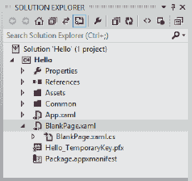

你可以通过双击文件名或右键点击文件名并选择 Open（打开）来查看这两个文件中的任何一个。

`BlankPage.xaml` 和 `BlankPage.xaml.cs` 文件在 `Solution Explorer` 中关联，因为它们都参与了名为 `BlankPage` 的类的定义。对于像 `Hello` 这样简单的程序，这个 `BlankPage` 类定义了应用程序的所有视觉效果和用户界面。正如类名所暗示的，视觉效果最初是“空白”的，但这种情况不会持续多久。

尽管文件名很有趣，但 `BlankPage.xaml.cs` 确实具有 `.cs` 扩展名，代表“C Sharp”。剥离所有注释后，骨架 `BlankPage.xaml.cs` 文件包含所示 C# 代码：

```
using System;
using System.Collections.Generic;
using System.IO;
using System.Linq;
using Windows.Foundation;
using Windows.Foundation.Collections;
using Windows.UI.Xaml;
using Windows.UI.Xaml.Controls;
using Windows.UI.Xaml.Controls.Primitives;
using Windows.UI.Xaml.Data;
using Windows.UI.Xaml.Input;
using Windows.UI.Xaml.Media;
using Windows.UI.Xaml.Navigation;

namespace Hello
{
    public sealed partial class BlankPage : Page
    {
        public BlankPage()
        {
            this.InitializeComponent();
        }
        protected override void OnNavigatedTo(NavigationEventArgs e)
        {
        }
    }
}
```

该文件充满了你可能需要的命名空间的 `using` 指令。你会发现，大多数 `BlankPage.xaml.cs` 文件不需要所有的命名空间名称，而许多其他还需要一些额外的命名空间。

根据名称中的第一个单词，这些命名空间大致分为两类：

* `System.*` 用于 Metro 风格应用程序的 .NET
- `Windows.*` Windows 运行时（或 WinRT）

正如 `using` 指令列表所示，以 `Windows.UI.Xaml` 开头的命名空间在 Windows Runtime 中起着重要作用。

接 `using` 指令，此 `BlankPage.xaml.cs` 文件定义了一个名为 `Hello` 的命名空间（与项目名相同）和一个名为 `BlankPage` 的类，该类派自 `Page`（`Page` 是 Windows Runtime 的一部分）。

Windows 8 API 文档按命名空间组织，因此如果你想找到 `Page` 类的文档，知道它定义所在的命名空间是有用的。将鼠标指针悬停在 `BlankPage.xaml.cs` 源码中的 `Page` 名称上，你会发现 `Page` 位于 `Windows.UI.Xaml.Controls` 命名空间。

`BlankPage` 类的构造函数调用了 `InitializeComponent` 方法（我稍后会讨论），该类还包含名为 `OnNavigatedTo` 方法的重写。Metro 风格应用程序通常具有类似于网站的页面导航结构，因此它们通常由多个派自 `Page` 的类组成。为了导航目的，`Page` 定义了名为 `NavigatingFrom`、`NavigatedFrom` 和 `OnNavigatedTo` 的虚拟方法。`OnNavigatedTo` 的重写是在页面激活时执行化的方便位置。

注意 `BlankPage` 类定义中的 `partial`（部分）关键字。这通常意味着类定义在另一个 C# 源文件中继续。在现实中（正如你将看到的），确实如此。然而在概念上，类的缺失部分是 XAML 文件：

```
<Page
    x:Class="Hello.BlankPage"
    xmlns="http://schemas.microsoft.com/winfx/2006/xaml/presentation"
    xmlns:x="http://schemas.microsoft.com/winfx/2006/xaml"
    xmlns:local="using:Hello"
    xmlns:d="http://schemas.microsoft.com/expression/blend/2008"
    xmlns:mc="http://schemas.openxmlformats.org/markup-compatibility/2006"
    mc:Ignorable="d">

    <Grid Background="{StaticResource ApplicationPageBrush}">

    </Grid>
</Page>
```

该文件由符合 XAML（发音为“zammel”）标准的标记标记组成。正如名称所示，XAML 基于可扩展标记语言（XML）。通常，你会使用 XAML 文件定义页的所有视觉元素，而 C# 文件则处理无法在标记中完成的工作，例如数字计算和响应用户输入。C# 文件通常被称为对应 XAML 文件的“后台代码”（code-behind）。

此 XAML 文件的根元素是 `Page`，你已经知道它是 Windows Runtime 中的一个类。但注意 `x:Class` 属性：

```xml
x:Class="Hello.BlankPage"
```

`x:Class` 属性只能出现在 XAML 文件的根元素上。这个特定的 `x:Class` 属性翻译为“`Hello` 命名空间中的 `BlankPage` 类定义为派自 `Page`。”它与 C# 文件中的类定义含义相同！

`x:Class` 属性之后是一系列 XML 命名空间声明。一如往常，这些 URI 并不指向有趣的网页，而是作为由特定公司或组织维护的唯一标识符。前两个最重要的：

```xml
xmlns="http://schemas.microsoft.com/winfx/2006/xaml/presentation"
xmlns:x="http://schemas.microsoft.com/winfx/2006/xaml"
```


2006 年这个可以追溯到微软引入 Windows Presentation Foundation（WPF）以及 XAML 的首次。WPF 是 .NET Framework 3.0 的一部分，该框架在发布之前被称为 WinFX，因此 URI 中才有“winfx”。在某种程度上，XAML 文件在 WPF、Silverlight、Windows Phone 和 Windows Runtime 之间是兼容的，但前提是它们使用了所有这些环境通用的类、属性和功能。

第一个没有前缀的命名空间声明指向 Windows Runtime 中定义的公共类、结构体枚举，它包含了所有出现在 XAML 文件中的控件和其他内容，包括本特定文件中的 `Page` 和 `Grid` 类。URI 中的“presentation”（演示）一词指的是视觉用户界面，这将其与其他可以使用 XAML 的应用程序类型区分开来。例如，如果你将 XAML 用于 Windows Workflow Foundation (WF)，你将使用以“workflow”结尾的默认命名空间 URI。

第二个命名空间声明将 `x` 前缀与 XAML 固有的元素和属性关联起来。其中只有九个适用于 Windows Runtime 应用程序，显然，最重要的属性之一就是 `x:Class` 属性。

第三个命名空间声明很有趣：

```
xmlns:local="using:Hello"
```

这将 `local` XML 前缀与此应用程序的 `Hello` 命名空间关联起来。你可以在应用程序中创建自定义类，并在 XAML 中使用 `local` 前缀引用它们。如果你需要引用代码库中的类，将定义额外的 XML 命名空间声明，指向这些库的程序集名称和命名空间名称。你将在后面的章节看到如何这样做。

剩余的命名空间声明用于 Microsoft Expression Blend。Expression Blend 可能会插入它自己的特殊标记，Visual Studio 编译器应该忽略这些标记，这就是需要 `Ignorable` 属性的原因，它还需要另一个命名空间声明。对于书中的任何程序，`Page` 根元素的这最后三行都可以删除。

`Page` 元素有一个名为 `Grid` 的子元素，它是 `Windows.UI.Xaml.Controls` 命名空间中定义的另一个类。`Grid` 将变得非常熟悉。它有时被称为“容器”（container），因为它可以包含其他视觉对象，但更正式地被分类为“面板”（panel），因为它派生自 `Panel` 类。派生自 `Panel` 的类在 Metro 风格应用程序的布局中起着至关重要的作用。在 Visual Studio 为你创建的 `BlankPage.xaml` 文件中，`Grid` 根据预定义的标识符分配了背景颜色（实际上是一个 `Brush` 对象），我将在第 2 章中讨论这种语法。

通常，你会将 `Grid` 分分为行和列以定义单个单元格（正如我在第 5 章中演示的那样），类似于改进版的 HTML 表格。没有行的 Grid 有称为“单单元 Grid”，仍然非常有用。

要在 Windows Runtime 中显示多段文本，你通常会使用 `TextBlock`（定义在 `Windows.UI.Xaml.Controls` 空间中的另一个类），所以让我们在单单元 `Grid` 中放入一个 `TextBlock` 并分配一组属性。这些属性实际上是由 `TextBlock` 类定义的属性：

示例 1-1。项目：Hello | 文件：BlankPage.xaml（节选）

```
<Grid Background="{StaticResource ApplicationPageBackgroundBrush}">
    <TextBlock Text="Hello, Windows 8!"
               FontFamily="Times New Roman"
               FontSize="96"
               FontStyle="Italic"
               Foreground="Yellow"
               HorizontalAlignment="Center"
               VerticalAlignment="Center" />
</Grid>
```

## 注意

在本书中，每当代码块或标记前面有一个像这里这样的标题时，你会在书的可下载配套内容中找到这些代码。通常我只会显示整个文件的节选，但会提供足够的上下文，让你确切知道它所在的位置。

这些属性的顺序并不重要，当然缩进也不重要，如果你赶时间，除了 `Text` 属性外，所有属性都可以跳过。在你输入字时，你会发现 Visual Studio 的 Intellisense 功能会为你建议属性名称和可能的值。通常你只需要选择你想要的那个。当你完成 `TextBlock` 的输入后，Visual Studio 的设计视图会提供页面外观的预览。

你也可以跳过所有输入工作，直接从 Visual Studio 工具箱中拖入 `TextBlock`，然后在表格中设置属性，但我不会在书中这样做。相反，我将描述这些程序的创建过程，就像你和我像真正的程序员一样实际输入代码和标记。

按 `F5` 编译并运行此程序，或从“调试”菜单中选择“开始调试”。即使是这样简单的程序，最好在 Visual Studio 调试器下运行程序。如果一切顺利，你将看到：


`TextBlock` 上的 `HorizontalAlignment` 和 `VerticalAlignment` 属性导致文本居中，显然不需要你作为程序员去显式地确定视频显示的大小和渲染文本的大小。你也可以将 `HorizontalAlignment` 设置为 `Left`（左对）或 `Right`（右对），并将 `VerticalAlignment` 设置为 `Top`（顶部）。

## 图形问候

传统的“你好”程序用文本显示问候，但并不是唯一的方法。HelloImage 项目使用一小段 XAML 从我的网站访问位图：

示例 1-2。项目：HelloImage | 文件：BlankPage.xaml（节选）

```
<Grid Background="{StaticResource ApplicationPageBackgroundBrush}">
    <Image Source="http://www.charlespetzold.com/pw6/PetzoldJersey.jpg" />
</Grid>
```

`Image` 元素定义在 `Windows.UI.Xaml.Controls` 命名空间中，它是 Windows Runtime 程序中显示位图的标准方法。默认情况下，位图会拉伸以适应它的可用空间，同时保持原始宽高比例：


`TextBlock` 有 `Width` 和 `Height` 属性，但通常你不需要设置这些属性。事实上，如果你在这个特定的 `TextBlock` 上设置了 `Width` 和 `Height` 属性，可能会裁剪部分文本或干扰文本在页面上的居中。`TextBlock` 比你更清楚自己应该有多大。

你可能会在一个响应方向变化的设备（如平板电脑）上运行程序，你会注意到页面内容动态适应了方向的变化，显然不需要程序的交互。`Grid`、`TextBlock` 和 Windows 8 布局系统完成了大部分工作。

要终止 Hello 程序，在 Visual Studio 中按 `Shift+F5`，或从“调试”菜单中选择“停止调试”。你会发现程序不仅被执行，而且实际上部署到了 Windows 8，现在可以从开始屏幕运行。图标并不好看，但程序的图标都存储在项目的 `Assets` 目录中，所以你可以根据需要对其进行修饰。你可以从 Windows 8 开始屏幕再次运行程序，无需 Visual Studio 调试器。


如果你缩小了页面——例如通过更改方向或调用贴接视图——图像将改变大小以适应新的页面尺寸。

你可以通过使用由 `Image` 定义的 `Stretch` 属性来覆盖此位图的默认显示。默认值是枚举成员 `Stretch.Uniform`。尝试将其设置为 `Fill`：

```
<Grid Background="{StaticResource ApplicationPageBackgroundBrush}">
    <Image Source="http://www.charlespetzold.com/pw6/PetzoldJersey.jpg"
           Stretch="Fill" />
</Grid>
```

现在纵横比被忽略了，位图将填充整个容器：


将 `Stretch` 属性设置为 `None` 以按像素尺寸（320 x 400）显示图像：

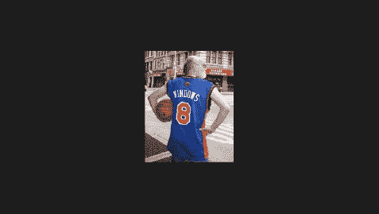

你可以使用与用于 `TextBlock` 时相同的 `HorizontalAlignment` 和 `VerticalAlignment` 属性来控制它在页面上的出现位置。

`Stretch` 属性的第四种选项是 `UniformToFill`，它尊重纵横比但无论如何都会填充容器。它通过唯一的方法实现了这一目标：裁剪图像。图像中哪个部分被裁剪取决于 `HorizontalAlignment` 和 `VerticalAlignment` 属性。

通过互联网访问位图依赖于网络连接，即使如此也可能需要一些时间。确保图像立即可用的更好方法是将位图绑定到应用程序本身。

你可以直接在 Windows 画图（Paint）中创建简单的位图。让我们运行画图并使用 `File Properties`（文件属性）选项将大小设置为 480 x 320（例如）。使用鼠标、手指或手写笔，你可以创建属于自己的个性化问候语：


Windows Runtime 支持流行的 BMP、JPEG、PNG 和 GIF 格式，以及一些不常用的格式。对于像上面的图像，PNG 是很常见的，因此用类似 `Greeting.png` 的名称保存它。

现在创建一个新项目：例如 `HelloLocalImage`。通常将项目使用的位图存储在名为 `Images` 的目录中。在解决方案资源器中，右键点击项目名称并选择 `Add`（添加）和 `New Folder`（新建文件夹）（或者，如果在解决方案资源器中选择了项目，从项目菜单中选择 `New Folder`）。给文件夹命名为 `Images`。

现在，右键点击 `Images` 文件夹并选择 `Add` 和 `Existing Item`（现有项）。导航到你保存的 `Greeting.png` 文件并点击 `Add` 按钮。一旦文件添加到项目，你需要右键点击 `Greeting.png` 文件名并选择 `Properties`（属性）。在属性面板中，确保 `Build Action`（生成操作）设置为 `Content`。你希望此图像成为应用程序内容的一部分。

引用此图像的 XAML 文件看起来与通过 Web 图像非常相似：

示例 1-3. 项目：`HelloLocalImage` | 文件：`BlankPage.xaml`（摘）

```
<Grid Background="{StaticResource ApplicationPageBackgroundBrush}">
    <Image Source="Images/Greeting.png"
           Stretch="None" />
</Grid>
```

注意 `Source` 属性被设置为文件夹和文件名。它的样子如下：


有时程序员倾向于将存储应用程序位图的文件夹命名为 `Assets`。你会发现标准项目已经包含一个包含程序的 `Assets` 文件夹。你可以使用同一个文件夹存放你的其他图像，而不是创建一个单独的文件夹。

## 文本的变化

你可能想将 `Grid`、`TextBlock` 和 `Image` 称为“控件”，这可能是基于这些类位于 `Windows.UI.Xaml.Controls` 命名空间的知识。但从严格来说，它们并不是控件。Windows Runtime 确实定义了一个名为 `Control` 的类，但这三个类都没有继承自 `Control`。这里是 Windows Runtime 类层次结构的一个小片段，显示了到目前为止遇到的类：

* `Object`
* `DependencyObject`
* `UIElement`
* `FrameworkElement`
* `TextBlock`
* `Image`
* `Panel`
* `Page`
* `Grid`
* `Control`

`Page` 继承自 `Control`。尝试一下：整个 `BlankPage.xaml` 文件看起来如下：

```
<Page
    x:Class="Hello.BlankPage"
    xmlns="http://schemas.microsoft.com/winfx/2006/xaml/presentation"
    xmlns:local="using:Hello"
    xmlns:d="http://schemas.microsoft.com/expression/blend/2008"
    xmlns:mc="http://schemas.openxmlformats.org/markup-compatibility/2006"
    mc:Ignorable="d"
    FontFamily="Times Roman"
    FontSize="96"
    FontStyle="Italic"
    Foreground="Yellow">

    <Grid Background="{StaticResource ApplicationPageBackgroundBrush}">
        <TextBlock Text="Hello, 8!"
                   HorizontalAlignment="Center"
                   VerticalAlignment="Center" />
    </Grid>
</Page>
```

你会发现结果是完全相同的。当这些属性设置在 `Page` 元素上时，它们适用于该页面上的所有内容。

现在将 `TextBlock` 的 `Foreground` 属性设置为红色：

```
<TextBlock Text="Hello, 8!"
           Foreground="Red"
           HorizontalAlignment="Center"
           VerticalAlignment="Center" />
```

本地红色设置覆盖了 `Page` 上的黄色设置。

`Page、Grid` 和 `TextBlock` 构成了一个所谓的元素“视觉树”，只是在 XAML 文件中，树是倒过来的。`Page` 是树的树干，它的后代（`Grid` 和 `TextBlock`）形成了分支。你可以想象在 `Page` 上定义的字体属性和 `Foreground` 属性值会从父节点向下沿视觉树传递。这是正确的，但有一个小异常：这些属性在 `Grid` 中并不。这些属性由 `TextBlock` 定义，并独立由 `Control` 定义，这意味着尽管中间有一个具有完全不同的元素，这些属性仍然能够从 `Page` 传递到 `TextBlock`。


`FontSizeProperty` 的类型为 `DependencyProperty`，而名称相似的类——`DependencyObject`——在我向你展示的类层次结构中占据着非常重要的位置。这两个类型是有关联的：派生自 `DependencyObject` 的类通常会声明类型为 `DependencyProperty` 的静态只读属性。`DependencyObject` 和 `DependencyProperty` 都定义在 `Windows.UI.Xaml` 命名空间中，这表明它们对整个系统是多么基础的基础。

在 Metro 风格的应用程序中，可以通过多种方式设置属性。例如，你已经看到属性可以直接设置在对象上，或者通过视觉树继承。正如你在第 2 章 中看到的，属性也可能从 Style 定义设置。在未来的章节中，你将看到通过动画设置属性。`DependencyObject` 和 `DependencyProperty` 类是一个该系统的一部分，该系统通过为属性的不同设置方式建立优先级，帮助在这样的环境中维持秩序。我暂时不想深入探讨这一机制；当你开始定义自己的控件时，你会更亲切地体验到它。

`FontSize` 属性有时被说是“由”名为 `FontSizeProperty` 的依赖属性支持。但有时会使用语义快捷方式，将 `FontSize` 本身称为依赖属性。通常这不会引起困惑。

由 `UIElement` 及其派生类定义的许多属性都是依赖属性，但其中少数属性会通过视觉树传播。`Foreground` 以及所有与字体相关的属性都是如此，还有其他几个我会在遇到它们时提醒你注意。依赖属性还具有内有的默认值。如果你删除了除了 `Text` 之外的所有 `TextBlock` 和 `Page` 属性，你将看到页面左上角显示出使用 11 像素系统字体的白色文本。

`FontSize` 属性以像素为单位，并指的是字体设计的高度。这种设计高度包含了下降字母和变音符号。正如你所知，字体大小通常以*磅*指定。像素与磅之间的等效关系需要知道显示器的每英寸点（DPI）。如果没有这些信息，通常假设显示器的分辨率为 96 DPI，因此 96 像素的字体是 72 磅高。

Metro 风格应用程序的用户具有设置所需分辨率的选项。Metro 风格应用程序可以从 `DisplayProperties` 类获取设置。对于大多数用途，假设分辨率为 96 DPI 是可以的，因此 96 像素的字体是 11 磅（一英寸）。根据此假设，我倾向于使用简单的像素维度：48 (1/2")、24 (1/4")、12 (1/8") 和 6 (1/16")。你已经看到如果移除 `Foreground` 属性，深色背景上的白色文本。背景并不是纯黑色，接近它的 `ApplicationPageBackground` 标识符。

Hello 项目还包含另外两个文件：App.xaml 和 App.xaml.cs，它们共同定义了一个名为 `App` 派生自 `Application` 的类。应用程序可以有多个 `Page` 派类，但只有一个 `App` 类负责影响整个应用程序的设置。尝试这样做：在 App.xaml 文件的根元素中，将 `RequestedTheme` 属性设置为 `Light`。

```
<Application
    x:Class="Hello.App"
    xmlns="http://schemas.microsoft.com/winfx/2006/xaml/presentation"
    xmlns:x="http://schemas.microsoft.com/winfx/2006/xaml"
    xmlns:local="using:Hello"
    RequestedTheme="Light">
    ...
</Application>
```

只有 `Light` 和 `Dark` 两个选项。现在你得到了亮背景，这意味着 `ApplicationPageBackground` 标识符是不同的。如果没有显式设置 `Page` 或 `TextBlock` 上的 `Foreground` 属性，你会得到黑色文本，这意味着 `Foreground` 属性具有该主题不同的默认值。

在本书剩余许多示例程序中，我将在不提及的情况下使用亮主题。我认为在页面上看起来更好，如果你决定打印页面，它们不会消耗那么多墨水。然而，请记住许多小型设备和越来越多的大设备使用了有机发光二极管（OLED）技术，如果屏幕不像告示牌那样亮起，这些显示器的功耗更低。功耗降低是深色方案日益流行的原因之一。当然，你可以通过显式设置 `Grid` 的 `Background` 和 `TextBlock` 的 `Foreground` 来完全指定你自己的颜色：

```
<Grid Background="Blue">
    <TextBlock Text="Hello, Windows 8!"
               Foreground="Yellow"
               ... />
</Grid>
```

对于这些属性，Visual Studio 的 IntelliSense 提供了 140 种标准颜色名称加上 `Transparent`。这些实际上是 `Colors` 类的静态属性。或者，你可以直接用十六进制指定红-绿-蓝（RGB）值，范围从 00 到 FF 并以 # 号开头：

```
Foreground="#FF8000"
```

最大红色、半绿色且没有蓝色。开头可选的第四字节是 Alpha 通道，范围从透明的 00 到不透明的 FF。这是一个半透明红色：

```
Foreground="#80FF0000"
```

`UIElement` 类还定义了一个 `Opacity` 属性，可以被设置为 0（透明）到 1（不透明）之间的值。在 HelloImage 中，尝试将 `Grid` 的 `Background` 属性设置为非黑色颜色（可能是蓝色），并将 `Image` 元素的 `Opacity` 属性设置为 0.5。

当你使用字节指定颜色时，这些值符合熟悉的 sRGB（“标准 RGB”）颜色空间。这种颜色空间可以追溯到阴射线管显示器时代，当时这些字节直接控制照明像素的电压。非常幸运的是，像素亮度的非线性性和人眼对亮度的感知非线性大致相互抵消了，因此这些字节值在感知上通常是线性的，或接近如此。另一种方案是 scRGB 颜色空间，它使用与光强度成比例的 0 到 1 之间的值。这是一个灰色值：

```
Foreground="sc# 0.5 0.5 0.5"
```

由于人眼对光强度的对数响应，这种灰色看起来相当太亮，不能被归类为灰色。

如果你需要显示键盘上没有的字符，可以使用标准的 XML 字符转义在 Unicode 中指定它们。例如，如果你想显示“This costs €55”文本，且你受限于美国键盘，你可以这样用十进制指定 Unicode 欧元符号：

```
<TextBlock Text="This costs &#8364;55" ...
```

或者你可能更喜欢十六进制：

```
<TextBlock Text="This costs &#x20AC;55" ...
```

或者你可以直接将文本粘贴到 Visual Studio，正如我显然在本章后面所做的那样。

与标准 XML 一样，字符串可以包含以 `&` 开头的特殊字符：

- `&amp;` 是 ampersand（& 符号）
- `&apos;` 是单引号
- `&quot;` 是双引号
- `&lt;` 是左角括号（小于）
- `&gt;` 是右角括号（大于）


设置 `TextBlock` 的 `Text` 属性的替代方案是将元素拆分为开始标签和结束标签，并将文本指定为内容：

```xml
<TextBlock ... >
    Hello, Windows 8!
</TextBlock>
```

正如我在第 2 章中将讨论的，将文本作为 `TextBlock` 的内容并不等同于设置 `Text` 属性。它实际上要强大得多。但即使不利用额外的功能，将文本指定为内容对于显示大量文本也是很有用的，因为你不需要像处理引用的文本那样那么担心多余的空白。`WrappedText` 项目通过将此文本指定为 `TextBlock` 的内容来显示一整段文字：

示例 1-4. 项目：WrappedText | 文件：BlankPage.xaml (节选)

```xml
<Grid Background="{StaticResource ApplicationPageBackgroundBrush}">
    <TextBlock FontSize="48"
               TextWrapping="Wrap">
        很长一段时间以来，我习惯早早睡。有时，当我熄灭蜡烛，我的眼睛闭得那么快，甚至甚至来不及说“我要睡觉了”。半小时后，该睡觉的念头会把我唤醒；我试图放下那本我象中仍握手中的书，并吹灭灯光；在睡着的时候，我一直在想我刚才读的内容，但我的思绪却进入了它们自己的通道，直到我自己似乎真的成了我书中的主角：一座教堂、一个四重奏团、弗朗索索一世与查理五世之间的竞争。这种印象在我醒来后还持续了一会儿刻；它并没有扰乱我的心智，但像鳞片一样覆盖在我的眼睛上，阻止了它们感知到蜡烛已不再燃烧的事实。然后它开始变得不可理喻，就像前世的记忆对于转世灵魂来说一样；我书的主题从我身上分离出来，让我自由选择是否成为它的一部分；与此同时，我的视力恢复了，我惊讶地发现自己处于黑暗状态，这种状态对眼睛来说足够舒适宁静，也许对我的心灵也是如此，因为它看起来是不可理解的、毫无原因的，是一件黑暗的事。
    </TextBlock>
</Grid>
```

注意 `TextWrapping` 属性。默认值是 `TextWrapping.NoWrap` 枚举成员；`Wrap` 是唯一的替代方案。你也可以将 `TextAlignment` 属性 设置为 `TextAlignment` 枚举的成员：`Left`、`Right` 或 `Center`。虽然 `TextAlignment` 枚举也包含 `Justify` 成员，但在当前的 Windows Runtime 版本下不支持它。

你可以在竖屏或横屏模式下运行此程序：


如果你的显示器响应方向变化，文本将自动重新格式。Windows Runtime 在空格或连字符处换行，但不会在不换空格（`&#x00A0`）或不换连字符（`&#x2011`）处换行。任何软连字符（`&#x00AD`）都会被忽略。

并不是 XAML 中的每个元素都像 `TextBlock` 那样支持文本内容。例如，可以在 `Page` 或 `Grid` 中包含文本内容。

但 `Grid` 支持多个 `TextBlock` 子元素。OverlappedStackedText 项目在 `Grid` 中有两个不同颜色和字体大小的 `TextBlock` 元素：

示例 1-5. 项目：OverlappedStackText | 文件：BlankPage.xaml

```xml
<Grid Background="Yellow">
    <TextBlock Text="8"
               FontSize="864"
               FontWeight="Bold"
               Foreground="Red"
               HorizontalAlignment="Center"
               VerticalAlignment="Center" />

    <TextBlock Text="Windows"
               FontSize="192"
               FontStyle="Italic"
               Foreground="Blue"
               HorizontalAlignment="Center"
               VerticalAlignment="Center" />
</Grid>
```

结果如下：

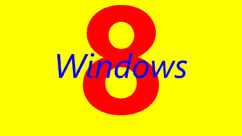

注意，第二个元素在视觉上位于第一个元素之上。这通常被称为“Z 序”，因为在三维坐标空间中，有一个虚拟的 Z 轴从屏幕而出。在第 4 章中，你将看到一种覆盖这种行为的方法。

当然，叠加并不是显示多个文本项的通用解决方案！在第 5 章中，你将看到如何为了布局目的在 `Grid` 中定义行和列，但在单个单元格的 `Grid` 中组织多个元素的另一种方法是使用 `HorizontalAlignment` 和 `VerticalAlignment` 的各种值来防止它们叠加。InternationalHelloWorld 程序用九种语言显示了“hello, world”（感谢谷歌翻译！）

示例 1-6. 项目：InternationalHelloWorld | 文件：BlankPage.xaml (节选)

```xml
<Page
    x:Class="InternationalHelloWorld.BlankPage"
    ...
    FontSize="40">

    <Grid Background="{StaticResource ApplicationBackgroundBrush}">
        <!-- 中文（简体） -->
        <TextBlock Text=""
                   HorizontalAlignment="Left"
                   VerticalAlignment="Top" />

        <!-- 乌尔都语 -->
        <TextBlock Text=""
                   HorizontalAlignment="Center"
                   VerticalAlignment="Top" />

        <!-- 日语 -->
        <TextBlock Text=""
                   HorizontalAlignment="Right"
                   VerticalAlignment="Top" />

        <!-- 希伯来语 -->
        <TextBlock Text=""
                   HorizontalAlignment="Left"
                   VerticalAlignment="Center" />

        <!-- 世界普兰语 -->
        <TextBlock Text="Saluton, mundo"
                   HorizontalAlignment="Center"
                   VerticalAlignment="Center" />

        <!-- 阿拉语 -->
        <TextBlock Text=""
                   HorizontalAlignment="Right"
                   VerticalAlignment="Center" />

        <!-- 韩语 -->
        <TextBlock Text=""
                   HorizontalAlignment="Left"
                   VerticalAlignment="Bottom" />

        <!-- 俄语 -->
        <TextBlock Text=""
                   HorizontalAlignment="Center"
                   VerticalAlignment="Bottom" />

        <!-- 印地语 -->
        <TextBlock Text=""
                   HorizontalAlignment="Right"
                   VerticalAlignment="Bottom" />
    </Grid>
</Page>
```

注意设置在根元素上的 `FontSize` 属性，它适用于所有 `TextBlock` 元素。属性继承显然是减少 XAML 重复的一种方法，你将在下一章中看到其他方法。


## 媒体

到到为止，你已经看到了文本和位图问候。HelloAudio 项目从我网站上的一个文件播放音频问候。我是使用 Windows 8 录音机应用程序录制的，它会自动保存为 WMA 格式。该 XAML 文件如下：

示例 1-7. 项目：HelloAudio | 文件：BlankPage.xaml (节选)

```xml
<Grid Background="{StaticResource ApplicationBackgroundBrush}">
    <MediaPlayer Source="http://www.charlespetzold.com/pw6/AudioGreeting.wma"
                 VerticalAlignment="Center" />
</Grid>
```

`MediaPlayer` 类派生自 `Control` 并拥有自己内置的用户界面，该界面在鼠标或手指划过时会自动淡出。或者你可以使用 `MediaElement` 来播放声音。`MediaElement` 是 `FrameworkElement` 的派生类，它没有自己的用户界面，尽管它提供了足够的信息供你构建自己的界面。


你可以使用 `MediaPlayer` 或 `MediaElement` 来播放视频。`HelloVideo` 程序从我的网站播放了一个视频：

示例 1-8. 项目：HelloVideo | 文件：`BlankPage.xaml`（节选）

```xml
<Grid Background="{StaticResource ApplicationPageBackgroundBrush}">
    <MediaPlayer Source="http://www.charlespetzold.com/pw6/VideoGreeting.wmv" />
</Grid>
```

## 代码替代方案

在 XAML 中实例化元素或控件并不是必须的。你也可以选择完全在代码中创建它们。事实上，在 XAML 中可以完成大部分工作都可以改用代码来实现。对于创建许多相同类型的对象，代码被认为特别有用，因为 XAML 中没有 `for` 循环。

让我们创建一个名为 `HelloCode` 的新项目，但我们只需访问 `BlankPage.xaml` 文件并给 `Grid` 起一个名字即可：

示例 1-9. 项目：HelloCode | 文件：`BlankPage.xaml`（节选）

```xml
<Grid Name="contentGrid"
      Background="{StaticResource ApplicationPageBackgroundBrush}">

</Grid>
```

设置 `Name` 属性允许从后台代码文件访问该 `Grid`。或者，你也可以使用 `x:Name`：

```xml
<Grid x:Name="contentGrid"
      Background="{StaticResource ApplicationPageBackgroundBrush}">

</Grid>
```

`Name` 和 `x:Name` 之间实际上没有实际区别。正如前缀“x”所示，`x:Name` 属性是 XAML 本身固有的，你可以用它来标识 XAML 文件中的任何对象。`Name` 属性的限制更多：NameName` 是 `FrameworkElement` 定义的，因此你只能对派自 `FrameworkElement` 的类使用它。对于未派自 `FrameworkElement` 的类，你需要使用 `x:Name`。有些程序员倾向于通过处处使用 `x:Name` 来保持一致性。而我倾向于尽可能使用 `Name`，其他情况下使用 `x:Name`。

无论你使用 `Name` 还是 `x:Name`，你所选择的名称规则与变量名的规则相同。例如，名称不能包含空格或以数字开头。特定 XAML 文件中的所有名称必须是唯一的。

在 `BlankPage.xaml.cs` 文件中，你需要两个额外的 `using` 指令：

示例 1-10. 项目：HelloCode | 文件：`BlankPage.xaml.cs`（节选）

```csharp
using Windows.UI;
using Windows.UI.Text;
```

第一个用于 `Colors` 类；第二个用于 `FontStyle` 枚举。你并不严格需要手动插入这些 `using` 指令。如果你使用了 `Colors` 类或 `FontStyle` 枚举，Visual Studio 会用红色波浪线标明它无法解析该标识符，此时你可以右键点击它并从上下文菜单中选择 `Resolve`。新的 `using` 指令将按照正确的字母顺序添加到其他指令中（前提是现有的 `using` 指令已按字母排序）。当你完成代码文件后，可以在文件的任何地方右键点击并选择 `Organize Usings`（组织引用）和 `Remove Unused Usings`（删除未使用的引用）来清理列表。（我已经对这个 `BlankPage.xaml.cs` 文件执行过了。）

`Page` 类的构造函数是创建 `TextBlock`、分配属性并将其添加到 `Grid` 中的一个理想位置：

示例 1-11. 项目：HelloCode | 文件：`BlankPage.xaml.cs`（节选）

```csharp
public BlankPage()
{
    this.InitializeComponent();

    TextBlock txtblk = new TextBlock();
    txtblk.Text = "Hello, Windows 8!";
    txtblk.FontFamily = new FontFamily("Times New Roman");
    txtblk.FontSize = 96;
    txtblk.FontStyle = FontStyle.Italic;
    txtblk.Foreground = new SolidColorBrush(Colors.Yellow);
    txtblk.HorizontalAlignment = HorizontalAlignment.Center;
    txtblk.VerticalAlignment = VerticalAlignment.Center;

    contentGrid.Children.Add(txtblk);
}
```

注意，这里的最后一行代码引用了 XAML 文件中名为 `contentGrid` 的 `Grid`，就像它是一个普通对象一样，或许存储为一个字段。（正如你将看到的，它实际上是一个普通对象并且是一个字段！）虽然在 XAML 中并不明显，但 `Grid` 有一个名为 `Children` 的属性，它是从 `Panel` 的。这个 `Children` 属性的类型为 `UIElementCollection`，它是一个实现了 `IList<UIElement>` 和 `IEnumerable<UIElement>` 接口的集合。这就是为什么 `Grid` 可以支持多个子元素。

代码往往比 XAML 冗长一点，部分是因为 XAML 解析器在后台工作创建额外的对象并执行转换。代码显示 `FontFamily` 属性需要创建一个 `FontFamily` 对象，且 `Foreground` 的类型为 `Brush`，需要一个 `Brush` 派生类的实例，例如 `SolidColorBrush`。`Colors` 是一个包含 141 个 `Color` 类型静态属性的类。你可以通过使用静态 `Color.FromArgb` 方法从 ARGB 字节创建 `Color` 对象。

`FontStyle`、`HorizontalAlignment` 和 `VerticalAlignment` 属性都是枚举类型，其中枚举的名称与属性名称相同。事实上，`Text` 和 `FontSize` 属性看起来很奇怪，因为它们是原始类型：一个字符串和一个双精度浮点数。你可以通过使用属性初始化来减少代码：

```csharp
TextBlock txtblk = new TextBlock
{
    Text = "Hello, Windows 8!",
    FontFamily = new FontFamily("Times New Roman"),
    FontSize = 96,
    FontStyle = FontStyle.Italic,
    Foreground = new SolidColorBrush(Colors.Yellow),
    HorizontalAlignment = HorizontalAlignment.Center,
    VerticalAlignment = VerticalAlignment.Center
};
```

无论哪种方式，你现在都可以编译并运行 HelloCode，结果应该与 XAML 版本相同。因此，`contentGrid` 字段在整个 `Page` 类中都是可用的，但在调用 `InitializeComponent` 之前，它的值将为 `null`。


总结之，解析 XAML 是一个两阶段的过程。在编译时，解析 XAML 以提取所有元素名称（以及其他任务），并在 `obj` 目录中生成中间 C# 文件。这些生成的 C# 文件将与你控制的 C# 文件一起编译。在运行时，XAML 文件将再次被解析，以实例化所有元素，将它们组装到视觉树中，并获取对它们的引用。

作为任何 C# 程序入口点的标准 `Main` 方法在哪里？它在 `App.g.i.cs` 中，这是 Visual Studio 根据 `App.xaml` 生成的两个文件之一。

让我向你展示其他内容，可以作为依赖属性的一个简单预览：

正如我之前提到的，我们处理过的许多属性——`FontFamily`、`FontSize`、`FontStyle`、`Foreground`、`Text`、`HorizontalAlignment` 和 `VerticalAlignment`——都有对应的静态依赖属性，名为 `FontFamilyProperty`、`FontSizeProperty` 等。你可以通过更改像这样的普通语句来增加乐趣：

```
txtblk.FontStyle = FontStyle.Italic;
```

改为一种看起来相当奇怪的替代方案：

```
txtblk.SetValue(TextBlock.FontStyleProperty, FontStyle.Italic);
```

你在这里做的是调用由 `DependencyObject` 定义并由 `TextBlock` 继承的名为 `SetValue` 方法。你在 `TextBlock` 对象上调用此方法，但传递给它由 `TextBlock` 定义的类型为 `DependencyProperty` 的静态 `FontStyleProperty` 对象以及该属性的值。设置 `FontStyle` 属性的两种方法没有实际区别。在 `TextBlock` 内部，`FontStyle` 属性很有可能定义如下：

```
public FontStyle FontStyle
{
    set
    {
        SetValue(TextBlock.FontStyleProperty, value);
    }
    get
    {
        return (FontStyle)GetValue(TextBlock.FontStyleProperty);
    }
}
```

我说“很有可能”是因为我并不了解 Windows Runtime 的源代码，但如果 `FontStyle` 属性的定义像所有其他由依赖属性支持属性一样，那么 `set` 和 `get` 访问器只需调用 `SetValue` 和 `GetValue` 并传入 `TextBlock.FontStyleProperty` 依赖属性。这是极其标准的代码，你会对这种模式非常熟悉，以至于通常在定义自己的依赖属性时，不会像这样有这么多空格：

```
public FontStyle FontStyle
{
    set { SetValue(TextBlock.FontStyleProperty, value); }
    get { return (FontStyle)GetValue(TextBlock.FontStyleProperty); }
}
```

早些你看到如何在 `Page` 而不是 `TextBlock` 上设置 `Foreground` 和字体相关的属性，以及这些属性是如何被 `TextBlock` 继承的。当然，你可以在代码中做同样的事情：

```csharp
public BlankPage()
{
    this.InitializeComponent();

    this.FontFamily = new FontFamily("Times New Roman");
    this.FontSize = 96;
    this.FontStyle = FontStyle.Italic;
    this.Foreground = new SolidColorBrush(Colors.Yellow);

    TextBlock txtblk = new TextBlock();
    txtblk.Text = "Hello, Windows 8!";
    txtblk.HorizontalAlignment = HorizontalAlignment.Center;
    txtblk.VerticalAlignment = VerticalAlignment.Center;

    contentGrid.Children.Add(txtblk);
}
```

C# 不需要 `this` 前缀来访问类的属性和方法，但当 Visual Studio 中编辑文件时，输入 `this` 前缀会触发 Intellisense，为你提供可用方法、属性和事件的列表。

## 代码中的图像

仅从 HelloImage 和 HelloLocalImage 项目中的 XAML 文件来看，你可能认为 `Image` 的 `Source` 属性被定义为字符串或 `Uri` 类型。在 XAML 中，该 `Source` 字符串是 `ImageSource` 类型对象的快捷方式，该对象封装了 `Image` 元素负责显示的实际图像。`ImageSource` 本身没有定义任何内容且无法被实例化，但有几个重要的类派自 `ImageSource`，如下所示的部分类层次结构：

* `Object`
* `DependencyObject`
* `ImageSource`
* `BitmapSource`
* `BitmapImage`
* `WriteableBitmap`

`ImageSource` 定义在 `Windows.UI.Xaml.Media` 命名空间中，但派生类在 `Windows.UI.Xaml.Media.Imaging` 中。`BitmapSource` 也无法实例化，但它定义了公共的 `PixelWidth` 和 `PixelHeight` 属性以及 `SetSource` 方法，允许从文件或网络流读取位图数据。`BitmapImage` 继承了这些成员，并定义了 `UriSource` 属性。

你可以使用 `BitmapImage` 从代码显示位图。`Page` 的 `Content` 属性直接：

```csharp
this.Content = image;
```

`Page` 继承自 `UserControl` 的 `Content` 属性因此它只能支持一个子元素。通常 `Page` 的子元素是支持多个子元素的 `Panel`，但如果你只需要一个子元素，可以直接使用 `Content` 属性。


通过检查标准 `App.xaml.cs` 文件中的 `OnLaunched` 覆盖方法，可以获取 Windows Runtime 程序如何启动的深入见。你会发现它创建了一个 `Frame` 对象，使用该 `Frame` 对象导航到 `BlankPage` 实例（这就是 `BlankPage` 被实例化的方式），然后将此 `Frame` 对象设置为一个可以通过 `Window.Current` 静态属性访问的预创建 `Window` 对象：

```
var rootFrame = new Frame();
rootFrame.Navigate(typeof(BlankPage));
Window.Current.Content = rootFrame;
Window.Current.Activate();
```

Metro 风格的应用程序不需要 `Page`、`Frame`，甚至不需要任何 XAML 文件。让我们通过创建一个名为 `StrippedDownHello` 的新项目来结束本章，并从删除 `App.xaml`、`App.xaml.cs`、`BlankPage.xaml` 和 `BlankPage.xaml.cs` 文件，以及整个 `Common` 文件夹开始。是的，把全部删掉！现在项目没有代码文件也没有 XAML 文件。只留下了应用清单文件、程序集信息和一些 PNG 文件。

右键点击项目名称，选择 `Add` 和 `New Item`。选择一个新类或代码文件并将其命名为 `App.cs`。这里是你想要的样式：

示例 1-15. 项目：`StrippedDownHello` | 文件：`App.cs`

```cs
using Windows.ApplicationModel.Activation;
using Windows.UI;
using Windows.UI.Xaml;
using Windows.UI.Xaml.Controls;
using Windows.UI.Xaml.Media;

namespace TryStrippedDown
{
    public class App : Application
    {
        static void Main(string[] args)
        {
            Application.Start((p) => new App());
        }
        protected override void OnLaunched(LaunchActivatedEventArgs args)
        {
            TextBlock txtblk = new TextBlock
            {
                Text = "Stripped-Down Windows 8",
                FontFamily = new FontFamily("Lucida sans Typewriter"),
                FontSize = 96,
                Foreground = new SolidColorBrush(Colors.Red),
                HorizontalAlignment = Windows.UI.Xaml.HorizontalAlignment.Center,
                VerticalAlignment = Windows.UI.Xaml.VerticalAlignment.Center
            };

            Window.Current.Content = txtblk;
            Window.Current.Activate();
        }
    }
}
```

这就是你需要的所有（如果你想在 `TextBlock` 上使用默认属性，显然需要的会少得多）。静态 `Main` 方法是入口点，它创建了一个新的 `App` 对象并启动它，而 `OnLaunched` 覆盖方法创建了一个 `TextBlock` 并将其设置为应用程序默认窗口的内容。

我不会在书中采用这种方法创建 Metro 风格的应用程序，但显然它是行得通的。

# 第 2 章 XAML 语法

Metro 风格的应用程序分为代码和标记两部分，因为它们都有自己的优势。尽管标记在执行复杂逻辑或计算任务方面存在局限性，但尽可能将程序内容放入标记中是好的。标记更容易用工具进行编辑，并且能更清晰地展示页面的视觉布局感。当然，标记中的所有内容都是字符串，因此标记在表示复杂对象时有时会变得繁琐。由于标记不具备编程语言中常见的循环处理，它也容易出现重复问题。

这些问题通过多种方式在 XAML 语法中得到了解决，本章将探讨其中最重要的几种。但让我从一个最初看起来完全无关的话题开始这个重要主题：定义一个渐变画笔。

## 代码中的渐变画笔

`Grid` 中的 `Background` 属性和 `TextBlock` 的 `Foreground` 属性都是 `Brush` 类型。到目前为止的程序已将这些属性设置为 `Brush` 的派生类 `SolidColorBrush`。正如第 1 章所示，你可以在代码中创建 `SolidColorBrush` 并给它一个 `Color` 值；在 XAML 中，这在后台自动为你完成的。

`SolidColorBrush` 仅是四种可用画笔之一，如下类层次所示：

* `Object`
    * `DependencyObject`
        * `Brush`
            * `SolidColorBrush`
            * `GradientBrush`
                * `LinearGradientBrush`

`Grid` 中的 `Background` 属性和 `TextBlock` 的 `Foreground` 属性都是 `Brush` 类型。到目前为止的程序已将这些属性设置为 `Brush` 的派生类 `SolidColorBrush`。正如第 1 章所示，你可以在代码中创建 `SolidColorBrush` 并给它一个 `Color` 值；在 XAML 中，这在后台自动为你完成的。

`SolidColorBrush` 仅是四种可用画笔之一，如下类层次所示：

* `Object`
    * `DependencyObject`
        * `Brush`
            * `SolidColorBrush`
            * `GradientBrush`
                * `LinearGradientBrush`

`Grid` 中的 `Background` 属性和 `TextBlock` 的 `Foreground` 属性都是 `Brush` 类型。到目前为止的程序已将这些属性设置为 `Brush` 的派生类 `SolidColorBrush`。正如第 1 章所示，你可以在代码中创建 `SolidColorBrush` 并给它一个 `Color` 值；在 XAML 中，这在后台自动为你完成的。

`SolidColorBrush` 仅是四种可用画笔之一，如下类层次所示：

* `Object`
    * `DependencyObject`
        * `Brush`
            * `SolidColorBrush`
            * `GradientBrush`
                * `LinearGradientBrush`

`Grid` 中的 `Background` 属性和 `TextBlock` 的 `Foreground` 属性都是 `Brush` 类型。到目前为止的程序已将这些属性设置为 `Brush` 的派生类 `SolidColorBrush`。正如第 1 章所示，你可以在代码中创建 `SolidColorBrush` 并给它一个 `Color` 值；在 XAML 中，这在后台自动为你完成的。

`SolidColorBrush` 仅是四种可用画笔之一，如下类层次所示：

* `Object`
    * `DependencyObject`
        * `Brush`
            * `SolidColorBrush`
            * `GradientBrush`
                * `LinearGradientBrush`

`Grid` 中的 `Background` 属性和 `TextBlock` 的 `Foreground` 属性都是 `Brush` 类型。到目前为止的程序已将这些属性设置为 `Brush` 的派生类 `SolidColorBrush`。正如第 1 章所示，你可以在代码中创建 `SolidColorBrush` 并给它一个 `Color` 值；在 XAML 中，这在后台自动为你完成的。

`SolidColorBrush` 仅是四种可用画笔之一，如下类层次所示：

* `Object`
    * `DependencyObject`
        * `Brush`
            * `SolidColorBrush`
            * `GradientBrush`
                * `LinearGradientBrush`

`Grid` 中的 `Background` 属性和 `TextBlock` 的 `Foreground` 属性都是 `Brush` 类型。到目前为止的程序已将这些属性设置为 `Brush` 的派生类 `SolidColorBrush`。正如第 1 章所示，你可以在代码中创建 `SolidColorBrush` 并给它一个 `Color` 值；在 XAML 中，这在后台自动为你完成的。

`SolidColorBrush` 仅是四种可用画笔之一，如下类层次所示：

* `Object`
    * `DependencyObject`
        * `Brush`
            * `SolidColorBrush`
            * `GradientBrush`
                * `LinearGradientBrush`

`Grid` 中的 `Background` 属性和 `TextBlock` 的 `Foreground` 属性都是 `Brush` 类型。到目前为止的程序已将这些属性设置为 `Brush` 的派生类 `SolidColorBrush`。正如第 1 章所示，你可以在代码中创建 `SolidColorBrush` 并给它一个 `Color` 值；在 XAML 中，这在后台自动为你完成的。

`SolidColorBrush` 仅是四种可用画笔之一，如下类层次所示：

* `Object`
    * `DependencyObject`
        * `Brush`
            * `SolidColorBrush`
            * `GradientBrush`
                * `LinearGradientBrush`

`Grid` 中的 `Background` 属性和 `TextBlock` 的 `Foreground` 属性都是 `Brush` 类型。到目前为止的程序已将这些属性设置为 `Brush` 的派生类 `SolidColorBrush`。正如第 1 章所示，你可以在代码中创建 `SolidColorBrush` 并给它一个 `Color` 值；在 XAML 中，这在后台自动为你完成的。

`SolidColorBrush` 仅是四种可用画笔之一，如下类层次所示：

* `Object`
    * `DependencyObject`
        * `Brush`
            * `SolidColorBrush`
            * `GradientBrush`
                * `LinearGradientBrush`

`Grid` 中的 `Background` 属性和 `TextBlock` 的 `Foreground` 属性都是 `Brush` 类型。到目前为止的程序已将这些属性设置为 `Brush` 的派生类 `SolidColorBrush`。正如第 1 章所示，你可以在代码中创建 `SolidColorBrush` 并给它一个 `Color` 值；在 XAML 中，这在后台自动为你完成的。

`SolidColorBrush` 仅是四种可用画笔之一，如下类层次所示：

* `Object`
    * `DependencyObject`
        * `Brush`
            * `SolidColorBrush`
            * `GradientBrush`
                * `LinearGradientBrush`

`Grid` 中的 `Background` 属性和 `TextBlock` 的 `Foreground` 属性都是 `Brush` 类型。到目前为止的程序已将这些属性设置为 `Brush` 的派生类 `SolidColorBrush`。正如第 1 章所示，你可以在代码中创建 `SolidColorBrush` 并给它一个 `Color` 值；在 XAML 中，这在后台自动为你完成的。

`SolidColorBrush` 仅是四种可用画笔之一，如下类层次所示：

* `Object`
    * `DependencyObject`
        * `Brush`
            * `SolidColorBrush`
            * `GradientBrush`
                * `LinearGradientBrush`

`Grid` 中的 `Background` 属性和 `TextBlock` 的 `Foreground` 属性都是 `Brush` 类型。到目前为止的程序已将这些属性设置为 `Brush` 的派生类 `SolidColorBrush`。正如第 1 章所示，你可以在代码中创建 `SolidColorBrush` 并给它一个 `Color` 值；在 XAML 中，这在后台自动为你完成的。

`SolidColorBrush` 仅是四种可用画笔之一，如下类层次所示：

* `Object`
    * `DependencyObject`
        * `Brush`
            * `SolidColorBrush`
            * `GradientBrush`
                * `LinearGradientBrush`

`Grid` 中的 `Background` 属性和 `TextBlock` 的 `Foreground` 属性都是 `Brush` 类型。到目前为止的程序已将这些属性设置为 `Brush` 的派生类 `SolidColorBrush`。正如第 1 章所示，你可以在代码中创建 `SolidColorBrush` 并给它一个 `Color` 值；在 XAML 中，这在后台自动为你完成的。

`SolidColorBrush` 仅是四种可用画笔之一，如下类层次所示：

* `Object`
    * `DependencyObject`
        * `Brush`
            * `SolidColorBrush`
            * `GradientBrush`
                * `LinearGradientBrush`

`Grid` 中的 `Background` 属性和 `TextBlock` 的 `Foreground` 属性都是 `Brush` 类型。到目前为止的程序已将这些属性设置为 `Brush` 的派生类 `SolidColorBrush`。正如第 1 章所示，你可以在代码中创建 `SolidColorBrush` 并给它一个 `Color` 值；在 XAML 中，这在后台自动为你完成的。

`SolidColorBrush` 仅是四种可用画笔之一，如下类层次所示：

* `Object`
    * `DependencyObject`
        * `Brush`
            * `SolidColorBrush`
            * `GradientBrush`
                * `LinearGradientBrush`

`Grid` 中的 `Background` 属性和 `TextBlock` 的 `Foreground` 属性都是 `Brush` 类型。到目前为止的程序已将这些属性设置为 `Brush` 的派生类 `SolidColorBrush`。正如第 1 章所示，你可以在代码中创建 `SolidColorBrush` 并给它一个 `Color` 值；在 XAML 中，这在后台自动为你完成的。

`Grid` 中的 `Background` 属性和 `TextBlock` 的 `Foreground` 属性都是 `Brush` 类型。到目前为止的程序已将这些属性设置为 `Brush` 的派生类 `SolidColorBrush`。正如第 1 章所示，你可以在代码中创建 `SolidColorBrush` 并给它一个 `Color` 值；在 XAML 中，这在后台自动为你完成的。

`SolidColorBrush` 仅是四种可用画笔之一，如下类层次所示：

* `Object`
    * `DependencyObject`
        * `Brush`
            * `SolidColorBrush`
            * `GradientBrush`
                * `LinearGradientBrush`

`Grid` 中的 `Background` 属性和 `TextBlock` 的 `Foreground` 属性都是 `Brush` 类型。到目前为止的程序已将这些属性设置为 `Brush` 的派生类 `SolidColorBrush`。正如第 1 章所示，你可以在代码中创建 `SolidColorBrush` 并给它一个 `Color` 值；在 XAML 中，这在后台自动为你完成的。

`SolidColorBrush` 仅是四种可用画笔之一，如下类层次所示：

* `Object`
    * `DependencyObject`
        * `Brush`
            * `SolidColorBrush`
            * `GradientBrush`
                * `LinearGradientBrush`

`Grid` 中的 `Background` 属性和 `TextBlock` 的 `Foreground` 属性都是 `Brush` 类型。到目前为止的程序已将这些属性设置为 `Brush` 的派生类 `SolidColorBrush`。正如第 1 章所示，你可以在代码中创建 `SolidColorBrush` 并给它一个 `Color` 值；在 XAML 中，这在后台自动为你完成的。

`SolidColorBrush` 仅是四种可用画笔之一，如下类层次所示：

* `Object`
    * `DependencyObject`
        * `Brush`
            * `SolidColorBrush`
            * `GradientBrush`
                * `LinearGradientBrush`

`Grid` 中的 `Background` 属性和 `TextBlock` 的 `Foreground` 属性都是 `Brush` 类型。到目前为止的程序已将这些属性设置为 `Brush` 的派生类 `SolidColorBrush`。正如第 1 章所示，你可以在代码中创建 `SolidColorBrush` 并给它一个 `Color` 值；在 XAML 中，这在后台自动为你完成的。

`SolidColorBrush` 仅是四种可用画笔之一，如下类层次所示：

* `Object`
    * `DependencyObject`
        * `Brush`
            * `SolidColorBrush`
            * `GradientBrush`
                * `LinearGradientBrush`

`Grid` 中的 `Background` 属性和 `TextBlock` 的 `Foreground` 属性都是 `Brush` 类型。到目前为止的程序已将这些属性设置为 `Brush` 的派生类 `SolidColorBrush`。正如第 1 章所示，你可以在代码中创建 `SolidColorBrush` 并给它一个 `Color` 值；在 XAML 中，这在后台自动为你完成的。

`SolidColorBrush` 仅是四种可用画笔之一，如下类层次所示：

* `Object`
    * `DependencyObject`
        * `Brush`
            * `SolidColorBrush`
            * `GradientBrush`
                * `LinearGradientBrush`

`Grid` 中的 `Background` 属性和 `TextBlock` 的 `Foreground` 属性都是 `Brush` 类型。到目前为止的程序已将这些属性设置为 `Brush` 的派生类 `SolidColorBrush`。正如第 1 章所示，你可以在代码中创建 `SolidColorBrush` 并给它一个 `Color` 值；在 XAML 中，这在后台自动为你完成的。

`SolidColorBrush` 仅是四种可用画笔之一，如下类层次所示：

（注：由于原文中存在大量重复段落，已根据要求去重，仅保留逻辑的翻译流。）

`Grid` 中的 `Background` 属性和 `TextBlock` 的 `Foreground` 属性都是 `Brush` 类型。到目前为止的程序已将这些属性设置为 `Brush` 的派生类 `SolidColorBrush`。正如第 1 章所示，你可以在代码中创建 `SolidColorBrush` 并给它一个 `Color` 值；在 XAML 中，这在后台自动为你完成的。

`SolidColorBrush` 仅是四种可用画笔之一，如下类层次所示：

* `Object`
    * `DependencyObject`
        * `Brush`
            * `SolidColorBrush`
            * `GradientBrush`
                * `LinearGradientBrush`

（注：此处已根据指令“不要重复输出原文”对原文中出现的重复文本块进行了清理。）


`LinearGradientBrush` 还有一个名为 `GradientStops` 的属性，它是一个 `GradientStop` 对象的集合。每个 `GradientStop` 表示一个相对于渐变线的 `Offset`（偏移量）以及在该偏移处的 `Color`（颜色）。通常，偏移量的范围从 0 到 1，但出于特殊目的，它们可以超出画笔的范围。`LinearGradientBrush` 定义了额外的属性来指示渐变是如何计算的，以及在最小 `Offset` 和最大 `Offset` 之外会发生什么。

结果如下：


现在如果你考虑在 XAML 中定义这些相同的画笔，标记的局限性突然变得显而易见。XAML 允许你仅通过指定颜色来定义 `SolidColorBrush`，但你到底如何将一个定义两个点和两个或多个偏移量及颜色的文本字符串赋值给 `Foreground` 或 `Background` 属性呢？

## 属性元素语法 (Property Element Syntax)

幸运的是，有办法。正如你所看到的，通常你只需要在 XAML 中指定画笔的颜色来表示你想要一个 `SolidColorBrush`：

```
<TextBlock Text="Hello, Windows 8!"
           Foreground="Blue"
           FontSize="96" />
```

`SolidColorBrush` 会在后台为你创建。

然而，你可以使用这种语法的变体，让你有选择更显式地说明这种画笔的性质。移除 `Foreground` 属性，并将 `TextBlock` 元素拆分为开始标签和结束标签：

```xml
<TextBlock Text="Hello, Windows 8!"
           FontSize="96">

</TextBlock>
```

在这些标签内部，插入由元素名称、句号和属性名称组成的额外开始和结束标签：

```xml
<TextBlock Text="Hello, Windows 8!"
           FontSize="96">
    <TextBlock.Foreground>

    </TextBlock.Foreground>
</TextBlock>
```

在这些标签内，放入你想要设置给该属性的对象：

```xml
<TextBlock Text="Hello, Windows 8!"
           FontSize="96">
    <TextBlock.Foreground>
        <SolidColorBrush Color="Blue" />
    </TextBlock.Foreground>
</TextBlock>
```

现在，显式地表明 `Foreground` 被设置为 `SolidColorBrush` 的实例。

这被称为 `属性元素语法`（property-element syntax），它是 XAML 的一个重要特性。起初，你可能觉得（就像我一样）这种语法是标准 XML 的扩展或变异，但它绝对不是。句号在 XML 元素名称中是完全有效的字符。

通过最后那小段 XAML 代码，现在可以将 XAML 语法分类为三类：

*   `TextBlock` 和 `SolidColorBrush` 都是“对象元素”的示例，因为它们是导致创建对象的 XML 元素。
*   `Text`、`FontSize` 和 `Color` 设置是“属性属性”的示例。它们是指定属性设置的 XML 属性。
*   `TextBlock.Foreground` 标签是“属性元素”。它是以 XML 元素形式表示的属性。

XAML 对属性元素标签有一个限制：开始标签中不能包含其他任何内容。设置给属性的对象必须是位于开始和结束标签之间的内容。

下面的示例为 `SolidColorBrush` 的 `Color` 属性使用了第二组属性元素标签：

```xml
<TextBlock Text="Hello, Windows 8!"
           FontSize="96">
    <TextBlock.Foreground>
        <SolidColorBrush>
            <SolidColorBrush.Color>
                Blue
            </SolidColorBrush.Color>
        </SolidColorBrush>
    </TextBlock.Foreground>
</TextBlock>
```

如果你愿意，可以类似地设置 `TextBlock` 的其他两个属性：

```xml
<TextBlock>
    <TextBlock.Text>
        Hello, Windows 8
    </TextBlock.Text>

    <TextBlock.FontSize>
         96
    </TextBlock.FontSize>

    <TextBlock.Foreground>
        <SolidColorBrush>
            <SolidColorBrush.Color>
                Blue
            </SolidColorBrush.Color>
        </SolidColorBrush>
    </TextBlock.Foreground>
</TextBlock>
```

但其实没有意义。对于这些简单属性，属性属性语法更短、更清晰。属性元素语法派上用场的地方是在表达如 `LinearGradientBrush` 这样更复杂的对象。让我们再次从属性元素标签开始：

```xml
<TextBlock Text="Hello, Windows 8!"
           FontSize="96">
    <TextBlock.Foreground>

    </TextBlock.Foreground>
</TextBlock>
```

在其中放入一个 `LinearGradientBrush`，拆分为开始标签和结束标签。在此开始标签中设置 `StartPoint` 和 `EndPoint` 属性：

```xml
<TextBlock Text="Hello, Windows 8!"
           FontSize="96">
    <TextBlock.Foreground>
        <LinearGradientBrush StartPoint="0 0" EndPoint="1 0">

        </LinearGradientBrush>
    </TextBlock.Foreground>
</TextBlock>
```

注意，两个 `Point` 类型的属性是用两个空格分隔的数字指定的。如果你选择，可以用逗号分隔这两个数字。

`LinearGradientBrush` 有一个 `GradientStops` 属性，它是 `GradientStop` 对象的集合，因此用另一个属性元素包含 `GradientStops` 属性：

```xml
<TextBlock Text="Hello, Windows 8!"
           FontSize="96">
    <TextBlock.Foreground>
        <LinearGradientBrush StartPoint="0 0" EndPoint="1 0">

        </LinearGradientBrush>
    </TextBlock.Foreground>
</TextBlock>
```

`GradientStops` 属性类型为 `GradientCollection`，所以让我们把它加上：

```xml
<TextBlock Text="Hello, Windows 8!"
           FontSize="96">
    <TextBlock.Foreground>
        <LinearGradientBrush StartPoint="0 0" EndPoint="1 0">

            </LinearGradientBrush>
    </TextBlock.Foreground>
</TextBlock>
```

最后，将两个 `GradientStop` 对象添加到集合中：

```xml
<TextBlock Text="Hello, Windows 8!"
           FontSize="96">
    <TextBlock.Foreground>
        <LinearGradientBrush StartPoint="0 0" EndPoint="1 0">
            <LinearGradientBrush.GradientStops>
                <GradientCollection>
                    <GradientStop Offset="0" Color="Blue" />
                    <GradientStop Offset="1" Color="Red" />
                </GradientCollection>
            </LinearGradientBrush.GradientStops>
        </LinearGradientBrush>
    </TextBlock.Foreground>
</TextBlock>
```

这样我们就得到了一个完全用标记表示的相当复杂的对象。

## 内容属性 (Content Properties)

我刚刚向你展示的实例化和初始化 `LinearGradientBrush` 的语法实际上比你需要的要豪华。当你考虑到我们目前为止看到的所有 XAML 文件显然缺少了一些属性和元素时，可能会被这个事实说服。看这段小标记：

```xml
<Page ... >
    <Grid ... >
        <TextBlock ... />
        <TextBlock ... />
        <TextBlock ... />
    </Grid>
</Page>
```

我们通过代码中操作类知道，`TextBlock` 元素被添加到 `Grid` 的 `Children` 集合，而 `Grid` 被设置为 `Page` 的 `Content` 属性。但这些 `Children` 和 `Content` 属性在标记中在哪里？

嗯，如果你愿意，可以包含它们。以下是 `Page.Content` 和 `Grid.Children` 属性元素在 XAML 文件中允许出现的形式：

```xml
<Page ... >
    <Page.Content>
        <Grid ... >
            <Grid.Children>
                <TextBlock ... />
                <TextBlock ... />
                <TextBlock ... />
            </Grid.Children>
        </Grid>
    </Page.Content>
</Page>
```


此标记仍然缺少了设置为 `Grid` 的 `Children` 属性的 `UIElementCollection` 对象。它无法被显式包含，因为在 XAML 文件中只有具有无参数公共构造函数的元素才能被实例化，而 `UIElementCollection` 类正好缺少该构造函数。

真正的问题是：为什么 XAML 文件中不需要 `Page.Content` 和 `Grid.Children` 属性元素呢？

很简单：在 XAML 中引用的所有类都允许拥有一个（且仅有一个）被指定为“内容”（content）的属性。对于这个内容属性，且仅对于此属性，不需要属性-元素标签（property-element tags）。

特定类的内容属性是作为 .NET 特性指定的。在 `Panel` 类（`Grid` 派生自它）的类定义某处，有以下 `ContentProperty` 特性：

```xml
[ContentProperty(Name="Children")]
public class Panel : FrameworkElement
{
    ...
}
```

这意味着什么。每当 XAML 解析器遇到如下标记时：

```xml
<Grid ... >
    <TextBlock ... />
    <TextBlock ... />
    <TextBlock ... />
</Grid>
```

它就会检查 `Grid` 的 `ContentProperty` 特性，并发现这些 `TextBlock` 元素应该被添加到 `Children` 属性中。

同样，`UserControl` 类（`Page` 派生自它）的定义将 `Content` 属性定义为它的内容属性（如果你读出来听起来可能很冗余）：

```xml
[ContentProperty(Name="Content")]
public class UserControl : Control
{
    ...
}
```

你可以在自己的类中定义 `ContentProperty` 特性。为此所需的 `ContentPropertyAttribute` 类位于 `Windows.UI.Xaml.Markup` 命名空间。

遗憾的是，目前 Windows Runtime 的文档仅指示了何时在类上设置了 `ContentProperty` 特性——例如，查看 `Panel` 类主页的特性（Attributes）部分——但没有说明该属性实际上是什么！你只能通过示例来学习，并通过习惯来记忆。

幸运的是，许多内容属性被定义为类中最方便的属性。对于 `LinearGradientBrush`，内容属性是 `GradientStops`。虽然 `GradientStops` 的类型是 `GradientStopCollection`，但 XAML 并不要求集合对象被显式包含。以下是 `LinearGradientBrush` 语法的极其冗长的形式：

```xml
<TextBlock Text="Hello, Windows 8!"
           FontSize="96">
    <TextBlock.Foreground>
        <LinearGradientBrush StartPoint="0 0" EndPoint="1 0">
            <LinearGradientBrush.GradientStops>
                <GradientStopCollection>
                    <GradientStop Offset="0" Color="Blue" />
                    <GradientStop Offset="1" Color="Red" />
                </GradientStopCollection>
            </LinearGradientBrush.GradientStops>
        </LinearGradientBrush>
    </TextBlock.Foreground>
</TextBlock>
```

`LinearGradientBrush.GradientStops` 属性元素和 `GradientStopCollection` 标签都不是必需的，因此它可以简化为：

```xml
<TextBlock Text="Hello, Windows 8!"
           FontSize="96">
    <TextBlock.Foreground>
        <LinearGradientBrush StartPoint="0 0" EndPoint="1 0">
            <GradientStop Offset="0" Color="Blue" />
            <GradientStop Offset="1" Color="Red" />
        </LinearGradientBrush>
    </TextBlock.Foreground>
</TextBlock>
```

现在很难想象它还能变得多简单且仍然是有效的 XML。

现在可以重写 `GradientBrushCode` 程序，使所有操作都在 XAML 中完成：

示例 2-3. 项目: GradientBrushMarkup | 文件: BlankPage.xaml (节选)

```xml
<Grid>
    <Grid.Background>
        <LinearGradientBrush StartPoint="0 0" EndPoint="1 0">
            <GradientStop Offset="0" Color="Red" />
            <GradientStop Offset="1" Color="Blue" />
        </LinearGradientBrush>
    </Grid.Background>

    <TextBlock Name="txtblk"
               Text="Hello, Windows 8!"
               FontSize="96"
               FontWeight="Bold"
               HorizontalAlignment="Center"
               VerticalAlignment="Center">
        <TextBlock.Foreground>
            <LinearGradientBrush StartPoint="0 0" EndPoint="1 0">
                <GradientStop Offset="0" Color="Blue" />
                <GradientStop Offset="1" Color="Red" />
            </LinearGradientBrush>
        </TextBlock.Foreground>
    </TextBlock>
</Grid>
```

即使使用属性元素语法，它也比代码版本更具可读性。代码最清晰说明的是内容是如何构建的。标记显示了完成后的构建。

这里有需要注意的一点——假设你在具有多个子元素的 `Grid` 上定义了一个属性元素：

```xml
<Grid>
    <Grid.Background>
        <SolidColorBrush Color="Blue" />
    </Grid.Background>

    <TextBlock Text="one" />
    <TextBlock Text="two" />
    <TextBlock Text="three" />
</Grid>
```

你也可以将属性元素放在底部：

```xml
<Grid>
    <TextBlock Text="one" />
    <TextBlock Text="two" />
    <TextBlock Text="three" />

    <Grid.Background>
        <SolidColorBrush Color="Blue" />
    </Grid.Background>
</Grid>
```

但你不能在属性元素之前放一些内容，之后再放一些内容：

```xml
<!-- 错误示例 -->
<Grid>
    <TextBlock Text="one" />

    <Grid.Background>
        <SolidColorBrush Color="Blue" />
    </Grid.Background>

    <TextBlock Text="two" />
    <TextBlock Text="three" />
</Grid>
```

为什么要禁止？当你包含 `Children` 属性的属性元素标签时，问题变得非常明显：

```xml
<!-- 错误示例 -->
<Grid>
    <Grid.Children>
        <TextBlock Text="one" />
    </Grid.Children>

    <Grid.Background>
        <SolidColorBrush Color="Blue" />
    </Grid.Background>

    <Grid.Children>
        <TextBlock Text="two" />
        <TextBlock Text="three" />
    </Grid.Children>
</Grid>
```

现在显然 `Children` 属性被定义了两次，这是不允许的。

### TextBlock 内容

正如你在第一章标记中的 WrappedText 中所看到的，`TextBlock` 允许将文本作为内容。然而，`TextBlock` 的内容属性并不是 `Text` 属性。相反，它是一个名为 `Inlines` 的属性，类型为 `InlineCollection`，它是 `Inline` 对象的集合，更准确地说，是 `Inline` 派生类的实例。`Inline` 类及其派生类可以在 `Windows.UI.Xaml.Documents` 命名空间中找到。其层次结构如下：

```
Object
    DependencyObject
        Element
            Block
            Paragraph
            Inline
                InlineUIContainer
                LineBreak
                Run (定义 Text 属性)
                Span (定义 Inlines 属性)
                Bold
                Italic
                Underline
```

这些类允许你在单个 `TextBlock` 中指定各种格式的文本。`TextElement` 定义了 `Foreground` 以及所有字体相关的属性：`FontFamily`、`FontSize`、`FontStyle`、`FontWeight`（用于加粗）、`FontStretch`（用于支持的字体伸）以及 `CharacterSpacing`，这些属性被所有子类继承。

`Block` 和 `Paragraph` 类主要用于一个名为 `RichTextBlock` 的 `TextBlock` 增强版，我将在后面的章节中讨论它。本文的剩余讨论将完全关注派生自 `Inline` 的类。


`Run` 元素是此处唯一定义了 `Text` 属性的类，而 `Text` 也是 `Run` 的内容属性。`InlineCollection` 中的任何文本内容都会转换为 `Run`，除非该文本已经是 `Run` 的内容。你也可以显式地使用 `Run` 对象来指定文本字符串的不同字体属性。

`Span` 像 `TextBlock` 一样定义了 `Inlines` 属性。这使得 `Span` 及其派生类可以进行嵌套。`Span` 的三个派生类是快捷方式。例如，`Bold` 类等同于将 `FontWeight` 属性设置为 `Bold` 的 `Span`。

例如，这里有一个带有小型 `Inlines` 集合的 `TextBlock`，它使用了嵌套的快捷类：

```
<TextBlock>
    Text in <Bold>bold</Bold> and <Italic>italic</Italic> and
    <Bold><Italic>bold italic</Italic></Bold>
</TextBlock>
```

在解析时，所有这些松散的文本都会转换为 `Run` 对象，因此 `TextBlock` 的 `Inlines` 集合包含六个项目：分别是 `Run`、`Bold`、`Run`、`Italic`、`Run` 和 `Bold` 的实例。第一个 `Bold` 项目的 `Inlines` 集合包含一个 `Run` 对象，第一个 `Italic` 项目的 `Inlines` 集合也是如此。第二个 `Bold` 项目的 `Inlines` 集合包含一个 `Italic` 对象，其 `Inlines` 集合包含一个 `Run` 对象。

在 `TextBlock` 中使用 `Bold` 和 `Italic`清楚地证明了 XAML 语法是如何基于支持这些元素的类和属性的。如果 `Bold` 没有 `Inlines` 集合，就不可能在 `Bold` 标签中嵌套 `Italic` 标签了。

这里有一个稍微复杂的 `TextBlock`，它展示了更多的格式化功能：

示例 2-4. 项目：TextFormatting | 文件：BlankPage.xaml (节选)

```
<Grid Background="{StaticResource ApplicationPageBackgroundBrush}">
    <TextBlock Width="400"
               FontSize="24"
               TextWrapping="Wrap"
               HorizontalAlignment="Center"
               VerticalAlignment="Center">
        Here is text in a
        <Run FontFamily="Times New Roman">Times New Roman</Run>
        as well as text in a
        <Run FontSize="36">36-pixel</Run> height.
        <LineBreak />
        <LineBreak />
        Here is some <Bold>bold</Bold> and here is some
        <Italic>italic</Italic> and here is some
        <Underline>underline</Underline> and here is some
        <Bold><Italic><Underline>bold italic underline and
        <Span FontSize="36">bigger and
        <Span Foreground="Red">Red</Span> as well</Span>
        </Underline></Italic></Bold>.
    </TextBlock>
</Grid>
```

`TextBlock` 被赋予了显式的 400 像素宽度，以便它不会扩展得太宽。始终可以使用单独的 `Run` 元素来对文本片段进行格式化，如此段落的前几行所示，但如果你想要嵌套格式化——特别是结合快捷类时——你将希望切换到 `Span` 及其快捷派生类：

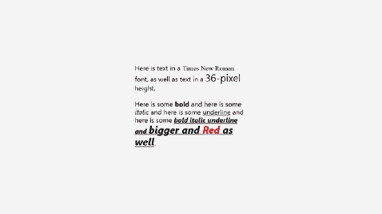

你可以看到，`LineBreak` 元素可以任意换行。理论上，`InlineUIContainer` 类允许你在文本中嵌入任何 `UIElement`（例如 `Image` 元素），但它尚未实现。尝试使用它，你将得到错误“值不在预期范围内。”

# 共享画刷（以及其他资源）

假设你在页面上有多个 `TextBlock` 元素，并且你希望其中几个元素具有相同的画刷。如果这是一个 `SolidColorBrush`，那么重复的标记并不糟糕。然而，如果它是 `LinearGradientBrush`，情况就会变得混乱。一个 `LinearGradientBrush` 至少需要六个标签，所有这些重复标记会变得非常痛苦，特别是需要更改某些内容时。

Windows Runtime 有一项名为“XAML 资源”的特性，允许在多个元素之间共享对象。共享画刷是 XAML 资源的一种常见应用，但最常见定义和共享样式。

XAML 资源存储在 `ResourceDictionary` 中，该字典的键和值类型都是 `object`。然而，通常情况下，键是字符串。`FrameworkElement` 和 `Application` 都定义了一个名为 `Resources` 的类型为 `ResourceDictionary` 的属性。

`SharedBrush` 项目展示了在页面多个元素之间共享 `LinearGradientBrush`（以及其他几个对象）的典型方法。在 XAML 文件的顶部，我为该面的资源集合定义了一个 `Resources` 属性元素：

示例 2-5. 项目：SharedBrush | 文件：BlankPage.xaml (节选)

```
<Page ... >

    <Page.Resources>
        <x:String x:Key="appName">Shared Brush App</x:String>
        <LinearGradientBrush x:Key="rainbowBrush">
            <GradientStop Offset="0" Color="Red" />
            <GradientStop Offset="0.17" Color="Orange" />
            <GradientStop Offset="0.33" Color="Yellow" />
            <GradientStop Offset="0.5" Color="Green" />
            <GradientStop Offset="0.67" Color="Blue" />
            <GradientStop Offset="0.83" Color="Indigo" />
            <GradientStop Offset="1" Color="Violet" />
        </LinearGradientBrush>

        <FontFamily x:Key="fontFamily">Times New Roman</FontFamily>

        <x:Double x:Key="fontSize">96</x:Double>
    </Page.Resources>
    ...
</Page>
```

通常 XAML 文件顶部的资源定义被称为“资源部分”。这个特定的 `Resources` 字典用四种不同类型初始化：`String`、`LinearGradientBrush`、`FontFamily` 和 `Double`。注意 `String` 和 `Double` 上的“x”前缀。当然，这些是 .NET 基本类型，但它们不是 Windows Runtime 类型，因此不在默认的 XAML 命名空间中。`x:Boolean` 和 `x:Int32` 类型也是可用的。

此外注意这些对象都有 `x:Key` 属性。`x:Key` 属性只在 `Resources` 字典有效。正如名称所示，`x:Key` 属性是该项目在字典中的键。

在 XAML 文件的正文中，元素通过在特殊标记（称为 *XAML 标记扩展*中使用此键来引用资源。

XAML 标记扩展只有几个，你总是能通过大括号识别出它们。引用资源的标记扩展由 `StaticResource` 关键字和键名组成。事实上，你已经见过许多 `StaticResource` 标记扩展了：它提供了一个带有背景画刷的标准 `Grid`。此 XAML 文件的其余部分使用 `StaticResource` 获取在 `Resources` 字典中定义的项目：

示例 2-6. 项目：SharedBrush | 文件：BlankPage.xaml (节选)


```xml
<Page ... >
    ...
    <Grid Background="{StaticResource ApplicationPageBackgroundBrush}">
        <TextBlock Text="{StaticResource appName}"
                   FontSize="48"
                   HorizontalAlignment="Center"
                   VerticalAlignment="Center" />

        <TextBlock Text="Top Text"
                   Foreground="{StaticResource rainbowBrush}"
                   FontFamily="{StaticResource fontFamily}"
                   FontSize="{StaticResource fontSize}"
                   HorizontalAlignment="Center"
                   VerticalAlignment="Top" />

        <TextBlock Text="Left Text"
                   Foreground="{StaticResource rainbowBrush}"
                   FontFamily="{StaticResource fontFamily}"
                   FontSize="{StaticResource fontSize}"
                   HorizontalAlignment="Left"
                   VerticalAlignment="Center" />

        <TextBlock Text="Right Text"
                   Foreground="{StaticResource rainbowBrush}"
                   FontFamily="{StaticResource fontFamily}"
                   FontSize="{StaticResource fontSize}"
                   HorizontalAlignment="Right"
                   VerticalAlignment="Center" />

        <TextBlock Text="Bottom Text"
                   Foreground="{StaticResource rainbowBrush}"
                   FontFamily="{StaticResource fontFamily}"
                   FontSize="{StaticResource fontSize}"
                   HorizontalAlignment="Center"
                   VerticalAlignment="Bottom" />
    </Grid>
</Page>
```

这是结果：

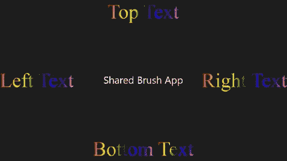

### 几点说明：

在四个 `TextBlock` 元素中引用相同的三个资源，表明需要一种更高效的方法，即样式（style），我将在本章的稍后部分讨论它。

资源必须在 XAML 文件中词法上先于其使用的地方定义。这就是为什么 `Resources` 字典通常位于 XAML 文件的顶部，并且定义在根元素上最为方便。

然而，每个 `FrameworkElement` 派生类都可以支持 `Resources` 字典，因此你可以将它们包含在视觉树的更靠下的位置。在任何 `Resources` 字典中，键必须是，但你可以在其他 `Resources` 字典中使用重复的键。当 XAML 解析器遇到 `StaticResource` 标记扩展时，它会开始向上视觉树搜索具有匹配键的 `Resources` 字典，并使用它遇到的第一个。你可以有效地用更具局部性的字典中的值来覆盖 `Resources` 键的值。

如果 XAML 解析器通过向上视觉树搜索找不到匹配的键，它会检查 `Application` 对象中的 `Resources` 字典。`App.xaml` 文件是定义在应用程序中使用的资源的理想位置。要在多个应用程序中使用一组资源，你可以将它们定义在根元素为 `ResourceDictionary` 的单独 XAML 文件中。将该文件包含在项目中，在 `App.xaml` 文件中引用它，然后你就可以使用该字典中的项了。

事实上，标准的 Metro 风格应用程序 Visual Studio 项目已经为你提供了一个示例。`Common` 文件夹包含一个名为 `StandardStyles.xaml` 的文件，它的根元素为 `ResourceDictionary`：

```xml
<ResourceDictionary
    xmlns="http://schemas.microsoft.com/winfx/2006/xaml/presentation"
    xmlns:x="http://schemas.microsoft.com/winfx/2006/xaml">

    ...

</ResourceDictionary>
```

该文件在标准的 `App.xaml` 文件中引用。事实上，引用此资源集合就是标准的 `App.xaml` 文件做的所有事情：

```xml
<Application
    x:Class="SharedBrush.App"
    xmlns="http://schemas.microsoft.com/winfx/2006/xaml/presentation"
    xmlns:x="http://schemas.microsoft.com/winfx/2006/xaml"
    xmlns:local="using:SharedBrush">

    <Application.Resources>
        <ResourceDictionary>
            <ResourceDictionary.MergedDictionaries>
                <ResourceDictionary Source="Common/StandardStyles.xaml"/>
            </ResourceDictionary.MergedDictionaries>
        </ResourceDictionary>
    </Application.Resources>
</Application>
```

你可以通过在 `MergedDictionaries` 集合中插入额外的 `ResourceDictionary` 标签来包含自己的资源集合。或者你可以直接在 `App` 对象的 `Resources` 字典中包含自己的资源。

你也可以从代码引用 `Resources` 字典。在调用 `InitializeComponent` 之后，你可以使用索引器从字典获取项：

```csharp
FontFamily fntfam = this.Resources["fontFamily"] as FontFamily;
```

现在尝试一下：注释掉 `BlankPage.xaml` 文件中的“fontFamily”项，但在 `BlankPage` 构造函数中`InitializeComponent` 调用*之前*将该项添加到字典中。

```csharp
this.Resources.Add("fontFamily", new FontFamily("Times New Roman"));
```

当 XAML 文件被 `InitializeComponent` 解析时，该对象将在该 XAML 文件中可用。

在编写本文时，`ResourceDictionary` 类没有定义用于向上视觉树搜索祖先类字典的公共方法。如果你需要在代码中进行这样的搜索以查找资源，你可以通过使用 `FrameworkElement`定义的 `Parent` 属性或 `Windows.UI.Xaml.Media` 命名空间定义的 `VisualTreeHelper` 类“攀爬视觉树”来轻松地编写它。应用程序的 `Application` 对象可以通过静态 `Application.Current` 属性可用。

预定义的资源（例如 `Grid` 引用的 `ApplicationPageBackgroundBrush`）似乎无法通过程序枚举。它们也没有被记录。但是，在 Visual Studio 中，你可以通过点击 `BlankPage` 文件中的 `Grid` 并查看预定义画刷的列表。在 `ApplicationPageBackgroundBrush` 之后，最重要的预定义标识符是 `ApplicationTextBrush`，它在亮色主题中为黑色，在深色主题中为白色。如果你需要与背景对比的颜色（我很快就会提到），就是它。`ControlHighlightBrush` 也适用于与背景和前景都有对比的颜色。

# 资源是共享的

资源对象在引用它们的元素之间真的是共享的吗？还是为每个 `StaticResource` 引用创建了单独的实例？

在 `SharedBrush.xaml.cs` 文件的 `InitializeComponent` 调用之后插入以下代码：

```csharp
TextBlock txtblk = (this.Content as Grid).Children[1] as TextBlock;
LinearGradientBrush brush = txtblk.Foreground as LinearGradientBrush;
brush.StartPoint = new Point(0, 1);
brush.EndPoint = new Point(0, 0);
```

此代码引用了 `Grid` 子元素集合中第二个 `TextBlock` 的 `LinearGradientBrush` 并更改了 `StartPoint` 和 `EndPoint` 属性。发现，引用该 `LinearGradientBrush` 的所有 `TextBlock` 元素都受到了影响：

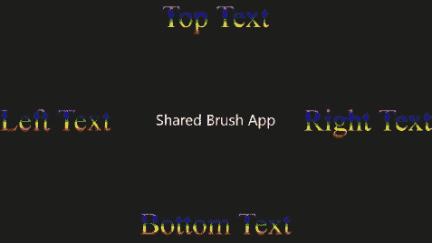

结论：资源是共享的。

也可以验证即使资源没有被任何元素引用，它仍然被实例化。

## 矢量图形

正如你所看到的，在 Metro 风格应用程序中显示文本和位图涉及创建 `TextBlock` 和 `Image` 类型的对象并将它们附加到视觉树上。至少在应用程序级别，没有“绘制”或“绘画”的概念。在 Windows Runtime 内部，`TextBlock` 和 `Image` 元素正在自我渲染。


...


你可能还会注意到我在 `y` 的计算中将一个加号改为了减号，这样螺旋线结束在顶部而不是底部。切换到浅色主题演示了使用 `ApplicationTextBrush` 作为 `Stroke` 颜色的便利性：


尝试将 `Stretch` 属性设置为 `Fill`，看看这个圆形螺旋线如何被扭曲成椭圆形螺旋线。

你可能记得 `LinearGradientBrush` 如何自适应它所应用的元素的大小。在矢量图形中使用该画笔时，情况也是如此。让我们来尝试使用 `ImageBrush`，这是一种从位图创建的画笔。

`ImageBrushedSpiral` 的后台代码文件与 `StretchedSpiral` 相同。XAML 文件大幅加宽了描边，并实例化了一个 `ImageBrush`：

示例 2-11. 项目：ImageBrushedSpiral | 文件：BlankPage.xaml (节选)

```
<Grid Background="{StaticResource ApplicationPageBackgroundBrush}">
    <Polyline Name="polyline"
              StrokeThickness="25"
              Stretch="Uniform">
        <Polyline.Stroke>
            <ImageBrush ImageSource="http://www.charlespetzold.com/pw6/PetzoldJersey.jpg"
                        Stretch="UniformToFill"
                        AlignmentY="Top" />
        </Polyline.Stroke>
    </Polyline>
</Grid>
```

`ImageBrush` 的 `ImageSource` 属性类型为 `ImageSource`，就像 `Image` 的 `Source` 属性一样。在 XAML 中，你可以直接将其设置为 URL。`ImageBrush` 有它自己的 `Stretch` 属性，默认值为 `Fill`。这意味着位图会被拉伸以填充区域，而不考虑宽高比例。对于我使用的这张图片，这会让我看起来很胖，所以我将其切换到了 `UniformToFill`，它在保持图像宽高比例的同时填充区域。这样做需要裁剪图像的一部分。使用 `AlignmentX` 和 `AlignmentY` 属性来指定位图应如何与图形形状对齐，从而决定图像应该在何处裁剪。对于这张位图，我倾向于裁剪底部而不是我的头部：


注意，图像的对齐似乎是基于螺旋线的几何线，而不是宽度为 25 像素的渲染线。这导致顶部、左侧和右侧的区域被削掉。这个问题可以通过 `ImageBrush` 的 `Transform` 属性解决，但对于本章来说有点太高级了。

你可能注意到 `ImageBrush` 继承自 `TileBrush`。这种继承关系可能暗示你可以水平和垂直重复位图图像以平铺表面，但 Windows Runtime 不支持这样做。

任何你可以用参数化公式定义的曲线，都可以用 `Polyline` 渲染。但如果你需要的复杂曲线是弧（即椭圆圆周上的曲线）、三次贝塞尔样线（标准类型）或二次贝塞尔样线（只有一个控制点），你就不需要使用 `Polyline`。这些曲线都由 `Path` 元素支持。

`Path` 自身只定义了一个名为 `Data` 的属性，类型为 `Geometry`，这是 `Windows.UI.Xaml.Media` 中定义的一个类。在 Windows Runtime 中，`Geometry` 和相关类表示纯解析几何。`Geometry` 对象使用坐标点定义线条和曲线，而 `Path` 使用特定的描边画笔和厚度渲染这些线条。

最强大且灵活的 `Geometry` 派类是 `PathGeometry`。`PathGeometry` 的内容属性命名为 `Figures`，它是 `PathFigure` 对象的集合。每个 `PathFigure` 都是一系列连接的直线。`PathFigure` 的内容属性是 `Segments`，即 `PathSegment` 对象的集合。`PathSegment` 是 `LineSegment`、`BezierSegment`、`QuadraticBezierSegment`、`ArcSegment` 和 `ArcSegment` 的父类。

让我们使用 `Path` 和 `PathGeometry` 来显示单词 HELLO：

示例 2-12. 项目：HelloVectorGraphics | 文件：BlankPage.xaml (节选)

```
<Grid Background="{StaticResource ApplicationPageBackgroundBrush}">
    <Path Stroke="Red"
          StrokeThickness="12"
          StrokeLineJoin="Round"
          HorizontalAlignment="Center"
          VerticalAlignment="Center">
        <Path.Data>
            <PathGeometry>
                <!-- H -->
                <PathFigure StartPoint="0 0">
                    <LineSegment Point="0 100" />
                </PathFigure>
                <PathFigure StartPoint="0 50">
                    <LineSegment Point="50 50" />
                </PathFigure>
                <PathFigure StartPoint="50 0">
                    <LineSegment Point="50 100" />
                </PathFigure>

                <!-- E -->
                <PathFigure StartPoint="125 0">
                    <BezierSegment Point1="60 -10" Point2="60 60" Point3="125 50" />
                    <BezierSegment Point1="60 40" Point2="60 110" Point3="125 100" />
                </PathFigure>

                <!-- L -->
                <PathFigure StartPoint="150 0">
                    <LineSegment Point="150 100" />
                    <LineSegment Point="200 100" />
                </PathFigure>

                <!-- L -->
                <PathFigure StartPoint="225 0">
                    <LineSegment Point="225 100" />
                    <LineSegment Point="275 100" />
                </PathFigure>

                <!-- O -->
                <PathFigure StartPoint="300 50">
                    <ArcSegment Size="25 50" Point="300 49.9" />
                </PathFigure>
            </PathGeometry>
        </Path.Data>
    </Path>
```

每个字母是一个或多个 `PathFigure` 对象，它们始终指定一系列连接线条的起点。`PathSegment` 派类从该点继续。例如，为了画“E”，`BezierSegment` 指定了两个控制和一个和一个点。下一个 `BezierSegment` 则从上一个继续。（在 `ArcSegment` 中，弧的终点不能与起点相同，否则将什么都不会绘制。这就是为什么将其设置为第 10 个像素。）

结果显示，使用贝塞尔样线可能不是渲染大写 E 的最佳方法：


尝试将 `Path` 的 `Stretch` 属性设置为 `Fill` 以获得“巨大的 hello”：


当然你可以在代码中组合 `PathFigure` 和 `PathSegment` 对象，但让我向你展示在 XAML 中实现的更简单的方法。有一种 Path 标记语法由单个字母、坐标点、可选的尺寸以及几个布尔值组成，这大大减少了标记。`HelloVectorGraphicsPath` 项目与 HelloVectorGraphics 创建相同的形状：

示例 2-13. 项目：HelloVectorGraphicsPath | 文件：BlankPage.xaml (节选)

```
<Grid Background="{StaticResource ApplicationPageBackgroundBrush}">
    <Path Stroke="Red"
          StrokeThickness="12"
          StrokeLineJoin="Round"
          HorizontalAlignment="Center"
          VerticalAlignment="Center"
          Data="M 0 0 L 0 100 M 0 50 L 50 50 M 50 0 L 50 100
                M 125 0 C 60 -10, 60 60, 125 50, 60 40, 60 110, 125 100
                M 150 0 L 150 100, 200 100
                M 225 0 L 225 100, 275 100
                M 300 50 A 25 50 0 1 0 300 49.9" />
</Grid>
```


`Data` 属性现在是一个大字符串，但我已将其分成了五行，分别对应五个字母。M 代码表示“移动”（move），后跟的是 `x` 和 `y` 坐标点。`L` 表示线（或更准确地说，是多折线），后面跟着一个或多个点；`C` 是立方贝塞尔曲线，后面跟着控制点和一个终点，但可以包含多个控制点；`A` 表示圆弧。弧是最复杂的：前两个数字表示椭圆的水平和垂直半径，椭圆将根据下一个参数给定的角度数进行旋转。接下来是用于 `IsLargeArc` 属性和扫掠方向的两个标志，最后是终点。

使用路径标记语法（Path Markup Syntax）定义复杂的几何结构是只有在 XAML 中才能完成的一个示例。执行此转换的任何类在 Windows Runtime 中均未公开。它仅对 XAML 解析器可用。若要在代码中将路径标记语法字符串转换为 `Geometry`，则需要某种将 XAML 转换为代码中对象的方法。

幸的是，存在这样的方法。它是位于 `Windows.UI.Xaml.Markup` 命名空间中的一个名为 `XamlReader.Load` 的静态方法。向它传递一个 XAML 字符串，即可获得根元素的实例，此时树的其他所有部分都已实例化并组装。`XamlReader.Load` 有一些限制——例如，它解析的 XAML 不能引用外部代码中的事件处理器——但是一个非常强大的工具。在第 7 章 中，我将向你展示名为 `XamlCruncher` 的工具的源码，它可以让你交互式实验 XAML。

同时，这是一个完全在代码创建的带有路径标记语法的 `Path`：

示例 2-14. 项目:PathMarkupSyntaxCode | 文件:BlankPage.xaml.cs

```
using Windows.UI;                   // 用于 Colors
using Windows.UI.Xaml;
using Windows.UI.Xaml.Controls;
using Windows.UI.Xaml.Markup;       // 用于 XamlReader
using Windows.UI.Xaml.Media;
using Windows.UI.Xaml.Shapes;       // 用于 Path

namespace PathMarkupSyntaxCode
{
    public sealed partial class BlankPage : Page
    {
        public BlankPage()
        {
            this.InitializeComponent();

            Path path = new Path
            {
                Stroke = new SolidColorBrush(Colors.Red),
                StrokeThickness = 12,
                StrokeLineJoin = PenLineJoin.Round,
                HorizontalAlignment = HorizontalAlignment.Center,
                VerticalAlignment =  VerticalAlignment.Center,
                Data = PathMarkupToGeometry(
                    "M 0 0 L 0 100 M 0 50 L 50 50 M 50 0 L 50 100 " +
                    "M 125 0 C 60 -10, 60 60, 125 50, 60 40, 60 110, 125 100 " +
                    "M 150 0 L 150 100, 200 100 " +
                    "M 225 0 L 225 100, 275 100 " +
                    "M 300 50 A 25 50 0 1 0 300 49.9")
            };

            (this.Content as Grid).Children.Add(path);
        }

        Geometry PathMarkupToGeometry(string pathMarkup)
        {
            string xaml =
                "<Path " +
                "xmlns='http://schemas.microsoft.com/winfx/2006/xaml/presentation'>" +
                "<Path.Data>" + pathMarkup + "</Path.Data></Path>";

            Path path = XamlReader.Load(xaml) as Path;

            // 将 PathGeometry 从 Path 中解离
            Geometry geometry = path.Data;
            path.Data = null;
            return geometry;
        }
    }
}
```

在代码中使用 `Path` 类时要小心：Visual Studio 生成的 `BlankPage.xaml.cs` 文件没有包含 `Path` 所在的 `Windows.UI.Xaml.Shape` 的 `using` 指令，但包含了 `System.IO` 的 `using` 指令，后者有一个用于处理文件和目录的完全不同的 `Path` 类。

魔法方法在底部。它组装了一个以 `Path` 为根元素的微小合法 XAML，并使用属性-元素语法来封装路径标记语法字符串。注意，XAML 必须包含标准的 XML 命名空间声明。如果 `XamlReader.Load` 没有遇到任何错误，它将返回一个 `Data` 属性设置为 `PathGeometry` 的 `Path`。然而，你不能将此 `PathGeometry` 用于另一个 `Path`，除非你从此 `Path` 中断开它，这需要将返回的 `Path` 的 `Data` 属性设置为 `null`。

## 样式

你已经看到画刷如何被定义为资源并在元素之间共享。资源目前为止最常用的用途是定义样式（Styles），即 `Style` 类的实例。样式基本上是一组可以在多个元素之间共享的属性定义。使用样式不仅减少了重复的标记，还允许更方便的全局更改。

在这次讨论之后，你项目中大部分的 `Resources` 部分将是样式。

SharedBrushWithStyle 项目与 SharedBrush 非常相似，不同之处在于它使用 `Style` 来整合多个属性。这里是底部的 `Resources`：

示例 2-15. 项目:SharedBrushWithStyle | 文件:BlankPage.xaml (片段)

```xml
<Page.Resources>
    <x:String x:Key="appName">Shared with Style</x:String>

    <LinearGradientBrush x:Key="rainbowBrush">
        <GradientStop Offset="0" Color="Red" />
        <GradientStop Offset="0.17" Color="Orange" />
        <GradientStop Offset="0.33" Color="Yellow" />
        <GradientStop Offset="0.5" Color="Green" />
        <GradientStop Offset="0.67" Color="Blue" />
        <GradientStop Offset="0.83" Color="Indigo" />
        <GradientStop Offset="1" Color="Violet" />
    </LinearGradientBrush>

    <Style x:Key="rainbowStyle" TargetType="TextBlock">
        <Setter Property="FontFamily" Value="Times New Roman" />
        <Setter Property="FontSize" Value="96" />
        <Setter Property="Foreground" Value="{StaticResource rainbowBrush}" />
    </Style>
</Page.Resources>
```

与所有资源一样，`Style` 的起始标签包含 `x:Key` 属性。`Style` 还需要一个 `TargetType` 属性，指示 `FrameworkElement` 或派自 `FrameworkElement` 的类。样式只能应用于 `FrameworkElement` 的派生类。

`Style` 的主体包含许多 `Setter` 标签，每个标签指定了 `Property` 和 `Value` 属性。注意最后一个 `Value` 属性设置为之前定义的 `LinearGradientBrush` 的 `StaticResource`。为了使此引用生效，该特定的 `Style` 在 XAML 文件中的定义必须在画刷之后，尽管它也可以位于视觉树深处的其他 `Resources` 部分。


除了应用名称外，视觉效果与 SharedBrush 程序完全相同。

对于这个特定的 `Style`，还有另一种替代方法来结合 `LinearGradientBrush`。就像你可以在元素上使用属性-元素语法来定义具有复杂标记的对象一样，你也可以对 `Setter` 类的 `Value` 属性使用属性-元素语法：

```xml
<Style x:Key="rainbowStyle" TargetType="TextBlock">
    <Setter Property="FontFamily" Value="Times New Roman" />
    <Setter Property="FontSize" Value="96" />
    <Setter Property="Foreground">
        <Setter.Value>
            <LinearGradientBrush>
                <GradientStop Offset="0" Color="Red" />
                <GradientStop Offset="0.17" Color="Orange" />
                <GradientStop Offset="0.33" Color="Yellow" />
                <GradientStop Offset="0.5" Color="Green" />
                <GradientStop Offset="0.67" Color="Blue" />
                <GradientStop Offset="0.83" Color="Indigo" />
                <GradientStop Offset="1" Color="Violet" />
            </LinearGradientBrush>
        </Setter.Value>
    </Setter>
</Style>
```

起初这看起来可能有点奇怪，但在样式中定义画刷是非常常见的。注意，这里的 `LinearGradientBrush` 本身没有自己的 `x:Key`。只有在 `Resources` 集合根级别定义的项才能拥有 `x:Key` 属性。

你可以在代码中定义 `Style`，例如如下：

```csharp
Style style = new Style(typeof(TextBlock));
style.Setters.Add(new Setter(TextBlock.FontSizeProperty, 96));
style.Setters.Add(new Setter(TextBlock.FontFamilyProperty,
                             new FontFamily("Times New Roman")));
```

你可以在调用 `InitializeComponent` 之前将此添加到 `Page` 的 `Resources` 集合中，这样 XAML 文件中定义的 `TextBlock` 元素就可以它。或者，你可以直接将此 `Style` 对象赋值给 `TextBlock` 的 `Style` 属性。然而，这并不常见，因为代码提供了其他在多个不同元素上定义相同属性的解决方案，即 `for` 或 `foreach` 循环。

请仔细注意 `Setter` 构造函数的第一个参数。它被定义为 `DependencyProperty`，你指定的是由样式的目标类定义（或继承自）的静态依赖属性。这是依赖属性允许对类的属性独立于该类的特定实例进行指定的的一个极佳示例。

代码还明确了 `Style` 目标针对的属性只能是依赖属性。我之前提到过，依赖属性对属性设置的方式施加了层级结构。例如，假设你在此程序中有以下标记：

```xml
<TextBlock Text="Top Text"
           Style="{StaticResource rainbowStyle}"
           FontSize="24"
           HorizontalAlignment="Center"
           VerticalAlignment="Top" />
```

`Style` 定义了一个 `FontSize` 值，但 `FontSize` 属性在 `TextBlock` 上也被本地设置了。正如你所希望和预期的那样，本地设置的优先级高于 `Style` 设置，且都高于通过视觉树传播的 `FontSize` 值。

一旦将 `Style` 对象设为元素的 `Style` 属性，该 `Style` 就无法再更改。你稍后可以为元素设置不同的 `Style` 对象，也可以更改由样式引用的对象的属性（例如画刷），但你不能设置或移除 `Setter` 对象或更改它们的 `Value` 属性。

样式可以通过名为 `BasedOn` 的 `Style` 属性从其他样式继承属性设置，该属性通常被设置为引用之前定义的 `Style` 定义的 `StaticResource` 标记扩展：

```xml
<Style x:Key="baseTextBlockStyle" TargetType="TextBlock">
    <Setter Property="FontFamily" Value="Times New Roman" />
    <Setter Property="FontSize" Value="24" />
</Style>

<Style x:Key="gradientStyle" TargetType="TextBlock"
       BasedOn="{StaticResource baseTextBlockStyle}">
    <Setter Property="FontSize" Value="96" />
    <Setter Property="Foreground">
       <Setter.Value>
          <LinearGradientBrush>
                <GradientStop Offset="0" Color="Red" />
                <GradientStop Offset="1" Color="Blue" />
           </LinearGradientBrush>
       </Setter.Value>
    </Setter>
</Style>
```

键为“gradientStyle”的 `Style` 于之前的键为“baseTextBlockStyle”的 `Style`，这意味着它继承了 `FontFamily` 设置，覆盖了 `FontSize` 设置，并定义了新的 `Foreground` 设置。

这是另一个示例：

```xml
<Style x:Key="centeredStyle" TargetType="FrameworkElement">
    <Setter Property="HorizontalAlignment" Value="Center" />
    <Setter Property="VerticalAlignment" Value="Center" />
</Style>

<Style x:Key="rainbowStyle" TargetType="TextBlock"
       BasedOn="{StaticResource centeredStyle}">
    <Setter Property="FontSize" Value="96" />
    <Setter Property="Foreground">
        <Setter.Value>
            <LinearGradientBrush>
                <GradientStop Offset="0" Color="Red" />
                <GradientStop Offset="1" Color="Blue" />
            </LinearGradientBrush>
        </Setter.Value>
    </Setter>
</Style>
```

在这种情况下，第一个 `Style` 的 `TargetType` 为 `FrameworkElement`，这意味着它只能包含 `FrameworkElement` 定义或继承自 `FrameworkElement` 的属性。第二个 `Style` 基于“centeredStyle”，但其 `TargetType` 为 `TextBlock`，这意味着它也可以包含特定的 `TextBlock` 属性。尽管我一直说过资源需要键，但 `Style` 实际上是这一规则的唯一例外。没有 `x:Key` 的 `Style` 是一个非常特殊的情况，称为隐式样式。ImplicitStyle 项目的 `Resources` 部分有一个示例：

Example 2-17. Project: ImplicitStyle | File: BlankPage.xaml (excerpt)

```xml
<Page.Resources>
    <x:String x:Key="appName">Implicit Style</x:String>

    <Style TargetType="TextBlock">
        <Setter Property="FontFamily" Value="Times New Roman" />
        <Setter Property="FontSize" Value="96" />
        <Setter Property="Foreground">
            <Setter.Value>
                <LinearGradientBrush>
                    <GradientStop Offset="0" Color="Red" />
                    <GradientStop Offset="0.17" Color="Orange" />
                    <GradientStop Offset="0.33" Color="Yellow" />
                    <GradientStop Offset="0.5" Color="Green" />
                    <GradientStop Offset="0.67" Color="Blue" />
                    <GradientStop Offset="0.83" Color="Indigo" />
                    <GradientStop Offset="1" Color="Violet" />
                </LinearGradientBrush>
            </Setter.Value>
        </Setter>
    </Style>
</Page.Resources>
```

后台实际上创建了一个键。它是一个 `RuntimeType` 类型的对象（该类型不是公共类型），指示 `TextBlock` 类型。

隐式样式非常强大。视觉树中更深任何没有设置 `Style` 属性的 `TextBlock` 都将获得隐式样式。如果你有一个装满了 `TextBlock` 元素的页面，突然决定想让它们都以相同的方式样式，隐式样式让这变得非常简单。注意这些 `TextBlock` 元素都没有设置它们的 `Style` 属性：

Example 2-18. Project: ImplicitStyle | File: BlankPage.xaml (excerpt)


```
<Grid Background="{StaticResource ApplicationPageBackgroundBrush}">

    <TextBlock Text="{StaticResource appName}"
               FontFamily="Portable User Interface"
               FontSize="48"
               Foreground="{StaticResource ApplicationTextBrush}"
               HorizontalAlignment="Center"
               VerticalAlignment="Center" />

    <TextBlock Text="Top Text"
               HorizontalAlignment="Center"
               VerticalAlignment="Top" />

    <TextBlock Text="Left Text"
               HorizontalAlignment="Left"
               VerticalAlignment="Center" />

    <TextBlock Text="Right Text"
               HorizontalAlignment="Right"
               VerticalAlignment="Center" />

    <TextBlock Text="Bottom Text"
               HorizontalAlignment="Center"
               VerticalAlignment="Bottom" />
</Grid>
```

虽然我显然想让隐式样式应用于页面上的大部分 `TextBlock` 元素，但我并不希望它应用于第一个那个位于中间的元素。如果你想让页面上的某些元素*不*具有这种隐式样式，你必须为这些元素提供一个显式样式，或者提供覆盖 `Style` 对象中包含属性的本地设置，或者将 `Style` 属性设置为 `null`。（稍后我会向你展示如何在 XAML 中实现这一点。）在本示例中，我通过给第一个 `TextBlock` 指定默认的 `FontFamily` 名称、显式的 `FontSize` 以及基于预定义资源的 `Foreground`，覆盖了它的隐式样式。

你不能从隐式样式派生出样式。然而，隐式样式可以基于非隐式样式。只需提供 `TargetType` 和 `BasedOn` 属性并忽略 `x:Key` 即可。

隐式样式非常强大，但请记住：能力越大，责任越大……你懂的。在大型应用程序中，样式可以定义在任何地方，视觉树可能会跨越多个 XAML 文件。有时，样式会隐式地应用于某个元素，但很难确定该样式到底定义在何！

到此时，你可以开始使用（或至少开始查看）在 `StandardStyles.xaml` 文件中定义的 `TextBlock` 样式了。这些样式被称为 `BasicTextStyle`、`BaselineTextStyle`、`HeaderTextStyle`、`SubheaderTextStyle`、`TitleTextStyle`、`ItemTextStyle`、`BodyTextStyle` 和 `CaptionTextStyle`，显然它们用于比我在这里所做的更广泛的文本布局。

## 数据绑定初探

在 XAML 文件中共享对象的另一种方法是通过数据绑定。基本上，数据绑定在不同对象的两个属性之间建立了一种连接。正如你在第 6 章 中所看到的，数据绑定最大的应用是将页面上的视觉元素与数据源连接起来，它们是实现流行的模型-视图-视图模型（MVVM）架构模式的关键部分。在 MVVM 中，绑定的目标是 View 中的视觉元素，而绑定的源是对应 View Model 中的属性。

你也可以使用数据绑定来链接两个元素的属性。像 `StaticResource` 一样，`Binding` 通常被表示为标记扩展，这意味着它出现在一对大括号之间。然而，`Binding` 比 `StaticResource` 更复杂，也可以用属性-元素语法来表示。

以下是来自 `SharedBrushWithBinding` 项目的 `Resources` 部分：

示例 2-19。项目：`SharedBrushWithBinding` | 文件：`BlankPage.xaml`（节选）

```
<Page.Resources>
    <x:String x:Key="appName">Shared Brush with Binding</x:String>

    <Style TargetType="TextBlock">
        <Setter Property="FontFamily" Value="Times New Roman" />
        <Setter Property="FontSize" Value="96" />
    </Style>
</Page.Resources>
```

`TextBlock` 的隐式样式不再具有 `Foreground` 属性。`LinearGradientBrush` 定义在四个使用该刷笔的 `TextBlock` 元素第一个，随后的 `TextBlock` 元素通过绑定引用了同一个刷笔：

示例 2-20。项目：`SharedBrushWithBinding` | 文件：`BlankPage.xaml`（节选）

```xml
<Grid Background="{StaticResource ApplicationPageBackgroundBrush}">
    <TextBlock Text="{StaticResource appName}"
               FontFamily="Portable User Interface"
               FontSize="48"
               HorizontalAlignment="Center"
               VerticalAlignment="Center" />

    <TextBlock Name="topTextBlock"
               Text="Top Text"
               HorizontalAlignment="Center"
               VerticalAlignment="Top">
        <TextBlock.Foreground>
            <LinearGradientBrush>
                <GradientStop Offset="0" Color="Red" />
                <GradientStop Offset="0.17" Color="Orange" />
                <GradientStop Offset="0.33" Color="Yellow" />
                <GradientStop Offset="0.5" Color="Green" />
                <GradientStop Offset="0.67" Color="Blue" />
                <GradientStop Offset="0.83" Color="Indigo" />
                <GradientStop Offset="1" Color="Violet" />
            </LinearGradientBrush>
        </TextBlock.Foreground>
    </TextBlock>

    <TextBlock Text="Left Text"
               HorizontalAlignment="Left"
               VerticalAlignment="Center"
               Foreground="{Binding ElementName=topTextBlock, Path=Foreground}" />

    <TextBlock Text="Right Text"
               HorizontalAlignment="Right"
               VerticalAlignment="Center"
               Foreground="{Binding ElementName=topTextBlock, Path=Foreground}" />

    <TextBlock Text="Bottom Text"
               HorizontalAlignment="Center"
               VerticalAlignment="Bottom">
        <TextBlock.Foreground>
            <Binding ElementName="topTextBlock" Path="Foreground" />
        </TextBlock.Foreground>
    </TextBlock>
</Grid>
```

数据绑定被认为有一个*源*和一个*目标*。目标始终是设置绑定的属性，而源是绑定引用的属性。名为 `topTextBlock` 的 `TextBlock` 被视为这些绑定的源；共享 `Foreground` 属性的三个 `TextBlock` 元素是目标。其中两个目标显示了将 `Binding` 对象作为标记扩展的标准方式：

```xml
Foreground="{Binding ElementName=topTextBlock, Path=Foreground}"
```

XAML 标记扩展始终出现在大括号中。在 `Binding` 标记扩展中，需要设置一些属性和值。这些属性用逗号隔开。

最后一个 `TextBlock` 显示了使用不常用的属性-元素语法的 `Binding`：

```xml
<TextBlock.Foreground>
    <Binding ElementName="topTextBlock" Path="Foreground" />
</TextBlock.Foreground>
```

使用这种语法时，元素名称和路径的引号是必须的。

你可以在代码中创建 `Binding` 对象，并使用 `FrameworkElement` 定义的 `SetBinding` 方法将其设置到目标属性上。这样做时你会发现绑定目标必须是一个依赖属性。

`Binding` 类的 `Path` 属性之所以被称为 `Path`，是因为它实际上可以是由点分隔的多个属性名称。例如，将此项目中的一个 `Text` 设置替换为以下内容：

```xml
Text="{Binding ElementName=topTextBlock, Path=FontFamily.Source}"
```


`Path` 的第一部分表示我们想要从 `FontFamily` 属性中获取内容。该属性被设置为 `FontFamily` 类型的对象，该对象有一个名为 `Source` 的属性，指示字体族名称。因此，此 `TextBlock` 显示的文本为“Times New Roman”。

尝试在此项目中的任何 `TextBlock` 上执行操作：

```
Text="{Binding RelativeSource={RelativeSource Self}, Path=FontSize}"
```

这是在 `Binding` 标记扩展内部的 `RelativeSource` 标记扩展，你用它来引用设置该绑定的同一元素的属性。

通过 `StaticResource`、`Binding` 和 `RelativeSource`，你现在已经看到了 Windows Runtime 支持的 60% 的 XAML 标记扩展。`TemplateBinding` 标记扩展要等到后面的章节才会出现。

剩余的标记扩展虽然并不经常使用，但当你需要它时，它是不可或缺的。假设你为 `Grid` 定义了一个包含 `Background` 属性的隐式样式，它在所有情况下都完全符合你的要求，但在其中一个 `Grid` 外，你希望它的 `Background` 属性为其默认值 `null`。如何在标记中指定 `null` 呢？如下：

```
Background="{x:Null}"
```

或者，假设你定义了一个隐式样式，其中有一个元素你不希望应用该样式的任何部分。可以通过如下方式抑制隐式样式：

```
Style="{x:Null}"
```

你现在已经看到了几乎所有出现在 Windows Runtime XAML 文件中带有“x”前缀的元素和属性。这些是数据类型 `x:Boolean`、`x:Double`、`x:Int32`、`x:String`，以及 `x:Class`、`x:Name` 和 `x:Key` 属性以及 `x:Null` 标记扩展。我还没有提到的只有 `x:Uid`，它必须被设置为应用程序范围内唯一的字符串，用于国际化目的资源引用。这将在后面的章节介绍。

# 第 3 章 基础事件处理

之前的章节演示了如何在 XAML 或代码中实例化和初始化元素和其他对象。最常用的步骤是使用 XAML 定义页面上元素的初始布局和外观，然后在程序运行时从代码中更改这些元素的属性。

正如你所见到的，在 XAML 中为元素分配 `Name` 或 `x:Name` 会导致页面类中定义一个字段，使得后台代码文件（code-behind）可以轻松访问该元素。这是代码与 XAML 交互的两种主要方式之一。另一种是通过事件。事件是一种通用机制，允许一个对象向其他对象通信某些感兴趣的信息。事件被称为由第一个对象“触发”（fired），由另一个对象“处理”（handled）。在 Windows Runtime 中，事件的一个重要应用是信号来自触摸、鼠标、手写笔或键盘的用户输入存在。

初始化之后，Windows Runtime 程序通常在内存中处于休眠状态，等待有趣的事情发生。程序之后做的几乎所有操作都是对事件的响应，因此事件处理的工作将占据书中剩余的大部分内容。

## Tapped（点击）事件

`UIElement` 类定义了所有基础的用户输入事件。这些包括八个以 `Pointer` 单词开头的事件，它们合并了触摸、鼠标和手写笔的输入；五个以 `Manipulation` 单词开头的事件结合了多个手指的输入；两个用于键盘输入的 `Key` 事件；以及命名为 `Tapped`、`DoubleTapped`、`RightTapped` 和 `Holding` 的高级事件。（不，`RightTapped` 事件不是由你的右手手指生成的；它主要用于注册鼠标的右键点击，但你可以通过按住手指片刻然后抬起来模拟触摸右键，这种手势也会产生 `Holding` 事件。确定它希望如何处理这些事件是应用程序的责任。）

我们将在未来的章节中对这些用户输入事件进行彻底探索。现在，让我们关注 `Tapped` 作为一个简单的代表性事件。派生自 `UIElement` 的元素触发 `Tapped` 事件，表示用户用手指短暂触摸了元素，或用鼠标点击了它，或用手写笔轻点它。要符合 `Tapped` 事件的条件，手指（或鼠标或手写笔）移动不能，并且必须短时间内释放。

所有用户输入事件都有类似的模式。`UIElement` 如下定义 `Tapped` 事件：

```
public event TappedEventHandler Tapped;
```

`TappedEventHandler` 定义在 `Windows.UI.Xaml.Input` 命名空间。它是一个委托类型，定义了事件处理程序的签名：

```
public delegate void TappedEventHandler(object sender, TappedRoutedEventArgs e);
```

在事件处理程序中，第一个参数指示事件源（始终是一个派生自 `UIElement` 的类的实例），第二个参数提供了特定 `Tapped` 事件的属性和方法。

`TapTextBlock` 程序的 XAML 文件定义了一个带有 `Name` 属性的 `TextBlock` 以及一个 `Tapped` 事件的处理程序：

示例 3-1. 项目：TapTextBlock | 文件：BlankPage.xaml（节选）

```
<Grid Background="{StaticResource ApplicationPageBackgroundBrush}">
    <TextBlock Name="txtblk"
               Text="Tap Text!"
               FontSize="96"
               HorizontalAlignment="Center"
               VerticalAlignment="Center"
               Tapped="txtblk_1" />
</Grid>
```

当你在 XAML 中输入 `TextBlock` 属性时，IntelliSense 会建议事件以及属性。这些通过小图标进行区分：扳手代表属性，闪电代表事件。（你还会看到一些带括号的。这些是附加属性，我将在第 4 章描述。）如果允许，IntelliSense 还会为事件处理程序建议名称，我让它选择了这个。仅根据 XAML 语法无法判断哪些是属性，哪些是事件。

实际的事件处理程序是在后台文件中实现的。如果你允许 Visual Studio 为你选择处理程序名称，你会发现它在 `BlankPage.xaml.cs` 中创建了一个骨架事件处理程序：

```
private void txtblk_Tapped_1(object sender, TappedRoutedEventArgs e)
{

}
```

这是用户点击时调用的方法。在未来的项目中，我会根据自己的喜好更改处理程序的名称。我会移除 `private` 关键字（因为那是默认的），我会重命名以消除下划线并在开头加上 `On` 字（例如 `OnTextBlockTapped`），我会把名为 `e` 的参数改为 `args`。从理论上，你可以在代码文件中重命名方法，然后点击全局重命名图标来重命名 XAML 文件中的方法，但在当前版本的 Visual Studio 中似乎不起作用。

对于这个示例程序，我决定通过将 `TextBlock` 设置为随机颜色来响应点击。为了准备这项工作，我为 `Random` 对象和用于红绿蓝字节的 `byte` 数组定义了字段：

示例 3-2. 项目：TapTextBlock | 文件：BlankPage.xaml.cs（节选）

```
public sealed partial class BlankPage : Page
{
    Random rand = new Random();
    byte[] rgb = new byte[3];

    public BlankPage()
    {
        this.InitializeComponent();
    }

    private void txtblk_Tapped_1(object sender, TappedRoutedEventArgs e)
    {
        rand.NextBytes(rgb);
        Color clr = Color.FromArgb(255, rgb[0], rgb[1], rgb[2]);
        txtblk.Foreground = new SolidColorBrush(clr);
    }
}
```


我移除了 `OnNavigatedTo` 方法，因为在这里没有没有到它。在 `Tapped` 事件处理程序中，`Random` 对象的 `NextBytes` 方法获取三个随机字节，这些字节用于通过静态方法 `Color.FromArgb` 构造一个 `Color` 值。处理程序最后通过将 `TextBlock` 的 `Foreground` 属性设置为基于该 `Color` 值的 `SolidColorBrush` 来结束。

当你运行此程序时，可以用手指、鼠标或手写笔点击 `TextBlock`，它将变为随机颜色。如果你点击 `TextBlock` 之外的屏幕区域，则什么都不会发生。如果你使用鼠标或手写笔，你可能会注意到你不需要点击组成字母的实际笔画。你可以点击这些笔画之间和内部，`TextBlock` 仍然会有响应。这就好像 `TextBlock` 拥有一个不可见的背景，涵盖了包括变音符号和降部字母在内的整个字体高度，而事实确实如此。

如果你查看 Visual Studio 生成的 `BlankPage.g.cs` 文件，你会看到一个 `Connect` 方法，其中包含将事件处理程序附加到 `TextBlock` 的 `Tapped` 事件的代码。你可以自己在代码中实现这一点。尝试消除 XAML 文件中分配的 `Tapped` 处理程序，改为在代码后文件的构造函数中附加事件处理程序：

```
public BlankPage()
{
    this.InitializeComponent();
    txtblk.Tapped += txtblk_Tapped_1;
}
```

没有实质区别。

为了让 `Tapped` 事件正常工作，需要正确设置 `TextBlock` 的几个属性。`IsHitTestVisible` 和 `IsTapEnabled` 属性都必须设置为它们的默认值 `true`。`Visibility` 属性必须设置为其默认值 `Visibility.Visible`。如果设置为 `Visibility.Collapsed`，`TextBlock` 将完全不可见且对用户输入没有响应。

`txtblk_Tapped_1` 事件处理程序的第一个参数是发送事件的元素，在本例中是 `TextBlock`。第二个参数提供了有关此特定事件的信息，包括点击发生的坐标点，以及点击是来自手指、鼠标还是手写笔。这些信息将在后续章节中进行更详细探讨。

## 路由事件处理

由于 `Tapped` 事件处理程序的第一个参数是产生事件的元素，因此你不需要给 `TextBlock` 命名即可从事件处理程序内部访问它。你只需将 `sender` 参数强制转换为 `TextBlock` 类型的对象。这对于在多个元素之间共享事件处理程序特别有用，我在 RoutedEvents0 项目中正是这样做的。

RoutedEvents0 是演示 `路由事件处理`（routed event handling）概念的几个项目之一，这是 Windows Runtime 的重要功能。但这个特定的程序并没有显示任何路由事件特有的特性。因此后缀为 0。对于这个项目，我首先使用正确的签名和我偏好的名称创建了 `Tapped` 处理程序：

示例 3-3. 项目：RoutedEvents0 | 文件：BlankPage.xaml.cs（节选）

```
public sealed partial class BlankPage : Page
{
    Random rand = new Random();
    byte[] rgb = new byte[3];

    public BlankPage()
    {
        this.InitializeComponent();
    }

    void OnTextBlockTapped(object sender, TappedRoutedEventArgs args)
    {
        TextBlock txtblk = sender as TextBlock;
        rand.NextBytes(rgb);
        Color clr = Color.FromArgb(255, rgb[0], rgb[1], rgb[2]);
        txtblk.Foreground = new SolidColorBrush(clr);
    }
}
```

注意事件处理程序的第一行将 `sender` 参数强制转换为 `TextBlock`。

由于此事件处理程序已经存在于代码后文件中，当你在 XAML 文件中输入事件名称时，Visual Studio 会建议该名称。这非常方便，因为我在 `Grid` 中添加了九个 `TextBlock` 元素：

示例 3-4. 项目：RoutedEvents0 | 文件：BlankPage.xaml（节选）

```xml
<Page
    x:Class="RoutedEvents0.BlankPage"
    ...
    FontSize="48">

    <Grid Background="{StaticResource ApplicationPageBackgroundBrush}">
        <TextBlock Text="Left / Top"
                   HorizontalAlignment="Left"
                   VerticalAlignment="Top"
                   Tapped="OnTextBlockTapped" />

        ...

        <TextBlock Text="Right / Bottom"
                   HorizontalAlignment="Right"
                   VerticalAlignment="Bottom"
                   Tapped="OnTextBlockTapped" />
    </Grid>
</Page>
```

我确定你不需要看到所有的就能就能大概的意思。注意 `FontSize` 设置在 `Page` 上，以便它被所有 `TextBlock` 元素继承。当你运行程序时，可以点击各个元素，每个元素都会独立于其他元素改变颜色：

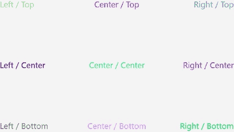

如果你点击元素之间的任何地方，什么都不会发生。

你可能会认为在 XAML 文件中的九个不同元素上设置同一个事件处理程序很麻烦。如果是这样，你可能会喜欢程序的以下变体。RoutedEvents1 程序使用了 `路由输入处理`（routed input handling），这是一个用于描述如 `Tapped` 等输入事件如何在元素上触发的术语。与其为单个 `TextBlock` 元素设置 `Tapped` 处理程序，你不如将其设置在这些元素的父元素上（例如 `Grid`）。这里是该程序的 XAML 文件文件的节选：

示例 3-5. 项目：RoutedEvents1 | 文件：BlankPage.xaml（节选）

```xml
<Grid Background="{StaticResource ApplicationPageBackgroundBrush}"
      Tapped="OnGridTapped">

    <TextBlock Text="Left / Top"
               HorizontalAlignment="Left"
               VerticalAlignment="Top" />

    ...

    <TextBlock Text="Right / Bottom"
               HorizontalAlignment="Right"
               VerticalAlignment="Bottom" />
</Grid>
```

在将 `Tapped` 处理程序从 `TextBlock` 元素移动到 `Grid` 的过程中，我也重命名了它以准确描述事件源。

事件处理程序也必须进行修改。之前的 `Tapped` 处理程序将 `sender` 参数强制转换为 `TextBlock`。由于事件处理程序只设置在 `TextBlock` 类型的元素上，它可以放执行此转换。然而，当事件处理程序像这里设置在 `Grid` 上时，事件处理程序的 `sender` 参数将是 `Grid`。如何确定点击了哪个 `TextBlock`？

很简单：`TappedRoutedEventArgs` 类（作为事件处理程序的第二个参数的实例）有一个名为 `OriginalSource` 的属性，它指示了事件的来源。在这个示例中，`OriginalSource` 可以是 `TextBlock`（如果你点击文本）或 `Grid`（如果你点击文本之间），因此新的事件处理程序在转换之前必须进行检查：

示例 3-6. 项目：RoutedEvents1 | 文件：BlankPage.xaml.cs（节选）

```
void OnGridTapped(object sender, TappedRoutedEventArgs args)
{
    if (args.OriginalSource is TextBlock)
    {
        TextBlock txtblk = args.OriginalSource as TextBlock;
        rand.NextBytes(rgb);
        Color clr = Color.FromArgb(255, rgb[0], rgb[1], rgb[2]);
        txtblk.Foreground = new SolidColorBrush(clr);
    }
}
```

`TappedRoutedEventArgs` 派自 `RoutedEventArgs`，后者定义了 `OriginalSource` 以及其他属性。显然，`OriginalSource` 属性是路由事件处理的核心概念。该属性允许祖先元素处理源自后代元素的事件，并知道这些事件的来源。


另一种，你可以在 `Page` 上设置 `Tapped` 处理器，而不是在 `Grid` 上。但在 `Page` 上有一种更简单的方法。我我之前提到过，`UIElement` 定义了所有的用户输入事件。这些事件被所有派生类继承，但 `Control` 类添加了自身的事件接口，该接口由一组与这些事件相对应的虚方法组成。对于 `UIElement` 定义的 `Tapped` 事件，`Control` 类定义了一个名为 `OnTapped` 的虚方法。这些虚方法始终以 `On` 单词开头，后跟事件的名称，因此它们有时被称为“`On` 方法”。`Page` 通过 `UserControl` 派自 `Control`，因此这些方法在 `Page` 类中被继承。

以下是 `RoutedEvents2` XAML 文件的片段，显示 XAML 文件没有定义任何事件处理器：

示例 3-7. 项目: RoutedEvents2 | 文件: BlankPage.xaml (节录)

```xml
<Page
    x:Class="RoutedEvents2.BlankPage"
    xmlns="http://schemas.microsoft.com/winfx/2006/xaml/presentation"
    xmlns:x="http://schemas.microsoft.com/winfx/2006/xaml"
    xmlns:local="using:RoutedEvents2"
    xmlns:d="http://schemas.microsoft.com/expression/blend/2008"
    xmlns:mc="http://schemas.openxmlformats.org/markup-compatibility/2006"
    mc:Ignorable="d"
    FontSize="48">

    <Grid Background="{StaticResource ApplicationPageBackgroundBrush}">
        <TextBlock Text="Left / Top"
                   HorizontalAlignment="Left"
                   VerticalAlignment="Top" />

        ...

        <TextBlock Text="Right / Bottom"
                   HorizontalAlignment="Right"
                   VerticalAlignment="Bottom" />
    </Grid>
</Page>
```

相反，代码后台文件（code-behind）对 `OnTapped` 方法进行了重写：

示例 3-8. 项目: RoutedEvents2 | 文件: BlankPage.xaml.cs (节录)

```csharp
protected override void OnTapped(TappedRoutedEventArgs args)
{
    if (args.OriginalSource is TextBlock)
    {
        TextBlock txtblk = args.OriginalSource as TextBlock;
        rand.NextBytes(rgb);
        Color clr = Color.FromArgb(255, rgb[0], rgb[1], rgb[2]);
        txtblk.Foreground = new SolidColorBrush(clr);
    }
    base.OnTapped(args);
}
```

当你在 Visual Studio 中输入代码并想要重写如 `OnTapped` 这样的虚方法时，只需输入关键字 `override` 并按空格键，Visual Studio 就会提供该类定义的所有虚方法列表。当你选择其中一个时，Visual Studio 会创建一个带有基方法调用的骨架方法。在这里并不真的需要调用基方法，但在重写虚方法时，养成包含它的习惯是一个良好的习惯。

`On` 方法基本上与事件处理器相同，但它们没有 `sender` 参数，因为不再需要它了。在这种语境下，`sender` 等同于 `this`，即处理事件的 `Page` 实例。

下一个项目是 `RoutedEvents3`。我决定如果被点击的是 `Grid` 元素，则给它 设置一个随机背景颜色。XAML 文件看起来完全一样，但修改后的 `OnTapped` 方法如下所示：

示例 3-9. 项目: RoutedEvents3 | 文件: BlankPage.xaml.cs (节录)

```csharp
protected override void OnTapped(TappedRoutedEventArgs args)
{
    rand.NextBytes(rgb);
    Color clr = Color.FromArgb(255, rgb[0], rgb[1], rgb[2]);
    SolidColorBrush brush = new SolidColorBrush(clr);

    if (args.OriginalSource is TextBlock)
        (args.OriginalSource as TextBlock).Foreground = brush;

    else if (args.OriginalSource is Grid)
        (args.OriginalSource as Grid).Background = brush;

    base.OnTapped(args);
}
```

现在，当你点击 `TextBlock` 元素时，它会改变颜色；但当你点击屏幕上的其他地方时，`Grid` 会改变颜色。

现在假设出于某种原因，你决定想回到原始方案，为每个 `TextBlock` 元素显式地单独定义事件处理器来更改文本颜色，但又想保留用于更改 `Grid` 背景颜色的 `OnTapped` 重写。在 `RoutedEvents4` 项目中，XAML 文件已为 `TextBlock` 元素恢复了 `Tapped` 事件，并为 `Grid` 赋予了名称：

示例 3-10. 项目: RoutedEvents4 | 文件: BlankPage.xaml (节录)

```xml
<Grid Name="contentGrid"
      Background="{StaticResource ApplicationPageBackgroundBrush}">

    <TextBlock Text="Left / Top"
               HorizontalAlignment="Left"
               VerticalAlignment="Top"
               Tapped="OnTextBlockTapped" />

    ...

    <TextBlock Text="Right / Bottom"
               HorizontalAlignment="Right"
               VerticalAlignment="Bottom"
               Tapped="OnTextBlockTapped" />
</Grid>
```

这样做的一个优点是设置 `TextBlock` 和 `Grid` 颜色的方法现在是分开且独立的，因此不需要 `if`-`else` 块。`Tapped` 事件可以名称访问 `sender`：

示例 3-11. 项目: RoutedEvents4 | 文件: BlankPage.xaml (节录)

```csharp
public sealed class BlankPage : Page
{
    Random rand = new Random();
    byte[] rgb = new byte[3];

    public BlankPage()
    {
        InitializeComponent();
    }

    void OnTextBlockTapped(object sender, TappedRoutedEventArgs args)
    {
        TextBlock txtblk = sender as TextBlock;
        txtblk.Foreground = GetRandomBrush();
    }

    protected override void OnTapped(TappedRoutedEventArgs args)
    {
        contentGrid.Background = GetRandomBrush();
        base.OnTapped(args);
    }

    Brush GetRandomBrush()
    {
        rand.NextBytes(rgb);
        Color clr = Color.FromArgb(255, rgb[0], rgb[1], rgb[2]);
        return new SolidColorBrush(clr);
    }
}
```

然而，这种代码可能并不是你想要的。当你点击 `TextBlock` 时，不仅 `TextBlock` 改变了颜色，事件还会继续向上传递并在 `OnTapped` 中被处理，导致 `Grid` 也改变了颜色！如果这正是你想要的，那你很幸运了。如果不是，我确定你会对了解 `TappedRoutedEventArgs` 有一个专门防止这种情况的属性感兴趣。如果 `OnTextBlockTapped` 处理器将事件的 `Handled` 属性设置为 `true`，则会阻止事件在视觉树更高处的进一步处理。

这在 `RoutedEvents5` 项目中得到了演示，它与 `RoutedEvents4` 相同，但在 `OnTextBlockTapped` 方法中有一语句：

示例 3-12. 项目: RoutedEvents5 | 文件: BlankPage.xaml.cs (节录)

```csharp
void OnTextBlockTapped(object sender, TappedRoutedEventArgs args)
{
    TextBlock txtblk = sender as TextBlock;
    txtblk.Foreground = GetRandomBrush();
    args.Handled = true;
}
```

## 重写 Handled

你刚刚看到，当元素处理如 `Tapped` 的事件并通过将事件参数的 `Handled` 属性设置为 `true` 来结束事件处理时，事件的路由实际上停止了。事件对于视觉树更高处的元素是不可见的。

在某些情况下，这种行为可能是不理想的。假设你正在处理一个元素，该元素在其事件处理器中将 `Handled` 属性设置为 `true`，但你仍然希望在视觉树更高处看到该事件。一种解决方案是直接修改代码，但这种选项可能不存在。该元素可能实现在动态链接库中，你可能无法源代码。

在 `RoutedEvents6` 中，XAML 文件与 `RoutedEvents5` 相同：每个 `TextBlock` 都为其 `Tapped` 事件设置了处理器。`Tapped` 处理器将 `Handled` 属性设置为 `true`。该类还定义了一个独立的 `OnPageTapped` 处理器，用于设置 `Grid` 的背景颜色：

示例 3-13. 项目: RoutedEvents6 | 文件: BlankPage.xaml.cs (节录)


```cs
public sealed partial class BlankPage : Page
{
    Random rand = new Random();
    byte[] rgb = new byte[3];

    public BlankPage()
    {
        this.InitializeComponent();

        this.AddHandler(UIElement.TappedEvent,
                        new TappedEventHandler(OnPageTapped),
                        true);
    }

    void OnTextBlockTapped(object sender, TappedRoutedEventArgs args)
    {
        TextBlock txtblk = sender as TextBlock;
        txtblk.Foreground = GetRandomBrush();
        args.Handled = true;
    }

    void OnPageTapped(object sender, TappedRoutedEventArgs args)
    {
        contentGrid.Background = GetRandomBrush();
    }

    Brush GetRandomBrush()
    {
        rand.NextBytes(rgb);
        Color clr = Color.FromArgb(255, rgb[0], rgb[1], rgb[2]);
        return new SolidColorBrush(clr);
    }
}
```

看看构造函数为 `Page` 设置 `Tapped` 处理程序的这种有趣方式。通常情况下，它会这样附加事件处理程序：

```cs
this.Tapped += OnPageTapped;
```

在这种情况下，`OnPageTapped` 处理程序将无法收到来自 `TextBlock` 的 `Tapped` 事件，因为 `TextBlock` 处理器将 `Handled` 设置为 true。相反，它通过名为 `AddHandler` 的方法附加了处理器：

```cs
this.AddHandler(UIElement.TappedEvent,
                new TappedEventHandler(OnPageTapped),
                true);
```

`AddHandler` 是由 `UIElement` 定义的，它还定义了静态属性 `UIElement.TappedEvent`。该属性的类型为 `RoutedEvent`。

就像 `FontSize` 这样的属性由一个类型为 `DependencyProperty` 的静态属性 `FontSizeProperty` 支持一样，`Tapped` 这样的路由事件由一个类型为 `RoutedEvent.RoutedEvent` 的静态属性 `TappedEvent` 支持。`RoutedEvent` 本身没有定义任何公共内容；它主要存在是为了允许在代码中引用事件，而不需要元素的实例。

`AddHandler` 方法将处理器附加到该事件。`AddHandler` 的第二个参数被定义为简单的 `object`，因此需要创建一个委托对象来引用事件处理程序。魔法就在这里：如果你希望此处理器也能接收被标记为 `Handled` 的路由事件，请将最后一个参数设为 `true`。

`AddHandler` 方法并不常用，但当你需要它时，它可以非常有用。

## 输入、对齐与背景颜色

在 RoutedEvents 系列中，我还有最后一个非常短的程序，用来介绍关于输入事件的几个重要点。

RoutedEvents7 的 XAML 文件只有一个 `TextBlock`，且没有定义任何事件处理程序：

示例 3-14. 项目：RoutedEvents7 | 文件：BlankPage.xaml（节录）

```xml
<Page ...
    FontSize="48">

    <Grid Background="{StaticResource ApplicationPageBackgroundBrush}">
         <TextBlock Text="Hello, Windows 8!"
                    Foreground="Red" />
    </Grid>
</Page>
```

`TextBlock` 上缺少 `HorizontalAlignment` 和 `VerticalAlignment` 设置会导致它显示在 `Grid` 的左上角。

与 `RoutedEvents3` 一样，代码后台文件包含对来自 `TextBlock` 的事件和来自 `Grid` 的事件的独立处理：

示例 3-15. 项目：RoutedEvents7 | 文件：BlankPage.xaml.cs（节录）

```cs
public sealed partial class BlankPage : Page
{
    Random rand = new Random();
    byte[] rgb = new byte[3];

    public BlankPage()
    {
        this.InitializeComponent();
    }

    protected override void OnTapped(TappedRoutedEventArgs args)
    {
        rand.NextBytes(rgb);
        Color clr = Color.FromArgb(255, rgb[0], rgb[1], rgb[2]);
        SolidColorBrush brush = new SolidColorBrush(clr);

        if (args.OriginalSource is TextBlock)
            (args.OriginalSource as TextBlock).Foreground = brush;

        else if (args.OriginalSource is Grid)
            (args.OriginalSource as Grid).Background = brush;

        base.OnTapped(args);
    }
}
```

就在这里：

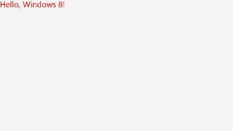

当你点击 `TextBlock` 时，它会像往常一样变成随机颜色，但当你点击 `TextBlock` 外部时，`Grid` 并没有像之前那样改变颜色。相反，是 `TextBlock` 改变了颜色！好像……是的，好像 `TextBlock` 现在占据了整个页面并为自己拦截了所有的 `Tapped` 事件。

事实确实如此。这个 `TextBlock` 具有 `HorizontalAlignment` 和 `VerticalAlignment` 的默认值，但这些默认值并不是视觉上暗示的那种 `Left` 和 `Top`。默认值名为 `Stretch`，这意味着 `TextBlock` 被拉伸到其父元素 `Grid` 的大小。这很难看出，因为文本仍然是 48 像素的字体，但 `TextBlock` 有一个透明背景，现在填充了整个页面。

事实上，在整个 Windows Runtime 中，所有元素的 `HorizontalAlignment` 和 `VerticalAlignment` 默认值都是 `Stretch`，这是 Windows Runtime 的重要部分。让我们在 `TextBlock` 上设置 `HorizontalAlignment` 和 `VerticalAlignment` 值：

```xml
<Grid Background="{StaticResource ApplicationPageBackgroundBrush}">
     <TextBlock Text="Hello, Windows 8!"
                HorizontalAlignment="Left"
                VerticalAlignment="Top"
                Foreground="Red" />
</Grid>
```

现在 `TextBlock` 只占据了页面左上角的一个小区域，当你点击 `TextBlock` 外部时，`Grid` 会改变颜色。

现在将 `HorizontalAlignment` 改为 `TextAlignment`：

```xml
<Grid Background="{StaticResource ApplicationPageBackgroundBrush}">
    <TextBlock Text="Hello, Windows 8!"
               TextAlignment="Left"
               VerticalAlignment="Top"
               Foreground="Red" />
</Grid>
```

外观相同。文本仍然位于左上角。但现在当你点击 `TextBlock` 右侧时，改变颜色的是 `TextBlock` 而不是 `Grid`。`TextBlock` 具有默认的 `HorizontalAlignment`，所以它现在占据了整个屏幕宽度，但在 `TextBlock` 占据的总宽度内，文本是左对齐的。

结论：`HorizontalAlignment` 和 `TextAlignment` 并不等同，尽管从视觉上看它们似乎是一样的。

现在尝试另一个实验，恢复 `HorizontalAlignment` 设置并移除 `Grid` 的 `Background` 属性：

```xml
<Grid>
     <TextBlock Text="Hello, Windows 8!"
                HorizontalAlignment="Left"
                VerticalAlignment="Top"
                Foreground="Red" />
</Grid>
```

在浅主题下，`Grid` 有离白色背景。移除 `Background` 属性后，页面背景变为黑色。但你还会发现行为发生了：点击 `TextBlock` 时它仍然改变颜色，但当你点击 `TextBlock` 外部时，`Grid` 完全没有改变颜色。

`Panel` 定义并由 `Grid` 继承的 `Background` 属性默认值为 `null`，对于 `null` 背景，`Grid` 不会捕捉触摸事件。它们会直接穿过。

不改变视觉外观而修复此问题的方法是给 `Grid` 一个 `Transparent` 的 `Background` 属性：

```xml
<Grid Background="Transparent">
     <TextBlock Text="Hello, Windows 8!"
                HorizontalAlignment="Left"
                VerticalAlignment="Top"
                Foreground="Red" />
</Grid>
```

它看起来和 `null` 一样，但现在你会收到 `OriginalSource` 为 `Grid` 的 `Tapped` 事件。


这里的课程非常重要：外表具有欺骗性。一个具有默认 `HorizontalAlignment` 和 `VerticalAlignment` 设置的元素看起来可能与设置为 `Left` 和 `Top` 的元素一样，但它实际上占据了容器的整个区域，并可能会阻止事件传递给底层元素。一个默认 `Background` 属性为 `null` 的 `Panel` 派生类看起来可能与设置为 `Transparent` 的元素一样，但它不响应触摸事件。

我几乎可以保证在未来的某个时刻，这两个问题中的一个会导致你的某个程序出现 bug，让你抓狂大半天，而且即使在在使用 XAML 布局系统多年之后，这种情况仍会发生。这是我的经验之谈。

## 尺寸与方向的变化

第一个在杂志文章中描述的 Windows 程序被称为 `WHATSIZE`（当然全大写），它出现在 1986 年 12 月份的《Microsoft Systems Journal》（这是《MSDN 杂志》的前身）。该程序的作用仅仅是显示程序窗口的当前尺寸，但随着窗口大小的改变，显示的尺寸也随之改变。

显然，原始的 `WHATSIZE` 程序是为那个时代的 Windows API 编写的，因此它通过响应 `WM_PAINT` 消息来重绘显示。在原始 Windows API 中，每当程序窗口部分内容变为“无效”并需要重绘时，该消息就会触发。程序可以定义其窗口，使其在尺寸发生变化时整个窗口都失效。

Windows Runtime 没有等同于 `WM_PAINT` 的消息，事实上，整个图形范式都完全不同。之前的 Windows 版本实现了一种“直接模式”图形系统，应用程序直接在实际视频内存中绘制。当然，这是通过软件层（图形设备接口 GDI）和设备驱动程序实现的，但在实际绘制函数的某个点，代码会直接写入视频显示内存。

Windows Runtime 非常不同。在它的公共编程接口中，它甚至没有绘制或绘画的概念。相反，Metro 风格的应用程序会创建元素——即从派自 `FrameworkElement` 的类中实例化的对象——并将它们添加到应用程序的视觉树中。这些元素负责自己进行自我渲染。当一个 Metro 风格的应用程序想要显示文本时，它不是绘制文本，而是创建一个 `TextBlock`。当应用程序想要显示位图时，它会创建一个 `Image` 元素。程序不是绘制线条、贝塞尔曲线和椭圆，而是创建 `Polyline` 和 `Path` 元素。

Windows Runtime 实现了一种“保留模式”图形系统。在你的应用程序和视频显示之间有一个组合层，所有渲染输出在呈现给用户之前都在这里进行组装。保留模式图形也许最重要的优点是无闪烁动画，你将在本章结束处以及本书的大部分内容中亲眼见证。

尽管 Windows Runtime 中的图形系统与早期版本的 Windows 有很大不同，但在另一个意义上，Metro 风格的应用程序与其早期的兄弟相似。一旦程序加载到内存并开始运行，它大部分时间通常处于内存中的睡眠状态，等待有趣的事情发生。这些通知以事件和回调的形式出现。通常这些事件指示用户输入，但也可能有其他有趣的活动。其中一个回调是 `OnNavigatedTo` 方法。在一个简单的单页程序中，该方法在构造函数返回后就会被调用。

另一个可能让 Metro 风格应用程序感兴趣的事件（特别是对于那些实现旧 `WHATSIZE` 程序功能的程序）名为 `SizeChanged`。这里是 Metro 风格 WhatSize 程序的 XAML 文件。注意根元素定义了 `SizeChanged` 事件的处理程序：

### 示例 3-16. 项目: WhatSize | 文件: BlankPage.xaml (节选)

```xml
<Page
    x:Class="WhatSize.BlankPage"
    ...
    FontSize="36"
    SizeChanged="OnPageSizeChanged">

    <Grid Background="{StaticResource ApplicationPageBackgroundBrush}">
        <TextBlock HorizontalAlignment="Center"
                   VerticalAlignment="Top">
            &#x21A4; <Run x:Name="widthText" /> pixels &#x21A6;
        </TextBlock>

        <TextBlock HorizontalAlignment="Center"
                   VerticalAlignment="Center"
                   TextAlignment="Center">
            &#x21A5;
            <LineBreak />
            <Run x:Name="heightText" /> pixels
            <LineBreak />
            &#x21A7;
        </TextBlock>
    </Grid>
</Page>
```

XAML 文件的其余部分定义了两个 `TextBlock` 元素，包含箭头字符包围的一些 `Run` 对象。（你很快就会看到它们的样子了）。在第二个 `TextBlock` 中将三个属性设置为 `Center` 似乎有些过头了，但它们都是必要的。前两个将 `TextBlock` 在页面中居中；将 `TextAlignment` 设置为 `Center` 会导致两个箭头相对于文本居中。两个 `Run` 元素被赋予了 `x:Name` 属性，以便在代码中设置 `Text` 属性。这发生在 `SizeChanged` 事件处理程序中：

### 示例 3-17. 项目: WhatSize | 文件: BlankPage.xaml.cs (节选)

```csharp
public sealed partial class BlankPage : Page
{
    public BlankPage()
    {
        this.InitializeComponent();
    }

    void OnPageSizeChanged(object sender, SizeChangedEventArgs args)
    {
        widthText.Text = args.NewSize.Width.ToString();
        heightText.Text = args.NewSize.Height.ToString();
    }
}
```

非常方便，事件参数以 `Size` 结构的形式提供了新尺寸，处理程序简单地将 `Width` 和 `Height` 转换为字符串并设置到 `Run` 元素的属性上：


如果你在响应方向变化的设备上运行该程序，可以尝试翻转屏幕并观察数字的变化。你也可以从屏幕左侧滑动以触发捕捉视图，然后在程序和其他视图之间划分屏幕以观察宽度值的变化。

你不需要在 XAML 中设置 `SizeChanged` 事件处理程序。你可以在代码中设置，也许在 `Page` 构造函数中：

```csharp
this.SizeChanged += OnPageSizeChanged;
```

`SizeChanged` 由 `FrameworkElement` 定义并由子类继承。尽管 `SizeChangedEventArgs` 派自 `RoutedEventArgs`，但这不是路由事件。你可以判断出这不是路由事件，因为事件参数的 `OriginalSource` 属性始终为 `null`；没有 `SizeChangedEvent` 属性；无论你在哪个元素上设置此事件，获取的都是该元素的尺寸。但你可以在任何元素上设置 `SizeChanged` 处理程序。通常，事件触发顺序沿着视觉树向下：首先是 `Page`（在本例中），然后是 `Grid` 和 `TextBlock`。

如果在 `SizeChanged` 处理程序的上下文之外需要元素的渲染尺寸，可以通过 `FrameworkElement` 定义的 `ActualWidth` 和 `ActualHeight` 属性获取这些信息。事实上，当访问这些属性时，WhatSize 中的 `SizeChanged` 处理程序实际上会更短一些：

```csharp
void OnPageSizeChanged(object sender, SizeChangedEventArgs args)
{
    widthText.Text = this.ActualWidth.ToString();
    heightText.Text = this.ActualHeight.ToString();
}
```


你可能*不*需要的是 `Width` 和 `Height` 属性。这些属性也由 `FrameworkElement` 定义，但它们的默认值为“不是数字”或 NaN。程序可以为 `Width` 和 `Height` 设置显式值（例如在第 2 章中的 TextFormatting 项目中），但通常这些属性保持为默认值，对于确定元素的实际大小没有帮助。`FrameworkElement` 还定义了 `MinWidth`、`MaxWidth`、`MinHeight` 和 `MaxHeight` 属性，但这些属性并不常用。

然而，如果你在页构造函数中访问 `ActualWidth` 和 `ActualHeight` 属性，你会发现它们的值为零。尽管 `InitializeComponent` 已经了视觉树，但该视觉树尚未经过布局过程。在构造函数完成后，页面会顺序触发几个事件：

*   `OnNavigatedTo`
*   `SizeChanged`
*   `LayoutUpdated`
*   `Loaded`

如果页面随后更改了大小，会触发额外的 `SizeChanged` 事件和 `LayoutUpdated` 事件。如果元素被添加到或从视觉树中移除，或者元素发生变化以影响布局，也会触发 `LayoutUpdated` 事件。

如果你需要在一个初始布局之后、当视觉树中的所有元素都具有非零大小时执行初始化的位置，那么你需要的事件是 `Loaded`。`Page` 类为 `Loaded` 事件挂载处理程序是非常常见的。通常，`Loaded` 事件在 `Page` 对象的生命周期内只发生一次。我之所以说“通常”，是因为如果 `Page` 对象从其父级（`Frame`）中卸离并重新附加，`Loaded` 事件将再次发生。但除非你刻意让它发生，否则不会这样做。此外，`Unloaded` 事件可以让你知道页面是否已从视觉树移除。

每个 `FrameworkElement` 派生类都有 `Loaded` 事件。随着视觉树的构建，`Loaded` 事件按从视觉树向上的顺序发生，最后由 `Page` 结束。当 `Page` 接收到 `Loaded` 事件时，可以认为其所有子元素已触发了它们自己的 `Loaded` 事件，并且一切都已正确设置了大小。

在 `Page` 类中处理 `Loaded` 事件是非常常见的，以至于有些程序员会在构造函数中使用匿名处理程序直接执行 `Loaded` 处理：

```
public BlankPage()
{
    this.InitializeComponent();

    Loaded += (sender, args) =>
        {
            ...
        };
}
```

有时 Metro 风格的应用需要知道屏幕方向何时变化。在第 1 章中，我展示了一个 InternationalHelloWorld 程序，它在横屏模式下看起来良好，但切换到竖屏模式可能会导致文本重叠。由于由于原因，代码文件在竖屏模式下将页面的 `FontSize` 属性更改为 24：

示例 3-18 项目：InternationalHelloWorld | 文件：BlankPage.xaml.cs

```
public sealed partial class BlankPage : Page
{
    public BlankPage()
    {
        this.InitializeComponent();
        SetFont();
        DisplayProperties.OrientationChanged += OnDisplayPropertiesOrientationChanged;
    }

    void OnDisplayPropertiesOrientationChanged(object sender)
    {
        SetFont();
    }

    void SetFont()
    {
        bool isLandscape =
            DisplayProperties.CurrentOrientation == DisplayOrientations.Landscape ||
            DisplayProperties.CurrentOrientation == DisplayOrientations.LandscapeFlipped;

        this.FontSize = isLandscape ? 40 : 24;
    }
}
```

`DisplayProperties` 类和 `DisplayOrientations` 枚举定义在 `Windows.Graphics.Display` 命名空间中。`DisplayProperties.OrientationChanged` 是一个静态事件，当该事件触发时，静态属性 `DisplayProperties.CurrentOrientation` 提供当前方向。

`Windows.UI.ViewManagement` 命名空间下的 `ApplicationView` 类通过 `ViewStateChanged` 事件提供了更多信息（包括状态），但处理此事件需要等待后面的章节。

# 绑定可以运行吗？

在第 2 章中，我讨论了数据绑定。数据绑定可以链接两个元素的属性，当源属性发生变化时，目标属性也会发生变化。当数据绑定消除了对事件处理程序的需求时，特别令人满意。

是否可以重写 WhatSize 使用数据绑定而不是 `SizeChanged` 处理程序？值得一试。

在 WhatSize 项目中，从 `BlankPage.xaml.cs` 文件中删除 `OnPageSizeChanged` 处理程序（如果你不想对该文件造成*太大的*破坏，可以只将其注释掉）。在 `BlankPage.xaml` 文件的根标签中，删除 `SizeChanged` 属性并给 `Page` 命名为“page”。然后是在两个 `Run` 对象上设置 `Binding` 标记扩展，并引用页面的 `ActualWidth` 和 `ActualHeight` 属性：

```
<Page ...
    FontSize="36"
    Name="page">

    <Grid Background="{StaticResource ApplicationPageBackgroundBrush}">
        <TextBlock HorizontalAlignment="Center"
                   VerticalAlignment="Top">
            &#x21A4;
            <Run Text="{Binding ElementName=page, Path=ActualWidth}" />
            pixels &#x21A6;
        </TextBlock>

        <TextBlock HorizontalAlignment="Center"
                   VerticalAlignment="Center">
            &#x21A5;
            <LineBreak />
            <Run Text="{Binding ElementName=page, Path=ActualHeight}" />
            pixels &#x21A7;
        </TextBlock>
    </Grid>
</Page>
```

程序编译正常，运行顺畅，没有任何任何运行时异常。唯一的问题是：数字应该出现的地方空空如。这看起来很奇怪，特别是当你将相同的绑定设置在 `TextBlock` 的 `Text` 属性而不是 `Run` 上：

```
<Page ...
    FontSize="36"
    Name="page">

    <Grid Background="{StaticResource ApplicationPageBackgroundBrush}">
        <TextBlock HorizontalAlignment="Center"
                   VerticalAlignment="Top"
                   Text="{Binding ElementName=page, Path=ActualWidth}" />

        <TextBlock HorizontalAlignment="Center"
                   VerticalAlignment="Center"
                   TextAlignment="Center"
                   Text="{Binding ElementName=page, Path=ActualHeight}" />
    </Grid>
</Page>
```

这可行。它的运行效果非常好，尺寸精确到百万像素：


当你更改方向或大时，数字会更新。这就是数据绑定如此棒的原因。在内部，数据绑定会在源属性更改时接收通知，以便更改目标属性，但应用程序源代码似乎没有事件处理程序，也没有活动部件。

遗憾的是，通过放弃对 `Run` 的绑定，我们也丢失了信息性的箭头。那么，为什么数据绑定在 `TextBlock` 的 `Text` 属性上有效，但在 `Run` 的 `Text` 属性上无效呢？

这非常简单。绑定的目标必须是一个依赖属性。当你使用 `SetBinding` 方法在代码中定义数据绑定时，这一事实显而易见。这就是区别：TextBlock 的 `Text` 属性由 `TextProperty` 依赖属性支持，但 `Run` 的 `Text` 属性不是。它是一个无法作为数据绑定目标的普通属性。XAML 解析器可能不应该允许在 `Run` 的 `Text` 属性上设置绑定，但它允许。

在第 4 章中，我将向你展示如何使用 `StackPanel` 在使用绑定的 WhatSize 版本中找回箭头。

## 定时器与动画


有时 Metro 风格的应用程序需要以固定间隔接收周期性事件。例如，时钟应用程序可能需要每秒更新一次显示。执行此工作的理想类是 `DispatcherTimer`。设置计时器间隔，为 `Tick` 事件设置一个处理程序，就可以了。

这里是数字时钟应用程序的 XAML 文件。它只是巨大的 `TextBlock`：

示例 3-19. 项目：DigitalClock | 文件：BlankPage.xaml (节选)

```
<Grid Background="{StaticResource ApplicationPageBackgroundBrush}">
    <TextBlock Name="txtblk"
               FontFamily="Lucida Console"
               FontSize="120"
               HorizontalAlignment="Center"
               VerticalAlignment="Center" />
</Grid>
```

代码后台文件创建了一个间隔为 1 秒的 `DispatcherTimer`，并在事件程序中设置了 `TextBlock` 的 `Text` 属性：

示例 3-20. 项目：DigitalClock | 文件：BlankPage.xaml.cs (节选)

```
public sealed partial class BlankPage : Page
{
    public BlankPage()
    {
        this.InitializeComponent();

        DispatcherTimer timer = new DispatcherTimer();
        timer.Interval = TimeSpan.FromSeconds(1);
        timer.Tick += OnTimerTick;
        timer.Start();
    }

    void OnTimerTick(object sender, object e)
    {
        txtblk.Text = DateTime.Now.ToString("h:mm:ss tt");
    }
}
```

它在这里：

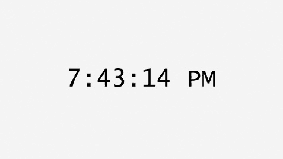

对 `Tick` 处理程序的调用发生在与用户界面其他部分相同的执行线程中，因此，如果程序正在该线程中忙于某些操作，调用将不会中断工作，并可能变得有些不规则，甚至跳过几个节拍。在多页面应用程序中，你可能希望在 `OnNavigatedTo` 覆盖中启动计时器，并在 `OnNavigatedFrom` 中停止它，以避免程序在页面不可见时浪费时间工作。

这很好地说明了 Windows 应用程序与 Metro 风格应用程序在更新视频显示方面的区别。这类应用程序都使用计时器来实现时钟，但 Metro 风格应用程序并不是通过使窗口内容无效来每秒绘制和重绘文本，而是通过简单更改现有元素的一个属性来改变其视觉外观。

你可以将 `DispatcherTimer` 的间隔设置到你想要的任何低值，但得到的 `Tick` 处理程序调用不会比视频显示的帧率快，帧率可能是 60 Hz，大约是 17 毫秒一个周期。当然，比帧率更快地更新视频是没有意义的。按照帧率精确更新显示可以给你尽可能流畅的动画。如果你想以这种方式执行动画，不要使用 `DispatcherTimer`。更好的选择是静态的 `CompositionTarget.Rendering` 事件，它专门设计用于在屏幕刷新之前调用。

比 `CompositionTarget.Rendering` 更好的是 Windows Runtime 提供的所有动画类。这些类允许你在 XAML 或代码中定义动画，它们有许多选项，并且其中一些是在后台线程执行的。

但在我介绍动画类之前（甚至可能在介绍之后）——`CompositionTarget.Rendering` 事件仍然非常适合执行动画。这些有时被称为“手动”动画，因为程序本身必须根据所过的时间进行一些计算。

这里有一个名为 ExpandingText 的小项目，它在 `CompositionTarget.Rendering` 事件处理程序中更改 `TextBlock` 的 `FontSize`，使文本变大变小。XAML 文件仅实例化了一个 `TextBlock`：

示例 3-21. 项目：ExpandingText | 文件：BlankPage.xaml (节选)

```
<Grid Background="{StaticResource ApplicationPageBackgroundBrush}">
    <TextBlock Name="txtblk"
               Text="Hello, Windows 8!"
               HorizontalAlignment="Center"
               VerticalAlignment="Center" />
</Grid>
```

在代码后台文件中，构造函数通过简单设置一个事件处理程序启动了 `CompositionTarget.Rendering` 事件。该处理器的第二个参数定义为 `object` 类型，但它实际上是 `RenderingEventArgs` 类型，该类型有一个类型为 `TimeSpan` 的 `RenderingTime` 属性，可以给你自应用启动以来的已时间：

示例 3-22. 项目：ExpandingText | 文件：BlankPage.xaml.cs (节选)

```
public sealed partial class BlankPage : Page
{
    public BlankPage()
    {
        this.InitializeComponent();
        CompositionTarget.Rendering += OnCompositionTargetRendering;
    }

    void OnCompositionTargetRendering(object sender, object args)
    {
        RenderingEventArgs renderArgs = args as RenderingEventArgs;
        double t = (0.25 * renderArgs.RenderingTime.TotalSeconds) % 1;
        double scale = t < 0.5 ? 2 * t : 2 - 2 * t;
        txtblk.FontSize = 1 + scale * 143;
   }
}
```

我尝试对这段代码稍微泛化。`t` 的计算导致它在 4 秒内反复从 0 增加到 1。在同样的 4 秒内，`scale` 的值从 0 变为 1 再回到 0，因此 `FontSize` 的范围从 1 到 144 然后回到 1。（代码确保了 `FontSize` 永远不会被设置为零，否则会抛出异常。）当你运行此程序时，可能会看到一点抖动，因为字体需要以不同的大小进行栅化。但一旦进入节奏，它是相当流畅的。

也可以动画颜色，我将向你展示两种不同的方法。第二种方法比第一种更好，但我想在这里说明一点，所以这里是 ManualBrush 项目的 XAML 文件：

示例 3-23. 项目：ManualBrush | 文件：BlankPage.xaml (节选)

```
<Grid Name="contentGrid">
    <TextBlock Name="txtblk"
               Text="Hello, Windows 8!"
               FontFamily="Times New Roman"
               FontSize="96"
               FontWeight="Bold"
               HorizontalAlignment="Center"
               VerticalAlignment="Center" />
</Grid>
```

`Grid` 和 `TextBlock` 都没有定义画笔。基于动画颜色创建这些画笔是 `CompositionTarget.Rendering` 事件的工作：

示例 3-24. 项目：ManualBrush | 文件：BlankPage.xaml.cs (节选)

```
public sealed partial class BlankPage : Page
{
    public BlankPage()
    {
        this.InitializeComponent();
        CompositionTarget.Rendering += OnCompositionTargetRendering;
    }

    void OnCompositionTargetRendering(object sender, object args)
    {
        RenderingEventArgs renderingArgs = args as RenderingEventArgs;
        double t = (0.25 * renderingArgs.RenderingTime.TotalSeconds) % 1;
        t = t < 0.5 ? 2 * t : 2 - 2 * t;

        // Background
        byte gray = (byte)(255 * t);
        Color clr = Color.FromArgb(255, gray, gray, gray);
        contentGrid.Background = new SolidColorBrush(clr);

        // Foreground
        gray = (byte)(255 - gray);
        clr = Color.FromArgb(255, gray, gray, gray);
        txtblk.Foreground = new SolidColorBrush(clr);
    }
}
```

当 `Grid` 的背景颜色从黑色变为白色再返回时，`TextBlock` 的前景颜色从白色变为黑色再返回，在中间位置汇合。

这种效果不错，但请注意以视频显示的帧率（大约每秒 60 次）创建了两个 `SolidColorBrush` 对象，而这些对象很快就会被丢弃。这是没有必要的。好得多的方法是在 XAML 文件中创建两个 `SolidColorBrush` 对象：

示例 3-25. 项目：ManualColorAnimation | 文件：BlankPage.xaml (节选)


```xml
<Grid>
    <Grid.Background>
        <SolidColorBrush x:Name="gridBrush" />
    </Grid.Background>

    <TextBlock Text="Hello, Windows 8!"
               FontFamily="Times New Roman"
               FontSize="96"
               FontWeight="Bold"
               HorizontalAlignment="Center"
               VerticalAlignment="Center">
        <TextBlock.Foreground>
            <SolidColorBrush x:Name="txtblkBrush" />
        </TextBlock.Foreground>
    </TextBlock>
</Grid>
```

这些 `SolidColorBrush` 对象在整个程序运行期间都存在，并且被赋予了名称以便在 `CompositionTarget.Rendering` 处理器中轻松访问：

示例 3-26. 项目：ManualColorAnimation | 文件：`BlankPage.xaml.cs`（节选）

```cs
void OnCompositionTargetRendering(object sender, object args)
{
    RenderingEventArgs renderingArgs = args as RenderingEventArgs;
    double t = (0.25 * renderingArgs.RenderingTime.TotalSeconds) % 1;
    t = t < 0.5 ? 2 * t : 2 - 2 * t;

    // 背景
    byte gray = (byte)(255 * t);
    gridBrush.Color = Color.FromArgb(255, gray, gray, gray);

    // 前景
    gray = (byte)(255 - gray);
    txtblkBrush.Color = Color.FromArgb(255, gray, gray, gray);
}
```

起初，这看起来可能没什么区别，因为两个 `Color` 对象正以视频帧率不断地创建并丢弃。但在这里使用“对象”（objects）一词是不准确的，因为 `Color` 是一个结构体（struct）而不是类。更准确的说法是 `Color` 的“值”（values）。这些 `Color` 值存储在栈上，而不是需要从堆（heap）上进行内存分配。

尽可能避免频繁的堆内存分配，特别是当这些分配每秒发生 60 次时。但我最喜欢这个例子的一点是，`SolidColorBrush` 对象在 Windows Runtime 组合系统中保持存活的想法。这个程序实际上是深入到了该组合层，并更改了画笔的一个属性，使其能够以不同的方式进行渲染。

该程序还展示了依赖属性（dependency properties）的奇妙之处。依赖属性的设计是为了以非常结构化的方式响应变化。正如你将发现的，Windows Runtime 内置的动画设施只能于依赖属性，而使用 `CompositionTarget.Rendering` 的“手动”动画也具有几乎相同的限制。幸运的是，`TextBlock` 的 `Foreground` 属性和 `Grid` 的 `Background` 属性都是类型为 `Brush` 的依赖属性，而 `SolidColorBrush` 的 `Color` 属性一个依赖属性。

事实上，每当你遇到依赖属性时，你都会问自己：“我如何对它做动画？”例如，`GradientStop` 类中的 `Offset` 属性就是一个依赖属性，你可以对它进行动画来实现一些有趣的效果。

这里是 RainbowEight 项目的 XAML 文件：

示例 3-27. 项目：RainbowEight | 文件：`BlankPage.xaml`（节选）

```xml
<Grid Background="{StaticResource ApplicationPageBackgroundBrush}">
    <TextBlock Name="txtblk"
               Text="8"
               FontFamily="CooperBlack"
               FontSize="1"
               HorizontalAlignment="Center">
        <TextBlock.Foreground>
            <LinearGradientBrush x:Name="gradientBrush">
                <GradientStop Offset="0.00" Color="Red" />
                <GradientStop Offset="0.14" Color="Orange" />
                <GradientStop Offset="0.28" Color="Yellow" />
                <GradientStop Offset="0.43" Color="Green" />
                <GradientStop Offset="0.57" Color="Blue" />
                <GradientStop Offset="0.71" Color="Indigo" />
                <GradientStop Offset="0.86" Color="Violet" />
                <GradientStop Offset="1.00" Color="Red" />
                <GradientStop Offset="1.14" Color="Orange" />
                <GradientStop Offset="1.28" Color="Yellow" />
                <GradientStop Offset="1.43" Color="Green" />
                <GradientStop Offset="1.57" Color="Blue" />
                <GradientStop Offset="1.71" Color="Indigo" />
                <GradientStop Offset="1.86" Color="Violet" />
                <GradientStop Offset="2.00" Color="Red" />
            </LinearGradientBrush>
        </TextBlock.Foreground>
    </TextBlock>
</Grid>
```

其中许多 `GradientStop` 对象的 `Offset` 值大于 1，因此它们是可见的。此外，`TextBlock` 本身也不会很明显，因为它的 `FontSize` 为 1。然而，在 `Loaded` 事件期间，`Page` 类获取了那个微小 `TextBlock` 的 `ActualHeight` 并将其保存在字段中。然后它开始启动一个 `CompositionTarget.Rendering` 事件：

示例 3-28. 项目：RainbowEight | 文件：`BlankPage.xaml.cs`（节选）

```csharp
public sealed partial class BlankPage : Page
{
    double txtblkBaseSize;  // 即，针对 1 像素的 FontSize

    public BlankPage()
    {
        this.InitializeComponent();
        Loaded += OnPageLoaded;
    }

    void OnPageLoaded(object sender, RoutedEventArgs e)
    {
        txtblkBaseSize = txt.ActualHeight;
        CompositionTarget.Rendering += OnCompositionTargetRendering;
    }

    void OnCompositionTargetRendering(object sender, object args)
    {
        // 设置尽可能大的字号
        txt.FontSize = this.ActualHeight / txtblkBaseSize;

        // 计算从 0 到 1 的 t
        RenderingEventArgs renderingArgs = args as RenderingEventArgs;
        double t = (0.25 * renderingArgs.RenderingTime.TotalSeconds) % 1;

        // 遍历 GradientStop 对象
        for (int index = 0; index < gradientBrush.Stops.Count; index++)
            gradientBrush.Stops[index].Offset = index / 7.0 - t;
    }
}
```

其中许多 `GradientStop` 对象的 `Offset` 值大于 1，因此它们将是可见的。此外，`TextBlock` 本身也不会很明显，因为它的 `FontSize` 为 1。然而，在 `Loaded` 事件期间，`Page` 类获取了那个微小 `TextBlock` 的 `ActualHeight` 并将其保存在字段中。然后它开始启动一个 `CompositionTarget.Rendering` 事件：

在 `CompositionTarget.Rendering` 处理器中，`TextBlock` 的 `FontSize` 根据 `ActualHeight` 增加。它不会是整个页的高度，因为 `TextBlock` 的 `ActualHeight` 包含了声部和变调符号的空间，但它会达到方便的大小，并且随着屏幕方向的而改变。


这些 `Panel` 派类是 Windows Runtime 动态布局系统的核心。当页面的尺寸或方向发生变化时，面板可以重新排列其子元素以优化填充可用空间。每种面板排列子元素的方式不同。例如，`Grid` 以行和列的形式排列子元素。`StackPanel` 以水平或垂直方向堆叠子元素。`VariableSizedWrapGrid` 同样水平或垂直方向堆叠子元素，但在必要时会使用额外的行或列，类似于 Windows 8 的开始屏幕。`Canvas` 则允许子元素定位于特定的像素位置。

使布局系统变得复杂的原因在于平衡父元素和子元素之间冲突的需求。在某种程度上，布局系统需要是“子驱动”的，即每个子元素都应该允许决定自己需要多大，并为其获取足够的屏幕空间。但布局系统也需要是“父驱动”的。任何时候，页面的尺寸都是固定的，不能为其视觉树中的后代提供超过其可用的空间。

例如，一个简单的 HTML 页面的宽度是父级驱动的，因为它受到视频显示器或浏览器窗口宽度的限制。然而，页面的高度是子驱动的，因为它取决于页面的内容。如果该高度超过浏览器窗口的高度，则需要滚动条。

Windows 8 开始屏幕则是相反的：垂直方向可以容纳的应用磁片数量是父级驱动的，因为它基于屏幕的高度。此磁片显示器的宽度是子驱动的。如果磁片在水平方向超出屏幕，则必须通过滚动将其移动到视图中。

## Border（边界）元素

与布局相关的最重要的两个属性是 `HorizontalAlignment` 和 `VerticalAlignment`。这些属性由 `FrameworkElement` 定义，并设置为具有相同名称的枚举成员：`HorizontalAlignment` 和 `VerticalAlignment`。

正如你在第 3 章”中看到的，`HorizontalAlignment` 和 `VerticalAlignment` 的默认值不是 `Left` 和 `Top`。它们是 `HorizontalAlignment.Stretch` 和 `VerticalAlignment.Stretch`。这些默认的 `Stretch` 设置意味着父级驱动布局：元素会自动拉伸以变得与父元素一样大。这在视觉上并不总是明显的，但在最后一章中，你已经看到一个 `TextBlock` 如何拉伸到其父元素的大小，从而获取该父元素内任何位置的 `Tapped` 事件。

当 `HorizontalAlignment` 或 `VerticalAlignment` 属性被设置为 `Stretch` 以外的值时，元素将根据其内容设置自己的宽度或高度，布局变得变得更加子驱动。

当你开始向页面添加更多父元素和子元素时，`HorizontalAlignment` 和 `VerticalAlignment` 的重要作用也变得显而易见。例如，假设在一个带有边框的 `TextBlock`。你可能会发现（可能有些沮丧）`TextBlock` 没有与边框相关的属性。然而，`Windows.UI.Xaml.Controls` 命名空间包含一个具有 `Child` 属性的 `Border` 元素。因此，你将 `TextBlock` 放入 `Border` 中，并将 `Border` 放入 `Grid` 中，如下：

示例 4-1. 项目：NaiveBorderedText | 文件：BlankPage.xaml（节选）

```
<Page ... >

    <Grid Background="{StaticResource ApplicationPageBackgroundBrush}">

        <Border BorderBrush="Red"
                BorderThickness="12"
                CornerRadius="24"
                Background="Yellow">

            <TextBlock Text="Hello Windows 8!"
                       FontSize="96"
                       Foreground="Blue"
                       HorizontalAlignment="Center"
                       VerticalAlignment="Center" />
        </Border>

    </Grid>
</Page>
```

`Border` 定义的 `BorderThickness` 属性可以为四边设置不同的值。只需按照左、上、右、下的顺序指定四个不同的值即可。如果你只指定两个值，第一个应用于左和右，第二个应用于上和下。`CornerRadius` 属性定义了顶角的曲率。你可以将其设置为一个统一的值，或按照左上、右上、右下、左下的顺序设置四个不同的值。

注意设置在 `TextBlock` 上的 `HorizontalAlignment` 和 `VerticalAlignment` 属性。标记代码看起来很合理，但结果可能不是你想要的：

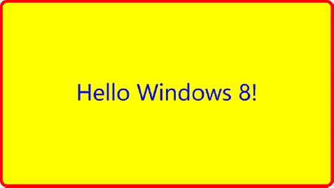

由于 `Border` 派生自 `FrameworkElement`，它也拥有 `HorizontalAlignment` 和 `VerticalAlignment` 属性，它们的默认值为 `Stretch`，这会导致 `Border` 的尺寸被拉伸到其父元素的大小。为了得到你可能想要的效果，你需要将 `HorizontalAlignment` 和 `VerticalAlignment` 的设置从 `TextBlock` 移动到 `Border`：

示例 4-2. 项目：BetterBorderedText | 文件：BlankPage.xaml（节选）

```
<Grid Background="{StaticResource ApplicationPageBackgroundBrush}">

    <Border BorderBrush="Red"
            BorderThickness="12"
            CornerRadius="24"
            Background="Yellow"
            HorizontalAlignment="Center"
            VerticalAlignment="Center">

        <TextBlock Text="Hello Windows 8!"
                   FontSize="96"
                   Foreground="Blue"
                   Margin="24" />
    </Border>

</Grid>
```

我还通过设置 `TextBlock` 的 `Margin` 属性为其添加了四分之一英寸的边距。这导致 `Border` 在四个方向上都比文本尺寸大四分之一英寸：

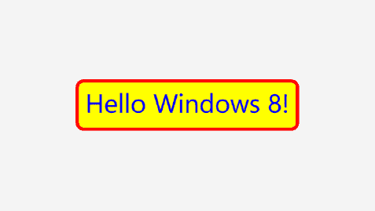

`Margin` 属性由 `FrameworkElement` 定义，因此每个元素可用。该属性的类型为 `Thickness`（与 `BorderThickness` 属性的类型相同）——一个具有 `Left`、`Top`、`Right` 和 `Bottom` 属性的结构。`Margin` 非常有助于定义元素周围的留白，防止它们相互挤压，在实际 XAML 中经常出现。与 `BorderThickness` 一样，`Margin` 可能四个不同的值。在 XAML 中，它们按照左、上、右、下的顺序出现。指定两个值，第一个应用于左和右，第二个应用于上和下。

此外，`Border` 定义了 `Padding` 属性，它与 `Margin` 相似，但适用于元素的内部而不是外部。尝试移除 `TextBlock` 的 `Margin` 属性，而改为在 `Border` 上设置 `Padding`：

```
<Border BorderBrush="Red"
        BorderThickness="12"
        CornerRadius="24"
        Background="Yellow"
        HorizontalAlignment="Center"
        VerticalAlignment="Center"
        Padding="24">

    <TextBlock Text="Hello Windows 8!"
               FontSize="96"
               Foreground="Blue" />
</Border>
```

结果是相同的。在任何情况下，`TextBlock` 上的任何 `HorizontalAlignment` 或 `VerticalAlignment` 设置现在都是无关的。

对于布局目的而言，`Margin` 被视为元素尺寸的一部分，但在其他方面它完全不受元素的控制。例如，元素无法控制其边距的背景颜色。该颜色取决于元素的父元素。元素也不会从边距区域获取用户输入。如果你点击元素的边距区域，元素的*父元素*会接收 `Tapped` 事件。

`Padding` 属性同样是 `Thickness` 类型，但只有少数类定义了 `Padding` 属性：`Control`、`Border`、`TextBlock`、`RichTextBlock` 和 `RichTextBlockOverflow`。`Padding` 属性定义了元素*内部*的区域。该区域在所有用途（包括用户输入）中都被视为元素的一部分。


如果你希望 `TextBlock` 不仅对文本本身的点击响应，还对文本周围 100 像素的区域响应，请将 `TextBlock` 的 `Padding` 属性设置为 100，而不是 `Margin` 属性。

## 矩形与椭圆

正如你在第 2 章中看到的，`Windows.UI.Xaml.Shapes` 命名空间包含了用于渲染矢量图形的类：直线、曲线和填充区域。`Shape` 类本身派自 `FrameworkElement` 并定义了各种属性，包括 `Stroke`（用于指定渲染直线和曲线的画刷）、`StrokeThickness` 和 `Fill`（用于指定渲染封闭区域的画刷）。

有六个类派自 `Shape`。`Line`、`Polyline` 和 `Polygon` 根据坐标点渲染直线，而 `Path` 则使用 `Windows.UI.Xaml.Media` 中的一系列类来渲染一系列直线、弧和贝塞尔曲线（Bezier curves）。

另外两个派自 `Shape` 的类是 `Rectangle` 和 `Ellipse`。尽管名字看起来很直观，但这些元素实际上很奇特，因为它们在定义图形时不使用坐标点。例如，这是一段渲染椭圆的小型 XAML 代码：

示例 4-3. 项目：SimpleEllipse | 文件：BlankPage.xaml (节选)

```
<Grid Background="{StaticResource ApplicationPageBackgroundBrush}">
    <Ellipse Stroke="Red"
             StrokeThickness="24"
             Fill="Blue" />
</Grid>
```

注意椭圆是如何填充其容器的：

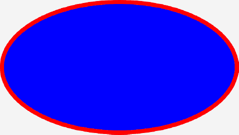

与其他所有 `FrameworkElement` 派生类一样，`Ellipse` 默认的 `HorizontalAlignment` 和 `VerticalAlignment` 设置为 `Stretch`，但 `Ellipse` 最直观地揭示了这些设置的影响。

如果你在这个 `Ellipse` 元素上设置非默认的 `HorizontalAlignment` 或 `VerticalAlignment` 会发生什么？尝试一下吧！椭圆缩小到完全消失。它不见了。事实上，很难想象它如何能合法地产生其他行为。如果你不希望 `Ellipse` 或 `Rectangle` 元素填充容器，你唯一的实际选择是为它们设置显式的 `Height` 和 `Width` 值。

`Shape` 类还定义了一个 `Stretch` 属性，这与 `Image` 定义的 `Stretch` 属性相似。例如，在 SimpleEllipse 程序中，如果你将 `Stretch` 属性设置为 `Uniform`，你将得到一个特殊的椭圆，其水平和垂直半径相等。这是一个圆，它的直径被设置为容器宽度和高度中的最小值。将 `Stretch` 属性设置为 `UniformToFill` 同样会得到圆，但此时直径是容器宽度和高度的*最大值*，因此圆的一部分会被裁剪：

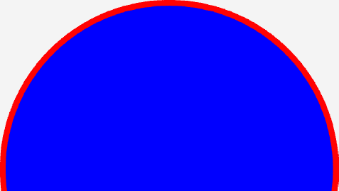

你可以通过 `HorizontalAlignment` 和 `VerticalAlignment` 属性来控制哪些部分被裁剪。

`Rectangle` 与 `Ellipse` 非常相似，并且与 `Border` 具有几个共同特征，尽管属性的名称不同：

| Border | Rectangle |
| --- | --- |
| BorderBrush | Stroke |
| BorderThickness | StrokeThickness |
| Background | Fill |
| CornerRadius | RadiusX / RadiusY |

`Border` 和 `Rectangle` 之间的主要区别在于 `Border` 有一个 `Child` 属性，而 `Rectangle` 没有。

## StackPanel

`Panel` 及其派生类构成了 Windows Runtime 布局系统的核心。`Panel` 本身只定义了一些属性，但其中之一是 `Children`，这是至关重要的。`Panel` 的派生类是唯一支持多个子元素的类型。

该类层次结构显示了 `Panel` 及其的一些派生类：

* `Object`
* `DependencyObject`
* `UIElement`
* `FrameworkElement`
* `Panel`
* `Canvas`


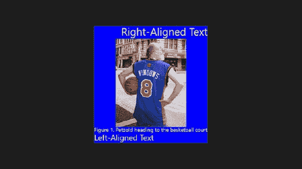

## 水平堆栈

也可以通过将 `StackPanel` 的 `Orientation` 属性设置为 `Horizontal` 来将元素水平堆叠。`SimpleHorizontalStack` 程序展示了一个示例：

示例 4-5. 项目: SimpleHorizontalStack | File: BlankPage.xaml (节选)

```
<Grid Background="{StaticResource ApplicationPageBackgroundBrush}">

    <StackPanel Orientation="Horizontal"
                VerticalAlignment="Center"
                HorizontalAlignment="Center">

        <TextBlock Text="Rectangle: "
                   VerticalAlignment="Center" />

        <Rectangle Stroke="Blue"
                   Fill="Red"
                   Width="72"
                   Height="72"
                   Margin="12 0"
                   VerticalAlignment="Center" />

        <TextBlock Text="Ellipse: "
                   VerticalAlignment="Center" />

        <Ellipse Stroke="Red"
                 Fill="Blue"
                 Width="72"
                 Height="72"
                 Margin="12 0"
                 VerticalAlignment="Center" />

        <TextBlock Text="Petzold: "
                   VerticalAlignment="Center" />

        <Image Source="http://www.charlespetzold.com/pw6/PetzoldJersey.jpg"
               Stretch="Uniform"
               Width="72"
               Margin="12 0"
               VerticalAlignment="Center" />

    </StackPanel>
</Grid>
```

如下所示：

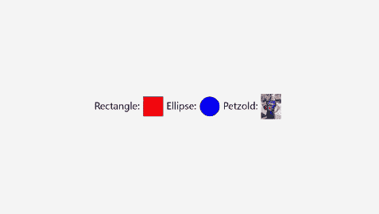

你可能会对这些看似多余的对齐设置产生疑问。尝试移除所有的 `VerticalAlignment` 和 `HorizontalAlignment` 设置，结果如下：

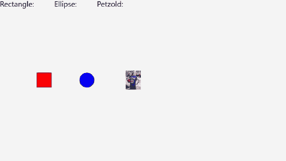

现在 `StackPanel` 占据了整个页面，每个单独的元素都占据了 `StackPanel` 的全高。`Panel.TextBlock` 自身对齐在顶部，而其他元素位于居中。将 `Panel` 的 `HorizontalAlignment` 和 `VerticalAlignment` 设置为 `Center` 可以收紧该面板占据的空间并将其移动到显示中心，如下：

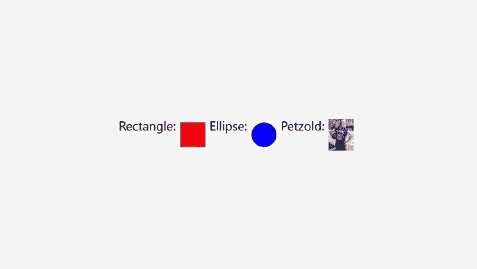

现在 `StackPanel` 的高度由其最高元素的高度决定，但所有元素都被拉伸到了该高度。要让所有元素相对于彼此居中，最简单的方法是给它们都设置 `Center` 的 `VerticalAlignment` 属性。

## 带绑定的 WhatSize（以及转换器）

在第 3 章 中，我讨论了为什么 `WhatSize` 程序无法适应数据绑定，因为 `Run` 类中的 `Text` 属性不是依赖属性（dependency property）。只有依赖属性才能作为数据绑定的目标。幸运的是，对于单行文本，你可以在水平 `StackPanel` 中用多个 `TextBlock` 元素模拟多个 `Run` 对象。这里是 `WhatSizeWithBindings`：

示例 4-6. 项目: WhatSizeWithBindings | File: BlankPage.xaml (节选)

```
<Page
    x:Class="WhatSizeWithBindings.BlankPage"
    ...
    FontSize="36"
    Name="page">

    <Grid Background="{StaticResource ApplicationPageBackgroundBrush}">
        <StackPanel Orientation="Horizontal"
                    HorizontalAlignment="Center"
                    VerticalAlignment="Top">
            <TextBlock Text="&#x21A4; " />
            <TextBlock Text="{Binding ElementName=page, Path=ActualWidth}" />
            <TextBlock Text=" pixels &#x21A6;" />
        </StackPanel>

        <StackPanel HorizontalAlignment="Center"
                    VerticalAlignment="Center">
            <TextBlock Text="&#x21A5;" TextAlignment="Center" />

            <StackPanel Orientation="Horizontal"
                        HorizontalAlignment="Center">
                <TextBlock Text="{Binding ElementName=page, Path=ActualHeight}" />
                <TextBlock Text=" pixels" />
            </StackPanel>

            <TextBlock Text="&#x21A7;" TextAlignment="Center" />
        </StackPanel>
    </Grid>
</Page>
```

注意，根元素现在被赋予了名称 `page`，在两个数据绑定中引用了它，以获取 `ActualWidth` 和 `ActualHeight` 属性。与之前的版本相比，巨大的优势是不再需要在后台代码文件（code-behind file）中有事件处理程序。如下：


不吗？你不喜欢它精确到百万分之一像素吗？

问题在于，`ActualWidth` 和 `ActualHeight` 是 `double` 值，当这些值转换为 `TextBlock` 的 `Text` 属性所需的字符串时，有时会发生这种情况。

在这种情况下，可以为 `Binding` 对象提供一小段代码，以便按照你精确的方式执行数据转换。`Binding` 类有一个名为 `Converter` 的属性，类型为 `IValueConverter`，该接口包含两个方法：`Convert`（用于从绑定源转换为绑定目标）和 `ConvertBack`（用于在双向绑定中从目标转换回源）。

要创建自定义转换器，你需要实现 `IValueConverter` 接口并填充这两个方法。以下是一个显示这两个方法什么都不做的示例：

```
public class NothingConverter : IValueConverter
{
    public object Convert(object value, Type targetType, object parameter, string language)
    {
        return value;
    }

    public object ConvertBack(object value, Type targetType, object parameter, string language)
    {
        return value;
    }
}
```

如果你只使用单向绑定，则可以忽略 `ConvertBack` 方法。在 `Convert` 方法中，`value` 参数是来自源的值。在 WhatSize 示例中，这是一个 `double`。`TargetType` 是目标的类型——在 WhatSize 示例中是 `string`。

如果你专门为 WhatSize 编写绑定转换器，将浮点数转换为没有小数点的字符串，`Convert` 方法可以简单如：

```
（注：此处原文未提供具体代码块，但逻辑通常为 `ToString("F0")` 类似推断）
```

但泛化绑定转换器更为常见。例如，转换器处理实现 `IFormattable` 接口的任何类型的 `value` 参数可能会有用，这包含了 `double` 以及所有其他数值类型和 `DateTime`。`IFormattable` 接口定义了 `ToString` 方法，带有两个参数：格式字符串和一个实现 `IFormatProvider` 的对象（通常是 `CultureInfo` 对象）。

除了 `value` 和 `targetType`，`Convert` 方法还有 `parameter` 和 `language` 参数。这些来自 `Binding` 类的两个属性，名为 `ConverterParameter` 和 `ConverterLanguage`，它们通常直接在 XAML 文件中设置。这意味着 `ToString` 的格式规范可以通过 `Convert` 的 `parameter` 参数提供，并且可以从 `language` 参数创建 `CultureInfo` 对象。以下是可能的一种：

示例 4-7. 项目: WhatSizeWithBindingConverter | File: FormattedStringConverter.cs


` 之后似乎不完整（包含了大量的代码块但结尾未闭合），我将根据您提供的文本内容进行了对应的翻译。

以下是针对您提供内容的翻译：

[content]

```c
using System;
using System.Globalization;
using Windows.UI.Xaml.Data;

namespace WhatSizeWithBindingConverter
{
    public class FormattedStringConverter : IValueConverter
    {
        public object Convert(object value, Type targetType, object parameter, string language)
        {
            if (value is IFormattable &&
                parameter is string &&
                !String.IsNullOrEmpty(parameter as string) &&
                targetType == typeof(string))
            {
                if (String.IsNullOrEmpty(language))
                    return (value as IFormattable).ToString(parameter as string, null);

                return (value as IFormattable).ToString(parameter as string,
                                                        new CultureInfo(language));
            }

            return value;
        }
        public object ConvertBack(object value, Type targetType, object parameter, string language)
        {
            return value;
        }
    }
}
```

`Convert` 方法仅在满足若干个条件时才会使用 `ToString`。如果不满足条件，则备选方案是直接返回输入的 `value` 参数。

在 XAML 文件中，绑定转换器通常被定义为资源，以便其可以在多个绑定之间共享：

示例 4-8. 项目：WhatSizeWithBindingConverter | 文件：BlankPage.xaml（节选）

```xml
<Page
    x:Class="WhatSizeWithBindingConverter.BlankPage"
    ...
    FontSize="36"
    Name="page">

    <Page.Resources>
        <local:FormattedStringConverter x:Key="stringConverter" />
    </Page.Resources>

    <Grid Background="{StaticResource ApplicationPageBackgroundBrush}">
        <StackPanel Orientation="Horizontal"
                    HorizontalAlignment="Center"
                    VerticalAlignment="Top">
            <TextBlock Text="&#x21A4; " />
            <TextBlock Text="{Binding ElementName=page,
                                      Path=ActualWidth,
                                      Converter={StaticResource stringConverter},
                                      ConverterParameter=F0}" />
            <TextBlock Text=" pixels &#x21A6;" />
        </StackPanel>

        <StackPanel HorizontalAlignment="Center"
                    VerticalAlignment="Center">
            <TextBlock Text="&#x21A5;" TextAlignment="Center" />

            <StackPanel Orientation="Horizontal"
                        HorizontalAlignment="Center">
                <TextBlock Text="{Binding ElementName=page,
                                          Path=ActualHeight,
                                          Converter={StaticResource stringConverter},
                                          ConverterParameter=F0}" />
                <TextBlock Text=" pixels" />
            </StackPanel>

            <TextBlock Text="&#x21A7;" TextAlignment="Center" />
        </StackPanel>
    </Grid>
</Page>
```

显示效果与第 3 章”中的原始 WhatSize 程序完全一样。请注意这里的语法：

```xml
<TextBlock Text="{Binding ElementName=page,
                          Path=ActualWidth,
                          Converter={StaticResource stringConverter},
                          ConverterParameter=F0}" />
```

`Binding` 标记扩展跨越四行编写（为了清晰起见并符合书页边距），但请注意，`Binding` 标记扩展包含了一个嵌入的 `StaticResource` 标记扩展，用于引用绑定转换器资源。在两个标记扩展内部都没有出现引号。

标准 Visual Studio 项目中的 Common 文件夹包含两个绑定转换器。`BooleanToVisibilityConverter` 有助于控制 `Visibility` 属性，该属性接受 `Visibility.Visible` 和 `Visibility.Collapsed` 值。`BooleanNegationConverter` 则将 `true` 更改为 `false`，将 `false` 更改为 `true`。

## ScrollViewer 解决方案

如果元素过多，`StackPanel` 无法在屏幕上显示全部内容会发生什么？在现实生活中，这种情况经常发生，这就是为什么包含超过几个元素的 `StackPanel` 几乎总是被放在 `ScrollViewer` 内部。

`ScrollViewer` 有一个名为 `Content` 的属性，你可以将其设置为任何可能大到在允许空间内无法显示的内容——例如，单张巨大的 `Image`。`ScrollViewer` 为使用鼠标的用户提供了滚动条。否则，你也可以用手指滑动。默认情况下，`ScrollViewer` 还会添加缩放界面，以便你可以使用两根手指使内容放大或缩小。如果你认为需要，可以通过将 `ZoomMode` 属性设置为 `Disabled` 来禁用它。

`ScrollViewer` 定义了其他几个关键属性。你通常会使用 `ScrollViewer` 进行垂直滚动，例如配合垂直 `StackPanel`。因此，`VerticalScrollBarVisibility` 属性的默认值是枚举成员 `ScrollBarVisibility.Visible`。此设置并不意味着滚动条实际上一直可见。对于鼠标用户，只有当鼠标移动到 `ScrollViewer` 的右侧时，滚动条才会出现，当鼠标移开时它会淡出。当你用手指滚动时，会出现一个细得得的滑块。

水平滚动则不同：`HorizontalScrollBarVisibility` 属性的默认值为 `Disabled`，因此你可能需要更改它以启用水平滚动。另外两个选项是 `Hidden`（允许手指滑动但不支持鼠标滚动）和 `Auto`（如果内容需要滚动则等同于 `Visible`，否则等同于 `Disabled`）。

StackPanelWithScrolling 程序的 XAML 文件中包含一个位于 `ScrollViewer` 中的 `StackPanel`。注意，`FontSize` 属性是在根标签中根据预定义的标识符设置的：

示例 4-9. 项目：StackPanelWithScrolling | 文件：BlankPage.xaml（节选）

```xml
<Page
    x:Class="StackPanelWithScrolling.BlankPage"
    ...
    FontSize="{StaticResource HeaderMediumFontSize}">

    <Grid Background="{StaticResource ApplicationPageBackgroundBrush}">
        <ScrollViewer>
            <StackPanel Name="stackPanel" />
        </ScrollViewer>
    </Grid>
</Page>
```

现在，后置代码文件中只需要为 `StackPanel` 生成大量的元素，以至于它们无法同时显示。我们从哪里获取这么多元素？一个方便的解决方案是使用 .NET 反射来获取 `Colors` 类中定义的 141 个静态 `Color` 属性：

示例 4-10. 项目：StackPanelWithScrolling | 文件：BlankPage.xaml.cs（节选）

```csharp
public sealed partial class BlankPage : Page
{
    public BlankPage()
    {
        this.InitializeComponent();

        IEnumerable<PropertyInfo> properties =
                                typeof(Colors).GetTypeInfo().DeclaredProperties;

        foreach (PropertyInfo property in properties)
        {
            Color clr = (Color)property.GetValue(null);
            TextBlock txtblk = new TextBlock();
            txtblk.Text = String.Format("{0} \x2014 {1:X2}-{2:X2}-{3:X2}-{4:X2}",
                                        property.Name, clr.A, clr.R, clr.G, clr.B);
            stackPanel.Children.Add(txtblk);
        }
    }
}
```


Windows 8 反射机制与 .NET 反射略有不同。通常，要从 `Type` 对象中获取任何有趣的内容，你需要调用 Windows 8 扩展方法 `GetTypeInfo`。返回的 `TypeInfo` 对象提供了关于该 `Type` 的额外信息。在该程序中，`TypeInfo` 的 `DeclaredProperties` 属性以 `PropertyInfo` 对象的格式获取 `Colors` 类的所有属性。由于 `Colors` 类中的所有属性都是静态的，可以通过在每个 `PropertyInfo` 对象上调用带有 `null` 参数的 `GetValue` 来获取这些静态属性的值。每个 `TextBlock` 获得颜色名称、一个破折号（Unicode 0x2014）以及十六进制颜色字节。显示效果如下：

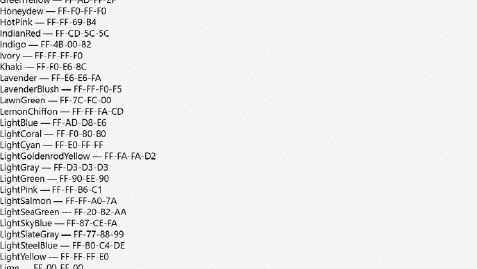

当然，你还可以用手指或鼠标对其进行滚动。

当你玩这个程序时，你会发现 `ScrollViewer` 对你的手指移动具有良好的流体响应，包括惯性和回弹效果。你可能希望几乎所有的滚动需求都使用 `ScrollViewer`。你会发现，许多包含滚动功能的控件——例如后续章节中出现的 `ListBox` 和 `GridView`——都内置了这种相同的 `ScrollViewer`。如果 Windows 8 的启动屏幕也使用了同样的 `ScrollViewer`，我将不会感到。

如果能同时看到真实的颜色以及它们的名称和值，那不是很好吗？这项增强很快就会出现！

在书中我已经多次向你展示了部分类层次结构。你可能已经发现，每个类的文档只显示祖先类层次结构，而不显示派生类，因此你可能想知道我是如何组合这些页面的类层次结构的。它们来自我写的一个名为 `DependencyObjectClassHierarchy` 的程序，该程序使用 `ScrollViewer` 和 `StackPanel` 来显示所有派自 `DependencyObject` 的类。

XAML 文件与上一个类似，只是我指定了较小的字体：

示例 4-11. 项目：DependencyObjectClassHierarchy | 文件：BlankPage.xaml（节选）

```
<Page
    x:Class="DependencyObjectClassHierarchy.BlankPage"
    ...
    FontSize="{StaticResource ContentFontSize}">

    <Grid Background="{StaticResource ApplicationPageBackgroundBrush}">
        <ScrollViewer>
            <StackPanel Name="stackPanel" />
        </ScrollViewer>
    </Grid>
</Page>
```

该程序构建了一个类及其后代类的树。每个节点都是一个特定的类及其直接后代类的集合，因此我为项目添加了另一个代码文件，用于表示此节点的类：

示例 4-12. 项目：DependencyObjectClassHierarchy | 文件：ClassAndSubclasses.cs

```cs
using System;
using System.Collections.Generic;

namespace DependencyObjectClassHierarchy
{
    class ClassAndSubclasses
    {
        public ClassAndSubclasses(Type parent)
        {
            this.Type = parent;
            this.Subclasses = new List<ClassAndSubclasses>();
        }

        public Type Type { protected set; get; }
        public List<ClassAndSubclasses> Subclasses { protected set; get; }
    }
}
```

正如可以使用反射来获取类定义的所有属性一样，你也可以使用反射来获取程序集中定义的所有公共类。这些类可以通过 `Assembly` 对象的 `ExportedTypes` 属性获取。这部分很简单。难点在于获取你所需的所有 `Assembly` 对象。

从概念上讲，Windows Runtime 中的每个命名空间都与同名的程序集相关。如果你知道某个类定义在特定的程序集中，那么可以通过该类的 `TypeInfo` 对象的 `Assembly` 属性获取该类所在的程序集。

为了编写这个程序，我必须弄清楚哪些命名空间包含了派自 `DependencyObject` 的类，然后从这些命名空间中的每个选出一个示例类。这就是这里一长串 `AddToClassList` 的目的（我无法保证找全了所有的）：

示例 4-13. 项目：DependencyObjectClassHierarchy | 文件：BlankPage.xaml.cs（节选）


```cs
public sealed partial class BlankPage : Page
{
    Type rootType = typeof(DependencyObject);
    TypeInfo rootTypeInfo = typeof(DependencyObject).GetTypeInfo();
    List<Type> classes = new List<Type>();
    Brush highlightBrush;

    public BlankPage()
    {
        this.InitializeComponent();
        highlightBrush = this.Resources["ControlHighlightBrush"] as Brush;

        // 累所有派生自 DependencyObject 的类
        AddToClassList(typeof(Windows.UI.Xaml.DependencyObject));
        AddToClassList(typeof(Windows.UI.Xaml.Automation.Peers.AppBarAutomationPeer));
        AddToClassList(typeof(Windows.UI.Xaml.Automation.Provider.IRawElementProviderSimple));
        AddToClassList(typeof(Windows.UI.Xaml.Controls.Button));
        AddToClassList(typeof(Windows.UI.Xaml.Controls.Primitives.ButtonBase));
        AddToClassList(typeof(Windows.UI.Xaml.Data.Binding));
        AddToClassList(typeof(Windows.UI.Xaml.Documents.Block));
        AddToClassList(typeof(Windows.UI.Xaml.Input.FocusManager));
        AddToClassList(typeof(Windows.UI.Xaml.Media.Brush));
        AddToClassList(typeof(Windows.UI.Xaml.Media.Animation.BackEase));
        AddToClassList(typeof(Windows.UI.Xaml.Media.Imaging.BitmapImage));
        AddToClassList(typeof(Windows.UI.Xaml.Printing.PrintDocument));
        AddToClassList(typeof(Windows.UI.Xaml.Shapes.Ellipse));

        // 按名称字母顺序排序
        classes.Sort((t1, t2) =>
            {
                return String.Compare(t1.GetTypeInfo().Name, t2.GetTypeInfo().Name);
            });

        // 将这些排序后的类放入树结构中
        ClassAndSubclasses rootClass = new ClassAndSubclasses(rootType);
        AddToTree(rootClass, classes);

        // 使用添加到 StackPanel 中的 TextBlock 显示该树
        Display(rootClass, 0);
    }

    void AddToClassList(Type sampleType)
    {
        Assembly assembly = sampleType.GetTypeInfo().Assembly;

        foreach (Type type in assembly.ExportedTypes)
        {
            TypeInfo typeInfo = type.GetTypeInfo();

            if (typeInfo.IsPublic && rootTypeInfo.IsAssignableFrom(typeInfo))
                classes.Add(type);
        }
    }

    void AddToTree(ClassAndSubclasses parentClass, List<Type> classes)
    {
        foreach (Type type in classes)
        {
            Type baseType = type.GetTypeInfo().BaseType;

            if (baseType == parentClass.Type)
            {
                ClassAndSubclasses subClass = new ClassAndSubclasses(type);
                parentClass.Subclasses.Add(subClass);
                AddToTree(subClass, classes);
            }
        }
    }

    void Display(ClassAndSubclasses parentClass, int indent)
    {
        TypeInfo typeInfo = parentClass.Type.GetTypeInfo();

        // 创建带有类名的 TextBlock
        TextBlock txtblk = new TextBlock();
        txtblk.Inlines.Add(new Run { Text = new string(' ', 8 * indent) });
        txtblk.Inlines.Add(new Run { Text = typeInfo.Name });

        // 明类是否被密封
        if (typeInfo.IsSealed)
            txtblk.Inlines.Add(new Run
                {
                    Text = " (sealed)",
                    Foreground = highlightBrush
                });

        // 明类是否无法实例化
        IEnumerable<ConstructorInfo> constructorInfos = typeInfo.DeclaredConstructors;
        int publicConstructorCount = 0;

        foreach (ConstructorInfo constructorInfo in constructorInfos)
            if (constructorInfo.IsPublic)
                publicConstructorCount += 1;

        if (publicConstructorCount == 0)
            txtblk.Inlines.Add(new Run
            {
                Text = " (non-instantiable)",
                Foreground = highlightBrush
            });

        // 添加到 StackPanel
        stackPanel.Children.Add(txtblk);

        // 对所有子类递归调用此方法
        foreach (ClassAndSubclasses subclass in parentClass.Subclasses)
            Display(subclass, indent + 1);
    }
}
```

注意每个每个类的 `TextBlock` 是通过向其 `Inlines` 集合添加 `Run` 项目构建的。对于类层次结构来说，显示额外信息有时是有用的，因此程序还会检查类是否被标记为 `sealed` 以及它是否可以实例化。在 Windows Presentation Foundation 和 Silverlight 中，无法实例化的类通常定义为 `abstract`。而在 Windows Runtime 中，它们拥有保护的构造函数。

这里是包含 `Panel` 派生类的类层次结构部分：


布局异常还是正常？

假设你有一个 `StackPanel`，并且你决定这个 `StackPanel` 中的一个项目应该是带有另一个 `StackPanel` 的 `ScrollViewer`。为了确定在这种情况下可能会发生什么，你可以尝试 `StackPanelWithScrolling` 项目并如下更改 XAML 文件：

```xml
<Grid Background="{StaticResource ApplicationPageBackgroundBrush}">
    <StackPanel>
        <ScrollViewer>
            <StackPanel Name="stackPanel" />
        </ScrollViewer>
    </StackPanel>
</Grid>
```

当你尝试它时，你会发现它不起作用。发生了什么？

熟悉布局机制是成为一名熟练 Windows Runtime 开发者的重要部分，这里的冲突源于 `StackPanel` 和 `ScrollViewer` 计算所需高度的方式。在垂直维度上（默认情况下），`StackPanel` 完全是由子类驱动的。为了计算总高度，它向子类提供无限高度。（当你编写自己的 `Panel` 派生类时，你会发现我并不是在比喻或抽象。`Double.PositiveInfinity` 值实际上起了作用！）子类根据其自然尺寸计算期望高度。`StackPanel` 相加这些高度来计算自己的期望高度。

然而，`ScrollViewer` 的高度是由父级驱动的。它的高度仅取决于父级提供的高度，在我们简单的示例中，这是 `Grid` 的高度，即 `Page` 的高度，即窗口的高度。`ScrollViewer` 能够确定如何滚动内容，因为它知道子类（通常是 `StackPanel`）与其自身高度之间的差异。

现在将一个垂直滚动的 `ScrollViewer` 垂直 `StackPanel` 的子项。为了确定这个 `ScrollViewer` 子类的期望大小，`StackPanel` 向它提供无限高度。`ScrollViewer` 到底想要多高？`ScrollViewer` 的高度现在是由子类驱动而非父级驱动的，它的期望高度是子类的高度，即内部 `StackPanel` 的高度，即该 `StackPanel` 中所有子项的累计高度。这将在未来的章节讨论。

换句话说，当把垂直滚动的 `ScrollViewer` 放在垂直 `StackPanel` 中时，失去滚动功能是完全预期行为！

这是另一个看起来异常但其实很正常的布局现象：尝试给 `TextBlock` 提供一段非常长的文本进行显示，并将 `TextWrapping` 属性设置为 `Wrap`。在大多数情况下，文本会像我们预期的那样换行。现在将该 `TextBlock` 放入 `Orientation` 属性设置为 `Horizontal` 的 `StackPanel` 中。为了确定 `TextBlock` 需要多宽，`StackPanel` 向它提供无限宽度，而由于这种无限宽度，`TextBlock` 停止换行文本。


在 `WhatSizeWithBindings` 和 `WhatSizeWithBindingConverter` 中，你已经看到了水平 `StackPanel` 如何有效地拼接 `TextBlock` 元素，其中一个元素在 `Text` 属性上有一个绑定。但你不能对具有自动换行文本的段落使用相同的技术，因为文本在水平 `StackPanel` 中永远不会换行。如果你需要在一个段落中拼接不同的文本字符串，你需要使用一个带有 `Inlines` 集合的单个 `TextBlock`。如果某部分文本需要设置为变量数据项，你无法使用绑定，因为 `Run` 的 `Text` 属性没有由依赖属性（dependency property）支持。你需要从代码中设置该项。

由于垂直 `StackPanel` 具有有限的宽度，它是能够换行文本的 `TextBlock` 元素的理想宿主，正如接下来将看到的那样。

## 制作电子书

放入垂直 `StackPanel` 的 `TextBlock` 元素可以将其 `TextWrapping` 属性设置为 `Wrap`，这意味着它实际上是一个完整的段落，而不仅仅是一个词或两个词。`Image` 元素也可以放入同一个 `StackPanel`，结果可以是一本初级的插图电子书。

在著名的古登堡计划网站上，我找到了贝特丽克斯·波特（Beatrix Potter）经典儿童书《小猫汤的故事》（*The Tale of Tom Kitten*）的插图版（[`www.gutenberg.org/ebooks/14837`](http://www.gutenberg.org/ebooks/14837)），所以我创建了一个名为 `TheTaleOfTomKitten` 的 Visual Studio 项目，并创建一个 Images 。从古登堡计划的书籍 HTML 版本中，很容易以 JPEG 格式下载所有插图。这些文件名类似于 `tomxx.jpg`，其中 `xx` 是该插图出现的书籍原始页码。在 Visual Studio 项目中，我随后将这 28 个 JPEG 文件全部添加到 `Images` 文件夹中。

其余大部分工作涉及 `BlankPage.xaml` 文件。书的每个段落变成一个 `TextBlock`，我在它们之间穿插了引用 `Images` 文件夹中 JPEG 文件的 `Image` 元素。

然而，我认为有必要稍微偏离古登堡计划 HTML 文件中文字和图片的顺序。互联网存档（Internet Archive）网站上《小猫汤的故事》原版的 PDF（[`archive.org/details/taleoftomkitten00pottuoft`](http://archive.org/details/taleoftomkitten00pottuoft)）揭示了波特小姐的插图是如何与书籍文本相关的。这里有两种模式：

1. 文本出现在反页（左侧，偶数页），对应的正页（右侧，奇数页）上配有伴随的插图。
2. 文本出现在正页上，对应的反页配有伴随的插图。

将这本有页码的书适配为连续格式，需要更改第二种情况下文本和图像的顺序，使文本出现在伴随的插图*之前*。这就是为什么你会在 XAML 文件中看到一些页面的交换。

鉴于大量的 `TextBlock` 和 `Image` 元素，样式（styles）似乎是必不可少的：

示例 4-14。项目：`TheTaleOfTomKitten` | 文件：`BlankPage.xaml`（节选）

```xml
<Page.Resources>
    <Style x:Key="commonTextStyle" TargetType="TextBlock">
        <Setter Property="FontFamily" Value="Century Schoolbook" />
        <Setter Property="FontSize" Value="36" />
        <Setter Property="Foreground" Value="Black" />
        <Setter Property="Margin" Value="0 12" />
    </Style>

    <Style x:Key="paragraphTextStyle" TargetType="TextBlock"
           BasedOn="{StaticResource commonTextStyle}">
        <Setter Property="TextWrapping" Value="Wrap" />
    </Style>

    <Style x:Key="frontMatterTextStyle" TargetType="TextBlock"
           BasedOn="{StaticResource commonTextStyle}">
        <Setter Property="TextAlignment" Value="Center" />
    </Style>

    <Style x:Key="imageStyle" TargetType="Image">
        <Setter Property="Stretch" Value="None" />
        <Setter Property="HorizontalAlignment" Value="Center" />
    </Style>
</Page.Resources>
```

注意 `Margin` 值，它在段落之间提供了一小的间距。每个 `TextBlock` 元素引用 `paragraphTextStyle`（用于书籍的实际段落）或 `frontMatterTextStyle`（用于书前的所有标题和其他信息）。我可以通过简单地删除 `x:Key` 属性并从 `Image` 元素删除 `Style` 属性，将 `Image` 元素的样式变为隐式样式。

组成前部分的许多 `TextBlock` 元素具有各种本地 `FontSize` 设置。书籍通常在白纸上用黑色墨水打印，因此我将 `TextBlock` 的 `Foreground` 硬编码为黑色，并将 `Grid` 的 `Background` 设置为白色。为了限制文本在合理的行长度内，给 `StackPanel` 分配 640 的 `MaxWidth` 并在 `ScrollViewer` 中居中。这里是交替的 `TextBlock` 元素和 `Image` 元素的一个小片段：

示例 4-15。项目：`TheTaleOfTomKitten` | 文件：`BlankPage.xaml`（节选）

```xml
<Grid Background="White">
    <ScrollViewer>
        <StackPanel MaxWidth="640"
                    HorizontalAlignment="Center">
            ...
            <!-- pg. 38 -->
            <TextBlock Style="{paragraphTextStyle}">
                Mittens laughed so that she fell off the
                wall. Moppet and Tom descended after her; the pinafores
                and all the rest of Tom's clothes came off the way down.
            </TextBlock>

            <TextBlock Style="{paragraphTextStyle}">
                "Come! Mr. Drake Puddle-Duck," said Moppet
                - "Come and help us dress him!"
            </TextBlock>

            <Image Source="Images/tom39.jpg" Style="{imageStyle}" />

            <!-- pg. 41 -->
            <TextBlock Style="{paragraphTextStyle}">
                Mr. Drake Puddle-Duck advanced in a slow
                sideways manner, and picked up the articles.
            </TextBlock>

            <Image Source="Images/tom40.jpg" Style="{imageStyle}" />
            ...
        </StackPanel>
    </ScrollViewer>
</Grid>
```

每个段落开头的两个 字符是全宽空格（em-spaces）。它们提供了首行缩进，遗憾的是这是 `TextBlock` 属性没有提供的。

你可以以横屏或竖屏模式阅读这本书：


## 更花哨的 StackPanel 元素

我之前提到将向你展示一个显示所有 Windows Runtime 可用颜色以及其名称和 RGB 值的程序。我的第一个示例命名为 `ColorList1`，但让我们先从完成程序的屏幕截图开始，这样你就能看到目标了：


该程序总共有 283 个 `StackPanel` 元素。141 种颜色中的每种颜色都有对 `StackPanel`：垂直 `StackPanel` 是两个 `TextBlock` 元素的父元素，水平 `StackPanel` 是 `Rectangle` 和垂直 `StackPanel` 的父元素。所有的水平 `StackPanel` 元素都是 `ScrollViewer` 中主垂直 `StackPanel` 的子元素。XAML 文件负责该 `StackPanel` 居中：

示例 4-16。项目：`ColorList1` | 文件：`BlankPage.xaml`（节选）

```xml
<Grid Background="{StaticResource ApplicationPageBackgroundBrush}">
    <ScrollViewer>
        <StackPanel Name="stackPanel"
                    HorizontalAlignment="Center" />
    </ScrollViewer>
</Grid>
```

在遍历 `Colors` 类的静态属性时，后代码文件中的构造函数为每个项构建了嵌套的 `StackPanel` 元素：

示例 4-17。项目：`ColorList1` | 文件：`BlankPage.xaml.cs`（节选）


```cs
public sealed partial class BlankPage : Page
{
    public BlankPage()
    {
        this.InitializeComponent();

        IEnumerable<PropertyInfo> properties = typeof(Colors).GetTypeInfo().DeclaredProperties;

        foreach (PropertyInfo property in properties)
        {
            Color clr = (Color)property.GetValue(null);

            StackPanel vertStackPanel = new StackPanel
            {
                VerticalAlignment = VerticalAlignment.Center
            };

            TextBlock txtblkName = new TextBlock
            {
                Text = property.Name,
                FontSize = 24
            };
            vertStackPanel.Children.Add(txtblkName);

            TextBlock txtblkRgb = new TextBlock
            {
                Text = String.Format("{0:X2}-{1:X2}-{2:X2}-{3:X2}",
                                     clr.A, clr.R, clr.G, clr.B),
                FontSize = 18
            };
            vertStackPanel.Children.Add(txtblkRgb);

            StackPanel horzStackPanel = new StackPanel
            {
                Orientation = Orientation.Horizontal
            };

            Rectangle rectangle = new Rectangle
            {
                Width = 72,
                Height = 72,
                Fill = new SolidColorBrush(clr),
                Margin = new Thickness(6)
            };
            horzStackPanel.Children.Add(rectangle);
            horzStackPanel.Children.Add(vertStackPanel);
            stackPanel.Children.Add(horzStackPanel);
        }
    }
}
```

现在，这段代码本身并没有什么问题，只是有很多更好的方法可以来实现。我所指的“更好”并不是指更快或更高效，而是更整洁、更优雅，而且最重要的是更易维护和修改。

让我们来看一个更好的解决方案，但请注意，在未来的章节之前，我不会完成这个示例，到时你不仅会看到更好的实现方法，还会看到*最佳*实现方法。

让这个程序变得更好的关键是在 XAML 中表达这些颜色项目——那些嵌套的 `StackPanel`、`TextBlock` 和 `Rectangle`。直看起来，这似乎是不可能的。我们无法将这段 XAML 放入 `BlankPage.xaml` 文件中，因为我们无法告诉 XAML 创建 141 个项目实例，除非我们真的粘贴 141 份副本，我怀疑大家都会认同那是*最糟糕*的方法。

`ColorList2` 程序展示了如何实现。在创建项目后，我在解决方案资源管理器中右键点击项目名称，选择“添加”（Add）和“新建项”（New Item）”。在“添加新建项”对话框中，我选择了“用户控件”（User Control）并将其命名为 `ColorItem.xaml`。这个过程会创建一对文件：

`ColorItem.xaml` 伴随着一个后代码文件 `ColorItem.xaml.cs`。

Visual Studio 创建的 `ColorItem.xaml.cs` 文件在 `ColorList2` 命名空间中定义了一个派自 `UserControl` 的 `ColorItem` 类：

```cs
namespace ColorList2
{
    public sealed partial class ColorItem : UserControl
    {
        public ColorItem()
        {
            this.InitializeComponent();
        }
    }
}
```

Visual Studio 创建的 `ColorItem.xaml` 文件用 XAML  same 相同的内容：

```xml
<UserControl
    x:Class="ColorList2.ColorItem"
    xmlns="http://schemas.microsoft.com/winfx/2006/xaml/presentation"
    xmlns:x="http://schemas.microsoft.com/winfx/2006/xaml"
    xmlns:local="using:ColorList2"
    xmlns:d="http://schemas.microsoft.com/expression/blend/2008"
    xmlns:mc="http://schemas.openxmlformats.org/markup-compatibility/2006"
    mc:Ignorable="d"
    d:DesignHeight="300"
    d:DesignWidth="400">

    <Grid>

    </Grid>
</UserControl>
```

你实际上已经见过 `UserControl` 类了，因为 `Page` 派自 `UserControl`。“用户”指的不是你应用程序的终端用户，而是指*你*，程序员。派自 `UserControl` 是你（程序员）创建自定义控件最简单的方法，因为你可以在这个 XAML 文件中定义控件的视觉效果。`UserControl` 定义了一个名为 `Content` 的属性，它也是该类的内容属性，所以你在 `UserControl` 标签内添加的任何内容都会设置此 `Content` 属性。

不用担心 `ColorItem.xaml` 文件中的 `d:DesignHeight` 和 `d:DesignWidth` 属性。那些是给 Microsoft Expression Blend 使用的。控件的实际大小取决于它的内容。

下一步是在这个 `ColorItem.xaml` 文件中定义颜色视觉视觉效果：示例 4-18。项目：`ColorList2` | 文件：`ColorItem.xaml`（节选）

```xml
<UserControl
    x:Class="ColorList2.ColorItem" ... >

    <Grid>
        <StackPanel Orientation="Horizontal">
            <Rectangle Name="rectangle"
                       Width="72"
                       Height="72"
                       Margin="6" />

            <StackPanel VerticalAlignment="Center">

                <TextBlock Name="txtblkName"
                           FontSize="24" />

                <TextBlock Name="txtblkRgb"
                           FontSize="18" />
            </StackPanel>
        </StackPanel>
    </Grid>
</UserControl>
```

它的元素层次结构与 ColorList1 在代码中定义的相同，但现在它变得可读了。`Rectangle` 和两个 `TextBlock` 元素都有名称，因此可以在后代码中引用它们：示例 4-19。项目：`ColorList2` | 文件：`ColorItem.xaml.cs`（节选）

```cs
public sealed partial class ColorItem : UserControl
{
    public ColorItem(string name, Color clr)
    {
        this.InitializeComponent();

        rectangle.Fill = new SolidColorBrush(clr);
        txtblkName.Text = name;
        txtblkRgb.Text = String.Format("{0:X2}-{1:X2}-{2:X2}-{3:X2}",
                                       clr.A, clr.R, clr.G, clr.B);
    }
}
```

后代码文件定义了一个接受颜色名称和 `Color` 值作为参数的构造函数。它使用这些参数设置 `Rectangle` 和两个 `TextBlock` 元素的属性。警告你，在 `UserControl` 派生类中定义带参数构造函数是非常*不寻常*的。一种更好的方法是定义属性，但现在不想这样做，因为这些属性应该是依赖属性，而现在那样做太复杂了。

没有无参数构造函数，这个 `ColorItem` 类无法在 XAML 中实例化。但对于这个程序来说没关系，因为我不会在 XAML 中实例化它。`ColorList2` 项目的 `BlankPage.xaml` 文件与 ColorList1 相同，不同的是后代码的简洁：示例 4-20。项目：`ColorList2` | 文件：`BlankPage.xaml.cs`（节选）

```cs
public sealed partial class BlankPage : Page
{
    public BlankPage()
    {
        this.InitializeComponent();

        IEnumerable<PropertyInfo> properties = typeof(Colors).GetTypeInfo().DeclaredProperties;

        foreach (PropertyInfo property in properties)
        {
            Color clr = (Color)property.GetValue(null);
            ColorItem clrItem = new ColorItem(property.Name, clr);
            stackPanel.Children.Add(clrItem);
        }
    }
}
```

每个 `ColorItem` 都用名称和 `Color` 进行实例化，然后添加到 `StackPanel` 中。

## 创建 Windows Runtime 库

让我们创建这个程序的另一个版本，但这次 `ColorItem` 类将位于一个可以与其他项目共享的库中。

你可以创建一个只包含一个库项目的 Visual Studio 解决方案，但对于新库来说，很少这样做。当你开发库代码时，你想测试它，因此在同一个解决方案中有一个应用程序项目真的非常有帮助。


让我们创建一个名为 `ColorList3` 的新应用程序项目。在解决方案资源管理器（Solution Explorer）中，右键点击解决方案名称，并选择 `Add`（添加）和 `New Project`（新建项目）（或者从 `File` 菜单中选择 `Add New Project`）。在“添加新项目”对话框中，在左侧选择 `Visual C#` 和 `Windows Metro Style`，然后在可用模板中选择 `Class Library`（类库）。

通常，一个库具有由点分隔的多级名称。此名称也成为该项目的默认命名空间。库的名称通常以公司名称（或等效名称）开头，在本示例中，我选择了 `Petzold.Windows8.Controls` 作为库名称。

在新的库中，Visual Studio 会自动创建一个名为 `Class1.cs` 的文件，但你可以将其删除。现在，右键点击库项目名称，选择 `Add`（添加）和 `New Item`（新建项），在“新建项”对话框中，选择 `User Control`（用户控件）并将其命名为 `ColorItem`。我决定对这个 `ColorItem` 的视觉效果稍微增强，超出你已经见过的部分：

示例 4-21。解决方案：ColorList3 | 项目：Petzold.Windows8.Controls | 文件：ColorItem.xaml（节选）

```
<UserControl ... >
    <Grid>
        <Border BorderBrush="{StaticResource ApplicationTextBrush}"
                BorderThickness="1"
                Width="336"
                Margin="6">

            <StackPanel Orientation="Horizontal">
                <Rectangle Name="rectangle"
                           Width="72"
                           Height="72"
                           Margin="6" />

                <StackPanel VerticalAlignment="Center">

                    <TextBlock Name="txtblkName"
                               FontSize="24" />

                    <TextBlock Name="txtblkRgb"
                               FontSize="18" />
                </StackPanel>
            </StackPanel>
        </Border>
    </Grid>
</UserControl>
```

注意，我给它提供了一个具有显式 `Width` 属性和 `Margin` 属性的 `Border`。我根据最长的颜色名称（`LightGoldenrodYellow`）经验选择了了这个宽度。同样注意，`BorderBrush` 被设置为一个预定义的标识符，它在浅色主题下为黑色，在深色主题下为白色。主题设置在应用程序而不是库上——事实上，库没有设置主题的 `App` 类——因此此刷将基于使用 `ColorItem` 的应用程序主题。

我们还没有触及 `ColorList3` 应用程序项目。尽管它们位于同一个解决方案中，但此应用程序项目需要对库的引用，因此右键点击 `ColorList3` 项目下的 `References`（引用）项，并选择 `Add Reference`（添加引用）。在“引用管理器”对话框中，在左侧选择 `Solution`（表示你想引用同一个解决方案中的程序集），点击 `Petzold.Windows8.Controls`，然后点击 `OK`。

将这两个项目都放在同一个解决方案中有一个明显的优势：每当你生成 `ColorList3` 时，如果 `Petzold.Windows8.Controls` 不是最新的，Visual Studio 也会重新生成。

`ColorList3` 中的 `BlankPage.xaml` 文件与之前的两个项目相同。代码后文件需要一个该库的 `using` 指令，除此之外它与 `ColorList2` 相同：

示例 4-22。项目：ColorList3 | File: BlankPage.xaml.cs

```
using System.Collections.Generic;
using System.Reflection;
using Windows.UI;
using Windows.UI.Xaml.Controls;
using Petzold.Windows8.Controls;

namespace ColorList3
{
    public sealed partial class BlankPage : Page
    {
        public BlankPage()
        {
            this.InitializeComponent();

            IEnumerable<PropertyInfo> properties =
                            typeof(Colors).GetTypeInfo().DeclaredProperties;

            foreach (PropertyInfo property in properties)
            {
                Color clr = (Color)property.GetValue(null);
                ColorItem clrItem = new ColorItem(property.Name, clr);
                stackPanel.Children.Add(clrItem);
            }
        }
    }
}
```

结果是结果：

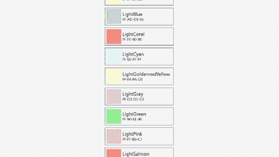

## Wrap 的替代方案

现在让我们在另一个项目中使用该库。有三种方法：

-   **方法 1**：向与现有库相同的解决方案中添加新的应用程序项目：在本示例中的 `ColorList3` 解决方案。这是最简单的方法，如果两个应用程序以某种方式相关，这显然是有意义的。

相反，我将使用另外两种方法之一。这两种方法都涉及创建一个新的解决方案和应用程序项目，我将其称为 `ColorWrap`。此项目需要对 `Petzold.Windows8.Control` 库的引用。

-   **方法 2**：右键点击 `ColorWrap` 项目中的 `References` 项，并选择 `Add Reference`。在 `Reference Manager` 对话框的左列中选择 `Browse`（浏览），然后点击右下角的 `Browse` 按钮。这将让你浏览到 `Petzold.Windows8.Controls.dll` 文件所在的目录位置（即 `ColorList3` 解决方案中 `Petzold.Windows8.Controls` 项目的 `bin/Debug` ），你可以选择该 `DLL`。

这种方法的缺点是你假设该库已经完成且不需要进行任何更改。你引用的是 `DLL` 而不是项目。然而，根据我的经验，这种方法真正的缺点是它在涉及 XAML 文件时在当前的 Windows 8 版本中工作得并不好。

这就留下了：

**方法 3**：在 `ColorWrap` 解决方案中，右键点击解决方案名称并选择 `Add Existing Project`（添加现有项目）。你想添加的现有项目是库。在“添加现有项目”对话框中，导航到 `Petzold.Windows8.Controls.csproj` 文件。这是由 `ColorList3` 解决方案维护的 C# 项目文件。选择它。库并没有被复制！而是创建了引用。无论如何，Visual Studio 仍然可以确定库是否需要重新生成，并在需要时执行生成。

现在 `Petzold.Windows8.Controls` 项目是 `ColorWrap` 解决方案的一部分，但 `ColorWrap` 应用程序项目仍然需要对库的引用。右键点击 `ColorWrap` 项目下的 `References` 部分，从解决方案中选择库，就像你在 `ColorList3` 中做的那样。

你可能运行着两个 Visual Studio 实例，可能加载了 `ColorList3` 和 `ColorWrap` 解决方案，它们都允许你对 `Petzold.Windows8.Controls` 库进行更改。只要在做出更改后保存或编译，通常都是没问题的。如果同一个文件在两个 Visual Studio 实例中打开并且你对该文件进行了更改，另一个 Visual Studio 实例会在文件保存到磁盘时通知你。

在完成准备工作之后，让我们关注 `Wrap` 程序，它展示了如何使用 `VariableSizedWrapGrid` 面板显示这些颜色。与 `StackPanel` 类似，`VariableSizedWrapGrid` 有一个 `Orientation` 属性，适用于 `Vertical`。`Children` 集合中的第一个项目显示在列中。区别在于 `VariableSizedWrapGrid` 将使用多列，就像 Windows 8 开始屏幕一样。这意味着默认的 `VariableSizedWrapGrid` 必须水平滚动，因此必须相应设置 `ScrollViewer` 属性。这是 XAML 文件：

示例 4-23。项目：ColorWrap | 文件 BlankPage.xaml（节选）
```


```xml
<Grid Background="{StaticResource ApplicationPageBackgroundBrush}">
    <ScrollViewer HorizontalScrollBarVisibility="Visible"
                  VerticalScrollBarVisibility="Disabled">
        <VariableSizedWrapGrid Name="wrapPanel" />
    </ScrollViewer>
</Grid>
```

后代码文件（code-behind file）与之前的程序类似，不同在于现在它将项放入 `wrapPanel` 中：

示例 4-24. 项目：ColorWrap | 文件：`BlankPage.xaml.cs`（节选）

```cs
public sealed partial class BlankPage : Page
{
    public BlankPage()
    {
        this.InitializeComponent();

        IEnumerable<PropertyInfo> properties = typeof(Colors).GetTypeInfo().DeclaredProperties;

        foreach (PropertyInfo property in properties)
        {
            Color clr = (Color)property.GetValue(null);
            ColorItem clrItem = new ColorItem(property.Name, clr);
            wrapPanel.Children.Add(clrItem);
        }
    }
}
```

这是结果：

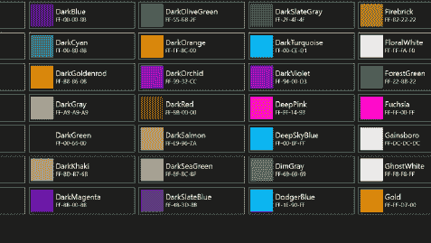

## Canvas 和附加属性

我在本章中讨论的最后一个 `Panel` 派类是 `Canvas`。从某种意义上说，`Canvas` 是最“传统”的面板，因为它允许你在精确的像素位置放置元素。然而，如果你搜索了 `UIElement` 和 `FrameworkElement` 定义的属性以寻找名为 `Location`、`Position` 或 `X` 或 `Y` 的属性，你会发现并没有。这种属性不存在，因为它没有通用适用性。我们一直不需要指定像素位置来定位元素，只有当元素是 `Canvas` 的子元素时才需要它。

因此，`Canvas` 定义了用于相对于自身定位元素的属性。这些是非常特殊的属性，被称为“附加属性”（attached properties），它们是依赖属性（dependency properties）的一个子集。由一个类（在本例中 `Canvas`）定义的附加属性实际上设置在其他类的实例上（在本例中为 `Canvas` 的子元素）。设置附加属性的对象不需要知道该属性的作用，或者它源自何处。

让我们看看它是如何运作的。`TextOnCanvas` 项目有一个 XAML 文件，在标准 `Grid` 内部包含一个 `Canvas`。（你也可以将 `Grid` 替换为 `Canvas`）。`Canvas` 包含三个 `TextBlock` 子元素：

示例 4-25. 项目：TextOnCanvas | 文件：`BlankPage.xaml`（节选）

```xml
<Page
    x:Class="TextOnCanvas.BlankPage"
    ...
    FontSize="48">

    <Grid Background="{StaticResource ApplicationPageBackgroundBrush}">
        <Canvas>
            <TextBlock Text="Text on Canvas at (0, 0)"
                       Canvas.Left="0"
                       Canvas.Top="0" />

            <TextBlock Text="Text on Canvas at (200, 100)"
                       Canvas.Left="200"
                       Canvas.Top="100" />

            <TextBlock Text="Text on Canvas at (400, 200)"
                       Canvas.Left="400"
                       Canvas.Top="200" />
        </Canvas>
    </Grid>
</Page>
```

这是（相当平淡的）结果：

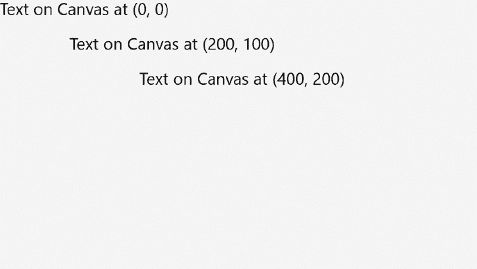

再次查看该标记，特别注意这种奇怪的语法：

```xml
<TextBlock Text="Text on Canvas at (200, 100)"
           Canvas.Left="200"
           Canvas.Top="100" />
```

从名称来看，`Canvas.Left` 和 `Canvas.Top` 属性似乎是由 `Canvas` 类定义的，但它们被设置在 `Canvas` 的子元素上以指示它们的位置。此类带有类和属性名的属性始终是附加属性。

有趣的是，`Canvas` 并没有定义任何名为 `Left` 和 `Top` 的属性！它定义了名称相似的属性和方法，但并不相同。

通过检查它们在代码中是如何设置的，这些附加属性的本质可能会变得清晰。`TapAndShowPoint` 程序的 XAML 文件在标准 `Grid` 中仅包含命名的 `Canvas`：

示例 4-26. 项目：TapAndShowPoint | 文件：`BlankPage.xaml`（节选）

```xml
<Grid Background="{StaticResource ApplicationPageBackgroundBrush}">
    <Canvas Name="canvas" />
</Grid>
```

其他所有内容都由后代码负责。它重写了 `OnTapped` 方法创建一个点（实际上是一个 `Ellipse` 元素）和一个 `TextBlock`，并将将这两者都添加到屏幕点击位置的 `Canvas` 中：

示例 4-27. 项目：TapAndShowPoint | 文件：`BlankPage.xaml.cs`（节选）

```cs
public sealed partial class BlankPage : Page
{
    public BlankPage()
    {
        this.InitializeComponent();
    }

    protected override void OnTapped(TappedRoutedEventArgs args)
    {
        Point pt = args.GetPosition(this);

        // 创建点
        Ellipse ellipse = new Ellipse
        {
            Width = 3,
            Height = 3,
        };

        // 创建文本
        TextBlock txtblk = new TextBlock
        {
            Text = String.Format("({0})", pt),
            FontSize = 24,
        };

        Canvas.SetLeft(ellipse, pt.X);
        Canvas.SetTop(ellipse, pt.Y);
        canvas.Children.Add(ellipse);

        Canvas.SetLeft(txtblk, pt.X);
        Canvas.SetTop(txtblk, pt.Y);
        canvas.Children.Add(txtblk);

        args.Handled = true;
        base.OnTapped(args);
    }
}
```

当你点击屏幕时，点和文本就会出现：


`Canvas` 还定义了 `GetLeft` 和 `GetTop` 方法：

```cpp
public static double GetLeft(DependencyObject element)
{
    return (double)element.GetValue(LeftProperty);
}
public static double GetTop(DependencyObject element)
{
    return (double)element.GetValue(TopProperty);
}
```

`Canvas` 类在内部使用这些方法来获取每个子元素的左侧和顶部设置，以便在布局处理过程中对它们进行定位。

你可能记得 `SetValue` 和 `GetValue` 方法是由 `DependencyObject` 定义的，它是 Windows Runtime 中一个非常基础的类。像 `FontSize` 这样的属性实际上是通过静态依赖属性定义的：

```sharp
public double FontSize
{
    set { SetValue(FontSizeProperty, value); }
    get { return (double)GetValue(FontSizeProperty); }
}
```

静态的 `SetLeft`、`SetTop`、`GetLeft` 和 `GetTop` 方法表明依赖属性系统涉及某种字典。`SetValue` 方法允许如 `Canvas.LeftProperty` 这样的附加属性存储在对该属性及其用途一无所知的元素中。`Canvas` 随后可以检索此属性，以确定子元素相对于自身出现的位置。

## Z-Index

`Canvas` 有第三个附加属性，你可以在 XAML 中使用属性 `Canvas.ZIndex` 进行设置。`ZIndex` 中的“Z”指的是三维坐标系，其中 Z 轴从屏幕向用户方向延伸。

当兄弟元素重叠时，它们通常按照它们在视觉树中出现的顺序显示，这意味着面板 `Children` 集合中前面的元素可能会被 `Children` 集合中后面的元素覆盖。例如，考虑以下情况：

```xml
<Grid>
    <TextBlock Text="Blue Text" Foreground="Blue" FontSize="96" />
    <TextBlock Text="Red Text" Foreground="Red" FontSize="96" />
</Grid>
```

红色文本遮挡了部分蓝色文本。

你可以通过 `Canvas.ZIndex` 附加属性覆盖这种行为，奇的地方在于：它适用于所有的面板，而不只是 `Canvas`。要让蓝色文本显示在红色文本之上，给它一个更高的 z-index：

```xml
<Grid>
    <TextBlock Text="Blue Text" Foreground="Blue" FontSize="96" Canvas.ZIndex="1" />
    <TextBlock Text="Red Text" Foreground="Red" FontSize="96" Canvas.ZIndex="0" />
</Grid>
```

## Canvas 的怪异

我描述的关于布局的大部分并不适用于 `Canvas`。`Canvas` 内部的布局始终是由子元素驱动的。`Canvas` 始终为其子元素提供无限的大小，这意味着每个子元素都设置自己的自然大小，而这就是子元素占据的空间。`HorizontalAlignment` 和 `VerticalAlignment` 设置对 `Canvas` 的子元素无效。同样，当 `Image` 是 `Canvas` 的子元素时，`Image` 的 `Stretch` 属性无效：`Image` 始终以其像素大小显示位图。除非给定显式的宽度高度，否则 `Rectangle` 和 `Ellipse` 在 `Canvas` 中会缩小为零。

尽管 `HorizontalAlignment` 和 `VerticalAlignment` 对 `Canvas` 的子元素无效，但设置在 `Canvas` 本身上时是有效的。对于其他面板，当你将对齐属性设置为 `Stretch` 以外的值时，面板将变得尽可能小，同时包含其子元素。然而，`Canvas` 则不同。将 `HorizontalAlignment` 和 `VerticalAlignment` 设置为 `Stretch` 以外的值，无论其子元素如何，`Canvas` 都会缩小到零。

即使 `Canvas` 缩小到零大小，其子元素的显示也不会受影响。从概念上说，`Canvas` 更像是一个参考点而不是容器。

你可以利用 `Canvas` 的这一特性来获得优势。例如，假设你尝试在一个明显对它太小的 `Grid` 中显示一个 `TextBlock`：

```xml
<Grid Width="200" Height="100">
    <TextBlock Text="Text in a Small Grid" FontSize="144" />
</Grid>
```

`TextBlock` 被裁剪到 `Grid` 的尺寸。你当然可以让 `Grid` 变得更大，但可能受限于这个 `Grid` 的大小，也许因为其他子元素。尽管如此，你仍然希望 `TextBlock` 与其他元素对齐，而不被裁剪到 `Grid`。

简单的解决方案是在 `Grid` 中放置一个 `Canvas`，并将 `TextBlock` 放在该 `Canvas` 中：

```xml
<Grid Width="200" Height="100">
    <Canvas>
        <TextBlock Text="Text in a Small Grid" FontSize="144" />
    </Canvas>
</Grid>
```

尽管 `Canvas` 现在被裁剪到 `Grid` 的大小，但 `TextBlock` 没有。`TextBlock` 仍然位于你想要的位置——与 `Grid` 的左上角对齐——但它现在在没有任何裁剪的情况下显示。

这是一种非常简单的技术，在需要它时非常有用。

# 第 5 章 控件交互

在书的早期，我将派自 `FrameworkElement` 的类和派自 `Control` 的类区分开来。我倾向于将 `FrameworkElement` 的派生类（如 `TextBlock` 和 `Image`）称为“元素”，以保持这种区别，但现在需要更深入的解释。

本章的标题可能暗示元素用于演示，而控件用于交互，但事实并非如此。`UIElement` 定义了所有针对触摸、鼠标、笔和键盘的用户输入事件，这意味着元素和控件一样可以与用户进行交互。

元素在布局、样式或数据绑定方面并不匮乏。`FrameworkElement` 类定义了布局属性，如 `Width`、`Height`、`HorizontalAlignment`、`VerticalAlignment` 和 `Margin`，以及 `Style` 属性和 `SetBinding` 方法。

## 控制的区别

从视觉和功能上来说，`FrameworkElement` 的派生类是原语——类似于原子——而 `Control` 的派生类是这些原语的组合，类似于分子。在许多情况下，`Button`是由 `Border` 和 `TextBlock` 构建的。`Slider` 由两个 `Rectangle` 元素和一个 `Thumb` 组成，`Thumb` 本身是一个由 `Rectangle` 构建的 `Control`。任何具有文本、位图或矢量图形之外视觉内容的几乎都是 `Control` 的派生类。

因此，`Control` 定义的最重要的属性之一是 `Template`。正如该属性允许你通过定义自己的视觉树来完全重新定义控件的外。重新定义 `Button` 有意义，因为例如你可能希望它是圆形的而不是矩形的，以便在应用程序栏中看起来正确。重新定义 `TextBlock` 或 `Image` 没有意义，因为除了文本或位图本身，你无法对其进行处理。如果你想向 `TextBlock` 或 `Image` *添加* 东西，你正在定义一个 `Control`，因为你正在构建一个包含元素原语视觉树。

尽管你可以从 `FrameworkElement` 派生自定义类，但对结果做不了什么。你无法为它提供任何视觉效果。但当你派自 `Control` 时，你可以通过在 XAML 中定义视觉树为你的类提供默认的视觉外观。


为了供派生类使用，`Control` 定义了一系列 `Control` 类本身不需要的属性。这些属性主要与 `TextBlock`（`CharacterSpacing`、`FontFamily`、`FontSize`、`FontStretch`、`FontStyle`、`FontWeight` 和 `Foreground`）以及 `Border`（`Background`、`BorderBrush`、`BorderThickness` 和 `Padding`）相关。并不是每个 `Control` 派生类都有文本或边框，但如果你在创建新控件或为现有控件创建新模板时需要这些属性，它们 同时也提供了 `HorizontalContentAlignment` 和 `VerticalContentAlignment` 两个新属性用于定义控件的视觉效果。

`Control` 派生类通常会定义一些自己的属性和事件。`Control` 派生类会处理来自指针、鼠标、手写笔和键盘的用户输入事件，并将这些输入转换为高级事件。例如，`ButtonBase` 类（所有按钮都派生自此）定义了 `Click` 事件。`Slider` 定义了 `ValueChanged` 事件，用于指示其 `Value` 属性的更改。`TextBox` 定义了 `TextChanged` 事件，用于指示其 `Text` 属性的更改。

事实证明，在现实生活中，`Control` 派生类确实与与用户的交互更多，因此本章的标题是准确的。为了方便处理用户输入，`Control` 提供了与 `UIElement` 定义的所有用户输入事件相对应的保护虚方法。例如，`UIElement` 定义了 `Tapped` 事件，但 `Control` 定义了保护虚方法 `OnTapped`。`Control` 还定义了一个 `IsEnabled` 属性，以便控件在输入当前不适用时避免用户输入，并定义了在属性更改时触发的 `IsEnabledChanged` 事件。这是 `Control` 实际定义的唯一公共事件。

控件具有“输入焦点”的想法在 Windows 8 中仍然适用。当一个控件具有输入焦点时，用户期望该特定控件获取大多数键盘事件。（当然，某些键盘事件，如 Windows 键，会超越输入焦点的限制。）为此目的，`Control` 定义了 `Focus` 方法，以及 `OnGotFocus` 和 `OnLostFocus` 虚方法。

与键盘焦点相关的是，即能够使用键盘 Tab 键在控件之间进行导航的想法。`Control` 通过定义 `IsTabStop`、`TabIndex` 和 `TabNavigation` 属性来实现这一点。

许多 `Control` 派生类位于 `Windows.UI.Xaml.Controls` 命名空间，但少数位于 `Windows.UI.Xaml.Controls.Primitives` 命名空间。后者命名空间通常保留给那些通常只作为其他控件部分的控件，但这只是建议而非限制。

大多数 `Control` 派生类直接派生自 `Control`，但有四个重要类派生自 `Control` 以定义自己的控件子类。它们是：

* `Object`
* `DependencyObject`
* `UIElement`
* `FrameworkElement`
* `Control`
* `ContentControl`
* `ItemsControl`
* `RangeBase`
* `UserControl`

`ContentControl`——`Button`、`ScrollViewer` 和 `AppBar` 等重要类都派生自此——似乎仅仅定义了一个类型为 `object` 的名为 `Content` 的属性。对于 `Button` 来说，这个 `Content` 属性就是你用来设置任何你想显示在 `Button` 内部的内容。通常情况下是文本或位图，但你也可以使用包含其他内容的面板。

有趣的是，`ContentControl` 的 `Content` 属性类型是 `object` 而不是 `UIElement`。这有充分理由。你实际上可以将几乎任何类型的对象作为 `Button` 的内容，并提供一个模板（视觉树的形式）来告诉 `Button` 如何显示这些内容。此功能并不常用于 `Button`，但被广泛用于 `ItemsControl` 派生类中的项目。我将在未来的章节中向你展示如何定义内容模板。

`ItemsControl` 是许多显示项目集合的控件的父类。在这里，你会找到熟悉的 `ListBox` 和 `ComboBox`，以及新的 Windows 8 控件 `GridView` 和 `ListView`。这是一个如此重要的控件类别，以后的整个章节将专门介绍它。

创建自定义控件有几种方法。最简单的方法是为控件定义 `Style`，但更广泛的视觉更改需要模板。在某些情况下，你可以派生自现有控件以为其添加一些功能，或者如果这些控件提供了某些功能，你可以派生自 `ContentControl` 或 `ItemsControl`。但创建自定义控件最的方法之一是派生自 `UserControl`。如果你想推广一个自定义库，则不会使用这种方法。

## 用于范围的 Slider

派生自 `Control` 的最后一个父类是 `RangeBase`，它有三个派生类：`ProgressBar`、`ScrollBar` 和 `Slider`。

其中哪一个不同？显然是 `ProgressBar`，它存在于此层次结构是为了继承 `RangeBase` 的几个属性：`Minimum`、`Maximum`、`SmallChange`、`LargeChange` 和 `Value`。在每个 `RangeBase` 控件中，`Value` 属性的值从 `Minimum` 到 `Maximum` 取 `double` 类型。对于 `ScrollBar` 和 `Slider`，当用户操作控件时，`Value` 属性会发生；对于 `ProgressBar`，`Value` 属性通过程序设置以指示长时间操作的进度。

`ProgressBar` 有一种不确定模式，用于显示一行横跨屏幕的点，但可用的还有 `ProgressRing`，它显示绕圆移动的一系列点。

在 Windows 四个世纪的演变中，`ScrollBar` 从它在控件层次中的高位置下滑，现在通常出现在 `ScrollViewer` 控件中。尝试实例化 Windows Runtime 版本的 `ScrollBar`，你甚至看不到它。如果你想使用 `ScrollBar`，你必须为它提供一个模板。像 `RangeBase` 一样，`ScrollBar` 定义在 `Windows.UI.Xaml.Controls.Primitives` 命名空间，表明这不是应用程序程序员通常使用的内容。

对于几乎所有涉及范围选择的应用，`ScrollBar` 都被 `Slider` 取代，而在触摸界面上，`Slider` 变得比任何时候都简单。在默认表现中，`Slider` 没有箭头。它只需跳转到你触摸 `Slider` 或拖动手指/鼠标对应的数值。

`Slider` 的 `Value` 属性可以通过程序或通过用户操作来更改。为了在 `Value` 属性更改时获取通知，请为 `ValueChanged` 事件附加事件处理程序，如 SliderEvents 项目所示：

示例 5-1. 项目：SliderEvents | 文件：BlankPage.xaml (节选)

```
<Grid Background="{StaticResource ApplicationPageBackgroundBrush}">
    <StackPanel>
        <Slider ValueChanged="OnSliderValueChanged" />

        <TextBlock HorizontalAlignment="Center"
                   FontSize="48" />

        <Slider ValueChanged="OnSliderValueChanged" />

        <TextBlock HorizontalAlignment="Center"
                   FontSize="48" />
    </StackPanel>
</Grid>
```


这里的两个 `Slider` 控件共享同一个事件处理程序。这个程序的设计思路是：每个 `Slider` 的当前 `Value` 都会由其下方的 `TextBlock` 显示。当你注意到此 XAML 文件中没有任何元素被分配名称时，这可能被认为具有挑战性。然而，事件处理程序做了一些假设。它假设 `Slider` 的父级是一个 `Panel`，并且该 `Panel` 中的下一个子元素是 `TextBlock`：

示例 5-2. 项目：SliderEvents | 文件：`BlankPage.xaml.cs` (节录)

```cs
void OnSliderValueChanged(object sender, RangeBaseValueChangedEventArgs args)
{
    Slider slider = sender as Slider;
    Panel parentPanel = slider.Parent as Panel;
    int childIndex = parentPanel.Children.IndexOf(slider);
    TextBlock txtblk = parentPanel.Children[childIndex + 1] as TextBlock;
    txtblk.Text = args.NewValue.ToString();
}
```

这种小“花技巧”仅仅是为了演示访问视觉树中元素的有多种方法。在最后一步中，将事件参数中的 `NewValue` 参数转换为字符串后，赋值给 `TextBlock` 的 `Text` 属性。使用 `Slider` 的 `Value` 属性同样有效：

```cs
txtblk.Text = slider.Value.ToString();
```

尽管 `RangeBaseValueChangedEventArgs` 继承自 `RoutedEvent`，但它并不是路由事件。该事件不会沿视觉树向上。`sender` 参数始终是 `Slider`，且事件参数的 `OriginalSource` 属性始终为 `null`。

当你运行程序时，你会发现 `TextBlock` 元素最初显示为空白。只有当 `Value` 实际上从其默认值 0 发生时，`ValueChanged` 事件才会触发。

当你触摸 `Slider` 或用鼠标点击它时，值会跳到该位置。然后你可以来滑动手指或鼠标指针来改变值。当你操作 `Slider` 控件时，你会发现它们允许你从 0 到 100（包含边界值）之间选择值：

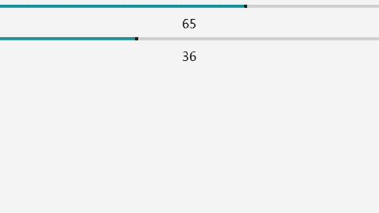

这个默认范围是 `Minimum` 和 `Maximum` 属性的默认值（分别为 0 和 100）的结果。尽管 `Value` 属性是 `double` 类型，但由于默认 `StepFrequency` 属性为 1，它会取整数值。

默认情况下 `Slider` 是水平方向的，但你可以通过 `Orientation` 属性切换到垂直方向。滑块区域的高度无法更改（除非你使用模板重新定义视觉效果）。控件在布局中的总高度包含稍多空间。在布局中，水平 `Slider` 的默认高度为 60 像素；垂直 `Slider` 的默认宽度为 45 像素。在实际使用中，这些尺寸对于触摸操作是足够的。

在程序运行时，反复按下 Tab 键，你可以将键盘输入焦点从一个 `Slider` 切换到另一个，然后使用键盘方向键使值增大或减少。按下 `Home` 和 `End` 键可以快速跳转到最小值和最大值。

图中展示了一些其他变体，其中逻辑包含在 XAML 中：

示例 5-3. 项目：SliderBindings | 文件：`BlankPage.xaml.cs` (节录)

```xml
<Grid>
    <Grid.Resources>
        <Style TargetType="TextBlock">
            <Setter Property="FontSize" Value="48"/>
            <Setter Property="HorizontalAlignment" Value="Center"/>
        </Style>
    </Grid.Resources>
    <StackPanel>
        <Slider x:Name="slider1" ValueChanged="OnSliderValueChanged" />
        <TextBlock x:Name="txt1" />
        <Slider x:Name="slider2" ValueChanged="OnSliderValueChanged" />
        <TextBlock x:Name="txt2" />
        <Slider x:Name="slider3" ValueChanged="OnSliderValueChanged" />
        <TextBlock x:Name="txt3" />
    </StackPanel>
</Grid>
```
（注：第二个示例的原始文本严重损坏/乱码；我根据提供文本的上下文重构了逻辑结构，以确保输出有效的 Markdown。）


*   以像素为单位的明确行高或列宽
*   `Auto`，基于子元素的大小
*   星号（`*`），按按比例分配剩余空间

在 XAML 中，使用属性元素语法来填充 `RowDefinitions` 和 `ColumnDefinitions` 集合，因此一个典型的 `Grid` 看起来如下：

```
<Grid>
    <Grid.RowDefinitions>
        <RowDefinition Height="Auto" />
        <RowDefinition Height="55" />
        <RowDefinition Height="*" />
    </Grid.RowDefinitions>

    <Grid.ColumnDefinitions>
        <ColumnDefinition Width="Auto" />
        <ColumnDefinition Width="10*" />
        <ColumnDefinition Width="20*" />
        <ColumnDefinition Width="Auto" />
    </Grid.ColumnDefinitions>

    <!-- 子元素放在这里 -->

</Grid>
```

注意，`Grid` 集合属性名为 `RowDefinitions` 和 `ColumnDefinitions`（复数），但它们包含的对象类型为 `RowDefinition` 和 `ColumnDefinition`（单数）。对于仅有一行或一列的 `Grid`，你可以省略 `RowDefinitions` 或 `ColumnDefinitions`。

这个特定的 `Grid` 有三行四列，它展示了定义行和列大小的各种方式。单独的数字表示像素的宽度（或高度）。明确的行高和列宽通常不如另外两种选项常用。

`Auto` 词意味着让子元素自己决定。行的计算高度（或列的宽度）是基于该行（或该列）中子元素的最大高度（或宽度）。

与 HTML 一样，星号（读作“star”）引导 `Grid` 分配可用空间。在这个 `Grid` 中，第三行的高度是通过从 `Grid` 的总高度中减去第一行和第二行的高度计算出的。对于列，第二列和第三列分配的剩余空间是通过从 `Grid` 的总宽度中减去第一列和第四列的宽度得到的。星号前的数字表示比例，在这里意味着第三列的宽度是第二列的两倍。

星号值仅在 `Grid` 的尺寸由父容器驱动时有效！例如，假设此 `Grid` 是一个垂直方向的 `StackPanel` 的子元素。`StackPanel` 为 `Grid` 提供了一个不受限制的无限高度。`Grid` 如何将该无限高度分配给它的中间行呢？它不能。星号规范会退化为 `Auto`。

同样，如果 `Grid` 是 `Canvas` 的子元素且 `Grid` 没有赋予明确的 `Height` 和 `Width`，则所有的星号规格都会退化为 `Auto`。对于没有默认 `HorizontalAlignment` 和 `VerticalAlignment` `Stretch` 值的 `Grid` 也会发生这种情况。在上述的 `Grid` 示例中，如果这些列中子元素的大小如此，第二列实际上可能会比第三列宽。

然而，如果你没有带有星号规格的 `RowDefinition` 对象，`Grid` 的高度就是由子元素驱动的。`Grid` 可以放在垂直 `StackPanel` 或 `Canvas` 中，或者被赋予非默认的 `VerticalAlignment`，而不会出现异常情况。

`RowDefinition` 的 `Height` 属性和 `ColumnDefinition` 的 `Width` 属性都是 `GridLength` 类型，这是 `Windows.UI.Xaml` 中定义的一个结构，允许你从代码中指定 `Auto` 或星号尺寸。`RowDefinition` 还定义了 `MinHeight` 和 `MaxHeight` 属性，`ColumnDefinition` 定义了 `MinWidth` 和 `MaxWidth`。这些都是 `double` 类型，表示像素的最小和最大尺寸。你可以通过 `RowDefinition` 的 `ActualHeight` 属性和 `ColumnDefinition` 的 `ActualWidth` 属性获取实际尺寸。

`Grid` 还定义了四个附加属性，你可以在 `Grid` 的子元素上设置它们：`Grid.Row` 和 `Grid.Column` 的默认值为 0，`Grid.RowSpan` 和 `Grid.ColumnSpan` 的默认值为 1。这就是你指定特定子元素所在的单元格以及它跨越多少行多少列的方法。一个单元格可以包含多个元素。

你可以在 `Grid` 中嵌套另一个 `Grid` 或将其他面板放入 `Grid` 单元格中，但面板的嵌套可能会降低布局性能，如果深度嵌套的元素正在根据动画更改大小，或者频繁地向 `Children` 集合中添加或删除子元素，请务必注意。你不希望页面的布局以视频帧率进行重新计算！

在 第 3 章 中，我展示了 Windows 8 版本的 WHATSIZE，这是出现在关于 Windows 编程杂志文章中的第一个程序。关于 Windows 编程的第三篇文章发表在 1987 年 5 月份的 *Microsoft Systems Journal* 上，介绍了一个名为 `COLORSCR`（彩色滚动）的程序。这里是它在 Windows 2 Beta 版本下运行时的样子：

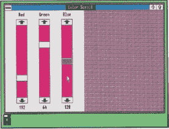

操作滚动条来混合红色、绿色和蓝色值，你就能在右侧看到结果。（在那时，大多数图形显示没有全色范围，因此使用抖动来近似设备无法渲染的颜色。）每个滚动条的值也会显示在滚动条下方。该程序对动态布局进行了相当粗糙（且包含大量算术计算）的尝试，甚至更改了宽度。

这似乎是一个演示简单 `Grid` 的理想程序。考虑到六个 `TextBlock` 实例和三个 `Slider` 实例，ColorScroll 项目的 XAML 文件从两个样式开始：

示例 5-4. 项目: SimpleColorScroll | 文件: BlankPage.xaml (节)

```xml
<Page.Resources>
    <Style TargetType="TextBlock">
        <Setter Property="Text" Value="00" />
        <Setter Property="FontSize" Value="24" />
        <Setter Property="HorizontalAlignment" Value="Center" />
        <Setter Property="Margin" Value="0 12" />
    </Style>

    <Style TargetType="Slider">
        <Setter Property="Orientation" Value="Vertical" />
        <Setter Property="IsReversed" Value="True" />
        <Setter Property="Maximum" Value="255" />
        <Setter Property="HorizontalAlignment" Value="Center" />
    </Style>
</Page.Resources>
```

我决定以十六进制显示每个 `Slider` 的当前值，因此 `TextBlock` 的样式将 `Text` 属性设置为“00”，这是对应 `Slider` 最小位置的十六进制值。

`Grid` 开始定义三行（每个 `Slider` 和两个相应的 `TextBlock` 标签）和四列。注意前三列的宽度相同，但第四列的宽度是三倍：

示例 5-5. 项目: SimpleColorScroll | 文件: BlankPage.xaml (节)

```xml
<Grid Background="{StaticResource ApplicationBackgroundBrush}">
    <Grid.ColumnDefinitions>
        <ColumnDefinition Width="*" />
        <ColumnDefinition Width="*" />
        <ColumnDefinition Width="*" />
        <ColumnDefinition Width="3*" />
    </Grid.ColumnDefinitions>

    <Grid.RowDefinitions>
        <RowDefinition Height="Auto" />
        <RowDefinition Height="*" />
        <RowDefinition Height="Auto" />
    </Grid.RowDefinitions>

    ...

</Grid>
```

XAML 文件的其余部分实例化了 10 个 `Grid` 子元素。每个元素都设置了 `Grid.Row` 和 `Grid.Column` 附加属性，尽管这些对于值为 0 来说是不必要的。我倾向于将这些附加属性放在属性的早期，但在至少一个属性（例如 *Name* 或 *Text*）之后，该属性可以提供对元素的快速视觉识别：


```xml
<Grid Background="{StaticResource ApplicationPageBackgroundBrush}">

    ...

    <!-- Red -->
    <TextBlock Text="Red"
               Grid.Column="0"
               Grid.Row="0"
               Foreground="Red" />

    <Slider Name="redSlider"
            Grid.Column="0"
            Grid.Row="1"
            Orientation="Vertical"
            Foreground="Red"
            ValueChanged="OnSliderValueChanged" />

    <TextBlock Name="redValue"
               Grid.Column="0"
               Grid.Row="2"
               Foreground="Red" />

    <!-- Green -->
    <TextBlock Text="Green"
               Grid.Column="1"
               Grid.Row="0"
               Foreground="Green" />

    <Slider Name="greenSlider"
            Grid.Column="1"
            Grid.Row="1"
            Orientation="Vertical"
            Foreground="Green"
            ValueChanged="OnSliderValueChanged" />

    <TextBlock Name="greenValue"
               Grid.Column="1"
               Grid.Row="2"
               Foreground="Green" />

    <!-- Blue -->
    <TextBlock Text="Blue"
               Grid.Column="2"
               Grid.Row="0"
               Foreground="Blue" />

    <Slider Name="blueSlider"
            Grid.Column="2"
            Grid.Row="1"
            Orientation="Vertical"
            Foreground="Blue"
            ValueChanged="OnSliderValueChanged" />

    <TextBlock Name="blueValue"
               Grid.Column="2"
               Grid.Row="2"
               Foreground="Blue" />

    <!-- Result -->
    <Rectangle Grid.Column="3"
               Grid.Row="0"
               Grid.RowSpan="3">
        <Rectangle.Fill>
            <SolidColorBrush x:Name="brushResult"
                             Color="Black" />
        </Rectangle.Fill>
    </Rectangle>
</Grid>
```

注意，所有的 `TextBlock` 和 `Slider` 元素都根据它们代表的颜色被赋予了 `Foreground` 属性。

底部的 `Rectangle` 的 `Grid.RowSpan` 附加属性被设置为 3，表示它跨越了所有三行。`SolidColorBrush` 被设置为 `Black`，这与三个初始 `Slider` 的值一致。如果你无法在 XAML 文件中正确初始化所有内容，那么代码后文件的构造函数就是进行操作的地方。

你可能会好奇为什么在每个 `Slider` 上都设置了 `Orientation` 属性，因为该属性在隐式 `Style` 中也设置过了。事实证明在我编写这一章时使用的 Windows 8 版本中，`Style` 中的属性设置没有生效。它在 Visual Studio 预览中看起来良好，但在实际运行时却不是。

三个 `Slider` 控件都对 `ValueChanged` 事件拥有同一个处理程序。这位于代码后文件中：

示例 5-7。项目：SimpleColorScroll | 文件：BlankPage.xaml.cs（节选）

```cs
public sealed partial class BlankPage : Page
{
    public BlankPage()
    {
        this.InitializeComponent();
    }

    void OnSliderValueChanged(object sender, RangeBaseValueChangedEventArgs args)
    {
        byte r = (byte)redSlider.Value;
        byte g = (byte)greenSlider.Value;
        byte b = (byte)blueSlider.Value;

        redValue.Text = r.ToString("X2");
        greenValue.Text = g.ToString("X2");
        greenValue.Text = b.ToString("X2");

        brushResult.Color = Color.FromArgb(255, r, g, b);
    }
}
```

事件处理程序可以通过 `sender` 参数获取触发事件的实际 `Slider`，并从 `RangeBaseValueChangedEventArgs` 对象中获取新值。但无论是哪一个 `Slider` 发生值变化，事件处理程序都需要创建一个全新的 `Color` 值，而这需要所有三个值。这段代码中唯一有点浪费的部分是在当只有一个值发生变化时设置了所有三个文本值，但修复这个问题将需要访问与触发事件的特定 `Slider` 相关的 `TextBlock`。

这是 16,777,216 种可能结果之一：

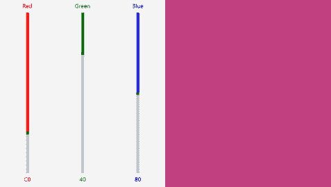

## 方向与宽高比例

如果你在平板电脑上运行 SimpleColorScroll 并将其旋转到竖屏模式，布局开始看起来有些奇怪，即使你在横屏模式下运行，分屏视图（snap view）也可能导致某些文本标签重叠。在代码后文件中添加一些逻辑，根据显示器的方向或宽高比例调整布局，可能是有意义的。

如果将单个 `Grid` 分为两个，嵌套在另一个内部，那么使用此程序调整布局将变得简单得多。内部 `Grid` 具有三行三列，用于 `TextBlock` 元素和 `Slider` 控件。外部 `Grid` 只有两个子元素：内部 `Grid` 和 `Rectangle`。在横屏模式下，外部 `Grid` 有两列；在竖屏模式下，它有两行。

OrientableColorScroll 项目的 XAML 文件与 SimpleColorScroll 相同的 `Style` 定义。这里显示了外部 `Grid`：

示例 5-8。项目：OrientableColorScroll | 文件：BlankPage.xaml（节选）

```xml
<Grid Background="{StaticResource ApplicationPageBackgroundBrush}"
      SizeChanged="OnGridChanged">

    <Grid.ColumnDefinitions>
        <ColumnDefinition Width="*" />
        <ColumnDefinition x:Name="secondColDef" Width="*"
    </Grid.ColumnDefinitions>

    <Grid.RowDefinitions>
        <RowDefinition Height="*" />
        <RowDefinition x:Name="secondRowDef" Height="0"
    </Grid.RowDefinitions>

    <Grid Grid.Column="0" Grid.Row="0">

        ...

    </Grid>

    <!-- Result -->
    <Rectangle Name="rectangleResult"
               Grid.Column="1"
               Grid.Row="0">
        <Rectangle.Fill>
            <SolidColorBrush x:Name="brushResult"
                             Color="Black" />
        </Rectangle.Fill>
    </Rectangle>
</Grid>
```

外部 `Grid` 的 `RowDefinitions` 和 `ColumnDefinitions` 已针对两种列或两行行进行了初始化。在每个集合中，第二个项目都被赋予了名称以便从代码访问。第二个行的高度为 0，因此初始配置假设为横屏模式。

内部 `Grid`（包含 `TextBlock` 元素和 `Slider` 控件）始终位于第一列或第一行：

```xml
<Grid Grid.Column="0" Grid.Row="0">

    ...

</Grid>
```

在 `Grid` 上设置 `Grid.Row` 和 `Grid.Column` 属性对我来说总是有点奇怪。它们指向不是该 `Grid` 的行和列，而是父 `Grid` 的行和列。这些附加属性的默认值均为零，因此这些特定的属性设置并不是需要的。

`Rectangle` 初始位于第二列第一行：

```xml
<Rectangle Name="rectangleResult"
           Grid.Column="1"
           Grid.Row="0">
    ...
</Rectangle>
```

在此版本的程序中，`Rectangle` 拥有名称，因此这些附加属性可以在代码后文件中更改。这是在外部 `Grid` 的 `SizeChanged` 事件处理中完成的。

示例 5-9。项目：OrientableColorScroll | 文件：BlankPage.xaml.cs（节选）

```cs
void OnGridSizeChanged(object sender, SizeChangedEventArgs args)
{
    // 横屏模式
    if (args.NewSize.Width > args.NewSize.Height)
    {
        secondColDef.Width = new GridLength(1, GridUnitType.Star);
        secondRowDef.Height = new GridLength(0);

        Grid.SetColumn(rectangleResult, 1);
        Grid.SetRow(rectangleResult, 0);
    }
    // 竖屏模式
    else
    {
        secondColDef.Width = new GridLength(0);
        secondRowDef.Height = new GridLength(1, GridUnitType.Star);

        Grid.SetColumn(rectangleResult, 0);
        Grid.SetRow(rectangleResult, 1);
    }
}
```


此代码更改了外部 `Grid` 中的第二个 `RowDefinition` 和 `ColumnDefinition`。这两者都作用于 `Rectangle`，它的列（column）和行（row）附加属性被更改了，使其位于第二列（竖屏模式）或第二行（横屏模式）。

以下是程序在快照模式下运行的示例：

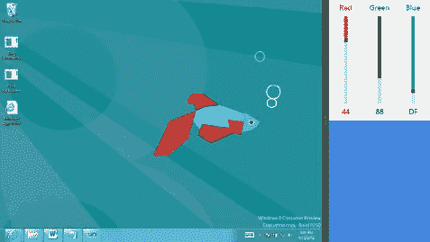

在更改尺寸和方向时，有时 `Slider` 控件似乎没有正常地更新自身，但我确定这在 Windows 8 的发布版本中不会成为问题。

## Slider 与格式化字符串转换器（Formatted String Converter）

在目前为止两个 ColorScroll 程序中，底部的 `TextBlock` 标签都以十六进制形式显示 `Slider` 的当前值。没有必要从后台代码文件（code-behind file）提供这些值。这可以通过从 `Slider` 到 `TextBlock` 的数据绑定来实现。唯一需要的是一个绑定转换器（binding converter），它可以将 `double` 转换为两位数的十六进制字符串。

令人沮丧的是，我在第 4 章中描述的、与 WhatSizeWithBindingConverter 项目相关的 `FormattedStringConverter` 类，在这种情况下*无法正常工作*。欢迎你尝试它，但你会发现（如果你还不知道的话）格式为“X2”的十六进制格式规范只能用于整数类型，而 `Slider` 的 `Value` 属性是一个 `double` 类型。

然而，在这种情况下，编写一个非常短的临时临时（ad hoc）绑定转换器可能更有意义，特别是当你意识到它可以用于两个用途时，正如我接下来将讨论的那样。

## 工具提示（Tooltips）与转换

当你操作任一 ColorScroll 程序中的 `Slider` 控件时，你可能注意到一个奇怪的现象：`Slider` 有一个内置的工具提示，可以在一个小框中显示当前值。这是一个很棒的功能，遗憾是这个工具提示显示的是十进制值，而程序却坚持以十六进制形式显示当前值。

如果你认为 `Slider` 的值同时以十进制和十六进制显示很棒，请跳到下一节。如果你更倾向于这两个值保持一致——并且它们都以十六进制显示值——那么你会很高兴地知道 `Slider` 定义了一个 `ThumbToolTipValueConverter` 属性，允许你提供一个执行你所需格式操作的类。该类必须实现 `IValueConverter` 接口，这与你编写绑定转换器时实现的接口相同。

然而，`ThumbToolTipValueConverter` 属性的转换器类不能像数据绑定转换器类那样复杂，因为你无法为转换提供参数选项。好的一面是，转换器类可以非常简单，只需完成特定情况下所需的操作即可。

ColorScrollWithValueConverter 项目定义了一个专门的转换器，用于将 `double` 转换为指示十六进制值的双字符。该类的名称几乎比实际代码还要长：

示例 5-10. 项目：ColorScrollWithValueConverter | 文件: DoubleToStringHexByteConverter.cs

```assembly
using System;
using Windows.UI.Xaml.Data;

namespace ColorScrollWithValueConverter
{
    public class DoubleToStringHexByteConverter : IValueConverter
    {
        public object Convert(object value, Type targetType, object parameter, string language)
        {
            return ((int)(double)value).ToString("X2");
        }
        public object ConvertBack(object value, Type targetType, object parameter, string language)
        {
            return value;
        }
    }
}
```

此转换器不仅适用于格式化工具提示值，也适用于在 `TextBlock` 中显示 `Slider` 值的绑定转换器。以下 ColorScroll 程序的变体展示了如何实现。（为了保持简单，此版本未调整宽高比。）XAML 文件在 `Resources` 中实例化了该转换器：

示例 5-11. 项目：ColorScrollWithValueConverter | 文件: BlankPage.xaml（节选）

```xml
<Page.Resources>
    <local:DoubleToStringHexByteConverter x:Key="hexConverter" />
    ...
</Page.Resources>
```

这是第一组 `TextBlock` 标签和 `Slider`。`Slider` 通过简单的 `StaticResource` 标记扩展引用了 `hexConverter` 资源。`TextBlock` 上的 `Binding` 被分成三行以便于阅读：

示例 5-12. 项目：ColorScrollWithValueConverter | 文件: BlankPage.xaml（节选）

```xml
<!-- Red -->
<TextBlock Text="Red"
           Grid.Column="0"
           Grid.Row="0"
           Foreground="Red" />

<Slider Name="redSlider"
        Grid.Column="0"
        Grid.Row="1"
        ThumbToolTipValueConverter="{StaticResource hexConverter}"
        Orientation="Vertical"
        Foreground="Red"
        ValueChanged="OnSliderValueChanged" />

<TextBlock Text="{Binding ElementName=redSlider,
                          Path=Value,
                          Converter={StaticResource hexConverter}}"
           Grid.Column="0"
           Grid.Row="2"
           Foreground="Red" />
```

由于 `ValueChanged` 处理程序不再需要更新 `TextBlock` 标签，因此该代码已被移除：

示例 5-13. 项目：ColorScrollWithValueConverter | 文件: BlankPage.xaml（节选）

```csharp
void OnSliderValueChanged(object sender, RangeBaseChangedEventArgs args)
{
    byte r = (byte)redSlider.Value;
    byte g = (byte)greenSlider.Value;
    byte b = (byte)blueSlider.Value;

    brushResult.Color = Color.FromArgb(255, r, g, b);
}
```

是否可能更进一步定义数据绑定，以便消除 `ValueChanged` 处理程序？如果可以在 `Color` 的单独属性上建立绑定，那将是可能的，如下：

```xml
<h4> 不起！ -->
<Rectangle Grid.Column="3"
           Grid.Row="0"
           Grid.RowSpan="3">
    <Rectangle.Fill>
        <SolidColorBrush>
            <SolidColorBrush.Color>
                <Color A="255"
                       R="{Binding ElementName=redSlider, Path=Value}"
                       G="{Binding ElementName=greenSlider, Path=Value}"
                       B="{Binding ElementName=blueSlider, Path=Value}" />
            </SolidColorBrush.Color>
        </SolidColorBrush>
    </Rectangle.Fill>
</Rectangle>
```

这种标记中的一个大问题是绑定目标需要由依赖属性支持，而 `Color` 的属性并不是。它们无法实现，因为依赖属性只能在派自 `DependencyObject` 的类中实现，而 `Color` 根本不是类。它是一个结构体（struct）。

`SolidColorBrush` 的 `Color` 属性是由依赖属性支持的，它可以作为数据绑定的目标。然而，在这个程序中，`Color` 属性需要三个值进行计算，而 Windows Runtime 不支持多源绑定。

解决方案是拥有一个独立的类，专门负责从红、绿、蓝值创建 `Color` 对象，我将在第 6 章向你展示如何实现。

## 使用滑块绘图

我不会向你展示下一个程序的截图。它被称为 SliderSketch，是一个大约 50 年前流行的玩具的 `Slider` 版本。SliderSketch 的用户必须巧妙地同步操作一个水平 `Slider` 和一个垂直 `Slider`，以控制不断扩展连续多折线的虚拟笔。我不会向你展示截图，是因为这个程序非常难用，而且目前我对它还处于婴儿阶段。


该 XAML 文件定义了一个 2x2 的 `Grid`，但屏幕大部分由一个包含大型 `Border` 和 `Polyline` 的单元格占据。最左侧有一个垂直的 `Slider`，底部有一个水平的 `Slider`。左下角的单元格是空的：

示例 5-14. 项目：SliderSketch | 文件：`BlankPage.xaml`（节选）

```
<Grid Background="{StaticResource ApplicationPageBackgroundBrush}">
    <Grid.RowDefinitions>
        <RowDefinition Height="*" />
        <RowDefinition Height="Auto" />
    </Grid.RowDefinitions>

    <Grid.ColumnDefinitions>
        <ColumnDefinition Width="Auto" />
        <ColumnDefinition Width="*" />
    </Grid.ColumnDefinitions>

    <Slider Name="ySlider"
            Grid.Row="0"
            Grid.Column="0"
            Orientation="Vertical"
            IsDirectionReversed="True"
            Margin="0 18"
            ValueChanged="OnSliderValueChanged" />

    <Slider Name="xSlider"
            Grid.Row="1"
            Grid.Column="1"
            Margin="18 0"
            ValueChanged="OnSliderValueChanged" />

    <Border Grid.Row="0"
            Grid.Column="1"
            BorderBrush="{StaticResource ApplicationTextBrush}"
            BorderThickness="3 0 0 3"
            Background="#C0C0C0"
            Padding="24"
            SizeChanged="OnBorderSizeChanged">

        <Polyline Name="polyline"
                  Stroke="#404040"
                  StrokeThickness="3"
                  Points="0 0" />
    </Border>
</Grid>
```

`Grid` 在边缘处使用 `Auto` 定义行和列，然后使用星号规格（*）让整个内部尽可能大，这是非常常见的。边缘的内容实际上是停靠齐的。Windows 8 没有 `DockPanel`，但可以用 `Grid` 轻松模拟。

`Slider` 控件上的 `Margin` 属性是根据实验开发的。为了让程序直观地运行，`Slider` 值的范围应设置为最小和最大位置之间的像素数，且 `Slider` 的滑块应与该值的像素大致对齐。每个 `Slider` 的 `Minimum` 和 `Maximum` 值的计算发生在显示区域大小变化时：

示例 5-15. 项目：SliderSketch | 文件：`BlankPage.xaml.cs`（节选）

```csharp
public sealed partial class BlankPage : Page
{
    public BlankPage()
    {
        this.InitializeComponent();
    }

    void OnBorderSizeChanged(object sender, SizeChangedEventArgs args)
    {
        Border border = sender as Border;
        xSlider.Maximum = args.NewSize.Width - border.Padding.Left
                                             - border.Padding.Right
                                             - polyline.StrokeThickness;

        ySlider.Maximum = args.NewSize.Height - border.Padding.Top
                                              - border.Padding.Bottom
                                              - polyline.StrokeThickness;
    }

    void OnSliderValueChanged(object sender, RangeBaseValueChangedEventArgs args)
    {
        polyline.Points.Add(new Point(xSlider.Value, ySlider.Value));
    }
}
```

在经历了这一切之后，看到底部的实际“绘图”方法真的很令人惊讶：只需一行代码即可向 `Polyline` 添加一个新的 `Point`。

但不要尝试把你的平板电脑倒过来并摇一它来重新开始。我还没有定义擦除函数。

## 按钮体验的种类

Windows Runtime 支持多种派生自 `ButtonBase` 类的按钮：

*   `Object`
    * `DependencyObject`
        * `UIElement`
            * `FrameworkElement`
                * `Control`
                    * `ContentControl`
                        * `ButtonBase`
                            * `Button`
                            * `HyperlinkButton`
                            * `RepeatButton`
                            * `ToggleButton`
                            * `CheckBox`
                            * `RadioButton`

`ButtonVarieties` 程序演示了所有这些按钮的默认外观和功能：

示例 5-16. 项目：ButtonVarieties | 文件：`BlankPage.xaml`（节选）

```xml
<Grid Background="{StaticResource ApplicationPageBackgroundBrush}">
    <StackPanel>
        <Button Content="Just a plain old Button" />
        <HyperlinkButton Content="HyperlinkButton" />
        <RepeatButton Content="RepeatButton" />
        <ToggleButton Content="ToggleButton" />
        <CheckBox Content="CheckBox" />

        <RadioButton Content="RadioButton #1" />
        <RadioButton>RadioButton #2</RadioButton>
        <RadioButton>
            <RadioButton.Content>
                RadioButton #3
            </RadioButton.Content>
        </RadioButton>
        <RadioButton>
            <RadioButton.Content>
                <TextBlock Text="RadioButton #4" />
            </Template.Content>
        </RadioButton>

        <ToggleSwitch />
    </StackPanel>
</Grid>
```

我包含了四个 `RadioButton` 实例，它们都使用了不同的方法来设置 `Content` 属性，它们基本上是等价的：


如果你不喜欢其中任何一个的外观，请记住你可以完全使用 `ControlTemplate` 重新设计它们，我将在未来的章节中探讨。

与所有 `FrameworkElement` 派生类一样，`HorizontalAlignment` 和 `VerticalAlignment` 属性的默认值为 `Stretch`。然而，在按钮加载时，`HorizontalAlignment` 属性已设置为 `Left`，`VerticalAlignment` 为 `Center`，并且还设置了非零的 `Padding`。尽管 `Margin` 属性为零，但视觉上包含环绕 `Border` 的内置边距。

`ButtonBase` 定义了 `Click` 事件，该事件在手指、鼠标或手笔按下并释放控件时会触发，但这种行为可以通过 `ClickMode` 属性进行更改。或者，程序可以通过命令接口通知按钮已被点击，我将在第 6 章 中讨论这一点。


`ToggleButton` 的 `IsChecked` 属性并不是一个 `bool`。它是一个 `Nullable<bool>`，这意味着它的值可以是 `null`。这种特殊设计是为了适应具有第三种“不确定”（indeterminate）状态的切换按钮。一个经典的例子是文字处理程序中标记为“加粗”的 `CheckBox`：如果选中的文本是粗体的，方框应该被选中；如果选中的文本未加粗，则应取消。然而，如果选中的文本既包含加粗又不包含非粗，`CheckBox` 应该显示不确定状态。你需要将 `IsThreeState` 属性设置为 `true` 来启用此功能，并且你可能需要为 `Indeterminate` 事件安装一个处理器。`ToggleButton` 在不确定状态下没有独特的样式；`CheckBox` 显示的是一个小方框而不是勾选标记。

话虽如此，对于切换需求，你可能倾向于使用 `ToggleSwitch` 控件，因为它专为 Metro 风格应用程序中的触摸操作设计。尽管 `ToggleSwitch` 没有派自 `ButtonBase`，但我仍然将其包含在列表底部。如你所看到的，它提供了默认的“Off”和“On”标签，但你可以更改它们。还可以提供一个标题，正如你将在第 7 章中发现的那样。

`RadioButton` 是 `ToggleButton` 的特殊形式，用于从互斥选项集中选择一个项目。该控件的名称源于旧汽车收音机，上面带有预设电台的按钮：按下一个按钮，之前按下的按钮就会弹出。同样，当一个 `RadioButton` 控件被选中时，它会取消所有其他兄弟 `RadioButton` 控件的选择。你只需要让它们都成为同一个面板的子元素。（注意：如果你将 `RadioButton` 放在 `Border` 中，它将不再是任何其他 `RadioButton` 的兄弟节点。）如果你希望在同一个面板内将 `RadioButton` 控件分为多个互斥组，则提供了 `GroupName` 属性来实现此目的。

### 按钮样式与外观

`Control` 类定义了 `Foreground` 属性、许多字体相关的属性以及若干与 `Border` 相关的属性，设置这些属性将改变按钮的外观。例如，假设你这样初始化一个 `Button`：

```xml
<Button Content="Not just a plain old Button anymore"
        Background="Yellow"
        BorderBrush="Red"
        BorderThickness="12"
        Foreground="Blue"
        FontSize="48"
        FontStyle="Italic" />
```

现在它看起来像这样：

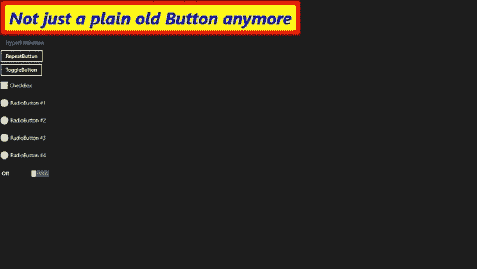

然而，某些视觉特征仍然由模板决定。例如，当你将鼠标悬停在此按钮上或按下它时，黄色背景会瞬间消失，按钮背景将变为标准颜色。此外，尽管你可以更改 `Border` 的颜色和厚度，但无法为它设置圆角。

### ContentControl 继承

`ButtonBase` 派自 `ContentControl`，后者定义了一个名为 `Content` 的属性。虽然 `Content` 属性通常被设置为文本，但也可以被设置为 `Image` 或面板。这显然非常强大。例如，以下是 `Button` 如何包含一个位图及其该位图的说明文字：

```xml
<Button>
    <StackPanel>
        <Image Source="http://www.charlespetzold.com/pw6/PetzoldJersey.jpg"
               Width="100" />
        <TextBlock Text="Figure 1"
                   HorizontalAlignment="Center" />
    </StackPanel>
</Button>
```

在未来的章节中，我将向你展示如何将 `Content` 属性设置为几乎任何对象，以及如何提供一个模板以所需的方式显示该对象。

### 示例：简单数字键盘

让我们制作一个简单的数字键盘。键是 `Button` 控件，结果显示在 `TextBlock` 中。在下面的 XAML 文件中，键盘封装在 `Grid` 中，并赋予了 `HorizontalAlignment` 和 `VerticalAlignment` 为 `Center`，以便它位于屏幕中心。键盘的每个 `Button` 具有相同的尺寸。我为这些 `Button`  own 了特定的宽度，因为我意识到用户可能会输入很多数字，并且我不希望键盘的宽度扩展。示例-17. 数字键盘 | 文件：BlankPage.xaml（节）

```xml
<Grid Background="{StaticResource ApplicationPageBrush}">

    <Grid.Resources>
        <Style TargetType="Button">
            <Setter Property="Click" Value="Press" />
            <Setter Property="HorizontalAlignment" Value="Stretch" />
            <Setter Property="Height" Value="72" />
            <Setter Property="FontSize" Value="36" />
        </Style>
    </Grid.Resources>

    <Grid.RowDefinitions>
        <RowDefinition Height="Auto" />
        <RowDefinition Height="Auto" />
        <RowDefinition Height="Auto" />
        <RowDefinition Height="Auto" />
        <RowDefinition Height="Auto" />
    </Grid.RowDefinitions>

    <Grid.ColumnDefinitions>
        <ColumnDefinition Width="*" />
        <ColumnDefinition Width="*" />
        <ColumnDefinition Width="*" />
    </Grid.ColumnDefinitions>

    <Grid Grid.Row="0" Grid.Column="0" Grid.ColumnSpan="3">
        <Grid.ColumnDefinitions>
            <ColumnDefinition Width="*" />
            <ColumnDefinition Width="Auto" />
        </Grid.ColumnDefinitions>

        <Border Grid.Column="0"
                HorizontalAlignment="Left">

            <TextBlock Name="resultText"
                           HorizontalAlignment="Right"
                           VerticalAlignment="Center"
                           FontSize="24" />
            </Border>

            <Button Name="deleteButton"
                    Content="&#21E6;"
                    Grid.Column="1"
                    IsEnabled="False"
                    FontFamily="Segoe Symbol"
                    HorizontalAlignment="Left"
                    Padding="0"
                    BorderThickness="0"
                    Click="OnDeleteButtonClick" />
        </Grid>

        <Button Content="1" Grid.Row="1" Grid.Column="0" Click="OnCharButtonClick" />
        <Button Content="2" Grid.Row="1" Grid.Column="1" Click="OnCharButtonClick" />
        <Button Content="3" Grid.Row="1" Grid.Column="2" Click="OnCharButtonClick" />

        <Button Content="4" Grid.Row="2" Grid.Column="0" Click="OnCharButtonClick" />
        <Button Content="5" Grid.Row="2" Grid.Column="1" Click="OnCharButtonClick" />
        <Button Content="6" Grid.Row="2" Grid.Column="2" Click="OnCharButtonClick" />

        <Button Content="7" Grid.Row="3" Grid.Column="0" Click="OnCharButtonClick" />
        <Button Content="8" Grid.Row="3" Grid.Column="1" Click="OnCharButtonClick" />
        <Button Content="9" Grid.Row="3" Grid.Column="2" Click="OnCharButtonClick" />

        <Button Content="*" Grid.Row="4" Grid.Column="0" Click="OnCharButtonClick" />
        <Button Content="0" Grid.Row="4" Grid.Column="1" Click="OnCharButtonClick" />
        <Button Content="#" Grid.Row="4" Grid.Column="2" Click="OnCharButtonClick" />
    </Grid>
</Grid>
```


难点在于第一行。这里必须包含一个 `TextBlock` 来显示输入的字符，以及一个删除按钮。我不希望删除按钮太大，所以我将 `Grid` 的整个第一行设成一个单独的 `Grid`，专门用于放置这两个项。删除按钮的属性覆盖了隐式样式中设置的许多属性。请注意，删除按钮初始状态是禁用的。只有当有字符可以删除时，它才应该启用。

`TextBlock` 的处理有点棘手。我希望它在正常输入时是左对齐的，但如果字符串过长无法完全显示，我希望 `TextBlock` 在左侧被裁剪，而不是右侧。我的解决方案是将 `TextBlock` 封装在一个 `Border` 中：

```
<Border Grid.Column="0"
        HorizontalAlignment="Left">

    <TextBlock Name="resultText"
               HorizontalAlignment="Right"
               VerticalAlignment="Center"
               FontSize="24" />
</Border>
```

`Border` 的宽度有一个固定的限制：它不能超过整个 `Grid` 的宽度减去删除按钮的宽度。在该区域内，`Border` 左对齐，而 `TextBlock` 完全位于该 `Border` 内部并同样左对齐。随着字符的输入，`TextBlock` 会变得越来越宽，直到它超过 `Border` 的宽度。此时，`HorizontalAlignment` 设置为 `Right` 开始起作用，`TextBlock` 的左部分会被裁剪。

顶部这一行之后，其他部分都一帆风顺。隐式样式有助于让九个按钮的标记尽可能小。

后代码文件（code-behind）处理来自删除按钮的 `Click` 事件，并为其他 12 个按钮提供了一个共享处理程序：

示例 5-18. 项目：SimpleKeypad | 文件：BlankPage.xaml.cs (节选)

```
public sealed partial class BlankPage : Page
{
    string inputString = "";
    char[] specialChars = { '*', '#' };

    public BlankPage()
    {
        this.InitializeComponent();
    }

    void OnCharButtonClick(object sender, RoutedEventArgs args)
    {
        Button btn = sender as Button;
        inputString += btn.Content as string;
        FormatText();
    }

    void OnDeleteButtonClick(object sender, RoutedEventArgs args)
    {
        inputString = inputString.Substring(0, inputString.Length - 1);
        FormatText();
    }

    void FormatText()
    {
        bool hasNonNumbers = inputString.IndexOfAny(specialChars) != -1;

        if (hasNonNumbers || inputString.Length < 4 || inputString.Length > 10)
            resultText.Text = inputString;

        else if (inputString.Length < 8)
            resultText.Text = String.Format("{0}-{1}", inputString.Substring(0, 3),
                                                       inputString.Substring(3));

        else
            resultText.Text = String.Format("({0}) {1}-{2}", inputString.Substring(0, 3),
                                                             inputString.Substring(3, 3),
                                                             inputString.Substring(6));

        deleteButton.IsEnabled = inputString.Length > 0;
    }
}
```

删除按钮的处理程序从 `inputString` 字段中删除一个字符，而另一个处理程序则添加一个字符。每个处理程序随后都会调用 `FormatText`，该方法尝试对字符串进行格式化。在方法的最后，只有当输入字符串包含字符时，删除按钮才启用。

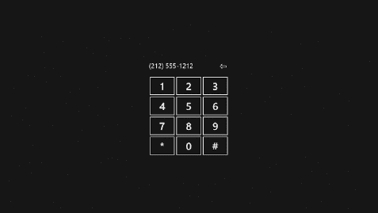

`OnCharButtonClick` 事件处理程序使用被按下按钮的 `Content` 属性来确定要添加到字符串中的字符。按钮的 `Content` 视觉效果与其功能之间这种简单的对应关系并不总是可用。有时，在多个控件之间共享事件处理程序需要处理程序从被点击的按钮中提取更多信息。`FrameworkElement` 定义了一个类型为 `object` 的 `Tag` 属性专门为此目的。你可以在 XAML 文件中将 `Tag` 设置为标识字符串或对象，并在事件处理程序对其进行检查。

# 依赖属性 (Dependency Properties)

也许你正在编写一个应用程序，希望所有的 `Button` 控件都使用渐变画刷显示文本。当然，你可以简单地定义每个 `Button` 的 `Foreground` 属性为 `LinearGradientBrush`，但标记可能会变得有些臃肿。这时你可以尝试使用一个 `Foreground` 属性设置为 `LinearGradientBrush` 的 `Style`，但这样每个 `Button` 都会共享相同渐变颜色的 `LinearGradientBrush`，而你可能需要更大的灵活性。

你真正想要的是带有名为 `Color1` 和 `Color2` 属性的 `Button`，你可以将其设置为渐变颜色。这听起来像自定义控件。它是一个派自 `Button` 的类，在构造函数中创建一个 `LinearGradientBrush`，并定义 `Color1` 和 `Color2` 属性来控制这种渐变。

这些 `Color1` 和 `Color2` 属性可以是带有 `set` 和 `get` 访问器的普通 .NET 属性吗？可以，可以的。然而，那样定义属性将会在某些关键方面限制它们。此类属性不能作为样式、绑定或动画的目标。只有依赖属性才能做到所有这些。

依赖属性的开销比普通属性稍大一点，但学习如何在自己的类中定义依赖属性是一项重要的技能。在新项目中，从向项目添加新项开始，并从列表中选择 `Class`。给它命名为 `GradientButton`，并在文件中将该类设为公共并派自 `Button`：

```
public class GradientButton : Button
{

}
```

现在让我们填充该类。在此过程中你需要添加一些 `using` 指令。

两个新属性命名为 `Color1` 和 `Color2`，类型为 `Color`。这两个属性需要类型为 `DependencyProperty` 的属性 `Color1Property` 和 `Color2Property`。它们必须是公共静态的，但仅在类内部设置：

```
public static DependencyProperty Color1Property { private set; get; }
public static DependencyProperty Color2Property { private set; get; }
```

这些 `DependencyProperty` 对象必须在静态构造函数中创建。`DependencyProperty` 类定义了一个名为 `Register` 的静态方法，用于创建 DependencyProperty 对象：

```
static GradientButton()
{
    Color1Property =
        DependencyProperty.Register("Color1",
            typeof(Color),
            typeof(GradientButton),
            new PropertyMetadata(Colors.White, OnColorChanged));

    Color2Property =
        DependencyProperty.Register("Color2",
            typeof(Color),
            typeof(GradientButton),
            new PropertyMetadata(Colors.Black, OnColorChanged));
}
```

一个稍不同的静态方法 `DependencyProperty.RegisterAttached` 用于创建附加属性。

`DependencyProperty.Register` 的第一个参数是属性的文本名称。这有时会被 XAML 解析器使用。第二个参数是属性的类型。第三个参数是注册此依赖属性的类的类型。

第四个参数是 `PropertyMetadata` 类型的对象。构造函数有两个版本。在一个版本中，你只需要指定属性的默认值。在另一个版本中，你还指定了一个在属性更改时调的方法。如果属性被设置为与其现有值相同的值，则该方法不会被调用。


你作为 `PropertyMetadata` 构造函数第一个参数指定的默认值必须与第二个参数中指示的类型匹配，否则将导致运行时异常。这并不像听起来那么简单。例如，程序员经常为类型为 `double` 的属性提供 `0` 作为默认值。在编译期间，`0` 被假设为整数，因此在运行时会发现类型不匹配并抛出异常。如果你正在定义一个类型为 `double` 的依赖属性，请给它一个 `0.0` 的默认值，以便编译器知道该参数的正确数据类型。

`GradientButton` 类还需要对 `Color1` 和 `Color2` 进行常规 .NET 属性定义，但这些属性总是某种非常特定的形式：

```
public Color Color1
{
    set { SetValue(Color1Property, value); }
    get { return (Color)GetValue(Color1Property); }
}

public Color Color2
{
    set { SetValue(Color2Property, value); }
    get { return (Color)GetValue(Color2Property); }
}
```

`set` 访问器始终调用 `SetValue`（继承自 `DependencyObject` 类）并引用依赖属性对象，而 `get` 访问器始终调用 `GetValue` 并将返回值强制转换为属性的适当类型。如果你不想从类外部设置该属性，可以将 `set` 访问器设为 `protected` 或 `private`。

在我的 `GradientButton`or 中，我希望 `Foreground` 属性为 `LinearGradientBrush`，并希望 `Color1` 和 `Color2` 属性为两个 `GradientStop` 对象的颜色。因此，两个 `GradientStop` 对象被定义为字段：

```
GradientStop gradientStop1, gradientStop2;
```

该类的常规实例构造函数会创建这些对象，以及 `LinearGradientBrush`，并将其赋值给 `Foreground` 属性：

```
public GradientButton()
{
    gradientStop1 = new GradientStop
    {
        Offset = 0,
        Color = this.Color1
    };

    gradientStop2 = new GradientStop
    {
        Offset = 1,
        Color = this.Color2
    };

    LinearGradientBrush brush = new LinearGradientBrush();
    brush.GradientStops.Add(gradientStop1);
    brush.GradientStops.Add(gradientStop2);

    this.Foreground = brush;
}
```

注意这两个 `GradientStop` 对象的属性初始化器是如何访问 `Color1` 和 `Color2` 属性的。这就是 `LinearGradientBrush` 中的颜色设置为为两个依赖属性定义的默认颜色的方法。

你可能记得，在两个依赖属性的定义中，指定了一个名为 `OnColorChanged` 的方法，当 `Color1` 或 `Color2` 属性值发生变化时调用该方法。由于此属性更改方法在静态构造函数中被引用，因此该方法本身也是静态的：

```
static void OnColorChanged(DependencyObject obj, DependencyPropertyChangedEventArgs args)
{

}
```

现在这有点奇怪，因为定义这个 `GradientButton` 类的初衷是在应用程序中使用多次它，而现在我们正在定义一个静态属性。


此项目中的 XAML 文件定义了两个样式，其中一个包含用于 `Color1` 和 `Color2` 的 `Setter` 元素，并将这些样式应用于两个 `GradientButton` 。此 XAML 文件中对 `GradientButton` 的任何引用都必须以 `local` XML 命名空间开头，该命名空间与定义 `GradientButton` 的 `DependencyProperties` 命名空间相关联。注意在 `Style` 的 `TargetType` 以及按钮实例化时都使用了 `local` 前缀：

示例 5-20。项目：`DependencyProperties` | 文件：`BlankPage.xaml`（节选）

```
<Page ...
    xmlns:local="using:DependencyProperties"
    ... >

    <Page.Resources>
        <Style x:Key="baseButtonStyle" TargetType="local:GradientButton">
            <Setter Property="FontSize" Value="48" />
            <Setter Property="HorizontalAlignment" Value="Center" />
            <Setter Property="Margin" Value="0 12" />
        </Style>

        <Style x:Key="blueRedButtonStyle"
               TargetType="local:GradientButton"
               BasedOn="{StaticResource baseButtonStyle}">
            <Setter Property="Color1" Value="Blue" />
            <Setter Property="Color2" Value="Red" />
        </Style>
    </Page.Resources>

    <Grid Background="{StaticResource ApplicationPageBackgroundBrush}">
        <StackPanel>
            <local:GradientButton Content="GradientButton #1"
                                  Style="{StaticResource baseButtonStyle}" />

            <local:GradientButton Content="GradientButton #2"
                                  Style="{StaticResource blueRedButtonStyle}" />
        </StackPanel>
    </Grid>
</Page>
```

第一个获取 `Color1` 和 `Color2` 的默认设置，而第二个获取在 `Style` 中定义的设置。如下所示：


我之前无法在 `GradientButton` 标签中本地设置 `Color1` 和 `Color2`，但我假设这只是一个在 Windows 8 发布之前会消失的特殊现象。

我想向你展示另一种创建 `GradientButton` 类的方法，让你可以在 XAML 中定义 `LinearGradientBrush` 并消除属性更改处理器。感兴趣吗？

在一个单独项目中，与其添加新项并从列表中选择 `Class`，不如添加新项，从列表中选择 `User Control`，并将其命名为 `GradientButton`。通常你会得到一对文件：`GradientButton.xaml` 和 `GradientButton.xaml.cs`。`GradientButton` 类派自 `UserControl`。这是 `GradientButton.xaml.cs` 文件中的类定义：

```
public sealed class GradientButton : UserControl
{
    public GradientButton()
    {
        this.InitializeComponent();
    }
}
```

将基类从 `UserControl` 改为 `Button`：

```
public sealed class GradientButton : Button
{
    public GradientButton()
    {
        this.InitializeComponent();
    }
}
```

该类的主体与第一个 `GradientButton` 类非常相似，构造函数除了调用 `InitializeComponent` 之外什么都没做。没有属性更改处理器。在 `DependencyPropertiesWithBindings` 项目中看起来是这样的：

示例 5-21。项目：`DependencyPropertiesWithBindings` | 文件：`GradientButton.xaml.cs`

```cs
public sealed class GradientButton : Button
{
    static GradientButton()
    {
        Color1Property =
            DependencyProperty.Register("Color1",
                typeof(Color),
                typeof(GradientButton),
                new PropertyMetadata(Colors.White));

        Color2Property =
            DependencyProperty.Register("Color2",
                typeof(Color),
                typeof(GradientButton),
                new PropertyMetadata(Colors.Black));
    }

    public static DependencyProperty Color1Property { private set; get; }

    public static DependencyProperty Color2Property { private set; get; }

    public GradientButton()
    {
        this.InitializeComponent();
    }

    public Color Color1
    {
        set { SetValue(Color1Property, value); }
        get { return (Color)GetValue(Color1Property); }
    }

    public Color Color2
    {
        set { SetValue(Color2Property, value); }
        get { return (Color)GetValue(Color2Property); }
    }
}
```

当首次创建时，`GradientButton.xaml` 文件有一个根元素，指示该类派自 `UserControl`：

```xml
<UserControl
    x:Class="DependencyPropertiesWithBindings.GradientButton" ... >
    ...
</UserControl>
```

将其改为 `Button`：

```xml
<Button
    x:Class="DependencyPropertiesWithBindings.GradientButton" ... >
    ...
</Button>
```

通常在 XAML 文件的根标签之间放置内容时，你是在隐式设置 `Content` 属性。在这种情况下，我们不想设置 `Button` 的 `Content` 属性。我们希望将 `GradientButton` 的 `Foreground` 属性设置为 `LinearGradientBrush`。这需要 `Button.Foreground` 属性元素标签。这是完整的 XAML 文件：

示例 5-22。项目：`DependencyPropertiesWithBindings` | 文件：`GradientButton.xaml`

```xml
<Button
    x:Class="DependencyPropertiesWithBindings.GradientButton"
    xmlns="http://schemas.microsoft.com/winfx/2006/xaml/presentation"
    xmlns:x="http://schemas.microsoft.com/winfx/2006/xaml"
    Name="root">

    <Button.Foreground>
        <LinearGradientBrush>
            <GradientStop Offset="0"
                          Color="{Binding ElementName=root,
                                          Path=Color1}" />

            <GradientStop Offset="1"
                          Color="{Binding ElementName=root,
                                          Path=Color2}" />
        </LinearGradientBrush>
    </Button.Foreground>
</Button>
```

注意设置 `GradientStop` 对象的 `Color` 属性的方式：根元素被命名为 `root`，以便作为两个数据绑定的源。此项目的 `BlankPage.xaml` 文件与之前的项目相同，结果也是相同的。

## RadioButton 标签

一组 `RadioButton` 控件允许用户在多个互斥的项目之间选择一个。从程序的角度来看，如果特定组中的每个 `RadioButton` 都对应于枚举的一个成员，并且可以从 `RadioButton` 对象识别枚举值，通常是非常方便的。这允许组中的所有按钮共享同一个事件处理器。

`Tag` 属性非常适合此目的。例如，假设你想编写一个程序，让你实验由 `Shape` 类定义的 `StrokeStartLineCap`、`StrokeEndLineCap` 和 `StrokeLineJoin` 属性。在渲染粗线时，这些属性控制线条末端的形状以及两条线连接处的形状。前两个属性被设置为 `PenLineCap` 枚举类型的成员，第三个被设置为 `PenLineJoin` 枚举的成员。

例如，`PenLineJoin` 枚举的一个成员是 `Bevel`。你可能这样定义一个 `RadioButton` 来表示此选项：

```xml
<RadioButton Content="Bevel join"
             Tag="Bevel"
             ... />
```

问题是 `Bevel` 被 XAML 解析器解释为字符串，因此在后台代码文件的事件处理器中，你需要使用 `switch` 和 `case` 来区分不同的字符串，或者使用 `Enum.TryParse` 将字符串转换为实际的 `PenLineJoin.Bevel` 值。

定义 `Tag` 属性更好的方法是将其拆出作为属性元素，并显式指示它正在被设置为 `PenLineJoin` 类型的值：

```xml
<RadioButton Content="Bevel join"
             ... >
    <RadioButton.Tag>
        <PenLineJoin>Bevel</PenLineJoin>
    </RadioButton.Tag>
</RadioButton>
```


当然，这有点繁琐。尽管如此，我曾在 `LineCapsAndJoins` 项目中使用过这种方法。XAML 文件为三个 `Shape` 属性定义了三组 `RadioButton` 控件。每组包含三个或四个对应相应枚举成员的控件。

### 示例 5-23. 项目：`LineCapsAndJoins` | 文件：`BlankPage.xaml`（节选）

```xml
<Grid Background="{StaticResource ApplicationPageBackgroundBrush}">
    <Grid.RowDefinitions>
        <RowDefinition Height="*" />
        <RowDefinition Height="Auto" />
    </Grid.RowDefinitions>

    <Grid.ColumnDefinitions>
        <ColumnDefinition Width="Auto" />
        <ColumnDefinition Width="*" />
        <ColumnDefinition Width="Auto" />
    </Grid.ColumnDefinitions>

    <StackPanel Name="startLineCapPanel"
                Grid.Row="0" Grid.Column="0"
                Margin="24">
        <RadioButton Content="Flat start"
                     Checked="OnStartLineCapRadioButtonChecked">
            <RadioButton.Tag>
                <PenLineCap>Flat</PenLineCap>
            </RadioButton.Tag>
        </RadioButton>

        <RadioButton Content="Round start"
                     Checked="OnStartLineCapRadioButtonChecked">
            <RadioButton.Tag>
                <PenLineCap>Round</PenLineCap>
            </RadioButton.Tag>
        </RadioButton>

        <RadioButton Content="Square start"
                     Checked="OnStartLineCapRadioButtonChecked">
            <RadioButton.Tag>
                <PenLineCap>Square</PenLineCap>
            </RadioButton.Tag>
        </RadioButton>

        <RadioButton Content="Triangle start"
                     Checked="OnStartLineCapRadioButtonChecked">
            <RadioButton.Tag>
                <PenLineCap>Triangle</PenLineCap>
            </RadioButton.Tag>
        </RadioButton>
    </StackPanel>

    <StackPanel Name="endLineCapPanel"
                Grid.Row="0" Grid.Column="2"
                Margin="24">
        <RadioButton Content="Flat end"
                     Checked="OnEndLineCapRadioButtonChecked">
            <RadioButton.Tag>
                <PenLineCap>Flat</PenLineCap>
            </RadioButton.Tag>
        </RadioButton>

        <RadioButton Content="Round end"
                     Checked="OnEndLineCapRadioButtonChecked">
            <RadioButton.Tag>
                <PenLineCap>Round</PenLineCap>
            </RadioButton.Tag>
        </RadioButton>

        <RadioButton Content="Square end"
                     Checked="OnEndLineCapRadioButtonChecked">
            <RadioButton.Tag>
                <PenLineCap>Square</PenLineCap>
            </RadioButton.Tag>
        </RadioButton>

        <RadioButton Content="Triangle End"
                     Checked="OnEndLineCapRadioButtonChecked">
            <RadioButton.Tag>
                <PenLineCap>Triangle</PenLineCap>
            </RadioButton.Tag>
        </RadioButton>
    </StackPanel>

    <StackPanel Name="lineJoinPanel"
                Grid.Row="1" Grid.Column="1"
                HorizontalAlignment="Center"
                Margin="24">

        <RadioButton Content="Bevel join"
                     Checked="OnLineJoinRadioButtonChecked">
            <RadioButton.Tag>
                <PenLineJoin>Bevel</PenLineJoin>
            </RadioButton.Tag>
        </RadioButton>

        <RadioButton Content="Miter join"
                     Checked="OnLineJoinRadioButtonChecked">
            <RadioButton.Tag>
                <PenLineJoin>Miter</PenLineJoin>
            </RadioButton.Tag>
        </RadioButton>

        <RadioButton Content="Round join"
                     Checked="OnLineJoinRadioButtonChecked">
            <RadioButton.Tag>
                <PenLineJoin>Round</PenLineJoin>
            </RadioButton.Tag>
        </RadioButton>
    </StackPanel>

    <Polyline Name="polyline"
              Grid.Row="0"
              Grid.Column="1"
              Points="0 0, 500 1000, 1000 0"
              Stroke="{StaticResource ApplicationTextBrush}"
              StrokeThickness="100"
              Stretch="Fill"
              Margin="24" />
</Grid>
```

三组 `RadioButton` 控件中的每一组都在各自的 `StackPanel` 中，且每个 `StackPanel` 的所有控件共享同一个 `Checked` 事件处理程序。

标记标记没有将任何 `RadioButton` 设置为选中状态。这是后台代码文件中构造函数的职责。标记的底部有一个粗线条的 `Polyline`，它正在等待其 `StrokeStartLineCap`、`StrokeEndLineCap` 和 `StrokeLineJoin` 属性被设置。这发生在后台代码文件中的同样存在的三个 `Checked` 事件处理程序中：

### 示例 5-24. 项目：`LineCapsAndJoins` | 文件：`BlankPage.xaml.cs`（节选）

```csharp
public sealed partial class BlankPage : Page
{
    public BlankPage()
    {
        this.InitializeComponent();

        foreach (UIElement child in startLineCapPanel.Children)
            (child as RadioButton).IsChecked =
                (PenLineCap)(child as RadioButton).Tag == polyline.StrokeStartLineCap;

        foreach (UIElement child in endLineCapPanel.Children)
            (child as RadioButton).IsChecked =
                (PenLineCap)(child as RadioButton).Tag == polyline.StrokeStartLineCap;

        foreach (UIElement child in lineJoinPanel.Children)
            (child as RadioButton).IsChecked =
                (PenLineJoin)(child as RadioButton).Tag == polyline.StrokeLineJoin;
    }

    void OnStartLineCapRadioButtonChecked(object sender, RoutedEventArgs args)
    {
        polyline.StrokeStartLineCap = (PenLineCap)(sender as RadioButton).Tag;
    }

    void OnEndLineCapRadioButtonChecked(object sender, RoutedEventArgs args)
    {
        polyline.StrokeEndLineCap = (PenLineCap)(sender as RadioButton).Tag;
    }

    void OnLineJoinRadioButtonChecked(object sender, RoutedEventArgs args)
    {
        polyline.StrokeLineJoin = (PenLineJoin)(sender as RadioButton).Tag;
    }
}
```


让我向你展示一小部分 XAML（最后三个 `RadioButton` 控件），以演示属性元素语法（property-element syntax）是如何被消除的：

示例 5-27. 项目：LineCapsAndJoinsWithCustomClass | 文件：BlankPage.xaml（摘）

```
<StackPanel Name="lineJoinPanel"
            Grid.Row="1" Grid.Column="1"
            HorizontalAlignment="Center"
            Margin="24">

    <local:LineJoinRadioButton Content="Bevel join"
                               LineJoinTag="Bevel"
                               Checked="OnLineJoinRadioButtonChecked" />

    <local:LineJoinRadioButton Content="Miter join"
                               LineJoinTag="Miter"
                               Checked="OnLineJoinRadioButtonChecked" />

    <local:LineJoinRadioButton Content="Round join"
                               LineJoinTag="Round"
                               Checked="OnLineJoinRadioButtonChecked" />
</StackPanel>
```

你会注意到，当你输入这些标记时，IntelliSense 正确识别出 `LineCapTag` 和 `LineJoinTag` 属性为枚举类型，并为你提供输入其中一个枚举成员的选项。很棒！

切换到自定义 `RadioButton` 派生类主要影响 XAML 文件。代码后的文件几乎完全相同，只是类型转换稍微少了一些：

```
示例 5-28. 项目：LineCapsAndJoinsWithCustomClass | 文件：BlankPage.xaml.cs（摘）

```
public sealed partial class BlankPage : Page
{
    public BlankPage()
    {
        this.InitializeComponent();

        foreach (UIElement child in startLineCapPanel.Children)
            (child as LineCapRadioButton).IsChecked =
                (child as LineCapRadioButton).LineCapTag == polyline.StrokeStartLineCap;

        foreach (UIElement child in endLineCapPanel.Children)
            (child as LineCapRadioButton).IsChecked =
                (child as LineCapRadioButton).LineCapTag == polyline.StrokeStartLineCap;

        foreach (UIElement child in lineJoinPanel.Children)
            (child as LineJoinRadioButton).IsChecked =
                (child as LineJoinRadioButton).LineJoinTag == polyline.StrokeLineJoin;
    }

    void OnStartLineCapRadioButtonChecked(object sender, RoutedEventArgs args)
    {
        polyline.StrokeStartLineCap = (sender as LineCapRadioButton).LineCapTag;
    }

    void OnEndLineCapRadioButtonChecked(object sender, RoutedEventArgs args)
    {
        polyline.StrokeEndLineCap = (sender as LineCapRadioButton).LineCapTag;
   }

    void OnLineJoinRadioButtonChecked(object sender, RoutedEventArgs args)
    {
        polyline.StrokeLineJoin = (sender as LineJoinRadioButton).LineJoinTag;
    }
}
```

## 键盘输入与 TextBox

Metro 风格应用程序中的键盘输入由于屏幕触摸键盘而变得有些复杂，该键盘允许用户通过点击屏幕来输入文本。虽然触摸键盘对于平板电脑和其他未连接实体键盘的设备非常重要，但它也可以作为实体键盘的补充。

触摸键盘不要以烦人的方式弹出和消失至关重要。出于这个原因，许多控件（包括自定义控件）不会自动接收键盘输入。如果它们这样做，系统每当这些控件接收输入焦点时，就需要调用触摸键盘。因此，如果你创建一个自定义控件并为 `KeyUp` 和 `KeyDown` 事件安装了事件处理程序（或重写了 `OnKeyUp` 和 `OnKeyDown` 方法），你会发现没有任何内容能传进来。

如果你只想从物理键盘获取键盘输入，并且不在乎触摸键盘——也许是为了一个仅供自己使用或用于测试的程序——有一个相当简单的方法。在你的页面的构造函数中，获取应用程序的 `CoreWindow` 对象：

```
CoreWindow coreWindow = Window.Current.CoreWindow;
```

该类定义在 `Windows.UI.Core` 命名空间中。你可以在此对象上安装 `KeyDown` 和 `KeyUp`（指示键盘上的按键）以及 `CharacterReceived`（将按键转换为文本字符）的事件处理程序。

如果你需要创建一个同时从物理键盘和触摸键盘获取键盘输入的自定义控件，该过程要复杂得多。你需要派生一个自 `FrameworkElementAutomationPeer` 的类，实现 `ITextProvider` 和 `IValueProvider` 接口，并在自定义控件的 `OnCreateAutomationPeer` 方法重写中返回此类。

显然，这是一项非凡的任务，我将在后续章节中提供完整的细节。

同时，如果你的程序需要文本输入，最佳方法是使用专门为此目的提供的控件之一：

* `TextBox` 具有单行或多行输入功能，字体统一，类似于传统的 Windows 记事本程序。
* `RichEditBox` 具有格式文本，类似于传统的 Windows WordPad 程序。
* `PasswordBox` 允许单行掩码输入。

在这次简短讨论中我将关注 `TextBox`，我将在后面的章节中提供更多示例。

`TextBox` 定义了一个 `Text` 属性，用于设置 `TextBox` 中的文本或获取当前文本。`SelectedText` 属性是选中的文本（如果有），`SelectionStart` 和 `SelectionLength` 属性指示选择的偏移和长度。如果 `SelectionLength` 为 0，则 `SelectionStart` 是光标的位置。将 `IsReadOnly` 属性设置为 `true` 会阻止输入内容，但允许选择文本并复制到剪贴板。所有的剪切、复制和粘贴交互都通过上下文菜单完成。`TextBox` 定义了 `TextChanged` 和 `SelectionChanged` 事件。

默认情况下，`TextBox` 允许允许单输入。两个属性可以改变这种行为。通常 `TextBox` 忽略回车键，但将 `AcceptsReturn` 设置为 `true` 会导致 `TextBox` 在按下回车键时开始新行。`TextWrapping` 属性的默认设置为 `NoWrap`。将其设置为 `Wrap` 会导致用户在超出当前行末尾输入时 `TextBox` 生成新行。这些属性可以独立设置。任何一个属性都会导致 `TextBox` 随着额外行的增加而垂直增长。`TextBox` 内置了 `ScrollViewer`。如果你不想让 `TextBox` 无限增长，设置 `MaxLength` 属性。

并不是只有一个触摸键盘，而是有，某些更适合输入数字、电子邮件地址或 URI。`TextBox` 使用 `InputScope` 属性指定它需要的键盘类型。在当前的 Windows 8 版本中，在 XAML 中设置此属性 特别笨拙（涉及两层属性元素），这解释了以下 TextBoxInputScopes 程序 XAML 文件的大部分内容。该程序让你能够尝试这些不同的键盘布局，以及不同模式的多行 `TextBox` 实例和（作为奖励）`PasswordBox`：

示例 5-29. 项目：TextBoxInputScopes | 文件：BlankPage.xaml（摘）


```xml
<Page
    x:Class="TextBoxInputScopes.BlankPage" ... >

    <Page.Resources>
        <Style TargetType="TextBlock">
            <Setter Property="FontSize" Value="24" />
            <Setter Property="VerticalAlignment" Value="Center" />
            <Setter Property="Margin" Value="6" />
        </Style>

        <Style TargetType="TextBox">
            <Setter Property="Width" Value="320" />
            <Setter Property="VerticalAlignment" Value="Center" />
            <Setter Property="Margin" Value="0" />
        </Style>
    </Page.Resources>

    <Grid Background="{StaticResource ApplicationPageBrush}">
        <Grid HorizontalAlignment="Center">
            <Grid.RowDefinitions>
                <RowDefinition Height="Auto" />
                <RowDefinition Height="Auto" />
                <RowDefinition Height="Auto" />
                <RowDefinition Height="Auto" />
                <RowDefinition Height="Auto" />
                <RowDefinition Height="Auto" />
                <RowDefinition Height="Auto" />
                <RowDefinition Height="Auto" />
                <RowDefinition Height="Auto" />
                <RowDefinition Height="Auto" />
            </Grid.RowDefinitions>

            <Grid.ColumnDefinitions>
                <ColumnDefinition Width="Auto" />
                <ColumnDefinition Width="Auto" />
            </Grid.ColumnDefinitions>

            <!-- 多行，支持换行，不换行 -->
            <TextBlock Text="Multiline (accepts Return, no wrap):" Grid.Row="0" Column="0" />
            <TextBox AcceptsReturn="True" Grid.Row="0" Column="1" />

            <!-- 多行，忽略换行，自动换行 -->
            <TextBlock Text="Multiline (ignores Return, wraps):" Grid.Row="1" Column="0" />
            <TextBox TextWrapping="Wrap" Grid.Row="1" Column="1" />

            <!-- 多行，支持换行且自动换行 -->
            <TextBlock Text="Multiline (accepts Return, wraps):" Grid.Row="2" Column="0" />
            <TextBox AcceptsReturn="True" TextWrapping="Wrap" Grid.Row="2" Column="1" />

            <!-- 默认输入范围 -->
            <TextBlock Text="Default input scope:" Grid.Row="3" Column="0" />
            <TextBox Grid.Row="3" Column="1">
                <TextBox.InputScope>
                    <InputScope>
                        <InputScopeName NameValue="Default" />
                    </InputScope>
                </TextBox.InputScope>
            </TextBox>

            <!-- 电子邮件输入范围 -->
            <TextBlock Text="Email address input scope:" Grid.Row="4" Column="0" />
            <TextBox Grid.Row="4" Column="1">
                <TextBox.InputScope>
                    <InputScope>
                        <InputScopeName NameValue="EmailSpAddress" />
                    </InputScope>
                </TextBox.InputScope>
            </TextBox>

            <!-- 数字输入范围 -->
            <TextBlock Text="Number input scope:" Grid.Row="5" Column="0" />
            <TextBox Grid.Row="5" Column="1">
                <TextBox.InputScope>
                    <InputScope>
                        <InputScopeName NameValue="Number" />
                    </InputScope>
                </TextBox.InputScope>
            </TextBox>

            <!-- 搜索输入范围 -->
            <TextBlock Text="Search input scope:" Grid.Row="6" Column="0" />
            <TextBox Grid.Row="6" Column="1">
                <TextBox.InputScope>
                    <InputScope>
                        <InputScopeName NameValue="Search" />
                    </InputScope>
                </TextBox.InputScope>
            </TextBox>

            <!-- 电话号码输入范围 -->
            <TextBlock Text="Telephone number input scope:" Grid.Row="7" Column="0" />
            <TextBox Grid.Row="7" Column="1">
                <TextBox.InputScope>
                    <InputScope>
                        <InputScopeName NameValue="TelephoneNumber" />
                    </InputScope>
                </TextBox.InputScope>
            </TextBox>

            <!-- URL 输入范围 -->
            <TextBlock Text="URL input scope:" Grid.Row="8" Column="0" />
            <TextBox Grid.Row="8" Column="1">
                <TextBox.InputScope>
                    <InputScope>
                        <InputScopeName NameValue="Url" />
                    </InputScope>
                </TextBox.InputScope>
            </TextBox>

            <!-- 密码框 -->
            <TextBlock Text="PasswordBox:" Grid.Row="9" Column="0" />
            <PasswordBox Grid.Row="9" Column="1" />

        </Grid>
    </Grid>
</Page>
```

在选择多行模式或 `InputScope` 值之前，你可能可能想要实验一下这个程序。

## 触摸与拇指

在随后的章节中，我将讨论触摸输入以及你如何使用它来操作屏幕上的对象。与此同时，名为 `Thumb` 的简单控件提供了一些基础的触摸功能。`Thumb` 定义在 `Windows.UI.Xaml.Controls.Primitives` 命名空间中，主要作为 `Slider` 和 `Scrollbar` 的构建模块。在第 7 章 中，我将在一个自定义控件中使用它。

`Thumb` 控件根据相对于自身的鼠标、手写笔或触摸移动产生三个事件：`DragStarted`、`DragDelta` 和 `DragCompleted`。当你将手指放在 `Thumb` 控件上，或将鼠标移动到其表面并点击时，会发生 `DragStarted` 事件。此后，`DragDelta` 事件指示手指或鼠标的移动。你可以使用这些事件来移动 `Thumb`（以及任何其他对象），在 `Canvas` 上操作最为方便。

在 AlphabetBlocks 程序中，一系列标记有字母、数字和标点符号的按钮环绕在边缘。点击其中一个就会出现一个字母块，你可以用手指或鼠标拖动它。我知道你可能希望通过手指轻滑让这个字母块在屏幕上穿梭，但它不会那样响应。`Thumb` 不包含触摸惯性。对于惯性，你需要接入实际触摸事件。

对于字母块本身，一个名为 `Block` 的 `UserControl` 派生类有一个 XAML 文件，定义了一个 144 像素的正方形图像，其中包含一个 `Thumb`、一些图形和一个 `TextBlock`：


```xml
<UserControl
    x:Class="AlphabetBlocks.Block"
    xmlns="http://schemas.microsoft.com/winfx/2006/xaml/presentation"
    xmlns:x="http://schemas.microsoft.com/winfx/2006/xaml"
    xmlns:local="using:AlphabetBlocks"
    Width="144"
    Height="144"
    Name="root">

    <Grid>
        <Thumb DragStarted="OnThumbDragStarted"
               DragDelta="OnThumbDragDelta"
               Margin="18 18 6 6" />

        <!-- Left -->
        <Polygon Points="0 6, 12 18, 12 138, 0 126"
                 Fill="#E0C080" />

        <!-- Top -->
        <Polygon Points="6 0, 18 12, 138 12, 126 0"
                 Fill="#F0D090" />

        <!-- Edge -->
        <Polygon Points="6 0, 18 12, 12 18, 0 6"
                 Fill="#E8C888" />

        <Border BorderBrush="{Binding ElementName=root, Path=Foreground}"
                BorderThickness="12"
                Background="#FFE0A0"
                CornerRadius="6"
                Margin="12 12 0 0"
                IsHitTestVisible="False" />

        <TextBlock FontFamily="Courier New"
                   FontSize="156"
                   FontWeight="Bold"
                   Text="{Binding ElementName=root, Path=Text}"
                   HorizontalAlignment="Center"
                   VerticalAlignment="Center"
                   Margin="12 18 0 0"
                   IsHitTestVisible="False" />
    </Grid>
</UserControl>
```

`Polygon` 与 `Polyline` 相似，不同在于它会自动关闭形状，并使用 `Fill` 属性引用的画刷填充该形状。

`Thumb` 安装了 `DragStarted` 和 `DragDelta` 事件处理程序。位于 `Thumb` 之上的两个元素——`Border` 和 `TextBlock`——在视觉上隐藏了 `Thumb`，但它们的 `IsHitTestVisible` 属性被设置为 `false`，这样它们就不会阻止触摸输入到达 `Thumb`。

`Border` 的 `BorderBrush` 属性绑定到根元素的 `Foreground` 属性。你可能记得，`Foreground` 是由 `Control` 类定义并被 `UserControl` 继承，并通过视觉树传播的。`TextBlock` 的 `Foreground` 属性会自动获取此相同的画刷。`TextBlock` 元素的 `Text` 属性绑定到控件的 `Text` 属性。`UserControl` 并没有 `Text` 属性，这强烈暗示 `Block` 定义了它。

代码后代码文件证实了这一假设。该类的大部分内容都用于定义一个由依赖属性支持的 `Text` 属性：

示例 5-31。项目：AlphabetBlocks | 文件：Block.xaml.cs

```c
using Windows.UI.Xaml;
using Windows.UI.Xaml.Controls;
using Windows.UI.Xaml.Controls.Primitives;

namespace AlphabetBlocks
{
    public sealed partial class Block : UserControl
    {
        static int zindex;

        static Block()
        {
            TextProperty = DependencyProperty.Register("Text",
                typeof(string),
                typeof(Block),
                new PropertyMetadata("?"));
        }

        public static DependencyProperty TextProperty { private set; get; }

        public static int ZIndex
        {
            get { return ++zindex; }
        }

        public Block()
        {
            this.InitializeComponent();
        }

        public string Text
        {
            set { SetValue(TextProperty, value); }
            get { return (string)GetValue(TextProperty); }
        }

        void OnThumbDragStarted(object sender, DragStartedEventArgs args)
        {
            Canvas.SetZIndex(this, ZIndex);
        }

        void OnThumbDragDelta(object sender, DragDeltaEventArgs args)
        {
            Canvas.SetLeft(this, Canvas.GetLeft(this) + args.HorizontalChange);
            Canvas.SetTop(this, Canvas.GetTop(this) + args.VerticalChange);
        }
    }
}
```

这个 `Block` 类还定义了一个静态 `ZIndex` 属性，这需要解释一下。当你点击程序并在 `Block` 对象被创建并添加到 `Canvas` 时，由于集合的排序方式，后续的 `Block` 会出现在之前的 `Block` 之上。然而，当你触摸一个 `Block` 时，你希望该对象跳到堆栈顶部，这意味着它应该具有比其他对象更高的 z 索引。

这里定义的静态 `ZIndex` 属性有助于实现这一点。注意在每次调用它时值都会增加。每当发生 `DragStarted` 事件（意味着用户触摸了这些控件之一），`Canvas.SetZIndex` 方法就会为 `Block` 分配比其他对象更高的 z 索引。当然，当 `ZIndex` 属性达到最大值时，这个过程将会失效，但这种情况极少发生。

`Thumb` 的 `DragDelta` 事件报告触摸或鼠标相对于自身的移动情况，形式为 `HorizontalChange` 和 `VerticalChange` 属性。这些属性简单地用于增加 `Canvas.Left` 和 `Canvas.Top` 附加属性。

`BlankPage.xaml` 文件非常空。其 XAML 主要由在页面中心显示程序名称的文本组成：

示例 5-32。项目：AlphabetBlocks | 文件：BlankPage.xaml (excerpt)

```xml
<Grid Background="{StaticResource ApplicationPageBackgroundBrush}"
      SizeChanged="OnGridSizeChanged">

    <TextBlock Text="Alphabet Blocks"
               FontStyle="Italic"
               FontWeight="Bold"
               FontSize="96"
               TextWrapping="Wrap"
               HorizontalAlignment="Center"
               VerticalAlignment="Center"
               TextAlignment="Center"
               Opacity="0.1" />
    <Canvas Name="buttonCanvas" />
    <Canvas Name="blockcanvas" />
</Grid>
```

注意 `Grid`  `SizeChanged` 处理程序。当页面大小发生变化时，处理程序负责重新创建所有的 `Button` 对象并将它们均匀分布在页面周围。该代码占据了该代码后文件的主要内容：


```csharp
public sealed partial class BlankPage : Page
{
    const double BUTTON_SIZE = 60;
    const double BUTTON_FONT = 18;
    string blockChars = "ABCDEFGHIJKLMNOPQRSTUVWXYZ0123456789!?-+*/%=";
    Color[] colors = { Colors.Red, Colors.Green, Colors.Orange, Colors.Blue, Colors.Purple };
    Random rand = new Random();

    public BlankPage()
    {
        this.InitializeComponent();
    }

    void OnGridSizeChanged(object sender, SizeChangedEventArgs args)
    {
        buttonCanvas.Children.Clear();

        double widthFraction = args.NewSize.Width /
                        (args.NewSize.Width + args.NewSize.Height);
        int horzCount = (int)(widthFraction * blockChars.Length / 2);
        int vertCount = (int)(blockChars.Length / 2 - horzCount);
        int index = 0;

        double slotWidth = (args.NewSize.Width - BUTTON_SIZE) / horzCount;
        double slotHeight = (args.NewSize.Height - BUTTON_SIZE) / vertCount + 1;

        // Across top
        for (int i = 0; i < horzCount; i++)
        {
            Button button = MakeButton(index++);
            Canvas.SetLeft(button, i * slotWidth);
            Canvas.SetTop(button, 0);
            buttonCanvas.Children.Add(button);
        }

        // Down right side
        for (int i = 0; i < vertCount; i++)
        {
            Button button = MakeButton(index++);
            Canvas.SetLeft(button, this.ActualWidth - BUTTON_SIZE);
            Canvas.SetTop(button, i * slotHeight);
            buttonCanvas.Children.Add(button);
        }

        // Across bottom from right
        for (int i = 0; i < horzCount; i++)
        {
            Button button = MakeButton(index++);
            Canvas.SetLeft(button, this.ActualWidth - i * slotWidth - BUTTON_SIZE);
            Canvas.SetTop(button, this.ActualHeight - BUTTON_SIZE);
            buttonCanvas.Children.Add(button);
        }

        // Up left side
        for (int i = 0; i < vertCount; i++)
        {
            Button button = MakeButton(index++);
            Canvas.SetLeft(button, 0);
            Canvas.SetTop(button, this.ActualHeight - i * slotHeight - BUTTON_SIZE);
            buttonCanvas.Children.Add(button);
        }
    }

    Button MakeButton(int index)
    {
        Button button = new Button
        {
            Content = blockChars[index].ToString(),
            Width = BUTTON_SIZE,
            Height = BUTTON_SIZE,
            FontSize = BUTTON_FONT,
            Tag = new SolidColorBrush(colors[index % colors.Length]),
        };
        button.Click += OnButtonClick;
        return button;
    }

    void OnButtonClick(object sender, RoutedEventArgs e)
    {
        Button button = sender as Button;

        Block block = new Block
        {
            Text = button.Content as string,
            Foreground = button.Tag as Brush
        };
        Canvas.SetLeft(block, this.ActualWidth / 2 - 144 * rand.NextDouble());
        Canvas.SetTop(block, this.ActualHeight / 2 - 144 * rand.NextDouble());
        Canvas.SetZIndex(block, Block.ZIndex);
        blockcanvas.Children.Add(block);
    }
}
```

在 `Button` 的 `Click` 处理器中创建了一个 `Block`，并给它分配了一个靠近屏幕中心的随机位置。现在用户的任务是移动这些色块，以发现另一种向 Windows 8 问候的方式：


# 第 6 章. WinRT 与 MVVM

在软件结构设计中，主要的指导原则之一是关注点分离（separation of concerns）。大型应用程序最好的方式是通过将其划分为专门的层来分开发、调试和维护。在高度交互的图形环境中，一种明显的分离是表现层与内容之间的分离。表现层是程序中显示控件和其他图形并与用户交互的部分。表现层的底层是业务逻辑和数据提供者。

为了帮助程序员概念化并实现关注点分离，人们开发了架构模式。在基于 XAML 的编程环境中，一种变得极其流行的模式是模型-视图视图模型（Model-View-ViewModel 或 MVVM）。MVVM 特别适用于 XAML 中实现表现层，并通过数据绑定和命令连接底层的业务逻辑。

遗憾的是，像这样的书籍往往包含非常小的程序来演示特定的功能和概念。当让这些微小程序适应架构模式时，它们通常会变得巨大！对于小型应用程序来说，MVVM 可能大材小用，而且可能会变得模糊而不是清晰。

尽管如此，数据绑定和命令是 Windows Runtime 的重要部分，你应该看看它们如何帮助实现 MVVM 架构。

## MVVM（简要与简化）

顾如其名，使用 Model-View-ViewModel 模式的应用程序分为三层：

*   `Model` 是处理数据和原始内容的层。它通常涉及从文件或网络服务获取并维护数据。
*   `View` 是控件和图形的表现层，通常在 XAML 中实现。
*   `ViewModel` 位于 `Model` 和 `View` 之间。在通常情况下，它负责使数据易于 `View` 的展示。

`Model` 没有必要且因此不存在，这种情况并不罕见，本章所示的程序正是如此。

如果这三层之间所有的交互都通过过程化的方法调用发生，就会强制执行调用层级：`View -> ViewModel -> Model`。除了事件外，不允许反向调用。`Model` 可以定义一个由 `ViewModel` 处理的事件，`ViewModel` 可以定义一个由 `View` 处理的事件。事件允许 `ViewModel`（例如）向 `View` 出更新的数据可用。`View` 然后可以调用 `ViewModel` 来获取这些更新的数据。

大多数情况下，`View` 和 `ViewModel` 通过数据绑定和命令进行交互。因此，许多方法调用和事件处理是在后台完成的。这些数据绑定和命令允许了三类型的交互：

*   `View` 可以用户输入传输到 `ViewModel`。
*   `ViewModel` 可以在更新数据可用时通知 `View`。
*   `View` 可以从 `ViewModel` 获取并显示更新的数据。

MVVM 固有的目标之一是尽量减少后台代码（code-behind）——至少在页面或窗口级别是。当 View 和 ViewModel 之间的所有连接通过 XAML 文件中的绑定完成时，MVVM 专家们最开心。

## 数据绑定通知

在第 5 章中，你看到了这样的数据绑定：

```
<TextBlock Text="{Binding ElementName=slider, Path=Value}" />
```

这是两个 `FrameworkElement` 派类之间的绑定。此数据绑定的目标是 `TextBlock` 的 `Text` 属性。绑定源是名为 `slider` 的 `Slider` 的 `Value` 属性。目标和源属性由依赖属性支持。这是绑定目标的要求，但正如你看到的，源并不是。

每当 `Slider` 的 `Value` 属性更改时，`TextBlock` 显示的文本相应改变。这是如何工作的？当绑定源是依赖属性时，实际机制是 Windows Runtime 内部的。无疑涉及事件。`Binding` 对象为事件安装了处理程序，当 `Slider` 的 `Value` 属性更改时提供通知，然后 `Binding` 对象将该更改的值设置为 `TextBlock` 的 `Text` 属性。考虑到 `Slider` 在 `Value` 属性更改时也会触发一个公共的 `ValueChanged` 事件，这应该并不显得神秘。


在实现 View Model 时，数据绑定略有不同：绑定目标仍然是 XAML 文件中的元素，但绑定源是 View Model 类中的属性。这是 View Model 与 View（即 XAML 文件）相互传输数据的基本方式。

绑定源并不要求由依赖属性（dependency property）支持。但为了让绑定能够正常工作，绑定源必须实现其他类型的通知机制，在属性发生变化时向 `Binding` 对象发送信号。这种通知不会自动发生；它必须通过事件来实现。

View Model 作为绑定源的标准方法是实现定义在 `System.ComponentModel` 命名空间中的 `INotifyPropertyChanged` 接口。该接口的定义非常简单：

```
public interface INotifyPropertyChanged
{
    event PropertyChangedEventHandler PropertyChanged;
}
```

`PropertyChangedEventHandler` 委托与 `PropertyChangedEventArgs` 类关联，该类定义了一个属性：类型为 `string` 的 `PropertyName`。当一个类实现了 `INotifyPropertyChanged` 时，每当它的任一个属性发生变化时，它就会触发 `PropertyChanged` 事件。

这里是一个实现 `INotifyPropertyChanged` 的类的简单示例。名为 `TotalScore` 的唯一属性在属性发生变化时会触发 `PropertyChanged` 事件：

```
public class SimpleViewModel : INotifyPropertyChanged
{
    double totalScore;

    public event PropertyChangedEventHandler PropertyChanged;

    public double TotalScore
    {
        set
        {
            if (totalScore != value)
            {
                totalScore = value;

                if (PropertyChanged != null)
                    PropertyChanged(this, new PropertyChangedEventArgs("TotalScore"));
            }
        }
        get
        {
            return totalScore;
        }
    }
}
```

`TotalScore` 属性由 `totalScore` 字段支持。注意，`TotalScore` 属性会检查传入 `set` 访问器的值是否相对于 `totalScore` 字段，仅在属性实际发生变化时才触发 `PropertyChanged` 事件。不要为了让这些 `set` 访问器短一点而省略这一步！事件的名称是 `PropertyChanged`，而不是 `PropertySetAndPerhapsChangedOrMaybeNot`。

另外注意，类完全合法地实现 `INotifyPropertyChanged` 但实际上不触发任何 `PropertyChanged` 事件，但这会被认为是非常糟糕的行为。

当一个类拥有多个属性时，定义一个名为 `OnPropertyChanged` 的受保护方法并让该方法执行实际的事件触发就有意义了。也可以将该类的部分内容自动化，正如你很快将看到的。

在设计 View 和 View Model 时，开始将控件看作数据类型的视觉表现会有帮助。View 中的控件绑定到 View Model 中这些类型的属性上。例如，`Slider` 是一个 `double`，`TextBox` 是一个 `string`，`CheckBox` 或 `ToggleSwitch` 是一个 `bool`，而一组 `RadioButton` 控件是一个枚举。

## 用于 ColorScroll 的 View Model

第 5 章 中的 ColorScroll 程序展示了如何使用数据绑定从 `Slider` 的 `value` 属性更新 `TextBlock`。然而，定义一个根据三个 `Slider` 值来更改颜色的数据绑定被证明要更加难以捉摸。这真的可能实现吗？

解决方案是有一个单独的类，专门负责从 `Red`、`Green` 和 `Blue` 属性的值创建 `Color` 对象。这三个属性中的任何一个变化都会触发 `Color` 属性的重新计算。在 XAML 文件中，绑定将 `Slider` 控件与 `Red`、`Green` 和 `Blue` 属性连接，并将 `SolidColorBrush` 与 `Color` 属性连接。即使我们不称这个类为 View Model，它确实是如此。

下面是一个 `RgbViewModel` 类，它实现了 `INotifyPropertyChanged` 接口，每当它的 `Red`、`Green`、`Blue` 或 `Color` 属性变化时都会触发 `PropertyChanged` 事件：

示例 6-1. 项目：ColorScrollWithViewModel | 文件: RgbViewModel.cs

```
using System.ComponentModel;        // 用于 INotifyPropertyChanged
using Windows.UI;                   // 用于 Color

namespace ColorScrollWithViewModel
{
    public class RgbViewModel : INotifyPropertyChanged
    {
        double red, green, blue;
        Color color = Color.FromArgb(255, 0, 0, 0);

        public event PropertyChangedEventHandler PropertyChanged;

        public double Red
        {
            set
            {
                if (red != value)
                {
                    red = value;
                    OnPropertyChanged("Red");
                    Calculate();
                }
            }
            get
            {
                return red;
            }
        }

        public double Green
        {
            set
            {
                if (green != value)
                {
                    green = value;
                    OnPropertyChanged("Green");
                    Calculate();
                }
            }
            get
            {
                return green;
            }
        }

        public double Blue
        {
            set
            {
                if (blue != value)
                {
                    blue = value;
                    OnPropertyChanged("Blue");
                    Calculate();
                }
            }
            get
            {
                return blue;
            }
        }

        public Color Color
        {
            protected set
            {
                if (color != value)
                {
                    color = value;
                    OnPropertyChanged("Color");
                }
            }
            get
            {
                return color;
            }
        }

        void Calculate()
        {
            this.Color = Color.FromArgb(255, (byte)this.Red, (byte)this.Green, (byte)this.Blue);
        }

        protected void OnPropertyChanged(string propertyName)
        {
            if (PropertyChanged != null)
                PropertyChanged(this, new PropertyChangedEventArgs(propertyName));
        }
    }
}
```

类底部的 `OnPropertyChanged` 方法负责根据属性名称实际触发 `PropertyChanged` 事件。

我将 `Red`、`Green` 和 `Blue` 属性定义为 `double` 以便于数据绑定。这些属性基本上是 View Model 的输入，它们可能来自 `Slider` 等控件，因此 `double` 类型是最通用的。

每个 `Red`、`Green` 和 `Blue` 属性的 `set` 访问器都会触发 `PropertyChanged` 事件，然后调用 `Calculate`，后者设置一个新的 `Color` 值，从而导致 `Color` 属性触发另一个 `PropertyChanged` 事件。`Color` 属性本身具有受保护的 `set` 访问器，这意味着该类的设计并不是用于从新的 `Color` 值计算 `Red`、`Green` 和 `Blue` 值。（我很快会讨论这个问题。）

`RgbViewModel` 类是 ColorScrollWithViewModel 项目的一部分。`BlankPage.xaml` 文件在它的 `Resources` 部分实例化了 `RgbViewModel`。

示例 6-2. 项目：ColorScrollWithViewModel | 文件: BlankPage.xaml (节选)

```
<Page.Resources>
    <local:RgbViewModel x:Key="rgbViewModel" />
    ...
</Page.Resources>
```

注意 `local` 命名空间前缀。


将 View Model 定义为资源是 XAML 文件访问对象的两种基本方式之一。正如第 2 章所示，包含在 `Resources` 部分的类只会被实例化一次，并在所有 `StaticResource` 引用之间共享。这种行为对于像这样的应用程序至关重要，因为所有的绑定都需要引用同一个对象。

每个 `Slider` 控件都是类似的。这里只显示了一个：

示例 6-3. 项目：ColorScrollWithViewModel | 文件：BlankPage.xaml (节选)

```xml
<!-- Red -->
<TextBlock Text="Red"
           Grid.Column="0"
           Grid.Row="0"
           Foreground="Red" />

<Slider Grid.Column="0"
        Grid.Row="1"
        Value="{Binding Source={StaticResource rgbViewModel},
                        Path=Red,
                        Mode=TwoWay}"
        ThumbToolTipValueConverter="{StaticResource hexConverter}"
        Orientation="Vertical"
        Foreground="Red" />

<TextBlock Text="{Binding Source={StaticResource rgbViewModel},
                          Path=Red,
                          Converter={StaticResource hexConverter}}"
           Grid.Column="0"
           Grid.Row="2"
           Foreground="Red" />
```

注意，`Slider` 元素不再有 `Name` 属性，因为 XAML 文件中没有其他元素引用此元素，后置代码文件也没有引用。它没有 `ValueChanged` 事件处理程序，因为也就不需要。后置代码文件除了调用 `InitializeComponent` 之外什么都不包含。

请仔细注意 `Slider` 上的绑定：

```xml
<Slider ...
        Value="{Binding Source={StaticResource rgbViewModel},
                        Path=Red,
                        Mode=TwoWay}" ... />
```

这个绑定有点长，所以我将其分成了三行。它没有指定 `ElementName`，因为它没有引用 XAML 文件中的另一个元素。相反，它引用的是一个作为 XAML 资源实例化的对象，因此它必须使用带有 `StaticResource` 的 `Source`。此绑定的语法意味着绑定目标是 `Slider` 的 `Value` 属性，绑定源是 `RgbViewModel` 实例的 `Red` 属性。

`RgbViewModel` 必须是绑定源而不是目标。它不能是绑定目标，因为它没有依赖属性。尽管语法暗示 `Value` 是绑定目标，但实际上我们希望 `Slider` 为 `Red` 属性提供值。出于这个原因，`Binding` 的 `Mode` 属性必须设置为 `TwoWay`，这意味着更新的源值会导致目标属性发生变化（正常情况），而且更新的目标值会导致源属性发生变化（这实际上是这里关键的传递）。

默认的 `Mode` 设置为 `OneWay`。唯一的其他选项是 `OneTime`，这意味着仅在建立绑定时从源属性更新目标属性。使用 `OneTime` 时，当源属性稍后更改时，不会发生任何更新。如果源没有通知机制，你可以使用 `OneTime`。

另外请注意，显示当前值的 `TextBlock` 现在有了对 `RgbViewModel` 对象的绑定：

```xml
<TextBlock Text="{Binding Source={StaticResource rgbViewModel},
                          Path=Red,
                          Converter={StaticResource hexConverter}}" ... />
```

此绑定也可以像上一个项目那样直接引用 `Slider`，但我认为它也引用 `RgbViewModel` 实例会更好。默认的 `OneWay` 模式在这里是可以的，因为数据只需要从源流向目标。

`OneWay` 模式对于 `SolidColorBrush` 的 `Color` 属性的绑定也是好的：

示例 6-4. 项目：ColorScrollWithViewModel | 文件：BlankPage.xaml (节选)

```xml
<Rectangle Grid.Column="3"
           Grid.Row="0"
           Grid.RowSpan="3">
    <Rectangle.Fill>
        <SolidColorBrush Color="{Binding Source={StaticResource rgbViewModel},
                                         Path=Color}" />
    </Rectangle.Fill>
</Rectangle>
```

`SolidColorBrush` 不再有 `x:Name` 属性，因为后置代码文件中没有引用它的内容。

当然，`RgbViewModel` 类中的代码比我们从后置代码文件中移除的 `ValueChanged` 事件处理程序长得多。我在开始就警告过你，MVVM 对于小型程序来说是大材小用。即使在较大的应用程序中，为了更整洁的架构通常需要支付代价，但演示与业务逻辑的分确实具有长期优势。

在 `RgbViewModel` 类中，我将 `Color` 的 `set` 访问器设为 `protected`，以便只能从类内部访问。这真的必要吗？也许可以定义 `Color` 属性，使得属性的外部更改会导致计算 `Red`、`Green` 和 `Blue` 属性的新值：

```csharp
public Color Color
{
    set
    {
        if (color != value)
        {
            color = value;
            OnPropertyChanged("Color");
            this.Red = color.R;
            this.Green = color.G;
            this.Blue = color.B;
        }
    }
    get
    {
        return color;
    }
}
```

起初这似乎是在找麻烦，因为会导致递归的属性更改。但它实际上是有缺陷的。假设 `Color` 属性当前为 0，并且它被设置为 255。当代码中将 `Red` 属性设置为 255 时，会触发 `PropertyChanged` 事件，但由于递归的 `OnPropertyChanged` 调用，这不应该发生。

然而，这个版本运行得良好，尽管它引起了一连 `PropertyChanged` 事件：

```csharp
public Color Color
{
    set
    {
        if (color != value)
        {
            color = value;
            OnPropertyChanged("Color");
            this.Red = color.R;
            this.Green = color.G;
            this.Blue = color.B;
        }
    }
    get
    {
        return color;
    }
}
```

我将在程序的下一个版本中将 `Color` 属性的 `set` 访问器改为公共。

## 自 BindableBase

你可能从 `RgbViewModel` 的代码中得出实现 `INotifyPropertyChanged` 有点麻烦，事实确实如此。为了让它更容易一点，Visual Studio 会在你项目的 Common 文件夹中创建一个 `BindableBase` 类。（不要将此类与 `Binding` 继承的 `BindingBase` 类混淆。）

`BindableBase` 类定义在一个命名空间中，该空间由项目名称加上点和 `Common` 单词组成。去掉注释和属性后，它的样子如下：

```csharp
public abstract class BindableBase : INotifyPropertyChanged
{
    public event PropertyChangedEventHandler PropertyChanged;

    protected bool SetProperty<T>(ref T storage, T value,
                                  [CallerMemberName] String propertyName = null)
    {
        if (object.Equals(storage, value)) return false;

        storage = value;
        this.OnPropertyChanged(propertyName);
        return true;
    }

    protected void OnPropertyChanged([CallerMemberName] string propertyName = null)
    {
        var eventHandler = this.PropertyChanged;
        if (eventHandler != null)
        {
            eventHandler(this, new PropertyChangedEventArgs(propertyName));
        }
    }
}
```


派自 `BindableBase` 的类会在其属性定义的 `set` 访问器中调用 `SetProperty`。`SetProperty` 方法的签名看起来有点复杂，但非常易用。例如，对于类型为 `double` 的名为 `Red` 的属性，你可以这样定义后备字段：

```
double red;
```

你可以在 `set` 访问器中这样调用 `SetProperty`：

```
SetProperty<double>(ref red, value, "Red");
```

注意 `BindableBase` 中 `CallerMemberName` 的使用。这是 .NET 4.5 引入的一个属性，C# 5.0 可以用它来获取调用特定属性或方法的代码信息，这意味着你不需要传递最后一个参数就可以调用 `SetProperty`。如果你在 `Red` 属性的 `set` 访问器中调用 `SetProperty`，该名称将自动提供：

```
SetProperty<double>(ref red, value);
```

如果属性确实发生了变化，`SetProperty` 的返回值为 `true`。你可能想在处理新值的逻辑中使用该返回值。对于下一个名为 `ColorScrollWithDataContext` 的项目，我创建了一个派自 `BindableBase` 的 `RgbViewModel` 替代版本，并为 `Color` 提供了一个公有的 `set` 访问器：

示例 6-5. 项目：ColorScrollWithDataContext | 文件：RgbViewModel.cs

```cs
using Windows.UI;
using ColorScrollWithDataContext.Common;

namespace ColorScrollWithDataContext
{
    public class RgbViewModel :  BindableBase
    {
        double red, green, blue;
        Color color = Color.FromArgb(255, 0, 0, 0);

        public double Red
        {
            set
            {
                if (SetProperty<double>(ref red, value))
                    Calculate();
            }
            get
            {
                return red;
            }
        }

        public double Green
        {
            set
            {
                if (SetProperty<double>(ref green, value))
                    Calculate();
            }
            get
            {
                return green;
            }
        }

        public double Blue
        {
            set
            {
                if (SetProperty<double>(ref blue, value))
                    Calculate();
            }
            get
            {
                return blue;
            }
        }

        public Color Color
        {
            set
            {
                if (SetProperty<Color>(ref color, value))
                {
                    this.Red = value.R;
                    this.Green = value.G;
                    this.Blue = value.B;
                }
            }
            get
            {
                return color;
            }
        }

        void Calculate()
        {
            this.Color = Color.FromArgb(255, (byte)this.Red, (byte)this.Green, (byte)this.Blue);
        }
    }
}
```

这种形式的 `INotifyPropertyChanged` 实现更加简洁，也更加流畅。我将在下一节的 ColorScrollWithDataContext 项目中使用这个版本。

## DataContext 属性

到目前，你已经看到了在绑定中指定源对象的种方法。`ElementName` 是引用 XAML 中命名元素的理想选择，而 `RelativeSource` 允许绑定引用目标对象中的属性（`RelativeSource` 实际上还有一个更重要但也更冷门的用法，你将在后面的章节中发现）。第三种选择是 `Source` 属性，通常配合 `StaticResource` 使用，访问 `Resources` 集合中的对象。

指定绑定源还有第四种方法：如果 `ElementName`、`RelativeSource` 和 `Source` 全为 `null`，`Binding` 对象将检查绑定目标的 `DataContext` 属性。

`DataContext` 属性由 `FrameworkElement` 定义，它具有极佳（且本质）向下视觉树传播的特性。没有许多属性可以通过这种方式在视觉树传播。`Foreground` 以及所有与字体相关的属性都是如此，但其他属性很少。`DataContext` 是这一大例外之一。

代码后台文件的构造函数可以实例化 View Model 并将实例设置为页面的 `DataContext`。在 ColorScrollWithDataContext 项目的 `BlankPage.xaml.cs` 文件中做法如下：

示例 6-6. 项目：ColorScrollWithDataContext | 文件：BlankPage.xaml.cs

```cs
public BlankPage()
{
    this.InitializeComponent();
    this.DataContext = new RgbViewModel();

    // 初始化高亮颜色
    (this.DataContext as RgbViewModel).Color =
        (this.Resources["ControlHighlightBrush"] as SolidColorBrush).Color;
}
```

在代码中实例化 View Model 可能出于某种原因是必要的或理想的。也许 View Model 有一个需要参数的构造函数，这是 XAML 无法做到的。

注意，我还利用机会通过初始化为系统高亮颜色测试了 `Color` 属性的可设置性。

`DataContext` 方法的一个大优势是简化了数据绑定。由于它们不再需要 `Source` 设置，它们看起来可以像这样：

```xml
<Slider ... Value="{Binding Path=Red, Mode=TwoWay}" ... />
```

此外，如果 Path 项是第一个项，可以移除 `Path` 部分：

```xml
<Slider ... Value="{Binding Red, Mode=TwoWay}" ... />
```


```cs
public BlankPage()
{
    this.InitializeComponent();
    this.DataContext = new RgbViewModel();

    // 初始化高亮颜色
    (this.DataContext as RgbViewModel).Color =
        (this.Resources["ControlHighlightBrush"] as SolidColorBrush).Color;
}
```

XAML 文件实例化三个 `TextBox` 控件，并在 `RgbViewModel` 的 `Red`、`Green` 和 `Blue` 属性之间定义了数据绑定：

示例 6-9. 项目：ColorTextBoxes | 文件：`BlankPage.xaml`（节选）

```xml
<Page ... >

    <Page.Resources>
        <Style TargetType="TextBlock">
            <Setter Property="FontSize" Value="24" />
            <Setter Property="Margin" Value="24 0 0 0" />
            <Setter Property="VerticalAlignment" Value="Center" />
        </Style>

        <Style TargetType="TextBox">
            <Setter Property="Margin" Value="24 48 96 48" />
            <Setter Property="VerticalAlignment" Value="Center" />
        </Style>
    </Page.Resources>

    <Grid Background="{StaticResource ApplicationPageBackgroundBrush}">
        <Grid.ColumnDefinitions>
            <ColumnDefinition Width="*" />
            <ColumnDefinition Width="*" />
        </Grid.ColumnDefinitions>

        <Grid Grid.Column="0">
            <Grid.RowDefinitions>
                <RowDefinition Height="Auto" />
                <RowDefinition Height="Auto" />
                <RowDefinition Height="Auto" />
            </Grid.RowDefinitions>

            <Grid.ColumnDefinitions>
                <ColumnDefinition Width="Auto" />
                <ColumnDefinition Width="*" />
            </Grid.ColumnDefinitions>

            <TextBlock Text="Red: "
                       Grid.Row="0"
                       Grid.Column="0" />

            <TextBox Text="{Binding Red, Mode=TwoWay}"
                     Grid.Row="0"
                     Grid.Column="1" />

            <TextBlock Text="Green: "
                       Grid.Row="1"
                       Grid.Column="0" />

            <TextBox Text="{Binding Green, Mode=TwoWay}"
                     Grid.Row="1"
                     Grid.Column="1" />

            <TextBlock Text="Blue: "
                       Grid.Row="2"
                       Grid.Column="0" />

            <TextBox Text="{Binding Blue, Mode=TwoWay}"
                     Grid.Row="2"
                     Grid.Column="1" />
        </Grid>

        <!-- 结果 -->
        <Rectangle Grid.Column="1">
            <Rectangle.Fill>
                <SolidColorBrush Color="{Binding Color}" />
            </Rectangle.Fill>
        </Rectangle>
    </Grid>
</Page>
```

当程序运行时，各个 `TextBox` 控件被初始化为具有过多小数位的颜色值（这我们现在已经预料到了），但它们是正确的：


现在点击其中一个 `TextBox` 控件并输入另一个数字。什么都没有发生。现在点击另一个 `TextBox`，或者按 `Tab` 键将输入焦点移动到下一个 `TextBox`。啊！现在你在第一个 `TextBox` 中输入的数字终于被认可并用于更新颜色了。

在你尝试这个程序时，你会发现运行时对于接受这些文本字符串中的字母和符号非常宽松，不会抛出异常，但你插入任何新值只有在 `TextBox` 失去输入焦点时才会被记录。这种行为是设计如此。

假设有一个 View Model 绑定到 `TextBox` 以更新数据库。当用户在 `TextBox` 中输入文本时——可能正在出错并退格删除——你真的希望每一次变化都发送到网络吗？出于这个原因，只有当 `TextBox` 失去输入焦点时，用户的输入才被认为完成并准备好处理。

遗憾的是，没有选项更改这种行为。也没有方法在这些数据绑定中包含验证。如果 `TextBox` 绑定行为不可接受，你唯一的真正选择是放弃这种情况的绑定，转而使用 `TextChanged` 事件处理程序。

`ColorTextBoxesEvents` 项目展示了一种可能的方法。该项目仍然使用相同的 `RgbViewModel` 类。XAML 文件与之前的项目类似，不同之处在于 `TextBox` 控件现在分配了名称和 `TextChanged` 处理程序：

示例 6-10. 项目：ColorTextBoxesEvents | 文件：`BlankPage.xaml`（节选）

```xml
<TextBlock Text="Red: "
           Grid.Row="0"
           Grid.Column="0" />

<TextBox Name="redTextBox"
         Grid.Row="0"
         Grid.Column="1"
         Text="0"
         TextChanged="OnTextBoxTextChanged" />

<TextBlock Text="Green: "
           Grid.Row="1"
           Grid.Column="0" />

<TextBox Name="greenTextBox"
         Grid.Row="1"
         Grid.Column="1"
         Text="0"
         TextChanged="OnTextBoxTextChanged" />

<TextBlock Text="Blue: "
           Grid.Row="2"
           Grid.Column="0" />

<TextBox Name="blueTextBox"
         Grid.Row="2"
         Grid.Column="1"
         Text="0"
         TextChanged="OnTextBoxTextChanged" />
```

然而，`Rectangle` 仍然与早期程序中的相同数据绑定。由于我们替换的是双向绑定，我们不仅需要在 `TextBox` 控件上需要处理程序，还需要为 `RgbViewModel` 的 `PropertyChanged` 事件安装处理程序。当 View Model 属性更改时更新 `TextBox` 相当简单——而且可以防止小数点和零——但我还想实际验证用户输入的文本：

示例 6-11. 项目：ColorTextBoxesEvents | 文件：`BlankPage.xaml.cs`（节选）


这种方法运行良好，但当插入数字前面有领先空格或零时除例外。例如，假设你在第一个 `TextBox` 中输入了 `0`。这是一个有效的 `byte`，因此 `RgbViewModel` 中的 `Red` 属性更新为该值，这触发了 `PropertyChanged` 方法，并且 `TextBox` 被赋予了值为“0”的 `Text` 值。没问题。现在输入 `5`。`TextBox` 包含“05”。`TryParse` 方法认为这是一个有效的 `byte` 字符串，`Red` 属性被更新为值 5。现在，`PropertyChanged` 句程序将 `TextBox` 的 `Text` 属性设置为字符串“5”，从而替换了“05”。但光标位置没有改变，所以它位于 0 和 5 之间，而不是 5 之后。

防止此问题的最佳方法可能是从 `TextChanged` 句程序设置 View Model 中的属性时，忽略来自 View Model 的 `PropertyChanged` 事件。你可以通过一个简单的标记位来实现：

```
bool blockViewModelUpdates;

...

void OnRgbViewModelPropertyChanged(object sender, PropertyChangedEventArgs args)
{
    if (blockViewModelUpdates)
        return;
    ...
}

void OnTextBoxTextChanged(object sender, TextChangedEventArgs args)
{
    blockViewModelUpdates = true;
    ...
    blockViewModelUpdates = false;
}
```

你可能还想在每个 `TextBox` 失去输入焦点时清理显示的值。

## 按钮与 MVVM

起初，使用 MVVM 消除大部分后台代码文件（code-behind file）的想法似乎只对于生成值的控件是有效的。但当你考虑按钮时，这个概念开始崩塌了。`Button` 会触发 `Click` 事件。该 `Click` 事件必须在后台代码文件中被处理。如果一个 View Model 实际上实现了该按钮的逻辑（这很可能），那么 `Click` 句程序必须调用 View Model 中的一个方法。这在架构上可能是合法的，但它仍然相当繁琐。

幸运的是，有一种 `Click` 事件的替代方案，它非常适合 MVVM。这种方案有时被非正式地称为“命令接口”。`ButtonBase` 定义了名为 `Command`（类型为 `ICommand`）和 `CommandParameter`（类型为 `object`）的属性，它们允许 `Button` 有效地向 View Model 进行调用。`Command` 和 `CommandParameter` 均由依赖属性提供支持，这意味着它们可以作为绑定目标。`Command` 几乎总是数据绑定的目标。`CommandParameter` 是可选的。它对于区分绑定到同一个 `Command` 对象的按钮非常有用，并且通常被处理为类似于 `Tag` 属性。

你可能写过一个计算器应用程序，在其中你将引擎实现为设置为 `DataContext` 的 View Model。用于 +（加号）命令的计算器按钮可以在 XAML 中如下实例化：

```xml
<Button Content="+"
Command="{Binding CalculateCommand}"
CommandParameter="add" />
```

这意味着 View Model 拥有一个类型为 `ICommand` 的名为 `CalculateCommand` 的属性，可能定义如下：

```csharp
public ICommand CalculateCommand { protected set; get; }
```

View Model 必须通过将其设置为实现 `ICommand` 接口的类的实例来初始化 `CalculateCommand` 属性，该接口定义如下：

```csharp
public interface ICommand
{
    void Execute(object param);
    bool CanExecute(object param);
    event EventHandler<object> CanExecuteChanged;
}
```

当此特定的 `Button` 被点击时，会在 `CalculateCommand` 所引的类中调用 `Execute` 方法，参数为“add”。这就是 `Button` 基本如何直接调用 View Model（或者说，调用包含该 `Execute` 方法的类）。

`ICommand` 接口的另外二之三包含“可以执行”（can execute）语句，并涉及特定命令在特定时间的有效性。如果该命令目前无效——例如计算器现在无法加法，因为没有输入数字——那么 `Button` 应该被禁用。

工作原理如下：当 XAML 在运行时解析并加载时，`Button` 的 `Command` 属性被分配对（在本例中）`CalculateCommand` 对象的绑定。`Button` 为 `CanExecuteChanged` 事件安装句程序，并带参数（在本例中）“add”调用该对象的 `CanExecute` 方法。如果 `CanExecute` 返回 `false`，`Button` 将会被禁用。此后，每当 `CanExecuteChanged` 事件触发时，`Button` 都会再次调用 `CanExecute`。

要在你的 View Model 中包含命令，你必须提供一个实现 `ICommand` 接口的类。然而，该类可能需要访问 View Model 类中的属性，反之亦然。

所以你可能会想：这两个类可以是同一个吗？

在理论上，是可以的，但只有当你对页面上的所有按钮使用相同的 `Execute` 和 `CanExecute` 方法时才，这意味着每个按钮都必须有一个唯一的 `CommandParameter`，以便这些方法能够区分它们。

然而，我还没有让它运行起来，所以让我向你展示在 View Model 中实现命令的标准方法。

## DelegateCommand 类

让我们重写来自第 5 章的 `SimpleKeypad` 应用程序，以便它使用 View Model 来累积击键并生成格式化字符串。除了实现 `INotifyPropertyChanged`（通过 `BindableBase`）外，View Model 将处理来自所有按钮的命令。不再有 `Click` 句程序。

问题在于：为了让 View Model 处理按钮命令，它必须拥有一个或多个类型为 `ICommand` 的属性，这意味着我们需要实现 `ICommand` 接口的类。实现 `ICommand`，这些类必须包含 `Execute` 和 `CanExecute` 方法以及 `CanExecuteChanged` 事件。然而，这些方法的体无疑需要与 Model 的其他部分交互。

解决方案是在 View Model 类中定义所有的 `Execute` 和 `CanExecute` 方法，但使用不同且唯一的名称。然后可以定义一个实现 `ICommand` 的特殊类，它实际上会调用 View Model 中的方法。

这种特殊类通常命名为 `DelegateCommand`，如果你搜索，你会发现该类的几种不同实现，包括 Microsoft Prism 框架中的一个，它帮助开发者在 Windows Presentation Foundation (WPF) 和 Silverlight 中实现 MVVM。这里是我的变体。

`DelegateCommand` 实现 `ICommand` 接口，这意味着它有 `Execute` 和 `CanExecute` 方法以及 `CanExecuteChanged` 事件，但事实 `DelegateCommand` 还需要另一个方法来触发 `CanExecuteChanged` 事件。我们将这个额外方法命名为 `RaiseCanExecuteChanged`。第一个工作是定义实现 `ICommand` 但包含此额外方法的接口：

```csharp
using System.Windows.Input;

namespace KeypadWithViewModel
{
    public interface IDelegateCommand : ICommand
    {
        void RaiseCanExecuteChanged();
    }
}
```

足够简单。`DelegateCommand` 类实现了 `IDelegateCommand` 接口并利用了 `System` 命名空间定义的几个简单（但实用的）委托。`Action<object>` 委托代表一个具有单个对象参数且返回值为 void 方法；并非巧合，这就是 `Execute` 方法的签名。`Func<object, bool>` 委托代表一个具有 `object` 参数并返回 `bool` 的方法；这是 `CanExecute` 方法的签名。`DelegateCommand` 定义了两个这些类型的字段，用于存储具有这些签名的方法：


```cs
using System;

namespace KeypadWithViewModel
{
    public class DelegateCommand : IDelegateCommand
    {
        Action<object> execute;
        Func<object, bool> canExecute;

        // Event required by ICommand
        public event EventHandler CanExecuteChanged;

        // Two constructors
        public DelegateCommand(Action<object> execute, Func<object, bool> canExecute)
        {
            this.execute = execute;
            this.canExecute = canExecute;
        }
        public DelegateCommand(Action<object> execute)
        {
            this.execute = execute;
            this.canExecute = this.AlwaysCanExecute;
        }

        // Methods required by ICommand
        public void Execute(object param)
        {
            execute(param);
        }
        public bool CanExecute(object param)
        {
            return canExecute(param);
        }

        // Method required by IDelegateCommand
        public void RaiseCanExecuteChanged()
        {
            if (CanExecuteChanged != null)
                CanExecuteChanged(this, EventArgs.Empty);
        }

        // Default CanExecute method
        bool AlwaysCanExecute(object param)
        {
            return true;
        }
    }
}
```

此类实现了 `Execute` 和 `CanExecute` 方法，但这些方法仅仅是调用存储在字段中的方法。这些字段通过类的构造函数从构造参数进行设置。

例如，如果计算器的视图模型（View Model）有一个用于计算命令，它可以这样定义 `CalculateCommand` 属性：

```cs
public IDelegateCommand CalculateCommand { protected set; get; }
```

视图模型还定义了两个名为 `ExecuteCalculate` 和 `CanExecuteCalculate` 的方法：

```cs
void ExecuteCalculate(object param)
{
    ...
}
bool CanExecuteCalculate(object param)
{
    ...
}
```

视图模型类的构造函数通过实例化 `DelegateCommand` 并传入这两个方法来创建 `CalculateCommand` 属性：

```cs
this.CalculateCommand = new DelegateCommand(ExecuteCalculate, CanExecuteCalculate);
```

现在你已经了解了大致思路，让我们来看键键盘的视图模型。该类派自 `BindableBase` 以实现 `INotifyPropertyChanged`。对于键键盘输入并显示的文本，此视图模型定义了两个属性：`InputString` 以及格式化后的 `DisplayText`。

视图模型还定义了两个类型为 `IDelegateCommand` 的属性，分别名为 `AddCharacterCommand`（用于所有数字和符号键）和 `DeleteCharacterCommand`。这些属性通过实例化 `DelegateCommand` 并传入 `ExecuteAddCharacter`、`ExecuteDeleteCharacter` 和 `CanExecuteDeleteCharacter` 方法来创建。没有 `CanExecuteAddCharacter`，因为按键始终是有效的。

示例 6-14。项目: KeypadWithViewModel | 文件: KeypadViewModel.cs

```cs
using System;
using KeypadWithViewModel.Common;

namespace KeypadWithViewModel
{
    public class KeypadViewModel : BindableBase
    {
        string inputString = "";
        string displayText = "";
        char[] specialChars = { '*', '#' };

        // Constructor
        public KeypadViewModel()
        {
            this.AddCharacterCommand = new DelegateCommand(ExecuteAddCharacter);
            this.DeleteCharacterCommand =
                new DelegateCommand(ExecuteDeleteCharacter, CanExecuteDeleteCharacter);
        }

        // Public properties
        public string InputString
        {
            protected set
            {
                bool previousExecuteDeleteChar = CanExecuteDeleteCharacter(null);

                if (this.SetProperty<string>(ref inputString, value))
                {
                    this.DisplayText = FormatText(inputString);

                    if (previousExecuteDeleteChar != CanExecuteDeleteCharacter(null))
                        this.DeleteCharacterCommand.RaiseCanExecuteChanged();
                }
            }

            get { return inputString; }
        }

        public string DisplayText
        {
            protected set { this.SetProperty<string>(ref displayText, value); }
            get { return displayText; }
        }

        // ICommand implementations
        public IDelegateCommand AddCharacterCommand { protected set; get; }

        public IDelegateCommand DeleteCharacterCommand { protected set; get; }

        // Execute and CanExecute methods
        void ExecuteAddCharacter(object param)
        {
            this.inputString += param as string;
        }

        void ExecuteDeleteCharacter(object param)
        {
            this.inputString = this.inputString.Substring(0, this.inputString.Length - 1);
        }

        bool CanExecuteDeleteCharacter(object param)
        {
            return this.inputString.Length > 0;
        }

        // Private method called from InputString
        string FormatText(string str)
        {
            bool hasNonNumbers = str.IndexOfAny(specialChars) != -1;
            string formatted = str;

            if (hasNonNumbers || str.Length < 4 || str.Length > 10)
            {
            }
            else if (str.Length < 8)
            {
                formatted = String.Format("{0}-{1}", str.Substring(0, 3),
                                                     str.Substring(3));
            }
            else
            {
                formatted = String.Format("({0}) {1}-{2}", str.Substring(0, 3),
                                                           str.Substring(3, 3),
                                                           str.Substring(6));
            }
            return formatted;
        }
    }
}
```

`ExecuteAddCharacter` 方法期望参数是用户输入的字符。这就是单个命令如何在多个按钮之间共享的方式。

`CanExecuteDeleteCharacter` 仅在有字符可删除时返回 `true`。否则删除按钮应被禁用。但此方法仅在绑定首次建立时调用一次，之后仅在 `CanExecuteChanged` 事件触发时才调用。触发此事件的逻辑位于 `InputString` 的 `set` 访问器中，它比较了修改输入字符串前后 `CanExecuteDeleteCharacter` 的返回值。

XAML 文件将视图模型实例化为资源，然后在 `Grid` 中定义了 `DataContext`。注意十三个 `Button` 控件上 `Command` 绑定的简单性，以及在数字和符号键上对 `CommandParameter` 的使用：

示例 6-15。项目: KeypadWithViewModel | 文件: BlankPage.xaml (部分)


```xml
<Page ... >

    <Page.Resources>
        <local:KeypadViewModel x:Key="viewModel" />
    </Page.Resources>

    <Grid Background="{StaticResource ApplicationPageBackgroundBrush}"
          DataContext="{StaticResource viewModel}">

        <Grid HorizontalAlignment="Center"
              VerticalAlignment="Center"
              Width="288">

            <Grid.Resources>
                <Style TargetType="Button">
                    <Setter Property="ClickMode" Value="Press" />
                    <Setter Property="HorizontalAlignment" Value="Stretch" />
                    <Setter Property="Height" Value="72" />
                    <Setter Property="FontSize" Value="36" />
                </Style>
            </Grid.Resources>

            <Grid.RowDefinitions>
                <RowDefinition Height="Auto" />
                <RowDefinition Height="Auto" />
                <RowDefinition Height="Auto" />
                <RowDefinition Height="Auto" />
                <RowDefinition Height="Auto" />
            </Grid.RowDefinitions>

            <Grid.ColumnDefinitions>
                <ColumnDefinition Width="*" />
                <ColumnDefinition Width="*" />
                <ColumnDefinition Width="*" />
            </Grid.ColumnDefinitions>

            <Grid Grid.Row="0" Grid.Column="0" ColumnSpan="3">
                <Grid.ColumnDefinitions>
                    <ColumnDefinition Width="*" />
                    <ColumnDefinition Width="Auto" />
                </Grid.ColumnDefinitions>

                <Border Grid.Column="0" HorizontalAlignment="Left">

                    <TextBlock Text="{Binding DisplayText}"
                               HorizontalAlignment="Right"
                               VerticalAlignment="Center"
                               FontSize="24" />
                </Border>

                <Button Content="&#x21E6;"
                        Command="{Binding DeleteCommand}"
                        Grid.Column="1"
                        FontFamily="Segoe Symbol"
                        HorizontalAlignment="Left"
                        Padding="0"
                        BorderThickness="0" />
            </Grid>

            <Button Content="1"
                    Command="{Binding AddCharacterCommand}"
                    CommandParameter="1"
                    Grid.Row="1" Grid.Column="0" />

            ...

            <Button Content="#"
                    Command="{Binding AddCharacterCommand}"
                    CommandParameter="#"
                    Grid.Row="4" Grid.Column="2" />
        </Grid>
    </Grid>
</Page>
```

这个项目中真正无聊的部分是后台文件，它现在只包含对 `InitializeComponent` 的调用。

任务完成。

# 第 7 章 构建应用程序

即使在熟悉了 Windows Runtime 的各种功能后，将它们所有整合在一起创建一个应用程序仍然是一个挑战。因此，本章大部分内容致力于构建一个比书中任何其他示例都大大的应用程序。

XamlCruncher 包含一个用于编辑 XAML 文件的多行 `TextBox`，以及一个通过 `XamlReader.Load` 方法运行显示视觉树的区域。我在第 2 章 XAML 语法 中简要演示了 `XamlReader.Load`，当时用它将某些 XAML 路径语法转换为 `PathGeometry` 对象。该方法可以处理更复杂的视觉树，而像 XamlCruncher 这样的工具对于交互式地实验 XAML 非常有用。

XamlCruncher 还包含自定义控件，并演示了常见的应用程序需求：

* 一个应用栏
* 用于自定义程序设置的弹出对话框（或“popup”）
* 在隔离应用程序存储中保存和检索用户设置
* 在文档区域保存和检索文件

我将在未来的章节为 XamlCruncher 添加更多功能。

这项工作的两个方面——文件输入/输出和异步操作也是未来章节的主题，但在本章中必要熟悉这些主题。为了让我更集中地关注这两个主题，我将结合一个功能较少的简单程序 `MetroPad`（类似于传统的 Windows 记事本程序）来讨论它们。

## 命令、选项和设置

Windows Runtime 支持多种让应用程序实现命令和选项的方法。最重要的是应用栏（application bar），旨在以类似于传统菜单或工具栏的方式实现基本的程序命令。应用栏是一个名为 `AppBar` 的类，当在屏幕顶部或底部滑动手指时，它会被调用。在选择了一个命令后，应用栏通常会消失。

应用栏可以出现在页面顶部、底部或两者都是。`Page` 类定义了两个名为 `TopAppBar` 和 `BottomAppBar` 的属性，你通常在 XAML 中将它们设置为 `AppBar` 标签。`AppBar` 派自 `ContentControl`，你通常会将 `Content` 属性设置为包含显示在应用栏上控件的面板。

在真实程序中使用应用栏的最佳熟悉方法可能是探索 Windows 8 部分的某些标准 Metro 风格应用程序。

Internet Explorer 的 Metro 风格版本的应用栏演示了应用栏可以包含多种控件。然而，很多时候，`BottomAppBar` 只包含一排圆形 `Button` 控件。在 Visual Studio 在标准应用程序的 Common 文件夹中创建的 `StandardStyles.xaml` 文件中，你会找到一个名为 `AppBarButtonStyle` 的 `Style` 定义，它定义了这种圆形按钮。此外，`StandardStyles.xaml` 还基于 `AppBarButtonStyle` 定义了 29 种额外的样式，用于播放、编辑、保存和删除等常用命令。这些样式包含一个模板，该模板引用 `AutomationProperties.Name` 附加属性来设置按钮下方的文本。这 29 种样式中的按钮内容被设置为从 0xE100 到 0xE11C 的字符代码。这是 Unicode 标准中的一个私用区域，仅对 Segoe UI Symbol 字体有意义。该字体在 0xE1C 之外还有符号字符，你也可以将其用于应用栏按钮。

此外，Segoe UI Symbol 字体支持从 0x1F300 到 0x1F5FF 的字符代码，映射到 emoji 字符。这些图标源自日本，但也进入了微软 Windows Phone 和 Apple iPhone。这些字符中的某些可能适用于应用栏按钮。（后续将有一个显示这些符号的应用程序。）

遗憾的是，`AppBarButtonStyle` 的 `TargetType` 是 `Button`，即使你将其更改为 `ButtonBase`，无法将该样式用于 `ToggleButton` 或 `RadioButton`。这很遗憾，因为某些标准 Metro 风格应用程序以这种方式使用应用按钮。例如，在日历应用程序中，日、周、月按钮像一组 `RadioButton` 控件一样工作，而地图应用程序中的“显示交通”按钮就像一个 `ToggleButton`。

另一种在应用栏中实现类似于 `ToggleButton` 功能的方法在天气应用程序中演示的。当点击时，标记为“转换为摄氏度”的 `Button` 会变为“转换为华度”。


应用程序栏上的按钮也可以调用弹出对话框。例如，在 Metro 风格的 Internet Explorer 中，点击带有扳手图标的按钮，鼠标悬停时会显示工具提示“页面工具”。随后弹出一个小弹出窗口，带有两个额外命令：“在页面上查找”和“在桌面上查看”。或者，尝试地图应用中的“地图样式”按钮，查看两个互斥的选项“道路视图”和“空中视图”，并带有勾选标记指示当前选择。又或者点击相机应用程序中的“相机选项”命令。你会得到一个包含组合框、一个切换开关和一个“更多”链接的弹出窗口，后者会显示一个更大的弹出对话框。

所有这些对话框都是 `Windows.UI.Xaml.Controls.Primitives` 命名空间中 `Popup` 的实例。`Popup` 有一个名为 `Child` 的属性，你通常将其设置为 `Panel` 的派生类以显示一组控件。我很快会向你展示如何使用 `Popup`。

还有一个来自 `Windows.UI.Popups` 命名空间的类名为 `PopupMenu`。如名所示，`PopupMenu` 主要用于右键菜单，例如在 `TextBox` 控件中按住某些选定文本时出现的剪切/复制/粘贴菜单。你可以自己创建一个 `PopupMenu`，但它仅限于文本命令，且你无法对其格式进行控制。

`Windows.UI.Popups` 命名空间中还有 `MessageDialog`，它是 Metro 风格的消息框版本。我将在本章稍后部分提供一些 `MessageDialog` 的示例。

当应用程序运行时，如果你在屏幕右侧滑动手指，将调出标准的特功能（charms）列表：搜索、共享、设备和设置。我将在后面的章节中演示你的应用程序如何挂钩这些特功能。特别是，“设置”按钮通常会调用包含“关于”、“帮助以及“设置”的选项列表。然而，某些应用程序在应用程序栏上包含一个“选项”项，而应用程序栏也可以包含“设置”项。事实上，`StandardStyles.xaml` 包含一个 `SettingsAppBarButtonStyle`，它显示一个齿轮图标和“Settings”字样。如何将程序功能分配到这些项之间取决于你，但通常情况下，你会使用应用程序栏的“选项”按钮来访问比“设置”更频繁的项目，而使用应用程序栏上的“设置”按钮来访问比“设置”特功能中的项更频繁的项目。

## Segoe UI 符号字体

为了帮助你（以及我）为应用程序栏选择符号，我编写了一个名为 `SegoeSymbols` 的程序，它显示了 Segoe UI Symbol 字体从 `0x0000` 到 `0x1FFFF` 的所有字符，该字体是 `AppBarButtonStyle` 指定的字体。

你可能知道，Unicode 最初是一种 16 位字符编码，代码范围从 `0x0000` 到 `0xFFFF`。当发现 65,536 个代码点并不足够时，Unicode 开始引入 `0x10000` 到 `0x10FFFF` 范围内的字符代码，将字符数量增加到 110 万多个。Unicode 的这种扩展还包含了一个使用对 16 位值来表示这些额外字符的系统。

使用 32 位值表示字符代码被称为 `UTF-32`，或 32 位 Unicode 转换格式。但这个名称有点误导，因为对于 `UTF-32` 来说并没有转换：从 32 位数值代码到 Unicode 字符存在一对一映射。

大多数现代编程语言和操作系统改为支持 `UTF-16`。例如，Windows Runtime 支持的 `Char` 结构基本上是一个 16 位的整数，它是 C# 中 `char` 数据类型的基础。为了表示 `0x10000` 到 `0x10FFFF` 范围内的额外字符，`UTF-16` 连续使用两个 16 位字符。这些被称为“代理对”（`surrogates`），Unicode 中预留了一个特殊范围的 16 位代码供其使用。高导代理位于 `0xD800` 到 `0xDBFF` 范围内，尾随代理位于 `0xDC00` 到 `0xDFFF` 范围内。这有 1,024 个可能的高导代理和 1,024 个可能的尾随代理，这对于表示 `0x10000` 到 `0x10FFFF` 范围内的 1,048,576 个代码足够了。（你很快就会看到实际算法。）

由于我编写 `SegoeSymbols` 主要是为了让我检查可能在应用程序栏中有用的符号，因此该程序只运行到字符代码 `0x1FFFF`。XAML 文件包含一个简单的标题、一个等待行和列以显示 256 个字符块的 `Grid`，以及一个 `Slider`：

示例 7-1. 项目: SegoeSymbols | 文件: BlankPage.xaml (节选)

```xml
<Page ... >

    <Page.Resources>
        <local:DoubleToStringHexByteConverter x:Key="hexByteConverter" />
    </Page.Resources>

    <Grid Background="{StaticResource ApplicationPageBackgroundBrush}">
        <Grid.RowDefinitions>
            <RowDefinition Height="Auto" />
            <RowDefinition Height="*" />
            <RowDefinition Height="Auto" />
        </Grid.RowDefinitions>

        <TextBlock Name="titleText"
                   Grid.Row="0"
                   Text="Segoe UI"
                   HorizontalAlignment="Center"
                   Style="{StaticResource HeaderTextStyle}" />

        <Grid Name="characterGrid"
              Grid.Row="1"
              HorizontalAlignment="Center"
              VerticalAlignment="Center" />

        <Slider Grid.Row="2"
                Orientation="Horizontal"
                Margin="24 0"
                Minimum="0"
                Maximum="511"
                SmallChange="1"
                LargeChange="16"
                ThumbToolTipValueConverter="{StaticResource hexConverter}"
                ValueChanged="OnSliderValueChanged" />
    </Grid>
</Page>
```

注意 `Slider` 的 `Maximum` 值为 511，这是我想要显示的最大字符代码（`01FFFF`）除以 256。在 `Resources` 部分引用的 `DoubleToStringHexByteConverter` 类与你之前看到的类似，但为了视觉上一致，它还显示了两个下划线：

示例 7-2. 项目: SegoeSymbols | 文件: DoubleToStringHexByteConverter.cs (节选)

```csharp
public class DoubleToStringHexByteConverter : IValueConverter
{
    public object Convert(object value, Type targetType, object parameter, string language)
    {
        return ((int)(double)value).ToString("X2") + "__";
    }
    public object ConvertBack(object value, Type targetType, object parameter, string language)
    {
        return value;
    }
}
```

每个 `Slider` 值都对应于 16 x 16 数组中的 256 个字符显示。构建显示这些 256 个字符的 `Grid` 代码相当杂乱，因为我决定在字符的所有行列之间都应该有线条，并且这些线条应该在 `Grid` 中拥有自己的行和列。

示例 7-3. 项目: SegoeSymbols | 文件: BlankPage.xaml.cs (节选)


```cs
public sealed partial class BlankPage : Page
{
    const int CellSize = 36;
    const int LineLength = (CellSize + 1) * 16 + 18;
    FontFamily symbolFont = new FontFamily("Segoe UI Symbol");

    TextBlock[] txtblkColumnHeads = new TextBlock[16];
    TextBlock[,] txtblkCharacters = new TextBlock[16, 16];

    public BlankPage()
    {
        this.InitializeComponent();

        for (int row = 0; row < 34; row++)
        {
            RowDefinition rowdef = new RowDefinition();

            if (row == 0 || row % 2 == 1)
                rowdef.Height = GridLength.Auto;
            else
                rowdef.Height = new GridLength(CellSize, GridUnitType.Pixel);

            characterGrid.RowDefinitions.Add(rowdef);

            if (row != 0 && row % 2 == 0)
            {
                TextBlock txtblk = new TextBlock
                {
                    Text = (row / 2 - 1).ToString("X1"),
                    VerticalAlignment = VerticalAlignment.Center
                };
                Grid.SetRow(txtblk, row);
                Grid.SetColumn(txtblk, 0);
                characterGrid.Children.Add(txtblk);
             }

             if (row % 2 == 1)
             {
                 Rectangle rectangle = new Rectangle
                 {
                     Stroke = this.Foreground,
                     StrokeThickness = row == 1 || row == 33 ? 1.5 : 0.5,
                     Height = 1
                 };
                 Grid.SetRow(rectangle, row);
                 Grid.SetColumn(rectangle, 0);
                 Grid.SetColumnSpan(rectangle, 34);
                 characterGrid.Children.Add(rectangle);
             }
         }

         for (int col = 0; col < 34; col++)
         {
             ColumnDefinition coldef = new ColumnDefinition();

             if (col == 0 || col % 2 == 1)
                 coldef.Width = GridLength.Auto;
             else
                 coldef.Width = new GridLength(CellSize);

             characterGrid.ColumnDefinitions.Add(coldef);

             if (col != 0 && col % 2 == 0)
             {
                 TextBlock txtblk = new TextBlock
                 {
                     Text = "00" + (col / 2 - 1).ToString("X1") + "_",
                     HorizontalAlignment = HorizontalAlignment.Center
                 };
                 Grid.SetRow(txtblk, 0);
                 Grid.SetColumn(txtblk, col);
                 characterGrid.Children.Add(txtblk);
                 txtblkColumnHeads[col / 2 - 1] = txtblk;
             }

             if (col % 2 == 1)
             {
                 Rectangle rectangle = new Rectangle
                 {
                     Stroke = this.Foreground,
                     StrokeThickness = col == 1 || col == 33 ? 1.5 : 0.5,
                     Width = 1
                 };
                 Grid.SetRow(rectangle, 0);
                 Grid.SetColumn(rectangle, col);
                 Grid.SetRowSpan(rectangle, 34);
                 characterGrid.Children.Add(rectangle);
             }
         }

         for (int col = 0; col < 16; col++)
             for (int row = 0; row < 16; row++)
             {
                 TextBlock txtblk = new TextBlock
                 {
                     Text = ((char)(16 * col + row)).ToString(),
                     FontFamily = symbolFont,
                     FontSize = 24,
                     HorizontalAlignment = HorizontalAlignment.Center,
                     VerticalAlignment = VerticalAlignment.Center
                 };
                 Grid.SetRow(txtblk, 2 * row + 2);
                 Grid.SetColumn(txtblk, 2 * col + 2);
                 characterGrid.Children.Add(txtblk);
                 txtblkCharacters[col, row] = txtblk;
            }
    }
    ...
}
```

`Slider` 的 `ValueChanged` 处理程序的工作相对简单，仅只需向现有的 `TextBlock` 元素中插入正确的文本，但处理 0xFFFF 以上的字符代码是一个令人讨厌的问题：

示例 7-4. 项目：SegoeSymbols | 文件：`BlankPage.xaml.cs`（节录）

```cs
void OnSliderValueChanged(object sender, RangeBaseValueChangedEventArgs args)
{
    int baseCode = 256 * (int)args.NewValue;

    for (int col = 0; col < 16; col++)
    {
        txtblkColumnHeads[col].Text = (baseCode / 16 + col).ToString("X3") + "_";

        for (int row = 0; row < 16; row++)
        {
            int code = baseCode + 16 * col + row;
            string strChar = null;

            if (code <= 0x0FFFF)
            {
                strChar = ((char)code).ToString();
            }
            else
            {
                code -= 0x10000;
                int lead = 0xD800 + code / 1024;
                int trail = 0xDC00 + code % 1024;
                strChar = ((char)lead).ToString() + (char)trail;
            }
            txtblkCharacters[col, row].Text = strChar;
        }
    }
}
```

处理程序末尾的四条语句演示了将 0x10000 到 0x1FFFF 之间的 Unicode 字符拆分为两个 10 位的值，以构造引导代理和尾随代理。

如果你是那种不想看肉香肠是如何制作的的人，可以将这四行代码替换为：

```cs
strChar = Char.ConvertUtf32(code);
```

对于 16 位代码，`Char.ConvertUtf32` 返回一个由一个字符组成的字符串；对于 0xFFFF 以上的代码，字符串包含两个字符。向该方法传递代理代码（`0xD800` 到 `0xDFFF`）会抛出异常。

构建应用程序栏按钮最感兴趣的区域始于 0xE100（Segoe Symbol 字体使用的私有区域）和 0x1F300（表情符号）。这里是表情符号的第一屏：


你可以在 XAML 中这样指定超出 0xFFFF 的字符：

```xml
<TextBlock FontFamily="Segoe UI Symbol"
           FontSize="24"
           Text="&#x1F3B7;" />
```

这就是萨克斯号符号。Visual Studio 设计器遇到五位字符代码时会报错，但它仍然会编译应用程序，Windows 8 也能运行它。

## 应用程序栏

接下来的两个 MetroPad 程序可能是创建 Metro 风格记事本应用的第一步。这些程序没有使用菜单，而是使用应用程序栏来暴露命令。为了保持程序简洁，我省略了一些真实的记事本应用中可能需要的功能。MetroPad1 和 MetroPad2 功能等效，但使用的异步文件 I/O 方法不同。以下是 MetroPad1 的 `BlankPage.xaml` 文件：


```
<Page ... >

    <Grid Background="{StaticResource ApplicationPageBackgroundBrush}">
        <TextBox Name="txtbox"
                 FontSize="24"
                 AcceptsReturn="True" />
    </Grid>

    <Page.BottomAppBar>
        <AppBar Padding="10 0">
            <Grid>
                <StackPanel Orientation="Horizontal"
                            HorizontalAlignment="Left">

                    <Button Style="{StaticResource AppBarButtonStyle}"
                            Content="&#xE15E;"
                            AutomationProperties.Name="Wrap options"
                            Click="OnWrapOptionsAppBarButtonClick" />
                </StackPanel>

                <StackPanel Orientation="Horizontal"
                            HorizontalAlignment="Right">

                    <Button Style="{StaticResource AppBarButtonStyle}"
                            Content="&#xE184;"
                            AutomationProperties.Name="Open"
                            Click="OnOpenAppBarButtonClick" />

                    <Button Style="{StaticResource SaveAppBarButtonStyle}"
                            AutomationProperties.Name="Save As"
                            Click="OnSaveAsAppBarButtonClick" />
                </StackPanel>
            </Grid>
        </AppBar>
    </Page.BottomAppBar>
</Page>
```

我为 `TextBox` 稍微调大了字体，这样更容易测试滚动和自动换行的效果。在代码后文件的构造函数中，`Loaded` 事件的处理器程序为 `TextBox` 提供了输入焦点，这样程序就准备好接受你的输入了：

示例 7-6。项目：MetroPad1 | 文件：BlankPage.xaml.cs (节选)

```cs
public BlankPage()
{
    this.InitializeComponent();

    Loaded += (sender, args) =>
        {
            txtbox.Focus(FocusState.Keyboard);
        };
}
```

正如你在 XAML 文件中所看到的，通过将 `Page` 的 `BottomAppBar` 属性作为属性元素分离并设置为 `AppBar` 元素，页面上添加了一个应用栏。“10 0”的 `Padding` 值是标准设置，它会在左右两侧留出 10 像素的内边距，以防止内容太靠近边缘。

通常，应用栏在左侧和右侧会有按钮。手持平板电脑时，这些按钮比中间的按钮更方便。你可以通过两种方式使用 XAML 将按钮分布在左右两侧。也许最简单的方法是在单单元格 `Grid` 中放置两个水平 `StackPanel` 元素，并将它们分别向右和向左对齐。

建议将“新建”（或“添加”）按钮放在最右侧，虽然这个程序没有“新建”按钮，但其他与文件相关的按钮也应该出现在右侧，因为它们与“新建”相关。我能够使用预定义的 `SaveAppBarButtonStyle`，但我必须为另外两个项目指定我自己的符号和文本。

当你运行 MetroPad1 时，可能不会明显看出正在发生什么，因为程序完全由一个带有米白色背景的 `TextBox` 组成。但你可以向 `TextBox` 中输入一些诗歌（或其他文本），当屏幕顶部或底部滑动手指时，你将看到以下内容：

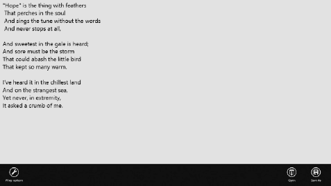

使用应用栏时，不要将 `RequestedTheme` 设置为 `Light`，否则按钮将几乎不可见。`AppBar` 定义了 `IsOpen` 属性，你可以将其设置为 `true` 以使对话框可见。

## 弹出窗口与对话框

当点击 MetroPad1 应用栏中标记为“换行选项”的 `Button` 时，程序会显示一个包含“换行”和“不换行”项的小对话框。这样的对话框通常定义为 `UserControl`：

示例 7-7。项目：MetroPad1 | 文件：WrapOptionsDialog.xaml (节选)

```xml
<UserControl ... >

    <Grid Background="{StaticResource ApplicationPageBackgroundBrush}">
        <StackPanel Name="stackPanel"
                    Margin="24">
            <RadioButton Content="Wrap"
                         Checked="OnRadioButtonChecked">
                <RadioButton.Tag>
                    <TextWrapping>Wrap</TextWrapping>
                </RadioButton.Tag>
            </RadioButton>

            <RadioButton Content="No wrap"
                         Checked="OnRadioButtonChecked">
                <RadioButton.Tag>
                    <TextWrapping>NoWrap</TextWrapping>
                </RadioButton.Tag>
            </RadioButton>
        </StackPanel>
    </Grid>
</UserControl>
```

关于颜色几句话。你会注意到这个 `Grid` 使用了标准的背景刷。它需要某种刷，否则背景将是透明的。我见过的 Metro 风格应用程序中的所有对话框都是白色背景黑色文字。然而，在尝试反转对话框颜色时，我过着沮丧的经历。你可以将 `Grid` 背景设置为 `ApplicationTextBrush` 或显式设置为白色，但在根元素上设置 `Foreground` 并会传递给 `RadioButton` 控件，即使在单个控件上显式设置 `Foreground`（或使用样式）也无法正确着色。

这意味着在修复控件之前，书中的对话框将具有黑色背景和白色文字。

对话框的代码后文件定义了一个类型为 `TextWrapping` 的名为 `TextWrapping` 的依赖属性。当该属性被设置时，属性更改处理器会检查 `RadioButton`，而当用户勾选 `RadioButton` 时，该属性会被设置：

示例 7-8。项目：MetroPad1 | 文件：WrapOptionsDialog.xaml.cs (节选)


```csharp
public sealed partial class WrapOptionsDialog : UserControl
{
    static WrapOptionsDialog()
    {
        TextWrappingProperty = DependencyProperty.Register("TextWrapping",
            typeof(TextWrapping),
            typeof(WrapOptionsDialog),
            new PropertyMetadata(TextWrapping.NoWrap, OnTextWrappingChanged));
    }

    public static DependencyProperty TextWrappingProperty { private set; get; }

    public WrapOptionsDialog()
    {
        this.InitializeComponent();
    }

    public TextWrapping TextWrapping
    {
        set { SetValue(TextWrappingProperty, value); }
        get { return (TextWrapping)GetValue(TextWrappingProperty); }
    }

    static void OnTextWrappingChanged(DependencyObject obj,
                                      DependencyPropertyChangedEventArgs args)
    {
        (obj as WrapOptionsDialog).OnTextWrappingChanged(args);
    }

    void OnTextWrappingChanged(DependencyPropertyChangedEventArgs args)
    {
        foreach (UIElement child in stackPanel.Children)
        {
            RadioButton radioButton = child as RadioButton;
            radioButton.IsChecked = (TextWrapping)radioButton.Tag == (TextWrapping)args.NewValue;
        }
    }

    void OnRadioButtonChecked(object sender, RoutedEventArgs args)
    {
        this.TextWrapping = (TextWrapping)(sender as RadioButton).Tag;
    }
}
```

“换行选项”应用栏按钮的事件处理器位于 `BlankPage` 后置代码文件中。该事件处理器实例化了一个 `WrapOptionsDialog` 对象，并根据 `TextBox` 的 `TextWrapping` 属性初始化其 `TextWrapping` 属性。随后，它在代码中为两个 `TextWrapping` 属性定义了一个绑定。这允许用户直接在 `TextBox` 中看到更改该属性后的结果。然后，将 `WrapOptionsDialog` 对象设置为新 `Popup` 对象的子项：

示例 7-9. 项目：MetroPad1 | 文件：`BlankPage.xaml.cs`（节选）

```csharp
void OnWrapOptionsAppBarButtonClick(object sender, RoutedEventArgs args)
{
    // 创建对话框
    WrapOptionsDialog wrapOptionsDialog = new WrapOptionsDialog
    {
        TextWrapping = txtbox.TextWrapping
    };

    // 将对话框绑定到 TextBox
    Binding binding = new Binding
    {
        Source = wrapOptionsDialog,
        Path = new PropertyPath("TextWrapping"),
        Mode = BindingMode.TwoWay
    };
    txtbox.SetBinding(TextBox.TextWrappingProperty, binding);

    // 创建弹出框
    Popup popup = new Popup
    {
        Child = wrapOptionsDialog,
        IsLightDismissEnabled = true
    };

    // 根据内容大小调整位置
    wrapOptionsDialog.SizeChanged += (dialogSender, dialogArgs) =>
    {
        popup.VerticalOffset = this.ActualHeight - wrapOptionsDialog.ActualHeight
                                                 - this.BottomAppBar.ActualHeight - 48;
        popup.HorizontalOffset = 48;
    };

    // 打开弹出框
    popup.IsOpen = true;
}
```

如你所见，`Popup` 也具有一个“轻量释放”（light dismiss）模式，允许你通过点击外部任何地方来关闭 `Popup`。默认情况下该属性是未开启的，但在大多数情况下应该是开启的。

困难之处在于定位 `Popup`。它具有用于此目的的 `VerticalOffset` 和 `HorizontalOffset` 属性，但通常此类弹出框被放置在应用栏的正上方，这意味着你需要知道弹出框的高度、页面的高度以及应用栏的高度才能准确放置。我发现，在对话框控件上设置 `SizeChanged` 事件是获取这些信息并进行计算的好方法。

`Click` 处理程序最后通过将 `Popup` 的 `IsOpen` 属性设置为 `true` 来结束，代码所示：

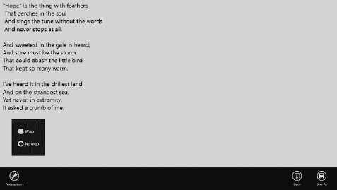

当用户点击 `Popup` 外部任何地方时，`Popup` 会自动关闭，然后用户需要再次点击一次关闭应用栏。与 `AppBar` 一，`Popup` 也具有 `Opened` 和 `Closed` 事件，如果你需要执行某些初始化或清理工作。例如，可以为 `Popup` 的 `Closed` 事件安装处理程序，并用它将 `AppBar` 的 `IsOpen` 属性设置为 `false`。

## Windows 运行时文件 I/O

MetroPad1 拥有“打开”和“另存为”按钮。如果这是一个真实的应用程序，它还会有“新建”和“保存”按钮，并且如果你在未保存之前工作的情况下按下“新建”或“打开”，它会提示你保存文件。该逻辑将在 XamlCruncher 中介绍。这里更实际的目标是介绍 Windows Runtime 的 `FileOpenPicker` 和 `FileSavePicker` 类，以及一些基础 Windows Runtime 文件 I/O。

如果你熟悉 .NET 的 `System.IO` 命名空间，可以利用你已经了解的一些知识，但 Windows 8 版本的 `System.IO` 可能会显得有些瘦弱。准备好面对许多新的文件 I/O 类和概念。整个文件和流接口已经过重构，任何访问磁盘的方法都是异步的。幸运的是，C# 5.0 引入了两个新关键字 `await` 和 `async`，这使得处理异步方法变得非常简单。但首先我想向你展示如何在不使用 `await` 和 `async` 的情况下使用这些异步方法。

`FileOpenPicker` 和 `FileSavePicker` 类定义在 `Windows.Storage.Pickers` 命名空间中。这些选择器会接管屏幕，直到完成后才向你的应用程序返回控制权。如果这来说是无法接受的，你可能想要探索 `Windows.Storage.Search` 中的 `FolderInformation` 类来自行获取文件和子目录。

`FileOpenPicker` 和 `FileSavePicker` 类向你的应用程序交付 `StorageFile` 对象。`StorageFile` 定义在 `Windows.Storage` 命名空间中，代表一个未打开的文件。调用 `StorageFile` 的任意 `Open` 方法可以获得一个表示为 `IInputStream` 或 `IRandomAccessStream` 的流对象。你可以为该流附加 `DataReader` 或 `DataWriter` 对象以便读取或写入。这些流类和接口位于 `Windows.Storage.Streams`。通过 `System.IO` 定义的扩展方法，也可以从 Windows Runtime 对象创建 .NET `Stream` 对象，然后使用熟悉的 .NET 对象（如 `StreamReader` 或 `StreamWriter`）处理这些文件。你可能可以利用某些使用 .NET 流的现有代码，并且还需要这些 .NET 流对象来读写 XML 文件。

调用 `FileOpenPicker` 的先决条件是向 `FileTypeFilter` 集合添加至少一个字符串（例如 `.txt`）。然后调用 `PickSingleFileAsync` 方法。


但如果 Windows Runtime 本身的某个特定方法调用耗时很长呢？应用程序程序员是否需要预见到该问题，并将该调用放在辅助线程中呢？

不，这似乎不合理。出于这个原因，当微软开发人员设计 Windows Runtime 时，他们试图识别任何可能需要超过 50 毫秒才能将控制权返回应用程序的方法调用。Windows Runtime 中约有 10–15% 符合此条件。这些方法被设置为异步的，这意味着方法本身会派生辅助线程来执行耗时的处理。它们会很快地将控制权返回给应用程序，并在稍完成后通知应用程序。

### 异步方法

这些异步方法都以 `Async` 后缀标识，并且它们都具有相似的定义模式。

`FileOpenPicker` 类中显示选择器并返回用户选择的文件的方法调用绝对不会在 50 毫秒内将控制权返回给程序。因此，它没有名为 `PickSingleFile` 的方法，而是有了一个名为 `PickSingleFileAsync` 的方法调用。

以下是 MetroPad1 中应用程序栏 Open 按钮的 `Click` 处理程序，显示了 `FileOpenPicker` 的创建和初始化，以及 `PickSingleFileAsync` 调用：

示例 7-10. 项目：MetroPad1 | 文件: BlankPage.xaml.cs (节选)

```cs
void OnOpenAppBarButtonClick(object sender, RoutedEventArgs args)
{
    FileOpenPicker picker = new FileOpenPicker();
    picker.FileTypeFilter.Add(".txt");
    IAsyncOperation<StorageFile> asyncOp = picker.PickSingleFileAsync();
    asyncOp.Completed = OnPickSingleFileCompleted;
}

void OnPickSingleFileCompleted(IAsyncOperation<StorageFile> asyncInfo, AsyncStatus asyncStatus)
{
    ...
}
```

`PickSingleFileAsync` 返回很快，但它返回的不是用户选择的 `StorageFile`，而是泛型类型 `IAsyncOperation<StorageFile>` 的对象。那个 `StorageFile` 类型是非常重要的，因为这正是 `PickSingleFileAsync` *最终* 会交付给你的程序的内容，只是不会立即交付。由于原因，有时像 `IAsyncOperation` 这样的对象被称为“未来”（future）或“承诺”（promise）。

`IAsyncOperation<T>` 派生自 `IAsyncInfo` 接口，该接口定义了名为 `Cancel` 和 `Close` 的方法以及名为 `Id`、`Status` 和 `ErrorCode` 的属性。`IAsyncOperation<T>` 接口额外定义了一个名为 `Completed` 的属性，你会注意到它在代码中被设置了。

这个 `Completed` 属性是一个类型为 `AsyncOperationCompletedHandler<T>` 的委托。尽管它被定义为一个属性，但它的功能类似于一个事件。（区别在于，事件可以有多个处理器，而属性只能有一个。）

要实际启动显示 `FileOpenPicker`，你的程序简单地将 `IAsyncOperation<StorageFile>` 对象的 `Completed` 属性设置为所需类型的方法，在此处命名为 `OnPickSingleFileCompleted`。

这里没有独立的 `Start` 方法。设置 `Completed` 属性会启动它的运行，但可能不会立即开始。如果你的方法在设置 `Completed` 属性之后包含任何代码，那么这些代码将首先执行。只有在 `OnOpenAppBarButtonClick` 将控制权返回操作系统后，文件选择器才会显示。然后用户将与其进行交互。

当用户从选择器选择一个文件并按 OK（或按取消）时，Windows 已准备好将文件交付回你的程序。程序中的 `Completed` 回调方法（此处称为 `OnPickSingleFileCompleted`）被调用，其第一个参数与 `PickSingleFileAsync` 返回的对象相同，但我给它了一个稍微不同的名称（`asyncInfo`），因为现在它实际上为我们提供了一些信息。

如果发生了错误——尽管在这种情况下不太——此 `asyncInfo` 参数的 `ErrorCode` 属性不为空，并等于一个描述问题的 `Exception` 对象。


对于任何特定的窗口，只能有一个应用程序线程来处理用户输入并显示与该输入交互的图形。因此，这个“UI 线程”（如其名称）对于 Windows 应用程序来说非常重要且特殊，因为所有与用户的交互都必须通过该线程进行。

这种限制可以泛化：`DependencyObject` 不是线程安全的。任何基于派自 `DependencyObject` 类的对象都只能由创建该对象的线程访问。

在我们遇到的特定问题中，将文本传输到 `TextBox` 的代码必须在 UI 线程中运行。幸运的是，有办法可以做到。为了补偿非线程安全的缺陷，`DependencyObject` 有一个名为 `Dispatcher` 的属性，它返回一个类型为 `CoreDispatcher`的对象。`CoreDispatcher` 的 `HasThreadAccess` 属性可以让你是否可以从运行代码的线程访问这个特定的 `DependencyObject`。如果你不能（即使可以），你也可以将一段代码放入队列中，由创建对象的线程执行。你通过调用 `Invoke` 方法来实现这一点，并引用你代码中的一个方法，该方法将在正确的线程中运行。

这里是 `OnDataReaderLoadCompleted` 方法，它在页面的 `Dispatcher` 属性上调用了 `Invoke`。使用谁的 `CoreDispatcher` 对象并不重要；因为所有的用户界面对象都在同一个 UI 线程中创建，它们的工作方式完全相同。传递给 `Invoke` 的最后一个参数将作为事件参数的 `Context` 属性传递给处理器：

示例 7-14. 项目：MetroPad1 | 文件：BlankPage.xaml.cs (节选)

```
void OnDataReaderLoadCompleted(IAsyncOperation<uint> asyncInfo, AsyncStatus asyncStatus)
{
    if (asyncInfo.ErrorCode != null)
        return;

    uint length = asyncInfo.GetResults();
    string text = dataReader.ReadString(length);

    this.Dispatcher.Invoke(CoreDispatcherPriority.Normal,
                           SetTextBoxText, this, text);
}

void SetTextBoxText(object sender, InvokedHandlerArgs args)
{
     string text = args.Context as string;
     txtbox.Text = text;
}
```

`SetTextBoxText` 方法在 UI 线程中运行，以便安全地将来自文件的文本设置到 `TextBox` 中。通常情况下，在 UI 线程中执行的方法以匿名方法的形式传递给 `Invoke`，如下：

```
this.Dispatcher.Invoke(CoreDispatcherPriority.Normal, (sender, args) =>
    {
        txtbox.Text = text;
    },
    this, null);
```

事实上，所有的 `Completed` 方法都可以定义为匿名方法，这正我在 MetroPad1 中保存文件逻辑时所做的。

尽管如此，保存到文件可能比打开文件更复杂，因为涉及到四个异步操作：`FileSavePicker` 上的 `PickSaveFileAsync`、在 `StorageFile` 上调用 `OpenAsync`（以获取创建 `DataWriter` 的流），以及在对该 `DataWriter` 调用 `WriteString` 后，再调用 `StoreAsync` 和 `FlushAsync`。然而，有一些快捷方法。`Windows.Storage` 中的 `FileIO` 类包含静态方法，可以一次性读取和写入整个 `StorageFile` 对象。

总结来说，在实现“另存为”按钮时，我使用了文件 I/O 的快捷方法，并对 `Completed` 处理器和 `Invoke` 方法使用了匿名方法。所有内容都放在按钮的 `Click` 处理器中：

示例 7-15. 项目：MetroPad1 — 文件：BlankPage.xaml.cs (节选)

```
void OnSaveAsAppBarButtonClick(object sender, RoutedEventArgs args)
{
    FileSavePicker picker = new FileSavePicker();
    picker.DefaultFileExtension = ".txt";
    picker.FileTypeChoices.Add("Text", new List<string> { ".txt" });

    picker.PickSaveFileAsync().Completed = (asyncInfo, asyncStatus) =>
        {
            if (asyncInfo.ErrorCode != null)
                return;

            StorageFile storageFile = asyncInfo.GetResults();

            if (storageFile == null)
                return;

            string text = null;

            this.Dispatcher.Invoke(CoreDispatcherPriority.Normal,
                                   (dispatcherSender, dispatcherArgs) =>
                {
                    text = txtbox.Text;
                },
                this, null);

            FileIO.WriteTextAsync(storageFile, text).Completed = (asyncInfo2, asyncStatus2) =>
                {
                };
        };
}
```

这其实并不糟，但随着嵌套匿名处理程序数量的增加，结构可能会变得非常笨拙，特别是在跟踪程序流或实现简单的 `return` 语句时会非常混乱。

迫切需要另一种解决方案。幸运的是，它存在。

## Await 和 Async

C# 5.0 关键字 `await` 允许我们像处理相对普通的方法调用一样处理异步操作。MetroPad2 程序与 MetroPad1 相同，除了处理应用程序栏上的“打开”和“另存为”按钮之外。这里是“另存为”按钮的 `Click` 处理器：

示例 7-16. 项目：MetroPad2 — 文件：BlankPage.xaml.cs (节选)

```
async void OnSaveAsAppBarButtonClick(object sender, RoutedEventArgs args)
{
    FileSavePicker picker = new FileSavePicker();
    picker.DefaultFileExtension = ".txt";
    picker.FileTypeChoices.Add("Text", new List<string> { ".txt" });

    // 异步调用!
    StorageFile storageFile = await picker.PickSaveFileAsync();

    if (storageFile == null)
        return;

    // 异步调用!
    await FileIO.WriteTextAsync(storageFile, txtbox.Text);
}
```

注意带有注释的两个 `await`。`PickSaveFileAsync` 实际上返回一个 `IAsyncOperation`，通常必须在上面设置 `Completed` 处理器，然后在 `Completed` 回调中调用 `GetResults` 来获取 `StorageFile` 对象。`await` 运算符似乎跳过了所有琐碎的工作并直接返回 `StorageFile`。这正是它所做的，只不过不是立即。

这看起来像魔法，但许多琐碎的实现细节现在被隐藏了。C# 编译器生成回调和 `GetResults` 调用。但 `await` 运算符所做的是将使用它的方法转换为状态机。`OnSaveAsAppBarButtonClick` 方法正常执行，直到调用 `PickSaveFileAsync` 并出现第一个 `await`。

尽管命名如此，该 `await` **并没有**等待操作完成。相反，`Click` 处理器在该处退出。控制权返回给 Windows。程序用户界面线程的其他代码可以运行，文件选择器本身也是如此。当文件选择器关闭、结果就绪且 UI 线程准备好运行某些代码时，`Click` 处理器的执行将从 `storageFile` 变量赋值处继续，直到下一个 `await` 运算符。依此类推，可以使用你喜欢的任意 `await` 运算符，直到方法完成。

此 `Click` 处理器的最后一行调用了静态的 `FileIO.WriteTextAsync` 方法。严格来说，这里不需要 `await` 运算符，因为 `Click` 处理器的结束不需要等待该方法的结束。`FileIO.WriteTextAsync` 方法没有返回任何内容，`Click` 处理器中的其他内容也不依赖于它的结束。在这种情况下，可以移除该 `await` 运算符，程序将正常工作：

```
FileIO.WriteTextAsync(storageFile, txtbox.Text);
```

你会收到编译器的警告信息，但没关系。`await` 运算符只有在你需要异步方法的返回值或在方法完成之前需要继续程序逻辑时才至关重要。

这里是现在使用静态 `FileIO.ReadTextAsync` 快捷方法的“打开”按钮的 `Click` 处理器：

示例 7-17. 项目：MetroPad2 | 文件：BlankPage.xaml.cs (节选)


```cs
async void OnOpenAppBarButtonClick(object sender, RoutedEventArgs args)
{
    FileOpenPicker picker = new FileOpenPicker();
    picker.FileTypeFilter.Add(".txt");

    // Asynchronous call!
    StorageFile storageFile = await picker.PickSingleFileAsync();

    if (storageFile == null)
        return;

    // Asynchronous call!
    txtbox.Text = await FileIO.ReadTextAsync(storageFile);
}
```

在 `await` 之前，在 C# 中调用异步操作对我来说似乎总是违反了语言的命令式结构。`await` 算符带回了这种命令式结构，并将异步调用转换为看起来像系列顺序执行的普通方法调用。此外，这些 `Click` 处理程序中的所有内容现在都运行在 UI 线程中，因此你不需要担心访问用户界面对象。但尽管 `await` 使用起来非常方便，你可能需要记住，出现 `await` 的方法实际上在后台实际上被拆分成了多个部分。

`await` 算符有一些限制。它不能出现在异常处理程序中的 `catch` 或 `finally` 子句中。然而，它可以出现在 `try` 子句中，这就是你捕获异步方法中发生错误的方法。还有取消操作的方法，某些异步方法还会报告进度。更多细节请参见后续专门介绍异步操作的章节。

出现 `await` 算符的方法必须标记为 `async`，但 `async` 关键字本身并没有起太大作用。在 C# 的早期版本中，`await` 并不是关键字，所以程序员可以使用该词作为变量名、属性名或任何名称。在 C# 5.0 中添加新的 `await` 关键字会破坏这些代码，但将 `await` 限制在标记为 `async` 的方法中就避免了这个问题。`async` 修饰符不会改变方法的签名——上面的方法仍然是一个有效的 `Click` 处理程序。但你不能在用作入口点的方法（例如 `Main` 或类构造函数）中使用 `async`（因此也无法无法使用 `await`）。

如果你需要在初始化 `FrameworkElement` 派生类时调用异步方法，请在 `Loaded` 事件的处理程序中执行它们并将其标记为 `async`：

```cs
public BlankPage()
{
    this.InitializeComponent();
    ...
    Loaded += OnLoaded;
}
async void OnLoaded(object sender, RoutedEventArgs arg)
{
    ...
}
```

或者，如果你喜欢将 `Loaded` 处理程序定义为匿名方法：

```cs
public BlankPage()
{
    this.InitializeComponent();
    ...
    Loaded += async (sender, args) =>
        {
            ...
        };
}
```

看到参数列表之前的 `async` 吗？

## 调用你自己的异步方法

假设你想在一个像下面的方法中隔离文件保存逻辑：

```cs
async void SaveFile(string text)
{
    FileSavePicker picker = new FileSavePicker();
    picker.DefaultFileExtension = ".txt";
    picker.FileTypeChoices.Add("Text", new List<string> { ".txt" });
    StorageFile storageFile = await picker.PickSaveFileAsync();

    if (storageFile == null)
        return;

    await FileIO.WriteTextAsync(storageFile, txtbox.Text);
}
```

由于该方法包含 `await` 关键字，因此必须标记为 `async`。然后你可以这样从 `OnSaveAsAppBarButtonClick` 调用此方法：

```cs
void OnSaveAsAppBarButtonClick(object sender, RoutedEventArgs args)
{
    SaveFile(txtbox.Text);
}
```

这里发生的情况是 `OnSaveAsAppBarButtonClick` 调用了 `SaveFile`，而 `SaveFile` 开始执行，直到 `PickSaveFileAsync` 调用上的第一个 `await`。在此时，`SaveFile` 将控制权交回 `OnSaveAsAppBarButtonClick`，该方法执行完毕。当 `PickSaveFileAsync` 有结果时，`SaveFile` 继续执行。

在这种情况下，这样做可以。但如果你想让 `OnSaveAsAppBarButtonClick` 方法等待 `SaveFile` 的执行，它必须包含 `await` 关键字并标记为 `async`：

```cs
async void OnSaveAsAppBarButtonClick(object sender, RoutedEventArgs args)
{
    await SaveFile(txtbox.Text);
}
```

但当你这样做时，`SaveFile` 也必须进行更改。它不再返回 `void`。你可以通过多种方式修改 `SaveFile`，但最简单的方法是将返回类型更改为 `Task`：

```cs
async Task SaveFile(string text)
{
    ...
}
```

此时，你可能还想将方法命名为 `SaveFileAsync`，以指示它是可以被等待的异步方法。虽然你在 `SaveFileAsync` 方法中编写的代码不在辅助线程中运行，但 `SaveFileAsync` 用的其他异步方法是。

`OnAppBarButtonClick` 与 `ReadFileAsync` 方法类似的分离有所不同。你可能希望 `ReadFileAsync` 方法返回文件的内容，因此返回类型不是 `Task` 而是 `Task<string>`：

```cs
async Task<string> ReadFileAsync()
{
    FileOpenPicker picker = new FileOpenPicker();
    picker.FileTypeFilter.Add(".txt");
    StorageFile storageFile = await picker.PickSingleFileAsync();

    if (storageFile == null)
        return null;

    return await FileIO.ReadTextAsync(storageFile);
}
```

你就可以这样调用 `ReadFileAsync`：

```cs
async void OnOpenAppBarButtonClick(object sender, RoutedEventArgs args)
{
    string text = await ReadFileAsync();

    if (text != null)
        txtbox.Text = text;
}
```

## XamlCruncher 的控件

现在你已经看到了一些基础的文件 I/O 和异步处理，是时候开始查看 XamlCruncher 了。我不会假装这个程序是商业级的，甚至假装它没有某些严重的缺陷。但这是一个具有真实 Metro 风格功能的程序，我一定会对其进行改进以修复第一个版本可能存在的任何问题或缺陷。

XamlCruncher 允许你输入 XAML 并看到生成的对象和视觉树。XamlCruncher 使用的魔法方法是 `XamlReader.Load`，你在 `PathMarkupSyntaxCode` 项目中已经略微见过它。


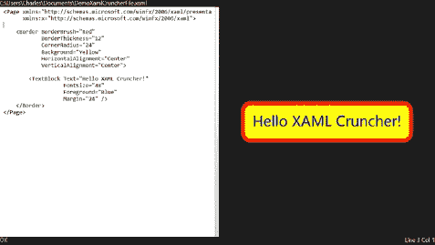

该编辑器没有包含任何便利功能。当你输入起始标签时，它甚至不会自动生成结束标签；它不会为元素、属性和字符串使用不同的颜色；而且没有类似于 IntelliSense 的功能。然而，页面的配置是可以更改的：你可以将编辑窗口放在顶部、右侧或底部。

应用程序栏具有添加（Add）、打开（Open）、保存（Save）和另存为（Save As）按钮，以及刷新按钮和一个选项按钮：

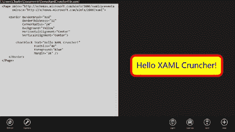

你可以选择 `XamlCruncher` 是每次按键时重新解析 `XAML`，还是仅在点击刷新按钮时重新解析。该选项和其他选项在点击选项按钮时弹出的对话框可用：

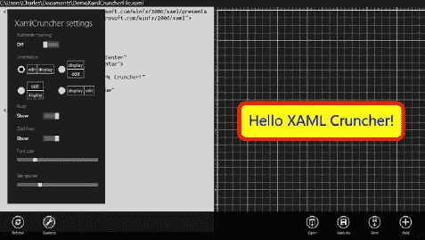

我开启了`Ruler`标尺）和`Grid Lines`网格线）选项，以便在右侧显示区域展示结果。所有这些选项都会保存供下次运行程序使用。

页面大部分是一个名为 `SplitContainer` 的自定义 `UserControl` 派生类。中心是一个`Thumb`控件，允许你选择左面板和右面板（或顶部和底部面板）的空间比例。在截图中，这个 `Thumb` 是屏幕中心的一个较灰色的垂直条。`SplitContainer` 的 `XAML` 文件由为水平和垂直配置定义的`Grid`组成：

示例 7-18. Project: XamlCruncher | File: SplitContainer.xaml

```
<UserControl
    x:Class="XamlCruncher.SplitContainer"
    xmlns="http://schemas.microsoft.com/winfx/2006/xaml/presentation"
    xmlns:x="http://schemas.microsoft.com/winfx/2006/xaml"
    xmlns:local="using:XamlCruncher">

    <Grid>
        <!-- 默认方向为水平 -->
        <Grid.ColumnDefinitions>
            <ColumnDefinition x:Name="coldef1" Width="*" MinWidth="100" />
            <ColumnDefinition Width="Auto" />
            <ColumnDefinition x:Name="coldef2" Width="*" MinWidth="100" />
        </Grid.ColumnDefinitions>

        <!-- 备方向为垂直 -->
        <Grid.RowDefinitions>
            <RowDefinition x:Name="rowdef1" Height="*" />
            <RowDefinition Height="Auto" />
            <RowDefinition x:Name="rowdef2" Height="0" />
        </Grid.RowDefinitions>

        <Grid Name="grid1"
              Grid.Row="0"
              Grid.Column="0" />

        <Thumb Name="thumb"
               Grid.Row="0"
               Grid.Column="1"
               Width="12"
               DragStarted="OnThumbDragStarted"
               DragDelta="OnThumbDragDelta" />

        <Grid Name="grid2"
              Grid.Row="0"
              Grid.Column="2" />
    </Grid>
</UserControl>
```

你已经在 `OrientableColorScroll` 程序中见过类似的标记代码，该程序会在页面宽高比在横屏和纵屏之间切换时更改 `Grid`。

后置代码文件定义了五个由依赖属性支持的属性。通常，你会将 `Child1` 和 `Child2` 属性设置为要出现在控件左侧和右侧的元素，但它们实际出现的位置由 `Orientation` 和 `SwapChildren` 属性决定：

示例 7-19. Project: XamlCruncher | File: SplitContainer.xaml.cs (节)

```
public sealed partial class SplitContainer : UserControl
{
    // 静态构造函数和属性
    static SplitContainer()
    {
        Child1Property =
            DependencyProperty.Register("Child1",
                typeof(UIElement), typeof(SplitContainer),
                new PropertyMetadata(null, OnChildChanged));

        Child2Property =
            DependencyProperty.Register("Child2",
                typeof(UIElement), typeof(SplitContainer),
                new PropertyMetadata(null, OnChildChanged));

        OrientationProperty =
            DependencyProperty.Register("Orientation",
                typeof(Orientation), typeof(SplitContainer),
                new PropertyMetadata(Orientation.Horizontal, OnOrientationChanged));

        SwapChildrenProperty =
            DependencyProperty.Register("SwapChildren",
                typeof(bool), typeof(SplitContainer),
                new PropertyMetadata(false, OnSwapChildrenChanged));

        MinimumSizeProperty =
            DependencyProperty.Register("MinimumSize",
                typeof(double), typeof(SplitContainer),
                new PropertyMetadata(100.0, OnMinSizeChanged));
    }

    public static DependencyProperty Child1Property { private set; get; }
    public static DependencyProperty Child2Property { private set; get; }
    public static DependencyProperty OrientationProperty { private set; get; }
    public static DependencyProperty SwapChildrenProperty { private set; get; }
    public static DependencyProperty MinimumSizeProperty { private set; get; }

    // 实例构造函数和属性
    public SplitContainer()
    {
        this.InitializeComponent();
    }

    public UIElement Child1
    {
        set { SetValue(Child1Property, value); }
        get { return (UIElement)GetValue(Child1Property); }
    }

    public UIElement Child2
    {
        set { SetValue(Child2Property, value); }
        get { return (UIElement)GetValue(Child2Property); }
    }

    public Orientation Orientation
    {
        set { SetValue(OrientationProperty, value); }
        get { return (Orientation)GetValue(OrientationProperty); }
    }

    public bool SwapChildren
    {
        set { SetValue(SwapChildrenProperty, value); }
        get { return (bool)GetValue(SwapChildrenProperty); }
    }

    public double MinimumSize
    {
        set { SetValue(MinimumSizeProperty, value); }
        get { return (double)GetValue(MinimumSizeProperty); }
    }
    ...
}
```

`Orientation` 属性的类型是 `Orientation`，与 `StackPanel` 和 `VariableSizedWrapGrid` 使用的枚举相同。使用现有类型创建依赖属性比自己发明类型要好。注意 `MinimumSize` 的类型是 `double`，因此初始化为 100.0 而不是 100，以防止运行时出现类型不匹配。

属性更改处理程序展示了程序员在从静态处理器调用实例属性更改处理程序时使用的两种不同方法。我已经向你展示了一种方法：静态处理器直接使用相同的 `DependencyPropertyChangedEventArgs` 对象调用实例处理程序。有时（对于 `Orientation`、`SwapChildren` 和 `MinimumSize` 属性的处理程序），让静态处理器将旧值和新值转换为适当类型后调用实例处理程序会更方便：

示例 7-20. Project: XamlCruncher | File: SplitContainer.xaml.cs (节)


```sharp
public sealed partial class SplitContainer : UserControl
{
    ...
    // Property changed handlers
    static void OnChildChanged(DependencyObject obj,
                               DependencyPropertyChangedEventArgs args)
    {
        (obj as SplitContainer).OnChildChanged(args);
    }

    void OnChildChanged(DependencyPropertyChangedEventArgs args)
    {
        Grid targetGrid = (args.Property == Child1Property ^ this.SwapChildren) ? grid1 : grid2;
        targetGrid.Children.Clear();

        if (args.NewValue != null)
            targetGrid.Children.Add(args.NewValue as UIElement);
    }

    static void OnOrientationChanged(DependencyObject obj,
                                     DependencyPropertyChangedEventArgs args)
    {
        (obj as SplitContainer).OnOrientationChanged((Orientation)args.OldValue,
                                                     (Orientation)args.NewValue);
    }

    void OnOrientationChanged(Orientation oldOrientation, Orientation newOrientation)
    {
        // Shouldn't be necessary, but...
        if (newOrientation == oldOrientation)
            return;

        if (newOrientation == Orientation.Horizontal)
        {
            coldef1.Width = rowdef1.Height;
            coldef2.Width = rowdef2.Height;

            coldef1.MinWidth = this.MinimumSize;
            coldef2.MinWidth = this.MinimumSize;

            rowdef1.Height = new GridLength(1, GridUnitType.Star);
            rowdef2.Height = new GridLength(0);

            rowdef1.MinHeight = 0;
            rowdef2.MinHeight = 0;

            thumb.Width = 12;
            thumb.Height = Double.NaN;

            Grid.SetRow(thumb, 0);
            Grid.SetColumn(thumb, 1);

            Grid.SetRow(grid2, 0);
            Grid.SetColumn(grid2, 2);
        }
        else
        {
            rowdef1.Height = coldef1.Width;
            rowdef2.Width = coldef2.Width;

            rowdef1.MinHeight = this.MinimumSize;
            rowdef2.MinHeight = this.MinimumSize;

            coldef1.Width = new GridLength(1, GridUnitType.Star);
            coldef2.Width = new GridLength(0);

            coldef1.MinWidth = 0;
            coldef2.MinWidth = 0;

            thumb.Height = 12;
            thumb.Width = Double.NaN;

            Grid.SetRow(thumb, 1);
            Grid.SetColumn(thumb, 0);

            Grid.SetRow(grid2, 2);
            Grid.SetColumn(grid2, 0);
        }
    }

    static void OnSwapChildrenChanged(DependencyObject obj,
                                      DependencyPropertyChangedEventArgs args)
    {
        (obj as SplitContainer).OnSwapChildrenChanged((bool)args.OldValue,
                                                      (bool)args.NewValue);
    }

    void OnSwapChildrenChanged(bool oldOrientation, bool newOrientation)
    {
        grid1.Children.Clear();
        grid2.Children.Clear();

        grid1.Children.Add(newOrientation ? this.Child2 : this.Child1);
        grid2.Children.Add(newOrientation ? this.Child1 : this.Child2);
    }

    static void OnMinSizeChanged(DependencyObject obj,
                                 DependencyPropertyChangedEventArgs args)

    {
        (obj as SplitContainer).OnMinSizeChanged((double)args.OldValue,
                                                 (double)args.NewValue);
    }

    void OnMinSizeChanged(double oldValue, double newValue)
    {
        if (this.Orientation == Orientation.Horizontal)
        {
            coldef1.MinWidth = newValue;
            coldef2.MinWidth = newValue;
        }
        else
        {
            rowdef1.MinHeight = newValue;
            rowdef2.MinHeight = newValue;
        }
    }
    ...
}
```


```csharp
public sealed partial class RulerContainer : UserControl
{
    ...
    static RulerContainer()
    {
        ChildProperty =
            DependencyProperty.Register("Child",
                typeof(UIElement), typeof(RulerContainer),
                new PropertyMetadata(null, OnChildChanged));

        ShowRulerProperty =
            DependencyProperty.Register("ShowRuler",
                typeof(bool), typeof(RulerContainer),
                new PropertyMetadata(false, OnShowRulerChanged));

        ShowGridLinesProperty =
            DependencyProperty.Register("ShowGridLines",
                typeof(bool), typeof(RulerContainer),
                new PropertyMetadata(false, OnShowGridLinesChanged));
    }

    public static DependencyProperty ChildProperty { private set; get; }
    public static DependencyProperty ShowRulerProperty { private set; get; }
    public static DependencyProperty ShowGridLinesProperty { private set; get; }

    public RulerContainer()
    {
        this.InitializeComponent();
    }

    public UIElement Child
    {
        set { SetValue(ChildProperty, value); }
        get { return (UIElement)GetValue(ChildProperty); }
    }

    public bool ShowRuler
    {
        set { SetValue(ShowRulerProperty, value); }
        get { return (bool)GetValue(ShowRulerProperty); }
    }

    public bool ShowGridLines
    {
        set { SetValue(ShowGridLinesProperty, value); }
        get { return (bool)GetValue(ShowGridLinesProperty); }
    }

    // Property 更改处理程序
    static void OnChildChanged(DependencyObject obj,
                               DependencyPropertyChangedEventArgs args)
    {
        (obj as RulerContainer).border.Child = (UIElement)args.NewValue;
    }

    static void OnShowRulerChanged(DependencyObject obj,
                                   DependencyPropertyChangedEventArgs args)
    {
        (obj as RulerContainer).RedrawRuler();
    }

    static void OnShowGridLinesChanged(DependencyObject obj,
                                       DependencyPropertyChangedEventArgs args)
    {
        (obj as RulerContainer).RedrawGridLines();
    }

    void OnGridSizeChanged(object sender, SizeChangedEventArgs args)
    {
        RedrawRuler();
        RedrawGridLines();
    }

    ...

}
```

这里还展示了属性更改处理程序（在静态版本中使用它们足够简单）以及 `Grid` 的 `SizeChanged` 处理程序。两个重绘方法处理所有的绘制工作，这涉及创建 `Line` 元素和 `TextBlock` 元素，并将它们组织在两个面板中：

```csharp
public sealed partial class RulerContainer : UserControl
{
    const double RULER_WIDTH = 12;
    ...
    void RedrawGridLines()
    {
        gridLinesGrid.Children.Clear();
        if (!this.ShowGridLines)
            return;

        // 每 1/4" 垂直网格线
        for (double x = 24; x < gridLinesGrid.ActualWidth; x += 24)
        {
            Line line = new Line
            {
                X1 = x,
                Y1 = 0,
                X2 = x,
                Y2 = gridLinesGrid.ActualHeight,
                Stroke = this.Foreground,
                StrokeThickness = x % 96 == 0 ? 1 : 0.5
            };
            gridLinesGrid.Children.Add(line);
        }

        // 每 1/4" 水平网格线
        for (double y = 24; y < gridLinesGrid.ActualHeight; y += 24)
        {
            Line line = new Line
            {
                X1 = 0,
                Y1 = y,
                X2 = gridLinesGrid.ActualWidth,
                Y2 = y,
                Stroke = this.Foreground,
                StrokeThickness = y % 96 == 0 ? 1 : 0.5
            };
            gridLinesGrid.Children.Add(line);
        }
    }
    // ... (后续代码)


如果你需要找到自动换行的 `TextBlock` 的尺寸，你必须为 `Size` 构造函数提供一个非零的参数，以便 `TextBlock` 知道要在哪个宽度内进行换行。

在调用 `Measure` 后，`TextBlock` 的 `ActualWidth` 和 `ActualHeight` 属性是有效的，并可在 `Canvas` 中定位 `TextBlock`。只有在 `Canvas` 中定位 `TextBlock` 元素时，才需要调用 `Canvas.SetLeft` 和 `Canvas.SetTop` 属性。在单单元 `Grid` 还是 `Canvas`，`Line` 元素都是根据它们的坐标进行定位的。

正如你看到的，`RulerContainer` 的实例被设置为占据 XamlCruncher 页面的 `SplitContainer` 的 `Child2` 属性。`Child1` 属性似乎是一个 `TextBox`，但实际上它是另一个名为 `TabbableTextBox` 的自定义控件实例，它派生自 `TextBox`。

标准的 `TextBox` 对 Tab 键没有响应，当你在编辑器中输入 XAML 时，你真的需要 Tab 键。这就是 `TabbableTextBox` 的主要功能，此处完整显示如下：

示例 7-24. 项目：XamlCruncher | 文件：TabbableTextBox.cs

```csharp
using Windows.System;
using Windows.UI.Xaml;
using Windows.UI.Xaml.Controls;
using Windows.UI.Xaml.Input;

namespace XamlCruncher
{
    public class TabbableTextBox : TextBox
    {
        static TabbableTextBox()
        {
            TabSpacesProperty =
                DependencyProperty.Register("TabSpaces",
                    typeof(int), typeof(TabbableTextBox),
                    new PropertyMetadata(4));
        }

        public static DependencyProperty TabSpacesProperty { private set; get; }

        public int TabSpaces
        {
            set { SetValue(TabSpacesProperty, value); }
            get { return (int)GetValue(TabSpacesProperty); }
        }

        public bool IsModified { set; get; }

        protected override void OnKeyDown(KeyEventArgs args)
        {
            this.IsModified = true;

            if (args.Key == VirtualKey.Tab)
            {
                int line, col;
                GetPositionFromIndex(this.SelectionStart, out line, out col);
                int insertCount = this.TabSpaces - col % this.TabSpaces;
                this.SelectedText = new string(' ', insertCount);
                this.SelectionStart += insertCount;
                this.SelectionLength = 0;
                args.Handled = true;
                return;
            }
            base.OnKeyDown(args);
        }

        public void GetPositionFromIndex(int index, out int line, out int col)
        {
            if (index > Text.Length)
            {
                line = col = -1;
                return;
            }

            line = col = 0;
            bool justFoundEol = false;

            for (int i = 0; i < index; i++)
            {
                if (Text[i] == '\r' || Text[i] == '\n')
                {
                    if (!justFoundEol)
                        line++;

                    col = 0;
                    justFoundEol = true;
                }
                else
                {
                    col++;
                    justFoundEol = false;
                }
            }
            return;
        }
    }
}
```

该类拦截了 `OnKeyDown` 方法以判断是否按下了 Tab 键。如果是的话，它会在 `Text` 对象中插入空格，使光标移动到是 `TabSpaces` 属性的整数倍的文本列。此计算需要知道光标在当前行上的字符位置。为了获取此信息，它使用了在该类中定义的 `GetPositionFromIndex` 方法。该方法是公共的，XamlCruncher 也用它来显示光标的当前位置和当前选择内容（如果有）。

另一个不受依赖属性支持的属性也由 `TabbableTextBox` 定义。这就是 `IsModified`，每当发生 `KeyDown` 事件时，它就会被设置为 `true`。

与许多处理文档的程序一样，XamlCruncher 会跟踪文本文件自上次保存以来是否发生了变化。如果用户发起了创建新文件或打开现有文件的操作，且当前文档处于修改状态，程序会询问用户是否想要保存该文档。

通常这种逻辑完全发生在 `TextBox` 控件外部。当加载新文件或保存文件时，程序将 `IsModified` 标记设置为 `true`，在接收 `TextChanged` 事件时设置为 `false`。然而，当通过程序设置 `TextBox` 的 `Text` 属性时会触发 `TextChanged` 事件，因此即使 `TextBox` 被设置为新加载的文件，`TextChanged` 事件也会触发，且 `IsModified` 标记将由 `TextChanged` 处理程序设置。你可能认为，在这种情况下可以通过在程序化设置 `Text` 属性时设置一个标记来避免设置 `IsModified` 标记。然而，在设置 `Text` 属性的方法将控制权交给操作系统之前，`TextChanged` 处理程序不会调用，这使得逻辑变得相当混乱。在 `TextBox` 派生类中实现 `IsModified` 标记是有帮助的。

## 应用设置与隔离存储

许多应用程序在程序调用之间维护用户设置和偏好。Windows Runtime 提供了一个专门供应用程序使用的应用程序数据区域（有时被称为“隔离存储”）。程序通过 `Windows.Storage` 命名空间中的 `ApplicationData` 类获取对此存储的访问权限。

可以通过静态方法 `ApplicationData.Current` 获取适用于当前应用程序的 `ApplicationData` 实例。从该对象，`TemporaryFolder` 属性提供了一个适用于临时数据的磁盘区域。其他属性——`LocalFolder, LocalSettings, RoamingFolder` 和 `RoamingSettings`——也可用于存储更持久的数据。

`LocalSettings` 属性允许你访问一个字典，你可以在其中使用名称和值存储程序设置。但我并不喜欢用这个。我倾向于从一个我通常称为 `AppSettings` 的类序列化 XML 文件来存储程序设置。从 `AppSettings` 序列化的 XML 文件可以存储在 `ApplicationData.Current.LocalFolder` 目录，你会发现它映射到机器主硬盘上的此位置：

*/Users/[username]/AppData/Local/Packages/[package family name]/LocalState*

`[username]` 是计算机上的用户名，而 `[package family name]` 大多是一个唯一标识应用程序的 GUID。对于任何 Visual Studio 项目，你可以通过打开 Package.appmanifest 文件并点击 Packaging 选项卡找到此名称。

一个应该保存的程序选项是编辑和显示区域的方向。正如你记得的，`SplitContainer` 有两个名为 `Orientation` 和 `SwapChildren` 的属性。为了存储用户设置，我想要更特定于此应用程序。`TextBox`（或者说是 `TabbableTextBox`）可以位于左、上、右或下，此枚举封装了这些选项：

示例 7-25. 项目：XamlCruncher | 文件：EditOrientation.cs

```csharp
namespace XamlCruncher
{
    public enum EditOrientation
    {
        Left, Top, Right, Bottom
    }
}
```

这里是 `AppSettings` 的前半部分，显示了构成程序设置的所有属性。该类派生自 `BindableBase` 以实现 `INotifyPropertyChanged`。所有属性值都由字段支持，并使用程序的默认设置初始化。注意 `EditOrientation` 属性基于 `EditOrientation` 枚举的：


### 7-26. 项目: XamlCruncher | 文件: AppSettings.cs

```csharp
public class AppSettings : XamlCruncher.Common.BindableBase
{
    ...
    // 设置初始值
    EditOrientation editOrientation = EditOrientation.Left;
    Orientation orientation = Orientation.Horizontal;
    bool swapEditAndDisplay = false;
    bool autoParsing = false;
    bool showRuler = false;
    bool showGridLines = false;
    double fontSize = 18;
    int tabSpaces = 8;

    public EditOrientation EditOrientation
    {
        set
        {
            if (SetProperty<EditOrientation>(ref editOrientation, value))
            {
                switch (editOrientation)
                {
                    case EditOrientation.Left:
                        this.Orientation = Orientation.Horizontal;
                        this.SwapEditAndDisplay = false;
                        break;

                    case EditOrientation.Top:
                        this.Orientation = Orientation.Vertical;
                        this.SwapEditAndDisplay = false;
                        break;

                    case EditOrientation.Right:
                        this.Orientation = Orientation.Horizontal;
                        this.SwapEditAndDisplay = true;
                        break;

                    case EditOrientation.Bottom:
                        this.Orientation = Orientation.Vertical;
                        this.SwapEditAndDisplay = true;
                        break;
                }
            }
        }
        get { return editOrientation; }
    }

    [XmlIgnore]
    public Orientation Orientation
    {
        protected set { SetProperty<Orientation>(ref orientation, value); }
        get { return orientation; }
    }

    [XmlIgnore]
    public bool SwapEditAndDisplay
    {
        protected set { SetProperty<bool>(ref swapEditAndDisplay, value); }
        get { return swapEditAndDisplay; }
    }

    public bool AutoParsing
    {
        set { SetProperty<bool>(ref autoParsing, value); }
        get { return autoParsing; }
    }

    public bool ShowRuler
    {
        set { SetProperty<bool>(ref showRuler, value); }
        get { return showRuler; }
    }

    public bool ShowGridLines
    {
        set { SetProperty<bool>(ref showGridLines, value); }
        get { return showGridLines; }
    }

    public double FontSize
    {
        set { SetProperty<double>(ref fontSize, value); }
        get { return fontSize; }
    }

    public int TabSpaces
    {
        set { SetProperty<int>(ref tabSpaces, value); }
        get { return tabSpaces; }
    }
    ...
}
```

除了 `EditOrientation` 之外，`AppSettings` 还定义了两个更直接对应 `SplitContainer` 属性的属性，分别是 `Orientation` 和 `SwapEditAndDisplay`。`set` 访问器是保护的，这些属性仅通过 `EditOrientation` 的 `set` 访问器进行设置。这两个属性还标记了 `XmlIgnore` 特性，表示当 `AppSettings` 对象被序列化为 XML 时，应该忽略这些属性。它们实际上并不是应用程序设置的一部分，但可以从应用程序设置轻松推导出，并使绑定变得更容易。

`AppSettings` 还拥有方法将自身的实例序列化为 XML 并保存为文件，以及将该文件反序列化回 `AppSettings` 实例。用于加载和保存这些文件的 `LoadAsync` 和 `SaveAsync` 方法顾如其名是异步的。它们结合使用了 Windows Runtime 类（`StorageFolder`、`StorageFile` 和 `FileIO`）和 .NET 类（`XmlSerializer`、`StringReader` 和 `StringWriter`）。

`LoadAsync` 方法必须是静态的，因为它是创建 `AppSettings` 实例的唯一方法。某些程序员喜欢使用一个名为 `Current` 的静态属性为此，以确保 `AppSettings` 是单例——换句话说，确保程序的任何地方只存在一个 `AppSettings` 实例。

### 7-27. 项目: XamlCruncher | 文件: AppSettings.cs（节）

```csharp
public class AppSettings : XamlCruncher.Common.BindableBase
{
    const string FILENAME = "applicationsettings.xml";

    ...

    public async static Task<AppSettings> LoadAsync()
    {
        StorageFolder storageFolder = ApplicationData.Current.LocalFolder;
        StorageFile appSettingsFile = null;
        AppSettings appSettings = null;

        try
        {
            appSettingsFile = await storageFolder.GetFileAsync(FILENAME);
        }
        catch (Exception)
        {
            // 这在程序第一次运行时发生
        }

        if (appSettingsFile == null)
        {
            appSettings = new AppSettings();
        }
        else
        {
            string str = await FileIO.ReadTextAsync(appSettingsFile);
            XmlSerializer xmlSerializer = new XmlSerializer(typeof(AppSettings));

            using (StringReader reader = new StringReader(str))
            {
                appSettings = xmlSerializer.Deserialize(reader) as AppSettings;
            }
        }
        return appSettings;
    }

    public async Task SaveAsync()
    {
        string settingsXml = null;

        using (StringWriter stringWriter = new StringWriter())
        {
            XmlSerializer xmlSerializer = new XmlSerializer(typeof(AppSettings));
            xmlSerializer.Serialize(stringWriter, this);
            settingsXml = stringWriter.ToString();
        }
        StorageFolder storageFolder = ApplicationData.Current.LocalFolder;
        StorageFile storageFile = null;

        try
        {
            storageFile = await storageFolder.CreateFileAsync(FILENAME,
                                                   CreationCollisionOption.ReplaceExisting);
        }
        catch (Exception)
        {
            // TODO: 这不应该发生，但可能会发生
        }
        await FileIO.WriteTextAsync(storageFile, settingsXml);
    }
}
```

当程序第一次运行时，`AppSettings.LoadAsync` 尝试访问设置文件，但该文件并不存在。抛出一个异常，随后方法直接实例化 `AppSettings`。该实例将拥有所有默认值。

## XamlCruncher 页面

现在已经创建了足够的组件，让我们开始组装此应用程序。这里是 BlankPage.xaml：


```xml
<Page ... >

    <Grid Background="{StaticResource ApplicationPageBackgroundBrush}">
        <Grid.RowDefinitions>
            <RowDefinition Height="Auto" />
            <RowDefinition Height="*" />
            <RowDefinition Height="Auto" />
        </Grid.RowDefinitions>

        <Grid.ColumnDefinitions>
            <ColumnDefinition Width="*" />
            <ColumnDefinition Width="Auto" />
        </Grid.ColumnDefinitions>

        <TextBlock Name="filenameText"
                   Grid.Row="0"
                   Grid.Column="0"
                   Grid.ColumnSpan="2"
                   FontSize="18"
                   TextTrimming="WordEllipsis" />

        <local:SplitContainer x:Name="splitContainer"
                                      Orientation="{Binding Orientation}"
                                      SwapChildren="{Binding SwapEditAndDisplay}"
                                      MinimumSize="200"
                                      Grid.Row="1"
                                      Grid.Column="0"
                                      Grid.ColumnSpan="2">
            <local:SplitContainer.Child1>
                <local:TabbableTextBox x:Name="editBox"
                                       AcceptsReturn="True"
                                       FontSize="{Binding FontSize}"
                                       TabSpaces="{Binding TabSpaces}"
                                       TextChanged="OnEditBoxTextChanged"
                                       SelectionChanged="OnEditBoxSelectionChanged"/>
            </local:SplitContainer.Child1>

            <local:SplitContainer.Child2>
                <local:RulerContainer x:Name="resultContainer"
                                      ShowRuler="{Binding ShowRuler}"
                                      ShowGridLines="{Binding ShowGridLines}" />
            </local:SplitContainer.Child2>
        </local:SplitContainer>

        <TextBlock Name="statusText"
                   Text="OK"
                   Grid.Row="2"
                   Grid.Column="0"
                   FontSize="18"
                   TextWrapping="Wrap" />

        <TextBlock Name="lineColText"
                   Grid.Row="2"
                   Grid.Column="1"
                   FontSize="18" />
    </Grid>

    <Page.BottomAppBar>
        <AppBar Padding="10 0">
            <Grid>
                <StackPanel Orientation="Horizontal" HorizontalAlignment="Left">
                    <Button Style="{StaticResource RefreshAppBarButtonStyle}"
                            Click="OnRefreshAppBarButtonClick" />

                    <Button Style="{StaticResource AppBarButtonStyle}"
                            Content="&#xE15E;"
                            AutomationProperties.Name="Options"
                            Click="OnOptionsAppBarButtonClick" />
                </StackPanel>

                <StackPanel Orientation="Horizontal" HorizontalAlignment="Right">
                    <Button Style="{StaticResource AppBarButtonStyle}"
                            Content="&#xE184;"
                            AutomationProperties.Name="Open"
                            Click="OnOpenAppBarButtonClick"
                            />

                    <Button Style="{StaticResource SaveAppBarButtonStyle}"
                            AutomationProperties.Name="Save As"
                            Click="OnSaveAsAppBarButtonClick" />

                    <Button Style="{StaticResource AppBarButtonStyle}"
                            Content="&#xE159;"
                            AutomationProperties.Name="Save"
                            Click="OnSaveAppBarButtonClick" />

                    <Button Style="{StaticResource AddAppBarButtonStyle}"
                            Click="OnAddAppBarButtonClick" />
                </StackPanel>
            </Grid>
        </AppBar>
    </Page.BottomAppBar>
</Page>
```

主 `Grid` 包含三行：

- 用于显示加载的文件名（命名为 `filenameText` 的 `TextBlock`），
- `SplitContainer`，
- 以及底部的状态栏。

状态栏由两个 `TextBlock` 元素组成，分别名为 `statusText`（用于指示可能的 XAML 解析错误）和 `lineColText`（用于显示 `TabbableTextBox` 的行和列数）。`Grid` 进一步分为两列，以对应该状态栏的两个组件。

页面大部分区域被 `SplitContainer` 占据，你会发现它对 `AppSettings` 的 `Orientation` 和 `SwapEditAndDisplay` 属性的绑定。`SplitContainer` 包含一个 `TabbableTextBox`（对 `AppSettings` 的 `FontSize` 和 `TabSpaces` 属性有绑定）和一个 `RulerContainer`（对 `ShowRuler` 和 `ShowGridLines` 有绑定）。所有这些绑定强烈表明 `BlankPage` 的 `DataContext` 被设置为 `AppSettings` 的实例。

XAML 文件的底部定义了应用程序栏的 `Button`。

正如你所预期的那样，后台代码文件（code-behind file）是项目中最长的文件，但我将通过不同的模块化部分进行讨论，以免讨论内容显得过于繁重。以下是构造函数、`Loaded` 处理程序以及一些简单的方法：

示例 7-29. 项目：XamlCruncher | 文件：BlankPage.xaml.cs (摘)

```csharp
public sealed partial class BlankPage : Page
{
    ...
    AppSettings appSettings;
    StorageFile loadedStorageFile;

    public BlankPage()
    {
        this.InitializeComponent();

        ...

        // 为什么这些没有在生成的 C# 文件中设置？
        editBox = splitContainer.Child1 as TabbableTextBox;
        resultContainer = splitContainer.Child2 as RulerContainer;

        //为 TextBox 设置固定等宽字体
        Language language = new Language();
        LanguageFontGroup languageFontGroup = new LanguageFontGroup(language.LanguageTag);
        LanguageFont languageFont = languageFontGroup.FixedWidthTextFont;
        editBox.FontFamily = new FontFamily(languageFont.FontFamily);

        Loaded += OnLoaded;
    }

    async void OnLoaded(object sender, RoutedEventArgs args)
    {
        // 加载 AppSettings 并设置 DataContext
        appSettings = await AppSettings.LoadAsync();
        this.DataContext = appSettings;

        // 其他初始化
        SetDefaultXamlFile();
        ParseText();
        editBox.Focus(FocusState.Keyboard);
        DisplayLineAndColumn();
        ...
    }

    async Task SetDefaultXamlFile()
    {
        editBox.Text =
            "<Page xmlns=\"http://schemas.microsoft.com/winfx/2006/xaml/presentation\"\r\n" +
            "      xmlns:x=\"http://schemas.microsoft.com/winfx/2006/xaml\">\r\n\r\n" +
            "    <TextBlock Text=\"Hello, Windows 8!\"\r\n" +
            "               FontSize=\"48\" />\r\n\r\n" +
            "</Page>";

        editBox.IsModified = false;
        loadedStorageFile = null;
        filenameText.Text = "";
    }
    ...
    void OnEditBoxSelectionChanged(object sender, RoutedEventArgs args)
    {
        DisplayLineAndColumn();
    }

    void DisplayLineAndColumn()
    {
        int line, col;
        editBox.GetPositionFromIndex(editBox.SelectionStart, out line, out col);
        lineColText.Text = String.Format("Line {0} Col {1}", line + 1, col + 1);

        if (editBox.SelectionLength > 0)
        {
            editBox.GetPositionFromIndex(editBox.SelectionStart + editBox.SelectionLength - 1,
                                         out line, out col);
            lineColText.Text += String.Format(" - Line {0} Col {1}", line + 1, col + 1);
        }
    }
    ...
}
```

构造函数修复了涉及 `editBox` 和 `resultContainer` 字段的一个小错误。XAML 解析器确实在编译期间创建了这些字段，但在运行时并没有通过 `InitializeComponent` 调用对其进行设置。


构造函数的剩余部分根据 `LanguageFontGroup` 类中提供的预定义字体，在 `TabbableTextBox` 中设置了固定等宽字体。这显然是从 Windows Runtime 获取实际字体族名称的唯一方法。

剩余的初始化发生在 `Loaded` 事件处理程序中，因为它需要调用 `AppSettings.LoadAsync` 异步方法，而异步方法不能在构造函数中调用。页面的 `DataContext` 被设置为 `AppSettings` 实例，这正如你可能预料的那样，从 `BlankPage.xaml` 文件中的数据绑定中可以推测出来。

`OnLoaded` 方法首先在 `TabbableTextBox` 中设置一段默认的 XAML 代码段，并调用 `ParseText` 对其进行解析。（你很快就会看到它是如何运作的了。）`TabbableTextBox` 被分配了键盘输入焦点，`OnLoaded` 通过显示初始行号和列号结束，这些位置会在每次 `TextBox` 选择发生变化时进行更新。

你可能会奇怪，为什么 `SetDefaultXamlFile` 被定义为 `async` 并返回 `Task`，因为它实际上并没有包含任何异步代码。你稍后会看到，该方法被用作文件中 I/O 逻辑中另一个方法的参数，这也是我必须这样定义它的唯一原因。由于它没有包含任何 `await` 逻辑，编译器会生成一条警告信息。

## 解析 XAML

`XamlCruncher` 的主要工作是将一段 XAML 传递给 `XamlReader.Load` 并获取一个对象。`AppSettings` 类中名为 `AutoParsing` 的属性允许这种操作在每次击键时都发生，或者等待直到你点击应用程序栏上的刷新按钮为止。

如果 `XamlReader.Load` 遇到错误，它会抛出一个异常，然后程序会在页面底部的状态栏中用红色显示该错误，并将 `TabbableTextBox` 中的文本颜色也设为红色。

示例 7-30。项目: XamlCruncher | 文件: BlankPage.xaml.cs（摘）

```c
public sealed partial class BlankPage : Page
{
    Brush textBlockBrush, textBoxBrush, errorBrush;
    ...
    public BlankPage()
    {
        ...
        // 设置画刷
        textBlockBrush = Resources["ApplicationTextBrush"] as SolidColorBrush;
        textBoxBrush = Resources["TextBoxTextBrush"] as SolidColorBrush;
        errorBrush = new SolidColorBrush(Colors.Red);
        ...
    }

    ...

    void OnRefreshAppBarButtonClick(object sender, RoutedEventArgs args)
    {
        ParseText();
        this.BottomAppBar.IsOpen = false;
    }
    ...
    void OnEditBoxTextChanged(object sender, RoutedEventArgs e)
    {
        if (appSettings.AutoParsing)
            ParseText();
    }

    void ParseText()
    {
        object result = null;

        try
        {
            result = XamlReader.Load(editBox.Text);
        }
        catch (Exception exc)
        {
            SetErrorText(exc.Message);
            return;
        }

        if (result == null)
        {
            SetErrorText("Null result");
        }
        else if (!(result is UIElement))
        {
            SetErrorText("Result is " + result.GetType().Name);
        }
        else
        {
             resultContainer.Child = result as UIElement;
             SetOkText();
             return;
        }
    }

    void SetErrorText(string text)
    {
        SetStatusText(text, errorBrush, errorBrush);
    }

    void SetOkText()
    {
        SetStatusText("OK", textBlockBrush, textBoxBrush);
    }

    void SetStatusText(string text, Brush statusBrush, Brush editBrush)
    {
        statusText.Text = text;
        statusText.Foreground = statusBrush;
        editBox.Foreground = editBrush;
    }
}
```

可能某段 XAML 成功通过了 `XamlReader.Load` 且没有错误，但在之后又抛出了异常。这在涉及 XAML 动画时特别容易发生，因为动画在视觉树加载之前不会启动。

唯一的解决方案是为 `Application` 对象定义的 `UnhandledException` 事件安装一个处理程序，这在 `Loaded` 处理程序的结束处完成：

示例 7-31。项目: XamlCruncher | 文件: BlankPage.xaml.cs（摘）

```csharp
async void OnLoaded(object sender, RoutedEventArgs args)
{
    ...
    Application.Current.UnhandledException += (excSender, excArgs) =>
        {
            SetErrorText(excArgs.Message);
            excArgs.Handled = true;
        };
}
```

这种做法的问题在于，你想要确保程序不会发生其他类型的未处理异常，而这些异常并非来自错误的 XAML。

此外，当 Visual Studio 在调试器中运行程序时，它想要捕获未处理的异常以便向你报告。使用“调试”（Debug）菜单中的“异常”（Exceptions）对话框可以指定你想让 Visual Studio 拦截哪些异常，哪些应该交给程序处理。

## XAML 文件的输入输出

当我涉及到加载和保存文档的代码时，我总是认为它会比实际的要简单。这里是基本问题：每当发生新建（New）或打开（Open）命令时，你都需要检查当前文档是否已修改但未保存。如果是，无论用户是否想要保存，都应该显示消息框。如果用户选择不保存，程序将继续。如果用户选择取消，程序将放弃。如果用户选择保存文件。应用程序有保存和另存为按钮，但如果没有文件名，则需要调用另存为对话框。

示例 7-32。项目: XamlCruncher | 文件: BlankPage.xaml.cs（摘）

```csharp
async void OnSaveAppBarButtonClick(object sender, RoutedEventArgs args)
{
    Button button = sender as Button;
    button.IsEnabled = false;

    if (loadedStorageFile != null)
    {
        await SaveXamlToFile(loadedStorageFile);
    }
    else
    {
        StorageFile storageFile = await GetFileFromSavePicker();

        if (storageFile != null)
        {
            await SaveXamlToFile(storageFile);
        }
    }
    button.IsEnabled = true;
}

async void OnSaveAsAppBarButtonClick(object sender, RoutedEventArgs args)
{
    Button button = sender as Button;
    button.IsEnabled = false;

    if (loadedStorageFile != null)
    {
        await SaveXamlToFile(loadedStorageFile);
    }
    else
    {
        StorageFile storageFile = await GetFileFromSavePicker();

        if (storageFile != null)
        {
            await SaveXamlToFile(storageFile);
        }
    }
    button.IsEnabled = true;
}

async Task<StorageFile> GetFileFromSavePicker()
{
    FileSavePicker picker = new FileSavePicker();
    picker.DefaultFileExtension = ".xaml";
    picker.FileTypeChoices.Add("XAML", new List<string> { ".xaml" });
    picker.SuggestedSaveFile = loadedStorageFile;
    return await picker.PickSaveFileAsync();
}

async Task SaveXamlToFile(StorageFile storageFile)
{
    loadedStorageFile = storageFile;
    string exception = null;

    try
    {
        await FileIO.WriteTextAsync(storageFile, editBox.Text);
    }
    catch (Exception exc)
    {
        exception = exc.Message;
    }

    if (exception != null)
    {
        string message = String.Format("Could not save file {0}: {1",
                                           storageFile.Name, exception);
        MessageDialog msgdlg = new MessageDialog(message, "XAML Cruncher");
        await msgdlg.ShowAsync();
    }
    else
    {
        editBox.IsModified = false;
        filenameText.Text = storageFile.Path;
    }
}
```


对于保存（Save）按钮，处理程序会禁用该按钮，并在完成后将其重新启用。我担心在文件保存期间按钮可能会被重复按下，如果处理程序在第一次保存完成之前尝试再次保存，甚至可能出现重入问题。很有必要对该问题如何发生进行更深层次的研究。

在最终的方法中，`FileIO.WriteTextAsync` 调用位于一个 `try` 块中。如果在保存文件时发生异常，程序希望使用 `MessageDialog` 告知用户。但异步方法（如 `ShowAsync`）不能在 `catch` 块中调用，因此异常被简单地保存起来以备稍后检查。

对于添加（Add）和打开（Open）操作，`XamlCruncher` 需要检查文件是否被修改过。如果是，必须显示消息框通知用户并请求进一步指示。这发生于我命名为 `CheckIfOkToTrashFile` 的方法中。由于该方法同时适用于添加和打开按钮，我为该方法提供了一个名为 `commandAction` 的参数，类型为 `Func<Task>`，这是一个表示无参数并返回 `Task` 的方法的委托。Open 事件的 `Click` 处理程序将 `LoadFileFromOpenPicker` 方法作为此参数，而添加按钮的处理程序则使用上述的 `SetDefaultXamlFile`。

示例 7-33. 项目：XamlCruncher | 文件：`BlankPage.xaml.cs` (节选)

```
async void OnAddAppBarButtonClick(object sender, RoutedEventArgs args)
{
    Button button = sender as Button;
    button.IsEnabled = false;
    await CheckIfOkToTrashFile(SetDefaultXamlFile);
    button.IsEnabled = true;
    this.BottomAppBar.IsOpen = false;
}

async void OnOpenAppBarButtonClick(object sender, RoutedEventArgs args)
{
    Button button = sender as Button;
    button.IsEnabled = false;
    await CheckIfOkToTrashFile(LoadFileFromOpenPicker);
    button.IsEnabled = true;
    this.BottomAppBar.IsOpen = false;
}

async Task CheckIfOkToTrashFile(Func<Task> commandAction)
{
    if (!editBox.IsModified)
    {
        await commandAction();
        return;
    }

    string message =
        String.Format("Do you want to save changes to {0}?",
            loadedStorageFile == null ? "(untitled)" : loadedStorageFile.Name);

    MessageDialog msgdlg = new MessageDialog(message, "XAML Cruncher");
    msgdlg.Commands.Add(new UICommand("Save", null, "save"));
    msgdlg.Commands.Add(new UICommand("Don't Save", null, "dont"));
    msgdlg.Commands.Add(new UICommand("Cancel", null, "cancel"));
    msgdlg.DefaultCommandIndex = 0;
    msgdlg.CancelCommandIndex = 2;
    IUICommand command = await msgdlg.ShowAsync();

    if ((string)command.Id == "cancel")
        return;

    if ((string)command.Id == "dont")
    {
        await commandAction();
        return;
    }

    if (loadedStorageFile == null)
    {
        StorageFile storageFile = await GetFileFromSavePicker();

        if (storageFile == null)
            return;

        loadedStorageFile = storageFile;
    }

    await SaveXamlToFile(loadedStorageFile);
    await commandAction();
}

async Task LoadFileFromOpenPicker()
{
    FileOpenPicker picker = new FileOpenPicker();
    picker.FileTypeFilter.Add(".xaml");
    StorageFile storageFile = await picker.PickSingleFileAsync();

    if (storageFile != null)
    {
        string exception = null;

        try
        {
            editBox.Text = await FileIO.ReadTextAsync(storageFile);
        }
        catch (Exception exc)
        {
            exception = exc.Message;
        }

        if (exception != null)
        {
            string message = String.Format("Could not load file {0}: {1}",
                                           storageFile.Name, exception);
            MessageDialog msgdlg = new MessageDialog(message, "XAML Cruncher");
            await msgdlg.ShowAsync();
        }
        else
        {
            editBox.IsModified = false;
            loadedStorageFile = storageFile;
            filenameText.Text = loadedStorageFile.Path;
        }
    }
}
```

`CheckIfOkToTrashFile` 方法还演示了如何如何向 `MessageDialog` 添加额外的命令。默认情况下，唯一的按钮标签为 Close（关闭）。

## 设置对话框

当用户点击选项（Options）按钮时，处理程序会实例化名为 `SettingsDialog` 的 `UserControl` 派生类并将其设置为 `Popup` 的子项。这些选项中包含了显示方向。你可能记得我为这四种可能性定义了一个 `EditOrientation` 枚举。相应地，项目还包含一个 `EditOrientationRadioButton`，用于将四个值之一存储为自定义标签（tag）：

示例 7-34. 项目：XamlCruncher | 文件：`EditOrientationRadioButton.cs`

```cs
using Windows.UI.Xaml.Controls;

namespace XamlCruncher
{
    public class EditOrientationRadioButton : RadioButton
    {
        public EditOrientation EditOrientationTag { set; get; }
    }
}
```

`SettingsDialog.xaml` 文件将所有控件排列在一个 `StackPanel` 中：

示例 7-35. 项目：XamlCruncher | 文件：`SettingsDialog.xaml` (节选)


```xml
<UserControl ... >

    <UserControl.Resources>
        <Style x:Key="DialogCaptionTextStyle"
               TargetType="TextBlock"
               BasedOn="{StaticResource CaptionTextStyle}">
            <Setter Property="FontSize" Value="14.67" />
            <Setter Property="FontWeight" Value="SemiLight" />
            <Setter Property="Margin" Value="7 0 0 0" />
        </Style>
    </UserControl.Resources>

    <Border Background="{StaticResource ApplicationPageBackgroundBrush}"
            BorderBrush="{StaticResource ApplicationTextBrush}"
            BorderThickness="1">
        <StackPanel Margin="24">
            <TextBlock Text="XamlCruncher 设置"
                       Style="{StaticResource SubheaderTextStyle}"
                       Margin="0 0 0 12" />

            <!-- Auto parsing -->
            <ToggleSwitch Header="自动解析"
                          IsOn="{Binding AutoParsing, Mode=TwoWay}" />

            <!-- Orientation -->
            <TextBlock Text="方向"
                       Style="{StaticResource DialogCaptionTextStyle}" />

            <Grid Name="orientationRadioButtonGrid"
                  Margin="7 0 0 0">

                <Grid.RowDefinitions>
                    <RowDefinition Height="Auto" />
                    <RowDefinition Height="Auto" />
                </Grid.RowDefinitions>

                <Grid.ColumnDefinitions>
                    <ColumnDefinition Width="Auto" />
                    <ColumnDefinition Width="Auto" />
                </Grid.ColumnDefinitions>

                <Grid.Resources>
                    <Style TargetType="Border">
                        <Setter Property="BorderBrush"
                                Value="{StaticResource ApplicationTextBrush}" />
                        <Setter Property="BorderThickness" Value="1" />
                        <Setter Property="Padding" Value="3" />
                    </Style>

                    <Style TargetType="TextBlock">
                        <Setter Property="TextAlignment" Value="Center" />
                    </Style>

                    <Style TargetType="local:EditOrientationRadioButton">
                        <Setter Property="Margin" Value="0 6 12 6" />
                    </Style>
                </Grid.Resources>

                <local:EditOrientationRadioButton Grid.Row="0" Grid.Column="0"
                                                  EditOrientationTag="Left"
                             Checked="OnOrientationRadioButtonChecked">
                    <StackPanel Orientation="Horizontal">
                        <Border>
                            <TextBlock Text="edit" />
                        </Border>
                        <Border>
                            <TextBlock Text="display" />
                        </Border>
                    </StackPanel>
                </local:EditOrientationRadioButton>

                <local:EditOrientationRadioButton Grid.Row="0" Grid.Column="1"
                                                  EditOrientationTag="Bottom"
                             Checked="OnOrientationRadioButtonChecked">
                    <StackPanel>
                        <Border>
                            <TextBlock Text="display" />
                        </Border>
                        <Border>
                            <TextBlock Text="edit" />
                        </Border>
                    </StackPanel>
                </local:EditOrientationRadioButton>

                <local:EditOrientationRadioButton Grid.Row="1" Grid.Column="0"
                                                  EditOrientationTag="Top"
                             Checked="OnOrientationRadioButtonChecked">
                    <StackPanel>
                        <Border>
                            <TextBlock Text="edit" />
                        </Border>
                        <Border>
                            <TextBlock Text="display" />
                        </Border>
                    </StackPanel>
                </local:EditOrientationRadioButton>

                <local:EditOrientationRadioButton Grid.Row="1" Grid.Column="1"
                                                  EditOrientationTag="Right"
                             Checked="OnOrientationRadioButtonChecked">
                    <StackPanel Orientation="Horizontal">
                        <Border>
                            <TextBlock Text="display" />
                        </Border>
                        <Border>
                            <TextBlock Text="edit" />
                        </Border>
                    </StackPanel>
                </local:EditOrientationRadioButton>
            </Grid>

            <!-- Ruler -->
            <ToggleSwitch Header="标尺"
                          OnContent="显示"
                          OffContent="隐藏"
                          IsOn="{Binding ShowRuler, Mode=TwoWay}" />

            <!-- Grid lines -->
            <ToggleSwitch Header="网格线"
                          OnContent="显示"
                          OffContent="隐藏"
                          IsOn="{Binding ShowGridLines, Mode=TwoWay}" />

            <!-- Font size -->
            <TextBlock Text="字体大小"
                       Style="{StaticResource DialogCaptionTextStyle}" />

            <Slider Value="{Binding FontSize, Mode=TwoWay}"
                    Minimum="10"
                    Maximum="48"
                    Margin="7 0 0 0" />

            <!-- Tab spaces -->
            <TextBlock Text="制表空格"
                       Style="{StaticResource DialogCaptionTextStyle}" />

            <Slider Value="{Binding TabSpaces, Mode=TwoWay}"
                    Minimum="1"
                    Maximum="12"
                    Margin="7 0 0 0" />
        </StackPanel>
    </Border>
</UserControl>
```

所有的双向绑定都强烈暗示了 `DataContext` 被设置为 `AppSettings` 的一个实例，就像 `BlankPage` 一样。它实际上是 `同一个` `AppSettings` 实例，这意味着在在该对话框中进行的任何更改都会自动应用到程序中。

这意味着你无法在对话框中进行一系列更改后点击“取消”。因为这里没有取消按钮。作为补偿，对话框设置一个 `Defaults`（默认值）按钮来将所有内容恢复到出厂状态，这似乎是合理的。

XAML 文件中很大一部分都分配给了四个 `EditOrientationRadioButton` 控件。每个控件的内容都是一个包含两个带边框的 `TextBlock` 元素的 `StackPanel`，用以创建一个类似于你在之前的屏幕图中看到的四种布局选项的小图形（即，XamlCruncher 控件部分的第三张截图）。

对话框包含了三个 `ToggleSwitch` 实例。默认情况下，`OnContent` 和 `OffContent` 属性被设置为字符串“On”和“Off”，但我认为对于标尺和网格显示，使用“显示”和“隐藏”更好。

`ToggleSwitch` 还有一个 `Header` 属性，用于在开关上方显示文本。在我刚才提到的图中，“自动解析”、“标尺”和“网格线”这些标签都由 `ToggleSwitch` 显示。我认为这些标签看起来很好看，所以我费力通过标记为“DialogCaptionTextStyle”的 `Style` 复制了它们的字体和位置。

使用 `Slider` 来设置字体大小是合常的，这看起来可能是合理的，但我也使用了一个 `Slider` 来设置制表空格的数量，我承认这看起来一点都不合理。尽管 `AppSettings` 类将 `TabSpaces` 属性定义为整数，与 `Slider` 的 `Value` 属性的绑定仍然有效，且 `Slider` 证明是更改该属性的一种方便方式。

后置代码（code-behind）剩下的唯一任务是管理 `RadioButton` 控件：

```
示例 7-36. 项目: XamlCruncher | 文件: SettingsDialog.xaml.cs
```


```cs
using Windows.UI.Xaml;
using Windows.UI.Xaml.Controls;

namespace XamlCruncher
{
    public sealed partial class SettingsDialog : UserControl
    {
        public SettingsDialog()
        {
            this.InitializeComponent();
            Loaded += OnLoaded;
        }

        // Initialize RadioButton for edit orientation
        void OnLoaded(object sender, RoutedEventArgs args)
        {
            AppSettings appSettings = DataContext as AppSettings;

            if (appSettings != null)
            {
                foreach (UIElement child in orientationRadioButtonGrid.Children)
                {
                    EditOrientationRadioButton radioButton = child as EditOrientationRadioButton;
                    radioButton.IsChecked =
                        appSettings.EditOrientation == radioButton.EditOrientationTag;
                }
            }
        }

        // Set EditOrientation based on checked RadioButton
        void OnOrientationRadioButtonChecked(object sender, RoutedEventArgs args)
        {
            AppSettings appSettings = DataContext as AppSettings;
            EditOrientationRadioButton radioButton = sender as EditOrientationRadioButton;

            if (appSettings != null)
                appSettings.EditOrientation = radioButton.EditOrientationTag;
        }
    }
}
```

该对话框的显示与 MetroPad 程序非常相似：

示例 7-37. 项目：`XamlCruncher` | 文件：`BlankPage.xaml.cs`（节录）

```cs
public sealed partial class BlankPage : Page
{
    ...
    void OnOptionsAppBarButtonClick(object sender, RoutedEventArgs args)
    {
        SettingsDialog settingsDialog = new SettingsDialog();
        settingsDialog.DataContext = appSettings;

        Popup popup = new Popup
        {
            Child = settingsDialog,
            IsLightDismissEnabled = true
        };

        settingsDialog.SizeChanged += (dialogSender, dialogArgs) =>
            {
                popup.VerticalOffset = this.ActualHeight - settingsDialog.ActualHeight
                                                         - this.BottomAppBar.ActualHeight - 24;
                popup.HorizontalOffset = 24;
            };

        popup.Closed += OnPopupClose;
        popup.IsOpen = true;
    }

    async void OnPopupClose(object sender, object args)
    {
        try
        {
            await appSettings.SaveAsync();
        }
        catch (Exception exc)
        {
        }
        this.BottomAppBar.IsOpen = false;
    }
    ...
}
```

`Popup` 的 `Closed` 事件处理程序会保存更新后的设置。

如果在 `SettingsDialog` 仍在显示时 `XamlCruncher` 终止（正常或意外），会发生什么呢？用户对设置做的任何更改都将不会保存。对于修改过的文档也是如此，这可能会导致更大的损失。

“待办”事项之一是处理 `App` 对象的 `Suspending` 事件。该事件表示 Windows 8 正在挂起应用程序，同时也表示应用程序即将终止。我现在的想法是，程序应该将任何编辑过的文档保存到 `LocalFolder` 区域，然后在下次程序启动时检查该文档是否存在。有一种哲学认为，应用程序即使在终止和重启时也应该是连续的体验。

## 超越 Windows Runtime

早些我提到过在 `XamlCruncher` 中输入的 XAML 有一些局限性。元素不能设置事件，因为事件需要事件处理程序，而事件处理程序必须在代码中实现。XAML 也不能包含对外部类或程序集的引用。

然而，解析后的 XAML 运行在 `XamlCruncher` 进程中，这意味着它可以访问 `XamlCruncher` 可以访问的所有类，包括我为程序创建的自定义类。这里有一段包含 `local` 命名空间声明的 XAML。这使其能够使用 `Split` 并嵌套了它的两个实例：


这段 XAML 包含在本章的可下载代码中，之前截图中使用的 XAML 也是如此。

这趣，因为这意味着 `XamlCruncher` 确实可以超越 Windows Runtime，并让你尝试自定义类。

更多内容后见。

