# ANSI C++ 编程（牛津高等教育）


Digitized by the Internet Archive in 2023 with funding from Kahle/Austin Foundation


## Preface to the Second Edition

即使在 Java 和 DotNet 等高级语言盛行的今天，古老的 C++ 仍因其多功能性而备受推崇。这些高级语言以及 Windows 和 Linux 等环境之所以存在，离不开 C++，因为它们都是用 C++ 编写的！事实上，网络卡运行的 TCP/IP 代码、Linux 等操作系统运行的 shell，以及我们一些人使用的图形库，都是用 C++ 开发和维护的。它在为各种嵌入式系统编写代码方面继续发挥着重要作用。它是设计各种软件产品中可靠且高性能组件的重要齿轮。ANSI C++ 的最新标准于 2011 年 8 月发布；符合该标准的编译器预计将在一年内发布。这是一个重要的迹象，表明该语言在发布近四十年后仍然强劲发展，事实上仍在不断演进！

那么，我们为什么首先需要编程语言呢？你可能在之前的学期里读到过——编程语言帮助我们与计算机交互。计算机效率很高，可以简化繁琐的任务，让它们看起来轻而易举。它们以惊人的速度执行计算，并通过应用同样复杂的算法解决复杂问题。然而，我们不能用智能这个词来形容计算机，因为每一次操作都需要有人以具体的方式指示计算机应该做什么。如何指示一种其母语（机器码）与我们所说的任何语言都如此不同的计算机呢？这就是我们创建的程序打破语言障碍的地方，它们提供计算机可以理解的指令集。

下一个问题——为什么我们有这么多语言呢？这是因为，在我们试图以无歧义的方式提供指令并更好地与计算机沟通的过程中，我们逐渐开发出了一系列编程语言。

在编程语言群体中，C++ 的地位如何？简单来说，C++ 是一种面向对象以及基于对象的语言，允许对现有对象进行重用。它将专业编写程序中的每个编程组件都表达为对象，但也可以在没有对象的情况下工作。

总之，C++ 仍然是专业程序员在编写可靠工具时最喜欢的选择。这就引出了下一个问题——是什么使其如此多功能？以下是几乎无穷无尽的列表中的几个原因：

- C++ 代码直接编译为机器的本地代码。在优化条件下，它可以以惊人的速度生成可执行代码。
- C++ 是一种开放语言，因此它有适用于不同平台的各种编译器。其可移植性允许跨平台独立。一种平台上编写的代码可以轻松移植到其他平台。
- C++ 与 C 逆向兼容；事实上，它几乎是 C 的超集。它可以用很少或无需修改的方式使用现有的 C 库。它与 C 的兼容性达到如此程度，以至于一个有效的 C 程序（除极少数特殊情况外）也是一个有效的 C++ 程序。
- C++ 为用户提供了优于大多数其他高级语言的卓越控制；但它期望用户知道自己在控制台上输入了什么。精细的控制需要更严谨的编程，C++ 也不例外。它是一种强类型语言。

## NEW TO THE SECOND EDITION

继续问答系列，现在提出了一个关键问题——为什么要出新版？在本版中，尝试根据用户反馈和评论做出适当修改。在保留确立第一版的基本要素的同时，本书现在包括以下新功能：

- 每章都包含教学元素，如注释、侧边栏和展品，分布在各章中，以突出重要陈述和概念。
- 每个程序后面都跟着一个完整的分析部分“程序如何工作”。这些部分描述了程序背后的逻辑以及其中引入的新概念。
- 章末练习现在除了概念性和实践性练习外，还包括多项选择题。
- 本书现附带一张 CD，其中包含所有程序的代码以及案例研究。

## KEY FEATURES

- 包含大量面向应用的程序，附带源代码和测试用例
- 包含模拟现实生活场景的程序，使读者能够成为初级专业人士
- 详细讨论高级主题，如运行时类型信息（RTTI）、强制转换运算符、逐成员初始化列表（MIL）、引用变量和模板
- 在理论与实践之间取得平衡，涵盖初级和高级主题

## EXTENDED CHAPTER MATERIAL

- 第 1 章现在除了介绍 C++ 外，还介绍了面向对象编程的各种概念。
- 第 4 章提供了临时对象创建和销毁的扩展覆盖。添加了小的代码段以加强对友元函数和如何返回引用的讨论。
- 第 5 章包括内存泄漏和正确复制方法的章节。此外，第二版更详细地介绍了析构函数。
- 第 9 章提供了对抽象类的更深入分析。
- 第 10 章包括对虚析构函数和对象切片的介绍。
- 第 11 章中，关于多态对象的部分已通过代码段和额外描述得到加强。
- 第 13 章包含有关操作系统和设备驱动程序的最新信息。第二版阐明了文件句柄和文件指针。添加了一张说明二进制和 ASCII 字符串之间差异的表格。
- 第 14 章更深入地涵盖了命名空间和动态性。
- 第 16 章现在在进入其应用领域之前简要介绍了标准模板库（STL）的历史。第二版中关于函数式和直接寻址模型的章节得到了显著改进。本章的增补还包括一张说明不同类型迭代器的表格。

案例研究在第二版中焕然一新。它以明确的方式描述了程序的基本组件。输出令人赏心悦目，采用执行时直接截取的屏幕截图。它有一个新的部分“可能的扩展”，描述了如何进一步扩展同一程序。

## CONTENT AND STRUCTURE

第 1 章介绍了 C++ 并解释了 C 与 C++ 之间的哲学和技术差异。
第 2 章和第 3 章概述了核心 C++ 并介绍了数据类型、运算符、类、对象、结构体、联合体、数组、指针及其在 C++ 中的广泛作用。
第 4 章讨论了各种函数及其用法。
第 5 章涉及构造函数和析构函数，解释了它们的需要、用法和执行。
第 6 章描述了运算符重载以及用户定义转换。它还讨论了使用友元或成员函数重载运算符，从而强调了方法之间的差异。
第 7 章和第 8 章详细讨论了 C++ 中的模板和异常处理机制。
第 9 章详细介绍了继承的各种形式。
第 10 章解释了如何使用虚函数实现运行时多态。
第 11 章介绍了 RTTI、多态对象、不同的强制转换运算符、虚函数的局限性以及 RTTI 如何克服它们。
第 12 章讨论了流和格式化输入/输出（I/O）、其需要和优点，以及 ios 函数与用于 I/O 格式化的操纵符之间的差异。
第 13 章阐明了文本和二进制流、文本和二进制文件的用法、各种操作以及文件中的错误处理。
第 14 章介绍了命名空间，说明了其需要，并解释了 using 指令和 using 声明、扩展命名空间以及命名空间别名等概念。
第 15 章讨论了 ANSI 字符串对象以及与正常和子字符串操作相关的问题。
第 16 章介绍了 C++ 中的标准模板库。
一本全面的案例研究作为附录包含在本书末尾，演示了 C++ 在维护学生成绩单并在需要时以所需格式显示它们方面的应用。

## ACKNOWLEDGEMENTS

我衷心感谢各系教师为改进本书提供的反馈和建议。
我感谢牛津大学出版社印度分社的编辑团队在短时间内以非常优雅的格式出版了第二版。
欢迎提出任何改进演示和内容的建议。请通过他们的网站 www.oup.com 发送给出版商，或发送给作者 bhtrivedi@gmail.com。


我对他们所有人都心怀感激。Hardik、Rahul、Hemal、Nimesh 和 Shiv 是我此刻能想起的几个名字。

我的妻子 Arpita、儿子 Jay 和女儿 Sonu 都以各种方式帮助我完成了这本书。没有他们的支持，这是不可能的。我的同事 Harshal、Viral 和 Hardik 在他们力所能及的每一个方面都支持了我。

牛津大学出版社的编辑团队做得非常出色。这本书在最终版本中的形态比起初要好得多，我谨向 OUP 的成员们表达我最诚挚的感谢，感谢他们的兴趣和支持、丰富的良好想法和建议、强有力的要求和甜美的提醒，没有这些，这本书就不会问世。

Bhushan Trivedi

## Features of the Book

### PROGRAM 3.5 Static data members

```
//CStaticVar.cpp
#include <stdio.h>
void Dummy()
{
    static int i = 10;
    int j = 20;
    i+=10;
    j+=5;
    printf("The i value is %d and j value is %d \n",i,j);
}
```

```text
Output
The i value is 20 and j value is 25
The i value is 30 and j value is 25
```

### How the Program Works

在这种情况下，当第一次调用 Dummy() 时，i 被初始化为 10。当第二次调用时，即使函数中写有初始化语句，它也不会被初始化。相反，它会采用 i 在上一次 Dummy() 退出时的值。如果在第一次调用 Dummy() 退出时它被设为 20，则在第二次调用时它会被保留。

每一章都包含大量程序，其后有一个部分用于剖析细节。

文本中穿插着注释和展板，以便轻松回顾关键概念。

Note 作用域解析运算符在区分具有相同名称的不同类的函数时很有用，当这些函数在类体之外定义时。

### Exhibit 3.2 What separates a static data member from a global data member

1. Storage: Both are stored at a global location
2. Instantiation: Both are available as a single copy and without any objects being created
3. Initialization: Both are initialized to zero at the time of definition
4. Scope: The scope of a global variable is the entire program, whereas static variables are restricted to the class in which they are defined.

### 6.11.4 Wrapper Classes

一些内置类型不是对象，例如 int、char 等。然而，为了实现完全面向对象，它们应该是对象。例如，如果我们想要一个整数类，我们可以指定用于读取整数并进行适当的验证检查的函数。如果它们被定义为类，我们可以继承它们以拥有我们自己的类，例如从 1 到某个最大数字的正整数。提供基本数据类型并具有此类额外功能的类被称为包装类。

包装类为内置数据类型包含该基本数据类型以及诸如错误处理、到内置类型及从内置类型的转换、初始化为某个值 等设施，例如整数类型初始化为零，等等。

有时，我们可能需要将包装类对象转换为内置类型对象，反之亦然。从内置类型到包装类的转换是使用构造函数可能的，而反向转换是使用转换运算符可能的。程序 6.13 是同一内容的示例。

每个部分都包含侧边栏以突出显示关键点。

## RECAPITULATION

本章末尾部分列出了本章讨论的重要要点，以便轻松回顾。

- Class is a fundamental requirement for object programming. It represents real-world entities in a program.
- The attributes of entities are represented as data members and function members of a class.
- Class in C++ is similar to struct in C, except that it can have functions as well. The class members can be divided into public and private sections.
- backward compatible with C.
- The function members can also be defined outside the class.
- Static data members are shared between all the objects of the class.
- It is possible to have pointers pointing to class objects and to have pointers to data members of the class, but

## KEYWORDS

- **Anonymous union** It is a union with no name. It is possible to access members of the union by their name directly, without using the dot (.) notation.
- **C struct** This refers to the struct data type available in C language.
- **C++ struct** This refers to the struct data type available in C++ language, which lets us define functions inside the struct. It can have public and private sections. The default section in this case is public unlike the data type.
- **Local class** It is a class defined in a function.
- **Nested and nesting class** When a class is defined inside another class, it is said to be a nested class. The class inside which the nested class is defined is the nesting class.
- **Private members** These are members defined inside the private section of the class. Such members are accessible only to other members of the same class and not to the objects of the class.

Keywords introduced in each chapter are grouped alphabetically, along with their definition.

### Multiple Choice Questions

1. When overloading unary operators ______
   (a) no argument is passed explicitly
   (b) one argument is to be passed explicitly
   (c) no argument is passed implicitly
   (d) no argument is passed explicitly only if overloaded as member functions

2. The advantage of operator overloading is ______
   (a) better readability
   (b) easy usage
   (c) easy coding

   (b) Always false
   (c) Partially true
   (d) Never true

4. What will the following statement do?
   Matrix operator *(int multiplier, Matrix tempMatrix);
   (a) Overload the * (multiplication) operator for Matrix class.
   (b) Compiler will generate an error.
   (c) Overload the * (pointer) operator for Matrix class.

Objective questions in each chapter provide an easy and quick way to test your understanding of concepts.

### Conceptual Exercises

1. What is the significance of operator overloading?
2. What are the restrictions on operator overloading?
3. List down the operators that cannot be overloaded.
4. List down the operators that cannot be overloaded as a friend.
5. List the differences between an operator overloaded as a member and that overloaded as a friend.
6. Differentiate between overloading of unary and binary operators.
7. Differentiate between overloading postfix and prefix operators.
8. Why are shorthand operators useful when basic

9. Overload << and >> for the Time class defined in this chapter. When user adds a statement cout << Time or cin >> Time, the overloaded functions should be able to write elements of Time and read from the screen, respectively. The display format for time is HH:MM:SS.
10. For a supermarket, define a bill class. All the bill objects will contain bill number, the name of the clerk preparing the bill, each item with quantity and price, and the total amount to be paid. Total items in the bill are varying. Define dynamic memory allocation constructor for bill class way. (Hint: use friend function to overload).

Conceptual exercises are designed to test your grasp of the concepts discussed in the chapters.

### Practical Exercises

1. Write a program to define any class. Define few private and public variables. Try to access them and note down the differences.
2. Define a union with some values inside. Check to see if the address is really shared. Add some functions to it and try to access it like a class member function.
3. Define an inline function inside a program. Call it a few times. Compile and try to look at the size of the compiled code. Again define it as a normal function. Compile again and test the size of the program.

hours the student has already worked for. Check if it exceeds 200 and display message "Welcome <student name>" if it is less than 200. Use pointer to object and pointer to class members for obtaining the value of <student name> by the details.

10. Define a class having one member function in it. Define an object with const declaration. What error does the compiler give when you try to execute the function using that object? Try to define the same function as const and see the difference.
11. Take up any class and define it inside a function that is, define it as a local class. Test whether the restrictions that we have listed in the text really exist.

Practical exercises are designed to put theory into practice and test your programming skills.


冗长的 C 程序会失去“全局视图”，并且很难将其可视化为单一概念。

要工作。虽然程序的各个部分（模块）是分离的，但这些部分并不是完全独立的。如果一个模块需要在多个地方以略有不同的方式使用，那么它就会被复制并粘贴到所有这些位置，然后再进行修改。结果，程序变得混乱不堪。大型程序的另一个问题是，它们通常由团队开发，而没有全局视图，即抽象视图，就无法实现高效的团队合作。例如，

在处理成绩单打印程序时，学生就是一个抽象。我们假设我们需要的学生所有数据都可以在学生抽象中获得（我们很快就会称这种抽象为类），并且不会担心学生的任何其他细节。可能有数百个这样的抽象，但我们只需要使用它们，而不必担心它们的内部结构。因此，我们可以将处理大型程序的负担减轻到仅处理几个抽象。此外，我们可以一起查看整个程序，并可以正确推理如果其中一部分无法正常工作并且需要修改。

让我们尝试用我们日常生活中的一个例子来理解同样的概念。假设我们使用 Microsoft Word 写东西。我们只是使用保存、撤销等按钮，而不关心它们是如何工作的。让我们再考虑一个来自编程领域的例子。Windows 的应用程序编程可以使用 VB 或 Visual C++（VC++）完成，但我们可以使用按钮、文本框或表格等控件，而不必担心这些控件是如何实现或编码的。我们得到的是一个为即用型而编程的控件（例如，文本框控件）。这简化了我们的编程任务。现实生活中的例子，如开车时也是如此，我们只关心方向盘、刹车、油门和一些其他东西，而不关心当我们踩下踏板时加速是如何实际提供的。不幸的是，C 并未提供任何直接用于此类抽象的机制。

## 不适合重用

C 风格的编程还有另一个问题。我们需要许多构建块来构建大型程序。例如，大型工资单程序需要每个员工的所有信息。员工信息的管理是工资单程序的一个构建块。人力资源管理程序也需要员工信息。两组信息可能并不完全相同，尽管它们都需要保持一致。最好在所有需要它的地方尽可能多地共享信息，并在特殊情况下仅提供额外信息。在我们的例子中，员工信息需要员工工资和人力资源部门。在这种情况下，员工姓名、地址等可以存储在一个位置。从这个共享池中，工资和人事部门都可以获取数据输入。额外的信息可以根据需要插入到两个部门的个人记录中。例如，如果人力资源信息中 additionally 需要员工经验，则仅将其存储在其数据库中。这里的想法是重用对所有人可用的共享信息，并在本地进行少量修改。C 并未提供在需要时以修改形式重用相同信息的任何机制。

当要在 C 中编写大型程序时，会出现两个严重问题。程序员失去了程序的全局视图，并且没有可用于重用旧代码的编程构造。

在本章中，我们将看到 C 中遇到的这两个问题都可以通过 C++ 非常容易且高效地解决，C++ 遵循面向对象的范式。当新设计被称为面向对象或基于对象时，

出现了对旧方法命名的难题。对旧式编码方式有许多名称，其中最合适的是过程导向。

C 语言的编码通常基于为不同任务定义和调用函数。在一定程度上，这有助于将程序逻辑分布到模块中，从而有助于降低复杂性，但并未完全隔离组件。基于对象的编程有助于实现这一点。在以下各节中，我们将讨论如何进行基于对象和面向对象的编程。

让我们尝试用简单的术语来理解面向对象编程。

## 1.1.2 面向对象编程

为了解决第 1.1.1 节中列出的问题，程序员在 C 语言中添加了新特性。这些新特性的添加使高级语言 C++ 能够适应非常大的程序。

> 注 C++ 是在添加了许多额外特性以消除 C 所存在的问题之后开发的。最显著的改进包括对构建可重用组件的支持以及提供抽象视图的能力。

我们甚至可能需要改变编程风格和看待问题的方式。程序员已经意识到这一点，并正在这一领域进行研究。从这项研究中出现了一些有趣的结果。计算机科学专业人士的一个新学科，即软件工程，已经出现。软件工程研究的一个重要成果是编程的新设计。这种编程方法论被称为基于对象或面向对象编程。两者是不同类型的技术，两者之间的差异将在第 9 章中详细讨论。

编程是为现实世界问题提供计算机化解决方案的过程。例如，会计程序解决了组织的会计相关问题，或成绩单打印程序解决了计算单个学生的成绩并以适当格式打印的问题。如果需要编写成绩单打印程序或会计程序，他/她首先需要理解问题本身，即程序中涉及的实体（成绩单、学生、考官等）、它们的属性（姓名、学号等）以及输出（考官为学生提供成绩，学生稍后以不同格式查看这些成绩等）。对系统的这种可视化是一个设计过程，必须先于编程阶段。

基于对象和面向对象编程是通过全局方式可视化和编程问题的方法（全局是指整个程序可以作为一个整体一起查看）。它们为过程中涉及的所有实体提供了抽象。这种抽象被称为类。基于对象和面向对象编程帮助程序员在程序增长到很大规模时也不会丢失全局视图。

因此，基于对象和面向对象编程是将问题设想为代表现实世界实体的对象集合的技术。对象是类的变量。在 C 语言中，我们必须定义 struct 类型的变量来表示客户、供应商或学生等实体（由

编程是为现实世界问题提供计算机化解决方案的过程。可视化现实世界问题并以编程语言构造的形式找到适当的解决方案是开发健壮程序的重要前提。

现实世界实体的抽象在 C++ 中被建模为类。


C++ 几乎可以看作是 C 的超集。由于 C++ 的语法是从 C 扩展而来的，在学习 C++ 时了解 C 很有用。

定义包含姓名、地址等信息的 struct Student、struct supplier 或 struct customer）。这种映射并不完整。我们可以在 struct 类型变量中添加学生实体的属性（例如姓名、地址和各科成绩），但与它们相关的操作（如注册和获取成绩）无法存储在结构体内部。在 C 中，我们通常编写函数来执行这些操作，但这些函数并不是 struct 关键字的一部分；它们是独立的。

C++ 引入了一个称为类（class）的新元素，它是结构体的扩展，并提供了将操作以函数形式存储在实体自身内部的能力。这类似于将 Student 对象存储起来，既包括姓名、地址等所有数据属性，也包括注册、读取和打印相关 Student 对象详细信息等操作属性。这种将实体的数据属性和函数属性结合在一起的过程称为封装。

> 注意：C 的结构体仅表示实体的一部分，即数据。对象则完整地表示一个实体，即数据和方法。

## 1.1.3 基于对象与面向对象设计

C++ 被设计为同时提供基于对象和面向对象的编程。在我们研究两者的区别之前，先假设接下来的讨论适用于这两种情况。

在计算机语言中提供面向对象特性并保持可接受的效率水平并不容易。C 语言的一大优势是效率。用 C 编写的程序执行速度比用任何其他高级语言编写的程序都快。C++ 的设计者希望 C++ 具有与 C 相同的效率水平。

通常的经验法则是：语言越面向对象，程序执行就越慢。

过去，只有少数语言（如 Smalltalk）提供纯粹的面向对象解决方案。这些解决方案的执行速度远比 C 这样的传统过程式语言慢。C 也比这类语言更高效。然而，C++ 在 C 的基础上提供了面向对象所需的扩展，同时提供了几乎与 C 相同的效率。因此，它不像 Java 那样将面向对象模型强加给开发者。

C++ 的设计旨在给程序员自由，因此它不像 Java 那样强制采用面向对象模型。

我们可以在基于对象的编程（灵活性较低但效率更高）和面向对象的编程（灵活性更高但效率较低）之间进行选择。C++ 在 C 的效率和面向对象或基于对象设计的灵活性之间取得了平衡。这就是为什么即使诞生十多年后，C++ 在开发者社区中仍然非常流行。

C++ 为程序员提供了选择，决定他/她需要的是基于对象的设计还是面向对象的设计。

### 基于对象与面向对象编程的区别

在本节中，我们简要概述基于对象与面向对象编程之间的区别。

基于对象的编程 基于对象的编程使用对象和类，但不使用继承。它为程序提供了灵活性，并且更易于使用。运算符重载、函数重载以及构造函数和析构函数的使用都属于基于对象的编程。

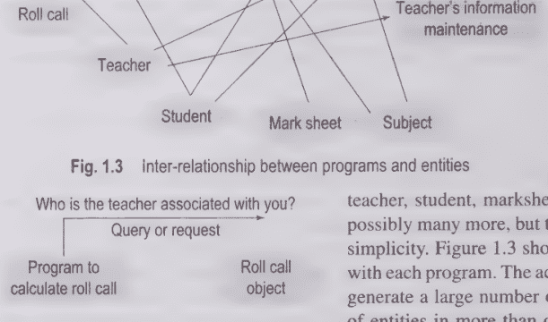

### 图 1.3 程序与实体之间的相互关系

成绩单打印，第三个是维护科目（即提供添加、删除和修改科目详细信息的功能），第四个是维护教师信息（即提供添加、删除和修改教师详细信息的功能）。共有五个实体——点名册、教师、学生、成绩单和科目。同样，可能还有更多实体，但为简单起见没有加以考虑。图 1.3 显示了每个实体与每个程序之间的关联。实际的系统设计过程可能会以多种方式生成大量程序和数量更多的实体。下面的例子将说明这一概念。

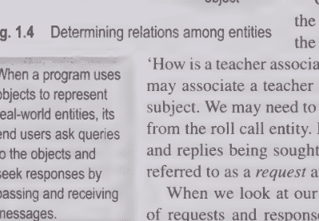

### 图 1.4 确定实体之间的关系

一旦我们确定了程序的数据和函数属性，下一步就是通过询问一些简单的问题来找出不同实体之间的关系。

“教师如何与点名册关联？”就是这样的一个问题。一种回答可能将教师与点名册关联为负责其课程点名的人。我们可能需要从点名册实体中获取相应教师的信息。图 1.4 展示了一个向实体发出消息并寻求答复的示例。问题或查询通常称为请求，回复称为响应。

> 当程序使用对象表示现实世界实体时，最终用户通过传递和接收消息向对象发起查询并寻求响应。

当我们审视需要完成的任务时，还需要更多这样的请求和响应示例，例如，教师询问某一天课堂上有多少学生出席，而点名册实体回答该问题。我们可能需要弄清楚可以提出多少这样的问题，以及这些问题的答案是如何查得的。这是开发系统时的下一个任务。必须向接收实体提供生成消息答案的方法；否则，接收实体无法回答该问题。对于学生出勤人数的问题，点名册实体必须具备一种方法，根据其拥有的数据计算出出席的学生总数。当其他实体询问该特定信息时，接收实体会调用该方法。

## 1.3 类与对象

类是 C 结构体的扩展（基本的 C 结构体在 C++ 中也得到了扩展；我们稍后将讨论其中的差异）。让我们以 Student 类为例。C 中的 struct Student 只包含学生的属性，如姓名和地址。另一方面，在 C++ 中，class Student 除了包含学生的属性外，还会存储与学生相关的操作（或函数）。这意味着 Student 类将包含学生姓名、地址、学号、科目等，以及所有以函数形式表示的操作，这些操作将作用于该类的变量，或由该类的变量执行（Student 类的变量是 student1、student2 等，它们是真实的学生，称为 student 对象）。

上句中的 on 和 by 具有重要含义。在任何类中都可以放置任何函数，但不推荐这样做。只有描述所考虑实体行为的函数才应成为该实体的一部分，其他函数不应包含在内。我们将在第 4 章用适当的例子进一步阐述这个问题。

注意：对类可以拥有的函数类型没有限制，但良好的设计要求只将相关函数作为类的一部分。

有一种设计方法论要求类设计时应使用最少的成员函数。它指出，在设计类时，除非必要，否则不应将函数保留为成员函数。这将使类变得“精简”，易于修改或扩展。

注意：精简类设计只要求必要的函数和数据属性成为类的一部分，从而使其易于管理。当类的成员函数数量较少时，类在增长或变化时受到的影响也较小。

因此，用于读取和打印学生信息、将学生注册到班级，以及其他我们认为对解决问题有用的函数，也将成为 Student 类的一部分。在这里，我们必须理解 Student 类和 Student 对象之间的区别。类是数据类型，对象是该数据类型的变量。Student 类是一种抽象，描述 student 对象应该具有什么（姓名、地址等）以及应该做什么（打印详细信息、接收详细信息、检查是否通过等），但其本身不执行任何操作。student 对象是类的一个实例，它实际上拥有姓名、地址等。类是实际对象由之派生的蓝本。如果我们用一个 Student 类来表示 30 名学生，那么我们就有 1 个 Student 类和它的 30 个对象。对象（即类类型的变量）执行的操作在面向对象编程中称为方法，但 C++ 将其称为函数。因此，我们将使用“函数”一词来描述针对类的对象执行或由类的对象执行的操作。

操作是由对象执行并作用于对象的，而不是由类执行或作用于类。

作为类的一部分的函数称为成员函数。成员函数帮助程序员控制对其访问。

只有该类的对象才能操作它们拥有的函数。

作为类的一部分的函数称为成员函数。也可以有不属于任何类的函数；这样的函数称为非成员函数。在 C 的结构体中，函数不是结构体的一部分；如果函数需要对结构体进行操作，则结构体会作为参数传递给它们。例如，StudentPrintDetails() 函数是独立于 struct Student 的函数。它不能成为 struct Student 的一部分。必须将表示学生的 struct 变量传递给该函数，才能打印该学生的信息。如果我们已经定义了 struct Student Lara，那么调用 StudentPrintDetails(Lara) 需要将 Lara 传递给该函数。StudentPrintDetails() 函数既不是 struct Student 的一部分，也没有义务使自己不被 struct 类型以外的变量看到。如果我们定义 struct Student Mahesh，那么可以使用 StudentPrintDetails(Mahesh) 来打印关于 Mahesh 的详细信息。但是，我们也可以将其他内容传递给该函数。如果 Snoopy 是一个 struct dog 类型的变量，我们可以编写 StudentPrintDetails((Student) Snoopy)。这个过程可能会在屏幕上打印垃圾信息，但编译器将无法判断。


因此，程序员无法控制结构和函数如何交互。

在 C++ 中，可以编写一个仅该类知道的成员函数，其余程序并不知晓它。没有直接的方法可以使用其他类的对象调用该成员函数。因此，类 `Student` 的对象可以调用 `Student::PrintDetails`，但类 `Dog` 的对象不能调用此函数。这是 C 与 C++ 之间根本差异之一。因此，我们可以写 `Lara.PrintDetails()` 但不能写 `Snoopy.PrintDetails()`。需要注意的是，成员函数使用与其它数据元素类似的点号记法调用。函数现在属于该类。

类的定义与我们之前提到的 C struct 类似。我们可以定义类 `Student`，并可以将其设为 `Student_1` 作为 `Student` 类型的对象。如果我们定义类 `Teacher` 然后定义 `Bob` 为 `Teacher` 类型的变量，`Teacher` 是一个类，其中 `Bob` 是一个对象。

### 1.3.1 面向对象的类与对象视图

我们现在将从面向对象的角度，以不同视角来看待类和对象。前面各节讨论中涉及的实体在 C++ 程序中实现为一个类。类是对现实世界实体（如教师或学生）或程序员为方便而添加的实体（如点名对象）的表示，具有为解决当前问题所需的相关属性。可以看出，这一描述相当模糊。对于一个给定问题，作者所选的实体集合可能与读者所选的不同。同一问题被解决但处理方式不同。而且，作者所选的属性可能与读者的属性非常不同，即使两者解决的是同一问题。

程序中建模的所有实体都实现为类。因此，解决同一问题时，一个程序中的类可能与另一个程序中的不同。这样的类（`Teacher`、`Student` 或 `RollCall`）并不指代单个实体，而是我们对其进行一般性指称。诸如 Ganesh 作为学生、Mathew 作为教师、或点名 16030903（于 16 03 09 创建的第三次讲座的点名）等实体，是我们迄今讨论的通用实体的实例。在面向对象术语中，它们被称为对象。对象是类类型的变量，可以与变量类似地定义。假设类 `Student`、`Teacher` 和 `RollCall` 存在，以下是有效的 C++ 语句，用于为各自的类定义单个实体或对象：

```cpp
Student Ganesh;
Teacher Mathew;
RollCall RollCall16030903;
```

在这些定义中，左侧部分是数据类型，右侧部分是变量。一旦类被定义，类名确实可以作为数据类型使用。因此，在本例中，类为 `Student`、`Teacher` 和 `RollCall`。这些类的实例是 Ganesh、Mathew 和 RollCall16030903，也称为各自类的对象。类有时被称为用户定义数据类型，与内置数据类型如 `int` 和 `char` 相比。因此，在我们的示例中，`Teacher`、`Student` 和 `RollCall` 也称为用户定义数据类型。

> **注意：** 类与对象与数据类型与变量的类比在内存分配方面并不成立。定义一个变量需要编译器提供内存。相反，每当出现类定义时，编译器就会为成员函数提供内存。数据成员的内存是在从该类定义对象时提供的。

还必须理解，一个类通常与多个对象相关联。例如，

```cpp
Student Mahesh, Jagruti, Rama, Haresh;
```

这里，我们有一个单一类 `Student`，与之关联了四个对象。现实世界也由类和对象组成。我们所有人都是人类类 的对象。德里是城市类 的对象，亚马逊是河流类 的对象，等等。这里也是如此，一个类可以有多个对象。恒河也是河流类 的对象，孟买也是城市类 的一个例子。C++ 类源于对现实世界中类的这种理解。

城市与班加罗尔有什么区别？我们可以说班加罗尔是城市的一个实例。我们对城市是什么有清晰的理解。我们都知道一个城市应该有一个名字，有居民居住，有房屋和商店，街道和道路，自来水和污水系统等等。每个城市都必须共享几乎所有这些属性。班加罗尔作为这样一个实例，具有城市应有的每个属性。同样，孟买也是这样一个实例，也具有所有这些属性。现在，我们能否说出关于城市和班加罗尔的一些区别，以区分类和对象？

城市是无形的，但班加罗尔不是；城市是概念性的，但班加罗尔是真实的；城市描述了城市应该有什么，而班加罗尔确实拥有这些；城市本身实际上没有任何居民，但班加罗尔有；城市可以有多个实例，如孟买、班加罗尔、悉尼和伦敦，而班加罗尔则不然。因此，类和实例是不同的。实例源自类，但它们是具体且真实的，而类是一个抽象实体。类 city 是一个概念，包含人们对城市的期望信息。我们可以将人口、尺寸、城市所在的州或省等作为城市的属性。城市概念本身并没有任何人居住。只有像德里这样的实例才会有居民。因此，德里需要空间来容纳它们，而城市不需要。图 1.5 显示了一些类的实例及其对象。

我们已经看到，类是一个草图，包含关于该类的对象应具备的信息，而现实世界的对应物也是如此。

问题域中实体的识别导致了成为我们程序一部分的类。找出程序所需的类是面向对象方式解决任何问题的第一步。我们接下来应该做的重要事情是问自己‘我可以用这个类的对象做什么？’例如，我可以用 `Student` 类的对象做什么？答案是对象应作为对特定消息的响应而实现的一组方法。我们将在第 1.4 节中讨论方法和消息。

类是一种数据类型，对象是该类型的变量。一个类可能与多个对象相关联。

类包含所有对象共享的属性。


*Fig. 1.5 Some classes and their objects.*

### 1.3.2 抽象数据类型

当一个类的对象表现得像一种数据类型时，该类被称为抽象数据类型（ADT）。`string` 类是 ADT 的一个例子。可以利用类将复数定义为一种数据类型。同样，我们也可以将图形概念如点、圆和矩形定义为类，使得对象表现得像一种数据类型。在正确定义这些 ADT 之后，我们可以编写以下语句。

```cpp
Complex C1(2,3), C2;
Point P(2,3), Q(4,5), R(10,10), S;
Circle C(P,20), Ring;
Rectangle Rect(P,R), PlayGround;
```

这些 ADT 有两种定义方式，一种带初始化，另一种不带。例如，`Point P(2,3)` 不仅定义了一个点 P，还定义了点 P 的 x 和 y 坐标分别为 2 和 3。另一方面，点 S 是在没有提及坐标的情况下定义的。

相当多的有用类定义属于 ADT 范畴，包括栈、队列、字符串、向量和双端队列。我们将在第 6、9 和 10 章讨论运算符重载时学习复数、点、圆和矩形。一些内置 ADT 在第 16 章中讨论；标准模板库（STL）和字符串 ADT 在第 15 章中详细讨论。

C++ 被认为具有类型可扩展性，即我们可以向程序中添加自己的类型并使用它们。STL 是通用数据类型的绝佳示例。

## 1.4 方法与消息

假设我们需要找到进行了点名 16030903 的教师（参见图 1.1）。为完成此任务，我们可能会用以下语句编写 C++ 程序：

```cpp
Teacher SomeTeacher;
SomeTeacher = RollCall16030903.getTeacher();
```

这些语句可能还不够直观。我们很快就会学会编写此类语句并理解它们。现在，它们可以理解如下。第一条语句定义了类 `Teacher` 的一个对象 `SomeTeacher`。此定义看起来与变量 `SomeTeacher` 被定义为 `Teacher` 类型相似。确实如此。这里，`Teacher` 被称为用户定义类型，而 `SomeTeacher` 是该类型的变量，即类的对象


Teacher。与其他变量类似，该变量也可以用在赋值语句的左侧，为其赋一个特定的值。（此操作类似于先定义 int IntVar，然后写 IntVar = 20 来将值 20 赋给整数变量 IntVar。）每当此类对象被用作赋值语句的左侧表达式时，右侧表达式的结果将被赋给该对象。在我们的例子中，通过执行赋值语句的右侧，我们得到一个 Teacher 对象，然后将其赋给 SomeTeacher。因此，如果赋值语句右侧的结果是 Mathew，那么 SomeTeacher 现在就包含 Mathew。

## 1.4.1 消息传递

更重要的一部分是对函数的调用，该函数定义在类 RollCall 内部。函数可以通过使用 对象<点>函数名 的语法来调用。函数 getTeacher() 是 RollCall 类的一部分（如果它不是类的一部分，我们就无法使用点符号调用该函数）。语句 RollCall16030903.getTeacher() 调用函数 getTeacher()，该函数在对象 RollCall16030903 上工作，并获取与该点名册相关联的教师（在我们的例子中表示 Mathew 的对象）。在赋值语句 SomeTeacher = RollCall16030903.getTeacher() 中，我们将该函数返回的 Teacher 对象（在我们的例子中表示 Mathew 的对象）赋给 SomeTeacher。这里的 getTeacher() 函数必须设计为返回 Teacher 对象。

在迄今为止的整个讨论中，getTeacher() 函数被称为发送给对象 RollCall16030903 的消息。对象采取某些行动（执行函数体，在我们的例子中为 getTeacher() 函数），并返回响应（Teacher 对象）。为消息提供响应的代码称为方法（在我们的例子中为 getTeacher() 函数的函数体）。我们可以很容易地看出，一个特定的消息会调用对象中的特定方法，然后对象会选择性地返回响应，如图 1.6 所示。需要注意的是“可选”这个词。有些消息不需要响应，如图 1.7 所示。假设 DispInfo() 是在 Teacher 类中定义的一个函数，它会显示关于教师的所有信息，并且我们已将 Gary 定义为一个教师。我们可以输入 Gary。

成员函数与数据成员类似，使用对象名后的点运算符进行调用。

消息传递过程中的响应是可选的。有些消息可能不返回任何内容。

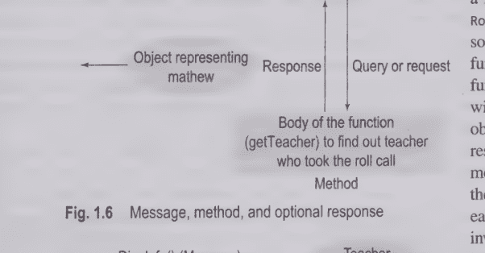

### Fig. 1.6 Message, method, and optional response

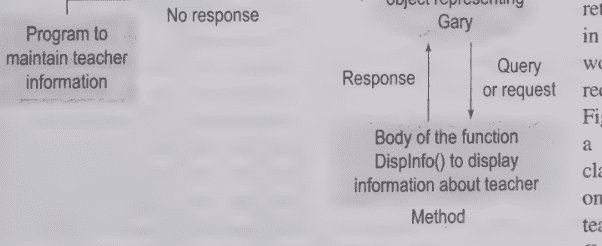

### Fig. 1.7 Message, method, and no response

DispInfo(); 并且该函数将显示关于 Gary 的所有信息。这里，显示所有信息的消息被发送给 Teacher 类的对象（名为 Gary 的对象）。作为响应，对象设法执行 DispInfo() 函数并显示所需的信息。这里，对象不需要返回任何信息。因此，响应是可选的。

因此，当我们在类的主体内部定义一个函数时（即该函数是类的成员），我们可以使用 对象<点>函数 记法来执行该函数。（我们将在第 4 章学习如何定义和使用函数。）当我们调用该函数时，我们就是向对象传递一条消息（其名称与函数名相同）。对象查看消息并执行与消息名称相同的函数体。被执行的函数体被称为对该消息的响应方法。因此，函数名用作消息，其函数体是响应该消息而被执行的方法。

> Note 在 C++ 中，函数名是消息，函数体是引发可选响应并按该消息请求执行工作的 方法。

让我们从另一个角度来看待这个过程。我们向对象传递消息 getTeacher，对象找出与该点名册相关联的教师并将其发送回给我们。我们只需要知道消息 getTeacher() 即可。对象如何找到教师与我们无关；我们可以安全地依赖 RollCall 对象的内部功能来完成此事。对象通过执行某种方法来查找教师，从而为我们获取教师信息。这里的讨论非常类似于现实生活中的场景，即我们向对象传递消息并从中获得响应。以骑摩托车为例。当我们加速时，我们就是向对象（例如摩托车 GJ1-CK-4587）传递消息。对象以增加速度做出响应。结果是如何实现与我们无关（除非我们是摩托车机械师）。可能，向下移动油门会拉动油门线，进而使汽油阀打开得更宽。汽油阀的打开导致更多汽油进入发动机，从而使发动机转速加快，进而使车轮加速。作为摩托车骑手，我们关心其中有多少？

在大多数现实世界活动中，我们并不真正关心方法；我们真正关心的是我们消息的结果。当我们踩刹车时，我们希望车辆停止或减速，但它是如何实现的与我们无关。在我们的例子中，摩托车 GJ1-CK-4587 是 motorbike 类的一个对象示例。诸如 accelerate 和 brake 之类的操作是我们希望传递并获得响应的重要消息。这在图 1.8 中显示。我们并不关心响应是如何实现的。同样，类是这样设计的，使用该类对象的用户可以发送消息并完成工作，而无需真正担心它是如何完成的。

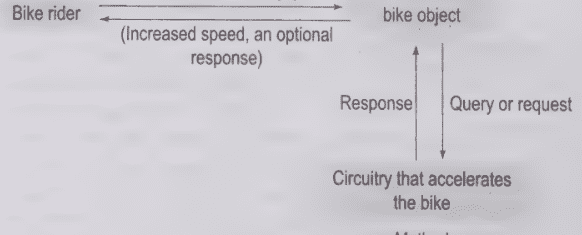

Fig. 1.8 Message, method, and optional response for a motorbike

> Note 用户通常不关心方法是如何执行的，但他们肯定对按消息要求完成的工作感兴趣。

## 1.5 抽象与封装

我们刚刚看到，对象的调用者或使用者向对象发送消息并对获得响应感兴趣。我们也看到，调用者通常对用于引发响应的方法不感兴趣。出于简化的目的，系统必须将方法对用户隐藏起来。

考虑按下刹车踏板并施加刹车的情况。施加刹车的全部电路对我们来说是不可见的。隐藏电路有什么好处？这简化了我们的视图。我们只需要与刹车踏板交互即可。对电路进行打开可能对经验丰富的摩托车骑手没有区别，但考虑新手的情况。如果一切都对他/她开放，他/她将花费相当长的时间来弄清楚如何使用刹车。按下刹车踏板以外的东西的可能性也存在。底线是只暴露用户需要交互的实体，而隐藏其他一切。这个重要法则在 C++ 中也得到遵守。它被称为抽象法则，见展览 1.1。

> Java 有一个 abstract 关键字。当它出现在类定义之前时，该类就成为抽象类。

### Exhibit 1.1 Law of abstraction

每当程序员设计一个类时，他/她都是以这样的方式设计的：只有用户关心的那些消息才能传递给对象并寻求其响应。消息如何被响应是看不到的。不能传递其他消息给该实体。

例如，我们可以传递诸如 getTeacher()、getSubject() 和 IsStudent Present(Student) 之类的消息来从 RollCall 对象中提取数据并获得合适的响应。然而，如果 RollCall 对象不期望接收 UpdateRollCallValue() 消息，我们可能无法发送该消息。我们只能发送并对有效消息获得响应。

考虑一个在类内部定义的名为 Search() 的函数，该函数在列表中搜索特定条目。IsStudentPresent() 函数可能会使用 Search() 函数来查找特定学生的条目以确定他/她是否在场。现在，这个 Search() 函数可能对用户不可用，因为他/她不需要它。而且，如果该函数被提供给他/她，他/她将不知道该如何使用该函数，并且可能会困惑于应该使用 IsStudentPresent() 函数还是 Search() 函数。理想情况下，Search() 函数应该对正在定义 Teacher 对象并使用它的用户隐藏起来，如图 1.9 所示。

> Abstraction 隐藏不必要的东西，只揭示用户需要操作的东西。

> 适当的抽象可以将复杂而庞大的问题变得简单得多且易于管理。

定义函数在一定程度上帮助我们实现了抽象，即使我们在使用 C 编程时也是如此。我们使用 printf() 和 scanf() 等函数，而无需真正知道它们包含什么。编码这些函数可能非常复杂。printf() 和 scanf() 函数设计的两个重要部分


## Fig. 1.9 Abstraction implemented as combination of exposed (public) and hidden (private) parts

是它们能够处理传递给它们任意数量的参数（printf('Hi'); 有一个参数，printf('Hi %s', Name); 有两个参数，printf('Hi %s your ID is %d', Name, ID); 包含三个参数，等等）。只有高级程序员才能编写这样的函数。我们使用 printf() 和 scanf() 函数而无需真正 Yes/No、Response Query 或请求箭头，Exposed (public) methods to Body of the function (getTeacher) to find out teacher who took the roll call, Hidden (private) methods to Body of the function (Search) to find out teacher who took the roll call, and text Two different types of methods, exposed (public), which is available to others using the object and hidden (private), which is only available to the members

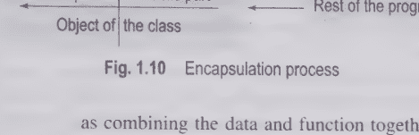

## Fig. 1.10 Encapsulation process

如 Fig. 1.10 所示。类包含数据和函数属性作为胶囊的一部分。使用此类对象的程序其余部分只能访问公共部分。

有时封装被称为将数据和函数一起组合在类体中。对封装的正确看法是类成员在 public 和 private 之间的划分，以及隐藏不必要和复杂的部分不让对象使用者看到的想法。封装和抽象一起使复杂系统表现为更简单的系统。第 1.1.1 节中讨论的系统的顶视图是通过抽象和封装实现的。对于极其庞大的系统，由于 C++ 的这两个特性，从 C 迁移到 C++ 是必要的。在第 3 章中，我们将详细了解 private 和 public 访问说明符。第 3.5 节更详细地解释了类 public 和 private 部分的必要性以及信息隐藏原则。展览 1.2 解释了抽象和封装的概念。

## Exhibit 1.2 Abstraction and encapsulation

仔细设计具有 public 和 private 属性的类会使复杂系统对程序员来说易于使用。它有助于隐藏不必要的东西，只揭示对程序员有用的东西。

程序员可能会按如下方式定义一个类，将 private 和 public 成员分开：

```
class Dummy
{
private:
...
public:
...
}
```

## 1.6 INHERITANCE

将已定义的类扩展的想法被称为继承。例如，如果我们正在编写一个程序来维护对象 MCAstudent，并且我们有一个内置类 Student，它几乎包含了我们程序所需的所有细节，除了少数几个需要手动添加的细节。附加信息可能是 MCA 学生除正常学生之外所拥有的任何东西。

让我们现在从面向对象的角度来看继承。世界充满了此类是另一类的特化的情况。人是哺乳动物的特化；狗是动物的特化；印度人是人的特化。两个不同类之间的这种关系在不止一种方式上很重要。我们将在这里以及第 9 章以后学习关于它的内容。

> 继承或特化并不阻止被继承的类拥有自己的额外属性。

在任何两个给定实体之间可能存在相当多的关系。继承（或特化）就是其中一种关系，其中一个类继承了另一个类的所有属性。在给出的例子中，我们

继承自哺乳动物类的一切，例如生孩子（而不是下蛋）。同样，狗继承自动物类的一切（有四条腿，交流能力很小等等），而印度人继承自人类类的一切（印度人有腿、手等）。

继承关系有时与 is-a 关系相比较，这类似于数学中子集关系的概念。‘is-a’ 这个词源于我们通常可以问‘x is a y?’ 来判断 x 是否继承自 y。每当两个实体之间存在 is-a 关系时，这也是继承。人类是哺乳动物，因为如果 x 是人类，x 就是哺乳动物；狗是动物，因为如果 x 是狗，x 也是动物；等等。当我们有 x <is-a> y 时，x 是 y 的子集。这里，集合的所有属性也适用于子集。有时这并不那么明显。

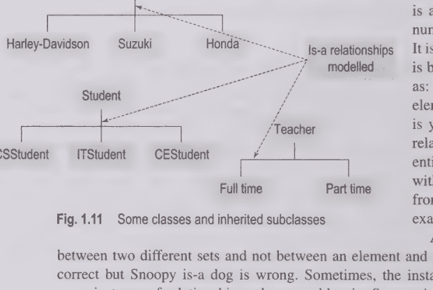

以数字为例。我们知道 N（自然数集合 1, 2, 3, ... 直到 ∞）是 R（实数集合）的子集。N 是否继承自 R？很难理解这一点。最好提出问题为：‘N 的一个元素也是 R 的一个元素吗？’如果答案是肯定的，则认为 N 与 R 存在 is-a 关系。每当实体 x 与 y 存在 is-a 关系时，就说 x 继承自 y。图 1.11 显示了一些 is-a 关系的例子。

is-a 关系存在于两个不同的集合之间，而不是元素和集合之间。所以，dog is-an animal 是正确的但 Snoopy is-a dog 是错误的。有时实例关系被建模为 instance-of 关系，我们会写 Snoopy instance-of dog 和 Bengaluru instance-of city。instance-of 关系，如细心的读者现在必须能正确猜到的，是对象和类之间的关系。类的一个对象也是该类的一个实例（例如 Snoopy 是类 dog 的一个实例，Delhi 是类 city 的一个实例）。

注意 is-a 关系是在两个对象之间，而 instance-of 关系是在一个元素和它所属的对象之间。is-a 只是一种流行的关系类型；对象之间可能存在许多其他关系。

### 1.6.1 Advantages of Deploying Inheritance

研究继承有不止一个原因。包括 C++ 在内的面向对象语言提供了在任意两个类之间建立继承关系的手段。语言提供这种设施的一个重要原因是继承是建模程序中现实世界层次结构的一种直观方式。

假设我们为图形形状编程，并且我们已经有矩形形状作为一个类。现在，我们可以通过提供特化使用继承添加正方形

一个继承的类并不受限于使用继承的值或函数。一个类可以通过在自己的主体中定义相同的函数并赋予不同的功能来轻松覆盖一个函数。

继承并不是提供可重用的唯一方式。C++ 另外提供了模板以便对不同类型重用相同的类。

使得正方形是一个矩形，其中长度等于宽度。同样，椭圆可以继承为圆，等等。在 C++ 中可以像这样建模层次结构。

**Reduction in work** 建模这种继承层次结构的一个重要结果是工作量的减少。我们可能在矩形类中定义了计算面积的函数，当我们定义一个继承自矩形类的新类 square 时，面积函数会自动提供给 square 类。这个特性有时被称为可重用性。可重用性是对象的属性能够以最大化设计利用率的方式被重用的特性。让我们再考虑一个例子。假设一个 Student 类。现在，我们将该类继承到 ComputerScienceStudent 类。我们在 Student 类中定义了注册新学生、读取和打印学生详细信息等函数。ComputerScienceStudent 类在我们从 Student 类继承它时将拥有所有这些函数。有趣的是，如果我们定义一个 ITStudent 类并从同一个 Student 类继承它，我们就不需要再次重新定义我们在 Student 类中已经拥有的函数。我们在基类中只写一次这些函数，所有派生类都使用它们。这种可重用性是继承的第二个优点。

### Myths

在处理继承和可重用性问题时需要谨慎。有两个与可重用性相关的神话需要澄清。它们如下：
- *Myth 1* 对于可重用性，继承是理想的工具。无论何时需要可重用，都应选择继承。
- *Myth 2* 继承是任何面向对象语言中提供可重用的唯一方式。

第一个说法是错误的，因为可重用性是从提供继承中获得的优势，但当我们需要重用一些代码时并不好选择继承。只有当被继承的类（派生类）确实是继承自的类（基类）的特化时才应使用继承。否则，可能会出现不可预见的后果，程序设计可能变得僵化和难以扩展或演进。因此，当我们希望在类中拥有一些函数，而这些函数在另一个类中可用时，除非它与该类具有 is-a 关系，否则不应从该类继承。再次重申一个重要点，请注意当我们使用继承时我们会作为副作用获得可重用性，这是一个巨大的优势，但为了获得可重用性的优势而使用继承是错误的，表示设计不良。程序员社区需要纪律来维护这一点。
第二个说法也是不真实的，因为有其他方式可以重用相同的代码。C++ 提供了模板来重用代码以及类定义。STL，将在第 16 章讨论，是在不使用继承的情况下提供可重用的一个绝佳例子。也可以将模板和继承合并以提供可重用性。我们将在第 9 章进一步研究继承。

## 1.7 ABSTRACT CLASSES

我们已经看到实体被建模为类，它们的实例被建模为 C++ 中的对象。（这对任何其他基于对象或面向对象的


抽象类是没有对象的类。

编程语言）。我们还曾指出，实体有两种不同的类型。一种类型的实体直接对应现实世界中的对象，即学生或教师；另一种类型是程序员为了有效解决问题而需要添加到系统中的实体。之前定义的 RollCall 类就是程序员添加的实体示例，它在现实世界中没有对应物。

对于类的类别，还有另一种观察角度。第一种类型的类在现实世界中有对应物，大多数时候具有有形的存在；另一种类型是仅以抽象形式存在的现实对应物。以动物类为例。动物是一个抽象概念。动物类没有任何直接对象。每一种动物要么是狗、老虎、狮子，要么是类似的物种。所有这些类都派生自动物类，并且由于关系的传递性（A → B，B → C，所以 A → C），狗、老虎或狮子都是动物。史努比是一条狗，所以它是动物，因为所有的狗都是动物。在这里，史努比不是动物类的直接对象。现实世界中存在大量此类抽象概念，当我们需要使用它们时，就应该定义抽象类。

在系统中使用抽象类听起来有点矛盾。我们希望在程序中对实体及其实例进行建模。那么，为什么需要没有任何实例的实体呢？当我们不打算定义和使用该类的对象时，对现实世界的抽象实体进行建模似乎没有多大意义。

让我们尝试通过一个简单的例子来理解抽象类的必要性。显然，抽象类不代表任何现实世界中有形的实体——这种实体通常总会有一些实例，除非我们处理的是灭绝物种。以重新编写一个点名程序为例。假设我们从一名计算机科学专业的学生开始，收集他/她的属性。然后，我们继续处理一名 IT 专业的学生，完成之后，再开始处理一名计算机工程专业的学生。我们很快意识到，这些类中都有一些共同的属性，例如学生的姓名和地址，最好将这些属性放在一个地方。这两个属性出现在我们迄今遇到的三个类中。最好定义一个包含所有这些属性的 Student 类，并让这三个类都继承它。

因此，所有共同的属性都被收集并放在基类 Student 中。在这种情况下，三个类将拥有基类中定义的所有内容，此外还可以拥有各自想要的任何内容。这被称为类设计中的自底向上方法，有时非常有用。现在，我们有了一个 Student 类，从中派生出三个类，即 CSStudent、ITStudent 和 CEStudent。图 1.12 展示了使用自底向上方法设计类的步骤。

类既可以采用自顶向下方式设计，也可以采用自底向上方式设计。

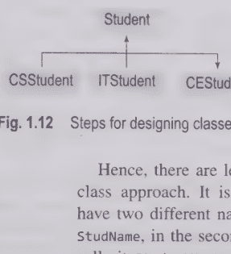

**图 1.12** 使用自底向上方法设计类的步骤

**使用自底向上方法设计类的步骤**

1. 我们首先定义了 CSStudent 类。
2. 现在我们同时有了 CSStudent 和 ITStudent。
3. 找出共同属性并由此生成 Student 类。
4. 这有助于定义 CEStudent。

另一种替代方案，但更实际的设计，是在处理前两种类时了解共同属性，然后再为 CEStudent 编程。在这里，CEStudent 类的设计变得更加容易，因为它不需要包含 Student 类中已有的任何内容。这些内容在继承后会自动获得。这也类似于现实世界中的情况：当我们说人是哺乳动物时，我们不需要问人是否会呼吸。既然所有哺乳动物都会呼吸，而人与哺乳动物具有 is-a 关系，那么人也必须呼吸。除非另有明确说明，否则这种关系成立。不过，有时也会有例外。例如，所有的马都有尾巴，但短尾马（一种马）没有尾巴。同样，所有的鸟都会飞，但鸵鸟不会。这样的实例称为异常，无需进一步探讨。自底向上设计有很多优点。下面列出其中一些：

1. 没有冗余。学生的姓名只保存在 Student 类中。如果我们需要改变姓名的长度或类型，只需要在一个地方修改，即 Student 类，而不需要在其任何地方修改。由于其他类继承自这个类，它们都会自动受到更改的影响。

因此，产生歧义的可能性也更小。假设我们不使用基类方法。同一个属性在两个不同的类中很可能具有不同的名称。假设在一个类中，学生姓名被定义为 StudName，在第二个类中定义为 Name，第三个类可能称之为 StudentName。多个类表示同一个现实世界实体，或者多个属性名指向同一个属性，都会在设计者和开发者的头脑中造成很多歧义。而在这种设计中，歧义被消除了，因为只有一个类，并且由于这些类本身不定义该属性，而只是继承它，所以学生姓名属性（比如 StudNm）在所有类中都是相同的。

> 注意 在 C++ 中，当基类本身发生变化时，我们需要重新编译程序。即使程序一点都没变，也需要重新编译。这不是设计上的缺陷。请阅读第 9 章第 9.6 节以了解原因。

2. 给所有类添加一个新属性很简单。假设我们想给三个类都增加一个手机号码作为附加属性，只需把它放在 Student 类中即可。我们不需要逐个类单独添加。

如前所述，这个例子引入了自底向上设计的概念。在许多情况下，遵循自底向上设计方法是有充分理由的。

现在让我们把注意力集中在作为设计副作用而生成的类上。包含共享属性的类成为所考虑的所有此类类的基类。有趣的是，这个基类就是抽象类。为什么？没有人只是“学生”；我们可能有 CSStudent、CEStudent 或 ITStudent，但没有人仅仅是一个学生。因此，在该设计中，Student 类是一个抽象类。我们不会定义 Student 类的任何对象。

> 注意 类的抽象性取决于其上下文。如果我们不按专业区分学生，并将他们的信息存储在 Student 类的对象中，那么 Student 类就不是抽象类。

我们再看一个例子。假设我们在处理图形对象。如果我们想为所有图形形状建立一个单一的基类，这个基类必然是抽象类。我们可以把它命名为 Shape，并让 ellipse、triangle 或 rectangle 继承它。我们知道，我们计划绘制的形状要么是椭圆、矩形，要么是三角形，但绝对不是普通的形状（基类）。这就是为什么 Shape 在这里也是一个抽象类。如图 1.13 所示。当设计方法为自底向上时，很容易找出抽象类。

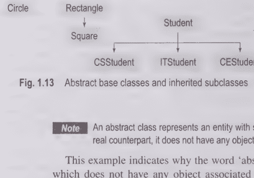

**图 1.13** 抽象基类和继承的子类

> 注意 抽象类代表一个具有几个相关类共享属性的实体。由于没有真实的对应物，它没有任何与之关联的对象。

这个例子说明了为什么选择“抽象”这个词。Shape 是一个抽象概念，它没有任何与之关联的对象。现实世界中还有相当多其他抽象概念，例如家具或电气设备，但没有实体可以只被称为家具或电气设备。属于家具的实体必然是沙发、椅子或类似的东西，而不是“家具”本身。同样，电气设备要么是灯泡、灯座或类似的东西，而不是电气设备本身。

要对抽象概念进行建模，我们需要有抽象类。在 C++ 中，没有诸如“abstract”这样的关键字可以放在类名前面使其成为抽象类。相反，我们需要在类中定义一个纯虚函数来使其成为抽象类。我们将在第 10 章学习纯虚函数。

下面是一个继承示例。Shape 类被 Rectangle 和 Circle 继承。Rectangle 也被 Square 继承。可以看出，Rectangle 和 Circle 是 Shape 的特化，而 Square 是 Rectangle 的特化。单词 public 表示继承是 public 类型的。我们将在第 9 章讨论不同类型的继承。类体目前无关紧要，因此没有显示。

> 如果程序员无意中试图定义一个抽象类的对象，编译器会报错，并且不会编译该程序。

```cpp
class Shape {...};
class Rectangle: public Shape {...};
class Circle: public Shape {...};
class Square: public Rectangle {...};
```

## 1.8 多态

一般而言，多态是单个对象以多种形式出现的能力。多态与某事物在不同条件下表现不同有关。


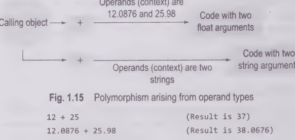

### 图 1.15 由操作数类型引起的多态性

```
12 + 25                  (Result is 37)
12.0876 + 25.98          (Result is 38.0676)
'Indian' + 'Cricketer'   (Result is 'IndianCricketer')
```

这三种情况下 + 运算符的行为不同。第一种情况下，它对两个整数求和；第二种情况下，它对两个 double 值求和；第三种情况下，它将两个不同的字符串连接成一个。字符串在 C++ 中作为数据类型可用。+ 在 string 类中被重载。因此，给定的操作是有意义的。当运算符对不同类型的操作数表现出不同的行为时，这也是一种特设多态。在 C++ 用语中，这称为运算符重载。我们将在第 6 章讨论运算符重载。

在 C++ 中，函数和运算符重载都在编译时解析。编译器在编译程序时决定要执行的操作，并生成描述该操作的机器码。在给定的示例中，当在源代码中看到 12 + 25 时，编译器提供将两个整数值相加的代码并将其添加到正在生成的目标代码中，而当看到 'Indian' + 'Cricketer' 时，它在该处添加字符串连接例程。

类似地，当调用特定的 Add 函数时，例如 Add(20,30)，编译器将该调用更改为一条跳转指令，该指令跳转到包含整数加法的函数体。类似地，当调用 Add('Indian','Cricketer') 时，跳转指令将指向另一个包含连接字符串代码的函数。此外，当我们写 Result = Add(FirstVal, SecondVal) 时，跳转指令指向将两个整数相加并返回答案的函数体。当调用为 Add(FirstVal, SecondVal, ThirdVal) 时，跳转指令指向不返回任何内容但 ThirdVal 包含求和的函数体。因此，关于调用哪个函数的决定是在编译时完成的。所以，特设多态在 C++ 中也是编译时多态。

> 当运算符对不同类型的操作数表现出不同的行为时，被称为运算符重载。Java 没有此类特性。

注意 特设多态不一定必须在编译时发生。如果语言（Smalltalk 是示例）在运行时解析函数调用，则特设多态发生在运行时。此类语言有时被称为后期绑定语言。

### 1.8.2 运行时动态多态

这是一种函数解析发生在运行时的情况。这里的限制是只能从类层次结构中选择函数，而不能从其他地方选择。让我们考虑图 1.16 所示的示例来理解这一概念。

guments as all these different functions have a different body. Hence, this is an example of polymorphism.
当运算符对不同的操作数表现出不同的行为时，还会观察到另一种特设多态。这可以通过图 1.15 更好地理解。

指向 student 类的指针名为 ptrStudent。当此指针指向从 student 派生的任何类时，语句 ptrStudent -> getAttendance() 执行属于该类且为虚函数的 getAttendance() 函数。

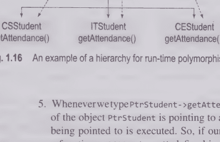

图 1.16 运行时多态的层次结构示例

- 1. 假设我们将 Student 定义为基类。
- 2. 然后，我们从 Student 定义三个派生类 CSStudent、ITStudent 和 CEStudent。
- 3. 接下来，我们在所有这些类中定义函数 getAttendance()，（重要的是将此函数定义为 virtual 以实现多态。我们将在第 10 章学习如何定义和使用虚函数。）
- 4. 现在，我们定义一个指向基类 Student 的指针。让我们称之为 PtrStudent。重要的是要注意，此指针可以指向层次结构中提到的任何类的对象。

5. 每当我们键入 PtrStudent -> getAttendance()（即执行 PtrStudent 当前指向的对象的 getAttendance() 函数）时，被指向的对象的成员函数将被执行。因此，如果我们的 PtrStudent 指向 Ganesh，一名 CS 学生，则会执行 CSStudent 类中定义的 getAttendance() 函数。当同一个指针指向 Mahesh，一名 IT 学生时，则执行 ITStudent 内部定义的 getAttendance()。这两个 getAttendance() 函数可能完全不同。例如，在 CSStudent 情况下，只返回理论课出勤率，而在 ITStudent 情况下则返回理论和实践出勤率。调用者即使函数行为不同也不需要修改其调用。这称为动态多态，因为它需要关于指针在运行时指向何处的动态信息。有时，这种多态也被称为子类型或包含多态。如前所述，这里提到的函数 getAttendance() 在 C++ 中必须定义为 virtual 才能实现多态的效果。

以下代码片段显示了如何使用虚函数提供多态。

```
/* Assuming class Student is defined with a virtual function
getAttendance() and all the three classes CSStudent, ITStudent, and
CEStudent are inherited from Student */

ITStudent Mahesh;
CSStudent Ganesh;
Student Jayesh CEStudent;
Student *ptrStudent;
...
ptrStudent = *Mahesh;
ptrStudent -> getAttendance()
// it calls the getAttendance() function of ITStudent class
ptrStudent = *Ganesh;
ptrStudent -> getAttendance()
// it calls the getAttendance() function of CSStudent class
```

动态多态也可以通过使用引用来实现。

多态可以分为三种类型：静态或特设、动态和参数化。

### 1.8.3 参数化多态

在 C++ 中看到的第三种多态称为参数化多态。使用参数化多态，可以通用地编写函数或数据类型（用户定义数据类型，即类），使其可以处理值而不依赖于其类型。C++ 提供模板作为类和函数的无类型描述以提供参数化多态。在使用参数化多态进行编程时，我们可以在不指定其类型的情况下对函数和类进行编码，并在使用时将类型作为参数传递。此类型解析过程在 C++ 中发生在编译时，因此它是一种编译时多态。我们将在第 7 章学习模板。类型无关编码的绝佳示例是 STL。我们将在第 16 章学习 STL。

## 1.9 面向对象设计与 C++

在讨论面向对象概念和 C++ 时，最好看看与面向对象设计相关的一些其他问题。

第一个问题与静态绑定和动态绑定有关。静态绑定发生在编译时，而动态或后期绑定发生在运行时。绑定一词指的是函数解析。假设我们的代码包含一个函数 f()，并且有多个 f()。如果关于调用哪个 f() 的决定在编译时做出，则为静态绑定。如果将同一决定推迟到运行时，则称为后期绑定。我们将在第 9、10 和 11 章中讨论同一问题，在那里我们将讨论继承、虚函数和运行时类型识别。

第二个问题与基于对象的编程和面向对象的编程有关。虽然迄今为止讨论的概念通常适用于这两种类型的编程，但继承和运行时多态仅适用于面向对象的编程，而不适用于基于对象的编程。

第三个问题与 C++ 相对于其他面向对象语言的位置有关。此比较可以在本文本的各个地方找到。

最后一个但非常重要的问题是灵活性。C++ 的设计者为其设计了灵活性，程序员可以选择使用或不使用语言的特定特性。面向对象的特性在 C++ 中也不强制要求程序员使用。

> 一个不使用类或任何其他迄今为止讨论的特性的有效 C 程序通常也是一个有效的 C++ 程序。

## 1.10 信息隐藏原则

之前，我们发现抽象与信息隐藏原则有关。在这里，我们将看到该原则是什么以及它为我们提供的优势。让我们从一个示例开始。

一个考试系统可能具有学生、教师、考官、试卷和教学大纲等实体。这里的实体可以同时具有数据成员和函数成员。例如，试卷对象可能具有数据成员，例如试卷所设的科目、总分和及格分数。函数成员可能包括打印试卷、插入新内容或修改旧内容等。

还必须决定对象的哪一部分要从外部世界隐藏，哪一部分要显示。考虑一个 Student 对象的示例，该对象可能允许打印


可供所有用户使用的函数称为公有函数。不可供外部使用的函数称为私有函数。

其姓名和地址，但可能不允许执行其他操作，例如更改学生的出生日期。我们甚至可能无法更改姓名和地址（尽管我们可以查看和打印它们）。我们可能无法查看和使用唯一分配学号的函数。作为一个类的对象（在我们的例子中是 Student 类）的用户，我们可能只能使用该类公有提供的函数，而不能使用其他任何东西。这就是信息隐藏的原则。名称是一个误称。它应该是垃圾隐藏。为了理解这一点，让我们假设一个包含学生姓名和学号等信息的 Student 对象。它具有从屏幕读取所有必需信息并可能在屏幕上打印的功能。它还有一个函数，可为 Student 对象唯一分配学号。如果成绩单打印程序正在使用 Student 对象，则获取学生唯一学号的函数对该程序毫无用处。成绩单打印程序应仅处理使用正确的成绩集打印正确的学号。学号创建过程最好被隐藏。因此，唯一的学号创建函数应以用户无法访问 Student 对象的方式定义。

**注意** 一个类应使所需的函数可用并隐藏其他数据和函数。此过程有助于用户获得清晰的视图，并且有助于将对象作为抽象使用。这就是信息隐藏的原则。

一个重要的事实是，对一个人无用的信息可能对另一个人来说是宝贵的。Student 类的一些成员函数可能需要使用学号生成函数，例如注册新学生的函数。学号分配函数对于注册函数来说绝对不是垃圾，因此它必须对注册函数可见。C 不区分此类函数，而 C++ 则区分。在这里，学号分配函数被称为私有函数，只能被类的成员（例如注册函数等成员函数）访问，而不能被使用 Student 对象的用户访问。

## 1.11 C 与 C++ 的区别

在本节中，我们将讨论 C 与 C++ 之间的重要区别。

### 1.11.1 哲学上的差异

每个语言设计者都有关于要解决的问题的某种设想。语言哲学是设计者认为适合解决问题的思路。不同的语言由不同的哲学为特定的一组问题而设计。在下面的段落中，C 的哲学与 C++ 的哲学进行了比较。

### *C++ 不仅仅是扩展的 C*

尽管 C++ 的语法与 C 非常相似，但它远不止是扩展的 C。它具有截然不同的哲学，需要不同的编程方法。从 C 风格（过程式）编程转向基于对象的编程本身就引入了许多设计上的差异。对于基于对象或面向对象的编程，必须将问题可视化为相互关联的对象集合，以及它们的属性和方法。

### C++ 中信息隐藏的实现

我们已经看到，C++ 中任何类的对象都有两个部分——私有部分，对类外部的任何元素不可见；以及公有部分，对外部可见。因此，当我们想对他人（即除成员函数之外）隐藏某些内容时，我们将其定义在类定义的私有部分中，例如前面示例中的学号分配函数。

对此也有一个例外。在某些特殊情况下，类设计者可以允许特定外部实体访问对象的私有部分。这些特殊的外部实体被称为友元函数。

让我们现在集中讨论信息隐藏原则如何适用于 C++ 程序。为了使这一原则成为可能，C++ 提供了两种不同类型的属性和函数。每当有人使用一个对象时，任何私有内容都会被简单地隐藏。只有定义为公有的数据和函数成员才可访问。一旦我们知道可以将类元素划分为私有和公有，下一步就是决定将什么定义为私有，什么定义为公有。

假设我们讨论的 Student 对象有一个名为 birthdate 的属性。此属性可供打印学生详细信息的函数使用。它也可供注册新学生的函数以及同类其他函数使用。然而，它不需要对除类成员函数之外的函数可用。打印学生详细信息的函数对使用该 Student 对象的任何人都很有用。因此，第一个属性 birthdate 应定义在类的私有部分，而 PrintDetails() 函数应定义在类的公有部分。在这里，变量如 birthdate 被称为类的私有成员，而成员函数如 PrintDetails() 被称为类的公有成员。

可以将函数分为两类。一类是用于维护对象并需要访问对象私有信息的函数。另一类是只需要使用该类的对象来完成自己的工作的函数。它们仅将对象用于自己的目的，与对象的维护无关。现实世界中的一个类比可以是汽车用户和机械师。机械师可能需要访问发动机内部零件，但普通用户只访问诸如方向盘、刹车和离合器之类的接口功能。

C++ 中的对象还可以有另一部分，称为 protected。对象的 protected 部分对从所考虑的类派生的类是公有的，对其他类是私有的。因此，它对某些类是公有的，对其他类是私有的。

可以访问对象私有部分的函数通常被设为对象本身的一部分。其他不需要访问对象私有部分的函数可以驻留在类外（通常）。在后面的章节中，我们将看到更多示例，以更精确地了解成员函数和非成员函数之间的区别。

作为对象一部分的函数也可以分为两种——一种外界实体不知道，另一种外界实体知道。在这里，定义在私有部分中的函数称为私有函数，定义在公有部分中的函数称为公有函数。私有函数与私有数据成员类似，对外界实体未知，但公有函数是已知的。C 不提供此类函数的分类。

只有那些需要对象的私有实体的函数才保留为成员，其余的可以是非成员。

### 即用型对象的可用性

C 与 C++ 之间的另一个重要区别是 C++ 提供即用型对象‘现成’，并提供在需要更改时使用它们的可能性。这被称为可重用性优势。在 C++ 中，可以拥有内置对象，如 vector 和 queue，它们具有用户所需的功能。这样的对象也可以根据我们的需要进行定制，例如，我们可以从内置的 queue 类定义一个新的类 PriorityQueue。此选项不仅减少了编程时间，而且减少了出错的可能性，并实现了更模块化的编程。其中一个内置对象是 string，我们将在本书的示例中始终使用它。

现成对象的集合的一个很好的例子是 Microsoft Foundation Class（MFC）库。MFC 具有处理复杂的 Windows 编程的内置功能。在使用 MFC 时，程序员的工作量大大减少。他们必须了解内置的 MFC 对象及其各自的函数。复杂的操作，如 Windows 消息和事件驱动处理，在使用适当类的对象时会自动提供。

可重用性优势也扩展到了 C++ 的用户。由专家（称为第三方开发者）为特定应用（如图形）设计的类非常多。作为 C++ 的用户，我们只需使用它们。这种软件也可以用于 C，但 C++ 的区别在于，我们实际上可以将这些类扩展为我们自己的新类（而无需源代码）。这是通过继承的概念实现的。C++ 本身提供了一个非常强大且有用的库。它被称为 STL。STL 基于的对象模型确实提供了这种扩展，但不如面向对象的模型可扩展。

## 标准模板库

STL 可随所有 C++ 编译器一起提供。它具有内置类，可以提供可重用性优势。它提供了将不同类型的对象集合放入容器类中的手段。容器类以这样的方式收集对象，使得可以对其进行高效的排序和搜索等操作。STL 还配备了 find、search 和 sort 等通用操作。STL 的美妙之处在于对象集合（称为容器）的通用性以及以通用方式适用于它们的算法。我们将在第 16 章学习 STL。

### 用户定义类型与内置对象的相似性

C++ 的开发者希望用户定义的类型尽可能与内置类型相似。这就是为什么定义了一些新特性，如构造函数、析构函数和运算符重载。

构造函数和析构函数用于为 C++ 程序中定义的对象提供初始化和终止效果。初始化效果在对象定义出现在程序中时应用，终止效果在对象超出作用域时应用。

### 构造函数的示例  看一下下面的代码。

```
class Student
{
    int roll no;
    char name[20];
    /* A constructor function, bearing the same name as the class */
```


构造函数是一个与类同名的函数。当类的对象被定义时，它会自动被调用。

```
Student()
{
    roll_no = 0;
}
};

Student st1;

/* Defining an object of class Student, notice the use of
class name 'Student' instead of 'class Student' as a type */
```

这里 st1.roll_no 在语句 Student st1; 执行时会自动初始化为零。这是因为函数 Student() 在类 Student 内部定义。函数 Student()（而不是类 Student）被称为构造函数。构造函数会在对象被定义时自动调用。在本例中，当我们定义 Student st1; 时，Student() 函数会被调用。调用该函数的效果是将学号初始化为零。其优点是我们无需在定义学生对象时显式地将学号初始化为零。假设我们定义了 100 个学生或一个学生数组。每次构造函数函数都会自动调用，所有这些学生的学号都会被初始化为零。我们将在第 5 章详细学习构造函数和析构函数。

### 运算符重载

假设我们定义了一个复数变量的类。复数变量有两个部分，实部和虚部。如果我们将类命名为 complex，那么就可以定义

```
complex c1, c2;
```

这里，complex 是类名，c1 和 c2 是 complex 类型的变量，即类 complex 的对象。可以写出 c1 + c2 作为表达式，其中 + 将分别相加实部和虚部的值。默认情况下 + 仅对内置类型如 int、float 和 double 进行加法。C++ 提供了将 + 赋予新含义的设施，使其现在也可以相加两个复数变量。该设施称为运算符重载。这里，我们需要重载 + 运算符以获得所需的效果。 （有兴趣了解如何实现的读者可以参阅第 6 章运算符重载，其中提供了复数对象相加的程序。）

提供所有这些设施的最终目标是使用户定义的对象尽可能自然地表现。在 C++ 中，用户定义的对象实际上可以自然地表现。仅通过查看用户定义对象的使用，几乎不可能将其与内置对象区分开来。在 C 中，用户定义的数据类型始终与内置类型看起来不同（例如，struct，struct Student，struct employee 等）。

#### 1.11.2 语法差异

C 与 C++ 之间存在许多语法差异。主要差异源于提供类构造及其相关问题的需要。几乎所有 C 语法在所有 C++ 编译器中都能正常工作。一些语法差异总结如下。

## 注释

C++ 中的注释有两种类型。C 风格的注释（/* 和 */ 之间包围的内容）是可以接受的，以 // 开始的注释也是允许的。当 // 在某行中出现时，该行的其余部分将被忽略。看下面的代码：

```
/* This itself is a C-like comment, whereas the
following is a C++-like comment */
if (a > b) // checking for a greater than b
printf ("a is greater!");
```

下面是一个例子，说明 C++ 注释如何替代 C 风格注释：

```
/* This is the first line of comment.
This is the second line of it.
And this is the third! */

// This is the first line of comment.
// This is the second line of it.
// And this is the third!
```

简而言之，// 对于单行注释很有用，但对于多行，可以更喜欢使用 /* 和 */。

而且，// 在行尾有效，因此它不能替代以下语句中使用的 C 风格注释：

```
if (a > b)        /* checking for a > b!*/
printf("a is greater!");
```

##### 输入/输出运算符

尽管在第 1.11.2 节给出的程序语句中使用了 printf()，但它通常不用于 C++ 程序中。

```
cout << "a is greater";
```

可以在 C++ 中完成与 printf() 相同的任务。

这里，cout 是标准输出流类的对象。它是 C++ 中最有用的对象之一。我们需要包含 <iostream> 文件以获得 iostream（更准确地说是输入输出流）对象的原型。我们可以看到 iostream 类似于 C 中使用的 stdio.h。应该记住，我们仍然需要使用 stdio.h 来使用输入和输出流的函数原型，例如 printf() 和 scanf()。

如果可以在 C++ 中使用 stdout（即 printf()、scanf() 等），那么为什么我们需要一种新的输出方式？这个问题将在第 12 章中详细解答。简而言之，更新的方法更好且更易于编程。有时，这种方法是在为用户定义对象提供与内置类型类似的输入和输出时唯一的方法。例如，可以有一个学生 Lara，然后使用 cout<< Lara 打印关于 Lara 的详细信息。我们需要为此重载运算符 <<。这对于 printf() 来说是不可能的。如前所述，如果使用 printf()，则需要包含 <stdio.h>。运行程序的用户在 printf() 和 cout 产生的输出之间找不到区别。

在使用 ANSI C++ 时，应使用 <cstdio> 而不是 <stdio.h>。使用 <cstdio> 与 <stdio.h> 的功能相似，即

在编写 C++ 程序时，应使用 cin 进行读取而不是 scanf()，使用 cout 进行打印而不是 printf()。这些构造更简单更好。

对于可以编译 C 和 C++ 程序的编译器，文件名扩展名决定了代码的类型。在 TurboC 或 VC++ 中，'.c' 是 C 程序，而 '.cpp' 是 C++ 程序。

cout 使用的 << 运算符和 cin 使用的 >> 是运算符重载的例子。

<cstdio> 或 <stdio.h> 将以完全相同的方式提供 printf()、scanf() 等。尽管如此，它们之间仍有巨大差异。该差异在第 14 章中解释。同样，如果我们想使用其他 C 头文件（例如，<math.h> 变为 <cmath>），也会有差异。

使用 C 和 C++ 中的 printf() 等函数之间还有另一个看似微小的差异。对于大多数 C 编译器，可以在不包含 <stdio.h> 的情况下使用 printf() 或 scanf()。这样的程序可以编译并且也能按预期工作。包含 <stdio.h> 似乎不是必要的（因为 stdio.h 仅包含函数的原型）。为什么会这样？让我们试着理解这一点。

printf()（以及其他函数）的编译代码保存在库中。库包含所有属于库的函数的目标代码。printf() 和 scanf() 的代码在编译后、在生成可执行代码之前被添加到程序代码中。

注意 C 程序在使用函数时不需要原型。如果缺少函数的原型，C 编译器最多会发出警告。相反，C++ 程序如果没有原型就不会编译。原型在 C++ 中是必须的。如果我们使用 printf() 或 scanf() 并且没有 stdio.h 的头文件，程序在 C++ 中将无法编译。

在 cout 的情况下，<< 实际上是一个重载的运算符。这意味着 <<，本质上是一个按位左移运算符，在这里被赋予了新的含义。给现有运算符提供新的附加含义的过程称为运算符重载。应该记住，我们仍然可以将 << 用作按位左移运算符。这里赋予的新含义是额外的（除了原始含义之外）。

同样，我们可以使用 >> 运算符（同样是重载的）用于读取目的。为此，我们使用标准输入流对象 cin。iostream 类的内置对象 cin 用于从控制台读取元素。因此，以下语句可用于读取字符串变量，其名称假定为 StringVariable：

```
cin >> StringVariable
```

我们不需要为 cin 或 cout 提供数据类型（如 %d 或 %s），也不需要在读取变量值时在变量前附加 & 运算符，如 scanf 中那样。在 C++ 中，cout 以默认方式格式化输出，这适用于大多数情况。我们将在第 12 章学习如何以不同于默认方式格式化数据。

##### C++ 头文件

我们不能使用 stdio.h 来使用 cout 或 cin。我们需要在程序中写 #include <iostream> 来使用 cout 和 cin。头文件名 <iostream> 中省略 .h 应该注意。这是 ANSI C++ 中的新风格。旧的 C++ 程序使用文件 <iostream.h>。如果我们写 <iostream.h> 而不是 <iostream>，它可能在大多数现有的 C++ 编译器中都能工作。请理解它仅为向后兼容而提供。不再建议在 C++ 中使用 <iostream.h>。

当我们在第 14 章学习命名空间时，我们将看到使用 iostream 和 iostream.h 之间的区别。

##### 返回类型

C 中的返回类型默认为 int，而在 C++ 中则不是，因此我们必须指定它。例如，


```
my_func(one, two, three)
```

在 C 中默认返回 int。也就是说，它等价于写作

```
int my_func(one, two, three)
```

而在 C++ 中，

```
my_func(one, two, three)
```

实际上被视为

```
void my_func(one, two, three)
```

C 不要求 main() 提供返回类型，而 C++ 则强制要求。因此，main() 是不可接受的；必须写 void main() 或 int main()。此外，如果我们写了 int main()，则 main() 中必须有一条返回整数的 return 语句。

注意，Linux GNU C++ 不允许 void main()；因此必须使用 int main()。

## 编译 C++ 程序

在 UNIX 中，C++ 程序使用扩展名 C（大写 c）而不是 c（小写 c），并且我们可以使用 CC（同样是大写）来编译，而不是 cc。在 Linux 中，C++ 程序使用扩展名 .cpp，我们可以使用 c++ 或 g++（GNU C++）来编译。

在 VC++ 和 Borland C++ 编译器中，程序需要具有 .cpp 扩展名才能作为 C++ 程序编译。

## 同时支持基于对象和面向对象的编程

重要的是要知道，C++ 支持基于对象（object-based）和面向对象（object-oriented）两种编程方式。然而，在最初的章节中，我们将不使用任何继承进行编程。因此，在最初的章节中将采用基于对象的方法。之后，我们将看到如何进行面向对象编程。

当我们有不止一种解决方法（准确地说，是基于对象和面向对象）时，如何在两种方法之间做出选择是一个重要问题。也就是说，如果一个问题既可以使用继承也可以不使用继承来解决，那么应该选择哪种方法？在大多数情况下，出于简洁和效率的考虑，不采用继承的方案更受青睐。

注意，有两种不同的编码方式——基于对象和面向对象。那么应该选择哪种方法？在大多数情况下，出于简洁和效率的考虑，不采用继承的方案更受青睐。正常的行业程序通常在同一程序中同时包含基于对象和面向对象的代码。

## 1.11.3 基于异常的设计

在 C 语言中，错误需要由程序员显式检查，并且必须在当时当地提供相应的处理指令。C++ 额外提供了一种处理错误的新机制。它基于异常。当错误发生时，会抛出一个异常，该异常需要由错误处理例程捕获。以下代码展示了一个示例：

```
try
{
```
```
```cpp
int i, j;
<some C++ statements>
if <some condition> throw i;
if <some other condition> throw j;
}
catch (int)
{
<error handling routine which works for both i and j>
}
```
```

因此，错误检查和处理被分离开来。这是一种更有条理的处理错误的方式。

如前所述，C++ 拥有 C 所拥有的一切；因此，C 风格的错误检查仍然可以使用。C++ 异常处理并不会取代 C 中使用的错误处理机制。然而，它是一个重要的工具，需要了解并在需要时使用。我们将在第 8 章进一步学习异常。

### 1.1.1.4 模板作为泛型编程元素

模板是在 C++ 语言问世很久之后为其提供的扩展。模板的诞生是为了支持灵活的基于对象的编程。它们远比 C 风格函数的库要优越。C 函数实际上可以组合成库中的基于对象的版本，然后其他程序可以通过引用该库来使用它们。如果我们使用 math.lib（在 C 编译器中默认存在），就可以使用 sqrt()、sin() 和 cos() 等函数。这种方法的问题在于，解决方案受限于参数类型。如果 cos() 函数需要 double，我们就必须向它传递 double 参数。如果我们需要计算一个整数的余弦，就必须将其强制转换为 double 值，然后传递给 cos() 函数。这种（强制转换）并不总是有效。如果编写了一个用于快速排序的泛型函数，那么直接对任何数据排序（例如按学生总分排序以生成成绩名单，或按学生姓名排序以打印内部考试座位安排）是不可能的。我们不能设计一个对整数排序的快速排序函数，然后在将姓名强制转换为整数后传递进去。

> 模板是 C++ 中一种无类型（type-less）的代码编写方式。

类型在定义时也是要传递给模板的一个参数。如果正确使用模板，代码会变得更加灵活，编码工作量也会减少。考虑到前面提到的情况，我们可以编写一个泛型快速排序，它可以接受任何参数（如学生姓名或学生总分）并对数据进行排序。

> 注意
> 
> C++ 实际上使用模板库而不是普通库来提供其“现成”对象。这被称为 STL。输入输出库的很大一部分是用模板编写的。

## 1.12 C++ 对象模型

当编译器编译 C++ 程序时，需要特别关注一些 C 程序不需要的东西。C++ 程序需要被解析，以查找程序中定义的类及其使用细节。用于编译 C++ 程序的编译模型称为 C++ 对象模型。如前所述，C++ 对象模型旨在提供 C 目标代码的效率和面向对象的灵活性。

虽然它不像 CORBA（公共对象请求代理体系结构）或 COM（组件对象模型）模型（它们也是面向对象的模型）那样灵活，但它更高效，因为 C++ 设计者将效率作为首要关注点。在本书中我们将一直引用 C++ 对象模型。

## 1.13 C++ 的变体

C++ 最初由 Bjarne Stroustrup 于 1979 年设计。它最初被称为“带类的 C”（C with classes）。增量运算符 ++ 于 1983 年被添加到 C 中，以表示 C++ 是 C 的增量版本。很快，就有不少厂商推出了不同品牌的 C++ 编译器。竞争产品中提供更好功能的热情导致了许多不兼容的 C++ 编译器版本。不同厂商的产品对原始标准 C++ 进行了扩充，例如受保护成员、受保护继承、模板以及多重继承的使用。（我们将在适当的时候学习它们。）1997 年，美国国家标准协会（ANSI）/国际标准化组织（ISO）标准化委员会在考虑所有这些变化的基础上，制定了 ANSI/ISO C++ 标准。

## 1.14 C++ 的应用

C++ 的适用性可见于操作系统开发。Windows NT 和 Windows 2000 的大部分代码都是用 C++ 编写的。Linux 和其他 UNIX 变体也大量使用 C++。客户端-服务器架构在大型应用中需要中间层。该层通常使用 C++ 开发（用于创建动态链接库（DLL））。在计算机图形学中也有很多工作使用 C++。在这一领域，C++ 的效率被认为是最有用的。网络编程涉及路由器、防火墙及类似设备的编程。充当路由器、防火墙、入侵检测系统（IDS）和防病毒系统的多功能设备传统上使用 C。现在，它们的编程也使用 C++ 完成。IP 语音（VoIP）服务（利用计算机和互联网进行语音通信）以及 Web 服务器用于提供快速高效文本内容搜索的搜索引擎，也使用 C++ 进行编码。

## 小结

- C++ 的设计目标是与 C 向后兼容。
- C 风格的编程对于复杂和大型程序不太有用。
- C++ 提供了抽象，这使得可以将整个程序可视化为一个单一单元。
- C++ 提供了一种称为类（class）的构造，它是抽象的基本构建块。
- 类类似于 C 的结构体（struct），但额外还拥有函数成员。
- 类类型的变量称为对象。

- C++ 使我们能够实现信息隐藏原则，这有助于抽象。
- 除了引入类之外，C++ 还对 C 语言进行了许多补充。
- C 和 C++ 之间的语法差异
  - C++ 头文件与 C 不同
  - C++ 中有新的注释语法
  - 输入输出的方式非常不同
- C 和 C++ 之间的哲学差异
  - 提供了基于对象和面向对象的编程


- 基于异常的错误处理
- 模板的使用

- 对象通过相互传递消息来完成工作。
- 消息是接收对象所属类的成员函数的名称。
- 接收对象执行与消息同名的函数体，并可选择将响应发送回。
- 调用时被调用的函数体被称为方法。
- 隐藏事物是如何完成的，仅允许某些输入并基于输入提供输出的能力，在提供系统抽象视图方面是有用的。
- 抽象和封装（将类的私有部分与系统其余部分隔离开）有助于使用更简单的接口设计复杂系统。
- 继承是类之间的一种重要关系，用子集或“is-a”关系表示。
- 继承是将类扩展为特化的能力，使得被继承的类（正式称为基类）的所有属性都可用于新类（正式称为派生类）。

- C++不对程序员强制继承。
- 抽象类表示抽象概念且没有元素。
- 多态源于单个项目的多种形式。C++中的多态可以通过两种不同方式实现，编译时和运行时。运算符重载和函数重载是提供编译时多态的两种方式。它们也被称为特设多态。C++提供的另一种多态是通过使用虚函数实现的。这是运行时多态或动态多态。
- 参数化多态，即函数或类可以用通用数据类型编写，在C++中也可以通过模板实现。通过模板实现。函数在编译时的解析称为静态绑定，在运行时的解析称为动态绑定。
- C++不对程序员强制任何特性。我们可以完全不使用上述任何特性编写程序，C++编译器仍会无错误地编译它。

## KEYWORDS

Abstraction 数据和函数属性存储在一起以帮助用户只关注类所提供的内容而不关注类的内部工作。这称为抽象。

Abstract classes 这些是无对象的类。在C++中，任何至少有一个虚函数的类都是抽象类。

Class C++使我们能够定义一个类，它类似于C的struct，但增加了函数成员。

Data member 在类内部定义的变量称为该类的数据成员。

Dynamic binding 在运行时发生的绑定（函数解析）称为动态绑定。

Encapsulation 以某种方式划分数据和函数属性，使其中一些为私有而另一些为公有，这称为封装。只有封装类的公共部分对对象用户可用。

Exception handling 异常类似于C++中的错误。C++提供了称为异常处理机制的自动化错误处理机制。然而，使用该机制不是强制性的。我们也可以使用其他常规机制。

Function member 作为类的一部分定义的函数称为该类的函数成员。

Is-a relationship 如果x是y的特化，则称x与y具有“is-a”关系。

Inheritance 生成给定类的特化的能力称为继承。

Methods 这是指响应消息而执行的代码。在C++中，该代码编写为成员函数体。

Messages 这是传递给对象以执行某些操作的信息或命令。在C++中，它是函数的名称。

Object 对象是类类型的变量。

Object-based programming 使用对象但不使用继承的编程称为基于对象的编程。

## Object-oriented programming

将现实世界实体定义为类层次结构并可以使用指向层次结构根或基类的指针进行操作的编程称为面向对象编程。

## Programmer-designed entities

这些是不会出现在我们问题域中的实体，由程序员为编程方便而添加。

## Real-world entity

这是指出现在我们问题域中且我们希望将其建模为类的实体。

## Static binding

在编译时发生的绑定（函数解析）称为静态绑定。

## Templates

模板是定义具有通用类型的类和函数的无类型编程机制。这些类和函数可以与任何类型一起工作。

## EXERCISES

### Multiple Choice Questions

- 1. Function prototype is ________.
- (a) compulsory in C and C++
- (b) not compulsory in either of them
- (c) compulsory in C++ but not in C
- (d) none of the above
- 2. The ________ is automatically called when the class is ________.
- (a) constructor, defined
- (b) object, used
- (c) class, constructed
- (d) destructor, defined
- 3. cout is ________.
- (a) an object of output stream
- (b) an output operator
- (c) an extraction operator
- (d) a printing operator
- 4. The idea of extending an already-defined class is known as ________.
- (a) inheritance
- (b) reuse
- (c) extension
- (d) enhancing
- 5. The functions available to all the users are called ________.
- (a) private functions
- (b) public functions
- (c) protected functions
- (d) global functions
- 6. Struct of C is extended with ________ as a member to make it a class.
- (a) functions
- (b) variables
- (c) arrays
- (d) linked lists
- 7. The C++ facility that provides a new meaning to an operator is called ________.
- (a) operator overloading
- (b) operator modifying
- (c) operator enhancing
- (d) operator extension
- 8. What is the difference between ANSI C++ and old C++?
- (a) iostream is used in ANSI C++ and iostream.h is used in old C++.
- (b) stdio.h is used in ANSI C++ and cstdio is used in old C++.
- (c) iostream.h is used in ANSI C++ and iostream is used in old C++.
- (d) Both of them use both types of headers.
- 9. We can override the function provided by the original base class by ________.
- (a) defining a new function in our own derived class
- (b) defining a new function outside both classes
- (c) defining a new function in the base class
- (d) it is not possible to do so
- 10. Lengthy programs in C cannot be easily abstracted as smaller ________, which are totally independent.
- (a) individual units
- (b) combined units
- (c) global units
- (d) dependent units

### Conceptual Exercises

- 1. 讨论本章未提及的C与C++之间的语法差异。
- 2. 查找并阅读C++演化的历史。Stroustrup的一些论文可在互联网上找到。查找并阅读它们。
- 3. 为什么面向对象的哲学需要函数在类内部定义？可能有什么优势？提供你自己的逻辑答案。
- 4. 尝试获取有关其他面向对象语言如Smalltalk和Java的更多信息。将它们的功能与C++进行比较。
- 5. 尝试找出你在学院中可用的不同C++编译器，例如Linux下的GNU C++、Windows下的VC++、用于DOS和Windows C++编程的TC++和BC++等。尝试根据本章讨论的标准比较它们。
- 6. 回想你在用C编程时遇到的一些问题。尝试看看C++是否提供了答案。
- 7. 什么是实体？有哪些两种不同类型？选择你自己的某个系统。写下该系统中涉及的实体。现在，将它们区分成两种类型——一种具有现实世界对应物，另一种程序员为编程方便所需。
- 8. 系统的数据和函数属性是什么？取同一个系统并设计涉及实体的一些数据和函数属性。
- 9. 系统的程序是什么？选择另一个系统并决定至少四个你可能需要为该系统编码的程序。
- 10. 什么是方法？选择你所选系统的至少三个不同实体并为该对象编写一些方法。展示这些方法如何用于查询以及这些方法如何做出响应。
- 11. C++中类和对象是如何建模的？为什么我们通常有一个类关联多个对象？现实世界的类和对象与C++类和对象有何关系？
- 12. 什么是抽象法则？它如何帮助对象的用户？给出你选择的例子来说明抽象的必要性。
- 13. 解释类公共属性和私有属性之间的区别。对于你自己的系统，决定哪些属性将是公共的，哪些属性将保持私有。给出你做出如此决定的理由。
- 14. 什么是封装？它如何帮助程序员更好地设计系统？
- 15. 什么是继承？尝试以至少两个类被进一步继承的方式增强系统。
- 16. 什么是is-a关系？它与继承有何联系？
- 17. 继承有哪些相关神话？这些神话有什么问题？
- 18. 继承如何帮助程序员？以你的系统为例解释答案。
- 19. 什么是抽象类？给出几个抽象类的例子。
- 20. 什么是自底向上设计？自底向上设计如何导致抽象类？
- 21. 自底向上设计的优点是什么？选择你自己的系统并举例说明。
- 22. 什么是多态？多态有哪些不同类型？给出一些现实世界中实现多态的例子。
- 23. 区分静态绑定和动态绑定。

### Practical Exercise

选择你之前写过的任何C程序。将该程序重命名为‘.cpp’程序。尝试编译和运行它。它应该能够毫无问题地编译和运行。有任何问题吗？在老师的帮助下解决它们。


## 表 2.1 C++ 关键字

| asm | do | if | return | typedef |
| auto | double | inline | short | typeid |
| bool | dynamic_cast | int | signed | typename |
| break | else | long | sizeof | union |
| case | enum | mutable | static | unsigned |
| catch | explicit | namespace | static_cast | using |
| char | export | new | struct | virtual |
| class | extern | operator | switch | void |
| const | false | private | template | volatile |
| const_cast | float | protected | this | wchar_t |
| continue | for | public | throw | while |
| default | friend | register | true |  |
| delete | goto | reinterpret_cast | try |  |

粗体字是 ANSI C 关键字。普通字体单词是最初的 C++ 关键字（来自 Stroustrup），斜体字是 ANSI C++ 对早期 C++ 关键字集的补充。

## 2.3 数据类型

C++ 中的数据类型可分为三类。第一类表示直接从 C 借用的数据类型，构成了最大的一组。第二类表示在 C 中可用且在 C++ 中也可用、但含义有所扩展的数据类型。第三类表示 C++ 中引入的新数据类型，在 C 中不可用。

### 2.3.1 借用自 C

数据类型 void、int、char、float 和 double，以及这些数据类型的修饰符，即 signed、unsigned、long 和 short，其行为方式与 C 中相同。此外，除了 void 指针之外，指针以及数组（除非包含新增数据类型的数据）也与在 C 中的行为方式相同。

### 2.3.2 借用自 C 但有所修改

C++ 中包含的某些 C 数据类型已经过调整，以兼容 C++ 的特性与编译器要求。这些数据类型是结构体、联合体、枚举和指针。

在 C++ 中，struct（结构体）被扩展以兼容 class 数据类型。class 数据类型以及 C++ 中 class 与 struct 之间的区别将在第 3 章讨论。union（联合体）的适用范围在 C++ 中也有所扩展，并将在第 3 章详细讨论。

在 C 中，enum（枚举）字面量即使是在局部定义的，也是全局可见的；但在 C++ 中，它们仅对定义它们的类（或结构体）可见。

C++ 中的指针定义与 C 中的行为方式相同，但 void 指针以及两种新指针类型——常量指针和指向常量的指针——除外。C++ 中的指针将在第 2.4 节详细讨论。

### 2.3.3 新增数据类型

本节介绍 C++ 中新增的一些数据类型。类是 C++ 的核心构造。类能够以真实的方式表示现实世界中的实体。类将在第 3 章详细讨论。

C++ 中的字符串比 C 中更容易使用。在 C 中，字符串被视为字符数组，但 C++ 有一个特殊的 string 类来定义字符串。本书通篇使用字符串，并将在第 15 章详细讨论。严格来说，字符串对于 C++ 程序而言仍然是一个外部实体，需要包含 `<string>` 文件才能提供对字符串的操作。还有少数其他类，如 queue 和 vector，它们是标准模板库（STL）的一部分。这些将在第 16 章介绍。

### 抽象数据类型

有人可能会说，字符串、队列和栈并不是原生或内置数据类型，而是用户自定义的。在 C 中，内置数据类型和用户自定义数据类型之间的区别是明确的，但在 C++ 中则相当模糊。此外，这些数据类型由标准给出，因此对于最终用户而言，它们与内置数据类型非常相似。它们有时被称为抽象数据类型，并且只能出现在基于对象的语言中。

C++ 中新增的一个有趣数据类型是 bool（布尔）。它只有两个值：true 或 false，二者都是 C++ 中的关键字。

请考虑以下程序。它测试输入，如果输入为零则退出程序。

```
//TestBool.cpp
#include <iostream>
using namespace std;
void main()
{
    bool flag;
    flag = true;
    int test;
    while(flag)
    {
        cin >> test;
        if(!test)
            flag = false;
    }
}
```

注意将“flag”用作 bool 变量。bool 变量可以用于任何关系表达式或逻辑表达式的位置。在 C 中，提供布尔运算是赋给整型变量的额外任务。在 C++ 中，如果我们的目的仅仅是为了测试真假，就可以省去整型变量。使用 bool 变量使这种测试更加容易，也使程序更加可读。它可以具有 true 或 false 的值，如程序所示。

## 2.4 指针

尽管 C++ 中也有指针，但它们具有一些与 C 中不同的特性，这些特性将在以下各节讨论。

### 2.4.1 void 指针

void 指针是从 C 借用的一种重要指针类型。有人可能会质疑 void 指针的必要性。由于指针必须指向一个变量（即它具有某个变量的地址），void 指针（指向“无”的指针）的想法听起来可能有点讽刺。然而，这类指针在 C 中用于返回未知类型的指针值很有用。malloc() 函数就是一个例子。

> 注意 malloc() 函数可用于为任何数据类型获取内存。这就是为什么它被设计为返回 void 指针，用户可将其强制转换为所需的任何类型。当需要编写一个通用算法时，也需要这样做：将算法定义为在参数中接受 void 指针，从而可以接受任何指针类型。

C++ 中 void 指针的本质用“指向 void 的指针”这一术语来表述更为贴切。void 指针指向一个没有类型的值（例如 int 和 float）。这意味着 void 指针所指向的值具有不确定的长度和不确定的解引用属性。考虑以下代码段，可以说明 C 与 C++ 中 void 指针定义的差异：

```
int* FirstPointer;
void* SecondPointer;
```

语句

```
SecondPointer = FirstPointer;
```

在 C 和 C++ 中都是合法的。然而，反向操作，即

```
FirstPointer = SecondPointer;
```

在 C++ 中却不行，尽管在 C 中它可以正常工作。这是因为 C++ 是一种严格类型化的语言。

> 注意 C++ 是一种严格类型化的语言。若某人编写一个函数 xyz();，并假设它返回整数，于是编写语句 int i = xyz();，这就依赖于 xyz() 返回 int，而这一点在定义时并未明确指定。此类语句依赖于编译器在未指定类型时默认将其视为 int 的行为。当编译器不默认将其视为 int 时，这样的代码会导致难以调试的错误。

为了达到与 C 中相同的效果，必须按以下方式显式转换第二个指针：

```
FirstPointer = (int*) SecondPointer;
```

前一个语句会产生编译错误，而这个语句不会。

### 2.4.2 常量指针

常量指针是一种在定义时只能指向它当时所指向对象、不能指向其他任何对象的指针。它类似于 const int 或 const float 类型：定义时赋的值在整个程序运行期间不能改变。const 指针中存储的值是另一个变量的地址。

使用常量指针时，地址本身不能改变；但必须注意，该地址的内容可以改变。因此，如果我们定义

```
int * const SecondPointer = &Content1;
```

那么下面这样是允许的：

```
*SecondPointer = AnotherContent;
```

```
// Changing the content of the integer pointed to
```

但是，下面这样是不允许的：

```
SecondPointer++;
```

或

```
SecondPointer = &AnotherContent;
```

```
// Changing the pointer value itself
```

请考虑以下代码：

```
void main()
int Content1 = 10;
int Content2 = 20;
int *FirstPointer = &Content1;
// Normal pointer; operation is allowed
int *const SecondPointer = &Content2;
// SecondPointer is a constant pointer
*SecondPointer = 100;
// Operation is allowed; contents can be changed
FirstPointer++;
// Normal pointer, operation is allowed
SecondPointer++;
/* Erroneous statement; not allowed as pointer address itself cannot be changed */
// Error: lvalue specifies const object
// lvalue is a variable-like construct, which can be assigned a value
```

当无法向诸如 const 对象之类的构造赋值时，就会产生错误。根据 C 的知识我们已经知道，指向整数的指针可以这样定义：

```
int* FirstPointer = &Content1;
```

C++ 允许在 * 和指针名之间插入关键字 const。这样的指针就成为常量指针，即它所指向的地址不能被操作。但是，该地址的内容可以被操作。因此，下面的语句是可以接受的：

```
SecondPointer = &Content2;
```

表达式 int* const、int* const 和 int *const 都是正确的，并且含义相同。对于 int &Name、int & Name 和 int& Name 等表达式，情况也是如此。


语句`FirstPointer++`会将`FirstPointer`递增一个整型变量的大小。对于诸如`FirstPointer`这样的普通指针，这是可行的。然而，不能编写`SecondPointer++`。如果编写了这样的语句，C++编译器将报告错误。这是因为`SecondPointer`是一个常量指针，其中存储的值不能被改变。示例2.1给出了关于常量指针和其他常量的解释。

#### 示例2.1 常量指针和其他常量

> 常量指针类似于任何其他数据类型的常量，不同之处在于，其他常量可以存储任意值（取决于其数据类型），而常量指针存储的是特定内存位置的地址。对于常量指针，这个存储的地址不能被更改，但该地址处存储的数据可以更改。语句
>
> `*SecondPointer = 100;`
>
> 在C++中是有效的语句，并将Content2的值更改为100。需要注意的是，常量指针必须在定义时进行赋值。因此，`int *const SecondPointer = &Content2;`是可接受的，但`int* const SecondPointer;`是不可接受的，因为该常量在定义时未初始化，并且由于它是常量，以后不能为其赋任何值。这类似于编写`const int i = 5;`（正确）。

## 2.4.3 指向常量的指针

指向常量的指针是一种指针变量，它可以指向任何内存位置，但它所指向的内存位置的内容不能被修改。因此，如果定义

```cpp
int const* SecondPointer = &Content;
```

则无法使用`SecondPointer`修改内容。因此，语句`*SecondPointer = 100;`现在将变为无效。然而，以下语句是有效的：

```cpp
SecondPointer = &AnotherContent;
```

```cpp
int const* SecondPointer = &Content;
```

考虑以下代码：

```cpp
void main()
{
    int Content1 = 10;
    int Content2 = 20;
    int* FirstPointer = &Content1;
    // A normal integer pointer
    int const* SecondPointer = &Content2;
    // A pointer to constant
    /* ... Note the difference between this SecondPointer and the SecondPointer in the earlier program. Earlier, the word const was placed between * and SecondPointer, but now it is between int and ... */
    // The following is an erroneous statement
    *SecondPointer = 100;
    // Now the contents cannot be changed
    // Error: lvalue specifies const object
    FirstPointer++;
    SecondPointer++;  // is a valid statement
}
```

也可以编写

```cpp
const int* SecondPointer = &Content2;
```

而不是

```cpp
int const* SecondPointer = &Content2;
```

这两个语句的含义相同。

## 2.4.4 常量指针和指向常量的指针的使用

常量指针和指向常量的指针是C++中两种新型指针。函数可以像接收和返回其他数据类型（如`int`和`float`）一样接收和返回指针类型的参数。将这两种指针作为参数传递给函数时非常有用。在C语言中，将指针作为参数传递给函数总是一项危险的任务。对用户来说，调用诸如`Test_Function(int MyArgument)`之类的函数就像一个黑盒子。当函数返回时，`MyArgument`包含的值与之前相同，无论函数对其做了什么。

有时，需要在函数调用后更改值。一个经典的例子是swap函数，它要求传递给该函数的值互换。例如，如果传递`swap(Argument1, Argument2)`，人们期望`Argument1`拥有`Argument2`的值，反之亦然。在C语言中，必须使用指向指定变量的指针。

为了返回更改后的值，将指向该值的指针作为参数传递给函数。例如，如果将`MyFunction(&MyVariable)`传递给`MyFunction(int* PtrToInt)`，那么在函数中对`*PtrToInt`所做的更改会反映在调用函数中，即反映在变量`MyVariable`中。

如果两个整型参数`Integer1`和`Integer2`需要互换，则需要调用`swap(&Integer1, &Integer2)`，因此需要指向两个整型值的指针。因此，当传递普通值时，C语言不会对参数进行任何更改，无论函数对这些值做了什么。相反，当传递指向这些参数的指针时，在函数中更改过的参数会保持更改后的状态，而不会重置为原始值。遗憾的是，有时人们希望将指针作为普通参数传递，这正是需要关注的问题。这正是下面讨论的主题。

> 在C（或C++）中，传递给函数的参数可能会在函数中改变，但结果不会返回给调用函数。

C语言（错误地）假设，如果向函数传递指针，那么指针所指向的对象就可以被修改。在C语言中，传递指向对象的指针是修改该对象的唯一方法，尽管有时指针本身就是参数。例如，向函数传递数组需要传递数组名（指向第一个元素的指针）。考虑以下代码：

```cpp
int Array[10];
int *p = Array;
sort(p);
for(int i=0; i<10; i++);
    cout << p[i];
```

接受指针`p`的函数`sort`不应该改变`p`的值。如果它意外地改变了，那么从那时起的程序代码可能无法按预期执行。

重要的是，指针变量的内容不会被意外更改。考虑一种情况：将C字符串（char数组）传递给计算字符串长度的函数。当C字符串作为参数传递给函数时，实际传递的是指向字符串第一个字符的指针。可能需要使用该指针（也许是为了遍历字符串以查找其长度），但没有必要更改字符串的内容。

还有另一种情况，传递指针而不是传递值可能很有用。假设通过传值的方式将一个大型结构体变量传递给函数，也就是说，函数中对结构体变量所做的更改不需要反映在调用函数中。该程序必须遵循严格的时间限制。在这种情况下，将指向结构体的指针传递给函数总是更好的选择。指针变量的压栈和出栈所花费的时间肯定少于大型结构体。结构体来回复制（从调用函数到被调用函数，反之亦然）的时间也会减少。在这种情况下，使用指针是为了减少上下文切换时间，但所使用的指针的内容不应被更改。因此，传递常量指针比传递普通指针更好。考虑以下程序：

> **注意** 所有处理实时图形显示的程序都有严格的时间限制；例如，卡通片不应该出现画面抖动。类似地，许多商业程序要求非常严格的时间受限操作；例如，铁路订票系统不应该在提供所请求的座位信息前等待五分钟。在这种情况下，传递指针而不是普通数据是很有用的。

```cpp
#include <iostream>
using namespace std;
struct LargeStruct
{
    int ID;
    ...
    public:
        getId()
        {
            cout << "input ID" << endl;
            cin >> ID;
            ...
        }
    ...
};
test1(struct LargeStruct)
{ ... }
test2(struct LargeStruct *ptrLargeStruct)
{ ... }
int main()
{
    LargeStruct L1, L2, *ptrLargeStruct;
    ...
    test1(L1);
    ptrLargeStruct = &L2;
    test2(ptrLargeStruct);
}
```

在这段代码中定义的两个函数（即`test1`和`test2`）有什么区别？主函数包含两个调用——第一个是`test1`，它传递了`LargeStruct`；第二个调用传递的是一个指向该结构的指针。假设`LargeStruct`包含一个大小为5 GB的视频文件。第一种情况要求将整个文件传递（复制）给函数并进行处理。第二种情况是传递指向该结构的指针，函数直接操作同一个结构，不需要复制。传递给函数的指针大小仅为4个字节。显而易见，第二种操作节省的时间非常可观。

换句话说，如果传递指针时不带`const`说明符，那么内容将对函数开放。这意味着函数可能会无意中修改内容。在C语言中，无法防止被调用函数意外更改内容。然而，在C++中，可以通过使用常量指针来实现这一点。考虑程序2.1：

### 程序2.1 常量指针

```cpp
#include <iostream>
using namespace std;
struct Employee
{
    char Name[100];
    char Address[200];
    char JobProfile[500];
    char EducationalQualifications[300];
    char OtherDetails[200];
};
void ReadEmployee(Employee* TempEmployee)
{
    cout << "\n Please enter the name:";
    cin >> TempEmployee -> Name;
    cout << "\n Please enter the address:";
    cin >> TempEmployee -> Address;
    cout << "\n Please enter the job profile:";
    cin >> TempEmployee -> JobProfile;
    cout << "\n Please enter educational qualification:";
    cin >> TempEmployee -> EducationalQualifications;
    cout << "\n Please enter other details:";
    cin >> TempEmployee -> OtherDetails;
}
void DangerousDisplay(Employee* TempEmployee)
{
    cout << "\n Name:";
    cout << TempEmployee -> Name;
    cout << "\n Address:";
    cout << TempEmployee -> Address;
```


```
char *HisName = "Ravan";
char *AnotherName = "Beckham";
PrintName(MyName);
cout << MyName << "\n";
PrintConstName(HisName);
cout << HisName << "\n";
}

void PrintName(char *name, char *AnotherName)
{
    name = AnotherName;
    cout << "Changed name in function is" << name << "\n";
}

void PrintConstName(char *const name, char *AnotherName)
{
    // name = AnotherName;
    /* If this line is not indicated as a comment, the program will not be compiled,
    because for this function, name is a constant pointer and its value may not be
    altered. */
    cout << "Changed name in function is"<< name << "\n";
}
```

### 程序的工作原理

在此程序中，已调用了 PrintConstName。在该函数中，name 被声明为 const 指针，并且语句 name = AnotherName 被作为注释给出，以防止对数据进行意外更改。如果未加注释，C++ 编译器将标记出类似 “lvalue is a constant object” 的错误，因为程序将尝试更改 const 指针的值，并且程序无法编译。需要注意的是，函数 PrintName 是没有 const 指针的相同函数，因此它无法阻止赋值。请考虑以下示例以重申这一点。

```
#include <iostream>
using namespace std;
int DangerousStringLength(char* String)
{
    int length; (*String) = 'a';
    for(length=0; (*String); length++, String++);
    return length;
}
int ConstStringLength(char *const String)
{
    int length;
    char* Count = String;
    for(length=0; (*Count); length++, Count++);
    return length;
}
int main()
char *Name = "Lara";
char *Address = "West Indies";
```

```
int l1 = DangerousStringLength(Name);
int l2 = ConstStringLength(Address);
cout << L1 << "is the length of the name \n";
cout << L2 << "is the length of the address \n";
cout << "The name and address are \n";
cout << Name << "\n";
cout << Address << "\n";
```

Output

```
10 is the length of the name
7 is the length of the address
The name and address are
aara
West Indies
```

可以观察到，这里 DangerousStringLength 版本的函数也会更改 name ‘Lara’ 的第一个字符，使其显示为 ‘aara’。此外，可以观察到指向常量的指针有助于解决该问题。

对于某些特定情况，也有可能使指针和内容都成为常量，如前所述。假设将一个字符串传递给函数，并且不希望指针或内容发生更改，则参数必须作为 MyFunction(const char *const the_string) 传递。

## 2.5 引用变量

在 C++ 中引入了引用变量，以消除与指针相关联的一些问题，这些问题已在 2.2–2.5 程序中讨论过。它们在操作与指针变量相似的同时提供了更好的可读性。引用变量是对已定义的另一个变量的引用。它为原始变量提供了一种链接，并成为原始变量的别名。可以甚至将其视为一个命名指针，有两个区别：

- 1. 指针可以为空，即不指向任何有效项，而引用变量应始终引用一个有效变量。
- 2. 指针可以更改（const 除外）其地址或其内容，而引用变量则不能这样做。定义引用变量的语法如下：

```
<data type> &ReferenceVariable = OriginalVariable;
```

这里，OriginalVariable 是一个已定义的变量。ReferenceVariable 现在是对 OriginalVariable 的引用。这里使用的 & 运算符不是取地址运算符。它用于表示引用。

在定义引用变量之前，应确保以下几点：

- 1. OriginalVariable 必须先前已定义。
- 2. & 运算符必须位于 ReferenceVariable 名称之前。
- 3. ReferenceVariable 名称与 OriginalVariable 名称之间应存在 = 号。

不可能定义 <data type> &ReferenceVariable;（即没有 = 号），因为在这种情况下，不清楚它引用的是哪个变量。某些语言允许未引用的引用变量（即 int& RefVariable），但 C++ 不允许不引用有效项的引用变量。

在将引用变量定义为原始变量之后，更改它们中任一的值都会导致两个变量的值都发生变化。这由第 2.5.1 节中给出的程序说明。

### 2.5.1 使用独立引用变量

以下程序将帮助我们理解引用变量在程序中的使用方式。

注意 在继续之前，让我们简要讨论一下 'namespace'，它在每个程序中都被反复使用。命名空间是一种封装类型。可以在 C++ 程序中拥有多个命名空间，以区分具有相同名称的不同类和函数集。std 是 C++ 系统本身提供的标准命名空间。

```
//ReferenceVar.cpp
#include <iostream>
using namespace std;
int main()
{
    int OriginalVariable;
    int& ReferenceVariable = OriginalVariable;
    /* Note the & operator between the data type and the name of the variable */
    OriginalVariable = 100;
    cout << ReferenceVariable << " " << OriginalVariable << "\n";
    ReferenceVariable = 200;
    cout << ReferenceVariable << " " << OriginalVariable << "\n";
    OriginalVariable++;
    cout << ReferenceVariable << " " << OriginalVariable << "\n";
    ReferenceVariable++;
    cout << ReferenceVariable << " " << OriginalVariable << "\n";
}
```

Output
100    100
200    200
201    201
202    202

引用变量的概念非常简单易懂。引用变量实际上是被引用变量的别名，可以是引用变量之前定义的任何普通变量。对引用变量和被引用变量中的任一个执行操作时，两者现在具有相同的效果，因此程序中任何地方都可以使用其中任一个。

### 2.5.2 作为函数虚拟参数的引用变量

引用变量可以用作虚拟参数，即在函数体内的函数参数列表中定义的<|message|> 参数。在执行时，这些参数会被传递给函数的实际参数所替换，因此它们被称为虚拟参数。

引用变量作为虚拟参数会使虚拟参数成为实际参数的别名。因此，对虚拟参数所做的操作

只需使用引用变量将变量作为参数传递，并在引用变量中接收它们。

与使用指针的函数相比，第一版本的代码要好得多，也更容易理解。这就是引用变量的优势。

在函数 SwapInt() 中，FirstVariable 和 SecondVariable 被传递给函数，并作为 int& First 和 int& Second 接受。因此，此后 First 是对 FirstVariable 的引用，Second 是对 SecondVariable 的引用。由于它们是引用变量，对 First 和 Second 所做的任何操作都将在主程序中分别反映在 FirstVariable 和 SecondVariable 中。因此，使用引用变量的函数实现了与使用指针相同的效果，但方式更简单。这使得函数代码更具可读性。

在 C++ 中传递非指针参数并不能保证像在 C 中那样按值传递，因此从函数返回的值可能会被更改。必须检查函数的原型才能确定。

然而，在使用引用变量作为函数虚拟参数时会出现一个问题，如示例所示。假设 Swap() 函数是一个库函数；那么其定义将不可直接查看。在 C 中，将这两个变量作为值参数传递是安全的。已知被调用的函数不能无意或恶意地更改变量的值。为了更改值，必须传递这些变量的地址。然而，在 C++ 中，为了确保变量的值不会被更改，必须检查函数的原型。这是因为无论传递值参数还是引用参数，调用函数都是相同的，即在两种情况下都是传递变量，而不是变量的地址。

### 2.5.3 作为返回类型的引用变量

请考虑程序 2.4。

### 程序 2.4 返回一个引用变量

```
//ReturnRef.cpp
#include <iostream>
using namespace std;

void main()
{
    int FirstInt = 10, SecondInt = 20;
    int ThirdInt, FourthInt = 100;
    int& RetRefTest(int, int);
    ThirdInt = RetRefTest(FirstInt, SecondInt);

    // The following is a special use of returning as reference
    RetRefTest(FirstInt, SecondInt) = FourthInt;
    int& RetRefTest(int i, int j)
    {
        return(i>j?i:j);
    }
}
```

### 程序的工作原理

除了注释之后的这一行之外，很容易理解这段代码。注释之前的行是 C 中调用函数的正常方式，其中变量作为返回值从函数传递。此值被接受在左侧 LHS


变量。这里，函数传递的是引用而不是变量本身，但这对于效果没有区别。该变量将被赋予与普通变量相同的值。

第二种情况则不同，需要解释。函数调用出现在赋值语句的左侧。这在C中是不可能的。众所周知，写`A = 2`和`2 = A`是不同的。第一种情况是可以接受的，因为左侧是一个变量，可以被赋值为2。第二种情况下，左侧是2，是一个常量，不能被赋值。类似地，函数调用就像一个常量（具有函数返回的值），它不能用在赋值语句的左侧。

> 如果一个返回普通变量的函数用在左侧，C++编译器将报错，提示“需要左值”（左值指的是赋值语句左侧的值）。该错误表明赋值语句的左侧值必须是一个变量，能够被赋予右侧表达式的值。

传递引用则以一种有趣的方式改变了情形。返回的不是变量，而是一个引用，它是调用函数中某个现有变量的引用（或别名）。现在，函数调用不再像一个常量，而像一个变量。被调用函数返回的变量是调用函数中某个其他变量的别名。这意味着返回引用的函数调用可以用作变量。这正是注释后面那行代码所做的事情。可以理解，具有最大值的变量现在将拥有FourthInt的值。因此，在这种情况下，SecondInt的值将变为100。

> 当函数返回引用时，它可以用在赋值语句的左侧。在这种情况下，函数应只返回全局变量或调用函数中的局部变量，该变量将被赋予右侧的值。函数不能将函数作用域内的局部变量用作返回值。

### 2.5.4 使用引用变量链式输入

引用变量还有另一个有趣的用途。使用这个选项，可以将输入链接到对象。考虑cout的示例。

```
cout << "Hi";

or

cout << "Hi" << SomeStringVariable << "Your number is" << SomeIntegerNumber;
```

这里，提供给cout的输入以这样的方式链接：一旦执行`cout << "Hi"`，相同的输出流会被提供给SomeStringVariable，然后是"Your number is"，再然后是SomeIntegerNumber。cout已经被编程提供此功能。程序员也可以在自己的编程中为他们的对象（用户自定义对象）提供此类功能。在第6章讨论运算符重载时，我们将看到返回引用的使用如何帮助将输入链式连接到对象。

> C++对象模型通过内部将引用转换为指针来实现引用。因此，使用引用在速度上没有任何差别。

### 2.5.5 关于引用变量的更多内容

`&`运算符不是C中所使用的取地址运算符。它实际上读作“引用”，即

```
int& OneVar = AnotherVar
```

读作OneVar是对AnotherVar的引用。虽然`&`运算符在C++中仍保留其含义，但通过使用该运算符的上下文可以很容易理解区别。引用运算符总是以`<数据类型名>& <变量名>`的形式使用，而取地址运算符用作变量名的前缀，如`&<变量名>`。

例如，

```
char& CharVar = AnotherCharVar
```

是引用，而在

```
MyFunction(float &FloatVar)
```

`&FloatVar`同样是引用，但它也总是一个地址。

目前，在C++对象模型中，引用和指针都具有相似的（地址）实现。因此，引用在编译期间会被内部转换为指针，这意味着无论使用两者中的哪一个，效率都没有差别。因此，程序2.3中解释的两个交换版本将以相似的效率工作。

## 2.6 访问修饰符

C++中的修饰符用于修改数据类型的声明。访问修饰符用于指定数据类型的声明可访问性。

### 2.6.1 const

const在C++中的含义与在C中相同，但有一个显著的区别，由以下代码片段说明：

```
//ConstDifference.cpp
#define SIZE 10
void main()
{
    const int size = 10;
    char name1[size];        // Only C++ accepts this
    char name2[SIZE];       // C and C++ both accept this
}
```

虽然SIZE和size看起来相似，但C编译器对它们的处理实际上不同，C编译器在程序中找不到任何SIZE。在编译器看到程序之前，SIZE已经被预处理器替换为其值。与C++不同，C在字符数组定义中不接受const参数。数组参数必须是整数或符号常量。

> 与C不同，C++允许在定义数组维度时使用const值。

### 2.6.2 volatile

volatile与C中的含义相同。有些特定变量的值可以通过外部方式修改。使用这些变量的语句在编译期间不应被编译器优化。访问修饰符volatile指示编译器不要优化使用此类变量的表达式。

## 2.7 存储类说明符

有四种存储类说明符：extern、register、auto和static。使用auto或register存储类说明符的声明产生自动存储，使用extern或static存储类说明符的声明产生静态存储。其中，extern、register和auto在C++中的效果与C中类似，但static在C++中被扩展用于特定情况，将在第3章详细说明。

## 2.8 初始化

声明常规局部变量时，其值默认是不确定的。要使变量在声明时存储一个具体值，需要对其进行初始化。在C++中有两种方式。这两种方式分别在第2.8.1节和第2.8.2节讨论。

### 2.8.1 常规初始化

为了理解常规初始化方法，请考虑以下代码：

```
#include <iostream>
using namespace std;
void main()
{
    int i;
    i = 50;        // Some other code related to i
    int j;         // This will not work in C
    j = 20;
}
```

这种初始化方法与C中的相同。然而，在这种情况下，C++与C存在一个哲学上的分歧。它认为，如果变量定义在其使用位置附近，会更容易且更具可读性。因此，它允许变量定义出现在可执行语句之后。在C++中，变量可以在程序中首次使用之前的任何位置定义。程序员可以遵循适合自己的声明风格。无论是C风格（在实际程序之前定义所有变量）还是C++风格（将变量定义推迟到首次使用时），对程序的效率都没有任何影响。

### 2.8.2 变量初始化

在C++中，变量可以在运行时初始化。让我们考虑以下程序：

```
//VarInitialization.cpp
#include <iostream>
using namespace std;
#include <cmath>        // This is math.h in C and in older C++
void main()
{
    int FirstVariable;
    FirstVariable = 50;
    // some other code related to FirstVariable

    int SecondVariable;
    cin >> SecondVariable;
    double ThirdVariable = sqrt(double(SecondVariable));
}
```

> C++变量可以在运行时初始化。SecondVariable的平方根值在编译时并不可用。ThirdVariable在求出SecondVariable的平方根后于运行时初始化。C编译器无法实现这一点。因此，由于此类设施的存在，构建C++编译器比构建C编译器更合乎逻辑。

C++中的运算符与C中的运算符工作方式相同。然而，一些运算符在C++中具有新的含义。这些新含义对旧的和传统的含义没有任何影响。前面已经讨论过C++中`&`运算符的新含义，以及`<<`和`>>`运算符与cin和cout一起使用的情况。程序员可以自行为大多数现有运算符提供新的含义（更多重载详情请参见第6章）。

C++中引入的一些新运算符及其含义列于表2.2中。

| 运算符 | 含义 |
|--------|------|
| `::` | 作用域解析运算符：用于指示指定类的成员 |
| `::*` | 成员指针运算符 |
| `.*` | 指向成员的指针（使用对象）：用于指示指定类的成员指针。虽然它被称为指针，但它不是指针类型；也就是说，它不包含任何变量的地址。它是从类的起始处到该成员的偏移量。对于下面的运算符也是如此。 |
| `->*` | 指向成员的指针（使用对象指针）运算符 |
| `delete` | 内存释放运算符 |
| `new` | 内存分配运算符 |
| `reinterpret_cast` | 转换运算符，用于从任意类型到任意其他不相关类型进行C风格转换 |
| `const_cast` | 在转换时移除变量的const属性 |
| `dynamic_cast` | 转换运算符，可用于防止不相关的转换，用于多态类（继承链中的类） |
| `typeid` | 用于在运行时查找对象的类型 |
| `throw` | 在出错时用于抛出异常 |


> 注意 C 中使用的运算符在 C++ 中可能有新的含义。可以在与它们定义的工作不同的上下文中使用它们。

## 2.9.1 作用域解析运算符

在 C 中，如果一个变量在全局定义，并且在同一个程序中也定义了同名的局部变量，那么在局部变量的上下文中全局变量不可用。然而，在 C++ 中，作用域解析运算符有助于在与同名局部变量的上下文中可视化全局变量。请考虑程序 2.5 以更好地理解这一点。

### PROGRAM 2.5 作用域解析运算符

```
//ScopeRes.cpp
#include <iostream>
using namespace std;

int Variable = 10;  // The global variable
void main()
{
    do
    {
        int Variable;   // The local variable
        // The context of local variable starts from here
        cin >> Variable;
        cout << Variable << '\n';
        cout << "Global variable value is";

        // The following will work only in C++
        cout << ::Variable; // Prints the global variable
        cout << "\n";

        if(Variable == 0)
            break;

        /* The if condition checks for the local variable and the context of local variable ends here. If this line is commented, the program will not come out of the loop because the following while statement checks for the global variable */
    } while(Variable);
    // Global variable being tested
    cout << "The global value outside the loop is";
    cout << Variable;  // Prints the global variable, i.e., 10
}
```

### How the Program Works

可以观察到，此程序中有两个同名变量 Variable。一个是全局的，另一个是局部变量，定义在 while 块中。考虑以下语句：
cout << ::Variable
此语句打印全局变量的值。这是因为如果只写 Variable，则假定为局部变量，如同在 C 中一样，但如果它前面加上 :: 运算符，即 ::Variable，C++ 编译器会将其理解为全局变量。因此，即使局部变量生效时，也有可能访问全局变量。指示全局变量的 :: 运算符被称为作用域解析运算符。因此，TheVariable 将是一个局部变量，而 ::TheVariable 将是一个全局变量。C 中没有这样的运算符，因此当同名局部变量生效时，不可能访问任何全局变量。

> 作用域解析运算符使程序员能够使用同名的全局变量和局部变量。

变量处于生效状态并且仅在其定义的块中才有意义。变量具有其意义的区域称为局部变量的作用域。

表 2.2 中的下一个三个运算符，成员指针、指针到成员使用对象、指针到成员使用指针到对象运算符，需要类构造的理解，并在第 3 章中讨论。

## 2.9.2 new 和 delete 运算符

在 C 中，malloc() 和 free() 是用于分配和释放内存的普通函数。然而，C++ 对此有更好的机制。它使用运算符，提供更好的效率优势。malloc() 和 free() 函数调用涉及上下文切换操作（将调用函数的上下文放在栈上并执行 malloc() 或 free()）。上下文切换操作，如在展览 2.2 中解释的那样，在时间和资源方面代价高昂。

### Exhibit 2.2 Context switching

每当在 C 或 C++ 中调用函数时，必须存储调用函数的当前状态并引入被调用函数的上下文。一旦函数调用结束，被调用函数的上下文必须消失并恢复到原始状态。这被称为上下文切换。

例如，当程序控制进入被调用函数时，被调用函数的变量不可访问。当控制返回时，它们再次变得可用。此操作需要在调用函数时将被调用函数的变量和一些其他细节（如调用函数时这些变量的值以及函数调用结束后程序控制应前往的地址）加载到栈上，并在控制返回到被调用函数时将其移除。这涉及大量工作。运算符不存在此类开销，因为与运算符相关的代码是内置的，即由 C++ 编译器在编译时插入。使用运算符不涉及代价高昂的上下文切换操作。

尽管大多数 C++ 编译器在 malloc() 和 free() 函数运算符方面实现 new 和 delete 运算符，但这并非标准所强制。因此，对于某些 C++ 编译器，可能无法获得效率优势。

运算符 new 用于分配内存。new 的语法非常简单。要为一个整数获取内存并将分配的内存地址赋给指针 p，写成如下：

```
int *p = new int
```

这里不需要类型转换或大小指定，如 malloc() 中那样。然而，指针变量只有在分配内存后才应使用。（这对于使用 malloc() 获取内存的指针也同样适用。）请考虑程序 2.6 以了解 new 的使用以及指针变量如何在未为其分配内存的情况下被错误操作。

### PROGRAM 2.6 new and delete operators

```
#include <iostream>
using namespace std;

void main()
{
    // Look at the use of new;
    int *PointerToInt = new int;
    *PointerToInt = 10;
    int *DangerousPointerToInt;
    /* DangerousPointerToInt is a variable that is defined as pointer but is not yet initialized to anything and contains garbage */
    *DangerousPointerToInt = 10;
    int *PointToArrayOfInt = new int[5];
    /* Defines an array of five integers and allocates memory for the same */
    PointToArrayOfInt[2] = 5;
    // Assigns the third element a value 5
    int *PointToInt3 = new int(3);
    // Initializes the content of PointToInt3 to 3 after allocating memory
    cout <<"Explicitly initialized value "<< PointToArrayOfInt[2];
    cout << "\n implicitly initialized at the time of definition" << *PointToInt3;
    int *PointerToArrayOfInt2 = (int *) new int[4][3];
    int FirstDimension = 4;
    int *PointerToArrayOfInt3 = (int *) new int[FirstDimension][3];
    delete PointerToInt;
    delete[]PointToArrayOfInt;
}
```

### How the Program Works

需要注意此程序的一些语句。第一个是 int *PointerToInt = new int;

此语句为保存一个整数值分配足够的内存，然后将该内存位置的地址存储在 PointerToInt 变量中，其名称表明它是指向整数的指针。接下来是以下语句：

```
*PointerToInt = 10;
```

PointerToInt 指向的内存由堆管理器分配，该管理器从称为堆的内存区域分配内存。因此，在该内存区域写入是安全的。现在，查看以下语句：

```
*DangerousPointerToInt = 10;
```

此行代码将 10 分配给 DangerousPointerToInt 的内容。写入 10 的位置取决于 DangerousPointerToInt 指向的地址的值。

此时，DangerousPointerToInt 包含来自内存区域最后使用产生的不确定位信息，其值无法确定。它可能是操作系统（OS）中的某个地址、用户区域或内存中的任何位置。

C++ 在指针到数组和指针到数据类型之间进行区分。当程序员需要更改其用法时，需要类型转换。

如果地址属于操作系统占用的内存区域，运行此程序将尝试在操作系统的受保护区域写入，这将导致程序或其本身崩溃（DOS 因此类原因而崩溃，而 Windows 则显示蓝屏）。

如果地址属于用户区域，则会导致两种可能性。它可能尝试写入已被占用之处（通常是一个变量）。另一种可能性是危险指针当前指向的位置没有任何存储。

在第一种情况下，当我们的代码无意中更改变量的值时，会产生错误的输出。虽然这是一个难以破解的错误，但熟练且经验丰富的开发者可以调试此类错误。

在第二种情况下，当危险指针指向一个空区域时，当时不会发生任何错误，因此程序员没有视觉反馈表明存在问题。这更严重也更令人沮丧，因为如果稍后在此区域写入内容（例如，当数组大小增加时），可能会产生奇怪的结果。如果编译器将此类未初始化指针的值初始化为 null，则可能出现运行时错误，因为程序试图在未定义或非法地址写入。

> 注意 当指针未初始化时，可能会产生奇怪的后果。例如，变量可能在赋值语句之间开始改变其值，或者程序在一次实例中表现正常而在另一次不正常。有时此类错误会崩溃程序，程序员会立即收到通知，但并非每次都如此。

现在，查看以下语句：

```
int *PointerToArrayOfInt2 = (int *) new int[4][3];
int *PointerToArrayOfInt3 = (int *) new int[FirstDimension][3];
```

这些是使用动态分配构造多维数组的示例。这里，new 返回的指针需要进行类型转换，因为它返回指向二维数组的指针，这与 C++ 中的指向整数的指针不同。

你可以看到 new 运算符与 malloc() 相比的简单性。不需要提供显式大小或字节数；new 会同时处理两者。也不需要类型转换，因为 new 不像 malloc() 返回 void 指针那样返回想要的指针类型。如程序 2.6 所示，new 也可以用于获取整个数组的内存并在获取内存后立即初始化内容的值。

```
int* PointToArrayOfInt = new int[5];
/* Getting memory for the whole array */
int * PointToInt3 = new int(3);
/* Initializing the content of PointToInt3 to 3 after allocating memory */
```

语法使用数组符号 [ ] 为数组分配内存，并使用 () 在获取内存后立即初始化变量。

如果正在修改旧程序，则不能用 new 替换 malloc()。这是因为与 malloc() 不同，new 在内存未分配时不会返回空指针而是抛出异常。如果 C 程序有 malloc() 函数，函数调用之后将有一个检查空值的后续测试。

与 malloc() 不同，new 在无法分配时不会返回 null。


如果程序员不想用基于异常的代码替换这段代码，那么必须使用 new(nothrow) 而不是 new。现在的示例变为

```
include <new>
...
int* PointToArrayOfInt = new(nothrow) int[5];
if(!PointerToArrayOfInt)
cout << "error!";
```

> 注意：new(nothrow) 运算符在内存未分配时不会抛出异常，而是返回空指针，类似于 malloc()。不过，建议编写使用异常处理的新代码。使用异常进行错误处理更清晰、更易读。使用 new 运算符时，应包含头文件 <new>。

考虑下面的语句：

```
int* PointerToArrayOfInt2 = (int*) new int[4][3];
and
int* PointerToArrayOfInt3 = (int*) new int[FirstDimension][3];
```

两个语句都是正确的。这里，FirstDimension 是一个变量，并且在调用 new 之前已经被初始化。（这是可能的，因为对 new 的调用发生在运行时。）然而，第二个参数必须是常量。语句

```
int SecondDimension = 5;
int* PointerToArrayOfInt4 = (int*) new int[FirstDimension][SecondDimension];
```

是错误的，不可接受，因为第一个维度之后的后续维度不能是变量。

考虑程序的最后两行。delete 运算符应用于指针变量。它类似于 C 的 free() 函数。这些变量此前是使用 new 初始化的。delete 操作执行释放内存的工作。因此，使用 new 分配的内存使用 delete 释放。应当注意，delete 的数组版本在变量名之前使用 []。所以 delete[]PointToArrayOfInt 是有效的，而 delete PointToArrayOfInt[] 是无效的。

如果使用 malloc() 分配内存却使用 delete 释放，或者使用 new 分配内存却使用 free() 释放，那么结果可能令人意外。标准规定结果是未定义的，这意味着特定编译器可能采取其认为合适的任何行动，甚至可能导致程序崩溃。

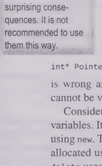

## 2.9.3 定位 new（Placement new）

new 运算符的一些使用方式如下：

- 1. int* p = new int;
  // Normal new call
- 2. int* p = new(nothrow) int;
  /* Does not throw exception in case memory is not allocated and returns the pointer value as null */
- 3. int* p = (int*) new int[3][4];

```
// For allocating memory to arrays
4. int* p = new int(3);
// For initializing the variable at the time of memory allocation
```

`placement new` 是 new 的一种变体。它的工作方式如下：

```
int* p = new int;    // normal new
int* q = new(p) int; // placement new
```

这里，没有为变量 q 分配内存；它的地址与 p 相同。这在某些特殊情况下很有用。假设从某处读取图像并逐一显示。假设这些图像依次存储在类 image 的对象中，并且有一个指针指向保存图像的内存区域，称为 position。现在，当加载第一张图像时，编写如下代码：

```
position = new Image(FirstImage);
```

这将创建一个新对象，为其分配内存，并用 FirstImage 初始化该内存。对于所有后续图像，代码将是

```
position = new(FirstImage) SecondImage
...
position = new(SecondImage) ThirdImage
...
```

从而将每张图像存储在第一张图像曾存储的相同位置。读者可能会质疑在这种情况下使用 placement new 的必要性，而不是编写像 *position = SecondImage 这样的简单赋值。

如果 FirstImage 和 SecondImage 两幅图像大小相同，那么这个语句是可以接受的。如果它们大小不同，placement new 是唯一可用的选择，因为它先调用 FirstImage 的析构函数，然后调用 SecondImage 的构造函数。

> **注意** 当我们希望另一个指针占用先前指针给出的内存时，placement new 很有用。与普通复制操作不同，placement new 会调用先前对象的析构函数和替换它的新对象的构造函数，从而避免任何不希望的后果。例如，假设指针指向图像，而第二幅图像比第一幅小。仅仅复制值将导致第二幅图像占用一部分，而剩余部分仍包含较旧的图像。如果要避免这种影响，建议使用 placement new。

## 2.9.4 new 与 malloc() 的比较

new 相对于 malloc() 的一些优势如下：

- 1. new 的语法比 malloc() 更简单。new 运算符不需要大小、空指针和强制转换。
- 2. new 是一个运算符，而 malloc() 是一个函数。运算符比函数执行得更快。由于运算符不是函数，可以避免上下文切换。编译器在编译时应直接将它们等效的汇编代码粘贴进去。
- 3. new 有多种形式，如第 2.9.3 节所讨论。malloc() 没有这样的功能。
- 4. new 具有类感知能力。可以改变 new 的含义以满足用户定义类的需求。这被称为运算符重载。

## 注释

- 1. 在 C++ 中，运算符可以作为函数来实现。在这种情况下，如果函数未定义为内联，则不会有优势。
- 2. 与 malloc() 不同，new 可以被重载，以便类对象可以根据需要并在用户想要的位置获得内存。当 new 为任何类重载时，使用该类的对象调用 new 会遵循该类开发者定义的过程，而不是 C++ 定义的常规内存管理。

## 2.9.5 delete 运算符的意义

delete 操作在程序中使用时似乎并不重要。在机器当天就会关闭的地方，例如教育机构，delete 的使用并不重要。然而，有些地方机器不会每天关闭，程序会持续运行很长时间而不会停止，例如 Web 服务器及相关组件。在这种情况下，除非定期删除由 new 创建的变量，否则它们所占用的内存空间将在程序运行期间持续增加。在某个时刻，内存将被耗尽，程序将崩溃。另一方面，如果机器关闭，所占用的空间会自动释放，就不会有内存不足的问题。

### 注意

Web 服务器长时间运行。在这类程序中，如果由 new 引入的对象在超出作用域时没有相应的 delete 可用，这些对象所占用的内存就无法收回，当内存满时程序就会崩溃。C++11 显然受到 Java 的启发，增加了垃圾回收；这是一个可以回收由超出作用域的对象浪费的内存的进程，可以避免这里提到的此类问题。

## 2.9.6 新的强制转换运算符、typeid 和 throw

C++ 既有新的类似函数的强制转换，也有旧的 C 风格强制转换。在 C 中，要将 int 变量转换为 float，使用 FloatVar = (float) IntVar;。然而，在 C++ 中，这样写为

```
FloatVar = float(IntVar);
```

这样更易读。旧的 C 风格强制转换仍然可用，并且在程序员中非常流行。

C++ 标准化委员会最近添加了四种新的强制转换运算符，以提供比旧 C 风格强制转换更好的强制转换操作。它们是 dynamic cast、reinterpret cast、static cast 和 const cast。旧的 C 风格强制转换在 C++ 中仍然有效，但建议使用新的强制转换运算符。这些将在第 11 章的 11.2–11.5 节中讨论。typeid 也用于 RTTI 上下文中，throw 用于 C++ 中的异常处理来捕获错误。

下面的代码说明了在特定情况下如何使用 try、throw 和 catch。程序执行期间，C++ 会监控 try 覆盖的块。当遇到 throw 语句时，控制权被永久转移到相应的 catch 语句。在下面的情况中，如果执行 throw error1，控制权将转移到 catch(ErrorType1 er)；如果执行 throw error2，控制权将转移到 catch(ErrorType2 er) 块。

```
try
{
    ErrorType1 error1;
```


```
ErrorType2 error2;
...;
throw error1;
...;
throw error2;
...;
}

catch(ErrorType1 er)
{ ... }
catch(ErrorType2 er)
{ ... }
```

下面的示例说明了如何使用 typeid。它需要包含一个 typeinfo 头文件。typeid 运算符有助于获取与该对象关联的 typeinfo 对象。typeinfo 对象包含有关类型的信息，包括类型的名称。当编写 `cout << typeid(SomeObject).name()` 时，如果 SomeObject 的类型是 int，它将显示 "int"。如果 SomeObject 的类型是用户定义的类 employee，它将显示 "class employee"。

```
#include <typeinfo>
...
void main()
{
...
cout << typeid(SomeObject).name();
}
```

## 2.10 条件结构和循环构造

if 和 else 在 C 中提供条件执行代码，并且在 C++ 中以相同形式可用。Switch case 在 C++ 中也可用。

使用循环可以使程序的一段代码重复执行给定的次数。这种重复一直持续到条件为真；否则，循环结束，控制权传递给循环之后的语句。C++ 中的循环包括 while、do-while 和 for 构造。所有这些构造的工作方式与 C 中相同。

## 总结

- C++ 中的标识符与 C 中的类似，不同之处在于 C++ 中即使超过 32 个字符的标识符也是有效的。
- C++ 中可用的关键字和数据类型是 C 的超集。
- C++ 中有三类不同的数据类型。第一类由 C 和 C++ 中都可用的函数组成。第二类包括在 C 中可用但在 C++ 中具有扩展含义的那些。第三类数据类型是在 C 中不可用但在 C++ 中额外提供的。
- const 指针和指向 const 的指针在编程中可用于避免错误，当程序员需要将指针传递给函数时。
- 引用可以以三种不同的方式使用，即独立引用、向函数传递虚拟参数以及从函数返回值。
- 引用比指针更具可读性，同时具有相同的效率。
- C++ 引入了 bool 数据类型，可用于以更可读的方式进行条件测试。
- C++ 提供变量的动态初始化。
- C++ 引入了作用域解析运算符，可用于访问与局部变量同名的全局变量。
- new 和 delete 是 C++ 中用于内存分配和释放的运算符。它们有多种形式。
- try、catch 和 throw 运算符用于异常处理，typeid 用于在运行时访问关联对象的类型。

## 关键字

Bool 变量 它是一种只能有两个值 true 和 false 的变量。建议在 C++ 中使用 bool 变量来检查表达式的真值。

常量指针 它是一种不能更改其引用地址的指针。指针值（地址）不能更改，但内容可以更改。

动态初始化 在 C++ 中，变量的初始化可以在运行时进行。这称为动态初始化。

new 和 delete 运算符 new 是从堆中获取内存的运算符。它是比 malloc() 更好的机制。C++ 中的 delete 执行与 C 中 free() 函数类似的工作，即释放由 new 运算符占用的内存。

new[] 和 delete[] 运算符 这些运算符与 new 和 delete 类似，不同之处在于它们为数组分配和释放内存。

指向常量的指针 它是一种可以更改其地址但地址内容不能被修改的指针。

引用 引用是一种使变量成为别名的机制。当一个引用变量被用来引用一个被引用变量时，两个变量互为别名。改变其中任何一个的值都会改变两者的值。

typeid 和 throw typeid 用于获取与给定类或对象关联的 typeinfo 对象，throw 用于处理异常。

## 练习

### 多项选择题

1. 当定义一个引用时，它可以引用 ______。
(a) 一个常量指针
(b) 一个指向常量的指针
(c) 一个有效定义的变量
(d) 一个运算符

2. C++ 关键字 ______ 来自 Stroustrup 的原始 C++ 中的关键字。
(a) 与……完全相同
(b) 与……完全不同
(c) 比……有更多的关键字
(d) 比……有更少的关键字

3. int secondVariable; double thirdVariable = sqrt( double( secondVariable ) );
这段代码将 ______。
(a) 在声明 thirdVariable 时给出语法错误
(b) 不会给出错误并在运行时初始化 thirdVariable
(c) 导致程序被编译但不能正确执行
(d) 导致编译器不编译此程序

4. 引用变量提供了一种 ______。
(a) 到原始变量的链接
(b) 到原始变量的指针
(c) 原始变量的副本
(d) 与原始变量的关系

5. 在 C++ 中，变量可以在 ______ 声明。
(a) main() 函数声明中的任何位置
(b) 程序中首次使用之前的任何位置
(c) 程序中的任何位置
(d) 仅在程序开头

### 概念练习

- 1. const 指针的意义是什么？举两个例子。
- 2. 指向常量的指针的意义是什么？举两个例子。
- 3. 请提出一个在单个表达式中同时使用指向常量的指针和类型为 `<datatype> const * const <pointer>` 的 const 指针的情况，例如 `int const * const p=q`。
- 4. 定义几个 string 对象。C++ 中的字符串是否像普通数据类型一样工作？如果使用 ‘=’ 将一个字符串赋值给另一个字符串，会发生什么？使用 ‘==’ 比较两个字符串。结果是什么？
- 5. 从函数返回引用有什么优点？请提出一些除本章给出的之外返回引用的应用。
- 6. 尽管 C++ 标准没有对标识符的长度施加任何限制，但 ________ 可能会施加限制。
  (a) 解释器
  (b) 预处理器
  (c) 编译器
  (d) 编码者
- 7. 以下哪个不是仅在 C++ 中可用的运算符？
  (a) : : *
  (b) typeid
  (c) throw
  (d) : :
- 8. 引用变量在 C++ 中被引入 ________。
  (a) 作为指针的补充
  (b) 以获得比指针更大的灵活性
  (c) 以消除指针的使用
  (d) 以消除 C 中使用指针相关的一些问题
- 9. C++ 中的 void 指针 ________。
  (a) 与 C 中的工作方式相同
  (b) 不可用
  (c) 不能自动类型转换
  (d) 可以自动类型转换
- 10. 在考虑常量时，C++ ________ C 中可接受的常量。
  (a) 只接受少数
  (b) 接受所有
  (c) 只接受反斜杠
  (d) 只接受符号
- 6. bool 变量的重要性是什么？选择任何用 C 编写的使用条件表达式的程序。尝试在程序中加入 bool 变量，然后将其作为 C++ 程序运行。
- 7. 什么是动态初始化？它在哪里有用？
- 8. 作用域解析运算符的用途是什么？请举一个在实际情况下使用的例子。除了将全局变量与局部变量分开之外，它还有其他用途吗？
- 9. 使用 new 和 delete 运算符比 malloc() 和 free() 函数有什么优势？

### 实践练习

以下练习需要 C 编程技能，并参考 C 程序。如果你过去写过一些 C 程序，请使用它们。否则，编写一个新程序并执行以下练习。

- 1. 编写一个带有 for 或 while 循环的 C 程序。在此程序中包含一些 if 条件，并将该程序作为 C++ 程序编译。（在 Windows 或 Novel 中将扩展名改为 cpp 并编译，或在 UNIX 中将扩展名改为 C 并使用 CC 编译，或在 Linux 中将扩展名改为 cpp 并使用 C++ 编译。）验证所有构造在 C++ 中的工作方式是否相同。
- 2. 阅读你的编译器手册或使用编译器的在线帮助。（对于 VC++ 使用 MSDN。）尝试找出定义标识符的规则。尝试获取有效关键字的列表。
- 3. 通常，C 编程书籍以有序链表程序结束。你可能自己看过或编写过一个程序。使用 new 和 delete 而不是 malloc() 和 free() 重写相同的程序。
- 4. 阅读编译器手册以获取运算符列表。尝试阅读本章中研究的运算符的描述。
- 5. 使用引用作为参数，重写你之前用 C 编写的任何使用指针作为参数的函数。
- 6. 重写任何返回指针的 C 函数，使其现在返回引用。


## 第3章
## 类与对象

- 类与对象
- 类的函数与数据成员
- 访问说明符：public 和 private
- C 和 C++ 中的 class 与 struct
- this 指针
- C++ 联合体与匿名联合体
- 作用域解析运算符
- 类的静态数据成员
- 数组对象
- 指向对象及类成员的指针
- 嵌套类及其用法
- 局部类
- const 对象及其使用

## 3.1 类与对象的介绍

类是诸如 C++ 之类的面向对象或面向对象编程语言最基本的需求之一。要在 C++ 中解决一个问题，问题的实体必须表示为类。C++ 设计者将与 C 的向后兼容视为神圣。因此，从理论上讲，可以在不使用类的情况下编写程序，但实际上非常困难。

考虑为打印学生成绩单而编写的程序。在这种情况下，实体是学生、考官、主管、审核员、成绩单和荣誉榜。实体在 C++ 程序中表示为类。我们感兴趣存储的关于这些实体的信息称为类的属性。属性有两种类型——数据和方法（函数），如图 3.1 所示。

成绩单程序的一个实体是考官。该实体（考官）的数据属性可能是考官的科目、姓名、地址、电话号码和隶属关系。考官实体的函数属性可能是阅读和打印考官详情以及分配一批答卷等活动。

让我们看一个学生类的对象的例子。考虑打印学生信息的问题，如程序 3.1 所示。

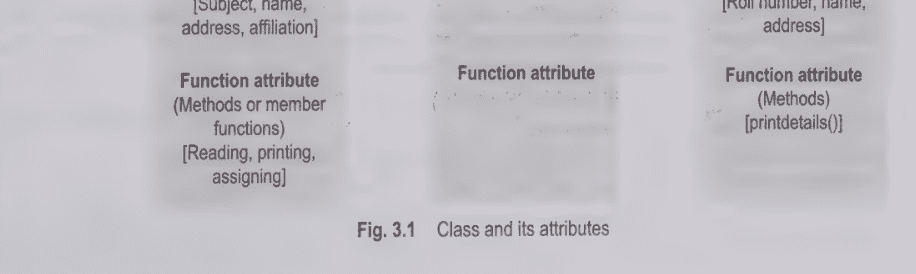

设计系统需要在编程前先考虑类及其属性。

熟悉的点（.）记号用于访问结构元素。它也可以用于访问类元素。

函数 PrintDetails() 在类内部定义。它被称为类的成员函数或函数成员。在 C 中，我们只能在结构中有数据成员；函数成员是 C++ 中出现的一种新型成员。我们将在后续章节中考虑更多类的例子。

## 3.2 类及其属性

找出实体及其属性是使用 C++ 编写程序的重要前提。再次考虑成绩单问题的例子。程序员可能会决定拥有学生、考官、监考员、试卷和成绩单等实体。

再考虑另一个类，例如 Marksheet，它可能具有学院名称、科目、最高分数和及格分数等数据属性。它可能具有打印成绩单、读取成绩单数据、提供统计信息（如通过的学生人数和获得一等奖的学生人数）以及打印荣誉榜等函数属性。

对于给定的问题，找出类和属性对于小问题来说是直观的。在大多数情况下，程序员能够在没有任何困难的情况下生成类和属性的层次结构。然而，对于大型系统来说却非常困难。需要一种有条不紊的方法来设计类及其属性。因此，我们需要以正式的方式研究系统并对类及其属性进行系统设计。系统的进一步演进也应被考虑在内。有专门的学科来处理这个问题，而本书的范围并不涵盖设计方法的进一步细节。然而，对于 C++ 的介绍来说，并不需要这种正式的设计方法。

另一个需要理解的重要点是，仅了解 C++ 语法并不能使人以面向对象的方式编程并利用其优势。编程 C++ 需要更多知识。何时使用引用，使用哪种类型的编码，是否使用基于对象的还是面向对象的，如何使用模板，何时继承，继承什么，何时使用虚基类，何时使用虚函数等都是这些方面。这些问题将在全书中在需要时进行讨论。

有时，面向对象编程这一短语具有误导性。它意味着通过生成类层次结构进行编程，使得我们拥有指向根类（通常称为基类）的指针，然后使用该指针寻址整个层次结构中的任何类的任何对象。使用 C++ 编写的程序可以用两种不同且独特的方式编写——基于对象和面向对象。这些细节在第 9 章中进行了深入讨论。

注意 C++ 中的类与 C 中的 struct 非常相似。如果一个类只包含数据属性，那么它几乎与 C 的 struct 完全相同。区别在于类的成员默认为 private，而 struct 的成员默认为 public。

## 3.3 类的解剖

类按以下格式定义：

```
class class_name
{
    access_specifier:
    data and functions
```

access_specifier:
data and functions
access_specifier:
data and functions
...
} object list;

以下是包含类定义的程序示例。

```
//PlayerClassEx.cpp
#include <iostream>
#include <string>
using namespace std;
class player
{
public:
string PlayerName;
string PlayerGame;
private:
int PlayerNo;
public:
void InsertDetails()
{
cout << "Insert player number";
cin >> PlayerNo;
cout << "Insert player name";
cin >> PlayerName;
cout << "Please enter the game he/she plays";
cin >> PlayerGame;
}
void DisplayDetails()
{
cout << "Player number is " << PlayerNo;
cout << "Player name is " << PlayerName;
cout << "The game played is " << PlayerGame;
}
};
/* The object list here is usually empty. However, instead of the empty statement, we can write }VisAnand; and it defines VisAnand as a player object */
void main()
{
player VisAnand;
VisAnand.InsertDetails();
VisAnand.DisplayDetails();
}
```

类的定义始终以关键字 class 开始并以分号结束。对象列表跟在类定义之后并包含为该类定义的

## 72 使用 ANSI C++ 编程

如果变量在 public 部分定义，可以直接访问并修改它。因此，可以写

```
VisAnand.PlayerName = "Vishwanathan Anand";
```

诸如 PlayerName 之类的 public 数据成员表示设计不良。良好的设计仅在 public 部分具有成员函数。其原因在第 3.4 节中得到了明确解释。

如本例所示，程序员可以自由决定 public 和 private 派生的出现顺序。然而，在本文中，private 部分写在 public 部分之前，并且不鼓励编写多个 public 和 private 部分，因为两种方式都没有优势。更重要的是要理解访问说明符的需要。这就是第 3.4 节讨论的要点。

## 3.4 访问说明符

如前所述，大型 C 程序的一个问题是程序员失去了可视化，因为单个单元包含各种抽象。程序员很难查看整个程序并理解正在发生的事情。

这个问题的一个原因是数据成员和函数不是以可理解的信息单元的形式存在。一旦函数开始，或 struct 被访问，内部定义的所有数据成员，无论是否需要，都可用。这使得处理程序变得复杂，因为必须处理不必要的数据成员。

理想情况下，程序员应避免访问类的不必要项目，并应对程序中需要使用的属性有一个简化的视图，无论是函数还是结构。

为了获得更好的结果，需要在用户需要的数据成员和不被用户访问的数据成员之间进行区分。函数中对用户必要的函数和仅用于对象维护的函数之间也需要类似的区分。

这个观点可以用经典数据结构栈的例子更好地说明。栈是一种数据结构，其中数据以后进先出方式插入和删除，即最后插入的值最先取出。栈中的插入称为 push，删除称为 pop。栈中的插入和删除只能在顶部进行，因此这些例程无需提供插入或删除的位置。该位置由一个称为栈指针的数据成员指示，它可以是程序 3.2 中的数组索引，也可以是具有要 push 或 pop 的项目地址的实际指针。栈的使用在系统软件中非常常见。

图 3.2 和 3.3 说明了栈操作。栈可以使用数组甚至链表实现，如前所述，尽管我们的 C++ 示例使用数组将栈实现为类。

让我们首先将栈定义为结构并确定遇到的问题。然后，让我们看看将其定义为类如何消除这些问题。

因此，首先考虑栈被定义为结构的情况。就成员函数而言，我们已经看到栈上可能的两种操作，即在顶部插入称为 push() 和从顶部删除称为 pop()。虽然可能还有其他操作

良好的类设计通过将所有数据成员定义为 private 并使用精心设计的 public 函数提供对其的访问来屏蔽它们，从而控制它们被操作的方式。

C 程序过度暴露了它使用的一切，无论是函数还是结构。C++ 通过仅使有用部分可见来帮助程序员。


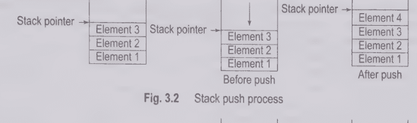

### Fig. 3.2 Stack push process

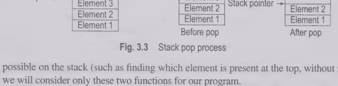

### Fig. 3.3 Stack pop process

在栈上可能的操作（例如查找栈顶是否存在元素，而不将其移除）中，我们仅考虑这两个函数用于我们的程序。

现在，让我们考虑数据成员。同样，我们也只考虑其中两个，尽管在现实中可能还有更多。第一个是数组，用于存储元素，第二个是指针栈，它指示在数组中进行元素添加或移除的位置。

相对于一个类，栈指针由栈类中存在的两个函数共同操作。因此，push() 和 pop() 作为栈类的成员函数，将能够访问数组和栈指针，因为两者都是私有成员。

### 3.4.1 Expression Parser

现在，考虑一个外部函数，例如表达式解析器。在我们查看栈如何被表达式解析器使用之前，让我们先了解它是什么。

表达式解析器是编译器的重要组成部分。它查看一个表达式并分离其基本元素。然后，将它们转换为编译器的下一个例程可理解的形式。因此，如果我们向表达式解析器提供 A + B，它会得出答案：有两个变量 A 和 B，它们由运算符 ‘+’ 操作。可选地，它可以将给定的表达式转换为另一种类型的表达式。一个表达式解析器的例子是将表达式转换为后缀表达式（即把 A + B 转换为 A B+）。同样，它也可能将 A + B/C 转换为 A B C/ +。这被称为逆波兰表示法，并在展览 3.1 中进行了解释。

### Exhibit 3.1 Reverse Polish notation

将 A + B 这样的表达式转换为 AB+ 称为中缀到后缀转换，而记号 AB+ 称为逆波兰表示法。有人可能会想知道为什么表达式解析器要做这种奇怪的事情。答案如下：

一个表达式可能包含可变数量的运算符和操作数。因此，对于编译器来说，查看一个表达式并决定如何执行它并不是那么直接的。它需要一个更简单（在其看来，对人类来说却很矛盾）的形式来进行计算。AB+ 对于编译器来说比 A + B 更容易操作。

```
if(StackPointer == 0)
    cout << "Stack underflow! Cannot pop";
else
{
    StackPointer--;
    return StackArray[StackPointer];
}
};

void main()
{
    Stack MyStack;
    MyStack.InitializeSP();
    MyStack.push(1);
    MyStack.push(2);

    cout << MyStack.pop() << "\n"
    /* 2 is the output, inserted later */
    cout << MyStack.pop() << "\n";
    /* The output is now 1, inserted earlier */
}
```

### How the Program Works

使用类对象  该程序包含一个类 stack。它包含两个函数，push()（将整数插入栈）和 pop()（从栈中移除一个元素）。有一个数组 StackArray，可以接受十个这样的被压入元素。还有一个变量 StackPointer，用来指示可以在栈中插入元素的索引。StackArray 和 StackPointer 被定义为私有。

程序包含类 Stack 的一个对象 MyStack。让我们看看 MyStack 如何工作。我们需要调用 MyStack.push(<element>) 将元素压入栈，并使用 PoppedElement = MyStack.pop() 使元素弹出。MyStack 是类 Stack 的一个对象，它不能直接访问 StackPointer 或 StackArray。因此，将 MyStack 作为对象放在表达式解析器程序中是很好的。表达式解析器可以创建一个栈对象（使用诸如 Stack ExpressionStack; 这样的语句），可以压入和弹出，但它不会允许 ExpressionStack.StackPointer = 8 或 ExpressionStack.StackArray[8] = 12 这样的表达式。

### Defining members as public or private

从设计角度来看，将成员定义为私有或公有是很重要的。通过这种选择性定义，维护了类的可见性、服务以及实现和接口的差异。

例如，当我们使用栈构建表达式解析器时，我们可以调用 push() 在栈中插入元素，调用 pop() 从栈中移除元素，但我们不必担心栈实际是如何实现的。在此示例中，栈使用数组实现，而 MyStack 看不到该数组。数组和栈指针在类 Stack 之外不可见。

> 在类外部需要被可视化的应定义为 public，其余应定义为 private。

### Implementation vs interface problem

让我们从服务的角度来可视化这个过程。向外部提供服务的属性应保持为 public，而仅为成员函数提供服务的则应定义为 private。在我们的示例中，push() 和 pop() 提供服务

这种在 C 中的定义不占用任何内存。这是因为被定义的东西实际上是一个特定聚合的形成或安排。我们并没有定义任何需要存储的变量，而只是提供了学生数据成员应包含内容的轮廓。这类似于提供一台机器的草图。实际的机器将稍后使用相同的草图生产。我们只有在建造机器时才需要原材料，而不是在绘制草图时。同样，只有当我们定义类的对象时，才会占用内存来保存数据成员。

与 struct 不同，当我们定义一个类时，类成员函数的内存以及静态数据成员的内存会立即分配（静态数据成员在第 3.9 节中讨论）。另一方面，当我们定义类的对象时，只会获取存储非静态数据成员所需的内存。到目前为止，我们只处理了非静态成员。

注意 内存分配分为两个阶段。第一阶段，函数成员和静态成员在类被定义时分配内存，即在程序执行生命周期中仅分配一次。另一方面，每当对象被定义时，就会为该特定对象的非静态数据成员分配单独的内存。

如果一个对象被定义 100 次，则会相应地为这些非静态数据成员分配 100 次内存。这是因为在 C++ 对象模型中，函数和静态成员仅存储在一个位置并被共享，而非静态成员则不共享，每个对象都单独存储。每个对象都有自己独立的非静态成员副本。

考虑第 3.1 节中定义的类 student。假设我们在 main 函数中添加以下代码：

```
student FirstStudent;
student SecondStudent;
```

那么，我们只有一个 PrintDetails() 函数被第一个和第二个学生共享。它在 student 类被定义时就被定义并分配了内存。诸如学号、姓名和地址等细节在我们定义 student 类的对象时才出现并分配内存。为每个对象拥有单独的学号、姓名和地址是很重要的。如果每个对象没有单独的一组非静态数据属性，对象将失去其身份，所有对象将具有相同的姓名、学号和地址；对用户来说它们是相同的。因此，FirstStudent.RollNo 显示的信息与 SecondStudent.RollNo 显示的信息不同。

PrintDetails() 函数并非如此。无论定义了多少个对象，都只有一个 PrintDetails() 副本供它们使用。因此，当我们调用 FirstStudent.PrintDetails() 或 SecondStudent.PrintDetails() 时，调用的是同一个函数。

PrintDetails() 如何在第一种情况下打印第一个学生的详细信息，在第二种情况下打印第二个学生的详细信息？我们似乎没有向函数传递任何内容。需要注意的是，一个指向调用对象的指针（第一种情况下为 &FirstStudent，第二种情况下为 &SecondStudent）始终作为隐式参数传递给成员函数，这就是为什么它在两种情况下都能完美工作的原因。


## 80 使用 ANSI C++ 编程

> 注意
> 从技术上讲，FirstStudent.PrintDetails() 等同于 PrintDetails(&FirstStudent)，SecondStudent.PrintDetails() 等同于 PrintDetails(&SecondStudent)。指向调用类对象的指针将传递给函数。以这种方式传递的指针（第一种情况下是 &FirstStudent，第二种情况下是 &SecondStudent）称为 this 指针。我们实际上可以通过关键字 this 来指代该指针。

将指针传递给调用对象有助于为所有对象保留函数的单一副本。我们需要理解在所有对象之间共享成员函数的重要性。无论我们创建多少个对象，为成员函数的单一副本分配内存就足够了。此外，为每个对象分别准备一组完全相同的成员函数是没有意义的。

> 注意
> 即使我们定义了 100 个学生对象，PrintDetails() 函数也只有一个副本。同样，即使我们有 0 个学生对象，PrintDetails() 函数仍然有一个副本。另一方面，如果我们有 0 个学生对象副本，那么就有 0 个学号；如果我们有 100 个学生对象副本，就有 100 个学号，每个对象对应一个。因此，在定义类时，为函数分配内存；而在定义对象时，为非静态数据成员分配内存。

## 3.6 C++ 中结构体（struct）和类（class）的区别

在 C++ 中，结构体（structure）和类（class）之间的区别是模糊的。它们之间只有一个（看似）微不足道的区别。我们已经了解了 public 和 private 访问说明符；在定义类时，我们可以省略它们，如程序 3.3 所示。

### 程序 3.3 struct 与 class

```cpp
// StructClass.cpp
#include <iostream>
#include <string>
using namespace std;

class employee
{
/* Access specifier is omitted here, so it is private by default */
int EmpID;
string Name;
string Designation;
int Department;
int Salary;

public:
void InsertDetails()
{
cout << "Insert employee ID";
cin >> EmpID;
cout << "Insert name";
cin >> Name;
cout << "Insert designation";
cin >> Designation;
cout << "Insert department";
cin >> Department;
cout << "Insert salary";
cin >> Salary;
}
}
```

```
void DisplayDetails()
{
    cout << EmpID << "\n";
    cout << Name << "\n";
    cout << Designation << "\n";
    cout << Department << "\n";
    cout << Salary << "\n";
}
};

void main()
{
    employee Robin;
    Robin.InsertDetails();
    Robin.DisplayDetails();
}
```

> 注意 当我们定义一个类时，如果没有将数据成员写在任何访问说明符之下，它们默认被视为 private。

### 程序工作原理

如果对这个程序稍作修改，将第四行的 class employee 替换为 struct employee，程序运行结果完全相同。然而，有一个差异，目前还看不出来。在两个程序中（第一个程序中的 employee 是类，第二个程序中的 employee 是结构体）添加下面一行代码。main 函数现在变为如下形式：

```
void main()
{
    employee Robin;
    Robin.InsertDetails();
    Robin.DisplayDetails();
    // The following line is added
    Robin.EmpID = 10;
    /* This line will not be compiled in the case of class,
    but it will work fine in a structure */
}
```

第一个程序无法编译，但第二个程序可以。struct 定义中的默认行为不同。在结构体中，没有访问说明符名称的属性被视为 public，而在类中则是 private。这里，第一个程序中的 EmpID 是 private，而在第二个程序中它是 public。第二个程序的语句可以访问它，而第一个程序的语句不能，因此第二个程序可以编译。理解为什么类中默认是 private 并不难。除非显式指定（即在 public 下定义），否则类中定义的一切都应被视为 private。

结构体的行为方式与类相同，除了默认数据类型上看似微不足道的差异外，这看起来可能不合逻辑。结构体之所以有这样的行为，原因在于与 C 语言的向后兼容性。考虑以下借用自 C 语言的代码：

```
struct Evaluator
{
```

> 对于类，数据成员和成员函数默认是 private（除非另有声明），而对于结构体，其成员默认是 public。

```
char Name[30];
char Address[100];
}
```

如果在 C++ 中把结构体做得与类相似（即未提供访问说明符时默认为 private），那么想想这段代码会发生什么。程序将无法执行如下语句：

```
Evaluator MrBaxi;
Strcpy(MrBaxi.Name, "Chandrakant Baxi");
```

它能够访问 Name 这一事实表明 Name 是一个 public 数据成员。通过保持默认为 public，C++ 的结构体仍然与 C 的结构体向后兼容。C++ 的惯例是：当我们需要一个类时使用 class，当我们需要一个类似 C 的结构体时使用 struct。

> 注意 如果 struct 默认不是 public，那么复制到 C++ 程序中的 C 代码将无法工作。C++ 的设计者需要向后兼容性，并希望 C 程序在被 C++ 编译器编译时只需做最少的修改即可运行。

## 3.7 联合体（union）与类的区别

在 C++ 中，联合体可以拥有访问说明符，并且可以同时定义数据和函数；与结构体类似，它们的默认访问说明符是 public。（原因与第 3.6 节讨论的相同。）联合体有一个重要特性：所有数据元素（但成员函数除外）共享同一内存位置。它们还必须保持与 C 语言中联合体的兼容性。

C++ 定义了一种 C 语言中没有的特殊联合体类型，即匿名联合体（anonymous union）。在这种联合体中，定义时不会提供联合体的名称。这向编译器表明数据元素共享同一内存位置。匿名联合体的成员可以直接访问，无需定义联合体类型的对象，也无需使用点运算符。以下是对所讨论的联合体相关要点的总结。

- 1. 总的来说，C++ 中的联合体与 C 中相同，可能还会添加成员函数。
- 2. 所有数据成员与 C 一样共享同一内存。
- 3. 默认访问说明符与结构体一样是 public。
- 4. 在 C++ 中，可以定义一个没有名称的联合体，即匿名联合体。

程序 3.4 演示了联合体的类型。

### 程序 3.4 联合体与类

```
//UnionExample.cpp
#include <iostream>
using namespace std;

union IntChar
{
    void SetValue()
    // Without access specifier, treated as public
    {
        CharView[0]=0;  // 00000000
```

```
CharView[1]=1;  // 00000001
CharView[2]=0;  // 00000000
CharView[3]=0;  // 00000000
}
/* This value is equivalent to 00000000 00000000 00000001 00000000, that is, 2^8 */
void GetValue()
{
    cout << IntView; // displays 256, that is, 2^8
}
private:
    unsigned int IntView;
    char CharView[4];
    /* These two data members share the same memory location */
};
void main()
{
    IntChar IC;
    IC.SetValue();
    IC.GetValue();

    // The following is an anonymous union

    union
    {
        int AnoInt;
        char AnoChar[4];
    };
    AnoInt = 65;    // AnoInt is accessed directly
    cout << "\n The AnoChar 1st element is" << AnoChar[0];
    cout << "\n The AnoChar 2nd element is" << AnoChar[1];
    cout << "\n The AnoChar 3rd element is" << AnoChar[2];
    cout << "\n The AnoChar 4th element is" << AnoChar[3] << endl
}
```

### 输出

```
256
The AnoChar 1st element is A
The AnoChar 2nd element is
The AnoChar 3rd element is
The AnoChar 4th element is
```

### 程序工作原理

IntValue 数据成员的值打印为 256，即 2^8。AnoChar[0] 数据成员打印 A（char 值 65），其余打印 null（char 值 0）。以下是关于程序 3.4 需要注意的一些要点：

- 1. 函数 SetValue() 和 GetValue() 没有在任何访问说明符下定义，因此被视为 public。
- 2. AnoChar 和 AnoInt 可以在不使用点表示法的情况下访问。可以看到，当 AnoInt 的值设为 65 时，AnoChar[0] 的值是“A”。这是一个简单的例子，说明 AnoChar 和 AnoInt 实际上共享同一内存位置。

> 注意 匿名联合体定义在主联合体内部，也就是说，它是一个局部联合体。如果我们想定义全局匿名联合体，在 C++ 中必须将其定义为 static。普通联合体则不是这样。在程序 3.4 中，联合体 IntChar 被定义为全局的。


在使用 C++ 中的联合体时存在一些限制，因此，只要可能，最好始终使用类。联合体仅应在类似于 C 联合体的上下文中使用。

### 在函数成员之后定义数据成员

我们已在定义它们所使用的变量 IntView 和 CharView 之前定义了函数 SetValue() 和 GetValue()。编译器如何允许在实际定义之前使用某些内容？原因很有趣。编译器对类定义进行两次传递。在第一次传递中，它查看函数头、参数和变量定义。函数体在下一次传递中处理。当对主体进行求值时，即使定义在后面，数据成员也已为已知。因此，在这种情况下我们不会得到编译器错误。

## 3.8 在类外定义函数成员

```cpp
//FunOutsideClass.cpp
#include <iostream>
#include <string>
using namespace std;
class student
{
public:
    int RollNumber;
    string Name;
    string Address;
    void PrintDetails();
    /* Only the prototype is inside the class definition */
};
void student::PrintDetails()
{
    /* Note that 'student::' is appended at the beginning */
    {
        cout << "Roll number is " << RollNumber << "\n";
        cout << "Name is " << Name << "\n";
        cout << "Address is " << Address << "\n";
    }
}
void main()
{
    student Student1;
    Student1.RollNumber = 1;
    Student1.Name = "Robin Singh";
    Student1.Address = "New Delhi";
    Student1.PrintDetails();
}
```

此示例表明，在类外定义函数非常简单，如果函数较大则推荐这样做。这将在第 4 章讨论内联函数时详细说明。

### 作用域解析运算符（ :: ）

当函数不属于任何类时，我们称其为非成员函数。

现在让我们看看在类外定义函数之前提供的作用域解析运算符的使用，即 void student::PrintDetails() 而不是简单的 PrintDetails()。当函数在类外定义时，只有原型保留在类内。其他所有细节与在类内定义相似。因此，语句

```
void PrintDetails();
```

应仅在类的主体中。

类的主体定义了成员函数的范围。当函数在类的主体内定义时，它处于类的范围内，即隐式定义为同一类的成员。无需指定该函数属于该类。在程序 3.1 中，PrintDetails() 函数在 student 类内定义，我们没有提到 PrintDetails() 属于 student 类。

当函数在类外定义时，它在类的范围之外定义。无法明确该函数属于哪个类，或者是否属于任何类，因此需要用该函数显式指定类。在前面的示例中，PrintDetails() 函数在类外定义，因此需要指定它属于 student 类。定义

```
void student::PrintDetails()
```

说明 PrintDetails() 函数是 student 类的成员函数。作用域解析运算符因此得名，因为它解析了作用域。用于全局数据成员的作用域解析运算符也执行相同的解析数据成员作用域的功能。

还需要注意的是，多个类可以拥有同名函数。在这种情况下，使用作用域解析运算符来区分它们。考虑程序 3.1 中定义的类 student，其中函数 PrintDetails() 在内部定义。

假设我们还有另一个类 employee，其函数之一为 PrintDetails()。如果这两个函数都在类外定义，则写法如下：

```
student::PrintDetails()
```

和

```
employee::PrintDetails()
```

人们可以一眼看出所谈论的是哪个 PrintDetails()。因此，当编译器遇到 <AnEmployeeObject>.PrintDetails() 时，它将能够调用正确的函数。

> 注意 作用域解析运算符在区分在类体外定义的不同类中同名函数时很有用。

## 3.9 静态数据成员

C 函数中的静态变量具有特定属性，即它们仅初始化一次（在函数首次调用时），并且在调用之间保留其值。这由程序 3.5 重申。

### 程序 3.5 静态数据成员

```
//CStaticVar.cpp
#include <stdio.h>
void Dummy()
{
    static int i = 10;
    int j = 20;
    i+=10;
    j+=5;
    printf("The i value is %d and j value is %d \n",i,j);
}

void main()
{
    Dummy();
    /* First call to Dummy(). Here, i is initialized to 10. At the end of the call, i value changes to 20 */
    Dummy();
    /* Second call to Dummy(). Here, i is not initialized to 10, instead it is 20 as that is the value it had while exiting from the first call to Dummy() */
}
```

### 输出

The i value is 20 and j value is 25
The i value is 30 and j value is 25

### 程序如何工作

在这种情况下，第一次调用 Dummy() 时，i 初始化为 10。第二次调用时，即使函数中写有初始化语句，也不会初始化，而是在第一次调用 Dummy() 退出时采用 i 的值。如果在第一次调用 Dummy() 退出时设置为 20，则在第二次调用时保留。

变量 j 的情况不同。它是自动（auto）变量，因此在两次调用中都初始化为 20。如果在第一次调用 Dummy() 结束时设置为 25，则在退出函数后立即忘记该值，并在第二次调用时重新开始。这就是为什么它在第二次调用中打印相同的 25 值，即使 i 值增加到 30。这里还需要注意另一点。如果在此程序中未初始化 i，则它假定值为 0。j 的情况不同，它包含先前对分配给 j 的内存使用所遗留的任意值。

### 注意

在 C++ 的上下文中，auto 的含义略有扩展。如果程序员使用语句

auto x;

定义变量，编译器会尝试确定 x 的类型并在此处使用它。这似乎没什么用，但在需要使用大型数据类型名称时，尤其是在使用嵌套命名空间或使用标准模板库（STL）时，这非常有用。

### Auto 与 Static 的区别

在 C 中，可以区分在函数退出后失去值的 auto 变量和不丢失值的静态成员。这是通过将两种变量存储在不同位置来实现的。

> Auto 变量在退出函数后会失去其值，而静态成员会保留其先前的值。

静态成员与全局变量一起存储在永久位置，而 auto 变量存储在非永久堆栈上。（此处的“永久”是指“只要程序执行在进行中”）。因此，在调用函数时存储在堆栈上的 auto 变量在函数退出时丢失，其内容从堆栈中移除。简而言之，它们存储在动态位置，该位置在函数被调用和退出时会发生变化。另一方面，静态成员存储在静态位置，该位置在整个程序执行期间保留。因此，它们被称为静态。

静态成员在 C++ 中的含义也类似。程序 3.5 实际上可以作为 C++ 程序编译。所有静态成员都与全局变量一起存储在永久位置。

### 静态与全局数据成员的区别

在类内定义的静态成员也存储在永久位置。类的静态数据成员与全局数据成员略有不同。展览 3.2 列出了它们之间的差异。

### 展览 3.2 什么区分了静态数据成员和全局数据成员

- 1. 存储：两者都存储在全局位置
- 2. 实例化：两者都作为单个副本可用，而无需创建任何对象
- 3. 初始化：两者在定义时都初始化为零
- 4. 作用域：全局变量的作用域是整个程序，而静态变量仅限于它们所定义的类。

如前所述，静态数据成员存储在程序执行期间保留的位置，并且不与类对象一起存储。它们仅存储为单个副本。静态数据成员的这个单个副本在类的所有对象之间共享。它们的行为与类的成员函数非常相似。类似于函数 PrintDetails()，即使未创建类的对象，静态成员也存在并且可用。

所有静态数据成员在 C++ 编译器声明时都初始化为零。这意味着静态数据成员与全局数据成员一样好，唯一的区别是它们仅对该类可用，而不是整个程序。程序 3.6 显示了如何定义和使用静态成员。

### 程序 3.6 静态和非静态成员

```
//StaticVariable.cpp
#include <iostream>
using namespace std;

class TestStatic
{
private:
    static int StaticVariable;
    /* It does not define the static member; only declaration is provided here */
    int NonStaticVariable;


```
public:
void InitializeVariables(int Stat, int NonStat)
{
    StaticVariable = Stat;
    NonStaticVariable = NonStat;
}

void DisplayVariables()
{
    cout << "Static member's value is" << StaticVariable << "\n";
    cout << "Non-static member's value is" << NonStaticVariable << "\n";
}
};

int TestStatic::StaticVariable;
/* Defining the static member */

void main()
{
    TestStatic TS1;
    TestStatic TS2;
    TS1.InitializeVariables(5,5);
    TS1.DisplayVariables();
    TS2.InitializeVariables(10,10);
    TS2.DisplayVariables();
    // Let us again see what are the values for T1
    TS1.DisplayVariables();
}
```

### Output

Static member's value is 5
Non-static member's value is 5
Static member's value is 10
Non-static member's value is 10
Static member's value is 10
Non-static member's value is 5

### How the Program Works

This program has a class TestStatic; TS1 is the first object and TS2 is the second object of this class. The class contains two different variables; StaticVariable is defined as static whereas NonStaticVariable is defined as a non-static data member. It should be noted that the static members need two phases of definition. StaticVariable is declared inside the class as

```
static int StaticVariable;
/* this is actually the prototype of the static variable definition */
```

It is defined outside the class as

```
int TestStatic::StaticVariable;
```

> Note The keyword static must precede the prototype, but not the definition. Static variables are to be declared inside the class first and then defined outside the class as well.

It should be noted how a static member is declared, defined, and used in this program. Though it is defined as a private variable, it can also be defined as public. Program 3.9 provides an example of a publicly defined static variable.

A static member can be defined as private or public, but usually it is kept public.

In Program 3.6, we assign values to TS1 first and then to TS2. Both NonStaticVariable and StaticVariable are given values. When the static member of TS2 is changed, it can be seen in the output that the static member of TS1 is changed as well. This is because the variables TS1.StaticVariable and TS2.StaticVariable are actually the same. Any number of objects may be defined in the same manner; there will still be only a single copy of StaticVariable.

Static members are needed in a situation when all objects of the class need to share some features. Consider Program 3.7, which deals with another type of student class. It contains two normal variables; SubjectMarks is an array containing the marks of a student object and fail is a Boolean variable indicating whether the student has passed or failed. As discussed in Chapter I, bool is a new data type added to C++. There are two different member functions: DisplayMarks(), which display the marks of a given student, and SetMarks(), which set the values of marks for a specific object. It should be noted that for the SubjectMark array and fail, the values can be set only by SetMarks() and can only be seen by DisplayMarks(). This is a good example of having a controlled access to an attribute (the marks) of an object.

### PROGRAM 3.7 Static members

```
//StaticVar3.cpp
#include <iostream>
using namespace std;

class student
{
public:
    static int PassingMark;
    int SubjectMark[5];
    bool fail;
    void DisplayMarks()
    {
        for(int i=0; i<5; ++i) {
        cout << "Marks of subject no.";
        cout << i << " is " << SubjectMark[i];
        }
    }
    void SetMarks(int Marks[5])
    {
        for(int i=0; i<5; ++i)
        {
            SubjectMark[i] = Marks[i];
        }
    }
    bool CheckPassing()
    {
        fail = false;
        for(int i=0; i<5; ++i)
        {
            if(SubjectMark[i] < PassingMark)
            fail = true;
        }
        if(!fail)
            cout << "Congratulations! You have passed \n";
        else
            cout << "Sorry! You have failed \n";
```

```
return !fail;
}
});
int student::PassingMark; // required definition
void main()
{
    student::PassingMark = 35;
    student Robin;
    student Leena;
    student Bob;

    int RobinMarks[] = {75,55,65,56,89};
    int LeenaMarks[] = {15,25,100,98,89};
    int BobMarks[] = {100,70,67,78,98};

    Robin.SetMarks(RobinMarks);
    Bob.SetMarks(BobMarks);
    Leena.SetMarks(LeenaMarks);

    Robin.CheckPassing();
    Leena.CheckPassing();
    Bob.CheckPassing();
}
```

### Output

Congratulations! You have passed
Sorry! You have failed
Congratulations! You have passed

### How the Program Works

We will now explain the use of PassingMark as a static member. Irrespective of the number of students and subjects, we need only one copy of passing marks. Hence, we have defined it to be static.

> Note When we need to have a single copy of a member irrespective of the number of objects of a class, we need to define it as static.

Let us see how PassingMark is used. We need to write student::PassingMark outside the class to actually define passing marks. The way it is accessed is also interesting. Here, it is accessed as Student::PassingMark. A static member can be accessed using either student::PassingMark, Robin.PassingMark or Leena.PassingMark. Thus, there are two ways to access static members:

- 1. Class name::Member variable name
- 2. Object name.Member variable name

The difference must be noted. The scope resolution operator (::) is used along with the class name whereas the dot operator (.) is used with the object name. Though the second form of using the static member is allowed, it is misleading for the reader and is not recommended. We will revisit this while discussing Program 3.8.

Consider the case where we are interested in finding out how many objects of a given class are defined at the moment. Suppose we have a variable called TotalStudents for storing information about the total students at present. If this variable is defined as a non-static data member of the class, every object will have its own copy of TotalStudents when defined.

For example, we may have Student1 and Student2 as two students. Student1.TotalStudents and Student2.TotalStudents are two different variables. Increasing TotalStudents of

Student1 does not increase TotalStudents of Student2. This is similar to changing the roll number of one student, which does not have any effect on that of the other student. Thus, our purpose is not served by using normal variables. The static data member in this case solves the problem. The following program shows how this can be done.

The program contains a student class, containing two functions for setting and printing the details of the students. The student class contains three non-static members, namely, RollNumber, Name, and Address. However, the most important data for us is the static member TotalStudents.

```
// StaticCountVar.cpp
#include <iostream>
#include <string>
using namespace std;
class student
{
public:
    static int TotalStudents;
private:
    int RollNumber;
    string Name;
    string Address;
public:
    void SetDetails(int Roll, string StudentName, string StudentAddress)
    {
        RollNumber = Roll;
        Name = StudentName;
        Address = StudentAddress;
        TotalStudents++;
    }
    void PrintDetails()
    {
        cout << "Roll number is " << RollNumber << "\n";
        cout << "Name is " << Name << "\n";
        cout << "Address is " << Address << "\n";
    }
};
int student::TotalStudents;
/* There is no need to initialize this to zero; the compiler will automatically do it */
void main()
{
    cout << "Total students at the moment " << student::TotalStudents << "\n";
    student Robin;
    Robin.SetDetails(1,"Robin Singh","New Delhi");
    Robin.PrintDetails();
    cout << "Total students at the moment " << student::TotalStudents << "\n";
    student Sonia;
    Sonia.SetDetails(2,"Sonia","Bhopal");
```

```
Sonia.PrintDetails();
cout << "Total students at the moment " << student::TotalStudents << "\n";
if(true)
{
    student Arti;
    Arti.SetDetails(3,"Arti", "Indore");
    Arti.PrintDetails();
    cout << "Total students at the moment" << student::TotalStudents;
}
cout <<"Arti departs! \n";
/* The following line will not work as expected. Total students are still three */
cout << "Total students at the moment " << student::TotalStudents <<"\n";
}
```

### Output

Total students at the moment 0
Roll number is 1
Name is Robin Singh
Address is New Delhi
Total students at the moment 1
Roll number is 2
Name is Sonia
Address is Bhopal
Total students at the moment 2
Roll number is 3
Name is Arti
Address is Indore
Total students at the moment 3
Arti departs!
Total students at the moment 3

As can be seen, this program works successfully and can count the total number of students every time. However, there is a problem. Observe that even after Arti’s departure, the number of totals students is displayed as three instead of two. The ways to tackle this problem will be discussed when we study destructors in Chapter 6.

Another interesting factor is to be observed here. TotalStudent has not been initialized to zero. This is because all static and global variables are automatically initialized to zero in C++, as in C.

Let us look at one more example that explains the two ways of calling static functions and also the difference between the two ways. Consider Program 3.8.

### PROGRAM 3.8 Two ways of calling static functions

```
//StaticVarDisp.cpp
#include <iostream>
using namespace std;

class TestStatic
{
public:
    static int StaticVariable;
    void DisplayValue()
    {
        cout << "The static member's value is " << StaticVariable << "\n";
    }
};
```


```
int TestStatic::StaticVariable;
void main()
{
    TestStatic::StaticVariable = 100;
    /* Class name to qualify the static member */
    cout << "Static member's value before existence of any object" << TestStatic::StaticVariable;
    TestStatic TS1;
    TestStatic TS2;
    TS1.DisplayValue();
    TS2.DisplayValue();
    TS2.StaticVariable = 10;
    // Object name to qualify the same static member
    TS1.DisplayValue();
}
```

### How the Program Works

Let us see how the static member is accessed. As mentioned earlier, we can qualify a static member in two different ways.

- 1. Object name.Static member name(TS2.StaticVariable = 10;)
- 2. Class name::Static member name(TestStatic::StaticVariable = 100;)

As can be observed, there is no difference between the results because we are working on the same variable either way. However, the second form is better since it is conceptually clearer. In a true sense, a static member belongs to the class and not the object. The first form is provided just for syntactical convenience and should not be used, because it may confuse the reader and the variable might be taken as a normal variable (normal data member of the class). However, class name::static member name clearly states it to be a static member.

> Note The other advantage of using the form class name::static member is that there is no need to instantiate an object to refer to the static member. Such dummy object instantiation slows down the execution of the program and may lead to unnecessary additions to the program code, which might result in more errors.

We have discussed the unique roll number generator function in Chapter 1. This function can be easily written and used in a program using static members. Consider the following example.

//UniqueRollNoGenerator.cpp
#include <iostream>
using namespace std;
class Student
{
private:
    int RollNo;
    static int CurrentRollNo;
    int UniqueRollNoGenerator()
    {
        CurrentRollNo++;
        return CurrentRollNo;
    }
}
public:
    void AssignRollNumber()
    {
        RollNo = UniqueRollNoGenerator();
    }
    void DispRollNo()
    {
        cout << "Roll number of this student is " << RollNo << "\n";
    }
};
int Student::CurrentRollNo;
void main()
{
    Student Mahesh;
    Mahesh.AssignRollNumber();
    Student Jayesh;
    Jayesh.AssignRollNumber();
    Mahesh.DispRollNo();
    Jayesh.DispRollNo();
}

### Output

Roll number of this student is 1
Roll number of this student is 2

Explanation for this program is not being provided and is left as an exercise for the students. The only important thing to note here is that the UniqueRollNoGenerator() function is kept private and is not accessible to any function that uses the student object directly, but it can be accessed by the AssignRollNumber() function. The differences between the public and private functions will be discussed in detail in Chapter 4. Functions in C++ can also be static similar to the data members.

## 3.10 ARRAYS OF OBJECTS

Arrays in C++ can also hold objects. Let us see how an array of objects can be defined and used with the help of an example. Program 3.9, which is an extension to Program 3.1, shows how an array of objects can be manipulated.

Note While coding real-world C++ programs, programmers prefer to use vectors instead of arrays.

### PROGRAM 3.9 Defining and using an array of objects

//ArrayOfObjects.cpp
#include <iostream>
#include <string>
using namespace std;

class student
{
private:
int RollNumber;
string Name;
string Address;
public:
    void SetDetails(int Roll, string StudentName, string StudentAddress)
    {
        RollNumber = Roll;
        Name = StudentName;
        Address = StudentAddress;
    }

    void PrintDetails()
    {
        cout << "Roll number is " << RollNumber << "\n";
        cout << "Name is " << Name << "\n";
        cout << "Address is " << Address << "\n";
    }
};

void main()
{
    student ArrayOfStudents[3];

    ArrayOfStudents[0].SetDetails(1,"Robin Singh", "New Delhi");
    ArrayOfStudents[0].PrintDetails();

    ArrayOfStudents[1].SetDetails(2,"Manu", "Bhopal");
    ArrayOfStudents[1].PrintDetails();

    ArrayOfStudents[2].SetDetails(3,"Paras","Indore");
    ArrayOfStudents[2].PrintDetails();
}

### Output

Roll number is 1
Name is Robin Singh
Address is New Delhi
Roll number is 2
Name is Manu
Address is Bhopal
Roll number is 3
Name is Paras
Address is Indore

### How the Program Works

This is analogous to using an array of structures in C. A subscript notation can be used with the array name to indicate the element of the array. The elements of the array are now objects of type student, which are now indicated by ArrayOfObjects[<subscript variable value>], for example, ArrayOfObjects[2]. A dot (.) notation can be used to access the elements of objects, as is done with structures. The only added feature is function calls. It can be observed that the syntax for accessing function elements is similar to data elements, that is, if PrintDetails() is the function, then ArrayOfObjects[2].PrintDetails() can still be called to print the details of the object stored as the third element of the array.

## 3.11 POINTER TO OBJECTS AND POINTER TO MEMBERS OF A CLASS

It is almost impossible to write professional programs using C or C++ without pointers. In C++, pointers can also have an address for an object; they are known as pointers to objects.

The difference is that pointers themselves are variables that contain addresses. Apart from that, there is no difference.

A pointer to an object contains an address of that object. Pointer increment will increment the address by the size of the object, which is determined by the size of all of its non-static data elements. We have already seen that functions and static data members are not stored with the object and do not count for the size of an object. However, it is a little different in the case of inherited classes, which are complex. Calculating the size of inherited class objects is not straightforward and we defer to discuss that until we study inheritance in Chapter 9. Consider Program 3.10.

### PROGRAM 3.10 Object pointer

//ObjectPointer.cpp
#include <iostream>
#include <string>
using namespace std;

class student
{
public:
    int RollNumber;
    string Name;
    string Address;

    void PrintDetails()
    {
        cout << "Roll number is " << RollNumber << "\n";
        cout << "Name is " << Name << "\n";
        cout << "Address is " << Address << "\n";
    }
};

void main()
{
    student *StudentPointer;
    StudentPointer = new student;
    /* Instead, these two statements can also be written as a single statement, that is, student *StudentPointer = new student; */

    // Section 1
    (*StudentPointer).RollNumber = 1;
    (*StudentPointer).Name = "Robin Singh";
    (*StudentPointer).Address = "New Delhi";
    (*StudentPointer).PrintDetails();

    // Section 2
    StudentPointer->RollNumber = 1;
    StudentPointer->Name = "Robin Singh";
    StudentPointer->Address= "New Delhi";
    StudentPointer->PrintDetails();

    // Section 3
    int student::*RollPoint = &student::RollNumber;
    /* It defines a pointer Rollpoint to point to roll number. Note that it is not int *RollPoint = &RollNumber */

    student NewStudent;
    NewStudent.*RollPoint = 2;
    // Same as NewStudent.RollNumber = 2

student *NewStudPoint = &NewStudent;
cout << "\n Now the roll no. is ";
cout << NewStudPoint->RollNumber; // will display 2
// Accessing the roll number using pointer to object

NewStudPoint ->* RollPoint = 3;
cout << "\n Now the roll no. is ";
cout << NewStudPoint ->* RollPoint; // will display 3
cout << NewStudent.*RollPoint;  // will again display 3
// Accessing the roll number using object and pointer to member
}
```

### Output

Roll number is 1
Name is Robin Singh
Address is New Delhi
Roll number is 1
Name is Robin Singh
Address is New Delhi
Now the roll no. is 2
Now the roll no. is 3
Now the roll no. is 3

### How the Program Works

It is interesting to note that the pointer to an object works in the same way as a pointer to a C structure. We can use either the star–dot combination, which is used in Section 1 of the program, or the popular arrow notation, used in Section 2, to access the elements using object pointers. Pointer to member operators, which are used in Section 3 of the program, are explained in Exhibit 3.3.

### Exhibit 3.3 Pointer to member operators

Section 3 of Program 3.10 has two new operators, (.*) and (->*), which are known as pointer to member operators. They refer to pointers to members of the class. When we have a pointer to a member and we access the member dereferencing that pointer, we need to use .* operator. The object, (NewStudent in this case), is referred as a normal variable and not by a pointer. It is written as <object name> .* <pointer name>.

The ->* operator is slightly different. It is used when a pointer to a member of a class is used, though, this time, it is accessed using a pointer to the object (NewStudPoint in this case).

### Conventional pointers vs pointers to class members

It is important to note that though pointer-to-member-of-the-class is named as pointer, it does not contain any address. It contains only the offset into the class where a member can be found, that is, how far a member is from the beginning of the object. In Program 3.10, RollPoint is actually an offset from the beginning of the class to the variable RollNumber, and is not the address of RollNumber.

This offset is fixed at the time of compilation and works similar to an array index. Students with the knowledge of C may recollect that an array element is accessed by adding the index value to the array name (i.e., address of the beginning byte of the array). By immediately adding the offset to the object address, we can reach the member. This is a very efficient scheme to access an element. There is no need to go and fetch the value from the address; it just gets it from a known location. This has an interesting consequence. Consider the following scenario.


C++ 对象模型更偏好以灵活性为代价的效率，因此有时即使程序本身没有变化，只要它使用的库发生了变化，就需要重新编译程序。

假设一个类库要在链接时（编译后、执行前）被包含到程序中。假设一个应用程序是使用这些类开发的，并且类成员是通过指向成员运算符来访问的。后来，如果库有一个新版本，其中只有一种类的格式不同，理想情况下它应该只进行链接而不重新编译。这是因为应用程序本身没有改变，只是它使用的库发生了改变。然而，在我们的情况下，应用程序需要重新编译，因为如果类格式发生变化，则偏移值也会相应改变。应用程序在任何指向成员表达式的地方都使用这些偏移量。

尽管这似乎是一个很大的缺点，但 C++ 设计者选择这种方案用于 C++ 对象模型的原因很简单。如果我们有一个真正的指针，每次通过它访问成员时都需要检查并遍历它。如果只有一个类，这不会太困难。然而，当存在一条很长的继承链时，一个类继承自另一个类，又一个继承自它，等等，实际的链接可能非常深。遍历这样一条很长的链是一个非常缓慢的过程。在这种情况下，C++ 对象模型更偏好效率而非灵活性。

VC++ 和 CORBA 的动态链接库（DLLs）模型与这里讨论的 C++ 对象模型不同。两者都更灵活，显然效率更低。VC++ 扩展了原始对象模型以适应 DLLs。在这里，DLLs 是在运行时添加到应用程序中并从中移除的对象集合。CORBA 是一种从应用程序访问对象的机制，而无需真正知道对象在哪里（它可以是远程机器的一部分）以及它是用什么语言实现的。CORBA 对象模型在功能性方面更先进，并提供更强的灵活性。然而，它是以效率为代价的。

## 3.12 嵌套类

可以在另一个类内部定义一个类，如以下示例所示。

```
//NestedClasses.cpp
#include <iostream>
using namespace std;
class Outside
{
private:
    /* The nested class (Inside) is private, hence only the nesting class (Outside) can access it, others cannot. */
    class Inside
    {
        int InsideInt;
    public:
        void SetInsideInt(int TempInside)
        {
            InsideInt = TempInside;
        }
    }; // End of inner class definition
public:
}
}; // End of outer class definition
int main()
{
    Outside OuterClass;
    OuterClass.OutsideInt = 5;
    OuterClass.UseInside();
    Outside::Inside InnerPublicClass;
    InnerPublicClass.SetInsideInt(5);
}
```

如果我们在嵌套类的公共部分定义一个嵌套类，它对所有有权访问嵌套类的人都是可用的。在这种情况下，最好将其作为单独的类在嵌套类之外定义，而不是作为嵌套类。

也可以在嵌套（外）类之外定义嵌套（内）类。以下是一个相同的例子，其中嵌套（内）类再次被定义为私有。

```
//DefineOutsideNC.cpp
#include <iostream>
using namespace std;
class Outside
{
private:
    class Inside;
public:
    int OutsideInt;
    void UseInside();
}; // End of outer class definition
class Outside::Inside
{
    int InsideInt;
public:
    void SetInsideInt(int TempInside)
    {
        InsideInt = TempInside;
    }
}; // Inner class is defined outside the class
/* The following function uses the Inside class and so the compiler must allocate appropriate size for the Inside class for the statement Inside InsideObject; This is why this function is also defined outside the class after the definition of Inside class */
void Outside::UseInside()
{
    Inside InsideObject;
    InsideObject.SetInsideInt(OutsideInt);
    cout << OutsideInt;
}
int main()
{
    Outside OuterClass;
    OuterClass.OutsideInt=5;
    OuterClass.UseInside();
}
```

需要注意的是，当嵌套类在外部定义时，定义不能在嵌套（外）类的作用域内。它不能在外类的主体中定义，而必须在其外部。此外，还可以观察到，外类在其主体中只有该类的原型。

### 嵌套类的需求

在外部定义内部类并将其设为私有有一些优点。大项目首先需要组件的开发。然后，这些组件被其他程序员在开发应用程序时使用。开发这些关键组件的团队通常由经验丰富且才华横溢的程序员组成。内部或嵌套类是一个由该团队中的某人开发并可能维护的组件，其定义在库中可用。

在项目中工作的其他团队“更接近”项目，对应用程序开发有更深入的了解。这些开发人员可以访问这些组件，并通过在外类或嵌套类的主体内部定义该类的原型来使用它们。这也确保了开发人员可以访问组件（内部类或嵌套类），但最终用户无法看到该类。

如果组件用于执行某些非常复杂的操作，则确保即使开发人员也无法访问代码。这是因为这些组件已编译并以对象代码的形式从库提供给开发人员。这类似于拥有字符串类对象并在程序中使用它们，其中我们无法访问定义字符串类的代码。

## 3.13 局部类

为了完整性，C++ 允许在函数内部定义类。这些类称为局部类。

以下示例可用于理解局部类。再次考虑 student 类。它现在在函数内部定义。TestStudent() 是定义该类并在自身内部使用它的函数。类在函数内部定义的一个后果是相当合乎逻辑的；该类在函数外部不可见。换句话说，类的作用域局限于函数的主体。

另一个需要注意的点是，定义类的函数不是该类的成员函数。它无法访问类的私有变量。

> 局部类是指在函数内部定义的类。

> 注意 访问类的私有变量的一种方法是成为它的友元。友元函数将在第 4 章中讨论。

```
//LocalClasses.cpp
#include <iostream>
#include <string>
using namespace std;
void main()
{
    int RollNo = 3;
    void TestStudent(int);
    /* Prototype of TestStudent function; class student is not known here */
    TestStudent(RollNo);
}
void TestStudent(int Roll)
{
    int TestValue = 100;
    static int StaticTestValue = 200;
    /* This is a local class and is available only inside the TestStudent() function */
    class student
    {
    public:
        int RollNumber;
        string Name;
        string Address;
        void PrintDetails()
        // This function cannot be defined outside the class
        {
            // The following line does not work
            // cout << TestValue;
            /* This class cannot use TestValue because it is a private variable of the class, so it is to be commented. */
            // The following works
            cout << ::StaticTestValue;
            cout << "Roll number is " << RollNumber << "\n";
            cout << "Name is " << Name << "\n";
            cout << "Address is " << Address << "\n";
        }
    };
    student Student1;
    Student1.RollNumber = Roll;
    Student1.Name = "Robin Singh";
    Student1.Address = "New Delhi";
    Student1.PrintDetails();
}
```

### 局部类的限制

以下是使用局部类的一些限制：
- 1. 它们不能使用容器函数的 auto 局部变量（例如，TestValue）。
- 2. 它们可以访问容器函数的静态局部变量或外部变量（全局定义）（例如，StaticTestValue）。
- 3. 它们本身不能包含静态成员。
- 4. 它们不能在其类边界之外定义其函数。这里，PrintDetails() 函数必须在类内部定义。
- 5. 除非声明为友元，否则它们的私有变量对容器函数不可用。


### Note

如果我们定义一个局部类然后在其内部定义私有变量，它会将它们隐藏在函数体内部。将其定义为 public 也不会让它们在函数体之外被知晓。在局部类中定义私有变量并不能实现太多目的，因此它们很少在局部类中使用。

## 3.14 ASSIGNING OBJECTS

相似类型的对象可以像其他变量一样进行赋值。对象赋值的形式为

```
Object1 = Object2
```

这是一种简单的赋值，通常与普通变量赋值没有区别。

然而，当为对象所属类的赋值运算符被重载时，对象赋值就会变得不同，在某些特殊情况下可能需要这样做。运算符重载将在第 7 章详细讨论。

让我们先来看一下正常的对象赋值。需要理解的唯一重要点是，赋值与初始化是不同的。赋值是在执行前面提到的格式的语句时进行的，而初始化是在对象定义时进行的。这种区别在程序 3.11 中有所说明。

赋值是在执行前面提到的格式的语句时进行的，而初始化是在对象定义时进行的。

### PROGRAM 3.11 Different forms of assignment and initialization

```
//ObjectAssignment.cpp
#include <iostream>
#include <string>
using namespace std;

class student
{
public:
    int RollNumber;
    string Name;
    string Address;

    void PrintDetails()
    {
        cout << "Roll number is" << RollNumber << "\n";
        cout << "Name is" << Name << "\n";
        cout << "Address is" << Address << "\n";
    }
};
void main()
{
    student Student1;
    Student1.RollNumber = 1;
    Student1.Name = "Robin Singh";
    Student1.Address= "New Delhi";

    Student1.PrintDetails();

    student Student3 = Student1; // Initialization
    student Student2;
    Student2 = Student1; // Assignment
    Student3.PrintDetails();
    Student2.PrintDetails();
}

### How the Program Works

观察这两种赋值：

```
student Student3 = Student1;      // Initialization
Student2 = Student1;              // Assignment
```

在这两种情况下使用的 = 运算符描述了不同的情况。赋值运算符仅在第二种情况下应用。在第一种情况下，它实际上执行初始化，并且赋值运算符在此未被应用。语句

```
student Student2 = Student1
```

实际上是允许的语句

```
student Student2 (Student1)
```

的一种方便形式。因此，如果我们重载赋值运算符，该情况仅适用于第二个示例。初始化以及赋值与初始化之间的差异将在第 5 章讨论拷贝构造函数时详细阐述。因此，以下讨论适用于类型为 Student3 = Student1; 的语句。

当对对象应用赋值时，它是按成员逐个复制的，即第一个对象的第一个成员被赋给第二个对象，依此类推（除非如前所述，赋值运算符被重载并且提供了不同的行为）。

在程序 3.11 中，Student3 的学号、姓名和地址将被赋予 Student1 的学号、姓名和地址。显然，这样的操作要求两个对象必须是同一类型，并且在大多数情况下，如本例中，所有成员的大小相似（Student3 的学号与 Student1 的学号大小相同，等等）。因此，编译器在此采用捷径；它在不考虑成员边界的情况下将整个对象的全部位复制到另一个对象中。这与在 C 中将一个 struct 赋给另一个 struct 的方式类似。

> Note 对于某些特殊情况，例如涉及的两个对象是兼容类型但不是同一类型时，必须重载赋值运算符以产生精确的效果。

## 3.15 CONSTANT OBJECTS

常量对象是指不可修改的对象。C++ 通过不允许对象访问普通成员函数来防止意外修改。因此，常量对象不能执行修改自身的运算，只能访问定义为 const 的函数。即使对象的 public 变量也不能被修改。尽管常量成员函数将在第 4 章详细讨论，这里提供了一些信息。常量成员函数是指确保对象不被修改的函数。const 对象不能调用普通成员函数，从而保持其完整性。如果需要避免对象属性的任何意外更改，应将其定义为 const 对象。程序 3.12 说明了 const 对象的用法。

赋值在为同一类型的对象赋值时按成员逐个复制。

常量对象只能由常量函数访问。

### PROGRAM 3.12 Constant objects

```
//ConstObj.cpp
#include <iostream>
#include <string>
using namespace std;

class student
{
public:
    int RollNumber;
    string Name;
    string Address;
    void PrintDetails() const
    /* This function is now constant; it can now be accessed by the constant object of class student */
    {
        cout << "Roll number is " << RollNumber << "\n";
        cout << "Name is " << Name << "\n";
        cout << "Address is " << Address << "\n";
    }
};

void main()
{
    student Student1;
    Student1.RollNumber = 1;
    Student1.Name = "Robin Singh";
    Student1.Address = "New Delhi";

    Student1.PrintDetails();

    student Student2 = Student1;
    student Student3;
    Student3 = Student1;
    Student2.PrintDetails();
    Student3.PrintDetails();

    const student OtherStudent = Student1;

    // The following is erroneous if PrintDetails() is not const
    OtherStudent.PrintDetails();
    /* The following line will not be compiled because it attempts to modify a constant object */
    OtherStudent.RollNumber = 5;

    /* The following will work */
    cout << OtherStudent.RollNumber;
}

### How the Program Works

以下语句定义了一个常量对象：

```
const student OtherStudent = Student1;
```

该定义类似于其他变量的 const 定义。应注意，使用 = 运算符和另一个变量来初始化 const 对象在这里是必须的。

OtherStudent 是一个常量对象，因此程序无法修改它。应注意，PrintDetails() 函数被定义为 const，以便 OtherStudent 对象能够访问它。此外，由于 OtherStudent 是一个常量对象，因此无法更改其 RollNumber，尽管打印 RollNumber 会被 C++ 编译器接受并执行。

const 对象定义必须包含初始化，类似于其他 const 定义。

## RECAPITULATION

- Class 是面向对象编程的基本要求。它在程序中代表现实世界实体。
- 实体的属性表示为类的成员数据和成员函数。
- C++ 中的 class 与 C 中的 struct 相似，只是它也可以包含函数。类的成员可以分为 public 和 private 部分。
- private 部分不能被非成员访问，而 public 部分可被成员和非成员访问。
- 类的 public 成员决定了可见性或向用户提供的服务。它也构成了用户接口。
- private 部分代表类的实现。
- 对象内存分配与其它变量的内存分配不相似。
- C++ 中 struct 和 union 的默认类型为 public 而不像 class。这是为了使其与 C 向后兼容。
- 成员函数也可以在类外定义。
- 静态数据成员在类的所有对象之间共享。
- 可以存在指向类对象的指针以及指向类数据成员的指针，但它们不是真正的指针。
- 当一个类在另一个类内部定义时，称为嵌套类。
- 也可以在一个函数内部定义类，这称为局部类。
- 当一个对象被赋值为同一类的另一个对象时，类的每个成员都会被复制到另一个。
- 赋值与初始化不同。
- 对象也可以是常量对象，即此类对象不可被修改。常量对象只能调用常量成员函数。

## KEYWORDS

- Anonymous union 它是一个没有名称的 union。可以直接通过其名称访问 union 的成员，而无需使用点 (.) 记号。
- C struct 这是指 C 语言中可用的 struct 数据类型。
- C++ struct 这是指 C++ 语言中可用的 struct 数据类型，它允许我们在 struct 内部定义函数。它可以有 public 和 private 部分。在这种情况下默认部分为 public 不像数据类型 class；否则 C++ struct 和 class 相同。
- Class 这是数据和函数成员的聚合。
- Constant objects 这些是不可被修改的对象。Const 对象不能调用 const 以外的函数。
- Data members 这些是在类中定义变量。这些可以是 private 或 public。
- Function members 这些是在类中定义的函数（可在类体内部或外部定义）。
- Local class 它是在函数中定义的类。
- Nested and nesting class 当一个类在另一个类内部定义时，称为嵌套类。嵌套类所在的类称为嵌套类。
- Private members 这些是在类的 private 部分中定义的成员。此类成员只能被同一类的其他成员访问，而不能被该类的对象访问。
- Public members 这些是在类的 public 部分中定义的成员。此类成员可被类的其他成员以及类的对象访问。
- Static data members of class 静态数据成员是在类中使用 static 关键字在其前面定义。它必须在类体外有定义。它在类的所有对象之间共享。
- this pointer 它是用于在调用成员函数时隐式调用对象的指针。


### 实践练习

7. 什么是 this 指针？它的优点是什么？

8. 考虑一个电影演员的类。定义几个数据成员和一个成员函数 DisplayFilmNames()，用于显示演员出演过的电影名称。在类外定义这个函数。

9. 静态成员与类的普通成员有何不同？针对以下类，各举一个需要静态成员的示例：
(a) 教师
(b) 考官
(c) 电影演员
(d) 板球运动员
(e) 政治家

10. 选取前面问题中定义的某个类，或你自己选择的某个其他类，说明指向类成员的指针如何在其中使用。

11. 对于指向类成员的指针，为什么这些指针包含偏移量？为什么不能包含地址？给出一个逻辑理由，并用示例证明你的答案。

12. 定义一个嵌套类 Company。再定义一个嵌套类 Employee。演示如何使用 Employee 类。

13. 定义一个函数 ShowFilms()，其中包含一个局部类 Film。演示如何使用你选择的数据成员和函数成员将 Film 类定义并用作局部类。

14. 同一个类的对象如何赋值给另一个对象？

15. 什么是常量对象？为什么我们需要它们？

1. 编写一个程序定义任意一个类。定义几个私有变量和公有变量。尝试访问它们，并记录下差异。

2. 定义一个包含若干值的联合（union）。检查地址是否确实是共享的。向其中添加一些函数，并尝试像访问类成员函数一样访问它。

3. 在程序中定义一个内联函数。调用它几次。编译并尝试查看编译后代码的大小。再将其定义为普通函数。重新编译并测试程序的大小。

4. 定义一个具有几个对象的类。使用 sizeof 检查对象的大小。向类中添加几个函数。检查对象的 sizeof 是否显示相同的值。

5. 在问题 4 的同一个类中，向类添加一个静态成员并重复实验。验证静态成员不会与对象一起存储。向类中添加一个普通变量，观察大小差异。

6. 定义一个雇员类。它应包含员工编号、姓名、地址以及员工的受抚养人数。还应包含插入和显示员工信息的函数。定义一个包含 20 个员工对象的数组。然后编写一个简单的 for 循环来读取员工信息。最后，显示所有受抚养人数超过两个的员工。

7. 编写一个让用户登录的程序。有一个 LoggedInUser 类。每当用户登录时，都要使用 new 生成一个新的 LoggedInUser 对象。每次用户登录时，程序应显示“你是第 n 个用户”，其中 n - 1 表示在此用户之前登录的用户总数。

8. 编写一个包含多个类的程序。尝试将一个类的对象赋值给另一个类的对象。编译器会标记什么错误？尝试查看它的帮助。尝试将一个相似类型的对象赋值给另一个对象，然后显示被复制对象的信息，以验证其内容与原对象相同。

9. 修改问题 7 的程序，使 LoggedInUser 包含作为账户用户的学生的信息。详细信息中的一项是学生已经工作的小时数。检查它是否超过 200，如果小于 200，则显示消息“欢迎 <学生姓名>”。使用指向对象的指针和指向类成员的指针，通过详细信息获取 <学生姓名> 的值。

10. 定义一个只包含一个成员函数的类。用 const 声明定义一个对象。当你尝试使用该对象执行该函数时，编译器会给出什么错误？尝试将同一个函数定义为 const，并观察差异。

## 第4章
## 函数

## 学习目标

- C 和 C++ 中的函数
- 内联函数
- 默认参数
- 传递和返回对象
- 函数重载
- 成员函数和非成员函数
- 友元函数
- const、volatile 和 static 函数
- 可变数据成员
- public 和 private 函数
- 函数指针
- 链接规范

### 4.1 引言

C++ 中的函数经过扩展以支持面向对象。它们具有 C 函数的所有性质，并增加了一些额外性质。如第 3 章所见，类可以拥有函数作为其成员。对象可以使用点运算符调用成员函数（例如，Student1.PrintDetails()）。我们已经见过这样的例子。与 C 一样，不属于任何类的函数在 C++ 中同样被接受；这类函数称为非成员函数，其调用方式与 C 函数调用类似，即 ShowCustomers()。非成员函数与成员函数之间的区别将在 4.10 节中详细描述。

### 4.2 与 C 函数的相似性

C++ 中的函数与 C 中的函数非常相似。它们的定义方式与 C 相同，除了返回类型的默认值（已在第 1 章讨论过）。在本章中，我们将详细看到 C++ 中函数是如何管理的。

考虑以下代码，其中 MyFunction() 从 main() 中调用：

```
int GlobalVariable
int MyFunction(int FirstArgument, string SecondArgument)
{
    int FunctionVariable;
    // Remaining body of the function
}
int main()
{
    int MainVariable, FirstValue, SecondValue;
    // Other statements
    int Result = MyFunction(FirstValue, SecondValue);
    /* This is the function call */
    cout << Result;
    /* This is the next immediate statement after function call */
    // Other statements
}
```

编写和执行程序涉及三个步骤，即编译、链接和加载到内存。当程序被编译时，所有函数的目标代码都会生成。在这种情况下，main() 和 MyFunction() 被转换为目标代码，但是分开的。当程序被链接时，函数的目标代码被附加到 main() 程序的目标代码上。

让我们尝试理解程序执行函数调用时发生什么。该过程分三个阶段发生，即函数调用、函数执行和返回到调用函数。

### 阶段 1

让我们首先看看函数调用是如何进行的。在我们的例子中，main() 调用 MyFunction()。当这个调用发生时，函数 MyFunction() 的目标代码被加载到主内存中。主内存中加载函数的区域称为栈。一旦调用完成，控制权从调用函数（本例中的 main()）转移到被调用函数（MyFunction()）。

### 阶段 2

第二阶段是函数的执行。现在，控制权已从 main() 转移到函数 MyFunction()。被调用函数的局部变量现在可用并可操作，也就是说，现在可以赋值或打印 FunctionVariable 的值。然而，来自 main() 的变量现在不可用，也就是说，无法给 MainVariable 赋值，除非那些已定义为全局的变量。换言之，GlobalVariable、FirstArgument 和 SecondArgument 是函数 MyFunction() 的形式参数，它们与函数局部变量的处理方式类似，唯一区别是它们在函数调用时获得值。

应当注意，FirstValue 和 SecondValue 是调用函数所必需的，因此作为实参传递，在调用之后，它们的值可用于 FirstArgument 和 SecondArgument。

### 阶段 3

第三阶段在控制从被调用函数返回到调用函数时开始。当函数执行结束时，控制权在赋值语句（int Result = 函数调用）之后的下一条语句（cout << Result）处传回 main()。此时，被调用函数的局部变量不再可用，但 main() 的局部变量再次可用。如果函数调用是从 main() 之外的某个函数发起的，则应用相同的操作序列。假设从被调用函数中继续发起函数调用，即 function1 调用 function2，function2 调用 function3，依此类推，直到 functionN。那么，当 functionN 结束时，控制权转移到 functionN-1；当 functionN-1 结束时，控制权转移到 functionN-2；依此类推，直到 function1。

### 上下文切换

这里需要重点注意的是，当进行函数调用时，调用函数的上下文，即 CPU 寄存器值和变量值，必须被保存；当被调用函数结束后，这些值必须被恢复。这个过程称为上下文切换。这会花费一些时间，对于一个大型函数来说，这个时间并不重要，因为其函数执行时间将远大于上下文切换时间；然而，对于一个较小的函数来说，上下文切换时间确实很重要。在涉及 N 个函数的情况下，会发生 N 次上下文切换操作。

因此，C++ 函数的调用、执行和返回在技术上与 C 函数相似。

> 当程序被加载到内存中时，main() 会自动加载。其他函数（本例中的 MyFunction()）在此时不会被加载。


## C++ 与 C 函数的区别

尽管 C++ 函数看起来与 C 函数相似，但存在两个重要的区别：

1. C++ 具有内联函数，用于函数很小且程序员希望消除上下文切换开销的情况。内联函数将在第 4.4 节中详细讨论。
2. C++ 函数的对象代码比 C 函数包含一些额外的信息。

在 C 中，`main()` 通常不需要指定返回类型，而在 C++ 中，`void` 或 `int` 是必须的。如果我们查看到目前为止讨论的示例，可以观察到它们都包含 `void` 作为返回类型。（如果使用 GNU C++（Linux），则必须指定 `int` 作为返回类型，因为不允许使用 `void`。）`main()` 的返回类型可以指定为 `int`，并且将从 `main()` 返回一个整数值。用于调用程序的操作系统（OS）（UNIX、DOS 或 Windows）可以在程序终止后获取 `main()` 传递的值。然后，通过查看返回值，操作系统可以采取适当的行动。

考虑批处理模式下运行的应用程序的情况。这里，应用程序包含一系列按顺序一个接一个调用的程序。假设 p1、p2 等按顺序一个接一个调用，直到 pN。此时，`main()` 的返回状态更为重要。某个程序的 `main()` 的返回值被视为该程序的退出状态。惯例是在正常终止时返回零，在异常终止时返回非零值。如果程序返回的值不是零，则可以中止后续程序。例如，如果 p5 中存在错误，则可以省略 p6–pN 的执行。因此，需要注意的是，即使从 `main()` 返回一个值也是一个良好的惯例。

已经提到，函数可以在类内部或外部定义。如果在类内部定义，则被视为内联函数。

> **注意**
> 在类内部定义的函数与在类外部定义的函数之间存在重要区别。在类内部定义的函数默认成为内联，而在类外部定义的函数默认成为非内联。请注意，这是一种默认行为，有时可能不会被观察到，当函数过于复杂或递归而无法内联时。

内联函数并不像普通函数那样工作。小函数的上下文切换时间会阻碍性能。内联函数的函数体替换函数调用语句，从而避免上下文切换。

> 内联函数消除了上下文切换的开销。

避免上下文切换的另一种方法是使用宏，例如 `#define`（C 宏在 C++ 中也可用，但由于内联功能的可用性，使用不多）。在这种情况下，宏的主体在编译前会用所需的参数替换来替换宏调用。预处理器执行此替换。因此，消除了函数加载和卸载（即上下文切换）的开销。宏虽然有自己的问题。需要很多括号，并且无法进行类型检查。此外，由于它们有两个阶段，即粘贴和执行，它们可能会两次计算某些表达式，即在两个阶段中。函数非常灵活且更易读，但存在上下文切换时间开销的缺点。因此，设计内联函数是为了提供普通函数的灵活性和宏的效率。

考虑以下包含对 `PrintDetails()` 的调用的代码，该调用已在第 3 章第 3.1 节中讨论过。必须记住，类内部定义的函数在大多数情况下会被编译器视为内联。因此，以下示例中的 `PrintDetails()` 是一个内联函数。

```cpp
void main()
{
    student Student1;
    Student1.RollNumber = 1;
    Student1.Name = "Robin Singh";
    Student1.Address = "New Delhi";
    Student1.PrintDetails();
}
```

编译器生成的代码在概念上类似于以下内容：

```cpp
void main()
{
    student Student1;
    Student1.RollNumber = 1;
    Student1.Name = "Robin Singh";
    Student1.Address = "New Delhi";

    /* 以下三个语句是 Student1.PrintDetails() 的替换，因为 PrintDetails() 被视为内联函数 */

    cout << "Roll number is " << Student1.RollNumber << "\n";
    cout << "Name is " << Student1.Name << "\n";
    cout << "Address is " << Student1.Address << "\n";
}
```

如果 `PrintDetails()` 在类 `student` 外部定义，则被视为普通函数，生成的代码在概念上类似于以下内容。

```cpp
void main()
{
    student Student1;
    Student1.RollNumber = 1;
    Student1.Name = "Robin Singh";
    Student1.Address = "New Delhi";
    <Address of PrintDetails() with appropriate arguments>
}
```

当在类外部定义的函数，包括非成员函数，以单词 `inline` 为前缀时，编译器会将其视为内联。

让我们分别考虑内联和非内联情况。

### 内联函数情况

函数体在程序体中出现的地方替换函数调用语句。这种行为与宏非常相似。在执行时，控制转移到函数在编译时加载后下一行。它在执行时不需要函数调用。因此，此解决方案在执行时更有效，因为它不涉及上下文切换，并且对于上下文切换时间很重要的小型函数很重要。

### 非内联函数情况

在这种情况下，函数地址替换函数调用。随着编译程序大小的增加，非内联函数更好。如果在每次调用处复制一个大型函数，它会增加调用函数的代码大小。在这种情况下，最好只在调用位置存储函数的地址。此外，对于大型函数，上下文切换时间不重要；它们作为普通函数更好。

也可以将类外部定义的函数作为内联。唯一的要求是在定义时在函数名前加上关键字 `inline`。此关键字也可以放在非成员函数之前。如前所述，非成员函数与任何类都不相关。我们将在第 4.10 节中查看非成员函数的示例。

> **注意**：当遇到没有参数的函数时，不应假设参数列表为空；在这种情况下，`Student1` 的指针作为唯一参数传递。它是一个隐式参数，称为 `this` 指针。

考虑程序 4.1 以更好地理解内联函数。

### 程序 4.1 定义和使用内联函数

```cpp
// InlineExample.cpp
#include <iostream>
#include <string>
using namespace std;

class student
{
public:
    int RollNumber;
    string Name;
    string Address;
    void PrintDetails();
};

inline void student::PrintDetails()
/* 如果我们在此省略单词 inline，该函数将被视为普通函数 */
{
    cout << "Roll number is " << RollNumber << "\n";
    cout << "Name is " << Name << "\n";
    cout << "Address is " << Address << "\n";
}
void main()
{
```

并查看编译程序大小的增加。如果大小随着函数调用次数的线性增长，编译器已将其视为内联。

## 4.5 默认参数

假设我们想向 `student` 类添加一个函数，该函数接收总分和及格分数，并告诉我们学生是否通过。让我们假设学生至少需要 50 分才能通过。C++ 中是否有一种方法可以认为及格分数值为 50，即使它没有提供？换句话说，我们能否告诉 C++ 编译器在默认参数为 50 的情况下调用函数？这是可能的，使用称为默认参数的功能，该功能在程序 4.2 中进行了说明。让我们更仔细地查看函数原型以及它在 `main()` 函数中被调用的方式。

> 当函数在不提供该参数的情况下被调用时，会考虑默认参数。

### 程序 4.2 默认参数示例

```cpp
// DefaultArgumentExample.cpp
#include <iostream>
using namespace std;

void add(int NumberOne = 100, int NumberTwo = 200)
{
    cout << "Sum is " << NumberOne + NumberTwo << endl;
}

void main()
{
    int Int1 = 5, Int2 = 7;
    add();
    add(Int1);
    add(Int1, Int2);
    /* 如果我们只想提供第二个参数，它将不起作用 */
    // 以下将不会按预期工作
    add(Int2);
    getchar();
}
```

### 输出

```text
Sum is 300
Sum is 205
Sum is 12
Sum is 207
```

### 程序如何工作

程序 4.2 显示了默认参数的工作原理。查看对 `add()` 函数的三种不同调用。当两个参数都传递时，如以下语句的情况，输出类似于具有普通参数的函数。

```cpp
add(Int1, Int2);
```

有趣的是观察当 `add()` 函数在以下两种情况下调用时发生的情况：没有参数或有一个参数：

```cpp
add();
```


add(Int1);

在第一种情况下，当我们没有向函数传递参数时，它实际上是用参数 100 和 200 分别调用的，因为它们在函数头中被定义为默认参数。因此，输出的数字是 300。在第二种情况下，我们只提供了一个参数。这被认为是第一个参数（显然），而未由调用者明确提供的第二个参数则取自默认值；因此，5 加上 200 得到 205 作为输出。有趣的是，如果用户的意图是只提供第二个参数并将第一个参数作为默认值，如果函数按如下方式调用，则不会得到预期的答案。

add(Int2);

输出是 207，这意味着 Int2 被认为是第一个参数，第二个参数取默认值。

C++ 编译器如何知道 Int2 应该作为第二个参数？是因为它里面包含 2 吗？如果参数是 Balance 和 Interest，这在实际程序中更有可能呢？没有办法向编译器提供此信息。因此，第一个参数被假定为默认值。

第 3 章的程序 3.9 已在程序 4.3 中修改。函数 CheckPass() 已添加到程序中。该函数足够简单易懂。它的主体只有一行并返回一个 bool 值，通过为 true，不通过为 false。返回的值取决于学生的成绩和及格分数的值。

函数 PrintDetails() 也被更改，使其在调用 CheckPass() 函数后还显示学生是否通过。PrintDetails() 使用多种类型的及格分数值进行调用，以展示具有默认参数的函数如何被调用。

### PROGRAM 4.3 Default arguments

```
// DefaultArgument.cpp
#include <iostream>
#include <string>
using namespace std;

bool CheckPass(int TotalMarks, int PassingMarks = 50);
// Default value is specified here for an argument

class student
{
public:
    int RollNumber;
    string Name;
    string Address;
    int TotalMarks;

    void SetDetails(int Roll, string StudentName, string StudentAddress, int StudentMarks)
    {
        RollNumber = Roll;
        Name = StudentName;
        Address = StudentAddress;
        TotalMarks = StudentMarks;
    }

    void PrintDetails()
{
    cout << "Roll number is " << RollNumber << "\n";
    cout << "Name is " << Name << "\n";
    cout << "Address is " << Address << "\n";

    if(CheckPass(TotalMarks))
        // It takes passing marks as 50 here
        cout << "Congratulations! You have passed (passing marks 50)\n";
    if(CheckPass(TotalMarks,40))
        cout << "Congratulations! You have passed (passing marks 40)\n";
    if(CheckPass(TotalMarks, 35))
        cout << "Congratulations! You have passed (passing marks 35)\n";
    else
        cout << "Sorry! Better luck next time\n";
}
};
bool CheckPass(int TotalMarks, int PassingMarks)
/* Notice the default value for an argument is not repeated here,
it is an error if it is done that way */
{
    return(TotalMarks > PassingMarks);
}
void main()
{
    student ArrayOfStudents[3];
    ArrayOfStudents[0].SetDetails(1, "Umesh Yadav", "New Delhi", 75);
    ArrayOfStudents[0].PrintDetails();
    ArrayOfStudents[1].SetDetails(2, "Varon Aaron", "Jharkhand", 87);
    ArrayOfStudents[1].PrintDetails();
    ArrayOfStudents[2].SetDetails(3, "Vinay Kumar", "Tamil Nadu", 37);
    ArrayOfStudents[2].PrintDetails();
}
```

### How the Program Works

查看 CheckPass() 函数的原型。

```
bool CheckPass(int TotalMarks, int PassingMarks = 50);
```

这里，PassingMarks 是一个默认参数，其默认值设为 50。这意味着如果仅用一个参数调用函数 CheckPass()，第二个参数的默认值应取为 50。函数可以用 CheckPass(72) 或 CheckPass(30) 调用，其中及格分数将被视为 50，即第二个参数默认假定为 50。因此，对 CheckPass(72) 的调用等同于调用 CheckPass(72, 50)。应注意，函数也可以用 CheckPass(40, 35) 调用，其中及格分数被明确指定为 35。

在此示例中，默认参数在原型中指定。如果函数在被使用之前定义，则可以省略原型。在这种情况下，函数本身将具有指定的默认参数。如果默认参数已在原型中指定，则不能在函数头中重新定义。因此，如果在调用之前定义函数 CheckPass()，它将具有以下头：

```
bool CheckPass(int TotalMarks, int PassingMarks = 50)
```

而不是

```
bool CheckPass(int TotalMarks, int PassingMarks)
```

并且此时没有原型。

可以有多个默认参数与多个普通参数一起存在。传递这些参数的规则非常简单。所有普通参数必须在参数列表中位于所有默认参数之前。

CheckPass() 函数原型可以重写如下（假设代码已更改以适应其他参数的使用）：

```
CheckPass(int Sub1Marks, int Sub2Marks, int PassingMarks = 50)
```

```
CheckPass(int Sub1Marks, int Sub2Marks, int PassingMarks1 = 50,
int PassingMarks2 = 35);
```

```
CheckPass(int Sub1Marks, int PassingMarks1 = 50, int Sub2Marks,
int PassingMarks2 = 35);
```

```
/* 此语句是错误的，因为 PassingMarks1 是一个在 Sub2Marks 之前编写的默认参数，而 Sub2Marks 不是默认参数。 */
```

### 4.5.1 Using Static Variable as Default Argument to a Function

如果在大多数情况下参数的值保持不变，则带默认参数的函数非常方便。这里有一个有趣的事实需要注意，静态变量也可以用作默认参数值。因此，可以写成

```
Account(AccountNumber = NextNumber)
```

其中 NextNumber 是一个静态变量，并且每次创建新的 Account 对象时都会递增。这是一个例子，展示了如何向程序添加重要功能。只要创建新账户，它就会自动获得唯一的账户号码。这可以用以下程序中的一个简单示例来说明。getNext() 函数会自动接收下一个立即数字。可以观察到静态整数值 Next 被递增并从函数返回。

这种简单的解决方案仅在下一个数字序列从零开始的情况下才可能，如果 getNext() 序列 supposed 从其他数字开始，则不起作用。这样的程序需要一些更改。

```
#include <iostream>
using namespace std;
static int Next;
int getNext(int NextNumber = Next)
{
    Next++;
    return NextNumber;
}
int main()
{
cout << getNext() << endl;
cout << getNext() << endl;
cout << getNext() << endl;
getchar();
```

输出

0

1

2

鼓励读者思考以下问题：

- 1. 为什么所有普通参数必须在所有默认参数之前？
- 2. 编译器如何确定哪个参数对应哪个参数？
- 3. 编译器如何确定某个特定默认参数是否被显式传递？

### 4.5.2 Functions with Objects as Parameters

C++ 中的函数可以像 C 函数一样具有任何有效的数据类型作为参数或返回类型。作为 C++ 中对象可用性的一个明显结果，C++ 中的函数可以传递和返回对象。考虑以下程序。

#### Passing an object

函数可以像其他变量一样传递对象。以下程序使用一个非成员函数 PrintValues()，它接受一个 complex 对象作为参数并打印它。

```
// ReturnComplexObject.cpp
#include <iostream>
using namespace std;
class Complex
{
public:
double real;
double imag;
void SetValues(int TempReal, int TempImag)
{
real = TempReal;
imag = TempImag;
}
};
void PrintValues(Complex ComplexNumber)
{
cout << "(" << ComplexNumber.real << "," << ComplexNumber.imag << ")";
}
int main()
{


### 使用 ANSI C++ 进行编程

```cpp
Complex C1;
C1.SetValues(10, 30);
Complex C2;
C2.SetValues(13, 25);
PrintValues(C1);
PrintValues(C2);
getchar();
return 0;
}
```

### 输出

(10, 30)(13, 25)

程序 4.4 中有一个 Time 类，它表示时间，包含三个字段：Hours、Minutes 和 Seconds，分别表示时、分和秒的值。该程序包含一个名为 Difference() 的函数，用于计算传递给它的两个时间之间的差值。Difference() 接收两个 Time 对象作为输入，并以 Time 对象的形式返回差值。这里，difference() 是一个非成员函数。

### 程序 4.4 向函数传递对象

```cpp
// ObjectPassing.cpp
#include <iostream>
using namespace std;
class Time
{
public:
    int Hours;
    int Minutes;
    int Seconds;
    void ShowTime()
    {
        cout << "Time is " << Hours << "hours: " << Minutes << "minutes: and " << Seconds << " Seconds \n";
    }
    void SetTime(int TempHours, int TempMinutes, int TempSeconds)
    {
        Hours = TempHours;
        Minutes = TempMinutes;
        Seconds = TempSeconds;
    }
};
void main()
{
    Time Difference(Time, Time);
    // Prototype for our function
    Time Time1, Time2;
    Time1.SetTime(12, 15, 15);
    cout << "The first value \n";
    Time1.ShowTime();
    Time2.SetTime(10, 30, 30);
    cout << "The second value \n";
}
```

```cpp
Time2.ShowTime();
Time Time3;
Time3 = Difference(Time1, Time2);
/* Call to the function that accepts and returns the object */
cout << "And the difference is \n";
Time3.ShowTime();
}

/* Definition of the function that accepts and returns the object */
Time Difference(Time T1, Time T2)
{
Time DifferenceTime;
DifferenceTime.Seconds = T1.Seconds - T2.Seconds;
if(DifferenceTime.Seconds < 0)
{
DifferenceTime.Seconds += 60;
T1.Minutes--; // Borrowing from minutes
if(T1.Minutes < 0)
{
T1.Minutes = 59;
T1.Hours--; // Borrowing from hours
}
}

DifferenceTime.Minutes = T1.Minutes - T2.Minutes;
if(DifferenceTime.Minutes < 0)
{
DifferenceTime.Minutes += 60;
T1.Hours--; // borrowing from hours
}

DifferenceTime.Hours = T1.Hours - T2.Hours;
if(DifferenceTime.Hours < 0)
{
DifferenceTime.Hours = 0;
DifferenceTime.Minutes = 0;
DifferenceTime.Seconds = 0;
// To indicate erroneous input
}

return DifferenceTime;
}
```

```
Output

The first value

Time is 12 hours: 15 minutes: and 15 seconds

The second value

Time is 10 hours: 30 minutes: and 30 seconds

And the difference is

Time is 1 hour: 44 minutes: and 45 seconds
```

#### 程序是如何工作的

请注意 Difference() 函数的使用。传递给它的两个参数都是 Time 类型。

需要指出的是，向函数传递对象与传递任何其他数据类型在语法上没有区别。当进行函数调用时，实参（本例中是对象）会被复制到函数的形参中。默认情况下，在本例中，从实参对象到形参对象会进行精确复制。这

```cpp
public:
int Hours;
int Minutes;
int Seconds;
void ShowTime()
{
cout << "Time is " << Hours << "hours : " << Minutes << "minutes : and " << Seconds << "seconds \n";
}
void SetTime(int TempHours, int TempMinutes, int TempSeconds)
{
Hours = TempHours;
Minutes = TempMinutes;
Seconds = TempSeconds;
}
}
void main()
{
Time AddTimes(Time & Time1, Time & Time2);
/* Look at this prototype. It has references to two time objects as arguments, though it returns a normal object, not a reference */
Time Time1, Time2;
Time1.SetTime(12, 15, 15);
cout << "The first value \n";
Time1.ShowTime();
Time2.SetTime(10, 30, 30);
cout << "The second value \n";
Time2.ShowTime();
Time Time3;
cout << "Now let us add times Time1 and Time2 \n";
Time Time4;
Time3 = AddTimes(Time1, Time2);
Time3.ShowTime();
Time4 = AddTimes(Time2, Time3);
Time4.ShowTime();
Time4 = AddTimes(Time4, Time1);
Time4.ShowTime();
cout << "Now let us add times Time1, Time2, and Time3 as well \n";
Time4 = AddTimes(AddTimes(Time2, Time3), Time1);
Time4.ShowTime();
}
Time AddTimes(Time & Time1, Time & Time2)
{
Time AddTime;
AddTime.Seconds = Time1.Seconds + Time2.Seconds;
AddTime.Minutes = AddTime.Seconds / 60;
AddTime.Seconds = AddTime.Seconds % 60;
AddTime.Minutes += Time1.Minutes;
AddTime.Hours = AddTime.Minutes / 60;
AddTime.Minutes = AddTime.Minutes % 60;
AddTime.Hours += Time1.Hours + Time2.Hours;
return AddTime;
}
```

```
Output
The first value
Time is 12 hours : 15 minutes : and 15 seconds

The second value
Time is 10 hours : 30 minutes : and 30 seconds
Now let us add times Time1 and Time2
Time is 22 hours : 45 minutes : and 45 seconds
Time is 33 hours : 16 minutes : and 15 seconds
Time is 45 hours : 31 minutes : and 30 seconds

Now let us add times Time1, Time2, and Time3 as well
Time is 45 hours : 31 minutes : and 30 seconds
```

#### 程序是如何工作的

该程序中有一个新的 AddTimes() 函数，用于对 Time 类中的两个时间进行相加。函数定义 Time AddTimes(Time &, Time &); 看起来与前面描述的 Difference() 函数有所不同。我们仍然使用 Time 作为返回类型。参数从 Time 变成了 Time &。不过，这并没有使函数体产生太大差异。在实际执行时，传递的是参数的引用，而不是它的值。因此，AddTimes() 会与 main() 中的变量一起工作，并直接操作它们。其中一条有趣的语句是 Time4 = AddTimes(AddTimes(Time2, Time3), Time1)，它展示了函数调用如何在自身参数中使用。

我们已经看到，返回引用使得我们可以在赋值语句的左侧（LHS）使用函数调用。如果要将函数调用用在赋值语句的左侧，就需要返回引用。第 4.7 节通过一个经典的单链表示例讨论了函数调用需要出现在左侧的情形。建议读者在阅读第 4.7 节之前，先复习一下动态内存管理和链表管理方面的知识。

## 4.7 返回引用

程序 4.6 展示了一个返回对象的函数。它被用在赋值语句的左侧（LHS）。

### 程序 4.6 用作左值（LHS）的函数

```
// FunctionInLHS.cpp
#include <iostream>
using namespace std;

class Complex
{
public:
    double real;
    double imag;

    void SetValues(int TempReal, int TempImag)
    {
        real = TempReal;
        imag = TempImag;
    }
};
```

```
Complex & Maximum(Complex & Complex1, Complex & Complex2)
{
    if(Complex1.real > Complex2.real)
        return Complex1;
    else
        return Complex2;
}

void PrintValues(Complex ComplexNumber)
{
    cout << "(" << ComplexNumber.real << "," << ComplexNumber.imag << ")";
}

int main()
{
    Complex C1;
    C1.SetValues(10, 30);
    Complex C2;
    C2.SetValues(13, 25);

    PrintValues(C1);
    PrintValues(C2);

    Complex C3 = Maximum(C1, C2);
    PrintValues(C3);

    Maximum(C1, C2) = C3;

    PrintValues(C1);
    PrintValues(C2);

    getchar();
    return 0;
}
```

### 输出

(10, 30)(13, 25)(13, 25)(10, 30)(13, 25)

#### 程序是如何工作的

本程序中值得关注的语句是

```
Maximum(C1, C2) = C3;
```

在这里，C1 和 C2 中的最大值被赋值为 C3 的值。只有当下面的函数返回对调用函数中某个变量的引用时，这样的语句才有可能成立。为什么会这样，以及可以在哪里使用，将在第 4.8 节中通过一个示例进行说明。

程序 4.7 有一个学生链表。每个学生由 StudentNode 类的对象表示。链表由 StudentList 类的对象表示。新 StudentNode 的插入是在链表的末尾通过 InsertList() 函数完成的。InitializeList() 函数用于将 first 指针初始化为指向 null。这是一个重要的函数，因为在链表中插入节点时，如果 first 指针为 null，则表示链表为空。因此，我们可以使 first 指针指向该节点。在其他情况下（当 first 指针不为 null 时），链表中包含一些元素，因此我们必须遍历链表到达末尾才能添加该节点。

假设我们要用相同类型的外部节点替换链表中的一个节点。这里，节点是通过从键盘读取值生成的，但该节点可能


也可能来自某个其他程序或通过某种通信通道。必须确保列表中节点的顺序不发生变化。此操作类似于数组索引。考虑以下语句

```
a[i] = NewValue;
```

数组中第 i 个位置的旧值变为 NewValue。虽然值发生了变化，但索引没有变化。链表中也需要类似的过程。节点的內容必须被更改，但位置不能改变。因此，程序员必须确保在复制节点值时找到并复制 next 指针。因此，类似

```
"Node at the ith position = NewValue"
```

的语句应将该节点的值更改为 NewValue，而不改变该节点的位置。实现方法在以下示例中展示。

在程序 4.7 中，类 StudentNode 使用友元非成员函数 GenerateStudentNode()，并且还使用友元类 StudentList。因此，GenerateStudentNode() 和 StudentList 可以访问 StudentNode 类的私有成员。友元函数在第 4.11 节中详细讨论。

### PROGRAM 4.7 Returning a reference to an object

```
// ObjRefReturn.cpp
#include <iostream>
#include <string>
using namespace std;

// The following class describes the node in the linked list
class StudentNode
{
    string Name;
    StudentNode *NextStud;
public:
    int RollNo;

    // Inserting roll no., name and setting NextStud value to null
    void SetStud(int TempRollNo, string TempName)
    {
        RollNo = TempRollNo;
        Name = TempName;
        NextStud = '\0';
    }

    void WriteStud()
    {
        cout << "Roll number is " << RollNo << "and the name is " << Name << endl;
    }

    StudentNode * GetNextPtr()
    // Get the next pointer pointing to the next item in the list
    {
        return NextStud;
    }

    void SetNextPtr(StudentNode * TempPointer)
    // Make the next pointer point to the value passed
```

```
```cpp
{
	NextStud = TempPointer;
}

// Given roll number and name, create an object of student node
friend StudentNode GenerateStudentNode(int TempRollNo, string TempName);

/* StudentNode class and all the members of this class are friends of this function.
   Hence, it can access the private members of StudentNode class */
friend class StudentList;

/* So all members of StudentList class can refer to our private members */
};

StudentNode GenerateStudentNode(int TempRollNo, string TempName)
{
	StudentNode TempStudNode;
	TempStudNode.RollNo = TempRollNo;
	TempStudNode.Name = TempName;
	return TempStudNode;
};

class StudentList
{
	StudentNode *First;
	public:
	void InitializeList()
	{
		First = '\0';
	}

	/* Inserting a student node at the end of a linked list after allocating memory */
	void InsertList(int TempRollNo, string TempName)
	{
		StudentNode *NewStudent = new StudentNode;
		NewStudent -> SetStud(TempRollNo, TempName);
		if(!First)
		{
			First = NewStudent;
			/* If there is no other element, that is, first is null; then, this is the first element */
		}
		else
		{
			StudentNode *TempPtr = First;
			while(TempPtr -> NextStud)
			{
				TempPtr = TempPtr->NextStud;
				// Reached the end of the linked list
				TempPtr -> NextStud = NewStudent;
				// Adding an element here
			}
		}
	}

	void DisplayList()
	{
		StudentNode *TempPtr = First;
		while(TempPtr)
		{
			TempPtr -> WriteStud();
		}
	}
```
```

```
Insert the new name: Veena

Insert new roll no.: 12
Roll number is 1 and the name is Robin
Roll number is 12 and the name is Veena
Roll number is 3 and the name is Bob
Roll number is 4 and the name is Sam
```

### How the Program Works

让我们分析程序并看看它做了什么。

#### Classes used in the program
程序包含两个类 StudentNode 和 StudList，分别描述学生和学生的链表。如前所述，列表的添加是在末尾进行的。查看这两个类的定义。StudList 必须被设为 StudentNode 类的友元，因为它访问 StudentNode 类的私有变量，如学号和姓名。在这种情况下还有一个额外的友元，即根据学号和姓名的值生成 StudentNode 类型的节点的函数。生成对象的这类函数非常有用。我们将在第 5 章看到构造函数如何代替友元来完成这项工作。

#### Functions used
类 StudentNode 有四个函数。SetStud() 填充数据成员的值。WriteStud() 显示数据成员。SetNextPtr() 填充学生节点的 next 指针的值，而 GetNextPtr() 获取其值。这些函数有助于保留之前的 next 位置，并在其他值更改时设置它。

#### Processing
类 StudList 是 StudentNode 对象的集合类。InsertList() 函数在列表末尾添加一个学生节点。DisplayList() 显示列表的内容。InitializeList() 是一个重要的函数，将 first 指针设为 null。如前所述，first 指针为 null 表示列表为空。目前在讨论中被认为是最重要的函数是 GetStudent()，它返回列表中 StudentNode 对象的引用。

#### Using a function as LHS
当需要在同一位置替换一个节点时，可以使用以下语句完成：

```
StudList.GetStudent(OriginalName) = NewNode;
```

它用 NewNode 替换 GetStudent() 函数返回的学生对象引用。GetStudent() 函数返回包含名称为 OriginalName 的节点的引用；因此，将 NewNode 分配给它实际上用 NewNode 替换了该节点，同时保留了位置。因此，无需设置前一个节点的 next 指针。

接下来，需要保留 OldNode 的 next 指针。这可以通过从旧节点使用 GetNextPtr() 并在 NewNode 中使用 SetNextPtr() 并赋予相同的值来完成。

参考前面将节点的引用分配给新节点的语句。这里必须使用引用，因为函数调用用在 LHS。考虑以下语句：

```
NewNode = StudList.GetStudent(OriginalName)
```

在这种情况下，链表中的节点未更新，而 NewNode 被更新。为了防止这种情况，函数调用必须在 LHS 上，并且必须返回引用。

### Reference to local variable not correct

需要注意的是，每当返回引用时，它都不是局部变量的引用。在我们退出函数后，函数的全部变量都从栈中移除。如果它是函数的局部变量的引用（即地址；C++ 对象模型将引用实现为指针），则地址不再有效。

在程序 4.5 中，其中传递了一个局部对象，结果是通过代码在 main() 函数对象中显式复制的

```
Time3 = AddTimes(Time1, Time2);
```

也就是说，并没有返回引用。因此，在这种情况下该问题并未出现。

传递和返回对象与传递和返回引用之间存在两个重要区别。

- 1. 当向函数传递引用而不是对象时，只会向函数传递指向对象的指针。这比传递整个对象花费的时间少得多。这有助于提高效率。
- 2. 当返回引用时，可以将函数用作表达式的 LHS，如程序 4.7 所见。我们将在第 6 章讨论运算符重载时再看另一个例子。

### Function returning a reference used as LHS

返回引用与返回对象之间的区别是什么，使得前者能够用作等式 LHS？两种情况都返回一个临时对象，并且在赋值完成后对象被销毁。在第一种情况下，其中传递了引用，返回的临时对象是对已知变量的引用，即在调用函数（我们这里是 main()）中隐式或显式定义的变量。这里的变量由对 GetStudent() 函数的调用生成的另一个临时 main() 学生对象隐式定义。在这种情况下，给临时变量赋值实际上是对其引用的已知变量赋值。返回的临时对象是 StudList 类中我们已知的链表节点的别名，该别名在 main() 中定义。在返回普通对象的情况下，此类赋值毫无意义，因为要赋值的对象将立即被销毁。因此，编译器不允许这样做。

## 4.8 PROTOTYPING AND OVERLOADING

每当要使用函数时，用户应指定函数应如何调用。调用函数时必须知道函数名以及要传递的参数的数量和类型。这些细节由函数原型指定。函数原型是一种机制，通过它编译器被告知函数可能被调用的参数数量和类型。函数重载是一种机制，通过它我们可以定义具有不同类型或数量参数但保留相同名称的函数。


### 4.8.1 原型

函数原型也是 ANSI C 的一部分，但为了支持不需要原型的旧 C 程序，并非强制保留。在 C++ 中，原型被设为强制。 （需要指出的是，原型最早是在 C++ 中引入，然后才在 ANSI C 中引入。）如果函数调用时原型尚未定义，C++ 编译器会标记错误。

只有在函数本身在调用之前就已定义的情况下，才不需要原型。请参阅第 4.8.2 节给出的示例。注意 Difference() 函数的原型。如果省略该行，程序将无法编译。采取如此严格的措施是为了让编译器进行更健全的错误检查。如果提供了原型，编译器可以轻松检查参数的数量及其类型。例如，Difference() 函数应接受两个 Time 对象。在进行调用时，如果传递一个 Time 对象或三个 Time 对象，将导致编译时出错。此外，如果传递了 Time 对象以外的其他内容，也会在编译期间被检测到。例如，考虑以下函数原型：

```
MyFunction(int First, char Second)
```

这也可以写成 MyFunction(int, char)。 重要的因素仅是数据类型；对于编译器而言，First 和 Second 目前并不重要。

根据此原型，对 MyFunction() 的每次调用都必须有两个参数，且它们可以是 int 和 char 类型，而不能是其他类型。 如果向 MyFunction() 传递一个或三个参数，或者传递了两个参数但第一个参数不是 int 或第二个不是 char，编译器可以发出警告。当用户无意中传递了过多参数或不同类型的参数时，这非常有帮助。

这就是原型被 ANSI C 接受的原因。 然而，在 C++ 中使用函数原型还有另一个重要原因。它们有助于函数重载，这将在第 4.8.2 节中解释。

### 4.8.2 函数重载

在 C 中，不可能用相同名称重新定义函数。例如，不可能同时存在两个 Add() 函数，一个使用整数参数，另一个使用字符串参数。 然而，在 C++ 中，只要两个函数具有不同的参数集，这就是可能的。考虑定义一个函数 Add(int, int)。如果我们现在重新定义 Add(float, float)，则称为重载的 Add()。 也可以将 Add(int, int, int) 作为单独的函数。 此过程称为函数重载。让我们看一下程序 4.8 以更好地理解这一概念。

函数原型是函数头（不包括函数体），可以带或不带虚拟参数，并带有参数的数据类型。

函数原型有助于检查函数是否传递了正确的参数集。

当函数使用不同的参数集重新定义时，就称为重载函数。

### 程序 4.8 重载函数

```
// FunOverload1.cpp
#include <iostream>
#include <string>
using namespace std;
```
```
void main()
{
    int Add(int, int);
    double Add(double, double);
    string Add(string, string);

    int IntVar1, IntVar2, IntSum;
    double DoubleVar1, DoubleVar2, DoubleSum;

    IntVar1 = 5;
    IntVar2 = 10;
    DoubleVar1 = 5.25;
    DoubleVar2 = 10.25;

    IntSum = Add(IntVar1, IntVar2);
    cout << IntSum << "\n";
    DoubleSum = Add(DoubleVar1, DoubleVar2);
    cout << DoubleSum << "\n";
    float FloatVar = 1.2;

    /* The following works because the C++ compiler can unambiguously convert from float to double */
    cout << Add(DoubleVar1, FloatVar);

    // cout << Add(DoubleVar1, IntVar1);
    /* This statement does not work because it makes the C++ compiler unsure of whether to use the int version or the double version of Add */
    string Name = "Robin";
    string Father = "Singh";
    string CompleteName;

    CompleteName = Add(Name,Father);
    cout << endl << CompleteName << endl;
}

int Add(int First, int Second)
{
    return(First + Second);
}

/* The following is an error in C, as we are redefining a function.
It is valid in C++, though */
double Add(double First, double Second)
{
    return(First + Second);
}

string Add(string First, string Second)
{
    return(First + Second);
}
```

### 程序的工作原理

让我们现在逐组件分析程序。

**定义重载函数** 这是一个非常简单的示例（程序中没有类），展示了函数重载。Add() 函数在此被重载（使用 int、double 和 string 参数定义了多次）。该函数在程序中实际上并不需要，因为我们本可以直接使用 + 来添加两个项目。Add() 函数的目的是演示 C 中不可用的功能。

### 使用重载函数

不仅可以重新定义函数，还可以在需要时调用它，并让 C++ 为我们选择正确的版本。当 Add() 使用两个整数参数调用时，C++ 调用带整数参数的 Add()，当它使用两个 double 参数调用时，C++ 自动调用带 double 参数的 Add()。字符串的情况也是如此。无需指定调用哪个 Add() 函数，因为 C++ 会通过查看参数自动完成。编译器首先查看调用，例如 Add(IntVar1, IntVar2)。它已经知道 IntVar1 和 IntVar2 是整数参数，并且也知道存在一个带两个整数参数的重载 Add() 版本。因此，它能够判断在此处应调用带两个整数参数的重载 Add() 版本。

### 提升和转换

C++ 应用的提升和转换与 C 相同。如果传递 float 参数，C++ 会将其升级为 double 并调用带 double 参数的 Add() 函数。这种转换很有帮助，因为如果现在需要传递 float 作为参数，就无需再定义一个函数。

### 重载的问题

然而，重载有时会很麻烦。考虑以下被注释的行：

// cout << Add(DoubleVar1, IntVar1);

这是一个带一个 double 参数和一个整数参数的调用；此类调用会让 C++ 编译器感到困惑，因为它无法决定使用 Add() 的 double 版本还是整数版本。这种情况是模棱两可的。在这里，编译器会标记错误，程序将无法编译。解决方案是使用强制转换，如下所示：

```
Add(DoubleVar1, (double)IntVar1)
```

### 函数重载的方法

当需要使用可变数量的参数或不同类型的参数调用类似的函数时，函数重载很有用。也可以同时使用函数重载，即不同类型的参数和不同数量的参数一起使用。在 C 中，需要使用不同的名称定义不同的函数，例如 AddInt()、AddDouble() 等。在这种情况下，根据参数需要调用不同的函数，并且无法实现泛化。

我们关于两个重载函数差异的讨论仅涉及参数数量和类型，但不涉及返回类型，因为函数调用不指定返回类型。函数调用可以在不使用返回值的情况下进行，例如 printf()。编译器无法仅从函数调用判断要调用的函数，如果仅返回类型不同。因此，不可能有两个 Add() 函数具有相同数量和类型的参数，但返回类型不同。

### 函数重载与多态

多态是指对象在不同上下文中对同一命令做出不同反应的能力。在函数重载的上下文中，其含义是根据传递给函数的消息（参数）而具有一个接口执行多项任务。函数重载有助于产生类似的行为。例如，同一个 Add() 函数在调用时使用字符串和整数时表现不同（从用户角度来看）。在我们的程序中，这是通过多个 Add() 函数实现的。对于用户而言，只有一个接口（Add() 函数），它会传递不同的消息，即字符串或整数，并执行不同的任务。这种多态性被称为编译


编译时多态。也可以有运行时多态，这可通过使用虚函数实现（在第 10 章讨论）。

展品 4.3 给出了默认参数和函数重载解决方案的比较。

**展品 4.3 默认参数与函数重载解决方案的比较**

有时，一个问题既可以用默认参数也可以用函数重载来解决。考虑以下示例：

```cpp
bool CheckPassing(int TotalMarks, int PassingMarks = 50)
```

也可以写成两个不同的函数

```cpp
bool CheckPassing(int TotalMarks);
```

和

```cpp
bool CheckPassing(int TotalMarks, int PassingMarks);
```

我们可以看到，在这两种情况下（使用默认参数或重载函数）的函数调用并无不同。

默认参数显然比函数重载更简单的方式。无需编写函数的两个不同版本。然而，有一个重要的区别；在默认参数的情况下，当用户未指定参数时，默认值会被隐式传递，而在函数重载的情况下，只有显式指定的参数才会被传递。

## 4.9 程序可读性与默认参数

使用默认参数时，程序的可读性可能会受到影响。当使用一个参数调用函数 `CheckPass()` 时，读者无法得知有一个第二个参数正在被自动传递。`PassingMarks` 在逻辑上是可理解的，因此在此情况下是可以接受的。如果不是 `PassingMarks`，而是向 `CheckPass()` 传递学生的姓名，并且如果 `CheckPass()` 有时（并非总是）对其执行某些操作，则对读者来说并不明显。

假设我们需要从某个数据库中根据学生的姓名查找其父母，并在学生不及格时给他们发送邮件。这不是常见的情况。通过查看对 `CheckPass()` 的调用，用户将无法知道发生了什么。在这种情况下，最好使用重载函数显式传递学生的姓名。

对于检查学生是否及格，传递分数是一个显而易见的参数，也是默认参数的合理候选，而学生姓名则不是。当需要时，应使用函数的重载版本显式传递学生的姓名。

在大多数情况下，这类情况都是由于设计错误造成的。这样的函数（向学生家长报告学生不及格）应该被显式调用。将姓名作为默认值传递给本应检查学生是否及格的函数是不正确的设计。

> 默认参数在函数调用处不可见；这有时会妨碍程序的可读性。

## 4.10 成员函数与非成员函数

我们已经讨论了一些调用成员函数和非成员函数之间的差异。让我们看一个例子来详细说明差异。

程序 4.9 包含两个执行相同工作——找出传递给它们的 Time 对象之间差值的函数。其中一个 `MemDiffTime()` 是成员函数，而 `Difference()` 是非成员函数。

**程序 4.9 成员函数与非成员函数**

```cpp
// MemNonMem.cpp
#include <iostream>
using namespace std;

class Time
{
public:
    int Hours;
    int Minutes;
    int Seconds;

    void ShowTime()
    {
        cout << "Time is " << Hours << " hours : " << Minutes << " minutes : and " << Seconds << " seconds \n";
    }

    void SetTime(int TempHours, int TempMinutes, int TempSeconds)
    {
        Hours = TempHours;
        Minutes = TempMinutes;
        Seconds = TempSeconds;
    }

    /* The following is a member function doing the same job as a non-member Difference()
       (standalone) function */
    void MemDiffTime(Time Time2)
    {
        /* Only one argument Time2 is passed; this is treated as the second argument. The first
           is an implicit argument, pointer to the calling object (the 'this' pointer), that is,
           pointer to Time4 in our example */
        {
            Seconds = Seconds - Time2.Seconds;
            /* Seconds or hours can now be used without the object.member format, that is, in
               our case, Time4.Seconds */
            if (Seconds < 0)
            {
                Seconds += 60;
                Minutes--;
                if (Minutes < 0)
                {
                    Minutes = 59;
                    Hours--;
                }
            }
        }

        Minutes = Minutes - Time2.Minutes;
        if (Minutes < 0)
        {
            Minutes += 60;
            Hours--;
        }

        Hours = Hours - Time2.Hours;
        if (Hours < 0)
        {
            Hours = 0;
            Minutes = 0;
            Seconds = 0;
            // To indicate erroneous input
        }

        /* There is no return statement. The object pointer is implicitly passed.
           It points to the changed object, so we do not need any return statement now */
    }
};

void main()
{
    Time Difference(Time, Time);
    /* Prototype for our non-member function */
    Time Time1, Time2;
    Time1.SetTime(12, 15, 15);
    cout << "The first value \n";
    Time1.ShowTime();
    Time2.SetTime(10, 30, 30);
    cout << "The second value \n";
    Time2.ShowTime();

    Time Time3;
    Time3 = Difference(Time1, Time2);
    cout << "The difference using a non-member function is \n";
    Time3.ShowTime();

    Time Time4 = Time1;
    Time4.MemDiffTime(Time2);
    cout << "The difference using a member function is \n";
    Time4.ShowTime();
}

Time Difference(Time T1, Time T2)
{
    Time DifferenceTime;
    DifferenceTime.Seconds = T1.Seconds - T2.Seconds;
    if (DifferenceTime.Seconds < 0)
    {
        DifferenceTime.Seconds += 60;
        T1.Minutes--;
        if (T1.Minutes < 0)
        {
            T1.Minutes = 59;
            T1.Hours--;
        }
    }

    DifferenceTime.Minutes = T1.Minutes - T2.Minutes;
    if (DifferenceTime.Minutes < 0)
    {
        DifferenceTime.Minutes += 60;
        T1.Hours--;
    }

    DifferenceTime.Hours = T1.Hours - T2.Hours;
    if (DifferenceTime.Hours < 0)
    {
        DifferenceTime.Hours = 0;
        DifferenceTime.Minutes = 0;
        DifferenceTime.Seconds = 0; // To indicate erroneous input
    }

    return DifferenceTime;
}
```

**输出**

The first value  
Time is 12 hours : 15 minutes : and 15 seconds

The second value  
Time is 10 hours : 30 minutes : and 30 seconds

The difference using a non-member function is  
Time is 1 hours : 44 minutes : and 45 seconds

The difference using a member function is  
Time is 1 hours : 44 minutes : and 45 seconds

**程序如何工作**

查看 `MemDiffTime()` 和 `Difference()` 函数并观察两者之间的差异。虽然它们的目的相同，但在某些地方有所不同。让我们详细查看每一个。

1. 使用成员函数时，只需传递一个参数而不是两个参数。第一个参数是隐式传递的。不能选择第一个参数；它始终是指向调用该函数的对象的指针。在非成员情况下，`Difference(Time1, Time2)` 或 `Difference(Time2, Time1)` 都是可能的。使用 `Time4.MemDiffTime(Time2)` 则绝对不可能，指针指向 `Time4` 将始终是第一个参数。在 `Time2.MemDiffTime(Time4)` 中，指针指向 `Time2` 将始终是第一个参数。我们将在讨论使用友元成员函数进行运算符重载时再次重访这个问题。

2. 我们在成员函数中使用成员变量而不指定其调用对象，例如，不是写 `T1.Seconds`，我们只写 `Seconds`。这里再次假设了调用对象，写 `Seconds` 等同于写 `this->Seconds`。

3. 另一个区别与访问的成员变量的访问说明符有关。`Difference()` 能工作是因为 `Seconds`、`Minutes` 和 `Hours` 都是公有变量。如果它们是私有变量，只有 `MemDiffTime()` 会工作而 `Difference()` 不会工作。如果 `Difference()` 函数需要在这些变量定义为私有时仍然工作，则应将其设为类 `Time` 的友元。我们将在第 4.11 节讨论友元。

4. 使用成员函数时不需要显式的 return 语句。自动传递的 `this` 指针（指向调用对象）已负责此事。`this` 指针实际上会使函数对实际对象操作（因为传递了指向它的指针），因此我们不需要任何返回值。非成员函数在临时副本上操作，需要返回它。

### 4.10.1 决定将函数设为成员还是非成员

这是一个设计相关的问题。在程序 4.9 这样的情况下，我们应该定义独立函数还是成员函数？经验法则是，如果它自然是成员，就使用成员函数。为什么？


从类的设计角度来看，定义一个函数有三种方式，即非成员非友元、非成员友元和成员。（也可以将某个其他类的成员函数定义为友元，但在我们的情况下它等同于非成员友元。）对于非成员函数，我们需要将数据成员定义为 public，否则只需要 private 访问即可。在这里，并未遵循面向对象（OO）的哲学，因此在程序中最不期望出现非成员函数。如果我们使用友元函数并将变量保持为 private，则相对更好，但仍然违反了 OO 哲学（类的成员未得到妥善隐藏）。如果我们将函数保持为成员函数，我们就完全遵循了 OO 编程方法，这将是一个更好的选择。

> 注意 需要认真反思才能决定函数是否应声明为成员。一个良好的设计通常要求成员尽可能少。最佳的解决方案是将大部分函数作为非成员非友元，同时仍能完成相同的工作。这称为瘦类策略。采用瘦类可以减少类的维护开销。

必须测试是否可以在不需要将某些变量转换为 public 的情况下编写非成员非友元函数。这将是最好的选择。它具有两个明显的优点：

- 1. 类不会因不必要的成员函数而变得杂乱，仍保持可管理。
- 2. 如果 private 变量（类的实现）发生变化，函数代码不会受到影响，因为函数未使用任何 private 变量。

此讨论针对描述对象操作的函数。那些不描述对象操作且与所考虑对象关系不大的函数不应该定义为成员。如果我们可以将一个函数定义为非成员非友元，就不应以其他方式定义它。

## 4.11 友元函数

请看下面的程序。非成员函数 display() 需要访问矩形类的 width 和 height 数据成员。通过将 display() 函数设为 rectangle 类的友元来实现。

```cpp
// FriendExample.cpp
#include <iostream>
using namespace std;

class Rectangle
{
    int width, height;

public:
    void SetData(int w, int h)
    {
        width = w;
        height = h;
    }
    friend void display(Rectangle &);
};

void display(Rectangle &r)
{
    cout << "Width is " << r.width << endl << "Height is " << r.height << endl;
}

int main()
{
    Rectangle rect;
    rect.SetData(5, 10);
    display(rect);
    getchar();
    return 0;
}
```

### Output

```
Width is 5
Height is 10
```

友元函数是特殊的。类授予这些函数访问其私有变量的特殊权限。此权限必须由类本身授予。它是通过在类定义中写入特定函数的原型来授予的，该原型前面应加上关键字 friend。例如，

```
friend SomeFunction(list of arguments)
```

在程序 4.10 中，ListDeptWise() 访问的变量不是 public。这里，employee 是包含大学员工信息的类。ListDeptWise() 是一个列出给定部门员工的函数。需要注意的是，DeptName 是部门名称，它是一个私有变量。如果 ListDeptWise() 需要访问部门名称，它必须声明为友元函数。

### PROGRAM 4.10 A friend function

```cpp
// FriendSimple.cpp
#include <iostream>
#include <string>
using namespace std;

class employee
{
    int EmpNo;
    string Name;
    string DeptName;
    string Designation;
public:
    void Init(int TempNo, string TempName, string TempDept, string TempDesi)
    {
        EmpNo = TempNo;
        Name = TempName;
        DeptName = TempDept;
        Designation = TempDesi;
    }

    void DisplayDetails()
    {
        cout << "Details of employee number " << EmpNo << "\n";
        cout << "Name is " << Name << "\n";
        cout << "Department is " << DeptName << " \n";
        cout << "Designation is " << Designation << " \n\n\n";
    }
    /* The following non-member function is granted access to the private variables of this class */
    friend void ListDeptWise(employee[]);
};
void ListDeptWise(employee UniEmp[])
{
    string TempDeptName;
    cout << "Enter the department of the university: ";
    cin >> TempDeptName;
    cout << "\n";
    for(int i = 0; i < 10; ++i)
    {
        if(UniEmp[i].DeptName == TempDeptName)
        /* The access of private variable DeptName is not allowed if ListDeptWise() is not friend */
        {
            UniEmp[i].DisplayDetails();
        }
    }
}
void main()
{
    employee UniEmployee[10];
    UniEmployee[1].Init(1, "Robin", "Exam", "Professor");
    UniEmployee[2].Init(2, "Bob", "Marksheet", "Clerk");
    UniEmployee[3].Init(3, "Leena", "Accounts", "HeadClerk");
    UniEmployee[4].Init(4, "Seema", "Exam", "Clerk");
    UniEmployee[5].Init(5, "Rohit", "Accounts", "CAO");
    UniEmployee[6].Init(6, "Vibha", "Exam", "Informer");
    UniEmployee[7].Init(7, "Kesar", "Exam", "Coordinator");
    UniEmployee[8].Init(8, "Michel", "Exam", "Examiner");
    UniEmployee[9].Init(9, "Hari", "Marksheet", "Repeater");
    UniEmployee[0].Init(10, "Meena", "Accounts", "Clerk");
    ListDeptWise(UniEmployee);
}
```

### Output

```
Enter the department of the university: Exam

Details of employee number 1
Name is Robin
Department is Exam
Designation is Professor

Details of employee number 4
Name is Seema
Department is Exam
Designation is Clerk

Details of employee number 6
Name is Vibha
Department is Exam
Designation is Informer

Details of employee number 7
Name is Kesar
Department is Exam
Designation is Coordinator

Details of employee number 8
Name is Michel
Department is Exam
Designation is Examiner
```

### How the Program Works

我们在此程序中有一个 employee 对象的数组。employee 对象包含员工编号、姓名、部门和职位。它还包含用于读取和打印员工对象详细信息的两个函数。有一个函数 ListDeptWise()，它接受 employee 对象的数组作为输入，并为给定部门生成员工列表。该函数在 employee 类的定义之后定义。ListDeptWise() 函数已在类定义的最后一行通过以下语句声明为友元：

```
friend void ListDeptWise(employee[]);
```

该语句表示非成员函数 ListDeptWise() 被授予访问私有类变量的权限。在此情况下需要友元函数的原因必须注意。ListDeptWise() 在以下语句中访问 employee 类的私有变量 DeptName：

```
(UniEmp[i].DeptName == TempDeptName);
```

如果 ListDeptWise() 是非友元非成员函数，它无法访问 employee 的私有变量，如 DeptName，且该语句将无法编译。

### 4.11.1 Need for Friend Functions

为什么我们需要友元函数？为什么不将所有函数都声明为成员函数？考虑将 ListDeptWise() 设为成员函数。它实际上操作的是员工数组，而不是单个对象。如果我们将 ListDeptWise() 定义为成员函数，它将使用类似 UniEmployee[1].ListDeptWise() 的语法调用，这可能会误导程序的阅读者。ListDeptWise() 不必仅由 UniEmployee[1] 调用。如果我们写 UniEmployee[2].ListDeptWise()，会得到相同的结果。事实上，即使定义了一个虚拟员工对象 DummyEmp 并调用 DummyEmp.ListDeptWise()，也会得到相同的结果。

需要注意的是，读者可能会误解为对象 DummyEmp 正在执行函数并被操作。这样的函数不应定义为成员。为什么 ListDeptWise() 不是成员？原因在于所讨论的函数不是 employee 对象的逻辑组成部分。它操作的是对象集合。将它定义为成员函数在设计角度上是错误的。只有那些描述从对象到对象或对象的逻辑操作的函数才应定义为成员（如读取和打印操作）。在这种情况下，ListDeptWise() 更好地定义为友元。我们经常需要这样的函数，

> 只有逻辑上属于对象的一部分的函数才应仅设为成员。


尤其是在对某些私有数据进行排序对象、在某些私有数据上搜索对象等操作时。

更好的设计是为 employee 类添加一个公共函数。这个公共函数被称为访问方法，它返回私有成员的值。在我们的例子中，它是 DeptName。如果代码有一个函数

```
getDeptName()
{
    return DeptName;
}
```

那么代码

```
(UniEmp[i].DeptName == TempDeptName)
```

可以重写为

```
(UniEmp[i].getDeptName() == TempDeptName)
```

这样就可以将 ListDeptWise() 函数定义为非成员非友元，因为它变得独立于类的私有变量 DeptName。

### 友元函数被偏好的情况

必须注意，如果 ListDeptWise() 需要更改 DeptName 的值，则将其作为非友元是没有用的。友元函数有用的另一种情况是。这些函数旨在提供通用实用程序，并且在多个类希望共享某些实用程序时需要。考虑一种情况，即一个函数在消息框中显示给定的文本。这对于任何需要输出到图形用户界面（GUI）的程序来说都是一个方便的实用程序。（在我们的程序中，此类函数可以用作 InsertDetails() 函数中相应的 cout 和 cin 的替代。）函数使用的文本和其他信息可能是私有的。函数需要被定义为友元，以便让它访问私有变量。正如前面提到的，多个应用程序可能共享此类函数，因此不可能将它们设为类的成员。因此，这类函数是单独存储的，并且被设为使用其功能的类的友元。

### 作为另一个类的成员的友元

当单个函数需要访问多个类的私有成员时，有时需要友元函数。假设 employee 是一个类，taxpayer 是另一个类。现在，如果我们需要编写一个函数来查找有多少员工是纳税人，它可能需要将员工姓名与纳税人姓名进行核对，这两者都是各自类的私有变量。一个函数只能是这两个类之一的成员，并且必须被设为另一个类的友元。这种需求源于不正确的设计，必须避免。因此，此选项仅在类可能很久以前就设计好，代码目前正在运行但需要为用户的新的需求进行修补的情况下使用。最好选择重写代码并避免对友元的需求。然而，大多数系统管理员出于明显的原因不喜欢修改正在运行的代码，在这种情况下，友元函数就派上用场了。

如果友元函数仅定义为仅读取私有成员的值，则可以使用访问方法将友元转换为非友元。

友元函数在两种情况下很有用；第一种是我们想要一个在对象组上工作的实用程序，第二种是当一个通用类包含其他类需要用于其私有成员的函数时。

当一个函数需要使用多个类的私有变量时，它必须被定义为至少一个类的友元。

友元通常是非成员，但有时需要将某个类的成员函数设为另一个类的友元。

### 友元类

已经表明，可以将某个其他类的成员函数设为一个类的友元。同样，也可以将整个类设为友元，即该类的所有成员函数都可以访问另一个类的私有变量。需要注意的是，这种情况下的信任是单向的。假设 class1 将 class2 定义为其友元。然后，class2 的成员函数可以访问 class1 的私有变量，而 class1 的成员函数不能访问 class2 的私有变量。以下程序说明了友元类的使用。

注意 实际上使用友元函数是违反信息隐藏原则的。如果我们有两种设计，一种使用友元，另一种不使用友元，通常不使用友元的设计更好。经验法则是，尽管友元的设施可用，但应谨慎使用。

定义在对象组上工作的函数的难题可以通过定义一个包含所考虑类的对象的集合的类来解决。例如，定义一个新的类 EmpCollection，其中包含员工数组作为对象。所有需要在对象组上操作的函数现在可以成为此类成员。这种设计肯定比人们希望的更复杂。即使在这种情况下，employee 类也应该信任 EmpCollection 类。

以下程序突出了这些更改。

```
// FriendClass.cpp
#include <iostream>
#include <string>
using namespace std;

class CollectionEmp; // Forward Definition
class employee
{
    int EmpNo;
    string Name;
    string DeptName;
    string Designation;
public:
    void Init(int TempNo, string TempName, string TempDept, string TempDesi)
    {
        EmpNo = TempNo;
        Name = TempName;
        DeptName = TempDept;
        Designation = TempDesi;
    }
    void DisplayDetails()
    {
        cout << "Details of employee number " << EmpNo << "\n";
        cout << "Name is" << Name << "\n";
        cout << "Department is" << DeptName << "\n";
        cout << "Designation is" << Designation << "\n";
    }

/* Member functions of the following class can access the private variables of this class */
friend CollectionEmp;
/* If forward declaration is not provided, this statement would generate an error */
};
class CollectionEmp
{
private:
	employee ColEmp[10];
/* The collection is in the array form; it can even be a linked list as in Program 4.9 */
	int Index;
public:
	void InitIndex()
	{
		Index = 0;
	}
	bool AddToCol(employee Emp)
	/* adding an employee to the collection */
	{
		if(Index < 9)
		{
			ColEmp[Index] = Emp;
			Index++;
			return true;
		}
	else
		{
			return false;
		}
	}
	void ListDeptWise() // Now a member function
	{
		string TempDeptName;
		cout << "Enter the department of the university : ";
		cin >> TempDeptName;
		cout << "\n";
		for(int i = 0; i < 10; ++i)
		{
			if(ColEmp[i].DeptName == TempDeptName)
			{
				ColEmp[i].DisplayDetails();
			}
		}
	}
}
```

```
void main()
{
	CollectionEmp UniEmpCol;
	UniEmpCol.InitIndex();
	employee UniEmployee[10];
	UniEmployee[1].Init(1, "Robin", "Exam", "Professor");
	UniEmployee[2].Init(2, "Bob", "Marksheet", "Clerk");
	UniEmployee[3].Init(3, "Leena", "Accounts", "HeadClerk");
	UniEmployee[4].Init(4, "Seema", "Exam", "Clerk");
	UniEmployee[5].Init(5, "Rohit", "Accounts");
	UniEmployee[6].Init(6, "Vibha", "Exam", "Informor");
	UniEmployee[7].Init(7, "Kesar", "Exam", "Coordinator");
	UniEmployee[8].Init(8, "Micheal", "Marksheet", "Examiner");
	UniEmployee[9].Init(9, "Hari", "Marksheet", "Repeater");
	UniEmployee[0].Init(10, "Meena", "Accounts", "Clerk");
	for(int i = 0; i < 10; ++i)
	{
		UniEmpCol.AddToCol(UniEmployee[i]);
		/* Putting the employees in the collection object */
	}
	UniEmpCol.ListDeptwise();
	/* This is a member function now and not a dummy one */
}
```

执行此程序并观察输出。输出与程序 4.10 相同。这里，ListDeptwise() 函数是表示员工集合的类的成员。员工集合使用数组实现以简化操作。它甚至可以使用程序 4.7 中的链表实现。

### 区分实现与接口

为了使用链表实现类，需要重写 AddToCol()、InitIndex() 和 ListDeptwise() 函数。对于链表版本，在 InitIndex() 函数中，我们将第一个指针赋值为 null（再次类似于程序 4.7 的 InitializeList() 函数），并准备输入。AddToCol() 将向链表添加一个员工（类似于程序 4.7 的 InsertList()）。ListDeptwise() 将在链表中搜索并产生所需答案。应该注意的是，使用这些函数作为 UniEmpCol 对象的成员的 main() 程序将不会改变。这是一个重要的优势。可以在不改变接口的情况下更改实现。这里，实现是基于数组或基于链表的；接口由上述三个函数提供。

注意

当对象集合被定义为类时，对该集合的操作如排序和搜索的实现对用户是隐藏的。可以将默认实现替换为更合适的实现，而不会干扰用户应用程序。

因此，实现有两种方式，即基于数组和基于链表。可以将这两种方法一起提供，通过重载函数。然而，在这种情况下，必须提供不同的参数集来调用特定的函数。


这个例子也说明了如何让一个类成为另一个类的友元以及其有用性。另一种可能性是拥有一个友元类，该友元类提供有用的通用工具，例如使用消息框进行 GUI 输入/输出，如前所述。

## 4.12 const 和 volatile 函数

与 C 类似，const 和 volatile 变量在 C++ 中可用。然而，与 C 不同的是，C++ 中也可以拥有 const 和 volatile 函数。下面各节提供了简要介绍。

### 4.12.1 const 函数

常量对象已在第 3 章中讨论过，第 3.12 程序中也展示了 const 函数的定义。它们是通过将关键字 const 放在函数参数列表和函数体之间来定义的。

> 注意 const 函数可以操作常量或非常量对象；然而，它不能修改类对象。

```
<return type><function name>(argument1, argument2, ...) const
{
    <The body of the function>
}
```

第 3 章中的程序 3.12 包含以下函数：

```
void PrintDetails()const
/* This function is now constant; it cannot modify
an object of the class student */
{
    cout << "Roll number is " << RollNumber << "\n";
    cout << "Name is " << Name << "\n";
    cout << "Address is " << Address << "\n";
}
```

如果将此函数修改如下，编译程序时会出现错误。

```
void PrintDetails()const
{
    cout << "Roll number is" << RollNumber << " \n";
    cout << "Name is " << Name << "\n";
    cout << "Address is " << Address << "\n";
    RollNumber = 4;    // This is erroneous
}
```

> 注意 将成员函数定义为常量是一种良好的编程实践，当它们不应修改调用对象时。如此一来，如果函数后来被意外修改以更改数据成员的值，错误可以在编译期间被捕获。

### 4.12.2 可变数据成员

我们已经看到，普通数据成员不能被 const 函数修改。如果我们希望某个特殊数据成员能够被函数修改怎么办？如果我们不将
函数声明为 const，它就无法访问常量对象。声明特殊数据成员为 mutable 是解决此问题的方法。当数据成员被声明为 mutable 时，即使是 const 函数也可以修改它。

一个可变成员即使由 const 函数也可以被修改。

在给出的示例中，如果 RollNumber 定义被更改为

```
mutable int RollNumber;
```

在 student 类中，那么语句

```
void PrintDetails() const
{
    ...
    RollNumber = 4;
}
```

将不再导致错误。对于普通成员函数来说，可变数据成员与普通数据成员之间没有区别。

### 4.12.3 volatile 函数

如果成员函数由 volatile 对象调用，则该成员函数也可以声明为 volatile。volatile 对象的值可以由程序无法控制的外部参数更改。例如，从网络接口卡获取输入的对象并不从我们的程序获取输入。随着硬件中断的发生，与之相关的数值会在程序不知情的情况下发生变化。

以下代码中展示了 volatile 函数和 volatile 对象的示例定义：

静态函数仅处理静态变量。始终可以用普通函数替换静态函数；然而使用静态函数使程序更具可读性，并减少了意外更改的可能性。

```
class NICClass
{
public:
    void CheckValuesForNIC volatile
    // A volatile function definition
    {
        // Function body
    }
    ...
};
volatile NICClass NICObject;
// A volatile object definition
```

## 4.13 静态函数

某些工具对于一组对象是通用的。我们已经看到了处理对象集合的情况。工具或操作并不针对单个对象，而是作用于多个对象。有时，我们需要提供涉及所有对象的操作，例如找出当前创建了多少个对象。这种情况需要静态变量，在第 3 章中讨论过。我们可以看到，静态变量是表示当前存活对象数量的理想选择。程序 4.11 显示了如何使用静态函数代替成员或非成员函数。

> 注意 非成员函数类似于普通的 C 函数。如果我们将它们定义为 static，它们就成为定义它们的源文件本地的函数。换句话说，该函数的范围是定义该函数的文件体。

程序 4.11 是第 3 章中用于统计当前定义的学生数量的程序的修改版本。这里使用了一个静态函数来显示学生的总数。

### 程序 4.11 用于统计学生数量的静态函数

```
// StaticFunction.cpp
#include <iostream>
#include <string>
using namespace std;

class student
{
public:
    static int TotalStudents;
    static void DispTotal();
    // Declaration of a static member function

private:
    int RollNumber;
    string Name;
    string Address;

public:
    void SetDetails(int Roll, string StudentName, string StudentAddress)
    {
        RollNumber = Roll;
        Name = StudentName;
        Address = StudentAddress;
        TotalStudents++;
    }

    void PrintDetails()
    {
        cout << "Roll number is " << RollNumber << "\n";
        cout << "Name is " << Name << "\n";
        cout << "Address is " << Address << "\n";
    }
};

int student::TotalStudents;
void student::DispTotal()
/* See how the function name is preceded with the class name similar to a member function */
{
    cout << "Total students at the moment" << student::TotalStudents << "\n";
}

void main()
{
    student::DispTotal();
    student Robin;

    Robin.SetDetails(1, "Robin Singh", "New Delhi");
    Robin.PrintDetails();
    student::DispTotal();

student Sonia;
Sonia.SetDetails(2, "Mathur", "Mumbai");
Sonia.PrintDetails();
student::DispTotal();

if(true)
{
    student Anita;
    Anita.SetDetails(3, "Sharma", "Indore");
    Anita.PrintDetails();
    student::DispTotal();
}
cout << "Anita departs! \n";
/* The following will not work as expected. Total students are still three */
student::DispTotal();
}
```

### 程序的工作原理

DispTotal() 是一个新定义的静态函数。静态函数非常类似于非成员函数，唯一的区别是它现在仅绑定并已知于定义它的类。应记住，非成员函数对程序中的所有类都是已知的。静态函数类似于成员函数，只能由声明它们为静态的类的对象调用。它们可以通过其名称直接调用，并在其前面加上类名和作用域解析运算符。

> 注意 在 C 中，如果函数声明为 static，它将被视为定义它的文件本地。相同的概念适用于非成员的情况。静态非成员函数是文件本地的，不能在该物理文件之外访问。

静态函数如何定义和使用应予注意。像非成员函数一样，静态函数在类外定义。同时，它前面加上类名和作用域解析运算符，就像在类外定义的成员函数一样。

```
void student::DispTotal()
```

DispTotal() 是一个用于显示学生总数的静态函数，TotalStudents 也是一个静态变量。这并非偶然；静态函数只能作用于类的静态变量，不能访问类的其他数据成员。它也可以访问全局函数和数据。

静态函数最重要的优点是它们提高了程序的可读性。与调用 Shyam.DispTotal 不同，其中 Shyam 只是用于统计学生总数的虚拟对象，我们可以调用 student::DispTotal，即它前面应加上类名，可读性更强。

### 4.13.1 静态函数的限制

静态函数也有一些限制。其中一些重要限制如下：

- 1. 它们没有 this 指针，因为它们在真正意义上不是成员函数。这就是为什么它们无法访问成员变量。
- 2. 它们无法访问类的其他数据成员，因为这样做会隐式调用 this 指针。记住：RollNumber 等同于 this -> RollNumber。


3. 它们不能是虚函数。（我们将在第 10 章学习继承时研究虚函数，但原因相同，即静态函数不是成员函数。）
4. 它们不能被声明为 const 或 volatile。（同样，它们不是真正的成员，因此让它们成为 const 或 volatile 没有意义。）

## 4.14 私有和公有函数

我们示例中定义的大多数函数都是公有的。它们也可以是私有的，即只能被同一类的成员函数访问。它们与私有数据成员具有相同的特性。它们既在类外不可见，也不能从同一类的对象访问。私有函数的概念可通过程序 4.12 更好地理解。

程序 4.10 是与友元函数相关的示例，用于显示给定部门的员工列表。我们将使用同一个示例并做一些修改。我们现在添加了一个 IsPermanent() 函数，它是一个私有函数，用于检查员工是否为永久员工。实际上，它可能会查看数据库并应用一组规则来判断员工是否为永久员工。这里，我们只是检查员工代码是否大于 2000。如果是，则员工为永久员工；否则为临时员工。

```
// PrivateFunction.cpp
#include <iostream>
#include <string>
using namespace std;

class employee
{
    int EmpNo;
    string Name;
    string DeptName;
    string Designation;
    bool IsPermanent()
    {
        return(EmpNo > 2000);
    }

public:
    void Init(int TempNo, string TempName, string TempDept, string TempDesi)
    {
        EmpNo = TempNo;
        Name = TempName;
        DeptName = TempDept;
        Designation = TempDesi;
    }

    void DisplayDetails()
    {
        cout << "Details of employee number " << EmpNo << "\n";
        cout << "Name is " << Name << "\n";
        cout << "Department is " << DeptName << "\n";
        cout << "Designation is " << Designation << "\n";
        if(IsPermanent())
```

```
cout << "He/She is a permanent employee \n \n";
else
    cout << "He/She is a temporary employee \n \n";
}

/* The following non-member function can access the private variables of this class */
friend void ListDeptWise(employee[]);
);

void ListDeptWise(employee UniEmp[])
{
    string TempDeptName;
    cout << "Enter the department of the university:";
    cin >> TempDeptName;
    cout << "\n";

    for(int i = 0; i < 10; ++i)
    {
        if(UniEmp[i].DeptName == TempDeptName)
        {
            UniEmp[i].DisplayDetails();
        }
    }
}

void main()
{
    // employee DummyEmployee = {0, "Dummy", "Dummy", Dummy};
    employee UniEmployee[10];
    UniEmployee[1].Init(1001, "Robin", "Exam", "Professor");
    UniEmployee[2].Init(1002, "Bob", "Marksheet", "Clerk");
    UniEmployee[3].Init(2003, "Leena", "Accounts", "HeadClerk");
    UniEmployee[4].Init(1004, "Seema", "Exam", "Clerk");
    UniEmployee[5].Init(3005, "Rohit", "Accounts", "CAO");
    UniEmployee[6].Init(2006, "Vibha", "Exam", "Informer");
    UniEmployee[7].Init(1007, "Kesar", "Exam", "Coordinator");
    UniEmployee[8].Init(2008, "Michel", "Exam", "Examiner");
    UniEmployee[9].Init(2009, "Hari", "Marksheet", "Repeater");
    UniEmployee[0].Init(2010, "Meena", "Accounts", "Clerk");

    ListDeptWise(UniEmployee);
}
```

### Output

Enter the department of the university: Exam

Details of employee number 1001
Name is Robin
Department is Exam
Designation is Professor
He/She is a temporary employee

Details of employee number 1004
Name is Seema
Department is Exam
Designation is Clerk
He/She is a temporary employee

Details of employee number 2006
Name is Vibha
Department is Exam

这里，非成员函数（GetEmp()）也可以访问 employee 对象的私有变量，因此它需要被定义为 employee 类的友元。

需要注意的是，GetEmp() 函数被定义为友元。它不能被定义为成员函数，因为该函数的参数仅为一个字符串（员工姓名），而不是一个对象。如果强行将其转换为成员函数，调用对象将是一个虚拟对象。

> 注 有时，我们需要一个函数根据其他数据返回一个对象。这样的函数可以转换为构造函数。如果这样的函数没有被转换，则构造的对象称为工厂对象，这样的函数称为工厂方法。

另一个函数 GetManager() 返回给定员工对象的经理对象。employee 对象中又添加了一个属性，即变量 ManagerName。该函数比较调用对象的 ManagerName 值与员工的 designation 值为 Manager 的员工。它还检查两者是否属于同一部门。因此，可以理解 GetManager() 依赖于调用它的员工对象，并且是成为成员函数的合适候选。

```
// ReturnObj.cpp
#include <iostream>
#include <string>
using namespace std;

class employee
{
    int EmpNo;
    string Name;
    string DeptName;
    string Designation;
    string ManagerName;
public:
    void Init(int TempNo, string TempName, string TempDept, string TempDesi, string TempManager)
    {
        EmpNo = TempNo;
        Name = TempName;
        DeptName = TempDept;
        Designation = TempDesi;
        ManagerName = TempManager;
    }
    void DisplayDetails()
    {
        cout << "Details of employee number " << EmpNo << "\n";
        cout << "Name is " << Name << "\n";
        cout << "Department is " << DeptName << "\n";
        cout << "Designation is " << Designation << "\n";
        cout << "Manager is " << ManagerName << "\n";
    }
}
```

```
employee GetManager(employee EmpArray[])
{
    for(int i = 0; i < 10; ++i)
    {
        if((ManagerName == EmpArray[i].Name) && (DeptName == EmpArray[i].DeptName))
            return EmpArray[i];
    }
}
    friend employee GetEmp(string, employee[]);
};
employee GetEmp(string EmpName, employee EmpArray[])
{
    for(int i = 0; i < 10; ++i)
    {
        if(EmpArray[i].Name == EmpName)
            return EmpArray[i];
    }
}
void main()
{
    employee UniEmployee[10];
    UniEmployee[1].Init(1001, "Robin", "Exam", "Manager", "Robin");
    UniEmployee[2].Init(1002, "Bob", "Marksheet", "Manager", "Bob");
    UniEmployee[3].Init(2003, "Leena", "Accounts", "Manager", "Leena");
    UniEmployee[4].Init(1004, "Seema", "Exam", "Clerk", "Robin");
    UniEmployee[5].Init(3005, "Rohit", "Accounts", "CAO", "Leena");
    UniEmployee[6].Init(2006, "Vibha", "Exam", "Informer", "Robin");
    UniEmployee[7].Init(1007, "Kesar", "Exam", "Coordinator", "Robin");
    UniEmployee[8].Init(2008, "Michel", "Exam", "Examiner", "Robin");
    UniEmployee[9].Init(2009, "Hari", "Marksheet", "Repeater", "Bob");
    UniEmployee[0].Init(2010, "Meena", "Accounts", "Clerk", "Leena");
    cout << "Enter name of an employee:";
    string EmpName;
    cin >> EmpName;
    employee Emp = GetEmp(EmpName, UniEmployee);
    Emp.DisplayDetails();
    employee Manager = Emp.GetManager(UniEmployee);
    cout << "\n \n The details of his/her manager are\n";
    Manager.DisplayDetails();
}
```

### Output

Enter name of an employee: Rohit
Details of employee number 3005
Name is Rohit
Department is Accounts
Designation is CAO

Manager is Leena
The details of his/her manager are
Details of employee number 2003
Name is Leena
Department is Accounts
Designation is Manager
Manager is Leena

GetEmp() 和 GetManager() 两个函数都可以被调用和使用的简便性值得注意。

在传递参数或返回时使用对象与使用 C 结构体类似，因为它们不存储成员函数。传递和返回对象实际上只传递和返回数据成员。

## 4.16 函数指针

函数指针被认为是 C 编程中非常强大的特性。当程序包含大量可供选择的函数时，此特性变得非常有用。如果使用 switch-case 语句代替，代码会更长且效率更低。这种代码需要检查每个函数名是否存在。这是为了找到调用哪个函数然后调用该函数。相反，如果传递函数指针，它将自动调用所需的函数。

C++ 中的非成员函数指针的行为与 C 中相同。程序 4.13 解释了如何使用非成员函数指针。

### PROGRAM 4.13 非成员函数指针

```
// StandaloneFunctionPointer.cpp
#include <iostream>
#include <string>
using namespace std;

void main()
{
    int PointAccess(int Dummy1, int Dummy2);  // Prototype
    int MainArg1 = 10;
    int MainArg2 = 20;

    cout << PointAccess(MainArg1,MainArg2);
    int(*PointFun)(int, int);
    /* Defining pointer to a function that has two arguments, both of which are integers */
    PointFun = PointAccess;
    // Making PointFun point to one such function

    int PointArg1 = 20;
    int PointArg2 = 30;

    cout << (*PointFun)(PointArg1, PointArg2);
    // Same as calling PointAccess
    cout << PointFun(PointArg1, PointArg2);
}

int PointAccess(int Dummy1, int Dummy2)
{


```
cout << "Dummy1 is " << Dummy1 <<"\n";
cout << "Dummy2 is " << Dummy2 << "\n";
return Dummy1 + Dummy2;
}
```

### Output

Dummy1 is 10
Dummy2 is 20 30
Dummy1 is 20
Dummy2 is 30 50

### How the Program Works

观察指向函数的指针的定义：

```
int(*PointFun)(int, int);
```

函数不是变量，因此没有地址。函数指针实际上包含数据的地址，如果它将具有函数的第一个可执行语句的长。

它说 PointFun 是一个指向函数的指针。否则，它在 RHS 上不会包含函数式的花括号。它还表明该函数接受两个整数参数。此格式与 C 中的格式相同。需要注意的是 int * PointFun(int, int) 是一个返回指向整数的指针的函数，与 int(*PointFun)(int, int) 不同。

如果我们对成员指针有清晰的认识，那么成员函数指针的定义及其使用就非常简单易懂。我们已在第 3 章详细讨论了指向类成员的指针。

程序 4.14 将有助于理解成员函数指针。

### PROGRAM 4.14 Pointer to member functions

```
// MemberFunctionPointer.cpp
#include <iostream>
#include <string>
using namespace std;

class PointFunEx
{
    int Arg1;
    int Arg2;
public:
    int PointAccess();
    PointFunEx(int Value1, int Value2)
    {
        Arg1 = Value1;
        Arg2 = Value2;
    }
}; /* This function is called a constructor */

// The following is the function of our interest
int PointFunEx::PointAccess()
{
    cout << "\n Arg1 is " << Arg1;
    cout << "\n Arg2 is " << Arg2 << "\n";
    return Arg1 + Arg2;
}

void main()
```

```
Normal object accessing the function using a function pointer
Arg1 is 10
Arg2 is 20 30
```

### How the Program Works

在使用指向成员函数的指针时需要注意几点：

- 1. 我们需要在定义指向函数的指针并进行调用时使用 <类名> 来在前面加上函数。
- 2. 此运算符用于定义指向成员函数的指针。定义此类指针的语法需要此运算符。
- 3. 我们需要使用 .* 运算符通过对象访问成员指针。
- 4. 我们需要 ->* 运算符通过指向对象的指针访问成员指针。

下面是一个有趣的赋值：

```
PA = &PointFunEx::PointAccess; (or PointFunEx::PointAccess without &)
```

如果 PointAccess 是一个非成员函数，它将是 PA = PointAccess; 没有大括号，因为函数名本身就是指向函数的指针。那么，为什么这里需要 & 呢？它实际上并不需要。稍后检查 PB 的定义。我们有 PA 和 PB，其定义相似，只是 & 运算符不同。两者 <函数名> 和 &<函数名> 都产生函数的相同入口点（地址）。

然而，函数不是变量；它不能像变量一样拥有地址。当我们在 C 或 C++ 中获取函数的地址时，它返回函数的入口点地址。它是函数执行开始的内存位置。

## 4.17 USING POINTER TO MEMBER FUNCTION

指向成员的指针语法乍一看很难记住。它也不太直观。让我们看看如何简化语法并查看其用法。让我们考虑一个示例，该示例首先不使用指向成员函数的指针解决（程序 4.15），然后使用函数解决（程序 4.16）。然后可以比较这两个程序，以了解使用指向成员函数的指针的解决方案更好。

让我们再次使用 student 类。现在，对该类有三个更多要求。我们需要存储有关学生已完成的作业、他/她已完成的项目以及他/她获得的推荐的信息。因此，添加了三个更多函数，即 AddAssignment()、AddProject() 和 AddReference()。将有三个数组包含有关作业、项目和推荐的详细信息。

```
```cpp
int i;
switch(StudentJobs)
{
case ASSIGNMENT:
for(i = 0; i < NoOfJobs; i++)
{
AddAssignment();
}
break;
case PROJECT:
for(i = 0; i < NoOfJobs; i++)
{
AddProject();
}
break;
case REFERENCE:
for(i = 0; i < NoOfJobs; i++)
{
AddReference();
}
break;
default:
break;
}
```
```

```
```cpp
void PrintDetails()
{
int i;
cout << "Roll number is " << RollNumber << "\n";
cout << "Name is " << Name << "\n";
cout << "Address is " << Address << "\n";
cout << "Assignments are \n";
for(i = 0; i < NextAssignment; i++)
{
cout << Assignments[i]<<"\n";
}
cout <<"Projects are \n";
for(i = 0; i < NextProject; i++)
{
cout << Projects[i]<<"\n";
}
cout << "References are \n";
for(i = 0; i < NextReference; i++)
{
cout << References[i]<<"\n";
}
}
```
```

```
```cpp
// Mandatory definitions of static variables required at linking time
int Student::NextAssignment;
int Student::NextProject;
int Student::NextReference;
void main()
{
```
```

```
Student Lara;
jobs StudentJobs = ASSIGNMENT;
Lara.GetDetails();
Lara.AddJob(StudentJobs,3);
Lara.PrintDetails();

// Some other job to be done
Lara.AddJob(StudentJobs,2);
}
```

### Output

Enter roll number: 1
Enter name: BrianCharlesLara
Enter address: TheWestIndies

Enter next assignment
Captainship

Enter next assignment
BatsmanShip

Enter next assignment
LeadForTheWorldCup

Roll number is 1
Name is BrianCharlesLara
Address is TheWestIndies

Assignments are
Captainship
BatsmanShip
LeadForTheWorldCup

Projects are
References are

Enter next assignment // Asking for two more assignments
MaintainDiscipline
Enter next assignment
CheckPhysicalFitness

### How the Program Works

让我们现在分析此程序的每个模块。

### Definitions

查看 Assignments、Projects 和 References 三个数组的定义。

```
string Assignments[100];
string Projects[20];
string References[10];
```

没有存储详细的信息。如果我们需要这样做，那么我们必须将 Assignment 定义为一个类并拥有 Assignment 类对象的数组；项目和引用也需要这样做。我们在这里采用了更简单的方法，即仅将信息存储在字符串中。如果我们需要找到有多少学生完成了 C++ 作业或执行了涉及 OO 建模的项目，这种方法就无济于事了。如前所述，只有当作业、项目和引用被定义为类并且其中有一个提供此类信息的函数时，才能回答这样的问题。然而，这里目标是展示指向成员函数指针的需要，对于此目的，此解决方案已足够好。

```
case ASSIGNMENT:
for(i = 0; i < NoOfJobs; i++)
{
    AddAssignment();
}
break;

case PROJECT:
...
}
}
```

### Function to add information, AddJob()

AddJob() 函数接受两个参数。第一个是枚举值，它指的是我们感兴趣插入的内容。我们可以传递 ASSIGNMENT 来向 Assignments 数组添加作业。同样，我们可以传递 PROJECT 来添加项目，以及传递 REFERENCE 来向相应数组添加引用。第二个参数用于多次操作。一次添加多个项目、作业和引用的值并不罕见，因此多次调用相应的函数。在此示例中，我们第一次为 Lara 添加了三个作业，然后又添加了两个作业。查看程序中对 AddJob() 的调用。

```
Lara.AddJob(StudentJobs, 3);
Lara.AddJob(StudentJobs, 2);
```

这里，3 和 2 是传递给 AddJob() 的值，告知它第一次调用需要添加三个，第二次调用需要添加两个作业。两种情况下的 StudentJobs 值都是 ASSIGNMENT，因此在两种情况下 AddJob() 都向 Assignments 数组添加。

### Limitation of the solution

现在，问题是，这个程序有什么问题？假设我们需要学生有一份已完成的实践清单。我们应该有一个 AddPractical() 函数来添加实践。AddJob() 函数需要修改以添加一个新 case，全局枚举也需要更改。添加 AddPractical() 函数无法避免，但是否可以避免更改 AddJob() 和枚举？如果使用指向成员函数的指针，则可以。它以这样的方式解决了问题，即添加一个或多个函数不需要更改 AddJob() 函数，也不需要枚举。

程序 4.16 与程序 4.15 相同，但使用了指向成员函数的指针。

### PROGRAM 4.16 Solution using pointer to member function

```
// UsingPointerToMember.cpp
#include <iostream>
#include <string>
using namespace std;
// enum jobs {ASSIGNMENT, PROJECT, REFERENCE};
class Student
{
private:
    int RollNumber;
    string Name;
    string Address;


```cpp
string Assignments[100];
string Projects[20];
string References[10];
public:
static int NextAssignment;
static int NextProject;
static int NextReference;
void GetDetails()
{
cout << "\n Enter roll number: ";
cin >> RollNumber;
cout << "\n Enter name: ";
cin >> Name;
cout << "\n Enter address: ";
cin >> Address;
}
void AddAssignment()
{
string NewAssignment;
cout << "Enter next assignment \n";
cin >> NewAssignment;
Assignments[NextAssignment] = NewAssignment;
NextAssignment++;
}
void AddProject()
{
string NewProject;
cout << "Enter next project \n";
cin >> NewProject;
Projects[NextProject] = NewProject;
NextProject++;
}
void AddReference()
{
string NewReference;
cout << "Enter next reference \n";
cin >> NewReference;
References[NextReference] = NewReference;
NextReference++;
}
void AddJob(void(Student::*FPtr)(), int NoOfJobs)
{
for(int i = 0; i < NoOfJobs; i++)
{
(this ->* FPtr)();
/* Call the function using this pointer, that is, the invoking object */
}
}
void PrintDetails()
{
int i;
cout << "Roll number is " << RollNumber << "\n";
cout << "Name is " << Name << "\n";
cout << "Address is " << Address << "\n";
cout << "Assignments are \n";
}
```

### 添加新函数而无需麻烦

这增加了函数的灵活性。我们只需要一个函数指针传递给这个函数。我们无需担心函数的名称，因为只有签名才是重要的。如果向程序中添加任何具有相同签名的附加函数并使用 AddJob() 函数调用它，代码无需更改。假设我们在程序中定义了以下内容

```
void AddPracticals();
```

那么，语句

```
Lara.AddJob(Student::*AddPracticals, 3)
```

将添加实践作业。AddJob() 的代码不会改变。将此与之前的示例进行比较以及所需的代码修改量。正在做大量工作以使程序设计具有灵活性。例如，编译器在系统级编码中广泛使用此方法。

展览 4.4 解释了为什么应避免使用 switch-case 语句。

### 展览 4.4 为什么应避免使用 switch-case 语句

使用指向成员函数的指针的解决方案提供了一个重要的优势。它不使用 switch-case 语句。在具有大量函数的程序中，switch-case 选项可能会消耗大量时间，而在这里节省了时间。

在图形编程或游戏的情况下，需要多次执行向上、向下、向右或向左移动等操作，因此需要每个操作的函数。如果没有指向成员函数的指针，则需要一个包含四个函数的 switch 语句。

因此，使用指向成员函数的指针可以节省大量时间，尤其是在多次执行操作时。即使在图形中节省一点时间也很重要。

### 使用指向成员函数的指针

让我们理解函数体的内容。它包含一个单一的 for 循环。

```
for(int i = 0; i < NoOfJobs; i++)
{
    (this ->* FPtr)();
    // Call the function using this pointer, that is, the invoking object
}
```

此语句需要解释。语句 Lara.AddJob(Student::Assignment,3); 做什么？它调用 Student::AddAssignment() 三次。函数体中的 for 循环负责三次调用相应的函数。现在，FPtr 是指向学生类中不带参数且返回 void 的成员函数的指针。因此，(... *FPtr)() 调用 FPtr 指向的函数。唯一的难点是确定 ...（三个点）的位置应放什么。这里正在调用 Lara 的 AddJob() 函数。我们需要调用 Lara.AddAssignment()。这等同于调用 (Lara.*FPtr)()。现在，this 指针的值在被 Lara 对象调用时为 &Lara。因此，this-> 类似于 Lara::*。因此，我们现在写成 (this ->* FPtr)() 来调用调用对象的相应函数。

### 间接调用函数

最后，需要解释对 AddJob() 的调用。注意 FunPtr 变量是如何定义和分配给 AddAssignment() 函数的，并观察调用方式。

```
void(Student::*JobFunPtr)();
// Defining a function pointer

JobFunPtr = Student::AddAssignment;
// no () after the function name
Lara.AddJob(JobFunPtr, 3)
```

显然，JobFunPtr 可以被 Student::Assignment 替换，调用方式相同。使用函数指针的解决方案乍一看难以理解，但正如所解释的那样具有优势。

## 4.18 链接规范

我们可以在 C++ 程序中调用在 C 中定义的功能。这并不直接。重要的问题是 C 中的函数与 C++ 中的函数有何不同，以及为什么不能按原样调用它们。

C++ 编译器比 C 更严格地处理其函数。它装饰编译后的函数以表示其参数及其类型。这是因为函数重载。这种装饰也称为改名。每当进行函数调用时，C++ 必须选择正确的版本。在运行时找出这一点会妨碍 C++ 程序的性能。因此，编译器本身向函数定义添加信息以区分每个重载函数是很重要的。

解决问题的良好方案是函数名更改为编译器仅知的名称。此新名称与具有相同名称的其他重载函数所赋予的新名称不同。Add(int, int) 可能会更改为 Add_int_int(int, int)，而 Add(float, float) 可能会更改为 Add_float_float(float, float)。函数 Add()，当传递整数参数时，编译器将其重命名为 Add_int_int，当传递浮点参数时，重命名为 Add_float_float。因此，尽管用户已使用相同名称 Add 定义了两个函数，但编译器本质上定义了两个名称不同的不同函数并相应使用它们。因此，运行时没有开销。每当进行函数调用 Add(FloatVar1, FloatVar2) 时，编译器都会将调用转换为 Add_float_float(FloatVar1, FloatVar2)，在推导出两个参数的类型均为 float 并明确决定调用 float 版本的 Add 之后。因此，运行时系统不会遇到 Add 的不同版本，也不需要在运行时推导参数类型以确定调用哪个函数。

作为 C 函数编译的函数不具有此功能。显然，同一个函数，当作为 C++ 函数编译时，将具有与作为 C 函数编译时不同的名称（因为编译器在编译时获得并添加到原始函数名的附加信息）。如果函数作为 C 函数编译，我们无法以与 C++ 函数相同的方式访问它。

非内联函数代码不是在编译时访问的，而是在链接时访问的。（函数也在执行时被访问，但我们暂时不讨论这一点。）链接是在编译之后进行的下一个阶段，在此阶段，main() 程序调用的所有分散函数与 main() 程序一起合并以构建单个可执行文件。在此时间点，C 或 C++

> 每个重载函数都由 C++ 编译器以这样的方式更改，即它在运行时唯一标识，并且在运行时查找正确版本时没有开销。

> 当函数名由编译器更改以在运行时唯一标识时，该过程称为名称装饰或名称改名。

> 链接发生在编译之后。内联函数由编译器处理，而非内联函数在运行时处理。

函数被添加到以制作 exe 文件。为了附加 C 函数，我们需要在链接时指定我们正在附加 C 函数。需要注意的是，C++ 链接是默认的，如果我们需要将函数链接为 C++ 函数，则无需指定任何内容。此规范称为链接规范。

当仅有函数的目标代码可用并且函数需要在 C++ 程序中调用时，即每当使用他人设计的函数库并且库中包含需要在 C++ 程序中使用的 C 函数时，就需要使用函数作为 C 函数。在这种情况下，使用链接规范。

研究以下示例。

```
#include <iostream>
using namespace std;
extern "C" void TestCLinkage();

void main()
{
	TestCLinkage();
}

void TestCLinkage()
{
	cout << "Hi, I am linked the C way.\n";
}
```

语句 extern "C" void TestCLinkage(); 指定链接规范。请注意，extern 是语言名称之前的必备词。此外，请注意字母 'C' 为大写；小写 'c' 在这里不起作用。如果有多个函数需要以 C 方式链接，可以按以下程序所示进行。

```
#include <iostream>
using namespace std;
extern "C"
{
	void TestCLinkage();
	void TestCLinkage2();
}

void main()
{
	TestCLinkage();
	TestCLinkage2();
}

void TestCLinkage()
{
	cout << "Hi, I am function no. 1. I am linked the C way.\n";
}
```

> 注意 可以在 C++ 程序中使用从某个库编译的 C 函数。我们需要为此类函数提供 C 链接规范。

## 170 使用 ANSI C++ 编程

> 链接规范描述了函数如何链接到 C++ 可执行文件。


```
void TestCLinkage2()
{
    cout << "Hi, I am function No. 2. I am also linked the C way.\n";
}
```

在某些特定的编译器中，其他语言的链接规范也是可能的。然而，C 链接规范在所有 C++ 编译器中都是可行的。

如果正在使用 C 库，则原型可以按提及的方式编写，并且函数可以像在 C 中一样访问。应该理解，我们处理的是编译之后的一个阶段，因此，我们处理的是目标代码。函数的源代码在这里不需要。目标代码（.obj 文件）就足够了。因此，在没有源代码的函数库的情况下，提供 C 链接是使用这些函数的唯一解决方案。如果源代码可用，更好的选择是将其重新编译为 C++ 并使用 C++ 链接进行链接。最好总是将旧的 C 库函数重新编译为 C++ 函数并使用它。当源代码可用时，开发人员使用这种方法。当函数被重新编译时，C 链接会慢很多，这是不受欢迎的。

## RECAPITULATION

- C++ 函数与 C 函数相似。函数，如调用、返回和执行，以相同的方式工作，并且栈的参与方式与 C 中相同。
- C++ 提供内联函数。该函数调用像宏一样展开。内联函数非常高效，并解决了 C 宏相关的问题。然而，并不是所有函数都可以内联。
- C++ 中参数可以具有默认值。默认参数如果有，必须在参数列表中所有普通参数之后。
- C++ 中的函数可以额外接收对象作为参数并返回对象。
- 可以从 C++ 函数传递引用并返回引用。
- 当 C++ 函数返回引用时，它可以位于赋值语句的右侧。函数原型在函数在使用前定义时是强制性的。
- 在 C++ 中，可以用相同名称但参数数量不同或参数类型不同的方式重载函数。这称为函数重载。
- C++ 函数可以定义为某个类的成员函数或非成员函数。
- 需要批判性地思考来决定是否将函数设为成员或非成员。

- 也可以将函数声明为某个类的友元。在这种情况下，非该类的成员函数将能够访问该类的私有成员。
- 与 const 和 volatile 变量一样，我们可以在 C++ 中拥有 const 和 volatile 对象。函数也可以是 const 或 volatile 函数。
- const 函数不能更改数据成员的值，除非它们被定义为 mutable。
- 函数也可以定义为 static。这些函数并不是类的真正的成员函数。它们只能与类的静态数据成员一起工作。通常，这些函数是 public 的。
- 对非成员函数的指针类似于 C 中的函数指针。在 C++ 中也可以定义指向成员函数的函数指针。它们在使程序更灵活方面非常有用。
- C++ 程序可以使用从某个库编译的 C 函数。我们需要为此类函数提供 C 链接规范。
- 在编译形式上，普通的 C 函数与 C++ 函数不同，因为 C++ 函数会被名称改编，而 C 函数不会。因此，当函数作为 C 函数编译时，会生成与同一函数作为 C++ 函数编译时不同的目标代码。

## KEYWORDS

Call by reference 这是指在函数头中将对象定义为引用，并在函数中作为引用参数传递和接受。

Const function 这是一个保证不修改调用对象的函数。如果 const 函数的主体包含修改调用对象的语句，程序将无法编译。这里的一个例外是 mutable 数据成员，可以由 const 函数修改。

Default arguments 函数的参数在未传递时，取默认值，该值在原型或函数头中指定。所有默认参数必须在函数头或原型中的所有普通参数之后。

Friend function 友元是被赋予特殊权限以访问类私有变量的非成员函数或某个其他类的成员函数。函数被称为所考虑类的友元。

Function overloading C++ 允许使用相同名称但参数集不同的多个函数。此过程称为函数重载，每个参与函数称为重载函数。

Function prototyping 函数头，带或不带参数名但带参数类型，被称为函数原型。当函数本身在调用之后定义时，函数原型必须在调用之前。

Inline function 这是一个在编译时其函数语句被函数体替换的函数。

Linkage specification 这是告诉链接器如何链接函数的规范。C++ 链接是默认的。

Mutable data member 这是类的一个特殊成员，可以由 const 函数修改。

Name mangling 当存在混淆的可能性（当函数重载可能时）时，为函数生成唯一名称的过程称为名称改编。这在函数作为 C++ 函数链接（默认情况）时是可能的。因此，编译器会对所有 C++ 函数进行名称改编。

Non-member function 这是指未定义为任何类的成员函数或独立函数的函数。

Name return value (NRV) optimization 当被调用函数定义并返回局部对象以分配给调用函数对象时，编译器通过向函数添加一个额外参数进行优化，该参数是调用函数对象的引用。局部对象的定义和 return 语句现在被消除。这称为 NRV 优化。

Polymorphism 对象在不同上下文中对同一命令做出不同反应的能力称为多态性。

Return by reference 这是指从函数返回对象的引用。它应正确地是调用函数对象的引用。返回局部对象的引用可能会产生不可预见的后果。

Static function static 函数在定义时前面有 static 关键字。它只能访问类的静态成员。虽然静态成员函数像成员函数一样定义，但它们并不是真正的成员。

## EXERCISES

### Multiple Choice Questions

- 1. 非内联函数的代码在何时不可访问？
  (a) 链接时
  (b) 编译时
  (c) 加载时
  (d) 以上都不是

- 2. 多态性是指对象对同一命令在 ______ 的能力。
  (a) 不同反应，相同上下文
  (b) 相同反应，相同上下文
  (c) 相同反应，不同上下文
  (d) 不同反应，不同上下文

- 3. 当我们取一个函数的地址时，它返回 ______。
  (a) 函数的入口点地址
  (b) 函数的出口点地址
  (c) 函数的调用点地址
  (d) 函数的定义点地址

- 4. 私有成员函数不能被 ______ 调用。
  (a) 公共成员函数
  (b) 友元函数
  (c) 非成员函数
  (d) 以上全部

- 5. 我们也可以将 ________ 作为某个其他类的友元函数。
  (a) 类的非成员函数
  (b) 类的成员函数
  (c) 全局函数
  (d) 以上全部

- 6. 在函数调用中使用的参数被称为 ________。
  (a) 实际参数
  (b) 哑参数
  (c) 哑参数
  (d) 以上都不是

- 7. 与类无关的函数是 ________。
  (a) 内联函数
  (b) 成员函数
  (c) 非成员函数
  (d) const 函数

- 8. 数据成员如何即使由 const 函数修改？
  (a) 从来不可能。
  (b) 在没有任何规范的情况下可能。
  (c) 当成员被声明为 mutable 时可能。
  (d) 当成员被声明为 const 时可能。

- 9. 我们需要在定义指向函数的指针时使用 <class name> ________ 来在前面加上函数。
  (a) .*
  (b) ::*
  (c) ->*
  (d) ::

- 10. 可以在函数定义中空白处写什么？
  <return type><function name>(argument1, ...)
  ________
  {
      <function body>
  }
  (a) static
  (b) const
  (c) volatile
  (d) friend

### Conceptual Exercises

1. 列出 C 函数和 C++ 函数之间的区别。

2. 编写一个包含两个或多个函数的简单程序。如果你使用的是 Turbo C 或 Visual C++，尝试跟踪函数以查看函数调用的顺序。

3. 内联函数的优点和缺点是什么？在什么情况下内联函数优于普通函数？

4. 编写一个宏来求两个数的最大值。用它求五个数的最大值。用内联函数重写相同的程序来求两个数的最大值，并讨论两种方法相对于你的程序的优缺点。

5. 给出默认参数很重要的一个例子。为什么单个默认参数函数会阻止重载没有参数的相同函数？

6. 你如何检查你的编译器是否应用了 NRV？它在标准中是强制性的。查阅你的编译器手册，了解如何启用或禁用 NRV。

7. this 指针有什么优势？它在何处有用？

8. 列出成员函数和非成员函数之间的区别。你能自己再添加一些区别吗？

9. 当我们返回引用时，比返回一个大对象更好，因为它需要更多的上下文切换。它也有一个缺点。人们可能会无意中使用该函数在 LHS 上产生不可预见的后果。这个问题的解决方案是什么？

10. 多态性与函数重载有何关系？

11. 给出一个例子，说明重载函数比默认参数更好。

12. 讨论友元的重要性。给出一个友元函数比非成员函数更好的选择的例子。

13. 使类中成员函数过多有什么缺点？可以有哪些方法使成员函数变为非成员函数？

14. 普通函数和 const 函数有什么区别？给出一个 const 函数比普通函数更有用的例子。

15. static 函数有什么用处？比较 static 函数与普通函数。

16. 私有函数和公共函数之间有什么区别？给出一个对类有用的私有函数的例子。

17. 如何为类成员函数定义指向函数的指针？列出指向普通函数指针和指向成员函数指针之间的区别。


### 实践练习

18. 我们如何定义指向静态函数的指针？用你选择的一个小程序测试它。

19. 函数指针的优点是什么？举一个书中示例以外的例子来解释该优点。说明 `::*` 运算符的用途。

20. 什么是名字修饰？为什么需要它？

21. 什么是链接规范？解释链接规范的必要性。

1. 编写一个函数，用于查找班级学生的平均年龄。将学生对象数组作为参数传递给该函数。假设默认班级人数为 50。将默认人数作为函数的默认参数。

2. 定义 Time 类，以包含到午夜（12:00 AM）为止的秒数的字符串作为唯一数据成员。编写 `AddTime()` 函数，该函数将两个不同的 `Time` 对象相加并返回一个新的 `Time` 对象。编写 `DisplayNormal()` 函数，将时间从秒转换并以正常格式 HH:MM:SS 显示。

3. 修改程序 4.6，使当第一个 Time 参数晚于第二个 Time 参数时，不在字段中返回零。它应找出两个时间之间的绝对时间差并返回结果。

4. 修改程序 4.6，使用 Time 类，以到午夜为止的秒数作为唯一数据成员，而不是小时、分钟和秒。

5. 修改程序 4.7，使得不再使用全局变量。

6. 修改程序 4.7，使其返回传入对象与两个时间之间的绝对时间差，并且当第一个 Time 参数晚于第二个 Time 参数时，不返回零。

11. 使用本章中描述的 `Employee` 和 `CollectionEmp` 类。编写一个友元函数 `Union of CollectionEmp()`，它接受两个不同的 `CollectionEmp` 对象。它应将结果作为另一个 `CollectionEmp` 对象返回。

12. 使用问题 9 中的 `Car` 和 `CarCollection` 类。编写一个友元函数 `Union of CarCollection()`，它接受两个不同的 `CarCollection` 对象。它应将结果作为另一个 `CarCollection` 对象返回。

13. 使用本章中描述的 `Employee` 和 `CollectionEmp` 类。编写一个友元函数 `Intersection of CollectionEmp()`，它接受两个不同的 `CollectionEmp` 对象。它应将结果作为另一个 `CollectionEmp` 对象返回。

14. 使用问题 9 中的 `Car` 和 `CarCollection` 类。编写一个友元函数 `Intersection of CarCollection()`，它接受两个不同的 `CarCollection` 对象。它应将结果作为另一个 `CarCollection` 对象返回。

15. 使用本章中定义的 `Employee` 类，并编写一个静态函数，用于查找男性和女性员工的总数。如有必要，修改该类。

16. 使用问题 9 中的 `Car` 类，并编写一个静态函数，显示不同品牌的汽车总数。如有必要，修改该类。

17. 定义一个私有函数 `IsOld()`，给定一个品牌，判断汽车是否老旧。假设对于不同的品牌，其特定寿命在数组中提供。如果汽车的车龄超过其寿命的一半，则认为该汽车老旧。修改 `Car` 类，以便在成员函数 `CarDescription()` 中使用该函数。`CarDescription()` 函数完整地描述汽车，并说明汽车是否老旧。

## 第 5 章

## 构造函数与析构函数

## 学习目标

- 构造函数和析构函数的应用
- 默认构造函数
- 用户定义的默认构造函数
- 单参数构造函数
- 显式构造函数
- 带参数构造函数
- 多个构造函数
- 默认参数
- 动态分配内存的构造函数
- 拷贝构造函数
- 成员逐一初始化列表（MIL）及其应用
- 对象的生存期

### 5.1 类似内建类型行为的概念

C++ 设计过程中的一个主要目标，就是尽可能让用户创建的 C++ 对象以类似于内建对象的方式运作。C++ 提供了大量设施来实现这一点，例如数据类型的自动初始化（和销毁）。让我们通过一个例子来理解这一点。当我们在 C++ 程序中写 `int i = 25` 时，这类似于写 `int i(25)`。在这里，i 在定义时被初始化为值 25。

可以编写以下语句来在定义 CaptainStudent 时对其进行初始化：

```
student CaptainStudent(1, "Brian Lara", "West Indies");
```

构造函数就是提供这种服务的特殊函数；它们使我们能够在定义用户自定义对象时对其进行初始化，如示例所示。假设已经定义了一个 customer 类。可以编写

```
customer Javed("Miadad", "Pakistan", "Cricketer", "Cricket bats");
```

这不仅将 Javed 定义为一个 customer，而且初始化了他的数据，如姓氏、地址、类别以及他感兴趣的商品。我们在第 4 章的 4.13、4.14、4.16 和 4.17 程序中使用了涉及 employee 类的 `Init` 函数。可以编写一个构造函数以自动方式提供相同的服务，从而取代 `Init` 函数。

一旦在类中引入了适当的构造函数，对象初始化的需要就会自动出现。

### 5.2 对象初始化的必要性

对象初始化的需要源于多种原因，其中一些如下所列：

1. 当声明一个对象时，可能需要将各个数据成员初始化为某些特定的默认值。将整型变量初始化为零、将指针变量初始化为空是两种非常常见的初始化。例如，当定义一个栈对象时，可以使用构造函数将栈指针初始化为空。以下是第 5.3 节中程序的示例：

```
class Stack
{
private:
int StackPointer;
int StackArray[10];
public:
Stack()
{
StackPointer = 0;
}
};
```

2. 当定义对象时，可能需要进行动态内存分配。例如，如果编写一个为客户计费的程序，单个客户购买的商品可能会有很大差异。只有当客户对象被初始化时，才有可能知道该特定客户购买的商品数量。在构造对象时，最好使用动态内存分配只为这些商品提供足够的内存。

以下是一个客户构造函数，它分配足够的内存来容纳 TotalItems 个商品。客户购买的商品总数被传递给构造函数，定义在 customer 类内部的整型指针 ItemArray 现在将充当动态数组。需要获取容纳 TotalItems 个商品的内存，这通过 `new[TotalItems]` 完成。

```
Customer(int TotalItems)
{
ItemArray = new Item[TotalItems];
}
```

3. 对象可能需要被设置为特殊值。构造函数既有助于定义对象，也有助于为对象赋予特殊值。当定义一个新学生时，我们可以同时提供他的姓名、地址和其他属性。例如，当传递 TempName 时，客户的名字就用它来初始化。

```
Customer(string TempName)
{
CustomerName = TempName;
}
```

4. 当存在继承时，如果基类有构造函数，派生类也必须有一个构造函数来初始化自身。（如果程序员忘记这样做，那么编译器会自行合成一个。然而，它可能不是程序员想要的那个。）我们将在第 9 章中详细讨论基类和派生类以及这种层次结构对构造函数的影响。

如果一个类 IndianCustomer 从类 Customer 继承如下：

class IndianCustomer:public Customer
{...}

并且在该类中没有定义构造函数，而基类 Customer 有一个构造函数，那么构造函数将由编译器提供。

```
{
    StackArray[StackPointer] = value; StackPointer++;
}
}
// popping the elements out of the stack
int pop()
{
    if(StackPointer == 0)
        cout << "Stack underflow!  Cannot pop";
    else
    {
        StackPointer--;
        return StackArray[StackPointer];
    }
}
};
void main()
{
    Stack MyStack;
    // MyStack.InitializeSP();
    /* automatically done; there is no need to do it explicitly */
    MyStack.push(1);
    MyStack.push(2);
    cout << MyStack.pop() << "\n";
    cout << MyStack.pop() << "\n";
}
```

> 注意：构造函数的优点在于自动初始化，这能带来更好的操作效果。如果要求程序员在每次定义对象时手动初始化对象，那么很有可能会偶尔遗漏，从而在代码中引入错误。拥有构造函数的最大好处是，通过引入适当的构造函数可以消除这类错误。

对于那些不知道什么是栈的人来说，这个例子可能难以理解。这里展示了构造函数的用处。经验法则是，在某些时候需要将对象的成员设置为默认值；只有这样，其他操作才有意义。在本例中，只有当栈指针被初始化为零时，push 和 pop 操作才能进行。如果程序没有构造函数，则需要显式地将栈指针设置为零。这种方法既繁琐又容易出错。因此，使用构造函数的优势在于它提供了一种更简单、更好的方法。

### 5.4 构造函数定义规则

定义和使用构造函数时需要遵循某些规则；一些重要的规则如下：

1. 构造函数必须与类同名。


- 2. 规则 1 的一个推论是，不能存在名称不同但参数相同的多个构造函数。如果需要多个构造函数，应该只有一个构造函数，并用不同的参数集对其进行重载。

- 3. 构造函数不能指定返回类型。即使写 void 也不允许（尽管构造函数在构造后总是返回其所属类的对象）。

> 尽管构造函数不能指定返回类型，但它们总是返回其所属类的对象。

- 4. 构造函数的函数体中不应有 return 语句。

- 5. 不能获取构造函数的地址。因此，不能有指向构造函数的函数指针。

- 6. 构造函数可以定义为 private，但这样就无法使用这些构造函数定义对象。这是因为将构造函数定义为 private 会在对象定义时尝试由对象执行一个私有函数，而这是不允许的。因此，除非对象的正常定义不受限制，否则构造函数应定义为 public。

## 5.5 默认构造函数

默认构造函数是没有参数或全部参数都有默认值，即参数列表为空或所有参数都有默认值（因此构造函数可以在不带任何参数的情况下被调用）的构造函数。默认构造函数有两种不同类型。当用户未定义任何构造函数时，是编译器提供的默认构造函数，而当用户提供一个时，是用户定义的。编译器定义的默认构造函数并非在所有情况下都会由编译器合成，只有在默认构造函数必要时才会合成。用户可以在他/她希望时指定默认构造函数。通常，当用户提供构造函数时，编译器不会提供一个。

### 5.5.1 编译器定义的默认构造函数

假设定义了某个类的几个对象，但未为它们定义构造函数。当该对象被定义时会发生什么？例如，当语句

```
student CaptainStudent;
```

执行时，实际发生了什么？

在这种情况下，会为存储完整的 CaptainStudent 分配足够的内存并命名为‘CaptainStudent’。如果稍后引用 CaptainStudent，将获取该地址的内容。

当程序员未提供构造函数时，C++ 会通过在某些非平凡情况下合成物理构造函数代码来提供相同的效果。如果只需要为对象进行内存分配，则提供效果但不合成物理构造函数代码。了解何时需要构造函数的物理编码会很有趣，但这超出了入门书籍的范围。读者可参考 Stanly Lippman 的经典著作 Inside the C++ Object Model 中的描述。为了简化，我们假设提供了构造函数，并且我们具有对象构造的效果

> 当用户未定义任何构造函数时，编译器提供默认构造函数。

该 C++ 构造函数使我们能够在程序后面通过构造该对象来使用对象 CaptainStudent。此类不带任何参数的构造函数形式被称为默认构造函数。

> 注 物理构造函数并非总是由编译器合成。然而，在少数非平凡情况下，操作需要此类合成。

### 5.5.2 用户定义的默认构造函数

编译器合成的默认构造函数无法完成类所需的所有初始化。合成的构造函数只满足编译器的要求。即使物理构造函数未被合成，编译器也只提供适合其自身要求的效果，而非用户的需求。因此，内存分配由编译器提供，但初始化不提供。当我们定义 CaptainStudent 时，我们期望有足够大小的内存来容纳该对象，并希望使用它（通过存储 CaptainStudent 成员的信息并对其进行操作）。编译器将使用此构造函数提供该内存。然而，编译器不需要初始化，因此默认构造函数不提供它。初始化是程序员的责任，应显式完成。考虑一个链表的节点类的例子。

```
class node
{
    int Value;
    int *PtrNextValue; // Other items needed for node
}
```

在这种情况下，假设节点的使用如下：

```
node First;
// checking for empty list
if(First.PtrNextValue)
/* Wrong! The pointer is not initialized to null */
{
    // Necessary action
}
```

这里，考虑语句

```
node First;
```

根据情况，编译器可能会为我们定义默认构造函数。然而，在这种情况下它只提供内存分配以存储类型为 node 的对象（并且没有物理构造函数被构造）。它当然不会为我们初始化 Value 或 PtrNextValue。这是由程序员的工作，如果需要初始化，构造函数必须写成如下：

> 编译器提供适合其自身要求而非用户的补充。

```
class node
{
    int Value;
    int *PtrNextValue;
public:
node()
```

```
int ItemNo;
string ItemName;
public:
    Item()    // Default constructor
    {
        ItemNo = 0;
        ItemName = "";
        /* This is not required as String object is initialized already by the constructor provided in string class */
    }

    void SetDetails(int TempItemNo, string TempItemName)
    {
        ItemNo = TempItemNo;
        ItemName = TempItemName;
    }

    void ShowDetails()
    {
        cout << "\n Item number is" << ItemNo;
        cout << "\n Item name is" << ItemName;
    }
};

class ItemCollection
{
    Item ItemArray[20];
    int ItemIndex;
public:
    ItemCollection()      // Default constructor
    /* If we remove this default constructor, it will not affect the program */
    {
        for(int i=0; i<20; i++)
        ItemArray[i].SetDetails(0, "");
        ItemIndex = 0;
    }

    void SetDetails(Item TempItemArray[])
    {
        for(int i=0; i<20; i++)
        ItemArray[i] = TempItemArray[i];
    }

    void PrintDetails()
    {
        for(int i=0; i<20; i++)
        ItemArray[i].ShowDetails();
    }
};

int main()
{
    ItemCollection IC;
    Item TempItemArray[20];
    for(int i=0; i<20; i++)
    {
        TempItemArray[i].SetDetails(i, "Dummy");
    }
    IC.SetDetails(TempItemArray); IC.PrintDetails();
}
```

鼓励读者尝试以下操作。获取程序的输出。删除 ItemCollection 类的默认构造函数并再次获取输出。观察差异。

输出没有变化。这是因为默认构造函数初始化为零和 " " 是多余的。这只是良好的编程实践进行初始化，以便如果后来忘记为其赋值，将会得到值零和 " " 并意识到错误。当未提供构造函数时，这些值不会被初始化。只要为两者提供合理的值，就不会有任何麻烦，也不会产生重大问题。

ItemCollection 默认构造函数无论如何都是多余的，因为 Item 构造函数已经在初始化 Items。

### 必须存在默认构造函数的情形

有时，初始化非常重要，并且计数从那里开始。因此，如果未提供默认构造函数，计数器将未初始化，这将导致执行不正确。

程序 5.2 是一个用户定义默认构造函数必须存在的例子。

### 程序 5.2 有用的默认构造函数

```
//DefaultConstructor.cpp
#include <iostream>
#include <string>
using namespace std;

class Item
{
    int ItemNo;
    string ItemName;
public:
    Item()      // Default constructor
    {
        ItemNo = 0;
        ItemName = "";
        /* This is redundant as the string constructor must have done this already */
    }

    void SetDetails(int TempItemNo, string TempItemName)
    {
        ItemNo = TempItemNo;
        ItemName = TempItemName;
    }

    void ShowDetails()
    {
        cout << "\n Item number is" << ItemNo;
        cout << "\n Item name is" << ItemName;
    }
};

class ItemCollection
{
    Item ItemArray[20];
    int ItemIndex;
public:
    ItemCollection() // Default constructor
    {


```cpp
/* The following for loop is not required. This will actually be added by the compiler when the array is defined by the class in the first line (Item ItemArray[20];) by calling the Item() constructor. */
for(int i=0; i<20; i++)
    ItemArray[i].SetDetails(0, "");

// The following is important
ItemIndex = 0;
}

/* This default constructor is needed as ItemIndex is initialized here and afterwards incremented. Other parts of the constructor are redundant and can be removed. */

void PrintDetails()
{
    for(int i=0; i<ItemIndex; i++)
        ItemArray[i].ShowDetails();
}

void InsertItem(int TempItemNo, string TempItemName)
{
    ItemArray[ItemIndex].SetDetails(TempItemNo, TempItemName);
    ItemIndex++;
    /* This statement flags an error in the absence of a default constructor */
};
int main()
{
    ItemCollection IC;
    IC.InsertItem(105,"Pentium 4 processor"); IC.InsertItem(111,"Seagate HDD");
    IC.InsertItem(122,"Samsung monitor"); IC.InsertItem(220,"Creative sound card");
    IC.PrintDetails();
}
```

### 程序的工作原理

程序 5.1 和 5.2 有两个不同的类；一个是 Item，另一个是 ItemCollection，其中包含一个项目数组。两者都定义了默认构造函数。让我们忽略 Item 的默认构造函数，只考虑第二种情况下的 ItemCollection，因为这里很重要。程序 5.1 包含使用数组一次性向完整项目集插入值的函数。程序 5.2 逐个插入项目。程序 5.1 中的默认构造函数将项目编号初始化为零，名称初始化为空字符串，并将 ItemIndex 初始化为零。如果删除此默认构造函数，对程序没有影响，程序将照常执行。

然而，在程序 5.2 中，将 ItemIndex 初始化为零是一个重要步骤。如果删除默认构造函数，程序将无法正常运行，因为函数 InsertItem() 和 PrintDetails() 依赖于该值。每次调用 InsertItem() 时，ItemIndex 都会递增。当函数首次被调用时，它必须从零开始递增。如果未初始化为零，InsertItem() 会将项目插入由 ItemIndex 值表示的随机位置。

也可以定义除默认构造函数之外的其他构造函数。让我们详细讨论这一点。

## 5.6 带一个参数的构造函数

单参数构造函数是一种特殊的构造函数类型，因为它实际上定义了两个操作而不是一个。程序 5.3 说明了这一概念。类 brother 有一个单一的数据成员，即表示兄弟姓名的字符串。在这里，引入了一个单参数构造函数。当传递包含兄弟姓名的字符串时，它会构造一个 brother 类型的对象。

### 程序 5.3 单参数构造函数

```cpp
//SingleArgCons.cpp
#include <iostream>
#include <string>
using namespace std;

class brother
{
    string Name;
public:
    brother(string BrotherName)
    {
        Name = BrotherName;
    }
};

void main()
{
    int j(5);  /* int j = 5 is its shorthand notation */
    int i = int(5);
    double f(3.4);  /* Equivalent of double f = 3.4 */
    brother FirstBrother = brother("Steve Waugh");
    brother SecondBrother("Mark Waugh");
    brother ThirdBrother("Gilchrist");
    brother FourthBrother = "Ricky Ponting";
}
```

### 程序的工作原理

这个程序非常简单易懂。给 brother 构造函数一个参数，它就会构造一个 brother 类型的对象。

值得注意的一个有趣点是，在定义对象时调用构造函数的可能方式。应注意，int i = 5; 被编译器理解为 int i(5); 这意味着编译器获取可以容纳 int 的内存，将值 5 赋给它，然后将其分配给 i；语句 int i = int(5); 也是初始化的一种情况。由 i 引用的对象由编译器创建的临时对象初始化。此临时对象在 int(5) 从 5 初始化时更早创建。

可以观察到，相同的简写表示法也适用于用户定义的对象。

```
brother FirstBrother = brother("Steve Waugh");
(explicit call to brother function; i.e., the constructor)
brother SecondBrother("Mark Waugh");
brother FourthBrother = "Ricky Ponting";
```

这里，第二条语句类似于第三条。在所有三种情况下，编译器都会调用用户定义的构造函数函数（此处类中定义的 brother 函数）并用它构造并初始化正在定义的对象。不过也有区别。第一种情况显式调用构造函数函数，而另外两种情况是自动（隐式）调用的。也有技术上的区别。第一种情况有临时对象的开销，而另外两种情况没有。

每当定义一个包含单个参数的构造函数时，编译器会自动定义一个转换运算符，用于在参数类型和用户定义对象类型之间进行转换。

### 转换运算符的自动生成

现在，让我们看另一个有趣的点。读者可能会想知道为什么程序的最后一句话，即

```
brother FourthBrother = "Ricky Ponting";
```

能够在没有错误的情况下编译。左侧（LHS）是 brother 类型的对象，右侧（RHS）是 C 类型字符串。程序没有为将 C 类型字符串转换为 brother 类提供任何转换器。一个 brother 对象正在用字符数组（即 C 类型字符串）初始化。brother 对象和 C 类型字符串是不同类型的。C++ 如何在没有我们特定指示的情况下提供这种转换？这是因为每当定义一个包含单个参数的构造函数时，编译器就会自动为参数类型（这里是 C 类型字符串）和用户定义对象类型之间定义一个转换运算符。

以下程序是另一个例子，说明类 Number 如何被赋予内置项（整数）。

在最后一句 No2 = 5; 中，我们没有指定将整数转换为数字的任何转换运算符，但它仍然会自动完成。

```cpp
//ImplicitConversion.cpp
#include <iostream>
#include <string>
using namespace std;
class Number
{
    int Value;
public:
    Number()
    {
        Value = 0;
    }
    Number(int TempValue)
    {
        Value = TempValue;
    }
};
void main()
{
    Number No1(5); Number No2;
    No2 = 5;
    /* This is implicit conversion. 5 is converted to Number Object and then assigned to No2*/
}
```

我们将在第 6 章学习转换运算符。有时我们不希望编译器进行自动转换。这种情况下应遵循的程序在第 5.7 节中解释。

## 5.7 显式构造函数

在大多数情况下，自动转换增加了可读性。因此非常有用。然而，有时我们不需要这种隐式转换。可以通过在定义构造函数时使用关键字 `explicit` 在构造函数名称前避免创建转换运算符。如果我们不希望语句 `brother FourthBrother = "Ricky Ponting"` 像 `brother FourthBrother("Ricky Ponting")` 一样工作，那么我们需要在构造函数名称前加上关键字 `explicit`。让我们使用程序 5.4 中的修改示例来讨论这一点。

```cpp
//ExplicitCons.cpp
#include <iostream>
#include <string>
using namespace std;

class brother
{
    string Name;
public:
    explicit brother(string BrotherName)
    {
        /* See the explicit keyword before the constructor */
        {
            Name = BrotherName;
        }
    }
};

void main()
{
    brother FirstBrother = brother("Steve Waugh");
    brother SecondBrother("Mark Waugh");
    brother ThirdBrother("Gilchrist");

    // The following statement is erroneous
    brother FourthBrother = "Ricky Ponting";

    /* A compiler would flag an error such as "initializing": cannot convert from "char[11]"
    to "brother" */
}
```

### 程序的工作原理

为什么语句
`brother FourthBrother = "Ricky Ponting"`
将无法工作而
会工作


可以显式调用构造函数，这会生成一个同类的临时对象。

```cpp
brother FirstBrother = brother("Steve Waugh");
```

这样可行吗？这是因为第二种情况中的临时对象用 Steve Waugh 初始化，然后用于初始化 FirstBrother。这里，两个对象类型相同，不需要转换。然而，在第一种情况下，赋值两侧的对象类型不同。

> **注意：** 当赋值两侧是两个不同类型的对象时，隐式转换允许这种赋值。

## 5.8 参数化构造函数

当构造函数包含一个或多个参数时，它被称为参数化构造函数。因此，只有一个参数的构造函数示例也属于参数化构造函数的情况。当需要创建对象并初始化所需的数据值时，这非常有用。

与默认构造函数不同，我们需要向参数化构造函数传递值。这可以通过两种方式完成。第一种方式是在定义对象时传递一组参数，如示例5.6所示。另一种方式是显式调用构造函数来（重新）初始化对象。例如，

```cpp
brother SecondBrother = brother("Mark Waugh");
```

这里，对构造函数 `brother()` 的显式调用将用 Mark Waugh 构造一个临时对象，然后用于初始化 SecondBrother。

程序5.5扩展了 student 类的定义，为 student 对象定义了一个参数化构造函数。在定义对象时，将学号、姓名和地址传递给构造函数，然后使用这些参数创建对象。这个过程称为初始化。赋值与初始化不同。我们将在5.11节学习拷贝构造函数时讨论两者的区别。

初始化是一个与赋值不同的过程。

### 程序5.5 参数化构造函数

```cpp
//ParameterizedCon.cpp
#include <iostream>
#include <string>
using namespace std;

class student
{
public:
    int RollNumber; string Name; string Address;

    student(){}
    /* This is an empty default constructor. We need this for object student, which does not use a parameterized constructor */

    student(int TempRollNumber, string TempName, string TempAddress)
    // Parameterized constructor
    {
        RollNumber = TempRollNumber;
        Name = TempName;
        Address = TempAddress;
    }

    void PrintDetails()
    {
        cout << "Roll number is " << RollNumber << "\n";
        cout << "Name is " << Name << "\n";
        cout << "Address is " << Address << "\n";
    }
};

void main()
{
    // See the use of constructor to initialize both objects
    student CricketStudent(1, "Brian Lara", "West Indies");
    student FootballStudent(2, "David Beckham", "England");
    student TennisStudent;
    // The following is an explicit call to a constructor function
    TennisStudent = student(3, "Steffi Graf", "Germany");
    CricketStudent.PrintDetails();
    FootballStudent.PrintDetails();
    TennisStudent.PrintDetails();
}
```

**空的默认构造函数：** 应该注意 student 的空的默认构造函数。由于语句 `student TennisStudent;`，现在需要它。如果没有参数化构造函数，该语句不会有什么问题，但如果存在参数化构造函数，该语句将无法编译。

**参数化构造函数与重新初始化对象：** 如果提供了参数化构造函数，那么也应该提供默认构造函数（有时是空的构造函数）。如果要以正常方式定义对象，这是一个先决条件。

> **注意：** 如果我们不提供任何构造函数，C++ 编译器会提供默认构造函数的效果。如果我们提供了一个构造函数，无论是默认构造函数还是参数化构造函数，那么 C++ 编译器将不再提供。

现在，看一下对构造函数的显式调用。`TennisStudent = student(3, "Steffi Graf", "Germany");` 构造函数通常不会被直接调用；它们几乎总是自动调用。此外，前面已经提到，构造函数没有返回语句。这里，`student()` 像普通函数一样被调用，似乎返回了一个 student 类类型的对象。令人惊讶的是，一个函数在定义时没有指定返回类型，也没有返回语句，却返回了某个东西。让我们尝试理解这一点。构造函数总是返回为其编写的那个对象。它返回它所构造的对象，但不能返回其他任何内容。如果在构造函数的定义中指定了任何返回类型，那（对编译器而言）就意味着意图返回其他内容。即使构造函数体中写了返回语句，也是一样的。因此，两者都是被禁止的。虽然没有指定返回类型，并且构造函数体内没有返回语句，但它总被隐式指定为返回本类对象。

> 构造函数总是返回新创建的对象，而无需显式返回语句。

因此，在下面的语句中，当调用函数 `student()`（student 构造函数）时，它会根据传入的数据创建一个对象，然后将其作为临时对象返回。

```cpp
TennisStudent = student(3, "Steffi Graf", "Germany");
```

> **注意：** 创建和销毁临时对象会带来大量开销。构造临时对象、然后构造左侧（LHS）对象，最后逐成员复制的过程会消耗大量时间。最新版的 C++ 11 引入了移动语义，它只需将临时对象的内容移动到左侧（LHS）对象即可简化这一过程。这是一个很大的改进，但我们不会进一步探讨它，因为只有在进行一些高级编程时才能展示其可用性。

## 5.9 多构造函数

再次考虑程序5.5。该对象用作赋值语句的右侧（RHS）。然后将其赋值给赋值的左侧（LHS），即 TennisStudent 对象。一旦函数退出并执行赋值语句，临时对象就会被销毁。这种显式调用构造函数的方法也可以用于动态地重新初始化对象。我们将在5.9.3节讨论这一点。重要的是要注意，TennisStudent 并不是由这条语句构造的。它是在我们编写 `student TennisStudent;` 时就已经构造了。这里，TennisStudent 通过对象赋值操作被赋值为新创建的对象。有关对象赋值的详细信息，请参阅第3章。

程序5.5有两个构造函数，一个是空的默认构造函数，另一个是参数化构造函数。一个类也可以有更多构造函数。可以根据应用程序的需要定义任意数量的构造函数。然而，出于效率原因，建议构造函数越少越好。

下面的程序为同一个类使用了多个构造函数。一个类用于以“小时:分钟:秒”的格式存储时间。时间对象通过构造函数进行初始化。构造函数可以接收三个参数（即小时、分钟和秒），也可以接收小时和分钟两个参数，或者仅接收小时一个参数。

只要参数不同，一个类就可以拥有多个构造函数。不过，良好的类设计会将构造函数限制在少数几个有用的构造函数上。

```cpp
//MultipleCons.cpp
#include <iostream>
using namespace std;

class Time
{
public:
    int Hours;
    int Minutes;
    int Seconds;
    void ShowTime()
    {
        cout << " Time is " << Hours << " hours : " << Minutes << " minutes : and " << Seconds << " seconds \n";
    }
    Time(){}
    /* Second constructor */
    Time(int TempHours, int TempMinutes, int TempSeconds)
    {
        Hours = TempHours;
        Minutes = TempMinutes;
        Seconds = TempSeconds;
    }
    /* Third constructor */
    Time(int TempHours, int TempMinutes)
    {
        Hours = TempHours;
        Minutes = TempMinutes;
        Seconds = 0;
    }
    /* Fourth constructor for Time in hours alone */
    Time(int TempHours)
    {
        Hours = TempHours;
        Minutes = 0;
        Seconds = 0;
    }
};

void main()
{
    Time Time1(12,15,15); // Second constructor is used here
    cout << "Time number 1 \n";
    Time1.ShowTime();
    Time Time2(10,30); // Third Constructor
    cout << "Time number 2 \n";
    Time2.ShowTime();
    Time Time3; // First Constructor
    Time3 = Time(12); // Fourth constructor
    cout << "Time number 3 \n"; Time3.ShowTime();
    Time Time4 = 12; // Fourth constructor in an implicit way
    cout << "Time number 4 \n"; Time4.ShowTime();
    Time Time5(12);
    /* Using the fourth constructor in an explicit way for Time5 */
    cout << "The Time number 5 \n"; Time5.ShowTime();
}
```

### 输出

```
Time number 1
Time is 12 hours : 15 minutes : and 15 seconds
Time number 2
Time is 10 hours : 30 minutes : and 0 seconds
Time number 3
Time is 12 hours : 0 minutes : and 0 seconds
Time number 4
Time is 12 hours : 0 minutes : and 0 seconds
Time number 5
Time is 12 hours : 0 minutes : and 0 seconds
```


需要注意的是，类 Time 的构造函数被定义了四种不同的方式。单参数构造函数可以用两种方式使用，即隐式和显式。还需要注意的是，对参数构造函数的隐式调用和显式调用会导致相同的结果。

### 5.9.1 带默认参数的构造函数

我们在第 4 章研究函数时讨论过默认参数。默认参数同样适用于构造函数。在之前的程序中，使用了四个构造函数，通过使用默认参数可以将其减少到仅两个。下面的程序是之前程序的修改版本，构造函数现在包含默认参数。

```
//DefArgsCons.cpp
#include <iostream>
using namespace std;
class Time
{
public:
    int Hours;
    int Minutes;
    int Seconds;
    void ShowTime()
    {
        cout << "Time is " << Hours << "hours : " << Minutes << " minutes : and" << Seconds << " seconds \n";
    }
    Time(){}      // We now need a default constructor
    Time(int TempHours, int TempMinutes = 0, int TempSeconds = 0)
    /* See the use of default arguments */
    {
        Hours = TempHours;
        Minutes = TempMinutes;
        Seconds = TempSeconds;
    }
    /* Third and fourth constructors are now not needed */
};
void main()
{
    Time Time1(12,15,15);  /* Second constructor is used here */
    cout << "Time number 1 \n";
    Time1.ShowTime();
    Time Time2(10,30);
    /* Second constructor is used here using the third argument as default */
    cout << "Time number 2 \n"; Time2.ShowTime();
    Time Time3;         /* First constructor is used here */
    Time3 = Time(12);
    /* This is using the second constructor with both second and third arguments as
defaults in an implicit way */
    cout << "Time number 3 \n";
    Time3.ShowTime();
    Time Time4 = 12;
    /* This is again using the second constructor with two default arguments in an explicit way */
    cout << "Time number 4 \n";
    Time4.ShowTime();
}
```

#### 语义正确性

> 默认参数必须在语义上正确才能使其有意义。

第二个构造函数可以完成之前程序中使用的三个独立构造函数的工作。每当在语义上正确时，就必须使用默认参数与构造函数一起使用以减少构造函数的数量。重要的是要理解语义这个词，这意味着当参数被省略时，例如在后面的程序中省略秒或分钟，程序必须提供默认参数，这些参数是显而易见的。

假设此程序需要提供 30 或 15 作为默认参数。在为学院准备时间表时可能需要这样做，其中讲座总是在每小时的 15 或 30 分钟开始。因此，当只提供小时时，读者并不能立即清楚地知道分钟值是非零的。在这种情况下，分钟并不是默认参数的合适候选。关于函数默认参数的讨论同样适用于构造函数。

在语句 Time Time4 = 12; 中，Time 有多个参数。那么，如何为将 12（整数）转换为 Time 对象的转换运算符提供？如前所述，这专门为单参数构造函数完成。

C++ 编译器将具有一个普通参数且其余为默认参数的构造函数视为等同于单参数构造函数。可以看出，这非常合乎逻辑且易于理解。甚至可以通过将第一个参数提供为 int hours = 0 来省略默认构造函数。然后，当定义 Time TempTime; 时，它将调用相同的构造函数并将零分配给所有三个数据成员。

#### 普通构造函数和默认参数构造函数

应确保编译器不会因给出两个选项而感到困惑，即一个普通构造函数和另一个具有足够默认参数以用于给定函数调用的构造函数。这样的程序将不会被编译器编译。

令人惊讶的是，但显然，带默认参数的构造函数有一个重要的后果。如果存在 N 个普通参数和 D 个默认参数的构造函数，则不可能存在具有相同类型的介于 N 和 N + D 之间任何参数数量的构造函数。这意味着如果存在一个具有一个普通参数和两个默认参数的 Time 构造函数，则不可能重载 Time 构造函数，使其具有一个整数参数，或具有两个或三个整数参数。如果构造函数被修改为全部三个都是默认参数，则甚至不可能定义默认构造函数。让我们用一个例子来说明这一点。假设我们有一个构造函数

```
Time(int Hours = 0, int Minutes = 0, int Seconds = 0);
```

```
}
Time(){}  // Empty default constructor
Time(int TempHours, int TempMinutes = 0, int TempSeconds = 0)
/* See the use of default arguments in both arguments towards the end */
{
    Hours = TempHours;
    Minutes = TempMinutes;
    Seconds = TempSeconds;
}
};
void main()
{
    Time Time1;
    /* The default constructor is applied here at compile time */
    int TempHours, TempMinutes, TempSeconds;
    cout << "\n Please insert hours ";
    cin >> TempHours;
    cout << "\n Please insert minutes ";
    cin >> TempMinutes;
    cout << "\n Please insert seconds ";
    cin >> TempSeconds;
    Time1 = Time(TempHours, TempMinutes, TempSeconds);
    /* Constructor with three arguments is reapplied to temporary object at run-time. Then, the temporary object is assigned to our object */
    Time1.ShowTime();
    cout << "\n Please insert hours ";
    cin >> TempHours;
    cout << "\n Please insert minutes ";
    cin >> TempMinutes;
    cout << "\n Please insert seconds ";
    cin >> TempSeconds;
    Time Time2 = Time(TempHours, TempMinutes, TempSeconds);
    /* Similar to the previous case */
    Time2.ShowTime();
    Time Time3(TempHours, TempMinutes, TempSeconds);
    /* The constructor is applied while initializing the object and calling the constructor implicitly */
    Time3.ShowTime();
}
Output
Please insert hours 10
Please insert minutes 10
Please insert seconds 10
Time is 10 hours : 10 minutes : and 10 seconds
Please insert hours 12
Please insert minutes 12
Please insert seconds 12
Time is 12 hours : 12 minutes : and 12 seconds
Time is 12 hours : 12 minutes : and 12 seconds
```

可以看出，当写下 Time Time1; 时，空默认构造函数被应用并且 Time1 被创建。稍后，可以通过显式调用构造函数函数重新初始化同一对象。虽然我们使用诸如重新初始化或初始化之类的词，但从技术上讲，这是一个赋值而不是初始化。此程序具有一个三参数参数化构造函数。参数使用变量从控制台在运行时获取，而不是像 DefArgsCons.cpp 中那样是常量。因此，Time1 在运行时初始化。对于 Time2，情况有点不同。C++ 推迟到构造函数在运行时获取变量值时才初始化对象。只有当值可用时，即用户输入数据后，构造函数才会被调用并且对象被创建并初始化。

## 5.10 带动态分配的构造函数

构造函数可以使用 new 在创建对象时为对象分配内存。当对象的大小各不相同且大小仅在运行时可用时，这样的构造函数很常见。

让我们考虑一个例子，如程序 5.6 所示，它存储客户的详细信息。customer 的一个参数是他/她感兴趣的项目数量；此列表可能有所不同。对于每个客户，为了初始化，有必要指定项目数量。然后应为存储这些项目提供内存，随后将这些项目存储在该内存中。

这种类型的步骤在之前的构造中并未涉及。现在，在对象初始化时需要动态内存分配。已经提到对象初始化可以在编译时或运行时完成。也可以重新初始化在编译时创建的对象，或在运行时创建并初始化对象。程序 5.6 考虑了运行时的两种情况，并使用了第 3 章中使用的修改后的 Item 和 Customer 类。

### 程序 5.6 构造时动态初始化

```
//DynamicMemAlloc.cpp
#include <iostream>
#include <string>
using namespace std;

class Item
{
    int ItemNo;
    string ItemName;
public:
    Item()
    {
        ItemNo = 0;
        ItemName = "";
    }
```


```cpp
Item ItemArray[] = {Item(3,"Sandwiches"), Item(4,"PaperBags"), Item(5,"Napkins"), Item(6,"Toys"), Item(10,"Biscuits"), Item(9,"Pen"), Item(1,"Pencil"), Item(2,"Eraser")};

Steve = customer(2, "Steve Waugh", "Australia", ItemArray, 5);
Steve.ShowDetails();
customer Flintoff(3, "Flintoff the Captain", "England", ItemArray + 2, 6);
Flintoff.ShowDetails();
}
```

### Output

```text
Customer number is 2
Customer name is Steve Waugh
Customer address is Australia
Steve Waugh is interested in the following items:
Item number is 3

Customer number is 3
Customer name is Flintoff the Captain
Customer address is England
Flintoff the Captain is interested in the following items:
Item number is 5
Item number is 2
Item name is Eraser
```

### How the Program Works

As usual, let us dissect the program and try to understand what it is trying to accomplish. We will look at each section one by one.

#### Dynamic initialization

In this program, the customers have a new data member, that is, a pointer to ItemsInterested. This data member is just a pointer and not an array. When a new customer is defined, an array containing the items that the customer is interested in is passed. The item here is itself an object of the class Item for which the memory is dynamic. Looking at the length of the array passed, the constructor creates a dynamic array in the allocated space, which is then used to store the passed values. At the end, the constructor stores the address of that memory in the pointer variable, so it is now possible to access the customer object with the required set of ItemsInterested. Now, the customer object is initialized with the items that the customer is interested in. The reader might wonder about the need for dynamic initialization and why it will not work if the passed value is just assigned to the pointer. Figures 5.1 and 5.2 show the difference between the cases without and with dynamic initialization.

```text
customer object when defined
Other fields
ItemsInterested → → Items are stored
... in a temporary array

customer object when constructor gets over
Other fields
ItemsInterested → → This is a dangling pointer.
... The memory may be allocated for some other purpose.
```

*Fig. 5.1 Without dynamic initialization*

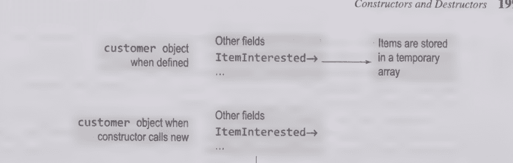

*Fig. 5.2 With dynamic initialization*

#### Need for dynamic initialization

If the passed array is deleted, the first type of initialization would lead to a dangling pointer whereas in the second case it is not affected. Moreover, if the passed array changes its values in the first case, ItemsInterested would change because we just point to that location, that is, we are sharing the data (the array that is passed) with the calling function. In Program 5.6, if the dynamic allocation part is omitted, the program would look as follows:

```cpp
// Erroneous code
customer(int TempCustNo, string TempCustName, string TempCustAddress, Item *TempItemsInterested, int TempTotalItems)
{
    CustNo = TempCustNo;
    CustName = TempCustName;
    CustAddress = TempCustAddress;
    ItemsInterested = TempItemsInterested; // the erroneous line
    TotalItems = TempTotalItems;
}
```

```cpp
// The following is a call to the constructor defined above
Steve = customer(2, "Steve Waugh", "Australia", ItemArray, 5);
```

Now, ItemsInterested will point to ItemArray (the passed array). If the values of ItemArray are changed or deleted, the ItemsInterested pointer would fetch changed values or garbage because it is pointing to the same location to which ItemArray is pointing. It is important to note that the pointer ItemsInterested here does not have any memory to store data; it is sharing the memory location with ItemArray.

If the values in the constructor are changed, it would inadvertently change the values in the passed array, ItemArray. This is similar to passing an array pointer for manipulating it, similar to passing an array pointer to sorting functions.

The second case is a separate array into which the passed array has been copied, so it would not have changed values even if the original passed array is changed. The original array is also immune to changes made to the array items in the constructor function. Exhibit 5.1 shows why copying pointer members is not correct.

> ### Exhibit 5.1 Copying pointer members is not correct
>
> When a constructor uses new to initialize with a dynamic number of values passed to it at run-time, it cannot copy a pointer value. It results in one memory location being shared by multiple objects. Therefore, the changes carried out in the values of one object will reflect as changes in other object values.
>
> Using dynamic memory allocation and giving a new object its own memory helps to avoid this problem by having separate copies of values. Hence, such cases demand dynamic allocation. It is not possible to use static allocation here because the number of items a customer would be interested in is not known in advance.

#### Objects as members of some other class

Program 5.6 also shows how an object of a class becomes a data member of some other class (Item object becoming member of customer class). It is important to note that this object is not a normal data member; it is different from normal data members. This difference will be discussed when we learn about inheritance and containership in Chapter 9. When an object is defined as a member of some other class, it is treated differently from other members when the objects of that class are initialized.

#### Dynamic allocation applied

It should be noted how the customers are initialized using a parameterized constructor. Items such as CustNo and CustName are initialized in a normal way. ItemsInterested is actually a pointer and cannot be initialized in the same way. When the constructor is called, the pointer to an array containing Item objects is passed to the constructor.

```cpp
Steve = customer(2, "Steve Waugh", "Australia", ItemArray, 5);
```

Here, ItemArray is the name of an array. As in C, it is a static pointer to the array and points to the first item of the array, that is, it contains the address of the first item. As it is static, it cannot be assigned some other value later as done in a normal pointer variable. It is possible to pass any array with any valid length here. This program uses a single array with different starting points and different lengths. It is also possible to pass totally different arrays. In the first example, the array name itself is passed with the total items as five. Array name, as we have discussed earlier, is a pointer to the first item. So, it starts with the first item. In the second example, it starts with ItemArray + 2. It should be remembered that this notation is common in C programming and is also used in C++. It is the same as ItemArray[2]. It adds two to an item pointer variable and makes it point to the address of the third item of an array.

#### Correct way to copy

We need to store an entire array of items and we do not have any space in the data member for it. We must solve this problem by obtaining memory for storing those elements dynamically. It should be remembered that the data member in this program is not an array, but is merely a pointer. The memory needs to be dynamically allocated. It is interesting to see how ItemsInterested is initialized dynamically in the following example. TempTotalItems is the length of an array. The memory for an array of that length is obtained using the following statement:

```cpp
ItemsInterested = new Item[TempTotalItems];
```

Here, the memory space needed is available. Now, the pointer in the constructor becomes useful. The address of this memory (the dynamically generated array) is stored in the pointer variable, ItemsInterested. new makes it possible to do both in a single statement.

Then, for all items passed in the array, the ItemsInterested array of the object is initialized as follows:

```cpp
for(int i=0; i<TempTotalItems; ++i)
{
    ItemsInterested[i] = TempItemsInterested[i];
}
```

It can be seen that this solves the problem of memory allocation in cases where a priori knowledge of the number of items of the ItemsInterested array is not available. It is dynamically allocated and the array is available at run-time, which is what was needed.

Though this problem is solved, it is not without cost. Using dynamic allocation will invite more responsibilities. Moreover, copy constructors and overloaded assignment operators as well as destructors are also needed now. The reason for this is given in Exhibit 5.2.

> ### Exhibit 5.2 Memory leaks
>
> Dynamic initialization has a specific problem. When the memory is assigned dynamically for initializing an object, it is essential to deallocate it as well, when the object goes out of scope.
>
> Unlike in the case of other variables, where C++ does the deallocation as soon as the variable goes out of scope, it is not done here until the program execution is over. This problem is known as memory leak.
>
> C++11 has two important improvements; one is the garbage collector, which takes care of memory leaks, and the second one is that it has better ways of managing temporary objects.

## 5.11 COPY CONSTRUCTORS

It is possible to pass all types of arguments to a constructor except the object itself. It is obvious why this restriction is provided in C++. If an object is allowed to be passed to the constructor of the same object, for creating a single object, the constructor needs to create one more such object for passing to it while creating that object, and it needs to pass one more such object for creating that object and so on, which is an infinite process. Therefore, C++ would flag an error when a native object is passed to the constructor.

However, it is possible to pass the reference of the native object to the constructor, which, in a technical sense, is a pointer to the same type of object. This type of constructor is known as a copy constructor and it has an important use in C++. Before we study the importance of the copy constructor, we must understand the difference between initialization and assignment.

> We can pass all types of arguments to a constructor except the object itself.


### 5.11.1 对象初始化与对象赋值

> 尽管我们或许可以将指针或引用传递给构造函数，但不能将同一类型的对象传递给构造函数。

我们在第3章中已经看到，对象只能赋值给同一类型的其他对象，并且复制是通过将一个类的每个成员逐个复制到另一个类来完成的。编译器会在可能的情况下采取逐位复制对象的捷径。之所以说是一条捷径，是因为编译器无需记住成员的边界；它可以像复制C结构体变量那样将一个对象复制到另一个对象。

我们也已经看到，赋值与初始化是不同的。让我们用下面的程序来回顾这一点。

```cpp
//AssignInit.cpp
#include <iostream>
#include <string>
using namespace std;

class brother
{
    string Name;
public:
    brother(){};
    brother(string BrotherName)
    {
        Name = BrotherName;
    }
    friend void DisplayBrother(brother);
};

void main()
{
    void DisplayBrother(brother);
    brother AssignBrotherName();
    brother FirstBrother = brother("Steve Waugh");
    /* Initialization using a temporary object */
    brother SecondBrother("Mark Waugh");
    // First case of initialization
    brother ThirdBrother("Gilchrist");
    // First case of initialization
    brother FourthBrother = "Ricky Ponting";
    // This is also first case
    DisplayBrother(FourthBrother);
    // Second case of initialization
    brother FifthBrother = AssignBrotherName();
    /* Third case of initialization; temporary object returned from AssignBrotherName()
    function is used to initialize FifthBrother. */
    DisplayBrother(FifthBrother);
    brother SixthBrother;
    SixthBrother = FirstBrother;
    /* This is assignment, not initialization */
    DisplayBrother(SixthBrother);
}
```

```cpp
void DisplayBrother(brother SomeBrother)
{
    cout << "\n Brother's name is " << SomeBrother.Name << "\n";
}

brother AssignBrotherName()
{
    cout << "Give a name for a new brother \n";
    string TempName;
    cin >> TempName;
    cout << "New brother is created and sent to main below \n";
    return brother(TempName);
    /* A temporary object is constructed here and passed to Fifth brother; this is the third case where initialization is done */
}
```

**注意：** 初始化发生在三种情况下：当使用参数定义对象时、当包含对象的参数传递给函数时，以及当函数返回对象时。

以下各节将介绍初始化的三种具体情况。

```cpp
brother FourthBrother = "Ricky Ponting"; // initialization
brother SecondBrother("Mark Waugh");
brother FirstBrother = brother("Steve Waugh");
/* This is initialization using a temporary object */
```

这个定义是第一种情况的例子。在这里，FourthBrother 和 SecondBrother 在创建时被初始化为 "Ricky Ponting" 和 "Mark Waugh"。第三个例子多了一个构造临时对象的步骤。这个临时对象由语句 brother("Steve Waugh"); 构造，然后赋值给 FirstBrother。第三条语句等价于编写以下代码：

```cpp
brother Temporary("Steve Waugh");
brother FirstBrother = Temporary;
```

```cpp
DisplayBrother(FourthBrother);
```

同样，临时对象被创建并初始化为作为参数的对象，然后传递给函数。所以，在这种情况下，临时对象将被初始化为 FourthBrother，然后再传递。需要注意的是，用作参数的对象（即 FourthBrother）本身不应被传递，因为调用后用作实参的原始对象必须保持原样。发送一个与所提供实参对象相似的另一个对象可以确保这一点。这种看似奇怪的行为对于遵循值参数语义非常重要。

> 临时对象有时被称为未命名对象。

当原始对象在调用结束后保持完整并保留自身时，该对象在函数中发生的任何更改都会被忽略。如果函数对传递的对象进行了任何修改，这些修改是在副本上进行的，而不是在原始对象上，因此原始对象不受影响。因此，给定的语句等价于

```cpp
brother *Temporary = new brother(FourthBrother);
DisplayBrother(*Temporary);
delete Temporary;
```

#### 情况3

这种情况与前面看到的从函数返回对象的情况类似。请看下面程序中的 AssignBrotherName() 函数：

```cpp
brother AssignBrotherName()
{
    // other statements
    return brother(TempName);
    // comments
}
```

以及

```cpp
brother FifthBrother = AssignBrotherName();
```

return 语句调用构造函数来构造一个 brother 类型的对象并返回该对象。这个对象称为未命名对象，它也是一个临时对象。这个临时对象的生命周期非常短。它恰好在函数退出之际被创建，并且一直存活到函数调用结束后紧接着执行赋值语句为止。在下面的语句中，先进行函数调用，然后进行赋值。

```cpp
brother FifthBrother = AssignBrotherName();
```

当赋值发生时，FifthBrother 将获得该值，临时未命名对象随即被销毁。

这里描述的所有三种情况都与初始化有关。在这三种情况下，复制对象时，成员都是逐个复制的。这些并不是赋值，尽管它们具有相似的默认行为。请观察下面这条表示赋值的语句。

```cpp
SixthBrother = FirstBrother;
```

这里再次默认执行按成员（在本例中为按位）复制。那么，初始化和赋值之间的区别在哪里，又是什么呢？

**注意：** 除非为对象定义了复制构造函数或赋值运算符，否则初始化和赋值的工作方式相同，即它们会按成员（尽可能逐位）复制所有内容。当定义了复制构造函数时，初始化的方式会有所不同；当定义了赋值运算符时，赋值的方式会有所不同。不过，也可以为不同类型的对象定义赋值运算符。

### 5.11.2 提供复制构造函数

复制构造函数是只有一个参数、且该参数是对其所属类的引用的构造函数。

当一个构造函数只有一个参数，且该参数是同类对象的引用时，该构造函数就称为复制构造函数。

下面的程序演示了如何定义和使用复制构造函数。这并不是使用复制构造函数的理想场景；即使这里省略复制构造函数，程序也会以相同方式执行。下一个程序是另一个示例，它清楚地说明了应该何时使用复制构造函数。请注意 Point 类的复制构造函数在这个程序中是如何定义和使用的。

```cpp
//CopyConstructor.cpp
#include <iostream>
using namespace std;

class Point
{
private:
    float x, y;
public:
    Point(Point& OtherPoint)
    // Copy constructor
    {
        x = OtherPoint.x;
        y = OtherPoint.y;
    }
    Point(float TempX = 0, float TempY = 0)
    {
        x = TempX;
        y = TempY;
    }
};

void main()
{
    Point Point1(2,3);        // Calls default constructor
    Point Point2 = Point1;    // Calls copy constructor
    // Point Point2(Point1) is the same as above
    Point1 = Point2;          // Calls assignment operator
}
```

下面是一个使用构造函数动态分配对象的示例，如前所述，现在针对复制构造函数进行了修改。这个示例程序说明了必须使用复制构造函数的情况。

```cpp
//CopyCons.cpp
#include <iostream>
#include <string>
using namespace std;

class customer;
class Item
{
    int ItemNo;
    string ItemName;
public:
    Item()
    {
        ItemNo = 0;
        /* ItemName = ""; */
```


```cpp
class Item
{
int ItemNo;
string ItemName;
public:
Item(int TempItemNo, string TempItemName)
{
ItemNo = TempItemNo;
ItemName = TempItemName;
}
void ShowDetails()
{
cout << "\n Item number is " << ItemNo;
cout << "\n Item name is " << ItemName;
}
friend Item ModifyItem(customer & TempCust, int ItemNoToBeReplaced);
};
```

```cpp
class customer
{
int CustNo;
string CustName;
string CustAddress;
Item *ItemsInterested;
int TotalItems;
public:
customer()
{
TotalItems = 0;
ItemsInterested = 0; // assigning it to null
}
// The following is a copy constructor
customer(customer & CustRef)
{
CustNo = CustRef.CustNo;
CustName = CustRef.CustName;
CustAddress = CustRef.CustAddress;
ItemsInterested = new Item[CustRef.TotalItems]; /* New memory for new object. This is the difference. 
Compilers do not do this by default. */
for(int i=0; i<CustRef.TotalItems; ++i)
{
ItemsInterested[i] = CustRef.ItemsInterested[i];
}
TotalItems = CustRef.TotalItems;
}
customer(int TempCustNo, string TempCustName, string TempCustAddress,
Item *TempItemsInterested, int TempTotalItems)
{
CustNo = TempCustNo;
CustName = TempCustName;
CustAddress = TempCustAddress;
ItemsInterested = new Item[TempTotalItems];
for(int i=0; i<TempTotalItems; ++i)
{
ItemsInterested[i] = TempItemsInterested[i];
}
TotalItems = TempTotalItems;
}
void ShowDetails()
{
cout << "\n Customer number is " << CustNo;
cout << "\n Customer name is " << CustName;
cout << "\n Customer address is " << CustAddress;
cout << "\n" << CustName << "is interested in following items" << "\n";
for(int i=0; i<TotalItems; i++)
{
ItemsInterested[i].ShowDetails();
}
}
friend Item ModifyItem(customer & TempCust, int ItemNoToBeReplaced);
};
void main()
{
customer Steve;
Item ItemArray[]=
{
Item(3,"Sandwiches"), Item(4,"Paper Bags"),
Item(5,"Napkins"), Item(6,"Toys"), Item(10,"Biscuits"),
Item(9,"Pen"), Item(1,"Pencil"), Item(2,"Eraser"),
};
Steve = customer(2, "Steve Waugh", "Australia", ItemArray, 5);
customer Mark(Steve);
Steve.ShowDetails();
Mark.ShowDetails();
ModifyItem(Mark, 3);
Mark.ShowDetails();
Steve.ShowDetails();
// Without copy constructor, it would show the same result
}
/* The following function is using private variables of both the classes, so it is made friend of both */
Item ModifyItem(customer & TempCust, int ItemNoToBeReplaced)
{
for(int i=0; i<TempCust.TotalItems; ++i)
{
if(TempCust.ItemsInterested[i].ItemNo) == ItemNoToBeReplaced)
{
cout << "Enter new details for item to be replaced \n";
cout << "Enter item no. \n";
int TempItemNo;
cin >> TempItemNo;
cout << "Enter item name \n";
string TempItemName;
cin >> TempItemName;
TempCust.ItemsInterested[i].ItemNo=TempItemNo;
TempCust.ItemsInterested[i].ItemName=TempItemName;
}
```

### Changes in this Program

The following modifications were made to Program 5.6:

+   1. A new function ModifyItem() for modifying the details of items for customers is added. A customer reference is passed, so the changes made to it are reflected back in the customer data.
+   2. The function ModifyItem() needs to operate on private variables of both the classes, namely, Item and customer. Therefore, it is defined as a friend in both the classes. Such type of "bridge" friend function is sometimes very useful (though a careful designer can and should avoid such functions).
+   3. We need to know about class customer while discussing class Item and vice versa. (This is because both these classes contain friend definition, which contains both customer and Item.) It is not a problem for the class customer because the class Item is introduced before it and the compiler knows about the class Item while dealing with the class customer. However, this is not the case for the class Item. So, we need a forward reference to class customer. This is done initially when we write
+   
+       class customer;
+   
+   just before the definition of class Item.
+   4. We have now introduced a copy constructor. According to the definition, it has the reference to the customer as a single argument.

> Note When two classes refer to each other, the class defined earlier needs to have a forward reference for the class defined later.

### Case with no copy constructor

Let us see what would happen if the copy constructor is not available when ModifyItem(Mark, 3) is called.

To understand this, let us try to recap what happens when we write customer Mark(Steve). The content of Steve is copied into Mark. (Assume that the copy constructor is not available at the moment, so it would follow default behaviour.) The pointer to ItemsInterested is also copied as it is. It should be remembered that the contents of ItemsInterested do not have a separate storage in this case. Both Steve and Mark share the same address in ItemsInterested, and hence, the same array items. So, when we modify Mark's details while calling ModifyItem, we are indirectly accessing the same set of items pointed to by the pointer in the Steve object. Thus, our change would change both objects, Mark and Steve. This undesirable behaviour can be eliminated using copy constructors.

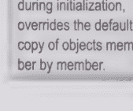

### Solving the problem using copy constructors

Let us look at the copy constructor now. It takes a reference of the class as a single argument. Then, it copies each item, except the pointer, to ItemsInterested. It obtains memory using new. It gets the memory good enough for storing the same number of items as the reference and it stores the items there. It should be noted that the contents

of ItemsInterested are not shared in this case. We get a new array. So, if ItemsInterested of Mark is changed later, it would not have any effect on that of Steve.

The copy constructor, as shown here, is a must if an item contains a dynamic constructor, that is, when a constructor is defined using the new operator.

## 5.12 PRIVATE COPY CONSTRUCTORS

If the copy constructor is defined in a private section, the objects of the class cannot call it. In a way, it stops the operations of the form customer Mark(Steve) or customer Mark = Steve. If such statements are written when the copy constructor is private, the program will not be compiled. This is very useful when a class is designed and the object code is provided to the user for using it. It should be noted that if the definition of the copy constructor is omitted, C++ would provide a default copy constructor (may not synthesize the physical one) and the user cannot be stopped from writing erroneous statements such as mentioned earlier . In this case, the contents of the copy constructor body are not executed, and hence, the body is usually left empty:

```
customer(customer & dummy){};
// see the empty body
```

### 5.12.1 Member Initialization List

Memberwise initialization list or member initialization list (MIL) is the method for initialization of the members of a class using the constructor function. It provides an alternative for providing initializations outside the constructor body. Let us consider the following program to understand it.

```
//SimpleMemberInitializationList.cpp
#include <iostream>
using namespace std;
class Time
{
public:
    int Hours;
    int Minutes;
    int Seconds;
    void ShowTime()
    {
        cout << "Time is " << Hours << " hours : " << Minutes << " minutes : and "
             << Seconds << " seconds \n";
    }
Time(){}
/* The following is a constructor using MIL */
Time(int TempHours, int TempMinutes, int TempSeconds)
:Hours(TempHours),
Minutes(TempMinutes),
Seconds(TempSeconds)
{ } // The empty body 
/* Second constructor */
};
```

```
void main()
{
    Time Time1(12,15,15);
    /* Second constructor with MIL is used here */
    cout << "Time number 1 \n";
    Time1.ShowTime();
}
```

An MIL appears in between the header and the body, starting with a colon.

The initialization list has been used in the second constructor for the Time class to initialize the Time object. Earlier, the same was done using assignment statements in the constructor body. Let us compare the two methods syntactically. The earlier approach was as follows:

```
Time(int TempHours, int TempMinutes, int TempSeconds)
{
    Hours = TempHours;
    Minutes = TempMinutes;
    Seconds = TempSeconds;
}
```

The MIL approach is as follows:

```
Time(int TempHours, int TempMinutes, int TempSeconds)
:Hours(TempHours),
Minutes(TempMinutes),
Seconds(TempSeconds)
{ } // the empty body
```

Syntactically, the MIL appears in between the body of the constructor and the header. It starts with a colon (:) and has all the initializations separated by a comma. The initialization has the normal syntax of initialization, that is, Variable(value) for initializing a variable with a value. In the given example, both the approaches yield the same result.

### Need for Initialization List

However, it is not true that both these approaches always yield the same result. There are some cases where the use of the second approach is a must (or is better). The difference between assignment and initialization has already been elaborated in Section 5.11.1. The assignment statements in the function body invoke the assignment operator whereas the MIL invokes initialization. The following sub-sections discuss the advantages of using the MIL approach.

### Readability

When the MIL is used in a constructor function, it is separated from the rest of the code, and thus, the program becomes more readable. (There is an argument against this. Those who are new to C++ claim that the syntax of the MIL is a bit cryptic and one can easily misunderstand it for a function call.) MIL has not been used in the examples in this book, but its use is advisable while writing commercial programs.

## Efficiency

The MIL is more efficient in certain cases. Consider the following program.


//MILandAssignment.cpp
#include <iostream>
#include <string>
using namespace std;
class student
{
public:
    int RollNumber; string Name; string Address;
    student(){}
    student(int TempRollNumber, string TempName, string TempAddress)
    :Name(TempName),
    Address(TempAddress)
    {
        RollNumber = TempRollNumber;
    }
    void PrintDetails()
    {
        cout << "Roll number is " << RollNumber << "\n";
        cout << "Name is " << Name << "\n";
        cout << "Address is " << Address << "\n";
    }
};
void main()
{
    student CricketStudent(1, "Brian Lara", "West Indies");
    CricketStudent.PrintDetails();
}

该程序是 Program 5.5 的修改版本。观察此处学生姓名和地址是如何初始化的。

```
student(int TempRollNumber, string TempName, string TempAddress) :Name(TempName),
Address(TempAddress)
{
    RollNumber = TempRollNumber;
}
```

此前，它们是这样定义的：

```
student(int TempRollNumber, string TempName, string TempAddress)
{
    RollNumber = TempRollNumber;
    Name = TempName;
    Address = TempAddress;
}
```

在第二种情况（较早的方法）中，TempName 和 TempAddress 首先被初始化为空字符串（string 是一个类，TempName 和 TempAddresses 是其对象；在处理参数时，会调用 string 类的默认构造函数）。然后，在使用语句 Name = TempName 和 Address = TempAddress 执行赋值时，

MIL 在可能的情况下优先于赋值。它提供一次拷贝，而赋值在许多情况下可能需要两次拷贝。

为它们分配相应的值。然而，在第一种情况下，参数直接使用相应的值进行初始化。这只涉及一次操作，而不是两次。这与在对象定义时提供带参数的构造函数类似。因此，使用 MIL 的第一种方法更高效。值得记住的是，MIL 使用初始化，而在构造函数体中使用赋值则使用赋值。

### 使用 MIL 初始化常量、引用和成员对象

MIL 是初始化类的常量、引用以及作为该类数据成员的对象成员的唯一方法。让我们考虑以下程序。

//MILImportance.cpp
#include <iostream>
#include <string>
using namespace std;
class student
{
public:
    const int SchoolNo;
    int RollNumber;
    string Name;
    string & ShortName;
    string Address;
    student(int TempRollNumber, string TempName, string TempAddress)
    :Name(TempName),
    Address(TempAddress),
    SchoolNo(123),
    // const can only be initialized outside the body
    ShortName(Name)   // so the reference
    {
        RollNumber = TempRollNumber;
    }
    void PrintDetails()
    {
        cout << "School number is " << SchoolNo<< "\n";
        cout << "Roll number is " << RollNumber << "\n";
        cout << "Name is " << Name << "\n";
        cout << "Short name is " << ShortName << "\n";
        cout << "Address is " << Address << "\n";
    }
};
void main()
{
    student CricketStudent(1, "Brian Lara", "West Indies");
    student FootBallStudent(2, "David Beckham", "England");
    CricketStudent.PrintDetails();
    FootBallStudent.PrintDetails();
}

此示例包含 school number 和 short name 数据成员。两者都必须使用 MIL 进行初始化。在构造函数体中初始化它们是不允许的。如果它们根本未被初始化，则同样是一个错误。MIL 是这里唯一的解决方案。还需要注意的是，如果程序包含一个类，其中某个数据成员是另一个类的对象，则需要 MIL 来初始化该特定数据成员。

一些 C++ 研究者要求将 MIL 作为初始化对象属性的对象值的强制性标准，原因如下：

- 1. 如果与模板一起使用，它会更类型安全；当类型未知时，使用 MIL 比在构造函数体中使用赋值更安全，因为它将适用于任何类型。赋值并不适用于所有类型。模板是用于通用类型的工作类或函数。
- 2. 某些其他类的对象、常量和引用只能使用 MIL 初始化。在某些情况下它们更高效。

可以使用 MIL 替换构造函数的代码。在下面的程序中，我们将查看 Time 类，它有两个构造函数，两者都有空的构造函数体。两个构造函数实际上都查看传递给它们的值并解决两个不同的问题。

假设我们有以事件发生前经过的秒数表示的时间格式。这种格式在操作系统中很常见（UNIX 就是其中之一）。我们希望解决的第一个问题是将这种时间转换为我们通常的小时 : 分钟 : 秒格式。第二个问题与正确的值有关，否则这些值是不可接受的。假设以小时 : 分钟 : 秒格式提供的时间传递的秒数或分钟数超过 60，则我们需要将它们转换为正确的值，即 65 秒意味着 5 秒和 1 分钟，应将其添加到分钟中。现在让我们看一下程序。

```cpp
//MILwithExpr.cpp
#include <iostream>
using namespace std;
class Time
{
public:
    int Seconds;
    int Minutes;
    int Hours;
    void ShowTime()
    {
        cout << "Time is " << Hours << " hours : " << Minutes << " minutes : and " << Seconds << " seconds \n";
    }
};

Time(){}

// The following is a constructor using MIL

//(int TempHours, int TempMinutes, int TempSeconds)
Time(int TempHours, int TempMinutes, int TempSeconds)
:Hours(TempHours + TempMinutes / 60),
Minutes(TempMinutes % 60 + TempSeconds / 60),
Seconds(TempSeconds % 60)
{ }  // the empty body
```

```
Time(int TotalSecondsElapsed)
:Hours((TotalSecondsElapsed / 60) / 60),
Minutes((TotalSecondsElapsed / 60) % 60),
Seconds(TotalSecondsElapsed % 60)
{ }            // the empty body
};
void main()
{
    Time Time1(18305); // 5 * 60 * 60 + 5 * 60 + 5, i.e., 5 : 5 : 5
    cout << "Time number 1 \n";
    Time1.ShowTime();
    Time Time2(12,65,65);
    cout << "Time number 2\n";
    Time2.ShowTime();
}
```

### Output

```
Time number 1
Time is 5 hours : 5 minutes : and 5 seconds
Time number 2
Time is 13 hours : 6 minutes : and 5 seconds
```

应注意的是，两个构造函数现在都有空的体。

### 5.12.3 初始化顺序

当使用 MIL 时，初始化的顺序与它们在列表中定义的顺序不同。它是按照它们在类中声明的顺序进行的。在 Program 5.7 中，尽管 SchoolNo(123) 写在 Name 和 Address 初始化之后，但它会在它们之前被初始化，因为它在类声明中先于它们定义。这会导致令人惊讶的后果。请看以下代码段：

### PROGRAM 5.7 Order of initialization with MIL

```
//OrderOfInit.cpp
#include <iostream>
using namespace std;

class TestOrder
{
public:
    int First;
    int Second;
    int Third;
    TestOrder(int Value)
    :Third(Second / 10),
    Second(First / 10),
    First(Value)
    { }
    TestOrder(unsigned Value)
    :Third(Value /= 10),
    Second(Value /= 10),
    First(Value /= 10)
    { }
```

### Constructors and Destructors 215

```
void PrintValues()
{
    cout << "First is " << First << "\n";
    cout << "Second is " << Second << "\n";
    cout << "Third is " << Third << "\n";
};
```

```
void main()
{
    int SignedValue = 1234;
    unsigned UnsignedValue = 1234;
    TestOrder TO(SignedValue);
    cout << "\n" << "The first example " << "\n";
    TO.PrintValues();
    cout << "\n" << "The next example " << "\n";
    TestOrder TO2(UnsignedValue);
    TO2.PrintValues();
}
```

Output

The first example
First is 1234
Second is 123
Third is 12
The next example
First is 123
Second is 12
Third is 1

### 程序的工作原理

MIL 定义 仔细观察 TestOrder 类的 MIL，其第一个构造函数参数为 int。

```
TestOrder(int Value)
:Third(Second / 10), Second(First / 10), First(Value)
```

如果按 MIL 中定义的相同顺序进行求值，代码可能会返回任意值，因为 Third 使用 Second，而 Second 尚未初始化，同样 Second 使用 First，而 First 也未初始化。只有因为 First 先于其他两个被初始化，Second 接下来被初始化，才获得了正确答案。
我们实际上可以使用另一个构造函数来检查同样的情况。请看第二个构造函数的 MIL。

```
TestOrder(unsigned Value)
:Third(Value / 10), Second(Value / 10), First(Value / 10)
```

求值顺序 如果保留 MIL 的顺序，当我们遇到语句 TestOrder TO2(UnsignedValue); 时，我们应该得到 Third 为 123，Second 为 12，First 为 1，但得到的是不同的答案。原因同样如此。MIL 的求值是基于类本身中变量的声明，而不是 MIL 中出现的顺序。

如果程序员错误地提供了初始化，构造函数体中的语句


MIL初始化取决于变量的定义顺序，而不是它们在MIL中出现的顺序。

它们按相同的顺序执行。甚至可以在MIL中提供函数调用，但不建议这样做，因为函数调用的依赖关系无法精确知道，因此可能导致严重错误。

### 初始化与赋值

第5.12.1节讨论的初始化与赋值的区别也适用于此情况。

类对象成员只能使用MIL进行初始化。常量（constants）和引用（references）也是如此。这意味着当我们使用赋值时，变量会先被定义然后被赋值，这对于这些常量项来说是错误的。常量只能在初始化时被赋予值。

### 赋值总是在初始化之后

前面已经提到，初始化的顺序取决于数据成员在类中的定义顺序，这可能与出现的顺序不同，而且构造函数体的行为方式也不同（相当正常）。让我们看看下面例子中发生了什么。

```
TestOrder(unsigned Value)
:Third(Value /= 10),
Second(Value /= 10)
{
    Value /= 10
    First = Value;
}
```

`First`的初始化被移到了构造函数体内。现在，`Second`最先被赋值，然后是`Third`，最后是`First`，也就是说，`First`将是1，`Second`将是123，`Third`将是12。这是因为一个简单的规则：所有初始化都应在构造函数体语句之前执行。这意味着赋值只会在初始化之后进行。

## 5.13 析构函数

当在C++中定义一个变量时，它会一直有效直到其作用域结束。如果变量被定义为全局变量，它将在整个程序执行期间保持有效。如果变量被定义为局部变量，比如在函数中，它将一直有效直到函数退出。如果变量定义如下：

```
for(int i=0; i<10; ++i)
{
    // statements
}
```

`i`只在for循环中可知。一旦for循环结束，`i`将不再存在。

编译器通过在定义变量时创建它，并在其作用域结束后销毁它来实现这种效果。创建时分配的内存会在结束时收回，并可能被重新用于其他目的。这种内存分配在栈上进行。C++中动态创建的对象是此规则的一个例外。

如果`customer`按照程序中给出的方式定义，那么使用`new`运算符为`ItemsInterested`获取的内存将不会在`customer`超出作用域后收回。这是因为该内存是由程序员而不是编译器获取的，因此释放它是程序员的工作。在给定的示例中，所有`customer`对象都是`main`的一部分。`customer`对象的作用域就是`main`本身。即使该内存（即`ItemsInterested`的新内存）没有被返回，程序执行结束后内存也会被返回。在这种情况下，如果我们不自行释放内存，也不会造成损害。如果某些`customer`对象定义在某个函数内部，情况就会更严重。在声明该内存后，即使从该函数返回，也无法返回它。分配的内存只有在程序执行结束后才会被释放。

那么，如何在函数调用结束（即变量超出作用域）后立即收回分配的内存呢？答案是定义析构函数。顾名思义，析构函数与构造函数相反。它们在对象超出作用域时生效。与构造函数一样，它们是自动调用的，也可以显式调用。

> 注意 析构函数的主要用途是释放动态分配的内存；然而，它们也可用于提供终止效果。如果我们希望在对象超出作用域时执行除释放内存之外的操作，例如将变量的值减一，可以使用析构函数。

### 5.13.1 析构函数的使用

析构函数是特殊的函数，当类的对象超出作用域时自动执行。它们与类同名，但前缀为“~”，例如，`~customer()`是`customer`类的析构函数。当`customer`类型的对象超出作用域时，将执行`~customer()`函数体中的代码。当执行`delete`时也会调用析构函数，如下例所示。

```
Customer *pCust = new customer;
delete pCust; // the destructor is called at this place
```

在下面的程序中，为`point`类定义了一个析构函数。`point`类现在有一个析构函数，它会显示即将超出作用域的点。

```
//PointDestructor.cpp
#include <iostream>
using namespace std;
class Point
{
private:
    float x, y;
public:
    Point(Point& OtherPoint)
    {
        x = OtherPoint.x;
        y = OtherPoint.y;
    }
    Point(float TempX = 0, float TempY = 0)
```

```
{
 x = TempX;
 y = TempY;
}
~Point()
{
cout << "Point at X = " << x << " Y = " << y << " Destroyed";
}
};
void main()
{
Point Point1(2,3);
Point Point2(4,5);
} // destructor is called here
Output
Point at X = 4 Y = 5 Destroyed
Point at X = 2 Y = 3 Destroyed
```

一个有趣的观察是，后定义的点的析构函数先于先前定义的点执行。这是因为当对象被创建时，它们被压入栈中，而销毁是通过弹出进行的，显然是以相反的顺序。

让我们考虑程序5.8以进一步理解析构函数。为`customer`类提供了一个析构函数。当变量超出作用域或对`customer`对象调用`delete`时，它会删除通过`new`获得的内存。

### 程序5.8 使用析构函数

```
//Destructor1.cpp
#include <iostream>
#include <string>
using namespace std;
class Item
{
 int ItemNo; string ItemName;
public:
Item()
{
ItemNo = 0;
}
Item(int TempItemNo, string TempItemName)
{
ItemNo = TempItemNo;
ItemName = TempItemName;
}
void ShowDetails()
{
cout << "\n Item number is " << ItemNo;
cout << "\n Item name is " << ItemName;
}
};
```

```
class customer
{
    int CustNo;
    string CustName;
    string CustAddress;
    Item *ItemsInterested;
    int TotalItems;

    public:
        ~customer(); customer()
    {
        TotalItems = 0;
        ItemsInterested = 0; // assigning it to null
        cout << "Constructor is called";
    }

    void operator = (customer & CustRef)
    {
        CustNo = CustRef.CustNo;
        CustName = CustRef.CustName;
        CustAddress = CustRef.CustAddress;
        ItemsInterested = new Item[CustRef.TotalItems];
        // New memory for new object; this is the difference
        for(int i=0; i<CustRef.TotalItems; ++i)
        {
            ItemsInterested[i] = CustRef.ItemsInterested[i];
        }
        TotalItems = CustRef.TotalItems;
    }

    customer(int TempCustNo, string TempCustName, string TempCustAddress, Item *TempItemsInterested, int TempTotalItems)
    {
        CustNo = TempCustNo;
        CustName = TempCustName;
        CustAddress = TempCustAddress;
        ItemsInterested = new Item[TempTotalItems];
        for(int i=0; i<TempTotalItems; ++i)
        {
            ItemsInterested[i] = TempItemsInterested[i];
        }
        TotalItems = TempTotalItems;
        cout << "Parameterized constructor is called for " << CustName;
    }

    void ShowDetails()
    {
        cout << "\n Customer number is " << CustNo;
        cout << "\n Customer name is " << CustName;
        cout << "\n Customer address is " << CustAddress;
        cout << "\n" << CustName << " is interested in the following items:" << "\n";
        for(int i=0; i<TotalItems; i++)
        {
            ItemsInterested[i].ShowDetails();
        }
    }
};
// The following is the destructor
```


```
customer::~customer()
{
    cout << "Destructor is called for " << CustName;
    delete [] ItemsInterested;
}

void main()
{
    Item ItemArray[]=
    {
        Item(3,"Sandwiches"),  Item(4,"PaperBags"),  Item(5,"Napkins"),  Item(6,"Toys"),
        Item(10,"Biscuits"), Item(9,"Pen"), Item(1,"Pencil"), Item(2,"Eraser"),
    };
    customer SteveWaugh(2, "Steve Waugh", "Australia", ItemArray, 5);
    SteveWaugh.ShowDetails();
    customer Ricky(3, "Susan", "London", ItemArray + 2, 6); Ricky.ShowDetails();
    customer Dummy;
    Dummy = customer(5, "Dummy", "Dummy", ItemArray + 2, 3); Dummy.ShowDetails();
}
```

### How the Program Works

The code for ~customer() contains just two lines.

```
cout << "Destructor is called for " << CustName;
delete [] ItemsInterested;
```

Only the second line in this case is significant. It removes the dynamically allocated memory. It is important to note the syntax of delete. delete [ItemsInterested] would result in an error. It must be delete [] ItemsInterested.

In the following output, note that the destructors are called in the reverse order to that of the constructors. This is because the stack is used to store these (local) objects. So, the object defined last is to be removed first and so destroyed first.

The complete output has not been provided for better readability. The output shown here is a small portion that appears at the end of the actual output.

```
Constructor is called
Parameterized constructor is called for Dummy
Destructor is called for Dummy
Customer number is 5
Customer name is Dummy
Customer address is Dummy
Dummy is interested in the following items:
Item number is 5
Item name is Napkins
Item number is 6
Item name is Toys
Item number is 10
Item name is Biscuits
Destructor is called for Dummy
Destructor is called for Susan
Destructor is called for Steve Waugh
```

Look at the special case of dummy. The normal constructor is called once; then, the parameterized constructor and, immediately after that, the destructor are called. (Look at the bold lines in the output.) To understand the reason behind this, look at the statement again.

```
Dummy = customer(5, "Dummy", "Dummy", ItemArray + 2, 3);
```

The call to customer in this case creates a temporary object of type customer, and at the end of assignment, it is automatically destroyed. The parameterized constructor and the destructor are called for that temporary object (which has Dummy stored as its name). One more destructor is called for Dummy at the end, which is for the Dummy object that bears the same structure as the temporary object assigned to it.

### Processing Objects at the end of their Lifetime

Destructors are also used for any processing at the end for a specific object. Consider a program that maintains a count of logged-in users. Whenever a user logs in or logs out, the number of users currently logged in is displayed. The following is an example of such a program:

```
//LoggedInUsers.cpp
#include <iostream>
#include <string>
using namespace std;

class LoggedInUser
{
    string Name; int TokenNo;
    static int TotalLoggedIn;
public:
    LoggedInUser()
    {
        TotalLoggedIn++;
        cout << "\n You are user number " << TotalLoggedIn << "\n Welcome! \n";
    }
    ~LoggedInUser()
    {
        TotalLoggedIn--;
        cout << "\n Good bye! \n";
        cout << "Now total no. of users in the system are " << TotalLoggedIn;
    }
};
int LoggedInUser::TotalLoggedIn;
void main()
{
    LoggedInUser *ArrayOfUsers[100];
    int index = 0;
    int Choice;
    while(true)
    {
        cout << "\n 1. New user \n";
        cout << "2. Logout \n";
        cout << "3. Exit from the program \n";
        // code for choice
    }
}
```

```
cout << "Enter your choice ";
cin >> Choice;
if(Choice == 1)
{
	if(index == 100)
	{
		cout << "\n Too many users! \n";
		exit(1);
	}
	ArrayOfUsers[index] = new LoggedInUser; index++;
}
else if(Choice == 2)
{
	if(index == 0)
	{
		cout << "No users to log out! \n";
		exit(1);
	}
	delete ArrayOfUsers[index - 1];
	index--;
}
else
	exit(0);
}
```

Output

1. New user
2. Logout
3. Exit from the program
Enter your choice 1
You are user number 1 Welcome!

1. New user
2. Logout
3. Exit from the program
Enter your choice 1
You are user number 2 Welcome!

1. New user
2. Logout
3. Exit from the program
Enter your choice 2
Good bye!
Now total no. of users in the system are 1

1. New user
2. Logout
3. Exit from the program
Enter your choice 2
Good bye!
Now total no. of users in the system are 0

1. New user
2. Logout
3. Exit from the program
Enter your choice 2
No users to log out!

### Destructor Code

The destructor here is used to reduce the number of users by one.

```
~LoggedInUser()
{
TotalLoggedIn--;
cout << "\n Good bye! \n";
cout << "Now total no. of users in the system are" << TotalLoggedIn;
}
```

The importance of the static variable TotalLoggedIn must also be noted. It is possible to determine the number of users logged in at the moment from the index value of the array. There is no need to write the code in the destructor in that case.

If the array implementation is changed to a linked list, a case of real scenario where users log in and log out randomly, then the code of the destructor is needed to release the memory and also to reduce the number of users. Moreover, it should be noted that the destructor call is made when the delete operation is executed. delete moves the object out of scope, and hence, the destructor is called at that point of time.

## 5.14 USAGE OF CONSTRUCTORS AND DESTRUCTORS FOR CONSTANT OBJECTS

Only constant functions are allowed to operate on constant objects. Constructors and destructors are an exception to this rule and can be applied on constant objects. This is because only after the constructor is applied, the object comes into existence; so, its constancy starts from that point. Similarly, destructors are applied after the object goes out of scope. This means that the constancy ends before the destructors are applied.

> Constructors are applied before the object comes into existence and destructors are applied when the object goes out of scope.

## 5.15 SYNTHESIS AND EXECUTION OF CONSTRUCTORS AND DESTRUCTORS

Constructors are defined anywhere, but C++ requires the constructors to be synthesized only prior to the first use of the object. A compiler can delay the synthesizing constructor until its first use. The constructor call (explicit or implicit) constructs the object and then the object comes into existence. Similarly, destructors are executed upon exit from the block where the object is defined, that is, after the object goes out of scope. It is possible to have a large number of blocks in the program and most of the blocks have variables having destructors. In such a case, every time the program exits the block, the destructor is invoked.

Whenever a compiler needs to create and destroy temporary objects of a specific class, the constructor and destructor are called, if defined in that specific class.

> The lifetime of a global object is throughout the execution of the program. Otherwise, the object comes into existence when the constructor is over and is alive until it goes out of scope, that is, just before the destructor is applied.

## 5.16 IMPLEMENTATION OF THE IMPORTANT TRIO

Copy constructor, assignment operator, and destructor are usually implemented together. Let us see why this is so. If we use a copy constructor, we have a dynamic memory allocation

in the constructor. In such a case, it becomes imperative for the programmer to deallocate the memory when the object goes out of scope. Hence, the situation demands a destructor. Now, the normal assignment also does not work properly. The assigned object also needs dynamic memory allocation, and therefore, the assignment operator is also overloaded in that case.

## RECAPITULATION

- C++ has user-defined objects similar to the built-in data types.
- Constructor and destructors provide initialization and termination effects to user-defined objects similar to built-in data types.
- User-defined objects may need to initialize themselves when defined.
- Constructors are functions having the same name as class. They can be either default or parameterized.
- Single-argument constructor is a special one. The compiler automatically generates a conversion operator when such a constructor is defined.
- Explicit constructor avoids automatic generation of conversion operator.
- Whenever the user has not defined any constructor, C++ provides the effect of one. It may or may not physically synthesize a constructor depending on the situation.
- The compiler-provided destructor cannot do the job of a programmer. The programmer must initialize members using user-defined constructors in cases where the compiler-provided default constructor is not appropriate.
- It is possible to have multiple constructors for a single class. In this case, all the constructors must have either different numbers of arguments or different types of arguments.
- It is also possible to have default arguments to the constructor similar to a normal function.
- The objects can be dynamically initialized by explicitly calling a constructor function. It is also possible to have a constructor with dynamic allocation.
- A destructor is also to be defined and the assignment operator to be overloaded in most of the cases where a dynamic constructor is used.
- The assignment operator and the copy constructor are different. The copy constructor changes the behaviour of initialization whereas an assignment operator overloading changes the behaviour of the assignment.
- MIL is a better method for some cases and a must for constant, references and object members of the class.
- The order in which MIL is executed depends on the order of declaration of data members and not on the order in which MIL is specified.
- Destructors are needed to provide user-defined termination effects when the object goes out of scope.
- The lifetime of the object is after the construction function is executed and just before the destructor is executed.

## KEYWORDS

Constructor This is a function with the same name as the class itself and is responsible for constructing and returning the objects of the class.
Copy constructor An object is copied to another using initialization by executing the copy constructor.
Default constructor This is a constructor without any argument.
Default constructor provided by compiler This refers to the constructor that is provided by the compiler when the user has not defined any. It may not be physically synthesized by the compiler.
Destructor This is a function that bears the same name as the class itself and is preceded by ~. The destructor is automatically called when the object goes out of scope.
Dynamic initialization The initialization that happens at run-time is known as dynamic initialization.
Explicit constructor This is the single-argument constructor that is defined with the keyword explicit before


the definition. 它禁止为单参数构造函数生成转换运算符。

## 对象初始化

在对象定义时赋予对象特定值称为对象的初始化。

## 成员初始化列表 (MIL)

这是在构造函数头之后且在构造函数体开始之前结束的列表。它以“：”开头，并包含由“，”分隔的数据成员初始化。

## 参数化构造函数

具有一个或多个参数的构造函数称为参数化构造函数。

## 练习

## 选择题

- 1. 构造函数的返回类型应该是什么？
  + (a) void
  + (b) int
  + (c) 它不能有任何返回类型
  + (d) 它可以有任何返回类型
- 2. 构造函数为对象提供什么类型的值？
  + (a) 新值
  + (b) 初始值
  + (c) 动态值
  + (d) 常量值
- 3. 构造函数函数是如何调用的？
  + (a) 它在对象创建时自动调用。
  + (b) 它需要在对象创建后不久调用。
  + (c) 它可以在程序中的任何地方调用。
  + (d) 它需要在对象创建前显式调用。
- 4. 除非为对象定义了拷贝构造函数或赋值运算符，________ 和 ________ 以类似的方式工作。
  + (a) 对象声明和创建
  + (b) 构造函数和成员函数
  + (c) 初始化和赋值
  + (d) 普通和默认参数
- 5. 在可能的情况下，编译器会采用复制对象的捷径 ________。
  + (a) 字节字节，位位
  + (b) 字符字符
  + (c) 成员成员
  + (d) 无
- 6. 析构函数被调用 ________。
  + (a) 按需显式调用
  + (b) 对象超出作用域时显式调用
  + (c) 对象超出作用域时自动调用
  + (d) 程序结束时自动调用
- 7. 可能定义多少个构造函数？
  + (a) 只有一个
  + (b) 恰好两个
  + (c) 任意数量的构造函数
  + (d) 任意数量的构造函数，尽管最好尽可能少
- 8. 以下哪个是拷贝构造函数的正确语法？
  + (a) Player (Player) ;
  + (b) Player (Player &, Player &) ;
  + (c) Player (Player *) ;
  + (d) Player (Player &) ;
- 9. 构造函数体不能有 ________。
  + (a) malloc 语句
  + (b) new 语句
  + (c) return 语句
  + (d) exit 语句
- 10. 如果我们在名为 Time 的类程序中写下以下两个语句会发生什么？
  Time(int hours=0, int minutes=0, int seconds=0) { }
  Time ( ) { }
  + (a) 只有第二个是允许的
  + (b) 只有第一个是允许的
  + (c) 编译器给出错误
  + (d) 链接器给出错误

### 概念练习

- 1. 给出 C++ 对象定义和用法的示例，演示类似内置行为的概念。
- 2. 为什么需要使用构造函数初始化对象？如果 C++ 中没有提供构造函数会有什么问题？
- 3. 构造函数的函数是什么？它们与普通函数有何不同？
- 4. 编译器提供的默认构造函数与用户定义的默认构造函数有何区别？
- 5. 列出用户提供的默认构造函数变得必要的情况。
- 6. 为什么需要显式构造函数？
- 7. 参数化构造函数与默认构造函数有何区别？
- 8. 除本章所示之外，给出一些在同一类中需要多个构造函数的示例。
- 9. 构造函数中使用默认参数的优点是什么？建议一些默认参数有用的情况。
- 10. 什么是动态重新初始化对象？正常初始化与动态初始化有何区别？
- 11. 为什么需要在构造函数中进行动态分配？列出在构造函数中需要动态分配的一些情况。
- 12. 给出一个示例，如果没有提供拷贝构造函数，程序的行为变得不可接受。
- 13. 初始化所需的三种情况是什么？
- 14. 本章中的 ModifyItem() 函数是两个类的友元。建议一些其他桥接函数用于其他情况。
- 15. 使用 MIL 相对于赋值的优点和缺点是什么？
- 16. 我们可能需要在我们定义的每个类中都有构造函数，但我们可能只需要少数几个类中有析构函数。为什么？
- 17. 析构函数会在什么时候被调用？
- 18. 对象的生命周期是什么？对象的生命周期与构造函数和析构函数的关系是什么？
- 19. 当我们在类的定义中需要拷贝构造函数时，我们也需要重载赋值运算符和析构函数。阐述。

### 实践练习

- 1. Program 5.8 使用静态变量来计算当前存活的对象数量。我们在用户离开时递减计数时遇到了问题。编写该类的析构函数来消除该问题。
- 2. 通过使用链表实现同一程序，编写 LoggedInUsers.cpp 的改进版本。
- 3. 使用本章中定义的 Time 类编写程序。使用单个构造函数提供所有功能。
- 4. SimpleConstructor.cpp 包含一个具有固定栈大小的 Stack 类。更改程序以提供动态内存分配，以便在初始化时使用构造函数确定栈的大小，并提供其析构函数。
- 5. 修改 Stack 类以使用链表实现它。
- 6. 提供一个具有适当构造函数集的简单队列类。
- 7. 定义一个 person 类并定义一些数据和函数成员以说明该类中默认构造函数的用处。
- 8. 给出一个需要显式构造函数的示例。
- 9. 定义一个 person 类，包含三个以上的构造函数。以这样的方式定义类中的数据和函数成员，使得所有三个构造函数都有意义。
- 10. 定义一个 supplier 类。假设任何给定供应商提供的商品都是不同的且数量不一。在构造函数函数中使用动态内存分配来实现解决方案。
- 11. 定义一个 examiner 类。提供所有必要的数据和函数成员以提供以下功能：考官必须访问至少一科的答卷，并且可能检查多科的答卷；考官代表一所学院和一所大学；并且大多数考官是本地的并代表本地大学。程序应包含多个构造函数，包括一个有默认参数和一个无默认参数的构造函数。提供有意义的拷贝构造函数。
- 12. 修改 Program 5.5 中的 ParameterizedCon.cpp 以使用 MIL。
- 13. 修改 Program 5.6 以使用 MIL。
- 14. 在 ItemArray 中以及构造函数 ItemsInterested 数组中移除动态内存分配并直接分配指针后执行 Program 5.6。观察差异。
- 15. 我们讨论了拷贝构造函数应用的三种情况以及第一种情况的重要性并举例说明。提供另外两种情况的示例（即传递给函数和从函数返回）。
- 16. 在我们提供了拷贝构造函数的全部示例中提供析构函数。

## 226 Programming with ANSI C++

## 运算符重载和用户定义转换

## 学习目标

- 重载运算符
- 一元和二元运算符
- friend 运算符
- 重载 =, [], (), new 和 delete 运算符
- 函数对象
- 需要用户定义转换的情况
- 基于构造函数和运算符的转换

### 6.1 引言

运算符重载使我们能够使用自己的对象使用运算符，这些运算符在 C 中保留给内置类型。能够为用户定义对象定义有意义的运算符的设施非常重要，这是本章讨论的主题。

让我们考虑一个表示时间的类 Time；Time1、Time2 和 Time3 是类 Time 的对象，具有某些值。如果要将两个时间相加，即 Time3 = Time1 + Time2，则通过为类 Time 重载 ‘+’ 运算符来实现。与 int 或 float 不同，Time 不是内置数据类型，因此在不重载它的情况下不能使用运算符 ‘+’。

同样，也有可能重载其他运算符，尽管存在一些限制。可以以新颖而又易读的方式重载运算符。

让我们考虑一个包含员工集合的类，例如 Collection 类。然后，语句

```
UniEmpCol.AddToCol(UniEmployee[i]);
```

可以重写为

```
UniEmpCol + UniEmployee[i]
```

然而，为此需要将运算符 ‘+’ 重载到 Collection 类。

运算符重载是通过向类添加特殊成员函数来执行的；这些函数称为运算符函数，可以帮助将一个对象转换为另一个对象。我们将在第 6.12 节中在用户定义转换下研究这些。


## 6.2 操作符重载的限制

尽管操作符重载是可能的，但它有一套自己的限制，如下所述：

操作符重载为操作符提供额外的含义。

- 1. 操作符不会失去其原始含义；相反，当被重载时，它们具有额外的含义。不能改变操作符的原始含义。
- 2. 不能发明新的操作符。只有具有给定限制的现有操作符才能被重载。
- 3. 操作符将具有额外的含义，但不会具有额外的优先级。优先级保持不变。
- 4. 操作符不能改变原始形式下可用的参数数量。因此，二元形式的‘+’只能有两个参数。它不能用三个参数重载。
- 5. 操作符只能为用户定义的类型重载。所有重载的操作符必须至少有一个参数是用户定义的类型。
- 6. 除 () 外，其他操作符不能有默认参数。
- 7. 有些操作符永远不能被重载。

### 6.2.1 不能被重载的操作符

以下操作符不能被重载：

- 1. 成员访问点操作符 (.)
- 2. 解引用成员到类操作符 (.*)
- 3. 作用域解析操作符 (::)
- 4. sizeof 操作符 (sizeof)
- 5. 条件三元操作符 (?:)
- 6. 强制转换操作符 (static_cast<>, dynamic_cast<>, reinterpret_cast<>, 和 const_cast<>)
- 7. 宏预处理器的 # 和 ## 标记

> 注意 可能有人会问为什么这些操作符不能被重载。考虑重载点操作符。如果它被重载，类成员操作将获得新的含义，这可能导致严重的错误。编译器开发者必须处理由此类错误产生可能的复杂性，并通过提供错误可能的原因来帮助程序员。如果 C++ 允许此类代码，它很容易让编译器因不可预见的副作用而感到困惑。C++ 不允许添加新操作符也是出于同样的原因。C++ 也不允许对某些操作符进行全局定义（例如，= 操作符）。包括 Java 在内的许多语言都不提供操作符重载，因为这是一个非常难以管理的问题。

### 6.2.2 不能作为友元被重载的操作符

如前所述，操作符是作为函数重载的。为了使一个函数对一个类起作用，它应该是成员或友元。其结果是，操作符可以以两种不同的方式重载，即作为成员或作为友元。以下操作符不能作为友元被重载：

- 1. 赋值操作符 =
- 2. 函数调用操作符 ()
- 3. 数组下标操作符 []
- 4. 使用指向对象的指针访问类成员操作符 ->

当操作符被重载时，应遵循原始含义的语法规则。以下是一些示例：

- 1. 所有算术操作符必须返回一个值。然而，它可以与原始操作符返回的类型不同。
- 2. 一元操作符没有显式参数。如果作为友元重载，它们接受一个引用参数。
- 3. 二元操作符如果作为成员重载则接受一个显式参数，如果作为友元重载则接受两个显式参数。

## 6.3 通过成员函数进行操作符重载

操作符函数作为成员的语法与普通成员函数的语法相似，具有特定的命名约定。让我们看一下程序 6.1，它处理复数。

### 程序 6.1 使用重载操作符添加两个复数

```
//00+.cpp
#include <iostream>
#include <string>
using namespace std;

class Complex
{
    float Real;
    float Imag;
public:
    Complex(float TempReal = 0, float TempImag = 0)
    {
        Real = TempReal;
        Imag = TempImag;
    }

    Complex Add(Complex Comp2)
    {
        float TempReal;
        float TempImag;
        TempReal = Real + Comp2.Real;
        TempImag = Imag + Comp2.Imag;
        return Complex(TempReal, TempImag);
    }

    Complex operator +(Complex Comp2)
    {
        float TempReal;
        float TempImag;
        TempReal = Real + Comp2.Real;
        TempImag = Imag + Comp2.Imag;
        return Complex(TempReal, TempImag);
    }

    void Display()
    {
        cout << Real << "+" << Imag << "i \n";
    }
};
```

```
void main()
{
Complex Comp1(10, 20);
Complex Comp2(20, 30);
Complex CompResult1, CompResult2;
CompResult1 = Comp1.Add(Comp2);
CompResult1.Display();
CompResult2 = Comp1 + Comp2;
CompResult2.Display();
}
```

### 程序如何工作

定义复数作为类 在此示例中，复数被视为一个类。复数始终表示为两个部分的集合。第一部分称为实值，第二部分称为虚值。它表示为 <实值> + <虚值>i，即在复数 20 + 30i 中，20 是实部，30 是虚部。这里，i 被认为是 -1 的平方根。

使用复数类的操作符重载 我们在这里的目的是了解如何使用这个特定类在 C++ 中提供操作符重载。我们在此将复数表示为两个值，实部和虚部，并附带一些函数。

- 1. 第一个函数是构造函数。Complex Comp1(1, 2) 将创建一个复数 Comp1，其实值为 1，虚值为 2。
- 2. 第二个函数是显示。Comp1.Display()，它应显示 1 + 2i 。
- 3. 第三个是 Add() 函数。它是类的成员函数，并有一个复数作为参数。这意味着它已经有一个隐式参数，即指向调用对象的 this 指针。它将传递给它的两个 Complex 对象的实部和虚部相加，并将两个对象的和作为另一个 Complex 对象返回。

### Add 函数和重载的 '+'

让我们考虑一个有趣的例子，其中函数的体与 Add() 函数的体相同。它以与 Add() 函数相同的方式工作，但调用方式不同。对操作符函数的调用与对普通函数的调用不同。在查看差异之前，应注意函数的命名。

> 所有操作符函数的名称都以关键字 operator 开头，其后是实际的操作符。在这种情况下，+ 操作符已被重载，因此函数名应为 operator + 。每当 + 操作符被重载时，函数名都将命名为 operator + 。当 – 操作符被重载时，它将被命名为 operator – 等等。

当 + 操作符与两个操作数都为复数参数一起使用时，操作符函数被调用。如前所述，它看起来不像函数调用。

```
CompResult2 = Comp1 + Comp2;
```

它实际上是

```
CompResult2 = Comp1.operator + (Comp2)
```

> 如果操作符被正确重载，它会提高程序的可读性。

查看调用 CompResult2 = Comp1 + Comp2; 它实际上是 CompResult2 = Comp1.operator + (Comp2)

### 注意

尽管操作符是以与函数相同的方式定义的，但它们不是以相同的方式调用的。

函数之所以这样调用，是因为我们希望复数的加法看起来与任何其他数值变量的加法相似。操作符重载的一个优点是，两个函数（Add() 和 operator +()）都在执行相同的活动。操作符重载是 C++ 设计者期望用户定义对象的工作方式与内置对象相似的一个很好的例子。然而，从可读性的角度来看，第二个函数看起来好得多，即 CompResult2 = Comp1 + Comp2 比 CompResult1 = Comp1.add(Comp2) 更具可读性。

### 选择复数来重载 '+'

选择复数示例来说明重载 + 的原因是，尽管 + 可以为任何其他操作重载，但重要的是为与原始含义相似的操作重载它。如果选择其他操作由 + 表示，则可读性会成为问题。例如，如果 + 用于获取参数的乘积作为复数，那么它会让读者感到困惑和误导。

同样，为非数值项重载 + 也会在读者的脑海中造成歧义。有时，尽管 + 表示某种类型的加法，但也可以将其用于非数值操作数。

> 重要的是为与原始操作相似或几乎相似的操作重载操作符。

### 为用户定义类重载 '+'

考虑程序 6.2，它是向集合添加员工的示例。此程序与第 4 章中讨论的 FriendClass.cpp 相同。我们已重载 + 以表示添加到集合中。

### 程序 6.2 向员工集合添加员工

```
#include <iostream>
#include <string>
using namespace std;

class CollectionEmp; // Forward definition
class employee
{
    int EmpNo;
    string Name;
    string DeptName;
    string Designation;
public:
    void Init(int TempNo, string TempName, string TempDept, string TempDesi)
    {
        EmpNo = TempNo;
        Name = TempName;
        DeptName = TempDept;
        Designation = TempDesi;
    }

    void DisplayDetails()
    {
        cout << "Details of employee number" << EmpNo << "\n";
        cout << "Name is" << Name << "\n";
        cout << "Department is " << DeptName << "\n";
```


```
cout << "Designation is " << Designation << "\n";
}
/* Now member functions of the following class can access private variables of this class */
friend CollectionEmp;
/* If forward declaration is not provided, this statement will give an error */
};
class CollectionEmp
{
private:
    employee ColEmp[10];
    /* The collection is in the array form; it can even be a linked list */
    int Index;
public:
    void InitIndex()
    {
        Index = 0;
    }

    bool operator +(employee Emp)
    {
        if(Index < 9)
        {
            ColEmp[Index] = Emp;
            Index++;
            return true;
        }
        else
        {
            return false;
        }
    }

    void ListDeptWise()
    {
        string TempDeptName;
        cout << "Enter the department of the university:";
        cin >> TempDeptName;
        cout << "\n";

        for(int i = 0; i < 10; ++i)
        {
            if(ColEmp[i].DeptName == TempDeptName)
            {
                ColEmp[i].DisplayDetails();
            }
        }
    }
};
void main()
{
    CollectionEmp UniEmpCol;
    UniEmpCol.InitIndex();
    employee UniEmployee[10];

    UniEmployee[1].Init(1,"Lara", "Exam", "Professor");
    UniEmployee[2].Init(2, "Ponting", "Marksheet", "Clerk");
    UniEmployee[3].Init(3, "Laxman", "Accounts", "Head Clerk");
```
```
UniEmployee[4].Init(4, "Flintoff", "Exam", "Clerk");
UniEmployee[5].Init(5, "Muralidharan", "Accounts", "CAO");
UniEmployee[6].Init(6, "Sarfaraz", "Exam", "Informer");
UniEmployee[7].Init(7, "Dean Jones", "Exam", "Invigilator");
UniEmployee[8].Init(8, "Madugalle", "Exam", "Examiner");
UniEmployee[9].Init(9, "Ganguly", "Marksheet", "Repeater");
UniEmployee[0].Init(10, "Nafees", "Accounts", "Clerk");
for(int i = 0; i < 10; ++i)
{
    UniEmpCol + UniEmployee[i];
    /* Placing the employees in the collection object */
}
UniEmpCol.ListDeptWise();
/* This is a member function now, not a dummy one though! */
}
```

### Output

Enter the department of the university: Exam

Details of employee number 1
Name is Lara
Department is Exam
Designation is Professor

Details of employee number 4
Name is Flintoff
Department is Exam
Designation is Clerk

Details of employee number 6
Name is Sarfaraz
Department is Exam
Designation is Informer

Details of employee number 7
Name is Dean Jones
Department is Exam
Designation is Sleeper

Details of employee number 8
Name is Madugalle
Department is Exam
Designation is Examiner

### How the Program Works

定义和调用时的差异 请看第4章中的程序4.14与本程序之间的差异。只是机械上的差异而已。令人惊讶的是，两个程序中只有两行不同，即定义函数头的那一行和调用函数的那一行。以下是更改内容：

- 1. bool AddToCol() 改为 bool operator +()。
- 2. UniEmpCol.AddToCol(UniEmployee[i]) 改为 UniEmpCol + UniEmployee[i]。

运算符重载的步骤 这表明运算符重载可以使用简单的技术来简化。首先编写一个执行任务的函数，并测试其是否正常工作。然后，只需在程序中的少数地方进行两个机械更改即可。

- 1. 将函数名更改为 operator <operator_symbol>（例如 operator +），在函数定义处进行。
- 2. 在程序中 wherever 函数调用被作出时，将该运算符用作隐式函数调用。因此，Object1.function (Object2) 被更改为 Object1 <Operator> Object2。

> 注意 过度使用重载运算符可能会降低可读性，而适度使用则会提高可读性。为不明显的操作重载运算符，例如使用 '+' 来减去参数，是糟糕的编程。

### Overloading Operators for a Purpose

程序 6.3 显示了如何为目的而重载 +。这里使用了前面讨论过的同一个 Time 类，并重载了 + 来相加两个时间。这里唯一的额外特性是使用同一个运算符处理两个以上的参数。也可以在此注意到构造函数的用途。

### PROGRAM 6.3 Operator overloading for a purpose

```
//AddTime.cpp
#include <iostream>
using namespace std;

class Time
{
public:
    int Hours;
    int Minutes;
    int Seconds;

    void ShowTime()
    {
        cout << "Time is" << Hours << " hours : " << Minutes << " minutes : and " << Seconds << " seconds \n";
    }

    Time(int TempHours = 0, int TempMinutes = 0, int TempSeconds = 0)
    {
        Hours = TempHours;
        Minutes = TempMinutes;
        Seconds = TempSeconds;
    } // It can serve as default constructor as well

    Time operator +(Time Time2)
    {
        int TempHours, TempMinutes, TempSeconds;
        TempHours = Hours + Time2.Hours;
        TempMinutes = Minutes + Time2.Minutes;
        TempSeconds = Seconds + Time2.Seconds;
        TempMinutes += TempSeconds / 60;
        TempSeconds %= 60;
        TempHours += TempMinutes / 60;
        TempMinutes %= 60;
        return Time(TempHours, TempMinutes, TempSeconds);
    }
};
void main()
{
    Time Time1(12, 15, 15);
```
```
cout << "The first value \n";
Time1 ShowTime();
Time Time2(10, 30, 30);
cout << "The second value \n";
Time2.ShowTime();
Time Time3;
Time3 = Time1 + Time2;
cout << "And the result is \n";
Time3.ShowTime();
Time Time4 = Time1 + Time2 + Time3; // Adding three times
Time4.ShowTime();

/* The following will work and would be the same as Time3.ShowTime(). We are not defining a temporary object; the compiler will do that for us here. */
(Time1 + Time2).ShowTime();
}
```

### Output

The first value
Time is 12 hours : 15 minutes : and 15 seconds

The second value
Time is 10 hours : 30 minutes : and 30 seconds

And the result is
Time is 22 hours : 45 minutes : and 45 seconds
Time is 45 hours : 31 minutes : and 30 seconds

### How the Program Works

看语句

```
Time Time4 = Time1 + Time2 + Time3;
```

我们在这里尝试相加三个时间。它类似于语句

```
Time1.operator + (Time2.operator + (Time 3));
```

需要注意的是，这并不是重载的 '+' 具有两个以上参数的情况。重载的 '+' 无论为哪个类重载，始终只有两个参数。

> 注意 我们不能使用重载的 '+' 来相加三项。这是因为当我们重载一个运算符时，必须遵守使用该运算符的原始构造。'+' 设计为使用两个操作数（二元运算符），因此必须遵守这一点。

另一个有趣的语句是

```
(Time1 + Time2).ShowTime();
```

编译器从表达式 Time1 + Time2 生成一个临时对象，并为该对象调用成员函数 ShowTime()。该语句是以下内容的简写表示：

```
Time Temporary = Time1 + Time2; Temporary.ShowTime();
```

## 6.4 SITUATIONS WHERE OPERATOR OVERLOADING IS USEFUL

当我们开发一个将由其他用户使用的类库时，运算符重载很重要。在这种情况下，适当的运算符重载会更有优势。用户无需记住函数名称，拼写错误的可能性也非常小。

## 236 Programming with ANSI C++

当运算符重载为作为团队一部分开发的类提供时，类的使用和可读性在很大程度上取决于运算符定义的直观性。考虑链表的情况。如果为将节点对象添加到链表对象提供重载的 +，它是有意义的，并且可读性强且歧义较少。

```
Like LinkedList, L, Newlist;
Node N;
L = L + N; // Adding a node to a list
Newlist = L + N; // New list from old list and adding a node
```

还需要注意的是，程序 6.2 中的重载 + 不一定返回相同类型的对象。在其原始形式中，+ 运算符始终返回相同对象类型的对象；相加两个整数返回一个整数，相加两个浮点数返回一个浮点数，等等。然而，在程序 6.2 中，它返回一个布尔值。在链表示例中，它相加两种不同类型的对象并返回第一个操作数的类型。C++ 提供了这种灵活性，这使得运算符重载极其有用。

并非所有运算符都享有重载的灵活性。运算符 new、delete 和 -> 有限制，它们只能返回与原始运算符相同类型的对象。

运算符可分为一元运算符（有一个参数）和二元运算符（有两个参数）。应记住，不可能重载唯一的 ternary 运算符。

## 6.5 OVERLOADING UNARY OPERATORS

具有单个参数的运算符称为一元运算符。当这些运算符作为成员函数重载时，不必显式传递任何参数。指向调用对象的 this 指针作为隐式参数传递。

```
//UnaryOp.cpp
#include <iostream>
using namespace std;
class Matrix
{
	int Element[3][3];
public:
	Matrix() {} // Default constructor
	Matrix(int TempMatrix[3][3])
	{
		for(int i = 0; i < 3; i++)
			for(int j = 0; j < 3; j++)
				Element[i][j] = TempMatrix[i][j];
	}
	void Read()
	{
		for(int i = 0; i < 3; i++)
			for(int j = 0; j < 3; j++)
				cin >> Element[i][j];
	}
}
```


```
void operator -()
{
    for(int i = 0; i < 3; i++)
        for(int j = 0; j < 3; j++)
            Element[i][j] = -Element[i][j];
}

void Display()
{
for(int i = 0; i < 3; i++)
    for(int j = 0; j < 3; j++)
    {
        cout << Element[i][j] << "  ";
    }
    cout << "\n";
}
};

void main()
{
    int ArrayOfInt[][3]={1,2,3,4,5,6,7,8,9};
    Matrix M1(ArrayOfInt);
    cout << "The first matrix before negation \n";
    M1.Display();
    cout << "First matrix after negation \n";
    -M1;
    M1.Display();
    Matrix M2;
    cout << "Enter values for the second matrix \n";
    M2.Read();
    cout << "The second matrix before negation \n";
    M2.Display();
    -M2;
    cout << "Second matrix after negation \n";
    M2.Display();
}
```

### Output

The first matrix before negation
1  2  3
4  5  6
7  8  9
First matrix after negation
-1  -2  -3
-4  -5  -6
-7  -8  -9
Enter values for the second matrix
3 4 5 6 6 6 7 78 8

The second matrix before negation
3 4 5
6 6 6
7 78 8
Second matrix after negation
-3 -4 -5
-6 -6 -6
-7 -78 -8

考虑此程序，它是类 Matrix 表示 3 × 3 整数元素的矩阵的一个示例。我们使用‘–’来否定矩阵的所有值。

查看否定一个简单函数的定义。将它命名为 operator – 使我们能够使用 –M1 和 –M2 这种类型的语句，这比 M1.negate() 更易读。

同样，如果用户熟悉此类记法并且使用它们使程序更易读，则可以重载运算符‘~’用于矩阵求逆以及运算符‘!’用于转置。给定特定领域，找到已知符号的新含义是很有趣的，在这种情况下运算符重载非常有帮助。

### 6.5.1 ++ 和 -- 运算符的后缀版本

自增和自减运算符在 C 以及 C++ 中都有两个版本，即前缀版本和后缀版本。在 C 和 C++ 中，它们通过位置来区分，可以通过重载来指定。

尽管后缀和前缀是相同的，但 C++ 编译器通过各自的位置来区分它们。在重载时无法做到这一点；operator ++() 对两个版本都是相同的。为了区分版本，operator ++() 被视为被重载的前缀运算符，而语句 operator ++(int AnyDummyValue) 被视为被重载的后缀运算符。

> 在后缀运算符的情况下，我们需要传递一个虚拟参数。

在程序 6.4 中，当 ++ 以前缀形式应用于复数时，它会增加实值，而当以后缀形式应用时，它会增加虚值。这是为了展示如何重载后缀和前缀运算符以提供不同的操作。

### PROGRAM 6.4 重载 ++ 前缀和后缀版本

```
//OO++--.cpp
#include <iostream>
#include <string>
using namespace std;

class Complex
{
    float Real;
    float Imag;
public:
    Complex(float TempReal = 0, float TempImag = 0)
    {
        Real = TempReal;
        Imag = TempImag;
    }
    Complex Add(Complex Comp2)
```

### Operator Overloading and User-defined Conversions 239

```
```cpp
Complex operator +(Complex Comp2)
{
	float TempReal;
	float TempImag;
	TempReal = Real + Comp2.Real;
	TempImag = Imag + Comp2.Imag;
	return Complex(TempReal, TempImag);
}
```
```

```
```cpp
Complex operator ++()
{
	Real++;
	return Complex(Real, Imag);
}
```
```

```
```cpp
Complex operator ++(int dummy)
{
	Imag++;
	return Complex(Real, Imag);
}
```
```

```
```cpp
void Display()
{
	cout << Real << " " << Imag << "\n";
}
```
```

```
```cpp
void main()
{
	Complex Comp1(10, 20);
	Complex Comp2(20, 30);
	Complex CompResult1, CompResult2;
	CompResult1 = Comp1 + Comp2;
	CompResult1.Display();
	CompResult2 = Comp1 + Comp2;
	CompResult2.Display();
	Comp1++;
	Comp2++;
	Comp1.Display();
	Comp2.Display();
}
```
```


应该注意的是，该程序仅包含用于重载 ++ 的两个版本的额外代码部分。这里，我们将只探索那两个函数。还应注意，参数 (int dummy) 在程序中未被使用。它只是为了区分前缀和后缀版本而编写的。它不能实际传递。如果程序中使用的后缀运算符未定义，C++ 编译器将发出类似以下的警告，然后在那里应用前缀版本。

> 如果我们定义了后缀版本并使用前缀记法，编译器会发出错误。

注意 5 * M 和 M * 5 必须产生相同的结果。运算符 '*' 的成员函数定义只允许操作 M * 5，而不允许 5 * M。如果我们想要操作 5 * M，我们将不得不将 '*' 运算符重载为友元。是否会产生相同的结果是次要的。我们如果愿意可以这样做。

### PROGRAM 6.5 使用友元的重载运算符

```
//OOUsingFriend.cpp
#include <iostream>
using namespace std;

class Matrix
{
    Int Element[3][3];
public:
    Matrix(){};
    Matrix(int TempMatrix[3][3])
    {
        for(int i = 0; i < 3; i++)
            for(int j = 0; j < 3; j++)
                Element[i][j] = TempMatrix[i][j];
    }

    void Read()
    {
        for(int i = 0; i < 3; i++)
            for(int j = 0; j < 3; j++)
                cin >> Element[i][j];
    }

    void Display()
    {
        for(int i = 0; i < 3; i++)
        {
            for(int j = 0; j < 3; j++)
            {
                cout << Element[i][j] << " ";
            }
            cout << "\n";
        }
    }
    friend Matrix operator *(Matrix, int);
    friend Matrix operator *(int, Matrix);
};

Matrix operator *(Matrix TempMatrix, int Multiplier)
{
    for(int i = 0; i < 3; i++)
        for(int j = 0; j < 3; j++)
            TempMatrix.Element[i][j] = Multiplier * TempMatrix.Element[i][j];
    return Matrix(TempMatrix.Element);
}

Matrix operator *(int Multiplier, Matrix TempMatrix)
{
    for(int i = 0; i < 3; i++)
        for(int j = 0; j < 3; j++)
            TempMatrix.Element[i][j] = Multiplier * TempMatrix.Element[i][j];
    return Matrix(TempMatrix.Element);
}
```

```
void main()
{
    Int ArrayOfInt1[][3]={1,2,3,4,5,6,7,8,9};
    int ArrayOfInt2[][3]={4,5,6,7,8,9,1,2,3};
    Matrix M1(ArrayOfInt1);
    Matrix M2(ArrayOfInt2);
    Matrix M3, M4;
    M1.Display();
    M3 = M1 * 5;
    M3.Display();
    M2.Display();
    M4 = 5 * M2;
    M4.Display();
}
```

### Output

（插入解释性行后）

Matrix before scalar multiplication
1  2  3
4  5  6
7  8  9

Matrix after scalar multiplication
5  10  15
20  25  30
35  40  45

Matrix before scalar multiplication
4  5  6
7  8  9
1  2  3

Matrix after scalar multiplication
20  25  30
35  40  45
5  10  15

### 程序如何工作

友元函数 注意提供 M1 * 5 和 5 * M2 这种表达式的灵活性。两个表达式实际上调用了两个不同的 operator * 函数。

```
friend Matrix operator *(Matrix, int);
friend Matrix operator *(int, Matrix);
```

这是同一运算符的两个友元定义。在这种情况下，运算符函数针对相同集合的参数以不同顺序进行重载。请注意，第一个版本可以通过成员运算符重写，但第二个版本则不可能。即，

```
Matrix operator *(Matrix TempMatrix, int Multiplier)
可以写成成员的 Matrix operator *(int)。然而，
```

```
Matrix operator *(int Multiplier, Matrix TempMatrix)
是不可能的。
```

### Exhibit 6.1 选择 >> 用于 cin 和 << 用于 cout 的原因

语句 cin >> MyVariable 表示来自 cin 的输入进入 MyVariable。另一方面，语句 cout << MyVariable 意味着 MyVariable 的值进入 cout（在屏幕上打印）。简而言之，'<' 和 '>' 显示数据移动的方向。A << B 表示数据从 B 移动到 A，而 A >> B 表示数据从 A 移动到 B。这是一个关于在重载运算符时可以多么创新的例子。

程序 6.6 展示了如何重载 << 和 >> 来读写用户定义的对象 student。这里 << 用于打印 student 对象，而 >> 用于读取一个。于是，当使用 cout << Mahesh 时，其中 Mahesh 是 student 对象，它会以重载 << 时指定的方式打印 Mahesh。同样，cin >> Mahesh 也可以使用，它会以重载 >> 运算符时指定的方式读取 Mahesh 对象的成员。

### PROGRAM 6.6 用于读写对象的友元运算符重载

```
```cpp
//OOReadWrite.cpp
#include <iostream>
#include <string>
using namespace std;

class student
{
private:
    int RollNumber;
    string Name;
    string Address;
public:
    friend ostream & operator <<(ostream &, student &);
    friend istream & operator >>(istream &, student &);
};

ostream & operator <<(ostream &TempOut, student &TempStudent)
{
    TempOut << "Roll number is " << TempStudent.RollNumber << "\n";
    TempOut << "Name is " << TempStudent.Name << "\n";
    TempOut << "Address is " << TempStudent.Address << "\n";
    return TempOut;
}

istream & operator >>(istream &TempIn, student &TempStudent)
{
    cout << "Enter the roll number ";
    cin >> TempStudent.RollNumber;
    cout << "\n";
    cout << "Enter the name ";
    cin >> TempStudent.Name; cout << "\n";
    cout << "Enter the address ";
    cin >> TempStudent.Address;
    cout << "\n";
    return TempIn;
}
```
```


```
void main()
{
    student CaptainStudent;
    cin >> CaptainStudent;
    cout << endl << "Following is CaptainStudent's data \n" << CaptainStudent << "\n Bye! \n";
}
```

### Output

Enter the roll number    1
Enter the name Lara
Enter the address West Indies

Following is CaptainStudent's data
Roll number is 1
Name is Lara
Address is West Indies
Bye!

### How the Program Works

Using cin and cout for a user-defined object  It is very easy to use cin and cout objects to read and write user-defined objects once the << and >> operators are overloaded. Overloading these operators reduces the difference between a user-defined and a built-in object to a large extent.

> Note  The designers of C++ have made many efforts to make user-defined objects to behave in a similar manner to built-in objects; the provision of overloading << and >> operators is one of them. After overloading these operators, a user can provide code for reading and writing objects in the program just by inserting cout << UserDefinedObject or cin >> UserDefinedObject.

Overloading << and >> also simplifies the main function because it now contains only cin >> UserDefinedObject or cout << UserDefinedObject.

Inability to use a member function  It is important to note that it is not possible to use member functions to overload these two operators. While overloading these operators, it is important to pass the first argument as stream (cin or cout) and the second argument as the user-defined object, whereas the first argument to a member function is always the this pointer. Therefore, if we want << to be a member function of student class, then

```
cout << CaptainStudent
```

must be written as

```
CaptainStudent << cout
```

In this statement, the reference to CaptainStudent is the first argument. When we use

```
cout << CaptainStudent
```

the reference to CaptainStudent is the second argument and requires the friend function.

Returning a reference  Another important point here is that the references are passed and received, so that the user works with the same istream and ostream objects that are passed (cin and cout) later in the same expression.

Suppose a reference is not returned and the program contains the statement.

```
cout << CaptainStudent << "\n Bye"
```

it will not work. The reason is that cout << CaptainStudent is executed first. Then, it needs to execute the second argument, that is, "\n Bye". If it does not return as reference, it is not possible to have <Reference to ostream> << "\n Bye". Here, <Reference to ostream> is actually cout, which is returned by the operator function. It is analogous to (cout.operator <<(CaptainStudent)) << "\n Bye" This function call (operator <<) is possible on LHS because it returns a reference. Overloading operators using a reference as an argument and returning the same reference enable the user to return the same object that is passed and not the one that is newly defined in the function. Operators such as +, -, ++, --, <<, and << can also be overloaded when the operation matches the original operation of the operator. We will look at =, [ ], ( ), new, and delete operators in the following sections.

## 6.8.1 Overloading Assignment Operator (= )

Overloading the assignment operator is useful in various circumstances. The first one is when we have dynamic constructors (which use dynamic allocation) and destructors. Consider the following program.

> We can overload '=' for a given class; it is called local =. When we use '=' in the main program, it is called global =, which cannot be overloaded.

```
// OO.cpp
#include <iostream>
#include <string>
using namespace std;
class Item
{
int ItemNo;
string ItemName;
public:
Item()
{
ItemNo = 0;
ItemName = "";
}
Item(int TempItemNo, string TempItemName)
{
ItemNo = TempItemNo;
ItemName = TempItemName;
}
void ShowDetails()
{

cout << "\n Item number is " << ItemNo;
cout << "\n Item name is " << ItemName;
};
```

### Operator Overloading and User-defined Conversions 247

```
class customer
{
int CustNo;
string CustName;
string CustAddress;
Item *ItemsInterested;
int TotalItems;
public:
customer()
{
CustNo = 0;
ItemsInterested = 0;
TotalItems = 0;
}
~customer()
{
// It is better to write the non-inline destructor
void operator = (customer & CustRef)
{
CustNo = CustRef.CustNo;
CustName = CustRef.CustName;
CustAddress = CustRef.CustAddress;
ItemsInterested = 0;
// New memory for new object; this is the difference
for(int i = 0; i < CustRef.TotalItems; ++i)
{
ItemsInterested[i] = CustRef.ItemsInterested[i];
}
TotalItems = CustRef.TotalItems;
}
customer(int TempCustNo, string TempCustName, string TempCustAddress, Item *TempItemsInterested, int TempTotalItems)
{
CustNo = TempCustNo;
CustName = TempCustName;
CustAddress = TempCustAddress;
ItemsInterested = new Item[TempTotalItems];
for(int i = 0; i < TempTotalItems; ++i)
{
ItemsInterested[i] = TempItemsInterested[i];
}
TotalItems = TempTotalItems;
}
```

```
cout << "Parameterized constructor is called for" << CustName << "\n";
}

void ShowDetails()
{
    cout << "\n Customer number is " << CustNo;
    cout << "\n Customer name is " << CustName;
    cout << "\n Customer address is " << CustAddress;
    cout << "\n" << CustName << " is interested in following items" << "\n";
    for(int i = 0; i < TotalItems; i++)
    {
        ItemsInterested[i].ShowDetails();
    }
}
};

customer::~customer()
{
    cout << "Destructor is called for " << CustName << "\n";
    delete [] ItemsInterested;
}

void main()
{
    Item ItemArray[]=
    {
        Item(3, "Sandwiches"), Item(4, "Paper Bags"), Item(5, "Napkins"), Item(6, "Toys"),
        Item(10, "Bananas"), Item(9, "Pen"), Item(1, "Pencil"), Item(2, "Eraser"),
    };

    customer Steve (1, "Steve Waugh", "Australia", ItemArray + 2, 6);
    Steve.ShowDetails();
    customer Mark (2, "Mark Waugh", "Australia", ItemArray + 2, 3);
    Mark.ShowDetails();
    customer Beckham;
    /* Overloading the assignment operator is mandatory here */
    Beckham = customer (3, "David Beckham", "England", ItemArray, 5);
    Beckham.ShowDetails();
}
```

### Need for Overloading Assignment Operator

The following statement will not work if the assignment operator is not overloaded:

```
Beckham = customer(3, "David Beckham", "England", ItemArray, 5)
```

This is because the compiler creates a new temporary object from the RHS expression to pass it on to the LHS. Immediately after the execution of the assignment statement, the temporary object is destroyed. It destroys the dynamically allocated list of items. Memberwise copy will only copy the pointer value and not the content; it would destroy the items that are pointed to by the pointer of Beckham.ItemsInterested as well. This is similar to the problem that occurred during initialization. Copy constructors have been used to solve this problem.

> When we assign an object containing dynamically allocated members, we must overload the assignment operator. It is because member-by-member copy (default) copies only the pointers and thus the contents are not copied and are destroyed once the temporary object is destroyed.

We have seen earlier that initialization and assignment are different. We need to provide a separate solution for assignment if only one for the copy constructor is present. This has been done here.

### Precautions while Overloading an Operator

```
```cpp
void operator =(customer & CustRef)
{
	if(*this == CustRef)
	/* Both the objects are the same; they do not do anything and jump to the end */
	else
	...
}
```
```

1. Suppose we have an overloading assignment operator for customer class such as the one in the previous program, and we write a statement such as the following.

Laxman = Laxman;

Here, we are assigning an object to itself. The object Laxman needs a dynamic memory management; we have two different areas of memory where the first one is now not pointed to by any pointer. A solution to this problem is a single line added at the beginning of the operator = function.

2. The second point about assignment operator is that the object that is assigned already exists. Thus, we need to deallocate the memory before allocating a new one. Thus, the following statement

ItemsInterested = new Item[CustRef.TotalItems]
must be preceded by
delete [] ItemsInterested

3. Another point about assignment operator is the return type. We have used void as a return type. This is okay for normal cases, but when we write something similar to the following:

Laxman = Ponting = Sachin

where the RHS assignment operation (Ponting = Sachin) must return an object for the LHS operation [Laxman = (the result of Ponting = Sachin)] to be carried out, our design does not work. We need to return the object that is being assigned within the RHS assignment statement (i.e., Ponting = Sachin).

So, we need to return ‘customer’ and the code should also have ‘return *this’ at the end. The code now becomes

```
```cpp
customer & operator =(customer & CustRef)
{
	...
	return *this;
}
```
```


当一种类型的对象被转换成另一种类型时，赋值运算符可以被重载。我们已经看到，如果相似类型的对象相互赋值，它们会逐位复制。然而，对于不同类型的对象则并非如此。我们将在第 6.12 节研究对象转换时看一个例子。

> 注意 在重载运算符时，必须检查是否正在对同一对象进行赋值，并跳过剩余的代码，返回被赋值的对象的引用，并在赋值前如果存在则删除该对象。

### 6.8.2 数组下标运算符（ [ ] ）

数组下标运算符通常被重载以提供安全的数组操作。假设用户定义了一个包含五个元素的整数数组 int IntegerArray[5]。它拥有 0 到 4 的元素。假设用户在某处错误地写了 IntegerArray[5]，C（或 C++）会尝试访问那个位置。它通过拥有数组的地址然后使用数据类型偏移所需的数量来计算数组第六个位置的地址。整数数据类型在大多数情况下的大小为 16 或 32 位。

假设数组从位置 100 开始，表达式 IntegerArray[5] 会尝试查看位置 100 + 5*(整数大小) 并取出存储在该位置的内容。C 或 C++ 默认情况下不检查数组边界。为什么会这样？让我们找到原因。

当我们编写包含数组的代码时，如果 C（或 C++）编译器插入用于检查数组边界的代码，它不仅会使生成的可执行代码膨胀，而且还会减慢执行速度。这是因为每次引用数组元素时，编译器都会检查数组边界。这样的检查可能在（也许）一百次中只有一次有用。C 是为顶尖程序员设计的；他们不被期望犯此类错误。因此，C 选择了效率而非健壮性。

> 注意 C 或 C++ 编译器不检查数组边界错误的原因是为了优化可执行文件的时间。

如果 C 没有默认提供，就不可能在 C 中进行检查。然而，C++ 提供了在我们了解运算符重载时易于使用的设施。它提供了创建安全数组的设施，该数组会执行数组边界检查。这就是做法。如果我们写出类似 <array name>[<sub script>] 或 IntegerArray[5] 的表达式，它类似于 <array name>[]<sub script> 或 IntegerArray[](5)。这里，[] 被视为与前面讨论的 + 运算符类似的运算符。我们可以重载它以提供数组边界检查。请考虑程序 6.7。SafeIntArray 现在是一个类。假设我们定义了 SafeIntArray 类型的对象 SafeArray，那么如果我们尝试访问超出范围的下标，我们就能保证得到运行时错误。

> 与 C 不同，C++ 可以通过重载数组下标运算符（[]）帮助程序员检查数组边界。

### 程序 6.7 重载数组下标运算符

```
//00[].cpp
#include <iostream>
using namespace std;

class SafeIntArray
{
    int Array[5];
public:
    int & operator[](int Index)
{
	if((Index < 0) || (Index > 4))
	{
		cout << "Subscript out of range";
		exit(1);
	}
	else 
		return Array[Index];
}
}
```
```cpp
void main()
{
	SafeIntArray SafeArray;
	SafeArray[0] = 5;
	SafeArray[-1] = 10; // This will produce a run-time error
	SafeArray[5] = 9; // This will also generate a run-time error
}
```

### 程序的工作原理

让我们理解 [] 运算符是如何被重载的。它只有一个参数，即索引。

```
int & operator[](int Index)
```

调用 SafeArray[0] 类似于 SafeArray.operator[](0)。

这个 IndexValue（本例中为 0）用于在重载的运算符函数中检查它是否超出边界。

我们在重载的 [] 中返回对 int 的引用而不是 int 本身。

这是为了能够使用诸如 SafeArray[0] = 5; 这样的表达式，因为只有这样我们才能在赋值语句的左侧使用函数调用（SafeArray[0]）。如果我们将运算符函数定义为返回 int 而不是 int &，就无法使用诸如 SafeArray[0] = 5; 这样的表达式；

我们可能会认为这个安全数组程序很简单。它具有固定的大小(10) 和固定的数据类型(int)。在任何应用中都几乎没有用处。当我们在第 7 章学习模板时，我们将看一个例子，了解如何解决提供任意用户指定类型和大小的安全数组的问题。

> 在重载 [] 运算符时必须返回引用。否则诸如 a[5] = 10 这样的数组表达式将无法工作。这是一个返回引用作为左值的函数的例子。

### 6.8.3 函数调用运算符

假设定义了一个类 Point 用于表示二维点。它可能具有类似 Point P1(2, 3) 的定义，其中 2 和 3 分别是 x 和 y 坐标。可以为此使用构造函数。可能需要诸如 Point P1; P1(2, 3); 这样的语句，其中没有显式调用构造函数，即不写成 P1 = Point(2, 3)。P1(2, 3) 比 P1 = Point(2, 3) 更简单、更容易理解。

这可以通过重载 () 运算符来实现。

() 运算符也称为函数调用运算符。它被重载以提高代码的可读性。更好的用法是拥有函数对象。请考虑以下程序。它展示了通过重载 () 运算符如何提高程序可读性。我们还重载了 << 运算符以打印点的坐标。

```
//00().cpp
#include <iostream>
using namespace std;
class Point
{
	int X;
	int Y;
public:
	void operator ()(int TempX, int TempY)
	{
		X = TempX;
		Y = TempY;
	}
	friend ostream & operator <<(ostream &TempOut, Point &Pt);
};
ostream & operator <<(ostream &TempOut, Point &Pt)
{
	TempOut << "(" << Pt.X << "," << Pt.Y << ")\n";
	return TempOut;
}
void main()
{
	Point P1, P2;
	P1(2, 3);
	P2(4, 5);
	cout << P1;
	cout << P2;
}
```

## 6.9 函数对象

当为一个类重载 () 运算符时，该类的对象可以像函数一样使用。这样的对象被称为函数对象，因为可以像调用函数一样调用它们。在之前的程序中，P1(2, 3) 看起来像一个函数调用。使用此类语句有助于用户调用重载的 () 运算符函数。使用函数对象相对于普通函数的优势有两点。

> 当为类重载函数调用运算符时，对象以与函数相同的方式被调用。这样的对象称为函数对象，在许多情况下被专家程序员所偏爱。

- 1. 第一个优势是可以在成员变量中存储一些信息。函数对象的执行可以由这些变量控制。
- 2. 第二个优势是，有时使用函数指针的代码可以用基于模板的函数对象替换。这是有利的，因为函数指针不能内联，而函数对象调用可以内联。

程序 6.8 和 6.9 以不同方式解决了相同的问题。有多个函数需要调用，即 Plus、Minus、Divide 和 Multiply。所有四个函数的签名保持相同，只是函数名不同。程序 6.8 使用（非成员）函数指针，而程序 6.9 使用函数对象，这是本章的重点。

### 程序 6.8 使用函数指针的解决方案

```
//UsingFunctionPointer.cpp
#include <iostream>
using namespace std;

int Plus (int TempX, int TempY)
{
cout << "Plus() function is called\n";
return TempX + TempY;
}

int Minus (int TempX, int TempY)
{
cout << "Minus() function is called\n";
return TempX - TempY;
}

int FunctionPointer(int(*FunPtr)(int, int), int Arg1, int Arg2)
{
return FunPtr(Arg1, Arg2);
}

void main()
{
int Arg1 = 20;
int Arg2 = 5;
/* The function itself is passed as an argument in the following statements */
cout << FunctionPointer(Plus, Arg1, Arg2) << "\n";
cout << FunctionPointer(Minus, Arg1, Arg2) << "\n";
}
```

### 输出

```
Plus() function is called
25
Minus() function is called
15
```

### 程序的工作原理

程序很简单，除了在调用函数时使用函数指针。请观察调用

cout << FunctionPointer(Plus, Arg1, Arg2) << "\n";

第一个参数是函数的名称。任何函数都可以通过名称和参数在这里被调用。

### 优势

这种机制的优势在于我们不需要 switch 语句及其中的大量比较。要调用的函数是第一个参数。这种技术对于编写编译器程序并为大量相似的函数调用生成目标代码的人来说非常方便。被调用的函数的头必须包含由函数指针组成的参数。

int FunctionPointer(int(*FunPtr)(int, int), int Arg1,int Arg2)
{


return FunPtr(Arg1,Arg2);
}

### 函数指针参数

第一个参数是 int(*FunPtr)(int, int)。这是一个指向函数的指针，该函数返回 int 并且有两个 int 参数。需要注意的是，两个函数都属于此类。此外，调用 FunPtr(Arg1, Arg2) 是 (*FunPtr)(Arg1, Arg2) 的简写形式。可以看出，此处的函数调用是间接调用，很难内联。现在，来看程序 6.9，这是解决相同问题的下一版本程序，采用不同方式，即使用函数对象。我们现在有了代表 Plus 和 Minus 概念的类。加法和减法的过程现在由它们各自类的运算符 () 表示。

> 注意 函数指针是指向函数的指针，而函数对象是重载了 () 运算符的对象。我们可以看到，像加法和减法这样的过程是实现为重载了 () 的类。用户仍然会将其视为函数，但程序员获得了更好的控制级别，因为有一个类来处理该函数调用。

### 程序 6.9 函数对象

```
//FunctionObject.cpp
#include <iostream>
using namespace std;

class Plus
{
    int X; int Y;
public:
    int operator()(int TempX, int TempY)
    {
        X = TempX;
        Y = TempY;
        cout << "Plus operator () is called \n";
        return X + Y;
    }
};

class Minus
{
    int X; int Y;
public:
    int operator()(int TempX, int TempY)
    {
        X = TempX;
        Y = TempY;
        cout << "Minus operator () is called \n";
        return X - Y;
    }
};

// Template definition
template <typename TypeFunObj>
FunObj(TypeFunObj fob, int Arg1, int Arg2)
{
    cout << fob(Arg1,Arg2);
    cout << "\n";
}
```

void main()
{
    Plus P;
    Minus M;
    int Arg1 = 20;
    int Arg2 = 5;
    /* The function itself is passed as an argument in all following four arguments: */
    cout << FunObj(P, Arg1, Arg2);
    cout << FunObj(M, Arg1, Arg2);
}

### 程序如何工作

与使用指针的函数调用不同，函数对象采用直接调用，这使得程序员能够使函数内联。

程序除模板定义及其使用外都是不言自明的。我们将只讨论这一部分。

读者可能会想知道为什么这里使用了函数模板。我们将在第 7 章详细研究函数模板，但就目前而言，请记住在使用函数对象时我们需要它。与处理指针的函数指针不同，函数对象处理类，并且对此类对象的调用需要传递类对象（而不是函数指针）。

#### 调用函数对象

对函数 FunObj 的调用中，第一个参数是函数对象。P 和 M 是代表 Plus 和 Minus 的函数对象。现在来看模板定义。由于模板将在第 7 章详细讨论，目前假设 TypeFunObj 是某种用户定义类型；在这里，它是第一个参数的类型。

当调用 FunObj(P, ...) 时，第一个参数的类型为 Plus。因此，编译器将 TypeFunObj 的值取为 Plus。类似地，当调用 FunObj(M, ...) 时，TypeFunObj 被取为 Minus。代码 fob(Arg1, Arg2) 在编译时会被编译器替换为 Plus(Arg1, Arg2)，当 TypeFunObj 为 Plus 时。

```
template <typename TypeFunObj>
FunObj(TypeFunObj fob, int Arg1, int Arg2)
{
    cout << fob(Arg1, Arg2);
    cout << "\n";
}
```

fob(Arg1, Arg2) 将被替换为它们各自的对象（分别为 P 和 M）。在 FunObj(P, Arg1, Arg2) 中，调用 fob(Arg1, Arg2) 变为 P(Arg1, Arg2)。运算符 () 已为 P 对象重载，这里是对该运算符的调用。因此，在这种情况下，它等同于调用函数 Plus。

此处的函数调用不像程序 6.8 那样是间接的；因此，可以使函数内联。这是函数对象的优点。事实上，此代码中的所有运算符 () 都是在类体内部定义的，因此默认情况下是内联的。

## 6.10 重载 new 和 delete

使用 new 和 delete 代替 malloc() 和 free() 的优点之一是它们可以被重载。第 6.11.1 节描述了如何重载 new 和 delete。

### 6.10.1 使用 malloc() 和 free() 重载 new 和 delete

考虑程序 6.10 来理解如何重载 new 和 delete 运算符。

### 程序 6.10 重载 new 和 delete

```
//00NewDelete.cpp
#include <cstdlib>
#include <iostream>
using namespace std;

class Test
{
    int i;
public:
    Test(): i(0)
    {
        cout << "Constructor is called\n";
    };
    ~Test()
    {
        cout << "Destructor is called\n";
    };
    void *operator new(size_t size);
    void operator delete(void *P);
};

void *Test::operator new(size_t size)
{
    void *p = malloc(size);
    if(!p)
    {
        cout << "memory allocation failure";
        exit(0);
    }
    return p;
}
void Test::operator delete(void *p)
{
    free(p);
}
int main()
{
    Test *TestPtr = new Test;
    delete(TestPtr);
}
```

### 程序如何工作

重载的 new 不需要决定它返回的指针的类型。程序员只需返回一个 void 指针，编译器会将其转换为有效类型。

重载两个运算符 我们为类 Test 重载了 new 和 delete，并且当调用 new Test 或 delete TestPtr 时会调用这些运算符。重载的 operator new 调用 malloc() 来分配内存。为调用 malloc() 包含了头文件 cstdlib。

new 和 delete 的语法 new 接受一个类型为 size_t 的单个参数，即类的大小。需要注意的是，重载的 new 不返回指向特定对象的指针；它返回 void 指针。令人惊讶的是，没有必要将其强制转换为相应的指针。事实上，

new 可以使用 malloc() 或全局 new (::new) 来重载。delete 可以使用 free()（当分配使用 malloc() 重载时）或 ::delete（当分配使用 ::new 重载时）来重载。

编译器会完成此操作。类似地，delete 是通过 free() 实现的。它被定义为接受 void 指针。同样，当我们传递特定指针如 TestPtr 时，我们不需要将其强制转换，因为编译器会自动为我们完成。

如果要由程序员进行内存管理，则需要重载 new 和 delete 之类的运算符。他们可以获取大量内存，然后自行分配和释放。系统定义的 new 被称为全局 new。可以仅为给定类重载 new，而不重载全局 new。全局 new 可用于所有类，但重载的 new 仅在重载它的类中可用。当我们想要编写如下内容时，这很明显：

SomeClassPtr = new SomeClass;

我们希望控制 SomeClass 如何分配内存空间。很明显，我们不能重载全局 new，因为我们不应控制 C++ 如何为不同类分配内存。在第 6.11.2 节中，我们将看到一个案例，其中我们定义了一个表空间并从该空间分配内存。

数据库使用类似的概念为它们在给定表空间内定义的表分配内存。这种机制的优点是程序员可以控制内存如何以及从何处分配。在分配和释放时可以进行更多控制（例如，在分配前清除先前的内容，这对银行服务器非常有用）。

程序 6.11 显示了程序员如何通过重载 new 和 delete 来管理内存。虽然我们没有提供任何额外的控制机制，但可以很容易地扩展此程序用于此目的。

### 6.10.2 使用 ::new 重载 new 和 delete

程序 6.10 在重载 new 的主体中使用 malloc() 进行内存分配。我们也可以在其中使用系统定义的 new。系统定义的原始 new 运算符被称为 ::new；或全局 new。

### 程序 6.11 为内存管理重载 new 和 delete

```
//OONewDeleteForDatabase.cpp
#include <cstdlib>
#include <iostream>
using namespace std;
#define TABLESPACE_SIZE 32

class Test
{
    int i;
public:
    static char *TableSpace;
    static char *CurrentPtr;
    static char *OldPtr;
    static bool FirstTime;

    Test(): i(0)
    {
        cout << "\n Constructor is called";
    }


```cpp
~Test()
{
    cout << "Destructor is called";
};

void *operator new(size_t size);
void operator delete(void *P, size_t size);
};

char *Test::CurrentPtr;
char *Test::OldPtr;
char *Test::TableSpace;
bool Test::FirstTime = true;

void *Test::operator new(size_t size)
{
    if(Test::FirstTime)
    {
        /* First time! Allocating memory large enough to hold the entire tablespace */
        Test::TableSpace = (char *)::new char[TABLESPACE_SIZE];
        Test::CurrentPtr = Test::TableSpace;
        printf("\n Test::TableSpace pointer is %u", Test::TableSpace);
        printf("\n Current pointer is %u", Test::CurrentPtr);
        printf("\n Old pointer is %u", Test::OldPtr);
        Test::FirstTime = false;
    }

    /* When we want memory space that goes beyond the tablespace available */
    if((Test::CurrentPtr + size) > (Test::TableSpace + TABLESPACE_SIZE))
    {
        cout << "\n Memory allocation failure";
        getchar();
        exit(0);
    }

    Test::OldPtr = Test::CurrentPtr;
    /* Old pointer to be returned. New pointer would be useful for allocation of new memory in the next cycle */
    Test::CurrentPtr = Test::CurrentPtr + size;
    cout << "\n Memory allocated \n";
    printf("Current pointer is %u", Test::CurrentPtr);
    printf("\n Old pointer is %u", Test::OldPtr);
    return Test::OldPtr;
}

void Test::operator delete(void *p, size_t size)
{
    ::delete p;
}

int main()
{
    while(true)
        new Test;  // Continue allocating until it runs out of memory
}
```

```
Output
Test::TableSpace pointer is 48770560
Current pointer is 48770560
Old pointer is 0
Memory allocated

Current pointer is 48770564
Old pointer is 48770560
Constructor is called
Memory allocated

Current pointer is 48770568
Old pointer is 48770564
Constructor is called
Memory allocated

Current pointer is 48770572
Old pointer is 48770568
Constructor is called
Memory allocated

Current pointer is 48770576
Old pointer is 48770572
Constructor is called
Memory allocated

Current pointer is 48770580
Old pointer is 48770576
Constructor is called
Memory allocated

Current pointer is 48770584
Old pointer is 48770580
Constructor is called
Memory allocated

Current pointer is 48770588
Old pointer is 48770584
Constructor is called
Memory allocated

Current pointer is 48770592
Old pointer is 48770588
Constructor is called
Memory allocation failure
```

### 程序如何工作

为了演示，我们定义了一个 32 字节的小型表空间，每次操作将从该表空间分配 4 字节。程序围绕表空间设计和内存分配展开。表空间在开始时通过为其分配足够的内存（32 字节）进行初始化。

#### 初始化表空间

让我们尝试理解这个程序。让我们从表空间大小的定义开始。

```
#define TABLESPACE_SIZE 32
```

程序包含一个 32 字节的小型表空间。它有一个类 `Test`，只有一个数据成员 `int i`，其大小为 4 字节。`Test` 类的对象存储在大小为 32 的表空间中。因此，在 32 字节的内存中最多可以容纳八个这样的对象。我们重载了 `new`，它做两件事：

- 1. 它在开始时向静态字符指针 `TableSpace` 分配 32 字节。然后，从这 32 字节中，为第一个对象分配 4 字节。
- 2. 从此以后，每次内存耗尽（32 字节）时，它为下一个对象再分配 4 字节。

这如图 6.1、6.2 和 6.3 所示。图 6.1 显示了第一次插入之前和之后内存的外观。它还揭示了操作前后变量如何被设置为各自的值。图 6.2 显示了在相同位置进行第三次插入的情况。它还指出了该操作之后变量值是如何变化的。图 6.3 显示了内存完全占满的情况。

第一次调用为整个表空间分配内存，即 32 字节，也就是四个字节的八个块。

此后不可能再分配内存，因此分配失败。

### 使用静态成员

我们在类 `Test` 中定义了四个静态变量。了解为什么在这里使用静态成员是很重要的。我们需要跟踪内存位置，而不管对象的数量如何。这些成员真正意义上属于类，而不是对象。

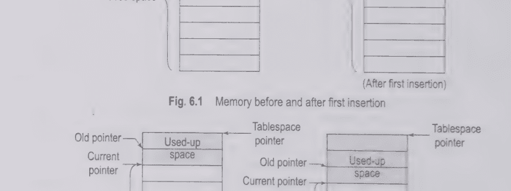


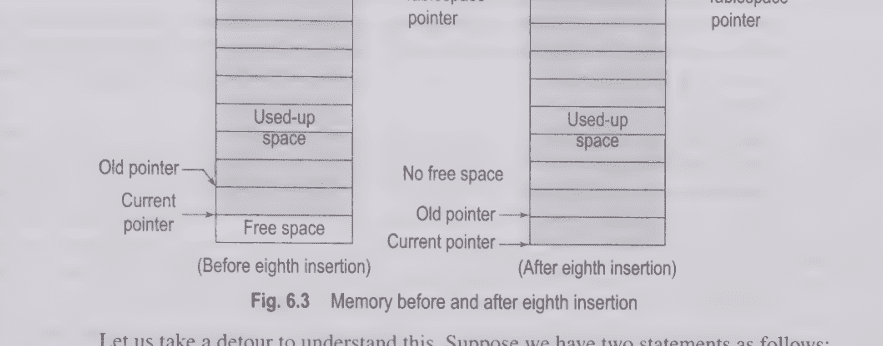

让我们绕个弯来理解这一点。假设我们有以下两个陈述：

- 1. 萨钦是一个男人。
- 2. 男人分布在世界各地。

这些陈述意味着萨钦分布在世界各地。

为什么这个推断是错误的？这是因为当类属性被继承到一个元素中时，它必须是对象的属性，而不是类本身的属性。这里给出的例子是一个与类有关的属性（类分布在世界各地，而不是单个对象）。静态变量代表类的属性（这些属性不会被类的元素，即对象所继承）。这是一个例子，可以看到此类成员的必要性以及程序员如何使用它们。

第一个静态变量保存指向我们想要自行分配的内存的指针。所以，当我们第一次获得内存分配时，我们必须从堆中分配内存（在我们的例子中是 32 字节），并让该指针指向的内存作为表空间。随后，每次需要分配时，从该块中取出四个字节进行分配。接下来，两个指针用于在内存中遍历。当前指针指向下一个内存将被分配的位置，而旧指针指向当前内存被分配的位置。在第一次 `new` 操作中，完整的表空间内存从堆中分配；对于所有后续操作，内存都是从这个 `new` 调用所分配的内存中获取的，而不是从其他调用中获取。布尔变量 `firstTime` 告诉我们 `new` 是否是第一次被调用。当前指针和旧指针的分配和移动过程也如图 6.1、6.2 和 6.3 所示。

我们也为 `Test` 类定义了构造函数和析构函数。有趣的是，尽管我们没有从重载的 `new` 中调用构造函数，但构造函数会被自动调用。构造函数调用是由编译器在重载的 `new` 函数中添加的。此外，看看 `operator new()` 函数体内的 `::new` 调用。它将调用系统定义的全局 `new`。我们使用 `::new` 在堆上获取表空间所需的内存。

`delete` 运算符被重载为带有两个参数，即 `void` 指针和 `size_t` 类型的变量 `size`。这里的第二个参数并不重要。我们可以使用两种版本调用 `delete`，即一个参数（仅 `void *`）和两个参数（`void *` 和 `size_t`）。如果未提供第二个参数，对象的大小会自动确定。当定义 `delete` 运算符的类被继承时，我们需要第二个参数。另一个有趣的点是，`::delete` 在析构函数中被调用。`::delete` 用于撤销重载 `new` 所做的工作，即释放 `P` 指向的内存。

#### 分阶段释放内存

为了避免复杂性，这里没有实现与分配例程类似的复杂释放过程。如果编写了类似分配的释放例程，则很难找到哪些块是已分配的，哪些是空闲的。我们需要一个额外的数组，用 `bool` 值指示哪些槽位已分配、哪些空闲。从该列表中，就可以分配任何空闲槽位。我们为演示重载 `new` 和 `delete` 而设计的解决方案并不复杂。请看下面重载 `new` 中的条件。

#### 测试内存分配失败

下面的分配算法检查我们要分配的内存是否在表空间限制内。如果超出表空间限制，它会显示一条失败消息，程序执行将被终止。

```
if((Test::CurrentPtr + size) > (Test::TableSpace + TABLESPACE_SIZE))
{
    cout << "\n Memory allocation failure";
    getchar();
    exit(0);
}
```

输出显示了当前指针和旧指针是如何递增的。当当前指针到达末尾时，我们得到内存分配失败消息。

## 6.11 用户定义转换

如果所涉及的两个对象类型相同，对象赋值是简单的。被赋值对象成员被复制到被赋值的对象。我们称之为逐成员复制。然而，当它们的类型不同时，例如，用两种不同类型的对象表示的两种不同格式的时间，那么我们需要用户定义转换。为什么？由于对象不同且成员不同，编译器无法进行逐成员复制。在深入讨论用户定义转换的细节之前，让我们了解一下隐式转换的含义，隐式转换由编译器自动提供。

> 注意 普通的赋值涉及逐成员复制。然而，当赋值语句两边有不同类型的对象时，必须指示编译器如何复制。用户定义转换是解决此问题的一种方法。

### 6.11.1 隐式转换

有时需要从一种类型转换为另一种类型。C 自动提供了大量转换。此外，强制类型转换也可以用于提供类型转换。这两种转换在 C++ 中也都可能。此外，还可以提供用户定义转换（从一个类的对象转换为另一个类、从类对象转换为内置类型，或从内置类型转换为类对象）。


隐式转换由编译器在代码中遇到时自动执行。下面是一个这样的示例：

```cpp
int I = 0;
float F = 4.5;
I = F + 2;
```

这里，我们将 6.5 赋给整型变量 I。它会被隐式转换为整型，从而在 I 中得到答案 6。相反，我们可以编写以下表达式。

```cpp
I = (int)F + 2;
```

这个表达式更好，因为我们显式地转换了值；它也更易读。虽然需要时可以将一种类型转换为另一种类型，但 C++ 编译器在少数情况下会提供自动转换。具体如下：

- 1. 当算术表达式包含异构类型时：当一个算术表达式中的操作数类型不止一种时，就会出现这种情况。编译器会选择最宽的操作数类型进行转换。请看以下示例。假设定义了以下变量：
-   
-   int I = 5;
-   float F = 4.5;
-   double D = 12.34;
-   
-   D = I + F;
-   
-   （这里，I 和 F 都被转换为 double 类型，然后相加；这个和赋给 D。这类似于写
-   
-   D = (double)I + (double)F
-   
-   如果我们写
-   
-   float F2 = F + I
-   
-   那么编译器会将 I 转换为 float 类型，与前面的语句类似。

- 2. 当使用 int 代替 bool 数据类型时转换为 bool，反之亦然：C 程序员倾向于使用整型变量来测试真值。如果 C++ 编译器发现类似的代码，它会将该变量转换为 bool 数据类型。类似地，如果 bool 变量在赋值中用作 RHS，而 LHS 是整数，则整型变量将被赋值为零或一，具体取决于 bool 变量的真值。请看以下示例。假设定义了 int Flag1 和 int Flag2。
-   
-   (a) if(Flag1) cout << "Go Ahead!"; 等同于 if((bool) Flag1) cout ...
-   (b) if(!Flag2) cout << "Do not move!" 等同于 if((bool)! Flag2) cout...
-   (c) I = Flag1 （如果 Flag1 为真，I 被赋值为一；否则，在将 bool 值转换为 int 后，I 被赋值为零）等同于 I = (int)Flag1。

- 3. 在初始化时，如果用于初始化的值或变量属于不同类型，则该值或变量会自动转换为 LHS 数据类型。示例如下：
-   
-   (a) int J = 4.5 将 4.5 转换为 int 类型后，将 4 赋给 J
-   (b) int J = F 将 F 转换为 int 类型后，将 4 赋给 J

(c) int *p = 0（我们可以将零值赋给指针变量）。在这种情况下，零从 int 转换为指向 int 的指针；因此，p 被设为指向空值。零是此处唯一可能使用的值。它表示空值。在给定的表达式中，p 现在指向空值。

注意 程序员在 C++ 中将 0（零）赋给指针是正常做法。它表示空值，并且指针被赋予空值。在 C++ 11 中，我们有显式的空指针。

- 4. 当有符号和无符号值在同一表达式中一起使用，或 short 和 long 一起使用时，编译器会选择更宽的值，这样可以保持变量的含义。

注意 如果 long 和 short 在同一表达式中使用，short 会转换为 long。此外，如果同一表达式中同时使用有符号和无符号，有符号值会转换为无符号。如果带符号值为负，则会赋给无符号变量一个错误值，但不会标记错误。更重要的是，当使用其他组合之间的转换时，转换取决于编译器。

- 5. 任何指针都可以转换为 void *（但反之则不然；与 C 不同，void 指针需要强制转换才能转换为任何其他类型）。例如：

```
int *q = &I;
void *p = q;
```

（这里，q 是一个整数指针，p 在编译器将其隐式转换为 void 指针后被赋值为 q。）

- 6. 数组名（是指向数组第一个元素的静态指针）在赋值使用时可以转换为普通指针。例如：

```
int a[10]; int *p = a;
```

（静态指针 a 被转换为普通指针并赋给 p）

现在，p 指向数组的第一个元素。

- 7. 枚举类型转换为 int：例如：

```
enum employee{DailyWages = 1, Temporary, OnProbation, Permanent};
```

这将 2、3 和 4 分别赋给 Temporary、OnProbation 和 Permanent 值。现在，我们可以写这样的代码：

```
int Salary = OnProbation * DaysAttended
```

这等同于将 DaysAttended 乘以 3。

- 8. 非常量转换为常量：只要 const 使用非常量的值或变量进行初始化或赋值，该值或变量就会在赋值前转换为常量。

```
const CI = I
```

这会在赋值前将 I 值转换为 const 整数。

注意 如果两个操作数类型不同，默认的逐成员拷贝将不起作用。当赋值两侧涉及的对象不同时，C++ 也不会提供默认行为。当提供这样的赋值时，会使编译器感到困惑，程序将无法编译。

## 运算符重载与用户定义转换 267

```
index++;
else if(Choice == 2)
{
	for(int i = 0; i < index; ++i)
	{
		/* The conversion takes place here */
		string NameOfUser = *ArrayOfUsers[i];
		/* One of the following could also be used instead */
		cout << (string)*ArrayOfUsers[i] << "\n";
		cout << string(*ArrayOfUsers[i]) << "\n";
		/* In both the cases, the conversion is done with the help of typecasting. The first case is C-style casting whereas the next one is a newer cast available in C++ */
		cout << NameOfUser;
	}
}
else
exit(0);
}
```

我们将只关注把对象转换为内置类型值的代码。在下面的内容中，string 被视为内置类型。严格来说，它并不是内置的，而是标准模板库（STL）的一部分。

在下面的语句 string NameOfUser = *ArrayOfUsers[i]; 中，我们将对象赋给了一个 string。编译器可以接受，因为我们编写了一个转换函数。转换函数本身非常简单。让我们再看一下它。

```
operator string()
{
	return Name;
}
```

执行类似转换的另外两个语句如下：

```
cout << (string)*ArrayOfUsers[i] << "\n";
cout << string(*ArrayOfUsers[i]) << "\n";
```

这个函数将 LoggedInUser 类型的对象转换为 string。它告诉编译器将 LoggedInUser 转换为 string，然后将 LoggedInUser 的 Name 值复制到 string 中。

虽然我们没有指定，但我们在运算符函数中返回了一个 string 类型的对象。我们不能在运算符函数的头文件中指定返回类型。头文件的语法如下：

```
operator <built-in type name>()
```

```
{
    body of the function
}
```

> 注意 提供从一种类型转换为另一种类型的指引的函数称为运算符函数。它包含单词“operator”、要转换成的类型，以及说明如何完成转换的函数体。

这里，没有指定返回类型和参数。返回类型实际上是我们在此关键字 operator 之后指定的内置类型名称。参数列表必须为空。这里，<built-in-type>（在给定示例中为 string）被视为一个运算符。

因此，operator string 返回 string，operator int 返回 int，operator float 返回 float，依此类推。

> 注意 我们不能将返回类型的运算符函数定义为友元。它必须是成员函数。

### 6.11.4 包装类

某些内置类型不是对象，例如 int、char 等。然而，为了完全的面向对象，它们应该是对象。例如，如果我们想拥有一个整数类，我们可以指定用于读取整数的函数，并进行适当的验证检查。如果它们被定义为类，我们可以继承它们，从而拥有自己的类，比方说，从一到某个最大数的正整数。提供基本数据类型并具有此类附加功能的类称为包装类。

> 内置数据类型的包装类包含该基本数据类型以及一些设施，例如错误处理、与内置类型之间的相互转换、初始化为某个值（例如，整数类型初始化为零）等等。

有时，我们可能需要将包装类对象转换为内置类型对象，反之亦然。使用构造函数可以从内置类型转换为包装类，使用转换运算符可以进行逆向转换。程序 6.13 就是一个这样的例子。

### 程序 6.13 整数的包装类

```
//Wrapper.cpp
#include <iostream>
#include <string>
using namespace std;

class Integer
{
private:
    int Value;
public:
    friend ostream & operator <<(ostream &, Integer &);
    friend istream & operator >>(istream &, Integer &);

    /* Conversion using constructor*/
    Integer(int TempVal = 0)
    {
        Value = TempVal;
    }

    /* Conversion using operator */
```

```
operator int()
{
    return Value;
}
};

ostream & operator <<(ostream & TempOut, Integer & TempInteger)
{
    TempOut << TempInteger.Value;
    return TempOut;
}

istream & operator >>(istream & TempIn, Integer & TempInteger)
{
    TempIn >> TempInteger.Value; return TempIn;
}

void main()
{
    Integer Int1 = 5;
    // The constructor is applied

    Integer Int2;
    int int1;
    int int2 = 7;
    int2 = int2;  // The constructor is applied
    int1 = Int1;  // The operator is applied here

    cout << "Integer value is" << Int1 << "int value is" << int1 <<"\n";
    cout << "Integer value is" << Int2 <<"int value is" << int2 <<"\n";
}
```

### 程序如何工作

在本节中，我们只查看该程序的重要语句。

使用 Integer 和 int 互换使用  我们在这个例子中互换使用了 Integer 与 int，而没有暗示 Integer 实际上是一个类。与原始数据类型相比，使用包装类对象的好处是可以提供我们选择的验证。当未显式初始化时，Integer 对象将以值 0 初始化。

继承优势  也可以将此类继承到我们选择的类中。例如，正整数类可以从 Integer 类继承。此外，应注意重载的 << 和 >> 的使用。这使得包装类与内置数据类型完全相同。

运算符函数与构造函数  我们这里关心的是 operator int。这个函数提供了将 Integer 类型转换为 int 的功能。因此，用户定义的对象可以被转换为内置类型的对象。使用构造函数也可以将内置类型转换为用户定义的对象。

### 6.11.5 使用构造函数进行对象类型的转换

可以使用构造函数或转换函数将一种对象类型转换为另一种对象类型。在这种转换中有两种不同情况：从外来对象转换为本类对象，以及反之亦然。从外来对象转换为本类对象是使用构造函数完成的。在本节中，我们将学习如何使用构造函数将一个对象转换为另一个对象。

考虑一个 point 类，它可以由 x 和 y 坐标描述的点格式表示。这种格式称为直角坐标系或笛卡尔坐标系。点也可以使用与 x 轴形成的角度以及距原点的距离（半径）来定义。这称为极坐标系（参见图 6.4）。一个系统可能同时具有这两种表示方式，并需要一种在它们之间进行转换的方法。

- 1. 从极坐标转换为直角坐标
- X = Radius * cos(angle)
- Y = Radius * sin(angle)
  
- 2. 从直角坐标转换为极坐标
- Angle = atan(X/Y)
- Radius = sqrt(X * X + Y * Y)

在程序 6.14 中，使用构造函数进行了转换演示。

### 程序 6.14 使用构造函数进行极坐标到直角坐标的对象转换

```
//PolarToCartesian1.cpp
#include <iostream>
#include <string>
#include <cmath>
using namespace std;

class Polar
{
    double Radius;
    double Angle;
public:
    Polar(double TempRadius = 0, double TempAngle = 0)
    {
        Radius = TempRadius;
        Angle = TempAngle;
    }
    double GetRadius()
    {
        return Radius;
    }
    double GetAngle()
    {
        return Angle;
    }
};
```

```
class Cartesian
{
    double X;
    double Y;
public:
    Cartesian(double TempX = 0, double TempY = 0)
    {
        X = TempX;
        Y = TempY;
    }

    Cartesian(Polar PolarPoint)
    {
        double TempRadius = PolarPoint.GetRadius();
        double TempAngle = PolarPoint.GetAngle();
        X = TempRadius * cos(TempAngle);
        Y = TempRadius * sin(TempAngle);
    }

    void Show()
    {
        cout << "( " << X << ", " << Y << " ) \n";
    };
}

void main()
{
    Cartesian CPoint1(10, 10);
    Polar PPoint2(10, 45);
    Polar PPoint1;
    Cartesian CPoint2;
    CPoint2 = PPoint2;

    // The following will not work
    // PPoint1 = CPoint1;
    CPoint2.Show();
}
```

### 程序如何工作

语句 Cpoint2 = Ppoint2 很重要。它是 Cpoint2 = Cartesian(Ppoint2) 的简写形式，因此将 Ppoint2 强制转换为 Cartesian。如果定义了这种转换，C++ 编译器不会在这里标记错误。在本例中，转换是使用构造函数定义的。

```
Cartesian(Polar PolarPoint)
{
    float TempRadius = PolarPoint.GetRadius();
    float TempAngle = PolarPoint.GetAngle();
    X = TempRadius * cos(TempAngle);
    Y = TempRadius * sin(TempAngle);
}
```

Cartesian 构造函数有一个 Polar 类型的参数。它提供了一种将极坐标点转换为直角坐标点的方法。函数体中的语句是前面所述公式的实现。然而，不能编写 PPoint1 = CPoint1，因为 Polar 类中没有针对 Cartesian 类的任何构造函数。如果同时需要两种转换，一种方法是使用 6.12.6 节中所述的运算符。

### 6.11.6 使用转换函数进行对象类型的转换

当需要将本类对象转换为外来对象时，使用运算符函数（转换函数）。它们的使用方式与从对象转换为基本类型时相同。程序 6.15 显示了运算符函数的使用。

### 程序 6.15 使用运算符函数进行直角坐标到极坐标的对象转换

```
//CartesianToPolar1.cpp
#include <iostream>
#include <string>
#include <cmath>
using namespace std;
class Cartesian;
class Polar
{
    double Radius;
    double Angle;
public:
    Polar(double TempRadius = 0, double TempAngle = 0)
    {
        Radius = TempRadius;
        Angle = TempAngle;
    }
    double GetRadius()
    {
        Return Radius;
    }
    double GetAngle()
    {
        return Angle;
    }
    void Show()
    {
        cout << "(" << Radius <<", "<< Angle <<")\n";
    }
};
class Cartesian
{
    double X;
    double Y;
public:
    Cartesian(double TempX = 0, double TempY = 0)
    {
        X = TempX;
        Y = TempY;
    }
    Cartesian(Polar PolarPoint)
    {
```

```
double TempRadius = PolarPoint.GetRadius();
double TempAngle = PolarPoint.GetAngle();
X = TempRadius * cos(TempAngle);
Y = TempRadius * sin(TempAngle);
}

operator Polar()
{
    double TempAngle = atan(X/Y);
    double TempRadius = sqrt(X * X + Y * Y);
    return Polar(TempRadius, TempAngle);
}

void Show()
{
    cout << "(" << X << ", " << Y << ") \n";
};
void main()
{
    Cartesian CPoint1(10, 10);
    Polar PPoint2(10, (double)0.5);
    Polar PPoint1;
    Cartesian CPoint2;
    CPoint2 = PPoint2;
    // The following will work
    PPoint1 = CPoint1;
    CPoint2.Show();
    PPoint1.Show();
}
```

### 程序如何工作

该程序包含一个将直角坐标转换为极坐标的运算符函数。查看该函数：

```
operator Polar()
{
    double TempAngle = atan(X/Y);
    double TempRadius = sqrt(X * X + Y * Y);
    return Polar(TempRadius, TempAngle);
}
```

该代码将从直角坐标对象生成一个极坐标对象。运算符函数的头部语法如下：

```
operator <要转换到的对象类型>()
```

需要注意的是，此函数既没有返回类型也没有参数。

### 6.11.7 构造函数与运算符函数在转换上的比较

构造函数将外来对象转换为本类对象，而运算符函数将本类对象转换为外来对象。因此，使用构造函数进行转换的代码需要写在目标类中，而使用运算符进行转换的代码则需要写在源类中。

> 如果我们要将某个其他对象转换为本类对象，我们会编写构造函数；而如果要将本类对象转换为其他对象，我们会使用运算符。

在构造函数方法中，我们需要使用返回私有变量值的函数。程序 6.14 和 6.15 为此使用了 GetRadius() 和 GetAngle() 函数。这些函数称为访问方法。它们很重要，因为类的私有变量需要被访问以进行转换。

```
operator Polar()
{
float TempAngle = atan(X/Y);
float TempRadius = sqrt(X * X + Y * Y);
return Polar(TempRadius, TempAngle);
}
```

在运算符方法中，我们需要为外来对象使用构造函数。如果尚未定义，则无法使用此方法。如果构造函数不可用，我们需要如下修改程序：

```
We have to define an object such as Polar TempPolar, since we would need TempPolar. Radius and TempPolar.Angle to be calculated given the values of X and Y. In other words, the following code

operator Polar()
{
float TempAngle = atan(X/Y);
float TempRadius = sqrt(X * X + Y * Y);
return Polar(TempRadius, TempAngle);
}
```

将转换为以下代码。这个构造函数在 Polar 类中没有提供。

```
operator Polar()
{
Polar TempPolar;
TempPolar.Angle = atan(X/Y);
TempPolar.Radius = sqrt(X * X + Y * Y);
return TempPolar;
}
```

Radius 和 Angle 这里是私有变量，非成员函数无法访问。即使定义了像第一种情况那样的访问方法，问题也无法解决。访问方法提供私有变量的值，但不允许修改变量的值。提供允许修改私有成员值的公有函数并不是一种好的编程方式，因为那样成员就不再是私有的了。如果我们有构造函数，我们可以像程序 6.14 中那样构造对象，而无需访问私有变量，这显示了在编写将一个用户定义对象转换为另一个用户定义对象的运算符函数时，构造函数的有用性。

### 6.11.8 选择合适的转换方法

构造函数和运算符函数之间的差异如表 6.1 所示。

表 6.1

选择适当的转换方法取决于具体情况。假设我们有某种内置对象，但无法访问该类的源代码。如果我们希望提供从正在编写的新类进行转换，则必须在该类中编写运算符。另一方面，如果我们希望转换为新类，则必须编写构造函数。

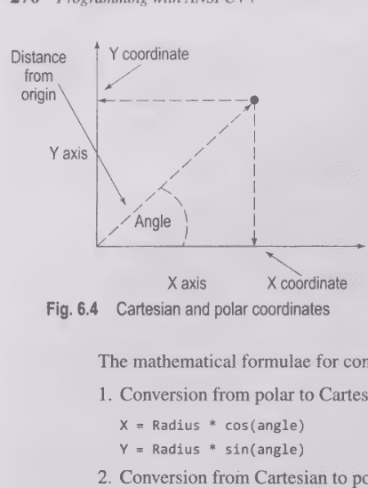


- 友元函数在重载插入和提取（>> 和 <<）运算符时非常有用，当我们希望运算符的第一个参数是内置类型时也是如此。
- 在构造函数中需要动态内存分配的情况也需要赋值运算符。
- [] 运算符可以被重载以提供数组边界检查，() 运算符可以被重载以使对象的行为与函数相同。

- 函数对象提高了代码的可读性，并使其有可能内联。
- 当我们需要以非常规方式分配和释放内存时，可以重载 new 和 delete。
- 将一种类型的对象转换为另一种类型是可能的，有时也很有用。将内置类型转换为对象以及反向转换也是可能的。构造函数和运算符函数在这些转换中帮助我们。

## 关键词

内置类型到用户自定义类型 这是指从内置类型到对象的转换。

提取运算符 >> 运算符用于从键盘读取，被称为提取运算符，也称为输入运算符。

函数对象 重载了 () 运算符的类的对象可以用 () 编写，并且可以像函数一样对待。这种可以像函数一样调用的对象被称为函数对象。

插入运算符 << 运算符用于向控制台写入，被称为插入运算符，也称为输出运算符。

前向定义 这是类的一个原型，允许在开头仅定义类名。

对象到内置类型的转换 这是指从对象到内置类型的转换。

运算符函数 以关键字 operator 开头且函数名中下一个词为运算符的函数称为运算符函数。当调用包含该运算符的表达式时，这些函数会替换指定的运算符。

运算符重载 这是为现有运算符赋予额外含义的过程。

用户定义转换 当我们需要在不同类型之间进行转换时，可以通过编写运算符函数或构造函数来指导编译器如何从一种类型转换为另一种类型。这些构造函数和运算符函数被称为用户定义转换。

包装类 这是一种将类 C 结构或内置类型数据表示为类的类。例如，Integer 包装类将 int 数据类型表示为类。

## 练习

## 选择题

1. 当重载一元运算符时 ________。
(a) 不显式传递参数
(b) 需要显式传递一个参数
(c) 不隐式传递参数
(d) 仅当重载为成员函数时才不显式传递参数

2. 运算符重载的优点是 ________。
(a) 更好的可读性
(b) 易于使用
(c) 易于编码
(d) (a) 和 (b)

3. 使用友元函数创建的运算符也可以由成员函数创建。
(a) 总是正确的
(b) 总是错误的
(c) 部分正确
(d) 从不正确

4. 以下语句将做什么？
Matrix operator *(int multiplier, Matrix tempMatrix);
(a) 为 Matrix 类重载 *（乘法）运算符。
(b) 编译器将产生错误。
(c) 为 Matrix 类重载 *（指针）运算符。
(d) 链接器将产生错误。

5. 所有运算符都可以为 ________ 重载。
(a) 预定义类型
(b) 用户自定义类型
(c) 扩展类型
(d) 以上所有

6. 使用运算符重载，人们可以 ________。
(a) 设计新的运算符
(b) 不能设计新的运算符
(c) 只能重载可用的运算符
(d) 给所有可用运算符赋予含义

7. 如果需要从第二个类转换到第一个类，则需要 ________。
(a) 运算符
(b) 转换函数
(c) 构造函数
(d) 以上任何一种

8. 以下哪一项是为名为 Test 的类重载 new 运算符的正确语法？
(a) void Test operator new( int size );
(b) void * Test operator new( int size );
(c) void * Test operator new( size_t size );
(d) Test * Test operator new( size_t size );

9. 当运算符被重载时 ________。
(a) 它们的优先级会改变
(b) 它们的优先级不会改变
(c) 它们获得额外的优先级
(d) 以上都不是

10. C++ 检查表达式是否进行转换，并在它是 ________ 时调用运算符。
(a) 构造函数调用
(b) 运算符函数调用
(c) 强制转换
(d) 以上所有

1. 运算符重载的意义是什么？
2. 运算符重载有哪些限制？
3. 列出不能被重载的运算符。
4. 列出不能作为友元重载的运算符。
5. 列出作为成员重载的运算符与作为友元重载的运算符之间的区别。
6. 区分一元运算符和二元运算符的重载。
7. 区分后缀运算符和前缀运算符的重载。
8. 当基本运算符已经重载时，为什么简写运算符很有用？
9. 为什么在重载 << 和 >> 运算符时需要传递并返回流对象的引用？

1. 第 6.3 节描述了为 complex 类重载 +。为同一个类重载 -、++ 和 --。
2. 对于 CollectionEmp 类，添加一个成员运算符函数 -- 以从 CollectionEmp 对象中移除一个员工对象。
3. 为 Time 类重载 --。
4. * 被重载用于将标量值与矩阵相乘。重载相同的运算符以用于两个矩阵相乘。
5. 为栈类重载 + 和 -，使 + 提供压栈操作，- 提供弹栈操作。
6. 为程序 6.13 中定义的 Integer 类重载 -- 和 ++。
7. 为 complex 类重载前缀和后缀版本的 ++ 和 --。前缀 ++ 加到实部，后缀加到虚部。类似地，前缀 -- 从实部减去，后缀从虚部减去。例如，如果复数 ComplexNo 的值为 2 + 3i，那么 ComplexNo++ 将使其变为 2 + 4i，++ComplexNo 使其变为 3 + 3i，ComplexNo-- 将产生 2 + 2i，而 --ComplexNo 产生 1 + 3i。
8. 对于程序 6.13，重载 * 和 /，使得与普通整数之间的除法和乘法工作方式相同。（提示：使用友元函数进行重载）。
9. 为本章定义的 Time 类重载 << 和 >>。当用户添加语句 cout << Time 或 cin >> Time 时，重载的函数应分别能够输出 Time 的元素并从屏幕读取。时间的显示格式为 HH:MM:SS。
10. 对于超市，定义一个账单类。所有账单对象将包含账单编号、准备账单的职员姓名、每个项目的数量和价格，以及应付总金额。账单中的总项目数是变化的。为账单类定义动态内存分配构造函数，使得单个账单可以容纳 1 到 50 之间的任意数量的项目。有一个数组描述每个项目的价格。价格将从该数组中获取。现在重载

## 模板

- 软件复用与模板
- 函数模板
- 单参数和多参数函数模板
- 函数模板的特化和显式特化
- 类模板
- 具有多种通用数据类型的类
- 类模板中的静态成员
- 主特化和部分特化
- 编译模型和 export 关键字
- typename 在模板中的使用

## 7.1 引言

软件复用是面向对象编程最常被引用的优点之一。在大多数情况下，它与继承和面向对象编程相关联。然而，软件复用也可以通过其他方式实现。其中一种方法就是模板。模板使用的模型被称为基于对象的复用模型。换句话说，它允许在没有继承的情况下实现复用。让我们在本章中尝试理解模板的概念。

## 复用代码的两种方法

## 类型转换方法

一种解决方案是为 float 变量编写一个单一的冒泡排序函数，并使其用于 float 和 integer 参数。调用函数时，integer 参数将被转换为 float，然后在所有轮次中作为 float 进行比较。

## 重载方法

也可能在程序中大多数时候调用的是使用 integer 值的冒泡排序。在这种情况下，最好重载冒泡排序函数，使其同时接受 integer 和 float 参数。可以编写两个不同的冒泡排序函数，一个用于整数，另一个用于浮点值（通过用 float 冒泡排序重载 integer 冒泡排序）。现在，每当使用 integer 参数调用冒泡排序时，将调用接受 integer 参数的函数，只有当调用接受 float 参数的函数时，才会调用 float 冒泡排序。因此，可以同时实现通用性和高性能。

第二种方法肯定比第一种好，但它也有开销。尽管排序过程本身与数据类型无关，但相同的冒泡排序函数需要编写两次，函数体相同而数据类型不同。因此，当添加更多数据类型时，重载方法更加费力且容易出错。如果以后函数体本身需要某些更改，也会产生问题，因为需要在所有冒泡排序函数的所有位置进行相同的更改。

## 通用（模板）函数

能否编写一个与数据类型无关的单一冒泡排序函数？能否在使用冒泡排序函数时指定数据类型？

> 模板允许在没有继承的情况下实现复用。


### 280 使用 ANSI C++ 进行编程

> C++ 中的函数模板提供了与数据类型无关的泛型函数。

或者，更进一步，编译器能否从调用中理解冒泡排序的参数是整数还是浮点数，并相应地调用该数据类型的函数？换句话说，在调用冒泡排序函数时，数据类型能否与其他参数一起传递？答案是肯定的。这可以通过函数模板来实现。

## 泛型（模板）类

与函数模板类似，C++ 也有与数据类型无关的泛型类。让我们讨论如何以及在何处使用它们。当人们想到一些真实世界的实体并打算为其编程时，也可能需要考虑它们的变体。考虑一个程序队列、一个用户 ID 队列或一个乘客队列。所有这些队列实际上都是一样的，只是它们处理的数据不同。

假设我们有一个类 Program 和另一个名为 Passenger 的类。我们希望有一个队列，可以在一端插入，在另一端删除。很明显，Passenger 对象的队列和 Program 对象的队列是相同的，除了它们持有的内容类型。插入和删除的例程在两种情况下工作方式相同。我们还可以有一个新的用户 ID 队列，除了数据类型不同之外，它的工作方式也相同。这里我们有兴趣定义一个队列类而不指定内容的类型。如果可能做到这一点，那么同一个队列将适用于我们之前定义的所有数据类型，也可以用于其他额外的数据类型。当我们对特定对象类型（例如 Passenger）使用该队列类时，就会自动生成一个针对 Passenger 的特定队列类，并进行重载。这在 C++ 中可以使用类模板来实现，类模板定义了这样的泛型类类型。

> 泛型类与数据类型无关。它可以自动生成与特定数据类型相关的类，而无需程序员显式编码。换句话说，即使不指定数据类型，它也能提供解决方案。

类模板的优点是，可以定义一个泛型类，该泛型类适用于作为参数传递给它的任何数据类型。在本章中，我们将学习函数模板和类模板，并了解它们如何帮助我们进行泛型编程。

## 7.2 函数模板

函数模板是泛型函数，适用于传递给它们的任何数据类型。在编写函数时未指定数据类型。在使用该函数时，会传递数据类型并获得所需的功能。用户也可能完全不指定数据类型，由编译器推导。

当编写函数模板时，参数类型要么在调用函数时传递，要么由编译器从表达式推导。

### 7.2.1 使用宏的缺点

C 程序员对这个问题的解决方案是使用宏。宏对于处理不依赖类型的问题非常有用。例如，假设需要计算两个项目的最大值，无论其类型如何，都可以在 C 程序中安全地编写以下代码：

```
#define MAX(a, b) (a) > (b) ? (a) : (b)
```

如果我们定义以下内容

int i, j;
float f1, f2;

就可以调用 MAX 作为 MAX(i, j); 和 MAX(f1, f2);

在 C++ 中也可以通过使用宏而不是函数模板来实现类似的功能。然而，在这种情况下使用宏有以下缺点：

- 1. 宏对编译器不可见。宏由预处理器（在编译开始之前处理程序）替换为其主体。如果宏主体中有错误，错误会以非用户友好的形式呈现。对于使用库中的宏并且不知道主体中使用的变量的用户来说，这更加恼人。
- 2. 与类型相关的信息在宏中会丢失。而且，在宏中无法进行任何与类型相关的验证。
- 3. 宏会被求值两次，第一次是复制时，第二次是执行时。所以，MAX(i++, j) 被转换为
  (i++) > j ? (i++) : j

你注意到这里的问题了吗？这里，i++ 执行了两次，使 i 递增了两次而不是一次。函数模板提供了一种与类型无关且没有这些问题的解决方案，因此更受欢迎。

### 7.2.2 单参数函数模板

函数模板实现起来非常简单。只需进行一些机械性的更改，即可将普通函数变为函数模板。为了理解编写函数模板的过程，我们首先为一个整数元素编写一个冒泡排序函数，以及一个带有泛型元素的函数模板，如程序 7.1 所示。

### 程序 7.1 使用函数模板的冒泡排序

```
//TemplateGenericro.cpp
#include <iostream>
#include <iostream>
#include <string>
using namespace std;

void BubbleSort(int TempIntArray[])
{
	for(int i = 0; i < 9; i++)
	{
		for(int j = i + 1; j < 10; j++)
		{
			if(TempIntArray[i] < TempIntArray[j])
			{
				int TempInt = TempIntArray[i];
				TempIntArray[i] = TempIntArray[j];
				TempIntArray[j] = TempInt;
			}
		}
	}
}

template <typename Type>
void BubbleSort(Type TempIntArray[])
{
	for(int i = 0; i < 9; i++)
	{
		for(int j = i + 1; j < 10; j++)
		{
			if(TempIntArray[i] < TempIntArray[j])
			{
				Type TempInt = TempIntArray[i];
				TempIntArray[i] = TempIntArray[j];
				TempIntArray[j] = TempInt;
			}
		}
	}
}
```

```
void GenericBubbleSort(Type TempGenericArray[])
{
    for(int i = 0; i < 9; i++)
    {
        for(int j = i + 1; j < 10; j++)
        {
            if(TempGenericArray[i] < TempGenericArray[j])
            {
                int TempGeneric = TempGenericArray[i];
                TempGenericArray[i] = TempGenericArray[j];
                TempGenericArray[j] = TempGeneric;
            }
        }
    }
}
void main()
{
    int Array[] = {3,2,6,1,8,9,5,4,12,11};
    int Array2[] = {11,45,23,8 9,65,34,12,44,65,22};
    char Array3[] = "irngiremxc";
    float Array4[] = {1.2,2.3,3.4,2.1,4.4,3.2,2.1};
    cout << "First integer array" << endl;
    /* Calling bubble sort for first array and the compiler deducing it */
    BubbleSort(Array);
    for(int i = 0; i < 10; i++)
    {
        cout << " " << Array[i] << ",";
    }
    cout << "\n";
    /* Calling bubble sort for second array */
    cout << "Second integer array" << endl;
    GenericBubbleSort <int> (Array2);
    for(int i = 0; i < 10; i++)
    {
        cout << " " << Array2[i] << ",";
    }
    cout <<"\n";
    cout << "Character array" << endl;
    /* Another explicit specification */
    GenericBubbleSort <char> (Array3);
    for(int i = 0; i < 10; i++)
    {
        cout << " " << Array3[i] << ",";
    }
    cout << "\n";
    cout << "Double array" << endl;
    /* Another deduction by compiler */
    GenericBubbleSort(Array4);
    /* Here, the arguments are deduced by the compiler */
    for(int i = 0; i < 10; i++)
    {
        cout << " " << Array4[i] << ",";
    }
    cout <<"\n";
}
```

模板函数是一个泛型函数，至少包含一个参数，该参数在函数调用时被实际类型替换。

### 类型替换

当函数调用被编译时，变量 Type 会被某个有效类型替换。如果编译器发现语句 GenericBubbleSort <int> (Array2)，它将通过在 GenericBubbleSort 的定义中将 Type 转换为 int 来生成一个函数。也可以直接调用 GenericBubbleSort(Array2) 而不指定 <int>。在这种情况下，编译器会尝试推导 Array2 的数据类型。如果它能明确推导，就会调用具有推导类型的函数。

注意，typename 在模板规范时为未指定的类型定义了虚拟占位符。旧版本使用关键字 class 达到同样的效果。

Type 只是一个虚拟类型名。它是一个占位符，一个模板，因此得名。该函数也是一个虚拟函数。如前所述，实际函数是在定义时由编译器创建的。这就是为什么该定义被称为函数模板。模板名称可以用在定义和声明中。以下三个声明是同一个模板：

```
template <typename Ty>
void GenericBubbleSort(Ty TempIntArray[]);
```

```
template <typename T>
void GenericBubbleSort(T TempIntArray[]);
```

```
template <typename TT>
void GenericBubbleSort(TT TempIntArray[]);
```

这些函数的定义可能如下：

```
template <typename Type>
void GenericBubbleSort(Type TempIntArray[])
{
    Body of the function
}
```

函数 GenericBubbleSort() 的主体与 BubbleSort() 函数相同，只是临时变量也是泛型类型。现在，让我们看一下函数调用。

### 调用生成的函数

泛型函数的函数调用在函数名和参数列表之间又有一个部分。它包含在 < 和 > 之间，包含所有需要传递给泛型函数的类型。我们可以在调用函数时传递实际数据类型，该类型将使用指定的 Type 调用重载函数。

我们有对 GenericBubbleSort() 的两种不同调用。第一个是 GenericBubbleSort <int>，第二个是 GenericBubbleSort <char>。第一个调用使得调用以 int 为参数的 GenericBubbleSort() 重载版本。

注意 GenericBubbleSort() 是一个模板，而 GenericBubbleSort <int> 是一个重载且实际创建的函数，其中 Type 被替换为 int。因此，在这种情况下，从模板 GenericBubbleSort() 创建了两个函数，即 GenericBubbleSort <int> 和 GenericBubbleSort <char>。

### 推导参数

同样重要的是要注意，如果编译器可以自己推导参数，则包含在 <> 中的中间部分可以省略。例如，程序包含一条语句


### 7.2.3 实例化

当编译器能够无歧义地推导出参数时，用户在调用函数模板时可以省略 `<>` 部分。

```cpp
GenericBubbleSort(Array4);
/* Here, the arguments are deduced by the compiler */
```

这条语句中，中间部分被省略了。此时，编译器可以无歧义地推导出参数为 float，并生成和调用该函数的 float 版本。

因此，虽然程序中只有一个 GenericBubbleSort() 函数，却已经用不同的类型进行了三次调用。这就是使用函数模板的优势。

当从泛型函数定义中为某个特定类型生成实际函数时，这一过程称为该泛型函数的实例化。

现在让我们讨论 GenericBubbleSort() 是如何与这三种数据类型一起工作的。所定义的模板实际上并不是一个函数。前面给出的 GenericBubbleSort() 定义并未在真正意义上定义任何函数。

当遇到如下语句时，函数定义才会生成。

```cpp
// Create char instance
GenericBubbleSort <char> (Array3);

// Create int instance
GenericBubbleSort <int> (Array2);

// Deduce float and generate float instance
GenericBubbleSort(Array4);
```

这与普通函数（如 BubbleSort()）不同。当程序中出现普通函数定义时，即使该函数未被调用，它也会被生成。然而，模板函数在模板定义时并不会被定义。当模板函数（如 `GenericBubbleSort <int>`）第一次被调用时，会发生以下步骤：

1. 函数被生成，即根据相应类型（这里是 int）从模板定义中实例化。
2. 调用语句被编译。

当程序中遇到以下语句时会发生什么？

```cpp
GenericBubbleSort <char> (Array3);
GenericBubbleSort <char> (Array5);
```

第一次调用（Array3）的编译过程会从模板生成函数，然后编译调用语句。第二次调用则不需要再生成函数，因为它已经被实例化，只需编译调用语句即可。

> 注意 普通函数与实例化函数之间的区别在于：普通函数是在编译函数定义时生成的，而实例化函数是在编译第一次函数调用时才产生的。

如果同一函数在不同文件中被调用，也可能会实例化出同一函数的多个副本。我们将在 7.4 节讨论编译模型时再来看这个问题。

```cpp
string DeptName;
string Designation;
public:
    employee(int TempNo = 0, string TempName = 0, string TempDept = 0, string TempDesi = 0)
    {
        EmpNo = TempNo;
        Name = TempName;
        DeptName = TempDept;
        Designation = TempDesi;
    }
    bool operator <(employee & OtherEmployee)
    {
        if(EmpNo > OtherEmployee.EmpNo)
            return false;
        else
            return true;
    }
    friend ostream & operator <<(ostream & TempOut, employee & TempEmployee);
};

ostream & operator <<(ostream & TempOut, employee & TempEmployee)
{
    TempOut << "Details of employee number" << TempEmployee.EmpNo << "\n";
    TempOut << "Name is" << TempEmployee.Name << "\n";
    TempOut << "Department is" << TempEmployee.DeptName << "\n";
    TempOut << "Designation is" << TempEmployee.Designation << "\n";
    return TempOut;
}

template <typename Type>
void GenericBubbleSort(Type TempGenericArray[])
{
    for(int i = 0; i < 9; i++)
    {
        for(int j = i + 1; j < 10; j++)
        {
            if(TempGenericArray[i] < TempGenericArray[j])
            {
                Type TempGeneric = TempGenericArray[i];
                TempGenericArray[i] = TempGenericArray[j];
                TempGenericArray[j] = TempGeneric;
            }
        }
    }
}

void main()
{
    employee UniEmployee[10] =
    {
        employee(1, "Lara", "Exam", "Professor"),
        employee(2, "Ponting", "Marksheet", "Clerk"),
        employee(3, "Laxman", "Accounts", "Head Clerk"),
        employee(4, "Flintoff", "Exam", "Clerk"),
        employee(5, "Murlidharan", "Accounts", "CAO"),
        employee(6, "Sarfaraz", "Exam", "Informer"),
        employee(7, "Dean Jones", "Exam", "Invigilator"),
        employee(8, "Madugalle", "Exam", "Examiner"),
        employee(9, "Ganguly", "Marksheet", "Repeater"),
        employee(10, "Nafees", "Accounts", "Clerk")
    };
    GenericBubbleSort <employee> (UniEmployee);
    for(int i = 0; i < 10; i++)
    {
        cout << " " << UniEmployee[i] << ", ";
    }
}
```

#### 程序是如何工作的

在本节中，我们只探讨一个重要问题。GenericBubbleSort() 完全没有改变。为什么？让我们看看。

泛型排序的优势在于它不依赖于传入数据的类型。只要提供了适当的运算符重载，GenericBubbleSort() 就可以适用于任何数据类型，甚至用户自定义对象。当需要处理多种数据类型时，这类算法会非常有用。STL 中就包含许多这样的算法。

需要注意，必须保持 `<` 在 bubbleSort 中的含义。这里的 `<` 语义（即含义）是：`<` 运算符的左侧（LHS）在逻辑上必须小于右侧（RHS）。实现方式是让 ID 值较小的 employee 在逻辑上小于 ID 值较大的 employee。这在某些情况下可以接受，但并非总是成立。

#### 处理内置类型

有时，运算符重载并不可行。例如，在处理内置数据类型时，重载运算符是不可能的；或者在使用他人设计的类时，可能无法访问该类。程序 7.3 就是一个例子，说明了内置 C 风格字符串所面临的问题。

该程序定义了一个 Max 函数，用于找出传入的两个值中的最大值。模板生成了三个不同的实例。观察调用 Max 函数时会发生什么。

#### 程序 7.3 求两个泛型参数的最大值

```cpp
//SemanticIn00.cpp
#include <iostream>
#include <string>
using namespace std;

template <typename T>
bool Max(T First, T Second)
{
    return(First > Second);
}

int main()
{
    string sAddress = "West Indies";
    string sName = "Brian Charles Lara";
    int i1 = 5;
    int i2 = 7;
    char cAddress[] = "West Indies";
    char cName[] = "Brian Charles Lara";

    // Instance 1
    if(Max(i1, i2))
        cout << "i1 is bigger\n";
    else
        cout << "i2 is bigger\n";

    // Instance 2
    if(Max(sName, sAddress))
        cout << "sName is bigger\n";
    else
        cout << "sAddress is bigger\n";

    // Instance 3
    if(Max(cName, cAddress))
        cout << "cName is bigger\n";
    else
        cout << "cAddress is bigger\n";
}
```

输出

```text
i2 is bigger
sAddress is bigger
cName is bigger
```

> 注意 字符串按字典顺序进行比较。因此，West Indies 大于 Brian Charles Lara，因为在字典中 'B' 出现在 'W' 之前。即使第二个字符串的字符数多于第一个字符串，这一结论仍然成立。

#### 程序是如何工作的

输出结果出人意料。两个字符串的比较得到了正确结果，但两个字符数组的比较却没有。为什么？cName 和 cAddress 是字符数组的名称，它们是指向各自数组首元素的指针。当两者进行比较时，比较的是指针值，即地址；因此，后定义的项会更大。于是，在 cAddress 之后定义的 cName 获得了更大的地址值。相反，string 类中重载了 `<` 运算符，因此那里的行为更有意义。如果左侧字符串在字典序上小于右侧字符串，`<` 运算符返回 true；否则返回 false。

如何解决这个问题？如果是某个类，可以通过提供适当的运算符重载来消除这一现象。遗憾的是，如果类型是内置的（例如 C 类型数组），或者类是由他人定义的（无法获得修改类的源代码），就不可能这样做。解决这个问题的方法是针对该特定类型重载模板本身。我们将在程序 7.8 中看到使用这种解决方案的改进版本。

## 7.2.6 多参数的函数模板

模板可以有多个参数。其他参数可以是泛型类型，也可以是普通类型。程序 7.4 是一个简单的搜索程序，用于在数组中查找元素。这里我们需要传递两个参数：数组和要查找的元素，这两个参数都必然是泛型类型。


### PROGRAM 7.4 带有两个泛型参数的通用搜索

```cpp
//GenericSearch.cpp
#include <iostream>
#include <string>
using namespace std;
class employee
{
	int EmpNo;
	string Name;
	string DeptName;
	string Designation;
public:
	employee(int TempNo = 0, string TempName = "", string TempDept = "", string TempDesi = "")
	{
		EmpNo = TempNo;
		Name = TempName;
		DeptName = TempDept;
		Designation = TempDesi;
	}
	bool operator ==(employee TempEmp)
	{
		return(EmpNo == TempEmp.EmpNo);
	}
	friend ostream & operator <<(ostream &TempOut, employee &TempEmployee);
};
ostream & operator <<(ostream &TempOut, employee &TempEmployee)
{
	TempOut << "Details of employee number " << TempEmployee.EmpNo << "\n";
	TempOut << "Name is " << TempEmployee.Name << "\n";
	TempOut << "Department is " << TempEmployee.DeptName << "\n";
	TempOut << "Designation is " << TempEmployee.Designation << "\n";
	return TempOut;
}
template <typename Type>
int GenericSearch(Type TempGenericArray[], Type EleToBeSearched)
{
	for(int i = 0; i < 10; i++)
	{
		if(EleToBeSearched == TempGenericArray[i])
		{
			return i;
		}
	}
	return -1;
}
void main()
{
	int Array1[] = {11,45,23,89,65,34,12,44,65,22};
	char Array2[] = "irngiremxc";
	employee UniEmployee[] = 
	{
		employee(1, "Lara", "Exam", "Professor"),
		employee(2, "Ponting", "Marksheet", "Clerk"),
		employee(3, "Laxman", "Accounts", "Head Clerk"),
		employee(4, "Flintoff", "Exam", "Clerk"),
		employee(5,"Murlidharan", "Accounts", "CAO"),
		employee(6,"Sarfaraz", "Exam", "Informant"),
		employee(7,"Dean Jones", "Exam", "Invigilator"),
		employee(8,"Madugalle", "Exam", "Examiner"),
		employee(9,"Ganguly", "Marksheet", "Repeater"),
		employee(10,"Nafees", "Accounts", "Clerk")
	};

	int SearchIndex = GenericSearch(UniEmployee, employee(3, "", "", ""));
	cout << "\n The integer element 12 is at position " << GenericSearch(Array1,12);
	cout << "\n The char element is at position " << GenericSearch(Array2, 'a');
	cout << "\nIndex = " << SearchIndex;
	cout << UniEmployee[SearchIndex];
}
```

```text
The integer element 12 is at position 6
The char element is at position -1
Index = 2
Details of employee number 3
Name is Laxman
Department is Accounts
Designation is Head Clerk
```

### How the Program Works

注意两个参数是如何传递给函数 GenericSearch() 的。它逐个查看要搜索的元素并检查它是否与 TempGenericArray 中的所需元素匹配。在这两种情况下，编译器都会推导出正确的一组参数。因此，可以向函数模板传递任意数量的参数。

## 7.2.7 带有两个泛型参数的函数模板

下面的示例展示了如何将两个泛型参数传递给函数模板。函数 BiggerSize() 确定传递给它的两个项目的大小，然后显示哪一个更大。

```cpp
//TwoGenericArguments.cpp
#include <iostream>
#include <string>
using namespace std;

template <typename Type1, typename Type2>
void BiggerSize(Type1 FirstVal, Type2 SecondVal)
{
	if(sizeof(FirstVal) > sizeof(SecondVal))
	{
		cout << "First item's type is bigger\n";
	}
	else
	{
		cout << "Second item's type is bigger\n";
	}
}

void main()
{
	int i = 10;
	char c = 'A';
	BiggerSize <int, char> (i, c);
	string Name = "Robin Singh";
	char STRING[] = "Robin Singh";
	BiggerSize <string, char *> (Name, STRING);
}
```

### Output

```text
First item's type is bigger
First item's type is bigger
```

它还揭示了一个有趣的事实，即对于相同的数据“Robin Singh”存储在 C 类型字符串和 C++ 的字符串对象中，ANSI C++ 字符串声明占用更多的内存空间（在这种情况下多出五个字节）。

## 7.2.8 模板函数中的非泛型参数

非泛型参数也可以传递给模板函数。前面数组定义的示例（程序 7.2 和 7.4）将数组大小固定为 10。然而，正如程序 7.5 所示，也可以将数组大小作为泛型函数传递。非泛型类型也简称为非类型参数。

### PROGRAM 7.5 将非泛型参数传递给函数模板

```cpp
//GenericNonGenericArgs.cpp
#include <iostream>
#include <string>
using namespace std;

template <typename Type>
void GenericBubbleSort(Type TempGenericArray[], int Size)
// Passing a non-generic parameter
{
	for(int i = 0; i < Size - 1; i++)
	{
		for(int j = i + 1; j < Size; j++)
		{
			if(TempGenericArray[i] < TempGenericArray[j])
			{
				Type TempGeneric = TempGenericArray[i];
				TempGenericArray[i] = TempGenericArray[j];
				TempGenericArray[j] = TempGeneric;
			}
		}
	}
}

void main()
{
	int Array2[] = {1,8,9,5,4,12,11,45,23,89,65,34,12,44,65,22};
	char Array3[] = "irngiremxc";
	GenericBubbleSort(Array2, 16);

	for(int i = 0; i < 16; i++)
	{
		cout << " " << Array2[i] << ",";
	}
	cout <<"\n";
	GenericBubbleSort(Array3, 10);
	for(int i = 0; i < 10; i++)
	{
		cout << " " << Array3[i] << ",";
	}
}
```

### Output

```text
89, 65, 65, 45, 44, 34, 23, 22, 12, 12, 11, 9, 8, 5, 4, 1,
x, r, r, n, m, i, i, g, e, c,
```

### How the Program Works

该程序与程序 7.2 和 7.4 类似，只是多了 size 参数。那些程序假设数组的大小始终为 10。然而，程序 7.5 更好，因为它可以在数组中包含任意数量的元素，并且仍然能够生成对元素进行排序的 BubbleSort 函数。对 GenericBubbleSort() 的调用现在要求我们将 size 作为第二个参数传递给函数。也可以传递两种不同的数据类型并将它们用作函数的两个参数。如前所述，对模板函数传递的参数数量以及传递的类型数量也没有限制。

泛型参数并不是可以提供给模板的唯一选项。也可以传递非泛型类型参数。

### 避免传递‘Size’的替代解决方案

程序 7.6 演示了如何也可以避免传递 size。

### PROGRAM 7.6 一个强制性的非类型参数

```cpp
//NonTypeArgument.cpp
#include <iostream>
#include <string>
using namespace std;

template <typename Type, int Size>
void GenericBubbleSort(Type(&TempGenericArray)[Size])
{
	for(int i = 0; i < Size - 1; i++)
	{
		for(int j = i + 1; j < Size; j++)
		{
			if(TempGenericArray[i] < TempGenericArray[j])
			{
				Type TempGeneric = TempGenericArray[i];
				TempGenericArray[i] = TempGenericArray[j];
				TempGenericArray[j] = TempGeneric;
			}
		}
	}
}

void main()
{
	int Array2[] = {1,8,9,5,4,12,11,45,23,89,65,34,12,44,65,22};
	char Array3[] = "irngiremxc";

	GenericBubbleSort(Array2);
	for(int i = 0; i < 16; i++)
	{
		cout << " " << Array2[i] << ",";
	}
	cout <<"\n";
	GenericBubbleSort(Array3);
	for (int i = 0; i < 10; i++)
	{
		cout << " " << Array3[i] << ",";
	}
}
```

### How the Program Works

数组现在不是作为指针接收，而是作为带有大小指定的引用接收。请观察函数头

```cpp
template <typename Type, int Size>
void GenericBubbleSort(Type(&TempGenericArray)[Size])
```

参数的类型现在是对大小为 Size、元素类型为 Type 的数组的引用。包围 &TempGenericArray 的大括号很重要，因为 [] 的优先级高于 &。

### Exhibit 7.1 非类型参数作为函数参数和模板参数

第一个版本具有以下结构：

```cpp
template <typename Type>
void GenericBubbleSort(Type TempGenericArray[], int Size)
```

第二个版本具有以下结构：

```cpp
template <typename Type, int Size>
void GenericBubbleSort(Type(&TempGenericArray)[Size])
```

第一个版本在 template <> 部分中没有非类型参数，而第二个版本需要它。第一个版本中 GenericBubbleSort() 函数在参数列表中具有非类型参数，而第二个版本中没有它。因此，我们必须在 template<> 部分中定义它至关重要。

## 7.2.9 非泛型参数的类型

在程序 7.6 中，我们将 size 定义为 int。

```cpp
template <typename Type, int Size>
```

它不是 int 类型的变量，因为在编译时 Size 的值会被传递以生成以下函数：

```cpp
GenericBubbleSort(Array2);
```


生成的函数 GenericBubbleSort() 不包含 size 变量，而是使用编译器推导出的值 16 作为 size 参数，该值是传递给函数的数组的大小。

因此，我们可以概括地说，在编译时已知的数值可以作为非类型参数使用。

> 注意 在 C++ 中，有三种数据类型可以作为非类型参数使用，即示例中给出的 int 常量、指向全局函数的指针或引用，以及指向非局部（即静态或全局）对象的指针或引用。这是因为全局函数和全局对象的地址在编译时已知，因此指向它们的指针是允许的。相反，局部对象在运行时被加载到栈上时才获得地址，因此不允许指向它们的指针。

## 7.2.10 模板参数推导

前面已经提到，如果未指定，编译器可以推导参数的类型。模板参数推导具有以下优点：

- 1. 用户可以将模板函数用作普通函数。在示例中，对 GenericBubbleSort(Array4) 函数的调用类似于普通函数调用。因此，如果在库中提供了此类函数，用户可以在不知道该函数不是普通函数而是函数模板的情况下使用它们。
- 2. 每次程序执行时都会自动进行数据类型推导。如果程序后来被修改为接受并处理除之前提供之外的数据类型，例如，如果 Array4 现在改为操作类型 double，则函数调用无需更改。程序下次运行时，编译器会推导出数据类型为 double，并据此实例化函数的正确版本。

> 注意 如果可能，最好让编译器推导参数的类型。只有在存在歧义的情况下，用户才应提供显式参数。

### 推导过程

编译器根据函数调用中传递的参数的类型和值推导出通用参数的类型。参数推导过程比普通函数调用严格得多。如果类型不匹配，参数不会像普通函数中那样被提升。因此，如果 SumIt() 定义如下，则调用 SumIt(12, 12U) 将无法工作：

```
template <typename Type>
SumIt(Type, Type);
```

这是因为传递给 SumIt() 的两个参数不是同一类型；一个是 int，另一个是 unsigned。然而，模板的定义说明 SumIt() 必须有两个完全相同的类型参数，因为 Type 占位符在同一时间点不能有两个值。在这种情况下，编译器无法实例化具有唯一 Type 值的函数。

有趣的是，如果我们定义 SumIt(unsigned, unsigned)（不使用模板），则 SumIt(12, 12U) 将会工作，因为整数（12）会被编译器提升为 unsigned，然后调用其 unsigned 版本，这不是错误。

在某些情况下，编译时无法进行推导。在这些情况下，最好使用参数的显式指定。


- 1. 一个这样的例子就是前面给出的 SumIt() 函数。如前所述，SumIt(12, 12U) 将无法工作；相反，可以指定 SumIt <unsigned int> (12, 12U)。这里，Type 被假定为 unsigned int，值 12 将被转换为 unsigned int，然后继续进行处理。

- 2. 将同一函数扩展为返回 long，如果我们写 SumIt <unsigned int>，它将假定参数的类型为 unsigned int，但不会将返回类型假定为 long 类型。因此，我们需要将返回类型指定为 SumIt <long, unsigned int> (12, 12U)。在这种情况下，SumIt() 的定义将更改为

```
template <typename ReturnType, typename Type>
ReturnType SumIt(Type, Type)
```

## 7.2.11 模板函数和特化

可以定义单个模板函数并将其用于生成具有不同数据类型的多个函数。例如，我们已使用通用类型 Type 定义了 GenericBubbleSort()，并使用相同函数处理 int、char 和 employee 类型的数据。在本节中，我们将学习 C++ 如何实现此功能。

当定义模板函数时（例如给定示例中的 GenericBubbleSort() 函数），编译器会自动为实际使用的函数生成正确的代码。在这里，编译器为 int、char 和 employee 类型各创建了三个不同的 GenericBubbleSort() 版本。可以说，编译器自动重载了 GenericBubbleSort()。一个重要事实是，编译器仅为程序中使用的那些类型重载函数，而潜在的可能函数数量很大。

> 注意 以关键字 template 开头的通用函数称为模板函数。自动重载的函数称为模板函数的特化或实例化。生成特化的过程称为实例化。

编译器会自动生成特化。7.2.12 节解释了如果我们希望编译器为除一种情况外的所有情况生成特化会发生什么。

编译器仅为程序中使用的那些类型重载函数，而潜在的可能函数数量很大。

## 7.2.12 重载模板

如 7.2.11 节所述，模板函数在需要时由编译器自动重载。也可以为模板函数提供特定的重载。考虑员工的情况。我们现在有兴趣按部门编号然后按员工编号对他们进行排序。显然，相同的算法将不起作用。我们需要为 employee 类提供一个特殊算法。这在程序 7.7 中显示。

### 程序 7.7 重载模板

```
//OverloadingTemplates.cpp
#include <iostream>
#include <string>
using namespace std;
template <typename Type>
void GenericBubbleSort(Type TempGenericArray[], int Size);
```

```
class employee
{
    int EmpNo;
    string Name;
    string DeptName;
    string Designation;
public:
    employee(int TempNo = 0, string TempName = "", string TempDept = "", string TempDesi = "")
    {
        EmpNo = TempNo;
        Name = TempName;
        DeptName = TempDept;
        Designation = TempDesi;
    }

    bool operator <(employee & OtherEmployee)
    {
        if(EmpNo > OtherEmployee.EmpNo)
            return false;
        else
            return true;
    }

    friend ostream & operator <<(ostream & TempOut, employee & TempEmployee);
    template <> 
    friend void GenericBubbleSort(employee TempEmployee[], int Size);
};
ostream & operator <<(ostream & TempOut, employee & TempEmployee)
{
    TempOut << "Details of employee number" << TempEmployee.EmpNo << "\n";
    TempOut << "Name is" << TempEmployee.Name << "\n";
    TempOut << "Department is" << TempEmployee.DeptName << "\n";
    TempOut << "Designation is" << TempEmployee.Designation << "\n";
    return TempOut;
}

template <typename Type>
void GenericBubbleSort(Type TempGenericArray[], int Size)
{
    for(int i = 0; i < Size - 1; i++)
    {
        for(int j = i + 1; j < Size; j++)
        {
            if(TempGenericArray[i] < TempGenericArray[j])
            {
                Type TempGeneric = TempGenericArray[i];
                TempGenericArray[i] = TempGenericArray[j];
                TempGenericArray[j] = TempGeneric;
            }
        }
    }
}

template <>
void GenericBubbleSort(employee TempEmployee[], int Size)
{
    for(int i = 0; i < Size - 1; i++)
    {
        for(int j = i + 1; j < Size; j++)
```

```
{
    if(TempEmployee[i].DeptName < TempEmployee[j].DeptName)
    {
        employee TempEmp = TempEmployee[i];
        TempEmployee[i] = TempEmployee[j];
        TempEmployee[j] = TempEmp;
    }
    else
    if(TempEmployee[i].DeptName == TempEmployee[j].DeptName)
    {
        if(TempEmployee[i].EmpNo < TempEmployee[j].EmpNo)
        {
            employee TempEmp = TempEmployee[i];
            TempEmployee[i] = TempEmployee[j];
            TempEmployee[j] = TempEmp;
        }
    }
}
}
int main()
{
    employee UniEmployee[10] =
    {
        employee(1, "Lara", "Exam", "Professor"),
        employee(2, "Ponting", "Marksheet", "Clerk"),
        employee(3, "Laxman", "Accounts", "Head Clerk"),
        employee(4, "Flintoff", "Exam", "Clerk"),
        employee(5, "Murlidharan", "Accounts", "CAO"),
        employee(6, "Sarfaraz", "Exam", "Informer"),
        employee(7, "Dean Jones", "Exam", "Invigilator"),
        employee(8, "Madugalle", "Exam", "Examiner"),
        employee(9, "Ganguly", "Marksheet", "Repeater"),
        employee(10, "Nafees", "Accounts", "Clerk")
    };

    int Array2[] = {1,8,9,5,4,12,11,45,23,89,65,34,12,44,65,22};
    char Array3[] = "irngiremxc";

    GenericBubbleSort(Array2,16);
    for(int i = 0; i < 16; i++)
    {
        cout << " " << Array2[i] << ",";
    }
    cout <<"\n";

    GenericBubbleSort (Array3,10);
    for(int i = 0; i < 10; i++)
    {
        cout << " " << Array3[i] << ",";
    }

    GenericBubbleSort(UniEmployee, 10);
    for(int i = 0; i < 10; i++)
    {
        cout << " " << UniEmployee[i] << ",";
    }
}
```


有时类的源代码不可用，无法进行修改并提供必要的运算符重载函数。此问题可以通过重载所考虑的模板来解决。

然而，为什么在这种情况下我们需要重载一个模板呢？我们需要先按部门再按员工编号对员工进行排序。输出显示了所需的效果。同样可以通过修改员工类的重载 < 来实现。如果员工类的源代码可访问，则可以这样做。然而，有时程序员将没有该类的源代码或修改作为实时应用程序一部分的类的权限。在这种情况下，可以要求类设计者将所需函数设为友元。

另一个例子是可以是第 7.3 程序中讨论的 Max 函数。可以看到该函数对 C 型字符串处理不正常。重载 Max 函数以处理 C 字符串即可解决问题。程序 7.8 显示了如何使用显式特化的 Max 函数来实现这一点。

### PROGRAM 7.8 Solving incorrect execution by overloading the template

```
//OverloadingMax.cpp
#include <iostream>
#include <string>
using namespace std;

template <typename T>

bool Max(T First, T Second)
{
    return(First > Second);
}

template <>
bool Max(char *First, char *Second)
{
    return(strcmp(First, Second) > 0);
}

int main()
{
    string sAddress = "West Indies";
    string sName = "Brian Charles Lara";

    int i1 = 5;
    int i2 = 7;

    char cAddress[] = "West Indies";
    char cName[] = "Brian Charles Lara";
    if(Max(i1, i2))
        cout << "i1 is bigger\n";
    else
        cout << "i2 is bigger\n";

    if(Max(sName, sAddress))
        cout << "sName is bigger\n";
    else
        cout << "sAddress is bigger\n";

    if(Max(cName, cAddress))
        cout << "cName is bigger\n";
    else
        cout << "cAddress is bigger\n";
}
```

```
Output
12 is bigger
sAddress is bigger
cAddress is bigger
```

### How the Program Works

可以看出输出现在是正确的。需要注意的是，原模板的定义与之前的定义类似。

```
template <typename T>
bool Max(T First, T Second)
{
    return(First > Second);
}
```

现在，来看特化。

```
template <>
bool Max(char *First, char *Second)
{
    return(strcmp(First, Second) > 0);
}
```

这是一个针对 C 型字符串的特殊版本，因为函数的参数是 char * 而不是 Type。现在的函数体包含 strcmp() 函数，它可以处理 C 型字符串。函数头前的 template <> 表示其后的定义不是一个普通函数而是一个特化。

### Template Specialization vs Non-Generic Function

也可以用普通非泛型函数重载模板定义。带有头部的函数也可以写成

```
void GenericBubbleSort(employee TempEmployee[], int Size)
```

或

```
bool Max(char *First, char *Second)
```

也就是说，通过从模板特化定义中移除 template <>。这里，原模板被一个非泛型函数重载。那么，模板特化与非泛型（普通）函数之间有什么区别？区别在于，泛型函数参数（被重载的那个）的匹配会比普通函数版本严格得多。

假设 SumIt() 函数使用非泛型函数为 Employee 对象重载。如果程序中还有另一个类 Person，则可以在 Person 类中编写一个转换运算符，将 Person 对象转换为 Employee 对象。因此，我们现在可以用 Person 数组调用 GenericBubbleSort()。

模板化函数将无法工作，因为它只期望 Employee 对象。模板化版本不会被调用，因为它需要将 Person 对象转换为 Employee 对象。这反过来又需要标准转换，而这对于自动生成的模板函数或显式指定的模板函数都是不可能的。

程序设计中的一个重要步骤是决定何时使用哪个版本（显式指定的模板实例化或非泛型普通函数）。在给出的例子中，将 Person 对象转换为 Employee 对象可能是灾难性的，因为 Person 对象可能没有 EmpNo 或 Dept。因此，在这种情况下不应使用非泛型函数。然而，如果我们期望 Person 对象以同样的方式与 GenericBubbleSort() 函数一起工作，我们可以使用非泛型函数。注意，在任何一种情况下，用户都可以以相同的方式调用函数，而实际上并不知道被重载的函数是模板特化还是非泛型函数。展览 7.2 解释了用模板特化重载模板与用非泛型函数重载模板之间的区别。

### Exhibit 7.2 Overloading a template with a template specialization or a non-generic function

当模板被泛型函数重载时，参数匹配是严格的，且不对参数应用转换或提升。相比之下，当它被非泛型函数重载时，允许对参数进行此类提升和转换。看下面数组的定义和模板化函数调用。

```
Person Indians[100];
GenericBubbleSort(Indians);
// This is not acceptable for
// template<> GenericBubbleSort(employee *)
// but is acceptable for GenericBubbleSort(employee *)
```

假设我们有 GenericBubbleSort() 函数作为 Employee 类的非泛型特化，并用 Person 对象调用它。非泛型函数将使用转换运算符将 Person 对象转换为 Employee 对象，因此它可以工作。

## 7.2.13 Overloading One Generic Function with Another

在第 7.2.12 节中，模板已被显式特化重载。也可以用另一个模板重载一个模板。

要重载一个泛型函数为另一个泛型函数，参数个数必须不同（这是因为类型无法区分）。

泛型排序算法如下：

```
template <typename Type>
void GenericBubbleSort(Type TempGenericArray[], int Size)
```

如果我们希望原始数组保持不变而结果反映在另一个数组中，我们可以再有一个函数如下：

```
template <typename Type>
    void GenericBubbleSort(Type TempGenericArray[], int Size, Type TempResultArray[])
```

现在，如果函数像往常一样用两个参数调用，则会调用第一个函数，如果函数用三个参数调用，则会调用第二个函数。因此，GenericBubbleSort() 是一个有两个参数的泛型函数，被重载为一个有三个参数的泛型函数。

> 可以用另一个模板函数重载一个模板函数。这种情况下参数个数必须不同。

因此，如果我们调用

GenericBubbleSort(Array2, 16, ResultArray);

那么 ResultArray 将具有排序后的元素。

## 7.2.14 Manually Overloaded Functions vs Template Instantiations

模板函数定义迫使编译器根据程序中使用的不同类型尽可能多次地重载函数。手动重载函数与这种自动重载函数之间有什么区别？

一个重要的区别是，自动重载的函数具有不同类型的参数但相同的函数体。手动重载的函数可以并且通常具有不同的代码。可以为某些情况使用模板函数，为某些特殊情况使用手动重载函数。

> 如果我们需要在程序中引入更多特化，通常意味着设计有缺陷，应该通过重载函数而不是使用模板函数来解决该问题。

另一个区别是参数匹配。模板函数要求参数完全匹配。普通函数参数可能不完全匹配，但可以使用积分提升或标准转换来匹配。因此，手动重载函数的参数可以被提升或标准转换。

这有一个有趣的后果。假设以下是在程序中使用 SumIt() 的函数调用。

```cpp
template <typename Type>
Type SumIt(Type, Type)

int main()
{
    int i, i2;
    char ch1, ch2;
    unsigned u1, u2;

    SumIt(i, i2); // int version instantiated
    SumIt(ch1, ch2); // char version instantiated
    SumIt(u1, u2); // unsigned version instantiated
}
```

> 泛型函数为由普通非泛型函数中的类型提升处理的那些类型重载了新函数。

这里，我们有三个不同的重载函数。作为替代，我们可以用一个用于 unsigned 的函数处理所有三个调用，而不使用模板。因此，如果 templatized 定义的 SumIt() 被 unsigned SumIt(unsigned, unsigned) 替换，那么它将适用于所有情况。

## 7.2.15 Default Arguments to Function Templates

我们已经看到函数模板可以接受泛型参数以及普通（非类型）参数。因此，我们可以为模板参数提供默认参数吗？答案是否定的。不可能写出诸如


```cpp
template <typename Type = int> // This is incorrect
```

令人惊讶的是，这在类模板中是允许的。这是因为模板函数的默认参数提议得太晚，标准化委员会来不及接受。

## Efficiency

我们已经看到了模板的用处。模板设计者的目标之一是效率。让我们看看使用模板的效率如何。模板的第一个问题是它可能以意想不到的方式膨胀代码。

假设我们有以下三个数组：

```cpp
int IntArray[10];
short ShortArray[10];
char CharArray[10];
```

以及调用 `GenericBubbleSort(IntArray)`、`GenericBubbleSort(ShortArray)`、`GenericBubbleSort(CharArray)`，那么将生成三个不同的函数。实际上，一个以 `int` 作为参数的单个函数就可以胜任此目的。如果我们必须用此类数据类型解决一个问题，则不建议使用模板函数。

另一个需要注意的点是，与模板相关的所有操作都是在编译时完成的。因此，使用模板时几乎没有运行时的开销。

## Flexibility

灵活性是使用函数模板的一个重要优点，它可用于内置类型以及用户定义的类型。已经提到过，如果算法要与对象作为参数一起使用，则可能需要重载运算符。算法只有在为给定对象有意义地重载了适当的运算符时才灵活。例如，`BubbleSort(CompArray, size)` 只有在 `<` 和 `=` 被定义时才有用且正确。

## 7.3 Class Templates

我们迄今为止已经看到了通用函数及其用途。同样，在 C++ 中也可能存在接受数据类型作为参数的通用类。可以定义一个栈类，它具有栈的所有可能功能。栈类的对象可以定义如下：

```cpp
Stack <int> MyIntStack;
```

这里，栈类的内容类型为整数。也可以有 `Stack <char>`、`Stack <employee>` 等。如何构建这种功能？程序 7.9 使用了第 3 章程序 3.2 中使用的相同栈，但现在使用的是通用类型元素。

### Program 7.9 Generic stack class

```cpp
//GenericStackClass.cpp
#include <iostream>
using namespace std;
template <typename ElementType>
```

无法对类模板进行类型推导。我们必须在定义类时显式指定类型。

`template <typename ElementType>` 在类定义之前，以便类在其主体中使用 `ElementType` 作为通用类型。

- 定义 `Stack MyStack` 变为 `Stack <int> MyStack`。
- `push` 的 `int` 元素类型参数和 `pop` 的返回类型在此处已被 `ElementType` 替换。

也可以像 int 栈一样拥有 char 栈和 employee 栈。可以观察到，程序在 Stack 类定义中不会有任何变化。

需要注意的是，在类模板中不可能进行自动参数推导，因为编译器无法从诸如 `Stack Mystack` 的对象声明中推导出类型。这与函数调用不同，在函数调用中存在参数和推导，可能告诉编译器 Type 的数据类型。

### 7.3.1 Defining Functions of Class Templates outside the Class

如果 `push()` 和 `pop()` 在类外定义，类 `Stack` 将必须按如下方式定义：

```cpp
template <typename ElementType>
class Stack
{
private:
    int StackPointer;
    ElementType StackArray[10];
public:
    Stack()
    {
        StackPointer = 0;
    }
    void push(ElementType);
    ElementType pop();
};
```

```cpp
template <typename ElementType>
void Stack <ElementType>::push(ElementType value)
{
    if(StackPointer == 9)
    {
        cout << "Stack overflow! Cannot insert";
    }
    else
    {
        StackArray[StackPointer] = value; StackPointer++;
    }
}
```

```cpp
template <typename ElementType>
ElementType Stack <ElementType>::pop()
{
    if(StackPointer == 0)
        cout << "Stack underflow! Cannot pop";
    else
    {
        StackPointer--;
        return StackArray[StackPointer];
    }
}
```

函数头部的语法乍一看似乎很晦涩。函数头部前面有 `template <...>`，这与之前在类定义前出现的模板规范相同。类名（例如 `Stack`）也应使用相同的 `<>` 对来指示类中使用的类型变量（例如 `int`），以指示名称，即 `Stack <int>`。请注意，模板规范包含 `typename`（已经提到它也可以是关键字 `class` 而不是 `typename`）后跟类型变量名（例如 `typename ElementType`）。类部分将只有类型（例如程序 7.9 中的 `ElementType`）。

在程序 7.10 中，函数已移出模板类，并引入了 Employee 栈。

### Program 7.10 Employee stack

```cpp
//EmpStack.cpp
#include <iostream>
#include <string>
using namespace std;

class employee
{
int EmpNo;
string Name;
string DeptName;
string Designation;
public:
employee(){};
employee(int TempNo, string TempName, string TempDept, string TempDesi)
{
EmpNo = TempNo;
Name = TempName;
DeptName = TempDept;
Designation = TempDesi;
}

friend ostream & operator <<(ostream &TempOut, employee &TempEmployee);
};

ostream & operator <<(ostream & TempOut, employee & TempEmployee)
{
TempOut << "Details of employee number" << TempEmployee.EmpNo << "\n";
TempOut << "Name is" << TempEmployee.Name << "\n";
TempOut << "Department is" << TempEmployee.DeptName << "\n";
TempOut << "Designation is" << TempEmployee.Designation << "\n";
return TempOut;
}

template <typename ElementType>
class Stack
{
private:
int StackPointer;
ElementType StackArray[10];
public:
Stack()
{
StackPointer = 0;
}
void push(ElementType);
ElementType pop();
};

template <typename ElementType>
void Stack <ElementType>::push(ElementType value)
{
if(StackPointer > 9)
{
cout << "Stack overflow! Cannot insert";
}
else
{
StackArray[StackPointer] = value; StackPointer++;
}
}

template <typename ElementType>
ElementType Stack <ElementType>::pop()
{
if(StackPointer == 0)
cout << "Stack underflow! Cannot pop";
else
{
StackPointer--;
return StackArray[StackPointer];
}
}

void main()
{
Stack <int> MyStack;
MyStack.push(1);
MyStack.push(2);
cout << MyStack.pop() << "\n";
cout << MyStack.pop() << "\n";
Stack <char> YourStack;
YourStack.push('n');
YourStack.push('o');
cout << YourStack.pop() << "\n";
cout << YourStack.pop() << "\n";
Stack <employee> EmpStack;
employee UniEmployee[10] =
{
employee(1, "Lara", "Exam", "Professor"),
employee(2, "Ponting", "Marksheet", "Clerk"),
employee(3, "Laxman", "Accounts", "Head Clerk"),
employee(4, "Flintoff", "Exam", "Clerk"),
employee(5, "Murlidharan", "Accounts", "CAO"),
employee(6, "Sarfaraz", "Exam", "Informer"),
employee(7, "Dean Jones", "Exam", "Invigilator"),
employee(8, "Madugalie", "Exam", "Examiner"),
employee(9, "Ganguly", "Marksheet", "Repeater"),
employee(10, "Nafees", "Accounts", "Clerk")
};

for(int i = 0; i < 10; i++)
{
    EmpStack.push(UniEmployee[i]);
}

for(int i = 0; i < 10; i++)
{
    cout << EmpStack.pop();
}
}
```

### How the Program Works

我们将看到通用类如何从中生成真实类并在程序中使用。

#### Constructing a class

让我们看看类 stack 如何用作 int 栈以及 char 栈。与函数模板类似，当类模板被定义时，即当 `template <typename ElementType>` 被定义时，它会通知编译器以下类定义包含一个名为 `ElementType` 的通用数据类型。这并不会定义类，因为没有生成函数，也没有创建元素。这也表明当类在主程序中实际定义时，`ElementType` 的类型将被知道。

程序中栈的定义 `Stack <int> MyStack` 表明 `int` 作为类型传递给模板类。编译器仅在定义此类对象时才创建类。它在那一刻创建 `Stack` 类模板的整数版本（称为 `Stack <int>`）。它还创建该类的一个对象（`MyStack`）。因此，类和对象是同时创建的。

#### Generating the second class

当编译器遇到 `Stack <char> YourStack` 时，它会创建另一个类，即 Stack 的 char 版本以及该类的一个对象（`YourStack`）。此过程（从模板类生成普通类）称为实例化。这里称为从类模板的类实例化。`Stack <int>` 和 `Stack <char>` 都称为特化（实例化）。现在，如果我们再有一个定义 `Stack <char> YourStack2`，编译器将不会生成新的类，即它不会从 `Stack` 模板生成新的特化，因为它已经实例化了 `Stack <char>`。它只会创建类 `Stack <char>` 的一个对象（`YourStack2`）。

#### Explicit specialization

如果 `Stack <employee>` 类要与 `Stack` 模板的行为不同，则可以将其定义为显式特化，就像对模板函数所做的那样。

程序 7.11 是显式类特化的一个例子。不是将完整的 employee 对象插入栈中，而是插入 employee 对象的员工编号。当元素被弹出时，需要搜索数组以获取具有相同员工编号的 employee 对象。此解决方案存储高效，但由于涉及搜索操作，执行时间会更长。

> 从通用类为特定数据类型生成普通类称为实例化，所生成的类称为特化。


```cpp
int GenericSearch(Type TempGenericArray[], Type EleToBeSearched)
{
for(int i = 0; i < 10; i++)
{
if(EleToBeSearched == TempGenericArray[i])
return i;
}
return -1;
}

template <typename ElementType>
class Stack
{
private:
int StackPointer;
ElementType StackArray[10];
public:
Stack()
{
StackPointer = 0;
}
void push(ElementType);
ElementType pop();
};

template <typename ElementType>
void Stack <ElementType>::push(ElementType value)
{
if(StackPointer > 9)
cout << "Stack overflow! Cannot insert!";
else
StackArray[StackPointer] = value;
StackPointer++;
}

template <typename ElementType>
ElementType Stack <ElementType>::pop()
{
if(StackPointer == 0)
cout << "Stack underflow! Cannot pop";
else
{
StackPointer--;
return StackArray[StackPointer];
}
}

template <>
class Stack <employee>
{
private:
int StackPointer;
int EmpNoArray[10];
public:
Stack()
{
StackPointer = 0;
}
void push(employee);
}
```

```cpp
employee pop();
};

template <>
void Stack <employee>::push(employee TempEmp)
{
    if(StackPointer > 9)
        cout << "Stack overflow! Cannot insert";
    else
    {
        EmpNoArray[StackPointer] = TempEmp.EmpNo;
        StackPointer++;
    }
}

template <>
employee Stack <employee>::pop()
{
    if(StackPointer == 0)
        cout << ".Stack underflow! Cannot pop";
    else
    {
        StackPointer--;
        int TempEmpNo = EmpNoArray[StackPointer];
        int SearchIndex = GenericSearch(UniEmployee, employee TempEmpNo " , " );
        return UniEmployee [SearchIndex];
    }
}

void main()
{
    Stack <int> MyStack;
    MyStack.push(1);
    MyStack.push(2);
    cout << MyStack.pop() << "\n";
    cout << MyStack.pop() << "\n";

    Stack <char> YourStack;
    YourStack.push('n');
    YourStack.push('0');
    cout << YourStack.pop() << "\n";
    cout << YourStack.pop() << "\n";

    Stack <employee> EmpStack;
    for(int i = 0; i < 10; i++)
    {
        EmpStack.push(UniEmployee[i]);
    }

    for(int i = 0; i < 10; i++)
    {
        cout << EmpStack.pop();
    }
}
```

### 程序的工作原理

通用搜索例程 我们添加了一个通用搜索例程，它可以对任何数组进行排序。员工编号（EmpNo）需要定义为 public 且员工数组为全局，以便搜索例程可以对其进行操作。在为真实世界问题编程时，这些解决方案是不可接受的。最好有一个员工编号的链表，并且访问函数应定义为友元，而不是将员工编号定义为 public。然而，由于这里的重点是学习特化，我们以这种方式呈现了程序。

### 生成 Stack <employee>

当 Stack <employee> 被编译时，编译器不会自动从 Stack 模板生成类，而是会采用已明确提供的定义并生成该类。

### 使用单独的类

完成相同任务的另一种方法是定义一个特殊类 StackEmp，其中包含相同的定义。然后，可以编写

```
StackEmp EmpStack;
```

而不是

```
Stack <employee> EmpStack.
```

区别不在于定义或使用，而在于编译器的处理方式。对于 StackEmp，编译器在编译 StackEmp 的定义时生成该类并为其生成 push 和 pop。在前一种情况下，只有在定义了 Stack <employee> 的对象时，类才会被实例化，并且函数只有在被调用时才会存在，否则不会存在。

如果员工栈被定义为模板特化，用户无需了解员工栈作为特殊实现的方式，可以将员工栈对象与其他对象类似地对待。这增加了使用程序库（其中定义了栈类）的用户操作的简便性。

因此，如果用户需要生成一个整数栈，可以写下以下内容：

```
Stack <int>
```

此外，如果需要员工栈，用户只需写下

```
Stack <employee>
```

无需学习其他任何内容。相反，如果我们有一个 StackEmp 类，用户必须记住名称 StackEmp 才能实例化对象。

## 7.3.2 具有多个通用数据类型的类

类与函数模板类似，可以具有一个以上的通用类型。以下程序支持这一事实。

//TwoGenericTypes.cpp
#include <iostream>
#include <string>
using namespace std;

template <typename Type1, typename Type2>
class ClassWithTwoTypes
{
    Type1 FirstValue;
    Type2 SecondValue;

public:
    ClassWithTwoTypes(Type1 TempVal1, Type2 TempVal2)
    {
```

```
{
    cout << "Subscript out of range!";
    exit(1);
}
else
    return Array[Index];
}
};
void main()
{
    SafeGenericArray <int, 5> SafeIntArray;
    SafeGenericArray <char, 3> SafeCharArray;
    int i = 5;
    // SafeGenericArray <char, i> NotAcceptable;
    SafeIntArray[0] = 5;
    // SafeArray[-3] = 7;
    SafeCharArray[5] = 'j';
}
```

> 非类型参数的值在编译时被替换。

非类型参数的使用现在应该清楚了。main() 中的前两个语句中的值五和三将在编译时替换通用数组的 Size。第四行将不会被编译，因为 i 的值在编译期间不可用。如果我们查看模板类的定义，Size 看起来是类型为 int 的变量。然而，它是一个必须在编译时已知的常量值。这适用于所有非类型参数。

## 7.3.4 使用默认参数

模板类可以使用默认参数。之前的示例可以用默认参数重写如下：

//DefArgsGenFunc.cpp
#include <iostream>
using namespace std;
template <typename Type = int, int Size = 10>
// 注意默认参数的使用
class SafeGenericArray
{
    Type Array[Size];
public:
    Type & operator [](int Index)
    {
        if((Index < 0) || (Index > Size - 1))
        {
            cout << "Subscript out of range!";
            exit(1);
        }
    }
```

class Stack
{
private:
    int StackPointer;
    ElementType StackArray[10];
public:
    static int TotalStacks;
    Stack()
    {
        StackPointer = 0;
        TotalStacks++;
    }
    void push(ElementType);
    ElementType pop();
};

template <typename ElementType>
int Stack <ElementType>::TotalStacks;

template <typename ElementType>
void Stack <ElementType>::push(ElementType value)
{
    if(StackPointer > 9)
    {
        cout << "Stack overflow! Cannot insert";
    }
    else
    {
        StackArray[StackPointer] = value;
        StackPointer++;
    }
}

template <typename ElementType>
ElementType Stack <ElementType>::pop()
{
    if(StackPointer == 0)
        cout << "Stack underflow! Cannot pop";
    else
    {
        StackPointer--;
        return StackArray[StackPointer];
    }
}

void main()
{
    Stack <int> MyStack1;
    cout << "Integer stack total elements = " << Stack <int>::TotalStacks << "\t";
```

```
cout << "Character stack total elements = " << Stack <char>::TotalStacks << "\n";
Stack <char> YourStack1;
cout << "Integer stack total elements = " << Stack <int>::TotalStacks << "\t";
cout << "Character stack total elements = " << Stack <char>::TotalStacks << "\n";
Stack <int> MyStack2;
cout << "Integer stack total elements = " << Stack <int>::TotalStacks << "\t";
cout << "Character stack total elements = " << Stack <char>::TotalStacks << "\n";
Stack <char> YourStack2;
cout << "Integer stack total elements = " << Stack <int>::TotalStacks << "\t";
cout << "Character stack total elements = " << Stack <char>::TotalStacks << "\n";
getchar();

```

```
Integer stack total elements = 1 Character stack total elements = 0
Integer stack total elements = 1 Character stack total elements = 1
Integer stack total elements = 2 Character stack total elements = 1
Integer stack total elements = 2 Character stack total elements = 2
```

因此，我们有两个不同的 TotalStack 变量，Stack <int>::TotalStack 和 Stack <char>::TotalStack。我们可以看到多个类的实例具有静态成员的单独副本。输出显示两个栈的成员数量都在增加。

## 7.3.6 类模板的友元

类模板的友元可以是以下之一：

- 1. 类模板
- 2. 函数模板
- 3. 普通（非模板）函数
- 4. 普通（非模板）类
- 5. 类模板的特化
- 6. 函数模板的特化

以下代码说明了如何为类模板拥有多种类型的友元。

```
class ClassNo1; // 前向定义
template <typename Type1>
class TemplateClassNo1
{
Body of the class
}

template <typename Type2>
class TemplateClassNo2
{
Body of the class
}

template <typename Type3>
class TemplateClassNo3
{
private:
Body of the class
}
```


当我们需要为一组参数提供不同的行为时，这组参数是原始参数集的子集，我们需要部分特化。

```
...
public:
...
friend ClassNo1;
friend SomeNonTemplateFunction();
friend TemplateClassNo1;
friend TemplateClassNo2 <int>;
friend SomeTemplateFunction();
friend SomeTemplateFunction <int>()
// A specialization of template function
}
```

## 7.3.7 主特化和部分特化

假设我们想要对栈类进行特化，该栈类已定义为以不同方式处理指向任意变量的指针（例如，除了存储指针之外，我们可能需要存储它们的内容）。这里的特化应该适用于所有类型的指针。

例如，如果员工对象要插入栈中，它们是原样插入的。相比之下，如果插入指向员工的指针，则我们插入它们的内容（即它们所指向的员工对象）。同样，如果我们需要在栈中推送指向乘客对象的指针，我们再次插入指针所指向的内容。

这一过程与正常的重载明显不同，重载只为单一类型情况提供特殊处理。然而，这里我们处理的是一个类型集合（在我们的例子中是所有指针类型），我们需要为其提供不同的行为。特化可以写成如下形式：

```
template <typename ElementType>
class Stack <ElementType*>
{ . . . }
```

注意在类名之后立即出现的 <ElementType *>。这表示部分特化。我们编写的代码适用于所有指针类型。这被称为部分特化。

> **注意** 部分特化是以类名后跟 '< >' 对开始的模板定义。它总是跟随主特化之后。主特化是先定义的那一个，部分特化是其子集。

部分特化应始终跟随主特化，即类名后没有 <> 对的模板定义。在给出的例子中，它与以下定义相关：

```
template <typename ElementType>
class Stack
{ . . . }
```

这也适用于 SafeArray。遇到的一种特殊情况是当 C 风格字符串传递给 SafeArray 时。我们需要部分特化，因为当我们使用冒泡排序等技术对数组进行排序时，我们需要比较字符串，甚至将一个字符串赋给另一个字符串。

考虑以下作为通用安全数组的定义的情况。

```
template <typename Type>
class SafeGenericArray
```

假设以下为数组的元素：

```
template <typename Type>
class SafeGenericArray <Type *>
```

尽管第一个 C 风格字符串的内容与第二个 C 风格字符串的内容相同，但它们并不相似，因为地址不同。在这种情况下，我们需要为操作定义另一种算法。本质上，这对于包含指针的任何数组都是必需的。这里可以使用部分特化。我们必须在以下模板类中定义我们的特化：

```
template <typename Type>
class SafeGenericArray <Type *>
```

现在，它可以作为元素适用于任何数组。考虑以下解释部分特化的示例。

部分特化解决方案并不理想。请注意 [] 运算符不返回引用。这不能用于表达式的左侧。无论如何，它足以说明部分特化的目的。

```
//PartSpec.cpp
#include <iostream>
using namespace std;
#define Size 10
#include <string.h>
template <typename Type>
class SafeGenericArray
{
    Type Array[Size];
public:
    Type & operator [](int Index)
    {
        if((Index < 0) || (Index > Size - 1))
        {
            cout << "Subscript out of range!";
            exit (1);
        }
        else
            return Array[Index];
    }
};
// The following is partial specialization
template <typename Type>
class SafeGenericArray <Type *>
{
    Type *Array[Size];
public:
    Type *operator[](int Index)
    {
        if((Index < 0) || (Index > Size - 1))
        {
            cout << "Subscript out of range!";
            exit(1);
        }
        else
        {
            cout << "Element no. " << Index << " is accessed \n";
            return Array[Index];
        }
    }
};
int main()
{
    SafeGenericArray <int> SafeIntArray1;
    SafeGenericArray <char> SafeCharArray1;
    
    SafeGenericArray <char *> SafeStringArray;
    char *String = "Lara";
    strcpy(SafeStringArray[1], String);
    SafeIntArray1[0] = 5;
    return 0;
}
```

### Output

Element no. 1 is accessed

我们也可以为单个主特化提供多个部分特化，即我们可以有类 SafeGenericArray <type &> 等。

## 7.4 模板的编译模型

当模板包含在程序中时，有两种不同的编译方式。一种类似于内联函数，其中模板体在调用模板时被包含；另一种类似于普通函数，其中函数调用被某种跳转指令替换，该指令调用指定类型的模板函数并将控制转移到该位置。这里我们讨论这两种编译模型。

### 7.4.1 多文件中的内联与非内联函数调用

内联函数和普通函数之间一个非常重要的区别是它们在多文件程序中的定义方式。程序可能包含多个文件。假设 Prog1.cpp、Prog2.cpp 和 Prog3.cpp 是三个包含同一程序不同部分的不同文件。要执行程序，各个文件会依次编译，然后所有文件链接在一起构建单个可执行文件。

假设 Prog1.cpp 和 Prog3.cpp 中有内联函数调用。两个文件中都需要函数的副本。这是因为内联函数在编译时被粘贴。如果单个文件不包含内联函数体，它们就无法用体替换调用。

> 在多个文件中定义非内联函数的多个副本是错误。

非内联函数并非如此，它们只在一个地方定义。假设在给定的例子中，非内联函数 xyz() 从三个 .cpp 文件中调用。如果函数定义出现在 Prog1.cpp 中；那么在其他两个文件中应只出现其声明或原型（作为 extern）。函数体不会在编译时复制到程序中。当所有三个文件链接在一起时，它们都具有同一函数的调用地址。

如果在多个文件中定义了同一非内联函数的多个副本，这实际上是一个错误。编译器在编译时无法检查这一点；然而，在链接时，当链接器得到非内联函数的多个副本时，它将无法链接程序。

> 在多个源文件中，内联函数需要在所有文件中都有源副本。相比之下，非内联函数仅需要在除定义它的文件外的所有文件中具有 extern 定义。

### 7.4.2 多文件中的模板实例化

在本节中，我们将学习是否需要在模板被实例化的每个文件中定义模板，类似于内联函数。我们还将学习是否可以将完整定义放在一个文件中，并在其他地方仅使用声明使用它。换句话说，我们将知道模板函数应像内联函数还是非内联函数一样使用。

事实上，函数模板的两种模型都适用。模板可以定义在所有使用它们的文件中。在编译时，编译器将函数编译为好像它是唯一定义。在编译结束时，在预链接阶段，当发现同一模板实例化的多个副本时，只取一个副本，其余被忽略。这种方法存在一些问题，列举如下：

- 1. 可能无法将模板定义复制到所有文件中，因为模板设计者可能不希望他人看到定义。
- 2. 将大型模板文件复制到每个文件可能不可行，因为它会增加编译时间。
- 3. 模板定义是实现，模板调用是接口。接口应与实现分离，原因如下：

(a) 实现应可在不更改接口的情况下独立修改。假设模板 xyz 定义在文件 Prog1.cpp 内部，并在 Prog2.cpp 和 Prog3.cpp 中使用。如果 xyz 的定义（实现）发生变化，这两个文件不应重新编译或重新编码。

(b) 实现有时代表顶级程序员的高质量工作。最好不要分发它，而应保存在一个地方。

(c) 如果定义存在于一个地方，模板的维护变得容易。如果模板的多个副本存在于多个地方，维护它们可能会有问题。

> 在多源文件的情况下包含模板的一种简单方法是将其全部复制到所有源文件中。这称为包含编译模型。

> 当所有模板定义保存在一个地方并在链接时与所有其他源文件链接时，这被称为分离编译模型。


因此，需要一种类似于模板的非内联函数的解决方案。可以使用另一种采用关键字 `export` 的模型（在下一节讨论），该模型允许在单个位置定义模板函数，并在其他位置使用声明。

### export 关键字

关键字 `export` 在模板函数定义于单一位置、而在其他位置使用声明时非常有用。这在以下情形中很有用：开发一个应用程序时定义的模板被发现对其他应用程序也有用，或者需要使用他人设计的模板时。

假设我们定义 `BubbleSort.cpp` 包含泛型冒泡排序的定义。然后，可以将定义修改如下：

```
export template <typename Type>
void GenericBubbleSort(Type TempIntArray[])
{
    Body of the function
}
```

> 注意 在分离编译模型中，模板定义所在的文件中的模板定义前面要加上关键字 `export`。在所有其他文件中，只需要指定模板的原型。

如果我们想在 `UseIt.cpp` 中使用同一个 `GenericBubbleSort()`，则 `UseIt.cpp` 中的代码仅包含以下内容：

```
{
    template <typename Type>
    void GenericBubbleSort(Type TempIntArray[]);
    /* Note the semicolon; it indicates the end */
    // No definition of the template
    // Other code
}
```

然而，在链接 `UseIt.cpp` 时，我们只需提供 `BubbleSort` 程序的 `.obj` 文件。

注意，在前一种情况下，`GenericBubbleSort()` 的整个函数体必须复制到 `UseIt.cpp` 中。

第一种将模板定义复制到所有文件的模型称为包含编译模型；第二种称为分离编译模型，因为这里实现与接口分离。

## 7.5 typename 的使用

关键字 `typename` 表示其后的表达式是类型的名称。我们已经在模板的 `<>` 部分使用了 `typename`。它也可以用在模板函数（或模板类函数）的函数体内。

如果我们编写一个 `typename` 标识符，那么该标识符将在该函数模板中被视为一个类型，如程序 7.12 所示。

### 程序 7.12 使用 typename 明确指定类型

```
//Typename.cpp
#include <iostream>
using namespace std;

int ptr;
template <class Type>

void Min()
{
    typename Type::Test * ptr;
    // Type::Test *ptr;
    // Other code, which does not concern us here
}

class TestTypeName1
{
public:
    typedef int Test;
};

class TestTypeName2
{
public:
    typedef char Test;
};

void main()
{
    Min <TestTypeName1>();
    Min <TestTypeName2>();
}
```

### 程序工作原理

这里我们有两个类 `TestTypeName1` 和 `TestTypeName2`，它们都定义了一个类型 `Test`。`Min()` 是一个带有单个 `Type` 参数的函数模板。我们调用了这个函数两次，第一次传入参数 `TestTypeName1`，第二次传入 `TestTypeName2`。当 `Type` 被 `TestTypeName1` 实例化时，`Type::Test` 是整数；当 `Type` 被 `TestTypeName2` 实例化时，它是字符。这里的用户想要定义一个 `Test` 类型的变量。这意味着如果参数是 `TestTypeName1`，则变量是 `int`；如果参数是 `TestTypeName2`，则变量是 `char`。为了定义这一点，我们不能编写语句：

```
Test Variable;
```

因为它会让编译器对两个不同选项感到困惑。

我们需要编写以下语句，因为它不会产生任何歧义：

```
Type::Test Variable;
```

如果我们想要获得第一个类的 `Test` 数据类型（实际上是一个 `int`），就必须将其引用为 `TestTypeName1::Test`。同样，当我们引用第二个类 `TestTypeName2` 的类型时，必须写 `TestTypeName2::Test`，它实际上是一个 `char`。`Type` 包含了该类型，因此歧义不再存在。

注意，这里使用作用域解析运算符是为了避免混淆我们所指的 `Test`，因为我们有两个同名的不同类型。我们将类名和作用域解析运算符一起使用的名称称为限定名。

现在，假设我们需要定义指向这种 `Test` 类型的指针。我们的定义现在变为：

```
Type::Test * ptr;
```

这会产生歧义。为什么？

像 `Type::Test * ptr;` 这样的语句是有效且可接受的，但问题在于 `*` 的使用是有歧义的。为什么？

它可以有两种不同的解释；第一种是我们这里的意图，即定义一个指向类型 `Type::Test` 的指针；它也可以被假设为忽略结果的乘法运算（即，将 `Test` 与 `ptr` 相乘并忽略结果）。编译器可能会默认采用那种含义。如果我们想把 `Type::Test` 视为类型，就必须明确告诉编译器，我们在本程序中通过在定义前编写 `typename` 来做到这一点。

`typename Type::Test * ptr;`

编译器也可能默认采用预期的含义，但通过在定义前编写 `typename`，我们使程序更具可移植性。这使得程序独立于给定编译器的默认行为，因为可以使用任何其他编译器来编译程序。

## 小结

-   模板在实现软件复用方面非常有用。
-   模板是类和函数定义的类型无关的轮廓。
-   以后可以使用这些模板使用特定类型实例化真正的类和函数。
-   函数模板是泛型函数的轮廓，类模板是泛型类的轮廓。
-   当使用某种特定类型实例化特定的类或函数时，实例化的主体将用特定类型替换泛型类型。
-   函数模板可以进行参数推导。
-   函数模板可以像普通函数一样具有多个参数。
-   我们可以提供与编译器默认提供的不同的特化。这意味着我们总是可以通过提供自己的显式版本来覆盖特定的特化。
-   一个模板可以通过提供不同数量的参数与另一个模板重载，因为不能指定不同类型。
-   虽然允许为类模板提供默认参数，但不允许为函数模板提供默认参数。
-   类模板的静态数据成员在类实例化一次时实例化一次。
-   可以用另一个类模板重载类模板，该另一个类模板的类型指定是原始类型指定的子集。这种类模板重载称为部分特化。
-   在处理多个源文件时，可以将模板定义复制到所有文件，分别编译每个文件，然后创建可执行文件。
-   也可以在单个位置定义模板类的成员函数和模板函数，并在其他文件中仅使用声明来使用它们。在这种情况下，定义前需要有关键字 `export`。
-   `typename` 是允许用户将表达式指定为数据类型的关键字，覆盖该表达式可能代表的任何默认含义。

## 关键词

**类模板** 这是一种通过使用关键字 `template` 指定泛型类型来勾勒的泛型类。实际类稍后使用此模板定义。

**显式特化** 当函数或类针对特定类型被显式定义时，该特殊定义称为显式特化。

(d) `template <typename T>; void fun(T var1);`

9. 传递给模板函数的参数数量以及类型数量是否有限制？
    (a) 有 (b) 没有 (c) 仅当模板函数在类外部定义时 (d) 仅当模板函数在类内部定义时

10. 类 `Stack <int>` 和 `Stack <char>` 被称为什么？
    (a) 普通类 (b) 模板类 (c) 特化 (d) 特殊类

### 概念练习

1.  C++ 中模板函数的必要性是什么？它们的优点是什么？
2.  使用宏会有什么问题？请用书中示例以外的例子解释。
3.  举几个多参数模板的例子。
4.  `typename` 和 `class` 有什么区别？
5.  什么是实例化？解释一下。
6.  当我们使用模板函数处理用户定义类型时，为什么需要运算符重载？举例说明。
7.  函数模板的泛型参数和非泛型参数（类型参数和非类型参数）有什么区别？
8.  模板函数和模板类有什么区别？
9.  模板参数推导有什么优点？编译器何时无法推导参数类型？
10. 举几个需要模板函数和模板类显式特化的例子。
11. 为什么在某些情况下需要重载普通函数而不是进行模板特化？举例解释其必要性。
12. 举一个例子说明用另一个模板重载模板的必要性。
13. 讨论模板的效率和灵活性问题。
14. 手动重载的函数和模板实例化之间有什么区别？
15. 举一个在类模板中使用默认参数有用的例子。
16. 类模板的静态数据成员行为与普通类的静态数据成员行为有何不同？
17. 部分特化的必要性是什么？区分显式特化和部分特化。
18. 解释模板编译的两种模型？比较它们。
19. 解释如何使用 `typename` 来指示类型，并举例说明。

### 实践练习

1.  实现选择排序作为泛型函数。
2.  实现快速排序作为泛型函数。
3.  编写一个二分查找程序作为泛型函数。该函数应将数组名、大小和要查找的元素作为参数。
4.  实现带有非类型大小的选择排序。
5.  实现带有非类型大小的快速排序。
6.  为泛型队列类编写程序，包含 `insert` 和 `delete` 两个成员函数。使用数组实现队列。
7.  使用上一个问题中的队列类，并为字符串提供特化。


## 异常处理

- 传统错误处理与异常处理的区别
- 在函数外部抛出异常
- 抛出对象、整数和字符
- 单个 try 块的多个 catch 语句
- 捕获所有语句
- 异常规范
- `terminate()`、`unexpected()` 和 `uncaught_exception()` 函数
- 异常与调试器
- 异常处理的缺点

### 8.1 引言

异常处理是一种处理类似错误的异常情况的机制。很难判断何时一个错误会变成异常。为了讨论方便，我们假设异常就是错误。

C++ 提供了生成和处理异常的机制。当异常处理机制就绪时，异常发生时不再提供正常的执行方式，而需要提供一条替代的执行路径。在异常不可接受的情况下（大多数情况都是如此），程序应被终止。这比传统的 C 方式处理错误要更好、更有条理。

让我们比较这两种方法，看看为什么 C++ 错误处理机制更有效。

### 8.2 传统错误处理

传统上，错误处理有三种不同方式，即返回错误号、全局标志操作和异常终止。这些方法都不能完全适合解决问题。本节将简要讨论所有这些机制及其缺点。

#### 8.2.1 返回错误号

当程序中遇到一个函数时，会接受参数并开始处理。如果参数不正确或处理过程中出现问题，函数会返回一个错误代码。这种机制在 C 程序中很常见，其中返回零被视为函数调用成功，而非零值表示错误，由返回值指示。没有此类错误代码的通用标准。返回错误代码 1 在一种情况下可能表示参数类型错误（例如，使用 int 而不是 double），而在另一种情况下，它可能表示传递的指针参数包含无效地址。

> 异常是类似错误的情况。异常处理是生成和处理异常的机制。

#### 8.2.2 全局标志操作

存在对所有 C 库函数都可用的错误变量。它们可以设置 `errno` 的值以指示错误。调用库函数后，可以检查 `errno` 的值以找到实际错误。`perror()` 函数也可以用来获得相同效果。

这种方法的缺点是依赖用户遵守并每次调用函数时都测试全局标志的值。如果用户不检查 `errno` 的值而继续工作，就有得到意外结果的危险。

> 在 C 程序中，成功终止返回零，否则返回非零是常见做法。

#### 8.2.3 程序异常终止

这是最常见的异常处理程序。每当出现越界情况时，就会调用 `exit()` 或 `abort()`。使用 `assert()` 稍微好一点，它会在终止前显示一条消息。然而，如果使用这种程序，错误最终会导致程序崩溃。这是一种非常粗糙的处理方式，完全不推荐，尽管在很多情况下这是唯一的方法。

在处理对象时，如果在没有正确关闭对象持有的文件和资源的情况下崩溃程序，可能会使系统处于不一致状态。从这种状态恢复非常困难，有时甚至不可能。

全局变量 `errno` 和用于显示错误的函数如 `perror()` 也是 C 中处理错误的常见方法。

在传统编码中处理错误的常见方式是调用 `exit()` 或 `abort()`，然后让用户决定下一步做什么。

### 8.3 异常处理的必要性

由于在处理对象和分布式环境时所有传统解决方案都不合适，C++ 需要异常处理机制。以下部分解释了异常处理的必要性。

#### 8.3.1 分割错误处理

在构建库时，可能会检查错误，但可能无法确定如何处理这些错误。这是因为无法预先确定库将如何使用，因为它被构建为在多种情况下使用。另一方面，库用户确切知道错误发生时该做什么，即关闭哪些文件、通知谁等。异常处理机制使库设计者能够抛出异常，而库用户可以接受并处理这些异常。因此，错误处理被分割了。库设计者报告错误，用户据此采取行动。

让我们考虑一个例子来理解库构建者和库用户的问题。

库是在实际在程序中使用之前很久就设计的。因此，库设计者必须为库用户铺平道路，让他们以自己的方式管理错误。

假设正在为多媒体项目开发一个库。它有一个图形对象的参数“dimension”。当尺寸不当时（显示时超出屏幕或与屏幕上其他图形的比例不合适），库需要报告错误。设计者只能显示“尺寸不当”。然而，`figure` 类的用户知道正在处理的对象是航天飞机；因此，当考虑该图形左翼的尺寸时，用户会显示“左翼无法显示在屏幕上”，这更易于理解。如果在其他地方使用同一类来绘制多媒体游戏中的足球场，用户可能会将同一错误显示为“对方球门画出了屏幕”。

#### 8.3.2 无条件终止

在异常终止的情况下（当库中调用 `abort()` 或 `exit()` 时），程序员对程序终止过程没有任何控制。在这种情况下，异常处理机制帮助很大，可以将控制权交还给程序员。现在，程序员可以控制终止过程，即在终止前关闭文件并释放缓冲区和其他资源。

**注意**

当用户选择无条件终止时，已实例化的对象会异常终止，其析构函数不会被执行。其他对象如文件和网络连接也会因异常终止而出现问题。异常处理为程序员控制的终止提供了一种方式。

传统上，没有用于分割错误报告和处理的结构。异常处理提供了一种标准且明确的方法来分割它们并处理异常。

#### 8.3.3 分离错误报告和错误处理

我们已经看到了分离错误报告和错误处理的 importance。两种传统方法是通过错误代码和全局错误号来实现。两种方法通常使用整数且没有标准化。在异常处理机制中，可以将对象传递给用户，从而更清楚地说明与错误相关的情况。例如，如果用户尝试读取文件时文件不可用，则异常处理程序可以提供函数让用户选择其他文件（如果用户输入名称错误）或创建新文件。

当程序异常终止时，必须按相反顺序销毁创建的对象。这被称为栈展开问题。异常处理提供了一种系统的方法来在栈展开的情况下终止。

#### 8.3.4 销毁对象的问题

当为具有动态构造函数（带动态内存分配的构造函数）的类定义对象时，需要析构函数。当对象包含资源（RAM 中的缓冲区、文件句柄、与其他方的网络连接等）时，需要析构函数来平滑地归还资源并关闭连接。`exit()` 或 `abort()` 函数不会调用对象的析构函数。因此，如果调用这些函数，对象不会被正确销毁，这可能会造成不一致。如果改用异常处理，对象析构函数会自动调用，问题就解决了。

### 8.4 异常处理机制的组成部分

异常处理机制有三个构建块，即用于指示可能抛出异常的程序区域的 `try`，用于抛出异常的 `throw`，以及用于对特定异常采取行动的 `catch`。图 8.1 以图形方式显示了这三个实体如何相互通信。

Try block
指示可能抛出异常的区域

Throw expression
带 throw 的语句或函数

Catch block
对特定异常采取行动

Fig. 8.1 Three building blocks of exception handling

#### 8.4.1 try 块

`try` 块决定系统监控以查找异常的主体。

`try` 块是可以抛出异常的块。需要监控异常的代码放在此块内。因此，`try` 块是异常生成的范围。每当预期某个特定代码段会抛出异常时，该段就放在 `try` 块内。因此，这


### 程序的工作原理

该程序没有任何错误生成环境。相反，只是假设发生了错误。借助这个简单的程序，很容易理解异常处理过程中涉及的全部三个实体。

try 块包含所有需要观察以生成异常的语句。throw 语句会永久将控制权转移到 try 块之外。在发生错误的情况下，throw 语句之后的语句将不会被执行。在本例中，会抛出类 MyException 的对象。为简单起见，该程序仅包含两个数据属性，即错误编号和错误信息。一旦控制权移出 try 块，它必须为所抛出的异常找到匹配的 catch 语句。必须注意，catch 块紧跟在 try 块之后。在本例中，catch 块（幸运的是）包含已抛出的类型，因此控制权将传递到该块。现在，catch 块内的语句将被执行，然后程序终止。

对于抛出的异常，必须有一个匹配的 catch 块。如果找不到匹配项，catch 块会调用内置函数 terminate()，该函数通过调用 abort() 来终止程序。我们在第 8.12 节中会讨论两者。catch 的匹配比正常匹配更严格。例如，catch(unsigned) 不会捕获 int 或 char。

请注意，这是一个两步过程，不可能直接调用 abort()。首先必须调用 terminate()，然后 terminate() 再调用 abort()。这种间接访问的灵活性很重要。内置的 terminate() 可以被程序员自己的函数替换，该函数在调用 abort() 之前可能会关闭文件和连接。在某些情况下无法调用 abort()。这就是所谓的程序员控制的终止。

> 注意 未收到正确匹配而抛出的异常会调用 terminate()，而 terminate() 默认会调用 abort()。用户可以编写自己的 terminate() 函数，该函数可以为对象提供最后的善后处理。一般来说，用户自己的 terminate() 也会调用 abort()，以确保在终止前采取所有可能的措施。

从 try 块到 catch 块的控制转移是永久性的。这与函数调用不同，函数退出时控制权会返回到调用函数的下一条语句。在 try 到 catch 块的转移中，catch 块执行结束后，控制权不会返回到 try 块。即使找不到匹配的 catch 块，控制权也不会返回到 try 块。

> 一旦控制权移出 try 块，它必须为所抛出的异常找到匹配的 catch 语句。
>
> throw 语句会永久将控制权转移到 try 块之外。

## 8.5 新方法的挑战

使用异常处理的这种新方法并非没有自身的一系列问题。作为程序员，读者有必要了解这种方法所涉及的挑战。在此模型下，程序的行为会发生实质性变化。在使用抛出异常的第三方库时需要格外小心。在抛出异常时，用户还需要处理其随后的所有影响。

### 8.5.1 寻找合适的处理器

必须提前明确知道 try 块中可能抛出多少种类型的表达式，并且必须为所有这些情况提供 catch 块。对于像程序 8.1 这样的程序，很容易检查。然而，如果 try 块中调用的函数在其函数体本身中抛出异常，而其函数体中又没有合适的 catch 块，则情况会变得复杂。在这种情况下，程序员需要提供错误处理程序。可以认为这种情况很少见，但事实并非如此。大多数异常都是由函数抛出的，而这些函数并没有捕获它们。决定在抛出特定异常时该怎么做，取决于调用函数。

- 库用户必须了解其所使用的函数抛出的异常的类型和性质。如果用户未能考虑到某个异常，程序可能会异常终止。
- 当抛出多态对象时，可以由其自身的 catch 语句或其派生的基类捕获。
- 当在同一时间点抛出两个异常时，程序会异常终止。

以 new 操作符为例。new 的库实现对于内存未分配的情况没有 catch。new 操作符只是抛出类型为 bad_alloc 的异常。由程序员提供其 catch 块。如果程序中调用了第三方函数，用户需要了解可能从这些函数中抛出的异常，并为其提供适当的错误处理程序。未能提供适当的异常处理程序会导致程序突然崩溃，这会让用户非常不满意。因此，当预期会发生异常时，编写适当的处理器是必不可少的。

从实际意义上讲，异常处理机制是从库创建者到用户的错误报告机制，如前所述。设计者和程序员彼此并不了解。异常处理是一种标准化的机制，帮助他们就异常情况进行沟通。库函数的使用者必须能够知道从这些函数中抛出的异常的类型和性质。

### 8.5.2 为多态对象寻找合适的处理器

在第 9 章中我们将看到，可以将一个类继承到另一个类中。可以通过基类指针访问派生类对象。由此类指针指向的对象称为多态对象。每当抛出派生类的多态对象时，它可以由基类或派生类捕获。这是一个具有挑战性的任务。我们将推迟到第 9 章学习继承后再讨论这个问题。

### 8.5.3 回溯至 try 块的开头

必须理解，当抛出异常时，控制权在传递到 catch 块之前，会在 try 块中向后移动，并销毁在此过程中生成的所有对象。这有助于恢复一致性，如前所述。程序员在为对象编写析构函数时必须小心谨慎（如果需要析构函数来正确销毁对象），并将其放在 try 块中以确保一致性。还需要注意的是，在这种情况下，这些析构函数本身不应抛出异常。如果一个异常未被处理而又抛出另一个异常，系统别无选择，只能异常终止程序，因为它无法在同一时间点处理多个异常。

## 8.6 在函数内部和外部抛出

我们已经看到，可以在某个函数中抛出异常，该异常在该函数之外被捕获，但在调用函数中被处理。如果调用函数没有捕获此异常，它可能会被调用该调用函数的函数捕获。这对于任何层级的层次结构都是正确的。

假设函数 Fun1 调用 Fun2，Fun2 又调用 Fun3，依此类推，直到 FunN。如果 FunN 抛出的异常在 FunN 本身中未被捕获，控制权将转移回 FunN-1，并在那里寻找匹配的 catch 部分。如果 FunN-1 没有该情况的 catch，则如果 FunN-2 有匹配的情况，则可能会被 FunN-2 捕获，依此类推。

必须理解，这不是正常的函数返回。控制权不会返回到函数调用后的下一条语句，而是只是寻找匹配的 catch。该过程将一直持续，直到找到匹配的 catch 或退出 Fun1。如果找到匹配的 catch，则异常被认为是由具有该 catch 块的特定函数处理的，并且该函数会像正常返回一样返回。

一旦在特定函数中找到匹配项，即使异常已在层次结构中向上传递，该函数也会正常返回。异常所经过的所有其他函数都不会执行其代码。

在讨论的示例中，如果在 Fun5 中找到匹配的 catch，它会执行 Fun5 中 catch 块中的代码并正常返回到 Fun4，并执行 Fun4 的剩余语句。从 FunN 到 Fun5 并没有函数返回，因此这些函数中的剩余语句不会被执行。然而，这些函数中定义的所有对象都会被系统地销毁。

如果在退出 Fun1 之前仍未找到匹配的 catch，并且异常仍未被处理（即迄今为止尚未找到异常处理程序），则通常会调用 terminate() 函数。程序 8.2 是一个异常从函数中抛出的程序示例。为简单起见，我们只看一个层次，即 main() 调用函数 ExGen()，后者将抛出异常。在这里，异常将被 main() 函数捕获。

> 当异常被抛出且未在抛出它的同一函数中捕获时，它会沿层次结构向上传递，调用函数有机会捕获它。

### 程序 8.2 使用函数的抛出

```cpp
//FunctionThrow.cpp
#include <iostream>
#include <string>
using namespace std;

class MyException
{
private:
    int ExNumber;
    string ExMessage;
public:
    MyException(int ErrNo, string Description)
    {
        ExNumber = ErrNo;
        ExMessage = Description;
    }

    void ShowEx()
    {
        cout << "Error number is" << ExNumber << "\n";
        cout << ExMessage << "\n";
    }
};

// Function responsible for exception generation and throw
```


```cpp
void ExGen()
{
    cout << "Inside the function \n";
    cout << "Inside try block\n";
    cout << "Assuming error and throwing exception now\n";
    MyException Error1(20, "Error testing");
    throw Error1;
    cout << "This statement will not be executed";
}

void main()
{
    try
    {
        cout << "Inside main\n";
        ExGen(); // This would generate exception
        cout << "This will not be executed";
    }
    catch (MyException Except)
    {
        cout << "Inside main catch \n";
        Except.ShowEx();
    }
}
```

### How the Program Works

该程序与程序 8.1 几乎没有区别。之前，异常的生成和抛出发生在 main 中，而现在它们是 ExGen() 函数的一部分。匹配的 catch 在 main 中而不是函数本身。当 ExGen() 使用 throw Error1; 抛出异常时，它不会在 ExGen() 中被捕获。它向上层传递到 main 去寻找匹配的 catch。幸运的是，它找到了一个匹配的 catch 并执行它。main 的剩余语句将不会被执行。在执行完 catch 块后，main 立即退出。

### Catching an Exception by a Caller Function

该程序可以稍作修改，如程序 8.3 所示，以了解在其他地方寻找匹配如何改变场景。

### PROGRAM 8.3 Catching up in the hierarchy

```cpp
//CatchInHierarchy.cpp
#include <iostream>
#include <string>
using namespace std;

class MyException
{
private:
    int ExNumber;
    string ExMessage;
public:
    MyException(int ErrNo, string Description)
{
    ExNumber = ErrNo;
    ExMessage = Description;
}

void ShowEx()
{
    cout << "Error number is" << ExNumber << "\n";
    cout << ExMessage << "\n";
};
/* Function generating exception as well as catching */
void ExGen()
{
    cout << "Inside the function \n";
    cout << "Inside try block\n";
    cout << "Assuming error and throwing exception now\n";
    MyException Error1(20, "Error testing");
    throw Error1;
    cout << "This statement will not be executed";
}
// Exception is caught in this block
void TestGen()
{
    try
    {
        cout << "Inside TestGen\n";
        ExGen();  // This would generate exception
        cout << "This will not be printed";
    }
    /* When an exception is thrown, the remaining statements of that function will not be executed, as the control gets permanently transferred to the catch block */
    catch (MyException Except)
    {
        cout << "Inside main catch \n";
        Except.ShowEx();
    }
}
int main()
{
    TestGen();
    cout << "This statement would be printed\n";
    return 0;
}
```

### Output

Inside main
Inside the function
Inside try block
Assuming error and throwing exception now
Inside main catch
Error number is 20
Error testing
This statement would be printed

### Note

按设计，当抛出异常时，控制权会永久转移到 catch 块。这种行为一旦我们了解现实世界问题是如何解决的，就会显得非常合乎逻辑。假设一个库设计者开发了一个图形库，被另一个用户使用。假设用户向图形库发送一个尺寸，而尺寸不正确，那么就没有必要执行剩余语句并继续绘制该对象。

### How the Program Works

### Exceptions thrown

需要注意的是，现在 TestGen() 函数调用了 ExGen() 函数。从 ExGen() 抛出的异常在 TestGen() 中被捕获，因此它正常返回到 main。因此，在 TestGen() 的函数调用结束后，main 的剩余单个语句会执行。还需要注意的是，TestGen() 中的剩余语句不会被执行。

### Separation of reporting from handling

尽管程序 8.2 和 8.3 看起来与程序 8.1 相似，但有一个小的变化。异常的抛出和捕获不再在同一个函数中进行，而是分开进行。虽然这似乎是一个简单的改变，但考虑到错误报告和处理部分的分离，这是一个很大的改变。在程序 8.2 和 8.3 中，抛出发生在 ExGen() 中，而捕获分别发生在 main 和 TestGen() 中。

### Inability of designer to provide appropriate messages

ExGen() 可以在抛出异常的各种情况下使用。可以在程序中为每种情况在 catch 语句中编写适当的错误消息。这里，ExGen() 是一个非常简单的函数，几乎什么都不做，但在实际情况下，它可能会执行许多操作以在特定错误发生时恢复到稳定状态。

例如，假设存在一个全局可用的大数组，并且 ExGen() 被设计为在用户请求时在数组中分配一些内存。数组的那部分可能用于在调用程序中存储信息。理解 ExGen() 是一个通用函数，供多个对象使用，并且在不同位置由不同对象用于存储不同类型的对象。有人可能会使用 ExGen() 来存储 Employee 对象，另一个人可能会使用它来存储学生的成绩，等等。虽然 ExGen() 数组的尺寸很大，但它不是无限的，因此在某个时间点可能会耗尽内存。在那时，而不是在数组中提供空间，ExGen() 会抛出 NotEnoughMemory 异常。

假设 ExGen() 用于在 main 中为员工对象分配内存，其中捕获 NotEnoughMemory 异常，可以显示消息“创建的员工对象太多，无法再创建”，这很容易理解。假设错误消息在 ExGen() 本身中提供，那么它将类似于“数组中没有剩余空间”。ExGen() 对员工对象没有任何概念，因此它无法像 main() 函数那样精确。

### Note

ExGen() 对员工数组一无所知有两个原因。库设计者不知道该数组将如何使用，也不知道哪个用户会存储什么信息在数组中。其次，即使用户知道库的用途，也没有方法可以为特定用途打印选择性消息。考虑使用航空航天设计程序和建筑师使用此库的情况。当要打印超出尺寸的消息时，库设计者会更倾向于打印什么？在给出的示例中，用户肯定更希望看到“员工对象太多”而不是“数组中没有剩余空间”。

### Solution

在这种情况下，传递异常更好。ExGen() 函数不是打印消息，而是将异常传递给调用者，调用者决定如何处理该异常，因为它肯定处于更有利的位置来打印更用户友好的消息。可以说，库设计者将该消息传递给用户，用户打印适当的<|message|>消息。如果稍后将相同的 ExGen() 用于获取课程中注册学生的内存，则可以在异常发生时显示适当的消息。因此，这种方法也更灵活。

异常处理比错误处理更结构化。如果为 ExGen() 函数提供错误代码，描述可能无法直接从函数中获得；它可能需要从其他地方获得。此外，已知错误代码不是标准化的。没有了解错误代码值和每个错误代码含义的人将无法使用 ExGen() 函数。

在这两种情况下，异常处理都是更有序且可接受的形式。然而，它可能会使效率和性能水平下降几个档次。参考第 8.15 节，了解当包含异常处理时程序的性能如何受到影响。

## 8.6.1 Handling Exceptions

当 catch 与抛出内容匹配时，它可以匹配以下任何一种：

- 1. 一个精确的类型
- 2. 一个派生自 catch 语句所用类型的类型，因此如果提供 catch (base) 且执行 throw derived，则会被捕获。
- 3. 一个 void 指针，它与任何指针匹配。因此，catch (void *) 与 throw 语句抛出的任何指针匹配。

可以把一个 try 块写在另一个 try 块内部。如果在 try 块内部未捕获抛出的异常，则会传递给外部 try 块。假设我们有以下代码

```
try
{
    try
    {
        MyException Something;
        throw Something;
    }
    catch (AnotherException AE)
    {
        Body of the catch block
    }
}

catch (MyException ME)
{
    // This is where Something is handled
}
```

这里，Something 并未在同一个 try 块中处理；而是在外部 try 块中处理。如果它未在外部 try 块中处理，则会像其他异常一样处理。它会被传递给调用函数，然后传递给调用函数的调用函数，依此类推，直到被捕获或到达 main 之外，此时会调用 terminate()。


## 8.7 抛出对象以外的变量

也可以抛出其他变量，如整数、字符和字符串。它们也可以像对象一样被捕获。然而，建议使用对象来帮助用户进行更精细且可接受的错误处理。有时，对象还应有成员函数来解决问题，并尽可能从错误中恢复。假设我们的函数需要一个文件来从中获取输入。如果找不到该文件，函数可以抛出异常对象。该对象可能有一个成员函数，告知用户所需的文件不可用，并询问是否有备用文件；如果没有可用文件，则请求用户允许使用以前获取的旧数据。需要注意的是，利用这些成员函数，用户可以提供与错误发生情境无关的通用错误处理逻辑。

抛出变量而非对象类似于C类型的错误处理机制，即返回错误码。这类似于以更高的成本提供传统解决方案。

在8.8节中，我们将看一些示例，展示如何抛出对象以外的变量并捕获它们。

## 8.8 使用多个catch

对于单个try块，可以使用多个catch部分。抛出表达式时，将执行第一个匹配的catch块。如果没有找到匹配的catch块，异常将在块层次中向上传递一层。这一点已在程序8.3中解释过。

下面的程序演示了以下几点：

- 1. 如图所示，有多个try块，一个在函数中，一个在main中。
- 2. 提供了抛出三种项目的选项，其中两种是内置数据类型int和char，第三种是MyException类型的对象。
- 3. 函数中捕获两种类型的异常，在这种情况下，函数调用正常终止，程序在main中函数调用后紧接的语句处继续执行。一旦异常被捕获，它就不会在更高层被捕获；因此，在这种情况下，main中用于char和int的catch部分不会执行。
- 4. 第三种类型的异常MyException无法被函数的catch语句捕获（该函数只能处理int和char）。因此，它向上传递到层次结构中，被main中的catch语句捕获。在这种情况下，函数调用不会正常终止，函数调用之后的语句不会执行，控制直接传递给main的catch部分。
- 5. 第四种类型的异常是字符串，在函数或main中都没有对应的catch语句。在这种情况下，会调用内置函数terminate()。它终止程序并指示异常终止。
- 6. 在main中有一个throw语句，它会被main()的catch捕获。如果移除main中的catch (int)，将产生与发送字符串异常时相同的错误。当抛出异常时，如果在当前上下文中找不到对应的catch，它会向上传递到层次结构中，而不会向下传递。因此，在这种情况下，如果在main中找不到，它不会执行ExGen()的catch。

### 340 使用ANSI C++编程

7. 有两种类型的catch语句，即catch（数据类型）和catch（数据类型值），也就是main中的catch (int)和函数中的catch (int IntEx)。当只关心识别异常类型时，可以使用catch（数据类型）语法；如果需要实际异常值，则必须使用catch（数据类型值）格式。IntEx值用于函数中的打印，而main中不需要这样的打印。

//MultipleCatch.cpp
#include <iostream>
#include <string>
using namespace std;

class MyException
{
private:
    int ExNumber;
    string ExMessage;
public:
    MyException(int ErrNo, string Description)
    {
        ExNumber = ErrNo;
        ExMessage = Description;
    }
    void ShowEx()
    {
        cout << "Error number is " << ExNumber << "\n";
        cout << ExMessage << "\n";
    }
};

void ExGen()
{
    cout << "Inside the function \n";
    try
    {
        cout << "Inside try block\n";
        MyException Error1(20, "Error testing");
        cout << "Press 1 for int, 2 for char, 3 for MyException, and 4 for string";
        int reply;
        cin >> reply;
        cout << "Assuming error and throwing exception now\n";
        switch(reply)
        {
        case 1:
            throw 10;
        case 2:
            throw 'a';
        case 3:
            throw MyException(30, "MyException testing");
        case 4:
            throw string("String exception");
        }
    }
    catch (int IntEx)
    {
        cout << "Inside catch block for int\n";
        cout << "Error number is " << IntEx << "\n";
    }
    catch (char CharEx)
    {
        cout << "Inside catch block for char\n";
        cout << "Error number is " << CharEx << "\n";
    }
    catch (MyException MyEx)
    {
        cout << "Inside catch block for MyException\n";
        MyEx.ShowEx();
    }
    catch (string StrEx)
    {
        cout << "Inside catch block for string\n";
        cout << StrEx << "\n";
    }
}

throw Error1;
    case 4:
        throw "There is nobody to catch this";
    }
    cout << "This statement will not be executed";
}
catch (int IntEx)
{
    cout << "Integer exception" << IntEx
    << "is caught in the function \n";
}
catch (char CharEx)
{
    cout << "Character exception" << CharEx
    << "is caught in the function \n";
}
}
void main()
{
    try
    {
        cout << "Inside main\n";
        ExGen();      // It generates exception
        cout << "This will not be executed if the exception is
        not caught in the function\n";
        throw 10;
    }
    catch (int)
    {
        cout << "An integer is caught in main";
    }
    catch (char)
    {
        cout << "A char is caught in main";
    }
    catch (MyException Except)
    {
        cout << "Inside main catch \n";
        Except.ShowEx();
    }
}

### 输出（已编辑）

（两个不同的情况，分别使用整数和MyException对象，展示了异常在函数内部和外部被处理时程序的执行方式）
Inside main

Inside the function
Inside try block
Press 1 for int, 2 for char, 3 for MyException, and 4 for string
1
Assuming error and throwing exception now
Integer exception10 is caught in the function
This will not be executed if the exception is not caught in the function
An integer is caught in main
Inside main
Inside the function
Inside try block
Press 1 for int 2 for char, 3 for MyException, and 4 for string
3
Assuming error and throwing exception now
Inside main catch
Error number is 20
Error testing

## 8.9 捕获所有异常

> catch (...) 用于捕获任何异常。这里的三个点起通配符的作用。

通过使用 catch (...)（三个点作为参数），可以在单个catch部分中捕获所有类型的异常。

考虑程序8.4，它由前一个程序修改而来。函数中包含 catch (...)，通常称为catch-all语句。现在，无论抛出什么，都会被该单个语句捕获，而不会向上传递到层次结构中。

## 程序8.4 在单个catch中捕获所有异常

//CatchAll.cpp
#include <iostream>
#include <string>
using namespace std;
class MyException
{
private:
    int ExNumber;
    string ExMessage;
public:
    MyException(int ErrNo, string Description)
    {
        ExNumber = ErrNo;
        ExMessage = Description;
    }

    void ShowEx()
    {
        cout << "Error number is" << ExNumber << "\n";
        cout << ExMessage << "\n";
    }
};

```cpp
void ExGen()
{
    cout << "Inside the function \n";
    try
    {
        cout << "Inside try block\n";
        MyException Error1(20, "Error testing");
        cout << "Press 1 for int, 2 for char, 3 for MyException, and 4 for string";
        cin >> reply;
        cout << "Assuming error and throwing exception now\n";
        switch(reply)
        {
            case 1:
                throw 10;
            case 2:
                throw 'a';
            case 3:
                throw Error1;
            case 4:
                throw "Now there is catch all to catch this";
        }
        cout << "This statement will not be executed";
    }
    catch (...)
    {
        cout << "Anything thrown is caught here in the function \n";
    }
}
```

```cpp
void main()
{
    try
    {
        cout << "Inside main\n";
        ExGen();
        /* Generates exception and catches itself */
        cout << "This will always be executed now because the exception is always caught in the function \n";
    }
    catch (MyException Except)
    {
        cout << "Inside main catch \n";
        Except.ShowEx();
    }
}
```

### # 程序如何工作

除了只编写一个catch之外，还可以提供所有感兴趣的catch语句，然后在末尾提供一个catch-all，类似于以下代码：

```cpp
catch (int IntEx)
{
    cout << "Integer exception" << IntEx << "is caught \n";
}
```


```
}
catch (char CharEx)
{
    cout << "Character exception" << CharEx << "is caught \n";
}
```

```
catch (...)
{
    cout << "Anything thrown is caught here \n";
}
```

这是一个更好的设计，因为在这种情况下，可以以通常的方式处理自己感兴趣的异常。如果抛出除预期之外的其他内容，也可以通过捕获所有块来处理。捕获所有部分在调试中非常有用，其作用与 switch 中的 default 语句一样有用。

## 8.10 从函数限制异常：异常规范

可以使用特定的语法指定函数可以抛出何种异常。函数定义头可以附加关键字 throw 和要抛出的可能表达式类型在括号中。它被称为异常规范。在下面的示例中，函数 ExGen() 仅允许抛出 int 和 char 异常。

```
void ExGen() throw(int, char)
```

当 ExGen() 尝试抛出异常规范中未允许的异常时，即除 int 和 char 之外的异常（或由 ExGen() 调用的函数抛出此类异常且未捕获，从而将其传递给 ExGen()），则会调用一个名为 unexpected() 的内置函数，该函数进而终止程序。

有人可能会想知道异常规范的需要是什么。当使用第三方函数时，源代码可能不可用，但原型可能可用。程序员可以根据从该函数可能抛出的那些类型来决定编写相应的 catch 语句。在某种程度上，异常规范的工作方式类似于使用该特定函数期间可能发生的错误，并给人一个机会来决定希望对这些错误做出什么响应。

请看下面的函数。如果用户选择 3 或 4，它将生成错误。

```
void ExGen() throw(int, char)
{
```

```
cout << "Inside the function \n";
cout << "Inside try block\n";
MyException Error1(20, "Error testing");
cout << "Press 1 for int, 2 for char, 3 for MyException, and 4 for string";
int reply;
cin >> reply;
cout << "Assuming error and throwing exception now \n";
switch(reply)
```

> 异常规范指定函数可以抛出什么。查看异常规范后，用户决定提供相应的 catch 语句。

> 当函数尝试抛出异常规范不允许的异常时，会调用一个名为 unexpected() 的函数，该函数进而调用 abort()。用户可以通过指定自己的函数而不是 unexpected() 来更改行为。

```
{
    case 1:
        throw 10;
    case 2:
        throw 'a';
    case 3:
        throw Error1;    // This should not work
    case 4:
        throw "There is nobody to catch this";
        // This too should not work
}
cout << "This statement will not be executed";
}
```

语句 void ExGen() throw(int, char) 表示在从函数抛出的所有异常中，只有 char 和 int 允许通过。这里，列表 throw(int, char) 被称为异常规范。

注意 库编写者的一项重要工作是确保从函数抛出的异常不超出异常规范中提到的范围。如果抛出此类异常，程序将终止。在使用任何库之前，必须确保提供了适当的异常规范。

不允许抛出其他异常到函数之外。如果抛出它们，则不可接受。如果用户选择 3 或 4，则抛出的异常是 MyException 类型或 string 类型，其中没有一个在异常规范中指定。内置函数 unexpected() 被调用，进而调用 terminate() 来中止程序。应该注意以下语法

```
<return type> <function name>(<argument list>)
throw(<only exceptions allowed to be thrown>)
```

将防止异常从函数中抛出。它不对在函数内部抛出和捕获异常施加任何限制。请看下面的代码。这里，MyException 在函数内部被捕获，因此不会造成任何问题。然而，string 或用户定义的异常仍然会造成问题。

```
void ExGen() throw(int, char)
{
    cout << "Inside the function \n";
    cout << "Inside try block\n";
    MyException Error1(20, "Error testing");
    cout << "Press 1 for int, 2 for char, 3 for MyException, and 4 for string";

    int reply;
    cin >> reply;
    cout << "Assuming error and throwing exception now\n";

    switch(reply)
    {
        case 1:
            throw 10;
```

```
```cpp
case 2:
throw 'a';
case 3:
throw Error1; // This will work
case 4:
throw "There is nobody to catch this";
/* However, this still will not work */
}
cout << "This statement will not be executed";
}
catch(MyException)
{
// Body of catch block
}
```
```

考虑以下使用异常规范的程序。

```
```cpp
//ExSpec.cpp
#include <iostream>
#include <string>
#include <string>
using namespace std;
class MyException
{
private:
int ExNumber;
string ExMessage;
public:
MyException(int ErrNo, string Description)
{
ExNumber = ErrNo;
ExMessage = Description;
}
void ShowEx()
{
cout << "Error number is" << ExNumber << "\n";
cout << ExMessage << "\n";
}
};
void ExGen() throw(int, char)
{
cout << "Inside the function \n";
try
{
cout << "Inside try block\n";
MyException Error1(20, "Error testing");
cout << "Press 1 for int, 2 for char, 3 for MyException, and 4 for string \n";
```

```
Except.ShowEx();
}
return 0;
}
```

### Output (Edited)

Inside main
Inside the function
Inside try block
Press 1 for int, 2 for char, 3 for MyException, and 4 for string
3 // Input is 3
Assuming error and throwing exception now
Inside main catch
Error number is 20
Error testing

Inside main
Inside the function
Inside try block
Press 1 for int, 2 for char, 3 for MyException, and 4 for string
1 // Input is 1
Assuming error and throwing exception now
Integer exception10 is caught in the function
This will not be executed if exception is not caught in the function
An integer is caught in main

## throw() as Exception Specification

也可以编写 throw() 作为异常规范。这将不允许任何异常从该函数抛出。如果函数抛出异常，程序将被中止。因此，如果编写 void ExGen() throw()，即在 throw 之后为空括号，则函数不允许抛出任何异常。考虑以下程序。

```
//ExceptionSpecifcation.cpp
#include <exception>
#include <iostream>
using namespace std;
#include <string>
class MyException
{
private:
    int ExNumber;
    string ExMessage;
public:
    MyException(int ErrNo, string Description)
    {
        ExNumber = ErrNo;
        ExMessage = Description;
    }
```

```
```cpp
void ShowEx()
{
	cout << "Error number is " << ExNumber << "\n";
	cout << ExMessage << "\n";
}
};
void ExGen() throw()
{
	cout << "Inside the function \n";
	try
	{
		cout << "Inside try block\n";
		MyException Error1(20, "Error testing");
		throw Error1;
	}
	catch (int)
	{
		cout << "This statement will not be executed";
	}
}
int main()
{
	try
	{
		cout << "Inside main\n";
		ExGen();  // This would generate exception
		cout << "This will not be executed if exception is not caught in the function \n";
		throw 10;
	}
	catch (int)
	{
		cout << "An integer is caught in main\n";
	}
	catch (char)
	{
		cout << "A char is caught in main\n";
	}
	catch(...)
	{
		if(uncaught exception())
		{
			cout << "There is an uncaught exception \n";
		}
		cout << "Come back to main \n";
	}
	return 0;
}
```
```

+   i
+   Output
+   Inside main
+   Inside the function
+   Inside try block
+   Aborted

由于函数被指定不抛出任何异常，当它尝试抛出一个时，程序被中止。

应该注意的是，异常规范用于抛出到函数之外。它对在函数内部抛出的异常或从当前函数调用的任何其他函数抛出的并在当前函数中捕获的异常没有任何影响。

## 8.11 重新抛出异常

异常可以在 try 块定义的同一函数中捕获，也可以在调用函数中向上层层次结构中捕获。这对于更高层也是如此。假设异常从函数 N 抛出，该函数由函数 N-1 调用，后者又由函数 N-2 调用，依此类推，直到函数 1。异常可以由函数 N 捕获；如果未在那里捕获，可以在函数 N-1 中捕获；如果不行，则在函数 N-2 中；依此类推，直到函数 1。

如果我们想在函数 N 中捕获异常并也想将其传递给更高层，则通过在捕获后重新抛出异常来实现。

> 当函数希望在错误发生时采取某些操作并同时将错误通知调用函数时，重新抛出很有用。

> catch 块可以包含 throw 语句。在这种情况下，被捕获的表达式再次被抛出到调用层次结构的上层。

在这种情况下，我们必须在同一函数中捕获异常以进行清理。我们还需要使调用函数意识到故障。如果我们只在函数本身中捕获异常，调用函数将得到正常的返回。它不会知道函数是否已执行分配的任务。如果我们不在该函数中捕获异常，它最终将被传递给调用函数，调用函数然后会意识到出了问题。在这种情况下，清理过程将无法进行。然而，我们不能消除清理过程。为了解决这个问题，我们需要重新抛出异常。让我们通过一个示例来看看如何做到这一点。重新抛出的语法非常简单。我们需要在 catch 块的最后一行之后写一个简单的 throw。考虑以下程序。

```
//ReThrow.cpp
#include <iostream>
#include <string>
using namespace std;

class MyException
```


```cpp
class MyException
{
private:
    int ExNumber;
    string ExMessage;
public:
    MyException(int ErrNo, string Description)
    {
        ExNumber = ErrNo;
        ExMessage = Description;
    }

    void ShowEx()
    {
        cout << "Error number is" << ExNumber << "\n";
        cout << ExMessage << "\n";
    }
};

void ExGen()
{
    cout << "Inside the function \n";
    try
    {
        cout << "Inside try block\n";
        MyException Error1(20, "Error testing");
        cout << "Press 1 for int, 2 for char, 3 for MyException, and 4 for string \n";
        int reply;
        cin >> reply;
        cout << "Assuming error and throwing exception now \n";
        switch(reply)
        {
            case 1:
                throw 10;
            case 2:
                throw 'a';
            case 3:
                throw Error1;
            case 4:
                throw "There is nobody to catch this \n";
        }
        cout << "This statement will not be executed \n";
    }
    catch (int IntEx)
    {
        cout << "Integer exception" << IntEx << "is caught in the function \n";
        throw;  // Rethrowing
    }
}
```

## 8.12 terminate() AND unexpected() FUNCTIONS

如前所述，terminate() 是在与异常相关的运行时错误发生时调用 abort() 以退出程序的函数。通过 terminate() 函数进行间接调用的原因是用户可以定义自己的 terminate() 函数，而不是仅调用 abort() 且不做其他操作的内置 terminate()。这样用户就可以在退出程序前关闭所有打开的文件并释放资源。让我们通过以下程序来看看这是如何实现的。

```cpp
//SetTerminate.cpp
#include <exception>
#include <iostream>
#include <string>
using namespace std;
class MyException
{
private:
    int ExNumber;
    string ExMessage;
public:
    MyException(int ErrNo, string Description)
    {
        ExNumber = ErrNo;
        ExMessage = Description;
    }
    void ShowEx()
    {
        cout << "Error number is" << ExNumber << "\n";
        cout << ExMessage << "\n";
    }
};
void ExGen()
{
    cout << "Inside the function \n";
    cout << "Inside try block \n";
    cout << "Assuming error and throwing exception now \n";
    MyException Error1(20, "Error testing");
    throw Error1;
    cout << "This statement will not be executed";
}
void MyTerminate()
{
    cout << "This is my terminate function";
    /* The cleanup code comes here; it closes all open files,
    closes open connections, and runs destructors if need be */
    exit(-1);
}
void main()
{
    void MyTerminate();
    set_terminate(MyTerminate);
    /* Instead of system's terminate, MyTerminate is called */
    cout << "Inside main\n";
    ExGen();
    // This would generate an exception for which no catch is available
    cout << "This will not be executed";
}
```

我们现在在这个例子中拥有自己的 terminate() 函数，而不是默认的 terminate()。我们可以在这里完成所有的清理工作。我们可以关闭文件，释放动态内存，如果在客户端-服务器环境中工作，还可以关闭连接，以便连接方意识到我们的离开，等等。

**注意：** 我们可以拥有自己的 terminate() 函数，而不是仅调用 abort() 的默认 terminate()。set_terminate() 函数告诉系统存在用户指定的新的 terminate() 函数。

类似地，对于具有异常规范的函数，如果函数抛出不允许的异常，则会调用 unexpected() 函数，该函数进而调用 abort()。与 terminate() 类似，可以使用 set_unexpected() 来提供我们自己的函数。考虑以下程序。set_unexpected() 函数用于告诉系统存在用户指定的新的 unexpected() 函数。

```cpp
//SetUnexpected.cpp
#include <exception>
#include <iostream>
#include <string>
using namespace std;
class MyException
{
private:
    int ExNumber;
    string ExMessage;
public:
    MyException(int ErrNo, string Description)
    {
        ExNumber = ErrNo;
        ExMessage = Description;
    }
    void ShowEx()
    {
        cout << "Error number is" << ExNumber << "\n";
        cout << ExMessage << "\n";
    }
};

void ExGen() throw()
{
    cout << "Inside the function \n";
    cout << "Inside try block \n";
    cout << "Assuming error and throwing exception now \n";
    MyException Error1(20, "Error testing");
    throw Error1;
    cout << "This statement will not be executed";
}

void MyUnExpected()
{
    cout << "This is my unexpected function \n";
    /* The cleanup code comes here; it closes all open files, closes open connections, and runs destructors if needed */
    exit(-1);
}

int main()
{
    try
    {
        void MyUnExpected();
        set_unexpected(MyUnExpected);
        cout << "Inside main\n";
        ExGen();
        // This would generate an exception for which no catch is available
        cout << "This will not be executed \n";
    }
    catch(...)
    {
        cout << "Caught it!";
    }
    return 0;
}
```

```text
Inside main
Inside the function
Inside try block
Assuming error and throwing exception now
This is my unexpected function
```

函数 ExGen() 的异常规范为 throw()。如果 ExGen() 抛出某个异常，则会调用 unexpected() 函数，此函数的输出为 "This is my unexpected function"。在给出的示例中，我们为意外情况编写了自己的函数。我们已使用语句 `set_unexpected(MyUnExpected);` 指定使用该函数而不是内置的 unexpected()。因此，用户定义的 MyUnExpected() 函数被调用。

## 8.13 uncaught_exception() FUNCTION

当抛出异常时，它会自动调用栈展开过程。在此过程中，从 throw 语句之前到 try 块开始的所有对象都按创建的逆序销毁。可能其中一些正在被销毁的对象具有析构函数，而析构函数本身也可能抛出异常。

如果至少有一个对象包含这样的析构函数，我们就会遇到一种情况：第一个异常尚未完全处理，而第二个异常正在被抛出。C++ 中不可能同时处理两个异常。这种情况的正常结果是调用 abort()，从而终止程序。在这种情况下，来自内置异常类的 uncaught_exception() 函数非常有用。它在抛出异常时返回 true。如果析构函数检查发现析构函数被调用时已抛出异常，它将不会抛出新的异常。该函数的算法如下：

```text
if(uncaught_exception())
{
    Do not call the function that might throw an exception
}
else
{
    Follow the natural sequence of the destructor algorithm
}
```

`uncaught_exception()` 是查找未处理的异常的一种便捷方法。

程序 8.5 演示了 uncaught_exception() 函数的使用。当抛出异常时，try 块中定义的所有对象的析构函数会一个接一个地被调用。然后，异常被处理，现在它被称为已捕获。如果我们现在检查未捕获的异常，会发现它已被捕获。

### PROGRAM 8.5 Using uncaught_exception to find out unhandled exceptions

```cpp
//UncaughtException.cpp
#include <exception>
#include <iostream>
using namespace std;

class TestClass
{
    char *ptrMessage;
public:
    TestClass(char Message[], int LengthOfMessage)
    {
        ptrMessage = new char [LengthOfMessage + 1];
        for(int i = 0; i < LengthOfMessage; i++)
        {
            ptrMessage[i] = Message[i];
        }
        ptrMessage[LengthOfMessage] = 0; // Null

    }

    friend ostream & operator <<(ostream & TempOut, TestClass & TempData);

    // To destroy the objects defined in the try block
    ~TestClass()
    {
        if(uncaught_exception() == true)
        {
            cout << "There is an uncaught exception in process when";
            cout << *this;
            delete [] ptrMessage;
        }
        else
        {
            cout << "There is no uncaught exception in process when";
            cout << *this;
        }
    };
};
ostream & operator <<(ostream & TempOut, TestClass & TempData)
{
    TempOut << TempData.ptrMessage;
    return TempOut;
}

void ExGen()
{
    char FirstMessage[] = "message is not a part of the try block \n";
    char SecondMessage[] = "message is within the try block \n";
    TestClass TestObject1(FirstMessage, strlen(FirstMessage));
    /* This object is created outside the try block */
    try
    {
        /* The following object is created within the try block*/
        TestClass TestObject2(SecondMessage, strlen(SecondMessage));
        cout << "Inside the function \n";
        cout << "Inside try block\n";
        int dummy = 10;

        /* When the following exception is thrown, the destructor for
        TestObject would be called, which finds that the exception is not yet caught */
        throw dummy;
    }
    catch (int)
    {
        cout << "Caught dummy\n";
    }
}

/* Now the destructor for TestObject1 would be called, which finds that the exception has already been caught */
int main()
{
    ExGen();
    return 0;
}
```


### Output

```
Inside the function
Inside try block
There is an uncaught exception in process when message is within the try block
Caught dummy
There is no uncaught exception in process when message is not a part of the try block
```

### How the Program Works

This program contains two different objects of TestClass. One object is initialized before the try block starts and the other is initialized within the try block. When the exception is thrown by the statement

```
throw dummy;
```

the objects defined within the try block have to be destroyed (the stack rewinding process), and so, their destructors are called in the reverse order of their initialization. We have only one object TestObject2 defined within the try block, so its destructor is called. At this point, the exception handling is in process, so the uncaught_exception() function returns true. When the exception is handled by the catch block, it would display "Caught dummy" and then the ExGen() function is over. The destructor for TestObject1 is called next, which now goes out of scope. In this case, the uncaught_exception() would yield false, because now the exception has been handled and no more exception is in process.

Note that *this is used as a string to be printed in the destructor. It is a handy way of finding out which object is going out of scope. The TestClass can be easily converted to a string class with more member functions. We have also seen how destructors are used in such classes. A destructor is needed here because we use dynamic constructor to get the memory, and it is our job then to return that memory when the object goes out of scope.

## 8.14 EXCEPTION HANDLERS AND DEBUGGERS

Some systems such as VC++ have a debugger in place. Sometimes the roles of a debugger and the exception handling system clash and overlap. When an error occurs, the debugger needs all the objects to indicate the user about the problem and the status of all those objects at that point of time.

On the other hand, the exception handling system has to delete those objects because of the compulsion to call the destructors. This system need not be aware of the place where the error has occurred and when the exception was thrown. However, the debugger must be aware of such details and help the user out in such circumstances.

Due to mutually conflicting requirements, the C++ compilers that provide debuggers may not provide all the facilities of exception handling. One must refer to the documentation available with the respective compiler for such details.

## 8.15 DRAWBACKS OF EXCEPTION HANDLING

Uncertain termination is a major drawback of the exception handling mechanism. When library functions are used and the user is unaware of some specific exception, the program would crash if that exception is thrown. Whenever third-party libraries are being used, there is the danger of a program crash. If it cannot be afforded, one cannot use those libraries.

Another disadvantage of exception handling is the overhead. With exception handling, both the executable program code size and the execution time would increase substantially. Simpler

- It is possible to have our own terminate() function using set_terminate().
- Exception specifications indicate to the user the function that is allowed to throw outside.
- If the function violates the exception specification, the unexpected() function is called, which in turn calls the abort().
- We can also have our own unexpected() functions.
- If we want the exception to be handled in the local block and also want the same exception to pass up in the hierarchy, we can rethrow that exception.

## KEYWORDS

- **Catch all**
  The expression catch (...) is known as catch all.
- **Exception**
  This is an error-like situation and is actually a subset of error. It is difficult to decide when an error becomes exception.
- **Exception handler**
  The catch block that is executed when a specific exception is thrown is known as the exception handler.
- **Exception handling**
  This refers to the mechanism provided by C++ to handle an exception when it occurs.
- **Exception specification**
  This is a list contained within the ( ) braces after the function header and the keyword throw. The contents of the list are the only valid type of exceptions that can be thrown from that function.
- **Polymorphic object**
  This is the object of a class that is inherited and accessed by the pointer to the base class from which it is inherited.
- **Rethrowing**
  The exception, once handled by a handler, can be rethrown to a higher block. This process is known as rethrowing.
- **terminate()**
  This is the function to call when the exception handling mechanism does not get any proper handler for a thrown exception.
- **uncaught_exception()**
  This is the function to call when we want to check before throwing any exception if some other exception is already on.
- **unexpected()**
  This is the function to call when the exception handling mechanism encounters an exception not allowed from exception specification.

## EXERCISES

Multiple Choice Questions

- 1. The statement to generate an exception is _________.
  (a) try
  (b) catch
  (c) throw
  (d) None of the above
- 2. For throwing an exception, _________ statement is used.
  (a) try
  (b) throw
  (c) catch
  (d) throwing
- 3. It is possible to throw _________.
  (a) built-in types
  (b) user-defined types
  (c) Both
  (d) None
- 4. Even when no matching of the catch block is found, control would _________.
  (a) come back to the try block
  (b) not come back to the try block
  (c) come back to the throw block
  (d) come back to the catch block
- 5. When we are interested in finding the type of exception thrown, we use _________.
  (a) catch (...)
  (b) catch (<data type> variable name)
  (c) catch (<data type>)
  (d) None
- 6. Which of the following is the correct syntax to throw an exception?
  (a) throw error1;
  (b) throw <exception object>;
  (c) throw int error1;
  (d) int error1 throw;
- 7. The section where the exception is handled is called ______.
  (a) try
  (b) throw
  (c) catch
  (d) throws
- 8. Which function can be used to have our own unexpected() function instead of the built-in unexpected() function?
  (a) set_unexpected
  (b) user_unexpected
  (c) new_unexpected
  (d) It is not possible to do so
- 9. The code that we want to monitor for exceptions is kept in the ______ block.
  (a) try
  (b) throw
  (c) catch
  (d) throws
- 10. Which of the following is the correct syntax for a catch block?
  (a) catch (int);
  (b) catch (int intEx);
  (c) Both
  (d) None

### Conceptual Exercises

- 1. What are the different mechanisms of traditional error handling? What is the problem with them?
- 2. What is the need for a communication mechanism between the library designer and the library user? How does exception handling mechanism help?
- 3. What is the problem of destroying objects? How can exception handling help here?
- 4. What is the role of each of the components of the exception handling mechanism?
- 5. What is the role of the terminate() function in exception handling? Why does the exception handling mechanism not call abort() directly?
- 6. What is the difference between throwing exceptions inside and outside the function?
- 7. What is the importance of throwing objects rather than built-in type values?
- 8. When do we need multiple catch blocks for a single try block? Give an example.
- 9. What is the importance of catch all (catch (...))?
- 10. What are exception specifications? In which cases are they needed?
- 11. What is rethrow? What is its use?
- 12. What is the set_terminate() function? Why is it needed?
- 13. What is the unexpected() function? Give an example to explain the need of it.
- 14. What is uncaught_exception() function and why do we need it?
- 15. What are the disadvantages of the exception handling mechanism?

### Practical Exercises

- 1. Define the Time class described in Chapter 7. Provide checking for time and throw exception when an invalid time is input, either from the constructor or the user.
- 2. Define a stack class. The class should throw an exception when the stack underflow and overflow take place.
- 3. Use the Time class to provide an overloaded ‘-’. Here the time query is also to be recorded in a file. Use C text file to store the query. If a calling function provides expression Time1 – Time2, then operator ‘-’ function should throw an exception if Time2 is a later time than Time1. Before throwing the exception, though, the operator ‘-’ function should close the file.
- 4. Define a class TheException, which contains member functions for displaying messages regarding stack underflow and overflow. When overflow occurs, it asks for increasing the stack size. If the user says yes, it should respond by increasing the stack size. Use dynamically allocated array to implement stack.
- 5. Using Time class, throw an exception when invalid time is input. Write set_terminate() to provide your own terminate function, which takes care of this problem.
- 6. Use the stack class of Problem 2. Provide exception specification as throw() to push function and throw an exception when stack is overflow. Use set_unexpected() to set your own unexpected function to take care of this situation.
- 7. Write a normal stack class and also a stack class with exception handling and use them in two different programs. Use the classes a number of times in the respective programs. (You may write a loop, which creates and destroys the class). Compare the efficiency of both the programs when (a) exceptions are thrown (b) exceptions are not thrown In addition check the run-time as well as the resultant code size.


## 第9章
## 继承

## 学习目标

- 继承简介
- 继承在C++对象模型中的实现
- 访问说明符及其在继承中的使用
- 访问声明
- 多重继承及其局限性
- 虚基类
- 抽象类
- 构造函数和析构函数在继承中的作用
- 成员初始化列表（MIL）的优点
- 继承期间的异常处理
- 组合对象和继承对象

## 9.1 引言

继承是面向对象编程的一个重要特性。它是一种从已定义的类创建新类的机制。新类除了自身的一些属性外，还包含旧类的所有属性。此外，它还可以覆盖旧类的某些特性。

继承使我们能够利用已有类的功能，并根据需求进行修改。无需从头开始。另一个优点是，一个已定义的类在被继承到适合该应用程序的类之后，可以被其他应用程序多次使用。简单来说，继承实现了可重用性。

正确使用继承有助于快速获得更好、更健壮的解决方案。例如，如果设计了一个用于在屏幕上创建和处理窗口的类，那么该类的属性可以扩展到其他提供基于窗口的用户界面的应用程序。所有这些应用程序都可以将设计好的类继承到一个新类中。通用类可能包含窗口的标题、特定的边框、角、大小、外观和感觉，也可能包含最小化、最大化和关闭按钮。应用程序可能需要也可能不需要所有这些功能，或者可能需要比通用类提供的更多的功能。在这种情况下，继承方法更好，因为只需专注于额外的部分，不需要从头开始。它更健壮，因为所继承的类之前已经被其他人使用过，如果有bug，被发现和移除的概率更高。

继承是从基类获得派生类的一种机制。这种继承关系在现实世界场景中非常常见。例如，哺乳动物是从生物派生出来的类，人类是从哺乳动物派生出来的类，男人和女人是从人类派生出来的类，印度人也是从人类派生出来的。在所有这些情况下，基类的属性会自动在派生类中可用。人类生育孩子。这个属性继承自哺乳动物。印度人有两只手、两条腿等，这个属性继承自人类。在C++类中也可能存在类似的层次结构。当需要在C++程序中建模这种现实世界的层次结构时，继承是自然的解决方案。

> 许多现实世界的情况属于多重继承的范畴。在C++中建模这样的层次结构变得简单，因为该功能内置于程序中。

> 基于对象的方法比面向对象的方法更高效。因此，当更强调效率时，C++应用程序通常选择基于对象的方法。

寻找真实类的共同属性并创建这些共同属性的抽象类称为自底向上设计方法。

寻找真实类的共同属性并创建这些共同属性的抽象类称为自底向上设计方法。这种方法减少了冗余数据的可能性。在给定的例子中，如果有10种Student对象，并且不使用Student基类，那么数据（电话号码）需要保存在10个地方（10个类），而在第二种情况下，只有Student类包含它。

减少冗余也减少了代码大小和出错的机会。它还增加了灵活性。以后，如果需要添加BCAStudent类，通用属性就已经就位。只需将BCAStudent类继承自Student类，然后仅向继承的类中添加所需的新项即可。

## 9.2.3 映射现实世界的层次结构

在现实世界的情境中，自然存在继承关系。诸如矩形和椭圆之类的对象是从形状概念派生出来的形状。正方形是从矩形派生的概念，而圆是从椭圆派生的概念。C++提供了继承机制来将这些层次结构原样映射到其程序中。C++的这一特性使程序更加直观和可读。

## 9.3 IS-A 关系与部分关系

当可以继承和重用类时，人们可能会随意地这样做。重要的是，在派生类和基类之间要有某种形式的子集关系。前面提到的所有示例都有子集关系。子集关系也称为is-a关系。有时，人们可能会混淆is-a关系和part-of关系。

在前面描述的CDialog示例中，MyDialog是CDialog的子集，而它是Employee类的一部分。我们将在9.15节详细研究这些差异。

重要的是要注意，当关系不是子集关系或is-a关系时，需要编程纪律来避免继承。如果需要使用在该类中定义的函数，最好在新类中重写它们，或者以某种方式进行设计，使这种继承不会发生。

> 注意 尽管一再强调继承提供了可重用性，但这并不意味着只要需要重用就应该使用继承。继承必须以有纪律的方式仅在is-a关系成立的地方使用。

## 继承在C++中的含义

当一个类被声明为从其他类派生时，该类的数据成员无需重新定义即可用于派生类。所使用的继承类型决定哪些数据成员可用以及以何种形式可用。这也由与基类成员关联的原始访问说明符（private、public或protected）决定。我们将在本章中研究三种不同类型的继承，并将在以下各节中探讨继承的形式。

## 9.4 定义派生类

让我们看一个继承示例来理解这个概念。我们从最简单的继承类型开始。假设有一个基类，从中派生一个新类。派生的语法非常简单。如果要从BaseClass派生DerivedClass，则需要在定义DerivedClass时指定。定义DerivedClass的语法如下：

```
class DerivedClass : <access modifier> BaseClass;
```

这里，访问修饰符可以是public、private或protected。有些作者也用“可见性模式”一词来表示这些访问修饰符的类型。我们已经学习了public和private访问修饰符。我们将在9.4.3节学习protected访问说明符。

### 9.4.1 使用公有访问修饰符派生

如果程序有以下语句：

```
class Base
{
    // Body of the base
}

class Derived : public Base
{
    // Body of the derived
}
```

那么这种派生称为公有派生。基类的成员现在按如下方式处理：

- 1. 基类的公有成员被视为派生类的公有成员。
- 2. 私有成员不被继承。
- 3. 如果某些成员在基类中被定义为protected，它们在派生类中作为protected可用。

借助程序9.1可以更好地理解这一点。

### 程序9.1 公有继承

```
//PublicInheritance.cpp
class Base
{
    int PrivateBaseInt;
public:
    int PublicBaseInt;
    void SetPrivateBaseInt(int Value)
    {
        PrivateBaseInt = Value;
    }
};

// Public derivation
class DerivedPublic : public Base
{
    int PrivateDerivedInt;
public:
    int PublicDerivedInt;
```


// 派生对象.设置私有基类整数(20);
// 派生对象.设置私有派生类整数(30);
// 派生对象.设置公有私有基类整数(10);

当派生类成员函数调用继承后派生类可访问的基类成员时，指向派生类对象的 this 指针从派生类传递给基类成员函数。

### 程序如何工作

观察 `DerivedPrivate` 类的定义。`PublicBaseInt` 和 `SetPrivateBaseInt` 函数现在不能被 `DerivedPrivate` 类的对象访问，尽管调用成员函数 `SetPublicPrivateBaseInt()` 仍然可以操作这两个成员。原因很简单。基类的公有成员现在变成了派生类的私有成员。因此，派生类的对象不能访问它们，但派生类的成员函数可以访问它们。

有趣的是，对函数 `SetPrivateBaseInt(Value);` 的调用没有使用调用对象，尽管该函数本身是一个成员函数。这样的语句为何能被 C++ 编译器接受？

应该记住，每当调用成员函数时，对象会隐式地将 this 指针传递给该成员函数。调用对象正是为此所需的。`SetPrivateBaseInt()` 是在 `SetPublicPrivateBaseInt()` 函数体内被调用的。当调用 `SetPublicPrivateBaseInt()` 函数时，指向调用对象 `DerivedObject` 的指针作为参数传递给该函数。同一个指针被传递给 `setPrivateBaseInt()` 函数。从另一个角度看，在这种情况下，派生类对象调用了派生类的公有成员（函数 `SetPublicPrivateBaseInt()`），而该成员又访问了（现在已变为）派生类的私有成员（函数 `SetPrivateBaseInt()`）。这是可接受的，因为 `SetPrivateBaseInt()` 函数是一个成员，可以接受同一个类的 this 指针。这类似于私有函数成员被公有函数成员使用的情况。

### 9.4.3 受保护访问说明符

对于未被进一步继承的类而言，受保护访问说明符与私有访问说明符类似。定义为受保护的成员可以被成员函数和友元函数访问，但不能被对象访问。

与私有数据成员不同，当包含受保护数据成员的类被继承时，受保护成员对派生类的成员函数也是可用的，但对派生类的对象不可用。通过程序 9.3 可以更好地理解这一点。

### 程序 9.3 以受保护方式继承

```
//ProtectedInheritance.cpp
class Base
{
protected:
	int ProtectedBaseInt;
public:
int PublicBaseInt;
void SetProtectedBaseInt(int Value)
{
	ProtectedBaseInt = Value;
};
class Base
{
	int PrivateBaseInt;
public:
	int PublicBaseInt;
	void SetProtectedBaseInt(int Value)
	{
		ProtectedBaseInt = Value;
	}
};
class DerivedProtected : public Base
{
	int PrivateDerivedInt;
public:
	int PublicDerivedInt;
	void SetPrivateDerivedInt(int Value)
	{
		PrivateDerivedInt = Value;
	}
	void SetPublicProtectedBaseInt(int Value)
	{
		PublicBaseInt = Value;
		ProtectedBaseInt = Value;
	}
};
void main()
{
	DerivedProtected DerivedObject;
	// DerivedObject.ProtectedBaseInt = 10;
	// DerivedObject.ProtectedDerivedInt = 10;
	// DerivedObject.ProtectedBaseInt = 10; DerivedObject.PublicDerivedInt = 10;
	// DerivedObject.SetPrivateBaseInt(20); DerivedObject.SetPrivateDerivedInt(30);
	DerivedObject.SetPublicProtectedBaseInt(10);
}
```

### 程序如何工作

注意程序 9.2 和程序 9.3 之间的区别。在程序 9.3 中，基类的私有成员被移除，取而代之添加了一个受保护成员。我们已经看到，对于基类本身而言它等同于私有，但在继承时其行为有所不同。`DerivedProtected` 类是以受保护方式派生的，这意味着现在可以在 `DerivedProtected` 类的成员函数中访问 `ProtectedBaseInt`。如果 `ProtectedBaseInt` 是私有成员，它可能无法在派生类的成员函数中直接访问。不过，派生类的对象仍然不能访问 `ProtectedBaseInt`。因此，下面这行仍然被注释掉：

> 私有派生与受保护派生的区别在于，受保护派生可以进一步被派生。

本例中使用了公有派生。如果改用私有派生会发生什么？对程序的结果没有任何影响。受保护成员在以私有方式继承时，会成为派生类的私有成员。程序行为类似。那么受保护成员和私有成员之间的区别是什么？区别在派生类被进一步继承时显现。正如我们所知，私有数据不会被继承，但受保护数据可以被继承。

本例中使用了公有派生。如果改用私有派生会发生什么？对程序的结果没有任何影响。受保护成员在以私有方式继承时，会成为派生类的私有成员。程序行为类似。那么受保护成员和私有成员之间的区别是什么？区别在派生类被进一步继承时显现。正如我们所知，私有数据不会被继承，但受保护数据可以被继承。

### 9.4.4 使用受保护访问修饰符进行派生

如果程序包含以下语句，

```
class Base
{
// 基类的主体
}

class Derived : protected Base
{
// 派生类的主体
}
```

那么这种派生被称为受保护派生。基类元素按如下方式处理：

- 1. 基类的公有成员被视为派生类的受保护成员。
- 2. 私有成员不会被继承。
- 3. 如果某些成员在基类中被定义为受保护，则它们在派生类中仍以受保护方式可用。

> 受保护成员相对于私有成员的主要优势在于，它们对派生类可用，但仍然只对成员函数可用，而对对象不可用。

另一个优势是，受保护派生允许受保护成员和公有成员以受保护形式进一步派生。假设 `Derived1` 使用受保护访问修饰符从 `Base` 类派生，然后 `Derived2` 使用任意访问说明符从 `Derived1` 派生，那么 `Base` 类的受保护成员对 `Derived2` 可用。如果 `Derived1` 是以私有方式而不是受保护方式派生的，则它们不可用。表 9.1 显示了基类成员在派生类中的有效访问说明符。

| 基类中的成员类型 | 派生类型 | 派生类中的成员类型 |
| --- | --- | --- |
| 私有 | 私有 | 不可用 |
| 私有 | 受保护 | 不可用 |
| 私有 | 公有 | 不可用 |
| 受保护 | 私有 | 私有 |
| 受保护 | 受保护 | 受保护 |
| 受保护 | 公有 | 受保护 |
| 公有 | 私有 | 私有 |
| 公有 | 受保护 | 受保护 |
| 公有 | 公有 | 公有 |

理解访问说明符对进一步派生所产生的影响也很重要。

- 1. 如果访问说明符是公有的，则派生类中的有效说明符与基类相同（即公有保持公有，受保护保持受保护）。如果进一步以公有方式继承，它们仍将保留相同的访问说明符。因此，基类中的公有成员在派生类中也是公有成员。
- 2. 如果访问说明符是受保护的，则基类的受保护成员和公有成员在派生类中的访问说明符均为受保护。即使进一步以公有方式继承，基类的公有成员也不会成为更远派生类中的公有成员；它只能作为受保护成员被访问。
- 3. 最重要的区别体现在以受保护方式派生的类成员和以私有方式派生的类成员之间。一旦以私有方式派生，数据成员就不能用于进一步继承；而受保护方式派生时，它可以用于进一步继承。这是私有继承与受保护继承之间的主要区别之一。
- 4. 当成员是受保护时，除非类被继承，否则它与私有没有区别。

图 9.1 解释了这个概念。


图 9.1 基于访问修饰符的派生 (a) 公有派生 (b) 受保护派生


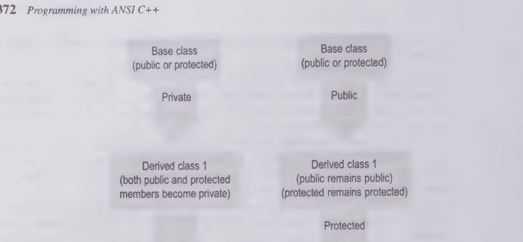

## 9.5 C++ 对象模型中的继承

实现第 9.4 节所述各点的办法可能有多种。C++ 对象模型选择了最简单的一种。编译器在派生时将基类完全嵌入到派生类中。相反，编译器本可以提供一个指向基类对象的指针。这种机制可以节省空间。

这里不提供指针有一个简单的理由。可能存在一条很长的继承链，其中 class1 派生 class2，而 class2 又派生 class3，等等。在这种情况下，当引用 classN 时，需要遍历 N 个指向基类的指针才能获得关于 classN 的完整信息。这在时间上效率不高。

访问基类元素与引用派生类元素在时间上的性能相似。这提供了对类的所有成员的统一访问，无论是同一类的成员、其基类的成员，还是该类的基类的成员，等等。

> 正如 C++ 对象模型的设计以效率为首要标准，它选择在派生发生时将基类复制到派生类对象中。

这种技术非常高效。然而，这种效率是有代价的。第一个问题是类大小的增加。派生类的大小等于基类的大小加上其自身元素总大小的和。这种技术的第二个问题是，有时会导致奇怪的后果。考虑一个从中派生出类并在若干应用中使用的库类的情形。如果原始基类发生变化，就需要重新编译所有使用该派生类的应用。这是因为尽管原始基类已发生变化，但在使用派生类时所做的复制

在编译时所使用的副本保持不变。如果它指向基类的指针，则无需重新编译应用程序，因为指针会自动指向新的基类。

程序 9.4 验证了 C++ 对象模型将基类嵌入到派生类中的事实。

### 程序 9.4 验证基类是否嵌入在派生类中

```
//ObjectModelImplementation.cpp
#include <iostream>
using namespace std;

class Base
{
    int i;
};

class Derived : public Base
{
    int j;
};

void main()
{
    Base BaseObject;
    Derived DerivedObject;

    cout << "Size of base object is" << sizeof(BaseObject) << "\n";
    cout << "Size of derived object is" << sizeof(DerivedObject) << "\n";
}
```

Output
Size of base object is 4
Size of derived object is 8

### 程序的工作原理

我们只讨论程序的架构以及它如何实现目的。基类没有任何公开的数据。私有整数变量未被继承；因此，派生对象的大小必须等于基类对象的大小（因为两者都有一个整数作为成员），但事实并非如此。基类对象被嵌入到派生类对象中，因此其大小等于其自身大小（int j 的大小）加上基类的大小（等于 int i 的大小）。该示例指出了将基类嵌入到派生类中的方案的第一个缺点，即可能的代码膨胀。

当使用虚基类时，C++ 对象模型表现出不同的行为。我们将在第 9.12 节学习虚基类。

考虑到对象模型的特殊性，数据成员的访问说明符有各种组合，并且可以有不同类型的派生。以下各节讨论不同访问说明符和不同派生的组合。

## 9.6 派生类的不同方式

从另一个类派生类有三种不同方式——公有、私有和保护继承。它们都会对成员产生不同类型的访问限制。我们将在以下小节中描述它们各自以及它们之间的差异。

### 9.6.1 公有派生

图 9.2 显示了使用公有访问说明符从基类派生类的第一种情况。基类的私有成员被复制到派生类但不可见。基类的公有成员被复制为派生类中的公有成员。

| Base | Derived |
|------|---------|
| Private → | Not directly accessible |
| int PrivateBaseInt; | int PrivateBaseInt; |
| Public → | Public |
| int PrivateBaseInt; | int PrivateBaseInt; |
| void SetPrivateBaseInt() | void SetPrivateBaseInt() |

基类子对象埋藏在派生类对象中。基类的私有部分虽被复制，但对派生类不可访问（尽管基类子对象成员函数如 void SetPrivateBaseInt() 可以访问它。）


### 9.6.2 私有派生

在这种情况下，基类的公有成员成为派生类的私有成员。同样，私有成员不被继承。尽管基类的私有成员被复制到派生类，但它们不可见。这在图 9.3 中显示。

| Base | Derived |
|------|---------|
| Private → | Not accessible |
| int PrivateBaseInt; | int PrivateBaseInt; |
| void SetPrivateBaseInt() | void SetPrivateBaseInt() |
| Private | Private |
| int PrivateDerivedInt; | int PrivateDerivedInt; |
| void SetPrivateDerivedInt() | void SetPrivateDerivedInt() |
| Public → | Public |
| int PublicDerivedInt; | int PublicDerivedInt; |
| void SetPublicPrivateDerivedInt() | void SetPublicPrivateDerivedInt() |


### 9.6.3 保护派生

在保护派生的情况下，基类的受保护成员以及公有成员成为派生类的受保护成员，如图 9.4 所示。

| Base | Derived |
|------|---------|
| Protected → ProtectedBaseInt; | Protected int ProtectedBaseInt; int PublicBaseInt; void SetProtectedBaseInt() |
| Protected | int ProtectedBaseInt; int ProtectedDerivedInt; int PublicDerivedInt; void SetProtectedBaseInt() void SetPublicProtectedInt() |
| Public | int PublicDerivedInt; void SetProtectedDerivedInt() void SetPublicProtectedInt() |

> 基类子对象埋藏在派生类对象中。基类的公有和受保护成员在这里已成为基类的成员。

### 图 9.4 受保护派生

如果一个类的受保护成员被继承为公有，它们仍保持受保护；而如果被继承为私有，则变为私有。其一个重要影响是对进一步继承的影响。如果派生为公有（或受保护），受保护成员将可用于进一步的公有（或受保护）派生继承（即，可以从该类的派生类再派生一个类）。假设我们有以下内容：

```
Class GrandpaBase
{
private:
int PrivateGB;
protected:
int ProtectedGB;
}
class Base1 : public GrandpaBase
{
private:
int PrivateB;
protected:
int ProtectedB;
}
class Base2 : private GrandpaBase
{
private:
int PrivateB;
protected:
int ProtectedB;
}
class Derived1 : public Base1
{ };
```

```
class Derived2 : public Base2
{
};
```

在这种情况下，ProtectedGB 将可供 Derived1 使用（作为受保护），但不可供 Derived2 使用；这是因为 Base2 是从 GrandpaBase 私有派生的。

## 9.7 访问控制

类的成员函数和派生类的成员函数、友元和对象可以访问类的不同部分。对公有、私有和受保护成员的访问对所有这些实体是不同的。访问控制描述了谁可以访问什么以及以何种形式。图 9.5 显示了访问控制。

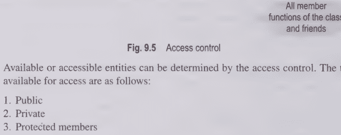

可用的或可访问的实体可由访问控制确定。可供访问的三个实体如下：

- 1. Public
- 2. Private
- 3. Protected members

访问它们的三种实体类型如下：

- 1. 类的成员函数和类的友元
- 2. 派生类的成员函数
- 3. 类以及派生类的对象

## 9.8 访问声明

如前所述，如果一个类以私有方式派生，则无法使用派生类对象访问基类的数据成员。相反，如果类以公有方式派生，则所有成员都可以作为公有访问。如果某人想派生一个类并且只想让其中一些而不是所有公有成员可供派生类对象使用，则必须提供访问声明。使用访问声明，即使在私有派生之后，也可以为基类的某些成员提供公有访问。请考虑程序 9.5 以更好地理解该概念。


### 程序 9.5 访问声明以将特定继承成员用于不同目的

```
//AccessDeclaration.cpp
#include <iostream>
using namespace std;

class Base
{
protected:
    int SpecialProtectedInt;
public:
    int SpecialInt;
    int NormalInt;
};

class Derived : private Base
{
protected:
    Base::SpecialProtectedInt;
    /* Making this protected integer specially available to the object of the derived class */
public:
    Base::SpecialInt;
    /* Making this integer specially available to the object of the derived class */
    // Using Base::SpecialInt;
    /* Newer way of writing the same */
    void SetSpecialProtectedIntOfBase()
    {
        SpecialProtectedInt = 10;
    }
};

void main()
{
    Derived DerivedObject;
    // DerivedObject.NormalInt = 10;
    /* This statement, if not commented, would not be compiled */
    DerivedObject.SpecialInt = 20;
    DerivedObject.SetSpecialProtectedIntOfBase();
}
```

### 程序的工作原理

语句 Base::SpecialInt; 重新定义了派生类 public 访问说明符头中的 SpecialInt，从而使其特别公开。所有其他数据仍保持私有。因此，NormalInt 仍为私有。请注意，SpecialProtectedInt 也已被重新定义为在派生类中保持受保护。访问声明是一个很好的功能；然而，它有以下限制：

- 1. 访问说明符不能被修改以提高原始访问说明符的状态。这意味着如果基类中有私有或受保护成员，则不能在派生类中将其重新定义为 public。

- 2. 前一条陈述的后果是，具有 public 访问指定的成员可以用 public 或 protected 访问重新定义，而受保护的成员只能重新定义为 protected。

如程序 9.5 所示形式的访问声明已被弃用，即不建议在新程序中使用；访问声明的相同效果也可以通过关键字 using 实现。对于编写新程序，必须使用此关键字。using Base::SpecialProtectedInt; 和 using Base::SpecialInt; 是替换旧定义的方法（即在旧定义前加上关键字 using）。我们在第 14 章学习命名空间时将讨论如何使用此关键字。

## 9.9 从单个类派生多个类

可以从单个类派生多个类。假设有一些 Student 类，例如 SchoolStudent、UndergraduateStudent 和 PostgraduateStudent。从设计角度来看，必须查看所有此类可能的类并找出它们中的共同元素。然后，用这些元素创建 Student 类（它们所有类的基类）。因此，基类的内容是在确定派生类内容之后决定的。在程序 9.6 中，我们有从 student 类继承的艺术、商业和科学学生。假设需要为艺术学生存储以下信息：

- 1. 姓名
- 2. 地址
- 3. 高中社会科学科目的成绩
- 4. 高中的排名
- 5. 高中的学校名称

此外，可能需要添加有关创意艺术作品（如诗歌或故事）的信息。

> 注 有些书称之为分层继承，这是不标准的；因此，我们更喜欢不使用该短语来描述从单个类派生多个类的情况。

对于科学学生，应考虑高中科学科目和实践科目的成绩，除语言科目外。不仅要考虑讲座时间表，还要考虑实践时间表。为简单起见，两个时间表都假定为字符串；在现实场景中，它们可能是一个从文件中读取的表格。

对于商业学生，应考虑商业科目详情。可能需要添加有关在某些私营公司实习的详情。此信息也假定包含在字符串中。

可以观察到，详情的一些部分特定于学科类型，而其他详情是共同的。应创建包含共同详情的学生类，然后继承这三个类。请考虑程序 9.6。

### 程序 9.6 从单个类继承多个类

```
//StudentInherited.cpp
#include <iostream>
#include <string>
using namespace std;
const int Languages = 2;
const int Science = 3;
const int Commerce = 2;
```

```
class student
{
protected:
    string Name;
    string Address;
    char Grade;
    string NameofSchool;
public:
    student(string TempName, string TempAddress, char TempGrade, string TempNameofSchool)
    {
        Name = TempName;
        Address = TempAddress;
        Grade = TempGrade;
        NameofSchool = TempNameofSchool;
    }
};

// Derived class ArtsStudent
class ArtsStudent : public student
{
    int marks[Languages];
    string LanguageName;
public:
    /* Note how the members are initialized using a member initialization list */
    ArtsStudent(string TempName, string TempAddress,
    char TempGrade, string TempNameofSchool,
    int TempMarks[], string TempLanguageName) : student(TempName, TempAddress, TempGrade,
    TempNameofSchool)
    {
        for(int i = 0; i < Languages; ++i)
        marks[i] = TempMarks[i];
        LanguageName = TempLanguageName;
    }
};

// Derived class ScienceStudent
class ScienceStudent : public student
{
    int marks[Science];
    string ScienceName;
    string PractSchedule;
public:
    ScienceStudent(string TempName, string TempAddress, char TempGrade, string
    TempNameofSchool, int TempMarks[], string TempScienceName, string TempPractSchedule) :
    student(TempName, TempAddress, TempGrade, TempNameofSchool)
    {
        for(int i = 0; i < Science; i++)
        marks[i] = TempMarks[i];
        ScienceName = TempScienceName;
        PractSchedule = TempPractSchedule;
    }
};

// Derived class CommerceStudent
class CommerceStudent : public student
{
    int marks[Commerce];
    string CompanyName;
```

```
public:
CommerceStudent(string TempName, string TempAddress, char TempGrade, string TempNameofSchool, int TempMarks[], string TempCompanyName) : student(TempName, TempAddress, TempGrade, TempNameofSchool)
{
for(int i = 0; i < Commerce; i++)
marks[i] = TempMarks[i];
CompanyName = TempCompanyName;
};
```

```
void main()
{
int ArtsMarks[] = {55,75};
int ScienceMarks[] = {89,78,97};
int CommerceMarks[] = {54,78};
CommerceStudent Lara("Lara", "West Indies", 'A', "Trinidad beach", CommerceMarks, "Under the sun");
ScienceStudent Beckham("David Beckham", "Karnataka", 'A', "Bangalore school", ScienceMarks, "Physics", "12to2daily");
ArtsStudent Steff("Steff", "C/o Agassi's address", 'A', "Germany school", ArtsMarks, "Silence");
}
```

### 程序的工作原理

该程序包含一个 student 类，并且有三个从它继承的类，即 ArtsStudent、CommerceStudent 和 ScienceStudent。student 类包含派生类共有的所有数据，即姓名、地址等。为所有这些类提供了构造函数，并在定义 student 时定义并使用它们。

这是一个非常简化的示例，尽管它在一定程度上变得有些复杂，特别是派生类中基类构造函数的调用。重要的是要注意，基类构造函数是使用成员初始化列表（MIL）调用的，这在第 5 章学习构造函数时已经讨论过。已经提到成员可以使用 MIL 初始化。当成员是一个类时（这里派生类具有基类作为成员），它使用 MIL 初始化。还要注意，基类对象只能使用 MIL 初始化，而不能在派生类对象的构造函数体中初始化。还要注意，派生类构造函数必须为基类对象（它是派生类的一部分）和派生类的其他成员的构造函数提供足够数量的参数。

> 注
> 基类对象只能使用 MIL 初始化。派生类构造函数必须有足够数量的参数来构造嵌入在派生类对象中的基类子对象以及派生类的其他成员。

继承的一个重要优点是将通用属性存储在基类的一个位置的便利。

该程序强调了当基类被多次继承时的优点。单个基类与所有从它继承的类共享。如果大学想在学生数据中添加所有学科所有学生的电子邮件地址，信息只需在一个地方添加，即 student 类。这就是继承的主要优点。假设在进一步的时期，需要处理工程学生，也是


possible to inherit a new class from student class again. Then, there is no need to add those details (name, address, etc.) to the Engineering class, which should only contain information specific to it. This is another advantage of inheritance. If the proper base classes are in place, further programming is easier and faster. It leads to modular and quick programming. It is also robust if the base class is debugged and tested properly.

## 9.10 多重继承

It is also possible to derive a single class from more than one class. When a single class is inherited from multiple base classes, it is known as multiple inheritance. Many examples of multiple inheritance can be seen in the real world.

For example, Indian people are Indians as well as people at the same point of time; similarly, a personal computer is both personal and computer at the same point of time. When such a concept is implemented as a class, multiple inheritance occurs. If ever a class IndianPeople is derived, it would be multiple inherited from the classes Indian as well as People. Similarly, the class PersonalComputer will be inherited from the classes Personal as well as Computer. The multiple-inherited derived class inherits attributes from all the classes it is derived from. Let us take one specific example to learn how multiple inheritance found in real world can be mapped to a C++ program. Though we would like to come as close to a real-world example as possible, we will fall short of an actual real-world C++ program, because the complexity of such a program would be out of bounds for a textbook such as this.

Multiple inheritance is a great idea. There are so many such hierarchies in the real world. An Indian cricket player can be a player from the south, north, east, or west zone. At the same time, he is also either a bowler, a batsman, a wicket keeper, or an all-rounder. One class can be described as a combination of a bowler and a south zone player. The class under consideration inherits from both the south zone player class and the bowler class.

Another example is that of an auto-rickshaw, which is a member of three-wheeler vehicle class and, at the same time, is also a member of the class of vehicles available on rent. Program 9.6 shows Beckham to be an object of the class ScienceStudent; he can as well be an object of the class FootballStudent. In such a case, there is a need to have one more class FootballScienceStudent of which Beckham is a member. Multiple inheritance relates to an entity that inherits attributes from more than one distinct entities. Such natural inheritance becomes easy and intuitive to a program with the facility of multiple inheritance provided by the language.

### Implementing Multiple Inheritance in C++

Let us see how one can implement multiple inheritance in a C++ program. Program 9.7 contains a class called SportsStudent, which is inherited from the student class and the SportsPerson class.

The object of SportsStudent class contains properties such as name and address derived from the student class and the details such as the name of the sport one is playing, the national and international sports events taken part in, and medals won so far, which are derived from the SportsPerson class. Moreover, note that there are some other attributes such as sports subjects taken and sports points obtained (from practicals and participation in various events), which are specific to the SportsStudent class. Program 9.7 reinforces what is stated here.

> When a single class is inherited from multiple base classes, it is known as multiple inheritance.

### PROGRAM 9.7 Multiple inheritance

```
//MultipleInheritance.cpp
#include <iostream>
#include <string>
using namespace std;
const int Sports = 3;

// First base class
class student
{
private:
    string Name;
    string Address;
    char Grade;
    string NameofSchool;
public:
    student(string TempName, string TempAddress, char TempGrade,
    string TempNameofSchool)
    {
        Name = TempName;
        Address = TempAddress;
        Grade = TempGrade;
        NameofSchool = TempNameofSchool;
    }
};

// Second base class
class SportsPerson
{
private:
    string Sport;
    string DetailsOfEvents;
    string Experience;
    int Age;
public:
    SportsPerson(string TempSport, string TempDetailsOfEvents, string TempExperience, int TempAge)
    {
        Sport = TempSport;
        DetailsOfEvents = TempDetailsOfEvents;
        Experience = TempExperience;
        Age = TempAge;
    }
};

// Derived class
class SportsStudent : public SportsPerson, public student
{
private:
    string SportsSubjects[Sports];
    int SportsPoints;
public:
    SportsStudent(string TempName, string TempAddress, char TempGrade, string TempNameofSchool,
    string TempSport,
    string TempDetailsOfEvents, string TempExperience, int TempAge,
    int TempSportsSubjects[], int TempSportsPoints) :
    student(TempName, TempAddress, TempGrade, TempNameofSchool),
    SportsPerson(TempSport, TempDetailsOfEvents, TempExperience, TempAge)
{
    for(int i = 0; i < Sports; ++i)
        SportsSubjects[i] = TempSportsSubjects[i];
        SportsPoints = TempSportsPoints;
}
};
void main()
{
    int SportsMarks[] = {59,78,67};
    SportsStudent Carl("Carl Lewis", "US", 'A', "The American school", "Sprint", "Won gold in Olympics", "10 years", 40, SportsMarks, 70);
}
```

### How the Program Works

This example shows how multiple inheritance can be defined and used in a program. The class SportsStudent has been inherited from two classes, namely, student and the SportsPerson classes. See how the constructors are defined and accessed in the derived class.

The syntax for multiple inheritance is simple. The class name is to be followed by the access specifier. For example,

```
<access specifier> class1 name,
<access specifier> class2 name, ...
```

In this program, it is written as

```
class SportsStudent : public SportsPerson, public student
```

### 9.10.1 Problems in Multiple Inheritance

Multiple inheritance is touted as a bad feature by some other languages, particularly Java, which discourages a programmer from using it. It is a very important tool, but has to be used with care.

It is important to note that multiple inheritance also has problems. If it is used without proper understanding, or used when a natural solution without multiple inheritance is possible, one has to pay the penalty in terms of efficiency and simplicity of code. Let us analyse the problems of using multiple inheritance in our program.

The idea here is not to restrict the readers from using multiple inheritance but to make them aware of the problems so that they can be avoided while programming.

### From the Compiler's Angle

At the time of derivation, the base class is embedded in the derived class. When it is derived further, the inheritance follows a ‘natural’ chain. The base subobjects are stacked in the order of inheritance in the derived class. In case of multiple inheritance, the path is not simple. The subobject stacking is done using subobjects from multiple classes inserted for multiple inheritance.

Consider Fig. 9.6. If there is a derived class and a further derived class from this derived class, the embedding is straightforward. If ever a compiler needs to convert from a derived class object to a base class object, the lower part is to be neglected. The calculation is simple. On the other hand, if the class contains multiple inheritance, then the selection is not that simple. In such cases, the compiler may need to isolate some part of data (the class derived1 data) in between, which obviously requires more computation and logic.

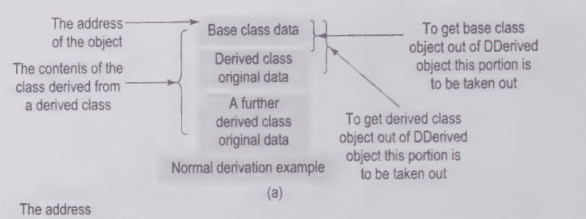

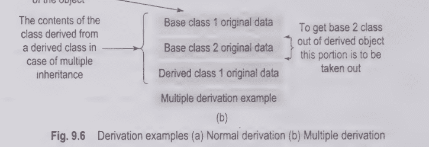

Fig. 9.6 Derivation examples (a) Normal derivation (b) Multiple derivation

Suppose the program contains the following statements:

```
Base BaseObject;
Derived DerivedObject;
DDerived DDerivedObject;
```

If a programmer writes

`Base *BaseObjPtr = &DerivedObject`

then the compiler need not do anything in the first case. Similarly, if one writes

`Base *OtherBasePtr = &DerivedObject`

then again the compiler need not do anything. The address naturally points to the class needed (base class in the first and derived class in the second). However, this is not observed in the case of multiple inheritance.

Let us assume the class Derived is derived from both Base1 and Base2. If one writes the following

```
Derived DerivedObject;
Base2 *BasePtr2 = &DerivedObject;
```

then it is not easy for the compiler to get the right address. If one writes

`Base1 *BasePtr1 = &DerivedObject`

the compiler need not intervene.

### Notes

- 1. The compiler has to intervene and properly set the address and provide means of getting correct content for any class that is not the first member of the inheritance list.
- 2. The compiler has to do more work when there is a long chain or when there is a need to provide virtual base class facility.


### 从设计者的角度

设计者需要在遇到与一种常见情况相关的问题时格外小心，即纠缠的层次结构。他们需要为一个已经被继承了多次的对象找到某个属性的值。如果无法在同一对象中找到该属性，就需要向上遍历层次结构来查找值。在多重继承的情况下，向上有不止一条路径。因此，同一个属性可能得到多个值，有时这些值会相互冲突。

假设有一个类 MyBirds，它继承自两个类 PetBirds 和 Ostriches。如果向上遍历层次结构，PetBirds 有一个基类叫做 Birds。假设有人想[content]

### 从设计者的角度

设计者需要在遇到与一种常见情况相关的问题时格外小心，即纠缠的层次结构。他们需要为一个已经被继承了多次的对象找到某个属性的值。如果无法在同一对象中找到该属性，就需要向上遍历层次结构来查找值。在多重继承的情况下，向上有不止一条路径。因此，同一个属性可能得到多个值，有时这些值会相互冲突。

假设有一个类 MyBirds，它继承自两个类 PetBirds 和 Ostriches。如果向上遍历层次结构，PetBirds 有一个基类叫做 Birds。假设有人想查询 MyBirds 是否会飞，并通过 Ostriches 遍历层次结构，那么他/她可能会被误导而认为 MyBirds 不会飞。

另一方面，如果这个人选择另一条路径（通过 PetBirds 到 Birds），他/她会得出 MyBirds 会飞的结论。这是一个严重的设计问题，如果类设计得当是可以避免的。

显然，避免多重继承似乎是最简单的解决方案。此外，多重继承还有另一个缺点。对象会因从多个类派生出更多特性而变得更加杂乱，因此其可读性和可调试性不如普通对象或单继承对象。

## 9.11 从已派生的类派生类

我们迄今为止看到的是从基类派生的情况。也可以继续派生。C++ 对象模型实现是这样的，进一步派生的类将包含其主体内的所有祖先。让我们看一个此类类的例子。我们已经看到一个类 student，并进一步继承为文科、商科和理科学生。可以从理科学生再派生出一个，即古吉拉特大学理科学生。古吉拉特大学理科学生可能需要遵守一些与普通理科学生不同的特殊规则，因此该学生对象需要添加诸如理科项目详情、理科项目指导教师姓名以及从选修科目中提供的科目列表等属性。以下程序展示了如何实现这一点。

```
//FurtherInheritance.cpp
#include <iostream>
#include <string>
using namespace std;

const int Science = 3;
const int OptionalSubjects = 2;

// Base class
class student
{
private:
    string Name;
    string Address;
    char Grade;
    string NameofSchool;
public:
```

```
student(string TempName, string TempAddress, char TempGrade, string TempNameOfSchool)
{
 Name = TempName;
 Address = TempAddress;
 Grade = TempGrade;
 NameOfSchool = TempNameOfSchool;
};
// Derived class
class ScienceStudent : public student
{
 int marks[Science];
 string ScienceName;
 string PractSchedule;
public:
 ScienceStudent(string TempName, string TempAddress, char TempGrade, string TempNameOfSchool, int TempMarks[], string TempScienceName, string TempPractSchedule):
 student(TempName, TempAddress, TempGrade, TempNameOfSchool)
 {
 for(int i = 0; i < Science-1; i++)
 marks[i] = TempMarks[i]; ScienceName = TempScienceName; PractSchedule = TempPractSchedule;
 }
};
// Further derivation from the derived class
class GUScienceStudent : public ScienceStudent
{
 string ScienceProjectDetails;
 string GuideName;
 string SubjectsOpted[2];
public:
 GUScienceStudent(string TempName, string TempAddress, char TempGrade, string TempNameOfSchool, int TempMarks[], string TempScienceName, string TempPractSchedule, string TempScienceProjectDetails, string TempGuideName, string TempSubjectsOpted[])
 : ScienceStudent(TempName, TempAddress, TempGrade, TempNameOfSchool, TempMarks, TempScienceName, TempPractSchedule)
 {
 ScienceProjectDetails = TempScienceProjectDetails;
 GuideName = TempGuideName;
 for(int i = 0; i < OptionalSubjects; i++)
 SubjectsOpted[i] = TempSubjectsOpted[i];
 }
};
void main()
{

```

考虑以下程序以了解如何调用基类对象。毋庸置疑，如果对象成员不是以这种方式限定，编译器会感到困惑（是否使用 Derived1 或 Derived2 中的基类成员），并且不会编译程序。

```
#include <iostream>
#include <string>
using namespace std;
// Base class
class Base
{
public:
    int BaseInt;
};
// First derived class
class Derived1 : public Base
{
public:
    int Derived1Int;
};
// Second derived class
class Derived2 : public Base
{
public:
    int Derived2Int;
};
// Multiple inheritance
class DDerived : public Derived1, public Derived2
{
public:
    int DDerivedInt2;
};
void main()
{
    DDerived DD;
    // DD.BaseInt = 0;
    // Error: ambiguous access of 'BaseInt' in 'DDerived'
    DD.Derived1::BaseInt = 0; // Now it is not ambiguous
    DD.Derived2::BaseInt = 10;
    /* Yes. This is different from previous BaseInt */
    cout << DD.Derived1::BaseInt << "\n";
    cout << DD.Derived2::BaseInt << "\n";
}
```

输出

0

10

在这个例子中，不可能直接访问基类成员。它需要用派生类名来限定。

拥有两个不同的副本并且需要用基类名来限定在某些情况下是一个严重的问题。为了解决这个问题，需要在第一次派生前加上关键字 virtual。查看以下程序中修改后的代码。

```
//VirtualInheritance.cpp
#include <iostream>
#include <string>
using namespace std;
class Base
{
public:
    int BaseInt;
};
class Derived1 : virtual public Base
// See the keyword virtual preceding public
{
public:
    int Derived1Int;
};
class Derived2 : virtual public Base
{
public:
    int Derived2Int;
};
class DDerived : public Derived1, public Derived2
{
public:
    int DDerivedInt2;
};
void main()
{
    DDerived DD;
    DD.BaseInt = 0;
    // No more ambiguity as there is only one copy of BaseInt present
    DD.Derived1::BaseInt = 0; // This is the same as previous
    DD.Derived2::BaseInt = 10; // We are modifying the same member
    cout << DD.BaseInt << "\n";
    cout << DD.Derived1 :: BaseInt << "\n";
    cout << DD.Derived2 :: BaseInt << "\n";
}
Output
0
0
10
```

关键字 virtual 应该放在派生之前以提供虚拟基类，即当从多条路径继承时只有一个实例被继承的类。实际上可以写 virtual public 或 public virtual；它们之间没有区别。编译器会以相同的方式考虑这两种定义。现在，BaseInt 是一个单一副本，不存在歧义。每当

编译器发现派生时带有关键字 virtual，它就会确保不会将同一个基类的两个实例继承到从 Base 的派生类派生的类中。

结果情况如图 9.8 所示。DDerived 类中只有一个 Base 类的实例。这就是虚拟基类的优势。

现在有一个基类的单一副本。由于在 derived1 和 derived2 继承定义中找到了 virtual 关键字，编译器只包含一个副本。

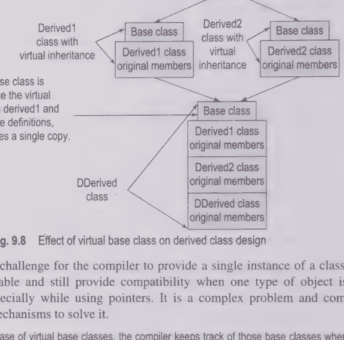

### 图 9.8 虚拟基类对派生类设计的影响

实际上，对于编译器来说，从两个可用的实例提供一个类的单一实例，同时在将一种类型的对象分配给另一种类型时仍提供兼容性，尤其是在使用指针时，这是一个挑战。这是一个复杂的问题，编译器使用复杂的机制来解决。

> 注意 在虚拟基类的情况下，编译器会跟踪继承时继承的那些基类。如果编译器发现继承了同一个类的多个副本，它将只保留一个副本。这种重构需要在编译器中构建大量复杂的机制。此外，它需要检查继承链以确定基类是否再次被继承，这会减慢处理速度。

一种通用策略是将成员分为两个区域。一个区域包含非虚拟基类，它们相对于开头的位置是固定的，可以很容易处理。另一个区域是共享区域，其中偏移量不是固定的，编译器需要提供特殊机制来动态访问虚拟成员。

总之，使用虚拟基类并不是一种有效的方式。应该尽量避免它，除非你愿意牺牲性能和速度。当虚拟基类与多重继承结合时，情况对编译器来说变得更加复杂，必须避免，除非应用程序要求如此。展品 9.1 解释了抽象类。

### 展品 9.1 抽象类

没有对象的类被称为抽象类。这些类通常是泛化过程的产物，该过程找到感兴趣的类的共同元素并将它们存储在基类中。

在单个基类单继承到多个基类的例子中，student 类被称为抽象类。抽象类对于设计者来说非常重要。每当设计者需要对一个无法拥有对象的抽象概念进行建模时，抽象类就派上用场了。


## 9.13 构造器和析构器的应用

我们已经在类派生自另一个类时见过构造器的应用。在这种情况下，有一些重要的事项需要注意，如下所示：

> 当程序员提供了一个构造器时，C++ 编译器将不会提供一个。

1. 如果存在基类构造器可用，则派生类必须为自身定义一个构造器。为什么？基类实例是派生类的一部分；那么，如果派生类本身不提供一个调用基类构造器的构造器，它如何被构造呢？应记住，当程序员提供构造器时，C++ 将不会提供一个。这就是为什么基类主题需要由用户定义的原因。在默认构造器的情况下，情况则不同。如果在派生类中未定义默认构造器而基类中定义了，则编译器会为我们为派生类定义一个默认构造器。

2. 当定义 class1 : public class2, public class3, public class4, ..., classN 时，则先调用 class2 的构造器，然后调用 class3 的构造器，依此类推直到 classN，然后执行 class1 构造器的主体。对基类构造器的调用需要在构造器主体之外定义，在 MIL 中。这里，出现在 : : 之后出现的列表有时被称为继承列表。因此，基类构造器必须使用 MIL 进行调用（初始化），并且不能在派生类的主体中调用。

3. 对第 2 点所述情况有一个例外。如果列表中的一个类是虚类，则其构造器会在其他类之前被调用。如果有多个这样的虚基类，则它们的构造器按其在继承列表中出现的顺序执行。

4. 当首先 class2 : public class1 然后 class3 : public class2，即 class1->class2->class3 (-> 表示继承到) 定义时，则 class1 构造器首先被调用，然后 class2 构造器被调用，然后当 class3 的对象被定义时，class3 构造器的主体被执行。当一个类派生自基类并且可能被进一步派生时，继承链是一个从基类开始并按继承顺序跟随到最后一个类的列表。这里，class1->class2->class3 是继承链，可以看出构造器执行顺序遵循了该链。

5. 当派生对象被销毁时，基类的析构器会严格按照其初始化的相反顺序被调用。

6. 派生构造器的参数将包含所有基类所需的所有参数，外加一些自身所需的参数。这在之前的示例中已经看到过。

## 9.14 派生情况下的异常处理

需要注意的是，C++ 在提供非常严格的类型检查的同时，有时又非常宽松。如果派生类的对象被抛出，它可以被基类提供的处理器捕获。如果某人想为派生类对象提供不同的处理器，则它必须出现在基类处理器之前；否则，该 catch 块永远不会被执行。考虑以下程序来理解概念。

//ExceptionHandling.cpp
#include <iostream>
#include <string>
using namespace std;
const int Languages = 2;
const int Science = 3;
const int Commerce = 2;
class student
{
protected:
    string Name;
    string Address;
    char Grade;
    string NameofSchool;
public:
    student(string TempName, string TempAddress, char TempGrade, string TempNameofSchool)
    {
        Name = TempName;
        Address = TempAddress;
        Grade = TempGrade;
        NameofSchool = TempNameofSchool;
    }
};
class ArtsStudent : public student
{
    int marks[Languages];
    string LanguageName;
public:
    ArtsStudent(string TempName, string TempAddress, char TempGrade, string TempNameofSchool, int TempMarks[], string TempLanguageName) : student(TempName, TempAddress, TempGrade, TempNameofSchool)
    {
        for(int i = 0; i < Languages; ++i)
        {
            marks[i] = TempMarks[i];
        }
        LanguageName = TempLanguageName;
    }
};
class ScienceStudent : public student
{
    int marks[Science];
    string ScienceName;
    string PractSchedule;
public:
    ScienceStudent(string TempName, string TempAddress, char TempGrade,
string TempNameofSchool, int TempMarks[], string TempScienceName, string TempPractSchedule): student(TempName, TempAddress, TempGrade, TempNameofSchool)
{
    for(int i = 0; i < Science; i++)
        marks[i] = TempMarks[i];
    ScienceName = TempScienceName;
    PractSchedule = TempPractSchedule;
}
};
void DelStudent(int Who)
{
    int ArtsMarks[] = {55,75};
    int ScienceMarks[] = {89,78,97};
    ScienceStudent Beckham("David Beckham", "England", 'A', "Germany", ScienceMarks,
    "Physics", "12to2daily");
    ArtsStudent Steffi("Steffi", "C/o Agassi's address", 'A', "Germany", ArtsMarks,
    "Silence");
    try
    {
        switch(Who)
        {
            case 0: throw Beckham;
            case 1: throw Steffi;
            default: return;
        }
    }
    catch (ScienceStudent)
    {
        cout << "Caught a science student\n";
    }
    catch (student)
    {
        cout << "Caught a student\n";
    }
    catch (ArtsStudent)
    {
        cout << "Will never catch an arts student\n";
    }
};
void main()
{
    DelStudent(0); // Message to throw Beckham;
    DelStudent(1); // Message to throw Steffi;
}
Output
Caught a science student
Caught a student

不幸的是，艺术生没有被捕获，因为 student 对象处理器在其之前编写。一个好的编译器在编译此类情况时可能会发出警告。

需要这种策略的原因是创建一个基类并从中派生大量类。仍然需要一个单一的基类 catch 来捕获整个派生类对象组。

> 注意 当为派生类抛出异常时，它始终可以被基类捕获。如果需要分别捕获基类以及派生类异常，则派生类的 catch 块必须出现在基类 catch 块之前，除非基类的 catch 块捕获了与基类以及派生类相关的所有异常，并且派生类 catch 段将永远不会被执行。

## 9.15 复合对象（容器对象）

有时，对象本身包含一些其他对象作为成员。这样的对象被称为复合对象。这是不同于第 9.3 节中讨论的 is-a 关系的关系的一部分。需要注意的是，每当需要调用容器类的构造器时，可能不需要每次都调用组件类的构造器，就像派生类一样。在程序 9.8 中，编译器在初始化 employee 集合（CollectionEmp）对象时调用 Employee 的构造器。这里，CollectionEmp 是一个复合对象。

> 复合对象是指具有其他对象作为成员的对象。

### 程序 9.8 复合对象

//CompositeObject.cpp
#include <iostream>
#include <string>
using namespace std;
class CollectionEmp; // Forward Definition
class employee
{
    int EmpNo;
    string Name;
    string DeptName;
    string Designation;
public:
    employee()
    {
        EmpNo = 0;
    }
    employee(int TempNo, string TempName, string TempDept, string TempDesi)
    {
        EmpNo = TempNo;
        Name = TempName;
        DeptName = TempDept;
        Designation = TempDesi;
    }
    void DisplayDetails()
    {
        cout << "Details of employee number" << EmpNo << "\n";
        cout << "Name is" << Name << "\n";
        cout << "Department is" << DeptName << "\n";
        cout << "Designation is" << Designation << "\n";
    }


```cpp
friend CollectionEmp;
};

class CollectionEmp
{
private:
    employee ColEmp[10];
    int Index;
public:
    bool AddToCol(employee Emp)
    {
        if(Index < 9)
        {
            ColEmp[Index] = Emp;
            Index++;
            return true;
        }
        else
            return false;
    }

    void ListDeptWise()
    {
        string TempDeptName;
        cout << "Enter the department of the university:";
        cin >> TempDeptName;
        cout << "\n";

        for(int i = 0; i < 10; ++i)
        {
            if(ColEmp[i].DeptName == TempDeptName)
            {
                ColEmp[i].DisplayDetails();
            }
        }
    }

    CollectionEmp()
    {
        Index = 0;
    }

    CollectionEmp(employee TempEmp[], int Size = 10)
    {
        Index = 0;
        for(int i = 0; i < Size; ++i)
        {
            AddToCol(TempEmp[i]);
        }
    }
};

void main()
{
employee UniEmployee[10] =
{
    employee(1, "Lara", "Exam", "Professor"),
    employee(2, "Ponting", "Marksheet", "Clerk"),
    employee(3, "Laxman", "Accounts", "Head Clerk"),
    employee(4, "Flintoff", "Exam", "Clerk"),
    employee(5, "Murlidharan", "Accounts", "CAO"),
    employee(6, "Sarfaraz", "Exam", "Informator"),
    employee(7, "Dean Jones", "Exam", "Invigilator"),
    employee(8, "Madugalle", "Exam", "Examiner"),
    employee(9, "Ganguly", "Marksheet", "Repeater"),
    employee(10, "Nafees", "Accounts", "Clerk")
};
CollectionEmp UniCol(UniEmployee);
UniCol.ListDeptWise();
}
```

### 程序的工作原理

请查看 CollectionEmp 类的两个构造函数。CollectionEmp 类所包含的 Employee 对象的构造函数并未被调用。

```cpp
CollectionEmp()
{
    Index = 0;
}

CollectionEmp(employee TempEmp[], int Size = 10)
{
    Index = 0;
    for(int i = 0; i < Size; ++i)
    {
        AddToCol(TempEmp[i]);
    }
}
```

让我们理解这个程序试图实现什么。由于该程序已在前面分析过，让我们只看新增的部分。复合对象构造函数不需要调用其所包含对象的构造函数。

在第 5 章讨论拷贝构造函数时，我们曾见过作为 customer 对象一部分的 item 对象的类似示例。即使在 customer 对象的定义中，我们也没有指定任何构造函数调用。与基类构造函数必须被调用的派生类构造函数不同，在这种情况下没有必要调用该构造函数。然而，在容器类的构造函数中可能需要调用所包含对象的构造函数。程序 9.9 就是一个需要进行此类构造函数调用的案例的示例。

#### 在复合对象中调用所包含对象的构造函数

假设有一个图形图形（例如人脸），它包含一个三角形、一个正方形和一对圆形（代表鼻子、嘴巴和一对眼睛）。人脸的每个实例都决定了其各个组件的位置，即，如果人脸的第一个实例位于屏幕上的 (2, 2) 处，则组件，即一对圆形、三角形和正方形，将相对于 (2, 2) 绘制。

如果下一个人脸绘制在 (20, 20) 处，则圆形、正方形和三角形将相对于位置 (20, 20) 绘制。当人脸被构造时，所有组件图形都需要相对于人脸的位置进行构造。图形图形 Face 的构造函数应使用所需参数调用，其中之一必须是 Position，该参数反过来用于调用嵌入式（组件）对象的构造函数以找到它们各自的位置。这是一个简化的脸，可以在二维空间中将其放置在想要的位置。根据人脸的位置，元素（两只眼睛的两个圆圈，一个鼻子的三角形和一个嘴巴的正方形）将被绘制。这里为了简单起见，忽略了人脸的方向（人脸朝向的方向）和缩放（使人脸变大变小）等问题。

程序 9.9 用于绘制人脸，但实际上并未在屏幕上绘制人脸，而只是打印一条消息。如果程序中绘制人脸，则代码将依赖于编译器（因为 C++ 没有标准图形库）且更复杂。因此，这里未显示。它仅用于表示复合对象的概念。需要学习的重要部分是调用构造函数以初始化复合对象的一部分的用户定义对象，即在调用人脸构造函数时调用圆、三角形和正方形的构造函数。组件对象的位置取决于复合对象的位置。组件对象的构造函数应使用 MIL 如程序所示进行调用。程序中所有点的 X 和 Y 坐标的值是直观选择的。绘制图形可能不会绘制出精确的人脸，但可能与之相似。可能需要调整所有组件的 X 和 Y 值以使人脸看起来像真正的人脸。

### 程序 9.9 需要调用所包含对象构造函数的复合对象

```cpp
//CompositeObj2.cpp
class Point
{
    int X;
    int Y;
public:
    Point(int TempX = 0, int TempY = 0)
    {
        X = TempX;
        Y = TempY;
    }

    int GetX() const
    {
        return X;
    }
    int GetY() const
    {
        return Y;
    }
};

class Square
{
    Point LeftBottom;
    int Length;
public:
    Square(Point TempLeftBottom, int TempLength)
    {
        LeftBottom = TempLeftBottom;
        Length = TempLength;
    }
};

class Triangle
{
    Point Avertex, Bvertex, Cvertex;
public:
    Triangle(Point TempAvertex, Point TempBvertex, Point TempCvertex)
    {
        Avertex = TempAvertex;
        Bvertex = TempBvertex;
        Cvertex = TempCvertex;
    }
};

class Circle
{
    Point Centre;
    int Radius;
public:
    Circle(Point TempCentre, int TempRadius)
    {
        Centre = TempCentre;
        Radius = TempRadius;
    }
};

class Face
{
    Circle LeftEye;
    Circle RightEye;
    Triangle Nose;
    Square Mouth;
    Point Position;
public:
    Face(Point TempPosition) : LeftEye(Point((TempPosition.GetX() + 20),
                                             TempPosition.GetY() + 10), 4),
                               RightEye(Point((TempPosition.GetX() + 50),
                                              TempPosition.GetY() + 10), 4),
                               Nose(Point((TempPosition.GetX() + 35),
                                          TempPosition.GetY() + 20),
                                    (Point((TempPosition.GetX() + 30),
                                           TempPosition.GetY() + 25)),
                                    (Point((TempPosition.GetX() + 40),
                                           TempPosition.GetY() + 25))),
                               Mouth(Point(TempPosition.GetX() + 25,
                                           TempPosition.GetY() + 30), 20)
    {
        Position = TempPosition;
    }
};

void main()
{
    Face DummyFace(Point(20, 30));
    Face OtherFace(Point(50, 70));
}
```

### 程序的工作原理

本程序中定义了五个类。Point 类被设计为派生所有其他图形的基础平台。Point 对象被传递给 Square、Circle 和 Triangle 的构造函数。传递给 Square 的 Point 对象决定了正方形的左下顶点。长度也作为第二个参数传递。给定这两个值，正方形可以很容易地绘制。在三角形的例子中，传递了所有三个顶点。在圆的例子中，传递了一个代表圆心的点和半径。所讨论的组件图形，即 Square、Circle 和 Triangle 本身也是复合对象，包含 Point 对象在其中。在调用这些对象的构造函数时，无需调用 Point 的构造函数。为什么需要在其复合对象 Face 的构造函数中调用 Square、Circle 和 Triangle 的构造函数？这是因为它们的构造不能绝对进行。它们的构造有一个重要的参数 Position，该参数取决于复合对象的构造（复合对象被构造的位置）。因此，组件对象的构造函数应在复合对象的构造函数体内调用。

该程序有两个 Face 类型的对象。两者在二维空间中绘制在不同的位置。由于两者包含不同的坐标，Face 的所有组成部分对象都需要绘制在不同的位置。这是通过在 Face 构造函数的 MIL 中调用组件对象的构造函数来实现的。

## 继承成员与包含成员

有时，C++ 初学者会混淆继承成员和包含成员。虽然它们看起来相同，但它们非常不同。以下是区别：

- 1. 从设计角度来看，继承成员具有类似于子集关系的关联。如果 Scooter 从 Vehicle 继承，则 Scooter 对象也属于 Vehicle 类（踏板车是车辆；因此，它们是车辆的子集）。所有 Scooter 实例都是 Vehicle 实例。在程序 9.9 中，Face 包含 circle 对象，但它没有子集关系。它更像是一种部分关系。鼻子（三角形）是人脸的一部分。左右眼睛（圆圈）也是人脸的一部分。然而，并非所有 Triangle 和 circle 的实例也是 Face 的实例。

- 2. 继承成员必须使用 MIL 在派生类构造函数体之外执行其构造函数。如果基类有构造函数，派生类也必须有自己的构造函数。这两个限制不适用于包含成员。我们已经看到了两个不同的案例，一个是程序 9.8 中的员工集合对象，另一个是程序 9.9 中的组件对象 Square、Circle 和 Triangle，其中未调用嵌入对象的构造函数。

- 3. 在根据传递给容器类构造函数的数值为所包含对象的构造函数赋值时需要小心。在这里，需要使用 MIL 在容器类的构造函数中执行所包含对象的构造函数。（程序 9.9 就是这种需求的示例。代表眼睛、鼻子和嘴巴的圆圈、三角形和正方形需要根据人脸的位置进行绘制。）

- 4. C++ 对两种类型的成员（继承和包含）以类似的方式处理（嵌入到目标类中）；因此，在编程时它们看起来相似。

- 5. 理解部分与子集关系的区别还有一个帮助。它被称为在需要特定属性时选择正确的链接（或继承链）。假设正在考虑沙发扶手的对象时


这一刻。如果需要找到它的颜色，最好通过链接的一部分来了解沙发的颜色。如果一个人使用子集链接遍历来查看家具的属性（沙发扶手继承自该类），那将是浪费时间。

类似的情况是，在图形用户界面（GUI）编程中，控件粘贴在框架上。控件的外观和感觉取决于父框架。考虑一个放置在表单上的按钮。按钮的颜色和字体应与加载它的框架相匹配。程序员可能需要知道在粘贴到特定框架时应选择什么类型的字体。需要遍历的是部分链接而不是子集链接。Button 类与 Window 类具有子集关系，而与 Frame 或 Form 具有部分关系。

## 回顾

- 面向对象编程基于继承的概念。
- 继承是将已定义的类扩展为新类并具有旧类的所有属性以及一些附加属性的过程。
- 继承的优点是不需要从头创建对象。
- 有时，现实世界有一个模型，可以最直观地使用继承来编程。
- 重要的是要理解，必须仅使用继承来实现子集模型。具有某个其他类对象的逻辑子集的类应仅从该类继承。
- 可以从一个或多个基类派生一个类。当一个类从多个基类派生时，该过程称为多重继承。
- 多重继承对于应用程序和编译器来说都难以实现。
- 也可以从已派生的类派生。

- 如果我们只想要祖父类的单个副本，我们需要定义父类以虚拟地继承祖父类。
- 编译器需要跟踪虚拟基类，以确保在这些类被进一步继承时不存在祖父类的多个副本。
- 没有任何对象的类称为抽象类。
- 派生类的构造函数应调用基类的构造函数。
- 调用基类构造的顺序遵循派生类头文件中继承列表的顺序。
- 这些构造函数只能使用 MIL 调用。
- 异常处理机制可以在抛出派生对象时捕获基类对象。
- 复合对象与派生对象不同。它们包含其他类对象作为数据成员。

## 关键词

抽象类 没有任何对象的类称为抽象类。

访问声明 使特殊成员（或成员）具有与继承类中指定的不同类型的继承称为访问声明。不同的类型不能覆盖基类中使用的原始访问说明符。

访问说明符和访问修饰符 公共、私有和受保护是定义数据成员的方式。这些称为访问说明符。在一个类从另一个类派生时，可以指定全部三种。此时，它们称为访问修饰符。

基类 在继承过程中被扩展的类称为基类。

基类子对象 当基类在派生类中被继承时，基类对象嵌入到派生类对象中，该对象称为基类子对象。

复合或容器对象 包含其他对象作为数据成员的对象称为复合或容器对象。

## 402 ANSI C++ 编程

(c) 两者
(d) 无

10. 继承是实现 ________ 编程的必须条件。
(a) 基于对象的编程
(b) 面向对象的编程
(c) 对象编程
(d) 以上全部

### 概念练习

1. 区分基于对象和面向对象编程。

2. 使用继承的优点是什么？

3. 公有继承和私有继承有什么区别？

4. 受保护继承与其他类型继承有什么区别？

5. 解释语句“基类的私有成员对派生类间接可用”。

6. 在不同类型的继承下，不同类型的数据成员如何处理？

7. 在进一步继承一个类时，受保护访问说明符与其他访问说明符有何不同？

8. 为什么 C++ 对象模型在派生类对象中实现基类子对象？

9. 多重继承的缺点是什么？

10. 处理多重继承时需要注意哪些问题？

11. 访问声明的优点是什么？

12. 列出几个需要从单个类派生多个类的案例。

13. 列出几个需要进一步派生已继承类的案例。

14. 列出几个需要多重继承的案例。 （提示：当我们以两种或多种不同的方式对同一项目进行分类时，我们需要多重继承。例如，水果可以被分类为夏季水果和冬季水果。它们也可以被分类为酸水果和甜水果。现在，我们可以有一个夏季酸水果类，它从夏季水果和酸水果多重继承）。

15. 虚拟基类的需要是什么？给出你选择的示例来说明虚拟基类的需要。

16. 什么是抽象类？给出一些抽象类的例子。

17. 派生类的构造函数如何执行？在编写派生类构造函数时需要注意哪些问题？

18. 当抛出对象的类被继承时，异常处理有何不同？

19. 嵌入对象的行为与继承对象的行为有何不同？

### 实践练习

1. 定义一个 Point 类和一个 Arc 类。定义一个 Graph 类，将图表示为 Point 对象和 Arc 对象的集合。找到任意两点之间的最短距离（使用 Dijkstra 算法）。你也可以设计自己的算法。

- (a) 任意两点之间的最短距离（使用 Dijkstra 算法）。你也可以设计自己的算法。
- (b) 使用此图找到最小成本生成树，并生成另一个表示相同最小成本生成树的图。 （最小成本生成树是从图中删除最重的弧后得到的树）。

2. 编写程序创建 Person、Examiner、Subject、Stream、Arts、Commerce、Science、Engineering 和 Student 类。学生对象将从 Person 和 Arts、Commerce、Science 或 Engineering 类之一进行多重继承。反过来，这些类从 Stream 类继承。提供用于注册、考试成绩处理和授予学生学位的例程。

3. 编写程序将零件表示为对象。零件可以包含其他零件作为成员。提供操作以列出给定零件所需的所有成分零件，查看层次结构的深度。提供用于插入和删除零件或与零件相关的信息的例程。

4. 定义一个 Figure 类并使用继承定义 Triangle、Square、Circle 和 Rectangle 类。提供一个容器类 Frame 以包含任意数量的图形，位置可能重叠。提供用于在屏幕上绘制框架以及插入、修改和删除框架及其内容的运算。 （实际绘图不是必需的）。

5. 定义一个 Student 类。将此类继承为 MCAStudent 和 NonMCAStudent。还将其继承为 Local 和 NonLocal 学生。从 Local 和 MCAstudent 多重继承 LocalMCAstudent。定义五个 LocalMCAstudent 实例并带有一个构造函数，假设所有类都有构造函数。


## 第10章

## 通过虚函数实现运行时多态

## 学习目标

- 多态及其重要性
- 编译时与运行时多态的区别
- 指向对象的指针
- 指向调用对象的指针——this指针
- 定义基类指针并使其指向派生类对象
- 虚函数
- 静态调用虚函数
- 向虚函数传递默认参数的问题
- 虚析构函数
- 纯虚函数

## 10.1 引言

多态是指同一对象在接收相同消息时，在不同上下文中表现出不同行为的属性。我们已经看到，重载函数和运算符具有这种属性。假设有一个复数类，并且“+”运算符已被重载，既可以用于两个复数相加，也可以用于一个复数与一个普通数相加。现在，假设函数Sum()也被定义为执行同样的操作。

请看以下语句：

```
Complex C1, C2, C3;
int i;
C3 = C1.Sum(i);
C3 = C1.Sum(C2);
C3 = C1 + i;
C3 = C1 + C2;
```

在所有这些情况下，对象C3在接收到相同消息（即Sum或+）时表现出不同的行为（即调用不同的函数），具体取决于上下文（传递的参数）。请注意，这种类型的多态是在编译时决定的，也就是说，C++在编译时就决定了要做什么。这是面向对象语言的一个重要特性，而且它需要扩展到运行时。

假设有一个抽象基类Vehicle，它存储了另外三个派生类（即Car、Bus和Scooter）共有的数据和函数。此类信息的示例包括车辆的注册号、制造日期、经销商标识、销售日期等。这些信息存储在Vehicle类中，因为否则就需要将其存储在每个从基类派生的类中。函数也会出现同样的问题。有两种选择，即仅在基类中定义它，或者在从基类派生的每个类中都定义它。与

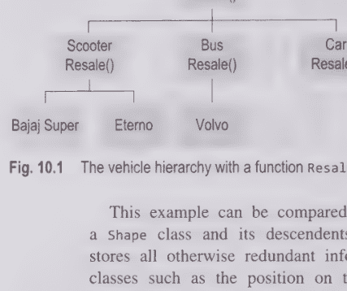

图10.1 带有Resale()函数的车辆层次结构

数据成员不同，乍一看，将其作为基类的成员似乎没有意义。例如，如果在Vehicle中定义了Resale()函数，那么它在同一个类中是无用的，因为基类的对象不能被调用。另一种选择是忽略抽象类的概念，并分别在所有类中定义Resale()。唯一的问题是，使用基类指针进行函数调用是不可能的，因为基类中没有这样的函数。

这个例子可以与第9章中讨论的另一个例子进行比较，即Shape类及其后代Circle、Square和Rectangle。Shape类存储了关于三个后代类对象的所有原本冗余的信息，例如屏幕上的位置、颜色、旋转以及与原点所成的角度。所有类都需要的draw()函数对于Shape类来说没有意义。

如果存在一个基类，那么可以定义一个指向基类的指针，然后该指针可以被指向任何后代类。假设在给定的示例中，有一个Resale()函数定义在Car、Bus和Scooter类中，如图10.1所示。在这种情况下，如果指针被设置为指向Vehicle类，那么它可以被设置为指向任何后代类。现在，当一个指针指向某个后代类的对象时，必须执行属于该对象的函数。这个决定不能在编译时做出，因为指针只能在运行时指向对象。在运行时，必须找出指针指向哪个对象，并执行该类的函数。这里，必须定义一个指向Vehicle类的指针，然后，如果需要转售一辆踏板车，就必须使其指向Scooter对象，然后执行该对象的Resale()函数。这看起来很简单，但实际上并非如此。我们将在接下来的章节中了解为什么会这样。

## 10.2 编译时多态和运行时多态

编译时多态包括运算符重载和函数重载，而运行时多态则包括在运行时决定使用函数的特定版本。C++使用虚函数来实现运行时多态。

我们在前面的章节中已经看到了多态的示例，例如函数重载和运算符重载。一个单一的函数名可以用于各种目的（使用不同的参数），一个单一的运算符可以用来实现多种操作（使用不同类型的操作数），在这种情况下，函数或运算符的使用取决于上下文。编译器在编译程序时解析函数调用或运算符调用。这被称为编译时或静态多态。由于我们已经在第4章和第6章中分别学习了函数重载和运算符重载，本章将集中讨论在运行时实现多态。在讨论运行时多态之前，我们需要了解一些先决条件。它们将在以下各节中进行解释。

## 10.3 指向对象的指针

指向对象的指针是一个包含对象地址的变量。它类似于指向任何其他变量的指针。必须使用普通的取地址运算符来获取对象的地址。可以定义一个指向对象的指针，并将对象的地址赋值给它。请看以下语句：

```
class Demo
{
// 类的成员
}
Demo DemoObj;
Demo *PtrDemoObj;
PtrDemoObj = &DemoObj;
```

它与其他指针类似，没有区别。

> 注意 指向对象的指针与其他指针没有区别。它持有对象的地址，而不是其他变量的地址。这里也可以使用相同的取地址运算符。

## 10.4 this指针

this指针是指向由成员函数调用的对象的指针。假设编写了DemoObj.DispDemo()，那么对该指针的函数调用将返回DemoObj的地址。换句话说，this指针是指向DemoObj的指针。这在展品10.1中进行了解释。

### 展品10.1 返回this指针

如果代码中有以下语句
Object.Function() 或 *ObjectPointer->Function()
那么无论在Function()函数体中何时引用this，它都表示指向对象的指针（第一种情况）或对象指针（第二种情况）。
类似地，*this在第一种情况下等同于Object，而在第二种情况下等同于*ObjectPointer。此类函数中的一个重要语句是
return *this
这意味着函数返回调用对象本身。

以下程序解释了如何使用this指针返回调用对象。它有一个函数，可以返回两兄弟中年龄较大的一个。如果调用对象代表哥哥，则该函数返回*this，即调用该函数的那个对象。

```
//thispointer.cpp
#include <iostream>
#include <string>
using namespace std;
class person
{
    string Name;
    int Age;
public:
person(string TempName, int TempAge)
{
Name = TempName;
Age = TempAge;
}
person Elder(person OtherPerson)
{
if(Age > OtherPerson.Age)
return *this;
/* 返回调用对象，即在此情况下表示Steve的对象 */
else
return OtherPerson;
}
friend ostream & operator <<(ostream& TempOut, person &TempPerson);
/* <<运算符只能作为友元重载 */
};
ostream & operator <<(ostream &TempOut, person& TempPerson)
/* 重载的运算符必须以引用方式传递，并且必须返回引用 */
{
TempOut << "这个人 " << TempPerson.Name << " 是 ";
TempOut << TempPerson.Age << " 岁 \n";
return TempOut;
}
void main()
{
person Steve("Steve Waugh", 25);
person Mark("Mark Waugh", 20);
person BigBrother = Steve.Elder(Mark);
cout << BigBrother;
}
```

输出
这个人Steve Waugh 25岁

## 10.5 派生类指针与基类指针的兼容性

我们之前还看到，基类指针可以指向派生类对象。不需要任何强制转换。假设代码中有以下定义：

BaseClass BC;
DerivedClass DC : public BaseClass;
BaseClass *PtrBC;
DerivedClass *PtrDC;
现在，可以编写


当派生类中定义了与基类同名的函数时，就称其覆盖了原函数。在这种情况下，新函数被称为覆盖函数。

这一过程称为覆盖所述函数。它类似于存在同名的全局变量和局部变量。无论在局部上下文中引用哪个变量，局部变量都会生效。类似地，如果在派生类中引用某个函数，则执行派生类的函数；如果在基类中引用同一个函数，则执行基类的函数。

有趣的是，当基类指针指向派生类，并通过该指针调用覆盖函数时，我们来考察一下这种情况。让我们通过程序 10.1 找出将执行哪个函数，然后对其进行分析。

## 程序 10.1 非虚函数

```
#include <iostream>
using namespace std;

class Shape
{
    int LineStyle;
    int FillColour;
public:
    // Non-virtual function
    void draw()
    {
        cout << "Shape is drawn \n";
    }
};

class Circle : public Shape
{
    int Radius;
    int CentrePointX;
    int CentrePointY;
public:
    void draw()
    {
        cout << "Circle is drawn \n";
    }
};

int main()
{
    Shape SomeShape, *PtrShape;
    Circle Ring;
    SomeShape.draw();
    Ring.draw();

    PtrShape = &Ring;
    PtrShape->draw();
    /* This calls the draw function of the base class and not the derived class where the pointer is pointing. */
}
```

### 输出

```
Shape is drawn
Circle is drawn
Shape is drawn
```

### 30°

### 晴朗

体感温度 28°

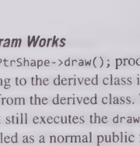

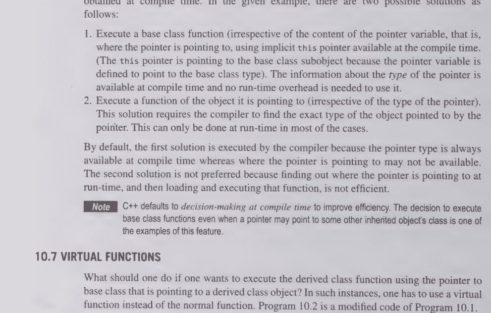

奥克兰

## 程序 10.2 虚函数

```
#include <iostream>
using namespace std;

class Shape
{
    int LineStyle;
    int FillColour;
public:
    // Virtual function
    virtual void draw()
    {
        cout << "Shape is drawn \n";
    }
};
class Circle : public Shape
{
    int Radius;
    int CentrePointX;
    int CentrePointY;
public:
    void draw()
    /* This is also a virtual function even though we have not used the keyword. We have inherited the virtual property here */
    {
        cout << "Circle is drawn \n";
    }
};
class Rectangle : public Shape
{
    int LeftTopX;
    int LeftTopY;
    int RightBottomX;
    int RightBottomY;
public:
    SomeOtherFunction()
    // No draw defined here
    {
        // Some statements
        /* Whenever there is no function defined for a derived class,
           the virtual function defined in the base class is called. */
    }
};
int main()
{
    Shape SomeShape, *PtrShape;
    Circle Ring;
    SomeShape.draw();
    Ring.draw();
    PtrShape = &Ring;
    PtrShape->draw();     // This draws a circle
    Rectangle Square;
    PtrShape = &Square;
    PtrShape->draw();
    // This would still call draw() of Shape
}
```

### 输出

```
Shape is drawn
Circle is drawn
Circle is drawn
Shape is drawn
```

### 程序如何工作

注意这里的变化。现在，PtrShape->draw() 调用的是 Circle 的 draw() 而不是 Shape 的。在 Shape 类（基类）中，函数被定义为 virtual void draw()。关键字 virtual 的添加带来了根本性的不同。当执行语句 PtrShape->draw() 时，它会在运行时查看 PtrShape 的内容，然后执行适当的 draw() 函数。这就是使用虚函数与普通函数的区别。

尽管在派生类中没有使用关键字 virtual，但它仍然是虚函数，因为虚属性是继承的。仍然可以在函数名前加上关键字 virtual，其工作方式不会改变。

假设需要在运行时确定正在处理的对象，并根据对象类型采取适当的操作，那么该如何实现呢？

例如，在处理客户时，会向他们提供一些有关其感兴趣产品的信息。客户群多种多样，可以分为外国客户和印度客户、服务导向型客户和成本敏感型客户等。假设有一位新客户是印度人且对成本敏感，程序如何决定向他/她提供不同的选项？假设有一个名为 DisplayOptions() 的函数，该函数如何显示适当的选项？假设有以下代码片段：

```
CustomerDetails(Customer & CurrentCustomer)
{
    ...
    case 3:
        CurrentCustomer = new IndianCostsensitiveCustomer();
        CurrentCustomer->DisplayOptions();
}
```

看看这个函数头。该程序向函数传递了一个基类引用。在 case 3 中，它被设置为指向刚创建的派生类对象。有趣的是，传递给这个函数的是基类引用，而不是派生类对象的引用。原因很简单：在编写程序时，并不知道谁会查询程序以及以什么顺序查询。第一个客户可能是外国且成本敏感的，而第二个客户可能是印度且服务导向的，等等。因此，函数必须在运行时动态地针对给定客户显示适当的选项。为此，程序采用了基于 case 的逻辑。现在的问题是要根据所处理的客户类型来创建对象。如果基类引用可用，则可以利用它可以指向任何派生类对象这一事实。因此，这里使用了基类引用（Customer &）。

第二行对我们的讨论更为重要。当调用 DisplayOptions() 函数时，人们期望该函数只显示 CurrentCustomer 所指向的那些选项。为此，必须将 DisplayOptions() 定义为虚函数。定义虚函数的一种简单方式是在定义前面加上关键字 virtual。下面的代码片段展示了如何定义虚函数 DisplayOptions()。

```
class Customer
{
    ...
    virtual DisplayOptions()
    {
        ...
    }
}
```

对于 Vehicle 类，需要如下定义：

```
class Vehicle
{
    ...
    virtual Resale()
    {
        ...
    }
}
```

因此，代码片段可以编写如下：

```
ResaleVehicle(Vehicle & SomeVehicle)
{
    ...
    case 3:
        SomeVehicle->Resale();
}
```

在以下情况下可以调用 ResaleVehicle() 函数：

```
Scooter GJ012345;
Bus GJ024587;
Car GJ274589;

cin >> VehicleForSale

ResaleVehicle(VehicleForSale);
// VehicleForSale = GJ012345
// SomeVehicle points to Scooter object

ResaleVehicle(VehicleForSale);
// VehicleForSale = GJ024587
// SomeVehicle points to Bus object

ResaleVehicle(VehicleForSale);
```

虚表包含指向给定类所有虚函数的指针。vptr 是指向虚表的指针。该类的所有对象都包含 vptr。当启用 RTTI 时，虚表还包含多态对象的 RTTI。

可以看到，这三个函数调用根据运行时的客户输入，分别将 SomeVehicle 引用（它是 Vehicle 的引用，即基类引用）初始化为 Scooter、Bus 和 Car 对象。resale() 必须为虚函数，才能提供这里所需的效果。

可以看到，由于对所有三个派生类都使用了相同的语句，编码得到了简化。事实上，即使有 1,000 个（甚至更多）派生类，代码也不会改变。这就是虚函数的优势。

虚函数很特殊。编译器对它们的处理方式不同。当类内部至少定义了一个虚函数时，该类会有额外的存储需求。此外，还会创建一个表来存储指向该类所有对象可用的所有虚函数的指针。这个表称为虚表。当类至少包含一个虚函数时，所有类对象中都会插入一个指向虚表的指针。这个指针传统上称为 vptr。当此类对象想要执行虚函数时，会引用该表并调用适当的函数。如前所述，这是在运行时完成的。

即使没有任何虚函数，当使用运行时类型信息（RTTI）时，也可能会创建虚表。这是因为编译器会将数据类型信息插入到前面讨论过的同一个虚表中。在运行时可以引用该表来查找对象的数据类型。对于虚基类也是如此。编译器要么有一个专门的虚基类表，其中保存着指向所有虚基类的指针；要么可能使用同一个虚表来存储有关虚基类的信息（以及各自指向虚基类的指针）。第二种选择更高效，因为使用单个表即可同时处理虚函数和虚基类；因此，大多数编译器都偏好这种方式。

1. 在基类中，函数名前面必须加上关键字 virtual。
2. 派生类中的函数必须与基类中定义的虚函数具有相同的名称和相同的原型，例如程序 10.2 中的 draw() 函数。如果原型不同，该函数就相当于重载函数，不会被视为虚函数。
3. 派生类中的函数不必以关键字 virtual 开头。即使加了关键字，也没有区别。
4. 如果在派生类中没有定义同名函数，则调用原来的基类函数。例如，如果从 Shape 继承另一个类 Rectangle，且没有定义 draw() 函数，然后由指向 Rectangle 的 Shape 指针调用 draw()，则会调用 Shape 类的 draw()。给定的示例中包含一个未定义 draw() 函数的 Rectangle 类；因此，该调用会调用基类函数。
5. 虚函数必须在基类中定义；不过函数体可以为空。
6. 对于任何使用虚函数的实际解决问题场景，都必须存在类层次结构。虚函数是层次结构中类的成员。它们被调用


> 不可能存在虚构造函数，而虚析构函数是可能的。

使用指向基类的指针或对基类的引用。这意味着这些函数必须同时是基类和派生类的成员。

7. 多态只能通过指向基类的指针（或引用）来实现，使用对象不可能实现。Ring.draw() 将始终调用 Ring 的 draw()，而不会调用 Shape 的 draw()，反之亦然。这称为虚函数的静态调用。

8. 虚构造函数是不可能的。构造派生类对象需要在内部专门构造基类子对象。显然，它们的构造函数不可能是虚的。（更确切地说，派生类对象的构造函数也会调用基类的构造函数）当一个对象被删除时，可以有一个虚析构函数来销毁它；因此，delete <pointer> 操作对于所指向的对象有效，无论指针类型如何。此时，允许在基类指针指向派生类对象时提供对整个派生类对象的删除（否则它只会删除派生类的基类子对象）。无论如何，使用虚析构函数以避免内存泄漏是一个好主意。

## 10.7.1 静态绑定与动态绑定

虚函数调用机制有时被称为动态绑定。链接是编译后将 main() 中调用的函数“连接”起来以创建可执行文件的过程。链接器是执行链接的实体。在链接时，当使用指向基类的指针调用虚函数时，链接器不知道该调用哪个函数。它在运行时通过查看指针的内容来决定。因此，虚函数调用直到被调用时才会被解析。这意味着这类函数在运行时才被链接。这也意味着使用虚函数的程序会运行得稍慢一些，因为它涉及两个步骤，即链接和执行。

如果没有使用虚函数，函数将在链接时（编译之后、创建可执行文件之前）被链接，并且它们的调用在那时被解析。这里没有动态绑定那样的运行时开销。这种绑定称为静态绑定。

> 静态绑定发生在编译时，而动态绑定发生在运行时。

```cpp
#include <iostream>
using namespace std;

class BaseClass
{
public:

// When called, the function tells which class it is part of
void testWhichClass()
{
cout << "BaseClass" << endl;
}
};

class DerivedClass : public BaseClass
{
public:

// When called, the function tells which class it is part of
void testWhichClass()
{
cout << "DerivedClass" << endl;
}
};

int main()
{
BaseClass *bptr;
DerivedClass d;
bptr = &d;
bptr->testWhichClass(); // This will call the function of DerivedClass because of polymorphism
return 0;
}
```

```cpp
public:
// The same function is also defined in the derived class
void testWhichClass()
{
    cout << "DerivedClass" << endl;
};
void findClass(BaseClass & SomeClass)
{
    /* Whenever some class reference is passed to this function,
    it is accepted as a base class reference */
    SomeClass.testWhichClass();
    /* This checks which class is the SomeClass passed to this function */
}
int main()
{
    DerivedClass D;
    findClass(D);
    getchar();
}
```

```text
Output
BaseClass
```

传递了一个派生类对象，但输出显示 BaseClass。如果将函数 testWhichClass() 改为 virtual，输出将是 DerivedClass。

> **注意：**对于非虚函数，当基类引用指向派生类对象时，它仍然调用基类函数。当函数被定义为 virtual 时，指向派生类的同一引用将调用派生类函数。

## 10.7.2 虚函数的默认参数

虚函数的默认参数并不会像预期的那样表现。考虑程序 10.3：

### 程序 10.3 默认参数在虚函数中表现不正常

```cpp
//DefArgs.cpp
#include <iostream>
using namespace std;
class Shape
{
    int LineStyle;
    int FillColour;
public:
    virtual int draw(int size = 100)
    /* It will not work as expected. The default argument value will always depend on the pointer type and not the content. */
    {
        cout << "Shape is drawn \n";
        return size;
    }
};

class Circle : public Shape
{
    int Radius;
    int CentrePointX;
    int CentrePointY;
public:
    int draw(int size = 200)
    {
    cout << "Circle is drawn \n";
    return size;
    }
};

int main()
{
    Shape SomeShape, *PtrShape;
    Circle Ring;
    SomeShape.draw();
    Ring.draw();
    PtrShape = &Ring;
    /* Base class pointer pointing to derived class object */
    int DrawSize = PtrShape->draw();
    // This draws a circle
    cout << "Draw size using base class pointer: " << DrawSize << "\n";
    /* This displays 100 instead of 200, as the pointer type is Base */
    Circle *PtrCircle = &Ring;
    DrawSize = PtrCircle->draw();
    /* Now, we are using a derived class pointer to
    point to a derived class object */
    cout << "Draw size using derived class pointer: " << DrawSize << "\n";
    /* This will display 200, as the pointer type is Derived */
}
```

```text
Output
Shape is drawn
Circle is drawn
Circle is drawn
Draw size using base class pointer: 100
Circle is drawn
Draw size using derived class pointer: 200
```

### 程序如何工作

当执行以下语句时

```cpp
int DrawSize = PtrShape->draw();
cout << "Draw size using base class pointer: " << DrawSize << "\n";
```

它显示 100 而不是 200。当执行以下语句时

```cpp
Circle *PtrCircle = &Ring;
DrawSize = PtrCircle->draw();
cout << "Draw size using derived class pointer: " << DrawSize << "\n";
```

它正确显示 200。

> 当我们使用基类指针指向派生类对象时，将采用基类函数的默认值。这里，被执行的函数是正确的，但使用的是基类的默认值。另一方面，当我们使用派生类指针时，将采用派生类函数的默认值。

#### 占位默认参数的补救办法

程序 10.3 表明，默认参数不能像普通函数那样使用。这里的解决方案是提供一个在两个类中都初始化了的局部变量，然后使用默认参数。如果需要默认参数，可以将这些局部变量的值赋给它们，如程序 10.4 所示。

我们只需要检查用户是否提供了值，如果没有，则从局部变量而不是默认参数中获取信息。通过保留一个占位默认参数，可以轻松检查用户是否提供了值。如果参数等于占位值，则说明用户没有提供该参数，此时可以从局部变量中获取值。

### 程序 10.4 使用占位默认参数作为解决方案

```cpp
//SolutionDefArgs.cpp
#include <iostream>
using namespace std;
class Shape
{
    int LineStyle;
    int FillColour;
public:
    virtual int draw(int size = 1)
    /* The size parameter is dummy; it is there to check whether the default argument is provided */
    {
        cout << "Shape is drawn\n";
        int ShapeSize = 100;
        /* This is to check whether the default argument is provided with the given value 100 */
        if(size == 1)
            size = ShapeSize;
        return size;
    }
};
class Circle : public Shape
{
    int Radius;
    int CentrePointX;
    int CentrePointY;
public:
    int draw(int size = 1)
    {
        cout << "Circle is drawn\n";
        int CircleSize = 200;
        if(size == 1)
            size = CircleSize;
        return size;
    }
};
```


```cpp
if(size == 1)
    size = CircleSize;
return size;
}
};
int main()
{
    Shape SomeShape, *PtrShape;
    Circle Ring;
    SomeShape.draw();
    Ring.draw();
    PtrShape = &Ring;
    /* Base class pointer pointing to derived class object */
    int DrawSize = PtrShape->draw();
    // This draws a circle
    cout << "Draw size using base class pointer: " << DrawSize << "\n";
    /* This will print the correct value */
    Circle *PtrCircle = &Ring;
    /* Now, we are using a derived class
    pointer to point to a derived class object */
    DrawSize = PtrCircle->draw();
    cout << "Draw size using derived class pointer: " << DrawSize << "\n";
}
```

**输出**

```text
Shape is drawn
Circle is drawn
Circle is drawn
Draw size using base class pointer: 200
Circle is drawn
Draw size using derived class pointer: 200
```

### 程序工作原理

这个简单的补丁解决了问题。代码可能看起来有些奇怪。当检查 size == 1 时，实际是在检查用户是否提供了值。如果提供了，在第一个函数中会将 100 赋给 size，在第二个函数中会将 200 赋给 size。因此，size 的值现在取决于执行的是哪个函数。在这两种情况下，执行的都是派生类的函数，因此能得到正确的结果。

### 10.7.3 使用虚函数的优点

假设有一段视频是由动画电影制作的。视频由单独的帧组成。单独的帧就是我们在屏幕上一个接一个看到的内容。通过足够快地生成帧，使其在我们的大脑中（而不是眼睛中）看起来是连续的，从而产生运动。

每一帧都包含由一些基本形状（如三角形、矩形和圆形）组成的图形。单独的帧不会以照片或位图文件的形式存储，因为它们消耗大量内存。那么，它们如何存储呢？

假设要在帧上绘制下图。


信息可以按如下方式存储：

```cpp
Circle(20, 30) radius = 10;   // The face
Rectangle(15, 35, 30, 45)   // The neck
...
```

帧是用圆形、矩形、三角形和线条来描述的，这些图形的数量是随机的。怎样才能编写一个绘制帧的函数呢？函数算法如下：

```cpp
void DrawFrame()
{
    Shape *Element;
    Open the file;
    Do while not end of file
        <Read from file some shape information>
        <Assign element pointer to the address of that shape>
        Element->draw();
    Loop over
}
```

这种使用基类指针来访问同一层次结构中不同类的一组对象的编程方法被称为面向对象编程。它非常灵活，因为操作对象时无需知道对象的确切类型。数据可以在运行时来自文件、通信线路或用户输入，我们都能够处理。

第 10.8 节给出了一个完成类似工作的程序。为简单起见，该程序假设输入是随机的。可以安全地假定来自文件、通信信道或用户的数据是随机的，以便测试程序和这一概念。

现实中有很多需要这种灵活性的案例。以自动新闻快讯系统为例，它以最新新闻作为输入，并根据新闻的优先级和重要性在屏幕上闪现。新闻可能涉及政治或体育；政治新闻可能是州级或中央级；体育新闻可能与板球或体操有关；等等。当新闻到来时没有任何预先确定的顺序，如果需要对特定类别进行特定处理，那么像 Processing() 这样的虚函数会非常有用。系统无需根据新闻对象的类型来决定做什么。它只需调用 Processing() 函数，该对象对应的适当函数就会被自动调用。

> 虚函数使得可以使用指向同一父类的单个指针来处理从单个父类继承的混合对象。

这是一个一般性情况的例子，即从一个根类派生出一个庞大的类层次结构。使用这种方法，可以随机处理层次结构中的任何对象。这就是真正的面向对象编程的强大之处。然而，这种强大并非没有代价。添加和处理虚函数会带来很大的性能开销。像 Java 这样的语言有一个单一的根类，所有类都从该根类派生（称为 Object 类）。它使 Java 程序员能够享受很大的灵活性，但代价是速度。而在 C++ 中，可以选择。只有在需要时，才使用面向对象编程；否则，可以使用基于对象的编程。标准模板库（STL）就是基于对象的编程方法的一个例子。我们将在第 16 章讨论它。

### 10.7.4 虚析构函数

当派生类对象被基类指针指向时，需要虚析构函数来正确删除派生类对象。如果没有定义虚析构函数，则只会删除基类子对象，而派生类对象的其余部分不会被删除。需要理解的是，基类和派生类中的析构函数名称不能相同（因为它们的名称必须取自类的名称）。这里的限制有所放宽。众所周知，一个类只能有一个析构函数。当使用指向派生类对象的基类指针调用 delete 时，被调用的函数是派生类析构函数。程序 10.5 是一个示例，展示了如何定义和使用虚析构函数。

> 当析构函数被定义为虚函数时，它会销毁指针所指向的正确对象，而不是指针被定义为指向的基类子对象。

### 程序 10.5 非虚析构函数在运行时销毁错误对象

```cpp
//VirtualDestructor.cpp
#include <iostream>
using namespace std;

class BaseClass
{
public:
    BaseClass()
    {
        cout << "BaseClass constructor ..." << endl;
    }

    /* The following destructor is not virtual. This will call for static invocation of the function that will call the base class destructor even when the pointer points to a derived class object. The result of such a call is undefined */

    ~BaseClass()
    {
        cout << "BaseClass destructor ..." << endl;
    }
};
class DerivedClass : public BaseClass
{
public:
    DerivedClass()
    {
        cout << "DerivedClass constructor ..." << endl;
    }
    ~DerivedClass()
    {
        cout << "DerivedClass destructor ..." << endl;
    }
};

void main()
{
    BaseClass* ptrBase;
    ptrBase = new DerivedClass();
    delete ptrBase;

    /* This should ideally call for DerivedClass destructor, but will
    call only BaseClass destructor, because the destructor is not virtual.*/

    getchar();
}
```

**输出**

```text
BaseClass constructor ...
DerivedClass constructor ...
BaseClass destructor ...
```

### 程序工作原理

可以看到，当执行 delete 运算符时，它只调用基类的析构函数，而不调用派生类的析构函数。因此，只有 ptrBase 指向的 DerivedClass 对象中的基类子对象被销毁，其余部分则没有。标准规定该行为是未定义的，这意味着对这种代码的响应取决于实现，并且很可能会有所不同。

相反，如果将基类析构函数定义为虚函数（这会使层次结构中所有类的析构函数都成为虚函数），就可以控制该行为。运行时系统会删除指针指向的对象，因此在这种情况下会调用 DerivedClass 析构函数。还有一点也很有趣：DerivedClass 包含基类对象，而 DerivedClass 析构函数又会调用基类析构函数。

```cpp
virtual ~BaseClass()
{
    cout << "BaseClass destructor ..." << endl;
}
```

**输出**

```text
BaseClass constructor ...
DerivedClass constructor ...
DerivedClass destructor ...
BaseClass destructor ...
```

> 注意 与其他析构函数不同，虚析构函数是根据上下文调用的，而不是按名称调用。~<类名> 可能不会销毁 <类名> 的对象，而是根据指针指向的位置销毁从 <类名> 派生的某个其他对象。

### 10.8 虚函数的使用

现在让我们来看虚函数的使用。假设有一个 figure 类，其中包含 25 个小图形。一个小图形可以是 Circle（圆形）、Square（正方形）或 Triangle（三角形）。figure 类的每个对象都包含特定组合的正方形、圆形和三角形。以下选项可用：

- 固定正方形、三角形和圆形的总数，这样就可以将它们定义为，例如，`Circle CircleOfFigure[10]`、`Square SquareOfFigure[10]`、`Triangle TriangleOfFigure[5]`；


然而，这过于僵化，对于任意绘图都是不可接受的。需要为不同类型的每个图形指定固定数量的对象。在现实场景中这是不可接受的。

- 2. 使用指向 Shape 类的指针数组，该数组在运行时指向 Circle、Square 和 Triangle 类型等不同对象的指针。需要使用虚函数来绘制小图形，因为普通函数不能使用，它们会尝试执行基类的 draw()。假设有一个图形包含两个三角形、三个正方形和一个圆。那么对于两个三角形，应该调用 Triangle 的 draw() 函数而不是 Shape 类的。同样，对于三个正方形，应该调用 Square 的 draw() 函数而不是 Shape 类的。

> 注意 虚函数的设计思路与 void 指针类似。当定义指向基类的指针时，它就像一个 void 指针，可以被赋值为任何派生类对象。当定义这样指针的数组时，该数组可用于定义后代类的混合对象。C 程序员也使用 void 指针数组来实现类似目的。

第二种方法更灵活、更有用。让我们来看一下使用它的程序 10.6。

### PROGRAM 10.6 Using virtual function

```
//UsingVirtualFunction.cpp
#include <iostream>
#include <ctime>
using namespace std;

class figure;
/* This is forward declaration. This is needed here as the point class contains a friend statement. The compiler must know that there exists a class called figure, so that being a friend to it is acceptable. */

class Point
{
    int X;
    int Y;
public:
    Point(int TempX = 0, int TempY = 0)
    {
        X = TempX;
        Y = TempY;
    }

    int GetX() const
    {
        return X;
    }

    int GetY() const
    {
        return Y;
    }

    friend ostream & operator <<(ostream & TempOut, Point & TempPoint);
};
ostream & operator <<(ostream & TempOut, Point & TempPoint)
{
TempOut << "(" << TempPoint.GetX() << ", " << TempPoint.GetY() << ")";
return TempOut;
}

class Shape
{
    Point Position;
    int Colour;
    virtual void draw()
    {
        cout << "Shape is drawn";
    }
    friend figure;
    /* Derived class will use the private members of the Point class, such as X and Y for drawing shapes, and hence it must be a friend to the Point class. */
};

// Derived class Square
class Square : public Shape
{
    Point LeftBottom;
    int Length;
public:
    Square(Point TempLeftBottom, int TempLength)
    {
        LeftBottom = TempLeftBottom;
        Length = TempLength;
    }

    void draw()
    {
        cout << "Square is drawn at " << LeftBottom << " and with length as " << Length << "\n";
    }
};

// Derived class Triangle
class Triangle : public Shape
{
    Point Avertex, Bvertex, Cvertex;
public:
    Triangle(Point TempAvertex, Point TempBvertex, Point TempCvertex)
    {
        Avertex = TempAvertex;
        Bvertex = TempBvertex;
        Cvertex = TempCvertex;
    }

    void draw()
    {
        cout << "Triangle is drawn at " << Avertex << " "
        << Bvertex << " " << Cvertex << "\n";
    }
};

// Base class Figure
class figure
{
    Shape * Images[25];
public:
    figure() // Constructor of class figure
{
    // Logic to generate random numbers
    srand((unsigned)time(NULL));
    for(int i = 0; i < 25; ++i)
    {
        int RandomValues [6];
        for(int j = 0; j < 6; ++j)
        {
            RandomValues[j] = rand() % 50;
        }

        /* The following statements use random values; however, in real-world cases, the values may be coming from some source such as graphics server, a camera, or a file generated by an artist, and so on.*/

        Point Position1(RandomValues[0], RandomValues[1]);
        Point Position2(RandomValues[2], RandomValues[3]);
        Point Position3(RandomValues[4], RandomValues[5]);

        switch(int choice = rand() % 3)
        {
            case 0:
            {
                int Length = rand() % 20;
                Images[i] = new Square(Position1, Length);
                break;
            }
            case 1:
                Images[i] = new Triangle(Position1, Position2, Position3);
                break;

            default:
                cout << choice << " is a wrong choice";
        } // End of switch case
    } // End of for loop
} // End of constructor function

void draw()
{
    for(int i = 0; i < 15; ++i)
    {
        Images[i]->draw();
    }
}; // End of class figure

void main()
{
    figure MyFigure;
    MyFigure.draw();
}
```

### Output

Square is drawn at (0, 14) and with length as 18
Triangle is drawn at (14, 41) (14, 24) (28, 17)
Triangle is drawn at (16, 33) (25, 37) (20, 35)
Square is drawn at (0, 22) and with length as 1
Triangle is drawn at (44, 23) (15, 37) (23, 18)
Square is drawn at (10, 1) and with length as 15
Square is drawn at (26, 6) and with length as 19
Square is drawn at (11, 20) and with length as 1
Triangle is drawn at (1, 38) (47, 48) (14, 27)
Triangle is drawn at (49, 24) and with length as 17
Triangle is drawn at (43, 48) (41, 26) (20, 11)
Square is drawn at (7, 25) and with length as 3
Square is drawn at (27, 15) and with length as 7
Square is drawn at (3, 0) and with length as 10
Square is drawn at (0, 41) and with length as 0

### How the Program Works

该程序需要一些解释。

- 1. 这是程序 10.3 的扩展版本。该程序使用了库中提供的 rand() 函数。它还使用了一个名为 srand() 的函数来为 rand() 函数提供种子值。当前时间被用作种子值；因此每次都会得到不同的随机数。在现实场景中，输入将来自文件（当读取描述图像的点数字格式的文件时）、通信通道（在查看使用此类点绘制的卡通时），或临时缓冲区（在流式传输的情况下，即绘制图像的数据首先存储在临时缓冲区中，然后以恒定速率提供），但效果与此处使用的 draw() 函数类似。
- 2. 该程序有一个 figure 类，其中包含指向 Shape 类对象的指针数组。为什么只使用指向 Shape 类的指针？这是因为不确定 figure 的内容会是什么。访问的唯一方法是提供指向基类的指针，并使用指向 Shape 类的指针访问内容（小图形）。为简单起见，该程序使用大小为 25 的固定数组。这个 figure 类实际上代表一幅图像。Shape 及其后代是 figure 的构建块。
- 3. 需要一个虚函数 draw()。这是因为当调用 draw() 函数时，应绘制相应的小图形。
- 4. figure 类应被设为 Shape 的友元，因为它使用 Shape 所有派生类的私有成员（所有派生类的位置）来绘制图形。访问方法在这里会是更好的解决方案，但该程序使用了一个简单且能达到目的的解决方案。
- 5. 如前所述，由于 figure 是在 Shape 之后定义的，因此有必要提供 figure 作为类的前向定义。

> 注意 当我们需要处理不同类型且比例未知对象时，需要虚函数。我们可能还需要处理属于同一通用类但具有特定不同属性的对象。

基类指针数组和动态内存分配就是存储属于同一层次结构多个对象所需的一切。
想想一个通过观察客户行为来判断客户感兴趣内容的程序。客户可以是不同类型的，有信用卡的和没有信用卡的，常规买家和偶尔买家，偶尔大量购买的和定期购买的，青少年和家庭主妇且对特定商品感兴趣的人等等。在这种情况下，需要用不同的类来表示它们。可以将 customer 作为基类，然后提供所有


这些类是从customer继承而来的。现在，这个问题涉及在某个场所（可能是超市）处理比例未知的顾客。我们只能拥有一个customer指针数组，并且只有在处理特定类型的顾客时，才需要新建该顾客，然后将基类指针赋给它。

## 10.9 纯虚函数

当一个类没有任何对象时，就不需要为它定义函数，因为没有对象会使用这些函数。考虑程序10.6中讨论的Shape类的情况。

```cpp
class Shape
{
    Point Position;
    int Colour;
    virtual void draw()
    {
        cout << "Shape is drawn";
    }
    friend figure;
};
```

在实际工作环境中永远不会存在Shape类的对象。如果在类中定义了draw()，人们将永远无法执行它。

重要的是要理解，由于draw()是一个虚函数，如果不在Shape内定义draw()，就无法实现多态。换句话说，基类中需要Shape的定义，但不需要其函数体。这可以改写如下：

```cpp
virtual void draw()
{
    // Empty
}
```

在这种情况下，draw()函数被定义为一个空函数体。这也可以通过编写以下代码来实现：

```cpp
virtual void draw() = 0;
```

这里不需要函数体，尽管可以在类外将其定义为Shape::draw()。

> 注意：纯虚函数在定义处没有函数体，但可以在类外部拥有函数体。

当在函数头之后以“= 0”代替函数体时，该函数就被称为纯虚函数。在这种情况下，函数不需要函数体。这带来了一个很大的优势。该函数强制其所在类成为抽象类，即它禁止定义该类的对象。这意味着如果一个类包含纯虚函数，它就变成了抽象类，C++将不允许定义属于该类的对象。在某种程度上，当程序员希望用户不要定义某个特定类的对象时，他/她可以在该类内部定义一个纯虚函数（可以是虚设的）。

> 抽象类是没有对象的类。

纯虚函数可以像普通虚函数一样被静态调用，也就是说，可以调用 `ptrShape->Shape::draw()`  // 仅使用一个指针

在这种情况下，必须在类外将该函数定义为：

```cpp
Shape::draw()
{
// The body
};
```

当一个类中定义了哪怕一个纯虚函数时，该类自动成为抽象类。程序无法实例化抽象类，因此不能拥有该类的对象。

纯虚函数、虚析构函数和虚函数静态调用的概念在程序10.7中进行了说明。

### 程序10.7 纯虚函数

```cpp
//PureVirtual.cpp
#include <iostream>
using namespace std;
class Shape
{
int LineStyle;
int FillColour;
public:
/* This is a pure virtual function. Though it does not have a body in the class, it can have it outside the class itself */
virtual void draw() = 0;
virtual ~Shape() // Virtual destructor
{
cout << "Shape destroyed\n";
}
};
void Shape::draw()
{
cout << "Shape is drawn\n";
}
class Circle : public Shape
{
int Radius;
int CentrePointX;
int CentrePointY;
public:
~Circle()
{
cout << "Circle destroyed\n";
};
void draw()
{
    cout << "Circle is drawn\n";
}
};

int main()
{
    // Shape SomeShape;
    Shape *PtrShape;
    Circle Ring;
    // SomeShape.draw();
    /*
     * We cannot call the draw() function of the Shape class, as we cannot have an object of the abstract class. */
    PtrShape->Shape::draw(); //Static call to Shape draw()
    PtrShape = &Ring;
    PtrShape->draw(); // Draws a circle
    cout << "Messages from destructor start now\n";
    PtrShape = new Circle;
    delete PtrShape;
    /*
     * If ~Shape is not virtual, this will not work as expected.
     * It will only delete the base class subobject (shape subobject of circle) and not the entire derived class object (circle). */
    cout << "Above messages are from delete\n";
    cout << "Following are normal messages exiting the program\n";
}
```

### 输出

- Shape已绘制
- Circle已绘制
- 析构函数消息现在开始
- Circle已销毁
- Shape已销毁
- 以上消息来自delete
- 以下是程序退出时的正常消息
- Circle已销毁
- Shape已销毁

### 程序工作原理

#### 定义纯虚函数

```cpp
virtual void draw() = 0;
```

在这里很重要。它展示了纯虚函数的定义，这使得Shape类成为抽象类。还应注意如何在类外定义函数体。

```cpp
void Shape::draw()
{
    cout << "Shape is drawn\n";
}
```

因此，这就是为纯虚函数定义函数体的方式。需要记住，每个从Shape继承的类都必须实现这个函数（否则它也会变成抽象类）。设计者定义纯虚函数时想要传达的意思是：所有有对象的类都必须能够处理这个消息。在给定的示例中，它表明Shape的所有后代都必须能够接收draw消息并相应地作出响应。

#### 纯虚函数的静态调用

下面的语句被注释掉，因为无法定义Shape类的对象（Shape类是抽象类，因为其中定义了纯虚函数draw()）。因此，无法使用点运算符来调用该成员函数。

```cpp
// Shape SomeShape
// SomeShape.draw();
```

解决方案是使用指针而不是对象，通过作用域解析运算符来调用该函数。可以使用以下语法调用该函数，该语法会使用指针PtrShape执行Shape::draw()函数。

```cpp
PtrShape->Shape::draw(); // Static call to Shape draw
```

这是一个静态调用，因为无论PtrShape指向哪个对象，它总是执行Shape类的draw()函数。

#### 对纯虚函数的多态调用

如果想执行所指向的类对象的成员函数，可以按如下方式使用普通语法。当执行以下语句时，将执行Ring对象的draw()函数。像下面这样的语句意味着：取一个指向派生类对象的指针（本例中的PtrShape），提取一个基类子对象（因为PtrShape被定义为指向基类Shape而不是Ring类的指针），然后调用该子对象的一个函数。

```cpp
PtrShape = &Ring;
PtrShape->draw();
```

#### 调用虚析构函数

析构函数也是程序的重要组成部分。看下面的代码：

```cpp
PtrShape = new Circle;
delete PtrShape;
```

由于析构函数被定义为虚函数，这条delete语句调用的是Circle对象的析构函数，而不是Shape的析构函数。

```cpp
virtual ~Shape() // Virtual destructor
{
 cout << "Shape destroyed\n";
};
~Circle()
{
 cout << "Circle destroyed\n";
};
```

如果Shape没有定义虚析构函数，那么当对象被Shape类型的指针指向时，就无法销毁circle类型的对象。注意，Circle的析构函数先被调用，然后Shape子对象的析构函数再被调用。

### 注意

1. 派生类的虚析构函数也会调用基类的析构函数，因为隐藏在派生类中的基类子对象需要被销毁。
2. 如果基类包含纯虚函数，继承体系中的所有其他类都必须实现它。如果某个类没有实现它，该类自动成为抽象类，这种情况下不可能创建该类的对象。
3. 纯虚函数所起的作用与Java中的接口相同，即强制后代类按照基类中的规定精确实现该函数。

### 10.9.1 虚函数的静态调用

虚函数也可以被静态调用。当使用类名::指针->虚函数机制时，它们就被静态调用。考虑基类shape、虚函数draw()和派生类circle。假设有如下语句：

```cpp
Shape *PtrShape = new Circle;
PtrShape->Shape::draw();
```

在这种情况下，第二条语句调用的是Shape类的draw()，而不是Circle类的draw()。

示例10.3解释了虚函数内容的静态调用。

### 示例10.3 虚函数内容的静态调用

> 当我们通过以下语法调用函数时
> 
> PointerToBaseClass->BaseClassSubObject::FunctionName
> 
> 它被称为FunctionName的静态调用。
> 
> 例如，
> 
> PtrShape->Shape::draw()
> 
> 就是draw()的静态调用。无论该函数是否为虚函数，也无论ptrShape指向哪里，都会调用属于基类子对象的那个函数。

现在让我们借助一个示例进一步分析该主题。这个示例涉及一个按错误类型来组织类的问题。下面是在程序中要建模的类层次结构。

定义一个Error类。该类应包含错误代码、错误描述以及针对该错误的可能解决方案。定义两个派生类SyntaxError和LogicalError，继承自基类Error。定义CompilerError和LinkerError类继承自SyntaxError类，LoopingError和InitializationError类继承自LogicalError类。PossibleSolutions是一个函数，用于在发生错误时显示应该采取的措施，并在所有这些类中定义。请定义这个函数，使得对于任何给定的错误，它都能显示所有要执行的相关操作。也就是说，如果错误是初始化错误，它应该显示针对初始化错误的可能解决方案、针对逻辑错误的可能解决方案以及针对一般错误的解决方案。图10.3显示了这些类之间的层次结构。程序10.8展示了如何编写解决方案的代码。


### Fig. 10.3 Hierarchy of classes defining different types of errors

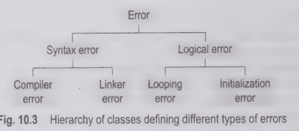

### PROGRAM 10.8 Invoking the pure virtual function statically

```cpp
//StaticInvocation.cpp
#include <iostream>
using namespace std;

class Error
{
private:
    int ErrorCode;
    string Description;
public:
    virtual void PossibleSolutions() const = 0;
};

// Body of the virtual function defined outside the class
void Error::PossibleSolutions() const
{
    cout << "Generic error\n";
}

// Derived class SyntaxError
class SyntaxError : public Error
{
public:
    void PossibleSolutions() const
    {
        Error::PossibleSolutions();
        cout << "Check the syntax\n";
    }
};

// Derived class LogicalError
class LogicalError : public Error
{
public:
    void PossibleSolutions() const
    {
        Error::PossibleSolutions();
        cout << "Logic is erroneous\n";
    }
};

// Class CompilerError is derived from SyntaxError
class CompilerError : public SyntaxError
{
public:
    void PossibleSolutions() const
    {
```

还展示了如何将 `PossibleSolutions()` 定义为纯虚函数，因为从它继承的所有类都必须定义它。`Error` 类（基类）也必须使用 `PossibleSolutions()` 具有通用解决方案，因此也必须有函数体。如前所述，函数体是在 `Error` 类之外定义的。

### Calling a pure virtual function

如果调用任何类的 `PossibleSolutions()` 函数，它将仅调用该情况下的 `PossibleSolutions()` 函数。例如，考虑以下语句：

```cpp
Error *pError = new InitializationError;
pError->PossibleSolutions();

Error *qError = new LinkerError;
qError->PossibleSolutions();
```

这段代码将仅显示初始化错误和链接错误的可能解决方案。这里的需求是，它还应显示与其基类相关的错误。对于初始化错误，它还应显示逻辑错误以及通用错误的可能解决方案。对于链接错误，它应显示链接错误、语法错误和通用错误的可能解决方案。

### Need for static invocation

这可以通过对所有基类静态调用 `PossibleSolutions()` 函数来实现，例如 `LinkerError` 的 `PossibleSolutions()` 函数依次调用语法错误以及通用错误。

可以看出，该函数包含对 `SyntaxError` 类的 `PossibleSolutions()` 函数的调用，而后者又调用 `Error::PossibleSolutions()`；因此，可以获得与错误相关的所有可能解决方案。

`SyntaxError::PossibleSolutions()` 和 `Error::PossibleSolutions()` 都是对虚函数的调用。它们不同。它们被称为对虚函数的静态调用。

为什么需要静态调用？链接错误也是语法错误，而语法错误又是错误。我们需要打印每个类给出的描述。为什么是纯虚函数？我们希望程序员为层次结构中的每个错误实现 `PossibleSolutions()`。

## Recapitulation

- 运行时多态是面向对象编程的重要特性。
- C++ 使用虚函数实现运行时多态。
- 运行时多态会给运行时系统带来开销。因此，它不会成为默认。我们只有在函数被定义为虚函数时才有运行时多态。
- 运行时多态与编译时多态不同。
- 在派生类重载普通函数的情况下，基类指针将始终执行基类中定义的函数，而不管它指向哪里。
- 如果指针指向派生类对象，则执行派生类函数；否则，执行基类函数。
- 当基类指针指向派生类对象时，它只能访问派生类对象中埋藏的基类子对象。
- 每当函数被定义为虚函数时，每个对象中都会嵌入一个特殊指针。该指针指向一个表，该表包含对象能够调用的虚函数的指针。
- 虚函数通常在运行时链接。
- 当编译器能够在编译时决定调用时，它会静态绑定虚函数。
- 虚函数的默认参数指的是指针类型而不是实际调用的函数。虚函数在灵活的面向对象编程中非常有用。
- 纯虚函数是在类定义中用 `= 0` 代替函数体的虚函数。
- 包含纯虚函数的类成为抽象类。

## Keywords

**Access method** — 这是指编写用于返回类私有变量值的函数。当我们需要向对象提供私有变量的读级访问时，使用访问方法。

**Base class subobject** — 在 C++ 对象模型中，当一个类被派生到另一个类时，基类对象嵌入在派生类中。这个嵌入在派生对象中的基类对象称为派生对象中的基类子对象。

**Compile-time polymorphism** — 使用运算符重载和函数重载实现的 polymorphism 被称为编译时多态。

**Dynamic binding** — 在运行时链接函数称为动态绑定。虚函数是动态绑定的。然而，编译器可以对虚函数的静态调用进行静态绑定，也可以在编译时可以决定的情况下进行静态绑定。在这种情况下，虚函数也被静态绑定。

**Polymorphism** — 对象在不同上下文中对同一消息表现出不同行为的能力称为多态。

**Pure virtual function** — 在类中用 `= 0` 代替函数体的虚函数。它可能没有函数体；也可以在类外定义纯虚函数的函数体。

**RTTI** — 运行时类型信息是一种在运行时决定对象类型的机制。

**Run-time polymorphism** — 使用虚函数实现的 polymorphism 被称为运行时多态。

**Static binding** — 在链接阶段链接函数称为静态绑定。普通函数是静态绑定的。

**Static invocation of virtual function** — 当使用指针直接调用虚函数时，虚函数是动态调用的。可以使用类的对象或使用作用域解析运算符调用虚函数。在这种情况下，虚函数是静态链接的。这称为虚函数的静态调用。

**Virtual function** — 在基类中使用关键字 `virtual` 定义的函数称为虚函数。编译器将决定基类指针指向的确切类并调用该类的相应函数，如果函数被定义为虚函数。

**Virtual table** — 这是一个包含指向该类所有虚函数的指针的表。每个至少有一个虚函数的类将有一个虚拟表的副本。

## Exercises

### Multiple Choice Questions

1. 以下语法显示什么？ `virtual void show() = 0;`
   (a) 成员函数
   (b) 友元函数
   (c) 虚函数
   (d) 纯虚函数

2. 两种不同的多态类型是 ______。
   (a) 编译时和运行时
   (b) 编译时和链接时
   (c) 编译时和加载时
   (d) 加载时和链接时

3. 当程序员不希望类被实例化时，可以通过 ______ 实现。
   (a) 在该类中定义成员函数
   (b) 在该类中定义友元函数
   (c) 在该类中定义虚函数
   (d) 在该类中定义纯虚函数

4. 当我们在任何类中编写纯虚函数时，________。
   (a) 该类成为抽象类
   (b) 该类不能被继承
   (c) 该类成为虚类
   (d) 该类成为纯虚基类

5. 纯虚函数只有在函数被定义 ________ 时才能像普通虚函数一样静态调用。
   (a) 在类外，函数体为空
   (b) 在类内，函数体为空
   (c) 在类外，有函数体
   (d) 在类内，有函数体

6. 每个至少有一个虚函数的类 ________。
   (a) 有多个虚函数的副本
   (b) 有虚拟表的单个副本
   (c) 有多个虚拟表的副本
   (d) 以上都不是

7. ________ 用于获取对象的地址。
   (a) 地址运算符
   (b) 地址函数
   (c) 取地址运算符
   (d) 取地址函数

8. 要使用指向基类的指针指向派生类对象来执行派生类函数，应该使用什么？
   (a) 应该使用 this 指针
   (b) 应该使用虚函数
   (c) 应该使用虚指针
   (d) 以上都不是

9. ________ 不能帮助实现运行时多态。
   (a) 普通对象
   (b) 对象指针
   (c) 虚函数
   (d) 以上全部

10. ________ 用于在两个或多个类继承到单个派生类时管理指针指向相应的子对象。
    (a) 编译器
    (b) 链接器
    (c) 加载器
    (d) 程序员

### Conceptual Exercises

1. 什么是多态？编译时多态和运行时多态有什么区别？
2. 使用基类指针调用函数时，`this` 指针的重要性是什么？
3. 考虑基类 B 和派生类 D。假设 pB 是指向基类的指针，pD 是指向派生类的指针。区分这两个指针在访问派生类对象方面的区别。
4. 什么是子对象概念？当基类指针访问派生类对象时，它的重要性是什么？
5. 为什么基类的非虚成员函数总是被调用，即使基类指针指向派生类对象？
6. 普通成员函数和虚函数有什么区别？
7. 解释静态绑定。虚函数如何实现动态绑定？
8. 虚函数的默认参数有什么问题？如何解决？
9. 面向对象编程中虚函数的要求是什么？
10. 为什么虚构造函数不可能，但虚析构函数是个好主意？
11. 虚函数和纯虚函数有什么区别？
12. 静态调用纯虚函数或虚函数的需要是什么？

### Practical Exercises

1. 定义第 9 章中描述的 `Time` 类。从中继承印度标准时间 IST 和格林威治标准时间 GMT。编写从一种时间类型转换到另一种时间类型（IST 和 GMT）的例程。
2. 定义一个类 `Stack`。将其继承到 `VariableStack`。现在，将这个类继承到 `SystemVariableStack` 和 `UserVariableStack`。为所有类提供构造函数和析构函数。
3. 定义一个类 `Student`。将其继承到工程、艺术、商业和科学学生。将工程学生继承到计算机科学、电子与通信以及信息技术学生。为所有类提供构造函数。
4. 对于练习 3 中给出的 `Student` 类，编写一个程序，使用指向 `Student` 类的指针访问计算机科学学生的记录。可以看出，计算机科学中定义的部分是不可访问的。然后，定义一个指向计算机科学学生的指针。现在可以看出该部分是可访问的。转换原始的指针到-


学生指针转换为指向计算机科学学生的指针，并看到现在它可以访问计算机科学部分。

5. 使用练习3中给出的同一个类，现在定义一个虚函数 Display()，使用同一个基类指针（指向学生的指针）在各个类中显示所有类的详细信息。现在，使用该虚函数访问计算机科学对象。可以看出，无需任何指针类型转换，基类指针就可以通过虚函数访问派生类对象。

6. 在练习3的类中，提供一个虚函数 Registration()，为相应的学生注册考试。最后，显示有多少学生注册了哪场考试。

7. 在练习2的类中，提供一个虚函数 Push()，将对象压入相应的堆栈。

8. 在练习1中，提供一个虚函数 Display()，显示给定表示形式的时间。

9. 定义一个 Faculty 类。它包含以下属性：
(a) 教师的姓名
(b) 教师的资历
(c) 教师能够教授的科目

10. 将练习9中的 Faculty 类继承为正式教师，其特点是：
(a) 全职工作（不指定咨询时间）
(b) 至少教授三门科目
(c) 仅属于该学院

11. 将练习9中的 Faculty 类继承为客座教师，其特点是：
(a) 仅在两到三天内有空（还需指定咨询时间）
(b) 只教授一门科目
(c) 隶属于其他机构

12. 为练习10和11中给出的类的对象读写提供虚函数。

13. 定义一个 Vehicle 类。将该类继承为两轮车和四轮车。将两轮车继承为自行车和摩托车，将四轮车继承为柴油车和汽油车。提供一个虚函数来计算车辆的里程（行驶距离（公里）/ 燃料消耗量）。

14. 对于练习1，为所有类提供虚析构函数。

15. 定义一个 Employee 类。同时定义继承自 Employee 类的 MaleEmp 和 FemaleEmp 类。再定义继承自 Employee 类的 Officers、Clerks 和 Peons 类。定义一个包含10种不同类型员工的数组。在所有类中定义一个 ReadDetails() 函数。无论类型如何，所有数组元素都应在同一个例程中可访问。

## 第11章

## 运行时类型信息与类型转换运算符

## 学习目标

- 运行时类型信息简介
- typeinfo 对象与 typeid 运算符
- 多态对象
- 动态类型转换简介
- 使用 const_cast、static_cast 和 reinterpret_cast 进行类型转换
- 在模板中使用 typeid 和 dynamic_cast
- 交叉转换和向下转换

## 11.1 引言

运行时类型信息（RTTI）是 C++ 中一个非常强大的工具，用于在运行时查找对象的类型。由于是在运行时运行，RTTI 也会对系统性能产生显著影响。因此，大多数编译器都提供 RTTI，但默认情况下将其禁用。如果要使用 RTTI，需要启用该选项（同时也要接受性能下降）。虽然性能是一个重要问题，但对于某些应用来说并不是最重要的。在这种情况下，RTTI 所提供的灵活性和强大功能胜过了性能问题。

ANSI C++ 标准化委员会新增了两个用于 RTTI 的关键字，即 typeid 和 dynamic_cast。typeid 是一个运算符，它以特定形式（typeinfo 对象）返回对象的类型。dynamic_cast 是一种新类型的运算符，它使我们能够以安全的方式对多态对象进行类型转换。只有在转换有效的情况下，它才会将源类型转换为目标类型。类似的运算符还有 const_cast、reinterpret_cast 和 static_cast。这些运算符将在本章讨论。这里还引入了一个内置类 typeinfo。typeinfo 对象保存传递给 typeid 运算符的参数类型信息。

> typeid 和 dynamic_cast 是用于 RTTI 的新运算符。

> 大多数编译器提供 RTTI，但由于性能问题默认将其禁用。

> 多态对象可以使用虚函数进行操作。

> 请注意，dynamic_cast、const_cast、reinterpret_cast 和 static_cast 是 C++ 中定义的新运算符，与 C 中提供的普通类型转换相比，它们提供了更好的转换功能。

## 11.1.1 多态对象

使用虚函数，可以借助基类指针指向任何派生类对象。这种可以使用虚函数进行操作的对象称为多态对象。一个带有虚函数的对象以及从该对象派生的所有对象，或层次结构中的任何后续对象，都称为多态对象。它们可以被基类指针指向，并在运行时进行操作。

考虑一个 Employee 类，ProductionEmployee、SalesEmployee 和 OtherEmployee 都继承自它。另外，考虑 Employee 类的函数 ListLeaves()，它显示员工迄今已使用的休假天数。因此，结构如下：

```
class Employee
{
    ...
public:
    virtual void ListLeaves()
    {...}
}
```

```
class ProductionEmployee : public Employee
{
    void ListLeaves()
    {...}
}
```

```
class SalesEmployee : public Employee
{
    void ListLeaves()
    {...}
}
```

```
class OtherEmployee : public Employee
{
    void ListLeaves()
    {...}
}
```

```
main()
{
    Employee *ptrEmp;
    switch(int EmpType)
    {
        ...
        case 1: // Production employee
        ptrEmp = new ProductionEmployee; // Polymorphic object
        ...
    }
    ...
    ptrEmp->ListLeaves()
    ...
}
```

> 如果对象在运行时可以改变其形态，即当指针在运行时改变指向的对象，并且指针表达式根据指针指向的位置产生不同的对象，则这样的对象称为多态对象。

本例中创建的对象是一个多态对象，因为它在运行时可以采用任何派生员工类型的形式。

## 11.1.2 RTTI 的必要性

> RTTI 会在运行时降低处理速度，因此只在需要时使用。编译器默认将其关闭。使用虚函数的替代方案通常更好。

RTTI 是一个强大的工具，如果使用虚函数可以解决问题，则应避免使用 RTTI。然而，有时使用 RTTI 是必要的。让我们考虑程序11.1中所示的一个简单示例，以更好地理解这一点。

假设一个应用程序有在线传入的新闻。新闻可以是不同类型。为简单起见，我们只考虑两种类型，即纯文本新闻和带图片的新闻。该应用程序要求只在屏幕上显示所有新闻的标题。用户可以点击任意新闻进行查看。也可以右键点击新闻以启用一些附加操作。右键选项可能包括以下内容：

- 1. 将此新闻作为电子邮件发送。
- 2. 将此新闻复制到特定文件夹。
- 3. 使用打印机打印此新闻。

假设用户不希望带图片的新闻被打印，因为它们会消耗大量打印机墨粉。为了解决这个问题，可以定义一个 News 类作为基类。PlainTextNews 和 NewsWithImages 是派生自它的两个类。News 类将是一个抽象类，因为所有可用的新闻要么是纯文本，要么带图片。为简单起见，不考虑其他新闻类型。

在 News 类中定义了三个函数：SendNews()、StoreNews() 和 PrintNews()。这种设计会使 NewsWithImages 继承这三个函数。然而，我们不希望 NewsWithImages 继承 PrintNews()，因此应将其从 News 类中移除。那还能放在哪里呢？下一个显而易见的选择是 PlainTextNews 类。

SendNews() 和 StoreNews() 函数对两种类型的新闻都是必需的，因此需要在 News 类中定义为虚函数。如程序11.1所示：

```
PROGRAM 11.1 A solution using virtual functions

//NewsHierarchy.cpp
#include <iostream>
#include <typeinfo>
#include <string>
using namespace std;

#define SENDNEWS 1
#define STORENEWS 2
#define PRINTNEWS 3

// Base class
class News
{
public:
	virtual void SendNews(string Address){};
	virtual void StoreNews(){};
	virtual ~News() = 0;
};

News::~News()
{
	// Empty body
}
```


## 运行时类型信息和类型转换运算符

```cpp
/* A virtual destructor for making News polymorphic */
// Class for plain text derived from News class
class PlainTextNews : public News
{
public:
void SendNews(string Address)
{
 // mailto(Address, this->content)
}
void StoreNews()
{
 // Storing the news in a default folder
}
void PrintNews()
{
cout << "Printing the news now\n";
}
};
```

```cpp
// Class for news with images
class NewsWithImages : public News
{
public:
void SendNews(string Address)
{
 // mailto(Address, &this)
}
// Other details
// Print function is missing here
};
```

```cpp
void StoreNews()
{
 // Storing the news in a default folder
}
```

右键函数。它以鼠标当前指向的文件的引用作为输入。

```cpp
void MyApp::OnRightClick(News &NewsItem, int Choice)
{
string Address;
switch(Choice)
// Choice represents what is chosen after right-click
{
case SENDNEWS:
cout << "Enter address";
cin >> Address;
NewsItem.SendNews(Address);
break;
case STORENEWS:
NewsItem.StoreNews();
break;
// The following is not acceptable
/* case PRINTNEWS:
NewsItem.PrintNews(); // No print function with News
*/
}
}
```

### 注意

要使一个对象具有多态性，至少需要一个虚函数。当其他函数无法设为虚函数时，我们可能需要定义一个虚拟的哑函数。有时，定义虚析构函数是一个很好的解决方案。

### 程序如何工作

这段代码并未完全解决问题。请注意，发送新闻（通过电子邮件）和存储新闻这两种操作对于两个派生类对象都是可用的。因此，可以在基类中为这两个操作提供虚函数，但 NewsWithImages 文件没有定义打印函数。因此，不能在 News 类中定义打印函数，所以它无法使用。

需要编写代码来检查文件类型。如果文件类型是 PlainTextNews，则允许打印；如果是 NewsWithImages，则不允许用户打印新闻项。需要知道鼠标指向的新闻类型，才能决定是否提供打印选项。基类中定义的虚函数不支持此功能。RTTI 提供了动态检查类型的支持，因此在这种情况下将很有用。这里有一个基类指针。如果可以额外测试它指向的位置，问题就可以解决。例如，如果知道它指向 PlainTextNews 类型的对象，就可以启用打印选项，否则就不启用。

还需要注意，RTTI 与虚函数类似，需要多态对象才能运作，这意味着基类必须至少定义一个虚函数，RTTI 才能正常工作。虽然可以使用 typeinfo 对象来处理默认类型，但用处不大。11.1.4 节展示了这种情况的一个示例。要解决此问题，了解如何将 RTTI 用于多态对象至关重要。

在继续之前，读者必须对内置对象 typeinfo 有所了解。

### 11.1.3 typeinfo 对象与 typeid 运算符

`<typeinfo>` 库包含 typeinfo 对象的定义。启用 RTTI 时，该对象会自动创建并与程序中使用的每种数据类型关联。对于非多态数据类型，即使未启用 RTTI，它也是可用的。生成的 typeinfo 对象取决于类型，而不是对象的数量。同一类型可能有多个变量，但生成的 typeinfo 对象只有一个。如果定义了两个整数、一个字符和一个类中的用户自定义对象，则会生成三个 typeinfo 对象：第一个用于整数，第二个用于字符，第三个用于用户自定义对象。

可以通过编写 typeid(object) 来获取与任何对象关联的 typeinfo 对象。这里，typeid 是一个运算符，返回与该对象关联的 typeinfo 对象。它也可以接受用户自定义的类参数。在这种情况下，它返回该类的 typeinfo 对象。

> RTTI 有助于在运行时获取对象的类型，并根据该信息做出决策。

> typeid 运算符返回与传递给运算符的参数关联的 typeinfo 对象。参数可以是内置类型或用户自定义对象。

typeinfo 对象具有三个我们感兴趣的属性。它们描述如下：

- **Name() 函数**  
  该函数以字符串格式返回类型名称。

- **== 运算符**  
  该运算符比较两个不同 typeinfo 对象的类型。

- **!= 运算符**  
  该运算符比较两个 typeinfo 对象，如果它们类型不同则返回 true。

下面的程序演示了 RTTI 在非多态对象中的使用。RTTI 帮助程序员获取基类指针所指向的 typeinfo 对象，从而在运行时检查该对象的类型以做出决策。如果能够做出这样的决策，那么诸如程序 11.1 中描述的新闻项之类的问题就可以轻松处理。

```cpp
//typeinfo.cpp
#include <iostream>
#include <typeinfo>
#include <string>
using namespace std;

class TestClass
{
    int Test;
public:
    TestClass(int TempVal)
    {
        Test = TempVal;
    }
};

int main()
{
    int FirstInt, SecondInt;
    char FirstChar = 'a';
    TestClass TC(5);
    cout << "FirstInt type is ";
    cout << typeid(FirstInt).name(); // Using name()
    cout << "\n";
    // Using ==
    if(typeid(FirstInt) == typeid(SecondInt))
    {
        cout << "FirstInt and SecondInt are of same type\n";
    }
    // Using !=
    if(typeid(FirstInt) != typeid(FirstChar))
    {
        cout << "FirstInt and FirstChar are of different types\n";
    }

    cout << "Object TC is of type ";
    cout << typeid(TC).name()<< "\n";
}
```

### 输出

```text
FirstInt type is int
FirstInt and SecondInt are of same type
FirstInt and FirstChar are of different types
Object TC is of type class TestClass
```

然而，如 11.1.5 节所讨论的，typeid 在多态对象中更有用。

### 11.1.5 将 typeid 用于多态对象

程序 11.2 展示了 typeid 如何应用于多态对象。与虚函数类似，需要类的指针或引用，才能让 typeid 提供给定指针所包含的正确类型。

> 要处理多态对象，必须启用 RTTI。

**程序 11.2 用于多态对象的 typeid**

```cpp
//PolymorphicTypeid.cpp
#include <iostream>
using namespace std;

class Shape
{
    int LineStyle;
    int FillColour;
public:
    virtual void draw()
    /* A virtual function is a must for us to use RTTI with polymorphic class*/
    {
        cout << "Shape is drawn \n";
    }
};

class Circle : public Shape
{
    int Radius;
    int CentrePointX;
    int CentrePointY;
public:
    void draw()
    {
        cout << "Circle is drawn \n";
    }
};

class Dot : public Circle
{
    int DotDensity;
public:
    void SomeOtherFunction()
    { // Empty body }
};

class Rectangle : public Shape
{
	int LeftTopX;
	int LeftTopY;
	int RightBottomX;
	int RightBottomY;
public:
	void SomeOtherFunction() // No draw defined here
	{
		// Some statements
	}
};
int main()
{
	Shape SomeShape, *PtrShape;
	Circle Ring;
	SomeShape.draw();
	Ring.draw();
	PtrShape = &Ring;
	cout << "PtrShape is pointing to " << typeid(*PtrShape).name() << "\n";
	Rectangle Square;
	PtrShape = &Square;
	cout << "PtrShape is pointing to " << typeid(*PtrShape).name() << "\n";
	PtrShape = new Dot;
	cout << "PtrShape is pointing to " << typeid(*PtrShape).name() << "\n";
}
```

```text
Shape is drawn
Circle is drawn
PtrShape is pointing to class Circle
PtrShape is pointing to class Rectangle
PtrShape is pointing to class Dot
```

### 程序如何工作

这里修改了第 10 章中的程序 10.2，以展示 RTTI 在多态对象中的使用。它使用 typeid 来显示 PtrShape 所指向对象的类型。typeid 的参数是 (*PtrShape)。这一点很重要，因为需要使用指针才能让 typeid 应用于指针所指的对象并返回与之关联的适当 typeinfo 对象。在这里，它返回与 PtrShape 内容关联的 typeinfo 对象。

```cpp
cout << "PtrShape is pointing to " << typeid(*PtrShape).name() << "\n";
```

typeid(*PtrShape) 运算符返回与 *PtrShape 关联的 typeinfo 对象，而 name 函数给出该对象的名称。

### 11.1.6 使用 typeid 解决问题

考虑本章前面看到的用于处理不同类型新闻的程序 11.1。可以看到，在右键单击对象时添加打印选项的问题无法通过虚函数解决。程序 11.3 展示了如何使用 typeid 解决该问题。


```
/* Choice represents what is chosen after right-click */
{
    case SENDNEWS:
        cout << "Enter address";
        cin >> Address;
        NewsItem.SendNews(Address);
        break;

    case STORENEWS:
        NewsItem.StoreNews();
        break;
    // The following is not acceptable
    /* case PRINTNEWS:
        NewsItem.PrintNews();  // No print function with News
        break; */
}

if(typeid(NewsItem) == typeid(PlainTextNews))
{
    // Provide option for print
    cout << "Printing is enabled\n";
    PlainTextNews & PrintableNewsItem = (PlainTextNews &)NewsItem;
    // Printing is done only for printable items
    PrintableNewsItem.PrintNews();
}

int main()
{
    PlainTextNews TextNews;
    MyApp_OnRightClick(TextNews, 0);
}
```

### Output

Printing is enabled
Printing the news now

> Note One can compare the type of objects at run-time using typeid.

### How the Program Works

本示例省略了程序本身的细节，仅集中于 RTTI 所需的方面。重要部分是使用 typeid 对多态对象引用 NewsItem 进行操作。

```
if(typeid(NewsItem) == typeid(PlainTextNews))
{
    cout << "Printing is enabled \n";
    PlainTextNews & PrintableNewsItem = (PlainTextNews &)NewsItem;
    // Printing is done only for printable items
    PrintableNewsItem.PrintNews();
}
```

如果 NewsItem 引用的是 PlainTextNews，则将其强制转换为引用 PlainTextNews。现在可以调用 PrintNews() 函数。这是安全的，因为已经知道 NewsItem 是可打印类型。

### 11.1.7 Applying typeid to Class Names and Objects

程序 11.3 中有一条语句

```
typeid(News) == typeid(PlainTextNews)
```

让我们分析这条语句以更好地理解 typeid 运算符的使用。当对 typeid(NewsItem) 进行操作时，typeid 运算符作用于 News 类的一个对象。在这种情况下，typeid 运算符返回与该对象所属类相关联的 typeinfo 对象，即 News 类。当 typeid 应用于一个类时，例如 typeid(PlainTextNews)，将获得与 PlainTextNews 类相关联的 typeinfo 对象。typeinfo 对象重载了 == 运算符，因此可以比较两个 typeinfo 对象。

typeid 运算符既可以应用于类，也可以应用于类的对象。在这两种情况下，它都返回与该类相关联的 typeinfo 对象。

### 11.1.8 Cases Where RTTI is Useful

有时，解决方案有两种方式，即使用虚函数和使用 RTTI。我们已经在第 10 章（程序 10.6）中看到过使用虚函数生成屏幕对象的示例。RTTI 也可以用于此目的。如果使用虚函数，复杂性在于类层次结构的设计者。需要事先了解层次结构中所有类的使用情况，例如 draw()、getArea() 和 getCircumference()，因为设计者可以在开始时提供它们。在某些情况下这可能无法实现，这时可能需要使用 RTTI。以下是一些此类情况：

- 1. 在设计类时，其最终用户并未参与设计；因此并非所有需求都已知。当用户开始使用该层次结构时，他们必须检查特定类型并提供所需的运算。例如，用户可能有兴趣为 Rectangle 类及其派生类提供 Shrink() 函数。
- 2. 用户通常需要除原始设计者提供的操作之外的其他操作。例如，人们可能希望为 Shape 类添加 FillColour() 功能。更重要的是，用户没有原始类层次结构的源代码，它以某种形式的 object code 形式从库中提供。
- 3. 类设计者在设计层次结构时无法预测该类的所有可能应用。类层次结构是为通用目的而设计的。图形库的用户可能是汽车设计师或电影设计师，他们需要在图像上进行补间操作。补间操作涉及自动生成中间图像。假设设计者希望米老鼠从屏幕左端移动到右端。这需要从左到右连续绘制米老鼠的图像。可以在开始时将米老鼠显示在屏幕左侧，结束时显示在右侧。设计者可以绘制这两种图像，软件应自行绘制所有中间图像。因此，用户可以在使用形状时决定要对正在处理的形状做什么。电影设计师可以使用相同的形状层次结构，通过 RTTI 在其上添加补间操作。

虚函数在类设计时就已确定，并受设计者选择的影响。相反，RTTI 在类被用户操作并处于用户控制之下时很有用。

以下是 RTTI 有用的其他一些情况：

> RTTI 之于虚函数，正如动态绑定之于静态绑定。

> RTTI 在使用模板时很有用，在系统使用时对特定类层次结构给予特别关注，并为特定类层次结构提供特定任务。

- 1. 在使用模板时，可能需要知道实际数据类型并进行验证。在处理 ElementType 等类型变量的栈时，类型在编译时未知。RTTI 可用于在模板函数或类的主体中查找元素的类型。我们将在第 11.6 节研究这个问题。
- 2. RTTI 使用户能够在运行时决定对象的类型。以网络数据包观察为例。它有一个虚函数 check()，用于检查网络数据包的正常情况。在网络上发生特定类型攻击的情况下，可以编写一个临时函数来检查数据包的类型并采取适当措施。这可以在不修改原始设计和操作的情况下使用 RTTI 完成。可以利用 RTTI 检查类型，并仅对需要进一步检查的数据包使用 AdditionalCheck() 函数代替 check()。
- 3. 可能需要为类层次结构的一个特定子集添加特定任务。例如，对于所有派生自 Rectangle 类的形状，可能需要提供 IncreaseWidth() 作为函数。在处理对象时，不知道它是否派生自矩形或来自其他对象。因此，只有当 IncreaseWidth() 运算符应用于派生自 Rectangle 类的类的对象时，操作才是安全的。这需要一种称为向下转换的安全工作机制。在这种情况下的向下转换使基指针仅指向 Rectangle 类，前提是形状是 Rectangle 类或其派生类。这由动态转换提供。我们将在第 11.2 节研究动态转换。

程序 11.3 提供的解决方案比第 10 章中给出的更好。可以确定文件的类型并在运行时决定是否提供打印选项。在某些情况下，这仍然不够。

假设有两种不同类型的纯文本新闻，即 HtmlNews（仍然是文本）和 RichTextNews（比文本好一点）。它们都继承自 PlainTextNews。程序 11.3 对于 HtmlNews 和 RichTextNews 不会正常工作。为什么？

如果比较 typeid(NewsItem)（它返回与 News 相关联的 typeinfo 对象，而非 HtmlNews 或 RichTextNews）与 typeid(PlainTextNews)，则结果为 false，且不会提供打印选项。这里的一个解决方案是按如下方式更改程序代码：

```
if(typeid(NewsItem) == typeid(PlainTextNews)
|| typeid(NewsItem) == typeid(HtmlNews)
|| typeid(NewsItem) == typeid(RichTextNews))
{
cout << "Printing is enabled\n";
PlainTextNews & PrintableNewsItem = (PlainTextNews &) NewsItem;
// Printing is done only for printable items
PrintableNewsItem.PrintNews();
}
```


> typedef 可以帮助评估对象是否属于某个特定单一类。然而，若要评估对象是否属于某个类层次结构中的成员，则需要使用 dynamic_cast。

这暂时可以解决问题。然而，如果之后 HtmlNews 派生出 TaggedHtmlNews 和 UntaggedHtmlNews，就需要在该处再添加两行代码。每当层次结构中新增一个类，这里就要增加一行。这种方法既容易出错又费时费力。

问题在哪里？问题在于 typedef 运算符只检查当前的新闻类型。如果它能检查从当前新闻类型派生的所有新闻，问题便迎刃而解。

因此，如果能够确保所查找的新闻条目属于从 PlainTextNews 派生的某个类，那么提供打印功能就是安全的。为了检查这一点，需要对从 PlainTextNews 类派生的每一种可能的类进行检查。需要逐一检查这些类，并添加信息来修改代码。我们需要一种解决方案，能够编写适用于 PlainTextNews 类任何后代的通用语句，而 typedef 无法做到这一点。如果 typedef 无法解决这个问题，那又该如何解决？下面的章节将对此进行说明。

## 11.2 使用 dynamic_cast 进行动态转换

在 ANSI C++ 中，有四个额外的转换运算符可用，分别是 dynamic_cast、static_cast、const_cast 和 reinterpret_cast。第一个运算符 dynamic_cast 为第 11.1.9 节中提到的问题提供了解决方案。让我们来了解 dynamic_cast。虽然它是一个转换运算符，但非常特殊。以下是它的显著特点：

- 1. 此转换运算符仅用于多态对象转换。换句话说，它只能将一个多态对象转换为另一个多态对象。
- 2. 它也被称为安全转换（safe cast）。只有正确转换时才会成功，这意味着仅当被转换的指针（或引用）是目标类型或其派生类型的对象时，dynamic_cast 才会成功。
- 3. dynamic_cast 的语法与普通的 C 风格转换不同。它的写法是 dynamic_cast<ToObjectPtrOrRef> (FromObjectPtrOrRef)
- 它将 FromObject 转换为 ToObject 指针或引用。除了 FromObject 指针或引用，也可以编写一个产生 FromObject 指针或引用的表达式。从这条规则可以清楚地看出，要使 dynamic_cast 成功，FromObject 必须与 ToObject 类型相同，或者由 ToObject 派生而来。必须非常小心地对待语法。第一组尖括号，即 < >，第二组是普通圆括号，即 ( )。
- 4. 如果存在 Base 类和 Derived 类，那么从 Derived 到 Base 指针的转换总是成功。但是，从 Base 到 Derived 指针的转换只有在 Base 指针实际上指向 Derived 类型的对象时才能成功。这被称为向下转换（downcasting），我们将在第 11.9 节中进一步了解。
- 5. 转换（casting）仅借助指针或引用进行。不能用于对象。
- 6. 使用指针时，如果 dynamic_cast 失败，它将返回 null。因此，像检查函数一样检查 dynamic_cast 的返回值以判断转换是否成功，这一点很重要。对于引用，引用不能为 null；因此，当 dynamic_cast 失败时会抛出 bad_cast 异常。

```
dynamic_cast<ToObjectPtrOrRef> (FromObjectPtrOrRef)
```

### 11.2.1 使用 dynamic_cast

我们在前面的程序 11.2 中看到的圆（circle）和 Shape 等多态对象，可以使用 dynamic_cast 动态转换为 shape 指针。让我们看看程序 11.4 以更好地理解这一点。

```
PROGRAM 11.4 Dynamic casting on polymorphic objects

//PolymorphicDynamic_cast.cpp
#include <iostream>
using namespace std;

class Shape
{
int LineStyle;
int FillColour;
public:
virtual void draw()
{
cout << "Shape is drawn \n";
}
};

class Circle : public Shape
{
int Radius;
int CentrePointX;
int CentrePointY;
public:
void draw()
{
cout << "Circle is drawn \n";
}
};

int main()
{
Shape SomeShape, *PtrShape;
Circle Ring, *PtrCircle;

// Part I

// Testing four possible cases of conversion

// A base pointer pointing to base is casted to base
PtrShape = dynamic_cast<Shape *> (&SomeShape);
if(PtrShape)
cout << "Shape pointer to Shape pointer casted\n";
else
cout << "Shape pointer to Shape pointer not casted\n";

/* A derived pointer pointing to derived is casted to derived */
PtrCircle = dynamic_cast<Circle *> (&Ring);
if(PtrCircle)
cout << "Circle pointer to Circle pointer casted\n";
else
cout << "Circle pointer to Circle pointer not casted\n";

/* A base pointer pointing to base is casted to derived */
PtrCircle = dynamic_cast<Circle *> (&SomeShape);
if(PtrCircle)
cout << "Circle pointer to Circle pointer casted\n";
else
cout << "Circle pointer to Circle pointer not casted\n";
```

```
cout << "Shape pointer to Circle pointer casted\n";
else
cout << "Shape pointer to Circle pointer not casted\n";
/* A derived pointer pointing to derived is casted to base */
PtrShape = dynamic_cast<Shape *> (&Ring);
if(PtrShape)
cout << "Circle pointer to Shape pointer casted\n";
else
cout << "Circle pointer to Shape pointer not casted\n";
/* Part II */
/* Casting from base class pointer to derived */
/* A base pointer pointing to a derived class object
is casted to a derived class object successfully */
cout << "Trying to cast a base class pointer\n";
cout << "pointing to a derived class object\n";
cout << "to a derived class pointer\n";
PtrShape = &Ring;
PtrCircle = dynamic_cast<Circle *> (PtrShape);
if(PtrCircle)
cout << "Successful\n";
else
cout << "Unsuccessful\n";
/* A base pointer pointing to a base class object
failed to cast to a derived class object */
cout << "Trying to cast a base class pointer\n";
cout << "pointing to a base class object\n";
cout << "to a pointer to a derived class object\n";
PtrShape = &SomeShape;
PtrCircle = dynamic_cast<Circle *> (PtrShape);
if(PtrCircle)
cout << "Successful\n";
else
cout << "Unsuccessful\n";
/* A derived pointer pointing to a derived object
is casted to a base class pointer successfully */
cout << "Trying to cast a derived class pointer\n";
cout << "pointing to a derived class object\n";
cout << "to a base class pointer\n";
PtrCircle = &Ring;
PtrShape = dynamic_cast<Shape *> (PtrCircle);
if(PtrShape)
cout << "Successful\n";
else
cout << "Unsuccessful\n";
/* The only option left is a derived class pointer
pointing to a base class object, which is not possible */
```

输出
Shape pointer to Shape pointer casted
Circle pointer to Circle pointer casted

```
Shape pointer to Circle pointer not casted
Circle pointer to Shape pointer casted
Trying to cast a base class pointer
pointing to a derived class object
to a derived class pointer
Successful
Trying to cast a base class pointer
pointing to a base class object
to a pointer to a derived class object
Unsuccessful
Trying to cast a derived class pointer
pointing to a derived class object
to a base class pointer
Successful
```

### 程序如何工作

请注意，派生类到派生类以及基类到基类的转换显然是可以接受的。看下面的转换操作，它们都成功了。

```
PtrShape = dynamic_cast<Shape *> (&SomeShape);
PtrCircle = dynamic_cast<Circle *> (&Ring);
```

还可以看到，派生类指针到基类指针的转换也是可以接受的。

```
PtrShape = dynamic_cast<Shape *> (&Ring);
```

基类指针到派生类指针的转换只有在基类指针实际上指向派生类对象时才可能成功。因此，下面的转换不成功。当指针指向基类对象时，从 Shape 指针到 Circle 指针的转换将失败。

```
PtrCircle = dynamic_cast<Circle *> (&SomeShape);
```

然而，在下面的尝试中我们会成功，因为我们要转换的指针实际上指向一个派生类对象。

```
PtrShape = &Ring;
PtrCircle = dynamic_cast<Circle *> (PtrShape);
```

下面是另一个将派生类指针成功转换为基类指针的示例。指向派生类对象的派生类指针被转换为基类指针。这个指针现在只能访问嵌入在派生类对象中的基类子对象。

```
PtrCircle = & Ring;
PtrShape = dynamic_cast<Shape *> (PtrCircle);
```

### 11.2.2 使用 dynamic_cast 替代 typeid

在某些情况下，使用 dynamic_cast 的代码可以用使用 typeid 的代码替代。在这种情况下，这样做更好，也是可取的。使用 typeid 的代码检查虚表中的第一个槽（RTTI 信息保存在那里）。它的性能开销与……相同。


## 11.4 使用 ANSI C++ 编程。

当我们使用 typeid 进行多项检查，且所有被检查的类构成某种继承层次结构时，可以用一条 dynamic_cast 语句替代这些多条 typeid 语句。

相比之下，dynamic_cast 的情况有所不同。它会沿着继承层次结构向下遍历基类对象，结果取决于继承链的长度。

从 dynamic_cast 转换为 typeid 非常简单。当使用 dynamic_cast 将一个指向某个多态对象的指针转换为另一个类型的指针时，如果类型不匹配，转换就会失败。如果像程序 11.4 那样只检查简单的类型，就可以用 typeid 编写代码。这需要两步。第一步是使用 typeid 和运算符‘==’检查两个参数的类型。然后，如果答案成立，就使用普通的 C 风格类型转换来完成转换。请参见程序 11.5。

### 程序 11.5 将使用 dynamic_cast 的代码转换为使用 typeid 的代码

```
//dynamic_castToTypeid.cpp
#include <iostream>
using namespace std;

class Shape
{
    int LineStyle;
    int FillColour;
public:
    virtual void draw()
    {
        cout << "Shape is drawn \n";
    }
};

class Circle : public Shape
{
    int Radius;
    int CentrePointX;
    int CentrePointY;
public:
    void draw()
    {
        cout << "Circle is drawn \n";
    }
};

int main()
{
    Shape SomeShape, *PtrShape;
    Circle Ring, *PtrCircle;

    /* The following is a code using dynamic_cast; later, we will show how the same effect can be achieved using typeid */
    PtrShape = &Ring;
    PtrCircle = dynamic_cast<Circle *> (PtrShape);
    if(PtrCircle)
        cout << "Cast is successful\n";
    else
        cout << "Test is not successful\n";
    PtrShape = &SomeShape;
    PtrCircle = dynamic_cast<Circle *> (PtrShape);
    
if(PtrCircle)
    cout << "Cast is successful";
else
    cout << "Test is not successful\n";

// The following is an equivalent code using typeid
PtrShape = &Ring;
if(typeid(Circle) == typeid(*PtrShape))
{
    PtrCircle = (Circle *) PtrShape;
    /* C-style casting is now safe because it casts
       only if the types are same */
    cout << "Cast is successful\n";
}
else
{
    PtrCircle = '\0';
    cout << "Cast is not successful\n";
}

PtrShape = &SomeShape;
if(typeid(Circle) == typeid(*PtrShape))
{
    PtrCircle = (Circle *) PtrShape;
    cout << "Cast is successful\n";
}
else
{
    PtrCircle = '\0';
    cout << "Cast is not successful\n";
}
}
```

### 输出

Cast is successful
Test is not successful
Cast is successful
Cast is not successful

### 程序工作原理

本程序包含两个不同的部分。一部分使用 dynamic_cast，如下面的语句所示：

```
PtrShape = &Ring;
PtrCircle = dynamic_cast<Circle *> (PtrShape);
```

该语句使用 dynamic_cast，并通过检查返回值是否为空来判断转换是否失败。同一任务在程序的第二部分使用 typeid 完成，如下面的语句所示。

```
if(typeid(Circle) == typeid(*PtrShape))
{
    PtrCircle = (Circle *) PtrShape;
    ...
}
```

dynamic_cast 会检查类型是否正确，并且只在类型正确时才进行转换。typeid 只能检查类型是否完全相同；因此，一旦确认类型相同，就需要使用 C 风格类型转换进行转换。

## 11.2.3 使用 dynamic_cast 解决 typeid 的相关问题

如果类型比较简单，可以用 typeid 替代 dynamic_cast。考虑第 11.1.9 节讨论的问题。在这种情况下，要比较的类型并不是简单的类型，它们也可能是派生类型。此时，将使用 typeid 的代码改写为使用 dynamic_cast 的代码会更加容易。请看下面这行：

```
PlainTextNews &RefPlainTextNews = dynamic_cast<PlainTextNews&> (NewsItem)
RefPlainTextNews.FPrint();
```

只有当该 News 对象能够以 PlainTextNews 或其派生类的引用形式获得时，打印才会进行；否则，会抛出 bad_cast 异常。现在，你不必担心 HtmlNews、RichTextNews、TaggedHtmlNews 或 UntaggedHtmlNews。对于所有这些类型，dynamic_cast 都会成功，任务也就完成了。

> 当参数是指针时，dynamic_cast 运算符在转换失败时返回 null。如果传入的是引用，则会抛出 bad_cast 异常。

唯一的区别在于，当使用 dynamic_cast 作用于引用时，它不会返回空引用（因为引用不能为空）。如果转换不成功，它会抛出 bad_cast 异常；因此，针对其他文件的处理代码将写在 catch 块中。程序 11.6 演示了其工作方式。

### 程序 11.6 使用 dynamic_cast 的打印问题更灵活的解决方案

```
//DynamicPrinting.cpp
#include <iostream>
#include <typeinfo>
#include <string>
using namespace std;

#define SENDNEWS 1
#define STORENEWS 2
#define PRINTNEWS 3

class News
{
public:
    virtual void SendNews(string Address)();
    virtual void StoreNews(){};
    virtual ~News() = 0;
};

News::~News()
{
    // Empty body
}

class PlainTextNews : public News
{
public:
    void SendNews(string Address)
    {
        // mailto(Address, &this)
    }
    
void StoreNews()
{
 // Storing the news at default position
}
    
void PrintNews()
{
 cout << "Printing the news now\n";
};
```

下面三个类只是为了展示类层次结构而添加的。它们是否有类体都没有关系

```
class HtmlNews : public PlainTextNews
{ // Class contents };
class RichTextNews : public PlainTextNews
{ // Class contents };
class TaggedHtmlNews : public HtmlNews
{ // Class contents };
class NewsWithImages : public News
{
 public:
 void SendNews(string Address)
 {
 // mailto(Address, &this)
 }
 // Other details
 // Printing is missing out here
};
```

右键单击函数

```
void MyApp_OnRightClick(News & NewsItem, int Choice)
{
 string Address;
 switch(Choice)
 {
 case SENDNEWS:
 cout << "Enter address";
 cin >> Address;
 NewsItem.SendNews(Address);
 break;
 case STORENEWS:
 NewsItem.StoreNews();
 break;
 case PRINTNEWS:
 try
 {
 PlainTextNews & RefPlainTextNews = dynamic_cast <PlainTextNews&> (NewsItem);
/* Casting to check if the object belongs to any derived class of PlainTextNews class */
 cout << "Printing is enabled \n";
 
RefPlainTextNews.PrintNews();
}
catch (bad_cast)
{
	cout << "Casting not successful \n";
	cout << "Printing is not enabled \n";
	// Executable file has skipped the printing option
} // End of switch
} // End of function
int main()
{
	TaggedHtmlNews TextNews;
	MyApp_OnRightClick(TextNews, PRINTNEWS);
	NewsWithImages NonTextNews;
	MyApp_OnRightClick(NonTextNews, PRINTNEWS);
}
```

### 输出

Printing is enabled
Printing the news now
Casting not successful
Printing is not enabled

> 注意：当我们对引用使用 dynamic_cast 时，必须将其放在 try 块中，并使用 bad_cast 的 catch 块来编写转换失败时的处理代码。

### 程序工作原理

这里需要注意的重要一点是，调用 dynamic_cast 转换为 PlainTextNews。尽管该对象实际上属于 TaggedHtmlNews 类型，转换仍然成功；这是因为 TaggedHtmlNews 是继承自 PlainTextNews 的类。同样可以验证，对于 NewsWithImages 对象，打印不会被启用，因为转换不成功。

该程序的核心思想体现在下面的语句中。

```
PlainTextNews & RefPlainTextNews = dynamic_cast <PlainTextNews&> (NewsItem);
```

这里的 dynamic_cast 替代了第 11.1.9 节示例中使用 typeid 的三条语句。还可以看到，即使向层次结构中添加许多其他类，也无需修改此程序，因为 dynamic_cast 能够处理这种情况。每当 NewsItem 是 PlainTextNews 类或其任何派生类的对象时，dynamic_cast 都会成功，从而将 NewsItem 转换为 PlainTextNews 引用。

此外，请注意如何使用 catch 块处理失败情况。dynamic_cast 语句被包裹在 try 块中，并编写了相应的 catch 块，如下所示；

```
catch(bad_cast)
{
	cout << "Casting not successful \n";
	cout << "Printing is not enabled \n";
	// Executable file has skipped the printing option
}
```


### 程序 11.8 静态转换

```
//static_cast.cpp
#include <iostream>
using namespace std;

int main()
{
	int NormalInt = 10;
	float ConvertedFromInt = static_cast<float>(NormalInt);
	/* The following line cannot be compiled
	int *test = static_cast<int *>(NormalInt);
	error: 'static_cast' cannot convert from 'int' to 'int *' */
	return 0;
}
```

这里没有输出，因为我们只是将普通整数转换为浮点值。

该程序使用 static_cast 操作将普通整数转换为浮点数。

float ConvertedFromInt = static_cast<float>(NormalInt);

这相当于使用 C 风格转换用以下方式表达。

float ConvertedFromInt = (float*)NormalInt;

优点是 C 风格转换在不查看数据类型的情况下进行转换。在给出的示例中这是可以的，但同样的 C 风格转换也可以用来将 int 转换为 int 指针。如果使用 static_cast 进行类似操作，则会产生错误。例如，以下语句将无法编译。

int *test = static_cast<int *>(NormalInt);

> static_cast 仅在是正常转换时才转换值，否则失败。

如果使用如下的 C 风格转换，不幸的是它会被编译，并且还会以令人惊讶的结果运行。

int *test = (int*)(NormalInt);

这就是使用 static_cast 的优势。它看起来很复杂，但可以检查此类错误，而普通 C 风格转换无法做到。

如果程序员有意想要转换无关类型，例如将整数值转换为指针，那么 reinterpret_cast 提供了这样做的方法。程序 11.9 展示了如何实现。

### 程序 11.9 重新解释转换

```
//reinterpret_cast.cpp
#include <iostream>
using namespace std;

int main()
{
    int NormalInt = 10;
    /* The following line will not be compiled */
    // float ConvertedFloatFromInt = reinterpret_cast<float> (NormalInt);
    /* The following line will be compiled */
    int *ConvertedPtrFromInt = reinterpret_cast<int *> (NormalInt);
    cout<< "Int is converted to pointer";
    return 0;
}
```

### 输出

Int is converted to pointer

### 程序的工作原理

reinterpret_cast 用于将一种类型转换为无关类型，例如整数到指针。它在转换涉及常规数据类型时失败。

该程序演示了与程序 11.8 完全相反的行为。它编译将整数转换为指针的行，但不编译将整数转换为浮点的行。因此，以下行会被编译并将 int 转换为 int 指针。

```
int *ConvertedPtrFromInt = reinterpret_cast<int *> (NormalInt);
```

相反，以下将 int 转换为浮点值的行不会被编译。

```
float ConvertedFloatFromInt = reinterpret_cast<float> (NormalInt);
```

注意
reinterpret_cast 是程序员在转换时避免输入错误的一种机制。只有当程序员有兴趣转换为无关类型时，才会使用 reinterpret_cast。

## 11.6 RTTI 与模板

在第 7 章中，我们学习了如何编写可用于任何类型的通用函数。类型在编译时确定，并实例化一个特定函数来处理给定类型。可能需要在这些通用函数中提供与特定类型相关的一些检查。这对于验证尤其有用。typeid 和 dynamic_cast 都可用于此目的。让我们在以下各节中讨论它们。

### 11.6.1 使用 typeid

在模板函数代码中，如果想要测试实际变量的类型并尝试根据类型提供验证，则可以使用 RTTI。例如，如果程序员正在编写可操作任何数组的搜索例程，则必须编写通用搜索例程。然而，这存在一个问题。

当模板需要检查参数的类型时，RTTI 很有用，因为它在类型信息已知时在运行时检查类型。

假设整数数据包含员工编号，不能为负数。char * 数据包含员工姓名，是数据库中有效的姓名。问题是如何为这两种情况（也许还有更多类似情况）编写单个例程时提供此类验证。可以使用 typeid 在此处检查项目的类型，然后为该特定数据类型执行特定的验证例程。请考虑程序 11.10。

### 程序 11.10 模板类型检查

```
//TemplateTypeChecking.cpp
#include <iostream>
#include <string>
using namespace std;
template <typename Type>
Type Search(Type Array[])
{
Type UserInput;
cout << "Please input the value";
cin >> UserInput;
cout << "\n";
// Provide integer validation
if(typeid(Type) == typeid(int))
{
cout << "int validation done \n";
}
// Provide char validation
if(typeid(Type) == typeid(char))
{
cout << "char validation done \n";
}
// Provide string validation
if(typeid(Type) == typeid(char *))
{
cout << "char * validation done \n";
}
/* Check for other data types, which can even be user-defined data types */
/* Search routine is omitted at the moment */
return 0;
}

int main()
{
char Array[] = "This is testing";
int result = Search(Array);
}
```

```
Output
Please input the value 65
char validation done
```

读者可能会对输出感到惊讶。char 验证被调用，因为数组的类型是 char；在该数组中 65 实际上是 A。

到目前为止所讨论的内容对于通用类也是正确的。程序 11.11 是一个示例，其中程序 11.10 中给出的问题由类表示而不是通用函数。

### 程序 11.11 模板 typeid

```
//TemplateTypeid.cpp
#include <iostream>
#include <string>
using namespace std;

template <typename Type, typename UserInputType = int>
class JustForSearch
{
public:
    Type Search(Type Array[])
    {
        UserInputType UserInput;
        cout << "Please input the value ";
        cin >> UserInput;
        cout << "\n";

        if(typeid(UserInputType) != typeid(Type))
        {
            cout << "Please enter data of type" << typeid(Type).name() << "\n";
        }

        return 0;
    }
};

int main()
{
    char Array[] = "This is testing";
    JustForSearch<char> JS;
    int result = JS.Search(Array);
}
```

### 输出

Please input the value 65
Please enter data of type char

### 程序的工作原理

程序再次给出错误的输出。现在，它不接受 65，而是要求用户输入一个字符。

再次感到惊讶？请看 UserInputType 类型的默认值。它是 int。此外，请看传递给 JS 的类型参数。

```
template <typename Type, typename UserInputType = int>
JustForSearch<char> JS;
```

第二个参数未被传递。因此，它被取为 int，即默认类型。这与所需类型 char 不匹配，因此生成错误。

这里又出现一个问题。我们讨论了类模板的默认类型参数（给定示例中 UserInputType 为 int）。我们能否在函数中使用此类默认类型参数？答案是否定的，正如第 7 章中已看到的那样。这是因为模板函数的默认类型参数提出得太晚，当前标准无法接受它。它可能是下一个 C++ 标准的一部分。

### 11.6.2 兼容性和效率问题

以下是一些其他 RTTI 相关问题：

- 与 C 风格转换的向后兼容性 必须注意，与 C 的兼容性是 C++ 设计者关注的主要问题。C 风格转换仍在许多程序中使用。尽管如此，不建议在较新的 C++ 程序中使用它。
- 效率 使用 RTTI 并非高效。即使不使用 typeid 或 dynamic_cast，只要启用 RTTI，程序运行速度就会变慢。这是因为使用 typeinfo 对象的类型信息被添加到每个多态类型中。typeinfo 对象需要像其他对象一样构造和销毁，这最终会减慢执行速度。
- 用虚函数代替 RTTI 如果可能，必须使用虚函数代替 RTTI，因为它们更高效。然而，在某些情况下，无法用虚函数代替 RTTI。

注意 C 风格转换仍被大量使用；然而，良好的设计应使用本章中提到的更好的转换操作符。

## 11.7 交叉转换

交叉转换是指在多重继承的情况下，从派生类转换到正确的基类。

考虑程序 11.12，它具有以下语句：

```
class Derived : public Base1, public Base2;
Base1 *Base1Ptr = new Derived;
Base2 *Base2Ptr;
```

让我们看看当写下以下内容时会发生什么

```
Base2Ptr = Base1Ptr;
```

首先，需要确保这是允许的。幸运的是，在这种情况下，编译器允许并自动调整指针以指向派生类的基类子对象。Base1Ptr 指针的值被递增以使其指向派生类的 Base2 子对象，然后分配给 Base2Ptr 指针。因此，在这种情况下，赋值语句的行为似乎是有效的。

有两个类 Base1 和 Base2，Derived 从 Base1 和 Base2 派生（多重继承）。现在，将指向派生类对象的 Base1 指针转换为 Base2 在对象类型为 Derived 时是有效的。（由于 Base1 和 Base2 都是 Derived 的基类，它们的指针可以指向派生类对象。）问题是 Base2Ptr 指针只能寻址派生类的 Base2 子对象。这就是编译器介入并执行此处讨论的操作的原因。

不幸的是，当使用 C 风格转换转换指针时，这不会发生。请看以下语句：

```
Base2Ptr = (Base2 *) Base1Ptr;
```

因此，如果使用转换，则得到的结果不是想要的结果。指针中的地址值不会被递增以使其指向派生类的 Base2 子对象。


## 使用 ANSI C++ 编程

3. 我们在文中看到了一个虚函数无法直接解决我们问题的案例。我们在那里提供了一种基于 RTTI 的解决方案。你能提出一些与此类似的其他案例吗？

4. 为什么需要 `typeinfo` 对象？`typeid` 运算符在 RTTI 中的作用是什么？

5. 除了书中提供的示例之外，请给出一个将使用 `dynamic_cast` 的程序转换为使用 `typeid` 的程序的示例。

6. 是否可以将使用 `dynamic_cast` 解决的问题转换为使用 `typeid` 的问题？请就这种转换发表你的看法。

7. 写下使用 `typeid` 和使用 `dynamic_cast` 提供的解决方案之间的差异。

8. 使用 `typeid` 机制来解决问题存在哪些问题？

9. 自己设计几个类层次结构。指出我们可以使用虚函数、`typeid` 和 `dynamic_cast` 的情况。

10. 对不同类型转换运算符进行比较。

11. 在使用模板时，我们需要使用 RTTI 吗？

12. 提出几个向下转换或交叉转换有用的案例。

### 实践练习

1. 读取一个整数和一个浮点数。尝试使用 `typeid` 比较它们。使用 `name()` 函数打印它们的类型名称。现在，将整数转换为浮点数。重复同样的操作。尝试使用 `==` 运算符比较两者的类型。

2. 回顾第 10 章中与客座教师和常规教师相关的问题 9。客座教师现在分为来自其他教育机构的客座教师和来自非教育机构的客座教师。所有客座教师现在都需要交通设施。此类需求的详细信息与它们的对象一起存储，并且可以使用 `TransportNeed()` 函数检索。此函数不能成为教师基类的一部分。使用 `typeid` 来确定该教师是否为常规教师，然后读取交通需求。

3. 在问题 4 中，用 `dynamic_cast` 替换 `typeid`，以便用一条语句代替两条不同的 `typeid` 语句。

4. 回顾第 10 章的问题 1，并定义所有三个（时间）类的对象。使用 `dynamic_cast` 来 ...

为 DailyEmployees、PermanentEmployees 和 HumanResource 员工定义类。定义一个用于存储所有员工对象的单一数组。定义一个 `Salary` 函数，该函数仅显示正式员工的薪水（不要计算薪水；只显示任何值）。使用 `dynamic_cast` 来解决这个问题。

> （提示：我们不能在这里使用 Employee 类中定义的虚函数，因为 DailyEmployees 没有定义薪水函数。我们必须将 salary 定义为 PermanentEmployees 类中的虚函数。我们必须使用 Employee 指针来访问对象。只要从 Employee 到 PermanentEmployees 的转换是有效的，该对象就属于 PermanentEmployees 类的任何后代。`dynamic_cast` 帮助我们找到这一点。）

13. 定义一个 Student 类。将其继承为 MCAStudents 和 NonMCAStudents 类。MCAStudents 继承为 GLSStudents 和 NonGLSStudents。`ShowPracticalHours()` 函数只能应用于 MCAStudents。我们有一个基类 Student 指针指向 GLSStudents 对象。使用 `dynamic_cast` 来检查 NonMCAStudents 不会调用 `ShowPracticalHours()`。

## 第 12 章：流和格式化输入/输出

## 学习目标

- 输入/输出（I/O）和流的概念
- C++ 中的预定义流
- 格式化与无格式 I/O
- 使用 I/O 成员进行格式化
- `fmtflags` 和显示标志信息
- 操纵符及其在格式化中的使用
- 用户定义的操纵符

### 12.1 引言

提供输入/输出（I/O）功能是编程语言的主要任务之一。流（在概念上）是用于提供 I/O 的类管道结构。当程序员需要处理来自或指向外部实体（如键盘、文件或打印机）的输入或输出时，就会使用流。

不同的设备有不同的 I/O 规格。例如，打印机可用于输出但不能用于输入，键盘只能用于输入而不能用于输出，而硬盘两者皆可。我们台式机的传统显示器是输出设备，但时髦的触摸屏显示器通过同时充当输入设备而省去了键盘。

向磁盘写入与向打印机写入是不同的操作。对于磁盘，需要确定要写入的扇区，将磁头置于其上方，并提供适当的输入表示（为 1 和 0 写入什么磁值）。如果扇区已满，则会找到另一个空扇区继续写入。还必须在某处注明，找到的新空扇区与先前的扇区是连续的。因此，在读取文件时，内容看起来是连续的。当写入磁盘时，来自不同用户的多次磁盘写入可能会被执行（磁盘是一种共享资源）。

向打印机写入则完全是另一种情况。在这里，写入意味着将打印头放置在所需位置（对于点阵打印机而言），或者为给定位置从各种打印头中选择一个（对于行式打印机而言）；喷墨打印机和激光打印机使用完全不同的技术。向多用户系统的终端写入还涉及另一种复杂性。必须使用某种地址处理（找出目标机器的位置）和一种通信协议。

总而言之，操作保持不变，即写入。人们既可以向打印机写入，也可以向硬盘写入。然而，由于所涉及的设备不同，执行方式也不同。

更复杂的是，供应商不断用新功能和新服务升级他们的设备。升级后的产品可能会以不同的方式执行相同的任务。例如，新的激光打印机可能比其前代产品能打印更多的颜色。考虑到所有这些复杂性，程序员如何与不同的 I/O 设备通信呢？

> 尽管输出和输入操作看起来相同，但实际设备需要不同类型的关注才能完成这些操作。

由于竞争，供应商不断向设备添加功能。这要求程序员管理更多的操作。

操作系统提供输入和输出流，程序员使用这些流来读写设备。

操作系统提供了一个可供外部程序交互的接口，无论 I/O 设备的类型及其复杂性如何。所有编程语言都将该接口提供给程序员，以便他们可以向流中写入或从流中读取。C++ 也不例外，它支持基于流的 I/O。

这个问题部分由供应商通过提供设备驱动程序来解决，部分由操作系统（OS）通过向程序提供设备驱动程序的接口来解决。操作系统可以为所有此类设备提供一致的接口，这样当有人请求写入操作时，操作系统会查看特定的设备并执行适合该设备的写入操作。例如，如果人们向打印机写入，操作系统会向打印机驱动程序发送一条写入消息，打印机驱动程序会发送适合该品牌打印机的命令并完成工作。相反，如果人们向磁盘写入，操作系统会执行相同的操作，但现在是同磁盘驱动程序通信。由于操作系统为写入提供了一致的接口，因此无需知道人们在向哪里写入。例如，在 C 中编写 `printf()` 语句时，默认情况下它会写入屏幕。但是，如果可执行文件被重定向到某个文件，则相同的 `printf()` 语句将写入该文件。如果文件被重定向到打印机，它就会在打印机上打印。因此，操作系统通过将所有压力承担在自己身上来提供抽象。

操作系统吸收了所有复杂性，并通过提供一致的接口使程序员的生活变得轻松。换句话说，这个接口被称为流。流提供了独立性，不必为不同的 I/O 设备进行不同的操作。当使用 `printf()` 或 `cout` 时，人们是在向流中写入，而不是直接向设备写入。从概念上讲，将流视为类管道结构更容易理解。当人们向流中写入时，他们是在向管道的一端写入。另一端默认连接到屏幕。当操作系统提供重定向时（对可执行文件使用 `>` 运算符，如 `test.exe > OutputFile`），管道的另一端就会连接到被重定向的设备。这对用户端没有任何影响；他/她可以继续以相同的方式写入。

### 12.2 C 与 C++ 的 I/O 流

C++ 提供了两种不同的基于流的 I/O 系统。由于需要与 C 保持向后兼容，C++ 原样提供了 C 流 I/O。人们仍然可以在程序中包含 `<stdio.h>` 并使用 `printf()` 和 `scanf()`（尽管不推荐这样做）。它还提供了一种新的 I/O（即重载了 `cout`、`cin` 以及 `<<` 和 `>>` 运算符的 I/O）。这种新的 I/O 也是基于流的。

尽管 C I/O 仍然可用、健壮且久经考验，但使用 C++ I/O 有几个明显的优势，如下所示：

1. C++ I/O 是面向对象的。对象在 C++ 中表示流。`cout` 是输出流类的对象，而 `cin` 是输入流类的对象。`<<` 和 `>>` 是这些流中重载的运算符。使用来自 `istream` 或 `ostream` 类的对象，用户能够重载该流提供的运算符，以便将其用于用户定义的类型。我们之前已经看过重载 `<<` 和 `>>` 的示例

C++ 既提供 C 类型的 I/O，也提供新的面向对象的 I/O。


operators for user-defined objects for providing I/O operations. On the contrary, objects are not available in C I/O stream and it has no mechanism to provide such natural I/O to user-defined objects.

- 2. C++ I/O stream contains richer formatting options than C. It is possible to have the programmer's own format operators known as user-defined manipulators in C++. We will be learning about manipulators in Section 12.11.

- 3. Though not apparent at first glance, C++ I/O is much easier to use. We have seen the use of cin without the '&' operator unlike scanf(). We have also used overloaded << and >> operators for I/O. For file manipulation, C++ provides constructor functions, which makes it very easy to use files. Writing to and reading from text files can be performed using >> and << operators. We will be looking at those operations in Chapter 13.

> Note C++ I/O streams are object-oriented, contain richer formatting options, and are more user-friendly than C-type I/O.

## 12.3 OLD C++ I/O VS ANSI C++ I/O

ANSI C++ I/O has the following two important differences as compared to the original C++ I/O.

- **Richer set of operations**: ANSI C++ I/O has more number of operations than the old I/O. The old I/O was supported by iostream.h file, whereas the new I/O is supported by iostream file. There are some new data types and new features in the newer version of the I/O library. The ios class contains the fundamental operations that are possible to be performed on the stream. These operations are provided as member functions. The ios class also contains a number of variables that can be manipulated to achieve the desired effect on the stream that is being dealt with. I/O has been enhanced to a large extent in the newer version.

- **Separate namespace and no global sharing**: The old library used to work in the global namespace, but the new library works in the std namespace. The difference will be clearer when we study namespaces in Chapter 16. At the moment, consider namespaces as a type of wrapper. If the C++ standard library contains one function, one cannot create another function with the same name in the same namespace.

> There are two important differences between old and new C++ I/O; the new C++ I/O is richer in operations and uses a separate namespace.

> Two functions with the same name can be differentiated if they are a part of two different namespaces.

> Third-party library developers can name functions in their own way without worrying about colliding with names used by the standard library or some other library developer.

Suppose there are two abs() functions, one for absolute values (provided by the standard library) and another for displaying the absent students in an educational organization, with the same set of arguments. In such cases, the compiler is bound to get confused and hence the program will not be compiled. As per the programmer's wish, this is possible because the library functions are not available in the global namespace. If the function abs() is now defined for absent percentage, one can differentiate between both the functions, abs() (programmer's function) and std::abs() (the standard library function). Note that here it is assumed that one has not written using namespace std as usual.

This facility makes life easier for the programmers of the third-party libraries while naming their global variables and functions. They can name them as they like. If there is a need to develop a library for a client, it is possible to define functions without having to bother about possible conflicts. Without namespaces, there would have been a need to ensure that the programmer does not name the functions the same as those in the C++ standard library itself (or some other third-party library, which is already installed in the target machine). The identifier names of the programmer now have no chance of collision with the standard library identifier names.

## 12.4 PREDEFINED AND WIDE CHARACTER STREAMS

C++ has a few predefined streams. Whenever a C++ program starts execution, these streams automatically open on their own. Table 12.1 lists the predefined streams.

| Stream | Meaning | Default source/destination |
|--------|---------|---------------------------|
| cin | Standard input stream | Keyboard |
| cout | Standard output stream | Screen |
| cerr | Standard error stream with no buffer | Screen |
| clog | Standard error stream with buffer | Screen |

To receive an international standardization from the International Organization for Standardization (ISO), the designers of C++ have added some specific features to enable to work globally. One such feature is the support for wide character streams. Some of the languages (e.g., Chinese) cannot accommodate themselves in the small 8-bit footprint of ANSI. They require bigger 16-bit Unicode to represent their character set. These streams are wcin, wcout, wcerr, and wclog.

## 12.5 C++ STREAMS CLASSES HIERARCHY

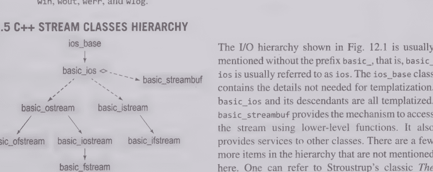

The I/O hierarchy shown in Fig. 12.1 is usually mentioned without the prefix basic_, that is, basic_ios is usually referred to as ios. The ios_base class contains the details not needed for templatization. basic_ios and its descendants are all templatized. basic_streambuf provides the mechanism to access the stream using lower-level functions. It also provides services to other classes. There are a few more items in the hierarchy that are not mentioned here. One can refer to Stroustrup's classic The C++ Programming Language for further details.

## 12.6 FORMATTED AND UNFORMATTED I/O

We have already studied about formatted I/O using cout. The operator << is usually used with cout object to support formatted output. Though not used much, there are other ways of unformatted I/O. Later on, we will see how rich formatting is possible using operator <<. Besides the default << operator, there are other ways to provide unformatted I/O.

### 12.6.1 put() and get() Functions for cout

The functions cout.get() and cout.put() are used for reading and writing to the stream. These functions are similar to getc() and putc() functions available in C. cout.get() has two different versions. The first has the prototype void get(char&) and the other has the prototype char get(void). The following program looks at both the versions and also shows how put() function is used for display. Both functions operate on char and are very simple to understand. get() reads a char at a time from the input stream and put() writes a char at a time to the output stream.

```cpp
//GetAndPut.cpp
#include <iostream>
using namespace std;

int main()
{
	char ch;
	char Data1Read[100];
	char Data2Read[100];
	for(int i = 0; ; i++)
	{
		cin.get(ch);
		if(ch == '\n')
		{
			Data1Read[i] = '\0';
			break;
		}
		Data1Read[i] = ch;
	}
	for(i = 0; ch = Data1Read[i]; i++)
	{
		cout.put(ch);
	}
	cout.put('\n');
	for(int i = 0; ; i++)
	{
		ch = cin.get();
		// Other version of get()
		if(ch == '\n')
		{
			Data2Read[i] = '\0';
			break;
		}
		Data2Read[i] = ch;
	}
	for(i = 0; ch = Data2Read[i]; i++)
	{
		cout.put(ch);
	}
	cout.put('\n');
}
```

**Output**

```
This is testing of first get and put
This is testing of first get and put
This is testing of second get and put
This is testing of second get and put
```

Note two versions of get(). The first is cin.get(ch). Here, the character read from the stream is bound to the argument (ch). In the other case ch = cin.get(), the value returned from the get() function is assigned to ch. There are no arguments to the get() function at the moment.

### 12.6.2 getLine(), read(), and write() Functions

C has gets() and puts() functions for reading and writing strings. They are better than using scanf() because scanf() with %s option has a problem of terminating when a white space is encountered, whereas gets() does not suffer from this problem. These functions also provide easier management than scanf() and printf(). A similar functionality is provided in C++ using getline(), read(), and write() functions. In addition to the string parameter for reading and writing by gets() and puts(), these three functions have one additional parameter indicating the size of the string. The prototypes for these three functions are as follows:

```
cin.getline(string variable, maximum size of string that can be input)
cin.read(string variable, maximum size of string that can be input)

cout.write(string variable, maximum size of string that can be output)
```

> scanf() terminates when a white space is encountered, whereas gets() does not suffer from this problem.

> getline() terminates when a new line is entered, whereas read() is not affected by a new line.

These functions are used with old C-style strings. The C++ strings are discussed in Chapter 15. The difference between getline() and read() is that getline() terminates when a new line is entered, whereas read() does not stop when a new line is encountered. It stops only when end of file (ctrl-Z or ^Z for DOS and Windows files, and ctrl-d or ^D for Linux or UNIX files) is encountered. getline() also stops reading from the input if end of file is specified.

Let us look at Program 12.1 to understand this. The maximum number of characters has been specified as 100 while reading, but only 50 while printing; so, some portion of the string is not printed when we write cout.write.

```cpp
//GetlineAndWrite.cpp
#include <iostream>
using namespace std;

int main()
{
	char Message[100];
	cin.getline(Message, 100);
	cout.write(Message, 50);
	cout << endl;
	cin.read(Message, 100);
	cout.write(Message, 50);
	cout.write("\n", 1) ;
}
```

**Output**

```
This is testing of getline and then we have read test
```


```
This is testing of getline and then we have read t
Now the read is being tested
It requires ctrl-Z to end
^Z
Now the read is being tested
It requires ctrl-Z to end
```

### 程序的工作原理

该程序展示了三个不同函数的用法，即 cin.getline()、cin.read() 和 cin.write()。当用户输入字符时，getline() 或 read() 只接受参数中指定的最大字符数。打印的字符数取自所读取的字符数。这就是为什么输入的字符与显示为输出的字符之间存在不匹配。

## 12.7 格式化 I/O

格式化可以通过两种不同的方式完成。第一种方法是使用内置的 ios 函数。表 12.2 列出了各种 ios 成员函数。

**表 12.2 ios 函数的使用**

| ios 成员函数 | 用途 |
| --- | --- |
| width() | 指定显示的宽度。输出将占用指定宽度。用于对齐数值项的垂直列。 |
| precision() | 指定浮点数的精度。默认精度是小数点后六位。 |
| fill() | 指定用于填充字段未使用部分的字符。通常与 width 成员函数一起使用。字段的剩余部分将用指定的字符填充。默认字符是空格。 |
| setf() | 指定控制输出显示的格式标志，如左对齐或右对齐、符号后的填充、科学计数法显示以及数字基数（如十六进制、十进制和八进制）的显示。 |
| unsetf() | 对 setf() 的操作提供撤销操作。 |

### 12.7.1 ios 的成员函数

以下所有函数的原型是：

```
<old value of stream> function_name(<specified new value>)
```

所有 ios 函数在被调用以将流设置为新值时，都会返回流的旧值。这些函数将新值设置到流中，并返回旧值。width() 函数将新宽度设置为指定的参数，并返回旧宽度。precision() 函数设置新精度并返回旧精度。类似地，fill() 返回旧的填充字符并设置新的填充字符。

### width()

它指定显示的最小字段宽度。此语句之后的输出将使用指定的宽度。它在此语句之后的第一个输出之后重置自身。以下语句的输出

```
cout.width(10);
cout << "C++";
cout << "Language";
```

将是 `SSSSSSSC++Language`。（S 用于表示输出中的一个空格。）

可以看出，`cout << "C++"` 的输出以宽度 10 提供，但 `cout << "Language"` 的输出则不是。如果想为第二个 cout 语句也提供相同的宽度设置，则应使用另一个 cout.width 为其再添加一个宽度设置，如下所示：

```
cout.width(10);
cout << "C++";
cout.width(10);
cout << "Language";
```

那么输出将是

```
SSSSSSSC++SSLanguage
```

因此，cout.width() 必须位于任何需要设置宽度的输出之前，因为它在执行一次输出后立即恢复为原始值。

**注意**

- 如果实际输出超过指定宽度，则提供完整输出，并忽略 width() 中指定的值。
- 格式化函数 width() 对单个 cout 语句起作用。之后恢复原始宽度。

### precision()

它指定精度，即小数点后要显示的位数。如前所述，默认值为六。在显示科学计数法的数字、打印精度为两位的金额数据，或对齐浮点数以实现垂直对齐时，precision 函数非常重要。

### fill()

函数 fill(char) 使用指定的填充字符填充字段随后的空余部分。它对于在支票中打印金额信息之前的 '*' 很有用。

请参考程序 12.2，以理解这三个 ios 成员函数的用途。

**程序 12.2 width()、precision() 和 fill()**

```cpp
//Width.cpp
#include <iostream>
using namespace std;

int main()
{
cout << "Roll number"; cout << "Name"; cout << "Marks" << endl;
cout << 1 << "Lara" << 355.50 << endl;
cout << 2 << "Beckham" << 275 << endl;
cout << 3 << "Steffi" << 290.75 << endl;
cout << 4 << "Jaspal" << 295 << endl;
cout << 5 << "Ranatunga" << 200.60 << endl;

cout.width(15); cout << "Roll number"; cout.width(15);
cout << "Name"; cout.width(10); cout.precision(2);
cout << "Marks" << endl;

cout.fill(' '); cout.width(15); cout << 1; cout.width(15);
cout << "Lara"; cout.width(10); cout.fill('0');
cout.precision(2); cout << 355.50 << endl;

cout.fill(' '); cout.width(15); cout << 2; cout.width(15);
cout << "Beckham"; cout.width(10); cout.fill('0');
cout.precision(2); cout << 275 << endl;

cout.fill(' '); cout.width(15); cout << 3; cout.width(15);
cout << "Steffi"; cout.width(10); cout.fill('0');
cout.precision(2); cout << 290.75 << endl;

cout.fill(' '); cout.width(15); cout << 4; cout.width(15);
cout << "Jaspal"; cout.width(10); cout.fill('0');
cout.precision(2); cout << 295 << endl;

cout.fill(' '); cout.width(15); cout << 5; cout.width(15);
cout << "Ranatunga"; cout.width(10); cout.fill('0');
cout.precision(2); cout << 200.60 << endl;
}
```

**输出**

```
Roll number  Name    Marks
1            Lara    355.5
2            Beckham 275
3            Steffi  290.75
4            Jaspal  295
5            Ranatunga 200.6

Roll number  Name    Marks
1            Lara    003.6e+002
2            Beckham 0000000275
3            Steffi  002.9e+002
4            Jaspal  0000000295
5            Ranatunga 00002e+002
```

### 程序的工作原理

同时查看未格式化和格式化的输出。格式化输出看起来比未格式化输出更好（除了名称是右对齐的，以及分数没有以正确的非科学计数法显示；我们将在程序 12.4 中很快学会将其设置正确）。现在，看一下代码。格式化语句似乎比实际输出语句还要多。在涉及显示报表或打印报表的情况下，这些语句是必需的。

可以通过使用一个执行格式化的简单函数来消除这些语句。然后应使用所需的值调用该函数。这留给读者作为练习。

现在，让我们看看如何让学号和姓名左对齐，同时让分数按其精度对齐。需要使用 setf() 函数来设置这些标志。请注意语句中 endl 的使用；它用于提供与 '\n' 相同的效果，即在输出中提供换行。它是本章 12.11 节稍后将讨论的操纵器之一。

## 12.8 设置和清除格式标志

格式标志与所使用的每个流相关联。ios_base 类定义了一个位图枚举，其中定义了 18 个标志。表 12.3 列出了格式标志及其作用。

**表 12.3 格式标志及其作用**

| 标志名 | 说明 |
| --- | --- |
| skipws | 从流中读取时跳过开头的空白字符。 |
| left | 输出左对齐。 |
| right | 输出右对齐。 |
| internal | 数值在符号或基数（0x、0 等）字符与数字之间用空格填充。 |
| oct | 输出以八进制格式显示。 |
| hex | 输出以十六进制格式显示。 |
| dec | 输出以十进制格式显示。 |
| showbase | 数值将显示基数前缀字符，例如将十六进制 1E 显示为 0x1E（在此之前还需要指定十六进制，因为默认是十进制）。 |
| uppercase | showbase 中的 x 和科学计数法中的 e 以小写显示。如果设置了 uppercase，它们将显示为 X 和 E，即大写。 |
| showpos | 在正值前显示前导 + 号。默认情况下不显示。 |
| showpoint | 即使没有小数点也会显示小数点。所有浮点值还会显示尾随零（这在前面给出的示例中是需要用到的）。 |
| scientific | 输出以科学计数法显示浮点值。 |
| fixed | 输出以定点（非科学）表示法显示。 |
| unibuf | 每次插入后刷新缓冲区。这类似于在读取后刷新流，这样就不会留下多余的字符，后续的读取语句也不会出现问题。 |
| boolalpha | 使输入的布尔值显示为 true 或 false，而不是 1 和 0。 |
| basefield | oct、dec 和 hex 的集合。如果这三个中的任何一个作为 setf() 的第一个参数，则需要将其指定为第二个参数。 |
| adjustfield | left、right 和 internal 字段的集合。如果这三个中的任何一个作为 setf() 的第一个参数，则需要将其指定为第二个参数。 |
| floatfield | scientific 和 fixed 的集合。如果这两个中的任何一个被指定为第一个参数，则需要将其指定为第二个参数。 |

所有这些字段都可以使用 cout 对象提供的 setf() 和 unsetf() 函数进行设置和取消设置。下面的程序演示了设置某些标志对输出的影响。每次设置并相应显示后，都会调用 unsetf() 函数来撤销应用该标志的效果。


## 注释

- 1. 如果我们不取消设置标志，它们将一直保持生效直到程序结束。
- 2. 设置和取消设置标志的操作是在 `ios_base` 中定义的 `fmtflags` 类型变量中设置位。可以使用按位或同时设置或取消设置多个位。

```cpp
//SetFlags.cpp
#include <iostream>
#include <string>
using namespace std;
int main()
{
    cout << "See that the effect of ios::showpos is to show leading plus sign\n";
    cout.setf(ios::showpos);
    cout << 100.0 << endl; cout.unsetf(ios::showpos); cout << endl;
    cout << "See that the effect of ios::showpoint is to show decimal point\n";
    cout.setf(ios::showpoint);
    cout << 100.0 << endl;
    cout.unsetf(ios::showpoint);
    cout << endl;
    cout << "See the effect of both the above together\n";
    cout.setf(ios::showpoint | ios::showpos);
    cout << 100.0 << endl;
    cout.unsetf(ios::showpoint | ios::showpos);
    cout << endl;
    cout << "See the effect of both upper case and scientific together\n";
    cout.setf(ios::uppercase | ios::scientific);
    cout << 100.123 << endl;
    cout.unsetf(ios::uppercase | ios::scientific);
    cout << endl;
    cout << "See how 100.123 is printed with default right alignment\n";
    cout << "and then see how it changes after left alignment\n";
    cout.width(20);
    cout << 100.123 << endl;
    cout.setf(ios::left);
    cout.width(20);
    cout << 100.123 << endl;
    cout.unsetf(ios::left);
    cout << endl;
    cout << "See the effect of using internal, which displays the sign in the left and right justifies the output, thus filling the spaces in between\n";
    cout.setf(ios::internal | ios::showpos);
    cout.width(20);
    cout << 100.123 << endl;
    cout << endl;
    cout << "Now, see the effect of fill char with internal\n";
    cout.width(20);
    cout.fill('*');
    cout << 100.123 << endl;
    cout.unsetf(ios::internal | ios::showpos);
    cout.fill(' ');
    cout << endl;
    cout << "See how truthfulness is printed as 1 by default and is changed to true when boolalpha is set with cout\n";
    bool Test = true;
    cout << Test << endl; // Displays 1
    cout.setf(ios::boolalpha);
    cout << Test << endl; // Displays true
    cout << endl;
    cout << "See how truthfulness is read as 0 or 1 by default. It now accepts false or true when boolalpha is set with cin\n";
    cout << "Please enter true or false\n";
    cin.setf(ios::boolalpha);
    cin >> Test;
    cout << Test << endl;
}
```

```text
See that the effect of ios::showpos is to show leading plus sign + 100
See that the effect of ios::showpoint is to show decimal point 100.000
See the effect of both the above together +100.000
See the effect of both upper case and scientific together 1.001230E+02
See how 100.123 is printed with default right alignment and then see how it changes after left alignment 100.123
See the effect of using internal, which displays the sign in the left and right justifies the output, thus filling the spaces in between + 100.123
Now, see the effect of fill char with internal +************100.123
See how truthfulness is printed as 1 by default and is changed to true when boolalpha is set with cout
1
true
See how truthfulness is read as 0 or 1 by default. It now accepts false or true when boolalpha is set with cin
Please enter true or false
false
false
```

## 12.9 使用带两个参数的 setf() 函数

`setf()` 函数可以有两个参数而不是一个。大多数实现要求在设置新标志时清除其他相关标志。假设某人想设置 internal 标志。它可能需要清除 left 和 right 标志。left、right 和 internal 这三个标志属于同一组，任何两个标志不能在同一时间同时处于活动状态。

对于 `unsetf()` 和带两个参数的 `setf()`，先设置第二个参数中指定的特性。执行是从右到左进行的。

早先当使用 `cout.setf(ios::left)` 时，VC++ 7.0 版本会自动执行 `unsetf(ios::right)`。这是必要的，因为 left 和 right 对齐标志不能在同一时间同时设置。如果实现没有处理取消设置，程序员需要自己处理。可以使用前面程序中使用的 `unsetf()` 函数，但更简单的是编写带两个参数的 `setf()`（作为单个 `setf()` 而不是两个 `unsetf()` 和一个 `setf()`）。

带两个参数的 `setf()` 的语法是单参数 `setf()` 的扩展。当 `setf()` 有两个参数时，两个参数的类型都是 `fmtflags`。以下语句可以写成

```cpp
cout.setf(ios::showpos, ios::showpos)
```

该语句表示如果第二个参数中存在 `showpos`，则设置 `showpos`。它在设置之前先清除 `showpos`。清除 `showpos` 是因为它在第二个参数中被提及。

如果语句如下：

```cpp
cout.setf(ios::showpos | ios::left, ios::showpos)
```

则 `ios::left` 不会被应用，因为它没有在第二个参数中指定。`setf()` 的这种奇怪行为在设置彼此互斥的值时很有用。

例如，如果写

```cpp
cout.setf(ios::left, ios::right | ios::left | ios::internal)
```

则 `ios::left` 会被设置，但在之前 `right`、`left` 和 `internal` 都将被取消设置。某些实现可能不偏爱 `setf()` 的前一种形式，需要显式 `unsetf()` 其他互斥项。更简单地写

```cpp
ios::right | ios::left | ios::internal
```

因为它与 C++ 提供的 `ios::adjustfield` 相同。因此，代码现在简化为

```cpp
cout.setf(ios::left, ios::adjustfield)
```

在大多数系统中，编写 `cout.setf(ios::left)` 和 `cout.setf(ios::left, ios::adjustfield)` 会产生相同的结果，但后者更好，因为它也适用于那些需要显式取消设置系统的系统。

同样，`ios::basefield` 与 `ios::oct | ios::dec | ios::hex` 相同。因此，要以十六进制显示，需要写

```cpp
cout.setf(ios::hex, ios::basefield)
```

请考虑程序 12.3，它解释了使用带两个参数的 `setf()`。

### 程序 12.3 带两个参数的 setf()

```cpp
//Set2ArgFlags.cpp
#include <iostream>
#include <string>
using namespace std;

int main()
{
    cout << "See that the effect of ios::showpos is to show leading plus sign\n";
    cout.setf(ios::showpos, ios::showpos);
    cout << 100.0 << endl;
    cout.unsetf(ios::showpos);
    cout << endl;
    cout << "See that the effect of ios::showpoint is to show decimal point\n";
    cout.setf(ios::showpoint, ios::showpoint);
    cout << 100.0 << endl;
    cout.unsetf(ios::showpoint);
    cout << endl;
    cout << "See the effect of both the above together\n";
    cout.setf(ios::showpoint | ios::showpos, ios::showpoint | ios::showpos);
    cout << 100.0 << endl;
    cout.unsetf(ios::showpoint | ios::showpos);
    cout << endl;
    cout << "See the effect of scientific \n";
    cout.setf(ios::scientific, ios::floatfield);
    cout << 100.123 << endl;
    cout.unsetf(ios::uppercase | ios::scientific);
    cout << endl;
    cout << "See how 100.123 is printed with default right alignment\n";
    cout << "and then see how it changes after left alignment\n";
    cout.width(20);
    cout << 100.123 << endl;
    cout.setf(ios::left, ios::adjustfield);
    cout.width(20);
    cout << 100.123 << endl;
    cout.unsetf(ios::left);
    cout << 100.123 << endl;
    cout.setf(ios::hex, ios::basefield);
    cout << 100 << endl;      // Prints 64
    cout.setf(ios::oct, ios::basefield);
    cout << 100 << endl;      // Prints 144
    cout.setf(ios::dec, ios::basefield);
    // cout << 100 << endl;      // Prints 100
    cout.setf(ios::showbase);   // Prints the base
    cout.setf(ios::hex, ios::basefield);
    cout << 100 << endl;      // Prints 0x64
    cout.setf(ios::oct, ios::basefield);
    cout << 100 << endl;      // Prints 0144
    cout.setf(ios::dec, ios::basefield);
    cout << 100 << endl;      // Prints 100
}
```

### 输出

```text
See that the effect of ios::showpos is to show leading plus sign
+ 100
See that the effect of ios::showpoint is to show decimal point
100.000
See the effect of both the above together
+100.000
See the effect of scientific
1.001230e+002
See how 100.123 is printed with default right alignment and then see how it changes after left alignment
100.123
100.123 100.123
64
144
100
0x64
0144
100
```


### 程序的工作原理

请注意，大多数 setf() 语句都是在单参数版本中成功使用过的。用于设置基数的 setf() 在某些安装中可能无法工作。在这种情况下，需要提供双参数 setf() 才能正确打印。结论是，如果希望程序在各种平台上具有可移植性，使用双参数 setf() 更安全，即使它可能有点繁琐。

程序 12.2 被重写为程序 12.4，以便将名称左对齐显示，并且分数不以科学计数法显示。

### 程序 12.4 打印成绩单

```cpp
//MarksheetPrinting.cpp
#include <iostream>
using namespace std;

int main()
{
    cout.width(15);
    cout.setf(ios::left); cout.setf(ios::fixed); cout.precision(2); cout.setf(ios::showpoint);
    /* The same code that we had in Program 12.2 comes here */
}
```

### 输出

| 学号 | 姓名 | 分数 |
|-------------|------|-------|
| 1 | Lara | 355.50 |
| 2 | Beckham | 275.00 |
| 3 | Steffi | 290.75 |
| 4 | Jaspal | 295.00 |
| 5 | Ranatunga | 200.60 |

### 程序的工作原理

这里重要的行是：

```cpp
cout.setf(ios::left); cout.setf(ios::fixed); cout.precision(2); cout.setf(ios::showpoint);
```

> 设置和取消设置多个标志是通过使用管道字符进行组合完成的（按位或）

输出是左对齐的，并且浮点数以非科学格式显示。精度设置为两位，用于以小数点后两位显示分数，并在不需要时也显示小数点。这是为了使分数能够正确对齐。

## 12.10 检查和清除标志

可以使用 setf() 函数找到哪些标志被设置，也可以使用它来清除它们。setf() 的参数类型为 fmtflags。它在 ios 中定义为位掩码的枚举。

> setf() 函数的参数类型为 fmtflags，它是位掩码的枚举。

本章中描述的每个 ios 函数都以 fmtflags 的形式返回流的先前状态。cout 也有作为成员函数的 flags 函数，它返回标志设置。让我们看一下程序 12.5 来了解如何使用它。

```
000000100000000 Internal
000000010000000 Right
000000001000000 Left
00000000001000 Showpoint
00000000000100 Upper case
00000000000001 Skip white space
011000000000000 Float field
000000111000000 Adjust field
000111000000000 Base field
```

### 程序的工作原理

我们需要查看从 flags 函数返回的值的最后 14 位。它是一个 long 变量。我们从变量 Flag1By1 开始，给它 4,000 hex。也就是说，从左边数第 14 位为 1，其余位都为 0。我们将相同的值（4,000 hex）与从 flags 函数接收到的状态进行按位与运算。如果结果为 1，则表示状态中第 14 位被设置。它表示 boolalpha 标志已打开。然后我们将 Flag1By1 右移一位以获取第 13 位，并重复该过程，直到检查完最后一位。我们继续直到 Flag1By1 的值变为零，即检查完状态的每一位。

但为什么显示 showpos 状态的行被注释掉了？观察取消注释该行后的输出。有问题吗？解决这个问题的办法留给读者作为练习。

## 12.11 操纵符

操纵符是用于格式化的特殊函数。它们可以完成 ios 成员函数所能完成的所有格式化工作。那么我们为什么需要操纵符和 ios 函数两者呢？在某些情况下操纵符更好，并提供了解决相同问题的另一种方法。选择使用操纵符还是 ios 函数来解决格式化问题有时取决于用户的偏好。此外，还有一些其他差异。我们将在检查操纵符如何替代 ios 函数后讨论这些差异。

### 12.11.1 使用操纵符代替 ios 函数

表 12.4 列出了一些操纵符及其等效的 ios 函数。

### 表 12.4 操纵符及其等效的 ios 函数

| 操纵符 | 等效 ios 函数 |
|---|---|
| setw() | width() |
| setprecision() | precision() |
| setfill() | fill() |
| setiosflags() | setf() |
| resetiosflags() | unsetf() |

现在让我们看一下以下程序，它是一个示例代码，展示了如何使用操纵符代替 ios 函数。程序 12.4 已修改如下：

```cpp
//Manipulator1.cpp
#include <iostream>
#include <iomanip>
using namespace std;
int main()
{
cout << setw(15) << setiosflags(ios::left)
<< setiosflags(ios::fixed) << setprecision(2)
<< setiosflags(ios::showpoint);
cout << "Roll number" << setw(15) << "Name" << setw(10) << setprecision(2)
<< "Marks" << endl;
cout << setw(15) << 1 << setw(15) << "Lara" << setw(10) << setprecision(2) << 355.50
<< endl;
/* setw and setprecision are required in each cout as their setting stays for only one cout statement */
cout << setw(15) << 2 << setw(15) << "Beckham" << setw(10)
<< setprecision(2) << 275.00 << endl;
cout << setw(15) << 3 << setw(15) << "Steffi" << setw(10)
<< setprecision(2) << 290.75 << endl;
cout << setw(15) << 4 << setw(15) << "Jaspal" << setw(10)
<< setprecision(2) << 295.0 << endl;
cout << setw(15) << 5 << setw(15) << "Ranatunga" << setw(10)
<< setprecision(2)<< 200.60 << endl;
}
```

该程序的输出与使用 ios 函数编写的程序 12.4 相同。
该程序使用操纵符，而程序 12.4 使用 ios 函数。操纵符和 ios 函数之间存在一些差异。操纵符和 ios 函数之间的差异在第 12.11.2 节中列出。

### 12.11.2 操纵符和 ios 函数之间的差异

操纵符和 ios 函数之间的差异如下：

- 1. 与 ios 函数不同，操纵符不返回先前的状态。假设某人想将当前宽度更改为 15，然后恢复到之前的宽度，或将精度更改为 2，然后切换回之前的精度，这在使用 ios 函数时是可能的。请看以下代码。

  ```
  int PrevWidth = width(15);
  int PrevPrecision = precision(2);
  /* Call a third-party function that might change the settings */
  width(PrevWidth);
  precision(PrevPrecision);
  ```

当它作为函数的一部分时，并且不希望用户在调用函数时应用他/她的设置时，这种代码段更好。

> 注意 对流所做的格式更改是全局的。无论在何处对 cin 或 cout 进行格式化，都会影响整个程序。要编写一个万无一失的函数，我们必须设置所需设置，然后在退出时取消所有设置以恢复到先前的设置。因此，在必须保留标志先前值的情况下，ios 可能会很有用。

- 2. 操纵符具有明显的优势。可以编写我们自己的操纵符并在程序中使用它。因此，使用操纵符的程序可以定义自己的操纵符并用于打印成绩单。这使得程序更具可读性和简洁性。我们将在第 12.11 节学习如何做到这一点。可以重载对象的 ‘<<’ 运算符，以便使用函数（或操纵符）以格式化方式显示。

- 3. ios 函数是单一的。它们不能组合以同时产生多种效果。必须写

  ```
  cout.precision(2);
  cout.width(15);
  ```

作为两个独立的句子。相反，可以将操纵符组合如下：

  ```
  cout << setprecision(2) << setw(15)
  ```

当需要大量格式化选项时，操纵符更容易编写并产生更具可读性的代码。

- 4. ios 函数只需要 <iostream> 文件，而操纵符需要额外包含 <iomanip> 文件。

- 5. 对于某些操纵符，没有等效的 ios 函数。其中一个例子是 endl，它输出换行符。作为附加工作，它还会刷新流。另一个例子是 boolalpha。它用于打开或关闭以 true 或 false 而不是一或零显示布尔值。我们在 ios 函数中有 setf() 等价物来执行此操作

  ```
  cout.setf(ios::boolalpha)
  ```

并且还使用 setiosflags 如下：

  ```
  cout << setiosflags(ios::boolalpha)
  ```

然而，可以编写 cout << boolalpha 来使用简单表示法获得相同的效果。几乎所有标志都有类似的操纵符，我们可以使用 setiosflags 设置它们。因此，在使用操纵符时几乎不需要使用 setiosflags，而在使用 ios 函数进行此类工作时需要使用 setf()。这种操纵符被称为简写操纵符。

- 6. 当操纵符不带参数时，它是无括号传递的，即 ()。例如，我们不使用 endl()。而只使用 endl。同样，只使用 hex 而不是 hex()。相反，ios 函数不能不带括号调用。

- 7. 一些操纵符需要成对使用以提供切换效果，例如 showbase 和 noshowbase，boolalpha 和 noboolalpha，showpoint 和 noshowpoint 等。没有这样的 ios 函数。需要使用相应的参数使用 setf() 和 unsetf() 函数来实现相同的效果。

- 8. ios 函数是成员函数（静态函数，可以调用为 ios::<function>），而操纵符是非成员函数。

## 12.12 使用操纵符

在本节中，我们将讨论使用操纵符的更多方法。我们可以使用操纵符左对齐或右对齐，以大写或小写显示，用特定字符填充范围，将布尔值显示为 true 或 false 等。


### 12.12.1 使用操纵符设置和测试标志

下面的程序演示了如何使用操纵符设置和重置标志。我们在第 12.8 节已经见过一个类似的 ios 函数示例。

```
//SetFlagManip.cpp
#include <iostream>
#include <string>
#include <iomanip>
using namespace std;
int main()
{
    cout << "See that the effect of ios::showpos is to show leading plus sign\n";
    cout << setiosflags(ios::showpos) << 100.0 << endl
         << resetiosflags(ios::showpos) << endl;
    cout << "See that the effect of ios::showpoint is to show decimal point\n";
    cout << setiosflags(ios::showpoint) << 100.0 << endl
         << resetiosflags(ios::showpoint) << endl;
    cout << "See the effect of both the above together\n";
    cout << setiosflags(ios::showpoint | ios::showpos) << 100.0 << endl <<
         resetiosflags(ios::showpoint | ios::showpos) << endl;
    cout << "See the effect of both upper case and scientific together\n";
    cout << setiosflags(ios::uppercase | ios::scientific) << 100.123 << endl <<
         resetiosflags(ios::uppercase | ios::scientific) << endl;
    cout << "See how 100.123 is printed with default right alignment\n";
    cout << "and then see how it changes after left alignment\n";
    cout << setw(20) << 100.123 << endl << setiosflags(ios::left) << setw(20) << 100.123
         << endl << resetiosflags(ios::left) << endl;
    cout << "See the effect of using internal, which displays the sign in the left and right justifies the output, thus filling the spaces in between\n";
    cout << setiosflags(ios::internal | ios::showpos) << setw(20) << 100.123 << endl;
    cout << "Now see the effect of fill char with internal\n";
    cout << setw(20) << setfill('*') << 100.123 << endl
         << resetiosflags(ios::internal | ios::showpos) << setfill(' ')
         << endl;
    cout << "See how truthfulness is printed as 1 by default and is changed to true when boolalpha is set with cout\n";
    bool Test = true;
    cout << Test << endl;// This will display 1
    cout << setiosflags(ios::boolalpha);
    cout << Test << endl;// This will display true
    cout << "See how truthfulness is read as 0 or 1 by default. It now accepts false or true when boolalpha is set with cin\n";
    cout << "Please enter true or false\n";
    cin >> setiosflags(ios::boolalpha);
    cin >> Test;
    cout << Test << endl;
}
```

可以用简单的 `showpos` 来代替。程序 12.6 演示了如何使用这种简写操纵符。

```
PROGRAM 12.6 Shorthand Manipulators

//SetFlagDirectManip.cpp
#include <iostream>
#include <string>
#include <iomanip>
using namespace std;

int main()
{
cout << "See that the effect of showpos is to show leading plus sign\n";
cout << showpos << 100.0 << endl << noshowpos << endl;
cout << "See that the effect of showpoint is to show decimal point\n";
cout << showpoint << 100.0 << endl << noshowpoint << endl;
cout << "See the effect of both of the above together\n";
cout << showpoint << showpos << 100.0 << endl << noshowpoint << noshowpos << endl;
cout << "See the effect of both upper case and scientific together\n";
cout << uppercase << scientific << 100.123 << endl << nouppercase << fixed << endl;
cout << "See how 100.123 is printed with default right alignment\n";
cout << "and then see how it changes after left alignment\n";
cout << setw(20) << 100.123 << endl << left << setw(20) << 100.123 << endl << right << endl;
cout << "See the effect of using internal, which displays the sign in the left and right justifies the output, thus filling the spaces in between\n";
cout << internal << showpos << setw(20) << 100.123 << noshowpos << endl;
cout << "Now see the effect of fill char with internal\n";
cout << setw(20) << setfill('*') << 100.123 << endl << internal << showpos << setfill(' ') << endl;
}
```

该程序与 12.12.1 节中带有 `setiosflags` 的程序类似，输出也类似。重要的是可以看到简写操纵符更简短、更易于使用。例如，请看 12.12.1 节程序中的以下语句：

```
cout << setiosflags(ios::showpos) << 100.0 << endl << resetiosflags(ios::showpos) << endl;
```

现在，在程序 12.6 中它们被转换为如下一条语句：

```
cout << showpos << 100.0 << endl << noshowpos << endl;
```

该程序包含了所有此类操纵符的类似示例。

还可以定义操纵符以满足特定需求。程序 12.7 演示了如何编写和使用自定义操纵符。该示例打印成绩单，与之前讨论的程序 12.4 的输出相比，现在的形式要好得多。

### 程序 12.7 用户自定义操纵符

```
//ManipMarksheetPrint.cpp
#include <iostream>
#include <iomanip>
using namespace std;

// First manipulator
ostream & PrintHeading(ostream & TempOut)
{
    TempOut << setw(80) << setiosflags(ios::left);
    TempOut << "GLS Higher Secondary School" << endl
            << setw(80) << "Standard XII" << endl;
    return TempOut;
}

// Second manipulator
ostream & PrintMarksheetHeading(ostream & TempOut)
{
    TempOut << setw(15) << setiosflags(ios::left) << setiosflags(ios::fixed) << setprecision(2)
            << setiosflags(ios::showpoint);
    TempOut << "Roll number" << setw(15) << "Name" << setw(10)
            << setprecision(2) << "Marks" << endl;
    return TempOut;
}

// Third manipulator
ostream & PrintLine(ostream & TempOut)
{
    TempOut << "----------";
    TempOut << endl;
    return TempOut;
}

int main()
{
    cout << PrintLine;
    cout << PrintHeading << PrintLine << PrintMarksheetHeading;
    cout << PrintLine;
    cout << setw(15) << 1 << setw(15) << "Lara" << setw(10) << setprecision(2) << 355.50 << endl;
    cout << setw(15) << 2 << setw(15) << "Beckham" << setw(10)
         << setprecision(2) << 275.00 << endl;
    cout << setw(15) << 3 << setw(15) << "Steffi" << setw(10)
         << setprecision(2) << 290.75 << endl;

    cout << PrintLine;
}
```

### 输出

GLS Higher Secondary School Standard XII
Roll number    Name    Marks
1              Lara    355.50
2              Beckham 275.00
3              Steffi  290.75

在退出时会被销毁，因此输出是垃圾值。这些论点与我们之前在使用重载的 `<<` 和 `>>` 时，赞成传递和返回引用的论点类似。

## 12.13.2 使用函数进行格式化

也可以使用函数来代替重复的相同格式化代码。下面的程序演示了如何做到这一点。在示例中，`FormatPrint()` 函数以要求的格式打印传递给它的数据。

操纵符适合无参数的格式化，而函数可用于带参数的格式化。也可以使用带参数的操纵符进行格式化，但比较繁琐。将两者结合起来，就可以为我们的项目制作专业质量的报表工具。

```
//FinalMarksheet.cpp
#include <iostream>
#include <string>
#include <iomanip>
using namespace std;
/* Here we have three manipulators defined earlier in Program 12.7 */
void FormatPrint(int TempRollNo, string TempName, float TempMarks);
int main()
{
    cout << PrintLine;
    cout << PrintHeading << PrintLine << PrintMarksheetHeading;
    cout << PrintLine;
    FormatPrint(1, "RamChandra", 275.0);
    FormatPrint(2, "Beckham", 275.0);
    FormatPrint(3, "Steffi", 290.75);
    FormatPrint(4, "Jaspal", 295.0);
    FormatPrint(5, "Ranatunga", 200.60);
}
void FormatPrint(int TempRollNo, string TempName, float TempMarks)
{
    cout << setw(15) << TempRollNo << setw(15) << TempName << setw(10) << setprecision(2) << TempMarks << endl;
}
```

该程序的输出与不带函数的版本相同。

## 小结

- 流将输入/输出设备与程序的 I/O 操作连接起来。
- 计算机程序的 I/O 操作是相对于流来编写的，而不是相对于设备来编写的。
- 与计算机程序的 I/O 操作相连的流，在另一端连接到 I/O 设备。
- 处理流有两种不同的方式。无格式处理方式不需要任何


格式化语句应在输出或输入之前指定。不过，大多数情况下都需要进行格式化。

- 在 C++ 中，格式化有两种不同的方式，即使用 `ios` 成员函数和使用操纵符。
- `ios` 函数会返回原有的格式，而操纵符更灵活，也更容易使用。
- 函数 `width()` 类似于操纵符 `setw()`，`fill()` 类似于操纵符 `setfill()`，依此类推。
- `ios` 函数包括 `setf()` 函数。该函数可用于多种用途。它有两个版本，一个带单个参数，另一个带两个参数。
- 有一个成员函数 `flags()`，它返回标志设置。
- 我们还可以构造自己的操纵符，并在程序中有需要的地方使用它们。

## 关键词

- **设备驱动程序：** 由设备制造商编写的例程，用于在设备与计算机连接后使其正常工作。
- **`ios` 中的格式函数：** 这些函数定义在 `ios_base` 类中，用于格式化。作为成员函数，它们通过 `cout` 对象后面的点（.）调用。
- **操纵符：** 这些函数不是成员函数，但提供了与 `ios` 函数类似的格式化机制。
- **命名空间：** 一种用于容纳函数、类和变量的容器，以将它们与其他实体分隔开。
- **简写操纵符：** 有些操纵符可作为较长版本的简写，例如，用 `boolalpha` 代替 `setiosflags(ios::boolalpha)`。这些被称为简写操纵符。
- **流：** 流是一种概念上的管道式结构，一端连接到程序，另一端在默认情况下连接到键盘、屏幕或文件。可以改变一端的指向，同时保持另一端不变。

## 练习

## 选择题

1. 与 C 语言的 I/O 相比，C++ 的 I/O 使用起来 __________。
   - (a) 更容易
   - (b) 更难
   - (c) 适中
   - (d) 绝不容易

2. 以下哪个函数用于指定浮点数的精度？
   - (a) `width()`
   - (b) `precision()`
   - (c) `setf()`
   - (d) `unsetf()`

3. 以下哪个函数会撤销 `setf()` 所完成的操作？
   - (a) `width()`
   - (b) `precision()`
   - (c) `setf()`
   - (d) `unsetf()`

4. 每次 `setf()` 及相应的显示之后，我们都需要调用 __________ 函数来撤销应用格式标志的效果。
   - (a) `setf()`
   - (b) `unsetf()`
   - (c) `clear()`
   - (d) 以上任意一个

5. __________ 在概念上是用于提供 I/O 的管道式结构。
   - (a) 文件
   - (b) 设备
   - (c) 两者都是
   - (d) 都不是

6. 以下语句的输出是什么？（S 表示空格）

   ```cpp
   cout.width(5);
   cout << "C++";
   cout.width(5);
   cout << "C++";
   ```

   - (a) SSSSSSC++C++
   - (b) SSC++SSC++
   - (c) SSSSSC++C++
   - (d) SSSSSC++SSSSSC++

7. 我们可以编写 __________ 并在程序中使用它。
   - (a) 我们自己的操纵符
   - (b) 我们自己的 `ios` 函数

## 第 13 章：使用文件进行输入/输出

## 学习目标

- 输入/输出（I/O）与其他操作之间的区别
- 参与 I/O 操作的实体
- `<fstream>` 头文件及其用途
- 文本流和二进制流
- 文件操作——打开、关闭、读取、写入、检查文件末尾和错误处理
- I/O 模式及相关操作
- 对象持久化与序列化

### 13.1 输入/输出的特殊性

到目前为止，我们已经了解了 C++ 执行的许多操作，例如从类构造对象、处理对象的创建和超出作用域，以及在类继承时使虚基类的作用可见。然而，输入/输出（I/O）操作是特殊的，因为它们需要借助操作系统（OS）和设备驱动程序来完成。展示 13.1 和 13.2 分别描述了操作系统和设备驱动程序。

### 展示 13.1 操作系统

操作系统是用户与计算机之间的主要接口。DOS、Windows、Unix 和 Linux 都是操作系统的例子。除 I/O 之外，没有其他操作需要操作系统积极参与。编译器和 C++ 对象模型会以适合它们的形式处理这些操作。然而，I/O 操作并不属于 C++ 编译器或运行时系统的直接管辖范围。C++ 系统必须与其他实体同步工作才能完成这项工作。

### 展示 13.2 设备驱动程序

设备驱动程序是一个小程序，随我们连接到计算机的每个设备一起提供，无论是硬盘、扫描仪、鼠标、网络摄像头还是其他附加设备。这个小程序充当操作系统与设备之间的解释器。当操作系统发出命令时，驱动程序使设备理解该命令。

让我们看一个例子，了解其他实体在 I/O 中的作用。假设有人在命令提示符下输入 `type <filename>`，双击某个文件，或者在 Linux 控制台中输入 `cat <filename>`，操作系统会向设备驱动程序发出请求，要求打开所需文件。设备驱动程序随后将消息传递给磁盘；当磁盘响应消息时，设备驱动程序将其传递给操作系统。然后，操作系统将其传递给屏幕。通常不可能直接访问设备，必须通过特定的操作系统调用来完成。因此，C++ 程序无法自行执行 I/O 操作。人们可能会想，流到哪里去了？流是接口，而不是参与操作的实体，因此这里不讨论它们。既然我们已经学过流，就没有必要再对这个主题做进一步探讨。

> C++ 程序无法自行执行 I/O 操作。它必须依赖操作系统和设备驱动程序来访问设备。

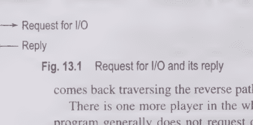

图 13.1 I/O 请求及其回复

图 13.1 展示了 C++ 程序的 I/O 请求如何通过操作系统和设备驱动程序到达实际设备，以及回复如何沿着相反路径返回。

整个过程中还有一个参与者，图 13.1 中并未显示。C++ 程序通常不会直接向操作系统发出请求，而是从标准库中调用一个 I/O 函数。标准库随 C++ 编译器一同提供，并在安装 C++ 时可用。这个 I/O 函数反过来向操作系统发出请求，并在回复返回时将其传回给程序。

标准库和 I/O 函数使程序员的工作变得简单。程序员只需调用 `fopen()` 来打开文件（或者在 C++ 中调用 `.open()`，我们将在 13.2 节中学习）。`fopen()` 函数来自标准库，它处理了所有复杂细节。程序员无需担心使用任何操作系统接口，这些接口通常比使用 `fopen()`、`fclose()` 等标准库函数要复杂得多。这种间接性还有一个原因：它使程序更具可移植性。无论在哪里安装 C，`fopen()` 函数都存在；安装 C++ 时，`.open()` 也可用。

如果操作系统发生变化，`fopen()` 的实现（`fopen()` 的编写方式，可能是汇编语言）可能会不同，但其调用方式保持不变。也就是说，程序在不同的操作系统下运行时无需更改。

**注意：** 作为程序员，我们无法直接控制 I/O 设备进行读写。这其实对我们有利。为什么？因为设备和它们的驱动程序不断变化，确保与现有程序的兼容性是驱动程序设计者的责任。因此，我们不必为了适应升级后的驱动程序的当前要求而修改现有程序。

### 13.2 输入/输出的过程

设备在设备驱动程序的控制下执行 I/O 操作，而设备驱动程序接受操作系统的命令。如果程序员希望使用设备执行 I/O 操作，则必须向操作系统提出相应的请求。见图 13.2。

由于不同的操作系统采用不同的机制来提供 I/O，很难为所有 C++ 编译器提供统一的 I/O 标准。这种标准化是通过提供标准 I/O 库来实现的。C++ 程序员看到的是 I/O 库提供的接口，而不是其实现。程序员会关注 `fwrite()`、`fread()`、`fopen()` 和 `fclose()` 等函数，而不是这些函数实际上如何与操作系统通信。

**注意：** 像 `cin.getline()` 和 `cin.read()` 这样的函数非常容易使用。库的设计试图将依赖于操作系统的细节深藏在实现中。例如，当使用 `cin.getline()` 时，程序员并不知道 `cin.getline()` 函数是如何编写的。VC++ 中的 `getline()` 函数与 GNU C++（Linux）中的编码方式不同。一条简单的经验法则是：在标准化库函数调用方面付出的努力越多，程序员使用起来就越容易。同一个 C++ 程序应该能在所有编译器上工作。C++ 标准 I/O 库正是朝着这个方向迈出的一步。


文本文件可以使用文本编辑器读取，而二进制文件只能使用程序打开。

文件句柄是由操作系统分配的唯一标识符，用于识别不同的文件。

2. 第二步是请求物理文件与逻辑文件的关联。如果我们处理的是已存在的文件，这是第一步。这是一种将我们在程序中处理的、例如“InputFile”的文件链接到操作系统所知的“Input.dat”文件的链接方式。此步骤还涉及指定链接的类型，即如果我们只想从物理文件读取、只向其写入、同时进行读写等。此规范称为文件模式。可以在不同时间以不同模式打开同一个物理文件，可能由同一程序完成。我们可以以写模式打开文件，关闭文件，然后以读模式重新打开文件。

3. 当我们描述正在打开的文件的不同模式时，我们通常是在指定将要工作的流。指定流是第三步。与 C++ 文件关联有两种类型的流。默认流是文本。 使用文本流创建的文件称为文本文件，可以在不使用程序的情况下读取。 任何标准的文本编辑器，如记事本、vi 或 edit 都可以用来打开和读取该文件。另一种类型的流称为二进制流。 二进制流文件称为二进制文件。它们只能使用程序打开和读取。尽管二进制文件有这样的限制，但它们通常更适合商业程序。第 13.4 节阐述了文本流和二进制流之间的差异。

注意 为了提供 I/O 操作，首先，为文件分配磁盘空间并分配缓冲区，其次，将物理文件名与逻辑文件名关联，第三，指定你要访问文件的方式（文本或二进制）。

4. 当我们完成这三个操作后，文件就被打开了，可以使用。操作系统为我们的文件提供一些缓冲区来存储中间数据。它还为我们提供一个唯一的标识符，通常称为文件句柄，来描述该文件。从这一点开始，我们对文件的所有操作请求都将带有此标识符。句柄在我们的上下文中由逻辑文件名表示。我们永远不会在程序中使用实际的句柄。相反，我们将使用逻辑文件名来访问文件。

注意 所有指定了逻辑文件名的 I/O 函数都将其映射到文件句柄。操作系统将使用指定的句柄对指定的文件进行操作。

操作系统分配的缓冲区可能是读缓冲区或写缓冲区。读缓冲区在文件内容从磁盘读取时需要，写缓冲区在程序打算写入磁盘时需要。缓冲区使批量读写操作成为可能。

注意 如果我们使用 C 进行低级 I/O，我们将在程序中直接使用文件句柄。例如，对低级读函数的调用可能看起来像 fd = read(...)，其中 fd 是文件句柄。句柄是存储文件相关信息的数组的索引。尽管我们使用逻辑文件名来寻址文件（类似于 Student in fprintf(Student, "This is testing");），但操作系统在内部将文件名转换为 ID。为了进行类比，假设我们是某公司的客户。该公司已为我们分配了一个客户 ID。我们被要求在与公司的所有对话中引用该客户 ID。此客户 ID 等同于文件句柄。

展览 13.3 描述了文件指针和文件句柄。

## 使用文件进行输入/输出 501

## 展览 13.3 文件指针和文件句柄

文件指针在两种不同的上下文中有两种不同的含义。当我们处理文件句柄来访问文件时，文件句柄有时被称为文件指针。在 C 中，习惯上文件句柄被称为文件指针，通常写为

```FILE *fp;```

其中 fp 实际上是一个句柄但被称为指针。文件指针的另一种含义是文件中下一次读或写要发生的位置。

> 文件模式有三种，即读、写和读写。

> 操作文件后很重要要关闭文件。它有助于刷新分配的缓冲区。

- 5. 接下来是对文件的读写操作。操作系统对读写操作的接受取决于为两种类型的流打开文件的模式。例如，如果文件以读或读写模式打开，我们可以从中读取。如果文件以写模式打开，我们就不能从中读取。有时，在读取文件之前，我们希望到达文件中的特定位置。这对于两种类型的流都是可能的，尽管在大多数情况下它仅在二进制文件中才有用。
- 6. 与文件相关的最后一个操作是关闭文件。当文件不再使用时，操作系统决定关闭它。操作系统会释放与之关联的缓冲区并释放句柄。如果有要释放的写缓冲区，则在开始释放之前会将其完全写入文件。这称为刷新操作。如果需要，用户可以在不关闭文件的情况下自行启动刷新操作。

> **注意** 通过包含头文件 <fstream>，我们就可以访问类 ifstream（输入文件流）、ofstream（输出文件流）和 fstream（文件流），它们分别用于输入模式文件、输出模式文件和 I/O 模式文件。因此，<fstream> 是我们在操作文件时需要的重要头文件。

## 13.4 文本流和二进制流

有两种不同类型的流，即文本流和二进制流。

文本流以 ASCII 形式接受数据。如果键入 0，则会插入 0 的 ASCII 值，即 48。如果按下 <Enter> 键，则在 Windows 环境中会插入两个字符，即 CR 和 LF（回车和换行）。这称为转换。当重新读取时，需要再次进行转换，将 CR-LF 转换为 <Enter> 键的视觉解释。

二进制流是纯二进制流；当键入 0 时，二进制零会被插入到流中。当写入二进制流时，不会进行任何转换。例如，如果用户在二进制文件中输入 15，则等效于 15 的二进制值（000000111）会被输入到流中。相反，文本文件将其转换为 1 和 5 的 ASCII 值，然后将其发送到流中。同样，如果用户按下 <Enter> 键，则只发送值 13，而不像文本文件那样发送两个值。这意味着当读取时，二进制中不需要转换。

使用文本流创建的文件在更通用意义上更通用，因为它们可以在不依赖源程序的情况下使用文本编辑器进行操作。相反，使用二进制流创建的文件仅限于创建该文件的应用程序。人们可以创建一个包含客户数据（如 customer_id、name、address 和 items）的二进制文件。现在，此文件只能由知道该文件确切结构的特定 C++ 程序打开。其他任何应用程序都无法打开该文件。文本流文件和二进制流文件之间的差异总结如下：

- 1. 文本文件由 ASCII 字符组成，即存储的信息以表示其 ASCII 等效值的二进制值的形式存在。如果要存储 A，则存储为 65。如果要存储 0，则存储为 48。在二进制文件的情况下，数字以数字形式存储，即 0 存储为二进制零，尽管字符仍存储为其 ASCII 等效值。
- 2. 文本文件的存储和检索可能需要字符转换。即，从屏幕读取的字符数在写入文件或从文件中读取时可能不同。对于二进制文件则不是这种情况。
- 3. 文本文件记录由 CR-LF 序列（在 Windows 中）分隔，在 Linux 和 Unix 中由 CR 分隔。每个可见行在文本文件中形成一条记录。除非特别注意使所有行的字符数相同，否则每条记录（行）将具有不同的大小。在使用二进制文件时，记录通常大小相同。因此，也可以为用户提供随机访问。即，到达第一条记录、第十条记录或第 n 条记录是可能的。在文本文件中，如果不知道该记录的确切位置，就无法到达特定记录。
- 4. 文本文件更通用。它们可以由其他编辑器打开，也可以由 DOS 的 type 和 Unix 的 cat 等操作系统命令打开。也可以用 COBOL 等其他语言编写的程序打开 C++ 程序创建的文本文件。
- 5. 相反，二进制文件没有那么灵活。它们以字节形式由 C++ 存储。原始记录格式不会保存在文件中。例如，如果在我们的客户文件中，项目是 customer id（int），然后是 30 个字符的客户名称，然后是 60 个字符的地址，那么只有了解此设计的程序才能打开和操作此文件。任何不了解此设计的其他程序都可能能够打开该文件，但它只会得到字节，因为这些程序不知道如何解释这些字节。这意味着此类程序将无法有效地操作这些文件。任何文本编辑器都无法操作该文件。操作系统命令也无法显示此类文件的内容。即使显示出来，内容也无法辨认（因为操作系统命令假设输入为 ASCII）。尝试在屏幕上键入 '.exe' 文件并查看输出。表 13.1 简要说明了所有差异。

## 表 13.1 文本流和二进制流文件之间的差异

| Criterion | Text | Binary |
|---|---|---|
| Char representation | ASCII | ASCII |
| Digit representation | ASCII | binary |
| Char conversion | Done | Not done |
| Separated by | CR or CR-LF | Size |
| Size of every record | May or may not be equal | Equal |
| Who can open | Any editor or program | Only programs |
| Portability across various platforms | Yes | No |


## 13.5 打开和关闭文件

在使用文件之前，必须先对其进行初始化。必须向操作系统发起请求以打开文件，并获取一个文件句柄。如前所述，文件句柄通常是文件信息数组中保存当前使用文件信息的一个索引。它存储或指向有关文件所有者、文件权限、文件指针当前位置等信息。借助这样一个文件句柄，用户将能够操作该文件的内容，但在我们这种情况下，我们不会直接操作它。对 I/O 函数的调用将执行该操作。打开文件还会执行一个额外操作：操作系统在收到打开文件的请求后，会根据模式为该文件分配一些读缓冲区和/或写缓冲区。例如，如果文件以只读模式打开，则只分配读缓冲区。

> 当我们调用 I/O 函数时，该函数会将我们提供的逻辑名称映射到文件句柄，并使用该文件句柄访问操作系统服务。

> 注意
> 操作系统根据其处理速度，同一时间只能处理少量文件。操作系统只能分配有限数量的文件句柄。除非我们关闭文件或终止程序，否则已分配的文件句柄不会归还给操作系统。如果尝试打开的文件数超过操作系统所能处理的数量，程序将无响应。因此，我们必须正确地关闭文件。

对于文本文件，在文件关闭时，文件末尾会写入一个特殊字节来指示文件结束。这个字节在操作系统中称为 EOF（文件结束）标记；在 Windows 中为 ^Z（Ctrl-Z），在 Unix 或 Linux 中为 ^D（Ctrl-D）。任何程序（如文本编辑器）在显示该文件时，一旦读到 EOF 标记便知道文件已结束。如果文件未关闭，写缓冲区不会被刷新。如果程序正常终止，操作系统会自动关闭程序打开的文件。如果程序异常终止，已打开但未关闭的文件很可能会损坏。

## 13.6 文本文件

我们从文本文件开始，因为它们更容易处理。我们先从一个程序开始，该程序让文件接受几行输入，然后逐行显示这些行。我们从这个操作中最简单的函数开始。

### 13.6.1 定义文件

文件可以定义为三种可能的类型。

- `ifstream <filename>`（输入文件流）
- `ofstream <filename>`（输出文件流）
- `fstream <filename>`（I/O 文件流）

ifstream 文件是只读文件，只能从定义为 ifstream 的文件中读取。ofstream 文件是只输出文件，只能向定义为 ofstream 的文件写入。fstream 文件既用于输入也用于输出。

> ifstream 以只读模式打开文件，ofstream 以写入模式打开文件，而 fstream 以读写模式打开文件。

### 13.6.2 打开文件

可以使用构造函数和 open 函数打开文件。使用构造函数，可以通过如下语句打开文件：

```cpp
ofstream EntryFile("FewLines.dat");
```

此处没有指定文件模式。当定义 ofstream 类的对象（EntryFile）时，默认假设为 ios::out（输出模式）。现在，请看以下语句：

```cpp
ifstream DisplayFile("FewLines.dat");
```

同样，这里也没有指定文件模式。对于 ifstream 类的对象（DisplayFile），默认假设为 ios::in（输入模式）。

请注意，两个语句中的物理文件名（FewLines.dat）保持不变。这是必要的，因为只有这样，才能读取已经创建并已插入记录的同一个物理文件。所给出的单条语句既定义了逻辑文件名，也定义了物理文件名，并提供了这些名称之间的链接。

在将 FewLines.dat 定义为 EntryFile 这个逻辑名称的物理名称之后，写入 EntryFile 的数据将被写入 FewLines.dat。逻辑名称（EntryFile）会在程序结束时消失，但物理文件名将一直存在，直到有人重命名或删除该文件。

缓冲区分配将相应地完成。在第一种情况（ofstream）中，会分配一些输出缓冲区；在第二种情况（ifstream）中，会分配一些输入缓冲区。注意，在程序 13.1 和 13.2 中只使用了构造函数；不过，同样可以使用 open 方法。

### 13.6.3 从文件读取和写入文件

从文件读取和向文件写入非常简单。需要使用重载的 << 和 >> 运算符，就像它们在 cout 和 cin 中使用的那样。

### 13.6.4 关闭文件

使用无参数的 close() 函数来关闭文件。文件关闭时，已分配的文件句柄被释放，缓冲区被刷新。

### 13.6.5 使用文本文件

程序 13.1 是一个简单的程序，它读取几行，然后将每个单词显示在不同的行中。

#### 程序 13.1 处理文本文件

```cpp
//WriteReadText.cpp
#include <iostream>
#include <string>
#include <fstream>
using namespace std;

int main()
{
    string InputLine, OutputLine;
    ofstream EntryFile("FewLines.dat");
    cout << "Input :" << endl;
    while(true)
    {
        cin >> InputLine;
        if(InputLine == "End") break;
        EntryFile << InputLine << endl;  // Writing to EntryFile
    }
    EntryFile.close();
    cout << "Output: " << endl;
    ifstream DisplayFile("FewLines.dat");
    while(!DisplayFile.eof())
    {
        DisplayFile >> OutputLine;
        cout << OutputLine << "\n";
    }
    DisplayFile.close();
    return 0;
}
```

输入

```
It was a fight
for pride and ego
for one
It was a fight
for duty and self-respect
for another
who won it at the End
```

输出

```
It was a fight
...
who won it at the End
```

### 程序工作原理

为什么程序不按原始行输出显示这些行？为什么行会被拆分成单词？这是因为裸的 ifstream 对象（如 cin）不具备这种能力。以裸形式（即使用 >>）使用 ifstream 对象的问题是，它无法处理包含空格的字符串。

当字符串包含空格时，使用 << 或 >> 都会有问题，因为它将每个以空格分隔的项视为单个独立项。

如果字符串包含空格，则每个单词都被视为一条单独记录。需要使用 get() 和 put()（用于逐字符读取）或使用 getline() 函数来读取带空格的行。程序 13.2 展示了如何使用 get() 和 put()。

### 13.6.6 使用 get() 和 put()

程序 13.2 读取行直到遇到 $，然后逐行原样显示在屏幕上。它使用了两个函数来读取和写入字符，即 get() 和 put()。它们的语法如下：

```cpp
cin.get(ch) (reads a character from cin and stores what is read in ch)
cout.put(ch) (writes a character ch to cout)
get() has few other varieties; kindly look at the help of your compiler to find more details.
```

get() 和 put() 函数对于逐字符地从文件读取和向文件写入非常有用。

#### 程序 13.2 get() 和 put() 函数

```cpp
//GetPut.cpp
#include <iostream>
#include <string>
#include <fstream>
#include <iomanip>
using namespace std;

int main()
{
	char ch;
	ofstream EntryFile("FewLines.dat");
	while(true)
	{
		cin.get(ch);
		if(ch == '$') break;
		EntryFile << ch;
	}
	EntryFile.close();
	ifstream DisplayFile("FewLines.dat");
	while(!DisplayFile.eof())
	{
		// Do not skip white space
		DisplayFile.unsetf(ios::skipws);
		DisplayFile >> ch;
		cout << ch;
	}
	DisplayFile.close();
	return 0;
}
```

输入

```
The battle
between One and Another
is
between light and darkness
between truthfulness and falsehood
between duty and ego
$
```

输出

```
The battle
between One and Another
is
between light and darkness
between truthfulness and falsehood
between duty and ego
```

程序首先以写入模式打开一个文件，以便向其中写入几行。

```cpp
ofstream EntryFile("FewLines.dat");
```

调用 put() 函数将字符写入这个文件。可以读取一个字符，如果遇到 $ 就停止，否则继续，然后使用如下三条语句将该字符写入 EntryFile。看看 << 是如何用于向文件输入数据的。


```cpp
cin.get(ch);
if(ch == '$') break;
EntryFile << ch;
```

之后，同一个文件以读模式打开，以便从中读取。下面的语句执行与现在所做的完全相反的过程。

```cpp
DisplayFile >> ch;
cout << ch;
```

在这两行之前的语句，使用了 unsetf()，需要提及。在读取时，get() 会跳过字符前的空白。因此，如果 get() 读取 "...this is testing"，它会跳过前三个空格，然后读取并返回 't'（字符串的第一个字符）。这对于正常情况是正确的，但在本文中不需要跳过空白。因此，需要提供 unsetf(ios::skipws) 来取消通常跳过空白的设置。

## 13.6.7 使用 getline()

getline() 对于读取整行很有用。

甚至可以用 cout 和 cin 与 getline() 一起使用以提供相同的结果。参见程序 13.3。cin 可用的同一个 getline() 也可用于所有 istream 对象。它也适用于 DisplayFile()。

### PROGRAM 13.3 getline() 函数

```cpp
//Getline.cpp
#include <iostream>
#include <cstring>
#include <fstream>
using namespace std;

int main()
{
    char InputLine[80], OutputLine[80];
    ofstream EntryFile("FewLines.dat");
    while(true)
    {
        cin.getline(InputLine, 80);
        if(!strcmp(InputLine, "End")) break;
        EntryFile << InputLine << endl;
    }
    EntryFile.close();

    ifstream DisplayFile("FewLines.dat");
    while(!DisplayFile.eof())
    {
        DisplayFile.getline(OutputLine, 80);
        cout << OutputLine << endl;
    }
    DisplayFile.close();
    return 0;
}
```

```text
Input
Imagination is
more important
```

### How the Program Works

此程序的唯一重要部分涉及使用 getline() 函数。当执行以下语句时，行（最多 80 个字符，如参数中指定，或直到遇到回车）会被读入输入（如果使用 cin 调用 getline()）或从文件中读取（如果使用文件名调用 getline()）。

```cpp
cin.getline(InputLine, 80);
DisplayFile.getline(OutputLine, 80);
```

可以尝试注释掉此程序中的文件生成代码，使用编辑器构造一个文件，并查看程序的输出。程序将像 DOS 类型命令一样工作并显示文件内容。

> 当我们在文件中读取一个字符串时，文件不会将 <CR> 作为输入。因此，按下 <Enter> 键会终止字符串输入，但文件不会包含该 <Enter>。当文件被读回时，我们将无法在不同行中看到不同的输出。

在本节中，我们将重点关注二进制文件。这些文件对于存储信息结构更有用。

二进制文件可以使用构造函数打开。我们迄今为止看到的 ofstream 和 ifstream 的构造函数适用于文本文件。对于二进制文件，需要另一个具有两个参数的构造函数。第一个参数是文件名，第二个是文件模式。查看以下语句，它们是两种方法的示例。

```cpp
// Using open methods
ofstream MCA_StudyFile_Out;
MCA_StudyFile_Out.open("MCA.dat", ios::out | ios::binary | ios::trunc);
// Using constructor
ifstream MCA_StudyFile_In("MCA.dat", ios::in | ios::binary);
```

第一个示例使用 open 方法，第二个示例使用构造函数。两种打开文件的方式之间没有显著区别。第一种方法使用两个语句而不是一个，并且需要比第二种方法多一点的输入才能达到相同的结果。因此，程序员通常使用第二种使用构造函数的 方法。

也可以通过编写以下任一语句来实现相同效果：

```cpp
ofstream MCA_StudyFile_Out("MCA.dat", ios::out | ios::binary | ios::trunc);
ifstream MCA_StudyFile_In;
MCA_StudFile_In.open("MCA.dat", ios::in | ios::binary);
```

> open 函数也可以与文件一起使用以打开文件。如果我们需要使用不同模式打开同一个文件，open() 很有用。

文件读写操作是使用对象完成的，而不是对象的元素。

构造函数调用和 open 函数产生类似的效果。只有在文件已经打开并且需要以新模式重新打开文件时，才可能键入 close() 然后使用 .open 方法以不同模式打开同一个文件。请注意，在第二个参数中使用管道 ( | ) 来添加多个模式。

## 13.7.2 从二进制文件读取和写入

ifstream 和 ofstream 对象的两个成员函数在读写时很有用。它们具有相似的语法。它们是

```cpp
OfstreamFileObject.write((char *)&the object, sizeof(the same object));
```

用于向文件中写入，以及

```cpp
IfstreamFileObject.read((char *)&the object, sizeof(the same object));
```

用于从文件中读取。

必须理解，文件的读写是按对象进行的，而不是按元素进行的。一次读或写操作读取或写入完整对象。对象甚至可以是程序 13.4 中的 struct student 变量。

> 从键盘读取对象并将其写入屏幕是按元素进行的。

需要相应的语句从键盘读取并构造对象以向文件提供输入，即，首先必须读取 student 对象，然后写入文件。同样，在从文件读取后，需要将对象写入屏幕。在这里，从键盘读取对象和将其写入屏幕都是按元素进行的。只有在从文件读取或写入文件时，才按对象进行读写。

## 13.7.3 关闭二进制文件

关闭二进制文件与关闭文本文件类似。需要 close() 函数来关闭二进制文件。

查看取自程序 13.4 的语句。

```cpp
MCA_StudFile_Out.close();
```

关闭文件的语法是

```cpp
FileObject.close()
```

它还释放文件句柄并刷新分配的缓冲区，如文本文件的情况一样。

## 13.7.4 使用二进制文件

让我们考虑一个 student 结构体的示例。它包含以下实体：学号、姓名、地址，以及学生选择的五个科目的数组。有两个简单程序；程序 13.4 允许用户将一些学生的详细信息添加到学生文件中，程序 13.5 显示数据。打开文件时使用了 open 方法和构造函数。因此，这再次证明两种方法产生相同的结果。程序中使用的 fail() 和 eof() 函数在第 13.8 节中进行了说明。

> 对于商业编程，二进制文件是通常的选择。

```text
Enter name: Steff
Enter address: Germany
Do you want to continue? (y/n): n
```

### PROGRAM 13.5 Reading from a binary file

```cpp
//ReadFile.cpp
#include <iostream>
#include <fstream>
#include <string>
using namespace std;

struct student
{
    int RollNo;
    char Name[30];
    char Address[40];
};

void WriteStudent(student TempStud)
{
    cout << "\n The roll no.: ";
    cout << TempStud.RollNo;
    cout << "\n The name: ";
    cout << TempStud.Name;
    cout << "\n The address: ";
    cout << TempStud.Address;
    cout << "\n";
}

int main()
{
    struct student MCA_Student_In;
    ifstream MCA_StudFile_In("MCA.dat", ios::in | ios::binary);
    while(!MCA_StudFile_In.eof())
    {
        MCA_StudFile_In.read((char*) &MCA_Student_In, sizeof(struct student));

        if(MCA_StudFile_In.fail())
            break;

        WriteStudent(MCA_Student_In);
    }

    MCA_StudFile_In.close();
    return 0;
}
```

```text
The roll no.: 1
The name: Lara
The address: West Indies

The roll no.: 2
The name: Ranatunga
The address: Sri Lanka

The roll no.: 3
The name: Steffi
The address: Germany
```


seekp() 是写入（或放置）的指针。如果文件以读模式打开，它将只有 seekg()，如果文件以写模式打开，它将只有 seekp()。

随机访问允许我们跳过中间的其他记录，直接到达任何文件的任何记录。Seekg() 和 seekp() 帮助程序员移动到文件的任何字节，而不是记录。如果已知记录开始的地址（即从哪个字节开始），就可以使用这两个给定的函数到达该记录。例如，假设有一个包含客户记录的文件。这里，假设已知 Steffi 的记录从字节号 100 开始；那么，可以使用 seekg() 或 seekp() 到达 100，然后分别执行读或写操作。

如何获得记录开始的地址？这是一个重要问题。如果已知 Steffi 的记录在序列中是第 11 个，那么 Steffi 之前有 10 条记录。如果每条客户记录大小为 10 字节，那么计算出 100 作为 Steffi 记录的第一个字节就很简单。可以定位到第 100 个字节，然后开始读取 Steffi 的记录。在程序 13.6 中，Steffi 的记录在第三个位置被读取。要到达第三条记录，需要跳过两条记录。实际上需要跳过 2 * sizeof(customer) 字节才能到达第三条记录的开头。在我们查看程序之前，先对 seekg() 和 seekp() 做一个简要介绍。

## 13.9.1 seekg() 和 seekp()

seekg() 是一个函数，用于移动所涉及文件的 get 或读指针。该函数采用以下两个参数：

- 1. 要跳过的字节数
- 2. 从哪里开始跳过

seekp() 是一个用于移动 put 或写指针的函数，采用相同的参数集。让我们理解与这两个函数的参数相关的一些重要点。

- 1. 第一个参数很明显。如果记住 C 的 I/O 知识，第二参数也很明显。可以从以下位置计算或跳过字节数
  - (a) 文件的开头
  - (b) 文件的末尾
  - (c) 文件指针的当前位置
- 2. 第一个参数可以是正数也可以是负数。第一个参数的负值会将文件指针向后移动。很明显，如果第二个参数是文件的开头，第一个参数不能为负。同样，如果第二个参数是文件的末尾，第一个参数不能为正。
- 3. 对于第一个参数，数据类型是整数。对于第二个参数，它是一个枚举，包含以下值：
  - (a) ios::beg   文件开头
  - (b) ios::end   文件末尾
  - (c) ios::cur   当前位置

让我们看一个在程序 13.6 中给出的简单示例，该程序使用这两个指针交换文件的两条记录。当我们使用 read 时，它从 seekg() 指向的位置读取。当我们使用 write 时，它写入 seekp() 指向的位置。

> seekg() 和 seekp() 是函数，但它们也被称为文件指针，因为它们显示当前文件指针所在的位置，即下一个读或写将发生的位置。

> 我们可以使用管道（|）字符一起应用多个 I/O 模式。

### PROGRAM 13.6 Swap two records of a file

```cpp
//SwapRecords.cpp
#include <iostream>
#include <fstream>
#include <string>
#include <iomanip>
using namespace std;

class customer
{
	int CustId;
	string Name;
public:
	customer()
	{
		CustId = 0;
		Name = "Dummy";
	}

	customer(int TempCustId, string TempName)
	{
		CustId = TempCustId;
		Name = TempName;
	}

	friend operator <<(ostream TempOut, customer TempCustomer)
	{
		TempOut << TempCustomer.CustId << " " << TempCustomer.Name << endl;
	}
};

int main()
{
	fstream CustomerFile("Cust.dat", ios::in | ios::out | ios::trunc | ios::binary);
	/* Opening customer file in binary mode; trunc ensures deletion of file if exists */
	customer Lara(1, "Brian Charles Lara");
	customer Beckham(2, "David Beckham");
	customer Steffi(3, "Steffi Graf");
	/* Three customer objects are defined */
	customer Answer1, Answer2;
	CustomerFile.write((char *)&Lara, sizeof(Lara));
	CustomerFile.write((char *)&Beckham, sizeof(Beckham));
	CustomerFile.write((char *)&Steffi, sizeof(Steffi));
	/* sizeof operator can be applied to both a class and an object; so, sizeof(customer) and sizeof(Beckham) yield the same value */
	cout << "Record no. 1 is as follows: \n";
	CustomerFile.seekg(0, ios::beg);
	/* Reaching the beginning of the file */
	if(!CustomerFile.read((char *)&Answer1, sizeof(customer)))
		cout << "Error in reading file";
	/* Reading the customer record from file */
	cout << Answer1;
	/* Writing the record on the screen */
	cout << "Record no. 3 is as follows: \n";
	CustomerFile.seekg(2 * sizeof(customer), ios::beg);
	CustomerFile.read((char *) &Answer2, sizeof(customer));
	cout << Answer2;
	cout << "Swap record no. 1 with record no. 3 \n";
	CustomerFile.seekp(0, ios::beg);
	CustomerFile.write((char *) &Answer2, sizeof(customer));
	// Writing record 3 at the beginning of the file
	CustomerFile.seekp(2 * sizeof(customer), ios::beg);
	CustomerFile.write((char *) &Answer1, sizeof(customer));
	// Writing record no. 1 at the third position in the file

	cout << "Swapped record no. 1 is as follows \n";
	CustomerFile.seekg(0, ios::beg);
	CustomerFile.read((char *) &Answer1, sizeof(customer));
	cout << Answer1;

	cout << "Swapped record no. 3 is as follows \n";
	CustomerFile.seekg(2 * sizeof(customer), ios::beg);
	CustomerFile.read((char *) &Answer2, sizeof(customer));
	cout << Answer2;
	CustomerFile.close();
	return 0;
}
```

### Output

Record no. 1 is as follows
1 Brian Charles Lara

Record no. 3 is as follows
3 Steffi Graf

Swap record no. 1 with record no. 3

Swapped record no. 1 is as follows
3 Steffi Graf

Swapped record no. 3 is as follows
1 Brian Charles Lara

### How the Program Works

我们已经研究过该程序的其他细节；因此，我们将只集中于此处指定的新内容。首先，我们来看 seekg() 的调用。例如，查看以下语句：

    CustomerFile.seekg(0, ios::beg);

该调用将第一个参数作为零，即零字节位移。第二个参数表示从文件开头开始。因此，该调用表示文件指针将以零位移移动到文件开头，即文件的开头。现在考虑另一个示例。

    CustomerFile.seekg(2 * sizeof(customer), ios::beg);

位移为两个客户记录；因此，文件指针现在移动到第二条记录的末尾，即第三条记录的开头。因此，当下一次读取时，将读取第三条记录。

## 13.9.2 tellg() 和 tellp()

tellg() 和 tellp() 是函数，用于查找文件的读指针和写指针指向的位置，以字节从开头计算（即从开头偏移）。tellg() 显示 get 指针指向的位置，tellp() 显示 put 指针指向的位置。

程序 13.7 显示了如何使用 tellp()（结合 seekp()）。它使用 tellp()、seekp() 和 write() 函数操作文件并更改其内容。

### PROGRAM 13.7 tellp() function

```cpp
//Tellp.cpp
#include <fstream>
using namespace std;

int main()
{
    long FilePosition;
    ofstream OutputFile;
    OutputFile.open("FewLines.txt");
    OutputFile.write("Oxford University Press", 23);
    FilePosition = OutputFile.tellp();
    OutputFile.seekp(FilePosition-5);
    OutputFile.write("India", 5);

    OutputFile.close();

    return 0;
}
```

### How the Program Works

文件 FewLines.txt 由以下语句生成并输入字符串 Oxford University Press：

    OutputFile.write("Oxford University Press", 23);

文件位置（写入后当前指针必须位于文件末尾）可以使用 tellp() 了解，它返回文件末尾的文件位置，现在在 long 变量 FilePosition 中，由以下语句给出：

    FilePosition = OutputFile.tellp();

现在，将该位置减去五以到达字符 P 所在的位置（在语句开头，即 Press）；使用 seekp() 移动到该位置。

    OutputFile.seekp(FilePosition-5);

然后在那里写入 India。文件的最终内容如下：

    Oxford University India

### PROGRAM 13.8 tellg() function

让我们再看一个程序来看看 tellg() 如何工作。程序 13.8 将整个文件加载到内存中。文件 FewLines.txt 已经创建并可用。

```cpp
//SeekgTellg.cpp
#include <iostream>
#include <fstream>
```


using namespace std;
int main()
{
    int Length;
    char * DataBuffer;

    ifstream InputFile;
    InputFile.open("FewLines.txt", ios::binary);

    // Length of the file is calculated
    InputFile.seekg(0, ios::end);
    Length = InputFile.tellg();
    cout << "Length of the file is" << Length << endl;
    InputFile.seekg(0, ios::beg);

    // Buffer memory allocated
    DataBuffer = new char[Length];

    // Read data into buffer
    InputFile.read(DataBuffer, Length);

    InputFile.close();

    cout.write(DataBuffer, Length);

    delete[] DataBuffer;
    return 0;
}

### Output

Length of the file is 75
This is testing
and testing should continue
until the result is successful

### How the Program Works

The following two statements are of interest to us. The first statement places the file pointer at the end of file and tellg() informs the file position in terms of bytes, that is, the length of file in bytes. One can see the usefulness of seekg() and tellg() here.

```
InputFile.seekg(0, ios::end);
Length = InputFile.tellg();
```

Additionally, a dynamically allocated DataBuffer has been used to read everything the file has and then dump it on the screen, as it is.

Now that we know how both the pointers are used, let us modify Program 13.6 in such a way that it displays where get and put pointers are pointing to every time. This is shown in Program 13.9.

### PROGRAM 13.9 tellg() and tellp() functions

```
//ShowPointers.cpp
#include <iostream>
#include <fstream>
#include <string>
#include <iomanip>
using namespace std;

class customer
{
    int CustId;
    string Name;

public:
    customer()
    {
        CustId = 0;
        Name = "Dummy";
    }

    customer(int TempCustId, string TempName)
    {
        CustId = TempCustId;
        Name = TempName;
    }

    friend ostream & operator <<(ostream & TempOut, customer TempCustomer);
};

ostream & operator <<(ostream & TempOut, customer TempCustomer)
{
    TempOut << TempCustomer.CustId << " " << TempCustomer.Name << endl;
    return TempOut;
}

int main()
{
    fstream CustomerFile("Customers.dat", ios::in | ios::out | ios::trunc| ios::binary);

    customer Lara(1, "Brian Charles Lara");
    customer Beckham(2, "David Beckham");
    customer Steffi(3, "Steffi Graf");
    customer Answer1, Answer2;
    CustomerFile.write((char *) &Lara, sizeof(Lara));
    CustomerFile.write((char *) &Beckham, sizeof(Beckham));
    CustomerFile.write((char *) &Steffi, sizeof(customer));

    cout << "Initial stage \n";
    cout << "The get pointer is at byte no. " << CustomerFile.tellg() << endl;
    cout << "The put pointer is at byte no. " << CustomerFile.tellp() << endl;

    CustomerFile.seekg(0, ios::beg);
    cout << "After seekg() is moved to the beginning of the file \n";

    cout << "The get pointer is at byte no. " << CustomerFile.tellg() << endl;
    cout << "The put pointer is at byte no. " << CustomerFile.tellp() << endl;
    cout << "Record no. 1 is as follows \n";

    if(!CustomerFile.read((char *) &Answer1, sizeof(customer)))
    cout << "Error in reading file";
    cout << Answer1;

    cout << "Record no. 3 is as follows \n";
    CustomerFile.seekg(2 * sizeof(customer), ios::beg);

    cout << "After seekg() is moved to the end of the second record \n";

    cout << "The get pointer is at byte no. " << CustomerFile.tellg() << endl;
    cout << "The put pointer is at byte no. " << CustomerFile.tellp() << endl;
    CustomerFile.read((char *) &Answer2, sizeof(customer));
    cout << Answer2;

cout << "Now let us swap record no. 1 with record no. 3 \n";
CustomerFile.seekp(0, ios::beg);
CustomerFile.write((char *) &Answer2, sizeof(customer));

CustomerFile.seekp(2 * sizeof(customer), ios::beg);
CustomerFile.write((char *) &Answer1, sizeof(customer));
cout << "After seekp() is moved to the end of the second record \n";

cout << "The get pointer is at byte no. " << CustomerFile.tellg() << endl;
cout << "The put pointer is at byte no. " << CustomerFile.tellp() << endl;
cout << "Swapped record no. 1 is as follows \n";
CustomerFile.seekg(0, ios::beg);
CustomerFile.read((char *) &Answer1, sizeof(customer));
cout << Answer1;

cout << "Swapped record no. 3 is as follows \n";
CustomerFile.seekg(2 * sizeof(customer), ios::beg);
CustomerFile.read((char *) &Answer2, sizeof(customer));
cout << Answer2;

CustomerFile.close();
return 0;
}
```

### Output

Initial stage
The get pointer is at byte no. 96
The put pointer is at byte no. 96

After seekg() is moved to the beginning of the file
The get pointer is at byte no. 0
The put pointer is at byte no. 0

Record no. 1 is as follows
1 Brian Charles Lara

Record no. 3 is as follows
3 Steffi Graf

After seekg() is moved to the end of the second record
The get pointer is at byte no. 96
The put pointer is at byte no. 96
3 Steffi Graf

Now let us swap record no. 1 with record no. 3

After seekp() is moved to the end of the second record
The get pointer is at byte no. -1
The put pointer is at byte no. -1

Swapped record no. 1 is as follows
1 Brian Charles Lara

Swapped record no. 3 is as follows
3 Steffi Graf

### Notes

+   1. Changing the put pointer changes the value of the get pointer and vice versa. Although mentioned as two different pointers, get for read and put for write, they refer to a single pointer, as in C.
+   2. Regardless of what pointer we use (seekg() or seekp()), the other pointer moves with it. At any given point of time, both read and write pointers point to a single location of the file.

### How the Program Works

This program is the same as Program 13.6, except that statements such as the following have been added to display file position after every operation.

```
cout << "The get pointer is at byte no. " << CustomerFile.tellg() << endl;
```

```
cout << "The put pointer is at byte no. " << CustomerFile.tellp() << endl;
```

An important observation can be made about both the pointers; they contain an identical value every time. This means that changing a read pointer changes the write pointer and vice versa.

## 13.10 I/O MODES

Most of the I/O modes used in the given programs are quite easy to understand. ios::in for input and ios::out for output are the simplest ones. However, there are a few points to be noted about the other I/O modes.

+   1. ios::ate puts the file pointer at the end of the file, though one can move anywhere in the file to read and write. On the contrary, ios::app opens the file in the append mode and puts the file pointer at the end and one can only write at the end of the file. Both would work only with existing files.

+   2. With constructors, some of the modes are usually provided as default arguments. If the ifstream constructor is used, ios::in is the default, and if the ofstream constructor is used, ios::out is the default. For example, writing

```
ifstream InputFile("MyFile.dat")
```

is similar to writing

```
ifstream InputFile("MyFile.dat", ios::in)
```

Table 13.2 gives a summary of the I/O modes available to the programmer.

> One can determine the options associated with the process of opening a file by specifying the different I/O modes.

## Table 13.2 I/O modes

| IO mode | Effect |
|---|---|
| ios::in | File opens in input mode. |
| ios::out | File opens in output mode. |
| ios::app | File opens in append mode; we can add records at the end of an existing file. |
| ios::ate | When file is opened the file pointers move at the end of file. We can read and write anywhere in the file depending on other modes provided with this mode. The file must exist when this mode is applied. ios::trunc cannot be provided with this mode. |
| ios::trunc | When the file is opened, the contents are erased. |
| ios::noreplace | Checks if the file exists; if file does not exist, the call to open fails. |
| ios::nocreate | Checks if the file exists; if file exists, the call to open fails. |
| ios::binary | The file is opened in binary rather then default text mode. |


## 13.11 对象持久化与序列化

序列化是将对象存储到辅助设备上以及从辅助设备中检索对象的过程。可以存储并在之后检索的对象称为持久化对象。C++ 程序员不能直接使用序列化。对象必须像早期使用客户文件那样写入二进制文件。写入和读取二进制文件并不会使对象被序列化。对象的状态及其依赖关系也必须被保留。二进制文件仅仅是个开始。

需要特别注意的是，当对象被写入文件时，这类似于将结构体变量写入文件。类所提供的函数既不会与存储在主内存中的对象（到目前为止我们处理的普通对象）一起存储，也不会与存储在文件中的对象一起存储。任何虚基类信息（例如某个特定函数是否为虚函数，或者类中嵌入了哪些具有相似值的对象）都无法存储。利用 C++ 的内置特性，不可能在存储带有其状态值的对象并在程序重启后将其提取出来。

在处理多态对象时，对象持久化的问题变得更加复杂，因为对象不带有任何‘类型’标签。例如，如果几封信和几份备忘录作为文档对象（信和备忘录派生的父对象）存储，一旦存储，就无法区分它们。最简单的解决方案是在文件中存储文档和备忘录。不幸的是，vptr 不会存储在文件中，该信息会丢失。整个继承链的信息就这样丢失了。即使存在嵌入对象，这些对象的 vptr 踪迹及相关值也会丢失。当希望通过基类指针进行此过程时，会变得更加困难，因为需要为每个继承的类存储不同的 vptr 条目。这里很难解释 C++ 程序员如何提供专业级别的序列化，但我们可以想象这项任务的难度。其他一些面向对象的编程语言，最著名的是 Java，提供了序列化。

为什么人们要把对象存储在辅助设备上？因为人们希望保留对象的状态。例如，如果有一个从员工对象派生的 TeachingStaff 对象，其职称从教授改为主任，并且人们希望从下次开始该信息仍然可用。假设程序正在打印员工的工资单；它可以使用该信息来打印正确的工资单。如果使用员工指针访问不同类型的员工，则必须记录特定人员的对象变化，这在 C++ 中无法直接实现。C++ 中没有唯一标识对象的方法。所有标准扩展都提供了某种形式的包装，它添加了一个标识符和一些其他重要信息，可用于提供序列化。

C++ 无法提供持久化对象；因此，程序员必须采用带有对象标识的解决方案以及其他一些技巧，才能获得这一特性。

序列化的过程涉及存储和检索对象，并在存储和检索期间保持其状态。这样的对象称为持久化对象。C++ 不提供任何用于序列化的设施。

## 13.12 I/O 错误

必须向操作系统请求文件句柄和文件所需的磁盘空间。在大多数情况下，操作系统会满足这些请求；但在某些特定情况下，它可能不会满足。实际上，程序员有责任检查操作是否成功完成。下面我们来列举几个这样的情形。

执行不同的文件操作后，必须检查错误。C++ 没有默认的机制来检查和纠正错误。

可以通过调用 fail() 或 is_open() 等函数，或测试大多数 I/O 函数的返回值来进行错误处理。

- 1. 当提供诸如 Customer.dat 之类的路径时，操作系统会在当前目录中查找该文件。当程序在其他地方运行时，当前目录是不同的。如果在不同情况下不提供路径来检索文件，那么在同一地点运行良好的同一程序在另一地点将无法工作。
- 2. 在使用 Linux 或 Windows 2000 等多用户操作系统时，还必须知道，只有在拥有写入或读取权限的地方，才能分别创建或读取文件。在一台机器或一个账户上运行良好的同一个程序，在另一台机器或账户上可能根本无法运行。
- 3. 从一个用户账户复制到另一个用户账户的程序，在同一台机器的另一个用户账户中可能无法按预期工作，因为不同用户对不同的文件和文件夹有权限限制。

可以通过以下方式检查错误：

- 1. 打开文件时：
  - (a) 函数 is_open() 可用于所有文件对象。可以编写
  if(filename.is_open())
  来检查在 open() 调用后文件是否已打开。

  ```
  if(filename.is_open())
  ```
  - (b) 当不希望文件（如果已存在）被意外覆盖时，可以使用 ios::nocreate 选项打开文件。该选项确保只有在不存在该文件时才创建文件。
  - (c) 当不希望（在存在同名旧文件的情况下）生成新文件时，可以使用 ios::noreplace 选项打开文件。
- 2. 读写文件时：
  - (a) read() 和 write() 在成功时都返回流，否则返回零。将 read() 和 write() 放在 if 语句的条件部分中也是一种常见做法。操作如下：

  ```
  if(MCA_StudFile_In.read((char*) &MCA_Student_In, sizeof(struct student)))
  {
      // Actions to be taken
  }
  else
  {
      // Actions to be taken when error occurs
  }
  ```

  这种构造会自动检查错误，无需编写特定代码来判断是否发生了错误。
  - (b) 在执行 read() 或 write() 语句后，可以通过调用函数 fail() 来检查它是否失败。操作如下：

  ```
  MCA_StudFile_In.read((char*) &MCA_Student_In, sizeof(struct student));
  if(MCA_StudFile_In.fail())
      break;
  ```

  fail() 函数非常通用。可以在任何与文件相关的操作之后调用 fail() 来检查操作是否成功。

## 本章小结

- I/O 是一种特殊操作，因为程序需要借助操作系统和其他设备来执行。
- 为了提供 I/O，C++ 中使用了 I/O 库。I/O 库有助于程序的可移植性。
- 辅助设备上的文件至少有四种可能的操作：open()、read()、write() 和 close()。
- C++ 通过 <fstream> 头文件提供文件机制。它有两种不同的打开文件机制，一种使用构造函数，另一种使用 open() 函数。
- 文本流和二进制流是提供的两种不同流。
- 文本比二进制更具可移植性，但商业程序更倾向于使用二进制。
- 也可以在文本流上使用 get() 和 put() 函数来读取和写入单个字符。
- 可以使用 getline() 读取单行。
- 二进制文件需要 read() 和 write() 函数来从文件读取和写入文件。
- seekg() 和 seekp() 分别是用于读取模式和写入模式中定位的函数。
- tellp() 和 tellg() 分别是写入模式和读取模式中用于指示位置的函数。
- C++ 不提供对象序列化。

## 关键词

二进制文件
以二进制形式包含整数并以 ASCII 格式包含其他数据的文件称为二进制文件。

eof()
这表示文件的结束。在文本文件中，它由特殊字符表示。在二进制文件中，它通过文件长度隐式确定。

文件指针
这个术语在不同上下文中有两种不同含义。当我们使用文件句柄访问文件时，文件句柄有时被称为文件指针。在 C 语言中，按照惯例，文件句柄被称为文件指针，通常写作 FILE *fp；其中 fp 实际上是一个句柄，但被称为指针。文件指针的另一个含义是文件中下一次读取或写入将要发生的位置。

I/O 模式
这些是不同的模式，例如只读、只写、读写和追加，我们可以用这些模式打开文件。

逻辑文件名
这是我们在程序中所引用的文件的名称。

物理文件名
这是操作系统所引用的文件的名称。

seekg() 和 seekp()
这两个函数类似于 C 语言中的 seek 指针。'g' 表示 get() 或 read()，'p' 表示 put() 或 write()。因此，seekg() 用于读取时定位，而 seekp() 用于写入时定位。

定位
这是一种将文件指针（上面的第二种定义）移动到我们想要位置的操作。

序列化
这是将对象放入辅助存储器以供稍后检索，然后再原样取回的过程。

文本文件
包含整数和其他 ASCII 格式数据的文件称为文本文件。

tellg() 和 tellp()
这两个函数类似于 C 语言中的 tell 指针。'g' 表示 get() 或 read()，'p' 表示 put() 或 write()。因此，tellg() 用于在读取时指示文件位置，而 tellp() 用于在写入时指示文件位置。

## 习题

## 选择题

1. 逻辑文件和物理文件需要被________，以便程序员能够处理该文件。
(a) 创建
(b) 执行
(c) 关联
(d) 解引用

2. ________有助于批量执行读写操作。
(a) 文件句柄
(b) 文件指针
(c) 文件缓冲区
(d) 以上任何一项


- 3. 可以稍后存储和检索的对象被称为 ________。
    - (a) serial objects
    - (b) serialized objects
    - (c) persistent objects
    - (d) persisted objects

- 4. 当我们写入二进制流时，________ 不会发生。
    - (a) insertion
    - (b) conversion
    - (c) Both
    - (d) None

- 5. 我们在程序中引用一个文件时所使用的名称被称为 ________。
    - (a) logical file name
    - (b) physical file name
    - (c) file handle
    - (d) program file name

- 6. 文本文件存储和检索可能需要 ________。
    - (a) character conversions
    - (b) numeric conversions
    - (c) Both
    - (d) None

- 7. 库函数的 ________ 越多，对程序员来说就越容易。
    - (a) dependency
    - (b) independency
    - (c) standardization
    - (d) modularization

- 8. 将文件指针移动到我们想要的位置的操作被称为 ________。
    - (a) jump operation
    - (b) seek operation
    - (c) Both
    - (d) None

- 9. 设备驱动程序接受来自 ________ 的命令。
    - (a) the user
    - (b) the operating system
    - (c) the programmer
    - (d) the device

- 10. Unix 中的文件结束标记是 ________。
    - (a) ^Z (ctrl Z)
    - (b) ^D (ctrl D)
    - (c) Any of the above depending on the programmer
    - (d) Any of the above depending on the compiler

### Conceptual Exercises

- 1. 为什么需要 I/O 库？
- 2. 讨论程序员、C++ I/O 库和操作系统在 I/O 中的作用。
- 3. 解释文件打开、读取、写入和关闭的过程。
- 4. 解释文本流和二进制流的区别。
- 5. 如何打开一个文本文件并从中读取？
- 6. 如何打开一个二进制文件并写入？
- 7. 解释使用 `get()` 和 `put()` 函数以及使用 `getline()` 的读写方法。
- 8. 解释在二进制流中使用 `read()` 和 `write()` 函数的读写方法。
- 9. 解释 `seekg()`、`seekp()`、`tellg()` 和 `tellp()` 函数在二进制文件随机访问过程中的作用。
- 10. 如何在处理文件时确定错误？

### Practical Exercises

- 1. 编写一个程序读取文本文件并统计其中的字符数。
- 2. 编写一个程序读取文本文件并将其复制到另一个文本文件。
- 3. 编写一个程序读取文本文件并在整个文件中将特定单词转换为另一个单词。
- 4. 选取前面章节中定义的任意员工类。按员工编号的排序顺序将员工信息存储到文件中。从键盘读取一个员工编号并显示相应的员工详细信息。
- 5. 为客户类编写类似的程序。选取前面定义的任意客户类。

## Chapter 14 — Namespaces

### Learning Objectives

- The name conflict problem
- Fully qualified names
- Logical grouping
- `using` declarations and directives
- Defining inside and outside the namespace
- Extending the namespace
- Unnamed namespaces
- Nested namespaces
- Namespace aliases
- `std` namespace
- Koenig lookup

### 14.1 Name Conflict Problem

当最初版本的 C++ 被引入时，厂商开始向程序员提供第三方库供其使用。这些库帮助程序员将例行的工作函数直接拿来使用。例如，统计学家需要用于查找回归、众数等的额外函数。同样，图形设计师需要用于绘制基本形状如线条和正方形的函数，有时还需要更高级的函数，如三维图像、阴影和投影。库通过提供基本构建块来减轻程序员的负担，使他们能够专注于核心设计。

当程序员使用其中一个这样的库时，他/她不会遇到任何问题。问题开始出现于当使用多个定义了同名函数的库时。让我们考虑一个例子。我们有一个数学库，其中包含一个函数 `abs()`，它返回传递给它的数字的绝对值。我们也可能在使用一个库，其中 `abs()` 返回班级中缺席的学生人数。当我们在程序中使用 `abs()` 时，编译器无法识别需要使用哪个 `abs()`。如果我们能够为这两个函数命名不同，这个问题就可以很容易避免。不幸的是，我们无法选择不冲突的名称，因为这些名称是由开发该库的开发者决定的。每当我们使用任何第三方库时，我们都可能与之前安装的库发生名称冲突。这种问题无法在本地解决。第三方库设计者也无法解决这个问题，因为他/她不知道我们计算机上安装了哪些其他库。这就是所谓的名称冲突问题。

> **Note:** 名称冲突问题类似于把一所学校的所有学生都放在一个大房间里。如果你只喊一个学生的名字，比如“Arun”，就很可能有不止一个学生回应。

为了解决名称冲突问题，我们需要为函数提供封闭。每个封闭应有一个唯一名称并包含唯一的函数。然而，相同的名称可能存在于不同的封闭中。每个这样的封闭被称为命名空间。

### 14.1.1 Global Namespace

全局命名空间是程序运行的封闭。它是程序在执行时可访问的环境。任何函数、变量或类都必须被带入全局命名空间才能被访问。

> 当我们使用两个具有相同名称的第三方库时，至少有一个元素的名称相同，我们就会遇到名称冲突问题。
>
> 通过将不同库的元素放在不同的命名空间中，可以避免名称冲突问题。

每个程序都可以在不加限定符的情况下使用全局命名空间元素。

命名空间标识逻辑组。

`namespace::element` 是一个完全限定名称，例如，`std::cout` 和 `math::abs()` 分别是 `std` 和 `math` 命名空间元素的完全限定名称。`math` 在这里是一个用户定义的命名空间。

使用命名空间有很多种方法：`using` 指令、`using` 声明和完全限定名称是例子。

问题产生的原因是所有安装的库都将其函数插入到全局命名空间中。简单来说，所有函数都被无差别地汇集到一个单一空间中。一旦库被安装，就无法在库元素名称之间进行区分。因此，在名称冲突的情况下，全局命名空间无法唯一标识一个库元素。

### 14.1.2 Logical Grouping

全局命名空间问题的解决方案在于逻辑分组。这类似于把特定年级的学生放在单独的房间。现在，人们可以很容易地唯一识别三年级的 Arun。也可以发现三年级的“Arun”与六年级的 Arun 不同。

引入命名空间是为了提供这种名称的逻辑分组。一旦逻辑分组到位，只需担心在单个组中唯一标识一个名称即可。这又类似于确保单个年级中没有超过一个 Arun。在编程时，可以实际禁止在单个命名空间中存在相似名称的对象，也可以重命名它们。这不是一个大问题，因为单个库是由一个开发团队设计的；因此，负责人总能决定更好的无冲突命名约定。

因此，命名空间标识元素的逻辑组。这些元素可以是变量、类及其对象，以及非成员函数。

### 14.1.3 Fully Qualified Names

一旦使用命名空间对元素进行逻辑分组，任何名称都可以使用语法 `namespace::element` 进行限定。假设有两个 `abs()` 函数，一个在 `math` 命名空间中，另一个在 `Academic` 命名空间中。这里，可以使用 `math::abs()` 和 `Academic::abs()` 以无歧义的方式标识这两个 `abs()` 函数。

名称 `math::abs()` 被称为完全限定名称。当 `abs()` 函数被同一库的某个其他函数使用时，即 `math` 库，它位于与 `abs()` 相同的命名空间中。它不需要使用 `math::abs()`；它可以直接使用 `abs()`。如果某个在 `math` 命名空间之外定义的函数使用 `abs()`，那么它应该使用完全限定名称，即 `math::abs()`。

我们将在以下章节学习如何定义和使用命名空间。首先，让我们讨论如何以不同于我们迄今为止一直在使用的 `using namespace std` 的方式使用 `std` 命名空间。

### 14.2 Ways of Using Namespaces

#### 14.2.1 `using` Syntax

`using` 是一个关键字，当不想重复使用完全限定名称时使用。它有两种使用方式。


> 使用 `using namespace ::element` 的语法称为 using 声明。

### using Declaration

using 声明遵循 `namespace::element` 语法，用于仅使给定命名空间的元素可用。看下面的代码：

//usingDeclaration.cpp
#include <iostream>

// NO "using namespace std"
int main()
{
	using std::cout;
	using std::operator <<;
	cout << "Hi";
	return 0;
}
```

此代码中并未指定通常的 `using namespace std;`；然而，我们仍能将 `cout` 作为普通的 ostream 对象使用。这是因为已为 `cout` 对象以及在 `cout` 中重载的运算符 `<<` 提供了 using 声明。

以下语句被视为 using 声明。

- using std::cout;
- using std::operator <<;

> 语法 `using namespace namespace` 是 using 指令的示例。

### using Directive

通常的 `using namespace std;` 语句被称为 using 指令。请注意，单词 `namespace` 已包含在定义中。这使得 `std` 命名空间中定义的所有名称都可用于全局命名空间。这是使用命名空间的最简单机制。我们将在第 14.3.1 节看到如何定义用户定义的命名空间。假设已定义了一个名为 `mynamespace` 的命名空间。using 指令的示例如下：

- using namespace std;
- using mynamespace;

看一下指令和声明之间的区别。指令将整个命名空间引入全局命名空间，而声明只引入程序员想要使用的对象。

### Code without using Directive or Declaration

看下面的程序：

//WithoutUsing.cpp
#include <iostream>
// NO "using namespace std"
int main()
{
	using std::operator <<;
	std::cout << "Hi";
	return 0;
}
```

当我们使用完全限定的名称如 `std::cin` 时，我们不需要 using 指令或声明。

> 当我们使用完全限定的名称如 `std::cin` 时，我们不需要 using 指令或声明。

```
string MyString;
}
int main()
{
    using MyNamespace::MyNumber;
    using MyNamespace::MyString;
    cin >> MyNumber;
    cin >> MyString;
    cout << MyNumber << endl;
    cout << MyString << endl;
}
```

```
//UsingDirectiveMyNameSpace.cpp
#include <iostream>
#include <string>
using namespace std;

namespace MyNamespace
{
    int MyNumber;
    string MyString;
}

int main()
{
    using namespace MyNamespace;
    cin >> MyNumber;
    cin >> MyString;
    cout << MyNumber << endl;
    cout << MyString << endl;
}
```

> 与 `std` 命名空间类似，using 指令和声明也适用于用户定义的命名空间。

## 14.3.2 Defining Functions Inside a Namespace

除了变量，命名空间也可以容纳函数。可以将函数定义在命名空间内部并使用相同技术访问它们。下面的程序说明了如何做到这一点。

```
//DefiningFunctions.cpp
#include <iostream>
#include <string>
using namespace std;

namespace MyNamespace
{
    int MyNumber;
    string MyString;
    void InputAndDisplay()
    {
```

```
cin >> MyNumber;
cin >> MyString;
cout << MyNumber << endl;
cout << MyString << endl;
```

```
int main()
{
MyNamespace::InputAndDisplay();
}
```

> 可以在命名空间内部定义一个函数并使用完全限定的名称调用它。

注意函数是如何被调用的。它与变量一样是完全限定的，使用命名空间和函数名。可以利用 using 指令或声明来访问命名空间内部定义的函数。

甚至可以在命名空间内部定义类。看程序 14.1。

### PROGRAM 14.1 Defining classes inside a namespace

```
//DefineClassOutsideNS.cpp
#include <iostream>
#include <string>
using namespace std;

namespace MyNamespace
{
class brother
{
string Name;
public:
brother(string BrotherName)
{
Name = BrotherName;
}
friend ostream & operator <<(ostream &TempOut, brother TempBrother);
};
ostream & operator <<(ostream &TempOut, brother TempBrother)
{
TempOut << TempBrother.Name;
return TempOut;
}
}

int main()
{
MyNamespace::brother Lara("Brian Charles Lara");
cout << Lara;
}
```

> 当一个类在命名空间内部定义时，可以使用 `namespace::classname` 在该命名空间外部访问该类。

### How the Program Works

`brother` 类现在定义在 `MyNamespace` 内部并像其他变量一样被访问。定义 `brother` 类的对象是通过以下语句完成的：

```
MyNamespace::brother Lara("Brian Charles Lara");
```

即，完全限定类名并使用它。也可以像前面的程序中使用 using 声明或指令。

```
// using directive
int main()
{
    using namespace MyNamespace;
    brother Lara("Brian Charles Lara");
    cout << Lara;
}
```

```
// using declaration
int main()
{
    using MyNamespace::brother;
    brother Lara("Brian Charles Lara");
    cout << Lara;
}
```

在这两种情况下，运算符 `<<` 都是在不加限定使用的，即代码中不包含语句 `using MyNamespace::operator <<`。那它是如何工作的呢？这在第 14.8 节中解释，我们在那里讨论 Koenig 查找。

## 14.3.4 Declaring Inside and Defining Outside the Namespace

与类定义类似，可以在命名空间内部声明一个元素并在外部定义它。在下面的程序中，函数 `InputAndDisplay()` 在命名空间外部定义。

```
//DefineOutsideNS.cpp
#include <iostream>
#include <string>
using namespace std;

namespace MyNamespace
{
    int MyNumber;
    string MyString;
    void InputAndDisplay(); // Declaration
}
/* Qualifying the function name and defining it outside */
void MyNamespace::InputAndDisplay()
{
    cin >> MyNumber;
    cin >> MyString;
    cout << MyNumber << endl;
```

```
cout << MyString << endl;
}

int main()
{
    using namespace MyNamespace;
    InputAndDisplay();
}
```

> 当函数在命名空间外部定义时，需要限定。

需要注意的是，函数的定义位于命名空间外部，因此需要限定。之前在命名空间内部定义时则不需要。

程序 14.2 展示了如何在命名空间外部定义类成员函数。然而，与非成员函数类似，其声明必须在命名空间内部完成。

### PROGRAM 14.2 Define a member function outside the namespace

```
//DefineClassOutsideNS2.cpp
#include <iostream>
#include <string>
using namespace std;

namespace MyNamespace
{
    class brother
    {
        string Name;
    public:
        brother(string BrotherName);  // Compulsory declaration
        friend ostream & operator <<(ostream & TempOut, brother TempBrother);
    };
}
MyNamespace::brother::brother(string BrotherName)
{
    MyNamespace::brother::Name = BrotherName;
}
std::ostream & MyNamespace::operator <<(ostream & TempOut, MyNamespace::brother TempBrother)
{
    TempOut << TempBrother.Name;
    return TempOut;
}
int main()
{
    MyNamespace::brother Lara("Brian Charles Lara");
    cout << Lara;
}
```

### How the Program Works

构造函数现在定义如下：

```
MyNamespace::brother::brother(string BrotherName)
```

此外，变量赋值如下：

```
MyNamespace::brother::Name = BrotherName;
```

> 可以通过使用相同名称在命名空间内部定义额外组件来扩展命名空间。

这两个构造看起来都很长。减少它们长度的一种方法是使用 using 声明或指令。还有另一种方法可以解决这个问题。它被称为命名空间别名。我们将在第 14.6 节学习它。

## 14.3.5 Extending a Namespace

可以扩展先前定义的命名空间。看程序 14.3。在什么情况下需要此功能？大型项目通常涉及多个开发者。他们都可以开发自己命名空间的一部分，如果他们使用相同的命名空间名称为自己的部分定义，那么在程序代码中插入时就会累加。

### PROGRAM 14.3 Extending a namespace

```cpp
//ExtendingNamespace.cpp
#include <iostream>
#include <string>
using namespace std;

namespace MyNamespace
{
    class brother
    {
        string Name;
    public:
        brother(string BrotherName)
        {
            Name = BrotherName;
        }
        friend ostream & operator <<(ostream &TempOut, brother TempBrother);
    };
    ostream & operator <<(ostream &TempOut, brother TempBrother)
    {
        TempOut << TempBrother.Name;
        return TempOut;
    }
}

/* This definition extends the previous definition; does not overwrite it */
namespace MyNamespace
{
    int Test = 20;
}

int main()
{
    MyNamespace::brother Lara("Brian Charles Lara");
    cout << Lara;
    cout << endl << MyNamespace::Test;
}
```

### How the Program Works

如程序所示，第二个定义扩展了之前的定义。在某些情况下这非常有用。可以有如下代码：

```cpp
#include <FirstHeaderFile>
```


#include <SecondHeaderFile>
// Rest of the program

这里，可以在 FirstHeaderFile 中以及 SecondHeaderFile 中定义命名空间 TheNameSpace。两个头文件中的 TheNameSpace 的内容都将被添加到程序的其余部分。

这意味着可以分部分定义命名空间。在示例中，TheNameSpace 的第一部分已在第一个头文件中定义，第二部分在第二个头文件中定义。

可以很容易地设想有两位不同的程序员开发这两个部分。他们可以轻松地继续工作并演进自己的部分，而无需合并成单一的代码集，并保持相同的效果。

## 14.3.6 在 .h 文件中使用命名空间

以下是 Program 14.2 的两个不同版本。两者现在都将命名空间嵌入到 .h 文件中。查看示例。

第一个是 .h 文件。

```
//NamedNamespace.h
#include <string>
namespace MyNamespace
{
    class brother
    {
        string Name;
    public:
        brother(string BrotherName)
        {
            Name = BrotherName;
        }
        friend ostream & operator <<(ostream & TempOut, brother TempBrother);
    };
    ostream & operator <<(ostream & TempOut, brother TempBrother)
    {
        TempOut << TempBrother.Name;
        return TempOut;
    }
}
```

第二个是 .cpp 文件。

```
//NamedNamespace.cpp
#include <iostream>
#include <string>
using namespace std;
#include "NamedNamespace.h"

int main()
{
MyNamespace::brother Lara("Brian Charles Lara");
cout << Lara;
}
```

该程序将命名空间定义与包含使用该命名空间的 C++ 代码的 .cpp 文件分开。这是通常的编程实践，因为核心编码部分由专家编码人员完成并存储在命名空间中。其他程序员使用该 .h 文件为自己的程序使用该命名空间。它与之前编写的同一程序的其他版本的工作方式相同。

## 14.4 无名命名空间

命名空间的名称在命名空间声明中起着重要作用。人们写

```
<namespace name> <element name>
```

来限定并唯一标识一个元素。我们迄今为止使用的命名空间被称为命名命名空间。这里，命名空间的名称对于冲突解决很有用。如果有两个命名空间 Academic 和 Maths，那么 Maths::abs() 肯定与 Academic::abs() 不同。

> 无名命名空间可以包含命名命名空间可能包含的任何内容。唯一的区别是我们不需要限定符来访问其任何元素。

令人惊讶的是，命名空间也可以没有名称。这种命名空间称为无名命名空间。无名命名空间的变量像普通变量一样使用，而无需使用命名空间名称限定，因为命名空间没有名称。普通全局变量与在无名命名空间中定义的变量有什么区别？让我们考虑 Program 14.4 来理解它。

### PROGRAM 14.4 无名命名空间

```
//UnnamedNS.cpp
#include <iostream>
#include <string>
using namespace std;

namespace // Unnamed namespace
{
    int MyNumber;
    string MyName;
}

int main()
{
    cout << "Enter the number: ";
    cin >> MyNumber;
    cout << endl;
    cout << "Enter the name: ";
    cin >> MyName;
    cout << "\n The name and number are " << MyName << " and " << MyNumber << endl;
    return 0;
}
```

### 程序的工作原理

可以看到 MyName 和 MyNumber 如何在主程序中使用。两个变量都被用作它们已被全局定义。虽然表面上相似，但这种机制有一个重要的区别。虽然变量在该物理文件中全局可用，但它们对与该文件链接的任何其他文件都不可用。这意味着变量 MyName 和 MyNumber 在 UnnamedNamespace.cpp 内部的任何地方都可用，但它们在任何其他文件中都不可用。

让我们进一步理解这一点。文件 UnnamedNamespace.cpp 如下：

```
namespace
{
    // Definition of variables MyNumber and MyNumber
}

int main()
{
    // Using the variables
}
```

假设另一个文件 xyz.cpp 包含如下语句：

```
{
    extern MyName
    // Using MyName
}
```

它将不起作用，因为 MyName 对其他文件不可用。假设我们的文件如下：

```
/* Definition of variables globally without being wrapped into unnamed namespace */
int main()
{
    // Using the variables
}
```

那么，第二个文件不仅正确编译，而且也正常工作。

注意 无名命名空间元素表现类似于静态全局变量。作为静态全局定义的某物仅在定义它的文件中可用。

让我们考虑以下程序。现在，UnNamedNameSpace.cpp 单独包含无名命名空间的定义。还有一个文件 CheckUNNS.cpp 使用无名命名空间。程序正确编译但无法链接。它在链接时无法解析两个变量。程序无法按预期工作。

```
//UnnamedNamespace.cpp
#include <iostream>
#include <string>
using namespace std;

namespace
{
    int MyNumber;
    string MyName;
}
```

```cpp
//CheckUNNS.cpp
#include <iostream>
#include <string>
using namespace std;
extern string MyName;
extern int MyNumber;
int main()
{
cout << "Enter the number: ";
cin >> MyNumber; // Generates compile-time error
cout << endl;
cout << "Enter the name: ";
cin >> MyName; // This too will generate compile-time error
cout << "\n The name and number are " << MyName << " and " << MyNumber << endl;
return 0;
}
```

> 无名命名空间对在其他物理文件中定义的程序组件不可用。

无名命名空间可以产生与静态全局定义相同的效果。然而，建议使用无名命名空间，因为静态全局定义现在已弃用，未来版本的编译器可能不接受它。

## 14.5 嵌套命名空间

可以在另一个命名空间内定义命名空间。以下程序有两个命名空间；内部命名空间 InnerNamespace 包含在外部命名空间 OuterNamespace 中。brother 类现在深在内部命名空间中。我们如何访问这种嵌套命名空间的元素？我们需要使用以下语法提供限定：outer namespace::inner namespace::element name

> 嵌套命名空间是在另一个命名空间内定义的。

这可以通过以下程序更好地理解。

```cpp
//NestedNamespacess.cpp
#include <iostream>
#include <string>
using namespace std;
namespace OuterNamespace
{
namespace InnerNamespace
{
class brother
{
private:
string Name;
public:
brother(string BrotherName)
{
Name = BrotherName;
}
friend std::ostream & operator <<(ostream & TempOut, OuterNamespace::InnerNamespace::brother TempBrother);
};
std::ostream & OuterNamespace::InnerNamespace::operator <<(ostream & TempOut, OuterNamespace:: InnerNamespace::brother TempBrother)
{
TempOut << TempBrother.Name;
return TempOut;
}
int main()
{
OuterNamespace::InnerNamespace::brother Lara("Brian Charles Lara");
cout << Lara;
}
```
```

> 嵌套命名空间在涉及超过两级层次结构的情况下是必需的。A::B::C 是我们正在寻址第三级层次结构的情况。

完全限定的名称现在甚至更长。减少名称长度的解决方案在第 14.6 节中给出。

> 命名空间类似于 Java 包。例如，java.Applet.applet 表示第三级层次结构。

## 14.6 命名空间别名

命名空间名称可以充当另一个命名空间的别名。它可以帮助减少长完全限定名称的长度。让我们查看 Program 14.5 来看看如何定义和使用命名空间别名。

### PROGRAM 14.5 命名空间别名

```cpp
//NamespaceAliases.cpp
#include <iostream>
#include <string>
using namespace std;
namespace OuterNamespace
{
namespace InnerNamespace
{
class brother
{
private:
string Name;
public:
brother(string BrotherName)
{
Name = BrotherName;
}
friend std::ostream & operator <<(ostream & TempOut, OuterNamespace::InnerNamespace::brother TempBrother);
};
}
}
```


```
class Product
{
    void registration()
    {...}
}

int main()
{
    namespace Product = NewProduct;
    /* The most important line */
    Product::Product MyProduct;
    /* The first is the name of namespace and the second is the class in Product::Product */
    MyProduct.registration();
}
```

请看最重要的一行

```
namespace Product = NewProduct
```

将这一行改为

```
namespace Product = OldProduct
```

程序其余部分就会改用旧版 Product。

这种设计的妙处在于，我们将新旧两个版本产品相关的所有内容分别放在两个不同的命名空间中。尽管如此，我们仍然可以使用相同的代码，包括两个命名空间中都存在的函数（如 `register()`），让它们表现出不同的行为。这样的设计帮助程序员能够重复使用相同的函数名，同时为新版产品增加额外的功能。

例如，假设新版产品的新的 `registration()` 函数需要客户以不同格式提供地址。旧的 `registration` 函数可能仍然存在于 `OldProduct` 命名空间中，而新的、更新的 `registration` 函数将成为 `NewProduct` 命名空间的一部分。因此，用于注册客户的代码仍然保持不变，如下所示：

```
MyProduct.registration();
```

如果 `MyProduct` 是 `NewProduct` 的别名，就会调用新的 `registration` 函数；另一方面，如果 `MyProduct` 是 `OldProduct` 的别名，就会调用旧的 `registration` 函数。

## 14.7 std 命名空间

`std` 是定义标准库例程的命名空间。如果在程序开头编写 `using namespace std`，就可以不加任何限定地使用 `cout` 或 `cin` 等对象。包含 `std` 命名空间会使 `std` 命名空间中封装的所有标准库例程在全局命名空间中可用。

如果程序开头没有编写 `using namespace std`，则可以通过限定符 `std::` 来调用 `std` 中的元素。

新使用的头文件，如 `<iostream>` 和 `<cstdlib>`（替代 `<iostream.h>` 和 `<stdio.h>`），使用的是 `std` 命名空间。旧式设计直接将 `.h` 头文件的内容插入全局命名空间，不使用 `std` 命名空间；因此，它无法解决名称冲突问题。相反，程序员可以通过避免使用 using 指令，轻松地避免将整个 `std` 命名空间添加到全局命名空间中。为了避免冲突，可以使用 using 声明或完全限定名。这在旧式设计中是不可能的。在新版本中，库元素可以通过 using 声明进行区分。因此，如果程序员自己定义了类 `abs`，并且没有编写 `using <cmath>`，他们可以调用 `cmath::abs()` 来调用库中的绝对值函数，并调用 `OurLib::abs()` 来访问他们库中的 `abs()`。

我们前面也看到，命名空间是可以扩展的。然而，`std` 命名空间是一个例外。不能向 `std` 命名空间添加新的定义。

## 14.8 KOENIG 查找

如果一开始编写了 `using std::cout`，然后使用 `cout` 配合 `<<`，程序可以正常工作。我们在本章前面已经看到了这一点。运算符 `<<` 是 `std` 命名空间的一部分。即使没有指定定义它的命名空间，编译器如何找到并限定该运算符呢？这要归功于 Andrew Koenig 提出的一种算法，该算法现已被大多数编译器实现。所有符合 ANSI C++ 的编译器都必须实现该算法。该算法的正式名称是“依赖实参查找”（argument-dependent lookup）。任何符合 ANSI/ISO 标准的编译器都会自动应用 Koenig 查找；因此，无需启用或禁用任何东西。

Koenig 查找使编译器能够搜索命名空间以定位某个元素，即使没有使用 using 指令，甚至没有使用完全限定名。请看以下程序。

```
//KoenigLookup.cpp
#include <iostream>
// 这里缺少 using namespace std

int main()
{
    using std::cout;
    // 下面一行现在被注释掉了 // using std::operator <<;
    cout << "Hi";
    return 0;
}
```

程序仍然照常工作。运算符 `<<` 将由 Koenig 查找算法从 `std` 命名空间中找到。

## 14.9 命名空间的开销

命名空间不会引入任何运行时开销。

命名空间在编译时解析。所有 using 指令、using 声明、完全限定名等都由编译器静态处理。运行时无需做任何事情。简而言之，命名空间没有运行时开销。

因此，建议在必要时使用命名空间，而不必担心运行时的性能开销。然而，需要注意的是，如果构建不必要的命名空间，可能会影响程序的可读性。

## 本章小结

- 第三方库的使用会引入名称冲突问题。
- 如果函数被分组，并且每个组都给定一个特定名称，那么我们可以将该函数限定为某个组的一部分。
- 命名空间是一种逻辑分组机制，用于对对象进行分组，并通过该分组限定对象，以避免名称冲突问题。
- 命名空间使程序员能够无歧义地指定不同库中的对象。
- using 声明可以使库中的单个元素对程序可用，而 using 指令可以使整个库都可用。
- 可以在不使用 using 指令或声明的情况下使用命名空间中的对象。在这种情况下，我们可以使用完全限定名。
- 我们可以在命名空间内定义变量、函数和类。
- 可以扩展命名空间（`std` 命名空间除外），添加其他对象。

- 也可以使用未命名命名空间，即没有任何名称的命名空间。
- 在未命名命名空间中定义的变量，在同一个文件中与全局静态变量类似，可供程序使用。
- 可以在另一个命名空间内定义一个命名空间。这样的命名空间称为嵌套命名空间。
- 可以通过命名空间别名来缩短较长的命名空间名称。
- 当用户没有为任何对象指定命名空间名称时，编译器可以应用依赖实参查找算法，从上下文中找到该命名空间名称。该算法通常称为 Koenig 查找算法。
- 命名空间不会带来任何运行时开销，因为与命名空间相关的所有处理都在编译时解决。

## 关键词

完全限定名 指任何对象、变量或函数的名称，并带有命名空间名称和作用域解析运算符（`::`）。

全局命名空间 在旧版 C++ 中，默认情况下每个函数或类都被复制到其中的命名空间。

Koenig 查找 编译器即使在程序员未指定时也能找到正在使用的对象的准确命名空间的能力，称为 Koenig 查找。

命名空间 一种逻辑上的封装，帮助库独立存在并解决名称冲突问题。

命名空间别名 使用命名空间别名语法，为较长的完全限定名指定的较短名称，称为该较长完全限定名的命名空间别名。这个过程称为命名空间别名化。

嵌套命名空间 定义在另一个命名空间内部的命名空间称为嵌套命名空间。

未命名命名空间 没有指定任何名称的命名空间。现在推荐使用未命名命名空间来代替全局静态变量。

using 声明 一种使库中的单个元素对程序可用的机制。

using 指令 一种使库中的所有元素一次性对程序可用的机制。

## 练习题

1. 当定义一个与先前命名空间同名的命名空间时，________。

(a) 新命名空间覆盖先前命名空间
(b) 新命名空间覆盖先前命名空间
(c) 新命名空间扩展先前命名空间
(d) 编译器生成错误

2. 以下哪个是仅定义变量作为成员的命名空间的正确语法？

(a) namespace MyNamespace { int myNumber; string myString; }
(b) MyNamespace { int myNumber; string myString; }
(c) namespace MyNamespace { myNumber; myString; }
(d) MyNamespace namespace { int myNumber; string myString; }

3. ________ 使编译器能够找到某个元素的命名空间，即使该元素既没有使用 using 指令，也没有使用完全限定名。

(a) 查找
(b) 全局查找
(c) 依赖查找
(d) Koenig 查找

4. 命名空间没有 ________ 开销。

(a) 编译时
(b) 链接时
(c) 加载时
(d) 运行时

5. 命名空间可以 ________ 定义。

(a) 在编译库中
(b) 在外部程序中
(c) 分段
(d) 仅可作为整体命名空间

6. 当使用命名空间进行逻辑分组时，任何名称都可以使用语法 ________ 进行限定。

(a) namespace::element
(b) element::namespace
(c) namespace::data type element
(d) data type element::namespace

7. `namespace ABC{...};` 是以下哪种示例？

(a) 未命名命名空间
(b) 命名空间别名
(c) 常规命名空间
(d) 以上都不是

8. 如何在使用 using 指令的情况下，创建定义在名为 `MyNamespace` 的命名空间中的类 `MyClass` 的对象？

(a) `using namespace MyNamespace; MyClass <对象名>;`
(b) `using MyNamespace; MyClass <对象名>;`
(c) 两者都可以
(d) 以上都不是

9. 以下哪个语法显示了对给定命名空间中任何元素的使用？

(a) namespace::element
(b) element::namespace
(c) using namespace::element
(d) using element::namespace

10. 名称冲突问题可以通过以下方式解决：

(a) 将所有冲突的名称放在同一个封装中
(b) 将冲突的名称放在不同的封装中
(c) 必须使用唯一名称；否则无法解决
(d) 无法解决

1. 什么是名称冲突问题？如何使用命名空间解决它？

2. 命名空间如何提供逻辑分组？如何处理具有相同名称的对象？

3. 什么是完全限定名？我们何时需要使用完全限定名？

4. using 声明和 using 指令之间有什么区别？

5. 如何在不使用 using 指令或 using 声明的情况下定义对象？

6. 如何定义我们自己的命名空间？如何在命名空间内定义我们的函数并在外部使用它们？


7. 如何在命名空间中定义函数或类并在外部使用它？

8. 如何扩展已定义的命名空间？其优势是什么？

9. 什么是无名命名空间？无名命名空间的用途是什么？

10. 如何在一个命名空间内定义另一个命名空间？如何在外部命名空间之外使用内部命名空间中定义的对象的？

11. 什么是命名空间别名？其用途是什么？

12. 什么是 std 命名空间？它与其他命名空间有何不同？

13. 什么是 Koenig 查找？何时应用？

### 实践练习

1. 编写一个程序定义一个命名空间，并在其中定义一个 employee 类。（使用迄今为止遇到的任何 employee 类定义）。在命名空间外部定义至少两个成员函数。编写 main() 程序并在其中使用 employee 类对象。

2. 从之前的章节中获取 student 类的定义。在命名空间中定义该类，并在其中定义一个 employee 类。（使用迄今为止遇到的任何 employee 类定义）。在命名空间外部定义至少两个成员函数。编写 main() 程序并在其中使用 employee 类对象。

namespace Student. 在类中定义一个函数 abs() 来表示缺勤。还在主程序中使用 math 库中的 abs() 函数使用该函数。

3. 从第 6 章获取 Time 类的定义。将 DifferenceTime() 定义为其成员。将 Time 类定义在命名空间内。在命名空间外部定义 DifferenceTime() 并使用命名空间别名在 main() 中访问该函数。

4. 从之前的章节中获取 student 类的定义。定义一个 NewStudent 类，增加一个新数据成员 MobileNumber 表示学生的手机号码。使用命名空间别名使 main() 函数能够使用任一 student 类。

5. 从之前的章节获取任何 student 类的定义。重载 << 运算符。在命名空间中定义 student 类并在主程序中使用它。在 main() 中使用 using declaration 为 student 对象，以便可以看到它在不指定情况下可用。

## 第 15 章

### 字符串对象

- 字符串对象的介绍
- 使用构造函数对 string 类的方法
- 对字符串对象的子字符串操作的应用程序
- 处理多个字符串
- 字符串对象的属性

字符串在 C 中以字符数组实现。然而，当字符数组被视为字符串时，有一些限制。如下所示：

- 1. 它们不能像其他变量一样进行比较。不能写 String1 == String2 来比较两个字符串。
- 2. 它们不能像普通变量一样赋值。不能写 String1 = String2 将 String1 赋值为 String2 的相同值。
- 3. 不能直接用另一个字符串初始化。不能写 string String1(String2) 或 string String1 = String2
- 可以写 char * String2 = String1
- 然而，这里实际上初始化的是一个字符指针而不是字符串本身。这意味着内容是共享的而不是复制的；也就是说，如果一个字符串改变，另一个也会改变。
- 4. 库中为字符串提供了函数，其原型可通过 string.h 文件（或 cstring 文件）访问。这些函数在真正意义上并不是字符串函数。它们操作的是字符指针。在某些情况下会出错。假设有人将字符逐个复制到字符数组中，字符数组末尾将不会存在空字符。现在，如果使用 strlen() 函数，该函数通过计算到空字符为止的长度来计算字符串长度，它将返回错误的值。
- 因此，希望字符串被视为独立对象而不是字符数组。C++ 通过提供字符串对象克服了这些限制。

> 与 C 不同，C 中的字符串是字符数组，C++ 引入了一个对象来表示字符串。

string 类的设计使得对象像自然字符串一样工作。它提供了用户从对象期望的所有必需操作。因此，string 类已成为 C++ 程序员最有用的类之一。

字符串对象上可能的操作在以下各节中解释。

> 对象表示有助于字符串对象进行直接初始化和比较以及连接两个字符串的操作。与字符数组不同，这更接近自然字符串的表示。

### 15.2.1 创建字符串

字符串对象可以通过三种方式创建：

**正常方式** 可以写 string StringName; 以正常方式定义字符串对象。这在前几章中已用于定义字符串。以下程序中对此进行了说明。

**通过初始化** 可以写 string AStringObject(AnotherStringObject); 或 string AStringObject = AnotherStringObject; 来定义并使用 AnotherStringObject 初始化 AStringObject。这也在以下程序中说明。

**通过构造函数** 可以写 string AStringObject(Value) 或 string AStringObject = Value 来使用单参数构造函数定义 AStringObject 并用值初始化它。

```
//DefineStrings.cpp
#include <iostream>
#include <string>
using namespace std;

int main()
{
    string FirstString; // Normal definition
    string SecondString("Hi"); // Using one-argument constructor
    string ThirdString(SecondString); // Using initialization
    FirstString = "How Are You?";
    string FourthString = FirstString; // Defining and initializing
}
```

> 注意 从普通字符串到 string 对象的转换函数的用法如下：
> 
> FirstString = "How Are You?";
> 
> 该转换函数是非显式单参数构造函数的产物。

### 15.2.2 子字符串操作

也有一些子字符串操作。这里定义的函数大多有多个重载版本。已选择最有用的版本作为示例。

定位子字符串或字符 有一个 find() 函数，可在给定字符串中查找特定子字符串或字符。它返回特定字符或子字符串在给定字符串中的位置。如同 C 字符串，第一位置编号为零。第二位置编号为一，依此类推。这就是为什么 FirstString.find("You") 在程序 15.1 中返回八。该函数也可以使用字符参数。因此，FirstString.find('Y'); 也是允许的，它返回八。令人惊讶的是，当字符或子字符串不在字符串中时，该函数返回最大的可能无符号整数值。

> 注意 这种行为在所有标准模板库（STL）对象中都很常见，而不仅仅是字符串。它们返回由函数 end() 给出的值，该函数返回该 STL 对象的结束位置 + 1。

### 字符串对象 547

> at() 命令有助于查找给定位置存在的字符。

> find() 在给定字符串中查找给定的子字符串或字符；insert() 在指定位置将给定的子字符串插入给定字符串；replace() 用另一个替换子字符串；append() 将一个字符串附加到另一个字符串；erase() 从给定字符串中删除子字符串。

在给定字符串的给定位置查找字符 有一个 at() 函数，可显示字符串中给定位置的字符。如果定义 string FirstString("This is testing"); FirstString.at(1); 它返回 'h'，因为这是第一位置的字符。程序 15.1 显示了如何使用 at() 命令显示字符串的每个字符。

find() 在给定字符串中查找给定的子字符串或字符；insert() 在指定位置将给定的子字符串插入给定字符串；replace() 用另一个替换子字符串；append() 将一个字符串附加到另一个字符串；erase() 从给定字符串中删除子字符串。

### 在特定位置插入子字符串

可以使用 insert() 函数在给定位置插入特定子字符串。其语法如下：insert(PositionAtWhichInsertionToBeMade, StringToBeInserted) 它接受如图所示的两个参数。程序 15.1 将显示如何在字符串 'How Are You?' 的位置 4 插入子字符串 'busy '，使其变为 'How busy Are You?' 。

### 替换特定字符

可以替换特定字符序列（子字符串）为另一个字符序列（即另一个子字符串）。程序 15.1 显示了如何将 'busy' 替换为 'lazy'。这里，替换字符串中使用了相同数量的字符；然而，这不是必须的。甚至可以用 'busy and tired' 替换 'busy'。

### 将子字符串附加到字符串

append() 函数可用于在给定字符串末尾添加子字符串。它仅调用一个参数，即要附加的子字符串。程序 15.1 有这样一个 append() 的用法。它将 'friend' 附加到 SecondString 变量，使其变为 'Hi friend!' 。

### 删除字符串的一部分

erase() 函数用于删除字符串的一部分。它接受三个参数，字符串本身、开始字符位置和字符总数。程序 15.1 说明了此处描述的操作。

### 程序 15.1 子字符串操作

```
//SubstringOperations.cpp
#include <iostream>
#include <string>
using namespace std;

int main()
{
string FirstString = "How Are You?";
string SecondString ("Hi");

// Using find()
cout << FirstString.find('A') << endl;
/* Returns where A appears in the string */
/* Example of char argument */
cout << FirstString.find("You") << endl;
/* Returns where You appears in the string */
/* Example of string argument */
cout << FirstString.find("Nowhere") << endl;
/* Substring not present in the string */
cout << FirstString.find('B') << endl;
/* char not present in the string */


## 548 使用 ANSI C++ 编程

```cpp
// Using at()
for (unsigned int i = 0; i < FirstString.length(); i++)
cout << FirstString.at(i);
cout << endl;

// Using insert()
FirstString.insert(4, "busy");
cout << FirstString << endl;

// Using append()
SecondString.append("friend!");

// Using replace()
FirstString.replace(4, 4, "lazy");  // Replace busy with lazy
cout << FirstString << endl;

// Using erase()
FirstString.erase(4,5);  // Now removing lazy
cout << FirstString << endl;
}
```

输出

4
8
4294967295
4294967295
How Are You?
How busy Are You?
Hi friend!
How lazy Are You?
How Are You?

### 程序的工作原理

在输出中，需要注意返回的 4294967295 这个值比字符串对象的最大容量多 1。当未找到某个字符或子字符串时，返回的就是这个值。

有一个名为 max_size 的函数，它返回字符串对象的最大容量。我们将在后面的 15.2.4 节讨论如何获取字符串的特性。字符串作为 STL 对象，返回的末尾是最后一个元素之后的位置。

## 15.2.3 涉及多个字符串的操作

有不少运算符用于处理多个字符串。它们将在以下各节中描述，其用法在程序 15.2 中说明。

- 1. 我们已经使用过 '=' 将一个字符串对象赋值给另一个字符串对象。
- 2. 我们可以使用 '+' 将两个字符串连接成一个。假设 String2 是 'abc'，String3 是 'def'。如果我们写 string1 = String2 + String3，那么 string1 将变为 'abcdef'。
- 3. 我们可以使用 '==' 运算符比较两个字符串对象。此函数类似于 strcmp() 函数。除了比较之外，它还可以判断任一字符串是否小于另一个字符串。
- 4. 我们还可以使用 'compare()' 函数比较两个字符串对象。此函数类似于 strcmp() 函数。除了比较之外，它还可以判断任一字符串是否小于另一个字符串。

> 关系运算符如 ==、!=、<、>、<= 和 >=，以及其他运算符如 <<、>> 和 [] 都可用，其含义显而易见。

- 5. 还有一个 swap() 的重载版本，用于将给定字符串的一部分与另一个字符串的一部分进行比较。但程序 15.2 中没有展示这一点。

### 交换两个字符串

swap() 函数用于交换两个不同的字符串对象的值。如果 st1 和 st2 是两个字符串对象，那么 st1.swap(st2) 会将 st1 的值复制给 st2，反之亦然。通过使用 swap() 函数，可以避免使用临时变量以及通常用于交换的三条赋值语句。

### 字符串对象可用的运算符

我们已经讨论了字符串中 '+' 和 '=' 等运算符的使用。我们用它们来连接字符串和赋值字符串。除此之外，还有一些其他运算符可用于字符串操作。让我们来看看它们。

- 1. 运算符 '!=' 用于检查两个字符串是否相等。
- 2. 运算符 <、>、<= 和 >= 用于检查一个字符串是否按字典序（字母顺序）大于另一个字符串等。
- 3. 我们已经看到 << 和 >> 运算符用于读写字符串对象。
- 4. [] 运算符也可以用于从字符串对象中访问一个元素（字符）。StringName[ElementIndex] 将从 StringName 中返回 ElementIndex 处的字符。在程序 15.2 中，我们访问了字符串的每个元素，从第 0 个元素开始，一直到字符串末尾。这里，FirstStr.length() 类似于 strlen()，它返回以元素计的字符串长度。

## 15.2.4 字符串特性

有一些内置函数可用于检查给定字符串的特性。这些函数如下所示：

- 1. empty() 函数是一个简单但有用的函数；它检查字符串对象是否包含任何数据。可以写 st1.empty() 来检查 st1 是否为空的字符串对象。该函数返回一个布尔值，也就是说，如果字符串为空，empty 函数返回 1，否则返回 0。程序 15.2 说明了其用法。
- 2. size() 函数返回字符串的大小。对于字符串对象 st1，语法是 st1.size()。还有一个函数 length()，它提供相同的值。在程序 15.2 中，编写使用 [] 运算符访问字符串字符的 for 循环时使用了该函数。也可以在这里改用 size() 函数。
- 3. 在给定系统中，可以使用 max_size() 函数查找字符串的最大允许大小。对于字符串对象 st1，语法是 st1.max_size()。
- 4. 还有另一个函数 resize()，它根据作为参数提供的数字来调整字符串的大小。

程序 15.2 说明了这里讨论的所有运算符的用法。

### 程序 15.2 字符串特性

```cpp
//OtherOp.cpp
#include <iostream>
#include <string>
using namespace std;

void DisplayDetails(string TempString);
void ResizeString(string, int);

int main()
{
    cout << boolalpha;
    // String details display
    string FirstString;
    string SecondString;

    DisplayDetails(FirstString);
    SecondString = "This is testing";
    DisplayDetails(SecondString);
    FirstString = "Testing is difficult";
    DisplayDetails(FirstString);

    // Relational operators
    cout << endl << "****Illustrating relational operators";
    cout << "*****" << endl;

    if(FirstString > SecondString)
    {
        cout << "\"" << FirstString << "\"";
        cout << " is lexicographically greater than ";
        cout << "\""<< SecondString<< "\"" << endl;
    }
    else
    {
        cout << "\"" << SecondString << "\"";
        cout << "is lexicographically greater than ";
        cout << "\""<< FirstString<< "\"" << endl;
    }

    // Equality checking
    if(FirstString != SecondString)
    {
        cout << "\"" << FirstString << "\"";
        cout << " and "<< "\"" << SecondString ;
        cout << "\""<< " are not equal\n";
    }

    string ThirdString(SecondString);
    if(SecondString == ThirdString)
    {
        cout << "\"" <<  SecondString<< "\"";
        cout << " and "<< "\"" << ThirdString;
        cout << "\""<< " are equal\n";
    }

    // Using the [] operator
    cout << endl << "****Illustrating the use of [] operator";
    cout << "*****" << endl;
    cout << "using [] operator\n";
    for(unsigned int i = 0; i < FirstString.length(); i++)
    cout << FirstString[i];
    cout << endl;

    // Using compare()
    cout << endl << "****Illustrating compare() function";
    cout << "*****" << endl;
```

## 第 1 章：机器学习导论

机器学习是人工智能的一个子集，它使系统能够从经验中学习和改进，而无需显式编程。

在本章中，我们将介绍机器学习的基本概念、类型和应用。

- 监督学习
- 无监督学习
- 强化学习

下表总结了三种主要机器学习范式之间的关键区别。

| 范式 | 描述 | 示例 |
|----------|-------------|---------|
| 监督学习 | 使用带标签的数据 | 垃圾邮件检测 |
| 无监督学习 | 发现隐藏模式 | 客户细分 |
| 强化学习 | 通过奖励学习 | 游戏对局 |

> “机器学习的目标是将数据转化为洞察力。” —— 佚名

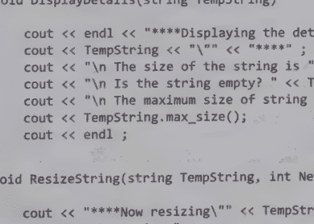

```python
from sklearn import datasets
iris = datasets.load_iris()
print(iris.data)
```

```cpp
cout << "Original string is: \"" << TempString;
cout << "\"" << endl;
cout << "Original size is: " << TempString.size() << endl;
TempString.resize(NewSize);
cout << "String size after resize: ";
cout << TempString.size()<< endl;
cout << "The resized string is: \\\"";
cout << TempString << "\\\" "<<endl;
cout << endl;
}
```

### 输出

```text
****Displaying the details of string****
The size of the string is 0
Is the string empty? true
The maximum size of string in this system is 4294967294

****Displaying the details of string "This is testing"****
The size of the string is 15
Is the string empty? false
The maximum size of string in this system is 4294967294

****Displaying the details of string "Testing is difficult"****
The size of the string is 20
Is the string empty? false
The maximum size of string in this system is 4294967294

****Illustrating relational operators****
"This is testing" is lexicographically greater than "Testing is difficult"
"Testing is difficult" and "This is testing" are not equal
"This is testing" and "This is Testing" are equal

****Illustrating the use of [] operator****
using [] operator
Testing is difficult

****Illustrating compare() function****
"This is testing" is lexicographically greater than "Testing is difficult"

****Illustrating swap****
Strings before swapping
First string is "Testing is difficult"
Second string is "This is testing"
****Strings after swapping****
First string is "This is testing"
Second string is "Testing is difficult"

****Illustrating resizing ****
****Now resizing "This is testing" to size 100****
Original string is: "This is testing"
Original size is: 15
string size after resize: 100
The resized string is: "This is testing"

****Now resizing "Testing is difficult" to size 10****
Original string is: "Testing is difficult"
Original size is: 20
string size after resize: 10
The resized string is: "Testing is"
```


### 程序的工作原理

输出为我们之前学习的内容提供了强化。

- 1. 当字符串 'This is testing' 调整大小为 100 时，会在末尾填充空格使其长度达到 100 个字符。因此，其后会出现一个空白的第二行。
- 2. 当 SecondString 调整大小为更小的值（从原来的 20 调整到 10）时，字符串的剩余部分（单词 'difficult'）就会丢失。
- 3. 注意使用 boolalpha 操纵符来打印布尔值的 true 或 false 而不是 1 或 0。

C++ 字符串与 C 字符串的区别在第 15.1 节展品中进行了说明。

### 展品 15.1 C++ 字符串 vs C 字符串

C++ 的字符串对象更接近实际的字符串。这是因为 C++ 使用字符串数据类型，而不像 C 中的字符数组。它还提高了易用性和适用性。此外，C++ 字符串与 C 字符串一样高效，甚至更高效。由于字符串对象是 STL 的一部分，因此有大量通用算法和内置函数，如 find()、replace()、merge() 和 sort() 可用于字符串。

## 回顾

- 字符串是 C++ 的一个重要类。
- 字符串类包含许多有用的成员函数。
- C 型字符串存在各种问题，例如使用 '=' 进行赋值是不可能的，使用 '==' 比较两个字符串是不可能的，用另一个字符串初始化一个字符串也是不可能的。所有这些问题在 C++ 中都通过使用字符串对象得到了解决。
- 字符串作为一个类，可以重载 =、== 和 != 运算符。
- 字符串类还具有一些重要的构造函数，有助于用另一个字符串对象初始化一个字符串对象，用 C 型字符串初始化一个字符串对象，或进行无初始化的正常定义。
- 也可以对字符串执行一些子字符串操作，例如查找子字符串或字符在字符串中的位置、在特定位置插入特定子字符串、用另一个替换特定子字符串、以及将一个字符串附加到另一个字符串。
- 也可以使用 + 来连接两个不同的字符串，并使用 compare() 函数来匹配两个字符串（类似于 C 中的 strcmp()）。
- Swap 函数也作为成员函数提供，用于交换两个字符串。
- 用于检查字符串是否为空的 empty()、用于检查字符串大小的 size()、用于将字符串调整为新大小的 resize()、以及用于查找字符串可能的最大大小的 max_size() 等函数都作为成员函数提供。
- 通用算法如 find()、replace() 和 sort() 也可用于 C++ 中对字符串对象进行操作。

## 关键词

C 型字符串 在 C 中使用字符数组作为字符串。它们也称为 C 型字符串。

字符串大小 这是字符串中字符的数量。

字符串对象 这些是类型为 string 的对象。

## 练习

### 多项选择题

- 1. 当指定的字符或子字符串未找到时，find() 函数返回 ________。
  (a) 零
  (b) 空值
  (c) 最小的可能无符号整数
  (d) 最大的可能无符号整数

- 2. 以下哪一个是使用 find() 函数的正确语法？
  (a) myString.find("You");
  (b) myString.find('Y');
  (c) 两者皆可
  (d) 无

- 3. C++ 字符串对象是 ________。
  (a) 易于使用
  (b) 易于应用
  (c) 两者皆可
  (d) 无

- 4. 当字符串被调整大小以减小原始容量时，________。
  (a) 调整大小不会发生
  (b) 数据将被截断到新的大小
  (c) 编译器会生成错误
  (d) 会引发异常

- 5. 以下哪个函数提供给定字符串的大小？
  (a) size()
  (b) length()
  (c) 两者皆可
  (d) 无

- 6. 我们可以使用哪个函数在字符串的给定位置插入特定子字符串？
  (a) insert(PositionAtWhichInsertionIsToBeMade, StringToBeInserted);
  (b) insertAt(PositionAtWhichInsertionIsToBeMade, StringToBeInserted);
  (c) insert(StringToBeInserted, PositionAtWhichInsertionIsToBeMade);
  (d) insertAt(StringToBeInserted, PositionAtWhichInsertionIsToBeMade);

- 7. 以下哪一个是定义字符串对象的正确语法？
  (a) string myString(intNumber);
  (b) string myString("Hi");
  (c) string myString('H');
  (d) 以上全部

- 8. 以下哪一个不是使用 find() 函数的正确方法？
  (a) myString.find("You");
  (b) myString.find('Y');
  (c) myString("Y");
  (d) myString(7.5);

- 9. 当字符串为空时，empty() 函数 ________。
  (a) 返回零
  (b) 返回 false
  (c) 返回 null
  (d) 引发异常

- 10. 以下哪些运算符用于检查给定字符串是否与另一个字符串在字典上相同或不同？
  (a) < 和 > 运算符
  (b) ≤ 和 ≥ 运算符
  (c) 两者皆可
  (d) 无

### 概念练习

- 1. C 型字符串有哪些问题？
- 2. 列出字符串对象的不同构造函数。
- 3. 字符串对象子字符串操作有哪些可用设施？
- 4. 编写可以帮助我们查找字符串对象不同特征的函数。
- 5. 比较 C 字符串与 C++ 字符串。

### 实践练习

- 1. 编写一个程序来读取并统计字符串中的元素。
- 2. 编写一个程序来比较两个字符串并显示一个字符串是否在字典上小于另一个字符串。
- 3. 编写一个程序在文本中搜索特定单词。
- 4. 编写一个程序从文件读取并使用某种算法将该文件的每个字符转换为另一个字符。
- 5. 编写一个程序从用户在文本文件中接受两个字符串。从用户在文本文件中读取第一个字符串。用第二个字符串替换该文件中的该字符串。例如，如果用户输入 ‘Test’ 和 ‘Pure’，那么我们需要在文件中找到 Test 并将其替换为 Pure。

## 第 16 章

## 标准模板库

## 学习目标

- 泛型编程、泛型软件组件或容器、泛型算法和迭代器
- 序列容器如 vector、list 和 deque
- 有序关联容器如 map、multimap、set 和 multiset
- STL 的示例算法 find()、copy() 和 sort()
- 函数对象、谓词对象和分配器

### 16.1 引言

标准模板库（STL）是一组由称为迭代器的对象连接起来的泛型软件组件（泛型容器）和泛型算法。

STL 与普通库不同。所有其他库定义的实体都是类。在该类中所需的操作被编写为类的成员函数。对于 STL 来说则不需要。它有大量非成员函数设计用于在多种容器类型上工作。这种方法具有显著的优势。

假设为从某个序列中查找元素编写了一个高效算法。当它实现为非成员函数时，任何序列都可以用作其输入。因此，对于多个序列只有一个函数。对于 X 个这样的序列和 Y 个这样的操作，以前的情况需要 X * Y 个成员函数（在每个 X 个类上进行 Y 个操作），而非成员函数在第二种情况下仅为 Y。因此，为一个类所需实现的数量变得非常少。对于大多数类，如果不是全部，将只有一个函数。因此，以高效的方式实现所有操作变得可行，因为它们只需要实现一次。

例如，考虑一个名为 find() 的函数，用于从元素序列中查找元素。由于它是非成员，find() 可以与程序员选择的任何序列一起使用。另一方面，如果 find() 是特定类的成员函数，它只能与该类对象一起使用，并且需要在需要此通用功能的所有类上重新定义类似的函数。

STL 还有一个优势。也可以设计新的序列。所有为通用情况设计的此类操作都可立即用于新序列。这些非成员函数被称为泛型算法。STL 包含许多有用的算法，如 find()、replace()、merge() 和 sort()。由于是泛型的，这些算法是非成员函数，可以与所有容器一起使用。

除了泛型算法外，STL 还具有泛型软件组件（容器）。这些容器是类，可以反过来包含

> STL 包含由迭代器连接的容器和泛型算法。

> 泛型算法是 STL 的优势。它允许系统中更少且更优化的算法。


other objects. We will be looking at a few of the components of this library in due course:

- 1. Vector (implementation is like an array), list (implementation of doubly linked list), and deque (implementation of deque) are called *sequence containers*.
- 2. Set, multiset, map, and multimap are known as *associative sorted containers*. Unlike sequence containers, these containers keep the contents in a sorted form.
- 3. There are adapted containers such as queue and stack that are not true containers but are implemented using sequence containers.

## Iterators

One can think of iterators as generic pointers. The designers of C used void pointers in many cases where they would like a pointer to be assigned to any other type later. malloc() is an excellent example; it returns the void pointer that a programmer can assign to the type he/she deems fit. In the true sense, iterators are far more capable than void pointers.

If there is an array, one will traverse the array using an index. On the contrary, if there is a linked list, one can traverse it using a pointer designed to point to the node of that linked list. If some other structure is used, then some other mechanism is needed to traverse the container. The array index used to traverse an array sequentially or randomly and the pointer used in a linked list to traverse the list sequentially are basically doing the same job, which is, traversing a sequence of elements. In the case of STL, a generalized concept called iterator is used to traverse a sequence of container elements.

An important problem in generalizing such a concept is to ensure that it is not bound to a type. For example, consider designing a pointer that can be used to point to any linked list node; it is just impossible. Say, if there is a linked list of integers, the pointer to be used is int*, and if there is a linked list of node of type NodeType, the pointer to be used is NodeType*. In such a situation, templates are used to avoid type-related issues. For example, if there is a pointer defined as Type *ptr, the ptr is a generic pointer. Iterator is a kind of generic index that helps one to iterate through some specific sequence. The following code segment helps us understand the same.

```
vector <int>::iterator IntIndex;

for(IntIndex = vi.begin(); IntIndex < vi.end(); IntIndex++)
{
    cout << *IntIndex << endl;
}
```

The IntIndex variable is of type iterator (of vector int type), which will help one iterate through a vector (a container type quite similar to an array) vi. We will soon see other details about how to program with containers, generic algorithms, and iterators.

Iterators, thus, help a user to iterate through a sequence of elements of a container; hence, the name.

The beauty of matching generic algorithms with generic containers lies in the use of templates and objects known as iterators. They are pointer-like objects, but unlike pointers, they are categorized into five different categories, namely, input, random access, bidirectional, forward, and output.

Generic algorithms are written to work on iterator objects rather than any data structure. The find() algorithm works on a category of iterators called *input iterators*.

Software components (containers) and algorithms are connected to each other by iterators.

Containers are also designed in terms of iterators rather than normal pointers. Thus, iterators are able to join algorithms with containers. It is also important to note that not all algorithms are efficient with all data structures. For example, sort(), which is usually implemented as quicksort(), requires random access to the data. For linked list, this algorithm is painfully slow. Here, sort() is defined to require random access iterators.

The list (the doubly linked list) container is defined to have bidirectional iterators. Thus, sort() cannot be used with a list. There will be compilation errors if a generic sort() algorithm is used with a list. Vector and deque containers are defined to have random access iterators and, therefore, the sort() algorithm can work with them. Hence, it is clear that the choice of iterators also impacts the efficiency.

Exhibit 16.1 provides a brief history of STL.

## Exhibit 16.1 A brief history of STL

STL is a broad topic and is beyond the scope of this text, which only provides an introduction to it. The following is a brief history of STL.

STL is the brainchild of Alexander Stepanov. When Stepanov was working with the General Electric Research and Development Centre in 1979, he started working on generic programming concepts. Surprisingly, the idea of generic programming has nothing to do with C++. It was first implemented in the Ada language. Stepanov later joined AT&T and then Hewlett-Packard where he worked on C++.

Due to the efforts of Andrew Koenig, a member of the Standardization Committee, Stepanov was invited to present his ideas about generic programming and STL to the C++ Standardization Committee in 1993. The Committee accepted his ideas unanimously, and in 1994, STL was added to the ANSI standard. A number of C++ experts have quoted STL to be the biggest addition to the standard.

## 16.2 GENERIC PROGRAMMING

STL is not a normal library. It is designed on the basis of a few very important principles independent of C++ itself.

STL is a templated, generic library that provides standard storage of elements in a type-independent form.

Generic programming has nothing to do with C++. It is a mechanism of designing generic software components such as vector, list, and deque. The next element of STL is generic algorithms. Unlike normal programming practice, these algorithms are not designed having any software component in mind. The algorithms are designed to suit the minimum level of requirements. Thus, these algorithms can work with many variants of different software components (containers) without any change.

The model using inheritance is known as the object-oriented model and the model presented by STL is called the object-based model.

It is important to understand that this model of programming is different from the sharing model of inheritance and virtual functions, where the base class, the common attributes stored in base class, base class pointers, and virtual functions provide a very flexible model of programming with great runtime control. In contrast, the model presented by STL offers similar advantages but with a more efficient architecture. Generality is achieved by using templates, iterators, and a good design rather than having class hierarchy.

## 16.3 GENERIC SOFTWARE COMPONENTS

STL aims to provide ‘reusable’ components such as vector, list, and deque. Earlier, programmers used to write their own routines for using arrays, lists, and queues. STL provides tested and debugged components readily available. They are reusable in the sense that one can use them as a building block for other software development projects. These generic software components are also called containers, as they are basically a collection of the other objects. Thus, containers are objects themselves, which in turn contain other objects. These readymade components offer the following advantages:

**Small in number** The software components are few in number (nearly 12) and so are easy to master. Though small in number, they are extremely useful in solving a myriad of problems.

**Generic** They are generic in nature. It is possible to use them at various places without much trouble.

**Efficient, tested, debugged, and standardized** These software components are designed for speed. Every component has been designed with a specific time requirement as an efficiency measure and it is seen that it matches that efficiency requirement. STL components are already running in a large number of user programs, and hence, they are thoroughly tested and debugged. They have already become a standard. Thus, programs written using STL components are easier to program and to read.

**Portability and reusability** STL is already a standard. If a program uses STL, it becomes more portable because the stacks, queues, and vectors are all available on the destination machine in the same form. STL uses templates to a large extent to make it as independent of type as possible.

## 16.4 GENERIC ALGORITHMS

As STL is designed for speed, the algorithms that operate on the software components are designed in such a way that they depend very little on the data structure of the component (e.g., an algorithm called find() does not vary much in speed if it is finding in the vector, stack, or queue). Programmers can write their own algorithms in place of generic algorithms. This is, however, not preferred, as there are some distinct advantages of using generic algorithms:

- 1. Programmers are free from writing routines such as sort(), merge(), binary_search(), and find() with different variations in each case. They are available readymade in the STL.
- 2. The algorithms use the best mechanisms to be as efficient as possible, designing which may not be generally possible for most of the programmers. All the algorithms are designed taking the best of the breed components, and most of the efficiency concerns are addressed. For example, the sort() algorithm applies quick sort but it might switch over to merge sort if the input data is more suited (almost sorted elements).
- 3. Generic algorithms are standardized and, hence, have more acceptability than proprietary algorithms. Some software organizations adopt STL only because of it being a standard. Some of the US clients expect designers to code using STL and consider it as one of the fundamental requirements of their contract.


## 展览 16.3 STL 容器的优点

STL 容器的优点如下：

- **动态存储：** 软件组件的存储需求可以是动态的。数组在运行时增长方面不是动态的，但 STL 容器专门设计用于处理这种情况。vector 和 deque 等结构在需要时会自动增长。
- **模拟内置类型：** STL 容器可以像普通对象一样定义，可以赋值给另一个容器，也可以复制到另一个容器。我们将在适当的时候看到一些例子。
- **可扩展性：** 可以在不破坏原始架构的情况下向 STL 添加新的容器和算法。

## 16.6 容器及其类型

容器是包含其他对象的对象。它们有两种不同的类型，即序列容器和排序关联容器。

> STL 容器可以是序列容器，也可以是排序关联容器。

1. 序列容器以某种序列形式存储元素。示例包括 vector、deque 和 list。
2. 与序列容器不同，关联排序容器以排序形式保存内容。示例包括 set、multiset、map 和 multimap。

### 16.6.1 向量

让我们考虑程序 16.1，它展示了如何以简单的方式定义和使用 vector。

**程序 16.1 向量**

```cpp
#include <vector>
#include <iostream>
#include <string>
using namespace std;

class Student
{
    int RollNumber;
    string Name;
public:
    Student(int TempRollNumber, string TempName)
    {
        RollNumber = TempRollNumber;
        Name = TempName;
    }

    bool operator < (Student AnotherStudent)
    {
        return(RollNumber < AnotherStudent.RollNumber);
    }

    friend ostream & operator <<(ostream & TempOut, Student TempStud)
    {
        TempOut << "Roll number is: " << TempStud.RollNumber << endl;
        TempOut << "Name is: " << TempStud.Name << endl;
        return TempOut;
    }
};

int main()
{
    vector <Student> vs;
    vector <int> vi;

    vi.push_back(12); // Inserting at the end of vector
    vi.push_back(20); vi.push_back(16);
    vi.push_back(29); vi.push_back(24);
    Student Lara(1, "Brian Charles Lara");
    Student Beckham(2, "David Beckham");
    Student Steffi(3, "Steffi Graf");
    Student Maradona(4, "Diego Maradona");
    Student Tiger(5, "Tiger Woods");
    Student Carl(6, "Carl Lewis");

    vs.push_back(Lara); vs.push_back(Beckham);
    vs.push_back(Steffi); vs.push_back(Maradona);
    vs.push_back(Tiger); vs.push_back(Carl);

    vector <int>::iterator IntIndex;
    vector <Student>::iterator StudentIndex;
    cout << "Integer vector listing" << endl;

    for(IntIndex = vi.begin(); IntIndex < vi.end(); IntIndex++)
    {
        cout << *IntIndex << endl;
    }
    cout << "Student vector listing" << endl;
    for(StudentIndex = vs.begin(); StudentIndex < vs.end(); StudentIndex++)
    {
        cout << *StudentIndex;
    }
}
```

**输出**

```text
Integer vector listing
12
20
16
29
24

Student vector listing
Roll number is: 1
Name is: Brian Charles Lara
Roll number is: 2
Name is: David Beckham
Roll number is: 3
Name is: Steffi Graf
Roll number is: 4
Name is: Diego Maradona
Roll number is: 5
Name is: Tiger Woods
Roll number is: 6
Name is: Carl Lewis
```

**程序的工作原理**

查看包含语句。要使用 vector 容器，必须包含 `<vector>`。接下来定义了 Student 类。重要部分是重载了 `<` 运算符和 `<<` 运算符。我们很快会讨论它们的用途。在 `main()` 中定义了两个 vector。

```cpp
vector <Student> vs;
vector <int> vi;
```

`vs` 是 Student 类型的 vector，`vi` 是 int 类型。请注意，`vector` 是一个类模板，数据类型需要作为参数传递给它，用 `<>` 括号括起来。

接下来，在 int vector 中插入数据。vector 的一个重要函数是 `push_back()`，它在 vector 末尾插入元素。如果 vector 已满，与数组不同，它会自行扩展然后容纳该值。

然后以相同的方式定义了一些 Student 对象并插入到 Student vector 中。可以看到，这里也以类似的方式使用了 vector `push_back()` 函数。

vector 容器提供了其他构造函数以不同方式定义 vector。还可以使用 `[]` 运算符访问 vector 的各个元素，类似于数组。接下来示例中的迭代器定义。

```cpp
vector <int>::iterator IntIndex;
vector <Student>::iterator StudentIndex;
```

这里为 int vector 和 Student vector 定义了两个不同的迭代器。在程序的其余部分中，它们被用作指针。

Vector 提供了两个有用的函数（所有容器都提供这两个函数）。第一个称为 `begin()`。它返回指向 vector 第一个元素的迭代器。第二个是 `end()` 函数。此函数不返回指向最后一个元素的迭代器。它返回指向最后一个元素之后一个的迭代器。请记住我们在第 15 章中关于字符串对象的讨论以及返回值比大小多一；这是由于 `end()` 函数的此属性。迭代器范围在数学中表示为 `[first, last)`，即开区间。

在此程序中，两者都在接下来定义的 for 循环中使用。

```cpp
for(IntIndex = vi.begin(); IntIndex < vi.end(); IntIndex++)
{
    cout << *IntIndex << endl;
}
```

语句 `IntIndex = vi.begin()` 执行初始化。它使 IntIndex 迭代器指向 int vector 的第一个元素。请注意，`vi` 作为 int vector，返回的类型为 `vector <int>` 的迭代器，与右侧匹配（`IntIndex = vi.begin()`）。同样，终止条件也使用 `<` 运算符检查（`IntIndex < vi.end()`）。

vector 迭代器是随机访问迭代器。它重载了 `<` 运算符，因此可以在此处使用。递增 `IntIndex++` 类似于递增指针使其指向序列中的下一个元素。此运算符也为所有容器重载。可以通过解引用迭代器引用 vector 元素。因此，`*IntIndex` 返回一个整数，并在屏幕上打印。

对于 Student vector 的另一个 for 循环可以提供类似的解释。唯一的区别是使用 `StudentIndex` 作为 `vector <Student>::iterator` 类型的迭代器，而不是前一种情况下的 `vector <int>::iterator`。

> vector 是一个类似于数组的容器。然而，与数组不同，它可以增长和缩小，因此不受固定大小的限制。

请注意为 Student 对象重载 `<<` 的重要性。`cout << *StudentIndex` 可以写成，因为 `<<` 运算符已被重载。

让我们再考虑一个例子，看看如何使用 vector 使用通用算法。程序 16.2 展示了如何根据获得的总分对 Student 对象进行排序以打印成绩单。

**程序 16.2 带通用算法的向量**

```cpp
//Meritlist.cpp
#include <iostream>
#include <vector>
#include <algorithm>
using namespace std;
class Student
{
private:
    int RollNumber;
    float TotalMarks;

public:
    Student(){};
    Student(int TempRollNumber, float TempTotalMarks)
    {
        RollNumber = TempRollNumber;
        TotalMarks = TempTotalMarks;
    }

    void operator = (Student TempStud)
    {
        RollNumber = TempStud.RollNumber;
        TotalMarks = TempStud.TotalMarks;
    }

    bool operator < (Student TempStud)
    {
        return(TotalMarks < TempStud.TotalMarks);
    }

    friend ostream & operator <<(ostream & TempOut, Student & TempStud);
};

ostream & operator <<(ostream & TempOut, Student & TempStud)
{
    TempOut << "The mark of roll number " << TempStud.RollNumber << " is " << TempStud.TotalMarks;
    return TempOut;
}

void main()
{
    vector <Student> StudMarks;
    float TempMarks;
    int i = 0;

    for(;;)
    {
        cout << "Enter the mark for roll number " << i + 1 << " Enter -1 to stop: ";
        cin >> TempMarks;
        if(TempMarks == -1) break;
        StudMarks.push_back(Student(i + 1, TempMarks));
```


```cpp
++i;
}
cout << "The size of StudMarks is " << StudMarks.size() << endl;
vector <Student>::iterator index;
sort(StudMarks.begin(), StudMarks.end());
for(index = StudMarks.begin(); index < StudMarks.end(); ++index)
    cout << *index << endl;
}
```

### 程序的工作原理

我们可以用内置类型以及用户自定义类型作为向量的元素。对所有容器都适用。

让我们尝试理解这个程序。Student 类也在本程序中使用。需要注意的是，类中已经定义了运算符 `=` 和 `<` 以及 `<<` 运算符。`sort()` 算法需要 `<` 运算符被重载。

下面的语句定义了一个向量 StudMarks，其中包含 Student 对象。

```cpp
vector <Student> StudMarks;
```

然后，有一个 for 循环，它读取每个学生的成绩，然后使用 push_back 将其插入向量中。

成员函数 `size()` 已被用来查找向量的大小，即向量中元素的数量。因此，下面的语句显示了向量中元素的数量。

```cpp
cout << "The size of StudMarks is " << StudMarks.size() << endl;
```

下一个语句为 `vector <Student>` 定义了一个迭代器 index。这里调用了通用算法 `sort()`。

```cpp
sort(StudMarks.begin(), StudMarks.end());
```

该算法只需要两个参数；两者都是随机访问迭代器的类型。这种排序算法是原地排序算法。它对传递给它的同一个向量进行排序。向量范围再次以 `[first, last)` 提供，其中包括第一个和最后一个之间的所有元素，包括第一个但不包括最后一个。

接下来使用与前面类似的 for 循环进行 Student 数据的打印。

前面已经提到，向量可以动态增长。程序 16.3 说明了这一特性。函数 `capacity()` 返回向量在不增长的情况下可以容纳的元素数量。

### 程序 16.3 增长的向量

```cpp
//GrowingVector.cpp
#include <vector>
#include <iostream>
#include <string>
using namespace std;

class Student
{
    int RollNumber;
    string Name;
public:
    Student(int TempRollNumber, string TempName)
    {
        RollNumber = TempRollNumber;
        Name = TempName;
    }
};

int main()
{
    vector <Student> vs;
    vector <int> vi;
    cout << "The capacity of the Student vector is " << vs.capacity() << endl;
    cout << "The capacity of the integer vector is " << vi.capacity() << endl;
    int TempSizeInt = vi.capacity();
    int TempSizeStudent = vs.capacity();

    for(int i = 0; i < 200; i++)
    {
        vi.push_back(i);
        if(vi.capacity() != TempSizeInt)
        {
            cout << "The capacity of the vector changes to " << vi.capacity() << endl;
            TempSizeInt = vi.capacity();
        }
    }

    Student Lara(1, "Brian Charles Lara");

    for(int i = 0; i < 200; i++)
    {
        vs.push_back(Lara);
        if(vs.capacity() != TempSizeStudent)
        {
            cout << "The capacity of the vector changes to " << vs.capacity() << endl;
            TempSizeStudent = vs.capacity();
        }
    }
}
```

**Output (in VC++ 7.0)**

```text
The capacity of the Student vector is 0
The capacity of the integer vector is 0
The capacity of the vector changes to 1
The capacity of the vector changes to 2
The capacity of the vector changes to 3
The capacity of the vector changes to 4
The capacity of the vector changes to 6
The capacity of the vector changes to 9
The capacity of the vector changes to 13
The capacity of the vector changes to 19
The capacity of the vector changes to 28
The capacity of the vector changes to 42
The capacity of the vector changes to 63
The capacity of the vector changes to 94
The capacity of the vector changes to 141
The capacity of the vector changes to 211
// Student vector output
The capacity of the vector changes to 1
The capacity of the vector changes to 2
The capacity of the vector changes to 3
The capacity of the vector changes to 4
The capacity of the vector changes to 6
The capacity of the vector changes to 9
The capacity of the vector changes to 13
The capacity of the vector changes to 19
The capacity of the vector changes to 28
The capacity of the vector changes to 42
The capacity of the vector changes to 63
The capacity of the vector changes to 94
The capacity of the vector changes to 141
The capacity of the vector changes to 211
```

Linux 的输出如下：

```text
The capacity of the Student vector is 0
The capacity of the integer vector is 0
The capacity of the vector changes to 1
The capacity of the vector changes to 2
The capacity of the vector changes to 4
The capacity of the vector changes to 8
The capacity of the vector changes to 16
The capacity of the vector changes to 32
The capacity of the vector changes to 64
The capacity of the vector changes to 128
The capacity of the vector changes to 256

// Student vector output
The capacity of the vector changes to 1
The capacity of the vector changes to 2
The capacity of the vector changes to 4
The capacity of the vector changes to 8
The capacity of the vector changes to 16
The capacity of the vector changes to 32
The capacity of the vector changes to 64
The capacity of the vector changes to 128
The capacity of the vector changes to 256
```

### 程序的工作原理

让我们尝试理解这个程序及其输出。它有一个 Student 向量和一个 int 向量，类似于程序 16.1。`vi.capacity()` 和 `vs.capacity()` 已被用来查找两个向量的容量，并且整数 TempSizeInt 用于计算它们的容量。程序使用 `vi.push_back(i)` 在 int 向量 `vi` 中插入一个 int 对象，并使用 `vs.push_back(Lara)` 在 Student 向量 `vs` 中插入一个 Student 对象。如果向量的当前容量与之前的容量不同，则显示新的容量。然后，它继续在两种情况下向向量中添加 200 个元素。

现在，看看程序在测试过的两个不同编译器上产生的输出。第一个编译器是 VC++ 7.0。这里的向量增长是任意的。Linux 编译器的输出要直接得多。每次向量填满时，其大小都会加倍。注意，对于内置类型或用户自定义类，增长是相似的。对于大型类对象可能会有所不同。

当向量已满并且尝试插入时，向量的容量会增加。它会自动管理增长。向量增长的方式取决于特定的编译器。

## 16.6.2 列表

列表是下一个容器类型，它是双向链表的模板化实现。在学习了第一个容器之后，学习另一个容器很容易，因为操作容器的方式相当相似。让我们看一个例子，其中向量被列表取代，除了一个地方。程序 16.4 打印成绩单，现在使用列表而不是向量。

### 程序 16.4 STL 列表对象

```cpp
//MeritList.cpp
#include <iostream>
#include <list>
#include <algorithm>
using namespace std;

class Student
{
private:
    int RollNumber;
    float TotalMarks;
public:
    Student(){};
    Student(int TempRollNumber, float TempTotalMarks)
    {
        RollNumber = TempRollNumber;
        TotalMarks = TempTotalMarks;
    }

    void operator = (Student TempStud)
    {
        RollNumber = TempStud.RollNumber;
        TotalMarks = TempStud.TotalMarks;
    }

    bool operator < (Student TempStud)
    {
        return(TotalMarks < TempStud.TotalMarks);
    }
    friend ostream & operator <<(ostream & TempOut, Student & TempStud);
};

ostream & operator <<(ostream & TempOut, Student & TempStud)
{
    TempOut << "The mark of roll number " << TempStud.RollNumber << " is " << TempStud.TotalMarks;
    return TempOut;
}

void main()
{
    list <Student> StudMarks;
    float TempMarks;
    int i = 0;
    for(;;)
    {
        cout << "Enter mark for roll number " << i + 1 << " Enter -1 to stop: ";
        cin >> TempMarks;
        if(TempMarks == -1) break;
        StudMarks.push_back(Student(i + 1, TempMarks));
        ++i;
    }
}
```

```
cout << "The size of StudMarks is " << StudMarks.size() << endl;
list<Student>::iterator index;
for(index = StudMarks.begin(); index != StudMarks.end(); ++index)
cout << *index << endl;
}
```

### 输出

Enter mark for roll number 1 Enter -1 to stop: 13
Enter mark for roll number 2 Enter -1 to stop: 23
Enter mark for roll number 3 Enter -1 to stop: 34
Enter mark for roll number 4 Enter -1 to stop: 45
Enter mark for roll number 5 Enter -1 to stop: 32
Enter mark for roll number 6 Enter -1 to stop: 23
Enter mark for roll number 7 Enter -1 to stop: 24
Enter mark for roll number 8 Enter -1 to stop: 1
Enter mark for roll number 9 Enter -1 to stop: -1
The size of StudMarks is 8
The mark of roll number 1 is 13
The mark of roll number 2 is 23
The mark of roll number 3 is 34
The mark of roll number 4 is 45
The mark of roll number 5 is 32
The mark of roll number 6 is 23
The mark of roll number 7 is 24
The mark of roll number 8 is 1

### 程序工作原理

该程序与程序 16.4 完成相同的工作，只做了一处修改：将所有的“vector”替换成了“list”。使用 vector 的程序的输出没有给出，它与此程序的输出相同。这表明一旦我们学会了一种容器，学习更多容器是多么容易。

### List 与 Vector 的对比

list 似乎与 vector 的工作方式相似。那为什么还提供它们呢？重点是三种操作，即插入、删除和访问。list 是通过双向链表实现的；因此，在任意位置插入和删除只需要重新整理指针，速度非常快。遗憾的是，访问随机成员需要从开头或末尾移动到该位置，效率不高。当需要在任意位置执行插入和删除，并且对元素的访问不是随机而是按顺序进行时，list 更合适。这类似于链表相对于数组的优势。

> 注意
> vector 可以自动增长，但这是有代价的。扩展 vector 类似于创建一个新的更大的 vector 并将旧 vector 的元素复制到其中。这是一个线性时间的操作，也就是说，插入时间取决于 vector 中元素的数量。另一方面，list 的增长是常数时间的操作，也就是说，无论插入多少元素，插入时间都保持不变。

表 16.2 列出了 vector 和 list 之间的差异。

程序 16.4 和 16.2 之间有一个差异。for 循环中没有使用类似 index < StudMarks.end() 的测试，因为 list 提供的双向迭代器没有重载运算符“<”。该运算符仅适用于随机访问迭代器。幸运的是，不等运算符“!=”为双向迭代器重载了。因此，这里使用了“!=”运算符而不是“<”。这实际上不是一个很大的差异。在程序 16.2 中也可以使用“!=”运算符。这里这样做是为了展示迭代器、算法以及使用它们的容器之间的区别。

程序 16.5 使用 list，因为在这种情况下，随机位置的插入是最有效的，它只需要操作两个指针，而不像 vector 那样需要将所有剩余的元素向下移动。

### 程序 16.5 在 list 的特定位置插入

```
//ListInsert.cpp
#include <list>
#include <iostream>
#include <string>
#include <algorithm>

// For find()
using namespace std;

class Student
{
    int RollNumber;
    string Name;
public:
    Student(int TempRollNumber, string TempName)
    {
        RollNumber = TempRollNumber;
        Name = TempName;
    }

    bool operator < (Student AnotherStudent)
    {
```

list 只需重新排列指针即可插入或删除元素，这是一个常数时间的操作。

```
StudentIndex = find(ls.begin(), ls.end(), Maradona);
ls.insert(StudentIndex, Jaspal);
```

定义了一名新学生 Jaspal。使用 find() 算法获取指向 Maradona 的迭代器。接下来，使用 list 的成员函数 insert()（ls.insert()）将 Jaspal 插入到该位置。在这里，迭代器就像文件指针一样，用于执行类似 seek 的操作。insert() 成员函数可用于所有容器。

注意：list 是唯一一个无论位置在哪里，插入都是常数时间操作的容器。vector 在末尾插入是常数时间操作，deque 在开头和末尾插入是常数时间操作，但在任意位置插入则不是。

## 16.6.3 双端队列（Deque）

双端队列（Deque，发音为“deck”）是一种有用的容器，它可以适配成另外两种容器：栈和队列。本书不讨论栈和队列，但使用它们与使用 deque 一样容易。让我们借助程序 16.6 来理解 deque 的工作原理。

### 程序 16.6 Deque（双端队列）

```
//DeQueue.cpp
#include <deque>
#include <iostream>
#include <string>
using namespace std;
class Student
{
    int RollNumber;
    string Name;
public:
    Student(int TempRollNumber, string TempName)
    {
        RollNumber = TempRollNumber;
        Name = TempName;
    }
    bool operator < (Student AnotherStudent)
    {
        return(RollNumber < AnotherStudent.RollNumber);
    }
    friend ostream & operator <<(ostream & TempOut, Student & TempStud)
    {
        TempOut << "Roll number is: " << TempStud.RollNumber << endl;
        TempOut << "Name is: " << TempStud.Name << endl;
        return TempOut;
    }
};
int main()
{
    deque <Student> ds;
    Student Lara(1, "Brian Charles Lara");
    Student Beckham(2, "David Beckham");
    Student Steffi(3, "Steff Graf");
    Student Maradona(4, "Diego Maradona");
```

```
Student Tiger(5, "Tiger Woods");
Student Carl(6, "Carl Lewis");
ds.push_front(Lara);
ds.push_front(Beckham);
ds.push_front(Steff);
ds.push_front(Maradona);
ds.push_front(Tiger);
ds.push_front(Carl);
deque <Student>::iterator StudentIndex;

for(StudentIndex = ds.begin(); StudentIndex < ds.end(); StudentIndex++)
{
    cout << *StudentIndex;
}
}
```

### 输出

Roll number is: 6
Name is: Carl Lewis
Roll number is: 5
Name is: Tiger Woods
Roll number is: 4
Name is: Diego Maradona
Roll number is: 3
Name is: Steff Graf
Roll number is: 2
Name is: David Beckham
Roll number is: 1
Name is: Brian Charles Lara

### 程序工作原理

双端队列是一种允许在开头和末尾均以常数时间插入的结构。

该程序与程序 16.2 类似，在程序 16.2 中输入了不同学生的姓名并在最后打印出来。但有一个重要区别：这里使用了 push_front() 函数，而不是 vector 中的 push_back() 函数。双端队列是一种可以在开头和末尾以常数时间插入的结构。list 是另一个在开头插入花费常数时间的容器。这两个容器（deque 和 list）都提供 push_front() 函数。

push_front() 是常数时间操作，这是 deque 的独特特性。

push_front() 函数在开头添加元素；因此，输入的数据会按相反的顺序打印。对于 deque 和 list，可以编写如下语句；对于其他容器，则会导致编译时错误。

```
ds.push_front(Lara);
```

我们需要一种始终保持有序的容器。所有数据库索引都属于这种类型。任何形式的索引机制都需要一种解决方案，使得索引无论进行何种插入和删除都始终保持有序。有序关联容器帮助我们实现这一点。

## 16.6.4 有序关联容器

有序关联容器是指内容始终保持有序的容器，无论插入和删除的顺序如何。每个元素插入时都会被放置到它在有序顺序中应处的准确位置。

## 表 16.2 vector 与 list 的差异

| 比较项 | vector | list |
|---|---|---|
| 插入时间 | 取决于元素数量 | 常数时间 |
| 访问时间 | 常数时间 | 取决于遍历时间 |
| 扩展 | 线性时间操作 | 常数时间 |
| 库 | `<vector>` | `<list>` |
| 大小 | 满时增加 | 无此问题 |
| 适用场景 | 随机访问 | 随机插入或删除 |
| 存储 | 连续位置 | 非连续；取决于插入和删除模式 |
| 实现 | 数组类型 | 双向链表，每个节点有两个指针 |
| 插入和删除的管理 | 重排元素 | 重排指针 |

> 从技术上讲，“!=”运算符可用于输入迭代器，这是迭代器中最低级的迭代器，因此它也适用于所有其他容器。


插入到有序关联容器中的一个重要要求是，被插入的对象必须遵循某种形式的排序。这种排序可以通过为要插入到这些有序关联容器中的每个对象重载 `operator<() const` 来实现。

操作符函数必须定义为 `const`。还需要注意的是，这些容器也是关联的，记录的一个元素可用于访问整个记录。

序列容器元素是通过元素的索引或位置访问的（类似于数组），而有序关联容器元素是通过键值访问的，该键值是元素的一部分，类似于索引顺序文件。然而，有序关联容器也允许顺序操作。

> 注 关联容器之所以这样命名，是因为它们有助于以关联方式而非索引方式访问元素。关联搜索在人类处理系统中很常见。我们常会听到与特定歌曲相关的几小段音乐并回忆起那首歌，而不是被提供电影名称和歌手等信息后再回忆。

## 16.6.5 Maps

我们先来看 map，它是一个容器，可以在其内部保存两个项目，即键和值。它在插入时会自动按键项排序。如前所述，键项必须具有某种形式的排序。对于用户定义的对象，重载 `operator<` 为 `const` 以实现排序是很重要的。

让我们先来看程序 16.7。共有两个项目；第一个是 Student 对象，用作键，第二个（值）是整数。如前所述，Student 对象必须遵循某种顺序。这里的顺序是基于学生所拥有的总分来维护的。因此，可以形成一个名次表。排序的感知取决于上下文。如果想编程实现点名，也许学号是排序的键，或者如果要按姓名打印学生名单，学生的姓名可能构成排序的键。

> Map 是一个容器，其中包含一对项目，即键和值，按键的排序顺序存储。

### PROGRAM 16.7 Map

```cpp
//Map.cpp
#include <map>
#include <string>
#include <iostream>
#include <algorithm>
using namespace std;
class Student
{
private:
    int RollNumber;
    float TotalMarks;

public:
    Student(){};
    Student(int TempRollNumber, float TempTotalMarks)
    {
        RollNumber = TempRollNumber;
        TotalMarks = TempTotalMarks;
    }

    bool operator < (Student TempStud) const
    // Without const, it will not work with map
    {
        return(TotalMarks < TempStud.TotalMarks);
    }
    friend ostream & operator <<(ostream & TempOut, Student & TempStud);
};
int main()
{
map <string, float> StudentData;
StudentData["Lara"] = 12000;
StudentData["Sachin"] = 11000;
StudentData["Sunil"] = 10500;

Student Lara(1, 65);
Student Sachin(2, 55);
Student Sunil(3, 60);

map <Student, float> StudClassData;
StudClassData[Lara] = 12000;
StudClassData[Sachin] = 11000;
StudClassData[Sunil] = 10500;
}
```

> 注 Map 允许程序员使用除整数索引之外的其他类型的索引。

### How the Program Works

需要注意的是，`<map>` 需要包含在 map 和 multimap 中。map 和 multimap 的区别在于 map 只能有一个记录对应单个键，而 multimap 可以有多个记录对应单个键。Map 和 multimap 都设计为具有一对值，即键和值。Map 的插入使用类似数组的记法完成。以下是使用字符串对象定义 map 的语句。

```cpp
map <string, float> StudentData;
```

StudentData 现在是一个 map，具有两个项目；string 是键，float 是值。以下是 StudClassData map 的定义。

```cpp
map <Student, float> StudClassData;
```

StudClassData 是一个 map，具有两个项目；Student 对象是键，float 是值。`[]` 操作符可用于在两个 map 中进行插入，如以下示例所示。

```cpp
StudentData["Lara"] = 12000; // String is the key
StudClassData[Lara] = 12000; // Student class object is the key
```

也可以使用 insert 成员函数代替 `[]`。程序 16.8 显示了 multimap 的 insert 函数形式。Map 和 multimap 的插入语法相同。Multimap 在插入键和新值对时保留键和旧值对。

> 与 map 不同，multimap 不提供 `[]` 的简便记法。必须使用 `pair<>` 来插入元素。

## 16.6.6 Multimap

Multimap 是一个容器，可以为单个键具有多个值的条目。程序 16.8 演示了 multimap 的使用。insert 方法用于插入元素。此方法也适用于 map，如第 16.6.5 节所述。需要注意的是，`[]` 操作符不适用于 multimap，因此必须使用 insert 方法来插入元素。

### PROGRAM 16.8 Multimap

```cpp
//MultiMap.cpp
#include <map>
#include <string>
#include <iostream>
#include <algorithm>
using namespace std;

class Student
{
private:
    int RollNumber;
    float TotalMarks;

public:
    Student(){};
    Student(int TempRollNumber, float TempTotalMarks)
    {
        RollNumber = TempRollNumber;
        TotalMarks = TempTotalMarks;
    }

    /* Without const, it will not work with multimap */
    bool operator < (Student TempStud) const
    {
        return(TotalMarks < TempStud.TotalMarks);
    }

    // For cout Student objects
    friend ostream & operator <<(ostream & TempOut, const Student & TempStud)
    {
        TempOut << "Roll number is: " << TempStud.RollNumber << endl;
        TempOut << "Total mark is: " << TempStud.TotalMarks << endl;
        return TempOut;
    }
};

int main()
{
    Student Lara(1, 65);
    Student Sachin(2, 55);
    Student Sunil(3, 60);

    multimap <Student, float> StudClassData;

    StudClassData.insert(pair<Student, float>(Lara, 12000));
    StudClassData.insert(pair<Student, float>(Sachin, 11000));
    StudClassData.insert(pair<Student, float>(Sunil, 10500));
    StudClassData.insert(pair<Student, float>(Lara, 12001));
    StudClassData.insert(pair<Student, float>(Sachin, 11001));
    StudClassData.insert(pair<Student, float>(Sunil, 10501));

    multimap <Student, float>::iterator Position;

    for(Position = StudClassData.begin(); Position != StudClassData.end(); Position++)
    {
        cout << Position->first;
        cout << "Runs scored are: ";
        cout << Position->second;
        cout << endl;
    }
}
```

### Output

```text
Roll number is: 2
Total mark is: 55
Runs scored are: 11000
Roll number is: 2
Total mark is: 55
Runs scored are: 11001
Roll number is: 3
Total mark is: 60
Runs scored are: 10500
Roll number is: 3
Total mark is: 60
Runs scored are: 10501
Roll number is: 1
Total mark is: 65
Runs scored are: 12000
Roll number is: 1
Total mark is: 65
Runs scored are: 12001
```

### How the Program Works

在此程序中，使用了 `#include <map>`。这对于 map 和 multimap 都是必要的。

Student 类定义没有任何新内容。注意与 map 相同，需要 `operator<() const`。此外，`<<` 也被重载以简化 Student 对象的显示。以下是 multimap 的定义：

```cpp
multimap <Student, float> StudClassData;
```

此定义与程序 16.7 中看到的 map 定义类似。使用语句将一对元素插入 multimap

```cpp
StudClassData.insert(pair<Student, float>(Lara, 12000));
```

insert 成员函数期望插入一个 pair 对象。Pair 是 STL 提供的模板类。它需要在 `StudClassData.insert(pair<Student, float>(Lara, 12000));` 中显式指定参数，如 `<Student, float>`。

pair 类中的第一个元素称为 first，第二个元素称为 second。StudClassData 的所有元素都是 pair，第一个项目是 Student，第二个项目是 float 值。接下来，使用以下语句为 map 定义一个迭代器：

```cpp
multimap <Student, float>::iterator Position;
```

需要注意的是，迭代器指向 multimap 元素，而每个元素都是一个 pair。因此，`Position->first` 是 pair 的第一个元素（Student 对象），而 `Position->second` 是第二个元素（float 值）。现在有一个简单的 for 循环，从 multimap 的开头到结尾打印 pair 的两个元素。


```
vector <Student> vs;

Student Lara(1, "Brian Charles Lara");
Student Beckham(2, "David Beckham");
Student Steffi(3, "Steffi Graf");
Student Maradona(4, "Diego Maradona");
Student Tiger(5, "Tiger Woods");
Student Carl(6, "Carl Lewis");

vs.push_back(Lara);
vs.push_back(Beckham);
vs.push_back(Steffi);
vs.push_back(Maradona);
vs.push_back(Tiger);
vs.push_back(Carl);
// Inserting the same data second time
vs.push_back(Lara);
vs.push_back(Beckham);
vs.push_back(Steffi);
vs.push_back(Maradona);
vs.push_back(Tiger);
vs.push_back(Carl);

set <Student> SetStudent;

vector <Student>::iterator StudentIndex;

for(StudentIndex = vs.begin(); StudentIndex < vs.end(); StudentIndex++)
{
    SetStudent.insert(*StudentIndex);
}

set <Student>::iterator SetStudentIndex;
for(SetStudentIndex = SetStudent.begin(); SetStudentIndex != SetStudent.end();
SetStudentIndex++)
{
    cout << *SetStudentIndex ;
}
```

### 输出

Roll number is: 1
Name is: Brian Charles Lara
Roll number is: 2
Name is: David Beckham
Roll number is: 3
Name is: Steffi Graf
Roll number is: 4
Name is: Diego Maradona
Roll number is: 5
Name is: Tiger Woods
Roll number is: 6
Name is: Carl Lewis

### 程序工作原理

让我们试着理解这个程序。应当注意，使用集合时必须包含<set>头文件。下面的语句定义了一个Student的集合。

```
set <Student> SetStudent;
```

在这个程序中，首先有一个向量，其中包含一些学生的数据，这些数据是使用我们之前见过的push_back()函数输入的。下面的循环使用向量迭代器执行。

```
for(StudentIndex = vs.begin(); StudentIndex < vs.end(); StudentIndex++)
{
    SetStudent.insert(*StudentIndex);
}
```

集合的insert成员函数会被SetStudent对象调用。插入的项是通过解引用向量迭代器StudentIndex获得的。已知这个向量是Student对象的向量。因此，*StudentIndex本身就是一个Student对象，可以插入到SetStudent中。现在，使用集合迭代器遍历这个集合，并打印所有元素（存储在SetStudent中的Student对象）。下面的两条语句定义了一个迭代器并遍历集合来完成这件事。

```
set <Student>::iterator SetStudentIndex;
for(SetStudentIndex = SetStudent.begin(); SetStudentIndex != SetStudent.end();
SetStudentIndex++)
{
    cout << *SetStudentIndex ;
}
```

集合的编码方式与使用向量或列表迭代器打印向量或列表元素类似。值得关注的一个重要部分是输出。大约六个学生的数据被插入了两次。输出只显示每个学生的一条记录。这是因为集合只存储单个副本。如果同一项需要多个副本，则应使用第16.6.8节中讨论的多重集合。

### 16.6.8 多重集合

集合只能有一个键的副本。如果需要多个键，则需要使用多重集合。程序16.10使用了多重集合而不是集合。该程序与程序16.9相比只有一处更改。不过输出却大不相同。请看下面的程序。

### 程序16.10 多重集合

//MultiSet.cpp
#include <set>
#include <vector>
#include <iostream>
#include <string>
using namespace std;

class Student
{
    int RollNumber;
    string Name;
public:
    Student(int TempRollNumber, string TempName)
    {
        RollNumber = TempRollNumber;
        Name = TempName;

集合使用insert函数在集合中插入一个键。

集合只接受键的一个副本。如果键被插入两次，集合将只保留一个副本。

多重集合与集合相似，不同之处在于，多个键条目会导致插入多个键。因此，多重集合是允许多个键值的集合。

}
// For cout Student objects
friend ostream & operator <<(ostream & TempOut, Student & TempStud)
{
    TempOut << "Roll number is: " << TempStud.RollNumber << endl;
    TempOut << "Name is: " << TempStud.Name << endl;
    return TempOut;
}

// This const is must for set
bool operator < (Student AnotherStudent) const
{
    return(RollNumber < AnotherStudent.RollNumber);
}
};
int main()
{
    vector <Student> vs;

    Student Lara(1, "Brian Charles Lara");
    Student Beckham(2, "David Beckham");
    Student Steffi(3, "Steffi Graf");
    Student Maradona(4, "Diego Maradona");
    Student Tiger(5, "Tiger Woods");
    Student Carl(6, "Carl Lewis");

    vs.push_back(Lara); vs.push_back(Beckham);
    vs.push_back(Steffi); vs.push_back(Maradona);
    vs.push_back(Tiger); vs.push_back(Carl);

    // Inserting the same data the second time
    vs.push_back(Lara); vs.push_back(Beckham);
    vs.push_back(Steffi); vs.push_back(Maradona);
    vs.push_back(Tiger); vs.push_back(Carl);
    multiset <Student> SetStudent;
    vector <Student>::iterator StudentIndex;

    for(StudentIndex = vs.begin(); StudentIndex < vs.end(); StudentIndex++)
    {
        SetStudent.insert(*StudentIndex);
    }
    multiset <Student>::iterator SetStudentIndex;

    for(SetStudentIndex = SetStudent.begin(); SetStudentIndex != SetStudent.end();
    SetStudentIndex++)
    {
        cout << *SetStudentIndex ;
    }
}
输出
Roll number is: 1
Name is: Brian Charles Lara
Roll number is: 1
Name is: Brian Charles Lara
Roll number is: 2
Name is: David Beckham
Roll number is: 2
Name is: David Beckham

Roll number is: 3
Name is: Steffi Graf
Roll number is: 3
Name is: Steffi Graf
Roll number is: 4
Name is: Diego Maradona
Roll number is: 4
Name is: Diego Maradona
Roll number is: 5
Name is: Tiger Woods
Roll number is: 5
Name is: Tiger Woods
Roll number is: 6
Name is: Carl Lewis
Roll number is: 6
Name is: Carl Lewis

### 程序工作原理

这个程序与程序16.9的区别在于以下语句。

```
multiset <Student> SetStudent;
```

其他语句保持不变。现在看一下输出。当所有键都被插入两次时，每个键都会有两个副本。可以看到，输出是已排序的，因此重复的键会一起显示。

### 16.6.9 适配容器

栈和队列是适配容器。可以使用stack <int>或stack <Student>定义栈，并且可以执行push()和pop()操作。类似地，可以使用queue <int>或queue <Student>定义队列，并对其执行push()和pop()操作。

这些容器是使用deque实现的。它们也可以使用其他顺序容器实现。

### 16.7 通用算法

在本节中，我们将介绍STL中的一些算法示例。对STL提供的每个算法进行解释超出了本入门文本的范围。

### 16.7.1 find()算法

find()是一个通用算法，通过顺序遍历容器来查找容器中的元素。参见程序16.11。

### 程序16.11 find()算法

//Find.cpp
#include <vector>
#include <list>
#include <deque>
#include <algorithm>
#include <iostream>
#include <string>
using namespace std;

class Student
{
    int RollNumber;
    string Name;
public:
    Student(int TempRollNumber, string TempName)
    {
        RollNumber = TempRollNumber;
        Name = TempName;
    }

    bool operator == (Student AnotherStudent) const
    {
        return(RollNumber == AnotherStudent.RollNumber);
    }

    friend ostream & operator <<(ostream & TempOut, Student TempStud)
    {
        TempOut << "Roll number is: " << TempStud.RollNumber << endl;
        TempOut << "Name is: " << TempStud.Name << endl;
    }
};
int main()
{
    vector <Student> vs;
    int IntArray[6];

    for(int i = 0; i < 6; i++)
    {
        IntArray[i] = i;
    }

    Student Lara(1, "Brian Charles Lara");
    Student Beckham(2, "David Beckham");
    Student Steffi(3, "Steffi Graf");
    Student Maradona(4, "Diego Maradona");
    Student Tiger(5, "Tiger Woods");
    Student Carl(6, "Carl Lewis");
    vs.push_back(Lara); vs.push_back(Beckham);
    vs.push_back(Steffi); vs.push_back(Maradona);
    vs.push_back(Tiger); vs.push_back(Carl);

    // Using find for vector
    vector <Student>::iterator StudentIndex;
    StudentIndex = find(vs.begin(), vs.end(), Maradona);
    cout << *StudentIndex;
    // Using find for integer array
    int *pos = find(IntArray, IntArray + 6, 3);
    cout << *pos << endl;
    // Using find for a list
    list <Student> ls(vs.begin(), vs.end());
    // Creating list from a vector data
    list <Student>::iterator ListIndex;
    ListIndex = find(ls.begin(), ls.end(), Tiger);
    cout << *ListIndex;
    // Using find for a deque
    deque <Student> ds(vs.begin(), vs.end());
```


// Creating deque from a vector data
deque <Student>::iterator DeqIndex;
DeqIndex = find(ds.begin(), ds.end(), Steffi);
cout << *DeqIndex;
}

### 程序工作原理

find() 与其他通用算法类似，无论涉及何种容器，都可以以类似的方式调用。只有迭代器会根据所涉及的容器而有所不同。

让我们尝试理解这个程序，它包含 vector、list 和 deque。可以看到，同一个 find() 算法对它们都有效。为了能够访问 find()，程序还包含了 `<algorithm>`。为了让 find() 能够处理 Student 对象，需要重载 `==` 运算符，这一点已在 Student 类中完成。该函数需要将容器中的每个元素与传入的参数进行比较。除非重载了 `==`，否则对于用户自定义对象，这种比较是不可能的。

由于之前我们已经遇到过程序中的其他语句，这里我们只关注对 find() 算法的调用：

```
int *pos = find(IntArray, IntArray + 6, 3);
StudentIndex = find(vs.begin(), vs.end(), Maradona);
ListIndex = find(ls.begin(), ls.end(), Tiger);
DeqIndex = find(ds.begin(), ds.end(), Steffi);
```

对于所有类型的容器，一种非常方便的构造函数是提供另一个已包含数据的容器的 begin() 和 end() 值。

所有语句看起来都很相似。find() 接受三个参数；前两个是指向容器中某些位置的迭代器，第三个是要在该范围内查找的元素。find() 返回与第一个和第二个参数类型相同的迭代器。对于整数数组，它期望整数指针并返回整数指针；对于 vector 的情况，它期望两个 vector 迭代器并返回一个 vector 迭代器；以此类推。find() 能与所有类型的容器一起工作，因为所期望的迭代器属于输入迭代器类别，所有容器都支持这种迭代器。

另一个非常有趣的问题是使用其他容器来构造容器，从而从一个容器生成另一个容器。下面的语句依次从 vector 范围生成 list 和 deque。

```
list <Student> ls(vs.begin(), vs.end());
deque <Student> ds(vs.begin(), vs.end());
```

### 16.7.2 copy() 算法

下面是一个能够将数据从一个容器复制到另一个容器的算法的示例。请参阅程序 16.12。该算法不需要我们为用户自定义对象重载任何运算符。

### 程序 16.12 copy() 算法

```
//Copy.cpp
#include <vector>
#include <list>
#include <deque>
#include <algorithm>
#include <iostream>
#include <string>
using namespace std;

class Student
{
    int RollNumber;
    string Name;
public:
    Student()
    {
        RollNumber = 0;
    }

    Student(int TempRollNumber, string TempName)
    {
        RollNumber = TempRollNumber;
        Name = TempName;
    }

    friend ostream & operator <<(ostream & TempOut, Student TempStud)
    {
        TempOut << "Roll number is: " << TempStud.RollNumber << endl;
        TempOut << "Name is: " << TempStud.Name << endl;
    }
};

int main()
{
    vector <Student> vs;
    Student Lara(1, "Brian Charles Lara");
    Student Beckham(2, "David Beckham");
    Student Steff(3, "Steffi Graf");
    Student Maradona(4, "Diego Maradona");
    Student Tiger(5, "Tiger Woods");
    Student Carl(6, "Carl Lewis");

    vs.push_back(Lara); vs.push_back(Beckham);
    vs.push_back(Steff); vs.push_back(Maradona);
    vs.push_back(Tiger); vs.push_back(Carl);

    // Copy from one vector to another
    vector <Student> AnotherVector(vs.size());
    // This requires default constructor of Student

    // Copy from vector to vector
    copy(vs.begin(), vs.end(), AnotherVector.begin());

    // Copy from vector to list
    list <Student> ls(vs.size());
    copy(vs.begin(), vs.end(), ls.begin());

    // Copy from vector to deque
    deque <Student> ds(vs.size());
    copy(vs.begin(), vs.end(), ds.begin());

    deque <Student>::iterator DeqIndex;
    list <Student>::iterator ListIndex;
    vector <Student>::iterator StudentIndex;

    for(StudentIndex = AnotherVector.begin(); StudentIndex < AnotherVector.end(); StudentIndex++)
    {
cout << *StudentIndex;
}

for(ListIndex = ls.begin(); ListIndex != ls.end(); ListIndex++)
{
    cout << *ListIndex;
}

for(DeqIndex = ds.begin(); DeqIndex != ds.end(); DeqIndex++)
{
    cout << *DeqIndex;
}
}
```

### 程序工作原理

让我们分析这个程序，考虑程序中的以下语句：

```
// Copy from vector to vector
copy(vs.begin(), vs.end(), AnotherVector.begin());
```

```
// Copy from vector to list
list <Student> ls(vs.size());
copy(vs.begin(), vs.end(), ls.begin());
```

```
// Copy from vector to deque
deque <Student> ds(vs.size());
copy(vs.begin(), vs.end(), ds.begin());
```

copy 算法有三个参数。前两个参数是相同类型的迭代器，表示一个值范围。第三个参数是要复制到的目标位置。第三个迭代器可以与前两个迭代器的类型不同。让我们考虑以下语句：

```
copy(vs.begin(), vs.end(), ls.begin());
```

它包含 vs.begin() 和 vs.end()，两者都返回类型为 `vector <Student>::iterator` 的迭代器。

第三个迭代器的类型是 `list <Student>::iterator`。

copy() 与 find() 类似，对于所有使用不同容器的示例，其工作方式相同。

程序中有趣的一点是，需要为 Student 对象提供默认构造函数。这是因为以下语句：

```
vector <Student> AnotherVector(vs.size());
```

该语句创建一个大小为 `vs.size` 的 vector（即 AnotherVector），并要求 AnotherVector 中的每个元素都是默认的 Student 对象。这要求调用 Student 类的默认构造函数。需要注意的是，由于已经定义了参数化构造函数，因此程序员也必须提供默认构造函数。

copy 算法将一个容器的内容复制到另一个容器中；它有三个参数——第一个容器的开始和结束位置，以及第二个容器的开始位置。

copy() 是一种将容器内容从一个容器复制到另一个容器的更简单方法，无论它们的类型如何。

### 16.7.3 sort() 算法

sort() 是一个重要的算法，它使用重载的 `' < '` 对容器数据进行排序，类似于对用户自定义对象排序的关联容器。该重载运算符可以声明为 const，也可以不声明为 const。请参阅程序 16.13。

### 程序 16.13 sort() 算法

```cpp
//Sort.cpp
#include <vector>
#include <deque>
#include <algorithm>
#include <iostream>
#include <string>
using namespace std;

class Student
{
	int RollNumber;
	string Name;
public:
	Student(int TempRollNumber, string TempName)
	{
		RollNumber = TempRollNumber;
		Name = TempName;
	}

	bool operator < (Student AnotherStudent) const
	{
		return(Name < AnotherStudent.Name);
	}

	friend ostream & operator <<(ostream &TempOut, Student TempStud)
	{
		TempOut << "Roll number is: " << TempStud.RollNumber << endl;
		TempOut << "Name is: " << TempStud.Name << endl;
	}
};

int main()
{
	vector <Student> vs;
	Student Lara(1, "Brian Charles Lara");
	Student Beckham(2, "David Beckham");
	Student Steffi(3, "Steffi Graf");
	Student Maradona(4, "Diego Maradona");
	Student Tiger(5, "Tiger Woods");
	Student Carl(6, "Carl Lewis");
	vs.push_back(Lara); vs.push_back(Beckham);
	vs.push_back(Steffi); vs.push_back(Maradona);
	vs.push_back(Tiger); vs.push_back(Carl);

	// Using sort for deque
	// deque <Student> ds(vs.begin(), vs.end());
	// Creating deque from a vector data
	cout << "Unsorted deque \n";
	deque <Student>::iterator DeqIndex;
	for(DeqIndex = ds.begin(); DeqIndex != ds.end(); DeqIndex++)
{
    cout << *DeqIndex;
}
sort(ds.begin(), ds.end());
cout << "Sorted deque \n";
for(DeqIndex = ds.begin(); DeqIndex != ds.end(); DeqIndex++)
{
    cout << *DeqIndex;
}

// The following also prints the same
// Using sort for vector
vector<Student>::iterator StudentIndex;
sort(vs.begin(), vs.end());
for(StudentIndex = vs.begin(); StudentIndex < vs.end(); StudentIndex++)
{
    cout << *StudentIndex;
}
}
```

### 输出

Unsorted deque
Roll number is: 1
Name is: Brian Charles Lara
Roll number is: 2
Name is: David Beckham
Roll number is: 3
Name is: Steffi Graf
Roll number is: 4
Name is: Diego Maradona
Roll number is: 5
Name is: Tiger Woods
Roll number is: 6
Name is: Carl Lewis

Sorted deque
Roll number is: 1
Name is: Brian Charles Lara
Roll number is: 2
Name is: David Beckham
Roll number is: 4
Name is: Diego Maradona
Roll number is: 6
Name is: Carl Lewis
Roll number is: 3
Name is: Steffi Graf
Roll number is: 5
Name is: Tiger Woods

### 程序工作原理

输出结果表明，数据按姓名的字典序（即图书馆书籍的排列顺序）进行了排序。由于 vector 的输出与 deque 的输出相同，因此未显示 vector 的输出。该程序有以下使用 sort() 算法对 deque 和 vector 进行排序的语句：

```
sort(ds.begin(), ds.end());
sort(vs.begin(), vs.end());
```


输出确认了`sort()`完成了所要求的任务。它接受两个参数，且两者都是相同类型的迭代器。在本程序中，第一种情况下两者都是deque迭代器，第二种情况下都是vector迭代器。需要注意的是，`sort()`所需的迭代器类型与`find()`和`copy()`不同。它需要随机访问迭代器，而vector和deque都提供这种迭代器。list只提供双向迭代器，不提供随机访问迭代器；因此，它不能与`sort()`一起使用。如下语句中`ls`是一个list，会产生运行时错误。

```cpp
sort(ls.begin(), ls.end()) // Erroneous statement
```

### 备注

1. 如果需要对list元素进行排序，可以使用list的成员函数；例如，`ls`可以调用`ls.sort()`。

2. 默认情况下，`sort()`按升序提供结果。可以通过提供第三个参数来改变默认行为，该参数是一个函数对象；它是重载了`()`运算符的类的对象。返回值为`bool`的函数对象称为谓词对象。

图表16.4描述了分配器。

### 图表16.4 分配器

容器可以根据需要增长和收缩。为了实现这种动态增长，STL为所有容器和元素类型预定义了默认的内存分配和释放机制。在大多数情况下，默认机制已经足够好。

分配器是内存管理机制。默认情况下，容器使用默认分配器。调用`vector <int>`实际上是`vector <int, allocator <int>>`，其中第二个参数`allocator <int>`决定了int向量的内存分配机制为默认。如果程序员想要自己管理内存，可以传入其他分配器。

## 总结

- 标准模板库（STL）不同于其他库。
- STL包含容器（容器内部包含其他对象）以及算法（算法在容器上操作以完成某些工作）。
- 迭代器是类似指针的设备，帮助我们将容器和算法连接起来。
- 基于STL的设计遵循基于对象的编程概念，而非面向对象的编程。
- 泛型编程是一种设计通用软件组件和算法的机制，以便在实现最大效率的同时获得最大程度的可重用性。
- STL中使用的通用软件组件称为容器，因为它们能够在自身内部包含其他对象。
- 容器有两种类型。第一种类型称为序列容器，能够按照插入的顺序保存元素。第二种类型的容器称为排序关联容器。无论在其上进行何种插入和删除操作，它们都保持自身有序。
- 排序关联容器也有两种类型。第一种只存储键，第二种在存储键的同时还存储一个元素。
- 只存储键的容器有两种类型——set和map。两者都只接受数据中键的一个实例。
- 如果需要多个条目，则需要使用多键版本，即multiset和multimap。
- 泛型算法使程序员可以专注于核心部分的编码，而无需担心诸如`sort()`和`merge()`之类的例程。
- 迭代器提供了开放的设计，使我们能够直接使用指针表示法访问它们所指向的元素。
- vector、list和deque都可以具有任意长度，并可以在需要时扩展或收缩。
- 可以添加新的算法和容器，而不必真正担心其他容器或算法。
- 诸如`find()`之类的算法对所有容器的工作方式相同，而`sort()`需要随机访问迭代器，而list无法提供这种迭代器。
- 还有一些容器，如stack和queue，它们是基于其他序列容器实现的。它们被称为适配容器。

## 关键词

- **地址操作法** 这是一种类似指针的方法，用于逐个访问元素。
- **容器** 指可以包含其他对象的软件组件。
- **函数式方法** 指在无法直接到达下一个元素的情况下，需要调用特定函数来进行的文件操作，例如`put()`和`get()`。
- **泛型算法** 能够与许多容器类型对象一起工作的非成员函数称为泛型算法。
- **泛型编程** 以某种方式进行编程，使得……（原文此处截断，但按原文翻译）

## 练习

### 多项选择题

1. 通用的非成员算法可以用于________。
    (a) 仅用于类
    (b) 仅用于成员函数内部
    (c) 用于所有容器
    (d) 仅用于通用容器
    (e) 以上都不是

2. 一个map可以有________个具有单个键的记录。
    (a) 单个
    (b) 两个
    (c) 三个
    (d) 多个

3. 函数机制提供了________。
    (a) 更好的可读性
    (b) 避免复杂问题
    (c) 以上两者

4. 类似指针的逐个访问元素的方法称为________。
    (a) 地址操作法
    (b) 指针访问法
    (c) 引用访问法
    (d) 以上所有

5. STL组件的存储需求是________。
    (a) 静态的
    (b) 固定的
    (c) 动态的
    (d) 以上都不是

6. STL大量使用模板以使其尽可能________。
    (a) 与类型无关
    (b) 依赖类型
    (c) 具体化
    (d) 以上所有

7. 在map容器中，在插入时元素会自动按键________排序。
    (a) 键项
    (b) 值项
    (c) 以上两者
    (d) 以上都不是

8. ________是唯一一个无论位置如何，插入都是常数时间操作的容器。
    (a) List
    (b) Vector
    (c) Queue
    (d) Deque

9. STL中的通用容器和通用算法通过________连接在一起。
    (a) 模板
    (b) 类
    (c) 对象
    (d) 迭代器

10. 函数对象是________。
    (a) 带函数的对象
    (b) 声明局部对象的函数
    (c) 使用全局对象的函数
    (d) 重载了( )运算符的类的对象

7. 解释序列迭代器如何工作。

8. 解释排序关联容器如何工作。

9. 列出list和vector容器之间的差异。

10. 列出本章所述之外的一些算法。

11. 列出set和map容器之间的差异。

### 实践练习

1. 编写一个程序，使用employee类，然后提供以下功能：
    (a) 按员工ID顺序列出employee类
    (b) 按员工姓名列出员工
    (c) 按员工ID对员工排序
    (d) 根据居住地址查找员工

2. 编写一个程序，读取一些球员的详细信息并提供以下功能：
    (a) 插入的球员数据应在插入时按他/她所从事的运动和球员姓名排序。
    (b) 一个球员可能参加多个项目。这也需要纳入程序中。

3. 编写一个程序，让学生在学院范围的竞赛中注册。一个学生注册了一个竞赛就不能再注册另一个。关于学生的数据必须按竞赛名称和学生姓名排序。

4. 编写一个程序，为某种日常功能注册员工。任何员工都可以随时注册。列表可以按任何顺序排列。员工可以选择在他/她指定的任何其他员工之后注册。

5. 编写一个程序，读取并生成一系列待完成的项目。假设项目是一个字符串。每当插入一个新项目时，它必须位于开头或结尾。

### 概念练习

1. STL与其他库的区别是什么？

2. 使用泛型算法的优势是什么？

3. 为什么需要迭代器？它们在STL中的作用是什么？

4. 列出不同类型的容器。

5. 为什么需要排序关联容器？排序关联容器和序列容器之间的区别是什么？

6. 拥有现成组件有什么优势？


## 案例研究

## 学习目标

本附录的唯一目标是将在现实世界应用中应用迄今为止所学到的概念。

## A.1 引言

C++ 在设计编译器、操作系统、图形应用程序以及网络和通信程序方面是一个重要的参与者。如果我们从这些领域中选择一个案例研究，将会很难理解。因此，我们将在教师和学生都熟悉的领域中做一个例子。这里讨论的案例研究绝不给出问题的完整解决方案。真正的商业解决方案将包含更多功能，更重要的是，为用户交互提供图形用户界面（GUI）组件。

有人可能会想，为什么 C++ 不像 VB 和 JAVA 那样提供 GUI 作为内置组件。在本书中，我们在任何程序中几乎都没有使用 GUI 功能。原因如下：

- 1. C++ 传统上被认为适用于生成动态链接库（DLLs）、网络层编程（编码 TCP/IP 类似协议）、以及构建编译器、操作系统（Windows 和 Linux 有大量部分是用 C++ 编写的），和其他应用程序开发工具（VB 是用 C++ 构建的）。对于构建这些应用程序来说，GUI 并不是必要的组件，因为没有与用户交互。
- 2. 与 Java 不同，Java 不是直接运行在操作系统之上，或者 VB 被限制在单一操作系统中，C++ 需要与许多操作系统一起工作。例如，TCP/IP 协议需要在多个操作系统之上运行，并且必须以相同程序能在任何给定操作系统之上运行的方式设计。GUI 需求阻碍了这种可能性。
- 3. VC++ 是唯一设计用于提供 GUI 的例外，它仅在 Windows 环境中。此设计不是标准的一部分，因此在其他地方没有用处。Windows GUI 模型相当复杂，普通用户不容易使用。
- 4. Linux 环境有一些提供 C++ GUI 的解决方案。它们也很复杂，并且完全不兼容其他解决方案。
- 5. 一些轻量级解决方案，如 TC++ 中的 conio 和 Linux 中的 curses，用于将输出限制在文本的特定部分。conio 和 curses 都是基于文本的图形，因此有其自身的局限性。例如，它们不能有按钮，也不能提供事件驱动编程。即使有这些限制，它们对于在屏幕上生成不同的窗口也非常有用，并且使程序界面看起来更好。不幸的是，甚至这些解决方案也没有标准，因此不推荐使用。

## A.2 成绩录入问题

让我们先对问题做一个简要说明。这里，教师为他的/她的学生在某一科目中安排两次期中考试、两次实践考试和一次演示。需要注意以下几点：

- 1. 在某一科目中，需要录入五种不同类型的成绩。每种类型称为一个项目。因此，成绩需要在五个不同的项目下录入。
- 2. 教师应能够随时录入成绩。Sessional1 成绩可以在检查 Sessional1 理论答卷时录入。同样，Sessional2 成绩在检查 Sessional2 答卷时录入。Practical1 和 Practical2 成绩在进行实践考试后立即录入。
- 3. 教师通常教授不止一门科目。他/她必须能够根据科目录入成绩，并且能够一次性录入科目列表。他/她应在每次程序执行时从科目中选择以进行成绩录入。
- 4. 当程序首次执行时，它应读取科目和入学年份。接下来，它应读取（通常）Sessional1 成绩。然后，对其他项目进行录入；例如 Sessional2 或 Practical1 等。
- 5. 重要的是要将先前录入的 Sessional1 成绩与新成绩一起显示。也很重要的一点是告知用户 Sessional1 成绩已经录入。同样，当录入第三个项目的成绩时，用户应被告知其中两个其他项目的成绩已经录入。
- 6. 成绩在需要时应以格式化方式显示。

这个问题看起来可能很简单，但并非如此。其中一些要求很难满足。

- 1. 一旦录入的成绩应在下次和每次都可用。这要求成绩以某种文件形式存储。
- 2. 存储信息的 文件应以名称命名，以便无需用户干预即可使用。
- 3. 录入成绩需要两种不同类型的文件。第一个文件将存储不同学生的所有成绩。第二个文件将存储关于成绩本身的信息（元数据）。它存储诸如成绩所针对的科目和年份以及它们是在五个项目中的哪一个下录入的信息。

8. 我们需要使用菜单供用户选择。以成绩录入为例。我们需要为要录入数据的科目提供选择，也需要为项目提供选择。这两个要求是不同的。科目事先未知。科目列表取决于用户所做的录入。我们需要某种形式的动态菜单。此菜单应从用户关于科目的录入数据中生成。第二个菜单是静态的，可以通过简单的 cout 语句生成。

9. 成绩需要为未知数量的学生录入。在没有标准模板库（STL）的情况下，我们需要一个大型数组或某种形式的动态内存操作。幸运的是，vectors 很方便。

## 项目的基本组成部分

文件和流 为什么我们需要文件？我们的存储在 vector 中还不够吗？不幸的是，在我们的情况下使用 vectors 是不可能的。我们需要在程序多次运行之间保持成绩录入的状态。当我们录入 Sessional2 成绩时，Sessional1 成绩应该可用，依此类推。迄今为止已录入的项目和未录入的项目也应被知道。当程序未执行时，存储在 vector 中的值就会丢失。当程序重新运行时，重新加载 vector 中的值非常重要。

菜单驱动程序 菜单的需求并不是那么严格。我们可以没有菜单的程序。菜单用于改进用户界面，以便用户可以轻松地从给定选项中选择。GUI 界面可能有其他类型的用户界面，但基于文本的界面几乎不可能没有菜单。

STL vector 和学生数组 我们可以在程序中使用普通数组而不是 vectors。然而，问题是我们编写程序时并不知道要录入成绩的学生数量。在这种情况下，我们需要一个非常大的数组或某种形式的动态内存机制。幸运的是，如果我们使用 vectors，我们不需要那样，因为它们可以动态增长。

类和重要函数 我们有两个类，Marks 和 Subject，以及用于录入科目成绩和选择科目的函数。显示成绩单也是由一个函数完成的。一个重要的非成员函数 ChooseSubject() 用于让用户选择科目和相关细节。

## A.3 程序构造

让我们现在分析以下代码。它后面跟着一个可能的输出，总共包含 13 个输出截图。

//CaseStudy.cpp
#include <iostream>
#include <fstream>
#include <string>
#include <vector>
#include <list>
#include <algorithm>
#include <cstdlib>
#include <iomanip>

using namespace std;
// The following is an itoa function for Linux users
// from the website www.jb.man.ac.uk/~slowe/cpp/itoa.html
// The author is Robert Jan Schaper
char* itoa(int val, int base)
{
	static char buf[32] = {0};
	int i = 30;
	for(; val && i--; val /= base)
		buf[i] = "0123456789abcdef"[val % base];
	return &buf[i + 1];
}

enum
ReadingStatus {ReadingSessional1, ReadingSessional2, ReadingPractical1,
ReadingPractical2, ReadingPresentation};

class Marks
{
	// Metadata about Marks
	public:
	static ReadingStatus Status;
	static char Sessional1Entered;
	static char Sessional2Entered;
	static char Practical1Entered;
	static char Practical2Entered;
	static char PresentationEntered;
	static string FileName;
	static string Subject;
	static int Year;
	static void GetMetaData();
	// Normal Data
	private:
	int RollNo;
	int Sessional1;
	int Sessional2;
	int Practical1;
	int Practical2;
	int Presentation;
	static int CurrentRollNo;
	public:
	Marks() : RollNo(0)
	{ };
	friend istream & operator >>(istream &TempIn, Marks &TempMarks)
	{
		cout << "\n Enter marks for roll number" << TempMarks.RollNo << " ";
		if(Status == ReadingSessional1)
			TempIn >> TempMarks.Sessional1;
	}


```cpp
if(Status == ReadingSessional2)
    TempIn >> TempMarks.Sessional2;
if(Status == ReadingPractical1)
    TempIn >> TempMarks.Practical1;
if(Status == ReadingPractical2)
    TempIn >> TempMarks.Practical2;
if(Status == ReadingPresentation)
    TempIn >> TempMarks.Presentation;
return TempIn;
}
friend ostream & operator <<(ostream & TempOut, Marks & TempMarks)
{
    TempOut << setw(12);
    TempOut << TempMarks.RollNo;
    TempOut << setw(12);
    TempOut << TempMarks.Sessional1;
    TempOut << setw(12);
    TempOut << TempMarks.Sessional2;
    TempOut << setw(12);
    TempOut << TempMarks.Practical1;
    TempOut << setw(12);
    TempOut << TempMarks.Practical2;
    TempOut << setw(12);
    TempOut << TempMarks.Presentation;
    TempOut << "\n";
    return TempOut;
}
void AssignNextRollNo()
{
    RollNo = ++CurrentRollNo;
}
};
// End of class Marks

// Mandatory definitions of static variables
int Marks::CurrentRollNo = 0;
ReadingStatus Marks::Status = ReadingSessional1;
char Marks::Sessional1Entered;
char Marks::Sessional2Entered;
char Marks::Practical1Entered;
char Marks::Practical2Entered;
char Marks::PresentationEntered;
string Marks::Subject = "OO CP";
int Marks::Year = 2007;
char *StringYear = itoa(Marks::Year, 10);
string Marks::FileName = "Marks" + Marks::Subject + StringYear;

void Marks::GetMetaData()
{
    string ChooseSubject();
    Marks::Subject = ChooseSubject();
    cout << "Please enter the year \n";
    cin >> Marks::Year;
    char *StringYear = itoa(Marks::Year, 10);
    Marks::FileName = "Marks" + Marks::Subject + StringYear;
}

class Subject
{
    int SubjectNo;
    string Name;
public:
    Subject()
    {
        SubjectNo = 0;
    }
    Subject(int TempSubjectNo, string TempName)
    {
        SubjectNo = TempSubjectNo;
        Name = TempName;
    }
    string getName()
    {
        return Name;
    }
    int getNo()
    {
        return SubjectNo;
    }
    friend istream & operator >>(istream & TempIn, Subject & TempSubject)
    {
        cout << "\n Enter subject no.: ";
        TempIn >> TempSubject.SubjectNo;
        cout << "\n Enter name: ";
        TempIn >> TempSubject.Name;
        cout << "\n";
        return TempIn;
    }
    friend ostream & operator <<(ostream & TempOut, Subject & TempSubject)
    {
        TempOut << "Subject no.: ";
        TempOut << TempSubject.SubjectNo;
        TempOut << "\t Name: ";
        TempOut << TempSubject.Name;
        return TempOut;
    }
}; // End of class Subject

string ChooseSubject()
{
    string SubjectFileName = "Subject";
    ifstream SubjectFile(SubjectFileName.c_str());
    if(!SubjectFile.is_open())
        perror("Subject file open error: ");
    int NoOfSubjects = 0;
    int Choice = 0;
    vector <Subject> Subjects;
    vector <Subject>::iterator SubjectIndex = Subjects.begin();
    while(!SubjectFile.eof())
    {
        int TempNo;
        string TempName;
        SubjectFile >> TempNo;
        SubjectFile >> TempName;
        NoOfSubjects++;
        Subject MCA_Subject_In(TempNo, TempName);
        Subjects.push_back(MCA_Subject_In);
    }
    SubjectFile.close();
    cout << "Total subjects are " << NoOfSubjects << endl;
    while(Choice < 1 || Choice > NoOfSubjects)
    {
        int i;
        for(SubjectIndex = Subjects.begin(), i = 1; SubjectIndex < Subjects.end(); SubjectIndex++, i++)
        {
            cout << endl << i << "." << SubjectIndex->getName();
        }
        cout << "\n\n Please enter your choice";
        cin >> Choice;
        cout << endl;
    } // End of while
    return Subjects[Choice - 1].getName();
} // End of function ChooseSubject()

// Please add the role of this function
void SubjectEntry()
{
    string SubjectFileName = "Subject";
    ofstream SubjectFile(SubjectFileName.c_str());
    int NoOfSubjects = 0;
    Subject MCA_Subject_Out;

    cout << "How many subjects? ";
    cin >> NoOfSubjects;
    int i;
    for(i = 0; i < NoOfSubjects; i++)
    {
        cin >> MCA_Subject_Out;
        SubjectFile << MCA_Subject_Out.getNo();
        SubjectFile << " ";
        SubjectFile << MCA_Subject_Out.getName();
        /* Except the last record, add a space to separate the records */
        if(i + 1 < NoOfSubjects)
            SubjectFile << " ";
    }
    SubjectFile.close();
} // End of function SubjectEntry()

int main()
{
    void SubjectEntry();
    void MarksEntry();
    void DisplayMarks();
    int Choice = 0;
    while(Choice != 4)
    {
        cout << "1. Enter subjects "<< endl;
        cout << "2. Enter marks " << endl;
        cout << "3. Display marks for a given subject for a specific year " << endl;
        cout << "4. Exit" << endl;
        cin >> Choice;
        switch(Choice)
        {
            case 1: SubjectEntry(); break;
            case 2: MarksEntry(); break;
            case 3: DisplayMarks(); break;
            case 4: exit(0);
            default: continue;
        }
    }
    return 0;
} // End of main

// Marks entry for a given subject and exam
void MarksEntry()
{
    vector <Marks> StudMarks;
    char Answer;
    cout << "Do you want to enter marks for subject";
    cout << "other than OO CP for the year 2007? ";
    cin >> Answer;
    if(Answer == 'y')
    {
        Marks::GetMetaData();
        cout << Marks::FileName;
    }
    bool NewFile = false;
    int NoOfRecords = 0;
    Marks DummyMarks;
    fstream MarkStatus;
    ofstream NewMarkStatus;
    fstream MarksFile;
    ofstream NewMarksFile;
    MarksFile.open(Marks::FileName.c_str(), ios::in | ios::out | ios::binary);
    if(!MarksFile.is_open())
    {
        NewFile = true;
        NewMarksFile.open(Marks::FileName.c_str(), ios::out | ios::binary);
        if(!NewMarksFile.is_open())
            perror("New marks file cannot be opened:");
        NewMarkStatus.open((Marks::FileName + "Status").c_str());
        if(!NewMarkStatus.is_open())
            perror("New file for mark status cannot be opened");
    }
    cout << "\n Welcome to Mark Sheet Entry System!";
    if(NewFile)
    {
        cout << "How many records?";
        cin >> NoOfRecords;
        StudMarks.reserve(NoOfRecords);
        Marks::Sessional1Entered = 'n';
        Marks::Sessional2Entered = 'n';
        Marks::Practical1Entered = 'n';
        Marks::Practical2Entered = 'n';
        Marks::PresentationEntered = 'n';
    }
    else
    {
        while(MarksFile.read((char *) &DummyMarks, sizeof(Marks)))
        {
            StudMarks.push_back(DummyMarks);
            NoOfRecords++;
        }
        MarkStatus.open((Marks::FileName + "Status").c_str(), ios::in | ios::out);
        if(!MarkStatus.is_open())
        switch(Choice)
        {
            case 1:
                Marks::Status = ReadingSessional1;
                Marks::Sessional1Entered = 'y';
                break;
            case 2:
                Marks::Status = ReadingSessional2;
                Marks::Sessional2Entered = 'y';
                break;
            case 3:
                Marks::Status = ReadingPractical1;
                Marks::Practical1Entered = 'y';
                break;
            case 4:
                Marks::Status = ReadingPractical2;
                Marks::Practical2Entered = 'y';
                break;
            case 5:
                Marks::Status = ReadingPresentation;
                Marks::PresentationEntered = 'y';
        }
        int i;
        for(i = 0; i < NoOfRecords; ++i)
        {
            if(NewFile)
                StudMarks[i].AssignNextRollNo();
            cin >> StudMarks[i];
        }
        if(!NewFile)
        {
            MarksFile.clear();
            MarksFile.seekg(0, ios::beg);
            MarkStatus.close();
            NewMarkStatus.open((Marks::FileName+"Status").c_str());
            if(!NewMarkStatus.is_open())
                perror("Error re-opening mark status file: ");
            for(i = 0; i < NoOfRecords; ++i)
            {
                cout << StudMarks[i];
                MarksFile.write((char *) &StudMarks[i], sizeof(Marks));
                if(!MarksFile)
                    perror("Error writing the old marks file: ");
                cout << endl;
            }
        }
        else
        {
            for(i = 0; i < NoOfRecords; ++i)
            {
                cout << StudMarks[i];
                NewMarksFile.write((char *) &StudMarks[i], sizeof(Marks));
                if(!NewMarksFile)
                    perror("Error writing the new marks file: ");
                cout << endl;
            }
        }
        NewMarkStatus << Marks::Sessional1Entered;
        if(!NewMarkStatus)
            perror("Error writing the status file: ");
        cout << endl;
        NewMarkStatus << Marks::Sessional2Entered;
        if(!NewMarkStatus)
            perror("Error writing the status file: ");
        cout << endl;
        NewMarkStatus << Marks::Practical1Entered;
        if(!NewMarkStatus)
            perror("Error writing the status file: ");
        cout << endl;
        NewMarkStatus << Marks::Practical2Entered;
        if(!NewMarkStatus)
            perror("Error writing the status file: ");
        cout << endl;
        NewMarkStatus << Marks::PresentationEntered;
        if(!NewMarkStatus)
            perror("Error writing the status file: ");
        cout << endl;
        NewMarkStatus << Marks::Subject;
        NewMarkStatus << Marks::Year;
        cout << "\n The mark status is \n";
        cout << Marks::Subject;
        cout << Marks::Year;
        cout << Marks::Sessional1Entered;
        cout << Marks::Sessional2Entered;
        cout << Marks::Practical1Entered;
        cout << Marks::Practical2Entered;
        cout << Marks::PresentationEntered;
        cout << endl;
    }
    ostream & PrintHeading(ostream & TempOut)
```


{
    TempOut << setw(30) << setiosflags(ios::right);
    TempOut << "Marks for subject" << setw(20) << Marks::Subject << endl;
    TempOut << setw(30) << setiosflags(ios::right) << "for the year" << setw(20) <<
    setiosflags(ios::right) << Marks::Year << endl;
    return TempOut;
}
ostream & PrintMarkSheetHeading(ostream & TempOut)
{
    TempOut << setw(12) << setiosflags(ios::left) << setiosflags(ios::fixed) <<
    setprecision(2) << setiosflags(ios::showpoint);
    TempOut << "Roll number" << setw(12) << "Sessional1";
    TempOut << setw(12) << "Sessional2";
    TempOut << setw(12) << "Practical1";
    TempOut << setw(12) << "Practical2";
    TempOut << setw(12) << "Presentation";
    return TempOut;
}
ostream & PrintLine(ostream & TempOut)
{
    TempOut << endl << "      ";
    TempOut << endl;
    return TempOut;
}
void DisplayMarks()
{
    cout << "Please specify the subject \n"; cin >> Marks::Subject;
    cout << "Please specify the year \n";
    cin >> Marks::Year;
    char *StringYear = itoa(Marks::Year, 10);
    Marks::FileName = "Marks" + Marks::Subject + StringYear;
    fstream MarksFile(Marks::FileName.c_str(), ios::in | ios::out | ios::binary);
    fstream MarkStatus((Marks::FileName + "Status").c_str());
    if(!MarksFile.is_open())
    {
        cout << "Marks file for the year that you have specified does not exist.";
        cout << "\n Make sure the file exists\n";
        exit(0);
    }
    vector <Marks> StudMarks;
    Marks DummyMarks;
    int NoOfRecords = 0;
    while(MarksFile.read((char *) &DummyMarks, sizeof(Marks)))
    {
        StudMarks.push_back(DummyMarks);
    }
NoOfRecords++;
}
MarkStatus.open((Marks::FileName+"Status").c_str(), ios::in | ios::out);
if(!MarkStatus.is_open())
{
 perror("Mark status file: ");
 exit(0);
}
cout << endl;
Marks::Session1Entered = MarkStatus.get();
Marks::Session2Entered = MarkStatus.get();
MarkStatus >> Marks::Practical1Entered;
MarkStatus >> Marks::Practical2Entered;
MarkStatus >> Marks::PresentationEntered;
// Now printing it
cout << PrintHeading << PrintMarkSheetHeading << PrintLine << PrintLine;
int i;
for(i = 0; i < NoOfRecords; i++)
{
 cout << StudMarks[i];
}
};

### Output

The following screenshots depict one specific run of the program.

```
Select Telnet 128.66.203.701
[lht@pgana ~]$ ./a.out
1. Enter Subjects
2. Enter Marks
3. Display Marks for a given subject for specific year
4. Exit
1
How Many Subjects? 3
Enter Subject No: 1
Enter Name: C++
Enter Subject No: 2
Enter Name: ComputerNetworks
Enter Subject No: 3
Enter Name: NetworkSecurity
1. Enter Subjects
2. Enter Marks
3. Display Marks for a given subject for specific year
4. Exit
2
```

> Fig. A.1 Screen 1 of output

Screen 1 This shows the subject detail entry and ends with a selection for entering marks for a subject.

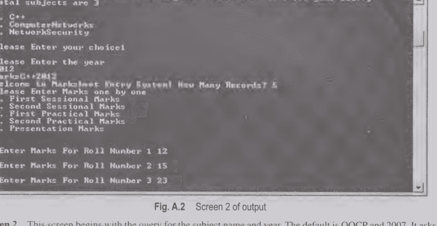

### Fig. A.2 Screen 2 of output

Screen 2 This screen begins with the query for the subject name and year. The default is OOCP and 2007. It asks for the number of subjects and a subject and starts marks entry.


### Fig. A.3 Screen 3 of output

Screen 3 This shows the marks of each student in a matrix form, displays mark status, and loops back to the menu where the user chooses to enter the marks once again.


### Fig. A.4 Screen 4 of output

Screen 4 The user is prompted again for the subject and marks; the program displays the marks that are entered and are not.

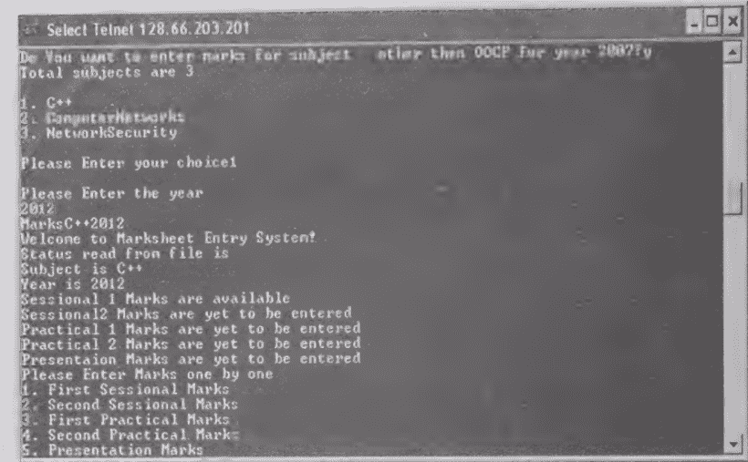

### Fig. A.5 Screen 5 of output

Screen 5 Marks are displayed in the matrix form after the entry.

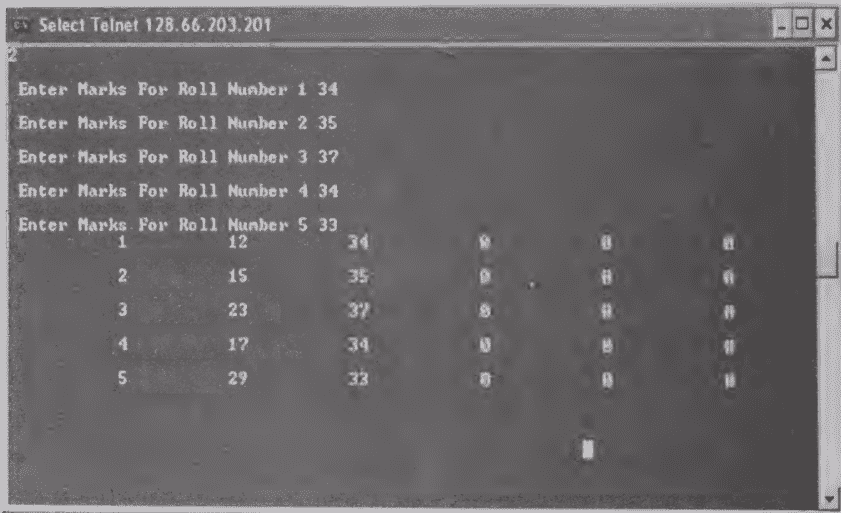

### Fig. A.6 Screen 6 of output

Screen 6 The loop comes back to ask for entry and shows the status of the specific subject with specific year.

### Fig. A.7 Screen 7 of output

Screen 7 The practical marks are entered and information is displayed.

```
Select Telnet 128.66.203.201
The Mark Status is
C++2012ynnn
1. Enter Subjects
2. Enter Marks
3. Display Marks for a given subject for specific year
4. Exit
2
Do You want to enter marks for subject other than 00CF for year 2007?
Total subjects are 3
1. C++
2. ComputerNetworks
3. NetworkSecurity
Please Enter your choice1
Please Enter the year
2012
MarksC++2012
Welcome to Marksheet Entry System!
Status read from file is
Subject is C++
Year is 2012
Sessional 1 Marks are available
Sessional 2 Marks are available?
Practical 1 Marks are yet to be entered
Practical 2 Marks are yet to be entered
```

```
Select Telnet 128.66.203.201
Presentation Marks are yet to be entered
Please Enter Marks one by one
1. First Sessional Marks
2. Second Sessional Marks
3. First Practical Marks
4. Second Practical Marks
5. Presentation Marks
3
Enter Marks For Roll Number 1 11
Enter Marks For Roll Number 2 12
Enter Marks For Roll Number 3 13
Enter Marks For Roll Number 4 13
Enter Marks For Roll Number 5 11
1 12 34 11 0 0
2 15 35 12 0 0
3 23 37 13 0 0
4 17 34 13 0 0
5 29 33 11 0 0
```

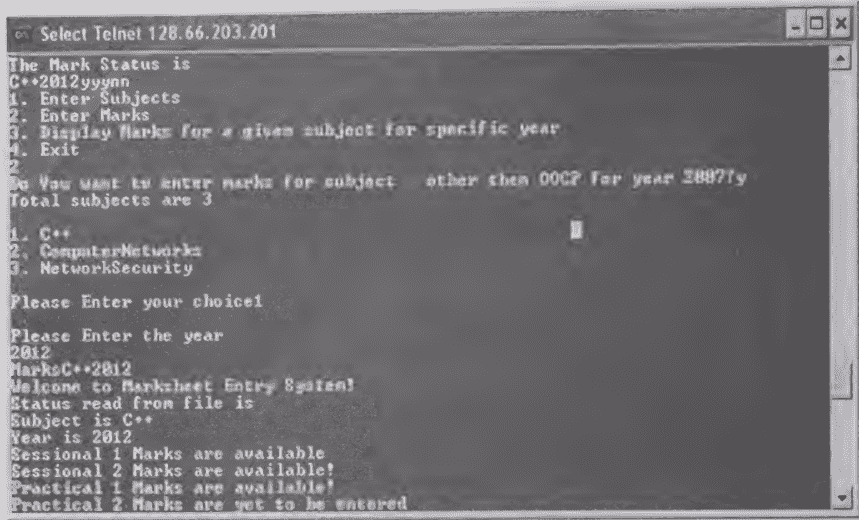

Fig. A.8 Screen 8 of output

Screen 8 The marks are entered and looped back.

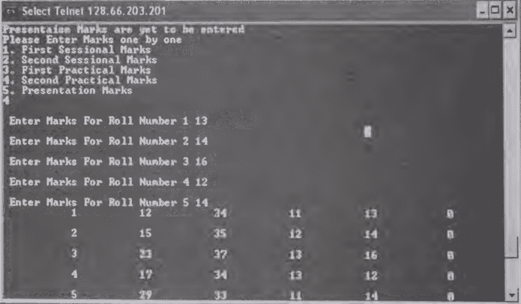

Fig. A.9 Screen 9 of output

Screen 9 Practical second test marks are entered as shown.

### Fig. A.12 Screen 12 of output

Screen 12 Complete marks are entered.

### Fig. A.13 Screen 13 of output

Screen 13 The final mark sheet is printed.

## A.4 EXPLANATION

The program begins with two important definitions. One is a function for getting a string from an int value. There is a function itoa available in Windows or TC++, but it is not available in Linux. We need such a function to run the program under Linux.¹

The other definition is an enum, which describes the reading status. We have already seen that the program may be reading marks about any head at any given point of time. It is enum that tells us what we are reading.

Then, we have the most important class of our program, namely, Marks. The members of the class are divided into two parts. Static members represent the metadata about the class, whereas other members are integers representing the different heads of marks of a student. We have our static members defined and given default values outside the body of the class. It is important to note that the name of the file is a concatenation of three strings. The first string is always ‘Marks’, the second is the subject for which the data entry is made, and the third is the string representation of the year value. Thus, this makes the name of the file unique for each subject for each year. For example, the file name could be Marks00CP2007, MarksAI2008, etc.

These files cannot store their metadata. We need an additional file to store the same. We name that file as the original filename plus the word ‘Status’. Thus, status files for the given two cases will be Marks00CP2007Status and MarksAI2008Status. These are long but unambiguous names.

It is interesting to see that the argument requires a C-type string; hence, we need to call c_str() function with the file name to get the C-type string from a string object.

Next is the Subject class. This class stores only two bits of information, the subject name and number. Ideally, it should also store the name of the file for each subject where syllabus is stored for that subject.

It is needless to state the importance of the overloaded << and >> operators for both the classes and that we have proper constructors for them as well.

Next is the function ChooseSubject(). This is an important function, which reads from the SubjectFile and lets us choose the subject. The following statements are worth having a look.

```
while(!SubjectFile.eof())
{
    int TempNo;
    string TempName;
    SubjectFile >> TempNo;
    SubjectFile >> TempName;
    NoOfSubjects++;
    Subject MCA_Subject_In(TempNo, TempName);
}
```

¹ This function has been taken from the web. The website and the author’s name have been specified in the program itself. As programmers need to invest time and energy to program and debug various cases, it is always a viable option to look for readymade solutions on the web and incorporate them in a program. The advantage of such solutions is that they are usually tested and designed for generic cases. Incorporating such codes makes the program more robust and generic. One must carefully look at the copyright warnings in such cases though.


```
Subjects.push_back(MCA_Subject_In);
}
```

这段代码读取 SubjectFile，并为我们的 Subject 向量填充数据。看看向量中的 push_back() 函数，它可以容纳任意数量的元素。下面的代码用于动态菜单：

```
for(SubjectIndex = Subjects.begin(), i = 1; SubjectIndex < Subjects.end(); SubjectIndex++, i++)
{
	cout << endl << i << "." << SubjectIndex->getName();
}
```

我们的循环从 Subject 向量的开头运行到结尾，并打印每个科目及其对应的选择值。注意迭代器 SubjectIndex 的使用以及 getName() 访问方法的作用。

成绩存储在二进制文件中。为了存储成绩状态和科目信息，我们选择了文本文件。函数 SubjectEntry() 展示了如何读取科目并创建文件。这里有趣的一点是，在字段之间添加额外的空格，以便在读取时将它们分开。请注意，字符串记录是用空白字符分隔的。

同样重要的是不要在文件末尾添加空格，因为这会给我们的文件增加一条虚假记录。

```
for(i = 0; i < NoOfSubjects; i++)
{
	cin >> MCA_Subject_Out;
	SubjectFile << MCA_Subject_Out.getNo();
	SubjectFile << " ";
	SubjectFile << MCA_Subject_Out.getName();
	/* Except the last record, add a space to separate the records */
	if(i + 1 < NoOfSubjects)
		SubjectFile << " ";
}
```

接下来是只包含一个静态菜单的 main() 函数。

接下来的 MarksEntry() 函数默认使用 2007 年 OOCP 科目的成绩。对于状态文件，我们有两种从文件输入的方式：一种是使用 get()，另一种是使用重载的 >>。

接下来，我们遇到检查并打开两个与成绩录入相关文件的代码。同一文件有两个不同的名称。带有 New 前缀的版本使用 ofstream 打开，并在文件首次创建时用适当的初始值初始化。否则，文件会被读取，向量和元数据会使用存储在文件中的值进行填充。

接下来展示菜单，显示关于成绩录入项的选择。如果选择了特定项，例如 Sessionall，则会相应地设置 Status 变量。

我们还将该项标记为已读。循环将记录读入向量。如果生成了新文件，它会生成学号并添加到记录中。

接下来，我们检查是否已有包含成绩的旧文件。由于读取记录后文件状态已更改，我们会创建一个新的状态文件。原始成绩文件中的记录会根据向量重新写入文件。最后，我们遇到一个以轻量级格式打印成绩的函数。

## A.5 改进程序

现实世界中面向应用程序的程序包含许多便于调试和频繁更新的特性。它们健壮且执行时不会对系统造成太大负担。在给定的项目中，我们选择了有限的特性，以保持程序简单并限制其长度。然而，程序可以修改以满足额外需求，这需要更多的规范。我们并未考虑所有特性以降低复杂性。尽管如此，作为读者，你应该尝试在现有程序中加入新特性，使其变得更好。以下是你可添加的特性列表：

- 1. 专业程序应尽可能动态化。我们可以在程序中实现动态菜单。选择成绩项（heads）的菜单可以像选择科目的菜单一样做成动态，但这里没有这么做。
- 2. 有可能多位教师共同教授一门课程，并分别给出成绩。我们必须能够将它们汇总到一张成绩单中。我们的程序没有提供这一功能，因为这会增加复杂度。我们假设所有教师使用相同的成绩项。但对于一些不涉及实践课的科目，可能需要其他成绩项，如小组讨论或测验，这也许并非如此。在我们的情况下，提供这种动态功能既不重要也不可行。
- 3. 专业程序使用不同的组件和现成的编程模块，我们可以在程序中使用它们。VC++ 提供了文本框和列表框等组件用于数据录入。菜单也可用。日历控件可用于验证日期。我们显然没有使用这些。还有一个称为“报表编写器”的功能，所有专业系统都提供，它帮助我们以详细的方式格式化报表。我们在程序中仅使用了 C++ 的基本格式化功能。
- 4. 打印没有处理多页、多列显示，这需要额外的逻辑。
- 5. 同样，所有专业程序都使用某种形式的数据库，代码中包含创建和操作数据库的调用。我们不会采用这种方法。
- 6. 另一个重要问题是验证。理想情况下，系统中输入的所有数据只有在经过适当清理后才应被允许。看到程序的一半用于验证代码并不罕见。我们将在程序中使用最少的验证。这并不是说验证不那么重要；它们非常重要，但它们需要复杂的逻辑和更多的代码冗余。
- 7. 一个小但重要的问题是使用更通用的编程机制。例如，我们可以决定使用 menu() 函数，从相应文件中获取输入并为我们填充菜单。出于简单性和代码长度的考虑，我们没有这样做。

程序有两个菜单：一个是动态的，另一个是静态的。通常，菜单用于添加、删除、修改和显示单个项目等情况。你可以通过选择排序关联容器代替向量来添加这些功能。

## 可能的扩展

程序可以稍加努力扩展，以包含以下功能：

- 1. 格式可以变得更加可移植。可以提供 DLL，从文件读取并输出成绩单。程序中将没有输入/输出（IO），只有处理。在这种情况下，接口将是基于函数的。可以在运行时调用函数，并根据需要生成和更新成绩单和学生成绩。调用程序管理 IO。
- 2. 通过使用包装类，可以为读取经过验证的输入提供更多的通用性。
- 3. 可以提供一个类似科目（subject）的学生模块，接受学生的学号和姓名，这样我们就可以打印学生姓名而不是学号。
- 4. 程序可以包含移动应用程序编程接口，使其可作为移动应用程序访问。

## 索引

抽象数据类型 12, 41
抽象 1–3, 9, 15–17, 26, 27, 35, 36, 38, 74, 471
  定律 15, 38
访问修饰符 56, 365, 366, 370, 400
  const 39, 40, 43, 44, 46, 47, 50, 51, 56, 65–68
  private 364–371, 373–378, 400, 401
  protected 364, 365, 367–371, 373–377, 400, 401
  public 364–368, 370, 371, 373–377, 389, 400, 401
  volatile 39, 40, 56
访问 362, 364–366, 368–378, 383, 387, 388, 390, 400–402
算法 555–560, 564, 565, 572, 582, 584, 586–590
  copy() 555, 584, 586, 589
  find() 555, 556, 558, 560, 572, 582, 584, 586, 589, 590
  原地排序 565
  sort() 555, 557, 558, 560, 565, 587–590
分配器 555, 589
参数 113, 115–119, 121, 403, 404, 416, 418, 435, 436
  默认 109, 111, 115–119, 403, 410, 416, 418, 434–436
赋值 103, 104, 106, 107, 188, 190, 194, 196, 201, 202, 204, 210, 212, 216, 221, 223–226
属性 3, 4, 6–12, 16–20, 21, 22, 27, 28, 36, 38, 69–71, 74, 77, 79, 81, 89, 106, 364, 381, 385, 426, 545, 558
  数据 2, 4, 7–13, 15, 17, 24, 26–28, 30, 32, 34, 36, 38, 69, 70, 71, 73, 74, 75, 76, 78–91, 93–96, 106, 107, 108, 332
  函数 4, 7, 8, 17, 36, 69, 70, 71, 73–75, 78–81, 84–87, 93–95, 101–108
实参相关查找 541
绑定 415, 435, 436
  动态 415, 426, 435, 436
静态 40, 57, 65, 69, 79, 83, 85–94, 96, 102, 106–108, 114, 118, 149–152, 164, 404, 415, 428, 430, 431, 434–436
boolalpha 479, 486, 488, 490, 495
缓冲区 500, 501, 503, 504, 509, 523
  读取 500–509, 512, 513, 515–517, 519, 520, 522–524
  写入 499–501, 503, 504, 506, 509, 512, 513, 516, 519, 520, 522–524
C++ 1, 34, 39, 65, 122, 190, 201, 264, 470–473, 475, 477, 482, 495, 496, 545, 553, 554
  ANSI 31, 32, 35, 37, 43
  应用程序 1, 29, 35
  对象模型 1, 34, 35
  变体 1, 35
强制转换 438, 449, 450, 453, 454, 456, 458–461, 464–468
  交叉转换 438, 464–466, 468
类 2–5, 8–22, 24, 25, 27–32, 35–38, 69–82, 84, 85, 87, 96, 98, 99, 101–103, 108, 362–378, 380, 381, 383–385, 387–391, 393, 394, 396, 398–404, 406–410, 412–416, 418–423, 426–431, 433–437
  抽象 1, 11, 12, 15, 19–22, 36, 38
  基类 362, 364–374, 376–378, 380, 381, 383–385, 387–390, 391, 393, 396, 399–401, 403, 404, 406–410, 412, 414–416, 418, 420–423, 426, 427, 430, 431, 434–436
  派生类 362, 364–378, 380, 381, 383–385, 387, 388, 390, 391, 393, 394, 396, 399–401, 403, 406–410, 412, 414–416, 418–423, 426, 430, 431, 433–437
  异常 21, 28, 33, 34, 36
  局部 69, 83, 101–103, 106, 108
  嵌套 69, 86, 98–101, 106, 108
  嵌套性 99, 100, 101, 106, 108
  虚基类 362, 373, 384, 387, 389–391, 400, 401
类模板 279, 280, 304, 306, 314, 325, 326


## 618 使用 ANSI C++ 编程

- **默认参数** 303, 315, 316, 325, 327
- **显式特化** 279, 299, 302, 309, 325–327
- **友元** 299, 300, 313, 318, 326
- **多种泛型数据类型** 279, 313
- **非类型参数** 292, 294, 295, 314, 315, 326
- **偏特化** 279, 319, 320, 321, 325, 326, 327
- **主特化** 319, 321
- **静态数据成员** 316, 325, 327
- **const_cast** 438, 450, 459, 466, 468
- **常量** 104–106, 108, 194, 196, 212, 213, 216, 223–225
- **常量成员函数** 104, 106
- **构造函数** 4, 29, 30, 175–181, 184, 185, 187–190, 192–194, 196, 201, 205, 208, 209, 213, 214, 217, 220, 223, 224, 225, 226, 415, 422, 436
- **编译器定义的默认** 179
- **拷贝** 175, 188, 200–202, 204, 205, 208, 209, 212, 223–226
- **默认** 175, 178–181, 183, 184, 188–190, 192–194, 196, 204, 208, 209, 211, 224–226
- **默认参数** 175, 179, 192–194, 224, 226
- **动态分配** 175, 196, 199–201, 224, 226
- **空默认** 189, 190, 196
- **执行** 183, 201, 216, 217, 223
- **显式** 175, 177, 187–189, 192, 223, 224, 226
- **多重** 175, 188, 190, 200, 224–226, 362, 363, 378, 380, 381, 383–385, 387, 389, 390, 400–402
- **单参数** 185
- **参数化** 175, 188–190, 196, 200, 212, 221, 224–226
- **私有拷贝** 209
- **规则** 178
- **合成** 180, 223
- **用户定义默认** 175, 180, 181, 183, 225
- **虚** 136, 152, 403, 404, 407, 410, 412–416, 419–423, 426–431, 433–437
- **容器** 555–561, 563, 565, 568–570, 572–574, 582, 584, 586, 587, 589–591
- **序列** 555, 556, 561, 563, 569, 574, 582, 589–591
- **有序关联** 555, 561, 573, 574, 587, 589–591
- **上下文切换** 46, 60, 64
- **控制** 376, 400
- **声明** 362, 376–378, 400, 402, 526–528, 530–533, 541–544
- **转换** 501, 502, 524
- **数据类型** 39–41, 45, 56, 66, 175
- **bool** 40–42, 67, 68, 89, 116
- **queue** 41, 280, 556
- **Deque** 555–558, 561, 572, 573, 582, 584, 588–591
- **派生** 365–367, 369–372, 374, 375, 383, 385, 389–391, 400, 401
- **私有** 364–371, 373–378, 400, 401
- **公有** 364–368, 370, 371, 373–377, 389, 400, 401
- **析构函数** 175, 201, 216–218, 220, 221, 223–226, 403, 415, 421, 422, 428, 430, 431, 436, 437
- **执行** 183, 201, 216, 217, 223
- **合成** 180, 223
- **使用** 177, 180, 193, 194, 196, 200, 201, 204, 210, 213, 216, 217, 223, 226
- **C 与 C++ 的差异** 1, 10, 27, 30, 35, 37
- **基于异常的设计** 33
- **哲学** 27, 35
- **语法** 30, 35, 37
- **模板** 19, 26, 34, 35, 36, 37
- **降级** 438, 449, 450, 466, 468
- **驱动** 471, 495, 497, 498, 524
- **设备** 497–499, 521, 523, 524
- **磁盘** 470, 471
- **打印机** 470, 471, 496
- **dynamic_cast** 438, 450, 451, 453–456, 458, 459, 461, 464–469
- **封装** 1, 4, 5, 15, 16, 17, 36, 38
- **实体** 1, 3–8, 10, 15–20, 22, 26, 28, 37, 38
- **eof()** 509, 512, 523
- **错误** 328–330, 332, 333, 337–340, 344, 350, 352, 358, 359, 360
- **处理** 328–330, 332, 333, 337–339, 359, 360
- **报告** 330, 333, 337

异常处理 328–330, 332, 333, 338, 358–361
  异常终止 329, 330, 339, 352
  abort() 329, 330, 332, 345, 353, 354, 356, 359, 360
  捕获所有 342–344, 360, 361
  捕获块 331–335, 337, 339, 350, 352, 357, 359, 360
  挑战 332
  缺点 328, 358
  异常类 356, 359
  异常规范 344
  全局标志操作 328
  多重捕获 328, 339, 359, 360
  重新抛出 350, 360
  返回错误号 328
  terminate() 328, 332, 334, 338, 339, 345, 352–354, 359, 360
  throw 表达式 331
  try 块 328, 330–333, 338, 339, 350, 355, 357, 359, 360
  uncaught_exception() 328, 356, 358, 360, 361
  unexpected() 328, 344, 345, 353–356, 360, 361
表达式解析器 75–78
  波兰记法 75

fclose() 498
文件 497, 499–501, 503, 504, 508, 509, 512, 523
  关闭 497, 501, 503, 504, 509
  处理 500, 501, 503, 504, 509, 521, 523, 524
  模式 500, 501, 503, 504, 506–508, 512, 513, 520, 523
  打开 497, 499, 500, 503, 506, 508, 520, 522
  指针 500, 501, 503, 512, 513, 515–517, 519–521, 523, 524
  文本 497, 500–504, 508, 509, 512, 523, 524
文件名 499, 500, 504, 508, 523, 524
  逻辑 499, 500, 503, 504, 523, 524
  物理 499, 500, 504, 523, 524
f11() 476, 477, 495
标志 479, 484, 489
  清除 479, 481, 482, 484
  检查 484
  格式 472, 479, 484, 487, 490, 493–496
fmtflags 470, 480, 482, 484
fopen() 498, 499
格式标志 479

adjustfield 479
basefield 479
dec 479
fixed 479
floatfield 479
hex 479, 488
internal 479, 481, 482
left 479, 482
oct 479
right 479, 482
scientific 479
showbase 479, 488
showpoint 479, 488, 490
showpos 479, 482, 486, 491
skipws 479
unibuf 479
uppercase 479
fread() 498
函数 1, 3–5, 8–10, 15, 16, 19, 22–29, 31, 32, 34, 36, 37, 42, 45–47, 49–55, 60, 62, 63–68, 109–115, 403–405, 407–410, 412–416, 418–421, 423, 426–431, 434–440, 442, 443, 445, 447, 448–450, 454, 459, 461–464, 466–469
  按引用调用 124, 172
  被调用 46, 47, 50, 52–55, 60, 61
  调用 45, 46, 54, 55, 60, 65
  const 109, 148, 149, 152, 171, 172, 173
  上下文切换 110–114, 173
  点记法 109
  友元 109, 122, 128, 131, 139, 140, 141
  内联 109, 111–115, 169
  成员 9–11, 13, 14, 25, 27, 28, 36, 37, 109, 122, 123, 136, 137, 139, 140
  name() 443, 468
  非友元 140, 143, 144
  非内联 111, 113, 169, 172
  非成员 9, 28, 109, 113, 119, 120, 122, 128, 136
  非虚 410, 416, 436
  重载 4, 12, 23, 24, 29, 30, 32, 36, 37, 109, 132–136, 139, 147, 169, 171
  指针 113, 127, 128, 131, 132, 139, 147
  成员指针 160, 163, 165, 168, 173
  private 109, 122, 128, 131, 139, 140, 141
  原型化 132, 133, 172
  public 109, 122, 139, 140, 141, 144, 152

别名 528, 538, 539, 542–544
别名化 533, 539, 542
扩展 525, 533
全局 525–527, 535–537, 540–543
命名 535, 543
嵌套 525, 537, 538, 542
开销 541–543
std 525–529, 540, 541, 544
无名 525, 535–537, 542–544
用户定义 526–528
需要 175–181, 187, 188, 198, 199, 201, 202, 208, 210, 213, 223–226, 329, 338, 340, 344, 350, 358, 359, 361, 440, 442, 448–450, 456, 458, 461, 466–468
效率 190, 210
可读性 187, 210, 220
Noboolalpha 488, 490
Noshowbase 488
Noshowpoint 488, 490
NRV 优化 122, 123
对象 1–5, 7, 9–38, 61, 87, 89, 90, 175–181, 185–190, 193, 213, 216–218, 220, 221, 223–228, 230, 235, 236, 240, 243–246, 248–253, 255, 509, 521, 523, 545, 546, 548, 549, 553, 554
对象数组 94
基于 1–5, 7, 16, 19, 26, 27, 29, 33–36, 38, 69, 71
内置 10, 12, 17, 29, 30–32
复合 362, 394, 396, 397, 399, 400
非多态 442, 443, 459, 467
现成 29, 34
面向 1–5, 7, 9–11, 18, 19, 26, 27, 29, 33, 35, 37, 38, 69, 71, 78
持久性 497, 521
指针 403–410, 414, 415, 418, 420–423, 426, 427, 430, 434–437
对象指针 95
多态 438, 439, 442, 444, 445, 447, 450, 451, 454, 459, 464, 466, 467
序列化 521
this 403, 405, 410, 436
Typeinfo 438, 442, 443, 445, 448, 449, 464, 467, 468
用户定义 10, 12, 26, 29, 30, 31
运算符 39, 58, 60, 64, 65, 67, 68, 438, 442–445, 448–450, 454, 456, 459, 464, 466–468
!= 443
== 443, 448, 454, 468
强制转换 39, 60, 62, 64, 65
删除 39, 40, 60, 63, 65, 67, 68
成员指针 60
内存分配 60, 67
内存释放 58
新 39–41, 45, 49, 58–60, 62–65, 67, 68
定位 new 63, 64
指针到成员使用对象 58, 60
指针到成员使用指针到对象 58, 60
作用域解析 39, 59, 60, 67, 68
throw 39, 40, 63, 65, 67, 68
typeid 39, 40, 65–68, 438, 442–445, 447–450, 453–456, 458, 461, 464, 466–468
运算符重载 4, 12, 24, 29, 30, 32, 36, 37, 227–231, 233, 235, 236, 238, 240, 250, 275–277, 286, 288, 289, 404
::delete 262
::new 257, 261
++ 和 -- 238, 275, 277
<< 和 >> 243–245, 269, 277
数组下标运算符 ([]) 250
赋值运算符 (=) 246
二元运算符 227, 229, 240, 275, 277
删除 227, 236, 246, 250, 255–257, 261, 262, 276–278
友元函数 240, 242, 243, 245, 275
函数调用运算符 228, 251, 252
成员函数 229, 230, 235, 241, 245, 265, 268, 275
new 227, 228, 236, 246, 248, 249, 255–257, 259, 261, 262, 265, 274–278
注意事项 249
限制 227, 228, 277
简写运算符 240, 275, 277
一元运算符 229, 236, 276
ostream 471, 493
指针 39–42, 44, 45, 47, 49, 51, 53, 54–56, 62, 66, 68
常量指针 41, 43, 44, 45, 47, 67


- malloc() 42, 60, 62–65, 67, 68
- 命名指针 51
- 指向常量的指针 41, 44, 49, 51, 67, 68
- 使用 41, 42, 45–47, 55, 57–60, 63–68
- Void 40–42, 62, 64, 68
- 多态 1, 5, 22–26, 36, 38, 135, 136, 172, 403, 404, 415, 427, 434–436
- 特设 23–25, 36
- 编译时 113, 169, 403, 404, 408, 410, 415, 434–436
- 动态 1, 24–26, 35, 36, 38
- 包含 25, 32
- 参数化 25, 26, 36
- precision() 476, 477, 495
- 运行时 403, 404, 410, 412, 414, 415, 420, 422, 423, 434–436
- 子类型化 25
- 过程 3, 5
- 面向 1–5, 7, 9–11, 18, 19, 26, 27, 29, 33, 35, 37, 38
- 受保护 364, 365, 367–371, 373–377, 400, 401
- 异常处理 362, 391, 400, 402
- 多个类 363, 378, 383, 402
- put() 474, 496
- read() 475, 476
- 引用变量 39, 51–55, 67, 68, 124, 493
- 链式输入 55
- 虚参 52, 54
- 返回类型 54
- 独立 52, 66
- reinterpret_cast 438, 450, 459–461, 466, 467
- 请求 8, 35
- 响应 8, 11, 13–15, 23, 36
- 可重用性 1, 2, 5, 19, 29, 362, 364
- 神话 19, 38
- 运行时类型信息 438, 466, 467
- 兼容性 464
- 效率 464
- seek() 512
- seekg() 512, 513, 515, 517, 519, 523, 524
- seekp() 513, 516, 519, 523, 524
- Set 555, 556, 560, 561, 578–580, 590, 591
- setf() 478, 479, 481, 482, 484, 488, 495, 496
- setiosflags 488, 490, 491, 495
- showbase 479, 488
- showpoint 479, 488, 490
- 栈 74–78, 87
- Pop 74, 77, 78
- Push 74, 77, 78
- 标准模板库 12, 29
- static_cast 438, 450, 459, 460, 466, 467
- 存储类说明符 57
- auto 40, 57
- extern 40, 57
- register 40, 57
- 存储需求 78, 107
- 非静态 79, 80, 88, 90, 91, 96
- 流 470–476, 479, 484, 487, 488, 490, 493–502, 522–524
- C 471, 472, 474, 475, 495, 496
- 格式化 470, 473, 478, 488
- I/O 470–473, 476, 494–496
- 非格式化 470, 473, 478, 494
- 二进制 497, 500–502, 508, 509, 512, 521, 523, 524
- string 41, 46, 51, 68, 545–549, 553, 554
- C 545, 546, 553, 554
- 特性 548, 549, 554
- 创建 546
- 运算符 548, 549, 553, 554
- struct 2–4, 8–10, 16, 30, 35–37
- 子串 545–548, 553, 554
- 操作 545–549, 553, 554
- tellg() 516, 517, 523, 524
- tellp() 516, 523, 524
- 模板 279–281, 285, 286, 289, 291–293, 295, 299, 303–306, 309, 313, 314, 321–323, 325–327
- 参数推导 295, 306, 325, 326
- 编译模型 279, 285, 321
- export 279, 323, 325, 326
- 泛型函数 280, 283–285, 292, 296, 301–304, 325–327
- 内联函数 321, 322
- 非泛型函数 301–303
- 非内联函数 321–323
- 重载 279, 286, 288, 289, 296, 299, 300, 302, 319, 325–327
- 切换效果 488, 490
- 用户定义转换 262
- 内置数据类型到对象 265
- 隐式 230, 234, 236, 262, 263
- 对象到内置数据类型 265
- 使用构造函数的对象类型 269
- 使用转换函数的对象类型 272
- 运算符函数 229, 230, 240, 242, 246, 251, 252, 267–269, 273–277
- 包装类 268, 269, 276, 278
- using 525–531, 533, 540–544
- 声明 527, 528, 531, 533, 541–544
- 指令 526–528, 530, 531, 533, 541–543
- vector 12, 29, 41, 555–570, 572, 580, 584, 586, 588–591
- width() 476, 477, 495
- write() 475, 476, 496

## 使用 ANSI C++ 编程

BHUSHAN TRIVEDI

牛津大学出版社

ISBN 0-19-808659-8
9 780198 086598

PSU 图书馆

## 使用 ANSI C++ 编程

### 第二版

Programming with ANSI C++ 的第二版在保留理论与实践之间良好平衡以及对初级和高级概念的深入覆盖的同时进行了彻底更新。

从面向对象范式的介绍和 C++ 的概述开始，它逐步详细阐述了类、对象、函数、构造函数和析构函数、运算符重载、多态性和异常处理等重要概念。此外，还有关于模板、运行时类型信息和强制转换运算符、流、文件、命名空间、字符串对象和标准模板库（STL）的专门章节。

### 主要特点

- 包含众多应用导向的程序，附带其源代码和测试用例
- 讨论超过 400 个示例以说明 ANSI C++ 的各个方面
- 提供章节末编程练习以将学习转化为实践
- 包含一个案例研究，展示 C++ 在实际应用中的使用

### 第二版新内容

- 详细讨论了 RTTI、强制转换运算符、成员逐项初始化列表（MIL）、引用变量和模板等高级主题
- 程序后跟分析部分“程序如何工作”，描述程序背后的逻辑和引入的新概念
- 每章包含笔记、边栏和展品等教学元素以突出关键概念
- 现附带一张光盘，包含所有程序的代码以及案例研究

### 第一版好评

> 几乎所有主题都用示例清晰地解释了……整体呈现良好。
> Prof. S. Ravimaran
> M.A.M. 工程学院
> 安娜大学

> 涵盖了初学者所需的一切……语言适合印度学生。
> Prof. Aurobindo Misra
> 硅谷理工学院
> 比朱·帕特奈克科技大学

Bhushan Trivedi 目前担任 GLS 计算机技术学院 MCA 项目主任。他在教授计算机应用研究生方面拥有二十多年的经验。除了编程之外，他的兴趣领域还包括计算机网络、数据库管理系统（DBMS）、Unix 和密码学。

Trivedi 教授曾作为印美工程教育合作（IUCEE）的一部分举办了多次“有效教学”研讨会。他指导了入侵检测与防御、密钥交换协议以及为人力资源领域构建专家系统等领域的博士生。他是《计算机网络》（OUP）的作者。

### 在线资源

www.oupinheonline.com

以下资源可供使用本书的教师和学生支持：

**供教师使用**
- 教师手册
- PowerPoint 幻灯片

**供学生使用**
- 多项选择题
- 附加程序代码

牛津大学出版社

www.oup.com


ISBN 0-19-808396-3
9 780198 083962
