# 项目代码：Scratch 创建动画

Falkirk Community Trust  
30124 03079891 4


Falkirk Community Trust Libraries

|  |  |
|---|---|
| Falkirk Community Trust |  |
| 30124 03079891 | 4 |
| Askews & Holts |  |
| J006.696 | £12.99 |
| MK |  |

## Using Scratch

Scratch is a programming language designed by MIT (Massachusetts Institute of Technology) that lets you create your own interactive stories, animations, games, music and art. Rather than using a complex computer language, it uses easy-to-understand coding blocks. To get the most out of this book, you will need to be able to use a computer and you will need to load Scratch onto your computer. Always check with an adult if it is OK to download files from the Internet to your computer. Go to: `https://scratch.mit.edu`

First, do Scratch’s ‘Getting Started with Scratch’ tutorial, found by going to ‘Create’ on the home page, and then look in the ‘Tips’ menu. You can also work on Scratch offline. Scroll to the bottom of the homepage and click on Offline Editor in the Support menu. Follow the instructions to install it on your computer.

Scratch is developed by the Lifelong Kindergarten Group at the MIT Media Lab. See `http://scratch.mit.edu`

Images and illustrations from Scratch included in this book have been developed by the Lifelong Kindergarten Group at the MIT Media Lab (see `http://scratch.mit.edu`) and made available under the Creative Commons Attribution-ShareAlike 2.0 licence (`https://creativecommons.org/licenses/by-sa/2.0/deed.en`). The third party trademarks used in this book are the property of their respective owners, including the Scratch name and logo. The owners of these trademarks have not endorsed, authorised or sponsored this book.

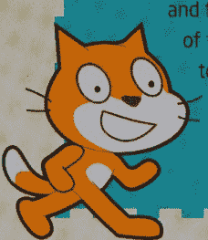

To load the projects that you will use in this book, go to: `www.alixwoodbooks.co.uk/projectcode/downloads.php` and select ‘Animation’. Save the folder somewhere on your computer where you will be able to find it again. You will need to open files in this folder as you go through the project.

## All About Animation

### Easy animation

In a notebook, draw a stick man standing, then gradually bending his knees, then straightening them again, then rising into the air. Use a new page for each illustration. When the pages are flicked, it will look as if the stick man is crouching and then jumping into the air. That’s how animation works.

### Starting from Scratch

Scratch helps you create fun animations easily. Using already-written pieces of code that you can download, the projects in this book will let you play with the code and understand more about how coding works.

You don’t need to be good at drawing to use Scratch. Sprites, backgrounds and costumes are all on the site, ready to use. This means you can create animations much faster on a computer than you can by hand, and you can change things more easily, too, with the click of a mouse!

### Think about it

Can you think of other ways that you could create an animation without using drawings or a computer? How do you think the Wallace and Gromit films were made?

(answer on page 32)

You can use the skills you’ll learn from interacting with the animation projects in this book to develop animations of your own. Once you’ve got the hang of the basics, the possibilities to be creative are endless!

## All About Loops

A computer will run the instructions in a code, one after the other, from beginning to end and then stop. If you want a computer to repeat the same thing over and over again, you need to use a type of code called a loop.

### Step to it

If you wanted to tell your friend to take 10 steps across the room, you wouldn’t say ‘take a step, take a step, take a step …’ ten times! You would say ‘take 10 steps’. You do exactly the same when you’re coding.

### And repeat

The repeat bit of the code is a loop. This is also called ‘going around the loop’ or ‘an iteration’, which means that we run the code from top to bottom each time we go around the loop.

It’s much easier and quicker to write a looping code, because it is shorter. It’s easier to make changes to it, too.

Instead of writing the code:

```text
MOVE 1 step
WAIT 0.5 seconds
MOVE 1 step
WAIT 0.5 seconds
MOVE 1 step
WAIT 0.5 seconds
… and so on, seven more times …
```

It is better to write the code:

```text
REPEAT 10 times:
  MOVE 1 step
  WAIT 0.5 secs
```

### Think about it

If you told your friend to ‘take a step, take a step’, ten times, it would take much longer for them to cross the room than if you’d said ‘take ten steps’, as they’d have to wait for each individual ‘take a step’ instruction.

### Make coding quicker with sub-routines

Code that is used more than once can be made into a sub-routine. You write some code and give it a name, then simply add this name to your main code each time you want to use the sub-routine.

Scratch lets you make blocks of your own code. To make a simple sub-routine in Scratch, click on the ‘More Blocks’ tab and click ‘Make a Block’. Name the block: `STEP`. Next, add these blocks from the coloured menu tabs:

- `MOVE 1 step`
- `WAIT 0.5 secs`

To use the `STEP` sub-routine in your code, put your `STEP` block inside a repeat loop as shown.

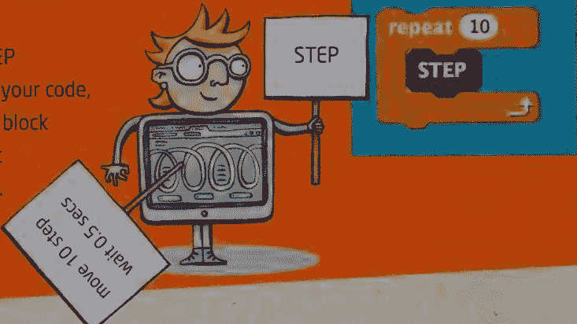

### Nested loops

You can use a loop inside another loop. This is called a ‘nested loop’. Try acting out this nested loop. Face an object, and then turn 90 degrees to the right four times. You have performed a loop. Now clap each time your feet move. The clap is the nested loop.

Try out your new loop skills in the Scratch project on the next page.

## PROJECT PAGE: GET LOOPING!

For the animation project, we will start by creating a simple animation of a sprite, named Avery, walking. Open the Scratch project `animation1.sb2`.

- 1. Click on ‘Costumes’ to see four different images. Each shows Avery at a different stage of walking. Showing these images one after the other will animate Avery walking.

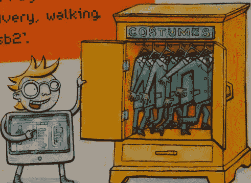

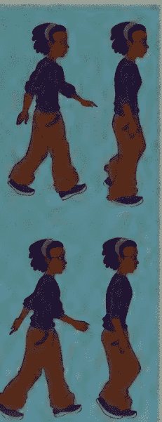

- 2. To do this, we have created a simple loop. A ‘forever’ loop does exactly what it says - it runs the code inside it over and over again, forever. This code changes to the next costume, moves forwards a little, waits for 0.2 seconds, and then repeats. But if you run this code by clicking on it, Avery will eventually walk off the screen.

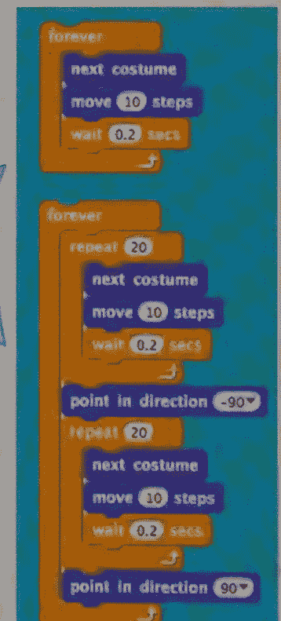

- 3. We can fix this by using repeat loops ‘nested’ inside a forever loop. The top repeat loop walks Avery halfway across the screen. The ‘point in direction’ block turns her around. The bottom repeat loop walks Avery back again and then turns her around. She will do this forever or until you stop her.

- 4. As we are using the same code twice, we’ve created a ‘walk’ sub-routine.

Note that a drumbeat has been added to the sub-routine. By putting a repeat loop inside a repeat loop, Avery’s costume changes twice for each drumbeat. This way you hear a drumbeat each time her foot touches the ground.

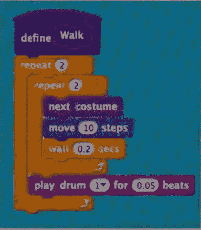

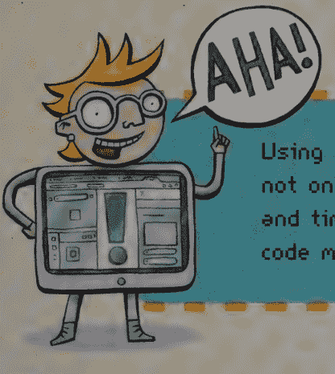

> Using a sub-routine not only saves space and time, it makes code much more readable!

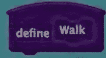

- 5. Use the ‘Walk’ sub-routine block in your final code. Click on this piece of code in the project.

Three more blocks set where Avery starts walking from. These blocks place her at a point to the bottom left of the screen, facing to the right, and also set the volume of the drumbeat sound.

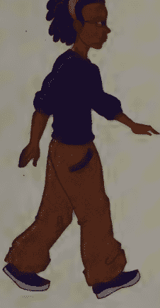

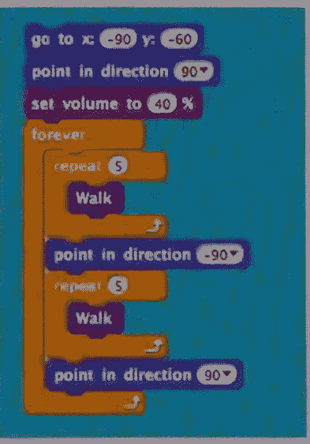

## CREATE A CHARACTER


You can have fun making a Scratch animation exactly how you want it. There are many different sprites to choose from as your main character. Open a new Scratch project by clicking on `File`, then `New` in the dropdown menu. Choose sprites from the Scratch library by clicking on the sprite image next to the words `New sprite`.

### Get creative

If you don’t like any of those, you can create your own! Choose the paintbrush tool from the `New sprite` menu and a blank page will appear. Use the paintbrush or shapes, such as the line, rectangle and circle, to create your sprite. Choose colours from the menu at the bottom and use the slider to change the size of your paintbrush. Create more than one costume for your sprite by clicking on the `paint new costume` paintbrush tool.

## Snap!

Click on the icon of a file and you can add any image you have saved on your computer as a sprite, too. Most picture formats can be used, such as JPEG and PNG files.

If you prefer, you can add a photo of yourself! Click on the camera and if your computer has a camera you will see a picture of yourself come up on the screen!

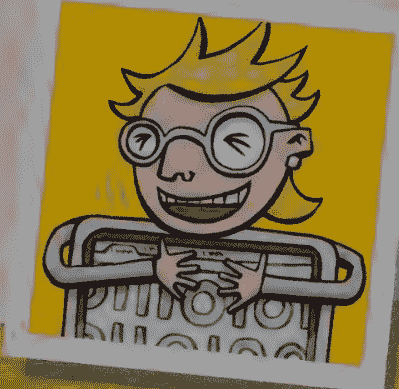

## Storyboards

Think of some animated films you have seen. What did you like about them? Was it the characters or the story, or both? Most good animations have interesting characters and an exciting storyline that makes you want to see what happens next.

When animators start creating an animation, they first make a storyboard. This is a rough outline of what will happen to the characters in a film or animation. It is usually a series of drawings that map out the key moments or events in a story. It helps an animator to get a clear idea of the story's beginning, middle and end before they start. Try it with a character you have created.

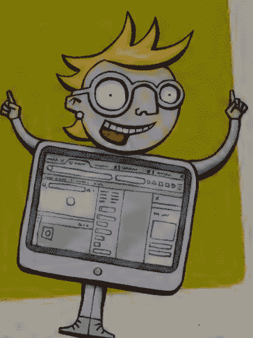

## DECISIONS, DECISIONS!

Decisions are an important part of coding. Decisions mean a computer can make choices based on what is happening. The computer's ability to make decisions makes it seem intelligent, but in reality it is simply following a logical set of instructions.

### How do decisions work?

You can create many types of decision in coding, but they all follow the same basic format:

`DECISION   CONDITION   ACTION`

This may sound confusing, but it is easy really. You probably use the words IF, WHEN or WHILE every day and they have the same meaning in code as they do in real life. IF you are hungry, what should you do?

In coding, the `CONDITION` is what you are testing for. The `CONDITION` must always be either true or false. So if you are testing to see IF you are hungry, then ...

- yes = true
- no = false

The `ACTION` part is what you do if the `CONDITION` is true. So IF you are hungry, the `ACTION` is that you will eat.

### What else?

The simplest of decisions is the IF statement. This usually includes a THEN part.

For example, the coder can tell the computer, ‘IF this happens THEN do this.’ Sometimes an ELSE part is also added. This allows the coder to tell the computer, ‘IF this happens THEN do this or ELSE do that,’ for example:

`IF hungry THEN eat or ELSE keep playing.`

### The IF-THEN-ELSE game

Try this game with some friends.

One person is the Coder, everyone else is a Computer. The Coder gives a command:

> ‘IF I _____ (do this),
> THEN you _____ (do this).’

An example might be: ‘IF I pat my head, THEN you hop on one leg.’

Now try an IF-THEN-ELSE statement:

> ‘IF I _____ (do this),
> THEN you _____ (do this),
> ELSE you _____ (do that).’

An example might be: ‘IF I pat my head, THEN you hop on one leg, or ELSE stick your tongue out.’ If the Coder does nothing, the Computers should all stick their tongues out!

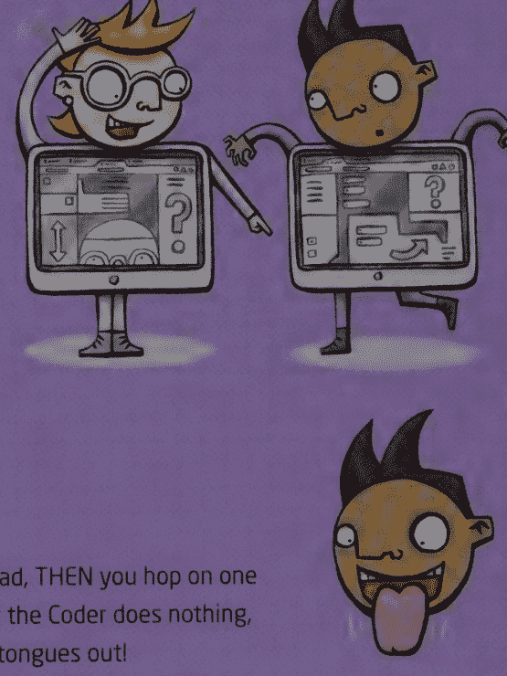

## PROJECT PAGE: USING DECISIONS

Adding decisions to our project will make it more intelligent. Open the Scratch project named `animation2.sb2`.

- 1. The first decision to add is a ‘when’ statement at the start of the code. This tells the computer: ‘When I click on the green flag, start the animation’. (The green start flag and red stop button are at the top right of the Scratch project screen.)
- 2. The next decision adds a little more intelligence to Avery’s walking. At the moment she walks back and forth a set number of paces. We have made it more intelligent by sensing when Avery reaches the edge of the screen, using a block of IF code.

This block makes Avery walk a few paces and then check if she has reached the edge. IF she has, the code turns her around.
- 3. Make another sub-routine called `JUMP`.

Changing the ‘Y’ value makes Avery move up and down. The first ‘change’ block moves her up 60 ‘steps’ and the second 60 steps back down again, with a small delay in between.
- 4. Note that there is a red mark on the path. If the computer senses that Avery is touching the red mark, the `CONDITION` (`IF touching colour red?`) is met (true). The computer then runs the code for the IF-THEN statement with the `JUMP` sub-routine and Avery will jump in the air.
- 5. We can also make Avery do something if the condition was not met, or false. This tells the computer, ‘IF Avery is touching the red, THEN think nothing and jump’, ELSE think “Hmmm”.
- 6. Now, when you click the green flag, Avery walks across the screen, thinking ‘Hmmm’. She turns around at the edges of the screen. Whenever she touches the red mark, she thinks nothing and jumps up and down four times. This continues until you click on the stop symbol.

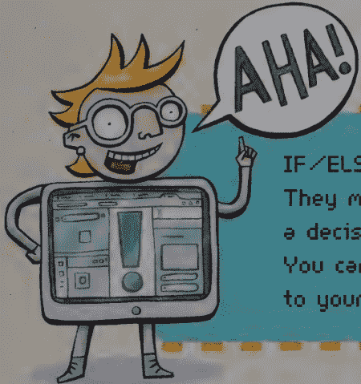

IF/ELSE decisions are really useful. They mean you are not limited to making a decision to either do or not do something. You can do something ELSE, if the answer to your IF question is false.

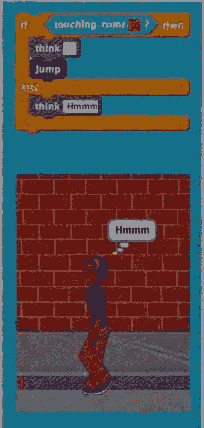

## WHAT'S AN OPERATOR?

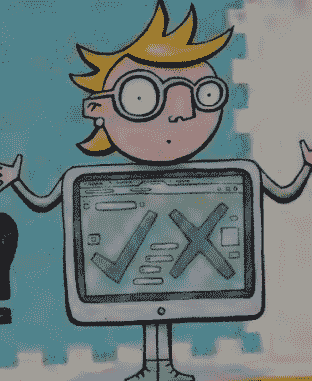

Data is any collection of information, such as numbers or measurements. Different types of operators control how the computer uses the data.

Some maths operators are:

- add `+`
- subtract `-`
- multiply `×`
- divide `÷`

Some comparison operators are:

- less than `<`
- greater than `>`
- equal to `=`

Logic operators are:

- `AND`
- `OR`
- `NOT`

### Logic operators

The answer to ‘am I hungry?’ is either ‘yes’ (true) or ‘no’ (false). What if you wanted to know ‘am I hungry and is it lunchtime?’.

Logic operators are used in coding because they test for more than one thing at a time, using the words `AND` and `OR`.

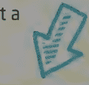

### AND logic

`AND` logic tests to see if the answer to more than one question is true. For example: `IF hungry AND lunchtime THEN eat.`

Each condition (question) is still either true or false, but the result of the combined test - whether we are hungry AND it is lunchtime - is also either true or false.

The `AND` logic works like this:

| Condition | Result |
| --- | --- |
| Hungry (true) AND lunchtime (true) | = true (eat) |
| Hungry (true) AND NOT lunchtime (false) | = false (don’t eat) |
| NOT hungry (false) AND lunchtime (true) | = false (don’t eat) |
| NOT hungry (false) AND NOT lunchtime (false) | = false (don’t eat) |

### OR logic

`OR` logic tests to see if at least one condition is true. For example: `IF hungry OR lunchtime THEN eat.`

The `OR` logic works like this:

| Condition | Result |
| --- | --- |
| Hungry (true) OR lunchtime (true) | = true (eat) |
| Hungry (true) OR NOT lunchtime (false) | = true (eat) |
| NOT hungry (false) OR lunchtime (true) | = true (eat) |
| NOT hungry (false) OR NOT lunchtime (false) | = false (don’t eat) |

## PROJECT PAGE: USING OPERATORS

Open the Scratch project named `animation3.sb2`.

- 1. The first decision to add is a ‘when’ statement at the start of the code. This tells the computer: ‘When I click on the green flag, start the animation’. (The green start flag and red stop button are at the top right of the Scratch project screen.)
- 2. The next decision adds a little more intelligence to Avery’s walking. At the moment she walks back and forth a set number of paces. We have made it more intelligent by sensing when Avery reaches the edge of the screen, using a block of IF code.

This block makes Avery walk a few paces and then check if she has reached the edge. IF she has, the code turns her around.
- 3. Make another sub-routine called `JUMP`.

Changing the ‘Y’ value makes Avery move up and down. The first ‘change’ block moves her up 60 ‘steps’ and the second 60 steps back down again, with a small delay in between.
- 4. Note that there is a red mark on the path. If the computer senses that Avery is touching the red mark, the `CONDITION` (`IF touching colour red?`) is met (true). The computer then runs the code for the IF-THEN statement with the `JUMP` sub-routine and Avery will jump in the air.
- 5. We can also make Avery do something if the condition was not met, or false. This tells the computer, ‘IF Avery is touching the red, THEN think nothing and jump’, ELSE think “Hmmm”.
- 6. Now, when you click the green flag, Avery walks across the screen, thinking ‘Hmmm’. She turns around at the edges of the screen. Whenever she touches the red mark, she thinks nothing and jumps up and down four times. This continues until you click on the stop symbol.


IF/ELSE decisions are really useful. They mean you are not limited to making a decision to either do or not do something. You can do something ELSE, if the answer to your IF question is false.


## WHAT'S AN OPERATOR?


Data is any collection of information, such as numbers or measurements. Different types of operators control how the computer uses the data.

Some maths operators are:

- add `+`
- subtract `-`
- multiply `×`
- divide `÷`

Some comparison operators are:

- less than `<`
- greater than `>`
- equal to `=`

Logic operators are:

- `AND`
- `OR`
- `NOT`

### Logic operators

The answer to ‘am I hungry?’ is either ‘yes’ (true) or ‘no’ (false). What if you wanted to know ‘am I hungry and is it lunchtime?’.

Logic operators are used in coding because they test for more than one thing at a time, using the words `AND` and `OR`.


### AND logic

`AND` logic tests to see if the answer to more than one question is true. For example: `IF hungry AND lunchtime THEN eat.`

Each condition (question) is still either true or false, but the result of the combined test - whether we are hungry AND it is lunchtime - is also either true or false.

The `AND` logic works like this:

| Condition | Result |
| --- | --- |
| Hungry (true) AND lunchtime (true) | = true (eat) |
| Hungry (true) AND NOT lunchtime (false) | = false (don’t eat) |
| NOT hungry (false) AND lunchtime (true) | = false (don’t eat) |
| NOT hungry (false) AND NOT lunchtime (false) | = false (don’t eat) |

### OR logic

`OR` logic tests to see if at least one condition is true. For example: `IF hungry OR lunchtime THEN eat.`

The `OR` logic works like this:

| Condition | Result |
| --- | --- |
| Hungry (true) OR lunchtime (true) | = true (eat) |
| Hungry (true) OR NOT lunchtime (false) | = true (eat) |
| NOT hungry (false) OR lunchtime (true) | = true (eat) |
| NOT hungry (false) OR NOT lunchtime (false) | = false (don’t eat) |

## PROJECT PAGE: USING OPERATORS

Open the Scratch project named `animation3.sb2`.

- 1. The first decision to add is a ‘when’ statement at the start of the code. This tells the computer: ‘When I click on the green flag, start the animation’.
- 2. The next decision adds a little more intelligence to Avery’s walking. At the moment she walks back and forth a set number of paces. We have made it more intelligent by sensing when Avery reaches the edge of the screen, using a block of IF code.
- 3. Make another sub-routine called `JUMP`.
- 4. Note that there is a red mark on the path. If the computer senses that Avery is touching the red mark, the `CONDITION` (`IF touching colour red?`) is met (true). The computer then runs the code for the IF-THEN statement with the `JUMP` sub-routine and Avery will jump in the air.
- 5. We can also make Avery do something if the condition was not met, or false. This tells the computer, ‘IF Avery is touching the red, THEN think nothing and jump’, ELSE think “Hmmm”.
- 6. Now, when you click the green flag, Avery walks across the screen, thinking ‘Hmmm’. She turns around at the edges of the screen. Whenever she touches the red mark, she thinks nothing and jumps up and down four times.


## PROJECT PAGE: USING OPERATORS

Open the Scratch project named `animation3.sb2`.

- 1. The first decision to add is a ‘when’ statement at the start of the code. This tells the computer: ‘When I click on the green flag, start the animation’.
- 2. The next decision adds a little more intelligence to Avery’s walking. At the moment she walks back and forth a set number of paces. We have made it more intelligent by sensing when Avery reaches the edge of the screen, using a block of IF code.
- 3. Make another sub-routine called `JUMP`.
- 4. Note that there is a red mark on the path. If the computer senses that Avery is touching the red mark, the `CONDITION` (`IF touching colour red?`) is met (true). The computer then runs the code for the IF-THEN statement with the `JUMP` sub-routine and Avery will jump in the air.
- 5. We can also make Avery do something if the condition was not met, or false. This tells the computer, ‘IF Avery is touching the red, THEN think nothing and jump’, ELSE think “Hmmm”.
- 6. Now, when you click the green flag, Avery walks across the screen, thinking ‘Hmmm’. She turns around at the edges of the screen. Whenever she touches the red mark, she thinks nothing and jumps up and down four times.


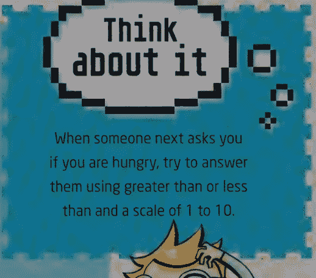

下次有人问你饿不饿时，试着用大于或小于以及 1 到 10 的等级来回答他们。

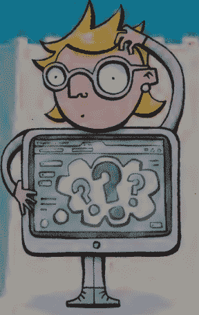

## 项目页面：

### 添加运算符

到目前为止，我们只在代码中提出了简单的问题，例如“我们是否碰到了红点？”或“我们是否到达了屏幕边缘？”。当我们需要提出更具体的问题时，就需要使用运算符积木。打开名为`animation3.sb2`的Scratch项目。

1. 艾弗里无论从哪个方向走过红色标记时都会跳跃。如果我们只想让她向右移动时跳跃，就需要使用两个运算符：`AND`和`=`。这两个条件——碰到红色标记和移动方向为 90（右）——必须同时满足，她才会跳跃。

```
if touching color ? and direction = 90 then
jump
```

2. 第三个决策使用`=`、`>`和`<`，以及两个`AND`运算符。记住“`>`”表示大于，“`<`”表示小于。这一次，当艾弗里向右走，并且她在屏幕上的位置在 1 到 40 之间（刚好超过一半）时，艾弗里会做一个空翻。和跳跃一样，空翻是一个子程序。

```
if direction = 90 and x position > 0 and x position < 41 then
Somersault
```

## 制作有趣的背景

角色和动作在动画中很重要，但背景在让一切生动起来方面也起着重要作用。与角色（见第12-13页）一样，你可以发挥创意制作自己的背景。你可以从背景库中选择一个背景（在Scratch中称为“背景”），使用创意工具绘制自己的背景，选择电脑上已有的背景文件，或者点击摄像头看看你的电脑正在看到什么。

## 它就在你身后！

不同的场景确实会改变动画的情绪。想想什么样的背景适合你的动画故事。水下背景不适合以森林为背景的故事。如果库中没有合适的背景，一个非常疯狂的动画可能需要你制作一个时髦的背景来搭配。

## 改变颜色

让你的背景变得生动的一个简单方法是让它每隔几秒改变一次颜色。那看起来会很酷。

以下是实现这一效果所需的代码：

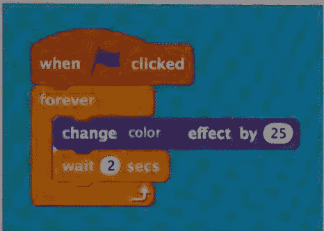

1. 要将代码应用到背景，首先选择你的背景，然后点击“脚本”。

2. 从“事件”、“控制”和“外观”菜单中选择你需要的积木。将这些积木拖到合适的位置，如上图所示。

3. 当你点击绿旗时，背景颜色将每两秒改变一次。你可以通过调整`等待2秒`框中的数字来改变颜色变化的速度。在不同的背景上试试，看看你最喜欢哪一个。

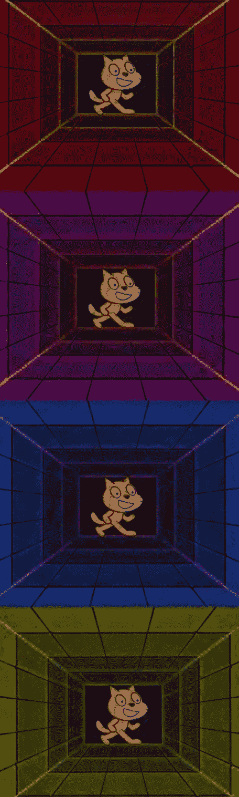

## 人的力量！

有些计算机程序需要用户（你）与之交互，比如当你玩电脑游戏时。其他程序，如操作系统，无需用户做任何事即可运行。

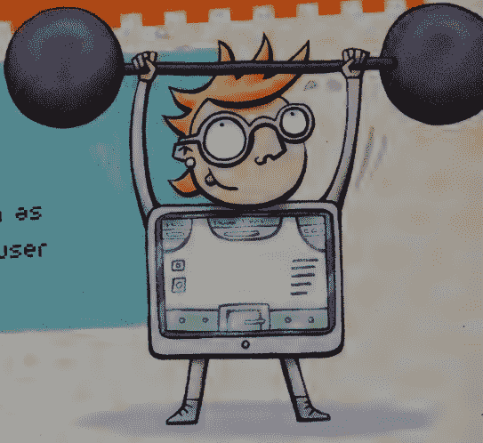

## 输入和输出

大多数程序确实会与用户交互——如果你无法控制正在发生的事情，游戏就不会那么有趣！这些交互主要分为两部分：输入和输出。输入是用户向代码提供信息或指令，输出是代码以某种方式响应用户。

最明显的输入是键盘和鼠标，或者手持设备上的触摸屏。当你使用它们时，你就是在向程序提供信息。

最明显的输出是显示屏，你的代码在其中显示消息、图形或图片，或播放视频或音乐。

## 想一想

- 你认为以下内容是输入还是输出？
  - 输入你的名字
  - 在屏幕上显示消息
  - 打印图片
  - 滑动触摸屏

（答案在第32页）

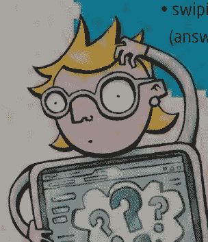

## 界面

用户与计算机之间的连接称为 UI（用户界面）或 GUI（图形用户界面）。对于大多数程序来说，用户交互至关重要。

## 事件

如果你的代码需要来自用户的信息，它通常会做两件事之一。要么在屏幕上提问并等待答案，要么代码继续运行并在用户决定与之交互时做出响应。我们称之为“事件驱动”。“事件”可能是点击鼠标或按键。

## 像计算机一样思考

想一想你在动画中可以做的事情。你希望你的程序如何对每一件事做出反应？也许你可以编写这样的代码：

```
IF up arrow key pressed THEN
(computer thinks: ‘Which key was pressed? Was it an arrow key? Do I need to move the sprite up?’)
```

```
IF sound menu selected THEN
(computer thinks: ‘Find which sound command was selected and respond.’)
```

```
IF mouse clicked THEN
(computer thinks: ‘Where was the mouse clicked? What object was selected? Do I need to respond?’)
```

```
IF nothing happens THEN
(computer thinks: ‘Continue doing what I was already doing.’)
```

在下一页尝试向你的代码添加一些用户交互。

## 项目页面：

### 用户交互

如何添加一些用户交互。打开名为`animation4.sb2`的Scratch项目。

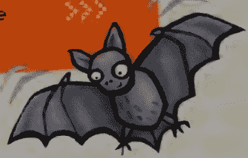

现在有两个角色——艾弗里和一只蝙蝠。艾弗里会来回走动，直到你告诉她做别的事情。我们还使用与第23页改变颜色背景相同的方法添加了一个阴森旋转的森林背景，只是从菜单中选择了“旋转”而不是“颜色”。

1. 艾弗里可能会有点害怕这片阴森的森林。你可以用这段代码（右侧）让她上下跳跃。按住鼠标按钮直到她跳起来。`如果鼠标按下？那么`积木会让计算机寻找用户交互，以检查鼠标是否被点击。

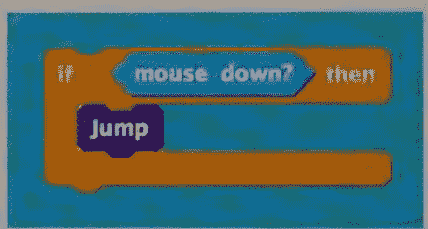

2. 你可以使用这段代码并按住键盘上的向上箭头键，让艾弗里做空翻或跳跃。

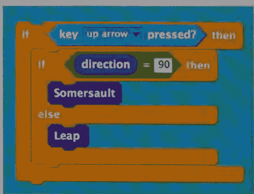

3. 你看不到蝙蝠角色，但如果你按下空格键，蝙蝠会从屏幕顶部飞下来。如果蝙蝠撞到艾弗里，它会说“哎哟”，你会听到爆裂声。如果蝙蝠没撞到，它就会消失。

第26页的`如果-那么`积木会让计算机测试是否发生了用户交互（按下了向上箭头键）。如果发生了，它会根据艾弗里行进的方向运行`空翻`或`跳跃`子程序。

4. 点击蝙蝠角色，看看使其与艾弗里交互的代码是如何编写的。

```
If touching Avery Walking ? then
say Ouch! for 0.25 secs
play sound pop
```

这段`如果-那么`代码块会让计算机测试蝙蝠是否碰到艾弗里。如果碰到了，它就运行代码。但它也依赖于用户交互才能工作。如果用户按空格键的时机不对，代码的`如果-那么`部分就不会运行。

5. 点击绿旗启动完成的动画。通过按空格键让蝙蝠动起来。看看你是否能把握好蝙蝠动画的时机，让它说出“哎哟”。尝试按组合键，看看所有动画的运行效果。

## 调试

你可能会认为，每次使用编程积木时，它们都会在第一次就完全按照你想要的方式、以你预期的方式运行。不幸的是，这种情况很少见！

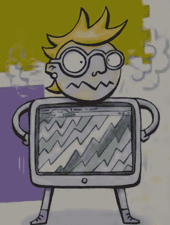

### 别再让 bug 烦我了！

你很可能在某个地方出错，或者代码并没有完全按照你所预期的那样运行。这并不总是你的错。有时，我们用来创建代码的程序本身有问题，因此它生成了错误的代码。

当代码有问题时，这被称为 bug。调试就是仔细检查代码，找出导致 bug 的原因，并通过移除 bug 来修复它。

在你把自己写的代码交给别人使用之前，应该先测试它。它是否把所有事情都做对了？如果用户做出了意想不到的操作怎么办？我们的代码会因此出问题，还是仍然能正常运行？

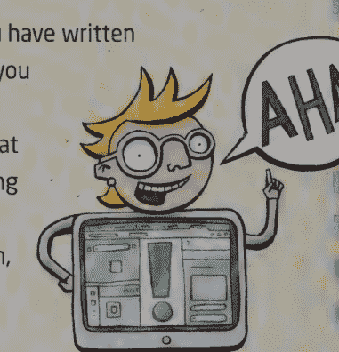

为什么叫 “bug”？有人认为这个词发明于 1947 年，当时在美国哈佛大学的一台名为 Mark II 的早期计算机里发现了一只蝴蝶。从事电气系统工作的人也曾使用过这个词。据说它是 “bugbear” 或 “bugaboo” 的缩写，这两个古词都是“邪恶精灵”的意思。

### 寻找 Bug

调试最困难的部分是找出出错的代码。你必须非常仔细地检查代码，找出 bug 所在。然后还要小心，确保所做的修改不会引发另一个 bug。

一旦修复了 bug，就再次测试代码，直到你确信一切都能按预期运行为止。只有到那时，你的代码才算完成。

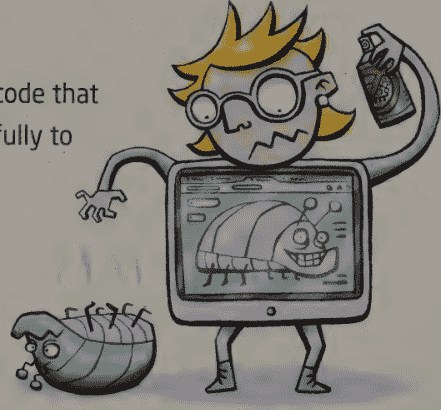

### 思考一下

加载名为 `animation5.sb2` 的项目。你能发现这段代码中的 bug 吗？Avery 本应来回走动。在 Scratch 中运行这段代码，看看会发生什么。然后尝试调试代码，让 Avery 像她在第 10 页的第一个项目中那样走过屏幕。

（答案见第 32 页）

```
go to x: -90 y: -60
point in direction 0°
set volume to 40%
forever
  repeat 5
    Walk
  repeat 5
    Walk
  point in direction 90°
```

### 犯错

记住，调试是编程的一部分，犯错是学习新技能的重要一环。有时，错误会引发意想不到或有趣的事情，你也许会决定把它们保留在另一个动画中。

> 现在，运用你学到的技能，制作一个属于你自己的动画吧！可能性是无限的！

## 词汇表

- 动画师：制作动画卡通片的人。
- 代码：给计算机的一组指令。
- 条件：指计算机程序检查某个陈述是真还是假。
- 造型：在 Scratch 中，指每个角色被绘制成的不同造型；当它们一个接一个显示时，会产生动画的错觉。
- 迭代：计算机使用的一种过程，其中一系列操作会重复多次。
- 逻辑的：遵循逻辑或推理规则的。
- 操作系统：计算机中的主程序，控制计算机的工作方式，并使其他程序能够运行。
- 程序：一组分步指令，告诉计算机对数据执行某些操作。
- 旋转：使……围绕轴线或中心转动。
- 运行：操作（程序）。
- 角色：一个简单的二维位图角色，可以在更大的场景中移动。
- 符号：用来代替一个词或一组词的字母、字符或符号。
- 翻译：将文字或其他指令从一种语言转换为另一种语言。
- 用户：操作计算机程序的人。

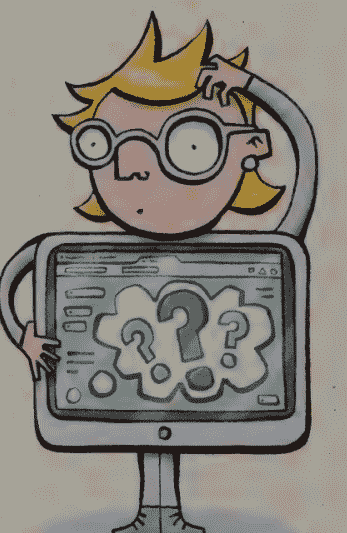

## 索引

- **动画** 4–5, 10, 12, 13, 16, 21, 22, 25, 27, 29
- **舞台背景** 22–23
- **背景** 22–23
- **二进制** 6, 7
- **角色** 12–13, 22
- **编程积木** 7, 9, 10, 11, 16, 17, 20, 21, 23, 26, 27, 29
- **颜色变化** 23, 26
- **计算机** 4, 5, 6, 7, 8, 13, 14, 15, 17, 18, 21, 22, 24, 25, 26, 27, 28
- **条件** 14, 17, 18, 19, 20
- **数据** 18
- **决策** 14–15, 16–17, 20
- **如果** 14, 15, 16, 17
- **如果/否则** 14, 15, 17
- **事件** 23, 25
- **假** 14, 17, 18, 19
- **手翻书** 4
- **输入** 24
- **交互** 24, 25, 26–27
- **界面** 25
- **迭代** 8
- **按键** 25, 26, 27
- **键盘** 24, 26
- **逻辑**
  - **与** 18
  - **或** 19
- **循环** 8–9, 10–11
  - **嵌套循环** 9, 10, 11
- **鼠标** 5, 24, 25, 26
- **操作系统** 24
- **运算符** 18–19, 20–21
  - **条件运算符** 19, 20
  - **逻辑的** 18, 19, 20
- **输出** 24
- **程序** 6, 7, 24, 25, 28
- **旋转** 21
- **屏幕** 10, 11, 13, 16, 17, 20, 21, 24, 25, 26, 27, 29
- **角色** 5, 10, 12, 13, 22, 26, 27, 28
- **故事板** 13
- **子程序** 9, 11, 16, 17, 20, 21, 27
- **符号** 17, 19
- **创意工具** 22
- **绘制** 12, 22
- **触摸屏** 24
- **真** 14, 17, 18, 19

## 答案

**第 5 页**  *《超级无敌掌门狗》*系列电影是使用一种叫“定格动画”的技术制作的。制作中会使用黏土模型，影片一帧（也就是一幅画面）一帧地拍摄。每帧之间模型只移动一点点，因此当这些帧连续播放时，模型看起来就像在动。

**第 6 页**  二进制卡片 0011 = 3

**第 7 页**  鲨鱼障碍赛道中的错误是第三条指令（第二个向上箭头）。

**第 24 页**  输入姓名和滑动触摸屏都是输入。显示消息和打印图片都是输出。

**第 29 页**  bug 出在第一个`面向方向`积木上。它应该是 90，而不是 0。
