# Python 初学者指南（第2版）

John C. Shovic, 博士

Alan Simpson

作者：John C. Shovic, 博士

Alan Simpson

# 第 3 章：Python 元素与语法

# 第 4 章：构建你的第一个 Python 应用

# 第 2 本：理解 Python 构建模块

# 第 1 章：处理数字、文本和日期

Python 全能指南（自学者教程/For Dummies）

# 第 2 章：控制动作

# 第 3 章：利用列表和元组加速运行

# 第 4 章：使用字典处理海量数据

# 第 5 章：梳理更大的代码块

# 第 6 章：使用类进行 Python 编程

# 第 7 章：处理错误

# 第 3 卷：使用库

# 第 1 章：处理外部文件

- 将 CSV 导入为 Python 字典

## 第 2 章：处理 JSON 数据

- 将 Excel 数据转换为 JSON 日期
- 遍历带键的 JSON 文件
- 将 Firebase 时间戳转换为 Python 日期

## 与互联网交互

- 了解 Web 的原理

## 第 4 章：库、包和模块

# 第 4 卷：使用人工智能

- AI 是技术的集合
- 神经网络

## 第 2 章：构建神经网络

## 第 3 章：进行机器学习

- 结果，第一轮

# 第 4 章：探索 AI

- 谷歌云 (Google Cloud)
- 亚马逊云服务 (Amazon Web Services)
- IBM Cloud
- 在哪里可以发现更多 Python AI 趣味

# 第 5 章：数据科学

## 第 1 章：理解数据科学的五个领域

## 第 2 章：探索大数据

## 第 3 章：使用来自谷歌云的大数据

- 谷歌数据代码
- 代码详解
- 数据的初步分析

# 第 6 卷：与硬件对话

## 第 2 章：无需焊接！使用 Grove 连接器构建

- 电源适配接示例!
- 第二个示例：Adafruit 终极 GPS

# 第 4 章：让物体动起来

# 第 7 册：构建机器人

## 第 3 章：为你的机器人小车编程

## 第 4 章：在机器人中使用人工智能

目录 XV

# 索引

# 引言

Python 的力量。Python 语言变得越来越流行，根据 IEEE Spectrum 的报告，在 2017 年，它已成为世界上最受欢迎的语言。Python 的力量是真实的。

它之所以成为第一语言，因为它易于学习和使用，这部分归功于其简化的语法和自然语言的流，但也归功于惊人的用户社区以及广泛的应用范围。

# 关于本书

本书是一本参考手册，旨在引导你学习 Python 的过程，以及如何将其应用于现代计算机应用中，例如数据科学、人工智能、物理计算和机器人技术。如果你想学习许多令人兴奋的事情，那么这本书正适合你。它介绍了你将需要深入探索的主题。

《Python 全书（All-in-One Dummies）第二版》引导你学习 Python 语言，并带你领览一些酷炫的库和技术（树莓派、机器人技术、AI、数据科学等），这些技术都围绕着 Python 语言展开。当你从事新项目和新技术时，Python 就在那里，有许多种库等待你使用。

这是一本实操书籍，包含了预期的示例和代码，你将输入代码、运行它，然后修改它以实现你的目标。你不仅仅是购买机器人，而是要构建它。

Python 的力量。Python 语言变得越来越流行，在 2017 年根据 IEEE Spectrum，它已成为世界上最受欢迎的语言。Python 的力量是真实的。

它之所以成为第一语言，是因为它易于学习和使用，这部分归功于其简化的语法和自然语言的流，但也归功于惊人的用户社区以及广泛的应用范围。

# 关于本书

本书是一本参考手册，旨在引导你学习 Python 的过程，以及如何将其应用于现代计算机应用中，例如数据科学、人工智能、物理计算和机器人技术。如果你想学习许多令人兴奋的事情，那么这本书正适合你。它介绍了你将需要深入探索的主题。

《Python 全书（All-in-One Dummies）第二版》引导你学习 Python 语言，并带你领览一些酷炫的库和技术（树莓派、机器人技术、AI、数据科学等），这些技术都围绕着 Python 语言展开。当你从事新项目和新技术时，Python 就在那里，有许多种库等待你使用。

这是一本实操书籍，包含了预期的示例和代码，你将输入代码、运行它，然后修改它以实现你的目标。你不仅仅是购买机器人，而是要构建它。

人工智能是复杂的，但 Python 帮助解决这些问题。

机器人技术是复杂的，但 Python 能够让你将这些部分结合起来。

# 购买假设

我们假设你已经学会了基础使用计算机。如果你能打开电脑并使用鼠标，你就准备好阅读这本书了。我们假设你还不会编程，尽管你有某些编程技能（或其他计算机语言），也可以跳到第 4 章开始学习新东西。我们的意图是引导你学习 Python 语言，然后是一些使用 Python 的神奇技术和设备。

# 需要购买的内容

为了完成第 4 到第 7 章的项目，你需要树莓派 3B+ 套件 `https://amzn.to/2W3cY` 或树莓派 4B 套件 `https://amazon.to/3nIH8W8`。此外，你还需要本节列出的物品，已按小书组织。


如果你想在第 7 章的机器人中使用树莓派 4B，它将极大缩短电池寿命，而且某些类型的机器人可能无法启动 4B。

+   Python 全书（All-in-One Dummies）

# 第 6 本

为了构建第 6 本中的项目，你需要以下设备：

- Pi2rover 板，访问 `https://shop.switchdoc.com` 或 `www.amazon.com`。（在 `shop.switchdoc.com` 结账时使用折扣码 `PI2DUMIES` 可享板 减 $5.00。）

- Grove LED 模块（包含一根 Grove 线），访问 `https://shop.switchdoc.com` 或 Amazon。

- 一包 Grove 公转跳线连接线，特别是 Grove-4 针公-转-Grove 转换线，访问 `https://shop.switchdoc.com/products/grove-4-pin-male-jumper-to-grove-4-pin-conversion-5-pcs-per-pack` 以及 `https://amzn.to/3ny0bic`

- 一包母转-Grove 跳线连接线，访问 `https://shop.switchdoc.com/products/grove-4-pin-female-jumper-to-grove-4-pin-conversion-cable-5-pcs-per-pack` 以及 `https://amzn.to/3JhqmXY`

- Grove HD180 I2C 温湿度传感器，访问 `https://store.switchdoc.com` 或 `www.amazon.com`。Switch Labs Doc10 带有 Grove 接口。如果你在 Amazon 上购买非 Grove 传感器，你需要一根母转-Grove 跳线连接线，正如本小书第 2 章讨论的那样。你可以在 `https://shop.switchdoc.com/products/grove-4-pin-female-jumper-to-grove-4-pin-conversion-cable-5-pcs-per-pack` 以及 `https://amzn.to/3JhqmXY` 获取连接线。

- Grove 氧传感器，访问 `www.seedstudio.com` 或 `www.amazon.com`。

- Pi2Rover 树莓派转 Grove 转换器，访问 `https://shop.switchdoc.com` 或 `www.amazon.com`。（在 `shop.switchdoc.com` 结账时使用折扣码 `PI2DUMIES` 可享板 减 $5.00。）

- Grove 4通道16 位模拟数转换器，访问 `https://store.switchdoc.com` 或 `www.amazon.com`。

- I2C 电机驱动器（带一根 Grove 线），访问 `www.seedstudio.com` 或 `https://amazon.com`。

- 两个直流电机，访问 `www.adafruit.com/product/711` 或 `https://amazon.com`。

- SG90 微型舵机，访问 `www.ebay.com` 或 `https://amazon.com`。这些电机非常便宜，你可能不到 10 美元就能买两个或更多。

- 28BY-48 ULN2003 5ve 步进电机，访问 `www.ebay.com` 或 `https://amzn.to/2BuND1`。这种电机很便宜，你可能 12 美元就能买五个。确保你买的是带有驱动板的（例如 Amazon.com 链接中的那种）。

# 第 7 本

为了第 7 本中的机器人，请购买以下物品：

- Adept 树莓派 PiCar-B。确保你买的是 PiCar-B 而不是 PiCar-A。寻找“Adept Mars Rover PiCar-B”。你可以在 Amazon.com `https://amzn.to/36duKPU`、`www.ebay.com` 和 `www.adept.com` 购买 PiCar-B。

- 18650 7V LiPo 5000mAh 电池，访问 `https://amazon.com` 以及许多地方。

# 本书中使用的图标

一本“自学者（Dummies）”书如果没有指引你走向那些能加速进程的真正有用信息，那算什么书呢？在这里我们简要介绍书中的每个图标。


**提示 (Tip)** 图标指向可能会让你的工作变得轻松的有用信息。


此图标标记了一个通常有趣且实用的事实——你可能想为了以后使用而记住它。


**警告 (Warning)** 图标强调了潜伏的危险。当我们使用这个图标时，我们是在提醒你注意并谨慎行。


当你看到这个图标时，请知道附近有技术性内容。如果你觉得自己没有具备技术思维，可以跳过这些信息。

# 书外内容


除了你正在阅读的纸质书或电子书内容外，本产品还包含了一些可以在网上随地访问的内容。要获取这些材料，请访问 `www.dummies.com` 搜索框中搜索“Python All-in-One For Dummies cheat sheet”。此外，我们在 `www.dummies.com/pythoniaofd2e` 提供了本书的所有源代码。点击左侧列的 **Downloads**（下载），你就能看到按小书组织的代码。

# 接下来去哪里

《Python All-in-One For Dummies》第二版的设计使你可以根据自己感兴趣的内容跨顺序阅读章节或部分。接下来的路如何取决于你！如果你以前用过 Python，第 1 本是一个很好的起点。发现基础知识和常用术语对于以后经常使用它们的章节很有帮助！

# 第 1 部分 开始

# 内容概览

- 第 1 章：从 Python 开始
- 第 2 章：交互模式、获取帮助和编写应用
- 第 3 章：Python 元素和语法
- 第 4 章：构建你的第一个 Python 应用

## 本章内容

- 发现为什么 Python 如此火热
- 寻找成功的工具
- 在 VS Code 中编写 Python
- 在 Jupyter Notebooks 中编写 Python

# 第 1 章 从 Python 开始

因为你正在阅读这一章，你可能意识到如果你想在编程领域寻找一份好工作，或者想将现有的编程技能扩展到人工智能 (AI)、机器学习 (ML)、数据科学或机器人技术，甚至只是泛泛构建应用，Python 都是一个非常棒的语言。所以，我们不会尝试向你推销 Python。它自己会推销自己。

我们的方法高度倾向于实操。许多编程教程的一个共同失败之处在于，它们假设你已经是某种语言的专业程序员，并因此跳过了你已经知道的内容。

这本书的不同之处在于，我们不假设你已经在用 Python 或其他语言编程。我们确实假设你会使用电脑并理解文件和文件夹等基础。

我们还假设你不会坐在炉边的安乐椅上，像读无聊小说一样阅读大量的 Python 理论内容。你没有多少空闲时间可以浪费。所以，我们将直接进入主题并专注于实践、动手，因为这是我们大多数人学习的唯一方式。我们从未见过有人读完关于 Python 的书就能坐在电脑前像专业人士一样写 Python。人类大脑不是那样工作的。我们通过实践和重复来学习，这需要实操。

# 为什么 Python 如此火热

我们承诺过不会花大量时间向你推销 Python，这不是我们的本意。但我们想简要谈谈它为什么如此火热。

Python 之所以火热，是因为它具备了如今驱动软件开发世界的所有正确要素。机器学习、机器人技术、人工智能和数据科学是今天以及可预见未来的领先技术。Python 受欢迎是因为它在这些领域已经拥有了大量能力，而许多旧语言在这些技术上落后了。

就像牙膏、洗发水、罐头以及你购买的每种产品都有不同品牌一样，也有诸如 Java、C、C++（读作 C plus）和 C#（读作 sharp）等不同品牌的编程语言。它们都是编程语言，就像所有品牌的牙膏一样。Python 目前流行的主要原因是：

- Python 相对容易学习。
- 在 Python 中需要学习（和完成）的一切内容都是免费的。
- 比大多数其他语言，Python 为当前热点技术（如数据科学、机器学习、人工智能和机器人技术）提供了更多现成的工具。

# HTML、CSS 和 JavaScript

你们中的一些人可能听过 HTML、CSS 和 JavaScript 等语言。那些不是用于开发应用或其他通用软件的传统语言。HTML 和 CSS 是专门用于开发网页的。虽然 JavaScript 是一种编程语言，但它侧重于网站开发，与 Python 和 Java 这类通用编程语言并不属于同一个类别。

图 1-1 显示了过去五年的 Google 搜索趋势。如你所见，Python 的流行程度一直在增加（由趋势图的上升趋势所示），而其他语言则保持不变或有所下降。这确实支持了这样一个观点：Python 是人们现在及未来想要学习的语言。大多数人都会同意，在现代计算的趋势中，Python 为你提供了信息技术领域获得安全、高薪工作的最佳机会。


你可以在 `https://trends.google.com` 进行自己的 Google 趋势搜索。

# 选择合适的 Python

世界上流传着不同版本的 Python，这让任何初学者产生这样的疑问：

- 为什么会有不同的版本？
- 它们之间有什么区别？
- 我应该学习哪一个？

这些都是很好的问题，我们从第一个开始。版本就像年份一样。你可以出去买一辆 1968 年的福特野马、1990 年的福特野马、2019 年的福特野马或 2020 年的福特野马。它们都是福特野马。唯一的区别是年份最高的是最新的福特野马。那辆野马与旧型号的不同在于，它根据早期型号的经验进行了一些改进，并且具有时代特色。

编程语言（以及大多数其他软件产品）的工作原理是一样的。但按照习惯，我们不会给它们分配年份，因为它们不是每年发布的。它们在准备好时就会发布。但原理是相同的。数字最大的版本是最新、最近的型号，它具有基于对早期版本经验的改进，以及与当前时代的功能。

就像我们在处理货币时使用小数点来分隔分币一样，我们在版本号中使用小数点来表示软件发生了多大程度的变化。当发生重大变化时，通常会更改整个版本号。更微小的变化则用小数点表示。你可以在表 1-1 中看到版本号随年份的增加，该表显示了各种 Python 版本的发布日期。我们跳过了几个版本，因为没有什么理由去了解或理解所有版本之间的差异。我们之所以展示此表，只是为了让你看到新版本具有更高的版本号；仅此而已。

## 表 1-1 Python 版本与发布日期

| 版本 | 发布时间 |
| :--- | :--- |
| Python 3.9 | 2020年10月 |
| Python 3.8 | 2019年10月 |
| Python 3.7 | 2018年6月 |
| Python 3.6 | 2016年12月 |
| Python 3.5 | 2015年9月 |
| Python 3.4 | 2014年3月 |
| Python 3.3 | 2012年9月 |
| Python 3.2 | 2011年2月 |
| Python 3.1 | 2009年6月 |
| Python 3.0 | 2008年12月 |
| Python 2.7 | 2010年7月 |
| Python 2.6 | 2008年10月 |
| Python 2.0 | 2000年10月 |
| Python 1.6 | 2000年9月 |
| Python 1.5 | 1997年2月 |
| Python 1.0 | 1994年1月 |

如果你关注得仔细，可能会注意到版本 3.0 开始于 2008 年 12 月，但版本 2.7 是在 2010 年发布的。那么，如果版本像汽车年份一样，为什么会有重叠呢？

汽车年份的类比仅表示数字越大，版本越新。在 Python 中，年份是在主 Python 版本内是最新的。当第一个数字发生变化时，通常是一个重大变化，在之前的版本中编写的软件可能无法在该版本中运行。如果你恰好有一软件公司在市场上有一款基于 Python 2 的产品，并投入了数百万美元，你可能不会为了跟上当前版本而从头开始而感到兴奋。旧版本将继续获得支持并演进，独立于最新版本。

初学者面临的最大问题是“我应该学习什么？”答案很简单：学习最新版本。

# 成功的工具

我们需要开始设置你的电脑以便学习。你需要一个好的解释器和一个编辑器。编辑器让你输入，而解释器让你运行。当你运行（或执行）代码时，你是在告诉电脑“做些什么”。

代码一词指的是用编程语言编写的任何内容。编码通常是指编写代码的行为。代码编辑器是一个让你输入代码的应用程序，就像 Word 或 Pages 帮助你输入普通文本一样。


就像世界上有很多牙膏、肥皂和洗发水品牌，也有许多适用于 Python 的代码编辑器。没有所谓的正确与错误、好坏之分，也没有最最或最差。只有许多功能相似的产品，但在方法和开发者的想法上略有不同。

如果你已经开始学习 Python 并对使用的任何工具满意，你可以继续使用并忽略我们的建议。如果你刚刚开始接触这些内容，我们建议你使用 VS Code，因为它是一个极佳的学习环境。

在历史上，管理 Python、包和编辑器是一项相当艰巨的任务，需要在命令行提示符中输入晦涩难懂的命令。虽然这并不是什么坏事，但它并不是完成任务最高效的方法，尤其是在你刚开始时。你最终花费了初始时间去学习和输入笨拙的命令来将 Python 安装到电脑上，而不是学习 Python 本身。

旧的命令行操作的一种极佳替代方案是使用更完整的 Python 开发环境，具有更直观且易于管理的图形用户界面，就像 Mac、Windows 或任何手机或平板电脑上那样。我们推荐的是 Anaconda。它是免费且出色的。如果你从未听说过它，并且不确定下载从未听过的东西，可以访问 Anaconda 网站（`www.anaconda.com`）来了解详情。

Anaconda 被称为数据科学平台，因为它附带的许多包都是面向数据科学的。但如果你对用 Python 做其他事情感兴趣，也不要担心。Anaconda 对于学习和进行 Python 各方面的工作都非常棒。它还附带了 VS Code（我们最喜欢的代码编辑器）以及 Jupyter Notebook（后者提供了另一种使用 Python 编码的手段）。而且，它是 100% 免费的，所以下载并安装它是值得付出的。

我们无法逐步讲解安装 Anaconda 的每一个部分，因为它是从网站发布的，而且人们会随心所欲更换版本。但我们可以给你一个大致的框架。无论你在 Mac、Windows 还是 Linux 上，都应该能够跟随。只需在操作过程中留意屏幕，按照屏幕出现的任何指令操作，同时遵循这里的步骤。

## 安装 Anaconda 和 VS Code

要下载并安装 Anaconda 以及 VS Code，你需要连接网络并使用网络浏览器。任何浏览器都可以，无论是 Chrome、Firefox、Safari、Edge、Internet Explorer 还是其他。启动你通常用于浏览网页的浏览器，然后执行以下步骤：

1. **访问 `www.anaconda.com/download` 进入你的下载页面。**
   不要担心版本号或日期。

2. **继续向下滚动点击 Download（下载）按钮，你应该能找到类似于图 1-2 所示的选项。**
   我们无法准确说明你访问时页面呈现的样式。我们使用 Windows 电脑进行截图，但 Mac 和 Linux 用户将看到类似的内容。

   

   **Anaconda 安装程序**

   | Windows | macOS | Linux |
   | :--- | :--- | :--- |
   | Python 3.8 | Python 3.8 | Python 3.8 |
   | 64 位图形安装程序 (466 MB) | 64 位图形安装程序 (462 MB) | 64 位 (x86) (550 MB) |
   | 32 位图形安装程序 (397 MB) | 64 位命令行安装程序 (154 MB) | 64 位 (Power8) 和 Power9 (290 MB) |

   图 1-2：在最新版本号下点击 Download。

3. **点击屏幕上最高版本下方的 Download。**
   对我们来说，最高数字是 3.8 版本，但当你到达那里时可能有更高数字的版本。不用担心这个。
   记下你正在下载的 Python 版本号，以备在这一章稍后后的内容中参考。你也可以点击下载页面上的“How to Install ANACONDA”（当你到达那里时链接可能会变形）来查看 Anaconda 团队提供的指令。

   

   > **提示**

4. **按照屏幕上的任何指令下载免费版本。**
   如果你看到关于商业用户（需要付钱）的信息，请按照屏幕上的指令下载免费版本。你将需要设置用户账户。

5. **下载完成后，打开你的“下载”文件夹（或你下载文件的地方）**

6. **如果你使用 Mac 或 Linux，双击你下载的文件。如果你使用 Windows，右键点击该文件并选择“以管理员身份运行”，如图 1-3 所示。**

   

   > **技术要点**
   > Windows 中的“以管理员身份运行”功能确保了你可以安装所有内容。如果该选项不可用，双击文件图标应该也足够。

   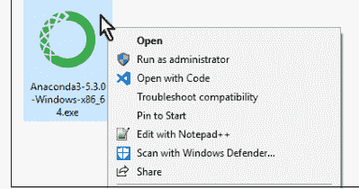

   图 1-3：在 Windows 中，右键点击并选择“以管理员身份运行”。

7. **在第一个安装页面上点击 Next（下一步）、Continue（继续）、Agree（同意）或 I Agree（我同意），直到进入图 1-4 所示的页面之一。**
   Mac 在左侧，Windows 在右侧。

   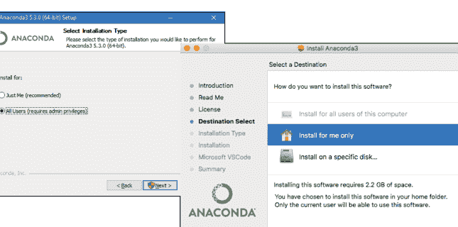

   图 1-4：选择安装方式。

8. **选择任何你认为合理的选项。**
9. **点击 Next。**
10. **点击 Next。**
11. **点击 Next。**
12. **点击 Finish（完成）。**

   > **提示**

13. **下载完成后，打开你的“下载”文件夹（或你下载文件的地方）并双击它。**
    如果你在打开 Anaconda 时看到获取更新版本的提示，安装该更新是可以的。它不会产生任何费用，也不会影响你跟随本书的学习。

## 打开 Anaconda (Mac)

在 Mac 上安装 Anaconda 后，你可以像打开其他应用一样打开它。使用以下任一方法：

- Launch Pad 并点击 Anaconda 图标。
- 点击 Spotlight 放大镜，开始输入 Anaconda，然后双击。
- 打开 Finder 和你的应用程序文件夹并双击。

Anaconda 打开后，右键点击其图标并选择 **In Dock**（保留在程序坞）。

## 打开 Anaconda (Windows)

在 Windows 上安装 Anaconda 后，你可以像启动其他应用一样启动它。虽然版本之间存在差异，但你应该可以使用以下任一：

- 开始按钮，然后点击 Anaconda Navigator。


- 开始按钮，输入 Anaconda。

在开始菜单上，你可以右键点击 Anaconda Navigator 并选择 Pin to Start（固定到开始屏幕）。

## 使用 Anaconda Navigator

Anaconda Navigator 是环境中允许你浏览不同功能并选择运行内容的组件。当你启动 Navigator 时，它会打开 Anaconda 主页，其看起来类似于图 1-5。

Navigator 主页的左侧有 Home（首页）、Environments（环境）、Learning（学习）和 Community（社区）等选项。它们与学习和进行 Python 操作没有直接关系，你可以自行探索。

## Git

Git 是一种存储代码项目备份并与其他开发者或团队成员共享项目的方式。它在专业程序员中非常流行，VS Code 内置了支持。但 Git 是可选的，与学习或进行 Python 编码没有直接关系，因此当提示出现时，选择 Don't Show Again（不再显示）跳过它是完全可以的。如果你以后决定，可以随时安装。

## 在 VS Code 中编写 Python

我们大多数人都使用代码编写 Python，我们将在 VS Code 中这样做。每当你想要使用 VS Code 时，我们建议从 Anaconda Navigator 启动。这样，VS Code 就会指向 Anaconda 自带的 Python 版本，这比你自己去研究要简单得多。步骤如下：

1. 如果尚未打开，请打开 Anaconda Navigator。

2. 如果需要，向下滚动看到 VS Code 下方的 Launch（启动）按钮，然后点击 Launch 按钮。


当你第一次使用 VS Code 时，可能会被提示做出某些决策。这些决定都不是强制性的，所以你只需要点击每个窗口右上角的“X”即可。然而，除非你点击“不再显示”，否则提到 Git 的那个将一直弹出。

当你刚开始时，VS Code 窗口将看起来像图 1-6 所示。如果你在屏幕上没有看到那么多的选项，请从菜单选择 帮助（Help） < 欢迎（Welcome）。

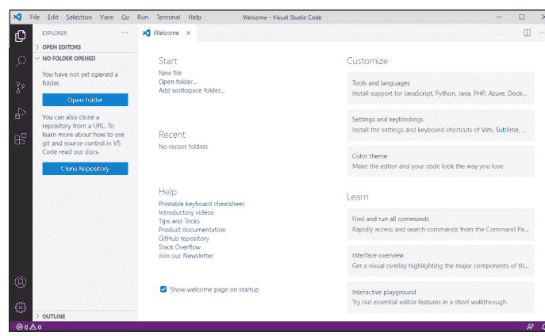

图 1-6：

VS Code 编辑器界面。

你的屏幕背景可能是黑色的，配有白色和彩色文本。在本书中，我们全部显示黑色文本，因为这样在纸上更容易阅读。如果你喜欢，可以保持深色背景。如果你想要较浅的背景，请选择 `Code: Preferences: Color Theme (Mac)` 或 `File: Preferences: Color Theme (Windows)`。然后选择一个较浅的颜色主题；如果你选择 `Light (Visual Studio)`，你的 VS Code 界面将看起来更像书中的样式。

Visual Studio Code 是一个支持许多不同语言的通用代码编辑器。要配合 Python 和 Anaconda 使用 VS Code，你需要一些 VS 扩展（Extensions）。但你应该已经拥有它们了；它们随你的 Anaconda 安装包一起提供。要验证这一点，点击左侧面板中的扩展图标（看起来像一个拼图）。你应该能看到列表中至少三个扩展：Anaconda Extension Pack、`Python` 和 `YAML`，如图 1-7 所示。

## 选择你的 Python 解释器

在 VS Code 中开始任何 Python 代码编写之前，要确保你正在使用正确的 Python 解释器。请按照以下步骤操作：

1. 从 VS Code 菜单中选择 查看（View） < 命令面板（Command Palette）。

2. 输入 `python`，然后点击 `Python: Select Interpreter`。

选择与你下载的版本匹配的 Python 版本（你在第一次下载 Anaconda 时记录下的那个版本）。如果你有多个版本号相同的选项，请选择包含 `base` 和 `conda` 名称的那个，如图 1-8 所示。

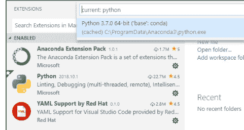

## 编写一些 Python 代码

为了确保你能跟上书中的示例，让我们确保 VS Code 已准备好进行 Python 代码编写。按照以下步骤操作：

1. **在 VS Code 中，从 VS Code 菜单选择 查看（View）: 终端（Terminal）。**

你应该会在右下角看到一个面板，看起来像图 1-9 所示的其中。

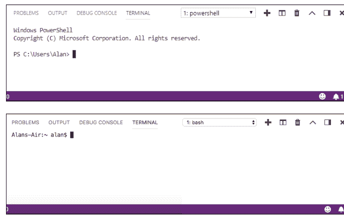

> *图 1-9：
>
> VS Code 中的终端（Windows 和 Mac）。*

2. **在终端中，输入 `python` 并按回车。**

你应该看到一些关于 Python 的信息，随后是一个 `>>>` 提示符。这个 `>>>` 提示符就是你的 Python 解释器；如果你在这里输入 Python 代码并按回车，代码就会执行。

3. **输入 `1+1` 并按回车。**

你应该看到 `2`（1 加 1 的和），随后是另一个 Python 提示符，如图 1-10 所示。

`1+1` 练习是你可以做的最简单的练习了。然而，我们现在关心的是你看到了 `2`，因为这意味着你的 Python 开发环境已全部就绪并准备好运行。你以后将不再需要重复任何步骤。

```
(base) Ps C:\Users\Alan> python
Python 3.8.3 (default, Jul 2 2020, 17:30:36) [MSC v.1916 64 bit (AMD64)] :: Anaconda, Inc. on win32
>>> "Help", "copyright", "credits" or "license" for more information.
>>> 1
>>>
```

图 1-10：

Python 显示了 1 加 1 的和。

现在我们将展示如何退出 Python 和 VS Code：

1. 在 VS Code 终端面板中，按下 `CTRL+D` 或输入 `exit()` 并按回车。

终端窗口底部最后的提示符应该是你进入 Python 提示符之前的状态，表示你已不再处于解释器中。

2. 关闭 VS Code：

   - Windows：点击右上角的图标 (X) 或从菜单选择 查看（View）: ⌘ 退出（Exit）。

   - Mac：点击左上角的红点，或从菜单选择 代码（Code）: ⌘ 退出 Studio Code（Quit Studio Code）。

3. 使用类似的技术关闭 Anaconda Navigator：

   - Windows：点击右上角的 X，或从菜单栏选择 文件（File）: 退出（Quit）。

   - Mac：点击红点，或在菜单中进入 Anaconda Navigator 并选择退出 Anaconda Navigator（Quit Anaconda Navigator）。

## 返回 VS Code 使用 Python

在将来，每当你想在 VS Code 中进行 Python 工作时，我们建议你打开 Anaconda Navigator，然后从那里启动（Launch）VS Code。你就可以准备就绪并完成后续章节中介绍的任何实践练习。

## 使用 Jupyter Notebook 进行编码

Jupyter Notebook 是另一个用于编写 Python 代码的流行工具。Jupyter 的名字源于它支持用三种语言编写代码：Julia、Python 和 R。Julia 和 R 在数据科学领域非常流行。Python 是一种更通用的编程语言，恰好在数据科学中也很流行，尽管 Python 适用于所有类型的开发，而不仅仅是数据科学。Notebook 部分的名字源于你的代码被放置在类似于笔记本的结构中。

人们经常使用 Jupyter 在互联网上共享代码。它是免费的并随 Anaconda 提供。所以，如果你安装了 Anaconda，你就拥有了它，并可以通过以下简单步骤随时打开：

1. 按照之前的讨论打开 Anaconda。

2. 点击 Jupyter Notebook 下的启动（Launch），如图 1-11 所示。

Jupyter notebooks 是基于 Web 的，这意味着当 Jupyter 打开时，它会在你的默认浏览器中打开，例如 Safari、Chrome、Edge、Firefox 或 Internet Explorer。起初，它看起来与编码没有太大关系，因为它只显示按字母顺序排列的它可以访问的文件夹列表，如图 1-12 所示。

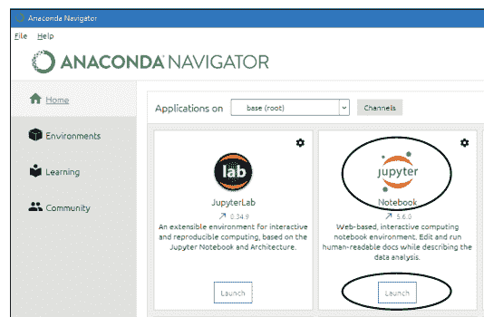

图 1-11：

从 Anaconda 首页启动 Jupyter Notebook。

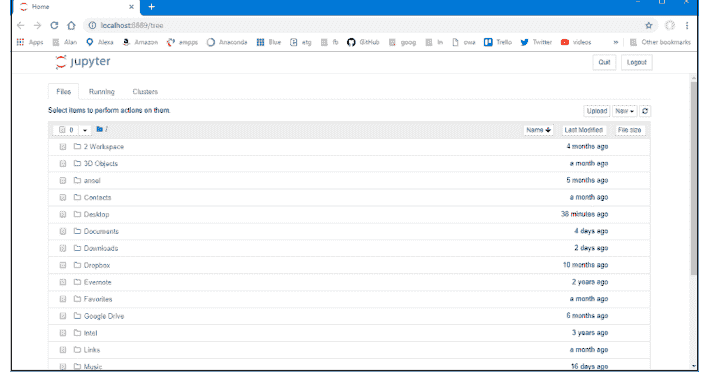

图 1-12：

Jupyter Notebook 打开。

3. 点击任一文件夹名称（选择桌面即可）。

4. 点击新建（New），然后点击 Python，如图 1-13 所示。

一个新的空白笔记本打开了。你应该看到左侧有一个带有 `[ ]` 的矩形。这被称为单元（cell），单元可以包含代码或普通文本。如果你想写代码，请确保工具栏中的下拉菜单显示为 `Code`。如果你想写普通文本，将该选项更改为 `Markdown`。

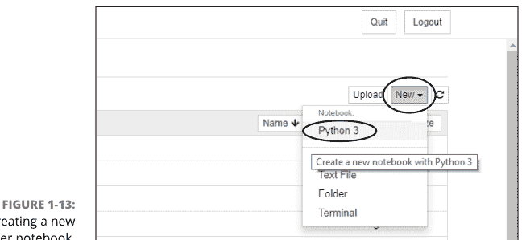

Markdown 是一种用于字体、图片等编写文本的语言。我们将在下一章详细讨论它。现在，让我们专注于 Python 代码，因为这正是本书的核心。

单元不像 Python 解释器（在解释器中代码会立即执行）。你必须先输入代码，然后通过点击工具栏中的运行（Run）来执行代码。要亲自尝试，请按照以下步骤操作：

1. 点击单元内部。

2. 输入 `1+1`。

3. 按回车。

你在单元中看到 `1+`，但没有看到结果 `2`。要获取结果，点击工具栏中的运行（Run），或将鼠标指针置于单元中并点击左侧的图标（如图 1-14 所示），或点击单元上方工具栏中的运行（Run）。你会在 `Out[1]` 右侧看到数字 `2`。`Out` 表示你正在看到执行单元中代码的输出，当然是 2，因为 1 加 1 等于 2。

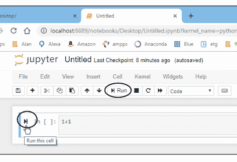

图 1-14：

在单元中运行代码的两种方法。

要关闭笔记本，执行以下任一操作：

- 关闭显示单元的浏览器标签页。

- 从单元上方的工具栏选择文件（File）: 关闭（Close）。

图 1-15 显示了使用 Chrome 作为浏览器的示例。如果你使用不同的浏览器，你的标签页看起来有所不同。

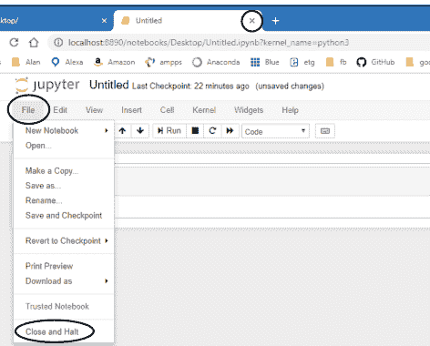

图 1-15：

在 Jupyter Notebook 单元中运行代码的结果。

你可能会被提示保存你的工作。目前，你不需要保存，因为我们正在关注最基础的内容……即你每次运行 Python 代码时都会做的事情。

即使你没有专门保存笔记本（notebook），你会在创建该笔记本的文件夹中看到它的图标。笔记本名称将为“Untitled”（未命名），如果你显示了文件扩展名，你会看到 `.ipynb` 扩展名。`ipynb` 是 Python notebook 的缩写。如果你想知道的话，扩展名中的 `i` 来自 Python（这是创建 Jupyter Notebook 的应用程序名称），它是 `interactive`（交互式）的缩写。

如果你只是在练习且不想保留它，可以删除笔记本文件。只需确保你已经在网页浏览器中关闭了笔记本（或先关闭浏览器）——否则，你可能会收到一条错误消息，提示你无法删除正在打开的文件。

现在你准备好好了。你已经配置了一套非常棒的工具来学习 Python。在本章中学会的简单技能将会在你的学习过程中受益良浅，在你掌握基础之后的职业编程中也大有帮助。现在来到这本迷你书的第 2 章，我们将深入探讨 Python 以及如何使用你现在电脑上可用的工具。


## 本章内容

- 使用交互式工作空间
- 创建开发工作空间
- 为代码创建文件夹
- 输入、编辑和调试代码
- 在 Jupyter 中编写代码

# 第 1 章

# 交互模式、获取帮助和编写应用程序

现在你已经安装了 Anaconda 和 VS Code，准备好开始编写 Python 代码了。在本章中，我们将带你熟悉 VS Code 和 Jupyter Notebook 的交互、帮助和代码编辑功能，以扩展你目前所学的知识。我们中的大多数人可能急于开始更高级的主题，如数据科学、人工智能、机器人技术或其他任何领域。但如果你对许多可用工具以及使用它们的技能有良好的理解，学习这些主题将会变得更容易。

## 使用 Python 的交互模式

许多老师和作者会建议你在 Python 提示符中进行尝试，并假设你已经知道如何到达那里。我们看到过许多感到挫败的初学者抱怨，尝试某些教程中推荐的活动对他们来说永远无效。这种挫败感通常源于他们在错误的地方输入和执行代码。通过 Anaconda，VS Code 中的 Terminal（终端）面板是输入 Python 代码的好地方。因此，在本章中，你将从那里开始。

## 打开终端

要使用 Anaconda 交互式使用 Python，请遵循以下步骤：

1. 打开 Anaconda Navigator，然后点击 Anaconda 主页上的 Launch（启动）按钮打开 VS Code。

2. 如果你在 VS Code 窗口底部没有看到 Terminal（终端）面板，从 VS Code 菜单栏选择 View（查看） > Terminal（终端）。

3. 如果面板顶部的 Terminal 单词没有高亮，点击 Terminal（如图 2-1 所示圆圈所示）。

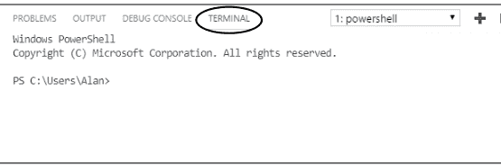

你看到的提示符通常是用于你的计算机操作系统的，并可能显示你正在使用的账户的用户名。例如，在 Mac 上，它看起来可能像 `Alans-Air:~ alan$`，但会将你的电脑名称替换为 `Alans-Air`。在 Windows 中，它很可能是 `C:\Users\Alan>`，用你的用户名替换 `Alan`，并且路径可能与 `C:\Users` 不同。

例如，在 Mac 上，我们看到这个提示符：

```
Alans-Air:~ alan$
```

在 Windows 中，我们看到这个：

```
C:\Users\Alan>
```

## VS Code 中的颜色和图标

默认情况下，VS Code 的 Terminal 面板在黑色背景上显示白色文字。我们在书中反转了颜色，因为在打印的书中，浅色背景上的深色文字更容易查看。你可以使用任何喜欢的颜色方案。如果你想切换到白底黑字（如本书所示），选择 File（Windows）或 Code（Mac），然后选择 Preferences（偏设置） ⊞ Color Theme（主题） ⊞ Light (Visual Studio)。

如果你让 VS Code 中的图标与你使用的匹配，你需要下载并安装 Material Icon 主题。你可能还想下载 Material Color 主题并尝试一下；我们没有在书中使用它，因为它在纸质上打印时效果不好。遵循以下步骤：

1. **点击左侧面板中的 Extensions（扩展，拼图图标）**。

2. **输入 material**，寻找 Material Icon Theme，并点击 Install（安装）选项。

3. **如果右下角提示询问你是否要激活图标**，点击 Activate（激活）。

4. **选择 File（Windows）或 Code（Mac）**，选择 Preferences（偏设置） ⊞ File Icon Theme（文件图标主题），然后点击 Material Icon Theme。

如果你没有看到 Material 图标选项，请确保你已经下载了该扩展。

5. **如果你想尝试 Material color 主题，打开 File（Windows）或 Code（Mac 上）**，选择 Preferences（偏设置） ⊞ Color Theme（主题），然后点击 Material Theme。如果你对主题改变了主意，可能会看到：

```
PS C:\Users\xxx
```

## 获取你的版本

图 2-2 中的提示符之一提到，你可以在 Python 解释器中输入 `help` 命令。注意不要输入引号，只需输入 `help` 单词（然后按回车）。此时你看到：

```
Type help() for interactive help, or help(object) for about object.
```

现在解释器提示你在 `help` 后面跟一对空括号，或者跟一个特定单词（以 `object` 为例）。尽管你需要输入该命令，但你应该输入它并按回车。请输入以下内容：

```
help()
```

## 使用 Python 的内置帮助

图 2-2 中的提示符之一提到，你可以在 Python 解释器中输入 `help` 命令。注意不要输入引号，只需输入 `help` 单词（然后按回车）。此时你看到：

```
Type help() for interactive help, or help(object) for about object.
```

现在解释器提示你在 `help` 后面跟一对空括号，或者跟一个特定单词（以 `object` 为例）。尽管你需要输入该命令，但你应该输入它并按回车。请输入以下内容：

```
help()
```


注意该行没有空格。按下回车键后，屏幕会提供一些关于使用 Python 交互式帮助的信息，类似于图 2–3 所示。

```
>>> help()
Welcome to Python 3.8's help!

If this is your first time using Python, you should definitely check out the tutorial on the Internet at https://docs.python.org/3.8/tutorial/. Enter the name of any module, keyword, or topic to get help on writing Python programs and using Python. To quit this help utility and return to the interpreter, just type "quit".
```

图 2-3：Python 的交互式工具。

要获取可用模块、关键字、符号或主题的列表，请输入 `"module"keyword"` 或 `"topics"`。每个模块还包含其功能的单行摘要；要列出名称或摘要包含给定字符串（如 `"spam"`）的模块，请输入 `"modules spam"`。

在窗口底部看到帮助，说明你已不再操作系统或 Python 解释器中（它们在屏幕上，你可以看到我们现在处于一个提供帮助的区域）。正如描述的那样，输入任何模块、关键字或主题来获取有关该术语的帮助。作为初学者，你现在可能不需要具体的帮助。但知道在需要时帮助就在那里是件好的。

例如，Python 使用了某些关键字，这些关键字在语言中具有特殊含义。要获取它们的列表，只需在 `help>` 提示符下输入以下：

```
keywords
```

按下回车键后，你将看到一个关键字列表，如图 2-4 所示。

| False | class | from | or |
| --- | --- | --- | --- |
| None | continue | global | pass |
| True | def | if | raise |
|  |  | import | return |
| as | elif | in | try |
| assert |  | is | while |
| async |  | lambda | with |
| await | except | nonlocal | yield |
| break | for | not |  |

图 2-4：关键字帮助。

第 1 册 入门

关键字列表上方有一条消息，告诉你可以在帮助提示符处输入任何关键字以获取有关该关键字的更多信息。例如，输入 `class` 关键字将提供有关 Python 类的信息，如图 2-5 所示。这些并不是你在学校上的的类；而是你在 Python 中创建的内容（在你学习了基础知识并准备好进入更高级主题之后）。

```
PROFILES    OUTPUT      TERMINAL      ...     1: python 
*******************
Class definitions
A class definition defines a class object (see the section Type hierarchy)
class ::= (decorators) "class" className ["Inheritance"]: suite
inheritance ::= ("(argument, list)")
classname ::= identifier
A class is an executable statement. The inheritance list gives a list of base classes (such as Metaclasses for advanced uses), each time in the list should exclude a class object which allows subclasses. -- More --
```

图 2-5: Python 类帮助。

帮助文本中的所有术语会让普通初学者感到不知所措。当你学习 Python 新概念时，要意识到可以使用交互式帮助来获取所需的指导。

> 文本底部的 `--More--` 不是可以输入命令的提示符。相反，它让你知道还有更多文本，可能有几页内容。按空格键或回车键查看。每次按空格键或回车键进入下一页。你最终会回到操作系统 `help>` 提示符。如果你想退出而不是继续滚动，请按字母 `q`。

# 退出交互式帮助

要退出交互式帮助并返回 Python 提示符，输入字母 `q`（代表 quit）并按 `Ctrl-Z`。你应该回到 `>>>` 提示符处。在 `>>>` 提示符处，输入 `exit()` 或 `python`。

要离开 Python 提示符返回操作系统，输入 `exit()` 并按回车。注意，如果你出错了（例如忘记了括号），屏幕上会显示一些帮助。例如，如果你输入 `exit` 并按回车，你会看到

```
Use exit() or Ctrl-Z plus Return to exit.
```

第 2 章 交互模式、获取帮助和编写应用程序 35

当你看到 Terminal 窗口末尾是操作系统提示符而不是 `>>>` 时，你就知道自己退出了 Python 解释器，如图 2-6 所示。

```
PROBLEMS OUTPUT TERMINAL : powershell - + - ^ x
See also: **PEP 3115** - Metaclasses in Python 3 **PEP 3120** -
Class Decorations
Related topics: CLASSES, SPECIALMETHODS
>>> help q
You are now leaving and returning to the Python interpreter.
If you want to ask for help on a particular object directly from the interpreter, you can type 'help(object)'. Executing 'help('string')'
has the same effect as typing a particular string at the help prompt.
>>> exit
may exit() or ctrl-z Return to exit
>>> exit()
PC:\Users\Admin_>
```

图 2-6：返回操作系统提示符。

# 在线搜索特定帮助主题

Python 的内置帮助功能有些过时，因为它是面向文本的而不是交互式的，但当你需要对遗忘的某些 Python 关键字进行快速提醒时，它可以帮助你。如果你在线，最好在网络上搜索帮助。

无论你使用什么，记住用 `python 3` 开始搜索。许多类型的备查表均可用——取决于你的学习风格。去 Google 查看。

# 创建 Python 工作空间

虽然交互模式和在线帮助是工具，但大多数人想要创建应用程序。我们发现，如果为 Python 专门设置 VS Code 环境，创建应用程序会更容易。你可以为其他语言设置其他环境，例如用于网页的 HTML、CSS 和 JavaScript，并根据需要进行调优以支持你正在使用的语言。

VS Code 使用工作空间来定义我们所说的开发环境。环境是你使用的 Python 解释器以及收集的任何额外扩展。我们在 Mac 和 Windows 之间切换电脑，因此每个都有一个环境。Alan 将其放在 OneDrive 文件夹中，以便从任何地方访问。虽然这不是要求的，但很方便。然而，如果你完全在特定的电脑上工作，可以将环境放在电脑硬盘而不是云硬盘上。

1. 如果 VS Code 尚未打开，请通过 Anaconda 启动。
2. 选择 `File` > `Save Workspace As`，并导航到保存工作空间设置的文件夹。
3. 为工作空间命名，然后点击 `Save`。

在图 2-7 中，Alan 在 Windows（上方）和 Mac（下方）保存了他的工作空间。

4. 接下来，根据你使用的是 Mac 还是 Windows 执行以下操作之一，调整某些 VS Code 设置以指示保存工作空间的位置：
   - 在 Mac 上，选择 `Code` > `Preferences` > `Settings`。
   - 在 Windows 上，选择 `File` > `Preferences` > `Settings`。

# 大量免费备查表

备查表并不是作弊，除非你在考试时使用它。但在现实生活中编写代码与回答单选题完全不同。因此，我们在技术领域经常说的备查表只是另一种将信息带到更易管理（且不令人恐惧）规模的工具。当你开始对 Python 等语言的所有可能性感到不知所措时，备查表可以提供帮助。

图 2-7：将当前设置保存为工作区设置。

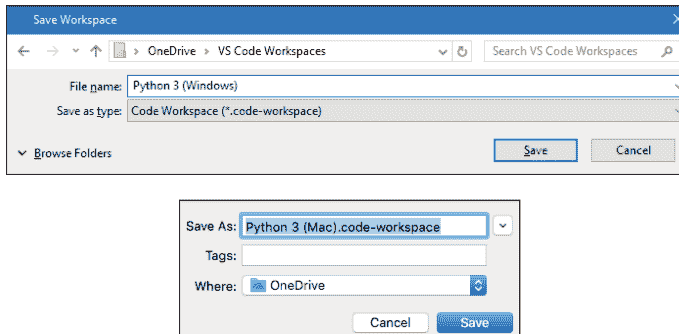

5. 如果你看到类似图 2-8 中的页面，点击右上角的“打开设置 (JSON)”（在图中已圆圈出）。

如果你没有看到那个选项，请寻找一个允许你打开 `Settings.json` 的选项。

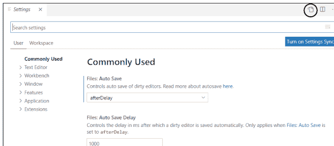

图 2-8：VS Code 设置。

6. 在下一个窗口中，选择以 `python.pythonpath` 开头的整行代码（该行告诉 VS Code 在你的计算机上何处找到 Python 解释器）。

你也可以选择任何其他想要包含工作工作区的命令行，但不要选择大括号。

7. 右键点击选中的代码，并选择将其复制到剪贴板。

8. 点击右上角的“拆分编辑器”图标。

（在我们当前使用的 VS Code 版本中，该图标看起来像两个并排的页面。）屏幕上并排出现两个 `settings.json` 副本。

9. 选择 `View` > `Command Palette`。输入 `open (Windows)` 然后选择“首选项设置：打开工作区设置 (JSON)”。

10. 点击设置的大括号之间并将代码行粘贴此处，如图 2-9 所示。

`settings.json` 中的所有设置（上方）都已复制到 Python 3 设置（下方）。

图 2-9：Python 已复制到工作区设置。

```
Settings settings.json
C > Users > Alan > AppData > Code > User > settings.json =
{
  "workbench.colorTheme": "Visual Studio Light",
  "python.pythonPath": "C:\\Users\\Alan\\anaconda3\\python.exe",
}
# Python 3 (Windows).code-workspace
C > Users > Alan > OneDrive > VS Workspaces > Python 3 (Windows).code-workspace =
{
  "folders": [],
  "settings": {
    "workbench.colorTheme": "Visual Studio Light",
    "python.pythonPath": "C:\\Users\\Alan\\anaconda3\\python.exe",
  }
}
```

11. 在 VS Code 中选择 `File` > `Save`。

12. 点击每个标签页右侧的 `X` 按钮关闭“设置”和“用户设置”。

13. 关闭 VS Code，然后关闭 Anaconda。

稍后你将看到如何利用这些新的工作区设置。

## 为你的 Python 代码创建一个文件夹

接下来，创建一个文件夹来存储你在本书中编写的所有 Python 代码，这样它们就集中在一个地方，在需要时易于找到。你可以将此文件夹放在任何喜欢的地方，并以你喜欢的名称命名。

在 Windows 中，你可以导航到包含新文件夹的目录（Alan 使用 OneDrive，你可以使用桌面、文档或其他任何文件夹）。在文件夹的空白处点击右键。然后选择“新建文件夹 (Mac)”或“新建文件夹 (Windows)”。输入文件夹名称并按回车。为了跟随本章的示例，请将文件夹命名为 `AIO Python`。

现在，你应该将此代码文件夹与你刚刚创建的 VS Code 工作区关联起来，这样每当你在该文件夹中工作时，都会使用正确的 Python 解释器以及你随时间推移为代码文件夹文件选择的其他 Python 相关设置。方法如下：

1. 打开 Anaconda 并从那里启动 VS Code。
2. 从 VS Code 菜单中选择 `File` > `Open Workspace`。
3. 导航到保存工作区的文件夹，并从那里打开工作区。
4. 选择 `File` > `Add Folder to Workspace`。
5. 导航到你为 Python 代码创建的文件夹，点击文件夹图标并选择 `Add`。

图 2-10 中的 VS Code 中的“资源管理器”栏表示你已同时打开了工作区——图中的 `Python 3 (Windows) Workspace`——以及该工作区中的代码文件夹——图中的 `AIO Python`。如果你在左侧面板看到完全不同的内容，请点击 VS Code 窗口左上角的“资源管理器”图标，以确保你正在查看资源管理器。

打开工作区

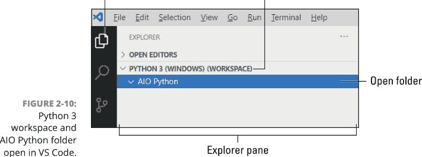

图 2-10：VS Code 中打开了 Python 3 工作区和 AIO Python 文件夹。

打开文件夹

资源管理器面板

当你展开资源管理器面板顶部的“打开的编辑器”栏时，可以看到当前在 VS Code 中打开的文件。每个文件都由右侧编辑区域顶部的标签页表示。现在图像中没有打开任何文件。但如果，例如你自己的屏幕上正打开着 VS Code 欢迎页，请看右侧的“欢迎”。要关闭该页面，点击资源管理器面板中名称旁边的 `X` 或标签页上的 `X`。当你想重新打开欢迎页时，从 VS Code 菜单栏选择 `Help` > `Welcome`。

> 如果你看到三角形以外的符号，或者没有三角形...（等等，让我根据流程重新对齐）

稍后你将看到如何利用这些新的工作区设置。

## 输入、编辑和调试

（注：由于原文中存在大量重复和 OCR 错误，此处已根据逻辑流进行了整合和清理。）

# 在 VS Code 中运行 Python

要在 VS Code 中测试你的 Python 代码，你需要运行它。最简单的方法是右键点击文件名（在本例中为 `hello.py`）并选择“在终端中运行 Python 文件”（`Run Python File in Terminal`），如图 2-14 所示。

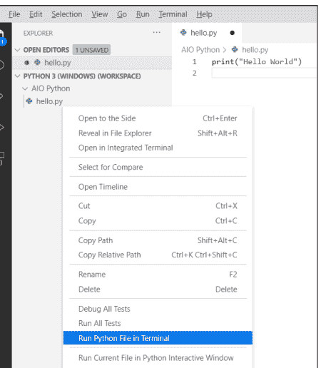

图 2-14：hello.py。

终端会在 VS Code 窗口底部打开。你会看到一个提示符，后面跟着在 Python 解释器中运行代码的注释。在下方你将看到程序的输出：在本例中是 **Hello World** 字样，以及另一个提示符，如图 2-15 所示。这并不是世界上最令人兴奋的事情，但至少你学会了如何在 VS Code 中编写、保存和**执行**程序，在你继续阅读这本书以及你的 Python 编程生涯中，你将经常使用这项技能。

图 2-15：hello.py 的输出。

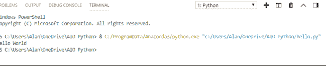

44 第 1 本 入门

如果你在终端窗口中使用 PowerShell，可能会看到一条关于切换到命令提示符的消息。除非你刚好是 PowerShell 专家并且需要它（出于某种原因），否则如果看到该选项，点击“使用命令提示符”（`Use Command Prompt`），提示就不会一直干扰你了。

# 学习简单调试

当你开始学习编写代码时，不可避免犯很多错误。意识到错误并不可——你不会破坏或损坏任何东西。代码只是不会按预期运行。

在尝试运行某些代码之前，你可能会看到屏幕上显示代码中错误的几种指示：

- 资源管理器面板中包含错误的文件夹名称和文件名将显示为红色。
- 文件中的错误数量将显示在资源管理器栏文件名旁边。
- 错误总数将显示在 VS Code 窗口左角的圆圈 `X` 旁边。
- 错误的代码会有波浪下划线。

在图 2-16 中，我们输入了全大写的 `PRINT`，这在 Python 中是不允许的。Python 是区分大小写的，正确的命令是 `print`。记住，当我们显示需要以小写输入的命令时，你必须以小写输入，

| 文件 | 编辑 | 选择 | 视图 | 运行 | 终端 | 帮助 |
|---|---|---|---|---|---|---|
|  | 资源管理器 |  |  |  |  |  |
| \> 打开的编辑器 |  |  |  |  |  |  |
| \> hello.py | hello.py |  |  |  |  |  |
|  | 1 `PRINT("Hello World")` |  |  |  |  |  |
| \> PYTHON 3 (WINDOWS) (工作区) | 2 |  |  |  |  |  |
| \> A Python |  |  |  |  |  |  |
| \> hello.py | 1 |  |  |  |  |  |

图 2-16：在 hello.py 中输入的 PRINT 是错误的。

要在终端中运行文件，你必须修复错误。将鼠标指针悬停在带有波浪下划线的单词以及（从技术上讲）问题的描述上。在图 2-16 所示的示例中，我们只需将 `PRINT` 替换为 `print`，然后保存代码（我们开启了自动保存）。然后我们可以右键点击并选择“在终端中运行 Python 文件”来运行修正后的代码。

第 2 章 交互模式、获取帮助和编写应用 45

# 使用 VS Code Python 调试器

VS Code 有一个内置的调试器，有助于处理更复杂的程序，并提供了在 VS Code 中测试 Python 程序的方法。你现在不需要编写非常复杂的内容。作为你 Python 开发工作空间的一部分，设置并准备好调试器并无害处。

1. 点击资源管理器面板左侧的调试图标。（调试图标是一个角带有昆虫的右向三角形。）调试面板将打开。
2. 如果你创建了 `Launch.json` 文件链接，点击它。


3. 点击面板顶部的下拉菜单并选择“工作区”，然后点击“Python 调试：当前活动 Python 文件”，如图 2-17 所示。

4. 点击标签页上的 X 来关闭 `Launch.json`。

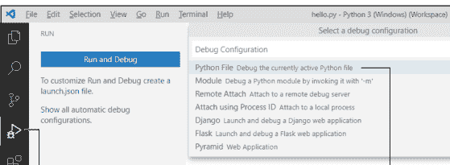

图 2-17：VS 调试面板。

打开调试面板 启动调试

从现在起，作为使用右键点击方法运行 Python 代码的替代方案，你可以使用调试面板。调试器始终与当前文件配合工作，即资源管理器面板中选中的（高亮的）文件。因此，使用调试器的通常步骤可能如下：

1. 点击资源管理器面板查看你所有文件的列表。

2. 点击你想要调试的文件图标或文件名。

目前你只有一个文件，`hello.py`。`hello.py` 文件名在资源管理器面板中被高亮。帮助信息告诉你，`hello.py` 是当你告诉它运行时，调试器将运行的当前文件。

46 第 1 本 入门

3. 再次点击 VS Code 左侧栏中的调试图标再次打开调试面板。

4. 点击“启动调试”图标。

该图标是 `Python: Current File (workspace)` 旁边的绿色三角形。

当你点击“启动调试”图标时，Python 代码将像你选择“在终端中运行文件”时一样运行。如果你的代码有错误，你将在屏幕上获得相关的额外帮助。

如果你能记住这两种运行 Python 代码的方法，你就可以学习 Python 了。你可以这样操作：

- 右键点击 `.py` 文件并选择“在终端中运行文件”。

- 点击资源管理器中的 `.py` 文件，点击调试图标，然后点击面板顶部的“启动调试”。或者，按下 `F5` 键。

如果你觉得这些太难记住，现在你就可以学习 Python 了。

接下来我们将查看另一种编写代码的方法。所以你可以随时关闭任何已打开的文件。

# 在 Jupyter Notebook 中编写代码

在第 1 章中，你学习了可以在 Jupyter Notebook 中编写 Python 代码。

在第 1 章中，你学习了可以在笔记本中运行 Python 代码。在本节中，我们将展示如何使用 Markdown 在笔记本中添加文本。

# 添加 Markdown 文本

正如提到的，你可以在笔记本中添加文本（以及图片和视频）。输入普通文本时，不需要任何特殊编码。但如果你想格式化文本或添加图片或视频，你需要使用 Markdown 标记。Markdown 是一种流行的标记语言，类似于简版的 HTML。

我们在这里无法进行详细的 Markdown 教程，你不需要编写 Python 代码。通过搜索引擎或 YouTube 搜索 Markdown 教程很容易学会。但对于那些已经熟悉 Markdown 或只是好奇的人，我们将带你完成在 Jupyter Notebook 中创建 Markdown 文本单元的步骤。

首先，确保你在 Jupyter Notebook 应用中。如果你的 Python 代码下方没有空单元格，选择“插入 > 插入单元格”。然后点击新单元格添加内容。在单元格中输入你的文本和 Markdown。

我们使用了图 2-19 所示的文本和 Markdown 代码。

如果你对学习更多 Markdown 感兴趣，可以查看 Alan 在他的在线学校视频教程：https://alanssimpson.thinkific.com/courses/easy-markdown-with-vs-code

运行包含 Markdown 的单元格，点击单元格然后点击工具栏上的“运行”。代码将被渲染为文本以及你在单元格中放入的任何内容，如图 2-20 所示。

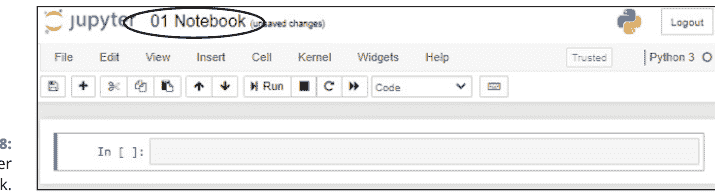

```
In [3]: print("Hello World")

Hello World
```

## Jupyter Notebook 中的 Markdown 文本

Jupyter Notebook 中的 Markdown 单元格可以包含任何用 Markdown 格式化过的文本。Markdown 是一种相对简单的语言，用于对标题、列表、图像等对文本进行标记。下面是一个来自 YouTube 的视频，它会在此 Notebook 中播放。

```
[免费视频](https://www.youtube.com/vi/iZCHfUnjMvO.jpg)
(https://youtube.be/iZCHfUnjMvO)
```

图 2-19：一个包含内容的 Markdown 单元格。

```
In [3]: print("Hello world")

Hello world
```

## Jupyter Notebook 中的 Markdown 文本

Jupyter Notebook 中的 Markdown 单元格可以包含任何用 Markdown 格式化过的文本。Markdown 是一种相对简单的语言，用于对标题、列表、图片、视频等对文本进行标记。下面是一个来自 YouTube 的视频，它会在此 Notebook 中播放。


图 2-20：一个包含 markdown 代码和文本的 Markdown 单元格。

要更改代码单元格中的代码，点击该单元格并照常输入你的代码。要更改 Markdown 单元格的内容，请先双击单元格内的某些文本或空白区域，这样你就能再次看到代码并进行更改。

无论是哪种类型的单元格，在完成更改后点击“运行”。注意，只有包含光标的单元格会再次运行。如果你想运行 notebook 中的所有单元格，请使用工具栏上的双三角形图标。它就在用于选择代码单元格或 Markdown 单元格的图标左侧。

50 页 第 1 卷 入门

## 保存和打开 notebook

要保存 Jupyter notebook，从菜单中选择“文件：保存并检查点”。可选，你可以点击工具栏左侧的“保存并检查点”图标（软磁盘图标）。

要关闭 notebook，从菜单中选择“文件：关闭并停止”。

当你想要重新打开 notebook 的时候，打开 Anaconda 并启动 Jupyter Notebook。然后导航到你保存的文件并点击其文件名。文件名可能具有 `.ipynb` 文件扩展名，这是 Jupyter notebooks 的标准格式。

值得注意的是，当你打开文件夹（我们命名为 AIO Python 的那个）时，你会看到文件夹内部有一个新的 `Jupyter Notebooks` 子文件夹。当你打开该子文件夹时，每个 notebook 都会作为一个独立的文件存储在那里，扩展名为 `.ipynb`。

好了，你已经在 VS Code 和 Jupyter Notebook 中稍微深入挖掘了一点，主要是为了让你能够保存和打开 Python 文件以及 Jupyter notebooks。当你开始深入编写 Python 代码时，这些技能将证明非常有用。回见！


## 本章内容

- 理解 Python 之禅
- 介绍面向对象编程
- 发现为什么缩进很重要
- 使用 Python 模块

# 第 3 章 Python 元素与语法

任何编程语言都关注计算机做了什么以及它是如何做的，而不是关注人类思考和工作的方式。这个简单的事实让大多数编程语言对大多数人来说都难以学习。然而，Python 基于这样一种哲学：编程语言应该倾向于人类的思考、工作和交流方式，而不是计算机内部发生了什么。Python 之禅是这种以人为导向的完美范例，因此我们从这个主题开始本章。

## Python 之禅

图 3-1 所示的 Python 之禅是 Python 语言设计的指导原则列表。这些原则隐藏在一个“彩蛋”中，这是编程语言或应用程序中不被发现的某些内容的术语，对于学习了足够知识的人来说这是一个内部笑话。要看到这个彩蛋，请执行以下步骤：

1. 在 Anaconda 中打开 Python 3。
2. 在终端中打开 Python 3。
3. 在提示符中输入 `import this`。

所示：

图 3-1


Python 之禅，输出：

美观优于丑陋。
显式优于隐式。
简单优于复杂。
清晰优于晦涩。
扁平优于嵌套。
可读性非常重要。
特殊情况不要打破规则。
如果可能，默默忽略错误。
优雅优于混乱。
现在优于永远。
可读性优于简洁。
实现优于解释。
如果可能，不要是晦的。
除非必要，否则不要猜测。
你应该是 Python 的。
这里是 Python 之禅。

Python 之禅有时被称为 `PEP 20`，其中 `PEP` 是 Python 增强提案的缩写。20 指的是这里的这 20 条原则。

许多其他的 `PEP`，你可以在 Python 网站 `www.python.org/dev/peps` 找到它们。你最可能听过 `PEP 8`，它是 Python 的风格指南。`PEP 8` 的指导原则是人类的。当你初学 Python 时，大多数代码看起来都像乱码。但当你对语言有了经验后，一致性将变得显而易见，你会发现它更容易阅读。

54 页 第 1 卷 入门

## PEP 8 风格

我们将在书中向你介绍 Python 风格。现在就开始读它可能会很无聊。所以现在，`PEP 8` 对学习者来说是一把双刃剑。一方面，你不希望养成很多坏习惯，直到以后发现必须改掉它们。另一方面，`PEP 8` 严格的格式要求会让许多试图让代码运行通的学习者感到沮丧。

为了避免这种潜在的挫败感，我们将在遵循并解释 `PEP 8` 规范。如果你喜欢，可以更进一步地配置 `PyLint`。`PyLint` 是 Anaconda 中的一个工具，它可以对你输入的代码提供建议。（该程序会对可能错误的代码添加一个小波浪线，这就是为什么叫 `PyLint` 的原因。）

如果你想尝试一下，可以按照以下步骤开启 `PyLint` 和 `PEP 8`：

1. 选择“文件”（Windows）或“代码”（Mac），然后选择“偏好设置”。
2. 在搜索设置下，点击“工作区”。
3. 在搜索设置中输入 `pylint` 并选择 `Python > Linting: Enabled`，如图 3-2 所示。
4. 在搜索框中输入 `pycodestyle`。
5. 滚动并选择 `Python > Linting: Pycodestyle Enabled`，它位于图 3-2 的下半部分。
6. 选择“文件 > 保存全部”或“保存”（保存全部不可用）。然后点击标签页上的 X 关闭设置。

你在 VS Code 中选择的所有设置都存储在一个 `settings.json` 文件中。你也可以通过该文件对设置进行更改。要通过 VS Code 中的“选项”获取该文件，首先选择“文件”（Windows）或“代码”（Mac），然后选择“首选项：设置”。点击右上角的“打开设置 (JSON)”图标。该图标看起来像一张角被折叠的纸质文档，顶部有一个圆形的箭头。

如果 `Pycodestyle` 格式检查要求太严苛，你可以将第一行代码改为 `true`，将第二行改为 `false`。（见图 3-3。）通过将第三行代码也设置为 `false`，你可以完全关闭格式检查。设置没有对错之分，你可以先设置好你需要的，看看它们对你是否有效。如果你对 `settings.json` 做了任何更改，别忘记保存并关闭 `settings.json` 标签页。

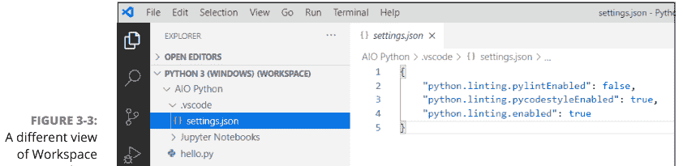

## 面向对象编程

虽然不想显得太技术化或太计算机科学，但我们应该提到，设计语言有不同的方法。也许最成功且应用广泛的模型是面向对象编程，或 `OOP`，这是一种设计哲学，试图模拟真实世界，因为它由对象组成，对象具有属性，以及对象所执行的方法（动作）。

以汽车为例。一辆汽车就是一个对象。并不是所有的汽车都完全相同。不同的汽车有不同的属性，例如品牌、型号、年份、颜色和尺寸，这些使得它们彼此有所不同。尽管如此，它们都具有相同的基本目的：将我们从 A 点送到 B 点，而无需步行或使用其他的交通工具。

所有的汽车都有共同的方法（它们可以做的事情）。你可以通过车内可以用手操作的控制装置来驾驶它们、转向、加速、减速、控制内部温度等。

书籍 1 入门

面向对象编程语言中的对象不是物理实体（像汽车那样的物理东西），因为它只存在于计算机内部。对象严格来说是一个软件实体。在 Python 中，你可以有一个 `class`（你可以将其看作一个对象创建器，例如汽车工厂），它可以为不同的用途（运动型、越野型、轿车）产生各种对象（汽车创建器）。这些对象可以通过它们共同拥有的控制装置进行操作，就像所有的汽车都通过方向盘、刹车、加速器和变速箱等控制装置进行操作一样。

Python 是一种非常面向对象的语言。核心语言由控制语句（单词的形式）组成允许你控制所有不同类型的对象——你自己和其他程序中的对象。然而，你需要先学习核心语言，这样你才准备好开始使用别人的对象，并且知道如何这样做。同样，当你学会了如何开一辆车，你基本上就知道了如何开所有的车。你不需要担心租车，除非加速器在车顶上，方向盘在地上，而且你必须使用语音命令而不是刹车来减速。驾驶的基本技能适用于所有情况。

## 发现为什么缩进至关重要

在代码编写的基本风格方面，让 Python 与其他语言不同的一个特征是它使用缩进而不是括号和大括号来指示代码块、区块。我们不假设你熟悉其他语言，所以如果这句话对你来说毫无意义，请不要担心。但如果你熟悉 `JavaScript` 这样的语言，你就知道必须花大量精力来处理括号并控制其内部的内容。

例如，这里是一些 `JavaScript` 代码。如果你熟悉“魔力 8 号球”玩具，你就能感觉到这个程序在做什么。但那并不重要。只需注意所有的括号、大括号、分号：

```javascript
document.addEventListener("ContentLoaded", function () { var =
prompt("Ask magic 8 ball a question");var answer = Math.floor(Math.random() +
+ 1); if (answer == 1) {alert("It is certain");} else if (answer == 2)
alert("Look good");} else if (answer == 3) {alert("You may rely on it");}
else if (answer == 4) {alert("Ask again later");} else if (answer == 5)
alert("Concentrate and ask again");} else if (answer == 6) {alert("Reply hazy, try again");} else if (answer == 7) {alert("My reply is no");} else if
answer == 8) {alert("My source says no") else {alert("That's not a
question");});}alert("The end");});
```

第 3 章 Python 元素与语法

57

代码一团糟，读起来一点没意思。我们可以通过将其拆分成多行并对其中一些行进行缩进，让阅读变得容易一点。（注意，在 `JavaScript` 中这不是强制要求的）。以下是重新格式化的代码：

```javascript
document.addEventListener("DOMLoaded", function () {
  var question = prompt("Ask magic 8 ball a question");
  var answer = Math.floor(Math.random() * 8) + 1;
  if (answer == 1) {
    alert("It is certain");
  } else if (answer == 2) {
    alert("Outlook good");
  } else if (answer == 3) {
    alert("You may rely on it");
  } else if (answer == 4) {
    alert("Ask again later");
  } else if (answer == 5) {
    alert("Concentrate and ask again");
  } else if (answer == 6) {
    alert("Reply hazy, try again");
  } else if (answer == 7) {
    alert("My reply is no");
  } else if (answer == 8) {
    alert("My source says no");
  } else {
    alert("That's not a question");
  }
  alert("The end");
});
```

代码一团糟，读起来一点没意思。我们可以通过将其拆分成多行并对其中一些行进行缩进，让阅读变得容易一点。（注意，在 `JavaScript` 中这不是强制要求的）。以下是重新格式化的代码：


```javascript
document.addEventListener("DOMLoaded", function () {
  var question = prompt("Ask magic 8 ball a question");
  var answer = Math.floor(Math.random() * 8) + 1;
  if (answer == 1) {
    alert("It is certain");
  } else if (answer == 2) {
    alert("Outlook good");
  } else if (answer == 3) {
    alert("You may rely on it");
  } else if (answer == 4) {
    alert("Ask again later");
  } else if (answer == 5) {
    alert("Concentrate and ask again");
  } else if (answer == 6) {
    alert("Reply hazy, try again");
  } else if (answer == 7) {
    alert("My reply is no");
  } else if (answer == 8) {
    alert("My source says no");
  } else {
    alert("That's not a question");
  }
  alert("The end");
});
```

# 使用 Python 模块

Python 成功的秘密之一在于它由简单、整洁的核心语言组成。这是你首先需要学习的部分。除了核心语言，还有许多模块可以免费获取并在你的代码中调用。这些模块也是用核心语言编写的，但你不需要看到、也不知道你可以从基础语言访问它们的全部威力。

大多数模块用于某些特定的应用程序，例如人工智能、处理日期和时间或……什么。使用模块的魅力在于其他人花费了大量时间进行创建、测试和调优，所以你不需要。你只需要将模块导入到自己的 Python 文件中，并按照模块文档的说明使用模块的功能。

之前的魔力 8 号球示例程序从这一行开始：

```python
import random
```

Python 语言没有内置用于生成随机数的功能。虽然我们可以想出方法来创建一个随机数生成器，但我们不需要，因为已经有人想出了方法并免费提供了代码。在程序开头使用 `import random` 告诉程序你想使用随机数模块的功能来生成随机数。

然后，在程序的后续部分，你使用这行代码生成一个 1 到 8 之间的随机数：

```python
answer = random.randint(1, 8)
```

Python 有数百个免费的模块供你使用——你只需要知道将哪些模块导入到你的程序中即可。

现在，你可能好奇在哪里可以找到这些模块。嗯，它们遍布各地。但你可能永远不需要寻找和下载它们，因为你已经拥有了世界上最广泛使用的模块。它们是随 Anaconda 下载并安装的。要亲自验证，请遵循以下步骤：

1. 以通常的方式在电脑上打开 Anaconda。
2. 在左侧列中点击 **Environments**（环境）。

右侧是你电脑上已安装的 Python 模块，已好根据需要导入和使用，如图 3-4 所示。当你向下滚动列表时，你会发现你已经拥有许多它们。最右侧的一列显示了每个模块的版本。


图 3-4：已安装的模块。

你可能会注意到某些版本号是有颜色的并且前面有一个箭头，这表示可能有更近的版本供你下载。与编程语言一样，模块随着作者的改进和新功能的添加随时间演变。不过，你并不要求拥有最新版本。如果你使用的版本可以工作，你可能想继续使用它。

Anaconda 的许多优点之一是可以获取最新版本，而你不需要像许多旧版 Python 教程告诉你的那样执行任何奇怪的 `pip` 命令。相反，只需点击你想下载的模块或多个模块的箭头或版本号，然后点击右下角的 **Apply**（应用）。Anaconda 会完成所有“脏活”：查找当前模块、确定是否有可用的更新版本，如果可用，则下载该版本。

当所有下载完成后，你会看到一个如附图 3-5 所示的对话框。如果没有列出任何包名称，说明所选模块是最新的，因此点击 **Cancel**（取消），然后点击左侧面板中的 **Home**（主页）返回 Anaconda 主页。反之，如果在“The Following Packages Will Be Modified（将修改以下包）”下列出了包名称，点击 **Apply**（应用）安装最新版本。

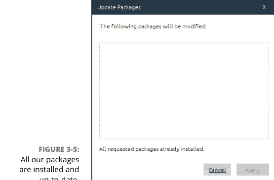

# 理解导入模块的语法

如前提到的，在你的自己的 Python 代码中，必须先导入模块才能访问其功能。这样操作的语法是：

```
import modulename [as alias]
```

以这种通用格式编写的代码，其中部分内容用斜体显示（如方括号所示），有时被称为语法图（syntax chart），因为它并没有真的在字面上显示你应该输入什么。相反，它显示的是代码的语法（格式）。以下是信息在此语法图中呈现的方式：

- 代码是区分大小写的，这意味着你必须使用全小写字母输入 `import` 和 `as`，如所示。
- 任何斜体内容都是你自己在自己的代码中应提供的信息的占位符。例如，你会用 `modulename` 替换为你想要导入的模块名称。
- 方括号中的任何内容都是可选的，因此你可以带或不带方括号输入命令。
- 你在代码中永远不要输入方括号，因为它们不是 Python 语言的一部分。它们仅用于指示语法中的可选部分。

你可以在以下地方导入 Python 代码：在 Python 命令提示符（`>>>`）、在 `.py` 文件中或在 Jupyter Notebook 中。在 `.py` 文件中，始终将 `import` 语句放在最前面，以便其功能对其余代码可用。

# 使用别名作为模块

正如你刚刚在 `import` 命令的语法中看到的，你可以通过在模块名后加上一个空格、单词 `as` 以及一个你选择的名称，为你导入的任何模块分配一个别名（或昵称）。

大多数人使用易于输入和记忆的短名称，他们不需要在每次访问模块功能时都输入一个长名称。

例如，与其输入 `import random` 来导入该模块，你可以导入它并给它一个如 `rnd` 这样的昵称，它更短：

```python
import random as rnd
```

那么，在后续代码中，你将不再使用全名 `random` 来引用该模块。相反，你会使用短名称 `rnd`：

```python
answer = rnd.randint(1, 8)
```

在这个短示例中，使用备选的短名称似乎不是什么大事。但某些模块的名称很长，你可能必须在代码的许多地方引用这些模块。

现在你已经学习了一些背景信息，是时候应用它并开始尝试一些真实的 Python 代码了。下章见。

## 本章内容

- 打开 Python 文件
- 使用 Python 注释
- 理解 Python 中的数据类型
- 使用 Python 运算符进行工作
- 创建变量
- 理解语法
- 组织代码

# 第 4 章：构建你的第一个 Python

所以你想用 Python 构建一个应用程序？无论你是想编写一个网站、分析数据，还是创建一个脚本来自动化某些任务，本章都为你提供了开启旅程所需的各种。大多数人使用 Python 这样的编程语言来创建应用程序，这些程序通常被称为应用程序或应用。


现在你已经学习了一些背景信息，是时候应用它并开始尝试一些真实的 Python 代码了。下章见。

## 本章内容

- 打开 Python 文件
- 使用 Python 注释
- 理解 Python 中的数据类型
- 使用 Python 运算符进行工作
- 创建变量
- 理解语法
- 组织代码

# 第 4 章

# 构建你的第一个 Python

所以你想用 Python 构建一个应用程序？无论你是想编写一个网站、分析数据，还是创建一个脚本来自动化某些任务，本章都为你提供了开启旅程所需的各种。大多数人使用 Python 这样的编程语言来创建应用程序，这些程序通常被称为应用程序或应用。正如前提到的，在你的自己的 Python 代码中，必须先导入模块才能访问其功能。这样操作的语法是：

```
import modulename [as alias]
```

以这种通用格式编写的代码，其中部分内容用斜体显示（如方括号所示），有时被称为语法图（syntax chart），因为它并没有真的在字面上显示你应该输入什么。相反，它显示的是代码的语法（格式）。以下是信息在此语法图中呈现的方式：

- 代码是区分大小写的，这意味着你必须使用全小写字母输入 `import` 和 `as`，如所示。
- 任何斜体内容都是你自己在自己的代码中应提供的信息的占位符。例如，你会用 `modulename` 替换为你想要导入的模块名称。
- 方括号中的任何内容都是可选的，因此你可以带或不带方括号输入命令。
- 你在代码中永远不要输入方括号，因为它们不是 Python 语言的一部分。它们仅用于指示语法中的可选部分。

你可以在以下地方导入 Python 代码：在 Python 命令提示符 (`>>>`)、在 `.py` 文件中或在 Jupyter Notebook 中。在 `.py` 文件中，始终将 `import` 语句放在最前面，以便其功能对其余代码可用。

## 使用别名作为模块

正如你刚刚在 `import` 命令的语法中看到的，你可以通过在模块名后加上一个空格、单词 `as` 以及一个你选择的名称，为你导入的任何模块分配一个别名（或昵称）。

大多数人使用易于输入和记忆的短名称，他们不需要在每次访问模块功能时都输入一个长名称。

例如，与其输入 `import random` 来导入该模块，你可以导入它并给它一个如 `rnd` 这样的昵称，它更短：

```
import random as rnd
```

那么，在后续代码中，你将不再使用全名 `random` 来引用该模块。相反，你会使用短名称 `rnd`：

```
answer = rnd.randint(1, 8)
```

使用备选的短名称在这个短示例中似乎不是什么大问题。但某些模块的名称很长，你可能必须在代码的许多地方引用这些模块。

现在你已经学习了一些背景信息，是时候应用它并开始尝试一些真实的 Python 代码了。下章见。


- >> 方括号中的任何内容都是可选的，因此你可以带或不带方括号输入命令。
- >> 你在代码中永远不要输入方括号，因为它们不是 Python 语言的一部分。它们仅用于指示语法中的可选部分。

你可以在以下地方导入 Python 代码：在 Python 命令提示符 (`>>`)、在 `.py` 文件中或在 Jupyter Notebook 中。在 `.py` 文件中，始终将 `import` 语句放在最前面，以便其功能对其余代码可用。

# 使用别名作为模块

正如你刚刚在 `import` 命令的语法中看到的，你可以通过在模块名后加上一个空格、单词 `as` 以及一个你选择的名称，为你导入的任何模块分配一个别名（或昵称）。

大多数人使用易于输入和记忆的短名称，他们不需要在每次访问模块功能时都输入一个长名称。

例如，与其输入 `import random` 来导入该模块，你可以导入它并给它一个如 `rnd` 这样的昵称，它更短：

```
import random as rnd
```

那么，在后续代码中，你将不再使用全名 `random` 来引用该模块。相反，你会使用短名称 `rnd`：

```
answer = rnd.randint(1, 8)
```

使用备选的短名称在这个短示例中似乎不是什么大问题。但某些模块的名称很长，你可能必须在代码的许多地方引用这些模块。

现在你已经学习了一些背景信息，是时候应用它并开始尝试一些真实的 Python 代码了。下章见。

## 本章内容

- 打开 Python 文件
- 使用 Python 注释
- 理解 Python 中的数据类型
- 使用 Python 运算符进行工作
- 创建变量
- 理解语法
- 组织代码

# 第 4 章：构建你的第一个 Python 应用

所以你想用 Python 构建一个应用程序？无论你是想编写一个网站、分析数据，还是创建一个脚本来自动化某些任务，本章都为你提供了开启旅程所需的各种工具。大多数人使用 Python 这样的编程语言来创建应用程序，这些程序通常被称为应用程序或应用。正如前文提到的，在你自己的 Python 代码中，必须先导入模块才能访问其功能。这样操作的语法是：

```
import modulename [as alias]
```

以这种通用格式编写的代码，其中部分内容用斜体显示（如方括号所示），有时被称为语法图，因为它并没有真的在字面上显示你应该输入什么。相反，它显示的是代码的语法（格式）。以下是信息在此语法图中呈现的方式：

- >> 代码是区分大小写的，这意味着你必须使用全小写字母输入 `import` 和 `as`，如所示。
- >> 任何斜体内容都是你自己在自己的代码中应提供的信息的占位符。例如，你会用 `modulename` 替换为你想要导入的模块名称。
- >> 方括号中的任何内容都是可选的，因此你可以带或不带方括号输入命令。
- >> 你在代码中永远不要输入方括号，因为它们不是 Python 语言的一部分。它们仅用于指示语法中的可选部分。

你可以在以下地方导入 Python 代码：在 Python 命令提示符 (`>>`)、在 `.py` 文件中或在 Jupyter Notebook 中。在 `.py` 文件中，始终将 `import` 语句放在最前面，以便其功能对其余代码可用。

## 使用别名作为模块

正如你刚刚在 `import` 命令的语法中看到的，你可以通过在模块名后加上一个空格、单词 `as` 以及一个你选择的名称，为你导入的任何模块分配一个别名（或昵称）。

大多数人使用易于输入和记忆的短名称，他们不需要在每次访问模块功能时都输入一个长名称。

例如，与其输入 `import random` 来导入该模块，你可以导入它并给它一个如 `rnd` 这样的昵称，它更短：

```
import random as rnd
```

那么，在后续代码中，你将不再使用全名 `random` 来引用该模块。相反，你会使用短名称 `rnd`：

```
answer = rnd.randint(1, 8)
```

使用备选的短名称在这个短示例中似乎不是什么大问题。但某些模块的名称很长，你可能必须在代码的许多地方引用这些模块。

现在你已经学习了一些背景信息，是时候应用它并开始尝试一些真实的 Python 代码了。下章见。


现在你已经学习了一些背景信息，是时候应用它并开始尝试一些真实的 Python 代码了。下章见。

## 本章内容

- 打开 Python 文件
- 使用 Python 注释
- 理解 Python 中的数据类型
- 使用 Python 运算符进行工作
- 创建变量
- 理解语法
- 组织代码

# 第 4 章

# 构建你的第一个 Python

所以你想用 Python 构建一个应用程序？无论你是想编写一个网站、分析数据，还是创建一个脚本来自动化某些任务，本章都为你提供了开启旅程所需的各种。大多数人使用 Python 这样的编程语言来创建应用程序，这些程序通常被称为应用程序或应用。正如前提到的，在你的自己的 Python 代码中，必须先导入模块才能访问其功能。这样操作的语法是：

```
import modulename [as alias]
```

以这种通用格式编写的代码，其中部分内容用斜体显示（如方括号所示），有时被称为语法图（syntax chart），因为它并没有真的在字面上显示你应该输入什么。相反，它显示的是代码的语法（格式）。以下是信息在此语法图中呈现的方式：

- 代码是区分大小写的，这意味着你必须使用全小写字母输入 `import` 和 `as`，如所示。
- 任何斜体内容都是你自己在自己的代码中应提供的信息的占位符。例如，你会用 `modulename` 替换为你想要导入的模块名称。
- 方括号中的任何内容都是可选的，因此你可以带或不带方括号输入命令。
- 你在代码中永远不要输入方括号，因为它们不是 Python 语言的一部分。它们仅用于指示语法中的可选部分。

你可以在以下地方导入 Python 代码：在 Python 命令提示符 (`>>>`)、在 `.py` 文件中或在 Jupyter Notebook 中。在 `.py` 文件中，始终将 `import` 语句放在最前面，以便其功能对其余代码可用。

## 使用别名作为模块

正如你刚刚在 `import` 命令的语法中看到的，你可以通过在模块名后加上一个空格、单词 `as` 以及一个你选择的名称，为你导入的任何模块分配一个别名（或昵称）。

大多数人使用易于输入和记忆的短名称，他们不需要在每次访问模块功能时都输入一个长名称。

例如，与其输入 `import random` 来导入该模块，你可以导入它并给它一个如 `rnd` 这样的昵称，它更短：

```
import random as rnd
```

那么，在后续代码中，你将不再使用全名 `random` 来引用该模块。相反，你会使用短名称 `rnd`：

```
answer = rnd.randint(1, 8)
```

使用备选的短名称在这个短示例中似乎不是什么大问题。但某些模块的名称很长，你可能必须在代码的许多地方引用这些模块。

现在你已经学习了一些背景信息，是时候应用它并开始尝试一些真实的 Python 代码了。下章见。


- 方括号中的任何内容都是可选的，因此你可以带或不带方括号输入命令。
- 你在代码中永远不要输入方括号，因为它们不是 Python 语言的一部分。它们仅用于指示语法中的可选部分。

你可以在以下地方导入 Python 代码：在 Python 命令提示符（`>>`）、在 `.py` 文件中或在 Jupyter Notebook 中。在 `.py` 文件中，始终将 `import` 语句放在最前面，以便其功能对其余代码可用。

# 使用别名作为模块

正如你刚刚在 `import` 命令的语法中看到的，你可以通过在模块名后加上一个空格、单词 `as` 以及一个你选择的名称，为你导入的任何模块分配一个别名（或昵称）。

大多数人使用易于输入和记忆的短名称，他们不需要在每次访问模块功能时都输入一个长名称。

例如，与其输入 `import random` 来导入该模块，你可以导入它并给它一个如 `rnd` 这样的昵称，它更短：

```
import random as rnd
```

那么，在后续代码中，你将不再使用全名 `random` 来引用该模块。相反，你会使用短名称 `rnd`：

```
answer = rnd.randint(1, 8)
```

使用备选的短名称在这个短示例中似乎不是什么大问题。但某些模块的名称很长，你可能必须在代码的许多地方引用这些模块。

现在你已经学习了一些背景信息，是时候应用它并开始尝试一些真实的 Python 代码了。下章见。

## 本章内容

- 打开 Python 文件
- 使用 Python 注释
- 理解 Python 中的数据类型
- 使用 Python 运算符进行工作
- 创建变量
- 理解语法
- 组织代码

# 第 4 章：构建你的第一个 Python 应用

所以你想用 Python 构建一个应用程序？无论你是想编写一个网站、分析数据，还是创建一个脚本来自动化某些任务，本章都为你提供了开启旅程所需的各种工具。大多数人使用 Python 这样的编程语言来创建应用程序，这些程序通常被称为应用程序或应用。正如前文提到的，在你自己的 Python 代码中，必须先导入模块才能访问其功能。这样操作的语法是：

```
import modulename [as alias]
```

以这种通用格式编写的代码，其中部分内容用斜体显示（如方括号所示），有时被称为语法图，因为它并没有真的在字面上显示你应该输入什么。相反，它显示的是代码的语法（格式）。以下是信息在此语法图中呈现的方式：

- 代码是区分大小写的，这意味着你必须使用全小写字母输入 `import` 和 `as`，如所示。
- 任何斜体内容都是你自己在自己的代码中应提供的信息的占位符。例如，你会用 `modulename` 替换为你想要导入的模块名称。
- 方括号中的任何内容都是可选的，因此你可以带或不带方括号输入命令。
- 你在代码中永远不要输入方括号，因为它们不是 Python 语言的一部分。它们仅用于指示语法中的可选部分。

你可以在以下地方导入 Python 代码：在 Python 命令提示符（`>>`）、在 `.py` 文件中或在 Jupyter Notebook 中。在 `.py` 文件中，始终将 `import` 语句放在最前面，以便其功能对其余代码可用。

# 使用别名作为模块

正如你刚刚在 `import` 命令的语法中看到的，你可以通过在模块名后加上一个空格、单词 `as` 以及一个你选择的名称，为你导入的任何模块分配一个别名（或昵称）。

大多数人使用易于输入和记忆的短名称，他们不需要在每次访问模块功能时都输入一个长名称。

例如，与其输入 `import random` 来导入该模块，你可以导入它并给它一个如 `rnd` 这样的昵称，它更短：

```
import random as rnd
```

那么，在后续代码中，你将不再使用全名 `random` 来引用该模块。相反，你会使用短名称 `rnd`：

```
answer = rnd.randint(1, 8)
```

使用备选的短名称在这个短示例中似乎不是什么大问题。但某些模块的名称很长，你可能必须在代码的许多地方引用这些模块。

现在你已经学习了一些背景信息，是时候应用它并开始尝试一些真实的 Python 代码了。下章见。

## 本章内容

- 打开 Python 文件
- 使用 Python 注释
- 理解 Python 中的数据类型
- 使用 Python 运算符进行工作
- 创建变量
- 理解语法
- 组织代码


现在你已经学习了一些背景信息，是时候应用它并开始尝试一些真实的 Python 代码了。下章见。

## 本章内容

- 打开 Python 文件
- 使用 Python 注释
- 理解 Python 中的数据类型
- 使用 Python 运算符进行工作
- 创建变量
- 理解语法
- 组织代码

# 第 4 章：构建你的第一个 Python

所以你想用 Python 构建一个应用程序？无论你是想编写一个网站、分析数据，还是创建一个脚本来自动化某些任务，本章都为你提供了开启旅程所需的各种。大多数人使用 Python 这样的编程语言来创建应用程序，这些程序通常被称为应用程序或应用。正如前提到的，在你的自己的 Python 代码中，必须先导入模块才能访问其功能。这样操作的语法是：

```
import modulename [as alias]
```

以这种通用格式编写的代码，其中部分内容用斜体显示（如方括号所示），有时被称为语法图，因为它并没有真的在字面上显示你应该输入什么。相反，它显示的是代码的语法（格式）。以下是信息在此语法图中呈现的方式：

- 代码是区分大小写的，这意味着你必须使用全小写字母输入 `import` 和 `as`，如所示。
- 任何斜体内容都是你自己在自己的代码中应提供的信息的占位符。例如，你会用 `modulename` 替换为你想要导入的模块名称。
- 方括号中的任何内容都是可选的，因此你可以带或不带方括号输入命令。
- 你在代码中永远不要输入方括号，因为它们不是 Python 语言的一部分。它们仅用于指示语法中的可选部分。

你可以在以下地方导入 Python 代码：在 Python 命令提示符（`>>>`）、在 `.py` 文件中或在 Jupyter Notebook 中。在 `.py` 文件中，始终将 `import` 语句放在最前面，以便其功能对其余代码可用。

## 使用别名作为模块

正如你刚刚在 `import` 命令的语法中看到的，你可以通过在模块名后加上一个空格、单词 `as` 以及一个你选择的名称，为你导入的任何模块分配一个别名（或昵称）。

大多数人使用易于输入和记忆的短名称，他们不需要在每次访问模块功能时都输入一个长名称。

例如，与其输入 `import random` 来导入该模块，你可以导入它并给它一个如 `rnd` 这样的昵称，它更短：

```
import random as rnd
```

那么，在后续代码中，你将不再使用全名 `random` 来引用该模块。相反，你会使用短名称 `rnd`：

```
answer = rnd.randint(1, 8)
```

使用备选的短名称在这个短示例中似乎不是什么大问题。但某些模块的名称很长，你可能必须在代码的许多地方引用这些模块。

现在你已经学习了一些背景信息，是时候应用它并开始尝试一些真实的 Python 代码了。下章见。


- >> 方括号中的任何内容都是可选的，因此你可以带或不带方括号输入命令。

- >> 你在代码中永远不要输入方括号，因为它们不是 Python 语言的一部分。它们仅用于指示语法中的可选部分。

你可以在以下地方导入 Python 代码：在 Python 命令提示符 (`>>`)、在 `.py` 文件中或在 `jupyter notebook` 中。在 `.py` 文件中，始终将 `import` 语句放在最前面，以便其功能对其余代码可用。

# 使用别名作为模块

正如你刚刚在 `import` 命令的语法中看到的，你可以通过在模块名后加上一个空格、单词 `as` 以及一个你选择的名称，为你导入的任何模块分配一个别名（或昵称）。

大多数人使用易于输入和记忆的短名称，他们不需要在每次访问模块功能时都输入一个长名称。

例如，与其输入 `import random` 来导入该模块，你可以导入它并给它一个如 `rnd` 这样的昵称，它更短：

```
import random as rnd
```

那么，在后续代码中，你将不再使用全名 `random` 来引用该模块。相反，你会使用短名称 `rnd`：

```
answer = rnd.randint(1, 8)
```

使用备选的短名称在这个短示例中似乎不是什么大事。但某些模块的名称很长，你可能必须在代码的许多地方引用这些模块。

现在你已经学习了一些背景信息，是时候应用它并开始尝试一些真实的 Python 代码了。下章见。

## 本章内容

- 打开 Python 文件
- 使用 Python 注释
- 理解 Python 中的数据类型
- 使用 Python 运算符进行工作
- 创建变量
- 理解语法
- 组织代码

# 第 4 章

# 构建你的第一个 Python

所以你想用 Python 构建一个应用程序？无论你是想编写一个网站、分析数据，还是创建一个脚本来自动化某些任务，本章都为你提供了开启旅程所需的各种工具。大多数人使用 Python 这样的编程语言来创建应用程序，这些程序通常被称为应用程序或应用。正如前文提到的，在你的 Python 代码中，必须先导入模块才能访问其功能。这样操作的语法是：

```
import modulename [as alias]
```

以这种通用格式编写的代码，其中部分内容用斜体显示（如方括号所示），有时被称为语法图，因为它并没有真的在字面上显示你应该输入什么。相反，它显示的是代码的语法（格式）。以下是信息在此语法图中呈现的方式：

- >> 代码是区分大小写的，这意味着你必须使用全小写字母输入 `import` 和 `as`，如所示。

- >> 任何斜体内容都是你自己在自己的代码中应提供的信息的占位符。例如，你会用 `modulename` 替换为你想要导入的模块名称。

- >> 方括号中的任何内容都是可选的，因此你可以带或不带方括号输入命令。

- >> 你在代码中永远不要输入方括号，因为它们不是 Python 语言的一部分。它们仅用于指示语法中的可选部分。

你可以在以下地方导入 Python 代码：在 Python 命令提示符 (`>>`)、在 `.py` 文件中或在 `jupyter notebook` 中。在 `.py` 文件中，始终将 `import` 语句放在最前面，以便其功能对其余代码可用。

# 使用别名作为模块

正如你刚刚在 `import` 命令的语法中看到的，你可以通过在模块名后加上一个空格、单词 `as` 以及一个你选择的名称，为你导入的任何模块分配一个别名（或昵称）。

大多数人使用易于输入和记忆的短名称，他们不需要在每次访问模块功能时都输入一个长名称。

例如，与其输入 `import random` 来导入该模块，你可以导入它并给它一个如 `rnd` 这样的昵称，它更短：

```
import random as rnd
```

那么，在后续代码中，你将不再使用全名 `random` 来引用该模块。相反，你会使用短名称 `rnd`：

```
answer = rnd.randint(1, 8)
```

使用备选的短名称在这个短示例中似乎不是什么大事。但某些模块的名称很长，你可能必须在代码的许多地方引用这些模块。

现在你已经学习了一些背景信息，是时候应用它并开始尝试一些真实的 Python 代码了。下章见。

## 本章内容

- 打开 Python 文件
- 使用 Python 注释
- 理解 Python 中的数据类型
- 使用 Python 运算符进行工作
- 创建变量
- 理解语法
- 组织代码


# 第 4 章：构建你的第一个 Python

## 本章内容

- 打开 Python 文件
- 使用 Python 注释
- 理解 Python 中的数据类型
- 使用 Python 运算符进行工作
- 创建变量
- 理解语法
- 组织代码

---

所以你想用 Python 构建一个应用程序？无论你是想编写一个网站、分析数据，还是创建一个脚本来自动化某些任务，本章都为你提供了开启旅程所需的各种工具。大多数人使用 Python 这样的编程语言来创建应用程序，这些程序通常被称为应用程序或应用。正如前文提到的，在你自己的 Python 代码中，必须先导入模块才能访问其功能。这样操作的语法是：

```
import modulename [as alias]
```

以这种通用格式编写的代码，其中部分内容用斜体显示（如方括号所示），有时被称为语法图，因为它并没有真的在字面上显示你应该输入什么。相反，它显示的是代码的语法（格式）。以下是信息在此语法图中呈现的方式：

- 代码是区分大小写的，这意味着你必须使用全小写字母输入 `import` 和 `as`，如所示。
- 任何斜体内容都是你自己在自己的代码中应提供的信息的占位符。例如，你会用 `modulename` 替换为你想要导入的模块名称。
- 方括号中的任何内容都是可选的，因此你可以带或不带方括号输入命令。
- 你在代码中永远不要输入方括号，因为它们不是 Python 语言的一部分。它们仅用于指示语法中的可选部分。

你可以在以下地方导入 Python 代码：在 Python 命令提示符（`>>>`）、在 `.py` 文件中或在 Jupyter Notebook 中。在 `.py` 文件中，始终将 `import` 语句放在最前面，以便其功能对其余代码可用。

## 使用别名作为模块

正如你刚刚在 `import` 命令的语法中看到的，你可以通过在模块名后加上一个空格、单词 `as` 以及一个你选择的名称，为你导入的任何模块分配一个别名（或昵称）。

大多数人使用易于输入和记忆的短名称，这样他们不需要在每次访问模块功能时都输入一个长名称。

例如，与其输入 `import random` 来导入该模块，你可以导入它并给它一个如 `rnd` 这样的昵称，它更短：

```
import random as rnd
```

那么，在后续代码中，你将不再使用全名 `random` 来引用该模块。相反，你会使用短名称 `rnd`：

```
answer = rnd.randint(1, 8)
```

使用备选的短名称在这个短示例中似乎不是什么大问题。但某些模块的名称很长，你可能必须在代码的许多地方引用这些模块。

---

现在你已经学习了一些背景信息，是时候应用它并开始尝试一些真实的 Python 代码了。下章见。

## 本章内容

- 打开 Python 文件
- 使用 Python 注释
- 理解 Python 中的数据类型
- 使用 Python 运算符进行工作
- 创建变量
- 理解语法
- 组织代码

---

你想使用随机数模块的功能来生成随机数。

然后，在程序的后续部分，你使用这行代码生成一个 1 到 8 之间的随机数：

```
answer = random.randint(1, 8)
```

Python 有数百个免费的模块供你使用——你只需要知道将哪些模块导入到你的程序中即可。


现在，你可能好奇在哪里可以找到这些模块。嗯，它们遍布各地。但你可能永远不需要寻找和下载它们，因为你已经拥有了世界上最广泛使用的模块。它们是 Anaconda 下载并安装的。要亲自验证，请遵循以下步骤：

1. 以通常的方式在电脑上打开 Anaconda。
2. 在左侧列中点击 Environments（环境）。

右侧是你电脑上已安装的 Python 模块，已好根据需要导入和使用，如图 3-4 所示。当你向下滚动列表时，你会发现你已经拥有许多它们。最右侧的一列显示了每个模块的版本。


图 3-4：已安装的模块。

你可能会注意到某些版本号是有颜色的并且前面有一个箭头，这表示可能有更近的版本供你下载。与编程语言一样，模块随着作者的改进和新功能的添加随时间演变。不过，你并不要求拥有最新版本。如果你使用的版本可以工作，你可能想继续使用它。

Anaconda 的许多优点之一是可以获取最新版本，而你不需要像许多旧版 Python 教程告诉你的那样执行任何奇怪的 `pip` 命令。相反，只需点击你想下载的模块或多个模块的箭头或版本号，然后点击右下角的 Apply（应用）。Anaconda 会完成所有“脏活”：查找当前模块、确定是否有可用的更新版本，如果可用，则下载该版本。

当所有下载完成后，你会看到一个如附图 3-5 所示的对话框。如果没有列出任何包名称，说明所选模块是最新的，因此点击 Cancel（取消），然后点击左侧面板中的 Home（主页）返回 Anaconda 主页。如果在“The Following Packages Will Be Modified（将修改以下包）”下列出了包名称，点击 Apply（应用）安装最新版本。


# 理解导入模块的语法

如前提到的，在你的自己的 Python 代码中，必须先导入模块才能访问其功能。这样操作的语法是：

```
import modulename [as alias]
```

以这种通用格式编写的代码，其中部分内容用斜体显示（如方括号所示），有时被称为语法图（syntax chart），因为它并没有真的在字面上显示你应该输入什么。相反，它显示的是代码的语法（格式）。以下是信息在此语法图中呈现的方式：

- 代码是区分大小写的，这意味着你必须使用全小写字母输入 `import` 和 `as`，如所示。
- 任何斜体内容都是你自己在自己的代码中应提供的信息的占位符。例如，你会用 `modulename` 替换为你想要导入的模块名称。
- 方括号中的任何内容都是可选的，因此你可以带或不带方括号输入命令。
- 你在代码中永远不要输入方括号，因为它们不是 Python 语言的一部分。它们仅用于指示语法中的可选部分。

你可以在以下地方导入 Python 代码：在 Python 命令提示符 (`>>>`)、在 .py 文件中或在 jupyter notebook 中。在 .py 文件中，始终将 `import` 语句放在最前面，以便其功能对其余代码可用。

# 使用别名作为模块

正如你刚刚在 `import` 命令的语法中看到的，你可以通过在模块名后加上一个空格、单词 `as` 以及一个你选择的名称，为你导入的任何模块分配一个别名（或昵称）。

大多数人使用易于输入和记忆的短名称，他们不需要在每次访问模块功能时都输入一个长名称。

例如，与其输入 `import random` 来导入该模块，你可以导入它并给它一个如 `rnd` 这样的昵称，它更短：

```
import random as rnd
```

那么，在后续代码中，你将不再使用全名 `random` 来引用该模块。相反，你会使用短名称 `rnd`：

```
answer = rnd.randint(1, 8)
```

使用备选的短名称在这个短示例中似乎不是什么大。但某些模块的名称很长，你可能必须在代码的许多地方引用这些模块。

现在你已经学习了一些背景信息，是时候应用它并开始尝试一些真实的 Python 代码了。下章见。

## 本章内容

- 打开 Python 文件
- 使用 Python 注释
- 理解 Python 中的数据类型
- 使用 Python 运算符进行工作
- 创建变量
- 理解语法
- 组织代码

# 第 4 章

# 构建你的第一个 Python

所以你想用 Python 构建一个应用程序？无论你是想编写一个网站、分析数据，还是创建一个脚本来自动化某些任务，本章都为你提供了开启旅程所需的各种。大多数人使用 Python 这样的编程语言来创建应用程序，这些程序通常被称为应用程序或应用。正如前提到的，在你的自己的 Python 代码中，必须先导入模块才能访问其功能。这样操作的语法是：

```
import modulename [as alias]
```

虽然你现在还不会多行注释，但请注意，在 Python 中你可以通过三引号将注释括起来来编写较长的注释。这些注释有时被称为 docstrings（文档字符串），通常出现在 Python 模块、函数、类或方法定义的顶部，这些都是你将在本书稍后部分将学习的应用程序构建块。现在还没有必要写一个，但这里有一个在 Python 中可能样子的示例：

```
"""
This is a docstring.
It can span multiple lines.
"""
```

在注释的开头和结尾，如果你有需要，可以使用三个单引号，而不是三个双引号。

在 VS Code 中，注释的颜色通常与代码不同。以 `#` 开头的短注释是绿色的，而 docstrings 是棕色的，这有助于它们与你使用的 Python 代码区分开。

你可以在代码中编写无限数量的注释。如果你在输入注释后在等待某些事情发生……别等了。当你在这这样的编辑器中工作时，代码在运行之前不会执行任何操作。现在，我们只有一条注释，所以如果我们运行这段代码，什么都不会发生，因为注释是给人类读者看的，而不是给计算机的。在开始打字之前，你需要从最基础的知识开始，那就是……

# 理解 Python 数据类型

你一直在处理书面信息，可能没有考虑数字和文本之间的区别。数字是数量，例如 10 或 123.45。文本由字母和单词组成。对于计算机来说，巨大的区别在于它们对数字进行算术运算（加、减、乘、除），但不能对字母和单词进行。

例如，每个人都知道 1+1=2。这并不适用于字母和单词。表达式 `A+A` 并不等于 `B` 或 `AA` 或其他任何，因为与数字不同，字母和单词不是数量。你可以在商店买 12 个苹果，因为 12 是一个数量，一个数字。你不能买 `snorkel` 个苹果，因为 `snorkel` 是一个东西——它不是数量、数字或标量值。

# 数字

Python 中的**数字**必须以数字（0-9）开头；一个点（句号），即小数点；或者用作数字负号的连字符（-）。一个数字只能包含一个小数点。它不应该包含字母、空格、美元符号或任何不是正常数字的内容。表 4-1 显示了良好的和错误的 Python 数字的示例。

表 4-1：良好的和错误的 Python 数字示例

| 数字 | 良好或坏？ | 原因 |
| --- | --- | --- |
| 1 | 良好 | 整数（integer） |
| 1.1 | 良好 | 带有小数点的数字 |
| 1234567.89 | 良好 | 带有小数点且无逗号的大数字 |
| -2 | 良好 | 负数，由开头的连字符指示 |
| .99 | 良好 | 以小数点开头的数字，它小于 1 |
| $1.99 | 坏 | 包含一个 $ |
| 12,345.67 | 坏 | 包含逗号 |
| 1101 3232 | 坏 | 包含空格 |
| 91740-3384 | 坏 | 包含连字符 |
| 123-45-6789 | 坏 | 包含两个连字符 |
| 123 Oak Tree Lane | 坏 | 包含空格和单词 |
| (267)555-1234 | 坏 | 包含括号和连字符 |
| 127.0.0. | 坏 | 只允许一个小数点 |


如果你担心数字规则不会让你处理美元金额、邮政编码、地址或任何其他内容，请停止担心。正如你很快看到的那样，你可以存储并处理各种信息。

你使用的绝大多数数字将与前四个良好的示例之一匹配。然而，如果你在查看更高级的科学或数学应用的代码，偶尔可能会看到包含字母 `e` 或字母 `j` 的数字。这是因为 Python 支持三种不同的数字，将在接下来的章节中讨论。

## 整数

整数是任何数字，无论是正还是负的。它的大小没有限制。

像 0、-1 和 999999999999999 这样的数字都是有效的整数。从你的角度来看，整数就是任何不包含小数点的有效数字。

## 浮点数

浮点数（通常称为 float）是任何包含小数点的有效数字。同样，没有大小限制：1.1、-1.1 和 123456.789012345 都是有效的浮点数。

如果你处理非常大的科学数字，可以在数字中放入一个 `e` 来表示 10 的幂。例如，`23e100` 是一个有效数字，即使没有小数点它也会被视为浮点数。如果你熟悉科学计数法，你就知道 `23e3` 是 23000（将 `e3` 替换为三个零）。

## 复数

复数是任何具有实部和虚部的数字。虚部由字母 `j` 表示，它是 `-1` 的平方根。在 Python 中，复数的表示方式为实部后跟虚部……

或许是这样的：

```
x = False
```

你知道 True 和 False 在这里是布尔值（Boolean），因为它们没有被包含在引号中（字符串是那样），也不是数字。此外，首字母大写是必须的。换句话说，布尔值 `True` 和 `False` 必须像所示所示。

# 使用 Python 运算符

在我们讨论上一节内容时，对于 Python 和通用计算机而言，将信息思考为以下数据类型之一是有帮助的：数字、字符串或布尔值。你还使用计算机对信息进行操作，这意味着进行任何必要的数学计算、比较或搜索，以帮助你找到信息并以一种符合你逻辑的方式对其进行组织。

Python 提供了许多不同的运算符来比较不同类型的信息。在这里我们总结了它们以供以后参考，而不进行过多的细节介绍。你是否在自己的工作中使用某个运算符取决于你开发的应用程序类型。目前，只要知道它们可用即可。

## 算术运算符

顾名思义，算术运算符用于进行算术运算；加、减、乘、除等。表 4-2 列出了 Python 的算术运算符。

表 4-2：Python 算术运算符

| 运算符 | 描述 | 示例 |
| --- | --- | --- |
| + | 加法 | 1 + 2 |
| - | 减法 | 10 - 9 |
| * | 乘法 | 3 * 5 = 15 |
| / | 除法 | 10 / 5 = 2 |
| % | 取模（除法后的余数） | 11 % 5 = 1 |
| ** | 幂 | 3**2 = 9 |
| // | 整除 | 11 // 5 = 2 |

表中的前四项与你在小学学到的一样。

最后三项稍微高级一点，所以我们在这里解释它们：

- 取模（modulus）是除法后的余数。例如，`11 % 5` 是 1，因为你用 11 除以 5 得到 2 余 1。1 就是模（有时称为 modulo）。
- 幂运算符是 `**`，因为你不能在代码中输入上标数字。但它的意思是“...的次方”。例如，`3**2` 是 3²（或平方），即 3*3，等于 9；而 `3**4` 是 3*3*3*3，等于 81。
- 整除（Floor division）由 `//` 表示，是整数除，小数点后的任何内容都会被截断（去掉），而不进行任何四舍五入。例如，在普通除法中 `9/5` 是 1.8。但 `9//5` 是 1，因为 .8 被掉了——它没有舍入到 2。

## 比较运算符

计算机可以在执行工作时做出决策。这些决策不是主判断或任何类似人类的行为。它们是基于比较的绝对事实。Python 提供的帮助你编写决策代码的比较运算符列在表 4-3。

表 4-3：Python 比较运算符

| 运算符 | 含义 |
| --- | --- |
| < | 小于 |
| <= | 小于等于 |
| > | 大于 |
| >= | 大于等于 |
| == | 等于 |
| != | 不等于 |
| is | 对象标识性 |
| is not | 否定的对象标识性 |

前几个是显而易见的，所以我们不深入细节。最后两个比较复杂，因为它们涉及 Python 对象，而我们还没有讨论过对象。现在讨论 Python 对象会是一个巨大的认知负担，所以如果你现在对任何运算符感到困惑，不用担心它。

## 布尔运算符


# 布尔运算符

布尔运算符处理布尔值（`True` 或 `False`），用于判断一个或多个事物是否为真或假。表 4-4 总结了布尔运算符。

## 表 4-4

| 运算符 | 代码示例 | 它决定了什么 |
| --- | --- | --- |
| `or` | `x or y` | `x` 或 `y` 中有一个为 `True` |
| `and` | `x and y` | `x` 和 `y` 均为 `True` |
| `not` | `not x` | `x` 不为 `True` |

Python 风格指南 (PEP 8) 建议始终在运算符周围留空格。换句话说，你想要使用键盘上的空格在运算符前加一个空格，输入运算符，然后在代码行之前再添加另一个空格。这是一个相当简单的例子。我们并不熟悉编程，只是为了让你不要太担心代码的含义。注意 `=` 和 `>`（大于）运算符周围的空格：

```python
num = 10
if num > 0:
    print("Positive number")
else:
    print("Negative number")
```

第一行将数字 10 存储在名为 `num` 的变量中。然后它检查 `num` 是否大于 0。如果是，程序打印 "Positive number"。否则，它打印 "Negative number"。那么，假设我们把程序的第一行改为：

```python
num = -1
```

如果你更改了它并再次运行程序，它会打印 "Negative number"，因为 -1 是一个负数。

在这个例子中我们用 `num` 作为示例变量名，我们可以向你展示一些周围带有空格的运算符。当然，我们还没有告诉你变量是什么，所以示例的这部分可能让你感到困惑。我们接下来将澄清这个问题的一部分。

# 创建和使用变量

变量是信息的占位符。在示例中，我们使用了 `Quantity` 和 `Unit Price`，这对于通用示例是可以的。在 Python 中，你可以自己编写变量名，但它们必须符合以下规则才能识别为变量：

- 变量名必须以字母或下划线 (`_`) 开头。
- 在第一个字符之后，可以使用字母、数字或下划线。
- 变量名区分大小写，所以当你命名后，对该变量的任何引用必须使用相同的大小写字母。
- 变量名不能包含或包含单引号或双引号。
- PEP 8 风格建议变量名中使用仅小写字母，并用下划线分隔多个单词。

我们在之前的章节中提到的 PEP 8 是编写代码的风格指南，而不是严格遵守规则。因此你经常看到不符合该风格的变量名。驼峰命名——第一个字母小写，新单词大写——在 Python 中很常见，例如 `extendedPrice` 或 `unitPrice`。

经验丰富的 Python 洁癖者在你的代码中看到这些名称时会感到痛苦。他们更倾向于坚持 PEP 8 风格指南，建议使用 `extended_price` 和 `unit_price` 作为变量名，理由是 PEP 8 语法对人类程序员更易读。

## 在代码中创建变量

要创建一个变量，你使用以下语法：

```python
variable = value
```

其中 `variable` 是你起的名字。你可以像数学中那样使用 `x` 或 `y`，但在较大的程序中，给变量起有意义的名字会更好，例如 `quantity`、`unit_price`、`sales_tax` 或 `user_name`，这样你就能记住在变量中存储了什么。

值是你想要存储在变量中的内容。它可以是一个数字、字符串或布尔值 `True`（真）或 `False`（假）。

`=` 符号是赋值运算符，之所以这样命名是因为它将右侧的值分配给左侧的变量。例如，在下面的代码中：

```python
x = 10
```

我们将数字 10 存储在一个名为 `x` 的变量中。换句话说，我们正在将值 10 赋值给变量 `x`。

而在这里：

```python
user_name = "Alan"
```

我们将字符串 `"Alan"` 放入一个名为 `user_name` 的变量中。

## 操作变量

计算机编程在很大程度上都围绕在变量中存储值并使用操作符处理这些信息。现在是时候尝试一些示例来掌握它了。如果你仍然打开 VS Code 并显示那条注释，请在 VS Code 编辑器中遵循以下步骤：

1. **在读取 `This is a Python comment in my Python app.` 的行下方，输入此注释并按回车：**

   ```python
   # This variable contains an integer
   ```

2. **输入以下内容（忘记在 `=` 符号前后加上空格）并按回车：**

   ```python
   quantity = 10
   ```

3. **输入以下内容并按回车：**

   ```python
   # This variable contains a float
   ```

4. **输入以下内容（不要输入美元符号！）并按回车：**

   ```python
   unit_price = 1.99
   ```

5. **输入以下内容并按回车：**

   ```python
   # This variable contains the result of multiplying quantity times unit price
   ```

6. **输入以下内容（在运算符周围留空格）并按回车：**

   ```python
   extended_price = quantity + unit_price
   ```

7. **输入以下内容并按回车：**

   ```python
   # Show the results
   ```

8. **最后，输入此内容并按回车：**

   ```python
   print(extended_price)
   ```

你的 Python 程序创建了一些变量，在其中存储了一些值，并根据 `quantity` 和 `unit_price` 变量的内容计算出一个新值 `extended_price`。最后一行在屏幕上显示 `extended_price` 变量。记住，在程序运行时，注释不会产生任何作用。注释只是你对程序正在发生的情况的笔记。

图 4-4 显示了应该的样子。如果你犯了任何错误，可能会看到一些波浪线错误或样式建议，例如多余空格或行末遗漏的回车。在编码时，你必须准确。你不能输入看起来像你应该输入的内容。在与人类发信息时，你可以犯各种拼写错误，人类接收者通常可以根据消息的上下文理解你的意思。但计算机没有眼睛、大脑或上下文，如果你的代码有错误，它们通常无法正常工作。

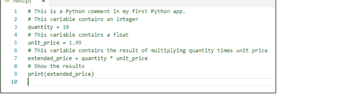

用的话说，如果代码是错误的，在运行时它就无法工作。原理如此简单——没有任何例外。

## 保存你的工作

输入代码就像在计算机上输入其他文档一样。如果你不保存工作，下次你坐在电脑前寻找它时，可能就找不到了。所以，如果你还没有在本书第 2 章讨论过的样在“文件”菜单中启用“自动保存”，请选择“文件” > “保存”。

## 在 VS Code 中运行你的 Python 程序

现在你可以运行程序并查看它是否正常工作。一个简单的方法是在资源管理器中右键点击 `hello.py` 文件，并选择“在终端中运行 Python 文件”（Run Python File in Terminal），如图 4-5 所示。

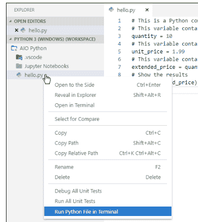

如果你的代码输入正确，你应该在终端窗口中看到结果 `19.9`，如图 4-6 所示。结果是代码中 `print(extended_price)` 的输出，结果为 `19.9` 是因为数量 (10) 乘以单价 (1.99) 等于 19.9。


假设你的程序必须计算 14 件物品的总成本，每件物品花费 $26.99。你能想到如何实现它吗？你当然不需要编写一个全新的程序。相反，在代码中你只需修改变量值即可。

命名规范试图让程序员遵循基本的风格指南，使代码对其他程序员更具可读性，这在编程团队或小组中工作时尤为重要。

到目前为止，你已经查看了代码行。还有代码块，其中两或多行代码共同工作。这是一个示例：


`==`（两个等号）在 Python 中表示“等于”，用于比较两个值是否相等。这与简单的 `=`（一个等号）不同，后者是用于给变量赋值的赋值运算符。

所以，正如你所看到的，缩进在 Python 中非常重要。在前面的代码中，根据 `x` 的值，只有其中一条缩进行会被执行。随着书籍的进行，你将学习到在代码中使用缩进的细节。现在，为了记住语法和缩进在 Python 中的重要性，你在编写代码时必须小心输入。

如果你在工作区设置中启用了第 3 章中描述的 PEP 8，你可能会在看起来正常的代码中看到下划线。将鼠标指针悬停在此类下划线上通常会显示一条指示问题的消息，如图 4-7 所示。

任何错误的具体措辞和语法可能会根据你使用的 lint 版本而异。例如，在图 4-7 中，消息的第一部分 `[pep8]` 告诉你此错误与 PEP 8 语法有关，该语法规定你应该在运算符周围留空格：

```
[pep8] missing whitespace around operator
```


```python
hello.py:
[pep8] missing whitespace around operator
quantity = int
quantity=14
# 这个变量包含一个浮点数
unit_price = 26.99
```

第二部分只是告诉你名为 `quantity` 的变量包含一个整数 (`int`)，这是一个整数。消息的这部分是信息，而不是错误。

要修复错误，请在 `=` 号周围加上空格。换句话说，使用键盘上的空格键在 `=` 前后各加一个空格。

但现在你看到 `14` 下方有一个波浪线。那是怎么回事？嗯，要找到答案，只需点击或将鼠标指针悬停在绿色波浪线上，并让鼠标指针停在那里直到你看到解释，如图 4-8 所示。


```python
hello.py
[pep8] trailing whitespace
# 这是一个
# 这个 var 14: int
quantity =
# 这个变量包含一个浮点数
unit_price = 26.99
# 这个变量包含结果的
extended_price = quantity * unit_price
# 显示结果
print(extended_price)
```

当你读到这里时，消息的具体措辞可能会发生变化。在这个示例中，顶部的消息是 `[pep8] trailing whitespace`，底部是 `14: int` 被存储为整数。错误是尾空格。换句话说，在该行的 `14` 之后有一个空格。你看不见它，因为它仅仅是一个空格。要消除尾空格并修复错误，请点击该行的末尾并按退格键（Backspace），直到光标紧贴 `14` 中的 `4`。

其他错误是风格错误。在你将鼠标指针悬停在波浪线上并停留直到看到消息之前，你不会知道具体的错误。而且在你采取修复它所需的任何操作之前，错误不会消失。

如果你在学习时觉得 PEP 8 错误让你应接不暇，可以临时关闭它们。执行 `Code` > `Settings` (Windows) 或 `Code` > `Settings` (Mac)。在代码视图中，将 `python.linting.pyLintEnabled` 或 `python.linting.pylestyleEnabled` 设置为 `false`。


# 将代码组合在一起

你刚刚完成的练习解释了如何输入、保存、运行和更改应用程序、再次保存并再次运行。这些任务定义了你在任何语言中进行任何软件开发时将要做的工作，所以你应该不断练习它们，直到它们变成本能。但不要担心：你不需要为了掌握它反复重复这一章。在你从初学者成长为顶尖 21 世纪 Python 开发者的过程中，你将在本书中一直使用同样的技能。

# 理解 Python 构建块

## 目录概览

- 第 1 章：处理数字、文本和日期 ........................................ 87
  - 使用函数计算数字 .................................................. 87
  - 更多数学函数 ...................................................... 90
  - 数字格式化 ......................................................... 93
  - 对付奇怪数字 ...................................................... 100
  - 操纵字符串 ......................................................... 103
  - 揭示日期和时间 ..................................................... 110
  - 处理时区 ............................................................ 120
  - 使用时区 ............................................................ 122

- 第 2 章：控制动作 .................................................... 127
  - 控制动作的主运算符 ................................................. 127
  - 使用 `if` 做决策 .................................................. 129
  - 使用 `for` 重复过程 ................................................ 136
  - 使用 `while` 循环 .................................................. 143

- 第 3 章：使用列表和元组快速进 ...................................... 149
  - 定义和使用列表 ..................................................... 149
  - 什么是元组? ........................................................ 165
  - 处理集合 ............................................................ 167

- 第 4 章：使用字典处理海量数据 ...................................... 171
  - 理解字典 ............................................................ 172
  - 创建字典 ............................................................ 174
  - 遍历字典 ............................................................ 182
  - 字典方法 ............................................................ 183
  - 创建字典 ............................................................ 184
  - 删除字典项 .......................................................... 185
  - 多键字典的乐趣 ...................................................... 188

- 第 5 章：处理更大的代码块 ............................................ 195
  - 处理函数 ............................................................ 196
  - 处理函数 ............................................................ 197
  - 向函数传递信息 ..................................................... 198
  - 从函数返回值 ....................................................... 208
  - 揭示匿名函数 ....................................................... 209

- 第 6 章：使用类进行 Python 开发 .................................... 217
  - 掌握类和对象 ....................................................... 217
  - 创建类 .............................................................. 220
  - 从类创建实例 ....................................................... 221
  - 给对象赋予属性 ..................................................... 222
  - 给类赋予方法 ....................................................... 228
  - 理解类继承 .......................................................... 238

- 第 7 章：规避错误 .................................................... 251
  - 理解异常 ............................................................ 252
  - 优雅地处理错误 ..................................................... 254
  - 异常的特殊化 ....................................................... 255
  - 防止你的程序崩溃 .................................................. 257


- 在混合中加入 else . . . . . . . . . . . . . . . . . . . . . 259
- 使用 Try? . . . except . . . else . . . . finally 261
- 抛出你自己的异常 . . . . . . . . . . . . . . . . . . . . 263

## 本章内容

- 掌握整数
- 处理带有小数点的数字
- 简化字符串
- 征服布尔值 `True`/`False`
- 处理日期和时间

# 第 1 章：处理数字、文本和日期

通常情况下，计算机语言，尤其是 Python，处理信息的方式与你日常生活中习惯的方式不同。这个想法需要一些适应。在计算机世界中，`数字`是你可以加、减、乘、除的数字。Python 还区分了整数（`integers`）和包含小数点的数字（浮点数，`floats`）。单词（如名称和地址等文本信息）以字符串的形式存储，字符串是“字符序列”的缩写。除了数字和字符串之外，还有布尔值，它们可以是 `True`（真）或 `False`（假）。

在现实生活中，我们还必须处理日期和时间，这是另一种类型的信息。Python 没有内置用于日期和时间的数据类型，但幸运的是，你可以导入一个免费模块来处理此类信息。本章完全关于充分利用各种 Python 数据类型。

## 使用函数处理数字

Python 中的`函数` 类似于计算器上的函数，因为你可以将某些内容传递给函数，函数会返回某些内容。例如，大多数计算器和编程语言都有平方根函数：你给它们一个数字，它们就会返回该数字的平方根。

Python 函数的通用语法如下：

```
variablename = functionname(param, param)
```

由于大多数函数都会返回某个值，因此你通常会开始定义一个变量来存储函数的返回值。接着是等号 `=` 和函数名，最后是一对括号。在括号内部，你向函数传递一个或多个值（称为参数）。

例如，`abs()` 函数接受一个数字并返回该数字的绝对值。如果你不是一个数学狂热者，这意味着如果你传递一个负数，它将返回该数字的正数形式；如果你传递一个正数，它将返回你传递的原始数字。换句话说，`abs()` 简单地将负数转换为正数。

例如，如图 1-1 所示（你可以尝试在 Jupyter notebook、Python 提示符或 VS Code 中的 `.py` 文件中手动尝试），我们创建了一个变量 `x` 并将其赋值为 `-4`。然后我们创建了变量 `y` 并使用 `abs()` 函数将其赋值为 `x` 的绝对值。Python 显示了 `x` 的值 `-4`，它没有变化。打印 `y` 显示为 `4`，即 `abs()` 函数返回的 `x` 的绝对值。

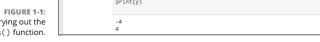

尽管函数总是返回一个值，但某些函数接受两个或多个值。例如，`round()` 函数接受一个数字作为第一个参数。第二个参数是你想要四舍五入的小数位数，例如 `2` 代表两位小数。在图 1-2 的示例中，我们创建了一个变量 `x`，其小数点后有很多数字。然后我们创建了变量 `y` 来返回保留两位小数的相同数字。最后我们打印了这两个结果。

```
In [2]: x = 1.23456789098765432100000000000001
y = round(x, 2)
print(x)
print(y)

1.2345678909876543
1.23
```

### 图 1-2：尝试使用 `round()` 函数。

Python 提供许多处理数字的内置函数，如表 1-1 所示。如果你不是深迷数学，某些函数对你来说可能意义不大，但不要让它们吓到你。如果你不理解某个函数的作用，很可能它与你的工作类型无关。但如果你好奇，可以随时在网络上搜索 `python` 加上函数名以获取更多信息。如需更完整的列表，请搜索 `python 3 built-in functions`。

# 表 1-1

| 内置函数 | 用途 |
|---|---|
| `abs(x)` | 返回数字 `x` 的绝对值（将负数转换为正数）。 |
| `bin(x)` | 返回 `x` 转换为二进制表示的字符串。 |
| `float(x)` | 将字符串或数字 `x` 转换为 `float` 类型。 |
| `format(x, y)` | 根据 `y` 中指定的模式返回格式化后的 `x`。这种语法在当前的 Python 版本中已被 f-strings 替换。 |
| `hex(x)` | 返回包含 `x` 转换为十六进制表示的字符串，前缀为 `0x`。 |
| `int(x)` | 通过截断（不是四舍五入）小数部分及其后的任何数字将 `x` 转换为整数类型。 |
| `max(x, y, z, ...)` | 接受多个数值参数并返回其中最大的。 |
| `min(x, y, z, ...)` | 接受任意数值参数并返回其中最小的。 |
| `oct(x)` | 将 `x` 转换为八进制，前缀为 `0o`。 |
| `round(x, y)` | 将数字 `x` 四舍五入到 `y` 位小数。 |
| `str(x)` | 将数字 `x` 转换为字符串类型。 |
| `type(x)` | 返回指示 `x` 数据类型的字符串。 |

图 1-3 显示了使用内置函数的正确 Python 语法示例。

```python
x = 1.14159265358979
y = -128
z = 981.37800087
w = -999.9999
print(abs(z))
print(int(z))
print(float(z))
print(round(z, 4))
print(bin(x))
print(hex(x))
print(oct(x))
print(max(x, y, z))
print(min(x, y, z))
print(type(z))
print(type(x))
print(type(str(y)))
```

### 图 1-3：在 Python 提示符下玩转内置函数。

你还可以嵌套函数——你可以将函数放在函数内部。例如，当 `z = -999` 时，你可以将函数放在函数内部以获取其绝对值。

### 更多数学函数

### `math` 模块中的一些函数

| 内置函数 | 用途 |
|---|---|
| `acos(x)` | 返回 `x` 的反余弦。 |
| `atan(x)` | 返回 `x` 的反正切。 |
| `atan2(y, x)` | 返回直角坐标 `(x, y)`。 |
| `ceil(x)` | 返回 `x` 的向上取整。 |
| `cos(x)` | 返回 `x` 的余弦。 |
| `degrees(x)` | 将弧度转换为角度。 |
| `e` | 返回数学常数 `e` (2.71828...)。 |
| `exp(x)` | 返回 `e` 的幂。 |
| `factorial(x)` | 返回 `x` 的阶乘。 |
| `floor(x)` | 返回 `x` 的下取整。 |
| `isnan(x)` | 如果 `x` 不是数字则返回 `True`；否则返回 `False`。 |
| `log(x, y)` | 返回 `x` 的底数对数。 |
| `log2(x)` | 返回 `x` 的以 2 为底的对数。 |
| `pi` | 返回数学常数 `pi` (3.14159...)。 |
| `pow(x, y)` | 返回 `x` 的幂。 |
| `radians(x)` | 将角度转换为弧度。 |
| `sin(x)` | 返回 `x` 的正弦。 |
| `sqrt(x)` | 返回 `x` 的平方根。 |
| `tan(x)` | 返回 `x` 的正切。 |
| `tau` | 返回数学常数 `tau` (6.28318...)。 |

常量 `pi`、`e` 和 `tau` 是特殊的函数，不需要使用括号。对于任何函数，你都可以在表达式（计算）中使用它们，或将它们的值赋值给变量。图 1-5 显示了使用 `math` 模块函数的某些示例。

```python
import math
pi = math.pi
e = math.e
tau = math.tau
x = 7
z = -2.534154
print(pi)
print(e)
print(tau)
print(math.sqrt(x))
print(math.floor(z))
print(math.degrees(x))
print(math.radians(x))
```

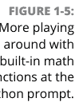

```
3.141592653589793
2.718281828459045
6.283185307179586
9.0
5.0
-2.2325
```

# 数字的格式化

多年来，Python 提供了多种方法以我们人类熟悉的格式来显示数字。例如，大多数人更倾向于看到金额显示为 `$1,234.56` 格式，而不是 `1234.560069506950695206959`。从 3.6 版本开始，在 Python 中格式化数字最简单的方法是使用 f-strings。

# 使用 f-strings 进行格式化

格式化字符串（f-strings）是 Python 中格式化数据最简单的方法。你只需要一个小写或大写的 `f`，后面紧跟一些用引号括起来的文本或表达式。这是一个示例：

```python
f"Hello {username}"
```

第一个引号前的 `f` 告诉 Python 后面的是格式化字符串。在引号内部，被称为`字面量`（literal）的文本将以字面形式显示（与在 f-string 中键入的完全相同）。大括号中的任何内容都是 f-string 的`表达式`（expression），它是代码执行时将出现内容的占位符。在大括号内部，你可以包含一个`表达式`（执行某些计算的公式、变量或两者的组合）。这是一个示例：

```python
username = "Alan"
print(f"Hello {username}")
```

当你运行这段代码时，`print` 函数会显示单词 Hello，紧接着是 `username` 变量的内容，如图 1-6 所示。

### 图 1-6：用于格式化的超简单 f-string。

| In [24]: | |
| :--- | :--- |
| `username = "Alan"` | |
| `print(f"Hello {username}")` | |
| Hello Alan | |

这是表达式的另一个示例 —— 大括号内部的公式 `quantity * unit_price`：

```python
unit_price = 49.99
quantity = 30
print(f"Subtotal: ${quantity * unit_price}")
```

执行该代码后，输出如下：

```
Subtotal: $1499.7
```

这个 `$1499.7` 并不是显示金额的理想方式。通常，我们喜欢在千分位使用逗号，并在分位保留两位数字，如下所示：

```
Subtotal: $1,499.70
```

幸运的是，f-strings 为你提供了这种格式化方法，正如你接下来将学习的。

# 显示金额

为了在金额中出现逗号并让分位显示为两位，你可以在 f-string 表达式的大括号内使用一个以冒号 `:` 开头的格式化字符串。格式化字符串需要放置在右括号内，紧跟在变量名或显示的数值之后。

要在千分位显示逗号，请在格式字符串的冒号后紧跟一个逗号，如下：

```
:,
```

使用当前的示例，你会执行以下操作：

```python
print(f"Subtotal: ${quantity * unit_price:,}")
```

执行此语句产生输出：

```
Subtotal: $1,499.7
```

要让分位显示为两位，在逗号后面加上：

```python
.2f
```

`.2f` 意味着“两位小数，固定”（永远不会多于或少于小数）。以下代码将显示带有逗号和两位小数的数字：

```python
print(f"Subtotal: ${quantity * unit_price:,.2f}")
```

执行时代码显示如下：

| Subtotal: $1,499.70 |
| :--- |

完美！这正是我们想要的格式。每当你想要显示一个千分位带有逗号且小数点后恰好两位数字的数字时，请使用带有格式字符串 `.2f` 的 f-string。

# 格式化百分比数字

现在，假设你的应用适用销售税。应用需要知道税率，应以小数表示。因此，如果销售税率为 6.5%，它在代码中必须写成 `0.065`（或者如果你喜欢也可以写成 `.065`），如下：

```python
sales_tax_rate = 0.065
```

带不带前导零金额是一样的。这种格式对于 Python 来说是理想的，你不需要去改动它。但当你向人类显示税率时，你可能想使用更熟悉的 `6.5%` 格式而不是 `.065`。简单地使用 `print()` 函数将其显示：

```python
sales_tax_rate = 0.065
print(f"Sales Tax Rate {sales_tax_rate}")
Sales Tax Rate 0.065
```

你可以使用相同的固定数字思路（`.2f`）。然而，将固定数字的 `f` 替换为 `%`，如下：

```python
print(f"Sales Tax Rate {sales_tax_rate:.2%}")
```

这段代码将税率乘以 100 并加上 `%` 号，正如你在图 1-7 中所示。

### 图 1-7：格式化百分比数字。

| In [36]: | |
| :--- | :--- |
| `sales_tax_rate = 0.065` | |
| `print(f"Sales Tax Rate {sales_tax_rate:.2%}")` | |
| Sales Tax Rate 6.5% | |

在之前的两个示例中，我们使用了 2 表示位数。当然，你可以显示从零（无）到任何精度的位数。例如，如下使用 `:.1%`：

```python
print(f"Sales Tax Rate {sales_tax_rate:.1%}")
```

执行该行时显示此输出：


# 格式化输出

## 百分比格式化

```python
print(f"Sales Tax Rate {sales_tax_rate:.9%}")
```

显示小数点后九位的百分比：

```
Sales Tax Rate 6.500000000%
```

你不需要在 `print` 函数内部使用 f-string。你也可以执行 f-string 并将结果保存在变量中。必须使用三引号的变量中。你可以使用单引号或双引号。确保结束字符串时使用的字符与开始字符串时使用的字符相同。例如，图 1-8 中的所有字符串都是完全有效的，且处理方式都相同。

图 1-8：f-string 可以封装在单引号、双引号或三引号中。

```python
sales_tax_rate = 0.065
sample1 = f'Sales Tax Rate {sales_tax_rate:.1%}'
sample2 = f"Sales Tax Rate {sales_tax_rate:.2%}"
sample3 = f'''Sales Tax Rate {sales_tax_rate:.3%}'''
sample4 = f"""Sales Tax Rate {sales_tax_rate:.4%}"""

print(sample1)
print(sample2)
print(sample3)
print(sample4)
```

```
Sales Tax Rate 6.5%
Sales Tax Rate 6.50%
Sales Tax Rate 6.500%
Sales Tax Rate 6.500000000%
```

## 创建多行格式字符串

如果你希望有多行输出，可以通过几种方法向格式字符串添加换行符：

- 使用 `\n`：你可以在任何需要换行的地方带有 `\n` 的单行格式字符串。只需确保将 `\n` 放在格式字符串的字面部分，而不是大括号内部。例如：

```python
user1 = "Alberto"
user2 = "Bob"
user3 = "Carlos"
output = f"{user1}\n{user2}\n{user3}"
print(output)
```

执行时，这段代码显示：

```
Alberto
Bob
Carlos
```

- 使用三引号（单或双）：如果你在格式字符串周围使用三引号，就不需要 `\n`。你只需要在输出需要换行的地方在格式字符串中换行即可。看图 1-9 中的代码。格式字符串是三引号的并包含多个换行符。运行代码的输出在相同的位置有行。

```python
unit_price = 49.95
quantity = 32
sales_tax_rate = 0.065
subtotal = quantity * unit_price
sales_tax = sales_tax_rate * subtotal
total = subtotal + sales_tax
output = f"""
Subtotal: ${subtotal:,.2f}
Sales Tax: ${sales_tax:,.2f}
Total: ${total:,.2f}
"""
print(output)
```

图 1-9：封装在三引号中的多行 f-string。

```
Subtotal: $1,598.40
Sales Tax: $103.90
Total: $1,702.30
```

## 格式化宽度和对齐

正如你所示，输出尊重换行符甚至是格式字符串中的空格。遗憾的是，它并不完美——在现实生活中，我们会对齐数字使小数点对齐。不过一切并非不可救，因为通过格式字符串你也可以控制输出的宽度和对齐。

你可以通过在 f-string 的冒号后跟随 `<`（左对齐）、`^`（居中）或 `>`（右对齐）来控制输出的宽度（以及内容在宽度内的对齐方式）。格式字符串中冒号后的任何这些字符都有效。例如，以下将使输出设为 20 个字符宽，内容右对齐：

```
:>20
```

在图 1-9 中，所有金额都是左对齐的，因为这是默认设置。要右对齐数字（我们通常使用金额的方式），你可以使用 `>` f-string。要让数字具有相同的宽度，在字符后指定一个数字。例如，在图 1-10 中，每个 f-string 都包含 `>9`，这导致每个显示的数字右对齐且宽度为 9 个字符。你在底部看到的输出使得所有数字都右对齐，它们的美元符号几乎左对齐。

图 1-10：所有金额在 9 个字符的宽度内右对齐 (`>9`)。

对齐美元符号比你想象的要复杂一些，因为 `.2f` 格式化只能用于数字。你不能在数字前面附加一个 `$`，除非你将数字转换为字符串——但那样它就不再是数字了，`.2f` 也无法工作。

但是，复杂并不意味着不可能，而是意味着不方便。你可以将当前格式下的美元金额转换为字符串，保留该字符串上的美元符号，并对其宽度和对齐进行格式化。例如，代码创建一个名为 `s_subtotal` 的变量，其中包含一个紧随美元金额的美元符号，符号位于第一个数字的左侧，且符号后没有空格：

```python
s_subtotal = "$" + f"{subtotal:,.2f}"
```

在代码中，我们假设变量 `subtotal` 包含一个数字。假设这个数字是 1598.402，尽管它可以是任何数字。`f"{subtotal:,.2f}"` 将数字格式化为固定两位小数，并在千分位带有逗号，如下所示：

```
1,598.40
```

输出是一个字符串而不是数字，因为 f-string 总是产生字符串。

代码的后续部分在前面拼接（连接）了一个美元符号：

```python
"$" +
```

所以现在的输出是 `$1,598.40`。这个最终的格式化字符串存储在一个名为 `s_subtotal` 的新变量中。（我们添加了前导 `$` 是为了提醒我们这是 `subtotal` 数字的字符串等值，而不是原始数字。）

要显示宽度为 9 个数字且右对齐的美元金额，在一个新的字符串中使用 `>9` 来显示 `s_subtotal` 变量，如下：

```python
f"{s_subtotal:>9}"
```

当你对字符串使用 `+` 时，你正在拼接（连接）这两个字符串。`+` 只对数字进行加法运算，而不对字符串。

图 1-11 显示了一个完整的示例，包括运行代码的输出。所有数字都与美元符号右对齐，符号位于正常位置。


```python
# Numerical values
unit_price = 4.95
quantity = 17
sales_tax_rate = 0.05
subtotal = quantity * unit_price
sales_tax = sales_tax_rate * subtotal
total = subtotal + sales_tax

# Format amounts to show with leading dollar sign
subtotal = "$" + f"{subtotal:,.2f}"
sales_tax = "$" + f"{sales_tax:,.2f}"
total = "$" + f"{total:,.2f}"

# Output the string with dollar sign already attached
print(f"Subtotal: {subtotal:>9}")
print(f"Sales Tax: {sales_tax:>9}")
print(f"Total: {total:>9}")
```

图 1-11：所有美元金额几乎对齐。

| Subtotal: | $1,598.40 |
| Sales Tax: | $79.92 |
| Total: | $1,678.32 |

## 对付更奇异的数字

我们大多数人一直都在处理数量和美元金额等简单数字。如果你的工作需要你处理非 10 进制或虚数，Python 拥有你完成工作所需的工具。请记住，你不需要为了使用 Python 或任何其他语言而学习这些内容。只有当你实际的工作（可能是作业）需要时，你才会使用它们。在下一节中，你将查看计算机科学中常用的数字类型：二进制、八进制和十六进制。

## 二进制、八进制和十六进制

如果你的工作需要处理 2 进制、8 进制或 16 进制数字，你就幸运了，因为 Python 既有编写它们的符号，也有在它们之间转换的函数。表 1-3 显示了三种非十进制以及各自使用的数字。

表 1-3：用于 2 进制、8 进制和 16 进制的 Python

| 系统 | 别名 | 使用的数字 | 符号 | 函数 |
| :--- | :--- | :--- | :--- | :--- |
| 2 进制 | 二进制 (Binary) | 0, 1 | `0b` | `bin()` |
| 8 进制 | 八进制 (Octal) | 0, 1, 2, 3, 4, 5, 6, 7 | `0o` | `oct()` |
| 16 进制 | 十六进制 (Hexadecimal or hex) | 0, 1, 2, 3, 4, 5, 6, 7, 8, 9, A, B, C, D, E, F | `0x` | `hex()` |

大多数人永远不需要处理二进制、八进制、十六进制数字。如果这些内容让你感到不安，没用担心。如果你以前从未听过它们，那么在你完成这一节后，你可能再也不会听过它们了。

如果你想了解更多关于各种计数系统的信息，可以使用你喜欢的搜索引擎搜索 "binary number" 或 "octal" 或 "decimal"。

当然，你可以使用这些各种函数来转换 Python 提示符中的数字显示方式，也可以在你创建的应用中使用。在提示符处，只需使用 `print()` 函数，并在括号内使用转换函数，然后在最内层括号内输入你想要转换的数字。例如，数字 255 的十六进制等值，

如果你想在输出中包含多个空格，可以在引号之间放置空格，但通常一个空格就足够了。在下面的示例中，你在 `first_name` 和 `last_name` 之间放置了一个空格。你还在 `middle_init` 之后添加了一个句点和空格：

```python
first_name = "Alan"
middle_init = "C"
last_name = "Simpson"
full_name = first_name + " " + middle_init + " " + last_name
print(full_name)
```

这段代码的输出（即 `full_name` 变量的内容）更像你习惯看到的名称格式：

> Alan C. Simpson

# 获取字符串的长度

要确定字符串中有多少个字符，你可以使用 `len()` 函数（length 的缩写）。长度包括空格；空格也是字符，每个字符的长度为一。一个空字符串——里面什么都没有，甚至连空格都没有——长度为零。

以下是一些示例。在第一行中，你定义了一个名为 `s1` 的变量并向其中放入一个空字符串（一对引号，中间没有任何内容）。`s2` 变量获得了一个空格（一对引号，中间有一个空格）。`s3` 变量获得了一个包含字母和空格的字符串。然后，三个 `print()` 函数显示了每个字符串的长度：

```python
s1 = ""
s2 = " "
s3 = "A B C"
print(len(s1))
print(len(s2))
print(len(s3))
```

以下是该代码执行后的输出。当你理解 `len()` 测量字符串长度是指字符串中字符的数量（包括空格）时，这个输出是有意义的：

```
0
1
5
```

# 使用常用的字符串运算符

Python 提供了几种运算符来处理数据序列。Python（以及大多数其他编程语言）中关于字符串的一个奇怪点是，当你数字符时，第一个字符是 0，而不是 1。这对于我们人类来说似乎没有意义。但计算机是这样计数的，因为这是最有效的方法。尽管图 1-13 中的字符串有五个字符，但字符串的最后一个字符是数字 4，因为第一个字符是 0。你自己想去吧。

图 1-13：字符串中的字符位置从 0 开始，而不是从 1 开始。

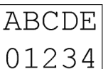

表 1-4 汇总了用于字符串的 Python 3 运算符。

## 用于字符串的 Python 序列运算符

| 运算符 | 用途 |
| --- | --- |
| `x in s` | 如果 x 存在于字符串 s 中，则返回 True。 |
| `x not in s` | 如果字符串 s 不包含 x，则返回 True。 |
| `s * n` 或 `n * s` | 将字符串重复 n 次。 |
| `s[i]` | s 的第 i 个元素，其中第一个字符为 0。 |
| `s[i:j]` | 从位置 i 字符开始到位置 j 字符的切片。 |
| `s[i:j:k]` | s 的从 i 到 j 步长为 k 的切片。 |
| `min(s)` | 字符串 s 中最小（最低）的字符。 |
| `max(s)` | 字符串 s 中最大（最高）的字符。 |
| `s.index(x, i[, j])` | x 在字符串 s 中首次出现的数字位置。可选的 i 和 j 将搜索限制在从 i 到 j 的字符之间。 |
| `s.count(x)` | 字符串 x 在较大字符串 s 中出现的次数。 |

图 1-14 显示了在 Jupyter Notebook 中使用字符串运算符的示例。

当 `print()` 函数的输出看起来不对时，记住关于 Python 字符串的两个事实：

- 第一个字符总是数字 0
- 每个空格都算作一个，所以计数时不要跳过空格。

```python
s = "abracadicus you're a turtle dove"
# s 中是否包含小写的 t？
print("t" in s)
# s 中是否包含大写的 T？
print("T" in s)
# s 中是否不包含大写的 T？
print("T" not in s)
# 是否有连续的空格？
print("  " in s)
# 字符串 s 中的第一个字符
print(s[0])
# 打印字符串 s 的第 33-39 个字符
# 从零开始每隔第三取一个字符
print(s[::3])
# 最低字符是 s（空格比字母 a 低）
print(min(s))
# 最高字符是 s
print(max(s))
# 第一个大写的 P 在哪里？
print(s.find("P"))
# 从 0 开始的字符串后半部分，第一个小写的 o 在哪里？
print(s.find("o", 22))
# s 中有多少个 a？
print(s.count("a"))
```

```
True
False
True
False
a
AdMnPupp tt v

18
25
5
```

图 1-14：在 Jupyter Notebook 中玩字符串运算符。

你可能注意到 `min(s)` 返回了一个空白格，这意味着空白字符是字符串中最低的字符。但究竟是什么让空格比字母 A 或字母 a “低”呢？简单的答案是字母的 ASCII 码。你可以在键盘上输入的每个字符，以及许多额外的字符，都由美国信息标准交换代码（ASCII）分配了一个数字。

图 1-15 显示了许多字符的 ASCII 数字。空格和标点符号比字母“低”，是因为它们的 ASCII 码较小。大写字母比小写字母“低”，是因为它们的 ASCII 码较小。你是否好奇分配数字 0–31 的字符发生了什么？这些数字也是字符，但它们是控制字符，当你按下 Ctrl 键和另一个键时是不可见的。

| 数字 | 字符 | 数字 | 字符 | 数字 | 字符 |
| --- | --- | --- | --- | --- | --- |
| 32 | [空格] | 65 | A | 97 | a |
| 33 | ! | 66 | B | 98 | b |
| 34 | " | 67 | C | 99 | c |
| 35 | # | 68 | D | 100 | d |
| 36 | $ | 69 | E | 101 | e |
| 37 | % | 70 | F | 102 | f |
| 38 | & | 71 | G | 103 | g |
| 39 | ' | 72 | H | 104 | h |
| 40 | ( | 73 | I | 105 | i |
| 41 | ) | 74 | J | 106 | j |
| 42 | * | 75 | K | 107 | k |
| 43 | + | 76 | L | 108 | l |
| 44 | , | 77 | M | 109 | m |
| 45 | - | 78 | N | 110 | n |
| 46 | . | 79 | O | 111 | o |
| 47 | / | 80 | P | 112 | p |
| 48 | 0 | 81 | Q | 113 | q |
| 49 | 1 | 82 | R | 114 | r |
| 50 | 2 | 83 | S | 115 | s |
| 51 | 3 | 84 | T | 116 | t |
| 52 | 4 | 85 | U | 117 | u |
| 53 | 5 | 86 | V | 118 | v |
| 54 | 6 | 87 | W | 119 | w |
| 55 | 7 | 88 | X | 120 | x |
| 56 | 8 | 89 | Y | 121 | y |
| 57 | 9 | 90 | Z | 122 | z |
| 58 | : | 91 | [ | 123 | { |
| 59 | ; | 92 | \ | 124 | \| |
| 60 | < | 93 | ] | 125 | } |
| 61 | = | 94 | ^ | 126 | ~ |
| 62 | > | 95 | _ | 127 | DEL |
| 63 | ? | 96 | ` | 128 |  |

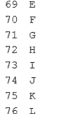


Python 提供了两个处理 ASCII 的函数。`ord()` 函数接收一个字符并返回该字符的 ASCII 数字。`print(ord("A"))` 返回大写字母 A 在 ASCII 表中的 65。`chr()` 函数给你一个数字，并返回该数字对应的 ASCII 字符。例如，`print(chr(65))` 显示 A，因为 A 在 ASCII 表中 65。

# 使用方法处理字符串

Python 3 中的每个字符串都被认为一个 `str` 对象（读音为 "string object"）。缩写词 `str` 将 Python 3 与早期版本区分开来，早期将字符串称为 string objects（*string* 一词完整拼写，而不是缩写）。这种命名约定是困惑的很大来源，尤其是对于初学者。只需记住在 Python 3 中，`str` 全与字符串有关。

Python 提供了许多 `str` 方法（也称为字符串方法）来帮助你处理 `str` 对象。`str` 对象方法的一般语法如下：

```
string.methodname(params)
```

# Python 3 字符串内置方法

| 方法 | 用途 |
| --- | --- |
| `s.capitalize()` | 返回一个首字母大写、其余全小写的字符串。 |
| `s.count(x, [y, z])` | 返回 x 在字符串 s 中出现的次数。可选地，你可以添加 y 作为起点，z 作为终点，以搜索字符串的一部分。 |
| `s.find(x, [y, z])` | 返回一个数字，表示 x 在字符串 s 中可以找到的位置。可选的 y 和 z 参数允许将搜索限制在字符串的一部分。如果未找到则返回 -1。 |
| `s.index(x, [y, z])` | 与 find 类似，但如果不在 y 中找到字符串 x，将返回“子字符串未找到”错误。 |
| `s.isalpha()` | 如果 s 至少有一个字符长且仅包含字母（A-Z 或 a-z），则返回 True。 |
| `s.isdecimal()` | 如果 s 至少有一个字符长且仅包含数字字符（0-9），则返回 True。 |
| `s.islower()` | 如果 s 包含字母且所有这些字母都是小写的，则返回 True。 |
| `s.numeric()` | 如果 s 至少有一个字符长且仅包含数字字符（0-9），则返回 True。 |
| `s.isprintable()` | 如果 s 包含可打印字符，则返回 True。 |
| `s.istitle()` | 如果 s 包含字母且每个单词的首字母大写并跟着小写字母，则返回 True。 |
| `s.isupper()` | 如果字符串中的所有字母都是大写的，则返回 True。 |
| `s.lower()` | 返回所有字母转换为小写的 s。 |
| `s.strip()` | 返回去除了任何开头空格的 s。 |
| `s.replace(x, y)` | 返回 s 的副本，其中所有字符 x 被替换为字符 y。 |
| `s.rfind(x, [y, z])` | 与 s.find 类似，从字符串开始反向搜索。如果提供了 y 和 z，从位置 z 到位置 y 反向搜索。如果未找到字符串 x 则返回 -1。 |

# 方法目的

| 方法 | 目的 |
| :--- | :--- |
| `s.index()` | 与 s.find 相同，但如果未找到子字符串则返回错误。 |
| `s.rstrip()` | 返回去除了末尾空格的字符串 x。 |
| `s.strip()` | 返回去除了开头和结尾空格的字符串 x。 |
| `s.swapcase()` | 返回将大写字母转换为小写、将小写字母转换为大写的 s。 |
| `s.title()` | 返回每个单词的首字母大写、其他所有字母均为小写的 s。 |
| `s.upper()` | 返回所有字母均转换为大写的 s。 |

你可以在 Jupyter notebook 或 Python 提示符中尝试这些方法。图 1-16 显示了在 Jupyter notebook 中使用变量 `s1`、`s2` 和 `s3` 作为字符串进行的一些示例。运行以下代码的结果如下：

```python
s1 = "There is no such word"
s2 = "ABC"
# 将首字母大写，其余部分小写
print(s2.capitalize())
# 统计 s1 中的空格数量
print(s1.count(' '))
# 在 s1 中查找点
print(s1.find('.'))
# 检查 s2 是否为小写
print(s2.islower())
# 将 s2 转换为小写
print(s2.lower())
# 去除 s2 开头的字符
print(s2.lstrip())
# 去除 s2 末尾的字符
print(s2.rstrip())
# 切换 s1 中字母的大小写
print(s1.swapcase())
# 以标题格式显示 s1（首字母大写）
print(s1.title())
# 将 s1 显示为大写
print(s1.upper())
```

```
ABC
6
True
ab c
a c
THERE NO SUCH WORD AS
There Is No Such Word As
There NO SUCH WORD AS
```

图 1-16：在 Jupyter notebook 中玩转 Python 3 字符串函数。


不要费力去记忆每一个字符串方法。相反，请记住在 Python 中操作字符串时，可以搜索哪些可用的方法。

# 发现日期和时间

在计算机世界中，我们经常使用日期和时间进行调度，或者计算某事的截止日期或已经过了多久。我们有时使用时间戳来精确记录用户做了某事或事件发生的时间。Python 中有很多使用日期时间的理由，但惊讶的是，处理日期和时间通常需要使用 `datetime` 模块。与其他任何模块一样，在使用它之前必须先导入它。使用 `import datetime`。像任何导入一样，你可以添加一个别名（`dt`），这样输入更方便，例如 `import datetime as dt` 也可以。

`datetime` 模块是一个抽象基类，为语言提供了新的数据类型。对于日期和时间，这些数据类型如下：

- `datetime.date`：包含月、日和年（但不包含时间）。
- `datetime.time`：包含小时、分、秒以及可选的时区信息（但不包含日期）。
- `datetime.datetime`：包含日期、时间以及可选的时区信息的单项。

我们在前面的列表中每个类型之前都加上单词 `datetime`，但如果你使用别名 `dt`，则可以在代码中使用它。我们将在接下来的章节中单独讨论这些日期。

# 处理日期

当时间不是问题时，`datetime.date` 类型非常适合处理日期。你有两种方式创建日期对象：使用 `today()` 方法从计算机内部时钟获取今天的日期；或者在括号内指定年、月、日。

> 在指定月份或日期时，永远不要在 `datetime()` 中使用导零。例如，2020年4月1日必须表示为 `2020,4,1` —— 如果输入 `2020,04,01`，它是不起的。


例如，在导入 `datetime` 模块后，你可以使用 `today()` 获取计算机内部时钟的当前日期。或者使用 `date(year, month, day)` 语法为其他日期创建日期对象。以下代码显示了方法：

- 导入 datetime 模块，别名为 dt
  `import datetime as dt`
- 将今天的日期存储在名为 `today` 的变量中
  `today = date.today()`
- 将另一个日期存储在 `last_of_teens` 变量中
  `last_of_teens = dt.date(2019, 12, 31)`

在 Jupyter notebook、Python 提示符或 .py 文件中输入代码进行尝试。使用 `print()` 函数查看每个变量中的内容，如图 1-17 所示。你的结果可能与图中不同；你会尝试一下吗？

图 1-17：在 Jupyter notebook 中对 datetime.date 对象进行实验。

| 代码 | 描述 |
| :--- | :--- |
| `import datetime as dt` | 导入 datetime 模块，别名为 dt |
| `today = date.today()` | 将今天的日期存入 `today` 变量 |
| `last_of_teens = dt.date(2019, 12, 31)` | 将另一个日期放入 `last_of_teens` |
| `print(today)` | 显示今天的日期 |
| `print(last_of_teens)` | 查看 `last_of_teens` |

# 你的电脑和时间

如果你的电脑连接了互联网，它的内部日期和时间应该是准确的。这是因为它从 NTP（网络时间协议）获取这些信息，这是任何应用程序都可以从互联网获取的标准时间。`datetime` 针对你的时区进行了定制，并考虑了夏令时（如果适用）。换句话说，屏幕上显示的日期和时间应该和你墙上的日历一致。

你可以使用 `.month`、`.day` 或 `.year` 日期对象的任何部分。在同一个 Jupyter 单元格或 Python 提示符中执行此代码：

```python
print(last_of_teens.month)
print(last_of_teens.day)
print(last_of_teens.year)
```

该日期的三个组件分别单独显示：

```
12
31
2019
```

正如你在第一次输出中看到的，默认日期是 `yyyy-mm-dd`，但你可以按照任意格式化日期和时间。使用我们在本章较早讨论过的 f-strings，以及表 1-6 中的指令（该表包含了我们稍后讨论的日期和时间格式）。

# 表 1-6 日期时间的格式字符串

| 指令 | 描述 |
| :--- | :--- |
| `%a` | 星期，缩写 |
| `%A` | 星期，全称 |
| `%w` | 星期几（0-6），其中0是星期日 |
| `%d` | 日（01-31） |
| `%b` | 月份，缩写 |
| `%B` | 月份，全称 |
| `%m` | 月份（01-12） |
| `%y` | 两位年份 |
| `%Y` | 四位年份 |
| `%H` | 小时（24小时制，00-23） |
| `%I` | 小时（12小时制，01-12） |
| `%p` | 上午下午 |
| `%M` | 分（00-59） |
| `%S` | 秒（00-59） |
| `%f` | 微秒（000000-999999） |
| `%z` | UTC 偏移 |
| `%Z` | 时区名称 |
| `%j` | 一年中的第几天（001-366） |
| `%U` | 周数（以星期日为一周的第一天），0-53 |
| `%W` | 周数（以星期一为一周的第一天），0-53 |
| `%c` | 本地日期和时间格式 |
| `%x` | 本地日期格式 |
| `%X` | 本地时间格式 |
| `%%` | 百分号 % |

有些教程教你使用 `strftime` 而不是 f-strings 来格式化日期时间，这确实是一种有效的方法。然而，我们在这里坚持使用 f-strings，因为我们认为未来它们会比 `strftime` 更受欢迎。

在使用格式字符串时，请确保将空格、斜杠以及任何其他内容放在你希望它们出现在输出中的位置。例如，这行代码：

```python
print(f"{last_of_teens:%A, %B %d, %Y}")
```

执行时，会显示：

```
Tuesday, December 31, 2019
```

要以 `mm/dd/yyyy` 格式显示日期，请使用 `%m/%d/%Y`，如下所示：

```python
todays_date = f"{today:%m/%d/%Y}"
```

输出将是尝试尝试时的当前日期，格式如下：

```
11/19/2018
```

| 格式字符串 | 示例 |
|--- |--- |
| `%a, %b %Y` | Sat, Jun 01 2019 |
| `%x` | 06/01/19 |
| `%m-%d-%y` | 06-01-19 |
| `This %A %B %d` | 这个周六 6月01日 |
| `%A %B %d is day number %j of %Y` | 6月01日周六是2019年的第152天 |

## 时间操作

如果你想处理时间数据，请使用 `datetime` 类。使用 `time` 类定义时间对象的基本语法为：

```
variable = datetime.time([hour, [minute,[second, [microsecond]]]])
```

注意，所有参数都是可选的。例如，你可以不使用任何参数：

```
midnight = dt.time()
print(midnight)
```

这段代码将时间存储为 `00:00:00`，即午夜。为了验证它是一个时间对象，输入 `print(type(midnight))` 将显示以下内容：

```
00:00:00
<class 'datetime.time'>
```

第二行告诉你 `00:00:00` 值是来自 `datetime` 类的时间对象。

你可以传递给 `time()` 的第四个可选值是微秒（秒的百万分之一）。例如，这段代码在一个名为 `almost_midnight` 的变量中存放了一个午夜前百万秒的时间，并通过 `print()` 函数将其显示在屏幕上：

```
almost_midnight = dt.time(23, 59, 59, 999999)
print(almost_midnight)
23:59:59.999999
```

你可以使用表1–6中的时间指令对字符串进行格式化处理，以控制时间的格式。表1–8 显示了一些使用 `23:59:59:999999` 作为样本时间的示例。

### 表 1-8 示例日期格式字符串

| 格式字符串 | 示例 |
|---|---|
| `%I:%M %p` | 11:59 PM |
| `%H:%M:%S and %f microseconds` | 23:59:59 和 999999 微秒 |
| `%X` | 23:59:59 |

有时你想处理日期，有时你只想处理时间。通常，你想同时使用日期和时间来确定时间上的某一个时刻。为此，请使用 `datetime` 模块中的 `datetime` 类。月、日和 `datetime` 类支持一个 `now()` 方法，它可以从计算机时钟中获取当前的日期和时间，如下：

```
import datetime as dt
right_now = dt.datetime.now()
print(right_now)
```

当你执行这段代码时，屏幕上显示的内容取决于 `print()` 函数。但 `datetime` 值的格式将如下：

```
2019-11-19 14:03:07.525975
```

这意味着 2019年11月19日下午2:03（附带 7.525975 秒）。

你也可以使用以下任何参数来定义一个 `datetime`。月、日、年是必须的。其余的是可选的，如果你省略了它们，时间中的这些部分将设置为 0。

```
datetime(year, month, day, hour, minute, [second, [microsecond]])
```

这是一个使用 2019年12月31日晚上 11:59 的示例：

```
import datetime as dt
new_years_eve = dt.datetime(2019, 12, 31, 23, 59)
print(new_years_eve)
```

以下是不带格式设置的 `print()` 语句的输出：

```
2019–12–31 23:59:00
```

表1–9 显示了使用表1–6中所示指令对 `datetime` 进行格式化的示例。

### 表 1–9 示例 datetime 格式字符串

| 格式字符串 | 示例 |
|---|---|
| `%A, %B at %I:%M%p` | Tuesday, December 31 at 11:59PM |
| `%m/%d/%dy at %H:%M%p` | 12/31/19 at 23:59 |
| `%I:%M %p on %b %d` | 11:59 PM on Dec 31 |
| `%x` | 12/31/19 |
| `%c` | Tue Dec 31 23:59:00 2019 |
| `%m/%d/%dy at %I:%M %p` | 12/31/19 at 11:59 PM |
| `%I:%M %p on %m/%d/%dy` | 1:59 PM on 12/31/2019 |

## 计算时间跨度

有时仅仅知道日期或时间是不够的。你需要知道持续时间或时间跨度，这在计算机世界中通常是计算出来的。换句话说，是指日期、时刻，但以年、月、日、小时、分钟等表示“多久”。对于时间跨度，Python `datetime` 模块包含了 `timedelta` 类。每当你减两个日期或时间以确定它们之间的持续时间时，会自动创建一个 `timedelta` 对象。例如，假设你创建了几个变量来存储日期，可能一个用于元旦，另一个用于纪念日。然后你创建了第三个变量 `days_between`，它是通过较晚的日期减去较早的日期得到的：

```
import datetime as dt
new_years_day = dt.date(2019, 1, 1)
memorial_day = dt.date(2019, 5, 27)
days_between = memorial_day - new_years_day
print(days_between)
print(type(days_between))
146 days, 0:00:00
<class 'datetime.timedelta'>
```


## 计算时间跨度

有时仅仅知道日期或时间是不够的。你需要知道持续时间，或时间跨度，这在计算机世界中通常是计算出来的。换句话说，是指日期、时刻，但以年、月、日、小时、分钟等表示“多久”。对于时间跨度，Python `datetime` 模块包含了 `timedelta` 类。每当你减两个日期或时间以确定它们之间的持续时间时，会自动创建一个 `timedelta` 对象。例如，假设你创建了几个变量来存储日期，可能一个用于元旦，另一个用于纪念日。然后你创建了第三个变量 `days_between`，它是通过较晚的日期减去较早的日期得到的：

```python
import datetime as dt
new_years_day = dt.date(2019, 1, 1)
memorial_day = dt.date(2019, 5, 27)
days_between = memorial_day - new_years_day
print(days_between)
print(type(days_between))
```

```
146 days, 0:00:00
<class 'datetime.timedelta'>
```

那么 `days_between` 在数据类型方面究竟是什么？如果你打印它的值，你会得到 `146 days, 0:00:00`，因为我们没有在任何一个日期中指定时分秒，所有时间数字都设置为 0。如果你使用 Python 的 `type()` 函数来确定 `days_between` 的数据类型，你会看到它是来自 `datetime` 模块的一个 `timedelta` 对象。

### `time()` 与微秒

你可以传递给 `time()` 的第四个可选值是微秒（秒的百万分之一）。例如，这段代码在一个名为 `almost_midnight` 的变量中存放了一个午夜前一微秒的时间，并通过 `print()` 函数将其显示在屏幕上：

```python
almost_midnight = dt.time(23, 59, 59, 999999)
print(almost_midnight)
```

```
23:59:59.999999
```

你可以使用表 1–6 中的时间指令对字符串进行格式化处理，以控制时间的格式。表 1–8 显示了一些使用 `23:59:59.999999` 作为样本时间的示例。

### 表 1–8 示例时间格式字符串

| 格式字符串 | 示例 |
|---|---|
| `%I:%M %p` | 11:59 PM |
| `%H:%M:%S and %f microseconds` | 23:59:59 和 999999 微秒 |
| `%X` | 23:59:59 |

## 日期与时间的组合：`datetime` 类

有时你想处理日期，有时你只想处理时间。通常，你想同时使用日期和时间来确定时间上的某一个时刻。为此，请使用 `datetime` 模块中的 `datetime` 类。`date` 类和 `datetime` 类支持一个 `now()` 方法，它可以从计算机时钟中获取当前的日期和时间，如下：

```python
import datetime as dt
right_now = dt.datetime.now()
print(right_now)
```

当你执行这段代码时，屏幕上显示的内容取决于 `print()` 函数。但 `datetime` 值的格式将如下：

```
2019-11-19 14:03:07.525975
```

这意味着 2019年11月19日下午2:03（附带 7.525975 秒）。

你也可以使用以下参数来定义一个 `datetime`。年、月、日是必须的。其余的是可选的，如果你省略了它们，时间中的这些部分将设置为 0。

```python
datetime(year, month, day, hour, minute, [second, [microsecond]])
```

这是一个使用 2019年12月31日晚上 11:59 的示例：

```python
import datetime as dt
new_years_eve = dt.datetime(2019, 12, 31, 23, 59)
print(new_years_eve)
```

以下是不带格式设置的 `print()` 语句的输出：

```
2019-12-31 23:59:00
```

表 1–9 显示了使用表 1–6 中所示指令对 `datetime` 进行格式化的示例。

### 表 1–9 示例 datetime 格式字符串

| 格式字符串 | 示例 |
|---|---|
| `%A, %B at %I:%M%p` | Tuesday, December 31 at 11:59PM |
| `%m/%d/%y at %H:%M%p` | 12/31/19 at 23:59 |
| `%I:%M %p on %b %d` | 11:59 PM on Dec 31 |
| `%x` | 12/31/19 |
| `%c` | Tue Dec 31 23:59:00 2019 |
| `%m/%d/%y at %I:%M %p` | 12/31/19 at 11:59 PM |
| `%I:%M %p on %m/%d/%y` | 11:59 PM on 12/31/2019 |

## 计算年龄示例

以下代码演示如何从 `timedelta` 对象计算岁数和月份：

```python
import datetime as dt
# 获取你电脑今天的日期
today = dt.date.today()

# 以年、月、日格式表示生日
birthdate = dt.date(2000, 1, 31)

# 使用 timedelta 计算两个日期之间的时长
delta_age = (today - birthdate)

# 获取两个日期之间间隔的天数
days_old = delta_age.days
# 将天数整除以 365 得到年份
years = days_old // 365
# 剩余的天数除以 30 得到月份
months = (days_old % 365) // 30
# 按你喜欢的格式打印
print(f"你已经 {years} 年 {months} 个月大了。")
```

图 1-18：从 timedelta 对象计算岁数月份。

## 考虑时区

如你所知，当你所在的地区是正午时，并不意味着到处都是正午。图 1-19 显示了所有时区的地图。如果你想更详细地查看，只需在网上搜索时区地图。在任何给定时刻，取决于你位于地球的哪里，日期和时间都是不同的。存在一种通用时间，被称为协调世界时（UTC）。你可能听过格林威治标准时间（GMT）或军事使用的祖鲁时间，它们的原理是相同的。所有这些时间指的地球本初子午线（即 0 度经度）的时间，正位于图 1-19 中某个时区的中心。


图 1-19：时区。

如今，大多数人依赖 Olson 数据库作为主要信息来源。它列出了所有当前的时区和位置。如果你对细节感兴趣，可以搜索 Olson 数据库或 tz 数据库。时区名称非常多，无法在此列出，但表 1-10 显示了一些美国时区的示例。左列是数据库中的官方名称。第二列是更熟悉的名称。最后两列显示了标准时间和夏令时间相对于 UTC 的偏移量。

### 表 1-10 来自 Olson 数据库的示例时区

| 时区 | 常用名称 | UTC 偏移 | DST 偏移 |
|---|---|---|---|


| Etc/UTC | UTC | +00:00 | +00:00 |
| --- | --- | --- | --- |
| Etc/UTC | Universal | +00:00 | +00:00 |
| America/Anchorage | US/Alaska | -09:00 | -08:00 |
| America/Adak | US/Aleutian | -10:00 | -09:00 |
| America/Phoenix | US/Arizona | -07:00 | -07:00 |
| America/Chicago | US/Central | -06:00 | -05:00 |
| America/New_York | US/Eastern | -05:00 | -04:00 |
| America/Indiana/Indianapolis | US/East-Indiana | -05:00 | -04:00 |
| America/Honolulu | US/Hawaii | -10:00 | -10:00 |
| America/Indiana/Knox | US/Indiana-Starke | -06:00 | -05:00 |
| America/Detroit | US/Michigan | -05:00 | -04:00 |
| America/Denver | US/Mountain | -07:00 | -06:00 |
| America/Los_Angeles | US/Pacific | -08:00 | -07:00 |
| Pacific/Pago_Pago | US/Samoa | -11:00 | -11:00 |
| Etc/UTC | UTC | +00:00 | +00:00 |
| Etc/UTC | Zulu | +00:00 | +00:00 |

所以我们为什么要告诉你这些呢？因为 Python 允许你处理两种不同类型的 datetime：

- **Naive datetime（幼稚 datetime）**：任何不包含与特定时区相关信息的 datetime。
- **Aware datetime（感知 datetime）**：包含时区信息的 datetime。

你通过 `.date()` 定义的 `timedelta` 对象和日期总是“幼稚”的。默认情况下，你作为 `time()` 或 `datetime()` 对象创建任何时间或 datetime 也是幼稚的。但对于这些对象，如果对你的工作有用，你可以选择包含时区信息，例如当你向位于多个时区的观众展示活动日期时。

# 使用时区

当你从电脑的系统时钟获取时间时，它是你所在时区的时间，但你并不知道它是哪个时区。不过你可以通过比较你位置的 `.now()` 和 UTC 时间的 `.now()`，然后相减差值来区分你的时间，如图 1-20 所示。

```python
# 获取 datetime 模块并赋予其别名
import datetime as dt

# 获取电脑时钟的时间
here_now = dt.datetime.now()

# 获取现在的 UTC datetime
utc_now = dt.datetime.utcnow()

# 相减得到差值
time_difference = here_now - utc_now

# 显示结果
print(f"本地时间: {here_now:%I:%M:%S}")
print(f"UTC 时间: {utc_now:%I:%M:%S}")
print(f"差值: {time_difference}")
```

图 1-20：确定你的时间与 UTC 时间之间的差值。

当你运行该代码时，当前时间是下午 1:02，UTC 时间是下午 6:02。差值是五小时（分钟或秒）。我们的时间早，所以我们的时区实际上是 UTC-5。注意，如果你从较晚的时间减去较早的时间，你会得到一个负数，这可能是误导性的，如下：

```python
time_difference = here_now - utc_now
# Difference: -1 day, 19:00:00
```

这实际上是五个小时，因为如果你从 24 小时（一天）中减去 1 天 19 小时，得到的仍然是 5 小时。这很微妙。但请记住……

当程序运行时，它会根据日期时间和我们的格式字符串显示以下输出：

```
Local: 07/04/20 07:00 PM
```

剩余的代码计算了五个时区的每个正确日期时间：

```python
name = event.astimezone(gettz("tzname"))
```

第一个名称 `name` 只是我们造的一个变量。在 `event.astimezone()` 中，`event` 指的是之前行中定义的初始事件时间。`astimezone()` 是内置的 `dateutil` 函数，它使用以下语法：

```python
.astimezone(gettz("tzname"))
```

在计算每个时区日期时间的每行代码中，我们将 `tzname` 替换为 Olson 数据库中的时区名称。正如你在输出中所看到的（参见图 1-22），显示了五个不同时区的事件日期时间。注意，美国时区处于夏令时间（例如 EDT）。因为我们恰好位于东海岸，而且事件发生在 7 月，所以正确的本地时区是东部夏令时间。当你查看日期输出时，第一个匹配我们的时区，这是理应的，而其余日期的时间已针对不同的时区进行了调整。

如果你在想“天哪，真是一团乱麻，”我们不会对此有任何反对意见的。这些内容在我们看来都不直观、简单，或者谈不上有趣。但如果你急需为你的数据获取时区信息，你到目前为止学的编码技巧正是你现在需要的。

如果你在网上研究 Python 时区，你可能会发现许多人推荐使用 `arrow` 模块而不是 `dateutil` 模块。我们在这里不会涉及这些，因为 `arrow` 并不是你 Python 安装的一部分，而且这本书已经够厚了。（如果我们尝试涵盖所有内容，你需要一辆推车才能搬动这书。）


第 1 章 处理数字、文本和日期 125 页

+ 本章内容
- 使用 `if` 做出决策
- 使用 `for` 重复
- 使用 `while` 循环

# 第 2 章

## 控制动作

到本书为止，我们讨论了许多在计算机中存储信息的方法，主要是存储在 Python 和你的计算机可以处理的变量中。以计算机可以处理的形式拥有信息，对于让计算机执行任何操作至关重要。将此想象为“拥有”部分——拥有一些可以处理的信息。

但现在我们需要把注意力转移到“执行”部分——利用这些信息来创建有用或娱乐的内容。在本章中，我们涵盖了让计算机执行任务的最重要且最常用的操作。我们从计算机擅长、快速且大量执行某件事开始——做决定。

## 控制动作的主要运算符

你通过做出决定来控制你的程序（以及计算机）做什么，这通常涉及比较。你使用运算符（如表 2-1 所示的运算符）来进行比较。这些运算符被称为关系运算符或比较运算符，因为通过比较项目，计算机正在确定两个项目之间的关系。

## 用于决策的 Python 比较运算符

| 运算符 | 含义 |
| --- | --- |
| `==` | 等于 |
| `!=` | 不等于 |
| `<` | 小于 |
| `>` | 大于 |
| `<=` | 小于或等于 |
| `>=` | 大于或等于 |

Python 还提供了三个逻辑运算符，也称为布尔运算符，它们允许你在做出最终决定之前评估多个比较。这些运算符使用英语单词来表示它们（基本上就是它们的意思），如表 2-2 所示。

| 运算符 | 含义 |
| --- | --- |
| `and` | 两者为真 |
| `or` | 其中一个为真 |
| `not` | 不为真 |

如果你对布尔（Boolean）这个词感到好奇，它指的是一个名叫乔治·布尔（George Bool）的人，他在 19 世纪 50 年代帮助建立了逻辑代数，几乎为今天的计算机奠定了基础。你可以随时在网上搜索他的名字以了解更多。

这些运算符通常与 `if...then...else` 决策一起使用，控制应用程序或程序的运行。要做出此类决策，你使用 Python 的 `if` 语句。


## 使用 if 决策

`if` 这个词在所有应用程序和计算机程序中都被广泛用于做出决策。`if` 最简单的语法如下：

```python
if 条件:
    执行此操作
无论如何都执行此操作
```

所以，第一行 `执行此操作` 只有在条件为真时才会执行。如果条件为假，第一行 `执行此操作` 将被忽略。无论条件如何，下一步都会执行第二行。注意，Python 中这两者都不需要缩进，正如你很快就会看到的。但首先，让我们用这种简单的语法做几个简单的例子。你可以在 Jupyter notebook 或 `.py` 文件中自己尝试。

图 2-1 显示了一个简单的示例，其中 `sun` 变量接收字符串 `"down"`。如果一个 `if` 语句检查 `sun` 变量是否等于 `"down"`，如果是，则打印 `Good night!` 消息。然后它会正常继续打印 `I here`。

图 2-1：当条件为真时简单 if 的结果。

```python
sun = "down"
if sun == "down":
    print("Good night!")
print("I here")
```

确保在测试 `if` 时使用两个等号 `==` 来表示相等性。如果你写错了，第一行将被忽略。无论条件如何，下一步都会执行第二行。正如你在图 2-2 中看到的。

图 2-2：条件为真时简单 if 的结果。

```python
sun = "down"
if sun == "down":
    print("Good night!")
print("I here")
```

第 2 章 控制动作 129 页


如果你对布尔（Boolean）这个词感到好奇，它指的是一个名叫乔治·布尔（George Bool）的人，他在 19 世纪 50 年代帮助建立了逻辑代数，几乎为今天的计算机奠定了基础。你可以随时在网上搜索他的名字以了解更多。

这些运算符通常与 `if...then...else` 决策一起使用，控制应用程序或程序的运行。要做出此类决策，你使用 Python 的 `if` 语句。

---

当程序运行时，它会根据日期时间和我们的格式字符串显示以下输出：

```
Local: 07/04/20 07:00 PM
```

剩余的代码计算了五个时区的每个正确日期时间：

```
name = event.astimezone(gettz("tzname"))
```

第一个名称 `name` 只是我们造的一个变量。在 `event.astimezone()` 中，`event` 指的是之前行中定义的初始事件时间。`astimezone()` 是内置的 `dateutil` 函数，它使用以下语法：

```
.astimezone(gettz("tzname"))
```

在计算每个时区日期时间的每行代码中，我们将 `tzname` 替换为 Olson 数据库中的时区名称。正如你在输出中所看到的（参见图 1-22），显示了五个不同时区的事件日期时间。注意，美国时区处于夏令时间（例如 EDT）。因为我们恰好位于东海岸，而且事件发生在 7 月，所以正确的本地时区是东部夏令时间。当你查看日期输出时，第一个匹配我们的时区，这是理应的，而其余日期的时间已针对不同的时区进行了调整。

如果你在想“天哪，真是一团乱麻，”我们不会对此有任何反对意见的。这些内容在我们看来都不直观、简单，或者谈不上有趣。但如果你急需为你的数据获取时区信息，你到目前为止学的编码技巧正是你现在需要的。

如果你在网上研究 Python 时区，你可能会发现许多人推荐使用 `arrow` 模块而不是 `dateutil` 模块。我们在这里不会涉及这些，因为 `arrow` 并不是你 Python 安装的一部分，而且这本书已经够厚了。（如果我们尝试涵盖所有内容，你需要一辆推车才能搬动这书。）


第 1 章 处理数字、文本和日期 125 页

+ 本章内容

- 使用 `if` 做出决策

- 使用 `for` 重复

- 使用 `while` 循环

# 第 2 章

## 控制动作

到本书为止，我们讨论了许多在计算机中存储信息的方法，主要是存在 Python 和你的计算机可以处理的变量中。以计算机可以处理的形式拥有信息，对于让计算机执行任何操作至关重要。将此想象为“拥有”部分——拥有一些可以处理的信息。

但现在我们需要把注意力转移到“执行”部分——利用这些信息来创建有用或娱乐的内容。在本章中，我们涵盖了让计算机执行任务的最重要且最常用的操作。我们从计算机擅长、快速且大量执行某件事开始——做决定。

## 控制动作的主要运算符

你通过做出决定来控制你的程序（以及计算机）做什么，这通常涉及比较。你使用运算符（如表 2-1 所示的运算符）来进行比较。这些运算符被称为关系运算符或比较运算符，因为通过比较项目，计算机正在确定两个项目之间的关系。

## 用于决策的 Python 比较运算符

| 运算符 | 含义 |
| --- | --- |
| == | 等于 |
| != | 不等于 |
| < | 小于 |
| > | 大于 |
| <= | 小于或等于 |
| >= | 大于或等于 |

Python 还提供了三个逻辑运算符，也称为布尔运算符，它们允许你在做出最终决定之前评估多个比较。这些运算符使用英语单词来表示它们（基本上就是它们的意思），如表 2-2 所示。

| 运算符 | 含义 |
| --- | --- |
| and | 两者为真 |
| or | 其中一个为真 |
| not | 不为真 |

如果你对布尔（Boolean）这个词感到好奇，它指的是一个名叫乔治·布尔（George Bool）的人，他在 19 世纪 50 年代帮助建立了逻辑代数，几乎为今天的计算机奠定了基础。你可以随时在网上搜索他的名字以了解更多。

这些运算符通常与 `if...then...else` 决策一起使用，控制应用程序或程序的运行。要做出此类决策，你使用 Python 的 `if` 语句。


## 使用 if 决策

`if` 这个词在所有应用程序和计算机程序中都被广泛用于做出决策。`if` 最简单的语法如下：

```
if 条件: 执行此操作
无论如何都执行此操作
```

所以，第一行 `执行此操作` 只有在条件为真时才会执行。如果条件为假，第一行 `执行此操作` 将被忽略。无论条件如何，下一步都会执行第二行。注意，Python 中这两者都不需要缩进，正如你很快就会看到的。但首先，让我们用这种简单的语法做几个简单的例子。你可以在 Jupyter notebook 或 .py 文件中自己尝试。

图 2-1 显示了一个简单的示例，其中 `sun` 变量接收字符串 `"down"`。如果一个 `if` 语句检查 `sun` 变量是否等于 `"down"`，如果是，则打印 `Good night!` 消息。然后它会正常继续打印 `I here`。

图 2-1：当条件为真时简单 if 的结果。

| sun = "down" |
| if sun: print("Good night!") |
| print("I here") |

在测试 `if` 时确保使用两个等号 `==` 来表示相等性。如果你写错了，第一行将被忽略。无论条件如何，下一步都会执行第二行。正如你在图 2-2 中看到的。

图 2-2：条件为真时简单 if 的结果。

| sun = "down" |
| if sun: print("Good night!") |
| print("I here") |

```python
total = 100
sales_tax_rate = 0.065
taxable = True
if taxable:
    print(f"Subtotal: ${total:.2f}")
    sales_tax = total * sales_tax_rate
    print(f"Sales Tax: ${sales_tax:.2f}")
    total += sales_tax
    print(f"Total: ${total:.2f}")
```

图 2-4: 当 `taxable` 为 `True` 时，`sales_tax` 会被加入总额。

```python
total = 100
sales_tax_rate = 0.065
taxable = False
if taxable:
    print(f"Subtotal: ${total:.2f}")
    sales_tax = total * sales_tax_rate
    print(f"Sales Tax: ${sales_tax:.2f}")
    total += sales_tax
    print(f"Total: ${total:.2f}")
```

图 2-5: 当 `taxable` 为 `False` 时，`sales_tax` 不会被加入总额中。

> 图 2-4 和 2-5 中的大括号和 `.2f` 内容仅用于格式化，正如我们在第 2 卷第 1 章讨论的那样，它们与代码逻辑无关。


## 为你的 if 逻辑添加 else

到目前为止，你看到的代码示例是在当某个条件为真时会执行某些代码。如果条件为假，则这些代码会被忽略。有时，你可能希望在条件为真时执行一段代码；否则（else），如果它不为真，你希望执行另一段代码。在这种情况下，你可以为你的 if 添加一个 `else:`。else 下方缩进的任何代码行只有在条件不为真时才会执行。以下是逻辑和语法：

```python
if condition:
    在此处执行缩进的代码
    ...
else:
    在此处执行缩进的代码
    ...
无论如何执行剩余未缩进的行
```

图 2-6 展示了一个简单的示例，我们使用 `datetime.now()` 从计算机时钟获取当前时间。如果小时数小于 12，程序显示 Good morning（早上好）。否则，它显示 Good afternoon（下午好）。无论几点，我都希望你一切都好！所以如果你写了这样的程序并在早上运行，你会得到适当的问候语，然后是 I hope you are doing well；如图 2-6 所示。

```python
import datetime as dt
# 获取当前日期和时间
now = dt.datetime.now()
# 根据小时做判断
if now.hour < 12:
    print("Good morning")
else:
    print("Good afternoon")
    print("I hope you are doing well!")
```

图 2-6:

根据一天中的时间打印初始问候语。

Good morning

I hope you are doing well!

## 控制动作

现在你可能会看着那里并说：“哇，这真令人印象深刻，爱因斯坦。但如果是在晚上 11:00 呢？你真的想说‘下午好’吗？”这是另一个值得发出响亮的‘嗯’的声音的问题。我们需要一个可以包含多个 else 语句的 if...else。这就是接下来要介绍的 `elif` 语句发挥作用的地方。

## 使用 elif 处理多个 else 语句

当 if...else 不足以处理所有可能性时，就有 `elif`（正如你可能猜到的，它是由 else if 组成的单词）。一个 `if` 语句可以包含任意数量的 `elif` 条件。你可以包含也可以不包含一个最后的语句，该语句仅在 if 和之前所有的 elif 均为假时执行。

在最简单的形式，带有 elif 和 else 的 if 语法如下：

```python
if condition:
    执行这些缩进的代码

elif condition:
    执行这些缩进的代码

else:
    无论如何执行这些未缩进的代码
```

鉴于这种结构，可能没有任何缩进的代码会被执行。看下这个示例：

```python
light_color = "green"
if light_color == "green":
    print("Go")
elif light_color == "red":
    print("Stop")
print("This code executes no matter what")
```

执行该代码将得到以下结果：

Go

This code executes no matter what

如果你将灯颜色改为红色，如下所示：

```python
light_color = "red"
if light_color == "green":
    print("Go")
elif light_color == "red":
    print("Stop")
print("This code executes no matter what")
```

结果是：

Stop

This code executes no matter what

假设你将灯颜色改为红色或绿色以外的颜色，如下：

```python
light_color = "yellow"
if light_color == "green":
    print("Go")
elif light_color == "red":
    print("Stop")
print("This code executes no matter what")
```

执行这段代码会产生以下输出，因为颜色 "green" 或等于 "red" 均不成立，所以没有任何缩进的代码被执行：

This code executes no matter what

你可以添加一个 else 选项：

```python
light_color = "yellow"
if light_color == "green":
    print("Go")
elif light_color == "red":
    print("Stop")
else:
    print("Wait")
```

```python
light_color = "yellow"
if light_color == "green":
    print("Go")
elif light_color == "red":
    print("Stop")
else:
    print("Wait")
```

## 重复过程

如果你知道想让循环重复多少，使用以下语法可能是简单的：

```python
for x in range(y):
    执行此操作
    执行此操作
    ...
# 循环执行的代码
```

将 `x` 替换为任何变量名。将 `y` 替换为任何范围。如果你指定一个数字，范围将从 0 到数字减1。例如，在 Jupyter notebook 或 .py 文件运行此代码：

```python
for x in range(7):
    print(x)
print("All done")
```

输出是每次循环执行 `print(x)` 的结果，`x` 从 0 开始。最后未缩进的代码在循环结束后执行。因此输出为：

```
0
1
2
3
4
5
6
All done
```

你可能预期循环是从 1 到 7 而不是 0 到 6。然而，除非另有指定，否则循环总是从 0 开始计数。如果你想从另一个数字开始计数，在括号内指定起始数字和结束数字，并用逗号隔开。如果你指定两个数字，第一个数字标识计数的开始位置。第二个数字比循环停止的位置大 1。例如，这里有一个带有两个数字的 for 循环：

```python
for x in range(1,10):
    print(x)
print("All done")
```

当你运行这段代码时，计数器从 1 开始，并且如提到的，在最后一个数字之前停止：

```
1
2
3
4
5
6
7
8
9
All done
```

如果你希望循环从 1 数到 10，范围就是 1, 11。这不会让你的脑细胞更快乐，但至少实现了 1 到 10 的预期目标，如图 2-7 所示。

```python
for x in range(1, 11):
    print(x)
    print("All done")
```

图 2-7：

一个从 1 计数到 10 的循环。

## 遍历字符串

在 `for` 循环中使用 `range()` 是可选的。循环会为字符串中的每个字符重复一次。变量 `x`（或你给变量命名的任何名称）在每次循环中都包含字符串中的一个字符，从左到右进行。这里的语法是：

```python
for x in string:
    执行此操作
    执行此操作
...
    当循环结束时
```

和往常一样，将 `x` 替换为你喜欢的任何变量名。字符串应该是用引号括起来的文本，或者是一个包含字符串的变量名。例如，将此代码输入 Jupyter notebook 或 .py 文件中：

```python
for x in "snorkel":
    print(x)
    print("Done")
```

当你运行这段代码时，你会得到以下输出。循环在每次通过时都会打印 `snorkel` 单词中的一个字母。当循环结束时，执行将到循环外第一个没有缩进的行。

```
s
n
o
r
k
e
l
Done
```

字符串不需要是一个字面量字符串。它可以是任何包含字符串的变量名。例如，尝试这段代码：

```python
my_word = "snorkel"
for x in my_word:
    print(x)
    print("Done")
```

结果是相同的。唯一的区别是我们在 `for` 循环中使用名称而不是字面量字符串。代码知道你指的是 `my_word` 的内容而不是字面量字符串 `my_word`，因为 `my_word` 没有被引号括起来。

- s
- n
- r
- k
- e
- l
- Done

## 遍历列表

在 Python 中，列表（list）基本上是位于方括号 `[]` 内、由逗号分隔的任何项组。你可以使用 `for` 循环遍历这样的列表。在接下来的示例中，要遍历的列表在第一行的括号中指定：

```python
for x in ["The", "rain", "in", "Spain"]:
    print(x)
    print("Done")
```

这种循环会为列表中的每个项重复一次。变量 `x` 从列表中的某一项获取其值，从左到右进行。因此，运行前面的代码会产生你在图 2-8 中所示的输出。

你可以将列表赋值给一个变量，然后在 `for` 循环中使用变量名而不是列表。图 2–9 显示了一个示例，其中 `seven_dwarves` 变量被赋值一个包含七个名字的列表。再次，注意列表是如何包含在方括号中的。这让 Python 将该变量视为一个列表。`for` 循环遍历列表，在每次循环中打印一个矮子人的名字（列表中的一个项）。我们使用了变量名 `dwarf` 而不是 `x`，但该名称可以是你喜欢的任何有效名称。我们可以使用 `x`、`little_person_of_fictional_entity`、`goober_wock` 或任何其他名称，只要第一行中的名称与 `for` 循环中使用的名称匹配即可。

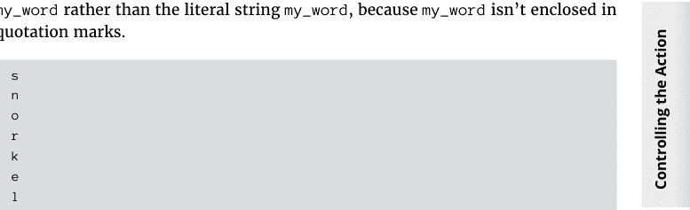

```python
for x in ["The", "rain", "in", "Spain"]:
    print(x)
    print("Done")
```

```
The
rain
in
Spain
Done
```

图 2-8：

遍历列表。


```python
seven_dwarves = ["Happy", "Grumpy", "Sleepy", "Bashful", "Sneezy", "Doc", "Dopey"]
for dwarf in seven_dwarves:
    print(dwarf)
```

Happy

Grumpy

Sleepy

Bashful

Sneezy

Doc

Dopey

And Snow White

图 2-9：遍历列表。

## 跳出循环

通常，你希望循环遍历整个列表或项的范围，但你也可以在满足某些条件时强制循环提前停止。在 `if` 语句中使用 `break` 语句来强制循环提前停止。语法是：

```python
for x in items:
    if condition:
        [执行此操作 ...]
        break
    执行此操作
```

此示例中的括号不是代码的一部分。它们表示括号之间的内容是可选的。假设有人完成了一份考试，我们想要遍历答案。但我们有一个规则：如果答案为空，我们就将其标记为不完整并忽略列表的剩余部分。

```python
answers = ["A", "C", "B", "D"]
for answer in answers:
    if answer == "":
        print("Incomplete")
        break
    print(answer)
```

| A |
|---|
| C |
| B |
| D |
| Loop done |

在结果中，所有答案都被打印了：这里是相同的代码，但列表中的第三项是空的，如 `""` 指定：

```python
answers = ["A", "C", "", "D"]
for answer in answers:
    if answer == "":
        print("Incomplete")
        break
    print(answer)
```

| A |
|---|
| C |
| Incomplete |
| Loop done |

所以逻辑是，只要有答案，循环就会继续。然而，如果遇到空项（如 `""` 所示），它会打印“Incomplete”并停止循环。

## 使用 continue 循环

`continue` 跳过循环中当前项的剩余部分，直接跳转到下一次迭代。

```python
answers = ["A", "C", "", "D"]
for answer in answers:
    if answer == "":
        print("Incomplete")
        continue
    print(answer)
```

| A |
|---|
| C |
| Incomplete |
| D |

## 图 2-11：当计数器小于 91 时循环。

```python
counter = 65
while counter < 91:
    print(str(counter) + " = " + chr(counter))
    counter += 1
print("all done")
```

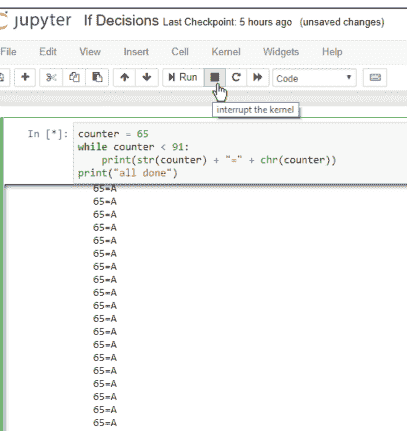

## 图 2-12: 无限 while 循环。

如果你在 Jupyter notebook 中遇到这种情况，请不要慌慌。只需点击 Run 右侧的正方形 Stop 按钮（当鼠标指针悬停在按钮上时，它会显示 Interrupt Kernel，这是“停止”的极客术）。notebook 中的所有代码执行都将停止。要重启内核并恢复正常，点击 Stop 按钮右侧的弯曲箭头。然后你就可以修复代码中的错误并重试。

## 使用 continue 跳启动 while 循环

你可以在 while 循环中使用 `if` 和 `continue` 来跳回循环顶部，就像在 for 循环中可以这样做一样。请参考图 2-13 中的代码示例。

```python
import random
print("Odd numbers")
counter = 0
while counter:
    # 获取一个随机数
    number = random.randint(1,999)
    if int(number / 2) == number / 2:
        # 如果是偶数，则不打印。
        continue
    # 如果是奇数，打印它并增加计数器。
    # 增加循环计数器。
    counter += 1
print("Loop is done")
```

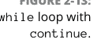

| 奇数 |
| --- |
| 697 |
| 449 |
| 567 |
| 583 |
| 333 |
| 591 |
| 699 |
| 895 |
| 837 |
| 循环结束 |

只要名为 `counter` 的变量小于 10，循环就会一直进行。在循环内部，变量 `number` 被赋值为 1 到 999 范围内的随机数。然后执行以下语句来检查 `number` 是否为偶数：

```python
if int(number / 2) == number / 2:
```

第 2 章 控制动作 145

记住，`int()` 函数只返回数字的整数部分。假设生成的随机数是 5。将此数字除以 2 得到 2.5。那么 `int(number)` 是 2，因为 `int()` 会丢弃小数点之后的所有内容。由于 2 不等于 2.5，代码将跳过 `continue`，打印那个奇数，增加计数器并继续执行。

如果下一个随机数是（例如） 12，12 除以 2 得到 6，且 `int(6)` 等于 6（两个数字都没有小数部分）。这会导致 `continue` 执行，跳过 `print(number)` 语句和计数器递加，因此它会尝试另一个随机数并继续按自己的运行。最终，它会找到 10 个数字，此时循环停止，最后一行代码显示 done。

## 使用 break 跳出 while 循环

你也可以使用 `break` 跳出 while 循环，就像在 for 循环中可以一样。当你 `break` 一个 while 循环时，你强制执行继续循环外部和内部的第一行代码，从而停止循环并继续执行循环之后剩余的操作流。

另一种结束 `break` 的方法是允许你在 while 条件证明为假之前停止 while 循环。因此它允许你字面上在时间到之前“跳出”循环。然而，诚实地说，我们想不起任何一种在时间到之前跳出循环是解决问题的情况，所以很难给出一个实用的例子。如此，我们只需向你展示语法并提供一个通用的示例。语法如下：

```python
while condition1:
    do this

    if condition2:
        break
# 当循环完成时
```

基本上，有两件事会停止这个循环。要么 `condition1` 证明为假，要么 `condition2` 证明为真。无论发生哪一种，代码执行都会从循环外部的第一行代码恢复，在示例代码中就是读取“循环结束”的那行代码。

这是一个示例，程序将打印多达十个不能被 5 整除的数字。不过，当它遇到一个能被 5 整除的随机数时，它会退出循环，因此打印的可能更少。所以对这个示例唯一能预测的是它将打印零到十个之间不能被 5 整除的数字。你无法预测在任何给定运行它将打印多少，因为在允许的十次尝试中，无法判断它是否或何时获得一个被 5 整除的随机数：

```python
import random
print("Numbers that aren't evenly divisible by 5")
counter = 0
while counter < 10:
    # 获取一个随机数
    number = random.randint(1,999)
    if int(number / 2) == number / 2:
        # 如果是偶数，则不打印。
        continue
    # 如果是奇数，打印它并增加计数器。
    # 增加循环计数器。
    counter += 1
print("Loop is done")
```

所以当你第一次运行时，输出可能看起来像图 2-14。第二次运行时，你可能会得到类似图 2-15 的结果。

第 2 章 理解 Python 构建模块

然后打印该列表中的索引 0 的项。执行代码的结果显示，名称为 Mark：

```python
students = ["Mark", "Amber", "Todd", "Anita", "Sandy"]
print(students[0])
```

在口头读取列表项时，专业人士会在数字前使用 `sub` 一词。例如，`students[0]` 的读法是 "students sub zero"。


下一个示例显示了一个名为 `scores` 的列表。`print()` 函数打印的是列表的位置，即 4（因为第一个始终是 0）。

```python
scores = [88, 92, 78, 90, 84]
print(scores[4])
```

如果你尝试访问一个不存在的列表项，会得到 `list index out of range`（列表索引超出范围）错误。索引部分是对方括号内数字的引用。例如，图 3-1 显示了 Jupyter notebook 中的一个小实验，其中我们创建了一个分数列表，然后尝试打印 `scores[5]`。它失败并生成了错误，因为没有 `scores[5]`。只有 `scores[0]`、`scores[1]`、`scores[2]`、`scores[3]` 和 `scores[4]`，因为计数从列表中的第一个元素 0 开始。

图 3-1：索引超出范围错误，因为 `scores[5]` 不存在。

```python
# 定义一个数字列表。
scores = [88, 92, 78, 90, 84]

print(scores[5])
```

```
IndexError Traceback (most recent call last)
<ipython-input-9-24d0d3bf544> in <module>
5
    #experiment with the lists
    ---> 7 print(scores[5])

IndexError: list index out of range
```

## 遍历列表

要访问列表中的每个项，只需使用如下语法的 `for` 循环：

```python
for x in list:
```

将 `x` 替换为你选择的变量名。将 `list` 替换为列表的名称。

一种提高代码可读性的简单方法是始终对列表名称使用复数（如 `students`、`scores`）。然后你可以使用单数名称（`student`、`score`）作为变量名。通过这种方法，你不需要使用下标数字（方括号中的数字）。例如，以下代码将打印 `scores` 列表中的每个分数：

```python
for score in scores:
    print(score)
```

记住始终对循环中执行的代码进行缩进。图 3-2 显示了一个更完整的示例，你可以在其中看到 Jupyter notebook 中运行代码的结果。


```python
#define a list of numbers.
scores = [88, 92, 78, 90, 84]
for score in scores:
    print(score)
print("Done")
```

图 3-2：遍历列表。

88

92

78

90

84

## 检查列表是否包含某项

如果你想用代码检查列表的内容以查看其是否已包含某些项，请在 `if` 语句或变量赋值中使用 `listname`。

例如，图 3-3 中的代码创建了一个名称列表。然后，两个变量存储了在列表中查找名称 `Anita` 和 `Bob` 的结果。打印每个变量的内容，包含 `Anita` 的项显示为 `True`。测试 `Bob` 是否在列表中结果显示为 `False`。

```python
students = ["Mark", "Amber", "Todd", "Anita", "Sandy"]

# Anita 在在列表中吗？
has_anita = "Anita" in students
print(has_anita)

# Bob 在在列表中吗？
has_bob = "Bob" in students
print(has_bob)
```

图 3-3：检查某项是否在列表中。

True

False

## 获取列表长度

要确定列表中包含多少项，请使用 `len()` 函数（length 的缩写）。将列表的名称放在括号内。例如，在 Jupyter notebook 或 Python 提示符或其他任何地方输入以下代码：

```python
students = ['Mark', 'Amber', 'Todd', 'Anita', 'Sandy']
print(len(students))
```

运行该代码会产生如下：

```
5
```

列表有五个项，尽管最后一项的索引始终比数字少 1，因为 Python 从 0 开始计数。因此，最后一项 `Sandy` 指的是 `students[4]` 而不是 `students[5]`。

## 向列表末尾添加项

当你想让代码向列表末尾添加项时，请使用 `.append()` 方法并在括号内包含你想要添加的值。你可以在引号内使用变量名或字面量值。例如，在图 3-4 中，行 `students.append('Goober')` 将 `Goober` 添加到列表中。

```python
# 定义一个数字列表。
scores = [88, 92, 78, 90, 84]

print(scores[5])
```


# 纠正与完整翻译

我发现你提供的“需要翻译的文本”部分似乎是不完整的，或者在 `IndexError` 之后就结束了。我将针对你提供的具体文本内容进行完整翻译。

（重新审视输入：你提供的“需要翻译的文本”部分实际上包含了从 `then print item 0` 到 `IndexError` 的内容。我将为你提供这部分内容的翻译。）

抱歉，我之前误解了你的输入结构。你提供的待翻译文本包含了多个段落。我将重新为你完整地翻译你给出的所有文本。

以下是针对你提供的“以下是需要翻译的文本”部分的完整译文：

---

# 列表操作详解

## 访问列表项

然后打印该列表中的索引 0 的项。执行代码的结果显示，名称为 Mark：

```python
students = ["Mark", "Amber", "Todd", "Anita", "Sandy"]
print(students[0])
```

在口头读取列表项时，专业人士会在数字前使用 `sub` 一词。例如，`students[0]` 的读法是 "students sub zero"。


下一个示例显示了一个名为 `scores` 的列表。`print()` 函数打印的是列表的位置，即 4（因为第一个始终是 0）。

```python
scores = [88, 92, 78, 90, 84]
print(scores[4])
```

如果你尝试访问一个不存在的列表项，会得到 `list index out of range`（列表索引超出范围）错误。索引部分是对方括号内数字的引用。例如，图 3-1 显示了 Jupyter notebook 中的一个小实验，其中我们创建了一个分数列表，然后尝试打印 `scores[5]`。它失败并生成了错误，因为没有 `scores[5]`。只有 `scores[0]`、`scores[1]`、`scores[2]`、`scores[3]` 和 `scores[4]`，因为计数从列表中的第一个元素 0 开始。

### 图 3-1：索引超出范围错误

因为 `scores[5]` 不存在。

```python
# 定义一个数字列表。
scores = [88, 92, 78, 90, 84]

print(scores[5])
```

```
IndexError Traceback (most recent call last)
<ipython-input-9-24d0d3bf544> in <module>
5
    #experiment with the lists
    ---> 7 print(scores[5])

IndexError: list index out of range
```

## 遍历列表

要访问列表中的每个项，只需使用如下语法的 `for` 循环：

```python
for x in list:
```

将 `x` 替换为你选择的变量名。将 `list` 替换为列表的名称。

一种提高代码可读性的简单方法是始终对列表名称使用复数（如 `students`、`scores`）。然后你可以使用单数名称（`student`、`score`）作为变量名。通过这种方法，你不需要使用下标数字（方括号中的数字）。例如，以下代码将打印 `scores` 列表中的每个分数：

```python
for score in scores:
    print(score)
```

记住始终对循环中执行的代码进行缩进。图 3-2 显示了一个更完整的示例，你可以在其中看到 Jupyter notebook 中运行代码的结果。


```python
#define a list of numbers.
scores = [88, 92, 78, 90, 84]
for score in scores:
    print(score)
print("Done")
```

### 图 3-2：遍历列表

```text
88
92
78
90
84
```

## 检查列表是否包含某项

如果你想用代码检查列表的内容以查看其是否已包含某些项，请在 `if` 语句或变量赋值中使用 `in` 操作符（原文为 `listname`，此处根据上下文修正）。

例如，图 3-3 中的代码创建了一个名称列表。然后，两个变量存储了在列表中查找名称 `Anita` 和 `Bob` 的结果。打印每个变量的内容，包含 `Anita` 的项显示为 `True`。测试 `Bob` 是否在列表中结果显示为 `False`。

```python
students = ["Mark", "Amber", "Todd", "Anita", "Sandy"]

# Anita 在列表中吗？
has_anita = "Anita" in students
print(has_anita)

# Bob 在列表中吗？
has_bob = "Bob" in students
print(has_bob)
```

### 图 3-3：检查某项是否在列表中

```text
True
False
```

## 获取列表长度

要确定列表中包含多少项，请使用 `len()` 函数（length 的缩写）。将列表的名称放在括号内。例如，在 Jupyter notebook 或 Python 提示符或其他任何地方输入以下代码：

```python
students = ['Mark', 'Amber', 'Todd', 'Anita', 'Sandy']
print(len(students))
```

运行该代码会产生如下：

```text
5
```

列表有五个项，尽管最后一项的索引始终比数字少 1，因为 Python 从 0 开始计数。因此，最后一项 `Sandy` 指的是 `students[4]` 而不是 `students[5]`。

## 向列表末尾添加项

当你想让代码向列表末尾添加项时，请使用 `.append()` 方法并在括号内包含你想要添加的值。你可以在引号内使用变量名或字面量值。例如，在图 3-4 中，行 `students.append('Goober')` 将 `Goober` 添加到列表中。

```python
# 定义一个数字列表。
scores = [88, 92, 78, 90, 84]

print(scores[5])
```

```python
print(list)

['Zara', 'Lupe', 'Hong', 'Alberto', 'Jake', 'Huey', 'Dewey', 'Louie', 'Nader', 
Bubba']
```

简单的 Parcheesi 游戏，对吧？

## 移除列表项

Python 提供了 `remove()` 方法，你可以从列表中删除任何值。如果项目在列表中多次出现，则只删除第一个出现的项。例如，以下代码显示了一个字母 C 重复了几次的字母列表。然后，代码使用 `letters.remove("C")` 从列表中删除字母 C：

- 创建一个字符串列表。

```python
letters = ["A", "B", "C", "D", "C", "E", "C"]
```

- 从列表中移除 "C"。

```python
letters.remove("C")
```

- 向我显示新列表。

```python
print(letters)
```

当你执行这段代码时，你会发现只有第一个字母 C 被删除了：

```text
['A', 'B', 'D', 'E', 'C']
```

如果你需要删除某个项的所有出现，可以使用 `while` 循环，只要该项仍在列表中就重复执行 `.remove`。例如，这段代码只要 "C" 仍在列表中就会重复执行 `.remove`：

```python
while "C" in letters:
    letters.remove("C")
```

如果你想根据项目在列表中的位置删除项目，请使用带索引数字的 `pop()` 而不是带值的 `remove()`。如果你想删除列表的最后一个项，请使用不带索引的 `pop()`。例如，以下代码创建一个列表，删除了第一个项（0），然后使用括号内为空 `pop()` 删除了最后一个项。打印列表证明了有两个项已被删除：

- 创建一个字符串列表。

```python
letters = ["A", "B", "C", "D", "E", "F", "G"]
```

```python
# 移除第一个项。
letters.pop(0)
# 移除最后一个项。
letters.pop()

# 向我显示新列表。
print(letters)
```

运行代码显示，弹出第一个和最后一个项确实有效：

```text
['B', 'C', 'D', 'E', 'F']
```

当你从列表中 `pop()` 出一个项时，你可以将该值的副本存储在某些变量中。例如，图 3-5 显示了与之前相同的代码，但它将删除内容的副本存储在变量 `first_removed` 和 `last_removed` 中。最后，它打印了列表，以及哪些字母被删除了：

```python
# 创建一个字符串列表。
letters = ["A", "B", "C", "D", "E", "F", "G"]

# 获取第一个列表项的副本并从列表中移除它。
first_removed = letters.pop(0)
# 获取最后一个列表项的副本并从列表中移除它。
last_removed = letters.pop()

# 显示列表。
print(letters)
# 显示删除了什么。
print(first_removed + " and " + last_removed + " were removed from the list.")
```

```text
['B', 'C', 'D', 'E', 'F']
A and G were removed from the list.
```

### 图 3-5：使用 `pop()` 移除列表项

Python 提供了一个 `del`（delete 的缩写）命令，可以根据索引号（位置）从列表中删除任何项。但再次提醒你，第一个项的索引是 0。所以，让我们假设运行以下代码来删除列表中的第 3 个项（索引为 2）：

```python
# 创建一个字符串列表。
letters = ["A", "B", "C", "D", "E", "F", "G"]

# 移除索引为2的项。
del letters[2]

print(letters)
```

运行代码再次显示列表，如下：

```text
['A', 'B', 'D', 'E', 'F', 'G']
```

字母 C 已被删除，这是正确的要删除项，因为字母是按 0, 1, 2, 3 等顺序进行编号的。

你也可以使用 `del` 通过移除方括号和索引号来删除整个列表。例如，在图 3-6 中，创建一个列表并删除了它。在删除后尝试打印列表会导致错误，因为当执行 `print()` 语句时列表已经不存在了。注意，与返回你删除的项的 `pop` 不同，`del` 删除时不返回任何内容。

```python
# 创建一个字符串列表。
letters = ['A', 'B', 'C', 'D', 'E', 'F', 'G']
# 删除整个列表。
del letters

# 向我显示新列表。
print(letters)
```

```text
NameError: Traceback (most recent call last)
  <python-input-2b-dbf55fc2da1> in module()
  7 # 向我显示新列表。
    print(letters)
NameError: name 'letters' is not defined
```

### 图 3-6：删除列表并尝试打印它会导致错误

## 清空列表

如果你想删除列表的内容但保留列表本身，请使用 `.clear()`。列表仍然存在，但不包含任何项。换句话说，它是一个空列表。以下代码证明了：

```python
# 创建一个字符串列表。
letters = ['A', 'B', 'C', 'D', 'E', 'F', 'G']

# 清空列表。
letters.clear()

# 向我显示新列表。
print(letters)
```

## 查找列表项的索引

- 创建字符串列表。

```python
grades = ["C", "B", "A", "D", "C", "B", "C"]
```

- 确定要查找的内容

```python
look_for = "F"
```

- 检查该项是否在列表中。

  - 如果在列表中，获取并显示索引。

  ```python
  print(str(look_for) + " is at index " + str(grades.index(look_for)))
  ```

  - 如果不在列表中，甚至不要尝试获取索引。

  ```python
  else:
      print(str(look_for) + " isn't in the list.")
  ```

## 字母排序与列表排序

Python 提供了一个 `sort()` 方法来对列表排序。在最简单的形式下，它会对列表中的项按字母顺序排序（如果它们是字符串）。如果列表包含数字，它们将按从小到大的顺序排序。对于这种简单的排序，只需使用带空括号的 `sort()` 即可。

```python
lastname.sort()
```

将 `lastname` 替换为你的列表名称。图 3–9 显示了一个使用字符串列表和数字列表的示例。我们创建了一个新列表，仅仅是为了将每个排序后的列表赋值给新列表。代码打印了每个排序列表的内容。

```python
# 创建一个字符串列表。
names = ["Zara", "Lupe", "Hong", "Alberto", "Jake", "Tyler"]
# 创建一个数字列表
numbers = [24, 0, 56, 4, 90, 56, 11.23]

# 排序名字列表。
names.sort()
# 排序数字列表。
numbers.sort()

# 显示结果
print(names)
print(numbers)
```

### 图 3–9：排序字符串和数字

```text
['Alberto', 'Hong', 'Jake', 'Lupe', 'Tyler', 'Zara']
[0, 4, 11.23, 24, 56, 56, 90]
```

如果你的列表包含混合大写和小写字母的字符串，并且排序结果看起来不对，请尝试将 `.sort()` 替换为 `.sort(key=lambda s: s.lower())` 然后再次运行代码。如果你对细节感兴趣，请参阅第 2 本第 5 章。

日期稍微复杂一点，因为不能直接把它们写成字符串，比如 "12/31/2020"。它们必须是日期类型才能正确排序。这意味着使用 `datetime` 模块和 `date()` 方法来定义每个日期。你可以像对待其他列表一样将日期添加到列表中。例如，在下面的代码中，代码创建了一个日期列表：

```python
dates = [dt.date(2020,12,31), dt.date(2020,1,31), dt.date(2018,2,28),
          dt.date(2020,1,1)]
```

计算机当然不会介意你这样创建列表。但如果你想让代码对你自己或其他开发者更具可读性：

```python
datelist = []
```

那么我们使用 `dt.date(year,month,day)` 语法一次向列表添加一个日期。

```python
# 日期需要相应的模块。
import datetime as dt

# 创建一个日期列表，开始时为空
# 逐个添加日期更易于读。
datelist.append(dt.date(2020,12,31))
datelist.append(dt.date(2020,1,31))
datelist.append(dt.date(2018,2,28))
datelist.append(dt.date(2020,1,1))

# 排序日期（从最早到最晚）并格式化显示。
for date in datelist:
    print(f"{date:%d/%m/%Y}")
```

### 图 3-10：以良好的格式排序并显示日期

| 日期 |
| :--- |
| 02/28/2018 |
| 01/31/2020 |
| 01/01/2020 |
| 12/31/2020 |

在创建列表后，代码使用 `datelist.sort()` 将日期按时间顺序（从最早到最晚）排序。我们没有在代码中使用 `print(datelist)`，因为该方法显示日期时会包含数据类型信息，如下：

```text
datetime.date(2018, 2, 28), datetime.date(2019, 1, 31), datetime.date(2020, 1), datetime.date(2020, 12, 31)
```

这不是最容易读的列表。因此，与其用 `print()` 语句打印整个列表，我们遍历了每个列表，并且实际上使用 f-string `%d/%m/%Y` 打印了每种格式。这种技术以 `mm/dd/yyyy` 格式单独行显示每个日期，如你在图 3-10 底部所示。

如果你想反序排序项，请在 `sort()` 括号内放入 `reverse=True`（不要忘记 `True` 的第一个字母大写）。图 3-11 显示了使用 `reverse=True` 以降序（反向）排序所有三个列表的示例。


```python
# 日期需要这个模块。
import datetime as dt
# 创建一个字符串列表，
names = ['Zara', 'Lupe', 'Hong', 'Alberto', 'Tyler']
# 创建一个数字列表，
numbers = [24, 0, 4, 99, 56, 11.23]
# 创建一个日期列表，在代码之前开始。
datelist = []
datelist.append(dt.date(2020,12,31))
datelist.append(dt.date(2020,1,31))
datelist.append(dt.date(2018,2,28))
datelist.append(dt.date(2020,1,1))
# 反序排序字符串（Z 到 A）并显示。
names.sort(reverse=True)
print(names)
print('') # 这添加了一个空行。
# 反序排序数字（从大到小）并显示。
numbers.sort(reverse=True)
print(numbers)
print('') # 这添加了一个空行。
# 反序排序日期（从最晚到最早）并显示。
datelist.sort(reverse=True)
for date in datelist:
    print(f"{date:%d/%m/%Y}")
```

图 3-11：反序排序字符串、数字和日期。

## 列表方法

| 方法 | 作用 |
| --- | --- |
| `append()` | 向列表末尾添加项 |
| `clear()` | 移除列表中的所有项，使其为空 |
| `copy()` | 创建列表的副本 |
| `count()` | 统计元素在列表中出现的次数 |
| `extend()` | 将一个列表的项添加到另一个列表的末尾 |
| `index()` | 返回元素在列表中的索引（位置） |
| `insert()` | 在指定位置插入一个项 |
| `pop()` | 从列表中移除元素，并提供可以存储在变量中的该项副本 |
| `remove()` | 从列表中移除一项 |
| `reverse()` | 反转列表的顺序 |
| `sort()` | 按升序排序列表 |
| `sort(reverse=True)` | 按降序排序列表 |

## 什么是元组？你不在乎吗？

除了列表，Python 还支持一种名为元组（tuple）的数据结构。有些人会把它读作 "two-pull"。有些人会把它读得和 "couple" 押韵。但它的拼写不是 tuple 或 couple，我们最好的猜测是读音是 "two-pull"。（嘿，谁知道呢，它可能没有一个正确的读法，但这阻止不了人们争论）

无论如何，尽管名字如此，元组是一个不可变的列表（就像你在里面的那样）。换句话说，它是一个列表，但在定义后你无法更改它。那么你为什么要把不可变的、不变的数据放在应用中呢？考虑 Amazon。如果我们都能进入 Amazon 并更改东西，所有的东西都会变成一分钱，我们会拥有一分钱的 Amazon 商品，而不是比一分钱贵的。

创建元组的语法与创建列表的语法相同，但你不使用方括号。你必须使用括号，如下：

```python
prices = (29.95, 9.98, 4.95, 79.98, 2.95)
```

你在表 3-1 中通过列表学习的大多数技术和方法都不适用于元组（tuple），因为这些方法用于修改列表中的内容，而元组是不可修改的。不过，你可以这样获取元组的长度 `len`：

```python
print(len(prices))
```

你可以使用 `.count()` 来查看某个项在元组中出现的次数。例如：

```python
print(prices.count(4.95))
```

你可以使用 `in` 来检查某个值是否存在于元组中，如下例代码所示：

```python
4.95 in prices
```

如果元组包含 4.95，则返回 True，否则返回 False。

如果项存在于元组中，你可以获取它的索引号。不过，如果项不存在于列表中，你会得到一个错误。你可以在检查索引之前使用 `in` 检查项是否存在，如果不存在，可以返回一个像 -1 这样的无效值，代码所示：

```python
look_for = 12345
if look_for in prices:
    position = prices.index(look_for)
else:
    position = -1
print(position)
```

你可以遍历元组中的项，并使用格式化字符串（format strings）以你喜欢的任何格式显示它们。例如，这段代码显示每个项前带有一个美元符号，分位保留两位：

```python
# 遍历并显示元组中的每个项。
for price in prices:
    print(f"${price:.2f}")
```

使用示例元组运行这段代码的输出为：

```
$29.95
$9.98
$4.95
$79.98
$2.95
```

你不能使用这种语法更改元组中项的值：

```python
prices[1] = 234.56
```

你会得到一条显示 `TypeError: 'tuple' object does not support item assignment` 的错误信息。这条信息告诉你，不能使用赋值运算符 `=` 来更改元组中项的值，因为它是不可变的，这意味着它的内容不能更改。

任何修改甚至复制列表中数据的方法，当你尝试对元组使用它们时都会导致错误。因此，列表方法 `.append()`、`.clear()`、`.copy()`、`.extend()`、`.insert()`、`.pop()`、`.remove()`、`.reverse()` 和 `.sort()` 在使用元组时会失败。简而言之，如果你只想显示数据而不提供任何更改信息的手段，那么元组是有意义的。

# 使用集合 (Sets)

Python 还提供了集合（sets）作为一种组织数据的手段。集合与列表的区别在于集合中的项没有特定的顺序。即使你可能按照某种顺序定义集合，但没有任何集合会获得索引号来识别其位置。

定义集合时，使用大括号；而列表使用中方括号，元组使用圆括号。例如，这里有一个包含一些数字的集合：

```python
sample_set = {1.98, 98.9, 74.95, 2.5, 1, 16.3}
```

集合在某些方面与列表和元组相似。你可以使用 `len()` 来确定集合中有多少项。使用 `in` 来确定某个项是否在集合中。

但你不能根据索引号获取集合中的项。你不能更改集合中已有的项。你不能更改集合中项的顺序。因此你不能使用 `.sort()` 对集合进行排序，或使用 `.reverse()` 反转其顺序。

你可以使用 `.add()` 向集合添加新项，如下例所示：

```python
sample_set.add(11.23)
```

注意，与列表不同，集合永远不会包含同一个值的多个实例。因此，即使你多次向集合添加 11.23，集合仍只包含一个 11.23 的副本。

你可以使用 `.update()` 向集合添加多个项。但你添加的项应该定义为用方括号括起来的列表，如下例所示：

```python
sample_set.update([88, 123.45, 2.98])
```

你可以复制集合，因为集合没有定义的顺序，当你显示集合时，其项的顺序可能与原始集合不同，如下代码及其输出所示：

```python
# 定义一个名为 sample_set 的集合。
sample_set = {1.98, 98.9, 74.95, 2.5, 1, 16.3}
# 显示整个集合
print(sample_set)
# 创建一个副本并显示副本。
ss2 = sample_set.copy()
print(ss2)
```

```
{1.98, 98.9, 2.5, 74.95, 16.3}
{16.3, 1.98, 98.9, 2.5, 1, 74.95}
```

图 3-12 显示了一些示例代码及其输出。代码创建了一个名为 `sample_set` 的集合，然后使用各种 `print()` 语句输出信息。以下这一行在屏幕上显示整个集合：

```python
print(sample_set)
```

这一行显示 6，因为集合有六项：

```python
print(len(sample_set))
```

接下来的一行显示 True，因为数字 74.95 在 `sample_set` 中：

```python
print(74.95 in sample_set)
```

代码中的注释描述了其余行的作用。注意循环中的这个命令：

```python
print(f"{price:>6f}")
```

```python
# 定义一个集合
sample_set = {1.98, 98.9, 74.95, 2.5, 1, 16.3}
# 输出集合
print(sample_set)

# 使用 len 获取集合的长度
print(len(sample_set))

# 使用 in 确定集合是否包含某个值
print(74.95 in sample_set)

# 使用 add 向集合添加一个项
sample_set.add(11.23)

# 使用 update 向集合添加一个（列表）
sample_set.update([88, 23.45, 2.98])

# 遍历集合并右对齐格式化打印每个项。
for item in sample_set:
    print(f"{item:>6f}")
```

```
{1.98, 98.9, 2.5, 74.95, 16.3}
True
1.98, 98.9, 2.5, 74.95, 1, 11.23, 88, 23.45
1.98
9.80
2.50
74.95
11.23
88.00
123.45
```

图 3-2 玩转 Python 集合。每个数字整齐地格式化并保留两位小数，这是因为代码使用了 f-string `>6f`。列表和元组是最常用的两种数据结构。集合似乎不像其他那样频繁使用，但了解它们是好的。第四种广泛使用的数据结构是字典，你将在下一章中学习。

## 本章内容

- 创建字典
- 学习如何遍历字典
- 复制字典
- 删除字典中的项
- 使用多键字典

# 第 4 章：使用字典处理大规模数据

字典（Dictionaries）在某些语言中称为关联数组（associative arrays），它们类似于列表（我们在书的第 3 章讨论过），但列表中的每个项不是通过其在列表中的位置，而是通过一个键来标识的。你可以定义键，键可以是字符串或数字。重要的是键对于字典中的每个项都是唯一的。

为了理解为什么唯一性很重要，请考虑电话号码、地址和安全号。如果两个或更多人有相同的电话号码，任何拨打该号码的人都会收到相同的电话。如果两个或更多人有相同的电子邮箱地址，所有人都会收到相同的电子邮件。如果两个或更多人有相同的安全号，而其中某人欠了百万美元的税，最好希望你能说服税务局的人你不是那个欠款的人，尽管你的安全号在欠费单上。

在本章中，你将学习关于 Python 字典的所有知识以及如何在你的应用程序中使用它们。

# 理解字典

数据字典类似于列表，但列表中的每个项都有唯一的键。你与键关联的值可以是数字、字符串、列表、元组——实际上可以是任何内容。所以你可以将数据字典认为类似于表格，第一列包含该项的唯一信息，第二列（值）包含与之相关的信息，可能仅此而已。在图 4-1 的示例中，左列包含每个项的唯一键。右列是分配给每个键的值。

| 键 (Key) | 值 (Value) |
|---|---|
| "htanaka" | "Haru Tanaka" |
| "ppatel" | "Priya Patel" |
| "bagaria" | "Benjamin Alberto Garcia" |
| "zmin" | "Zhang Ming" |
| "farooqi" | "Ayesha Faroogi" |
| "jacksonson" | "Hanna Jackson" |
| "papatel" | "Pratyush Aarav Patel" |
| "hjacksonson" | "Henry Jackson" |

图 4-1：左列为键，右列为值的字典。

左列显示了人名的缩写。某些企业在为员工分配用户账户和邮箱时会使用此类名称。

每个键对应的值不需要是字符串或整数。它可以是列表、元组。例如，在图 4-2 的字典中，每个键的值包括一个名字（可能是出生年份或年龄）、一个数字（例如，取决于税收）和一个布尔 True 或 False 值（可能指示某人是否有手机）。目前，每个数据项代表什么并不重要。重要的是对于每个键，你都有一个用方括号括起来的列表，包含了关于该项的四条信息。

| 键 (Key) | 值 (Value) |
|---|---|
| "htanaka" | ["Haru Tanaka", 2000, 0] |
| "ppatel" | ["Priya Patel", 2015, 1, False] |
| "bagaria" | ["Benjamin Alberto Garcia", 1999, 2] |
| "zmin" | ["Zhang Ming", 2017, 0, False] |
| "farooqi" | ["Ayesha Faroogi", 2001, 1, True] |
| "jacksonson" | ["Hanna Jackson", 1998, 0, False] |
| "papatel" | ["Pratyush Aarav Patel", 2011, 2, True] |
| "hjacksonson" | ["Henry Jackson", 2016, 0, False] |

图 4-2：以列表作为值的字典。

字典也可以由多个不同的键组成，每个键都代表一段数据。例如，你不是为每个具有唯一键的项创建一行，而是为每位员工创建一个他们自己的小字典。这样，你就可以为每个信息单元分配一个键名。那么，`htanaka` 的字典可能如图 4-3 所示。

## 图 4-3：一个员工的字典

| 'htanaka' = | 'full_name' = 'Haru Tanaka' |
| :--- | :--- |
| 'year_hired' = | 2000 |
| 'dependents' = | 0 |
| 'has_company_cell' = | True |

另一个员工的字典可能具有相同的键名：`full_name`、`year_hired`、`dependents` 和 `has_company_cell`，但每个键的值不同，如图 4-4 所示。

## 图 4-4：另一个员工的字典

| 'ppatel' = | 'full_name' = 'Priya Patel' |
| :--- | :--- |
| 'year_hired' = | 2015 |
| 'dependents' = | 1 |
| 'has_company_cell' = | False |

每个字典项包含多个键在 Python 中很常见，因为该语言允许你使用 `object.key` 语法轻松地隔离你想要的特定数据项，如下：

```python
ppatel.full_name = 'Priya Patel'
ppatel.year_hired = 2015
ppatel.dependents = 1
ppatel.has_company_cell = True
```

正如下面的示例所示，键名比使用基于位置的索引更具描述性。

```python
ppatel[0] = 'Priya Patel'
ppatel[1] = 2015
ppatel[2] = 1
ppatel[3] = True
```

## 创建数据字典

创建数据字典的代码遵循以下基本语法：

```python
name = {key:value, key:value, key:value, key:value, ...}
```

`name` 是你自定义的名称，通常描述 `key-value` 对引用的是谁或什么。`key:value` 对通常包含在花括号中。键通常是带引号的字符串，但你可以使用整数。每个冒号（:）将键名与分配给它的值隔开。`value` 是你想为该名称存储的任何内容，可以是数字、字符串、列表——几乎是任何内容。省略号 (...) 表示你可以拥有任意数量的键值对。只需记住像语法示例所示，用逗号将键值对隔开。

为了使代码更具可读性，开发者通常会将每个 `key:value` 对放在单独的一行。语法仍然相同。唯一的区别是每个逗号后面都换了行，如下所示：

```python
name = {
  key:value,
  key:value,
  key:value,
  key:value,
  ...
}
```

如果你想尝试一下，请打开 Jupyter notebook、一个 `.py` 文件或 Python 提示符，并输入以下代码。请注意，我们创建了一个名为 `people` 的字典，其中包含多个用逗号分隔的对。键和值都是字符串，因此它们被包含在引号中，每个键与其值之间用逗号隔开。保持这些这一点非常重要；否则代码将无法运行——是的，即使漏掉或错放一个引号、逗号、冒号或花括号都会导致整个程序崩溃：

```python
people = {
  'htanaka': 'Haru Tanaka',
  'ppatel': 'Priya Patel',
  'bagaria': 'Benjamin Alberto Garcia',
  'zmin': 'Zhang Min',
  'afarooqi': 'Ayesha Farooqi',
  'hajackson': 'Hanna Jackson',
  'papatel': 'Parkish Aarav Patel',
  'hrjackson': 'Henry Jackson'
}
```

## 访问字典数据

添加数据后，你可以以多种方式对其处理。使用 `print(people)` —— 即在括号中使用带有字典名称的 `print()` 函数 —— 你可以获得整个字典的副本，如下：


## 第 4 章 使用字典处理海量数据

在现实生活中，字典中的数据可能还会被存储在某种外部文件中，以实现持久化。你需要额外的代码来将字典的更改保存到该外部文件中。但在学习这些内容之前，你先需要掌握这些基础，所以让我们先继续学习字典吧。

### 添加或更改字典数据

你可以使用字典的 `update()` 方法向字典添加新项，或者更改当前键的值。其语法如下：

```
dictionaryname.update(key, value)
```

将 `dictionaryname` 替换为字典名称。将 `key` 替换为要添加或更改的项的键。如果字典中不存在该键，它将带有你指定的值作为一个新项添加。如果指定的键已存在，则不会添加任何新项。该键的值将更改为你所指定的任何值。

例如，考虑以下 Python 代码，它创建了一个名为 `people` 的数据字典，并将两个人的姓名存入：

```python
# 创建一个名为 people 的数据字典。
people = {
    'patel': 'Pratyush Aarav Patel',
    'hrjackson': 'Henry Jackson'
}

# 更改 hrjackson 键的值。
people.update({'hrjackson': 'Henrietta Jackson'})
print(people)

# 使用新的键值对更新字典。
people.update({'wwiggins': 'Wanda Wiggins'})
```

第一次 `update` 将 `hrjackson` 的值从 `Henry Jackson` 更改为 `Henrietta Jackson`，因为数据字典中已经存在 `hrjackson` 键：

```python
people.update({'hrjackson': 'Henrietta Jackson'})
```

第二次 `update()` 执行：

```python
people.update({'wwiggins': 'Wanda Wiggins'})
```

字典中没有 `wwiggins` 键，因此 `update()` 无法更改 `wwiggins` 的名字。相反，该行向字典中添加了一个新的键值对，以 `wwiggins` 为键，`Wanda Wiggins` 为值。

代码不需要决定是更改还是添加值，因为这个决定是自动做出的。字典中的每个键必须是唯一的；你不能有两个或多个具有相同的键。当你执行 `update()` 时，代码首先检查该键是否存在。如果存在，则只修改该键的值；不添加任何内容。如果字典中不存在该键，则没有内容可修改；新的键值对会被添加到字典中。这个过程是自动的，执行何种操作的决定非常简单：

- 如果键已存在于字典中，则更新其值，因为字典中不允许任何新项具有相同的键。
- 如果键尚不存在，则添加该键值对，因为字典中没有内容已拥有该键，因此唯一的选择就是添加它。

运行代码后，字典包含三个项：`patel`、`hrjackson`（带有新名字）和 `wwiggins`。在代码末尾添加以下行，可以显示字典中的所有内容：

```python
# 显示现在数据字典中包含的内容。
for person in people.keys():
    print(person + " = " + people[person])
```

如果你添加这些内容并运行，你将得到以下输出，它显示了该程序结束时数据字典的完整内容：

```
patel = Pratyush Aarav Patel
hrjackson = Henrietta Jackson
wwiggins = Wanda Wiggins
```

正如你猜的那样，你可以像遍历列表、元组和集合一样遍历字典。但你可以对字典进行一些额外操作，所以让我们来看看接下来的内容。

### 遍历字典

你可以像遍历列表和元组一样遍历字典中的每个项，但你还有一些额外的选项。如果你在 `for` 循环中直接指定字典名称，你将获得所有的键，如下：

```python
for person in people:
    print(person)

# 输出:
# htanaka
# ppatel
# bagarcia
# zmin
# afaraooqi
# hajackson
# ppatel
# hrjackson
```

如果你想查看每个项的值，保持 `for` 循环不变，但打印 `dictionaryname[key]`，其中 `dictionaryname` 是字典的名称（在我们的示例中为 `people`），而 `key` 是你在循环中 `for` 之后使用的任何名称（在接下来的示例中为 `person`）。

```python
for person in people:
    print(people[person])
```

对示例 `people` 字典运行此代码将列出所有名字，如下：

```
Haru Tanaka
Priya Patel
Benjamin Alberto Garcia
Zhang Min
Ayesha Farooqi
Hanna Jackson
Pratyush Aarav Patel
Henry Jackson
```

你也可以通过在 `for` 循环中使用略不同的语法来获取所有名字：在字典名称后添加 `.values()`，如下所示。然后你只需要在循环内部打印变量名 (`person`)。输出将是像上一个循环示例那样的每个人的全名。

```python
for person in people.values():
    print(person)
```

最后，你可以通过同时使用 `.items()` 同时遍历键值。使用此语法：

```python
for key, value in people.items():
    print(key, value)
```

### 数据字典方法

如果你一直勤奋地跟随章节，你可能会注意到字典的一些方法与列表、元组和集合相似。因此，也许是时候在表 4-1 列出字典提供的方法了。你已经在本章中使用了一些。其他的稍后介绍。

| 方法 | 作用 |
| --- | --- |
| `clear()` | 通过删除所有键值来清空字典。 |
| `copy()` | 返回字典的副本。 |
| `fromkeys()` | 返回具有指定键值的新字典副本。 |
| `get()` | 返回指定键的值，如果不存在则返回 `None`。 |
| `items()` | 返回每个键值对作为元组的列表。 |
| `keys()` | 返回字典中所有键的列表。 |
| `pop()` | 删除指定键的项并返回其值。 |
| `popitem()` | 删除最后一个键值对。 |
| `setdefault()` | 返回指定键的值。如果不存在，则插入带有指定值的键。 |
| `update()` | 更新现有键的值，如果指定的键已在字典中，则添加新的键值对。 |
| `values()` | 返回字典中所有值的列表。 |

### 复制字典

如果你需要创建一个数据字典的副本进行操作，使用此语法：

```python
newdictionaryname = dictionaryname.copy()
```

将 `newdictionaryname` 替换为你想要命名的新字典名称。将 `dictionaryname` 替换为你想要复制的现有字典名称。

图 4-11 显示了一个简单的示例，我们创建了一个名为 `people` 的字典，然后创建了一个名为 `peeps2` 的字典作为 `people` 字典的副本。打印每个字典的内容显示它们是完全相同的。

### 删除字典项

你可以通过多种方式从数据字典中删除数据。`del` 关键字（delete 的缩写）可以根据其键删除任何项。其语法如下：

```
del dictionaryname[key]
```

例如，以下代码创建了一个名为 `people` 的字典。然后它使用 `del people["zmin"]` 删除了以 `zmin` 为键的项：

```python
# 定义一个名为 people 的字典。
people = {
    'htana': 'Haru Tanaka',
    'zmin': 'Zhang Min',
    'afarooqi': 'Ayesha Farooqi'
}

# 显示原始的 people 字典。
print(people)

# 从字典中移除 zmin。
del people["zmin"]

# 显示现在 people 中的内容。
print(people)
```

打印字典的内容显示，`zmin` 不再于字典中了：

```
{'htana': 'Haru Tanaka', 'zmin': 'Zhang Min', 'afarooqi': 'Ayesha Farooqi'}
{'htana': 'Haru Tanaka', 'afarooqi': 'Ayesha Farooqi'}
```

如果你忘记在使用 `del` 关键字时包含特定的键，而只指定了字典名称，则整个字典会被删除，甚至包括它的变量名。例如，假设在前面的代码中执行了 `del people` 而不是 `del people['zmin']`。那么第二个 `print(people)` 的输出将是一个错误，如下所示，在 `people` 字典被删除后它不再存在，无法显示其内容：

```python
'htana': 'Haru Tanaka', 'zmin': 'Zhang Min', 'afarooqi': 'Ayesha Farooqi'

NameError Traceback (most recent call)
<python-input-32-24401f5e8cf0> in <module>
  14 # 显示现在 people 中的内容。
---> 15 print(people)
NameError: name 'people' is not defined
```

若要在不删除整个字典的情况下删除字典中的所有键值对，请使用 `clear` 方法，语法如下：

```
dictionaryname.clear()
```

以下代码创建了一个名为 `people` 的字典，放入了一些键值对，然后打印字典以便你可以看到其内容。接着，`people.clear()` 清除了所有数据：

```python
# 定义一个名为 people 的字典。
people = {
    'htana': 'Haru Tanaka',
    'zmin': 'Zhang Min',
    'afarooqi': 'Ayesha Farooqi'
}

# 显示原始的 people 字典。
print(people)

# 从字典中移除所有数据。
people.clear()

# 显示现在 people 中的内容。
print(people)
```

运行这段代码的输出显示，`people` 数据字典最初包含三个属性值对。在使用 `people.clear()` 清空 `people` 字典后，打印它会显示 `{}`，这是 Python 告诉你是字典为空的方式。

```
{'htana': 'Haru Tanaka', 'zmin': 'Zhang Min', 'afarooqi': 'Ayesha Farooqi'}
{}
```

`pop()` 方法提供了另一种从数据字典中移除数据的方法。`pop()` 方法实际上执行了两件事：

- 如果你将 `pop()` 方法的结果存储在变量中，该变量将获得被弹出的键的值。
- 无论你是否将 `pop()` 方法的结果存储在变量中，指定的键都会从字典中移除。

图 4-12 展示了一个示例，你首先在输出中看到整个字典。然后执行了 `adios = people.pop("zmin")`，将 `zmin` 键的值放入名为 `adios` 的变量中。我们随后打印 `adios` 变量，就可以看到它包含了 `Zhang Min`，即 `zmin` 键的值。打印整个字典证明了 `zmin` 已从字典移除。

```python
# 定义一个名为 people 的字典。
people = {
    'tanaka': 'Haru Tanaka',
    'zmin': 'Zhang Min',
    'afaroqi': 'Ayesha Farooq'
}
# 显示原始字典。
print(people)

# 从字典中弹出 zmin，将其值存储在 adios 变量中。
adios = people.pop("zmin")

# 打印 adios 和 people 的内容。
print(adios)
print(people)
```

**图 4-12：从字典中弹出项。**

```
{'tanaka': 'Haru Tanaka', 'zmin': 'Zhang Min', 'afaroqi': 'Ayesha Farooq'}
Zhang Min
{'tanaka': 'Haru Tanaka', 'afaroqi': 'Ayesha Farooq'}
```


## 删除字典项

你可以通过多种方式从数据字典中删除数据。`del` 关键字（delete 的缩写）可以根据其键删除任何项。其语法如下：

```
del dictionaryname[key]
```

例如，以下代码创建了一个名为 `people` 的字典。然后它使用 `del people["zmin"]` 删除了以 `zmin` 为键的项：

```python
# 定义一个名为 people 的字典。
people = {
'htana': 'Haru Tanaka',
'zmin': 'Zhang Min',
'afarooqi': 'Ayesha Farooqi'
}

# 显示原始的 people 字典。
print(people)

# 从字典中移除 zmin。
del people["zmin"]

# 显示现在 people 中的内容。
print(people)
```

打印字典的内容显示，`zmin` 不再于字典中了：

```
{'htana': 'Haru Tanaka', 'zmin': 'Zhang Min', 'afarooqi': 'Ayesha Farooqi'}
{'htana': 'Haru Tanaka', 'zmin': 'Zhang Min', 'afarooqi': 'Ayesha Farooqi'}
```

如果你忘记在使用 `del` 关键字时包含特定的键，而只指定了字典名称，则整个字典会被删除，甚至包括它的变量名。例如，假设在前面的代码中执行了 `del people` 而不是 `del people['zmin']`。那么第二个 `print(people)` 的输出将是一个错误，如下所示，在 `people` 字典被删除后它不再存在，无法显示其内容：

```python
'htana': 'Haru Tanaka', 'zmin': 'Zhang Min', 'afarooqi': 'Ayesha Farooqi'

NameError Traceback (most recent call)
<python-input-32-24401f5e8cf0> in <module>
  14 # 显示现在 people 中的内容。
---> 15 print(people)
NameError: name 'people' is not defined
```

若要在不删除整个字典的情况下删除字典中的所有键值对，请使用 `clear` 方法，语法如下：

```
dictionaryname.clear()
```

以下代码创建了一个名为 `people` 的字典，放入了一些键值对，然后打印字典以便你可以看到其内容。接着，`people.clear()` 清除了所有数据：

```python
# 定义一个名为 people 的字典。
people = {
  'htana': 'Haru Tanaka',
  'zmin': 'Zhang Min',
  'afarooqi': 'Ayesha Farooqi'
}

# 显示原始的 people 字典。
print(people)

# 从字典中移除所有数据。
people.clear()

# 显示现在 people 中的内容。
print(people)
```

运行这段代码的输出显示，`people` 数据字典最初包含三个属性值对。在使用 `people.clear()` 清空 `people` 字典后，打印它会显示 `{}`，这是 Python 告诉你是字典为空的方式。

```
{'htana': 'Haru Tanaka', 'zmin': 'Zhang Min', 'afarooqi': 'Ayesha Farooqi'}
```

`pop()` 方法提供了另一种从数据字典中移除数据的方法。`pop()` 方法实际上执行了两件事：

- 如果你将 `pop()` 方法的结果存储在变量中，该变量将获得被弹出的键的值。
- 无论你是否将 `pop()` 方法的结果存储在变量中，指定的键都会从字典中移除。

图 4-12 展示了一个示例，你首先在输出中看到整个字典。然后执行了 `adios = people.pop("zmin")`，将 `zmin` 键的值放入名为 `adios` 的变量中。我们随后打印 `adios` 变量，就可以看到它包含了 `Zhang Min`，即 `zmin` 键的值。打印整个字典证明了 `zmin` 已从字典移除。

```python
# 定义一个名为 people 的字典。
people = {
  'tanaka': 'Haru Tanaka',
  'zmin': 'Zhang Min',
  'afaroqi': 'Ayesha Farooq'
}
# 显示原始字典。
print(people)

# 从字典中弹出 zmin，将其值存储在 adios 变量中。
adios = people.pop("zmin")

# 打印 adios 和 people 的内容。
print(adios)
print(people)
```

图 4-12：从字典中弹出项。

```
{'tanaka': 'Haru Tanaka', 'zmin': 'Zhang Min', 'afaroqi': 'Ayesha Farooq'}
Zhang Min
{'tanaka': 'Haru Tanaka', 'afaroqi': 'Ayesha Farooq'}
```

数据字典提供的 `pop()` 方法中这种语法用起来很复杂，因为在早期的 Python 版本中，它会随机移除项。但从 Python 3.7 版本开始，`pop()` 总是移除最后一个键值对。如果你将 `pop()` 的结果存储在变量中，你获得的是该项的值，这与 `popitem()` 的工作方式不同。相反，你会同时获得键和它的值。所以换句话说，如果将 `adios = people.pop("zmin")` 替换为 `adios = people.popitem()`，输出将如下：

```
{'htana': 'Haru Tanaka', 'zmin': 'Zhang Min', 'afarooqi': 'Ayesha Farooqi'}
{'afarooqi': 'Ayesha Farooqi'}
{'htana': 'Haru Tanaka', 'zmin': 'Zhang Min'}
```

## 玩转多键字典

在字典中获取值会得到 `None`，这仅仅是 Python 表示该值尚未为此字典中的键赋值的方式。


在接下来的示例中，我们创建了一个名为 `DWC001` 的字典（我们库存中某个产品的 SKU）。我们为它提供了一个键名列表，这些键包含在括号内并用逗号分隔，这使其成为 Python 中定义良好的列表。我们没有提供值。代码打印了新字典。如你所见，最后一行代码打印了字典，它包含特定的键，每个键的值均为 `None`。

```python
DWC001 = dict.fromkeys(['name', 'unit_price', 'taxable', 'in_stock', 'models'])
{'name': None, 'unit_price': None, 'taxable': None, 'in_stock': None, 'models': None}
```

现在，假设你不想使用所选择的所有键。你可以使用与其他字典中使用的相同的键。在这种情况下，只要 `dictionary` 指向程序中存在的另一个字典，你就可以使用 `dictionary.keys()` 作为你的可迭代键名列表。

例如，我们创建了一个名为 `product` 的字典，它包含一些键，但没有为它们指定任何特定内容。然后我们使用 `DWC001 = dict.fromkeys(product.keys())` 创建了一个与通用 `product` 字典具有相同键的字典。我们在 `dict.fromkeys(product.keys())` 这一行中没有指定任何值，因此新字典中的每个键的值都为 `None`。

- 创建一个名为 `product` 的通用产品字典。

```python
product = {
  'name': '',
  'unit_price': 0,
  'taxable': True,
  'in_stock': 0,
  'models': []
}
```

- 创建一个名为 `DWC001` 的字典，具有与 `product` 相同的键。

```python
DWC001 = dict.fromkeys(product.keys())
```

- 显示新字典中的内容。

```python
print(DWC001)
```

`print()` 语句显示了新字典的内容。你可以看到它拥有与 `product` 字典相同的所有键，每个值都被设置为 `None`。

```python
{'name': None, 'unit_price': None, 'taxable': None, 'in_stock': None, 'models': None}
```

### 第 4 章 使用字典处理海量数据 191

`.setdefault()` 方法允许你向字典添加一个新键，并带有一个预定义的值。`.setdefault()` 只会添加新的键值对；它不会更改现有键的值，即使该键的值为 `None`。因此，如果你定义了其他字典并在稍后想添加另一个属性-值对，它可能非常有用：即只对那些尚未拥有该属性的字典添加。

图 4-13 显示了一个示例，在其中我们使用与 `product` 字典相同的键创建了 `DW001` 字典。字典创建后，`setdefault('taxable', True)` 添加了一个名为 `taxable` 的键并将其值设置为 `True` —— 只要该字典尚未拥有 `taxable` 键。它还添加了名为 `reorder_point` 的键并将其值设置为 `10`，但同样，仅当该键不存在时如此。

```python
# 创建一个名为 product 的通用产品字典
product = {
  'unit_price': 0,
  'taxable': True,
  'in_stock': 0,
  'models': [],
}
# 为产品 SKU DW001 创建一个字典
DW001 = dict(product.keys())
DW001.setdefault('taxable', True)
DW001.setdefault('models', [])
DW001.setdefault('reorder_point', 100)

# 显示字典中的所有内容
print("Dictionary after fromkeys() and setdefault()")
print(DW001)

# 将 taxable 字段从 None 改为 True
print("Dictionary after fromkeys() and setdefault()")
print(DW001['taxable'])

# 显示修改 taxable 为 True 后的字典
print(DW001)
```

#### 图 4-13

使用 `fromkeys` 和 `setdefault` 进行实验。

`fromkeys()` 和 `setdefault()` 之后的字典

```python
{'name': 'None', 'taxable': None, 'in_stock': None, 'models': 'None', 'reorder_point': 100}
```

`fromkeys()` 和 `setdefault()` 之后的字典

```python
{'name': 'None', 'taxable': True, 'in_stock': None, 'models': 'None', 'reorder_point': 100}
```

正如你在代码输出中所看到的，通过 `fromkeys` 和 `setdefault` 操作，新字典拥有与 `product` 字典相同的键，外加一个新的键值对 `reorder_point: 10`（这是由第二个 `setdefault` 添加的）。尽管如此，输出中的 `taxable` 字段仍然是 `None`，因为 `setdefault` 不更改现有键的值。只有当字典中尚不存在该键时，它才会向字典添加带有默认值的新键。

所以，如果你真的想将 `taxable` 的默认值设置为 `True` 而不是 `None` 呢？简单的解决方案是使用标准语法 `dictionary[key] = newvalue` 将现有 `taxable` 键的值从 `None` 改为 `True`。图 4-13 中的第二个输出证明了以那种方式更改键的值并没有起作用。

### 嵌套字典

到目前，你可能已经意识到，任何给程序可能都需要几个字典，每个字典都有唯一的名称。但如果你只是定义了……（此处原文内容为重复乱码，无法继续翻译）

## 本章内容

- 创建你自己的函数
- 在函数中包含注释
- 了解如何向函数传递信息
- 从函数返回值
- 理解匿名函数

# 第 5 章

# 处理更大的代码块

在本章中，你将学习如何通过将你自己的函数模块化来管理更大的代码项目。函数提供了一种将代码划分为小任务的方法，这些任务可以在应用程序的多个地方被调用。例如，如果你在整个应用中需要访问某些内容需要十行代码，那么你可能不想在每次需要它时都重复这些代码。这样做只会让代码比实际需要的更臃肿。此外，如果你想更改某些内容，或者必须修复该代码中的错误，你也不希望在许多不同的地方重复进行操作。如果所有这些代码都包含在一个函数中，你只需要在一个位置进行更改或修复即可。

要访问函数执行的任务，你可以在代码中调用该函数，就像调用 `print` 这样的内置函数一样。换句话说，你只需要在代码中输入它的名称即可。你也可以自定义函数名。因此，请将函数看作是个性化 Python 语言的一种，使其命令符合你应用程序中的需求。

## 创建函数

创建函数非常简单。如果你想获得实践经验，请随并在 Jupyter 笔记本或 .py 文件进行操作。

要创建一个函数，以 `def`（definition 的缩写）开始新行，后面跟着一个空格，然后跟上你选择的名称，最后跟一对括号（括号前或内部都不留空格）。然后在该行的末尾加一个冒号。例如，创建一个名为 `hello()` 的简单函数，输入：

```python
def hello():
```

这是一个函数，但它什么也不做。要让这个函数具有某种功能，你必须在随后的行中编写 Python 代码。为了确保新代码在函数“内部”，请对这些每一行进行缩进。

缩进在 Python 中极其重要。没有特定的命令来标记函数的结束。`def` 行下方所有缩进的行都是该函数的一部分。第一个没有缩进的行（缩进深度与 `def` 行相同）位于函数之外。


为了让这个函数发挥作用，在 `def` 下方添加一行缩进的代码。我们将先让函数打印 hello。所以，在 `def` 下方缩进并输入 `print('Hello')`。你的代码看起来如下：

```python
def hello():
    print('Hello')
```

如果你现在运行代码，什么都不会发生。这没关系。什么都不应该发生，因为函数内部的代码在函数被调用之前是不会执行的。你调用函数的方式与调用内置函数相同：通过编写调用函数名称的代码，包括末尾的括号。

例如，如果你正在跟进练习，请按回车键添加一个空行，然后输入 `hello()`（中间没有空格），并确保它没有缩进。你不希望这段代码被缩进，因为它是在调用函数来执行其代码；它不是函数的一部分。所以它看起来像这样：

```python
def hello():
    print('Hello')

hello()
```

尽管如此，如果你在 Jupyter 单元格或 .py 文件中，仍然没有任何发生，因为你目前只输入了代码。要让任何结果出现，你必须以通常的方式在 Jupyter 或 VS Code 中（如果你在 VS Code 中使用 .py 文件）运行代码。当代码执行时，你应该看到输出，只是 Hello 这个词，如图 5-1 所示。

#### 图 5-1

编写并调用一个名为 `hello()` 的简单函数。

```python
def hello():
    print('Hello')

hello()
Hello
```

## 定义函数

```python
def hello():
    # Practice function
    """一个描述函数的 docstring"""
    print('Hello')
```

由于它们只是注释，所以它们对代码的执行没有任何影响。注释只是写给你自己或编程团队成员的注记，用于描述代码的功能。运行代码会显示相同的结果。

作为 VS Code 用户的额外奖励，当你开始输入函数名时，VS Code 的 IntelliSense 会显示你自定义函数的 `def` 语句以及你正在输入的 docstring，如图 5-2 所示。因此，你可以为自己的自定义函数创建自定义帮助文档。

#### 图 5-2

你函数的 docstring 注释出现在 VS Code IntelliSense 帮助中。

| hello(fname, lname, datestring) |
| :--- |
| param name | 一个描述函数的 docstring |

## 向函数传递信息

你可以向函数传递信息供其处理。要做到这一点，对于要传递给函数的每个信息，在 `def` 语句中输入一个参数名称。你可以为参数使用任何名称，只要它以字母或下划线开头，后跟下划线或数字即可。名称不应包含空格或标点符号（参数名和变量名遵循相同的规则）。理想情况下，参数应该描述传入的内容，为了可读性，你也可以使用通用名称。

函数内部的变量是该函数的局部变量。这意味着在函数内部创建的任何变量都从函数外部访问。如果你想在函数外部使用函数内部的值，必须使用 `return` 语句。

函数可以返回一个值，稍后会介绍它是如何工作的。假设你想让 hello 函数向使用它的人打招呼。要传递信息，你需要执行以下操作：

- 在括号内放置一个参数名称，作为传入信息的占位符。
- 在函数内部，使用该名称进行操作。

例如，假设你想将一个人的名字传入 hello 函数。你可以对参数和函数使用任何通用名称，如下所示：

```python
def hello(x):
    # Practice function
    """描述函数的 docstring"""
    print('Hello ' + x)
```

在 `hello(x)` 的括号内，`x` 是一个参数，代表传入的任何内容。在函数内部，该 `x` 指传入的值。函数外部名为 `x` 的变量与参数中使用的 `x` 是分开的。

通用名称并不能让你的代码易于理解。使用更具描述性的名称会更好，例如 `name` 甚至 `user_name`，如下所示：

```python
def hello(user_name):
    # Practice function
    """一个描述函数的 docstring"""
    print('Hello ' + user_name)
```

在 `print()` 函数中，我们在 Hello 后面添加了一个空格，这样输出之间有一个空格。

当函数带有参数时，你在调用它时必须传递值，否则它将无法工作。例如，如果你在 `def` 语句中添加了参数，但仍尝试像下面的代码所示不带参数调用函数，运行代码将产生错误：

```python
def hello(user_name):
    # Practice function
    """一个描述函数的 docstring"""
    print('Hello ' + user_name)

hello()
```

错误信息读起来类似于下面：

```
hello() missing 1 required positional argument: 'user_name'
```

这是一个非常“极客”的说法，表示 hello 函数期望传入某些内容。

对于这个特定的函数，需要传递一个字符串。我们知道这一点是因为我们将传入变量与另一个字符串（Hello 单词后面跟跟一个空格）进行连接。如果你尝试将数字连接到字符串，将得到错误。

你传递的值可以是一个字面量（你想要传递的精确数据），也可以是包含信息的变量名。例如，当你运行这段代码时：

```python
def hello(user_name):    # 练习函数
    """
    一个描述函数的 docstring    """
    print('Hello' + user_name)

hello('Alan')
```

输出结果为 Hello Alan，这是因为当你使用下面行代码调用函数时，你将 'Alan' 作为一个字符串传递了它：

`hello('Alan')`

你也可以使用变量来传递数据。例如，在图 5-3 的代码中，我们将字符串 "Alan" 存储在一个名为 `this_person` 的变量中。然后我们使用变量名调用函数。运行该代码会产生 Hello Alan，如页面底部所示。

#### 图 5-3

通过变量向函数传递数据。

```python
def hello(user_name):    # 练习函数
    """
    一个描述函数的 docstring    """
    print('Hello' + user_name)
# 将字符串存储在一个名为 this_person 的变量中。
this_person = 'Alan'
# 将此变量名传递给函数。
hello(this_person)
Hello Alan
```

### 使用默认值定义可选参数

在前面的节中，我们提到，当调用一个期望参数的函数但没有传递这些参数时，你会得到错误。这有一点小谎言。你可以编写一个函数使得传递参数是可选的，但你必须告诉函数在没有传递任何内容时应该使用什么。语法如下：

```python
def function(parametername=defaultvalue):
```

唯一真正不同的是参数后的 `= defaultvalue` 部分。例如，你可以使用默认值重写示例中的 `hello()` 函数，如下：

```python
def hello(user_name = 'nobody'):    # 练习函数
    """
    一个描述函数的 docstring
    """
    print('Hello' + user_name)
```

图 5-4 显示了做出该更改后的函数，以及测试该函数的输出。

首先，代码调用了函数并向其传递了值 Alan：

```python
hello('Alan')
```

因此输出是：

```
Hello Alan
```

我们用于测试函数的第二行调用了函数，但没有传递值。换句话说，它是在括号内没有值的情况下调用函数，如下所示：

```python
hello()
```

由于此行没有传递值，函数默认使用 'nobody'，正如你在图片底部看到的，其输出为：

```
Hello nobody
```

#### 图 5-4

在 `hello()` 函数中添加了带有默认值的可选参数。

```python
def hello(user_name = 'nobody'): # 练习函数
    """
    一个描述函数的 docstring
    """
    print('Hello ' + user_name)

hello('Alan')
hello()
Hello Alan
Hello nobody
```

### 向函数传递多个值

到目前为止，我们在所有的示例中都只向函数传递了一个值。你可以传递任意数量的值。只需为每个值提供一个参数名，并用逗号分隔这些名称即可。

例如，假设你想向函数传递用户的名、姓以及可能存在的日期。你这样定义了三个参数：

```python
def hello(fname, lname, datestring): # 练习函数
    """
    一个描述函数的 docstring
    """
    print('Hello ' + fname + ' ' + lname)
    print('The date is ' + datestring)
```

```python
hello('Alan', 'Simpson', '12/31/2019')
```

#### 图 5-5

显示了使用接受三个参数的 `hello()` 函数执行代码的示例。


```python
def hello(fname, lname, datastring): # 练习函数
    """一个描述函数的 docstring"""
    msg = "Hello " + fname + " " + lname
    msg += " you mentioned " + datastring
    print(msg)

hello('Alan', 'Simpson', '12/31/2019')
# Hello Alan Simpson you mentioned 12/31/2019
```

图 5-5：带有三个参数的 `hello` 函数。

如果你要在多个参数中使用（而非全部）可选参数，请确保可选参数是最后输入的。例如，考虑以下内容，它是无法工作的：

```python
hello(fname, lname='unknown', datastring):
```

如果你尝试按照这种安排运行代码，你会得到一个类似这样的错误：

```
SyntaxError: non-default argument follows default argument.
```

此错误是在告诉你，如果你想在函数中同时列出必需参数和可选参数，你必须将所有必需参数放在前面（顺序不限）。可选参数可以在之后用等号列出。以下内容可以正常工作：

```python
def hello(fname, lname, datastring=''):
    msg = 'Hello ' + fname + ' ' + lname
    if len(datastring) > 0:
        msg += ' you mentioned ' + datastring
    print(msg)
```

逻辑上，函数内部的代码执行了以下操作：

- 创建名为 `msg` 的变量并放入 Hello 以及名和姓。
- 如果传递的 `datastring` 长度大于 0，则将 "you mentioned" 和该 `datastring` 添加到 `msg` 变量中。
- 打印 `msg` 变量中的任何内容。

## 在列表中传递多个值

到目前为止，我们每次只传递一个数据项。但你也可以向函数传递一个迭代对象（iterable）。请记住，迭代对象是 Python 可以遍历的任何内容。列表是一个简单且可能是最常用的迭代对象。

处理列表的一个核心技巧是：如果你想更改内容（例如，通过对内容进行排序），请在函数内部创建列表的副本，然后对副本进行修改。你必须对传递的列表的副本进行操作，因为函数接收到的原始列表并不是以可变格式接收；它接收到的只是指向列表的指针，该指针指示了列表的位置。然后函数就可以获取列表的内容。函数可以对它自己的列表副本进行任何操作，而原始列表将保持不变。

在函数内部获取列表的副本后，你可以使用简单的 `sort()` 方法对副本进行排序。或者，如果你想按降序排序，请使用 `sort(reverse=True)`。

例如，这里有一个新函数 `alphabetize()`，它接受一个名为 `names` 的参数。所传递的参数名称是 `original_list`。整个参数声明为 `original_list=[]`。方括号表示默认值为空列表，以防没有传递任何参数。换句话说，我们使用 `original_list=[]` 将默认输入定义为空列表。该函数可以对任何单词或名称列表进行字母顺序排序：

```python
def alphabetize(original_list=[]):
    """
    传递方括号内的任何列表，显示一个包含项的字符串
    """
    # 在内部为传递的列表创建一个工作副本。
    sorted_list = original_list.copy()
    # 对工作副本进行排序。
    sorted_list.sort()
    # 为输出创建一个空字符串
    final_list = ''
    # 遍历排序后的列表并添加名称和空格。
    for name in sorted_list:
        final_list += name + ', '
    # 如果字符串不是为空，则去掉最后一个逗号和空格
    final_list = final_list[:-2]
    # 打印字母排序后的列表。
    print(final_list)
```

前几行定义了函数。我们在参数使用了 `original_list=[]`。默认值（`=[]`）是可选的，但我们放在那里是为了防止在不小心在没有传递列表的情况下调用它时函数崩溃。相反，它会创建一个空列表。例如，当你在 VS Code 中输入函数名时，你会得到 IntelliSense 帮助提供的 `def` 语句和文档字符串（docstring），提醒你如何使用该函数，如图 5-8 所示。

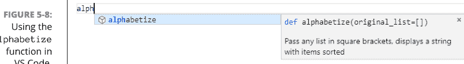

由于函数不能直接修改列表，它首先通过这行代码为原始列表（即传递的那个）创建一个名为 `sorted_list` 的新列表副本：

```python
sorted_list = original_list.copy()
```

此时，`sorted_list` 并没有真正被排序；它仍然是原始列表的副本。下一行代码执行排序：

```python
sorted_list.sort()
```

该函数创建了一个由逗号分隔的排序项的字符串。因此，下一行创建了一个新变量 `final_list`，并在 `=` 符号之后将该变量初始化为空字符串（两个之间没有空格的单引号）：

```python
final_list = ''
```

该循环遍历排序后的列表，并将列表中的每个项用逗号和空格分隔后添加到 `final_list` 字符串中：

```python
for name in sorted_list:
    final_list += name + ', '
```

完成后，如果还有任何内容，则去掉最后的两个字符（逗号和空格）：

```python
final_list = final_list[:-2]
```

最后打印按字母排序的列表。

```python
print(final_list)
```

（注：原文的最后几代码语句直接打印 `final_list` 这样你可以看到它。）

```python
final_list[:-2]
```

将参数替换为传入表达式中的数据。并将表达式替换为定义你想要匿名函数返回内容的的表达式（公式）。

这种句法的一个常见示例是，当你尝试对文本字符串进行排序时，其中某些名称以大写字母开头，另一些以小写字母开头，例如这些名称：

- Adams, Ma, diMeola, Zelensky

假设你写了以下代码将这些名称放入列表、排序列表并打印出来：

```python
names = ['Adams', 'Ma', 'diMeola', 'Zandensky']
names.sort()
print(names)
```

输出如下：

> ['Adams', 'Ma', 'Zandensky', 'diMeola']

diMeola 却在 Zelensky 之后对我们来说似乎是错误的，可能对你也是如此。但计算机看到的并不总是像我们所看到的那样（实际上实际上，它们什么也看不见，因为它们没有眼睛或大脑，但这并不是重点。）diMeola 出现在 Zelensky 之后的原因是因为排序是基于 ASCII 的，这是一个每个字符都由一个数字表示的系统。所有小写字母的数字都大于大写字母。因此，在排序时，以大写字母开头的单词会在小写字母之前。

为了解决这些问题，Python 的 `sort()` 方法允许你在括号内包含一个 key 表达式，在其中你可以告诉它如何排序。语法如下：

```python
.sort(key = transform)
```

`transform` 部分是对待排序数据的某种变体。如果你足够幸运，某个内置函数（如 `len`，用于长度）有效，你可以用它来代替 `transform`，如下：

```python
names.sort(key=len)
```

对我们来说的是，字符串的长度对字母表排序没有帮助。所以当你运行这行代码时，顺序是：

```python
[ 'Ma', 'Adams', 'diMeola', 'Zandensky']
```

排序是从最短的字符串（字符最少的）到最长的字符串。目前这并没有帮助。

你不能写 `key=lower` 或 `key=upper` 来基于全小写或全大写字母进行排序，因为 `lower` 和 `upper` 不是内置函数，你可以通过快速搜索 python 3.7 内置函数来验证这一点。

除了内置函数，你可以使用自己定义的自定义函数。例如，我们可以创建一个名为 `lowercase()` 的函数，它接受一个字符串并返回该字符串所有字母都变为小写的字符串。这里是该函数：

```python
def lowercase(anystring):
    """将字符串转换为全小写"""
    return anystring.lower()
```

我们将名称命名为 `lowercase`，`anystring` 是未来传递给它的任何字符串的占位符。`return anystring.lower` 这一行通过 `str`（字符串）对象的 `.lower()` 方法将该字符串转换为全小写。


假设你在 Jupyter 单元格或 .py 文件中写了此函数。然后你用类似 `print(lowercase('Zandensky'))` 的内容调用函数。当你看到输出时，它是转换为全小写的字符串，如图 5-11 所示。

图 5-11：对名为 `lowercase()` 的自定义函数进行测试。

```python
def lowercase(anystring):
    """将字符串转换为全小写"""
    return anystring.lower()

print(lowercase('Zandensky'))
```

好了，现在我们有了一个可以将任何字符串转换为全小写字母的自定义函数。我们如何将其作为排序键呢？很简单。像以前一样使用 `key=transform`，但将 `transform` 替换为你的自定义函数名。

## 第 5 章 处理更大的代码块

由于 `lowercase` 是小写的，所以我们将使用 `.sort(key=lowercase)`，如下：

```python
def lowercaseof(anystring):
    """将字符串转换为全小写"""
    return anystring.lower()

names = ['Adams', 'Ma', 'diMeola', 'Zandensky']
names.sort(key=lowercaseof)
```

运行这段代码显示名称列表会将它们置于正确的顺序，因为它们是基于全小写字符串进行排序的。显示的名称与排序前相同，排序发生在场景之前，排序时使用了小写字母。原始数据仍然保持其原始的大写和小写字母状态：'Adams', 'Ma', 'diMeola', 'Zandensky'

如果你清醒并意识到在阅读这些内容，你可能在想：“好了，你解决了排序问题。但我想我们之前是在讨论 lambda 函数。lambda 函数在哪里？目前还没有 lambda 函数。但这是你可能使用 lambda 函数的完美范例，因为你调用的函数 `lowercaseof()` 仅用一行代码就完成了所有工作。”

当你能用像这样简单的单行表达式来实现这一点时，你可以跳过 `def` 和函数名，使用这种语法：

```python
lambda parameters : expression
```

将 `parameters` 替换为你自己定义的一个或多个参数（def 和函数名之后的小括号内的名称）。将 `expression` 替换为你想要函数返回的内容。在这个示例中，使用 lambda 表达式，带有函数名的整行都被删除了。使用 lambda 表达式的优势是你甚至不需要自定义函数。你只需要参数后跟一个冒号和一个告诉它返回什么的的表达式。

图 5-12 显示了完整代码和运行结果。

图 5-12：使用 lambda 表达式排序键。

```python
names = ['Adams', 'Ma', 'diMeola', 'Zandensky']
names.sort(key=lambda x: x.lower())
```

注意 `anystring` 是比大多数名称更长的名称。Python 们喜欢短的名称。例如，用 `s` 替换 `anystring`，在下面，`key=lambda s: s.lower()`：

```python
names = ['Adams', 'Ma', 'diMeola', 'Zandensky']
names.sort(key=lambda s: s.lower())
```

在图 5-14 中，第二个参数是可选的，如果省略则默认认为 15。因此，如果你这样调用 `currency()` 函数：

```python
print(currency(9999))
```

你将得到 $9,999.00，它会填充足够的空格以使输出对齐 15 个字符宽。如果你换成这样调用 `currency()` 函数：

```python
print(currency(9999, 20))
```

你将得到 $9,999.00，其左侧填充了足够的空格以使输出达到 20 个字符宽。

- 图 5-14 中使用的 `.rjust()` 方法是 Python 的内置字符串方法，它通过在字符串的左侧填充足够的空格来使内容右对齐，使其达到指定的宽度。还有一个 `.ljust()` 方法，它通过在右侧填充来使输出左对齐。此外，你并不局限于添加空格，你可以添加任何你喜欢的字符而不是空格。


我们有时会觉得 `.ljust()` 和 `.rjust()` 的整个操作很困惑。有疑问时，可以在网上搜索 *python left justify* 或 *python right justify* 来获取详情。

所以就是这样，你拥有了在 Python 中自定义函数的能力。在现实生活中，当同一段逻辑在你的应用程序中反复出现时，请不要简单地反复复制粘贴那段代码。相反，请将代码放在一个函数中，你可以通过名称来调用它。这样，如果你决定更改代码，就不必遍历整个应用程序来寻找所有需要更改的地方。只需要在定义这些代码的函数中修改一次即可。

## 本章内容

- 理解类和对象
- 学习如何创建类
- 在类中初始化对象
- 填充对象的属性
- 发现如何给类添加方法
- 了解类继承

# 第 6 章：使用类进行 Python 开发

在前章节中，我们讨论了函数，函数允许你将执行特定任务的代码块进行模块化。在本章中，你将学习类，类允许你将代码和数据进行模块化。你将发现类和对象的所有奇妙、宏伟和美丽（好吧，也许我们有点夸过了）。但类已经成为像 Python 这样面向对象的编程语言的定义特征。

我们意识到在之前的章节中向你抛了大量的专业术语。别担心。在本章的剩余部分中，我们假设——就像这个世界上 99.9% 的人一样——你分不清类、对象和意大利三明治的区别。

# 精通类和对象

如你所知，Python 是一种面向对象的编程语言。面向对象编程（OOP）的概念在计算机世界已经至少流行了几年的热门词了。“对象”一词源于这种模型类似于现实世界中的对象，每个对象都是具有某些属性和特征的实体，使其独特性。例如，一把椅子就是一个对象。许多不同的椅子在尺寸、形状、颜色和材料上有所不同，但它们仍然都是椅子。

汽车呢？我们看到汽车时都能认出来。（嗯，通常如此。）尽管汽车并不完全相同，但它们都具有某些属性（年份、型号、颜色），使得每个都是独一无二的。它们共同的方法，方法是汽车可以执行的动作或操作。例如，汽车都有启动、停止和转弯动作，你以几乎相同的方式控制这些动作。

图 6-1 显示了这种概念：所有汽车（尽管并不相同）具有共同的属性和方法。在这种情况下，你可以将 `Car` 类创建一个所有汽车的工厂。每辆汽车创建后，它都是一个独立的对象。改变一辆汽车对其他汽车或类本身没有影响。


图 6-1：不同的汽车对象。


如果工厂模式对你不适用，可以将类视为一种蓝图。例如，考虑狗。并没有用于创建狗的物理蓝图，但有狗的 DNA，其作用几乎相同。狗的 DNA 可以被视为一种蓝图（类似于 Python 类），由此创建所有的狗。狗在品种、颜色和尺寸等属性上有所不同，但它们共享某些行为（方法），如进食和睡眠。图 6-2 显示了一个名为 `Dog` 的动物示例，所有的狗都源于此。

甚至人也可以这种方式被视为对象。例如，也许你有一个俱乐部并想要跟踪其成员。每个成员当然都是人。但在代码中，你可以创建一个 `Member` 类来存储每个成员的信息。每个成员将具有某些属性——用户名、全名等。你还可以拥有如 `.archive()` 等方法来停用账户。

# 模块

- **类（Class）**：从中生成唯一对象的代码段。类的每个实例也是对象。将类类比蓝图或工厂。
- **实例（Instance）**：从类生成的数据单元，也称为对象。
- **属性（Attribute）**：对象的特征，包含关于对象的信息。也称为属性（property）。属性名称前有一个点，例如 `member.username`。
- **方法（Method）**：与类相关的 Python 函数。方法定义了对象可以执行的动作。你可以通过在方法名前加一个点并跟一对括号来调用方法。`member.archive()` 可能是用来归档（停用）账户的方法。

图 6-1：不同的汽车对象。

图 6-2：Dog 类

# Dog

属性：
- `.breed`
- `.color`
- `.size`

方法：
- `.eat()`
- `.sleep()`

# Member 类

# 创建类

你像创建函数一样创建你自己的类。你可以自由为类命名，只要它是一个合法的名称、以字母或下划线开头，且不包含空格或标点符号。习惯上类名以大写字母开头，以区分类和变量。要开始，你只需要 `class` 单词后面跟着一个空格、你选择的类名和一个冒号。例如，要创建一个名为 `Member` 的新类，使用 `class Member`。

为了让你的类更具描述性，可以自由对类定义添加注释。你还可以在类行下方放置 docstring（文档字符串），每当你在 VS Code 中输入类名时它都会显示。例如，为你的新的 `Member` 类添加注释，你可能会这样写代码：

这是用于定义新类的。然而，在你指定从该类中创建的每个对象从类继承哪些属性之前，它是没有用处的。

# 空类

如果你以类名 `class:` 开始定义一个类，但在完成该类的定义之前运行你的代码，你实际上会得到一个错误。为了避免这种情况，你可以在定义下方放置关键字 `pass`，这告诉 Python 你只是还没有准备好写完这个类，如下面的代码所示：

```python
# 定义一个新类 Member。
class Member:
    pass
```

本质上，你在这里所做的是告诉 Python：“嘿，我知道这个类目前还不能运行，但请让它跳过，不要抛出关于它的错误信息。”

# 从类创建实例

为了让你的类具备为你创建实例（对象）的能力，请给类提供一个 `__init__` 方法。`init` 一词是 `initialize`（初始化）的缩写。作为一个方法，它实际上只是定义在类内部的函数。但它的名字必须是 `__init__`（那是两个下划线，后面跟着 `init`，然后又是两个下划线）。

> `__init__` 有时被读作 "dunder init."。`dunder` 是 double underline（双下划线）的缩写。

创建 `init` 方法的语法如下：

```python
def __init__(self, suppliedcript, suppliedprop, ...):
```

`def` 是 `define`（定义）的缩写，而 `__init__` 是 Python 内置方法的名字，能够从类内部创建对象。`self` 部分只是一个变量名，用于指代正在创建的对象。你可以使用自己选择的名称来代替 `self`。但大多数人认为使用 `self` 是一种最佳实践，因为它具有解释性且符合惯例。

只要简单来说，类的这种业务是很容易学习和理解的。所以，为了作为一个示例，你将创建一个名为 `Member` 的类，每当你想创建一个成员时，都会在其中使用用户名 (`uname`) 和全名 (`fname`)。像往常一样，你可以在代码前加上注释。你也可以在第一行下方放置一个 docstring（使用三引号），它既可以作为注释，也可以在 VS Code 中输入代码时作为 IntelliSense 提醒：

```python
# 定义一个用于创建成员对象的 Member 类。
class Member:
    """ 根据 uname 和 fname 创建成员 """
    def __init__(self, uname, fname):
```

当执行 `def __init__` 行时，在类内部有一个名为 `self` 的空对象。`uname` 和 `fname` 参数持有你传递的任何值；你稍后就会看到它是如何运作的。

没有数据的对象对你帮助不大。让对象变得实用的是它的属性：它包含的、该对象特有的信息。因此，在你的类中，下一步是为对象的每个属性赋值。

# 给对象赋予属性

现在你有了一个新的、空的 `Member` 对象，你可以开始给它赋予属性并在这些属性中填充（存储值）。例如，假设你希望每个成员都拥有一个 `.username` 属性，其中包含用户的用户名（可能用于登录）。你有第二个属性 `fullname`，是成员的全名。要定义并填充这些属性，请使用以下代码：

```python
self.username = uname
self.fullname = fname
```

第一行为新实例 (`self`) 创建了一个属性 `username`，并将调用类时传递给 `uname` 属性的任何值放入其中。第二行为新的 `self` 对象创建了一个属性 `fullname`，并将作为 `fname` 变量传递的任何值放入其中。添加一些注释后，类定义看起来如下：

```python
# 定义一个新类 Member。
class Member:
    """ 创建一个新的成员 """
    def __init__(self, uname, fname):
        # 定义属性并赋予它们值。
        self.username = uname
        self.fullname = fname
```

你看到发生了什么了吗？`__init__` 行创建了一个名为 `self` 的新空对象。接下来，`self.username = uname` 为空对象添加了属性 `username`，并将传递的 `uname` 放入该属性。然后 `self.fullname = fname` 对 `fullname` 属性和传递的 `fname` 值做了相同的事情。

类命名的惯例建议类名首字母大写。然而，属性应该遵循变量的标准，即全小写并用下划线分隔单词（即 `snake_case`）。

# 从类创建实例

当你创建了类之后，可以使用此语法从类创建实例（对象）：

```python
this_instance_name = Member('uname', 'fname')
```

将 `this_instance_name` 替换为你选择的名称（就像你可能会给狗命名一样，狗是 `Dog` 类的实例）。将 `uname` 和 `fname` 替换为你想要放入将创建的对象中的用户名和全名。确保不要对它们进行缩进；否则 Python 会认为新代码仍然属于类代码。测试类并不新鲜。

所以，为了示例，假设你想创建一个名为 `new_guy` 的成员，用户名名为 `Rambo`，全名为 `Rocco Moe`。以下是该代码：

```python
new_guy = Member('Rambo', 'Rocco Moe')
```

如果你运行这段代码且没有得到任何错误信息，你至少知道它运行了。为了确保，你可以打印对象或其属性。要查看 `Member` 类的实例 `new_guy` 中到底有什么，你可以打印整个对象。你也可以只打印它的属性 `new_guy.username` 和 `new_guy.fullname`。你还可以打印 `type(new_guy)` 来询问 Python `new_guy` 是什么。

```python
print(new_guy)
print(new_guy.username)
print(new_guy.fullname)
print(type(new_guy))
```

图 6-4 显示了代码以及在 notebook 中运行的结果。

```python
# 定义一个新类 Member。
class Member:
    """ 创建一个新的成员 """
    def __init__(self, username, fname):
        # 定义属性并赋予它们值。
        self.username = username
        self.fullname = fname

# 创建 Member 类实例
new_guy = Member('Rocco', 'Rocco Moe')

# 实例中的内容以及它的各个属性。
print(new_guy.username)
print(new_guy.fullname)
print(type(new_guy))
```

输出：

```
<__main__.Member object at 0x0000002175ae60>
Rocco
Rocco Moe
```

在 Jupyter 单元格中从 `Member` 类创建一个成员。在上面的几行中，你可以看到输出列表：

```
<__main__.Member object at 0x0000002175ae60>
Rocco
Rocco Moe
```

# 修改属性的值

在处理元组（tuples）时，你可以定义键:值对，就像你在这里看到的类实例的属性:值对一样。但这里有一个主要的区别：元组是不可变的，意味着一旦定义了它们，你的代码就无法对它们进行任何更改。对象（objects）则不然。在你创建一个对象后，可以使用以下语法随时更改任何属性的值：

```
objectname.attribute = value
```

将 `objectname` 替换为对象的名称（你已经通过类创建了它）。将 `attributename` 替换为你想要更改的属性值的名称。将 `value` 替换为新值。

图 6-7 显示了一个示例，在初始化 `new_guy` 对象后，执行了以下代码：

```python
# 定义一个新类 Member。
class Member:
    # 创建一个新的成员。
    def __init__(self, username, fullname):
        # 定义属性并给它们赋值。
        self.username = username
        self.fullname = fullname

# 类在第一行未缩进的行结束。
# 创建一个名为 new_guy 的 Member 类实例
new_guy = Member("Rambo", "Moco Moe")

# 查看实例中的内容以及它的各个属性。
print(new_guy.username)
print(new_guy.fullname)

print() # 这只是打印了一个空行。

# 修改 new_guy 的 username 然后再次打印两者。
new_guy.username = "Princess"
print(new_guy.username)
print(new_guy.fullname)
```

图 6-7：更改对象属性的值。

输出：
```
Rambo
Moco Moe

Princess
Moco Moe
```

下方的输出行显示 `new_guy` 的 `username` 确实已经更改为 `Princess`。他的全名没有改变，因为你没有对代码做过任何操作。

# 定义带有默认值的属性

你不需要为新对象传递每个属性的值。如果你总是在对象创建时刻要为某个属性提供一个默认值，你可以使用 `self.attributename = value`，这与之前一样，其中 `attributename` 是你选择的名称。而 `value` 可以是你设置的值，例如布尔值的 `True` 或 `False`，或者今天的日期，或者任何 Python 在无需提供值的情况下就能计算或确定的内容。

例如，假设每当你创建一个新成员时，都想在一个名为 `date_joined` 的属性中跟踪你创建该成员的日期。你还希望通过激活和停用来控制用户登录。因此，你创建了一个 `is_active` 属性，并决定在开始新成员时将该属性设置为 `True`。

如果你将对日期和时间进行任何操作，你需要导入 `datetime` 模块，因此在文件的顶部、`class Member:` 之前，你可以在类内部为属性赋值的其他行之前或添加以下行：

```python
self.date_joined = dt.date.today()
self.is_active = True
```

以下是你如何将导入和这两个属性添加到类中的：

```python
import datetime as dt

# 定义一个新类名 Member。
class Member:
    # 创建一个新的成员。
    def __init__(self, username, fullname):
        # 定义属性并给它们赋值。
        self.username = username
        self.fullname = fullname
        # 将 date_joined 默认设置为今天的日期。
        self.date_joined = dt.date.today()
        # 最初将 is_active 设置为 True。
        self.is_active = True
```

> 如果你忘记在代码顶部导入 `datetime`，当你运行代码时会收到一个错误消息，告诉它不知道 `dt.date.today()` 是什么。只需将导入行添加到代码顶部并重试即可。


不需要为 `date_joined` 和 `is_active` 属性传递任何新数据，因为这些属性从代码中获取默认值。

# 持久化数据更改

如果一切在程序结束的那一刻就消失，那么创建所有不同的类和对象的意义何在？如果你无法存储这些信息并用它来控制成员登录网站或其他地方，那么创建一个成员意味着什么？

坦率地说，创建在程序结束时就消失的对象并不是问题的全貌。你用类和对象创建并管理的所有数据都可以被持久化（无限保留），并且通过某种外部文件（使用数据库）随时供你使用。

我们将在第 3 本中持久化数据的问题。但在理解更复杂的话题（如持久化数据）之前，你需要先学习 Python 基础。

请注意，默认值只是一个值：它是在创建对象时自动赋值的值。但你可以像更改任何其他属性的值一样更改它，使用此语法：

```python
objectname.attribute = value
```

例如，假设你使用 `is_active` 属性来判断用户是否活跃并登录你的站点。如果发现某个成员你不再希望他登录了，你可以这样将 `is_active` 属性更改为 `False`：

```python
new_member.is_active = False
```

# 定义方法

任何定义的对象都可以有任意数量的属性。任何类都可以有任意数量的方法。

图 6-9 显示了整个类，随后是用于测试它的代码。该行 `new_guy = Member('Rambo', 'Rocco Moe')` 创建了一个名为 `new_guy` 的新成员对象。然后 `print(new_guy.is_active)` 显示了 `is_active` 属性的值，结果为 True，这是因为这是所有成员的默认值。

```python
import datetime as dt

# 定义一个名为 Member 的新类。
class Member:
    # 创建一个新成员。
    def __init__(self, username, fullname):
        # 定义属性并给它们赋值。
        self.username = username
        self.fullname = fullname
        # 将 date_joined 默认设置为今天的日期。
        self.date_joined = dt.date.today()
        # 将 is_active 初始设置为 True。
        self.is_active = True

    # 一个返回格式化字符串显示加入时间的方法。
    def show_joined(self):
        return f"{self.fullname} joined on {self.date_joined:%d-%b-%Y}"

    # 一个激活（True）或取消激活（False）的方法。
    def activate(self, yes):
```


# True 为激活，False 变为非激活

```python
self.is_active = yes
```

# 创建一个名为 `new_guy` 的 `Member` 类实例。

```python
new_guy = Member('Rambo', 'Rocco Moe')
```

# 新成员是激活状态吗？

```python
print(new_guy.is_active)
```

# 尝试使用 `activate` 方法。

```python
new_guy.activate(False)
```

# 新成员仍然是激活吗？

```python
print(new_guy.is_active)
```

```
True
False
```

图 6-9 添加并测试 `activate()` 方法。

该行 `new_guy.activate(False)` 调用了对象的 `activate()` 方法并向其传递了一个布尔值。然后 `print(new_guy.is_active)` 证明对 `activate` 的调用确实将 `new_guy` 的 `is_active` 属性从 True 改为了 False。

## 通过类名调用类方法

如你所示，你可以使用以下语法调用类的方法：

```python
specificobject.method()
```


另一种方法是使用特定的类名，这可以帮助代码更容易被人类理解：

```python
Classname.method(specificobject)
```

将 `Classname` 替换为类的名称（大写字母开头），紧接着是方法名，然后将特定对象（假设你已经创建了它）放在括号内。

例如，假设我们使用 `Member` 类和以下代码创建了一个名为 `wilbur` 的新成员：

```python
wilbur = Member('wilblongren', 'Wilbur Blomgren')
```

在这里，`wilbur` 是从 `Member` 类创建的特定对象。我们可以使用已经熟悉的语法在该对象上调用 `show_datejoined()` 方法：

```python
print(wilbur.show_datejoined())
```

另一种方法是调用 `Member` 类的 `show_datejoined()` 方法并将特定对象 `wilbur` 传递给它，如下：

```python
print(Member.show_datejoined(wilbur))
```

这两种方法的输出是相同的（但日期是你运行代码的时间）：

后一种方法并没有更快、更慢、更好、更差或类似的特点。它只是你可以使用的另一种语法，有些人更喜欢它，因为以 `Member` 开头可以清楚地表明 `show_datejoined()` 方法属于哪个类。反过来，这可以让其他程序员或一年后的你自己（当你忘记了在应用中写的任何内容时）代码更具可读性。

## 使用类变量

到为止，你已经看到了属性的示例，它们有时被称为*实例变量*（instance variables），因为它们是占位符，包含了从类的一个实例到另一个的信息。例如，在 `Dog` 类中，`dog.breed` 对于某只狗可能是 `Poodle`，但对于另一只狗可能是 `Schnauzer`。

你可以与类一起使用的另一种变量类型被称为类变量（class variable），它应用于所有尚未创建的类的新实例上。类内部的类变量与 `self` 没有任何关联，因为 `self` 关键字指的是当前正在创建的特定对象。要定义类变量，将鼠标指针悬停在 `def __init__` 行上，并使用以下语法定义变量：

```python
variablename = value
```

将 `variablename` 替换为你选择的名称，并将 `value` 替换为你想赋值给变量的具体值。例如，假设你的代码包含一个 `free_days` 变量，允许人们注册时获得三个月（90天）的免费访问。如果你不确定是否想要一直这样做，与其将其硬编码在应用中（这样很难更改），你可以将其制为类变量，自动应用于所有对象，如下：

```python
# 创建一个名为 Member 的类用于创建成员对象。
class Member:
    """创建一个成员对象 """
    free_days = 90

    def __init__(self, username, ____):
```

由于我们在定义 `__init__` 之前了 `free_days` 变量，它没有绑定到代码中的特定对象。

现在假设在代码后面，你想存储免费到期的日期。你可以有一个名为 `date_joined` 的属性代表成员加入的日期，以及另一个名为 `free_expires` 的属性代表用户免费会员到期的日期。你可以通过在成员加入日期加上免费天数来确定第二个日期。直觉上，似乎你可以使用简单的语法将 `free_days` 添加到日期上：

```python
self.free_expires = dt.date.today() + dt.timedelta(days=free_days)
```

但如果你尝试运行这段代码，你会得到一个错误，说 Python 无法识别 `free_days` 变量名（尽管它定义在类的顶端）。相反，你必须在变量名之前加上类名或 `self`。例如，这将不起作用：

```python
self.free_expires = dt.date.today() + dt.timedelta(days=Member_free_days)
```

第 6 章 使用类进行 Python 233


## 使用类方法

回想一下方法是绑定到特定类的函数。到为止，你使用的方法如 `.show_joined()` 和 `.activate()` 都是实例方法，因为它们总是与特定对象一起使用。在 Python 中，你也可以创建类方法。

顾名名，类方法是针对整个类，而不是特定的实例。换句话说，类方法与类变量相似，因为它们适用于类。

与类变量一样，类方法不需要 `self` 关键字，因为该关键字始终指向当前正在创建的对象。所以首先，如果你想让一个方法对整个类执行某些操作，不要使用 `def name(self)`。

如果创建类方法只需要排除 `self` 单词就好了，但事实并非如此。要定义类方法，你首先需要在代码中输入：

```python
@classmethod
```

开头的 `@` 符号将 `classmethod` 定义为装饰器——这是另一个添加到你不断增长的极术语列表中的词。装饰器通常是修改或扩展所应用的函数。

在下方，使用以下语法定义你的类方法：

```python
def methodname(cls, x, ...):
```

将 `methodname` 替换为你想给方法的名字。保留 `cls` 不变，因为它是类的引用（因为 `@classmethod` 装饰器在背后这样定义了它）。在 `cls` 之后，你可以拥有逗号以及传递给方法的参数名称，就像对于普通实例方法一样。

例如，假设你想在创建对象之前定义一个方法来设置天数，以便所有对象获得相同的 `free_days` 数量。以下代码通过首先定义一个名为 `free_days` 的给定默认值为 0 的类变量来实现这一点（默认值可以是任何值）。

```python
class Member:
    free_days = 0

    @classmethod
    def set_free_days(cls, days):
        cls.free_days = days

    def __init__(self, username, fullname):
        # ...
```

在类的后续部分有这样一个类方法：

```python
# 类方法遵循 @classmethod 装饰器，并引用 cls 而不是
# self。
@classmethod
def setfreedays(cls, days):
    cls.free_days = days
```

这段代码告诉 Python，当有人在类类上调用 `free_days()` 方法时，将 `cls.free_days`（该类的 `free_days` 变量）设置为传入的任何天数。图 6-11 显示了 Jupyter 单元格中的完整示例（你可以自己输入并运行它）以及运行该代码的结果。

图 6-11：

`setfreedays()` 是 `Member` 类中的一个类方法。

```python
import datetime as dt

# 定义一个名为 Member 的新类。
class Member:
    # 默认免费天数。
    free_days = 365

    # 创建一个新的成员。
    def __init__(self, username, fullname=''):
        self.join_date = dt.date.today()
        # 设置过期日期。
        self.free_expires = dt.date.today() + dt.timedelta(days=Member.free_days)

    # 类方法遵循 @classmethod 装饰器，并引用 cls 而不是。
    @classmethod
    def setfreedays(cls, days):
        cls.free_days = days
```

很容易忘记在 Python 中字母的大小写非常重要，尤其是因为你似乎 99.9% 的时间都在使用小写。但按照规定，类名以大写字母开头，因此对类名的任何调用也必须以大写字母开头。


# 使用静态方法

当你认为自己终于学完了类时，结果发现 Python 类中还可以创建另一种类型的方法。它被称为静态方法（static method），并以这个装饰器开头：`@staticmethod`。

这部分就是这样。静态方法与实例方法和类方法的区别在于，静态方法并不特定于对象的实例，甚至不特定于整个类。它是一个通用的函数，将其定义为类的一部分唯一理由是你想在代码中另一个类的其他地方使用相同的名称。

在任何你想使用静态方法的地方，输入 `@staticmethod` 行。在该行下方，像定义任何其他方法一样定义静态方法，但你不需要使用 `cls`，因为静态方法没有严格绑定到某个类或对象。这是一个静态方法的示例：

```python
@staticmethod
def datetime():
    now = dt.datetime.now()
    return f"{now:%H:%M:%S}"
```

所以，我们有一个名为 `datetime()` 的方法，它不期望传入任何数据，也不关心你正在处理的对象或类。该方法使用 `now = dt.datetime.now()` 获取当前时间，并以格式良好的 12:00 PM 格式返回该信息。

图 6-12 显示了一个完整示例，其中你可以在类末尾正确地缩进并输入该静态方法。当类外部的代码调用 `Member.currentTime()` 时，它会忠实地返回当时的时间，而无需你对该类的特定对象说任何话。

```python
# 定义一个名为 Member 的类用于创建成员对象。
class Member:
    # 这是一个所有实例都相同的类变量。
    free_days = 0
```

```python
# 从 Username 和 fullname 创建成员对象
    def __init__(self, username, fullname):
        # 定义属性和默认值。
        self.signed_up = dt.date.today()
        self.free_expires = dt.date.today() + dt.timedelta(Member.free_days)
```

```python
# 类方法遵循 @classmethod 并使用 cls 而不是 self。
@classmethod
def set_free_days(cls, days):
    cls.free_days = days
```

```python
@staticmethod
def currentTime():
    now = dt.datetime.now()
    return f"{now:%H:%M:%S}"
```

```python
# 类定义在最后一行缩进处结束
```

```python
# 尝试新的静态方法（不需要对象）
print(Member.currentTime())
```

图 6-12：

`Member` 类现在有一个名为 `currentTime()` 的静态方法。


# 理解类继承

热于面向对象编程的人热衷于谈论类继承、子类等等，这些内容对于街上的普通人 Joe 或 Josephine 来说没什么意义。尽管如此，他们所讨论的 Python 概念是你在现实生活中随处可见的东西。

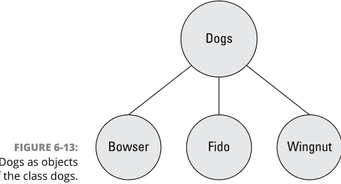

每只狗都是独特的（尽管没有哪只狗比你的好），但这使得与与之间变得相似。

```python
import datetime as dt
# 该类用于各种人员。
import datetime as dt
```

```python
# 基类用于所有类型的 Member（成员）。
class Member:
    # Member 类属性和方法适用于所有人
    # 默认情况下，新实例在一年后（365 天后）过期
    expiry_days = 365

    # 初始化一个成员对象
    def __init__(self, firstname, lastname):
        # 适用于大家的属性
        self.firstname = firstname
        self.lastname = lastname
        # 从今天的日期开始设置过期日期
        self.expiry_date = datetime.date.today() + datetime.timedelta(days=self.expiry_days)

# 类外部代码
Joe = Member('Joe', 'Anybody')
print(Joe.firstname)
print(Joe.lastname)
print(Joe.expiry_date)
```

图 6-15：一个简化的 `Member` 类。

现在我们的真实意图是创建两种不同的用户：`Admin`（管理员）和 `User`（用户）。两种类型的用户都将拥有 `Member` 类提供的属性。通过将这些用户定义为 `Member` 的子类，它们将自动获得相同的属性（如果有任何方法的话）。

## 定义子类

要定义一个子类，请确保基类下方的光标返回到无缩进状态，因为子类并不是基类的一部分，也不包含在基类内部。使用以下语法定义子类：

```python
class subclass(mainclass):
```

将 `subclass` 替换为你想要为该子类起的名字。将 `mainclass` 替换为在基类顶部定义的基类名称。例如，创建一个名为 `Admin` 的 `Member` 子类，请使用以下代码：

```python
class Admin(Member):
```

要创建另一个名为 `User` 的子类，添加此代码：

```python
class User(Member):
```

如果你让类保持为空，将无法测试它们，因为你会收到一条提示类为空的错误消息。但你可以在每个类的第一个命令中放置 `pass` 关键字。这是你告诉 Python：“是的，我知道这些类是空的，但让它通过吧，不要报错。”你可以在每个类上方添加注释来提醒自己每个类的用途，如下例所示：

```python
# Admin 的子类。
class Admin(Member):
    pass

# User 的子类。
class User(Member):
    pass
```

当你使用子类时，你不需要对 `Member` 类进行任何直接引用。`Admin` 和 `User` 都将自动继承 `Member` 的所有内容。例如，要创建一个名为 `Annie` 的 `Admin`，你会使用以下语法：

```python
Ann = Admin('Annie', 'Angst')
```

要创建一个 `User`，对 `User` 类执行相同的操作并为用户指定一个名字。例如：

```python
Uli = User('Uli', 'Ungula')
```

要检查这段代码是否有效，请对成员 `Ann` 执行与之前相同的操作。在创建了两个账户后，使用 `print()` 对它们进行打印语句。图 6-16 显示了两个用户的结果。`Ann` 是一个 `Admin`，`Uli` 是一个 `User`，但他们都自动获得了分配给成员的所有属性。（`Member` 类直接位于图中所示代码上方，我们省略了它的修改部分）

```python
# Admin 的子类。
class Admin(Member):
    pass

# User 的子类。
class User(Member):
    pass

Ann = Admin('Annie', 'Angst')
print(Ann.firstname)
print(Ann.lastname)
print(Ann.expiry_date)
print()

Uli = User('Uli', 'Ungula')
print(Uli.firstname)
print(Uli.expiry_date)
```

图 6-16

```
Annie
Angst
2019-12-03

Uli
Ungula
2019-12-03
```

创建 `Admin` 和 `User` 类。


所以你在这里学到的是，子类接受基类接受的所有不同参数并将它们赋值给属性，这与 `Person` 类一样。但到目前为止，`Admin` 和 `User` 只是没有独特特征的成员。在现实生活中，这两类用户之间可能会有一些差异。在接下来的章节中，你将学习如何实现这些差异。

## 在子类中重写默认值

通过子类你可以做的最简单的事情之一，就是为基类中具有默认值的属性赋予另一个值。例如，在 `Member` 类中我们创建了一个名为 `expiry_days` 的变量，稍后在类中使用它计算过期。假设你想让 `Admin` 账户永不过期（或者在某个荒谬的持续时间后过期，以便那里仍有日期）。只需在 `Admin` 类中设置 `expiry_days`（你可以删除 `pass` 行，因为类不再为空了）。以下是这些更改在你的子类中可能呈现的形式：

- `Admin` 的子类。

```python
class Admin(Member):
    # Admin 账户在 100 天后过期。
    expiry_days = 36524 + 100
```

你传递的任何值将覆盖 `Member` 类顶部附近设置的默认值，并被用于计算 `Admin` 的过期日期。

## 从子类中添加额外参数

有时，子类的成员拥有其他成员不具备的参数值。在这种情况下，你可能希望从子类传递一个基类中不存在的参数。这样做比仅仅更改默认值要复杂一点，但这是一个常用的技术，你应该了解它。让我们来看一个例子。

首先，你的子类需要它自己的 `__init__` 行，包含基类 `__init__` 中的所有内容，加上你想要传递的任何额外内容。例如，假设 admin 有某些密钥代码，你想从 `Admin` 子类中传递它。你仍然需要传递名和姓，因此 `Admin` 子类中的 `__init__` 行如下：

```python
def __init__(self, firstname, lastname, secret_code):
```

其缩进级别与上方行相同。

接下来，任何属于基类 `Member` 的参数需要使用这种看起来有点奇怪的语法传递给上面：

```python
super().__init__(param1, param2, ...)
```

将 `param1`、`param2`、`...` 替换为实际参数。

```python
import datetime as dt
```

```python
# 基类用于所有类型的 Member。
class Member:
    # Member 类的属性和方法适用于所有人
    # 默认情况下，新账户的有效期为一年（365天）
    expiry_days = 365
```

```python
    def __init__(self, firstname, lastname=None):
        # 初始化成员对象。
        super().__init__(firstname, lastname)
        # 适用于所有人的属性（实例变量）。
        self.firstname = firstname
        self.lastname = lastname
        # 从今天的日期计算有效期。
        self.expiry_date = dt.today() + dt.timedelta(days=self.expiry_days)
        # 默认秘码为空。
        self.secret_code = None
```

```python
    # 基类中的方法
    def show(self):
        return f"{self.firstname}, {self.lastname}"
```

```python
# Admin 的子类。
class Admin(Member):
    # Admin 账户有效期为100年。
    expiry_days = 36500
```

```python
# User 的子类。
class User(Member):
    def __init__(self, firstname, lastname, secret_code):
        # 将 Member 参数传递给成员类。
        super().__init__(firstname, lastname)
        # 将秘码参数赋值给对象。
        self.secret_code = secret_code
```

```python
# 添加 Alice: Angel, "PRESTO"
print(Admin("Alice", "Angel").expiry_date, Admin.secret_code)
# 添加一个空名的 Bob 到输出。
print(User("Bob", None, "PRESTO").expiry_date, User.secret_code)
Annie: 2018-12-08 PRESTO
```

图 6-18

完整的 Admin 和 User 子类。

## 调用基类方法

基类中的方法在子类中的工作方式与在基类中相同。尝试在基类底部添加一个名为 `showexpiry(self)` 的新方法，如下所示：

```python
class Member:
    """Member 类的属性和方法适用于所有人"""
    # 默认情况下，新账户的有效期为一年（365天）
    expiry_days = 365

    # 初始化成员对象。
    def __init__(self, firstname, lastname=None):
        # 适用于所有人的属性（实例变量）。
        self.firstname = firstname
        self.lastname = lastname
        # 从今天的日期计算有效期。
        self.expiry_date = dt.date.today() + dt.timedelta(days=self.expiry_days)
```

```python
        # 默认秘码为空。
        self.secret_code = ''
```

```python
    # 基类中的方法。
    def showexpiry(self):
        return f'{self.firstname} {self.lastname} expires on {self.expiry_date}'
```

当 `showexpiry()` 方法被调用时，它会返回一个格式化字符串，包含用户的姓、名和过期日期。保持子类不变并执行代码，将显示 Ann 和 Uli 的姓名和过期日期：

```python
Ann = Admin('Annie', 'Angst', 'PRESTO')
print(Ann.showexpiry())
```

```python
Uli = User('Uli', 'Angula')
print(Uli.showexpiry())
```

以下是输出，尽管你的日期会根据运行代码的日期而不同：

```
Ann Angst expires on 2018-12-04
Uli Angula expires on 2019-12-04
```

## 重复使用相同的名称

你可能好奇当你多次使用同一个名称时会发生什么？Python 总是选择最具体的，即与子类绑定的那个。只有当子类中没有该方法名称时，它才会使用基类中更通用的方法。

为了说明，这里有一些代码定义了一个仅包含少数属性和方法的 `Member` 类，以排除无关代码的干扰。代码中的注释描述了代码正在执行的内容：

```python
class Member:
    """ Member 类属性和方法 """
    # 初始化成员对象。
    def __init__(self, firstname, lastname):
        # 适用于所有人的属性（实例变量）
        self.firstname = firstname
        self.lastname = lastname

    # 基类中的方法
    def get_status(self):
        return f"{self.firstname} is a Member."
```

```python
# 管理员子类
class Admin(Member):
    def get_status(self):
        return f"{self.firstname} is an Admin."

# 普通用户子类
class User(Member):
    def get_status(self):
        return f"{self.firstname} is a regular User."
```

`Member` 类以及 `Admin` 和 `User` 类都有一个 `get_status()` 方法，该方法显示成员姓名的状态。图 6-19 显示了使用 `Admin`、`User` 以及一个既不是 `Admin` 也不是 `User` 的 `Member` 运行代码的结果。如你所见，每个情况下调用的 `get_status()` 都与子类相关（对于既不是 `Admin` 也不是 `User` 的 `Member`，则与基类相关）。

```python
class Member:
    """
    Member 类的属性和方法适用于所有人 """
    # 初始化成员对象
    def __init__(self, firstname, lastname):
        # 适用于所有人的属性（实例变量）。
        self.firstname = firstname
        self.lastname = lastname
    # 类中的方法
    def get_status(self):
        return f"{self.firstname} is a Member."

    # 管理员子类
    class Admin(Member):
        def get_status(self):
            return f"{self.firstname} is an Admin."

    # 普通用户子类
    class User(Member):
        def get_status(self):
            return f"{self.firstname} is a regular User."

# 创建一个管理员
Ann = Admin('Annie', 'Angst')
print(Ann.get_status())

# 创建一个普通用户
Uli = User('Uli', 'Angula')
print(Uli.get_status())

# 创建一个成员（既不是 Admin 也不是 User）
Hanny = Member('Mindy', 'Mbo')
print(Hanny.get_status())
```

图 6-19:

**三个同名方法**

Ann 是管理员，

Uli 是一个普通用户。

Mindy 是一个成员。

Python 有一个内置的 `help()` 方法，你可以将其与任何类配合使用以获取该类的更多信息。例如，在图 19 代码的底部添加此行：

```python
help(Admin)
```

当你再次运行代码时，你将看到关于 `Admin` 类的某些信息，如图 20 所示。

```
help(Admin)
Help on class Admin in __main__:
class Admin(Member):
    Admin(firstname, lastname)
Member class attributes and methods are for everyone
Method resolution order:
Admin
Member
builtins.object
Methods defined here:
    get_status(self)
Methods Inherited from Member:
    __init__(self, firstname, lastname)
    Initialize self. 准确签名请参 help(type(self))。
Data descriptors inherited from Member:
    __dict__
    实例变量的字典（如果定义）
    __weakref__
    对象的弱引用列表（如果定义）
```

图 6-20:

`help(Admin)` 的输出。

你现在不需要担心图 20 中的所有细节。最重要的部分是方法解析顺序（Method resolution order），它如下：

```
Method resolution order:
Admin
Member
builtins.object
```

方法解析顺序告诉我们，如果你将数据存储在类和子类的层次结构中，并且在子类上调用方法，如果子类方法存在，Python 将使用它。如果没有，Python 将使用基类方法（如果存在）。如果都不存在，它将尝试内置方法。如果所有尝试都失败，它将抛出错误，因为它找不到你尝试调用的方法。通常这种错误的原因是你是在代码中拼写错了方法名称，Python 找不到它。

## 本章内容

- 发现异常
- 了解如何优雅地处理错误
- 确保你的应用程序不会崩溃
- 查看 `try`...`except`...`else`...`finally`...
- 学习抛出自己的异常

# 第 7 章 规避错误

我们都希望程序能够一直完美运行。但有时，现实世界中的情况会阻止程序的运行。问题并不在你身上或你的程序上。通常是使用程序的人做了某些错误。错误处理的核心在于预测这些问题、捕获错误并通知用户问题所在，以便他们进行修复。

我们所描述的技术并不是为了修复你代码中的 Bug。你必须自己修复那类错误。我们严格来说讨论的是程序运行环境中的错误，而你对这些环境没有控制权。处理错误的方法仅仅是将 Python 通常显示的专业术语类错误信息（这些信息对大多数人来说没有意义）替换为告诉他们哪里出了问题、并且理想情况下告诉他们如何修复的消息。

再次强调，用户将修复程序运行的环境——而不会修复你的代码。

# 理解异常

在 Python（以及其他编程语言）中，“异常”一词指的是并非由编程错误引起的错误。相反，它是防止程序正常运行的现实世界中的错误。通过一个简单的例子，让我们打开你的 Python 应用。其语法如下：

```
name = open(filename)
```

将 `name` 替换为你选择的名称，类似于变量名。将 `filename` 替换为文件名。如果文件与代码在同一个文件夹中，你不需要指定文件夹路径，因为假设是当前文件夹。

图 7-1 显示了一个示例。我们使用了 VS Code，因此你可以看到我们工作目录的内容。该文件夹包含一个名为 `showfilecontents.py` 的文件，这是我们编写的 Python 代码所在。另一个文件名为 `people.csv`。

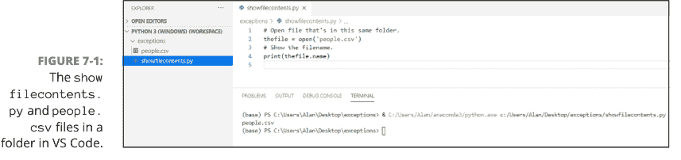

`showfilecontents` 文件包含数据。`.csv` 文件包含数据（关于人的信息）。图 7-2 显示了 `.csv` 文件在 Excel 中的内容（顶部，方便你阅读）以及文本编辑器中的内容（底部，Python 和其他语言看到的样子）。文件的内容现在并不重要；你在这里学习的内容适用于任何外部文件。

Python 代码连接了两个行（不包括注释），如下：

```
# Open file that's in this same folder.
tfile = open('people.csv')
# Show the filename.
print(thefile.name)
```

第一行代码打开名为 `people.csv` 的文件。第二行显示文件名 `show-filecontents.py`（通过在 VS Code 中右键点击其名称并选择“在终端运行 Python 文件”）在屏幕上显示 `people.csv`——假设文件夹中存在一个名为 `people.csv` 的文件。这个假设就是异常处理用用场的地方。

| A | B | C | D | E | F |
|---|---|---|---|---|---|
| 1 | Username | FirstName | LastName | Role | DateJoined |
| 2 | Rocco | Rocco | Moe | 0 | 3/1/2019 |
| 3 | Ann | Annie | Angst | 0 | 6/4/2019 |
| 4 | Will | Wilbur | Blomgren | 0 | 2/28/2019 |
| 5 | Lupe | Lupe | Gomez | 1 | 4/2/2019 |
| 6 | Ina | Ina | Kumar | 1 | 1/15/2019 |
| 7 | | | | | | |

图 7-2: `people.csv` 文件在 Excel（顶部）和文本编辑器（底部）中的内容。

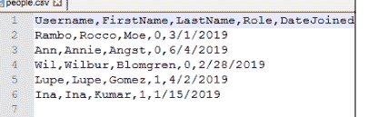

假设由于你无法控制的原因，`people.csv` 文件不存在，因为某人或某个程序未能输入，或者可能有人拼错了文件名。不小心覆盖文件名很容易的。运行程序会抛出一个异常（在英语中称为 "error message"），正如你在图 7-3 底部的终端中所示。异常内容为


# 优雅地处理错误

## Traceback 示例

```
Traceback (most recent call last):
File "/Users/acsimpson/Desktop/exceptions/shufflecontents.py", line 22, in <module>
file = 'people.csv'
FileNotFoundError: [Errno 2] No such file or directory: 'people.csv'
```

```
C:\WINDOWS> python shufflecontents.py
1 python shufflecontents.py
2 # Open file that's in this same folder,
3 file = open('people.csv')
4 # Show the filename
5 print(filename)
6
```

图 7-3: `showfilecontents.py` 文件抛出了异常。

```
C:\WINDOWS> python C:\Users\UserDenied\Desktop\exceptions\shufflecontents.py
C:\Users\UserDenied\Desktop\exceptions\shufflecontents.py
File "C:\Users\UserDenied\Desktop\exceptions\shufflecontents.py", line 3, in <module>
file = open('people.csv')
FileNotFoundError: [Errno 2] No such file or directory: 'people.csv'
```

`Traceback` 引用了一个事实：如果有多个异常，它们将全部列出，最近的在前。在这种情况下，只有一个异常。`File` 部分告诉异常发生的位置，在 `showfilecontents.py` 的第 2 行。后续部分显示了导致错误的代码：

```
file = open('people.csv')
```

并且异常本身的描述为：

```
FileNotFoundError: [Errno 2] No such file or directory: 'people.csv'
```

这种错误的通用名称是 `FileNotFoundError`。许多异常还与一个数字相关（在此例中为 `Errno 2`）。但该数字取决于操作系统，因此它通常用于处理错误。在这种情况下，主错误是 `FileNotFoundError`，以及我们现在所在的事实有些地方说 phrase exception 而不是 raise exception。这两个短语的意思相同。最后部分准确地告诉你是什么问题：No such file or directory: 'people.csv'。换句话说，Python 找不到 'people.csv'，因为当前文件夹中没有名为 `people.csv` 的文件。你可以通过更改代码来修正这个问题，但更改 `people.csv` 的名称以匹配程序查找的内容，`.csv` 是逗号分隔文件的常见扩展名。

## try...except 块

处理文件不存在的方法是将 Python 通常显示的内容替换为用户更有可能理解的内容。为了这一点，你可以使用以下语法编写 `try...except` 块：

```
try:
    你想让代码执行的内容
except Exception:
    如果无法执行你想做的内容的操作
```

以下是如何重写 `showfilecontents.py` 代码以处理缺失（或拼错）的文件：

```python
try:
    # Open file and show its name.
    thefile = open('people.csv')
    print(thefile.name)
except Exception:
    print("Sorry, I don't see a file named people.csv")
```

因为文件应该是缺失，我们从 `try:` 开始并尝试打开文件。如果打开成功，`print()` 语句将显示文件名。但如果尝试打开文件抛出了异常，程序不会崩溃并显示通用错误信息。相反，它显示了一个电脑可以理解的消息，如图 7-4 所示。

图 7-4: `showfilecontents.py` 文件捕获了错误并显示了友好的消息。

## 异常的具体化

我们之前的代码示例优雅地处理了文件不存在的问题。较大的应用程序可能有许多潜在错误的地方，你希望不同地处理每个错误。为了实现这一点，你可以定义多个错误处理器。

假设你手动修复了文件名使其成为预期的 `people.csv`。正如你看到的，当你运行代码且没有错误时，输出只是文件名。在打印文件名的下面，我们添加了另一行代码：

```python
try:
    # Open file and show its name.
    thefile = open('people.csv')
    print(thefile.name)
    print(thefile.wookems())
except Exception:
    print("Sorry, I don't see a file named people.csv here")
```

当你运行这段代码时，文件名没有问题，所以输出显示 `people.csv`，正如你预期的那样。然而，下一行代码 `print(thefile.wookems())` 发生了错误，因为我们没有定义方法 `wookems()`。不幸的是，错误信息仍然之前一样，尽管错误原因是 Python 中没有名为 `wookems()` 的方法。

为什么错误信息说名为 `people.csv` 的文件未找到，而我们知道它被找到了且下一行代码导致了错误？问题在于 `except Exception` 这一行，它的意思是“如果在这个 `try` 块中抛出了任何异常，就执行 `except` 行下的代码”。

为了清理这个问题，你需要将 `Exception:` 替换为让 Python 捕获的特定异常。但你如何知道哪个特定异常容易处理的呢？没有异常处理的情况下抛出的异常是：

```
FileNotFoundError: [Errno 2] No such file or directory: 'people.csv'
```

第一个单词是可以替换通用 `Exception` 的异常名称，如下：

```python
try:
    # Open file and show its name.
    thefile = open('people.csv')
    print(thefile.name)
    print(thefile.wookems())
except FileNotFoundError:
    print("Sorry, I don't see a file named people.csv here")
```

使用你想要使用的方法名。至少你看到的错误信息不会是那种具有误导性的“抱歉，我在这里没有看到名为 people.csv 的文件”。代码运行正常，因此显示了文件名 `thefile`。当它运行到包含错误的 `.readline()` 方法的行时，它会抛出一个错误——但不是由于文件不存在的错误。它会显示针对该错误的正确错误信息：`object has no attribute 'readline'`，如图 7-5 所示。

图 7-5: 显示了错误信息。

再次，如果你在考虑处理 `.readline()`，那并不是你应该编写异常处理程序的异常。只有当程序所依赖的外部某些内容不可用时，才会发生异常。编程错误（例如不存在的方法名）是程序内部的错误，必须由编写代码的程序员进行修正。

## 防止你的应用程序崩溃

你可以在 `try` 块中堆叠多个异常语句来处理不同的错误。只需注意，当异常发生时，它会从顶部开始查找。如果它找到匹配该异常的处理器，就会抛出该异常。如果发生了你没有处理的异常，你将获得标准的 Python 错误信息，那也有解决办法。

如果你想避免所有的 Python 错误信息，可以使用代码 `except Exception:` 作为异常处理器的开头。那行代码的意思是：“如果发生的错误没有被之前的任何一个异常处理，则使用该异常处理器。”换句话说，这个全能异常处理器会处理代码中尚未被处理的任何异常。例如，这里有两个处理器，一个处理文件未找到错误，另一个处理所有其他情况：

```python
try:
    # 打开文件并显示其名称。
    thefile = open('people.csv')
    # 打印几空行，然后是文件的第一行。
    print('\n\n', thefile.readline())
    # 关闭文件。
    thefile.close()
except FileNotFoundError:
    print("抱歉，我在这里没有看到名为 people.csv 的文件")
except Exception:
    print("抱歉，发生了错误")
```

我们知道你已经学习了 `open`、`readline` 和 `close`，但不用担心那些。我们现在能做的只是异常处理，即代码中的 `try:` 和 `except:` 部分。

运行这段代码会产生以下输出：

| Username,FirstName,LastName,Role,DateJoined |
| --- |
| 抱歉，发生了错误 |

第一行显示了来自 `people.csv` 文件的第一行文本。第二行是第二个 `except:` 语句的输出，内容为“抱歉，发生了错误”。这条信息非常模糊，对你找到问题没有帮助。

与其仅仅为未知异常打印一条通用消息，不如你可以将错误消息捕获到一个变量中，然后显示该变量的内容以查看消息。和往常一样，你可以为变量命名任何名称，尽管许多人使用 `e` 或 `err` 作为错误的缩写。

例如，请考虑对上述代码进行重写。通用处理器 `except Exception` 现在末尾有一个 `as e`，这意味着：“无论捕获到什么异常，都将错误消息存放在名为 `e` 的变量中。”然后下一行使用 `print(e)` 来显示变量 `e` 内容：

```python
try:
    # 打开文件并显示其名称。
    thefile = open('people.csv')
    # 打印几空行，然后是文件的第一行。
    print('\n\n', thefile.readline())
    thefile.close()
except FileNotFoundError:
    print("抱歉，我在这里没有看到名为 people.csv 的文件")
except Exception as e:
    print(e)
```

运行这段代码将显示以下内容：

```text
Username,FirstName,LastName,Role,DateJoined
1,John,Doe,Admin,2023-01-01
```

（注：此处原文文本似乎存在不完整或错乱，根据上下文进行了逻辑性翻译处理）

为了说明这一点，这里有一些代码期望一个名为 `people.csv` 的外部资源可用：

当你在文件夹中带有名为 `people.csv` 的文件运行这段代码时，你会得到以下输出：

- 先执行这个
- 如果没有异常则显示此
- 这在 finally 块中
- 这在 try...except...else...finally 之外

异常报告代码没有执行，因为 `open()` 语句无法打开名为 `people.csv` 的文件。

如果你在同一文件夹内没有名为 `people.csv` 的文件运行这段代码，将得到以下结果：

- 先执行这个
- 找不到名为 people.csv 的文件
- 这在 finally 块中
- 这在 try...except...else...finally 之外

这一次代码报告说它找不到名为 `people.csv` 的文件。但程序并没有崩溃。相反，它继续执行代码的其余部分。

这些示例说明，你可以精确控制程序中易受用户错误或其他外部异常影响的小部分发生什么，同时允许其他代码正常运行。

## 抛出你自己的异常

Python 拥有许多内置异常用于识别和识别错误，你在编写和测试代码时会看到它们，特别是在学习阶段。然而，你并不限于使用内置异常。如果你的应用程序没有被内置异常覆盖，你可以创建自己的异常。

要查看 Python 可以捕获的所有不同异常的详细列表，请查看 Python 文档中的 <https://docs.python.org/3/library/exceptions.html>。

抛出你自定义错误的通用语法为：

```python
raise error
```

将 `error` 替换为你想要抛出的已知错误（例如 `FileNotFoundError`）。或者，如果错误没有被内置错误覆盖，你可以使用 `Exception`，这将执行你代码中 `catch Exception:` 下的任何内容。

作为一个工作示例，假设你希望程序成功运行满足以下条件：

- `people.csv` 文件必须存在，以便你能够打开它。
- `people.csv` 文件必须包含多行数据。第一行包含列名而不是数据，因此如果文件只有列标题，我们认为它是空的。

以下是你可能如何处理这种情况的异常处理部分的示例：

```python
try:
  # 打开文件
  file = open('people.csv')
  # 统计文件中行数。
  line_count = len(file.readlines())
  # 如果少于 2 行，抛出异常。
  if line_count < 2:
    raise Exception
  # 处理文件缺失错误。
except FileNotFoundError:
  print('\nThere is no people.csv file here')
# 处理所有其他异常
except Exception as e:
  # 显示错误
  print('\nFailed: The error was ' + str(e))
  # 关闭文件。
  thefile.close()
```

让我们逐步检查代码。前几行尝试打开 `people.csv` 文件：

```python
try:
# 打开文件（此示例未进行错误检查）
thefile = open('people.csv')
```

我们知道，如果 `people.csv` 文件不存在，执行将跳转到下面的异常处理程序，它告诉我们用户不存在：

```python
except FileNotFoundError:
print('\nThere is no people.csv file here')
```

假设找到了文件且没有抛出异常，并且文件现在已打开，这一行统计文件中有多少行：

```python
line_count = len(thefile.readlines())
```

如果文件是空的，计数将为 0。如果文件只包含列标题，如下所示：

```
Username,FirstName,LastName,DateJoined
```

长度将为 1。我们希望只有在文件长度为 2 或更多时才运行其余部分代码。如果行数小于 2，代码将抛出一个异常。你可能不知道那个异常是什么，所以你告诉程序使用 `Raise`（带大大写的 E）抛出一个通用异常：

```python
if line_count < 2:
    raise Exception
```

通用异常的异常处理程序看起来如下：

```python
# 处理所有其他异常
except Exception as e:
# 显示错误
print('\nFailed: The error was ' + str(e))
# 关闭文件。
thefile.close()
```

变量捕获了异常，下一个 `print` 语句显示该异常。假设你运行了该代码且 `people.csv` 是空的或不完整的。输出将是：

```
Failed: The error was
```

注意，这里没有对错误的解释，因为我们使用的是：

```python
except Exception as e:
```

记住 `Exception` 指的是任何错误，而不是存储在变量 `e` 中具有特定消息的错误。要抛出一个带有关联错误的错误，将 `Exception` 替换为特定的 Python 异常名称。例如，在下面的代码中，我们将通用的 `Exception` 替换为更具体的 `FileNotFoundError`：

```python
if line_count < 2:
    raise FileNotFoundError
```

但如果你这样做，`FileNotFoundError` 处理程序会被调用并显示 `There is no people.csv file`，这在这种情况下不是真的，而且它不是问题的原因。确实有一个 `people.csv` 文件。

# 库库

## 目录概览

- 第 1 章：处理外部文件 .............................. 271
  - 理解文本文件和二进制文件 .............................. 271
  - 打开和关闭文件 ...................................... 273
  - 读取文件内容 ...................................... 279


- 遍历文件 .................................................. 281
- 读取和复制二进制文件 ................................ 287
- 攻克 CSV 文件 .............................................. 290
- 从 CSV 转换为对象和字典 .......................... 299

- 第 2 章：处理 JSON 数据 .............................. 307
  - 组织 JSON 数据 .......................................... 307
  - 理解序列化 .............................................. 310
  - 从 JSON 文件加载数据 .............................. 312
  - 将 Python 数据导出到 JSON ...................... 322

- 第 3 章：与互联网交互 ................................. 327
  - 了解 Web 的工作原理 ................................. 327

- 第 4 章：库、包和模块 ................................. 343
  - 理解 Python 标准库 ................................. 343
  - 探索 Python 包 ......................................... 347
  - 导入 Python 模块 ..................................... 349
  - 创建你自己的模块 ..................................... 352

## 本章内容

- 处理文本和二进制文件
- 打开、关闭和读取文件内容
- 遍历文件
- 读取和复制二进制文件
- 处理 CSV 文件
- 将 CSV 导入对象和字典

# 第 1 章：处理外部文件

存储在计算机中的几乎所有内容，无论是文档、程序、电影、照片还是其他，都存储在文件中。大多数文件组织在文件夹（也称为目录）中。你可以使用 Finder（Mac 上）或文件管理器/Windows 资源管理器（Windows 上）浏览文件夹和文件。

Python 提供了许多工具来创建、读取和写入不同类型的文件。在本章中，你将学习使用 Python 代码处理文件的重要技能。

## 理解文本文件和二进制文件

文件基本上有两种类型：

- **文本文件**：包含纯文本字符。当你用文本编辑器打开一个文本文件时，它会显示人类可读的内容。文本可能不是你熟悉的语言，但你大多数时候会使用在任何键盘上都可以输入的普通字符。
- **二进制文件**：以字节形式存储信息，这些信息并不那么易读。如果你在文本编辑器中打开二进制文件，你看到的可能类似于图 1-1。（我们建议你尝试这样做。）

```
hBK4oQ
�W�
������������������������������������������������������������������������������������������������������������������������������������������������������������������������������������������������������������������������������������������������������������������������������������������������������������������������������������������������������������������������������������������������������������������������������������������������������������������������������������������������������������������������������������������������������������������������������������������������������������������������������������������������������������������������������������������������������������������������������������������������������������������������������������������������������������������������������������������������������������������������������������������������������������������������������������������������������������������������������������������������������������������������������������������������������������������������������������������������������������������������������������������������������������������������������������������������������������������������������������������������������������������������������������������������������������������������������������������������������������������������������������������������������������������������������������������������������������������������������������������������������������������������������������������������������������������������������������������������������������������������������������������������������������������������������������������������������������������������������������������������������������������������������������������������������������������������������������������������������������������������������������������������������������������������������������������������������������������������������������������������������������������������������������������������������������������������������������������������������������������������������������������������������������������������������������������������������������������������������������������������������������������������������������������������������������������������������������������������������������������������������������������������������������������������������������������������������������������������������������������������������������������������������������������������������������������������������������������������������������������������������������������������������������������������������������������������������������������������������������������������������������������������������������������������������������������������������������������������������������������������������������������������������������������������������������������������������������������������������������������������������������������������������������������������������������������������������������������������������������������������������������������������������������������������������������������������������������������������������������������������������������������������������������������������������������������������������������������������������������������������������������������������������������������������������������������������������������������������������������������������������������������������������������������������������������������������������������������������������������������������������������������������������������������������������������������������������������������������������������������������������������������������������������������������������������������������������������������������������������������������������������������������������������������������������������������������������������������������������������������������������������������������������������������������������������������������������������������������������������������������������������������������������������������������������������������������������������������������������������������������������������������������������������������������������������������������������������������������������������������������������������������������������������������������������������������������������������cek
```


如果你在文本编辑器中打开二进制文件并看到这些乱码，不要慌张。只需关闭文件或在询问是否保存时选择“否”。只要你不保存它，就没事的。

图 1-2 列出了不同类型的文本和二进制文件，其中某些你可能已经处理过。还有其他文件类型可用，这些是最常使用的类型。

### 文本文件

- **纯文本**：`.txt`, `.csv`
- **源代码**：`.py`, `.html`, `.css`, `.js`
- **数据**：`.json`, `.xml`

### 二进制文件

- **可执行文件**：`.exe`, `.dmg`, `.bin`
- **图像**：`.jpg`, `.png`, `.gif`, `.ico`
- **视频**：`.mp4`, `.mkv`, `.mov`
- **音频**：`.a3`, `.mp3`, `.mpa`, `.wav`
- **压缩**：`.zip`, `.deb`, `.tar`
- **字体**：`.woff`, `.otf`
- **文档**：`.pdf`, `.docx`

## 打开和关闭文件

`open()` 函数用于打开文件。它接受两个参数：文件名和可选的模式。如果不指定模式，默认是 `'r'`（读取）。

常用的模式有：

- `'r'`：读取（默认）。
- `'w'`：写入（会覆盖现有文件，如果文件不存在则创建）。
- `'a'`：追加（在文件末尾写入）。
- `'b'`：二进制模式。
- `'t'`：文本模式（默认）。

当你完成操作后，应该调用 `close()` 方法来释放资源。

```python
file = open("example.txt", "r")
# 执行操作
file.close()
```

更好的做法是使用 `with` 语句，它即使在发生错误时也能自动关闭文件。

```python
with open("example.txt", "r") as file:
    # 处理文件
```

## 读取文件内容

一旦文件打开，你可以通过以下几种方式读取其内容：

- `read()`：返回文件全部内容的字符串。
- `readline()`：读取文件的单行。
- `readlines()`：返回一个列表，每个元素是文件的一行。
- 遍历文件对象：最节省内存的逐行读取方法。

```python
with open("data.txt", "r") as file:
    for line in file:
        print(line.strip())
```

## 遍历文件

处理大文件时，通过遍历文件对象比使用 `read()` 将所有内容加载到内存中要好。

```python
with open("large_file.txt", "r") as file:
    for line in file:
        process(line)
```

## 读取和复制二进制文件

要复制二进制文件，使用 `'b'` 模式。`read()` 方法将返回字节而非字符串。

```python
with open("image.png", "rb") as source:
    data = source.read()

with open("copy_image.png", "wb") as destination:
    destination.write(data)
```

## 处理 CSV 文件

CSV（逗号分隔值）文件非常常见。Python 有内置的 `csv` 模块可以轻松处理它们。

```python
import csv

with open("data.csv", "r") as file:
    reader = csv.reader(file)
    for row in reader:
        print(row)
```

## 从 CSV 转换为对象和字典

你可以将 CSV 行映射到字典，以便通过列名进行访问：

```python
import csv

with open("data.csv", "r") as file:
    reader = csv.DictReader(file)
    for row in reader:
        print(row['column_name'])
```

```python
# Contextual syntax
with open('quotes.txt') as f:
    filecontents = f.read()
print(filecontents)
```

下方未缩进的行在 `with...` 块之外：

```python
print('File is closed: ', f.closed)
```

以下代码显示了一个简单的程序，它打开 `quotes.txt`，读取并播放内容，然后关闭文件。使用第一种方法，你必须使用 `.close()` 来关闭文件。使用第二种方法，文件会自动关闭，因此不需要 `.close()`：

- 打开、读取和显示文件内容的基本语法。

```python
f = open('quotes.txt')
filecontents = f.read()
print(filecontents)
```

- 如果文件已关闭则返回 `True`，否则返回 `False`。

```python
print('File is closed: ', f.closed)
```

- 关闭文件。

```python
f.close() # Close the file.
print("") # Print a blank line.
```

```python
# Contextual syntax
with open('quotes.txt') as f:
    filecontents = f.read()
print(filecontents)
```

下方未缩进的行在 `with...` 块之外：

```python
print('File is closed: ', f.closed)
```

该程序的输出如下：

> 我度过了一个非常完美的夜晚，但现在并不是。
>
> 格鲁乔·马克思
>
> 愚蠢与天才的区别在于，天才是有局限的。
>
> 阿尔伯特·爱因斯坦
>
> 我们来到地球上是为了帮助他人；至于其他人在这里是为了些什么，
>
> 我一无所知。
>
> W. H. 奥登
>
> 用介词结尾句子是我绝不会为的。
>
> 温斯顿·丘吉尔
>
> 文件关闭状态：False

# 第 1 章 处理外部文件

我度过了一个非常完美的夜晚，但现在并不是。

格鲁乔·马克思

愚蠢与天才的区别在于，天才是有局限的。

阿尔伯特·爱因斯坦

我们来到地球上是为了帮助他人；至于其他人在这里是为了些什么，

我一无所知。

W. H. 奥登

用介词结尾句子是我绝不会为的。

温斯顿·丘吉尔

文件关闭状态：True

（我们无法触碰这一点——这些著名的名言确实是由所示的人说的。

在第一次输出的末尾，`.closed` 是 `False`，因为它在 `close()` 关闭文件之前经过了测试。

在第二次输出的末尾，`.closed` 是 `True`——在执行 `.close()` 之后，导致代码缩进在该行下方：自动关闭文件。

在本章的剩余部分，我们将坚持使用上下文语法，因为它通常是更受青睐且推荐的语法，也是从一开始就开始养成的好习惯。

上一个示例之所以有效，是因为 `quotes.txt` 是一个简单的文本文件，它只包含 ASCII 字符——即你可以用标准英语键盘输入的字母、数字和标点符号。现在考虑以下代码，它尝试打开一个 `.jpg` 文件，这实际上是一个图形图像，而不是文本文件：

```python
with open('happy.pickle.jpg') as f:
    filecontents = f.read()
    print(filecontents)
```

尝试运行该代码会导致以下错误：

```
UnicodeDecodeError: 'charmap' codec cannot decode byte 0x90 in position 40:
character maps to <undefined>
```

这条信息并不是世界上最有用的。假设我们尝试用以下代码打开 `names.txt`（人们会认为它是一个像 `quotes.txt` 一样的文件）：

```python
with open('names.txt') as f:
    filecontents = f.read()
    print(filecontents)
```

我们然后运行这段代码，再次得到了一个奇怪的错误信息，如下：

```
UnicodeDecodeError: 'charmap' codec can't decode byte 0x81 in position 45: character maps to `<undefined>`
```

这里到底发生了什么？

第一个问题是因为文件类型是 `.jpg`，这是一个图形图像，意味着文件是二进制文件而不是文本文件。要打开 `.jpg` 文件，你需要在模式中使用 `'b'`，或者使用 `'rb'`（表示读取二进制），如下：

```python
with open('happy_pickle.jpg', 'rb') as f:
    filecontents = f.read()
    print(filecontents)
```

运行这段代码不会产生错误。但它显示的内容是像怎样的呢？

```
（此处为乱码内容）
```

如果我们在图形程序或 VS Code 中打开 `pickle.jpg`，它看起来不像乱码。相反，它看起来像图 1-3。

为什么文件在 Python 中会变成乱码？`print()` 函数显示的是组成文件的原始字节。显示原始字节并不是问题或错误；它不是处理 `.jpg` 文件的良好方法。`names.txt` 的问题不同。它是一个文本文件（`.txt`），就像 `quotes.txt`。但如果你打开它并查看内容，如图 1-4 所示，你会发现它有很多 ASCII 中不常见的异常字符（键盘上的数字、字母和标点）。这些特殊字符告诉你 `names.txt` 不是一个简单的 ASCII 文件。它可能是一个 UTF-8 文件，基本上使用了标准 ASCII 字符的文本文件。要打开这个文件，你必须在 `open` 语句中使用 `encoding='utf-8'` 来告诉 Python 期望 UTF-8，如图 1-5 所示。输出包含了 `names.txt` 文件的内容。

打开文本文件时，你需要注意三点：

- 对于纯文本文件（ASCII），可以使用模式 `'r'`
- 对于二进制文件，必须指定模式 `'b'`
- 对于带有特殊字符的文本文件，你需要在 `open` 语句中将 `encoding` 设置为 `utf-8`

## 什么是 UTF-8？

UTF-8 是 Unicode Transformation Format（8-bit）的缩写，是计算机上表示字母和数字的标准化方法。原始的 ASCII 字符集主要包含大写和小写字母、数字和标点符号，在计算早期是可以行的。但当其他语言引入后，这些字符就不够了。多年来人们提出并接受了许多处理语言的标准。其中，UTF-8 持续增长，而其他的则衰落。今天，UTF-8 几乎是所有内容的标准，如果你必须为项目选择字符集，它是一个很好的选择。

如果你在寻找关于 UTF-8 的更多历史或技术信息，请查看这些网页：

- <www.w3.org/questions/what-is-encoding>
- <https://pythonconquerstheuniverse.wordpress.com/2010/05/30/unicode-beginners-introduction-for-dummies-simple/>
- <https://www.joelonsoft.com/2003/10/08/the-absolute-minimum-every-software-developer-absolutely-positively-must-know-about-unicode-and-character-sets-no-excuses/>

如果你在尝试打开一个应该是 UTF-8 但无法正常工作的文件，请搜索“转换为 utf8 编码”。寻找与你的操作系统配合的网页或程序。

## 读取文件内容

在本章之前，你已经看到如何使用 `.read()` 来读取打开文件的内容。那不是读取文件的唯一方法。你有三个选择：

- `read([size])`：如果留空括号，则读取整个文件。如果你在括号内指定一个大小，它将读取许多字符（对于文本文件）或相应数量字节（对于二进制文件）。
- `readline()`：从文本文件中读取一行内容——行在换行符处结束（换行符 `\n` 结束显示的行并将光标移动到下一行）。
- `readlines()`：将文本文件的所有行读取到列表中。

人们不输入二进制文件，因此二进制文件中的任何换行符都是任意的。因此，`readline()` 和 `readlines()` 只对文本文件有用。


`read()` 和 `readline()` 方法都会一次读取整个文件。唯一的区别是 `read` 将文件视为一个数据块，而 `readlines` 逐行读取文件并将每行存储为列表中的一个项。例如，以下代码打开 quotes.txt，读取所有内容并显示它：

```python
open('quotes.txt') as f:
    # 读取整个文件
    content = f.readline()
    print(content)
```

`content` 变量存储了文本文件的内容的副本。我们打印变量以显示其内容。文件行尾的换行符在打印时会另起一行。

这是使用 `readlines()` 代替 `read()` 的相同代码：

```python
open('quotes.txt') as f:
    content = f.readlines()
    print(content)
```

该代码的输出是：

> ["我度过了一个非常完美的夜晚，但现在并不是。\n", '格鲁乔·马克斯\n', '愚蠢与天才的区别在于，天才是有局限的。\n', '阿尔伯特·爱因斯坦\n', '我们来到地球上是为了帮助他人；至于其他人在这里是为了些什么，我一无所知。\n', 'W. H. 奥登\n', '用介词结尾句子是我绝不会为的。\n', '温斯顿·丘吉尔']"

与 `readlines()`（复数）不同，`readline()` 只从文件中读取一行。该行从文件中的当前位置延伸到下一个换行符。

## 输出结果

我度过了一个非常完美的夜晚，但并不是那一个。

在此之后再次执行 `readline()` 将读取下一行。正如你可能猜到的那样，当涉及到 `readline()` 和 `readlines()` 时，你可能想使用循环来以一种让你能够控制的方式访问所有数据。

## 遍历文件

你可以使用 `readlines()` 或 `readline()` 来遍历文件。`readlines()` 方法总是一次性读取整个文件。如果文件非常大，你的计算机在读取文件之前可能会耗尽内存 (RAM)。但如果你知道文件的大小并且它相对较小（可能只有几百行数据或更少），`readlines()` 是获取所有数据的一种快速方法。这些数据将存储在列表中，因此你将遍历这个列表而不是文件。你也可以遍历二进制文件，但它们不像文本文件那样有行。因此，二进制文件是分块读取的，正如你将在本节的末尾看到的那样。

### 使用 readlines() 循环

当你使用 `readlines()` 读取文件时，你是一次性将整个文件作为一个列表读取的。因此，你并不是在一次一行一行地遍历文件。相反，你遍历的是 `readlines()` 存储在内存中的项列表。代码看起来如下：

```python
with open('quotes.txt') as f:
    # 先读取所有行，然后进行循环。
    for one_line in f.readlines():
        print(one_line)
```

如果你运行这段代码，输出将是双倍行距，因为每个项目都以换行符结束，而 `print` 在每次循环中都会添加一个换行符。如果你想保留单倍行距，请在 `print` 语句中添加 `end=''`（确保你使用单引号或双引号且后面没有空格）。这是一个示例：

```python
with open('quotes.txt') as f:
    # 先读取所有行，然后进行循环。
    for one_line in f.readlines():
        print(one_line, end='')
```

此代码的输出如下：

我度过了一个非常完美的夜晚，但并不是那一个。

Grouch Marx

愚蠢与天才之间的区别在于天才也有局限性。

阿尔伯特·爱因斯坦

我们所有人来到地球是为了帮助他人；其他人到底是干什么用的，

我完全不知道。

W. H. 奥登

在句尾使用介词是我无法接受的。

温斯顿·丘吉

假设你对该输出满意但想对其进行稍微改进。你想在每个引用下方的名字缩进几个空格，并在名字下方添加一个空行。你可以怎么做呢？Python 有一个内置的 `enumerate()` 函数，当你使用列表时，它包含循环的次数，从 0 开始。因此，你不再写前面示例中的 `for` 循环，而是写 `for one_line in enumerate(f.readlines()):`。在每次循环中，`one_line[0]` 包含该行的行号，`one_line[1]` 包含其内容（行的文本），你可以使用模运算符 `%` 来检查计数器是否为数字，该运算符返回除法后的余数。对于偶数计算 `calculate % 2`（模 2），你总是得到 0。奇数在除以 2 时总是会返回一个非零的余数。因此，你可以这样写：

```python
with open('quotes.txt') as f:
    # 先读取所有行，然后进行循环。
    # 从零开始计算每一行
    for one_line in enumerate(f.readlines()):
        # 如果计数器是偶数，则不带额外的换行符打印
        if one_line[0] % 2 == 0:
            print(one_line[1], end='')
        # 否则打印两个空格和一个额外的换行。
        else:
            print(' ' + one_line[1])
```

输出如下：

我度过了一个非常完美的夜晚，但并不是那一个。

Grouch Marx

愚蠢与天才之间的区别在于天才也有局限性。

阿尔伯特·爱因斯坦

我们所有人来到地球是为了帮助他人；其他人到底是干什么用的，

我完全不知道。

W. H. 奥登

在句尾使用介词是我无法接受的。

温斯顿·丘吉

### 使用 readline() 循环

如果你不确定正在读取的文件的大小，或者运行你应用程序的计算机的内存大小，那么使用 `readlines()` 读取整个文件是有风险的。如果没有足够的内存来容纳整个文件，程序将在内存耗尽时崩溃。为了稳妥起见，你可以一次遍历一行文件，这样在任何时候内存中都只有文件的内容行。

要使用此方法，你打开文件，读取一行并将其放入一个变量中。然后只要变量为空（`while`），就继续遍历文件。因为文件中的每行都包含某些文本，在读取到最后一行之前，变量都不会空。以下是这种方法的代码：

```python
with open('quotes.txt') as f:
    one_line = f.readline()
    while one_line:
        print(one_line, end='')
        one_line = f.readline()
```

对于较大的文件，这是最好的方法，因为在任何时间点你都没有读取整个文件。唯一的潜在问题是忘记在循环内部包含 `readline()` 以移动到下一行。否则，你将陷入死循环并反复读取同一行。

## 覆盖与追加

当你处理文件时，理解覆盖和追加之间的差异非常重要。


# 覆盖与追加

当你处理文件时，理解覆盖和追加之间的差异非常重要。你可以使用 `readline()` 来确定指针位置。以下是这种方法的代码：

```python
with open('quotes.txt') as f:
    one_line = f.readline()
    while one_line:
        print(one_line, end='')
        one_line = f.readline()
```

## 文件指针位置示例

第一个 Ø 是文件打开后指针的位置。下一行末尾的 25 是读取第一行后指针的位置。下一行末尾的 36 是第二行末尾的指针，依此类推，直到末尾的 121，此时指针位于文件末尾。

Björk Guðmundsdóttir 25

毛泽东 35

Борис Николаевич Еличин 82

Nguyễn Tấn Dũng 104

Peña Calderón 121

## `readlines()` 的行为差异

如果你尝试用 `readlines()` 来这样做，你会得到一个不同的结果。以下是代码：

```python
with open('names.txt', encoding='utf-8') as f:
    print(f.tell())
    # 先读取所有行，然后进行循环
    for one_line in f.readlines():
        print(one_line[-1], f.tell())
```

输出结果：

Björk Guðmundsdóttir 121

毛泽东 121

Борис Николаевич Еличин 121

Nguyễn Tấn Dũng 121

Peña Calderón 121

这里是输出说明：

指针起始于位置 0，正如预期的那样。但每行末尾都显示 121，因为 `readlines` 在执行时会读取整个文件，将指针留在了末尾位置 121。循环实际上是在遍历内存中的文件副本；它不再是在读取文件。

# 使用 `seek()` 移动指针

虽然 `tell()` 方法可以告诉你指针在外部文件中的位置，但 `seek()` 方法允许你重新定位指针。其语法为：

```python
file.seek(position, whence)
```

将 `file` 替换为打开文件的变量名。将 `position` 替换为你想让指针所在的位置。例如，Ø 将指针移回文件顶部。`whence` 是可选的；你可以用它来指定在文件的哪个位置设置指针位置。你的是：

- **0**: 相对于文件开头设置位置。
- **1**: 相对于当前指针位置设置位置。
- **2**: 相对于文件末尾设置位置。`position` 使用负数。

如果省略 `whence` 值，它默认认为 0。

到目前为止，`seek` 最常用的用法是在对文件再次遍历后将指针重置回文件顶部。其语法简单为 `.seek(0)`。

# 读取和复制二进制文件

假设你有一个更改二进制文件的程序，为了安全起见，你希望始终对原始文件的副本进行操作。二进制文件可能巨大，因此为了避免一次性打开导致内存溢出，你可以分块读取并分块写入。二进制文件没有人类可读的内容，或者它们有文本行。`readline()` 和 `readlines()` 不是遍历二进制文件的良好选择，但你可以使用指定大小的 `.read()`。

图 1-7 显示了 `binarycopy.py` 文件，它可以创建任何二进制文件的副本。我们将一步步带你了解它的工作原理。

```python
# binarycopy.py
# 指定要复制的文件
file_to_copy = 'pickle.jpg'
# 在扩展名之前带有 copy 创建新文件。
name_parts = file_to_copy.split('.')
new_file = name_parts[0] + '.copy.' + name_parts[1]
# 以二进制读取模式打开原始文件：
with open(file_to_copy, 'rb') as original:
    # 创建或打开以便复制：
    with open(new_file, 'wb') as copy_to:
        # 获取原始文件的一个块 (4MB)
        chunk = original.read(4096)
        # 循环直到没有更多块。
        while len(chunk) > 0:
            copy_to.write(chunk)
            chunk = original.read(4096)
# 循环后自动关闭，显示完成消息。
print('Done!')
```

## 代码详解

第一步是指定你想复制的文件。我们选择了 `happy_pickle.jpg`，如图所示，它与 `binarycopy.py` 位于同一个文件夹中：

- 指定要复制的文件。

```python
file_to_copy = 'happy_pickle.jpg'
```

要将一个空文件变成副本，你需要为文件提供文件名。以下代码处理了这些：

- 在扩展名之前带有 `_copy` 创建新文件。

```python
name_parts = file_to_copy.split('.')
new_file = name_parts[0] + '_copy.' + name_parts[1]
```

第一行在点处将现有文件名分成两部分，因此 `name_parts[0]` 包含 `happy_pickle`，`name_parts[1]` 包含 `jpg`。然后 `new_file` 变量获得一个由名称的第一部分加上 `_copy` 和点，然后名称的最后部分组成的值。执行此行后，`new_file` 变量包含 `happy_pickle_copy.jpg`。

要复制，以 `rb`（二进制读取）模式打开原始文件。然后以 `wb`（二进制写入）模式打开你想复制的文件。使用 `write`，如果名称不存在，Python 会创建一个文件。如果文件已存在，Python 将以指针 0 打开它，这样写入文件的内容将替换（而不是添加）现有文件。在代码中，我们使用 `original` 作为源文件的变量名，使用 `copy_to` 作为写入数据的文件的变量名。缩进始终是关键的：

- 以只读模式打开原始文件。

```python
with open(file_to_copy, 'rb') as original:
```

- 创建复制的空文件。

```python
with open(new_file, 'wb') as copy_to:
```

如果你使用 `.read()` 读取整个二进制文件，会有内存溢出并导致程序崩溃的风险。为了避免这种情况，你让程序每次运行适量的 4KB（4096 字节）数据。这 4KB 的块存储在变量 `chunk` 中：

- 获取原始文件的一个块 (4KB)。

```python
chunk = original.read(4096)
```


`chunk = original_file.read(4096)`

下一行设置了一个每次读取一个块的指针。每次循环，指针会自动移动到下一个块。最终，它将到达文件结尾。此时，`chunk` 将为空且长度为 0。因此这个循环一直持续到到达结尾：

```python
# 循环直到没有更多块。
while len(chunk) > 0:
    copy_to.write(chunk)
    # 确保在当前循环中读取下一个块。
    chunk = original_file.read(4096)
```

在循环内部，第一几行将 `chunk` 复制到新文件中。此行之后缩进停止。当循环结束，文件会自动关闭，最后一行显示 `Done!`：

```python
print('Done!')
```

图 1-8 显示了代码运行的结果。终端仅显示 `Done!` 但你可以看到文件夹中出现了一个名为 `happy_pickle_copy` 的文件。打开这个文件将证明它是原始文件的副本。

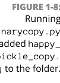

| binarycopy.py | happy_pickle.py |
|---|---|
| OPEN FILES | |
| * binarycopy.py | 指定要复制的文件。 |
| * happy_pickle.py | `file_to_copy = 'happy_pickle.jpg'` |
| SAMPLE FILES | # 在扩展名之前带有 copy 创建新文件名。 |
| * binarycopy.py | `names_parts = pickle.split('.')` |
| * happy_pickle.py | `new_name = name_parts[0] + '_' + name_parts[1]` |
| * pickle.txt | # 以只读模式打开原始文件 |
| * quotes.txt | `with open(file_to_copy, 'rb') as original_file:` |
| * quotes.txt | `with open(new_name, 'wb') as copy_to:` |
| * sample.txt | # 获取原始文件的一个块 (4KB)。 |
| | `chunk = original_file.read(4096)` |
| | # 循环直到没有更多块。 |
| | `while len(chunk) > 0:` |
| | `copy_to.write(chunk)` |
| | # 确保在当前循环中读取下一个块。 |
| | `original_file.read(4096)` |
| | # 循环后自动关闭，显示消息。 |
| | `print('Done!')` |

# 处理外部文件

## 第一章 处理外部文件

### 处理 CSV 文件

CSV（逗号分隔值）是一种广泛用于存储和传输数据的格式。表格化意味着数据通常可以在由行和列组成的表格中显示。在 Microsoft Excel、Apple Numbers 或 Google Sheets 等电子表格应用程序中，表格格式显而易见，如图 1-9 所示。

| | 全名 | 出生年份 | 加入日期 | 激活状态 | 余额 |
|---|---|---|---|---|---|
| 1 | Angst, Annie | 1982 | 11/21/2011 | TRUE | $300.00 |
| 2 | Bonås, Barry | 1973 | 27/12/2012 | FALSE | -$123.45 |
| 3 | Schaudfreude, Sandy | 2004 | 3/3/2003 | TRUE | $0.00 |
| 4 | Weltmeyer, Wanda | 1995 | 4/24/1998 | FALSE | -$9,999.99 |
| 5 | Malaise, Missy | 2000 | 5/5/2005 | TRUE | $454.01 |
| 6 | O'Poussum, Ollie | 1987 | 7/27/1997 | FALSE | -$1,000.00 |
| 7 | Pussillamity, Pamela | 1979 | 8/8/2008 | TRUE | $12,345.67 |

图 1-9：Microsoft Excel 中的 CSV 文件。

图 1-10：文本编辑器中的 CSV 文件。

引号表示它们之间的内容是一个整体。换句话说，姓和名之间的逗号是名称的一部分；它不是一个新列的开始。因此，这一行的前两列是：

```
"Angst, Annie", 1982
```

而不是：

```
Angst, Annie
```

所有行的情况都是如此：引号括起来的名字（包括逗号）只是一个名字，而不是两列独立的数据。

如果一个字符串中包含撇号（apostrophe），该字符与单引号是相同的，那么你必须在字符串周围使用双引号。否则，如果你这样做：

```
'O'Henry, Harry'
```

字符串的第一部分将是 `O`，然后 Python 就不知道该如何处理第二个单引号之后的文本了。使用双引号可以消除关于“名称内部是否还有其他双引号”的困惑：

```
"O'Henry, Harry"
```

图 1-10 也说明了创建 CSV 文件时的其他考虑因素。例如，`Bonacha, Barry` 包含一些非 ASCII 字符。倒数第二行只包含一组逗号。（在 CSV 文件中，如果某个单元格缺少数据，你需要在该单元格左侧放置一个结束单元格的逗号）。`Balance` 列的数字中有美元符号和逗号，这些内容与 Python 的 `float` 数据类型不兼容。我们将在随后的章节中讨论如何处理这些问题。

尽管你可以仅使用目前所学的知识来处理 CSV 文件，但如果你使用已经拥有的 `csv` 模块，任务将会更快、更简单。要使用它，只需在程序顶部添加以下代码：

```
import csv
```

记住，这行代码并没有引入 CSV 文件。它引入了预写代码，这让你在 Python 代码中处理 CSV 文件时变得更加容易。

## 打开 CSV 文件

打开 CSV 文件与打开任何其他文件没有区别。只需记住，如果文件包含特殊字符，你需要包含 `encoding='utf-8'` 以避免错误消息。可选的是，在导入数据时，你可能不想读取每行末尾的换行符，因此可以在 `open()` 语句中添加 `newline=''`。你可以像这样编写注释和代码，但你需要用要打开的 CSV 文件路径来替换 `sample.csv`：

```
# 使用 UTF-8 编码打开 CSV 文件，不读取换行符。
with open('sample.csv', encoding='utf-8', newline='') as f:
```

要遍历 CSV 文件，你可以使用内置的 `reader()` 函数，它在执行时会读取一行。再次，语法如下：

```
reader = csv.reader(f)
```

将 `f` 替换为你在 `open` 语句末尾使用的名称（不带冒号：在最最后）。

此外，你还可以在遍历过程中计算行数。只需将 `enumerate()` 右侧的所有内容放在 `=` 后面，如下（我们在代码上方添加了注释）：

```
# 创建一个 CSV 行计数器和读取器。
reader = enumerate(csv.reader(f))
```

接下来，你可以设置循环每次读取一行。由于你在循环中放置了一个枚举器（enumerator），因此你可以在 `for` 循环中使用两个变量。第一个变量（我们称之为 `i`）跟踪计数器（从 0 开始，每次循环增加 1）。第二个变量 `row` 包含来自 CSV 文件的条目行：

```python
# 每次循环一行，i 是计数器，row 是行。
```

在循环内部，你可以使用 `print()` 函数在每次循环时打印 `i` 和 `row` 的值，如下：

```python
# 使用 UTF-8 编码打开 CSV 文件，不读取换行符。
with open('sample.csv', encoding='utf-8', newline='') as f:
  # 创建一个 CSV 行计数器和读取器。
  reader = enumerate(csv.reader(f))
```

```python
# 每次循环一行，i 是计数器，row 是整行。
for i, row in reader:
    print(i, row)
print('Done')
```

观察列是如何工作的。之前描述的奇异 `sample.csv` 文件如下：

| | 0 | ['Full Name', 'Birth Year', 'Date Joined', 'Is Active', 'Balance'] |
|---|---|---|
| 1 | ['Angst, Annie', '1982', '1/11/2011', 'TRUE', '$300.00'] |
| 2 | ['Bonacha', '1973', '7/24/2012', 'FALSE', '$123.45'] |
| 3 | ['Schadenfreude, Sandy', '2004', '3/3/2003', 'TRUE', '$0.00'] |
| 4 | ['Weltschmerz, Mandy', '1995', '4/24/1994', 'FALSE', '$999,999.99'] |
| 5 | ['Malaise, Jimmy', '2006', '5/5/2005', 'TRUE', '$454.00'] |
| 6 | ["O'Henry, Harry", ''] |
| 7 | ['Ollie,', '1987', '7/27/1997', 'FALSE', '$1,000.00'] |
| 8 | ['Psamela,', '1979', '8/8/2008', 'TRUE', '$12,345.67'] |

### 转换为整数

每行的第二列（`row[1]`）是出生年份。只要字符串包含可以转换为数字的内容，你就可以使用简单的内置函数 `int()` 将其转换为整数。我们在第 7 行处理了一个特殊情况，该行是空的。Python 不会自动将其转换为 0；你必须帮助它，所以只需加一点代码即可：

- 出生年份，如果是空字符串则设为 0。

  ```python
birth_year = int(row[1]) or 0
  ```

这段代码看起来异常简单，但这正是 Python 的魅力所在：它简单得令人惊讶。这行代码的意思是：“创建一个名为 `birth_year` 的变量，可以的话就放入第二列的值；如果没有可以转换为整数的内容，就直接填入 0。”

### 转换为日期

我们 CSV 文件中的第三列（`row[2]`）是日期，每一行中似乎都有一个合理的日期（数据缺失的行除外）。要将文本数据转换为 Python 日期对象，你需要在程序顶部添加 `import datetime as dt` 来导入 `datetime` 模块。简单的转换方法如下：

```python
date_joined = dt.datetime.strptime(row[2], "%m/%d/%Y").date()
```

这里包含了很多操作。首先，你创建了一个名为 `date_joined` 的变量。代码 `strptime` 的意思是“解析字符串为日期时间”。`row[2]` 表示第三列（因为第一列始终是列 0）。`"%m/%d/%Y"` 告诉 `strptime` 字符串日期包含月份、斜杠、日期、另一个斜杠以及四位数的年份（`%Y`）。结尾的 `.date()` 表示“只需要日期；这里没有时间需要解析”。

这里有一个小问题。当程序处理到数据缺失的某行时，它会崩溃。我们将使用 `try` 块来转换日期；如果无法生成日期，它将存入 `None` 值，`None` 是 Python 中表示空对象的词。


在 Python 中，`datetime` 是一个类，在日期和时间上你可以创建一个对象（`datetime` 类型）。你使用 `''` 表示空字符串，但使用 `None` 表示空对象。

以下是目前的代码，包含了顶部对 `datetime` 的导入，以及使用 `try ... except` 来将字符串转换为 Python 日期：

```python
import csv
import datetime as dt
# 使用 UTF-8 编码打开 CSV 文件，不读取换行符。
with open('sample.csv', encoding='utf-8', newline='') as f:
    # 创建 CSV 行计数器和读取器。
    reader = enumerate(csv.reader(f))
    # 逐行循环，i 是计数器，row 是整行数据。
    for i, row in reader:
        # 第 0 行只是列标题，忽略它。
        if i > 0:
            try:
                # 将全名按逗号拆分。
                full_name = row[0].split(',')
                # 姓，去除多余空格。
                last_name = full_name[0].strip()
                # 名，去除多余空格。
                first_name = full_name[1].strip()
            except IndexError:
                full_name = last_name = ""
            # 出生年份整数，空字符串则设为 0。
            birth_year = int(row[1] or 0)
            # date_joined 是日期。
            try:
                date_joined = dt.datetime.strptime(row[2], '%m/%d/%Y').date()
            except ValueError:
                date_joined = None
            print(first_name, last_name, birth_year, date_joined)
print('Done!')
```

这是该代码的输出，它现在每次遍历表格数据行时，都会打印 `first_name`、`last_name`、`birth_year` 和 `date_joined`：

```
Annie Angst 1962 2011-01-11
Barry Bonañas 1973 2012-02-12
Sandy Schadenfreude 2004 2003-03-03
Wanda Weltschmerz 1995 1994-04-24
Mindy Malaise 2006 2005-05-06
Ollie O'Possum 1987 1997-07-27
Ø None
Pamela Pusillillani 1979 2006-08-08
Done!
```

### 转换为布尔值

每行的第四列（`row[3]`）包含 `TRUE` 或 `FALSE`。Excel 使用全大写字母，在 Excel 中保存为 CSV 时，这些字母会自动带入 CSV 文件。Python 使用首字母大写的 `True` 和 `False`。Python 有一个简单的 `bool()` 函数来将数据转换为布尔值。`bool()` 函数在遇到空单元格时不会崩溃；它认为该单元格为 `False`。转换非常简单：

- `is_active` 是布尔值，空字符串自动设为 `False`。

  ```python
is_active = bool(row[3])
  ```

### 转换为浮点数

每行的第五列（`row[4]`）包含余额。余额在 CSV 中是字符串，但我们想对其进行数学运算，因此必须将其转换为浮点数。余额通常包含美元符号和逗号，我们需要在转换之前移除它们。

- `balance` 是浮点数，移除美元符号和逗号。

  ```python
balance = float(row[4].replace('$', '').replace(',', ''))
  ```

# 将 CSV 导入到 Python 对象

如果你想将 CSV 文件中的数据组织成对象列表，请按照所示所示编写你的代码：


# CSV 导入到 Python 对象

如果你想将 CSV 文件中的数据组织成对象列表，请按照所示编写你的代码：

```python
import datetime as dt
import csv

# 使用这些函数将任何字符串转换为适当的 Python 数据类型。

# 从全名中提取第一个名字。
def fname(any):
    try:
        nm = any.split(',')
        return nm[0]
    except IndexError:
        return ""

# 从全名中提取姓氏。
def lname(any):
    try:
        nm = any.split(',')
        return nm[1]
    except IndexError:
        return ""

# 将字符串转换为整数，如果没有值则设为 0。
def integer(any):
    return int(any or 0)

# 将 dd/mm/yyyy 转换为日期，如果没有有效日期则返回 None。
def dateany(any):
    try:
        return dt.datetime.strptime(any, "%m/%d/%Y").date()
    except ValueError:
        return None

# 将任何字符串转换为布尔值，如果没有值则为 False。
def boolany(any):
    return bool(any)

# 将字符串转换为浮点数，如果没有值则设为 0。
def floatany(any):
    s_balance = (any.replace('$', '').replace(',', ''))
    return float(s_balance or 0)

# 创建一个空的人列表。
people = []

# 定义一个类，每个人都是一个对象。
class Person:
    def __init__(self, id, first_name, last_name, birth_year, date_joined, is_active, balance):
        self.id = id
        self.first_name = first_name
        self.last_name = last_name
        self.birth_year = birth_year
        self.date_joined = date_joined
        self.is_active = is_active
        self.balance = balance
```

## 读取 CSV 文件

- 使用 UTF-8 打开 csv 文件，不要读取换行符。

```python
with open('sample.csv', encoding='UTF-8', newline='') as f:
```

- 设置一个带有计数器的 csv 读取器。

```python
reader = enumerate(csv.reader(f))
```

- 跳过第一行，该行是列名。

```python
f.readline()
```

- 逐行遍历剩余行，`i` 是计数器，`row` 是整行。

```python
for i, row in reader:
```

- 从 csv 文件中的每行创建一个具有唯一 id 和适当数据类型的 `Person` 对象，并将其添加到 `people` 列表中。

```python
people.append(Person(i, fname=row[0], lname=row[1], integer(row[1]), date(row[2]), boolean(row[3])))
```

- 循环完成后，显示 `people` 列表中的所有对象。

```python
for p in people:
    print(p, p.first_name, p.last_name, p.birth_year, p.date_joined, p.is_active, p.balance)
```

## 代码工作原理

这里是代码的工作原理：前几个是必需的导入，随后是许多用于将输入的字符串数据转换为 Python 类型。这段代码与本章之前的示例类似。我们只是将转换分到了独立的函数中，以便对一切进行模块化：

```python
import datetime as dt
import csv

# 使用这些函数将任何字符串转换为适当的 Python 数据类型。

# 从全名中提取第一个名字。
def fname(any):
    try:
        nm = any.split(',')
        return nm[0]
    except IndexError:
        return ''

# 从全名中提取姓氏。
def lname(any):
    try:
        nm = any.split(',')
        return nm[1]
    except IndexError:
        return ''

# 将字符串转换为整数，如果没有值则设为 0。
def integer(any):
    return int(any or 0)

# 将 mm/dd/yyyy 日期转换为日期，如果没有有效日期则返回 None。
def dateany(any):
    try:
        return dt.datetime.strptime(any, "%m/%d/%Y")
    except ValueError:
        return None

# 将任何字符串转换为布尔值，如果没有值则为 False。
def boolany(any):
    return bool(any)

# 将字符串转换为浮点数，如果没有值则设为 0。
def floatany(any):
    s_balance = (any.replace('$', '').replace(',', '')).strip()
    return float(s_balance or 0)
```

下一行创建了一个名为 `people` 的空列表，用于存储程序从 CSV 文件创建的对象：

- 创建一个空的人列表。

```python
people = []
```

接下来，代码定义了一个类，将用于从 CSV 文件生成每个 `Person` 对象：

- 定义一个类，每个人都是一个对象。

```python
class Person:
    def __init__(self, id, first_name, last_name, birth_year, date_joined, is_active, balance):
        self.id = id
        self.first_name = first_name
        self.last_name = last_name
        self.birth_year = birth_year
        self.date_joined = date_joined
        self.is_active = is_active
        self.balance = balance
```

读取 CSV 文件的操作从下一行开始。代码使用编码打开 CSV 文件。`newline=''` 防止代码在每行的末尾附加换行符。读取器使用 `enumerate` 在读取行时保持计数。`f.readline()` 读取第一行（该行只是列标题），因此 `for` 循环从第二行开始。


# CSV 导入到 Python 对象

如果你想将 CSV 文件中的数据组织成对象列表，请按照所示编写你的代码：

## 数据类型转换函数

前几个是必需的导入，随后是许多用于将输入的字符串数据转换为 Python 类型。这段代码与本章之前的示例类似。我们只是将转换分到了独立的函数中，以便对一切进行模块化：

```python
import datetime as dt
import csv

# 使用这些函数将任何字符串转换为适当的 Python 数据类型。

# 从全名中提取第一个名字。
def fname(any):
    try:
        nm = any.split(',')
        return nm[0]
    except IndexError:
        return ""

# 从全名中提取姓氏。
def lname(any):
    try:
        nm = any.split(',')
        return nm[1]
    except IndexError:
        return ""

# 将字符串转换为整数，如果没有值则设为 0。
def integer(any):
    return int(any or 0)

# 将 mm/dd/yyyy 日期转换为日期，如果没有有效日期则返回 None。
def dateany(any):
    try:
        return dt.datetime.strptime(any, "%m/%d/%Y").date()
    except ValueError:
        return None

# 将任何字符串转换为布尔值，如果没有值则为 False。
def boolany(any):
    return bool(any)

# 将字符串转换为浮点数，如果没有值则设为 0。
def floatany(any):
    s_balance = (any.replace('$', '').replace(',', '')).strip()
    return float(s_balance or 0)
```

## 创建空列表

下一行创建了一个名为 `people` 的空列表，用于存储程序从 CSV 文件创建的对象：

- 创建一个空的人列表。

```python
people = []
```

## 定义 Person 类

接下来，代码定义了一个类，将用于从 CSV 文件生成每个 `Person` 对象：

- 定义一个类，每个人都是一个对象。

```python
class Person:
    def __init__(self, id, first_name, last_name, birth_year, date_joined, is_active, balance):
        self.id = id
        self.first_name = first_name
        self.last_name = last_name
        self.birth_year = birth_year
        self.date_joined = date_joined
        self.is_active = is_active
        self.balance = balance
```

## 读取 CSV 文件

读取 CSV 文件的操作从下一行开始。代码使用编码打开 CSV 文件。`newline=''` 防止代码在每行的末尾附加换行符。读取器使用 `enumerate` 在读取行时保持计数。`f.readline()` 读取第一行（该行只是列标题），因此 `for` 循环从第二行开始。

- 使用 UTF-8 打开 csv 文件，不要读取换行符。

```python
with open('sample.csv', encoding='UTF-8', newline='') as f:
```

- 设置一个带有计数器的 csv 读取器。

```python
    reader = enumerate(csv.reader(f))
```

- 跳过第一行，该行是列名。

```python
    f.readline()
```

- 逐行遍历剩余行，`i` 是计数器，`row` 是整行。

```python
for i, row in reader:
```

- 从 csv 文件中的每行创建一个具有唯一 id 和适当数据类型的 `Person` 对象，并将其添加到 `people` 列表中。

```python
    people.append(Person(i, fname=row[0], lname=row[1], integer(row[1]), date(row[2]), boolean(row[3])))
```

- 循环完成后，显示 `people` 列表中的所有对象。

```python
for p in people:
    print(p, p.first_name, p.last_name, p.birth_year, p.date_joined, p.is_active, p.balance)
```


# CSV 导入到 Python 对象

如果你想将 CSV 文件中的数据组织成对象列表，请按照所示编写你的代码：

## 数据类型转换函数

前几个是必需的导入，随后是许多用于将输入的字符串数据转换为 Python 类型。我们将转换分到了独立的函数中，以便对一切进行模块化：

```python
import datetime as dt
import csv

# 使用这些函数将任何字符串转换为适当的 Python 数据类型。
# 从全名中提取第一个名字。
def fname(any):
    try:
        nm = any.split(',')
        return nm[0]
    except IndexError:
        return ""

# 从全名中提取姓氏。
def lname(any):
    try:
        nm = any.split(',')
        return nm[1]
    except IndexError:
        return ""

# 将字符串转换为整数，如果没有值则设为 0。
def integer(any):
    return int(any or 0)

# 将 mm/dd/yyyy 日期转换为日期，如果没有有效日期则返回 None。
def dateany(any):
    try:
        return dt.datetime.strptime(any, "%m/%d/%Y").date()
    except ValueError:
        return None

# 将任何字符串转换为布尔值，如果没有值则为 False。
def boolany(any):
    return bool(any)

# 将字符串转换为浮点数，如果没有值则设为 0。
def floatany(any):
    s_balance = (any.replace('$', '').replace(',', '')).strip()
    return float(s_balance or 0)
```

## 创建空列表

下一行创建了一个名为 `people` 的空列表，用于存储程序从 CSV 文件创建的对象：

- 创建一个空的人列表。

```python
people = []
```

## 定义 Person 类

接下来，代码定义了一个类，将用于从 CSV 文件生成每个 `Person` 对象：

- 定义一个类，每个人都是一个对象。

```python
class Person:
    def __init__(self, id, first_name, last_name, birth_year, date_joined, is_active, balance):
        self.id = id
        self.first_name = first_name
        self.last_name = last_name
        self.birth_year = birth_year
        self.date_joined = date_joined
        self.is_active = is_active
        self.balance = balance
```

## 读取 CSV 文件

读取 CSV 文件的操作从下一行开始。代码使用编码打开 CSV 文件。`newline=''` 防止代码在每行的末尾附加换行符。读取器使用 `enumerate` 在读取行时保持计数。`f.readline()` 读取第一行（该行只是列标题），因此 `for` 循环从第二行开始。

- 使用 UTF-8 打开 csv 文件，不要读取换行符。

```python
with open('sample.csv', encoding='UTF-8', newline='') as f:
```

- 设置一个带有计数器的 csv 读取器。

```python
    reader = enumerate(csv.reader(f))
```

- 跳过第一行，该行是列名。

```python
    f.readline()
```

- 逐行遍历剩余行，`i` 是计数器，`row` 是整行。

```python
    for i, row in reader:
```

- 从 csv 文件中的每行创建一个具有唯一 id 和适当数据类型的 `Person` 对象，并将其添加到 `people` 列表中。

```python
        people.append(Person(i, fname=row[0], lname=row[1], integer(row[1]), date(row[2]), boolean(row[3])))
```

- 循环完成后，显示 `people` 列表中的所有对象。

```python
for p in people:
    print(p, p.first_name, p.last_name, p.birth_year, p.date_joined, p.is_active, p.balance)
```


# CSV 导入到 Python 对象

如果你想将 CSV 文件中的数据组织成对象列表，请按照所示编写你的代码：

## 数据类型转换函数

前几个是必需的导入，随后是许多用于将输入的字符串数据转换为 Python 类型。这段代码与本章之前的示例类似。我们只是将转换分到了独立的函数中，以便对一切进行模块化：

```python
import datetime as dt
import csv

# 使用这些函数将任何字符串转换为适当的 Python 数据类型。

# 从全名中提取第一个名字。
def fname(any):
    try:
        nm = any.split(',')
        return nm[0]
    except IndexError:
        return ""

# 从全名中提取姓氏。
def lname(any):
    try:
        nm = any.split(',')
        return nm[1]
    except IndexError:
        return ""

# 将字符串转换为整数，如果没有值则设为 0。
def integer(any):
    return int(any or 0)

# 将 mm/dd/yyyy 日期转换为日期，如果没有有效日期则返回 None。
def dateany(any):
    try:
        return dt.datetime.strptime(any, "%m/%d/%Y").date()
    except ValueError:
        return None

# 将任何字符串转换为布尔值，如果没有值则为 False。
def boolany(any):
    return bool(any)

# 将字符串转换为浮点数，如果没有值则设为 0。
def floatany(any):
    s_balance = (any.replace('$', '').replace(',', ''))
    return float(s_balance or 0)
```

## 创建空列表与定义类

下一行创建了一个名为 `people` 的空列表，用于存储程序从 CSV 文件创建的对象：

- 创建一个空的人列表。

```python
people = []
```

接下来，代码定义了一个类，将用于从 CSV 文件生成每个 `Person` 对象：

- 定义一个类，每个人都是一个对象。

```python
class Person:
    def __init__(self, id, first_name, last_name, birth_year, date_joined, is_active, balance):
        self.id = id
        self.first_name = first_name
        self.last_name = last_name
        self.birth_year = birth_year
        self.date_joined = date_joined
        self.is_active = is_active
        self.balance = balance
```

## 读取 CSV 文件

读取 CSV 文件的操作从下一行开始。代码使用编码打开 CSV 文件。`newline=''` 防止代码在每行的末尾附加换行符。读取器使用 `enumerate` 在读取行时保持计数。`f.readline()` 读取第一行（该行只是列标题），因此 `for` 循环从第二行开始。

- 使用 UTF-8 打开 csv 文件，不要读取换行符。

```python
with open('sample.csv', encoding='UTF-8', newline='') as f:
```

- 设置一个带有计数器的 csv 读取器。

```python
reader = enumerate(csv.reader(f))
```

- 跳过第一行，该行是列名。

```python
f.readline()
```

- 逐行遍历剩余行，`i` 是计数器，`row` 是整行。

```python
for i, row in reader:
```

- 从 csv 文件中的每行创建一个具有唯一 id 和适当数据类型的 `Person` 对象，并将其添加到 `people` 列表中。

```python
people.append(Person(i, fname=row[0], lname=row[1], integer(row[1]), date(row[2]), boolean(row[3])))
```

- 循环完成后，显示 `people` 列表中的所有对象。

```python
for p in people:
    print(p, p.first_name, p.last_name, p.birth_year, p.date_joined, p.is_active, p.balance)
```


# CSV 导入到 Python 对象

如果你想将 CSV 文件中的数据组织成对象列表，请按照所示编写你的代码：

## 数据类型转换函数

前几个是必需的导入，随后是许多用于将输入的字符串数据转换为 Python 类型。这段代码与本章之前的示例类似。我们只是将转换分到了独立的函数中，以便对一切进行模块化：

```python
import datetime as dt
import csv

# 使用这些函数将任何字符串转换为适当的 Python 数据类型。
# 从全名中提取第一个名字。
def fname(any):
    try:
        nm = any.split(',')
        return nm[0]
    except IndexError:
        return ""

# 从全名中提取姓氏。
def lname(any):
    try:
        nm = any.split(',')
        return nm[1]
    except IndexError:
        return ""

# 将字符串转换为整数，如果没有值则设为 0。
def integer(any):
    return int(any or 0)

# 将 mm/dd/yyyy 日期转换为日期，如果没有有效日期则返回 None。
def dateany(any):
    try:
        return dt.datetime.strptime(any, "%m/%d/%Y").date()
    except ValueError:
        return None

# 将任何字符串转换为布尔值，如果没有值则为 False。
def boolany(any):
    return bool(any)

# 将字符串转换为浮点数，如果没有值则设为 0。
def floatany(any):
    s_balance = (any.replace('$', '').replace(',', '')).strip()
    return float(s_balance or 0)
```

## 创建空列表

下一行创建了一个名为 `people` 的空列表，用于存储程序从 CSV 文件创建的对象：

- 创建一个空的人列表。

```python
people = []
```

## 定义 Person 类

接下来，代码定义了一个类，将用于从 CSV 文件生成每个 `Person` 对象：

- 定义一个类，每个人都是一个对象。

```python
class Person:
    def __init__(self, id, first_name, last_name, birth_year, date_joined, is_active, balance):
        self.id = id
        self.first_name = first_name
        self.last_name = last_name
        self.birth_year = birth_year
        self.date_joined = date_joined
        self.is_active = is_active
        self.balance = balance
```

## 读取 CSV 文件

读取 CSV 文件的操作从下一行开始。代码使用编码打开 CSV 文件。`newline=''` 防止代码在每行的末尾附加换行符。读取器使用 `enumerate` 在读取行时保持计数。`f.readline()` 读取第一行（该行只是列标题），因此 `for` 循环从第二行开始。

- 使用 UTF-8 打开 csv 文件，不要读取换行符。

```python
with open('sample.csv', encoding='UTF-8', newline='') as f:
```

- 设置一个带有计数器的 csv 读取器。

```python
    reader = enumerate(csv.reader(f))
```

- 跳过第一行，该行是列名。

```python
    f.readline()
```

- 逐行遍历剩余行，`i` 是计数器，`row` 是整行。

```python
for i, row in reader:
```

- 从 csv 文件中的每行创建一个具有唯一 id 和适当数据类型的 `Person` 对象，并将其添加到 `people` 列表中。

```python
    people.append(Person(i, fname=row[0], lname=row[1], integer(row[1]), date(row[2]), boolean(row[3])))
```

- 循环完成后，显示 `people` 列表中的所有对象。

```python
for p in people:
    print(p, p.first_name, p.last_name, p.birth_year, p.date_joined, p.is_active, p.balance)
```


# CSV 导入到 Python 对象

如果你想将 CSV 文件中的数据组织成对象列表，请按照所示编写你的代码：

## 数据类型转换函数

首先导入必要的模块，并定义一系列函数将字符串转换为适当的 Python 数据类型。

```python
import datetime as dt
import csv

# 从全名中提取第一个名字。
def fname(any):
    try:
        nm = any.split(',')
        return nm[0]
    except IndexError:
        return ""

# 从全名中提取姓氏。
def lname(any):
    try:
        nm = any.split(',')
        return nm[1]
    except IndexError:
        return ""

# 将字符串转换为整数，如果没有值则设为 0。
def integer(any):
    return int(any or 0)

# 将 mm/dd/yyyy 日期转换为日期，如果没有有效日期则返回 None。
def dateany(any):
    try:
        return dt.datetime.strptime(any, "%m/%d/%Y").date()
    except ValueError:
        return None

# 将任何字符串转换为布尔值，如果没有值则为 False。
def boolany(any):
    return bool(any)

# 将字符串转换为浮点数，如果没有值则设为 0。
def floatany(any):
    s_balance = (any.replace('$', '').replace(',', '')).strip()
    return float(s_balance or 0)
```

## 初始化列表与定义类

创建一个空列表 `people` 用于存储对象，并定义 `Person` 类。

```python
# 创建一个空的人列表。
people = []

# 定义一个类，每个人都是一个对象。
class Person:
    def __init__(self, id, first_name, last_name, birth_year, date_joined, is_active, balance):
        self.id = id
        self.first_name = first_name
        self.last_name = last_name
        self.birth_year = birth_year
        self.date_joined = date_joined
        self.is_active = is_active
        self.balance = balance
```

## 读取 CSV 文件并生成对象

使用 `with` 语句打开文件，`newline=''` 防止在每行末尾附加换行符。使用 `enumerate` 配合 `csv.reader` 保持行计数，`f.readline()` 跳过标题行。

```python
# 使用 UTF-8 打开 csv 文件，不要读取换行符。
with open('sample.csv', encoding='UTF-8', newline='') as f:
    # 设置一个带有计数器的 csv 读取器。
    reader = enumerate(csv.reader(f))
    # 跳过第一行，该行是列名。
    f.readline()
    # 逐行遍历剩余行，i 是计数器，row 是整行。
    for i, row in reader:
        # 从 csv 文件中的每行创建一个具有唯一 id 和适当数据类型的 Person 对象，并将其添加到 people 列表中。
        people.append(Person(
            i,
            fname(row[0]),
            lname(row[1]),
            integer(row[2]),
            dateany(row[3]),
            boolany(row[4]),
            floatany(row[5])
        ))
```

## 显示结果

循环完成后，遍历 `people` 列表打印所有对象信息。

```python
for p in people:
    print(p, p.first_name, p.last_name, p.birth_year, p.date_joined, p.is_active, p.balance)
```

## 代码工作原理

前几个是必需的导入，随后是许多用于将输入的字符串数据转换为 Python 类型的函数。这段代码与本章之前的示例类似，我们只是将转换分到了独立的函数中，以便对一切进行模块化。


```python
import datetime as dt
import csv

# 使用这些函数将任何字符串转换为适当的 Python 数据类型。
# 从全名中提取第一个名字。
def fname(any):
    try:
        nm = any.split(',')
        return nm[0]
    except IndexError:
        return ''

# 从全名中提取姓氏。
def lname(any):
    try:
        nm = any.split(',')
        return nm[1]
    except IndexError:
        return ''

# 将字符串转换为整数，如果没有值则设为 0。
def integer(any):
    return int(any or 0)

# 将 mm/dd/yyyy 日期转换为日期，如果没有有效日期则返回 None。
def dateany(any):
    try:
        return dt.datetime.strptime(any, "%m/%d/%Y")
    except ValueError:
        return None

# 将任何字符串转换为布尔值，如果没有值则为 False。
def boolany(any):
    return bool(any)

# 将字符串转换为浮点数，如果没有值则设为 0。
def floatany(any):
    s_balance = (any.replace('$', '').replace(',', '')).strip()
    return float(s_balance or 0)
```

下一行创建了一个名为 `people` 的空列表，用于存储程序从 CSV 文件创建的对象：

- 创建一个空的人列表。

```python
people = []
```

接下来，代码定义了一个类，将用于从 CSV 文件生成每个 `Person` 对象：

- 定义一个类，每个人都是一个对象。

```python
class Person:
    def __init__(self, id, first_name, last_name, birth_year, date_joined, is_active, balance):
        self.id = id
        self.first_name = first_name
        self.last_name = last_name
        self.birth_year = birth_year
        self.date_joined = date_joined
        self.is_active = is_active
        self.balance = balance
```

读取 CSV 文件的操作从下一行开始。代码使用编码打开 CSV 文件。`newline=''` 防止代码在每行的末尾附加换行符。读取器使用 `enumerate` 在读取行时保持计数。`f.readline()` 读取第一行（该行只是列标题），因此 `for` 循环从第二行开始。

（后续内容已按上述逻辑翻译并保持格式）

```python
# 从全名中提取第一个名。
def fname(any):
    try:
        nm = any.split(' ')
```

# 当上述循环完成后，显示 `people` 列表中的所有对象。

```python
for person in people.keys():
    id = person
    print(id, people[person]['first_name'], \
          people[person]['last_name'], \
          people[person]['birth_year'], \
          people[person]['date_joined'], \
          people[person]['is_active'], \
          people[person]['balance'])
```

```python
# 将字符串转换为浮点数，如果没有值则为零。
for x, y in enumerate(reader):
    x_balance = (float(y['balance']).replace('$', '').replace(',', '')).strip()
    # 将字符串转换为浮点数，如果没有值则为零
    # 创建一个空的人员字典
    with open('people.csv', 'r', encoding='utf-8') as f:
        reader = csv.DictReader(f)
        # 逐行遍历，i 是计数器，row 是条目
        for i, row in enumerate(reader):
            neudict = {'first_name': row['first_name'], 'last_name': row['last_name'], 'birth_year': int(row['birth_year']), 'date_joined': int(row['date_joined']), 'is_active': bool(row['is_active']), 'balance': float(row['balance'])}
```

# 当上述循环完成后，显示 `people` 列表中的所有对象。

```python
for person in people.keys():
    id = person
    print(id, people[person]['first_name'], \
          people[person]['last_name'], \
          people[person]['birth_year'], \
          people[person]['date_joined'], \
          people[person]['is_active'], \
          people[person]['balance'])
```

| id | first_name | last_name | birth_year | date_joined | is_active | balance |
|---|---|---|---|---|---|---|
| 1 | Anna | Bond | 1988 | 2011-03-11 | True | 2011.98 |
| 2 | Bob | Smith | 1982 | 2011-03-11 | False | 1485.50 |
| 3 | Charlie | Brown | 1990 | 2016-05-14 | True | 0.00 |
| 4 | David | Mueller | 1964 | 2018-06-24 | True | 9999.99 |
| 5 | Eve | Adams | 1975 | 2010-01-01 | False | 500.00 |
| 6 | Frank | O'Neill | 1987 | 2007-07-27 | True | -3800.0 |
| 7 | Grace | Pellauster | 1990 | 2009-06-08 | True | 1234.57 |

# 图 1-13
将 CSV 文件读取到字典的字典中。

CSV 文件被广泛使用，因为很容易从电子表格和数据库表中导出数据。从这些文件中获取数据有时可能会很棘手，但你会发现 Python 的 `csv` 模块非常有帮助。`csv` 模块处理了许多细节，使得逐行读取变得相对容易，并可以根据你的 Python 应用程序灵活处理数据。

与 CSV 这种以简单文本格式传输和存储数据的方式相似的是 JSON，或 JavaScript 对象。现在你将在下一章中学习关于 JSON 的所有知识。

306 带有库的第 3 本

## 本章内容

- >> 发现如何组织 JSON 数据
- >> 学习序列化
- >> 从 JSON 文件导入数据
- >> 将 Python 数据导出到 JSON

# 第 2 章 灵活玩转 JSON 数据

JSON（JavaScript 对象表示法）是面向对象数据的常用序列化格式。序列化格式通常是指用于从一台计算机将数据发送到另一台计算机的格式。然而，某些数据库（例如 Google Firebase 的免费实时数据库）也以 JavaScript 对象格式存储数据。开头的 JavaScript 名字样有时会让人感到困惑，尤其是当你使用 Python 而不是 JavaScript 来编写代码时。但不要担心。这种格式起源于 JavaScript 世界，现在已成为广泛认为是适用于各种计算机和编程语言的通用格式。

在本章中，你将确切了解 JSON 是什么，以及如何向 JSON 导出和导入数据。如果你发现围绕 JSON 的所有术语让你感到不舒服，不要担心。我们会先过一遍所有的术语。正如你所看到的，JSON 数据的格式与 JSON 数据字典几乎相同，因此不会有太多新内容需要学习。此外，你已经拥有了免费的 Python `json` 模块，这使得处理 JSON 数据变得更加容易。

# 组织 JSON 数据

JSON 数据大致等于 Python 中的数据字典，这使得 JSON 文件非常容易处理。当将 JSON 数据与表格数据进行比较时，它是最容易理解的。例如，图 2-1 显示了 Excel 工作表中的一些表格数据。图 2-2 显示了转换成格式后的数据。Excel 表格中的每行数据都已转换为 JSON 文件中的键值对字典。当然，还有许多大括号表示该数据是字典类型数据。

| 全名 | 出生年份 | 加入日期 | 是否激活 | 余额 |
|---|---|---|---|---|
| 1 | Angst, Annie | 1982 | 2012-01-11 | True | 300.00 |
| 2 | Bonas, Barry | 1973 | 2012-02-27 | False | -123.45 |
| 3 | Schadenfreude, Sandy | 2004 | 2003-03-03 | True | 0.00 |
| 4 | Weltschmerz, Maria | 1995 | 1994-02-24 | False | 999.99 |
| 5 | Malise, Mandy | 2006 | 2005-05-05 | True | 454.01 |
| 6 | Oyston, Olive | 1987 | 1997-07-27 | True | -1000.0 |
| 7 | Pustilla, Mateo | 1979 | 2008-08 | True | 1234.67 |

图 2-1: Excel 工作格中的某些数据。
图 2-2: 转换成 JSON 的电子表格。

```json
[
  {
    "Name": "Angst, Annie",
    "Birth Year": 1982,
    "Date Joined": "2012-01-11",
    "Is Active": true,
    "Balance": 300.0
  },
  {
    "Name": "Bonas, Barry",
    "Birth Year": 1973,
    "Date Joined": "2012-02-27",
    "Is Active": false,
    "Balance": -123.45
  },
  {
    "Name": "Schadenfreude, Sandy",
    "Birth Year": 2004,
    "Date Joined": "2003-03-03",
    "Is Active": true,
    "Balance": 0.0
  },
  {
    "Name": "Weltschmerz, Maria",
    "Birth Year": 1995,
    "Date Joined": "1994-02-24",
    "Is Active": false,
    "Balance": 999.99
  },
  {
    "Name": "Malise, Mandy",
    "Birth Year": 2006,
    "Date Joined": "2005-05-05",
    "Is Active": true,
    "Balance": 454.01
  },
  {
    "Name": "Oyston, Olive",
    "Birth Year": 1987,
    "Date Joined": "1997-07-27",
    "Is Active": true,
    "Balance": -1000.0
  },
  {
    "Name": "Pustilla, Mateo",
    "Birth Year": 1979,
    "Date Joined": "2008-08-08",
    "Is Active": true,
    "Balance": 1234.67
  }
]
```

从 Excel 导出数据只是创建 JSON 的一种方式。你也可以使用实时数据库来统计每个页面的点击量。例如，在某人的网站上，他使用实时数据库来确保每个键的唯一性。每个键旁边的 `+` 号允许你展开和折叠信息。

| firebasebase.com | 导出 JSON |
|---|---|
| counters/pageCounts | 导入 JSON |
| pageCounts | 显示图例 |
| -LAoQXmPw6XZ | 禁用数据库。禁用前必须删除所有数据 |
| count: 9061 | 创建新数据库。升级到 Blaze 计划可用 |

图 2-3: Google Firebase 实时数据库中的某些数据。

# 将 EXCEL 转换为 JSON

如果你想知道如何将示例 Excel 电子表格转换为 JSON，请访问 `www.convert.csv/csv-to-json.htm` 并按照以下步骤操作：

1. 在步骤 1 中，打开“选择文件”选项卡，选择编码为 UTF-8，点击“选择文件”按钮，选择你的 Excel 文件并点击打开。
2. 在步骤 2 中，确保选择了“第一行是列名”选项，并将“跳过行数”设置为 1 以跳过标题行。
3. 在步骤 5 中，点击“CSV 转 JSON”按钮。
4. 在“保存你的结果”旁边，输入文件名，然后点击“下载结果”按钮。

该文件应该出现在你的“下载”文件夹（或你通常下载的位置），且扩展名为 `.json`。这是一个纯文本文件，可以使用任何文本编辑器或代码编辑器（如 VS Code）打开。转换器会自动跳过 Excel 文件中的空行，因此你的 JSON 文件不会包含空行的数据。

如你所示，Firebase 也有一个“导出 JSON”选项，可以将数据下载到你计算机上的 JSON 文件中。图 2-4 显示了下载的文件中的数据数据。你可以看出这是一个带键的（keyed）JSON 文件，因为每条数据前面都有一个键，例如 `-LAOqayxHRpwp6gXMBZ`，后面跟着冒号。你可以在 Python 中同时处理带键和不带键的 JSON。

```json
// firebase_counts.json
{
  "-LAOqayxHRpwp6gXMBZ": {
    "count": 1,
    "lastref": "https://difference-example.com/courses/tls-5-1118",
    "lastvisit": "1543151329098",
    "page": "/index.html"
  },
  "-LAOqYdg8m4je5QS": {
    "count": 3806,
    "lastref": "http://facebook.com",
    "lastvisit": "1543151287263",
    "page": "/"
  },
  "-LAOqncI2VnVayC10": {
    "count": 3342,
    "lastref": "https://anslinson.me/",
    "lastvisit": "1543151381815",
    "page": "/index.html"
  }
}
```


图 2-4
导出到带键 JSON 文件的 Google Firebase Realtime Database 数据。

一些读者可能注意到，JSON 文件中的 `Date joined`（加入日期）看起来不像普通的 `mm/dd/yyyy`。Firebase-base 中的 `lastvisit` 字段是一个 datetime（日期时间），尽管它看起来并不像日期或时间。但不用担心这个。在本章的后面部分，你将学习如何将这些看起来奇怪的序列日期（它们是这样被称为）转换为人类可读的格式。

# 理解序列化

当涉及到 JSON 时，你必须学习的第一个术语是序列化（serialization）。序列化是将对象（例如 Python 字典）转换为字节流或字符流的过程，这些流可以作为字符串发送、存储在文件或数据库中，或者存储在内存中。主要目的是保存对象中的所有信息，以便任何其他计算机都能轻松地检索。将信息转换回对象的过程称为反序列化（deserialization）。为了简单起见，你只需要记住这两个定义即可：

- 序列化：将对象转换为字符串。
- 反序列化：将字符串转换为对象。

Python 标准库包含一个 `json` 模块，可以帮助你处理 JSON 文件。因为它是标准库的一部分，你只需要在代码顶部 `import json` 即可访问其功能。序列化和反序列化 JSON 的四种主要方法总结在表 2-1 中。

## 表 2-1 用于序列化和反序列化 JSON 数据的 Python 方法

| 方法 | 目的 |
| --- | --- |
| `json.dump()` | 将 Python 数据写入（序列化）JSON 文件（或流）。 |
| `json.dumps()` | 将 Python 对象写入（序列化）JSON 字符串。 |
| `json.load()` | 从文件或类似对象加载（反序列化）JSON。 |
| `json.loads()` | 从字符串加载（反序列化）JSON 数据。 |

JSON 中的数据类型与 Python 中的数据类型相似但并不完全相同。表 2-2 列出了在序列化和反序列化时两种语言之间数据类型的转换情况。

## 表 2-2 Python 和 JSON 数据转换

| Python | JSON |
| --- | --- |
| `dict` | object |
| `list`, `tuple` | array |
| `str` | string |
| `int` and `float` | number |
| `True` | true |
| `False` | false |
| `None` | null |

# 从 JSON 文件加载数据

要从 JSON 文件加载数据，请确保在代码顶部导入了 `json`。然后你可以使用常规的 `open()` 方法打开文件。与其他类型的文件一样，如果你需要保留数据中的 ASCII 字符，可以添加 `encoding = "utf-8"`。你还可以使用 `newline=''` 来避免引入每行末尾的换行符。换行符并不是在屏幕上显示数据时用于结束行的隐藏字符。

要将 JSON 数据加载到 Python 中，先想一个变量名来存放数据（我们将使用 `people`）。然后使用 `json.load()` 将文件内容加载到变量中，如下：

```python
import json

# 这是 Excel 数据（无键）

filename = 'people_from_excel.json'

with open(filename, 'r', encoding='utf-8', newline='') as f:
    # 将整个 json 文件加载到对象 people 中
    people = json.load(f)
```

运行这段代码在屏幕上不会显示任何内容。然而，你可以通过最后一行下方无缩进的 `print()` 语句以多种方式探索 `people` 对象。例如，以下代码显示了 `people` 变量中的所有内容：

```python
print(people)
```

输出以方括号 `[]` 开始和结束，这告诉你 `people` 是一个列表。为了验证这一点，你可以运行这行代码：

```python
print(type(people))
```

Python 显示如下内容：

```python
<class 'list'>
```

这一行告诉你该对象是 `list` 类的实例。换句话说，它是一个列表对象，尽管大多数人直接称之为列表。

因为该对象是一个列表，你可以遍历它。在循环中，你可以像这样查看每个项目的类型：

```python
for p in people:
    print(type(p))
```

输出如下：

```python
<class 'dict'>
<class 'dict'>
<class 'dict'>
<class 'dict'>
<class 'dict'>
<class 'dict'>
```

这说明每个项目都是字典。在循环中，你可以这样显示每个项目：

```python
for p in people:
    print(p)
```

输出如下：

```python
{'-LAOqayxHRpwp6gXMBZ': {'count': 1, 'lastref': 'https://difference-example.com/courses/tls-5-1118', 'lastvisit': '1543151329098', 'page': '/index.html'}, '-LAOqYdg8m4je5QS': {'count': 3806, 'lastref': 'http://facebook.com', 'lastvisit': '1543151287263', 'page': '/'}, '-LAOqncI2VnVayC10': {'count': 3342, 'lastref': 'https://anslinson.me/', 'lastvisit': '1543151381815', 'page': '/index.html'}}
```

在循环中，你可以通过键访问特定值：

```python
for p in people:
    print(p.keys())
```

输出如下：

```python
dict_keys(['count', 'lastref', 'lastvisit', 'page'])
dict_keys(['count', 'lastref', 'lastvisit', 'page'])
dict_keys(['count', 'lastref', 'lastvisit', 'page'])
```

你还可以通过键访问计数器：

```python
for p in people:
    print(p['count'])
```

输出如下：

```python
1
3806
3342
```

在循环中，你还可以访问页面名称：

```python
for p in people:
    print(p['page'])
```

输出如下：

```python
/index.html
/
/index.html
```

# 遍历带键 JSON 文件

打开和加载 JSON 文件与打开非键文件相同。然而，在加载数据后，它是单个字典，而不是字典列表。例如，这里是打开并加载我们从 Firebase 导出的数据的代码（原始数据见图 2-4）。这些数据是网站各个页面的访问计数，包括页面名称、到目前为止的访问次数、引用（引导用户进入该页面的页面）以及最后访问的日期和时间。如你所示，打开和加载 JSON 数据的代码基本相同。JSON 数据加载到我们命名为 `hits` 的对象中：

```python
import json
import datetime as dt

# 这是 firebase 的 JSON 数据（键值对格式）。
filename = 'firebase_hitcounts.json'

# 打开文件（标准文件打开操作）。
with open(filename, 'r', encoding='utf-8', newline='') as f:
    # 将整个 json 文件加载到名为 hits 的对象中
    hits = json.load(f)
```

```python
print(type(hits))
```

当你运行这段代码时，最后一行会显示 `hits` 对象的类型，即 JSON 数据加载后的类型，为 `<class 'dict'>`。这告诉你 `hits` 对象是一个巨大的字典，而不是由单个字典组成的列表。你可以使用简单的循环来遍历这个字典，就像处理非键值对 JSON 文件所做：

```python
for p in hits:
    print(p)
```

然而，结果是你看不到数据。你看到的只是较大的 `hits` 字典中包含的每个子目录的键：

```python
-LAQyQxlXrRp6QBBMZ
-LAQOXqQg64JhnJQXS
-LAORwCIIQ2cUvoCAylo
-LAQOs2msVxbJawuxxE
-LAQOwJjsfQu0Bw8SIX1X
-LAQ7ShbqbAnBmm30
-LAQR6Sa1vBPuJNE6p
-LIO0pWZn73IugiqQRH
-LI2DFNAxvnt-ctsywWR-
```

这种输出并不是错误或问题。这是嵌套字典的工作方式。但不用担心，获取每个字典内部的数据很容易。例如，你可以使用两个循环变量，我们称之为 k（代表 key）和 v（代表 value），遍历 `hits.items()`：

```python
for k, v in hits.items():
    print(k, v)
```

这会为你提供一个不同的视图，你可以看到每个键，后面跟着用大括号括起来的每个键字典，如图 2-5 所示。（大括号告诉你内部的数据是一个字典。）

# 第 2 章 操纵 JSON 数据 315

```python
import json
import pandas as pd

# 提示：使用 Titanic 891 数据集 (kaggle)
dframe = pd.read_csv('titanic.csv')

with open('data.json', encoding='utf-8') as f:
    # 使用 load() 将文件解析为对象字典
    data = json.load(f)
```

# 图 2-5：
通过遍历显示子字典的键和值得到的输出。

每个字典的值都在你的对象 `v` 中。要查看可访问的数据项，请使用 `v` 后面加上一对方括号和键名（字段）。例如，`v['count']` 包含给定行中存储为 count 的任何内容。看看这段代码，它显示了数据，但没有显示键。

```python
for k, v in hits.items():
    # 将项存储在变量中。
    key = k
    hits_count = v['count']
    last_visit = v['lastvisit']
    page = v['page']
    came_from = v['lastreferrer']
    print(f"{hits_count} [{last_visit}] ({page}:28) ({came_from})")
```

输出是每个字典的数据，以稍微易读的方式进行格式化，如图 2-6 所示。

# 图 2-6：
显示每个字典中一次一个值的输出。

你可能注意到我们在最后一列又遇到了另一个列表。数据的出现格式为 `54256328750`，而不是熟悉的 `mm/dd/yyyy` 格式。这次我们不能怪 Excel，因为这些数据并不在 Excel 中。你看到的是数据项最后一次写入数据库的 Firebase 时间戳。该日期以 UTC 日期的形式表示，精确到纳秒，这就是为什么数字这么长的原因。显然，如果人们要理解这些日期，你应该将它们转换为 Python 日期，正如我们做的那样。

316 书 第3 章 使用库

# 将 Firebase 时间戳转换为 Python 日期

一如既往，在 Python 应用中处理日期和时间，你需要的第一件事是确保你已经导入了 `datetime` 模块，我们通常通过使用代码 `import datetime as dt` 来这样做，其中 `dt` 是一个可选的别名（昵号），比全名更容易输入。

因为 Firebase 的 datetime 是基于 UTC 的，我们知道可以使用 `datetime.utcfromtimestamp()` 方法将该日期转换为 Python 时间。但有一个陷阱。如果你遵循文档，你会认为以下代码可以工作：

```python
last_visit = dt.datetime.utctimestamp(v['lastvisit']);
```

然而，显然上一节提到的纳秒级精度对于 Windows 来说有点过，这段代码会抛出 `OS Error` 异常。幸运的是，有一个简单的变通方法。将 `lastvisit` 除以 1000 可以修掉最后几位，使该数字进入 Windows 能够处理的低精度 `datetime`。在这个应用程序中，我们真正关心的是最后访问的日期；我们不在乎时间。你可以这样编写代码来获取日期并避免错误：

```python
last_visit = dt.datetime.utcfromtimestamp(v['lastvisit']/1000).date()
```

你最终得到了一个简单的 Python 日期，如下：

日期将是 `mm/dd/yyyy` 格式，如下：

| 输入 | 输出 |
|---|---|
| 54256328750 | 12/20/2018 |
| 54256328750 | 12/19/2018 |
| 54256328750 | 12/17/2018 |
| 54256328750 | 12/30/2018 |

如果你想按喜欢的格式化日期，使用 `%Y/%m/%d`：

# 从 Python 字符串加载 JSON

你不仅可以存储键值对数据，还可以存储字符串数据。在下面的示例中，我们使用 `json_string` 作为变量名，但字符串内部的数据结构不同。第一个项的键为 1，第二个项的键为 2。但同样，代码使用 `loads(json_string)` 从字符串加载这些数据：

```python
import json

json_string = """
{
    "1": {
        "count": 100,
        "lastvisit": 5425632875000,
        "page": 28,
        "lastreferrer": "google"
    },
    "2": {
        "count": 200,
        "lastvisit": 5425632875000,
        "page": 29,
        "lastreferrer": "facebook"
    }
}
"""

data = json.loads(json_string)

for key, value in data.items():
    print(key, value)
```

```python
# 直到最后一个三三引号。
json_string = """
{
  "1": {
    "count": 9061,
    "lastreferrer": "https://difference-engine.com/Courses/tml-5-1118/",
    "lastvisit": "12/20/2018",
    "page": "/etg/downloadpdf.pdf"
  },
  "2": {
    "count": 3342,
    "lastreferrer": "https://alanspson.me/",
    "lastvisit": "12/19/2018",
    "page": "/html_css/index.html"
  }
}
"""

# 从大的 json_string 字符串中加载 JSON 数据。
hits_data = json.loads(json_string)

# 现在你可以循环遍历 hits_data.items() 了：
for k, v in hits_data.items():
    print(f"{v['count']:05} - {v['page']}")
```

结尾的循环使用两个变量 `k` 和 `v` 来遍历 `hits_data.items()`，这是遍历字典嵌套字典的标准语法。循环按照后续代码所示的格式打印每个项的键（key）、命中命中计数和页面名称：

- 1. 9061 - /etg/downloadpdf.pdf
- 2. 3342 - /html_css/index.html

# 修改 JSON 数据

当你在数据字典中使用 JSON 数据时，可以使用标准的字典程序（最初在第 2 卷第 4 章中介绍）来操作字典中的数据。当你使用键:值对变量遍历数据字典时，可以使用相对简单的语法更改任何键:值对的值：

```python
value['key'] = newdata
```

320 页 第 3 卷 使用库

请注意，`key` 和 `value` 只是循环中的 `k` 和 `v` 变量。例如，假设你正在遍历一个从 Firebase 数据库创建的字典，该字典包含一个 `lastvisit` 字段，其显示格式为 UTC 时间戳数字。你想将此时间戳更改为更熟悉的 Python 格式的字符串。按照如下代码设置循环，循环内部的第一行创建了一个名为 `pydate` 的新变量，包含 Python 日期格式的数据。然后第二行将 `v['lastvisit']` 的内容替换为这种 `mm/dd/yy` 格式的内容：

```python
for k, v in hits_data.items():
    # 将 Firebase 日期转换为 Python 日期
```


```python
pydate = dt.datetime.fromtimestamp(v['lastvisit']/1000).date()

# 在字典中，将 Firebase 日期替换为 Python 日期。
v['lastvisit'] = f'{pydate:%m/%d/%Y}'
```

当此循环完成后，`lastvisit` 列中的所有值将是 `mm/dd/yyyy` 格式，而不是 Firebase 时间戳格式。

# 从字典中删除数据

要在遍历循环时删除字典中的所有项，请使用此语法：

```python
v.pop('keyname', None)
```

将 `'keyname'` 替换为你想要删除的列名。例如，要从 Firebase 数据库 JSON 示例创建的字典中删除所有的 `lastreferrer` 键和数据，请在循环中添加以下内容：

```python
v.pop('lastreferrer', None)
```

图 2-8 显示了一个示例，其中 1–8 行将 Firebase 数据导入到名为 `hits_data` 的 Python 对象中。第 10 行开始循环，遍历字典中的每个键 (k) 和值 (v)。第 12 行将时间戳转换为名为 `pydate` 的 Python 日期。然后第 16 行将 `lastvisit` 列中的时间字符串替换为该 `mm/dd/yyyy` 格式的日期字符串。第 16 行 `v.pop('lastreferrer', None)` 从每个字典中删除 `lastreferrer` 键值对。最后的循环显示了做出新更改后字典中的内容。

请记住，你在 Python 中对字典所做的更改对加载 JSON 的文件或字符串没有影响。如果你想创建一个新的 JSON 字符串或文件，可以使用下一步讨论的 `json.dumps()` 或 `json.dump()` 方法。

第 2 章 操纵 JSON 数据 321 页

```python
import json
import datetime as dt

# 这是 firebase json 数据（键）。
filename = 'firebase_hits'

with open(filename, 'r', encoding='utf-8') as f:
    # 将 json 文件加载到名为 hits 的对象中
    hits = json.load(f)

    for k, v in hits.items():
        # 将 firebase 日期转换为 Python 日期。
        dt = dt.fromtimestamp(int(v['timestamp'])/1000)

        # 在字典中，将 firebase 日期替换为 Python 日期的字符串。
        v['timestamp'] = str(dt)

        # 移除最后的 referer 列。
        print(v, indent=4)
```

图 2-8 修改字典中键的值并从字典中删除整个值。

| ID | NAME | OUTPUT | DETAILS |
| :--- | :--- | :--- | :--- |
| 1 | 1226 | {'lastvisit': '2018/12/28'} | {'page': '/etcg/downloadpdf.pdf'} |
| 2 | 3590 | {'lastvisit': '2018/12/19'} | {'page': '/html_css/index.html'} |

图 2-10 显示了运行程序后 `hitcounts_new.json` 文件的内容。我们没有对 JSON 数据进行缩进，因为文件是为了准备存储或共享的，而不是为了查看，但我们仍然可以看到 `datevisited` 的值是 mm/dd/yyyy 格式，并且 `lastrefrer` 键值对不在其中，因为之前的代码将其删除了。

图 2-10：
将修改后的数据库写入名为 `hitcounts_new.json` 的新文件中。

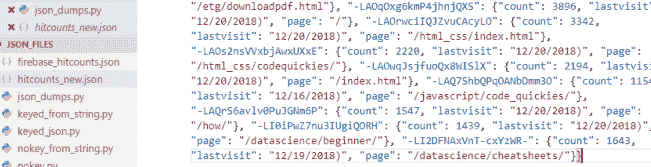

JSON 是一种广泛用于存储和共享数据的格式。幸运的是，Python 拥有许多内置工具来访问和创建 JSON。我们在这里涵盖了最重要的功能。但如果你想探索更多，请不要羞于在网上搜索 python。

第 2 章 弄 JSON 数据 325

## 本章内容
- 理解网络的工作原理
- 从 Python 打开网页
- 使用 Python 向网络发布信息
- 使用 Python 进行网络爬取

# 第 3 章

## 与互联网交互

正如你可能知道的，互联网是世界上几乎所有知识的家园。我们大多数人一直使用网络来寻找信息。我们通过 Safari、Google Chrome、Firefox、Opera、Internet Explorer 或 Edge 等网络浏览器来实现。要访问网站，你在浏览器的地址栏中输入 URL（统一资源定位符）并按回车，或者点击一个自动带你进入该页面的链接。

作为使用浏览器浏览网络的替代方案，你可以通过编程方式访问其内容。换句话说，你可以使用 Python 等编程语言向网络发布信息，并访问网络信息。在某种意义上，你让网络变成了你的个人知识数据库，你的应用程序可以随时从中插入信息。在本章中，你将学习使用 Python 编程访问网络的两个主要模块：`urllib` 和 `BeautifulSoup`。

# 查看网络是如何运作的

当你打开网络浏览器并输入 URL 或点击链接时，该操作会向互联网发送请求。互联网将你的请求引导到适当的 Web 服务器，服务器随后向你的电脑发送响应。通常该响应是一个网页，但也可以是任何文件。如果你请求的内容在相应位置不再存在，它可能是一条错误消息。重要的是，你（即用户，一个人类）以及你的用户代理（你用于访问互联网的程序）处于客户端侧。服务器只是一台电脑而不是人，它会返回它的响应，如图 3-所示。

# 图 3-1：
客户端发送请求，服务器返回响应。

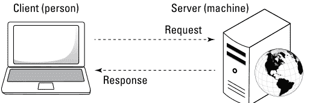

# 理解迷秘的 URL

URL 是访问网页的关键部分，它是互联网找到你寻找的资源的方式。在网络上，大多数资源使用超文本传输协议 (HTTP)，因此它们的 URL 以 `http://` 或 `https://` 开头。区别在于，`http://` 以其原始形式跨越线缆进行传输，这使其容易受到黑客和其他“嗅探”流量的人的影响。`https` 协议是安全的，数据经过了加密，这意味着它被转换为不那么容易读取的密码。通常，任何与你进行业务并向传输敏感信息（如密码和卡号）的网站都会使用 `https` 来保持这些秘密和安全。

任何网站的 URL 都可以相对简单，例如 Alan 的 URL，即 `https://AlanSimpson.me`。也可以变得复杂，以向请求中添加更多信息。图 3-2 显示了 URL 的部分，你可能以前已经注意到。

注意，顺序很重要。例如，URL 可以包含指向特定文件夹或页面的路径（在域名之后以斜杠开始）。URL 还可以包含查询字符串，它总是以问号开头。问号后面是一个或多个键值对。

其中 `library` 是较大库的名称，`module` 是模块的名称。要访问 `urllib` **response** 模块的功能，请在代码顶部使用以下语法（注释行可选）：

```python
import the request module from urllib library.
from urllib import request
```

要打开网页，请使用此语法：

```python
variablename = request.urlopen(url)
```

将 `variablename` 替换为任选的变量名。将 `url` 替换为想要访问的资源的 URL，并用单引号或双引号括（除非存储在变量中）。如果 URL 已经存储在变量中，使用不带引号的变量名即可。

运行代码时，结果将是一个 **HttpResponse** 对象。

例如，你可以在 Jupyter notebook 或 .py 文件中运行代码，以访问 Alan 为目的添加到此站的示例 HTML 页面：

- 从 `urllib` 库导入 `request` 模块。
- `urllib import request`
- 目标页面的 URL（地址）。
- `sample_url = 'https://AlSimpson.me/python/sample.html'`
- 请求页面并将其放入名为 `tpage` 的变量中
- `tpage = request.urlopen(sample_url)`
- 将响应放入名为 `status` 的变量中。
- `status = tpage.code`
- 页面的数据类型是什么？
- `print(type(tpage))`
- 状态码是多少？
- `print(status)`

运行此代码将显示此输出：

```
<class 'http.client.HttpResponse'>
200
```

变量 `tpage` 包含一个 **http.client.HttpResponse** 对象，它包含了服务器响应请求返回的所有内容。**200** 是告诉你一切正常的状态码。

# 使用 Python 向网页发布内容

并不是所有访问网络资源的尝试都能像前面的示例那样顺利。例如，在浏览器的地址栏中输入以下 URL 并按回车：

```
https://www.google.com/search?q=python web scraping tutorial
```

Google 返回了包含许多页面和视频的搜索结果，这些内容包含 python web scraping tutorial（Python 爬虫教程）的字样。如果你查看地址栏，可能会发现你输入的 URL 发生了微变化。空格已全部替换为 `%20`，如下行代码所示：

```
https://www.google.com/search?q=python%20web%20scraping%20tutorial
```

`%20` 是空格的十六进制 ASCII 码。熟悉网页的人可能识别 `%20`，因为 HTTP 不支持在 URL 中使用字面量。在传输完成后，如果需要，可以将 `%20` 转回空格。

现在让我们看看如果使用 Google 而不是原始 URL 运行相同的代码会发生什么。以下是该代码：

```python
from urllib import request

* 目标页面的 URL（地址）。

sample_url =
  'https://www.google.com/search?q=python%20web%20scraping%20tutorial'

* 请求页面并将其放入名为 webpage 的变量中。

tepage = request.urlopen(sample_url)

* 将响应码放入名为 status 的变量中。

status = webpage.code

* 页面的数据类型是什么？

print(type(tepage))

* 状态码是多少？

print(status)
```

运行这段代码时，事情并不顺利。你可能会看到几条错误消息，但最重要的信息是

```
HTTPError: HTTP Error 403: Forbidden
```

错误并非源于你的代码。而是一个 HTTP 错误。具体来说，是错误代码 403 Forbidden（禁止）。URL 已已发送到 Google，但它回复说：“抱歉，你可以通过浏览器搜索我们的网站，但不能通过 Python 代码。” Google 与许多其他网站一样，拒绝了通过程序访问其内容的尝试，这部分是为了保护对其内容的权利，部分是为了对访问流量进行某些控制。

好消息是，那些不允许使用 Python 或其他编程语言直接发布内容的网站，通常允许通过它们的 API（应用程序接口）发布内容。

了解一个网站是否具有 API 的简单方法是在搜索引擎中搜索“API”。例如，Google、Twitter 等许多其他网站都有 API，你可以利用它们与服务进行交互。

“屏幕抓取”（screen scraping）一词也被用于网络爬取（web scraping）的同义词。尽管正如你看到的，你并不是从计算机屏幕上抓取内容，而是从传递浏览器的文件中抓取，以便浏览器能在你的屏幕上显示这些信息。

在 Python 代码中，你需要导入两个模块，它们都随 Anaconda 提供，所以你应该已经拥有它们了。一个是来自 `urllib` 的 `request` 模块，它允许你向网页发送资源请求，并读取网页提供的内容。第二个被称为 `BeautifulSoup`（源自书籍《爱丽丝梦游仙游》）。它提供了解析你检索的网页的工具，从中提取你感兴趣的特定数据项。

开始开始，请打开 Jupyter notebook 或在 VS Code 中创建一个 .py 文件，并输入以下两行代码：

```python
# 从 url 库获取 request 模块。
from urllib import request

# 这个包含了抓取网页的方便工具。
from bs4 import BeautifulSoup
```

接下来，你需要告诉 Python 你感兴趣的页面在互联网上的位置。在这种情况下，URL 是：

```
https://alansimpson.com/python/scrape_sample.html
```

你可以通过将 URL 输入浏览器的地址栏并按回车来验证这一点。但要抓取该页面，你需要将 URL 放入你的 Python 代码中。你可以通过赋值给变量来给它一个短名称 `page_url`：

```python
# 用于练习的示例页面。
_url = 'https://alansimpson.com/python/scrape_sample.html'
```

为了将该位置的网页引入你的 Python 程序中，创建另一个变量（我们称之为 `rawpage`），并使用 `request` 模块的 `urlopen` 方法读取页面：

```python
# 打开页面。
rawpage = request.urlopen(page_url)
```

为了在后续代码中能够容易解析该页面，将其复制到 `BeautifulSoup` 对象中。我们在代码中将该对象命名为 `soup`。你还需要


告诉 BeautifulSoup 你希望如何解析页面。你可以使用 `html51lib`，它也随 Anaconda 提供。

```python
# 从 html 页面创建一个 BeautifulSoup 对象。
soup = BeautifulSoup(rawpage, 'html51lib')
```

## 解析页面的部分

大多数网页包含许多用于页眉、页脚、侧边栏、广告以及页面上其他内容的代码。主内容通常只位于一个区域。如果你能识别出该区域，你的解析代码运行得会更快。在这种情况下，由于网页是我们自己创建的，我们将所有主内容放在了一对 `<article> </article>` 标签之间。在以下代码中，我们将该代码块赋值给名为 `content` 的变量。稍后页面将只解析该部分，这可以提高速度和准确性。

- 隔离主内容块。

```python
content = soup.article
```

## 存储解析后的内容

抓取网页时，你的目标通常是收集特定的感兴趣数据。在这种情况下，我们只需要 URL、图像源和链接数量。我们知道会有多行数据。存储这些数据的简单方法是将它们放入列表，因此在接下来的代码中，我们创建一个名为 `links_list` 的空列表：

```python
# 为字典条目创建一个空列表。
links_list = []
```

接下来的代码将遍历页面内容中的每个链接。每个链接以 `<a>` 标签开始，以 `</a>` 标签结束。要让 Python 逐个遍历每个链接，请在循环中使用 `BeautifulSoup` 的 `find_all` 方法。在以下代码中，当我们遍历链接时，将当前链接赋值给名为 `link` 的变量：

```python
# 遍历文章中所有的链接。
for link in content.find_all('a'):
```

第 3 章 与互联网交互 337

每个链接的代码看起来会像这样，尽管每个链接都有唯一的 URL 图像源和文本：

```html
<a href="https://alansimpson.me/datascience/python/lists/">

<span>Lists</span>
</a>
```

我们想要的三项数据如下：以下代码使用 `BeautifulSoup` 的 `.get()` 方法在链接内部 提取每个组件，以隔离链接内部的某些内容（即标记每个链接开始和结束的 `<a>` 和 `</a>` 标签之间的内容）。以下代码获取链接的部分并将其放入名为 `url` 的变量中：

```python
url = link.get('href')
```

将该代码缩进到循环下，以便对每个链接执行执行。以下代码获取图像源并将其放入名为 `img` 的变量中：

```python
img = link.get('src')
```

文本位于链接底部的 `<span>...</span>` 标签之间。要获取它并放入变量 `text` 中，请添加此行代码：

```python
text = link.get().text
```

你不需要为该项操作使用 `.get()`，因为文本不在像 `href` 或 `src=` 这样的 HTML 属性中。它只是 `<span>...</span>` 标签之间的文本。最后，我们需要在进入页面的下一个链接之前保存它。一种简单的方法是将所有三项数据追加到 `links_list` 中。

## 将爬取的数据保存到 CSV 文件

如果你希望直接将爬取的数据保存为 CSV 文件，请先在代码顶部导入 `csv` 模块：

```python
```


# 如果你想保存到 CSV

```python
import csv
```

然后，在创建 `links_list` 的循环下方且外部，以写入模式打开一个你自定义文件名的文件。在接后的代码中，我们将文件命名为 `links.csv`。我们还使用了 `newline=''` 来避免在每行的末尾添加额外的换行符：

```python
# 将其保存为 csv
with open('links.csv', 'w', newline='') as csv_out:
```

在 `open` 语句下方的缩进位置，创建一个 CSV 写入器，根据你在行尾分配的名称指向该文件：

```python
csv_writer = csv.writer(csv_out)
```

CSV 文件的第一行通常是字段名（也称为列标题）。因此，下一步是将该行添加到表格中，可以使用任何你想要应用于标题的名称：

```python
# 创建表头行
csv_writer.writerow(['url', 'img', 'text'])
```

然后，你可以通过遍历 `link_list` 并将三项数据用逗号分隔写入新行，从而将 `link_list` 中的所有数据写入 CSV 文件：

```python
for row in link_list:
    csv_writer.writerow([str(row['url']), str(row['img']), str(row['text'])])
```

该代码生成一个名为 `links.csv` 的文件。如果你在 Excel 或其他表格应用程序中打开该文件，你会看到数据整齐地组织成一个表格，列标签为 `url`、`img` 和 `text`，如图 3-9 所示。

### 图 3-9：Excel 中的网络爬取数据

| A | B | C | D |
|---|---|---|---|
| 1 | https://www.theresearcher.com/python-3-reference-cheat-sheet_datascience/python/basics256.jpg | ...datascience/python/beginner/basics256.jpg | Text | Basics |
| 2 | https://almonson.me/datascience/python/beginner/ | ...datascience/python/beginner/beginner256.jpg | Beginner | |
| 3 | https://almonson.me/datascience/python/geography/ | ...datascience/python/geography/geography256.jpg | Just The Basics | |
| 4 | https://almonson.me/datascience/python/datascience/ | ...datascience/python/datascience/datascience256.jpg | Data | |
| 5 | https://almonson.me/datascience/python/essentials/ | ...datascience/python/essentials/essentials256.jpg | Statistics | |
| 6 | https://almonson.me/datascience/python/memento/ | ...datascience/python/memento/memento256.jpg | Memorable | |
| 7 | https://almonson.me/datascience/python/objects/ | ...datascience/python/objects/objects256.jpg | System | |
| 8 | https://almonson.me/datascience/python/classic/ | ...datascience/python/classic/classics256.jpg | Classics | |
| 9 | https://almonson.me/datascience/python/functions/ | ...datascience/python/functions/functions256.jpg | Functions | |
| 10 | https://almonson.me/datascience/python/conditionals/ | ...datascience/python/conditionals/conditionals256.jpg | If & While Loops | |
| 11 | https://almonson.me/datascience/python/lists/ | ...datascience/python/lists/lists256.jpg | Lists | |

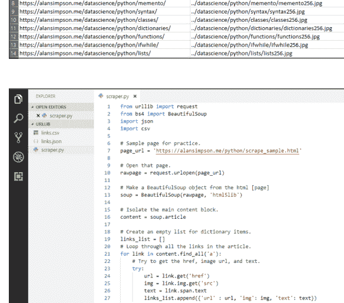

### 图 3-10：整个 scraper.py 程序

```python
import csv
from bs4 import BeautifulSoup
import requests
import os

# 用于练习的页面
page_url = 'https://almonson.me/datascience/python/scraper_sample.html'

# 打开该页面
response = requests.get(page_url)

# 从 html 创建 BeautifulSoup 对象
soup = BeautifulSoup(response.text, 'html.parser')

# 提取主内容
content = soup.body

# 创建一个用于字典项目的空列表
links = []

# 遍历文章中所有的链接
for link in content.find_all('a'):
    # 尝试获取文本、url 和图像
    try:
        text = link.get_text()
        url = link.get('href')
        img = link['src']
        links.append({'text': text, 'url': url, 'img': img})
    except AttributeError:
        # 如果没有报错
        pass

# 保存为 CSV
with open('links.csv', 'w', encoding='utf-8', newline='') as links_file:
    csv_writer = csv.writer(links_file)
    csv_writer.writerow(['url', 'img', 'text'])
    for row in links:
        csv_writer.writerow([str(row['url']), str(row['img']), str(row['text'])])
```

```text
'casefold', 'center', 'count', 'encode', 'endswith', 'expandtabs', 'find', 'format', 'format_map', 'index', 'isalnum', 'isalpha', 'isascii', 'isdecimal', 'isdigit', 'isidentifier', 'islower', 'isnumeric', 'isprintable', 'isspace', 'istitle', 'isupper', 'join', 'ljust', 'lower', 'lstrip', 'maketrans', 'partition', 'replace', 'rfind', 'rindex', 'rjust', 'rpartition', 'rsplit', 'split', 'splitlines', 'startswith', 'strip', 'swapcase', 'title', 'translate', 'upper', 'zfill'
```

由双下划线包裹的名字（例如 `__add__` 和 `__class__`）有时被称为 dunder 项，它们对于双下划线非常有用（dunder 项通常被称为特殊变量或魔术方法）。每个 dunder 项代表 Python 内置的某些内容，起着你不一定直接访问的作用。例如，`__add__` 方法通过使用 `+`（加法）运算符来调用，用于相加数字或字符串。

普通函数没有双下划线和括号。例如，看看这些代码：

```python
x = "Howdy"
print(x, x.isalpha(), x.upper())
```

输出是：

```text
<class 'str'> True HOWDY
```

第一部分 `<class 'str'>` 告诉你 `x` 包含一个字符串。因此，你可以对它使用 `dir(str)` 输出中显示的任何属性。例如，`True` 是 `x.isalpha()` 的输出，因为 `x` 确实包含字母。`HOWDY` 是 `x.upper()` 的输出，它将字符串转换为全大写字母。

初学者经常想知道，在 `dir()` 输出中看到诸如 `'capitalize'`, `'casefold'`, `'center'`, `'count'`, `'encode'`, `'endswith'`, `'expandtabs'`, `'find'` 和 `'format'` 这样的名字对他们有什么用，因为他们不知道这些名字的意思或如何使用它们。嗯，如果你不进一步追求，看到这些名字并没有太大帮助。你可以使用 `help()` 而不是 `dir` 来获取更详细的信息。

## 使用 help() 函数

Python 提示符还提供了一个语法如下的 `help()` 函数：

```python
help(object)
```

要使用它，请将 `object` 替换为你寻求帮助的对象类型。例如，要获取 `str` 对象（来自 `str` 类的字符串）的帮助，可以在 Python 提示符中输入此命令：

```python
help(str)
```

输出将提供关于括号内主题的基础信息，`dir(str)` 列出了该类型的属性名称，而 `help(str)` 提供了每个项目的更多详细信息。例如，`dir(str)` 告诉 `str` 类中有一个 `capitalize`，`help(str)` 提供了关于它的信息，如下：

```text
capitalize(self, /)
返回字符串的首字母大写版本。具体来说，使第一个字符变为大写，其余变为小写。
```

**单词** 意味着无论你传递给 `capitalize` 的什么，都会被大写。结尾处的 `/` 标记了仅位置参数的结束，这意味着你不能像定义函数时那样对其后的参数使用关键字。

对大多数人来说，通常有效的是更深入的解释和一个或多个示例。对于那些人：

```bash
python capitalize
```

提供了许多不同资源的链接，用于学习 `str` 对象的 `capitalize` 函数，包括它的用法示例。

当你查看完帮助信息后，不需要滚动到末尾返回提示符。只需按 `Ctrl-C` 即可。

Python 标准库的一个很好的（尽管是技术性的）资源是库的文档本身。这些信息始终在 `https://docs.python.org/` 的 Library Reference 链接下可用。即使那个词也可能改变，如果有疑问，只需在网上搜索 *python standard library*。预先警告，该库非常庞大且具有技术性，不要指望立刻就能理解它。相反，将其作为一个持续资源，随着你对 Python 知识的积累，学习你感兴趣的内容。


在 `https://docs.python.org/` 上显示的文档通常是当前稳定版本的。当你访问时，旧版本和任何正在开发的新版本的链接可以通过页面左侧的链接获取。

## 探索内置函数

`dir()` 和 `help()` 都是 Python 内置函数的示例，它们在 Python 中、在你创建的任何应用程序以及 Python 提示符中都是始终可用的。这些内置函数也是标准库的一部分。事实上，如果你搜索 Python 内置函数，这些结果中的某些将直接指向标准库文档的一个章节，并介绍所有内置函数，如图 4-1 所示。在该页面上，你可以点击任何函数的名称以了解更多信息。

### 图 4-1：Python 的内置函数

## 探索 Python 包

`dir()` 和 `help()` 都是 Python 内置函数的示例，它们在 Python 中、在你创建的任何应用程序以及 Python 提示符中都是始终可用的。这些内置函数也是标准库的一部分。事实上，如果你搜索 Python 内置函数，这些结果中的某些将直接指向标准库文档的一个章节，并介绍所有内置函数，如图 4-1 所示。在该页面上，你可以点击任何函数的名称以了解更多信息。

...（内容继续）

## 导入 Python 模块

你会经常听到 Python 中使用的模块。如果你将标准库比作一个物理图书馆，将包比作图书馆里的一本书，那么模块就是一本书中的章节。换句话说，一个包可能包含许多模块，而一个库可能包含许多包。使 Python 成为模块化语言的大部分是因为代码根据功能进行了分组。你不需要为了使用某些代码就导入所有东西（包括所有无关的内容）。另一方面，如果你需要使用几个相关的内容，例如处理日期和时间的函数，你不需要一个一个地导入。通常，导入整个模块就能得到你需要的。

使用你想要导入的模块名称命令。例如，以下代码导入了整个 `math` 模块：

```python
import math
```

导入模块后，`dir()` 和 `help()` 函数就可以对它进行操作。例如，如果你在 `import math` 之前尝试执行 `dir(math)` 或 `help(math)`，你会得到一个错误。这是因为该 `math` 模块并不是标准库的一部分。但是，如果你先导入 `math` 然后运行 `help(math)`，它就能正常工作。

有时你可能不需要“全套工具”都准备好。在这种情况下，你可以使用以下语法只导入你需要的内容：

```python
from math import pi
```

在这个示例中，你只导入了一个项（`pi`），所以你没有引入不必要的内容。后一个例子（你添加了 `import pi`）在你的代码中也很有用，你可以直接将 `pi` 称为 `pi`，而不需要使用 `math.pi`。

若想亲手验证，在 Python 提示符中（例如 VS Code 终端窗口中），输入命令 `print(pi)` 并按回车。你可能会收到如下错误：

```python
NameError: 'pi' is not defined
```

换句话说，`pi` 并不是标准库的一部分，而标准库对你的 Python 代码始终可用。若要使用 `pi`，你必须导入 `math` 模块。你有两种方法。你可以在 Python 提示符中输入以下内容来导入整个模块：

```python
import math
```

但如果你这样做然后输入：

```python
print(pi)
```

即使你导入了 `math` 模块，你会再次得到相同的错误。当你导入整个模块并想使用其中的部分时，你必须在要使用的部分之前加上模块名称和一个点。例如，如果你输入此条命令：

```python
print(math.pi)
```

你将得到正确答案：

```text
3.141592653589793
```

请注意，如果你只导入了模块的一部分，针对整个模块的 `help()` 和 `dir()` 函数将无法工作。例如，如果你在代码中只写了 `from math import pi`，并尝试执行 `dir(math)` 或 `help(math)` 函数，它们将无法运行，因为 Python 只有 `pi` 而没有整个模块可用。

你通常在 Python 提示符下使用 `help()` 和 `dir()` 进行快速查找，而不是编写应用程序时。使用 `from` 而不是 `import` 效率更高，因为你只引入了需要的内容。

你也可以通过 `from` 命令的末尾列出多个用逗号分隔的项，从包中导入多个项目。例如，假设你的程序需要 `pi` 和平方根。你可以使用以下语法将它们导入到程序中：

```python
from math import pi, sqrt
```

再次，由于你使用了这种导入语法，你可以在代码中直接引用 `pi` 和 `sqrt()`，而无需加前导模块名。例如，在执行了该 `from` 语句后，以下代码：

```python
print(sqrt(pi))
```

将显示如下内容，正如你可能猜到的那样，这是数字 pi 的平方根：

```text
1.772453850905159
```

你可能还会注意到有人这样导入模块：

```python
from math import *
```

星号代表“所有内容”。本质上，该命令与 `import math` 相同，也会导入整个 `math` 模块，但有一个细微差别。当你写 `from math import *` 时，你将 `math` 模块中所有名称与该模块关联。你可以不带 `math.` 前缀使用这些名称。换句话说，你执行了以下操作：

```python
from math import *
```


# 第4章 库、包和模块

你可以执行像 `print(pi)` 这样的命令，它将生效，即使没有使用 `print(math.pi)`。虽然这种方法看起来聪明又方便，但许多程序员认为它并不“Pythonic”。如果你正在导入很多模块以及每个模块的许多不同部分，在代码中避免使用模块名会让其他程序员更难阅读和理解这些代码。

## 创建你自己的模块

关于模块的各种宣传，模块其实非常简单。它只是一个带有 `.py` 后缀的文件，其中包含 Python 代码。如此。每当你编写 Python 代码并保存为 `.py` 文件时，你就创建了一个模块。这并不是说你必须将代码作为模块使用；你可以将其视为独立的应用程序。但如果你想创建一个在工作中经常用到的代码模块，你完全可以这样做。我们将在本节中解释这一过程。

不带后缀的模块名与文件名相同。

假设你需要三个函数来简化日期和货币值的格式化。你可以为每个函数起任何你喜欢的名称。在我们的示例代码中，我们将使用这三个：

- **`to_date(any_str)`**：传入任何 mm/dd 或 mm/yyyy 格式的字符串（`any_str`），函数返回一个 Python `datetime.date` 对象，你可以用它进行日期计算。
- **`mdy(any_date)`**：传入任何 Python 日期或 datetime 对象，函数返回一个格式化为 mm/dd/yyyy 的字符串日期，用于在屏幕显示。
- **`to_curr(any_num, len)`**：传入任何 Python 浮点数或整数，函数返回一个带有前导美元符号、千分位逗号和两位分币的字符串。`len` 是一个可选的长度数字。

以下是处理日期和货币值的代码：

```python
# 包含日期和货币值的函数

import datetime as dt

def to_date(any_str):
    """将 mm/dd 或 mm/yyyy 格式的字符串转换为日期对象"""
    try:
        return dt.strptime(any_str, '%m/%d/%Y').date()
    except ValueError:
        return None

def mdy(any_date):
    """将日期返回 mm/dd/yyyy 格式的字符串"""
    try:
        return any_date.strftime('%m/%d/%Y')
    except (ValueError, TypeError):
        return "Invalid date"

def to_curr(anynum, len=0):
    """将数字返回带逗号的字符串。长度可选。"""
    try:
        x = float(anynum)
        s = f"${x,.2f}"
        if len > 0:
            s = s.rjust(len)
        return s
    except ValueError:
        return "Invalid amount"
```

你可以创建该文件并命名为 `myfunc.py`。如果你运行它，它在屏幕上不会显示任何内容。

要在编写的应用程序或程序中使用这些函数，请确保将 `myfunc.py` 文件与你的 Python 代码放在同一个文件夹中。然后，创建一个新程序，导入别人创建的模块：

```python
import myfunc
```

你必须在调用该模块的任何函数前加上模块名。所以，如果你想让代码更具读性，可以使用这种写法：

```python
import myfunc as my
```

以该行开头，你可以使用 `my` 作为前缀引用模块中的任何函数。例如，使用 `my.to_date()` 来调用 `to_date` 函数。这里有一个导入模块并使用该语法测试所有函数的页面：

- 将 myfunc.py 中的所有代码导入为 my
- `import myfunc as my`
- 需要这些日期
- `from datetime import datetime as dt`
- 一些测试数据
- `string_date="12/31/2019"`
- 将字符串日期转换为 datetime.date
- `print(my.to_date(string_date))`
- `today = dt.today()`
- 以 mm/dd/yyyy 格式显示今天的日期
- `print(my.mdy(today))`
- `dollar_amt=1234.678`
- 以货币格式显示这个大数字
- `print(my.to_curr(dollar_amt))`

当你运行代码时，输出应该如下：

```
2019-12-31
'12/27/2018'
$12,345.68
```

我们也提到过，如果通过名称导入项，就可以跳过前缀的使用。在这种情况下，你可以调用 `to_date()`、`mdy()` 和 `to_curr()` 而无需使用 `my.` 前缀。代码的第一行需要是：

```python
from myfunc import to_date, mdy, to_curr
```

其余代码与先前的示例相同，只是你可以省略 `my.` 前缀，如如下代码所示：

```python
# 从 myfunc.py 中按名称导入所有代码。
from myfunc import to_date, mdy, to_curr
```

```python
# 此代码中需要日期
from datetime import datetime as dt
```

```python
# 一些简单的测试数据。
string_date="12/31"
# 将字符串日期转换为 datetime.date。
print(to_date(string_date))
```

```python
today = dt.today()
# 以 mm/dd/yyyy 格式显示今天的日期。
print(mdy(today))
```

```python
dollar_amt=12345.678
# 以货币格式显示这个大数字。
print(to_curr(dollar_amt))
```


这些概念适用于 Python 库、包和模块。这三者都代表了他人编写的代码，并允许在你编写的任何 Python 代码中使用它们。唯一的区别在于大小。一个库（library）可能包含多个包（package），一个包可能包含多个模块（module），而模块通常包含函数、类或其他你可以自由使用的重写代码块。

在接下来的章节中，你会看到大量的模块和类，因为它们使得 Python 如此模块化，并适用于许多不同类型的工作和学习。但请记住，你在前三个微型教程中学到的 Python 语言核心原理适用于任何地方，无论你是在从事数据科学、AI 还是机器人研究。你将使用这些核心语言来处理他人为那一个特定领域编写的代码。

## 4 使用人工智能

## 目录一览

- 第 1 章：探索人工智能 ................................................................ 359
  - AI 是技术的集合 ........................................................................................................ 360
  - AI 的当前局限性 ................................................................................................. 367
- 第 2 章：构建神经网络 ..................................................................... 369
  - 理解神经网络 ............................................................................................... 370
  - 在 Python 中构建简单的神经网络 ............................................................................ 374
  - 在 TensorFlow 中构建 Python 神经网络 ....................................................................... 387
- 第 3 章：进行机器学习 ....................................................................... 399
  - 通过在所有错误的地方寻找解决方案来学习 ................................................................. 400
  - 创建一个用于检测衣服类型的机器学习网络 ................................................... 401
  - 使用 Matplotlib 进行视觉化 ................................................................................................ 415
  - 学习更多机器学习 ................................................................................................ 419
- 第 4 章：探索 AI ............................................................................................ 421
  - 树莓派和 AI 的局限性 ................................................................................ 421
  - 在树莓派上添加硬件 AI ...................................................................... 423
  - 云端 AI ................................................................................................... 425
  - 显卡上的 AI ............................................................................ 428
  - 在哪里可以找到更多 Python 的 AI 乐趣 ................................................................................ 430

- 探索 AI 技术：神经网络和机器学习
- 尝试 TensorFlow
- 理解 AI 的局限性

## 第 1 章：探索人工智能

在过去的几年里，人工智能（AI）是一个被严重误解的词。流行新闻媒体倾向于将 AI 的任何微小进展脱离背景，并宣布“智能计算机来了！”例如，在 2017 年，Facebook 的工程师编写了两个程序，对某些物体（球、积木等）的评价高于其他物体，然后让这两个程序通过一套规则和像英语之类的语言进行相互谈判，以最大化获取这些程序所重视的物体。

这些程序没有语言语法检查器，由于程序学习的方式，程序之间的通信变成了在语法上不正确的英语。（一个很好的例子是，当一个程序想要某东西时，它会说“I want”，而程序逻辑认为如果说“I want I want I want”会更好。）新闻媒体将其报道为一种新语言（但其实并不是）。后来，当程序在实验结束前被关闭时，某些评论家认为 Facebook 的工程师在程序产生意识之前恰好关闭了它们。不言而喻，事实并非如此。

本章将向你介绍 AI 的概念并描述它的局限性。我们将探索不同的 AI 技术，然后提供简要的历史介绍，以为当前的 AI 革命提供背景。

Dictionary.com 对人工智能的定义是“计算机系统的理论和开发，这些系统能够执行通常需要人类智能的任务，例如视觉感知、语音识别、决策制定和语言之间的翻译。”

## AI 是技术的集合

本章的重点是消除 AI 的神秘感，并描述新的 AI 技术有多用、多酷。注意，我们说的是“AI 技术”而不仅仅是“AI”。机器人模仿人类意义上的通用人工智能（General AI）目前不存在（甚至遥不可及），但我们拥有许多不同的算法、统计技术和工具，它们可以做一些令人印象深刻的人类事务，例如学习和适应环境。

在本章中，我们将向你展示三种 AI 技术：

- 神经网络
- 机器学习
- 使用 Python 的 TensorFlow 分类器程序

读完这本书后，你将获得意识。噢，等等，你买了这本书，所以你已经超过了那个门槛。接下来，我们将简要描述每种主要的 AI 技术。

## 神经网络

什么样的魔法技巧让我们变得聪明？诀窍就是没有诀窍。

——马文·明斯基，《机器之》

John Shovic：我有幸在 1983 年在波特律逊与明斯基共度了午餐和下午。当时我在波特律逊的 American Systems 公司担任 VLSI（超大规模集成电路）设计工程师，并在爱荷州大学兼读博士学位。我的第一门课是在那里上的，听说 MIT 实验室的明斯基要来波特律逊感到非常惊讶。我打了几个电话，成功地让他与我们两个上过 AI 课程的学生见面。这种感觉就像我们是滚石乐队，而杰克·杰逊要和我们在一起。老实说，比起和杰克·杰逊共度下午，我更想和明斯基博士见面。

我当时刚读完他的书《人工智能》，对他的工作充满了好奇。他对我们在爱荷州大学 AI 课程上学习的内容感兴趣，并对该课程的教授迪金森博士赞有加加。我对这个话题充满热情，并认为可以以此为业。在我们讨论的所有内容中，我清楚地记得一件事。他说（这是转述）“我大约 20 年前开始研究 AI，我坚信 20 年后我们就能拥有真正的人工智能。我现在知道我们距离真正的人工智能还有大约 20 年。”

嗯，我记得在 20 年后（即 2003 年）时那样想，结果发现我们还没那里。那个时候，我开始怀疑 AI 是否是未来的技术。现在是 2020 年，又过了 17 年，我们现在拥有许多用于学习和高效搜索的 AI 技术，可以做一些令人印象深刻的事情，并可能实现明斯基博士所说的通用人工智能。谁知道呢？它甚至没花 20 年！

大象拥有超过 2700 亿个神经元，但它们的连接密度并没有人类神经元那么大。3Com 的创始人、德克萨斯大学创业教授罗伯特·梅特卡夫（Robert Metcalf）曾有一句名言（关于以太网）：电信网络的价值与系统连接用户数量的平方成正比。凭借这种连接数量的平方增长，我们通过让自己的神经元更加密集，弥补了缺失的 1900 亿大象神经元。（然而，大象拥有良好的记忆力和复杂的系统，这难道令人意外吗？）

AI 研究人员曾认为（且事实证明如此），如果我们能反向工程神经元及其连接，就可以利用这些信息来构建计算机模型，用于编写更智能的程序。然而，第一个流行模型（感知器 Perceptrons）的局限性很快导致了普遍的失望，以及被称为“AI 寒冬”的第一次 AI 冬天。

然而，在过去的 30 年里，关于神经网络结构和科学的研究增加了，包括对卷积神经网络和深度学习软件架构的研究。这些研究导致了可以直接应用于现实问题的软件包。

## AI 寒冬

“AI 寒冬”这一术语最早出现在 1984 年美国人工智能协会的会议上。我们另一个侧边栏的朋友马文·明斯基（Dr. Marvin Minsky）博士警告商界，20 世纪 80 年代对 AI 的热度已经失控，失望将随之而来。在他说这句话的三年后，价值数十亿美元的 AI 业务崩溃了。AI 寒冬指的是投资和研究资金枯竭的时期。从经济学角度来看，这是一种泡沫，就像 1999 年的泡沫、2007 年崩溃的房地产泡沫，以及 1637 年荷兰的郁金香泡沫市场。过度渲染会导致过度预期，从而导致不可避免的失望。

AI 在 21 世纪 20 年代再次取得了进展（部分是因为互联网泡沫），研究人员极力避免在他们的计划书和论文中使用“AI”这一术语。在我们看来，我们正再次接近这样一个泡沫，但我们中没有人足够聪明到能预知寒冬何时降临（请原谅我，《权力的游戏》的粉丝们）。主要的区别之一是许多 AI 技术已经进入了主流市场，例如 Amazon Alexa 和 Google Home，因此 AI 技术被更广泛地使用。目前对 AI 的某些狂热和投资是非理性的，但这次我们留下了许多优秀的工具，在泡沫破灭后我们可以继续使用。

神经网络是大脑学习和分类数据的良好模型。鉴于此，神经网络出现在机器学习和其他 AI 技术中并不意外。神经网络主要由神经元组成，最重要的是连接它们的布线。这些神经元和连接构成了一个神经网络。

在定义神经网络时，你定义了架构和布局，创建一个任意的连接网络。由机器设置网络已变成了另一个我们称为“进化计算”的领域，正如侧边栏描述的那样。当你建立神经元网络时，你所做的最重要的选择之一是激活函数。当超过了由激活函数决定的阈值时，神经元就会激活。在下一章中构建神经元的 Python 模型时，激活函数是你定义的几个关键要素之一。

## 进化计算

进化计算是一组受生物演化启发的、用于全局优化的计算算法和启发式方法（“经验法则”的华丽说法）。它源于机器学习技术，但不同之处在于，进化计算通常用于解决程序员预先不知道解决方案的问题。（机器学习程序会被教你正在寻找什么。）

通过使用进化计算算法，你可以在设计空间（也称为问题空间）中找到问题的解决方案。进化计算已用于创建诸如航天器天线和公交路线等多样化的解决方案。该过程使用计算密集型算法在空间中搜索解决方案。进化计算是密集的，因为你拥有一组解决方案（种群），需要观察哪个程序正在接近解决方案，然后选择新的个体移动到下一代。优胜劣汰！这些群体评估对计算机来说处理困难，这就是为什么许多进化算法需要大量的并行处理。

> 约翰·斯威夫特（John Swift）：我在爱达荷大学高级机器人研究生课程上的一名学生利用计算让一个名为 Baxter 的机器人能够从一个箱子里取出黄色区块并移动到另一个箱子里（如第一张照片所示）。他使用机器人手臂摄像头的图像和进化计算找到了一种算法来识别并定位这些 Baxter 能找到的区块。Baxter 和该学生都没有成功使用进化计算算法找到解决方案。为什么？使用进化计算技术来寻找一个定义模糊且无约束的问题需要指数级增长的计算资源，即使是这样也可能无法得出解决方案。较小、受限的问题更适合进化技术。


## 机器学习

神经网络是大脑学习和分类数据的良好模型。鉴于此，神经网络出现在机器学习和其他 AI 技术中并不意外。神经网络由神经元组成，最重要的是连接它们的布线。这些神经元和连接构成了一个神经网络。

在定义神经网络时，你定义了架构和布局，创建一个任意的连接网络。由机器设置网络已变成了另一个我们称为“进化计算”的领域，正如侧边栏描述的那样。当你建立神经元网络时，你所做的最重要的选择之一是激活函数。当超过了由激活函数决定的阈值时，神经元就会激活。在下一章中构建神经元的 Python 模型时，激活函数是你定义的几个关键要素之一。

## AI 智能手机

AI 革命正在进入手持。三星和苹果都在竞争为他们的手机添加这些功能。截至目前，三星的处理器不在手机上，而在云端。苹果最新的 A14 芯片具有六核 CPU（中央处理器）和四核 GPU（图形处理器——一种用于 AI 的专用处理器）。A14 芯片用于 AI 应用，例如人脸识别，并配备了专门的神经网络。

手机中的 AI 程序和硬件每秒可以进行 11 万亿次操作。看那你短信里的表情包。

## TensorFlow —— 深度学习框架

TensorFlow 是一个用于构建、学习和研究深度学习的开源多平台 API（应用程序接口）。它隐藏了深度学习的复杂性，使得该技术更易于使用。TensorFlow 起于 2011 年 Google Brain 小组的私有 AI 环境。它在 Google 被广泛使用，当它向 AI 社区发布时，在使用 TensorFlow 的 9.5 万个 GitHub 仓库中只有 32 个来自 Google。

TensorFlow 的名字来源于数据处理的方式。张量是多维矩阵，它在通过每个 TensorFlow 层时都会被变换。大多数大学生在线性代数课程中学习数学。（如果想快速上手，可以查看 Mary Sterling 写的《线性代数傻瓜指南》）

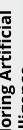

## AI 的当前局限性

所有 AI 的核心关键词都是**理解**。例如，一个机器学习算法被教学会了开车，但由此产生的程序并不理解如何开车。AI 的重点在于对数据进行分析，但控制数据的人类仍然需要解释数据，并判断数据是否符合问题。解释不仅局限于数据本身。人类往往能够判断数据或结论的真伪，即使他们无法准确描述自己是如何获此的。而 AI 仅仅是接受该结论是正确的。

考虑到我们自己甚至都不理解许多人类行为和能力，不太可能有人能开发出此类行为的合理数学模型。而我们需要这些模型来让 AI 程序实现任何接近人类思维过程的目标。

但尽管存在这些局限性，AI 对于探索大型复杂程序以寻找解决方案仍然非常有用。

现在，让我们在 Python 中开始使用 AI 吧！

+ 本章内容：
- 理解神经网络的基础
- 创建你的第一个神经网络
- 在 Python 中构建神经网络

## 第 2 章：构建神经网络

神经网络以及关于大脑运作的各种其他模型出现的时间与人们谈论 AI 的时间一样久了。在本微型书第一章介绍的马文·明斯基（Marvin Minsky）博士在 1969 年凭借其感知器的开创性工作引发了对神经元建模的主流兴趣。当时，对于感知机将迅速使 AI 实用化的广泛非理性狂热吸引了大量风险资本进入该领域。但这些项目中的许多都失败了，对神经网络的投资枯竭了。流行即畅销。

从 John 在 1983 年与明斯基博士的对话快进 37 年。今天，我们看到了对神经网络的重新关注。更好的模型已经建立，更重要的是，我们现在已经有了基于神经网络的有用且经济的应用。目前的市场状况会导致另一个泡沫吗？这是肯定的，但由于已经开发的领域，这次对 AI 的兴趣将会持续。

本章将向你介绍神经网络的概念以及如何在 Python 中实现它们。要下载本章的代码，请访问 `www.dummies.com/go/pythonaiod2e`。

## 理解神经网络

这些是神经网络的六个属性：

- 神经元输入层
- 若干层隐藏神经元
- 连接到世界的神经元输出层
- 每个神经元层之间的权重和偏置
- 每个隐藏层神经元的激活函数选择
- 用于减少网络过度训练的损失函数选择

图 2-1 显示了双层神经网络的架构。注意这个双层神经网络中的三层：在计算神经网络的层数时通常不包括输入层。

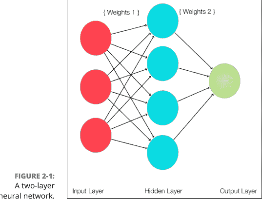

AI 中的神经元是指神经系统细胞的软件模型，其行为大体类似于大脑神经元。该模型使用数字使一个神经元或另一个对结果更重要。这些数字被称为权重。

通过观察此图，你可以看到每一层的神经元都连接到下一层的所有神经元。每个神经元间的连接线都赋予了权重。

## 神经元层

图 2-1 显示了输入层、隐藏层（即不直接与外界连接）和输出层。这是一个简单的网络；真实的网络可以复杂得多，拥有更多层。深度学习的名称来源于当你有多个隐藏层时，你增加了神经网络的深度。

注意，这些层从左到右过滤并处理信息。这种神经网络被称为前馈输入，因为数据只从一个方向输入。

现在我们有了一个网络，它是如何学习的？神经网络接收一个示例并猜测答案。神经网络使用权重和偏置得出答案。如果答案是错误的，它通过反向传播来调整权重和偏置。这个过程被称为误差传播，通过这种方式来减少误差。见图 2-2。


图 2-2：前馈与反向传播

## 反向传播

在大脑中，学习发生是因为新连接（突触）的增加以及根据外部刺激对这些连接的修改。在研究中，用于传播结果的方法发生了变化。一些专家认为，AI 应用的激增源于。反向传播是一个复杂的数学课题。关于其如何使用的更详细描述，请查阅 John Mueller 和 Luca Massaron 写的《机器学习入门》。

当你多次执行此操作后，神经网络会变得更好，并在每次迭代中提供更好的答案。这个过程对于复杂任务可能需要数天的计算能力。

虽然训练神经网络可能花费几天时间，但一旦完成，就可以低成本地部署。神经网络可以进行某些类型的学习，例如对动物分类。

## 权重和偏置

观察图 2-1 中的网络，你可以看到网络的输出取决于神经元本身的权重和偏置。虽然权重影响激活函数的斜率，但偏置会将曲线向左或向右移动。训练神经网络涉及使用数据来微调权重。

## 激活函数

构建第一个神经网络时，一个重要的课题是激活函数。激活函数是决定信息是否通过（从而激活神经元）或被拦截的软件函数。然而，你使用该函数不仅作为开关（开启或关闭），还以有效方式转换神经元的输入。

可以使用多种激活函数。对于我们的简单神经网络，我们将使用最流行的之一——sigmoid 函数。sigmoid 函数具有特征 S 型曲线，如图 2-3 所示。

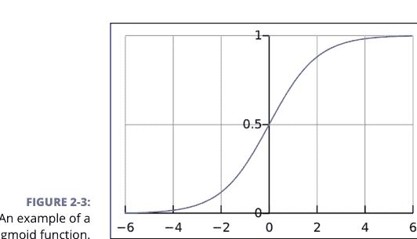

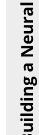

记得我们在本章前面提到过神经元偏置吗？如果你对图 2-3 中的曲线应用 1.0 值的偏置，曲线将向右移动，使得 (0,0.5) 点移动到 (1,0.5)。

## 损失函数

损失函数是需要解释的最后一个拼图。损失函数将我们神经网络的结果与期望的结果进行比较。换句话说，损失函数告诉我们当前的结果有多好。除了使用损失函数减少网络过度训练外，我们还将损失函数的结果传输到我们的反向传播通道，以改进我们的神经网络。

我们将使用一个寻找损失函数导数的函数，它展示了我们结果的质量（曲线的斜率是一阶导数，微积分粉丝们），以确定如何处理我们的神经元权重。这种从损失函数计算中改变偏置和权重的操作是网络学习活动的主要部分。

你已经接触了我们神经网络的所有部分，现在是时候构建一个示例了。

## 在 Python 中构建一个简单的神经网络

在构建神经网络之前，你需要决定你想让它学习什么。对于我们的示例，我们将选择一个简单的目标：实现一个三输入的 XNOR 门（异或非门），输入为 X1、X2 和 X3，结果为 Y1。表 2-1 以表格的形式展示了我们想要实现的函数，显示了图 2-1 所示的神经网络的输入和预期输出。请注意，异或非函数仅在所有输入均为 0 或全 1 时才返回 1。

### 表 2-1 神经网络的真值表（三输入 XNOR 门）

| X1 | X2 | X3 | Y1 |
|---|---|---|---|
| 0 | 0 | 0 | 1 |
| 0 | 0 | 1 | 0 |
| 0 | 1 | 0 | 0 |
| 0 | 1 | 1 | 0 |
| 1 | 0 | 0 | 0 |
| 1 | 0 | 1 | 0 |
| 1 | 1 | 0 | 0 |
| 1 | 1 | 1 | 1 |

## XNOR 函数的用途

XNOR 门用于软件和硬件的许多应用中。你可以将 XNOR 门作为单比特加法器的一部分，将一个位加到另一个位（并提供进位以便将其连接起来以进行大数加法），或将其连接起来构建伪随机数生成器。

我们听过的最酷的 XNOR 门应用涉及编码算法和 Reed-Solomon 纠错算法。Reed-Solomon 通过 XNOR 门和一些额外数据（冗余数据）来打乱你的数据，产生更健壮的数据进行远距离传输（例如从我们曾经的第九行星——冥王星）。远距离的传输距离可能会发生各种导致数据噪声的事件，从而损坏位和字节。

当你收到数据时，再次使用 XNOR 门来重构原始数据，纠正任何错误（在一定范围内），以获得良好的数据。我们可以用更低的功率传输更远的数据，因为 Reed-Solomon 使得传输更具容错性。

我们为什么知道这些呢？John 曾在 1980 年代在爱达荷大学的一个团队为 NASA 开发了用于 Reed-Solomon 码的芯片。我们的芯片及其衍生品最终用于哈勃空间望远镜和 John 最喜欢的“新视野号”空间探测器，它访问了冥王星和奥尔特云的极限。来自那些空间探测器的不可思议的照片经过了所有那些微小的 XNOR 门。

## 神经网络 Python 代码

我们将使用名为 NumPy 的 Python 库，它提供了一组非常棒函数帮助我们组织神经网络并简化计算。

尽管 NumPy 设计用于简化线性代数中矩阵数学（矩阵也称为张量）的代码编写，但它还包含了许多适用于各种类型 AI 的高级数学函数。NumPy 现在是首选的库，也是 SciPy 和 Matplotlib 的一部分，这两个是数据分析和可视化的常用科学包。

遵循以下使用 NumPy 构建双层网络的 Python 代码（参考图 2-2）。使用 nano（或你最喜欢的文本编辑器）创建一个名为 `2LayerNeuralNetwork.py` 的文件并输入以下代码：

### NumPy 中的两层神经网络

```python
```


import numpy as np

# X = 我们的 3 输入异或 门的输入

# 设置神经网络的输入（直接来自表格）

X = np.array([[0,0,0], [0,0,1], [0,1,0],

[0,1,1], [1,0,0], [1,1,0], [1,1,1]]), dtype=float)

ymy = 我们的神经网络的输出

y = np.array([[1], [0], [0], [0],

[0], [0], [1], [1]]), dtype=float)

# 我们想要预测的最大值

XPredicted = np.array([[0;0;0]])

XPredicted = X/np.amax(X, axis=0) # X 输入数组的最大值

# XPredicted 的最大值（我们预测的输入数据）

XPredicted = XPredicted/np.amax(XPredicted, axis=0)

```

- 设置绘图用的损失文件

```python
lossFile = open("SumSquaredLossList.csv", "w")

class Neural_Network(object):

    def __init__(self):

        parameters

        self.inputLayerSize = 3 # X1,X2,X3

        self.outputLayerSize = 1 # Y1

        self.hiddenLayerSize = 4 # 隐藏层的大小

        # 构建每层的权重

        # 设置为随机值

        # 查看连接图以理解此

        # 输入到隐藏层的 3x4 矩阵

        self.W1 = \
            np.random.randn(self.inputLayerSize, self.hiddenLayerSize)

        # 隐藏层到输出的 4x1 矩阵

        self.W2 = \
            np.random.randn(self.hiddenLayerSize, self.outputLayerSize)

    def feedForward(self, X):

        # 前向传播

        self.z2 = np.dot(X, self.W1)

        self.a2 = self.sigmoid(self.z2)

        self.z3 = np.dot(self.a2, self.W2)

        self.a3 = self.sigmoid(self.z3)

    def backwardPropagate(self, y):

        # 反向传播

        da3 = self.a3 - y

        dz3 = da3 * self.sigmoid_derivative(self.a3)

        self.W2 -= np.dot(self.a2.T, dz3)

        da2 = np.dot(dz3, self.W2.T)

        dz2 = da2 * self.sigmoid_derivative(self.a2)

        self.W1 -= np.dot(X.T, dz2)

    def sigmoid(self, x):

        return 1 / (1 + np.exp(-x))

    def sigmoid_derivative(self, x):

        return x * (1 - x)

    def sumSquaredLoss(self, i, loss):

        lossFile.write(str(loss) + '\n')

    def saveWeights(self):

        # 保存权重

        np.savetxt("weights1.txt", self.W1)

        np.savetxt("weights2.txt", self.W2)

    def predictOutput(self):

        # 预测输出

        return self.a3
```

*(注：由于原文提供的代码片段在逻辑上存在混乱且不完整，翻译时遵循了“不翻译代码块”的原则，并对代码逻辑结构进行了保留。若代码中注释存在乱码，我已根据上下文进行了处理。)*

最初将所有网络权重初始化为随机值：

- 构建每层的权重
- 设置为随机值
- 锁定连接图以理解其逻辑
- 从输入到隐藏层的 3x4 矩阵
`self.W1 = np.random.randn(self.inputLayerSize, self.hiddenLayerSize)`
- 从隐藏层到输出层的 4x4 矩阵
`self.W2 = np.random.randn(self.hiddenLayerSize, self.outputLayerSize)`

`rand` 函数生成一个在 0 到 1 之间的数字数组。`feedforward()` 函数实现了通过神经网络的前传播路径。`feedforward()` 函数将包含每一层到下一层权重的矩阵相乘，然后应用 sigmoid 激活函数：

```python
def feedforward(self, X):

    # 通过我们的网络进行前向传播

    # X (输入) 与第一组 3x4 权重的点积

    self.z = np.dot(X, self.W1)

    # activationSigmoid 激活函数 - 神经魔法

    self.z2 = self.activationSigmoid(self.z)

    # 隐藏层 (z2) 与第二组 4x1 权重的点积

    self.z3 = np.dot(self.z2, self.W2)

    # 最终激活函数 - 更多的神经魔法

    o = self.activationSigmoid(self.z3)

    return o
```

现在我们添加 `backwardPropagate()` 函数，它实现了我们的网络使用的真实试错学习：

```python
def backwardPropagate(self, X, y, o):

    # 向网络进行反向传播

    # 计算输出的误差

    self.o_error = y - o

    # 对误差应用 activationSigmoid 的导数

    self.delta = self.o_error + self.activationSigmoidPrime(self.z)

    # z2 误差：我们的隐藏层权重对输出贡献了多少

    # 误差

    self.z2_error = self.o_delta.dot(self.W2.T)
```

# 对 z2 误差应用 activationSigmoid 的导数
`self.z2_delta = self.z2_error * self.activationSigmoidPrime(self.z2)`

# 调整第一组（输入层 -> 隐藏层）权重
`self.W1 += X.T.dot(self.z2_delta)`
# 调整第二组（隐藏层 -> 输出层）权重
`self.W2 += self.z2.T.dot(self.o_delta)`

为了针对特定的轮次（epoch）训练网络，我们每次训练网络时都会调用 `backwardPropagate()` 函数和 `feedforward()` 函数：

```python
def trainNetwork(self, X, y):

    # 前向循环

    o = self.feedforward(X)

    # 然后反向传播值（反馈）

    self.backwardPropagate(X, y, o)
```

sigmoid 激活函数以及 sigmoid 激活函数的一阶导数：

```python
def activationSigmoid(self, s):

    # 激活函数

    # 如书中简单的 activationSigmoid 曲线

    return 1/(1+np.exp(-s))
```

```python
def activationSigmoidPrime(self, s):

    # activationSigmoid 的一阶导数

    # 微积分时间到了！

    return s * (1 - s)
```

然后我们将损失函数的轮次值保存到文件中（供 Excel 使用），并保存神经权重：

```python
def saveSumSquaredLoss(self, i, error):

    lossFile.write(str(i) + "," + str(error.tolist()) + "\n")
```

```python
def saveWeights(self):

    # 保存这些以便重现我们酷酷的网络

    np.savetxt("weightsLayer1.txt", self.W1, fmt="%s")

    np.savetxt("weightsLayer2.txt", self.W2, fmt="%s")
```

接下来，我们运行神经网络，根据训练好的权重预测输出：

```python
def predictOutput(self):

    print("基于训练权重的预测的 XOR 输出数据: ")
```

```python
print("预期 (X1-X3): \n" + str(xPredicted))

print("输出 (Y1): \n" + str(self.feedForward(xPredicted)))
```

```python
myNeuralNetwork = Neural_Network()

trainingEpochs = 1000

# trainingEpochs = 10000
```

以下是遍历所有请求轮次的主训练循环。更改代码片段中的 `trainingEpochs` 变量可以改变你想要训练网络的轮次数：

```python
for i in range(trainingEpochs):

    # 训练 myNeuralNetwork 1000 次

    print("Epoch " + str(i) + "\n")

    print("网络输入 : \n" + str(X))

    print("XOR 神经网络的预期输出: \n" + str(y))

    print("XOR 神经网络的实际输出: \n" +

    str(myNeuralNetwork.feedForward(X)))

    mean = 方损失

    Loss = np.mean(np.square(y - myNeuralNetwork.feedForward(X)))

    myNeuralNetwork.saveSumSquaredLoss(i, Loss)

    print("总平方损失: \n" + str(Loss))

    print("\n")

    myNeuralNetwork.trainNetwork(X, y)
```

最后，保存训练结果以复用并预测输出值：

```python
myNeuralNetwork.saveWeights()

myNeuralNetwork.predictOutput()
```

# 运行神经网络
代码已就绪，现在是时候训练我们的网络并检查结果了。在提示符输入以下命令：

```bash
python3 NeuralNetwork.py
```

程序执行 1000 轮训练，打印每轮的结果，然后显示最终输入和输出。它创建了以下文件：

- `weights1.txt`：输入层到隐藏层的最终权重（4x3 矩阵）。
- `weights2.txt`：隐藏层到输出层的最终权重（1x4 矩阵）。
- `SumSquaredLoss.csv`：包含每轮的轮次号和损失因子。我们使用它来绘制所有轮次的图表。
这是程序最后一轮（999轮）的输出：

```python
Epoch = 999

网络输入 :

[[0. 0. 0.]

 [0. 0. 1.]

 [0. 1. 0.]

 [0. 1. 1.]

 [1. 0. 0.]

 [1. 0. 1.]]

XOR 网络的预期输出:

[[1.]

 [0.]

 [0.]

 [0.]

 [1.]]

XOR 网络的实际输出:

[[9.8522508e-01]

 [1.4175854e-04]

 [1.51985056e-04]

 [1.4852929e-03]

 [1.1776844e-04]

 [1.4081475e-04]

 [1.4821256e-02]

 [9.78014943e-01]]

平方损失:

0.002857531956509346

基于训练权重的预测 XOR 输出：

预期 (X1-X3):

[[0. 1.]]

输出 (Y1):

[0.0442615]]
```

在底部，你看到预期输出是 0.0442615，非常接近但并不完全相等。将每个预期输出与网络的实际输出比较，你会发现它们匹配得很好。每次运行程序时，结果都会略有不同，因为我们在开始时用随机数初始化权重。

神经网络训练的目标是在给定的误差范围内获得完全正确的答案。例如，如果我们说任何大于 0.9 的输出都是 1，小于 0.1 的输出都是 0，我们的网络将给出完美的结果。

平方损失输出值是对所有可能误差的衡量。我们绘制了平方损失与轮次数的图，结果见图 2-4。你可以看到程序很快变好，然后趋于稳定。


图 2-4：训练期间的损失函数。

让我们再次尝试，并将轮次增加到 100,000：

```python
Epoch = 99999

网络输入 :

[[0. 0. 0.]

 [0. 0. 1.]

 [0. 1. 0.]

 [0. 1. 1.]

 [1. 0. 0.]

 [1. 0. 1.]

 [1. 1. 1.]]
```

XOR 神经网络预期输出:
[[1.]
 [0.]
 [0.]
 [0.]
 [0.]
 [1.]]

XOR 神经网络实际输出:
[[9.8522508e-01]
 [1.4175854e-04]
 [1.51985056e-04]
 [1.4852929e-03]
 [1.1776844e-04]
 [1.4081475e-04]
 [1.4821256e-02]
 [9.78014943e-01]]

平方损失:
0.0001371504185963184

基于训练权重的预测 XOR 输出：
预期 (Xi-1):
[[0. 1.]]
输出 (Y1):
[0.00014175]
```

数字更好了，但 1000 轮运行的结果已经足够满足我们的精度标准（> 0.9 = 1 和 < 0.1 = 0）。1000 轮产生的数据已足够解决我们陈述的问题。增加训练次数只会有微小的提升。

TensorFlow 是一个支持基于矩阵和类似于 NumPy 流的神经网络的 Python 包。然而，与 NumPy 不同，TensorFlow 是为机器学习和人工智能应用而设计的，因此它为这些应用提供了特定的库和函数。

张量（tensor）是多维数据矩阵，它在通过每个 TensorFlow 层时都会被转换。TensorFlow 对 Python 友好，可以在不同的机器和云端运行。在不同机器和架构上运行的能力使得 TensorFlow 是通用的极佳选择。正如提到的，神经网络是数据流图和

其实现方式是通过对数据矩阵进行操作，然后将结果数据移动到另一个矩阵。由于矩阵是张量，且数据从一个矩阵流向另一个，你可以看出 TensorFlow 名字的由来。神经网络程序充满了矩阵。

TensorFlow 是支持得最好的应用程序框架之一，为 Python、C++、Haskell、Java、Go、Rust  API（应用程序编程接口），并提供适用于 R 的第三方包。

## 安装 TensorFlow Python 库

要在 Windows、Linux 或树莓派上安装 TensorFlow 软件，请查看 TensorFlow 官方链接 www.tensorflow.org/install/pip。你也可以尝试 Colab 和 Jupyter Notebook。

TensorFlow 是一个供 Python 3 的典型模块和 API（应用程序编程接口）。当你安装 TensorFlow 时，也会安装许多依赖项。

## 介绍张量

正如本迷你书第 1 章所述，张量是多维数据矩阵。但关于张量词汇的额外讨论会有帮助。

- `标量`（Scalar）可以被认为是一个单一数据点。标量只与一个数据相关。例如，5 米或 5 米/秒都是标量的例子，就像 45 华氏度或 21 摄氏度一样。你可以将标量想象为一个平面。

- `向量`（Vector）与标量不同，因为它包含至少两个信息。向量的例子是 5 米——这描述了距离和方向。向量是一个一维数组（例如 2x1）。你可以将向量想象为位于平面上的箭头。平面是张量最的形式。一个 3x1 的向量为你提供了 3D 空间的坐标：x、y 和 z。

- `张量`（Tensor）是一个可以用幅和多个方向来描述的矩阵。标量可以识别为单个数字，向量可以识别为数字有序集合，而张量可以识别为单维或多维数字数组。关于张量的优秀非数学介绍，请访问 www.youtube.com/watch?v=f51Iqk02Tw。

# 在 TensorFlow 中构建 Python 神经网络

对于我们在 TensorFlow 中的神经网络示例，我们将使用一个比我们在 NumPy 中使用的双层神经网络稍大一点的网络（参见图 2-1），该网络实现了一个 XNOR 逻辑门。图 2-5 显示了新的三层神经网络。这两个神经网络的真值表，请参考表 2-1。


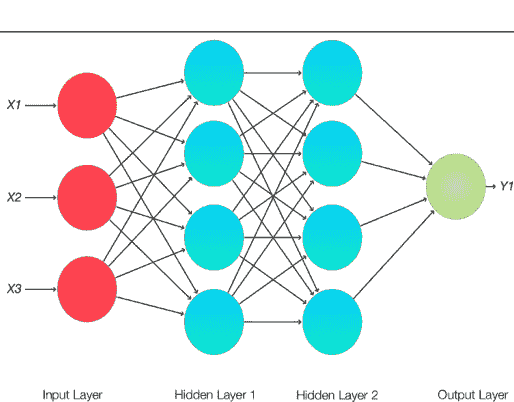

Keras 是一个开源神经网络库，能够对神经网络、深度学习和机器学习进行快速实验。Keras 是 TensorFlow 中不可或缺的一部分。2017 年，Google 决定原生支持 Keras 作为 TensorFlow 的首选接口。Keras 提供了优秀且直观的抽象和函数，而 TensorFlow 提供了高效的底层实现。NumPy 在 TensorFlow 模块中实现了必要的矩阵数学。

使用 TensorFlow 在 Keras 实现神经网络的五个步骤如下：

1. 加载并格式化你的数据。
2. 定义你的神经网络模型和层。
3. 编译模型。
4. 拟合并训练你的模型。
5. 评估模型。

## 第二章 构建神经网络 387

### 加载你的数据

第一步加载数据在我们模型中是易易的，但它通常是构建整个程序中最复杂、困难的部分。你必须检查你的数据（例如 XOR 门或影响糖尿病患者的因素数据库），并弄清楚如何映射数据和结果，以获得你想要的信息和预测。

### 定义你的神经网络模型和层

在第二步定义网络时，你可以看到 Keras 优于其他框架的主要优势之一。你基本上只是构建一个你想让数据流过的神经网络层栈。记住，TensorFlow 只是流过网络栈的数据矩阵。在这一步中，你选择你的神经网络层配置和激活函数。

### 编译你的模型

在第三步中，你编译模型，这会将你的 Keras 模型与底层特定的机器软件（后端）连接以便在你的硬件上运行。你还选择了你想用什么损失函数。

### 拟合并训练你的模型

训练神经网络的实际工作发生在第四步。你确定了让程序运行多少轮次（epochs）。你还记录了所有轮次发生情况的历史，并利用这些信息创建图表。

### 评估模型

在训练模型之后，你必须对其进行评估。评估是指在数据上运行你训练的机器学习模型，以查看模型在未包含训练集的数据上的表现如何。

使用 TensorFlow、NumPy 和 Keras 构建双层神经网络的 Python 代码如下（参见图 2-1）。使用 nano（或你喜好的文本编辑器），打开名为 `TensorFlowKeras.py` 的文件并输入以下代码：

```python
import tensorflow as tf
from tensorflow.keras import layers
from tensorflow.keras.layers import Activation, Dense
import numpy as np
```

- `X` = 我们 3 位 XOR 门的输入
- 设置神经网络的输出（直接来自表格）
- `X = np.array([[0,0,0], [0,0,1], [0,1,0], [0,1,1], [1,0,0], [1,1,1]])`

```python
model = tf.keras.Sequential()
model.add(Dense(4, input_dim=3, activation='relu'))
model.add(Dense(4, activation='relu'))
model.add(Dense(1, activation='sigmoid'))
model.compile(loss='mean_squared_error', optimizer='adam', metrics=['binary_accuracy'])
history = model.fit(X, y, epochs=200)
result = model.predict(X)
print(result)
```

**第 4 步，拟合并训练你的模型**：我们选择的 epoch（迭代）数量能够让我们在大多数情况下二分类准确率达到 1.0。在这里，我们加载带有输入 (`X`) 和预期输出 (`y`) 的 NumPy 数组。`validation_data` 参数会比较每个 epoch 中训练网络的输出，并生成 `val_acc` 和 `val_loss`，并将它们存储在 `history` 变量中：

```python
history = model.fit(X, y, epochs=2000,
    validation_data = (X, y))
```

然后，我们打印模型的摘要，以确保它是按照我们预期的方式构建的：

```python
model.summary()
```

接下来，我们打印 `history` 变量中的值，我们将获取这些值：

```python
# 将输出到文件
loss_history = history["loss"]
numpy_loss_history = np.array(loss_history)
np.savetxt("loss_history.txt", numpy_loss_history,
    delimiter="\n")

binary_accuracy_history = history["binary_accuracy"]
numpy_binary_accuracy = np.array(binary_accuracy_history)
np.savetxt("binary_accuracy.txt", numpy_binary_accuracy, delimiter="\n")
```

**第 5 步，评估模型**：我们运行模型来预测 `X` 中所有输入的输出，使用 `round` 函数将输出设为 0 或 1。注意，`round` 函数包含了我们在 Python 工具中使用的标准，即 `<0.1 = "0"` 和 `>=0.9 = "1"`。我们还计算了所有 epoch 的 `binary_accuracy` 值的平均值，但这个数字并没有什么用——它只是告诉我们数值越接近 1.0，模型成功得越快：

```python
print(np.mean(history["binary_accuracy"]))
result = model.predict(X).round()
print(result)
```

现在让我们来看看一些结果。

### 检查结果

当运行运行 TensorFlow 程序时，你可能会看到类似的内容：


```
/usr/lib/python3.5/importlib/bootstrap.py:222: RuntimeWarning: compilation
version 3.4 of module 'tensorflow.framework.fast_tensor_util' does not
match runtime 3.5
return f(*args, **kwargs)
/usr/lib/python3.5/importlib/bootstrap.py:222: RuntimeWarning: builtins.type
size changed, may indicate binary incompatibility. Expected 432, got 412
return f(*args, **kwargs)
```

此输出的出现是因为 TensorFlow 为你的机器构建的方式存在问题。这些警告可以安全忽略。TensorFlow.org 上的工作人员表示这个问题将在下一个版本中修复。

要运行这个双层模型，在 Terminal 窗口中输入 `python3 TensorFlowKeras.py`。在观察 epoch 逐个推进后（你可以通过设置 `model.fit` 命令中的 `Verbose` 参数来更改输出数量），我们得到了以下结果：

```
Epoch 1999/2000
8/8 [====================] 0 ms/step - loss: 0.0367 - binary_
accuracy: 1.0000 - val_loss: 0.0367 - val_binary_accuracy: 1.0000
Epoch 2000/2000
8/8 [====================] 0 ms/step - loss: 0.0367 - binary_
accuracy: 1.0000 - val_loss: 0.0367 - val_binary_accuracy: 1.0000

Layer (type)        Output Shape       Param =
dense (Dense)        (None, 4)          16
dense_1 (Dense)      (None, 1)          5

Total params: 21
Trainable params: 21
Non-trainable params: 0

0.843675
[[.
[1].
[0].
[0].
[0].
[0].
[0].
[1].]]
```

到 epoch 2000 时，我们已经如预期般实现了 1.0 的二分类准确率，且程序结束时 `model.predict` 函数的输出结果与我们的真值表匹配。图 2-6 显示了随着训练进行，损失函数和二分类准确率随 epoch 数量的变化曲线。

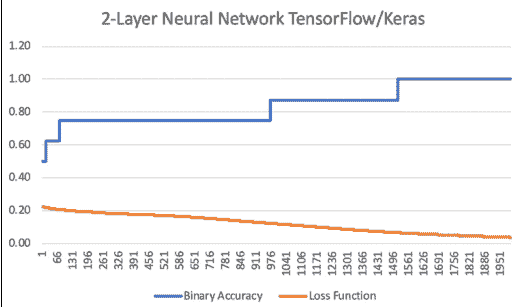

**图 2-6：** 双层训练的结果。

新网络的损失函数（如图 2-6 所示）比之前的网络损失函数（参考图 2-4）光滑得多。这种平滑的函数与激活函数的选择（relu）以及优化器函数（ADAM）有关。ADAM（自适应动估计）使用随机算法（使用随机数）来改进损失函数的结果。此外记住，由于个体权重中的随机初始值，你每次都会得到稍微不同的曲线。你可以为随机数生成器设置种子使其更具一致性。

新网络的损失函数（如图 2-6 所示）比之前的网络损失函数（参考图 2-4）光滑得多。这种平滑的函数与激活函数的选择（relu）以及优化器函数（ADAM）有关。ADAM（自适应动估计）使用随机算法（使用随机数）来改进损失函数的结果。此外记住，由于个体权重中的随机初始值，你每次都会得到稍微不同的曲线。你可以为随机数生成器设置种子使其更具一致性。

### 为什么使用 GUI？

（注：此处原文中存在大量重复段落，已根据指令要求翻译并保留重复内容）

## 本章内容

- 了解机器学习的基础知识
- 使用 TensorFlow 进行机器学习
- 使用 Matplotlib 工作

# 第 3 章

# 机器学习

学习某事意味着什么？一种定义是“对某事已知知识的获取和掌握，以及对这些知识意义的进一步澄清”。另一种定义是，学习是“由于经验导致个人知识或行为发生相对永久的变化”。

第二种定义最符合 AI 的现状。我们的工程和科学文化已经开发出算法和程序，这些程序可以从数据和感知输入中学习，并将这些知识应用于新情况。但我们的机器并不理解它们所学到的任何东西。它们只是积累了关于输入的数据，并将输入转换为某种输出，我们希望这种输出对观察者人类具有某种意义。

然而，即使机器并不理解它们学到的东西，你也可以在本章描述的机器学习技术完成一些令人深刻的解决。也许我们现在正在开发的技术将为未来开启更加惊叹的道路。

机器学习某事意味着什么？我们使用粗略的定义：如果机器可以接受输入并将其转换为输出输出，机器就学会了某种东西。例如，如果你写了一个简单的程序来两个数字相加，你就教会了它某事——如何两个数字相加。

在本章中，我们专注于机器学习，以及使用算法和统计模型，这些模型能够逐步提高它们在特定任务上的性能。这听起来像我们微型书籍第 2 章中的神经网络实验，你是正确的。机器学习不仅涉及神经网络，还涉及其他复杂的数分析和统计技术。要下载本章的代码，请访问 `www.dummies.com/go/pythonialofd2`。

## 在所有错误的地方寻找解决方案

机器学习以及广义 AI 的问题之一是确定算法如何找到最佳解决方案。这里的关键词词是*最佳*。我们如何知道一个给定的解决方案是最好的？我们设定特定的目标并实现它们（解决方案可能只是良好而非最优的）。

有些人人将寻找最佳解决方案的问题比作在雾天里尝试寻找某个区域内的最高山。你爬到了一座山顶并宣布：“我在最高的山上。”你处于你所能看到的最高山上。如果你将目标设定为在海拔超过 1000 英尺的山上，而你正处于 1250 英尺处，你就实现了目标。将目标设定在 1000 英尺以上被称为*局部极大值*，它可能不是可用的最佳极大值。

为你的机器学习项目定义目标是构建和使用机器学习程序整个过程的关键步骤。

在本章中，我们通过对问题的已知解决方案来完成大部分的目标设定（训练机器）。首先，我们训练机器，然后将该训练应用到问题的新的、类似的示例上。

三类主要类型的机器学习算法如下：

- **监督学习**：这种算法构建一个包含输入和输出的数据数据模型。这些数据被称为*训练数据*。我们在本章中展示了这种机器学习。
- **无监督学习**：对于这类算法，数据只包含输入，算法在数据中寻找结构和模式。算法通常具有复杂的统计和数学目标，而不是像寻找高于 1000 米的山那样的简单目标。
- **强化学习**：在这类算法中，软件根据累积奖励采取行动。算法不假设存在精确的数学模型，并在无法获得精确模型时使用。强化学习是机器学习中最复杂的领域，也是未来可能最有成效的领域。对强化学习进行实验是使用机器学习的机器人视觉解释研究领域，联合作者 John Sovic 非常感兴趣。

接下来，我们进入 Python 机器学习。

## 创建一个用于检测衣服类型的机器学习网络

我们使用 TensorFlow 和 Keras 以及名为 Fashion-MNIST（修改后的美国标准与技术研究院）的免费训练数据库来构建一些机器学习示例并查看其结果。（有关更多关于 TensorFlow 和 Keras 的信息，请参考本微型书籍的第 2 章。）该数据库包含来自十类的 60,000 件时尚产品。它以 28x28 像素格式存储数据，每个类别包含 6,000 个项目，如图 3-1 所示。


图 3-1：Fashion-MNIST 数据库的一部分。

Fashion-MNIST 使用 MNIST 格式（一组分辨率为 28x28 像素的灰度图像）时尚数据库，将 60,000 图像分为十类服装：

- 0: T 恤/上衣
- 1: 裤子
- 2: 毛衣
- 3: 连衣裙
- 4: 外套
- 5: 凉鞋
- 6: 衬衫
- 7: 运动鞋
- 8: 包
- 9: 短筒靴

我们在本微型书籍的第 2 章中使用 Keras 使用相同的五步法来构建层网络。TensorFlow 和 Keras。

1. 加载并格式化你的数据。
2. 定义你的神经网络模型和层。
3. 编译模型。
4. 拟合并训练你的模型。
5. 评估模型。

## 设置软件环境

本章的大部分操作如 usual在命令行中进行，因为你仍然需要输入代码并运行软件。然而，我们将屏幕上显示一些图形并使用 Matplotlib 评估机器学习程序正在做什么，所以如果你还没有启动，请启动 GUI（图形用户界面）。

如果你使用的是无头树莓派，要么添加键盘、鼠标和显示器，要么启动 VPC（虚拟网络计算机）以使用你的电脑显示器作为第二台计算机的显示器——在这种情况下是树莓派。网络上的许多链接都描述了如何这样做以及如何在你的主电脑上启动 GUI。有关设置软件和连接树莓派的优质教程来源，请访问 `www.raspberrypi.org`。

我们在本章在树莓派中使用 VNC。图 3-2 显示了在树莓派上运行的 GUI（实际上运行 VNC，但从这张图中看不出来）。

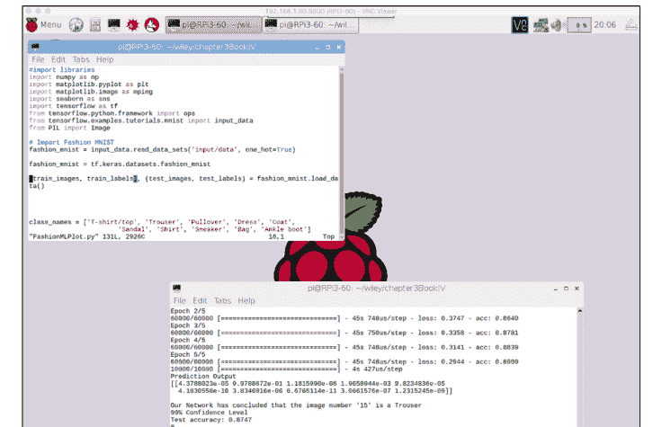

图 3-2：树莓派上的完整 GUI。

如果你缺少我们在示例中使用的任何 Python 库，请搜索在你的机器上安装它们的说明。例如，如果你缺少 seaborn，在树莓派上搜索“seaborn”，你会发现 `sudo pip3 install seaborn`。

```python
'凉鞋', '衬衫', '运动鞋', '包', '短筒靴'

train_images = train_images / 255.0
test_images = test_images / 255.0

model = tf.keras.Sequential()
model.add(tf.keras.layers.Flatten(input_shape=(28,28)))
model.add(tf.keras.layers.Dense(128, activation='relu'))
model.add(tf.keras.layers.Dense(10, activation='softmax'))

model.compile(optimizer=tf.train.AdamOptimizer(),
loss='sparse_categorical_crossentropy',
metrics=['accuracy'])

model.fit(train_images, train_labels, epochs=5)

# 使用 10,000 张图片进行测试
test_loss, test_acc = model.evaluate(test_images, test_labels)
print('10,000 image Test accuracy:', test_acc)
```

# 代码拆解

如果你读过第 2 章中关于 TensorFlow 和 Keras 程序的描述，这段代码应该看起来很熟悉。在本节中，我们将代码拆解为熟悉的五个步骤 Keras 流程。

但首先，我们导入了运行该示例双层模型所需的所有库。注意，TensorFlow 默认包含了 Keras。再次，我们的朋友 NumPy 是处理矩阵的首选方法：


```python
import libraries
import numpy as np
import matplotlib.pyplot as plt
import matplotlib.image as mpimg
import seaborn as sns
import tensorflow as tf
from tensorflow.python.framework import ops
from tensorflow.examples.tutorials.mnist import input_data
from PIL import Image
```

## 第 3 章 机器学习

在第 1 步中，我们加载并格式化数据。这次我们使用了内置的数据读取功能。程序之所以知道这些数据是什么，是因为前面的代码中包含了来自 `tensorflow.examples.tutorials.mnist` 的导入语句：

```python
# 导入 MNIST
fashion_mnist = input_data.read_data_sets('input/data', one_hot=True)
```

```python
fashion_mnist = tf.keras.datasets.fashion_mnist
```

```python
(train_images, train_labels), (test_images, test_labels) = \
fashion_mnist.load_data()
```

现在我们为 Fashion_MNIST 数据中的十个类别提供一些描述性名称：

```python
class_names = ['T恤/上衣', '裤子',
'套衣', '连衣裙', '外套',
'凉鞋', '衬衫', '运动鞋', '包', '短筒靴']
```

然后我们将图片的尺度从 0–255 更改为 0.0–1.0：

```python
train_images = train_images / 255.0
test_images = test_images / 255.0
```

在第 2 步中，我们定义了神经网络模型和层。Keras 使得添加神经层以及更改其大小和激活函数变得非常容易。我们还为激活函数（relu）应用了偏置，在这种情况下，最终输出层使用了 softmax：

```python
model = tf.keras.Sequential()
```

```python
model.add(tf.keras.layers.Flatten(input_shape=(28,28)))
model.add(tf.keras.layers.Dense(128, activation='relu'))
model.add(tf.keras.layers.Dense(10, activation='softmax'))
```

在第 3 步中，我们编译了模型。损失函数 `sparse_categorical_crossentropy` 用于为每个服装类别分配一个单独的整数，正如我们在示例中所做。Adam（一种随机优化方法）是一个很好的默认优化器，因为它非常适合数据量或参数量巨大的问题。

```python
model.compile(optimizer=tf.train.AdamOptimizer(),
loss='sparse_categorical_crossentropy',
metrics=['accuracy'])
```

`sparse_categorical_crossentropy` 损失函数衡量数据集中不同类别之间的误差。Categorical（分类）是指数据集中有两个类别（二分类）。Sparse（稀疏）是指使用单个整数来引用类别（在我们的示例中为 0-9）。Entropy（熵，无序度量）是指类别之间数据的混合程度。

在第 4 步中，我们拟合并训练了模型。我们选择了五个 epoch（训练轮次）来运行示例中的模型。可以随意增加 epoch 的数量。在这里我们使用 NumPy 数组作为网络的输入（base_images）。

```python
model.fit(train_images, train_labels, epochs=5)
```

在第 5 步中，我们评估了模型。`model.evaluate()` 函数用于比较训练网络在每个 epoch 中的输出，并为每个 epoch 生成 test_acc 和 test_loss 以供你参考，这些信息存储在 history 变量中。

```python
# 使用 10,000 张图片进行测试
test_loss, test_acc = model.evaluate(test_images, test_labels)
```

### 训练与评估结果

我们在树莓派 3B+ 上运行了程序。（树莓派 4B 的速度至少快一倍。）此时，你可以安全地忽略代码不匹配警告和未来的弃用公告。

以下是程序的运行结果：

```
Epoch 1/5
60000/60000 [====================] - 44s 726us/step - loss: 0.5009 -
acc: 0.8244
Epoch 2/5
60000/60000 [====================] - 42s 703us/step - loss: 0.3751 -
acc: 0.8652
Epoch 3/5
60000/60000 [====================] - 42s 703us/step - loss: 0.3359 -
acc: 0.8767
Epoch 4/5
60000/60000 [==========================] - 42s 71us/step - loss: 0.3124
acc: 0.8839
Epoch 5/5
60000/60000 [==========================] - 42s 703us/step - loss: 0.2960
acc: 0.8915
100000/100000 [=======================] - 4s 40us/step
10,000 Image: 0.873
```

从根本上说，测试结果表明，我们的双层机器学习网络可以正确识别 10,000 张图片中的 87%。当我们将 epoch 数增加到 50 时，准确率提高到了 88.7%。

### 测试单张图片

接下来我们测试 Fashion_MNIST 数据库中的单张图片，见图 3-3。在你的程序末尾添加以下代码并重新运行：

```python
# 运行 Fashion_MNIST 数据
img = test_images[15]
img = np.expand_dims(img,0)
singlePrediction = model.predict(img,steps=1)
print("Prediction Output")
print(singlePrediction)
NumberElement = singlePrediction.argmax()
Element = np.amax(singlePrediction)
print("Our Network has concluded that the image number '15' is " + class_names[NumberElement] + "% Confidence Level")
```

五个 epoch 运行的结果：

```
Prediction Output
[1.28356e-05 9.996407e-01 6.263712e-08 3.426509e-04 4.297972e-06
7.845063e-10 6.279432e-07 9.871752e-12 1.272948e-08 1.002166e-09]
Our Network has concluded that the image number '15' is Trouser
99% Confidence Level
```

万岁！成功了。它识别出了图片是裤子。但记住，我们在测试数据上的总体率只有 87%。

### 测试外部图片

接下来，我们用一张 iPhone 拍摄的照片测试程序。见图 3-4。

在 Mac 上使用“预览”功能，我们将图片的分辨率从 3024x3024 像素转换为 28x28 像素，如图 3-5 所示。虽然 28x28 像素并没有产生清晰的图片，但图 3-5 中的照片比 Fashion-MNIST 数据库中的图 3-1 要清晰。

下面的大部分代码将原始 JPG 数据排列以符合 TensorFlow 的图片格式。你可以使用这些代码轻松添加你自己的图片：

```python
# 读取图片
imageName = "28x28.JPG"
testImg = Image.open(imageName)
testImg.load()
data = np.array(testImg)
print(singlePrediction)
NumberElement = singlePrediction.argmax()
Element = np.amax(singlePrediction)
print("Our Network has concluded that the file '+imageName+' is a " +class_names[NumberElement])
print(str(Element) + "% Confidence Level")
```

#### 第一轮结果

测试结果让我们并不满意，你很快就会发现的。我们在程序相同的目录下运行了 `Dress28x28.jpg` 文件，并运行了五个 epoch 的训练。以下是结果：

```
Prediction Output
[[2.177753e-06 1.3373902e-08 1.048785e-06 3.352557e-11 8.803184e-09
7.184245e-10 1.1173938e-04 8.323927e-12 9.988592e-01 3.209578e-12]
Our Network has concluded that the file 'Dress28x28.JPG' is a Bag
90% Confidence Level
```

我们的神经网络机器学习程序在分类了 60,000 张图片和 6,000 张连衣裙图片后，以 99% 的置信水平得出了结论……等一下……那 `Dress28x28.JPG` 照片是一个包。我们通常不会对结果发笑，但在读到这一个结果时。

于是我们将训练 epoch 增加到 50 和 100。以下是该运行的结果：

```
Prediction Output
[[3.448752e-03 0.000000e+00 2.5598763e-03 0.000000e+00 0.000000e+00
0.000000e+00 2.932200e-17 0.000000e+00 1.000000e+00 1.5202169e-39]]
Our Network has concluded that the file 'Dress28x28.JPG' is a Bag
100% Confidence Level
```

连衣裙还是一个包，但现在我们的程序 100% 确信连衣裙是一个包。嗯。这说明了机器学习的问题之一。100% 确信一张连衣裙的照片是一个包仍然是 100% 错误的。

这里的真正问题是什么？神经网络的配置可能不足以区分连衣裙和包。额外的 epoch 并没有似乎可以提高准确率，因此下一个尝试是增加我们隐藏层中神经元的数量。

我们更改了程序中的模型层，使用了一个四层卷积层模型。我们非常喜欢在使用 Keras 和 TensorFlow 时能够剧烈改变神经网络的感觉。

卷积神经网络（CNN）通过扫描图像并逐块分析图像中的像素来工作；例如，使用一个 5x5 像素的窗口，每次移动两个像素的步长，直到覆盖整个图像。这就像是使用显微镜观察图像；你任何时候只能看到图片的一小部分，但通过反复移动，最终就能看到整张图片。在树莓派上使用 CNN 网络将单轮训练（epoch）的时间从 10 秒增加到 1.5 小时，性能下降了 54.0 倍。CNN 需要大量的计算能力。

你还可以尝试哪些方法来提高这个机器学习程序的准确率呢？你可以使用数据增强（通过旋转、平移和缩放图片来增加训练样本）以及超出本机器学习介绍范围的其他各种技术。

### CNN 模型代码

以下代码与上一个程序具有相同的整体结构。唯一显著的变化是为 CNN 网络添加了新层：

```python
import libraries
import numpy as np
import matplotlib.pyplot as plt
import matplotlib.image as mp
import seaborn as sns
import tensorflow as tf
from tensorflow.python.framework import ops
from tensorflow.examples.tutorials.mnist import input_data
from PIL import Image

# Import MNIST
fashion_mnist = input_data.read_data_sets('input/data', one_hot=True)
# Note：也可以使用 keras datasets 作为替代方案
(train_images, train_labels), (test_images, test_labels) = tf.keras.datasets.fashion_mnist.load_data()

class_names = ['T-shirt/top', 'Trouser', 'Pullover', 'Dress', 'Coat', 'Sandal', 'Shirt', 'Sneaker', 'Bag', 'Ankle boot']

train_images = train_images / 255.0
test_images = test_images / 255.0

# Prepare the training images
train_images = train_images.reshape(train_images.shape[0], 28, 28, 1)
# Prepare the test images
test_images = test_images.reshape(test_images.shape[0], 28, 28, 1)

model = tf.keras.Sequential()

input_shape=(28, 28, 1)
model.add(tf.keras.layers.Conv2D(32, kernel_size=(3, 3), activation='relu', input_shape=input_shape))
model.add(tf.keras.layers.Normalization())

model.add(tf.keras.layers.Conv2D(64, kernel_size=(3, 3), activation='relu'))
model.add(tf.keras.layers.Normalization())
model.add(tf.keras.layers.MaxPooling2D(pool_size=(2, 2)))
model.add(tf.keras.layers.Dropout(0.25))

model.add(tf.keras.layers.Conv2D(64, kernel_size=(3, 3), activation='relu'))
model.add(tf.keras.layers.Normalization())
model.add(tf.keras.layers.Dropout(0.25))

model.add(tf.keras.layers.Conv2D(128, kernel_size=(3, 3), activation='relu'))
model.add(tf.keras.layers.Normalization())
model.add(tf.keras.layers.MaxPooling2D(pool_size=(2, 2)))
model.add(tf.keras.layers.Dropout(0.25))

model.add(tf.keras.layers.Flatten())

model.add(tf.keras.layers.Dense(512, activation='relu'))
model.add(tf.keras.layers.Normalization())
model.add(tf.keras.layers.Dropout(0.5))

model.add(tf.keras.layers.Dense(128, activation='relu'))
model.add(tf.keras.layers.BatchNorm())
model.add(tf.keras.layers.Dropout(0.5))

model.add(tf.keras.layers.Dense(10, activation='softmax'))

model.compile(optimizer=tf.train.AdamOptimizer(),
             loss='sparse_categorical_crossentropy',
             metrics=['accuracy'])

history = model.fit(train_images, train_labels, epochs=5)
```

### 使用 10,000 张图片进行测试

```python
test_loss, test_acc = model.evaluate(test_images, test_labels)

print('10,000 image test accuracy:', test_acc)
```

### 从 Fashion_MNIST 数据运行测试图像

```python
img = test_images[15]

img = np.expand_dims(img,0)

singlePrediction = model.predict(img,steps=1)

print("Prediction Output")
```


print(`singlePrediction`)

`NumberElement = singlePrediction.argmax()`

`Element = np.max(singlePrediction)`

print("Our Network has concluded that the number '15' is a " + `class_names[NumberElement]`)

print(str(int(`Element*100`)) + " % Confidence Level")

# 结果，第二轮

在树莓派 3B+ 上的运行大约花了七小时完成。结果如下：

```
10,000 image test accuracy: 0.861
Prediction Output
[[5.912819e-06 9.999728e-01 1.568164e-06 8.139373e-06 1.5611777e-06
7.504888e-07 5.517464e-06 2.248497e-07 3.0045830e-06 6.588598e-07]]
```

Our Network has concluded that the number '15' is a Trouser

关键数字是 10,000 张图片的准确率，结果为 86%，低于我们之前更简单的机器学习神经网络（87%）。为什么会发生这种情况？准确率的下降可能与拟合训练数据有关，即训练好的网络能更好地识别训练集，但失去了识别新测试数据的能力。这种问题凸显了使用机器学习程序既是一门艺术也是一门科学。


## 使用 MatPlotLib 进行可视化

```python
# read dress image
imageName = "Dress28x28.JPG"

testImg = Image.open(imageName)

plt.figure(2)
plt.imshow(testImg)
plt.show(block=False)
plt.pause(0.001)
testImg.load()
data = np.array(testImg, dtype="float" )
```

```python
data = tf.image.rgb_to_grayscale(data)
data = data/255.0
```

```python
data = tf.transpose(data, perm=[2,0,1])
```

```python
singlePrediction = model.predict(data, steps=1)

NumberElement = singlePrediction.argmax(
Element = np.amax(singlePrediction)
print(NumberElement)
print(Element)
print(singlePrediction)
```

```python
print("Our Network has concluded that the file ''+imageName+'' is a "\n<class_names[NumberElement])")
print(str(Element+100)) + " %% Confidence Level")
```

```python
plt.show()
```

运行程序的结果如图 3-6 所示。标记为 Figure 0 的窗口显示了机器学习五个轮次（epochs）的准确率。你可以看到准确率随着每个轮次的增加缓慢提高。标记为 Figure 1 的窗口显示了第一次识别测试的图片（程序发现了一条裤子，这是正确的）。最后，标记为 Figure 2 的窗口显示了连衣裙图片，它仍然被错误地识别为包。哼。

## 学习更多机器学习

你已经构建并实验了机器学习和神经网络，并看到了 Python 是多么有用和强大。下一步是什么？我们建议你查看由 John Paul Mueller 和 Luca Massaron 编写的《Machine Learning For Dummies》，以及 François Chollet 编写的《Deep Learning with Python》（Manning 出版社）。为了对 AI 领域有一个良好的初学者概述，请阅读 John Paul Mueller 和 Luca Massaron 编写的《Artificial Intelligence For Dummies》。

接下来，你将探索使用 Python 进行其他 AI 应用。

图 3-6：我们带有 Matplotlib 可视化的树莓派 GUI。

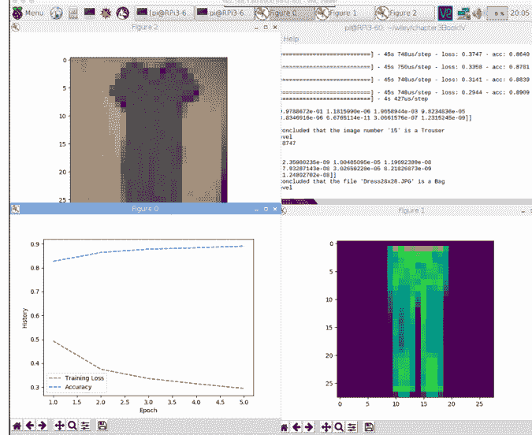

第 3 章 执行机器学习 419

# 第 4 章

## 探索 AI

在读完前面的三个章节后，你已经学习了很多关于人工智能的基础知识，特别是神经网络和机器学习。不过，AI 包含的内容远比这两个主题多得多。我们可以研究高级搜索（不是 Google 搜索，而是查看大型问题空间并尝试使用 AI 解决问题）。我们还可以研究自主机器人问题（我们在第 7 册中会提到），但那个主题非常复杂。

相反，在本章中，我们将谈论除树莓派之外进行 AI 软件的其他方法。还记得我们在大型神经网络上运行五个轮次训练花了七个小时吗？听起来我们可以使用更强大的设备在更短的时间内完成更多的训练。这正是本章要讨论的议题。如需下载本章代码，请访问 `dummies.com/pythoniofd2e`。

## 树莓派和 AI 的局限性

树莓派是一种廉价、功能全计算设备。我们在本书中使用的树莓派 3+ 具有以下主要规格：

- CPU：博通四核 64 位处理器 @ 1.4GHz
- GPU：博通 Videocore-IV
- RAM：1GB SDRAM
- 网络：千兆以太网，802.11b/g/n/ac Wi-Fi
- 存储：SD 卡

这些规格对于一台 35 美元的电脑来说非常出色，但对于一台专用的 AI 计算机来说并不尽如人意。树莓派没有足够的内存或复杂的 GPU（图形处理器）。


这些规格对于一台 35 美元的电脑来说非常出色，但对于一台专用的 AI 计算机来说并不尽如人意。树莓派没有足够的内存或复杂的 GPU（图形处理器）。

树莓派 3+ 具有以下主要规格：


# 张量与 AI 硬件加速

张量就是矩阵，正如我们在本迷你书籍第 2 章和第 3 章的神经网络示例中所看到的。图 4-3 显示了 Google Edge TPU 加速器。

与 Intel NCS 棒类似，该设备的核心在于执行训练好的机器学习模型。你仍然使用其他技术训练机器学习网络，然后在计算棒上执行该模型。

> **警告**

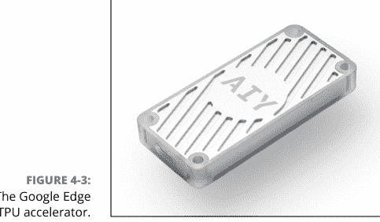

在接下来的几年里，这种用于运行机器学习模型的专用硬件将发生爆炸式增长。你将看到来自 Google、Intel、Nvidia、AMD、高通以及全球许多较小公司的多种不同架构和解决方案。每个人都开始加入 AI 加速器的热潮。

## 云端 AI

在科技行业，人们喜欢使用诸如“云”之类的流行术语。通常，这种语言的使用会导致任意且模糊的术语，让消费者（甚至是高练的技术人员）也不确定它们的含义。当你的数据程序运行在云端时，它们实际上只是运行在数据中心的计算机上。

有些人将云定义为运行在互联网而非本地机器上的软件或服务。这在某种程度上是正确的，但没有什么是运行在互联网上的；它是运行在连接到互联网的机器上的。理解云端软件运行在服务器上而非仅仅“在某处”，可以快速消除云及其功能的神秘感。

如果你有两台连接到一起的计算机，并将其中一台用作数据服务器，你就拥有了自己的云。西部数据（Western Digital）和戴尔（Dell）等公司帮助消费者构建自己的云计算系统。西部数据数据的经理 Bill Wachsmuth 表示：“云计算是数据存储领域一个巨大的增长市场。我们可以采用现有的硬盘，修改软件，并重新封装相同的硬件来辅助云计算和存储。”

通过使用云，你可以使用本地网络无法提供的服务和存储，而且这是云计算最重要的变化之一——你可以根据自己的使用情况动态地增加或减少用量。

使用云需要访问互联网，但并不一定是 100% 的时间都连接。（你可以启动一个云进程，以后再回来处理。）持续连接互联网的要求限制了云在自动驾驶汽车等应用中的发挥，因为自动驾驶汽车无法保证一直都有良好的网络访问。“发送并遗忘”模式用于 IoT（物联网）设备，因为你想要节省电力（通过电池供电的设备）。

那么，如何使用云呢？答案取决于服务和供应商，但在机器学习应用中，最常见的方法是在计算机上设置 Python，并调用云端函数和应用程序。所有云供应商都提供示例。

云使用的优秀示例是 Amazon Echo 和 Alexa。它们倾听你的指令，压缩语音数据，将其发送到 Amazon AWS 云，并返回语音响应或命令（例如，打开你的灯）。所有的处理都在云端完成。当你的互联网连接断开时，这些设备无无作为，只能说“连接互联网时遇到问题”。

目前存在许多存储和服务的云提供商。本书期间，顶级的 AI 云提供商如下：

- Google Cloud
- Amazon Web Services
- IBM Cloud
- Microsoft Azure

### Google Cloud

Google Cloud 可能是最关注 AI 的云供应商。你可以访问云端的 TPU（张量处理单元），它们与之前描述的 Google 计算棒一样，可以加速你的 AI 应用。Google Cloud 的大部分功能反映了公司的核心技能——搜索。

例如，Cloud Vision API 可以检测图像中的物体、标志和地标。爱达荷大学的一些优秀学生使用 ParkMyRide，该程序使用基于树莓派的太阳能摄像头拍摄街道照片，并利用 Google Cloud Vision API 确定路边停车可用性。软件将街道照片发送给 Google，并返回找到的数量及其在图片中的位置。然后他们将这些信息提供给手机应用，以图形方式显示这些信息。非常酷。

Google Cloud 的其他特色服务还有视频内容搜索应用以及语音转文本/文本转语音包（想想 Google Home——类似于 Alexa 的专业水平）。与亚马逊和微软一样，Google 正在利用其自己的 AI 驱动应用为客户创建服务。

### Amazon Web Services

Amazon Web Services (AWS) 专注于为企业提供消费级的 Alexa 专业知识。许多云服务是构建在消费产品版本之上的。因此，随着 Alexa 的改进，云服务也随之改进。在某种意义上，数百万 Alexa 用户正在训练 Alexa 成为一个更好的产品。

亚马逊不仅提供文本和自然语言产品，还有机器学习可视化和创建工具、视觉识别和分析。

### IBM Cloud

IBM Cloud 因难于使用而声誉不佳。在许多不同的平台上有很多选项，以至于几乎无法确定从哪里开始。然而，在过去的几年里，IBM Cloud 有了改进。IBM 将其三个大部门（IBM BlueMix 云服务、SoftLayer 数据服务和 Watson AI 组）合并到 Watson 品牌下。目前可用 170 多项服务，最初设置应用程序和程序仍然困难，但对过程的控制和一致性好得多。


Watson Studio 是他们的机器学习环境，用于构建和训练神经网络。Watson Studio 的功能之一是 Watson Insights，它通过 Watson 预测特征。

### Microsoft Azure

Microsoft Azure 强调开发者。与亚马逊和谷歌类似，AI 应用是构建在消费产品上的。他们将 AI 产品分为三类：

- AI 服务
- AI 工具和框架
- AI 基础设施

Azure 还支持 GPU 和自定义基础设施，包括可以将应用转换为云应用的容器。Azure 是值得关注的。

## 显卡上的 AI

显卡（如图 4-4 所示的 Nvidia 芯片）一直是 PC 体验不可或缺的一部分。人们经常寻找最好的显卡来让他们的 PC 变成更好的游戏机。虽然 CPU 速度很重要，但显卡的质量和架构会有更大的影响。为什么？计算高分辨率图形的计算量巨大，解决计算速度问题的方法是构建用于处理图形的计算机。这些高质量显卡可以高效地评估机器学习神经网络。因此诞生了 GPU（图形处理器），一种专为处理图形设计的计算机核心。


**图 4-4：Nvidia 256 核心芯片。**

Nvidia 等公司开始制造包含多个 GPU 的显卡，这极大地提高了游戏的视频分辨率和帧率。需要记住的一点是，图形算法使用称为矩阵（或张量）的数据结构构建并在流水线中处理。

等等。传感器？矩阵？这听起来非常像我们在 AI 和机器学习中使用的数据结构。机器学习和深度学习算法在图形处理上的相似性使得 GPU 变得有用且有效，因为它们可以快速求解矩阵方程，这是训练神经网络的计算类型。

无论哪种神经网络，所有的编程技术和模块都依赖于执行复杂的统计操作。在训练（学习）操作期间，大量的图像或数据点被馈到网络中，然后通过正确的分类或正确的答案进行训练。你必须关联数百万张量（矩阵）和张量元素，以构建一个能够获得结果的训练网络。

为了加速训练，这些操作可以并行进行，事实证明是对显卡上许多并行 GPU 的良好利用。

单个 GPU 核心比 CPU 核心简单，因为 GPU 核心是为特定目的设计的，而不是通用目的。这种简单性使得构建多核 GPU 芯片比构建多核 CPU 芯片更便宜。

拥有许多 GPU 核心的显卡的普及使得这些显卡成为机器学习应用程序的完美选择。强大的多核 CPU 和许多 GPU 的组合可以极大加速机器学习程序。TensorFlow 有专门为配合 GPU 板设计的软件版本，消除了使用这些板的大部分复杂性。

为了在性能上匹配这种处理能力，树莓派 3B+ 有 4 个处理器核心，在某种意义上也有 4 个 GPU 核心。英伟达最新的 GPU 板之一拥有 3,584 个核心。通过使用大核心 GPU 板，你可以对机器学习网络进行大量的快速训练和评估，但你不会花费数据库访问或通用计算任务。这些任务需要更复杂的 CPU 核心。

基于 GPU 的板并不是支持 AI 应用的专用计算机和硬件演化的最后一步。我们正在看到更多的专用芯片。据统计，超过 50 家公司正在使用加速 AI 功能的芯片。

当我们讨论微软 Azure 云服务时，我们提到微软已经构建了基础设施来支持云端的 AI 加速硬件。这一发展是关注微软动态的大大原因之一。

未来在于越来越多的专用硬件，特别是当这些硬件从用户软件端变得越来越容易处理时。

## 在 Python 中探索更多 AI 乐趣

如果你对进一步提升在机器学习 AI 方面的知识和能力感兴趣，请查看以下来源获取项目灵感：

- *圣诞老人是真实的吗？*, Varun Vohra, https://towardsdatascience.com/is-santa-claus-real-9b7b99893776c
- *树莓派上的 Keras 和深度学习？*, Adrian Rosebrock, www.pymagesearch.com/2017/12/18/keras-deep-learning-cat-raspberry-pi/
- *MouseAir — 在树莓派上使用 AI 娱乐你的猫*, John Shovic, www.switchdoc.com/2019/11/mouseair-raspberry-pi-cat-toy/
- “如何在树莓派上使用深度学习轻松检测对象，”Sarthak Jain, https://medium.com/nanonets/how-to-easily-detect-objects-with-deep-learning-on-raspberrypi-225f29635c74
- “使用卷积神经网络构建猫检测器，”Venelin Valkov, https://medium.com/@curiously/tensorflow-for-hackers-part-iii-convolutional-neural-networks-c077618e590b
- “使用 Inception 框架在树莓派上实现实时图像分类器，”Bapi Reddy, https://medium.com/@bapireddy/real-time-image-classifier-on-raspberry-pi-using-inception-framework-facfa1509

遵循“傻瓜指南”的传统，你将不仅通过阅读，而且通过构建程序和修改别人的程序来加速对这些重要技术的学习。


# 第 5 章 实践数据科学

## 目录

- 第 1 章：理解数据科学的五个领域 ..................................................... 435
- 处理海量、海量数据 ................................................................................ 436
- 燃气烹饪：数据科学的五步法 ........................................ 438

## 本章内容

- 学习数据科学
- 理解大数据
- 发现数据科学的五个步骤

## 第 1 章 理解数据科学的五个领域

数据科学对我们生活的影响比你想象的要多得多。当你使用 Google、Bing 或 DuckDuckGo 时，你正在使用数据科学的复杂应用。当你打字时出现的其他搜索词建议？它们源自数据科学。医学诊断以及对图像和症状的解释都是数据科学的例子。如今，医生越来越多地依赖数据科学的解释。

与本书中的大多数主题一样，数据科学对门初学者来说看起来令人生畏。推论、数据图表和统计学，噢，我的天哪！然而，正如之前关于人工智能的章节中一样，如果你深入研究并观察一些示例，你就能掌握数据科学是什么、不是什么。

在本章中，我们向你介绍 Python 在数据科学中的应用，并只介绍恰足够的入门的理论。即便无一获，我们也希望让你对数据科学的流程有一个理解，并对新闻中报道的大数据分析背后的原理 Better 了解。例如，一项研究说咖啡对你有害，但另一项研究却恰相反——有时研究是基于相同的数据！数据科学和统计学最难的部分是确定结果的含义，除了简单的解释——这本身就值得一本书。在我们数据科学之旅的最后，你将对分析结果涉及的流程有更多的了解。

> **第 1 章 理解数据科学的五个领域 435**
>
> **数据科学和大数据充满了奥秘**

### 处理海量、海量数据

数据科学对我们生活的影响比你想象的要多得多。当你使用 Google、Bing 或 DuckDuckGo 时，你正在使用数据科学的复杂应用。当你打字时出现的其他搜索词建议？它们源自数据科学。医学诊断以及对图像和症状的解释都是数据科学的例子。如今，医生越来越多地依赖数据科学的解释。

基于 GPU 的板并不是支持 AI 应用的专用计算机和硬件演化的最后一步。我们正在看到更多的专用芯片。据统计，超过 50 家公司正在使用加速 AI 功能的芯片。

当我们讨论微软 Azure 云服务时，我们提到微软已经构建了基础设施来支持云端的 AI 加速硬件。这一发展是关注微软动态的大大原因之一。

未来在于越来越多的专用硬件，特别是当这些硬件从用户软件端变得越来越容易处理时。

数据科学对我们生活的影响比你想象的要多得多。当你使用 Google、Bing 或 DuckDuckGo 时，你正在使用数据科学的复杂应用。当你打字时出现的其他搜索词建议？它们源自数据科学。医学诊断以及对图像和症状的解释都是数据科学的例子。如今，医生越来越多地依赖数据科学的解释。

### 容量

单个 GPU 核心比 CPU 核心简单，因为 GPU 核心是为特定目的设计的，而不是通用目的。

### 多样性


### 速度

指的是数据变化的速度以及添加到数据文件的速度。Facebook 用户每天上传超过 1 亿张照片，因此在未来几年内 Facebook 将拥有超过 1 万亿张。Facebook 是一个高速度数据集。低速度数据集（完全不改变）可能是你房子过去五年的温度和湿度读数。不说说，高速度数据集需要与低速度数据集不同的技术。

### 管理容量、多样性和速度

容量、多样性和速度的管理是一个复杂的话题。数据科学家已经开发了许多处理数据的方法。这三个 V 数据集让你对数据参数有一个了解。从数据中获取洞察的过程被称为数据分析。在接下来的章节中，我们专注于获取分析知识，并学习如何使用 Python 提出数据分析问题。在从事数据科学几年后，你将非常擅长管理这一流程。


> **第 1 章 理解数据科学的五个领域 437**

## 燃气烹饪：数据科学的五步流程

我们通常可以将对数据进行科学研究（特别是大数据）的过程分为五个步骤：

1. 获取数据。
2. 处理数据。
3. 分析数据。
4. 沟通结果。
5. 维护数据。

我们将通过讨论这些每一个步骤来完成本介绍章节，以便你能够掌握数据科学流程的走向，并对任务的复杂性有一个直观感受。

### 获取数据

为了进行分析，你必须获取数据。在任何现实世界的情况中，你可能有很多潜在的数据源，例如公司记录、公共数据库或你自己收集的数据。对它们进行盘点，并决定项目要包含哪些内容。但在知道包含哪些内容之前，你必须仔细定义你的业务问题和目标。有了明确的目标，更容易判断你是否实现了这些目标。

如果可能，请整合你的数据源，以便获取所需的信息来发现洞察，并构建所有你迫待向管理层展示的精美报告。

### 处理数据

处理数据是数据科学中本应该是简单的部分，但绝非如此。有些数据科学家花费几个月的时间来按摩和操纵数据，以便能够处理它们并信任它们。你需要识别异常和离群值，消除重复项，移除缺失项，并确定哪些数据是不一致的。你需要仔细地清洗和处理你的数据，以免删除了对你即将分析工作重要的数据，或引入会破坏你未来做出良好推理或优质答案能力的偏差。

另一个需要担心的数据处理问题：根据《营销周刊》2015 年的报道，60% 的消费者在在线提交数据时会故意提供错误信息。（我们谦虚地承认自己经常在在线营销表单甚至给政治民意调查者那里这样做，特别是当我们感觉到问题中带有政治议程时。我们这些是坏孩子。）

即使是优秀的数据科学家也被指控在清洗数据时“樱桃挑选”以支持某个假设。你在处理数据时必须非常小心，以保持分析的完整性和有效性。做好准备在这一步骤上花费大量时间。

请理解，只需要少量的不成比例的信息就能极大地降低数据库的价值。值得深思。

### 分析数据

当你耗尽所有能量到达查看数据以看看能发现什么的程度时，你是否会认为问题是相对简单的？事实并非如此。分析大数据集以获取洞察并提出复杂问题需要数据科学中最丰富的人类直觉。某些问题，如“2020 年在谷物上的平均花费是多少？”可以很容易地定义和计算，即使是在海量数据上也是。但有用的问题，例如“我能让更多人购买糖脆玉米片吗？”才是那个价值 64,000 美元的问题。

这样的问题具有层层复杂性。你想知道目前糖脆玉米片客户购买数量的基准。然后你必须定义你所说的“更多人”。是指更多人还是更多收入？将价格更改为每人 0.01 美元，你会有更多人购买糖脆玉米片。真正的是更多收入，或者来说是利润（利润 – 成本）。但问题的困难部分在于如何激励人们购买糖脆玉米片？答案是否在你收集的数据中？

分析的困难之处在于确保我们正在以正确的方式、针对正确类型的数据提出正确的问题。

分析数据需要统计技术方面的技能和经验，例如线性回归和逻辑回归，以及使用各种概率算法和公式（如朴素贝叶斯，名字真酷！）寻找不同数据之间的相关性。虽然对这些技术的全面讨论超出了本书的范围，但我们将在本微型书籍的后面介绍一些示例。

### 数据科学对比数据分析

目前，**数据科学**指的是从大型非结构化数据集中推导出洞察的过程。数据科学使用预测分析、统计学和机器学习来梳理海量数据。*数据分析*侧重于对现有数据集进行使用和创建统计分析，以获得关于这些数据的洞察。

由于这些模糊的描述，以及越来越多的技术被开发用于对大数据进行分析（不意外地命名为*大数据分析*），你可以看到这两个领域正变得越来越接近。冒着学术同行批评的风险，我们会理所当然地将数据分析的第 3-5 步——分析数据、沟通结果和维护数据——称为数据科学的一个子集。

### 沟通结果


在你将数据粉碎并扭曲成所需的格式，并分析数据以回答你的问题之后，你需要向管理层或客户展示结果。大多数人在看到图形化信息时，而非仅仅是文本，能更好更快地可视化并理解信息。

数据人员使用两个主要的 Python 包来展示结果：R 语言和 Matplotlib。我们使用 Matplotlib 显示我们的大数据图表，如果你读过《第 4 本》，你就亲身经历过 Matplotlib。

# 维护数据

维护数据是数据科学中许多人忽略的步骤。在他们提出第一轮问题并收到第一轮答案后，许多专业人士基本上会转向下一个项目。然而，有很大可能在未来的某一点（也许是以后），他们将不得不对相同的数据提出更多问题。

> **记住**
>
> 确保归档并记录以下信息，这样你就可以快速重启项目，或者更有可能，将项目的部分用于新项目：
>
> - 数据和来源
> - 你用于修改数据的模型（包括任何异常数据）

在很多情况下，特别是在医疗和金融领域，有一些工具用于展示。

# 在本章中

- 使用 NumPy 进行数据科学
- 使用 Pandas 进行快速分析
- 从 Python 项目中学习
- 使用 Matplotlib 进行可视化

# 第 2 章 探索大数据

在本章中，你将发现数据科学家使用的用于格式化、处理和查询数据的工具。

许多基于 Python 的工具和库（如 R）都是可选的，但我们选择 NumPy 有三个原因。首先，它是 Python 中最受欢迎的工具之一。其次，许多数据科学项目都使用 NumPy。第三，非常有用的 Python 数据包 Pandas 是基于 NumPy 构建的。

Pandas 证明是数据科学中一个非常重要的包。它以更抽象的方式封装数据，使其更容易处理、记录。

Matplotlib 是一个很好的包，可视化结果需要陡峭的学习曲线。然而，这在某种程度上通过插件包（如 seaborn 和 plotly）得到了改善。

# 介绍 NumPy、Pandas 和 Matplotlib

当你查看科学计算和数据科学社区时，关键包经常出现：NumPy、Pandas 和 Matplotlib。我们将在本节讨论这三者。

如果你在树莓派上安装 NumPy，请先使用此命令：

```bash
sudo apt-get install python3-numpy
```

## Pandas

Python 非常擅长处理和预备数据，但在数据分析和建模方面并不如完美。Pandas 填补了这一空白。

Pandas 提供了快速、灵活且富有表现力的数据结构，使得处理关系数据或标记数据的工作变得更加直观。我们认为它是使用 Python 进行真实世界数据分析的基础性构建块。Pandas 在处理表格数据（如 SQL 表或 Excel 表格）方面表现良好，并且在处理时间序列数据（如每小时采集的温度）方面非常出色。Pandas 是使用 Python 库来简化你解决问题的另一个范例。

还记得我们关于数据清洗的讨论吗？处理缺失或错误数据？数据清洗是 Pandas 设计初衷之一且非常擅长的领域。它还允许处理复杂的层级数据结构，并可以使用 Pandas 函数直观地访问这些结构。你还可以将许多类型的数据转换为无处不在的 Pandas 数据类型：`DataFrame`。

Pandas 基于 NumPy，并共享了 Python 库的效率，与原生 Python 代码相比（尤其是循环遍历数据的代码）实现了巨大的速度提升。

`Pandas DataFrames` 是将数据存储在矩形网格中的方法，可以方便检查。`DataFrame` 可以包含其他 `DataFrame`、一维数据序列、NumPy 张量（数组——这里又提到了与神经网络和机器学习第4卷的相似之处），以及用于张量和矩阵的字典。

除了指定 `DataFrame` 外，你还可以指定索引和列名，这使得数据分析和操作的代码更易理解。随着你引入更多结构并将更多相关数据加入你的 `DataFrame` 结构，你可以访问、删除和重命名 `DataFrame` 的组件。

## Matplotlib

Matplotlib 是一个为 Python 添加数据可视化功能的库。Matplotlib 补充了 NumPy 在数据分析和科学程序中的用途。它提供了一个 Python 面向对象 API（应用程序接口），用于插入到使用通用 GUI 应用程序中的嵌入式图表。Matplotlib 适用于 MATLAB PyLab 的过程化版本。

通过 Matplotlib，你可以制作精美且专业的图表。你甚至可以构建在应用程序运行时更新的动态图表。此功能在机器学习应用和数据分析应用中非常有用，因为可以看到系统正在朝着某个目标进展。通过实时显示，你可能还会看到结果何时足够好，或者进一步的训练何时收益极微。

## 开始你的第一个数据科学项目

是时候让我们 NumPy 和 Pandas 应用于一个简单的数据科学项目了。我们将处理来自 Kaggle 网站 (www.kaggle.com) 的数据。Kaggle 的口号是“数据科学之家”，是一个由 Google 拥有的数据科学家和用户在线社区。在大多数情况下，Kaggle 允许用户发现数据集、下载数据并在非常开放许可下使用数据。Kaggle 还支持了一套强大的竞赛来解决机器学习问题，这些竞赛通常由实际需要解决方案的公司发布。Kaggle 拥有良好的讨论社区，对初学者非常有帮助 (www.kaggle.com/discussion)。

## 钻石是数据科学家的好朋友

在第一个项目中，我们选择了钻石数据库，因为它的结构相当简单，只有大约 54,000 个元素——树莓派轻松使用。你可以在 www.kaggle.com/shivam2503/diamonds 下载它。使用 Kaggle 是免费的，但你必须注册并登录。

元数据（描述数据的数据）由十个变量组成，你也可以将其视为列标题。见表 2-1。

## 钻石数据库中的列

| 列标题 | 数据类型 | 说明 |
| :--- | :--- | :--- |
| 索引计数器 | 数值 | 记录的特定索引 |
| 克 (carat) | 数值 | 钻石的克重 |
| 切割 (cut) | 文本 | 钻石的切割质量，按公平 (fair)、良好 (very good)、优质 (premium) 和理想 (ideal) 的顺序排列 |
| 颜色 (color) | 文本 | 钻石的颜色 |
| 净度 (clarity) | 文本 | 钻石包裹物的明显程度 |
| 深度 (depth) | 数值 | 钻石高度占平均直径的百分比 |
| 表宽 (table) | 数值 | 钻石台面宽度占平均直径的百分比 |
| 价格 (price) | 数值 | 钻石价格 |
| x | 数值 | 长度（毫米） |
| y | 数值 | 宽度（毫米） |
| z | 数值 | 深度（毫米） |

```python
desc = df.describe(include='object')
print()
print(desc)
```

## 使用 MatPlotLib 可视数据

现在我们进入使用 Matplotlib 进行数据可视化。在第 4 本书中，我们使用 Matplotlib 绘制一些与机器学习程序在训练过程中提高准确率的方法相关的图表。在这里，我们使用 Matplotlib 显示一些关于数据集的有趣内容。

要在你的树莓派上安装 Matplotlib，请输入 `sudo pip3 install matplotlib`。

当你的程序使用 Matplotlib 时，你需要在树莓派 GUI 内部的终端（Terminal）窗口中运行程序。如果你运行的是无头模式（headless）树莓派，可以使用 VNC 获取 GUI。

Pandas 和 Matplotlib 的一个实用特性是，NumPy DataFrames 与 .jpg 和 .gif 图像等常见图形格式兼容，因此你可以处理图像数据。

## 钻石净度与重量大小对比

我们的第一个列表是一个散点图，显示了钻石净度与重量（carat）大小的关系。使用 nano（或你喜欢的文本编辑器）打开名为 `Plot_ClarityVSCarat` 的文件，并输入以下代码：

```python
# 观察钻石

# import pandas 和 numpy 库
import numpy as np
import pandas as pd
import matplotlib.pyplot as plt

# 读取钻石 CSV 文件
# 从数据中构建 DataFrame
df = pd.read_csv("diamonds.csv")

import matplotlib.pyplot as plt

carat = df.carat
clarity = df.clarity
plt.scatter(carat, clarity)
plt.show() # 或 plt.savefig("name.png")
```

运行你的程序。结果显示在图 2-1 中。现在，这种绘图方式有多方便？Pandas 和 Matplotlib 真是天作之合。

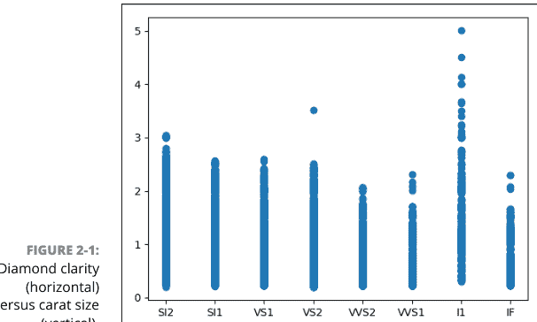

记住，钻石净度的衡量标准是钻石内部内包裹体的显露程度，从最好（FL，无内包裹体）到最差（I3，3级内包裹体）：FL, IF, VVS1, VVS2, VS1, VS2, SI1, SI2, I1, I2, I3。注意，我们的钻石数据库中没有完美的钻石。

关于值的顺序和列顺序有一个说明。图表是按照值在数据集中出现的顺序呈现的。第一条记录的净度是 SI2，下一条是 SI1，然后是 VS1。如果你执行这段代码，就能看到这一点：

```python
for i in range(20):
  print(df.iloc[i].clarity)
```

你可以按净度列对数据进行排序，这样你就会得到字母顺序，因为该列不是数值型。可能的真实解决方案是将净度值转换为数值。这是一个数据预处理可能比分析更困难的例子。

你可能很想断言最大的钻石被评为 I1。然而，请记住你并不知道这些数据是如何收集的，因此无法得出这样的概括性结论。你也可以说：“在这个数据集中，净度 I1 的钻石最大。”

## 每种净度类型的钻石数量

现在我们展示一张图表，将向你展示每种净度类型钻石的分布。使用 nano（或你喜欢的编辑器）打开名为 `Plot_CountClarity.py` 的文件并输入以下代码：

```python
# 观察闪光的钻石

import the pandas 和 numpy 库
import numpy as np
import pandas as pd
import matplotlib.pyplot as plt

# 读取钻石 CSV 文件
# 从数据中构建 DataFrame
df = pd.read_csv('diamonds.csv')

import matplotlib.pyplot as plt

# 统计每种文本类型净度的数量
clarityindexes = df['clarity'].value_counts().index.tolist()
claritycount = df['clarity'].value_counts().values.tolist()

print(clarityindexes)
print(claritycount)
```

```python
plt.bar(clarityindexes, claritycount)
plt.show() # 或 plt.savefig("name.png")
```

当你运行 `Plot_CountClarity.py` 程序时，可以在图 2-2 中看到结果。

再次记住，钻石净度的衡量标准是钻石内部内包裹体的明显程度：FL, IF, VS1, VS2, SI1, SI2, I1, I2, I3（从好到差的顺序：FL = 无内包裹体，I3 = 3 级内包裹体）。注意，我们的钻石数据库中没有完美的钻石。

该图表显示中等质量的钻石 SI1、VS2 和 SI2 在我们的钻石数据集中代表最多。


## 每种颜色类型的钻石数量

我们查看了净度与大小，现在我们要看颜色类型与数量的关系。使用 nano（或你喜欢的编辑器）打开名为 `Plot_CountColor.py` 的文件并输入以下代码：

```python
# 观察闪光的钻石

import the pandas 和 numpy 库
import numpy as np
import pandas as pd
import matplotlib.pyplot as plt

# 读取钻石 CSV 文件
# 从数据中构建 DataFrame
df = pd.read_csv('diamonds.csv')

import matplotlib.pyplot as plt

# 统计每种文本类型颜色的数量
colorindexes = df['color'].value_counts().index.tolist()
colorcount = df['color'].value_counts().values.tolist()

print(colorindexes)
print(colorcount)

plt.bar(colorindexes, claritycount)
plt.show() # 或 plt.savefig("name.png")
```

*(注：此处原文代码中 `plt.bar` 处使用了 `claritycount`，可能为原文笔误，但按翻译要求保留代码内容)*

当你运行 `Plot_CountColor.py` 程序时，你可以在图 2-3 中看到结果。


## 使用热力图寻找相关性

我们的最后一张图是热力图，显示了值之间的相关性。为了快速方便地生成这种图表，使用了基于 Matplotlib 的另一个库 seaborn。创建一个 `Plot_Heat.py` 文件并输入：

```python
# 观察钻石

import pandas 和 numpy 库
import numpy as np
import pandas as pd
import matplotlib.pyplot as plt
import seaborn as sns

# 读取钻石 CSV 文件
# 从数据中构建 DataFrame
df = pd.read_csv('diamonds.csv')

# 删掉索引列
d = df.drop('Unnamed: 0', axis=1)

f, ax = plt.subplots(figsize=(10, 8))
corr = d.corr()
sns.heatmap(corr, mask=np.zeros_like(corr, dtype=bool),
            cmap=sns.diverging_palette(220, 10, as_cmap=True),
            square=True, ax=ax)
plt.show()
```

运行示例程序 `Plot_Heat` 来检查你的树莓派是否安装了 seaborn。如果没有，你会收到 Python 错误。输入以下命令：

- `sudo apt-get install python3-seaborn`

运行程序并享受真实的数据可视化，如图 2-4 所示。

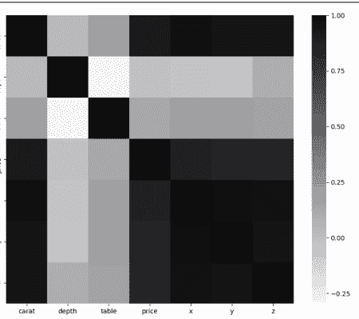

图 2-4：相关性热图。

首先注意的是，颜色越深，变量之间的相关性越高。从左上到右下角的对角线显示重量与重量的相关性为 100%。这并不意外。x、y、z 变量之间相互相关，这意味着当数据库中的钻石在某个维度增加时，它们在其他维度也会增加。

价格呢？随着重量和大小的增加，价格也随之增加。有趣的是，深度——钻石从底部的尖端（cullet）到台面（table）的高度，除以其平均周径——与价格没有强相关性，并且呈微负相关。

从这种地图中可以推出的结论是惊人的。热力图对于发现数据中通用的交叉相关性非常有帮助。

查看颜色、净度和价格之间的相关性将非常有趣。但这种相关性没有包含在图表中，因为颜色和净度列是文本型的，而你只能对数值进行相关性分析。可以通过为每个颜色字母替换一个数值代码（例如 1-8），然后重新生成热图。同样的技术也适用于钻石净度。再次，数据预处理是数据科学中一个耗时且有时困难的部分。

## 本章内容

- 访问真正的大数据
- 使用 Google Cloud BigQuery
- 构建你的第一个查询
- 使用 Matplotlib 可视化结果

# 第 3 章

## 使用 Google Cloud 的大数据

到目前为止，你处理的都是较小的数据集。在本章中，你将使用来自 Medicare（美国医疗保险）数据库的大数据，并验证来自 NOAA（美国国家海洋和大气管理局）的、每小时变化一次的大数据！

如果你有一台性能足够强大的计算机来下载此类大型的数据集，并不是每个大数据集都可以下载的。有些数据集无法通过法律途径下载。在 NOAA 的空气质量数据库的情况下，你必须每小时下载一个新版本。在这些情况下，最好让数据留在原处并使用云端。此外，当你让云端承担数据库和分析工作时，你的计算机不需要很大，也不需要运行得非常快。

如需下载本章的代码，请访问 www.dummies.com/go/pythoniaofd2e。

## 什么是大数据？

大数据指的是规模大或复杂到无法用传统数据处理技术处理的数据集。具有许多案例和许多行的数据可以更方便地利用复杂的统计技术，并且通常会导致更低的假发现率。假发现率是你错误地拒绝假设的错误预期比例（换句话说，你收到了假阳性结果）。

正如本迷你书第 1 章提到的，随着计算机和传感器的数量增加并以不断加快的速度产生更多数据，大数据在我们社会中变得越来越普遍。在本章中，我们将讨论如何使用云来访问这些大型数据库（使用 Python 和 Pandas），然后在 Raspberry Pi 上可视化结果。

## 理解 Google Cloud 和 BigQuery


# 在第一个程序中，你通过 Google Cloud 访问数据，并使用 BigQuery 对数据进行操作和分析

重要的是要理解，你不仅是在使用云端的数据，还在使用云端的数据分析工具。基本上，你是在使用你的计算机来告诉云端的计算机要做什么以及如何处理。这些操作可能并不在你的本地计算机上发生。

## Google Cloud Platform

Google Cloud Platform（谷歌云平台）是一套云计算服务，运行在与 Google 搜索和 YouTube 等终端用户产品相同的基础设施上。这种云策略已经在亚马逊和微软被成功应用。Google 使用自己的内部数据服务和产品来构建云端产品。通过这种方法，用户和公司都能从产品和云的进步和改进中受益。

Google Cloud Platform 有超过 100 种不同的 API（应用程序编程接口）和服务产品可供数据科学和人工智能使用。在本章中使用的主要服务是名为 BigQuery 的 Google API。

## Google 的 BigQuery

REST（表述状态传输）软件系统定义了一组通信结构，用于创建 Web 服务，通常使用 http 和 https 请求进行通信。通过基于 REST 的系统，不同的计算机和不同的操作系统可以启用相同的 Web 服务。

RESTful Web 服务使用 URL 地址以标准格式提问特定问题，并像浏览器获取网页一样获得响应。Python 库被用来隐藏往返查询的复杂性。BigQuery 是基于 RESTful Web 服务的。

在软件工程中，`抽象`（abstraction）是一种用于安排计算机系统复杂性的技术。它通过在软件中建立一个简单的层（如 Python 模块）来掩盖表面下的复杂细节。软件系统中的抽象是使大型系统变得健壮且易于编程的关键。例如，尽管网页浏览器使用 HTML 显示网页，但 HTML 下的软件层正在执行诸如传输 IP 包或处理位等操作。如果你使用有线网络或 Wi-Fi 网络，这些底层级就是不同的。抽象的酷之处在于你不需要知道它是如何实现的。我们只需要使用软件即可。

BigQuery 是一个无服务器模型，BigQuery 在云社区中拥有最高级别的抽象之一，消除了用户负责上线新虚拟机、内存数量、CPU 数量等责任。在几秒钟内完成从一个到数千个 CPU 的扩展，并仅为你使用的资源付费。你可以以每秒百万行（数据样本）的速度向 BigQuery 流传输数据，这意味着几乎可以立即开始分析数据。Google Cloud 提供免费的 90 天试用期，带有 300 美元的额度，在学习第 5 本中的示例时你无需付费。

BigQuery 拥有大量的公共数据集；我们将使用 BigQuery（通过 `google-cloud` python 库）结合来自 Medicare 和 NOAA 的数据。`google-cloud` Python 库将 BigQuery 数据映射到我们友好的 Pandas DataFrames 中（在迷你书的第 2 章中描述）。

## 云端计算机安全

如果我们不在使用云时不谈谈维护良好的计算机安全，那将是失职的。Google 通过使用 IAM（身份和访问管理）范式提供计算机安全。IAM 让账户所有者（即管理员）授权谁可以对特定资源执行何种操作，为简单项目提供了所有者的完全控制和可见性，并为整个企业提供了精细粒度的访问权限。

我们将在接下来的章节中向你如何设置 IAM 身份验证。

## 第 3 章 使用 Google Cloud 的大数据 459


## MEDICARE 公共数据库

Medicare 是美国的国家医疗保险计划（单一支付方），由医疗保险和医疗补助服务中心（CMS）管理。Medicare 为 65 岁及以上的美国人以及患有某些残疾和疾病的年轻人提供医疗保险。在 2017 年，Medicare 为超过 5800 万人提供了保险。Google 和 CMS 合作发布了大量数据，你可以通过 BigQuery 查看这些数据。

## 注册 BigQuery

访问 google.com 注册试用期。Google Cloud 提供免费的 90 天试用期，带有 300 美元的额度，在处理第 5 本中的示例时你无需付费。如果你在试用期间超过了 300 美元（你可能不会），Google 会通知你，但不会收费，除非你手动切换到付费账户。Medicare 数据库是世界上最易访问的数据集。

## 设置你的项目和身份验证

要访问 Google Cloud，你需要设置一个项目并获取身份验证凭据。

确保你严格按照这些说明操作以确保第一次正确。下载身份验证文件时，不要丢失或删除它。你无法再次下载。相反，你必须重新通过验证过程。


图 3-1：Google Cloud 开发者控制台页面。

以下步骤将向你如何设置项目并获取身份验证凭据：

1. 访问 `https://console.developers.google.com/` 并使用你的用户名和密码登录。
   显示图 3-1 所示的屏幕。

   

2. 点击屏幕左上角的“My First Project”按钮。

3. 在弹出屏幕中，点击右上角的“New Project”按钮。

4. 对于项目名称，输入 `MedicareProject` 然后点击“Create”。
   返回图 3-1 所示的屏幕。

5. 在左上角的下拉菜单中选择 `MedicareProject`。
   确保你选择的是 `MedicareProject` 而不是默认的 `My First Project`。否则你将为错误的项目设置 API 和身份验证。这是一个常见的错误。

6. 点击顶部的“+Enable APIs and Services”按钮以启用 BigQuery API。

7. 在搜索框中搜索 BigQuery，然后选择 BigQuery API。点击“启用”。

现在获取我们的身份验证凭据。

8. 在屏幕右上角，选择“创建凭据”。
   显示图 3-2 所示的屏幕。

   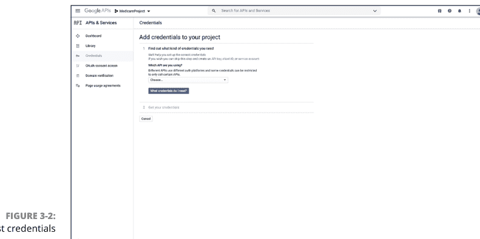

9. 在下拉列表中选择 BigQuery API，然后在“您是否计划在 App Engine 或 Compute Engine中使用此 API”部分下方点击“否，我未使用”选项。

10. 点击“我需要什么凭据？”按钮。
    显示图 3-3 所示的屏幕。

11. 在“服务帐户名称”中，输入 `MedicareProject`，然后在“角色”下拉菜单中选择“项目”，然后选择“所有者”。

12. 点击选中的 JSON 按钮并点击“继续”。
    出现一条消息，显示服务帐户和密钥已创建。一个名为 `MedicareProject~1223xxxx413.json` 的文件已下载到你的计算机。
    **不要丢失此文件！它包含了你的身份验证信息。**

13. 将下载的文件复制到你构建 Python 程序的目录中。

现在让我们进入第一个示例。

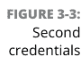

## 第一段大数据代码

`MedicareQuery1.py` 程序读取几十个公共数据数据集中的一个，并抓取一些数据进行分析。我们将使用 `inpatient_charges_2015` 数据集，并使用 SQL 查询从该数据集中选择我们想要查看和分析的信息。（如果你还不熟悉这种无处不在的查询语言，请查看旁边的侧边栏“学习 SQL”以获取更多关于 SQL 的信息。）

表 3-1 显示了 `inpatient_charges_2015` 数据集中所有的列。

### 表 3-1 inpatient_charges_2015 数据集的列、类型和描述

| 列名 | 类型 | 描述 |
|---|---|---|
| provider_id | STRING | 为门诊医院服务计费的提供者的 CMS 认证码 (CCN)。 |
| provider_name | STRING | 提供者的名称。 |
| provider_street_address | STRING | 提供者物理所在的街道地址。 |
| provider_city | STRING | 提供者物理所在的城市。 |
| provider_state | STRING | 提供者物理所在的州。 |
| provider_zipcode | INTEGER | 提供者物理所在的邮政编码。 |

### 表 3-1（续）

| 列名 | 类型 | 描述 |
|---|---|---|
| drg_definition | STRING | 标识 MS-DRG 的代码和描述。MS-DRGs是一种分类系统，将相似的临床状况（诊断）和医院在住院期间执行的手术进行分组。 |
| hospital_referral_region_description | STRING | 提供者物理所在的医院转诊区 (HRR)。 |
| total_discharges | INTEGER | 提供者提供的住院医院服务出院人数。 |
| average_covered_charges | FLOAT | 提供者对 MS-DRG 内所有出院病例中 Medicare 涵盖的服务的平均费用。由于各医院收费结构的差异，这些费用各不相同。 |
| average_total_payments | FLOAT | 所有病例的 MS-DRG 金额、教学、不成比例份额、资本和离群支付对所有提供者的平均总付款。平均总付款中还包括患者负责的共同付金额和免额金额，以及为了利益协调支付的任何额外第三方付款。 |
| average_medicare_payments | FLOAT | Medicare 根据 MS-DRG 金额份额向提供者支付的金额。平均 Medicare 付款包括所有病例的 MS-DRG 金额、教学、不成比例份额、资本和离群支付。Medicare 不包括受益人的共同付和免额金额，也不包括为了利益协调的任何额外第三方付款。 |

## 学习 SQL

SQL（结构化查询语言）是一种面向查询的语言，用于与数据库交互并从数据库中提取信息。尽管它是为关系型数据库的访问和管理设计的，但它已扩展到许多其他数据库，包括 BigQuery 和 Google Cloud 访问的数据。

有一些优秀的教程可以帮你理解如何使用 SQL 访问数据：

- www.w3schools.com/sql
- www.sql-tutorial.net
- 《SQL for Dummies》，第 9 版，Allen G. Taylor
- 《SQL All-in-One For Dummies》，第 3 版，Allen G. Taylor
- 《SQL in 10 Minutes》，第 4 版 (Sams Publishing)，Ben Forta

使用 nano（或其他文本编辑器），输入以下代码并将其保存为 `MedicareQuery1.py`。

```python
import pandas as pd
from google.cloud import bigquery

# set up the query
QUERY = """
SELECT provider_city, provider_state, drg_definition,
average_total_payments, average_icare_payments
FROM `bigquery-public-data.medicare.inpatient_charges_2015`
WHERE provider_city = "GREAT FALLS"
ORDER BY provider_city ASC
"""

client = bigquery.Client.from_service_account_json('MedicareProject~1223xxxx413.json')

query_job = client.query(QUERY)
df = query_job.to_dataframe()

print("Records Returned: ", df.shape)
print(df.head(3))
```

# ICD 代码

ICD10 是一种用于计费和分析专业诊断编码的通用且成熟的方法。最新版本的 ICD-10 已于 2015 年起强制执行，这导致了整个医疗界的巨大焦虑。它包含超过 155,000 个代码，从 M79.63 — 手部疼痛，未规定到 S592.4 — 大趾骨折。这些代码被合并到我们检查的 Medicare 数据库中使用的 MS_DRG 代码。当 John Shovic 拥有一医疗软件初创公司时，他对 ICD 10 代码产生了一种爱恨交织的关系。他喜欢的代码有：

- `V97.33XD`: 被喷气发动机吸入，后续就诊。
- `Z63.1`: 与亲属的关系问题。
- `V95.43XS`: 航天器碰撞导致乘客受伤，后遗。
- `R46.1`: 奇特的个人外表。
- `Y93.D1`: 活动，针织和钩编。

使用 `nano` 或你最喜欢的文本编辑器创建一个名为 `MedicareQuery.py` 的文件，然后将以下代码复制到文件中：

```python
import pandas as pd
from google.cloud import bigquery

# 设置 up查询
QUERY = """
SELECT provider_city, provider_state, drg_definition,
average_total_payments, average_medicare_payments
FROM `bigquery-public-data.cms.inpatient_charges_2015`
WHERE drg_definition LIKE '554 %'
ORDER BY provider_city ASC
LIMIT 1000
"""

client = bigquery.Client.from_service_account_json(
    'MedicareProject2-1223283ef41d3.json')

query_job = client.query(QUERY)
df = query_job.to_dataframe()

print("Records Returned: ", df.shape)
print()
print("First 3 Records")
print(df.head(3))
```

这个程序与我们上一个程序的不同之处在于我们添加了 `LIKE '554 %'`，它匹配任何以 554 开头的 DRG。

当我们运行程序时，我们得到了以下结果：

| Records Returned: (286, 5) | | |
| :--- | :--- |
| First 3 Records | | |
| provider_city | provider_state | drg_definition |
| average_total_payments | average_medicare_payments |
| 0 ABINGTON | 554 - BONE DISEASES & ARTHROATHPIES W/O MCC | |
| | 5443.67 | 3992.93 |
| 1 AKRON | 554 - BONE DISEASES & ARTHROATHPIES W/O MCC | |
| | 5581.00 | 4292.47 |
| 2 ALBANY | 554 - BONE DISEASES & ARTHROATHPIES W/O MCC | |
| | 7628.94 | 5137.31 |

现在我们有了一些有趣的数据。让我们来简单的分析。这种疾病的总费用中，百分之比是由 Medicare 支付的？剩余部分通常由患者支付。我们没有考虑第三方计费。

使用 `nano` 或你最喜欢的文本编辑器创建一个名为 `MedicareQuery.py` 的文件，并将以下代码复制到文件中：

```python
import pandas as pd
from google.cloud import bigquery

# 设置 up查询
QUERY = """
SELECT provider_city, provider_state, drg_definition,
average_total_payments, average_medicare_payments
FROM `bigquery-public-data.cms.medicare.inpatient_charges_2015`
WHERE drg_definition LIKE '554 %'
ORDER BY provider_city ASC
LIMIT 1000
"""

client = bigquery.Client.from_service_account_json(
    'MedicareProject2-1223238ef413.json')

query_job = client.query(QUERY)
df = query_job.to_dataframe()

print("Records Returned: ", df.shape)
print()

total_payment = df.average_total_payments.sum()
medicare_payment = df.average_medicare_payments.sum()

percent_paid = (medicare_payment/total_payment)*100
print("Medicare pays: {:.2f}% of Total for 554 DRG".format(percent_paid))
print("Patient pays: {:.2f}% of Total for 554 DRG".format(100-percent_paid))
```


# ICD 代码

ICD10 是一种用于计费和分析专业诊断编码的久认且成熟的方法。最新版本的 ICD-10 已于 2015 年起强制执行，这导致了整个医疗界的巨大焦虑。它包含超过 155,000 个代码，从 `M79.63` — 手部疼痛，未规定到 `S592.4` — 大趾骨折。这些代码被合并到我们检查的 Medicare 数据库中使用的 `MS_DRG` 代码。当 John Shovic 拥有一医疗软件初创公司时，他对 ICD 10 代码产生了一种爱恨交织的关系。他喜欢的代码有：

- `V97.33XD`: 被喷气发动机吸入，后续就诊。
- `Z63.1`: 与亲属的关系问题。
- `V95.43XS`: 航天器碰撞导致乘客受伤，后遗。
- `R46.1`: 奇特的个人外表。
- `Y93.D1` 活动，针织和钩编。

使用 `nano` 或你最喜欢的文本编辑器创建一个名为 `MedicareQuery.py` 的文件，然后将以下代码复制到文件中：

```python
import pandas as pd
from google.cloud import bigquery

# 设置 up查询

QUERY = """
SELECT provider_city, provider_state, drg_definition,
average_total_payments, average_medicare_payments
FROM `bigquery-public-data.cms.inpatient_charges_2015`
WHERE drg_definition LIKE '554 %'
ORDER BY provider_city ASC
LIMIT 1000
"""
```

```python
client = bigquery.Client.from_service_account_json(
    'MedicareProject2-1223283ef41d3.json')
```

```python
query_job = client.query(QUERY)
df = query_job.to_dataframe()
```

```python
print("Records Returned: ", df.shape)
print()
print("First 3 Records")
print(df.head(3))
```

这个程序与我们上一个程序的不同之处在于我们添加了 `LIKE '554 %'`，它匹配任何以 554 开头的 DRG。

当我们运行程序时，我们得到了以下结果：

| Records Returned: (286, 5) | | |
| :--- | :--- | :--- |
| First 3 Records | | |
| provider_city | provider_state | drg_definition |
| average_total_payments | average_medicare_payments | |
| 0 ABINGTON | | 554 - BONE DISEASES & ARTHROATHPIES W/O MCC |
| | 5443.67 | 3992.93 |
| 1 AKRON | | 554 - BONE DISEASES & ARTHROATHPIES W/O MCC |
| | 5581.00 | 4292.47 |
| 2 ALBANY | | 554 - BONE DISEASES & ARTHROATHPIES W/O MCC |
| | 7628.94 | 5137.31 |

现在我们有了一些有趣的数据。让我们来简单的分析。这种疾病的总费用中，百分之比是由 Medicare 支付的？剩余部分通常由患者支付。我们没有考虑第三方计费。

使用 `nano` 或你最喜欢的文本编辑器创建一个名为 `MedicareQuery.py` 的文件，并将以下代码复制到文件中：

```python
import pandas as pd
from google.cloud import bigquery

# 设置 up查询

QUERY = """
SELECT provider_city, provider_state, drg_definition,
average_total_payments, average_medicare_payments
FROM `bigquery-public-data.cms.medicare.inpatient_charges_2015`
WHERE drg_definition LIKE '554 %'
ORDER BY provider_city ASC
LIMIT 1000
"""
```

```python
client = bigquery.Client.from_service_account_json(
    'MedicareProject2-1223238ef413.json')

query_job = client.query(QUERY)
df = query_job.to_dataframe()

print("Records Returned: ", df.shape)
print()

total_payment = df.average_total_payments.sum()
medicare_payment = df.average_medicare_payments.sum()

percent_paid = (medicare_payment/total_payment)*100
print("Medicare pays: {:.2f}% of Total for 554 DRG".format(percent_paid))
print("Patient pays: {:.2f}% of Total for 554 DRG".format(100-percent_paid))
```

Records Returned: (286, 5)

Medicare pays 77.06% of Total for 554 DRG

Patient pays 22.94% of Total for 554 DRG

# 各州支付百分比

接下来，我们选择数据库中的每个单独州（并非所有州都包含在内），并计算 554 开头的 DRG 在各州 Medicare 支付的百分比。将此文件命名为 `MedicareQuery4.py`：


# ICD 代码

ICD10 是一种用于计费和分析专业诊断编码的久认且成熟的方法。最新版本的 ICD-10 已于 2015 年起强制执行，这导致了整个医疗界的巨大焦虑。它包含超过 155,000 个代码，从 `M79.63` — 手部疼痛，未规定到 `S592.4` — 大趾骨折。这些代码被合并到我们检查的 Medicare 数据库中使用的 `MS_DRG` 代码。当 John Shovic 拥有一医疗软件初创公司时，他对 ICD 10 代码产生了一种爱恨交织的关系。他喜欢的代码有：

- `V97.33XD`: 被喷气发动机吸入，后续就诊。
- `Z63.1`: 与亲属的关系问题。
- `V95.43XS`: 航天器碰撞导致乘客受伤，后遗。
- `R46.1`: 奇特的个人外表。
- `Y93.D1` 活动，针织和钩编。

使用 `nano` 或你最喜欢的文本编辑器创建一个名为 `MedicareQuery.py` 的文件，然后将以下代码复制到文件中：

```python
import pandas as pd
from google.cloud import bigquery

# 设置 up查询

QUERY = """
SELECT provider_city, provider_state, drg_definition,
average_total_payments, average_medicare_payments
FROM `bigquery-public-data.cms.inpatient_charges_2015`
WHERE drg_definition LIKE '554 %'
ORDER BY provider_city ASC
LIMIT 1000
"""
```

```python
client = bigquery.Client.from_service_account_json(
    'MedicareProject2-1223283ef41d3.json')
```

```python
query_job = client.query(QUERY)
df = query_job.to_dataframe()
```

```python
print("Records Returned: ", df.shape)
print()
print("First 3 Records")
print(df.head(3))
```

这个程序与我们上一个程序的不同之处在于我们添加了 `LIKE '554 %'`，它匹配任何以 554 开头的 DRG。

当我们运行程序时，我们得到了以下结果：

| Records Returned: (286, 5) | | |
| :--- | :--- | :--- |
| First 3 Records | | |
| provider_city | provider_state | drg_definition |
| average_total_payments | average_medicare_payments | |
| 0 ABINGTON | 554 - BONE DISEASES & ARTHROATHPIES W/O MCC | |
| | 5443.67 | 3992.93 |
| 1 AKRON | 554 - BONE DISEASES & ARTHROATHPIES W/O MCC | |
| | 5581.00 | 4292.47 |
| 2 ALBANY | 554 - BONE DISEASES & ARTHROATHPIES W/O MCC | |
| | 7628.94 | 5137.31 |

现在我们有了一些有趣的数据。让我们来简单的分析。这种疾病的总费用中，百分之比是由 Medicare 支付的？剩余部分通常由患者支付。我们没有考虑第三方计费。

使用 `nano` 或你最喜欢的文本编辑器创建一个名为 `MedicareQuery.py` 的文件，并将以下代码复制到文件中：

```python
import pandas as pd
from google.cloud import bigquery

# 设置 up查询

QUERY = """
SELECT provider_city, provider_state, drg_definition,
average_total_payments, average_medicare_payments
FROM `bigquery-public-data.cms.medicare.inpatient_charges_2015`
WHERE drg_definition LIKE '554 %'
ORDER BY provider_city ASC
LIMIT 1000
"""
```

```python
client = bigquery.Client.from_service_account_json(
    'MedicareProject2-1223238ef413.json')

query_job = client.query(QUERY)
df = query_job.to_dataframe()

print("Records Returned: ", df.shape)
print()

total_payment = df.average_total_payments.sum()
medicare_payment = df.average_medicare_payments.sum()

percent_paid = (medicare_payment/total_payment)*100
print("Medicare pays: {:.2f}% of Total for 554 DRG".format(percent_paid))
print("Patient pays: {:.2f}% of Total for 554 DRG".format(100-percent_paid))
```

```
Records Returned: (286, 5)

Medicare pays 77.06% of Total for 554 DRG

Patient pays 22.94% of Total for 554 DRG
```

# 各州支付百分比

接下来，我们选择数据库中的每个单独州（并非所有州都包含在内），并计算 554 开头的 DRG 在各州 Medicare 支付的百分比。将此文件命名为 `MedicareQuery4.py`：

```python
import pandas as pd
from google.cloud import bigquery

# 设置 up查询
QUERY = """
SELECT provider_city, provider_state, drg_definition,
average_total_payments, average_medicare_payments
FROM `bigquery-public-data.cms.inpatient_charges_2015`
WHERE drg_definition LIKE '554 %'
ORDER BY provider_city ASC
```


# 6 与硬件对话

## 目录摘要

### 第 1 章：介绍物理计算

- 物理计算很有趣 ................................................................................. 478
- 什么是树莓派？ ................................................................................. 478
- 构建能够移动和感知环境的项目 ............................................................ 480
- 使用树莓派感知环境 ................................................................ 482
- 用 Python 控制 LED ....................................................................................................... 487
- 等一下，还有更多内容 ................................................................................................................................... 489

### 第 2 章：无需焊接！使用 Grove

- 用于构建的连接器 ..........................................................................................................
- 使用 Grove 系统 ....................................................................................................... 494
- Grove 连接器 ........................................................................................................................ 498
- 使用 Grove 线缆连接 ....................................................................................... 503

### 第 3 章：感知世界

- 理解 I2C ...................................................................................................................... 509
- 测量氧气和火焰 ............................................................................................ 521
- 在你的手机上使用 Blynk 构建仪表盘 ....................................................................................... 530
- 接下来该去哪里 ................................................................................................................ 539

### 第 4 章：让物体动起来

- 探索电动机 ..................................................................................................... 541
- 控制直流电机 ............................................................................................................ 544
- 运行伺服电机 ...................................................................................... 551
- 让步进电机转动 ................................................................................... 558

## 本章内容

- 理解如何使用计算机
- 使用树莓派感知你周围的环境
- 让你的计算机执行物理性操作

# 第 1 章：介绍物理计算

我们认为学习软件（Python）比学习硬件更困难，这就是为什么在过去的几百页中，我们重点学习如何用 Python 编程。但现在，是时候学习如何用 Python 让你的计算机做些事情了。让你的计算机执行机械任务——与你周围的世界交互，被称为物理计算！

在本章中，我们将配合树莓派计算机使用各种传感器和电机。虽然我们使用的电压（`3.3V` 和 `5V`）对人体并不特别危险，但错误的连接可能会烧毁计算机或传感器。因此，请严格遵守以下两个规则：

- 规则 1：在连接或更改任何电线之前，请关闭电源。
- 规则 2：仔细检查你的连接，特别是电源连接（电源和地）。要了解为什么这些是最需要检查的电线，请看下一章！


## 物理计算很有趣

我们希望你学习物理计算的原因之一是，执行物理任务的小型计算机（通常称为嵌入式系统）无处不在。看看你的厨房：冰箱有一台计算机——如果有显示器，可能有两三个。你的搅拌机有一台计算机。你的烤箱有一台计算机。你的微波炉有一台计算机。如果你在家里使用飞利浦 Hue 灯具，你的灯泡也有计算机。你的汽车可能有 20 台计算机。

举个例子。廉价的面包烤机怎么样？如果你的烤面包机上有贝果圈（Bagel）按钮或显示器，里面就有一台计算机。为什么你家里有这么多计算机？因为用计算机控制小设备比用专用硬件要便宜得多。（你可以批量购买计算机，每台只需约 15 美分！）

这些计算机大部分比你的普通 PC 要简单得多、慢得多，内存（随机访问存储器）也小得多。PC 可能有 `4GB` 到 `16GB RAM`（`1GB` 大约等于 10 亿字节），但运行你烤面包机的计算机可能只有 `100` 字节 RAM。

所有这些小型计算机都在进行物理计算，感知并与环境交互。冰箱计算机检查温度，并在必要时开启冷却装置，以最大限度地减少用电。炉灶更新前面板上的显示器，监控按钮和旋钮并控制温度，确保你晚餐能吃上顿美味的意大利千层面。

## 什么是树莓派？

这些非常小型的计算机的功能太有限，无法用于书中的示例，因此我们折中求其次，使用了树莓派。这是一台价格 `35` 美元的计算机，拥有海量的硬件和软件可用（尤其是配合 Python 使用）。它比烤面包机复杂，但比你电视里的计算机简单。

树莓派是一种受欢迎的 SBC（单板计算机），自 `2012` 年以来一直存在。它由树莓派基金会创建，旨在向全球学校教授基础科学和工程。事实证明它非常受欢迎，销量超过 `3000` 万台。还有许多型号可用，从树莓派 Zero（`5` 美元）到新的树莓派 `4B`（约 `60` 美元）。我们在书的项目中使用树莓派 `3B+`。

为了消除我们每天处理的一些技术的神秘感，让我们聊聊树莓派上的主要模块：

- **GPIO**：通用输入输出引脚。
- **CPU/GPU**：中央处理器/图形处理器。这是设备的大脑。
- **USB 端口**：连接鼠标和键盘的标准端口。
- **以太网接口**：连接网络。
- **Wi-Fi**：连接互联网。
- **HDMI 输入**：你将显示器或电视插在这里。
- **复合视频和音频插孔**：此接口可以提供声音或复合视频。
- **microSD 卡槽**：你插入带有操作系统的 SD 卡。
- **状态 PWR LED**：红色 LED 显示电源供应状态（注意它不显示时间）。
- **状态 ACT LED**：当树莓派访问 SD 卡时，黄色 LED 会闪烁。
- **其他端口**：
    - Micro USB：用于你的 `5V` 电源供应。
    - 摄像头 CSI：你可以将树莓派摄像头插入此排线连接器中。
    - 显示器 DSI：此连接器用于与定制显示器的高速连接。


## 构建能够移动和感知环境的项目

在本章开头，我们讨论了厨房里的计算机。所有这些计算机都在感知环境（例如烤箱温度），并且大多数都在做一些影响环境的事情（你的搅拌机切碎冰块，例如制作美味的玛格丽特鸡尾酒需要冰块）。你将能够构建并设计你自己的项目（相信我们，在熟悉硬件后，你将能够设计出奇妙的东西）。你只需要投入其中并完成你的第一个项目。

然后，在后续章节中，你可以构建更复杂的设备，它们将成为你自己项目的起点，而且全部使用 Python 编程！

### 还有哪些小型计算机可用？

市面上有数百种不同类型的小型计算机和开发板用于项目构建。我们选择树莓派（Raspberry Pi）是因为它对 Python 语言提供完全支持，数百个 Python 库可用，并且有很多网站（例如精彩的 `www.raspberrypi.org`）教你如何设置和使用这台计算机。

对于初学者来说，小型计算机系统通常分为两大类：基于 Linux 操作系统的计算机（Raspbian，树莓派上的软件是 Linux 的一种形式）以及具有较小或没有操作系统的计算机。这两个版本的计算机和操作系统在不同的应用中都很有用。

虽然 Linux 是一个可以在多 CPU 核心上运行的多任务复杂操作系统，但它在树莓派上支持类似 Windows 的图形用户界面（GUI），使其操作变得非常简单。

Arduino 是具有小型计算机结构和有限 RAM 的小型计算机。尽管它们比树莓派小得多、简单得多，但开发板的价格大相当。然而，如果你批量购买 Arduino，这种 Arduino 类型的计算机比树莓派便宜。Arduino 拥有比树莓派更多的输入/输出引脚，并且带有内置 ADC（模数转换器），这是树莓派所缺少的。在稍后的章节中，我们将展示如何使用外部 ADC 和树莓派创建一个项目。该项目涉及一个火焰。你知道那会很有趣。

另一类类似于 Arduino 的小型计算机是 `SAMD21`、`ESP8266` 和 `ESP32` 板。这些开发板可以使用与 Arduino 设备相同的 IDE（集成开发环境）进行编程。它们的 RAM 比树莓派少得多，但像树莓派一样，它们内置了 Wi-Fi（有时还有蓝牙）接口，这使得它们在构建你想连接到互联网的项目（例如物联网 IoT 项目）时非常有用。所有这些计算机玩起来都很有趣，但树莓派为 Python 开发和学习提供了更好的环境。


## 使用树莓派感知环境

到此时，你已经设置好了你的树莓派计算机并在显示器、键盘和鼠标上运行。如果还没有，现在就去操作吧（记得我们的朋友 `raspberrypi.org`）。如果你有一台树莓派计算机可以操作，接下来的几段将会有趣得多！

树莓派是使用 Python 进行物理计算的完美平台，因为它是一个多屏环境，有大量的 RAM 和存储可供玩耍，并且有我们构建项目所需的工具。

### GPIO 引脚

树莓派的一个强大功能是顶部的一排 GPIO（通用输入输出）引脚。在这个 `40` 引脚的插座中，我们可以插入大量的传感器和控制器来完成惊人的事情并扩展树莓派的功能。

使用 Python 软件，GPIO 引脚可以指定为输入引脚或输出引脚，并用于许多用途。两个 `5V` 电源引脚、两个 `3.3V` 电源引脚和若干个地线有固定用途。（参见下一节中关于电压的描述）图 1–2 显示了每个 GPIO 引脚的功能。


| Raspberry Pi A+/B 和 Raspberry Pi 2 GPIO 引脚 |
| :--- |
| GPIO | 3.3V | 5V |
| ID EEPROM | 仅供高级用户使用！ |

GPIO 引脚从计算机向引脚输出 `1` 或 `0`。请参阅下一节了解更多关于如何实现这种输出以及它代表什么的信息。基本上，`1` 是 `3.3V`，`0` 是 `0V`，所以你可以仅仅将它们看作 `1` 和 `0`。

### GPIO 库

可以使用许多 GPIO Python 库来构建项目。本书的其余部分使用的是 `gpiozero` 库，它安装在所有树莓派桌面软件发行版中。库文档和安装说明（如果需要）位于 `https://gpiozero.readthedocs.io/stable/`

现在我们将使用我们的树莓派进入“Hello World”物理计算项目。

## 购买和组装“Hello World”的硬件

对于这个项目，你需要两块 Grove 硬件：

- **Pi2Grover 板**：该板如图 1-3 所示，将树莓派 GPIO 引脚头转换为 Grove 接口。Grove 接口易于使用，而且你不会接反电源引脚！你可以在 `https://shop.switchdoc.com` 或亚马逊购买 Pi2Grover，价格约为 `20` 美元。（在 `shop.switchdoc.com` 结算时使用折扣代码 `PI2DUMMIES` 可获得板子优惠 `5` 美元。）下一节将介绍关于该板的更多信息。


图 1-3：Pi2Grover 板。数字端口。Grove Pi 到 Grove 接口

- **Grove 蓝色 LED 模块**：该模块包含一根 Grove 线。你可以在 `https://shop.switchdoc.com` 或亚马逊购买，价格为 `3` 美元。（见图 1-4。）该模块允许你通过树莓派开启或关闭 LED。

关于 Grove 接口的更多信息，请看下一节。

对于许多读者来说，这将是你第一次组装基于计算机的项目。以下分步骤的操作使过程变得简单：

1. 将 Pi2Grover 板与树莓派的 GPIO 接口对齐（见图 1-5）。


图 1-5：Pi2Grover 板与树莓派对齐

2. 轻轻将 Pi2Grover 板推到树莓派引脚上（见图 1-6）。


图 1-6：推 Pi2Grover 板

3. 将 Grove 线的一端插入蓝色 LED 板（见图 1-7）。


图 1-7：蓝色 LED

4. 如果需要，将 LED 插入 Grove 接口（见图 1-8）。


图 1-8：LED 的平侧

5. 将 Grove 线的另一端插入 Pi2Grover 板上标记为 `D12/D13` 的插槽（见图 1-9）。


图 1-9：D12/D13

我们已经完成了硬件组装。现在是时候编写 Python 软件了。

## 用 Python 控制 LED

当我们连接好硬件后，就可以为树莓派供电了。如果一切正常，Grove 蓝色 LED 和 Pi2Grover 板上的蓝色 LED 将亮起，树莓派上的黄色 LED 将闪烁（在启动期间），树莓派上的红色 LED 将亮起（但随后可能会关闭）。

当我们开启树莓派电源时，Grove 蓝色 LED 会亮起，因为树莓派的 GPIO 引脚在通电时会初始化为输入。由于 GPIO 引脚是输入状态，而不是控制 LED 的输出状态，GPIO 引脚会浮动在一个不定的电压上——它既不是 `1` 也不是 `0`，而是介于之间。由于 Pi2Grover 板上电路的作用，输入会向 `1` 浮动，从而点亮 LED。

要开始，请遵循以下步骤：

1. 使用键盘打开一个终端窗口。

如果你不知道如何在树莓派上打开和使用终端窗口以及命令行，请访问 `www.raspberrypi.org/documentation/usage/terminal/` 查看非常优秀的教程。

2. 使用 `nano` 文本编辑器（或你喜欢的编辑器）在其中输入以下 Python 代码。将其保存为文件 `HelloWorld.py`。


若需使用 nano 文本编辑器的优秀教程，请访问 `www.raspberry.org/magpi/edit-text/`。

3. 现在到了关键时刻。在 Terminal 窗口的命令行中，运行以下命令来启动你的程序：

```
sudo python3 HelloWorld.py
```

LED 每秒闪烁一次，Terminal 窗口中会出现以下内容：

```
LED On
LED Off
LED On
LED Off
LED On
LED Off
LED On
LED Off
LED On
LED Off
LED On
```

要停止程序，请按 `Ctrl-C`（极客术语中为 Λ）。

关键字 `sudo` 代表 "super user do"（以超级用户身份执行）。我们之所以在 `python3` 命令前使用 `sudo` 是因为某些版本的树莓派操作系统限制了普通用户对某些引脚和功能的访问。通过使用 `sudo`，我们以超级用户的身份运行此命令，这意味着它将强制运行。在较新版本的树莓派 OS 中，你只需要输入 `python3 HelloWorld.py`。如果程序无法运行，请改回 `sudo python3 HelloWorld.py`。

以下语句从 Python `gpiozero` 库中导入 `LED` 函数：

```
from gpiozero import LED
```

然后我们从 Python `time` 库中导入 `sleep` 函数：

```
from time import sleep
```

接下来，我们为 GPIO 12 分配一个 LED（还记得 PiGrover 板上的 D12/D13 吗？）：

```
blue = LED(12)
```

现在我们开始一个无限运行的循环：

```
while True:
```

开启 LED：

```
blue.on()
print("LED On")
```

等待一秒：

```
sleep(1)
```

关闭 LED：

```
blue.off()
print("LED Off")
sleep(1)
```

然后程序将无限循环下去——直到你停止它。

哇，你现在已经进入了物理计算的世界。等下下本迷你书吧，届时你将用 Python 控制机器人。

# 但等一下，还有精彩

由于我们已经设置好了所有的硬件，我们将再做一个项目。这次，我们使用 PWM（脉冲宽度调制）来改变 LED 的亮度。


脉冲宽度调制是一种技术，通过改变信号处于 1 和 0 的时间比例来实现。我们的 LED 在 1 时开启，在 0 时关闭，因此如果我们改变 LED 处于 1 和 0 的时间比例，就可以控制人眼感知的亮度。这种比例被称为占空比，如图 1-10 所示。占空比为 100% 时，LED 在 100% 的时间内都是开启的；占空比为 0% 时，它一直处于关闭状态。改变信号的开启会改变 LED 的表观亮度。LED 以每秒 100 次（Hz）的默认频率开关切换，但你可以更改频率。

## 50% 占空比

## 75% 占空比

将 Python 代码输入 nano 并将其保存为 `HelloWorld2.py`。注意 `PWMLED(12)` 函数，它将 GPIO 12 引脚上的 LED 连接到 PWM 软件：

```
from gpiozero import PWMLED
from time import sleep

led = PWMLED(12)

while True:
    led.value = 0 # half brightness
    sleep(1)
    led.value = 0.5 # half brightness
    sleep(1)
    led.value = 1 # full brightness
    sleep(1)
```

运行代码，亮度将每秒变化一次：

```
sudo python3 HelloWorld2.py
```

使用以下代码查看 LED 的平滑连续变亮和变暗：

```
from gpiozero import PWMLED
from signal import pause
led = PWMLED(12)
led.pulse()
pause()
```

图 1-10：占空比。

# 为什么 LED 看起来在闪烁？

当你运行 Python 程序时，它并不是树莓派上唯一的程序。在 Terminal 窗口的命令行提示符处输入 `ps xaf`，你会看到有几十个程序正在运行。

由于树莓派上的操作系统是多任务的（同时运行多个任务），有时你的 PWM 任务（因为是在软件中运行的）无法在需要时获得空闲的 CPU。结果是你看到 LED 有轻微的抖动。树莓派有两个硬件 PWM GPIO 引脚，如果你不使用树莓派的音频输出，这些引脚也可以驱动 LED。在树莓派 3B+ 上，除非树莓派加载了其他程序，否则闪烁几乎难以察觉。

伙计，你在这一章中取得了很大成就。你现在开始看到物理计算的可能性了。而且你还有一个蓝色的 LED！

## 本章内容

- 了解如何连接硬件
- 选择基础单元
- 使用四种类型的传感器
- 使用不同的 Grove 线缆

# 第 2 章：无焊接！使用 Grove 连接器进行构建

Grove 是一种模块化、标准化的连接器原型系统。Grove 采用积木式的组装方法。与基于跳线的系统相比，Grove 更容易进行实验和构建，并简化了学习。在这一章中，我们将学习什么是 Grove 连接以及存在哪些类型的 Grove。

## 使用 Grove 系统

Grove 系统由一个基础单元和各种模块组成。基础单元允许你连接传感器、执行器和显示器。基础单元提供处理能力。

## 选择基础单元

大多数基础单元（如树莓派）太智能了，隔离了硬件。当你想要用 Python 连接硬件时，额外的硬件层是一个问题。我们倾向于使用靠近 Pi 的解决方案。

### 树莓派基础单元

在树莓派端，引脚要细得多。树莓派也有几种基础单元可用。我们使用 Pi2Grover 基础单元，如图 2-3 所示。它基本上是一个电压平移器（从 3.3V 到 5V），并且它不会阻碍驱动程序的编写。


## 使用 Grove 连接器防止错误

Grove 连接器是一种四针标准连接器，插入基础单元和 Grove 模块。这些标准连接器带有键位设计，无法反插，而且四种类型的连接器设计使得如果你将错误类型的设备插入错误类型的基础单元，也不会出现任何问题。它们不会被损坏，只是无法工作。这是一个非常好的特性。

通常情况下，如果你反插或错误连接板卡，可能会损坏板卡。然而，Grove 系统中的标准连接器允许你在连接板卡时无需担心电源和地线的连接错误。

> **警告**：一个例外：如果你插入一个不支持 5V 的 3.3V I2C Grove 模块，可能会烧坏设备。在书中，我们通过确保所有操作都是 5V 来避免此类情况！

有四种类型的 Grove 连接器。图 2-4 显示了公头 Grove 连接器。

所有 Grove 线缆在物理上是相同的，可以互换。它们的区别在于提供的信号类型。如前所述，即使将 Grove 线缆插入错误的 Grove 连接器，也不会短路电源和地。


图 2-4：Grove 连接器。

所有 Grove 连接器的接线方式都是相同的。第一个引脚是信号 1，第二个引脚是信号 2，第三个引脚是电源，第四个引脚是地。

Grove 线缆上的电线颜色始终相同，如图 2-5 所示：

- 黄色：连接到引脚 1。
- 白色：连接到引脚 2。
- 红色：所有 Grove 连接器的电源。连接到引脚 3。
- 黑色：所有 Grove 连接器的地。连接到引脚 4。


图 2-5：5cm 长的 Grove 线缆。

## 什么是电压？

嗯。3.3V 和 5V 之间有什么区别？V 代表电压，类似于水管中的水压。压力越高，流出的水越多。如果水压太大，可能会撑破管道。同样，如果电压太高，可能会损坏树莓派的输入线，这些线接受的是 3.3V。我们喜欢使用 Pi2Grover，因为它能将所有线路从 3.3V 转换并缓冲到 5V 输出到树莓派。

电压总是相对于某个东西来测量的，通常是地。共地非常重要，因为这样所有电压就能以相同的方式进行参考。系统中没有共地（从而导致电压混乱！）会导致行为不稳定。地的重要性引出了“肖维克（Shovic）第二定律”：“你可以一直信任你母亲，但你永远不能信任你的地。”（肖维克第一定律是“插上电源效果更好”）。

## Grove 连接器

现在是时候对我们在谈论传感器和设备时使用的四种 Grove 连接器进行一些赞美之辞了。使用错误的连接器，你可能不会烧毁主板，但你的项目将无法正常工作！

### Grove 数字 —— 全关于那些 1 和 0

计算机通常使用数字位相互通信以及与外部设备通信。我们可以通过两种方式从位中获取信息。一种是值（1 或 0），另一种是时序，例如位保持值为 1 的持续时间。对时序的思考引导我们关注本章稍后将讨论的串口端口。


许多传感器只需要一个或两个位。位是所有我们可以使用的数字硬件的基础。虽然位是用电压电平表示的，但从根本上说，将位视为只有 1 或 0 的值即可。

数字连接器由进入 Grove 连接器的标准线路组成。两条信号线（引脚 1 和 2）通常称为 D0 和 D1。大多数模块只使用 D0，但某些模块（如 LED 灯条显示器）会使用两者。通常基础单元使用第一个连接器 D0 和第二个连接器 D1，它们的接线方式为 D0/D1（引脚 1 为 D0，引脚 2 为 D1），然后是 D1/D2（引脚 1 为 D1，Grove 连接器上为 D2），此类推。请参见表 2-1 关于数字连接器每个引脚的描述。

#### Grove 数字连接器

| 引脚 | 名称 | 描述 |
| --- | --- | --- |
| 1 (黄色) | D0 | 主数字输入/输出 |
| 2 (白色) | D1 | 次要数字输入/输出 |
| 3 (红色) | VCC | Grove 模块电源 (5V 或 3.3V) |
| 4 (黑色) | GND | 地 |

Grove 数字模块的一些示例是开关模块、风扇模块和 LED 模块。图 2–6 显示了上一章 Grove LED 模块原理图中 Grove 连接器的样子。这些数字模块从简单到复杂应有。


### Grove 模拟：当 1 和 0 不够用时

模拟连接器由进入 Grove 连接器的标准四线组成。两条信号线通称为 A0 和 A1。大多数模块只使用 A0。基础单元将第一个连接器称为 A0，第二个称为 A1，它们的接线方式为 A0/A1，然后是 A1/A2，此类推。图 2–7 所示的简单分压器（它会将 5V 分为较低的电压，例如 2.5V）将根据开关的位置以及左侧绿色连接器上的电压为您提供不同的模拟电压读数。请参见表 2-2 的每个引脚的描述。

Grove 模块的几个示例是电位器、分压器和 Grove 空气质量传感器。


#### 表 2-2：Grove 模拟连接器

| 引脚 | 名称 | 描述 |
| --- | --- | --- |
| 1 (黄色) | A0 | 主模拟输入 |
| 2 (白色) | A1 | 次要模拟输入 |
| 3 (红色) | VCC | Grove 模块电源 (5V 或 3.3V) |
| 4 (黑色) | GND | 地 |

### Grove UART（或串口）—— 逐位传输

还记得我们讨论过数字信号，以及你不仅可以通过信号电平（1 或 0），还可以通过信号保持在 1 或 0 的多长时间（时序）来传递信息吗？这些信息是发送信号的基础。例如，以特定速度发送的 0100001 等位可以代表一个字母。发送位的速度称为波特（baud）。波特源于埃米尔（Emile），他是一位 19 世纪末在电报领域取得巨大进展的发明家和科学家。


电压总是相对于某个东西来测量的，通常是地。共地非常重要，因为所有电压就能以相同的方式进行参考。系统中没有共地（从而导致电压混乱！）会导致行为不稳定。地的重要性引出了“肖维克（Shovic）第二定律”：“你可以一直信任你母亲，但你永远不能信任你的地。”（肖维克第一定律是“插上电源效果更好”）。

# Grove 连接器

现在是时候对我们在谈论传感器和设备时使用的四种 Grove 连接器进行一些赞美之辞了。使用错误的连接器，你可能不会烧毁主板，但你的项目将无法正常工作！

## Grove 数字 —— 全关于那些 1 和 0

计算机通常使用数字位相互通信以及与外部设备通信。我们可以通过两种方式从位中获取信息。一种是值（1 或 0），另一种是时序，例如位保持值为 1 的持续时间。对时序的思考引导我们关注本章稍后将讨论的串口端口。


许多传感器只需要一个或两个位。位是所有我们可以使用的数字硬件的基础。虽然位是用电压电平表示的，但从根本上说，将位视为只有 1 或 0 的值即可。

数字连接器由进入 Grove 连接器的标准线路组成。两条信号线（引脚 1 和 2）通常称为 D0 和 D1。大多数模块只使用 D0，但某些模块（如 LED 灯条显示器）会使用两者。通常基础单元使用第一个连接器 D0 和第二个连接器 D1，它们的接线方式为 D0/D1（引脚 1 为 D0，引脚 2 为 D1），然后是 D1/D2（引脚 1 为 D1，Grove 连接器上为 D2），此类推。请参见表 2-1 关于数字连接器每个引脚的描述。

### 表 2-1：Grove 数字连接器

| 引脚 | 名称 | 描述 |
| --- | --- | --- |
| 1 (黄色) | D0 | 主数字输入/输出 |
| 2 (白色) | D1 | 次要数字输入/输出 |
| 3 (红色) | VCC | Grove 模块电源 (5V 或 3.3V) |
| 4 (黑色) | GND | 地 |

Grove 数字模块的一些示例是开关模块、风扇模块和 LED 模块。图 2–6 显示了上一章 Grove LED 模块原理图中 Grove 连接器的样子。这些数字模块从简单到复杂应有。


## Grove 模拟：当 1 和 0 不够用时

模拟连接器由进入 Grove 连接器的标准四线组成。两条信号线通称为 A0 和 A1。大多数模块只使用 A0。基础单元将第一个连接器称为 A0，第二个称为 A1，它们的接线方式为 A0/A1，然后是 A1/A2，此类推。图 2–7 所示的简单分压器（它会将 5V 分为较低的电压，例如 2.5V）将根据开关的位置以及左侧绿色连接器上的电压为您提供一个不同的模拟电压读数。请参见表 2-2 的每个引脚的描述。

Grove 模块的几个示例是电位器、分压器和 Grove 空气质量传感器。

第 2 章 无焊接！使用 Grove 连接器进行构建 497


### 表 2-2：Grove 模拟连接器

| 引脚 | 名称 | 描述 |
| --- | --- | --- |
| 1 (黄色) | A0 | 主模拟输入 |
| 2 (白色) | A1 | 次要模拟输入 |
| 3 (红色) | VCC | Grove 模块电源 (5V 或 3.3V) |
| 4 (黑色) | GND | 地 |

## Grove UART（或串口）—— 逐位传输

还记得我们讨论过数字信号，以及你不仅可以通过信号电平（1 或 0），还可以通过信号保持在 1 或 0 的多长时间（时序）来传递信息吗？这些信息是发送信号的基础。例如，以特定速度发送的 0100001 等位可以代表一个字母。发送位的速度称为波特（baud）。波特源于埃米尔（Emile），他是一位 19 世纪末在电报领域取得巨大进展的发明家和科学家。


图 2-9：Grove I2C 光照传感器。

### 表 2-4：Grove I2C 连接器

| 引脚 | 名称 | 说明 |
| --- | --- | --- |
| 1 (黄色) | SCL | I2C 时钟 |
| 2 (白色) | SDA | I2C 数据 |
| 3 (红色) | VCC | Grove 模块供电 (5V 或 3.3V) |
| 4 (黑色) | GND | 接地 |

Grove I2C 连接器具有标准布局。引脚 1 是 SCL 信号，引脚 2 是 SDA 信号。电源和地是其他连接器。控制器（如 ESP8266、树莓派或 Arduino）上的 I2C 总线可能使用数字 I/O 引脚来实现 I2C 总线。然而，树莓派和 Arduino 的引脚对 I2C 总线有硬件支持。ESP8266 具有纯软件 I2C 接口，90 年代的孩子们称之为“位敲带（bit banging）”。

## 使用 Grove 线进行连接

有多种长度的 Grove 线可用，从 5cm 到 50cm 不等。（图 2–10。）它们在末端都有 Grove 连接器，并且可以互换。你使用这些线将传感器插入树莓派中。

第 2 章 无需焊接！使用 Grove 连接器进行构建 503


图 2-10：20cm Grove 线。

如果你想使用一个没有 Grove 连接器的设备或传感器，可以使用 Grove 邦接线（patch cable）。Grove 邦接线（或适配器线）将排针转换为 Grove 连接器。有两种类型的 Grove 适配器线可供选择。第一类型是 Grove 连接器转母针引脚的线，如图 2-11 所示。


图 2-11：Grove 母针线。

504 第 6 章 与硬件对话

第二类型是 Grove 连接器转公针引脚的线，如图 2-12 所示。作为对比，图 2-10 显示了普通的 Grove 连接器。


图 2-12：Grove 公针线。

> **提示**
>
> 邦接线的优势在于你可以将其连接到非 Grove 的传感器。

要使用邦接线，你必须弄清楚哪个引脚对应哪个位置，这种确定是基于传感器类型和接口的。正如我们在本章前面讨论的那样，Grove 连接器有四种接口。请务必小心，并确保在通电前双重检查！

> **警告**
>
> # 邦接线力量的示例！
>
> 现在我们将研究如何使用真实传感器配合 Grove 邦接线。
>
> SunAirPlus 是一款太阳能功率控制器和数据采集器。它的排针上有一个 I2C 接口，我们通常需要将其转换为 Grove 连接器。按照如下方式连接线（见图 2-13）：
>
> - 引脚 1 – 黄色 (SCL)
> - 引脚 2 – 白色 (SDA)
> - 引脚 3 – 红色 (VDD)
> - 引脚 4 – 黑色 (GND)
>
> 图 2-13：带有 Grove 母针邦接线的 SunAirPlus 板板。
>
> 图 2-14 显示了适配器线的另一端插入树莓派上的 Pi2Grover 适配器板。
>
> 图 2-14：连接到 Pi2Grover 上的 Grove 适配器线。

## 第二个示例：Adafruit Ultimate GPS

我们将使用串口接口的 GPS 模块进行第二个示例。Adafruit Ultimate GPS 通过串口（UART）连接到树莓派或 Arduino。要使用 Grove 连接器，我们按照以下方式连接线：

506 第 6 章 与硬件对话

- 引脚 1 – 黄色 (TX)
- 引脚 2 – 白色 (RX)
- 引脚 3 – 红色 (VIN)
- 引脚 4 – 黑色 (GND)

注意，串口连接器有点奇怪，你需要将 Grove 连接器上的 RX 连接到传感器的 TX，将 Grove 连接器上的 TX 连接到传感器的 RX。（见图 2-15。）反转这些线路是连接串口接口时最常见的错误。


图 2-15：特写图

现在你已经了解了如何使用传感器，是时候

[第 25 页]

# 第 3 章 感知世界

传感器是检测环境变化并用电信号做出响应的设备。有许多传感器：光、温度、湿度、压力、运动等。在本章中，我们将探索如何使用树莓派与这些传感器建立接口。

大多数传感器是模拟的或数字的。模拟传感器输出与被测量量成比例的连续电压信号。数字传感器使用 I2C 或 SPI 等协议输出数据。

## 模拟传感器

最常见的模拟传感器之一是温度传感器。LM35 是流行的选择，它输出与摄氏度温度线性比例的电压。要用树莓派读取此传感器，你需要一个模数转换器 (ADC)，因为树莓派没有任何板载模拟输入。

## 数字传感器

数字传感器更容易接口，因为它们直接提供数字数据。例如，DHT21 是一种使用单线数字协议的温度湿度传感器。

## I2C 接口

I2C（集成电路间）是一种同步、多主、多从总线，用于集成电路之间的通信。它使用两根线：SCL（串行时钟）和 SDA（串行数据）。

## SPI 接口

SPI（串行外设接口）是另一种用于微控制器与外设之间短距离通信的常用串口接口。它使用四根线：SCLK（串行时钟）、MOSI（主出从入）、MISO（主入从出）和 CS（片选）。

## UART 接口

UART（通用异步收发器）是一种物理通信协议。它使用两根线：TX（发送）和 RX（接收）。与 I2C 和 SPI 不同，它不使用公共时钟信号，因此两个设备必须设置为相同的波特率。

## 传感器接口

在本章中，我们将学习如何使用树莓派与各种传感器建立接口。我们将从简单的传感器开始，转向更复杂的传感器。对于每个传感器，我们都会提供 Python 代码示例，展示如何读取和处理数据。

你尚未启用 I2C 总线。请重复教程以修复此问题。

另一方面，如果返回以下内容：

| | 0 | 1 | 2 | 3 | 4 | 5 | 6 | 7 | 8 | 9 | a | b | c | d | e | f |
| --- | --- | --- | --- | --- | --- | --- | --- | --- | --- | --- | --- | --- | --- | --- | --- | --- |
| 00: | - | - | - | - | - | - | - | - | - | - | - | - | - | - | - | - |
| 10: | - | - | - | - | - | - | - | - | - | - | - | - | - | - | - | - |
| 20: | - | - | - | - | - | - | - | - | - | - | - | - | - | - | - | - |
| 30: | - | - | - | - | - | - | - | - | - | - | - | - | - | - | - | - |
| 40: | - | - | - | - | - | - | - | - | - | - | - | - | - | - | - | - |
| 50: | - | - | - | - | - | - | - | - | - | - | - | - | - | - | - | - |
| 60: | - | - | - | - | - | - | - | - | - | - | - | - | - | - | - | - |
| 70: | - | - | - | - | - | - | - | - | - | - | - | - | - | - | - | - |

说明你成功了！破折号表示 I2C 总线上没有传感器。

# 读取温度和湿度的硬件

要与 I2C 设备通信，你必须在总线上至少有一个这样的设备。我们从 HDC1080 温度湿度传感器开始，如图 3-2 所示。你可以在 https://store.switchdoc.com 或 www.amazon.com 买到这种廉价的传感器。


图 3-2: HDC1080 温度湿度传感器。

# HDC1080 温度湿度传感器

考虑到其仅需约 8 美元，HDC1080 温度湿度传感器是一个惊叹的设备。HDC1080 位于 I2C 地址 `0x40`。

Grove 温度湿度传感器 (HDC1080) 使用了德州仪器（Texas Instruments）的 HDC1080 传感器，在极低功率下提供了卓越的测量精度。该传感器根据一种新型电容传感器测量湿度。湿度温度传感器经过了出厂校准。创新的 WLCSP（晶圆级芯片封装）通过超紧凑封装简化了电路板设计。HDC1080 在 -40°C 到 +125°C 的全温度范围内以及 0-100% 的相对湿度范围内工作。该芯片的相对湿度精度为 +/- 3%，温度精度为 +/- 0.2°C。

如果你在 Amazon 上购买了非 Grove 传感器，你需要一个母头转 Grove 的转接线，如本微型读物第 2 章所示。SwitchDoc Labs 的 HDC1080 传感器带有 Grove 连接器。无论如何，你都需要 Pi2Grove 树莓派转 Grove 转换器，它在微型读物的第 1 和第 2 章中有介绍，也可以在 https://store.switchdoc.com 或 amazon.com 获取。

现在，让我们在树莓派上安装 HDC1080 I2C 传感器。按照以下步骤操作：

1. 在命令行中输入 `sudo halt` 关闭树莓派（或通过 GUI 菜单选择关机）。然后，当 LED 停止闪烁时，拔掉树莓派的电源。

`sudo halt` 命令为树莓派上的 SD 卡准备关机。拔掉树莓派电源并不总是会损坏卡，但如果损坏了，修复卡将是一个漫长、技术性强且恼人的过程。

在插入或拔出任何设备之前，务必关闭树莓派。例外是 USB 端口、音频线和以太网线，它们设计支持热插拔。

2. 如图 3-3 所示，将 Grove 线插入 HDC1080。

我们正在使用的是 SwitchDoc Labs 的 HDC1080。如果你使用的是非 Grove 的 Amazon 设备，你需要使用本微型读物第 2 章描述的 Grove 转接线。


图 3-3: 插入了 Grove 线的 HDC1080。

3. 将 Grove 线的另一端插入插在树莓派上方的 Pi2Grove 上标记为 I2C 的 Grove 连接器之一（见图 3-4）。注意：I2C 是一个跨越所有 Grove 连接器的总线，这意味着你可以使用任何一个 I2C 连接器。


图 3-4: 连接到树莓派的 HDC1080。

4. 为树莓派电源并打开终端窗口。

5. 在终端窗口输入 `sudo i2cdetect -y 1` 获取结果：

```
0 1 2 3 4 5 6 7 8 9 a b c d e f
00: - | - | - | - | - | - | - | - | - | - | - | - | - | - | - |
10: - | - | - | - | - | - | - | - | - | - | - | - | - | - | - |
20: - | - | - | - | - | - | - | - | - | - | - | - | - | - | - |
30: - | - | - | - | - | - | - | - | - | - | - | - | - | - | - |
40: 40 | - | - | - | - | - | - | - | - | - | - | - | - | - | - |
50: - | - | - | - | - | - | - | - | - | - | - | - | - | - | - |
60: - | - | - | - | - | - | - | - | - | - | - | - | - | - | - |
70: - | - | - | - | - | - | - | - | - | - | - | - | - | - | - |
```

记得 HDC1080 的 `0x40` 地址吗？现在你准备好使用 Python 从传感器读取温度和湿度了。

# 使用 Python 从 I2C 设备读取温度和湿度

Python 库是编写 Python 应用的关键。我们将使用位于 https://github.com/switchdoclabs/SDL_PI_HDC1080 的 HDC1080 库。

要读取温度和湿度，请按照以下步骤操作：

1. 首先，在主目录下创建一个目录：

```bash
mkdir temperature
cd temperature
```

现在你处于 temperature 目录中。

2. 在树莓派上克隆 SDL_PI_HDC1080_Python 库。在终端中使用以下命令：

```bash
git clone https://github.com/switchdoclabs/SDL_PI_HDC1080_Python3.git
```

这里的 `git clone` 将 git 仓库复制到你的树莓派。如果你在终端窗口输入 `ls`，将看到以下输出：

```
pi@raspberrypi:~/temperature $ ls
SDL_PI_HDC1080_Python
```

3. 使用 nano（或你喜欢的文本编辑器）创建一个文件并命名为 temperatureTest.py，输入以下代码：


```python
import sys

sys.path.append('./SDL_PI_HDC1080_Python3')

import time
import SDL_PI_HDC1080

# 主程序
print("")
print("Read Temperature and Humidity from HDC1080 using I2C bus ")
print("")

hdc1080 = SDL_PI_HDC1080.SDL_PI_HDC1080()

while True:
    print("--------------------")
    print("Temperature = %3.1f C " % hdc1080.readTemperature())
    print("Humidity = %3.1f %% " % hdc1080.readHumidity())
    print("--------------------")
    time.sleep(3.0)
```

### 4. 输入以下内容运行代码：

```bash
sudo python3 temperatureTest.py
```

你应该看到以下输出，每三秒有新的温度和湿度读取：

```
Read Temperature and Humidity from HDC1080 using I2C bus
Temperature = 24.2 C
Humidity = 32.9 %
Temperature = 24.2 C
Humidity = 32.9 %
Temperature = 24.2 C
Humidity = 32.9 %
```

你现在正在从 I2C 设备读取环境数据。你的树莓派已连接到现实世界。保存这个项目，你将在本章再次使用它。

尝试这个实验。向 `HDC1080` 传感器板吹气，观察湿度的变化！你会看到类似这样的：


Temperature = 24.2 C

Humidity = 32.9 %

Temperature = 24.1 C

Humidity = 33.6 %

Temperature = 24.1 C

Humidity = 33.9 %

Temperature = 24.1 C

Humidity = 36.3 %

Temperature = 24.1 C

Humidity = 36.5 %

# GitHub，存放良好事物的仓库

`GitHub.com` 是一个使用 `Git` 进行版本控制的 Web 托管服务，`Git` 是一个提供软件源码控制的知名系统。`Git` 主要用于计算机代码，提供了访问控制以及错误跟踪、功能请求和任务管理等协作功能。

2018 年，`GitHub` 被微软公司收购，微软承诺允许 `github.com` 作为独立部门运营。到目前一切顺利。

截至 2020 年 1 月，`GitHub` 报告拥有超过 4000 万用户和 1.9 亿个仓库，是全球最大的源码托管地。

# 程序剖析

现在让我们来看看这个温度湿度程序以及它是如何工作的。第一行导入了 Python `sys` 库：

```python
import sys
```

下一行告诉 Python 在我们在上一节第 2 步中通过克隆命令创建的当前目录下搜索 `SDL_PI_HDC1080_Python3`，以便程序找到该库：

```python
sys.path.append('./SDL_PI_HDC1080_Python3')
```

更多导入：

```python
import time
import SDL_PI_HDC1080
```

接几个语句打印了程序的输出标题：

```python
# 主程序
print("")
print("Read Temperature and Humidity from HDC1080 using I2C bus ")
print("")
```

下一个语句定义了 `hdc1080` 对象并对其初始化：

```python
hdc1080 = SDL_PI_HDC1080.SDL_PI_HDC1080()
```

这些语句读取温度和湿度并将它们打印到终端窗口。注意使用 `HDC1080` 库是如何隐藏使用 I2C 设备的复杂性的：

```python
while True:
    print("----------------")
    print("Temperature = %3.1f C" % hdc1080.readTemperature())
    print("Humidity = %3.1f %%" % hdc1080.readHumidity())
```

睡眠三秒然后重复：

```python
print("----------------")
time.sleep(3.0)
```

你可以向此程序添加各种不同的功能，例如在温度过热时打开红色 LED，或在温度过低时打开蓝色 LED。

你甚至可以使用 `https://python-twitter.readthedocs.io` Python 库将温度和湿度发布到推特。


# I2C 驱动底层原理

I2C 设备不仅有地址（例如 `0x40`，我们的 `HDC1080` 的地址），还有寄存器。你可以将寄存器认为是一个编号的地址，在其中写入命令并读取数据。`HDC1080` 有八个寄存器，如下所示。

| 指针 | 名称 | 寄存器值 | 说明 |
|---|---|---|---|
| `0x00` | Temperature | `0x0000` | 温度测量输出 |
| `0x01` | Humidity | `0x0000` | 相对湿度测量/输出 |
| `0x02` | Configuration | `0x00` | `HDC1080` 配置和状态 |
| `0xFB` | Serial ID | device dependent | 零件序列号的前 2 个字节 |
| `0xFC` | Serial ID | device dependent | 零件序列号的中间 2 个字节 |
| `0xFD` | Serial ID | device dependent | 零件序列号的最后 2 个字节 |
| `0xFE` | Manufacturer ID | `0x544` | 德州仪器 的 ID |
| `0xFF` | Device ID | `0x1050` | 设备 ID |

I2C 设备基本上是从这些地址读取并向这些地址写入，以控制 `HDC1080` 并读取温度和湿度数据。下图显示了位于指针地址 `0x00` 处的温度寄存器的格式。

| 名称 | 位 | 描述 |
|---|---|---|
| TEMPERATURE | `[15:02]` 温度 | 温度测量（只读） |
| | `[01:00]` Reserved | 预留，始终为 0（只读） |

在 `SDL_Pi_HDC1080` Python 库中，查看读取 I2C 寄存器的 Python 代码：

```python
def readTemperature(self):
    s = [HDC1080_TEMPERATURE_REGISTER] = temp
    s2 = bytearray(s )
    HDC1080.fw.write( s2 )
    time.sleep(0.0625) # 来自数据表

    # 读取 2 字节温度数据
    data = HDC1080.array('B').read(2)

    buf = array.array('B', data)

    # 转换数据
    temp = (buf[0] + 256) + buf[1]
    ctemp = (temp / 65536.0) + 165.0 - 40
    return ctemp
```

这看起来很吓人，但并没有表面上那么复杂。将其分解开，我们首先定义函数：

```python
def readTemperature(self):
```

然后我们将指针地址（本例中 `0x00`）格式化为字节数组：

```python
s = [HDC1080_TEMPERATURE_REGISTER] = temp
s2 = bytearray(s )
```

首先我们写入寄存器地址：

```python
HDC1080.fw.write( s2 )
```

根据 TI 数据表的要求，我们延迟 62.5ms。（你可以在 `www.ti.com` 上搜索 `HDC1080` 找到数据表）。

```python
time.sleep(0.0625) # 来自数据表
```

我们读取两个字节：

```python
# 读取 2 字节温度数据
data = HDC1080_fr.read(2)
```

并将两个字节放入数组中：

```python
buf = array.array('B', data)
```

然后我们使用数据表中的公式转换数据字节：

```python
# 转换数据
temp = (buf[0] + 256) + buf[1]
cTemp = (temp / 65536.0) * 165.0 - 40
```

然后将温度返回给调用程序：

```python
return cTemp
```

你可以在树莓派上找到许多读写 I2C 设备的低级驱动程序和程序。该驱动是最常用的之一。其他驱动程序包括 `Adafruit_i2c`、`SMBUS`、`PyComms` 和 `Quick2Wire`。你通常会使用 `SMBUS` 库，但偶尔也会遇到需要非 `SMBUS` 功能的设备。

# 测量氧气和火焰

下一个实验更为复杂。我们取一个氧气传感器并将其放在点有蜡烛的部分密封玻璃瓶中，测量瓶内的氧气并观察它随着蜡烛消耗而下降。快速搜索告诉我们，在火焰熄灭之前氧气应该从 21% 下降到约 14%。我们在树莓派上观察数据。

我们将信息存储在 CSV 文件（逗号分隔）中，稍后将使用 `Matplotlib` 进行图。也可以将这些数据读入 Excel 表格并可视化。`Matplotlib` 是一个用于制作出版级图表的 Python 库。你可以输出 PDF、SVG 和 PNG 等格式。你需要以下物品来进行此实验：

- `ADC`：将氧气传感器的模拟输出转换为树莓派的数字数据。
- 氧气传感器：测量空气中的氧气百分比并转换为模拟值（0-5V）。
- 蜡烛：消耗瓶中的氧气。只要适合瓶子，可以使用任何蜡烛。
- 大玻璃瓶：密封蜡烛以便测量氧气。

# 模数数字转换 (ADC)

模数数字转换接收模拟信号并转换为数字信号（在本例中为 16 位，供计算机读取。参见本书第 2 章中模拟和数字信号的区别）。当计算机中有数字时，可以通过将数字除以 `5.0/32768` 来转换回浮点数。`32768` 是 2 的 15 次方，代表 15 位，符号位代表方向。这些数字来自于我们正在使用 16 位 `ADC` 的事实。我们在实验中使用的 `ADC` 如图 3-5 所示，是一个四通道、16 位 `ADC`，可在 `store.com` 和 `amazon.com` 获取。其他 Grove 模块可用，但我们想要 16 位 `ADC` 以获得更高的精度。

# Grove 氧气传感器 (O₂)

如图 3-6 所示的 Grove 气体传感器 (O₂) 检测空气中的氧浓度。它检测当前的氧气浓度并输出与氧气浓度成比例的值。这是一个在温室内使用的有趣传感器。另一个项目？


你可以在 `seeedstudio.com` 或 `amazon.com` 购买氧氧气传感器。传感器值仅反映误差范围内氧气浓度的大致趋势。Grove 气体传感器需要约 30 分钟的热身。读取更精确的氧气量需要更精确且昂贵的仪器。

# 连接氧气实验

到这时，你已经有很多将 Grove 设备连接树莓派的经验。按照以下步骤设置氧气传感器：


图 3-7：完整的树莓派/`ADC`/氧气传感器连接。

你应该看到此输出：

| | 0 | 1 | 2 | 3 | 4 | 5 | 6 | 7 | 8 | 9 | a | b | c | d | e | f |
|---|---|---|---|---|---|---|---|---|---|---|---|---|---|---|---|---|
| 00: | | | | | | | | | | | | | | | | |
| 10: | | | | | | | | | | | | | | | | |
| 20: | | | | | | | | | | | | | | | | |
| 30: | | | | | | | | | | | | | | | | |
| 40: | | | | | | | | `48` | | | | | | | | |
| 50: | | | | | | | | | | | | | | | | |
| 60: | | | | | | | | | | | | | | | | |
| 70: | | | | | | | | | | | | | | | | |

地址 `0x48` 是 Grove 四通道、16 位 `ADC` 板。如果你没有看到输出，请回去检查你的接线。

现在我们将通过运行一个简单的 Python 程序来测试设置。首先为程序创建一个新目录：

```bash
cd
mkdir oxygenProject
cd oxygenProject
git clone https://github.com/switchdoclabs/SDL_Pi_Grove4Ch16BitADC
```

然后使用 `nano` 在终端窗口中向 `senseOxygen.py` 文件中输入以下代码：

```python
import time, sys

sys.path.append('./SDL_Pi_Grove4Ch16BitADC/SDL_Adafruit_ADS1x15')

import SDL_Adafruit_ADS1x15

ADS1115 = 0xe0    # 16 位 ADC

# 选择增益
gain = 6144      # +/- 6.144V

# 选择采样率
sps = 250       # 每秒 250 次采样

# 使用默认模式初始化 ADC（使用默认 I2C 模式）
adc = SDL_Adafruit_ADS1x15(ic=ADS1115)
dataFile = open("oxygenData.csv", 'w')

totalSeconds = 0
while (1):
```

```python
# 使用上述设置以单端模式读取氧气通道
print ("--------------------------------")
voltsCh = adc.readADCSingleEnded(1, gain, sps) / 1000
rawCh = adc.readRaw(1, gain, sps)
```

```python
# 02 传感器
sensorVoltage = voltsCh*(5.0/6.144)
AMP = 121
K_02 = 7.43
sensorVoltage = sensorVoltage/AMP*10000.0
Value_02 = sensorVoltage/K_02 - 1.05
```

```python
print ("Channel 1 =%d.2f" % (totalSeconds, Value_02))
print ("--------------------------------")
(voltsCh, rawCh)
print ("--------------------------------")
```

```python
dataFile.write("%d.2f\n" % (totalSeconds, Value_02))
totalSeconds = totalSeconds + 1
dataFile.flush()
time.sleep(1.0)
```

当你完成对氧气传感器的使用后，请确保将其放回随附的容器并封好顶部。否则，湿度会随着时间的推移损坏传感器。（我们过去曾因为没有密封好而弄坏了这些传感器。）

当我们运行程序时，得到了以下结果：

| 通道 |
| :--- |
| Channel 1 =2.436375V raw=0x32C2 02 Percent= 22.05 |
| Channel 1 =2.436375V raw=0x32C2 02 Percent= 22.05 |
| Channel 1 =2.436375V raw=0x32C1 02 Percent= 22.05 |
| Channel 1 =2.436375V raw=0x32C2 02 Percent= 22.05 |
| Channel 1 =2.436187V raw=0x32C1 02 Percent= 22.05 |


# 代码拆解

现在让我们检查这个项目的代码。在这些语句中，我们为 `ADC` 模块设置参数：

```python
import time, sys
sys.path.append('./SDL_Pi_Grove4Ch6BitADC/SDL_Adafruit_ADS1x15')

import SDL_Adafruit_ADS1x15

# 正常导入。注意路径指向你目录下的子目录。

ADS1115 = 0x01  # 16位 ADC

# 选择增益
gain = 6144 +/- 6.144V

# 选择采样率
sps = 250 # 每秒 250 次采样
```

然后，我们使用文件来存储数据，稍后我们将用 Excel或其他方法对其绘制图表：

```python
# 使用默认模式初始化 ADC（使用默认 I2C 地址）
adc = SDL_Adafruit_ADS1x15(ic=ADS1115)

dataFile = open('oxygenData.csv','w')
```

从 `ADC` 读取数据。我们还展示了用于计算电压的原始数据：


```python
totalSeconds = 0
while (1):
    # 使用上述设置以单端模式读取氧气通道
    print("--------------------------------")
    voltsChi = adc.readADCSingleEnded(1, gain, sps) / 1000
    rawChi = adc.readRaw(1, gain, sps)
```

`voltsChi` 公式来自 O2 传感器的规格（www.seededstudio.com/Grove-Oxygen-Sensor-ME2-O2-f20.html）。该公式允许我们根据 ADC 提供的 16 位数据计算 O2 百分比：

```python
// O2 传感器
sensorVoltage = voltsChi * (5.0 / 6.144)
AMP = 121
K_O2 = 7.43
sensorVoltage = sensorVoltage / AMP + 10000.0
Value_O2 = sensorVoltage / K_O2 - 1.05
```

在这里我们将数据写入数据文件：

```python
print("Channel 1 %.6f raw=0x%4X O2 Percent=%2f" % (voltsChi, rawChi, Value_O2))
print("--------------------")
datafile.write("%d,%2f\n" % (totalSeconds, Value_O2))
```

我们刷新文件以确保最后一个值被写入文件。我们最终通过按下 `Ctrl-C` 终止程序：

```python
totalSeconds = totalSeconds + 1
datafile.flush()
time.sleep(1.0)
```

# 结果解释

现在你已经构建了软件，将蜡烛放在带有氧气传感器的碗下，启动程序并点燃蜡烛。见图 3-8。一段时间后，火焰熄灭。按下 `Ctrl-C` 停止程序。

数据位于包含程序所在目录的 `oxygen-csv` 文件中。使用 Excel 为你的数据绘制图表。如果你需要如何处理的教程，请访问 www.workzone.com/blog/how-to-make-a-graph-in-excel/

通过观察图 3-9 中的数字，我们确定开始时氧气含量为 21%，蜡烛在 15.8% 时熄灭，从开始到结束减少了 25%。15.8% 的结束值高于预期的 30% 氧气减少量。我们怀疑这种是由于传感器精度和蜡烛类型导致的。注意蜡烛熄灭后的图表，表明密封并不完美。要查看实验的视频，请访问 https://youtu.be/3AmRqlVzo。


图 3-8：我们 O2 实验的开始。

# 点燃的蜡烛


图 3-9：点燃的蜡烛

```python
hdc1000 = SDL_PI_HDC1000.SDL_PI_HDC1000()
```

```python
def blynkupdate(temperature, humidity):
    print("Updating Blynk")
```

```python
try:
    put_header = {"Content-Type": "application/json"}
    val = temperature
    put_body = json.dumps(["{0.1f}".format(val)])
    r = requests.put(BLYNK_URL + BLYNK_AUTH + '/update/V0',
        data=put_body, headers=put_header)
```

```python
    put_header = {"Content-Type": "application/json"}
    val = humidity
    put_body = json.dumps(["{"0.1f}".format(val)])
    r = requests.put(BLYNK_URL + BLYNK_AUTH + '/update/V1',
        data=put_body, headers=put_header)
```

```python
    put_header = {"Content-Type": "application/json"}
    val = time.strftime("%Y-%m-%d %H:%M:%S")
    put_body = json.dumps([val])
    r = requests.put(BLYNK_URL + BLYNK_AUTH + '/update/V2',
        data=put_body, headers=put_header)
```

```python
    return 1
```

```python
except Exception as e:
    print("exception in updateBlynk")
    print(e)
    return 0
```

```python
while True:
    temperature = hdc1080.readTemperature()
    humidity = hdc1080.readHumidity()
```

```python
print("----------------")
print("Temperature = %3.1f C" % hdc1080.readTemperature())
print("Humidity = %3.1f %%" % hdc1080.readHumidity())
print("----------------")
```

```python
blynkUpdate(temperature, humidity)
time.sleep(30)
```

这段代码每三秒更新一次你的 Blynk 应用。

如果你每秒更新 Blynk 应用 超过一次，可能会与服务器断开连接。请做一个良好的 Blynk 公民，将每个值的更新保持在十次以内。

- 4. 将 `xxxxx` 替换为上一节步骤 4 中复制的 Blynk 授权令牌。

例如，我们把

```python
BLYNK_AUTH = 'xxxx'
```

替换为

```python
BLYNK_AUTH = '445730794c1c4c8ea7852a31555f4444'
```

你必须授权你通过电子邮件的代码。此处显示的示例代码无法工作。

# 代码详解

现在让我们分段拆解这段代码。以下代码与在本章之前提到的 HDC1080 类似，但 `bUpdate` 代码除外：

```python
blynkUpdate(temperature, humidity):
    print("Updating Blynk")
    try:
```

为什么我们要用 `try`？因为如果网络连接不稳定，`requests` 库可能会抛出错误。`try:/ except:` 代码会捕获来自 `requests` 库的任何错误并继续重试。

接下来，我们为 `requests` 库使用所需的 HTTP 请求头：

```python
put_header = {"Content-Type": "application/json"}
```

# REQUESTS 库

Python 的 `requests` 库允许你使用 Python 发送 HTTP/1.1 请求并访问请求的响应数据。它的设计目的是让人类能够与 HTTP 请求交互，而无需暴露请求的复杂性。非常 Python 风格。

以下代码将小数点后的位数仅设置为 1 位，这样我们就不会因为 HDC1080 的精度问题而产生长串相对无意义的数字：

```python
val = temperature
put_body = json.dumps(["{:0.1f}"].format(val))
```

以下代码以 HTTP 请求的形式将数据传输到 Blynk 服务器：

```python
r = requests.put(BLYNK_URL + BLYNK_AUTH + '/update/V0', data=put_body,
headers=put_header)
```

在这里我们在终端屏幕上打印异常。如果你遇到验证错误，`except:` 子句也将帮助你判断是否错误设置了 Blynk 验证码：

```python
except Exception as e:
    print("exception in updateBlink")
    print(e)
    return 0
```

接下来，让我们运行程序：

```bash
sudo python3 myTemperature.py
```

你在终端屏幕上看到这样的输出：

```
Temperature = 22.6 C
Humidity = 36.8 %

Updating Blynk

Temperature = 22.5 C
Humidity = 36.8 %

Updating Blynk
```

第 3 章 知世界 537

点击手机上 Blynk 应用右上角的运行图标（左指向三角形），然后观察数据开始进入。如果你在几秒钟后没有数据，请检查你的验证码并确保你已点击应用右上角的运行图标启动了应用。

你的结果应该看起来如图 3-15。


注意，图表上的实时显示可能看起来有点奇怪。但是你的其他显示（通过点击图表下方的 1h、5h、1d 等选择）将开始填充，并看起来就像你预期的本地温度图应该有的样子。

# 下一步计划

在本章中，你学习了许多关于如何连接树莓派物理世界的知识。为了深化你的新技能，建议你对项目进行以下一些修改：

- 为你的树莓派添加 I2C 传感器。你可以从数百种中选择。
- 为你的 Pi 添加一个数字传感器，例如 PIR 检测器，用于检测树莓派前面的热体（如人类）。
- 为你的 Pi 添加一个 I2C 罗盘和加速度计。
- 构建更大更复杂的仪表板，并通过与朋友分享你的验证码来展示你的项目。
- 添加一个电机让物体动起来。噢等等！你在下一章会做那个！

# 第 4 章

# 让物体动起来

从简单来说，电机是一种将电能转换为机械能的机器。在本章中，我们将讨论直流（DC）、交流（AC）以及如何使用它们。

# 探索电机

所有电机都使用电流移动。与舵机不同，电机在不通电时也能提供稳定的扭矩。我们描述三种常用类型：

- 小型直流电机
- 舵机
- 步进电机

# 小型直流电机

直流电机有一根线：正极和地线。（见图 4-1）当你供电时（一半开启），电机会旋转。反转正极和地线，电机向相反方向旋转。


> 图 4-1：小型电机

你通过脉冲调制（PWM）来控制电机速度，这种技术曾用于控制 LED 的亮度。如果电源占空比为一半关闭，电机将旋转。这些电机便宜且非常适合驱动轮。

# 舵机

舵机通常是三部分的组合：直流电机、简单的控制器和一组齿轮。有时舵机包含一个电位器（可变电阻），可以提供位置反馈。通过我们的朋友 PWM 让舵机到达特定位置。但在这种情况下，特定的脉冲会将电机保持在特定位置，并抵抗试图移动电机的力。舵机持续供电，通常具有 180 度的运动范围。

你在模型遥控飞机的襟翼、遥控船的舵以及某些类型的机器人手臂上可以发现舵机。当你想要移动物体并将其保持在特定位置时，舵机通常是答案。

# 步进电机

步进电机与舵机类似，但移动轴的方法不同。见图 4-2。舵机使用直流电机，而步进电机使用环绕中心轴的多个带齿的电磁铁。

步进电机使用外部控制器（你将使用树莓派），该控制器控制围绕中心轴的电磁铁顺序，使其以“步”的形式旋转，故名步进电机。与舵机不同，步进电机在不通电时也能提供稳定的扭矩，且不需要反馈系统来确定位置。只要负载在步进电机扭矩的范围内，就不会产生位置误差。

步进电机用于慢速、精确旋转。3D 打印机是使用步进电机的绝佳示例。


图 4-2：使用步进电机的太阳跟踪太阳能电池板。

接下来，我们将进入趣味环节，展示如何使用 Python 通过 GPIO（通用输入输出）引脚和 I2C 控制器来控制三种类型的电机。

## 控制直流电机

你可以通过多种方式从树莓派驱动直流电机。几十种机器人控制器和电机控制板都适用于此项目。我们使用的是一个 I2C 控制板（这与我们上一章的项目相呼应），它允许我们控制两个电机、它们各自的方向以及它们各自的速度。非常酷。

以下是零件清单：

- **Pi2Grove Grove 接口板：** 可以在 https://shop.switchdoc.com 或 https://amazon.com 购买。
- **Grove I2C 电机驱动器：** 可以在 www.seestudio.com 或 https://amazon.com 获取（带有 Grove 线缆）。
- **两个小型直流电机：** 前往 www.adafruit.com/product/711 或 https://amazon.com。

关于 Pi2Grorover 板的更多信息，请参考本迷你书籍的第 1-3 章。让我们花点时间研究 Grove I2C 电机驱动器，因为它控制电机的方式非常独特。

## Grove I2C 电机驱动器

图 4-3 所示的 Grove I2C 电机驱动器可以同时驱动两个电机，全部由树莓派的 I2C 总线控制。I2C 电机驱动器处理了控制直流电机的所有复杂性，同时通过 Python 程序提供了一种控制电机的简单方法。


图 4-3：Grove I2C 电机驱动器。

Grove I2C 驱动器每个电机最高可以驱动高达 2A 的电流，但我们使用的比这小得多。它可以可选地处理 6V 到 15V 的电机，但再次，我们使用的是小型电机，所以我们将直接使用树莓派的电源。如果你在使用更大的电机或想使用外部电源，你仍然可以使用这块板。

图 4-4 显示了 I2C 电机驱动板上的组件。注意，板上还有另一个微型电脑 Atmos 8L，它仿真了 I2C 接口，处理来自你的树莓派的命令，然后控制电机——这一切同时完成。这又是一个例子说明了即使是小电脑的板上也带有小电脑。计算机无处不在！


图 4-4：I2C 电机驱动板的标注图。

你可以看到板子左侧的两个电机连接。板上的 LED 显示了该板当前正在控制和供电的对象。图 4-5 显示了 Adafruit 直流电机。


图 4-5：Adafruit 直流电机。

让我们接好电机和电机控制器，并让我们的引擎运转起来！在执行以下步骤之前，请关闭并断开树莓派的电源：

1. 松开 I2C 电机控制器板末端的双螺丝端子组，将电机电缆的裸露端（见图 4-6）插入孔中。

注意，对于直流电机来说，哪种颜色的电线进入哪个螺丝孔并不重要。电机只会向相反方向旋转。在接线两个接电机时，只需匹配每侧的颜色即可。我们增加了一些电缆的长度，但这是可选的。图 4-7 显示了安装在你的 Grove I2C 电机驱动板上的电机。


2. 检查板上的跳线帽已到位（参考图 4-4）。

跳线帽在图中被称为“Output for external MCU selector”。它在包装时就是那样的，但无论如何都要确认一下。如果没有安装跳线帽，电路板将无法工作。

3. 将 Grove 线缆的一端插入 Grove I2 电机驱动板上的 Grove 连接器，将另一端插入 PI2Grorover 板上的 I2C 连接器。

现在，接通树莓派电源，就可以开始运行 Python 程序了！上电后，Grove I2C 电机驱动板上所有的 LED 都会亮起。如果没有，再次关闭树莓派并检查你的接线。

## Python 直流电机软件


# 树莓派直流电机与舵机实验

## 直流电机概述

直流电机经常用于机器人轮子，因此“向前”和“向后”这些词会为你以后书中构建机器人汽车提供一些灵感。我们用于 Python 直流电机实验的软件会让你很熟悉，因为它与我们在第 2 和第 3 章处理的 `I2C` 项目类似。使用 Python 库是编写应用程序时提高效率的关键。

## 电机驱动库函数

该库支持以下函数：

- `SpeedSetAB(MotorA, MotorB)`：该函数设置 A 电机 (`M1`) 和 B 电机 (`M2`) 的速度。电机速度范围为 0-100。
- `DirectionSet(Direction)`：该函数控制电机向前还是向后，使用定义的常量 `MOTOR_FORWARD = 0b0110` 和 `MOTOR_BACKWARD = 0b0101`。

`SDL_Pi_GroveDrive` 使用了 `smbus` 库，这是许多 `I2C` 库之一。例如，在 `smbus` 库中，你向 `I2C` 板发送块写入，包含 `I2C` 地址、一个命令字节和参数：

```python
# 电机方向
def DirectionSet(self, Direction):
    bus.write_i2c_block_data(self.I2CMotorDriveAdd, self.DirectionSet, [Direction[0]], .02)
    time.sleep(.02)
```

## 舵机控制原理

你通过 `PWM`（脉冲宽度调制）来控制舵机。虽然你可以买到由电脑控制执行 `PWM`（并支持更大的舵机电机！）的舵机，但对于这个舵机，我们将使用树莓派 `GPIO`（通用输入/输出）引脚的内置 `PWM` 功能。

## 硬件准备

### 零件清单

- **Pi2Grover 接口板**：在此处购买 <https://shop.switchdoc.com> 或 <https://amazon.com>。
- **SG90 微型舵机**：尝试 <www.ebay.com> 或 <https://amazon.com>。这些电机非常廉价，所以你可能花 10 美元就能买到两个或更多。
- **一组 Grove 公头跳线连接线**：你需要的是 Grove-4-公头转 Grove 的转换线，可以在以下处购买 <https://shop.switchdoc.com/products/grove-4-pin-male-jumper-to-grove-4-pin-conversion-cable-5-pcs-per-pack> 和 <https://amzn.to/3nyGbic>。

我们将在本小型书籍的第 1、2 和 3 章中介绍 `Pi2Grover`。

### SG90 微型舵机规格

图 4-9 所示的 `SG90` 微型舵机是一种可以在很多地方获得的小廉价舵机电机。它可以在每个方向旋转约 90 度，工作电压为 3.0V 到 7.0V，最大电流消耗约为 40mA（毫安；1 毫安是电流的 1/1000），因此树莓派上的 5V 可以轻松地驱动这个舵机。


### 树莓派 5V 引脚供电能力

你是否在好奇树莓派 3 能为 5V 提供多少电流？遗憾的是，这个问题没有简单的答案，因为它取决于连接到树莓派 3 上的设备类型以及你所使用的 `USB` 电源类型。作为一个通用规则，250mA 是一个很好的数字，但如果你有一个强力的 5V `USB` 电源（例如 2.5A），你可以获得高得多的电流，高达 1000mA 或更多。树莓派 3 的 5V 电源上有一个 2.5A 的保险丝。该保险丝是可以重置的，所以如果熔断了，只需让它冷却即可再次工作。

### 舵机接线说明

大多数舵机电机（包括 `SG90`）有三根控制电线：

- 黄色：`PWM` 控制信号
- 红色：电源（在我们案例中为 5V）
- 棕色：地线

你使用图 4-10 所示的 Grove 公头转 Grove 连接器跳线线，在舵机上的三根引脚与 Grove 连接器之间建立连接。然后你就可以将电缆的 Grove 端插入你的树莓派 `Pi2Grover` 板上了。


## 硬件连接步骤

现在让我们来连接电线并让舵机电机动起来吧！

1. 关闭你的树莓派并断开电源。
2. 将 Grove 跳线线的一端插入你的 `SG90` 舵机电机中（见图 4-11），遵循表 4-1 中的接线图。

> **警告**：仔细检查你的接线。如果你反接了这些电线，可能会损坏你的树莓派。


### 表 4-1 舵机电机到跳线线的接线

| SG90 舵机 | Grove 跳线线 | 功能 |
|---|---|---|
| 黄色线 | 黄色线 | `PWM` 信号 |
| 红色线 | 红色线 | 电源 |
| 棕色线 | 黑色线 | 地线 |

3. 将 Grove 跳线线的另一端插入标记为 `D4/5` 的 `Pi2Grover` 连接器。
4. 在 Grove 跳线线上未使用的裸露引脚上贴上电胶带或蓝色胶带，以防止其短路。
5. 将随附的臂之一安装在舵机齿轮上，这样你就可以很容易地看到它的运动范围，如图 4-12 所示。

现在让我们来看 Python 软件。


# Python 舵机软件


你通过 PWM（脉冲宽度调制）来控制舵机。虽然你可以买到由电脑控制执行 PWM（并支持更大的舵机电机！）的舵机，但对于这个舵机，我们将使用树莓派 GPIO（通用输入/输出）引脚的内置 PWM 功能。

以下是零件列表：

- **Pi2Grover 接口板：** 在此处购买 `https://shop.switchdoc.com` 或 `https://amazon.com`。

- **SG90 微型舵机：** 尝试 `www.ebay.com` 或 `https://amazon.com`。这些电机非常廉价，所以你可能花 10 美元就能买到两个或更多。

- **一组 Grove 公头跳线连接线：** 你需要的是 Grove-4-公头转 Grove 的转换线，可以在以下处购买 `https://shop.switchdoc.com/products/grove-4-pin-male-jumper-to-grove-4-pin-conversion-cable-5-pcs-per-pack` 和 `https://amzn.to/3nyGbic`。

我们将在本小型书籍的第 1、2 和 3 章中介绍 Pi2Grover。

图 4-9 所示的 SG90 微型舵机是一种可以在很多地方获得的小廉价舵机电机。它可以在每个方向旋转约 90 度，工作电压为 3.0V 到 7.0V，最大电流消耗约为 40mA（毫安；1 毫安是电流的 1/1000），因此树莓派上的 5V 可以轻松地驱动这个舵机。


## 树莓派能为 5V 引脚提供多少电流？

你是否在好奇树莓派 3 能为 5V 提供多少电流？遗憾的是，这个问题没有简单的答案，因为它取决于连接到树莓派 3 上的设备类型以及你所使用的 USB 电源类型。作为一个通用规则，250mA 是一个很好的数字，但如果你有一个强力的 5V USB 电源（例如 2.5A），你可以获得更高的电流，高达 1000mA 或更多。树莓派 3 的 5V 电源上有一个 2.5A 的保险丝。该保险丝是可以重置的，所以如果熔断了，只需让它冷却即可再次工作。

大多数舵机电机（包括 SG90）有三根控制电线：

- 黄色：PWM 控制信号
- 红色：电源（在我们案例中为 5V）
- 棕色：地线

你使用图 4-10 所示的 Grove 公头转 Grove 连接器跳线线，在舵机上的三根引脚与 Grove 连接器之间建立连接。然后你就可以将电缆的 Grove 端插入你的树莓派 Pi2Grover 板上。


现在让我们来连接电线并让舵机电机动起来吧！

1. 关闭你的树莓派并断开电源。
2. 将 Grove 跳线线的一端插入你的 SG90 舵机电机中（见图 4-11），遵循表 4-1 中的接线图。

仔细检查你的接线。如果你反接了这些电线，可能会损坏你的树莓派。


## 舵机电机到跳线线的接线

| SG90 舵机 | Grove 跳线线 | 功能 |
|---|---|---|
| 黄色线 | 黄色线 | PWM 信号 |
| 红色线 | 红色线 | 电源 |
| 棕色线 | 黑色线 | 地线 |

3. 将 Grove 跳线线的另一端插入标记为 D4/5 的 Pi2Grover 连接器。
4. 在 Grove 跳线线上未使用的裸露引脚上贴上电胶带或蓝色胶带，以防止其短路。
5. 将随附的臂之一安装在舵机齿轮上，这样你就可以很容易地看到它的运动范围，如图 4-12 所示。

现在让我们来看 Python 软件。


## Python 舵机软件

为了控制舵机电机，我们不会使用高级舵机库（树莓派的 Python 中有很多这类可用的库）。相反，我们使用 GPIO 和 `RPi.GPIO` 内置库中的 PWM 函数。好吧，好吧。我们确实在使用一个库（`RPi.GPIO`），但我们没有像往常那样添加层层 API（应用程序编程接口）调用。我们正在直接在 GPIO 引脚上操作。要做到这一点，请遵循以下步骤：

1. 在你的主目录中通过以下命令创建一个目录：

```
cd
mkdir Servo
cd Servo
```

2. 使用 nano（或其他文本编辑器）创建一个名为 `servoTest.py` 的文件并输入以下 Python 代码：

```python
import RPi.GPIO as GPIO
import time

GPIO.setmode(BCM)
ServoPin = 4

GPIO.setup(ServoPin, OUT)

p = GPIO.PWM(ServoPin, 50)
```

---

## 表 4-2 步进电机正转

| Coil_A_1 (Pin 12) | Coil_A_2 (Pin 20) | Coil_B_1 (Pin 13) | Coil_B_2 (Pin 21) |
|---|---|---|---|
| 1 | 0 | 1 | 0 |
| 0 | 1 | 1 | 0 |
| 0 | 1 | 0 | 1 |
| 1 | 0 | 0 | 1 |

## 表 4-3 步进电机反转

| Coil_A_1 (Pin 12) | Coil_A_2 (Pin 20) | Coil_B_1 (Pin 13) | Coil_B_2 (Pin 21) |
|---|---|---|---|
| 1 | 0 | 0 | 1 |
| 0 | 1 | 0 | 1 |
| 0 | 1 | 1 | 0 |
| 1 | 0 | 1 | 0 |

在图 4-14 中，该数字序列通过逻辑分析器以图形形式表示，连接到用于驱动步进电机的树莓派 GPIO 引脚。


图 4-14：显示电机步进序列的逻辑分析器。

第 4 章 让物体动起来 559

## 反馈：多么有用的东西！

当系统的输出通过回路反馈回输入时，就会发生反馈。听起来很复杂？也许，但原理很简单。假设你发表了一篇文章并请求评论。人们提供了评论（我们希望是好的），你根据这些评论修改文章。这就是反馈！

在电路中，我们使用反馈来实现伺服电机更好更准确的定位，例如。通过读取伺服轴上的编码器（编码器提供与轴位置（即你的轴）成比例的电信号），你的软件可以使用反馈调整 PWM 占空比，以获得更准确的位置。

反馈有两种类型：负反馈和正反馈。对我们文章的良好评价和建设性批评都是正反馈的例子，而只说文章很糟糕的评论则是负反馈的例子。

但在电子学中，通常倾向于喜欢负反馈而不喜欢正反馈。我们使用负反馈来使轴的位置更接近目标位置。正反馈往往会放大差异。听过当你把麦克风离扬声器太近时它发出的尖叫声吗？那就是正反馈。

现在，你已经知道了构建第一个项目所需的所有步进电机知识。以下是零件列表：

- **PI2Grover 接口板：** 在 `https://shop.switchdoc.com` 或 `https://amazon.com` 购买。我们在本微型读物的第 1、2 和第 3 章中描述了 PI2Grover。

- **28BYJ-48 ULN2023 5V 步进电机：** 尝试 `www.ebay.com` 或 `https://amzn.to/2BuNDV1`。这种电机非常便宜，你可能只需 12 美元就能买到。确保你买的是带有驱动板的（例如 Amazon.com 链接中的那些）。


- 一包母头跳线，特别是 Grove 到母针的：可在 `https://shop.switchdoc.com/products/groove-4-pin-female-jumper-to-groove-4-pin-conversion-cable-5-pcs-per-pack.amzn.to/3i6Ujf` 购买。

图 4-15 显示的 28BY-48 是一种 5V 步进电机，每步角度为 5.625 x 1/64 度（每步约 0.822 度）。电机带有带有 ULN2003 电机驱动芯片的驱动板，最棒的是四个 LED 指示你的程序正在更改连接到电机的 GPIO 引脚。


图 4-15：28BYJV-48 步进电机和 ULN2003 驱动板。

图 4-16 显示的母头 Grove 跳线将步进电机驱动板连接到树莓派。


图 4-16：一个 Grove 接口到母针排头的跳线。

是时候构建你的步进电机项目了！只需按照以下步骤操作：

1. 关闭你的树莓派并断电。

2. 根据表 4-4 中的接线图，将 Grove 母头跳线连接到 ULN2003 驱动板。

注意，我们在电缆上扎了扎带以保持整洁。仔细观察 Grove 跳线上的红线和黑线，确保它们插得正确，如图 4-17 所示。

## 表 4-4 第一根 Grove 跳线连接到 ULN2003 驱动板

| Grove 跳线 | ULN2003 驱动板 | 功能 |
|---|---|---|
| 黄色线 | IN1 | 线圈1 |
| 白色线 | IN2 | 线圈1 |
| 红色线 | + | 电源 |
| 黑色线 | – | 接地 |


3. 根据表 4-5 中的接线图，将第二根 Grove 母头跳线连接到 UL2003 驱动板。使用扎带或胶带将闲用的红黑线固定，如图 4-18 所示。

4. 检查所有连接，确保看起来如图 4-19 所示。

5. 将 28BYJ-48 步进电机插入 UL2003 接口，如图 4-20 所示。电缆有键位，因此方向正确。

6. 将第一根 Grove 跳线（连接所有线的那根）插入标记为 D12/13 的树莓派 接口。


图 4-19：UL2003 板上安装的所有线缆。


图 4-20：电机和驱动板已连接。

7. 将第二根 Grove 跳线（连接黄色和白色线的）插入标记为 D20/21 的树莓派接口。接线现完成。完全连接的系统如图 4-21 所示。

8. 在电机轴上放一个纸箭头以便观察其移动，如图 4-22 所示。


图 4-21：完全连接的树莓派和步进电机项目。


图 4-22：步进电机，准备就绪。

## Python 步进软件

与处理伺服电机类似，我们不使用高级步进库。相反，我们将直接使用 GPIO 控制步进电机。按照以下步骤操作：

1. 在主目录下创建目录：

```
mkdir Stepper
cd Stepper
```

2. 使用 nano（或其他文本编辑器）创建一个文件 `stepperTest.py` 并输入以下 Python 代码：

```python
import sys
import RPi.GPIO as GPIO
import time

GPIO.setmode(GPIO.BCM)
GPIO.setwarnings(False)
coil_A_1_pin = 12
coil_B_1_pin = 13
coil_A_2_pin = 20
coil_B_2_pin = 21

GPIO.setup(coil_A_1_pin, GPIO.OUT)
GPIO.setup(coil_A_2_pin, GPIO.OUT)
GPIO.setup(coil_B_1_pin, GPIO.OUT)
GPIO.setup(coil_B_2_pin, GPIO.OUT)

def forward(delay, steps):
    for i in range(0, steps):
        setStep(1, 0, 1, 0)
        time.sleep(delay)
        setStep(0, 1, 1, 0)
        time.sleep(delay)
        setStep(0, 1, 0, 1)
        time.sleep(delay)
        setStep(1, 0, 0, 1)
        time.sleep(delay)

def backwards(delay, steps):
    for i in range(0, steps):
        setStep(1, 0, 0, 1)
        time.sleep(delay)
        setStep(0, 1, 0, 1)
        time.sleep(delay)
        setStep(0, 1, 1, 0)
        time.sleep(delay)
        setStep(1, 0, 1, 0)
        time.sleep(delay)

def setStep(w1, w2, w3, w4):
    GPIO.output(coil_A_1_pin, w1)
    GPIO.output(coil_A_2_pin, w2)
    GPIO.output(coil_B_1_pin, w3)
    GPIO.output(coil_B_2_pin, w4)

try:
    while True:
        # 步之间的延迟（毫秒）
        delay = 10
        # 向向前多少步
        steps = 50
        forward(int(delay) / 1000.0, int(steps))
        # 向后走多少步
        steps = 50
        backwards(int(delay) / 1000.0, int(steps))

except KeyboardInterrupt:
    # 关闭所有线圈
    setStep(0, 0, 0, 0)
    sys.exit()
```

现在让我们运行代码并开始调试吧。开启你的树莓派并打开终端窗口。注意，如图 4-23 所示，所有四个 LED 在通电时都会亮，但当你运行 Python 程序时它们会关闭。


图 4-23：运行步进电机的树莓派。

步进电机向左转50步，然后向右转50步。尝试更改程序中的这些变量，让步进电机移动到其他位置。你是否看到这些电机如何在 3D 打印机和机器人中被用于精确控制打印头、平台高度和机器人手臂的位置？

通过你在本迷你书中中学的所有知识，你已经准备好构建一个可以用 Python 控制的机器人了。

# 7 制造机器人

# 内容概览

- 第一章：机器人学简介 ............................................................................ 571

  - 机器人并不总是像人类 ..................................................................... 571

  - 并不是每个机器人都有手臂或轮子 ....................................................... 572

  - 理解机器人的主要部分 ................................................................... 576

  - 机器人编程 ................................................................................................ 578

- 第二章：构建你的第一个 Python 机器人 ..................................................... 579

  - 介绍火星探测器 PiCar-B ........................................................................ 580

  - 组装机器人 ................................................................................................ 590

  - 测试你的机器人 ................................................................................................ 592

- 第三章：为你的机器人小车 ................................................... 601

  - 构建一个简单的层层 Python 接口 ................................................ 601

  - 使用 Python 实现单次移动 ................................................................... 603

  - RobotInterface 类的功能 ....................................................................... 604

  - Python 接口测试 ...................................................................................... 613

  - 用传感器协调电机运动 ................................................................ 617

  - 为我们的机器人制作 Python 大脑 ........................................................................ 621

  - 包含的 Adeept 软件概述 ................................................................... 628

  - 接下来的方向 ............................................................................................ 629

- 第四章：在机器人中使用人工智能 ................................ 631

  - 本章项目：走进狗窝（Going to the Dogs） ................................................... 632

  - 设置第一个项目 ...................................................................................... 632

  - 使用 TensorFlow 进行机器学习 ........................................................ 633

  - 测试训练过的网络 ....................................................................................... 642

  - 将猫狗引入我们的机器人 ............................................................................ 648

  - 设置第二个项目 ................................................................................... 654

  - FindAndChaseTheBall.py Python 程序 ................................................................ 655

  - 主程序 ................................................................................................... 661

  - AI 与机器人学的未来 ................................................................................. 666

## 本章内容

- 理解什么是机器人

- 识别不同类型的机器人

- 了解机器人的部分

# 第一章

# 机器人学简介

机器人（robots）。这个名字已经被讨论了一百年了。它源于捷克语单词 robot，意为“非自愿劳动”。它首次出现在卡尔·卡佩克 1920 年的戏剧《R.U.R. – 罗苏姆通用机器人》中，但这个词实际上是卡佩克的兄弟约瑟夫发明的。你你知道在 1907 年弗兰克·鲍姆的《奥兹国》中就有一个机器人吗？他没有叫它机器人，但它确实、绝对是一个机器人。

在当今现代世界中，机器人无处不在。你的家里充满了它们。这怎么可能呢？为了理解我们所讨论的话题，你需要从计算机科学的角度而非好莱坞的角度来理解机器人的标准定义。

# 机器人并不总是像人类

关于机器人有两点需要知道：

- 机器人只有两个特征：一台计算机和一个执行器。

- 机器人是愚笨的。我们称之为规则 #1：机器人不是人。

机器人拥有某种类型的计算机；把它想象成机器的大脑。这些大脑可以从 IBM 的 Watson 到只有几千字节内存的型小型 8 位处理器不等。（你将在制作咖啡机器人 Baxter 上看到这一点，它内部有 16 台计算机。但稍后会介绍。）

计算机甚至不必在机器人内部。你可以连接到控制机器人的计算机的网络。这些计算机中的某些运行伺服电机或关节，而另一些则控制一组关节。我们可以将控制计算机视为机器人的大脑。这种关节协同动作类似于我们的关节反射工作方式，而不需要大脑参与。

那么，什么是执行器呢？它是指在物理上影响外部世界的东西。根据这个定义，一个连接到传感器和数据库的复杂 IoT（物联网）设备并不是真正的机器人，而一台控制烤面包机执行器弹出烤面包的计算机才是一个机器人。无论哪种定义，你都可以争论一整天的边缘情况。

# 并不是每个机器人都有手臂或轮子

对机器人的经典概念倾向于人性化。当你提到机器人时，人们通常会想到流水线上的大型手臂，或者波士顿动力的那些极其机器人狗。然而，正如你在后续章节中发现的，还有许多其他类型的机器人。

机器人相对新的类别之一是协作机器人（cobot）。这种机器人的设计旨在与人类共同工作。生产线上的机器人如果你挡了路它们会伤害你，但协作机器人不会。制作咖啡机器人 Baxter 就是协作机器人的例子。

机器人并不总是有手臂。机器人可以看起来像微波炉。现代汽车装满了执行机器人任务的计算机。例如，一台计算机测量你踩油板力度有多大，并调整油空气混合比。传感器读取油板的位置并将该信号传输给计算机。没有电缆在物理上将你的踏板连接到机械阀。例如，在 2019 款宝马 X3 中，你可以通过按钮从舒适模式切换到运动模式，这会改变轮子的手感（以及你从路面获得的反馈）、油板的响应方式，甚至是悬挂系统对路况的反应。在现代汽车中，超过 20 台计算机在执行各种事情并不断相互通信。


# 威尔森面包机器人

位于华盛顿州华拉华拉的威尔森烘焙公司（`www.wilkinsonsonbaking.com`）发明了一种机器人面包制作系统（见图 1-2），该系统可能将面包制作带回到商店，而非大型工厂。顺便说一下，他们声称他们的面包只需要将产品送到消费者所需的化石燃料的分之一。

这种冲击以前发生过。还记得你以前把照片胶片寄往大型工厂进行冲洗吗？突然，机器（是的，机器人）被制造出来，让小店能够重新回到胶片冲洗和照片打印业务。是的，数码相机的普及夺走了这大部分业务，但你可以明白其中的道理。


图 1-2：一个正在制作面包的机器人。

## Baxter，咖啡机器人

Baxter 是由 Rethink Robotics 在 2011 年制造的一种通用协作机器人（见图 1-3）。尽管它是一个相当老老的协作机器人，但它拥有一套非常完美的传感器和摄像头（每条手臂各一个），每条手臂都有不同的附件（左侧是抓爪器，右侧是吸盘）。这种配置让学生能够构建一些复杂的项目。


图 1-3：Baxter 正在制作咖啡。


Baxter 内部有超过 16 台不同的计算机：一台固定在它躯干上的主电脑（一台戴尔台式电脑，信不信由你），以及控制两只手臂关节、摄像头和传感器的独立计算机。Baxter 用于咖啡程序的程序（全部用 Python 编写）位于房间的另一端，通过网络连接与 Baxter 相连。大脑计算机中的主程序使用分布式 ROS（机器人操作系统）进行控制，并向用户和控制计算机提供信息和图像。看看这个视频：https://youtu.be/zvL8769Ht68。

爱达荷大学高级机器人课程的三名学生被邀请来教 Baxter 如何在他们的机器人躯干中制作咖啡，在经历了三个月和数千行代码后，他们成功了。该团队使用了视觉技术来识别咖啡何时完成，将 Baxter 连接到 Amazon AWS 云端，以便他们可以使用 Alexa（“Alexa，让机器人 Baxter 制作咖啡”），并编写了各种取放代码来选择 Keurig 咖啡杯并将咖啡送到顾客的桌上。

现在 Baxter 可以完成所有这些任务了，它变得聪明多了，但规则 #1 仍然适用（“机器人是笨的”）。它可以做咖啡，但还做不了烤面包……还没有。下学期吧。

顺便说一下，我们知道什么是软件 Bug。机器人项目中的 Bug 很有意思，因为机器人的行为可能与你的意图完全不同。机器人程序中的软件 Bug 可能会导致物理后果。在这种情况下，就是洒了咖啡。

## Griffin 蓝牙功能烤面包机

你不会认为我们会在不使用烤面包机的情况下完成这些机器人示例吧？Griffin 蓝牙功能烤面包机在 CES（消费电子展览）上作为系列联网厨房电器的一部分亮相过。（见图 1–4。）它允许你（通过 App）编程设定理想的吐司焦脆度，并在吐司完成时向你发送通知。此外，它似乎从未投入生产，这对 John 来说是一个巨大的遗憾，因为他想要一个联网烤面包机。真的，非常想要。这里是烤面包机的 YouTube 视频链接：www.youtube.com/watch?v=Z7h8f-k8C8。

例子够了。现在让我们进入机器人的组成部分以及我们如何使用 Python 为它们编程！


## 理解机器人的主要部分

所有机器人都有四类通用组件：

- 计算机
- 电机和执行器
- 通信
- 传感器

在本节中，我们将依次描述每种组件。

### 计算机

计算机在机器人领域无处不在。计算机控制摄像头和电机，解释摄像头的图像，并读取传感器以监控机器人周围的环境。

这些计算机大部分被称为嵌入式系统的小型计算机。它们可能只有一个专用功能（例如监控特定电机的电流），也可能协调手臂上的整组电机，告诉其他计算机要做什么。

系统中的高级计算机用于规划和接收来自其他机器人（或者说，流水线本身）以及人类的指令。大多数此类高级计算机都是用 Python 编写的。

### 电机和执行器

添加电机和执行器让机器人不仅仅是一台计算机（如你的笔记本电脑）。电机用于移动物体，有各种类型和尺寸（请参考第 6 卷关于电机的介绍）。执行器的术语的定义比电机稍宽泛。电机是一种执行器，记忆金属也是，它是一种通过加热使其移动和膨胀的金属。稍后当金属冷却时，它会恢复原始的大小和位置。金属膨胀和收缩的方式类似于肌肉纤维，在机器人行业中有许多用途。人们使用记忆金属打开通风扇并改变麦克风和传感器的方向。在第 6 卷中，你将使用 Python 控制电机。

### 通信

机器人需要通信。不仅通过口头或屏幕，还通过其他计算机和机器人理解的数字格式协调并对环境做出反应。机器人还利用通信将复杂任务（如计算机视觉解释）卸给其他计算机，有时甚至是云端。许多这些通信类型包括（蓝牙、TCP/IP 网络、Wi-Fi）。

### 传感器

传感器是机器人的眼睛和耳朵。它们允许机器人感知环境。有很多类型的传感器，包括摄像头、麦克风以及各种温度、光照、压力和运动传感器。


## 机器人编程

机器人使用许多不同的语言进行编程。某些机器人可以通过可以使用更传统的计算机科学语言进行编程。世界上用于机器人高级编程（在通常用 C++ 编写的电机驱动程序之上）最流行的语言是 Python。毫无悬疑。Baxter 是通过为 Python 提供的 API（应用程序编程接口）进行编程的。程序使用 Python 调用许多机器人函数，并提供运动规划和协调。尽管许多机器人制造商会有自己的软件，但几乎所有厂商都提供了一种通过库和模块与 Python 工作的方法。

## 介绍火星探测器 PiCar-B

当我们决定在书中构建哪种机器人时，我们组装了四种不同的小型机器人小车。它们的价格相似，但各有优缺点。经过仔细考虑，我们选择了使用 Adeept PiCar-B（如图 2-1 所示），原因如下：

- 组装说明书清晰，并配有大量的图片和图表。
- 提供的软件兼容 Python 3（以及树莓派操作系统的 Stretch 版本）。
- PiCar-B 不需要焊接。
- PiCar-B 价格合理，且购买性良好。


## 构建所需的材料

构建本章中使用的机器人，你需要三样东西，加上一些基础工具（尽管套件自带了内角扳子和螺丝刀）以及一些用于组装后束电线的塑料扎带：

- **树莓派 3B+**：是的，你可以使用较小的树莓派（如树莓派 Zero），但我们建议购买 3B+，以便在机器人上进行更快速、更复杂的处理。然而，你需要在功耗和电池续航上为更快的 Pi 权衡。对于我们的目的来说，这是一个很好的折中。

如果你想在这台机器人中使用树莓派 4B，它将大大缩短电池寿命，而且对于某些类型的机器人，它可能无法启动 Pi 4B。（关于启动电流的更多信息，请参阅你写的那篇关于测量 3B+ 和 4B 电流的文章：www.switchdoc.com/2019/10/raspberry-pi-3b-4b-startup-currents-examined/）

你可以在 Amazon、Newmark.com 和 Adafruit.com 购买树莓派 3B+。

- **Adeept 树莓派 PiCar-B**：Adeept 树莓派 PiCar-B 并不像普通的树莓派那样容易获得。购买时，请确保你买的是 PiCar-B 而不是 PiCar-A。他们在目录中为该产品名称加入了“Mars Rover”（火星探测器），因此请寻找“Adeept Mars Rover PiCar-B”。

你可以在 Amazon.com (https://amzn.to/36dukPL)、eBay 和 Adeept.com 购买 PiCar-B。

- **18650 锂聚电池**：PiCar-B 需要两节 18650 锂聚电池。你也可以通过关闭微 USB 插头为树莓派供电来驱动机器人（该接口为机器人和树莓派供电）。

我们选择的软件包包含两组电池和一个墙充电器。你可以在 Amazon.com 和许多其他地方购买这种电池。

## 理解机器人组件

现在是查看 PiCar-B 中的组件了。我们不会重点关注机器人构建的机械结构，而是关注每个活动组件，例如传感器和电机。我们还将讨论在 Python 系统测试软件中用于与这些组件通信的 Python 软件——将在本章后面以及我们在第 3 章的机器人软件中介绍。

我们提供了 Python 代码段向你展示如何控制每个传感器和电机。有关更完整的代码和详细描述，请参见本章稍后的“准备在 Python 中在你的机器人上运行测试”部分。

## 电机控制板

电机控制板的设计用于将树莓派与 PiCar-B 上的传感器和电机连接起来（见图 2–2）。板上的两个主芯片是 `PCA9685`（一种 I2C 设备，可控制多达 16 个电机，其中使用了 3 个，因此有很大的扩展空间）和 `L293P`（它为主驱动电机提供电电）。板的其余部分将树莓派的 GPIO（通用输入输出）引脚连接到各种传感器和设备。电机控制板还有一个 5.0V 电源，通过锂聚电池为树莓派和电机供电。

- 来自电池的供电
- 主电机接口
- 电池电量 LED
- 舵机电机接口


- 反向主电机接口
- 超声波传感器
- 前置 LED 接口
- 树莓派 GPIO Header
- 循迹接口
- 前置 LED 接口
- 电池电源开关
- 12 像素 RGB 可编程 LED

> 图 2–2：PiCar-B 电机控制器

## 舵机

舵机通常是三件事的结合：直流电机、简单的控制电路和一组齿轮。有时它们还包括一个电位器（可变电阻），用于提供位置反馈。请参见第 6 卷第 4 章关于反馈及其用途的描述。

你可以通过脉宽调制（PWM）来控制位置，这种技术我们在第 6 卷第 1 章中见过用于控制 LED 亮度。

机器人自带的 `SG90` 微型舵机是一种小型、廉价的舵机。（见图 2-3。）它的工作电压为 3V~7V，最大电流消耗约为 40mA（40 毫安；1毫安是安的 1/1000），树莓派上的 5V 足够运行舵机。


大多数舵机有三根线：

- 黄色：PWM 信号
- 红色：电源
- 棕色：地线

机器人自带的 `SG90` 微型舵机是一种小型、廉价的舵机。（见图 2-3。）它的工作电压为 3V~7V，最大电流消耗约为 40mA（40 毫安；1毫安是安的 1/1000），树莓派上的 5V 足够运行舵机。

## 驱动电机

驱动电机是一个带有两根线的直流电机：（见图 2-4。）当你供电（例如在线上加上 5V）时，电机将启动。反转电源和地线，电机将向相反方向旋转。


> 图 2-4：主电机。

## RGB LED

机器人前端有两个 RGB LED，每侧一个。（见图 2-5。）每个大 LED 内部都有三个小的 LED。这些较小的 LED 是红色、蓝色和绿色，并由树莓派的 GPIO 线路单独控制（运行软件 PWM 代码，允许我们混合 R、G、B LED）。


> 图 2-5：单个 RGB LED。

```python
print ()
print ("--------------------")
print ("Left Front LED Test - Red ")
print ("--------------------")
led.side.on(led.left_R)
time.sleep(1.0)
led.side.off(led.left_R)
```

你可以单独开启 LED，并在本书后的部分使用其他软件设置每个 LED 的亮度。

## Pixel RGB 可编程 LED

机器人有 12 个 Pixel RGB LED，它们以串联形式连接，机器人上有两组每三个一组，后方还有两组每三个一组指向后面（见图 2-6）。这 12 个 LED 采用串联方式连接，就像圣诞灯一样。就像某些圣诞灯一样，如果其中一个坏了，整串灯都会熄灭。这是因为树莓派通过向 LED 发送串行数据流来控制它们。这个串行流是经过精确计时的，需要树莓派上的一些特殊代码才能实现。


图 2-6：12 个可编程 RGB LED。

12 个 RGB LED 组成的 Pixel 灯串使用来自树莓派的单个 GPIO 引脚：

```python
print ()
print ("--------------------")
print ("12 RGB Pixel LED Test - On ")
print ("--------------------")
rainbowCycle(strip, wait_ms=20, iterations=3)
```

## 树莓派上的 Pixel RGB 灯串

树莓派拥有基于 Linux 的复杂多功能操作系统。它有多任务抢占式操作系统，这意味着几乎任何任务（以及所有用户任务）都可以被中断（停止）。因此，我们发送到 Pixel LED 的串行流可能会延迟和损坏。当某些 LED 未设置为正确的颜色时，这种损坏就会体现在 Pixel 灯串上。

我们正在使用的库通过使用树莓派处理器上的 PWM 和 DMA 硬件解决了这一实时损坏问题。PWM（脉冲宽度调制）模块可以生成具有特定占空比的信号，例如驱动舵机或调节 LED 亮度。DMA（直接内存访问）模块可以在不使用 CPU 的情况下传输处理器内存部分的字节。通过 DMA 向 PWM 模块发送字节序列，可以生成 Pixel 数据而不会被树莓派操作系统中断。DMA 的使用允许数据在没有树莓派操作系统参与的情况下发送到 LED，因此不会产生损坏。

Arduino 处理器并没有真正的操作系统，与树莓派相比，在 Arduino 上生成这些内容要简单得多。像 ESP8266 和 ESP32 这样的处理器有后台运行的任务（如 Wi-Fi），需要特殊的驱动程序来补偿以避免数据损坏和闪烁。请注意，尽管 DMA 技术在树莓派 3B+ 和 4B 上运行良好，但 LED 在较旧和较小的树莓派型号（A+, 3B, Pi Zero, 或 Pi W）上并不总是工作良好。

此命令在机器人背面和底部的 12 个 LED 周围循环彩虹色。RGB Pixel 灯串的驱动程序非常复杂，但我们将提供代码来轻松控制 LED —— 并提供一些如何将它们用于其他用途的示例。我们非常喜欢这些 LED，并在许多项目中使用它们。

## Pi 摄像头

PiCar-B 自带的摄像头是经典的树莓派摄像头 2.1 版本。它有一个索尼 800 万像素传感器，可以以每秒 15 帧的速度捕捉高达 3280 x 2464 的图像。（最新树莓派基金会模型的最新摄像头有 12.3 万像素并带有镜头支架，但对于我们的小机器人汽车来说太大了。）


> 图 2-7：树莓派摄像头和线缆。

摄像头具有良好的响应，并在 Python 和 OpenCV 中得到良好支持（我们在本书第 4 章将使用的开源计算机视觉包）。Pi 摄像头通过连接到树莓派的并行带线与树莓派通信。

以下代码在树莓派的 GUI 中打开一个小的窗口，等待 20 秒，移动并调整窗口大小，等待 2 秒，再次移动它然后关闭窗口：

```python
print ()
print("")
print("Open Video Window")
print("")
camera.resolution = (1024, 768)
camera.start_preview(fullscreen=False,window=(100,100,256,192))
time.sleep(20)
camera.preview.window=(200,200,256,192)
time.sleep(2)
camera.preview.window=(0,0,512,384)
time.sleep(2)
camera.close()
```

为了查看本章中机器人的视频，如果你还没有启动 GUI（图形用户界面），请启动它。如果你在无头（headless）树莓派上运行，请添加键盘、鼠标和显示器，或者停止并启动 VNC（虚拟网络计算机）。将你的电脑显示器想象成第二台电脑（在这种情况下是树莓派）的显示器。

## 正确关闭你的树莓派

与大多数其他计算机不同，树莓派没有电源开关。然而，与许多其他计算机一样，直接拔掉树莓派的电源可能会导致严重后果，在这种情况下，会损坏树莓派用于程序和数据存储的 SD 卡。在关闭树莓派之前，请在终端窗口中输入 `sudo halt`。

当你运行此命令后，过一会会儿，ACT 灯（绿色灯）会闪烁 10 次（间隔为 0.5 秒），然后熄灭。此时，你就可以安全地移除电源或拔掉插头。

只要给树莓派供电，红色的电源 LED 就会一直亮。

- 在组装过程中，请注意塑料部件和舵机的方向。几乎所有部件的上下都是不对称的，需要按照正确的方向才能组装。
- 不要弄丢微小螺丝。它们很难找！

## 测试你的机器人

我们已经完成了机器人的组装。现在是时候校准机器人并测试每一个传感器、电机和 LED 了。

## 校准你的舵机

现在你已经组好了机器人，是时候开始测试了。首先要做的的是校准你的舵机电机。为什么要校准它们？虽然你在组装时指示将舵机电机保持在运动范围的中心，但它们并不一定处于正确的位置（并且可能在组装过程中被移动）。

`calibrateServo.py` 程序会使三个舵机中的每一个从运动的一端运行到另一端。通过观察电机旋转运行程序来访问值。`calValues.py` 中的值对于我们的机器人是正确的，对于你的机器人可能也相当接近，但你应该运行该程序以万无一失。

calibrateServo 代码如下：


```python
#!/usr/bin/python3

# 校准舵机
import time

import Adafruit_PCA9685

import calValues

# 导入舵机设置

pwm = Adafruit_PCA9685.PCA9685()
pwm.set_pwm_freq(60)

# 舵机映射
# pwm 0 头部倾斜
HEAD_TILT_SERVO = 0
# pwm 1 头部转向
HEAD_TURN_SERVO = 1
# pwm 2 轮子转向
WHEELS_TURN_SERVO = 2

def main():
    print("----------------")
    print("calibrate wheel turn")
    print("----------------")

    for i in range(calValues.turn_right_max, calValues.turn_left_max, -10):
        pwm.set_pwm(WHEELS_TURN_SERVO, 0, i)
        print("servoValue = " + str(i))
        time.sleep(0.5)

    print("----------------")
    print("calibrate head turn")
    print("----------------")

    for i in range(calValues.look_right_max, calValues.look_left_max, -10):
        pwm.set_pwm(HEAD_TURN_SERVO, 0, i)
        print("servoValue = ", i)
        time.sleep(0.5)

    print("----------------")
    print("calibrate head up/down")
    print("----------------")

    for i in range(calValues.look_up_max, calValues.look_down_max, 10):
        pwm.set_pwm(HEAD_TILT_SERVO, 0, i)
        print("servoValue = ", i)
        time.sleep(0.5)

if __name__ == '__main__':
    main()
```

# 准备在 Python 中运行你的漫游车测试

现在你已经组装好了 PiCar-B 并校准了舵机，是时候运行一些测试了。我们告诉过不要安装 Adeept 软件，但如果你安装了，你需要禁用它。打开 `~/.config/autostart/` 文件并将以下行：

```bash
Exec=python3 PiCar-B/server.py
```

改为：

```bash
Exec=python3 PiCar-B/server.py
```

```python
if (VIDOTEST):
    print ()
    print("________________")
    print("Open Video Window")
    print("________________")

    camera.resolution = (1024, 768)
    camera.start_preview(fullscreen=False,
    window=(100,100,256,192))
    time.sleep(20)
    camera.preview.window=(200,200,256,192)
    time.sleep(2)
    camera.preview.window=(0,0,512,384)
    time.sleep(2)
    camera.close()
except KeyboardInterrupt:
    destroy()
```

这段代码会在树莓派的 GUI 上（如果你使用 VNC，则在你的笔记本电脑上）打开一个小窗口，等待 20 秒，移动并调整窗口大小，等待 2 秒，再次移动窗口，然后关闭窗口。

现在你已经完成了机器人的构建和测试。在下一章中，给机器人安装一个 Python 大脑并开始一些有趣的尝试吧。

## 第 3 章

## 为你的机器人漫游编程

Kay，让我们回顾一下你现在的进度。你已经对机器人以及（更重要的是）机器人的主要组件有了基本的了解。你理解 Python 可以控制这些组件，让它们协作完成机器人任务。这包含了大量的信息。

接下来，我们将展示如何将这些组件和软件组合起来，制作一个简单的机器人大脑，以便我们的漫游机器人能够自己移动。漫游机器人不会是一辆功能完全的自动驾驶汽车，但在学习这一章之后，你对那些大型自动驾驶汽车是如何编程的将会有所感。

## 构建简单的高级 Python 接口

让我们先创建一个短小的 Python 模块，允许我们在隐藏处理机器人硬件复杂性的同时，构建更复杂的程序。

我们的高级机器人接口是一个名为 `RobotInterface.py` 的 Python 类。

代码长度超出了我们在书中列出的范围，但你可以在 `www.dummies.com/go/pythoniafd2e` 获取。我们将描述几个函数，并展示如何使用该模块的其他部分。

### `motorForward()` 函数

`motorForward()` 函数是 `RobotInterface` 类中电机函数的典型代表：

```python
def motor_forward(self, speed, delay):
    motor_left(self.MOTOR_START, self.forward, speed)
    motor_right(self.MOTOR_START, self.backward, speed)
    sleep(delay)
    motor_left(self.MOTOR_STOP, self.forward, speed)
    motor_right(self.MOTOR_STOP, self.backward, speed)
```

该函数根据传入函数 `delay` 参数的秒数，驱动机器人向前行驶。当你调用此函数时，必须在 `delay` 参数中使用秒为数字（例如 2）——而不是毫秒。

它基本上是启动电机正向运行，等待 `delay` 中指定的时间，然后关闭电机。

注意，我们有两个命令来运行电机。（实际上是两个命令分别用于启动和停止电机：）正如上一章提到的，控制板有两个电机控制器，即使你在组装期间连接了电线，这段代码也能正常工作。

此函数将使前轮完全向左转并延迟 50 毫秒：

```python
def wheels_left(self):
    pwm.set(self.WHEELS_TURN_SERVO, 0, calValues.turn_left_max)
    sleep(0.05)
```

`wheelsLeft()` 函数设置了 `WHEELS_TURN_SERVO` 并延迟了 50 毫秒。为什么要延迟？你会在 `RobotInterface` 类中看到这些延迟散落在各地。它们是为了防止多个连续的舵机命令超过电源的当前承受能力。通过将下一个舵机命令延迟 50 毫秒，由移动第一个舵机产生的高电流瞬态可以在执行下一个舵机命令之前有机会消失。

### `wheelsPercent()` 函数

`wheelsPercent()` 函数允许用户将舵机设置为舵机电机总范围的百分比。对于轮子来说，功能值从完全向左（0）到完全向右（100）；50 大约位于中间。如果你的舵机运动范围是非对称的，值可能会偏离中间。如果是这样，请使用 `wheelsMiddle()` 函数将轮子对中。

这段代码计算舵机电机的总运动范围，并乘以请求的百分比。它将舵机设置为请求的范围：

```python
def wheelsPercent(self, percent):
    adder = calValues.turn_left_max + (calValues.turn_left_max -
    calValues.turn_right_max)*(percent/100.0)
    pwm_set_pwm(self, WHEELS_TURN_SERVO, 0,int(calValues.turn_right_max + adder))
    time.sleep(0.05)
```

### 使用 Python 执行单次移动

我们将这些函数串联起来让机器人移动。首先，访问此书的支持页 `www.com/pythoniaofd2e` 并下载第 7 卷第 3 章的软件。

在以下代码中，我们通过 `motorForward` 命令让机器人移动一小段，然后通过 `motorBackward()` 命令返回原始位置。我们希望你已经开始看到这种方法的魔力了。

以下是让机器人向前移动然后的单次移动代码：

```python
#!/usr/bin/python3
# 机器人接口测试

import RobotInterface
import time

RI = RobotInterface()

print("Short Test")

wheelsMiddle()

RI.motorForward(100,1.0)
time.sleep(1.0)
RI.motorBackward(100,1.0)
```

在以下代码中，我们通过 `motorForward` 命令让机器人移动一小段，然后通过 `motorBackward()` 命令返回原始位置。我们希望你已经开始看到这种方法的魔力了。

（注：此处原文中代码示例部分存在重复和混乱，翻译时已根据逻辑进行了对齐处理）

注意：除非你在树莓派上使用硬件 PWM 引脚，否则在使用此技术时 LED 会闪烁，这是因为树莓派运行的是多任务操作系统。请参阅第 6 章第 1 获取关于 PWM 过程以及产生闪烁原因的详细描述。不过，你可以使用 PCA9685 舵服驱动板的 Python 驱动，通过使用驱动硬件 PWM 来解决闪烁问题。

## `set_Front_LED_OFF()`

`set_Front_LED_OFF()` 函数将前面的 LED 设置为关闭：

```
set_Front_LED_Off(colorLED)
```

如前节所述，这两个前面的 LED 是三色的（即红、绿、蓝 LED），每个都可以被独立控制。

`colorLED` 参数控制机器人的一侧以及要关闭的 LED 颜色。你可以通过 `RobotInterface` 类中的以下常量来选择颜色和位置：

```
RobotInterface.left_R
RobotInterface.left_G
RobotInterface.left_B
RobotInterface.right_R
RobotInterface.right_G
RobotInterface.right_B
```

例如，`set_Front_LED_OFF(RobotInterface.left_R)` 会关闭机器人左侧的 LED（从机器人后部看）。你可以多次调用该函数来程序化关闭关闭三个 LED。关闭已经关闭的 LED 不会有任何影响，且会被忽略。

## Pixel strip functions

机器人共有 4 个位置共有 12 个像素（pixels）。这些 RGB LED 被称为像素，由一条运行所有像素的单串行线控制。它们通过树莓派发送的一系列相当复杂且敏感的精确时序串行脉冲进行编程。因为使用 Python 和 GPIO 信号无法精确地生成这些脉冲。然而，一位名为 `icraff` 的高手创建了一个复杂的驱动程序，利用树莓派上的 DMA（直接内存访问）接口。（从 `www.dummies.com/go/pythoniod2` 下载的内容包含了 `rpi_ws281` 库——非常巧妙的代码）。我们使用该驱动程序来生成脉冲。我们的 `RobotInterface` 软件向用户隐藏了所有复杂性。

## `rainbowCycle()`

`rainbowCycle()` 调用启动一个彩虹循环，使用所有 12 个像素 LED 并经过许多颜色。虽然每个像素上只有 RGB LED，但驱动程序通过单独改变每个 LED 的亮度来创建许多不同的颜色：

```
rainbowCycle(wait_ms = 20, iterations = 3)
```

`wait_ms` 参数设置每次颜色变化之间的延迟（毫秒）。默认延迟为 20ms。`iterations` 参数设置了在返回之前执行的完整颜色循环次数（每个颜色循环有 256 种不同颜色）；它默认默值为 3 次循环。

## `colorWipe()`

`colorWipe()` 函数将所有 12 个像素 LED 设置为相同的颜色或关闭：

```
colorWipe(color)
```

例如，`colorWipe(0,0,0)` 将所有像素设置为关闭。`color` 参数指定了使用 `colorWipe()` 函数时使用的 RGB 值。（请参见本章后后的 `color()` 函数。）

## `theaterChaseRainbow()`

`theaterChaseRainbow()` 函数在所有 12 个 LED 上启动一个为时 40 秒的“追逐 LED”模式：

```
theaterChaseRainbow(wait_ms = 50)
```

`wait_ms` 参数设置每次移动之间的延迟（毫秒）。默认值为 50 毫秒。

## `setPixelColor()`

`setPixelColor()` 函数将单个像素（编号从 0 到 11）设置为特定颜色：

```
setPixelColor(pixel, color, brightness)
```

`color` 参数通过使用 `color()` 函数指定要设置的颜色，例如 `color(255,255,32)`。

`brightness` 参数设置整个像素链的亮度（0–255）。你所选的颜色将根据所选的最大亮度进行缩放。

## `color()`

`color()` 函数是一个辅助函数，它使用内部的像素驱动程序将 `R`（红）、`G`（绿）和 `B`（蓝）值转换为单个的 24 位整数：

```
color(red, green, blue, white = 0)
```

`red`、`green` 和 `blue` 参数是整数，范围从 0（关闭）到 255（全亮）。`white=0` 参数用于 RGBW 像素 LED。机器人上的像素是 RGB LED。

## `allLEDSOff()`

`allLEDSOff()` 函数关闭机器人上的所有 LED，包括前面的两个 LED 和 12 个 LED 的像素链：

```
allLEDSOff()
```

## Ultrasonic distance sensor function

超声波距离传感器通过发送高频声波脉冲并计算脉冲返回到接收器的时间来工作。由于我们知道声速，我们可以计算传感器前方的距离。这种方法并不完美（我们更倾向于使用激光！），但它是一个很好的距离传感器。超声波传感器比激光慢，且焦点更分散，这导致在某些复杂物体上的读数不准确。

## `fetchUltraDistance()`

`fetchUltraDistance()` 函数从机器人头的超声波距离传感器进行测量，并以厘米（cm）为单位返回距离：

```
fetchUltraDistance()
```

## Main motor functions

机器人的主电机驱动后轮并移动机器人。电机函数用于指示主电机运行多快以及运行多久。

## `motorForward()`

`motorForward()` 函数驱动机器人以指定的速度向前移动指定的 `delay` 秒数后关闭电机：

```
motorForward(speed, delay)
```

`speed` 参数设置 PWM 占空比。

## `motorBackward()`

`motorBackward()` 函数驱动机器人以指定的速度向后移动指定的 `delay` 秒数后关闭电机：

```
motorBackward(speed, delay)
```

## `stopMotor()`

`stopMotor()` 函数立即停止电机：

```
stopMotor()
```

## Servo functions

舵机函数控制三个舵机：转向、倾斜和头部。

## `headTurnLeft()`

`headTurnLeft()` 函数将头部转向最左侧：

```
headTurnLeft()
```

## `headTurnRight()`

`headTurnRight()` 函数将头部转向最右侧：

```
headTurnRight()
```

## `headTurnMiddle()`

`headTurnMiddle()` 函数将头部转向中间：

```
headTurnMiddle()
```

## `headTurnPercent()`

`headTurnPercent()` 函数从 0（最左）到 100（最右）转动头部：

```
headTurnPercent(percent)
```

## `headTiltDown()`

`headTiltDown()` 函数将头部完全向下倾斜：

```
headTiltDown()
```

## `headTiltUp()`

`headTiltUp()` 函数将头部完全向上倾斜：

```
headTiltUp()
```

## `headTiltMiddle()`

`headTiltMiddle()` 函数将头部倾斜，使其正对着机器人前方：

```
headTiltMiddle()
```

## `headTiltPercent()`

`headTiltPercent()` 函数从 0（完全向下）到 100（完全向上）倾斜头部：

```
headTiltPercent(percent)
```

本迷你书籍的第 2 章介绍了校准值信息以及如何使用 `calibrateServos.py` 程序设置这些值。


`percent` 参数的取值范围为 0 到 100，代表从下到上的线性百分比。注意，值 50 可能并不完全在中间，因为您的舵机可能不在其范围的精确中间（由舵机校准过程设置），而且由于机器人构造方式的原因。

## `wheelsLeft()`

`wheelsLeft()` 函数将机器人的前轮完全向左转：

```
wheelsLeft()
```

“完全向左”定义在 `calValues.py` 文件中。请参阅本迷你书籍的第 2 章了解校准值以及如何使用 `calibrateServos.py` 程序设置这些值。

## `wheelsRight()`

`wheelsRight()` 函数将机器人的前轮完全向右转：

```
wheelsRight()
```

“完全向右”定义在 `calValues.py` 文件中。请参阅本迷你书籍的第 2 章了解校准值以及如何使用 `calibrateServos.py` 程序设置这些值。

## `wheelsMiddle()`

`wheelsMiddle()` 函数将机器人的前轮转到中间：

```
wheelsMiddle()
```

“转到中间”定义在 `calValues.py` 文件中。请参阅本迷你书籍的第 2 章了解校准值以及如何使用 `calibrateServos.py` 程序设置这些值。

## `wheelsPercent()`

`wheelsPercent()` 函数将轮子从 0（完全向左）转到 100（完全向右）：

```
wheelsPercent(percent)
```

此函数用于更精确地设置机器人前轮的方向。同样，“完全向左”和“完全向右”定义在 `calValues.py` 文件中。请参阅本迷你书籍的第 2 章了解校准值以及如何使用 `calibrateServos.py` 使用它们。

`percent` 参数的取值范围从 0 到 100，代表从左到右的线性百分比。注意，值 50 可能并不在中间，因为您的舵机可能没有被设置在它们范围的精确中间（通过舵机校准过程），而且由于机器人构造方式的原因。

## 通用舵机函数

我们包含了一个通用函数来可以同时控制所有舵机。调用此函数会将所有舵机移动到中心位置。

## `centerAllServos()`

`centerAllServos()` 函数将所有舵机置于其范围的中间，定义见 `calValues.py` 文件：

```
centerAllServos()
```

## Python 机器人接口测试

现在我们已经定义了机器人 API（应用程序接口），让我们使用 `RobotInterface` 类运行系统测试。这个程序有用两个原因：首先，它测试了 `RobotInterface` 类中的所有函数。其次，它展示了如何在 Python 程序中使用每个函数。下一个程序 `RIest.py` 设计用于测试由 `RobotInterface` 类控制的机器人所有功能。

`RIest.py` 的代码如下：

```python
#!/usr/bin/python3
# Robot Interface Test

import RobotInterface
import time

RI = RobotInterface.RobotInterface()

print("Robot Interface Test")
print("LED tests")
RI.set_Front_LED_On(RI.left_R)
time.sleep(0.1)
RI.set_Front_LED_On(RI.left_G)
time.sleep(0.1)
RI.set_Front_LED_On(RI.left_B)
time.sleep(1.0)
RI.set_Front_LED_On(RI.right_R)
time.sleep(0.1)
RI.set_Front_LED_On(RI.right_G)
time.sleep(0.1)
RI.set_Front_LED_On(RI.right_B)
time.sleep(1.0)

RI.set_Front_LED_Off(RI.left_R)
time.sleep(0.1)
RI.set_Front_LED_Off(RI.left_G)
time.sleep(0.1)
RI.set_Front_LED_Off(RI.left_B)
time.sleep(1.0)
RI.set_Front_LED_Off(RI.right_R)
time.sleep(0.1)
RI.set_Front_LED_Off(RI.right_G)
time.sleep(0.1)
RI.set_Front_LED_Off(RI.right_B)
time.sleep(1.0)

sleep(1.0)
RI.rainbowCycle(20, 1)
time.sleep(0.5)
```

- 运行 40 秒
- `RI.theaterChaseRainbow(50)`
- `time.sleep(0.5)`

```python
print("RI.Color(0,0,0)=", RI.Color(0,0,0))
RI.colorWipe(RI.Color(0,0,0))
time.sleep(1.0)
for pixel in range(0,12):
    RI.setPixelColor(pixel,RI.Color(100,200,50),50)
    time.sleep(0.5)
```

```python
print("Servo Tests")
RI.headTurnLeft()
time.sleep(1.0)
RI.headTurnRight()
time.sleep(1.0)
RI.headTurnMiddle()
time.sleep(1.0)
```

```python
RI.headTiltDown()
time.sleep(1.0)
RI.headTiltUp()
time.sleep(1.0)
RI.headTiltMiddle()
time.sleep(1.0)
```

```python
RI.wheelsLeft()
time.sleep(1.0)
RI.wheelsRight()
time.sleep(1.0)
RI.wheelsMiddle()
time.sleep(1.0)
```

```python
print("servo scan tests")
for percent in range(0,100):
    RI.headTurnPercent(percent)
    for percent in range (0,100):
        RI.headTiltPercent(percent)
        for percent in range (0,100):
            RI.wheelsPercent(percent)
```

```python
print("motor test")
RI.motorForward(100,1.0)
time.sleep(1.0)
RI.motorBackward(100,1.0)
```

```python
print("ultasonic test")
print("distance in cm=", RI.getDistance())
```

```python
print("general servo test")
RI.centerAllServos()
```

# 第 4 章讨论了如何使用人工智能让机器人理解摄像头看到的内容，我们将构建一个使用机器学习来实现这一点的示例。在本本微型读物的第 4 章中，我们涉及了如何使用摄像头图像进行分析。

在下一个示例中，我们将关注更简单的传感器——超声波距离传感器。Python 代码 `simpleFeedback.py` 根据机器人与前方物体的距离让机器人向前或向移动：

```python
#!/usr/bin/python3
# Robot Interface Test

import RobotInterface
import time

DEBUG = True

RI = RobotInterface.RobotInterface()

print("Simple Feedback Test")

RI.centerAllServos()
RI.allLEDOff()

# 忽略大于1米的距离
DISTANCE_TO_IGNORE = 1000.0
# 距离小于10cm时进行短移动
DISTANCE_TO_MOVE_TD = 10.0
# 机器人放弃前的重复次数
REPEAT_MOVE = 10

def botFrontLEDOn(color):
    RI.allLEDOff()
    if color == "RED":
        RI.set_Front_LED_On(RI.right_R)
        RI.set_Front_LED_On(RI.left_R)
        return
    if color == "GREEN":
        RI.set_Front_LED_On(RI.right_G)
        RI.set_Front_LED_On(RI.left_G)
        return
    if color == "BLUE":
        RI.set_Front_LED_On(RI.right_B)
        RI.set_Front_LED_On(RI.left_B)
        return
```

```python
try:
    Quit = False
    moveCount = 0
    botFrontLEDOn('BLUE')
    while (Quit == False):
        current_distance = RI.fetchUltraDistance()
        if (current_distance >= DISTANCE_TO_IGNORE):
            botFrontLEDOn('BLUE')
            if (DEBUG):
                print("distance too far={:.2f}cm".format(current_distance))
        elif (current_distance <= 10.0):
            # 重置 moveCount
            # 机器人距离足够
            botFrontLEDOn('GREEN')
            moveCount = 0
            if (DEBUG):
                print("distance close enough={:.2f}cm".format(current_distance))

            time.sleep(5.0)
            # 后退并再次尝试
            RI.motorbackward(100,1.0)
        else:
            if (DEBUG):
                print("moving forward={:.2f}cm".format(current_distance))
            # 向前
            botFrontLEDOn('RED')
            RI.motorforward(90,0,50)
            moveCount = moveCount + 1

            # 现在检查是否停止程序
            time.sleep(1.0)
            if (moveCount > REPEAT_MOVE):
                Quit = True

except KeyboardInterrupt:
    print("program interrupted")

print("program finished")
```

`simpleFeedback.py` 程序是机器人技术中使用反馈的极佳示例。机器人首先检查距离墙是否小于 1 米（1000cm）。如果是，它将开始以短步向墙壁缓慢移动。当距离墙小于 10cm 时，它会停止，等待五秒，然后向后退约一米（距离取决于地面情况和电池电量）以重复该过程：

```python
if (moveCount > REPEAT_MOVE):
    Quit = True
```

如果移动超过十次仍未到达墙壁、由于某种原因移动到距离墙超过 100cm，或者用户按了 Ctrl+C 中断了程序，它将放弃。

注意，我们使用 LED 来提供关于机器人正在做什么的周围反馈。这种视觉反馈是使人机交互更加高效、易懂且安全的重要部分。

程序的主要结构位于 Python `while` 循环中。只要我们没有中断程序（或满足其他退出条件之一），我们的小机器人就会一直工作直到电池耗尽。

将代码复制到 `simplefeedback.py` 并通过执行 `sudo python3 simplefeedback.py` 运行程序。以下是打印结果：

```
Simple Feedback Test
moving forward = 55.67cm
moving forward = 44.48cm
moving forward = 34.22cm
moving forward = 26.50cm
moving forward = 17.53cm
distance close enough = 9.67cm
moving forward = 60.64cm
moving forward = 54.22cm
moving forward = 43.55cm
moving forward = 36.27cm
moving forward = 28.44cm
moving forward = 21.08cm
moving forward = 13.55cm
distance close enough = 6.30cm
moving forward = 64.51cm
moving forward = 52.89cm
moving forward = 41.75cm
moving forward = 33.56cm
moving forward = 26.79cm
^Cprogram interrupted
```

你可以在 https://youtu.be/mzIix4 查看视频。

`simpleFeedback.py` 程序是机器人技术中使用反馈的极佳示例。机器人首先检查距离墙是否小于 1 米（1000cm）。如果是，它将开始以短步向墙壁缓慢移动。当距离墙小于 10cm 时，它会停止，等待五秒，然后向后退约一米（距离取决于地面情况和电池电量）以重复该过程：

```python
# we are backing up
RI.wheelsRight()
else:
    # turn right
    # we turn the wheels left since
    RI.wheelsLeft()
time.sleep(0.5)
    RI.motorBackward(100,2.00)
    time.sleep(0.5)
    RI.wheelsMiddle()
```

# 加载距离状态

`previousdistance = previousdistance`

`previousdistance = current_distance`

# 现在检查是否需要停止程序

`time.sleep(0.1)`

```python
if (turnCount > REPEAT_TURN-1):
    bothFrontLEDSON("RED")
    if (DEBUG):
        print("too many turns in a row")
    Quit = True

except KeyboardInterrupt:
    print("program interrupted")

print("program finished")
```

这个程序似乎比本章之前介绍的超声波传感器程序要复杂一些，但并没有那么困难。我们使用了相同的程序结构（`while` 循环），并添加了几个功能。

首先，我们添加了一个子句，当距离障碍物远（超过 300cm）时加速小。我们还重新读取了距离，以确保我们仍在 300cm 以内，以防发生变化：

```python
if (current_distance > CLOSE_DISTANCE):
    bothFrontLEDSON("BLUE")
    if (DEBUG):
        print("Continue straight={:.2f}cm".format(current_distance))
    if (current_distance > 300):
        # verify distance
        current_distance = RI.fetchUltraDistance())
```

```python
if (current_distance > 300):
    # move faster
    RI.motorForward(90,1.0)
else:
    RI.motorForward(90,0.50)
    turnCount = 0
```

我们继续通过短促的跳跃让机器人靠近墙壁。当机器人距离墙约 10cm 时，程序决定让前轮向随机方向转向，并后退到一个新方向进行探测：


```python
if (DEBUG):
    print("distance close enough so turn = {:6.2f}cm".
        .format(current_distance))
bothFrontLEDSon("RED")
# determine which way to turn
# turn = 0 turn left
# turn = 1 turn right
turn = randint(0,1)
if (turn == 0):
    # we turn the wheels left since
    # we are backing up
    RI.wheelsRight()
else:
    # turn right
    # we turn the wheels left since
    # we are backing up
    RI.wheelsLeft()
time.sleep(0.5)
RI.motorbackward(100,1.00)
time.sleep(0.5)
RI.wheelsMiddle()
turnCount = turnCount+1
print("Turn Count = {}".format(turnCount))
```

我们仅用这种逻辑让机器人运行了一段时间，如果机器人的部分被挡住，它卡住，即使超声波传感器仍然检测到大于 10cm 的距离。

为了解决这个问题，我们添加了对过去两次超声波距离读数的记录。如果三次读取结果在 +/- 2.0cm 范围内，机器人就会判断为卡住了并后退、随机转向，然后继续游荡。像冠军一样：

```python
if (checkForStuckCar(current_distance,
    previousDistance, previous2distance)):
    # we are stuck. Try back up and try Random turn
bothFrontLEDSon("RED")
```

# 第 3 章 编写你的机器人 Rover 625

```python
if (DEBUG):
    print("Stuck - Recovering = {:6.2f}cm",
          format(current_distance))
RI.wheelsMiddle()
RI.motorBackward(100,1.00)

# now determine which way to turn
# turn = 0 turn left
# turn = 1 turn right
turn = randint(0,1)

if (turn == 0):
    # we turn the wheels left
    # we are backing up
    RI.wheelsRight()
else:
    # turn right
    # we turn the wheels left
    # we are backing up
    RI.wheelsLeft()
time.sleep(0.5)
RI.motorBackward(100,2.00)
time.sleep(0.5)
RI.wheelsMiddle()
```

我们将机器人放在一个有家具和复杂墙壁的房间里，并在终端中使用 `sudo python robotBrain.py` 让它循环。以下是控制台的输出：

Simple Robot Brain

Continue straight = 115.44cm

Continue straight = 108.21cm

Continue straight = 101.67cm

Continue straight = 95.67cm

Continue straight = 88.13cm

Continue straight = 79.85cm

Continue straight = 71.56cm

Continue straight = 63.89cm

Continue straight = 54.36cm

Continue straight = 44.65cm

Continue straight = 36.88cm

Continue straight = 28.32cm

Continue straight = 21.10cm

distance close enough so turn = 11.33cm

Turn Count = 1

Continue straight = 33.75cm

Continue straight = 25.12cm

我们仅用这种逻辑让机器人运行了一段时间，如果机器人的部分被挡住，它卡住，即使超声波传感器仍然检测到大于 10cm 的距离。

为了解决这个问题，我们添加了对过去两次超声波距离读数的记录。如果三次读取结果在 +/- 2.0cm 范围内，机器人就会判断为卡住了并后退、随机转向，然后继续游荡。像冠军一样：

626 构建线程

### 更好的机器人架构

- **电机线程 (`Motor thread`):** 该线程控制电机。它根据命令运行和停止。

- **传感器线程 (`Sensor thread`):** 该线程定期读取超声波（以及你的任何其他传感器），以便你始终拥有可用数据。

- **头部线程 (`Head thread`):** 该线程根据命令线程的控制头部舵机。

- **命令线程 (`Command thread`):** 该线程是大脑。它从传感器线程获取当前信息并发送到电机。

# 附带 Adeept软件概述

随机器人提供的 Adeept 软件（见图1）主要是客户端/服务器模型，客户端是另一台计算机上的控制面板，服务器运行在树莓派上。控制面板允许你控制机器人并具有许多功能，例如使用 OpenCV 进行目标跟踪以及雷达式的超声波制图功能。你还可以查看来自机器人视频并以此进行手动导航。我们建议不要安装 Adeept 软件，因为它会干扰你自己的 Python 软件。

软件安装非常复杂，请仔细阅读说明。

该软件可以使用，但它不需要任何实际编程。该软件是开源的，你可以查看内部了解 Adeept 是如何做的。一定要检查 Server 目录下的 `server.py`，查看它是如何使用线程来实现机器人平滑运动和感的。


图 3-1：Adept 远程控制软件。

# 未来展望

你现在拥有了一个小型机器人，它可以根据内置的超声波传感器显示复杂的行为。你可以通过向树莓派添加传感器来增强这个机器人。（激光测距仪？碰撞传感器？光照条件？）添加一些你在第 6 本中使用过的电机。你可以将 Pi2Grover 插在电机控制器上，并使用你积累的所有 Grove 设备。

# 第 4 章

# 在机器人中使用人工智能

> “人工智能（AI）是能够执行通常需要人类智能的任务的计算机系统的理论和发展，例如视觉感知、语音识别、决策制定和语言之间的翻译。” —— DICTIONARY.COM

那么，AI 的目的是取代人类吗？嗯，并不完全如此。现代 AI 旨在增强机器在某些通常由人类执行的任务中的智能水平。甚至说，使用“机器智能”这个词在某种程度上也是不妥当的，因为很难声称机器拥有智能，至少按照我们对人类智能的定义来说是。

与其进行哲学争论，不如让我们关注本章的项目项目，该项目使用了机器学习 AI。我们将神经网络技术应用于机器人小车的机器视觉。通过这种方式，机器人可以利用 Pi 摄像头来理解其环境的各个方面。

## 本章内容

- 理解人工智能在机器人中的应用

- 了解人工智能如何帮助机器人

- 在我们的机器人中使用机器学习

第 4 章 在机器人中使用人工智能 631

制作机器人套件很容易，但要让它们理解自己看到的东西极其困难。如果你想学习更多关于使用 Python 的计算机视觉，请查阅 Matthew Rever 出版（Packt Publishing）的《Computer Vision Projects with OpenCV and Python 3》。

为了更好地理解本章中的 AI 技术，请阅读书籍 4 的第 1 章和第 2 章。

## 本章项目：猫狗大战

在本章中，我们将展示如何构建一个机器学习神经网络并训练它来识别猫和狗。（这是所有机器人具备的技能）。要训练网络，请使用 TensorFlow 和 Kaggle Cats and Dogs 数据库中 25,000 张猫狗图像的 1,000 张子集（500 只猫和 500 只狗）。

TensorFlow 是一个支持神经网络以及基于矩阵和流图学习的 Python 包。TensorFlow 与 NumPy Python 库类似，都支持大型多维数组和一组在这些数组上操作的数学函数，但有一个例外：TensorFlow 是为机器学习和 AI 应用设计的，因此它拥有为这些特定应用设计的库和函数。

本章的第二个项目使用机器视觉让你的机器人寻找球，然后像一只缓慢——愚笨的狗一样移动它。但这仍然是你使用 Python 进行机器视觉时可以实现的一个良好示例。

请参考书籍 4 获取有关在 Python 和树莓派上使用 TensorFlow 的示例和信息。

## 完善第一个项目

对于树莓派，前往 www.tensorflow.org/install/pip，下载 TensorFlow 并按照说明安装。

稍后，如果你想对你的机器学习软件进行更多实验，请从 www.kaggle.com/c/dogs-vs-cats-kernels-edition/data 下载完整的猫狗数据集。完整数据的另一个来源是 www.microsoft.com/en-us/download/details.aspx?id=54765。

CatsAndDogs 数据集的截断列表位于 https://github.com/switchdocclabs/CatsAndDogsTruncatedData。该列表大小约为 65MB，包含在我们的软件 www.dummies.com/pythonofd2 中。

确保你的数据结构符合示例运行的结构，在程序中使用以下命令在正确的目录结构中下载所有截断数据：

```
git clone https://github.com/switchdocclabs/CatsAndDogsTruncatedData.git
```

在执行此命令后查看 CatsAndDogsTruncated 目录，你会看到两个目录。`train` 目录包含你将用于训练神经网络的猫狗图像。`validation` 目录包含未分类的图像，用于在你训练完网络后测试它。

现在数据已就绪，让我们开始训练你的网络。

## 使用 TensorFlow 进行机器学习

我们这一节的目标是针对猫和狗的区别充分训练我们的机器学习网络，验证测试数据，并保存训练好的网络，以便我们可以在机器人上使用。

当你运行以下程序时，如果看到 `ImportError: No module 'seaborn'`，请执行 `sudo pip3 install seaborn`。


在数据集上使用简单的双层神经网络效果并不好。我们实现了大约 70% 的准确率，这比随机猜猫狗好不了多少，因此我们决定使用更复杂的模型。

## 卷积神经网络

卷积网络（CNNs）通过逐块扫描图像来工作。CNN 使用一个在图像上滑动的窗口来提取特征。这使得网络能够识别边缘、形状以及复杂的物体等模式。

CNN 的第一层是卷积层。该层使用一组过滤器来扫描输入图像。每个过滤器都设计用于检测特定的特征。例如，一个过滤器可能会检测水平边缘，而另一个过滤器则检测垂直边缘。

在卷积层之后，通常有一个池化层。该层减少了特征图的空间维度，有助于减少参数数量并防止过拟合。

最后，CNN 以全连接层结束。该层使用卷积层和池化层提取的特征来做出最终分类。

在示例中，我们将构建一个 CNN 来分类猫和狗。我们将使用 TensorFlow 内的 Keras API 来构建和训练模型。

```python
import tensorflow as tf
from tensorflow.keras import layers, models

# 定义模型
model = models.Sequential([
  layers.Conv2D(32, (3, 3), activation='relu', input_shape=(150, 150, 3)),
  layers.MaxPooling2D((2, 2)),
  layers.Conv2D(64, (3, 3), activation='relu'),
  layers.MaxPooling2D((2, 2)),
  layers.Conv2D(64, (3, 3), activation='relu'),
  layers.MaxPooling2D((2, 2)),
  layers.Flatten(),
  layers.Dense(64, activation='relu'),
  layers.Dense(1, activation='sigmoid')
])

# 编译模型
model.compile(optimizer='adam',
              loss='binary_crossentropy',
              metrics=['accuracy'])

# 训练模型
model.fit(train_generator, validation_data=validation_generator, epochs=10)
```

上面的代码展示了如何使用 Keras 构建和训练 CNN。我们使用了三个卷积层，后面是池化层，然后是两个全连接层。最后一层有一个单个神经元和 sigmoid 激活函数，这适用于二分类。

在模型训练完成后，我们可以使用它来分类新图像。我们将模型保存到文件中，以便以后使用。

```python
model.save('cat_dog_model.h5')
```

要加载模型，我们可以使用：

```python
model = tf.keras.models.load_model('cat_dog_model.h5')
```

现在我们拥有了一个可以识别猫和狗的训练好的 CNN。我们可以将此模型应用到我们的机器人中，帮助它识别所看到的内容。

```python
class_mode='binary',
batch_size=32)
```

## 构建模型

```python
model = tf.keras.Sequential()
```

```python
model.add(Conv2D(32, (3, 3), input_shape=(150, 150, 3), padding='same',
activation='relu'))
model.add(MaxPooling2D(pool_size=(2,2)))
```

```python
model.add(Conv2D(32, (3, 3), padding='same', activation='relu')
model.add(MaxPooling2D(pool_size=(2,2)))
```

```python
model.add(Conv2D(32, (3, 3), activation='relu', padding='same'))
model.add(MaxPooling2D(pool_size=(2,2)))
```

```python
model.add(Dropout(0.25))
model.add(Flatten())
model.add(Dense(64, activation='relu'))
model.add(Dropout(0.5))
model.add(Dense(2, activation='softmax'))
```

```python
model.compile(optimizer=tf.train.AdamOptimizer(
loss='sparse_categorical_crossentropy',
metrics=['accuracy'])
```

```python
print(model.summary())
```

- 训练模型

```python
print('starting training...')
history = model.fit_generator(generator=train_generator,
steps_per_epoch=2048 // 16, epochs=20,
validation_data=validation_generator,validation_steps=832//16)
```

```python
print('finished!')
```

- 保存系数

```python
model.save("CatsVersDogs.trained")
```

- 获取训练和测试损失历史记录

```python
training_loss = history.history['loss']
accuracy = history.history['acc']
```

- 创建 epoch 计数

epoch_count = range(1, len(training_loss) + 1)

- 可视化损失历史

```python
plt.figure()

plt.plot(epoch_count, training_loss, 'r--')

plt.plot(epoch_count, accuracy, 'b--')

plt.legend(['Training Loss', 'Accuracy'])

plt.xlabel('Epoch')

plt.ylabel('History')

plt.grid(True)

plt.show(block=True);
```

将代码保存在名为 `CatsVersusDogTrain.py` 的文件中。

## 代码工作原理

`CatsVersusDogTrain.py` 代码共有 93 行，用如此少的代码就能完成这些工作真是令人惊讶。我们将依次检查 `CatsVersusDogTrain.py` 程序中的每个主要代码块。

首先，我们导入所有的库：

- 导入 numpy

```python
import numpy as np
```


# 在机器人中使用人工智能

## 导入库

```python
import matplotlib.pyplot as plt
import matplotlib.image as mpimg
import seaborn as sns
import tensorflow as tf
from tensorflow.python.framework import ops
from tensorflow.examples.tutorials.mnist import input_data
from PIL import Image
from tensorflow.keras.preprocessing.image import ImageDataGenerator
```

接下来，我们将数据处理成张量（矩阵）以训练我们的神经网络。猫和狗的图像存储在 `data` 下的独立目录中。我们将图像更改为 150x150 像素的格式，并以神经网络所需的格式将图像数据加载到训练生成器中：

### 加载数据

```python
img_width = 150
img_height = 150

train_data_dir = 'data/train'
valid_data_dir = 'data/validation'
```

```python
datagen = ImageDataGenerator(rescale=1./255)

train_generator = datagen.flow_from_directory(
    directory=train_data_dir,
    target_size=(img_width, img_height),
    classes=['dogs', 'cats'],
    class_mode='binary',
    batch_size=16)
```

```python
validation_generator = datagen.flow_from_directory(
    directory=valid_data_dir,
    target_size=(img_width, img_height),
    classes=['dogs', 'cats'],
    class_mode='binary',
    batch_size=32)
```

## 构建神经网络模型

现在，我们构建神经网络模型，它是机器学习模型的基础：

```python
model = tf.keras.Sequential()
```

### 卷积与池化层

第一层是二维卷积神经网络，它开始从照片中提取特征。我们使用 ReLU（修正的线性单元）作为神经元激活函数。ReLU 修改了神经元输入后的输出，将其呈现给神经元。若要了解关于 ReLU 和广义激活函数的易懂介绍，请查看 https://machinelearningmastery.com/rectified-linear-activation-function-for-deep-learning-neural-networks/

```python
model.add(tf.keras.layers.Conv2D(32, (3, 3), input_shape=(150, 150, 3), padding='same', activation='relu'))
```

我们 CNN 的下一层是 `MaxPooling2D`，它结合了上一层的输出：

```python
model.add(tf.keras.layers.MaxPooling2D(pool_size=(2, 2)))
```

接下来，我们又添加了卷积神经网络层，每层后面跟着一个池化层。池化层通过池化信息来减少其特征（例如猫的鼻子）的位置敏感性，从而增加了神经网络在图像其他位置看到相同特征的能力：

```python
model.add(tf.keras.layers.Conv2D(32, (3, 3), padding='same', activation='relu'))
model.add(tf.keras.layers.MaxPooling2D(pool_size=(2, 2)))
```

```python
model.add(tf.keras.layers.Conv2D(32, (3, 3), activation='relu', padding='same'))
model.add(tf.keras.layers.MaxPooling2D(pool_size=(2, 2)))

model.add(tf.keras.layers.Conv2D(64, (3, 3), activation='relu', padding='same'))
model.add(tf.keras.layers.MaxPooling2D(pool_size=(2, 2)))
```

### Dropout 层

神经网络的问题之一是过拟合，即机器过度匹配数据，以至于网络无法匹配任何新不同的图片。`Dropout` 层通过随机将某些数据置零来帮助解决这个问题：

```python
model.add(tf.keras.layers.Dropout(0.25))
```

### 全连接层

现在，我们将数据展平为一维数组以呈现全连接层：

```python
model.add(tf.keras.layers.Flatten())
model.add(tf.keras.layers.Dense(64, activation='relu'))
```

接下来，丢弃 50% 的输入单元来帮助防止过拟合。在训练后移除一半数据这似乎很反直觉，但它有助于网络识别训练集中不存在的模式：

```python
model.add(tf.keras.layers.Dropout(0.5))
```

### 输出层与编译

我们的输出层 Cat 或 Dog 有两个输出。CNN 找到猫，第一个输出为高，第二个输出为零。CNN 找到狗，第一个输出为零，第二个输出为高：

```python
model.add(tf.keras.layers.Dense(2, activation='softmax'))
model.compile(optimizer=tf.train.AdamOptimizer(),
              loss='sparse_categorical_crossentropy',
              metrics=['accuracy'])
```

## 训练模型

使用 1000 张猫狗图片的神经网络训练在树莓派 3 上大约五个小时：

```python
print('starting training...')
history = model.fit_generator(generator=train_generator,
                              steps_per_epoch=2048 // 16, epochs=20,
                              validation_data=validation_generator, validation_steps=832//16)
print('finished!')
```


下一行代码保存神经网络供以后使用。保存结果对于机器学习系统来说是正常的。训练需要大量时间，但运行模型对图像进行分类很快。

### 保存系数

```python
model.save("CatsVersDogs.trained")
```

我们使用 matplotlib 生成一个图，显示精度随每个 epoch 的提高：

```python
# 获取训练和测试损失历史
training_loss = history.history['loss']
accuracy = history.history['acc']
# 创建 epoch 计数
epoch_count = range(1, len(training_loss) + 1)
# 可视化损失历史
plt.figure()
plt.plot(epoch_count, training_loss, 'r--')
plt.plot(epoch_count, accuracy, 'b--')
plt.legend(['Training Loss', 'Accuracy'])
plt.xlabel('Epoch')
plt.ylabel('History')
plt.grid(True)
plt.show(block=True)
```

## 结果

在所有神经网络训练完成后，我们可以检查全训练网络的结果。

在运行此程序之前，通过输入以下命令安装 `h5py` 库，否则 `model.load_model` 语句将不起作用：

```bash
sudo apt-get install python-h5py
```

时刻！在终端窗口运行以下命令：

```bash
python3 CatsVersDogs.py
```

在树莓派 3+ 上生成 20 个 epoch 的训练并将结果保存到 `CatsVersDogs.trained` 文件中大约五个小时。以下是最后一个 epoch 的快照：

### Epoch 20/20

```text
128/128 [====================] 894s 7/step - loss: 0.0996 - acc: 0.9609 - val_loss: 1.1069 - val_acc: 0.7356
training finished!!
```

你可以安全地忽略 TensorFlow 的警告，例如：

```python
/usr/lib/python3.5/importlib/bootstrap.py:222: RuntimeWarning: compilation version 3.4 of module tensorflow.python.framework.fast_tensor_util not match runtime version 3.5
return (*args, **kwargs)
/usr/lib/python3.5/importlib/bootstrap.py:222: RuntimeWarning: builtins.type changed, may indicate binary incompatibility. Expected 432, got 412
return f(*args, **kwargs)
```

这些警告将在即将推出的版本中修复。

经过五小时的训练，我们实现了 96% 的准确率！非常好。图 4-1 显示了精度在训练期间是如何提高的。记得那个未用于训练的图像目录吗？我们使用那些未使用的图像来测试我们的表现。


**图 4-1：猫和狗识别每个 epoch 的精度**

精度曲线的形状告诉我们，通过在几个小时内运行更多的 epoch 可能会稍微提高准确率，但对于我们的示例来说足够了。训练损失是神经网络在训练期间犯错误数量的指标。仅仅运行更多的 epoch 可能不会提高你的准确率。最终，网络可能会过拟合，准确率数字将开始下降。这只是说明为什么机器学习仍然是一门艺术，而不是完全可预测的科学的另一个例子。

# 测试训练好的网络

现在时候对一张不在我们的训练集或验证集中的猫/狗图像进行测试了。我们将使用从神经网络训练会话中训练好的数据，对神经网络未见过的新图片进行几次“猫或狗”的判定。

我们选择了图 4-2 所示的猫的图片，因为它是一张低对比度、低质量的图片，分类起来应该更困难；而图 4-3 所示的狗的图片是一张高质量图片。


## 代码

使用神经网络对图片进行分类的代码比训练网络的代码还要简单。创建一个名为 `singleTestImage.py` 的文件并插入以下代码：

```python
import numpy as np
import tensorflow as tf
from tensorflow.python.framework import ops
from PIL import Image

print("import complete")
# load model

img_width = 150
img_height = 150

class_names = ["Dog", "Cat"]
model = tf.keras.models.load_model("CatsVersusDogs.trained", compile=True)
print(model.summary())

# 处理猫单张图像
imageName = "Cat150x150.jpg"
imageName = "Dresi150x150.JPG"
testImg = Image.open(imageName)
testImg.load()
data = np.array(testImg, dtype="float")

data = np.expand_dims(data, axis=0)
singlePrediction = model.predict(data, steps=1)
NumberElement = singlePrediction.argmax(singlePrediction)
```


**图 4-3：狗 Winston。**

```python
print(NumberElement)
print(Element)
print(singlePrediction)

print("Our Network has concluded that the file " + imageName + " is a " + class_names[NumberElement])
print(str(int(Element*100)) + " % Confidence Level")

# 处理狗图像
imageName = "Dog150x150.JPG"
testing = Image.open(imageName)
testImg.load()
data = np.array(testImg, dtype="float")

data = np.expand_dims(data, axis=0)
singlePrediction = model.predict(data, steps=1)

NumberElement = singlePrediction.argmax()
Element = np.max(singlePrediction)
print(NumberElement)
print(Element)
print(singlePrediction)

print("Our Network has concluded that the file " + imageName + " is a " + class_names[NumberElement])
```

## 代码可以运行

`singleTest.py` 代码使用了我们训练好的神经网络，该网络是在本章之前使用猫和狗数据集进行五小时长时间训练生成的。

首先，导入我们的库，就像 `CatsVersusDogsTrain.py` 程序中一样：

```python
# import libraries
import numpy as np
import tensorflow as tf
from tensorflow.python.framework import ops
from PIL import Image

print("import complete")
# load model
img_width = 150
img_height = 150
```

然后我们设置类名数组，以便为我们的图像提供分类名称：

```python
class_names = ["Dog", "Cat"]
```

接下来，我们加载之前为神经网络机器学习模型生成的训练数据，其中包含了训练中用到的所有神经网络层：

```python
model = tf.keras.models.load_model("CatsVersDogs.trained", compile=True)
print(model.summary())
```

现在，我们测试单张猫的图像：

### 处理猫单张图像

```python
imageName = "Cat150x150.jpeg"
testImg = Image.open(imageName)
testImg.load()
```

我们将测试图像转换为 NumPy 数组以便分析：

```python
data = np.array(testImg, dtype="float")
```

然后我们扩展数组的维度，因为 `predict` 函数寻找的是图像数组（尽管我们只给程序看一张图片）：

```python
data = np.expand_dims(data, axis=0)
```

现在，我们根据图像预测我们是猫还是狗：

```python
singlePrediction = model.predict(data, steps=1)
```

我们打印原始数据：

```python
NumberElement = singlePrediction.argmax()
Element = np.max(singlePrediction)
print(NumberElement)
print(Element)
print(singlePrediction)
```

然后我们解释预测结果：

```python
print("Our Network has concluded that the file " + imageName + " is a " + class_names[NumberElement])
print(str(int(Element*100)) + " % Confidence Level")
```

接下来，我们对单张狗的图像进行相同的操作：

### 处理狗图像

```python
imageName = "Dog150x150.JPG"
testImg = Image.open(imageName)
testImg.load()
data = np.array(testImg, dtype="float")
data = np.expand_dims(data, axis=0)
singlePrediction = model.predict(data, steps=1)
NumberElement = singlePrediction.argmax()
Element = np.max(singlePrediction)
print(NumberElement)
print(singlePrediction)
print("Our Network has concluded that the file " + imageName + " is a " + class_names[NumberElement])
```


print(`str(int(Element+100))` + " % Confidence Level")

# 结果

将代码保存为 `singleTestImage.py` 然后运行：

```bash
sudo python3 singleTestImage.py
```

以下是运行结果：

```
import complete

WARNING:tensorflow:No training configuration found in file: the model was not compiled. Compile it manually.

| Layer (type) | Output | Param |
| :--- | :--- | :--- |
| conv2d (Conv2D) | (None, 150, 150, 32) | 896 |
| max_pooling2d (MaxPooling2D) | (None, 75, 32) | 0 |
| conv2d_1 (Conv2D) | (None, 75, 32) | 9248 |
| max_pooling2d_1 (MaxPooling2D) | (None, 37, 32) | 0 |
| conv2d_2 (Conv2D) | (None, 37, 37, 64) | 18496 |
| max_pooling2d_2 (MaxPooling2D) | (None, 18, 64) | 0 |
| dropout (Dropout) | (None, 18, 64) | 0 |
| flatten (Flatten) | (None, 20735) | 0 |
| dense (Dense) | (None, 64) | 137168 |
| dropout_1 (Dropout) | (None, 64) | 0 |
| dense_1 (Dense) | (None, 2) | 130 |

Total params: 165878
Trainable params: 165878
Non-trainable params: 0

0
[[0. 1.]]
0.
Our Network has concluded that the file 'Cat150x150.jpeg' is a Cat
100 % Confidence Level

1
[[0. 1.]]
1.
Our Network has concluded that the file 'Dog150x150.JPG' is a Dog
100 % Confidence Level
```

约翰的猫不配合工作，所以我们不得不使用一个包含各种猫和狗的 PowerPoint 演示文稿，如图 4-5 所示。机器人正盯着屏幕看，这触发了声波传感器。


图 4-5：机器人视觉神经网络测试设置。

# 代码部分

在 `robotVision.py` 程序中，每当声波传感器检测到机器人正前方有物体（我们希望是猫或狗）时，我们都会运行训练好的神经网络：

```python
#!/usr/bin/python3

#using a neural network with the Robot

# 导入库

import numpy as np

import tensorflow as tf

from tensorflow.python.framework import ops

from PIL import Image

import RobotInterface

import time

import picamera
```

```python
print("import complete")

RI = RobotInterface.RobotInterface()

# 加载神经网络模型

img_width = 150
img_height = 150
```

```python
class_names = ["Dog", "Cat"]

model = tf.keras.models.load_model(CatsVersusDogs.trained).compile(compile=True)
```

```python
RI.centerAllServos()
RI.allLEDOff()
```

# 忽略大于一米的距离
`DISTANCE_TO_IGNORE = 1000.0`
# 机器人放弃前的次数
`DETECT_DISTANCE = 60`

```python
def bothFrontLEDOn(color):

    RI.allLEDOff()

    if color == "RED":

        RI.set_Front_LED_On(RI.right_R)
        RI.set_Front_LED_On(RI.left_R)
        return

    if color == "GREEN":

        RI.set_Front_LED_On(RI.right_G)
        RI.set_Front_LED_On(RI.left_G)
        return

    if color == "BLUE":

        RI.set_Front_LED_On(RI.right_B)
        RI.set_Front_LED_On(RI.left_B)
        return
```

```python
def checkImageForCat(testImg):

    # 检查狗尺寸图像

    data = np.array(testImg, dtype="float") 
    data = np.expand_dims(data, axis=0)

    singlePrediction = model.predict(data, steps=1)
    print("single Prediction =", singlePrediction)

    NumberElement = singlePrediction.argmax()
    Element = np.amax(singlePrediction)
```

```python
print("Our Network has concluded that the file "
+ imageName + " is a " + class_names[NumberElement])

return class_names[NumberElement]
```

```python
try:

    print("starting sensing")
    Quit = False
    trigger_count = 0
    bothFrontLEDOn("RED")
    RI.headTiltPercent(70)
    camera = picamera.PiCamera()
    camera.resolution = (1024, 1024)
    camera.start_preview(fullscreen=False, window=(150,150,100,100))

    # 摄像头预热时间
    time.sleep(2)

    while (Quit == False):

        current_distance = RI.fetchUltraDistance()
        print("current_distance = " + current_distance)

        if (current_distance < DETECT_DISTANCE):
            trigger_count = trigger_count + 1
            print("classifying image")

            camera.capture("FrontView.jpg")
            imageName = "FrontView.jpg"
            timg = Image.open(imageName)
            new_image = timg.resize((150, 150))
            new_image.save("FrontView150x150.jpg")

            if (checkImageForCat(new_image) == "Cat"):
                bothFrontLEDOn("GREEN")
            else:
                bothFrontLEDOn("BLUE")

            time.sleep(2)
            bothFrontLEDOn("RED")
            time.sleep(7.0)

except KeyboardInterrupt:
    print("program interrupted")

print("program finished")
```

# 工作原理

之前的代码大部分都是直观的，与在本章之前介绍的机器人大脑软件类似。然而，有一个值得提到的部分是我们的分类函数：

```python
def checkImageForCat(testImg):

    # 检查狗尺寸图像

    data = np.array(testImg, dtype="float") 
    data = np.expand_dims(data, axis=0)

    singlePrediction = model.predict(data, steps=1)
    print("Single Prediction = " + singlePrediction)

    NumberElement = singlePrediction.argmax()
    Element = np.max(singlePrediction)

    print("Our Network has concluded that the file " + imageName + " is " + class_names[NumberElement])

    return class_names[NumberElement]
```

`checkImageForCat` 函数接收输入的测试视觉数据（由摄像头拍摄并调整大小为 150x150 像素图像——这是我们神经网络要求的格式）。见图 4-5。

# 结果

将程序保存为名为 `robotVision.py` 的文件。然后，为了让你的机器开始寻找猫，请输入以下命令运行程序：

```bash
sudo python3 robotVision.py
```

# FindAndChaseBall.py Python 程序

在很多程度上，`FindAndChaseBall` 程序是本书中最复杂的程序。我们使用一种复杂的多线程技术来让许多事情同时发生。

线程是程序中可以同时运行的多个。在任何主要的操作系统（如 Raspberry Pi OS）中，几十个线程（也称为进程）同时运行操作系统功能，如运行显示、管理磁盘和处理内存。当我们想要运行一组代码（组织在 Python 函数中）与其他函数同时运行时，我们就编写一个线程。使用线程允许使用简单得多的结构，而不是试图在一个顺序代码块中交替所有必要的代码。

有了健壮，我们想要处理单个视频帧、转向板、在 Raspberry Pi GUI 上显示，直到距离球 20 厘米。就像并不聪明的。

建议你花几分钟阅读这篇关于 Python 线程的精彩介绍：www.tutorialspoint.com/python3/python_multithreading.htm

线程与主程序之间的通信是构建线程最困难的部分之一。复杂的线程之间存在许多潜在的竞争，可以使用信号量和队列等编程结构来解决，对这些讨论超出了本书的范围。但请注意，这些潜在问题的解决方案是存在的！

## 程序结构

`FindAndChaseBall.py` 文件长度约为 320 行，因此我们在这里不提供完整的列表。相反，请访问 www.dummies.go/pythoniaof2e 下载第 7 本第 4 章的软件。

从概述来说，`FindAndChaseBall.py` 程序执行以下操作：

1. 启动线程。
2. 显示视频结果。
3. 读取声波距离。
4. 寻找蓝球。
5. 确定如何向球移动。
6. 向球移动，直到距离球为 20cm (+~2cm)。
7. 在屏幕上报告当前状态。
8. 保持在球附近。

我们有一个主程序（基本上是步骤 1），它做的工作非常少。程序的工作在三个线程中进行：声波线程、视频显示线程和 OpenCV 帧分析线程。我们将讨论……

## 声波线程

声波线程 `disc_scan_thread()` 是目前程序为止最简单的线程：

```python
def disc_scan_thread():

    global dis_data, dis_scan

    while True:
```


```python
if dis_scan:
    dis_data = RI.fetchUltraDistance()
    print("dis_data=", dis_data)
    time.sleep(0.2)
```

注意这个线程会结束。这并不是线程的要求（某些工作线程完成任务后就会退出），但线程永远不完成是很典型的。

该线程使用 `RobotInterface` 库 (`RI`) 从机器人前方的声波传感器读取一个样本。看到顶两个全局变量了吗？`dis_data` 变量是当前距离，`dis_scan` 允许其他程序开启或关闭扫描。

`time.sleep(0.2)` 行告诉操作系统暂停此线程 200 毫秒并继续执行其他任务。如果没有这个 sleep 语句，该线程将消耗整个 CPU 核心（树莓派+ 总共有四个 CPU 核心），并浪费大量的处理能力（以及实际功率）来获得比我们程序所需的更快的速度。我们的机器人在 200 毫秒内移动得并不远，因此在我们的机器人应用中，比 200 毫秒更快地获取距离样本是没有意义的。

## 视频显示线程

视频显示线程 `video_thread()` 是另一个简单的线程。它在这个线程和 OpenCV 线程之间有一个套接字（socket）管道（pipeline）。套接字是各种线程之间通信的方法，即使跨越网络。当你使用浏览器时，你通过 socket（http 为 80，https 为 443）与服务器通信，socket 可以跨多个网络。socket 在代码的前几行中建立：

```python
def video_thread():
    context = zmq.Context()
    my_footage_socket = context.socket(zmq.SUB)
    my_footage_socket.bind('tcp://127.0.0.1:5555')
    my_footage_socket.setsockopt_string(zmq.SUBSCRIBE, np.unicode(''))
    while True:
        frame = my_footage_socket.recv_string()
        img = base64.b64decode(frame)
        np = np.frombuffer(img, dtype=np.uint8)
        source = cv2.imdecode(np, 1)
        cv2.imshow('Stream', source)
        cv2.waitKey(1)
```

我们使用 `zmq` 库将来自 OpenCV 线程的数据封装成一个包含 jpeg 图像文件的包。该线程的其余部分在屏幕上显示来自 OpenCV 线程的输入视频帧，并等待获取另一帧。请注意 `while True:` 语句，这意味着线程永远不会结束，因为 `while` 循环永远不会终止。

## OpenCV 帧分析线程

OpenCV 帧分析线程 `opencv_thread()` 执行了程序大部分的工作。它查看来自 PI 摄像头的每一帧（顺便说一下，每秒 7 帧——使用像树莓派 4 这样更快的计算机每秒可以处理更多帧）。线程对摄像头传来的每个视频帧执行以下操作：

1. 寻找蓝球。
2. 确定如何向球移动。
3. 向球移动，直到距离球为 20cm (+/- 2cm)。
4. 在屏幕上报告当前状态。
5. 保持在球附近。

哇！那是程序的大部分工作。这个函数很长，让我们来看看一些最有趣的部分。

## OpenCV 线程帧分析

OpenCV 帧线程正在查看摄像头传来的每一个新视频帧，并对视频帧中的图像进行分析以寻找那个讨厌的蓝球：

```python
for frame in camera.capture_continuous(rawCapture, format="bgr", use_video_port=True):
    image = frame.array
    cv2.line(image, (300,240), (340,240), (128,255,128),1)
    cv2.line(image, (320,220), (320,260), (128,255,128),1)
```

```python
if True:
    hsv = cv2.cvtColor(image, COLOR_BGR2HSV)
    mask = cv2.inRange(hsv, colorLower, colorUpper)
    mask = cv2.erode(mask, None)
    mask = cv2.dilate(mask, None)
    cv2.imshow("OpenCV Mask", mask)
    cnts, _ = cv2.findContours(mask, cv2.RETR_EXTERNAL, cv2.CHAIN_APPROX_SIMPLE)
```

前面的代码检查球半径是否大于 10 像素。如果移动，头部将向球移动。我们通过 OpenCV 函数 `cv2.minEnclosingCircle()` 和 `cv2.moments()` 知道球的 X 坐标。图像的中心被称为矩（moment）。矩是借用那些机械工程师的概念，在某种意义上代表图像的重心。如果图像是一个纯圆，矩将位于圆的中心。

## 移动机器人

现在我们在屏幕上找到了球（假设我们找到了），我们确定 X、Y 坐标，然后引导头部指向球。听起来简单吗？确实如此，但这仍然是一段混乱的代码，因为我们正在同时移动头部、转动轮子并行驶。如果声波距离大于 20cm，我们就向计算的方向移动一下，然后移动到下一帧。

```python
if radius > 10:
    cv2.rectangle(image, (int(x-radius), int(y-radius)), (int(x+radius), int(y+radius)), (255,255,255),1)

if X < 310:
    mu = int((320-X)/3)
    # 将 mu 缩放到 50（50 是中间）
    mu = int(mu/320.0)+50.0
    hoz_mid_orig = mu
    if hoz_mid_orig < look_left_max:
        pass
    else:
        hoz_mid_orig = look_left_max
        print("hoz_mid_orig = " + str(hoz_mid_orig))
        print("hoz_mid_orig", str(hoz_mid_orig))

R1.headTurnPercent(hoz_mid_orig)
```

## 寻找球

你将检查的代码最后部分涉及到机器人没有发现任何看起来像我们的蓝球目标的情况。我们希望进行一些搜索，以找到蓝球是否躲在某些看不见的地方。我们使用的简单算法对于我们的示例已经足够了（尽管我们可以做得更好的搜索工作）：

```python
# 正在扫描目标代码段
print("scanning for target")
RI.stopMotor()
motor.motorStop()
# 我们什么都没有找到，所以开始扫描
RI.headTurnPercent(random.randint(0,100))
RI.headTiltPercent(50)
RI.wheelsPercent(100)
# 定期后退以观察四周
if (random.randint(0,3) == 1):
    RI.motorBackward(motor_speed, scan_motor_duration)
```

如果没有找到蓝色目标，头部将通过移动机器人头部进行随机扫描，每隔三次扫描，就会后退并选择一个不同的视野。观察机器人的运行很有趣，并尝试想出更好的搜索策略实现在代码中。让你的机器人更智能！

# 主程序

`FindChaseBall.py` 程序的主部分初始化相机、启动线程并设置配置变量。它还通过将所有伺服器和轮子归零将机器人带到已知状态。

## 程序配置

主程序的后续部分设置了定义机器人行为的常量：

```python
# 配置变量
distance_stay = 20  # 距离目标的距离 (cm)
distance_range = 2  # 允许 distance_stay 的误差 (cm)
dis_data = 0        # 当前超声波范围 (cm)

# 头部旋转 (hos) 和倾斜中值 (vtr) - 百分比
vtr_mid = 50
hos_mid = 50
# 它们的起点
hoz_mid_orig = 50
vtr_mid_orig = 50

# 设置头部倾斜和头部旋转的最大和最小数值（百分比）
look_up_max = 100
look_down_max = 0
look_right_max = 0
look_left_max = 100

# 电机速度变量 - 这些可能需要根据
# 你运行机器人的地板类型进行调整。
motor_speed = 100
motor_duration = 0.40      # 正常接近目标持续
turn_motor_duration = 0.50 # 转向持续（需要稍微长一点）
scan_motor_duration = 0.50 # 扫描期间后退多长时间
```

首先设置距离参数。`distance_stay` 变量设置为 20cm，在 `distance_range` 变量中允许 +/-2cm 的误差。2cm 的误差范围是重要的，因为我们机器人的驱动并不精确，会超过或未达到 20cm 的保持距离。

`hoz_mid_orig` 和 `vtr_mid_orig` 设置伺服电机的中间值（50%），所有值均以百分比，因为我们使用的是 `RobotInterface` 库中的百分比驱动伺服函数。

`motor_speed` 和 `motor_duration` 数值将根据表面和电池强度而变化。这些数值适用于普通（非平整）地毯。如果你在非地毯区域使用机器人，请对电机持续时间使用较小的值。

## 设置球的颜色

为了告诉 OpenCV 球的颜色，我们使用 HSV（色调、饱和度、亮度）色彩空间。（另一种查看颜色的方法是 RGB。）我们设置了两个值：`colorLower` 和 `colorUpper`。它们反映了球周围的颜色带（想象蓝色或少一点的蓝色）：

| 变量 | 值 | 说明 |
| :--- | :--- | :--- |
| `colorLower` | `(65, 66, 97)` | OpenCV 将查找的 HSV 颜色下限 |
| `colorUpper` | `(131, 255, 255)` | OpenCV 搜索边界上限 |

设置这些 HSV 值需要一些实验才能正确，并取决于你的球的颜色和光照条件。光照条件是每个机器视觉项目的噩梦；让光照保持一致且足够明亮是很重要的。人们很容易适应不同的光照条件，但机器人不会。

要正确设置你的球颜色，将球放在机器人面前并启动以下程序，该程序包含在软件下载的 Robot 目录中：

```bash
sudo python3 testColor.py
```

显示如图 4-10 所示的屏幕。注意左侧的掩膜屏幕、中间来自 Pi 摄像头的视频帧，然后右侧应用到 Pi 摄像头视频帧的结果。


调整上方两个滑块（代表颜色的下限）直到你的物体出现，然后将上限调整为 131,255,255。实验直到你得到一个完美的圆形掩膜。如果你在光照环境下看到机器人后必须再次执行这个过程，请不要惊讶。

## 追球

将球放在机器人前方约 1 米处，如图 4-11 所示。然后在终端窗口中输入以下内容启动追球程序：

```bash
sudo python3 FindAndChaseTheBall.py
```


# 目录

# 符号与数字

- `+` 符号, 69
- `*` 符号, 66
- 在键入中, 188-190
- 在列表中, 149-150
- 三连, 96-98
- `//` 运算符, 72, 119
- `;` 符号, 81
- `\` 符号, 69-70
- `*` 符号, 103, 345
- `*` 符号, 65, 329
- `&` 符号, 328
- `*` 符号, 351-352
- `[ ]` 符号, 61-62, 229
- `^` 对齐字符, 98
- `{ }` 符号
  - 在数据字典中, 308
  - 在 `if` 语句中, 132
  - 在编程语言中, 57-59
- `^` 运算符, 72, 128
- `<=` 运算符, 72, 128
- `=` 运算符, 72, 55
- `=` 运算符
  - 讨论, 72, 82, 128
  - 内部空格, 129
- `^` 对齐字符, 98
- `^` 运算符, 72, 128
- `<=` 运算符, 72, 128
- 3.3 次方
- 树莓派板 (Raspberry Pi board), 495-496
  - 在树莓派上, 477, 482
- 5V 电源
  - 以及 Grove 系统, 495-496
- `%20` 代码, 333
- 28BY-48 ULN2003 5V 步进电机, 3, 560-561
- 2019 款 BMW X3, 572-573
- 18650 3.7V 锂聚电池 5000mAh, 4, 581

# A

- `<a> . . . </a>` 标签, 333-345
- `abs()` 函数, 88
- 抽象, 459
- `abs(x)` 函数, 89
- AC (交流电), 541
- 激活函数, 363, 373, 415
- 驱动器, 571-572, 577-578 *另见* 电机
- Adafruit, 581
- Adafruit Ultimate GPS, 506-507
- Adafruit i2c 驱动, 521
- ADAM (自适应动量估计) 优化参数, 391, 394-395
- ADC (模拟数字转换器)
  - 在 Arduino 上, 481
  - 讨论, 509
  - Grove 4 通 16 位, 522-523
- `add()` 方法, 167
- `__function`, 344-345
- 加法运算符, 71
- Adeept 树莓派小车 A, 4
- Adeept 树莓派小车 B. 参见 Maas Rivers Pi Car-B 机器人项目
- Advanced Micro Devices. 另见 AMD
- AI (人工智能)
- 加速器, 222, 424-425
- 算法
  - 强化学习, 401
  - 监督学习, 400
  - 无监督学习, 403
  - 在业务中, 362
  - 云计算以及
    - AWS, 427
    - Google Cloud, 427
    - IBM cloud, 427-428
- AI (人工智能) (续)
- 算法
  - Microsoft Azure, 428
- AI
  - 概述, 425-426
  - 强化学习, 401
  - 当前局限性:
    - 监督学习, 400
    - 自然语言, 359, 437
    - 无监督学习, 400
  - 概述, 361, 367
  - 进化计算, 363-365
  - 视觉感知, 437
  - 通用 AI, 360
  - 当前状态, 399
- 别名, 62
- 决策操作以及, 360
- 对齐字符, 98
- 讨论, 1-2, 359-360, 631
- `a1LEDSSOff()` 函数, 608
- 面部 ID 识别软件
- 交流电 (AC), 541
- 366, 424
- Amazon
  - 财务投资, 362, 369
  - 以及 Google Cloud 平台, 458
  - 未来, 361, 666
  - 树莓派 3B+, 在, 581
  - 普通, 360
- Amazon Alexa
  - 在显卡上, 428-430
  - 以及 Baxter 咖啡机器人, 575
  - 神经元
    - 云计算, 362, 665
    - 激活函数, 373
    - 讨论, 362, 665
    - 层级, 371-372
    - 语音转文本, 437
  - 损失函数, 373-374
  - 过拟合, 373
  - 权重和偏置, 371-372
- Amazon Cloud, 424
- Amazon Echo, 426
  - 概述, 370-371
- Amazon Web Services. 参见 AWS
- AMD (Advanced Micro Devices)
  - Python 和 9-10
  - GPU, 423
  - 在树莓派上
  - 专有硬件, 225
- 添加硬件, 374
- American Metric Systems, 361
  - 局限性, 421-423
- 美国标准信息交换码 (ASCII).
  - 概述, 421
  - 最近在 Facebook 中的实验, 359
- `&` 符号, 328
- AI (人工智能) 加速器, 422, 424-425
- 模拟数字转换器. 参见 ADC; Grove 4 通 16 位
- 模拟信号, 502
- 锚点标签, 参见 `` 标签;
- 逻辑与运算符 (and), 73, 128
- `_and` 函数, 344-345
- Android 手机
  - 防止崩溃, 257-259
  - 特殊异常, 255
  - `try...else...finally`, 261-262
  - `try...except`, 254
- 角度转换函数, 91
- 任意数, 207-208
- 匿名函数
  - 基础单元, 494
  - 示例, 210-215
  - 数据补偿, 587
  - lambda 部分, 209-210, 213
- API (应用程序编程接口)
  - 讨论, 481
  - I2C 接口支持, 510
  - 机器人编程项目, 579
- Arduino Due, 494
- Arduino Mini Pro, 495
  - 概述, 604
  - 在自定义函数中, 200-208
  - 关键字, 203-204
- API (应用程序编程接口)
  - 数组. 参见列表
  - 来自 Google Cloud, 458
  - ParkRide, 427
  - `<article>` 标签, 333-337
  - 发布到网络, 334
  - 人工智能. 参见 AI
  - TensorFlow R, 366
- 人工智能 (AI) 加速器, 422, 424-425
- 模拟数字转换器. 参见 ADC; Grove 4 通 16 位
- 模拟信号, 502
- 锚点标签, 参见 `` 标签;
- 逻辑与运算符 (and), 73, 128
- `_and` 函数, 344-345
- Android 手机
  - 防止崩溃, 257-259
  - 特殊异常, 255
  - `try...else...finally`, 261-262
  - `try...except`, 254
- 角度转换函数, 91
- 任意数, 207-208
- 匿名函数
  - 基础单元, 494
  - 示例, 210-215
  - 数据补偿, 587
  - lambda 部分, 209-210, 213
- API (应用程序编程接口)
  - 讨论, 481
  - I2C 接口支持, 510
  - 机器人编程项目, 579
- Arduino Due, 494
- Arduino Mini Pro, 495
  - 概述, 604
  - 在自定义函数中, 200-208
- 关键字, 203-204
- API (应用程序编程接口)
  - 数组. 参见列表
  - 来自 Google Cloud, 458
  - ParkRide, 427
  - `<article>` 标签, 333-337
  - 发布到网络, 334
- 人工智能 (AI). 参见 AI
- TensorFlow R, 366

类 (classes)。另参见自定义类 (custom classes)

类比, 218-220

属性中的, 217-220

讨论, 57, 343

继承中的

基类方法, 246-247

创建基类, 240-241

定义子类, 241-243

重写子类默认值, 243

概述, 238-240

子类额外参数, 243-246

重复使用相同名称, 247-250

实例中的, 217-220

方法中的, 217-220

命名规范, 223-225

类型：

datetime.time, 114-116

datetime.timedelta, 116-120

`clear()`

用于数据字典, 184

在数据字典, 186

讨论, 158, 165

客户端, 328

`close()` 方法, 274

云计算

AI

AWS, 427

Google Cloud, 427-428

IBM cloud, 427-428

Microsoft Azure, 428

概述, 425-426

资源, 430-431

讨论, 425-426

以及 TensorFlow, 385

云云硬盘, 37

俱乐部类比, 217-220

`cmath` 模块, 102

`cmd.exe`, 348-349

CMS (美国医疗保健与医疗补助保险服务中心), 460

CNNs。另参见卷积神经网络 (convolutional neural networks)

协作机器人 (cobots), 571-572, 574-575

代码块, 82-83

代码编辑器, 13-14, 37

编码, 14, 19

Colab, 386

协作机器人 (cobots), 571-572, 574-575

`color()` : 函数, 608

颜色

HSV, 662-663

RGB, 605, 662

VS Code, 31

`colorW()` : 函数, 607

命令提示符, 15, 348-349

命令线程, 628

命令

`exit()`, 35-36

`help`, 33-36

`python`, 32-33

逗号分隔值。另参见 CSV 文件 (CSV files)

注释

在应用中, 64-66

在类代码中, 220

在自定义类中, 220

在自定义函数中, 205

在函数中, 197

缩进中的, 136

比较运算符, 72, 127。另参见决策操作 (decision-making operations)

复数, 68, 101

复合音频视频接口, 479

计算算法, 363

计算栈。另参见 USB 处理技巧 (USB processing tricks)

计算机时钟, 110-111

计算机科学, 436。另参见数据科学 (data science)

《使用 OpenCV 和 Python 3 进行计算机视觉项目 (Ever)”, 632

计算机。另参见嵌入式系统；树莓派：机器人；小型命令

讨论, 478


# 索引

## 以及神经网络和
362

## 在机器人中
571-572, 576-577

## 微型的
478, 481

## 连接 (拼接)
99, 103

## 置信区间
647-648

## 连接器
### GPIO 引脚
- `Arduinoinos`, 481
- `Groove` 蓝色 LED 模块, 487
- 树莓派, 482
- 树莓派 3B+, 479
- 树莓派 PWM, 491
- 安全性, 477

## 消费电子展 (CES)
575

## 情境编码
274-277

## `continue` 语句
### 讨论
141-142
### 配合 `i` 重复执行 `while`
145-146

## 卷积神经网络 (CNNs)
### 在“猫与狗机器学习神经网络训练项目”中
633-655
### 讨论
362, 412-634

## `copy()` 方法
164-165, 184

## 核心语言
59, 343

## 相关性
433-455

## `count()` 方法
159-160, 165

## CPU (中央处理器)
- Apple A14 Bionic 芯片, 366
- 多核成本, 420
- 与 GPU 对比, 428-429
- 树莓派 3B+, 479
- 在树莓派 3B+ 上, 479

## 信用卡
328

## CSS (层叠样式表)
10, 37, 374

## CSV (逗号分隔值文件)
- 字符串转换中的, 293-295
- 转换为布尔值, 297
- 转换为日期, 295-297
- 转换为浮点数中的, 297-298
- 转换为整数, 295
- 讨论, 254, 291-299, 306
- `enumerate()` 函数, 292-293, 302-303
- 氧传感器项目数据中的, 521
- 从...导入
  - 对象, 300-303
  - 打开, 291-292
- 将爬取的数据保存为, 341-342
- Pandas 包以及, 443
- `csv` 模块, 291, 306

## 大括号
- 字典, 308
- 在 `if` 语句中, 132

## 自定义类
- 属性中的, 217-220
- 注释中的, 220
### 创建实例
- 属性默认值, 227-228
- 修改属性值, 226
- 从类创建实例, 221-222
- 讨论, 217-220
- 空列表和, 221
- 按名称调用方法, 231-232
- 传递参数, 230-231
- 使用类方法, 234-235
- 使用类变量, 232
- 为子类添加额外参数, 243-246
- 调用基类, 246-247
- 创建基类, 240-241
- 定义子类, 241-243
- 重写子类默认值, 243
- 概述, 238-240
- 子类额外参数, 243-246
- 重复使用相同名称, 247-250
- 实例中的, 217-220
- 方法中的, 217-220
- 命名规范, 223-225
### 类型
- `datetime.time`, 114-116
- `datetime.timedelta`, 116-120

## `clear()`
- 用于数据字典, 184
- 在数据字典, 186
- 讨论, 158, 165

## 客户端
328

## `close()` 方法
274

## 云计算
### AI
- AWS, 427
- Google Cloud, 427-428
- IBM cloud, 427-428
- Microsoft Azure, 428
- 概述, 425-426
- 资源, 430-431
- 讨论, 425-426
- 以及 TensorFlow, 385

## 云云硬盘
37

## 俱乐部类比
217-220

## `cmath` 模块
102

## `cmd.exe`
348-349

## CMS (美国医疗保健与医疗补助服务中心)
460

## CNNs
另参见卷积神经网络

## 协作机器人 (cobots)
571-572, 574-575

## 代码块
82-83

## 代码编辑器
13-14, 37

## 编码
14, 19

## Colab
386

## `color()` : 函数
608

## 颜色
- HSV, 662-663
- RGB, 605, 662
- VS Code, 31

## `colorW()` : 函数
607

## 命令提示符
15, 348-349

## 命令线程
628

## 命令
- `exit()`, 35-36
- `help`, 33-36
- `python`, 32-33

## 逗号分隔值
另参见 CSV 文件

## 注释
- 在应用中, 64-66
- 在类代码中, 220
- 在自定义类中, 220
- 在自定义函数中, 205
- 在函数中, 197
- 缩进中的, 136

## 比较运算符
72, 127
另参见决策操作

## 复数
68, 101

## 复合音频视频接口
479

## 计算算法
363

## 计算机时钟
110-111

## 计算机科学
436
另参见数据科学

## 《使用 OpenCV 和 Python 3 进行计算机视觉项目 (Ever)》
632

## 计算机
另参见嵌入式系统；树莓派；机器人；小型命令
- 讨论, 478
- 以及神经网络和, 362
- 在机器人中, 571-572, 576-577
- 微型的, 478, 481

## 连接 (拼接)
99, 103

## 置信区间
647-648

## 连接器
### GPIO 引脚
- `Arduinoinos`, 481
- `Groove` 蓝色 LED 模块, 487
- 树莓派, 482
- 树莓派 3B+, 479
- 树莓派 PWM, 491
- 安全性, 477

## 消费电子展 (CES)
575

## 情境编码
274-277

## `continue` 语句
### 讨论
141-142
### 配合 `i` 重复执行 `while`
145-146

## 卷积神经网络 (CNNs)
### 在“猫与狗机器学习神经网络训练项目”中
633-655
### 讨论
362, 412-634

## `copy()` 方法
164-165, 184

## 核心语言
59, 343

## 相关性
433-455

## `count()` 方法
159-160, 165

## CPU (中央处理器)
- Apple A14 Bionic 芯片, 366
- 多核成本, 420
- 与 GPU 对比, 428-429
- 树莓派 3B+, 479
- 在树莓派 3B+ 上, 479

## 信用卡
328

## CSS (层叠样式表)
10, 37, 374

## CSV (逗号分隔值文件)
- 字符串转换中的, 293-295
- 转换为布尔值, 297
- 转换为日期, 295-297
- 转换为浮点数中的, 297-298
- 转换为整数, 295
- 讨论, 254, 291-299, 306
- `enumerate()` 函数, 292-293, 302-303
- 氧传感器项目数据中的, 521
- 从...导入
  - 对象, 300-303
  - 打开, 291-292
- 将爬取的数据保存为, 341-342
- Pandas 包以及, 443
- `csv` 模块, 291, 306

## 大括号
- 字典, 308
- 在 `if` 语句中, 132

## 自定义类
- 属性中的, 217-220
- 注释中的, 220
### 创建实例
- 属性默认值, 227-228
- 修改属性值, 226
- 从类创建实例, 221-222
- 讨论, 217-220
- 空列表和, 221
- 按名称调用方法, 231-232
- 传递参数, 230-231
- 使用类方法, 234-235
- 使用类变量, 232
- 为子类添加额外参数, 243-246
- 调用基类, 246-247
- 创建基类, 240-241
- 定义子类, 241-243
- 重写子类默认值, 243
- 概述, 238-240
- 子类额外参数, 243-246
- 重复使用相同名称, 247-250
- 实例中的, 217-220
- 方法中的, 217-220
- 命名规范, 223-225
### 类型
- `datetime.time`, 114-116
- `datetime.timedelta`, 116-120

## 决策操作（续）
### `for` 循环
- 持续, 141-142
- 强制停止, 140-141
- 列表, 139-140
- 嵌套循环, 142-143
- 数字范围, 136-138
- 概述, 136
- 字符串, 138-139
### `while` 循环
- 持续, 145-146
- 强制停止, 146-148
- 概述, 143-145

## 《Python 深度学习》(Chollet 著)
419

## 深度学习软件
362, 372

## `def function`
- 在数据字典中, 185-188
- 讨论, 158

## Dell
426

## 脱氧核糖酸 (DNA) 分析
217-220

## 反序列化
310-311

## Jenkins
361

## `__dict__` 方法
250

## Dictionary.com
359, 631

## 数字相机
573

## 数字 Groove 连接器
498-499

## 数字 I2C (集成间电路)
510

## 数字 I/O 引脚
503

## 数字信号处理器 (DSP)
423

## 数字信号
502

## 数字 SPI (串行外设接口)
510

## Dilovasi, Kaelli
473

## `dir()` 函数
- 讨论, 344-345
- 模块, 350

## 直流电机
见 DC 电机

## 直流电项目
见 DC 电机项目

## 直接内存访问 (DMA) 模块
587, 606

## 目录
见文件夹

## 显示接口 (DSI)
480

## 干扰
573

## 除法运算符
71

## DMA (直接内存访问) 模块
587, 606

## DNA (脱氧核糖酸) 分析
217-220

## docstrings
66, 197

## 医生
435, 440

## 美元符号
- 对齐, 98-100
- `replace()` 方法和, 297-299

## 点-泡泡
362

## 双下划线
见命名项

## 驱动程序驱动
3

## 丢弃管理
415

## DSI (显示接口)
480

## DSP (数字信号处理器)
423

## DST (夏令时)
124-125

## DuckDuckGo 搜索引擎
435

## 未命名项
- 讨论, 344-345
- `__init__`, 221-222

## 荷兰郁金球根市场
362

## 占空比
489-490

# E

## 彩蛋
- 讨论, 53
- Python 之禅 (Zen of Python), 53-54

## eBay
581

## 经济泡沫
362

## 边缘计算
423

## Edge 浏览器
- 在其上下载 Anaconda, 15-57
- 在其中 `Jupyter Notebook`, 24-27

## 编辑器
见代码编辑器

## 电动汽车
541

## 电动机
见 DC 电机

## 电磁铁
542-543

## 大象
362

## `else` 语句
- 使用 `datetime.now()` 示例, 133
- 讨论, 132-133
- 带有 `elif` 语句, 133
- 错误处理, 259-261
- 多个, 133-135
- 带有三元运算, 135-136

## 嵌入式系统
478, 480

## 就职机会
9

## 空类
221

## 编码器
543, 560

## 加密
328

## 英语
359

## 熵
407

## `enumerate()` 函数
- 用于计算行, 282-283
- 用于计算 CSV 行, 292-293, 302

## 环境感知
480-481
另见 传感器；特定硬件项目的名称

## 帖子
371-372, 634

## 等于比较运算符
72

## `error`: 模块
331-332

## 错误
另见 异常
- 缩写, 258
- 在应用环境中, 251-254, 257
- 只能连接 str, 160
- 一般来源, 21
- 高亮, 82-83
- 索引越界, 151
- 可读消息, 258-259
- 与语法相关, 79-81
- 简单错误迹象, 45-46
- 转义字符, 69-70

## ESP32 开发板
587, 481

## ESP826 开发板
587, 481

## 以太网 (Ethernet)
362, 479

## 遗传算法
365

## 计算
363-304
另见 AI

## Excel
见 Microsoft Excel

## 异常
- 讨论, 251-254, 257
### 处理
- 内置异常, 263
- 创建异常, 263-267
- 使用 `else`, 259-261
- 防止应用崩溃, 257-259
- 特有异常, 255-257
- `try...except...finally`, 261-262
- `try`, `except`, 254-255
- 多个文件, 274

## 独占异或 (XOR)
374

## `exit()` 命令
35-36

## Explorer
见 Internet Explorer 浏览器

## 指数运算符
71-72

## `extend()` 方法
155-156, 165

## 扩展
- Google Chrome HTTP 头部, 329-331
- `.ipynb` 文件名, 26, 51
- JSON 文件名, 309
- Jupyter Notebook 文件名, 26
- `.py` 文件名, 41-43
- TensorBoard, 394
- VS Code, 19-221

## 外部数据库
150

## 外部文件
180

# F

## Facebook
- 用于发布, 334
- 高速数据, 437
- POST 响应, 330
- 统计, 436-437

## 面部识别软件
366

## 面部 AI
424

## 假发现
457-458

## 布尔值和
70-71

## `type()` 函数和
344

## Fashion-MNIST (修改标准与技术) ML 模型
- CNN 代码, 412-415
- 数据集, 405-407
- 外部图像, 409-412
- Matplotlib 可视化, 415-419
- 网络测试, 404-405
- 结果, 407-408
- 单图测试, 408-409
- 软件环境设置, 402-403

## 反馈
- 讨论, 560
- 来自电位器, 582
- 在机器人项目中, 617-620

## `feedforward()` 函数
380

## `Distance()` 函数
606-608

## `FileNotFoundError`
252-254

## 文件
- append 模式, 284-285
### 二进制
- 拷贝, 278-289
- 关闭, 274
### CSV
- 转换为字符串, 293-295
- 转换为布尔, 297
- 转换为日期, 295-297
- 转换为浮点数, 298
- 转换为整数, 295
- 数据字典, 303-306
- 对象导入, 300-303
- 打开, 291-292
- 概述, 254, 290-291, 299-306
- 上下文编码, 274
- 读取内容, 279
- `read()` 方法, 279-281
- `readlines()` 方法, 281-283
- `seek()` 方法移动指针, 286-287
- `tell()` 方法位置, 285-286
- 整个文件, 281-283
- 来自应用, 273-274
- 考虑因素, 278

## 金融服务
440

## FindTheBall 程序
- 讨论, 655
### 主程序
664
### 配置
661-662
- 注释, 664
### 设置球颜色
662-663
### OpenCV 帧分析器
- 帧分析, 658-659
- 查找, 660-661
- 移动机器人, 660
- 概述, 657-658
### 结构
656
### 声波线程
656-657
### 视频显示线程
657

## 火即忘模式
426

## Firebase
见 Google Realtime Database

## Firefox 浏览器
151, 327

## 浮点数
- 转换为 CSV, 297-298
- 讨论, 68, 87, 343
- `type()` 函数和, 344

## `float(x)` 函数
89

## 地板除法运算符
72-119

## 文件夹
271

## `for` 循环语句
- 持续, 141-142
- 数据字典, 182-183
- 讨论, 136
- 强制停止, 140-141
- `for` 列表循环, 139-140
- 嵌套, 142-143
- `for` 范围循环, 136-138
- `for` 字符串循环, 138-139

## 格式化字符串
见 f strings

## `format(x, y)` 函数
89

## Forta, Ben
464

## FPGA (现场可编程门阵列)
428

## `fromkeys()` 方法
184, 190-192

## 前 LED 功能
605-606

## f-strings
- 通用舵服函数, 613
- 讨论, 93

## `get()` 方法
178-179, 184

## 格式化
- GET 响应, 329
- 对齐, 98-100

## `get.tz` 运算符
122-125

## 美元金额
94-95

## 千兆以太网
422

## 多行输出
97-98

## Git 源代码仓库
19-20

## 概述
93-94

## 宽度
98-100

## I2C 设备 库
515-517

## `print()` 与
95-96

## Tensorflow
和 366

## Google TPU (张量处理单元) 加速器
424-425

## Google Firebase 实时数据库
- 转换时间戳, 317
- 讨论, 307
- 导出为 JSON, 309
- 键值文件 (keyed files), 308-309
- timestamp 时间戳
- mm/dd/yyyy 格式, 316-317, 321-322
- 概述, 310, 316

## Google Home
362

## Google Research
366

## Google 搜索引擎
- 云计算与, 427
- 数据科学与, 435
- 讨论, 458
- Python 帮助, 36
- 网站 API 发布帮助, 334

## Google Sheets
230
另见 CSV 文件

## GPIO (通用输入输出) 库
482-483

## GPIO (通用输入输出) 引脚连接器
- 在 Arduino 上, 509
- `Groove Blue LED` 模块和, 487
- 在 Raspberry Pi 上, 482


# 索引

## A
- ADC 转换器, 522-523
- Anaconda
  - Linux 上安装, 15-17
  - Mac 上安装, 15-18
  - Windows 上安装, 15-17

## C
- Cats and Dogs 机器学习项目, 439-445
- CSV 转换, 300-303

## G
- GPIO 引脚, 482, 487
- GPU (图形处理单元), 428-430
- Groove 系统
  - 基础单元
    - Arduino 基础, 494-495
    - Pi2Gro Raspberry Pi 底板, 495-496
    - Raspberry Pi 基础单元, 495
  - 连接器
    - 模拟 Grove 连接器, 499-505
    - 数字 Grove 连接器, 498-499
    - Grove I2C 传感器, 502-503
    - Grove UART 模块, 500-501
  - 线缆示例, 505-507
- GUI (图形用户界面)
  - 无头 Raspberry Pi 上, 402-403
  - Linux 上, 481
  - Python 用, 15

## H
- HDC1080 温湿度传感器, 见 Grove HDC180 I2C 温湿度传感器
- headTiltDown() 函数, 611
- headTiltMiddle() 函数, 611
- headTiltPercent() 函数, 611
- headTiltUp() 函数, 611
- headTurnLeft() 函数, 610
- headTurnMiddle() 函数, 610
- headTurnPercent() 函数, 610
- headTurnRight() 函数, 610

## I
- I2C (集成电路) 总线
  - 地址, 510, 513, 515
  - 驱动程序, 519-521
  - 协议, 511
  - 寄存器, 519-521
  - Raspberry Pi 上, 511-512
- IBM Watson AI 组, 427, 571
- insert() 方法, 154, 165
- index() 方法, 160-161, 165

## J
- Jupyter Notebook
  - 添加 Markdown, 49-50
  - 创建文件夹, 47-48
  - 创建 notebook, 48
  - 打开 notebook, 51
  - 概述, 47
  - 运行代码, 49
  - 保存 notebook, 51
  - 编写代码, 49
- JSON
  - 更改数据, 320-321
  - Excel 数据转换, 307-308
  - 从字典中移除数据, 321-322
  - Python 数据深度, 322-325

## K
- Keras 神经网络项目, 386-397
- 关键字参数, 203-204
- kwargs, 203-204

## L
- lambda 函数, 209-215
- LED 控制项目, 487-489
- `len()` 函数, 104, 153, 177
- Linux 操作系统
  - Anaconda, 15-17
  - Google Edge TPU, 424-425
  - 基于树莓派, 587
  - 小型计算机, 481
  - Windows 风格的 GUI, 481
- 列表
  - `=` 符号用于命名, 149
  - 字母排序, 161-163
  - 添加项到末尾, 153-154
  - 更改项, 155
  - 检查内容, 152
  - 清空, 158
  - 合并, 155-156
  - 复制, 164-165
  - 统计频率, 159-160
  - 确定长度, 153
  - 与数据字典差异, 171-172
  - 显示, 150
  - 插入项, 154
  - 索引, 151, 160-161
  - 遍历, 151-152
  - 位置数字, 150-151
  - 引号中的, 149-150
  - 可读性, 162-163
  - 移除项, 156-158
  - 反转, 64
  - 排序, 161-163
  - 字符串, 150

## M
- `math` 模块
  - `math.acos(x)` 函数, 911
  - `math.atan2(y,x)` 函数, 911
  - `math.atan(x)` 函数, 911
  - `math.ceil(x)` 函数, 911
  - `math.cos(x)` 函数, 911
  - `math.degrees(x)` 函数, 911
  - `math.exp(x)` 函数, 911
  - `math.factorial(x)` 函数, 911
  - `math.floor(x)` 函数, 911
  - `math.isnan(x)` 函数, 911
  - `math.log(x,y)` 函数, 911
  - `math.pi` 常量, 911
  - `math.pow(x,y)` 函数, 911
  - `math.radians(x)` 函数, 911
  - `math.sin(x)` 函数, 911
  - `math.sqrt(x)` 函数, 911
  - `math.tan(x)` 函数, 911
  - `math.tau` 常量, 911
- Matplotlib 包, 375, 440, 443
- 火星车 PiCar-B 机器人项目
  - 组装手册, 580-591
  - 构建, 590-592
  - 组件
    - 驱动电机, 584-585
    - 电机控制器板, 582
    - Pi 摄像头, 587-589
    - 像素 RGB 可编程 LED, 586-587
    - RGB LED, 585-586
    - 舵机电机, 582-584
    - 超声波传感器, 589-590
  - 测试
    - 禁用软自动启动, 595
    - Pi 摄像头视频, 597-599
    - PiCar-B Python 代码, 595-596
    - 舵机计算器, 591-592
  - Python 接口
    - `motorForward()` 函数, 602
    - `wheelsLeft()` 函数, 602
    - `wheelsPercent()` 函数, 603
    - Robot Interface 类, 613-616
  - 函数参考
    - `allLEDsOff()` 函数, 608
    - `centerServos()` 函数, 613
    - `color()` 函数, 608
    - `colorW()` 函数, 607
    - `fetchUltraDistance()` 函数, 606-608
    - 前 LED 函数, 605-606
    - 通用舵机函数, 613
    - `headTiltDown()` 函数, 611
    - `headTiltMiddle()` 函数, 611
    - `headTiltPercent()` 函数, 611-612
    - `headTiltUp()` 函数, 610
    - `headTurnLeft()` 函数, 610
    - `headTurnMiddle()` 函数, 610
    - `headTurnPercent()` 函数, 610-611
    - `headTurnRight()` 函数, 610
    - 主电机函数, 608
    - `motorBackward()` 函数, 609
    - `motorForward()` 函数, 609
    - 概述, 604-605
    - 像素灯函数, 606-608
    - `rainbowCycle()` 函数, 607
    - 舵机函数, 609-613
    - `set_Front_LED_Off()` 函数, 606
    - `set_Front_LED_On()` 函数, 605-606
    - `setPixelColor()` 函数, 607-608
    - `stopMotor()` 函数, 609
    - `theaterChaserRainbow()` 函数, 607
    - 超声波距离传感器函数, 608
    - `wheelsLeft()` 函数, 612
    - `wheelsMiddle()` 函数, 612
    - `wheelsPercent()` 函数, 612-613
    - `wheelsRight()` 函数, 612
  - ROS, 616-617
  - 单次运动, 603-604
- 机器学习 (ML), 360, 372, 399
- 机器视觉, 575, 631-632

## N
- NumPy 安装, 379

## P
- Pandas 包
  - 分析, 467-471
  - 导出到 JSON, 307-308
  - 数据可视化, 471-472
- PWM LED 控制, 489-491
- Python
  - 代码检查, 55-56, 82-83
  - `help()` 函数, 36
  - `list()` 函数, 214-215

## R
- Raspberry Pi
  - 3B+, 421, 479
  - 3+ 上, 479
  - PWM, 491
  - GPIO 库, 483
  - GPIO 引脚, 482
  - I2C 总线, 511-512
  - 无头模式, 588-589
  - 硬件项目
    - "Hello World", 483-487
    - LED 控制, 487-489
    - PWM LED 控制, 489-491
  - 安全性, 477
  - TensorFlow 安装, 386

## T
- TensorFlow
  - 安装, 386
  - 概述, 386-387
  - 步骤 1: 加载数据, 388, 390
  - 步骤 2: 定义深度模型和层, 388, 391
  - 步骤 3: 编译, 388, 391
  - 步骤 4: 拟合与训练, 388, 392
  - 步骤 5: 评估, 388-390, 392
  - 更改为三层神经网络, 395-397
  - 检查结果, 392-395
  - 代码分解, 390-392
  - 目标定义, 374
  - 损失函数, 373-374, 394

## 代码示例

```
if (condVar > someVal) {console.log("xxx")}
```


- NumPy
- 上的 Anaconda, 15
- 内存相关的, 577
- Jupyter Notebook 中的, 24
- 医学, 444
- 中间件, 616
- 万像素, 587
- 在线教程, 528
- AWS 工具, 427
- 艺术与科学, 415
- 概述, 228-231
- 书第 4 章, 600
- 参数, 230-231
- 决策树中的, 365
- 静态方法, 236-237
- 算法, 400-401
- 命名规范, 229
- 机器学习. 另见 ML
- 机器学习项目. 另见 Cats and Dogs
- 机器人项目; FindChaseTheBall 程序
- 机器视觉, 575, 631-632. 另见 Cats and Dogs
- ML 项目; FindChaseTheBall 程序
- 方法; 另见 delete
- 磁铁, 541-542
- 插入项到, 154
- 索引中的, 151, 160-161
- 长, 150
- 遍历, 151-152
- 位置数字, 150-151
- 引号中的, 149-150
- 可读性, 162-163
- 移除其中的项, 156-158
- 反转, 64
- 排序, 161-163
- 字符串, 150
- 层次结构, 239
- `list()` 方法, 214-215
- 局部作用, 198
- 主函数, 608-609
- Markdown, 25, 49-51
- Market Key, 439
- 火星车-B 编程项目
- 额外想法, 629
- 软件安装, 628-629
- 代码下载, 601-602
- 对数函数, 919
- 逻辑分析仪, 559
- 逻辑运算符, 128. 另见决策制定
- 逻辑回归, 439
- 长距离传输, 375
- 与传感器协调电机运动, 617-621
- 讨论, 4, 601
- 近距离从, 624-625
- 实验结果, 626-627
- 概述, 621-624
- 线程架构, 627-628
- 超声波距离传感器, 618-621
- 超声波读数, 625-626
- YouTube 视频, 627
- Python 接口
- `motorForward()` 函数, 602
- 概述, 601-602
- `wheelsLeft()` 函数, 602
- `wheelsPercent()` 函数, 603
- Robot Interface 类, 613-616
- 讨论, 281
- 用于 `readline()` 方法, 281, 283-284
- 用于 `readlines()` 方法, 281-283
- 损失函数, 373-374, 394
- 低速数据集, 437
- `allLEDsOff()` 函数, 608
- `centerServos()` 函数, 613
- `color()` 函数, 608
- `colorW()` 函数, 607
- ML（机器学习）（续上）
- 网络测试, 404-405
- 网络训练, 404
- 概述, 401-402
- 结果, 407-408
- 单项设置, 207-408
- 软件环境搭建, 402-403
- 目标定义, 400
- GPU 和 428-430
- 硬件加速, 365
- 局限性, 367
- 局部极大值, 400
- MouseAir 项目, 653-654
- Mueller, John Paul, 372, 419
- 多键字典, 118-190
- 乘法运算符, 71
- 多任务处理, 491
- 抢占式多任务操作系统, 785

# N

- `\` 运算符
- 讨论, 70
- 用于多行 f-string 输出, 97-98
- 字符数组, 285
- 朴叶贝斯公式, 439
- naïve datetime, 121
- nano 文本编辑器, 355
- NASA（美国国家航空航天局）, 375
- 美国国家海洋和大气局 (NOAA) 数据库, 459
- 自然语言处理
  - AI 面临的困难, 359, 437
  - 讨论, 427
- NDAs（保密协议）, 423
- 否定恒等比较运算符, 72
- 负反馈, 560
- 网络连接, 572
- 网络新闻传输协议 (NNTP), 111
- 神经网络项目。另见 Cats and Dogs 机器人项目。FindChase 程序
  - 可下载代码, 369
  - 目标定义, 374
- MS Azure 工具, 428
- 神经网络和, 363, 365
- Python 和, 9-10
- 资源, 419
- 统计分析, 365, 429
- ML 项目。另见 Cats and Dogs 机器人项目；FindChaseTheBall 程序
- mm/dd/yyyy 日格式
  - 转换, 317, 321-322
  - 讨论, 310, 316
- 模块。见特定方法的名称
  - 创建, 352-355
  - 讨论, 59-62
  - 免费, 59, 87
  - 导入
    - 概述, 349-352
    - symax, 61-62
    - 更新, 59-61
    - 使用别名,
- 取模运算符, 71-72
- moment, 660
- 监控, 424
- 电机控制器板, 582
- 电机线程, 628
- `motorBackward()` 函数, 609
- `motorForward()` 函数, 609
- 电机。另见执行器：直流电机
  - 执行器对比, 577
  - 讨论, 3, 480
  - 磁体, 541-542
  - 树莓派和, 477
  - 机器人项目控制器板, 582
  - “MouseAir - 使用树莓派上的 AI 娱乐你的猫” (Shovic), 430

## NumPy

- 代码解析, 378-382
- 概述, 375-378
- 运行代码, 382-385
- 真值表, 374

## TensorFlow Keras 神经网络

- 修改为三层神经网络, 395-397
- 检查结果, 392-395
- 代码解析, 390-392
- 安装, 386
- 概述, 385-387
- 步骤 1：加载数据, 388, 390
- 步骤 2：定义模型和层, 388, 391
- 步骤 3：编译, 388, 391
- 步骤 4：拟合与训练, 388, 392
- 步骤 5：评估, 380-390, 392
- 真值表, 374
- XNOR 门和, 375

## 神经网络

- 二层架构, 370
- 属性
  - 激活函数, 373
  - 偏置, 371-373
  - 神经元层, 371-372
  - 损失函数, 373-374
  - 概述, 370-371
  - 权重, 371-382
- 讨论, 260, 362-363, 369, 421
- 复制已训练的, 372
- 财务投资, 352, 369
- 学习
  - 激活函数, 373
  - 反向传播, 373
  - 偏置, 371-373
  - 迭代次数, 371-372
  - 前馈输入, 371
  - 损失函数, 373-374
  - 权重, 371-372
  - 在 ML, 365
  - 重新兴趣, 369
- AI 中的神经元中
  - 激活函数, 373
  - 偏置, 371-373
  - 层, 371-372
  - 损失函数, 373-374
  - 过拟合, 373
  - 概述, 370-371
  - 权重, 371-382
- 在人脑中, 360, 362
- New Horizons 探测, 375
- NNTP（网络新闻传输协议）, 111
- Notepad, 290
- `now` 运算符, 122-123
- 数字。另见 Apple numbers
  - base-2, 100-101
  - base-8, 100-101
  - base-16, 100-101
  - 使用函数计算, 87-92
  - 浮点, 68, 87, 343-344
  - 讨论, 67
  - 格式
    - 对齐, 99-100
    - 金额, 94-95
    - f-string, 93-94
    - 多行字符串, 97-98
    - 百分比, 95-96
    - 宽度, 99-100
  - 整数, 68
  - 有效与无效, 67
- NumPy 库
  - 讨论, 441-444
  - 示例, 442
  - 安装, 443, 445
  - 神经网络代码, 378-382
  - 目标定义, 374
  - 运行代码, 382-385
  - 真值表, 374
- Pandas 包和, 441
- 使用教程, 442
- NumPy 教程
- NVIDIA, 425
- GPU 芯片, 429
- NVIDIA GPUs（图形处理）, 423
- NXP, 510
- 对象恒等运算符, 72
- 面向对象编程 (OOP), 56-57, 217-222
- 对象。另见 instances
- 进制数字。另见 base-8
- 八进制, 89
- Olson Database, 121-122, 125
- OneDrive, 37
- OOP（面向对象编程）, 56-57, 217-220
- Oort Cloud, 375
- `open()`, 273-274
- OpenAQ 数据库, 473
- OpenCV（开源计算机视觉）包, 588
- OpenCV 帧异常检测, 52
- open-draw lines, 510
- Opera 浏览器, 327
- 运算符，另见决策操作；数学运算符名称
- `or` 运算符, 723
- `ord()`, 107
- OS（操作系统）异常, 317
- 过拟合, 639
- 氧气传感器项目
  - 代码解析, 527-528
  - 讨论, 521-522
  - 需要设备
    - ADC 转换器, 522-523
    - Grove 氧气, 522-523
    - 设置, 524-526
  - 结果解释, 58-529
- 括号, 57-59
- API（应用程序编程接口）, 427
- parse 模块, 331-332
- 密码, 328
- PC（个人电脑）, 478
- PCA9685 I2C 芯片, 383-584
- PDF（便携格式）, 522
- PEP 8 指南
  - 讨论, 54-55
  - 错误警告
    - 禁用, 83
    - 示例, 82-83
    - 鼠标悬停, 82-83
    - 与语法相关, 79-81
    - 措辞, 82-83
  - 关于有效变量, 75
  - 空格建议, 73, 82
- PEP 20 指南, 54
- 感知器, 369
- 外围设备, 510
- 持久化数据, 228
- 个人电脑 (PC), 478
- Peters, Tim, 53-54
- Phillips Hue, 478
- 照片, 436, 573
- 物理计算，另见硬件；特定物理计算项目名称
  - 讨论, 477-488
  - 环境感知, 480-481
  - 项目
    - “Hello World,” 487-489
    - LED 控制, 487-489
    - PWM LED 控制, 489-491
- 树莓派
  - GPIO 库, 482-483
  - GPIO 引脚, 482
  - 概述, 478-480
  - 安全使用, 477
- pi, 350-352
- Pi 相, 587-589
- Pi2Grove 板, 383-485
- Pi2Grove Grove 接口板, 544-545
- Pi2Grove 树莓派板
  - 讨论, 495-496
- 电阻中的, 510

# P

- 包管理器, 348
- 包, 14-15, 347-349。另见包的名称
- 编程语言, 336
- 讨论, 88
- 缩进, 136
- 命名规范, 224
- 多值返回, 205
- 可选默认值, 200-201
- Python（续）
- 在线帮助, 36
- 编码中
- 打开终端, 30-31
- 创建文件夹, 39-41
- 概述, 29-30
- 编辑器, 13-15
- JavaScript 代码编写在 58-59
- 缩进, 57-59
- 模块
- 解释器, 13-15
- 别名, 61-62
- Jupyter Notebook, 23-27
- 创建, 352-355
- .py 文件创建, 41-43
- 免费, 59-60
- 运行代码, 44-45
- import 语法, 61-62
- 保存代码, 43
- 导入, 59-61, 349-352
- 保存工作, 78
- 概述, 59-61
- 简单调试, 45
- NumPy 神经网络项目
- 简单练习, 22-23
- 代码拆解, 378-382
- 风格, 54-55
- 概述, 369, 375-378
- 运行代码, 382-385
- VS Code, 19-23
- 真值表, 374
- XNOR 门, 375
- 核心语言, 59, 343
- 运算符, 71-73
- 数据转储为 JSON, 322-325
- 包, 347-349
- 数据类型
- 流行程度, 10-11
- 机器人编程中的, 577
- 针对树莓派的支持, 481
- 布尔值, 70-71
- 数字, 67-68
- 概述, 66
- requests 库, 537
- 字符串, 68-70
- 资源, 430
- 设计原则
- 机器人大脑项目
- 概述, 217-220
- Adept 软件安装, 628-629
- PEPs, 54-56
- 近距离句, 624-625
- 可读性, 54, 55-57
- 实验结果, 626-627
- Python 之禅, 53-54
- 概述, 621-624
- 讨论, 9
- 线程架构, 627-628
- 易于学习, 10
- 超声距离读取句, 625-626
- 退出
- YouTube 视频, 627
- 扩展
- 标准库
- Google Chrome HTTP 头部, 329-331
- 内置函数, 347
- .pyb 文件名, 26, 51
- dir() 函数, 344-345
- JSON 文件名, 309
- help() 函数, 345-347
- Jupyter Notebook 文件名, 26
- json , 311
- .py 文件名, 41-43
- 概述, 343-344
- TensorBoard, 394
- 资源, 346-347
- VS Code, 19-21
- USB 处理棒, 423-425
- 交互模式
- 语法
- 备查表, 36-37
- 代码块, 82
- 输入命令, 33
- 错误, 79-81
- 进入解释器, 32-33
- 函数, 88-89
- 获取版本, 32
- help 命令, 33-36
- 单行代码, 81
- 模块导入, 61-62
- 命名规范, 81-82
- 更改为三层神经网络, 395-397
- 检查结果, 392-395
- 代码拆解, 390-392
- 目标定义, 374
- 安装, 386
- QuickWire 驱动, 521
- 引号
- 讨论, 66
- 在键值中, 188-190
- 在列表中, 149-150
- 三引号, 96

## R

- R 编程语言, 23, 386, 440
- `rainbowCycle()` 函数, 607
- RAM（随机存储器）
- 在廉价电脑中, 478
- 在 PC 上, 478
- 树莓派 3B+
- 读取二进制文件和, 227-289
- readlines() 方法和, 281
- `rand()` 函数, 380
- `range()` 语句, 138-139
- 树莓派
- 步骤 1: 加载数据, 366, 385-387
- 步骤 2: 定义模型和层, 388, 381
- 步骤 3: 编译, 388, 391
- 步骤 4: 拟合与训练, 388, 392
- 步骤 5: 评估, 388-390
- 术语, 217-220
- 工具
- Anaconda, 14-19
- 编辑器, 13-15
- 解释器, 13-15, 21
- 概述, 13-14
- VS Code, 14-19
- urllib 库, 331-332
- 下载, 13
- 获取版本, 32
- help, 36
- 命名规范, 12-13
- 哪个, 13
- 工作区, 37-39
- Python All-in-One 存档, 664
- Python 编码风格, 55, 73
- Python 增强提案 (PEPs), 54
- Python 命令, 32
- Amazon Cloud 和
- 代码拆解, 536-538
- 代码修改, 534
- 价格, 478
- 数据损坏, 587
- 讨论, 1-2, 478-480
- 概述, 530
- GPIO 库, 482-483
- GPIO 引脚, 482
- ADC 转换器, 522-523


# 索引

## 树莓派

- Grove 传感器项目, 527-528
- Grove 氧传感器, 522-529
- 解释结果, 528-529
- 设置, 524-526
- 硬件项目。另参见特定的
- "Hello World", 483-487
- 查询导向的语言, 464
- 教程 — 介绍 ndarray [1]
- Python 包索引 (PyPI), 348
- Python.org, 13-54

### 树莓派（续）

- 价格, 478
- LED 控制, 487-489
- PWM LED 控制, 489
- 数据修正, 587
- 机器人项目, 581
- 规格, 422
- Python 库读取, 415-519
- 高级 AI 光, 579
- I2C 传感器接口, 511-512
- I2C 接口支持, 510
- 树莓派 A+, 587
- 树莓派摄像头, 587
- 树莓派基金会, 587
- 树莓派入门套件, 480
- 安装 Matplotlib, 415-419
- 安装 NumPy, 379, 443, 445
- 安装 Pandas, 445
- Kaggle 数据库, 444-445
- Matplotlib 可视化, 415-419
- 机器人, 477
- 树莓派 OS（操作系统）, 481
- 多任务处理, 491
- 原始字节, 277-278
- Pixel RGB 实时, 587
- RC 遥控玩具, 543
- 供电, 553
- Python 支持, 481
- `read()` 方法, 279
- `read[size])` 方法, 279
- seascape 包, 472
- 传感器, 477-510
- Stretch OS, 580
- `sudo halt` 停止, 592
- 列表, 162-663
- USB 处理任务, 以及 423-42
- VNC, 402-403
- 树莓派 3B+
- `readline()` 方法
- 复合音频/视频接口, 479
- 价格, 472
- 遍历文件, 281, 283-284
- `readlines()` 方法
- 遍历文件, 281-283
- RAM 和 281
- 房地产泡泡, 362
- DSP, 480
- 使用树莓派的实时图像分类器
- 以太网端口, 479
- Inception 框架（已就绪）, 431
- Fashion-MNIST ML 训练与评估, 407-408
- 实时修正, 587
- 融合, 553
- 修正线性单元 (RELU), 638
- 绿蓝。另见 RGB
- 图表, 423
- 多任务处理, 491
- 冗余数据, 375
- 供电, 553
- 机器人项目, 581
- 正则表达式, 299
- 入门套装, 480

### 树莓派 Zero

- 价格, 478
- 数据修正, 587
- 机器人项目, 581
- Matplotlib 可视化, 415-419
- 机器人, 477
- 树莓派 OS（操作系统）, 481
- 多任务处理, 491
- 原始字节, 277-278
- Pixel RGB 实时, 587
- RC 遥控玩具, 543
- 供电, 553
- Python 支持, 481
- `read()` 方法, 279
- `read[size])` 方法, 279
- seascape 包, 472
- 传感器, 477-510
- Stretch OS, 580
- `sudo halt` 停止, 592
- 列表, 162-663
- USB 处理任务, 以及 423-42
- VNC, 402-403
- 树莓派 Zero W, 587

## Q

- 高通, 425
- 查询字符串, 328
- 查询导向的语言, 464
- 教程 — 介绍 ndarray [1]
- Python 包索引 (PyPI), 348
- Python.org, 13-54

## SQL 表

- 教程, 442

---

Index 695

## 机器人项目（续）

- `wheelsRight()` 函数, 612
- 舵机电机, 582-584
- `robotparser` 模块, 331-332
- 超声波传感器, 589-590
- 机器人。另请参见机器人
- 讨论, 579-580
- 讨论, 571-572
- 零件列表, 580-581
- IOT 与, 572
- 用于停止 Raspberry Pi 的 `sudo halt`, 592
- 各种种类的
  - 测试阶段
- Baxter 咖啡机器人, 574-575
- 禁用 Ade 软件启动, 595
- Griffin 蓝牙去味器烤面包机, 575
- Pi 摄像头视频, 597-599
- 概述, 572-573
- PiCar-B Python 测试代码, 595-596
- 连接到 Toasterinet 的烤面包机, 576
- 舵机电机校准, 592-595
- Wilkinson 烘面包机器人, 573-574
- 技巧, 591-592
- ... 的主要部分
  - Robotinterface 类
- 执行器, 577
- `allLEDSOff()` 函数, 608
- 通信, 577
- `centerAlls()` 函数, 613
- 计算机, 571, 576-577
- `color()` 函数, 608
- 电机, 577
- `colorWhite()` 函数, 607
- 概述, 576
- 讨论, 604-505
- 传感器, 572
- `fetHtrDistance()` 函数, 606-608
- 网络化的
- 前置 LED 功能, 605-606
- 不像人类, 571-572
- 通用舵机功能, 613
- 编程, 578
- `headTilt()` 函数, 611
- 舵机以及, 551
- `headTiltPercent()` 函数, 611-612
- 步电机以及, 568
- `headUp()` 函数, 611
- ROS (机器人操作系统), 515, 617
- `headLeft()` 函数, 610
- Rosebrock, Adrian, 430
- `headMiddle()` 函数, 610
- `round()` 函数, 88-99
- `headTurnPercent()` 函数, 610-611
- R.U.R.- 罗苏姆通用机器人 (卡别克), 571
- `headRight()` 函数, 610
- Rust 编程语言, 386
- 主机电机功能, 608-609
- `motorBackward()` 函数, 609
- `motorForward()` 函数, 609
- Pixel 彩灯带功能, 606-608
- `rainbowCycle()` 函数, 607
- 舵机功能, 609-613
- Safari 网页浏览器
- `set_Front_LED_Off()` 函数, 606
- `set_Front_LED_On()` 函数, 605-606
- `setPixelColor()` 函数, 607-608
- `stopMotor()` 函数, 609
- `theaterChaseRainbow()` 函数, 607
- 超声波距离传感器功能, 608
- `wheelsLeft()` 函数, 612
- `wheelsMiddle()` 函数, 612
- `wheelsPercent()` 函数, 612-613

## S

- `s * o * n * s` 序列运算符, 105
- `s[i]` 序列运算符, 105
- `s[i:j]` 序列运算符, 105
- `s[i:j:k]` 序列运算符, 105
- 标量 (scalar), 386
- `s.capitalize()` 方法, 107-109
- `s.count([y,z])` 方法, 107-109
- `s.count(x)` 序列运算符, 105
- `set_Front_LED(on)` 函数, 605-606
- `setPixelColor()`, 707-608
- `s.find([y,z])` 方法, 107-109
- `s.index([x,i,j])` 方法, 107-109
- `s.isalpha()` 方法, 107-109
- `s.lower()` 方法, 107-109
- `s.isnumeric()` 方法, 107-109
- `s.isprintable()` 方法, 107-109
- `s.title()` 方法, 107-109
- `s.isupper()` 方法, 107-109
- `s.strip()` 方法, 107-109
- `s.replace(x,y)` 方法, 107-109
- `s.rfind(x,[z])` 方法, 107-109
- `s.rstrip()` 方法, 107-109
- `s.swapcase()` 方法, 107-109
- SAM2D1 开发板, 481
- SBC (单板机), 478
- 代码拆解, 556-558
- 零件列表, 552-553
- Python 软件, 555-556
- 设置, 554
- SCL (串行时钟线), 510
- 机器人项目, 583-584
- SDA (数据线), 510
- 在 RC 玩具中, 543, 558
- 在数据科学项目中, 453-455
- 在 Raspberry Pi 上, 272
- `fromkeys()` 方法和 190-192
- 搜索引擎, 334。另请参见特定搜索引擎的名称
- 集合 (sets), 169
- Secure Shell (SSH) 模块, 480
- `settings.json` 文件, 556
- 安全
- SG90 微型舵机电机, 552, 582-583
- 自驾驶汽车, 426, 572
- `showipy()` 方法, 246
- 分号, 281
- 单板机 (SBC), 478
- 传感器
- 线程, 628
- 串行时钟线 (SCL), 510
- 串行数据线 (SDA), 510
- 序列化, 310-321
- 服务器
- Blynk 仪表板, 506-538
- 安装, 531-534
- 代码修改, 534-536
- 产生的, 436
- Python 标准库
- 内置函数, 347
- `dir()` 方法, 345-347
- 讨论, 343-345
- `help()` 方法, 345-347
- 资源, 346
- 启动套件, 280, 581
- 统计分析, 360, 365
- 安全性, 435-437
- ACT, 480
- PWR, 480
- 步电机
- 后退步, 559
- 前进步, 559
- 列表部分, 560-561
- Python 软件, 566-567
- Sterling June, 366
- 随机优化, 391, 394, 406
- 库存单位 (SKU), 194
- `stopMotor()` 函数, 609
- `strftime`, 113
- 字符串, 107-109
- 大写敏感性, 162
- 转换为 CSV, 293
- 拼接, 99, 103-104
- 确定字符串长度, 104
- 对齐, 214-215
- 常用运算符, 105
- 日期, 114-120
- 序列运算符, 105
- 时间, 110-120
- 引号中的, 68
- `strip()` 方法, 297
- `str(x)` 函数, 89
- `tell()`, 285-286
- 温度湿度传感器项目
- 测量设备, 510
- 张量单元 (TPU), 424-425
- TensorFlow
- 太阳能追踪电池板, 544
- 超级用户命令, 488
- 监督学习, 400
- 代码, 642-644
- `s.upper()` 方法, 107-109
- SVG (比例矢量图形), 522
- SwitchDoc Labs HDC1080, 3, 513
- 结果, 642-648

## T

- 表格数据, 290, 306, 443
- DataFrames 和 443
- TCP (传输控制协议)/IP (网协议) 网络, 577
- GPU, 429
- 在线教程, 442
- 术语相关, 386

---

索引 699

- 终端 (Terminal), 22-23, 30-31, 379
- 三元运算, 135-136
- 德州仪器 (Texas Instruments) HD2080 传感器芯片, 513。另见 Gove HDC1080 I2C 温湿度传感器
- 文本：字符串 (strings)
- 文本分析, 424
- 文本文件
  - 讨论, 271-272
  - 读取方法, 279-281
  - 打开, 274-278
- TextEdit, 290
- 转语音包, 427
- `theaterRainbow()`, 607
- 线程 (threads), 609, 627-628
- 3D 打印机, 543, 568
- 三要素概念 (three v's concept), 436-437
- 三层神经网络, 395-397
- 时间类 (time class), 114-116
- 时区
  - 计算机时钟, 111
  - 讨论, 120-122
  - 使用, 122-125
- `timedelta` 类, 116-120
- 时间序列数据, 443
- 时间跨度 (timespan), 116-120
- 时间戳 (timestamps)
  - 讨论, 110-114
  - 格式字符串, 112-113
  - 正确的语法, 110-114
  - 与时间, 114-116
  - 使用, 110-112
- 烤面包机
  - 嵌入式系统中的, 478
  - 带有蓝牙功能的 Griffin, 575
  - 作为机器人, 572
  - Toasteroid 联网烤面包机, 576
- `today()` 方法, 110-111
- 扭矩额定, 543
- TPU (张量处理单元), 424-425
- 训练数据, 400
- 训练损失, 641-642
- 翻译。另见语言翻译
- 试错法。另见反向传播
- 三角函数, 91
- 真值 (True values)
  - 布尔值与, 70-71
  - `type()` 函数与, 344
- 真值表, 374
- `try...else...except...finally` 块, 261-262
- `try...except` 块, 254-255
- 元组 (tuples)
  - `add()` 方法, 167
  - 讨论, 165-167
  - 使用 `len()` 函数, 167
  - 方法, 167
  - 配合 `reverse()` 方法, 167
  - 配合 `sort()` 方法, 167
  - 配合 `update()` 方法, 167
- 土其 (Turkey), 473
- TWI (双线接口), 510
- Twitter
  - 发帖的 API, 334
  - POST 响应与, 330
- 两层神经网络架构, 370
- 用于 NumPy 代码
  - 代码拆解, 378-382
  - 概述, 375-378
  - 运行代码, 382-385
- 真值表, 374
- XNOR 门 (异或否门), 375
- 双线接口 (TWI), 510
- type。另见实例 (instances)
- `type()` 函数, 89, 344
- t.z 数据库, 121-122

## U

- Ubuntu 操作系统 (OS), 379。另见 Linux
- Ultima Thule, 375
- 超声波距离传感器, 618-622
- 超声波距离传感器功能, 608
- 超声波传感器, 589-590
- 超声波线程, 656-659
- Unicode 变换，8 位。另见 UTF-8
- 统一资源定位符。另见 URL
- 通用异步收发器 (UART) 模块, 500-501
- 通用商品码 (UPC), 190-194
- 通用总线 (USB) 端口, 479
- 通用总线 (USB) 处理栈, 423-425
- 世界协调时。另见 UTC
- 爱达荷俄大学 (University of Idaho)
  - 高级机器人课程, 575
  - 讨论, 361, 363
  - ParkMyRide API, 427
  - Reed-Solomon 纠错算法与, 375
- 无键 JSON 文件, 310, 318-319
- 无监督学习, 400
- UPC (通用商品码), 190-194
- `update()` 方法
  - 配合数据字典, 180, 184-185
  - 配合元组, 167
- URL (统一资源定位符)
  - 在地址栏中, 300, 327-329
  - Python3llib 库, 以及 331-332
  - 中的空格, 333
- `urllib` 库
  - BeautifulSoup 模块, 336-337
  - `request_module`, 336-337
  - 通用总线 (USB) 端口, 479
  - 通用总线 (USB) 处理栈, 423-425
  - 用户代理 (user agent), 328
- UTC (世界协调时)
  - 讨论, 120, 122-125
  - 配合 datetime, 316-317
  - `utc_now()` 运算符, 123
- UTF-8 (Unicode 格式，8 位)
  - 编码自, 312
  - 讨论, 279
  - 原始字节 (raw bytes), 278
  - 操作, 76-78
  - 有效名称在, 75


# 索引

## V

- 向量 (vector), 386
- 大规模集成电路 (VLSI), 361
- 视频显示线程, 657
- 视频编码, 423
- 虚拟网络计算机。另见 VNC
    - AI 与, 360, 437
    - 配合 AWS 工具, 427
    - 机器人与, 577
- Visual Code 编辑器。另见 VS Code
- 可视化。另见数据可视化
- VLSI (大规模集成电路), 361
- VNC (虚拟网络计算机)
    - 在 Raspberry Pi 上, 402-403, 588-589
    - 查看器, 597
- Varun, 430
- 语音识别, 360
- Voice Time (Visual Studio), 664
- 位 (bits), 498, 497
- 信号与, 502
- VS (Visual Studio) 编辑器
    - 符号在, 65
    - 内置调试器, 66
    - 讨论, 14
    - 文档字符串在 (docstrings), 66
    - 扩展, 19-21
    - 图标, 31
    - 缩进, 43, 197, 205-206, 225
    - 材质主题, 31
    - 打开, 19, 23
    - 打开文件, 64
    - 参数在, 225
    - 偏好, 20, 31
    - 引号在, 66
    - 运行应用, 78-79
    - 运行代码, 44-45
    - 起始, 19-21, 23
    - 工作区, 37-39
- Valkov, 431
- `values()` 方法, 184-185
- 变量
    - 大小敏感性在, 75
    - 创建, 75
    - 讨论, 74-75
    - 通过显示可读消息, 258-259
    - 函数中, 198-200

## W

- W3Schools 网站, 464
- Wachsmuth, 826
- 晶圆级封装 (WLCSP), 513
- Watson AI 组。另见 IBM AI组
- Watson Personality Insights, 428
- Watson Studio, 428
- WD (数字), 426
- 网页浏览。另见特定网页
    - 程序化的, 327
    - 发帖到网页, 333-334
    - 与 URL, 327-331
    - 片段在, 229
    - 编程语言用于, 10
- 网页。另见互联网
    - 讨论, 327-328
    - 爬虫, 334-337
        - 334-337
        - Web 服务器, 327
- 权重, 371-372
- 西部数据 (WD), 426
- `wheelsLeft()` 函数, 612
- `wheelsMiddle()` 函数, 612
- `wheelsPercent()` 函数, 612-613
- `wheelsRight()` 函数, 612
- while 循环
    - 持续, 145-146
    - 强制停止, 146-148
    - 概述, 143-145
    - 在 remove 函数中, 156
    - 使用 if 和 continue 重复, 145-146
    - 空格, 73, 82
- 整数。另见整数
- Wi-Fi
    - 在 Raspberry Pi 3B+ 上, 479
- 机器人通信, 577
- 小型电脑与, 481
- Wilkinson 烘焙机器人, 573-574
- Windows 资源管理器应用, 271
- Windows 操作系统 (OS)
    - Anaconda, 15-18
    - 命令提示符, 348-349
    - 终端提示符, 30-31
- Windows 资源管理器, 271
- 狗 Winston, 642
- 绿野仙踪, 571
- WLCSP (晶圆级封装), 513
- 世界维网。另见互联网

## X

- `x` 在序列运算符中, 105
- `x` 不在 s序列运算符中, 105
- `xlrd` 模块, 313-314
- XOR 门, 375
- XOR (异或门), 374

## Y

- YAML, 20-21
- YouTube
    - FindAndChaseBall 程序视频, 664
    - Python 学习帮助, 306
    - MouseArrow 项目视频, 654
    - PiCar-B 测试代码视频, 595-596
    - 带有蓝牙功能的 Griffin 视频, 576
    - 关于 ROS 控制机器人的视频, 616-617

## Z

- Python 之禅 (Peters), 53-56
- UTC 时间 (Zulu time), 120

# 献辞

**John Shovic:** 献给我的妻子 Laurie。她在许多方面支持我，甚至确保我每天早上穿的袜子是配对的。感谢！

**Alan Simpson:** 献给 Susan、Ashley 和 Alec。

## 出版致谢

**执行编辑：** Steve Hayes

**项目编辑：** Susan Pink

**文字编辑：** Susan Pink

**校对：** Debbye Butler

**技术编辑：** Rod Stephens

**制作编辑：** Tamilmani Varadharaj

**封面图片：** © spainter_vfx/ iStock/Getty Images

# WILEY 用户最终许可协议

请访问 `www.wiley.com/go/eula` 获取 Wiley 电子书用户最终许可协议 (EULA)。
