# Python 初学者指南，第 3 版

要查看本书的快速上手表，请访问 [www.dummies.com](http://www.dummies.com)，并在框中搜索“Python All-in-One For Dummies Cheat Sheet”。

## 引言

`Python` 的力量是实实在的。`Python` 语言正在变得越来越流行，根据 IEEE Spectrum 的数据，它在 2017 年成为世界上最流行的语言。现在是 2024 年，`Python` 仍然是世界上最广泛使用的语言之一，如果不是最广泛使用的话。这对于包括人工智能、数据科学和机器人学在内的最现代应用尤为如此。

`Python` 成为第一语言是因为它易于学习和使用，这部分归功于其简化的语法和自然语言的流，但也归功于优秀的用户社区以及广泛的应用范围。

## 关于本书

本书是一本参考手册，旨在指导你完成学习 `Python` 的过程，以及如何在现代计算机应用（如数据科学、人工智能、物理计算和机器人学）中使用它。如果你想尝试学习许多令人兴奋的事情，那么这本书正适合你。它将向你介绍你需要更深入探索的话题。

*Python All-in-One For Dummies*，第 3 版将引导你学习 `Python` 语言，然后带你领略一些酷炫的库和技术（树莓派、机器人学、人工智能、数据科学等），这些技术都紧围绕着 `Python` 语言展开。当你着手新项目和新新技术时，`Python` 有许多多样的库正等着你来使用。

这是一本实操性书籍，书中处处都有示例和代码。你应当输入代码、运行代码，然后修改它们以实现你的目标。你不仅仅是买了一个机器人；你是在构建它，以便理解它的所有部分，并理解 `Python` 如何与机器人协作控制其电机和传感器。人工智能是复杂的，但 `Python` 帮助使其很大一部分变得易于上手。数据科学是复杂的，但 `Python` 帮助你更容易进行数据科学。机器人学是复杂的，但 `Python` 提供了控制机器人的代码。`Python` 甚至让你将这些部分整合起来并使用，例如在机器人中使用人工智能。

在书中，我们将通过细小、易于理解的步骤带你了解 `Python` 语言的基础。在介绍完这门语言后，我们将进入人工智能的世界，使用 `Python` 和 `TensorFlow` 探索机器学习和神经网络的编程，并处理真实的问题和真实的软件，而不仅仅是玩具级应用。

之后，我们将带着 `Python` 进入令人兴奋的大数据和数据科学世界。我们将查看大型公共数据集，例如医疗数据和环境数据。

最后，你将体验到我们所谓的“物理计算”的魔法。使用廉价、小巧且极其受欢迎的树莓派（Raspberry Pi）计算机，我们将向你展示如何使用 `Python` 控制电机和读取传感器。这是最后一本小书《构建机器人》的铺垫，你将构建一个机器人并使用 `Python` 和你自己的程序来控制它，甚至使用人工智能。这可不是你妈妈那种遥控车。

`Python` 数据科学、机器人学、人工智能和乐趣都在同一本书中。

这本书不会让你理解这些领域的一切，但它将让你对所有这些领域的术语和 `Python` 的力量有一个很棒的介绍。享受这本书，并在之后继续学习更多。

## 幼稚的假设

我们假设你已经知道如何基础地使用计算机。如果你能打开电脑并使用鼠标，你就准备好本书了。我们假设你现在还不会编程，尽管在书结束时你将掌握一些编程技能。如果我们错了，而你已经学会了 `Python`（或其他计算机语言），请跳到第 4 本书并直接开始学习新东西。我们的意图是引导你学习 `Python` 语言，然后学习一些使用 `Python` 的惊人技术和设备。我们提供了完整的示例。如果你在某个问题上卡住了，可以在网上查找，阅读教程，然后回来继续。

## 完成书中的项目需要购买什么

要完成第 4 本书到第 7 本书中的项目，你需要在 [`https://amzn.to/2WzYdoY`](https://amzn.to/2WzYdoY) 购买一套树莓派 3B+ 入门套装，或在 [`https://amzn.to/3nIH8W8`](https://amzn.to/3nIH8W8) 购买一套树莓派 4B 入门套装。此外，你还需要本节列出的物品，按小书分类。


如果你想在第 7 本书中使用树莓派 4B，你需要以下物品：

### 第 6 本书

为了完成第 6 本书中的项目，你需要：

- 树莓派转 Grove 转换器，位于 [`https://amzn.to/2WzYdoY`](https://amzn.to/2WzYdoY)。
- Grove LED 模块，带有 Grove 线缆，位于 [`https://amzn.to/2WzYdoY`](https://amzn.to/2WzYdoY)。
- Grove 跳线线，位于 [`https://amzn.to/3nIH8W8`](https://amzn.to/3nIH8W8)。
- Grove 母头转 Grove 线缆，位于 [`https://amzn.to/3nIH8W8`](https://amzn.to/3nIH8W8)。
- HDC1080 I2C 温度湿度传感器，位于 [`mouser.com`](http://mouser.com) 或 [`www.seeed.com`](http://www.seeed.com)。
- Grove 氧气传感器，位于 [`www.seeed.com`](http://www.seeed.com) 或 [`amazon.com`](https://amazon.com)。
- Grove 四通道 16 位模拟数字转换器，位于 [`shop.switchdoc.com`](https://shop.switchdoc.com)。
- Grove I2C 电机驱动（带有 Grove 线缆），位于 [`www.seeed.com`](http://www.seeed.com)。
- 两台小型直流电电机，位于 [`www.adafruit.com/product/711`](http://www.adafruit.com/product/711) 或 [`amazon.com`](https://amazon.com)。
- SG90 微型舵服电机，位于 [`www.ebay.com`](http://www.ebay.com) 或 [`amazon.com`](https://amazon.com)。
- 28BYJ-48 ULN2003 5V 步进电机，位于 [`www.ebay.com`](http://www.ebay.com) 或 [`https://amzn.to/2BuNDVl`](https://amzn.to/2BuNDVl)。
- Adeept Raspberry Pi PiCar-B。请确保你购买的是 PiCar-B 而不是 PiCar-A。请寻找“Adeept Mars Rover PiCar-B”。你可以在 [`Amazon.com`](http://Amazon.com)、[`https://amzn.to/36dukPU`](https://amzn.to/36dukPU)、[`www.ebay.com`](http://www.ebay.com) 以及 [`www.adeept.com`](http://www.adeept.com) 购买 PiCar-B。
- 两节 18650 3.7V LiPo 5000mAh 电池，可在 [`https://amazon.com`](https://amazon.com) 等许多地方购买。

## 本书使用的图标

一本《自自傻指南》书如果没有那些引导你寻找真正有用信息的图标，又如何加速你的学习进程呢？在这里我们简要介绍书中使用的每个图标。

 `Tip` 图标指向可能会让你的工作更轻松的有用信息。

 此图标标记了一个通常有趣且有用的事实——你可能想记住以备后用。

 `Warning` 图标标出潜伏的危险。当我们使用此图标时，是在提醒你注意并谨慎行事。

 当你看到此图标时，你知道附近有技术类内容。如果你觉得自己不具备技术思维，可以跳过这些信息。

## 本书之外

除了你正在阅读的纸质版或电子书内容外，该产品还包含了一些可以在网上随地访问的资源。要获取这些材料，只需访问 [`www.dummies.com`](http://www.dummies.com)，在搜索框中搜索“*Python All-in-One For Dummies* cheat sheet”。此外，我们已经在 [`www.dummies.com/go/pythonaiofd3e`](https://www.dummies.com/go/pythonaiofd3e) 提供了本书的所有源代码。点击左侧列中的 `Downloads`，你将看到按各小书组织的代码链接。

有两个用于创建书中树莓派电脑所用 SD 卡的下载图像文件。它们也位于 [`www.dummies.com/go/pythonaiofd3e`](https://www.dummies.com/go/pythonaiofd3e)，具体如下：

- `2023-09-23-PAIOSDCardV2.zip`：用于第 4 章、第 5 章、第 6 章以及第 7 章的大部分。
- `2023-09-23-BusterPAIOSDcardV1.zip`：用于第 7 章的最后部分。

## 下一步

《Python All-in-One For Dummies》第三版的设计允许你根据感兴趣的主题顺序阅读章节。接下来的路由你自己！

如果你从未用过 `Python`，第 1 章是一个很好的入门起点。发现基础知识和常用术语对于以后阅读经常使用这些术语和命令的章节将非常有帮助！

# 第 1 章：入门

## 目录概览

1. 第 1 章：从 `Python` 开始
   1. 为什么 `Python` 如此热门
   2. 选择合适的 `Python`
   3. 成功的工具
   4. 使用 Jupyter Notebook 进行编码
2. 第 2 章：使用交互模式、获取帮助和编写应用
   1. 使用 `Python` 的交互模式
   2. 为你的 `Python` 代码创建文件夹
   3. 输入、编辑和调试 `Python` 代码
   4. 在 Jupyter Notebook 中编写代码
3. 第 3 章：`Python` 元素与语法
   1. `Python` 之禅
   2. 介绍对象对象编程
   3. 发现为什么缩进极其重要
   4. 使用 `Python` 模块
4. 第 4 章：构建你的第一个 `Python` 应用
   1. 打开 `Python` 应用文件
   2. 输入和使用 `Python` 注释
   3. 理解 `Python` 数据类型
   4. 使用变量
   5. 使用运算符
   6. 理解语法

## 第 1 章：从 `Python` 开始

编程语言（以及大多数其他软件产品）的工作原理是一样的。但按照惯例，我们不会给它们标上年份，因为它们并不是每年发布的。它们在准备就绪时就会发布。不过，原理是相同的。版本号越大的越是最新、最最近的模型，它包含了基于对早期版本经验的改进，以及与当前时代相关的特性。

就像我们在货币中使用数点来分隔美元和美分一样，我们在版本号中使用小数点来表示软件发生了多大程度的改变。当发生重大变化时，通常会更改整个版本号。更细微的变化则用小数点来表示。你可以在表 1-1 中看到版本号是如何随年份增长的，该表显示了各种 `Python` 版本的发布日期。我们跳过了几次发布，因为没有必要去了解或理解所有版本之间的差异。我们展示此表仅是为了让你看到新版本的版本号更高；这就足够了。

如果你仔细观察，可能会注意到 `3.0` 版本始于 2008 年 12 月，但 `2.7` 版本是在 2010 年发布的。所以，如果版本像汽车年份一样，为什么会有重叠呢？

| 版本 | 发布时间 |
| --- | --- |
| `Python 3.12` | 2023 年 10 月 |
| `Python 3.11` | 2022 年 10 月 |
| `Python 3.10` | 2021 年 10 月 |
| `Python 3.9` | 2020 年 10 月 |
| `Python 3.8` | 2019 年 10 月 |
| `Python 3.7` | 2018 年 6 月 |
| `Python 3.6` | 2016 年 12 月 |
| `Python 3.5` | 2015 年 9 月 |
| `Python 3.4` | 2014 年 3 月 |
| `Python 3.3` | 2012 年 9 月 |
| `Python 3.2` | 2011 年 2 月 |
| `Python 3.1` | 2009 年 6 月 |
| `Python 3.0` | 2008 年 12 月 |
| `Python 2.7` | 2010 年 7 月 |
| `Python 2.6` | 2008 年 10 月 |
| `Python 2.0` | 2000 年 10 月 |
| `Python 1.6` | 2000 年 9 月 |
| `Python 1.5` | 1997 年 2 月 |
| `Python 1.0` | 1994 年 1 月 |

表 1-1 `Python` 版本与发布日期示例

汽车年份的类比仅表示数字越大，版本就越新。但在 `Python` 中，年份是主 `Python` 版本内最最近的。当第一个数字改变时，通常是一个极其重大的变化，以至于在之前的版本中编写的软件可能无法在该版本中运行。如果你恰好有一家市场上拥有 `Python 2` 编写的产品的公司，并且在该产品上投入了数百万美元，你可能对于必须从头开始以适应当前版本感到并不愉快。因此，旧版本通常会继续获得支持，并且会独立于最新版本进行演进，以支持已经对旧版本大量投入的开发者和企业。

大多数初学者脑海中最大的问题是“我应该学习哪个版本？”答案很简单：任何最当前的版本。你会知道那是哪一个版本，因为当你访问 [`Python.org`](https://www.python.org) 时就会知道（注：此处原文逻辑略有跳跃，按意译处理）。当你去下载时，你会知道。我们关注的是当前的。`code` 是指编程语言的任何内容。`coding` 经常被用来描述编写代码的动作。

## 成功的工具

现在我们需要设置你的环境。


`code` 指任何编程语言的内容。`code` 是一个让你编写代码的应用程序。

### 安装 `Python` 和 `VS Code`

我们推荐并在书中使用的编辑器叫做 Studio Code。但通常被称为 `VS Code`。我们喜欢它的主要原因如下：

- 它是一个优秀的编辑器。
- 它被数百万程序员和开发者使用。
- 它相对容易学习。
- 它在 Windows、Mac 和 Linux 上工作基本相同。
- 它是免费的。
- 它与 GitHub Copilot 集成完美，因此可以使用现代生成式 AI。

要将 `VS Code` 作为学习和编写 `Python` 的编辑器，你需要并安装 Python、VS Code 以及一个 VS Code 扩展。如果你已经有一定的应用程序操作经验，这不会困难。你只需要按照屏幕提示操作。如果遇到不熟悉的选择，可以选择默认（建议）选项。以下是下载并安装 Python 和 VS Code 的步骤：

1. 使用任何网络浏览器访问 [`python.org`](http://www.python.org)。
2. 点击下载，如果要求选择版本，选择建议的稳定版本。
3. 打开下载 Python 的文件夹，双击下载的文件图标进行安装。

   在安装过程中，你只需遵循屏幕提示，并接受任何建议的默认设置。

4. 访问 [`https://code.visualstudio.com/`](https://code.visualstudio.com/)，并下载适用于你操作系统的最新版 `VS Code`。
5. 打开下载 Visual Studio Code 的文件夹，双击下载的文件图标，并按照屏幕提示安装 `VS Code`。

`VS Code` 安装后，你可以像启动系统中的任何其他应用一样启动它。在 Windows 上，点击开始并在菜单中寻找 Visual Studio Code 图标。在 Mac 上，你应该能在 `Applications` 文件夹或 Launchpad 中找到它。

### 安装 `Python` 扩展

要使用 `VS Code` 进行 `Python` 编码，你需要为 `Python` 安装 `VS Code Python` 扩展。当你打开 `VS Code` 时，你会看到窗口左侧列出了一些图标。将鼠标光标悬停在任何图标上都会显示其名称。点击图 1-1 所示的扩展图标，然后在扩展面板顶部的搜索框中输入 `Python`。点击由 Microsoft 提供的 `Python` 扩展的安装按钮（参见图 1-1）。

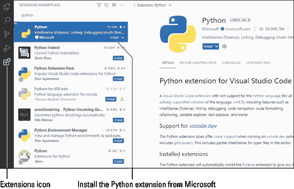

图 1-1：在 `VS Code` 中获取 `Python` 扩展。

完成 `Python` 扩展安装后，你可能会发现 `Python` 和 `Pylance` 都作为扩展添加到了 `VS Code`。不用担心；这是正常的。`Pylance` 只是提供了一些额外功能，让你在 `VS Code` 编辑器中更容易学习和编写 `Python` 代码。为了确保扩展已激活，请退出 `VS Code`，然后重新启动它。

### 让 AI 编写你的 `Python` 代码


现代生成式 AI 完全有能力为你编写 Python 代码。然而，这并不像命令它“写一个能让我变成亿万翁的 Python 程序”那么简单。它不是这样工作的——至少还没有。遗憾的是，你需要将任务拆分成更小的部分，并且可能还需要使用准确的技术术语。换句话说，你仍然需要学习足够的 Python，以便能够准确地编写 AI 提示词（prompts）。几乎所有的提示词——无论你使用哪种 AI 服务——都会以“为……编写 Python 代码”开头，因为 AI 可以做很多事情。如果你不明确告诉它你想让它写 Python 代码，你可能得不到代码，而是 HTML、JavaScript 或任何东西。所以，请务必首先理解这一点。

在我们于 2023 年底编写这些内容时，生成式 AI 仍然非常新颖且发展迅速。我们无法对定价或可用性做出任何承诺。这些事情在未来几年可能会经常发生变化，竞争企业也会争夺地位和市场份额。但截至写本文时，你可以提示以下 AI 服务编写 Python 代码。大多数服务将是免费的（目前），但再次，我们无法对未来做出任何承诺。

| 服务 | URL |
| --- | --- |
| ChatGPT | [`chat.openai.com`](http://chat.openai.com) |
| Claude | [`claude.ai`](https://claude.ai) |
| Bard | [`bard.google.com`](http://bard.google.com) |
| Copilot | [`chat.bing.com`](http://chat.bing.com) |

## 使用 GitHub Copilot

GitHub Copilot 是另一个能够为你编写代码的 AI 工具。它和 ChatGPT 一样，基于 OpenAI 的 `GPT-4`。然而，它专门为代码工作而设计，并直接集成到 VS Code 中。你并不要求使用 GitHub Copilot 来学习 Python 或使用本书，但你可能会发现它真的对你的学习过程很有帮助。在我写这本书时，GitHub 正在向学生免费提供 Copilot。它也提供了一些付费计划，每月 10 美元起。要使用 Copilot，你需要注册 GitHub 并购买（或申请）Copilot 的访问权限。再次，这个工具太新了，我在这里提供的任何说明都可能会更改。你可能需要在 Google 或 YouTube 上搜索“在 VS Code 中使用 Copilot”以找到最新的说明。基本上，它的工作原理如下：

1. **如果你还没有 GitHub 账户，请前往 [`GitHub.com`](http://GitHub.com) 并创建一个账户。**

   确保你知道自己的 GitHub 用户名和密码，因为设置账户时需要它们。然后只需将 GitHub Copilot 扩展安装到 VS Code 中。这些可以只是普通的编号步骤：

2. **如果 VS Code 没有打开，请打开它。**

3. **点击左侧列中的“扩展”；然后在搜索框中输入 Copilot 来搜索 Copilot。**

   会出现 Copilot 扩展列表。

4. **点击普通的 GitHub Copilot 扩展右侧的安装按钮（不是“Copilot Labs”或出现的任何其他扩展），如图 1-2 所示。**

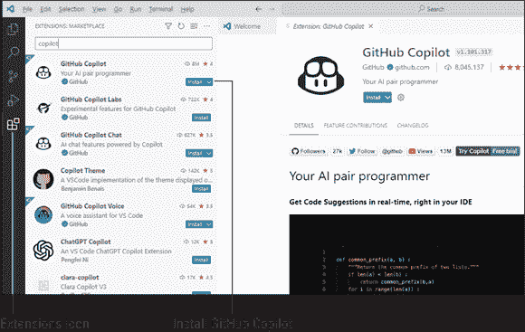

图 1-2: VS Code 中的 GitHub Copilot 扩展。

你会在右侧面板看到一些说明和提示。不过你现在不需要对其做任何操作。在 VS Code 的左下角附近，你应该看到账户图标（参见图 1-3）。点击该图标使用 GitHub 登录。但记住：设置账户不是必须的，只是一个选项。所以不需要现在就完成该过程。但如果你这样做，你应该在“已扩展”中看到它。此外，在 VS Code 的右下角，你会看到 Copilot 图标（参见图 1-3）。你可以在学习时随时点击它来禁用 Copilot。


图 1-3: VS Code 中的账户和 Copilot 图标。

## 使用 Jupyter Notebook 进行编码

Jupyter Notebook 是另一个编写 Python 代码的流行工具。Jupyter 的名字源于它支持三种流行的语言：Julia、Python 和 R。Julia 和 R 在数据科学领域流行。Python 是一种更通用的编程语言，恰好在数据科学领域流行，尽管 Python 适用于所有类型的开发，而不仅仅是数据科学。Notebook 部分表示你的代码被放置在类似于普通纸笔记本的结构中。

你可以随时在 VS Code 内部使用 Jupyter Notebook。只需安装 Jupyter 扩展。以下是步骤：

1. **如果你关闭了 VS Code，现在打开它。**

2. **点击左侧列中的扩展图标，在搜索框中输入 Jupyter，然后点击安装按钮安装 Jupyter 扩展。**

你会在右侧的欢迎页看到一些关于使用 Jupyter 的说明。但你现在不需要执行任何操作。只需记住，任何你想创建一个新的 Jupyter Notebook 时，都可以遵循以下步骤：

1. **从 VS Code 菜单栏选择视图 ⇒ 命令面板。**

2. **开始输入** `jupy` **然后点击“创建：新建 Jupyter Notebook”。**

我们将在下一章介绍编写 Python 代码的具体细节。现在，如果你已经完成了本章中安装扩展的所有步骤，VS Code 应该已经准备好就绪了。如果你点击 VS Code 中的“扩展”（Extensions）并查看左侧列，你应该应该已经安装了 Python 和 Jupyter 扩展，如图图 1-5。

图 1-4: 在 VS Code 中安装 Jupyter 扩展。

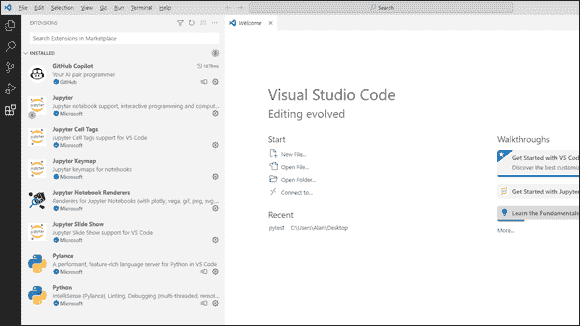

图 1-5: Python 和 Jupyter 的 VS Code 扩展显示在左侧“已安装”下方。

你在本章中完成的简单任务将在你的学习过程中大有浅，在你掌握基础知识后的职业编程中也将大有帮助。现在进入本迷你书籍的第 2 章，我们将深入探讨 Python 以及使用你现在电脑上可用的工具。

# 第 2 章：使用交互式模式、获取帮助和编写应用程序

## 本章内容

-  使用交互式模式
-  创建开发工作空间
-  为你的代码创建文件夹
-  输入、编辑和调试代码
-  在 Jupyter Notebook 中编写代码

在你安装了 VS Code（在本迷你书籍的第一章中介绍）后，你就准备好开始深入编写 Python 代码了。在本章中，我们将带你快速概览 VS Code 和 Jupyter Notebook 的交互、帮助和代码编辑功能。你可能急于开始学习数据科学、人工智能、机器人技术或任何其他高级主题，但如果你能很好地理解提供的许多工具以及使用它们的技能，学习这些主题将会变得更容易。

## 使用 Python 的交互式模式

获取 Python 使用实践经验的一种方法是直接开始交互式地输入一些命令。VS Code 中的“终端”（Terminal）面板是输入 Python 代码的好地方。在本章中，你将从那里开始。

### 打开终端

要在 VS Code 中交互式地使用 Python，请遵循以下步骤：

1. **打开 VS Code。**
2. **从 VS Code 菜单栏选择 查看（View）⇒ 终端（Terminal）。**
3. **如果面板顶部 `Terminal` 字没有高亮或下划线，请点击 Terminal（在图 2-1 中已圈出）。**

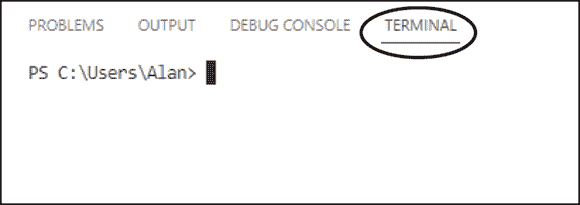

图 2-1: VS Code 中的终端面板。

你看到的第一个提示符通常是你的计算机操作系统的，它很可能显示你正在使用的账户用户名。例如，在 Mac 上，它看起来可能像 `Alans-Air:~ alan$`，但会将 `Alans-Air` 替换为你的计算机名称。在 Windows 中，它可能会显示为 `C:\Users\Alan>`，将 `Alan` 替换为你的用户名，并可能显示与 `C:\Users` 不同的路径。

例如，在 Mac 上，我们看到这个提示符：

`Alans-Air:~ alan$`

在 Windows 上，我们看到这个：

`C:\Users\Alan>`

根据你的 Windows 版本和当前配置，你可能会看到以下提示符，其中 `xxx` 是你的用户名：

`PS C:\Users\xxx>`

这仅意味着你正在使用 `PowerShell`。你不需要更改任何内容。你会在 `Alan` 处看到你的用户名，可能看到与 `C:\Users` 不同的路径。

### 获取你的 Python 版本

在操作系统命令行提示符处，输入以下内容并按回车，查看你使用的是哪个版本的 Python。注意第一个连字符前的空格，以及没有其他空格的事。

```bash
python --version
```

如果输入该命令后屏幕上显示错误消息，先不要担心。我稍后会告诉你如何修复。

如果没有看到错误，你将看到类似 Python 3.*x.x 的内容（其中 `x` 是代表你正在使用的 Python 版本的数字）。如果你在 Mac 上看到错误，例如“命令未找到”（Command Not Found），请尝试输入以下命令：

```bash
python3 --version
```

这通常是因为某些旧版版本的 Python。在 Mac 上需要将 `python` 替换为 `python3`。在 Windows 上，根据你的版本，如果你看到上述提示符，你可能会输入以下命令：

```bash
py --version
```

### 进入 Python 解释器

任何能提供 Python 版本的命令都会带你进入 Python 解释器。当你看到提示符变为大于符号（`>>>`）时，你就处于正确的位置了。例如，只需输入 `python`（或 `python3`、`py`）而不输入其他内容，然后按回车。

```bash
python
```

 当我们或任何人说“输入命令”时，意味着你需要输入该命令然后按回车。在按回车之前什么都不会发生。如果你只是输入了命令并等待，你会等好久。你会看到 `>>>` 提示符，这代表解释器。

### 输入命令

在 Python 解释器中输入命令与在其他地方输入相同。你必须正确输入命令并按回车。如果你在命令中拼写错误，你可能会看到错误消息，这只是解释器在告诉你它不懂你的意思。但不要担心；你无法破坏任何。例如，假设你输入命令：

```text
howdy
```

按下回车后，你会看到一些技术术语，试图告诉你解释器不知道“howdy”意味着什么，所以它什么也做不了。什么都没有损坏。你只是回到了另一个 `>>>` 提示符，你可以再次尝试，如图图 2-2 所示。

### 使用 Python 的内置帮助

图 2-2 中的提示符之一提到，你可以在 Python 解释器中输入 `help` 命令。注意你不需要输入引号，只需输入 `help` 单词（然后像既往一样按回车）。这次你看到：

`输入 help() 获取交互式帮助，或输入 help(object) 获取对象的帮助。`

现在解释器正在提示你输入 `help` 后面跟一对空括号，或者在括号内输入一个特定的单词（示例中给出的示例是 `object`）。请确保在输入命令后按下回车键。请输入以下内容：

```text
help()
```

注意，该行没有空格。按下回车键后，屏幕会提供一些关于使用 Python 交互式帮助的信息，类似于图 2-3 所示的示例。

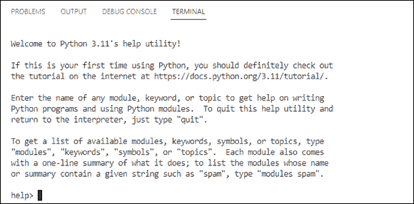

图 2-3：Python 的交互式帮助工具。

在窗口底部看到 `help>` 表示你已不再处于操作系统 shell 或 Python 解释器中（后者始终显示 `>>>`），而是处于一个提供帮助的新区域。如屏幕所示，你可以输入任何模块、关键字或主题的名称来获取帮助。作为初学者，你现在可能不需要具体的帮助。但如果需要，知道帮助功能在那里是有好的。

例如，Python 语言中使用了一些具有特殊含义的关键字。要获取这些关键字的列表，只需在 `help>` 提示符处输入：

```text
keywords
```

按下回车键后，你会看到关键字列表，如图 2-4 所示。

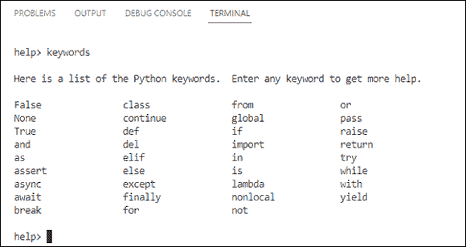

图 2-4：关键字帮助。

关键字列表上方有一条消息，提示你可以在 `help>` 提示符处输入任何关键字来获取关于该关键字的更多信息。例如，输入 `class` 关键字会提供关于 Python 类的信息，如图 2-5 所示。这些并不是你在学校学到的类，而是你学习了基础知识并准备进入更高级主题时在 Python 中创建的类。

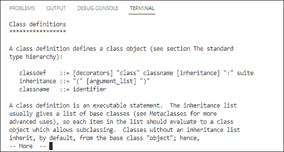

图 2-5：类帮助。

帮助文本中的所有技术术语会让初学者感到困惑。但当你学习 Python 的新概念时，要意识到根据需要可以使用交互式帮助。

 文本底部的 `-- More --` 不是输入命令的提示符。它只是让你知道还有文本，可能是好几页。按下空格键或回车键查看。每当你看到 `-- More --`，都可以按下空格键或回车键进入下一页。你会回到 `help>` 提示符。如果你想退出而不是继续滚动，请按 Q。

### 退出交互式帮助

要离开 Python 提示符并返回操作系统，输入 `exit()` 并按下回车。注意，如果你犯了错（例如忘记了括号），屏幕会显示一些帮助。例如，如果你输入 `exit` 并按下回车，你会看到：

```text
使用 exit() 或 Ctrl-Z 加 Return 退出
```

 不要被“Ctrl-Z”与“Ctrl+Z”按键组合的区别困扰；它们的意思是一样的。

当你在终端面板最后看到操作系统提示符而不是 `>>>` 时，你就知道已经退出了 Python 解释器，如图 2-6 所示。

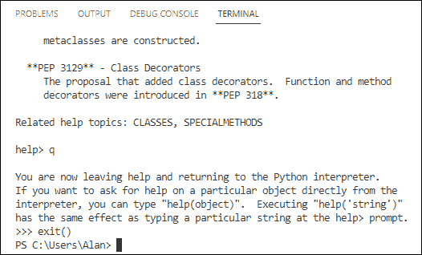

图 2-6：返回操作系统提示符。

### 在线搜索特定主题

当你知道要查找的确切术语和概念时，Python 的内置帮助是非常有用的。但对于初学者来说往往很难。当你在线时，在网络上搜索帮助可能更好。如果你在寻找视频，可以从 [www.youtube.com](http://www.youtube.com) 开始；如果没有，[`stackoverflow.com`](https://stackoverflow.com) 是提问和搜索帮助的好地方。

 无论你使用什么，记得从 `python` 开始你的搜索。

### 免费速查表

学习者的其他良好资源是数不尽的速查表。每当你感到被一种语言的所有可能性淹没时，一份总结在单页上的速查表可以帮助信息量减少到易管理的范围。当然，使用速查表并不是真正的“作弊”，除非你在考试时使用它。因此，我们在科技领域常说的速查表只是帮助人们学习的另一种工具。有很多类型的速查表；吸引你的类型取决于你的学习风格。要查看有哪些资源，请前往 Google、Bing 或任何你喜欢的搜索引擎并搜索 `free cheat sheet`。

## 为你的 Python 代码创建一个文件夹

在本节中，你创建一个文件夹来存储你编写的所有代码，以便它们集中在一起，并在需要时易于找到。你可以将此文件夹放在任何喜欢的地方，并按喜喜命名。

在 Windows 中，你可以导航到将包含新文件夹的文件夹。（Alan 使用 OneDrive，但你可以使用桌面、文档或任何文件夹）。右键点击文件夹中的空白处，然后选择新建文件夹（Mac）或新建 ⇒ 文件夹（Windows）。输入文件夹名称并按下回车。为了跟随本章的示例，请将文件夹命名为 `AIO Python`。

 你创建的每个 Python 代码文件都是一个带有 `.py` 扩展名的纯文本文件。我们建议将为本书创建的任何文件放在 `AIO Python` 文件夹中（请参见上一节了解如何创建该文件夹）。只要 VS Code 和你的 Python 3 工作区处于打开状态，你就能够看到你的 `AIO Python` 文件夹。

要随时创建一个 `.py` 文件，请遵循以下步骤：

1. 如果你还没有这样做，请打开 VS Code 和你的 `AIO Python` 文件夹。
2. 如果资源管理器（Explorer）面板未打开，点击 VS Code 左上角的资源管理器图标。


3. 要在你的`AIO Python`文件夹中创建文件，点击文件夹名称右侧的`New File`（新建文件），如图 2-7

图 2-7： `New File`图标出现在文件夹名称的右侧。

### 编写 Python 代码

现在你已经打开了一个`.py`文件，可以使用它来编写一些 Python 代码。学习新编程语言时的典型做法，你会从输入一个简单的`Hello World`程序开始。以下是步骤：

1. 点击编辑区域第 1 行的右侧。
2. 输入以下内容：

```
print("Hello World")
```

在你输入时，可能会注意到屏幕上出现了文本。这些文本是`IntelliSense`文字，它会检测你输入的内容并显示关于该关键词的一些信息。你具体看到的多少信息取决于你是否在使用`GitHub Copilot`。但你不需要对它做任何操作——继续输入即可。

3. 输入该行后按回车键。

新的代码行显示在屏幕上。你可能还会注意到其他变化，如图 2-8

图 2-8： `hello.py`文件包含一些 Python 代码并有未保存的更改。

我们更喜欢第二种方法，即使用`AutoSave`（自动保存）来自动保存我们做的更改。要启用自动保存，从 VS Code 的菜单栏选择`File ⇒ Auto Save`。下次打开`File`菜单时，你会看到`Auto Save`旁边有一个勾选，这告诉自动保存已开启。要关闭自动保存，再次选择`File ⇒ Auto Save`。在你进行更改时，文件会自动保存。

### 在 VS Code 中运行 Python

要在 VS Code 中测试你的 Python 代码，你需要运行它。运行它最简单的方法是右键点击文件名（在本例中`hello.py`）并选择`Run Python File in Terminal`（在终端运行 Python 文件），如图 2-9 中的即可。通常，它会被标记为`Recommended`（推荐）。如果你卡住了，从 VS Code 的菜单栏中选择`View ⇒ Command Palette`（命令面板）。输入`python`然后点击`Python: Select Interpreter`（选择解释器）。选择`Recommended`选项。然后按照上上段的描述再次尝试运行`hello.py`。

`Terminal`（终端）面板会在 VS Code 窗口底部打开。你会看到一个命令提示符，后面跟着一个在 Python 解释器中运行代码的注释（`python.exe`）。在下方，你将看到程序的输出：在本例中是`Hello World`字，然后是另一个提示符，如图 2-9 所示。

1. 在`Finder` (Mac) 或资源管理器 (Windows) 中打开你的`AIO Python`文件夹（或你为书中处理文件而创建的任何文件夹）。
2. 在该文件夹的空白处右键点击鼠标，然后选择“新建 ⇒ 文件夹”（Windows）或“新建文件夹”（Mac）。
3. 输入`Jupyter Notebooks`作为文件夹名称并按回车键。

现在你已经有了一个用于保存 Jupyter 笔记本的文件夹，可以像接下来讨论的那样创建一个笔记本。

### 创建和保存 Jupyter 笔记本

你可以在 Visual Studio 内部创建 Jupyter 笔记本并运行其代码。如果你已经在`AIO Python`文件夹中创建了`Jupyter Notebooks`文件夹（参见上一节），那么每当你在 VS Code 中打开`AIO Python`文件夹时，都应该能在 VS Code 的资源管理器窗格中看到该文件夹。如果你确实创建了该文件夹但在 VS Code 中没有看到，请尝试点击资源管理器窗格顶部`AIO PYTHON`文件夹名称（全大写）右侧的刷新资源管理器图标（圆形箭头）。

要创建一个 Jupyter 笔记本并将其保存到文件夹中，请遵循以下步骤：

1. 打开 VS Code（如果尚未打开）。
2. 在资源管理器窗格中点击`Jupyter Notebooks`图标，点击其正上方加号`(+)`创建新文件，并输入`01 Notebook.ipynb`作为文件名。

 确保文件名扩展名——`.ipynb`完全准确非常，这样文件才能被识别为 Jupyter 笔记本。

输入文件名并按回车键后，该文件将作为 Jupyter 笔记本在右侧的编辑器中打开，如图 2-12 所示。

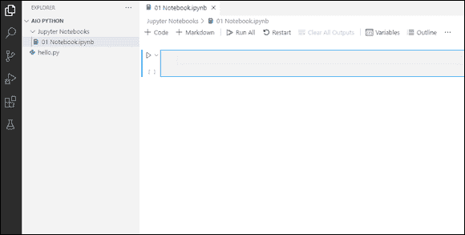

图 2-12： Jupyter 笔记本。

 如果你像之前提到的那样没有开启自动保存，那么在接下来的章节中处理笔记本时，你需要手动保存更改。

在笔记本的菜单栏和工具栏下方，你会看到一个大的矩形框用于输入。那个框是一个名为`cell`的区域。接下来，你将在该单元格中输入一些代码。

### 在笔记本中输入和运行代码

当笔记本打开时，你至少会看到一个单元格。你可能还会注意到`+ Code`和`+ Markdown`选项。点击`Code`会打开一个全新的`code cell`，即一个可以执行 Python 代码的单元格。它在左上角附近有一个指向右侧三角形，你可以用它运行输入到单元格中的任何 Python 代码。现在，你应该显示一个代码单元格，你可以用它来输入并运行一些 Python 代码。你可以通过以下步骤来尝试一下：

1. 点击三角形右侧的代码单元格，并输入以下代码：

```
print("Hello World")
```

不要忘记`print`单词使用小写字母。

2. 要运行代码，只需点击代码左侧的`Run`按钮（指向右的三角形）或代码上方的`Run All`按钮，如图 2-13 所示。

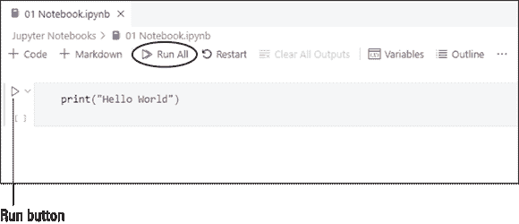

图 2-13： 点击`Run`或`Run All`按钮运行代码。

假设你的代码没有错误，Python 程序的输出（单词`Hello World`）应该出现在 Jupyter 笔记本中代码的正下方。如果提示选择 Python 解释器，只需选择你上次下载的那一个（通常显示为`Recommended`👌），并安装它建议的任何所需扩展。

你创建的每个笔记本都只是独立的文件。你可以像关闭`.py`文件一样关闭笔记本。点击笔记本文件名旁标签页中的`X`，或从菜单栏中选择“文件 ⇒ 关闭编辑器”。要重新打开笔记本，点击资源管理器窗格中的它的文件名。

这些操作足够让你在计算机上准备好学习和运行 Python 了。我不会在这里花很多时间在 VS Code 或 Jupyter 笔记本上，因为它们本身并不是 Python。它们是使用多种语言的编程人员所使用的工具。在 YouTube 及其他地方有许多关于使用 VS Code 和 Jupyter 笔记本配合 Python 的免费教程。因此，在学习 Python 语言的同时，请根据方便从其他资源中学习你所能学会。现在，请来到第 3 章，让我们深入研究吧。

# 第 3 章

# Python 元素与语法

本章内容

许多语言关注的是计算机做了什么以及它是如何执行的，而不是人类的思考和工作方式。这一个简单的事实让编程语言变得困难。然而，Python 基于一种哲学：编程语言应该更符合人类的思考。`Python之禅`是这种倾向的完美例子，因此我们从它开始本章。

## Python 之禅

`Zen of Python`如图 3-1 所示，是 Python 语言设计的指导原则。这些原则隐藏在一个“彩蛋”（Easter egg）中，对于已经学习了足够语言或应用并能够找到它的人来说，这是一个内部梗。要找到这个彩蛋，请遵循以下步骤：

1. 以通常方式在电脑上打开 VS Code（通过 Mac 的启动台或 Windows 的开始菜单），然后打开`AIO Python`。
2. 如果终端面板未打开，从 VS Code 菜单栏选择“查看 ⇒ 终端”。
3. 输入`python`并按回车键进入 Python 提示符`(>>>)`。如果报错，在 Mac 上输入`python3`，在 Windows 上输入`py`。
4. 在`>>>`提示符处，输入`import this`并按回车键。

格言出现了。你可能需要滚动或调高终端面板以看到全部。这些格言在哲学修辞上带有某种幽默，但它们表达的总体思想是尽量让代码比机器更具人类可读性。

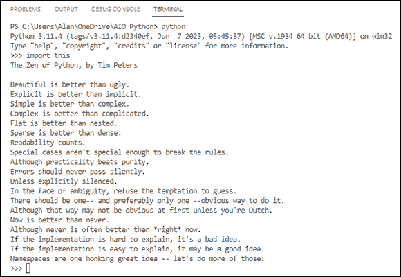

`Python之禅`有时被称为`PEP 20`，其中`PEP`是`Python enhancement proposals`（Python 增强建议）的缩写。20 可能指的是`Python之禅`的原则，但其中只有 19 条被记录下来。我们每个人都可以设想或想出自己的最后一条原则。

还有许多其他的 PEP，你可以在[`Python.org`](http://Python.org)网站的[`https://python.org/dev/peps`](https://python.org/dev/peps)找到所有的内容。你最可能听过的是`PEP 8`，它是`Python代码风格指南`。`PEP 8`的指导原则是“可读性非常重要”——也就是说，要让`人类`易读。诚然，当你刚学习 Python 代码时，大多数其他人的代码看起来就像外星人随手涂鸦的某些`乱码`，你可能完全不知道它们的意思或作用。但随着你对这种门语言经验的增加，风格的一致性会变得越来越明显，你会发现阅读和理解他人的代码变得越发容易，而这正是学习编程的绝佳方式。

 我们将在整本书中向你介绍 Python 编码风格。在动手实践之前尝试去读它肯定会让你无聊透顶。所以现在，每当你听到提到 PEP，特别是`PEP 8`时，请记住它是指的是[`Python.org`](http://Python.org)网站上的 Python 编码风格指南，你可以随时通过在网上搜索`pep 8`来找到它。

## 介绍面向对象编程

冒着说得太技术化或太计算机科学化的风险，我们应该提到，设计语言有不同的方法。也许最成功且应用广泛的模型是`面向对象编程`，或 OOP，这是一种设计哲学，试图在某种意义上模拟现实世界，因为它由具有属性的对象以及这些对象所执行的方法（动作）组成。

以汽车为例。任何一辆汽车都是一个对象。并不是所有的汽车都完全相同。不同的汽车具有不同的属性，例如品牌、型号、年份、颜色和尺寸，这些使得它们彼此有所不同。然而，它们都为了同一个基本目的：将我们从 A 点带到 B 点，而无需步行或使用其他交通工具。

所有汽车都有共同的方法（它们可以做的事情）。你可以驾驶它们、转向、加速、减速、控制内部温度等，并通过车内可以用手操作的控制装置来完成这些操作。

面向对象编程语言中的`object`并不是物理实体（如汽车），因为它只存在于计算机内部。对象严格来说是一个软件实体。在 Python 中，你可以有一个`class`（你可以将其想象为对象创建器，例如汽车工厂），它可以为不同的用途（运动型、越野型、轿车）生产许多不同的对象（汽车）。所有这些对象都可以通过它们共有的控制装置进行操作，就像所有汽车都通过方向盘、刹车、油门和挡位等装置进行操作一样。

Python 是一种非常典型的面向对象语言。核心语言由控制语句（以单词的形式）组成，允许你控制各种不同的对象——你自己以及他人程序中的对象。然而，你需要先学习核心语言，这样当你准备好使用他人的对象时，你才知道如何操作。同样，当你学会了如何开一辆车，基本上就学会了开所有的车。你不需要担心租了一辆车却发现加速器在车顶上，方向盘在板上，而且你必须使用语音命令而不是刹车来减速。驾驶的基本技能适用于所有汽车。

## 发现为什么缩进至关重要

在代码编写的基本风格方面，让 Python 真正区别于许多其他语言的特征是，它使用缩进而不是括号、花括号等符号来表示代码块或代码段。我们不假设你熟悉其他语言，所以如果这句话对你来说毫无意义，请不要担心。但如果你熟悉如`JavaScript`之类的语言，你就知道必须花大量精力去处理括号等符号，以控制代码的嵌套关系。

例如，这里有一些 JavaScript 代码。如果你熟悉“魔力球（Magic 8 Ball）”玩具，你可能能感觉到这个程序在做什么。但这并不重要。只需注意所有那些括号、花括号和分号即可：

```
document.addEventListener("DOMContentLoaded", function () {var question = prompt("Ask magic 8 ball a question");var answer = Math.floor(Math.random() * 8) + 1; if (answer == 1) {alert("It is certain");} else if (answer == 2) {alert("Outlook good");} else if (answer == 3) {alert("You may rely on it");} else if (answer == 4) {alert("Ask again later");} else if (answer == 5) {alert("Concentrate and ask again");} else if (answer == 6) {alert ("Reply hazy, try again");} else if (answer == 7) {alert("My reply is no");} else if (answer == 8) {alert("My sources say no")} else {alert ("That's not a question");}alert("The end");})
```

这段代码一团糟，而且不好读。我们可以通过将其拆分为多行并对某些行进行缩进，让阅读变得容易一点。（注意，在 JavaScript 中并不是强制要求的）。以下是重格式后的代码：

```
document.addEventListener("DOMContentLoaded", function () {
var question = prompt("Ask magic 8 ball a question");
var answer = Math.floor(Math.random() * 8) + 1; if (answer == 1) {alert("It is certain");} else if (answer == 2) {alert("Outlook good");} else if (answer == 3) {alert("You may rely on it");} else if (answer == 4) {alert("Ask again later");} else if (answer == 5) {alert("Concentrate and ask again");} else if (answer == 6) {alert ("Reply hazy, try again");} else if (answer == 7) {alert("My reply is no");} else if (answer == 8) {alert("My sources say no")} else {alert ("That's not a question");}alert("The end");})
```

（注：此处提供的示例代码在原文中似乎出现了格式混乱，翻译已按要求保留逻辑）

在 JavaScript 中，括号和花括号是必须的，因为它们标识了代码的开始和结束。

在 Python 中，规则是相反的，因为它不使用花括号或任何其他特殊字符来标记代码块的开始和结束，而是使用缩进。所以缩进不是可选的——它们是必须的，对代码的运行有很大影响。因此，当你阅读代码时（从人类的角度而不是计算机的角度），可以很容易地看到内容，而不会被大量的引号所干扰。以下是上述 JavaScript 代码用 Python 实现的版本：

```
import random
question = input("Ask magic 8 ball a question")
answer = random.randint(1, 8)
if answer == 1:
    print("It is certain")
elif answer == 2:
    print("Outlook good")
elif answer == 3:
    print("You may rely on it")
elif answer == 4:
    print("Ask again later")
elif answer == 5:
    print("Concentrate and ask again")
elif answer == 6:
    print("Reply hazy, try again")
elif answer == 7:
    print("My reply is no")
elif answer == 8:
    print("My sources say no")
else:
    print("That's not a question")
print("The end")
```

 你可能注意了 Python 代码开头以`import`开头的行。我们将在下一节中解释为什么。

## 使用 Python 模块


Python 成功的秘密之一在于它由一个简单、简洁的核心语言组成。这是你需要首先学习的部分。在这个核心语言之外，还有许多模块可以免费获取并在你自己的代码中调用。这些模块也是用核心语言编写的，但你不需要看到甚至不需要知道，因为你可以直接从基础核心语言调用模块的所有功能。

大多数模块都是为了某些特定应用，例如科学、人工智能或处理日期和时间……任何内容。使用模块的妙之处在于，其他人花费了大量时间来创建、测试和微调该模块，而你不需要亲自动手去做。你只需要将模块导入到自己的 Python 文件中，并按照模块文档中的说明使用该模块的功能即可。

上一节中的“魔法八球”（Magic 8 Ball）示例程序是从这一行代码开始的：

```python
import random
```

Python 语言本身并没有内置任何生成随机数的功能。虽然我们可以想出制作随机数生成器的方法，但我们不需要这样做，因为已经有人想出了如何实现，并将代码免费公开了。在程序开始处使用`import random`是告诉程序，你想使用`random`模块的功能来生成随机数。然后，在程序的后续部分，你使用这行代码生成一个 1 到 8 之间的随机数：

```python
answer = random.randint(1, 8)
```

### 理解导入模块的语法

如前所述，在你的自己的 Python 代码中，必须先导入模块才能访问其功能。其操作语法如下：

```python
import modulename [as alias]
```

像这样用通用格式编写的代码（其中部分使用斜体，部分使用方括号）有时被称为*语法图（syntax chart）*，因为它并不是字面地告诉你应该输入什么。相反，它展示的是代码的语法（格式）。以下是此类语法图中呈现信息的方式：

- 代码对大小写敏感，这意味着你必须使用全小写字母`import`和`as`，如所示。
- 斜体中的任何内容都是你自己的代码中提供的信息的占位符。例如，在你的代码中，你需要将`modulename`替换为你想要导入的模块名称。
- 方括号中的任何内容都是可选的，因此你可以带或不带方括号内的部分来输入命令。

 你可以在任何编写 Python 代码的地方输入`import`行：在 Python 命令行提示符（`>>>`）中、在`.py`文件中或在 Jupyter notebook 中。在`.py`文件中，始终将`import`语句放在最前面，以便代码的其他部分可以使用这些功能。

### 在模块中使用别名

正如你刚才从`import`命令的语法中看到的，你只需要在模块名后面跟着一个空格、单词`as`以及你自定义的名称，就可以为你导入的任何模块分配一个*别名（alias）*或昵号。

 大多数人使用易于输入和记忆的短名称，这样他们每次想访问模块功能时就不需要输入长名称。

例如，与其通过输入`import random`来导入该模块，你可以导入它并给它一个昵号，例如`rnd`，它更短：

```python
import random as rnd
```

那么在随后的代码中，你就不会使用完整名称`random`来引用该模块。相反，你应该使用短名称`rnd`：

```python
answer = rnd.randint(1, 8)
```

在这个简短的示例中，使用备短名称可能并不是什么大事。但有些模块的名字很长，你可能需要在代码的很多地方引用这些模块。

现在你已经学习了一些背景信息，是时候应用这些知识并开始上手写一些 Python 代码了。下章节见。

# 第 4 章：构建你的第一个 Python 应用

## 在本章中

-  **打开 Python 文件**
-  **使用 Python 注释**
-  **理解 Python 中的数据类型**
-  **使用 Python 运算符进行操作**
-  **创建变量**
-  **理解语法**
-  **组织代码**

你想用 Python 构建一个应用吗？无论你是想编写一个网站、分析数据，还是创建一个脚本来自动化某些任务，本章都为你提供了开启旅程所需的各种基础。大多数人使用 Python 等编程语言来创建*应用程序（application programs）*，这些通常被称为*应用（applications 或 apps）*或程序（*programs*）。要创建应用，你需要学会如何在编辑器中编写代码。你还需要开始学习创建这些应用所需的语言（在书中是 Python）。

与任何语言一样，你需要理解单个单词，这样你就可以开始构建句子，并最终构建让你的应用运行起来的代码块。首先，我们将引导你创建一个应用文件，你将在其中编写代码。然后你将学习各种数据类型、运算符和变量（这些是 Python 语言的单词），然后是 Python 语法。在此过程中，你将看到如何保存应用，以及如何为代码添加注释，以便你和其他他人理解你是如何以及为什么要这样构建的。

准备好了吗？

## 打开 Python 应用文件

在书中你将使用广受欢迎的 Visual Studio Code（VS Code）编辑器来学习 Python 并创建 Python 应用。我们假设你已经按照本微书之前章节的描述设置好了学习和开发环境，并知道如何打开 VS Code。为了跟随本节，请执行以下步骤：

1. 在 Mac 上使用 Launchpad 或在 Windows 上使用开始菜单打开 VS Code。你可能会看到一个名为`.vscode`的文件夹，不用担心，它只是 VS Code 设置。
2. 如果你已经创建了`hello.py`文件，点击它。
3. 删除第一行的所有文本，以便从零开始。

此时，`hello.py`应该在编辑器中打开，如下图所示。如果任何其他标签页已打开，点击`X`关闭它们。

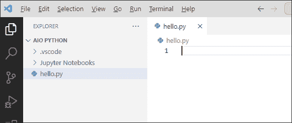

图 4-1：`hello.py`文件已打开。

1. 在 VS Code 中，点击`hello.py`标签页下方`1`旁边并输入以下内容：

```python
# This is a Python comment in my first Python app
```

2. 按`Enter`。

你输入的注释会出现在第 1 行，如图 4-2 所示。如果你使用的是默认颜色主题，注释文本将显示为绿色。

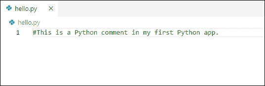

图 4-2：`hello.py`中的注释。

虽然你暂时不会用到多行注释，但请注意，你可以通过三引号包裹注释，在 Python 中编写更长的注释。这些较大的注释有时被称为`docstrings`（文档字符串），通常出现在 Python 模块、函数、类或方法定义的顶部，这些是你在第 2 本中会发现的应用构建模块。你现在不需要编写一个，但这里有一个 Python 代码中此类注释的示例：

```python
"""This is a multiline comment in Python
This type of comment is sometimes called a docstring.

A docstring starts with three double-quotation marks, and also ends with
three double quotation marks. """
```

如果你喜欢，注释的开头和结尾可以使用三个单引号，而不是三个双引号。

在 VS Code 中，注释的颜色通常与代码不同。以`#`开头的短注释是绿色的，`docstrings`是棕色的，这有助于它们从你运行的 Python 代码中脱颖而出。

你可以在代码中拥有无限数量的注释。如果你在输入注释后在等待某些事情发生……别等了。当你在这这样的编辑器中工作时，在运行代码之前，代码不会执行任何操作。现在我们拥有的只是注释，所以即使我们运行这段代码，什么都不会发生，因为注释是给人类读者看的，而不是给计算机的。在开始编写代码之前，你需要从最基础的开始，那就是……

## 理解 Python 数据类型

你一直在处理书面信息，可能并没有考虑过数字和文本之间的区别。数字代表数量，例如`10`或`123.45`。文本由字母和单词组成。对于计算机来说，巨大的区别在于它们对数字进行算术运算（加、减、乘、除），但不能对字母和单词进行运算。

例如，每个人都知道`1+1 = 2`。同样的情况并不适用于字母和单词。表达式`A+A`并不等于`B`或`AA`或其他任何，因为与数字不同，字母和单词不是数量。你可以在商店购买`12 apples`，因为`12`是一个数量，一个数字。你不能购买`snorkel apples`（呼吸镜苹果），因为`snorkel`是一个东西——它不是数量、数字或标量值。

Python 中的`Numbers`必须以数字（0–9）开头；或者以小数点（`.`）开头；或者用作负数负号的连字符（`-`）。一个数字只能包含一个小数点。它不应该包含字母、空格、美元符号或任何不是正常数字的内容。表 4-1 展示了良好和不佳的 Python 数字示例。

| 数字 | 好还是坏？ | true |
| --- | --- | --- |
| 1 | 好 | 整数（integer） |
| 1.1 | 好 | 带小数点的数字 |
| 1234567.89 | 好 | 带小数点且无逗号的大数字 |
| -2 | 好 | 负数，由开头的连字符指示 |
| .99 | 好 | 以小数点开头的数字，因为它小于 1 |
| $1.99 | 坏 | 包含一个 $ 符号 |
| 12,345.67 | 坏 | 包含逗号 |
| 1101 3232 | 坏 | 包含空格 |
| 91740-3384 | 坏 | 包含连字符 |
| 123-45-6789 | 坏 | 包含两个连字符 |
| 123 Oak Tree Lane | 坏 | 包含空格和单词 |
| (267)555-1234 | 坏 | 包含括号和连字符 |
| 127.0.0.1 | 坏 | 只允许一个小数点 |

表 4-1 良好和不佳的 Python 数字示例

 如果你担心数字规则让你无法处理金额、邮政编码、地址或任何其他内容，请停止担心。你可以存储并处理`all`各种信息，正如你很快就会看到的。

 你使用的绝大多数数字可能符合前四个良好数字示例之一。然而，如果你恰好在查看代码，可能会遇到其他类型。

### 整数

`integer`是一个整数，无论是正数还是负数。在 Python 中，整数没有小数点。例如，`10`或`-5`是整数。

### 浮点数

`float`是一个包含小数点的数字。例如，`1.1`或`0.99`是浮点数。在 Python 中，你只能有一个小数点。

## 复数

几乎任何类型的数字都可以表示为整数或浮点数，因此熟悉这些对于绝大多数人来说足够了。但请注意，Python 还支持`complex numbers`（复数）。这些数字始终以字母`j`结尾，它是数字的虚部。如果你看到类似`z = 2+3j`的内容，那个`j`表示它是虚拟。

## 单词（字符串）

字符串是数字的相反。对于数字，你可以加、减、乘、除，因为数字代表数量。字符串用于几乎所有其他内容。你每天看到的名称、地址或类型的文本在 Python 中（以及在计算机中）都是字符串。它被称为`string`，是因为它是字符序列（字母、空格、标点符号，可能还有数字）。对我们来说，字符串通常有某些意义，但对计算机来说，如果一段信息不是它可以进行算术运算的内容，它只是字符序列。

与数字不同，字符串必须包含在引号中。你可以使用双引号（`"`）或单引号（`'`）。以下所有内容都是有效的字符串：

```python
"Hi there, I am a string"
'Hello world'
"123 Oak Tree Lane"
"(267)555-1234"
"18901-3384"
```

 提示：如果字符串中包含单引号（apostrophe/single quote），则整个字符串应该像这样用双引号括起来：

`"Mary's dog said Woof"`

使用双引号是必要的，为了避免对字符串开始和结束位置产生混淆。如果你改用单引号，如下所示：

`'Mary's dog said Woof'`

计算机就太笨了，无法正确识别它。它会将第一个单引号视为字符串的开始，将下一个（在 Mary 之后的）视为字符串的结束，然后它就不知道该对剩余的内容怎么办，你的程序也就无法正常运行。

同样，如果字符串包含双引号标记，请将整个内容用单引号括起来以避免混淆。例如：

`'The dog of Mary said "Woof".'`

第一个单引号开始字符串，第二个单引号结束字符串，而双引号不会引起混淆，因为它们在字符串内部。

那么，如果你有一个既包含单引号又包含双引号的字符串，比如：

`Mary's dog said "Woof".`

这值得发出一个响亮的*嗯*。幸运的是，Python 的创建者意识到这种情况可能会发生，所以他们想出了转义方法。解决方法涉及到被称为*转义字符（escape characters）*的内容，因为在某种意义上，它们允许你转义（避免）单引号或双引号等字符的特殊含义。要转义一个字符，只需在其前面加一个反斜杠（`\`）。确保你使用的是反斜杠（向上一个字符倾斜的那个，像这样`\`），否则它无法正常工作。

继续上一个例子，你可以将整个内容用单引号括起来，并通过在单引号（同一个字符）前面加上反斜杠来将其转义，如下：

`'Mary\'s dog said "Woof".'`

或者你可以将整个内容用双引号括起来，并转义嵌入字符串中的双引号，如下：

`"Mary's dog said \"Woof\"."`

反斜杠的另一个常见用法是与`n`（`\n`）结合使用，在用户查看的屏幕上添加一个换行字符（也称为换行，*用户*是指任何使用你编写程序的人）。例如，这个字符串：

`"The old pond\nA frog jumped in,\nKerplunk!"`

在显示给用户时看起来像这样：

```text
The old pond
A frog jumped in,
Kerplunk!
```

每个`\n`都被转换成了换行符。

## 布尔型

Python 中的第三种数据类型并不是数字或字符串。它被称为*布尔型（Boolean，以数学家乔治·布尔 George Boole 命名）*，它可以是两个值之一：`True`或`False`。

在 Python 代码中，人们使用类似于下面的格式将`True`和`False`值存储在*变量*中（我们在本章稍后会讨论的代码占位符）：

`x = True`

或者可能是这样：

`x = False`

 你知道这里的`True`和`False`是布尔值，因为它们没有被引号括起来（像字符串那样），也不是数字。此外，*首字母大写*是要求的。换句话说，布尔值`True`和`False`必须按照所示写法。

## 使用 Python 运算符

正如我们在前一节中讨论的，将信息视为以下数据类型之一（数字、字符串或布尔型）对 Python 以及通用计算机都有帮助。你还使用计算机对这些信息进行*操作*，这意味着进行任何必要的数学计算、比较、搜索或任何操作，帮助你找到信息并以你理解的方式对其进行组织。

Python 提供了许多不同的*运算符*来处理和比较不同类型的信息。这里我们总结了它们。在不需要深入细节的情况下，了解这些运算符是够的。是否使用这些运算符取决于你需要的信息类型。

### 算术运算符

*算术运算符*正如其名所示，用于：加法、减法、乘法、除法、取模和整数除法。

| 运算符 | 描述 | 示例 |
| --- | --- | --- |
| `+` | 加法 | |
| `-` | 减法 | |
| `*` | 乘法 | |
| `/` | 除法 | |
| `%` | 取模（剩余） | |
| `**` | 幂 | |
| `//` | 整数除法 | |

算术运算符如表 4-2 所示，前四项是显而易懂的，后三项运算符稍微复杂。

### 比较运算符

计算机可以根据事实做出决策。帮助你编写代码的*比较运算符*列在表 4-3 所示。

| 运算符 | 含义 |
| --- | --- |
| `<` | 小于 |
| `<=` | 小于等于 |
| `>` | 大于 |
| `>=` | 大于等于 |
| `==` | 等于 |
| `!=` | 不等于 |
| `is` | 对象的标识性 |
| `is not` | 对象的标识性 |

前几项是显而易见的，后两项涉及对象，我们还没有讨论。我们将在第 6 章介绍它们。

### 布尔运算符

*布尔运算符*处理布尔值（`True`或`False`），并用于判断一个或多个条件为`True`或`False`。表 4-4 总结了布尔运算符。

| 运算符 | 代码示例 | 判定结果 |
| --- | --- | --- |
| `or` | `x or y` | x 或 y 中有一个为 True |
| `and` | `x and y` | x 和 y 均为 True |


| `not` | `not x` | x 不是 True |

如果你进行了该项更改并再次运行程序，它会打印 `Negative number`，因为 `-1` 是一个负数。

在这个示例中，我们使用 `num` 作为示例变量名，以便向你展示一些周围带有空格的运算符。当然，我们还没有告诉你什么是变量，所以示例的这部分可能让你感到一头雾水。我们在接下来的内容中会解释这个问题。

## 创建和使用变量

变量是 Python 以及所有计算机编程语言的重要部分。`variable`（变量）简单来说就是可能会变化（改变）的信息占位符。例如，如果你访问一个你拥有用户账户的网站，当你登录时，网站可能会在主页上显示你的用户名。你的名字出现在页面上是因为它在你设置账户时就被存储了。当你登录账户时，你的名字会被放入一个变量中，而该变量的内容（你的名字）就会出现在网页浏览器的页面上。

在代码中，变量用变量`name`表示，而不是某项特定的信息。这里有另一种思考方式：每当你购买一件或多件产品时，总价就是单价乘以你购买的数量。换句话说：

`Extended Price = Quantity * Unit Price`

你可以将`Quantity`（数量）和`Unit Price`（单价）视为变量，因为无论你在`Quantity`和`Unit Price`中输入什么数字，都能得到正确的总价。例如，如果你单价`$1.00`买了三只斑鸠，你的总价就是`$3.00`（`3 * $1.00`）。如果你单价`$1.50`买了了两打玫瑰，总价为`$36`，因为`1.5 * 24`等于`36`。

### 创建有效的变量名

在我们对变量的解释中，使用了`Quantity`和`Unit Price`这样的名字，对于通用示例来说是可以的。在 Python 中，你也可以自己命名变量，但它们必须符合以下规则才能识别为变量名：

*   变量名必须以字母或下划线（`_`）开头
*   第一个字符之后，你可以使用字母、数字或下划线。
*   变量名对大小写敏感，因此在你命名后，对该变量的任何引用都必须使用相同的大写和小写字母。
*   变量名不能被单引号或双引号包含，也不能包含单双引号。
*   变量名不能与 Python 关键字相同。
*   PEP 8 风格建议在变量名中使用仅小写字母，并使用下划线分隔多个单词。

 我们在前面的章节中提到的 PEP 8 是编写代码的风格指南，而不是严格必须遵守的规则。因此，你经常看到不符合最后一种风格的变量名。`Camel case`（驼峰命名）格式——即首字母小写，新单词大写——在 Python 中也很常见；例如，你可能会看到像`extendedPrice`或`unitPrice`这样的命名。

经验 Python 原教主义者在你的代码中看到这样的名字时，有时会露出厌恶的神情。他们希望你遵循 PEP 8 风格指南，建议使用`extended_price`和`unit_price`作为变量名，理由是 PEP 8 语法对人类程序员来说更具读性。

### 在代码中创建变量

要创建一个变量，你使用以下语法（顺序）：

`variablename` = `value`

其中`variablename`是你起的名字。你可以像人们在数学中经常使用的`x`或`y`，但在较大的程序中，给变量起更有意义的名字是个好主意，例如`quantity`或`unit_price`或`sales_tax`或`user_name`，这样你就能记住你在变量中存储了什么。

`value`是你想存储在变量中的任何内容。它可以是一个数字、字符串、布尔值`True`或`False`或者计算结果。

`=`符号是赋值运算符，之所以这样命名是因为它将右侧的值分配给左侧的变量。例如，在以下代码中：

```python
x = 10
```

我们正在一个名为`x`的变量中存储数字`10`。换句话说，我们正在将值`10`赋值给变量`x`。

而在这里：

```python
user_name = "Alan"
```

我们将字符串`"Alan"`放入一个名为`username`的变量中。

### 变量操作

计算机编程的大部分工作围绕在变量中存储值并使用运算符处理这些信息展开。以下是一些简单的示例，帮助你掌握它。如果你仍然打开着 VS Code 显示着那条注释，请在 VS Code 编辑器中遵循以下步骤：

1.  **在读取`# This is a Python comment in my first Python app.`的行下方，输入此注释并按回车：**

    ```python
    # This variable contains an integer
    ```

2.  **输入以下内容（忘记在 = 符号前后加空格）并按回车：**

    ```python
    quantity = 10
    ```

3.  **输入以下内容并按回车：**

    ```python
    # This variable contains a float
    ```

4.  **输入以下内容（不要输入美元符号！）并按回车：**

    ```python
    unit_price = 1.99
    ```

5.  **输入以下内容并按回车：**

    ```python
    # This variable contains the result of multiplying quantity unit_price
    ```

6.  **输入以下内容（运算符周围留空格）并按回车：**

    ```python
    extended_price = quantity * unit_price
    ```

7.  **输入以下内容并按回车：**

    ```python
    # Show the results
    ```

8.  **最后，输入此内容并回车：**

    ```python
    print(extended_price)
    ```

你的 Python 程序创建了一些变量，在其中存储了一些值，并根据`quantity`和`unit_price`计算了一个新值`extended_price`。最后一行在屏幕上显示`extended_price`的内容。记住，注释只是写给自己的笔记。

如果你运行了 Copilot，它可能会预测你将输入的内容并以淡灰色显示出来。要接受 Copilot 编写的内容，只需按`Tab`键。

Figure 4-3: 你在 VS Code 中输入的第一个 Python 程序。

### 保存你的工作

编写代码就像在计算机上编写其他文档一样。如果你不保存工作，下次你坐在电脑前寻找它时，可能就没有了。所以，如果你没有在文件菜单中开启自动保存（Auto Save），请选择文件 ⇒ 保存（Save）。

### 在 VS Code 中运行你的 Python 应用

现在你可以运行该程序并查看它是否有效。一种简单的方法是在资源管理器面板中右键点击`hello.py`文件，选择“在终端中运行 Python 文件”，如图 Figure 4-4 所示。

如果你的代码输入正确，你应该会在终端（Terminal）面板中看到结果`19.9`，如图图 4-5`的输出，它是`19.9`是因为数量（`10`）乘以单价（`1.99`）等于`19.9`。

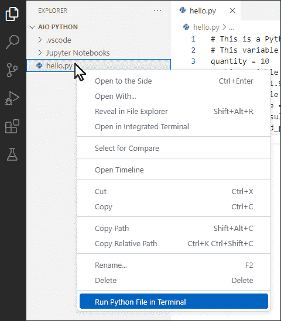

图 4-4: 右键点击`.py`文件并选择“在终端中运行 Python 文件”（Run Python File in Terminal）。

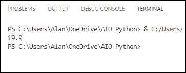

图 4-5: 19.9 是代码中`print(extended_price)`的输出。

假设你的应用必须计算 14 件物品的总成本，每件价格为 26.99 美元。你能想到如何实现这一点吗？你显然不需要编写一个全新的应用程序。相反，在你现在正在处理的代码中，将`quantity`变量的值从`10`改为`14`。将`unitprice`变量的值改为 26.99（记住，数字中不要包含美元符号）。以下是进行这些更改后的代码外观：

```python
# 这是我第一个 Python 程序中的一个 Python 注释。
# 这个变量包含一个整数
quantity = 14
# 这个变量包含一个浮点数
unit_price = 26.99
# 这个变量包含 quantity 乘以 unit_price 的结果
extended_price = quantity * unit_price
# 在屏幕上显示一些结果。
print(extended_price)
```

保存你的工作（除非你开启自动保存）。然后再次右键点击并选择“在终端中运行 Python 文件”来运行程序——就像第一次一样。但你应该会在 VS Code 窗口底部的终端面板中看到正确答案 377.85999999999996。它没有四舍五入到分，看起来甚至不像一个金额。但在你学会撑跳之前必须先学会爬，所以现在只需对让你的程序运行起来感到高兴即可。

## 理解什么是语法以及它为什么重要

如果你在字典中查阅*syntax*（语法），你可能会发现的一个定义是“语言中单词和短语的排列，以创建结构良好的句子”。在 Python 等编程语言中，并没有所谓的结构良好句子。但 Python 确实有“单词”，意思是你需要在每个单词之间留一个空格，就像你输入像这样的普通文本一样，而且这些单词的顺序是非常重要的。

语法在人类语言中非常重要，因为顺序对意义有很大贡献。例如，比较这三个短句：

* Mary kissed John.（玛丽亲了约翰。）
* John kissed Mary.（约翰亲了玛丽。）
* Kissed Mary John.（亲了玛丽约翰。）

这三个句子包含相同的单词，但含义不同。前两个句子清楚地表达了谁亲了谁，而最后一个句子有点难以解释。

编程语言中的正确语法与人类语言中的语法一样重要——在某些方面甚至更如此，因为当你对某人说话或写字出错错误时，对方通常能根据你词汇的语境推断出你的意图。但计算机并没有那么聪明。计算机没有大脑，无法根据语境推测你的真实含义，事实上，对于计算机来说，甚至不存在“语境”这个概念。因此，语法在编程语言中比在人类语言中更为重要。

回顾本章中最早的代码，请注意大多数实际代码行（不是指以`#`开头的注释）都遵循这种语法：

`variablename` = `value`

其中`variablename`是你起的某个名称，而`value`是你存储在该变量中的内容。它之所以有效，是因为它是正确的语法。如果你尝试这样写，它将不起作用的：

`value` = `variablename`

例如，以下是在名为`x`的变量中存储值`10`的正确方法：

```python
x = 10
```

看起来你也可以通过下面的方法操作，但在 Python 中它是不起作用的：

```python
10 = x
```

如果你在 VS Code 中那样输入，你会看到代码下方出现一些波浪线，表示你没有遵循语法规则，你的代码无法按照书写的方式执行。你可以将鼠标指针悬停在任何显示波浪线的代码上，以查看更多关于错误的详细信息。

如果你运行带有该行的程序，不会发生任何糟糕的事情——你不会弄坏任何东西。但你会收到如下的错误消息：

```
File "…/AIO Python/hello.py", line 10
10=x
^^
SyntaxError: cannot assign to literal here
```

`SyntaxError`（语法错误）部分告诉你 Python 不知道该如何处理。

本章将带你了解如何编写、保存、运行和修改应用程序，再次保存并再次运行它。这些任务定义了你在使用任何语言进行任何软件开发时会做的工作，因此你应该练习这些任务，直到它们变成你的本能。但别担心：你不需要反复阅读这一章来掌握它们。在本书接中，你将一直使用这些相同的技能，从一名初学者成长为顶尖的 21 世纪 Python 开发者。

# 第二本书

# 理解 Python 模块

## 目录一览

1. 第 1 章：处理数字、文本和日期
    1. 使用函数计算数字
    2. 更多数学函数
    3. 数字格式化
    4. 对付奇异数字
    5. 操作字符串
    6. 探索日期与时间
    7. 时区处理
    8. 使用时区

2. 第 2 章：控制动作
    1. 控制动作的主要操作符
    2. 使用 if 进行决策
    3. 使用 for 重复过程
    4. 使用 while 循环

3. 第 3 章：利用列表和元组加速
    1. 定义和使用列表
    2. 什么是元组？谁在乎？
    3. 处理集合

4. 第 4 章：使用字典处理海量数据
    1. 理解数据字典
    2. 创建字典
    3. 遍历字典
    4. 字典方法
    5. 复制字典
    6. 删除字典项
    7. 玩转多键字典

5. 第 5 章：处理更大的代码块
    1. 创建函数
    2. 为函数写注释
    3. 向函数传递信息
    4. 从函数返回值
    5. 揭秘匿名函数

6. 第 6 章：使用类进行 Python 开发
    1. 精通类和对象
    2. 创建类
    3. 从类创建实例
    4. 赋予对象属性
    5. 类方法
    6. 理解类继承

7. 第 7 章：规避错误
    1. 理解异常
    2. 优雅地处理错误
    3. 异常具体化
    4. 防止程序崩溃
    5. 加入 else 语句
    6. 使用 try … except … else … finally
    7. 抛自定义异常

# 第 1 章

# 处理数字、文本和日期

## 本章内容

- 掌握整数
- 使用小数处理数字
- 简化数字
- 对付奇异数字
- 操作字符串
- 探索日期与时间
- 时区处理
- 使用时区

## 使用函数计算数字

在本章中，我们将在探索如何在 Python 中处理不同类型的数据。我们将从掌握整数开始，转向小数，然后学习如何简化数字。我们还将处理奇异数字、操作字符串并探索日期与时间。最后，我们将考虑时区。

### 掌握整数

在 Python 中，整数被称为整数（integer），它们是不带小数点的数字。

### 使用小数处理数字

带有小数点的数字被称为浮点数（float），它们用于更精确的计算。

### 简化数字

Python 提供了几个函数来帮助简化数字。

### 对付奇异数字

有时你需要处理复数。Python 拥有处理这些数字的工具。

## 操作字符串

字符串是 Python 中的字符序列，你可以以多种方式对其操作。

### 探索日期与时间

日期和时间在许多应用程序中都很重要，Python 有相应的模块来处理它们。

### 时区处理

在开发全球化应用程序时，时区可能会棘手。

### 使用时区

我们还将学习如何在 Python 中使用不同的时区。

| `bin(x)` | 返回一个表示`x`转换为二进制后的值的字符串。 |
| `float(x)` | 将字符串或数字`x`转换为浮点数数据类型。 |
| `format(x, y)` | 根据`y`中指定的模式对`x`进行格式化。这种旧的语法在当前的 Python 版本中已由 f-strings 取代。 |
| `hex(x)` | 返回一个包含`x`转换为十六进制形式的字符串，并前缀为 0x。 |
| `int(x)` | 通过截断（不是四舍五入）小数部分及其后的数字将`x`转换为整数数据类型。 |
| `max(x, y, z, …)` | 接受任意数量的数值参数并返回其中最大的。 |
| `min(x, y, z, …)` | 接受任意数量的数值参数并返回其中最小的。 |
| `oct(x)` | 将`x`转换为八进制数，前缀为 0o 表示八进制。 |
| `round(x, y)` | 将数字`x`四舍五入到`y`位小数。 |
| `str(x)` | 将数字`x`转换为字符串数据类型。 |
| `type(x)` | 返回一个指示`x`数据类型的字符串。 |

表 1-1 某些数字的内置 Python 函数

图 1-3 显示了使用内置数学函数的正确 Python 语法示例。

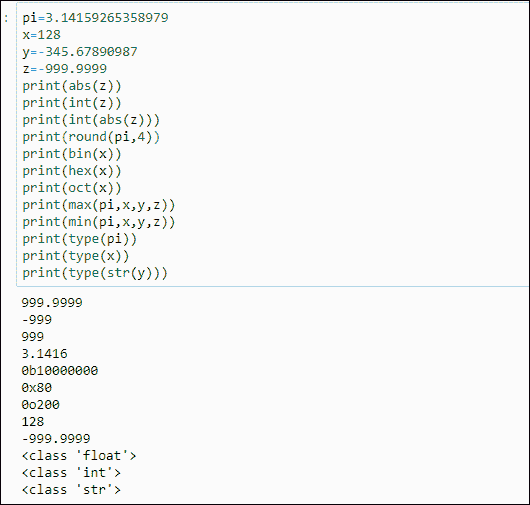

图 1-3: 在 Python 提示符下尝试内置数学函数。

你还可以嵌套函数——这意味着你可以将函数放在函数内部。例如，当`z = -999.9999`时，表达式`print(int(abs(z)))`会打印`z`的绝对值的整数部分，即`999`。原始数字被转换为正数，然后删掉小数点及其右侧的所有内容。

## 更多数学函数

除了目前为止介绍的内置函数外，还有其他可以从`math`模块导入的函数。如果你在应用中需要它们，请在`.py`文件或 Jupyter 单元格顶部附近放置`import math`，以便这些函数对代码的其他部分可用。或者要在命令行提示符中使用它们，请先输入`import math`命令。

`math`模块中的函数之一是`sqrt()`函数，它用于获取数字的平方根。由于它是`math`模块的一部分，在没有先导入模块的情况下你无法使用它。例如，如果你输入以下内容，将会得到错误，因为`sqrt()`不是内置函数：

```
print(sqrt(81))
```

即使你执行了类似下面的两个命令，仍然会得到错误，因为你将`sqrt()`当作内置函数处理：


```
import math
print(sqrt(81))
```

要使用模块中的函数，你必须导入模块**并且**在函数名之前加上模块名和一个点。假设你有一个值`x`，并且想要它的平方根。你必须导入`math`模块并使用`math.sqrt(x)`来获得正确答案，如图 1-4 所示。输入该命令将显示 9。


图 1-4: 使用`math`模块中的`sqrt()`函数。

`math`模块提供了许多三角函数、双曲函数、幂和对数、角度转换以及如`pi`和`e`这样的常量。图 1-5 显示了`math`模块的常量示例。

| 内置函数 | 用途 |
| --- | --- |
| `math.acos(x)` | 返回`x`的反余弦（弧度） |
| `math.atan(x)` | 返回`x`的反正切（弧度） |
| `math.atan2(y, x)` | 返回`y`除以`x`的反正切（弧度） |
| `math.ceil(x)` | 返回大于等于`x`的最小整数 |
| `math.cos(x)` | 返回`x`的余弦（弧度） |
| `math.degrees(x)` | 将弧度`x`转换为角度 |
| `math.exp(x)` | 返回`e`的`x`次方 |
| `math.factorial(x)` | 返回`x`的阶乘 |
| `math.floor(x)` | 返回小于等于`x`的最大整数 |
| `math.isnan(x)` | 如果`x`不是数字则返回 True |
| `math.log2(x)` | 返回以 2 为底的对数 |
| `math.pi` | 返回数学常数 pi (3.1415...) |
| `math.pow(x, y)` | 返回`x`的`y`次方 |
| `math.radians(x)` | 将角度`x`转换为弧度 |
| `math.sin(x)` | 返回`x`的正弦（弧度） |
| `math.sqrt(x)` | 返回`x`的平方根 |
| `math.tan(x)` | 返回`x`的正切（弧度） |
| `math.tau` | 返回数学常数 tau (6.2831...) |

## 数字格式化

多年来，Python 提供了多种以我们熟悉的格式显示数字的方法。例如，大多数人更愿意看到金额显示为 $1,234.56，而不是 1234.56006595069540569549。从 Python 3.6 版本开始，格式化数字简单的方法是使用 f-strings。

### 使用 f-strings 进行格式化

*格式字符串，或 f-strings* 是 Python 中格式化数据简单的方法。你只需要一个小写的`f`或大写的`F`，后面紧跟在引号内的文本或表达式。这里有一个示例：

`f"Hello {username}"`

当你运行这段代码时，`print`函数会显示单词`Hello`，紧接着是一个空格，然后是`username`变量的内容，如图 1-6 所示。

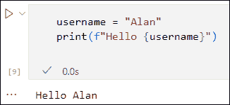

图 1-6： 一个用于格式化的超简单 f-string。

这里是表达式的另一个示例 — 在大括号内的公式`quantity`乘以`unit_price`：

```python
unit_price = 49.99
quantity = 30
print(f"Subtotal: ${quantity * unit_price}")
```

该代码在执行后的输出如下：

`Subtotal: $1499.7`

那个`$1499.7`并不是显示金额的理想方式。通常，我们喜欢在千位处使用逗号，并在分位保留两位数字，如下所示：

```python
Subtotal: $1,499.70
```

幸运的是，f-strings 为你提供了进行这种格式化的手段，你将在后续的学习中会学会。

### 显示金额

为了让金额中出现逗号并让分位显示为两位，你可以在 f-string 表达式的大括号内使用*格式字符串*（format string）。格式字符串以冒号开头，并需要放在右大括号内，紧跟在变量名或显示的数值之后。

要在千位处显示逗号，在你的格式字符串中冒号后直接使用逗号，如下所示：

`:,`

使用当前的示例，你将执行以下操作：

```python
print(f"Subtotal: ${quantity * unit_price:,}")
```

执行此语句产生此输出：

`Subtotal: $1,499.7`

要让分位显示为两位，在逗号后面加上`.2f`。

`.2f`意味着“两位小数，固定”（永远不会多于或少于两位小数）。以下代码将显示带有逗号和两位小数的：

```python
print(f"Subtotal: ${quantity * unit_price:,.2f}")
```

这里是代码执行时显示的内容：

`Subtotal: $1,499.70`

完美！这正是我们想要的格式。所以，每当你想要显示一个千位有逗号且小数点后恰好两位数字的数字时，使用带有格式字符串`.2f`的 f-string。

### 格式化百分比数字

现在，假设你的应用需要销售税。应用需要知道税率，税率应该以小数形式表示。因此，如果税率为 6.5%，在代码中它必须写为 0.065（如果你愿意，也可以写成 .065），如下：

```python
sales_tax_rate = 0.065
```

无论是否有前零，金额都是相同的，所以使用任何适合你的格式即可。

这种数字格式对于 Python 来说是理想的，你不会希望动它。但如果你想给人类显示那个数字，只需使用`print()`函数就会按照 Python 存储的方式完整显示：

```python
sales_tax_rate = 0.065
print(f"Sales Tax Rate {sales_tax_rate}")
```

`Sales Tax Rate 0.065`

在为人们显示税率时，你可能想使用更熟悉的 6.5% 格式而不是 .065。可以使用与固定数字（`.2f`）相同的思路。然而，你将固定数字的`f`替换为`%`，如下：

```python
print(f"Sales Tax Rate {sales_tax_rate:.2%}")
```

运行这段代码会将税率乘以 100，并跟一个百分号（%），如你在图 1-7 所示。

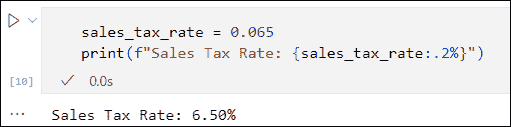

图 1-7： 格式化百分比数字。

在之前的两个示例中，我们使用`2`作为数字位数，但当然，你可以显示任何想要的位数，从零（无）到你需要的任何精度级别。例如，使用下文中的`.1%`：

```python
print(f"Sales Tax Rate {sales_tax_rate:.1%}")
```

当执行该行时，显示此输出：

`Sales Tax Rate 6.5%`

将`1`替换为`9`，如下：

```python
print(f"Sales Tax Rate {sales_tax_rate:.9%}")
```

将显示小数点后九位数字的百分比：

`Sales Tax Rate 6.500000000%`

（注：原文此处存在大量重复的句子，已按要求去重复处理）

## 对付奇怪的数字

在图 1-9 中，所有的金额都是左对齐的，因为这是默认设置。要让数字右对齐（我们通常看到美元金额的方式），你可以在 f-string 中使用`>`。为了让数字宽度相同，可以在`>`字符后指定一个数字。例如，在图 1-10 中，每个 f-string 都包含`>9`，这会导致每个显示的数字都右对齐且宽度为 9 个字符。你可以在图片底部看到的输出结果显示，所有数字都右对齐，美元符号整齐地左对齐。每个美元符号右侧的空格确保了每个数字恰好是 9 个字符宽。

你可能会查看图 1-10 并思考为什么美元符号是这样排列的。为什么它们不紧挨着数字右对齐呢？美元符号是字面字符串的一部分，位于大括号之外，所以它们不受大括号内部`>9`的影响。

重新对齐美元符号比你想象的要复杂一点，因为你只能将`,.2f`格式应用到数字上。除非将数字转换为字符串，否则你无法在数字前面加上`$` —— 但那样它就不再是数字了，因此`.2f`将无法工作。

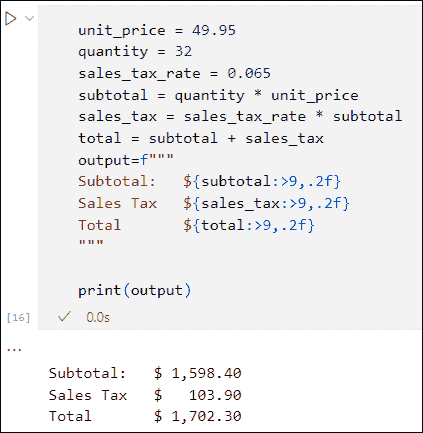

图 1-10： 所有金额在九个字符的宽度内右对齐 (`>9`）。

但复杂并不意味着不可能，只是意味着不方便。你可以将每个金额按当前格式转换为字符串，将美元符号连接到该字符串上，然后对该字符串进行宽度和对齐格式。例如，以下代码创建了一个名为`s_subtotal`的变量，其中包含一个紧随金额的美元符号，美元符号位于第一个数字的左侧，且美元符号后没有空格：

```
s_subtotal = "$" + f"{subtotal:,.2f}"
```

在此代码中，我们假设变量`subtotal`包含某个数字。假设该数字是`1598.402`，尽管它可以是任何数字。`f"{subtotal:,2f}"`将数字格式化为固定两位小数且在千分位带有逗号的格式，如下所示：

```
1,598.40
```

输出是一个字符串而不是数字，因为 f-string 总是产生字符串。

代码的后续部分在前面拼接（连接）了一个美元符号：

```python
"$"+
```

现在输出为`$1,598.40`。这个最终的格式化字符串存储在一个名为`s_subtotal`的新变量中。（我们添加前缀`s_`是为了提醒自己这是小计数字的字符串等值，而不是原始数字。）

要以九位数的宽度右对齐显示该金额，请在一个新的格式字符串中使用`>9`来显示`s_subtotal`变量，如下：

```python
f"{s_subtotal:>9}"
```

 当你任何需要关于复杂的 print f 功能的提醒时，只需询问 ChatGPT 或其他生成式 AI。例如，你可以要求它*写一个用于右对齐且保留两位小数金额的 python print f* 或*写一个用于两位百分比值的 python print f*。然后将 AI 生成的内容复制并粘贴到你的代码中，并根据你当前的需求进行调整。

图 1-11 显示了一个完整的示例，包括运行代码的输出。所有数字都右对齐，美元符号位于通常的位置。

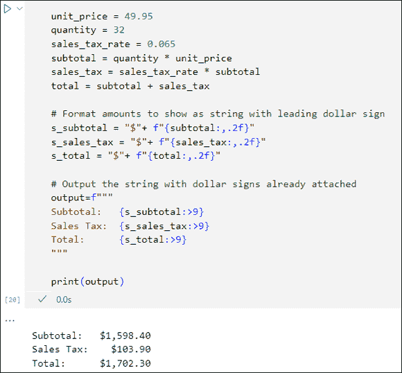

图 1-11： 所有金额整齐对齐。

## 对付奇怪的数字

我们大多数时候都在处理数量和金额等简单数字。如果你的工作需要处理 10 以外的进制或虚数，Python 提供了你工作所需的工具。但请记住，你不需要学习这些内容就能使用 Python 或任何其他语言。只有在实际工作（或作业）需要时，你才会使用它们。在下一节中，你将看到计算机科学中常用的数字类型：二进制、八进制、十六进制。

### 二进制、八进制和十六进制

如果你的工作需要处理 10 以外的进制或虚数，Python 提供了你工作所需的工具。但请记住，你不需要学习这些内容就能使用 Python 或任何其他语言。只有在实际工作（或作业）需要时，你才会使用它们。在下一节中，你将看到计算机科学中常用的数字类型：二进制、八进制、十六进制。

| 系统 | 别称 | 使用的数字 | 符号 | 函数 |
| :--- | :--- | :--- | :--- | :--- |
| 进制 2 | 二进制 | 0,1 | `0b` | `bin()` |
| 进制 8 | 八进制 | 0,1,2,3,4,5,6,7 | `0o` | `oct()` |
| 进制 16 | 十六进制 | 0,1,2,3,4,5,6,7,8,9,A,B,C,D,E,F | `0x` | `hex()` |

### 复数

复数是另一种奇怪的东西，除非你恰好从事电子工程、高等数学或使用它们的科学分支，否则你可能永远不需要处理它们。*复数*可以表示为 *a*+*bi,* 其中 *a* 和 *b* 是实数，*i* 代表满足方程 *i*²=–1\ 的虚数。不存在平方等于 –1 的实数 *i*，因此它被称为*虚数*。

某些数学分支使用小写的 *i* 来表示虚数。但 Python 使用 *j*（电子工程领域也是如此，因为 *i* 被表示电流）。

无论如何，如果应用程序需要处理复数，你可以使用`complex()`函数生成一个复数，使用以下语法：

```python
complex(`*real*`,`*imaginary``)
```

将`real`替换为复数的实部，将`imaginary`替换为虚部。例如，在代码或命令提示符中，尝试执行：

```
z = complex(2,-3)
```

变量`z`获得了虚数`2–3j`。然后使用`print()`函数显示`z`的内容，如下：

```python
print(z)
```

屏幕显示虚数 (`2-3j`）。

你可以在虚数后面加上`.real`或`.imag`来获取其实部或虚部。例如，以下代码会产生`2.0`，它是数字`z`的实部：

```python
print(z.real)
```

这返回`–3.0`，它是`z`的虚部：

```python
print(z.imag)
```

再次，如果这些对你来说没有意义，不要担心。这对于学习或使用 Python 并不是必须的。Python 仅仅是恰好需要这些功能的人提供了复数和这些函数。

 如果你的工作需要处理复数，请在网上搜索`python cmath`以学习 Python 的`cmath`模块，它提供了处理复数的函数。

## 操作字符串

在 Python 和其他编程语言中，我们将单词和文本块称为`strings`（字符串），是“一串字符”的缩写。字符串没有数值意义或值。（我们在第 1 册的第 4 章中讨论了字符串的基础。）在本节中，你将学习处理字符串的 Python 编码技能。

### 字符串拼接

你可以使用加号（`+`）连接字符串。在极客世界里，这种过程被称为`string concatenation`（字符串拼接）。让初学者措手不不及的一点是，计算机无法区分单词和香肠三明治。因此，当你连接字符串时，计算机不会自动在你预期的位置插入空格。例如，在以下代码中，`full_name`是前三个字符串的拼接。

```python
first_name = "Alan"
middle_init = "C"
last_name = "Simpson"
full_name = first_name + middle_init + last_name
print(full_name)
```

当你运行这段代码来打印`full_name`变量的内容时，你可以看到 Python 确实将它们连接成了一个长字符串：

`AlanCSimpson`

这个输出本身没有问题，只是我们通常会在单词和人名的部分之间加上空格。

由于 Python 不会在你认为应该出现空格的地方自动插入空格，你必须手动输入它们。表示单个空格最简单的方法是使用一对引号并在之间留一个空格，如下所示：

`" "`

如果你忘记在引号之间放入空格（如下所示），那么你的字符串中将不会有空格，因为引号之间什么的没有：

`""`

如果你想在输出中获得多个空格，可以在引号之间放置多个空格，但通常一个空格就足够了。在接下来的示例中，你在`first_name`和`last_name`之间放了一个空格。你还在`middle_init`后面加上了一个句点和空格：

```python
first_name = "Alan"
middle_init = "C"
last_name = "Simpson"
full_name = first_name + " " + middle_init + ". " + last_name
print(full_name)
```

这段代码的输出（即`full_name`变量的内容）看起来更像你熟悉的姓名格式：

`Alan C. Simpson`

当然，作为将所有组件和空格拼接成新字符串的替代方案，你也可以简单地使用 f-string 以所需的格式显示姓名，如下代码所示。唯一的区别是，你的代码中没有一个名为`full_name`的变量可以操作。

```python
print(f"{first_name} {middle_init}. {last_name}")
```

### 获取字符串的长度

要确定一个字符串中有多少个字符，你使用内置的`len()`函数（length 的缩写）。长度包括空格，因为空格也是字符，每个字符的长度为 1。空字符串——即内部什么都没有、甚至没有空格的字符串——其长度为 0。

这里是一些示例。在第一行中，你定义了一个名为`s1`的变量并在其中放入一个空字符串（一对之间什么都没有引号）。`s2`变量获得了一个空格（一对之间有一个空格的引号）。`s3`变量获得了一个包含一些字母和空格的字符串。然后，通过三个`print()`函数显示每个字符串的长度：


```python
s1 = ""
s2 = " "
s3 = "A B C"
print(len(s1))
print(len(s2))
print(len(s3))
```

以下是该代码执行后的输出。当你理解`len()`测量字符串长度的标准是字符串中字符的数量（包括空格）时，输出结果就完全合逻辑：

`0`

`1`

`5`

### 使用常用的字符串运算符

Python 提供了几种用于处理数据序列的运算符。Python（以及大多数其他编程语言）中关于字符串的一个奇怪点是，当你对字符进行计数时，第一个字符计数为 0，而不是 1。

图 1-15 显示了一个包含许多常用字符的 ASCII 数字图表。空格和标点符号字符比大写字母`A`“低”，因为它们的 ASCII 数值较小。大写字母比小写字母“低”，因为它们的 ASCII 数值也较小。你是否在好奇分配给数字 0–31 的字符去哪儿了？这些数字也对应着字符，但它们是控制字符，本质上是不可打印且不可见的，例如当你按住`Ctrl`键并按下另一个键时。

Python 提供了两个用于处理 ASCII 的函数。`ord()`函数接收一个字符作为输入并返回该字符的 ASCII 数字。例如，`print(ord("A"))`返回`65`，因为大写字母`A`是 ASCII 图格中的第 65 号字符。`chr()`函数的作用相反。你给它一个数字，它返回该数字对应的 ASCII 字符。例如，`print(chr(65))`显示`A`，因为`A`是 ASCII 图格中的第 65 号字符。

我之所以在这个示例中使用 ASCII，是因为该集合中的字符相对较少。Unicode 是今天最常用的字符集。它包含了 ASCII 的所有字符，外加许多大多数键盘上找不到的字符。例如，字符`00A3`是英国英镑符号。要在 Python 中打印 Unicode 字符，请在数字前加上`\u`并将其括在引号内。例如，`print("΄u00A3΄")`告诉 Python 打印 Unicode 字符`00A3`，即英镑符号。

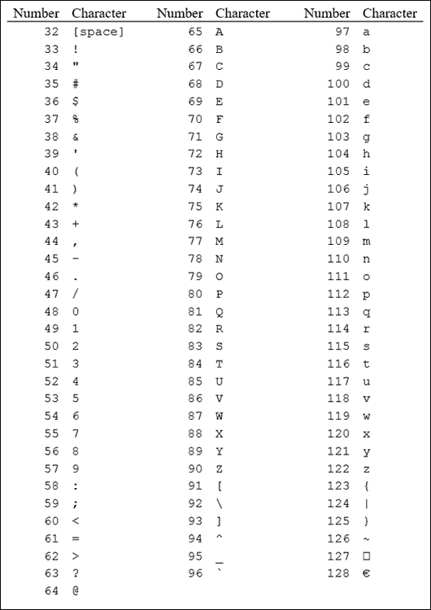

图 1-15：常用字符的 ASCII 数字。

### 使用方法操作字符串

Python 3 中的每个字符串都被视为一个`str 对象`（读作“string object”）。`string`的缩写词`str`将 Python 3 与早期版本区分开来，早期版本将字符串称为 string objects（使用全拼`string`，而不是缩写）。这种命名规范是困惑的很大来源，尤其是对初学者来说。只需记住在 Python 3 中，`str`全都是关于字符字符串。

Python 提供了大量的`str 方法`（也称为字符串方法）来帮助你处理`str`对象。`str`对象方法的通用语法如下：

`string.methodname(params)`

其中`string`是你正在分析的字符串，`methodname`是来自表 1-5 的方法名称，`params`指你需要传递给该方法的任何参数（如果需要）。表 1-5 第一列开头的`s`意味着“任何字符串”，无论是包含在引号内的字符串字面量字符串，还是包含字符串的变量名。

| 方法 | 用途 |
| --- | --- |
| `s.capitalize()` | 返回一个首字母大写、其余部分小写的字符串。 |
| `s.count(x[, y[, z]])` | 返回字符串`x`在字符串`s`中出现的次数。可选地添加`y`作为起点并将`z`作为终点以搜索字符串的一部分。 |
| `s.find(x[, y[, z]])` | 返回一个数字，表示字符串`x`在字符串`s`中首次出现的位置。可选的`y`和`z`参数允许你将搜索限制在字符串的一部分。如果未找到则返回–1。 |
| `s.index(x[, y[, z]])` | 与`find`相同，但如果在字符串`y`中找不到字符串`x`，则抛出“未找到字符串”错误。 |
| `s.isalpha()` | 如果`s`长度至少为一且仅包含字母（A–Z 或 a–z）和可打印的 Unicode 字符，则返回 True。 |
| `s.isdecimal()` | 如果`s`长度至少为一且仅包含数字字符（0–9），则返回 True。 |
| `s.islower()` | 如果`s`包含字母且所有字母均为小写，则返回 True。 |
| `s.isnumeric()` | 如果`s`长度至少为一且仅包含数字字符（0–9），则返回 True。 |
| `s.isprintable()` | 如果字符串`s`仅包含可打印字符，则返回 True。空格被认为是可打印的，但换行符和制表符不是。 |
| `s.istitle()` | 如果字符串`s`包含字母且每个单词的首字母大写后跟着小写，则返回 True。 |
| `s.isupper()` | 如果`s`中的所有字母均为大写，则返回 True。 |
| `s.lower()` | 返回一个所有字母都转换为小写的字符串副本。 |
| `s.lstrip()` | 返回一个删除了开头空白的字符串副本。 |
| `s.replace(old, new[, count])` | 返回一个将`old`的出现处替换为`new`的字符串副本。 |
| `s.find(x[, y[, z]])` | ... 允许你将搜索限制在字符串的一部分。 |
| `s.index(x[, y[, z]])` | ... 允许你将搜索限制在字符串的一部分。 |
| `s.rstrip()` | 返回一个删除了末尾空白的字符串副本。 |
| `s.strip()` | 返回一个删除了开头结尾空白的字符串副本。 |
| `s.swapcase()` | 返回一个交换了大小写的字符串副本。 |
| `s.title()` | 返回一个每个单词首字母大写后跟着小写的字符串副本。 |
| `s.upper()` | 返回一个所有字母都转换为大写的字符串副本。 |

### 字符串的内置方法

你可以在 Jupyter 笔记本中、Python 提示符或`.py`文件中尝试这些方法。图 1-16 显示了在 Jupyter 笔记本中使用三个变量`s1`、`s2`和`s3`的示例。运行代码的结果出现在代码下方。

```python
s1 = "hello"
s2 = "world"
s3 = "python world"
print(s1.capitalize())
print(s1.count("l"))
print(s2.find("o"))
print(s3.replace("p", "j"))
print(s1.isalpha())
print(s1.isdecimal())
print(s1.islower())
print(s1.isnumeric())
print(s1.isprintable())
print(s3.istitle())
print(s1.isupper())
print(s1.lower())
print(s1.lstrip())
print(s3.replace("p", "j"))
print(s2.rfind("o"))
print(s2.rindex("o"))
print(s2.rstrip())
print(s2.strip())
print(s3.swapcase())
print(s3.title())
print(s3.upper())
```

### 日期和时间

处理日期和时间通常需要使用`datetime`模块。就像任何模块一样，你必须先导入它才能使用。你通过`import datetime`来实现。而且像任何导入一样，如果你喜欢，你也可以为它添加一个别名（昵称）。例如，`import datetime as dt`也可以。你只需要在调用该模块的功能时，记得输入`dt`而不是`datetime`即可。

`datetime`模块为 Python 提供了一种处理日期和时间的简易方法。它提供了三种存储日期、时间和时区信息的方法，包括这些：

- `datetime.date`：由月、日、年组成的日期（不包含时间信息）。
- `datetime.time`：由时、分、秒、微秒组成的时间，如果需要，还可以可选地包含时区信息（但不包含日期）。
- `datetime.datetime`：一种单一数据项，由日期、时间以及（可选的）时区信息组成。

在前面的列表中，我们在每个类型之前都加上了完整的单词`datetime`，但如果你使用别名（例如`dt`），你可以在代码中改用它。我们将在接下来的章节中分别讨论这些数据类型。

### 处理日期

当时间不是问题因素时，`datetime.date`数据类型是处理日期的理想选择。你可以通过两种方式创建日期对象：可以使用`today()`方法从计算机的内部时钟获取今天的日期；或者在括号内指定年、月、日（按此顺序）。

 在指定月份或日期时，永远不要为`datetime.date()`使用前导零。例如，2024 年 4 月 1 日必须表示为`2024,4,1`——如果你输入`2024,04,01`，它将无法工作。

导入`datetime`模块后，可以使用`date.today()`从计算机内部时钟获取当前日期。或者使用`date(year, month, day)`语法为其他日期创建日期对象。以下代码显示了两种方法：

```python
# 导入 datetime 模块，别名为 dt
import datetime as dt

# 将今天的日期存储在名为 today 的变量中
today = dt.date.today()

# 将另一个日期存储在名为 last_of_teens 的变量中
last_of_teens = dt.date(2019, 12, 31)
```

尝试在 Jupyter notebook、Python 提示符或`.py`文件中输入代码进行测试。使用`print()`函数查看每个变量中的内容，如图 1-17 所示。你的`today`变量将与图中不同；它将是你尝试此操作时的日期。

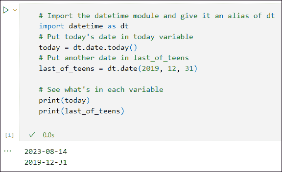

图 1-17：在 Jupyter notebook 中对`datetime.date`对象的实验。

你可以通过`.month`、`.day`或`.year`访问日期对象的任何部分。例如，在同一个 Jupyter 单元或 Python 提示符中执行此代码：

```python
print(last_of_teens.month)
print(last_of_teens.day)
print(last_of_teens.year)
```

该日期的三个组件中的每一个都会单独占据一行：

```text
12
31
2019
```

正如你在图 1-17 的第一次打印中看到的，默认日期显示格式为`yyyy-mm-dd`，但你可以按照自己喜欢的格式化日期和时间。使用本章稍早讨论过的 f-strings，结合表 1-6 中显示的指令（该表包含了我们在本章稍后将讨论的日期和时间格式）。对于显示本地日期和时间的指令，具体格式将取决于你所在的位置。例如，在美国使用`%x`显示 2023 年 12 月 18 日将显示为`12/18/23`，但在习惯先显示日期而不是月份的国家，将显示为`18/12/2023`。

| 指令 | 描述 | 示例 |
| --- | --- | --- |
| `%a` | 星期几，缩写 | Sun |
| `%A` | 星期几，全称 | Sunday |
| `%w` | 星期几 0–6，其中 0 是星期日 | 0 |
| `%d` | 月中的几号 01–31 | 31 |
| `%b` | 月份名称缩写 | Jan |
| `%B` | 月份名称全称 | January |
| `%m` | 月份数字 01–12 | 01 |
| `%y` | 无世纪的年份 | 19 |
| `%Y` | 有世纪的年份 | 2024 |
| `%H` | 小时 00–23 | 23 |
| `%I` | 小时 00–12 | 11 |
| `%p` | AM/PM | PM |
| `%M` | 分 00–59 | 01 |
| `%S` | 秒 00–59 | 01 |
| `%f` | 微秒 000000–999999 | 495846 |
| `%z` | UTC 偏移 | -0500 |
| `%Z` | 时区 | EST |
| `%j` | 年中的第几天 001–366 | 300 |
| `%U` | 一周中的第几天，星期日为第一天 0–53 | 50 |
| `%W` | 一周中的第几天，星期一为第一天 0–53 | 50 |
| `%c` | 本地日期和时间 | Tue 31 23:59:59 2024 |
| `%x` | 本地日期 | 12/31/24 |
| `%X` | 本地时间 | 23:59:59 |
| `%%` | 字符 | % |

表 1-6 日期时间的格式字符串

 有些教程教你使用`strftime`格式化日期和时间，这确实有效。我们坚持使用 f-strings，因为我们认为它们比`strftime`更好。在使用格式字符串时，确保在希望出现的地方放置空格、斜杠等。例如，此行：

```python
print(f"{last_of_teens:%A, %d, %Y}")
```

执行时会显示：

`Tuesday, December 31, 2019`

要以`mm/dd/yyyy`格式显示日期，使用`%m/%d/%Y`，如下：

```python
todays_date = f"{today:%m/%d/%Y}"
```

当你尝试时，输出将是如下的当前日期：

`11/19/2024`

表 1-7 显示了你可以用不同日期尝试的更多示例。

| 格式字符串 | 示例 |
| --- | --- |
| `%a, %b %d %Y` | Sat, Jun 01 2024 |
| `%x` | 06/01/24 |
| `%m-%d-%y` | 06-01-24 |
| `This %A %B %d` | This June 01 |
| `%A %B %d is day number %j of %Y` | Saturday 01 is day number 152 of 2024 |

表 1-7 日期格式字符串

### 处理时间

如果你只想严格处理时间数据，请使用`datetime.time`类。使用`time`类定义时间的基本语法是`variable = datetime.time(hour, minute, second, microsecond)`。注意所有参数都是可选的。例如，你可以不使用参数：

```python
midnight = dt.time()
print(midnight)
```

此代码将时间存储为 00:00:00，即午夜。要验证它确实是时间，输入`print(type(midnight))`显示：

`<class 'datetime.time'>`

这告诉你 00:00:00 是来自`datetime`类的`time`对象。你可以传递给`time()`的第四个可选值是`microseconds`（百万秒）。例如，以下代码将午夜前百万秒的时间存储在名为`almost_midnight`的变量中，然后用`print()`函数在屏幕上显示该时间：

```python
almost_midnight = dt.time(23, 59, 59, 999999)
print(almost_midnight)
```

`23:59:59.999999`

你可以使用表 1-6 中的时间指令来控制时间的格式。表 1-8 显示了一些使用 23:59:59:999999 作为样本时间的示例。

| 格式字符串 | 示例 |
| --- | --- |
| `%I:%M %p` | 11:59 PM |
| `%H:%M:%S and %f microseconds` | 23:59:59 and 999999 microseconds |
| `%X` | 23:59:59 |

表 1-8 日期格式字符串

有时你只想处理日期，有时你只想处理时间。通常你想通过日期和时间来精确定位一个时刻。为此，请使用`datetime`模块的`datetime`类。该类支持`now()`方法，可以从计算机时钟获取当前日期和时间，如下：

```python
import datetime as dt
right_now = dt.datetime.now()
print(right_now)
```

通过`print()`函数在屏幕上看到的取决于你执行此代码的时间。但`datetime`值的格式如下：

`2024-11-19 14:03:07.525975`

这意味着 2024 年 11 月 19 日下午 2:03（加上了 7.525975 秒）。

你也可以使用以下参数来定义`datetime`。月、日和年是必须的。其余是可选的，如果省略，它们在时间中设置为 0。

`datetime(year, month, day, hour[, minute[, second[, microsecond]]])`

以下是一个使用 2024 年 12 月 31 日晚上 11:59 的示例：


```python
import datetime as dt
new_years_eve = dt.datetime(2024, 12, 31, 23, 59)
print(new_years_eve)
```

这是该 `print()` 语句在没有任何格式化的输出：

```
2024-12-31 23:59:00
```

表 1-9 显示了使用 表 1-6 中之前显示的指令格式化 `datetime` 的示例。

### 计算时间跨度

有时仅仅知道日期或时间是不够的。你需要知道持续时间，或者按照计算机世界的通称为 `timespan`（时间跨度）。换句话说，不是日期，也不是几点，而是以年、月、周、日、小时、分钟或任何单位衡的“多久”。对于时间跨度，Python 的 `datetime` 模块包含了 `datetime.timedelta` 类。

| 格式字符串 | 示例 |
| :--- | :--- |
| `%A, %B %d at %I:%M%p` | `Tuesday, December 31 at 11:59PM` |
| `%m/%d/%y at %H:%M%p` | `12/31/24 at 23:59PM` |
| `%I:%M %p on %b %d` | `11:59 PM on Dec 31` |
| `%x` | `12/31/24` |
| `%c` | `Tue Dec 31 23:59:00 2024` |
| `%m/%d/%y at %I:%M %p` | `12/31/24 at 11:59 PM` |
| `%I:%M %p on %m/%d/%y` | `1:59 PM on 12/31/2024` |

表 1-9 日期格式字符串示例

每当你减两个日期、时间或日期来确定它们之间的持续时间时，会自动创建一个 `timedelta` 对象。例如，假设你创建了变量来存储日期，可能一个用于元旦，另一个用于纪念日。然后你创建一个名为 `days_between` 的变量，并将较晚日期减去较早日期得到的差值放入其中，如下：

```python
import datetime as dt
new_years_day = dt.date(2024, 1, 1)
memorial_day = dt.date(2024, 5, 27)
days_between = memorial_day - new_years_day
print(days_between)
print(type(days_between))
```

从数据类型来说，`days_between` 到底是什么？如果你打印它的值，你会得到 `147 days, 0:00:00`。换句话说，这些日期之间有 147 天；`0:00:00` 是时间，但因为我们在这两个日期中都没有指定具体的时间，所以时间数字都被设置为 `0`。如果你使用 Python 的 `type()` 函数来确定 `days_between` 的数据类型，你会发现它是 `datetime` 类中的 `timedelta` 对象，如下：

```
147 days, 0:00:00
<class 'datetime.timedelta'>
```

当你从一个日期减去另一个日期以获取之间的时间时，`timedelta` 计算会自动发生。你也可以使用此语法定义任何 `timedelta`（持续时间）：

`datetime.timedelta(days,seconds,microseconds,milliseconds,minutes,hours,weeks)`

如果你提供了参数名称，必须在 `=` 后面包含一个数字。如果你省略了参数，其值将设置为 0。

为了了解如何计算时间差，请尝试以下代码。在导入 `datetime` 模块后，使用 `.date()` 创建日期。然后使用 `.timedelta` 创建 `timedelta` 对象。如果你将一个 `date` 和一个 `timedelta` 相加，你会得到一个新的日期——在这种情况下，这是一个 2024 年 1 月 1 日之后 147 天的日期：

```python
import datetime as dt
new_years_day = dt.date(2024, 1, 1)
duration = dt.timedelta(days=147)
print(new_years_day + duration)
```

输出结果：

```
2024-05-27
```

当然，你也可以进行减法。例如，如果你从 2024 年 5 月 27 日的日期开始：

```python
import datetime as dt
new_years_day = dt.date(2024, 1, 1)
memorial_day = dt.date(2024, 5, 27)
days_between = memorial_day - new_years_day
print(days_between)
```

输出结果：

```
2024-04-30
```

如果你也需要月份数，可以通过将天数除以 365 取余数来简单估算，得到剩余的天数。然后将该值整除以 30（因为平均每个月大约有 30 天），即可得到月份数的良好近似值。使用 `%` 而不是 `/` 进行除法运算，以获取除法后的余数。图 1-18 显示了 Jupyter notebook 中的事件发生序列，并附有注释来解释发生的情况。

 生成式 AI 也可以为你编写复杂的日期/时间处理代码。例如，你可以要求 VS Code 中的 Copilot、ChatGPT 或其他服务 `write python code to calculate the time between two dates` 或 `write python code to display the current date and time in USA format`。

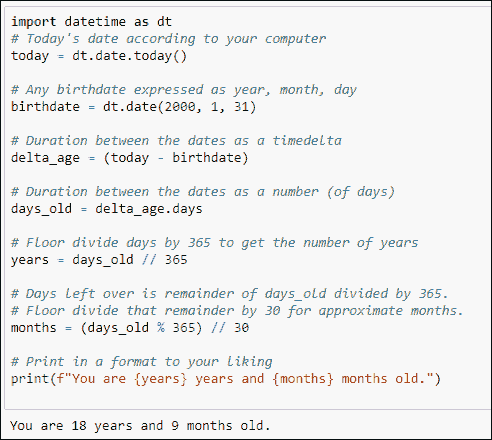

图 1-18: 从 `timedelta` 对象计算岁数和月份。

## 考虑时区

如你所知，当你所在的地区是正午时，并不意味着各处都是正午。图 1-19 显示了所有时区的地图。如果你想更详细地查看，只需在网络上搜索 `time zone map` 即可。在任何给定时刻，日期和时间取决于你位于地球上的哪个位置。有一个通用时间，被称为协调世界时 (UTC)。你可能听过军事上使用的格林尼威治标准时间 (GMT) 或 鲁勒时间 (Zulu time)，它们是一个概念。所有这些时间指的地球本午线（即 0 度经度）的时间，恰好位于 图 1-19 时区地图的中心。


图 1-19: 时区。

如今，大多数人依赖 `tz` 数据库（有时被称为 Olson 数据库）作为时区信息的主要来源。它列出了所有当前的时区和位置。如果你对所有细节感兴趣，可以在网络上搜索 `Olson database` 或 `tz database`。时区名称太多，无法在此处列出，但 表 1-10 显示了一些美国时区的示例。左侧列是数据库中的官方名称。第二列显示了更熟悉的名称。最后两列显示了标准时间和夏令时间相对于 UTC 的偏移量。

那么，我们为什么要告诉你这些呢？因为 Python 允许你处理两种类型的日期时间：

* **幼稚日期时间 (Naïve datetime)：** 任何不包含与其特定时区相关信息的 datetime
* **感知日期时间 (Aware datetime)：** 包含时区信息的 datetime

| **时区** | **常用名称** | **UTC 偏移** | **UTC 夏令时间偏移** |
| --- | --- | --- | --- |
| `Etc/UTC` | `UTC` | `+00:00` | `+00:00` |
| `Etc/UTC` | `Universal` | `+00:00` | `+00:00` |
| `America/Anchorage` | `US/Alaska` | `−09:00` | `−08:00` |
| `America/Adak` | `US/Aleutian` | `−10:00` | `−09:00` |
| `America/Phoenix` | `US/Arizona` | `−07:00` | `−07:00` |
| `America/Chicago` | `US/Central` | `−06:00` | `−05:00` |
| `America/New_York` | `US/Eastern` | `−05:00` | `−04:00` |
| `America/Indiana/Indianapolis` | `US/East-Indiana` | `−05:00` | `−04:00` |
| `America/Honolulu` | `US/Hawaii` | `−10:00` | `−10:00` |
| `America/Indiana/Knox` | `US/Indiana-Starke` | `−06:00` | `−05:00` |
| `America/Detroit` | `US/Michigan` | `−05:00` | `−04:00` |
| `America/Denver` | `US/Mountain` | `−07:00` | `−06:00` |
| `America/Los Angeles` | `US/Pacific` | `−08:00` | `−07:00` |
| `Pacific/Pago_Pago` | `US/Samoa` | `−11:00` | `−11:00` |

表 1-10 美国时区示例。

## 处理时区

如你所知，当你所在的地区是正午时，并不意味着各处都是正午。图 1-19 显示了所有时区的地图。如果你想更详细地查看，只需在网络上搜索 `time zone map` 即可。在任何给定时刻，日期和时间取决于你位于地球上的哪个位置。有一个通用时间，被称为协调世界时 (UTC)。你可能听过军事上使用的格林尼威治标准时间 (GMT) 或 鲁勒时间 (Zulu time)，它们是一个概念。所有这些时间指的地球本午线（即 0 度经度）的时间，恰好位于 图 1-19 时区地图的中心。

如今，大多数人依赖 `tz` 数据库（有时被称为 Olson 数据库）作为时区信息的主要来源。它列出了所有当前的时区和位置。如果你对所有细节感兴趣，可以在网络上搜索 `Olson database` 或 `tz database`。时区名称太多，无法在此处列出，但 表 1-10 显示了一些美国时区的示例。左侧列是数据库中的官方名称。第二列显示了更熟悉的名称。最后两列显示了标准时间和夏令时间相对于 UTC 的偏移量。

### Olson 数据库

如果你想直接处理时区名称，你需要从 Python 的 `dateutils` 包导入一些日期工具。特别是你需要从 `dateutil` 的 `tz` 类中导入 `gettz`（get timezone 的缩写）。因此，在你的代码中，在 `import datetime` 行之后，如下所示 `from dateutil.tz import gettz`：

```python
# import datetime 和 dateutils tz
import datetime as dt
from dateutil.tz import gettz
```

之后，你可以使用 `gettz('`*`name`*`')` 获取任何时区的时区信息。将 *`name`* 替换为 Olson 数据库中的时区名称：例如 `America/New_York` 代表美国东部时间，`Etc/UTC` 代表 UTC 时间。

### 幼稚与感知日期时间

Python 允许你处理两种类型的日期时间：

* **幼稚日期时间 (Naïve datetime)：** 任何不包含与其特定时区相关信息的 datetime
* **感知日期时间 (Aware datetime)：** 包含时区信息的 datetime

注意，如果你用较晚的时间减去较早的时间，会得到一个负数，这可能是误导性的，如下：

```python
time_difference = (now - utc)
# Difference: -1 day, 19:00:00
```

在这段代码中（参见图 1-22），我们像前面的示例中一样，从 `dateutil` 导入了 `datetime` 和 `gettz`。但我们并不关心当前时间。你关心的是在本地时区 2020 年 7 月 4 日下午 7:00 的事件。因此，我们使用以下代码定义它：

```python
event = dt.datetime(2020,7,4,19,0,0)
```

我们没有在日期中提到任何时区，因此时间将自动对应我们的时区。该 `datetime` 对象存储在变量 `event` 中。

下一行代码（以 `#` 开头的注释之后）显示了日期和时间，同样是本地时间，因为我们没有提到任何时区。我们在文本开头添加了 `"Local:"`，并在结尾添加了换行符（`\n`），以便在输出中换行，并在视觉上将该词与输出的其他部分分开。

```python
# Show local date and time
print(f"Local: {event:%D %I:%M %p %Z}\n")
```


图 1-22： 多个时区下计划事件的日期和时间。

当程序运行时，它将根据 `datetime` 和我们的格式字符串显示以下输出：

```text
Local: 07/04/20 07:00 PM
```

剩余的代码计算了五个时区中每个对应的正确 `datetime`：

```python
name = event.astimezone(gettz("tzname"))
```

第一个 `name` 只是我们随便起的一个变量名。在 `event.astimezone()` 中，名称 `event` 指的是之前行中定义的初始事件时间。`astimezone()` 函数是 `dateutil` 的一个内置函数，使用以下语法：

```python
astimezone(gettz("tzname"))
```

在每一行计算时区日期和时间的代码中，我们用 tz 数据库中的时区名称替换了 `tzname`。如输出输出所示（参见图 1-22），显示了五个不同时区的事件 `datetime`。注意，美国时区使用的是夏令时（例如 EDT）。因为我们恰好位于东海岸，且事件发生在 7 月，所以正确的本地时区是东部夏令时间。当你查看日期输出时，第一个与我们的时区匹配（这应该是的），而其余日期的时间根据不同的时区进行了调整。

如果你在想“天哪，真是一团乱麻，”我们完全不会反驳你。这些内容在我们看来都不直观、简单，或者说谈不上趣味性。但如果你急需为你的数据获取一些时区信息，那么你目前为止学到的编码技术应该能满足你的需求。

 如果你在网上搜索 Python 时区，你可能会发现许多人推荐使用 `arrow` 模块而不是 `dateutil` 模块。我们在这里不涉及这些，因为 `arrow` 并不是你初始 Python 安装的一部分，而且这本书已经足够厚了。（如果我们尝试涵盖所有内容，你需要一辆推车才能搬动这本书。）

# 第 2 章：控制动作

## 本章内容

-  **使用 `if` 决策**
-  **使用 `for` 重复**
-  **使用 `while` 循环**

到本书为止，我们讨论了许多如何在计算机中存储信息，主要存储在 Python 和你的计算机可以处理的变量中。以计算机可以处理的形式拥有信息对于让计算机执行任何操作至关重要。将这想象成“拥有”部分——拥有一些可以处理的信息。

但现在我们需要把注意力转向“执行”部分——处理这些信息以创建有用或有趣的内容。在本章中，我们涵盖了让计算机执行任务的最重要且最常用的操作。我们从计算机擅长、处理快速且大量执行的事情开始：做决策。

## 控制动作的主要运算符

你通过做决策来控制你的程序（以及计算机）的行为，这通常涉及进行比较。你使用运算符（如表 2-1 所示所示）来进行比较。这些运算符通常被称为关系运算符或比较运算符，因为通过比较项目，计算机正在确定两个项目之间的关系。

Python 还提供了三个逻辑运算符，也称为布尔运算符，它们使你能够在做出决定之前对多次比较进行评估。这些运算符使用英语单词来表达它们本质的含义，如表 2-2 所示。

| 运算符 | 含义 |
| :--- | :--- |
| `==` | 等于 |
| `!=` | 不等于 |
| `<` | 小于 |
| `>` | 大于 |
| `<=` | 小于等于 |
| `>=` | 大于等于 |

| 运算符 | 含义 |
| :--- | :--- |
| `and` | 同时为真 |
| `or` | 或一个为真 |
| `not` | 非（不真） |

## 使用 if 决策

`if` 一词广泛用于应用程序和计算机程序中进行决策。`if` 最简单的语法如下：

```python
if condition:
    do this
do this matter what
```


所以只有当条件为真时才执行第一行。如果条件为假，该行被忽略。无论条件结果如何，第二行都会执行。注意第一行缩进了。缩进在 Python 中意义重大，你很快就会看到。但在之前，考虑几个这种语法的简单示例。你可以在 Jupyter notebook 或`.py`文件中亲自尝试。

图 2-1 显示了一个简单的示例，其中变量`sun`接收字符串`down`。然后，`if`语句检查变量`sun`是否等于单词`down`，如果是，则打印`Good night!`消息。然后正常继续打印`I am here`消息。

图 2-1：条件证明真时简单`if`的结果。

 确保始终使用两个没有空格的等号（`==`）来测试相等。这个规则很容易忘记。如果你写错了，代码将无法按预期工作。

如果你在变量`sun`中使用除`down`以外的单词运行相同的代码，第一个`print`被忽略。但下一行会正常执行，因为它不依赖于条件为真，如图 2-2 所示。

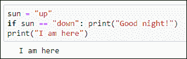

## FIGURE 2-2：当条件为假时，简单`if`语句的结果

在第二个示例中，变量`sun`并不等于`down`；因此，该行的其余部分被忽略，只执行下一行。

在这两个示例中，当条件为真时要执行的代码与`if`位于同一行。然而，通常你可能希望在条件为真时执行多一件事。为此，你需要对每一行仅在条件为真时才要执行的代码进行缩进。而`if`下方没有缩进的代码无论条件真假都会被执行。建议缩进四个空格，但这并不是一条硬性规定。你只需要记住每行的缩进量必须相同。此外，即使在条件为真时只执行一行代码，你也可以使用缩进语法。事实上，这是 Python 中编写`if`最常用的方式，因为大多数人认为这让代码从人类角度来看更具可读性。所以语法如下：

```python
if condition:
    do this
    …
    do this no matter what
```

所以，如果条件为真，将执行`do this`这一行以及与该行缩进相同的任何其他行。`if`下方第一个未缩进的行无论如何都会执行。因此，你可以这样写简单的`sun`示例：

```python
sun = "down"

if sun == "down":
    print("Good night!")

print("I am here")
```

如你在图 2-3 中所示，这段代码的作用与将代码放在同一行相同。如果`sun`是`down`，则会在第二个`print`执行之前打印`Good night!`。如果`sun`不等于`down`，则`Good night!`的`print`语句将被跳过。

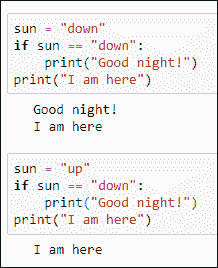

## FIGURE 2-3：当条件先为真后为假时，简单`if`语句的结果

如果你想知道`if`语句中使用单行还是多行会更好，这取决于你对*更好*的定义。如果你是指从执行速度快慢来看哪种方法更好，那么答案是两者都不是。在执行代码时，你无法看到速度差异。如果你所说的*更好*是指更容易人类程序员阅读，大多数人会倾向于第二种方法，即代码在`if`语句下方进行缩进。

记住，你可以在`if`下方缩进任意数量的行，这些缩进行仅在条件为真时执行。如果条件为假，则不执行任何缩进行。缩进下方的未缩进代码始终执行，因为它们不依赖于条件。这里有一个包含四行代码的示例，它们仅在条件为真时才执行：

```python
total = 100

sales_tax_rate = 0.065

taxable = True

if taxable:
    print(f"Subtotal : ${total:.2f}")
    sales_tax = total * sales_tax_rate
    print(f"Sales Tax: ${sales_tax:.2f}")

total = total + sales_tax

print(f"Total : ${total:.2f}")
```

 你必须拼写`True`和`False`，首字母大写，其余小写。如果你以任何其他方式输入，Python 将不会将其识别为布尔值`True`或`False`，你的代码也不会按预期运行。

注意在`if`语句中，我们使用了：

```python
if taxable:
```

这段代码完全可以，因为我们将`taxable`定义为了只能为`True`或`False`的布尔值。你可能会看到其他人这样写：

```python
if taxable == True:
```

这一行也可以，不会对代码产生任何负面影响。`== True`是必要的，因为`taxable`本身已经是`True`或`False`了。

总之，如你所见，我们从变量`total`、变量`sales_tax_rate`和变量`taxable`开始。当`taxable`为`True`时，`if`下方的四行代码都会执行，你将得到图 2-4 所示的输出。

当`taxable`设置为`False`时，所有缩进行都被跳过，显示的总额是未加税的原始总额，如图 2-5 所示。

 你必须拼写`True`和`False`，首字母大写，其余小写。如果你以任何其他方式输入，Python 将不会将其识别为布尔值`True`或`False`，你的代码也不会按预期运行。

注意在`if`语句中，我们使用了：

```python
if taxable:
```

这段代码完全可以，因为我们将`taxable`定义为了只能为`True`或`False`的布尔值。你可能会看到其他人这样写：

```python
if taxable == True:
```

这一行也可以，不会对代码产生任何负面影响。`== True`是必要的，因为`taxable`本身已经是`True`或`False`了。

总之，如你所见，我们从变量`total`、变量`sales_tax_rate`和变量`taxable`开始。当`taxable`为`True`时，`if`下方的四行代码都会执行，你将得到图 2-4 所示的输出。

当`taxable`设置为`False`时，所有缩进行都被跳过，显示的总额是未加税的原始总额，如图 2-5 所示。

```python
print("Stop")
print("This code executes no matter what")
```

执行该代码将得到如下结果：

```text
Go
This code executes no matter what
```

如果你将颜色更改为红色，如下：

```python
light_color = "red"

if light_color == "green":
    print("Go")
elif light_color == "red":
    print("Stop")
    print("This code executes no matter what")
```

结果是：

```text
Stop
This code executes no matter what
```

假设你将颜色更改为黄色或以外任何颜色，如下：

```python
light_color = "yellow"

if light_color == "green":
    print("Go")
elif light_color == "red":
    print("Stop")
    print("This code executes no matter what")
```

执行这段代码会产生以下输出，因为`color == "green"`和`color == "red"`都不成立，所以没有任何缩进的代码被执行：

```text
This code executes no matter what
```

你可以添加一个`else`选项，它只在之前的条件都为假时发生：

```python
light_color = "yellow"

if light_color == "green":
    print("Go")
elif light_color == "red":
    print("Stop")
else:
    print("Proceed with caution")
    print("This code executes no matter what")
```

输出是：

```text
Proceed with caution
This code executes no matter what
```

`light_color`为黄色的事实阻止了前两个`if`条件成立，因此只执行了`else`代码。对于你放入变量`light_color`的任何内容（`"red"`或`"green"`除外）都是如此，因为`else`并不寻找特定的条件。它在逻辑中仅仅扮演着“如果其他情况都失败了，执行此操作”的角色。

这里另一个代码示例，我们将名为`age`的变量设置为`31`。然后我们使用`if … elif … else`来对显示内容做出决策：

```python
age = 31

if age < 21:
    beverage = "milk"
elif age >= 21 and age < 80:
    beverage = "beer"
else:
    beverage = "prune juice"

print("Have a " + beverage)
```

注释始终是可选的。但为代码添加注释可以使其更易理解，以便日后参考：

```python
age = 31

if age < 21:
    # 如果小于 21 岁，无酒精
    beverage = "milk"
elif age >= 21 and age < 80:
    # 21-79 岁，建议喝啤酒
    beverage = "beer"
else:
    # 如果 80 岁或以上，西梅汁可能是一个选择。
    beverage = "prune juice"

print("Have a " + beverage)
```

 如果你忘记了`if … elif … else`的所有语法规则，你可以直接询问 Copilot、ChatGPT、Claude.ai 或另一个生成式 AI 为你*写一个 python if elif else 语句*。你应该得到一些带有正确语法的通用代码来帮助你入门。

### 三元运算

`if … then … else`操作非常常见，许多编程语言都提供了创建它们的简写语法。它们通常被称为*三元*运算符，但 Python 文档经常将它们称为*条件表达式*。它们的作用与`if … else`完全相同。因此这里没有添加新内容。它只是另一种字数较少的替代语法。基本蓝图是：

```python
value_if_true if condition else value_if_false
```

`condition`必须是一个产生`True`或`False`的表达式。如果条件证明为`True`，则运算符返回由`value_if_true`表示的值。如果条件证明为`False`，则表达式返回由`value_if_false`表示的值。作为一个工作示例，请看以下代码。注意变量`sales_tax_rate`被赋值为`0.065`或`0`。

```python
product = "Plushie"
unit_price = 4.99
taxable = False

# 销售税率取决于应税状态
sales_tax_rate = 0.065 if taxable else 0

print(sales_tax_rate)
```

设置销售税率的那行在当前项目是应税的时，会将其设置为`0.065`（即如果变量`taxable`包含值`True`）。否则，`sales_tax_rate`被设置为`False`。在实践中，它与下面的代码完全相同。它只是使用了更少的字并使代码更短。以下是使用 Python 中的`if … else`实现的相同逻辑：

```python
product = "Plushie"
unit_price = 4.99
taxable = False

# 销售税率取决于应税状态
if taxable:
    sales_tax_rate = 0.065
else:
    sales_tax_rate = 0
```

### 使用`for`重复

`if … elif … else`决策是编写应用、游戏、机器人程序的重要部分，但有时你需要重复执行某行。如果你想计数多次，请使用`for`循环：

```python
for x in range(y):
    执行此操作
    执行此操作
    …
    在循环结束时执行此操作
```

`for`循环可以按你想要的次数计数。如果你想从`0`开始计数，使用`range(y)`。第一个数字标识循环从哪里开始，第二个数字比停止的地方少 1。例如，代码：

```python
for x in range(7):
    print(x)

print("All done")
```


结果是相同的。唯一的区别是我们在`for`循环中使用了一个变量名而不是字符串。但代码知道你的意思，因为它获取的是`my_word`的内容，而不是字面字符串`"my_word"`，因为`my_word`没有包含在引号中。

```
s
n
o
r
k
e
l
Done
```

### 遍历列表

在 Python 中，`list`基本上是方括号内任何用逗号分隔的项的组。你可以使用`for`循环遍历这样的列表。在下面的示例中，要遍历的列表在第一行的括号中指定：

```python
for x in ["The", "rain", "in", "Spain"]:
    print(x)
print("Done")
```

这种循环会为列表中的每个项重复一次。变量`x`会从列表中的一个项获取值，从左到右进行。因此，运行前面的代码产生你在图 2-8 中看到的输出。

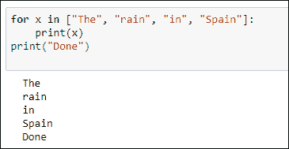

图 2-8：遍历列表。

你也可以将列表赋值给变量，然后在`for`循环中使用变量名而不是列表。图 2-9 显示了一个示例，其中变量`seven_dwarves`被赋值为一个包含七个名字的列表。再次，注意列表是如何包含在方括号中的。这些括号让 Python 将变量视为列表。然后，`for`循环将遍历该列表，在每次循环中打印一个矮人的名字（列表中的一个项）。我们使用了变量名`dwarf`而不是`x`，但该名称可以是你喜欢的任何有效名称。我们可以使用`x`、`little_person`、`name_of_fictional_entity`、`goober_wocky`或任何其他名称，只要第一行中的名称与`for`循环中使用的名称匹配即可。

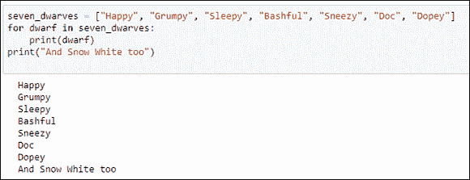

图 2-9：遍历列表。

### 退出循环

通常情况下，你希望循环遍历整个列表或项的范围，但如果满足某些条件，你也可以强制循环提前停止。在`if`语句中使用`break`语句来强制循环提前停止。语法如下：

```python
for x in items:
    if condition:
        [执行此操作 ... ]
        break
执行此操作
```

示例中的方括号不是代码的一部分。它们表示括号之间的内容是可选的。假设有人完成了一份考试，我们想要遍历答案。但我们有一个规则规定，如果答案为空，我们就将其标记为“未完成”（Incomplete）并忽略列表中的剩余项。在下文中，所有项都回答了（没有空白）：

```python
answers = ["A", "C", "B", "D"]
for answer in answers:
    if answer == "":
        print("Incomplete")
        break
    print(answer)
print("Loop is done")
```

在结果中，四个答案都被打印了：

```text
A
C
B
D
Loop is done
```

这里是相同的代码，但列表中的第三项是空的，由`""`表示，这是一个空字符串：

```python
answers = ["A", "C", "", "D"]
for answer in answers:
    if answer == "":
        print("Incomplete")
        break
    print(answer)
print("Loop is done")
```

这是运行该代码的输出：

```text
A
C
Incomplete
Loop is done
```

所以逻辑是，只要提供了某些答案，`if`代码就不会执行，循环将运行到完成。然而，如果循环遇到空白答案，它会打印`Incomplete`并同时“打破”循环，跳转到循环之外的第一个语句（最后一个没有缩进的语句），该语句打印`Loop is done`。

### 使用 continue 循环

你也可以在循环中使用`continue`语句，这与`break`截然相反。`break`让代码执行跳过循环末尾并停止循环，而`continue`让它跳回循环顶部并继续处理下一项（即触发`continue`的项之后的项）。这里是与上一个示例相同的代码，但不是在遇到空白答案时执行`break`，而是继续处理下一项：

```python
answers = ["A", "C", "", "D"]
for answer in answers:
    if answer == "":
        print("Incomplete")
        continue
    print(answer)
print("Loop is done")
```

等一下，让我们重新检查一下提供的逻辑：

```python
answers = ["A", "C", "", "D"]
for answer in answers:
    if answer == "":
        print("Incomplete")
        continue
    print(answer)
print("Loop is done")
```

运行该代码的输出是：

```text
A
C
Incomplete
D
Loop is done
```

### 嵌套循环

你完全可以嵌套循环——即在循环内部放置循环。例如，在图 2-10 中，外层循环遍历`First`、`Second`、`Third`。

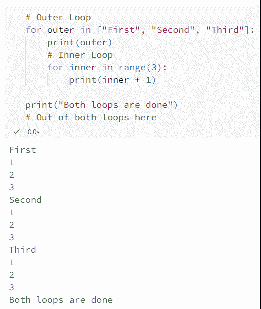

图 2-10：嵌套循环。

示例中的方括号不是代码的一部分。它们表示括号之间的内容是可选的。

### 使用 while 循环

作为`for`的替代，你可以使用`while`循环。区别是微妙的。对于`for`，你通常得到固定次数的循环，对应范围中的每个项或列表中的每个项。对于`while`循环，只要条件为真，循环就会一直运行。这是基本语法：

```python
while condition: 执行此操作
```

对于`while`循环，你必须确保让循环停止的条件最终发生。否则，你会得到一个无限循环，一直运行直到某些错误导致其失败，或者你强制它停止。

图 2-11 显示了一个示例，其中`while`条件运行了有限的次数：

*   我们创建一个变量`counter`并给它一个初始值 (65)。
*   我们规定当`counter`小于 91 时`while`循环。
*   循环内部，我们将`counter`增加 1 (`counter += 1`)。反复增加 1 最终会让`counter`超过 91，从而结束循环。

循环内部的`chr()`函数显示`counter`数字对应的 ASCII 字符。从 65 到 90 足够打印字母表中所有的大写字母，正如你在图 2-11 中所示。

这种循环的一种简单且常见的错误是忘记增加计数器，使其在每次循环时都能增长，并最终使`while`条件变为`False`并停止循环。在图 2-12 中，我们故意删除了`counter += 1`以导致该错误。正如你所见，循环一直在打印`A`。

如果这种情况在 Jupyter notebook 中发生，请不要慌。只需点击 Run 按钮右侧的正方形 Stop 按钮（当你将鼠标指针悬停在其上方时，Stop 按钮显示`Interrupt the Kernel`，这是极客术语，意为`stop`）。notebook 中的所有代码执行都将停止。要重启内核并回到起点，请点击 Stop 按钮右侧的弯曲箭头。然后你可以修复代码中的错误并重试。

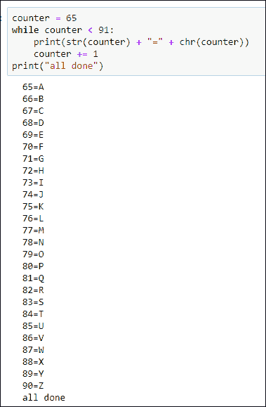

图 2-11：当`counter`小于 91 时循环。

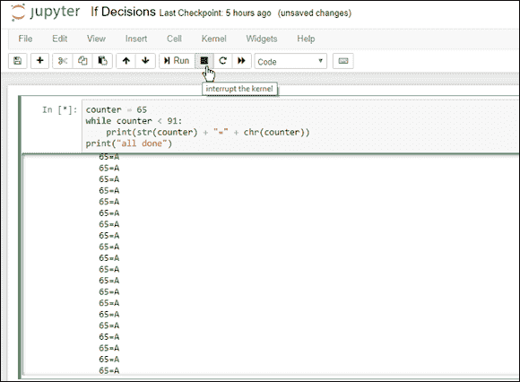

图 2-12：一个无限`while`循环。

 如果你忘记了编写 Python 循环的语法并想要快速示例，只需询问 Copilot 或生成式 AI `write a python for loop`或`write a python while loop`或`write a python loop that repeats for each character in a string`。任何最能描述你当前正在编写代码的词都可以。

### 使用 continue 的 while 循环

你可以在`while`循环中使用`if`和`continue`跳回循环顶部，就像在`for`循环中可以这样做一样。请参考图 2-13](#c06.xhtml_c06-fig-0013) 中的代码示例。

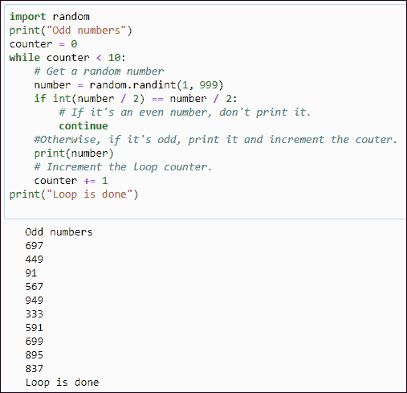

图 2-13：使用`continue`的`while`循环。

当变量`counter`小于 10 时，`while`循环会持续进行。在循环内部，变量`number`被赋值为 1 到 999 范围内的随机数。然后接下来的语句检查`number`是否为偶数：

```python
if int(number / 2) == number / 2:
```

记住，`int()`函数只返回数字的整数部分。假设生成的随机数是 5。将此数字除以 2 得到 2.5。那么`int(number)`为 2，因为数字的`int()`会去掉小数点之后的所有内容。由于 2 不等于 2.5，代码将跳过`continue`，打印该奇数，增加计数器，并继续运行。

如果下一个随机数是（例如）12，那么 12 除以 2 等于 6，且`int(6)`确实等于 6（因为这两个数字都没有小数点）。这会导致`continue`执行，跳过`print(number)`语句和`counter`递增，因此它只会尝试另一个随机数并继续按原来的运行。最终，它找到了十个奇数，此时循环停止，最后一行代码显示`Loop is done`。

### 使用 break 跳出 while 循环

你也可以使用`break`跳出`while`循环，就像在`for`循环中可以一样。当你跳出`while`循环时，你强制执行循环下方且循环之外的第一行代码，从而停止循环但继续执行循环之后剩余的操作。

理解`break`的另一种方式是将其看作允许你在`while`条件为假之前停止`while`循环的东西。因此，它允许你实际上在时间到达之前跳出循环。语法如下：

```python
while condition1:
    do this
    ...
    if condition2:
        break
    do this when the loop is done
```

基本上，两件事可以停止这个循环。要么`condition1`证明为假，要么`condition2`证明为真。无论发生这两种情况，代码执行都会从循环外部的第一行代码恢复，即示例代码中读取`do this code when the loop is done`的那行。

在以下示例中，程序将打印多达十个不能被 5 整除的数字。不过，打印的数量可能较少，因为当遇到一个能被 5 整除的随机数时，它就会跳出循环。所以你对这个示例的唯一预测是它将打印零到十个不能被 5 整除的数字。你无法预测在任何给定运行中它会打印多少，因为无法在允许的十次尝试中判断它是否或何时会得到能被 5 整除的随机数：

```python
import random

print("Numbers that aren't evenly divisible by 5")
counter = 0
while counter < 10:
    number = random.randint(1, 999)
    if number % 5 == 0:
        break
    print(number)
    counter += 1
```

列表中的每个项目都有一个位置编号，从 0 开始，尽管你看不见任何数字。你可以通过列表名称加上方括号中的数字，通过其编号来引用列表中的任何项目。换句话说，使用这种语法：

`listname[x]`

将`listname`替换为你正在访问的列表名称，并将`x`替换为你想要的项目的位置编号。记住，第一个项目的编号始终是 0，而不是 1。例如，在下面的第一行中，我们定义了一个名为`students`的列表，然后打印该列表中编号为 0 的项目。执行代码时，结果显示名称`Mark`：

```python
students = ["Mark", "Amber", "Todd", "Anita", "Sandy"]
print(students[0])
```

 在口头读取列表项时，专业人士会在数字前使用`sub`一词。例如，`students[0]`的读法“students sub zero”。

下一个示例是一个名为`scores`的列表。`print()`函数打印`scores[4]`的值，在本例中是`84`。记住，第一个项目始终位于位置 0。所以`scores[0]`是`88`，`scores[1]`是`92`，以此类推。

```python
scores = [88, 92, 78, 90, 84]
print(scores[4])
84
```

如果你尝试访问一个不存在的列表项，你会得到`list index out of range`（列表索引超出范围）错误。`index`部分是对方括号内数字的引用。例如，图 3-1 显示了 Jupyter notebook 中的一个小实验，其中我们创建了一个分数列表，然后尝试打印`scores[5]`。它失败了并生成了错误，因为列表没有`scores[5]`。它只有`scores[0]`、`scores[1]`、`scores[2]`、`scores[3]`和`scores[4]`，因为计数始终从列表第一个项目的 0 开始。

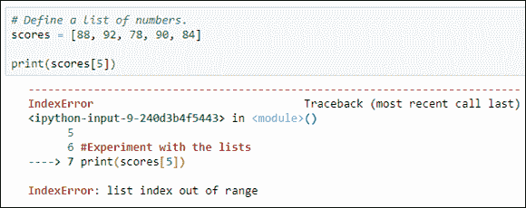

图 3-1：发生索引超出范围是因为`scores[5]`不存在。

### 遍历列表

要访问列表中的每个项目，只需使用此语法的`for`循环：

```python
for x in list:
```

将`x`替换为你任选的变量名。将`list`替换为列表名称。

 使代码具有可读性的简单方法是始终对列表名称使用复数（例如`students`、`scores`）。然后你可以使用单数名称（`student`、`score`）作为变量名。使用这种方法也不需要使用下标数字（方括号中的数字）。例如，以下代码打印了 scores 列表中的每个分数：

```python
for score in scores:
    print(score)
```

记得始终对循环中执行的代码进行缩进。图 3-2 显示了一个更完整的示例，在其中你可以看到在 Jupyter notebook 中运行代码的结果。

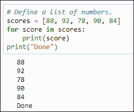

图 3-2：遍历列表。

### 检查列表是否包含某项

如果你想让代码检查列表的内容以查看它是否已经包含某些项目，请在`if`语句或变量赋值中使用`in listname`。例如，图 3-3 中的代码创建了一个姓名列表。然后，两个变量存储了在列表中搜索名称`Anita`和`Bob`的结果。打印每个变量的内容时，对于包含名称`Anita`在列表中的那个变量会显示`True`。测试`Bob`是否在列表中的结果证明为`False`。

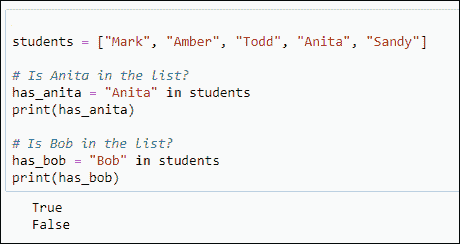

图 3-3：检查某项是否在列表中。

### 获取列表的长度

要确定列表中有多少个项目，请使用`len()`函数（length 的缩写）。将列表的名称放在括号内。例如，在 Jupyter notebook 或以下位置输入以下代码：

```python
students = ["Mark", "Amber", "Todd", "Anita", "Sandy"]
len(students)
```

### 向列表末尾添加项目

当你想要向列表末尾添加项目时，请使用`append()`方法。`append()`方法始终将项目添加到列表末尾。例如，看看这段代码：

```python
students = ["Mark", "Amber", "Todd", "Anita", "Sandy"]
students.append("Goober")
```


FIGURE 3-1: 发生索引超出范围是因为`scores[5]`不存在。

### 在列表中插入项目

而`append()`方法是将项目添加到末尾，但`insert()`方法可以在任何位置插入项目。`insert()`的语法是：

`listname.insert(position, item)`

将`listname`替换为列表名称，将`position`替换为你想插入项目的位置（例如，`0`表示第一个项目，`1`表示第二个，以此此类推）。将`item`替换为值或包含该值的变量名。例如，以下代码使`Lupe`成为列表中的第一个项目：

```python
students = ["Mark", "Amber", "Todd", "Anita", "Sandy"]

student_name = "Lupe"

students.insert(0, student_name)

print(students)
```

如果你运行这段代码，`print(students)`将显示插入新名称后的列表如下：

`['Lupe', 'Mark', 'Amber', 'Todd', 'Anita', 'Sandy']`

### 修改列表中的项目

你可以像使用变量一样使用`=`赋值运算符修改列表中的项目。确保你在方括号中包含索引数字以指示你想修改的项目。语法是：

`listname[index] = newvalue`

将`list`替换为列表名称；将`index`替换为你想要修改的项目下标（索引数字）；并将`newvalue`替换为你想放入列表项的任何内容。例如，看看这段代码：

```python
students = ["Mark", "Amber", "Todd", "Anita", "Sandy"]

students[3] = "Hobart"

print(students)
```

运行这段代码时，输出如下，因为 Anita 已更改为 Hobart：

`['Mark', 'Amber', 'Todd', 'Hobart', 'Sandy']`

### 合并列表

如果你有两个想要合并成单个列表的列表，请使用以下语法的`extend()`函数：

`original_list.extend(additional_items_list)`

在你的代码中，将`original_list`替换为你想要添加新列表项的列表名称。将`additional_items_list`替换为包含你想添加到第一个列表中的项目的列表名称。以下是一个使用名为`list1`和`list2`列表的简单示例。执行`list1.extend(list2)`后，第一个列表包含了两个列表中的项，正如最后`print()`语句的输出所示。

```python
# 创建两个名字列表。

list1 = ["Zara", "Lupe", "Hong", "Alberto", "Jake"]

list2 = ["Huey", "Dewey", "Louie", "Nader", "Bubba"]

# 将 list2 的名字添加到 list1 中。

list1.extend(list2)

# 打印列表 1。

print(list1)

['Zara', 'Lupe', 'Hong', 'Alberto', 'Jake', 'Huey', 'Dewey', 'Louie', 'Nader', 'Bubba']
```

很容易，像玩 Parcheesi（飞行棋）一样对吧？

你也可以通过用加号（`+`）拼接列表来合并列表。例如，你可以使用`newlist = list1 + list2`这一行创建一个名为`newlist`的新列表，其中包含两个列表中的所有项。

### 移除列表项

Python 提供了`remove()`方法，你可以从列表中删除任何值。如果项在列表中多次出现，则只删除第一个出现项。例如，以下代码显示了一个字母`C`重复了几次的字母列表。然后代码使用`letters.remove("C")`从列表中删除字母`C`：

```python
# 创建一个字符串列表。

letters = ["A", "B", "C", "D", "C", "E", "C"]

# 从列表中删除 "C"。

letters.remove("C")

# 向我展示新列表。

print(letters)

['A', 'B', 'D', 'C', 'E', 'C']
```

当你执行这段代码时，你会发现只有第一个字母`C`被删除了。

如果你需要删除某个项的所有副本，可以使用`while`循环只要该项仍然留在列表中，就重复执行`.remove`。例如，在针对`letters`字符串中每个字母`C`执行一次的`while`循环中放入`letter.remove("C")`（如下所示），将从列表中删除所有大写字母`C`。

```python
while "C" in letters:
    letters.remove("C")
```

如果你想根据项在列表中的位置来删除项，请使用带有索引数字的`pop()`，而不是带有值的`remove()`。如果你想删除列表的最后一个项，请使用不带索引的`pop()`。例如，以下代码创建了一个列表，删除了第一个项（`0`），然后删除了最后一个项（括号内为空的`pop()`）。打印列表证明了这两个项已被删除：

```python
# 创建一个字符串列表。

letters = ["A", "B", "C", "D", "E", "F", "G"]

# 移除第一个项。

letters.pop(0)

# 最后一个项。

letters.pop()

# 向我展示新列表。

print(letters)

['B', 'C', 'D', 'E', 'F']
```

运行代码显示，弹出第一个和最后一个项确实有效。

当你从列表中`pop()`掉一个项时，你可以将该值的副本存储在某些变量中。例如，图 3-5 显示了与前面相同的代码，但它将被删除的内容存储在名为`first_removed`和`last_removed`的变量中。最后它打印列表并显示了哪些字母被删除了。

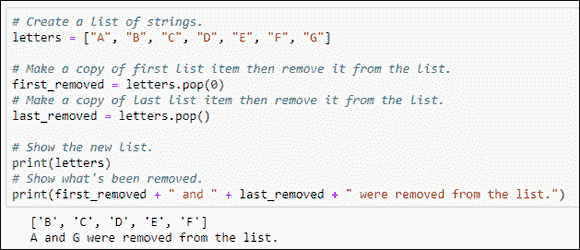

图 3-5：使用`pop()`移除列表项。

Python 还提供了`del`（*delete*的缩写）命令，它可以根据索引数字（位置）从列表中删除任何项。但同样，你必须记住第一个项位于位置`0`。所以，假设你运行以下代码来从列表中删除编号为 2 的项：

```python
# 创建一个字符串列表。

letters = ["A", "B", "C", "D", "E", "F", "G"]

# 删除索引为 2 的项。

del letters[2]

print(letters)

['A', 'B', 'D', 'E', 'F', 'G']
```

运行该代码再次显示了列表，如下。字母`C`被删除了，这是正确的删除项，因为字母的编号为 0, 1, 2, 3 等此类推。

你也可以使用`del`通过移除方括号和索引数字来删除整个列表。

### 清空列表

如果你想从列表中移除所有项但保留列表对象本身，请使用`clear()`方法。

```python
# 创建一个字符串列表。

letters = ["A", "B", "C", "D", "E", "F", "G"]

# 清空列表。

letters.clear()

# 显示空列表。

print(letters)

[]
```

### 统计项出现的次数

你还可以使用`count()`方法来查找特定值在列表中出现了多少次。

```python
# 创建一个字符串列表。

letters = ["A", "B", "C", "D", "C", "E", "C"]

# 统计 "C" 出现的次数。

count = letters.count("C")

print(count) # 输出: 3
```

### 查找列表项的索引

`index()`方法返回列表中值第一次项的索引。

```python
# 创建一个字符串列表。

letters = ["A", "B", "C", "D", "C", "E", "C"]

# 查找第一个 "C" 的索引。

idx = letters.index("C")

print(idx) # 输出: 2
```

如果项不在列表中，`index()`将抛出`ValueError`。你可以通过先使用`in`运算符检查该项是否在列表中来避免这种情况。

```python
if "Z" in letters:
    print(letters.index("Z"))
else:
    print("未找到项")
```

图 3-8 显示了一个示例，程序在`f_index = grades.index(look_for)`这一行崩溃，因为列表中不存在`F`。

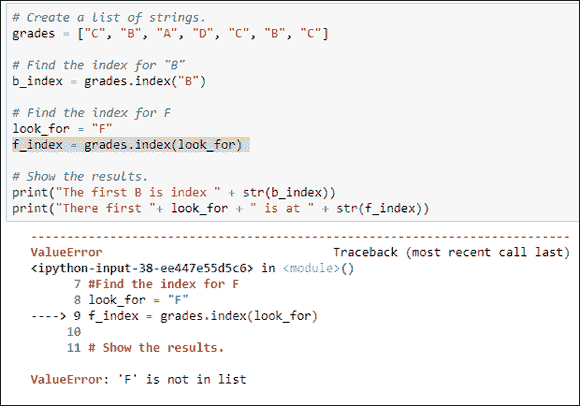

图 3-8: 当尝试查找不存在的列表项索引时程序失败。

解决此问题的简单方法是使用`if`语句在尝试获取索引号之前检查该项是否在列表中。如果项目不在列表中，则显示一条相应的消息。否则，获取索引号并在消息中显示。代码如下：

```python
# 创建一个字符串列表。

grades = ["C", "B", "A", "D", "C", "B", "C"]

# 决定要查找什么

look_for = "F"

# 检查项目是否在列表中。

if look_for in grades:
    # 如果项目在列表中，获取并显示索引。

    print(str(look_for) + " is at index " + str(grades.index(look_for)))
else:
    # 如果不在列表中，甚至不需要尝试获取索引。

    print(str(look_for) + " isn't in the list.")
```

### 列表的字母排序和排序

Python 提供了一个用于排序列表的`sort()`方法。在最简单的形式下，它按字母顺序排列列表项（如果是字符串）。如果列表包含数字，它们按从小到大的顺序排序。对于这种简单的排序，只需使用带空括号的`sort()`即可：

```python
listname.sort()
```

将`listname`替换为列表名称。图 3-9 显示了一个使用字符串列表和数字列表的示例。接下来，我们只需使用`.sort()`对它们进行排序。然后代码打印每个排序后列表的内容。

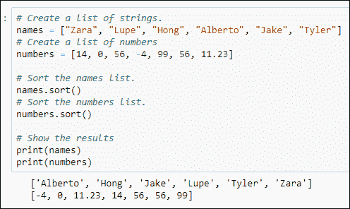

图 3-9: 字符串和数字的排序。

 如果你的列表包含混合大小写的字母字符串，且排序结果看起来不对，尝试将`.sort()`替换为`.sort(key=lambda s: s.lower())`然后重新运行代码。如果你对细节感兴趣，请参见第二本书的第 5 章。

日期处理要复杂一些，因为你不能像`12/31/2020`那样直接输入字符串。它们必须是`date`数据类型才能正确排序。这意味着需要使用`datetime`模块和`date()`方法来定义每个日期。你可以像处理其他列表一样将日期添加到列表中。例如，在以下行中，代码创建了一个包含四个日期的列表：

```python
import datetime as dt

dates = [dt.date(2020, 12, 31), dt.date(2019, 1, 31), dt.date(2018, 2, 28), dt.date(2020, 1, 1)]
```

计算机显然不会介意你这样创建列表。但如果你想让代码对你自己或其他开发者更具可读性，你可能希望一次创建并添加每个日期。图 3-10 显示了一个示例，其中我们创建了一个名为`datelist`的空列表。

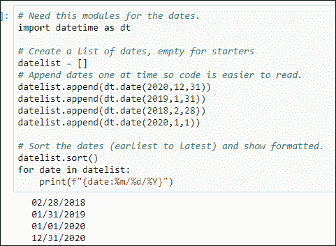

图 3-10: 以整的格式排序并显示日期。

然后我们使用`dt.date(year, month, day)`语法逐次向列表添加日期。

列表创建后，代码使用`datelist.sort()`将日期按时间顺序（从最早到最晚）排序。我们没有在代码中使用`print(datelist)`，因为该方法显示日期时会包含数据类型信息，如下：

```python
[datetime.date(2018, 2, 28), datetime.date(2019, 1, 31), datetime.date (2020, 1, 1), datetime.date(2020, 1, 1)]
```

## 集合的操作

Python 还提供了`sets`作为一种组织数据的方式。集合与列表的一个区别是，集合中的元素没有特定的顺序。即使你可能按照某种顺序定义集合，但没有任何元素会获得索引数字来标识它们的位置。

定义集合时，使用大括号，而不是定义列表的方括号或元组的小括号。例如，这是一个包含一些数字的集合：

`sample_set = {1.98, 98.9, 74.95, 2.5, 1, 16.3}`

集合在某些方面与列表和元组相似。你可以使用`len()`确定集合中有个元素。使用`in`判断某个元素是否存在于集合中。

但你无法根据索引数字获取集合中的元素。无法修改集合已存在的元素。你也无法更改集合元素的顺序。因此，你不能使用`.sort()`对集合进行排序，无法使用`.reverse()`反转它的顺序。

你可以使用`.add()`向集合添加单个新元素，如下例所示：

`sample_set.add(11.23)`

注意，与列表不同，集合永远不会包含某个值的多个实例。因此，即使你多次向集合添加`11.23`，集合仍然只包含一个`11.23`的副本。

你也可以使用`.update()`向集合添加多个项。但你添加的项应该定义在方括号`[]`中的一个列表中，如下例：

```python
sample_set.update([88, 123.45, 2.98])
```

你可以复制一个集合。然而，由于集合没有定义的顺序，当你显示副本时，其项的顺序可能与原始集合不同，如代码及其输出所示：

```python
# 定义一个名为 sample_set 的集合。

sample_set = {1.98, 98.9, 74.95, 2.5, 1, 16.3}

# 显示整个集合

print(sample_set)

# 创建一个副本并显示副本。

ss2 = sample_set.copy()

print(ss2)

{1.98, 98.9, 2.5, 1, 74.95, 16.3}

{16.3, 1.98, 98.9, 2.5, 1, 74.95}
```

图 3-12 显示了一些示例代码及其输出。代码创建了一个名为`sample_set`的集合，然后使用多种`print()`语句输出信息。以下行在屏幕上显示整个集合：

```python
print(sample_set)
```

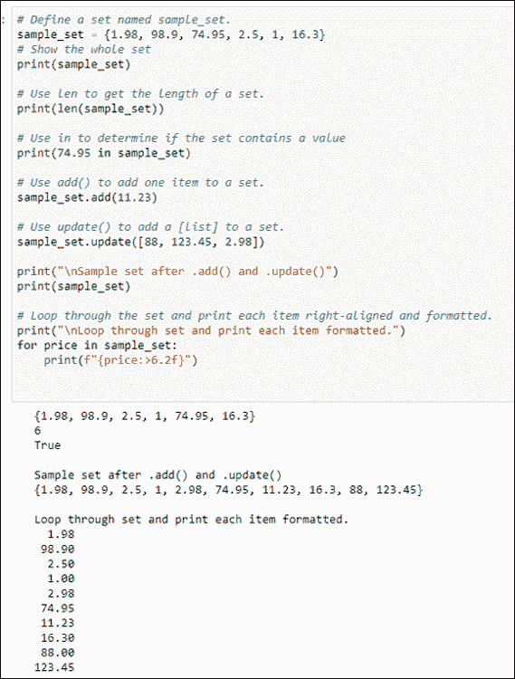

图 3-12：玩转 Python 集合。

这一行显示`6`，因为集合有六个项：

```python
print(len(sample_set))
```

接的一行显示`True`，是因为数字`74.95`在`sample_set`中：

```python
print(74.95 in sample_set)
```

代码中的注释描述了其余行的作用。注意代码末尾循环内部的命令：

```python
print(f"{price:>6.2f}")
```


每个数字都整齐地格式化为两位，因为代码使用了 f-string `>6.2f`，它使每个数字右对齐，并在小数点后保留两位。

列表和元组是 Python 中最常用的两种数据结构。集合似乎没有另外两个那么受关注，但了解它们是有好处的。第四种——且广泛使用的 Python 数据结构是字典，你将在下一章中学习到它。

# 第 4 章

# 使用字典处理海量数据

## 本章内容

- 创建字典
- 了解如何循环遍历字典
- 复制字典
- 删除字典中的项
- 使用多键字典

字典（在某些语言中也称为关联数组）类似于列表，我们在本微型书籍的第 3 章中讨论过列表。但列表中的每个项不是通过其在列表中的位置标识的，而是通过一个键（`key`）。你可以定义键，它通常是一个字符串或数字。重要的是，它对于字典中的每个项都是唯一的。

为了理解为什么唯一性很重要，请思考电话号码、电子邮件和社会安全号。如果两个或多人有相同的电话号码，每当有人拨打该号码时，所有人都会收到电话。如果两个或多人有相同的电子邮件地址，所有人都会收到相同的电子邮件邮件。如果两个或多人有相同的社会安全号，而其中一人欠了百万美元的税款，你最好希望你能说服税务局你不是那个欠款的人，即使你的社会安全号出现在欠期账单上。

在本章中，你将学习所有关于 Python 数据字典的知识，以及如何在自己的应用程序中使用它们。

## 理解数据字典

如前所述，`dictionary` 列表，区别在于列表中的每个项都有唯一的键。你与键关联的值（`value`）可以是数字、字符串、列表、元组——实际上可以是任何内容。所以你可以将字典想象成一张表格，第一列包含该项唯一的单元信息，第二列（值）包含与该键相关且可能是该键唯一的信息。在图 4-1 的示例中，左列包含每行唯一的键。右列是分配给每个键的值。

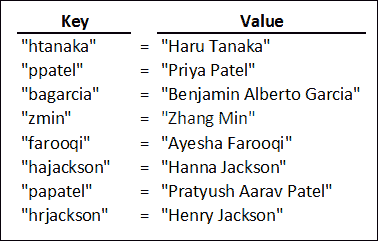

图 4-1：左列为键，右列为值的字典。

`name` 是你自定义的名称，通常描述 `key:value` 键对指向谁或什么。`key`:`value` 键对被包含在大括号中。`key` 通常是一个用引号括起来字符串，但你也可以使用整数或元组。每个冒号（`:`）将键与其分配的值隔开。`value` 是你想为该键存储的任何内容，可以是数字、字符串、列表——几乎可以是任何类型。省略号（`…`）意味着你可以有任意数量的 `key:value` 键对。只需用逗号分隔 `key`:`value` 键对，如语法示例所示。

为了提高代码的可读性，开发者通常会将每个 `key`:`value` 键对单独放在一行。但语法仍然相同。唯一的区别是每个逗号后面都有一个换行，如下所示：

```
`name` = {

`key`:`value`,

`key`:`value`,

`key`:`value`,

`key`:`value`,

`…`

}
```

如果你想尝试一下，请打开 Jupyter notebook、`.py` 文件或 Python 提示符并输入以下代码。注意，我们创建了一个名为 `people` 的字典，它包含多个 `key`:`value` 键对，每个都用逗号隔开。键和值都是字符串，因此它们被引号括起来，每个键通过冒号与其值隔开。保持这些细节清晰至关重要；否则代码将无法运行——是的，即使只是缺少、位置错误或错错一个引号、冒号、逗号或大括号，都会破坏整个程序：

```python
people = {

'htanaka': 'Haru Tanaka',

'ppatel': 'Priya Patel',

'bagarcia': 'Benjamin Alberto Garcia',

'zmin': 'Zhang Min',

'afarooqi': 'Ayesha Farooqi',

'hajackson': 'Hanna Jackson',

'papatel': 'Pratyush Aarav Patel',

'hrjackson': 'Henry Jackson'

}
```

如果忘记了编写字典的语法，只需让 CoPilot、ChatGPT 或类似的生成式 AI 为你创建一个通用示例。例如，提示词 `write a python dictionary with 10 numeric keys and 10 string values` 应该会给你一些语法正确的通用代码供你使用。

### 访问字典数据

添加数据后，你可以以多种方式对其进行处理。使用`print(people)`——即在括号中使用带有字典名称的 `print()` 函数——你可以获得整个字典的副本，如下：

```python
print(people)

{'htanaka': 'Haru Tanaka', 'ppatel': 'Priya Patel',

'bagarcia': 'Benjamin Alberto Garcia', 'zmin': 'Zhang Min', 'afarooqi': 'Ayesha Farooqi', 'hajackson': 'Hanna Jackson', 'papatel': 'Pratyush Aarav Patel', 'hrjackson': 'Henry Jackson'}
```

这通常不是你想要的。更多时候，你是在寻找字典中的某个特定项目。在这种情况下，使用此语法：

`dictionaryname[key]`

其中 `dictionaryname` 是字典的名称，`key` 是你正在查找的键。例如，如果你想知道 `zmin` 键的值，你输入：

```python
print(people['zmin'])
```

将这一行代码理解为“打印 people 子 zmin”，其中 `sub` 仅指“特定的键”。当你这样做时，Python 返回该特定人的值——在示例中，是 `zmin` 的全名。图 4-5 显示了在 Jupyter notebook 单元格中运行代码后的输出。

注意，在代码中，`zmin` 用引号括起来是因为它是一个字符串。你可以使用变量名代替，只要它包含一个字符串。例如，考虑以下两行代码。第一行创建了一个名为 `person` 的变量并将字符串 `'zmin'` 放入该变量。下一行不需要引号，因为 `person` 是一个变量名：

```python
person = 'zmin'

print(people[person])
```

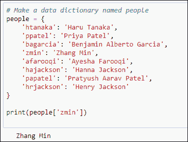

图 4-5：打印 `people` 字典中 `zmin` 键的值。

那么你认为如果执行以下代码会发生什么？

```python
person = 'hrjackson'

print(people[person])
```

你将看到 `Henry Jackson`，这是键 `hrjackson` 对应的名称（值）。

如果你运行这段代码又怎样？

```python
person = 'schmeedledorp'

print(people[person])
```

图 4-6 显示了会发生什么。

`.get()` 的不同之处在于，当你搜索一个不存在的名称时会发生什么。你不会得到错误，程序也不会崩溃运行。相反，`get()` 会优雅地返回值 `None`，告知你 `people` 字典中没有名为 `schmeedledorp` 的人，正如图 4-8 所示。

你可以向 `get()` 传递两个值；第二个值是你希望在 `get` 未能找到你正在查找的内容时所返回的值。例如，在下行代码中，我们再次搜索 `schmeedledorp`。但这次，如果代码没有找到这个人，它显示的将不是 `None`，而是更显风头的消息 `Unbeknownst to this dictionary`（此字典并不知道）：

```
print(people.get('schmeedledorp', 'Unbeknownst to this dictionary'))
```

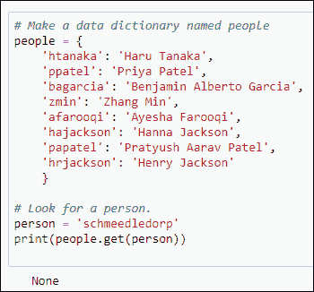

图 4-8：Python 更友好的表达方式，表示没有 *schmeedledorp*。

### 修改键的值

字典是**可变的**（`mutable`），这意味着你可以通过代码更改字典的内容（并不是说你可以让字典闭嘴）。语法简单来说：

`dictionaryname[key]` = `newvalue`

将 `dictionaryname` 替换为字典名称，将 `key` 替换为标识该项的键，并将 `newvalue` 替换为你想要的新值。

例如，假设 Hanna Jackson 结婚了并将姓改为了 Hanna Jackson-Smith。你想保留相同的键但更改值。在图 4-9 中，`people['hajackson'] = "Hanna Jackson-Smith"` 这一行执行了更改。该行下方的 `print()` 语句显示了执行该行代码后 `hajackson` 的值。正如图 4-9 所示，名称确实已经更改为 `Hanna Jackson-Smith`。

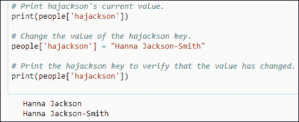

图 4-9：修改字典中与键关联的值。

在现实生活中，字典中的数据可能还会存储在某种外部文件中，以便使其持久化。需要额外的代码来将字典的更改保存到该外部文件中。但在学习所有这些内容之前，你需要先学习这些基础知识，因此我们现在将继续学习字典。

### 添加或更改字典数据

你可以使用字典的 `update()` 方法向字典添加新项，或更改当前键的值。语法为：

`dictionaryname.update(key, value)`

将 `dictionaryname` 替换为字典名称。将 `key` 替换为你想要添加或更改的项目的键。如果你指定的 `key` 在字典中不存在，它将作为一个新项被添加，并带有你指定的 `value`。如果你指定的 `key` 存在于字典中，则不会添加内容。该键的值将更改为你指定的 `value`。

例如，考虑以下 Python 代码，它创建了一个名为 `people` 的字典，并将两个人的名字放入其中：

```python
# 创建一个名为 people 的数据字典。

people = {

  'papatel': 'Pratyush Aarav Patel',

  'hrjackson': 'Henry Jackson'

}

# 修改 hrjackson 键的值。

people.update({'hrjackson' : 'Henrietta Jackson'})

# 使用新的键值对更新字典。

people.update({'wwiggins' : 'Wanda Wiggins'})
```

第一行 `update` 代码将 `hrjackson` 的值从 `Henry Jackson` 更改为 `Henrietta Jackson`，因为 `hrjackson` 键在字典中已存在：

```python
people.update({'hrjackson' : 'Henrietta Jackson'})
```

第二个 `update()` 的执行如下：

```python
people.update({'wwiggins' : 'Wanda Wiggins'})
```

字典中没有 `wwiggins` 键，因此 `update()` 无法更改 `wwiggins` 的名字。相反，该行向字典添加了一个新的 `key:value` 对，以 `wwiggins` 为 `key`，`Wanda Wiggins` 为 `value`。

代码没有指定是更改还是添加值，因为这个决定是自动的。字典中的每个键必须是唯一的；你不能有两个或多个行具有相同的键。因此当你执行 `update()` 时，代码首先检查该键是否存在。如果存在，仅修改该键的值；不会添加任何新内容。如果键不存在，则会添加新项。

- 如果键在字典中已存在，则只修改该键的值；没有新增内容。
- 如果键不存在，则会添加新项。

每个键在字典中必须是唯一的；你不能有两个或多个行具有相同的键。

- 字典中没有相同的键。

在运行以下代码后，字典包含三个项：`patel`、`hrjackson`（带有新名字）和 `wwiggins`。在代码的末尾添加以下行，可以显示字典的内容：

```python
# 显示字典现在的内容。

for person in people.keys():

  print(person + " = " + people[person])
```

如果你添加该代码并运行，将得到如下输出：

```
patel = Pratyush Aarav Patel

hrjackson = Henrietta Jackson

wwiggins = Wanda Wiggins
```

你也可以使用赋值运算符 `=` 而不是 `update()` 来更改键的值。例如，以下语句无论 `dependents` 的原始值是多少，都会将其设置为 1：

```python
htanaka['dependents'] = 1
```

### 遍历字典

正如我们在上一节中提到的，你可以以类似于列表和元组的方式遍历字典中的每个项，但你有一些额外的选项。如果你在 `for` 循环中直接指定字典名称，将获得所有的键，如下：

```python
for person in people:

  print(person)
```

```
htanaka

ppatel

bagarcia

zmin

afarooqi

hajackson

papatel

hrjackson
```

如果你想查看每个项的值，保持 `for` 循环不变，但打印 `dictionaryname[key]`，其中 `dictionaryname` 是字典的名称（示例中为 `people`），`key` 是你在循环 `for` 之后使用的任何名称（示例中为 `person`）。

```python
for person in people:

  print(people[person])
```

```
Haru Tanaka

Priya Patel

Benjamin Alberto Garcia

Zhang Min

Ayesha Farooqi

Hanna Jackson

Pratyush Aarav Patel

Henry Jackson
```

你也可以通过在 `for` 循环中使用稍微不同的语法来获取所有名称：在字典名称后添加 `.values()`，如下所示。然后你只需要在循环中打印变量名（`person`）。输出将是每个人的全名，正如上一个循环示例所示。

```python
for person in people.values():

  print(person)
```


最后，你可以在`for`循环中的字典名称后使用`.items()`来同时遍历键和值。但你同样需要在`for`后面提供两个变量，一个用于引用键（key），另一个用于引用值（value）。如果你想让代码在遍历字典时显示这两个变量，需要在`print`函数的括号内使用这些名称。

例如，图 4-10 中的循环使用了两个变量名`key`和`value`（尽管它们也可以是`x`和`y`或任何其他名称）来遍历`people.items()`。`print`语句在每次循环中都会同时显示`key`和`value`。`print()`还包含一个等号（括在引号内），用于将键和值隔开。如你在输出中所见，你将得到所有键的列表，后面跟着一个等号和分配给该键的值。

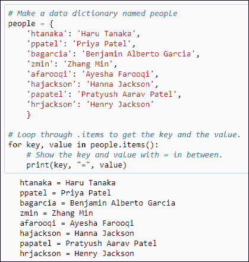

图 4-10: 使用`items()`和两个变量名遍历字典。

## 字典方法

如果你一直在勤奋地跟进每一个章节，你可能会注意到数据字典的一些方法与列表、元组和集合的方法相似。因此，现在也许是在表 4-1 中列出字典提供的所有方法的好时机。你在本章中已经看到了一些实际应用。我们稍后会介绍其他的方法。

| 方法 | 功能 |
| --- | --- |
| `clear()` | 通过移除所有键和值来清空字典。 |
| `copy()` | 返回字典的副本。 |
| `fromkeys()` | 返回字典的一个新副本，但仅包含指定的键和值。 |
| `get()` | 返回指定键的值，如果不存在则返回`None`。 |
| `items()` | 返回每个`key:value`对以元组形式表示的项目列表。 |
| `keys()` | 返回字典中所有键的列表。 |
| `pop()` | 根据键从字典中移除指定的项，并返回其值。 |
| `popitem()` | 移除最后一个`key:value`对。 |
| `setdefault()` | 返回指定键的值。如果键不存在，则插入带有指定值的键并返回它。 |
| `update()` | 更新现有键的值，如果指定的键已在字典中，则添加新的`key:value`对。 |
| `values()` | 返回字典中所有值的列表。 |

表 4-1 字典方法

## 复制字典

如果你需要制作一个字典的副本以进行操作，请使用此语法：

`newdictionaryname = dictionaryname.copy()`

将`newdictionaryname`替换为你想要给新字典起的任何名称。将`dictionaryname`替换为你想要复制的现有字典名称。

图 4-11 显示了一个简单的示例，我们创建了一个名为`people`的字典，然后创建了一个名为`peeps2`的字典作为`people`字典的副本。打印每个字典的内容显示它们是相同的。

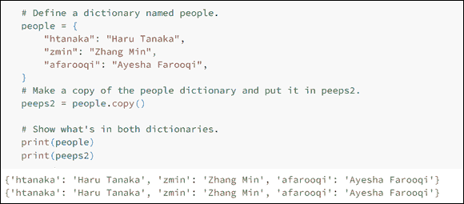

图 4-11: 复制字典。

### 删除字典项

你可以通过多种方式从数据字典中删除数据。`del`关键字（*delete*的缩写）可以根据其键移除任何项。语法如下：

`del dictionaryname[key]`

例如，以下代码创建了一个名为`people`的字典。然后它使用`del people["zmin"]`来移除以`zmin`为键的项：

```python
# 定义一个名为 people 的字典。
people = {

    'htanaka': 'Haru Tanaka',

    'zmin': 'Zhang Min',

    'afarooqi': 'Ayesha Farooqi',

}

# 显示原始的 people 字典。
print(people)

# 从字典中移除 zmin。
del people["zmin"]

# 显示 people 现在的内容。
print(people)
```

打印字典的内容显示`zmin`不再于该字典中：

`{'htanaka': 'Haru Tanaka', 'afarooqi': 'Ayesha Farooqi'}`

如果你在`del`语句中忘记指定键，Python将抛出错误。例如，假设你执行的是`del people`而不是`del people["zmin"]`：

```
Traceback (most recent call last):

  File "<stdin>", line 1, in <module>

    del people

NameError: 'people' is not defined
```

要在不删除整个字典的情况下从字典删除所有数据，请使用以下语法使用`clear()`方法：

`dictionaryname.clear()`

以下代码清空了`people`字典以便你查看：

```python
# 定义一个名为 people 的字典。
people = {

    'htanaka': 'Haru Tanaka',

    'zmin': 'Zhang Min',

    'afarooqi': 'Ayesha Farooqi',

}

# 清空字典。
people.clear()

# 显示 people 现在的内容。
print(people)
```

运行此代码的输出显示`people`字典现在为`{}`，这是Python告诉你是它是空的。

如果你将`popitem`的结果存储在变量中，你获得的是该项的值，这与`pop()`的方式不同。相反，你将同时获得键和它的值。字典不再包含该`key:value`键对。换句话说，如果你将图 4-12 中的`adios = people.pop("zmin")`替换为`adios = people.popitem()`，输出将如下：

```
{'htanaka': 'Haru Tanaka', 'zmin': 'Zhang Min', 'afarooqi': 'Ayesha Farooqi'}

('afarooqi', 'Ayesha Farooqi')

{'htanaka': 'Haru Tanaka', 'zmin': 'Zhang Min'}
```

## 玩转多键字典

到目前为止，你操作的是每个键（该人名字的缩写）对应一个值（人的名字）的字典。但在字典中，某项数据拥有多个`key:value`键对并不罕见。

例如，假设仅仅知道人的全名是不够的。你还想知道该员工入职的年份、出生日期以及该员工是否配发了公司笔记本。任何一个人的字典可能看起来如下：

```python
employee = {

  'name': 'Haru Tanaka',

  'year_hired': 2005,

  'dob': '11/23/1987',

  'has_laptop': False

}
```

或者，假设你需要一个销售销售的字典。对于每个产品，你都想知道它的名称、单价、是否应税以及你目前的库存量。该字典可能像所示（针对一个产品）：

```python
product = {

  'name': 'Ray-Ban Wayfarer Sunglasses',

  'unit_price': 112.99,

  'taxable': True,

  'in_stock': 10

}
```

注意，在每个示例中，键名都在引号内。我们在示例代码中使用单引号，但你可以使用单引号或双引号。我们甚至给`dob`（出生日期）中的日期也加了引号。如果你不这样做，它可能会被视为一组数字，就像“11除以23除以1987”，这并不是有用的信息。布尔值为`True`或`False`（首字母大写），不加引号。整数（2005, 10）和浮点数（112.99）也没有包含在引号。

记住，属性的值可以是列表、元组或集合；它不必是一个单一值。例如，对于眼镜产品，你可能提供两种型号：黑色和玳瑁色。你可以添加一个`colors`或`model`键，并将项以逗号分隔的列表放在方括号中，如下：

```python
product = {

  'name': 'Ray-Ban Wayfarer Sunglasses',

  'unit_price': 112.99,

  'taxable': True,

  'in_stock': 10,

  'models': ['Black', 'Tortoise']

}
```

接下来看看你如何显示字典数据。你可以使用简单的`dictionaryname[key]`语法来打印每个键的值。例如，使用上一个产品示例，这段代码的输出为：

```python
print(product['name'])

print(product['unit_price'])

print(product['taxable'])

print(product['in_stock'])

print(product['models'])
```

```
Ray-Ban Wayfarer Sunglasses

112.99

True

10

['Black', 'Tortoise']
```

你可以通过在每个`print`语句中添加描述性文本、后跟逗号和代码来变得更加高级。你也可以遍历列表以逐行打印每个型号。你还可以使用f-string来格式化数据。例如，这里之前`print()`语句的变体：

```python
product = {

  'name' : 'Ray-Ban Wayfarer Sunglasses',

  'unit_price' : 112.99,

  'taxable' : True,

  'in_stock' : 10,

  'models' : ['Black', 'Tortoise']

}

print('Name: ', product['name'])

print('Price: ', f"${product['unit_price']:.2f}")

print('Taxable: ', product['taxable'])

print('In Stock:', product['in_stock'])

print('Models:')

for model in product['models']:

    print(" " * 10 + model)
```

这是该代码的输出：

```
Name: Ray-Ban Wayfarer Sunglasses

Price: $112.99

Taxable: True

In Stock: 10

Models:

          Black

          Tortoise
```

 代码最后行的`" " * 10`意味着打印十次空格（" "）。换句话说，就是缩进十个空格。如果你在那些引号之间没有正好放一个空格，你就得不到10个空格。你会得到引号内任何内容的10倍副本，这意味着如果你在引号之间什么都不放，你也将什么也得。

### 使用神秘的`fromkeys`和`setdefault`方法

Python中的数据字典提供了两个方法，名为`fromkeys()`和`setdefault()`，它们让许多Python学习者感到困惑——这完全如此，因为要找到它们的实际应用并不容易。但我们将尝试一下，至少在你在代码中使用这些方法时，让你知道预期会发生什么。

`fromkeys()`方法使用以下语法创建一个与现有字典具有相同键的新字典：

`newdictionaryname = dict.fromkeys(iterable[, value])`

将`newdictionaryname`替换为你任何想要给新字典起的名字。

图 4-13 显示了一个示例，我们使用与`product`相同的键创建了`DWC001`字典。创建字典后，`setdefault('taxable', True)`会添加一个名为`taxable`的键并将其值设置为`True` —— 但只有当该字典尚未包含`taxable`键时才会如此。它还会添加一个名为`reorder_point`的键并将其值设置为`10`，同样地，仅当该键不存在时才会操作。

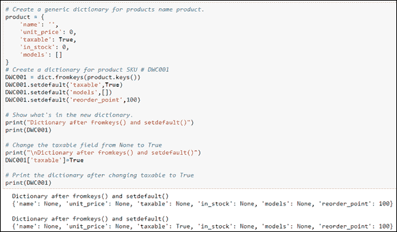

图 4-13: 尝试`fromkeys`和`setdefault`。

正如你从代码输出中所看到的，在执行`fromkeys`和`setdefault`操作后，新字典拥有与`product`字典相同的键，外多了一个新的`key:value`对`reorder_point: 10`，这是第二个`setdefault`添加的。然而，该输出中的`taxable`键仍然是`None`，因为`setdefault`不会更改现有键的值。它只有在字典尚未包含该键时，才会向字典添加带有默认值的新键。

那么如果你真的想将`taxable`的默认值设置为`True`而不是`None`呢？简单的解决方案是使用标准语法`dictionaryname[key] = newvalue`将现有的`taxable`键的值从`None`更改为`True`。图 4-13 中的第二个输出证明了通过这种方式更改键值是有效的。

### 嵌套字典

到目前为止，你可能已经意识到，你编写的任何程序可能都需要多个字典，每个字典都有唯一的名称。但如果你只是定义了一堆带有名称的字典，如何在不通过名称特定访问每个字典的情况下遍历整个集合呢？答案是，让每个字典成为某个包含字典中的一个`key:value`对，其中键是每个字典的唯一标识符（例如，每个产品的UPC或SKU）。每个键的值将是包含该字典所有`key:value`对的字典。因此，语法如下：

```python
containingdictionaryname = {

key: {dictionary},

key: {dictionary},

key: {dictionary},

…

}
```

这仅仅是字典字典的语法。你必须如下所示替换所有斜体占位符名称：

*   `containingdictionaryname`：这是分配给整个字典的名称。可以是任何你喜欢的名称，但应该描述该字典所包含的内容。
*   `key`：每个键必须是唯一的，例如产品的UPC或SKU、某个人的用户名，甚至仅仅是一些顺序数字，只要它从不重复即可。
*   `{dictionary}`：将该特定字典项的所有`key:value`对封装在花括号中，如果后面还有另一个字典，则在后面紧跟一个逗号。

图 4-14 显示了一个示例，我们有一个名为`products`的字典（复数形式，因为它包含许多产品）。该字典又包含了四个独立的产品。每个产品都有一个唯一的键：`RB0011`、`DWC0317`等，这些是企业用于管理自身库存的内部SKU编号。这四个产品中的每个都拥有`name`、`price`和`models`键。

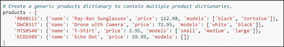

图 4-14: 包含在较大的`products`字典中的多个产品字典。

这种带有所有花括号、逗号和冒号的复杂语法让人很难看出发生了什么（而且也难输入）。在Python之外，在文本文件、电子表格、数据库或你任何放置数据的地方，相同的数据可以存储为名为`Products`的简单表格，以键名作为列标题，类似于表 4-2 中的所示。

| ID (key) | Name | Price | Models |
| --- | --- | --- | --- |
| RB00111 | Ray-Ban Sunglasses | 112.98 | black, tortoise |
| DWC0317 | Drone | 299.00 | black |

要访问函数执行的任务，你需要在代码中`call`（调用）该函数，就像你调用`print`这样的内置函数一样。换句话说，你只需要在代码中输入它的名称即可。你也可以自定义函数名称。因此，请将函数看作一种个性化Python语言的方式，使其命令符合你应用程序中的需求。

# 创建函数

创建函数非常简单。如果你想获得一些实践经验，可以在Jupyter notebook单元格或`.py`文件中操作。

要创建一个函数，从新行开始输入`def`（`definition`的缩写），后面跟一个空格，然后是一个你自定义的名称，最后是一对括号（括号前和内部都没有空格）。在该行的末尾加一个冒号。例如，要创建一个名为`hello()`的简单函数，请输入

```python
def hello():
```

这是一个函数，但它什么也不做。要让函数执行某些操作，你必须在后续行中编写Python代码。为了确保新代码"在"函数内部，请对每一行进行缩进。

 缩进在Python中至关重要。没有命令可以标记函数的结束。`def`行下方的所有缩进行都是该函数的一部分。第一个未缩进的行（与`def`行对齐的行）位于函数外部。

要让此函数执行某些操作，请在`def`下方放置一个缩进的代码行。我们先让函数打印`hello`。所以，在`def`行下方缩进输入`print('Hello')`。现在你的代码看起来像这样：

```python
def hello():

    print('Hello')
```


如果你现在运行这段代码，屏幕上不会发生明显的变化。这是因为函数内部的代码在函数被`called`（调用）之前不会执行。你调用自定义函数的方法与调用内置函数相同：通过编写调用函数名称的代码来调用，包括末尾的括号。

例如，如果你正在跟进练习，请按回车添加一个空行，然后输入`hello()`（中间没有空格），并确保它没有缩进。（你不希望这行代码缩进，因为它是在调用函数来执行其代码；它不是函数的一部分。）所以看起来像这样：

```python
def hello():

    print('Hello')

hello()
```

尽管如此，如果你在 Jupyter 单元格或`.py`文件中，仍然没有任何发生，因为你目前只是输入了代码。要发生任何结果，你必须按照通常的方式在 Jupyter 或 VS Code（如果你在 VS Code 中使用`.py`文件）运行代码。当代码执行时，你应该看到输出，即`Hello`单词，如图 5-1 所示。

**FIGURE 5-1:** 编写并调用简单函数`hello()`。

## 为函数注释

代码中的注释始终是可选的。但习惯做法是将`def`语句下的第一行改为`docstring`（用三个引号括起来的文本），描述函数的功能。通常也会在第一行的括号右侧添加以`#`符号开头的注释。因为它们只是注释，所以它们对代码的执行没有任何影响。注释只是写给自己或编程团队成员的笔记，描述代码的内容。图 5-2 显示了在 VS Code 编辑器中为微小的`hello()`函数添加几个注释的示例。第一个注释`#Practice function`位于函数名旁边。下一个注释是用三个引号括起来的 docstring。

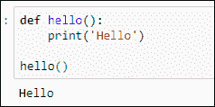

**FIGURE 5-2:**

## 向函数传递信息

假设你想让`hello`函数向任何使用它的人说`Hello`。要向函数传递信息，你需要执行以下操作：

- 在函数的括号内放置一个参数名称，作为信息的占位符。
- 在函数内部，使用该名称进行操作。

例如，假设你想将人的姓名传递给`hello`函数并使用它。你可以对参数和函数使用任何通用名称，如下所示：

```python
def hello(x):

    """Astring function

        ('HelloHello ' +)
```

这里的`x`是一个占位符，代表任何传递的内容。在函数内部，该`x`只引用传递给函数的值。函数外部的任何`x`都不是参数中的那个。这对你的代码没有帮助。最好使用更具描述性的名称，例如`name`或`user_name`，如下所示：

```python
def hello(user_name):

    """Astring describing the function

    print('Hello ' + user_name)
```

在`print()`函数中，我们在`Hello`后面了一个空格，这样输出的`Hello`和名称之间就会有一个空格。

当函数带有参数时，你在调用它时必须传递一个值，否则它将无法工作。例如，如果你在`def`语句中添加了参数，但仍然尝试不带参数调用函数（如下代码所示），运行代码将产生错误：

```python
def hello(user_name):

    """Astring describing the function

    print('Hello ' + user_name)

hello()
```

错误信息将类似于以下：

`hello() missing 1 required positional argument: 'user_name'`

这是一个非常极客的表达方式，表示`hello`函数期望接收某些内容。

对于这个特定函数，需要传递一个字符串。我们之所以知道这一点，是因为我们将传递的任何内容拼接（相加）到另一个字符串（单词`hello`后面跟一个空格）。如果你尝试将数字拼接到字符串上，将会得到错误。

你传递的值可以是字面量（你想要传递的确切数据），也可以包含该信息的变量名。例如，当你运行这段代码时：

```python
def hello(user_name): # 练习函数

""" 一个描述该函数的 docstring """

print('Hello ' + user_name)

hello('Alan')
```

输出为`Hello Alan`，因为当你使用下一行代码调用函数时，你将`Alan`作为字符串传递了进去：

```python
hello('Alan')
```

你也可以使用变量来传递数据。例如，在图 5-3 所示的代码中，我们将字符串`"Alan"`存储在一个名为`this_person`的变量中。然后我们使用该变量名调用函数。运行该代码会产生`Hello Alan`，如该图底部所示。

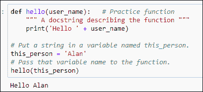

**图 5-3:** 通过变量向函数传递数据。

### 使用默认值定义可选参数

在前面的节中，我们提到，当调用一个期望参数但没有传递这些参数的函数时，你会得到错误。这有一点小谎言。你*可以*编写一个函数，使得传递参数是可选的，但你必须告诉函数在没有传递任何内容时应该使用什么。其语法如下：

`def functioname(parametername=defaultvalue):`

唯一真正不同的是参数名后的后的`= defaultvalue`部分。例如，你可以使用默认值重写示例`hello()`函数，如下所示：

```python
def hello(user_name = 'nobody'): # 练习函数

""" 一个描述该函数的 docstring """

print('Hello ' + user_name)
```

图 5-4 显示了进行更改后的函数，以及测试该函数的输出。

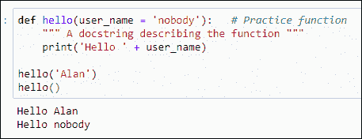

**图 5-4:** 为`hello()`函数添加了带有默认值的可选参数。

首先代码调用了函数，并传递了值`Alan`：

```python
hello('Alan')
```

因此输出是

`Hello Alan`

我们用于测试函数的第二行调用了函数，但没有传递值。换句话说，它调用了函数，但括号中没有值，如下所示：

```python
hello()
```

由于这一行没有传递值，函数的`user_name`参数默认为`'nobody'`，正如你在图中底部看到的，输出为

`Hello nobody`

### 向函数传递多个值

到目前为止，在本章的所有示例中，我们只向函数传递了一个值。但你可以传递你想要的的任意数量的值。只需为每个值提供一个参数名，并用逗号分隔这些名称即可。

例如，假设你想向函数传递用户的名字、姓氏，可能还有一个日期。你可以这样定义这三个参数：

```python
def hello(fname, lname, datestring): # 练习函数

""" 一个描述该函数的 docstring """

print('Hello ' + fname + ' ' + lname)

print('The date is ' + datestring)
```

注意，没有任何参数是可选的。因此，在调用函数时，你需要传递三个值，如下所示：

```python
hello('Alan', 'Simpson', '12/31/2024')
```

图 5-5 显示了使用接受三个参数的`hello()`函数执行代码的示例。


**图 5-5:** 带有三个参数的`hello`函数。

如果你想在多个参数中使用一些（而不是全部）可选参数，请确保可选参数是最后输入的。例如，考虑以下内容，它*无法运行*：

```python
def hello(fname='unknown', datestring):
```

如果你尝试运行这种安排的代码，你会得到`SyntaxError: non-default argument follows default argument.`。这个错误告诉你，如果你想列出必需参数和可选参数，必须将必需参数放在前面。那么以下内容将有效：

```python
def hello(fname, lname, datestring=''):

    msg = 'Hello ' + fname + ' ' + lname

    if len(datestring) > 0:

        msg += ' The date is ' + datestring

    print(msg)
```

逻辑上，函数内部的代码执行以下操作：

- 创建名为`msg`的变量并放入`Hello`和。
- 如果传递的`datestring`长度大于`0`，则将`" The date is "`和`datestring`添加到（msg 中）。
- 在此时打印`msg`。

### 使用关键字参数 (kwargs)

如果你查看过[`Python.org`](http://Python.org)官方 Python 文档，可能会注意到他们频繁使用 *kwargs* 这个词。它是 *keyword arguments*（关键字参数）的缩写，是向函数传递数据的另一种方式。

*argument*（参数）是“传递给函数参数的值”的技术术语。到目前为止，我们使用的都是严格的位置参数。例如，考虑这三个参数：

```python
def hello(fname, lname, datestring=''):
```

当你这样调用函数时：

```python
hello("Alan", "Simpson")
```

Python 假设`"Alan"`是第一个名字，因为它是第一个第一个参数，而`fname`是函数中的第一个参数。第二个参数`"Simpson"`被假设为`lname`，因为`lname`是`def`语句中的第二个参数。`datestring`被假设为空值，因为`datestring`是`def`语句中的第三个参数，而没有没有内容作为第三个参数传递进去。

除了完全依赖参数在代码中的位置来将其与参数名关联之外，你还可以在调用函数时通过使用`parameter` = `value`的语法来告诉函数哪个是哪个。例如，看看这个对`hello`的调用：

```python
hello(datestring='12/31/2019', lname='Simpson', fname='Alan')
```

当你运行这段代码时，它可以运行得良好，即使传递的参数顺序与`def`语句中参数名的顺序不匹配。但在这里顺序并不重要，因为每个参数对应的参数名已经包含在调用中了。显然，`'Alan'`参数对应的是`fname`参数，因为`fname`是`def`语句中的参数名。

如果你传递变量，同样的原理也适用。同样，顺序并不重要。在下面的示例中，传递给函数的值首先被放在命名为`appt_date`、`last_name`等变量中。然后最后一行再次调用了`hello()`函数，就像之前的示例一样。但赋值给每个参数名的值是变量名，而不是传递的字面量。

```python
appt_date = '12/30/2019'

last_name = 'Janda'

first_name = 'Kylie'

hello(datestring=appt_date, lname=last_name, fname=first_name)
```

图 5-7 显示了两种方式运行代码的结果。如你所见，一切运行良好良好。关于哪个参数对应哪个参数没有歧义，因为参数名已经在调用代码中指定了。


**图 5-7:** 使用关键字参数 (kwargs) 调用函数。

### 在列表中传递多个值

到目前为止，我们每次只传递一条数据。但你也可以将迭代对象（iterables）传递给函数。记住，`iterable`是任何 Python 可以通过循环遍历以获取值的对象。列表是一个简单且可能可能是最常用的迭代对象。

通常情况下，对于函数，你可能希望它们返回某些有用的东西，而不改变最初传递给函数的任何内容。例如，你可能希望函数给你一个列表的副本，按字母顺序排列，但不更改原始列表。那么，这里的解决方案很简单。在函数内部，你对原始列表复制。然后使用`sort()`方法对复制的列表进行排序。或者，如果你想降序排序，使用`sort(reverse=True)`。

例如，这里有一个名为`alphabetize()`的新函数，它接受一个名为`names`的参数。被传递的参数名是`original_list`。整个参数声明是`original_list=[]`。方括号表示默认的空列表，以防在没有内容作为参数传递的情况下。换句话说，我们正在使用`=[]`来将默认输入定义为空列表。该函数可以对任何数量的单词或名字列表进行字母排序：

```python
def alphabetize(original_list=[]):

    """ 传递方括号内的任何列表，显示一个按项目排序的字符串 """

    # 在函数内部为传递的列表创建一个工作副本。

    sorted_list = original_list.copy()

    # 对工作副本进行排序。

    sorted_list.sort()

    # 为输出创建一个新的空字符串

    final_list = ''

    # 遍历排序后的列表并添加姓名、逗号和空格。

    for name in sorted_list:

        final_list += name + ', '

    # 如果字符串不为空，去掉最后一个逗号和空格

    final_list = final_list[:-2]

    # 打印字母排序后的列表。

    print(final_list)
```

第一行定义了函数。注意我们对参数使用了`original_list=[]`。默认值（`=[]`）是可选的，但我们放在那里是为了即使你不小心在没有传递列表的情况下调用它，函数也不会崩溃。相反，它只是创建一个空列表。图 5-8 显示了在 VS Code 编辑器中输入的函数。我们在函数下方添加了一个未缩进的行，以便在代码执行时调用函数并向其传递一组名字。

让我们仔细查看该函数。我们开始时的假设是不希望这个函数对原始列表进行排序，而是给我们一个原始列表的副本。此时，`sorted_list`并没有排序；它只是原始的副本。下一行代码执行排序：

```python
sorted_list = original_list.copy()

sorted_list.sort()
```


**图 5-8:** 我们 VS Code 编辑器中的`alphabetize()`函数。

该函数创建一个用逗号分隔的项字符串。下一行创建一个新变量名`final_list`，在`=`符号之后，将其初始化为空字符串（两个引号没有任何空格）：

```python
final_list = ''
```

此循环遍历排序列表，并将列表中的每个项目通过逗号和空格添加到`final_list`字符串中：

```python
for name in sorted_list:

    final_list += name + ', '
```

完成后，如果`final_list`中添加了任何内容，它的结尾会多出一个逗号和空格。以下语句删除了最后两个字符，假设列表长度至少有两个字符。

```python
final_list = final_list[:-2]
```

下一语句只是打印`final_list`以便看到它：

```python
print(final_list)
```

调用函数时，你可以在函数的括号内传递一个列表，如下：

```python
alphabetize(['Schrepfer', 'Maier', 'Santiago', 'Adams'])
```

一如既往，你也可以传递包含列表的变量名，如示例所示：

```python
names = ['Schrepfer', 'Maier', 'Santiago', 'Adams']

alphabetize(names)
```

如果你希望函数对原始列表进行排序，就不需要费心创建副本等操作。你可以像下面的代码所示对原始列表进行排序：

```python
def alphabetize(original_list=[]):

    """ 传递方括号内的任何列表。函数返回排序后的原始列表。 """

    original_list.sort()
```


在那个示例中，函数返回了排序后的原始列表，尽管如果你原样运行该函数，你不会看到任何输出，因为函数内部没有`print`语句在屏幕上显示任何内容。然而，如果你创建一个列表，将其传递给函数并打印该列表，你将看到列表是按字母顺序排列的，如下例所示：

```
fruits=['kiwi','pear','strawberry','plum','banana','artichoke']

alphabetize(fruits)

print(fruits)
```

最后的`print()`语句按字母顺序显示列表，如下：

```
['artichoke', 'banana', 'kiwi', 'pear', 'plum', 'strawberry']
```

### 传递任意数量的参数

列表是向函数传递许多值的一种方法。你也可以设计函数，使其接受任意数量的参数。请注意，这种方法并不特别更快或更好，因此请使用最简单方便或最符合逻辑的方法。要传递任意数量的参数，请使用`*args`作为参数名，如下所示：

```python
def sorter(*args):
```

你传递的任何内容在函数内部都会变成一个名为`args`的元组。记住，元组是一个不可变列表（一个你无法更改的列表）。所以，如果你想更改内容，需要将元组复制到列表，然后在该副本上进行操作。这里有一个示例使用了简单语句`newlist = list(args)`。你可以将其理解为名为`newlist`的变量是一个包含`args`元组中所有内容的列表。下一行`newlist.sort()`对列表进行排序，而`print`显示列表的内容：

```python
def sorter(*args):

    """ 传递任意数量的用逗号隔开的参数

    在函数内部，它们被视为一个名为 args 的元组。 """

    # 从传递的元组创建一个列表。

    newlist = list(args)

    # 排序并显示列表。

    newlist.sort()

    print(newlist)
```

图 5-99_c09-fig-0009) 显示了在 Jupyter 单元格中使用一系列数字作为参数运行此代码的示例。如你所见，结果列表按排序顺序排列，正如预期的一样。


FIGURE 5-9: 一个使用`*args`接受任意数量参数的函数。

### 函数返回值

到目前为止，我们的大多数函数都在屏幕上显示输出，以便你可以确保函数运行正常。在现实生活中，更常见的是函数返回某个值并放在调用代码中指定的变量中。返回语句行通常是函数的最后一行。该行以`return`单词开头，后面跟着一个空格和要返回值的变量名（或某些表达式）。

这是`alphabetize`函数的变体。它不包含`print`语句。相反，在末尾，它简单地返回函数创建的按字母排序的列表（`final_list`）：

```python
def alphabetize(original_list=[]):

    """ 传递方括号内的任何列表，显示带有排序项的字符串 """

    # 在函数内部对传递的列表创建一个工作副本。

    sorted_list = original_list.copy()

    # 对工作副本排序。

    sorted_list.sort()

    # 为输出创建一个新的空字符串

    final_list = ''

    # 遍历排序后的列表并添加名称、逗号和空格。

    for name in sorted_list:

        final_list += name + ', '

    # 去掉最后一个逗号和空格

    final_list = final_list[:-2]

    # 返回按字母排序的列表。

    return final_list
```

使用函数最常见的方法是将它们返回的内容存储在变量中。例如，在下面的代码中，第一行定义了一个名为`random_list`的变量，它只是一个包含无特定顺序名称的列表（在方括号内告诉 Python 这是一个列表）。第二行通过将`random_list`传递给`alphabetize()`函数并存储该函数返回的任何内容，创建一个名为`alpha_list`的新变量。最后的`print`语句显示`alpha_list`变量中的内容：

```python
random_list = ['McMullen', 'Keaser', 'Maier', 'Wilson', 'Yudt', 'Gallagher', 'Jacobs']

alpha_list = alphabetize(random_list)

print(alpha_list)
```

图 5-10 显示了在 Jupyter 单元格中运行整套程序的结果。


与其使用内置函数，不如你使用`def`定义一个自定义函数。例如，我们可以创建一个名为`lowercaseof()`的函数，它接受一个字符串并返回该字符串所有字母都转换为小写的版本。以下是该函数：

```python
def lowercaseof(anystring):

    """ 将字符串转换为全小写 """

    return anystring.lower()
```

我们想了`lowercaseof`这个名字，而`anystring`是未来传递给它的任何字符串的占位符。`return anystring.lower()`这一行通过`str`（字符串）对象的`.lower()`方法将字符串转换为全小写。

 假设你在 Jupyter 单元格或`.py`文件中编写此函数。然后你使用类似`print(lowercaseof('Zandusky'))`的语句调用函数。你得到的输出是转换为全小写的字符串，如图 5-11 所示。


FIGURE 5-11: 测试名为`lowercaseof()`的自定义函数。

好了，现在我们有了一个可以将任何字符串转换为全小写的自定义函数。我们该如何将其作为排序键呢？很简单。像以前一样使用`key=`...`transform`，但将`transform`替换为你的自定义函数名。我们的函数名为`lowercaseof`，所以我们将使用`.sort(key=lowercaseof)`，如下所示：

```python
def lowercaseof(anystring):

    """ 将字符串转换为全小写 """

    return anystring.lower()

names = ['Adams', 'Ma', 'diMeola', 'Zandusky']

names.sort(key=lowercaseof)

print(names)
```

运行这段代码显示名称列表将把它们按正确的顺序排列，因为排序是基于全小写的字符串的。显示的名称与之前相同，因为只有在后台进行的排序使用了小写字母。原始数据仍然保持其原始的大写和小写字母状态。

`'Adams', 'diMeola', 'Ma', 'Zandusky'`

如果你读完这些之后仍然清醒且，你可能在想：“好了，你解决了排序问题。但我以为我们在这里是在讨论 lambda 函数啊。lambda 函数在哪里呢？”目前还没有 lambda 函数。但这是一个正是你*可以*使用 lambda 函数的完美示例，因为你调用的函数`lowercaseof()`仅用一行代码就完成了它的所有工作：`return anystring.lower()`。

当你的函数可以通过像这样简单的单行表达式来完成任务时，你可以跳过`def`和函数名，直接使用这种语法：

`lambda parameters : expression`

将`parameters`替换为你自己定义的一个或多个参数名称（`def`之后括号内的名称以及普通函数中的名称）。将`expression`替换为你想让函数返回的内容，不需要`return`单词。因此在这个例子中，使用 lambda 表达式的键将是

`lambda anystring: anystring.lower()`

现在你可以看到为什么它是匿名函数了。带有函数名`lowercaseof()`的整行都被删除了。因此，使用 lambda 表达式的优势是你甚至不需要外部自定义函数。你只需要参数，后跟一个冒号和一个告诉它要返回内容的表达式。

图 5-12 显示了完整的代码和运行结果。你不需要像`lowercaseof()`这样的自定义函数就能获得正确的排序顺序。你只需要使用`lambda`后面的`anystring: anystring.lower()`作为排序键。


FIGURE 5-12: 使用 lambda 表达式作为排序键。

注意`anystring`比大多数 Python 人士使用的参数名称要长。Python 人士喜欢短名称，甚至是单字母名称。例如，你可以将`anystring`替换为`s`（或其他字母），如下所示，代码将是一样的：

```python
names = ['Adams', 'Ma', 'diMeola', 'Zandusky']

names.sort(key=lambda s: s.lower())

print(names)
```

在本节开头，我们提到过 lambda 函数不必须是匿名的。你可以给它们命名，并像调用其他函数一样调用它们。例如，这里有一个名为`currency`的 lambda 函数，它接受任何数字并返回美元格式的字符串（即带有前导美元符号和千分分隔符的字符串）。

我们有时觉得`.ljust()`和`.rjust()`的整个操作很困惑。如果有疑问，只需在网上搜索 *python left justify* 或 *python right justify* 来获取细节。或者，也可以让 AI 为你编写代码。

所以，事实就是这样：你在 Python 中拥有创建自定义函数的能力。在现实生活中，每当你发现自己需要在应用程序中反复访问同一段代码——同一个逻辑部分——时，不要简单地反复复制和粘贴那段代码。相反，将这些代码放入一个你可以通过名称调用的函数中。这样，如果你决定更改代码，就不必在整个应用程序中寻找所有需要更改的地方。只需要在定义所有代码的单一函数处进行修改即可。

# 第 6 章

# 使用类进行 Python 开发

## 本章内容

-  **理解类和对象**
-  **学习如何创建一个类**
-  **在类中初始化对象**
-  **填充对象的属性** 
-  **发现如何给类添加方法**
-  **了解类继承**

在上一章中，我们讨论了函数，它允许你将执行特定任务的代码块模块化。在本章中，你将学习类，它允许你将代码*和*数据进行模块化。你将发现类和对象的所有神奇、宏伟和美丽（好吧，也许我们有点夸过其实了）。但类已经成为 Python 等现代面向对象编程语言的定义性特征。

我们意识到在之前的章节中我们向你抛输了大量的技术术语。别担心。在本章的剩余部分中，我们假设——就像这个世界上 99.9% 的人一样——你分不清类、对象和一份意大利三明治之间有什么区别。

## 精通类和对象

如你所知，Python 是一种面向对象的编程语言。*面向对象编程*（OOP）几十年来一直是计算机领域的一个热门词汇。“*对象*一词源于这种模型类似于现实世界中的对象，因为每个对象都是具有某些使其独特性属性和特征的实体。例如，一把椅子就是一个对象。存在许多不同的椅子，它们在尺寸、形状、颜色和材料上有所不同。但它们都是椅子。

汽车呢？我们看到汽车时都能认出它是汽车。（嗯，通常如此。）尽管汽车并不完全相同，但它们都具有某些*属性*（年份、品牌、型号、颜色），使得每个汽车都独一无二。它们具有共同的方法，其中*方法*是汽车可以执行的动作或功能。例如，所有汽车都有启动、停止和转弯动作，你以几乎完全相同的方式控制它们。

图 6-1 显示了所有汽车（尽管并不相同）具有某些共同属性和方法的概念。在这种情况下，你可以将`Car`类视为创建一个所有汽车的工厂。在每辆汽车创建后，它都是一个独立的对象。更改一辆汽车对其他汽车或`Car`类没有影响。


图 6-1: 不同的汽车对象。

如果工厂这种想法对你不适用，可以把类视为一种蓝图。例如，考虑狗。不，并没有用于创建狗的物理蓝图，但有狗的 DNA，其作用几乎相同。狗的 DNA 可以被视为一种蓝图（类似于 Python 类），所有的狗都是由此创建的。狗在品种、颜色和尺寸等属性上有所不同，但它们共享某些行为（方法），如进食和睡觉。图 6-2 显示了一个名为`Dog`的动物类示例，所有的狗都源于此。

甚至人也可以以这种方式被视为对象。例如，也许你有一个俱乐部并想要跟踪它的成员。每个成员当然都是人。但在代码中，你可以创建一个`Member`类来存储每个成员的信息。每个成员都将具有某些属性——`user_name`、全名等等——并且是`Member`类的*实例*。每个实例还可以拥有方法，如`.archive()`用于停用账户，以及`.restore()`用于重新激活账户。`.archive()`和`.restore()`方法是让你控制成员身份的行为，就像油油门、刹车和方向盘允许你控制汽车一样。图 6-3 显示了这一概念。


图 6-2: 不同的汽车对象。


图 6-3: 不同的汽车对象。

为了让你的代码更具描述性，可以随时在类定义上方添加注释。你也可以在类行下方添加一个 docstring（文档字符串），每当你在 VS Code 中输入类名时，它都会显示出来。例如，要为你新的`Member`类添加注释，你可以像这样编写代码：

```python
# Define a new class name Member.

class Member:

    """ Create a new member. """
```

定义新类就到此为止。然而，在你指定从该类创建的每个对象要从类继承哪些属性之前，它是没有任何用处的。

## 从类创建实例

为了更方便地为你为你创建实例（对象），你为给类提供一个`init`方法。`init`一词是`initialize`（初始化）的缩写。作为一种方法，它实际上只是定义在类内部的一个函数。但它必须有一个特定的名称`__init__`（那是两个下划线，后面跟着`init`，最后又是两个下划线）。

 那个`__init__`有时被读作“dunder init”。`dunder`部分是`double` `underline`（双下划线）的缩写。

创建`init`方法的语法为：

```python
def __init__(self, suppliedprop1, suppliedprop2, ...):
```

 在 OOP 术语中，`___init___`语句被称为`构造函数`，因为它创建（构建了了对象。

`def`是`define`（定义）的缩写，而`__init__`是能够在类内部创建对象的内置 Python 方法名。`self`部分只是一个变量名，用于指代当前正在创建的对象。你可以使用自己选择的名称代替`self`。但大多数人认为使用`self`是最佳实践，因为它具有解释性且符合习惯。

类的操作如果从简单开始，会更容易学习和理解。所以，为了一个运行示例，你创建一个名为`Member`的类，每当你想要创建一个成员时，都会向其中传递用户名 (`uname`) 和全名 (`fname`)。一如既往，你可以在代码前加上注释。你也可以在第一行下方放置一个 docstring（使用三引号），既作为注释，也可以在 VS Code 中输入代码时的 IntelliSense 提醒：

```python
```


# 定义一个名为 `Member` 的类，用于创建成员对象

```python
class Member:

    """ Create a member from uname and fname """

    def __init__(self, uname, fname):
```

当执行 `def __init__` 行时，你会在类内部拥有一个名为 `self` 的空对象。`uname` 和 `fname` 参数持有你传递的任何数据；稍后你会看到它是如何运作的。

一个没有数据的空对象对你用处不大。让对象变得实用的是属性：即它包含的、该对象特有的信息。因此，在你的类中，下一步是给对象的每个属性赋值。

## 给对象赋予属性

现在你有了一个新的、空的 `Member` 对象，你可以开始为它赋予属性，并向这些属性中填充（`populate`）值。例如，假设你希望每个成员都有一个 `.user_name` 属性，包含用户的用户名（可能用于登录）。你想要另一个名为 `full_name` 的属性，即成员的全名。要定义并填充这些属性，请使用以下代码：

```python
self.user_name = uname

self.full_name = fname
```

第一行为新实例 (`self`) 创建一个名为 `user_name` 的属性，并将传递给 `uname` 的任何内容放入其中。第二行为新的 `self` 对象创建一个名为 `full_name` 的属性，并将作为 `fname` 变量传递的内容放入其中。添加一些注释后，整个类看起来就像下面所示：

```python
# Define a new class named Member.

class Member:

    """ Create a new member. """

    def __init__(self, uname, fname):

        # Define attributes and give them values.

        self.user_name = uname

        self.full_name = fname
```

你看到发生了什么吗？`__init__` 行创建了一个名为 `self` 的新空对象。接下来，`self.user_name = uname` 行向空对象添加了一个名为 `user_name` 的属性，并将传递给 `uname` 的内容放入该属性。然后，`self.full_name = fname` 行对 `full_name` 属性和传递的 `fname` 值执行相同的操作。

类中命名的惯例建议类名使用首字母大写。然而，属性应该遵循变量的标准，即全小写，并用下划线分隔名称中的单词。

> **重要提示：** 如果你正抓耳挠腮地思考如何编写一个特定的类，可以请求生成式 AI 帮助。例如，告诉 Copilot、Claude.ai 或 ChatGPT `write a Python class named Member for managing membership data`。然后使用它生成的代码作为编写你自己的类的起点。

## 从类创建实例

当你创建了类之后，可以使用这种简单语法从类中创建实例（对象）：

```python
this_instance_name = Member('uname', 'fname')
```

诚然地说，要理解所有这些概念可能有些吃力，但请记住，对象仅仅是一种方便的方法，用于封装关于某个与其他物品相似的信息（例如，所有的狗都是狗，所有的汽车都是汽车）。使一个物品变得独特的是它的属性，这些属性并不一定与相同类型的对象的属性相同，就像并不是所有的狗都是同一个品种，并不是所有的汽车颜色相同一样。

我们特意使用 `uname` 和 `fname` 作为参数名，以将它们与属性名 `user_name` 和 `full_name` 区分开。然而，这并不是必需的。事实上，人们倾向于对参数和属性使用相同的名称。

参数名你可以不一定使用 `uname`，而是使用 `user_name`（即使它与属性名相同）。同样地，你可以用 `full_name` 替换 `fname`。这样做不会改变类的行为方式。你只需要记住，同一个名称以两种不同的方式使用：首先作为传入类中的数据的占位符，稍后作为从该传入值中获取值的属性名。它们是不同的，因为一个是 `user_name`，而另一个是 `self.user_name`。

图 6-5 显示了与图 6-4 相同的代码，但将 `uname` 替换为 `user_name`，将 `fname` 替换为 `full_name`。运行代码产生与之前相同的输出；对两个不同的事物使用相同的名称完全没有困扰 Python。


**图 6-5：** `user_name` 和 `full_name` 同时作为参数和属性的 `Member` 类。

在 VS Code 中输入类名和左括号后，它的 IntelliSense 会向你显示参数的语法和代码中的第一个 docstring，如图 6-6 所示。以有意义的方式命名事物，并在类中包含描述性的 docstring，可以让你更轻松地记住未来如何使用该类。


**图 6-6：** 当你访问自己的自定义类时，VS Code 显示帮助信息。

## 修改属性的值

在处理元组（tuples）时，你可以定义 `key`:`value` 对，就像你在这里看到的类实例的 `attribute`:`value` 对一样。不过，有一个主要区别：元组是不可变的，这意味着在定义之后，你的代码无法更改它们的任何内容。这对于对象来说并非如此。在创建对象后，你可以使用以下简单语法随时更改任何属性的值：

`object_name.attribute_name = value`

将 `object_name` 替换为对象的名称（你已经通过类创建了它）。将 `attribute_name` 替换为你想要更改的值的属性名称。将 `value` 替换为新值。

图 6-7 显示了一个示例，在初始创建 `new_guy` 对象后，执行了以下行代码：

```python
new_guy.user_name = "Princess"
```

下方的输出行显示 `new_guy` 的 `user_name` 确实已经更改为 `Princess`。他的全名没有改变，因为你没有在代码中对其进行任何操作。

## 定义带有默认值的属性

你不需要为新对象传递每个属性的值。如果你在对象创建时总是给某个属性提供某个默认值，你只需要使用 `self.attribute_name = value`，这和之前一样，其中 `attribute_name` 是你自定义的名称。`value` 可以是你设置的某个值，例如布尔值的 `True` 或 `False`，或者今天的日期，或者任何 Python 在无需你提供值的情况下就能计算或确定的值。


**图 6-7：** 修改对象属性的值。

例如，假设每当你创建一个新成员时，你都想跟踪 `date_joined` 和 `is_active` 状态。如果你想使用 `datetime`，你需要导入它：

```python
import datetime

class Member:

    """ 创建一个新的成员."""

    def __init__(self, user_name, full_name):

        # 定义属性。

        self.user_name = user_name

        self.full_name = full_name

        # 将 date_joined 设为今天的日期。

        self.date_joined = datetime.date.today()

        # 将 is_active 设置为 True

        self.is_active = True
```

注意，默认值仅仅是如此：它是创建对象时自动赋值的值。但你可以像更改任何其他属性一样更改默认值：

`object_name.attribute_name = value`

例如，假设你使用 `is_active` 属性来确定用户是否活跃，以及能否登录你的网站。如果某个成员实际上是一个讨厌的喷子，而你不再希望该成员登录，你可以这样将 `is_active` 属性更改为 `False`：

```python
new_member.is_active = False
```

## 定义类方法

你定义的任何对象都可以有任意数量的属性，每个属性可以使用你喜欢的名称，以存储关于对象的信息，例如狗的品种和颜色或汽车的品牌和型号。你也可以为任何对象定义自己的方法，这些更像是行为而不是对象的特征。例如，狗可以吃、睡觉和吠叫。汽车可以行驶、停止和转弯。方法实际上就是函数，正如你在上一章中所学的那样。使其成为方法的因素是它与特定的类，以及从该类创建的每个特定对象相关联。

方法名通过名称后的括号对与对象的属性名区分开来。要定义类中的方法，请为每个方法使用以下语法：

`def method_name(self, param1, param2, ...):`

将 `method_name` 替换为你自定义的名称（全小写，无空格）。保留 `self` 单词，作为被类操作的对象的引用。可选地，你也可以在 `self` 之后使用逗号传递参数，就像任何其他函数一样。

> **重要提示：** 不要输入方括号（`[]`）。在语法中显示它们仅是为了表示 `self` 之后的参数名是允许的但不是必需的。

假设你想创建一个名为 `show_date_joined()` 的方法，该方法返回一个格式化后的字符串，包含用户名和加入日期。以下是定义该方法的方法：

```python
# 一个返回显示加入日期格式化字符串的方法。

def show_date_joined(self):

    return f"{self.full_name} joined on {self.date_joined:%m/%d/%y}"
```

该方法的名称是 `show_date_joined`。当该方法被调用时，它的任务仅仅是将包含成员全名和加入日期的格式化良好的文本组合在一起。

要在代码中调用该方法，请使用以下语法：

`object_name.method_name()`

将 `object_name` 替换为你所指的对象的名称。将 `method_name` 替换为你想要调用的方法名称。包含括号（不要有空格）。如果类的 `__init__` 方法仅指定了 `self`，则你不需要传递任何内容。然而，如果 `__init__` 指定了 `self` 之外的额外参数，你需要为这些参数指定值。图 6-8 显示了完整的示例。


**图 6-8：** 修改对象属性的值。

注意图 6-8 中 `show_date_joined()` 方法是如何在类内部定义的。它的 `def` 缩进级别与第一个 `def` 相同。方法执行的代码在该 `def` 下方缩进。在类外部，`new_guy = Member('Rambo', 'Rocco Moe')` 创建了一个名为 `new_guy` 的新成员。然后 `new_guy.show_date_joined()` 执行 `show_date_joined()` 方法，该方法随后显示 `Rocco Moe joined 11/18/20`，即我们运行代码的日期。

## 向方法传递参数

你可以像使用函数一样向方法传递数据：通过在括号内使用参数名。但请记住，`self` 始终是方法名后的第一个名称，你永远不会向 `self` 参数传递数据。例如，假设你想创建一个名为 `set_active()` 的方法，允许将 `is_active` 属性设置为 `True` 或 `False`。你传递的任何内容都会赋值给 `is_active` 属性。以下是在你的代码中定义该方法的方法：

```python
# 激活（True）或禁用（False）账户的方法。

def set_active(self, yesno):

    """ True 表示激活，False 表示非激活状态 """

    self.is_active = yesno
```

文档字符串（docstring）是可选的。但是，当你在 VS Code 中输入相关代码时，文档字符串会显示在屏幕上，因此它可以作为你可以传递什么内容的良好提醒。执行时，此方法不会在屏幕上显示任何内容；它只是将该成员的 `is_active` 属性更改为你作为 `yesno` 参数传递的任何内容。

> **说明：** 理解方法实际上就是函数是有帮助的。方法区别于函数的点在于方法……

## 使用类变量

到目前为止你已经看到了属性的示例，它们有时被称为实例变量，因为它们是包含随不同实例变化的信息的占位符。但你也可能想要包含一些变量，这些变量对于类的所有实例都是相同的。在类内部但在任何方法之外定义的变量被称为类变量。它们通常用作在类的所有实例中共享的常量或配置值。

要定义类变量，请在类层级（而不是在方法内部）使用以下语法：

`variname = value`

将 `variname` 替换为你自行选择的名称，并将 `value` 替换为你想要赋值给该变量的具体值。例如，假设你的代码包含一个 `free_days` 变量，允许人们注册时获得三个月（90 天）的免费访问权限。你不确定是否想要永久坚持这一点，因此与其将其硬编码在应用程序中（这将难以更改），你只需将其作为一个类变量，自动应用到所有新对象，如下所示：

```python
# 定义一个名为 Member 的类用于创建成员对象。

class Member:

    """ 创建成员对象 """

    free_days = 90

    def __init__(self, user_name, full_name):

        pass
```

你在任何方法之外定义了 `free_days` 变量。

现在假设在代码的后续部分，你想存储免费试用到期的日期。你已经有一个名为 `date_joined` 的属性，代表成员加入的日期。你可以再添加另一个名为 `free_expires` 的属性，代表用户免费会员到期的日期。你可以通过在成员加入的日期上加上免费天数来确定第二个日期。直觉上，你似乎可以使用如下简单的语法将 `free_days` 加到日期上：

```python
self.free_expires = dt.date.today() + dt.timedelta(days=free_days)
```

但如果你尝试运行这段代码，将会得到一个错误，说 Python 无法识别 `free_days` 变量名（尽管它在类的顶部已经定义了）。相反，你必须在变量名之前加上类名或 `self`。例如，这种写法是可以的：

```python
self.free_expires = dt.date.today() + dt.timedelta(days=Member.free_days)
```

图 6-10 显示了全景。我们从原始类中移除了一些代码以对其进行精简，并使其更容易关注新内容。顶部的 `free_days = 365` 这一行将 `free_days` 变量的值设置为 365。（我们在上一个示例中使用了 90 天，但这是一个新示例，我们想说明相同的代码如何根据你在 `free_days` 变量中指定的任何天数来工作。）然后，在代码的后续部分，`__init__` 方法使用 `Member.free_freedays` 将该天数加到当前日期上。通过创建一个名为 `wilbur` 的新成员并查看其 `date_joined` 和 `free_expires` 属性，运行这段代码将显示当前日期（你运行代码时的日期）以及之后 365 天的日期。


**图 6-10：** `free_days` 变量是 `Member` 类中的一个类变量。

如果你以后决定给人们提供 90 天免费期就足够了怎么办？你可以直接在类中将 365 天的值改回 90。因为它是一个变量，你可以像这样在类外部即时进行操作：

```python
# 为免费天数设置默认值。

Member.free_days = 90
```


当你运行这段代码时，你仍然会创建一个名为`wilbur`的用户，并带有`date_joined`和`free_days`变量。但这次，`wilbur.free_expires`将是`date_joined`之后的 90 天，而不是 365 天。

### 使用类方法

回想一下，方法是绑定到特定类的函数。到目前为止，你使用的方法（例如`.show_date_joined()`和`.set_is_active()`）都是实例方法，因为你总是配合特定的对象——类的特定实例来使用它们。在 Python 中，你也可以创建类方法。

顾如名，类方法是与整个类相关的方法，而不是与类的特定实例相关。换句话说，类方法在范围上与类变量相似，因为它们适用于整个类，而不仅仅是类的单个实例。

与类变量一样，类方法不需要`self`关键字，因为该关键字始终指代在该时刻正在操作的特定对象，而不是由类创建的所有对象。所以对于初学者来说，如果你想让一个方法对整个类执行某些操作，不要使用`def name(self)`，因为`self`会立即将方法绑定到一个对象上。

如果创建类方法只需要排除`self`单词，那就太好了，但遗憾的是，事实并非那样运行的。要定义一个类方法，你首先需要在代码中输入以下内容：

```python
@classmethod
```

开头的`@`将`classmethod`定义为装饰器——是的，又一个可以添加到你不断增长的“极客术语大”列表中的术语。装饰器通常是修改或扩展其所应用对象的功能。

在这一行下方，使用以下语法定义你的类方法：

```python
def method_name(cls, x, ...):
```

将`method_name`替换为你想要给方法起的名字。保留`cls`不变，因为它是整个类的引用（因为`@classmethod`装饰器在背后将其定义为如此）。在`cls`之后，你可以加上逗号和你想传递给方法的参数名称，就像你对普通实例方法做的那样。

例如，假设你想在开始创建对象之前定义一个方法来设置免费天数，以便所有对象都获得相同的`free_days`数值。以下代码通过首先创建一个名为`free_days`的类变量来完成该任务。

在类的更下方是这个类方法：

```python
# 类方法紧随 @classmethod 装饰器
# 并引用 cls 而不是 self。

@classmethod
def set_freedays(cls, days):
    cls.free_days = days
```

当你运行这段代码时，你仍然会创建一个名为`wilbur`的用户，并带有`date_joined`和`free_days`变量。但这次，`wilbur.free_expires`将是`date_joined`之后的 90 天，而不是 365 天。


图 6-10：`free_days`变量是`Member`类中的一个类变量。


图 6-12：`Member`类现在有一个名为`current_time()`的静态方法。

# 理解类继承

热衷于面向对象编程的人生喜欢谈论类继承、子类等等，这些内容对于街上的普通人 Joe 或 Josephine 来说几乎毫无意义。尽管如此，他们所讨论的 Python 概念其实是你在现实生活中随处可见的。

正如前所提到的，如果我们把狗的 DNA 视为一种工厂或 Python 类，我们就可以把所有的狗归类为称为“狗”的动物类的成员。尽管每只狗都是独特的，但所有的狗仍然都是狗，因为它们是我们称为`Dog`的类的成员，我们可以像图 6-13 所示这一事实。


图 6-13：作为`Dog`类对象的狗。

因此，每只狗都是独特的（尽管没有其他哪只狗比你的好），但让狗与彼此相似的是它们从“狗类”中继承的特征。Python 和其他面向对象语言所提供的类和类继承概念，并不是凭空出现的，为了让学习这些东西变得更困难、更烦人。世界上大部分信息可以通过使用类、子类、子子类，一直到个体来得到最好的存储、分类和理解。

例如，你可能已经注意到地球上还有其他类狗的生物游荡（尽管它们可能不是你想养在家里当宠物的种类）。你会想到狼、郊狼和豺。它们与狗的相似之处在于，它们都从一个我们可以称为“犬科”的更高层级的类继承了它们的“狗性”，如图 6-14 所示。


图 6-14：几种不同种类的动物与狗相似。

使用我们的狗类比，我们在向上分类的过程中显然不需要停留在“犬科”。我们可以把“哺乳动物”放在它上面，因为所有犬科动物都是哺乳动物。我们可以把“动物”放在它上面，因为所有哺乳动物都是动物。我们还可以把“生命”放在它上面，因为所有动物都是生命。

所以基本上，让一只狗成为狗的因素都源于：它从它之前的许多类（或生物）中继承了某些特征。


对于生物学天才来说，是的，我们知道哺乳纲（Mammalia）是一个类，犬属（Canis）是一个属，其下方是种。所以你不需要就此给我们发邮件或信息。我们在这里使用类和子类的术语是为了将该概念与 Python 中的类、子类和对象联系起来。

显然，这个概念不仅适用于狗。世界上有很多不同的猫。有可怜的小 Bootsy，你会乐意与它共床，还有许多其他猫科动物，如狮子、老虎和豹子，你可能不会和它们共床。


如果你在网上搜索“生命层级”并点击“图片”，你将看到分类所有生命有多少种方法，以及继承是如何从普通到具体的生命向下延伸的。

甚至我们的汽车类比也可以遵循这一点。在顶部，我们有交通工具。在下面，可能是船只、飞机和汽车。在汽车下面，我们有轿车、卡车、面包车等等，直到任何一种特定的汽车。所以类和子类并不是新奇事物。新奇的仅仅是思考如何向我们称为计算机的盲目机器表示这些事物。所以请继续读下去看将如何做到。

从编码的角度来看，实现继承简单的方法是在类内部创建子类。类定义了适用于该类所有实例的内容。每个子类定义了只与该子类相关的内容，而不替换任何来自通用父类的内容。

### 创建基（主）类

子类定义了适用于该类所有实例的内容。每个子类定义了只与该子类相关的内容，而不替换任何来自通用父类的内容。

```python
import datetime as dt

# 用于所有人的基类
class Member:
    """ Member 属性 """

    # 默认情况下，新账户有效期为一年（365 天）
    expiry_days = 365

    # 初始化成员。
    def __init__(self, first_name, last_name):
        # 所有人的实例变量
        self.first_name = first_name
        self.last_name = last_name

        # 从今天计算到期日。
        self.expiry_date = dt.date.today() + dt.timedelta(days=self.expiry_days)
```

类定义了适用于该类所有实例的内容。每个子类定义了只与该子类相关的内容，而不替换任何来自通用父类的内容。

默认情况下，新账户有效期为一年。所以这个`Member`类的`__init__`方法接受两个参数：`first_name`和`last_name`。

```python
if __name__ == "__main__":
    member = Member("Joe", "Anybody")

    print(f"Name: {member.first_name} {member.last_name}")
    print(f"Expiry Date: {member.expiry_date}")
```

图 6-12：`Member`类现在有一个名为`current_time()`的静态方法。

默认情况下，新账户有效期为一年。所以这个`Member`类接受两个参数：`first_name`和`last_name`。

图 6-15：简化的基类。

### 定义子类

要定义子类，请确保将光标放在基类下方并返回到没有缩进的状态，因为子类并不是基类的一部分或包含在基类内部。要定义子类，请使用以下语法：

```python
class subclass_name(baseclass_name):
```

将`subclass_name`替换为你想要给此子类的名称。将`baseclass_name`替换为基类的名称，该名称在基类的顶部定义。例如，要为`Member`创建一个名为`Admin`的子类，请使用以下代码：

```python
class Admin(Member):
```

要创建另一个名为`User`的子类，请添加此代码：

```python
class User(Member):
```

如果你让类保持为空，你将无法测试它们，因为你会收到一条错误信息，提示该类是空的。但你可以在每个类的第一个命令中放入`pass`关键字。这是你告诉 Python：“是的，我知道这些类是空的，但让它通过，不要抛出错误信息。”你可以在每个类上方添加注释，提醒你每个类的用途，如下例所示：

```python
# 用于管理员的子类。
class Admin(Member):
    pass

# 用于用户的子类。
class User(Member):
    pass
```

当你使用这些子类时，不需要对`Member`类进行任何直接引用。`Admin`和`User`都将自动继承所有`Member`的内容。因此，例如要创建一个名为`Annie`的`Admin`，你会使用这种语法：

```python
ann = Admin("Annie", "Angst")
```

要创建一个`User`，对`User`类和用户名称进行相同的操作。例如：

```python
uli = User("Uli", "Ungula")
```

我们在图 6-16 所示的代码中添加了几个`print`语句，以便你可以看到创建两个用户的结果。`Annie`是一个`Admin`，`Uli`是一个`User`，但他们都自动获得了分配给成员的所有属性。（`Member`类直接位于图像中显示代码的正上方。我们没有包含它，因为它没有变化。）


图 6-16：创建并测试`Admin`和`User`类。

所以你在这里学到的是，子类接受基类接受的所有不同参数，并将它们分配给属性，就像`Person`类一样。但到目前为止，`Admin`和`User`只是成员。换句话说，每个都是一个`Member`对象。在现实生活中，这两种成员类型可能会存在某些差异。在接下来的章节中，你将学习让这些差异发生的方法。

### 在子类中重写默认值

你通过子类可以做的最简单的事情之一，就是为基类中具有默认值的属性赋上其他值。例如，在`Member`类中，我们创建了一个名为`expiry_days`的变量，稍后在类中使用它计算过期日期。但假设你希望`Admin`账户永不过期（或在某个荒谬的时间之后过期，以便那里仍有一个日期）。只需在`Admin`类中设置新的`expiry_date`即可（你可以删除`pass`行，因为该类不再是空的）。这些更改在你的`Admin`子类中可能如下：

```python
# 用于管理员的子类。
class Admin(Member):
    # 管理员账户 100 年不过期。
    expiry_days = 365.2422 * 100
```

无论你设置什么值，它将覆盖默认设置并被用于计算`Admin`的过期日期。因此，普通用户仍然获得 365 天，而`Admin`获得 100 年（365 天乘以 100）。

### 从子类中添加额外参数

有时，子类的成员拥有其他成员没有的参数值。在这种情况下，你可能想从子类设置一个基类中不存在的参数。这样做比仅仅更改默认值要复杂一点，但这是一项常用技术，所以你应该意识到它。接下来的段落将带你通过一个示例。

首先，你的子类需要它自己的`def __init__`行，其中包含基类`__init__`中的所有内容，加上你想要传递的任何额外内容。例如，假设管理员有某些秘密代码，你想从`Admin`子类设置该代码。你仍然必须设置姓和名，所以你在`Admin`子类中的`def __init__`行看起来如下：

```python
def __init__(self, first_name, last_name, secret_code):
```

缩进级别将与上面的行相同。

接下来，任何属于基类`Member`的参数都需要使用这种看起来相当奇怪的语法在其中设置：

```python
super().__init__(param1, param2, …)
```

注意开头的单词`super()`。它是对父类（也称为超类）的引用。它将当前对象视为一个由父类创建的对象。

在基类`Member`中设置参数时，请将`param1`、`param2`等替换为实际的参数名。例如，使用`first_name`和`last_name`：

```python
super().__init__(first_name, last_name)
```

在子类中，你可以设置`secret_code`。在设置`secret_code`属性时，请将`parametername`替换为实际的变量名：

```python
self.secret_code = secret_code
```

在`Admin`类中，你可以设置`expiry_days`。例如：

```python
self.expiry_days = 365.2422 * 100
```

如果你的类为所有用户（而不仅仅是管理员）分配了`secret_code`，那么当你打印普通用户的数据时就不会报错。相反，普通用户的秘密代码将显示为空字符串（`""`）。要为每个成员分配秘密代码，即使该秘密代码是空白的，向主`Member`类构造函数中添加以下内容：

```python
# 默认秘密代码为空
self.secret_code = ""
```

因此，即使你在`User`子类中没有对`secret_code`进行任何操作，当你尝试访问`User`的密钥码时，也不必担心会抛出错误。`User`将有一个密钥码，但它将是一个空字符串。图 6-18 显示了两个子类的所有代码，以及尝试打印`uli.secret_code`的操作，它只会显示为空，而不会抛出错误信息。

我们留下的`User`子类唯一语句是`pass`。在现实生活中，你可能会为其他子类想出更多的默认值或参数。但所有子类的语法和代码都是相同的。本节涵盖的技能适用于你所有的类和子类。


图 6-18：完整的`Admin`和`User`子类。

### 调用基类方法

基类中的方法对子类的工作方式与对基类相同。要尝试基类中的方法，请在基类底部添加一个名为`show_expiry(self)`的新方法，如下：

```python
class Member:
    """ Member 类的属性和方法适用于所有人 """

    # 默认情况下，新账户有效期为一年（365 天）
    expiry_days = 365

    # 初始化成员对象。
    def __init__(self, first_name, last_name):
        # 适用于人的属性（实例变量）。
        self.first_name = first_name
        self.last_name = last_name
```


# 从今天起计算过期日期

```python
self.expiry_date = dt.date.today() + dt.timedelta(days=self.expiry_days)

# 默认密钥码为空
self.secret_code = ''
```

## 基类中的方法

```python
def show_expiry(self):
    return f"{self.first_name} {self.last_name} " + f"expires on {self.expiry_date}"
```

`show_expiry()`方法在调用时，会返回一个包含用户名、姓和过期日期的格式化字符串。保持子类不变并执行以下代码，将显示`Annie`和`Uli`的姓名和过期日期：

```python
ann = Admin('Annie', 'Angst', 'PRESTO')
print(ann.show_expiry())

uli = User('Uli', 'Ungula')
print(uli.show_expiry())
```

这是输出，尽管你的日期会根据运行代码的日期而不同：

```text
Annie Angst expires on 2124-12-04
Uli Ungula expires on 2024-12-04
```

## 使用相同的名称两次

你可能好奇当多次使用同一个名称时会发生什么。Python 总是会选择具体的那个，即与子类关联的。只有当子类中没有任何具有该方法名称时，它才会使用来自基类的更通用的方法。

为了说明这一点，这里有一些代码定义了一个包含少量属性和方法的`Member`类，以排除任何无关的代码。代码中的注释描述了代码正在发生的情况：

```python
class Member:
    """ Member 类的属性和方法 """

    # 初始化成员对象。
    def __init__(self, first_name, last_name):
        # 适用于人的属性（实例变量）。
        self.first_name = first_name
        self.last_name = last_name

    # 基类中的方法
    def get_status(self):
        return f"{self.first_name} is a Member."

    # 管理员的子类
    class Admin(Member):
        def get_status(self):
            return f"{self.first_name} is an Admin."

    # 普通用户的子类
    class User(Member):
        def get_status(self):
            return f"{self.first_name} is a regular User."
```

`Member`类以及`Admin`和`User`类都拥有一个名为`get_status()`的方法，显示成员的姓和状态。图 6-19 显示了使用`Admin`、`User`以及一个既不是`Admin`也不是`User`的`Member`运行该代码的结果。如你所示，每情况下调用的`get_status`都是与人的所属子类关联的（对于既不是`Admin`也不是`User`的`Member`，则与基类关联）。

Python 有一个内置的`help()`方法，你可以用它查看有关类的信息。例如：

```python
help(Admin)
```

`help()`方法向你展示关于该类及其方法的信息。图 6-19 显示了使用`Admin`、`User`以及一个既不是`Admin`也不是`User`的`Member`运行该代码的结果。如你所示，每情况下调用的`get_status`都是与人的所属子类关联的（对于既不是`Admin`也不是`User`的`Member`，则与基类关联）。

类（以及在某种程度上，子类）在 Python 世界中被广泛使用，本章涵盖的内容将使你能够轻松编写自己的类，并理解他人编写的类。在完成本微型书籍之前，你将想要发现另一个 Python 核心概念：Python 如何处理错误，以及你可以在自己的代码中采取哪些操作来更好地处理错误。

# 第 7 章 规避错误

-  **发现异常**
-  **找到如何优雅地处理错误**
-  **确保你的应用程序不会崩溃**
-  **检查`try … except…else … finally`**
-  **学习抛出自己的异常**

我们都希望程序能够一直完美运行。但有时，现实世界中的情况会阻止程序的运行。问题不在于你或你的程序，通常是使用程序的人做错了什么。错误处理的核心在于预测这些问题、捕获错误，然后告知用户问题所在，以便他们进行修复。

我们在这里描述的技巧并不是为了修复代码中的 bug。你必须自己修复那类型的错误。我们严格来说讨论的是程序运行环境中的错误，你对这些环境没有控制权。*处理*错误简单来说，是将 Python 通常显示的专业术语类错误消息（这些信息对大多数人来说没有意义），替换为用简单易懂的语言告诉用户哪里出了问题，理想情况下还告诉他们如何修复。

## 理解异常

在 Python（以及所有其他编程语言）中，*exception*（异常）一词指的是你代码中的错误，或代码运行环境中的错误——基本上是任何阻止程序正常运行的情况。为了看一个简单的例子，让你的 Python 程序打开一个文件。该语法非常简单：

`name = open('filename')`

将`name`替换为你自定义的名称。将`filename`替换为文件名。如果文件与代码在同一个文件夹中，你不需要指定文件夹路径，因为假设当前文件夹。

图 7-1 显示了一个示例。我们在示例中使用了 VS Code，这样你可以看到我们工作文件夹的内容。该文件夹包含一个名为`showfilecontents.py`的文件，即包含我们编写的 Python 代码的文件。另一个文件名为`people.csv`。


图 7-1： VS Code 文件夹中的`showfilecontents.py`和`people.csv`文件。

`showfilecontents.py`文件包含代码。`people.csv`文件包含数据（关于人的信息）。图 7-2 显示了 Excel 中（顶部）`people.csv`文件的内容，方便你阅读；以及文本编辑器（底部）中的内容，这是 Python 和其他语言看到的样子。文件的内容现在并不重要；你在这里发现的内容将适用于任何外部文件。

Python 代码只有两行（不包括注释），如下所示：

```python
# 打开在同一文件夹下的文件。
the_file = open('people.csv')

# 显示文件名。
print(the_file.name)
```


图 7-2： 命令行提示符显示用户数据。

## 处理文件缺失错误

你可以按照这样重写`showfilecontents.py`代码来处理文件缺失（或拼写错误）错误：

```python
try:
    # 打开文件并显示其名称。
    the_file = open('people.csv')
    print(the_file.name)
except Exception:
    print("Sorry, I don't see a file named people.csv here")
```

由于程序应该打开的文件可能不存在，因此你从`try:`开始，然后在下方尝试打开文件。如果文件打开成功，`print()`语句将执行并显示文件名。但如果尝试打开文件时抛出异常，程序不会崩溃并显示通用的错误信息。相反，它会显示一条普通计算机用户可以理解的消息，如图 7-4 所示。


图 7-4： `showfilecontents.py`文件捕获了错误并显示了友好的消息。

## 具体化异常

我们之前的代码示例优雅地处理了文件未找到错误。但一个较大的应用程序可能有许多可能出错的地方，你希望对每个错误进行不同的处理。为了做到这一点，你可以定义多个错误处理器，正如我们接下来将讨论的那样。

假设你手动修复了文件名，使其成为最初预期的`people.csv`。如之前所示，当程序运行代码且没有错误时，输出只是文件名。在打印文件名的行下方，我们又添加了另一行代码：

```python
try:
    # 打开文件并显示其名称。
    the_file = open('people.csv')
    print(the_file.name)
    print(the_file.wookems())
except Exception:
    print("Sorry, I don't see a file named people.csv here")
```

当你运行这段代码时，文件名没有问题，因此输出显示`people.csv`，正如你预期的那样。然而，下一行代码`print(the_file.wookems())`抛出了一个错误，因为我们没有定义名为`wookems()`的方法。不幸的是，错误信息仍然与之前一样，尽管错误的原因是 Python 中没有名为`.wookems()`的方法：

```text
people.csv
Sorry, I don't see a file named people.csv here
```

那么，为什么错误信息说找不到名为`people.csv`的文件呢，而我们明明知道它*被找到了*，并且下一行代码导致了错误呢？问题出在`except Exception:`这一行，它的意思是“如果此`try`块中抛出*任何*异常，就执行`except`行下方的代码”。

为了解决这个问题，你需要将`Exception:`替换为你想要让 Python 捕获的特定异常。但你如何知道那个特定异常是什么呢？很简单。在没有异常处理的情况下抛出的异常是：

`FileNotFoundError: [Errno 2] No such file or directory: 'people.csv'`

第一个单词是异常的名称，你可以用它代替通用的`Exception`名称，如下：

```python
try:
    # 打开文件并显示其名称。
    the_file = open('people.csv')
    print(the_file.name)
    print(the_file.wookems())
except FileNotFoundError:
    print("Sorry, I don't see a file named people.csv here")
```

诚然，隔离文件未找到错误对解决糟糕的方法名没有帮助。然而，糟糕的方法名并不是异常；它是一个编程错误，需要通过将代码中的`.wookems()`替换为你想要使用的方法名来纠正。至少，你看到的错误信息不再是具有误导性的`Sorry, I don't see a file named people.csv here`错误了。代码运行正常，因此在指令下会显示文件名。当它运行到包含糟糕`.wookems()`方法的行时，它会抛出一个错误——但不是与找不到文件相关的错误。它显示了针对该错误的正确错误消息，`object has no attribute 'wookems'`，如图 7-5 所示。


图 7-5： 显示了正确的错误消息。

再次，如果你在考虑处理`.wookems`错误，那并不是你会编写异常处理器的异常。异常发生在程序所依赖的程序*外部*事物不可用时。程序逻辑错误（如不存在的方法名）是程序内部的错误，必须予以修正。

## 防止应用程序崩溃

你可以在`try`块中堆叠`except`语句来处理不同的错误。例如，这里有两个处理器，一个处理文件错误，另一个处理其他情况：

```python
try:
    # 打开文件并显示其名称。
    the_file = open('people.csv')
    # 打印两个空行以及文件的第一行。
    print('\n\n', the_file.readline())
    # 关闭文件。
    the_file.wookems()
except FileNotFoundError:
    print("Sorry, I don't see a file named people.csv here")
except Exception:
    print("Sorry, something wrong")
```

 运行这段代码产生以下输出：

```text
Username,FirstName,LastName,Role,DateJoined
Sorry, something wrong
```

第一行显示`people.csv`文件的内容。第二行是第二个`except:`语句的输出，内容为`Sorry, something wrong`。这个消息很模糊。在编写自己的异常处理器时，始终确保特定错误（如`FileNotFoundError`）的代码位于通用错误（如`Exception`）之前。否则，通用异常会被捕获，并在到达特定错误处理器之前停止程序执行。

与其对未知异常只打印通用消息，不如将错误消息存储在变量中并显示该变量的内容。按照习惯，你可以为变量命名任何名称，尽管很多人使用`e`或`err`作为*error*的缩写。

例如，考虑上述代码的以下重写。通用处理器`except Exception`现在末尾有一个`as e`，这意味着“无论在这里捕获到什么异常，都将错误消息放在名为`e`的变量中”。然后，下一行使用`print(e)`显示变量`e`的内容：

```python
try:
    # 打开文件并显示其名称。
    the_file = open('people.csv')
    # 打印两个空行以及文件的第一行。
    print('\n\n', the_file.readline())
    the_file.wookems()
except FileNotFoundError:
    print("Sorry, I don't see a file named people.csv here")
except Exception as e:
    print(e)
```

运行这段代码会显示以下内容：

```text
Username,FirstName,LastName,Role,DateJoined
'_io.TextIOWrapper' object has no attribute 'wookems'
```

第一行只是`people.csv`文件中的第一行文本。代码中没有错误，而且文件确实存在，所以一切进展顺利。第二行是：

```text
'_io.TextIOWrapper' object has no attribute 'wookems'
```

这并不是普通的英语，但比“发生了一些其他错误”要好。至少`object has no attribute 'wookems'`这部分让你知道问题与单词`wookems`某种有关。你优雅地处理了错误，应用程序没有崩溃。你至少获得了一些关于错误的信息，这对你来说可能很有帮助，尽管对于不了解其内部机制的应用程序用户来说可能没有帮助。

## 在组合中加入 else

在上一个示例中，我们使用了一个错误处理器来处理文件未找到错误，并用另一个处理器处理所有其他情况。但在现实生活中，你可能需要处理更多类型的错误。因此，可能会有针对各种错误的`except:`块。但如果你尝试捕获的错误一个都没有发生呢？在这种情况下，你希望代码执行能够正常进行。你可以向代码中添加一个`else:`块，来处理没有错误可捕获的情况。

```python
try:
    # The thing that might cause an exception
    catch a common exception:
        # Explain the problem
except Exception as e:
    # Show the generic error message
else:
    # Code that runs when no exception occurs
```


# 只有在没有抛出异常时才在此继续

如果你将这段代码转换为普通的英语，其逻辑流如下：

- 尝试打开文件。
  - 如果文件不存在，通知用户并停止。
  - 如果发生其他错误，显示通用错误消息并停止。
- 否则，继续执行其余代码。

通过将 `try:` 限制在最可能抛出异常的那一件事上，我们可以在代码尝试进一步执行之前让它立即停止。但如果没有抛出异常，代码将继续在 `else` 下方正常运行，那里之前的异常处理器已经不再重要了。以下是所有的代码，并注释了正在发生什么：

```python
try:
    # Open the file named people.csv
    the_file = open('people.csv')

    # Watch for common error and stop program if it happens.
except FileNotFoundError:
    print("Sorry, I don't see a file named people.csv here")

    # Catch any unexpected error.
except Exception as err:
    print(err)

    # Otherwise, if nothing bad has happened by now, just keep going.
else:
    # File must be open by now if we got here.
    print('\n')  # Print a blank line.

    # Print each line from the file.
    for one_line in the_file:
        print(one_line)

    the_file.close()
    print("Success!")
```

 像 Python 一如既往，缩进非常重要。确保你像本章所示对自己的代码进行缩进。否则，你的代码将无法运行。

图 7-6 还显示了所有的代码以及在 VS Code 中运行这些代码的结果。


图 7-6：带有 `try`、异常处理器以及用于无异常情况的 `else:` 块的代码。

## 使用 `try … except … else … finally`

如果你查看 Python 异常处理的完整语法，你会在最后看到另一个选项，如下：

```python
try:
    # try to do this
except ErrorType as e:
    # if ErrorType happens, execute this
except:
    # if something else bad happens, execute this
else:
    # if no exceptions, continue on normally here
finally:
    # do this code no matter what happened above
```

无论 `try` 块如何结束，`finally` 代码都会执行。例如，如果你在一个函数内部，并且 `except` 块使用 `return` 退出函数，`finally` 代码仍然会执行。如果没有这种功能，`finally` 块将等同于将其代码放在 `try` 块之后的外部。

为了说明，接下来的代码将名为 `file_is_open` 的变量设置为 `False`。然后它尝试打开文件。如果无法打开文件，第一个 `except:` 块会捕获错误，这样程序就不会崩溃。`file_is_open` 变量保持为 `True`。

如果文件可以打开，`else:` 块执行，将 `file_is_open` 变量设置为 `True`，`finally` 块关闭文件。

```python
# A variable that starts out False
file_is_open = False

try:
    # Open the file named people.csv
    the_file = open('people.csv')
    file_is_open = True

except FileNotFoundError:
    # Watch for common error and stop program if it happens.
    print("Sorry, I don't see a file named people.csv here")

except Exception as err:
    # Catch any unexpected error.
    print(err)

else:
    # Otherwise, if nothing bad has happened by now, just keep going.
    print('\n')  # Print a blank line.

    # Print each line from the file.
    for one_line in the_file:
        print(one_line)

    the_file.close()
    print("Success!")

finally:
    # File must be open by now if we got here.
    if file_is_open:
        the_file.close()
```

```python
print('\nThere is no people.csv file here')

# 处理所有其他异常
except Exception as e:
    print('\n\nAn unexpected error occurred.')

# 或者，如果目前没有发生任何错误，就继续执行。
else:
    # 文件现在必须已打开。将打开状态设置为 True。
    file_is_open = True

    the_file.seek(0)  # 将文件指针重置到文件的开头。
    for one_line in the_file:
        print(one_line)

finally:
    # 无论如何都会执行。所以如果文件是打开的，则将其关闭。
    if file_is_open:
        the_file.close()
        print("File is closed now")
```

现在我们将带你逐步了解代码。前几行尝试打开 `people.csv` 文件：

```python
try:
    # 打开名为 people.csv 的文件。
    the_file = open('people.csv')
```

如果 `people.csv` 文件不存在，执行将跳转到下面的异常处理器，它会告诉用户该文件不存在：

```python
except FileNotFoundError:
    print('\nThere is no people.csv file here')
```

假设文件已找到且没有抛出错误，并且文件已打开，接下来的这一行计算文件有多少行：

```python
line_count = len(the_file.readlines())
```

如果文件是空的，行数将为 `0`。如果文件只包含列标题，如下所示：

`Username,FirstName,LastName,DateJoined`

长度将为 `1`。你希望只有在文件长度为 `2` 或更多时才运行剩余代码。因此，如果行数小于 `2`，代码将抛出一个异常。对于这种情况，Python 没有内置的预定义异常。但你可以告诉程序使用 `raise Exception` 抛出一个通用异常（注意这里是大写的 `E`）：

```python
if line_count < 2:
    raise Exception
```

针对通用异常的异常处理器看起来如下：

```python
# 处理所有其他异常
except Exception as e:
    print('\n\nAn unexpected error occurred.')
```

如果没有发生错误，文件将打开并显示其内容。如上一个代码示例所示，如果文件已打开，则将其关闭。

Python 中的所有异常都是对象，或者说是继承自 Python 基类 `Exception` 的类实例。要创建你自己的异常，你使用 `Exception` 类作为基类（就像 `Member` 类曾是不同类型用户的基类一样）。然后，你将你的错误定义为该基类的子类。

在你的代码中，使用以下代码定义一个自定义异常类：

```python
class CustomException(Exception):
    def __init__(self, message="A custom exception occurred"):
        self.message = message
        super().__init__(self.message)
```

`CustomException` 类继承自 `Exception` 类，这意味着它可以看起来和用起来像任何预定义异常，但使用你自己的措辞。

要显示自定义异常，请为该自定义异常添加 `except:` 块，并让它显示你发送它的任何自定义消息。该代码块应该放在最后一个 `except:` 块之前。代码看起来如下：

```python
except CustomException as e:
    # 处理自定义异常
    print(f"Caught a custom exception: {e.message}")
```

现在你可以使用该代码来抛出自定义异常了。回到我们之前的示例，如果我们想在 `people.csv` 文件行数太少时抛出异常，请使用 `raise CustomException` 并传入你的自定义错误消息的文本，如下所示：

```python
# 如果少于 2 行，则抛出异常。
if line_count < 2:
    raise CustomException("Not enough rows!")
```

图 7-7 显示了此示例的所有代码。

以下是代码运行时的执行情况。如果完全没有 `people.csv` 文件，则会显示此错误：

`There is no people.csv file here.`

如果存在 `people.csv` 文件但它是空的或只包含列标题，程序将显示：

`Not enough rows!`

假设这两个错误都没有发生，则 `else:` 下方的代码将运行并显示文件中的任何内容。

正如你所看到的，异常处理允许你为代码中由于漏洞引起的错误做好计划。我们指的不是你代码中的 Bug 或编码错误，而是程序正确运行所需的外部资源。

当外部资源缺失或不足时，你不必让程序直接崩溃并显示一个让你的用户困惑的技术性错误消息。相反，你可以捕捉异常并向用户显示某些告诉他们具体哪里出了问题的文本，这将帮助他们修复问题并重新运行程序，这次就会成功了。这就是异常处理的意义。


图 7-7：为异常处理添加的自定义 `EmptyFileError` 异常。

# 第 3 册：使用库

## 内容概览

1. 第 1 章：使用库
   - 处理文件
2. 第 2 章：处理数据
3. 第 3 章：与互联网交互
4. 第 4 章：库、包和模块

# 第 1 章：处理文件

## 在本章中

-  处理文本和二进制文件
-  打开、关闭和读取文件内容
-  遍历文件
-  读取二进制文件
-  处理 CSV 文件

计算机中存储的几乎所有内容，无论是文档、程序、电影、照片还是其他，都存储在文件中。大多数文件组织在*文件夹*中（也称为*目录*）。你可以使用 Finder（Mac 上）或文件资源管理器（Windows 上）来浏览文件夹和文件。Python 提供了许多工具来创建、读取和写入许多类型的文件。在本章中，你将学习使用 Python 代码处理文件的重要技能。

## 理解文本文件和二进制文件

文件基本上有两种类型：

- **文本文件**：包含纯文本字符。当你用文本编辑器打开文本文件时，它会显示人类可读的内容。文本可能不是你熟悉或理解的语言，但你看到的大部分是可以在键盘上打出的正常字符。
- **二进制文件**：以不那么人类可读的字节存储信息。如果你用文本编辑器打开二进制文件，你看到的可能类似于图 1-1。（我们不建议你这样做。）


图 1-1：二进制文件在文本编辑程序中的样子。

 如果你用文本编辑器打开二进制文件并看到这些乱码，不要惊慌。只需关闭文件或程序，并在被询问是否保存时选择“否”即可。只要你不保存，文件就是安全的。

图 1-2 列出了不同类型的文本文件和二进制文件的示例，其中一些你可能之前已经接触过。还有其他文件类型可用，这里这些是最常用的类型。


图 1-2：常见的文本和二进制文件。

与任何 Python 代码一样，你可以使用 Jupyter notebook、VS Code 或几乎任何代码编辑器来编写 Python 代码。我们在本章中使用 VS Code 仅仅是因为它的资源管理器面板（当打开时位于左侧）显示了你当前工作文件夹的内容。

## 打开和关闭文件

要从 Python 应用打开文件，请使用以下语法：

```python
open(filename.ext[, mode]) own
```

将 `filename.ext` 替换为想要打开的文件名。如果文件与 Python 代码不在同一目录中，你需要指定文件的路径。例如，如果你正在使用 Windows 并且想要打开桌面上的 `foo.txt`，且你的用户账户名为 Alan，你应该使用路径 `C:/Users/Alan/Desktop/foo.txt`，而不是常用的带有反斜杠的 Windows 语法（`C:\Users\Alan\Desktop\foo.txt`）。

`,mode` 是可选的（如方括号所示）。使用它来指定你希望应用拥有的访问类型，请使用以下单字符缩写：

- **r: (Read):** 打开文件但不允许 Python 进行任何更改。这是默认模式，如果你没有指定模式则将使用它。如果文件不存在，Python 会抛出 `FileNotFoundError` 异常。
- **r+: (Read/Write):** 打开文件并允许 Python 对文件进行读写。
- **a: (Append):** 打开文件并允许 Python 在文件末尾添加内容，但不更改现有内容。如果文件不存在，此模式将创建文件。
- **w: (Write):** 打开文件并覆盖其内容，或者在文件不存在时创建文件。
- **x: (Create):** 如果文件不存在则创建文件。如果文件已存在，则抛出 `FileExistsError` 异常。

 有关异常的更多信息，请参见第 2 本第 7 章。

你还可以指定正在打开或创建的文件类型。如果你已经指定了上述模式之一，只需将此指定作为另一个字母添加。如果你单独使用以下字母中的一个，文件将在读取模式下打开：

- **t: (Text):** 将文件作为文本文件打开并允许 Python 读写文本。
- **b: (Binary):** 将文件作为二进制文件打开并允许 Python 读写字节。

你基本上可以通过两种方式使用 `open` 方法。在一种语法下，你为文件分配一个变量名，并在代码中使用该变量名引用文件：

```python
var = open(filename.ext[, mode])
```

将 `var` 替换为你选择的名字（尽管在 Python 中通常使用字母 `f` 作为名字）。

文件打开后，你可以通过几种方式访问其内容，正如我们在本章稍后部分讨论的那样。现在，我们简单地将文件中的所有内容复制到名为 `filecontents` 的变量中，然后使用简单的 `print()` 函数显示这些内容。因此，要打开 `quotes.txt` 并读取所有内容并在屏幕上显示该内容，请使用以下代码：

```python
f = open('quotes.txt')
filecontents = f.read()
print(filecontents)
```

使用这种方法，文件将保持打开状态直到你使用文件变量名和 `.close()` 方法显式关闭它，如下：

```python
f.close()
```


确保你的应用关闭任何不再需要打开的文件。这样做会导致打开的文件句柄积累，最终可能导致应用抛出异常并崩溃，甚至在此过程中损坏某些已打开的文件。

打开文件的第二方法是使用上下文管理器或上下文编码。上下文编码以 `with` 单词开始。你仍然会分配一个变量名，但是在行尾附近进行的。行的最后最后一个是冒号，它标记了 `with` 块的开始。下方所有缩进的代码都被认为与打开的文件的上下文有关（例如缩进在循环内部的代码）。在上下文编码结束时，你不需要关闭文件，因为 Python 会自动完成：

```python
# ---------------- 上下文语法

with open('quotes.txt'):
```

```python
filecontents = f.read()

print(filecontents)
```

运行这段代码可能会产生另一个奇怪的错误信息，内容如下：

```text
UnicodeDecodeError: 'charmap' codec can't decode byte 0x81 in position 45:
character maps to <undefined>
```

这到底发生了什么？

第一个问题是由于文件类型为 `.jpg`，这是一种图形，这意味着该文件是一个二进制文件，而不是 `text`（文本）文件。要打开 `.jpg` 文件，你需要在模式中包含 `b`。或者使用 `rb`，表示 `read binary`（读取二进制），如下：

```python
with open('happy_pickle.jpg', 'rb') as f:
    filecontents = f.read()
    print(filecontents)
```

运行这段代码不会产生错误。但它显示的内容看起来不像真实的图片：

```text
\x07~}\xba\xe7\xd2\x8c\x00\x0e|\xbd\xa8\x12l+\xca\xf7\xae\xa5\x9e^\x8d\x89

\x7f\xde\xb4f>\x98\xc7\xfc\xcf46d\xcf\x1c\xd0\xa6\x98m$\xb6(U\x8c\xa6\x83

\x19\x17\xa6>\xe6\x94\x96|g'4\xab\xdd\xb8\xc8=\xa9\x8b\xcc\x0e8\xa3

\xb0;\xc6\xe6\xbb(I.\xa3\xda\x91\xb8\xbd\xf2\x97\xdf\xc1\xf4\xefI\xcdy

\x97d\x1e`;xf64\x94\xd7\x03
```

如果我们在图形应用程序或 VS Code 中打开 `happy_pickle.jpg`，它看起来完全不像那些乱码。相反，它看起来像图 1-3。


图 1-3：`happy_pickle.jpg` 应有的样子。

那么为什么这个文件在 Python 中看起来乱七八糟的？`print()` 函数显示了组成文件的原始字节。显示原始字节本身并不是问题或故障；它只是目前处理 `.jpg` 文件的好方法。

`names.txt` 的问题不同。那个文件是一个文本文件 `(.txt)`，就像 `quotes.txt` 一样。但如果你打开并查看内容（如图 1-4）。

图 1-4：`Names.txt` 文件是文本，但有很多非英语字符。

所有这些看起来复杂的字符告诉你，`names.txt` 不是一个简单的 ASCII 文本文件。它更有可能是一个 UTF-8 文件，基本上是一种使用了比标准 ASCII 文本字符更多的文本文件。要打开此文件，你需要在 `open()` 语句中使用 `encoding='utf-8'` 来告诉 Python 预期会有 UTF-8 字符，如图 1-5 所示。输出与 `names.txt` 文件的内容匹配。


图 1-5：显示的 `names.txt` 内容。

在打开文件时，你需要注意三点：

- 对于纯文本文件（ASCII），你可以使用 `r` 或不留空作为模式。
- 对于二进制文件，你必须在模式中指定 `b`。
- 对于带有特殊字符的文本文件，你极可能需要在 `open()` 语句中将 `encoding` 设置为 `utf-8` 并将其作为文本文件打开。

## 读取文件内容

在本章之前，你已经看到了如何使用 `.read()` 来读取内容。

### 循环遍历文件

你可以使用 `readlines()` 或 `readline()` 来遍历文件。`readlines()` 方法总是一次性读取整个文件。因此，如果文件很大，在读取完成之前你的计算机可能会耗尽内存（RAM）。但如果你知道文件的大小且它相对较小（可能只有几千行数据），`readlines()` 是获取所有数据的快速方法。这些数据将存储在列表中，因此你遍历的是列表而不是文件。

### 使用 `readlines()` 循环

当你使用 `readlines()` 读取文件时，你会一次性读取整个文件并作为一个列表。因此，你并不是在逐行遍历文件。相反，你遍历的是 `readlines()` 存储在内存中的项列表。该操作的代码如下：

```python
with open('quotes.txt') as f:
    # 先读取所有行，然后进行循环
    for one_line in f.readlines():
        print(one_line)
```

如果你运行这段代码，输出将会是双倍间距，因为每个列表项都以换行符结束，而 `print` 在每次循环时都会正常添加它自己的换行符。如果你想保留单倍间距，请在 `print` 语句中添加 `end=''`（确保在 `=` 后面使用两个单引号或双引号，且中间没有空格）。这里有一个示例：

```python
with open('quotes.txt') as f:
    # 首先读取所有行，然后进行循环。
    for one_line in f.readlines():
        print(one_line, end='')
```

这段代码的输出如下：

`I've had a perfectly wonderful evening, but this wasn't it.`  
`Groucho Marx`  
`The difference between stupidity and genius is that genius has its limits.`  
`Albert Einstein`  
`We are all here on earth to help others; what on earth the others are here`  
`for, I have no idea.`  
`W. H. Auden`  
`Ending a sentence with a preposition is something up with which I will not`  
`put.`  
`Winston Churchill`

假设你对该输出满意但想对其稍微改进。你想在每个引言下方的名称缩进几个空格，并在名称下方添加一个空行。你可以如何做到这一点？其实，Python 有一个内置的 `enumerate()` 函数，当它与列表一起使用时，会从 `0` 开始计数循环的次数。因此，与其使用上一个示例中的 `for` 循环，不如编写 `for one_line in enumerate(f.readlines()):`。在每次循环中，`one_line[0]` 包含该行的编号，`one_line[1]` 包含其内容（行的文本），你可以使用取模运算符 `%` 来判断计数器是否为偶数，该运算符返回除法后的余数。因此，当你对偶数计算 `% 2`（模 2）时，你总是得到 `0`。而奇数在除以 2 时总是返回 `1` 作为余数。因此，你可以这样写代码：

```python
with open('quotes.txt') as f:
    # 首先读取所有行，然后进行循环。
    # 从零开始计算每一行。
    for one_line in enumerate(f.readlines()):
        # 如果计数器是偶数，则不带额外换行符打印
        if one_line[0] % 2 == 0:
            print(one_line[1], end='')
        # 否则打印两个空格和一个额外的换行符。
        else:
            print(' ' + one_line[1])
```

输出如下：

`I've had a perfectly wonderful evening, but this wasn't it.`  
`Groucho Marx`  
`The difference between stupidity and genius is that genius has its limits.`  
`Albert Einstein`  
`We are all here on earth to help others; what on earth the others are here`  
`for, I have no idea.`  
`W. H. Auden`  
`Ending a sentence with a preposition is something up with which I will not`  
`put.`  
`Winston Churchill`

### 使用 `readline()` 循环

如果你不确定正在读取的文件的大小，或者运行程序程序的电脑内存（RAM）容量，使用 `readlines()` 读取整个文件是有风险的。如果内存不足以容整个文件，程序在内存耗尽时将会崩溃。为了安全起见，你可以一次一行地遍历文件，这样内存中任何时候都只有文件的单行内容。

要使用这种方法，你打开文件，读取一行，并将它放入变量中。然后只要（`while`）变量不为空，就继续遍历文件。因为文件中的每一行都包含某些文本，在读取完最后一行之前，该变量都不会为空。以下是这种循环方法的代码：

```python
with open('quotes.txt') as f:
    one_line = f.readline()
    while one_line:
        print(one_line, end='')
        one_line = f.readline()
```

对于较大的文件，这种方法是更好的选择，因为你没有在任何时候读取过整个文件。唯一潜在的问题是忘记在循环内部包含 `.readline()` 以移动到下一行。如果你忘记了 `readline()`，你就会陷入死循环，不断地打印第一行。如果你发现自己陷入了这种情况，请在运行代码的终端（Terminal）面板中按下 `Ctrl+C` 来停止循环。

你可以通过在 Python 中使用 `.readline()` 实现相同的格式，即在每个引言下方的名称缩进并添加空行。在你的代码中，将计数器设为 `1`。创建一个从文本文件一次读取一行的循环。在循环内部，每次循环时都将你的计数器变量加 `1`。然后，在偶数行上对其进行缩进并添加额外的空格，如下所示：

```python
# 存储一个数字作为循环计数器。
counter = 1

# 打开文件。
with open('quotes.txt') as f:
    # 从文件中读取一行。
    one_line = f.readline()

    # 只要还有行可以读……
    while one_line:
        # 如果计数器是偶数，打印两个空格。
        if counter % 2 == 0:
            print(' ' + one_line)
        # 否则不带换行符打印（此处逻辑参考示例）
        else:
            print(one_line, end='')

        # 增加计数器。
        counter += 1

        # 读取下一行。
        one_line = f.readline()
```

当你遍历一个文件时，其内容是从上到下、从左到右读取的。Python 维护着指针来跟踪它在文件中的位置。当你使用 `readline()` 读取文本文件时，指针始终是文件中下一行的字符位置。

如果你目前为止所做的只是打开了文件，那么字符位置将是 `0`，即文件的开头。每当你执行一次 `readline()`，指针就会移动到下一行的开头。以下是一些说明这一点的代码及其输出：

```python
with open('names.txt', encoding='utf-8') as f:
    # 读取第一行以开始。
    print(f.tell())

    one_line = f.readline()

    # 每次读取一行，直到没有更多内容。
    while one_line:
        print(one_line[:-1], f.tell())
        one_line = f.readline()
```

```text
0
Björk Guðmundsdóttir 25
毛泽东 36
Бopиc Hикoлaeвич Eльцин 82
Nguyễn Tấn Dũng 104
Peña Calderón 121
```

第一个 `0` 是文件打开后指针所在的位置。下一行末尾的 `25` 是读取第一行后指针的位置。下一行末尾的 `36` 是第二行结束时的指针位置，依此类推，直到末尾的 `121`，此时指针位于文件的末尾。

如果你尝试用 `readlines()` 执行此操作，将得到不同的结果。代码如下所示：

```python
with open('names.txt', encoding='utf-8') as f:
    print(f.tell())

    # 先读取所有行，然后进行遍历。
    for one_line in f.readlines():
        print(one_line[:-1], f.tell())
```

```text
0
Björk Guðmundsdóttir 121
毛泽东 121
Бopиc Hикoлaeвич Eльцин 121
Nguyeễn Tấn Dũng 121
Peña Calderón 121
```

指针如预期的地从位置 `0` 开始。但每行末尾都显示 `121`，是因为 `readlines()` 在执行时会读取整个文件，将指针留在了末尾位置 `121`。循环实际上是在内存中遍历文件的副本；它不再是在通过文件进行读取。

### 使用 `seek()` 移动指针

虽然 `tell()` 方法告诉你指针在外部文件中的位置，但 `seek()` 方法能够允许你重新定位指针。其语法为：

`file.seek(position[, whence])`

将 `file` 替换为已打开文件的变量名。将 `position` 替换为指示你想将指针放置的地方。例如，`0` 将指针移回文件顶部。`whence` 是可选的，你可以用它来指定在文件的哪个位置设置指针位置。你的选项有：

- `0`：相对于文件开头设置位置。
- `1`：相对于当前指针位置设置位置。
- `2`：相对于文件末尾设置位置。对 `position` 使用负数。

如果你省略了 `whence` 值，它默认为 `0`。

到目前为止，`seek` 最常用的用法是将指针重置回文件开头，以便再次遍历文件。其语法非常简单，即 `.seek(0)`。

### 读取和复制二进制文件

假设你有一个修改二进制文件的程序，为了安全起见，你想始终对原始文件的副本进行操作。二进制文件可能巨大，因此与其一次性打开并面临内存耗尽的风险，你可以分块读取并分块写入。二进制文件不包含人类可读的内容，也没有文本行。因此，`readline()` 和 `readlines()` 不是遍历二进制文件的良好选择，但你可以使用指定大小的 `.read()`。

图 1-7 显示了 `binarycopy.py` 文件，它可以创建任何二进制文件的副本。我们将逐步带你了解这段代码，以便你理解它的工作原理。

第一步是指定你想要复制的文件。我们选择了 `happy_pickle.jpg`，如图片所示，它与 `binarycopy.py` 文件在同一个文件夹中：

```python
# 指定要复制的文件。
file_to_copy = 'happy_pickle.jpg'
```


图 1-7：`binarycopy.py` 文件创建任何二进制文件的副本。我们将逐步带你了解这段代码，以便你理解它的工作原理。

第一步是指定你想要复制的文件。我们选择了 `happy_pickle.jpg`，如图片所示，它与 `binarycopy.py` 文件在同一个文件夹中：

```python
# 指定要复制的文件。
file_to_copy = 'happy_pickle.jpg'
```


`binarycopy.py` 文件创建任何二进制文件的副本。我们将逐步带你了解这段代码，以便你理解它的工作原理。

第一步是指定你想要复制的文件。我们选择了 `happy_pickle.jpg`，如图片所示，它与 `binarycopy.py` 文件在同一个文件夹中：

```python
# 指定要复制的文件。
file_to_copy = 'happy_pickle.jpg'
```

`CSV`（逗号分隔值）是一种广泛用于存储和传输表格数据的格式。`表格化`意味着数据通常可以以由行和列组成的表格格式显示。在 Microsoft Excel、Apple Numbers 或 Google Sheets 等电子表格应用程序中，这种表格格式是显而易见的，如图 1-9 所示。


图 1-9：Microsoft Excel 中的 CSV 文件。

在没有特殊程序帮助将文件数据显示为整齐的表格格式的情况下，每一行都只是文件中的一行。每个唯一值之间都用逗号分隔。例如，在记事本或 TextEdit 等简单文本编辑器中打开图 1-9 所示的文件，可以看到文件中实际存储的内容，如你在图 1-10 中所示。


图 1-10：文本编辑器中的 CSV 文件。

在文本编辑器中，第一行通常称为`header`（表头），包含了跨越电子表格第一行的列标题或`field names`（字段名）。如果你查看第二个示例（即原始 CSV 文件）中的名称，你会发现它们被引号括起来，如下所示：

```text
"Angst, Annie"
```

引号表示它们之间的内容是一个整体。换句话说，姓和名之间的逗号是名称的一部分；而不是一个新列的开始。因此，这一行的前两列是：

```text
"Angst, Annie", 1982
```

而不是：

```text
Angst, Annie
```

所有其他行中的情况也是如此：被引号括起来的名称（包括逗号）只是一个名字，而不是两列独立的数据。

如果字符串中包含单引号（与单引号标记相同的字符），你必须在字符串周围使用双引号。否则，如果你这样写：

```python
'O'Henry, Harry'
```

字符串的第一部分将是`'O'`，然后 Python 就不知道该如何处理第二个单引号之后的文本了。使用双引号可以消除任何困惑，因为名称中没有没有其他双引号了：

```python
"O'Henry, Harry"
```

图 1-10 还阐说明了创建 CSV 文件时的其他考虑因素。例如，`Bónañas, Barry`名字包含一些非 ASCII 字符。倒数第二行只包含许多逗号。（在 CSV 文件中，如果某个单元格缺少数据，你只需要在该单元格结束放置逗号，左侧留空。）Balance 列中的数字带有美元符号和逗号，这些与 Python 的`float`数据类型不兼容。我们将在后续章节中讨论如何处理所有这些问题。

尽管你可以仅使用目前所学的知识来处理 CSV 文件，但如果你使用已经拥有的`csv`模块，任务将变得更快、更容易。要使用它，只需将此代码放在程序顶部即可：

```python
import csv
```

记住，这行代码并没有引入一个 CSV 文件。它引入了预写的代码，让你在自己的 Python 代码中更方便地处理 CSV 文件。

### 打开 CSV 文件

打开 CSV 文件与打开任何其他文件没有区别。只需记住，如果文件包含特殊字符，你需要包含`encoding='utf-8'`以避免错误消息。可选地，在导入数据时，你可能不想读取每行末尾的换行符，因此可以在`open()`语句中添加`newline=''`。以下是你可能编写的注释和代码方式，只需将`sample.csv`替换为你要打开的 CSV 文件路径：

```python
# 使用 UTF-8 编码打开 CSV 文件，不读取换行符。
with open('sample.csv', encoding='utf-8', newline='') as f:
```

要遍历 CSV 文件，你可以使用内置的`reader()`函数，它返回一个可以迭代行的对象。再次，语法非常简单：

```python
reader = csv.reader(f)
```

将`f`替换为你在`open`语句末尾使用的名称（不带最后的冒号）。

可选地，你还可以在处理时计数行。只需将`=`右侧的所有内容放入`enumerate()`中即可。

使用`print()`的代码输出如下：

```text
Full Name, Birth Year, Date Joined, Is Active, Balance
Angst, Annie, 1982, 1/11/2011, TRUE, $300.00
Bónañas, Barry, 1973, 2/11/2012, FALSE, -$123.45
Schadenfreude, Sandy, 2004, 3/3/2003, TRUE, $0.00
Weltschmerz, Wanda, 1995, 4/24/1994, FALSE, $999,999.99
Malaise, Mindy, 2006, 5/5/2005, TRUE, $454.01
"O'Possum, Ollie", 1987, 7/27/1997, FALSE, -$1,000.00
Pusillanimity, Pamela, 1979, 8/8/2008, TRUE, $12,345.67
```

注意列名行的索引为`0`。如果你在这一行的`Full Name`之前看到类似`\ufeff`的奇怪字符，那被称为字节顺序标记（BOM），是 Excel 可能会放在里面的东西。通常你不需要关心第一行的内容，因为真实数据从第二行开始。所以，不要再考虑 BOM；它对你没有价值，也不会造成任何伤害。

在你的应用程序中，你可能希望将输入的数据转换为 Python 数据类型，以便更有效地处理它们，甚至将其传输到数据库。在接下来的章节中，我们将查看如何为每种数据类型进行转换。

### 字符串转换

从技术上讲，你不需要将 CSV 文件中的任何内容转换为字符串。但你可能想对文件进行一些切分，或者以某种方式处理空字符串。首先，如前提到的，我们只关心这里的数据，而不是第一行。因此在循环内部，你可以从一个`if`开始，如果当前行是第`0`行，则什么都不做。将`print(i, row)`替换如下：

```python
# Row 0 is just column headings, ignore it.
if i > 0:
    full_name = row[0].split(',')
    last_name = full_name[0].strip()
    first_name = full_name[1].strip()
```

当`if`条件为`True`时，下方的缩进行将执行。第一行创建了一个名为`full_name`的列表，其中`full_name[0]`包含该人的姓氏，`full_name[1]`包含该人的名字。然后代码将该人的姓氏放在名为`last_name`的变量中，将名字放在名为`first_name`的变量中。`.strip()`方法确保在将值存入变量之前删除任何前导或尾部空格。但如果你那样运行代码，它会崩溃，因为第 7 行没有名字，而 Python 无法在逗号处分割空字符串（因为空字符串不包含逗号）。

为了解决这个问题，你可以告诉 Python *尝试*在逗号处拆分名字，如果可以的话。但如果在尝试时崩溃了，只需在`full_name`、`last_name`和`first_name`变量中存储空字符串即可。这里是该代码，并添加了一些额外的注释来解释发生了什么。代码没有打印`i`和整行，而是打印名和姓（对于信息缺失的行留空）。输出显示在代码下方：

```python
import csv

# Open CSV file with UTF-8 encoding, don't read in newline characters.
with open('sample.csv', encoding='utf-8', newline='') as f:
    # Create a CVS row counter and row reader.
    reader = enumerate(csv.reader(f))
    # Loop through one row at a time, i is counter, row is entire row.
    for i, row in reader:
        # Row 0 is just column headings, ignore it.
        if i > 0:
            # Whole name split into two at comma.
            try:
                full_name = row[0].split(',')
                # Last name, strip extra spaces.
                last_name = full_name[0].strip()
                # First name, strip extra spaces.
                first_name = full_name[1].strip()
            except IndexError:
                full_name = last_name = first_name = ""
            print(first_name, last_name)
print('Done!')
```

```text
Annie Angst
Barry Bónañas
Sandy Schadenfreude
Wanda Weltschmerz
Mindy Malaise
Ollie O'Possum
Pamela Pusillanimity
Done!
```

### 转换为整数

每行的第二列`row[1]`是出生年份。只要字符串中包含可以转换为数字的内容，你就可以使用简单的内置`int()`函数将其转换为整数。我们我们在第`7`行确实有一个问题，它是空的。Python 不会自动将其转换为`0`；你必须按照如下方式帮助它一下：

```python
# Birth year integer, zero for empty string.
birth_year = int(row[1] or 0)
```

这段代码看起来异常简单，但这正是 Python 的美之处：它 *确实*异常地简单。这行代码的意思是：“创建一个名为`birth_year`的变量，如果可以，就把第二列的值放进去；如果没有可以转换为整数的内容，那么就直接放一个零。”

### 转换为日期

我们 CSV 文件中的第三列`row[2]`是加入日期，在每行中它似乎都有合理的日期（数据缺失的行除外）。要将文本日期转换为 Python 日期，你需要在程序顶部通过添加`import datetime as dt`来导入`datetime`模块。然后简单的转换是：

```python
date_joined = dt.datetime.strptime(row[2], "%m/%d/%Y").date()
```

这里涉及很多操作。首先，你创建了一个名为`date_joined`的变量。`strptime`代码意味着“字符串解析时间（string parse for date time）”。`[row[2]`代码意味着第三列（因为第一列始终是列`0`）。`"%m/%d/%Y"`告诉`strptime`字符串日期包含月份、斜杠、日期、斜杠，然后是四位年份（`%Y`）。结尾的`.date()`意味着“只从日期时间中提取日期”。

一个小问题。当程序运行到日期缺失的行时，它会崩溃。所以我们再次使用`try`块来转换日期；如果它无法得出日期，它会放入值`None`，这是 Python 中表示空对象的词。

 在 Python 中，`datetime`是一个类，所以你创建的任何日期和时间都是对象（`datetime`类型对象）。你使用`''`表示空字符串，但使用`None`表示空对象。

这里是目前的代码，顶部带有`datetime`导入，并使用`try … except`将字符串日期转换为 Python 日期：

```python
import csv
import datetime as dt

# Open CSV file with UTF-8 encoding, don't read in newline characters.
with open('sample.csv', encoding='utf-8', newline='') as f:
    # Create a CVS row counter and row reader.
    reader = enumerate(csv.reader(f))
    # Loop through one row at a time, i is counter, row is entire row.
    for i, row in reader:
        # Row 0 is just column headings, ignore it.
        if i > 0:
            # Whole name split into two at comma.
            try:
                full_name = row[0].split(',')
                # Last name, strip extra spaces.
                last_name = full_name[0].strip()
                # First name, strip extra spaces.
                first_name = full_name[1].strip()
            except IndexError:
                full_name = last_name = first_name = ""
            date_joined = dt.datetime.strptime(row[2], "%m/%d/%Y").date()
            print(first_name, last_name, birth_year, date_joined)
            except (ValueError, IndexError):
                print(first_name, last_name, 0, None)
print('Done!')
```

你可以将第二行代码理解为：“名为`str_balance`的新字符串由在移除货币符号、逗号和任何必要的空格后的第五列内容组成。”

该行代码创建了一个可以可靠地转换为数字格式的字符串。你可以使用 Python 的`float()`函数将该字符串转换为有效的浮点数。以下是确切的代码。`or 0`部分仅意味着如果字符串为空或包含无法转换为数字的内容，则将值设置为 0。

```python
balance = float(str_balance or 0)
```


图 1-11 中的代码显示了所有已就绪的内容，包括一个显示转换后所有五列数值的 `print()` 行。


图 1-11：读取 CSV 文件并将其转换为 Python 数据类型。

## 从 CSV 转换为对象和字典

你已经学习了如何从 CSV 文件读取数据，以及如何将这些数据从默认的字符串类型转换为适当的 Python 数据类型。很有可能，除了所有这些之外，你可能还想将数据组织成一组由同一类生成的对象，或者组织在一个更大的字典内部的一组字典。

你到目前为止学的所有代码都将很有用，因为它们是完成工作所必需。为了减少这些示例中的代码杂乱，我们将转换数据的各种代码段放在了各自的函数中。这允许你仅使用函数名并在括号中传入要转换的值来转换数据项，例如 `balance(row[4])`。

### 将 CSV 导入到 Python 对象

```python
import datetime as dt
import csv

# 使用这些函数将任何字符串转换为适当的 Python
# 数据类型。

# 从全名中仅提取名。
def fname(any):
    try:
        nm = any.split(',')
        return nm[1]
    except IndexError:
        return ''

# 从全名中仅提取姓。
def lname(any):
    try:
        nm = any.split(',')
        return nm[0]
    except IndexError:
        return ''

# 将字符串转换为整数，如果没有值则为零。
def integer(any):
    return int(any or 0)

# 将 mm/dd/yyyy 日期转换为日期，如果没有有效日期则为 None。
def date(any):
    try:
        return dt.datetime.strptime(any, "%m/%d/%Y").date()
    except ValueError:
        return None

# 将任何 TRUE 转换为 True，其他任何转换为 False。
def boolean(any):
    return True if any == "TRUE" else False

# 将字符串转换为浮点数，如果没有值则为零。
def floatnum(any):
    s_float = any.replace("$", "").replace(",", "")
    return float(s_float or 0)

# 创建一个空人员列表。
people = []

# 定义一个类，每个人都是一个对象。
class Person:
    def __init__(self, id, first_name, last_name, birth_year, date_joined,
                 is_active, balance):
        self.id = id
        self.first_name = first_name
        self.last_name = last_name
        self.birth_year = birth_year
        self.date_joined = date_joined
        self.is_active = is_active
        self.balance = balance

# 使用 UTF-8 编码打开 CSV 文件，不要读取换行符。
with open('sample.csv', encoding='utf-8', newline='') as f:
    # 设置一个带有计数器的 csv 读取器。
    reader = enumerate(csv.reader(f))

    # 跳过第一行，该行是列名。
    f.readline()

    # 逐行遍历剩余行，i 是计数器，row 是整行。
    for i, row in reader:
        # 从 CSV 文件中的每行数据创建一个具有唯一 id 和
        # 适当数据类型的 Person 对象，并添加到 people 列表。
        people.append(Person(i, fname(row[0]), lname(row[0]),
                      integer(row[1]), date(row[2]), boolean(row[3]),
                      floatnum(row[4])))

    # 当上述循环完成后，显示 people 列表中的所有对象。
    for p in people:
        print(p.id, p.first_name, p.last_name, p.birth_year, p.date_joined,
              p.is_active, p.balance)
```

这段代码的工作原理如下：前几行是必需的 `import`，后面是许多将输入的字符串数据转换为 Python 的函数。读取 `sample.csv` 文件从 UTF-8 编码开始。`newline=''` 只是为了防止代码将每行末尾的换行符添加到数据的最后一个项上。`reader` 使用枚举器（enumerator）在读取行时进行计数。`f.readline()` 读取了第一行（即列标题），使得随后的 `for` 循环从第二行开始。`for` 循环中的变量 `i` 是递增的计数器，而 `row` 是 CSV 文件中的整行数据。在每次循环中，代码都会根据递增的计数器（`i`）创建一个单个 `Person` 对象并将 `row` 中的数据添加。注意我们是如何调用代码早早定义的函数来进行数据类型转换的。这使得代码更加紧凑，并且更易阅读和处理。循环完成后，接下来的代码简单在屏幕上显示每个对象，以验证代码运行正常。

`p.is_active, p.balance)`

图 1-12 显示了运行该程序的输出。当然，程序中的后续代码可以对每个对象执行你需要的任何操作；这些打印语句的存在是为了测试并验证程序是否正常运行。


图 1-12：将 CSV 文件读取到对象列表中。

### 将 CSV 导入到 Python 字典

如果你倾向于将 CSV 文件中的每行数据存储在它自己的字典中，可以使用与之前创建对象相似的代码。你不需要类定义代码，因为你在这里不会创建对象。你不是创建一个 `people` 列表，而是可以创建一个空的 `people` 字典来存放所有的单个“person”字典，如下所示：

```python
# 创建一个空的人员字典。
people = {}
```

在循环方面，你仍然可以使用枚举器（`i`）来计数，你还可以将此唯一值作为创建的每个新字典的键。以 `newdict=` 开头的行使用 Python 内置的 `dict()` 函数创建一个包含一个 CSV 文件行数据的字典。下一行将 `i` 加上 `1` 的值分配给每个新创建的字典（以便让计数从 `1` 开始而不是 `0`）：

```python
# 逐行遍历剩余行，i 是计数器，
# row 是整行。
for i, row in reader:
    # 从 CSV 文件中的每个数据行中，创建一个具有唯一
    # id 和适当数据类型的字典项，并添加到 people 列表。
    newdict = dict({'first_name': fname(row[0]),
    'last_name': lname(row[0]), 'birth_year': integer(row[1]),
    'date_joined': date(row[2]), 'is_active': boolean(row[3]),
    'balance': floatnum(row[4])})
    people[i + 1] = newdict
```

为了验证代码运行是否正确，你可以遍历 `people` 字典中的字典，并显示每行中每个数据项的 `key`:`value` 对。图 1-13 显示了在 VS Code 中运行该代码的结果：


图 1-13：将 CSV 文件读取到字典字典中。

以下是将 CSV 文件中的数据读取到字典的所有代码：

```python
import datetime as dt
import csv

# 使用这些函数将任何字符串转换为适当的
# Python 数据类型。

# 从全名中提取名。
def fname(any):
    try:
        nm = any.split(',')
        return nm[1]
    except IndexError:
        return ''

# 从全名中提取姓。
def lname(any):
    try:
        nm = any.split(',')
        return nm[0]
    except IndexError:
        return ''

# 将字符串转换为整数，如果没有值则转换为 0。
def integer(any):
    return int(any or 0)

# 将 mm/dd/yyyy 日期转换为日期，如果没有有效日期则转换为 None。
def date(any):
    try:
        return dt.datetime.strptime(any, "%m/%d/%Y").date()
    except ValueError:
        return None

# 将任何 TRUE 转换为 True，其他任何转换为 False。
def boolean(any):
    return True if any == "TRUE" else False

# 将字符串转换为浮点数，如果没有值则转换为 0。
def floatnum(any):
    s_float = (any.replace('$', '').replace(',', '')).strip()
    return float(s_float or 0)

# 创建一个空的人员字典。
people = {}

# 使用 UTF-8 编码打开 CSV 文件，不要读取换行符。
with open('sample.csv', encoding='utf-8', newline='') as f:
    # 设置带有计数器的 csv 读取器。
    reader = enumerate(csv.reader(f))

    # 跳过第一行（即列名）。
    f.readline()

    # 逐行遍历剩余行，i 是计数器，
    # row 是整行。
    for i, row in reader:
        # 从 CSV 文件中的每个数据行中，创建一个具有唯一
        # id 和适当数据类型的人员，
        newdict = dict({'first_name': fname(row[0]),
        'last_name': lname(row[0]), 'birth_year': integer(row[1]),
        'date_joined': date(row[2]), 'is_active': boolean(row[3]),
        'balance': floatnum(row[4])})
        people[i + 1] = newdict
```

图 2-2：转换为 JSON 格式的 Excel 表格数据。

从 Excel 导出数据只是创建 JSON 文件的一种方法。你也可以创建一个`键值 JSON 文件`（keyed JSON file），其中每个数据块都有一个唯一标识它的单一键。（同一文件中的其他字典不能具有相同的键。）键可以是数字或文本；是哪种并不重要，只要它对每个项目都是唯一的即可。当你下载别人创建的 JSON 文件时，文件以键值形式存在并不罕见。例如，在 Alan 的个人网站上，他使用免费的 Google Firebase Realtime Database 来统计每个页面访问次数以及每个页面的其他信息。Realtime Database 存储数据如图 2-3。

图 2-3：Google Firebase Realtime Database 中的一些数据。

如图中所示，Firebase 还有一个“导出 JSON”选项，可以将数据下载到计算机上的 JSON 文件中。图 2-4。

图 2-4：导出到键值 JSON 文件的 Google Firebase Realtime Database 数据。

## 理解序列化

谈到 JSON 时，你必须学习的第一个术语是序列化（serialization）。`序列化`是将对象（例如 Python 字典）转换为字节流或字符流的过程，字节流或字符流可以通过电缆传输、存储在文件或数据库中，或存储在内存中。主要目的是以一种方式保存对象中的所有信息，以便在任何其他计算机上都能轻松检索。将信息转换回对象的过程被称为`反序列化`（deserialization）。为了简单起见，你只需记住这些定义：

- **序列化（Serialize）：** 将对象转换为字符串。
- **反序列化（Deserialize）：** 将字符串转换为对象。

Python 标准库包含一个 `json` 模块，帮助你处理 JSON 文件。因为它是标准库的一部分，你只需要在代码顶部放置 `import json` 即可访问其功能。序列化和反序列化 `json` 的四个主要方法总结在表 2-1。

| 方法 | 说明 |
| --- | --- |
| `json.dump()` | 将 Python 数据写入（序列化）JSON 文件（或流）。 |
| `json.dumps()` | 将 Python 对象写入（序列化）字符串。 |
| `json.load()` | 从文件或类似对象加载（反序列化）JSON。 |
| `json.loads()` | 从字符串加载（反序列化）JSON 数据。 |

表 2-1：用于序列化和反序列化 JSON 数据的 Python JSON 方法。

| Python | JSON |
| --- | --- |
| Dict | Object |
| List, tuple | Array |
| Str | String |
| Int and float | Number |
| True | True |
| False | False |
| None | Null |

表 2-2：Python 和 JSON 数据转换。

## 从 JSON 文件加载数据

要从 JSON 文件加载数据，确保在代码顶部导入了 `json`。然后你可以使用常规的文件 `open()` 方法打开文件。与其他类型的文件一样，如果你需要保留数据中的非 ASCII 字符，可以添加 `encoding = "utf-8"`。你还可以使用 `newline=""` 来避免引入换行符。

```python
import json

filename = 'people.json'

with open(filename, 'r', encoding='utf-8', newline='') as f:
    people = json.load(f)

for p in people:
    print(p['Full Name'], p['Birth Year'], p['Date Joined'], p['Is Active'], p['Balance'])
```

运行此代码将显示 JSON 文件中的所有数据，如下所示。这些数据来自图 2-1 所示的 Excel 表格。

```json
[
  {"Full Name": "Angst", "Birth Year": 1982, "Date Joined": "2023-01-15", "Is Active": true, "Balance": 300},
  {"Full Name": "Bañas", "Birth Year": 1973, "Date Joined": "2023-05-12", "Is Active": false, "Balance": -123.45},
  {"Full Name": "Schadenfreude", "Birth Year": 2004, "Date Joined": "2022-11-20", "Is Active": true, "Balance": 0},
  {"Full Name": "Weltschmerz", "Birth Year": 1995, "Date Joined": "2021-08-30", "Is Active": false, "Balance": 999999.99},
  {"Full Name": "Malaise", "Birth Year": 2006, "Date Joined": "2023-03-25", "Is Active": true, "Balance": 454.01},


```json
{"Full Name": "O'Possum", "Birth Year": 1987, "Date Joined": "2020-12-01", "Is Active": true, "Balance": -1000},
{"Full Name": "Pusillanimity", "Birth Year": 1979, "Date Joined": "2022-07-04", "Is Active": true, "Balance": 12345.67}
```


如果打开和循环处理 JSON 文件的代码太复杂，请记住你随时可以寻求生成式 AI 的帮助。例如，你可以告诉 Claude.ai 或 Copilot *编写 Python 代码来打开一个名为 whatever.json 的 JSON 文件，遍历其内容并处理任何异常。* 然后根据你的即时需求调整它编写代码即可。

你可能在想：“嘿，等一下……‘加入日期’（Date Joined）列中的 40554、40950、37683 数字是怎么回事？”噢，这些是序列日期，但你可以将它们转换为 Python 日期。你需要导入 `xlrd`（Excel 读取器）和 `datetime` 模块。第一步是安装该模块，通过在 VS Code 终端面板中输入以下命令来实现：

```bash
pip install xlrd
```

我们将在第 4 章中详细详细讨论模块和 `pip install`。但目前，上面的命令就能让你开始使用这个程序。在你的 Python 程序中，要将 `p['Date Joined']` 列中的整数转换为 Python 日期，请使用以下代码：

```python
y, m, d, h, i, s = xlrd.xldate_as_tuple(p['Date Joined'], 0)
joined = dt.date(y, m, d)
```

为了以熟悉的格式显示此日期，可以使用 f-string，如下所示：

```python
print(f"{joined:%m/%d/%Y}")
```

这里是完整的代码，包括文件顶部必要的导入：

```python
import json, xlrd
import datetime as dt

# 这些是 Excel 数据（无键）
filename = 'people_from_excel.json'

# 打开文件（标准的文件打开操作）
with open(filename, 'r', encoding='utf-8', newline='') as f:
    # 将整个 json 文件加载到名为 people 的对象中
    people = json.load(f)

# 字典在一个列表中，遍历并显示每个字典。
for p in people:
    name = p['Full Name']
    byear = p['Birth Year']

    # Excel 日期比较棘手，使用 xlrd 模块。
    y, m, d, h, i, s = xlrd.xldate_as_tuple(p['Date Joined'], 0)
    joined = dt.date(y, m, d)
    balance = '$' + f"{p['Balance']:,.2f}"

    print(f"{name:<22} {byear} {joined:%m/%d/%Y} {balance:>12}")
```

这里是输出结果，格式整齐，看起来比 JSON 数据更原始 Excel 数据。如果你需要以 `dd/mm/yyyy` 格式显示数据，请将代码最后一行的模式改为 `%d/%m/%Y`。

```text
Angst, Annie 1982 01/11/2011 $300.00
Bónañas, Barry 1973 02/11/2012 $-123.45
Schadenfreude, Sandy 2004 03/03/2003 $0.00
Weltschmerz, Wanda 1995 04/24/1994 $999,999.99
Malaise, Mindy 2006 05/05/2005 $454.01
O'Possum, Ollie 1987 07/27/1997 $-1,000.00
Pusillanimity, Pamela 1979 08/08/2008 $12,345.67
```

### 遍历带键的 JSON 文件

打开并加载带键的 JSON 文件与打开无键文件相同。然而，在加载数据后，它是一个字典的字典，而不是字典的列表。例如，这里是打开并加载我们从 Firebase 导出的数据的代码（原始数据见图 2-4）。这些数据包含网站页面的点击次数，包括页面名称、到目前的点击次数、最后引用页（将用户引导至该页面的最后一个页面）以及上次访问的日期和时间。你可以看到，打开和加载 JSON 数据的代码基本上之前相同。JSON 数据加载到一个我们命名为 `hits` 的对象：

```python
import json
import datetime as dt

# 这些是 Firebase JSON 数据（带键）。
filename = 'firebase_hitcounts.json'

# 打开文件（标准的文件打开操作）。
with open(filename, 'r', encoding='utf-8', newline='') as f:
    # 将整个 json 文件加载到名为 hits 的对象中
    hits = json.load(f)
    print(type(hits))
```

当你运行这段代码时，最后一行会显示加载 JSON 数据的 `hits` 对象的数据类型，为 `<class 'dict'>`。这告诉你 `hits` 对象是一个字典的字典，而不是单个字典的列表。你可以像我们处理无键 JSON 文件那样，使用简单的循环来遍历这个字典：

```python
for p in hits:
    print(p)
```

然而，结果是你并没有看到很多数据。你看到的只是较大的 `hits` 字典中包含的每个子字典的键：

- `-LAOqAyxxHrPw6pGXBMZ`
- `-LAOqOxg6kmP4jhnjQXS`
- `-LAOrz...-P4j...`

### 将 Firebase 时间戳转换为 Python 日期

一如既往，在 Python 程序中处理日期和时间时，首先要做的是确保你已经导入了 `datetime` 模块，我们通常通过使用代码 `import datetime as dt` 来这样做，其中 `dt` 是别名。

由于 Firebase 时间是基于 UTC 的，我们知道可以使用 `datetime.utcfromtimestamp()` 方法将日期转换为 Python 时间。但有一个问题。如果你按照文档操作，你会认为以下代码有效：

```python
last_visit = dt.datetime.utcfromtimestamp(v['lastvisit'])
```

然而，显然我们在上一节中提到的纳秒级精度在 Windows 中太高了，这段代码会抛出 OS Error 异常。幸运的是，有一个简单的解决方法。将 `lastvisit` 数字除以 `1000` 可以修剪掉最后几位，从而使数字进入 Windows 可以接受的低分辨率 `datetime`。我们在该应用程序中真正关心的只是上次访问的日期，而不关心时间。因此你可以通过这样编写代码来获取日期并绕过错误：

```python
last_visit = dt.datetime.utcfromtimestamp(v['lastvisit'] / 1000).date()
```

你最终会在 `last_visit` 变量中得到一个简单的 Python 日期，因此你可以使用标准的 f-string 以你喜欢的方式格式化日期。例如，在 f-string 中以下内容来显示 `last_visit` 日期：

```text
{last_visit: %m/%d/%Y}
```

输出中的日期将是 `mm/dd/yyyy` 格式，如下：

`12/20/2018`  
`12/19/2018`  
`12/17/2018`  
`12/20/2018`  
`11/30/2018`  
`12/16/2018`  
`12/20/2018`  
`12/20/2018`  
`12/19/2018`

### 从 Python 字符串加载非键值 JSON 数据

我们在之前的示例中使用的 `load()` 方法是从文件中加载 JSON 数据。然而，由于 JSON 数据总是以文本文件的形式交付的，你可以将整个内容复制并粘贴到 Python 字符串中。通常，你会给字符串起一个变量名，并将其赋值为某些三引号的字符串（类似于 Python 文档字符串），该字符串以三引号开始并结束。如代码代码所示，将所有 JSON 数据放在三引号内部。为了保持代码简洁，我们只包含了几个人的数据，但至少你可以看到数据是如何结构的：

```python
import json

# 这里的 JSON 数据存储在一个名为 json_string 的大字符串中。
# 它从第一组三引号开始，一直延伸到最后的一组三引号。

json_string = """
{
  "people": [
    {
      "Full Name": "Angst, Annie",
      "Birth Year": 1982,
      "Date Joined": "01/11/2011",
      "Is Active": true,
      "Balance": 300
    },
    {
      "Full Name": "Schadenfreude, Sandy",
      "Birth Year": 2004,
      "Date Joined": "03/03/2003",
      "Is Active": true,
      "Balance": 0
    }
  ]
}
"""
```

像这样在代码内部看到所有数据可能很不错，但有一个巨大的缺点：你无法通过遍历字符串来获取单个数据项。如果你想进行遍历，需要将 JSON 数据从字符串加载到对象中。要这样做，请使用 `json.loads()`（`loads` 中的 `s` 是 `from string` 的缩写），如下代码所示。`peep_data` 是我们起的名字，用于将加载的 JSON 数据与字符串中的数据区分开：

```python
# 从大字符串 json_string 中载入 JSON 数据。
peep_data = json.loads(json_string)
```

现在你有了一个对象（`peep_data`），你可以像这样逐位遍历并处理代码：

```python
# 现在你可以遍历 peep_data 集合。
for p in peep_data['people']:
    print(p["Full Name"], p["Birth Year"], p["Date Joined"],
          p['Is Active'], p['Balance'])
```

图 2-7 显示了所有代码以及在 VS Code 中运行该代码的结果。


图 2-7：从每个字典逐次显示一个值的输出（见图像底部）。

### 从 Python 字符串加载键值 JSON 数据

你不仅可以在 Python 字符串中存储非键值数据，还可以存储键值数据。在下面的示例中，我们再次使用 `json_string` 作为变量名，但字符串内部的数据结构不同。第一个项的键为 `1`，第二个项的键为 `2`。但同样，代码使用 `json.loads(json_string)` 将这些数据从字符串加载到 JSON 对象：

```python
import json

# 这里的 JSON 数据存储在一个名为 json_string 的大字符串中。
# 它从第一组三引号开始，一直延伸到最后的一组三引号。

json_string = """
{
  "1": {
    "count": 9061,
    "lastreferrer": "https://difference-engine.com/Courses/tml-5-1118/",
    "lastvisit": "12/20/2018",
    "page": "/etg/downloadpdf.html"
  },
  "2": {
    "count": 3342,
    "lastreferrer": "https://alansimpson.me/",
    "lastvisit": "12/19/2018",
    "page": "/html_css/index.html"
  }
}
"""
```

到目前为止，我们讨论了如何将 JSON 数据从外部世界引入你的应用程序，以便 Python 可以使用这些数据。有时，你可能希望进行相反的操作，将应用程序中已经以对象（例如字典）形式存在的数据导出为 JSON，以便传递给另一个应用程序、公众或任何地方。这正是 `json.dump()` 和 `json.dumps()` 方法大显身手的地方。

`dumps()` 方法创建数据的 JSON 字符串，该字符串仍然留在内存中，因此你可以使用 `print()` 来查看它。例如，之前的代码示例将 Firebase 数据库导入到 Python 字典，然后遍历该字典，将所有时间戳更改为 `mm/dd/yyyy` 日期，并删除所有的 `lastreferrer` `key`:`value` 键对。假设你想为这个新字典创建一个 JSON 字符串。你可以像下面所示使用 `dumps` 来创建一个名为 `new_dict` 的字符串，并可以将该字符串打印到控制台。循环外的最后两行代码将：

```python
# 循环完成，将新字典拷贝为 JSON 字符串。
new_dict = json.dumps(hits)
print(new_dict)
```

`new_dict` 字符串将以其原生的、不太易读的格式显示，看起来如下：

```json
{"-LAOqAyxxHrPw6pGXBMZ": {"count": 9061, "lastvisit": "12/20/2018)", "page": "/etg/downloadpdf.html"}, "-LAOqOxg6kmP4jhnjQXS": {"count": 3896, "lastvisit": "12/20/2018)", "page": "/"}, "-LaOrwciIQJZvuCAcyLO": {"count": 3342, "lastvisit": "12/20/2018)", "page": "/html_css/index.html"}, … }}
```

我们用 `…` 替换了部分数据，因为你不需要看到所有项目就能看出它有多难读。

幸运的是，`.dumps()` 方法支持 `indent=` 选项，你可以它对 JSON 数据进行缩进并使其更易读。两个空格通常足够了。例如，在前面的代码中添加 `indent=2`：

```python
# 循环完成，将新字典拷贝为 JSON 字符串。
new_dict = json.dumps(hits, indent=2)
print(new_dict)
```

输出显示了处于更易读格式下的 JSON 数据：

```json
{
  "-LAOqAyxxHrPw6pGXBMZ": {
    "count": 9061,
    "lastvisit": "12/20/2018)",
    "page": "/etg/downloadpdf.html"
  },
  "-LAOqOxg6kmP4jhnjQXS": {
    "count": 3896,
    "lastvisit": "12/20/2018)",
    "page": "/"
  },
  …
}
```

如果你在数据字典使用了非 ASCII 字符并希望保留它们，请如下所示向代码中添加 `ensure_ascii=False`：

```python
new_dict = json.dumps(hits, indent=2, ensure_ascii=False)
```

在我们的示例中，每个字典中的键名已经是字母顺序了（`count`、`lastvisit`、`page`）。在你自己的代码中，如果你想确保每个字典中的键按字母顺序排列，请在 `.dumps` 方法中如下所示添加 `sortkeys=True`：

```python
new_dict = json.dumps(hits, indent=2, ensure_ascii=False, sort_keys=True)
```

如果你想将 JSON 数据输出到文件，请使用 `json.dump()` 而不是 `json.dumps()`。你可以使用 `ensure_ascii=False` 来保持非 ASCII 字符，并使用 `sort_keys=True` 对键名进行排序。你还可以包含 `indent=` 选项，这可以使文件更便于人类阅读。然而，很少使用 JSON 来创建人类可读的文件。JSON 主要是一种用于从数据库到应用程序、从应用程序到数据库传输的序列化格式。

例如，假设你想创建一个名为 `hitcounts_new.json` 的文件（如果该文件已存在，则打开它并覆盖其内容）。你想保留写入文件的任何非 ASCII 字符。以下是相应的代码；使用 `'w'` 是为了确保文件以写入模式打开：

```python
with open('hitcounts_new.json', 'w', encoding='utf-8') as out_file:
```


然后，为了将名为 `hits` 的字典作为 JSON 数据拷贝到此文件中，请使用上一行代码结尾赋值的名字。再次，为了保留任何非 ASCII 字符并可选地对每个字典中的键名排序，请紧跟后面这一行，并缩进以便包含在 `with` 块中：

```python
json.dump(hits, out_file, ensure_ascii=False, sort_keys=True)
```

图 2-9 显示了从 Firebase 导出的数据开始的所有代码，以及遍历导入的字典的过程。

当你打开网络浏览器并输入 URL 或点击链接时，该操作会向互联网发送一个 `request`（请求）。互联网会将你的请求重定向到相应的 Web 服务器，服务器随后会向你的计算机发回一个 `response`（响应）。通常情况下，该响应是一个网页，但也可以是任何文件。如果你请求的内容不再于该位置，它也可能是一条错误信息。但重要的是，你——`user`（用户）以及你的 `user agent`（你用于访问互联网的程序）都处于 `client`（客户端）。`server`（服务器）只是一台计算机而不是人，它发回它的响应，如图 3-1 所示。


图 3-1： 客户端发出请求，服务器发回响应。

## 理解神秘的 URL

URL 是访问网页的关键部分，因为互联网通过它找到你正在寻找的资源。在 Web 上，大多数资源都使用超文本传输协议（HTTP），因此它们的 URL 以 `http://` 或 `https://` 开头。区别在于，`http://` 以原始形式在电缆中传输内容，这使其容易受到黑客或其他可以“嗅探”流量的人攻击。`https` 协议是 `secure`（安全的），因为数据经过了 `encrypted`（加密），这意味着它被转换成了不那么容易读取的密码。通常，任何与你进行业务并对其传输敏感信息（如密码和信用卡号）的网站都会使用 `https` 来保持这些信息的秘密和安全。

任何网站的 URL 都可以相对简单，例如 Alan 的 URL 是 `https://AlanSimpson.me`。它也可以很复杂，以便为请求添加更多信息。图 3-2 显示了 URL 的各个部分，其中某些你可能在过去注意过。


图 3-2： URL 的不同部分。

请注意顺序是重要的。例如，URL 可能包含指向特定文件夹或页面的路径（在域名名后紧跟斜杠 `/` 开头）。URL 还可以包含查询字符串，它始终位于最后且始终以问号（`?`）开头。问号之后是一个或多个 `name=value` 对，这基本上与你在数据字典和 JSON 中看到的语法相同。如果有多个 `name=value` 对，它们用 ampersand 符号（`&`）分隔。

 在 URL 尾部的页名之后，紧跟一个哈希符号（`#`）和名称被称为 `fragment`（片段），它指示目标页面上的特定位置。在页面代码的后台通常有一个 `<a id="name"></a>` 标签，它引导浏览器在打开页面后跳转到页面上的某个位置。

## 暴露 HTTP 头部

当你使用 Web 时，你只关心你在屏幕上看到的内容。在更深层次、某种程度上隐藏的层，参与交易的两台计算机通过 `HTTP headers`（HTTP 头部）相互通信。这些标头通常对肉眼不可见，但 Python、你的网络浏览器和其他程序可以访问它们。如果你想，可以选择查看标头，这在编写访问 Web 的代码时非常有用。

我们最常用于查看标头的工具是 HTTP Headers，这是一个 Google Chrome 扩展程序。如果你安装了 Chrome 并想亲自尝试 HTTP Headers，可以从 Chrome 应用商店 `chromewebstore.google.com` 下载并安装 HTTP Headers。按照屏幕上的指令将扩展程序安装到你的浏览器。安装扩展程序后，每当你访问一个网站，要查看相关的标头，点击 Chrome 工具栏中的 HTTP Headers 图标（它看起来像一朵云），你就能看到 HTTP 头部信息（参见图 3-3）。


图 3-3： 检查 HTTP 头部。

当你使用 Web 时，你只关心你在屏幕上看到的内容。在更深层次、某种程度上隐藏的层，参与交易的两台计算机通过 `HTTP headers` 相互通信。这些标头通常对肉眼不可见，但 Python、你的网络浏览器和其他程序可以访问它们。如果你想，可以选择查看标头，这在编写访问 Web 的代码时非常有用。

我们最常用于查看标头的工具是 HTTP Headers，这是一个 Google Chrome 扩展程序。如果你安装了 Chrome 并想亲自尝试 HTTP Headers，可以从 Chrome 应用商店 `chromewebstore.google.com` 下载并安装 HTTP Headers。按照屏幕上的指令将扩展程序安装到你的浏览器。安装扩展程序后，每当你访问一个网站，要查看相关的标头，点击 Chrome 工具栏中的 HTTP Headers 图标（它看起来像一朵云），你就能看到 HTTP 头部信息（参见图 3-3）。

`GET` 下方的行显示了状态。第一部分指示了使用的协议。`200` 是状态码，在这种情况下意味着“良好”。

这张图片是 HTTP 请求和响应的截图，显示了对 URL 的 GET 请求。请求是从 Windows NT 10.0 操作系统发出的。响应状态表示请求成功。(OPS/images/9781394236152-fg0304.png)

图 3-4： HTTP 头部。

| 代码 | 含义 | 原因 |
| --- | --- | --- |
| 200 | 正常 | 没有问题。 |
| 400 | 请求错误 | 服务器可用但无法理解你的请求，通常是因为你的 URL 有问题。 |
| 403 | 禁止 | 网站检测到你正在通过程序访问，这是不允许的。 |
| 404 | 未找到 | 要么 URL 错误，要么 URL 正确但内容已不存在。 |
| 406 | 注意 | 由于兼容性问题无法填充。此问题通常可以通过 `urllib.request.add_header()` 。 |

## 从 Python 打开 URL

要从 Python 程序访问 Web，你需要使用 `urllib`（URL 库）包的部分。这个库由多个模块组成，每个模块都为程序化访问的各个方面提供了有用的功能。表 3-2 总结了这些包。

| 包 | 目的 |
| --- | --- |
| `request` | 打开 URL |
| `response` | 处理收到的响应；你不需要直接处理它 |
| `error` | 处理请求异常 |
| `parse` | 将 URL 拆分为较小的块 |
| `robotparser` | 分析网站的 `robots.txt` 文件，该文件为尝试通过程序访问该网站的机器人授予权限 |

表 3-2 来自 Python urllib 库的包

大多数时候，你可能会与 `request` 模块一起工作，因为它允许你从互联网打开资源。从库中访问单个包的语法为：

`from` `library` `import` `module`

其中 `library` 是较大库的名称，`module` 是模块的名称。要访问 `urllib` 中 `response` 模块的功能，请在代码顶部使用以下语法（注释行是可选的）：

`# import the request module from urllib library.`

`from urllib import request`

要打开一个网页，请使用此语法：

`variablename = request.urlopen(url)`

将 `variablename` 替换为你自行选择的变量名。将 `url` 替换为你想要访问的资源的 URL，并用单引号或双引号括起来（除非它存储在变量中）。如果 URL 已经存储在变量中，直接使用不带引号的变量名即可。

运行代码时，结果将是一个 `HTTPResponse` 对象。

例如，你可以在 Jupyter notebook 或任何 `.py` 文件中运行以下代码，以访问 Alan 为此目的而添加到其网站上的示例 HTML 页面：

```python
# 从 urllib library 导入 request module.
from urllib import request

# URL (address) of the desired page.
# 目标页面的 URL（地址）。
sample_url = 'https://freeeasy.ai/sample.html'

# 请求页面并将其放入名为 the_page 的变量中。
the_page = request.urlopen(sample_url)

# 将响应代码放入名为 status 的变量中。
status = the_page.code

# 页面的数据类型是什么？
print(type(the_page))

# 状态码是什么？
print(status)
```

运行此代码将显示此输出：

```
<class 'http.client.HTTPResponse'>
200
```

名为 `the_page` 的变量包含一个 `http.client.HTTPResponse` 对象，它包含了服务器响应请求返回的所有内容。`200` 是告诉你一切顺利的状态码。

## 使用 Python 向网页发布内容

并不是所有访问网络资源的尝试都能像前面的示例那样顺利。例如，在你的浏览器的地址栏中输入以下 URL 并按回车：

`https://www.google.com/search?q=python web scraping tutorial`

Google 返回了包含许多页面和视频的搜索结果，其中包含 `python web scraping tutorial` 词汇。如果你查看地址栏，可能会注意到你输入的 URL 发生了细微变化。所有的空格都被替换成了 `%20`，如下行代码所示：

`https://www.google.com/search?q=python%20web%20scraping%20tutorial`

`%20` 是空格的十六进制 ASCII 码。熟悉网络的人可能可能认出 `%20`，因为 HTTP 不支持在 URL 中使用字面空格。在传输完成后，如果需要，可以将 `%20` 转换回空格。

现在看看如果你使用 Google URL 而不是原始 URL 运行相同的代码会发生什么。以下是该代码：

```python
from urllib import request

# URL (address) of the desired page.
# 目标页面的 URL（地址）。
sample_url = 'https://www.google.com/search?q=python%20web%20scraping%20tutorial'

# 请求页面并将其放入名为 the_page 的变量中。
the_page = request.urlopen(sample_url)

# 将响应代码放入名为 status 的变量中。
status = the_page.code

# 页面的数据类型是什么？
print(type(the_page))

# 状态码是什么？
print(status)
```

当你运行这段代码时，事情并不顺利。你可能会看到几条错误信息，但最重要的信息是：

`HTTPError: HTTP Error 403: Forbidden`

错误并非来自你的代码。而是一个 HTTP 错误。具体来说，它是表示“禁止”（Forbidden）的错误代码 `403`。URL 已发送到 Google，但它回复说：“对不起，你可以通过浏览器搜索我们的网站，但不能通过这样的 Python 代码。” Google 与许多其他大型网站一样拒绝通过程序访问其内容，部分是为了保护其内容的权利，部分是为了对入站流量进行某些控制。

好消息是，不允许你直接使用 Python 或其他编程语言发布内容的网站*确实*允许你通过它们的 API（应用程序接口）发布内容。你仍然可以使用 Python 作为你的编程语言。你只需要遵守它们的规则。

发现网站是否有此类 API 的简单方法是搜索网页或询问 AI。例如，使用 Google 搜索或询问 ChatGPT `use API with Facebook` 或 `use API with Twitter` 或 `use API with ChatGPT` 等内容，看看有什么可用的。我们在这里并不尝试提供此类操作的示例，因为 Facebook 和其他网站经常更改规则，所以当你读到这里时，我们说的内容可能已经过时。但网页搜索或 AI 应该能让你获得需要的信息。如果你得到很多结果，请关注你需要的内容。

## 使用 Python 爬取网页

每当你从网络请求页面时，接收到的通常是以 HTML 形式呈现的内容。`HTML` 配合另一种名为 `CSS` 的语言，告诉浏览器如何显示内容。在浏览器中，除非你查看源代码，否则你是看不到 `HTML` 或 `CSS` 的。在浏览器中，你可以通过按 F12 键或在空白处点击右键并选择“查看源代码”或“检查”等其他选项来实现。在大多数网页上，你在浏览器中看到的真实内容位于 `<body> ... </body>` 标签之间。在页面主体中，可能会有页眉、导航栏、页脚、可能的广告等部分。在那个特定页面中，内容的实质位于 `<article> ... </article>` 标签之间。

尽管你在网页上看到的许多数据都来自数据库，但你没有权限直接访问数据库。然而，你可以使用一种名为 `网页爬取`（web scraping）的技术从网页上提取数据。Python 具有强大的爬取能力，这是一个人们想要学习的热题。因此我们将从图 3-5 中的示例页面开始学习爬取。

你在图 3-5 网页上看到的每个方形被称为“卡片”（card），每个卡片都定义为 `<a> ... ... </a>` 标签中的链接。


图 3-5： 用于网页爬取的示例页面。

图 3-6 显示图 3-5 页面的部分 HTML 代码。我们只显示了页面前两个链接的代码，但所有链接都遵循相同的结构，并且它们都包含在由 `<article> ... </article>` 标记对定义的节内。


图 3-6: 网页爬取示例页的部分代码。

注意，每个链接都由多个标签组成，总结如下：

*   `<a> … </a>`：`<a>`（锚点）标签定义了当用户点击链接时，浏览器应该将他们带到哪里。`<a>` 标签的 `href=` 部分是用户应该跳转的页面 URL。
*   ``：`` 标签定义了每个链接显示的图像。标签中的 `src=` 属性定义了图像的源（source）——换句话说，就是显示该链接图像的位置和文件名。
*   `<span> … </span>`：链接底部是封装在 `<span> … </span>` 标签中的文本。这些文本以白色文字和黑色背景的形式出现在每个链接的底部。

 `screen scraping`（屏幕爬取）也是 `web scraping`（网页爬取）的同义词，尽管正如你所看到的，你并不是从计算机屏幕上爬取内容。你是从发送到浏览器的文件中爬取，以便浏览器可以在你的屏幕上显示这些信息。

在 Python 代码中，你需要三个模块。其中一个是 `urllib` 中的 `request` 模块，它允许你向网页发送资源请求并读取网页返回的内容。这是 Python 自带的标准模块之一，所以你不需要获取任何新东西。

对于网页爬取，你还需要 `BeautifulSoup`（它的名字来源于《爱丽丝梦仙仙游》书中的一首歌）。该模块提供了工具，用于解析你检索的网页，以提取你感兴趣的特定数据项。Python 本身不带 `BeautifulSoup`，所以你必须使用 `pip` 安装它。在 VS Code 中，转到终端（Terminal）面板。如果你使用的是 Windows，输入此命令：

```bash
pip install beautifulsoup4
```

如果你遇到错误且正在使用 Mac，请输入此命令：

```bash
pip3 install beautifulsoup4
```


你应该会在屏幕上看到一些反馈，表示 `BeautifulSoup` 已找到并已安装。或者，如果你之前安装过它，你只会看到一条消息说要求已满足。无需担心。

你还需要一个 `HTML5` 解析器。你可以使用 `html5lib`，这是另一个你现在就可以免费安装的模块。如果你使用的是 Windows，在 VS Code 的终端面板中输入此命令：

```bash
pip install html5lib
```

如果你在 Mac 上遇到错误，请在 VS Code 的终端面板中使用此命令：

```bash
pip3 install html5lib
```

我们将在第 4 卷中更多地讨论 `pip` 和 Python 模块。现在，这些足够让你开始这个网页爬取示例了。

要尝试代码，请打开 Jupyter notebook 或在 VS Code 中创建一个 `.py` 文件并输入以下代码：

```python
# 从 url 库获取 request 模块。
from urllib import request

# 这个模块具有爬取网页的方便工具。
from bs4 import BeautifulSoup
```

接下来，你需要告诉 Python 所感兴趣的页面在互联网上的位置。在这种情况下，URL 是：

`https://freeeasy.ai/scrape_sample.html`

要查看该页面，只需像往常一样将 URL 输入到浏览器的地址栏中。在浏览器中，页面看起来就像任何带有图片的普通网页。这是因为浏览器显示的是渲染后的页面，而不是原始的 HTML 和 CSS 代码。要爬取该页面，你需要将该 URL 放入 Python 代码中。你可以通过赋值给变量给它一个短名称，例如 `page_url`：

```python
# 练习示例页。
page_url = 'https://freeeasy.ai/scrape_sample.html'
```

要将该位置的网页引入你的 Python 应用，创建另一个名为 `raw_page` 的变量，并使用 `request` 模块的 `urlopen` 方法读取页面：

```python
# 打开该页面。
raw_page = request.urlopen(page_url)
```

为了在后续代码中能够轻松解析该页面，将其复制到 `BeautifulSoup` 对象。我们在代码中将对象命名为 `soup`。你还需要告诉 `BeautifulSoup` 你希望如何解析页面。你可以像这样使用 `html5lib`：

```python
# 从 HTML 页面创建一个 BeautifulSoup 对象。
soup = BeautifulSoup(raw_page, 'html5lib')
```


 “屏幕抓取”（`screen scraping`）一词也被用作“网页抓取”（`web scraping`）的同义词。不过，正如你将看到的，你并不是在抓取计算机屏幕上的内容，而是在抓取发送给浏览器的文件，浏览器正是通过该文件在屏幕上显示信息的。

在 Python 代码中，你需要使用三个模块。其中一个是来自 `urllib` 的 `request` 模块，它允许你向 Web 请求资源，并读取 Web 返回的内容。这是 Python 自带的标准模块之一，因此你不需要为此额外获取任何内容。

进行网页抓取时，你还需要使用 `BeautifulSoup`（它的名字来源于《爱丽丝梦游仙境》中的一首歌）。该模块提供了解析所检索网页的工具，可以帮助你提取感兴趣的特定数据项。Python 本身并未自带 `BeautifulSoup`，因此你必须使用 `pip` 安装它。

在 VS Code 中，转到“终端”窗格。如果你使用的是 Windows，请输入以下命令：

```bash


 术语`screen scraping`也用作`web scraping`的同义词，尽管如你所见，你并不是从计算机屏幕上抓取内容，而是从发送到浏览器以便浏览器在屏幕上显示信息的文件中抓取内容。

在Python代码中，你需要三个模块。其中之一是来自`urllib`的`request`模块，它允许你向网络发送资源请求并读取网络返回的内容。这是Python自带的标准模块之一，因此你无需额外获取任何东西。

对于网页抓取，你还需要`BeautifulSoup`（其名称来源于《爱丽丝梦游仙境》中的一首歌）。该模块提供了解析已检索网页的工具，用于查找你感兴趣的特定数据项。Python本身并不自带`BeautifulSoup`，因此你必须使用`pip`来安装它。在VS Code中，转到终端窗格。如果你使用的是Windows，请输入以下命令：

```bash
pip install beautifulsoup4
```

如果你遇到错误并且使用的是Mac，请输入以下命令代替：

```bash
pip3 install beautifulsoup4
```

你应该会在屏幕上看到一些反馈，指示`BeautifulSoup`已被找到并安装。或者，如果你之前已经安装过它，你只会看到一条消息，说明该要求已满足。无需担心。

你还需要一个HTML5解析器。你可以使用`html5lib`，这是另一个现在就可以免费安装的模块。如果你使用的是Windows，请在VS Code的终端窗格中输入此命令：

```bash
pip install html5lib
```

如果你使用Mac时遇到错误，请在VS Code的终端窗格中使用此命令：

```bash
pip3 install html5lib
```

我们会在第4册中更多地讨论`pip`和Python模块。现在，这足以让你开始这个网页抓取示例。

要尝试代码，请打开Jupyter笔记本或在VS Code中创建`.py`文件，然后输入以下代码：

```python
# 从url库获取请求模块。
from urllib import request

# 这个模块有方便的工具用于抓取网页。
from bs4 import BeautifulSoup
```

接下来，你需要告诉Python目标页面在互联网上的位置。在本例中，URL是

`https://freeeasy.ai/scrape_sample.html`

要查看该页面，只需照常将URL输入浏览器的地址栏即可。在浏览器中，该页面看起来像任何带有一些图片的普通网页。这是因为浏览器显示的是渲染后的页面，而不是原始的HTML和CSS代码。要抓取此页面，你需要在Python代码中放入该URL。你可以通过将其赋值给一个变量来给它一个简短的名字，比如`page_url`：

```python
# 用于练习的示例页面。
page_url = 'https://freeeasy.ai/scrape_sample.html'
```

要将该位置的网页获取到你的Python应用中，请创建另一个变量（我们称之为`raw_page`），并使用`request`模块的`urlopen`方法读取该页面：

```python
# 打开该页面。
raw_page = request.urlopen(page_url)
```

为了在后续代码中相对容易地解析该页面，请将其复制到一个`BeautifulSoup`对象中。在我们的代码中，我们将该对象命名为`soup`。你还需要告诉`BeautifulSoup`你希望如何解析该页面。你可以像这样使用`html5lib`：

```python
# 从HTML页面创建一个BeautifulSoup对象。
soup = BeautifulSoup(raw_page, 'html5lib')
```

 生成式AI可以为你编写通用的网页抓取代码，因此你不必记住所有语法。只需请Copilot或Claude.ai*使用beautifulsoup编写Python代码来抓取网站*。这样你就能获得抓取页面的基本代码。然后你需要指定一个URL，并调整代码以检索你所需的任何信息。

### 解析页面的一部分

大多数网页包含大量代码用于（文本在此中断）


`` `screen scraping`（屏幕爬取）也是`web scraping`（网页爬取）的同义词，尽管正如你所看到的，你并不是从计算机屏幕上爬取内容。你是从发送到浏览器的文件中爬取，以便浏览器可以在你的屏幕上显示这些信息。

在 Python 代码中，你需要三个模块。其中一个是`urllib`中的`request`模块，它允许你向网页发送资源请求并读取网页返回的内容。这是 Python 自带的标准模块之一，所以你不需要获取任何新东西。

对于网页爬取，你还需要`BeautifulSoup`（它的名字来源于《爱丽丝梦仙仙游》书中的一首歌）。该模块提供了工具，用于解析你检索的网页，以提取你感兴趣的特定数据项。Python 本身不带`BeautifulSoup`，所以你必须使用`pip`安装它。在 VS Code 中，转到终端（Terminal）面板。如果你使用的是 Windows，输入此命令：

```bash
pip install beautifulsoup4
```

如果你遇到错误且正在使用 Mac，请输入此命令：

```bash
pip3 install beautifulsoup4
```

你应该会在屏幕上看到一些反馈，表示 BeautifulSoup 已找到并已安装。或者，如果你之前安装过它，你只会看到一条消息说要求已满足。无需担心。

你还需要一个 HTML5 解析器。你可以使用`html5lib`，这是另一个你现在就可以免费安装的模块。如果你使用的是 Windows，在 VS Code 的终端面板中输入此命令：

```bash
pip install html5lib
```

如果你在 Mac 上遇到错误，请在 VS Code 的终端面板中使用此命令：

```bash
pip3 install html5lib
```

我们将在第 4 卷中更多地讨论`pip`和 Python 模块。现在，这些足够让你开始这个网页爬取示例了。

要尝试代码，请打开 Jupyter notebook 或在 VS Code 中创建一个`.py`文件并输入以下代码：

```python
# 从 url 库获取 request 模块。
from urllib import request

# 这个模块具有爬取网页的方便工具。
from bs4 import BeautifulSoup
```

接下来，你需要告诉 Python 所感兴趣的页面在互联网上的位置。在这种情况下，URL 是

`https://freeeasy.ai/scrape_sample.html`

要查看该页面，只需像往一样将 URL 输入到浏览器的地址栏中。在浏览器中，页面看起来就像任何带有图片的普通网页。这是因为浏览器显示的是渲染后的页面，而不是原始的 HTML 和 CSS 代码。要爬取该页面，你需要将该 URL 放入 Python 代码中。你可以通过赋值给变量给它一个短名称，例如`page_url`：

```python
# 练习示例页。
page_url = 'https://freeeasy.ai/scrape_sample.html'
```

要将该位置的网页引入你的 Python 应用，创建另一个名为`raw_page`的变量，并使用`request`模块的`urlopen`方法读取页面：

```python
# 打开该页面。
raw_page = request.urlopen(page_url)
```

为了在后续代码中能够轻松解析该页面，将其复制到`BeautifulSoup`对象。我们在代码中将对象命名为`soup`。你还需要告诉`BeautifulSoup`你希望如何解析页面。你可以像这样使用`html5lib`：

```python
# 从 HTML 页面创建一个 BeautifulSoup 对象。
soup = BeautifulSoup(raw_page, 'html5lib')
```

`` 生成式 AI 可以为你编写通用的网页爬取代码，因此你不需要记忆所有的语法。只需要求 Copilot 或 Claude.ai *编写一段 Python 代码来使用 beautifulsoup 爬取网站*。这将让你获得爬取页面的基础代码。你还需要指定 URL 并调整代码以从页面上检索你需要的任何内容。

### 解析页面的部分

大多数网页包含大量用于爬取的代码。

最后，在跳转到页面上的下一个链接之前，你需要保存所有这些内容。实现这一点的简单方法是使用以下代码将三项数据追加到`links_list`中：

```python
links_list.append({'url': url, 'img': img, 'text': text})
```

每次循环存储一个链接的所有数据就此结束。有一个注意事项：Web 浏览器对 HTML 代码中的错误具有包忍性，因此可能存在拼错或缺失的代码导致循环失败。通常，错误会以属性错误（attribute error）的形式出现，即 Python 找不到某些属性。

如果数据缺失，我们更希望 Python 直接跳过坏行并继续运行，而不是崩溃并导致我们拿不到任何数据。因此，我们应该将获取部分的整个过程放在`try:`块中，如果执行失败，Python 就会跳过该链接并移动到下一个：

```python
# 尝试获取 href、图像 URL 和文本。
try:
    url = link.get('href')
    img = link.img.get('src')
    text = link.span.text
    links_list.append({'url': url, 'img': img, 'text': text})

# 如果该行缺少任何内容……
except AttributeError:
    # ……跳过它，不要崩溃。
    pass
```

图 3-7 显示了目前所有的代码。如果你按照所示运行它，`link_list` 将填充你抓取的所有数据，但这对你并没有太大帮助。很有可能，你想保存这些数据以便在其他地方使用。你可以将数据保存为 JSON 文件、CSV 文件或两者，取决于哪种最你方便。在接下来的章节中，我们将向你展示这两种方法。

``

图 3-7：完整的网络爬虫代码。

### 将抓取的数据保存到 JSON 文件

要将抓取的数据保存到 JSON 文件，首先在代码顶部导入`json`模块，如下所示：

```python
# 如果你想将数据转到 json 文件。
import json
```

然后，在循环下方（不缩进，因为你不想在每次循环中重复这段代码），首先使用以下代码以写入模式打开文件。你可以为文件任意命名。我们选择将其命名为`links.json`：

```python
# 保存为 JSON 文件。
with open('links.json', 'w', encoding='utf-8') as links_file:
```

然后，在该行下方缩进，使用`json.dump()`将`links_list`的内容转到 JSON 文件。我们通常会添加`ensure_ascii=false`来保留任何非 ASCII 字符，这是可选的：

```python
json.dump(links_list, links_file, ensure_ascii=False)
```

搞定！运行代码后，你将拥有一个名为`links.json`的文件，包含 JSON 格式的所有抓取数据。如果你在 VS Code 中打开该文件，它看起来像长长的一行，因为我们没有添加换行符或缩进空格。但当你看到它只有一行时，可以将其复制并粘贴到[`jsonformatter.org`](http://jsonformatter.org)等网站，它将以更易读的格式显示数据而不改变其内容，如图 3-8 所示。

``

图 3-8：JSON 文件中的抓取数据。

### 将抓取的数据保存到 CSV 文件

如果你喜欢直接将抓取的数据存为 CSV 文件，首先在代码顶部导入`csv`模块：

```python
# 如果你想保存到 CSV。
import csv
```

然后，在创建`links_list`的循环下方，使用写入模式打开一个你选择的文件的文件。在以下代码中，我们将文件命名为`links.csv`。我们还使用了`newline=''`来避免在每行的末尾添加额外的换行符：

```python
# 将保存为 CSV。
with open('links.csv', 'w', newline='') as csv_out:
```

在`open`的下方缩进，创建一个`csv`写入器，根据你在`with`行末尾指定的名称目标文件：

```python
csv_writer = csv.writer(csv_out)
```

CSV 文件的第一行通常包含表头。因此，下一步是添加表头：

```python
# 创建表头
csv_writer.writerow(['url', 'img', 'text'])
```

然后，遍历`links_list`，将数据写入 CSV：

```python
for row in links_list:
    csv_writer.writerow([str(row['url']), str(row['img']), str(row['text'])])
```

运行代码会生成一个名为`links.csv`的文件。如果你在 Excel 中打开它，将看到数据组织成`url`、`img`和`text`列。

在大多数情况下，在本章之前的所有章节都聚焦于 Python 核心语言，即无论你打算如何使用 Python，你都会需要的那些语言元素。但正如你所看到的，许多程序是从导入一个或多个模块开始的。每个模块本质上都是预写代码的集合，你可以直接在自己的代码中使用它们，而无需重复造轮子。所有这些预写专用代码的鼻祖被称为 Python 标准库。

## 理解 Python 标准库

`Python standard library` 基本上就是你在获取 Python 语言时获得的所有内容，包括所有的 Python 数据类型，如字符串、整数、浮点数和布尔值（`Boolean`）。这些数据类型的每个实例都是标准库中定义的某个类的实例。由于这个原因，`type`、`instance`和`object`这些术语通常互换使用。整数是一个全数；它在 Python 中也是一种数据类型。但它的存在是因为标准库包含一个整数类，而你创建的每个整数都是该类的实例，因此也是一个对象（因为类是被称为“对象”的物的模板）。

Python 中的`type()`函数通常用于识别数据数据的类型。例如，在 Python 提示符、Jupyter notebook 或`.py`文件中运行以下两行代码：

```
x = 3
print(type(x))
```

输出为

`<class 'int'>`

输出告诉你`x`是一个整数，是标准库中`int`类的实例。运行这段代码：

```python
x = 'howdy'
print(type(x))
```

产生以下输出：

`<class 'str'>`

也就是说，`x`包含的是字符串数据类型的数据，是由 Python 的`str`类创建的。`type()`函数也适用于浮点数（带有小数点的数值，例如 3.14）和布尔值（`True`或`False`）。

### 使用`dir()`函数

Python 标准库提供了一个`dir()`方法，它可以显示与某个类型关联的所有属性的列表。例如，在前面的示例中，结果`<class 'str'>`告诉该数据是`str`数据类型。因此你知道它是一个类型，从而是一个名为`str`（string 的缩写）的类的实例。如果你输入此命令：

```python
dir(str)
```

将显示类似以下的内容：

```python
['__add__', '__class__', '__contains__', '__delattr__', '__dir__',
'__doc__', '__eq__', '__format__', '__ge__', '__getattribute__',
'__getitem__', '__getnewargs__', '__gt__', '__hash__', '__init__',
'__init_subclass__', '__iter__', '__le__', '__len__', '__lt__',
'__mod__', '__mul__', '__ne__', '__new__', '__reduce__', '__reduce_ex__',
'__repr__', '__rmod__', '__rmul__', '__setattr__', '__sizeof__', '__str__',
'__subclasshook__', 'capitalize', 'casefold', 'center', 'count', 'encode',
'endswith', 'expandtabs',
```

`dir()`和`help()`都是 Python 内置函数的示例，它们在 Python 中、在你创建的任何应用中以及 Python 命令行提示符中始终可用。这些内置函数也是标准库的一部分。事实上，如果你在网络上搜索`Python built-in functions`（Python 内置函数），某些搜索结果将直接指向 Python 文档。点击这些结果中的一个将打开标准库文档的一个章节，并显示所有内置函数的表格，如图 4-1 所示。在该页面上，你可以点击任何函数的名称以了解更多相关信息。

``

图 4-1: Python 的内置函数。

## 探索 Python 包

Python 语言支持模块化编程，即将程序被分解为更小、更易管理的组件（或模块）。其中某些组件可能已经由他人创建，并且可以重复使用。

任何大型项目，无论你是单兵作战还是作为团队成员工作，如果某些组件可以使用已经由 Python 编程社区成员编写、测试、调试并被认为可靠的代码，那么项目就可以被简化和精简。你在提到 Python 时听到的`packages`（包）就是那类代码——即经过开发和培养、值得信赖，且足够通用，可以作为大型项目组件使用的代码。

Python 有数千万个包可用。寻找包的良好资源是`PyPi`，这个名字巧妙又容易，是 Python Package Index（Python 包索引）的缩写。你可以在[`https://pypi.org/`](https://pypi.org/)查看它。

此外，一个名为`pip`（Pip Installs Packages 的缩写，另一个巧妙的名字）的程序是一个`包管理器`，你可以用它探索、更新和删除系统中的现有包。要使用`pip`，你必须进入操作系统的命令行提示符，在 Mac 上是 Terminal，在 Windows 上是`cmd.exe`或 PowerShell。如果你正在使用 VS Code，进入命令行提示符的最简单方法是打开 VS Code 并选择 View（视图）⇒ Terminal（终端）。

如果你已经有了`pip`，在命令行提示符中输入此命令将告诉你当前安装的是哪个版本的`pip`：

```
pip --version
```

如果你正在使用 Mac 并遇到“command not found”（未找到命令）错误，你需要在所有命令中使用`pip3`替换`pip`。例如，使用

```bash
pip3 --version
```

结果可能看起来像这样（但会显示为你的版本号，并用指向 Python 的路径代替省略号（...））：


`pip 23.1.2 from …`

要查看你已经安装了哪些包，在操作系统的命令行提示符或 Windows 的 VS Code Terminal 格中输入：

```bash
pip list
```

或者在 Mac 上，如果使用 `pip` 遇到错误，请使用 `pip3` 替换 `pip`：

```bash
pip3 list
```

## 导入 Python 模块

 你会经常在 Python 中听到 `module`（模块）这个词。如果你将标准库比作物理图书馆，将包比作图书馆里的一本书，那么模块就是书中的一个章节。换句话说，一个包可能包含许多模块，而一个库可能包含许多包。模块是使 Python 模块化语言的重要部分，因为代码是根据功能分组的。为了使用 `some` 代码，你不需要把包括厨房在在内的所有东西都导入。相反，如果你需要使用几个相关项（例如处理日期和时间的函数），你不需要一个一个地导入它们。通常，导入整个模块就能获得你所需。

你可以通过几种方式从模块导入功能。我们刚刚提到的方法是最常用的方法之一：导入整个模块。要做到这一点，只需在 `import` 命令后跟随你想要导入的模块名称即可。例如，以下命令导入了整个 `math` 模块：

```python
import math
```

导入模块后，`dir()` 和 `help()` 函数也可以作用于该模块。例如，如果你在执行 `import math` 之前尝试执行 `dir(math)` 或 `help(math)`，你会得到错误。这是因为该 `math` 包并不是标准库的一部分。然而，如果你先执行 `import math` 然后执行 `help(math)`，一切都能正常工作。

有时你可能不需要整套工具。在情况下，你可以使用以下语法仅导入你需要的：

```python
from math import pi
```

在这个示例中，你只导入了一个项（`pi`），所以你没有引入不必要的内容。后一个例子（你添加了 `"import pi"`）也很方便，因为在你的代码中你可以直接将 `pi` 称为 `pi`；不需要使用 `math.pi`。

要亲手验证，可以在命令行提示符或 Windows 的 VS Code Terminal 格中输入以下内容：

```python
from math import pi

print(pi)
```

由于你在代码中添加了 `import pi`，这种情况下你可以直接使用 `pi` 而不需要 `math.pi`。如果你执行 `import math` 后这样做，你可能会遇到如下的错误：

```text
NameError: name 'pi' is not defined
```

如果你导入整个模块并使用其中的一部分，需要在部分加上模块名称。例如：

```python
print(math.pi)
```

你会得到正确的答案：

```text
3.141592653589793
```

注意，当你只导入模块的一部分时，整个模块的 `help()` 和 `dir()` 函数将不起作用。例如，如果你在代码中执行了 `from math import pi` 然后尝试执行 `dir(math)` 或 `help(math)`，将无法工作，因为 Python 只有 `pi` 可用。你还可以通过在 `from` 命令末尾列出逗号分隔的名字来导入多个项。例如，假设你需要 `pi` 和 `sqrt`。你可以使用以下语法将它们导入你的应用：

```python
from math import pi, sqrt
```

再次，因为你使用了 `from` 语法导入，你可以在代码中不带模块前缀地引用 `pi` 和 `sqrt()`。例如，在执行以下内容后：

```python
print(sqrt(pi))
```

显示出正如你可能猜的，数字 pi 的平方根：

```text
1.7724538509055159
```

你可能还会注意到人们这样导入模块：

```python
from math import *
```

星号是“所有”的缩写。所以本质上，该命令与 `import math` 相同，但有一个细微的区别。使用 `from math import *` 命令会自动将 `math` 模块中的常量和函数名称与该 `math` 模块关联。因此，在后续代码中不需要使用 `math.` 前缀。尽管这种方法看起来聪明方便，但许多程序员认为它不符合 Python 风格（Pythonic）。

## 创建你自己的模块

尽管关于模块有很多各种说法，但模块其实非常简单。它只是一个带有 `.py` 扩展的文件，其中包含了 Python 代码。仅此而已。所以，每当你编写 Python 代码并将其保存为 `.py` 文件时，你就创建了一个模块。这并不是说你总是必须将这些代码作为模块使用；你可以将其作为一个独立的应用程序。但如果你想为自己工作中经常需要的代码创建一个模块，你完全可以这样做。我们将在本节中解释这一过程。

模块名称与文件名相同，但不包含扩展名。

假设你想通过三个函数来简化日期和货币值的格式化。你可以为每个函数起任何喜欢的名称。在我们的示例中，使用了以下三个名称：

- `to_date(any_str)`：传入任何日期字符串 `mm/dd/yy` 或 `mm/dd/yyyy`），函数返回一个 Python `datetime.date` 对象，你可以用于日期计算。
- `mdy(any_date)`：传入任何 Python 日期或 `datetime` 对象，函数返回一个格式为 `mm/dd/yyyy` 的日期字符串，用于在屏幕显示。
- `to_curr(any_num, len)`：传入任何 Python 浮点数或整数，函数返回一个带有前导美元符号、千分位逗号且保留两位小数的字符串。`len` 是一个可选的长度数字。如果提供，返回值将在左侧用空格填充以匹配指定的长度。

以下是这三个项的完整代码：

```python
# 包含用于日期和货币值的自定义函数。

import datetime as dt

def to_date(any_str):

    """ 将 mm/dd/yy 或 mm/dd/yyyy 字符串转换为 datetime.date，如果日期无效则返回 None。 </div>

    try:

        if len(any_str) == 10:

            the_date = dt.datetime.strptime(any_str,'%m/%d/%Y').date()

        else:

            the_date = dt.datetime.strptime(any_str,'%m/%d/%y').date()

    except (ValueError, TypeError):

        the_date = None

    return the_date

def mdy(any_date):

    """ 返回 mm/dd/yyyy 格式的日期字符串。传入 Python 日期或

    mm/dd/yyyy 格式的日期字符串。 """

    if type(any_date) == str:

        any_date = to_date(any_date)

    # 确保传递的是一个 datetime

    if isinstance(any_date,dt.date):

        s_date = f"{any_date:'%m/%d/%Y'}"

    else:

        s_date = "Invalid date"

    return s_date

def to_curr(anynum, len=0):

    """ 将数字转换为带有 $ 和逗号的字符串。

    长度是的。 """

    s = "Invalid amount"

    try:

        x = float(anynum)

    except ValueError:

        x = None

    if isinstance(x,float):

        s = '$' + f"{x:,.2f}"

        if len > 0:

            s = s.rjust(len)

    return s
```

如果你想跟着操作，可以创建一个相同的文件并命名为 `myfunc.py`。注意，该文件只包含函数。所以如果你运行它，屏幕上不会显示任何内容，因为没有调用任何这些函数的代码。

要在你编写的 Python 应用程序或程序中使用这些函数，首先确保将 `myfunc.py` 文件复制到你编写的其他 Python 代码所在的相同文件夹中。然后，当你创建一个新程序时，像导入其他人创建的模块一样将 `myfunc` 作为模块导入：

```python
import myfunc
```

你需要在从该模块调用的任何函数前加上模块名。所以，如果你想让代码更具可读性，可以使用这种方式：

```python
import myfunc as my
```

使用该开头后，你可以通过 `my.` 前缀引用自定义模块中的任何函数。例如，使用 `my.to_date()` 来调用 `to_date` 函数。这里有一个导入模块并使用 `my` 语法测试所有三个函数的程序：

```python
# 将 myfunc.py 中的所有代码导入为 my。

import myfunc as my

# 此代码中需要日期

from datetime import datetime as dt

# 一简单的测试数据。

string_date = "12/31/2024"

# 将字符串日期转换为 datetime.date

print(my.to_date(string_date))

today = dt.today()

# 以 mm/dd/yyyy 格式显示今日日期。

print(my.mdy(today))

dollar_amt = 12345.678

# 以货币格式显示此大数字。

print(my.to_curr(dollar_amt))
```

当你运行代码时，输出应该如下所示：

```text
2024-12-31

'12/27/2024'

$12,345.68
```

如果你没有看到错误信息，说明命令可能执行成功了。现在你应该会在应用程序中看到一个名为 `venv` 的子文件夹，如图 4-2 所示。如果你的文件夹名称显示在同一行（例如 `EXAMPLE\venv`），这是因为了一个可选的 VS Code 设置，你可以随时更改它。在 Windows 中，从菜单栏选择文件（File）⇒ 首选项（Preferences）⇒ 设置（Settings）。在 Mac 上，选择 Code ⇒ Code ⇒ 设置（Settings）。搜索单词 `folders`，并取消勾选“紧凑型文件夹（Compact Folders）”（如果你想像我的示例那样分两行显示文件夹名称）。或者，如果你熟悉 VS Code 中的 `settings.json`，可以直接在该文件中添加 `"explorer.compactFolders": false` 这一行。


FIGURE 4-2: `venv` 子文件夹是一个虚拟环境。

在之前的三个命令中，单词 `venv` 第一次出现（在 `-m` 之后）是 Python 将运行以设置环境的模块名称。该行的最后一个单词将是你的子文件夹名称。在之前的示例中，子文件夹将命名为 `venv`，如图 4-2 所示。如果你想给子文件夹起不同的名称，请将相应前面的命令中的最后一个单词替换为你想要给子文件夹的名称。

到此时，虚拟环境已经存在，它甚至包含几个文件（你不需要动它们）。但是，虚拟环境尚未变为“激活（active）”，这意味着如果你现在开始为此应用程序安装包，它们将不会与此应用程序和虚拟环境关联。请务必在使用虚拟环境之前激活它，如下一节所述。

### 激活虚拟环境

在开始向新应用程序添加包之前，请确保已激活它的虚拟环境。你可以在 VS Code 的终端（Terminal）面板中执行此操作。然而，具体的语法取决于你的操作系统。如果你使用的是 Windows，请在终端面板中输入以下命令。如果你没有将子文件夹命名为 `venv`，请将单词 `venv` 替换为你的子文件夹名称：

```bash
venv/scripts/activate
```

在 Mac 上，使用以下命令，但同样，如果你命名了不同的名称，请将 `venv` 替换为你使用的任何子文件夹名称：

```bash
source venv/bin/activate
```

激活虚拟环境后，你将在终端面板的命令提示符开头看到括号括起来的名称（参见图 4-3）。该名称是虚拟环境处于激活状态的唯一标识。

此时，你可以使用 `pip install`（在 Mac 上可能是 `pip3 install`）来安装应用程序所需的任何包。你不需要立即安装所有包。很可能，此时你甚至还不确定需要哪些包。但不用担心，你可以随时安装任何需要的包。只需确保在为此应用程序安装任何新包之前已激活虚拟环境即可。


FIGURE 4-3: 提示符开头的括号内名称表示虚拟环境处于激活状态。

### 创建 `requirements.txt` 文件

如果你要与其他开发者共享你的应用程序，可以通过创建一个 `requirements.txt` 文件来让他们的工作变得更轻松。该文件列出了虚拟环境中安装的所有包，此外它允许其他开发者一次性安装所有这些包。

要创建 `requirements.txt` 文件，请确保你位于应用程序文件夹中且虚拟环境已激活。然后，在面板的命令提示符中输入此命令：

```bash
pip freeze > requirements.txt
```


再次，如果命令失败，请将单词`pip`替换为`pip3`并重试。如果命令成功，你将在 VS Code 的资源管理器窗口中看到名为`requirements.txt`的新文件，如图 4-4 所示。


FIGURE 4-4: 应用程序中增加了`requirements.txt`文件。

# 第 2 章：构建神经网络

## 理解神经网络

## 在 Python 中构建简单的神经网络

## 在 TensorFlow 中构建 Python 神经网络

# 第 3 章：进行机器学习

## 从所有错误的地方寻找解决方案中学习

## 创建一个用于检测衣服类别的机器学习网络

## 使用 Matplotlib 进行可视化

## 学习更多机器学习

# 第 4 章：在卡片、木棒和云端玩转 AI

## 树莓派和 AI 的局限性

## 在树莓派上添加硬件 AI

## 探索云端进行 AI 方法

## 显卡上的 AI

## 在 Python 中哪里寻找更多 AI 乐趣

# 第 1 章：揭秘人工智能

本章主要内容

 探索 AI 技术：神经网络和机器学习
 了解 TensorFlow
 理解 AI 的局限性

在过去的几年里，人工智能（`AI`）一直是一个被误解的词组。流行媒体往往会脱离背景地引用`AI`的任何微小进展，并宣布“智能计算机来了！”例如，在 2017 年，Facebook 的工程师编写了两个程序，让某些物体（如球、积木等）比其他物体更高，然后让这两个程序通过一套规则和像英语这样的语言相互协商，以最大化地获取它们所看重的对象。

这些程序没有语言语法检查器，由于程序学习相互通信的方式，它们很快就变成了语法不通的英语。（这里有一个很好的例子：当一个程序想要某个东西时，它会说“我想要”，程序逻辑决定如果说一次“我想要”是好的，那么说很多次——“我想要 我想要 我想要”——应该更好。）媒体将此报道为一种新语言。（其实不是。）后来，当实验结束关闭这些程序时，某些评论家反而认为 Facebook 的工程师是在程序产生意识之前关掉它们的。不言而喻，事实并非如此。

随后在 2023 年，我们开始受到媒体对`ChatGPT`和其他生成式`AI`的炒作轰炸。这种情况有什么不同吗？嗯，某种程度上是。生成式`AI`是`AI`工具箱中一个非常有用的工具，而 Facebook 的那个程序纯粹是胡闹。

本章向你介绍了`AI`的概念并描述了它的局限性。我们探索了不同的`AI`技术，并提供了一些历史，为当前的`AI`革命提供背景。

## AI 是技术的集合

 本章的目的是揭秘`AI`，并描述新的`AI`技术有多用、多酷。注意，我们说的是“AI 技术”而不只是“AI”。在机器人模仿人类意义上的“通用 AI”目前并不存在（而且远未及），但我们确实有一系列不同的算法、统计技术和工具，它们可以完成一些令人惊讶的类人事务，例如学习和适应环境。

在本章中，我们将向你展示三种`AI`技术：

* 神经网络
* 机器学习
* 使用`Python`编写的`TensorFlow`分类器程序

读完这本书后，你将获得意识。噢，等等，你已经买了这本书，所以你已经超过那个门槛了。在接下来的章节中，我们将简要描述在本书剩余三章中深入探讨的每种主要`AI`技术和程序。此外，查看侧边栏“人工智能是未来的技术”来感受`AI`领域的发展进程——等等，不，`AI`领域。

### 神经网络

仅仅通过`神经网络`这个名字，你就知道我们要讨论脑细胞了。人类大脑拥有数十亿神经元（某些统计约为 800 亿个），胶质细胞的数量大约是它的 10 倍（胶质细胞帮助神经元通信并在神经元定位中起作用）。理解大脑如何运作的关键在于连接。每个神经元与其他神经元都有许多连接（大脑中某些神经元的连接多达 20 万个），因此，让人变得智能不仅仅是神经元的数量，而是它们是如何连接的。`AI`中的神经网络是从是从生物神经元反向工程出来的。

 大象拥有超过 2700 亿个神经元，但它们的连接密度远没有人类神经元那么。`3Com`的创始人、德克萨斯大学的创业教授罗伯特·梅特卡夫（Robert Metcalf）曾著名地说（指以太网）：“网络的价值与连接用户的平方成正比。”

AI 研究人员认为（并且是正确的），如果我们能反向工程神经元及其连接，我们就可以利用这些信息构建计算机模型，从而做出更智能的程序。然而，第一个流行模型（`感知器`）的局限性很快导致了普遍的失望和第一个“AI 寒冬”（参见侧边栏“AI 寒冬”）。

在过去的 40 年里，有更多的研究投入到神经网络背后的结构和科学中，包括对`卷积`和深度学习软件架构的研究。这些研究导致了可以直接应用于现实问题的软件包。

神经网络是研究大脑如何学习和分类数据的良好模型。基于此，神经网络出现在机器学习和其他`AI`技术中并不意外。神经网络由神经元组成，最重要的是，连接它们的布线。神经网络构成了一个神经网络。

在定义神经网络时，你定义了架构和布局——创建一个任意的连接网络。通过机器改变网络架构已变成了另一个我们称为`进化计算`的领域，如侧边栏所述。自然地，在某些情况下两种类型是混合的。当你设置神经元网络时，你做出的最重要的选择之一是`激活函数`。当超过由`激活函数`确定的阈值时，神经元就会激活。`激活函数`是你下一章构建`Python`神经元模型时定义的关键要素之一。

### 机器学习

*学习*是人类本质的经典例子。我们学习。我们适应。*机器学习*是一种`AI`技术，研究通过使用和经验自动改进的计算机算法和程序。

John Shovic: 人类学习很快，并将同样的学习应用到不同的情况下。当我写这些时，正看着 2 岁的孙女 Hazel 吃她的第一个墨西哥饼。我看到她学会了寻找盘子里的食物，告诉她妈妈她喜欢，抓起食物，送到嘴里并吃掉。我希望能教我的机器人像 Hazel 2 岁那样聪明。现在我只需要把笔记本电脑上的奶油奶酪擦掉。

今天，AI 研究人员已在特定任务中为计算机带来了准人类水平的学习能力，例如图像识别和声学处理（“Alexa，帮我找一部新的电视节目”），并可能在其他任务（如驾驶汽车）中达到类似的学习水平。

机器学习并不是全自动的。你不能说“计算机，读读这本书”并期望它理解自己正在读的内容。目前，使用机器学习技术需要大量由人类分类和选择的数据、数据分析以及训练。

在机器学习中使用了许多不同的技术，例如：

* 统计分析
* 神经网络
* 决策树
* 进化算法

`Machine learning`指的是使用这些学习技术来模拟甚至改进 20 世纪 80 代统治 AI 的专家系统的不同方法。在 20 世纪 80 年代后期，John 撰写了他的博士论文，探讨了如何构建一种深度流水线机器来加速专家系统的评估。机器学习的硬件加速在今天仍然是一个活跃的研究领域。

在接下来的章节中，我们将向你展示如何使用`Python`构建演示机器学习所有重要任务的机器。

## TensorFlow — 一个深度学习框架

`Deep learning`是 AI 中的一种方法，教计算机以受生物过程和人类大脑启发的方式处理数据。`TensorFlow`是一个开源的多机器`APIs`（应用程序编程接口）集合，用于构建、学习和研究深度学习。它隐藏了深度学习的许多复杂性，使得这项技术更易掌握。

`TensorFlow`起于 2011 年，是 Google Brain 小组的一个专有 AI 环境。它在 Google 内部被广泛使用，开源后立即获得了 AI 社区的拥抱。在超过 95,000 个使用`TensorFlow`的`GitHub`源代码仓库中，只有 32 个来自 Google Research。（`GitHub`是一个流行的网站，人们将应用程序和项目的代码放在那里，以便其他人可以使用并从中学习。）

`TensorFlow`的名称来源于数据处理的方式。`tensor`（张量）是一个多维数据矩阵，它通过通过的每一个`TensorFlow`层都会进行转换。大多数大学学生首先在线性代数课程中学习矩阵数学。（如果想进行快速上手，请查看 Mary Jane Sterling 写的`Linear Algebra For Dummies`。）

 `TensorFlow`构建在矩阵之上。矩阵的另一个名称是张量，这就是`TensorFlow`名称的由来。

`TensorFlow`对`Python`非常友好，你可以在许多不同的机器上使用，也可以在云端使用。它也非常易理解和易用，因此你可以快速上手 AI 应用。

## AI 的当前局限性

所有 AI 的关键词都是`understanding`（理解）。例如，一个机器学习算法被教过如何开车，但生成的程序并不理解如何开车。AI 的重点是对数据进行分析，但控制数据的人类仍然必须解释它，并判断数据是否符合问题。解释也远超数据本身。人类通常可以判断数据或结论的真伪，即使他们他们无法准确描述自己是如何知道的。而 AI 仅仅接受结论是真实的。最新的热点`ChatGPT`也并无二致。如果算法发现了显示解决方案的网页和数据，程序就会发布糟糕的内容，特别是当其中一个人类用户告诉`ChatGPT`它是真实的时，无论它是否真实。爱达荷大学计算机科学系主任 Terry Soule 博士在 2023 年 8 月通过告诉`ChatGPT`一个错误的解决方案是正确的，说明了这一事实，不出所料，当他询问同一个问题时，他得到了错误的答案。

考虑到我们自己甚至都不理解许多人类行为和能力，不太可能很快就会开发出此类行为的数学模型。而我们需要这些模型来让 AI 程序实现接近人类思维过程的任何目标。

尽管存在所有局限性，AI 对于探索大型复杂程序以寻找解决方案仍然非常有用。

现在进入后续章节，开始在`Python`中使用 AI 吧！

# 第 2 章

## 构建神经网络

## 本章内容

 了解神经网络的基础知识
 创建你的第一个神经网络
 在 Python 中构建神经网络

神经网络以及关于大脑运作的各种其他模型与人们谈论 AI 的时间一样久了。本微型书籍第 1 章](#c16.xhtml）介绍的 Marvin Minsky 博士在 1969 年通过他在感知机（perceptrons）方面的开创性工作引发了对神经元建模的主流兴趣。当时，人们对感知机将如何使 AI 实用化的广泛非理性狂热吸引了大量风险投资进入该领域。流行即畅销。但当这些许多项目失败后，对神经网络的投资就枯竭了。

从我 1983 年与 Minsky 博士的对话快过了 40 年。今天我们看到了对神经网络的重新兴趣。更好的模型已经建立，但更重要的是，我们现在有了基于神经网络的有用且经济的应用。目前的市场状况会导致另一个泡沫吗？几乎是肯定的，但由于已经开发的应用领域，这次对 AI 的兴趣应该持续。

本章将向你介绍神经网络的概念以及如何在`Python`中实现它们。要下载本章的代码，请访问`www.dummies.com/go/pythonafd3e`](http://www.dummies.com/go/pythonafd3e)。

 你可以在许多不同类型的机器运行 TensorFlow。如果你想使用 PC，当然可以（无论是 Linux 或 Windows 版本）——它们都有自己的之处并需要特定的研究方法。对于这些章节，我们使用的是 8GB 内存的 Raspberry Pi 4B。你可以访问`www.dummies.com/go/pythonafd3e`](https://jira.wiley.com/browse/BCS-9993)，滚动到下载链接，并下载`2023-09-23-PAIOSCardV2.zip`文件。

使用高质量的 32GB SD 卡！默认用户名是`pi`，默认密码是`3.14.`

 我们提供了安装了 TensorFlow 的完整镜像。如果你想自己安装，网上有很多关于如何安装的教程。但要注意：许多教程是错误的，或者不适用于所有的 TensorFlow 版本。安装 TensorFlow 后，运行本章代码中的`testTF.py`和`testML.py`文件进行测试！如果它们在没有异常的情况下完成（忽略警告），说明没问题。

## 理解神经网络

神经网络具有以下六个属性：

* 连接世界的输入层
* 若干隐藏层
* 连接到世界的输出层
* 每神经元层之间的权重和偏置集
* 每个隐藏层的激活函数选择
* 用于减少网络过度训练的损失函数选择

图 2-1 显示了双层神经网络的架构。注意这个双层神经网络中的三个层：当你计算神经网络的层数时，通常不包括输入层。

在 AI 术中，`neuron`（神经元）是神经系统细胞的软件模型，其行为在很大程度上类似于大脑神经元。该模型使用数字使得一个神经元或另一个神经元对结果更重要。这些数字被称为`weights`（权重）。


图 2-1: 双层神经网络。

通过观察此图，你可以看到每一层的神经元都连接到下一层的`所有`神经元。每条神经元之间的连接线都分配了权重。

### 神经元层

图 2-1 展示了输入层、隐藏层（之所以这样命名是因为它没有直接与外部世界相连）和输出层。这是一个简单的网络；真实的网络可以复杂得多，拥有更多层。深度学习的名称源于当你拥有多个隐藏层时，你增加了神经网络的深度。

注意，这些层从左到右过滤并处理信息。这种神经网络被称为`feed-forward network`（前馈网络），因为数据只向一个方向馈。

现在我们有了一个网络，它是如何学习的呢？神经网络接收一个示例并猜测答案（使用它开始时的任何默认权重和偏置）。如果答案错误，它会回溯并修改神经元中的权重和偏置，试图纠正错误。这个过程被称为`backpropagation`（反向传播），模拟了人们在使用迭代试错法执行任务时所做。参见图 2-2。


图 2-2: 前馈传播和反向传播。

在多次经历这个过程之后，神经网络开始变得更好（学习），并在每次迭代（或`epoch`，时代）中提供更好的答案。对于复杂任务，这个过程可能需要几天或几周的时间以及大量的计算能力。

虽然训练神经网络可能需要几天或几周，但在训练完成后，可以通过复制已训练网络的拓扑结构、权重和偏置轻松地复制它。当你有一个训练好的神经网络时，你可以反复地使用它（而不会消耗大量计算能力），直到你需要不同的东西。因此，工程师可以低成本将神经网络部署到产品中。训练是昂贵的，但使用训练好的网络并不昂贵。

神经网络确实模拟了一些类型的人学习，但人类有更复杂的方法来分层分类对象（例如将马和猪归类为动物），且不需要费力。神经网络（以及深度学习领域）并不擅长在不重新训练的情况下将知识和结果从一种情况转移到另一种情况。

### 权重和偏置

在图 2-1 中，每个圆圈都是神经元，它们之间的线是突触（连接）。每个神经元都有一个权重和一个偏置，神经元将其应用于每个输出上。你可以将权重视为每个神经元重要性，将偏置视为神经元用于修改其神经元输出激活的因素。观察图 2-1 中的网络，你可以看到这个神经网络的完整输出仅取决于连接的权重和神经元自身的`biases`（偏置，即上下调整神经元的阈值）。尽管权重影响激活函数的曲线斜率（稍后将详细介绍），但偏置会将整个曲线向右或向左移动。程序对权重和偏置的决定了单个神经元的预测强度。训练神经网络涉及使用输入数据来精调权重和偏置。

### 激活函数

在构建你的第一个神经网络时，一个重要的主题是激活函数。`activation function`（激活函数）是决定信息通过（从而激活神经元）还是被单个神经元阻止（从而去激活神经元）的数学函数。然而，你使用该函数不仅作为门（打开或关闭），还为了以某些有用的方式转换到神经元的输入信号。

有许多类型的激活函数可用。对于本章中的简单神经网络，我们使用最流行的函数之一——sigmoid 函数。sigmoid 函数具有特征性的`S`曲线，如图 2-3 所示。


图 2-3: sigmoid 的示例。

正如你记得，我们在本章之前讨论过神经元偏置。如果你将 1.0 值应用于图 2-3 中的曲线，曲线向右移动 (0,5) 点。

### 损失函数

损失函数是需要解释的最后拼图。`loss function`（损失函数）将神经网络的结果与预期结果进行比较。另一种说法，损失函数告诉我们当前的结果如何。使用损失函数是避免网络`overtraining`（过拟合）的好方法。

除了使用损失函数来减少过拟合，我们还将损失函数的结果传递给反向传播以改进我们的神经网络。

在示例网络中，我们将使用一个寻找损失函数导数的函数（曲线的斜率是微积分）来确定权重。从损失函数改变权重是学习活动的重要部分。

你已经介绍了神经网络的所有部分，现在是构建一个示例了。

## 使用 Python 构建简单神经网络

在构建神经网络之前，你需要决定想让它学习什么。对于我们的示例，我们选择一个简单的目标：实现一个三输入 XNOR （异或非门），输入为`X1`、`X2`和`X3`，结果为`Y1`。`XNOR gate`（异或非门）是一种执行`logical equality`（逻辑相等）的数字逻辑门，这意味着 XNOR 门的输出仅当所有输入为真 (1) 或所有输入都为假 (0) 时为真 (1)。表 2-1 以表格形式展示了我们想要 XNOR 函数，显示了图 2-1](#c17.xhtml_c17-fig-0001)所示神经网络的输入和预期输出。注意，异或 (XOR) 函数仅在所有输入均为 0 或 1 时才返回 1。

| **X1** | **X2** | **X3** | **Y1** |
| --- | --- | --- | --- |
| 0 | 0 | 0 | 1 |
| 0 | 0 | 1 | 0 |
| 0 | 1 | 0 | 0 |
| 0 | 1 | 1 | 0 |
| 1 | 0 | 0 | 0 |
| 1 | 0 | 1 | 0 |
| 1 | 1 | 0 | 0 |
| 1 | 1 | 1 | 1 |

表 2-1 神经网络的真值表（三输入 XNOR 逻辑门）

### 神经网络 Python 代码

为了构建我们的神经网络，我们正在使用一个名为`NumPy`的 Python 库，它提供了一系列非常用的函数来帮助我们组织神经网络并简化计算。

尽管`NumPy`设计的初目的是简化线性代数中矩阵数学的代码编写（矩阵也被称为`tensor`），但它还包含了许多在各种类型的 AI 中非常有高级数学函数。`NumPy`现在是用于矩阵操作（意味着 AI！）的首选库，也是`SciPy`和`Matplotlib`的一部分，这两个是数据分析和可视化的常用科学软件包。

以下是使用`NumPy`构建双层神经网络的 Python 代码（参考图 2-2）。使用`nano`（或你喜欢的文本编辑器）创建一个名为`"2LayerNeuralNetwork.py"`的文件并输入以下代码：

```python


# NumPy 中实现 2 层神经网络

```
import numpy as np

# X = 我们 3 输入异或逻辑门的输入

# 设置神经网络的输入（直接来自表格）

X = np.array(([0,0,0], [0,0,1], [0,1,0], \
[0,1,1], [1,0,0], [1,0,1], [1,1,0], [1,1,1]), dtype=float)

# y = 我们神经网络的输出

y = np.array(([1], [0], [0], [0], [0], \
[0], [0], [1]), dtype=float)

# 我们想要预测的值

xPredicted = np.array(([0,0,1]), dtype=float)

X = X / np.amax(X, axis=0) # X 输入数组的最大值

# xPredicted 的最大值（我们的预测输入数据）

xPredicted = xPredicted / np.amax(xPredicted, axis=0)

# 设置用于绘图的损失文件

lossFile = open("SumSquaredLossList.csv", "w")
```

```
class Neural_Network (object):

    def __init__(self):

        # 参数

        self.inputLayerSize = 3 # X1,X2,X3

        self.outputLayerSize = 1 # Y1

        self.hiddenLayerSize = 4 # 隐藏层的大小

        # 构建每层的权重

        # 设置为随机值

        # 查看互连图以理解此点

        # 输入到隐藏层的 3x4 矩阵

        self.W1 = \
np.random.randn(self.inputLayerSize, self.hiddenLayerSize)

        # 隐藏层到输出层的 4x1 矩阵

    self.W2 = \
np.random.randn(self.hiddenLayerSize, self.outputLayerSize)
```

## 前向传播

在`feedForward()`函数中，我们通过网络进行前向传播。`X`（输入）与第一组`3x4`权重的点积，经过`activationSigmoid()`激活函数处理后，再与第二组`4x1`权重进行点积，最后通过最终激活函数得到输出。

```
def feedForward(self, X):

    # 通过网络进行前向传播

    # X（输入）与第一组 3x4 权重的点积

    self.z = np.dot(X, self.W1)

    # activationSigmoid 激活函数 - 神经魔法

    self.z2 = self.activationSigmoid(self.z)

    # 隐藏层 (z2) 和第二组 4x1 权重的点积

    self.z3 = np.dot(self.z2, self.W2)

    # 最终激活函数 - 更多的神经魔法

    o = self.activationSigmoid(self.z3)

    return o
```

## 反向传播

现在我们添加`backwardPropagate()`函数，它实现了我们的神经网络所使用的真实“试错学习”：

```
def backwardPropagate(self, X, y, o):

    # 通过网络进行反向传播

    # 计算输出误差

    self.o_error = y - o

    # 对误差应用 activationSigmoid 的导数

    self.o_delta = self.o_error*self.activationSigmoidPrime(o)

    # z2 误差：隐藏层权重对输出的贡献程度

    # 误差

    self.z2_error = self.o_delta.dot(self.W2.T)

    # 对 z2 误差应用 activationSigmoid 的导数

    self.z2_delta = self.z2_error * self.activationSigmoidPrime(self.z2)

    # 调整第一组（输入层 -> 隐藏层）权重

    self.W1 += X.T.dot(self.z2_delta)

    # 调整第二组（隐藏层 -> 输出层）权重

    self.W2 += self.z2.T.dot(self.o_delta)
```

## 训练网络

为了针对特定的`epoch`（指的是所有输入训练数据完整通过网络一次）来训练网络，我们会在每次训练网络时都会调用`backwardPropagate()`函数和`feedforward()`函数：

```
def trainNetwork(self, X, y):

    # 前向循环

    o = self.feedForward(X)

    # 然后反向传播值（反馈）

    self.backwardPropagate(X, y, o)
```

## 激活函数

Sigmoid 激活函数以及 sigmoid 激活函数的一阶导数如下。注意，在这个激活函数中没有看到“偏置（bias）”参数。在代码中，它假设为“0”：

```
def activationSigmoid(self, s):

    # 激活函数

    # 如 AIO Python 书中简单的 activationSigmoid 曲线

    return 1 / (1 + np.exp(-s))

def activationSigmoidPrime(self, s):

    # activationSigmoid 的一阶导数

    # 微积分时间！

    return s * (1 - s)
```

## 保存损失和权重

然后我们将损失函数的 epoch 值保存到文件中（供 Excel 使用），并保存神经网络的权重：

```
def saveSumSquaredLossList(self,i,error):

    lossFile.write(str(i) + "," + str(error.tolist()) + '\n')

def saveWeights(self):

    # 保存这些以复现我们酷炫的网络

    np.savetxt("weightsLayer1.txt", self.W1, fmt="%s")

    np.savetxt("weightsLayer2.txt", self.W2, fmt="%s")
```

## 预测输出

接下来，我们运行神经网络，根据当前训练的权重来预测输出：

```
def predictOutput(self):

    print ("基于训练权重预测的 XOR 输出数据: ")

    print ("预期 (X1-X3): \n" + str(xPredicted))

    print ("输出 (Y1): \n" + str(self.feedForward(xPredicted)))

myNeuralNetwork = Neural_Network()

trainingEpochs = 1000

#trainingEpochs = 100000
```

## 主训练循环

以下是遍历所有请求 epoch 的主训练循环。更改前述代码段中的`trainingEpochs`变量可以改变你想要训练网络的 epoch 数量：

```
for i in range(trainingEpochs): # 训练 myNeuralNetwork 1,000 次

    print ("Epoch # " + str(i) + "\n")

    print ("网络输入 : \n" + str(X))

    print ("XOR 门神经网络的预期输出: \n" + str(y))

    print ("XOR 门神经网络的实际输出: \n" + \

    str(myNeuralNetwork.feedForward(X)))

    # 平均均方误差

    Loss = np.mean(np.square(y - myNeuralNetwork.feedForward(X)))

    myNeuralNetwork.saveSumSquaredLossList(i,Loss)

    print ("均方误差: \n" + str(Loss))

    print ("\n")

    myNeuralNetwork.trainNetwork(X, y)
```

最后，保存训练结果以备用，并预测我们请求值的输出：

```
myNeuralNetwork.saveWeights()

myNeuralNetwork.predictOutput()
```

## 运行神经网络代码

现在代码已经就绪，是时候训练我们的神经网络并检查结果了。在命令行提示符中输入以下命令：

`python3 2LayerNeuralNetworkCode.py`

程序开始执行 1,000 个 epoch，打印每个 epoch 的结果，然后显示最终的输入和输出。它还会创建以下感兴趣的文件：

*   `weightsLayer1.txt`：输入层到隐藏层的训练权重。
*   `weightsLayer2.txt`：隐藏层到输出层的训练权重。
*   `SumSquaredLossList.csv`：逗号分隔的文件，包含 epoch 数和损失值。这是最后一个 epoch (999) 的程序输出。

输出：

```
Output (Y1):

[0.00395545]
```

数字变得更为了，但根据我们的准确率标准，1,000 次迭代（epoch）运行的结果已经足够好（`> 0.9 = 1` 和 `< 0.1 = 0`）。一千次迭代产生的数据对于我们描述的问题已经足够。将训练次数增加到 100,000 次仅有轻微改善。

## 使用 TensorFlow 构建相同的神经网络

TensorFlow 是一个 Python 软件包，支持基于矩阵和类似于`NumPy`的流图。然而，与`NumPy`不同，TensorFlow 专为机器学习和人工智能应用而设计，因此拥有专门针对这些应用的库和函数。

`tensor`（张量）是一个多维数据矩阵，通过通过的每个 TensorFlow 层进行变换。TensorFlow 对 Python 非常友好，可以在许多机器上运行，也可以在云端运行。在不同机器架构上运行的能力使得 TensorFlow 成为通用极佳选择。因为矩阵就是张量，且数据从一个一个流到另一个，你可以看出 TensorFlow 这个名字的由来。神经网络程序充满了矩阵。

TensorFlow 是支持最好的应用框架之一，提供了适用于 Python、`C++`、`Haskell`、`Java`、`Go`、`Rust` 的 API（应用程序编程接口），以及适用于`R`的第三方包。

## 安装 TensorFlow Python 库

要在 Windows、Linux 或树莓派上安装 TensorFlow 软件，请查看 TensorFlow 链接：[`www.tensorflow.org/install/pip`](http://www.tensorflow.org/install/pip)。你也可以尝试 Colab 和 Jupyter Notebook。

你可以选择许多不同类型的计算机来运行 TensorFlow。在这些章节中，我们使用的是带有 8GB 内存的树莓派 4B。你可以从这里下载适用于你的 Bullseye 64 位镜像（`TensorFlow 2.10`）的树莓派 4B SD 卡镜像：

[`https://www.dropbox.com/scl/fi/yos68mmr8y8m9a89b69xl/2023-09-16-PAIOSDcardV1.zip?rlkey=vok9qw36ulwiszlq1jqx090fl&dl=0`](https://www.dropbox.com/scl/fi/yos68mmr8y8m9a89b69xl/2023-09-16-PAIOSDcardV1.zip?rlkey=vok9qw36ulwiszlq1jqx090fl%26dl=0)

使用高质量的 32GB SD 卡！默认用户名为“pi”，默认密码为“3.14.”

TensorFlow 是`Python 3`使用的典型模块和 API（应用程序编程接口）。当你安装 TensorFlow 时，许多依赖项（`dependency` 是 TensorFlow “所依赖”的程序）也会被安装。

## 在 TensorFlow 中构建 Python 神经网络

对于我们使用 TensorFlow 的神经网络示例，我们将使用一个比之前为`NumPy`使用的双层神经网络稍大一点网络（参考图 2-1），该网络实现了一个 XNOR 门。图 2-5 显示了新的三层神经网络。使用更深的神经网络将带给我们比之前网络更好的结果。参考表 2-1 获取两个网络的真值表。


图 2-5：TensorFlow 三层神经网络。

Keras 是一个开源神经网络库，能够对神经网络、深度学习和机器学习进行快速实验。Keras 是 TensorFlow 中不可或缺的一部分。2017 年，谷歌决定原生支持 Keras 作为 TensorFlow 的首选接口。Keras 提供了优秀且直观的抽象和函数，而 TensorFlow 则提供了高效的底层实现。NumPy 在 TensorFlow 模块中实现了必要的矩阵数学计算。

在 Keras 中使用 TensorFlow 实现神经网络的五个步骤如下：

1. 加载并格式化你的数据。
2. 定义你的神经网络模型和层。
3. 编译模型。
4. 拟合并训练你的模型。
5. 评估模型。

### 加载你的数据

第一步加载数据在我们的模型中是简单的，但它通常是构建整个程序中最复杂、最困难的部分。你必须检查数据（例如 XOR 门或影响糖尿病心脏患者的因素数据库），并弄如何映射数据和结果，以获得你想要的信息和预测。

### 定义你的神经网络模型和层

在第二步定义网络时，你可以看到 Keras 优于其他框架的主要优势之一。你基本上只是构建一个你想让数据流过的神经网络层栈。记住，TensorFlow 只是流过神经网络栈的数据矩阵。在这一步中，你选择了神经网络的配置和激活函数。

### 编译你的模型

在第三步中，你编译模型，使其建立连接。

### 拟合并训练你的模型

真正的训练工作发生在第四步。

### 评估模型

在训练模型之后，你必须对它进行评估。

```
import os

os.environ["PROTOCOL_BUFFERS_PYTHON_IMPLEMENTATION"]="python"

import tensorflow as tf

from tensorflow.keras import layers
```


从`tensorflow.keras.layers`导入`Activation`、`Dense`。

导入`numpy`为`np`。

```python
# X = 3 个输入 XOR 门的输入
# 设置神经网络的输入
X = np.array([[0,0,0], [0,0,1], [0,1,0], [0,1,1], [1,0,0], [1,0,1], [1,1,0], [1,1,1]]), dtype=float)

# y = 神经网络的输出
y = np.array([[1], [0], [0], [0], [0], [1], [1], [1]]), dtype=float)

model = tf.keras.Sequential()
model.add(Dense(4, input_dim=3, activation='relu', use_bias=True))
model.add(Dense(1, activation='sigmoid', use_bias=True))
model.compile(loss='mean_squared_error', optimizer='adam', metrics=['binary_accuracy'])
print (model.get_weights())
history = model.fit(X, y, epochs=2000, validation_data=(X, y))
model.summary()

# 输出到文件
loss_history = history.history["loss"]
numpy_loss_history = np.array(loss_history)
np.savetxt("loss_history.txt", numpy_loss_history, delimiter="\n")

binary_accuracy_history = history.history["binary_accuracy"]
numpy_binary_accuracy = np.array(binary_accuracy_history)
np.savetxt("binary_accuracy.txt", numpy_binary_accuracy, delimiter="\n")

print(np.mean(history.history["binary_accuracy"]))
result = model.predict(X ).round()
print (result)
```

关于我们的 TensorFlow 和 Keras 代码，需要注意的第一点是，它比你之前在本章中使用 Python 和 NumPy 编写的双层模型要简单得多，更容易理解。

以下`os.environ`语句解决了某些版本的 TensorFlow 与`protobuf`库的兼容性问题。`protobuf`库用于序列化深埋在 TensorFlow 库中的类型化结构化数据。某些系统上的这种不兼容性说明了在某些平台上安装 TensorFlow 的复杂性。取决于你如何安装 TensorFlow，这对于你的计算机可能并非必要。接下来，你导入运行示例双层模型所需的所有库。注意，TensorFlow 默认包含了 Keras。再次，我们看到老朋友 NumPy 是处理矩阵的首选方式：

```python
import os
os.environ["PROTOCOL_BUFFERS_PYTHON_IMPLEMENTATION"]="python"
import tensorflow as tf
from tensorflow.keras import layers
from tensorflow.keras.layers import Activation, Dense
import numpy as np
```

### 步骤 1：加载并格式化数据

在这种情况下，你只需要使用 NumPy 数组设置异或门（XOR）的真表。当你拥有大型、多样化且交叉的数据源时，加载和格式化数据可能会变得复杂得多：

```python
# X = 我们 3 输入异或门的输入
# 设置神经网络的输入（直接来自表格）
X = np.array(([0,0,0], [0,0,1], [0,1,0],
[0,1,1], [1,0,0], [1,0,1], [1,1,0], [1,1,1]), dtype=float)

# y = 我们神经网络的输出
y = np.array(([1], [0], [0], [0], [0],
[0], [0], [1]), dtype=float)
```

### 步骤 2：定义你的神经网络模型和层

这一步是 Keras 发挥才华的地方。添加更多的神经层并改变它们的大小和激活函数是非常简单的任务。我们使用了`relu`，这是一种简单且通用的线性激活函数。我们还为激活函数应用了偏置（这将会移动激活曲线）（在本例中使用`relu`，最终输出层使用我们的老朋友 sigmoid 函数），这是我们在上过的纯 Python 代码中没有做的。修正线性激活函数，或称 ReLU，是一种分段线性函数，如果输入为正，它将直接输出输入，否则输出零。它被用于许多类型的网络，因为它通常能获得更好的性能。

接下来，查看后面注释的`model.add`语句。当我们进入下一个三层神经网络示例时，只需取消该行代码即可为神经网络添加额外的层。

```python
model = tf.keras.Sequential()
model.add(Dense(4, input_dim=3, activation='relu',
use_bias=True))
#model.add(Dense(4, activation='relu', use_bias=True))
model.add(Dense(1, activation='sigmoid', use_bias=True))
```

### 步骤 3：编译你的模型

我们使用了与在纯 Python 实现中相同的损失函数`mean_squared_error`。新的是优化器`ADAM`，它是一种随机优化方法。随机优化是指在程序存在随机性时用于最小化或最大化某个值的方法集。

现在我们转向希望作为程序输出的指标。`binary_accuracy`将我们的网络输出与 1 或 0 进行比较。你将看到像 0.75 这样的值，这意味着八个中有六个正确的（因为我们有八种可能的输出）。`binary_accuracy`的含义正如其名称所言：

```python
model.compile(loss='mean_squared_error',
optimizer='adam',
metrics=['binary_accuracy'])
```

接下来我们打印模型的初始权重。默认情况下，网络初始化步骤使用随机方法来分配权重。你可以设置该方法的种子，以便每次运行时使用相同的初始权重并获得相同的结果，或者你可以完全更改生成权重的方法。

```python
print (model.get_weights())
```

### 步骤 4：拟合并训练你的模型

我们选择的 epoch 数（epochs）让我们能够在大多数时间内达到 1.0 的二分类准确率。在这里我们加载带有输入 (`X`) 和预期输出 (`y`) 的 NumPy 数组。`validation_data`参数比较每个 epoch 中训练后的网络输出，然后生成`val_acc`和`val_loss`并它们存储在`history`变量中：

```python
history = model.fit(X, y, epochs=2000,
validation_data = (X, y))
```

然后我们打印模型的摘要，以确保它是按照我们预期构建的：

```python
model.summary()
```

接下来我们打印来自`history`变量的值，我们将对其进行绘图：

```python
# 输出到文件
loss_history = history.history["loss"]
numpy_loss_history = np.array(loss_history)
np.savetxt("loss_history.txt", numpy_loss_history,
delimiter="\n")

binary_accuracy_history = history.history["binary_accuracy"]
numpy_binary_accuracy = np.array(binary_accuracy_history)
np.savetxt("binary_accuracy.txt", numpy_binary_accuracy, delimiter="\n")
```

### 步骤 5：评估模型

我们运行模型来预测所有输入的输出，使用`round`函数使输出变为 0 或 1。要运行双层模型，请在终端输入`python3 TensorFlowKeras.py`。在观察 epoch 推进后（你可以通过设置`model.fit`命令中的`Verbose`参数来更改输出量，Verbose=0 表示静默），我们获得了以下结果：

```
…
Epoch 1999/2000
1/1 [==============================] - 0s 115ms/step - loss: 0.0382 - binary_accuracy: 1.0000 - val_loss: 0.0381 - val_accuracy: 1.0000
Epoch 2000/2000
1/1 [==============================] - 0s 113ms/step - loss: 0.0381 - binary_accuracy: 1.0000 - val_loss: 0.0381 - val_accuracy: 1.0000

Model: "sequential"
_________________________________________________
Layer (type) Output Shape Param #
=================================================
dense (Dense) (None, 4) 16
dense_1 (Dense) (None, 1) 5
=================================================
Total params: 21
Trainable params: 21
Non-trainable params: 0
_________________________________________________________________
0.8128125
1/1 [==============================] - 0s 436ms/step
[[1.]
[0.]
[0.]
[0.]
[0.]
[0.]
[0.]
[1.]]
```

到第 2000 个 epoch 时，我们正如预期的达到了 1.0 的二分类准确率，程序输出最后`model.predict`函数调用的结果与我们的真表相符。图 2-6 显示了随着训练的进行，随 epoch 数绘制的损失函数和二分类准确率值。

新网络的损失函数（如图 2-6）平滑得多。这种平滑的损失函数与激活函数的选择（`relu`）以及优化器函数（`ADAM`）有关。`ADAM`（自适应量估计）使用随机算法（使用随机数）来改进损失函数的结果。此外，记住由于单个神经元权重中设置了随机数初始值，你每次得到的曲线都会有些不同。你可以为随机数生成器设置种子，使其在每次运行程序时都产生相同的随机数。这使得优化你的性能变得更容易。


FIGURE 2-6: 两层训练的结果。

在本章的第一个神经网络中，我们重点讨论了反向传播以及它是如何作为神经网络的基础组成部分的。然而，Keras 会自动处理反向传播。如果你想修改 Keras 执行反向传播的方式，可以更改`module.compile`命令中的优化参数（我们使用了`ADAM`），但这个过程需要相当大量的工作。当你运行网络训练时，你正在使用反向传播算法，并根据编译模型时指定的选定优化算法和损失函数对其进行优化。

请注意，当二分类准确率达到 1.00 时（在示例运行中，在 epoch 1556 处），在这种情况下，你的网络已经完全训练完成。

### 在 TensorFlow 和 Keras 中更改为三层神经网络

在本节中，我们为神经网络添加了另一层。新网络请参考图 2-5；图 2-7 显示了结果。在你喜喜欢的编辑器中打开`TensorFlowKeras.py`文件。我们将对以下内容进行微调：

```
model.add(Dense(4, input_dim=3, activation='relu', use_bias=True))
#model.add(Dense(4, activation='relu', use_bias=True))
model.add(Dense(1, activation='sigmoid', use_bias=True))
```


。

# 在所有错误的地方寻找解决方案

机器学习以及广义人工智能面临的问题之一是确定算法如何找到最佳解决方案。关键词是“**最佳**（best）”。你如何知道一个给定的解决方案是最好的？你设定了特定的目标并实现了它们。（解决方案可能仅仅是足够，而不是最优的。）

有些人将寻找最佳解决方案的问题比作在雾雾的日子里尝试寻找某个区域内的最高山。你爬到某座山顶并宣布：“我站在最高山上。”好吧，你站在你所能看到的最高山上。但如果你将目标定义为站在一座超过 1000 英尺的山上，而你处于 1250 英尺处，你就达到了你的目标。达到诸如高于 1000 英尺的目标被称为`局部极大值`（local maximum），它可能是也可能不是可用的最佳极大值。

为你的机器学习项目定义目标是构建和使用机器学习程序整个过程的关键步骤。

在本章中，你将看到如何利用问题的已知解决方案来完成大部分的目标设定（训练机器）。首先，你训练机器，然后将该训练应用于一个新的、类似的问题示例上。

主要的三个类机器学习算法如下：

- **监督学习（Supervised learning）：** 这种类型的算法构建一个包含输入和输出的数据模型。这些数据被称为`训练数据`（training data）。我们将在本章展示这种类型的机器学习。
- **无监督学习（Unsupervised learning）：** 对于这类类型的算法，数据只包含输入，算法在数据中寻找结构和模式。算法通常具有复杂的统计和数学目标，而不是像寻找比 1000 米高的山那简单目标。
- **强化学习（Reinforcement learning）：** 在这类算法中，软件根据累积奖励采取行动。算法不假设已知确切的数学模型，并在无法获得确切模型时使用。强化学习是机器学习中最复杂的领域，也是未来可能最有成果的领域。实验强化学习是使用机器学习的机器人视觉解释研究领域，合作者 John Shovic 非常感兴趣的领域。

接下来，我们将开始使用 Python 进行机器学习。

# 创建一个用于检测服装类型的机器学习网络

我们使用 TensorFlow、Keras 以及免费提供的训练数据库`Fashion-MNIST`（修改后的美国国家标准与技术研究院）来构建一些机器学习示例并查看其结果。（有关 TensorFlow 和 Keras 的更多信息，请参阅本微型书籍的第 2 章）。该数据库包含来自十类的 60,000 件时尚产品。它以 28x28 像素格式存储，每个类别包含 6,000 个项目，如图 3-1。

图 3-1：Fashion-MNIST 数据库的一个小部分。

我们使用了在本微型书籍第 2 章中用 Keras 构建分层网络相同的五步法：

1. 加载并格式化你的数据。
2. 定义你的神经网络模型和层。
3. 编译模型。
4. 拟合并训练你的模型。
5. 评估模型。

## 设置软件环境

本章的大部分操作如既往一样是在命令行中，因为你仍然需要输入代码并运行软件。然而，我们将在屏幕上显示一些图形，并使用 Matplotlib 来评估机器学习程序正在做什么，所以如果你还没有启动 GUI（图形用户界面），请启动。

如果你使用的是无头的树莓派，要么添加键盘、鼠标和显示器，要么启动 VNC（虚拟网络计算机），使用你的电脑显示器作为第二台计算机——树莓派（raspberrypi.org）的显示器[`www.dummies.com/go/pythonaiofd3e`](http://www.dummies.com/go/pythonaiofd3e)。


`sudo pip3 install seaborn`

```
图 3-2： 树莓派完整 GUI。
```

* 一张来自 `Fashion_MNIST` 数据集的精选图像
* 一张女装连衣裙的照片

该程序的第一个版本将对来自 `Fashion_MNIST` 数据库中的 10,000 个未分类文件进行测试。

以下是使用 `TensorFlow`、`NumPy` 和 `Keras` 对 `Fashion_MNIST` 网络进行分析的 Python 代码。使用 `nano`（或你喜欢的文本编辑器）打开 `FMTensorFlowStart.py` 文件并输入以下代码：

```
#import libraries

import os
os.environ["PROTOCOL_BUFFERS_PYTHON_IMPLEMENTATION"]="python"
import numpy as np
import matplotlib.pyplot as plt
import matplotlib.image as mpimg
import seaborn as sns
import tensorflow as tf
from tensorflow.python.framework import ops
from PIL import Image

# Import Fashion MNIST
fashion_mnist = tf.keras.datasets.fashion_mnist
(train_images, train_labels), (test_images, test_labels) \
= fashion_mnist.load_data()
class_names = ['T-shirt/top', 'Trouser',
'Pullover', 'Dress', 'Coat',
'Sandal', 'Shirt', 'Sneaker', 'Bag', 'Ankle boot']
train_images = train_images / 255.0
test_images = test_images / 255.0
model = tf.keras.Sequential()
model.add(tf.keras.layers.Flatten(input_shape=(28,28)))
model.add(tf.keras.layers.Dense(128, activation='relu' ))
model.add(tf.keras.layers.Dense(10, activation='softmax' ))
model.compile(optimizer= tf.optimizers.Adam(),
loss='sparse_categorical_crossentropy',
metrics=['accuracy'])
model.fit(train_images, train_labels, epochs=5)

# test with 10,000 images
test_loss, test_acc = model.evaluate(test_images, test_labels)
print('10,000 image Test accuracy:', test_acc)
```

### 代码拆解

如果你阅读过第 2 章中关于`TensorFlow`和`Keras`程序的描述，这段代码看起来应该很眼熟。在本节中，我们将代码拆解为熟悉的 Keras 五步处理流程。

接下来的`os.environ`语句修复了某些`TensorFlow`版本中`protobuf`库的不兼容问题。取决于你安装`TensorFlow`的方式，这可能并非必要的。接下来，我们导入运行该示例双层模型所需的所有库。注意，`TensorFlow`默认包含了`Keras`。再次，我们的朋友`NumPy`是处理矩阵的首选方式：

```
#import libraries

import os
os.environ["PROTOCOL_BUFFERS_PYTHON_IMPLEMENTATION"]="python"
import numpy as np
import matplotlib.pyplot as plt
import matplotlib.image as mpimg
import seaborn as sns
import tensorflow as tf
from tensorflow.python.framework import ops
from PIL import Image
```

#### 第 1 ：加载并格式化数据

与本微书第 2 章中的示例不同，这次我们使用了内置的数据集读取功能。由于前面的代码中来自`tensorflow.examples.tutorials.mnist`的`import`语句，程序知道这些数据是什么：

```
# Import Fashion MNIST
fashion_mnist = tf.keras.datasets.fashion_mnist
(train_images, train_labels), (test_images, test_labels) \
= fashion_mnist.load_data()
```

接下来，我们为 `Fashion_MNIST`数据中的十个类别提供了描述性名称：

```
class_names = ['T-shirt/top', 'Trouser',
'Pullover', 'Dress', 'Coat',
'Sandal', 'Shirt', 'Sneaker', 'Bag', 'Ankle boot']
```

然后我们将每张图像像素的灰度值从 0–255 改为 0.0–1.0，以便网络可以在 0 到 1 之间的值进行工作：

```
train_images = train_images / 255.0
test_images = test_images / 255.0
```

#### 第 2 步：定义神经网络模型和层

`Keras`使得添加神经网络以及更改其大小和激活函数变得非常简单。在示例中，我们还为激活函数（`relu`）应用了偏置，在此情况下为最终输出层使用了`softmax`：

```
model = tf.keras.Sequential()
model.add(tf.keras.layers.Flatten(input_shape=(28,28)))
model.add(tf.keras.layers.Dense(128, activation='relu' ))
model.add(tf.keras.layers.Dense(10, activation='softmax' ))
```

#### 第 3 步：编译模型

当像示例中这样为每个服装类别分配单个整数时，会使用`sparse_categorical_crossentropy`损失函数。`ADAM`（一种随机优化方法，在第 4 章 第 2 章中描述）是一个很好的默认优化器，因为它非常适合此类问题。

```
model.compile(optimizer= tf.optimizers.Adam(),
loss='sparse_categorical_crossentropy',
metrics=['accuracy'])
```

#### 第 4 步：拟合并训练模型

```
model.fit(train_images, train_labels, epochs=5)
```

#### 第 5 步：评估模型

```
# test with 10,000 images
test_loss, test_acc = model.evaluate(test_images, test_labels)
print('10,000 image Test accuracy:', test_acc)
```

从根本上说，测试结果表明，通过我们的双层神经网络，我们正确分类了 10,000 张测试数据库中的 87%。当我们增加迭代次数（epochs）到 50 时，准确率仅增加到 88.7% —— 因此，大量的计算时间带来的提升有限。

### 测试单个测试图像

在回顾网络训练和评估结果后，测试 `Fashion_MNIST` 数据库中的单张图像是一个好主意，如 图 3-3。这会让你对结果更有信心。将以下代码添加到程序的末尾并重新运行软件：

```
#run test image from Fashion_MNIST data
img = test_images[15]
img = (np.expand_dims(img, 0))
singlePrediction = model.predict(img,steps=1)
print ("Prediction Output")
print(singlePrediction)
print()
NumberElement = singlePrediction.argmax()
Element = np.amax(singlePrediction)
print ("Our Network has concluded that the image number '15' is a "
+class_names[NumberElement])
print (str(int(Element*100)) + "% Confidence Level")
```


图 3-3: 来自 Fashion-MNIST 测试数据库的图像 15。

以下是运行五个轮次（epoch）后的结果：

`Prediction Output`

```
[[1.2835168e-05 9.9964070e-01 6.2637120e-08 3.4126092e-04 4.4297972e-06
7.8450663e-10 6.2759432e-07 9.8717527e-12 1.2729484e-08 1.1002166e-09]]
```

`我们的网络得出图像编号“15”是一条裤子（Trouser）`

`99% 置信水平`

万岁！成功了。它正确地识别出图片为一条裤子。然而，请记住，测试数据的整体准确率仅为 87%，所以我们知道这张图片与训练过的神经网络匹配得很好。这些百分比数字可能会误误性，正如你稍后看到网络无法匹配连衣裙时看到的那样，但它们仍然很有信心。欢迎来到机器学习奇妙的世界。

### 使用外部图片进行测试

测试程序的另一种方法是使用你自己的照片之一。我们的文本图片如图 3-4

图 3-4: 挂在墙上的未分类连衣裙。

使用 Mac 上的预览（Preview），我们将图片的从从 3024x3024 像素 转换为 28x28 像素，如图 3-5

图 3-5: 28x28 像素的连衣裙。

后续的大部分代码安排了原始 JPG 图片的数据，以适应 TensorFlow 的图片格式。你应该可以使用这些代码轻松地添加自己的图片进行更多实验：

```
# read test dress image
imageName = "Dress28x28.JPG"
testImg = Image.open(imageName)
testImg.load()
data = np.asarray( testImg, dtype="float" )
data = tf.image.rgb_to_grayscale(data)
data = data/255.0
data = tf.transpose(data, perm=[2,0,1])
singlePrediction = model.predict(data,steps=1)
print ("Prediction Output")
print(singlePrediction)
print()
NumberElement = singlePrediction.argmax()
Element = np.amax(singlePrediction)
print ("Our Network has concluded that the file '"
+imageName+ "' is a "+class_names[NumberElement])
print (str(int(Element*100)) + "% Confidence Level")
```

### 结果，第一轮

结果并没有让我们感到高兴，正如你很快看到的那样。我们将 `Dress28x28.JPG` 文件放在与程序相同的目录下，并运行了五个轮的训练。以下是结果：

`Prediction Output`

```
[[1.2717753e-06 1.3373902e-08 1.0487850e-06 3.3525557e-11 8.8031484e-09
7.1847245e-10 1.1177938e-04 8.8322977e-12 9.9988592e-01 3.2957085e-12]]
```

`我们的网络得出文件“Dress28x28.JPG”是一个提包（Bag）`

`99% 置信水平`

我们的神经网络机器学习学习程序在分类了 60,000 张图片和 6,000 张连衣裙图片后，以 99% 的置信水平得出……*等一下*…… `Dress28x28.JPG` 照片是一个提包。我们通常不会对软件结果发笑，但看到这一个时确实笑了。

# 准备训练图像

```
train_images = train_images.reshape(train_images.shape[0], 28, 28, 1)
```

# 准备测试图像

```
test_images = test_images.reshape(test_images.shape[0], 28, 28, 1)
model = tf.keras.Sequential()
input_shape = (28, 28, 1)
model.add(tf.keras.layers.Conv2D(32, kernel_size=(3, 3), activation='relu', input_shape=input_shape))
model.add(tf.keras.layers.BatchNormalization())
model.add(tf.keras.layers.Conv2D(32, kernel_size=(3, 3), activation='relu'))
model.add(tf.keras.layers.BatchNormalization())
model.add(tf.keras.layers.MaxPooling2D(pool_size=(2, 2)))
model.add(tf.keras.layers.Dropout(0.25))
model.add(tf.keras.layers.Conv2D(64, kernel_size=(3, 3), activation='relu'))
model.add(tf.keras.layers.BatchNormalization())
model.add(tf.keras.layers.Dropout(0.25))
model.add(tf.keras.layers.Conv2D(128, kernel_size=(3, 3), activation='relu'))
model.add(tf.keras.layers.BatchNormalization())
model.add(tf.keras.layers.MaxPooling2D(pool_size=(2, 2)))
model.add(tf.keras.layers.Dropout(0.25))
model.add(tf.keras.layers.Flatten())
model.add(tf.keras.layers.Dense(512, activation='relu'))
model.add(tf.keras.layers.BatchNormalization())
model.add(tf.keras.layers.Dropout(0.5))
model.add(tf.keras.layers.Dense(128, activation='relu'))
model.add(tf.keras.layers.BatchNormalization())
model.add(tf.keras.layers.Dropout(0.5))
model.add(tf.keras.layers.Dense(10, activation='softmax'))
model.compile(optimizer=tf.optimizers.Adam(),
              loss='sparse_categorical_crossentropy',
              metrics=['accuracy'])
model.fit(train_images, train_labels, epochs=5)
```

# 使用 10,000 张图像进行测试

```
test_loss, test_acc = model.evaluate(test_images, test_labels)
print('10,000 image Test accuracy:', test_acc)
```

# 从 Fashion_MNIST 数据中运行测试图像

```
img = test_images[15]
img = (np.expand_dims(img,0))
singlePrediction = model.predict(img,steps=1)
```


```
print("Prediction Output")
```

```
print(singlePrediction)
```

```
print()
```

```
NumberElement = singlePrediction.argmax()
```

```
Element = np.amax(singlePrediction)
```

```
print("Our Network has concluded that the image number '15' is a " + class_names[NumberElement])
```

```
print(str(int(Element*100)) + "% Confidence Level")
```


## 结果，第二轮

在树莓派 3B+ 上的运行大约花费了七小时，在树莓派 4B+ 上大约花费了 1.5 小时。在树莓派 5 上大约需要 40 分钟。结果如下：

10,000 张图像测试准确率：0.8601

### 预测输出

```text
[[5.9128129e-06 9.9997270e-01 1.5681641e-06 8.1393973e-06 1.5611777e-06
7.0504888e-07 5.5174642e-06 2.2484977e-07 3.0045830e-06 5.6888598e-07]]
```

我们的网络得出结论：图像编号 `'15'` 是一条裤（Trouser）。

这里的关键数字是 10,000 张图像的测试准确率，86% 的准确率低于我们之前更简单的机器学习神经网络的准确率（87%）。为什么会发生这种情况？

我最初认为这可能是训练数据过拟合的常见问题。准确率较低可能是由于对训练数据的过拟合，导致训练后的网络能很好地识别训练集，但失去了识别新测试数据的能力。

运行程序的结果如图图 3-6 所示。标记为图 0 的窗口显示了机器学习训练中五个 epoch（迭代）的准确率数据。你可以看到准确率随着每个 epoch 的增加而缓慢提高。标记为图 1 的窗口显示了第一次识别测试的图片。（程序找到了一条裤子，这是正确的）。最后，标记为图 2 的窗口显示了连衣裙的图片，它仍然被错误地识别为包。哼。对于黑色背景的连衣裙图片，我们得到了约 44% 的衬衫置信度，在五个 epoch 后为 39% 的 T 恤/上衣，在十个 epoch 后为 39% 的衬衫。结果并不完美，但比比识别为“包”要好。


**FIGURE 3-6:** 我们带有 Matplotlib 可视化的树莓派 GUI。

## 学习更多机器学习

你已经构建并实验了机器学习和神经网络，并看到了 Python 是多么有用和强大。下一步是什么？我们建议你查看 John Paul Mueller 和 Luca Massaron 编写的第二版《Machine Learning For Dummies》，以及 François Chollet 编写的第二版《Deep Learning with Python》（Manning Publications）。为了对 AI 领域有一个良好的概述，请阅读 John Paul Mueller 和 Luca Massaron 编写的第二版《Artificial Intelligence For Dummies》。

在下一章中，你将探索使用 Python 进行其他 AI 应用。

# 第 4 章：在卡片、棒和云端玩转 AI

## 本章内容

-  了解树莓派上运行 AI 的局限性
-  使用云端进行 AI
-  在显卡上使用 AI

如果你读了前三章，你已经学习了很多关于使用人工智能基础知识，特别是神经网络和机器学习。不过，AI 涵盖的内容远比这两个主题多。如果我们有空间的话，还可以查看高级搜索（不是 Google 类型的搜索，而是查看大型问题空间并尝试使用 AI 寻找问题解决方案的搜索）。我们还可以研究自主机器人问题（我们在第 7 本中提到过它），但那个话题非常复杂。

相反，在本章中，我们讨论了在树莓派之外使用 AI 软件的其他方法。还记得我们在我们的大型神经网络上运行五个 epoch 训练花了七小时吗？听起来我们可以使用更强大的设备在更短的时间内完成更多的训练。这就是本章的主题。要下载本章的代码，请访问 [`www.dummies.com/go/pythonaiofd3e`](http://www.dummies.com/go/pythonaiofd3e) 并点击 Downloads 链接找到每个小书的代码。

## 树莓派和 AI 的局限性

树莓派是一种廉价、全功能的计算设备。我们在本书其余部分使用的树莓派 4 具有以下主要规格：

- CPU：博通四核 64 位处理器 @ 1.8GHz
- GPU：博通 Videocore-VI
- RAM（内存）：8GB SDRAM
- 网络：千兆以太网、802.11b/g/n/ac Wi-Fi
- 存储：SD 卡

这些规格对于一台 70 美元的电脑来说非常出色，但对于一台专用的 AI 计算机就并不如此。树莓派没有足够的内存或复杂的 GPU（图形处理器）。图 4-1 显示了树莓派 3B+ 处理芯片，它与树莓派 4B 类似。带有 8GB 内存的新树莓派 4B 售价约为 75 美元，内存是原来的八倍以上，在大多数应用程序中运行速度通常快两倍。树莓派中的 GPU（Videocore-IV）有四个 GPU，可以用于加速机器学习应用程序。


树莓派基金会

**FIGURE 4-1:** 我们的树莓派 3B+ 处理芯片，包含 Videocore-IV。树莓派有两种情况：第一，你可以购买一个 AI 加速器插入 USB 接口；第二，你可以使用云端。

>  **为树莓派添加硬件 AI**
>
> 许多公司已开始制造专门的 AI 计算棒，这些 USB 狗棒内部带有处理器而不仅仅是内存。许多此类棒可以在树莓派上使用。通常，Python 库（通常是 TensorFlow Python 库）支持这些棒。以下是两个有趣的：

- Intel 神经计算棒 (NCS)：NCS 插入树莓派或其他计算机的 USB 端口，为基于深度学习的分析提供硬件支持（参考本小书的第 1–3 章）。

  例如，从你的小型树莓派计算机系统可以使用亚马逊云进行图像分析、处理和分类，从而将计算密集型任务从树莓派转移到云端。然而，通过使用 NCS 使用训练好的深度学习神经网络进行分析可能允许你的设备完全断开网络连接。NCS 执行图像分析的速度比树莓派上快 60 倍，且价格低于 100 美元。图 4-2 显示了 Intel 神经计算棒 2。

  你可以使用这个 NCS 棒进行人脸识别、文本分析、监控和维护。非常酷！  

- Google Edge TPU 加速器：Google Edge TPU（张量处理单元）有一个 USB Type-C 接口，你可以将其插入基于 Linux 的系统，以提供加速的机器学习分析和推理。（这就是为什么他们把 TPU 称为加速器。）*tensor*（张量）这个词起来熟悉吗？张量就是矩阵，正如我们在本书第 2 章和第 3 章中的神经网络示例所示。图 4-3 显示了 Google Edge TPU 加速器。

>  注意，NCS 棒对数据进行分析和执行推理，*但它不是用于训练模型的！*你仍然需要构建并训练模型。它与 `Keras` 和 `TensorFlow` 具有良好的接口，因此可以用合理的方式进行训练。
>
> 将 NCS 棒看作是训练完成后，供你的最终项目使用的加速器即可。


Intel 公司

**FIGURE 4-2:** Intel Neural Compute Stick 2。


Google LLC

**FIGURE 4-3:** Google Edge TPU 加速器。

在未来几年里，这种用于运行机器学习模型的专用硬件将会爆发。你将看到来自 Google、Intel、Nvidia、AMD、Qualcomm 以及全球许多其他较小公司的不同架构和解决方案。每个人都开始加入 AI 加速的热潮。

## 探索在云端进行 AI

科技行业的人们喜欢使用诸如*云*（cloud）之类的术语。通常，这种语言的使用会导致任意且模糊的术语，让消费者（即使是资深的技术人员）也不确定它们的含义。当你的数据或程序运行在云端时，它们只是运行在数据中心的计算机上而已。

有些人将云定义为运行在互联网上而非运行在你本地机器上的软件或服务。这在某种程度上是正确的，但并没有东西是真的运行在“互联网”上；它们运行在*连接*到互联网的机器上。理解了云端软件运行在服务器上而不仅仅是“在某处”，就能迅速消除云及其功能的神秘感。

如果你有两台连接在一起的计算机，并使用其中一台作为数据服务器，你就有了自己的云。像西部数据（Western Digital）和尔尔这样的公司帮助消费者构建自己的云计算系统。最近就职于西部数据的 Bill Wachsmuth 表示：“云计算是数据存储的一个巨大增长市场。我们可以采用现有的驱动器，修改控制软件，并重新封装相同的硬件以辅助云计算和存储。”

通过使用云，你可以使用本地网络无法提供的服务和存储，并且（作为云计算最重要的游戏规则改变者之一），你可以根据计算需求动态地增加或减少用量。

使用云需要访问互联网，但并不一定需要 100% 的时间都连接。（你可以启动一个云进程，注销，如果不需要连续的数据流，稍后再回来。）如果像某些应用程序那样，被要求持续连接互联网，这将限制云在自动驾驶汽车等应用中的发挥，因为自动驾驶汽车无法保证一直拥有良好的互联网访问。这种“发后不管”的模式对于 IoT（物联网）设备非常有用，因为你想节省电力（例如电池供电设备）。一个不需要持续互联网连接的 IoT 设备示例是远端气象站，它通过昂贵的蜂窝网络连接进行通信。在这种情况下，你希望大多数时间都断开连接。

那么，你是如何使用云的？答案取决于服务和供应商，但在机器学习应用中，最常见的方法是在计算机上设置 Python，通过该计算机调用云函数和应用程序。所有的云供应商都提供示例。

云使用的优秀消费级示例是 Amazon Echo 和 Alexa。它们听你的话，压缩语音数据，将其发送到 Amazon Web Services (AWS) 云，翻译并解释你的数据，然后通过口头响应或命令返回结果（例如，开灯）。所有的处理都在云端完成。当你的互联网连接断开时，这些设备几乎做不了别的，只能说“我连接互联网遇到问题”。

存在许多用于存储和服务的云供应商。当时 AI 领域的四大领先云供应商如下：

- Google Cloud
- Amazon Web Services
- IBM Cloud
- Microsoft Azure

### Google Cloud

Google Cloud 可能是最专注于 AI 的云提供商。你可以在云端访问 `TPUs`（张量处理单元），它们就像提到的 Google 棒一样可以加速你的 AI 应用。与 Google 棒（主要用于执行训练好的网络）不同，Google Cloud 可以同时进行模型的训练和执行。

例如，`Cloud Vision API` 可以检测图像中的物体、标志和地标。爱达荷大学的一些优秀学生构建了一个名为 ParkMyRide 的“智慧城市”应用，它使用基于 `Raspberry Pi` 的太阳能摄像头拍摄街道照片，并利用 `Cloud Vision API` 判断路边停车情况。软件将街道照片发送给 Google，返回车辆数量及其在照片中的位置。然后他们将这些信息提供给手机应用程序，以图形方式显示。非常酷。“智慧城市”是指让大小城市变得更加连接，并提供有关服务和停车位的实时信息。

Google Cloud 的其他特色服务包括视频内容搜索应用以及语音转文本/文本转语音包（想想 Google Home，它类似于 Amazon Alexa）。

### Amazon Web Services

Amazon Web Services (AWS) 专注于为企业提供 Amazon 的消费级 AI 知识。许多这些云服务都是基于消费产品版本构建的。因此，例如，随着 Alexa 的改进，云服务也会随之改进。

### IBM Cloud

IBM Cloud 一直因难用而名誉不佳。曾几何时，人们在许多不同的平台上遇到这么多选项，几乎无法判断从何开始。然而，在过去的几年里，IBM Cloud 有了改进。IBM 将其三大部门（`IBM BlueMix cloud services`、`SoftLayer data services` 和 `Watson AI group`）合并到了 `Watson` 品牌下。目前提供超过 170 项服务，因此最初设置应用程序和程序仍然很困难，但你对过程有了更好的控制，而且所有程序之间的一致性更高。

Watson Studio 是 IBM 的机器学习环境，用于在一个集成环境中构建和训练 AI 模型。IBM 还提供了海量的可搜索知识库，并拥有最好的物联网（IoT）管理平台之一。

Watson Studio 中酷酷的服务之一是 Watson Personality Insights，它能通过文字内容预测性格特征、需求和价值观。Watson Personality 会如何看待这本书的作者？我们应该把这本书的文本通过 `Watson` 处理一下，看看诊断结果。

## Microsoft Azure

Microsoft Azure 专注于开发者。与亚马逊和谷歌类似，微软的 AI 应用是构建在其生产的消费级产品之上的。他们将 AI 产品分为三类：

- AI 服务
- AI 工具和框架
- AI 基础设施

Azure 还支持专门的 `FPGA`（现场可编程门阵列——想象成可以通过编程即时更改的硬件），并构建了支持各种加速器的基础设施。微软是 `Intel Neural Network` 芯片最大的客户之一。

Microsoft Azure 拥有机器学习产品、IoT 工具包和管理服务，以及一套完整且丰富的数据服务，包括数据库、对 `GPUs` 的支持以及定制硅 AI 基础设施，以及一个可以将你的内部应用程序转换为云应用的容器服务。

Microsoft Azure 是值得关注惊人创新的焦点。记住，`ChatGTP` 就运行在 Azure 上。记住微软曾主导过手机市场，所以早期的成功并不意味着持久。

## 显卡上的 AI

显卡，例如 `Figure 4-4` 中的 `Nvidia` 图形芯片，几十年来一直是 PC 体验不可或缺的一部分。人们经常寻找最新、最强大的显卡来让他们的 PC 变成更好的游戏机。尽管 `CPU` 速度很重要，但显卡的质量和架构的影响更大。为什么？计算高分辨率图形的计算开销很大，而解决计算速度问题的方法是使用专为图形设计的计算机制造显卡。因此，`GPU`（图形处理单元）诞生了，这是一种专为处理图形设计的专用计算机核心。这些高质量显卡还能非常高效地评估机器学习神经网络，因此催生了 AI 显卡运动。


NVIDIA 公司

`FIGURE 4-4:` `Nvidia 256 Core GPU` 芯片。

`Nvidia` 和其他公司开始构建包含多个 `GPUs` 的显卡，这极大地提高了游戏的视频分辨率和帧率。需要记住的一点是，图形算法是使用称为 `matrices`（或张量）的数据结构构建的，并在流水线中处理。

等等。张量？矩阵？这听起来非常像 AI 和机器学习中使用的数据结构。机器学习和深度学习算法在图形处理上的相似性使得 `GPUs` 变得有用且有效，因为它们可以快速求解矩阵方程，而这正是训练神经网络所需的计算类型。

无论使用何种类型的神经网络，所有的编程技术和模块都依赖于执行复杂的统计操作。在训练（学习）操作期间，大量的图像或数据点被送入网络，然后用正确的分类或正确的答案进行训练。你必须评估数百万个张量（矩阵）和张量元素，以构建一个能够获得正确结果的训练网络。

为了加速训练，这些操作可以并行进行，事实证明这是对显卡上许多并行 `GPUs` 的良好利用。

单个 `GPU` 核心比 `CPU` 核心简单得多，因为 `GPU` 核心是为特定目的而非通用目的设计的。这种简单性使得构建多核 `GPU` 芯片比构建多核 `CPU` 芯片更便宜。

具有许多 `GPU` 核心的显卡的普及使得这些显卡成为机器学习应用程序的完美选择。强大的多核 `CPU` 和许多 `GPUs` 的组合可以极大加速机器学习程序。特别是 `TensorFlow` 有专门为配合 `GPU` 板工作设计的软件版本，消除了使用这些板的大许多复杂性。

为了直观理解这种处理能力，`Raspberry Pi 3B+` 有 4 个处理器核心，在某种意义上也有 4 个 `GPU` 核心。`Nvidia` 最新的 GPU 板之一有 3584 个核心。通过使用大核心数的 `GPU` 板，你可以对机器学习网络进行大量的快速训练和评估，但你不会加速数据库访问或通用计算任务的操作。执行这些任务需要更复杂的 `CPU` 核心，并且受到质存储访问速度的限制。你甚至可以使用名为 `Cuda` 的语言和 API 为这些 `GPU` 单元编写自己的代码。寻找更多关于 `Cuda` 信息的资源之一是 `https://www.turing.com/understanding-cuda`。

基于 `GPU` 的板并不是进化的最后一步。我们看到了更多。目前有超过 50 家公司正在开发支持 AI 的芯片。

关于 Microsoft Azure 的章节提到微软构建了支持支持。这一发展是关注微软的大理由之一。

未来在于更多的硬件，特别是当这些硬件在用户端变得越来越容易处理时。

## 使用 Python 获取更多 AI 乐趣

如果你对提高机器学习和 AI 能力感兴趣，请查看以下资源获取项目灵感：

- `圣诞老人真实吗？`，Varun Vohra，[`https://towards.datascience.com/is-santa-claus-real-9b7b98097c`](https://towards.datascience.com/is-santa-claus-real-9b7b98097c)
- `在树莓派上使用 Keras 进行深度学习`，Adrian Rosebrock，[`www.pyimagesearch.com/2017/12/18/keras-deep-learning-raspberry-pi/`](http://www.pyimagesearch.com/2017/12/18/keras-deep-learning-raspberry-pi/)
- `MouseAir - 使用树莓派上的 AI 逗你的猫`，John Shovic，[`www.switchdoc.com/2019/11/mouseair-raspberry-pi-cat-toy/`](http://www.switchdoc.com/2019/11/mouseair-raspberry-pi-cat-toy/)
- “在树莓派上使用 ChatGPT API”，[`https://pimylifeup.com/raspberry-pi-chatgpt/`](https://pimylifeup.com/raspberry-pi-chatgpt/)

遵循《傻瓜书》（Dummies）的传统，你将不仅通过阅读，还将通过构建程序和修改他人的程序来加速对这些重要技术的学习。

# 第 5 卷：数据科学实践

## 目录

1. 第 1 章：理解数据科学的五个领域
   1. 处理海大数据
   2. 火气十足：数据科学的五步流程
2. 第 2 章：探索大数据
   1. 介绍 NumPy、pandas 和 Matplotlib
   2. 完成你的第一个数据科学项目
3. 第 3 章：使用谷歌云大数据
   1. 什么是大数据？
   2. 理解谷歌云和 BigQuery
   3. 读取医疗保险大数据
   4. 按小时寻找全球最污染的城市

# 第 1 章：理解数据科学的五个领域

## 本章内容

-  理解数据科学
-  理解大数据
-  发现数据科学的五个步骤

数据科学对我们生活的影响比你想象的要多。当你使用 Google、Bing、DuckDuckGo 甚至 ChatGPT 时，你正在使用数据科学的一种复杂应用。当你输入时出现的其他搜索词建议是什么？它们源于数据科学。医学诊断以及对图像和症状的解释都是数据科学的例子。如今，医生越来越依赖数据科学的解释。

和书中的大多数主题一样，数据科学对初学者来说看起来令人生畏。推论、数据图表和统计学，天哪！然而，就像在之前关于人工智能的章节中一样，如果你深入研究并观察一些例子，你就能掌握数据科学是什么、不是什么。

在本章中，我们向你介绍 `Python` 在数据科学中的应用，并介绍恰好让你入门的理论。至少，我们希望让你对数据科学的流程有一个基本的理解，并让你对新闻中吹嘘的某些大数据分析结果背后的原理有更好的的。。例如，某项研究说咖啡对身体有害，但另一项研究却恰相反——而这些研究有时基于相同的数据！数据科学和统计学中最困难的部分是确定结果在简单解释之外的含义——这个主题值得专门写一本书。在我们数据科学之旅的最后，你将了解更多关于分析结果所涉及的过程。

数据科学和大数据看起来很神秘，但只要有一点知识和一点 `Python`，你就能破解迷纱进行一些真实的数据分析。

Python 及其无数工具和库可以让非计算机科学家更容易地触达数据科学。需要记住的一点是，大多数科学家（包括数据科学家）并不一定是计算机科学专家。他们喜欢使用能够简化编码的工具，让他们能够专注于获取答案和执行数据分析。

## 处理海大数据

媒体喜欢到处谈论“大数据”的概念，以及人们如何从中获得对消费者（以及你）行为的洞察。*大数据*指的是复杂的数据集，其规模太大，传统的数据处理软件（数据库、电子表格和如 `SPSS Statistics` 等传统统计包）无法处理。行业使用三个概念来讨论大数据，被称为“三个 V”：容量（volume）、多样性（variety）和速度（velocity）。

### 容量（Volume）

*容量*指的是数据集的大小。容量可以真的非常、非常大——大到难以置信。例如，Facebook 的用户比中国的人口还要多。Facebook 上有超过 5000 亿张图片（甚至超过 1 万亿）和 25 万亿条帖子。用户每天还会发布超过 10 亿条。那是大量的数据。

即将到来的物联网（IoT）世界呢？全球领先的分析公司之一 Gartner 估计，到 2025 年将有 300 亿设备。这意味着 300 亿设备将产生数千条数据。想象你一年每分钟采集一次厨房的温度——那就有超过 50 万个数据点。再加上湿度的测量，现在你有了 100 万个数据点。再乘以五个房间和一个车库（所有房间都有温度和湿度测量），你的房子仅从每个房间的一个物联网设备就会产生 600 万条数据。生成的数据量会迅速变得疯狂。

再看看你的智能手机。想象一下它每天产生多少条数据。位置、使用情况、电量水平和手机连接不断从你的手机流向数据库、你的应用程序和应用程序仪表板。

数据科学就是你如何利用所有这些数据。

### 多样性（Variety）

照片和图像与温度、湿度或位置信息是不同的数据类型。从某种意义上说，信息集中在例如温度中，而在图像中分散分散。照片是复杂的数据结构，很难解释，机器分类则更难。

>  考虑一下语音。亚马逊的 Alexa 非常擅长语音转换为文本，但在为文本分配含义方面并不那么好。原因之一是缺乏上下文（社交线索、语气和肢体语言），另一个原因是人们要求的方式有很多。Alexa（以及亚马逊）正在记录所有的查询，并对其进行数据科学分析，以发现人们请求的内容以及请求的多样性。所有这些信息收集可能是出于不目的，但也为了建立一个更好地服务者的系统。
>
> 当语音转换为文本时，数据科学识别模式的几率更高，因为文本比音频更容易搜索和分析。然而，在这种转换过程中，关于语气、强调等大量信息丢失了。

### 速度（Velocity）

*速度*指的是数据变化的速度以及数据添加到数据堆的速度。Facebook 用户每天上传约 10 亿张照片，因此在未来几年，Facebook 将拥有超过 1 万亿张。Facebook 是一个高速度数据集。低速度数据集（变化缓慢）可能是你房子过去五年的温度和湿度读值。不言而喻，高速度数据集需要与低速度数据集不同的技术。

### 管理容量、多样性和速度

容量、多样性和速度的管理是一个复杂的主题。数据科学家开发了许多处理数据的方法。从数据获取洞察的过程被称为*数据分析*。在这部小型书籍的后续章节中，我们重点关注获取分析知识，并学习如何使用 `Python` 提出数据分析问题。在从事数据科学几年后，你会非常擅长管理这个过程。

我们通常可以将对数据进行科学研究（特别是大数据）的过程分解为五个步骤：

1. 采集数据。
2. 处理数据。
3. 分析数据。
4. 传递结果。
5. 维护数据。

我们将通过讨论这些步骤中的每一个来完成本介绍章节，以便你掌握数据科学流程的各个，并对任务的复杂性有所感。

## 采集数据

为了有东西可以进行分析，你必须采集数据。在任何现实情况下，你可能有很多潜在的数据源，例如公司记录、公共数据库或你自己收集的数据。你对它们进行盘点，并决定将哪些内容包含在项目中。但在知道要包含哪些内容之前，你必须仔细定义你的业务问题和目标。有了明确的目标，更容易判断你是否已经这些目标。

如果可能，请合并你的数据源，以便于获取发现洞察所需的信息，并构建那些你迫不及待向管理层展示的精妙报告。

## 处理数据

处理数据是数据科学中本应该是简单的部分，但几乎从不是如此。有些数据科学家花费几个月的时间对数据进行按摩和处理，以便能够对其进行处理并信任它。你需要识别异常值和离群值，消除重复项，移除缺失条目的记录（或填入合理值），并确定哪些数据是不一致的。你需要仔细地清洗和处理你的数据，以免删除对你后续分析工作至关重要的数据，或引入会破坏你以后做出良好推断或获得良好答案能力的偏差。而且你是在不破坏数据质量的情况下完成所有这些操作的。数据科学仍然是一门艺术。

>  另一个需要担心的数据处理问题：根据《营销周刊》2015 年的报道，60% 的消费者在在线提交数据时会故意提供错误信息。（我们谦虚地承认，我们一直对在线营销表单甚至对政治民意调查者这样做，特别是当我们感觉到问题中存在政治议程时。我们真是个“坏孩子”。）

即使是优秀的数据科学家也曾指控在清洗数据时“樱桃挑选”以支持某个假设。在处理数据时你必须小心，以维持分析的完整性和有效性。做好花费大量时间完成这一步的准备。

请理解，极少量的错误信息就能大幅降低数据库的价值。这值得深思。

>  我们听了很多关于 `ChatGPT` 以及其他许多归类为“生成式 AI”的程序。这些程序通过学习其输入训练数据的模式和结构，能够生成文本、图像或其他媒体。这些算法是我们 AI 工具箱的另一个绝佳补充。从数据科学的角度对 `ChatGPT` 有两个评论：
>
> - `ChatGPT` 使用网页和互联网作为训练数据。训练集中输入了大量糟糕且错误的信息。这些错误信息的长期影响尚不可知。
> - 我们认为，随着 `ChatGPT` 和其他 AI 程序开始在网络上生成大量内容，而这些内容又被用于生成更多的 AI 内容，我们难道不是正在走向一个充满垃圾信息的、更加平庸的网络世界吗？AI 学习更多 AI 生成的数据也会导致 `ChatGPT` 生成式 AI 模型变得更加平庸。

## 分析数据

当你耗尽了所有能量到达查看数据以看看能发现什么的地步时，你可能会认为提问会相对简单。事实并非如此。分析大数据以获取洞察和推断，或者提出复杂的问题，需要数据科学中最丰富的人类直觉。某些问题，例如“2020 年在麦片上的平均花费是多少？”可以很容易地定义和计算，即使在海量数据上也是如此。但有用的问题，例如“我如何让更多人购买糖脆麦片？”才是那个价值 64,000 美元的问题。

这样的问题具有层层复杂性。你想知道你的客户目前购买了多少糖脆麦片的基准。这个答案应该很容易获得。然后你必须定义你说的“更多人”。你是指*更多人*还是*更多收入*？将价格降至每盒 0.01 美元，将会有更多人购买糖脆麦片。你真正想要的是更多收入，或者具体说是更多利润（`profit = price – cost`）。但问题困难的部分在于，你如何激励人们购买更多的糖脆麦片？答案是否在你收集的数据中？

>  分析中困难的部分是确保我们正以正确的方式、针对正确类型的数据提出正确的问题。

分析数据需要统计技术方面的技巧和经验，例如线性回归和逻辑回归，以及使用各种概率算法和公式（如朴素贝叶斯，名字很酷！）来寻找不同数据类型之间的相关性。虽然对这些技术的全面讨论超出了本书的范围，但我们将在本小书的后面介绍一些示例。

## 传递结果

在你将数据粉碎并扭曲成所需的格式，然后分析数据以回答你的问题之后，你需要将结果呈现给管理层或客户。大多数人在看到图形化格式的信息时，比只看文本理解得更好、也更快。

数据科学人员使用两个主要的 Python 包来传递结果：R 语言和 `MatPlotLib`。我们使用 `MatPlotLib` 显示我们的大数据图表，如果你读过第 4 本书，你就亲身体验过 `MatPlotLib` 了。

## 维护数据

维护数据是数据科学中许多人忽略的步骤。在他们提出第一轮问题并获得第一轮答案后，许多专业人士基本上转向下一个项目。然而，很有可能在以后，很久以后，他们必须对相同的数据提出更多问题。

>  确保存档并记录以下信息，以便你可以快速启动项目，或者更有可能将其部分内容用于新项目：
>
> - 数据和来源
> - 你修改数据的数据（包括异常数据和“排除标准”）
> - 查询和结果

# 第 2 章：探索大数据

## 本章内容

-  使用 `NumPy` 进行数据科学
-  使用 `pandas` 进行快速数据分析
-  从你的第一个数据科学项目中学习
-  使用 `Matplotlib` 进行可视化

在本章中，你将发现数据科学家用于格式化、处理和查询数据的工具和流程。

有很多基于 Python 的工具和库以及如 R 等语言可用于大数据，但我们决定使用 `NumPy` 有三个原因。第一，它是 Python 数据科学领域最流行的两个工具之一（第二个是 `Keras`）。第二，许多 AI 向的项目都使用 `NumPy`。第三，非常有用的 Python 数据科学包 `pandas` 是基于 `NumPy` 构建的。

Matplotlib 是一个优秀的以 Python 为中心的包，用于可视化大数据分析的结果，但其学习曲线较为陡峭。然而，通过新的 Python 扩展包（如 `seaborn` 和 `Plotly`），已在很大程度上缓解了这个问题。

你将使用这三个包（`NumPy`、`seaborn` 和 `Plotly`）作为你数据科学的入门。要下载本章的代码，请访问 [`www.dummies.com/go/pythonaiofd3e`](http://www.dummies.com/go/pythonaiofd3e)，向下滚动到 `Downloads` 链接，并点击第 5 本代码链接。

>  你可以使用许多不同类型的计算机来运行数据科学程序。对于这些章节，我们使用了一个带有 8GB 内存的树莓派 4B。你可以访问 [`www.dummies.com/go/pythonaiofd3e`](https://www.dummies.com/go/pythonaiofd3e)，向下滚动到 `Downloads` 链接，并为你的 Bullseye 64 位镜像树莓派 4B SD 卡下载完整的镜像（包含 `NumPy`、`pandas` 和 `Matplotlib`），下载 `2023-09-23-PAIOSDCardV2.zip` 文件。
>
> 请使用高质量的 32GB SD 卡！默认用户名是“pi”，默认密码是“3.14”。

## 介绍 NumPy、pandas 和 Matplotlib

每当你关注科学计算和数据科学社区时，三个关键 Python 包反复出现：`NumPy`、`pandas` 和 `Matplotlib`。我们将在本节讨论这三个包。

### NumPy

`NumPy` 为 Python 增加了大数据处理工具，例如大型数组操作函数和高级数学函数。`NumPy` 最擅长处理均值和平均值的基础数值计算。它还擅长创建和处理多维数组（称为张量或矩阵）。在第 4 本中，你广泛使用了 `NumPy` 来处理神经网络和机器学习中的数据和张量。它是人工智能应用的一种卓越工具。

>  你可以在网上找到许多关于使用和安装 `NumPy` 的优秀教程。以下是几个优秀的分步教程：
>
> - **Python Numpy — ndarray 介绍 [第 1 部分]** [`www.machinelearningplus.com/python/numpy-tutorial-part1-array-python-examples`](http://www.machinelearningplus.com/python/numpy-tutorial-part1-array-python-examples)：对矩阵（也称为张量）以及它们如何融入 `NumPy` 的良好介绍。
> - **NumPy 教程**（[`www.tutorialspoint.com/numpy`](http://www.tutorialspoint.com/numpy)）：对 `NumPy` 的良好概述，包括它的来源以及如何使用。
> - **NumPy 教程：通过示例学习**（[`www.guru99.com/numpy-tutorial.html`](http://www.guru99.com/numpy-tutorial.html)）：理论较少，但有一系列极好的示例，用于填补在查看前两个教程后的实践空白。

这里有一个简单的 `NumPy` 程序示例。该程序构建了一个 2x2 矩阵，然后对该矩阵执行各种以矩阵为方向的操作：

```python
```


```
import numpy as np

x = np.array([[1,2], [3,4]])

print(np.sum(x)) # 计算所有元素的和；打印 "10"

print(np.sum(x, axis=0)) # 计算每列的和；打印 "[4 6]"

print(np.sum(x, axis=1)) # 计算每行的和；打印 "[3 7]"
```

 如果你正在树莓派上安装 `NumPy`，请先使用此命令：

```bash
sudo apt-get install python3-numpy
```

### pandas

Python 在处理数据和准备数据方面非常出色，但在数据分析和建模方面并不理想。`pandas` 填补了这一空白。

`pandas` 提供了快速、灵活且富有表现力的数据结构，使得处理关系型或标记数据变得更加直观。我们认为它是使用 Python 进行真实世界数据分析的基础构建模块。`pandas` 处理表格类数据（如 SQL 表格或 Excel 表格）表现良好，并且处理时间序列数据（如每小时采集的温度）非常出色。`pandas` 是另一个利用 Python 库让你的问题解决变得简单的例子。

你可能还记得我们在本微型书籍第 1 章](#c20.xhtml)中关于数据清洗方法的讨论，即关于如何处理缺失或错误的数据。数据清洗是 `pandas` 设计并擅长的功能之一。它还允许复杂的层级数据结构，可以使用 `pandas` 函数以直观的方式访问。你还可以合并和连接数据集，并可以将许多类型的数据转换为通用的 `pandas` 数据类型——`DataFrame`。

`pandas` 基于 `NumPy` 并共享该 Python 库的速度，与原生 Python 代码相比，实现了速度的大幅提升，特别是循环遍历数据的代码。

 `pandas` `DataFrames` 以矩形网格的形式存储数据，易于检查。`DataFrame` 可以包含其他 `DataFrames`、一维数据序列以及 `NumPy` 张量。

### Matplotlib

`Matplotlib` 是一个为 Python 添加数据可视化函数的库。`Matplotlib` 补充了数据分析中 `NumPy` 的使用。它提供了一个面向对象的 `API`，用于嵌入通用 `GUI` 程序。

使用 `Matplotlib`，你可以制作精美且专业的图表。你甚至可以构建在运行时更新的动态图表。

## 完成你的第一个数据科学项目

是时候让我们 `NumPy` 和 `pandas` 开始一个简单的数据科学项目了。我们将使用来自 Kaggle 网站的数据（[www.kaggle.com](http://www.kaggle.com)）。Kaggle 是谷歌拥有的数据科学家和用户在线社区。Kaggle 允许用户发现数据集、下载数据并在大多数情况下根据开放许可使用数据。Kaggle 还支持一系列强大的机器学习问题竞赛，通常由需要解决方案的公司发布。Kaggle 拥有良好的讨论社区，对新手非常有帮助（[www.kaggle.com/discussions](http://www.kaggle.com/discussions)）。

### 钻石是数据科学家的好朋友

对于第一个问题，我们选择了钻石数据库，因为它的结构相当简单，只有大约 54,000 个元素——我们的树莓派计算机可以胜任。你可以从 [`www.kaggle.com/datasets/shivam2503/diamonds`](https://www.kaggle.com/datasets/shivam2503/diamonds) 下载。使用 Kaggle 是免费的，但你需要注册并登录。

元数据（描述数据的数据）由十个变量组成，你可以将它们视为列标题。参见表 2-1](#c21.xhtml_c21-tbl-0001)。

| **列标题** | **数据类型** | **描述** |
| --- | --- | --- |
| Index counter | 数值 | 记录的索引 |
| carat | 数值 | 钻石的克拉重量 |
| cut | 文本 | 钻石的切割质量，按质量从小到大排序为 fair、good、very good、premium 和 ideal |
| color | 文本 | 钻石的颜色，D 最好，J 最差 |
| 清晰度 | 文字 | 钻石中内含物的明显程度，从优到差，FL 等于无净，I3 等于 3 级内含物：FL, IF, VVS1, VVS2, VS1, VS2, SI1, SI2, I1, I2, I3 |
| 深度 | 数值 | 深度百分比：钻石的高度，从底角（切割钻石的底部尖端）到台面（切割钻石顶部的平坦面）测量，除以其平均腰围直径 |
| 台面 | 数值 | 台面百分比：钻石台面的宽度，以其平均直径的百分比表示 |
| 价格 | 数值 | 钻石的价格 |
| x | 数值 | 长度（毫米） |
| y | 数值 | 宽度（毫米） |
| z | 数值 | 深度（毫米） |

表 2-1 钻石数据库中的列

如果你想将数据作为机器学习程序的的训练集，你将使用 `NumPy` 和 `TensorFlow` 创建一个类似于第 4 册第 2 章中的程序。在本章中，我们创建一组基于 `pandas` 的简单数据分析程序来读取数据并提出一些问题。

我们使用 `DataFrame`（带有列的二维标记数据结构，列可以是不同类型），因为它更容易使二维数据可视化。

 如果你正要在树莓派上安装 `NumPy` 和 `pandas`，请输入以下命令（其他电脑的命令类似）：

```bash
sudo apt-get install python3-numpy
```

```bash
sudo apt-get install python3-pandas
```

现在，使用 `nano`（树莓派上的标准文本编辑器，但你也可以使用许多其他编辑器；合著者 John 个人更偏好使用 `vi`），打开一个名为 `FirstDiamonds.py` 的文件并输入以下代码：

```python
# 钻石是数据科学家的好朋友

# 导入 pandas 和 numpy 库

import numpy as np

import pandas as pd

# 读取钻石 CSV 文件

# 从数据构建 DataFrame

df = pd.read_csv('diamonds.csv')

print (df.head(10))

print()

# 计算钻石的总价值

sum = df.price.sum()

print ("Total $ Value of Diamonds: ${0,.2f}".format( sum))

# 计算钻石的平均价格

mean = df.price.mean()

print ("Mean $ Value of Diamonds: ${0,.2f}".format(mean))

# 总结数据

descrip = df.carat.describe()

print()

print (descrip)

descrip = df.describe(include='object')

print()

print (descrip)
```

确保你的目录中有一个 `diamonds.csv` 文件，运行以下命令：

```bash
python3 FirstDiamonds.py
```

你应该能看到以下结果：

```
Unnamed: 0 carat cut color clarity depth price x
y z

0 1 0.23 Ideal E SI2 61.5 55.0 326 3.95 3.98 2.43

1 2 0.21 Premium E SI1 59.8 61.0 326 3.89 3.84 2.31

2 3 0.23 Good E VS1 56.9 65.0 327 4.05 4.07 2.31

3 4 0.29 Premium I VS2 62.4 58.0 334 4.20 4.23 2.63

4 5 0.31 Good J SI2 63.3 58.0 335 4.34 4.35 2.75

5 6 0.24 Very Good J VVS2 62.8 57.0 336 3.94 3.96 2.48

6 7 0.24 Very Good I VVS1 62.3 57.0 336 3.95 3.98 2.47

7 8 0.26 Very Good H SI1 61.9 55.0 337 4.07 4.11 2.53

8 9 0.22 Fair E VS2 65.1 61.0 337 3.87 3.78 2.49

9 10 0.23 Very Good H VS1 59.4 61.0 338 4.00 4.05 2.39

Total $ Value of Diamonds: $212,135,217.00

Mean $ Value of Diamonds: $3,932.80

count 53940.000000

mean 0.797940

std 0.474011

min 0.200000

25% 0.400000

50% 0.700000

75% 1.040000

max 5.000000
```

### 使用 Matplotlib 可视化数据

现在，让我们使用 `Matplotlib` 来可视化数据。在第 4 章中，我们使用 `Matplotlib` 绘制一些关于数据的图表。

 如果要在树莓派上安装 `Matplotlib`，请输入 `sudo pip3 install matplotlib`。 当你的程序使用 `Matplotlib` 时，你需要从树莓派的终端运行（即没有显示器、GUI 或外围设备）。你可以使用 VNC 获取 GUI。

`pandas` 和 `Matplotlib` 是相得益彰的。

### 代码拆解

现在，让我们通过 `pandas` 来查看 `DataFrame` 数据。首先，我们导入必要的库：

```python
import numpy as np

import pandas as pd
```

接下来，我们处理 `diamonds` 数据，它可以与常见的图像格式（如 `.jpg` 或 `.gif`）兼容。

#### 钻石清晰度与克拉尺寸

我们的第一张图是显示钻石清晰度与克拉尺寸的散点图。使用 `nano`（或你喜欢的文本编辑器），打开一个名为 `Plot_ClarityVarat.py` 的文件并输入以下代码：

```python
# 观察钻石

# 导入 pandas 和 numpy 库

import numpy as np

import pandas as pd

import matplotlib.pyplot as plt

# 读取钻石 CSV 文件

# 从数据构建 DataFrame

df = pd.read_csv('diamonds.csv')

import matplotlib.pyplot as plt

carat = df.carat

clarity = df.clarity

plt.scatter(clarity, carat)

plt.show() # 或 plt.savefig("name.png")
```

运行你的程序。结果显示在图 2-1 中。现在，对于绘图时 `pandas` 和 `Matplotlib` 有多方便？


图 2-1： 钻石清晰度（横轴）对比克拉尺寸（纵轴）。

请记住，钻石净度是根据钻石内部内含物的清晰程度来衡量的，从最好（FL，无损）到最差（I3，3 级内含）：`FL`、`IF`、`VVS1`、`VVS2`、`VS1`、`VS2`、`SI1`、`SI2`、`I1`、`I2`、`I3`。注意，我们的钻石数据库中没有无损钻石。

关于数值顺序和列顺序有一个注释。图显示的数值顺序是它们在数据集中出现的顺序。第一记录是 `SI2`，下一条是 `SI1`，然后是 `VS1`，依此类推。你可以执行此代码来看到这一点：

```python
for i in range(20):

print(df.iloc[i].clarity)
```

你可以通过 `clarity` 列对数据进行排序，但那样你将得到名称的字母顺序，因为该列不是数值，而且净度名称在价值上并不是字母顺序的。可能的真正解决方案是处理数据，将净度值转换为数值。这说明了数据预处理如何比分析更困难。

你可能想说，最大的钻石被评为 `I1`。然而，请记住，你并不知道这些数据是如何收集的，所以你不能得出这样的通用结论。你唯一能说：“在这个数据集中，净度 I1 的钻石是最大的。”

### 每种净度类型的钻石数量

现在我们展示一张图，将向你展示每个净度类型钻石的分布。使用 `nano`（或你喜欢的文本编辑器），打开名为 `Plot_CountClarity.py` 的文件并输入以下代码：

```python
# 查看闪耀的钻石

# 导入 pandas 和 numpy 库

import numpy as np

import pandas as pd

import matplotlib.pyplot as plt

# 读取钻石 CSV 文件

# 从数据构建 DataFrame

df = pd.read_csv('diamonds.csv')

import matplotlib.pyplot as plt

# 统计每种文本类型净度的数量

clarityindexes = df['clarity'].value_counts().index.tolist()

claritycount= df['clarity'].value_counts().values.tolist()

print(clarityindexes)

print(claritycount)

plt.bar(clarityindexes, claritycount)

plt.show() # 或 plt.savefig("name.png")
```

当你运行 `Plot_CountClarity.py` 程序时，你会看到在图 2-2 中所示的结果。


图 2-2： 每种类型的钻石数量。再次记住，钻石净度是根据钻石内部内含物的清晰程度来衡量的：`FL`、`IF`、`VVS1`、`VVS2`、`VS1`、`VS2`、`SI1`、`SI2`、`I1`、`I2`、`I3`（从好到坏排序：`FL` = 无损；`I3` = 3 级）。此图显示中等钻石 `SI1`、`VS2` 代表最多。

### 每种颜色的钻石数量

我们查看了净度与尺寸，现在我们将查看颜色类型与每个净度类型钻石数量。使用 `nano`（或另一个文本编辑器），打开名为 `Plot_CountColor.py` 的文件并输入以下代码：

```python
# 查看闪耀的钻石

# 导入 pandas 和 numpy 库

import numpy as np

import pandas as pd

import matplotlib.pyplot as plt

# 读取钻石 CSV 文件

# 从数据构建 DataFrame

df = pd.read_csv('diamonds.csv')

import matplotlib.pyplot as plt

# 统计每种文本类型颜色的数量

colorindexes = df['color'].value_counts().index.tolist()

colorcount= df['color'].value_counts().values.tolist()

print(colorindexes)

print(colorcount)

plt.bar(colorindexes, colorcount)

plt.show() # 或 plt.savefig("name.png")
```

运行你的程序。结果显示在图 2-3 中。颜色 `G` 几乎无色，代表了我们尺寸的约 20%。通常规则是颜色越少，价格越高。例外是粉色和蓝色，它们在这个映射和样本之外。


图 2-3： 每种颜色的钻石数量

### 使用 pandas 热图查找相关性

我们的最后一张图是热图，显示了数值值之间的相关性。为了快速方便地生成此图，我们使用基于 `Matplotlib` 之上的另一个库 `seaborn`，它与 `pandas` DataFrame 集成。

使用 `nano`（或另一个文本编辑器），创建一个名为 `Plot_Heat.py` 的文件并输入以下代码：

```python
# 查看闪耀的钻石

# 导入 pandas 和 numpy 库

import numpy as np

import pandas as pd
```


```python
import matplotlib.pyplot as plt
import seaborn as sns

# 读取钻石 CSV 文件

# 从数据构建 DataFrame

df = pd.read_csv('diamonds.csv')

# 掉索引列和文本

df = df.drop('Unnamed: 0', axis=1)
df = df.drop('cut', axis=1)
df = df.drop('color', axis=1)
df = df.drop('clarity', axis=1)

f, ax = plt.subplots(figsize=(10, 8))
corr = df.corr()

print(corr)

# 灰度

cmap = sns.cubehelix_palette(50, hue=0.05, rot=0, light=0.95, dark=0.05, as_cmap=True)

sns.heatmap(corr, mask=np.zeros_like(corr, dtype=bool), cmap=cmap, square=True, ax=ax)

plt.show()
```

运行示例程序 `Plot_Heat.py` 来检查你的 Raspberry Pi 上是否有 `seaborn`。如果你没有 `seaborn`，你会得到一个 Python 导入错误。如果没有 `seaborn`，输入以下命令：

```bash
sudo apt-get install python3-seaborn
```

价格如何？随着克拉和尺寸的增加，价格也会随之增长。这是很合理的。有趣的是，`depth`——钻石的深度，即从底角（底部尖端）到台面（顶部的平坦面）的高度除以其平均腰围直径——与价格之间没有强的相关性，甚至呈现某种负相关。

从这种地图中推断出如此多的结论真是令人惊叹。热力图对于发现数据中的通用交叉相关性非常有用。

如果能看到颜色、净度和价格之间的相关性将很有趣。但这种相关性没有包含在表中，因为颜色和净度列是文本格式，而你只能对数值进行相关性分析。

你可以通过为每个颜色字母替换数值代码（例如 1–8），然后重新生成热力图来解决相关性缺失的问题。相同的技术也适用于钻石净度。再次，数据预处理是数据科学中一个耗时且有时困难的部分。

# 第 3 章：使用来自 Google Cloud 的大数据

## 本章内容

- 访问真正的海数据
- 使用 Google Cloud BigQuery
- 构建你的第一个查询
- 使用 Matplotlib 可视化结果

到此为止，你处理的是相对较小的数据集。在本章中，你将使用来自 Medicare（医疗保险）数据库的大数据，以及来自 NOAA（美国国家海洋和大气管理局）的每小时变化一次的大数据！

即使你拥有一台足够强大的计算机来下载此类大型数据集，但并不是每个大数据都可以下载的。某些数据集无法合法下载。在来自 NOAA 的空气质量数据库的情况下，你必须每小时下载一个新版本。在这些情况下，最好让数据留在原地并使用云端。此外，当你让云端负责数据库和分析工作时，你的计算机不需要很大或运行得非常快。

要下载本章的代码，请访问 [`www.dummies.com/go/pythonaiofd3e`](http://www.dummies.com/go/pythonaiofd3e)，向下滚动到 Downloads 链接，并点击第 5 本代码链接。

## 什么是大数据？

`big data`（大数据）指的是由于太大或太复杂无法使用传统数据处理技术处理的数据集。具有许多案例和许多行的数据为更复杂的统计技术提供了更高的可用性，并通常会导致较低的假发现率。`false discovery rate`（假发现率）是你错误拒绝假设的错误预期比例（换句话说，你收到了假阳性结果）。

正如本微型书籍第 1 章提到的，随着计算机和传感器的普及以及以不断增长的速度产生更多数据，大数据在我们社会中变得越来越普遍。在本章中，我们将讨论如何使用云端访问这些大型数据库（使用 `Python` 和 `Pandas`），然后在树莓派上可视化结果。

## 理解 Google Cloud 和 BigQuery

在第一个程序中，你使用 Google Cloud 访问数据，并使用 Google BigQuery 对数据进行操作和分析。重要的是理解，你不仅是在使用云端数据，还在使用云端的数据分析工具。基本上，你是在使用你的计算机告诉云端的计算机如何对数据进行处理以及如何分析它。你的本地计算机上并没有做什么。

### Google Cloud Platform

Google Cloud Platform（谷歌云平台）是一系列云计算服务，运行在与 Google 终端用户产品（如 Google 搜索和 YouTube）相同的基础设施上。这种云策略已经在亚马逊和微软被成功应用。Google 使用其内部数据服务和产品来构建云产品。通过这种方法，用户和公司都受益于产品和云的进步和改进。

Google Cloud Platform 有超过 100 种不同的 API（应用程序编程接口）和数据服务产品用于数据科学和人工智能。我们在本章中使用的服务是名为 `BigQuery` 的 Google API。

### 来自 Google 的 BigQuery

`representational state transfer (REST)`（表述状态转换）软件系统定义了一组用于创建 Web 服务的通信结构，通常使用 `http` 和 `https` 请求进行通信。对于基于 `REST` 的系统，不同的计算机和不同的操作系统可以启用相同的 Web 服务。

RESTful Web 服务使用 URL 地址以标准格式提问特定问题，并像浏览器获取网页一样获得响应。额外的 `Python` 库被用来隐藏往返查询的复杂性。`BigQuery` 是基于 RESTful Web 服务。

在软件工程中，`abstraction`（抽象）是一种安排计算机系统中复杂性的技术。它通过在软件中建立一个简单的层（如 `Python modules`）来掩盖表层下的复杂细节。软件系统中的抽象是使大型系统能够工作且易于编程的关键。例如，尽管网络浏览器使用 `HTML` 显示网页，但 `HTML` 下的软件层正在执行传输 IP 包或处理位等操作。如果你使用有线网络或 Wi-Fi 网络，这些底层层就是不同的。抽象的酷之处在于，你不需要知道它有多复杂。你只需要使用软件即可。

`BigQuery` 是一个无服务器模型，这意味着 `BigQuery` 拥有云社区中最高级别的抽象之一，消除了用户上线新虚拟机、提供充足的 `RAM`、`CPUs` 等责任。你可以在几秒钟从一个扩展到数千个 `CPUs`，并且仅为你使用的资源付费。你可以每秒以百万行（数据样本）的速度向 `BigQuery` 流数据，这意味着你可以几乎立即开始分析数据。Google Cloud 提供包含 300 美元额度的 90 天免费试用，因此在处理本微型书籍中的示例时无需付费。

`BigQuery` 拥有大量的公共数据集；我们访问了来自 Medicare 和 NOAA 的数据集。我们通过 `google.cloud` 库结合 `Pandas` `Python` 库使用 `BigQuery`。`google.cloud` `Python` 库将 `BigQuery` 数据映射到我们友好的 `pandas DataFrames` 中（在本微型书籍的第 2 章中描述）。

### 云端计算机安全

如果我们不谈谈使用云端时维护良好的计算机安全，将是不尽职的。Google 通过在其所有云产品中使用 `IAM`（身份和访问管理）范式来提供计算机安全。`IAM` 让账户所有者（管理员）授权谁可以对特定资源执行什么种的操作，为简单项目提供完全的控制权和可见性，并提供跨越整个企业的细粒度访问。

我们将在后续章节中向你展示如何设置 `IAM` 验证。

### 注册 BigQuery

访问 [`https://cloud.google.com`](https://cloud.google.com) 并注册免费试用。尽管 Google 要求信用卡证明你不是机器人，但即使试用结束，也不会收取你的费用，除非你手动切换到付费账户。如果你在试用期间超过了 300 美元（你可能不会），Google 会通知你但不会收取你的费用。300 美元的限制应该足够进行大量的查询并在 BigQuery 云平台上进行学习。

## 读取 Medicare 大数据

在本节中，为了开始在你的自己的 Python 程序中使用 BigQuery，你需要设置一个项目并下载你的身份验证 `.json` 文件，该文件包含了允许你访问账户和数据的密钥。Medicare（医疗保险）数据库是世界上最大的易于访问医疗数据集。我们将对该数据库进行一些特定的医疗查询。

## 设置项目和身份验证

要访问 Google Cloud，你需要设置一个项目，然后从 Google 获取你的身份验证凭据。

 请确保你严格遵守这些说明，以确保第一次就能正确完成 Google 验证。当你下载身份验证文件时，不要丢失或删除它。你无法再次下载。相反，你必须重新通过身份验证过程。

如果你没有 Google 账户，请创建一个。

以下步骤将向你如何设置项目并获取身份验证凭据：

1. **访问** `https://console.developers.google.com/` 并使用你的用户名和密码登录。点击右上角的 `StartFree` 并提供你的信用卡信息。返回 `https://console.developers.google.com/`。屏幕会出现图 3-1 所示的内容。
2. **点击屏幕左上角的 `My First Project` 按钮。**

   

   图 3-1：Google Cloud 开发者控制台页面。
3. **在弹出屏幕上，点击右上角的 `New Project` 按钮。**
4. **对于项目名称，输入 `MedicareProject` 然后点击 `Create`。**你返回到图 3-1 所示的屏幕。
5. **在左上角的下拉菜单中，选择 `MedicareProject`（而不是 `MyFirstProject`）。**

    确保你将选择更改为 `MedicareProject` 不要留默认的 My First Project。否则，你将为错误的项目设置 API 和身份验证。这个错误非常常见。
6. **点击（顶部附近的）`+Enable APIs and Services` 按钮以启用 `BigQuery API`。**出现 API 选择屏幕。如果你没有看到 `Enable`（启用）按钮，请检查你的 API 是否已启用（显示绿色勾选）。
7. **在搜索框中搜索 `BigQuery`，然后选择 `BigQuery API`。然后点击 `Manage`。**现在来获取你的身份验证凭据。
8. **点击 `Credentials` 标签页；然后在屏幕右上角，选择 `Create Credentials`。选择 `Service Account`。**出现图 3-2 所示的屏幕。
9. **在 `Service Account Name` 框中，输入 `MedicareProject`，然后点击 `Create` 和 `Continue`。**
10. **在下一个屏幕上，在 `Role` 下拉菜单中选择 `Owner`，然后点击 `Done`。**你看到一个列出你的服务账户的屏幕。
11. **点击你新创建的服务账户，点击 `KEYS` 标签页，然后点击 `ADD KEY` 并选择 `JSON`。**出现一条消息，服务账户和密钥已创建。一个名为类似 `MedicareProject-1223xxxxx413.json` 的文件已下载到你的电脑。

     不要丢失此文件！它包含了你的身份验证信息。你无法再次下载此文件。你必须设置一个新的服务账户。
12. **将下载的文件复制到你将构建 Python 程序文件的目录中。**

现在我们进入第一个示例。


图 3-2：凭据屏幕。

## 代码大数据代码

`MedicareQuery1.py` 程序读取几十个公共 Medicare 数据集之一，并获取一些数据进行分析。对于此示例，我们使用 `inpatient_charges_2015` 数据集和 SQL 查询来从数据集中选择我们想要查看和分析的信息。（如果你不熟悉 SQL，请查看旁边的侧边栏“Learning SQL”获取更多关于 SQL 的信息。）表 3-1 显示了 `inpatient_charges_2015` 数据中的所有列。

| 列 | 数据类型 | 描述 |
| :--- | :--- | :--- |
| `provider_id` | STRING | 账单服务者的 CMS 认证号 (CCN)。 |
| `provider_name` | STRING | 提供者的名称。 |
| `provider_address` | STRING | 提供者所在处的街道地址。 |
| `provider_city` | STRING | 提供者所在的城市。 |
| `provider_state` | STRING | 提供者所在的州。 |
| `provider_zipcode` | INTEGER | 提供者所在的邮政编码。 |
| `drg_definition` | STRING | 标识 MS-DRG 的代码和描述。MS-DRG 是一种对住院期间提供的相似临床状况（诊断）进行分类的系统。 |
| `hospital_referral_region_description` | STRING | 提供者所在的医院转诊区域 (HRR)。 |
| `total_discharges` | INTEGER | 提供服务的出院次数。 |
| `average_covered_charges` | FLOAT | Medicare 涵盖的所有 MS-DRG 出院服务的平均费用。这些费用因医院结构的不同而异。 |
| `average_total_payments` | FLOAT | 所有 MS-DRG 提供者的平均总支付，包括 MS-DRG 金额、教学、不成比例调整和加权支付。平均总支付中还包括患者负责的自付和免赔额，以及来自第三方的协调医疗支付。 |
| `average_medicare_payments` | FLOAT | Medicare 为其 MS-DRG 份额支付给提供者的平均金额。Medicare 支付包括 MS-DRG 金额、教学、不成比例调整、资本和加权支付。Medicare 支付不包括受益人的自付、免赔额以及来自第三方的额外支付。 |

使用 nano（或其他文本编辑器），输入以下代码，然后将其保存为 `MedicareQuery1.py`：

```python
import pandas as pd
from google.cloud import bigquery

# 设置查询

QUERY = """
SELECT provider_city, provider_state, drg_definition,
average_total_payments, average_medicare_payments
FROM `bigquery-public-data.cms:medicare.inpatient_charges_2015`
WHERE provider_city = "GREAT FALLS" AND provider_state = "MT"
ORDER BY provider_city ASC
LIMIT 1000
"""

client = bigquery.Client.from_service_account_json(
    'MedicareProject2-122xxxxxf413.json')

query_job = client.query(QUERY)
df = query_job.to_dataframe()
```

```python
print("Records Returned: ", df.shape)
print()
print("First 3 Records")
print(df.head(3))
```

一旦你构建了这个文件，请将代码中的名称 `MedicareProject2-122xxxxxf413.json` 替换为你自己的身份文件（该文件是你之前复制到程序目录中的）。

 当你运行 `MedicareQuery1.py` 程序时，如果没有安装 `google.cloud` 库，你将得到导入错误。如果发生这种情况，请在计算机的终端（Terminal）面板中输入以下命令：

```bash
sudo pip3 install google-cloud-bigquery
```

在树莓派上运行这些程序时，如果你看到错误“the db-dtypes library is not installed”，请尝试以下操作：

```bash
sudo pip install db-dtypes
```


### 代码详解

首先，我们导入了所需的库。请注意`google.cloud`库和`bigquery`的导入：

```python
import pandas as pd
from google.cloud import bigquery
```

接下来，我们设置了一个 SQL 查询，将数据提取到 pandas DataFrame 中进行分析：

```python
# set up the query
QUERY = """
SELECT provider_city, provider_state, drg_definition,
average_total_payments, average_medicare_payments
FROM `bigquery-public-data.cms:medicare.inpatient_charges_2015`
WHERE provider_city = "GREAT FALLS" AND provider_state = "MT"
ORDER BY provider_city ASC
LIMIT 1000
"""
```

看到 SQL 查询的结构了吗？我们`SELECT`了需要的列（如表 3-1 所示），仅从`FROM` `bigquery-public-data.cms:medicare.inpatient_charges_2015`数据库中筛选`WHERE` `provider_city`为`GREAT FALLS`且`provider_state`为`MT`。最后，我们告诉系统按照`provider_city`的字母数字升序对结果进行排序。

记得将以下`json`文件名替换为你的身份文件：

```python
client = bigquery.Client.from_service_account_json(
'MedicareProject2-122xxxxxef413.json')
```

现在我们向 BigQuery 发送查询：

```python
query_job = client.query(QUERY)
```

并将结果转换到我们的老朋友 pandas DataFrame：

```python
df = query_job.to_dataframe()
```

现在只需要再几行代码来显示我们从 BigQuery 获取返回的内容：

```python
print ("Records Returned: ", df.shape )
print ()
print ("First 3 Records")
print (df.head(3))
```

运行你的程序`MedicareQuery1.py`，你应该能看到查询查询结果，如下所示。如果遇到身份验证错误，请确保你已将正确的身份文件放入目录中。如有必要，请生成另一个身份文件，并特别注意项目名称的选择。

```
Records Returned: (112, 5)
First 3 Records
provider_city provider_state … average_total_payments
average_medicare_payments
0 GREAT FALLS MT … 6820.0
5709.0
1 GREAT FALLS MT … 7141.0
6145.0
2 GREAT FALLS MT … 5059.0
3976.0
```

我们从 Great Falls 找到了 112 条记录。你可以返回并更改程序中的查询，以选择你自己的城市和州份。

### 进行一些分析

到此时，我们（如果你跟了操作，也包括你）已经建立了与大数据数据库的连接。现在我们将设置另一个查询。我们将搜索整个`inpatient_charges_2015`数据集，寻找`MS_DRG`代码为 554 的患者，这与没有主要并发症或共存合并症的骨骼疾病和关节病有关（换句话说，它是针对那些骨骼有问题但目前外部没有表现出严重问题的人）。我们通过世界上最奥秘、最复杂的编码系统之一： ICD-10 找到了这种诊断，它几乎可以将任何诊断状况映射到单个代码上。

使用`nano`或你喜欢的文本编辑器创建一个名为`MedicareQuery2.py`的文件，然后将以下代码复制到文件中：

```python
import pandas as pd
from google.cloud import bigquery

# set up the query
QUERY = """
SELECT provider_city, provider_state, drg_definition,
average_total_payments, average_medicare_payments
FROM `bigquery-public-data.cms:medicare.inpatient_charges_2015`
WHERE drg_definition LIKE '554 %'
ORDER BY provider_city ASC
LIMIT 1000
"""

client = bigquery.Client.from_service_account_json(
'MedicareProject2-122xxxxxf413.json')

query_job = client.query(QUERY)
df = query_job.to_dataframe()

print ("Records Returned: ", df.shape )
print ()
print ("First 3 Records")
pd.set_option('display.columns', None)
print (df.head(3))
```

这个程序与我们上一个程序的唯一之处在于我们添加了`LIKE '554 %'`，它匹配任何以 554 开头的 DRG。当我们运行程序时，得到了以下结果：

```
Records Returned: (286, 5)
First 3 Records
provider_city provider_state … average_total_payments
average_medicare_payments
0 PA 5444.0
3993.0
1 OH 5581.0
4292.0
2 NY 4985.0
3834.0
```

现在我们有一些有趣的数据可以进行一些分析。有多少百分比是由 Medicare 支付的？剩余部分由患者支付。创建一个名为`MedicareQuery3.py`的文件并复制以下代码：

```python
import pandas as pd
from google.cloud import bigquery

# set up the query
QUERY = """
SELECT provider_city, provider_state, drg_definition,
average_total_payments, average_medicare_payments
FROM `bigquery-public-data.cms:medicare.inpatient_charges_2015`
WHERE drg_definition LIKE '554 %'
ORDER BY provider_city ASC
LIMIT 1000
"""

client = bigquery.Client.from_service_account_json(
'MedicareProject2-122xxxxxf413.json')

query_job = client.query(QUERY)
df = query_job.to_dataframe()

print ("Records Returned: ", df.shape )
print ()
total_payment = df.average_total_payments.sum()
medicare_payment = df.average_medicare_payments.sum()
percent_paid = ((medicare_payment/total_payment))*100
print ("Medicare pays {:4.2f}% of Total for 554 DRG".format(percent_paid))
print ("Patient pays {:4.2f}% of Total for 554 DRG".format(100-percent_paid))
```

当我们运行程序时，结果如下：

```
Medicare pays 77.06% of Total for 554 DRG
Patient pays 22.94% of Total for 554 DRG
```

### 按州支付

继续上一部分的分析，接下来我们将选择数据库中的每个州（并不是所有州都有代表）并按州计算 Medicare 的支付百分比。将此文件命名为`MedicareQuery4.py`：

```python
import pandas as pd
from google.cloud import bigquery

# set up the query
QUERY = """
SELECT provider_city, provider_state, drg_definition,
average_total_payments, average_medicare_payments
FROM `bigquery-public-data.cms:medicare.inpatient_charges_2015`
WHERE drg_definition LIKE '554 %'
ORDER BY provider_city ASC
LIMIT 1000
"""

client = bigquery.Client.from_service_account_json(
'MedicareProject2-122xxxxxf413.json')

query_job = client.query(QUERY)
df = query_job.to_dataframe()

print ("Records Returned: ", df.shape )
print ()

# find the unique state values
states = df.provider_state.unique()
states.sort()

total_payment = df.average_total_payments.sum()
medicare_payment = df.average_medicare_payments.sum()
percent_paid = ((medicare_payment/total_payment))*100

print("Overall:")
print ("Medicare pays {:4.2f}% of Total for 554 DRG".format(percent_paid))
print ("Patient pays {:4.2f}% of Total for 554 DRG".format(100-percent_paid))
print ("Per State:")

# now iterate over states
print(df.head(5))
state_percent = []
for current_state in states:
    state_df = df[df.provider_state == current_state]
    state_total_payment = state_df.average_total_payments.sum()
    state_medicare_payment = state_df.average_medicare_payments.sum()
    state_percent_paid = ((state_medicare_payment/state_total_payment))*100
    state_percent.append(state_percent_paid)
    print ("{:s} Medicare pays {:4.2f}% of Total for 554 DRG".format
    (current_state,state_percent_paid))
```

### 现在进行数据可视化

在本章的最后一个实验中，我们使用`Matplotlib`通过由`MedicareQuery4.py`程序生成的图表，来可视化各州的数据。

 你在你的树莓派上安装了`seaborn`吗？（如果你安装了`Matplotlib`，可能已经有了）。要检查这一点，请运行`MedicareQuery4.py`示例 Python 程序。如果没有安装`seaborn`，你会看到导入错误，此时应该运行以下命令：

```
sudo apt-get install python3-seaborn
```

切换到我们的 VNC 程序以便在树莓派上拥有图形用户界面（GUI），我们将以下代码添加到之前的`MedicareQuery4.py`代码的末尾：

```python
# 我们可以使用 Matplotlib 结合这两个列表绘制此图，
# 但我们想在这个示例中使用 DataFrames
data_array = {'State': states, 'Percent': state_percent}
df_states = pd.DataFrame.from_dict(data_array)

# 现在回到 dataframe 的世界
import matplotlib.pyplot as plt
import seaborn as sb

print (df_states)
df_states.plot(kind='bar', x='State', y= 'Percent')
plt.show()
```

图 3-3 显示了运行`MedicareQuery4.py`程序后生成的图表。


图 3-3： 代码 554 的各州医疗保险支付百分比条形图。

## 寻找全球小时范围内污染最严重的城市

在本节中，我们再提供一个关于处理大数据的快速示例。`BigQuery`上另一个名为`OpenAQ`的公共数据库包含了来自全球 47 个国家的空气质量测量值。该数据库的更新似乎已在 2022 年后期停止。

以下代码用于根据空气质量选出全球污染最严重的三个城市：

```python
import pandas as pd
from google.cloud import bigquery

# 示例查询来自：
QUERY = """
SELECT location, city, country, value, timestamp
FROM `bigquery-public-data.openaq.global_air_quality`
WHERE pollutant = "pm10" AND timestamp > "2017-04-01"
ORDER BY value DESC
LIMIT 1000
"""

client = bigquery.Client.from_service_account_json(
'MedicareProject2-122xxxxxf413.json')

query_job = client.query(QUERY)
df = query_job.to_dataframe()

print (df.head(3))
```

将此代码复制到文件`PollutedCity.py`中并运行程序。以下是运行代码当前的结果（截至本文写作）：

```
location city country value timestamp
0 Albury South-west Slopes AU 26647612.40 2022-04-17 23:00:00+00:00
1 Gölcük-MTHM Kocaeli TR 65984.84 2022-04-13 05:00:00+00:00
2 Mono Shore MONO US 25301.00 2022-05-07 02:00:00+00:00
```


澳大利亚西南部的 Albury 看起来现在不是一个健康的地方。然而，对 Albury 进行快速 Google 搜索发现，那里的空气质量其实良好。听起来数据库似乎有些问题！第二个，土耳其的 Gölcük 看起来更准确。它位于土耳其被称为“毒性谷”的地区。

# 第 6 章：与硬件对话

## 目录概览

1. 第 1 章：介绍物理计算
   1. 物理计算很有趣
   2. 什么是树莓派？
   3. 构建能够移动和感知环境的项目
   4. （依此类推）

这些微型计算机在与环境进行感知和交互的同时都在进行物理计算。冰箱计算机检查其温度，并在必要时开启冷却设备，以最大限度地减少用电量。灶具更新其前面板上的显示，监控按钮和旋钮并控制温度，以确保你晚餐能吃上美味的千层面。

## 什么是树莓派？

由于这些微型计算机的功能过于有限，无法用于书中的示例，因此我们采取了折中方案，使用了树莓派（Raspberry Pi）。这是一种价格在 35 至 70 美元之间的计算机，大量的硬件和软件可用（特别是配合 Python）。它比烤面包机复杂，但比你电视机里的计算机简单得多。

树莓派是一种流行的单板计算机（SBC），自 2012 年以来一直存在。它由树莓派基金创立，旨在向全球学校教授基础科学和工程。事实证明它非常受欢迎，销量超过 3000 万台。还有许多其他树莓派型号可用，从树莓派 Zero（5 美元）到新的树莓派 4B（约 70 美元）。我们在书中的项目中使用树莓派 4B，但你也可以使用 3B+。

为了揭开我们每天处理的一些技术的神秘面纱，以下是树莓派 4B 计算机的主要硬件模块，如图 1-1 中大量使用此连接器。

- **CPU/GPU**：中央处理器/图形处理器（用于屏幕）。该模块是设备的大脑，告诉其他所有设备该做什么。你的 Python 程序由该模块运行。
- **USB 端口**：这些是标准的通用串行总线（USB）端口，你在大型电脑上看到的接口相同。就像你的 PC 一样，有许多设备可以连接到 USB 端口。你会将鼠标和键盘插入这些端口。
- **以太网口**：就像你计算机上的以太网接口。通过电线连接到网络。
- **Wi-Fi**：图中没有显示该模块，因为它内置在 CPU 芯片内部。如果你选择通过 Wi-Fi 连接，就不必为了连接互联网而到处拉以太网线。
- **HDMI 0 输出**：你将主显示器或电视插入此微型 HDMI 端口。
- **HDMI 1 输出**：你将次显示器或电视插入此微型 HDMI 端口。
- **复合视频和音频接口**：此接口可以提供声音或复合视频。
- **micro SD 卡槽**：你将带有操作系统的 micro SD 卡插入此插槽。
- **状态电源 PWR LED**：红色 LED 显示电源状态。（注意，它不会一直亮着。）
- **状态指示 ACT LED**：当树莓派访问 SD 卡时，黄色 LED 会闪烁。
- **其他端口**：
  - **通用串行总线 Type C (USB-C)**：你将 5V 电源插入 C 型 USB 连接器中。
  - **摄像头串行接口 (CSI)**：你可以将树莓派摄像头插入此排线连接器。
  - **显示器串行接口 (DSI)**：此连接器用于与各种自定义显示器进行高速连接，这一主题已远超本书的范围。


**图 1-1：树莓派 4B 的主要组件。**

为了让你的计算机执行机械动作并感知环境（计算机屏幕和键盘之外），你需要一台计算机和另外两个设备——传感器和一个执行器。`sensor`（传感器）是可以检测环境某些特性（如温度或湿度）的小型电子设备，而 `actuator`（执行器）是对在现实世界执行任务的电机或电缆的雅称。在本章的剩余部分，你将发现你的第一个物理计算项目的必要要素，该项目将开启和关闭 LED。这个第一个项目是我们在学习软件时都会做的“Hello World”的物理计算版本。闪烁的 LED，我们来啦！


购买一个树莓派入门套装（带有电源、操作系统和外壳），并在继续之前完成设置。我们建议初学者也买一个鼠标、键盘和显示器来完成设置。更高级的用户可能想要使用软件 `SSH`（安全外壳）来进行无头设置。了解如何开始的最佳地点是 [`www.raspberrypi.org`](http://www.raspberrypi.org) 上的教程。连接树莓派的另一种方法是虚拟网络计算机（VNC）应用程序，这样你就可以从另一台计算机访问树莓派屏幕。

## 构建移动和感知环境的项目

在章节的开头，我们谈到了厨房里的计算机。所有这些计算机都在感知环境。

## 使用树莓派感知环境

现在你已经在显示器、键盘和鼠标上设置好了你的计算机。树莓派是 Python 进行物理计算的完美平台，因为它有大量的内存、存储空间以及所需的工具。

### GPIO 引脚

树莓派的一个强大功能是顶部的通用输入输出（`GPIO`）引脚排。你可以将大量的传感器和控制器插入这个 40 脚插头。所有树莓派单板计算机（SBC）版本共享这个 40 脚 GPIO 连接器。

使用 Python 软件，可以将 GPIO 引脚指定为输入引脚或输出引脚并用于许多用途。两个 5V 电源引脚、两个 3.3V 电源引脚和若干接地具有固定用途。（电压见下一章。）图 1-2。


**图 1-2：树莓派 GPIO 引脚的功能。**

许多 GPIO Python 库可用于构建项目。我们在本书的后续部分使用的是 `gpiozero` 库，它安装在所有树莓派桌面软件发行版中。该库的文档和安装说明（如果需要）位于 [`https://gpiozero.readthedocs.io/en/stable/`](https://gpiozero.readthedocs.io/en/stable/)。

现在，让我们开始使用树莓派进行第一个“Hello World”物理计算项目。

## 购买和组装“Hello World”硬件

要完成这个项目，你需要两个 Grove 硬件：

- **Pi2Grover 开发板：** 该板（如图 1-3 所示）将树莓派的 GPIO 引脚转换为 Grove 接口。Grove 接口非常易用，而且你不会接反电源引脚！你可以在亚马逊上以约 20 美元购买 `Pi2Grover`，或者在 Tindie 上购买（[`https://www.tindie.com/products/31862/`](https://www.tindie.com/products/31862/)）。下一章将介绍更多关于该开发板的内容。
- **Grove 蓝色（或白色）LED 模块：** 该模块包含一根 Grove 线。你可以在 [`seedstudio.com`](http://seedstudio.com) 以 3 美元购买。（参见图 1-4。）该 LED 模块允许你通过树莓派开启和关闭 LED。你可能有白色或紫色的 LED 而不是蓝色的。别担心；它们的作用是一样的。

关于 Grove 接口的更多信息，请参阅下一章。


**图 1-3：Pi2Grover 开发板。**


**图 1-4：Grove 蓝色 LED。**

如果这是你第一次组装基于计算机的物理项目，请按照以下步骤操作，使过程变得简单：

1. **将 Pi2Grover 开发板与树莓派上的 40 脚 GPIO 连接器对齐（参见图 1-5）。**

   

   **图 1-5：将 Pi2Grover 开发板与树莓派对齐。**

2. **将 Pi2Grover 开发板轻轻推入树莓派的 GPIO 引脚，确保引脚对齐（参见图 1-6）。**

   两端都不应该有引脚裸露在外。确保树莓派上的引脚和 Pi2Grover 开发板上的引脚都没有弯曲。

   

   **图 1-6：安装好的 Pi2Grover 开发板。**

3. **将 Grove 线的一端插入 Grove LED 板（参见图 1-7）。**

   

   **图 1-7：插入 Grove LED 板的 Grove 线。**

4. **如有必要，将 LED 插入 Grove LED 板，使 LED 的平侧与板上轮廓的平侧对齐（参见图 1-8）。**

   

   **图 1-8：轮廓上的 LED。**

5. **将 Grove 线的另一端插入 LED 板（参见图 1-9）。**

   

   （注：原文此处图 1-9 对应的图片未在提供的内容显示，此处按要求保留格式。）

## 使用 Python 控制 LED

现在你已经组好了硬件，是时候编写软件了。

要开始，请按照以下步骤操作：

1. **使用键盘打开一个终端面板。**

   

   如果你不知道如何在树莓派上打开和使用终端面板，请访问 [`https://maker.pro/how-to-use-shell-terminal-for-raspberry-pi`](https://maker.pro/how-to-use-shell-terminal-for-raspberry-pi) 获得一个优秀的教程。

2. **使用 nano 编辑器（或你喜欢的编辑器）将以下代码输入文件。保存为 `HelloWorld.py`。**

   ```python
   from gpiozero import LED
   from time import sleep

   blue = LED(12)

   while True:
       blue.on()
       print("LED On")
       sleep(1)
       blue.off()
       print("LED Off")
       sleep(1)
   ```

3. **现在是见证时刻。在终端面板的命令行运行以下命令启动程序：**

   ```bash
   sudo python3 HelloWorld.py
   ```

   LED 每秒闪烁一次，终端屏幕上显示以下内容：

   ```text
   LED On
   LED Off

   LED On
   LED Off

   LED On
   LED Off

   LED On
   LED Off
   ```

   要停止程序，按下 `Ctrl+C`（`^C`，极客术语）。

然后，你从 Python 的 `time` 库导入 `sleep` 函数：

```python
from time import sleep
```

接下来，你将一个 LED 分配到 GPIO 12（还记得上一节中 Pi2Grover 板板上的 D12/D13 吗？）：

```python
blue = LED(12)
```

现在，你启动一个无限运行的循环：

```python
while True:
```

开启 LED：

```python
blue.on()
print("LED On")
```

等待一秒钟：

```python
sleep(1)
```

关闭 LED：

```python
blue.off()
print("LED Off")
sleep(1)
```

程序随后将无限循环——直到你停止它为止。

哇，你现在已经进入了物理计算的世界。等下下本迷你书吧，到时你将用 Python 控制机器人。

## 但等一下，还有更多

由于你已经准备好了所有这些硬件，我们将带你完成另外一个项目。这一次，你将使用脉冲宽度调制（PWM）来改变 LED 的亮度。


*脉冲宽度调制*是一种技术，通过改变信号处于 1 状态相对于 0 状态的时间比例来实现。我们的 LED 在 1 时开启，在 0 时关闭，因此，如果我们改变 LED 处于 1 和 0 的时间比例，就可以控制人眼感知的亮度。这种比例被称为*占空比*，如图 1-10 所示。当占空比为 100% 时，LED 在 100% 的时间内都是开启的；当占空比为 0% 时，它一直处于关闭。改变信号开启的时间会改变 LED 的视觉亮度。LED 以每秒 100 次（Hz）的默认频率开启和关闭，但你可以更改频率。


**图 1-10：占空比。**

在 nano 中输入以下 Python 代码并将其保存为 `HelloWorld2.py`。注意 `PWMLED(12)` 函数，它将 GPIO 12 引脚上的 LED 连接到 PWM 软件：

```python
from gpiozero import PWMLED
from time import sleep

led = PWMLED(12)

while True:
    led.value = 0  # off
    sleep(1)
    led.value = 0.5  # half brightness
    sleep(1)
    led.value = 1  # full brightness
    sleep(1)
```

运行代码，亮度将每秒变化一次：

```bash
sudo python3 HelloWorld2.py
```

并使用以下代码查看 LED 平滑连续的变亮和变暗：

```python
from gpiozero import PWMLED
from signal import pause

led = PWMLED(12)

led.pulse()

pause()
```


伙计，你在这一章完成了很多工作。你现在开始看到物理计算的可能性了。而且你获得了一个全新的 LED！

## 第 2 章

# 无焊接！使用 Grove 连接器进行构建

## 本章内容

*   理解如何连接硬件
*   选择基础单元
*   与四种类型的传感器一起工作
*   使用不同的 Grove 连线

Grove 是一种模块化、标准化的连接器原型系统。Grove 采用积木式的方法组装电子设备。与跳线或基于焊接的系统相比，Grove 更容易连接、实验和构建，并简化了学习过程。然而，Grove 确实需要一些学习和专业知识。

在本章中，你将学习什么是 Grove 连接以及存在哪些类型的 Grove 连接，并查看每种连接的示例 Grove 模块。

## 使用 Grove 系统

Grove 系统由一个基础单元和带有标准连接器的各种模块组成。基础单元允许方便地连接到单板计算机或 SBC（如树莓派或 Arduino）。每个 Grove 模块通常对应单一功能，从按钮到监测心率的传感器不等。

### 选择 Grove 基础单元

Grove 基础单元是一个控制器或扩展板（扩展板是插入树莓派顶部的板的另一种称呼），你可以在上面连接 Grove 模块。基础单元提供处理能力，而模块提供系统的输入传感器和输出执行器。

注意，你不需要基础单元来连接 Grove 模块。相反，你可以使用电缆（Grove 转排针转转换器）从树莓派或 Arduino 的引脚连接到 Grove 连接器。（我们将在“使用 Grove 连线”部分中向你演示如何这样做。）然而，使用排针引脚更为复杂且容易出错。

#### Arduino 基础单元

我们在书中主要讨论树莓派，但正如上一节提到的，截止到写作时，Arduino 是 Grove 系统的主要目标，因此可用的 Arduino 基础单元比树莓派多得多。


某些 Arduino 板（例如 Mini Pro，参见图 2-2）内置了 Grove 连接器。


FIGURE 2-2: Arduino 基础单元。

#### 树莓派基础单元

在树莓派这边，选择要少得多。大多数基础单元设备都太“智能”了，将你与硬件和软件隔离开。我们倾向于使用更接近硬件的解决方案以便学习和灵活性。

我们使用 Pi2Grover 树莓派基础单元，如图 2-3 所示。它基本上只是一个电平转换器（将树莓派的 3.3V 转换为所有 Grove 传感器的 5V），并且不会阻碍用 Python 编写驱动。


FIGURE 2-3: 在树莓派上工作的 Pi2Grover 板。

### 使用 Grove 连接器防错

Grove 连接器是一个四针标准尺寸连接器，你将其插入基础单元和 Grove 模块中。这些标准连接器带有键位，因此无法反插，而且四种类型的连接器设计使得即使你将错误类型的设备插入错误类型的基础单元，也不会产生问题。它们不会被损坏，只是无法工作。

通常情况下，如果你反插或错误连接板，可能会损坏或破坏板。然而，Grove 系统中的标准连接器允许你在连接板时无必担心错误连接电源和地线。

 注意一个例外：如果你将一个不耐受 5V 的 3.3V I2C Grove 模块插入 5V I2C Grove 接口，你可能会烧毁设备。在本书中，我们通过确保所做的一切都是 5V 来避免此类情况！

总共有四种 Grove 接口可供选择。图 2-4 显示了公头 Grove 接口。

所有 Grove 电缆在物理结构上都是相同的，并且可以互换。它们的区别在于所提供的信号类型。如提到的，将 Grove 电缆插入错误的 Grove 接口中不会导致电源和地线短路。


图 2-4： Grove 接口。所有 Grove 接口的接线方式相同。第一个引脚是信号 1，第二个引脚是信号 2，第三个引脚是电源，第四个引脚是地线。Grove 电缆上的电线颜色始终相同，如图 2-5 所示：

*   **黄色**：连接到引脚 1。
*   **白色**：连接到引脚 2。
*   **红色**：所有 Grove 接口的电源。连接到引脚 3。
*   **黑色**：所有 Grove 接口的地线。连接到引脚 4。


图 2-5： 5cm 长的 Grove 电缆。

### Grove 接口

现在是时候对我们在讨论传感器和设备时使用的四种 Grove 接口进行一些美化的描述了。使用错误的接口不会烧毁你的板子，但你的项目将无法正常工作！

#### Grove 数字 —— 全是那些 1 和 0

计算机通常通过使用数字位相互以及与外部设备通信。我们可以通过两种方式从位中获取信息：一种是值（1 或 0），另一种是时序，例如位值为 1 的持续时间。时序的概念引我们我们在本章稍后讨论的串行 Grove 端口。

 许多传感器只需要一个或两个位。`bit` 是所有数字计算机硬件的基础，可以是 1 也可以是 0。虽然位是用电平表示的，但从根本上说，我们将位视为仅有 1 或 0 的值。

`数字 Grove 接口`由进入 Grove 接口的标准四根线组成。两条信号线（引脚 1 和 2）通称为 `D0` 和 `D1`。大多数模块只使用 `D0`，但某些模块（如 LED 灯条 Grove 显示器）会同时使用。底座通常将第一个接口称为 `D0`，第二个接口称为 `D1`，它们的接线方式为 `D0/D1`（引脚 1 为 `D0`，引脚 2 为 `D1`），然后是 `D1/D2`（引脚 1 为 `D1`，引脚 2 为 `D2`），依此类推。参见表 2-1 有关数字 Grove 接口每个引脚的描述。

| **引脚** | **名称** | **描述** |
| --- | --- | --- |
| 1 (黄色) | D0 | 主要数字输入/输出 |
| 2 (白色) | D1 | 次要数字输入/输出 |
| 3 (红色) | VCC | Grove 模块电源 (5V 或 3.3V) |
| 4 (黑色) | GND | 地线 |

表 2-1 Grove 数字接口

一些 Grove 数字模块的示例是开关模块、风扇模块和 LED 模块。图 2-6 显示了上一一章中 Grove LED 模块原理图中 Grove 接口的样式。这些数字模块从简单到复杂不等。


图 2-6： 带有 LED 的简单数字 Grove 模块。

#### Grove 模拟信号：当 1 和 0 不够用时

`Grove 模拟接口`由进入 Grove 接口的标准四根线组成。两条信号线通称为 `A0` 和 `A1`。大多数模块只使用 `A0`。底座通常将第一个接口称为 `A0`，第二个接口称为 `D1`，它们的接线方式为 `D0/D1`（引脚 1 为 `D0`，引脚 2 为 `D1`），然后是 `D1/D2`（引脚 1 为 `D1`，引脚 2 为 `D2`），依此类推。参见图 2-5 有关数字 Grove 接口每个引脚的描述。

*纠正：提供的模拟部分源文本似乎混合了数字描述。我将对提供的文本进行格式化。*

#### Grove I2C

我们最喜欢的连接到微型计算机的设备是 `I2C`（集成电路间）传感器。市场上已有数百种廉价的 `I2C` 传感器。而且有许多类型的 `I2C` Grove 传感器可以实现即插即用！

图 2-9 所示的传感器是一个 `SI1145` 太阳光 `I2C` 传感器。它不仅可以测量可见光强度，还可以测量红外 (`IR`) 和紫外线 (`UV`) 分量。这种廉价的传感器可以告诉你你是否会被晒伤，还能告诉你你的植物生长是否健康！（传感器是标记为 `U1` 的彩色小芯片；它有一个透明的顶部让光线通过。）


图 2-9： Grove I2C 太阳光传感器。

你一定会喜欢现如今用计算机可以做的事情。

 大多数 `I2C` 传感器都可以同时用于 `3.3V` 和 `5V` 基准单元，但少数仅支持 `3.3V` 或仅支持 `5.0V`。你需要检查规格。如果你将 `3.3V` 的 `I2C` 传感器连接到你的 `5V` Grove 连接器，可能会损坏设备。请参阅表 2-4 查看 Grove 连接器的引脚描述。

| 引脚 | 名称 | 描述 |
| --- | --- | --- |
| 1 (黄色) | `SCL` | I2C 时钟 |
| 2 (白色) | `SDA` | I2C 数据 |
| 3 (红色) | `VCC` | Grove 模块电源（5V 或 3.3V） |
| 4 (黑色) | `GND` | 接地 |

表 2-4 Grove I2C 连接器

Grove `I2C` 连接器具有标准布局。引脚 1 是 `I2C` 串口时钟 (`SCL`) 信号，引脚 2 是 `I2C` 串口数据 (`SDA`) 信号。电源和地与其他连接器相同。控制器（如 `ESP8266`、树莓派或 `Arduino`）上的 `I2C` 总线通常使用数字 I/O 引脚来实现 `I2C` 总线。然而，树莓派和 Arduino 的引脚对 `I2C` 总线有硬件支持。`ESP8266` 采用纯软件 `I2C` 接口，90 年代的孩子们称之为“位敲模拟（bit banging）”。

## 使用 Grove 线连接

有多种长度的 Grove 线可供，从 5cm 到 50cm 不等。（参见图 2-10）。它们每端都有 Grove 连接器，如图 2-10 所示，并且可以互换。你使用这些线将传感器插入到树莓派上。

如果你想使用没有 Grove 连接器的设备或传感器，可以使用 Grove 转接线。Grove 转接线（或适配器线）将排针转换为 Grove 连接器。有两种类型的 Grove 适配器线。第一种是 Grove 连接器转母排针引脚线，如图 2-11 所示。


图 2-10： 20cm Grove 线。


图 2-11： Grove 母排针线。

第二种是 Grove 连接器转公排针引脚线，如图 2-12 所示。作为对比，图 2-10 显示的是正常情况。

*   **模拟输入：** 经过模拟数字转换器 (`ADC`) 供计算机读取的模拟值。
*   **数字 I2C：** 一种用于传感器通信的通用接口。`I2C` 读作“I squared C”，代表集成电路总线（interintegrated circuit bus）。
*   **数字 SPI：** 一种使用 1 和 0 以及时序产生串行外设（serial peripheral interface）的接口。

在书中，我们将处理使用数字输入、模拟输入和数字 `I2C` 接口的传感器。`SPI` 是与 `I2C` 类似的接口，被许多传感器所支持。为什么不在本书书中使用 `SPI` 呢？因为 `I2C` 更加简单。大多数 `SPI` 组件在芯片上也有 `I2C` 接口。

为了理解 `I2C` 接口，了解什么是 `I2C` 总线会有帮助。`I2C` 总线通常用于与同一块板上或物理位置靠近 CPU 的芯片或传感器进行通信。`I2C` 由飞利浦（现为恩智半导体）开发。为了规避硬件许可问题（这些问题大部分已消失），该总线通常被称为 `TWI`（双线接口）。由英特尔开发的 `SMBus` 是 `I2C` 的子集，它对协议的定义更为严格。Arduino 和树莓派都支持 `I2C` 总线。

`I2C` 总线上的每个传感器都有一个地址。例如，我们在本章使用的 `HDC1080` 温湿度传感器的地址为 `0x40`。`0x` 表示后面的数字是十六进制表示法——即 16 进制而不是 10 进制（我们的普通计数系统）。

`I2C` 为偶尔需要寻的低速近外围设备提供了良好的支持。例如，温度测量设备通常变化非常缓慢，因此它是 `I2C` 接口的理想选择；而摄像头能够快速产生大量数据并可能频繁变化，则不适合。

`I2C` 仅使用两条双向开漏极线：串行时钟线 (`SCL`) 和串行数据线 (`SDA`)，这类似于相邻的两条串行数据线。`Open-drain`（开漏）意味着设备可以将电平拉低地 (0)，但不能将线路拉高到 `Vdd` (1)。因此，`I2C` 总线的要求是使用电阻将两条线都拉高到 `Vdd`。未正确上拉线路是人们首次使用 `I2C` 总线时犯的首要且常见的错误。我们在书中使用的 `Pi2Grover` 板包含 10K 欧姆的上拉电阻，因此你不需要担心为 `SDA` 和 `SCL` 信号连接上拉。

你可以将两种类型的设备连接到 `I2C` 总线：控制设备和工作设备。通常，你有一个控制设备（在我们的案例是树莓派）和多个工作传感器，每个传感器都有一个独立的 7 位地址，如图 3-1 和时钟 (SCL) 的总线线路。此设置演示了如何将多个设备连接到公共 I2C 总线上的。


`protocol`（协议）定义了总线的行为和使用方式。`I2C` 协议使用三种消息：

*   数字单条消息：控制器向工作设备写入数据
*   数字单条消息：控制器从工作设备读取数据
*   数字组合消息：控制器对一个或多个工作设备发布至少两次读取、写入或两者兼之

幸运的是，处理 `I2C` 总线的几乎所有复杂性都被 Python 驱动程序和库隐藏了。

### 在树莓派上启用 I2C

 要使用树莓派上的 `I2C` 总线，你需要确保它在操作系统中已启用。这里有一份来自 Adafruit 关于如何操作的良好教程：[`https://learn.adafruit.com/adafruits-raspberry-pi-lesson-4-gpio-setup/configuring-i2c`](https://learn.adafruit.com/adafruits-raspberry-pi-lesson-4-gpio-setup/configuring-i2c)。

你正确启用了 `I2C` 吗？简单的检查方法是在终端面板中输入以下命令：

```
sudo i2cdetect -y 1
```

如果返回以下内容：

```
-bash: i2cdetect: command not found
```

说明你还没有启用 `I2C` 总线。请重复教程以修复此问题。

另一方面，如果返回如下：

```
0 1 2 3 4 5 6 7 8 9 a b c d e f
00: -- -- -- -- -- -- -- -- -- -- -- -- -- -- --
10: -- -- -- -- -- -- -- -- -- -- -- -- -- -- --
20: -- -- -- -- -- -- -- -- -- -- -- -- -- -- --
30: -- -- -- -- -- -- -- -- -- -- -- -- -- -- --
40: -- -- -- -- -- -- -- -- -- -- -- -- -- 
```

说明你已经启用了 `I2C` 总线。

3. 将 Grove 线缆的另一端插入到树莓派上方的 `Pi2Grover` 上标记为 `I2C` 的 Grove 接口之一。（参见图 3-4。）

注意：`I2C` 是跨越所有 I2C 连接的总线，这意味着你可以使用四个 I2C 连接中的任何一个。


图 3-4： 连接到树莓派的 HDC1080。

4. 启动树莓派并打开终端窗口（Terminal pane）。

5. 在终端窗口中，输入 `sudo i2cdetect -y 1` 即可获得以下输出：

```
0 1 2 3 4 5 6 7 8 9 a b c d e f
00: -- -- -- -- -- -- -- -- -- -- -- -- -- 
-- --
```


10: -- -- -- -- -- -- -- -- -- -- -- -- -- -- -- --

20: -- -- -- -- -- -- -- -- -- -- -- -- -- -- -- --

30: -- -- -- -- -- -- -- -- -- -- -- -- -- -- -- --

40: 40 -- -- -- -- -- -- -- -- -- -- -- -- -- -- --

50: -- -- -- -- -- -- -- -- -- -- -- -- -- -- -- --

60: -- -- -- -- -- -- -- -- -- -- -- -- -- -- -- --

70: -- -- -- -- -- -- -- -- -- -- --

还记得 HDC1080 的`0x40`地址吗？它就在输出结果中。

现在你已经准备好使用 Python 读取此传感器的温度和湿度了。

## 使用 Python 从 I2C 设备读取温度和湿度

使用 Python 库是高效编写 Python 应用的关键。我们正在使用`SDL_Pi_HDC1080_Python3`库，该库可以在[`github.com`](http://github.com) [`https://github.com/switchdoclabs/SDL_Pi_HDC1080_Python3`](https://github.com/switchdoclabs/SDL_Pi_HDC1080_Python3)获取。

读取温度和湿度，请按照以下步骤操作：

1. 首先，在你的主目录下创建一个目录：

```
cd
mkdir I2CTemperature
cd I2CTemperature
```

现在你处于`I2CTemperature`目录下了。

2. 在树莓派上克隆`SDL_Pi_HDC1080_Python3`库。

在终端窗口中使用以下命令：

```
git clone https://github.com/switchdoclabs/SDL_Pi_HDC1080_Python3.git
```

这里`git clone`会克隆`git`仓库并复制到你的树莓派。如果你在终端窗口中输入`ls`，你会看到以下输出：

```
pi@RPi3-60:~/I2CTemperature $ ls
SDL_Pi_HDC1080_Python3
pi@RPi3-60:~/I2CTemperature $
```

3. 使用`nano`（或你喜欢的文本编辑器）创建一个文件，命名为`temperatureTest.py`，并输入以下代码：

```python
import sys
sys.path.append('./SDL_Pi_HDC1080_Python3')
import time
import SDL_Pi_HDC1080

# Main Program
print
print ("")
print ("Read Temperature and Humidity from HDC1080 using I2C bus ")
print ("")

hdc1080 = SDL_Pi_HDC1080.SDL_Pi_HDC1080()

while True:
    print ("-----------------")
    print ("Temperature = %3.1f C" % hdc1080.readTemperature())
    print ("Humidity = %3.1f %%" % hdc1080.readHumidity())
    print ("-----------------")
    time.sleep(3.0)
```

4. 输入以下命令运行代码：

```bash
sudo python3 temperatureTest.py
```

你应该能看到以下输出，每三秒更新一次温度和湿度读数：

```
Read Temperature and Humidity from HDC1080 using I2C bus
-----------------
Temperature = 24.2 C
Humidity = 32.9 %
```

HDC1080 已连接并正在监测温度和湿度 尝试一下。你会看到类似这里的内容：

```
Read Temperature and Humidity from HDC1080 using I2C bus
-----------------
Temperature = 24.2 C
Humidity = 32.9 %
```

当你在计算机中获得数字时，你可以通过将该数字乘以`5.0/32768.0`来转换回电压，产生一个代表电压的浮点数。`32768`是`2`的 15 次方，代表 15 位，而第 16 位代表符号。这些数字源于我们正在使用 16 位 ADC 且其工作电压为`5.0V`，因此`5.0V`被分成了`32768`个微小份。

我们在实验中使用的 Grove 模拟转数字转换器如 图 3-5 所示，这是一款 Grove 四通道、16 位模拟转数字转换器，可在[`https://tindie.com`](https://tindie.com) (或在[`www.tindie.com/products/31863/`](http://www.tindie.com/products/31863/)) 购买。其他 Grove ADC 模块也可用，但为了获得更高的精度，我们想使用 16 位 ADC 转换器。


图 3-5： Grove 四通道 16 位 ADC。

### Grove 氧气传感器

Grove 气体传感器（O[2]）如 图 3-6 所示，用于测试空气中的氧气浓度。它检测当前的氧气浓度并输出与氧气浓度成正比的电压值。在温室里会是一个有趣的传感器。什么？另一个项目？

你可以在[`www.seeedstudio.com/Grove-Oxygen-Sensor-MIX8410-p-4697.html`](https://www.seeedstudio.com/Grove-Oxygen-Sensor-MIX8410-p-4697.html) 或在[`mouser.com`](http://mouser.com)（[`https://www.seeedstudio.com/Grove-Oxygen-Sensor-MIX8410-p-4697.html`](https://www.seeedstudio.com/Grove-Oxygen-Sensor-MIX8410-p-4697.html)）或[`mouser.com`](http://mouser.com)（搜索 grove oxygen sensor）以约 40 美购买 Grove 氧气传感器。


图 3-6： Grove 氧气传感器。

传感器值仅反映在允许误差范围内氧气浓度的近似趋势。Grove 气体传感器需要大约 30 分钟的预热。读取更精确的氧气量需要更精确且更昂贵的仪器。

### 连接氧气实验

到此时，你已经在将 Grove 设备连接到树莓派方面积累了相当经验。请按照以下步骤设置氧气传感器：

1. 在命令行中输入`sudo halt`关闭你的树莓派（或从 GUI 菜单选择“关机”）。然后，当黄色 LED 停止闪烁时，拔掉树莓派的电源。
2. 将一个 Grove 线缆的一端插入 Grove 氧气传感器，另一端插入 Grove 四通道 16 位 ADC 板上标记为`A1`的 Grove 连接器中。
3. 将另一根 Grove 线缆插入 Grove 四通道 16 位 ADC 板上标记为`I2C`的 Grove 连接器中。将该根 Grove 线缆的另一端插到已连接到树莓派的 Pi2Grover 板上标记为`I2C`的连接器之一，如 图 3-7 所示。


图 3-7： 完整的树莓派/ADC/氧气传感器连接。

4. 给树莓派接上电源。
5. 在终端面板中运行命令`i2cdetect -y 1`。

你应该能看到如下输出：

```
     0  1  2  3  4  5  6  7  8  9  a  b  c  d  e  f
00:          -- -- -- -- -- -- -- -- -- -- -- -- --
10: -- -- -- -- -- -- -- -- -- -- -- -- -- -- --
```

### 代码解析

本节将分析前一节中氧气实验的代码。在这些语句中，我们设置了 ADC 模块的参数：

```python
import time, sys
sys.path.append('./SDL_Pi_Grove4Ch16ADC/SDL_Adafruit_ADS15')
import SDL_Adafruit_ADS15
```

首先是初始 Python 库导入以及 ADC 库的特殊导入。注意路径指向你项目目录下的子目录。

```python
ADS1115 = 0x01 # 16 位 ADC

# 选择增益
gain = 6144 # +/- 6.14V

# 选择采样率
sps = 250 # 每秒 250 次采样
```

接下来，你打开文本文件来存储数据，稍后你将使用 Excel 或方法对其进行图表绘制：

```python
# 初始化 ADC 使用默认模式（使用默认 I2C 地址）
adc = SDL_Adafruit_ADS1x15.ADS1x15(ic=ADS1115)
dataFile = open("oxygenData.csv",'w')
```

`voltsCh1 = adc.readADCSingleEnded(1, gain, sps) / 1000`

`rawCh1 = adc.readRaw(1, gain, sps)`

`voltsCh1`公式来源于 O2 传感器的规范（[`www.seeedstudio.com/Grove-Oxygen-Sensor-ME2-O2-f20.html`](http://www.seeedstudio.com/Grove-Oxygen-Sensor-ME2-O2-f20.html)）。该公式允许你根据`ADC`提供的 16 位数据计算氧气百分比：

```python
# O2 Sensor
sensorVoltage = voltsCh1 *(5.0/6.144)
AMP = 121
K_O2 = 7.43
sensorVoltage = sensorVoltage / AMP*10000.0
Value_O2 = sensorVoltage / K_O2 - 1.05
```

在这里，你将数据写入文件：

```python
print ("Channel 1 =%.6fV raw=0x%4X O2 Percent=%.2f" % (voltsCh1, rawCh1, Value_O2 ))
print ("--------------------")
dataFile.write("%d,%.2f\n" % (totalSeconds, Value_O2))
```

你刷新文件以确保最后一个值已写入文件。最后，你通过按下`Ctrl+C`终止程序：

```python
totalSeconds = totalSeconds + 1
dataFile.flush()
```

### 解读结果

现在你已经构建好了软件，可以将蜡烛放在带有氧气传感器的碗下，启动程序并点燃蜡烛。参图 3-8。一段时间后，火焰熄灭。按下`Ctrl+C`停止程序。

```python
time.sleep(1.0)
```


图 3-8： O2 实验的开始。

数据位于包含程序的目录中，名为`oxygenData.csv`。使用 Excel 为你的数据绘制图表。如果你需要关于该过程的教程，请访问[`www.workzone.com/blog/how-to-make-a-graph-in-excel/`](http://www.workzone.com/blog/how-to-make-a-graph-in-excel/)。

查看图 3-9 中的数字，我们确定初始氧气含量约为 21%，蜡烛在氧气含量约为 15.8% 时熄灭，从开始到结束减少了约 25%。15.8% 的结束值高于氧气水平减少 30% 的预期（即结束值为 14.7%）。我们怀疑这种差异由于传感器精度和蜡烛类型造成的。还要注意蜡烛熄灭后的图表。氧气开始缓慢上升，表明密封并不完美。

要查看实验的视频，请访问[`https://youtu.be/3amRqlYoVzo`](https://youtu.be/3amRqlYoVzo)。


图 3-9： 我们 O2 实验的数据图。

## 接下来

本章为你展示了许多如何将树莓派连接到物理世界。为了扩展你的新知识，我们建议对项目进行以下一些修改：

* 为你的树莓派添加更多`I2C`传感器。你可以从数百种中选择。
* 为你的 Pi 添加一个数字传感器，例如 PIR 检测器，用于检测树莓派前方的热体（如人类）。
* 为你的 Pi 添加一个`I2C`电子指南针和加速度计。
* 构建更大更复杂的仪表板，并通过与朋友分享你的认证代码来展示你的项目。
* 添加一个电机让物体移动起来。噢，等一下！你将在下一章中这样做！

# 第 4 章：让物体动起来

## 本章内容

 **使用 Python 移动物体**

 **理解直流电动机和软件**

 **使用舵机**

 **移动物体**

再次使用我们的朋友 PWM 命令伺服电机移动到特定位置（有关 PWM 的更多信息，请参阅本迷你丛书的第 1 章）。然而，在这种情况下，特定的脉冲波将电机保持在特定位置，并抵抗试图移动电机的负载或力。伺服电机对外部外力或负载施加的最大力称为`扭矩额定`。伺服电机是持续供电的，且运动范围通常只有 180 度。

你可以在模型遥控（RC）飞机的舵面、遥控船的舵面控制以及某些类型的机器人上找到伺服电机。当你想要移动一个物体并将其保持在特定位置时，伺服电机通常是答案。

### 步进电机

`步进电机`与伺服电机相似，但使用不同的方法驱动轴旋转。请参阅图 4-2。伺服电机使用直流电机，而步进电机使用环绕中心齿轮轴的多齿形电磁铁。请在此视频中查看步进电机的工作：[`https://youtu.be/0Xw-peDFp1w`](https://youtu.be/0Xw-peDFp1w)。

步进电机使用外部控制器（你将使用树莓派），该控制器控制环绕中心轴的电磁铁序列，使其分步旋转，因此被称为步进电机。与伺服电机不同，步进电机在不通电时也能提供恒定的保持扭矩，而且它不需要反馈系统来确定其位置。只要负载在伺服电机的扭矩范围内，就不会产生位置误差。


图 4-2： 使用步进电机的太阳追踪太阳能电池板。

步进电机用于缓慢、精确的旋转。3D 打印机是使用步进电机的绝佳例子。

接下来，我们将向你展示如何使用 Python 通过 GPIO（通用输入/输出）引脚和 I2C 控制器来控制这三种类型的电机。

## 控制直流电机

你可以通过许多不同的方式从树莓派驱动直流电机。几十种机器人控制器和电机控制板都可以用于此项目。我们使用的是一个由 I2C 控制的板（这与我们上一章的项目相呼应），它允许我们控制两个电机、它们各自的方向以及各自的速度。非常酷。

以下是零件配件清单：

* **Pi2Grover Grove 接口板：** 在 [`https://shop.switchdoc.com`](http://shop.switchdoc.com) 购买此板。
* **Grove I2C 电机驱动器：** 可选（带有 Grove 线）在 [`www.seeedstudio.com/Grove-I2C-Motor-Driver-L298P-p-4534.html`](http://www.seeedstudio.com/Grove-I2C-Motor-Driver-L298P-p-4534.html) 购买。
* **两个小型直流电机：** 前往 [`www.adafruit.com/product/711`](http://www.adafruit.com/product/711)。

有关 Pi2Grover 板的更多信息，请参阅本迷你丛书的第 1 章–3 章](#c25.xhtml)。下一节将花时间介绍 Grove I2C 电机驱动器，因为它有一种控制电机的独特方式。

### Grove I2C 电机驱动器

图 4-3 所示的 Grove I2C 电机驱动器可以同时驱动两个电机，全部由树莓派的 I2C 总线控制。I2C 驱动器处理了控制电机的所有复杂性，同时提供了一种通过 Python 程序控制电机的简单方法。


图 4-3： Grove I2C 电机驱动器。

安培（通常缩写为`A`）是电线中流动电量的量（这种流动称为电流）。Grove I2C 驱动器每个电机可以驱动高达`2A`的电流，但我们使用的电机比这小。它可以可选地处理`6V`到`15V`，但同样，我们使用的是小型电机，所以我们直接使用树莓派的电源。如果你在使用更大的电机或想使用外部电源，你仍然可以使用这块板。图 4-4 显示了 I2C 电机驱动器上的组件。注意，该板上还有另一个小型计算机 Atmega8L，它模拟 I2C 接口，处理来自你的树莓派的命令，然后控制电机。

在关闭树莓派电源之前，按照以下步骤接线电机：

1. **松开 I2C 电机控制器板上的两个螺丝端子，将电机的裸线（参阅图 4-6）插入孔中。**

   注意对于直流电机，哪种颜色的线进入哪个孔并不重要。如果你交换电线，电机将向反方向旋转。在接线两个电机时只需匹配颜色即可。图 4-7 显示了驱动器上的电机。

2. **检查电路板上是否安装了跳线（参阅图 4-4）。**

   该跳线在图中被称为`Output for external MCS selector`。它包装时就是这种状态的，但请务必确认。如果没有安装跳线，电路板将无法按照接线方式工作。

3. **将 Grove 线的一端插入 Grove I2C 电机驱动器板上的 Grove 接口，另一端插入 Pi2Grover 板上的 I2C Grove 接口。**

现在，接通树莓派电源以便你可以开始编写 Python 代码！通电后，Grove I2C 电机驱动板上的五个 LED 灯都应该亮起。如果没有亮，请再次关闭树莓派并检查你的接线。

### Python 直流电机软件

直流电机通常用于机器人轮子，因此`forward`（前进）和`backward`（后退）这两个词应该会在以后你在书中构建机器人车时给你一些灵感。

我们用于 Python 直流电机实验的软件如果你读过本微型书籍的第 2 章和第 3 章将会感到熟悉，因为它与我们在这些章节中处理的 I2C 项目软件类似。

使用 Python 库是高效编写 Python 应用的关键。我们使用了`SDL_Pi_GroveI2CMotorDrive`，它可以在[`https://github.com/switchdoclabs`](https://github.com/switchdoclabs) 获取。

 如果你的 I2C 电机驱动板和电机在连接后没有响应，尝试按下 I2C 电机驱动板上的 Reset 按钮。（该按钮位于图 4-4 的右下角。）图 4-8 显示了组装好的电机和 I2C 电机驱动板。


图 4-8： 直流电机设置。

要设置软件，请按照以下步骤操作：

1. **通过以下命令在主目录下创建一个目录：**

   ```
   cd
   mkdir dcMotor
   cd dcMotor
   ```

   现在你进入了`dcMotor`目录。

2. **在终端面板格中使用以下命令克隆库，在树莓派上安装 SDL_Pi_GroveI2CMotorDrive Python3 库：**

   ```
   git clone https://github.com/switchdoclabs/SDL_Pi_GroveI2CMotorDrive.git
   ```

   `git clone`命令克隆位于该地址的 git 仓库并复制到你的树莓派。如果你在终端面板格输入`ls`，你将看到以下输出：

   ```
   pi@RPi3-60:~/dcMotor $ ls
   SDL_Pi_GroveI2CMotorDrive
   ```

3. **使用 nano（或你喜欢的文本编辑器）创建一个名为`dcmotorTest.py`的文件并输入以下代码：**

   ```python
   import sys
   sys.path.append("./SDL_Pi_GroveI2CMotorDrive")
   import SDL_Pi_GroveI2CMotorDrive
   import time

   # "0b1010" 定义输出极性
   # "10" 意味着 M+ 为"正"，而 M- 为"负"
   MOTOR_FORWARD = 0b1010
   MOTOR_BACKWARD = 0b0101

   try:
       m= SDL_Pi_GroveI2CMotorDrive.motor_drive()
       # FORWARD
       print("Forward")
       # 定义电机 1 和电机 2 的速度；
       m.MotorSpeedSetAB(100,100)
       m.MotorDirectionSet(MOTOR_FORWARD)
       time.sleep(2)
       # BACK
       print("Back")
       m.MotorSpeedSetAB(100,100)
       # 0b0101 反向旋转
       m.MotorDirectionSet(MOTOR_BACKWARD)
       time.sleep(2)
       # STOP
       print("Stop")
       m.MotorSpeedSetAB(0,0)
       time.sleep(1)
       # 增加速度
       for i in range (100):
           print("Speed:",i)
           m.MotorSpeedSetAB(i,i)
           time.sleep(.02)
       print("Stop")
       m.MotorSpeedSetAB(0,0)
   except IOError:
       print("Unable to find the I2C motor drive")
       print("Hit Reset Button on I2C Motor Drive and Try Again")
   ```


此程序让两个电机以全速（100）前进，以全速后退，停止电机，以慢速后退并逐渐加速到全速，然后停止电机。

该软件的关键方面是调用了 `SDL_Pi_GroveI2CMotorDrive` 库。该库支持以下函数：

- `MotorSpeedSetAB(MotorSpeedA, MotorSpeedB)`：此函数设置 A 电机（M1）和 B 电机（M2）的速度。速度范围为 0–100。
- `MotorDirectionSet(Direction)`：此函数使用常量 `MOTOR_FORWARD`（`0b1010`）和 `MOTOR_BACKWARD`（`0b0101`）控制电机前进还是后退。

使用 `SDL_Pi_GroveI2CMotorDrive` 是高效编写 Python 应用的关键。

你使用 `Grove-male-pin-to-Grove-connector` 跳线线（如图 4-10 所示），将舵机上的三个引脚连接到 Grove 连接器。然后，你可以将电缆的 Grove 端插入你的树莓派 Pi2Grover 板。


图 4-10：Grove 公针转 Grove 连接器跳线线。

现在你可以连接电线并让舵机动起来了！

1. **关闭你的树莓派并移除电源。**
2. **按照接下来的表 4-1 中的接线图，将 Grove 跳线线的一端插入你的 SB90 舵机（参见图 4-11）。**

    请仔细检查你的接线。如果你反接了这些线，可能会损坏树莓派和电机。

3. **将 Grove 跳线线的另一端插入标记为 D4/D5 的 Pi2Grover Grove 连接器。**

   

   图 4-11：正确连接到跳线线的舵机。
4. **在 Grove 跳线线上未使用的白色裸露引脚上贴上电极胶或蓝色胶带，以防止其导致短路。**
5. **将提供的摇摇臂之一安装在舵机齿轮上，这样你就可以更容易看到它的运动范围，如图 4-12 所示。**

现在我们可以看一眼 Python 软件了。

| **SG90 舵机** | **Grove 跳线线** | **功能** |
| --- | --- | --- |
| 黄色线 | 黄色线 | PWM 信号 |
| 红色线 | 红色线 | 电源 |
| 棕色线 | 黑色线 | 接 |

表 4-1 舵机到跳线线的连接


图 4-12：完全连接的树莓派和舵机。

### Python 舵机软件

为了控制舵机，我们没有使用高级舵机库（虽然 Python 中为树莓派有很多可用的库）。相反，我们使用了 `RPi GPIO` 内置库的 `GPIO` 和 `PWM` 函数。好吧，好吧。我们确实在使用库（`RPi.GPIO`），但我们没有像通常那样添加层层应用程序接口（API）调用。我们正在直接操作 `GPIO` 引脚。按照以下步骤操作：

1. **通过以下命令在主目录下创建一个目录：**

   ```bash
   cd
   mkdir Servo
   cd Servo
   ```

2. **使用 `nano`（或其他文本编辑器）创建一个名为 `servoTest.py` 的文件并输入以下 Python 代码：**

   ```python
   import RPi.GPIO as GPIO
   import time

   GPIO.setmode(GPIO.BCM)

   ServoPin = 4
   GPIO.setup(ServoPin, GPIO.OUT)

   p = GPIO.PWM(ServoPin, 50)
   p.start(7.5)

   try:
       while True:
           p.ChangeDutyCycle(7.5)  # 转向 90 度
           print("90 degrees")
           time.sleep(1)  # 等待 1 秒

           print("0 degrees")
           p.ChangeDutyCycle(2.5)  # 转向 0 度
           time.sleep(1)  # 等待 1 秒

           print("180 degrees")
           p.ChangeDutyCycle(12.5)  # 转向 180 度
           time.sleep(1)  # 等待 1 秒

   except KeyboardInterrupt:
       p.stop()
       GPIO.cleanup()
   ```

### 代码解析

此部分逐行分析代码以帮助你理解其功能。以下代码将引脚编号设置为 Pi2Grover 板上的 `D4/5` Grove 连接器。


图 4-13：步进电机图。

步进电机通常有两个线圈，用于驱动电机从一个位置移动到另一个位置。

表 4-2 和 4-3 分别显示了步进电机向前和向后进的序列。这种步进模式在你的 Python 软件中将显而易见。

| `Coil_A_1 (Pin 12)` | `Coil_A_2 (Pin 20)` | `Coil_B_1 (Pin 13)` | `Coil_B_2 (Pin 21)` |
| --- | --- | --- | --- |
| 1 | 0 | 1 | 0 |
| 0 | 1 | 1 | 0 |
| 0 | 1 | 0 | 1 |
| 1 | 0 | 0 | 1 |

表 4-2 步进电机向前进

| `Coil_A_1 (Pin 12)` | `Coil_A_2 (Pin 20)` | `Coil_B_1 (Pin 13)` | `Coil_B_2 (Pin 21)` |
| --- | --- | --- | --- |
| 1 | 0 | 0 | 1 |
| 0 | 1 | 0 | 1 |
| 0 | 1 | 1 | 0 |
| 1 | 0 | 1 | 0 |

表 4-3 步进电机向后进

在图 4-14 中，该数字序列通过连接到用于驱动步进机的树莓派 GPIO 引脚的逻辑分析仪以图形形式呈现。


图 4-14：显示电机步进序列的逻辑分析仪。

好了，现在你已经知道了构建第一个项目所需的关于步进电机的所有知识。以下是零件清单：

- **Pi2Grover Grove 接口：**在 [`shop.switchdoc.com`](http://shop.switchdoc.com) 购买。我们在本迷你书的第 1 章、第 2 章和第 3 章中介绍描述过 Pi2Grover。
- **28BYJ-48 ULN2003 5V 步进电机：**尝试 [`www.ebay.com`](http://www.ebay.com) 或 [`https://amzn.to/4aLFonW`](https://amzn.to/4aLFonW)。这种电机非常便宜，你可能需要买多个。确保你买的是带有驱动板的（例如 [`Amazon.com`](http://Amazon.com) 链接中的那些）。
- **一包 Grove 女母跳线线，特别是 Grove-connector-to-female-pins：**可在 [`https://www.seeedstudio.com/Grove-4-pin-Female-Jumper-to-Grove-4-pin-Conversion-Cable-5-PCs-per-PAck.html`](https://www.seeedstudio.com/Grove-4-pin-Female-Jumper-to-Grove-4-pin-Conversion-Cable-5-PCs-per-PAck.html) 或 [`mouser.com`](http://mouser.com) 购买（搜索 Grove 女母跳线）。

图 4-15 所示的 28BYJ-48 是一种 5V 步进电机，每步为 5.625 x 1/64 度（每步约 0.088 度）。电机带有带有 `ULN2003` 电机驱动芯片的驱动板，最棒的是还有四个 LED，可以指示你的程序如何更改连接到电机的 GPIO 引脚。


图 4-15：28BYJ-48 步进电机和 UNN2003 驱动板。

图 4-16 所示的女母跳线线将步进机连接到树莓派。


图 4-16：步进机接线。

现在，按照以下步骤操作：

1. **关闭树莓派。**
2. 按照表 4-4 所示将电线连接到 ULN2003 驱动板。
3. 按照图 4-17 所示将 Grove 跳线连接到 ULN2003 驱动板。
4. 再次检查所有连接，确保它们像图 4-18 中所示。
5. 将 28BYJ-4 步进电机电缆插入 ULN2003 驱动板连接器，如图 4-20 所示。电缆有键位设计，因此只能以一种方式插入。
6. 在你的步进电机轴上放一个纸板箭头，这样你就可以更容易地看到它的移动，如图 4-22 所示。

图 4-21：完全接线的树莓派和步进电机项目。


图 4-22：步进电机，准备好步进。

2. **使用 `nano`（或其他文本编辑器）创建一个名为 `stepperTest.py` 的文件并输入以下 Python 代码：**

   ```python
   import sys
   import RPi.GPIO as GPIO
   import time

   GPIO.setmode(GPIO.BCM)
   GPIO.setwarnings(False)

   coil_A_1_pin = 12
   coil_B_1_pin = 13
   coil_A_2_pin = 20
   coil_B_2_pin = 21

   GPIO.setup(coil_A_1_pin, GPIO.OUT)
   GPIO.setup(coil_A_2_pin, GPIO.OUT)
   GPIO.setup(coil_B_1_pin, GPIO.OUT)
   GPIO.setup(coil_B_2_pin, GPIO.OUT)

   def forward(delay, steps):
       for i in range(0, steps):
           setStep(1, 0, 1, 0)
           time.sleep(delay)

           setStep(0, 1, 1, 0)
           time.sleep(delay)

           setStep(0, 1, 0, 1)
           time.sleep(delay)

           setStep(1, 0, 0, 1)
           time.sleep(delay)

   def backwards(delay, steps):
       for i in range(0, steps):
           setStep(1, 0, 0, 1)
           time.sleep(delay)

           setStep(0, 1, 0, 1)
           time.sleep(delay)

           setStep(0, 1, 1, 0)
           time.sleep(delay)

           setStep(1, 0, 1, 0)
           time.sleep(delay)

   def setStep(w1, w2, w3, w4):
       GPIO.output(coil_A_1_pin, w1)
       GPIO.output(coil_A_2_pin, w2)
       GPIO.output(coil_B_1_pin, w3)
       GPIO.output(coil_B_2_pin, w4)

   while True:
       try:
           # 步进之间的延迟（毫秒）
           delay = 10

           # 向前走多少步
           steps = 50
           forward(int(delay) / 1000.0, int(steps))

           # 向后走多少步
           steps = 50
           backwards(int(delay) / 1000.0, int(steps))

       except KeyboardInterrupt:
           # 关闭所有线圈
           setStep(0, 0, 0, 0)
           sys.exit()
   ```


程序末尾的`try: except:`子句会在你按下`Ctrl+C`停止程序时关闭所有 GPIO 引脚输出并将其返回操作系统供以后使用。

### 拆解代码

你已经编写了你的第一个步进电机控制软件，现在是时候看看它是如何工作的了。`stepperTest.py`代码非常简单。你根据表 4-2 和表 4-3 所示的步进电机序列，将 GPIO 输出设置为`1`和`0`。你可以在代码的`forward()`和`backwards()`函数中看到具体的序列。

现在让我们运行代码并开始步进。开启你的树莓派电源并打开终端。注意，在通电时所有四个 LED 都会亮起，如图 4-23 所示，但当你运行 Python 程序时它们会闪烁。

步进电机向左转 50 步然后向右转 50 步。尝试更改程序中的这些变量，将步进电机移动到其他位置。你是否看到这些电机如何在 3D 打印机和机器人中精确地定位头部、平台和机器人手臂？

有了你在这本小书中学到的所有知识，你已经准备好构建一个可以用 Python 控制的机器人了。


图 4-23：运行步进电机的树莓派。

# 第 7 章：构建机器人

## 目录

1. 第 1 章：机器人学
   - 了解什么是机器人学
   - 识别不同类型的机器人
   - 机器人的组成部分
2. 第 2 章：构建你的第一个机器人
   - 介绍树莓派漫游者（Rover）
   - 组装机器人
   - 测试你的机器人
3. 第 3 章：编写你的机器人
   - 一个简单的机器人接口
   - 使用 Python 进行单个移动
   - 机器人的功能
   - Python 机器人接口
   - 使用传感器协调运动
   - 为我们的机器人制作大脑
   - 包含软件概述
   - 未来去何方
4. 第 4 章：机器人中的人工智能
   - 本章项目：走进狗的世界
   - 设置第一个项目
   - 使用 TensorFlow 进行机器学习
   - 测试训练好的网络
   - 给机器人带上猫狗
   - 设置第二个项目
   - FindTheBall.py Python 程序
   - 主程序
   - 人工智能与机器人未来

机器人拥有某种类型的计算机；将其想象成机器的大脑。这些大脑各异，从 IBM 的`Watson`到带有几千字节 RAM 的小型 8 位处理器。（你将在制作咖啡的机器人 Baxter 身上看到这一点，它内部有 16 台计算机。稍后我们会详细介绍。）

计算机甚至不必在机器人内部。你可以通过网络连接到控制机器人的计算机。有趣的是，大多数时候，当你与计算机建立网络连接时，你实际上正在使用机器人内部的另一台计算机。这些计算机中的某些运行伺服电机或关节，而另一些则控制一组关节。我们可以将控制计算机看作机器人的大脑。这种关节动作类似于我们的关节反射在不涉及大脑的情况下的工作方式。

那么，什么是执行器呢？它是能在物理上影响外部世界的东西。根据这个定义，一个连接到传感器和数据库的复杂`IoT`（物联网）设备并不是真正的机器人，而一个控制烤面包机执行器以弹出烤好的面包的计算机就是一个机器人。和任何定义一样，你可能整天都在争论极端情况。但这是一个很好的实用定义，它展示了机器人的体型可以是多么多样化。

## 并非每个机器人都有手臂或轮子

机器人的经典概念倾向于至少在模糊上像人类。例如，在工厂帮助组装汽车的惊人机器人拥有巨大的手臂，可以捡起车门、焊接金属、放置挡风玻璃并完成许多其他组装线任务。全球生产线上的较小手臂也帮助生产小物品和大型物品。

机器人的一类较新的类别被称为`cobot`（协作机器人）。这种机器人被设计为在生产线上与人类紧密工作。汽车线上的机器人如果你挡了它们的路，它们会伤害你，但协作机器人在遇到你时会停止。协作机器人执行任务是为了提高人的效率。制作咖啡的机器人 Baxter 就是`cobot`的一个例子。

机器人并不总是有手臂（记得那个烤面包机吗？）。机器人可以看起来像微波炉。它们可以看起来像汽车（是的，自动驾驶汽车，但也像你现在的汽车）。现代汽车充满了执行机器人化任务的计算机。例如，一台计算机测量你踩油门的力度，并相应地调整燃空气混合比。传感器读取油门的位置并将信号传输给计算机，然后由计算机控制引擎。没有物理电缆将你的踏板连接到机械燃油泵或阀门。在 2019 款 BMW X3 中，你可以通过按按钮从舒适模式切换到运动模式或环保专业模式，这会改变方向盘的感觉（以及你从路面获得的反馈）、油门的响应方式，甚至是悬挂对路面状况的反应。（参见图 1-1）。在现代汽车中，超过 20 台计算机在执行各种任务并不断通信。


Team-BHP.com

图 1-1：BMW 机器人驾驶系统的输入。

当你提到机器人时，人们通常会想到组装线上的巨大手臂，或者 Boston Dynamics 制造的那些神奇机器人狗。然而，正如你在接下来的章节中发现的那样，还有许多其他类型的机器人。

### Wilkinson 烘焙机器人

位于华盛顿州瓦拉瓦拉的 Wilkinson Baking 公司（[www.wilkinsonbaking.com](http://www.wilkinsonbaking.com)）发明了一种机器人烘焙系统（参见图 1-2），可能会将烘焙带回本地商店，远离大型面包工厂。顺便说一下，他们声称他们的面包所需的化石燃料只有六分之一。

这种颠覆以前发生过。还记得你以前把胶片送到大工厂冲洗吗？然后突然制造出了机器（是的，机器人），让小店也能这样做。

### 制作咖啡的机器人 Baxter

Baxter 是由 Rethink Robotics 制造的通用`cobot`（参见图 1-3）。Baxter 内部有 16 台不同的计算机：绑在躯干上的主计算机（台式电脑）以及控制手臂关节、摄像头和传感器的独立计算机。制作咖啡程序的大脑（全部使用`Python`编写）位于房间另一侧，通过网络连接到 Baxter。大脑计算机中的主程序使用分布式`ROS`（机器人操作系统），让独立计算机控制机器人并向用户和控制计算机提供信息和图像。观看视频[`https://youtu.be/zVL87H768`](https://youtu.be/zVL87H768)。

爱达大学机器人系统工程系的三个学生被要求在高级机器人课程上教 Baxter 制作咖啡，在三个月和数行代码后，他们成功了。团队使用机器视觉技术识别咖啡何时完成，将 Baxter 连接到亚马逊`AWS 云`以便可以使用`Alexa`（“Alexa，告诉机器人去泡咖啡”），并编写了多种选取代码来选择 Keurig 杯并将满杯咖啡送到顾客桌上。

### Griffin 带有蓝牙功能的烤面包机

你真的认为我们会在不使用一台烤面包机的情况下完成这些机器人示例吗？格里芬（Griffin）蓝牙烤面包机曾在`CES`（消费电子展）上作为一系列联网厨房家电的一部分亮相。它允许你（通过 App）程序设定理想的酥脆程度，并能在面包烤好时向你的手机发送通知。此外，它似乎从未投入生产，这对约翰（John）来说是一个巨大的失望，因为他想要一台联网烤面包机。真的，非常想要一个。这是该烤面包机的 YouTube 视频链接：[`www.youtube.com/watch?v=Z7h8-f-k8C8`](http://www.youtube.com/watch?v=Z7h8-f-k8C8)。

在 2024 年的今天，已经有了 400 美元的 Revolution InstaGLO R270 烤面包机！太棒了！出色的触摸屏，数百种设置，但遗憾的是，它无法将你爱人的照片焦在面包上，而且没有连接互联网。我的梦想进展缓慢。

示例够了。我们现在开始介绍什么是机器人以及你如何使用 Python 它们编程！

## 理解机器人的主要部分

正如我们之前所说的，机器人至少需要一台计算机和一个执行器。工业中使用的实际机器人会多一些。典型的机器人有四种类型的组件：

*   计算机
*   电机和执行器
*   通信
*   传感器

在本节中，我们将依次描述每个组件。

### 计算机

计算机在机器人中无处不在。计算机控制摄像头和电机，解释来自摄像头的图像，并读取监控机器人周围环境的传感器。

这些计算机大部分是被称为`嵌入式系统`的小型计算机。它们可能只有一个专用功能（例如监控特定电机消耗的电量），也可能在协调手臂上的整组电机，告诉其他计算机做什么。

系统中的高级计算机用于规划和接收来自其他机器人（或者，比如流水线本身）以及人的指令。这些许多高级计算机都是用`Python`编写的。

### 电机和执行器

添加电机和执行器让机器人不仅仅是一台计算机（如你的笔记本电脑）。电机移动物体，具有各种类型和尺寸。（有关电机的介绍请参阅第 6 章）。`Actuator`（执行器）是一个术语，其定义比`motor`（电机）稍宽。电机是一种执行器，记忆丝也是如此，记忆丝是一种通过加热使丝移动并膨胀的金属。随后，当线丝冷却时，它会恢复到原始尺寸和位置。丝膨胀和收缩的方式类似于肌肉纤维，在机器人行业有许多用途。人们使用记忆丝打开通风窗并改变麦克风和传感器的方向。在第 6 章中，你使用`Python`让电机移动。

### 通信

机器人需要通信。不仅通过口头或屏幕，还要通过其他计算机和机器人能理解的数字格式来协调行动并对环境做出反应。机器人还利用通信将复杂任务（如计算机视觉解释）卸载给其他计算机，有时甚至是云端。这些许多通信类型（`Bluetooth`、`TCP/IP`网络、`Wi-Fi`）使用通信设备内部的计算机来实现机器人组件与环境之间的信息传输。

### 传感器

我们承认：我们热爱传感器，并一直在寻找最新、最强大的传感器。电流传感器、温度和湿度传感器、电子陀螺仪、压力和触摸传感器、人体传感器、摄像头和图像处理传感器每天都在变得更加便宜且无处不在。许多这些传感器和功能都是使用`Python`进行数据处理和硬件驱动编程的。

在现代机器人技术和嵌入式系统中，这些组件最终会混合在一起。机器人中的电机将计算机、通信设备和传感器全部集成在单个电路板或封闭箱中。

## 机器人编程

机器人是用许多不同类型的语言进行编程的。有些机器人可以通过人类移动手臂到特定的某个位置来对其进行编程（某种意义上说是在教机器人）。其他机器人通过在更传统的计算机科学语言中使用过程语句来编程从一个位置移动到另一个位置。

世界上用于对机器人进行高级编程（在电机驱动程序和低级程序之上，这些通常用`C++`语言完成）的最流行的编程语言之一是`Python`。毫无疑问。Baxter 是通过为`Python`提供的应用程序编程接口（`API`）进行编程的。程序员使用`Python`调用许多机器人功能和图像处理，并提供机器人之间的运动规划和协调。尽管许多机器人制造商会有自己的专有软件，但几乎所有公司都提供了一种通过库和模块与`Python`工作的方法。

入门并理解`Python`与机器人之间关系的最佳方法是构建一个机器人，然后编写`Python`来读取传感器，理解环境，并决定移动到何处以及完成什么任务。在本迷你书结束时，你将更好地理解所有这些部分——电机、传感器和软件——是如何协同工作让你的机器人移动的！

# 第 2 章

# 构建你的第一个 Python 机器人

本章内容：

*    **构建机器人**
*    **理解组件**
*    **学习为组件编程**

在本章中，我们首先构建一个机器人，然后向你展示如何使用`Python`与所有部分通信。为什么要构建机器人？有两个原因：首先，购买套件机器人比预装机器人更省钱。其次，通过构建机器人，你可以了解所有部分是如何组合并工作的，以及如何使用`Python`控制这些电机和传感器。

我们选择了一个基于我们的朋友`Raspberry Pi`单板计算机的机器人。你可以获得许多其他类型的计算机机器人，包括`Arduino`，但对于那些计算机，你无法像在`Raspberry Pi`上进行那样的处理。

毕竟，这是*Python All-in-One For Dummies*。你不想希望能够使用书中前面描述的一些复杂的 Python 工具吗？

Python 程序适用于`Arduino`和`ESP32`（例如`Circuit Python`），但`Arduino`的小型处理器和内存是限制因素。`Raspberry Pi`更适合高级 AI 应用。

## 介绍火星车 PiCar-B

当我们决定在书中构建哪种机器人时，我们组装了四种不同的小型机器人。价格相似，每种都有缺点。经过仔细考虑，我们选择使用`Adept PiCar-B`（见图 2-1），原因如下：

*   组装手册非常清晰，有很多图片和图表。
*   提供的软件兼容`Python 3`（以及 Raspberry Pi 操作系统的 Stretch 版本）。
*   `PiCar-B`不需要焊接。
*   `PiCar-B`价格合理且方便。


图 2-1: 组装好的 PiCar-B 机器人。

### 构建所需的物品

 要构建本章使用的机器人，除了一些基础工具（尽管套件自带了六角扳和螺丝刀）以及一些用于在组装后捆扎电线的塑料扎带外，你还需要三个东西：

*   `Raspberry Pi 4B`: 是，你可以使用较小的树莓派（如`Raspberry Pi Zero`或`3B+`），但我们建议你购买`4B`，这样你就可以在机器人上进行更快、更复杂的处理。然而，更快的树莓派意味着要在功耗和电池续航时间上付出代价。对于我们的目的来说，这是一个很好的权衡。

    如果你想在这台机器人中使用`Raspberry Pi 4B`，它会大幅缩短电池寿命，而且对于某些类型的电池，机器人可能无法启动`Pi 4B`。（关于启动电流的更多信息，请查看 John 博客上的这篇文章，介绍了了在`3B+`和`4B`上的测量方法：[`https://switchdoc.com/2019/10/raspberry-pi-3b-4b-startup-currents-examined/`](https://switchdoc.com/2019/10/raspberry-pi-3b-4b-startup-currents-examined/)。）

    你可以在[`Amazon.com`](http://Amazon.com)、[`Newark.com`](http://Newark.com)以及[`Adafruit.com`](http://Adafruit.com)等其他地方购买`Raspberry Pi 3B+`或`4B`。

*   `Adeept Raspberry Pi PiCar-B`: `Adeept Raspberry Pi PiCar-B`没有`Raspberry Pi`那么容易买。当你购买时，确保你买的是`PiCar-B`而不是`PiCar-A`。他们在目录中在该产品的名称中加入了`Mars Rover`，所以请寻找“Adeept Mars Rover PiCar-B”。

    你可以在[`Amazon.com`](http://Amazon.com) ([`https://amzn.to/36dukPU`](https://amzn.to/36dukPU))、[`eBay.com`](http://eBay.com)以及[`Adeept.com`](http://Adeept.com)购买`PiCar-B`。

*   `18650 LiPo batteries`: `PiCar-B`需要两个 18650 3.7V 5000mAh 锂聚电池。你也可以通过关闭电源开关（或取出电池）并通过微 USB 接口为树莓派供电，从而同时为机器人和树莓派供电。

    我们选择的软件包包含两组电池和一个墙充电器。你可以在[`Amazon.com`](http://Amazon.com)和许多许多其他地方购买这种电池。

## 理解机器人组件

现在是时候查看`PiCar-B`中的组件了。我们不关注机器人如何构建的机械结构，而是关注每个活动组件，例如传感器和电机。我们还将在本章后半部分的 Python 系统测试软件中讨论用于与这些组件通信的 Python 软件，并在我们本微型书籍的第 3 章中介绍自己的机器人软件。

我们提供了 Python 代码段向你展示如何控制每个传感器和电机。有关更完整的代码和详细描述，请参阅本章后面的“准备在 Python 中为你的漫游车运行测试”部分。

### 电机控制板

`motor controller`设计用于将树莓派连接到`PiCar-B`上的传感器和电机。（参见图 2-2。）板上的两个主芯片是`PCA9685`，这是一种 I2C 设备，可以控制多达 16 个舵机（其中使用了 3 个，所以有很大的扩展空间），以及一个`L289P`，它为物理主驱动电机提供电源。板的其余部分将树莓派的`GPIO`（通用输入输出）引脚连接到各种传感器和设备。电机控制板还有一个 5.0V 电源，从锂聚电池为树莓派和电机供电。


FIGURE 2-2: PiCar-B 电机控制板。

### 舵机

`Servo motors`通常是三样东西的结合：直流电机、控制电路和齿轮组。有时它们还包括一个电位器（可变电阻），它可以提供位置反馈。关于反馈及其用途的描述，请参见书籍 6 第 4 章。

你通过使用脉宽调制 (PWM) 来控制位置，这是我们在书籍 6 第 1 章中描述过的一种技术，用于控制 LED 的亮度。

机器人随附的`SG90`微型舵机是一种小型、廉价的舵机。（参见图 2-3）


图 2-3: SG90 微型舵机。

 既然 PiCar-B 只有一个驱动电机，为什么我们还要同时开启左右两个电机呢？这是因为你无法确定电机的接线方向；它可能是按某种方向接线的，也可能是反向的。（我们的是反向的。）在控制板上有两个电机插口。如果前进命令导致机器人向后移动，你只需将电机移动到另一个电机连接处，一切就能正常工作。编写前面的代码（使用两个电机控制器）允许软件适配任何类型的电机。

### RGB LED

机器人的前方有两个单体 RGB LED，每边一个。（参见图 2-5）。这些大 LED 中的每一个在外壳内部都有三个较小的 LED。这些较小的 LED 分别红、蓝、绿，由树莓派的`GPIO`线分别控制（运行软件 PWM 代码，该代码允许你混合 R、G、B LED 的颜色）。


FIGURE 2-5: 单个 RGB LED。


```python
print()

print("-------------------")

print("Left Front LED Test - Red")

print("-------------------")

led.side_on(led.left_R)

time.sleep(1.0)

led.side_off(led.left_R)
```

你可以单独开启 LED，并使用本书稍后提到的软件设置每个 LED 的亮度。

### RGB 可编程 LED

机器人有十二个可编程的 RGB LED，它们以串联方式连接，在机器人底部有两组三个的 LED，还有两组三个指向后方的 LED。（参见图 2-6）。这十二个 LED 像圣诞灯一样串联连接在一起。而且就像某些圣诞灯一样，如果其中一个坏了，整串灯都会熄灭。这是因为树莓派通过向它们发送单条串行数据流来控制 LED。这串串行流是精确计时的，需要在树莓派上有一些特殊代码才能工作。


FIGURE 2-6: 12 个可编程 RGB LED。

这串 12 个 RGB LED 使用来自树莓派的单根 `GPIO` 引脚：

```python
print()

print("-------------------")

print("12 RGB LED Test - On")

print("-------------------")

rainbowCycle(strip, wait_ms=20, iterations=3)
```

该命令在机器人背面和底部的 12 个 LED 上循环彩虹色。RGB 串的驱动程序非常复杂，但我们为你提供了可以轻松控制 LED 的代码——并提供了一些如何将它们用于其他用途的示例。我们非常喜欢这些 LED，并在许多项目中使用它们。

### Pi camera

PiCar-B 自带的摄像头是经典的树莓派摄像头，2.1 版本，如图 2-7 所示。它有一个索尼 8 万像素传感器，并以每秒 15 帧的速度支持高达 3280x2464 的图片。（最新树莓派基金会模型的最新摄像头具有 12.3 万像素并带有镜头支架，但对于我们的小型机器人汽车来说太大了。）


FIGURE 2-7: 树莓派摄像头和电缆。

摄像头具有良好的色彩响应，并在 Python 以及 `OpenCV` 中得到了很好的支持。`OpenCV` 是我们在本迷你书籍第 4 章中使用的开源计算机视觉包。Pi 摄像头通过连接到树莓派板的并行数据丝带电缆与树莓派通信。

以下代码在树莓派的 GUI 上打开一个小窗口，等待 20 秒，移动并调整窗口大小，等待 2 秒，再次移动它，然后关闭窗口：

```python
print()

print("-------------------")

print("Open Video Window")

print("-------------------")

camera.resolution = (1024, 768)

camera.start_preview(fullscreen=False, window=(100, 100, 256, 192))

time.sleep(20)

camera.preview.window = (200, 200, 256, 192)

time.sleep(2)

camera.preview.window = (0, 0, 512, 384)

time.sleep(2)

camera.close()
```

 既然 PiCar-B 只有一个驱动电机，为什么我们还要同时开启左右两个电机呢？这是因为你无法确定电机的接线方向；它可能是按某种方向接线的，也可能是反向的。（我们的是反向的。）在控制板上有两个电机插口。如果前进命令导致机器人向后移动，你只需将电机移动到另一个电机连接处，一切就能正常工作。编写前面的代码（使用两个电机控制器）允许软件适配任何类型的电机。

### RGB LED

机器人的前方有两个单体 RGB LED，每边一个。（参见图 2-5）。这些大 LED 中的每一个在外壳内部都有三个较小的 LED。这些较小的 LED 分别为红、蓝、绿，由树莓派的 `GPIO` 线分别控制（运行软件 PWM 代码，该代码允许你混合 R、G、B LED 的颜色）。


FIGURE 2-5: 单个 RGB LED。

### Ultrasonic sensor

PiCar-B 使用的超声波探测器是非接触距离测量模块，工作频率为 40Hz。（参见图 2-8）。

当通过信号引脚提供大于 10uS 的脉冲触发信号时，单元会发出 8 个循环的 40kHz 电平并检测回声。回声脉宽与测量距离成正比。简单而有效。

使用的公式是`距离 = 回声高电时间 * 声速 (340M/S)/2`。

在后面的代码中，调用`ultra.checkdist()`调用传输 GPIO 位并等待回声的软件，标记接收时间。然后计算传输时间并以米报告距离，我们将其转换为厘米：

```python
print()

print("-------------------")

print("Ultrasonic Distance Test")

print("-------------------")

average_dist = 0.0

for i in range(0, 10):
    distance = ultra.checkdist()

    average_dist = average_dist + distance

    print("Distance = {:6.3f}cm".format(distance * 100))

    time.sleep(1.0)

average_distance = average_distance / 10

print("average_dist={:6.3f}cm".format(average_dist * 100))
```

## Assembling the Robot

PiCar-B 附带组装手册，包含组件组装方式的图片。（参见图 2-9）。

我们花费大约四小时组装机器人并达到可以测试的阶段。


`camera.start_preview(fullscreen=False, window=(100,100,256,192))`

`time.sleep(20)`

`camera.preview.window = (200,200,256,192)`

`time.sleep(2)`

`camera.preview.window = (0,0,512,384)`

`time.sleep(2)`

`camera.close()`

 不要超出 PiCar-B 组装手册第 2 章的范围。第 3 章开始在树莓派上安装所有 Adeept 软件，在继续之前，你可能希望使用书中的软件对机器人进行测试，以便更好地了解机器人的各个部分。

因此，首先阅读以下有用提示，然后开始构建你的机器人；回到这里开始测试。校准舵机是测试的第一步！然后我们运行全系统测试。图 2-10 显示了组装好的机器人。


图 2-9： 组装手册图示的示例。


图 2-10： 显示布线的组装好的 PiCar-B。

 构建机器人时这里有一些实用的提示：

- 电源开关位于电机驱动板的左侧（从机器人正面看）。它可以关闭来自电池的电源。（手册中未提到电源开关。）
- 确保为 Pi 摄像头使用提供的两根排线中较长的那根。短的那根无法够到。
- 如图 2-10 所示布布电线，以确保电机不会卡住。使用一些塑料扎带将它们固定，为舵机和外壳的旋转留出足够的空间。随中包含一个理线罩，可以容纳套件中的部分电线。
- 在组装过程中密切关注塑料部件和舵机的方向。几乎所有部件的上下都是不对称的，需要方向正确才能进行组装。
- 不要弄掉小螺丝。它们很难找！

## 测试你的机器人

完成机器人组装后，是时候校准机器人并测试每个传感器、电机和 LED 了。

### 校准你的舵机

当你准备好开始测试机器人时，首要任务是校准你的舵机。为什么它们需要校准呢？虽然说明要求你在组装期间让舵机处于运动范围的中心，但这些电机并不一定处于正确的位置（并且在组装过程中可能会移动）。

`calibrateServo.py` 程序会使三个舵机从运动范围的一端运行到另一端。通过观察电机的旋转，你可以记录终端显示中列出的每个舵机的最大值、最小值和中心值。然后将这些值放入 `calValues.py` 程序中，供其他程序访问。`calValues.py` 中的值适用于我们的机器人，对你的机器人来说可能非常接近，但你应该运行该程序以万无一失。

`calibrateServo` 代码如下：

```python
#!/usr/bin/python3

# calibrate servos

import time

import Adafruit_PCA9685

import calValues

#import the settings for servos

pwm = Adafruit_PCA9685.PCA9685()

pwm.set_pwm_freq(60)

#servo mapping

# pmw 0 head tilt

HEAD_TILT_SERVO = 0

# pwm 1 head turn

HEAD_TURN_SERVO = 1

# pwm 2 wheels turn

WHEELS_TURN_SERVO = 2

if __name__ == '__main__':

    print("--------------------")

    print("calibrate wheel turn")

    print("--------------------")

    for i in range(calValues.turn_right_max, calValues.turn_left_max, 10):

        pwm.set_pwm(WHEELS_TURN_SERVO, 0, i)

        print("servoValue = ", i)

        time.sleep(0.5)

    print("--------------------")

    print("calibrate head turn")

    print("--------------------")

    for i in range(calValues.look_right_max, calValues.look_left_max, 10):

        pwm.set_pwm(HEAD_TURN_SERVO, 0, i)

        print("servoValue = ", i)

        time.sleep(0.5)

    print("--------------------")

    print("calibrate head up/down")

    print("--------------------")

    for i in range(calValues.look_down_max, calValues.look_up_max, -10):

        pwm.set_pwm(HEAD_TILT_SERVO, 0, i)

        print("servoValue = ", i)

        time.sleep(0.5)
```

你应该立即看到你的汽车开始执行测试序列，如 [`https://youtu.be/UvxRBJ-tFw8`](https://youtu.be/UvxRBJ-tFw8) 所示。

### Pi 摄像头视频测试

接下来，你需要测试机器人上的 Pi 摄像头。为了准备这项测试，你必须在树莓派上运行 GUI，或者使用 VNC。

位于 `Testing` 目录下的 Pi 摄像头测试软件 (`PiCar-B-Video-Test.py`）如下：

```python
#!/usr/bin/python3

DEBUG = True

VIDEOTEST = True

# runs through a video tests for the PiCar-B

import RPi.GPIO as GPIO

import motor

import ultra

import socket

import time

import threading

import led

import os

from picamera2 import Picamera2, Preview

#from Picamera2.array import PiRGBArray

import cv2

import calValues

if __name__ == '__main__':

    camera = Picamera2() #Camera initialization

    camera.configure(camera.create_preview_configuration(

    main={"format": 'XRGB8888', "size": (640, 480))))

    camera.framerate = 7

    try:

        print ("-------------------")

        print ("-------------------")

        print (" PiCar2- Video Test")

        print (" Must be run from a GUI")

        print ("-------------------")

        print ("-------------------")

        print ()

        print ()

        if (VIDEOTEST):

            print ()

            print ("-------------------")

            print ("Open Video Window")

            print ("-------------------")

        camera.preview_configuration.main.size = (640,480)

        camera.preview_configuration.main.format = "RGB888"

        camera.preview_configuration.align()

        camera.configure("preview")

        camera.start()

        t_end = time.time() + 20

        while time.time() < t_end:

            im= camera.capture_array()

            cv2.imshow("Video Test", im)

            if cv2.waitKey(1)==ord('q'):

                break

        cv2.destroyAllWindows()

        camera.close()

    except KeyboardInterrupt:

        print("done")

        destroy()
```

使用以下命令运行前面的软件：

`python3 PiCar-B-Video-Test.py`

如果你在运行此代码时遇到权限问题，请在前面的命令前加上 `sudo`，你可能会看到错误消息 `QStandardPaths: XDG_RUNTIME_DIR not set`，你可以安全地忽略它。

此代码会在树莓派的 GUI（如果你使用 VNC，则会在笔记本电脑上）打开一个包含摄像头图像的小窗口，等待 20 秒后关闭窗口。

现在，你已经完成了机器人的构建和测试。在下一章中，你将给机器人一个 Python 大脑并开始进行一些活动。

# 第 3 章

# 编写你的机器人巡机器人

## 本章内容

-  **使用你的机器人进行移动和感知**
-  **理解自动驾驶车辆**

本迷你书的前两章让你对机器人以及（更重要的）机器人主要组件有一个基本的了解。它们向你展示了 Python 如何控制这些组件，以便它们协同工作完成机器人任务。这包含了大量信息。

在本章中，你将看到如何将这些组件和软件组合起来，制作一个简单的机器人大脑，让你的巡机器人能够自己移动。该巡机器人不会是一辆功能完全的自动驾驶汽车，但在学习本章后，你将对那些大型自动驾驶车辆是如何编程的有所感。

## 构建一个简单的高级 Python 接口

在本节中，你将制作一个短小的 Python 模块，它可以在构建更复杂程序的同时隐藏处理机器人硬件的复杂性。

我们的高级机器人接口是一个名为 `RobotInterface.py` 的 Python 类文件。代码长度超出了我们在书中列出的范围，但可以在 [`www.dummies.com/go/pythonaiofd3e`](http://www.dummies.com/go/pythonaiofd3e) 获取。我们将描述几个函数，然后向你展示如何使用模块的其他部分。

### motorForward() 函数

`motorForward()` 函数是位于 `RobotInterface` 类中的电机函数的典型：

```python
def motorForward(self, speed, delay):

    motor.motor_left(self.MOTOR_START, self.forward,speed)

    motor.motor_right(self.MOTOR_START, self.backward,speed)

    time.sleep(delay)

    motor.motor_left(self.MOTOR_STOP, self.forward,speed)

    motor.motor_right(self.MOTOR_STOP, self.backward,speed)
```

此函数根据传入函数 `delay` 参数的秒数驱动机器人向前行驶。当你调用此函数时，必须在 `delay` 参数中使用秒为单位的数字（例如 2.3），而不是毫秒。

`motorForward()` 函数基本上启动电机向前运行，等待 `delay` 中指定的时间，然后停止电机。

### wheelsLeft() 函数

`wheelsLeft()` 函数使轮子完全向左：

```python
def wheelsLeft(self):

    pwm.set_pwm(self.WHEELS_TURN_VOVO, 0)

    time.sleep(0.05)
```

### wheelsPercent() 函数

`wheelsPercent()` 函数允许用户按范围的百分比设置舵机：

```python
def wheelsPercent(self,percent):

    adder = calValues.turn_left_max + calValues.turn_right_max)*(percent/100.0)

    pwm.set_pwm(self.WHEELS_TURN_VO,int(adder))

    time.sleep(0.05)
```

## 使用 Python 进行单次移动

在本节中，你将上一节描述的函数组合起来并让机器人移动。首先，访问本书的支持页面 [`www.dummies.com/go/pythonaiofd3e`](http://www.dummies.com/go/pythonaiofd3e) 并下载第 3 章的的软件。

以下代码使用 `motorForward` 命令让机器人前进一段距离，然后使用 `motorBackward()` 命令返回原始位置。我们希望你开始看到为各种机器人活动构建高级 Python 函数的方法的魅力。

以下是让机器人向前后移动的 Python 代码：

```python
#!/usr/bin/python3

# Robot Interface Test

import RobotInterface

import time

RI = RobotInterface.RobotInterface()

print ("Short Move Test")

RI.wheelsMiddle()

RI.motorForward(100,1.0)

time.sleep(1.0)

RI.motorBackward(100,1.0)
```

首先，你导入 `RobotInterface` 类库以及用于 `sleep()` 的 `time` 库。注意代码行之少。通过使用 `RobotInterface` 模块隐藏了底层机器人接口库的复杂性。

```python
import RobotInterface

import time
```

然后你初始化 `RobotInterface` 模块并将模块赋值给 `RI` 对象变量：

```python
RI = RobotInterface.RobotInterface()

print ("Short Move Test")
```

接下来，使用 `wheelsMiddle()` 函数让轮子居中：

```python
RI.wheelsMiddle()
```

现在是精彩部分。让机器人向前移动一秒，暂停一秒，然后向后移动一秒，回到机器人的原始位置：

```python
RI.motorForward(100,1.0)
```

```python
time.sleep(1.0)
```

```python
RI.motorBackward(100,1.0)
```


非常简单，对吧？将文件命名为`singleMove.py`。使用`sudo`运行本章中的所有机器人代码（例如，`sudo python3 singleMove.py`）。你需要`sudo`的原因为可编程 LED 接口使用了 Linux 内存设备`/dev/mem`，该设备限制为特殊用户，并可以使用`sudo`进行访问。

如果你想查看在终端格中并在机器人上运行此代码时应该看到的视频，请访问[`https://youtu.be/UT0PG7z2ccE`](https://youtu.be/UT0PG7z2ccE)。

我们的工作什么时候才结束？哦，是的，直到文档编写完成为止。现在去记录`RobotInterface`类函数吧。

## RobotInterface 类函数

在本节中，我们将记录`RobotInterface`类函数。我们将向你展示机器人接口测试程序，然后就可以开始构建机器人软件之旅了！`RobotInterface`类源自共同作者 John 和 Adeept 的原始软件。我们在本章的代码中包含了所有必要的软件，因此你不需要安装 Adeept 软件。

### 前置 LED 函数

以下函数控制机器人前端的两个 LED。

#### set_Front_LED_On()

`set_Front_LED_On()`函数将前面的 LED 设置为开启（`On`）：

```
set_Front_LED_On(colorLED)
```

记住，这两个前面的 LED 是三色的，带有红、绿、蓝三个独立的 LED，每个都可以独立控制。`colorLED`参数控制机器人的侧边和要开启的颜色。你通过使用`RobotInterface`类中的以下常量来设置颜色并选择侧：

```
RobotInterface.left_R
```

```
RobotInterface.left_G
```

```
RobotInterface.left_B
```

```
RobotInterface.right_R
```

```
RobotInterface.right_G
```

```
RobotInterface.right_B
```

例如，`RobotInterface.left_R`会开启机器人左侧的红色 LED（从机器人后方观察时）。你可以多次调用此程序来开启三个 LED。开启一个已经开启的 LED 不会有任何影响，并且会被忽略。

我们可以为 LED 编写一个更复杂的驱动程序，使用脉冲宽度调制（PWM）驱动 LED 的 GPIO，从而实现更出色的颜色混合。

请注意，除非你使用的是树莓派上的硬件 PWM 引脚，否则由于树莓派多任务操作系统的影响，使用这种技术时 LED 会闪烁。请参阅第 6 本第 1 章关于 PWM 过程以及为什么你会看到闪烁的更详细描述。不过，你可以为 PCA9685 舵机驱动板编写 Python 驱动程序，利用驱动板上的 PWM 硬件来解决闪烁问题。

#### set_Front_LED_Off()

`set_Front_LED_Off()`函数将前面的 LED 设置为关闭（`Off`）：

```
set_Front_LED_Off(colorLED)
```

记住，这两个前面的 LED 是三色的，带有红、绿、蓝三个独立的 LED，每个都可以独立控制。`colorLED`参数控制机器人的侧边和要开启的颜色。你通过使用`RobotInterface`类中的以下常量来设置颜色并选择侧：

```
RobotInterface.left_R
```

```
RobotInterface.left_G
```

```
RobotInterface.left_B
```

```
RobotInterface.right_R
```

```
RobotInterface.right_G
```

```
RobotInterface.right_B
```

例如，`RobotInterface.left_R`会开启机器人左侧的红色 LED（从机器人后方观察时）。你可以多次调用此程序来开启三个 LED。开启一个已经开启的 LED 不会有任何影响，并且会被忽略。

`motorForward()`函数驱动机器人以`speed`速度向前移动`delay`秒，然后关闭电机：

```
motorForward(speed, delay)
```

`speed`参数设置驱动电机接口的 PWM GPIO 引脚的占空比。其取值范围从 0（关闭）到 100（最快）。

`delay`参数告诉驱动程序运行电机的时长，以秒为单位。

### motorBackward()

`motorBackward()`函数驱动机器人以`speed`速度向后移动`delay`秒，然后关闭电机：

```
motorBackward(speed, delay)
```

`speed`参数设置驱动电机接口的 PWM GPIO 引脚的占空比。其取值范围从 0（关闭）到 100（最快）。

`delay`参数告诉驱动程序运行电机的时长，以秒为单位。

### stopMotor()

`stopMotor()`函数立即停止主电机：

```
stopMotor()
```

只有当你在另一个线程（`thread`）中驱动电机时，这个函数才有用。你可以将`thread`视为与你的主程序同时运行的另一个完整程序。在本本书的第 4 章中，我们将向你展示如何为机器人构建多线程程序。这种复杂的编程技术对编写机器人代码具有显著优势，我们将在该章节中进行探索。

### Servo functions

舵机函数控制机器人上的三个舵机：头部转向、抬头和前轮舵机。

 以下所有的舵机函数常量（例如“完全向左”）都定义在`calValues.py`文件中。请参考本书的第 2 章关于校准值以及如何使用`calibrateServos.py`程序设置它们的信息。

#### headTurnLeft()

`headTurnLeft()`函数将机器人的头部完全向左转：

```
headTurnLeft()
```

#### headTurnRight()

`headTurnRight()`函数将机器人的头部完全向右转：

```
headTurnRight()
```

#### headTurnMiddle()

`headTurnMiddle()`函数将机器人头部转向机器人正前方中间：

```
headTurnMiddle()
```

#### headTurnPercent()

`headTurnPercent()`函数将头部从 0（完全向左）转到 100（完全向右）：

```
headTurnPercent(percent)
```

`headTurnPercent()`函数用于更精确地对准头部。同样，“完全向左”和“完全向右”定义在`calValues.py`文件中。请参考本书的第 2 章关于校准值以及如何使用`calibrateServos.py`程序设置它们的信息。

`percent`参数的值范围从 0 到 100，代表从左到右的线性百分比。注意，值 50 可能并不完全在中间，因为你的舵机可能没有精确设置在量程的中间。

#### headTiltDown()

`headTiltDown()`函数将机器人头部完全向下倾：

```
headTiltDown()
```

#### headTiltUp()

`headTiltUp()`函数将机器人头部完全向上倾：

```
headTiltUp()
```

#### headTiltMiddle()

`headTiltMiddle()`函数倾斜机器人头部使其直接指向机器人正前方：

```
headTiltMiddle()
```

#### headTiltPercent()

`headTiltPercent()`函数将头部从 0（完全向下）转到 100（完全向上）：

```
headTiltPercent(percent)
```

此函数用于更精确地对准头部。同样，“完全向下”和“完全向上”定义在`calValues.py`文件中。请参考本书的第 2 章关于校准值以及如何使用`calibrateServos.py`程序设置它们的信息。

`percent`参数的值范围为 0 到 100，代表从下到上的线性百分比。注意，值 50 可能并不完全在中间，因为你的舵机可能没有精确设置在量程的中间（由舵机校准过程设置），而且由于你机器人构建的方式。

#### wheelsLeft()

`wheelsLeft()`函数将机器人的前轮完全向左转：

```
wheelsLeft()
```

#### wheelsRight()

`wheelsRight()`函数将机器人的前轮完全向右转：

```
wheelsRight()
```

#### wheelsMiddle()

`wheelsMiddle()`函数将机器人的前轮转向中间：

```
wheelsMiddle()
```

#### wheelsPercent()

`wheelsPercent()`函数将轮子从 0（完全向左）转到 100（完全向右）：

```
wheelsPercent(percent)
```

此函数用于更精确地设置机器人前轮的方向。同样，“完全向左”和“完全向右”定义在`calValues.py`文件中。请参考本书的第 2 章关于校准值以及如何使用`calibrateServos.py`程序设置它们的信息。

`percent`参数的值从 0 到 100，代表左到右的线性百分比。注意，值 50 可能并不完全在中间，因为你的舵机可能没有精确设置在量程的中间。

### General function

我们包含了一个通用函数来停止所有电机。

#### stopMotor

`stopMotor()`函数将所有电机停止到中间位置。

```
stopMotor()
```

`RI.allLEDSOff()`

`RI.centerAllServos()`

在终端面板中输入`sudo python3 RITest.py`来运行程序。注意，你*必须*使用`sudo`，因为 LED 需要根权限（通过`sudo`授予）才能正确运行。程序运行时，你会在终端屏幕上看到以下输出：

```
`Robot Interface Test`
`LED tests`
`RI.Color(0,0,0)= 0`
`Servo Tests`
`servo scan tests`
`motor test`
`ultrasonic test`
`distance in cm= 16.87312126159668`
`general function test`
```

这是`RobotInterface`类测试视频的链接：[`https://youtu.be/1vi-UGao0oI`](https://youtu.be/1vi-UGao0oI)。

## 与传感器协调电机运动

修改并协调电机运动与传感器运动的能力是在环境中移动的关键。传感器提供了可以采取行动的信息，以及来自我们动作的反馈。想象一下用手套接棒球的动作。你的传感器是什么？眼睛和触觉。你的眼睛看到球，然后移动你的手和手臂来拦截球。你正在与传感器（意味着你的眼睛）协调你的运动。反馈呢？通过球击中戴着手套的手的感觉知道你已经接住了球，以及通过视觉反馈知道你大约何时会合上手。你还在更新你的内部学习系统，以变得更擅长接球。

PiCar-B 拥有两个可以从外部世界读取信息的传感器，以便机器人可以分析它看到的内容。超声波传感器检测机器人前面的物体，摄像头则拍摄世界。然而，编写机器人视觉是困难的。

第 4 章讨论了如何使用人工智能让机器人理解摄像头看到的内容，并且我们构建了一个使用机器学习实现此点的示例。我们还在本迷你书的第 4 章中提到了使用相机图像进行分析的方法。

对于下一个示例，我们关注更简单的传感器——超声波距离传感器。以下 Python 代码`simpleFeedback.py`根据机器人与前方物体之间的距离使机器人向前或向后移动：

```python
#!/usr/bin/python3

# Robot Interface Test

import RobotInterface

import time

DEBUG = True

RI = RobotInterface.RobotInterface()

print ("Simple Feedback Test")

RI.centerAllServos()

RI.allLEDSOff()

# 忽略大于一米的距离

DISTANCE_TO_IGNORE = 1000.0

# 距离 10cm 时进行短移动

DISTANCE_TO_MOVE_TO = 10.0

# 机器人放弃之前的重复次数

REPEAT_MOVE = 10

def bothFrontLEDSOn(color):

    RI.allLEDSOff()

    if (color == "RED"):

        RI.set_Front_LED_On(RI.right_R)

        RI.set_Front_LED_On(RI.left_R)

        return

    if (color == "GREEN"):

        RI.set_Front_LED_On(RI.right_G)

        RI.set_Front_LED_On(RI.left_G)

        return

    if (color == "BLUE"):

        RI.set_Front_LED_On(RI.right_B)

        RI.set_Front_LED_On(RI.left_B)

        return

try:

    Quit = False

    moveCount = 0

    bothFrontLEDSOn("BLUE")

    while (Quit == False):

        current_distance = RI.fetchUltraDistance()

        if (current_distance >= DISTANCE_TO_IGNORE):

            bothFrontLEDSOn("BLUE")

            if (DEBUG):

                print("distance too far ={:6.2f}cm".format(current_distance))

        elif (current_distance <= 10.0):

            # 重置 moveCount

            # 机器人距离足够了

            bothFrontLEDSOn("GREEN")

            moveCount = 0

            if (DEBUG):

                print("distance close enough ={:6.2f}cm".format(current_distance))

            time.sleep(5.0)

            # 后退并重

            RI.motorBackward(100,1.0)

        else:

            if (DEBUG):

                print("moving forward ={:6.2f}cm".format(current_distance))

            # 向前迈一小步

            bothFrontLEDSOn("RED")

            RI.motorForward(90,0.50)

            moveCount = moveCount + 1

            # 现在检查是否停止程序

            time.sleep(1.0)

            if (moveCount > REPEAT_MOVE):

                Quit = True

except KeyboardInterrupt:

    print("program interrupted")

    print ("program finished")
```

`simpleFeedback.py`程序是机器人技术中使用反馈的极佳示例。机器人首先检查它距离墙是否小于 1 米（1000cm）。如果距离小于 10cm，它会停止，等待五秒，然后后退。如果更远，它会向前迈一小步。`simpleFeedback.py`程序是机器人技术中使用反馈的极佳示例。机器人首先检查它距离墙是否小于 1 米（1000cm）。如果距离小于 10cm，它会停止，等待五秒，然后后退。如果更远，它会向前迈一小步。

你可以在[`https://youtu.be/1vi-UGao0oI`](https://youtu.be/1vi-UGao0oI)看到反馈。运行这段代码。尝试其他的想法和不同的常量并观察结果。例如，如果增加电机的速度或将最小距离改为 5cm 会发生什么？

## 与传感器协调电机运动

`simpleFeedback.py`程序是机器人技术中使用反馈的极佳示例。机器人首先检查它距离墙是否小于 1 米（1000cm）。以下是结果：

```
`Robot Interface Test`
`LED tests`
`RI.Color(0,0,0)= 0`
`Servo Tests`
`servo scan tests`
`motor test`
`ultrasonic test`
`distance in cm= 16.87312126159668`
`general function test`
```


`RI.allLEDSOff()`

`RI.centerAllServos()`

在终端面板中输入 `sudo python3 RITest.py` 来运行程序。注意，你**必须**使用 `sudo`，因为 LED 需要根权限（通过 `sudo` 授予）才能正确运行。程序运行时，你会在终端屏幕上看到以下输出：

```text
Robot Interface Test
LED tests
RI.Color(0,0,0)= 0
Servo Tests
servo scan tests
motor test
ultrasonic test
distance in cm= 16.87312126159668
```

## 与传感器协调电机运动

修改并协调电机运动与传感器运动的能力是在环境中移动的关键。传感器提供了可以采取行动的信息，以及来自我们动作的反馈。想象一下用手套接棒球的动作。你的传感器是什么？眼睛和触觉。你的眼睛看到球，然后移动你的手和手臂来拦截球。你正在与传感器（意味着你的眼睛）协调你的运动。反馈呢？通过球击中戴着手套的手的感觉知道你已经接住了球，以及通过视觉反馈知道你大约何时会合上手。你还在更新你的内部学习系统，以变得更擅长接球。

`PiCar-B` 拥有两个可以从外部世界读取信息的传感器，以便机器人可以分析它看到的内容。超声波传感器检测机器人前面的物体，摄像头则拍摄世界。然而，编写机器人视觉是困难的。

第 4 章讨论了如何使用人工智能让机器人理解摄像头看到的内容，并且我们构建了一个使用机器学习实现此点的示例。我们还在本迷你书的第 4 章中提到了使用相机图像进行分析的方法。

对于下一个示例，我们关注更简单的传感器——超声波距离传感器。以下 Python 代码 `simpleFeedback.py` 根据机器人与前方物体之间的距离使机器人向前或向后移动：

```python
#!/usr/bin/python3

# Robot Interface Test

import RobotInterface
import time

DEBUG = True
RI = RobotInterface.RobotInterface()

print("Simple Feedback Test")
RI.centerAllServos()
RI.allLEDSOff()

# 忽略大于一米的距离
DISTANCE_TO_IGNORE = 1000.0
# 距离 10cm 时进行短移动
DISTANCE_TO_MOVE_TO = 10.0
# 机器人放弃之前的重复次数
REPEAT_MOVE = 10

def bothFrontLEDSOn(color):
    RI.allLEDSOff()
    if (color == "RED"):
        RI.set_Front_LED_On(RI.right_R)
        RI.set_Front_LED_On(RI.left_R)
        return
    if (color == "GREEN"):
        RI.set_Front_LED_On(RI.right_G)
        RI.set_Front_LED_On(RI.left_G)
        return
    if (color == "BLUE"):
        RI.set_Front_LED_On(RI.right_B)
        RI.set_Front_LED_On(RI.left_B)
        return

try:
    Quit = False
    moveCount = 0
    bothFrontLEDSOn("BLUE")

    while (Quit == False):
        current_distance = RI.fetchUltraDistance()
        if (current_distance >= DISTANCE_TO_IGNORE):
            bothFrontLEDSOn("BLUE")
            if (DEBUG):
                print("distance too far ={:6.2f}cm".format(current_distance))
        elif (current_distance <= 10.0):
            # 重置 moveCount
            # 机器人距离足够了
            bothFrontLEDSOn("GREEN")
            moveCount = 0
            if (DEBUG):
                print("distance close enough ={:6.2f}cm".format(current_distance))
            time.sleep(5.0)
            # 后退并重
            RI.motorBackward(100,1.0)
        else:
            if (DEBUG):
                print("moving forward ={:6.2f}cm".format(current_distance))
            # 向前迈一小步
            bothFrontLEDSOn("RED")
            RI.motorForward(90,0.50)
            moveCount = moveCount + 1
            # 现在检查是否停止程序
            time.sleep(1.0)
            if (moveCount > REPEAT_MOVE):
                Quit = True
except KeyboardInterrupt:
    print("program interrupted")
    print("program finished")
```

`simpleFeedback.py` 程序是机器人技术中使用反馈的极佳示例。机器人首先检查它距离墙是否小于 1 米（1000cm）。如果距离小于 10cm，它会停止，等待五秒，然后后退。如果更远，它会向前迈一小步。

你可以在 `https://youtu.be/1vi-UGao0oI` 看到反馈。运行这段代码。尝试其他的想法和不同的常量并观察结果。例如，如果增加电机的速度或将最小距离改为 5cm 会发生什么？

```python
if (abs(p2-cd) < STUCKBAND):
    return True
return False

try:
    Quit = False
    turnCount = 0
    bothFrontLEDSOn("BLUE")
    previous2distance = 0
    previous1distance = 0

    while (Quit == False):
        current_distance = RI.fetchUltraDistance()
        if (current_distance >= CLOSE_DISTANCE ):
            bothFrontLEDSOn("BLUE")
            if (DEBUG):
                print("Continue straight ={:6.2f}cm".format(current_distance))
            if (current_distance > 300):
                # verify distance
                current_distance = RI.fetchUltraDistance()
                if (current_distance > 300):
                    # move faster
                    RI.motorForward(90,1.0)
            else:
                RI.motorForward(90,0.50)
            turnCount = 0
        else:
            if (DEBUG):
                print("distance close enough so turn ={:6.2f}cm".format(current_distance))
            bothFrontLEDSOn("RED")
            # now determine which way to turn
            # turn = 0 turn left
            # turn = 1 turn right
            turn = randint(0,1)
            if (turn == 0): # turn left
                # we turn the wheels right since
                # we are backing up
                RI.wheelsRight()
            else:
                # turn right
                # we turn the wheels left since
                # we are backing up
                RI.wheelsLeft()
            time.sleep(0.5)
            RI.motorBackward(100,1.00)
            time.sleep(0.5)
            RI.wheelsMiddle()
            turnCount = turnCount+1
            print("Turn Count =", turnCount)

            # check for stuck car
            if (checkForStuckCar(current_distance, previous1distance, previous2distance)):
                # we are stuck. Try back up and try Random turn
                bothFrontLEDSOn("RED")
                if (DEBUG):
                    print("Stuck - Recovering ={:6.2f}cm".format(current_distance))
                RI.wheelsMiddle()
                RI.motorBackward(100,1.00)
                # now determine which way to turn
                # turn = 0 turn left
                # turn = 1 turn right
                turn = randint(0,1)
                if (turn == 0): # turn left
                    # we turn the wheels right since
                    # we are backing up
                    RI.wheelsRight()
                else:
                    # turn right
                    # we turn the wheels left since
                    # we are backing up
                    RI.wheelsLeft()
                time.sleep(0.5)
                RI.motorBackward(100,2.00)
                time.sleep(0.5)
                RI.wheelsMiddle()

            # load state for distances
            previous2distance = previous1distance
            previous1distance = current_distance

            # Now check for stopping our program
            time.sleep(0.1)
            if (turnCount > REPEAT_TURN-1):
                bothFrontLEDSOn("RED")
                if (DEBUG):
                    print("too many turns in a row")
                Quit = True
except KeyboardInterrupt:
    print("program interrupted")
    print("program finished")
```

这个程序似乎比我们在本章之前介绍的超声波传感器程序更复杂，但并没有那么难。我们采取了相同的程序结构（`while` 循环），并添加了几个功能。

首先，我们添加了一个语句，当机器人距离障碍物较远（超过 300cm）时加速。我们还重新读取了距离，以确保在发生变化时我们仍然保持 300cm 的距离：

```python
if (current_distance >= CLOSE_DISTANCE ):
    bothFrontLEDSOn("BLUE")
    if (DEBUG):
        print("Continue straight ={:6.2f}cm".format(current_distance))
    if (current_distance > 300):
        # verify distance
        current_distance = RI.fetchUltraDistance()
        if (current_distance > 300):
            # move faster
            RI.motorForward(90,1.0)
    else:
        RI.motorForward(90,0.50)
    turnCount = 0
```

机器人继续通过短促的跳动来靠近墙壁。当机器人距离墙约 10cm 时，程序决定向随机方向转向前轮，并向后退，以尝试探测新方向：

```python
if (DEBUG):
    print("distance close enough so turn ={:6.2f}cm".format(current_distance))
bothFrontLEDSOn("RED")
# now determine which way to turn
# turn = 0 turn left
# turn = 1 turn right
turn = randint(0,1)
if (turn == 0): # turn left
    # we turn the wheels right since
    # we are backing up
    RI.wheelsRight()
else:
    # turn right
    # we turn the wheels left since
    # we are backing up
    RI.wheelsLeft()
    time.sleep(0.5)
    RI.motorBackward(100,1.00)
    time.sleep(0.5)
    RI.wheelsMiddle()
turnCount = turnCount+1
print("Turn Count =", turnCount)
```

我们仅用这段逻辑运行了机器人了一会儿，但机器人会卡住，部分区域被挡住了，尽管超声波传感器仍然检测到大于 10cm 的距离。为了解决这个问题，我们添加了过去两次超声波距离的运行记录。如果我们有三次连续的读数，机器人就会判断为卡住了，然后后退、随机转向并再次尝试。效果非常出色：

```python
if (checkForStuckCar(current_distance, previous1distance, previous2distance)):
    # we are stuck. Try back up and try Random turn
    bothFrontLEDSOn("RED")
    if (DEBUG):
        print("Stuck - Recovering ={:6.2f}cm".format(current_distance))
```


```python
RI.wheelsMiddle()

RI.motorBackward(100, 1.00)

# now determine which way to turn

# turn = 0 turn left

# turn = 1 turn right

turn = randint(0, 1)

if (turn == 0):  # turn left

    # we turn the wheels right since

    # we are backing up

    RI.wheelsRight()

else:

    # turn right

    # we turn the wheels left since

    # we are backing up

    RI.wheelsLeft()

time.sleep(0.5)

RI.motorBackward(100, 2.00)

time.sleep(0.5)

RI.wheelsMiddle()
```

我们将机器人放在一个带有家具的房间里，通过终端输入 `sudo python robot.py` 让它运行。这里是控制台的结果：

```text
Simple Robot

Continue straight =115.44cm

Continue straight =108.21cm

Continue straight =101.67cm

Continue straight =95.67cm

Continue straight =88.13cm

Continue straight =79.85cm

Continue straight =70.58cm

Continue straight =63.89cm

Continue straight =54.36cm

Continue straight =44.65cm

Continue straight =36.88cm

Continue straight =28.32cm

Continue straight =21.10cm

distance close enough so turn =11.33cm

Turn Count = 1

Continue straight =33.75cm

Continue straight =25.12cm

distance close enough so turn =18.20cm

Turn Count = 1

Continue straight =40.51cm

Continue straight =33.45cm

Continue straight =24.73cm

distance close enough so turn =14.83cm

Turn Count = 1

Continue straight =35.72cm

Continue straight =26.13cm

distance close enough so turn =18.56cm

Turn Count = 1

Continue straight =43.63cm

Continue straight =37.74cm

Continue straight =27.33cm

Continue straight =84.01cm
```

在视频 `https://youtu.be/U7_FJzRbsRw` 中，你可以看到机器人向墙行驶，多次转向寻找出路，然后继续。

## 随附 Adeept 软件概述

随机器人提供的 Adeept 软件（见图 3-1）主要是客户端/服务器模型，其中客户端是另一台计算机上的控制面板，服务器运行在 PiCar-B 的 Raspberry Pi 上。控制面板允许你远程控制机器人，并具有许多有趣的功能，例如使用 `OpenCV` 进行目标追踪以及类雷达超声波映射功能。你还可以查看机器人的视频并进行手动导航。我们建议不要安装 Adeept 软件，因为它会干扰你运行自己的 Python 程序。


图 3-1：远程控制软件。

如果你决定安装 Adeept 软件，安装过程非常复杂，请仔细阅读说明。

该软件用起来很有趣，但不需要任何实际编程知识。该软件是开源的，你可以查看源码以了解 Adeept 是如何实现的。请务必检查 `Server` 目录下的 `server.py`，观察它是如何使用线程（threading）来实现机器人平滑运动和感的。

## 接下来该去哪里？

如果你已经完成了本章的项目，你现在有了一个小型机器人，它可以根据内置的超声波传感器显示复杂的行为。你可以通过向树莓派添加更多传感器来增强这个机器人。（激光距离测距器怎么样？碰撞传感器呢？光照条件呢？）添加一些你在第 6 本中用过的电机。

天空才是你的极限！

# 第 4 章：在机器人技术中使用人工智能

## 本章内容摘要

-  **理解 AI 在机器人技术中的应用**
-  **了解 AI 如何帮助机器人技术**
-  **在我们的机器人中使用机器学习**

`Dictionary.com` 断言：“人工智能（AI）是计算机系统的理论和开发，这些系统能够执行通常需要人类智能的任务，例如视觉感知、语音识别、决策以及语言之间的翻译。”那么，AI 是为了取代人类吗？嗯，并不如此。现代 AI 旨在增强在通常由人类执行的某些任务中的机器智能。甚至说“机器智能”某种程度上是一个误说法，因为很难声称机器拥有智能，至少按照我们对人类智能的定义来说是这样的。

与其进行哲学辩论，在本章中专注于本章的项目，该项目使用了机器学习 AI。我们将神经网络技术应用于我们机器人车的机器视觉。通过这种方式，机器人可以利用 Pi 摄像头来理解环境的各个方面。

 让机器人看到很容易，但让它们理解它们看到了什么极其困难。如果你想学习更多使用 Python 的计算机视觉，请查看 Matthew Rever 出版的 *Computer Vision Projects with OpenCV and Python 3*。

 为了更好地理解本章中的 AI 技术，请阅读第 4 本书的第 1 章和第 2 章。

## 本章项目：猫狗大战

在本章中，我们将向你展示如何构建一个机器学习神经网络并训练它来识别猫和狗。（这是所有机器人应该具备的技能。）为了训练网络，我们使用了 `TensorFlow` 和 Kaggle Cats and Dogs 数据库中 25,000 张猫图中 1,000 张子集（500 只猫和 500 只狗）。关于 Kaggle 的更多细节，请参阅第 5 本书的第 2 章。

`TensorFlow` 是一个 Python 包，支持基于矩阵和流图的神经网络和机器学习。`TensorFlow` 类似于 `NumPy`（一个支持大型多维数组和大量处理这些数组的数学函数的 Python 库），但有一个例外：`TensorFlow` 设计用于机器学习和 AI 应用，因此它拥有专为这些特定应用设计的库和函数。

本章的第二个项目使用机器视觉让你的机器人能够寻找球，然后像一只缓慢且笨的狗一样向它移动。但它仍然是使用 Python 进行机器视觉可以做的事情的一个良好示例。

 请参阅第 4 本书](#p04.xhtml) 获取在 Python 和树莓派上使用 `TensorFlow` 的示例和信息。

## 设置第一个项目

对于树莓派，访问 `www.tensorflow.org/install/pip`，下载 `TensorFlow` 并按照指示进行安装。

 你可以使用许多类型的计算机来运行 `TensorFlow`。对于本章，我们使用带有 8GB 内存的树莓派 4B。你可以访问 `www.dummies.com/go/pythonaiofd3e`，滚动到 Downloads 链接，并为你的 Bullseye 64 位镜像树莓派 4B SD 卡下载完整镜像（TensorFlow 2.10），`2023-09-23-PAIOSDCardV2.zip` 文件。

使用高质量的 32GB SD 卡！默认用户名是“pi”，默认密码是“3.14。”

安装 `TensorFlow` 后，运行第 4 本书第 2 章代码中的 `testTF.py` 和 `testML.py` 文件进行测试！如果它们在没有异常的情况下完成（忽略警告），你就成功了。

 以后，如果你想对你的机器学习软件进行更多实验，可以从 `www.kaggle.com/c/dogs-vs-cats-redux-kernels-edition/data` 下载完整的猫狗数据集。另一个数据的来源是 `https://www.microsoft.com/en-us/download/details.aspx?id=54765`。猫狗简化列表约为 65MB，包含在 `www.dummies.com/go/pythonaiofd3e` 中。

为了确保你的数据结构符合示例，在你的目录下运行以下命令：

```bash
git clone https://github.com/switchdoclabs/CatsAndData
```

执行此命令后，查看 `CatsAndData` 目录，你会看到两个目录。`train` 目录包含用于训练神经网络的猫狗图像。`validation` 目录包含测试神经网络的未分类图像。

现在数据已就绪，你可以去训练网络了。

## 使用 TensorFlow 进行机器学习

本节的目标是在猫狗区别上充分训练你的机器学习神经网络，验证测试数据，然后保存训练好的神经网络以便在机器人上使用。真正的乐趣就开始了！

 当你运行以下程序时，如果看到 `ImportError: No module named seaborn`，输入 `pip3 install seaborn`。

为了创建这个示例，我们首先使用简单的双层神经网络构建猫狗机器学习网络。可以使用更复杂的网络并可能获得更好的结果，但我们希望这能满足我们的需求。查阅第 4 本书第 2 章有关神经网络和 `TensorFlow` 的信息。

在猫狗数据集上使用简单的双层神经网络效果不好；我们实现了约 51% 的检测率，而 50% 等同于随机猜测。我们需要更复杂的神经网络来更好地处理复杂图像，因此我们决定改用标准的六层 CNN（卷积神经网络）。然后我们更改了程序中的模型层以使用六层卷积层模型。你一定会喜欢 Keras 和 `TensorFlow` 如何如此轻松地改变神经网络。（有关 Keras 的更多信息，请翻回到使用 `TensorFlow` 构建 Python 神经网络的部分。）

通过查看 `model.summary()` 的结果，你可以看到新网络的复杂性：

```text
Layer (type) Output Shape Param #

================================================================

conv2d (Conv2D) (None, 150, 150, 32) 896

max_pooling2d (MaxPooling2D) (None, 75, 75, 32) 0

conv2d_1 (Conv2D) (None, 75, 75, 32) 9248

max_pooling2d_1 (MaxPooling2) (None, 37, 37, 32) 0

conv2d_2 (Conv2D) (None, 37, 37, 64) 18496

max_pooling2d_2 (MaxPooling2) (None, 18, 18, 64) 0

dropout (Dropout) (None, 18, 18, 64) 0

flatten (Flatten) (None, 20736) 0

dense (Dense) (None, 64) 132768

dropout_1 (Dropout) (None, 64) 0

dense_1 (Dense) (None, 2) 130

Total params: 1,355,938

Trainable params: 1,355,938

Non-trainable params: 0
```

### 代码

实现此 TensorFlow 训练程序的代码非常简洁。再次看到 Python 库在隐藏神经网络参数计算复杂性方面的强大：

```python
# 导入库

import os

os.environ["PROTOCOL_BUFFERS_PYTHON_IMPLEMENTATION"] = "python"

import numpy as np

import matplotlib.pyplot as plt

import matplotlib.image as mpimg

import seaborn as sns

import tensorflow as tf

from tensorflow.python.framework import ops

from PIL import Image

from tensorflow.keras.preprocessing.image import ImageDataGenerator

from tensorflow.keras.layers import *

# 加载数据

img_width = 150

img_height = 150

train_data_dir = 'data/train'

valid_data_dir = 'data/validation'

datagen = ImageDataGenerator(rescale=1./255)

train_generator = datagen.flow_from_directory(
    directory=train_data_dir,
    target_size=(img_width, img_height),
    classes=['dogs', 'cats'],
    class_mode='binary',
    batch_size=16
)

validation_generator = datagen.flow_from_directory(
    directory=valid_data_dir,
    target_size=(img_width, img_height),
    classes=['dogs', 'cats'],
    class_mode='binary',
    batch_size=32
)

# 构建模型

model = tf.keras.Sequential()

model.add(Conv2D(32, (3, 3), input_shape=(150, 150, 3), padding='same',
    activation='relu'))

model.add(MaxPooling2D(pool_size=(2, 2)))

model.add(Conv2D(32, (3, 3), padding='same', activation='relu'))

model.add(MaxPooling2D(pool_size=(2, 2)))

model.add(Conv2D(64, (3, 3), activation='relu', padding='same'))

model.add(MaxPooling2D(pool_size=(2, 2)))

model.add(Dropout(0.25))

model.add(Flatten())

model.add(Dense(64, activation='relu'))

model.add(Dropout(0.5))

model.add(Dense(2, activation='softmax'))

model.compile(
    optimizer='adam',
    loss='sparse_categorical_crossentropy',
    metrics=['accuracy']
)

print(model.summary())

# 训练模型

print('开始训练……')

history = model.fit_generator(
    generator=train_generator,
    steps_per_epoch=2048 // 16,
    epochs=20,
    validation_data=validation_generator,
    validation_steps=832 // 16
)

print('训练完成!!')

# 保存系数

model.save("CatsVersusDogs.trained")

# 获取训练和测试历史记录

training_loss = history.history['loss']

accuracy = history.history['acc']

# 创建 epoch 计数

epoch_count = range(1, len(training_loss) + 1)

# 可视化历史记录

plt.figure(0)

plt.plot(epoch_count, training_loss, 'r--')

plt.plot(epoch_count, accuracy, 'b--')

plt.legend(['Training Loss', 'Accuracy'])

plt.xlabel('Epoch')

plt.ylabel('History')

plt.grid(True)

plt.show()
```


### 代码工作原理

为了简单易懂地介绍 ReLU 和激活函数，请查看[`machinelearningy.com/rectified-linear-activation-function-for-deep-learning-neural-networks/`](https://machinelearningy.com/rectified-linear-activation-function-for-deep-learning-neural-networks/)。

第一层是 2D 卷积网络，开始从照片中提取特征。我们使用`ReLU`（修正线性单元）作为激活函数。`ReLU`修改神经元的求和输出并将其呈现给神经元。

CNN 的下一层`MaxPooling2D`结合了上一层的输出。*池化层*（pooling layer）通过池化信息降低了特定特征（如猫的鼻子）的位置敏感性，从而增加了神经网络在图像其他位置识别相同特征的能力。

接下来，再次丢弃 50% 的输入单元以帮助防止过拟合。在训练后移除 50% 的数据看起来似乎违背直觉，但它有助于网络识别训练集中未包含的图片，并对其进行适当的分类：

```python
model.add(Dropout(0.5))
```

输出层（猫或狗，代码中的`model.add`）有两个输出。如果 CNN 发现了一只猫，第一个输出将为 1，第二个输出将为 0。如果 CNN 发现了一只狗，第一个输出将为 0，第二个输出将为 1：

```python
model.add(Dense(2, activation='softmax'))

model.compile(optimizer='adam',
              loss='sparse_categorical_crossentropy',
              metrics=['accuracy'])

print (model.summary())
```

在树莓派 4B 上，对 1,000 张猫狗图片进行神经网络训练大约需要一小时（而在树莓派 3B+ 上则需要五个小时以上）：

```python
# train model

print('starting training…')

history = model.fit_generator(generator=train_generator,
                              steps_per_epoch=2048 // 16,epochs=20,
                              validation_data=validation_generator,validation_steps=832//16)

print('training finished!!')
```

接下来的行代码保存训练好的神经网络模型以供以后使用，每次运行可以节省五个小时！对于机器学习系统来说，保存训练结果是正常的。训练需要大量时间，但运行模型对新图像进行分类是非常快的。

```python
# save coefficients

model.save("CatsVersusDogs.trained")
```

我们使用 Matplotlib 生成一张图，显示准确率如何随着每个 epoch（轮次）提高：

```python
# Get training and test loss histories

training_loss = history.history['loss']

accuracy = history.history['acc']

# Create count of the number of epochs

epoch_count = range(1, len(training_loss) + 1)

# Visualize loss history

plt.figure(0)

plt.plot(epoch_count, training_loss, 'r--')

plt.plot(epoch_count, accuracy, 'b--')

plt.legend(['Training Loss', 'Accuracy'])

plt.xlabel('Epoch')

plt.ylabel('History')

plt.grid(True)

plt.show(block=True);
```

### 结果

现在，在完成所有的神经网络训练后，你可以检查运行全全训练网络的结果。

表演时刻到了！在终端（Terminal）面板中运行以下命令：

```bash
python3 CatsVersusDogsTrain.py
```

在树莓派 4B 上大约需要一小时来生成 20 个 epoch 的训练并将结果保存到`CatsVersusDogs.training`目录。以下是最后一个 epoch 的快照：

```text
Epoch 20/20

128/128 [==============================] - 894s 7s/step - loss: 0.0996 - acc: 0.9609 - val_loss: 1.1069 - val_acc: 0.7356 training finished!!
```

![Tip]

`UserWarning: Model.fit_generator is deprecated and will be removed in a future version. Please use Model.fit, which supports generators.`

```python
history = model.fit_generator(generator=train_generator,

WARNING:absl:Found untraced functions such as _jit_compiled_convolution_op,

_jit_compiled_convolution_op, _jit_compiled_convolution_op while saving(showing 3 of 3).
```

这些函数在加载后将无法直接调用。这些警告将在即将来的版本中修复。

在我们的示例中，在经过一小时的训练后，我们实现了 96% 的准确率！非常不错![Figure 4-1]

这张图片是一条折线，说明了在机器学习模型训练过程中损失（loss）和准确率随 epoch 的变化。图显示随着 epoch 数量的增加，训练损失下降而准确率上升，这表明模型的性能。x 轴表示 epoch 数，范围从 0 到 20，而 y 轴表示损失和准确率的值，范围从 0 到 1.0。准确率曲线的形状告诉我们，可能通过在几个小时运行更多的 epoch 来提高准确率，但对于我们的示例来说已经足够了。`Training loss` 是神经网络在训练期间犯的错误次数的指标。仅仅运行更多 epoch 可能不会提高你的准确率。最终网络可能会过拟合，准确率数字将开始下降。这又是一个机器学习仍然是一门艺术而非完全是科学的例子。

### 测试训练好的网络

是时候对不在你的训练集或验证集的猫/狗图像进行测试了。你将使用神经网络会话中的训练数据来处理几张神经网络没过的图片。我们选择了图 2 显示的猫图片，因为它是一张低对比、低质量的照片，应该更难分类，而图 3 显示的狗图片是一张高质量的照片。

![Figure 4-2] 室内场景中，一只眼睛发光的黑猫正被人类的手抚摸，坐在一盘装满各种食物的盘子旁边![Figure 4-3] 图像显示了一只欢快的狗站在草地上，它张着嘴在喘气或微笑，耳朵竖着，眼睛向上。狗的皮毛主要是棕色的，胸部有一块明显的斑块，框架底部的物体性质不明。

### 代码

使用训练好的神经网络对图片进行分类的代码比训练网络的代码简单得多。创建一个名为`singleImage.py`的文件并插入以下代码：

```python
#import libraries

import os

os.environ["PROTOCOL_BUFFERS_PYTHON_IMPLEMENTATION"]="python"

import numpy as np

import tensorflow as tf

from tensorflow.python.framework import ops

from PIL import Image

print("import complete")

# load model

img_width = 150

img_height = 150

class_names = ["Dog", "Cat"]

model = tf.keras.models.load_model("CatsVersusDogs.trained",compile=True)

print (model.summary())

# do cat single image

#imageName = "Cat150x150.jpeg"

imageName = "Dress150x150.JPG"

testImg = Image.open(imageName)

testImg.load()

data = np.asarray( testImg, dtype="float" )

data = np.expand_dims(data, axis=0)

singlePrediction = model.predict(data, steps=1)

NumberElement = singlePrediction.argmax()

Element = np.amax(singlePrediction)

print(NumberElement)

print(Element)

print(singlePrediction)

print ("Our Network has concluded that the file '"

+imageName+" is a "+class_names[NumberElement])

print (str(int(Element*100)) + "% Confidence Level")

# do dog single image

imageName = "Dog150x150.JPG"

testImg = Image.open(imageName)

testImg.load()

data = np.asarray( testImg, dtype="float" )

data = np.expand_dims(data, axis=0)

singlePrediction = model.predict(data, steps=1)

NumberElement = singlePrediction.argmax()

Element = np.amax(singlePrediction)

print(NumberElement)

print(Element)

print(singlePrediction)

print ("Our Network has concluded that the file '"

+imageName+" is a "+class_names[NumberElement])

print (str(int(Element*100)) + "% Confidence Level")
```

### 代码是如何工作的

`singleTestImage.py`代码使用了你之前在本节中通过对猫狗数据集进行一小时训练训练生成的神经网络。

首先，你导入库，就像在`CatsVersusDogsTrain.py`程序中一样：

```python
#import libraries

import os

os.environ["PROTOCOL_BUFFERS_PYTHON_IMPLEMENTATION"]="python"

import numpy as np

import tensorflow as tf

from tensorflow.python.framework import ops

from PIL import Image

print("import complete")

# load model

img_width = 150

img_height = 150
```

然后，你设置类名数组，以便为图像提供分类名称：

```python
class_names = ["Dog", "Cat"]
```

在接下来的代码中，你加载了之前为神经网络机器学习模型生成的训练数据，其中包含了你在训练中使用的所有神经网络层：

```python
model = tf.keras.models.load_model(
    "CatsVersusDogs.trained",compile=True)

print (model.summary())
```

现在，你测试单张猫图像：

```python
# do cat single image

imageName = "Cat150x150.jpeg"

testImg = Image.open(imageName)

testImg.load()
```

然后，你将测试图像转换为 NumPy 数组以便分析：

```python
data = np.asarray( testImg, dtype="float" )
```

接下来，你扩展数组的维度，因为`predict`函数寻找的是一个图像数组（尽管你只给程序提供了一张图像）：

```python
data = np.expand_dims(data, axis=0)
```

现在，你根据图像预测结果是猫还是狗：

```python
singlePrediction = model.predict(data, steps=1)
```

你打印出原始数据：

```python
NumberElement = singlePrediction.argmax()

Element = np.amax(singlePrediction)

print(NumberElement)

print(Element)

print(singlePrediction)
```

然后，你解释预测结果：

```python
print ("Our Network has concluded that the file '"

+imageName+"' is a "+class_names[NumberElement])

print (str(int(Element*100)) + "% Confidence Level")
```

接下来，你对单张狗图像进行相同的操作：

```python
# do dog single image

imageName = "Dog150x150.JPG"

testImg = Image.open(imageName)

testImg.load()

data = np.asarray( testImg, dtype="float" )

data = np.expand_dims(data, axis=0)

singlePrediction = model.predict(data, steps=1)

NumberElement = singlePrediction.argmax()

Element = np.amax(singlePrediction)

print(NumberElement)

print(Element)

print(singlePrediction)

print ("Our Network has concluded that the file '"

+imageName+"' is a "+class_names[NumberElement])

print (str(int(Element*100)) + "% Confidence Level")
```

### 结果

将代码保存为`singleTestImage.py`然后运行它：

```bash
sudo python3 singleTestImage.py.
```

以下是结果：

```text
import complete

WARNING:tensorflow:No training configuration found in save file: the model

was not compiled. Compile it manually.

_________________________________________________________________

Layer (type) Output Shape Param #

=================================================================

conv2d (Conv2D) (None, 150, 150, 32) 896

_________________________________________________________________

max_pooling2d (MaxPooling2D) (None, 75, 75, 32) 0

_________________________________________________________________

conv2d_1 (Conv2D) (None, 75, 75, 32) 9248

_________________________________________________________________

max_pooling2d_1 (MaxPooling2D) (None, 37, 37, 32) 0

_________________________________________________________________

conv2d_2 (Conv2D) (None, 37, 37, 64) 18496

_________________________________________________________________

max_pooling2d_2 (MaxPooling2D) (None, 18, 18, 64) 0

_________________________________________________________________
```


`dropout` (`Dropout`) (`None, 18, 18, 64`) `0`

---

`flatten` (`Flatten`) (`None, 20736`) `0`

---

`dense` (`Dense`) (`None, 64`) `1327168`

---

`dropout_1` (`Dropout`) (`None, 64`) `0`

---

`dense_1` (`Dense`) (`None, 2`) `130`

===

`Total params: 1,355,938`

`Trainable params: 1,355,938`

`Non-trainable params: 0`

---

`None`

`1`

`1.0`

`[[ 0\. 1.]]`

```
Our Network has concluded that the file 'Cat150x150.jpeg' is a Cat
100% Confidence Level

Our Network has concluded that the file 'Dog150x150.JPG' is a Dog
100% Confidence Level
```

在 `robotVision.py` 程序中，每当超声传感器检测到机器人前方有物体（我们希望是猫或狗）时，我们都会运行训练好的神经网络：

```python
#!/usr/bin/python3

#using a neural network with the Robot

#import libraries

import os

os.environ["PROTOCOL_BUFFERS_PYTHON_IMPLEMENTATION"]="python"

import numpy as np

import tensorflow as tf

from tensorflow.python.framework import ops

from PIL import Image

import RobotInterface

import time

from picamera2 import Picamera2, Preview

print("import complete")

RI = RobotInterface.RobotInterface()

# load neural network model

img_width = 150

img_height = 150

class_names = ["Dog", "Cat"]

model = tf.keras.models.load_model("CatsVersusDogs.trained",compile=True)

RI.centerAllServos()

RI.allLEDSOff()

# 忽略大于一米的距离

DISTANCE_TO_IGNORE = 1000.0

# 机器人放弃前的检测次数

DETECT_DISTANCE = 60

def bothFrontLEDSOn(color):

    RI.allLEDSOff()

    if (color == "RED"):

        RI.set_Front_LED_On(RI.right_R)

        RI.set_Front_LED_On(RI.left_R)

        return

    if (color == "GREEN"):

        RI.set_Front_LED_On(RI.right_G)

        RI.set_Front_LED_On(RI.left_G)

        return

    if (color == "BLUE"):

        RI.set_Front_LED_On(RI.right_B)

        RI.set_Front_LED_On(RI.left_B)

        return

def checkImageForCat(testImg):

    # 检查单张图像

    data = np.asarray( testImg, dtype="float" )

    data = np.expand_dims(data, axis=0)

    singlePrediction = model.predict(data, steps=1)

    print ("single Prediction =", singlePrediction)

    NumberElement = singlePrediction.argmax()

    Element = np.amax(singlePrediction)

    print ("Our Network has concluded that the file '"

    +imageName+"' is a "+class_names[NumberElement])

    return class_names[NumberElement]

try:

    print("starting sensing")

    Quit = False

    trigger_count = 0

    bothFrontLEDSOn("RED")

    #RI.headTiltPercent(70)

    camera = Picamera2()

    camera.configure(camera.create_preview_configuration(main={

    "format": 'XRGB8888', "size": (1024, 1024)}))

    camera.start_preview(Preview.QTGL, x=150, y=150, width=100, height=100)

    camera.start()

    # 摄像头预热时间

    time.sleep(2)

    while (Quit == False):

        current_distance = RI.fetchUltraDistance()

        print (" current_distance = " , current_distance)

        if (current_distance < DETECT_DISTANCE):

            trigger_count = trigger_count + 1

            print("classifying image")

            camera.capture_file('FrontView.jpg')

            imageName = "FrontView.jpg"

            testImg = Image.open(imageName)

            new_image = testImg.resize((150, 150))

            new_image.save("FrontView150x150.jpg")

            if (checkImageForCat(new_image) == "Cat"):

                bothFrontLEDSOn("GREEN")

            else:

                bothFrontLEDSOn("BLUE")

            time.sleep(2.0)

        bothFrontLEDSOn("RED")

        time.sleep(7.0)

except KeyboardInterrupt:

    print("program interrupted")

    print ("program finished")
```

### 工作原理

之前的代码大部分是直观的，并且在本章之前介绍的机器人大脑软件相似。然而，有一个部分值得注意，即分类函数 `checkImageForCat`，如下：

```python
def checkImageForCat(testImg):

    # 检查单张图像

    data = np.asarray( testImg, dtype="float" )

    data = np.expand_dims(data, axis=0)

    singlePrediction = model.predict(data, steps=1)

    print ("single Prediction =", singlePrediction)

    NumberElement = singlePrediction.argmax()

    Element = np.amax(singlePrediction)

    print ("Our Network has concluded that the file '"

    +imageName+"' is a "+class_names[NumberElement])

    return class_names[NumberElement]
```


`checkImageForCat`函数接收输入的测试视觉信号（由 Pi 摄像头拍摄，然后调整大小为 150x150 像素的图像——该神经网络所需的格式）。

在`robotVision.py`程序中，每当超声传感器检测到机器人前方有物体（我们希望是猫或狗）时，我们都会运行训练好的神经网络：

`checkImageForCat`函数接收输入的测试视觉信号（由 Pi 摄像头拍摄，然后调整大小为 150x150 像素的图像——该神经网络所需的格式）。

之前的代码大部分是直观的，并且在本章之前介绍的机器人大脑软件相似。有一个部分值得注意，是分类函数`checkImageForCat`：

`checkImageForCat`函数接收输入的测试视觉信号（由 Pi 摄像头拍摄，然后调整大小为 150x150 像素的图像——该神经网络所需的格式）。

在最后一个项目中，我们需要使用 OpenCV 为我们的系统进行图像处理。使用 OpenCV、Bullseye 64 位操作系统版本以及`TensorFlow`的问题在于，它们之间是不互相兼容的。然而，如果你运行的是 Raspberry Pi OS Buster 版本，就可以让这个项目运行起来。

为此，我们为你提供了一个适用于 32 位 Raspberry Pi 操作系统版本 Buster 的 32GB SD 卡镜像。Buster 与我们需要的所有软件都兼容得很好。请使用高质量的 32GB SD 卡，不要使用廉价的冒仿品。该镜像的用户名名为“pi”，密码为“raspberry”。你可以通过访问[`www.dummies.com/go/pythonaiofd3e`](https://jira.wiley.com/browse/BCS-9993)并向下滚动到 Downloads 链接来获取`2023-09-23-BusterPAIOSDcardV1.zip`文件。

如果你已经在运行 32 位的 Buster 版本 Raspberry Pi OS（尽管我们怀疑你还没有运行），你可以在终端窗格中输入以下命令在你的 Raspberry Pi 上安装 OpenCV：

```
sudo pip install imutils
sudo pip install opencv-python
sudo pip install zmq
sudo apt-get install libhdf5-dev libhdf5-serial-dev libhdf5-100
sudo apt-get install libqtgui4 libqtwebkit4 libqt4-test python3-pyqt5
sudo apt-get install libatlas-base-dev
sudo apt-get install libjasper-dev
wget https://bootstrap.pypa.io/get-pip.py
sudo python3 get-pip.py
sudo pip install opencv
sudo pip install opencv-contrib-python==4.1.0.25
```

 使用 Bullseye 64 位版本的 Raspberry Pi OS 将无法运行此项目！你必须使用 32 位的 Buster 版本 Raspberry Pi OS。

现在你准备就绪了！

## FindAndChaseTheBall.py Python 程序

在很多方面，`FindAndChaseTheBall`程序是书中最复杂的程序。我们使用了一种名为多线程的复杂编程技术来让许多事情同时发生。

`Threads`（线程）是程序可以同时运行的多个部分。在任何主要的操作系统中（如 Raspberry Pi OS），都有几十个线程（也称为`processes`进程）同时运行，执行操作系统功能，如运行显示器、管理磁盘和处理内存。当你想要运行一组程序代码（组织在 Python 函数中）并与其他函数同时运行时，你就会编写一个线程。使用线程允许的程序结构，比尝试在单个顺序代码块中交错所有必要的代码要简单得多。

对于我们的机器人，我们想要同时处理单个视频帧、操纵机器人、在 Raspberry Pi GUI 屏幕上显示以及读取距离。我们建议你花几分钟阅读这篇关于 Python 线程的精彩介绍：[`www.tutorialspoint.com/python3/python_multithreading.htm`](http://www.tutorialspoint.com/python3/python_multithreading.htm)。

 线程与主程序之间的通信是构建线程最困难的部分之一。当多个线程同时执行时，可能会发生线程之间的竞态（Races），导致意想不到的行为。由于所有线程都按照自己的速度运行，复杂线程之间存在许多潜在的竞态，这些可以通过名为`semaphores`（信号量）和`queues`（队列）的编程结构来解决，对这些讨论超出了本书的范围。但请注意，这些潜在问题的解决方案是存在的！

### 程序结构

`FindAndChaseTheBall.py`文件大约有 320 行，所以我们在这里不提供完整的列表。相反，请[`www.dummies.com/go/pythonaiofd3e`](http://www.dummies.com/go/pythonaiofd3e)，向下滚动到 Downloads 链接，并下载第七章代码。

以概要形式，`FindAndChaseTheBall.py`程序执行以下操作：

1. 启动线程。
2. 显示视频结果。
3. 读取超声波距离。
4. 寻找蓝球。
5. 如何向球移动。
6. 向球移动直到距离为 20cm (+/− 2cm)。
7. 向屏幕报告发生的情况。
8. 留在球附近。

我们有一个主程序（基本上是步骤 1），它执行的操作很少。程序的工作发生在三个线程中：超声波线程；视频显示线程以及 OpenCV 帧分析线程。接下来我们将讨论这些线程中的每一个。

### 超声波线程

超声波线程`dis_scan_thread()`是程序中迄为止最简单的线程：

```python
def dis_scan_thread(): #获取超声波扫描距离
    global dis_data, dis_scan
    while 1:
        while dis_scan:
            dis_data = RI.fetchUltraDistance()
            #print("dis_data=", dis_data)
            time.sleep(0.2)
        time.sleep(0.2)
```

注意这个线程永远不会结束。这不是线程的要求（某些工作线程在完成任务后会退出），但这是一个线程的典型特征。

该线程使用`RobotInterface`库从超声波传感器读取数据。代码顶部的两个变量：`dis_data`是当前距离，`dis_scan`允许开启或关闭。

`time.sleep(0.2)`行让操作系统暂停此线程 0.2 秒。如果没有这个`sleep`语句，线程将消耗整个 CPU 核心（Raspberry Pi 4B 有四个 CPU 核心）并浪费电力。我们的机器人在 200ms 内移动得并不远。在 200ms 内获取样本是有意义的。

### 视频显示线程

视频显示线程`video_thread()`是另一个相当简单的线程。它在该线程和 OpenCV 线程之间有一个套接字或管道。套接字是跨线程通信的方法。套接字（5555 ）在代码的前四行中建立：

```python
def video_thread():
    context = zmq.Context()
    my_footage_socket = context.socket(zmq.SUB)
    my_footage_socket.bind('tcp://127.0.0.1:5555')
    my_footage_socket.setsockopt_string(zmq.SUBSCRIBE, '')
    while True:
        newframe = my_footage_socket.recv_string()
        img = base64.b64decode(newframe)
        npimg = np.frombuffer(img, dtype=np.uint8)
        source = cv2.imdecode(npimg, 1)
        cv2.imshow("Stream", source)
        cv2.waitKey(1)
```


我们使用 `zmq` 库将来自 OpenCV 线程的数据封装成包含图像文件的包。线程其余部分在屏幕上显示来自 OpenCV 线程的传入视频帧，然后等待获取下一帧。注意 `While True:` 语句，这意味着该线程循环永远不会终止。

### OpenCV 帧分析线程

OpenCV 帧分析线程 `opencv_thread()` 执行了程序大部分的工作。它查看来自摄像机的每一帧（顺便说一下，每秒只有 7 帧——使用更快的计算机如 Raspberry Pi 4B 可以获得更多的帧）。该线程对摄像机的每个视频帧执行以下操作：

1. 寻找蓝球。
2. 想如何向球移动。
3. 向球移动直到距离为 20cm (+/− 2cm)。
4. 向屏幕报告发生的情况。
5. 留在球附近。

哇！这就是程序的大部分工作。这个函数很长，所以我们只看一些有趣的部分。

#### OpenCV 帧分析

OpenCV 帧线程正在查看来自摄像机的每个新视频帧，并对视频帧中的图像进行分析以寻找那个讨厌的蓝球：

```python
for frame in camera.capture_continuous(rawCapture, format="bgr",
                                       use_video_port=True):
```

```python
image = frame.array

cv2.line(image, (300, 240), (340, 240), (128, 255, 128), 1)

cv2.line(image, (320, 220), (320, 260), (128, 255, 128), 1)

if True:
    hsv = cv2.cvtColor(image, cv2.COLOR_BGR2HSV)

    mask = cv2.inRange(hsv, colorLower, colorUpper)

    mask = cv2.erode(mask, None, iterations=2)

    mask = cv2.dilate(mask, None, iterations=2)

    cv2.imshow("OpenCV Mask", mask)

    cnts = cv2.findContours(
        mask.copy(),
        cv2.RETR_EXTERNAL,
        cv2.CHAIN_APPROX_SIMPLE
    )[-2]
```

`for` 循环从 Pi 摄像头读取帧。请注意，只要相机在运行，循环就不会结束。`cv2.line` 语句首先在帧上画一个十字准。这个过程被称为 `overlaying`（叠加），你在此线程中多次使用它来在屏幕上显示文本和信息（参见图 4-8），以及在目标（我们希望是球）上绘制边界框。


图 4-8：OpenCV 处理后的帧。

接下来，你创建了一个掩码（参见图 4-9）来寻找球。OpenCV 语句——`cv2.cvtColor()`、`cv2.inRange()`、`cv2.erode()` 和 `cv2.dilate()`——寻找球颜色范围内的颜色（在示例中为蓝色），移除一些明显的噪声以改进掩码，然后将掩码显示在屏幕上供用户查看。掩码代表了 OpenCV 在适当颜色范围内检测到的内容，然后由 `findContours()` 函数用于寻找一些像球的物体进行观察。你检查找到的最大的蓝球，确定其在视频帧中的位置，并让机器人向它移动。


图 4-9：OpenCV 掩码帧。

### 移动机器人

现在你已经在屏幕上找到了球（假设你已经找到了——否则你将继续扫描直到找到），你计算出屏幕上的 X、Y 坐标（图片的左上角为 0,0，右下角为 640x480），然后引导头部指向球。如果超声波距离数字大于 20cm，你就向球的计算方向驱动一点，然后移动到下一个视频帧进行分析。

听起来简单？确实如此，但这是一段很糟糕的代码，因为你正在同时让头部左右移动、旋转轮子并绕行行驶。所有操作同时进行。

```python
if radius > 10:
    cv2.rectangle(
        image,
        (int(x - radius), int(y + radius)),
        (int(x + radius), int(y - radius)),
        (255, 255, 255),
        1
    )

if X < 310:
    mu1 = int((320 - X) / 3)

    # 将 mu1 缩放到 50 (50 是中间)
    mu1 = int((mu1 / 320.0) * 50.0)

    hoz_mid_orig -= mu1

    if hoz_mid_orig < look_left_max:
        pass
    else:
        hoz_mid_orig = look_left_max

    # print("mu1 = ", mu1)
    # print("hoz_mid_orig=", hoz_mid_orig)

RI.headTurnPercent(hoz_mid_orig)
```

前述代码段检查球在屏幕上的半径是否大于 10 像素。如果是，它会让头部部分向球移动。你通过 OpenCV 函数 `cv2.minEnclosingCircle()` 和 `cv2.moments()` 函数知道球的 X 坐标。掩码图像的中心被称为图像的 `moment`（矩）。`Moment` 是借自那些讨厌的机械工程师的术语，在某种意义上代表掩码图像的重心。（如果图像是一个完美的圆，矩将位于圆的中心。）

### 环顾球

你将检查的最后一段代码关于当机器人没有发现任何看起来像你的蓝球目标时发生的情况。你希望发现它。

```python
if radius > 10:
    cv2.rectangle(
        image,
        (int(x - radius), int(y + radius)),
        (int(x + radius), int(y - radius)),
        (255, 255, 255),
        1
    )

if X < 310:
    mu1 = int((320 - X) / 3)

    # 将 mu1 缩放到 50 (50 是中间)
    mu1 = int((mu1 / 320.0) * 50.0)

    hoz_mid_orig -= mu1

    if hoz_mid_orig < look_left_max:
        pass
    else:
        hoz_mid_orig = look_left_max

    # print("mu1 = ", mu1)
    # print("hoz_mid_orig=", hoz_mid_orig)

RI.headTurnPercent(hoz_mid_orig)
```

前述代码段检查球在屏幕上的半径是否大于 10 像素。如果是，它会让头部部分向球移动。你通过 OpenCV 函数 `cv2.minEnclosingCircle()` 和 `cv2.moments()` 函数知道球的 X 坐标。掩码图像的中心被称为图像的 `moment`。`Moment` 是借自那些讨厌的机械工程师的术语，在某种意义上代表掩码图像的重心。（如果图像是一个完美的圆，矩将位于圆的中心。）

### 主程序

主程序初始化机器人，设置线程。

```python
if radius > 10:
    cv2.rectangle(
        image,
        (int(x - radius), int(y + radius)),
        (int(x + radius), int(y - radius)),
        (255, 255, 255),
        1
    )

if X < 310:
    mu1 = int((320 - X) / 3)

    # 将 mu1 缩放到 50 (50 是中间)
    mu1 = int((mu1 / 320.0) * 50.0)

    hoz_mid_orig -= mu1

    if hoz_mid_orig < look_left_max:
        pass
    else:
        hoz_mid_orig = look_left_max

RI.headTurnPercent(hoz_mid_orig)
```

### 配置

以下配置设置机器人：

```python
distance_stay = 20
distance_range = 2
hoz_mid = 50
hoz_mid_orig = 50
look_left_max = 100
look_right_max = 0
look_up_max = 0
look_down_max = 0
motor_speed = 100
motor_duration = 0.4
turn_motor_duration = 0.5
```

要正确设置球的颜色，请将球放在机器人面前启动以下程序，该程序位于软件下载的 `Robot` 目录中：

```bash
sudo python3 testColor.py
```

屏幕上会显示图 4-10。请注意左侧的掩码屏幕、中间来自 Pi 摄像头的视频帧，以及右侧应用在 Pi 摄像头视频帧上的掩码。

调整上方的两个滑块（代表颜色的下限），直到你的物体出现为止，然后将上限调整为 `131,255,255`。反复实验直到你获得一个良好的圆滑掩码。如果你在光照环境下看到机器人后发现需要重新执行这个过程，也不要感到惊讶。

是时候开始追球了。


图 4-10：蓝球颜色配置屏幕。

### 追球

将球放在机器人前方约 1 米处，如图 4-11 所示。然后在终端面板中输入以下内容启动追球程序：

```bash
sudo python3 FindAndChaseTheBall.py
```


机器人开始环顾四周尝试寻找球。几秒钟后，你会在屏幕上看到两个窗口。一个窗口显示 Pi 摄像头的视频帧，另一个窗口显示用于寻找球的 OpenCV 掩码。

你会对这个程序看起来如此复杂而感到惊讶——直到它开始做一些愚蠢的事情。我们将继续调整这个程序，并在 Python All-in-One 存档发布更新，地址为[`https://github.com/switchdoclabs/Python-All-In-One-3rd-Edition/tree/main`](https://github.com/switchdoclabs/Python-All-In-One-3rd-Edition/tree/main)。

要查看我们测试的视频，请访问[`https://youtu.be/Copeil-qT6U`](https://youtu.be/Copeil-qT6U)。


图 4-11: 树莓派尝试追球。

## 程序说明

这里有几条我们想传的程序说明：

*   在每个环境中，蓝球可能不是球的最佳选择。我们的机器人会捡起蓝球，但它也会走向一个透过窗帘带有蓝色调光的窗户、通向 SwitchDoc Labs 实验室的门（那里有一个用于树莓派 SmartGardenSystem 的生长灯，门上反射出恰恰足够的的蓝光），甚至是天顶灯。它可不是最聪明的机器人狗。根据你的环境，亮绿色或黄色球可能更好。我们怀疑黄色球在我们的测试环境中表现会很好。

*   寻找球的扫描算法是初级的。一个好得多的搜索算法应该检测机器人何时撞到物体并无法再向前移动。

*   如果有一种方法能判断机器人何时盯着非球的物体（如窗户），将非常有帮助。图 4-12 说明了这个问题。你可以通过进行更多的几何分析和尺寸/形状过滤来排除非球类物体，从而生成更好的图像。


图 4-12: 针对其他目标的误判。

让机器人检测到球并向它移动是非常趣味的。机器人并不擅长这项任务，这一事实说明了处理真实环境和机器视觉系统的复杂性。通过大量工作以及更多的传感器、摄像头，甚至激光雷达（LIDAR），机器人和程序可以得到改进，但这会让程序变得复杂得多。

我们的机器人现在已经程序化为可以追球，这是结束我们机器人狗故事的一个很好的方式。汪汪！

## AI 与机器人的未来

我们认为人工智能是机器人的未来。随着硬件变得越来越廉价，软件技术变得更容易使用，机器人的用途将越来越多，不仅在制造业中，在家庭和道路上也是。

我们预计在未来许多新的消费产品中看到新的 AI。我们唯一的问题是：“还要多久我的烤面包机里会有 AI？”一旦它们上市，我们会买一个。

# 索引

## 符号与数字

*   `a`, 261
*   `+` (加法), 53, 337
*   `/` (反斜杠), 51
*   `:` (冒号), 74–75, 158
*   `,` (逗号), 74–75
*   `{}` (大括号), 40–41, 74, 13, 306
*   `/` (除法), 53, 101
*   `""` (双引号), 48, 50–51, 52, 77, 279
*   `__` (下划线), 337
*   `==` (等于), 54, 55, 63, 110
*   `=` (等号), 68
*   `**` (幂), 53, 54
*   `//` (地板除), 53, 54, 101
*   `>` (大于), 54, 55, 110
*   `>=` (大于等于), 54, 110
*   `#` (哈号符号), 319
*   `-` (连字符), 48, 51
*   `<` (小于), 54, 110
*   `<=` (小于等于), 54, 110
*   `%` (取模), 53
*   `*` (乘法), 53
*   `!=` (不等于), 54, 110
*   `?` (问号), 319
*   `;` (分号), 40–41, 62–63
*   `"` (单引号), 48, 50–51, 52, 77
*   `[]` (方括号), 43, 215, 302
*   `-` (减法), 53
*   `"""` (三引号), 47–48, 77, 78
*   `3Com`, 356
*   `28BYJ-48 ULN2003 5V 步进电机`, 4, 544
*   `18650 3.7V LiPo 5000mAh 电池`, 4, 565

## A

*   `a`, 261
*   三元运算符，118
*   `for` 循环
    *   `break` 语句， 123–124
    *   `continue` 语句， 124–125
    *   列表， 122–123
    *   嵌套, 125
    *   范围, 119–120
    *   字符串， 120–122
*   控制流的主运算符，109–110
*   `while` 循环
    *   关于， 126–128
    *   `break` 语句， 129–130
    *   `continue` 语句， 128–129
*   激活虚拟环境， 348–349
*   激活函数， 367–368
*   执行器
    *   作为机器人的组件， 560
*   定义， 476
*   Adafruit Ultimate GPS， 501–502
*   自适应动量估计 (ADAM), 388–389
*   `ADC` (模拟数字转换器), 516
*   添加
    *   向字典添加数据， 164–165
    *   从子类添加额外参数， 230–233
    *   为树莓派添加硬件 AI， 418–419
    *   向列表添加项， 135–136
    *   加法 `+` 运算符， 53, 337
*   加法 树莓派 Pi-B， 4, 564, 565
*   加法软件， 609–610
*   AI 寒冬， 356
*   `AIO Python` 文件夹， 34–35
*   Alexa (亚马逊), 431
*   别名，与模块一起， 43–44
*   对齐，格式化， 79–81
*   `allLEDSOff()` 函数， 590
*   `alphabetize` 函数， 195
*   列表字母排序， 143–145
*   亚马逊云服务 (AWS), 421
*   亚马逊的 Alexa， 431
*   美国人工智能协会， 356
*   ASCII (信息交换美国标准代码), 87–89, 266, 267
*   模拟 Grove 连接器， 495–496, 498
*   模拟输入， 503
*   模拟数字转换器 (ADC), 516
*   分析数据， 434
*   锚点标签， 326
*   `and` 运算符， 55, 110
*   匿名函数，解密， 196–202
*   撇号， 51, 52
*   Append (a), 261
*   `append()` 方法， 135–136, 147, 151
*   覆盖文件追加， 272–273
*   苹果， 360
*   应用
    *   关于， 45
    *   构建， 45–64
    *   创建变量
        *   关于， 55
        *   在代码中， 57
        *   变量变量， 57–59
        *   在 VS Code 中运行， 59–61
        *   保存你的工作， 59
        *   使用有效名称， 56–57
    *   打开 Python 文件， 46
    *   Python 类型
        *   关于， 48
        *   布尔值， 52
        *   数字， 48–50
        *   单词（字符串）， 50–52
    *   Python 运算符
        *   关于， 53
        *   算术运算符， 53–54
        *   布尔值， 54–55
        *   比较， 54
    *   语法， 61–64
    *   Python 注释， 46–48
    *   传递任意数字， 193–195
    *   `archive()` 方法， 204
    *   Arduino， 477
    *   参数，传递任意数字， 193–195
    *   算术运算符， 53–54
    *   `<article>` 标签， 328
*   人工智能 (AI)
    *   关于， 353–354, 415
    *   为树莓派添加硬件 AI， 418–419
    *   AI 寒冬， 356
    *   博通 VideoVI 处理器， 417
    *   云端
        *   关于， 419–420
        *   亚马逊云服务， 421
        *   谷歌云， 421
        *   IBM 云， 421–422
        *   微软 Azure， 422
    *   在显卡上， 423–424
    *   局限性， 361, 416
    *   资源， 425
    *   在智能手机中， 360
    *   技术
        *   关于， 354
        *   进化计算， 357–358
        *   机器学习， 359
        *   神经网络， 354–357
        *   TensorFlow， 360
    *   作为未来的技术， 355
    *   在机器人中使用， 611
    *   编写 Python 代码， 15
*   人工智能 (Minsky), 355
*   人工智能傻，第 2 版 (Mueller and Massaron), 413
*   ASCII (信息交换美国标准代码), 87–89, 266, 267
*   赋值运算符， 57, 337
*   `astimezone()` 函数， 106
*   属性
    *   关于， 206
    *   改变值， 212
    *   定义， 204
    *   默认值定义， 212
    *   给对象
        *   关于， 208
        *   改变属性， 212
        *   从类创建实例， 209–212
        *   使用默认值定义属性， 212–214
*   身份验证设置， 457–459
*   自动保存， 31, 59
*   头像图标， 17
*   感知日期， 102
*   AWS (亚马逊云服务), 421

## B

*   b (二进制), 262
*   反向传播， 365–366, 367
*   反斜杠 (\), 51–52
*   `backwardPropagate()` 函数， 375
*   `backwards()` 函数， 551
*   基（主）类，创建， 226–227
*   基类方法，调用， 233–234
*   波特率， 496
*   波多特，埃米 (科学家)， 496
*   Baxter 机器人， 557–559
*   偏置和权重， 367
*   大数据
    *   简介，430, 437–438, 454
    *   钻石是数据科学家的好朋友
        *   简介，440–443
        *   代码拆解，443–445
        *   使用 Matplotlib 可视化数据，445–451
    *   按小时查找世界上最污染的城市，469
    *   Matplotlib, 440
    *   Medicare（医疗保险）
        *   简介，456
        *   分析，464–466
        *   代码拆解，462–463
        *   第一个大数据级代码，459–462
        *   ICD 代码，464
        *   各州支付百分比，466–467
        *   设置项目和身份验证，457–459
        *   可视化，467–468
    *   NumPy, 438–439
    *   pandas, 439–440
    *   使用 Google Cloud
        *   简介，453
        *   来自谷歌的 BigQuery，454–455
        *   云端计算机安全，455
        *   Google Cloud Platform，454
        *   注册 BigQuery，456
    *   变体，431–432
    *   速度，431–432
    *   容量，430, 431–432
*   大数据分析，434
*   来自谷歌的 BigQuery，454–455, 456
*   `bin()` 函数，69, 82
*   二进制 (b),262
*   二进制文件，259–261, 275–278
*   二进制数字，82–83
*   布尔，乔治（数学家），52, 110
*   布尔运算符，54–55, 109
*   布尔值
    *   转换为，285
    *   作为数据类型，52
*   Boston Dynamics，557
*   大脑，为机器人创建，602–609
*   `break` 语句，123–124, 129–130
*   拆解
    *   代码，385–387, 443–445, 462–463, 520–521, 540–541, 551–552
    *   程序，512–513
*   Broadcom Videore-VI 处理器，417
*   泡泡，356
*   构建
    *   应用，45–64
    *   机器人接口
        *   简介，583–584
        *   `motorForward()` 函数，584
        *   `wheelsLeft()` 函数，584
        *   `wheelsPercent()` 函数，585
    *   神经网络
        *   简介，363–364
        *   激活函数，367–368
        *   反向传播，367
        *   损失函数，368
        *   张量，381
        *   权重和偏置，367
    *   Python 中的神经网络
        *   简介，369
        *   安装 TensorFlow 库，380–381
        *   神经网络代码，369–380
        *   使用 TensorFlow，380
        *   XNOR 函数，370
    *   TensorFlow 中的神经网络
        *   简介，381–382
        *   代码拆解，385–387
        *   转换为 Keras 中的三层神经网络，390–391
        *   检查结果，388–389
        *   编译模型，383
        *   定义神经网络模型和层，383
        *   评估模型，383–384
        *   拟合和训练模型，383
        *   GUI，389
        *   加载数据，382
    *   机器人，574–576
*   内置函数，69, 339
*   内置帮助
    *   退出，27
    *   使用，25–27

## C

*   计算
    *   使用函数计算数字，67–70
    *   时间跨度，97–101
*   校准舵机，577–579
*   调用
    *   基类方法，233–234
    *   通过类名调用类方法，218–219
*   驼峰命名格式，56–57
*   相机串口接口 (CSI)，475
*   捕获数据，432
*   大写敏感性，43
*   分类，401
*   单元，35
*   `centerAllServos()` 函数，594
*   中央处理器，475
*   更改
    *   字典中的数据，164–165
    *   列表中的项，137
    *   JSON 数据，311
    *   转换为 TensorFlow 中的三层神经网络，390
*   检查
    *   结果，388–389
    *   训练结果，402
*   Chollet, François
    *   *Deep Learning with Python* 第二版，413
*   `chr()` 函数，88
*   快速查表，5, 28, 15, 33, 34
*   类
    *   简介，203, 206
    *   创建，206
    *   实例化，207
    *   空，207
    *   给对象赋予属性
        *   简介，208–209
        *   更改属性值，212
        *   从类创建实例，209–212
        *   定义带有默认值的属性，212–214
    *   赋予方法
        *   简介，215–216
        *   通过类名调用类方法，218–219
        *   向方法传递参数，216–218
        *   使用类方法，221–223
        *   使用类变量，219–221
        *   使用静态方法，223–224
    *   继承
        *   简介，224–226
        *   从子类添加额外参数，230–233
        *   调用基类方法，233–234
        *   创建基类（主类），226–227
        *   定义子类，228–229
        *   在子类中重写默认值，229–230
        *   重复使用名称，234–238
    *   对象和，203–206
    *   将更改持久化到数据，214
*   Claude
    *   350
*   `clear()` 方法，140, 147, 151, 168
*   清空列表，140
*   客户端，318
*   `close()` 方法，263–264
*   关闭
    *   外部文件，261–266
    *   文件，33
*   云中的 AI
    *   关于，419–420
    *   Amazon 云服务 (AWS),421
    *   Google 云 (Google Cloud),421
    *   IBM 云 (IBM Cloud),421–422
    *   Microsoft Azure，422
*   云上的计算机安全，455
*   CNN 模型代码，407–409
*   CNN（卷积神经网络），406, 614
*   cobot（协作机器人），556
*   代码
    *   关于，181
    *   分解，385–387, 399–401, 443–445, 462–463, 520–521, 540–541, 551–552
    *   CNN 模型，407–409
    *   为函数注释，183
    *   创建
        *   为...文件夹，28
        *   函数，182–183
        *   在...变量，57
    *   调试，29–33
    *   定义，13
    *   编辑，29–33
    *   ICD，464
    *   神经网络 Python，369–380
    *   向函数传递信息
        *   关于，183–186
        *   定义带有默认值的可选参数，186–187
        *   传递任意数量的参数，193–194
        *   在列表中传递多个值，190–193
        *   向函数传递多个值，187–189
        *   使用关键字参数 (`kwargs`),189–190
    *   从函数返回返回值，194–196
    *   在 Jupyter Notebooks 中运行，35–36
    *   保存，30–31
    *   类型
        *   关于，29–33
        *   在 Jupyter Notebooks 中，35–36
        *   匿名函数，196–202
    *   编写
        *   关于，30
        *   使用人工智能 (AI)，15–16
        *   在 Jupyter Notebook 中，33–36
    *   代码块，63
    *   代码编辑器，13, 29
*   编码
    *   定义，13
    *   使用 Jupyter Notebook，18–19
    *   冒号 (:),74–75, 158
    *   `color()` 方法，590
*   颜色
    *   在 VS Code 中，22
    *   注释，48
    *   `colorWipe()` 方法，589
    *   合并列表，137–138
    *   命令，24
    *   逗号 (,),74–75
    *   为函数注释，183
    *   注释，类型，46–48
*   通信
    *   作为机器人的组件，561
    *   结果，435
    *   比较运算符，54, 109, 110
*   编译模型，383
*   `complex()` 方法，83
*   复数，50, 83–84
*   复合视频和音频接口，475
*   列表推导式，146–149
*   计算棒，418
*   云端计算机安全，455
*   计算机，作为机器人的组件，560
*   计算。参见物理计算
*   字符串拼接，84–86
*   置信区间，617
*   连接器。参见 Grove 连接器
*   构造函数，207
*   上下文编码，262
*   `continue` 语句，124–125, 128–129
*   转换
    *   为布尔值，285
    *   为日期，284–285
    *   Excel 日期到 JSON 日期，303–304
    *   Excel 到 JSON 数据，298
    *   从字典到外部文件，287–288
    *   将 CSV 导入到字典，292–295
    *   将 CSV 导入到对象，288–292
    *   为时间戳，307–308
    *   为浮点数，285
    *   为整数，283
    *   为字符串，282
*   卷积神经网络 (CNNs)，406, 614
*   协调世界时 (UTC)，93, 102
*   与传感器协调运动，599–602
*   Copilot 图标，17
*   类的实例，207–208, 209–212
*   Jupyter Notebooks，34–35
*   用于检测衣服类型的机器学习网络
    *   简介，395–396
    *   代码拆解，399–401
    *   检查训练与评估结果，402
    *   CNN 模型代码，407–409
    *   从 Fashion-MNIST 数据集获取数据，398
    *   结果，405–407, 409
    *   配置软件环境，396–397
    *   测试网络，398–399
    *   使用外部图片测试，404–405
    *   测试单张图像，402–403
    *   训练网络，398
*   模块，343–346
*   多行格式化字符串，78–79
*   机器人的 Python 大脑，602–609
*   `requirements.txt` 文件，349–350
*   变量
    *   简介，55–56
    *   代码中的变量，57
    *   变量操作，57–59
    *   在 VS Code 中运行，59–61
    *   保存你的工作，59
    *   使用有效名称，56–57
*   虚拟环境，347–348
*   CSI (摄像头序列接口)，475
*   CSS，10, 324
*   `.csv` 文件扩展名，242
*   CSV 文件
    *   简介，278–280
    *   转换
        *   转换为布尔，285
        *   转换为日期，284–285
        *   转换为浮点数，285–287
        *   转换为整数，283
        *   转换为字符串，282–283
    *   将外部文件转换为对象和字典
        *   简介，287–288
        *   将 CSV 导入为 Python 字典，292–295
        *   将 CSV 导入为 Python 对象，288–292
    *   打开，280–282
    *   将爬取的数据保存至，332–334
*   Cuda，424
*   大括号 ({}),40–41, 74, 113, 306
*   `currency()` 函数，201
*   当前，537
*   `current_time()` 方法，223–224

## D

*   数据
    *   分析，434
    *   捕获，432
    *   从 Fashion-MNIST 数据集获取，398
    *   加载，382
    *   从 JSON 文件加载
        *   简介，301–303
        *   修改 JSON 数据，311
        *   将 Excel 日期转换为 日期，303–304
        *   将 Firebase 时间戳转换为 日期，307–308
        *   从 Python 字符串加载键 JSON 数据，310
        *   从 Python 字符串加载非键 JSON 数据，308–309
        *   遍历 JSON 文件，304–307
        *   从字典移除数据，311–312
    *   维护，435
    *   持久化到，214
    *   处理，433
    *   使用 Matplotlib 可视化，445–451
*   数据分析，对比数据科学，434
*   数据字典
    *   简介，155–157
    *   拷贝，168–169
    *   创建
        *   简介，158–159
        *   访问数据，159–160
        *   添加数据，164–165
        *   修改数据，164–165
        *   修改键值，163–164
        *   在其中查找键，161–162
        *   查找长度，161
        *   `get()` 方法，162–163
    *   从中删除项，169–171
    *   遍历，166–167
    *   方法，167–168
    *   多键
        *   简介，172–174
        *   从列表推导式创建，179
        *   `fromkeys()` 方法，174–176
        *   嵌套，177–178
        *   `setdefault()` 方法，174–176
*   数据科学
    *   简介，429–430
    *   大数据
        *   简介，430
        *   多样性，431–432
        *   速度，431–432
        *   体量，430, 431–432
    *   数据分析，对比数据科学，434
    *   五步流程
        *   简介，432
        *   分析数据，434
        *   捕获数据，432
        *   通信结果，435
        *   维护数据，435
        *   处理数据，433
*   数据类型
    *   简介，48
    *   布尔，52
    *   数字，48
    *   单词（字符串），50
*   DataFrames，439
*   日期，转换为，284–285
*   `date()` 方法，223–224
*   日期
    *   简介，67
    *   计算机，93
    *   `datetime` 模块，92, 97
    *   `dateutil` 函数，106–107
    *   夏令时 (DST)，105
*   直流电机
    *   简介，4
    *   控制
        *   简介，528
        *   Grove I2C 驱动，529–532
        *   Python 电机软件，532–535
*   激活虚拟环境，350
*   调试代码，29–33
*   小数点，48, 51
*   决策
    *   `elif`,115–117
    *   `else if`,114–115
    *   `if`,110–114
    *   三元运算，118
*   装饰器，221, 223
*   定义可选参数，186–187
*   深度学习，360
*   《Python 深度学习》第 2 版 (Chollet)，413
*   默认值，从子类中重写，229–230
*   从数据字典中删除项，169–171
*   Dell，420
*   `describe` 函数，444
*   反序列化，300
*   Dickinson, John（医生），355
*   `dict()` 函数，292
*   从字典中移除数据，311–312
*   数字型 Grove 连接器，494–495, 498
*   数字 I2C，504
*   数字输入，503
*   数字 SPI，504
*   `dir()` 函数，336–337, 341–342
*   显示器串行接口 (DSI)，475
*   `dis_scan_thread()`，637
*   除法 (`/`) 运算符，53, 101
*   文档字符串 (docstrings)，47–48, 183
*   显示金额显示，74–75
*   点（句号），48, 51
*   dot.com 泡沫，356
*   双引号 ("")，48, 50–51, 52, 77, 279
*   双下划线 (`__`)，337
*   作为机器人组件的驱动电机，568–569
*   I2C 驱动程序，513–515
*   丢包，409
*   DSI (显示器串行接口)，475
*   DST (夏令时间)，105
*   将 Python 数据转储为 JSON 数据，312–315
*   `dumps()` 方法，313, 314
*   dunder 命名项，337
*   荷兰郁香球市场泡沫，356
*   占空比，486

## E

*   彩蛋，37
*   东部夏令时间 (EDT)，106–107
*   边缘计算，417, 418
*   编辑代码，29–33
*   EDT (东部夏令时间)，106–107
*   18650 3.7V LiPo 5000mAh 电池，4
*   电机
    *   关于，525–526
    *   舵机，527
    *   小型直流电动机，526–527
    *   步进电机，527–528
*   `elif`，115–117
*   省略号 (…)，在数据字典中，158
*   `else`，247–251
*   `else if`，114–115
*   嵌入式系统，474, 560
*   空类，207
*   空字符串 ("")，232
*   启用
    *   自动保存，31, 59
    *   树莓派上的 I2C，505–506
    *   输入命令，24
*   熵，401
*   环境
    *   构建具有传感功能的项目，477
    *   使用树莓派进行传感，478–483
    *   等号 (=)，68
    *   等于运算符 (==)，54, 55, 63, 110
    *   项目所需的设备，4
    *   `error` 包，321
    *   使用 Grove 连接器的错误防护，492–493
    *   错误
        *   关于，239
        *   `else`，247–251
        *   异常，240–242
        *   处理，242–243
        *   防止崩溃，246–247
        *   抛出异常，251–255
        *   特异性，243
        *   `try`，249–251
        *   转义字符，51, 52
*   以太网，356
*   以太网端口，475
*   评估模型，383–384
*   演化计算，357–358
*   Excel 转换为 JSON 数据，298
*   Excel 日期转换为 JSON 日期，303–304
*   异常
    *   关于，240–242
    *   抛出，251–255
*   退出帮助，27
*   资源管理器图标，30
*   指幂运算符 (**)，53, 54
*   表达式，74
*   表达式部分，73
*   `extend()` 函数，137–138, 147, 151
*   Python 扩展，15
*   扩展图标，15
*   外部文件
    *   关于，259
    *   二进制文件，259–261, 275–278
    *   关闭，261–266
    *   从 CSV 转换为对象和字典
        *   关于，287–288
        *   将 CSV 导入 Python 字典，292–295
        *   将 CSV 导入 Python 对象，288–292
    *   拷贝二进制文件，275–278
    *   CSV
        *   关于，278–280
        *   转换字符串，282–283
        *   转换为布尔值，285
        *   转换为日期，284–285
        *   转换为浮点数，285–287
        *   转换为整数，283
        *   打开，280–282
    *   循环遍历
        *   与覆盖文件相比追加，272–273
        *   使用 `tell()` 确定指针位置，273–274
        *   使用 `seek()` 移动指针，274–275
        *   使用 `readline()`，271
        *   使用 `readlines()`，269
    *   打开，261–266
    *   读取
        *   二进制文件，275–278
        *   内容，267
    *   正则表达式，286
    *   文本文件，259
    *   UTF-8，267
*   在外部图片进行测试，404–405

## F

*   Facebook，353, 430
*   假发现率，454
*   从 Fashion-MNIST 数据集获取数据，398
*   反馈，543
*   `feedforward()` 函数，374
*   前馈神经网络，365–366
*   母对 Grove 杜邦线连接线，3
*   `fetchUltraDistance()` 函数，591
*   字段名，279
*   现场可编程门阵列 (FPGA)，422
*   文件
    *   关闭，33
    *   CSV
        *   关于，278–280
        *   转换，282–283
        *   将外部文件从 CSV 转换为对象和字典，287–295
        *   打开，280–282
        *   将爬取的数据保存到，332–334
    *   二进制文件, 259–261, 275–278
    *   关闭, 261–266
    *   从 CSV 转换为对象和字典, 287–295
    *   拷贝二进制文件, 275–278
    *   遍历, 271–275
    *   打开, 261–266
    *   读取二进制文件, 275–278
    *   读取内容, 267–268
    *   正则表达式, 286
    *   文件, 259–261
    *   UTF-8, 267
    *   `hello.py`, 30, 31, 32
    *   `.jpg`, 264–265
    *   `requirements.txt`, 349–350
    *   文本, 259–261
*   `FindAndChaseTheBall.py` 程序, 636–645
*   `findContours()` 函数, 640
*   查找
    *   数据字典中的键, 161–162
    *   长度
        *   数据字典的长度, 161
        *   字符串的长度, 86
    *   列表项索引, 142–143
*   “发后”模式, 420
*   Firebase 时间戳，转换为 Python 日期, 307–308
*   拟合与训练模型, 383
*   float (浮点数), 49–50
*   `float()` 函数, 69, 286
*   浮点数，转换为, 285–287
*   整除运算符 (`//`), 53, 54, 101
*   文件夹
    *   为代码创建文件夹, 28
    *   为 Jupyter Notebook 创建文件夹, 34
*   `for` 循环
    *   概览, 166
    *   `break` 语句, 123–124
    *   `continue` 语句, 124–125
    *   列表, 122–123
    *   嵌套, 125
    *   范围, 119–120
    *   字符串, 120–122
*   `format()` 函数, 69
*   格式化字符串, 74
*   数字格式化
    *   概览, 73
    *   对齐, 79–81
    *   创建多行格式化字符串, 78–79
    *   使用 f-strings (格式化字符串), 73–74
    *   国际化, 75–76
    *   百分号, 76–78
    *   显示金额, 74–75
    *   宽度, 79–81
*   Forta, Ben (作者)
    *   *SQL 10 Minutes*, 第 4 版, 461
*   `forward()` 函数, 551
*   FPGA (现场可编程门), 422
*   `fromkeys()` 方法, 168, 174
*   前置 LED
    *   `set_Front_LED_Off()` 函数, 588
    *   `set_Front_LED_On()` 函数, 587
*   f-strings (格式化字符串)，格式化数字, 73–74
*   函数
    *   `abs()`, 68, 69
    *   激活, 367–368
    *   `allLESOff()`, 590
    *   `alphabetize`, 195
    *   匿名, 196–202
    *   `astimezone()`, 106
    *   `backwardPropagate()`, 375
    *   `backwards()`, 551
    *   `bin()`, 69, 82
    *   内置, 69, 339
    *   计算数字, 67–70
    *   `centerAllServos()`, 594
    *   `chr()`, 88
    *   `color()`, 590
    *   `colorWipe()`, 589
    *   注释, 183
    *   `complex()`, 83
    *   创建, 182–183
    *   `currency()`, 201
    *   `dateutil`, 106–107
    *   `describe`, 444
    *   `dict()`, 292
    *   `dir()`, 336–337, 341–342
    *   `extend()`, 137–138, 147, 151
    *   `feedforward()`, 374
    *   `fetchUltraDistance()`, 591
    *   `findContours()`, 640
    *   `float()`, 69, 286
    *   `format()`, 69
    *   `forward()`, 551
    *   前置 LED, 587–588
    *   通用舵机, 594
    *   `headTilt_Down()`, 593
    *   `headTilt_Middle()`, 593
    *   `headTilt_Percent()`, 593
    *   `headTilt_Up()`, 593
    *   `headTilt_Left()`, 592
    *   `headTilt_Middle()`, 592
    *   `headTilt_Percent()`, 592
    *   `headTilt_Right()`, 592
    *   `hello()`, 183
    *   `help()`, 336–337, 341–342
    *   `hex()`, 69, 82
    *   `int()`, 69, 128
    *   `len()`, 86, 135, 151, 161
    *   `lowercase()`, 198–190
    *   主电机, 591
    *   数, 70–73
    *   `max()`, 69
    *   `mdy()`, 343, 346
    *   `min()`, 69
    *   `model.evaluate()`, 401
    *   `motorBackward()`, 591
    *   `motorForward()`, 584, 591
    *   嵌套, 70
    *   `oct()`, 69, 82
    *   `ord()`, 88
    *   向传递信息
        *   概览, 183–186
        *   使用默认值定义可选参数, 186–187
        *   传递任意数量的参数, 193–195
        *   在列表中传递多个值, 190–193
        *   向函数传递多个值, 187–189
        *   使用关键字参数 (kwargs), 189–190
    *   向函数传递值, 187–189
    *   像素灯, 588–590
    *   `print()`, 74, 76–77, 82–84, 86–88, 93, 96, 97, 133, 137–138, 140, 144–145, 152, 159, 161, 163, 167, 173, 175, 200, 237, 262, 265, 272, 281, 287, 302, 313, 341, 343
    *   `rainbowCycle()`, 589
    *   返回值, 194–196
    *   `rjust()`, 202
    *   `RobotInterface` 类
        *   前置 LED, 587–588
        *   通用舵机, 594
        *   主电机, 591–592
        *   像素灯, 588–590
        *   舵机, 592–594
        *   超声距离传感器, 590–591
    *   `round()`, 68–69
    *   舵机, 592–594
    *   `set_Front_LED_Off()`, 588
    *   `set_Front_LED_On()`, 587–588
    *   `setPixelColor()`, 590
    *   `sleep()`, 586
    *   `sort()`, 70–71, 143–145, 147, 151, 197
    *   `sqrt()`, 71, 342
    *   `stopMotor()`, 591–592
    *   `str()`, 69, 142
    *   `sub()`, 286
    *   Python 语法, 68
    *   `tau()`, 71
    *   `theaterChase()`, 589
    *   `to_curr()`, 344, 346
    *   `to_date()`, 343, 346
    *   `type()`, 69, 98, 336
    *   超声距离传感器, 590–591
    *   `values()`, 166, 168
    *   `wheelsLeft()`, 584, 594
    *   `wheelsMiddle()`, 594
    *   `wheelsPercent()`, 585, 594
    *   `wheelsRight()`, 594
    *   XNOR, 370

## G

*   Gartner, 430
*   通用舵机函数, 594
*   通用输入输出 (GPIO) 引脚, 478–479
*   生成式 AI, 101
*   `get()`, 162–163, 168, 329
*   GET 请求, 320
*   `get_status()`, 235, 236
*   GitHub, 360
*   GitHub Pilot, 16–18
*   GitHub 仓库, 512
*   GMT (格林尼治时间), 102
*   Google Brain, 360
*   Google Chrome, 319
*   Google Cloud
    *   关于, 421
    *   使用来自的大数据
        *   关于, 453
        *   来自 Google 的 BigQuery, 454–455
        *   云端计算机, 455
        *   Google Cloud Platform, 454
        *   注册 BigQuery, 456
    *   Google Cloud Platform, 454
    *   Google Edge TPU, 418, 419
    *   Google Firebase Realtime Database, 299
    *   Google Research, 360
    *   GPIO 连接器, 475
    *   GPIO 库, 479
    *   GPIO (通用输入输出) 引脚, 478–479
    *   GPT-4 (OpenAI), 16
    *   GPU (图形处理器), 475
    *   显卡，开启 AI, 423–424
    *   图形处理器 (GPU), 475
    *   大于 (>) 运算符, 54, 55, 110
    *   大于等于 (>=) 运算符, 54, 110
    *   格林尼治时间 (GMT), 102
    *   Griffin 蓝牙机器人, 559
    *   地线, 494
    *   Grove 12C 电机驱动, 4
    *   通用 单元, 490–492
    *   蓝色 (或白色) LED, 479
    *   Grove 线
        *   关于, 499–501
        *   Adafruit GPS, 501–502
    *   Grove 系统
        *   关于, 489
        *   错误于, 492
        *   选择 Grove 单元
    *   接口 I2C 引脚, 497
    *   接收器/传输, 496
    *   电压, 594
    *   通用 四通道 模拟数字转换器, 3
    *   Grove HDC080 温度湿度传感器, 3
    *   Grove I2C 舵机驱动, 529
    *   Grove 跳线
    *   Grove 氧气传感器, 3, 16
    *   Grove 系统
        *   关于, 489
        *   错误于, 492
        *   选择 Grove 单元

## H

*   硬件, 用于温度湿度, 506–509
*   硬件 AI, 添加到树莓派, 418–419
*   符号 (#), 319
*   HDC1080 温度湿度传感器, 506–511
*   HDMI 0 输出, 475
*   HDMI 1 输出, 475
*   `headTiltDown()` 函数, 593
*   `headTiltMiddle()` 函数, 593
*   `headTiltPercent()` 函数, 593
*   `headTiltUp()` 函数, 593
*   `headTurnLeft()` 函数, 592
*   `headTurnMiddle()` 函数, 592
*   `headTurnPercent()` 函数, 592–593
*   `headTurnRight()` 函数, 592
*   `hello()` 函数, 182, 183
*   `hello.py` 文件, 30, 31, 32
*   GUIs
    *   内置的，25–27
    *   在线，28
*   `help()` 函数，235, 337–339, 341–342
*   `hex()` 函数，69, 82
*   十六进制数，82–83
*   氧气实验连接，517–520
*   “如何在树莓派上使用深度学习轻松检测对象” (Jain),425
*   HTML，10, 324
*   HTTP（超文本传输协议），318, 321
*   HTTP 头，319–321
*   `https` 协议，318–319
*   超文本传输协议 (HTTP)，318, 321
*   连字符 (-),48, 51

## I

*   IAM（身份与访问管理），455
*   IBM Cloud，421–422
*   ICD 代码，464
*   图标
    *   在 VS Code 中，22
    *   解释，4–5
*   身份与访问管理 (IAM),455
*   `if`，110–114
*   图像，单项测试，402–403
*   `` 标签，326
*   `import` 语句，43, 400
*   导入
    *   CSV
        *   导入 Python 字典，292–295
        *   导入 Python 对象，288–292
    *   模块，43, 341–343
*   缩进的重要性，40–42
*   `index()` 方法，142–143, 147
*   继承
    *   关于，224–226
    *   从子类添加额外参数，230–233
    *   调用基类方法，233–234
    *   创建基类（主类），226–227
    *   定义子类，228–229
    *   从子类重写默认值，229–230
    *   重复使用名称，234–238
*   `init` 方法，207, 215–216, 220
*   `insert()` 方法，136–137, 147, 151
*   向列表插入项，136–137
*   安装
    *   VS Code，14
    *   Python，14
    *   Python 扩展，15
    *   用于树莓派的软件，579
    *   TensorFlow 库，380
*   实例
    *   关于，206
    *   从类创建，207, 209
*   `int()` 函数，69, 128
*   整数
    *   关于，49
    *   转换为，283
*   Intel 神经 (NCS)，418, 419
*   IntelliSense 文本，30
*   交互模式
    *   关于，21
    *   备抄表，28
    *   输入，24
    *   退出帮助，27
    *   获取版本，23
    *   打开终端，22
    *   Python 解释器，24
    *   查找帮助，28
    *   使用内置帮助，25
*   集成电路 (I2C) 传感器
    *   关于，497, 503
    *   拆解程序，512
    *   驱动程序，513
    *   在树莓派上启用，505
    *   读取温度湿湿度硬件，506
    *   使用 Python 从设备读取温度和湿度，509
*   数字的国际化，75–76
*   互联网
    *   关于，317
    *   工作原理
        *   关于，318
        *   HTTP 头，319–321
        *   从 Python 打开 URL，321
        *   解析页面部分，328
        *   使用 Python 发送，323–324
        *   将抓取的数据保存为 CSV 文件，332–334
        *   将抓取的数据保存为 JSON 文件，331
        *   使用 Python 爬取，324–328
        *   存储解析的内容，328–330
        *   URL，318–319
*   解释器，Python，24
*   解释结果，522–523
*   “圣诞老人真实吗？” (Vohra),425
*   斜体，110
*   `.jpg` 文件，264
*   JSON (JavaScript 对象表示)
    *   关于，497
    *   保存，311
    *   将抓取的数据保存到 JSON 文件，331
    *   序列化，300–301
*   Jupyter Notebook
    *   创建，34–35
    *   为...创建文件夹，34
    *   在...中运行代码，35–36
    *   保存，34–35
    *   在...中输入代码，35–36
    *   用于编码，18–19
    *   在...中编写代码，33–36

## K

*   Kaggle，440
*   Keras，在其中将其更改为三层神经网络，390–391
*   “树莓派上的 Keras 和深度学习” (Rosebrock)，425
*   键值 JSON 数据，从 Python 字符串加载，310
*   键值 JSON 文件，循环遍历，304–307
*   `keys()` 方法，168
*   键值对，212
*   关键字参数 (kwargs)，189–190

## L

*   学习
    *   关于，359
    *   机器学习，413
    *   强化学习，395
    *   监督学习，394
    *   无监督学习，394
*   LeBlanc-Williams, M. (作者)
    *   “使用 ChatGPT 的机器人 AI 熊”，425
*   LED，用 Python 控制，483–485
*   `len()` 函数，86, 135, 151, 161
*   长度
    *   列表的长度，132, 135
    *   字符串的长度，86
    *   `<` 运算符，54, 110
    *   `<=` 运算符，54, 110
*   库
    *   关于，335
    *   Python 库
        *   关于，335
        *   内置函数，339
        *   `dir()` 函数，336
        *   `help()` 函数，337
*   局限
    *   人工智能 (AI) 的局限性，361
    *   树莓派和 AI 的局限性，416–417
*   Linux，477
*   列表
    *   关于，122, 131
    *   向末尾添加项，135–136
    *   按字母顺序排序，143–145
    *   修改列表中的项，137
    *   在其中检查某项是否存在，134–135
    *   清空，140
    *   合并，137–138
    *   列表推导式，146–149
    *   拷贝，146
    *   统计其中项的频率，141–142
    *   查找某项的索引，142–143
    *   查找长度，135
    *   向其中插入项，136–137
    *   ...的长度，132
    *   循环遍历，134
    *   在其中传递值，190–193
    *   通过位置引用项，132–133
    *   从其中删除项，138–140
    *   反转，145–146
    *   排序，143–145
    *   字面量部分，73
*   `ljust()` 函数，202
*   `load()` 方法，308–309
*   加载
    *   数据，382
    *   从 JSON 文件加载
        *   关于，301–303
        *   修改 JSON 数据，311
        *   将 Excel 日期转换为 JSON 日期，303–304
        *   将时间戳转换为 Python 日期，307–308
        *   从 Python 字符串加载键值 JSON 数据，310
        *   从 Python 字符串加载非键值 JSON，308–309
        *   循环遍历键值 JSON 文件，304–307
        *   从字典删除数据，311–312
    *   从 Python 字符串加载键值 JSON 数据，310
    *   从 Python 字符串加载非键值 JSON，308–309
*   局部最大值，394
*   逻辑相等，369
*   逻辑运算符，109, 110
*   循环
    *   遍历数据字典，166–167
    *   遍历外部文件
        *   覆盖写入追加文件，272–273
        *   使用 `tell()` 确定指针位置，273–274
        *   使用 `seek()` 移动指针，274–275
        *   使用 `readline()`，271–272
        *   使用 `readlines()`，269–270
    *   遍历键值 JSON 文件，304–307
    *   遍历列表，134
*   损失函数，368
*   `lower()` 方法，198–199
*   `lowercase()` 函数，198–199

## M

*   机器学习
    *   关于，359, 393–394
    *   为衣服类型创建机器学习网络
        *   关于，395–396
        *   拆解代码，399–401
        *   检查训练和评估结果，402
        *   CNN 模型代码，407–409
        *   从 Fashion-MNIST 数据集获取数据，398
        *   结果，405, 409
        *   设置环境，396
        *   测试网络，398–399
        *   测试外部图片，404–405
        *   测试单张图像，402–403
        *   训练网络，398
    *   学习，413
    *   寻找解决方案，394–395
    *   使用 TensorFlow，613–622
    *   使用 Matplotlib 可视化，410–413
*   《机器学习入门》第二版 (Mueller 和 Massaron)，413
*   Macs
    *   获取版本，23
    *   打开终端，22
    *   保存代码，30
*   魔术方法，337
*   主电机功能，591–592
*   维护数据，435
*   管理
    *   直电机
        *   关于，528
        *   Grove I2C 机驱动器，529–532
        *   Python 直电机软件，532–535
    *   错误，242–243
    *   用 Python 控制 LED，483–485
    *   虚拟环境
        *   关于，346–347
        *   激活，348–349
        *   创建，347–348
        *   创建 `requirements.txt` 文件，349–350
        *   激活，350
*   *人工智能入门 (Artificial Intelligence For Dummies)*，第 2 版，413
*   *机器学习入门 (Machine Learning For Dummies)*，第 2 版，413
*   数学函数，70–73
*   Matplotlib
    *   关于，369, 440
    *   使用...可视化数据，445–451
    *   使用...进行可视化，410–413
*   `max()` 函数，69
*   `mdy()` 函数，343, 346
*   测量氧气与火焰
    *   关于，515
    *   模拟量数字转换器 (ADC)，516
    *   代码拆解，520–521
    *   Grove 氧气传感器，516–517
    *   连接氧气实验，517–520
    *   结果解释，522–523
*   医疗医疗保险 (Medicare) 大数据，456–468
*   元数据，441
*   Metcalf, Robert (3Com 创始人)，356
*   方法
    *   关于，206
    *   `append()`,135–136, 147, 151
    *   `archive()`,204
    *   基类，233–234
    *   类，218–219, 221–223
    *   `clear()`,140, 147, 151, 168
    *   `close()`,263–264
    *   `copy()`,146, 147, 151, 168
    *   `count()`,141–142, 147, 150
    *   `current_time()`,223–224
    *   用于数据字典，167–168
    *   `date()`,103, 144, 284
    *   已定义，204
    *   `dumps()`,313, 314
    *   `fromkeys()`,168, 174–176
    *   `get()`,162–163, 168, 329
    *   `get_status()`,235, 236
    *   传递给类
        *   关于，215–216
        *   通过名称调用类方法，218–219
        *   向方法传递参数，216–218
        *   使用类方法，221–223
        *   使用类变量，219–221
        *   使用静态方法，223–224
    *   `index()`,142–143, 147
    *   `init`,207, 215–216, 220
    *   `insert()`,136–137, 147, 151
    *   `items()`,168
    *   JSON，301
    *   `keys()`,168
    *   `load()`,308–309
    *   `lower()`,198–199
    *   魔法方法，337
    *   使用...处理字符串，89–91
    *   `now()`,97, 103
    *   `open()`,266, 280, 301
    *   向...传递参数，216–218
    *   `pop()`,139, 147, 151, 168, 170–171
    *   `popitem()`,168
    *   `remove()`,138–140, 147, 151
    *   `replace()`,286
    *   `restore()`,204
    *   `reverse()`,145–146, 147, 151
    *   `seek()`,274–275
    *   `set_active()`,216–218
    *   `setdefault()`,168, 174–176
    *   `show_date_joined()`,218–219, 221
    *   `show_expiry()`,233–234
    *   静态，223–224
    *   `strip()`,282, 286
    *   `super()`,230
    *   `time()`,96, 103
    *   `today()`,92
    *   `utcnow()`,103
    *   用于列表的 for，147
    *   微 SD 卡，475
    *   Microsoft Azure，422
    *   `min()`,69
    *   Minsky, Marvin (作者)，355, 356
    *   `model.evaluate()`,401
    *   模型
        *   编译，383
        *   评估，383–384
        *   训练，383
    *   美国国家标准技术研究所 (NIST)，395
    *   模块
        *   关于，42, 335, 340
        *   创建，343–346
        *   导入，341–343
        *   别名语法，43
        *   使用别名...，43–44
    *   取模运算符 (%)，53
    *   瞬间，541
    *   电机板，584
    *   `motorBackward()`，591
    *   `motorForward()`，584, 591
    *   电机
        *   关于，525
        *   作为机器人的一部分，560
        *   控制直流电机
            *   关于，528
            *   I2C 电机驱动，529
            *   Python 直流电机软件，532–535
        *   与传感器协同运动，599–602
        *   电力的
            *   关于，525–526
            *   舵，527
            *   小型直流电机，526–527
            *   步进，527–528
        *   运行舵机
            *   关于，535–538
            *   代码拆解，540–541
            *   Python 舵机软件，539
        *   步进电机
            *   关于，541–548
            *   代码拆解，551–552
            *   Python 步进电机软件，548–551
*   “MouseAir - 使用树莓派上的 AI 逗你的猫”(Shovic)，425
*   移动机器人，585–586
*   Mueller, John Paul (作者)
    *   *人工智能入门 (Artificial Intelligence For Dummies)*，第 2 版，413
    *   *机器学习入门 (Machine Learning For Dummies)*，第 2 版，413
*   多行格式化字符串，创建，78–79
*   乘法运算符 `*`，53

## N

*   `/n`,78
*   简单的日期时间，102
*   命名
    *   使用有效名称创建变量，56–57
    *   重复使用同一个，234–238
*   命名规范，63
*   NCS（神经计算棒棒），418, 419
*   否定对象标识符运算符 (`is not`)，54
*   嵌套，125
*   嵌套数据字典，177–178
*   嵌套函数，70
*   网络新闻传输协议 (NNTP)，93
*   网络，测试，398–399
*   神经计算棒 (NCS)，418, 419
*   神经网络
    *   简介，354–357, 364–365
    *   构建
        *   概述，363–364
        *   激活函数，367–368
        *   反向传播，367
        *   损失函数，368
        *   张量，381
        *   权重和偏置，367
    *   在 Python 中构建
        *   概述，369
        *   安装 TensorFlow Python 库，380–381
        *   神经网络 Python 代码，369–380
        *   使用 TensorFlow，380
        *   XNOR 逻辑函数，370
    *   在 TensorFlow 中构建
        *   概述，381–382
        *   代码拆解，385–387
        *   在 TensorFlow 和 Keras 中更改为三层神经网络，390–391
        *   检查结果，388–389
        *   编译模型，383
        *   定义神经网络模型和层，383
        *   模型评估，383–384
        *   拟合与训练模型，383
        *   图形用户界面 (GUI)，389
        *   加载数据，382
    *   卷积，614
    *   神经元层，365–366
*   神经网络 Python 代码，369–380
*   神经网络模型和层，定义，383
*   神经元，层，365–366
*   新文件图标，30
*   换行符 (`/n`),105
*   NNTP (网络新闻传输协议)，93
*   不等于运算符 (`!=`)，54, 110
*   非逻辑运算符，55, 110
*   `now()` 方法，97, 103
*   数字
    *   简介，67, 81–82
    *   二进制，82–83
    *   使用函数计算，67–70
    *   复数，83–84
    *   作为数据类型，48–50
    *   格式化
        *   简介，73
        *   对齐，79–81
        *   创建多行字符串，78–79
        *   使用 f-strings (format)，73–74
        *   国际化，75–76
        *   百分比，76–78
        *   显示金额金额，74–75
        *   宽度，79–81
    *   十六进制，82–83
    *   数学函数，70–73
    *   八进制，82–83
    *   NumPy，369–370, 438–339
    *   NumPy 教程，438
    *   NumPy 教程示例，438

## O

*   对象标识符运算符 (`is`)，54
*   面向对象 (OOP)，39–40, 205–206
*   对象
    *   与类，203–206
    *   赋予属性
        *   简介，208–209
        *   修改属性，212
        *   从类实例化，209–212
        *   带有默认值的属性，212–214
    *   `oct()` 函数，69, 82
    *   八进制数，82–83
    *   Olson Database，102–103
    *   18650Li 电池，565
    *   在线帮助，28
    *   OOP (面向对象编程)，39–40, 205–206
    *   `open()` 方法，266, 280, 301
    *   OpenAQ，469
    *   OpenCV，635, 638
    *   OpenCV 帧分析，638–641
    *   `opencv_thread()`，638–641
    *   开漏极，504
    *   打开
        *   外部文件，261
        *   Python 文件，280
        *   终端，30 (_32)
        *   来自 URL，321
    *   三元运算，118
*   运算符
    *   简介，53
    *   算术，53
    *   布尔型，54, 110
    *   比较，54, 110
    *   for，109
    *   逻辑，109, 110
    *   关系，109
    *   字符串，86
*   带有默认值的可选参数，186–187
*   或逻辑运算符，55, 110
*   `ord()` 函数，88
*   组织 JSON 数据，297–300
*   过拟合，619
*   过度炒，356
*   叠加，639
*   覆盖来自子类的默认值，229–230
*   过训练，368
*   覆盖文件，使用追加，272–273

## P

*   包管理器，340
*   包，335, 339–340
*   pandas，439–440, 449–451
*   参数
    *   简介，68
    *   来自子类的额外参数，230–233
    *   传递给方法，216–218
*   圆括号，40–41, 68
*   `parse` 包，321
*   解析后的内容，存储，328–330
*   解析页面部分，328
*   传递
    *   任意数量的参数，193–195
    *   向函数传递信息
        *   简介，183–186
        *   定义带有默认值的可选参数，186–187
        *   传递任意数量的参数，193–195
        *   向函数传递多个值，187–189
        *   使用关键字参数 (`kwargs`),189–190
        *   列表中的多个值，190–193
        *   向函数传递多个值，187–189
        *   方法的参数，216–218
*   杜邦线，499–501, 536–538, 544–548
*   PEP (Python 增强建议),38–39
*   PEP 8 (Python 代码风格指南),38–39
*   百分比，格式化，76–78
*   物理计算
    *   关于，473
    *   优势，474
    *   构建能够感知环境的项目
        *   关于，477
        *   使用树莓派，478–483
    *   使用 Python 控制 LED，483–485
    *   脉宽调制，486–487
    *   树莓派，474–476
*   作为机器人组件的 Pi 摄像头，571–573
*   Pi 摄像头视频测试，581–582
*   Pi2Grover 板板，3, 479, 480–483
*   Pi2Grover Grove 接口板，528, 535, 544
*   Pi2Grover 树莓派转 Grove 转换器，3
*   PiCar-B Python 测试，安装软件用于，579–580
*   PiCar-B Python 测试代码，580
*   `pip` (Pip 安装包),340
*   `pip install`,348–349
*   像素灯功能，588–590
*   纯文本文件 (`.py`),29
*   指针
    *   使用 `tell()` 确定位置，273–274
    *   使用 `seek()` 移动，274–275
*   `pop()` 方法，139, 147, 151, 168, 170–171
*   `popitem()` 方法，168
*   填充，208
*   端口，475
*   通过位置引用列表项，132–133
*   POSIX，75–76
*   POST 请求，320
*   使用 Python 向 Web 发布数据，323–324
*   注释中的井号，47
*   为在漫游上运行测试做准备，579
*   防止应用崩溃，246–247
*   `print()` 函数，74, 76, 82, 84, 86–87, 93, 96, 97, 133, 137–138, 140, 144–145, 152, 159, 161, 163, 167, 173, 175, 200, 237, 262, 265, 272, 281, 287, 302, 313, 341, 343
*   进程
    *   关于，636
    *   数据
        *   关于，432
        *   分析数据，434
        *   获取数据，432
        *   通信结果，435
        *   维护数据，435
        *   处理数据，433
*   处理数据，433
*   可编程 RGB 字符串，571
*   机器人机器人，561
*   项目
    *   所需设备，3
    *   设置，457–459, 611–613
*   协议，505
*   脉宽调制 (PWM)，486–487, 527
*   `.py` (纯文本文件),29
*   PyPi，340
*   Python
    *   关于，9
    *   应用文件，46
    *   人工智能 (AI) 和，15–16
    *   使用 Python 控制 LED，483–485
    *   将 Firebase 时间戳转换为日期，307–308
    *   将数据导出为 JSON 数据，312–315
    *   GitHub Pilot，16–18
    *   导入
        *   CSV 到字典，292–295
        *   CSV 到对象，288–292
    *   安装，14–15
    *   从打开 URL，321–323
    *   流行程度，10
    *   使用 Python 向 Web 发布数据，323–324
    *   标准库
        *   关于，335
        *   内置函数，339
        *   `dir()` 函数，336
        *   `help()` 函数，337
    *   字符串
        *   从加载键值数据，310
        *   从加载非键值数据，308
    *   工具，13
    *   使用 Jupyter 编码，18
    *   版本，11
    *   爬取 Web，324
    *   Python 扩展，35
    *   安装 Python，15
    *   Numpy 简介，438
    *   Python 增强建议 (PEP)，39
    *   Python 风格指南 (PEP 8)，55, 56

## Q

*   问号 (?)，319
*   引号，47, 50, 52, 77, 78, 85, 279

## R

*   `r` (读取),261
*   `r+` (读/写),261
*   `rainbowCycle()` 函数，589
*   `range()`，120–121
*   范围，119–120
*   树莓派
    *   关于，396
    *   添加硬件 AI，418–419
    *   开启 I2C，505–506
    *   人工智能的局限性，416–417
    *   使用可编程 RGB 字符串，571
    *   感应环境，478–483
    *   关闭，576
*   树莓派 3B+/4B 启动包，3
*   树莓派 4B，565
*   树莓派基础单元，491–492
*   树莓派基金教程，573
*   树莓派启动套装，476
*   树莓bian，477
*   `read()`，267
*   读取
    *   二进制文件，275–278
    *   外部文件内容，267–268
    *   使用 Python 从设备获取温度和湿度，509–511
*   `readline()`
    *   关于，267–268
    *   循环配合，271–272
*   `readlines()`
    *   关于，267–268
    *   循环配合，269–270
*   房地产泡沫，356
*   修正线性单元 (ReLU),618
*   红绿蓝 (RGB),589
*   里德-所罗门纠错算法，370
*   通过位置引用列表项，132–133
*   正则表达式，286
*   强化学习，395
*   关系运算符，109
*   ReLU (修正线性单元)，618
*   记忆图标，4
*   `remove()` 方法，138–140, 147, 151
*   从字典中删除数据，311–312
*   列表项，138–140
*   `replace()` 方法，286
*   表述状态转移 (REST) 软件系统，454–455
*   `request` 包，321–322
*   创建 `requirements.txt` 文件，349–350
*   AI 资源，425
*   `response` 包，321
*   REST (表征状态转移) 软件系统，454–455
*   `restore()` 方法，204
*   结果
    *   通信，435
    *   解释，522–523
*   从函数返回值，194–196
*   `reverse()` 方法，145–146, 147, 151
*   反转列表，145–146
*   RGB (红绿蓝)，589
*   RGB LED，569–570, 588–589
*   RGB 可编程 LED，570–571
*   可编程 RGB 字符串，571
*   `rjust()` 函数，202
*   机器人操作系统 (ROS)，558–559, 597–598
*   “使用 ChatGPT 的机器人 AI 熊”(LeBlanc-Williams)，425
*   机器人
    *   关于，555–557, 563
    *   组装机器人，574–576
    *   Baxter 机器人，557–559
    *   机器人组件，560–561
    *   Griffin 机器人，559
    *   火星车 PiCar-B，564–574
    *   编程，561–562
    *   机器人测试
        *   校准舵机，577–579
        *   为 PiCar-B 安装软件，579–580
        *   摄像头测试，581–582
        *   PiCar-B Python 代码，580
        *   准备测试，579
    *   使用 AI，611–647
    *   Wilkinson 机器人，557, 558
    *   `RobotInterface` 类函数
        *   前置 LED，587–588
        *   通用舵机，594
        *   主电机，591–592
        *   像素灯带，588–590
        *   舵机，592–594
        *   超声波距离传感器，590–591
    *   `robotparser` 包，321
    *   机器人
        *   关于，583
        *   Adeept 软件，609–610
        *   构建接口
            *   关于，583–584
            *   `motorForward()` 函数，584
            *   `wheelsLeft()` 函数，584
            *   `wheelsPercent()` 函数，585
        *   传感器协调电机运动，599–602
        *   为其创建 Python 大脑，602–609
        *   `RobotInterface` 类函数
            *   前置 LED，587–588
            *   通用舵机，594
            *   主电机，591–592
            *   像素灯带，588–590
            *   舵机，592–594
            *   超声波距离传感器，590–591
    *   移动，585–586
    *   机器人操作系统 (ROS)，597–598
    *   `RobotInterface` 测试，595–597
*   ROS (机器人操作系统)，558–559, 597–598
*   Rosebrock, Adrian (作者)
    *   “树莓派 上的 Keras 和深度学习”，425
*   `round()` 函数，68–69
*   运行
    *   Jupyter Notebooks 中运行代码，35–36
    *   VS Code 中的 Python，31–32
    *   舵机
        *   关于，535–538
        *   拆解代码，540–541
        *   Python 舵机软件，539
    *   VS Code 中的变量，59

## S

*   Samsung，360
*   保存
    *   代码，30–31
    *   Jupyter Notebooks，34–35
    *   保存为 CSV 文件，332–334
    *   保存为 JSON 文件，311–312
    *   你的工作，59
*   标量，381
*   SciPy，369
*   SCL (串口时钟线)，504
*   在线查找帮助，28–29
*   分号 (;),40–41
*   选择
    *   版本，11–13
*   传感器
    *   关于，503
    *   作为机器人组件，561
    *   I2C
        *   关于，503
        *   拆解程序，512
        *   驱动程序，513
        *   在树莓派上启用，505–506
        *   用于读取温度和湿度的硬件，506–509
        *   使用 Python 从设备获取温度和湿度，509–511
        *   测量氧和火焰
            *   关于，515
            *   模拟量数字转换器 (ADC)，516
            *   拆解代码，520–521
            *   Grove 氧气传感器，516–517
            *   搭建氧气实验，517–520
            *   解释结果，522–523
*   SDA (串口数据线)，504
*   串口接口, 496
*   串行外接口 (SPI), 504
*   序列化, 300–301
*   舵机功能, 592–594
*   舵机
    *   关于, 527
    *   作为机器人的组件, 566–568
    *   运行
        *   关于, 535–538
        *   代码拆解, 540–541
        *   Python 舵机软件, 539
*   舵机校准, 577–579
*   `set_active()` method, 216–218
*   `setdefault()` method, 168, 174–176
*   `set_Front_LED_Off()` function, 588
*   `set_Front_LED_On()` function, 587–588
*   `setPixelColor()` function, 590
*   集合, 151–153
*   设置
    *   身份验证, 457–459
    *   项目设置, 457–459, 611–613
    *   环境设置, 396–397
*   SG90 舵型舵机, 4, 536
*   扩展板, 490
*   Shovic, John (作者)
    *   关于, 355, 357–358, 359
    *   关于 ICD 代码, 464
    *   “MouseAir - 在树莓派上使用 AI 逗猫猫”, 425
*   `show_date_joined()` method, 218–219, 221
*   `show_expiry()` method, 233–234
*   注册 BigQuery, 456
*   单板计算机 (SBC), 474, 478
*   单引号, 48, 50–51, 52, 77
*   `sleep()` function, 586
*   小型直流电达, 526–527
*   智能手机中的人工智能 (AI), 360
*   SMBus, 504
*   套接字, 638
*   软件
    *   Aept, 609–610
    *   为 Pi-B Python 测试安装, 579–580
    *   Python 舵机, 539
    *   Python 步进电机, 548–551
    *   环境环境设置, 396–397
    *   寻找解决方案, 394–395
*   `sort()` function, 70–71, 143–145, 147, 151, 197
*   列表排序, 143–145
*   源代码, 324
*   `<span>` 标签, 326, 329
*   稀疏的, 401
*   特殊变量, 337
*   特异性, 243–245
*   SPI (串行外接口), 504
*   SQL (结构化查询语言), 461
*   《SQL All-in-One Forummies》第 3 版, 461
*   《SQL For Dummies》第 9 版, 461
*   《SQL in 10 Minutes》第 4 版, 461
*   `sqrt()` function, 71, 342
*   方括号 (`[]`), 43, 215, 302
*   Visual Studio Code 菜单, 14
*   语句
    *   `break`, 123–124, 129–130
    *   `continue`, 124–125, 128–129
    *   `import`, 43, 400
*   使用静态方法, 223–224
*   状态 ACT LED, 475
*   状态码 (HTTP), 321
*    PWR LED, 475
*   Stephens, Rod (技术编辑), 406
*   步进电机
    *   关于, 527–528, 541
    *   代码拆解, 551–552
    *   Python 步进电机, 548–551
*   随机优化, 386
*   `stopMotor()` function, 591–592
*   保存解析内容, 328–330
*   `str()` function, 69, 142
*   str 方法, 89
*   字符串. 参见（字符串）](#b01_split_001.xhtml_ind126)
*   `strip()` method, 282, 286
*   结构化查询语言 (SQL), 461
*   `sub()` function, 286
*   子类
    *   从父类添加额外参数, 230–233
    *   定义, 228–229
    *   覆盖默认值, 229–230
*   减法运算符 (`-`), 53
*   `super()` method, 230
*   监督学习, 394
*   语法
    *   导入模块, 43
    *   Python, 61
    *   用于 Python 的函数, 68
    *   语法, 43
    *   规则, 63
    *   t (文本), 262
    *   表格数据, 278

## T

*   `tau()` function, 71
*   Taylor, Allen. (作者)
    *   《SQL All-in-One Forummies》第 3 版, 461
    *   《SQL For Dummies》第 9 版, 461
*   技术技巧, 5
*   人工智能 (AI)
    *   关于, 354
    *   演化计算, 357–358
    *   机器学习, 359
    *   神经网络, 354–357
    *   TensorFlow, 360
*   `tell()`, 确定位置, 273–274
*   张量, 381
*   TensorBoard, 389
*   TensorFlow
    *   关于, 360
    *   转换为三层神经网络, 390–391
    *   机器学习, 613–622
    *   使用, 380
*   TensorFlow 库, 安装, 380–381
*   张量, 380, 381
*   终端, 打开, 22–23
*   三元运算, 118
*   测试
    *   在外部图片上, 404–405
    *   网络, 398–399
    *   Python 机器人接口, 595–597
    *   机器人
        *   校准舵机, 577–579
        *   为 Pi-B 测试安装, 579–580
        *   Pi 摄像头视频测试, 581–582
        *   PiCar-B Python 测试代码, 580
        *   为在漫游车上运行准备, 579
    *   单个测试图像, 402–403
    *   训练过的神经网络, 622–629
*   文本. 参见（字符串）](#b01_split_001.xhtml_ind2101)
*   t (文本), 262
*   文本文件, 259–261
*   `theaterChaseRainbow()` function, 589
*   `threads`, 636
*   3Com, 356
*   `time()` 方法, 96, 103
*   时区, 102–107
*   `timedelta` 对象, 98–100, 103
*   时间
    *   关于, 91–92
    *   计算时间跨度, 97–101
    *   计算机, 93
    *   时区, 102–107
    *   使用时间, 96–97
*   时间跨度，计算, 97–101
*   提示图标, 4
*   `to_curr()` 函数, 344, 346
*   `to_date()` 函数, 343, 346
*   `today()` 方法, 92
*   工具, 13–18
*   训练网络，测试, 622–629
*   训练
    *   检查结果, 402
    *   网络, 398
*   训练损失, 622
*   三个引号 ("""), 47–48, 77, 78
*   截断, 54
*   `try`, 249–251
*   元组, 149–151
*   关闭树莓派, 576
*   SQL 教程, 461
*   28BYJ-48 ULN2003 5V 步进电机, 4, 544
*   两线制接口 (TWI), 504
*   `.txt` 文件, 266
*   `type()` 函数, 69, 98, 336

## U

*   键
    *   代码, 29–33
    *   Jupyter Notebook 中的代码, 35–36
    *   Python 注释, 46–48
*   超声波距离传感器功能, 590–591
*   作为机器人组件的超声波传感器, 573–574
*   超声波线程, 637
*   Unicode, 88
*   通用异步收发传输器 (UART) 模块, 496–497
*   通用串行总 C (USB-C), 475
*   无键 JSON，从 Python 字符串加载, 308–309
*   匿名函数的去掩, 196–202
*   无监督学习, 394
*   `update()` 方法, 151, 164, 168
*   URL `urllib` 包, 321–323
*   URLs
    *   关于, 318–319
    *   从 Python 打开, 321–323
*   USB 端口, 475
*   用户代理, 318
*   “在树莓派上使用 ChatGPT”, 425
*   UTC (协调世界时), 93, 102
*   `utcnow()` 方法, 103
*   UTF-8, 266, 267

## V

*   值
    *   在列表中传递, 190–193
    *   传递给函数, 187–189
    *   从函数返回, 194–196
*   `values()` 函数, 166, 168
*   变量
    *   类, 219–221
    *   创建
        *   关于, 55–56
        *   在代码中, 57
        *   变量变量, 57–59
        *   在 VS Code 中运行, 59–61
        *   保存你的工作, 59
        *   使用有效名称, 56–57
    *   定义, 52
*   大数据的变性, 431–432
*   向量, 381
*   大数据的速度, 431–432
*   版本
    *   选择, 11–13
    *   获取, 23
*   视频显示线程, 638
*   `video_thread()`, 638
*   虚拟环境，管理
    *   关于, 346–347
    *   激活, 348–349
    *   创建, 347–348
    *   创建 `requirements.txt` 文件, 349–350
    *   消除激活, 350
*   虚拟网络计算机 (VNC), 396
*   可视化
    *   关于, 467–468
    *   使用 Matplotlib 处理数据, 445–451
    *   使用 Matplotlib, 410–413
*   Vohra, Varun (作者)
    *   “圣诞老人真实存在吗?”, 425
*   电压, 494
*   大数据的量, 430, 431–432
*   VS Code
    *   颜色, 22
    *   图标, 22
    *   安装, 14
    *   运行
        *   在 Python 中, 31–32
        *   在变量中, 59–61

## W

*   w (写入), 261
*   警告图标, 5
*   Watson Insights, 422
*   Watson Studio, 422
*   网页爬虫，使用 Python, 324
*   网站
    *   树莓派 3B+/4, 31–32
    *   速查表, 5
    *   C, 424
    *   直流电机, 5
    *   母转 GPIO 跳线, 5
    *   I2C 驱动, 5
    *   蓝色 LED 模块, 5
    *   四通道 16 位模拟数字转换器, 5
    *   HDC108 I2C 温湿度传感器, 5
    *   I2C 接口, 528
    *   跳线线, 5
    *   氧气传感器, 5
    *   “轻松使用深度学习”(Jain), 425
    *   “圣诞老人真实存在吗?”(Vohra), 425
    *   Kaggle, 440
    *   “树莓派上的 Keras 和深度学习”(Rosebrock), 425
    *   “在树莓派上使用 AI 逗你的猫”(Shovic), 425
    *   NumPy 教程, 438
    *   NumPy 教程：实例学习, 438
    *   Pi2Grover 板, 3, 479
    *   Pi2Grover 接口板, 528, 535, 544
    *   Pi2Grover 树莓派转 Grove 转换, 3
    *   PyPi, 340
    *   Python Numpy - 数组介绍, 438
    *   树莓派, 396
    *   树莓派 3B+/4B 入门套装, 3
    *   树莓派基金会教程, 573
    *   “使用 ChatGPT 的机器人熊”(LeBlanc-Williams), 425
    *   SG90 微型舵机, 4, 536
    *   SQL 教程, 461
    *   28BYJ-48 ULN2003 5V 步进电机, 4, 544
    *   “在树莓派上使用 ChatGPT”, 425
*   Wilkinson 烘面包机器人，557
*   权重与偏置 (weights and biases), 367
*   西部数据 (Western Digital), 420
*   `wheelsLeft()` 函数, 584, 594
*   `wheelsMiddle()` 函数, 594
*   `wheelsPercent()` 函数, 585, 594
*   `wheelsRight()` 函数, 594
*   `while` 循环
    *   关于，126–128
    *   `break` 语句，129–130
    *   `continue` 语句，128–129
*   宽度 (width), 格式，79–81
*   Wi-Fi, 475
*   Wilkinson 烘面包机器人，557, 558
*   Windows
    *   获取版本，23
    *   打开终端 (Terminal)，22–23
    *   保存代码，30
*   单词（字符串）
    *   关于，67, 120–122
    *   拼接，84–86
    *   转换，282–283
    *   作为一种数据类型，50–52
    *   长度，86
    *   使用方法进行操作，89–91
    *   运算符，86–89
*   写 (Write w), 261
*   编写
    *   代码，30
    *   在 Jupyter Notebook 中编写代码，33–36

## X

*   x (创建),261
*   XNOR 函数，370

## Z

*   Python 之禅 (PEP 20),37–39
*   格陵鲁治时间 (Zulu time),102

## 关于作者

`John Shovic` 自 1973 年整个夏天就开始接触软件工作了，当时他说服了他的高中允许他在整个夏天使用学校的 IBM 1130 计算机。这开启了他对软件终身的热爱。Shovic 博士创立了多家公司：Advance Hardware Architectures；TriGeo Network Security；Blue Water Technologies；InstiComm, LLC；SwitchDoc Labs 以及 bankCDA。Shovic 博士进行过 80 多场受邀演讲，并在人工智能、制造自动化、Arduino、树莓派、iBeacons、HIPAA、GLB、计算机安全、计算机法取证、嵌入式系统等多个领域发表了 50 多篇论文。2019 年，他被任命为智能工业机器人中心的研究主管。目前，John 很荣幸在爱达荷州科尔德阿伦的爱达荷大学担任计算机科学教员，专攻机器人和人工智能，他周围环绕着许多对技术和计算机像他一样兴奋的学生。

`Alan Simpson` 是 100 多本关于数据库、编程和 Web 开发的计算机书籍的作者。他的书已以十多种语言在全球范围内出版，销量数百万册。Alan 几年前离开了写作界，走出象牙塔作为一名开发者进入真实的工作世界。在整个职业生涯中，Alan 被誉为“沟通大师”，他的在线课程和 YouTube 视频持续获得许多学生和追随者的好评。

## 作者致谢

`John Shovic`: 我感谢 Wiley 出色的员工团队，并向我的合作者 Alan 致以充分感谢。我们的技术评审员 Rod Stephens 完成了出色且详尽的工作。感谢我的文学经纪人 Carol Jelen 鼓励我写这本书。我还要特别感谢爱达荷大学的支持和建议，特别是 Bob Rinker 博士和 Mary Everett 博士。优秀的人，优秀的大学。此外，如果没有我对那些出色的学生 Hunter、Nikolai、Garrett、Lacey 和 Doug 的感谢，这本书将是不完整的。

`Alan Simpson`: 我感谢 Wiley Elizabeth Stillwell、Susan Christophersen 以及所有人提供的这个绝佳机会。感谢我的文学经纪人 Carol Jelen 和 Waterside Productions 的 Margot Maley。感谢我的妻子 Susan 在我工作期间的耐心。

## 献辞

`John Shovic`: 献给我的妻子 Laurie。她在许多方面支持我，包括确保我早上穿的袜子是对的，并照顾我的植物 Ficus。谢谢！

`Alan Simpson`: 献给 Susan 和 Alec。

## 出版社致谢

*   **策划编辑**: Elizabeth Stillwell
*   **项目编辑**: Susan Christophersen
*   **校对**: Susan Christophersen
*   **技术编辑**: Rod Stephens
*   **制作编辑**: Saikarthick Kumarasamy
*   **封面图片**: © Damian Sobczyk/Adobe Stock Photos

让 Dummies 随你同行！


访问我们的[`http://www.dummies.com`](http://www.dummies.com)
在 Facebook 上关注我们[`http://www.facebook.com/fordummies`](http://www.facebook.com/fordummies)
在 Twitter 上关注我们[`http://www.twitter.com/fordummies`](http://www.twitter.com/fordummies)
在 YouTube 上观看我们[`http://www.youtube.com/user/fordummies`](http://www.youtube.com/user/fordummies)
在 LinkedIn 上加入我们[`http://www.linkedin.com/groups?home=3229946&trk=anet_ug_hm`](http://www.linkedin.com/groups?home=3229946&trk=anet_ug_hm)
在 Pinterest 上收藏我们[`http://pinterest.com/fordummies/`](http://pinterest.com/fordummies/)
订阅我们的事通讯[`http://www.dummies.com/go/newsletter`](http://www.dummies.com/go/newsletter)


# WILEY 用户许可协议

访问 [`http://www.wiley.com/go/eula`](http://www.wiley.com/go/eula) 获取 Wiley 的电子书用户许可协议。
