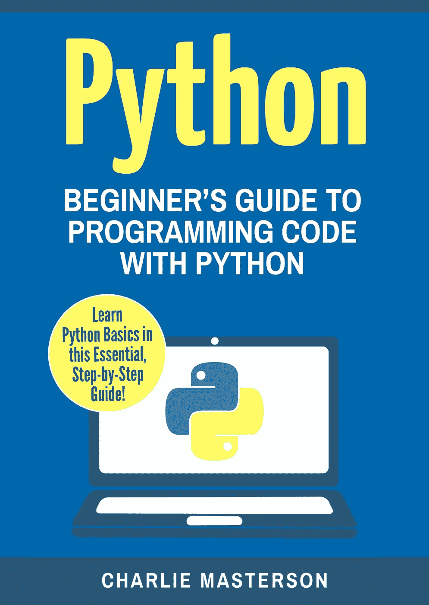

# Python 入门指南：Python 计算机编程代码 #1



在本书的准备过程中尽管已采取一切预防措施，但出版商对错误或遗漏，或因使用本文包含的信息而导致的损害不承担任何责任。

版权所有 © 2016 Charlie Masterson。

10 9 8 7 6 5 4 3 2 1

# 目录

- 引言
- 第 1 章：孵化你的 Python
- 第 2 章：Python 变量、数学与注释
- 第 3 章：条件语句与布尔值
- 第 4 章：列表与循环
- 第 5 章：函数
- 第 6 章：文件输入/输出
- 第 7 章：字符串处理
- 第 8 章：基础面向对象编程：对象与类
- 第 9 章：更多关于面向对象编程与类
- 第 10 章：书单列表重构
- 结语

© 2017 Charlie Masterson 保留所有权利。

以下重制本书的目的是提供尽可能准确和可靠的信息。无论如何，购买本书均可视为同意：此书的出版商和作者对书中讨论的话题均绝非专家，且书中提出的任何建议或指示仅供娱乐之用。在采取书中书中支持的任何行动之前，应根据需要咨询专业人士。

此声明被美国律师协会和出版商协会委员会认为是公平且有效的，并在整个美国范围内具有法律约束力。

此外，无论是以电子形式还是印刷形式对以下任何作品（包括特定信息）进行传输、复制或复制将被视为非法行为。这延伸到创建作品的二次或三次副本或录制副本，且仅在获得出版商的书面许可的情况下方可允许。保留所有其他权利。

后续页中的信息被广泛认为是对事实的真实准确描述，因此读者对相关信息的任何疏忽、使用或误用将导致任何产生的结果完全由其个人负责。在任何情况下，出版商或本书的原始作者均对在采取书中描述的信息后可能发生的任何困难或损害承担任何责任。

此外，后续页中的信息仅供参考，因此应被视为通用的。正如其性质一样，其呈现时不对其长期有效性或中间质量提供保证。书中提到的商标是在未获得书面许可的情况下使用的，不能被视为商标持有者的认可。

|  |  |  |


# 引言


恭喜你下载《Python：初学者编程代码指南》，感谢你的支持。

接下来的章节将讨论 Python 编程语言、如何入门以及如何在 Python 中进行编程——从最简单的概念开始，并帮助你在书结束时创建出真实世界的应用程序。

我经常在结尾处说这句话，但是因为它是事实：对于许多人来说，编程是自我表达的巅峰。使用 Python 你可以完成很多事情，而如果你从计算机和编程这一包罗万物的宏大图景来看，你可以完成的事情会更多。

我们将帮助你做好准备，走上成为你可能的最优秀的程序员的道路。即使你是一个完全、彻头的新手，你也会发现这本书易于理解和操作，而且足够吸引人，不会像某些编程书籍那样完全枯燥无味。

总而言之，关于 Python 有很多话可以说，我们可能只是触及皮毛——但这个皮毛将足以让你准备好未来在该语言中遇到的任何情况和一切。

也就是说，市场上有许多关于这个主题的书，再次感谢你选择这一本！我们已尽一切努力确保它包含了尽可能多的有用信息，请尽享！

|  |  |  |


# 第 1 章：孵化你的 Python


Python 是当今最流行的语言之一，它无处不在。Python 是一门非常出色的语言，不仅简单，而且功能强大。

在学习 Python 之前，你需要确保你的电脑上安装了它。我们将从基础概念开始，帮助你创建真实世界的应用程序。

在学习 Python 之前，你需要学习一门编程语言。Python 是一门优异的语言，可以用于从服务器到视频游戏的各种领域。

学习 Python 对你来说将是一个巨大的机会。虽然它很简单，但它非常强大。

为了使用 Python，你需要先设置它。你可以在 Windows、Mac 和 Linux 上进行设置。

为了设置 Python，你首先需要一个文本编辑器。有很多可供选择：我个人将使用`Atom`，你可以从`atom.io`下载。`Notepad++`和`Sublime Text`也是很好的选择。

有了文本编辑器后，你需要确保已安装了 Python。进入`Terminal`（Windows 下为`Powershell`）并尝试运行`python`命令。如果 Python 未安装（显示类似无法识别`python`命令的信息），你需要安装它。

为了安装它，你需要访问`Python.org`并根据相应平台下载`2.7.12`。

安装完成后，再次确保它运行正常——应该是正常的。

现在我们将编写编写并运行你的第一个程序。

进入你的文本编辑器创建一个新文件。在开始编写代码之前保存它，这样你就可以可以使用语法高亮，这对你有很大帮助。你可以以后以任何喜欢的名称保存，但出于本例的需要，你需要将其保存为`first.py`。

在文本文件中输入以下：

```
print “hello world”
```

然后回到你的`Terminal`或`PowerShell`并导航到保存文件的位置。

通过以下命令运行它：

```bash
python first.py
```

发生了什么？它应该完美地运行并在控制台上打印出“hello world”。

现在让我们回到刚才，稍微修改一下那个文本文件。让我们添加几行代码。

```
print “hello world”
print “my name is [在此处输入你的名字]“
print “it’s nice to meet you”
```

保存文件并再次执行。它应该跨行打印。

太棒了！你的第一个程序已经完成了。在接下来的章节中，我们将对这个文件进行一些修改，以教你 Python 的重要基础。

|  |  |  |


# 第 2 章：


## Python 变量、数学与注释

**当你年轻的时候**，你可能上过基础代数课，在在那里你需要处理诸如`y = mx + b`这样的方程。你实际上可以用其他值填充这些字母，以得到`y`。这些值被称为变量。

编程中的变量与此相似。变量是给一个值命名的方式，以便你可以在整个程序中使用它。不过，变量并不局限于数字。

回到你的`first.py`文件，在`print`语句上方几行，输入以下内容，并在引号中填入你的名字：

```
name = “John Doe”
```

之后，回到显示“My name is [your name]”的那一行，将其重写为以下内容：

```
print “my name is ” + name
```

然后保存并在控制台中运行。它应该打印出“my name is ”加上你在引号中写的任何内容。继续继续修改这个字符串，比如添加一个 y，或者你真的想对它做的任何修改，然后再次保存并执行。

变量的工作原理是它们将一个值存储在一个名称中。与其他语言相比，Python 处理变量变得非常、非常简单。由于它是一种脚本语言，它允许你输入变量的方式非常直接。脚本语言旨在让你尽可能快地运行并尽可能少浪费时间，在你创建程序时尽量不干扰你。

我们刚刚创建的变量被称为“字符串”（string），它是字符的集合。每当你向控制台打印内容时，你都在打印一个字符串。如果你只打印字符串值，可以使用`+`来拼接字符串，“拼接”是一个华丽的词汇，意思是将它们放在一起。然而，为了在代码中正确包含其他类型的变量，你需要使用格式化字符串。

```
print “my name is %s” % name
```

你可以使用许多格式化类型，但目前只需要记住：

- `%s`打印字符串
- `%d`打印十进制数字
- `%f`打印浮点数
- `%r`打印变量的原始数据（用于调试）

正如我刚才所暗示的那样，除了字符串，你还有更多类型的变量可以使用。让我们用数字做些工作。创建一个脚本。我会把它命名为`fruit.py`。在 Atom 中，你可以通过右键点击列出文件的侧边栏并点击“New file”（新建文件）来实现。当提示你输入路径时，你只需输入文件名即可。

首先，在其他语言中有一种称为整数（integer）的变量类型，本质上是一个整数。假设你有四个苹果，你的朋友有六个苹果，你想看看你们总共有多少苹果。你可以输入类似下面的代码：

```
myApples = 4
friendApples = 6
totalApples = myApples + friendApples
```

变量`myApples`的值为`4`，而变量`friendApples`的值为`6`，`totalApples`将取值为变量`myApples`加上`friendApples`的值。

你可以通过在下方输入一些`print`命令来检查所有这些值。

```
print “I have %d apples.” % myApples
print “My friend has %d apples.” % friendApples
print “Together, we have %d apples.” % totalApples
```

保存并运行。它应该打印出类似的内容：

```
I have 4 apples.
My friend has 6 apples.
Together, we have 10 apples.
```

假设你又获得了一个苹果，也许是从树上摘的之类的，现在你有 5 个苹果了。你能想出你会如何写这个吗？

在你的`print`语句下方输入以下内容：

```
print “I got one more apple!”
myApples = myApples + 1
print “I now have %d apples.” % myApples
```

保存并运行。它应该打印出类似以下的内容：

```
I have 4 apples.
My friend has 6 apples.
Together, we have 10 apples.
I got one more apple!
I now have 5 apples.
```

还有一种变量叫做浮点数（floating-point），它们本质上是小数。这并不完全符合“苹果”的逻辑，但你可以这样声明一个浮点数变量：

```python
percentageOfMyFriendThatRolfIsFollowingOurArgumentAboutApples = 0.3
```

你可能会问，为什么在关于苹果的争论之后，Rolf 还是我的 .3 朋友？让我用代码向你解释一下：

```python
percentageOfMyFriendThatRolfIsFollowingOurArgumentAboutApples = 0.3
```

# Rolf 仍然是我 30% 的朋友，因为他让我借了他的卡车搬家。

哇！这是什么？嗯，它的技术名称是井号（octothorpe），但也被称为“hash”（hash）或“磅号”（pound sign）。它被用于引导代码中的注释。注释是代码的一部分，编译器在准备你的代码供计算机读取时会忽略这些部分。

你可以反复放置这些符号，编译器会忽略它们——这对于在代码中间插入诗歌休息简直太棒了。

```python
print “Oh, what a beautiful morning!”

# Rolf, by Allen Ginsberg

# I saw the best minds of my generation destroyed by madness,

# starving, hysterical, naked,

print “What a time to be alive!”
```

编译器只会看到两个`print`语句，而忽略 20 世纪 50 年代比特派诗歌对社会的毒舌。（不要真的在代码中间写诗歌休息，这是不受欢迎的。）

你也可以在代码之后之后这些符号，编译器会忽略该行的剩余部分。

```python
print “Rolf is my friend!” # just kidding
```

注释如果使用得当，是绝对良性的工具，并可以帮助陌生人（包括未来的你偶然发现旧代码时）理解你正试图通过某段代码表达的什么。

然而，请避免频繁地使用它们。过度使用注释会让代码读起来令人反胃，而且代码通常应该是自解释自懂的。

在我们处理`print`语句时，还有最后一件事。我们现在不会经常使用它，但之后会用到，而且值得了解：转义序列（escape sequences）。这些是你可以在 Python 中用来修改文本的内容。

第一个也是最主要的例子是换行转义序列——`\n`。它用于指定字符串有一个换行符。尝试打印以下内容：

```python
print “Hello\nworld\nHow are you?”
```

保存并运行此程序。它应该跨多行打印。

另一个你可以使用的是`\t`转义序列，它在两个字符之间或行首处放置一个制表符：

```python
print “I have:\n\t%d boxes of strawberries,\n\t%d apples, \n\t and %d peaches.” % (2, 3, 4)
```

还有其他几个转义字符。例如，如果你需要在字符串内编写单引号或双引号，你有两种选择：

用三引号包裹整个内容，如下所示：

```python
“””He said “see you tomorrow,” and that’s all.”””
```

或者对它们进行转义，如下所示：

```python
“He said \”see you tomorrow,\” and that’s all.”
```

反斜线也是如此——你必须对它们进行转义。这些是你将要使用的，但简单的 Google 搜索就能找到其他的。它们通常非常冷门，仅对特定的程序调试或类似情况有用。作为一个只是试图熟悉该语言的新手程序员，你不会发现它们有多大用。尽管如此，我不会束缚你，如果你是一个富有创造力或有实验精神的人，你可能可以通过尝试其他转义字符获得一些有趣的结果和输出。尽管去尝试吧。

回顾本章，我们涵盖了变量和数学的基础。这些是编程的巨大巅峰，如果你真的打算继续学习编程，那么尽可能地理解它们是至关重要的，因为它们以某种方式构成了程序将执行的每项主要操作的核心。但在完成所有这些之后，现在是时候进入条件和循环的广阔世界了，在那里你将开始接触到 Python 那些专横的但其实相当古怪的缩进规则。

|  |  |  |


# 第 3 章：


## 条件与布尔值

之前，我们讨论了比较运算符以及如何使用它们来判断语言中的语句是真是假。这是我们进入任何给定程序底层最大的概念之一的地方。如果事情总是能让你预知某件事或另一件事，那么这个世界将会完全不同。然而，事实并非如此，有时你必须评估一种状况，做出判断，然后对该条件做出决策。

这类情况通常非常严肃，需要你做出最大的反应。例如，如果你的朋友 Rolf（他不懂基本的苹果算术）正尝试登录你的电脑，你会希望电脑告诉他走开。那么，我们该怎么做呢？（我们在这个脚本中使用第一个命令来接受用户输入，所以也请做好相应准备。）

创建一个新脚本。随你怎么起名——我会把我的命名为`login.py`。

我们想创建几个名为`username`和`password`的变量。将`username`和`password`设置为任何你想要的。

要求用户输入他们的用户名，如下：

```python
userInput = raw_input(“What is your username? ”)
```

现在我们将施展魔法，让 Python 决定他们是否输入了描述的用户名。

```python
if userInput == username:
    userInput = raw_input“Password? “
else:
    print “You entered the incorrect username.”
```

我们很快就会涉及到`else`部分，但现在，只需保存并尝试运行它。先通过输入错误的用户名进行测试，然后再次运行程序并输入正确的用户名。如果一切顺利，你将看到正确的响应。

现在让我们聊聊这里发生了什么。

这被称为`if/else`语句，是 Python 中（以及大多数编程语言）中最基础的条件判断形式。

发生的是你给它一个语句，它评估该语句的真假，然后根据真假采取行动。

在上面的代码块中发生的是，它评估`userInput`（我们刚刚让用户输入的字符串）是否与`username`相同。如果是，它会提示用户密码。如果不是，它会告诉他们输入的用户名错误。很简单对吧？

但我们对 Rolf 先生确实有个人恩怨，所以我们应该将其包含在代码中。但我的意思是，我们已经有一个完整的`if`语句了，对吧？

错误！还有另一种方法，叫做`else if`。看这个：


```python
if userInput == username:
    userInput = raw_input“Password? “
elif userInput == “rolf” or userInput == “Rolf” or userInput == “ROLF”:
    print “这台电脑没有 Rolf 的位置。”
else:
    print “You have entered the incorrect username.”
```

这评估`userInput`以查看用户名是否为“Rolf”或任何变体。字符串比较本质上是对大小写敏感的，所以“ROlf”不等于“ROLf”。如何修复这个问题？

嗯，我们可以通过将`else-if`行更改为如下，同时解决大小写敏感问题并使代码更优雅。

```python
elif userInput.lower() == “rolf”:
```

这会将`userInput`变量转换为小写。我们现在只需将其与小写的“rolf”进行比较，问题就解决了。

你可能注意到了那个`or`，它可能让你措手不及。那被称为布尔运算符。

Python 中三个主要的布尔运算符：`and`、`or`和`not`。

“And”（与）用于检查两个条件并查看它们是否都返回真（true）。如果其中一个返回假（false），整个结果就会返回假。所以如果我们想使用上一个脚本中的苹果值，可以这样写：

```python
if myApples == 5 and friendApples == 6:
```

结果将返回 true。然而，即使其中一个不为真，整个结果也会返回 false。

“Or”（或）类似，但它检查的是其中一个条件或表达式是否为真。只要其中一个为真，整个结果就返回 true。

“Not”（非）用于检查一个布尔值/条件/表达式是否为假。为了说明和阐述，你实际上可以将一个单个布尔变量放入`if`语句中，因为`if`语句只检查其其后的内容是否为真。

如果你有一个名为`IAmCool`的变量并将其设置为`True`，然后你输入：

```python
if IAmCool:
    print “I am cool”
```

它实际上会打印“I am cool”，因为`if`语句认为这是一个真语句。明白了吗？

现在，如果`IAmCool`被设置为`False`，因为比你那自嘲式的幽默感更强的是自学各种编程语言的意志，你没有输入`if IAmCool`，而是输入了：

```python
if not IAmCool:
    print “I am not cool”
```

它会检查`IAmCool`是否为假。

所以，在`if`、`else if`和`else`语句之间，你已经掌握了一部分非常实的条件判断逻辑。

让我们回到刚才那段代码。

```python
if userInput == username:
    userInput = raw_input(“Password? “)
elif userInput.lower() == “rolf”:
    print “There is no room on this computer for Rolf.”
else:
    print “You have entered the incorrect username.”
```

我们得到了用户名，而且它是正确的。接下来我们该做什么？

这就是我们开始使用一种被称为“嵌套条件语句”（nested conditional statements）的概念。你可以在一个`if`语句内部嵌套`if`语句！

这是你大显异彩的时候了，朋友。在提示密码后，在该`if`语句内部再写另一个`if`语句，以及一个`else`语句。你需要比较`userInput`和你的变量`password`，查看它们是否相同。如果相同，你需要欢迎用户；如果不相同，你需要告诉他们输入了错误的密码。

到最后，你的代码应该看起来像：

```python
if userInput == username:
    userInput = raw_input("Password? ")
    if userInput == password:
        print "Welcome!"
    else:
        print "That's the wrong password."
elif [...]
```

代码是这样，那么你就成功了。

# 第 4 章：列表与循环

将这两个概念放在同一个章节中**并不常见**，但我正努力保持简洁明了，而且它们确实是紧密相连的。

我们讨论过变量，没错。但变量只能包含单个值。如果你有多个值想放在某个地方里呢？这时候列表（lists）就派上用场了。

Python 中的列表非常简单直观。

假设我们想创建一个我们喜欢的电视节目列表。我们可以这样做：

```python
favoriteShows = [‘Breaking Bad’, ‘Narcos’, ‘House of Cards’]
```

这些都是列表中的不同元素，计数从`0`开始。你也可以非常简单地访问列表。

如果你输入以下内容：

```python
print favoriteShows[0]
```

它就会打印列表的第一个元素，在这里是 Breaking Bad。

你也可以非常简单地向列表中输入数据！列表有一个名为`append()`的内置函数，它允许你向列表添加数据，如下所示：

```python
listExample.append(raw_input())
```

这将获取用户的输入并将其添加到函数中。（这也是将函数作为另一个函数的参数来调用的例子，这在现在听起来完全没意义，但希望在下一章会有意义！）

你实际上也可以声明空列表供使用。你可以通过声明变量并将其设置为空括号来实现，如下所示：

```python
emptyList = []
```

从这里开始，你可以向列表添加元素，并像使用任何其他列表一样开始使用它。

为了进入课程的下一部分并跳出列表的话题，我们应该谈谈循环（loops）。循环是许多程序中不可或的一部分。它们有许多用途，但在最基础的层，它们只是让程序中的一段代码重复多次执行，而且可能每次都会以某种方式发生变化。

Python 中主要有三种循环：`while`、`for`和`do...while`。它们都有自己量身定制的特定用途。

`while`循环是最简单的，只要给定的条件仍然返回真，它们就会不断执行，这其实就此了。

观察以下代码：

```python
dogs = 0
while (dogs <= 10):
    print “There are %d dogs in the yard!”
    dogs += 1
print “Wow! That’s a lot of dogs!”
```

你能猜到这里发生了什么吗？我们声明了一个变量`dogs`并将其设置为`0`。然后我们启动了`while`循环。只要`dogs`小于或等于`10`，我们就运行这段代码。循环的每次迭代都会增加`dogs`值。

`for`循环与`while`循环类似，但它们会自动遍历一组数据。Python 有一个内置的`range()`函数，允许你迭代特定的次数。例如，`range(5)`会迭代 5 次。

```python
for i in range(5):
    print “%d” % (i + 1)
```

简单对吧？一点也不难。我们也可以遍历列表。如果想打印出列表中的每一个节目，我们可以这样做：

```python
print “My favorite shows: “
for i in favoriteShows:
    print “%s” % i
```

`i`是所谓的循环变量，在 Python 中，它会假设为该列表所包含的元素的类型。由于列表可以包含混合值（甚至可以同时包含），这非常棒且超级重要。

让我们实际开始操作，并结合我们学过的很多概念。创建一个新文件，随你怎么命名，但我打算把它命名为`bookList.py`。

我们首先要做的是创建一个空列表和一个设置为`True`的布尔值`running`。

```python
bookList = []
running = True
```

现在我们要的是创建一个所谓的“运行循环”（running loop）。这是向你展示如何使用`while`循环。我们将创建一个只要变量`running`为真就会运行的循环。

```python
while running == True:
```

我们在循环内部要做的第一件事是提示用户添加书籍、列出书籍或退出程序。我们需要将响应与其他内容进行比较，所以我们需要将其赋值给变量。

```python
userInput = raw_input(“Book List v1.\nType add to add a book, list to list the books, or exit to exit the program: ”)
```

现在我们需要解析输入并比较。首先，我们将检查用户是否想添加书籍，如果是，就添加：

```python
if userInput.lower() == “add”:
    userInput = raw_input(“Enter the name of the book: \n”)
    bookList.append(userInput)
```

完美。其实有一种简化那行代码的方法，直接将函数`raw_input(‘...’`传递给`bookList.append`，但我想向你展示可以将任何变量添加到列表中。

现在我们要确定如果用户输入“list”会发生什么，这应该是检查列表是否为空，如果不为空则打印其内容：

```python
elif userInput.lower() == “list”:
    if not bookList:
        print “The list is empty!\n”
    else:
        for i in bookList:
            print “%s\n” % i # 打印列表中的所有内容

```

现在，如果用户输入“exit”，我们需要将变量`running`设置为`false`，这样就能退出主循环，因为它应该只在变量`running`为`true`时才运行。

```python
elif userInput.lower() == “exit”:
    running = False
```

最后，如果他们输入的不是“add”、“list”或“exit”中的任何内容，我们需要打印他们的命令无效。

```python
else:
    print “The command was invalid!\n”
```

这是我们目前为止做的第一个主要程序，但这对变量、循环和输入/输出是非常非常浅显的介绍。

从现在开始，我们将通过操作这个特定的文件来引入概念，所以你需要妥善保存这个文件。

|  | |  |


# 第 5 章：


## 函数 (Functions)

函数是任何编程语言中**不可或缺的**。它们提供了一种定义“本该发生且可能需要发生很多次”的程序基本功能的方法，并让你根据需要频繁复用那部分代码。它们还允许你修改现有的值并与你已有的变量进行操作。

伪代码中函数的基本结构如下：

```python
function(parameter1, parameter2, etc...) {
    do things
}
```

它通常会在你的主代码部分或从其他函数中调用，如下所示：

```python
function(variable1, variable2)
```

函数可以极大地简化冗长晦涩的代码，使其变得更容易理解，同时使其更具模块化和可重用性。

那么在 Python 中如何使用函数呢？它们遵循非常简单的结构。

为了在 Python 中声明一个函数，你只需要输入：

```python
def functionName(arguments):
    code here
```

其实就只有这些。你为函数定义的参数可以在该函数的代码体中使用。当你稍后调用函数时，可以将任何相同类型的值放在该位置。最好的解释方法是，你在函数定义中使用的参数是假设性的，旨在被实际值替换。

如果我们想编写一个接收矩形长度和宽度、计算面积并返回该值的函数，我们可以这样做：

```python
def findArea(length, width):
    return length * width
```

然后你可以在可以在代码的其他地方调用它。你可以使用实际值，如下：

```python
area = findArea(4, 6) # “area”的值将为 24
```

或者你可以使用已有的变量来调用函数。

```python
l = 6
w = 3
area = findArea(l, w) # “area”的值将为 18
```

你甚至可以使用其他函数作为参数，因为每个函数最终都会返回一个值。

```python
def add(number1, number2):
    return number1 + number2

def findArea(length, width):
    return length * width

area = findArea(4, add(2,2))
```

这段代码会首先执行`add`函数，它返回值`4`，然后将`add`函数的返回值乘以第一个参数（`4`）。它最终将返回值`16`。

现在的问题是，我们如何利用函数来美化现有代码并使其更具功能性？让我们回到`bookList`代码。它功能完备，对吧？但看起来却是一团糟。让我们给`addBook`和`listBook`函数加上函数，并顺便让它们变得……嗯，更有功能性。

让我们看看添加书籍的`if`语句。

```python
if userInput.lower() == “add”:
    userInput = raw_input(“Enter the name of the book.\n”
    bookList.append(userInput)
```

我们想做的是让它更简单，如下：

```python
if userInput.lower90 == “add”:
    addBook(bookList)
```

这是我们的做法。函数必须在调用它们之前声明并定义。你可以在之前的任何地方这样做。我将把它放在`variableList`之后的开头部分。

```python
def addBook(bList):
    userInput = raw_input(“Enter the name of the book you’d like to add.\n”)
    bList.append(userInput)
```

你可以将变量`bList`命名为任何名称，甚至是`bookList` —— 我没有把它起名为`bookList`是为了简单起见，目的是为了强调函数参数只是假设性的值，只有在调用它们时才将它们替换为真实值。

现在如果我们把当前的`if`语句替换为这个：

```python
if userInput.lower() == “add”:
    addBook(bookList)
```

它应该运行得完美。

现在我们需要添加一个允许我们列出书籍的函数。这与之前非常相似：我们需要把`bookList`发送进去，并让它处理。首先我们需要定义它。我正把它放在最后一个函数之后：

```python
def listBooks(listOfBooks):
```

`file1.write(string)`将把给定字符串的内容写入文件。如果你想写入某些不是字符串的内容，你实际上需要将它转换为字符串。

```python
liters = 2
str(liters)
file1.write(liters + "\n")
```

或者你必须使用格式化字符串，如下：

```python
file1.write("There are %d liters" % liters)
```

这两种方法都是实现此处目标的完全可行途径。

当你完成对文件的操作后，必须始终关闭它以释放系统资源。

```python
file1.close()
```

我们将在第 10 章更深入地探讨这些内容，那时我们将完成对字符串操作和面向对象概念的学习，并开始整合我们学到的很多知识。但目前，请尽管尝试这些概念，并尝试使用它们来实现一些功能。

# 第 7 章：字符串操作

你几乎肯定会有需要操作这个字符串或那个字符串的时刻。也许你需要获取它的长度，或者你需要对其进行拆分，或者根据它创建一个新字符串。也许你需要读取位置 x 的字符。无论原因是什么，关键在于这总是有其原因的。

我们之所以在书的后期才介绍这些，是因为它能让我们开启关于对象本质的更广泛讨论，我们将在下一章中进行更深入的探讨；与此同时，我们还将涵盖 Python 语言提供的用于字符串的极其有用的方法。

去创建一个新文件吧。一如既常，你可以给它任何名字。我的文件将命名为`strings.py`。虽然这个名字没什么创意，但相信我，在这一章中我们将在字符串上发挥创意。

那么，字符串到底是什么？嗯，我们显然知道字符串是一行文本，这不言而喻。但其中包含什么呢？

我们在这个列表中已经讨论了很多列表。列表实际上是另一种变量的形式，这种变量在 Python 编程中很大程度上被避免，被称为数组（array）。从最基本的术语来说，数组是一组预先分配在一起的数据。

Python 源于并构建在名为`C`的语言基础之上。在`C`中，实际上存在数据类型。Python 中也有数据类型，但 Python 通过为程序员设置数据类型而不是让程序员自己声明，从而为用户节省了时间。


`C` 中的数据类型之一被称为`char`，它是单个字符。在计算机术语中，并没有对字符串原生支持。字符串仅仅是字符数组。例如，如果有人想创建一个名为“hello”的字符串，他们会执行如下：

```c
char hello[6] = { ‘h’, ‘e’, ‘l’, ‘l’, ‘o’, '\0’ };
```

Python 凭借其最大抽象的优良习惯，让我们免于这些复杂性，只需让我们声明：

```python
hello = “hello”
```

重点在于，字符串终究只是一组数据。和任何数据集一样，它们是可以被操作的。在某些时候，我们需要操作它们。

字符串操作最简单的形式是拼接（concatenation）概念。拼接字符串是组合在一起形成新字符串的字符串。拼接超级简单——你只需要使用`+`号字面上将字符串相加即可。

```python
sentence = “My “ + “grandmother “ + “baked “ + “today.”
print sentence
# 会打印 “My grandmother baked today.”
```

处理字符串操作时要记住的第一点是，字符串像任何数据集一样，是从 0 开始计数的。所以字符串“backpack”的计数如下：

```
backpack
01234567
```

仅凭这些知识我们就可以做几件不同的事情。第一是我们可以从中提取单个字母。

假设字符串“backpack”存储在一个名为`backpack`的变量中。我们可以通过输入以下代码从中提取字母“p”：

```python
letter = backpack[4]
```

这将提取字符串中索引为 4 的任意字符。在这里，当然地，它是`p`。

如果我们想提取从“b”到“p”的字符，可以如下操作：

```python
substring = backpack[ 0 : 4 ]
```

这将为变量`substring`赋值一个字符串，其值等于`backpack`索引 0 到索引 4 之间的值：

```
backpack
01234567
```

因此，`substring`的值为“backp”。一个很不错的词。

你还可以对数据集（特别是字符串）做更多其他事情，以获得更具体的结果。

- `backpack[start:4]`将给你从开始到索引 4 的所有字符，就像刚才一样。

- `backpack[4:end]`将给你从索引 4 到末尾的所有字符。

- `backpack[:2]`将给你前两个字符，而`backpack[-2:]`将给你最后两个字符。

- `backpack[2:]`将给你除前两个字符以外的所有字符，而`backpack[:-2]`将给你除最后两个字符以外的所有字符。

然而，这超出了这种简单的算术。字符串变量还有内置方法。每一个字符串都是字符串类的实例，因此它都是一个字符串对象。让我们创建一个稍微厚实一点的字符串。

```python
tonguetwister = “Peter Piper picked a peck of peppers”
```

字符串类有多种你可以利用的内置方法来处理对象。让我们以`split`方法为例。如果你输入：

```python
splitList = tonguetwister.split(‘ ‘)
```

它会在每个空格处拆分句子，给你一个包含每个单词的列表。因此，`splitList`看起来会像这样：`[‘Peter’, ‘Piper’, ‘picked’, ‘a’, ‘peck’, ‘of’, ‘pickled’, ‘peppers’]`。打印`splitList[1]`将给你值‘Piper’。

还有`count`方法，它可以计算某个特定字符的出现次数。输入：

```python
tonguetwister.lower().count('p’)
```

你会得到数字 9。

有`replace`方法，它可以将一个给定字符串替换另一个。例如，如果你输入：

```python
tonguetwister = tonguetwister.replace(“peppers”, “potatoes”)
```

`tonguetwister`现在的值为“Peter Piper picked a peck of pickled potatoes”。

还有`strip`、`lstrip`和`rstrip`方法，它们可以从字符串的两端去除指定的字符或空格。当你尝试解析用户输入时，这非常有用。未处理的用户输入会导致数据集不必要地增大甚至导致代码错误。

最后一个主要的方法是`join`方法，它会在字符串的每个字符之间插入特定的字符。

```python
print “".join(tonguetwister)
```

将打印“P-e-t-e-r-P-i-p-e-r-p-i-c-k-e-[...]

还有各种布尔表达式，它们会返回真或假。`startswith(character)`和`endswith(character)`方法是两个极佳的例子。如果你输入：

```python
tonguetwister.startswith(“P”)
```

它最终将返回真。然而，如果你改为输入：

```python
tonguetwister.startswith(“H”)
```

它最终将返回假。这些方法用于字符串的内部评估，也用于评估用户输入。

其他几个例子是`string.isalnum()`，它会检查字符串中的所有字符是否为字母数字，或者是否有特殊字符；`string.isalpha()`，它会检查字符串中的所有字符是否为字母；`string.isdigit()`会检查字符串是否为数字；以及`string.isspace()`，会检查字符串是否为空格。

这些对于解析给定的字符串并根据字符串是否符合某种方式来决定该做什么都是极其有用的。

|  |  |  |


# 第 8 章：


## 基础面向对象编程：对象与类

PYTHON 是一种面向对象的编程语言。事实上，大多数现代语言都是如此。但这究竟意味着什么？我们泛泛地谈过了对象和类，但我们还没有真正在任何特定的术语上确立它们到底意味着什么。

对象是类的实例。你在 Python 中处理的大多数东西都是对象。早些时候，当我们处理文件输入输出时，我们创建了文件类的实例。在上一章中，我们处理字符串，并创建了字符串类的实例。每个实例都有它可以访问的内置方法，这些方法派自类定义本身。那么，类究竟是什么呢？

类是定义对象的一种方式。这听起来非常模糊，但让我们从这个角度来看。

你可能拥有或曾经拥有过宠物，对吧？假设有一只狗，他的名字叫 Roscoe。

嗯，Roscoe 是一只动物。动物具有宽泛的、通常定义的特征，但它们都是动物，就像 Roscoe 也是动物一样。熟悉一下 Roscoe，因为我们在讨论类与类之间的关系以及类与对象之间的关系时，我们会经常提到他。

我们已经确定 Roscoe 肯定是一只动物。他符合动物的定义。这种情况下，Roscoe 是动物类的一个特定实例。如果你在编写一个生命模拟程序，并且有人和动物，你会把 Roscoe 定义为动物的实例，就像你声明变量`file1`为`file`的实例一样，或者你声明`tonguetwister`为`string`的实例一样。

现在，我们需要谈谈如何在 Python 中实际定义一个类和一个对象。

创建一个新文件来工作，我把我的命名为`pursuitOfRoscoe.py`。

在这个文件中，我们将从一开始就开始定义一个类。

要声明一个类，你遵循以下模板：

```python
class name(parent)
```

我们将在下一章讨论父类。现在，让我们先创建我们的动物类。任何不是继承自另一个类的类都以“object”作为它的父类，所以我们加上它。

```python
class Animal(object):
```

我们正在定义 Roscoe 的道路上。我们需要一种定义动物的方法。让我们想想大多数动物拥有什么。大多数动物都有腿，这是一个开始。动物还有拉丁名称。让我们处理这两个点吧。如果你的类存储了数据，你通常需要在你的类中有一个初始化函数。这并不是必须的，但是一种非常常见的做法。

```python
class Animal(object):
    def __init__(self, legs, name):
        self.legs = legs
        self.name = name
```

完美。既然 Roscoe 是一只狗，他会有 4 条腿，他的物种是 Canis Lupus Familiaris。

考虑到这一点，我们现在有了一个动物类的定义，它可以用于许多动物，而不只是 Roscoe。这就是类的整个核心思想：为任何给定的对象创建可重用的数据结构，以便代码更具可读性、易于理解、更整洁且易于移植，以及其他令人惊讶地非常、非常真实的流行语形容词。

现在我们如何声明这个类的实例呢？就像声明其他任何东西一样！

```python
roscoe = Animal(4, “Canis Lupus Familiaris”)
```

我们也可以进去并修改这些变量。Canis lupus 太正式了，而 Roscoe 是我们的哥们，所以让我们把它改成 Roscoe 吧。

```python
roscoe.name = “Roscoe”
```

搞定。好多了。

希望这让类和对象的区别变得更加清晰。

Roscoe 是一只狗，也是一只动物。因此，他继承了“动物”这一共同概念。由于他是动物的实例，他自动获得了所有动物都拥有的特征。这有多酷？

让我们再进一步，加入一些函数。每只动物都会做的事情是什么呢？睡觉。除了 Ozzy Osborne 之外，每只动物都会睡觉。

让我们给动物一个函数以便它们可以睡觉。

在我们的初始化函数下方，创建一个名为`sleep`的新函数，它接收`self`和`hours`参数。然后打印一行显示动物的名字和它睡眠多久的文本。我的代码最终看起来像这样，希望你的也是。

```python
def sleep(self, hours):
    print “%s is sleeping for %d hours!” % (self.name, hours)
```

然后在下面，带有 4 小时的参数来运行它。

```python
roscoe = Animal(4, “Canis Lupus Familiaris”)
roscoe.name = “Roscoe”
roscoe.sleep(4)
```

它应该输出“Roscoe is sleeping for 4 hours!”

 |  |  |


# 第 9 章：


## 更多面向对象编程：对象与类

还有一些宽泛的概念尚未涵盖，它们需要比我愿意提供的更详细解释。这些是继承、多态、抽象和封装。Python 提供了所有这些，并且做得非常好。

继承是将一个类从另一个类派生出的概念。这里有一个非常简单的方法可以解释这一点。类可以细分为更具体的类。例如，Roscoe 是一个动物。但他也是一只狗。狗是动物的一种类型。难道 Roscoe 不应该是狗而不是动物吗？我们如何处理这个问题？

这样想吧：每只狗都是动物，但不是每个动物都是狗。所以我们可以进一步细分动物类。我们通过继承从一个类派生另一个类。这就是如何声明一个继承动物类的狗类。所有的狗都有 4 条腿（大部分情况下），所以我们可以提前声明它，如果某只狗没有 4 条腿再手动修改。

```python
class Dog(Animal):
    def __init__(self, name):
        self.name = name
        self.legs = 4
```

这种方法的原理是 Dog 类是 Animal 类的扩展。Dog 类接收了该类的所有函数和变量，所以我们不需要重新定义它们。

这意味着如果我们删掉第一行并将 Roscoe 更准确地声明为一只狗，我们仍然可以声明 sleep。观察一下。

```python
roscoe = Dog(“Roscoe”)
roscoe.sleep(4)
```

它应该顺利运行。然而，子类的酷酷之处在于，你也可以给它们提供父类无法使用的自己的函数。例如，动物不叫——狗会。为了练习起见，我们在我们的狗类中创建一个 bark 函数。

```python
def bark(self):
    “%s says: Bark!” % self.name
```

现在让我们尝试通过 Roscoe 声明 bark。

```python
roscoe.bark()
```

它应该打印出我们输入的内容。为了进一步说明，创建一个父类 Animal 的实例，我们称之为“lion”：

`lion = Animal(4, “panthera leo”)`

尝试通过`lion`调用`bark`方法。

```
lion.bark()
```

这里应该会报错。为什么呢？嗯，是因为正如我们所说的——每只狗都是动物，但并不是每种动物都是狗。`bark()`函数是在`Dog`类中定义的，而不是在`Animal`类中，因此`Animal`类的实例完全无法访问此方法。

面向对象编程的下一个概念被称为“多态”。这意味着某个事物具有与另一个事物执行相同任务的属性，但执行方式不同。实现这一点的有两种方法：函数重载（执行相似的函数/方法但使用不同的参数）和函数重写（重写父类中的函数，使其更适合你自己的类）。

为了说明这一点，让我们回到之前的`bark`方法。在我们的`bark`方法下，我们将创建另一个`bark`方法，声明如下：

```python
def bark(number):
    print “%s just barked, %d times! How cute.” % (self.name, number)
```

现在我们有了`bark`函数的两种不同形式。如果你声明

```python
roscoe.bark()
```

你会看到“Roscoe says: Bark!”

但是，如果你声明

```python
roscoe.bark(3)
```

你会看到“Roscoe just barked, 3 times! How cute.”

这就是函数重载和多态的本质核心：为执行相似的事情提供多种方式。

这个程序本身已经很可爱了，但在学习更多 Python 编码和字符串操作的同时，我们可以让它变得更可爱。回到你的`bark(number)`方法，将其修改为看起来像这样：

```python
barkString = “Bark! “ * number
print “%s just barked, %d times. How cute. %s” (self.name, number, barkString)
```

现在保存并运行。你只需要使用乘法并给出要乘的次数，就可以重复多次字符串！

面向对象编程语言的下一个主要概念是抽象。这种思想是隐藏内部细节和功能，以便对程序员和最终用户都更加前瞻且更加安全。Python 通过提供与其他语言相比非常抽象的接口，并提供大量的功能来展示这一点，使你永远不需要去了解计算机在背后到底在执行什么细节。

面向对象语言的最后一个主要概念是封装，其中代码和数据封装在一个单一单元中。我们展示这一点的主要方法是类的概念——不仅在 Python 中，在任何地方都是。使用类会自动将重要数据和函数封装在一个易于访问和使用的地方。其他数据语言有所谓的访问控制，你实际上可以规定哪些类可以和不能访问你放在类中的数据。Python 中的类数据默认认为是公共的。

总而言之，面向对象编程并不难掌握，但它充满了代表更大、更宏大事物的概念，而这些概念最终往往是难以理解和实现的。

现在我们将在下一个章节中整合过去几个章节中涵盖过的概念——字符串操作、文件输入/输出和类——作为最后的方式，来处理并整合我们到为止构建的所有概念，创建一个将为最终用户维护书籍列表的程序。

 |  |  |


# 第 10 章：书籍列表重构


恭喜你走到了这里。编程起初是很困惑的。现在是时候结合我们学过的概念，创建一个新版本的书籍列表程序了。

所以，让我们思考一下让这个程序做什么。

我想让这个程序有五个选项：

1) 将书籍添加到临时列表

2) 列出临时书籍列表

3) 从文件读取书籍

4) 将临时列表写入新的书籍文件

5) 将其写入现有文件

6) 清空临时列表。

让我们开始吧。

让我们创建一个新文件，我把它命名为`bookkeeper.py`，因为我是一个 2016 年的程序员，而操作模式是使用流行易记的名字。

在这个文件中，我们要做的第一件事是创建一个名为`book`的类。

```python
class book(object):
    def __init__(self, title, author):
        self.title = title
        self.author = author
```

现在我们需要开始编写函数。第一个函数`addBook`将创建一个`book`类的新的实例，并将其添加到我们的书籍列表中。


```python
def addBook(bookList):
    title = raw_input(“What is the name of the book?”)
    author = raw_input(“What is the author’s name?”)
    bookList.append(book(title.upper(), author.title()))
```

我们之所以使用`author.title()`是因为`string.title()`方法处理字符串时会将每个单词的首字母大写。

之后，我们需要一个函数来列出书籍。我们需要向它传递一个书籍列表。

```python
def listBook(bookList):
    for i in bookList:
        print “%s, %s” % (i.title, i.author)
```

这里变得有趣了。我们需要创建一个临时列表。之后，我们打开文件进行读取。我们需要用户输入文件名。

```python
def readBooks(bookList):
    bList = []
    f = open(raw_input(“ Enter the filename.”))
```

现在我们将遍历`f`。使用`for`循环来实现这一功能非常方便。我们将使用`string.find()`定位行中的逗号，并将行分为标题和作者。这些子字符串都需要去除空格。

```python
for line in f:
    comma = line.find(“,”)
    title = line[0:comma].rstrip(‘,’)
    author = line[comma+1:].strip()
    bList.append(book(title.upper(), author.title()))
```

接下来，提示用户是否想要将结果添加到临时列表。如果他们说是，我们就遍历`bList`，将每本书添加到`bookList`。否则，我们只告诉他们没有保存并关闭文件。

```python
if userInput == “yes”:
    for i in bList:
        bookList.append(i)
    print “Saved.”
else:
    print “Not saved.”
f.close()
```

这结束了我们的`readBooks`方法。

现在是时候进入`writeToNew`方法。

首先定义它，然后让用户命名。

```python
def writeToNew(bookList):
    userInput = raw_input(“ Enter the filename you’d like to export to.”)
    f = open(userInput, ‘w’) # w 表示我们想要写入
    for i in bookList:
        f.write(“%s, %s\n” % (i.title.upper(), i.author.title()))
f.close()
```

现在我们需要创建“写入现有文件”方法。它足够简单。最终，它和上一个函数非常相似，但我们改变了一个关键参数。

```python
def writeToExisting(bookList):
    userInput = raw_input(“ Enter the file you’d like to add to.”)
    f = open(userInput, ‘a’) # 使用 a 而不是 w 告诉我们要追加文件，而不是写入新文件
    for i in bookList:
        f.write(“%s, %s\n” % (i.title.upper(), i.author.title()))
f.close()
```

```python
f.write(“%s, %s\n” % (i.title.upper(), i.author.title()))
```

这些是需要编写的主要函数。现在是时候处理代码的核心部分了。

首先，我们定义`bookList`和我们的循环布尔变量。

```python
bookList = []
running = True
```

现在我们开始`while`循环。上一个程序非常乱，让我们来清理一下。

首先，我们将创建一个漂亮得多的菜单：

```python
while running == True:
    print “Welcome to BOOKKEEPER. Type:”
    print “\t\”ADD\” to add a book to your temp list.”
    print”\t\”LIST\” to read out your temp list.”
    print “\t\“READ\” to read an existing file.”
    print “\t\\"SAVE NEW\” to save to a new file.”
    print “\t\\"SAVE EXISTING\” to save to an existing file.”
    print “\t\\"CLEAR\” to clear your temporary list.”
    print “\t\\"EXIT\” to exit.”
```

我们的菜单已经看起来比以前漂亮得多、更有条理了。每个选项前的制表符确实让它焕然一新。现在是时候实际接受用户输入并做出决策了。你只需要调用每个函数并传递`bookList`，直到遇到“clear”选项。当你遇到“clear”变体时，只需要通过重新声明`bookList`为空来重置它。这非常直观。

```python
userInput = raw_input()
if userInput.lower() == “add”:
    addBook(bookList)
elif userInput.lower() == “list”:
    listBook(bookList)
elif userInput.lower() == “read”:
    readBooks(bookList)
elif userInput.lower() == “save new”:
    writeToNew(bookList)
elif userInput.lower() == “save existing”:
    writeToExisting(bookList)
elif userInput.lower() == “clear”:
    bookList = []
elif userInput.lower() == “exit”:
    running = False
else:
    print “The command was invalid!\n\n”
```

这标志着我们程序的结束。它比之前的程序更容易理解和掌握，而且内容更加丰富。Python 在结构上非常宽容，但为了稳妥起见，这是我的程序样子。你可以随意对比你的代码：

```python
class book(object):
    def __init__(self, title, author):
        self.title = title
        self.author = author

    def addBook(bookList):
        title = raw_input("What is the name of the book?")
        author = raw_input("What is the author's name?")
        bookList.append(book(title.upper(), author.title()))

    def listBook(bookList):
        for i in bookList:
            print "\"%s\", by %s\n" % (i.title.upper(), i.author)

    def readBooks(bookList):
        bList = []
        f = open(raw_input(" Enter the filename."))
        for line in f:
            comma = line.find(",")
            title = line[0:comma].rstrip(',')
            author = line[comma+1:].strip()
            bList.append(book(title.upper(), author.title()))
        print "%s, %s" % (title.upper(), author.title())
        userInput = raw_input("Would you like to record this to your temporary list?")
        if userInput == "yes":
            for i in bList:
                bookList.append(i)
            print "Saved."
        else:
            print "Not saved."
        f.close()

    def writeToNew(bookList):
        userInput = raw_input("Enter the filename you'd like to export to.")
        f = open(userInput, 'w')
        for i in bookList:
            f.write("%s, %s\n" % (i.title.upper(), i.author.title()))
        f.close()

    def writeToExisting(bookList):
        userInput = raw_input("Enter the filename you'd like to add to.")
        f = open(userInput, 'a')
        for i in bookList:
            f.write("%s, %s\n" % (i.title.upper(), i.author.title()))
        f.close()

bookList = []
running = True
while running == True:
    print "Welcome to BOOKKEEPER. Type:"
    print "\t\"ADD\" to add a book to your temp list."
    print "\t\"LIST\" to read out your temp list."
    print "\t\"READ\" to read an existing file."
    print "\t\"SAVE NEW\" to save to a new file."
    print "\t\"SAVE EXISTING\" to save to an existing file."
    print "\t\"CLEAR\" to clear your temporary list."
    print "\t\"EXIT\" to exit."
    userInput = raw_input()
    if userInput.lower() == "add":
        addBook(bookList)
    elif userInput.lower() == "list":
        listBook(bookList)
    elif userInput.lower() == "read":
        readBooks(bookList)
    elif userInput.lower() == "save new":
        writeToNew(bookList)
    elif userInput.lower() == "save existing":
        writeToExisting(bookList)
    elif userInput.lower() == "clear":
        bookList = []
    elif userInput.lower() == "exit":
        running = False
    else:
        print "The command was invalid!\n\n"
```

Python 最终源于一种名为`C`的语言，而`C`语言语言启发了大量的语言——不仅是`Python`，还有`C++`、`Java`、`Lua`、`Go`、`D`、`R`、`Ruby`等等。本书旨在教你底层概念，这样你就不会受限于任何特定的编程语言，因为各种编程语言之间是非常相似的。重要的是你理解了底层概念——控制流、对象、输入和输出、变量操作——这样你就能产出你想要的结果。

我希望作为一名 Python 学习者和充满希望的程序员，你会发现这本书是一个非常实用且极佳的起点，无论你是为了职业编程，还是仅仅作为爱好进行编程。


# 关于作者

Charlie Masterson 是一位计算机程序员和讲师，他开发过多个应用程序和计算机程序。

作为一名计算机科学学生，他很早就编程产生了兴趣，但在学习极其复杂的课题时感到过挫败。

Charlie 想要一种能够让他轻松学习并提高编程技能的教学方法。他很快发现了一系列让他学得更快、更好的教学课程。

通过采用同样的方法，Charlie 成功学习了不同的编程语言，现在通过编写书籍来教授这些知识。

通过他编写的计算机编程书籍，他希望提供巨大的价值，并帮助想要学习计算机相关主题的读者。
