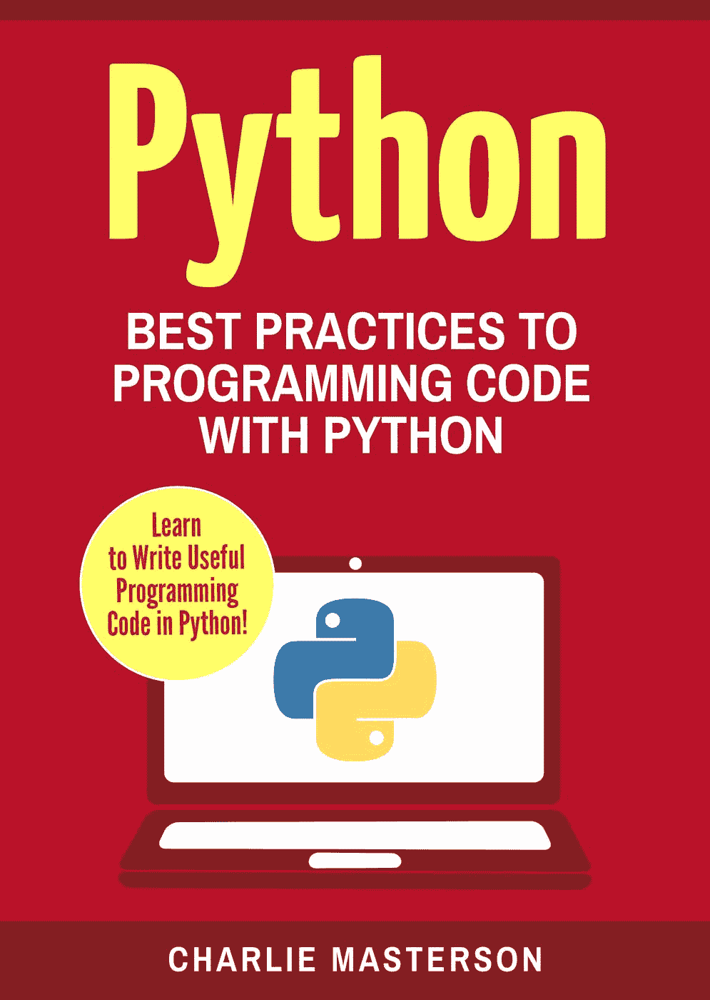

# Python 编程最佳实践





10 9 8 7 6 5 4 3 2 1


# 目录

- 引言
- 第一章：Python 编码通用概念
- 第二章：编程建议
- 第三章：代码布局
- 第四章：惯用法
- 第五章：注释
- 第六章：约定
- 第七章：方法和函数参数
- 第八章：命名约定
- 第九章：在语句和表达式中使用空白符
- 结语


|  |  |  |


# 引言


感谢你的阅读，并祝贺你阅读了《Python：编程最佳实践》。这本书包含了关于如何更有效地编写 Python 代码的经过证明的步骤和策略。当你初学 Python 时，会教你如何编写代码，但在很多情况下，并不会教你如何整洁地编写这些代码。

如果你接触任何 Python 程序员，问问他们喜欢 Python 的哪一点。我保证他们会告诉你，主要原因之一是因为它易于阅读。事实上，这是 Python 语言绝对的核心，因为计算机代码被阅读的次数远大于编写的次数。这在很大程度上归于 Python 代码遵循一套指南和“Pythonic”（Python 式）惯用法——如果你听到程序员提到某部分代码不“Pythonic”，意味着它没有遵循这些指南，并且没有以任何可读的方式表达意图。

代码风格和布局至关重要，你所使用的风格的一致性也是如此。尽管如此，有时一致性并不是正确的选择，指南也并不适用——你必须知道什么时候是时候，而这正是进行 Python 编程时的最佳判断。

通过本指南，我将向你展示编写代码的绝对最佳方法，整理你的程序并使其更加有效、高效。我不会只给你基础知识。我将深入探讨你需要了解的一切，从代码布局到如何编写函数、惯用法和命名。

我将讨论空白符和制表符、字符串和方法。我还会提供一些关于 Python 编程的建议以及通用概念。简而言之，当你读完我的最佳实践指南后，你将成为你可能最好的 Python 程序员。

我的书假设你具备 Python 编程的一些先验知识，所以如果你是编程领域的完全新手，请在阅读本书之前熟悉 Python 代码。我的目标是帮助你编写出没有（或至少很少）复杂或明显问题的 Python 代码，并使其对他人更具可读性。

再次感谢阅读，希望你喜欢！

|  |  |  |


# 第一章：Python 编码通用概念


在我们正式进入本书之前，这些是你应该意识的编码通用概念；这些概念会让你的生活变得更轻松。

## 显式代码

虽然你可以用 Python 做到所有奇奇妙妙的事情，但最好保持代码直观和显式。

**错误示例：**
```python
def make_complex(*args):
    x, y = args
    return dict(**locals())
```

––––


**正确示例：**
```python
def make_complex(x, y):
    return {'x': x, 'y': y}
```

比较这些示例；在后一种代码示例中，我们显式地接收了 x 和 y，并且返回一个字典。错误示例中并非如此。

## 一行一个语句

虽然存在复合语句（如列表推导式）是被允许的并且在很多情况下受到推崇，但将两个不连续的语句放在同一行并不是良好的做法。

**错误示例：**
```python
print 'one'; print 'two'
if x == 1: print 'one'
if <complex comparison> and <other complex comparison>: do something
```

––––


**正确示例：**
```python
print 'one'
print 'two'
if x == 1:
    print 'one'
cond1 = <complex comparison>
cond2 = <other complex comparison>
if cond1 and cond2:
    do something
```

## 返回值

当函数的复杂度不断增加时，在函数体中使用多个返回语句并不罕见。然而，如果你想保持清晰的意图和良好的可读性，你应该尽量避免从函数体的多个点返回返回值。

在函数内部返回数值时，有两种情况：来自正常处理的函数返回的结果，以及指示输入参数错误或由于任何原因函数无法完成计算的错误。

如果你不想在后一种情况下引发异常，那么可能需要返回值（例如 False 或 None），作为函数无法正常执行的指示。在这样的情况下，最佳实践是在注意到错误的上下文时立即返回。


尽管如此，如果一个函数包含多个不同的执行路径，那么调试结果可能会变得非常困难，因此最好只维护一条路径。这有助于理清代码路径；而且如果你有几条路径，可能表明你需要重新审视并整理你的代码了。

例如：

```python
def complex_function(c, b, a):
    if not c:
        return None  # 抛出异常可能更好
    if not b:
        return None  # 抛出异常可能更好
    # 尝试从 c, b 和 a 生成 x 的一些复杂代码
    # 如果成功，尽量不要返回 x
    if not x:
        # 对 x 的备 B 计算
        return x  # 为值 x 留一个出口点将会有帮助
```

# 第 2 章

## 编程建议

这些是编写 Python 代码的基础建议。如果你希望代码更有效、更高效且具有可读性，你应该遵循这些建议。

*   你的代码编写方式不应让其他 Python 实现不利，例如 `IronPython`、`Jython`、`PyPy`、`Psyco` 和 `Cython`。

例如，你永远不要依赖 `CPython` 的高效字符串拼接（形式如 `a=a+b` 或 `a+=b`）。这是一种相当脆弱的优化，尽管它在 `CPython` 中极其高效，但因为它在任何不使用引用计数（refcounting）的 Python 实现中都无法工作。

相反，当你使用对性能敏感的库部分时，你应该使用 `.join()` 形式。这将确保拼接在所有不同的 Python 实现中都是线性的。

*   永远不要使用等号运算符来与如 `None` 这样的单例进行比较。相反，请使用 `is` 或 `not`。

你还应该警惕，不要在真的应该使用 `if is not None` 的地方使用 `if x`。这方面的例子是：当你正在测试一个参数或一个默认置值为 `None` 的变量是否真的被设置了不同的值时。该其他值的类型可能在布尔语境下为假（False）。

*   与其使用 `not...is` 运算符，你应该使用 `is not`。虽然它们在功能上是完全相同的，但前者的可读性较低，因此后者更受青睐。例如：

使用这种：
```python
if foo is not None:
```

不要使用这种：

```python
if not foo is None
```

*   当你使用富比较（rich comparison）实现排序操作时，你应该实现所有的 6 个操作，而不是依赖其他代码来触发比较。这些操作是（`__eq__`、`__lt__`、`__ne__`、`__ge__`、`__gt__`、`__le__`）。

为了减少工作，有一个特定的装饰器可以生成任何的比较方法。该装饰器是 `functools.total_ordering()`。

风格指南指示 Python 假设反射性规则。因此，Python 解释器可能会通过将 `y > x` 交换为 `x < y` 来改变事情，或者将 `y >= x` 交换为 `x <= y`。

你可能发现参数 `x == y` 被交换为了 `x != y`。`min()` 和 `sort()` 操作肯定会使用 `<` 运算符，而 `max()` 函数将使用 `>` 运算符。然而，作为最佳实践指南，你应该使用所有的操作，以避免混淆。

*   与其使用赋值语句将 lambda 表达式绑定到标识符，不如使用 `def` 语句。

一个良好的示例：
```python
def f(x): return 2*x
```

一个糟糕的示例：
```python
f = lambda x: 2*x
```

第一个示例显示，函数对象的名称是 'f' 而不是总体的 `<lambda>`。这对于字符串表示以及回溯轨迹（tracebacks）最有用；而且通过使用赋值语句，你放弃了 lambda 表达式相比 `def` 语句所提供的唯一优势——即它可以被嵌入到更大的语句中。

当你想要派生异常时，请使用 `Exception` 而不是 `BaseException`。对后者的继承是留给那些捕获它们几乎总是是错误的异常的。

在设计异常层次结构时，应根据捕获异常时可能需要的性质来构建，而不是基于异常发生的位置。始终回答一个问题——“发生了什么错误？”，而不是仅仅说某事出错了。遵循类命名的惯例，但记住为产生错误的异常类添加 “Error” 后缀。

对于那些不是错误且用作流程控制或其他信号形式的异常，不需要添加任何特殊后缀。

*   当你使用异常链（exception chaining）时，仅在需要的地方使用它。

当你故意替换内部异常时，确保将正确的细节迁移到较新的异常中。示例包括：在将 `KeyError` 转换为 `AttributeError` 时确保属性名称被保留，或者将原始异常文本嵌入到较新异常的消息中。

*   当使用 Python 2 且抛出异常时，请始终使用 `raise ValueError('message')` 而不是 `raise ValueError 'message'`。

这是因为第二个示例在 Python 3 中既不是有效的也不是合法的语法。此外，使用包含的括号意味着，当你添加字符串格式化或异常参数过长时，不需要在行尾使用续行符。

*   当你捕获异常时，尽可能提到具体的异常，而不是使用裸露 `except:` 子句。

例如：
```python
try:
    import platform_specific_module
except ImportError:
    platform_specific_module = None
```

`KeyboardInterrupt` 和 `SystemExit` 异常会被裸露的 `except:` 子句捕获，这使得使用 CTRL+C 中断程序变得困难得多，而且它们可能会掩盖存在的问题。

如果你正试图捕获程序中每个信号错误的异常，请使用 `except Exception:`。一个通用规则是，仅在以下情况之一使用裸露的 `except:` 子句：

1. 如果回溯轨迹（traceback）由异常处理器打印；这样用户就能感知到任何错误
2. 如果需要清理工作，但代码允许通过 `raise` 将异常向上传播。此此更有效的方法是使用 `try...finally`。

将捕获的异常绑定到名称时，使用来自 Python 2.6 的显式绑定语法：

```python
try:
    process_data()
except Exception as exc:
    raise DataFailedError(str(exc))
```

这是 Python 3 支持的唯一语法，并且消除了与旧式逗号语法相关的任何歧义问题。

*   当你捕获系统错误时，使用 Python 3.3 的异常层次结构而非 `errno` 值。同样，当你使用任何 try/except 子句时，尽量将 try 子句的使用限制在最少代码量内。这将减少错误被隐藏的风险。

一个良好的示例：
```python
try:
    value = collection[key]
except KeyError:
    return key_not_found(key)
else:
    return handle_value(value)
```

一个糟糕的示例：
```python
try:
    # 范围太广了
    return handle_value(collection[key])
except KeyError:
    # 会捕获 handle_value() 产生的 KeyError
    return key_not_found(key)
```

*   当你使用局部于特定代码区域的资源工具时，使用语句来确保它在使用后立即进行清理。你也可以使用 `try/finally` 语句。

*   当上下文管理器用于获取和释放资源以外的其他目的时，始终通过单独的方法或函数调用它。

一个良好的示例：
```python
with conn.start_transaction():
    do_something_in_transaction(conn)
```

一个糟糕的示例：
```python
with conn:
    do_something_in_transaction(conn)
```


第二个示例没有向我们提供任何信息，表明 `__enter__` 和 `__exit__` 方法除了关闭事务之外是否还做了其他操作。在这种情况下，保持显式说明是非常重要的。

- 返回语句的一致性非常重要。要么所有的函数返回语句都返回表达式或值，要么一个返回语句都不返回。如果一个返回语句确实返回了表达式，那么任何不返回任何值的返回语句都应该显式地声明返回值为 `None`，并且在该函数的末尾应该有一个返回语句。

### 一个好的示例：

```python
def foo(x):
    if x >= 0:
        return math.sqrt(x)
    else:
        return None

def bar(x):
    if x < 0:
        return None
    return math.sqrt(x)
```

### 一个不好的示例：

```python
def foo(x):
    if x >= 0:
        return math.sqrt(x)
def bar(x):
    if x < 0:
        return
    return math.sqrt(x)
```

- 不要使用字符串模块；而要使用字符串方法。

这些方法总是更快，而且它们与 Unicode 字符串共享 API。如果你需要与早于 2.0 的 Python 实现向后兼容，则可以忽略这条规则。

- 不要使用字符串切片作为检查后缀和前缀的方法，而要使用 `.startswith()` 和 `.endswith()`。

这些方法简洁得多，而且不容易出错。

––––––––


### 一个正好的示例：

```python
if foo.beginswith('bar'):
```

### 一个不好的示例：

```python
if foo[:3] == 'bar':
```

- 当你比较对象类型时，使用 `isinstance()` 而不是直接比较。

### 一个好的示例：

```python
if isinstance(obj, int):
```

### 一个不好的示例：

```python
if type(obj) is type(1):
```

当你检查一个对象是否实际上是字符串时，记住它也可能是一个 Unicode 字符串。在 Python 2.0 中，Unicode 和 `str` 共享一个名为 `basestring` 的基类，因此你可以这样做：

```python
if isinstance(obj, basestring):
```

然而，在 Python 3 中，你找不到 `basestring` 或 `Unicode`，只有 `str` 和 `bytes` 对象不再是字符串，它们现在是整数序列。

对于序列——元组、列表、字符串等——请利用空序列为假的这一特性。

### 一个好的示例：

```python
if not seq:
if seq:
```

### 一个不好的示例：

```python
if len(seq):
if not len(seq):
```

不要包含任何需要大量尾部空格的字符串字面量，因为这些是无法区分的，某些文本编辑器会删除它们。

不要使用 `==` 来比较布尔值与 True 或 False：

### 一个好的示例：

```python
if greeting:
```

––––––––


### 一个不好的示例：

```python
if the greeting == True:
```

### 一个更糟糕的示例：

```python
if the greeting is True:
```

|  |  |  |


# 第 3 章：

 代码布局


最显眼的起点是如何布局你的代码。我将为你提供代码布局的最佳实践指南，以及关于如何这样做以及如何不做的示例：

## 缩进与对齐

每一个缩进级别都应该是 4 个空格。

当你使用延续行时，它们应该使用以下两种方法之一来对齐折行的元素：

- 使用 Python 在大括号、括号和圆括号内部隐式连接行的办法，或
- 使用悬挂缩进。

当你使用悬挂缩进时，考虑到第一行不应该有任何参数，并且为了标记延续行，必须使用缩进。

考虑以下示例：

### 正确的方法：

```python
def my_function(arg1, arg2,
                arg3, arg4):
    print(arg1, arg2)

def my_function(arg1,
                arg2,
                arg3, arg4):
    print(arg1, arg2)
```

### 错误的方法：

```python
def my_function(arg1, arg2,
    arg3, arg4):
    print(arg1, arg2)

def my_function(arg1,
    arg2, arg3, arg4):
    print(arg1, arg2)
```

### 好的示例：

```python
def my_function(arg1, arg2,
                arg3, arg4):
    print(arg1, arg2)
```

### 不好的示例：

```python
def my_function(arg1, arg2,
    arg3, arg4):
    print(arg1, arg2)
```

（注：上述示例仅为演示缩进逻辑，实际代码根据上下文调整）


你经常会看到建议你使用单下划线 `_` 作为弃用变量，而不是使用双下划线 `__`。这样做的问题在于，单下划线 `"-"` 经常在 `gettext()` 函数中用别名。它还用于存储交互式提示符中上一次操作的值。当你使用双下划线 `__` 时，它既清晰又方便。它还避免了意外干扰单下划线其他用例的风险。

## 创建长度为 N 的列表

要创建一个相同元素的长度为 N 的列表，你会使用 `*` 运算符。

```python
four_zeros = [Zero] * 4
```

要创建一个长度为 N 的嵌套列表，你不应该使用 `*` 运算符。该运算符会创建引用同一个列表的 N 个列表，而这并不是我们想要的结果。相反，我们使用列表推导式：

```python
four_lists = [[] for __ in xrange(4)]
```

注意 – 如果你使用的是 Python 3，请使用 `range()` 而不是 `xrange()`。

## 从列表创建字符串

创建字符串最常用的惯用法是在空字符串上使用 `str.join()`：

```python
letters = ['c', 'l', o, 't']
word = ''.join(letters)
```

这为变量 `word` 设置了值“clot”。你可以将这种惯用法应用于元组和列表。

## 在集合中查找项目

有时，你需要在集合中搜索特定的选项，有两种方法可以实现这一点——使用列表或集合。

看这个示例：

```python
s = set(['c', 'l', 'o', 't'])
l = ['c', 'l', 'o', 't']

def lookup_set(s):
    return 's' in s

def lookup_list(l):
    return 's' in l
```

现在，这两个函数看起来完全一样，仅仅是因为 `lookup_set` 利用了 Python 集合是哈希表的这一。然而，每个示例中的查找性能是不同的。为了判断某个特定项目是否在列表中，Python 必须搜索每一个项目，直到找到匹配的项为止。这需要时间，尤其是当你有一个长列表时。对于集合，每个项目都有一个哈希值，告诉 Python 在哪里查找匹配的项目。这使得即使集合很大，搜索速度也快得多。你也可以以相同的方式搜索字典。由于性能存在差异，在以下情况下，使用集合或字典比使用列表更好的主意：

* 集合包含大量项目时
* 你将重复地搜索集合中的项目时
* 没有重复项目

对于较小的集合或你可能不会频繁搜索的集合，设置哈希表所需的额外内存和时间，通常会超过你通过提高搜索速度所节省的时间。

|  | |  |


# 第 5 章：注释


由于你已经有一些 Python 编程经验，你会知道注释在程序运行时是不可见的。注释是为了帮助代码编写者和其他阅读代码的人理解他们做了什么以及为什么要这样做。现在，有些人认为，因为注释是不可见的，所以没有必要编写它们；而另一些人编写了毫无意义且与其代码矛盾的注释。我必须告诉你，在这两者中，拥有一个矛盾的注释比完全不写要糟糕得多。因此，每当你对代码进行更改时，都必须确保更新了你的注释。

当你写注释时，确保它是一个带有正确结尾的完整句子。正如你写任何内容一样，你的注释（无论是句子还是短语）必须以大写字母开头。该规则的唯一例外是它是一个以小字母开头的标识符——这里的黄金法则是：**永远不要**改变标识符的大小写！

如果你使用短注释，可以省略末尾的句号。如果你在写块注释，这些通常由至少一个段落组成，有时更多，每个段落由完整的句子组成。这些句子中的每一个都必须有句号。每个句号后面应该有两个空格，且所有注释都应该用英文编写。唯一的例外是你 200% 确定你的代码永远不会被不会说或读你语言的人阅读。

## 块注释

块注释通常适用于其后的部分或全部代码。注释的缩进方式必须与其所指的代码完全相同，每个块的每一行必须以 `#` 和一个空格开头。唯一的例外是你在注释内部使用了缩进文本。每个块注释中的所有段落必须用包含一个 `#` 的行隔开。

## 行内注释

这些应该尽可能少用。作为回顾，行内注释是放置在语句同一行的注释。行内注释与语句之间至少要有两个空格隔开，并且必须以一个 `#` 和一个空格开头。

诚实地说，你应该避免使用行内注释，因为它们并不是必要的，并且会引起不必要的干扰。

例如，你不应该这样做：

```python
x = x + 1  # 递增 x
```

然而，有时可以这样：

```python
word = ''.join(letters) # 组合字母
```

|  | |  |

# 第 6 章：惯例

为了让你的 Python 代码更好，遵循这些惯例：

## 如何访问字典元素

不要使用 `has_key()` 方法，使用 `x in d` 语法或使用 `get()` 来传递默认参数。

坏示例：

```python
d = {'hello': 'world'}
if d.has_key('hello'):
    print d['hello']
else:
    print 'the_default_value'
```

好示例：

```python
d = {'hello': 'world'}
print d.get('hello', 'default_value') # 输出 'world'
print d.get('thingy', 'default_value') # 输出 'default_value'
### 或者：
if 'hello' in d:
    print d['hello']
```

## 简洁地操作列表

在操作列表时，你不需要冗长；当你想要对列表执行操作时，使用列表推导式或 `filter()`、`map()` 函数来使用简洁语法。

坏示例：

```python
### 过滤所有大于 4 的元素
a = [5, 4, 3]
b = []
for i in a:
    if i > 4:
        b.append(i)
```

好示例：

```python
a = [5, 4, 3]
b = [i for i in a if i > 4]
### 或者：
b = filter(lambda x: x > 4, a)
```

另一个坏示例：

```python
### 给列表的所有成员加 3
a = [5, 4, 3]
for i in range(len(a)):
    a[i] += 3
```

另一个好示例：

```python
a = [5, 4, 3]
a = [i + 3 for i in a]
### 或者：
a = map(lambda i: i + 3, a)
```

你也可以使用 `enumerate()` 函数来记录你在列表中的位置：

```python
a = [5, 4, 3]
for i, item in enumerate(a):
    print i, item
### 输出：
### 0 5
### 1 4
### 2 3
```


### 一个错误的示例：

```python
f = open('file.txt')

a = f.read()

print a

f.close()
```

### 一个正确的示例：

```python
with open('file.txt') as f:
    for line in f:
        print line
```

使用 `with` 语句要高效得多，因为它能确保即使在 `with` 块包含异常时，文件始终被关闭。

## 行延续

逻辑代码行是有接受限制的，当有一行较长的代码时，应该将其拆分成几行。你的 Python 解释器会处理连续的行，只要每行的最后一个字符是反斜杠（`\`），它就会将这些行合并。然而，尽管这有时很有用，但实际上你应该避免这样做，因为它是脆弱的。如果你在反斜杠后面添加了空格，可能会破坏代码，并且结果可能不是你预期的。

此事的更好方法是将元素包含在括号内。如果行尾有一个未闭合的括号，下一行将被合并，依此类推，直到遇到闭合括号。你也可以使用方括号或花括号来做同样的事情，只要保持一致性即可——无论用什么开始，也必须用什么结束。

### 一个错误的示例：

```python
an_incredibly_big_string = """For many years I would go to bed early. Sometimes, \

after I had put out my light, my eyes would shut so fast that I would not even \

have the time to say “I am going to sleep.”"""

from some.module.inside.another.module import a_good_function, another_good_function, \

yet_another_good_function
```

### 一个正确的示例：

```python
my_incredibly_big_string = (
    "For many years, I would go to bed early. Sometimes, "
    "when I had put out my light, my eyes would shut so fast "
    "that I would not even have time to say “I am going to sleep.”"
)

from some.module.inside.another.module import (
    a_good_function, another_good_function, yet_another_good_function)
```

尽管如此，如果你发现自己必须不断拆分长行，这说明你试图做太多事情，这将影响代码的可读性。

|  |  |  |


# 第 7 章：

方法和函数参数

对于任何实例方法的第一个参数，请始终使用 `self`；对于任何类方法的第一个参数，请始终使用 `cls`。

如果函数的参数名称与某个保留关键字相同，那么在末尾添加一个下划线会比使用错误的拼写或缩写要好。因此，你应该使用 `class_` 而不是 `clss`。也许比这更好的方法是使用同义词。

## 函数参数

有 4 种方式向函数传递参数：

1. **位置参数（Positional Argument）** – 这些是强制性的，且不包含任何默认值。位置参数是最简单的参数形式，用于构成函数含义完整组成部分的参数；它们具有自然顺序，因此，在下面的示例中，函数用户应该很容易记住这两个函数需要 2 个参数，并且应该记住顺序：`Send(message, recipient)` 和 `point(x, y)`。

在两种情况下，你都可以在调用函数时使用参数名称，通过这样做，你可以更改参数的顺序。例如，你可以调用 `send(recipient='world', message='Hello')` 和 `point(y=2, x=1)`。然而，正如从这里看到的，它的可读性并不高，而且单词比我们需要的多得多。将该版本与更直观的版本——`send('Hello', 'World')` 和 `point(1,2)` 比较，你可以立即看出可读性的差异。

2. **关键字参数（Keyword Argument）** – 这些包含默认值，且不是强制性的。关键字参数有时用于发送到函数的可选参数。当一个函数包含至少 2 或 3 个（最好更多）位置参数时，很容易记忆。使用带有默认值的关键字参数会更有帮助。例如，你可以定义一个完整的 `send` 函数为 `send(message, to, cc=None, bcc=None)`。`cc` 和 `bcc` 的使用是可选的，如果没有给它们赋予其他值，它们的值均为 `None`。

在 Python 中，有几种方法可以使用关键字参数调用函数。例如，你可以遵循定义中的参数顺序且不显式命名这些参数；例如，`send('Hello', 'World', 'Galactus', 'God')`。在这里，你正在向 Galactus 发送消息的抄抄，向 God 发送一份密抄。你也可以以不同的顺序命名参数，例如，`send('Helloagain', 'World', bcc='God', cc='Galactus')`。除非你有充分的理由不尽可能地遵循正确的语法，否则这两个示例最好被避免；它们冗长且不可读。最好的方法，即最接近函数定义的方法，是 `send('Hello', 'World', cc='Galactus', bcc='God')`。

3. **任意参数列表（Arbitrary Argument List）** – 这是向函数传递参数的另一种方式。有时，函数的意图用 `*args` 表达更好。在函数体内，`args` 是所有传递的位置参数的元组。例如，`send(message, *args)` 和 `point(x, *args)`。

然而，你应该非常谨慎地使用这种结构，因为它确实有一些缺点。如果向函数发送包含相同或相似性质参数的列表，更好的定义是接收单个参数的函数；该单个参数将是一个序列或列表。例如，如果 `send` 有多个接收件者，使用显式定义更好：`send('Hello', 'God', 'Dad', 'Galactus')`，然后通过使用 `send('Hello', ['God', 'Dad', 'Galactus'])` 调用。这样，函数用户可以提前更改接收者列表，并为任何无法解包的序列提供了可能，这包括迭代器。

4. **任意关键字字典（Arbitrary Keyword Argument Dictionary）** - 这是向函数传递参数的最后方式。如果函数需要命名参数数组，可以使用 `**kwargs`。在函数体内，`kwargs` 是一个字典，包含了所有已传递且未被签名中另一个关键字参数捕获的命名参数。例如，`send(message, **kwargs)` 和 `point(x, **kwargs)`。


老实说，Python 库的命名规范有些混乱，因此我们永远无法做到完全一致。然而，对于所有新的包和模块（包括任何第三方框架），都有一些建议的命名标准，必须按照这些标准进行编写。尽管如此，如果你正在使用具有不同风格的现有库，请坚持该风格，因为一致性是优的，特别是在可读性方面。

要学习的第一条也是最重要的原则是：当你使用的名称是公共 API 的可见部分时，必须使用反映该名称用途的约定，而不是其实现方式。

## 描述性 (Descriptive)

有很多不同的命名风格，因此在独立于用法的情况下，识别出在使用哪种风格很有帮助。以下是最常见的区分命名风格：

* `B` – 单个大写字母
* `b` – 单个小写字母
* `lowercase_with_underscores` 带下划线的小写
* `lowercase` – 全小写
* `UPPERCASE_WITH_UNDERSCORES` 带下划线的全大写
* `UPPERCASE` – 全大写
* `CapitalizedWords` – 通常被称为 `CamelCase`（驼峰命名法），因为字母看起来有些起伏
* `mixedCase` – 与 `CamelCase` 不同，因为首字母是小写的
* `Capital_Words_With_Underscore` – 带下划线的字母大写单词——这不是一种好看的风格！
* 在 `CamelCase` 中使用缩写时，应确保所有的缩写字母都大写。例如，与其使用 `HttpServerError`，不如使用 `HTTPServerError`。

你也可以使用另一种风格，即添加一个唯一的、简短的以前缀，将一组相关的名称组合在一起。这在 Python 中并不常用，但我提到它是为了让你知道它的存在。一个例子是函数 `os.stat()`——它将返回一个元组，其中包含如 `st_size`、`st_mode`、`st_mtime` 等命的项目。

这些是一些使用尾下划线或前下划线的形式，通常可以与任何大小写约定结合：

* `_one_leading_underscore` – 这通常是“内部使用”的指示，但强度并不大。
* `One_trailing_underscore_` – 通常用于防止与 Python 关键字冲突，例如：`Apinter.Toplevel(master,class_=’ClassName”)`
* `__two_leading_underscores` – 当你命名类属性时，这会触发名称修饰（mangling），例如：（在类 `FootBar` 内部，`__boo` 会变成 `(_FootBar__boo)`
* `__two_leading_and_two_trailing_underscores` 是存在于用户控制的命名空间中的属性或“魔法”对象。例如：`__init__`、`__file__` 或 `__import__`。

## 规范性 (Prescriptive)

这些是你应该避免的名称：

在编写单字符变量名时，永远不要使用‘O’（大写 O）、‘l’（小写 L）或‘I’（大写 i）。取决于你使用的字体，这些字符可能与数字‘0’和‘1’产生混淆——如果你发现自己正在考虑使用‘l’，请改用大写的‘L’。

## 模块和包的命名 (Names for Modules and Packages)

模块名称应该是短且小写的。你可以在模块名称中使用下划线，但只有在它能使其更可读时才这样做。Python 包也是如此——使用简短且小写的名称——但不要使用下划线。

如果你有一个用 C 或 C++ 编写的扩展模块，并配带有一个更面向对象的接口的 Python 模块，则 C 或 C++ 模块将有一个前下划线，例如 `_socket`。

## 类名 (Class Names)

类名通常使用 `CapWords` 或 `CamelCase` 约定。

内置名称有自己独立的约定，通常是单个单词或两个单词合并为一个，例如‘Hello’或 `HelloWorld`。`CamelCase` 约定倾向于内置常量和异常名称。

## 类型变量 (Type Variables)

类型变量的名称通常使用 `CamelCase`，并且优于短名称，例如 `Num`、`AnyStr`。你应该为变量添加后缀（`_co` 或 `_contra`）来声明逆变或协变行为。例如：

```python
Import TypeVar

VT_co = TypeVar('VT_co', covariant=True)

KT_contra = TypeVar('KT_contra', contravariant=True)
```

## 异常命名 (Names of Exceptions)

异常是类，因此你应该使用类约定进行命名。尽管如此，如果异常是一个错误，请确保在名称上使用‘Error’ 后缀。

## 全局变量 (Global Variables)

只要变量在单个模块内部使用，其命名规范与函数命名相同。

## 函数 (Functions)

所有函数名均为小写，并在根据需要的地方用下划线分隔单词以提高可读性。`mixedCase` 约定仅在已是该风格的背景下使用，以保持向后兼容性。

## 实例变量和方法名 (Instance Variables and Method Names)

再次，函数的命名约定适用于这里——使用带有间歇下划线的小写。如果你正在使用实例变量或非公共方法，应该使用单个前下划线。为了防止名称与子类发生冲突，应使用双前下划线，作为调用 Python 中名称修饰规则的方法。

当这些规则被触发时，名称将与类名一起修饰。例如，类 `Foo` 包含一个名为 `__a` 的属性。无法通过 `Foo.__a` 访问它。根据规则，只有在可能与子类属性冲突时才使用双前下划线。

## 常量 (Constants)

这些倾向于定义在模块级，全大写并用下划线分隔，例如 `MAX_OVERFLOW`。

## 继承设计 (Inheritance Design)

遵循的一个规则是确定实例变量或类方法是非公共还是公共。如果不决定，选择非公共，因为以后可以轻松改为公共，而将公共改为非公共不容易。

公共属性是与类相关的客户端使用的，而非公共属性是不供第三方使用的。对于公共属性，你保证了从开始到结束的后兼容性；而对于公共属性，你可以删除或更改。

另一个属性类别是受保护属性。在 Python 中，它们属于子类 API。有些类专门设计用于被继承，无论是为了扩展还是修改某些行为。当你设计此类类时，务必对属性做出明确决定——它们是公部的、仅供基类使用的还是子类 API 的？

根据以上所有这些，这些是 Python 之：

* 公共属性不能有前下划线
* 如果公共属性与关键字（保留字）冲突，在属性名称后添加一个下划线。这比使用拼写错误或缩写是优的方法。
* 对于公共数据属性，最佳方法是仅暴露属性名称，而不使用任何复杂的变器或访问器方法。如果简单的属性需要扩展其功能，Python 可以轻松实现。
* 如果你正在使用一个将被子类的类，并且你使用的属性不会被子类化，请考虑添加两个前下划线，但不要添加任何尾下划线。这将触发名称修饰，并有助于降低子类具有相同属性时的名称冲突风险。

在语句和表达式中使用空格

首先，一些关于空格的令人讨厌的点：


在以下情况下请勿使用不必要的空格：

*   紧在大括号、中括号或圆括号内部

良好的示例：
```python
ham(spam[1], {eggs: 2})
```

错误的示例：
```python
ham( spam[ 1 ], { eggs: 2 } )
```

*   在冒号、分号或逗号的前正面：

良好的示例：
```python
if x == 4: print x, y; x, y = y, x
```

错误的示例：
```python
if x == 4 : print x , y ; x , y = y , x
```

然而，当你使用切片（slice）时，冒号（`:`）类似于二元运算符，两侧应包含等量的空格。当你使用扩展切片时，两个冒号必须包含完全相同的间距。唯一的例外是省略了切片参数以及对应的空格。

良好的示例：
```python
spam[1:8], spam[1:8:2], spam[:8:2], spam[1::2], spam[1:8:]
spam[lower:upper], spam[lower:upper:], spam[lower::step]
spam[lower+offset : upper+offset]
spam[: upper_fn(x) : step_fn(x)], ham[:: step_fn(x)]
spam[lower + offset : upper + offset]
```

错误的示例：
```python
spam[lower + offset:upper + offset]
spam[1: 8], ham[1 :8], ham[1:8 :2]
spam[lower : : upper]
spam[ : upper]
```

*   在函数调用参数列表开始的左圆括号之前：

良好的示例：
```python
ham(1)
```

––––––––


错误的示例：
```python
ham (1)
```

*   在开始切片或索引的左圆括号之前：

良好的示例：
```python
dct['key'] = lst[index]
```

错误的示例：
```python
dct ['key'] = lst [index]
```

*   当运算符（如赋值符号）周围有多个空格，且为了与另一个运算符对齐时

良好的示例：
```python
x = 1
y = 2
long_variable = 3
```

错误的示例：
```python
x  = 1
y  = 2
long_variable = 3
```

## 其他建议

**避免在代码各处出现行尾空格**，因为它们是不可见的且可能会引起混惑。例如，如果你输入一个反斜杠后跟一个空格然后换行——这不会被计为行延续符。事实上，某些文本编辑器不会保留它，而某些包含预提交钩子（pre-commit hooks）的项目会直接拒绝它——其中之一就是 CPython。

以下二元运算符周围应保留单个空格——每侧一个：

*   赋值（=`）
*   复合赋值（`+=`, `=` 等）

以下比较运算符的处理方式相同：

*   `==`
*   `<`
*   `>`
*   `!=`
*   `<>`
*   `<=`
*   `>=`
*   `in`
*   `not in`
*   `is`
*   `is not`

以及这些布尔值：

*   `and`
*   `or`
*   `not`

如果你使用优先级不同的运算符，考虑在低优先级的运算符周围添加空格——在此处请根据你的最佳判断。然而，你不应使用超过一个空格，并确保运算符的每一侧都有相同的空格——不要在一侧放 1 个另一侧放 2 个：

良好的示例：
```python
i = i + 1
submitted += 1
x = x*2 - 1
hypot2 = x*x + y*y
c = (a+b) * (a-b)
```

错误的示例：
```python
i=i+1
submitted +=1
x = x * 2 - 1
hypot2 = x * x + y * y
c = (a + b) * (a - b)
```

当使用 `=` 符号表示参数或关键字参数的默认值时，不要在该符号周围使用空格：

良好的示例：
```python
def complex(real, imag=0.0):
return magic(r=real, i=imag)
```

错误的示例：
```python
def complex(real, imag = 0.0):
return magic(r = real, i = imag)
```

对于函数注解的冒号使用标准规则，并确保在使用 `->` 时其周围有空格：

良好的示例：
```python
def munge(input: AnyStr): ...
def munge() -> AnyStr: ...
```

错误的示例：
```python
def munge(input:AnyStr): ...
def munge()->PosInt: ...
```

当结合使用默认值和参数注解时，`=` 符号周围应该有空格——除非该参数既有默认值又有注解，否则请勿这样做：

良好的示例：
```python
def munge(sep: AnyStr = None): ...
def munge(input: AnyStr, sep: AnyStr = None, limit=1000): ...
```

错误的示例：
```python
def munge(sep: AnyStr=None): ...
def munge(input:AnyStr, limit = 1000): ...
```

偶尔在一行内组合 `if`、`for` 和 `while` 语句是可以允许的，只要它们的体很短：

良好的示例：
```python
if foo == 'that':
    do_that_thing()
    do_one()
    do_two()
    do_three()
```

错误的示例：
```python
if foo == 'that': do_that_thing(); do_one(); do_two(); do_three()
```

在一行内使用复合语句不是好的做法，但你不应该折叠非常长的行：

