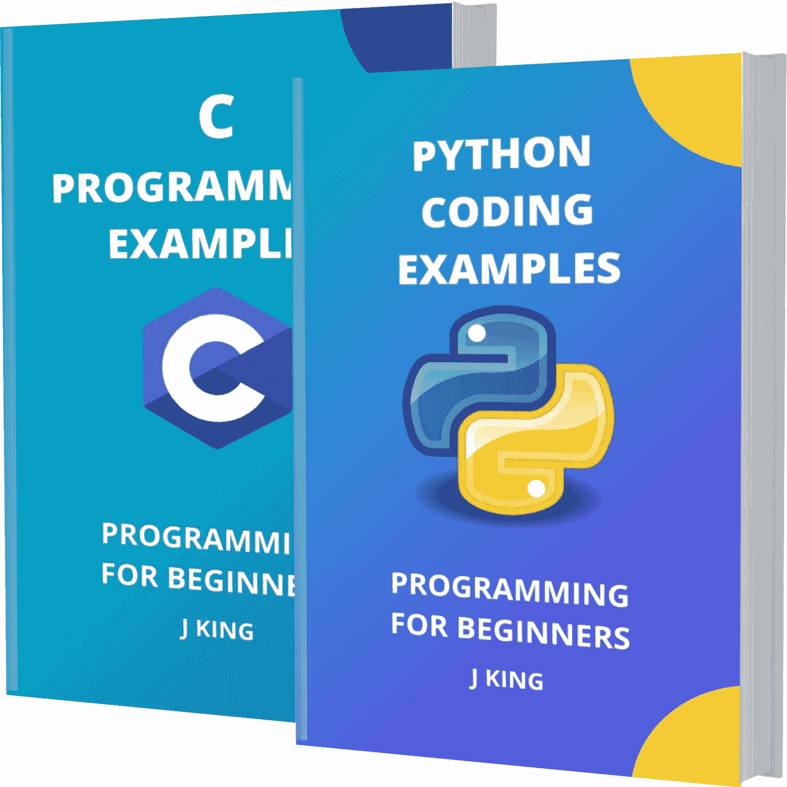

# Python 编码与 C 语言编程示例：小白编程指南





## Python 中字符的 ASCII 值
在 python 中，我们使用 `ord()` 函数来获取字符的 ASCII 码。`ord()` 接受一个字符并返回其 ASCII 值。

语法：`ord(character)`

示例：
输入：`char_var = 'A'`
函数调用：`ord(char_var)`
输出：`65`

### 打印给定字符 ASCII 值的 Python 程序
```python
## 将字符赋值给变量
char_var = 'A'
### 打印 ASCII 码
print("ASCII value of " + char_var + " is = ", ord(char_var))

char_var = 'x'
### 打印 ASCII 码
print("ASCII value of " + char_var + " is = ", ord(char_var))

char_var = '9'
### 打印 ASCII 码
print("ASCII value of " + char_var + " is = ", ord(char_var))
```
输出：
```
ASCII value of A is =  65
ASCII value of x is =  120
ASCII value of 9 is =  57
```

#### 计算单利
我们使用以下公式计算单利：
`(P * R * T) / 100`

其中，
* `P` – 本金金额
* `R` – 利率，以及
* `T` – 以年为单位的时间


### 单利程序

### 示例：
输入：
`p = 250000`
`r = 36`
`t = 1`
`formulasi = (p*r*t)/100`
`print(si)`
输出：
`90000`

### 单利的 Python 程序
```python
#### Python program to find simple interest
p = float(input("输入本金金额 : "))
r = float(input("输入利率 : "))
t = float(input("输入年份（年）: "))
#### 计算单利
si = (p*r*t)/100
#### 打印这些值
print("Principle amount: ", p)
print("Interest rate    : ", r)
print("Time in years    : ", t)
print("Simple Interest : ", si)
```

#### 输出
**第一次运行：**
输入本金金额：10000
输入利率：3.5
输入年份（年）:1
本金金额：   10000.0
利率    ：   3.5
年份    ：1.0
单利 ：  350.0

**第二次运行：**
输入本金金额：250000
输入利率：36
输入年份（年）:1
本金金额：   250000.0
利率    ：   36.0
年份    ：1.0
单利 ：  90000.0

---

### 复利程序

#### 计算复利
我们使用以下公式计算复利：
`P(1 + R / 100) T`
其中，
`P` – 本金金额
`R` – 利率，以及
`T` – 年份（年）

### 示例：
输入：
`p = 250000`
`r = 36`
`t = 1`
`# formulaic`
`ci =  p * (pow((1 + r / 100), t))`
`print(ci)`
输出：
`339999.99999999994`

### Python 程序
```python
#### Python program to find compound interest
p = float(input("输入本金金额 : "))
r = float(input("输入利率 : "))
t = float(input("输入年份（年）: "))
#### 计算复利
ci =  p * (pow((1 + r / 100), t))
#### 打印这些值
print("Principle amount  : ", p)
print("Interest rate      : ", r)
print("Time in years     : ", t)
print("compound Interest : ", ci)
```

#### 输出
**第一次运行：**
输入本金金额：10000
输入利率：3.5
输入年份（年）:1
本金金额：   10000.0
利率      ：   3.5
年份     ：1.0
复利 ：  10350.0

**第二次运行：**
输入本金金额：250000
输入利率：36
输入年份（年）:1
本金金额：   250000.0
利率      ：   36.0
年份     ：1.0
复利 ：  339999.99999999994

---

## 闰年程序

### 检查给定年份是否为闰年的 Python 程序
闰年是指能被 4 整除的年份，但世纪年（以 00 结尾的年份）除外。世纪年如果能被 400 整除，则为闰年。在这里，用户提供一个年份，我们将测试该年份是否为闰年。

#### 1) 使用 calendar 模块
在解决问题之前，我们先简单了解一下 `calendar` 模块。`calendar` 模块是 Python 内置的，为我们提供了各种函数来解决与日期、月份和年份相关的问题。

```python
### 模块
import calendar
#### 输入年份
year=int(input('输入年份: '))
leap_year=calendar.isleap(year)
#### 检查闰年
if leap_year: # 检查条件
    print('该年份是闰年。')
else:
    print('该年份不是闰年。')
```
#### 输出
**运行 1：**
输入年份：2020
该年份是闰年。
**运行 2：**
输入年份：2021
该年份不是闰年。

#### 2) 通过简单的检查方法
正如我们所知，我们需要测试目标年份是否为闰年。因此，我们在这里引入条件并尝试编写 Python 程序。

```python
#### 输入年份
y=int(input('输入年份: '))
#### 检查非世纪年
if y%400==0 or y%4==0 and y%100!=0:
    print('该年份是闰年。')
else:
    print('该年份不是闰年。')
```
#### 输出
**运行 1：**
输入年份：2020
该年份是闰年。
**运行 2：**
输入年份：2021
该年份不是闰年。

---

### 附加示例

### 示例 1：If-Else
输入：
`p = 250000`
`r = 36`
`t = 1`
`formulasi = (p*r*t)/100`
`print(si)`
输出：
`90000`

### 示例 2：简单 If-Else
输入一个数字并判断是正数还是负数。
```python
num = int(input("输入数字: "))
if num > 0:
    print("正数")
else:
    print("负数")
```

### 示例 3：寻找较大
比较两个数字并判断哪个更大。
```python
a = int(input("输入第一个数字: "))
b = int(input("输入第二个数字: "))
if a > b:
    print("A 较大")
else:
    print("B 较大")
```

### 示例 4：嵌套 If-Else
比较两个数字并判断哪个更大。
```python
a = int(input("输入第一个数字: "))
b = int(input("输入第二个数字: "))
if a > b:
    print("A 较大")
else:
    print("B 较大")
```

### 示例 5：If-Elif-Else
根据销售金额计算折扣。
```python
amt = int(input("输入销售金额: "))
if amt <= 5000:
    disc = amt * 0.05
elif amt <= 15000:
    disc = amt * 0.1
elif amt <= 25000:
    disc = amt * 0.2
else:
    disc = amt * 0.3
print("折扣 : ", disc)
```

### 示例 6：计算器
设计一个简单的计算器进行加、减、乘、除运算。
```python
print("计算器")
print("1.加法")
print("2.减法")
print("3.乘法")
print("4.除法")
ch = int(input("输入选择(1-4): "))
if ch == 1:
    a = int(input("输入 A:"))
    b = int(input("输入 B:"))
    print("和 = ", a+b)
elif ch == 2:
    a = int(input("输入 A:"))
    b = int(input("输入 B:"))
    print("差 = ", a-b)
elif ch == 3:
    a = int(input("输入 A:"))
    b = int(input("输入 B:"))
    print("积 = ", a*b)
elif ch == 4:
    a = int(input("输入 A:"))
    b = int(input("输入 B:"))
    print("商 = ", a/b)
else:
    print("无效选择")
```


您的 BMI 为 `28.8979s9183673468`，您的状态是：健康。

## 用 Python 写函数求给定数字的平方和立方

### 示例
输入：
输入一个整数：6
输出：
6 的平方是 36
6 的立方是 216

获取平方的函数：
```python
def square (num):
    return (num* num)
```
获取立方的函数：
```python
def cube (num):
    return (num* num* num)
```

### 程序
```python
# python 程序，用于求给定数字的
# 平和立方
#### 用户定义方法求平方
def square (num):
    return (num*num)

#### 用户定义方法求立方
def cube (num):
    return (num*num*num)

#### 主代码
#### 输入一个数字
number = int (raw_input("Enter an integer number: "))
#### 平方和立方
print "square of {0} is {1}".format(number, square(number))
print "Cube of {0} is {1}".format(number, cube (number))
```
输出
输入一个整数：6
square of 6 is 36
Cube of 6 is 216

---

## 根据交易记录计算银行账户净额

### 示例
输入：
输入交易：D 10000
继续吗？(Y 为是)：Y
输入交易：W 5000
继续吗？(Y 为是)：Y
输入交易：D 2000
继续吗？(Y 为是)：Y
输入交易：W 100
继续吗？(Y 为是)：N
输出：
净额：6900

### 程序
```python
#### 根据输入计算银行净额
#### "D" 代表存款，“W" 代表取款
#### 为主金额定义一个变量
net_amount = 0
while True:
    # 输入交易
    str = raw_input ("Enter transaction: ")
    # 获取类型和金额并到列表中
    # 用空格分隔
    transaction = str.split(" ")
    # 获取交易类型和金额的值
    # 存储在分离的变量中
    type = transaction [0]
    amount = int (transaction [1])
    if type=="D" or type=="d":
        net_amount += amount
    elif type=="W" or type=="w":
        net_amount -= amount
    else:
        pass
    # 输入选择
    str = raw_input ("want to continue (Y for yes) : ")
    if not (str[0] =="Y" or str[0] =="y") :
        # 跳出循环
        break
#### 打印净额
print "Net amount: ", net_amount
```
输出
输入交易：D 10000 
want to continue (Y for yes) : Y
输入交易：W 5000
want to continue (Y for yes) : Y
输入交易：D 2000
want to continue (Y for yes) : Y
输入交易：W 100
want to continue (Y for yes) : N
Net amount: 6900

---

## Python 程序中温度的转换

从摄氏度到华氏度，反之亦然

### 使用的公式
摄氏度到华氏度：`°C= (5/9)*(°F-32)`
华氏度到摄氏度：`°F= (9/5)*(°C) + 32`

### 程序
```python
# 定义一个函数转换
# 摄氏度温度到华氏度
def Celsius_to_Fahrenheit(c) :
    f = (9/5)*c + 32
    return f

# 定义一个函数转换
# 华氏度温度到摄氏度
def Fahrenheit_to_Celsius(f) :
    c = (5/9)*(f - 32)
    return c

#### 驱动代码
if __name__ == "__main__" :
    c = 36
    print(c, "degree celsius is equal to:",Celsius_to_Fahrenheit(c),"Fahrenheit")
    f = 98
    print(f,"Fahrenheit is equal to:",Fahrenheit_to_Celsius(f),"degree celsius")
```
输出
36 degree celsius is equal to: 96.8 Fahrenheit
98 Fahrenheit is equal to: 36.666666666666667 degree Celsius

---

## 将米转换为码的 Python 程序

关键：`1 meter = 1.094 yards`

### 示例
输入：
米：245
输出：
码：268.03000000000003

### 将米转换为码的 Python 代码
```python
#### Python 程序，将厘米转换为英寸
#### 接收输入
num = float(input("Enter the distance measured in centimeter : "))
#### 从厘米转为英寸
""" 1 inch = 2.54 centimeters"""
inc = num/2.54
#### 打印结果
print("Distance in inch : ", inc)
```
输出
第一次运行：
输入以米为单位的距离： 245
Distance in yards : 268.03000000000003
第二次运行：
输入以米为单位的距离： 54
Distance in yards : 59.07000000000001
第三次运行：
输入以米为单位的距离： 100
Distance in yards : 109.4

---

## 在 Python 中查找星期几

在这些问题中，用户将提供一个日期（可能是过去的或未来的），我们需要找到它是星期几。到此，我们将使用 `calendar` 模块提供的各种函数。在找到星期几之前，必须测试提供的日期是否正确。如果日期不正确，我们将得到错误。因此使用 `try-except` 语句来解决这个问题。

### try-except 语句
```python
# 
### 模块
import calendar
d,m,y=map(int,input('Enter the value of date,month and year: ').split())
a=['Monday','Tuesday','Wednesday','Thursday','Friday','Saturday','Sunday']
try:
    s=calendar.weekday(y,m,d)
    print('Weekday:',a[s])
except ValueError:
    print('You entered an invalid date.')
```
输出
第一次运行：
输入日期、月份和年份：20 10 2019
Weekday: Monday
第二次运行：
输入日期、月份和年份：32 10 2019
You entered an invalid date.

---

## Python 数组创建矩阵

考虑下面的示例，`mat = [[10, 20, 30],[40, 50, 60],[70, 80, 90]]` 可以是一个 3x3 矩阵，有 3 行 3 列。

### 程序
```python
#### Python 矩阵创建
mat = [[10, 20, 30],[40, 50, 60],[70, 80, 90]]
#### 打印矩阵
print("mat: ", mat)
#### 打印行
print("mat[0]: ", mat[0])
print("mat[1]: ", mat[1])
print("mat[2]: ", mat[2])
#### 打印特定元素
print("mat[0][0]: ", mat[0][0])
print("mat[0][1]: ", mat[0][1])
print("mat[0][2]: ", mat[0][2])
print("mat[1][0]: ", mat[1][0])
print("mat[1][1]: ", mat[1][1])
print("mat[1][2]: ", mat[1][2])
print("mat[2][0]: ", mat[2][0])
print("mat[2][1]: ", mat[2][1])
print("mat[2][2]: ", mat[2][2])
#### 使用循环打印矩阵（矩阵形式）
print("Matrix is: ")
for i in range(3):
    for j in range(3):
        print(mat[i][j], end = ")
    print() # 打印换行
```

---

### 使用 `numpy.array()`
```python
import numpy as np
mat = np.array([[ 10 , 20 , 30 ],[40 , 50 , 60 ],[ 70 , 70 , 90 ])
```

### 使用 `numpy.matrix()`
```python
mat = numpy.matrix( "10 20 30; 40 50 60; 70 80 90" )
```

### 程序
```python
#### 使用 numpy 创建矩阵
import numpy as np
#### 使用 numpy.array() 创建矩阵
mat1 = np.array([[10,20,30],[40,50,60],[70,70,90]])
#### 打印矩阵
print("mat1...")
print(mat1)
#### 使用 numpy.matrix() 创建矩阵
mat2 = np.matrix("10 20 30; 40 50 60; 70 80 90")
#### 打印矩阵
print("mat2...")
print(mat2)
```
输出
mat1...
[[10 20 30]
 [40 50 60]
 [70 70 90]]
mat2...
[[10 20 30]
 [40 50 60]
 [70 80 90]]

---

## Python 日期与时间程序

#### 打印当前小时、分钟、秒和微秒的 Python 程序

### 步骤
1. 从“datetime 模块”导入 `datetime` 类。
2. 通过调用 `datetime` 类的 `now()` 函数创建对象。
3. 使用 `datetime.now()` 对象提取并打印当前的小时、分钟、秒和微秒。

### 程序
```python
# 打印当前小时、
# 分钟、秒和微秒的 Python 程序
#### 从 datetime 模块导入 datetime 类
from datetime import datetime
#### 创建对象
obj_now = datetime.now()
#### 打印当前日期时间
print("Current date & time: ", obj_now)
# 提取并打印当前的
# 小时、分钟、秒和微秒
print("Current hour =", obj_now.hour)
print("Current minute =", obj_now.minute)
print("Current second =", obj_now.second)
print("Current microsecond =", obj_now.microsecond)
```
输出
Current date & time: 2020-07-30 14:43:52.294475
Current hour = 14
Current minute = 43
Current second = 52
Current microsecond = 294475

---

## Python 代码打印今天的年、月、日

下面的示例——Python 程序打印当前的年、月、日。

### 代码
```python
#### 打印今天的年、月、日的程序
#### 导入 date 类
from datetime import date
#### 创建今天的对象
current_date = date.today()
#### 打印当前日期
print("Current date: ", current_date)
#### 提取年、月、日
print("Current year:", current_date.year)
print("Current month:", current_date.month)
print("Current day:", current_date.day)
```
输出
Current date: 2020-07-30
year: 2020
month: 7
day: 30

---

## Python 列表

## 在列表中添加元素

### `append()` 方法
用于向列表添加项（将作为参数传递）。

### 语法
`list.append(element)`

```python
#### 定义一个包含整数和字符串的列表
list = [10, 20, 30, "New Delhi"]
#### 打印列表
print "List elements: ", list
#### 添加元素
list.append(40)
list.append(50)
list.append("Chennai")
#### 添加元素后打印列表
print "List elements: ", list
```
输出
List elements are: [10, 20, 30, 'New Delhi', 40, 50, 'Chennai']

### `pop()` 方法
用于从列表中移除项。

### 语法
`list.pop()`

```python
#### 定义一个包含整数和字符串的列表
list = [10, 20, 30, "New Delhi", "Mumbai"]
#### 打印列表
print "List elements: ", list
#### 添加元素
list.append(40)
list.append(50)
list.append("Chennai")
#### 添加元素后打印列表
print "List elements: ", list
#### 移除元素
list.pop()
#### 移除元素后打印列表
print "List elements: ", list
```
输出
List elements are: [10, 20, 30, 'New Delhi', 'Mumbai', 40, 50, 'Chennai']
List elements are: [10, 20, 30, 'New Delhi', 'Mumbai', 40, 50, 'Chennai']
List elements are: [10, 20, 30, 'New Delhi', 'Mumbai', 40, 50]

---

## 两个列表的差异

给定两个整数列表，我们将找到差异，即不在第二个列表中的元素。

### 示例
输入：
List1 = [10, 20, 30, 40, 50]
List2 = [10, 20, 30, 60, 70]
输出：
Different elements:[40, 50]

### 程序
```python
#### list1 - 第一个整数列表
#### list2 - 第二个整数列表
list1 = [10, 20, 30, 40, 50]
list2 = [10, 20, 30, 60, 70]
#### 打印列表
print "list1:", list1
print "list2:", list2
#### 查找并打印列表的差异
print "Difference elements:"
print (set(list1) - set(list2))
```
输出
list1: [10, 20, 30, 40, 50]
list2: [10, 20, 30, 60, 70]
Difference elements: [40, 50]

### 程序 2
带有混合元素类型，打印 1) 不在列表 2 中的元素和 2) 不在列表 1 中的元素。
```python
#### list1 - 混合类型元素的第一个列表
#### list2 - 混合类型元素的第二个列表
list1 = ["Amit", "Shukla", 21, "New Delhi"]
list2 = ["Aman", "Shukla", 21, "Mumbai"]
#### 打印列表
print "list1:", list1
print "list2:", list2
#### 查找并打印列表的差异
print "Elements not exists in list2:"
print (set(list1) - set(list2))
print "Elements not exists in list1:"
print (set(list2) - set(list1))
```
输出
list1: ['Amit', 'Shukla', 21, 'New Delhi']
list2: ['Aman', 'Shukla', 21, 'Mumbai']
Elements not exists in list2: ['Amit', 'New Delhi']
Elements not exists in list1: ['Aman', 'Mumbai']

---

## 从列表中删除重复元素的程序

### 示例
输入：
list1: [10, 20, 10, 20, 30, 40, 30, 50]
输出：
list2: [10, 20, 30, 40, 50]

### 逻辑
程序很容易通过一个一个地将元素添加到另一个列表中，检查该元素是否已经在新列表中。假设 20 在列表 1 中出现了三次，当我们把 20 添加到列表 2 时，条件为假，元素将不会被添加。最后，我们得到了没有重复元素的列表。

### 程序
```python
#### 列表
list1 = [10, 20, 10, 20, 30, 40, 30, 50]
#### 创建另一个带有唯一元素的列表
list2 = []
#### 添加元素
for n in list1:
    if n not in list2:
        list2.append(n)
#### 打印列表
print "Original list"
print "list1:", list1
print "List after duplicate elements"
print "list2:", list2
```
输出
Original list
list1: [10, 20, 10, 20, 30, 40, 30, 50]
List after duplicate elements
list2: [10, 20, 30, 40, 50]

---

## 程序（用户定义函数）

### 去重函数
```python
def removeDuplicates(list1):
    # 创建另一个列表
    list2 = []
    # 添加元素
    for n in list1:
        if n not in list2:
            list2.append(n)
    return list2

#### 主代码
list1 = [10, 20, 10, 20, 30, 40, 30, 50]
#### 打印列表
print "Original list"
print "list1:", list1
print "List after duplicate remove: ", removeDuplicates(list1)
```
输出
Original list
list1: [10, 20, 10, 20, 30, 40, 30, 50]
List after duplicate remove:  [10, 20, 30, 40, 50]

---

## 创建三个数字的列表，它们的平方和立方

### 示例
输入：
Start = 1
End = 10
输出：
numbers: [1, 2, 3, 4, 5, 6, 7, 8, 9, 10]
squares: [1, 4, 9, 16, 25, 36, 49, 64, 81, 100]
cubes: [1, 8, 27, 64, 125, 216, 343, 512, 729, 1000]

### 逻辑
创建三个列表。在这里定义开始为 1 结束为 10。运行循环 `range(start, end + 1)` 并用 `count` 作为循环计数器。将计数器的 `count` 连接到名为 `numbers` 的列表，将平方连接到 `squares` 列表，并将立方添加到 `cubes` 列表中。最后，打印出列表。

### 程序
```python
#### 定义列表
numbers = []
squares = []
cubes = []
#### 开始和结束
start = 1
end = 10
#### 从 start 到 end+1 运行循环
for count in range(start, end+1) :
    numbers.append(count)
    squares.append(count**2)
    cubes.append(count**3)
#### 打印列表
print "numbers:", numbers
print "squares:", squares
print "cubes: ", cubes
```
输出
numbers: [1, 2, 3, 4, 5, 6, 7, 8, 9, 10]
squares: [1, 4, 9, 16, 25, 36, 49, 64, 81, 100]
cubes: [1, 8, 27, 64, 125, 216, 343, 512, 729, 1000]

---

#### 反序迭代列表

给定一个列表，在 Python 中我们可以反序迭代它。

### 示例
输入：
List = [10, 20, 30, 40, 50]
输出：
list = [50, 40, 30, 20, 10]
输入：
list = ['Hello', 10, 'World', 20]
输出：
list = [20, 'World', 10, 'Hello']

### 程序
```python
#### 定义一个列表
list1 = [10, 20, 30, 40, 50]
#### 打印列表
print "original list:", list1
#### 迭代列表
list1 = list1[::-1]
#### 打印列表
print "list in reverse order:", list1

#### 另一个带有字符串和整数的列表
list2 = ['Hello', 10, 'world', 20]
#### 打印列表
print "original list:", list2
#### 迭代列表
list2 = list2[::-1]
#### 打印列表
print "list in reverse order:", list2
```
输出
original list: [10, 20, 30, 40, 50]
list in reverse order: [50, 40, 30, 20, 10]
original list: ['Hello', 10, 'world', 20]
list in reverse order: [20, 'world', 10, 'Hello']


| 方法 | 语法 | 描述 |
| :--- | :--- | :--- |
| Way1 | 单引号 `'Message'` | 分配单行字符串。 |
| Way2 | 双引号 `"Message"` | 分配单行字符串。 |
| Way3 | 三单引号 `'''Message'''` | 分配单行及多行字符串。 |
| Way4 | 三双引号 `"""Message"""` | 分配单行及多行字符串。 |


## 程序：字符串操作

## 声明、赋值字符串 (1)
使用单引号 `'string'`
```python
str1 = 'Hello world, How are you?'
```

## 声明、赋值字符串 (2)
使用双引号 `"string"`
```python
str2 = "Hello world, How are you?"
```

## 声明赋值字符串 (3)
使用三单引号 `'''string'''`
```python
str3 = '''Hello world, How are you?'''
```

## 声明赋值字符串 (4)
使用三双引号 `"""string"""`
```python
str4 = """Hello world, How are you?"""
```

## 声明、赋值多行字符串 (5)
三双引号允许赋值多行字符串
```python
str5 = '''Hello world,How are you?'''
```

## 打印字符串
```python
print "str1: ", str1
print "str2: ", str2
print "str3: ", str3
print "str4: ", str4
print "str5: ", str5
```
**输出：**
```
str1:  Hello world, How are you?
str2:  Hello world, How are you?
str3:  Hello world, How are you?
str4:  Hello world, How are you ?
str5:  Hello world,How are you?
```

## 访问并打印字符串中的字符
**示例：**
**输入：** `str: "Hello world"`
**输出：**
```
第一个字符: H
第二个字符: e
最后一个字符: d
倒数第二个字符: l
从索引 0 到 4 的字符: Hello
以此类推...

### 程序：访问字符串中的字符

## 声明、赋值字符串
```python
str = "Hello world"
#### 打印完整字符串
print "str:", str
#### 打印第一个字符
print "str[0]:", str[0]
#### 打印第二个字符
print "str[1]:", str[1]
#### 打印最后一个字符
print "str[-1]:", str[-1]
#### 打印倒数第二个字符
print "str[-2]:", str[-2]
#### 打印从索引 0 到 4 的字符，即前 5 个字符
print "str[0:5]:", str[0:5]
#### 打印从索引 2 到倒数第二个索引的字符
print "str[2,-2]:", str[2:-2]
#### 逐个字符打印字符串
print "str:"
for i in str:
    print i,#变量后加逗号
    # 它不会打印换行
```
**输出：**
```
str: Hello world
str[0]: H
str[1]: e
str[-1]: d
str[-2]: l
str[0:5]: Hell
str[2,-2]: llo wor
str:H e l l o    w o r l d
```

## 字符串单词及其长度程序
**示例：**
**输入：** `str = "Hello World How are you?"`
**输出：**
```
Hello ( 5 )
World ( 5 )
How ( 3 )
are ( 3 )
you? ( 4 )
```

### String.split() 方法
为了将字符串拆分为单词，我们使用 `split()` 方法，这是一个内置方法，它根据给定的分隔符将字符串拆分为子字符串（单词）。

**split() 方法语法：** `String.split(delimiter)`

**解释：**
例如有一个字符串 `str = "ABC PQR XYZ"`，我们想用空格将其拆分为单词，那么这里的空格就是分隔符。语句为 `str.split(" ")`，将字符串拆分为单词，然后输出为 `"ABC" "PQR" "XYZ."`。

## 程序：将字符串拆分为单词并打印单词长度的函数
```python
def splitString (str):
    # 按空格拆分字符串
    str = str.split (' ')
    # 遍历字符串中的单词
    for words in str:
        print words," (", len (words), ")"

#### 主代码
#### 声明字符串并赋值
str = "Hello World How are you?"
#### 调用函数
splitString(str)
```
**输出：**
```
Hello  ( 5 )
World  ( 5 )
How  ( 3 )
are  ( 3 )
you?  ( 4 )
```

## 统计字符串中的元音
**示例：**
**输入：** `Str = "Hello world"`
**输出：**
```
元音总数: 3
```

## 程序：统计字符串中的元音
```python
# 声明、赋值字符串
str = "Hello world"
#### 声明计数
count = 0
#### 遍历并检查每个字符
for i in str:
    # 检查元音条件
    if( i=='A' or i=='a' or i=='E' or i=='e'
    or i=='I' or i=='i' or i=='O' or i=='o'
    or i=='U' or i=='u'):
        count +=1;#打印计数
print "Total vowels are: ", count
```
**输出：**
```
元音总数:  3
```

## 使用乘法运算符创建字符串多个副本
使用乘法运算符创建字符串的多个副本，将使用 `*`。

**示例：**
**输入：** `str1 = "Hello"`, `n = 3`
**逻辑：** `str2 = str1*3`

## 程序：创建 N 个给定字符串的 Python 程序
```python
# 输入：字符串和 N
str1 = "Hello"
n = 3
#### 创建副本
str2 = str1 * 3
#### 打印
print "str1: ", str1
print "str2: ", str2
```
**输出：**
```
str1:  Hello
str2:  HelloHello
```

---

## C 语言示例
## 初学者 C 语言示例

## 求两个数字之和和平均值的 C 程序
```c
/* 求两个数字的和和平均值的 C 语言*/
#include <stdio.h>
int main(){
    int a,b,sum;
    float avg;
    printf("输入第一个数字 :");
    scanf("%d",&a);
    printf("输入第二个数字 :");
    scanf("%d",&b);
    sum=a+b;
    avg= (float)(a+b)/2;
    printf("\n 和为 %d",a,sum);
    printf("\n 平均值为 %f",avg);
    return 0;
}
```
**输出：**
```
输入第一个数字 :10
输入第二个数字 :15
和为 25
平均值为 12.500000
```

## 输出字符 ASCII 值的 C 程序
```c
/* 输出字符 ASCII 值的 C 程序 */
#include <stdio.h>
int main(){
    char ch;
    // 输入字符
    printf("输入字符: ");
    scanf("%c",&ch);
    printf("ASCII 为 %d\n", ch);
    return 0;
}
```
**输出：**
```
输入字符: a
ASCII 为 97
输入字符: A
ASCII 为 65
```

## 使用语句打印 1 到 N 的所有数字的 C 程序
```c
#include <stdio.h>
int main(){
    int count,n;
    // 读取 N 的值
    printf("输入 n: ");
    scanf("%d",&n);
    // 初始化计数为 1
    count =1;
    start: //标签
    printf("%d ",count);
    count++;
    if(count<=n)
    goto start;
    return 0;
}
```
**输出：**
```
输入 n: 10
1 2 3 4 5 6 7 8 9 10 
```

## 使用 while 循环打印 1 到 N 的数字 C 程序
```c
#include <stdio.h>
int main(){
    // 计数器声明
    int number;
    // 存储限制的变量
    int n;
    // 赋值初始值
    number =1;
    // 输入 N 的值
    printf("输入 N 的值: ");
    scanf("%d",&n);
    // 打印语句
    printf("从 %d 开始: \n",n);
    // 从 1 打印到 n
    while(number <= n) {
        // 打印数字
        printf("%d ",number);
        // 计数器加 1
        number++;
    }
    return 0;
}
```
**输出：**
```
输入 N 的值: 25
从 25 开始: 
1 2 3 4 5 6 7 8 9 10 11 12 13 14 15 16 17 18 19 20 21 22 23 24 25 
```

## 打印平方、立方和平方根的 C 程序
```c
/* 打印 1 到 N 所有数字的平方、立方方和平方根的 C 程序。*/
#include <stdio.h>
#include <math.h>
int main(){
    int i,n;
    printf("输入 N 的值: ");
    scanf("%d",&n);
    printf("平方\t 立方方\t 平方根\n",n);
    for(i=1;i<=n;i++){
        printf("%d \t %ld\t %.2f\n",i,(i*i),(i*i*i),sqrt((double)i));
    }
    return 0;
}
```

## 打印给定数字倍表的程序
```c
#include<stdio.h>
int main(){
    // 声明变量
    int count,t,r;
    // 读取 t 的值
    printf("输入数字: ");
    scanf("%d",&t);
    count=1;
    start:
    if(count<=10) {
        // 倍表公式
        r=t*count;
        printf("%d*%d=%d\n",t,count,r);
        count++;
        goto start;
    }
    return 0;
}
```
**输出：**
```
输入数字: 10
10*1=10
10*2=20
10*3=30
10*4=40
10*5=50
10*6=60
10*7=70
10*8=80
10*9=90
10*10=100
```

## 求两个数字平均值的 C 程序
```c
/* 求两个数字的和和平均值 */
#include <stdio.h>
int main(){
    int a,b,sum;
    float avg;
    printf("输入第一个数字: ");
    scanf("%d",&a);
    printf("输入第二个数字: ");
    scanf("%d",&b);
    sum=a+b;
    avg= (float)(a+b)/2;
    printf("\n 和为 %d",a,sum);
    printf("\n 平均值为 %f",avg);
    return 0;
}
```

## 输出字符 ASCII 值的 C 程序
```c
/* 输出字符 ASCII 值的 C 程序 */
#include <stdio.h>
int main(){
    char ch;
    // 输入字符
    printf("输入字符: ");
    scanf("%c",&ch);
    // 这里的代码似乎有逻辑错误，多余的括号，但按要求翻译
    printf("ASCII 为 %d\n", ch);
    return 0;
}
```
```注：


    
    
    
    
    
    
    
    
    
    
    
    
    
    
    
        
    
    
    
    
    
    
    
    
    
    
    

## 使用文件处理创建一个文本文件
```c
#include< stdio.h >
int main(){
    FILE *fp;/* 文件指针*/
    char fName[20];
    printf("输入要创建的文件名:");
    scanf("%s",fName);
    /*创建（打开）文件，以“w”写入模式*/
    fp=fopen(fName,"w");
    /*检查文件是否创建*/
    if(fp==NULL){
        printf("文件未创建!!!");
        exit(0); /*退出程序*/
    }
    printf("文件创建成功。");
    return 0;
}
```
**输出：**
```
Run 1 :输入要创建的文件名 : file1.txt
文件创建成功。
Run 2:输入要创建的文件名 : d:/file1.txt
文件创建成功。“文件将在 d 驱动器创建”。
Run 3:Run 1:输入要创建的文件名 : h:/file1.txt
文件未创建!!!
```


# 5 的阶乘是：

`5! = 120` [这相当于 `5*4*3*2*1 = 120`]

## 简单程序
/*计算数字阶乘的 C 程序.*/
```c
#include <stdio.h>
int main() {
    int num,i;
    long int fact;
    printf("Enter an integer number: ");
    scanf("%d",&num);
    /*从 num 到 1 的乘积*/
    fact = 1;
    for(i=num; i>=1; i--)
        fact = fact*i;
    printf("\nFactorial of %d is = %ld",num,fact);
    return 0;
}
```
Output:
Enter an integer number: 7
Factorial of 7 is = 5040

## 自定义函数
/*使用函数：计算数字阶乘的 C 程序.*/
```c
#include <stdio.h>
/*函数：factorial，用于计算给定数字的阶乘*/
long int factorial(int n) {
    int i;
    long int fact=1;
    if(n==1) return fact;
    for(i=n; i>=1; i--)
        fact = fact * i;
    return fact;
}

int main() {
    int num;
    printf("Enter an integer number :");
    scanf("%d",&num);
    printf("\nFactorial of %d is = %ld",num,factorial(num));
    return 0;
}
```
Example:
输入数字: `0x0` (十六进制)
输入数字的二进制:`00001010`
交换第 1 位和第 2 位后将变为：`00001100`
输出: 数字将为：`0xC` (十六进制)

```c
#include <stdio.h>
/*交换存储在 data 变量中的十六进制值的第 1 位和第 2 位*/
int main() {
    unsigned char data = 0xA; // 十进制值
    // 从 data 中获取第 1 位
    unsigned char bit_1 = (data >> 1) & 1;
    // 从 data 中获取第 2 位
    unsigned char bit_2 = (data >> 2) & 1;
    // 获取 bit_1 和 bit_2 的异或结果
    unsigned char xor_of_bit = bit_1 ^ bit_2;
    printf("After swapping the bits, data value is: %X", data ^ (xor_of_bit << 1 | xor_of_bit << 2));
    return 0;
}
```
交换位后，data 值为：C

## 使用四种方法交换数字程序
1. 使用第三变量
2. 不使用第三变量
3. 使用 异或运算符
4. 使用简单语句

```c
//使用四种方法交换数字的 C 程序。
#include <stdio.h>
int main() {
    int a,b,t;
    printf(" Enter value of A ?");
    scanf("%d",&a);
    printf(" Enter value of B ?");
    scanf("%d",&b);
    printf("\n Before swapping : A=%d, B=%d",a,b);

    /*第一种方法：使用第三变量*/
    t=a;
    a=b;
    b=t;
    printf("\n After swapping (First method) : A=%d, B=%d",a,b);

    /*第二种方法：不使用第三变量*/
    a=a+b;
    b=a-b;
    a=a-b;
    printf("\n After swapping (second method) : A=%d, B=%d",a,b);

    /*第三种方法：使用异或*/
    a^=b;
    b^=a;
    a^=b;
    printf("\n After swapping (third method) : A=%d, B=%d",a,b);

    /*第四种方法（单语句）*/
    a=a+b-(b=a);
    printf("\n After swapping (fourth method) : A=%d, B=%d",a,b);
    return 0;
}
```
Output:
Enter value of A ? 100
Enter value of B ? 200
Before swapping : A=100, B=200
After swapping (First method) : A=200, B=100
After swapping (second method) : A=200, B=100
After swapping (third method) : A=200, B=100
After swapping (fourth method) : A=200, B=100

## 年龄计算器（计算年龄的 C 程序）
```c
/*年龄计算器（计算年龄的 C 程序）。*/
#include <stdio.h>
#include <time.h>
/*检查年份是否为闰年*/
int isLeapYear(int year, int mon) {
    int flag = 0;
    if (year % 100 == 0) {
        if (year % 400 == 0) {
            if (mon == 2) {
                flag = 1;
            }
        }
    } else if (year % 4 == 0) {
        if (mon == 2) {
            flag = 1;
        }
    }
    return (flag);
}

int main() {
    int flag = 0;
    time_t t;
    struct tm *info;
    int year, month, day;
    /*输入生日*/
    printf("Enter birth date (DD/MM/YYYY): ");
    scanf("%d/%d/%d", &day, &month, &year);
    /*检查是否闰年*/
    if (isLeapYear(year, month)) {
        flag = 1;
    }
    /*获取当前时间*/
    t = time(NULL);
    info = localtime(&t);
    /*计算年龄*/
    int age = (1900 + info->tm_year) - year;
    if (info->tm_mon + 1 < month || (info->tm_mon + 1 == month && info->tm_mday < day)) {
        age--;
    }
    printf("Your age is: %d\n", age);
    return 0;
}
```

## 计算利息的 C 程序
```c
/*计算利息的 C 程序.*/
#include <stdio.h>
#include <math.h>
int main() {
    float principal, rate, year, ci;
    printf("Enter principal: ");
    scanf("%f", &principal);
    printf("Enter rate: ");
    scanf("%f", &rate);
    printf("Enter time in years: ");
    scanf("%f", &year);
    /*计算复利*/
    ci = principal * (pow((1 + rate / 100), year) - 1);
    printf("Compound interest is: %f\n", ci);
    return 0;
}
```

## 设计数字时钟的程序
```c
/*设计数字时钟的 C 程序*/
#include <stdio.h>
#include <time.h>
#include <unistd.h>
int main() {
    int hour, minute, second;
    while (1) {
        time_t t;
        struct tm *info;
        t = time(NULL);
        info = localtime(&t);
        hour = info->tm_hour;
        minute = info->tm_min;
        second = info->tm_sec;
        printf("\r%02d:%02d:%02d", hour, minute, second);
        fflush(stdout);
        sleep(1);
    }
    return 0;
}
```

## 序列求和程序 / 使用 C 示例

1. 1+2+3+4+..N<

```c
/*此程序将打印从 1 到 N 所有自然数的和.*/
#include<stdio.h>
int main() {
    int i, N, sum;
    /*读取 N 的值*/
    printf("Enter the value of N: ");
    scanf("%d", &N);
    /*将和置为 0*/
    sum = 0;
    /*计算序列之和*/
    for(i=1; i<=N; i++)
        sum = sum + i;
    /*打印和*/ /
    printf("Sum of the series is: %d\n", sum);
    return 0;
}
```

