# Python 初学者指南

John C. Shovic, 博士

Alan Simpson

John C. Shovic, 博士

Alan Simpson

- 打开 Python 应用文件
- 输入和使用 Python 注释
- 理解 Python 数据类型
- 使用 Python 运算符
- 创建和使用变量
- 理解什么是语法以及为什么它很重要
- 使用函数计算数字
- 更多数学函数
- 数字格式化
- 处理更奇特的数字
- 操作字符串
- 揭示日期和时间
- 控制执行的主要运算符
- 使用 if 进行决策
- 使用 for 重复过程
- 使用 while 循环
- 定义和使用列表
- 什么是元组？谁在乎？
- 使用集合 (Sets)
- 创建函数
- 为函数注释
- 向函数传递信息
- 从函数返回值
- 理解异常
- 优雅地处理错误
- 异常具体化
- 防止你的应用崩溃
- 在组合中加入 else
- 使用 ... except ... else ... finally
- 抛出你自己的异常
- 理解文本和二进制文件
- 打开和关闭文件
- 读取文件内容
- 遍历文件
- 读取并复制二进制文件
- 组织 JSON 数据
- 理解序列化
- 从 JSON 文件加载数据
- 将 Python 数据导出为 JSON
- 了解网页的工作原理
- 理解 Python 标准库
- 探索 Python 包
- 导入 Python 模块
- 编写 Python 式代码 (Pythonic)
- 识别缩进的重要性
- 理解 Python 语法
- 欣赏 Python 变量的灵活性
- 将列表视为朋友
- 控制你的程序
- 理解 Python 函数
- 找出错误
- 使用他人的模块
- 遇到问题时使用网络和 AI

作者简介

与傻学者建立联系

最终用户许可协议

- 表 4-1 Python 算术运算符
- 表 4-2 Python 比较运算符
- 表 4-3 Python 布尔运算符
- 表 5-1 某些用于数字的 Python 内置函数
- 表 5-2 Python Math 中的某些函数
- 表 5-3 用于 2、8、16 进制数的 Python 函数
- 表 5-4 适用于字符串的 Python 序列运算符
- 表 5-5 Python 3 字符串的内置方法
- 表 5-6 示例日期格式字符串
- 表 5-7 示例日期时间格式字符串
- 表 6-1 用于决策的 Python 比较运算符
- 表 6-2 Python 逻辑运算符
- 表 7-1 处理列表的方法
- 表 11-1 用于序列化和反序列化 JSON 数据的 Python 方法
- 表 11-2 Python 与 JSON 数据转换
- 表 12-1 常见 HTTP 状态码
- 表 12-2 Python urllib 库中的包
- 图 1-1：在 VS Code 中获取 Python 扩展。
- 图 1-2：VS Code 中的 GitHub Copilot 扩展。
- 图 1-3：VS Code 中的 GitHub Copilot 扩展。
- 图 2-1：终端。
- 图 2-2：Python 的。
- 图 2-3：help。
- 图 2-4：hello.py。
- 图 2-5：hello 的输出。
- 图 2-6：hello。
- 图 3-1：Python 之禅。
- 图 4-1：在 VS 中。
- 图 4-2：hello.py。
- 图 5-1：math 模块。
- 图 5-2：f-string。
- 图 6-1：if 条件。
- 图 6-2：日期时间。
- 图 6-3：遍历文件。
- 图 6-4：列表。
- 图 6-5：while 循环。
- 图 6-6：while 循环。
- 图 7-1：在列表中查找某项。
- 图 7-2：Python 的索引。
- 图 8-1：一个函数。
- 图 8-2：hello.py。
- 图 8-3：向函数传递数据。
- 图 8-4：参数。
- 图 8-5：三个参数。
- 图 8-6：关键字参数。
- 图 8-7：*args。
- 图 8-8：alphabetize()。
- 图 9-1：showfile.py 和 people.csv。
- 图 9-2：people.csv。
- 图 9-3：showfile.py。
- 图 9-4：showfile.py。
- 图 9-5：正确的错误信息。
- 图 9-6：try、异常处理和 else 块。
- 图 10-1：文本和二进制文件。
- 图 10-2：binarycopy.py。
- 图 10-3：happy_pickle.jpg。
- 图 11-1：Excel 表格。
- 图 11-2：JSON 格式。
- 图 11-3：Google Firebase 实时数据库。
- 图 11-4：显示一个值。
- 图 11-5：更改值。
- 图 12-1：客户端和服务器。
- 图 12-2：URL 的组成。
- 图 12-3：检查 HTTP 头部。
- 图 12-4：HTTP 头部。
- 图 12-5：示例页面。
- 图 12-6：爬虫代码。
- 图 12-7：网络爬虫代码。
- 图 13-1：内置函数。

Python 语言正变得越来越流行，根据 IEEE Spectrum 的数据，它在 2017 年成为世界上最流行的语言。Python 的强大是实实在实的。

Python 之成为第一语言是因为它于学习和使用，这部分归功于其简化的语法和自然语言流，但也归功于其强大的社区和广泛的应用范围。

# 关于本书

本书是一本参考手册，旨在引导你学习 Python 基础知识的过程。如果你想学习许多令人兴奋的内容，那么这本书正适合你。它向你介绍了你需要深入探索的主题。

这是一本实操性书籍，书中处有示例和代码。你将输入代码、运行代码，然后修改它来实现你的需求。

在本书中，我们将通过小巧、易懂的步骤带你了解 Python 语言的基础。

# 傻瓜假设

我们假设你已经知道如何使用电脑。如果你能打开电脑并使用鼠标，你就准备好学习这本书了。我们假设你还不会编程，尽管在阅读本书后你将具备一些编程技能。

# 本书使用的图标

如果没有书中指向那些真正有帮助且能加速你进步信息的图标，那还是一本“傻瓜教程”吗？在这里我们简要说明书中使用的每个图标。

- 提示（TIP）：指出可能让你的工作变得简单的有用信息。
- 记住（REMEMBER）：标记你可能想要记得有趣事实。
- 警告（WARNING）：突出危险。当我们使用此图标时，我们在提醒你注意。

你可以从任何地方开始，但这里有两个提示。如果你是完全的新，请前往第 1 章。

# 从 Python 开始

## 本章内容

- 探索 Python 为什么如此火
- 寻找工具
- 编写代码

## 为什么 Python 如此火

我们承诺过不会花大量时间向你推销 Python，这并不是我们的意图。但我们想简谈一下它为什么如此火。以下是提到的 Python 流行的主要原因：

- Python 相对容易学习。
- 在 Python 中需要学习（以及执行）的一切都是免费的。
- 与大多数语言相比，Python 为数据科学、机器学习、人工智能和机器人等当前热门技术提供了更多现成的工具。

## 选择合适的 Python

世界上有不同版本的 Python，这让许多初学者产生了如下疑问：

- 为什么会有不同的版本？
- 它们有什么不同？
- 我应该学习哪一个？

这些都是好问题，我们将从第一个开始。版本就像汽车的年份。你可以买到一辆 1968 年的福特马、1990 年的、2019 年的或2020 年的福特马。它们都是福特马。唯一的区别是年份数字最高的是目前最新的福特马。那辆车与旧型号的区别在于，它根据对早期型号的经验进行了改进，并具有与时代同步的功能。

编程语言（以及大多数其他软件产品）也是如此。但按照惯例，我们不会为它们分配年份，因为它们不是每年发布的。它们是在……的时候发布的。

已发布。不过原理是相同的。版本号最高的是最新、最先进的模型，它根据早期版本的经验进行了改进，并包含了与当前时代相关的特性。

在本书中，我们关注 2023 年底仍主流的 Python 版本，从 Python 3.11 及更高版本。不要担心前两个数字之后的版本差异。版本 3.11.1 与版本 3.11.2 足够相似，因此版本差异并不重要，尤其是对初学者来说。Python 的大部分内容在所有近期版本中都是相同的。因此，你不需要担心投入时间学习一个已经过时或即将过时的版本。

### 成功的工具

现在，我们需要开始设置你的电脑，以便你能够学习并亲手实践 Python。首先，你需要一个良好的 Python 解释器和编辑器。*编辑器*（editor）让你输入代码，而*解释器*（interpreter）让你运行这些代码。当你运行（或执行）代码时，你是在告诉计算机：“无论我的代码让你做什么什么，你就做什么。”

*代码*（code）一词是指任何用编程语言编写的、用于向计算机提供指令的任何内容。*编码*（coding）一词通常用于描述编写代码的行为。代码编辑器是一个让你输入代码的应用程序，就像 Microsoft Word 或 Apple Pages 应用程序帮助你输入普通的纯英文文本一样。

就像世界上有许多种的牙膏、肥皂和洗发水一样，也有许多与 Python 配合良好的代码编辑器品牌。没有所谓的正确与错误之分、好坏之分、最与最差之分。只是有很多不同的产品，它们基本上在做相同的事情，但在实现方法以及编辑器创作者认为认为好的标准上略有不同。

如果你已经开始学习 Python 并且对目前正在使用的任何工具感到满意，欢迎继续使用并忽略我们的建议。如果你刚刚开始接触这些内容，我们建议你使用 VS Code，因为它是一个优秀且免费的学习环境。

### 安装 Python 和 VS Code

我们推荐并在本书中使用的编辑器正式名称为 Visual Studio Code。但大多数时候，它被读作或写为 VS Code。它是我们最喜欢的几个原因如下：

- 它是学习编码的优秀编辑器。
- 它是编写专业代码的优秀编辑器，被数百万专业程序员和开发者使用。
- 它相对容易学习和使用。
- 它在 Windows、Mac 和 Linux 上的运行方式几乎完全相同。
- 它是免费的。
- 它与 GitHub Copilot 完美集成，因此你可以使用现代生成式 AI 来加速学习和实际编码。

要将 VS Code 作为你学习和实践 Python 的编辑器，你需要下载并安装 Python、VS Code 以及 VS Code 扩展。如果运气好，你已经有一些使用应用程序的经验，所以这并不困难。你需要按照屏幕上的指令进行操作。如果遇到任何不熟悉的选择，只需选择默认（建议的）选项。以下是下载和安装 Python 和 VS Code 的步骤：

1. 使用任何浏览器访问 `www.python.org`。
2. 点击“Download”（下载），如果要求选择版本，请选择建议的稳定版本。
3. 打开下载 Python 的文件夹，双击下载的文件图标以安装 Python。在安装过程中，你只需按照屏幕上的指令操作并接受任何建议的默认设置即可。
4. 访问 `https://code.visualstudio.com/` 并下载适用于你操作系统的当前版本 VS Code。
5. 打开下载 Visual Studio code 的文件夹，双击下载的文件图标，并按照屏幕上的指令安装 VS Code。

安装 VS Code 后，你应该能够像启动系统中的任何其他程序一样启动它。在 Windows 中，点击“开始”菜单查找 Visual Studio Code 图标。在 Mac 上，你应该可以在“应用程序”文件夹或启动台中找到它。

### 安装 Python 扩展

要使用 VS Code 进行 Python 编码，你需要安装 VS Code Python 扩展。当你打开 VS Code 时，你会看到窗口左侧列出了一些图标。将鼠标悬停在任何图标上会显示其名称。在扩展面板顶部的搜索框中输入 Python。点击 Microsoft 提供的 Python 扩展旁边的“Install”（安装）按钮（见图 1-1）。


**图 1-1：** 在 VS Code 中获取扩展。

当你完成扩展安装后，你可能会注意到 Python 和 Pylance 都被添加到 VS Code 中。不要担心，这是正常的。Pylance 提供了一些让你在 VS Code 中学习和编写 Python 代码变得更简单的功能。为了确保扩展已激活，请退出并重启 VS Code。

### 让 AI 编写你的 Python 代码

（。在扩展面板顶部的搜索框中输入 Python。点击 Microsoft 提供的 Python 扩展旁边的“Install”按钮（见图 1-1）。）现代生成式 AI 完全能够为你编写 Python 代码。然而，它并不像命令它“写一个能让我发富的 Python 应用”那么简单。目前还没有这样做。遗憾的是，你需要将其拆解，并使用准确的术语。

### 使用 Copilot

GitHub Copilot 是另一个能够编写 Python 的 AI 工具。它直接集成在 VS Code 中。如果你正在学习，可以随时点击它来禁用。要使用 Copilot，你需要搜索以找到最新的操作指令。基本上，它的工作原理如下：

1. 如果你还没有 GitHub 账户，请访问 `https://github.com` 并创建一个账户。确保你知道你的用户名和密码，因为设置 Copilot 时需要它们。
2. 如果 VS Code 未打开，请打开它。
3. 点击左列的“Extensions”（扩展），然后在搜索框中输入 Copilot 进行搜索。会出现一个 Copilot 扩展列表。
4. 点击 GitHub Copilot 扩展（不是“Copilot Labs”）或出现的任何其他扩展右边的“Install”（安装）按钮，如图 1-2 所示。

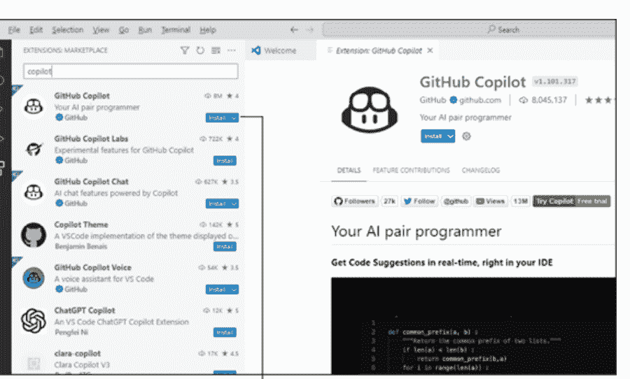

扩展图标安装 GitHub Copilot

**图 1-2：** VS Code 中的 Copilot 扩展。

你会在右侧看到一些指令和提示。你可能不需要对这些做任何操作。在 VS Code 的左下角，你应该看到一个账户图标（见图 1-3）。点击该图标并使用 GitHub 登录以使用 Copilot。但记住：设置 Copilot 账户不是强制要求的，只是一个选项。所以不要觉得现在就必须完成过程。但如果你添加了 Copilot 扩展，每当你查看 VS Code 扩展时，都会在已安装下看到它的名称。

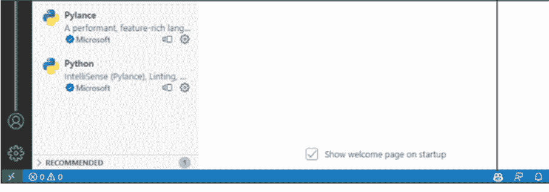

图 1-3: VS Code 中的账户和 Copilot 图标。

你在本章中完成的简单任务将在你的整个学习过程中非常有帮助，在你掌握基础知识后的职业编程中大有其益。请进入第 2 章，我们将更深入地探讨 Python 以及你现在电脑上可以使用的工具。

# 第 2 章

使用交互模式、获取帮助以及编写应用程序

## 本章内容

- 使用交互模式
- 创建开发工作空间
- 为你的代码创建文件夹
- 输入、编辑和调试代码

在安装了上一章介绍的 VS Code 之后，你就可以开始更深入地学习编写 Python 代码了。在本章中，我们将简要介绍 VS Code 的交互式、帮助和代码编辑功能。你可能急于开始学习数据科学、人工智能、机器人技术或其他任何高级主题，但如果你能很好地理解可以使用的许多工具以及使用这些工具的技能，学习这些主题将会变得更容易。

## 使用 Python 的交互模式

获取 Python 使用实战经验的一种方法就是直接交互式地输入一些命令。VS Code 中的终端（Terminal）面板是输入 Python 代码的好地方。因此，在本章中，你将从那里开始。

### 打开终端

要在 VS Code 中交互式地使用 Python，请遵循以下步骤：

1. 打开 VS Code。
2. 从 VS Code 菜单栏中选择 查看（View）⇒ 终端（Terminal）。
3. 如果面板顶部的 Terminal 一词没有高亮或下划线，点击 Terminal（在图 2-1 中圈出）。

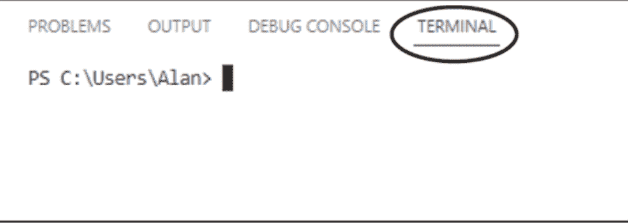

图 2-1: VS Code 中的终端面板。

任何可以显示 Python 版本的命令都将带你进入 Python 解释器，你可以在那里直接输入 Python 代码。当你看到提示符变为大于号（`>>>`）时，你就知道自己处于正确的地方了。要现在获取命令提示符，输入你之前有效的任何命令，不要加 `--version`。例如，只输入 `python`（或只有 `python3`，或只有 `py`）且不输入其他内容；然后按回车键：

```python
python
```

> 记住，当我们或任何人说“输入命令”时，意味着你必须输入该命令并按回车。在按下回车键之前，什么都不会发生。所以，如果你只输入命令并等待事情发生，你将等待非常、非常久。你应该看到关于你正在使用的 Python 版本的一些信息以及 `>>>` 提示符，它代表 Python 解释器。

### 输入命令

在 Python 解释器中输入命令与在其他地方输入是一样的。你必须正确地输入命令然后按回车。如果你在命令中拼错了某个单词，你可能会看到错误消息，这只是解释器在告诉它不理解你的意思。但别担心；你不会弄坏任何东西。例如，假设你输入命令

```
howdy
```

按下回车后，你将看到一些技术术语乱码，它们试图告诉你解释器不知道 "howdy" 是什么意思，所以它无法执行任何操作。什么都没有弄坏。你只是回到了另一个 `>>>` 提示符，你可以再次尝试，如[图 2-2](Figure-2-2)所示。

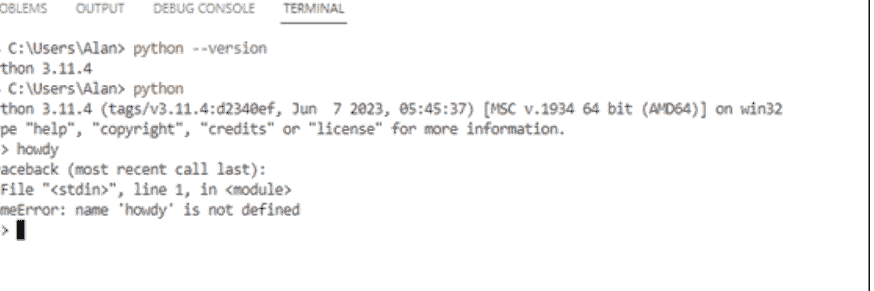

**图 2-2:** Python 不知道 howdy 的什么。

### 使用 Python 的内置帮助


[图 2-2](Figure-2-2) 中的提示符之一提到，你可以在 Python 解释器中输入 `help` 作为命令。注意你不要输入引号，只需使用 `help`（然后始终按回车）。这次你看到

```
help() 用于交互式帮助，或使用 help(object) 获取关于对象的帮助。
```

现在解释器正在要求你输入 `help` 后跟一个空括号，或者在括号中输入特定单词后输入 `help`（object 是给出的示例）。确保你在输入命令后按了回车。请继续输入以下内容：

注意该行没有空格。按下回车键后，屏幕提供了了关于使用 Python 交互式帮助的信息。

在窗口底部看到 `help>` 表明你不再处于操作系统 shell 或 Python 解释器中（后者始终显示 `>>>`），而是处于一个提供帮助的新区域。正如屏幕所示，你可以输入任何模块、关键字或主题名称来获取关于该术语的帮助。作为初学者，你现在可能不需要这些具体内容。但知道在需要时帮助就在那里是好的。

例如，Python 使用了一些在语言中具有特殊含义的关键字。要获取这些关键字的列表，只需在 `help>` 提示符下输入以下内容：

```
keywords
```

按下回车后，你将看到一个关键字列表，如图 2-3 所示。

| 问题 | 输出 | 终端 |
| :--- | :--- | :--- |
| False | class |  |
| None | continue |  |
| True | for |  |
| and | global |  |
| as | def |  |
| assert | elif |  |
| break | else |  |
| except | if |  |
| finally | is |  |
| with | yield |  |

图 2-3: 关键字帮助。

要退出 解释器并返回操作系统，输入 `exit()` 并按回车。

> TIP 如果你在文本底部看到 --More--，可以使用 Space (Mac) 或 Space (Windows) 滚动。

当你看到终端末尾出现系统提示符时，你就知道你退出了解释器。

Python 的内置帮助在你想要查找具体的术语和概念很有用。但对于初学者来说这通常很难。当你在线时，搜索可能更好。如果你在寻找视频，从 www.youtube.com 开始；如果没有，https://stackoverflow.com 是提问和搜索帮助的好地方。当然，还有 Google、Bing。

无论你使用什么搜索，记住在搜索时带有 python 这个词。许多编程语言共享相似的概念和关键字，如果你不在搜索请求中指定 Python 语言，无法预测得到什么样的结果。

## 为代码创建文件夹

在本节中，你创建一个文件夹来存储你在书中编写的所有 Python 代码，以便它们集中在一起并在需要时易找到。你可以将此文件夹放在任何地方并随意命名。

在 Windows 中，你可以导航到包含新文件夹的文件夹。（Alan 使用 OneDrive，你可以使用桌面、文档或任何文件夹。）在文件夹空白处点击右键，然后选择新建文件夹（Mac）或新建文件夹（Windows）。输入文件夹名称并按回车。为了跟随本章的示例，将你的文件夹命名为 Python Essentials。

## 输入、编辑和调试 Python 代码

由于人们倾向于将代码组织成文件夹（正如我们建议你对本章示例所做的那样），第一步是打开文件夹

在编辑器中包含你的代码。有几种方法可以实现。如果你是第一次尝试，请按照以下步骤操作：

+   1. **使用 Windows 的开始菜单或 Mac 的启动台打开 VS Code。**

+   2. **从 VS Code 的菜单栏点击文件（File）⇒ 打开文件夹（Open Folder），找到文件夹所在，点击你想要打开的文件夹名称，然后点击选择文件夹（Select Folder）。**

当前打开的文件夹名称显示在 VS Code 窗口左侧资源管理器面板顶部。


> 你创建的每个 Python 代码文件都将是 `.py` 扩展名的纯文本文件。我们建议将你为本书创建的任何文件放在 Python Essentials 文件夹中（请参见上一节如何创建文件夹）。只要 VS Code 和你的 Python 3 工作区打开着，你就应该能够随时看到你的 Python Essentials。

要随时创建一个 `.py` 文件，请按照以下步骤操作：

+   1. **如果你还没有这样做，请打开 VS Code 和你的 Python Essentials 文件夹。**

+   2. **如果资源管理器面板没有打开，点击 VS Code 左上角附近的资源管理器图标。**

+   3. **要在你的 Python Essentials 文件夹中创建文件，点击文件夹名称右侧的新建文件（New File）。**

+   4. **输入带有 `.py` 扩展的文件名（第一个文件输入 `hello.py`）并按回车。**

新文件将打开，你可以在右侧的标签页中看到它的名称。标签下方较大的区域是编辑器，你可以在那里输入 Python 代码。文件名也会显示在资源管理器中 Python Essentials 文件夹名称下方，因为它是存储在那里的。

现在你已经打开了一个 `.py` 文件，可以用它来编写一些 Python 代码了。就像学习新编程语言时通常一样，你将从输入一个简单的 Hello World 程序开始。以下是步骤：

+   1. 点击编辑区域第 1 行的右侧。

+2. 输入以下内容：

```
print("Hello World")
```

在你输入时，你可能会注意到屏幕上出现文本。那些文本是 IntelliSense 文字，它会检测你输入的内容并向你显示关于该关键字的一些信息。具体显示多少信息取决于你是否在使用 GitHub Copilot。但你不需要对它做任何操作——继续输入即可。

+   3. 输入该行后按回车。

新行代码将显示在屏幕上。你可能还会注意到其他几个变化，如图 2-4 所示：

> >> 资源管理器图标上有一个点，或者可能是一个圆圈的数字 1，表示你当前有一个未保存的更改。

> >> 标签页中的 `hello.py` 名称显示有一个点，表示该文件有未保存的更改。

你在 VS Code 中输入的代码不会自动保存。有两种方法来处理这个问题。一种是记住每当你进行了值得保存的更改时就进行保存。这样做最简单的方法是从 VS Code 的菜单栏中选择文件（File）⇒ 保存（Save），或者在 Windows 上按 `Ctrl+S`，或者在 Mac 上按 `⌘+S`。

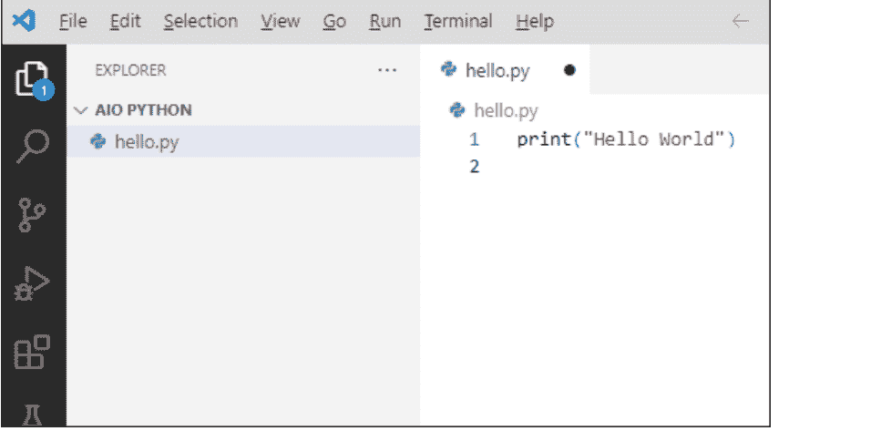

图 2-4：`hello.py` 文件包含一些 Python 代码并有未保存的更改。

我们更喜欢第二种方法，即使用自动保存（AutoSave）自动保存我们做的更改。要启用自动保存，从 VS Code 的菜单栏选择文件（File）⇒ 自动保存（Auto Save）。下次你打开文件菜单时，你会看到自动保存旁边有一个勾选，这告诉你自动保存已开启。要关闭自动保存，只需再次选择文件（File）⇒ 自动保存。当你进行更改时，文件会自动保存。

若要在 VS Code 中测试你的 Python 代码，你需要运行它。运行它最简单的方法是右键点击文件名（此例为 `hello.py`）并选择在终端运行 Python（Run Python in Terminal）。

如果提示选择 Python 解释器，只需选择你在第 1 章下载并安装的那个。通常情况下，它会被标记为“推荐”（Recommended）。如果你遇到困难，从 VS Code 的菜单栏选择视图（View）⇒ 命令面板（Command Palette）。输入 `python` 然后点击 Python：选择解释器（Python: Select Interpreter）。选择推荐选项。然后像上段描述的那样尝试运行 `hello.py`。

终端面板在 VS Code 窗口底部打开。你将看到一个命令提示符，后面跟着在 Python 解释器中运行代码的注释（`python.exe`）。在下方，你将看到程序的输出：在本例中为 Hello World 字，然后是另一个提示符，如图 2-5 所示。这个应用并不是世界上最令人兴奋的，但至少你知道了如何在 VS Code 中编写、保存和执行 Python 程序，在你继续阅读这本书以及整个 Python 编程职业中，你将经常使用这项技能。

| 问题 | 输出 | 调试控制台 | 终端 |
|---|---|---|---|
| C:\Users\Alan\OneDrive\AIO Python> & C:/Users/Alan/AppData/L | | | |
| Hello World | | | |
| C:\Users\Alan\OneDrive\AIO Python> | | | |

**图 2-5：** `hello.py` 的输出。

记住，当你学习某些代码时，你不可避免会犯错。这个应用并不是世界上最令人兴奋的，但至少你知道了如何在 VS Code 中编写、保存和执行 Python 程序，在你继续阅读这本书以及整个 Python 编程职业中，你将经常使用这项技能。

在尝试运行某些代码之前，你可能会看到几个迹象：

- 资源管理器图标上有一个点，或者可能是一个圆圈的数字 1，表示你当前有一个未保存的更改。

- 标签页中的 `hello.py` 名称显示有一个点，表示该文件有未保存的更改。

- 错误的代码会有波浪线底部。

Python 对大小写敏感，正确的命令是小写的。在图 2-6 中，我们输入了大写的 `PRINT`，这在 Python 中是不允许的。若要在终端运行该文件，你必须修复错误，我们将 `PRINT` 替换为 `print`（除非我们开启了自动保存）。然后我们右键并选择在终端运行 Python。

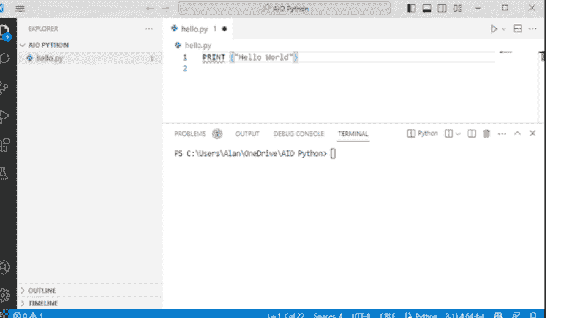

**图 2-6：** `PRINT` 输入错误。

当你完成对 VS Code 中某个程序或文件的操作时，可以轻松关闭它。只需点击标签页中文件名旁边的 X，或者选择文件（File）。只要资源管理器打开着，文件的名称仍然可见。当你需要重新打开文件时，只需点击文件名即可。

如果你还没有 Python Essentials 文件夹，请参阅第 2 章关于如何创建它的信息。

- 2. 如果终端（Terminal）面板未打开，从 VS Code 菜单栏中选择 View ⇒ Terminal。

- 3. 输入 `python` 并按回车进入 Python 提示符 (`>>>`)。如果出现错误，在 Mac 上输入 `python3`，在 Windows 上输入 `py`。

- 4. 在 `>>>` 提示符处，输入 `import this` 并按回车。

格言列表将会出现。你可能需要向上或向下滚动或增大终端面板以看到所有内容。这些格言在哲学修辞上带有些幽默，但其核心思想始终是让代码对人类可读，而非机器可读。

```
PROBLEMS DEBUG CONSOLE TERMINAL
PS C:\Users\Alan\OneDrive\Python> python
Python 3.11.4 (tags/v3.11.4, d432bef, Jun 7 2023, 05:45:37) [MSC v.1934 64 bit (AMD64)] on win32
type "help", "copyright", "credits" or "license" for more information.
>>> import this
The Zen of Python, by Tim Peters

Beautiful is better than ugly.
Explicit is better than implicit.
Simple is better than complex.
Complex is better than complicated.
Flat is better than nested.
Sparse is better than dense.
Readability counts.
Special cases aren't enough to break the rules.
Although explicit beats purity.
Errors never pass silently.
Unless silenced.
In the face of ambiguity, refuse the temptation to guess.
There should be -- and preferably one --obvious way to do it.
Although that way may not be obvious at first unless you're Dutch.
Now is better than never.
Although never is often better than "right" now.
If the implementation is easy to explain, it may be a good idea.
Namespaces are one great idea -- let's use more of those!
>>> 
```

图 3-1：Python 之禅（The Zen of Python）。

Python 之禅有时被称为 PEP 20；PEP 是 Python 增强提案（Python enhancement proposals）的缩写。20 可能指的是 20 条 Python 之禅准则，但只有 19 条被记录了下来。我们都会对此好奇，或者构出自己的最后一个准则。

这里冒着变得技术化或计算机科学化的风险，我们应该提到，设计语言有不同的方法。也许最成功且应用最广泛的模型是面向对象编程（或 OOP），这种设计哲学试图模拟真实世界，因为它由具有属性以及这些对象所执行的方法（动作）的对象组成。

Python 是一门非常面向对象的语言。核心语言由控制语句（单词形式）组成，允许你控制你自己以及他人程序中的所有不同对象。然而，你需要先学习核心语言，这样当你准备好使用他人的对象时，你知道如何操作。同样，当你学会开一辆车后，基本上你就都会开所有的车。你不需要担心租了车才发现加速踏板在屋顶上，方向盘在地上，而你必须使用语音指令而不是刹车来减速。驾驶的基本技能适用于所有的汽车。

## 探索为什么缩进至关重要

在代码编写的基本风格方面，真正让 Python 于许多其他语言不同的特征是，它使用缩进而不是括号、大括号等来表示代码块（或代码段）。我们不假设你熟悉其他语言，所以如果这句话对你来说毫无意义，请不要担心。

Python 的规则是相反的，因为它不使用大括号或任何其他特殊字符来标记代码块的开始和结束。缩进本身标记了这些内容。这些缩进不是可选的——它们是强制性的，并且对代码的运行方式有相当大的影响。因此，当你阅读代码时（作为人类而非计算机），可以相对容易地看出发生了什么，而且你不会被大量的额外引号所分散注意力。

```python
import random
question = input("Ask Magic 8 Ball a question")
answer = random.randint(1, 8)
if answer == 1:
    print("It is certain")
elif answer == 2:
    print("Outlook good")
elif answer == 3:
    print("You may rely on it")
elif answer == 4:
    print("Ask again later")
elif answer == 5:
    print("Concentrate and ask again")
elif answer == 6:
    print("Reply hazy, try again")
elif answer == 7:
    print("My reply is no")
elif answer == 8:
    print("My sources say no")
else:
    print("That's not a question")
print("The end")
```


你可能已经注意到 Python 代码开头以 `import` 开头的行。以 `import` 开头的行在 Python 中很常见，你将在下一节看到原因。

以 `import` 开头的行在 Python 中很常见，你将在下一节看到原因。Python 的秘密之一在于它有许多内置模块。要使用它们，必须先导入它们。例如：

```python
import random
```

一旦导入了模块，就可以使用它的函数。例如，要生成随机数，你可以使用：

```python
answer = random.randint(1, 8)
```

上一节中的 Magic 8 Ball 程序展示了如何使用 `random` 模块为问题提供答案。代码简单易懂。

你将在本书中使用广受欢迎的 Visual Studio Code (VS Code) 编辑器来学习 Python 并创建 Python 应用程序。我们假设你已经按照前面的章节设置好了学习和开发环境，并知道如何打开 VS Code。要跟上本章的内容，请按照以下步骤操作：

- 1. 在 Mac 上使用 Launchpad 或 Windows 上使用开始菜单打开 VS Code，并在 VS Code 中选择文件 ⇒ 打开文件夹或使用资源管理器窗格，打开你在[第 2 章](#)中创建的 Python Essentials 文件夹。

你可能会注意到在其他文件旁边有一个名为 `.vscode` 的新文件夹。别担心，这只是 VS Code 使用的信息，你现在可以忽略它。

- 2. 如果你已经按照[第 2 章](#)所述创建了 `hello.py` 文件，请点击它；否则，现在创建一个然后回到这里。

- 3. 选择第一行的所有文本并将其删除，这样你就可以从零开始。


此时，`hello.py`应该已经在编辑器中打开，如[图 4-1](#)所示。如果打开了任何其他标签，请点击每个标签上的 X 将其关闭。

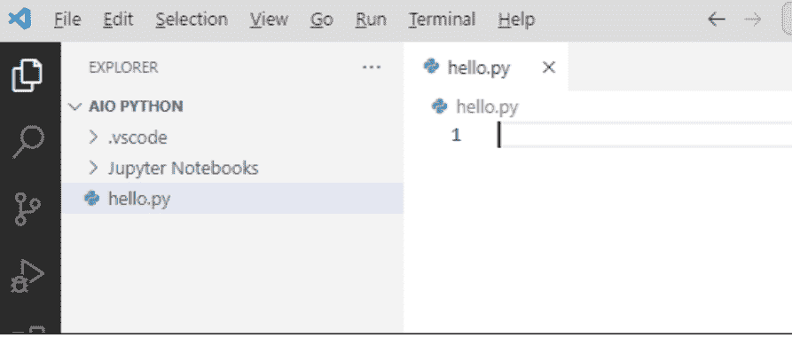

图 4-1：在 VS Code 中打开用于编辑的 `hello.py` 文件。

在输入任何代码之前，先从程序员注释开始。程序员注释（通常简称为注释）是程序中不起任何作用的文本。这引出了一个问题：“如果它什么用没有，为什么要写它呢？”作为一个学习者，你可以将代码中的注释作为自己的笔记，说明代码在做什么。这在你初次学习时非常有帮助。

然而，代码中的注释并不仅仅是初学者的。在团队工作时，专业人士经常使用注释向团队成员解释他们的代码的功能。开发者还会在代码中添加注释作为自己的笔记，以便在将来审查代码时，可以参考自己的笔记来提醒为什么要在代码中执行某些操作。因为注释不是代码，你的措辞可以是任何内容。但是，为了被识别为注释，你必须执行以下操作之一：

- 以井号 (`#`) 开头文本

- 使用三引号（`"""` 或 `''''`）包裹文本

```
## This is a Python comment
```

要在自己的代码中输入 Python 注释：

- 1. 在 VS Code 中，点击 `hello.py` 标签旁数字 1 处，输入以下内容：

```
## This is a Python comment in my first Python app.
```

- 2. 按回车。

你输入的注释出现在第 1 行。如果你使用的是默认颜色主题，注释文本将是绿色的。

虽然你暂时不会使用多行注释，但请注意，在 Python 中你可以通过三引号来编写更长的注释。这些较大的注释被称为 `docstrings`（文档字符串），通常出现在 Python 模块、函数、类或方法定义的顶部，这些都是构建应用程序的基石。

你可以在代码中编写无限数量的注释。如果你在输入注释后在等待发生什么……别等了。在这样的编辑器中工作时，代码在运行之前不会产生任何作用。在开始输入代码之前，你需要从最基础的知识开始。

你一直在处理书面信息，可能没有考虑过数字和文本之间的区别。数字是数量，例如 10 或 123.45。文本由字母和单词组成。对于计算机来说，巨大的区别在于它们可以对数字进行算术运算（减法、乘法、除法），但不能对字母和单词进行。

Python 中的数字必须以数字（0–9）、点（句号，即小数点）或用作负数的连字符（`-`）开头。数字只能包含一个小数点。它不应包含字母、空格、美元符号或任何不是正常数字组成的内容。


> 提示：如果你担心数字规则让你无法处理金额、邮政编码、地址或其他任何内容，请停止担心。你可以存储并处理各种信息，正如你很快就会看到的。

整数是任何整数字，无论是正还是负。它的大小没有限制。像 0、–1 和 99999999999999这样的数字都是完全有效的整数。从你的角度来看，整数任何不包含小数点的有效数字。

浮点数（通常称为 `float`）是任何包含小数点的有效数字。同样，没有大小限制：1.1、–1.1 以及 123456.789012345 都是完全有效的浮点数。

如果你处理非常大的科学计数数字，可以在数字中使用 `e` 来表示 10 的幂次。例如，`234e1000` 是一个有效数字，如果没有小数点，它将空视为浮点数。

布尔运算符作用于布尔值（`True` 或 `False`），用于判断一个或多个事物是否为 `True` 或 `False`。表 4-3 总结了布尔运算符。

### 表 4-3 Python 布尔运算符

| 运算符 | 代码示例 | 决定什么 |
| --- | --- | --- |
| `or` | `x or y` | `x` 或 `y` 中其中一个为 `True` |
| `and` | `x and y` | `x` 和 `y` 均为 `True` |
| `not` | `not x` | `x` 不为 `True` |

我们还没有告诉你什么是变量，所以示例的这部分可能让你感到困惑。接下来的我们将把这个问题说清楚。

变量是 Python 以及所有计算机编程语言的重要部分。变量仅仅是可能会变化（改变）信息的占位符。

在你的代码中，变量由变量名表示，而不是特定的信息。这里有另一种思考它的方式：每当你购买一件或多件某种产品时，总价就是单价乘以你购买的数量。换句话说：

> 总价 = 数量 * 单价

你可以将 `Quantity`（数量）和 `Unit Price`（单价）视为变量，因为无论你在 `Quantity` 和 `Unit Price` 中填入什么数字，都能得到正确的总价。例如，如果你每只 $1.00 买了三只斑鸠鸽，你的总价就是 $3.00 (3 * $1.00)。如果你每只 $1.50 买了两打玫瑰，总价为 $36，因为 1.5 * 24 等于 36。

在我们对变量的解释中，我们使用了像 `Quantity` 和 `Unit Price` 这样的名称，对于通用示例来说没问题。在 Python 中，你也可以自己命名变量，但它们必须符合以下规则才能识别为变量名：

- 变量名必须以字母或下划线 (`_`) 开头。

- 在第一个字符之后，你可以使用字母、数字或下划线。

- 变量名对大小写敏感，因此在你命名名称后，对该变量的任何引用必须使用相同的大小写字母。

- 变量名不能包含或单引号或双引号。

- 变量名不能与 Python 关键字相同。

要创建一个变量，你使用以下语法（元素的顺序）：

```
variablename = value
```

其中 `variablename` 是你起的名称。你可以像数学中人们那样使用 `x` 或 `y`，但在较大的程序中，给变量起一个更有意义的名字是个好主意，例如 `quantity` 或 `unit_price` 或 `sales_tax` 或 `user_name`，这样你就能记住你在变量中存储了什么。

`value` 是你想要存储在变量中的任何内容。它可以是一个数字、字符串、布尔 `True` 或 `False` 值，或者是计算结果。

`=` 符号是赋值运算符，之所以这样命名是因为它将（右侧的）值赋值给（左侧的）变量。例如：

```
x = 10
```

我们正在将数字 10 存储在一个名为 `x` 的变量中。换句话说，我们正在将值 10 赋值给变量 `x`。

而在这里：

```
user_name = "Alan"
```

我们将字符串 `Alan` 放入了名为 `user_name` 的变量中。

计算机编程的大部分都围绕着在变量中存储值并使用运算符对其进行操作。以下是一些简单的示例，帮助你掌握它。如果你仍然打开着 VS Code 并显示着那条注释，请在 VS Code 编辑器中按照步骤操作：

- 1. 在写有 `# This a Python comment in my first Python app.` 的行下方，输入此注释并按回车：

```
## This variable contains an integer
```

- 2. 输入以下内容（忘记在 `=` 符号前后各加空格）并按回车：

```
quantity = 10
```

- 3. 输入以下内容并按回车：

```
## This variable contains a float
```

- 4. 输入以下内容（不要输入美元符号！）并按回车：

```
unit_price = 1.99
```

- 5. 输入以下内容并按回车：

```
## This variable contains the result of multiplying quantity unit price
```

- 6. 输入以下内容（运算符周围留有空格）并按回车：

```
extended_price = quantity * unit_price
```

- 7. 输入以下内容并按回车：

- 8. 最后，输入此内容并按回车：

```
print(extended_price)
```

你的 Python 程序创建了一些变量，在其中存储了一些值，并根据 `quantity` 和 `unit_price` 变量的内容计算了一个新值 `extended_price`。最后一行在屏幕上显示了 `extended_price` 变量的内容。记住，在程序运行时，注释不会起任何作用。注释只是你对程序正在发生的情况所做的笔记。

如果你犯了任何错误，可能会在错误或样式建议附近看到波浪线，例如多余的空格或行尾漏掉的回车。在输入代码时，你必须准确。

换句话说，如果代码是错误的，运行它时将无法工作。这非常简单——没有例外。

输入代码就像在计算机上输入其他文档一样。如果你不保存，就会丢失它。

如果你想在单行内放置多个语句，使用分号代替换行符也是可以的：

```
first_name = "Alan"; last_name = "Simpson"
print(first_name, last_name)
```

注意变量名全小写，且单词之间通过下划线分隔：

```
first_name
last_name
```

记住，在 Python 中，变量名使用全小写字母并用下划线分隔单词是一种命名约定。但请注意，约定不等同于语法规则。你可以按照如下方式命名变量而不会违反任何语法：

```
FirstName
LastName
```

到目前为止，你已经查看了代码行。还有代码块，其中两或多行代码共同工作。这里有一个示例：

```
x = 10
if x == 0:
    print("x is zero")
else:
    print("x is",x)
print("All done")
```

两个等号（`==`）在 Python 中意味着“等于”，用于比较两个值以判断它们是否相等。这与单个等号（`=`）不同，等号是用于给变量赋值的运算符。

第一行 `x = 10` 仅仅是一行代码。接下来，`if x == 0` 测试变量 `x` 是否包含数字 0。如果 `x` 确实包含 0，则执行缩进行 `print("x is zero")`，这就是你在屏幕上看到的内容。然而，如果 `x` 不包含 0，该缩进行将被跳过并执行 `else:` 语句。下面的缩进行：

```
print("x is",x), 执行，但只有在 x 不包含 0 时才会执行。最后
一行，print("All done!"), 无论如何都会执行，因为它没有
缩进。
```

> 注意：所以，正如你看到的，缩进在 Python 中非常重要。在前面的代码中，根据 `x` 的值，只会执行缩进行中的一个。随着书籍的阅读，你将学习在代码中使用缩进的具体细节。这在 Python 中非常重要，所以编写代码时必须小心输入。

本章将带你了解如何输入、保存、运行和更改应用程序、再次保存并再次运行。这些任务定义了你在任何语言中进行任何软件开发时将要做的工作，因此你应该练习它们，直到它们变成你的本能。在整本书中，你将一直使用这些技能，从初学者成长为顶尖的 21 世纪 Python 开发者。

# 第 5 章

## 处理数字、文本和日期

本章内容：

- 掌握整数

- 处理带有小数点的数字

- 征服布尔值 True/False

在现实生活中，我们还必须处理日期和时间，这是另一种类型的信息。Python 没有内置日期和时间数据类型，但幸运的是，你可以随时导入一个免费模块来处理此类信息。本章完全关于充分利用各种 Python 数据类型。

### 使用函数计算数字

Python 中的函数类似于计算器上的函数，因为你向函数传递某些内容，函数又会返回某些内容。例如，大多数计算器和编程语言都有平方根函数：你提供一个数字，它们告诉你该数字的平方根。

Python 函数通常具有以下语法：

```
variablename = functionname(param[,param])
```

由于大多数函数都会返回某个值，你通常首先定义一个变量来存储函数的返回值。接着是等号 `=` 和函数名，后面是一对括号，你可以在其中向函数传递一个或多个值（称为参数）。

例如，`abs()` 函数接受一个数字并返回该数字的绝对值。如果你不是数学痴迷，这意味着如果你传递一个负数，它将返回该数字的正数形式。如果你传递一个正数，它将返回你传递的原始数字。换句话说，`abs()` 函数将负数转换为正数。

这里有一个示例（你可以自己在 Python 提示符或 VS Code 中的 `.py` 文件中手动尝试）：

```
x = -4
y = abs(x)
print(x)
print(y)

-4
4
```

在这里，我们创建了一个名为 `x` 的变量并将其赋值为 `-4`。我们创建了一个名为 `y` 的变量并使用 `abs()` 函数将其赋值为 `x` 的绝对值。打印 `x` 显示它的值 `-4`，它没有变化。打印 `y` 显示 `4`，即 `abs()` 函数返回的 `x` 的绝对值。

Python 有许多用于处理数字的内置函数，如表 5-1 所示。如果你不是热衷数学，某些函数对你来说可能意义不大，但不要让它们吓到你。如果你不理解某个函数的作用，很可能它与你的工作类型无关。但如果你好奇，始终可以在互联网上搜索 `python` 加上函数名以获取更多信息。要查看更完整的列表，请搜索 `python 3 built-in functions`。

#### 表 5-1 一置 Python 数字函数

| 内置函数 | 用途 |
|---|---|
| `abs(x)` | 返回数字 `x` 的绝对值（将负数转换为正数）。 |
| `bin(x)` | 返回表示 `x` 转换为二进制后的值的字符串。 |
| `float(x)` | 将字符串或数字转换为 `float` 数据类型。 |
| `format(x, y)` | 根据 `y` 中指定的模式格式化 `x`。这种旧语法在 Python 版本中已被 f-strings 替换。 |
| `hex(x)` | 返回包含 `x` 转换为十六进制的字符串，前缀为 0x。 |
| `int(x)` | 通过截断（不是舍入）小数部分及其后的任何数字将 `x` 转换为整数数据类型。 |
| `max(x, y, ...)` | 接受任意数量的参数并返回最大的那个。 |
| `min(x, y, ...)` | 接受任意数量的参数并返回最小的一个。 |
| `round(x, y)` | 将 `x` 保留 `y` 位小数。 |
| `str(x)` | 将 `x` 转换为字符串类型。 |
| `type(x)` | 返回指示 `x` 数据类型的字符串。 |

你还可以嵌套函数——这意味着你可以将函数放在函数内部。例如，当 `z = -999.9999` 时，表达式 `print(int(abs(z)))` 打印 `z` 绝对值的整数部分，即 `999`。原始数字转换为正数，然后小数点及其之后的所有内容都会被切掉。

### 更多数学函数

除了目前涵盖的内置函数外，还有其他你可以导入的模块。如果你在应用程序中需要它们，请在 `.py` 文件的开头导入 `math`，以便代码的其他部分可以使用它们。或者要在命令行提示符中使用它们，先输入 `import math` 命令。

`math` 模块中的函数之一是 `sqrt()` 函数，用于获取数字的平方根。由于它是 `math` 模块的一部分，如果不先导入它就无法使用。例如，如果你输入以下内容，将得到错误，因为 `sqrt()` 不是内置函数：

```
print(sqrt(81))
```

即使你执行以下两个命令，仍然会得到错误，因为 `sqrt()` 不是内置函数：

```
import math
print(sqrt(81))
```

要使用模块中的函数，你必须导入该模块并在函数名之前加上模块名和点。所以假设你有一个值 `x`，你想得到它的平方根。你必须导入 `math` 模块并使用 `math.sqrt(x)` 来获得正确答案，如图 5-1 所示。输入该命令显示结果为 `9.0`，这确实是 81 的平方根。

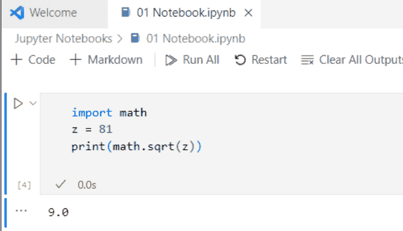

图 5-1：使用 `math` 模块中的 `sqrt()` 函数。

`math` 模块提供了许多三角函数、双曲函数、幂和对数、角度转换以及如 `pi` 和 `e` 等常量。我们没有深入探讨所有内容，因为高级数学对大多数人来说并不。。你可以通过网上搜索 "python 3 math module functions" 来随时查看它们。表 5-2 提供了在你自己工作中可能非常有用的示例。

#### 表 5-2 Python Math 模块中的函数

| 内置函数 | 用途 |
|--- | --- |
| `math.acos(x)` | 返回 `x` 的弧度反余弦值。 |
| `math.atan(x)` | 返回 `x` 的弧度正切值。 |
| `math.atan2(y, x)` | 返回 `y` 除以 `x` 的弧度正切值。 |
| `math.ceil(x)` | 返回 `x` 的向上整数，即大于或等于 `x` 的最小整数。 |
| `math.cos(x)` | 返回 `x` 的弧度余弦值。 |
| `math.degrees(x)` | 将角度 `x` 从弧度转换为角度。 |
| `math.e` | 返回数学常量 `e` (2.718281 ...)。 |
| 内置函数 | 用途 |
|--- |---|
| `math.exp(x)` | 返回 `e` 的 `x` 次方，其中 `e` 是自然对数的底数。 |
| `math.factorial(x)` | 返回 `x` 的阶乘。 |
| `math.floor(x)` | 返回 `x` 的向下整数，即小于或等于 `x` 的最大整数。 |
| `math.isnan(x)` | 如果 `x` 不是数字则返回 `True`；否则返回 `False`。具体而言，如果 `x` 包含 `NaN`，此函数返回 `True`；`NaN` 是 Python 中的一个特殊值，用作没有数值的变量的占位符。 |
| `math.log(x, y)` | 返回 `x` 以 `y` 为底的对数。 |
| `math.log2(x)` | 返回 `x` 以 2 为底的对数。 |
| `math.pi` | 返回数学常量 `pi` (3.141593 ...)。 |
| `math.pow(x, y)` | 返回 `x` 的 `y` 次方。 |
| `math.radians(x)` | 将角度 `x` 从角度转换为弧度。 |
| `math.sin(x)` | 返回 `x` 的正弦值（当 `x` 以弧度表示时）。 |
| `math.sqrt(x)` | 返回 `x` 的平方根。 |
| `math.tan(x)` | 返回 `x` 的弧度正切值。 |
| `math.tau()` | 返回数学常量 `tau` (6.283185 ...)。 |


## 数字格式化

多年来，Python 提供了不同的方法以人类熟悉的方式显示数字。例如，大多数人更愿意看到美元金额格式化为 `$1,234.56` 或 `1234.560065906594056959`。从 3.6 版本开始，Python 中格式化数字最简单的方法是使用 `f-strings`。

## 使用 f-strings 进行格式化

格式化字符串（或 `f-strings`）是 Python 中格式化数据简单的方法。你只需要一个小写的 `f` 或大写的 `F`，后面紧跟着用引号括起来的一些文本或表达式。这里有一个示例：

```
f"Hello {username}"
```

第一个引号之前的 `f` 告诉 Python 后面的是格式化字符串。在引号内部，文本被称为*字面量*（literal）部分，将字面上地显示（与在 `f-string` 中输入的完全相同）。花括号中的任何内容都是 `f-string` 的*表达式*（expression）部分，是代码执行时将出现内容的占位符。在花括号内部，你可以有一个*表达式*（执行某些计算的公式、变量名或两者的组合）。这里有一个示例：

```
username = "Alan"
print(f"Hello {username}")
```

当你运行这段代码时，`print` 函数将显示单词 **Hello**，后面是一个空格，然后是 `username` 变量的内容，如图 5-2 所示。

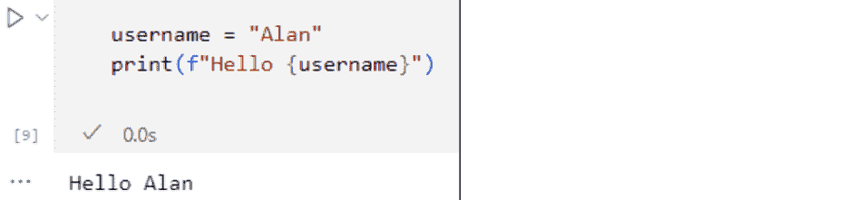

**图 5-2**：用于格式化的超简单 `f-string`。这里是表达式的另一个示例——在大括号内部 `quantity` 乘以 `unit_price`：

```
unit_price = 49.99
quantity = 30
print(f"Subtotal: ${quantity * unit_price}")
```

执行该代码的输出如下：

```
Subtotal: $1499.7
```

`$1499.7` 不是显示美元金额的理想方式。通常我们喜欢在千分位使用逗号，并在分位保留两位，如下：

```
Subtotal: $1,499.70
```

## 显示美元金额

幸运的是，`f-strings` 为你提供了进行这种格式化的方法。要让美元金额中出现逗号并将分位保留两位，你可以在花括号内使用格式化字符串。格式化字符串以冒号开始，并放在右括号内，紧跟变量名或显示的值。要在千分位显示逗号，在你的格式化字符串中冒号后面使用逗号，如下所示：

```
:,
```

使用当前的示例，你可以执行以下操作：

```python
print(f"Subtotal: ${quantity * unit_price:,}")
```

执行此操作产生此输出：

```
Subtotal: $1,499.7
```

要让分显示为两位，在逗号后面紧跟

```
.2f
```

`.2f` 意味着“两位小数，固定”（永远不会多于或少于两位）。以下代码将带有逗号和两位小数显示数字：

```python
print(f"Subtotal: ${quantity * unit_price:.2f}")
```

这里是代码执行时显示的内容：

```
Subtotal: $1,499.70
```

完美！这正是我们想要的格式。所以，每当你想要显示一个千分位有逗号且小数点后恰好有两位的数字时，请使用带有格式字符串 `.2f` 的 `f-string`。

## 格式化百分比数字

现在假设你的应用适用销售税。应用需要知道销售税率，该税率应该表示为百分比。如果销售税率是 6.5%，你可能希望将其格式化为 6.5% 而不是 0.065。如果数字是 0.065，你可能希望将其格式化为 6.5%。

```python
tax_rate = 0.065
print(f"Tax rate: {tax_rate:.1%}")
```

如果销售税率是 6.5%，你可能希望将其格式化为 6.50%。

```python
tax_rate = 0.065
print(f"Tax rate: {tax_rate:.2%}")
```


提示：如果你想了解更多关于各种计数系统的信息，可以使用你喜欢的搜索引擎搜索二进制、八进制、十进制或十六进制数字。

## 操作字符串

在 Python 和其他编程语言中，我们把单词和文本块称为字符串（strings），它是“字符字符串”的缩写。字符串没有数值意义或值。（我们将在第 1 卷第 4 章讨论字符串的基础知识。）在本节中，你将学习处理字符串的 Python 编码技能。

## 字符串拼接

你可以使用加号（`+`）来连接字符串。在“极客世界”中，这种过程被称为字符串拼接（string concatenation）。让初学者措手不及的一点是，计算机并不知道一个单词和一个火肠明治的区别。因此，当你连接字符串时，计算机不会自动在你预期的地方插入空格。例如，在下面的代码中，`full_name` 是前三个字符串的拼接。

```
first_name = "Alan"
middle_init = "C"
last_name = "Simpson"
full_name = first_name + middle_init + last_name
print(full_name)
```

当你运行这段代码来打印 `full_name` 变量的内容时，你可以看到 Python 确实将它们连接成了一个长字符串：

> AlanSimpson

这个输出没有问题，只是我们通常会在单词和人名的部分之间加上空格。

因为 Python 不会在你认为应该出现的地方自动插入空格，所以你必须手动输入它们。表示单个空格的最简单方法是使用一对引号，中间留一个空格，如下所示：

" "

如果你忘记在引号之间放入空格（如下所示），那么你的字符串中将不会有空格，因为引号之间之间没有空格：

"" 

如果你想在输出中获得多个空格，可以在引号之间放置多个空格，但通常一个就足够了。在接下来的示例中，你于 `first_name` 和 `last_name` 之间加了一个空格。你还在 `middle_init` 后面加了一个句号和空格：

```
first_name = "Alan"
middle_init = "C"
last_name = "Simpson"
full_name = first_name + " " + middle_init + "." + last_name
print(full_name)
```

该代码的输出（即 `full_name` 变量的内容）看起来更像你熟悉的姓名：

Alan C. Simpson

当然，作为将所有组件和空格拼接成新字符串的替代方案，你也可以简单地使用 `f-string` 以所需的格式显示名称，如下代码所示。唯一的区别在于你不需要一个 `full_name` 变量来处理你的代码。

```
print(f"{first_name} {middle_init}.{last_name}")
```

## 获取字符串长度

要确定字符串中包含多少个字符，你可以使用内置的 `len()` 函数（length 的缩写）。长度包括空格，因为空格也是字符，每个字符的长度为 1。空字符串——即内部没有任何内容、甚至没有空格的字符串——长度为 0。

## 使用常用的字符串运算符

Python 提供了几种用于处理数据序列的运算符。Python（以及大多数其他编程语言）中字符串一个奇怪的点是，当你数字符时，第一个字符被计为 0，而不是 1。这对我们来说毫无意义，但计算机是这样数字符的，因为这是最高效的方法。所以尽管字符串长度为五个字符，但该字符串的最后一个字符是字母 E，因为第一个字符是数字 0。

### 表 5–4 用于字符串的 Python 序列运算符

| 运算符 | 目的 |
| --- | --- |
| `x in s` | 如果 `x` 存在于字符串 `s` 的某处，返回 True。 |
| `x not in s` | 如果字符串 `s` 中不包含 `x`，返回 True。 |
| `s*n` | 重复字符串 `n` 次。 |
| `s[i]` | 字符串 `s` 中位置 `i` 的字符。 |
| `s[i:j]` | 从位置 `i` 字符开始到位置 `j` 字符结束（但不包含位置 `j`）的切片。 |
| `s[i:j:k]` | 从 `i` 到 `j` 步长为 `k` 的切片，其中 `k` 是任意字符之间的距离。例如，将 `k` 设置为 3 将显示每隔第三个字符，依此类推。 |
| `min(s)` | 字符串 `s` 中最小（最低）的字符。 |
| `max(s)` | 字符串 `s` 中最大（最高）的字符。 |

当 `print()` 函数的输出看起来不对时，请记住关于 Python 字符串的两个事实：

- 第一个字符始终是数字 0。
- 每个空格都算作一个字符，所以数数时不要跳过空格。

你可能已经注意到 `min(s)` 返回一个空白空格字符，这意味着空格字符是字符串中最低的字符。但到底是什么让空格比字母 A 或字母 a 更“低”的呢？简单的答案是字母的 ASCII 码。你在键盘上输入的每个字符，以及许多额外的字符，都有一个由美国标准信息交换编码（ASCII）分配的数字。

## 使用方法操作字符串

Python 字符串带有许多方法来帮助你操作它们。通用语法为：

```
string.methodname(params)
```

### 表 5–5 字符串内置方法

| 方法 | 目的 |
| --- | --- |
| `s.capitalize()` | 返回首字母大写、其余部分小写的字符串。 |
| `s.count(x, [y,z])` | 返回 `x` 在 `s` 中出现的次数。 |
| `s.find(x, [y,z])` | 返回 `x` 第一次出现的位置。如果未找到，则返回 -1。 |
| `s.index(x, [y,z])` | 类似于 `s.find` 但在未找到时抛出异常。 |
| `s.isalpha()` | 如果 `s` 至少有一个字符且仅包含字母（A–Z 或 a–z）和 Unicode 字符，返回 True。 |
| `s.isdecimal()` | 如果 `s` 至少有一个字符且仅包含数字（0–9），返回 True。 |
| `s.islower()` | 如果 `s` 包含字母且所有字母均为小写，返回 True。 |
| `s.isnumeric()` | 如果 `s` 至少有一个字符且仅包含数字（0–9），返回 True。 |
| `s.isprintable()` | 如果 `s` 仅包含可打印字符，返回 True。空格是可打印的，但换行符和制表符不是。 |
| `s.istitle()` | 如果 `s` 包含字母且每个单词的首字母大写并跟着小写字母，返回 True。 |
| `s.isupper()` | 如果字符串中的所有字母都是大写，返回 True。 |
| `s.lower()` | 返回所有字母转换为小写的 `s`。 |
| `s.lstrip()` | 返回删除了开头空白（空格、制表符、换行符）的 `s`。 |
| `s.replace(x, y)` | 返回将 `x` 替换为 `y` 的 `s` 副本。 |
| `s.rfind(x, [y,z])` | 类似于 `s.find` 但从字符串反向搜索。如果提供了 `y` 和 `z`，则从位置 `z` 到位置 `y` 反向搜索。如果未找到，返回 -1。 |
| `s.rindex()` | 与 `s.rfind` 相同但在未找到时抛出异常。 |
| `s.rstrip()` | 返回删除了结尾空白的 `s`。 |
| `s.strip()` | 返回删除了开头结尾空白的 `s`。 |
| `s.swapcase()` | 返回大写字母转换为小写、小写字母转换为大写的 `s`。 |
| `s.title()` | 返回每个单词首字母大写、所有其他字母均为小写的 `s`。 |
| `s.upper()` | 返回所有字母转换为大写的 `s`。 |

不要费力尝试记忆或甚至理解每一个字符串方法。记住，你随时可以询问 AI 来列出所有的为你提供了字符串操作符和函数。或者你可以在网络上搜索 Python 字符串方法以查找哪些可用方法。

## 揭示日期和时间

在计算机世界中，我们经常使用日期和时间进行调度，或者计算任务何时到期，或者已经过期了多少天。我们有时使用时间戳来精确记录用户何时执行了某项操作或事件何时发生。在 Python 中使用日期和时间的理由有很多，但令人惊讶的是，它并没有像字符串和数字那样的专门针对这些内容的内置数据类型。

要处理日期和时间，你通常需要使用 `datetime` 模块。像任何模块一样，你必须在使用之前先导入它。你可以通过使用 `import datetime` 来实现。而且像任何导入一样，如果你喜欢，可以为其添加一个更容易输入的别名（昵号）。例如，使用 `import datetime as dt` 也可以。你只需要记住在调用该模块的功能时，在代码中输入 `dt` 而不是 `datetime`。

`datetime` 模块提供了一种在 Python 中处理日期和时间的简单方法。它提供了三种存储关于日期、时间和时区信息的方法，包括：

- `datetime.date`: 由月、日、年组成的日期（但不包含时间信息）。
- `datetime.time`: 由时、分、秒、微秒以及（如果需要）可选的时区信息组成的时间（但不包含日期）。
- `datetime.datetime`: 由日期、时间以及（可选的）时区信息组成的单个数据项。

在前面的列表中，我们在每个类型之前都加上了完整的单词 `datetime`，但如果你使用了别名（如 `dt`），你可以在代码中使用它代替。

我们将在接下来的章节中分别讨论这些每数据类型。

## 处理日期

当时间不是问题时，`datetime.date` 数据类型是处理日期的理想选择。你可以通过两种方式创建日期对象。你可以使用 `today()` 方法从计算机的内部时钟中获取今天的日期。或者你可以在括号内指定年、月、日（按此顺序）。


**记住**在指定月份或日期时，永远不要为 `datetime.date()` 使用前导零。例如，2024 年 4 月 1 日必须表示为 `2024,4,1` —— 如果使用 `2024,04,01`，它将无法工作。

导入 `datetime` 模块后，你可以使用 `date.today()` 从计算机内部时钟获取当前日期。或者使用 `date(year, month, day)` 语法为其他日期创建日期对象。以下代码显示了两种方法：

```python
## 导入 datetime 模块，别名为 dt
import datetime as dt
## 将今天的日期存储在名为 today 的变量中。
today = dt.date.today()
## 将另一个日期存储在名为 last_of_teens 的变量中。
last_of_teens = dt.date(2019, 12, 31)
```

你可以使用 `.month`, `.day` 和 `.year` 提取日期对象的任何部分。例如，在同一个 Python 提示符执行这段代码：

```python
print(last_of_teens.month)
print(last_of_teens.day)
print(last_of_teens.year)
```

该日期的三个组成部分中的每一个都会显示在单独的一上：

```
12
31
2023
```

你可以按照自己想要的方式格式化日期和时间。使用我们在本章稍早讨论过的 `f-strings`，并结合 https://docs.python.org/3/library/datetime.html 上显示的字符串格式化指令（大约位于页面顶部向下约四之三处），这些指令包含了日期的格式以及后续的格式，正如我们将在本章稍晚时候讨论的那样。对于显示本地日期和时间的指令，具体格式将取决于你所在地。例如，在美国使用 `%x` 显示日期 2023 年 12 月 18 日将显示为 `12/18/23`，但在更习惯先显示日期而不是月份的国家，结果则不同。

使用格式化字符串时，确保在希望它们在输出中出现的地方，在指令之间放置空格、斜杠以及你想要的任何其他内容。例如，这个：

```python
print(f"{last_of_teens:%A, %B %d, %Y}")
```

执行时，会显示：

```
Tuesday, December 31, 2019
```

要以 `mm/dd/yyyy` 格式显示日期，使用 `%m/%d/%Y`，如下：

```python
todays_date = f"{today:%m/%d/%Y}"
```

当你尝试时，输出将是当前日期，格式如下：

```
11/19/2024
```

### 5-6 示例日期字符串

| 格式字符串 | 示例 |
| :--- | :--- |
| `%a, %b %d %Y` | Sat, Jun 01 2024 |
| `%x` | 06/01/24 |
| `%m-%d-%y` | 06-01-24 |
| `%A %B %d` | Saturday June 01 |
| `%A %B %d %Y` | Saturday June 01 of 2024 |

有时你只想处理日期，有时你只想处理时间。通常你想同时使用日期和时间来精确定时间中的某个时刻。为此，请使用 `datetime` 模块中的 `datetime` 类。该类支持一个 `now()` 方法，可以从计算机时钟获取当前日期和时间，如下：

```python
import datetime as dt
right_now = dt.datetime.now()
print(right_now)
```

你在屏幕上通过 `print()` 函数看到的内容取决于执行这段代码的时间。`datetime` 值的格式如下：

```
2024-11-19 14:03:07.52975
```

这意味着 2024 年 11 月 19 日下午 2:03（附加了 7.529 秒）。你也可以使用以下任何参数定义一个 `datetime`。月、日、年是必须的。其他是可选的，如果你省略了它们，时间部分将设置为 0：


```python
datetime(year, month, day, hour, minute, second, microsecond)
```

这里是使用某些参数定义 `datetime` 的示例：

```python
import datetime as dt
years_eve = dt.datetime(2024, 12, 31, 23, 59)
print(years_eve)
```

这意味着 2024 年 12 月 31 日晚上 11:59。

### 5-7 示例时间字符串

| 格式字符串 | 示例 |
| :--- | :--- |
| `%A, %B %d %Y` | Tuesday, December 31, 2024 |
| `%m/%d/%Y` | 12/31/2024 |
| `%H:%M:%S` | 23:59:00 |
| `%b %d, %y` | Dec 31, 24 |

# 第 6 章

## 控制动作

- 使用 `if` 决策
- 使用 `for` 重复
- 使用 `while` 循环

到本书为止，我们已经讨论了很多关于如何在计算机中存储信息，大部分存储在 Python 和你的计算机可以处理的变量中。将信息以计算机可以处理的形式存储对于让计算机执行任何操作至关重要。将这视为“拥有”的部分——拥有一些可以处理的信息。

但我们需要将注意力转移到“执行”部分——处理这些信息以创建有用或娱乐的内容。在这一章中，我们将涵盖让计算机*做*某些事情的最重要且最常用的操作。我们从计算机擅长、处理快且执行次数多的事情开始：做决策。

## 控制动作的主要运算符

你通过做出决策来控制你的程序（以及计算机）的行为，这通常涉及进行比较。你使用运算符（如表 6-1 所示）来完成比较。这些运算符通常被称为关系运算符或比较运算符，因为通过比较项目，计算机正在确定两个项目之间的关系。

## 表 6-1 用于决策的 Python 比较运算符

| 运算符 | 含义 |
| :--- | :--- |
| `==` | 等于 |
| `!=` | 不等于 |
| `<` | 小于 |
| `>` | 大于 |
| `<=` | 小于或等于 |
| `>=` | 大于或等于 |

Python 还提供了三个逻辑运算符，也称为布尔运算符，允许你在做出最终决策之前评估多次比较。这些运算符使用的英文单词基本上就是它们的含义，如表 6-2 所示。

## 表 6-2 Python 逻辑运算符

| 运算符 | 含义 |
| :--- | :--- |
| `and` | 都为真 |
| `or` | 其中一个为真 |
| `not` | 为假 |

所有这些运算符通常与 `if then ... else` 决策一起使用，以控制应用或程序的行为。要做出此类决策，你需要使用 Python 的 `if` 语句。

## 使用 if 决策

`if` 词广泛用于所有应用程序和计算机程序中做出决策。`if` 最简单的语法如下：

```python
if condition: 
    执行此操作
无论如何都执行此操作
```

因此，第一行 `do this` 只在条件为真时才会执行。如果条件为假，则第一个 `do this` 将被忽略。无论条件结果如何，第二行都会紧接着执行。注意，这两行都没有缩进。正如你很快看到的，缩进在 Python 中非常重要。但首先，考虑几个使用这种语法的简单示例。你可以在 `.py` 文件中亲自尝试。

图 6-1 显示了一个简单的示例，其中 `sun` 变量接收字符串 `"down"`。然后，一个 `if` 语句检查 `sun` 变量是否等于单词 `"down"`，如果是，它会打印 `Good night!` 消息。然后它会正常地继续打印 `I am here`。

```python
sun = "down"
if sun == "down": 
    print("Good night!")
print("I am here")

## Good night!
I am here
```

图 6-1：当条件为真时简单 `if` 的结果。

> 警告 确保你始终使用两个之间没有空格的等号 (`==`) 来测试相等性。这个规则很容易忘记。如果你输入错误，代码将无法按预期工作。

> 记住 你在写 `True` 和 `False` 时首字母大写，其余字母小写。如果你以任何其他方式输入，Python 都不会将其识别为布尔 `True` 或 `False`，你的代码将无法按预期运行。

注意在 `if` 语句中，我们使用了

```python
if taxable:
```

这段代码是完全没问题的，因为我们将 `taxable` 设置为了一个只能是 `True` 或 `False` 的布尔值。你可能会看到其他人将其写为：

```python
if taxable == True:
```

## 在你的逻辑中添加 else

到目前为止，已经查看了在条件为真时执行某些代码的示例。如果条件为假，代码会被忽略。有时，你可能希望在条件为真时执行一段代码；否则（`else`），如果它不为真，你希望执行另一段代码。在这种情况下，你可以在 `if` 后面添加一个 `else:`。在 `else:` 下方缩进的任何代码只在条件不为真时执行。以下是其逻辑和语法：

```python
if condition:
    执行此处缩进的代码
    ...
else:
    执行此处缩进的代码
    ...
无论如何都执行剩余的未缩进行
```

图 6-2 显示了一个简单的示例，我们使用 `datetime.now()` 从计算机时钟获取当前时间。如果该小时小于 12，程序显示 `Good morning`。否则，它显示 `Good afternoon`。无论小时如何，它都会打印 `I hope you are doing well!!`。所以如果你编写这样一个程序并在早上运行它，你将获得相应的问候，以及 `I hope you are doing well!`，如图 6-2 所示。

```python
import datetime as dt
## 获取当前日期和时间
now = dt.datetime.now()
## 根据小时做决策
if now.hour < 12:
    print("Good morning")
else:
    print("Good afternoon")
    print("I hope you are doing well!")

## Good morning
I am doing well!
```

图 6-2：根据一天的时间打印问候。

使用 `if ... else` 时，如果条件为真，则执行 `if` 下的代码；如果为假，则执行 `else` 下的代码。这允许在程序中实现分支逻辑。

```python
for x in ["The", "rain", "in", "Spain"]:
    print(x)
print("Done")
```

这种循环会为列表中的每个项目重复一次。变量 `x` 的值从列表中的某个项目获取，从左到右进行。因此，运行前面的代码将产生你在图 6-3 中所示的输出。

```python
for x in ["The", "rain", "in", "Spain"]:
    print(x)
print("Done")
```

图 6-3：遍历列表。

## 退出循环

通常情况下，你想遍历整个列表或项目范围，但如果满足了某些条件，你也可以强制循环提前停止。在 `if` 语句中使用 `break` 语句来强制提前结束循环。语法如下：

```python
for x in items:
  if condition:
    [执行此操作]
    break
  执行此操作
```

示例中的方括号不是代码的一部分。它们表示括号之间的内容是可选的。假设有人完成了一份考试，我们想要遍历答案。但我们有一条规则：如果答案为空，我们就将其标记为“未完成”并忽略列表中的其余项目。在下面的代码中，所有项目都有答案（没有空白）：

```python
answers = ["A", "C", "B", "D"]
for answer in answers:
  if answer == "":
    print("Incomplete")
    break
  print(answer)
print("Loop is done")
```

在结果中，所有的四个答案都被打印出来了：

- A
- C
- B
- D
- Loop is done

逻辑是，只要提供了某个答案，`if` 代码就不会执行，循环将运行到完成。然而，如果循环遇到空白答案，它会打印 `Incomplete` 并“跳出”循环，跳转到循环之外的第一条语句（最后的最后的缩进语句），该语句会打印 `Loop is done`。

## 使用 continue 循环

你也可以在循环中使用 `continue` 语句，这与 `break` 某种程度上是相反的。`break` 让代码执行跳过循环的末尾并停止循环，而 `continue` 则让它跳回循环顶部并继续处理下一个项目（即触发 `continue` 的项目之后的那个项目）。这里是与前面示例相同的代码，但当执行遇到空白答案时，它不是执行 `break`，而是继续列表中的下一个项目：

```python
answers = ["A", "C", "", "D"]
for answer in answers:
  if answer == "":
    print("Incomplete")
    continue
  print(answer)
print("Loop is done")
```

该代码的输出如下。它没有打印空白答案，而是打印 `Incomplete`，然后返回并继续循环遍历剩余的项目：

- A
- C
- Incomplete
- D
- Loop is done

## 嵌套循环

嵌套循环是完全没问题的——即将循环放在循环内部。只需确保你的缩进正确，因为缩进决定了某行代码位于哪个循环之内（如果有的话）。例如，在图 6-4 中，外层循环遍历 `First`、`Second` 和 `Third` 单词。在循环每次通过时，它都会打印一个单词，然后打印数字 1–3（通过遍历一个范围并对每个范围值加 1 实现）。

这些循环之所以有效，是因为外层列表中的每个单词后面都跟着数字 1–3。循环的结束是底部第一行未缩进的行，在外层循环完成其过程之前，它不会被打印。

```python
## Outer Loop
for outer in ["First", "Second", "Third"]:
    print(outer)
    # Inner Loop
    for inner in range(3):
        print(inner + 1)

print("Both loops are done")
## Out of both loops here
```

图 6-4：嵌套循环。

## 使用 while 循环

作为 `for` 循环的替代方案，你可以使用 `while` 循环。区别是细微的。对于 `for` 循环，你通常会获得固定次数的循环，范围内的每个项目一次，或者列表中的每个项目一次。在 `while` 循环中，只要某个条件（`while`）为真，循环就会持续运行。这里是基本语法：

```python
while condition:
    执行此操作 -
    执行此操作 -
    循环完成后执行此操作
```

使用 `while` 循环时，你必须确保导致循环停止的条件最终发生。否则，你将得到一个无限循环，它会一直运行下去，直到某个错误使其失败，或者直到你通过关闭应用、关闭电脑或进行其他某种尴尬的操作来强制其停止。

使用这种循环时一个简单且常见的错误是忘记增加计数器，导致它不会在每次通过循环时增长并最终使条件变为 `False` 停止循环。在图 6-5 中，我们特意删除了 `counter += 1` 以导致该错误。如你所示，循环会一直打印 `A`。它会一直持续直到你停止，或者内存耗尽并自动停止。

图 6-5：无限循环。

TIP 如果你忘记编写 Python 循环的语法并想要一个快速示例，只需提问即可。

如果你尝试访问一个不存在的列表项，将会得到“`list index out of range`”（列表索引超出范围）错误。索引部分是对方括号内数字的引用。

## 遍历列表

要访问列表中的每个项，只需使用如下语法的 `for` 循环：

```
for x in list:
```

将 `x` 替换为你任选的变量名。将 `list` 替换为列表名。

## 检查列表是否包含某项

如果你想让代码检查列表的内容以查看其是否已经包含某个项，请在 `if` 语句或变量赋值中使用 `listname`。例如，图 7-1 中的代码创建了一个包含名字 `Anita` 和 `Bob` 的名字列表。使用两个变量存储了在列表中搜索 `Anita` 和 `Bob` 的结果。打印每个变量的内容，如果名字 `Anita` 在列表中，则该变量将显示为 `True`。对 `Bob` 是否在列表中的测试结果为 `False`。

**图 7-1：** 查看某项是否在列表中。

## 获取列表的长度

要确定列表中包含多少项，请使用 `len()` 函数（`length` 的缩写）。将列表名放在括号内。例如，在 Python 提示符下输入以下代码：

```
students = {"Mark", "Amber", "Todd", "Anita", "Sandy"}
print(len(students))
```

运行该代码会产生以下输出：

5

该列表有五个项，尽管最后一项的索引总是比列表的长度少 1，因为 Python 从 0 开始计数。因此，最后一项 `Sandy` 存储在 `students[4]` 中，而不是 `students[5]`。

## 向列表末尾添加项

当你想让代码向列表的末尾添加一个项时，请使用 `append()` 方法，并在括号内放入你想添加的值。你可以使用变量名，也可以使用字面量值。

## 向列表中插入项

与 `append()` 方法将项添加到列表末尾不同，`insert()` 方法可以将项添加到列表的*任何位置*（*）。`insert()` 的语法为：

```
classname.insert(position, item)
```

## 修改列表中的项

你可以像处理变量一样，使用 `=` 赋值运算符更改列表中的项。确保你包含方括号中的索引数字，以指示你想更改哪个项。其语法为：

```
classname[index] = newvalue
```

## 合并列表

如果你有两个想要合并为一个列表的列表，请使用具有如下语法的 `extend()` 函数：

```
original_list.extend(additional_items_list)
```

在你的代码中，将 `original_list` 替换为你将要添加新列表项的列表名。将 `additional_items_list` 替换为包含你想添加到第一个列表中的项的列表名。这是一个使用名为 `list1` 和 `list2` 列表的简单示例。执行 `list1.extend(list2)` 后，第一个列表包含了两个列表中的所有项，正如你在最后 `print()` 语句的输出中所所示。

```python
## 创建两个名字列表。
list1 = ["Zara", "Lupe", "Hong", "Alberto", "Jake"]
list2 = ["Huey", "Dewey", "Louie", "Nader", "Bubba"]
## 将 list2 的名字添加到 list1。
list1.extend(list2)
## 打印 list 1。
print(list1)

['Zara', 'Lupe', 'Hong', 'Alberto', 'Jake', 'Huey', 'Dewey', 'Louie', 'Nader', 'Bubba']
```

简单的部分：你可以通过 `+` 符号连接列表来创建新列表。

## 移除项

Python 提供了 `remove()` 方法来从列表中移除项。如果列表中多次出现该项，它只会移除第一个。例如，以下代码显示了列表中移除 `C` 的情况：

```python
## 创建一个字符串列表。
letters = ["A", "B", "C", "D", "E"]
## 移除 C。
letters.remove("C")
## 显示列表。
print(letters)
```

运行该代码会显示：

['A', 'B', 'D', 'E']

如果你想根据索引移除项，请使用 `pop()`。如果项在列表中多次，它会返回被移除的项。代码如下：

```python
letters = ["A", "B", "C", "D", "E"]
## 移除索引为 2 的项。
removed_item = letters.pop(2)
## 显示移除的项。
print(removed_item)
## 显示列表。
print(letters)
```

运行该代码会产生：

C

['A', 'B', 'D', 'E']

如果你想移除最后一项，使用不带参数的 `pop()`。代码如下：

```python
letters = ["A", "B", "C", "D", "E"]
## 移除最后一项。
last_item = letters.pop()
## 显示移除的项。
print(last_item)
## 显示列表。
print(letters)
```

运行该代码会产生：

E

['A', 'B', 'C', 'D']

如果你想删除列表的内容但保留列表本身，请使用 `clear()`。

```python
letters = ["A", "B", "C", "D", "E"]
## 清空列表。
letters.clear()
## 显示列表。
print(letters)
```

运行该代码会产生：

[]


## 统计项在列表中出现的次数

你可以使用列表的 `count()` 方法来统计项在列表中出现的次数。与其他列表方法一样，其语法简单：

```
listname.count(x)
```

将 `listname` 替换为列表名，将 `x` 替换为你查找的值。如果项不在列表中，它将返回 0。

## 查找项的索引

Python 提供了 `index()` 方法，返回项在列表中的位置数字。语法为：

```
classname.index(x)
```

将 `classname` 替换为列表名，将 `x` 替换为你查找的值。如果项不在列表中，将会发生错误。

为了避免这种情况，可以使用 `if` 语句查看项是否在列表中后再获取索引。代码如下：

```python
grades = ["C", "B", "A", "D", "C"]
## 决定要查找什么。
look_for = "B"
## 查看项是否在列表中。
if look_for in grades:
    # 如果在列表中，获取并显示索引。
    print(str(look_for) + " 在索引 " + str(grades.index(look_for)))
else:
    # 如果不在列表中，不要尝试获取索引。
    print(str(look_for) + " 不在列表中.")
```

## 复制列表

如果你需要对列表的副本进行操作，以免修改原始列表，请使用 `.copy()` 方法。例如，下面的代码与之前的代码相似，不同在于我们没有反转原始列表的顺序，而是创建了列表的副本并反转了它。打印每个列表的内容可以看到第一个列表仍然保持原始顺序，而第二个列表被反转了：

```python
## 创建一个字符串列表
names = ['Zara', 'Lupe', 'Hong', 'Alberto', 'Jake']
## 创建列表的副本。
backward_names = names.copy()
## 反转副本。
backward_names.reverse()
## 打印列表。
print(names)
print(backward_names)
```

```
['Zara', 'Lupe', 'Hong', 'Alberto', 'Jake']
['Jake', 'Alberto', 'Hong', 'Lupe', 'Zara']
```

表 7-1 总结了你在本章中学到的方法。正如你将在接下来的章节中看到的，这些方法适用于其他类型的迭代对象。

### 表 7-1 列表操作方法

| 方法 | 功能 |
|---|---|
| `append()` | 在列表末尾添加一个项 |
| `clear()` | 移除列表中的所有项，使其变为空 |
| `copy()` | 创建列表的副本 |
| `count()` | 统计元素在列表中出现的次数 |
| `extend()` | 将一个列表的项追加到另一个列表的末尾 |
| `index()` | 返回元素在列表中的索引数字（位置） |
| `insert()` | 在特定位置向列表插入一个项 |
| `pop()` | 从列表中移除一个元素，并提供该项的副本，你可以将其存储在变量中 |
| `remove()` | 从列表中移除一个项 |
| `reverse()` | 反转列表中元素的顺序 |
| `sort()` | 按升序对列表排序 |
| `sort(reverse=True)` | 按降序对列表排序 |

## 什么是元组？谁在乎呢？

除了列表之外，Python 还支持一种名为元组 `tuple` 的数据结构。有些人把它读作“two-pull”。有些人把它读得和 `couple` 押韵。但它的拼写不是 `tuple` 也不是 `to`，所以我们最好的猜测是它读作“two-pull”。

无论如何，这个奇怪的名字——元组仅仅是一个不可变的列表。换句话说，元组是一个列表，但在定义之后你无法更改它。它就像一个常量。

创建元组的语法与创建列表的语法相同，只是你不需要使用方括号。你必须使用括号，如下：

```python
prices = (29.95, 9.98, 4.95, 79.98, 2.95)
```

你在表 7-1 中学会的用于列表的大多数技术和方法都不适用于元组，因为它们被用于修改列表中的内容，而元组是不可修改。不过，你可以使用 `len` 获取元组的长度，如下：

```python
print(len(prices))
```

你可以使用 `.count()` 来查看某个项在元组中出现的次数。例如：

```python
print(prices.count(4.95))
```

你可以使用 `in` 来查看某个值是否存在于元组中，如下所示代码所示：

```python
print(4.95 in prices)
```

如果元组包含 4.95，则返回 `True`，否则返回 `False`。

如果项存在于元组中，你可以获取它的索引数字。但是，如果项不存在于元组，你会得到错误。你可以先使用 `in` 检查项是否存在，然后再检查它的索引数字，如果不存在，你可以在代码中返回 `-1` 作为一个无意义的值：

```python
look_for = 12345
if look_for in prices:
    position = prices.index(look_for)
else:
    position = -1
print(position)
```

你可以遍历元组中的项，并使用格式化字符串以你喜欢的任何格式显示它们。这个示例显示了每个项都带有一个美元符号，并且分位保留两位数字：

```python
## 遍历并显示元组中的每个项。
for price in prices:
    print(f"${price:.2f}")
```

使用示例元组运行此代码的输出如下：

```
$29.95
$9.98
$4.95
$79.98
$2.95
```

你不能使用这种语法更改元组中项的值：

```python
prices[1] = 234.56
```

你会得到一条信息为 `TypeError: 'tuple' object does not support item assignment` 的错误消息。这条信息告诉你是，不能使用赋值运算符 `=` 来更改元组中项的值。因为元组是不可变的，一旦创建，你就无法更改它的内容。

## 集合

Python 还提供了集合 `sets`，它们是唯一元素的集合。与列表不同，集合没有顺序，这意味着你不能通过索引数字访问项。你使用大括号定义集合，如下：

```python
fruits = {'apple', 'banana', 'cherry'}
```

如果你向集合添加已项，集合不会改变，因为集合只存储唯一值。你可以使用 `.add()` 方法向集合添加新项：

```python
fruits.add('orange')
```

要一次性添加多个项，可以使用 `.update()` 方法：

```python
fruits.update(['grape', 'kiwi'])
```

如果你想从集合中删除一个项，可以使用 `.remove()` 或 `.discard()` 方法。如果项不存在，`.remove()` 将抛出错误，而 `.discard` 则不会。

你可以使用 `in` 运算符检查项是否在集合中：

```python
if 'apple' in fruits:
    print("Apple is in the set!")
```

## 第8 章：处理更大的代码块

- 创建你自己的函数
- 在函数中包含注释
- 查看如何向函数传递信息
- 从函数返回返回值

创建一个函数非常简单。如果你想获得一些实践经验，请在 `.py` 文件中操作。

要创建一个函数，从新的一行开始以 `def` 开头，后面跟一个空格，然后跟上你任选的名称，再跟一对括号。最后在这一行的末尾加一个冒号。例如，要创建一个名为 `hello()` 的简单函数，输入：

```python
def hello():
```

这是一个函数，但它什么都不做。要让该函数执行某些操作，你必须在随后的行中编写 Python 代码。为了确保新代码在函数“内部”，请对这些每行都进行缩进。

> 记住，缩进在 Python 中至关重要。没有没有任何命令可以标记函数的结束。`def` 行下方所有缩进的行都是该函数的一部分。第一行未缩进的行与 `def` 行对齐。

要让这个函数执行某些操作，请在 `def` 下方写一行缩进的代码。我们先让函数打印 `hello`。因此，在 `def` 行下方缩进输入 `print('Hello')`。现在你的代码看起来像这样：

```python
def hello():
    print('Hello')
```

如果你现在运行这段代码，屏幕上不会发生任何明显的变化。这是因为函数内部的代码在函数被调用之前不会执行的。你调用自己的函数的方法与调用内置函数相同：通过编写调用函数名称的代码，包括末尾的括号。

例如，如果你正在跟着操作，按回车键添加一个空行，然后输入 `hello()` 并确保它没有缩进。所以它看起来是：

```python
def hello():
    print('Hello')
hello()
```

当代码执行时，你应该能看到输出，就是 `Hello` 这个单词。

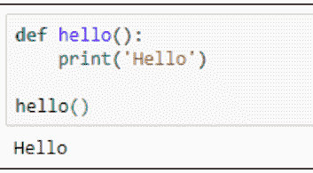

图 8-1：编写并调用一个名为 `hello()` 的简单函数。

### 为函数添加注释

代码中的注释总是可选的。但习惯上是将 `def` 语句下的第一行作为 `docstring`，用于描述函数的功能。通常在第一行的括号右侧也会添加一个以 `#` 符号开头的注释。因为它们只是注释，所以对代码的执行没有任何影响。

```python
def hello(): # Practice function
    """ A docstring describing the function """
    print("Hello, world!")
```

**图 8-2：** 添加了一些注释的示例函数。

### 向函数传递信息

你可以向函数传递信息以便其处理。要做到这一点，对于要传递给函数的每一个信息，在 `def` 语句中输入一个参数名称。你可以为参数使用任何名称，只要它以字母或下划线开头，后跟着字母、下划线或数字即可。

你提供的任何作为参数的名称仅局部于该函数。变量在函数内部工作方式的术语是“局部作用域” `local scope`，这意味着变量的作用域留在函数内部，而不向外延伸。

假设你想让 `hello` 函数对任何使用它的人说 `Hello`。要将信息传递到函数并使用，你需要执行以下操作：

- 在括号内放入一个参数名称，作为传入信息的占位符。
- 在函数内部，使用该名称来处理传递的信息。

例如：

```python
def hello(x):
    """ A docstring describing the function """
    print('Hello ' + x)
```

最好使用更具描述性的名称，例如 `user_name`：

```python
def hello(user_name):
    """ A docstring describing the function """
    print('Hello ' + user_name)
```

如果一个函数有参数，但在调用时没有传递它们，会报错。例如：

```python
def hello(user_name): # Practice function
    """
    docstring describing the function """
    print('Hello ' + user_name)

hello()
```

错误会像这样：

```
TypeError: hello() missing 1 positional argument: 'user_name'
```

创建一个函数非常简单。如果你想获得一些实践经验，请在 `.py` 文件中进行操作。


要创建一个函数，从新的一行开始以 `def`（definition 的缩写）开头，后面跟一个空格，然后跟上你任选的名称，再跟一对括号（括号前或括号内不留空格）。最后在这一行的末尾加一个冒号。例如，要创建一个名为 `hello()` 的简单函数，输入：

```python
def hello():
```

这是一个函数，但它什么都不做。要让该函数执行某些操作，你必须在随后的行中编写 Python 代码。为了确保新代码在函数“内部”，请对这些每行都进行缩进。

> 记住，缩进在 Python 中至关重要。没有没有任何命令可以标记函数的结束。`def` 行下方所有缩进的行都是该函数的一部分。第一行未缩进的行（与 `def` 行对齐）位于函数外部。

要让这个函数执行某些操作，请在 `def` 下方写一行缩进的代码。我们先让函数打印 `hello`。因此，在 `def` 行下方缩进输入 `print('Hello')`。现在你的代码看起来像这样：

```python
def hello():
    print('Hello')
```

如果你现在运行这段代码，屏幕上不会发生任何明显的变化。这是因为函数内部的代码在函数被调用之前不会执行的。你调用自己的函数的方法与调用内置函数相同：通过编写调用函数名称的代码，包括末尾的括号。

例如，如果你正在跟着操作，按回车键添加一个空行，然后输入 `hello()`（中间没有空格）并确保它没有缩进。（你不希望这段代码被缩进，因为它是在调用函数来执行其代码；它不是函数的一部分。）所以它看起来是这样：

```python
def hello():
    print('Hello')
hello()
```

尽管如此，如果你在 `.py` 文件中，仍然什么都不会发生，因为你到为止只是输入了代码。要发生任何结果，你必须以 VS Code 中的通常方式运行代码（如果你在 VS Code 中使用 `.py` 文件）。当代码执行时，你应该能看到输出，就是 `Hello` 这个单词，如图 8-1 所示。


图 8-1：编写并调用一个名为 `hello()` 的简单函数。

## 为函数添加注释

代码中的注释总是可选的。但习惯上是将 `def` 语句下的第一行作为 `docstring`（用三引号括起来的文本），用于描述函数的功能。通常在第一行的括号右侧也会添加一个以 `#` 符号开头的注释。因为它们只是注释，所以对代码的执行没有任何影响。注释只是写给自己的笔记，图 8-2 显示了在 VS Code 编辑器中为我们微小的 `hello()` 函数添加了几个注释的示例。第一个注释 `# Practice function` 位于函数名旁边。下一个注释是用三引号括的 `docstring`。

```python
hello.py > ...
1 def hello(): # Practice function
2     """ A docstring describing the function """
3     print("Hello, world!")
4
```

**图 8-2：** 添加了一些注释的示例函数。

## 向函数传递信息

你可以向函数传递信息以便其处理。要做到这一点，对于要传递给函数的每一个信息，在 `def` 语句中输入一个参数名称。你可以为参数使用任何名称，只要它以字母或下划线开头，后跟着字母、下划线或数字即可。名称不应包含空格或标点符号。（参数名和变量名遵循相同的规则）。理想情况下，为了可读性，参数应该描述被传递的内容，但如果你愿意，也可以使用像 `x` 和 `y` 这样的通用名称。

你提供的任何作为参数的名称仅局部于该函数。例如，如果你在函数外部有一个变量 `x`，在函数内部有另一个名为 `x` 的变量，那么你在函数内部对 `x` 变量的任何更改都不会影响函数外部的 `x` 变量。变量在函数内部工作方式的术语是“局部作用域”（local scope），这意味着变量的作用域留在函数内部，而不向外延伸。在函数内部创建和修改的变量在函数停止的那一刻就会消失。这是一好事，因为你正在编写一个函数，不需要担心意外更改函数外部具有同名的变量。

假设你想让 `hello` 函数对任何使用它的人说 `Hello`（并且你在某个变量中可以获取该信息）。要将信息传递到函数并使用它，你需要执行以下操作：

- 在括号内放入一个参数名称，作为传入信息的占位符。
- 在函数内部，使用该名称来处理传递的信息。

例如，你可以对参数和函数都使用任何通用名称，如：

```python
def hello(x):
    """ A docstring describing the function """
    print('Hello ' + x)
```

在 `hello(x)` 的括号内，`x` 是传入内部任何内容的占位符。在函数内部，该 `x` 只引用传递给它的值。通用名称并不能真正帮助理解你的代码。最好使用更具描述性的名称，例如 `user_name`：

```python
def hello(user_name):
    """ A docstring describing the function """
    print('Hello ' + user_name)
```

如果一个函数有参数，但在调用时没有传递它们，会报错。例如，如果你尝试运行以下代码：

```python
def hello(user_name): # Practice function
    """
    docstring describing the function """
    print('Hello ' + user_name)

hello()
```

错误会像这样：

```
TypeError: hello() missing 1 positional argument: 'user_name'
```

这个错误试图告诉你，如果你想在函数中列出所需的必需参数和可选参数，你必须将所有的可选参数放在最后。

## 使用默认值定义可选参数

在前面的章节中，我们提到当调用一个期望参数但未传递的函数时会产生错误。那是一个谎言。你可以编写一个函数使得参数是可选的；问 ChatGPT 如何这样做。

## 向函数传递多个值

到为止，在本章的所有示例中，我们都只向函数传递了一个值。你可以传递你想要的多个值。只需为每个值提供一个参数名称并用逗号隔开。

例如，假设你想传递用户的名、姓以及可能的日期到函数。你可以这样定义这三个参数：

```python
def hello(fname, lname, datestring): # Practice function
    """ A docstring describing the function """
    print('Hello ' + fname + ' ' + lname)
    print('The date is ' + datestring)
```

注意这些参数都不是可选的。因此调用函数时，你需要传递三个值，例如：

```python
hello('Alan', 'Simpson', '12/31/2024')
```

**图 8-4** 显示了接受三个参数的 `hello()` 函数执行示例。

```python
def hello(fname, lname, datestring): # Practice function
    """ A docstring describing the function """
    print('Hello ' + fname + ' ' + lname)
    print('The date is ' + datestring)

## 测试函数
hello('Alan', 'Simpson', '12/31/2024')
✓ 0.0s
Hello Alan Simpson
The date is 12/31/2024
```

**图 8-4：**带有三个参数的 `hello` 函数。

如果你想在多个参数中使用某些（而不是全部）可选参数，请确保可选参数是最后输入的。例如，考虑以下内容，它是无效的：

```python
def hello(fname, lname='unknown', datestring):
```

如果你按照这种安排运行代码，你会得到一个类似下面的错误：

```
SyntaxError: non-default argument follows default argument.
```

必须的参数在前（顺序不限）。然后可选参数可以列在后面，并带有 `=` 符号（顺序不限）。因此以下代码可以正常运行：

```python
def hello(fname, lname, datestring=''):
    msg = 'Hello ' + fname + ' ' + lname
    if len(datestring) > 0:
        msg += ' The date is ' + datestring
    print(msg)
```

从逻辑上讲，函数内部的代码执行了以下操作：

- 创建一个名为 `msg` 的变量，并放入 Hello 以及名字和姓氏。
- 如果传递的 `datestring` 长度大于 0，则将 " The date is " 和该 `datestring` 添加到 `msg` 变量中。
- 打印此时 `msg` 变量中的任何内容。

图 8-5 显示了调用此版本函数的两个示例。第一次调用传递了三个值，第二次调用只传递了两个。两者都能正常工作，因为第三个参数是可选的。第一次调用的输出是包含日期的完整输出，而第二次调用的输出则省略了关于日期的部分。

```python
def hello(fname, lname, datestring=''): # 练习函数
    """ 函数的 docstring """
    msg = "Hello " + fname + ' ' + lname
    if len(datestring) > 0:
        msg += " The date is " + datestring
    print(msg)

## 测试函数
hello('Alan', 'Simpson', '12/31/2024')
hello('Sammy', 'Schmeedeldorp')
✓ 0.0s

Hello Alan Simpson The date is 12/31/2024
Hello Sammy Schmeedeldorp
```

图 8-5：使用三个参数调用 `hello()` 函数，再次使用两个参数调用。

如果你记不住编写函数的语法，只需让 GitHub Copilot、ChatGPT 或其他 AI 为你编写即可。如果你想接受参数，也可以指定它们。例如，告诉它写一个名为 `hello` 的接受名为 `firstname` 和 `lastname` 参数的 Python 函数，你就能获得定义该函数所需的基础代码。

## 使用关键字参数 (kwargs)

如果你曾经查看过 [Python.org] 上的官方 Python 文档，可能会注意到他们经常使用 `kwargs`。这是 `keyword arguments`（关键字参数）的缩写，是向函数传递数据的另一种方式。

`argument`（参数）一词是“你传递给函数参数的值”的专业术语。到目前为止，我们使用的都是严格的位置参数。例如，考虑这三个参数：

```python
def hello(fname, lname, datargeting='')
```

作为依赖参数在代码中的位置来与参数名关联的替代方案，你可以在调用函数的代码中使用 `parameter=value` 的语法来告诉函数哪个是谁。例如，看看这个 `hello` 的调用：

```python
hello(datargeting='12/31/2019', lname='Simpson', fname='Alan')
```

当你运行这段代码时，它可以正常工作，尽管传递的参数顺序与 `def` 语句中参数名的顺序不匹配。赋值给每个参数名的是变量名，而不是传递的字面量。

```python
app_date = '12/30/2019'
last_name = 'Janda'
first_name = 'Kylie'
hello(datargeting=app_date, lname=last_name, fname=first_name)
```

图 8-6 显示了两种方式运行代码的结果。如你所见，它们运行良好。关于哪个参数对应哪个参数没有歧义，因为参数名在调用代码中已经指定了。

## 传递任意数量的参数

列表提供了向函数传递大量值的一种方法。你还可以设计函数，使其接受任意数量的参数。注意，这种方法并不特别更快或更好，所以请使用最简单或最符合逻辑的方法。要传递任意数量的参数，请使用 `*args` 作为参数名，如下：

```python
def sorter(*args):
```

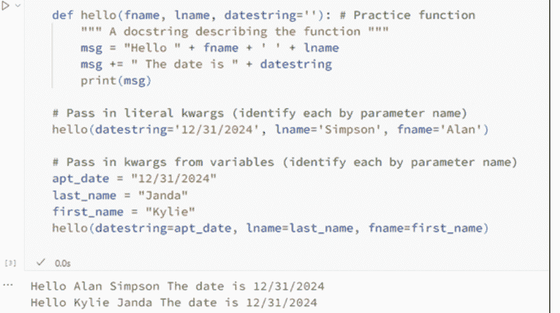

**图 8-6**：使用关键字参数 (kwargs) 调用函数。

无论你传递什么，函数内部都是一个名为 `args` 的元组。记住，元组是不可变的列表（你不能更改的列表）。所以如果你想更改内容，需要将元组转换为列表，然后在该副本上操作。这是一个示例，代码使用了简单的语句 `newList = list(args)`。你可以读到名为 `newList` 的变量是 `args` 元组中所有内容的列表，下一行 `newlist.sort()` 对列表进行排序，而 `print` 显示列表的内容：

```python
def sorter(*args):
    """ 传递用逗号分隔的任意数量参数
    在函数内部，它们被处理为名为 args 的元组。 """
    # 从传递的元组创建一个列表
    newlist = list(args)
    # 排序并显示列表
    newlist.sort()
    print(newlist)
```

图 8-7 显示了使用一系列数字作为参数运行此代码的示例。如你所见，结果列表按顺序排序，正如预期那样。


图 8-7：使用 `*args` 接受任意数量参数的函数。

## 函数返回值

到目前为止，我们所有的函数都在屏幕上显示输出，以便你确认函数工作正常。在现实生活中，更常见的是函数返回某个值并将其放入调用代码中的变量中。执行返回行通常是函数的最后一行。该行以 `return` 单词开头，后面跟着一个空格和包含要返回值的变量名（或表达式）。

这是 `alphabetize` 函数的一个变体。它不包含 `print` 语句。相反，在最后，它只需返回函数创建的字母排序列表（`final_list`）：

```python
def alphabetize(original_list=[]):
    """ 传递方括号内的列表，显示排序后的字符串 """
    # 在函数内部创建一个工作副本
    sorted_list = original_list.copy()
    # 排序列表
    sorted_list.sort()
    # 返回列表
    return sorted_list
```

使用函数的常用方法是将它们返回的内容存储在变量中。例如，在以下代码中，第一行定义了一个名为 `random_list` 的变量，它只是一个包含无顺序名称的列表（方括号）。第二行通过将 `random_list` 传递给 `alphabetize` 函数并存储返回的内容来创建一个新变量 `alpha_list`。最后的 `print` 语句显示 `alpha_list` 中的所有内容：

```python
random_list=['McMullen', 'Keaser', 'Wilson', 'Maier', 'Yudt', 'Gallagher', 'Jacobs']
alpha_list = alphabetize(random_list)
print(alpha_list)
```

# 第 9 章

## 规避错误

本章内容

- 发现异常
- 了解如何优雅地处理错误
- 确保你的应用程序不会崩溃
- 检查 `try ... except ... else ... finally`
- 学习抛出你自己的异常

我们都希望程序能够一直完美运行。但有时，现实世界中的情况会阻止程序的运行。问题不在于你，也不在于你的程序。通常情况下，是使用程序的人犯了某些错误。错误处理在于预测这些问题、捕获错误并通知用户问题所在，以便他们进行修复。

我们在这里描述的技巧并不是为了修复代码中的 bug。你必须自己修复那种类型的错误。我们严格讨论的是程序运行环境中的错误，而你对这些环境没有控制权。处理错误仅仅是一种方法，它可以将 Python 通常显示的、术语化的错误消息（这些信息对大多数人来说毫无意义）替换为用简单易懂的语言告诉用户哪里出了问题以及如何修复。

再次强调，用户将修复程序运行的环境——他们不会修复你的代码。

## 理解异常

在 Python（以及所有其他编程语言）中，“异常”（exception）一词指的是你代码中的错误，或者代码运行环境中的错误——基本上是任何阻止程序正常运行的情况。为了看一个简单的例子，让你的 Python 程序打开一个文件。该语法非常简单：

```
name = open(filename)
```

将 `name` 替换为你选择的名字。将 `filename` 替换为文件名。如果文件与代码在同一个文件夹中，不需要指定文件夹路径，因为默认认为当前文件夹。

图 9-1 显示了一个示例。我们在示例中使用了 VS Code，这样你可以看到我们工作文件夹的内容。该文件夹包含一个名为 `filecontents.py` 的文件，这就是包含我们写的 Python 代码的文件。另一个文件名为 `people.csv`。

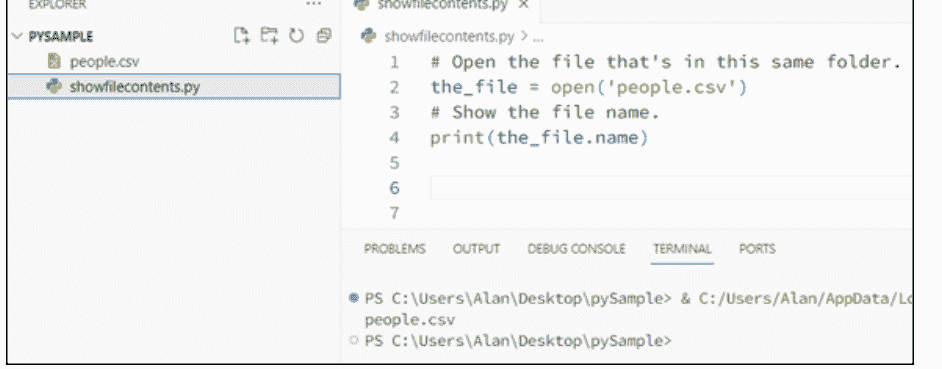

图 9-1：VS Code 文件夹中的 `showcontents.py` 和 `people.csv` 文件。


`showcontents.py` 文件包含代码。`people.csv` 文件包含数据（关于人员人的信息）。图 9-2 显示了 Excel 中的 `people.csv` 文件内容（顶部），方便你阅读；以及文本编辑器中的内容（底部），这是 Python 和其他语言看到它的样子。文件内容目前并不重要；你在这里发现的东西将适用于任何外部文件。

| A | B | C | D | E |

|---|---|---|---|---|

| Username | FirstName | LastName | Role | DateJoined |

| Rambo | Rocco | Moe | 0 | 3/1/2019 |

| Ann | Annie | Angst | 0 | 6/4/2019 |

| Wil | Wilbur | Blomgren | 0 | 2/28/2019 |

| Lupe | Lupe | Gomez | 1 | 4/2/2019 |

| Ina | Ina | Kumar | 1 | 1/15/2019 |

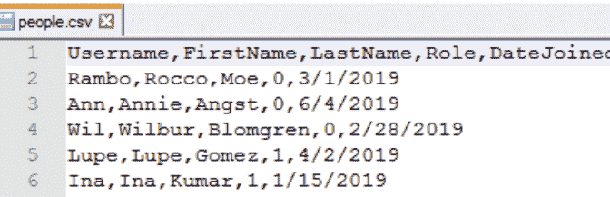

**图 9-2：** Excel（顶部）和文本编辑器（底部）中的 `people.csv` 内容。

Python 代码只有两行（不包括注释），如下：

```
## Open file that's in this same folder.
the_file = open('people.csv')
## Show the filename.
print(the_file.name)
```

第一行代码打开名为 `people.csv` 的文件。第二行代码在屏幕上显示文件名（`people.csv`）。运行简单的 `showfilecontents.py` 程序（通过在 VS Code 中右键点击其名称并选择 "Run Python File in Terminal"）会在屏幕上显示 `people.csv`——假设文件夹中存在一个名为 `people.csv` 的文件。当异常处理介入时，这个假设就不成立。

假设由于你无法控制的，，`people.csv` 文件不存在，因为某些人员或自动化程序未能将其放在那里。或者可能有人拼错了文件名。很容易不小心打错，例如把文件名写成 `.csvv` 而不是 `.csv`。有很多情况可能导致文件不可用。当文件不可用时运行程序会抛出异常（在英语中意思是“显示错误消息”），正如你在图 9-3 底部的 Terminal（终端）面板中所示。异常内容如下：

```
Traceback (most recent call last):
File "c:/Users/acsimpson/Desktop/exceptions/showfilecontents.py", line 2,
in <module>
    the_file = open('people.csv')
FileNotFoundError: [Errno 2] No such file or directory: 'people.csv'
```

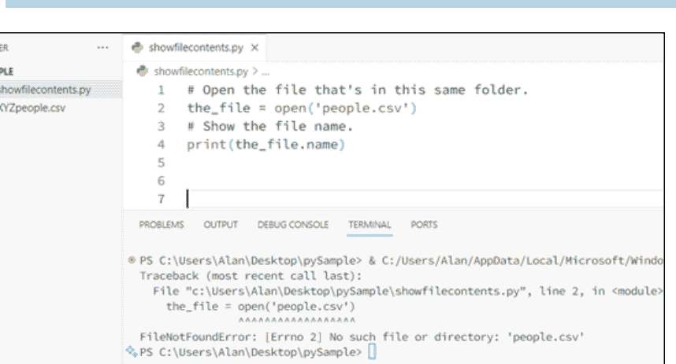

图 9-3：`showfilecontents.py` 文件抛出了异常。

`Traceback`（回溯）是指引用，如果有多个异常，它们都将被列出来，并将最近的一个列在最前面。更具体地说，如果有多个函数调用导致错误，`Traceback` 会向你显示历史记录。异常显示了导致导致错误的代码行。在这种情况下，发生了一个异常。异常向你显示了错误发生在 `showfilecontents.py` 的第 2 行：

```python
the_file = open('people.csv')
```

最后，异常本身的描述为：

```
FileNotFoundError: [Errno 2] No such file or directory: 'people.csv'
```

这种错误的通用名称是 `FileNotFoundError`。许多异常都与一个数字相关（在本例中为 `2`）。该数字取决于操作系统。

## 优雅地处理错误

处理文件未找到错误的最佳方法是将 Python 显示的内容替换为用户更有可能理解的内容。为了做到这一点，你可以使用以下基本语法编写 `try ... except` 块：

```python
try:
    你想让代码执行的内容
except Exception:
    当它无法执行时要执行
```

这里是你可以如何重写 `showfilecontents.py` 来处理缺失（或拼写错误）错误的示例：

```python
try:
    # Open file and show its name.
    the_file = open('people.csv')
    print(the_file.name)
except Exception:
    print("Sorry, I don't see a file named people.csv here")
```

因为要打开的文件可能不存在，你从 `try:` 开始，然后尝试打开文件。如果文件打开了，`print()` 语句将运行并显示文件名。但如果打开文件时抛出异常，程序不会崩溃并显示通用错误消息。相反，它会显示一条普通人可以理解的信息，如图 9-4 所示。

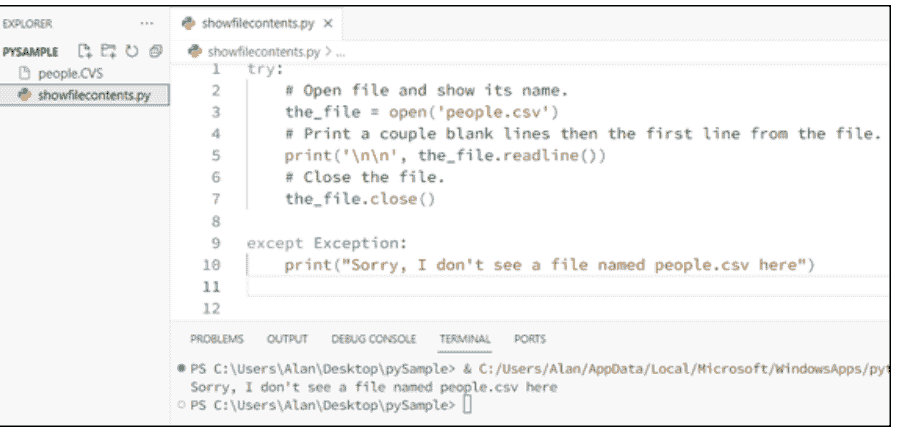

图 9-4：`showfilecontents.py` 文件捕获了错误并显示了友好的消息。

## 指定异常

我们之前的代码示例优雅地处理了文件未找到错误。但较大的应用程序可能有许多可能出现错误的地方，你需要对每个错误进行不同的处理。为此，你可以定义多个错误处理器，正如我们所讨论的那样。

假设你手动修复了文件名，使其成为原本的 `people.csv`。正如之前所示，当你运行代码且没有错误时，输出只是文件名。在打印文件名的行下面，我们又添加了一行代码：

```python
try:
    # Open file and show its name.
    the_file = open('people.csv')
    print(the_file.name)
    print(the_file.wokerms())
except Exception:
    print("Sorry, I don't see a file named people.csv here")
```

当你运行这段代码时，文件名并没有问题，所以输出如你预期的那样显示了 `people.csv`。然而，下一行代码 `print(the_file.wookems())` 抛出了一个错误，因为我们没有定义一个名为 `wookems()` 的方法。遗憾的是，错误信息仍然和之前完全一样，尽管错误的原因是 Python 中没有名为 `.wookems()` 的方法：

```
people.csv
Sorry, I don't see a file named people.csv here
```

那么，既然我们知道文件已经找到了 `people.csv`，并且知道是下一行代码导致了错误，为什么错误信息却说没有找到名为 `people.csv` 的文件呢？问题出现在 `except Exception:` 这一行，它的意思是“如果在这个 `try` 块中抛出了任何异常，就执行 `except` 线路下方的代码”。

为了解决这个问题，你需要将 `Exception:` 替换为你想让 Python 捕获的特定异常。但你如何知道预期是哪种特定异常呢？在没有异常处理的情况下抛出的异常：

```
FileNotFoundError: [Errno 2] No such file or directory: 'people.csv'
```

第一个单词是异常的名称，你可以用它替换通用的 `Exception` 名称，如下：

```python
try:
  # 打开文件并显示它的名称。
  the_file = open('people.csv')
  print(the_file.name)
  print(the_file.wookems())
FileNotFoundError:
  print("Sorry, I don't see a file named people.csv here")
```

诚然，文件未找到错误对于解决错误的方法名没有任何帮助。然而，错误的方法名并不是异常；它是一个编程错误，需要通过在代码中将 `.wookems()` 替换为你想要使用的方法名来修正。至少，你看到的错误信息不再是具有误导性的 `Sorry, I don’t see a file named people.csv` 错误了。代码正常运行，并在指令下显示文件名。然后当它运行到包含错误的 `.wookems()` 方法的行时，它会抛出一个错误——一个不是与找不到文件相关的错误。它会显示该错误正确的错误信息：`object has no attribute 'wookems'`，如图 9-5 所示。

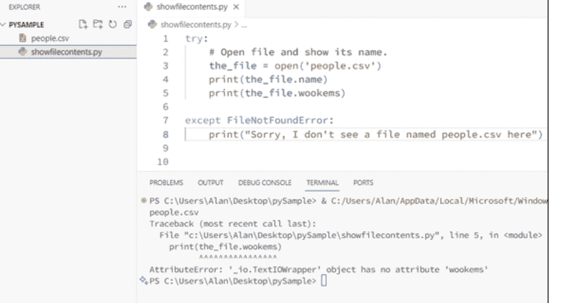

图 9-5：显示了正确的错误信息。

再次，如果你在考虑处理 `.wookems` 错误，那并不是你应该编写异常处理程序的异常。异常发生于程序依赖的程序外部事物不可用时。编程错误（例如不存在的方法名）位于程序内部，必须由编写代码的程序员在内部进行修正。

> `Github Copilot`, `ChatGPT`, `Claude.ai` 以及其他生成式 AI 产品可以为你编写 Python 处理程序。只需要求 AI 写一个处理“文件未找到”的 Python 异常处理器即可。将“file not found”替换为你正尝试处理的任何异常即可。

## 防止应用程序崩溃

你可以在 `try` 块中堆叠 `except:` 语句来处理不同的错误。请注意，当异常发生时，它会从顶部开始检查每一个语句。如果它找到了一个与异常匹配的处理器，就会抛出该异常。如果发生了你没有处理的异常，你将获得标准的 Python 错误信息。但也有办法解决这个问题。

如果你想避免所有的 Python 错误信息，可以在代码的最后一个异常处理器开头使用 `except Exception:`。该行代码的意思是“如果发生的错误尚未被之前的某个异常处理，则改用该异常处理器”。

## 加入 else 混合使用

在上的示例中，我们使用一个错误处理器来处理文件未找到错误，用第二个处理器处理所有其他情况。但在现实生活中，你可能需要处理许多类型的错误。因此可能会有针对各种错误的 `except:` 块。如果你尝试捕获的错误一个都没有发生怎么办？在这种情况下，你希望代码执行正常进行。你可以为你的代码添加一个 `else:` 块来处理没有错误需要捕获的情况。

```python
try:
    可能导致异常的内容
except a common exception:
    解释问题
except Exception as e:
    显示通用错误
else:
    # 只有在没有抛出异常时才继续这里
```

如果你将这段代码转换为通俗英语，其逻辑流如下：

- 尝试打开文件。
- 如果文件不存在，通知用户并停止。
- 如果发生了其他错误，显示通用错误并停止。
- 否则，继续执行其余代码。

通过将 `try:` 限制在一个最可能抛出异常的事情上，可以在代码在尝试进一步执行之前让其停下来。但如果没有抛出异常，代码将继续向下正常运行，此时之前的异常处理器就不再重要了。

```python
try:
    # 打开名为 people.csv 的文件
    the_file = open('people.csv')
    # 监控常见错误，如果发生则停止程序。
except FileNotFoundError:
    print("Sorry, I don't see a file named people.csv here")
    # 捕获任何意外错误并停止程序。
except Exception as err:
    print(err)
    # 否则，如果到为止没有发生任何坏事，继续运行。
else:
    # 如果没有发生异常，就继续这里。
    # 文件现在是打开的。
    for one_line in the_file:
        print(one_line)
    the_file.close()
    print("Success!")
```


注意 在 Python 中的 `try ... except ... else ... finally`

如果你查看异常处理的完整语法，你会发现最后还有最后一个选项，如下：

```python
try:
    尝试做这件事
except:
    如果发生了 x，在这里停止
except Exception as e:
    如果发生了其他错误，在这里停止
else:
    如果没有异常，正常继续
finally:
    无论发生什么都执行这里
```

**`finally`** 代码在 **`try`** 块结束时都会执行。例如，如果你在函数内部，`except` 块使用了 `return` 退出函数，`finally` 代码也会执行。如果没有这种功能，`finally` 块等同于将其代码放在 `try` 块之后且外部。

为了说明，接下来的代码将一个名为 `file_is_open` 的变量设置为 **False**。然后它尝试打开文件。如果无法打开文件，第一个 **`except:`** 会捕获错误，程序不会崩溃。`file_is_open` 变量将保持为 **False**。

如果文件可以打开，**`else:`** 块执行，将 `file_is_open` 变量设置为 **True**，它关闭文件。无论如何，都会在屏幕上显示内容。

最后（在 **`finally:` 块**中），代码检查 `file_is_open` 是否为 **True**，如果是，则关闭文件。无论发生什么情况，程序将正常运行，并在移动到后续代码之前确保文件已关闭。

```python
## 一个初始为 False 的变量
file_is_open = False

try:
  # 打开名为 people.csv 的文件
  the_file = open("people.csv")

  # 监控常见错误，如果发生则停止程序。
except FileNotFoundError:
  print("Sorry, I don't see a file named people.csv here")

## 否则，如果到为止没有发生任何坏事，继续运行。
else:
  # 如果我们到了这里，文件现在是打开的。设置打开状态为 True。
  file_is_open = True

finally:
  # 无论发生什么，执行这里代码。
  if file_is_open:
    the_file.close()
```

```python
## 显示文件内容。
for one_line in the_file:
    print(one_line)

finally:
    # 无论如何都会执行这里。所以如果文件是打开的，它会被关闭。
    if file_is_open:
        the_file.close()
    print("File is closed now")
```

> 如果你忘记了 Python 中 `try ... catch` 块的语法，只需让 `Copilot`、`Claude.ai` 或其他生成式 AI 为你编写包含 `try`, `except`, `else`, `finally` 块的 Python 代码。这将为你提供一个包含基础语法的示例。

这些示例说明，你可以精确控制程序中易受用户错误或外部异常影响的小部分代码所发生的情况，同时允许其他代码正常运行。

## 抛出你自己的异常

Python 拥有许多内置异常用于识别和识别错误，正如你在编写和测试代码时会看到的那样，特别是当你刚开始学习时。然而，你并不限于内置异常。如果你的应用程序存在一个内置异常未涵盖的漏洞，你可以创建自己的异常。可以通过 `ChatGPT` 获取一个在 Python 中抛出自定义异常的示例。

抛出自定义错误的通用语法是

```python
raise error
```

将 `error` 替换为你想要抛出的已知错误名称（例如 `FileNotFoundError`）。或者，如果内置错误没有涵盖它，你可以直接使用 `raise Exception`，这将执行你代码中 `catch Exception:` 下的任何内容。

所以如你看到的，异常处理允许你为代码中漏洞导致的错误制定计划。我们指的不是你代码中的 bug 或编码错误，而是程序正确运行所需的外部资源。

当外部资源缺失或不足时，你不必让程序直接崩溃并显示一条让用户感到困惑的“极客风”错误消息。相反，你可以捕获异常并向用户显示一些文本，告诉他们到底哪里出了问题，这将帮助他们修复问题并再次运行程序，这次会成功。这就是异常处理的意义。

# 第 10 章

## 与外部文件交互

本章内容

- 处理文本文件和二进制文件
- 打开、关闭和读取文件内容
- 遍历文件
- 读取和复制二进制文件

计算机中存储的几乎所有内容，无论是文档、程序、电影、照片等，都存储在文件中。大多数文件被组织在文件夹（也称为目录）中。你可以通过 Finder（在 Mac 上）或资源管理器（在 Windows 上）来浏览文件夹和文件。

Python 提供了许多工具，用于创建、读取和写入许多不同类型的文件。在本章中，你将学习使用 Python 代码处理文件的重要技能。

## 理解文本文件和二进制文件

基本上有两种类型的文件：

- 文本文件：包含纯文本字符。在文本编辑器中，它显示人类可读的内容。文本可能不是你熟悉或理解的语言，但你将看到的大多数是你可以可以在任何键盘上打出的正常字符。
- 二进制文件：以字节形式存储信息，这些信息并不那么易于人类阅读。

图 10-1 列出了不同类型的文本和二进制文件的示例，其中某些你可能已经处理过。还有其他文件类型可用，但这些是最广泛使用的。

| 文本文件 | 二进制文件 |


| :--- | :--- |
| * 纯文本: .txt,.csv | * 可执行文件: .exe,.dmg,.bin |
| * 源代码: .py,.html,.css,.js | * 图像: .jpg,.png,.gif,.tiff,.ico |
| * 数据: .json,.xml | * 视频: .mp4,.m4v,.mp4,.mov |
| | * 音频: .aif,.mp3,.mpa,.wav |
| | * 压缩: .zip,.deb,.tar.gz |
| | * 字体: .woff,.otf,.ttf |
| | * 文档: .pdf,.docx,.xlsx |

**图 10-1:** 常见的文本和二进制文件。

你可以使用 `VS Code` 或几乎任何代码编辑器来编写 Python 代码。我们在本章中使用 `VS Code` 仅仅是因为它的资源管理器面板（打开时在左侧）显示了你当前正在工作的文件夹内容。

## 打开和关闭文件

要从 Python 应用程序打开文件，使用以下语法：

```python
open(filename, mode)
```

将 `filename` 替换为你想要打开的文件名。如果文件与 Python 代码不在同一个目录中，你需要指定文件的路径。例如，如果你正在使用 Windows 并且想要打开桌面上的 `foo.txt`，且你的用户名是 Alan，你将使用路径 `C:\Users\Desktop\foo.txt`。

模式（`mode`）是可选的（用方括号表示）。使用它来指定你想要的访问类型，使用以下缩写：

- `r` (读取)：打开文件但不允许 Python 进行任何更改。这是默认模式，如果你没有指定模式，将使用它。如果文件不存在，Python 将抛出 `FileNotFoundError`。
- `r+` (读/写)：打开文件并允许 Python 对其进行读写。
- `a` (追加)：打开文件并允许 Python 在文件末尾添加内容，但不更改现有内容。如果文件不存在，此模式将创建文件。
- `w` (写入)：打开文件并覆盖其内容，如果文件不存在则创建文件。
- `x` (创建)：如果文件不存在则创建文件。你也可以指定：
- `t` (文本)：以文本模式打开文件。
- `b` (二进制)：以二进制模式打开文件。

你可以使用 `VS Code` 或几乎任何代码编辑器来编写 Python 代码。我们在本章中使用 `VS Code` 仅仅是因为它的资源管理器面板（打开时在左侧）显示了你当前正在工作的文件夹内容。

## 打开和关闭文件

要从 Python 应用程序打开文件，使用以下语法：

```python
open(filename, mode)
```

将 `filename` 替换为你想要打开的文件名。如果文件与 Python 代码不在同一个目录中，你需要指定文件的路径。例如，如果你正在使用 Windows 并且想要打开桌面上的 `foo.txt`，且你的用户名是 Alan，你将使用路径 `C:\Users\Desktop\foo.txt`。

模式（`mode`）是可选的（用方括号表示）。使用它来指定你想要的访问类型，使用以下缩写：

- `r` (读取)：打开文件但不允许 Python 进行任何更改。这是默认模式，如果你没有指定模式，将使用它。如果文件不存在，Python 将抛出 `FileNotFoundError`。
- `r+` (读/写)：打开文件并允许 Python 对其进行读写。
- `a` (追加)：打开文件并允许 Python 在文件末尾添加内容，但不更改现有内容。如果文件不存在，此模式将创建文件。
- `w` (写入)：打开文件并覆盖其内容，如果文件不存在则创建文件。
- `x` (创建)：如果文件不存在则创建文件。你也可以指定：
- `t` (文本)：以文本模式打开文件。
- `b` (二进制)：以二进制模式打开文件。

你可以使用 `VS Code` 或几乎任何代码编辑器来编写 Python 代码。我们在本章中使用 `VS Code` 仅仅是因为它的资源管理器面板（打开时在左侧）显示了你当前正在工作的文件夹内容。

## 读取文件内容

在本章之前，你已经看到了如何使用 `.read()` 读取打开文件的内容。但那并不是读取文件的唯一方法。你有三个选择：

- `read([size])`：如果括号为空，则读取整个文件。如果你在括号内指定了大小，它将读取许多字符（文本文件）或相应字节（二进制文件）。
- `readline()`：从文本文件中读取一行——行在遇到换行符处结束。
- `readlines()`：将文本文件的所有行读取到列表中。

示例代码如下：

```python
with open('quotes.txt') as f:
    # 读取整个文件
    content = f.read()
    print(content)
```

`content` 变量存储了文本文件的所有副本。文件每行末尾的换行符在打印时会开启新行。

这是使用 `readlines()` 而不是 `read()` 的相同代码：

```python
with open('quotes.txt') as f:
    content = f.readlines()
    print(content)
```

'我度过了一个非常奇妙的夜晚，但并不是这一个。

'格鲁奇·马克克斯', 《极限》。愚蠢与天才的区别在于，天才也有它的局限性。

'阿尔伯特·爱因斯坦', '我们来到地球都是为了帮助别人的；而其他人来到这里是为了什么，我无所知。'

'W. H. 奥登', '以介词结尾句子是件我无法接受（not put out）的事情。'

'温斯顿·丘尔威尔']

输出周围的方括号告诉你是这是一个列表。列表中的每个项目都用引号括起来并用逗号分隔。每个项目末尾的 `\n` 是在文件中结束该行的换行符。

与 `readlines()`（复数形式）不同，`readline()` 仅从文件中读取一行。该行从文件的当前位置延伸到下一个换行符。再次执行另一个 `readline()` 会读取文件的下一行，依此类推。例如，假设你运行了以下代码：

```python
with open('quotes.txt') as f:
    content = f.readline()
    print(content)
```

输出结果

> 我度过了一个非常奇妙的夜晚，但并不是这一个。

在此之后执行另一个 `readline()` 将读取下一行。正如你可能猜到的，当涉及到 `readline()` 和 `readlines()` 时，你可能想使用循环来访问所有数据，从而获得更多的控制权。

## 遍历文件

你可以使用 `readlines()` 或 `readline()` 来遍历文件。`readlines()` 方法总是一次性读取整个文件。因此，如果文件很大，在读取完文件之前，你的计算机可能会耗尽内存（RAM）。但如果你知道文件的大小且它相对较小（可能是几千行数据或更少），`readlines()` 是获取所有数据的快速方法。这些数据将存储在列表中，因此你将遍历的是列表而不是文件。

## 使用 readlines() 循环

当你使用 `readlines()` 读取文件时，你是一次性将整个文件作为一个列表读取的。因此，你并不是在逐行循环遍历文件。相反，你遍历的是 `readlines()` 存储在内存中的项目列表。实现代码如下：

```python
with open('quotes.txt') as f:
    # 先读取所有行，然后进行循环。
    for one_line in f.readlines():
        print(one_line)
```

如果你运行这段代码，输出将是双倍间距，因为每个列表项目都以换行符结束，而 `print` 在每次循环时都会正常添加它自己的换行符。如果你想保留单倍间距，可以在 `print` 语句中添加 `end=''`（确保使用单引号或双引号，且周围没有空格）。

## 使用 readline() 循环

如果你不确定正在读取的文件的大小，或者运行应用程序的计算机内存有多大，那么使用 `readlines()` 读取整个文件可能是有风险的。如果没有足够的内存来容纳整个文件，程序在内存耗尽时将会崩溃。为了安全起见，你可以一次遍历一行遍历文件，这样在任何给定时间内内存中都只有文件的某部分内容。

要使用这种方法，你打开文件，读取一行并将其放入变量中。然后只要变量不为空（`while`），就继续循环文件。因为文件中的每一行都包含某些文本，在读取完最后一行之前，该变量都不会为空。以下是这种循环方法的代码：

```python
with open('quotes.txt') as f:
    one_line = f.readline()
    while one_line:
        print(one_line, end='')
        one_line = f.readline()
```

对于较大的文件，这种方法是可行的，因为在任何点都没有读取整个文件。由于你不是一次性读取整个文件，所以不需要担心内存问题。

## 使用 seek()移动指针

`seek()` 方法允许你将指针移动到特定位置。`whence` 参数决定了相对于何的位置：

- `0`：文件开头。
- `1`：当前指针位置。
- `2`：文件末尾。

如果你省略 `whence` 值，它默认认为 `0`。最常见的 `seek` 用法是将指针重置到文件顶部。

## 读取并复制二进制文件

假设你有一个二进制文件，你想为它创建一个副本。与其一次性打开它并导致内存耗尽，你可以分块读取并分块写入。二进制文件没有“行”。所以 `readline()` 不是遍历的良好选择，但你可以使用指定大小的 `read()`。

```python
## 指定要复制的文件
file_to_copy = 'happy_pickle.jpg'
## 在扩展名之前添加 _copy 创建新文件名。
name_parts = file_to_copy.split('.')
new_file = name_parts[0] + '_copy.' + name_parts[1]
## 以只读二进制模式打开原始文件。
with open(file_to_copy, 'rb') as original_file:
  # 创建或打开文件写入
  with open(new_file,'wb') as copy_to:
    # 获取原始文件的块数据（4KB）。
    chunk=original_file.read(4096)
    # 循环直到没有更多块。
    while len(chunk) > 0:
      copy_to.write(chunk)
      # 确保在循环中读取下一个块。
      chunk = original_file.read(4096)

## 循环结束后自动关闭，显示完成消息。
print('Done!')
```

**图 10-2：** `binarycopy.py` 文件可以复制任何二进制文件。

**图 10-3** 显示了运行代码的结果。终端仅显示 Done!。但正如你所见，文件夹中有一个名为 `happy_pickle_copy.jpg` 的文件。

## 图 10-3：运行 binarycopy.py 将 happy_pickle_copy.jpg 添加到文件夹。

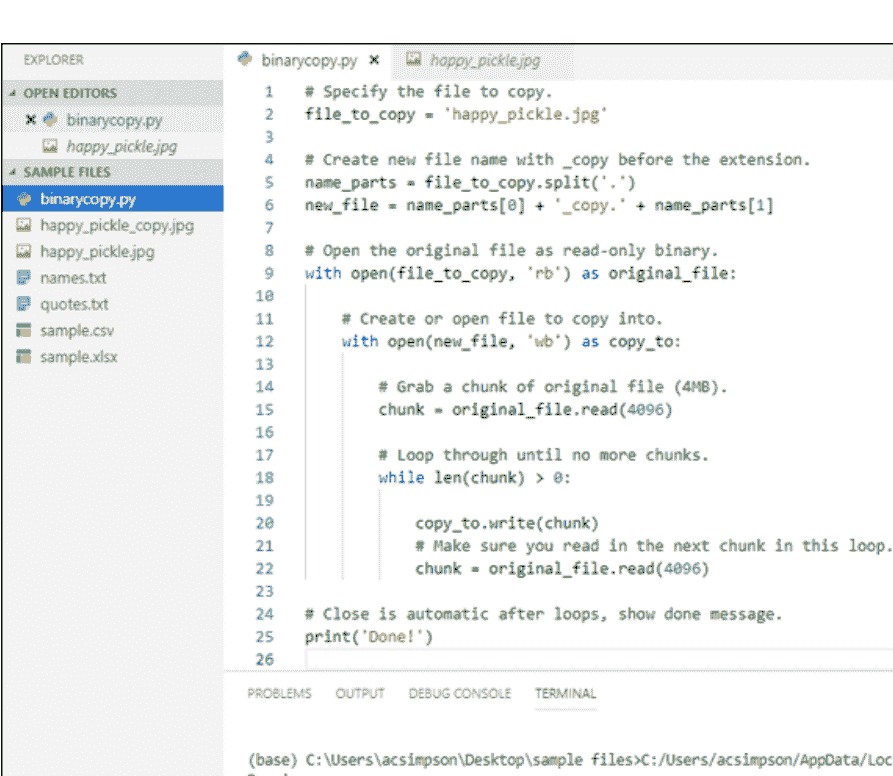

# 第 11 章

## 玩转 JSON 数据

**本章内容包括**

- 发现如何组织 JSON 数据
- 学习序列化
- 从 JSON 文件导入数据
- 将 Python 数据导出到 JSON

JavaScript Object Notation (`JSON`) 是一种面向对象的常用序列化格式。序列化格式通常是指用于将数据从一台计算机发送到另一台计算机的格式。然而，某些数据库（例如 Google Firebase 的免费实时数据库）也以 JavaScript Object Notation 格式存储数据。开头的 JavaScript 这个词有时会让人困惑，尤其是当你使用 Python 而不是 JavaScript 来编写代码时。别担心，这种格式起源于 JavaScript 世界，现在已成为广为人知的、适用于各种计算机和编程语言的通用格式。

在本章中，你将确切地了解什么是 JSON，以及如何从 JSON 导出和导入数据。如果你发现围绕 JSON 的所有术语让你感到不适，再次别担心。我们会先过所有的专业术语。正如你所看到的，JSON 数据的格式与 Python 数据字典几乎相同，因此没有多少新内容需要学习。此外，你已经拥有了免费的 Python JSON 模块，这使得处理 JSON 数据变得更加容易。

## 组织 JSON 数据

JSON 数据大致等同于 Python 中的数据字典，这使得 JSON 文件非常容易处理。将 JSON 数据与表格数据进行比较时可能是最容易理解的。例如，图 11-1 显示了 Excel 工作表中的一些表格数据。图 11-2 显示了相同数据转换为 JSON 格式后的样子。Excel 表格中的每行数据都已转换为 JSON 文件中的一个键值对字典。当然，还有许多大括号来表示该数据是一个对象。

| | | 出生年份 | 加入日期 | 是否激活 | 余额 |
|---|---|---|---|---|---|
| 全名 | | | | | |
| Angst, Annie | 1982 | 1/11/2011 | TRUE | $300.00 |
| Bonañas, Barry | 1973 | 2/11/2012 | FALSE | -$123.45 |
| Schadenfreude, Sandy | 2004 | 3/3/2003 | TRUE | $0.00 |
| Weltschmerz, Wanda | 1995 | 4/24/1994 | FALSE | $999,999.99 |
| Malaise, Mindy | 2006 | 5/5/2005 | TRUE | $454.01 |
| O'Postum, Ollie | 1987 | 7/27/1997 | TRUE | -$1,000.00 |
| Pusillanimity, Pamela | 1979 | 8/8/2008 | TRUE | $12,345.67 |

**图 11-1：** Excel 表格中的某些数据。

资源生成器

打开编辑器

people_from_exceljson

JSON_FILES

- firebase_hitcounts.json
- json_get_nokey.py
- json_get.py
- people_excel.csv
- people_excel.xlsx
- people_from_exceljson

```json
{
  "Full Name": "Angst, Annie",
  "Birth Year": 1982,
  "Date Joined": 40554,
  "Is Active": true,
  "Balance": 300
},
{
  "Full Name": "Bonañas, Barry",
  "Birth Year": 1973,
  "Date Joined": 40950,
  "Is Active": false,
  "Balance": -123.45
},
{
  "Full Name": "Schadenfreude, Sandy",
  "Birth Year": 2004,
  "Date Joined": 37683,
  "Is Active": true,
  "Balance": 0
}
```

**图 11-2：** 转换为 JSON 格式的 Excel 表格数据。


> 提示 要将现有的 Excel 数据转换为 JSON，请从 Excel 菜单中选择文件 ⇒ 导出文件 ⇒ 另存为，并导出为 CSV（逗号分隔）。你可以使用类似的技术从 Google Sheets 和 Apple 的 Numbers 应用导出 CSV。获得 CSV 文件后，你可以使用 convertcsv.com 网站将其转换为 JSON。在网站上寻找“Convert CSV to JSON”选项，并按照屏幕上的说明进行操作。

从 Excel 导出数据只是创建 JSON 文件的方法之一。你还可以创建一个键值 JSON 文件，其中每块数据都有一个唯一标识其自身的键。（同一文件中的其他字典不能具有相同的键。）

```python
print(type(people))
```

Python 显示如下内容：

```
<class 'list'>
```

这一行告诉你该对象是 `list` 类的实例。换句话说，它是一个列表对象，尽管大多数人只会简单地称它为列表。

由于该对象是一个列表，你可以对它进行循环。在循环内部，你可以显示每个项的类型，如下：

```python
for p in people:
    print(type(p))
```

输出如下：

```
<class 'dict'>
<class 'dict'>
<class 'dict'>
<class 'dict'>
<class 'dict'>
<class 'dict'>
<class 'dict'>
```

这是一个非常有用的信息，因为它告诉你列表中的每个“人”（我们在代码中将其缩写为 `p`）都是一个 Python 字典。因此，在循环内部，你可以通过键（key）来分离每个值。例如，看这段代码：

```python
for p in people:
    print(p['Full Name'], p['Birth Year'], p['Date Joined'],
           p['Is Active'], p['Balance'])
```

运行这段代码将显示 JSON 文件中的所有数据，如下所示。这些数据来自之前图 11-1 中的 Excel 表格。


```
Angst, Annie 1992 40554 True 300
Bonais, Barry 1973 40950 False -123.45
Schadenfreude, Sandy 2004 37683 True 0
Welzmerch, Wanda 1995 34448 False 9999999
Malaise, Mindy 2006 38477 True 454.01
O'Possum, Ollie 1987 35638 True -1000
Pusillanimity, Pamela 1979 39668 True 12345.69
```

如果打开和循环 JSON 文件的所有代码太复杂，请记住你始终可以向生成式 AI 寻求帮助。例如，你可以告诉 Claude.ai 或 Copilot 编写 Python 代码来打开一个名为 `whatever.json` 的文件，遍历其内容并处理任何异常。然后只需根据你的直接需求对它编写的代码进行调整即可。

## 将 Excel 日期转换为 JSON 日期

你可能在想：“嘿，等一下……`Date Joined` 列中的那些 40554、40950、37683 数字到底是怎么的？”好吧，它们是序列日期，但你可以将它们转换为 Python 日期。你需要导入 `xlrd`（Excel 读取器）和 `datetime` 模块。你的第一步是安装该模块，你需要在 VS Code 终端窗口中输入以下命令来实现：

```bash
pip install xlrd
```

我们将在第 4 本中详细讨论模块和 `pip install`。但目前，先前的命令将让你开始此应用程序。在你的 Python 程序中，要将 `p['Date Joined']` 列中的整数转换为 Python 日期，请使用这段代码：

```python
y, m, d, h, i = xlrd.xdate_as_tuple(p['Date Joined'], 0)
joined = dt.date(y, m, d)
```

要以熟悉的格式显示此内容，请使用 f-string，如下：

```python
print(f"joined:{m/%d/%Y}")
```

这里是所有代码，包括文件顶部的必要导入：

```python
import json, xlrd
import datetime as dt
## 这些是 Excel 数据（没有键）
filename = 'people_from_excel.json'
## 打开文件（标准文件打开操作）
with open(filename, 'r', encoding='utf-8', newline='') as f:
    # 将整个 json 文件加载到名为 people 的对象中
    people = json.load(f)
    # 字典在一个列表中，循环并显示每个字典。
    for p in people:
        name = p['First Name']
        byear = p['Birth Year']
        # Excel 日期有点棘手，使用 xlrd 模块。
        y, m, d, i, s = xlrd.xdate_as_tuple(p['Date Joined'], 0)
        joined = dt.date(y, m, d)
        balance = '$' + f"{p['Balance']:.2f}"
        print(f"{name:<22} (byear) {joined:%m/%d/%Y} {balance:>12}")
```

这是输出结果，格式整齐，看起来更像原始 Excel 数据而不是 JSON 数据。如果你需要以 dd/yyyy 格式显示数据，请将代码行中的模式改为 `%d/%m/%Y`。

| Name | Birth Year | Date Joined | Balance |
|---|---|---|---|
| Angst, Annie | 1982 | 01/11/2011 | $300.00 |
| Bonais, Barry | 1973 | 02/11/2012 | -$123.45 |
| Schadenfreude, Sandy | 2004 | 03/03/2003 | $0.00 |
| Weitzmerch, Wanda | 1995 | 04/24/1994 | $9999.99 |
| Malaise, Mindy | 2006 | 05/27/2005 | $454.01 |
| O'Possum, Ollie | 1987 | 07/27/2005 | -$1000.00 |
| Pusillanimity, Pamela | 1979 | 08/31/2011 | $12345.69 |

将 `'keyname'` 替换为你想要删除的列名。

例如，要从由 Firebase 数据库 JSON 示例创建的字典中删除所有的 lastreferrer 键名和数据，请在循环中添加以下内容：

```
v.pop('lastreferrer', None)
```

代码中的 `None` 参数是可选的。包含它可以防止 Python 在你尝试删除不存在的键时抛出异常。

图 11-5 显示了一个示例，其中第 1–8 行将 Firebase 数据导入到一个名为 `hits_data` 的 Python 对象中。第 10 行开始了一个循环，遍历字典中的每个键 `k` 和值 `v`。第 12 行将时间戳转换为名为 `pydate` 的 Python 日期。然后，第 14 行将 `lastvisit` 列中的时间戳替换为 `mm/dd/yyyy` 格式的该 Python 日期字符串。第 16 行 `v.pop('lastreferrer', None)` 从每个字典中删除了 `lastreferrer` 键值对。最后的循环显示了在进行这些更改后字典中的内容。

请记住，你在 Python 中对字典所做的更改不会影响加载 JSON 数据的文件或字符串。如果你想创建一个新的 JSON 字符串或文件，请使用接下来将讨论的 `json.dumps()` 或 `json.dump()` 方法。

```python
import json
import datetime as dt
## 这是 firebase JSON 数据（键值对）。
filename = 'firebase_hitcounts.json'
# 打开文件（文件打开操作）。
with open(filename, 'r', encoding='utf-8', newline='') as f:
    # 将整个 json 文件加载到名为 hits 的对象中
    hits = json.load(f)

for k, v in hits.items():
    # 将 firebase 日期转换为 Python 日期。
    py = dt.datetime.fromtimestamp(v['lastvisit']/1000).date()
    # 在字典中，将 Firebase 日期替换为日期字符串。
    v['lastvisit'] = py.strftime('%Y-%m-%d')
    # 删除整个 referrer 列。
    v.pop('lastreferer', None)

# 现在查看字典中的 lastvisit 日期。
for k, v in hits.items():
    print(k, v)
```

| 问题 | 输出 | 调试 | 终端 |
| --- | --- | --- | --- |
| -L4QD6v2vJKS | 'count': '0946', 'lastvisit': '12/20/2018' | 'page': '/stg/downloadpdf.html' |
| -L4QD6v2vJKS | 'count': '3096', 'lastvisit': '12/20/2018' | 'page': '/' |
| -L4RwC11ZuCAQ6 | 'count': '3342', 'lastvisit': '12/20/2018' | 'page': '/html/css/index.html' |
| -L4S5vw2vJauDXE | 'count': '2220', 'lastvisit': '12/20/2018' | 'page': '/html/css/codequickies/' |
| -L4S3aj5fuQU8n5IK | 'count': '2194', 'lastvisit': '12/20/2018' | 'page': '/index.html' |
| -L4SD75v6vQOMD | 'count': '1988', 'lastvisit': '12/20/2018' | 'page': '/javascript/codequickies/' |
| -L4Qr-S6vvuUJG6mR | 'count': '1547', 'lastvisit': '12/20/2018' | 'page': '/codequickies/' |
 - -1I8iP7nu3IQgOR | 'count': '1439', 'lastvisit': '12/20/2018' | 'page': '/how/' |
| -L1I20NHWI1-CY2ZR- | 'count': '1643', 'lastvisit': '12/10/2018' | 'page': '/beginner/' |

**图 15:** 修改字典中一个键的值，并删除字典中的整个键值对。

## 将 Python 数据导出为 JSON

到目前为止，我们讨论了如何从外部世界将 JSON 引入你的应用程序，而现在 Python 可能需要相反的操作，你可能想将已经在你的应用程序中的某些数据（例如字典）导出为 JSON，发送给另一个应用程序、公众或任何地方。这就是 `json.dump()` 和 `json.dumps()` 方法大显用场的地方。

`dumps()` 方法创建数据的 JSON 字符串，该字符串仍留在内存中，因此你可以使用 `print()` 来查看它。例如，之前的示例将 Firebase 数据库导入 Python 字典，然后它们遍历了该字典，更改了所有时间/dd/yyyy 时间戳并删除了所有的 `lastreferer` 键值对。

所以，如果你想查看创建的 JSON 字符串，可以使用 `dumps()`。例如：

```python
print(json.dumps(hits, indent=4))
```

`indent` 参数是可选的，但它会让 JSON 字符串变得更易读。如果你想将 JSON 数据保存到文件中，请使用 `dump()` 而不是 `dumps()`：

```python
with open('output.json', 'w') as f:
    json.dump(hits, f, indent=4)
```

这将创建一个名为 `output.json` 的文件，其中包含以 JSON 格式格式化的字典数据。

请求在相应位置不再存在。但重要的是，你，即用户（一个人类），以及你的用户代理（你用于访问互联网的程序）都处于客户端。服务器仅仅是一台计算机，而不是人，它发回它的响应，如图 12-1 所示。

## 客户端（人）

## 服务器（机器）

请求

响应


**图 12-1：** 客户端发送请求，服务器发回响应。

## 理解神秘的 URL

URL 是访问网页的关键部分，因为互联网正是通过这种方式找到你所寻找的。在 Web 上，绝大多数资源都使用超文本传输协议（HTTP），因此它们的 URL 以 `http://` 或 `https://` 开头。区别在于，`http://` 以原始形式在电线中传输，这使得它容易受到黑客或其他能够“嗅探”流量的人的攻击。https 协议是*安全的*的，因为数据经过了*加密*，这意味着它被转换为一种不易阅读的秘密代码。通常，任何与你进行业务并对其传输敏感信息（如密码和信用卡号）的网站都会使用 `https` 来保持这些信息的安全和秘密。

任何网站的 URL 都可以相对简单，例如 Alan 的 URL 是 `https://alanspson.me`。它也可以很复杂，以便向请求中添加更多信息。图 12-2 显示了 URL 的各个部分，你过去可能已经注意到了其中一些。

请注意顺序非常重要的。例如，URL 可能包含指向特定文件夹或页面的路径（在域名后紧跟一个斜杠开始）。URL 还可以包含查询字符串，查询字符串始终位于最后，并且始终以问号（?）开头。问号之后是一个或多个 `name=value` 对，基本上与你在数据字典和 JSON 中看到的语法相同。如果有多个 `name=value` 对，它们通过 ampersands（&）分隔。

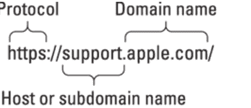

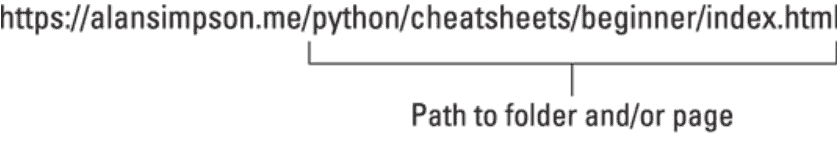

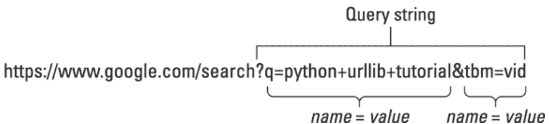

图 12-2：URL 的不同部分。

## 显示 HTTP header

当你使用 Web 时，你只关心屏幕上看到的内容。在更深层次、某种程度上隐藏的层面，参与交易的两台计算机通过 HTTP header相互通信。这些头部通常对肉眼不可见，但 Python、你的网络浏览器和其他程序是可以访问的。

我们最常用的查看头部工具是 HTTP Headers，这是一个 Google Chrome 扩展程序。如果你有 Chrome 并想亲自尝试 HTTP Headers，可以从 Chrome 网上应用商店 https://chromewebstore.google.com 下载并安装 HTTP Headers。安装扩展程序后，要查看每次访问网站时包含的头部，请点击 Chrome 工具栏中的 HTTP Headers 图标（它看起来像云云），你就可以看到 HTTP header 信息（参见图 12-3）。

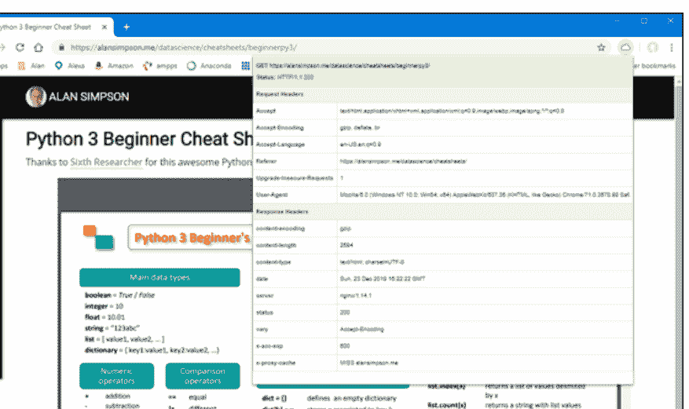

**图 12-3：** 使用 Google Chrome 检查 HTTP headers。

HTTP headers 中最重要的两个内容位于顶部，你会看到 GET 后面跟着 URL。这告诉你发送了一个 GET 请求，意味着 URL 是对信息的请求；没有内容被上传到服务器。GET 单词之后的 URL 是请求的资源。另一种响应类型是 POST，这意味着你正在向服务器发送某些信息，例如在 Facebook 或 X（原 Twitter）上发布内容时。

GET 下方的一行显示了请求的状态。第一部分指示所使用的协议。在图 12-4 的示例中，协议是 HTTP1.1，这意味着 Web 请求遵循 HTTP 版本 1.1 的通信规则。200 是状态码，在这种情况下意味着“好的，一切进展顺利”。常见的状态码列在表 12-1 中。

我们在这里告诉你的所有内容都重要，因为它们与使用 Python 程序化地访问 Web 相关，正如你接下来将看到的。

## 从 Python 打开 URL

要从 Python 程序访问 Web，你需要使用 `urllib`（或称 URL 库）包的某些部分。这个库包含多个模块，每个模块都为程序化访问互联网的不同方面提供了有用的功能。表 12-2 总结了这些包。

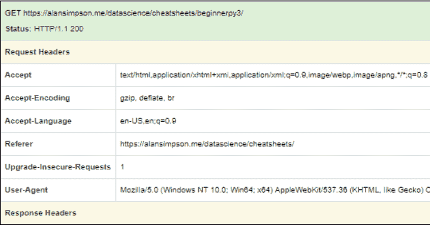

图 12-4：HTTP headers。

### 表 12-1：常见状态码

| 代码 | 含义 | 原因 |
| :--- | :--- | :--- |
| 200 | Okay | 一切顺利。 |
| 400 | Bad Request | 请求有误。 |
| 403 | Forbidden | 不允许访问。 |
| 404 | Not Found | URL 不存在。 |
| 500 | Internal Server Error | 服务器遇到错误。 |

### 表 12-2：urllib 包

| 包 | 目的 |
| :--- | :--- |
| request | 打开 URL |
| response | 处理响应 |
| error | 处理异常 |
| parse | 分析 URL |
| cookie | 处理 Cookie |
| robotparser | 处理 robots.txt |

```python
from urllib import request
# 目标页面的 URL（地址），
sample_url = 'https://free.ai/sample.html'
# 请求页面并将其放入名为 page 的变量中。
the_page = request.urlopen(sample_url)
# 将响应码放入名为 status 的变量中。
status = the_page.code
```

## 页面的数据类型是什么？

print(type(the_page))

## 状态码是什么？

print(status)

```
运行此代码将显示输出：
```

<class 'http.client.HttpResponse'>

200

```
变量 `the_page` 包含一个 `http.client.HttpResponse` 对象，它是服务器对请求返回的所有内容。200 是告诉你一切顺利的状态码。

## 页面的数据类型是什么？

print(type(the_page))

## 状态码是什么？

print(status)

```

当你运行这段代码时，情况可能并不顺利。你可能会看到几条错误信息，但最重要的信息是：

```
HTTPError: HTTP Error 403: Forbidden
```


错误并不是源于你的代码编写，而是一个 HTTP 错误。具体来说，它是 403 Forbidden（禁止）错误。URL 已发送给 Google，但它回复：“抱歉，你可以从这里搜索我们的网站，但不能通过这样的 Python 代码（Sorry, you can search our site from your, but not from Python code like that）。”

好消息是，那些不允许你直接使用 Python 或其他编程语言发布内容的网站，通常允许你通过它们的 API（应用程序编程接口）发布内容。你仍然可以使用 Python 作为你的编程语言，你只需要遵守它们的规则。

## 使用 Python 爬取网页

当你从网络请求页面时，它通常以网页的形式交付给你，通常由 HTML 和内容组成。HTML 是一种标记代码，配合另一种名为 CSS 的语言，告诉浏览器如何根据尺寸、位置、字体、图像以及所有其他视觉和样式问题显示内容。在网页浏览器中，你看不到 HTML 或 CSS 代码。你只能看到内容，而这些内容通常包含在页面 HTML 代码块中。

即使你在网页上看到的大部分数据来自数据库，你也没有权限直接访问数据库。但是，你可以使用一种名为“网页爬取”（web scraping）的技术从网页中提取数据并用于其他用途。Python 具有强大的网页爬取能力，这是大多数人想要学习的热门话题。因此，我们将使用图 12-5 中的示例页面作为工作示例，开始学习网页爬取。

## Python 3 速查表

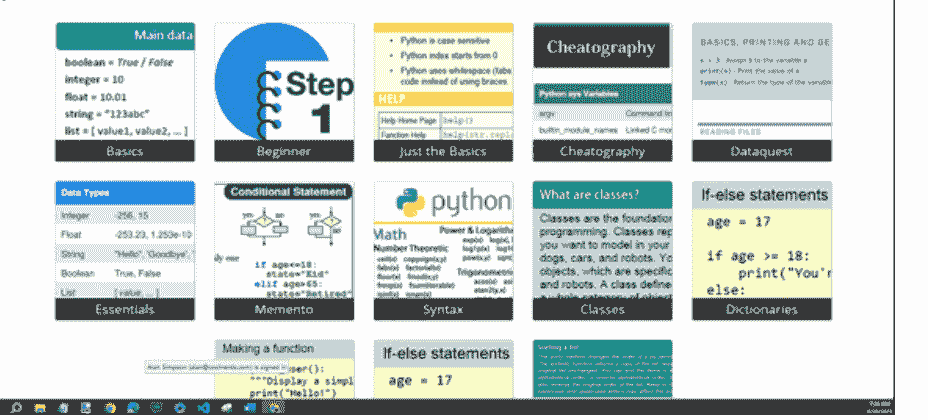

网页爬取示例。告诉浏览器如何显示该页面内容的代码在浏览器中是不可见的，除非你查看源代码。在大多数浏览器中，你可以通过按下 F12 键或在页面空白处点击右键并选择“查看源代码”或“检查”或其他选项来实现。在大多数页面上，真实内容——你在浏览器中看到的内容——是 `<body>` ... `</body>` 标签。在页面主体内，可能会有头部、导航栏、页脚、可能的广告等部分。在该特定页面中，内容的精华位于 `<article>` ... `</article>` 标签之间。你在网页上看到的每个方块 [图 12-5] 都被称为“卡片”（card），每个卡片都定义在 `<a>` ... `</a>` 标签中。

[图 12-6] 显示了页面 [图 12-5] 的部分 HTML 代码。我们展示了页面中前两个链接的代码，但所有的链接都遵循相同的结构，并且它们都包含在由 `<article>` ... `</article>` 标签指定的区域内。

在 Python 代码中，你需要三个模块：来自 `urllib` 的 `request` 模块，允许你向网络请求资源并读取网络返回的内容。这是 Python 自带的标准模块之一，因此你不需要获取任何新东西。

对于网页爬取，你还需要 BeautifulSoup（它的名字来源于《爱丽丝梦游仙》书中的歌）。该模块提供了解析检索网页的工具，用于提取感兴趣的特定数据项。Python 已经可用，但你必须使用 `pip` 安装它。在 VS Code 中，进入“终端”（Terminal）面板。如果你使用的是 Windows，输入此命令：

```bash
pip install beautifulsoup4
```

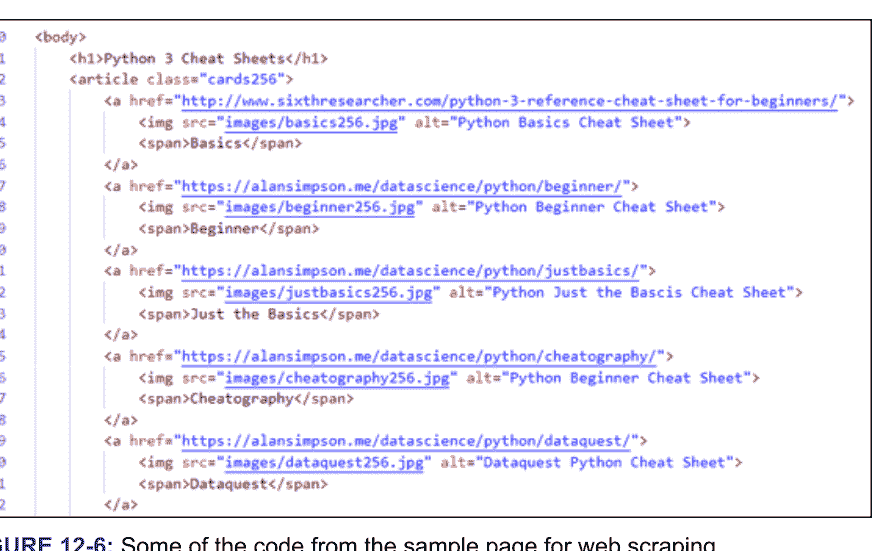

你应该会在屏幕上看到一些反馈，表示 BeautifulSoup 已找到并安装。或者，如果你之前安装过，你会看到一条消息，显示要求已满足。无需担心。

你还需要一个 HTML5 解析器。你可以使用 `html5lib`，这是另一个你现在就可以安装的模块。如果你使用的是 Windows，在 VS Code 的终端面板中输入此命令：

```bash
pip install html5lib
```

如果你在 Mac 上遇到错误，请在 VS Code 的终端面板中使用此命令：

```bash
pip3 install html5lib
```

要尝试代码，请在 VS Code 中创建一个 .py 文件并输入以下代码：

```python
# 从 url 库获取 request 模块
from urllib import request

## 这个具有爬取网页的方便工具
from bs4 import BeautifulSoup
```

接下来，你需要告诉 Python 所感兴趣的页面在互联网上的位置。在这种情况下，URL 是：

```python
https://freeasy.ai/scrape_sample.html
```

要查看页面，像往常一样将 URL 输入浏览器的地址栏。在浏览器中，页面看起来就像任何带有图片的普通网页。这是因为浏览器显示的是渲染后的页面，而不是原始的 HTML 和 CSS 代码。要爬取页面，你需要将其放入 Python 代码中。你可以给它起一个短名称，如 `page_url`：

```python
page_url = 'https://freeasy.ai/scrape_sample.html'
```

```python
links_list.append({'url' : url, 'img': img, 'text': text})
```

如果数据缺失，我们更希望 Python 直接跳过错误行并继续运行，而不是崩溃并导致我们没有任何任何数据。我们应该将获取各个部分的整个操作放在一个 `try:` 块中，如果执行失败，它允许 Python 直接跳过该行并移动到下一行：

```python
## Try to get the href(href), image url, and text.
try:
    url = link.get('href')
    img = link.img.get('src')
    text = link.span.text
    links_list.append({'url' : url, 'img': img, 'text': text})
# 如果该行缺少任何内容...
except AttributeError:
    #.. 跳过它，不要让崩溃。
pass
```

**图 12-7** 显示了目前所有的代码。如果你按照所示运行它，`link_list` 将填充你爬取的所有数据，但这对你来说并没有太大帮助。很有可能，你想要保存这些数据以备在其他地方使用。你可以通过将数据保存到 JSON 文件、CSV 文件或两者，取决于对你来说最方便。在接下来的章节中，我们将向你展示这两种方法。

```python
## 从 url 库导入 request 模块。
from urllib import request

## 这个包含了方便的工具。
from bs4 import BeautifulSoup

## 用于练习的示例页面。
page_url = 'https://freeasy.ai/scrape_sample.html'

## 打开该页面
raw_page = request.urlopen(page_url)

## 从 html 页面创建一个 BeautifulSoup 对象。
soup = BeautifulSoup(raw_page, 'html5lib')

## 隔离主内容块。
content = soup.article

links_list = []

## 遍历文章中所有的链接。
for link in content.find_all('a'):
    # 尝试获取 href、图像 url 和文本。
    try:
        url = link.get('href')
        img = link.img.get('src')
        text = link.span.text
        links_list.append({'url': url, 'img': img, 'text': text})
    # 如果该行缺少任何内容...
    except AttributeError:
        # ... 跳过它，不要让崩溃。
        pass
```

图 12-7：网络爬虫代码完成。

通过编程访问网络为获取和组织知识开辟了新的可能性，事实上，它是一个被称为数据科学领域的一部分。

# 第 13 章

## 库、包和模块

## 本章内容

- 理解标准库
- 概览 Python 包
- 查看如何导入 Python 模块

在大多数情况下，在这一章之前的所有章节都集中在 Python 核心语言上，即根据你打算如何使用 Python 所需要的语言元素。但正如你所看到的，许多程序都是从导入一个或多个模块开始的。每个模块本质上都是预写代码的集合，你可以在自己的代码中使用它们，而无必重新发明轮子。所有这些预写专门代码的“祖师”被称为 Python 标准库。

## 理解 Python 标准库

Python 标准库基本上是你在获取 Python 语言时获得的所有内容，包括所有的 Python 数据类型，如字符串、整数、浮点数和布尔值。这些数据类型的每个实例都是标准库中定义的类的实例。由于由于原因，type（类型）、instance（实例）和 object（对象）这些术语经常互换使用。整数是一个整数；它在 Python 中也是一种数据类型。但它的存在是因为标准库包含一个整数类，而你创建的每个整数都是该类的实例，因此是一个对象（因为类是被称为对象的物的模板）。

Python 中的 `type()` 函数通常识别一段数据的类型。例如，在 Python 提示符、Jupyter notebook 或 .py 文件中运行这两行代码：

```python
x = 3
print(type(x))
```

输出为：

```
<class 'int'>
```

输出告诉你 `x` 是一个整数，是标准库中 `int` 类的实例。运行这段代码：

```python
x = 'howdy'
print(type(x))
```

产生此输出：

```
<class 'str'>
```

也就是说，`x` 包含的是字符串数据类型的数据，由 Python `str` 类创建。`type()` 函数也适用于浮点数（带有小数点的数值，例如 3.14）和布尔值（True 或 False）。

## 使用 dir() 函数

Python 标准库提供了一个 `dir()` 方法，它可以显示与类型相关的所有属性的列表。例如，在前面的示例中，结果 `<class 'str'>` 告诉你 `str` 数据类型。所以你知道这是一个类型，因此是一个名为 `str`（代表字符串）的类的实例。如果你输入此命令：

```python
dir(str)
```

会显示类似这里的内容：

| '__add__', '__class__', '__contains__', '__delattr__', '__dir__', |
| '__doc__', '__eq__', '__format__', '__ge__', '__getattribute__', |
| '__getitem__', '__getnamed__', '__hash__', '__init__', |
| '__subclass__', '__iter__', '__len__', '__lt__', |
| '__mod__', '__mul__', '__new__', '__reduce__', |

python `capitalize` 链接了许多不同的资源，用于学习 `str` 对象的 `capitalize` 函数，包括用法示例。如果你正在使用 AI（无论是 Copilot、Bard、ChatGPT 还是其他工具），你都可以寻求帮助和示例。例如，尝试输入“告诉我关于 Python str.capitalize()”或类似的内容。

Python 标准库的一个很好的（尽管是技术性的）资源是标准库文档本身。这些信息始终可以在 [https://docs.python.org/](https://docs.python.org/) 获取，通常位于“Library Reference”链接下。尽管措辞可能会发生，如果有疑问，只需在网上搜索 python standard library 即可。注意，该库非常庞大且技术性强，因此不要期望上手就能理解它。相反，将其作为一个持续的资源，随着你对 Python 知识的积累，学习你感兴趣的内容。

## 探索内置函数

`dir()` 和 `help()` 都是 Python 内置函数的示例，在 Python 中、你创建的任何应用程序以及 Python 命令行提示符中始终可以使用它们。这些内置函数也是标准库的一部分。事实上，如果你在网上搜索 built-in functions，某些搜索结果将直接指向 Python 文档。点击这些结果中的一个将打开标准库文档的一个章节，并显示所有内置函数的表格，如图 13-1 所示。在该上，你可以点击任何函数的名称以了解更多信息。

## 内置函数

Python 解释器内置了许多始终可用的函数和类型。它们按字母顺序在这里列出。

| A | L | R |
|---|---|---|
| abs() | enumerate() | range() |
| iter() | list() | repr() |
| eval() | locals() | reversed() |
| any() | | |()() |
| ascii() | map() | set() |
| float() | memoryview() | setattr() |
| bin() | min() | slice() |
| bool() | | hex() |

## 探索 Python 包

Python 语言支持模块化编程，在这种情况下，程序被分解为更小、更于管理的组件和模块。其中某些组件可能由其他人创建，并可以重复使用。

任何大型项目，无论你是独立工作还是团队成员，如果某些组件可以使用 Python 编程社区成员已经编写、测试、调试并认为可靠的代码，就可以被简化和精简。你听到的关于 Python 的包是某种代码——经过开发和培养、值得信赖，且足够通用，可以作为大型项目组件使用的代码。

Python 有数以万计的包。寻找包的一个很好的资源是 PyPI，这是一个聪明且易于记忆的名字，是 Python Package Index（Python 包索引）的缩写。你可以查看它 [https://pypi.org/](https://pypi.org/)。

此外，一个名为 `pip`（Pip Install Packages 的含义，另一个聪明的名字）的程序是一个包管理器，你可以用它来探索、更新和删除系统中的现有包。


要使用 `pip`，你必须进入操作系统的命令行提示符，在 Mac 上是 Terminal，Windows 上是 cmd.exe 或 PowerShell。如果你使用 VS Code，进入命令行提示符最简单的方法是打开 VS Code 并选择 ⇒ Terminal。

如果你已经安装了 `pip`，在命令行提示符中输入此命令将告诉你是安装了哪个版本的 `pip`：

```
pip --version
```

如果你使用的是 Mac 并收到“command not found”错误，你需要在所有命令中使用 `pip3` 替换 `pip`。例如，使用：

```bash
pip3 --version
```

结果看起来真的像这样（但会显示你的版本号，以及 Python 的路径代替省略号 `[...]`）：

```
pip 23.1.2 from ...
```

要查看你已经安装了哪些包，在 Windows 的操作系统命令行提示符或 VS Code 的 Terminal 面板中输入：

```bash
pip list
```

或者在 Mac 上，如果使用 `pip` 报错，请使用 `pip3` 替换 `pip`：

```bash
pip3 list
```

## 导入 Python 模块

你会听到模块在 Python 中的用法。

Python 语言支持模块化编程，在这种情况下，程序被分解为更小、更易管理的组件和模块。

要使用 `pip`，你必须进入操作系统的命令行提示符，在 Mac 上是 Terminal，Windows 上是 cmd.exe 或 PowerShell。如果你使用 VS Code，最简单的方法是选择 ⇒ Terminal。

如果你已经安装了 `pip`，在命令行提示符中输入此命令将告诉你是安装了哪个版本的 `pip`：

```bash
pip --version
```

如果你使用的是 Mac 并收到“command not found”错误，你需要在所有命令中使用 `pip3` 替换 `pip`。例如，使用：

```bash
pip3 --version
```

结果看起来真的像这样（但会显示你的版本号，以及 Python 的路径代替省略号 `[...]`）：

```
pip 23.1.2 from ...
```


要查看你已经安装了哪些包，在 Windows 的操作系统命令行提示符或 VS Code 的 `Terminal` 面板中输入：

```bash
pip list
```

或者在 Mac 上，如果使用 `pip` 报错，请使用 `pip3` 替换 `pip`：

```bash
pip3 list
```


# 第 14 章

# Python 的十个核心方面

本章内容

- 编写“Python 化”（Pythonic）的代码
- 理解语法的重要性
- 复用他人的工作让你的编码更轻松

能够使用 Python 编程对于工程、科学和商业领域的现代工作者来说是一项非常重要的技能。许多用于人工智能 (AI)、数据科学、数据分析以及控制设备和机器人的新工具都使用了 Python。Python 正在迅速成为人们首选的编程语言。在本章中，我们将介绍 Python 的十个最核心的方面。

## Python 化（Being Pythonic）

Python 语言易学难精。在 Python 语言中变得精练且高效的道路在于实践。你写的代码越多，写代码的能力就越强。在 Python 中，仅仅让程序运行起来是不够的——如何实现它同样重要。这就是我们所谓的“Pythonic”。如果你的 Python 代码难以阅读且复杂，那么你并不 Pythonic。

Python 的设计初衷是为了让你写出清晰的代码。清晰的代码并不意味着简洁——它可能有更多的语句——但代码的流程和意图将是一目易见的。

> 记住：美胜于丑。显式优于隐式。简单胜于复杂。可读性很重要。这些都是编写 Pythonic 代码的一些规则。

## 理解缩进的重要性

Python 使用缩进来显示代码的控制和结构。为什么要用缩进而不是大括号？为了消除冗余（你用大括号时已经在缩进了！）并让代码更整洁。听起来非常 Pythonic！过了一段时间，使用缩进将成为你的本能。

> 提示：哦，为了引发一个真正的争议点，我们建议使用空格而不是制表符（tabs）来进行缩进！养成这个习惯。

## 理解 Python 语法

Python 语言在整个语言中的语法流非常一致。掌握基本语法（见第 3 章）将以自然的方式开启 Python 语言的大门。

## 欣赏 Python 变量的灵活性

Python 变量可以包含任何内容。它们不像 C 语言那样是强类型的（例如，你将 C 变量声明为整数）。相反，它们是动态类型的。换句话说，Python 变量可以是你希望它成为任何类型。在对变量进行数学运算时，记住这一点很重要——你不能将整数加到字符串变量上。

## 将列表视为你的朋友

列表是 Python 中最重要的复合数据类型。它们允许你同时存储和操作整个一组项。理解和使用列表是进入 Python 在 AI、机器人和数据科学领域某些最重要应用的关键入口。

## 控制你的程序

Python 程序不仅仅是沿着代码列表单向运行的。编程应用程序需要你对如何处理数据做出决策（`if` 语句）、执行操作的次数（`for` 和 `while` 语句）以及如何遍历列表变量中的所有数据。

## 理解 Python 函数

组织你的代码并复用 Python 代码段是非常 Pythonic 的，而且对于提高你的编码效率和清晰度非常有帮助。如果你在代码中多处执行相同的操作，那么将代码放入函数中更好，这样当你需要更改它时，只需要查看一个地方。这种方法也让你的代码更易于阅读和维护。

## 解决错误

对于初学者来说，Python 最令人恼的方面之一是其默认错误报告相对晦涩。幸运的是，有很多方法可以提高你代码生成的错误的可读性，以及 Python 本身生成的错误的可读性。理解异常和错误将极大提升你的 Python 体验。

## 使用他人的模块

如果没有庞大的程序员社区生成可以供你导入 Python 并在程序中使用的模块，Python 将一无是处。有成千上万个编写好的模块可以帮助你的应用程序。需要矩阵数学？那里有。需要处理图像？那里有。想尝试做机器学习？那里有。而且大多数模块都有良好的文档记录且易于使用。

## 遇到问题时使用网络和 AI

当你学习 Python 时候，以及当你实际开发应用程序时，网络搜索和 AI（如 ChatGPT 和 Microsoft Copilot）都是你最好的朋友。它们是你为你自己的应用程序执行特定任务的示例和文档的绝佳来源。使用它们吧。你并没有被 AI 工具取代——你只是在编程时变得更高效了。

# 索引

# 符号

- `>>>` 提示符, 12, 14, 26
- `(加法)运算符`, 32
- `=` (赋值)运算符, 35, 40, 78
- `{` (大括号), 87
- `/` (除法)运算符, 32
- `“` (双引号), 31, 34
- `==` (等于)运算符, 33, 40, 64
- `>` (大于)运算符, 33, 64
- `>=` (大于或等于)运算符, 33, 64
- `-` (连字符), 30
- `<` (小于)运算符, 33, 64
- `<=` (小于或等于)运算符, 33, 64
- `*` (乘法)运算符, 32
- `!=` (不等于)运算符, 33, 64
- `%` (百分号), 49
- `+` (加号), 50–51
- `#` (井号), 29
- `'` (单引号), 31, 34
- `[]` (方括号), 26, 78, 134
- `-` (减法)运算符, 32
- `"""` (三引号), 29
- `_` (下划线), 34

# A

- `<a>` 标签, 156, 157
- `a` (Append), 119
- `abs()` 函数, 42, 43
- `action`, 运算符, 63–64, 171
- 向列表添加项, 78
- AI (人工智能), 7–8, 172
- 对齐, 格式化, 49
- 列表字母排序, 82–83
- 美国信息交换标准 (ASCII), 53, 151
- `and` 运算符, 33, 64
- Append (a), 119
- `append()` 方法, 78, 84, 86–87
- 附加文件, 125
- 应用程序, 关于, 27–40
- 构建, 27–28
- 数据类型, 30–32
- 算术运算符, 32
- 参数的, 97–99
- 人工智能 (AI), 7–8, 172
- ASCII (信息交换标准), 53, 151
- `=` (赋值运算符), 35, 40, 78

# B

- `b` (二进制), 119
- 数字, 49–50
- `bin()` 函数, 43
- 二进制文件, 关于, 117–118
- 拷贝, 126–127
- Boolean 运算符, 33, 64
- 布尔 (数据类型), 31–32
- `break` 语句, `for` 循环和, 71
- 内置函数, 43–63–64
- 内置方法, 54–55

# C

- 使用函数计算, 42–43
- 调用函数, 89
- 大写敏感, 25–34
- 修改列表中的项, 78
- JSON 数据, 140–141
- ChatGPT, 8
- Chrome 商店, 147
- Claude, 8
- `clear()` 方法, 81, 84, 86–87
- 清空列表, 81
- 客户端, 146
- `close()` 方法, 120
- 关闭文件, 20, 118
- 代码, 上下文, 120
- 创建文件夹, 15–16
- 在代码中创建变量, 35
- 调试, 16–17, 19–20
- 定义, 5
- 编辑, 16–17
- 保存, 17–18
- 类型, 16–20
- 编写, 17
- 使用人工智能 (AI), 7–8
- 代码编辑器, 16
- 合并列表, 79
- 逗号分隔值 (CSV), 131
- 命令, 输入, 12–13
- 注释函数, 91
- 注释, 多行, 29
- 使用和使用, 28–29
- 比较运算符, 33, 63, 64
- 字符串拼接, 50–52
- 条件表达式, 67–68
- 上下文编码, 120
- 重启循环, 73–74
- 约定, 39
- 将 Excel 日期转换为 JSON 日期, 135–137
- `copy()` 方法, 83–84, 86–87
- 拷贝二进制文件, 126–127
- 列表, 83–84
- `count()` 方法, 81, 84, 85
- 统计列表频率, 81
- Create (x), 119
- 创建应用程序, 27–40

数据类型
- 布尔值 (Booleans), 31–32
- 数字 (numbers), 30
- 字符串 (words), 31
- 日期 (dates)
  - 关于, 41, 56
  - 操作, 56–60
  - `datetime` 模块,
- 调试代码, 16–17, 19–20
  - 决策制定
  - 比较运算符, 64
  - 使用 `if`, 64–68
- `def` 语句, 91
  - 默认值，使用定义可选参数, 94
- 反序列化, 132
- 确定指针位置, 125
- 字典，从中删除数据, 141–142
- `dir()` 函数, 160–162, 166, 167
- 目录 (directories)。见 folders
- 除法 (`/`) 运算符, 32
- 文档字符串 (docstring), 91
- 金额，显示, 47–48
- 点 (period), 30
- 双引号 (`""`), 31, 34
- 将 Python 数据转储为 JSON, 142–144
- `dumps()` 方法, 141–144
- 双下线命名项 (dunder-named items), 161

# E
- 易用性, 169–170
- 彩蛋 (Easter egg), 21–23
- 编辑代码, 16–17
- 编辑器 (editor), 5
- 元素, 21–23
- `else` 块, 111–115
- `else if`, 65–67
- 加密数据, 146
- 输入命令, 12–13
- 等于 (`==`) 运算符, 33, 40, 64
- 错误处理
  - 关于, 103–108, 171
  - 添加 `else` 块, 111–113
  - `else` 代码, 113–115
  - `except` 代码, 113–115
  - `finally` 代码, 113–115
  - 防止应用崩溃, 110–111
  - 抛出异常, 115–116
  - 特性, 108–110
  - `try` 代码, 113–115
- 错误包 (error package), 149
- Excel 日期，转换为 JSON 日期, 135–137
- `except` 代码, 113–115
- 异常 (exceptions)。见错误处理
- 退出帮助, 15
- Explorer 图标, 17
- 表达式 (expression), 46
- `extend()` 函数, 79
- `extend()` 方法, 84, 86–87
- Python 扩展, 7
- 外部文件
  - 关于, 117
  - 二进制文件, 117–118, 126–127
  - 关闭, 118–120
  - 拷贝二进制文件, 126–127
  - 遍历, 122–126
  - 打开，读取二进制文件, 126–127
  - 读取内容, 120–122
  - 文本文件, 117–118

# F
- 文件 (files)。也见外部文件
  - 应用, 27–28
  - 关闭, 20
  - `finally` 代码, 113–115
  - `find_all` 方法, 156
- 查找
  - 列表长度, 78
  - 列表项索引, 81–82
- 变量的灵活性, 170
  - `float()` 函数, 43
  - 浮点数 (floats), 30
- 文件夹 (folders)
  - 关于, 117
  - 为代码创建, 15–16
- `for` 循环 (`for loop`)
  - 与 `break` 语句, 70
  - 与 `continue` 语句, 71
  - 与列表, 69, 77
  - `format()` 函数, 43
- 格式化字符串 (`f-strings`), 46–47, 58, 60
- 格式化 (formatting)
  - 对齐, 49
  - 使用格式化字符串 (`f-strings`), 46–47
  - 数字, 46–49
    - 百分数字, 48–49
    - 宽度, 49
- 列表计数频率, 81
  - 来自 `from` 命令, 167
- 函数 (functions)。也见方法
  - 关于, 171
- `abs()`, 42, 43
- `alphabetize()`, 99–100
- `bin()`, 43
- 内置 (built-in), 43, 163–164
- 使用计算数字, 42–43
- 调用, 89
- 注释, 91
- 创建, 90–91
- `dir()`, 160–162, 166, 167
- `extend()`, 79
- `float()`, 43
- `format()`, 43
- `hello()`, 90, 91, 93, 95
- `help()`, 162–163, 166, 167
- `hex()`, 43
- `int()`, 43
- `len()`, 52, 78, 87
- `math()`, 44–46
- `max()`, 43
- `min()`, 43, 53
- 嵌套, 43
- 传递信息, 92–99
- 传递多个值, 94–96
- `print()`, 49, 53, 59, 76–77, 92, 93, 108, 119, 124, 142, 166–167
- 返回值, 99–101
- `round()`, 43
- `sqrt()`, 44, 167
- `str()`, 43
- `type()`, 43, 61, 160
- `get()` 方法, 156–157
- `GET` request, 148
- GitHub Copilot, 8–10
- Google Chrome, 147
- Google Firebase, 129, 131
- 大于 (`>`) 运算符, 33, 64
- 大于等于 (`>=`) 运算符, 33, 64
- `help()` 函数, 90, 91, 93, 95
- `help`
  - 内置, 13–14
  - 退出, 15
  - 在线, 15
- 连字符 (`-`), 30

# I
- 图标 (icons)
  - 解释, 2
  - Explorer, 17
- `if` 语句
  - 关于, 64–65
  - `else...if`, 65–67
- 导入模块, 165–168
- 缩进 (indentations), 23–24, 170
- 列表项的索引, 81–82
- `index()` 方法, 81–82, 84
- 初始值, 32
- `insert()` 方法, 78, 84, 86–87
- 将项插入列表, 78
- 安装
  - Python, 6–7
  - Python 扩展, 7
  - Visual Studio (VS) Code, 6–7
- `int()` 函数, 43
- 整数, 30
- 交互模式 (Interactive mode)
  - 关于, 11
  - 输入命令, 12–13
  - 退出帮助, 15
- 解释器 (interpreter), 12
- 打开 Terminal 窗口, 12
- 在线搜索帮助, 15
- 互联网 (Internet)
  - 关于, 145–146, 172
- 从 Python 打开 URLs, 148–151
- 使用 Python 发布, 151–152
- 存储解析内容, 156–158
- 统一资源定位符 (URL), 146–147
- 使用 Python 网络爬虫, 152–155
- 解释器, 5, 12

# J
- JavaScript 对象格式 (JSON) 数据
  - 关于, 129
  - 更改, 140–141
  - Excel 日期转换为 JSON 日期, 135–137
  - 将 Python 数据转储为, 143–144
  - 从 JSON 文件加载, 133–143
  - 从 字符串加载键 JSON 数据, 139–140
  - 从 字符串加载未键 JSON, 137–139
  - 组织, 130–131
- 从字典删除, 141–142
- 序列化, 132–133

# K
- 关键字参数 (`kwargs`), 96–97

# L
- `len()` 函数, 52, 78, 87
  - 长度
  - 列表查找, 78
  - 字符串查找, 32
  - 小于 (`<`) 运算符, 33, 64
  - 小于等于 (`<=`) 运算符, 33, 64
--  (libraries)
  - 关于, 159
  - Python 标准库, 159–164
- 列表 (lists)
  - 关于, 75–76, 171
  - 向末尾添加项, 78
  - 字母排序, 82–83
  - 更改列表中的项, 78
  - 清空, 81
  - 合并, 79
  - 拷贝, 83–84
  - 统计实例, 81
  - 查找项的索引, 81–82
  - 查找长度, 78
  - 插入项到列表中, 38
  - 查找项, 77
  - 与 `for` 循环, 69, 77
  - 遍历, 77
  - 操作方法, 84
  - 按位置引用项, 76–77
  - 从中删除项, 79–80
  - 反转, 83
  - 排序, 82–83
- 字面量部分 (literal part), 46
- `load()` 方法, 137–139
- 加载
  - 从 JSON 文件, 133–142
  - 从 字符串加载键 JSON 数据, 139–140
  - 从 字符串加载未键 JSON, 137–139
- 局部作用域, 92
- 逻辑运算符, 64
- 循环 (loops)
  - 与 `break` 语句, 74
  - 退出, 70
  - 与 `continue` 语句, 71
  - 嵌套, 71–72
  - 通过文件, 122–126
  - 通过列表, 69, 77
  - 数字范围, 68–69

# M
- 魔法方法 (magic methods), 161
- 操作 (manipulating)
  - 变量, 35–37
  - 字符串 (strings), 50–55
  - 使用方法, 53–55
- 格式化, 129
- 数学函数, 44–46
- `max()` 函数, 43
- 方法 (methods)。也见函数
  - 内置, 54–55
  - `clear()`, 81, 84, 87
  - `close()`, 120
  - `copy()`, 83–84, 86–87
  - `count()`, 81, 84, 85
  - `dumps()`, 141–144
  - `extend()`, 84, 86–87
  - `find_all`, 156
  - `get()`, 156–157
  - `index()`, 81–82, 84
  - `insert()`, 78, 84, 86–87
- 使用字符串操作, 53–55
  - `now()`, 59
  - `open()`, 119, 133
  - `pop()` 方法, 80, 84, 86–87
  - `read()`, 120–122, 126–127
  - `readlines()`, 120–122, 123–125, 126–127
  - `remove()`, 79–80, 84, 86–87
  - `reverse()`, 83, 84, 86–87
  - `seek()`, 125–126
  - `tell()`, 125
  - `today()`, 56–57
  - `update()`, 87
- 操作列表, 84
- Microsoft Copilot, 8
- `min()` 函数, 43, 53
- 模块 (modules)
  - 关于, 24–26, 159, 172
  - 导入, 165–168
- 移动指针, 125–126
- 多行注释, 29
- 乘法 (`*`) 运算符, 32

# N
- 命名 (naming)
  - 规范, 39
  - 变量, 34
- 嵌套 (nesting)
  - 函数, 43
  - 循环, 71–72
- 不等于 (`=`) 运算符, 33, 64
- `not` 运算符, 33, 64
- `now()` 方法, 59
- 数字 (numbers)
  - 关于, 41
  - 基数, 49–50
  - 使用函数计算, 42–43
  - 作为数据类型, 30
  - 格式化, 46–49
  - 遍历范围, 68–69
  - 数学函数, 44–46
  - 百分比, 48–49

# O
- 面对象编程 (OOP), 23
- `open ()` 方法, 119, 133
- 打开 (opening)
  - 应用文件, 27–28
  - 文件, 118–120
  - Terminal 窗口, 12
  - 从 Python 打开 URLs, 148–151
- 运算符 (operators)
  - 关于, 32
  - 算术, 32
  - 布尔值, 33
  - 比较, 33
  - 用于控制动作, 63–64
  - 序列, 53
  - 字符串, 52–53
- `or` 运算符, 33, 64
- 组织 JSON 数据, 130–131
- 覆盖文件, 125

# P
- 包包管理器 (package manager), 164–165
- 包 (packages), 159, 164–165
- 参数 (parameters)
  - 关于, 42
  - 使用默认值定义, 94
  - 存储解析内容, 156–158
- 传递 (passing)
  - 任意数量的参数, 97–99
  - 向函数传递信息, 92–99
  - 向函数传递多个值, 94–96

井号 (`#`), 29
防止应用程序崩溃, 110–111

`print()` 函数, 49, 53, 59, 76–77, 79, 92, 93, 108, 119, 124, 134, 142, 166–167, 168

程序员注释。参见 comments.py 文件，创建, 16–17
PyPi, 164

Python

- 核心方面, 169–172
入门, 3–4
安装, 6–7
安装扩展, 7
极性, 4
版本, 4–5

Python 数据，转为 JSON, 142–144
Python 增强提议 (PEP), 23
Python 标准库

- 关于, 159–160
内置函数, 163–164
`dir()` 函数, 160–162
`help()` 函数, 162–163

Pythonic，具备, 169–170

# R

`r` (读), 118–119
`r+` (读/写), 119
抛出异常, 115–116

`ranges`，在数字中循环, 68–69

读 (`r`), 118–119

`read()` 方法, 120–122, 126–127

读取

- 二进制文件, 126–127
- 文件内容, 120–122
- `readline()` 方法, 120–122, 123–125, 126–127
- `readlines()` 方法, 120–122, 123, 126–127
- 读/写, 119
- 实时数据库 (Realtime Database), 129, 131
- 通过位置引用项, 76–77
- 关系运算符, 63, 64
- 记忆图标, 2
- `remove()` 方法, 79–80, 84, 86–87
- 从字典中删除数据, 141–142
- 列表项, 79–80
- `request` 包, 149
- `response` 包, 149
- 使用 `continue` 语句重启循环, 73–74
- 从函数返回返回值, 99–101
- `reverse()` 方法, 83, 84, 86–87
- 反转列表, 83
- `robotparser` 包, 149
- `round()` 函数, 43

在 VS Code 中运行应用程序, 37–38
在 VS Code 中使用 Python, 18–19

# S

保存关于, 37
代码, 17–18

搜索列表, 77
在线帮助, 15

`seek()` 方法, 125–126
序列运算符, 53
序列化, 132–133

服务端, 146
集合 (sets)，操作, 87–88
显示美元金额, 47–48
单引号 (`''`), 31, 34

`sort()` 方法, 82–83, 84, 86–87
排序列表, 82–83
源代码, 153

特殊变量, 161
关于异常的特殊性, 108–110
`sqrt()` 函数, 44, 167

方括号 (`[]`), 26, 78, 87, 134
Stack Overflow, 15

存储解析后的内容, 156–158

`str()` 函数, 43

`str` 对象, 53–55

字符串拼接, 50–51

strings。参见 words (strings)

减法运算符 (`-`), 32

语法

- 关于, 21–23, 170
- 语法重要性, 38–40
- 语法图, 25–26
- 语法规则, 39

# T

`t` (文本), 119

`tell()` 方法, 125

终端面板 (Terminal pane), 12, 18–19

三元运算, 67–68

文本, 41

Text (`t`), 119

文本文件, 117–118

时间

- 关于, 56
- 计算时间跨, 60–61
- 时间跨，计算, 60–61
- 提示图标, 2

`today()` 方法, 56–57

三引号 (`""""` 或 `""`), 29
`try` 代码, 113–115

`try.except` 块, 107–108

元组 (tuples), 75, 85–87

`type()` 函数, 43, 61, 160

编写代码, 16–20

# U

下划线 (`_`), 34

统一资源定位符 (URL)

- 关于, 146–147
从 Python 打开, 148–151
`update()` 方法, 87

URL 库 (`urllib`), 148–151

用户 (user), 146

# V

值

- 传递给函数, 94–96
- 从函数返回, 99–101

变量

- 关于, 34
- 创建, 16
- 灵活性, 170
- 赋值, 35
- 命名, 34
- 在 VS Code 中运行, 37
- 保存, 37
- 特殊, 161

Visual Studio Code

- 安装, 7
- 运行应用程序, 37–38

# W

`w` (写), 119

- `while` 循环, 72
- 格式化, 54
- 单词 (words), 53

- 连接, 55

- 爬虫, 157
- GitHub, 147
- Python, 149
- Google, 118
- IBM, 110
- Instagram, 110
- LinkedIn, 146
- 管理, 117
- Microsoft, 148
- 网络, 146
- 在线, 15
- 其他, 115
- Pinterest, 114
- Pi, 164
- 编程, 49
- 机器人, 149
- 资源, 15
- 搜索, 77
- 服务, 146
- 站点, 110
- 网站, 118
- 源代码, 153
- 存储, 156
- 系统, 117
- 技术, 117
- 工具, 117
- 类型, 53
- 版本, 4–5
- 视频, 110
- 视图, 110
- 方式, 110
- 用户, 110
- Web, 110
- 网页, 110
- 工作, 110
- 编写, 119
- 世界, 119
- YouTube, 119

# Z

- 应用程序, 110
- 浏览器, 110
- 云端, 110
- 代码, 110
- 数据, 110
- 开发, 110
- 编辑器, 110
- 功能, 110
- 文件, 110
- 函数, 110
- 游戏, 110
- 帮助, 110
- 灵感, 110
- 接口, 110
- JSON, 110
- 列表, 110
- 循环, 110
- 手机, 110
- 模型, 110
- 笔记, 110
- 打开, 110
- 模式, 110
- 手机, 110
- 图片, 110
- 质量, 110
- 阅读, 110
- 真实, 110
- 资源, 110
- 运行, 110
- 脚本, 110
- 搜索, 110
- 服务, 110
- 站点, 110
- 软件, 110
- 源, 110
- 存储, 110
- 标签, 110
- 工具, 110
- 测试, 110
- 用户, 110
- 变量, 110
- 视频, 110
- 视图, 110
- 方式, 110
- Web, 110
- 网站, 110
- 网页, 110
- 与, 110
- 内部, 110
- 工作, 110
- 工作的, 110
- 世界, 110
- 编写, 110
- 缩放, 110
```
