# Python 入学者指南：1周学会 Python 速成指南（编码、编程、Web 编程、程序员）

## 引言

感谢下载本书。书中包含了许多实用的信息，将帮助你开启成为 Python 编程专家之旅。

毫无疑问，代码是未来的语言。随着对计算机依赖的日益增长，最关键的事情之一就是学习如何用计算机能理解的语言与其交流。无论你是想学习代码以成为程序员、Web 开发人员或图形设计师，还是想学习代码以开发自己的应用程序和其他系统，你唯一需要做的就是从某处开始。

## 第 1 章：Python：全面背景

在我们讨论 Python 编程（特别是 Python 是什么）之前，让我简要谈一下编程。成为一个优秀的程序员并不简单意味着掌握大量的编程语言或如何编写快速程序。相反，它是关于：

*   抽象地理解问题并将其转换为代码。
*   寻找解决例如科学问题的新方法，并知道使用何种工具。
*   在程序运行异常时能够修复。
*   编写足够快的程序，而不是最快的程序。
*   编写他人能够在短时间内理解的代码。

注意最后一点：可复性研究和开放科学正成为某些研究领域的常态。这意味着其他人可能需要阅读你的代码，准确理解你正在做什么，并能够重建代码以便他们运行。因此，在本书结束时，我们不仅对你解决方案的正确性感兴趣，还会查看你创建的程序是如何解决问题的。这意味着你应该在编写代码时，假设会有其他人阅读它。让我们回到理解未来的编程语言 Python。

### 什么是 Python？

用最简单的话来说，Python 是一种通用的、多范式的解释型编程语言，它让程序员能够使用各种编程风格创建复杂或简单的程序，更快获取结果，并以类似于人类语言的方式编写代码。

Python 经常用于创建算法，以排序和分析全球企业和组织收集的数据块。上述解释引出了关于 Python 的一些有趣的点：

1. **它是一种高级语言**

Python 是一种高级编程语言。这意味着你为了构建程序而编写的代码比通常用于控制机器的机器更接近人类语言。这一方面让你（程序员）的工作变得简单得多，另一方面，同时也意味着如果其他人想要使用这些代码，他/她也更容易理解。随后，这种类人类语言的（高级）代码会通过一个名为`interpreter`（解释器）的软件被转换为机器码，即机器可以听懂的语言。

2. **它是开源的**

让我们能够编写`Python`程序的这款软件是开源的。这意味着它在公有领域可用，任何人都可以自由使用它。该软件最大的优势在于，你可以修改它并创建自己的版本来执行特定任务。这实际上是许多人公开拥抱开源概念的主要原因，而使用`python`也不例外。让我们简要讨论一下：

### 使用 Python 的机构

许多组织目前正在使用`Python`来完成重大任务。你并不会总是听到它们的用途，因为组织在分享其系统信息或“商业秘密”方面相当谨慎。尽管如此，`Python`仍然存在那里，并对组织的运作方式产生着巨大影响，许多常用系统和应用程序都选择了`Python`进行开发。它们包括 YouTube、Google 搜索、BitTorrent、NASA、Eve Online、iRobot 机器人、Yahoo、Facebook、Maya 以及许多其他。

以下是`Python`的商业用途：

- **Corel**: 多年来，人们一直使用`PaintShop Pro`等产品来截屏、修改图片、绘制新图像并执行许多其他与图形相关的任务。这个流行产品令人惊讶的是，它高度依赖于`Python`脚本。这意味着要在`PaintShop Pro`中实现自动化，你需要具备一定的`Python`知识。

- **D-link**: 通过网络连接升级固件可能会非常棘手，这家公司 (`D-link`) 遇到过一种情况，每次升级往往会占用一台机器，他们将其描述为资源的低效利用。此外，由于目标设备存在问题，许多升级需要额外的工作。使用`python`构建一个允许更新移动到设备的多线程应用程序，使得单台机器就可以服务多台设备，而且一种由`python`支持的新方法在完成该新固件安装后，将所有重启减少到一次。此外，该公司选择了`Python`而不是`Java`等其他语言，因为`Python`提供了易用的串口通信代码。

- **ForecastWatch.com**: 你是否曾经想过某个地方是否有人审查你们的气象预报员的表现？如果你想过，那就不用找了；这家公司正是这样做。该公司将每天产生的数千名气象预报员与真实的气候数据进行比较，以确定他们的准确性。生成的报告推进了天气预报。在特定情况下，比较中使用的软件是一个纯的`Python`程序，因为它包含了在从在线源收集、解析和存储数据时重要的标准库。此外，`python`增强的多线程特性和能力使其能够每天从约 5,000 个源收集预报。该代码也比`PHP`或`Java`等其他语言需要的要小得多。

许多其他公司、软件和程序都在使用`Python`，总而言之，我会说科学家、商人、教师、政府甚至宗教组织（至少提一下这些）以某种形式或另一种形式使用`python`编程。如果你不想被时代淘汰，你自己也应该开始学习`python`。我们将从开始，即下载程序。

免费下载此书的有声书版！点击下方链接开始！

[适用于 Audible 美国版](https://www.audible.com/pd/B07N8JGWXW/?source_code=AUDFPWS0223189MWT-BK-ACX0-141304&ref=acx_bty_BK_ACX0_141304_rh_us)

[适用于 Audible 英国版](https://www.audible.co.uk/pd/B07N8HM6RF/?source_code=AUKFrDlWS02231890H6-BK-ACX0-141304&ref=acx_bty_BK_ACX0_141304_rh_uk)

[适用于 Audible 法语版](https://www.audible.fr/pd/B07N8HWBM3/?source_code=FRAORWS022318903B-BK-ACX0-141304&ref=acx_bty_BK_ACX0_141304_rh_fr)

[适用于 Audible 德国版](https://www.audible.de/pd/B07N8CQ6TL/?source_code=EKAORWS0223189009-BK-ACX0-141304&ref=acx_bty_BK_ACX0_141304_rh_de)

## 第 2 章：如何下载和安装 Python

我们现在来讨论如何在 Windows OS 和 Mac OS X 上下载`Python`。

### Windows OS

如果你是 Windows 操作系统用户，必须注意该程序没有随 Windows 预装。因此，你必须安装它并确保安装了最新版本。几年前，`Python`经历了一次更新，导致了程序的分裂。这种分裂对许多新手来说是一项挑战。不过，你不必担心，因为我将带你完成两个版本的安装，并介绍它们的一些重要特性。

你必须做的第一件事是前往`python`[下载页面](https://www.python.org/downloads/windows/)。你会实际上注意到这种划分，并看到存储库询问你想要最新的`Python 3` (`3.6.1`) 版本还是`Python 2` (`2.7`) 版本。

你可能会问的第一个问题应该是下载哪一个版本。虽然越新越好，但作为一个`Python`程序员，你需要根据你的目标做出选择。例如，`python 2.7`对于游戏（用`Python`代码）是理想的。如果你想获取某些以`.py`结尾的项目，最好的版本是`2.7`。另一方面，如果你的重点是学习`Python`，你应该高度考虑安装两个版本，这非常可行且简单；它也需要极少的设置。这将让你有机会使用最新版本，同时能够运行旧脚本以向后兼容。请访问 [wiki.python.org](https://wiki.python.org/Python2orPython3) 获取更多关于两个版本的信息。如果你完全确定只需要特定版本，可以下载其中一个。只需注意你将在主入口看到`x86–64`可执行文件。

安装程序将立即在你的 PC 上安装相应的`64/32`位版本。你也可以[在这里](https://www.howtogeek.com/56701/htg-explains-the-difference-between-32-bit-and-64-bit/) 阅读更多关于 32 位 64 位的区别。

#### 如何安装 Python 2

此版本的安装非常简单，安装程序甚至会设置程序在 PC 中位置的变量。你只需要运行安装程序，选择“为所有用户安装”，然后点击“下一步”。

在选择屏幕上将目录留为`Python27`，然后点击“下一步”。

在窗口上，向下滚动并选择“将 python.exe 添加到路径”，然后点击“安装在本地驱动器”。

完成上述部分后，你会发现不需要做任何更多决定。确保点击向导直到完成安装。完成后，你现在可以命令提示符来确认安装，然后输入：

```
python -V
```

到目前为止！如果你只需要 2.7 项目，可以在这里停止。程序现在已安装在你的设备上，路径已设置。

#### 如何安装 Python 3

安装最新版本的`Python`需要完成此步骤，正如我之前提到的，你可以在不遇到任何问题的情况下与`2.7`并安装此版本。在第一个屏幕上启用“将 python 3.6 添加到 PATH”选项，然后点击“现在安装”。

一旦这样做，准备好做一个重要决定。当你选择“禁用路径限制”选项时，你将移除`MAX_PATH`变量限制。这不会改变或扭曲任何内容。实际上，它允许软件使用长路径。目前我们许多程序员在 Linux 等系统上工作，在那里长度是一个可以忽略的问题；因此，及早开启此项可以以帮助你在 Windows 下工作时解决任何路径相关的问题。如果听我的，直接选择此选项。如果你确定不想限制路径长度，可以点击关闭并在那里完成安装。

如果你只是安装`python 3`，你也可以使用上面过的命令行技巧`python v`来确认其安装正确以及路径变量已设置。

### 如何在 Mac OS X 上安装 Python

Mac OS X 通常带有一个预安装的`Python`版本。例如，Mac OS X 10.8 带有`2.7`版本。你只需要下载并安装系统中的最新版本即可开始享受该程序最新版本的优点。只需前往 Python 的[官方网站](https://www.python.org/downloads/windows/) 获取最新的`Python 3`版本。记住；你不能依赖`Python 3`来运行`python 2`脚本。

#### 步骤

当你使用 Mac 访问 Python 下载页面时，它会自动感知你是一个 Mac 用户，随后的选项将反映这一点。步骤非常简单，很快，你将下载一个标记为`3.x.macosx10.6dmg`的文件，它将直接进入你浏览器的下载文件夹。

当你打开下载的文件时，它会立即在你的桌面上挂载为一个卷。打开文件并等待看到类似下面的窗口。

在继续安装程序之前，花几秒钟时间阅读`readme.txt`文件以了解很多，包括你可能不能直接双击标记为`Python.mpkg`的安装程序，因为 Apple 没有对其进行签名。然而，你的 gatekeeper 设置将决定你是否可以双击它，该选项可以在“系统设置 > 隐私 > 通用”下找到。完成后，忽略出现的窗口，并继续下一步。

如果你的计算机使用 gatekeeper 默认设置，请继续右键点击安装包，并点击“打开方式- 安装.app”选项，如下：

当你完成该操作后，系统将带你通过标准的安装流程，步骤与我们在 Windows 部分涵盖的相似。

1. 在 csh shell 中输入：`setenv PATH` 并按回车。
2. 在 Linux bash shell 中输入：`export` 然后按回车。
3. 在 ksh 或 sh shell 中输入：然后按回车。
4. 请记住`/usr/local/bin/python`是 python 的目录路径。

### 如何在 Windows 中设置路径 Path

若要在 Windows 的特定会话中将 python 目录添加到路径中，请执行以下操作：

1. （在命令提示符）输入`path %path%;C:\Python`然后按回车。
2. 请记住`C:\Python`指的是 python 的目录路径。

### 需要注意的 Python 环境变量

这方面的环境变量是位于 Python 之外的系统级设置，你可以通过它们在每次在计算机上运行 Python 时，自定义解释器的行为。在我们运行 Python 程序之前，了解这些环境变量至关重要。Python 能够识别以下列表中包含的多个环境变量：

- `PYTHONPATH`: 这个变量的作用类似于`PATH`，即通知 Python 解释器它应该在何位置查找模块文件，这些文件通常被导入到特定的程序中。它通常包含 Python 源代码以及 Python 源库目录。
- `PYTHONSTARTUP`: 它包含一个包含 Python 源代码的初始化文件路径。每当你启动解释器时，都会执行该文件。
- `PYTHONCASEOK`: 如果是 Windows 用户，将使用此变量要求 Python（在导入语句中）搜索第一个不区分大小写的匹配项。
- `PYTHONHOME`: 这是另一种模块搜索路径，通常嵌入在`PYTHONPATH`目录或`PYTHONSTARTUP`目录中，以便切换模块库的过程。

到这里，你可能已经遇到了一些你不熟悉的术语。为了方便理解这些以及我们在书中后续将要讨论的其他术语，让我们简要讨论一下其中一些术语。

## 第 3 章：Python 术语表

以下是书中遇到的一些常用术语的解释。

- **增广 (Augment)**: 指计算机执行命令时使用的补充信息。
- **类 (Class)**: 类是我们用于构建用户定义对象的模板。
- **继续 (Continue)**: `Continue`是我们使用的一个函数，用于跳过现有块并返回`while`或`for`语句。
- **条件语句 (Conditional statement)**: 条件语句是包含`if/else`或`if`的语句。
- **调试 (Debugging)**: 调试是在编程中寻找并消除错误的过程。
- **def**: `Def`是一个主要用于定义方法或函数。
- **迭代 (Iteration)**: 迭代指的是指令或结构按顺序重复若干次或直到满足某些条件的过程。
- **语法 (Syntax)**: 语法是一组概述了 Python 程序应如何编写和解释的规则。
- **索引 (Index)**: 索引指的是在有序列表中分配给字符的位置。例如，每个字符持有一个从 0 到长度-1 的索引。
- **变量 (Variable)**: 变量是计算机用于存储值的预留内存位置。
- **模块 (Module)**: 指包含任意命名属性的对象，这些属性可以被引用和绑定。
- **控制台 (Console)**: 指可以在其中一次执行一个命令的终端。
- **实例化 (Instantiate)**: 生成实例的过程。实例是对象模板类的具体实现。
- **缩进 (Indentation)**: 指文本远离左侧或右侧的放置，以便将其隔离开。

## 第 4 章：与 Python 交互

在本节中，你将学习如何以多种可用方式使用并与 Python 交互。让我们从使用操作系统的控制台开始介绍 Python 解释器。控制台也被称为命令提示符或终端。这是一种结合鼠标一起与你的 PC 交互的文本方法。

### 如何在 Mac X 上打开控制台

OS X 的标准控制台是一个名为“terminal”（终端）的程序。要打开它，导航到应用程序，然后双击终端程序。你也可以在屏幕右上角轻松搜索到它。命令行终端是你用来与计算机交互的工具。

```
computer:~
```

### 如何在 Linux 中打开控制台

不同的 Linux 发行版（如 mint, Fedora, Ubuntu）可能具有不同的控制台程序，通常称为终端（terminals）。你打开的特定终端以及如何打开取决于你的发行版。让我们以 Ubuntu 为例；打开 Gnome Terminal——它会显示类似下方的提示符：

```
username@computer:~$
```

### 如何在 Windows 上打开控制台

Windows 控制台也称为命令提示符或`cmd`。你可以通过组合键`windows+R`（windows 指的是运行按钮）轻松进入它，这会打开运行对话框。只需输入`cmd`并按回车，或直接点击确定。你也可以使用开始菜单搜索它。它看起来应该是：

```
C:\Users\username >
```

Windows 命令提示符没有 OS X 和 Linux 的对应版本强大；因此，你应该考虑直接启动 Python 解释器，或使用 Python 自带的 IDLE 程序。所有这些都可以开始菜单访问。

### 启动并与 Python 交互

你安装的 Python 程序将我们通常所说的解释器。解释器会获取文本命令并在你编写时运行它们，这对于尝试新事物非常方便。在你的控制台上，只需输入`python`然后按回车，你就应该进入解释器了。

```
>>>
```

这表示你当前处于交互式 Python 解释器会话中，被称为“python shell”（壳）。你需要注意，python shell 不同于普通的命令提示符。此时，你可以尝试输入一些代码让 Python 执行。尝试以下：

```python
print("Hello world")
```


`help`是一个非常有用的命令，因为它会进入帮助功能，让你直接从解释器探索 Python 允许的所有操作。要关闭帮助窗口，按`q`回到 Python 提示符。你也可以按`Ctrl+Z`退出交互式 shell 并返回控制台或系统 shell。在 OS X 或 Linux 上，按`Ctrl+D`，或者在 Windows 键上按回车。现在让我们尝试一下：之前我演示了如何输入命令来完成一些练习。你现在可以尝试一些数学。你认识任何 python 操作吗？

### 运行 Python 文件

当你有大量的 Python 代码需要运行时，你会想要将其保存到文件中。例如，你可以修改它（修复 bug）而无需反复输入代码。你可以将代码保存到文件，并将文件名传递给 python 程序执行，而不是启动交互式解释器。让我们尝试一下：使用你最喜欢的代码编辑器在当前目录创建一个标记为`hello.py`的文件，然后输入上面的命令。接下来，在 OS X 或 Linux 上运行`touch hello.py`以创建一个空文件。很容易用 Python 运行这个文件：

```bash
python hello.py
```

确保你处于系统提示符处，结尾应该是`$`而不是`>>>`。如果你使用的是 Windows，可以双击文件运行它。当你按回车时，文件将执行，你会看到输出。然而，当 python 完成文件中所有命令的执行后，它会返回系统提示符。此时我们现在可以开始 turtle。如果你遇到奇怪的错误“no such file or directory”或“can’t open file”，意味着你的命令行很可能不在你保存文件的目录。你可以通过`cd`命令切换命令行目录——`cd`代表切换目录。在 Windows 上，你可能看到类似：

```cd Desktop\Python_Exercises
```

如果你使用的是 OS X 或 Linux，你可能会看到：

```
cd Desktop/Python_Exercises
```

这进入了桌面文件夹下的`python_exercises`。如果不确定保存文件的位置，使用`pwd`——它代表打印目录。注意：当你开始玩 turtle 时，避免将文件命名为`turtle.py`。你可以尝试使用像`rectangle.py`或`square.py`的名字。否则，每次你引用`turtle`，python 将立即加载你的文件而不是标准的`turtle`模块。

## 第 5 章：使用 Turtle 绘画

Turtle 是一个类似于画板的 python 功能，让你命令它上面上面。在这个功能中，你可以使用`turtle.left()`和`turtle.forward()`等函数来移动 turtle。在使用 turtle 之前，我们必须先导入它。我建议先在交互式解释器中运行，终端输入以下：

```python
import turtle
```

如果你使用的是 Mac OS 但没有看到东西，可以尝试发布命令`turtle.forward(0)`并检查命令行后面是否打开了新窗口。如果你使用的是 Ubuntu 并收到以下错误消息`no module named _tkinter`，意味着你缺少包；只需用`sudo apt-get install python3-tk`安装即可。虽然可能想把书中的内容复制粘贴到终端，但我建议你输入每个命令，因为输入会让你的手指记住语法（培养肌肉记忆），并有助于避免语法错误。

```python
turtle.forward(25)
turtle.left(30)
```

`turtle.forward()`函数将告诉 turtle 向移动特定距离，而`turtle.left()`获取你想要向左旋转的度数。我们还有`turtle.right()`和`turtle.backward()`。如果你想重新开始，只需输入`turtle.reset()`来清除 turtle 到此创建的图形。

### 画正方形

### 画矩形

默认的 turtle 是三角形；那不好玩。与其使用`turtle.shape()`命令，让我们尝试把它变成 turtle：

```python
turtle.shape("turtle")
```

这样好多了。如果你把命令放在文件中，你应该注意到 turtle 完成移动后 turtle 窗口消失了。这是因为 python 通常在 turtle 完成移动后立即退出。由于 turtle 窗口是 python 原生的，它也会消失。为了防止这种情况，你可以在文件下方放置`turtle.exitonclick()`。窗口将保持打开直到你点击它。

在 Python 编程中，文本的水平缩进很重要。我们之后学习函数时会学习这一切。但现在让我们考虑空格或制表符可能会带来意外的错误。你甚至可以尝试添加一个，看看 python 的反应有多糟糕。

## 第 6 章：变量

我确定你已经注意到，实验角度每次都需要更改代码中三个不同的数字或地方。你能想象尝试所有正方形或矩形的大小吗？那不很麻烦吗？幸运的是，我们有比每次更改许多数字更简单的方法。使用变量，我们可以优雅地实现这一点。你将能够告诉 python 每当你引用变量时，你实际上指的是其他东西。当你将其与符号数学联系起来时（你可以写“让 x 等于 5”），这个概念可能有点熟悉。`x = 5`显然是 10。变量存储各种类型的内容，而不只是数字。

### 角度变量

你甚至可以通过名称引用 turtle。这里有一个关于在变量中的解释：

```python
john = turtle
```


### 勾股定理

告诉它给你 239 和 588 的平方和。

（内容... 循环）

## 第 8 章：原生数据类型

### 1: 字符串

我们现在讨论如何制作、格式化和删除字符串。字符串是字符的序列。字符是一个符号；例如，英语中有 26 个字符。

### 字符串运算符

我们有许多对字符串执行的操作；这使得它成为常用的 `python` 数据类型之一。

#### 1- 多字符串拼接

拼接是将两个或多个字符串合并为一个字符串。在 `Python` 中，我们使用 `+` 运算符来实现。当你把两个字符串字面量放在一起，它也会拼接它们。我们使用 `*` 运算符重复字符串指定的次数。

#### 2- 遍历字符串

你也可以使用 `for loop` 遍历字符串。例如，你可以统计字符串中‘1’的数量。

#### 3- 字符串成员测试

你可以使用关键字 `in` 测试子字符串是否出现在字符串内部。

#### 4- Python 中使用的内置函数

许多适用于序列的内置函数也适用于字符串。一些常用的函数是 `len()` 和 `enumerate()`。

### Python 字符串格式化

这是 `python` 强格式化的工作方式：

#### 转义序列

假设你想打印某些文本‘he said, what’s there’，你不能使用单引号或双引号。因为文本本身包含了双引号和单引号，这绝对会导致 `SyntaxError`。

#### 使用 format 方法格式化字符串

字符串可用的 `format()` 方法非常多功能。

#### Python 中的元素切片

我们可以通过索引访问特定字符，并通过切片访问字符数组。索引从 0 开始，当你尝试访问范围外的字符时，会导致 `IndexError`。

* `'username'`
* `'followers'`
* `'online'`

注意：上述示例中的每个键都是字符串值。冒号右侧的内容代表值。值可以由任何数据类型。在上面的字典中，值包含以下内容：

* `'sammy-shark'`
* `True`
* `987`

这些值中的每一个要么是整数或布尔值（见下一节）。现在让我们打印“sammy”字典：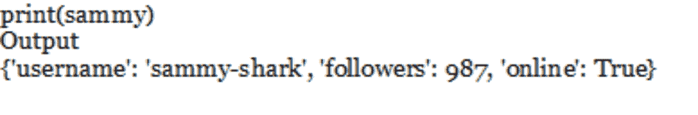当你查看输出时，你可能会注意到键值对的顺序发生了变化。这是因为字典数据类型具有“无序”的性质。因此，与元组和列表不同，字典不维护顺序，也不具备被索引的能力。每当你打印字典时，顺序通常是随机的。然而，键值对通常始终保持完好，从而使人们能够根据它们的关联意义来访问数据。

### 如何访问字典的元素

由于字典数据结构无序的特性，你不能像使用元组和列表那样通过索引数字来调用它的值。尽管如此，你可以引用相关的键来调用它的值。

### 使用键访问数据项

在你的 `Python` 程序中，字典非常重要，因为它们提供了键值对来存储数据。如果你想单独提取用户名“Sammy”，可以通过调用 `Sammy['username']` 来。让我们尝试打印它：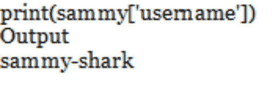 像数据库一样，字典与列表的不同在于，与通过调用整数来获取特定的索引值相反，你将一个值分配给键，并可以选择调用该键来获取其相关值。当你调用“username”键时，你会得到该特定键的特定值，即“sammy-shark”。留在 Sammy 字典中的值实际上可以使用相同的格式进行调用：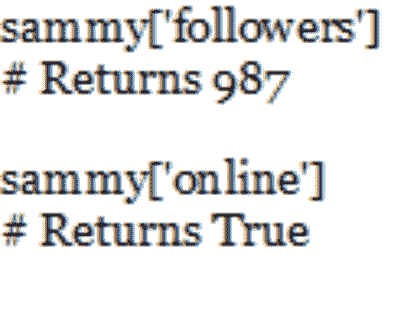 当你利用字典的键值对时，你可以引用键来检索值。

### 使用函数访问元素

除了使用键访问值外，你还可以使用许多内置函数：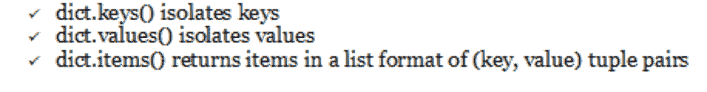 要返回键，你需要使用 `dict.keys()` 函数。在示例中，那将是变量名，即 `sammy.keys()`。我们将其传递给 `print()` 函数并观察输出：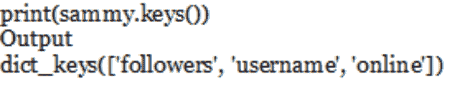 我们得到的输出将键放在一个 `dict_keys` 类的可迭代视图对象中。因此，键以列表的形式打印出来。

你可以使用此函数跨字典进行查询。例如，你可以看到字典数据结构之间共享的公共键：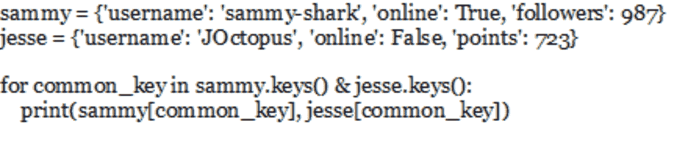 “sammy”字典和“jesse”字典都是用户配置字典。它们的配置包含包含不同的键。尽管如此，由于 Sammy 有一个带有关联粉丝的社交个人资料，而 Jesse 带有关联分数的游戏个人资料，他们共有的两个键都是“online”状态和“username”，你可以在运行这个小程序时获取到它们：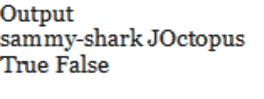 你完全可以对程序进行改进以确保输出对用户更具读性；然而，这说明你可以使用 `dict.keys()` 来检查不同的字典，以便查看它们之间是否有共同点或何不同。你会发现这对于大型字典特别有用。

你还可以以类似的方式使用 `dict.values()` 函数来查询“sammy”字典中的值，你可以将其构造为 `sammy.values`。让我们尝试打印它们：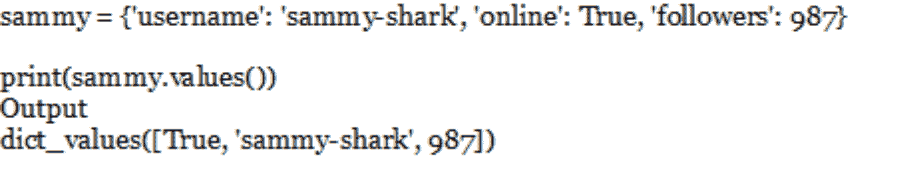 `values()` 和 `methods()` 都返回“sammy”字典中存在的未排序的键列表和值，并按特定的顺序包含所有的 `dict_keys` 和 `dict_values` 视图对象。如果你对所有字典项感兴趣，可以简单使用 `items()` 函数访问它们：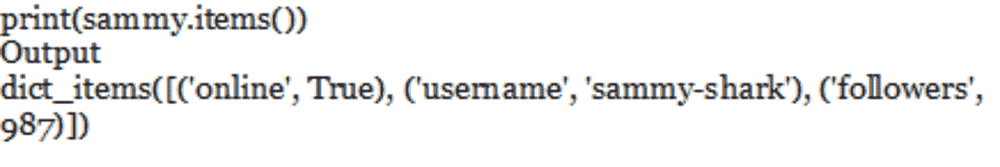 这种返回的“列表”格式通常具有包含 `dict_items` 视图对象的 (key, value) 元组对。通过使用 `for 循环`，你实际上可以迭代返回的格式列表。例如，你可以打印特定字典的每一个键和值，并通过添加一个字符串使其对任何用户更具读性：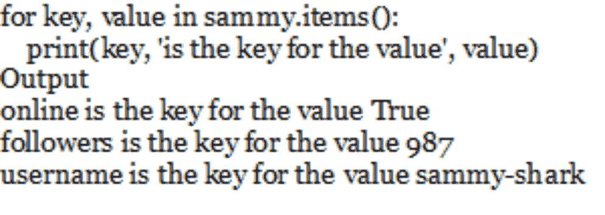 如果你检查上方，`for 循环` 实际上迭代了“sammy”字典中的项，然后逐行打印出键和值，并带有让用户更易于理解的信息。你可以利用内置函数从字典的数据结构中访问值、项和键。

### 修改字典

正如我之前提到的，字典是可以修改的变结构（变结构）。在这方面，我们现在查看如何在字典中添加和删除元素。

### 添加和更改元素

你可以使用语法 `dict[key] = value` 在不使用函数的情况下添加键值对。让我们通过向“usernames”字典中添加一个键值对来实际观察它是如何工作的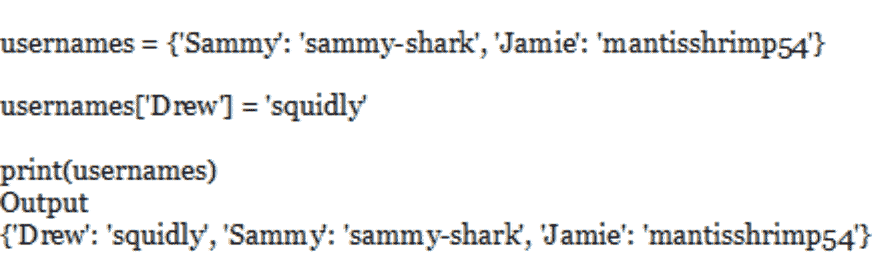 正如你所见，字典已用键值对‘drew’:‘squidly’进行了更新。这对组合可以位于字典的任何位置，因为字典通常是无序的。如果你在程序文件的后续部分使用字典 `usernames`，它将包含这个额外的键值对。此外，你可以使用此语法来修改分配给键的值。在这种情况下，将引用一个已存在的键并向其传递一个不同的值。

我们将考虑一个字典 `drew`，它是给定网络上的用户之一。假设今天，该用户的粉丝数量增加了。我们必须更新传递给键（followers）的整数。我们将使用 `print()` 函数来确认字典确实被修改了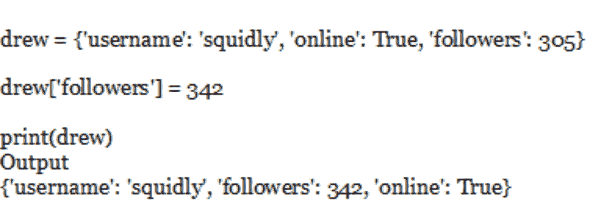 在输出中，我们可以看到粉丝数量从整数值 305 跳到了 342。我们可以利用此方法……（注：此处原文在此处中断，翻译已按原文内容结束）

- `and` 至少应该有一个求值为 `False` 的表达式
- `or` 应该有两个表达式都求值为 `False`
- `not` 只有在其内部表达式为 `True` 时，新表达式的值才为 `False`

如果上述结果对你来说还不清晰，我们将很快通过一些真值表来帮助你快速上手。你也可以在编写复合语句时使用 `and`、`not` 和 `or`：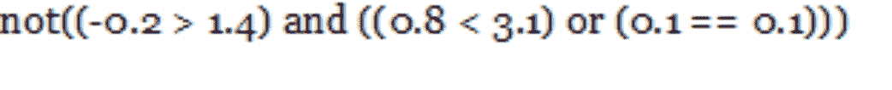

现在，首先关注最内层的表达式：`(0.8 < 3.1)` 或 `(0.1 ==0.1)`。这个特定的表达式求值为 `True`，因为这两个数学语句都是 `True` 的。现在我们可以获取返回的 `True` 值，并将其与下一个内层表达式 `(-0.2>1.4)` 和 `(true)` 合并。这个例子之所以特别返回 `false`，是因为数学语句 `-0.2 > 1.4` 是 `False`，显然，`(False)` 和 `(True)` 的结果是 `False`。我们最终得到了外层表达式 `not(False)`，它的求值为 `True`，所以最后一个返回的值是（如果我们打印该语句）：`True`。逻辑运算符 `and`、`not`、`and`、`or` 因此此评估表达式并返回布尔值。

### 真值表

关于逻辑这一数学分支，绝对有很多需要学习的内容。然而，我们可以选择性地学习，以开发我们编程的算法思维。查看下方比较运算符 `==` 以及每个逻辑运算符 `and`、`not` 和 `or` 的真值表。虽然你可能无法立即推导出它们，但努力记忆它们将证明是有用的，这样可以加快你的决策过程。

`==` 的真值表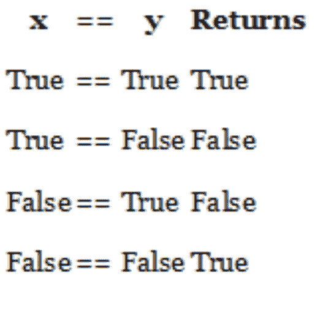
`and` 的真值表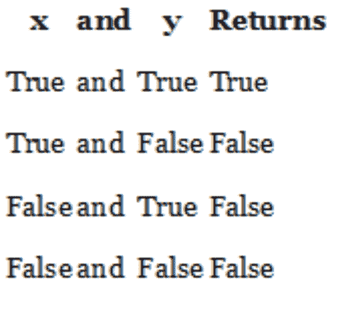
`or` 的真值表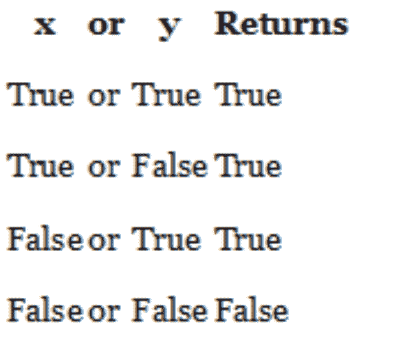
`not` 的真值表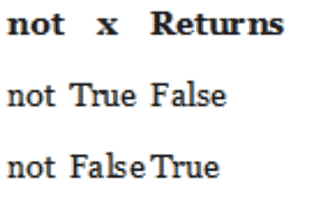

真值表是基于逻辑的数学表格——它们虽然常见，但在任何形式的计算机编程中创建指令或算法时，记住或牢牢记在心中往往非常有用。

### 用于“流程控制”的布尔运算符

为了以流程控制语句的形式控制流和程序结果，你可以使用一个条件，然后接一个句。条件本质上被求值为 `True` 或 `False` 的布尔值，并提供程序做出决策点，即：条件告知你某值何值为 `False` 或 `True`。

另一方面，句是跟随在条件后面的代码块，并决定程序的输出。也就是说，它构成了整个结构中的“执行此操作”部分——“如果 y 为 True，则执行此操作”。

查看下面的代码块，它描述了比较运算符如何配合条件语句工作以控制 `Python` 程序流：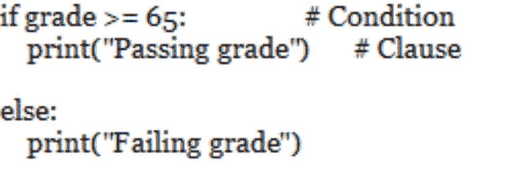

此程序评估每个学生的成绩是及格还是不及格。当一个学生（例如）得到 83 分时，第一个语句求值为 `True`，并触发“及格”的打印语句。如果学生记录的成绩是 59，初始语句求值为 `False`，因此程序将执行附加在 `else` 表达式上的打印语句：“不及格”。

由于每个 `Python` 对象都可以被求值为 `False` 或 `True`，专家 `Python` 程序员建议不要将值与 `False` 或 `True` 进行比较，因为这样可读性较低并且往往返回意料之外的布尔值。这意味着你应该尽量避免在程序中使用类似 `sammy== True` 的代码，而是将 `sammy` 与其他非布尔值进行比较，以返回一个布尔值。布尔运算符通常提供了我们可以通过流程控制语句决定最终程序结果的条件。涵盖了这些内容，我知道你已经准备好做出决策了！

### 条件语句：If 和 Else 语句

每种编程语言通常都有条件语句。当你有条件语句时，你就拥有有时运行的代码（而不是总是运行），尽管这取决于程序在特定时刻的条件。当你完全执行每个程序语句，从上到下顺序实现每一行时，你并没有真正指示程序去评估特定的条件。我们可以使用条件语句帮助程序实际判断特定条件是否真的被满足。

为了更好地理解条件语句，请查看以下使用（条件语句）的示例：

- 如果学生考试超过 70%，报告其成绩及格；否则，报告其成绩不及格。
- 如果 Jane 的账户里有钱，计算利息；如果没有，则收取罚金。
- 如果他买了 8 个或更多芒果，计算 5% 的折扣；如果买得少，则不计算。

当你评估条件并根据这些条件是否满足来运行代码时，你本质上正在编写条件代码。在本节中，我将带你了解编写 `Python` 中条件语句所需的所有知识。

### If 语句

让我们从 `if` 语句开始，它将判断语句是假还是真，并仅在语句为真时运行代码。在纯文本编辑器中打开文件并编写以下代码：

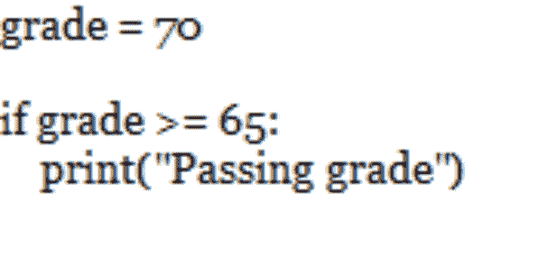

通过上述代码，你拥有变量 `grade` 并将给它赋值一个整数值 70；然后你将使用 `if` 语句来评估变量 `grade` 是否大于或等于（`>=`）65。如果不满足此条件，你将指示程序打印字符串‘passing grade’（及格）。

现在将程序保存为 `grade.py`，然后使用命令 `python grade.py` 运行它。请注意，在我们的情况下，70 分数并不满足大于或等于 65 的条件，因此当你运行程序时，你将得到下面的输入：

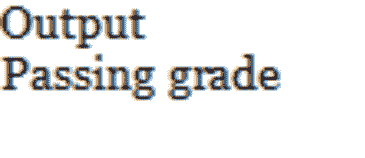

我们不会尝试通过将变量 `grade` 的值改为 60 来改变此程序的结果。

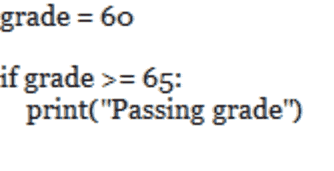

当你保存并运行代码时，你不会收到任何输出，因为条件不满足，而且你没有指示程序执行另一个语句。让我们来看另一个例子：我们将计算银行余额是否小于 0。我们将创建一个名为 `account.py` 的文件并编写以下程序：

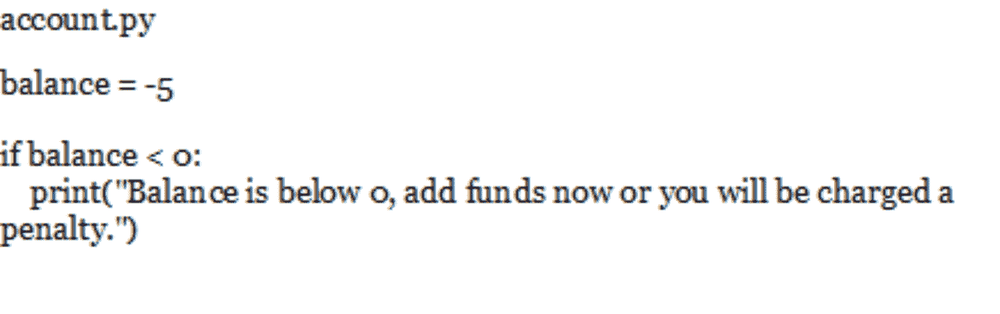

当你使用 `python account.py` 运行附加的程序时，你将得到以下输出：

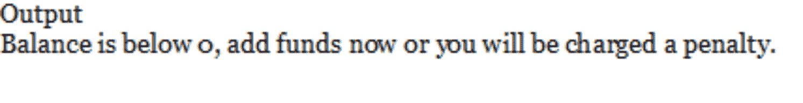

在你初始程序中，值为 `-5` 的变量 `balance` 小于 0。余额满足了 `if` 语句条件（`balance<0`），因此当你保存并运行代码时，你将得到字符串输出。同样，如果你将余额改为 0 或某些正数，你将得不到任何输出。

### Else 语句

即使 `if` 语句评估结果为假，你可能仍然希望程序执行某些操作。在成绩示例中，你希望无论成绩是不及格还是及格都有输出。为了这一点，让我们在上面的成绩条件中添加一个 `else` 语句，我们的构建方式如下：

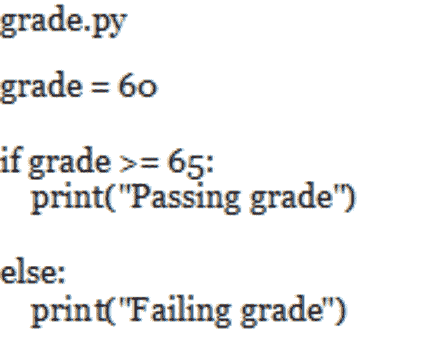

上面的 `grade` 变量包含值 60——因此，`if` 语句评估为假——程序不会打印‘passing grade’。随后的 `else` 语句将指示程序执行某些操作。当你保存并运行时，你将得到以下输出：

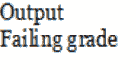

通过重写程序以输出成绩为 65 或以上的数值，你将改为获得‘passing grade’的输出。如下所示重写代码，以向银行账户示例添加一个 `else` 语句：

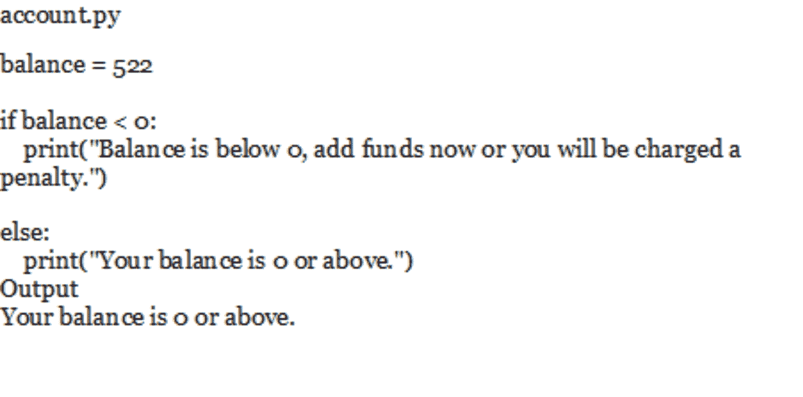

在这里，我们将变量 `balance` 的值改为正数，以便 `else` 语句执行打印。你可以将值改回负数，以让第一个 `if` 语句打印。

当你将 `if` 和 `else` 语句结合时，你将构建一个包含两个部分的条件语句，无论 `if` 条件是否满足，都会指示计算机执行特定的代码。

### else if 语句

到目前为止，我们学习了各种条件语句的布尔选项，因为每个语句的评估结果非假即真。在大多数情况下，你可能希望程序评估两个两个可能的结果。为此，我们将继续使用 else if 语句，在 `Python` 中它被写作 `elif`。else if 或 `elif` 语句类似于 `if` 语句，并评估另一个条件。在我们的银行账户程序中，我们可能希望针对三种情况拥有三种不同的输出，包括：

- 余额小于 0
- 余额等于 0
- 余额大于 0

`elif` 语句位于 `if` 语句和 `else` 语句之间，如下所示：

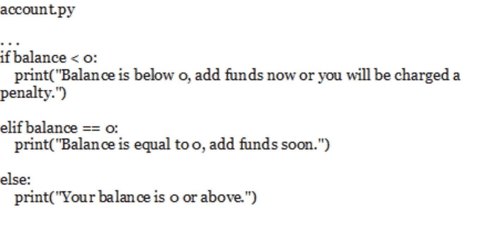

现在一旦你运行程序，你就可以收到三种可能的输出：

- 如果变量 `balance` 等于 0，你将通过 `elif` 语句获得输出；这意味着余额为 0，你应该向账户中存入更多钱。
- 如果变量 `balance` 被设置为正数，你将得到来自 `else` 语句的输出；这意味着你的余额为 0 或更多。
- 如果变量 `balance` 被固定为负数，输出将是来自 `if` 语句的字符串；这意味着余额小于 0，因此你现在应该存资金，否则将面临罚款。

如果有想要超过 3 个选项的情况怎么办？这可以通过简单地在代码中编写多个一个 `elif` 语句来实现。在 `grade.py` 程序中，你可以重写代码，使你有几个字母等级与数字成绩的范围相对应。

- 90 或以上等于 A 等
- 80 到 89 分等于 B 等
- 70 到 79 分等于 C 等
- 65 到 69 分等于 D 等
- 64 或以下等于 F 等

要运行此代码，我们需要一个 `if` 语句、3 个 `elif` 语句，以及一个 `else` 语句来帮助你处理所有不及格的情况。我们现在重写上面的示例代码，以打印每个字母等级。我们也可以保持 `else` 语句不变。


`elif` 语句按顺序评估，因此你可以保持语句简单。程序正在完成以下步骤：

- 如果成绩大于 90，程序将打印 A；如果小于 90，程序继续执行下一个语句……
- 如果成绩大于或等于 80，程序将打印 B；如果 79 或更少，程序继续执行下一个语句……
- 如果成绩大于或等于 70，程序将打印 C；如果 69 或更少，程序继续执行下一个语句……
- 如果成绩大于或等于 65，程序将打印 D；如果 64 或更少，程序继续执行下一个语句……
- 当上述所有条件都不满足时，程序打印‘failing grade’（不及格）。

### 嵌套 if 语句

当你开始熟悉 `elif`、`else` 和 `if` 语句后，就可以开始尝试使用嵌套条件语句了。当你想要在初始条件为真时检查次要条件，就可以使用嵌套的 if 语句。在这种情况下，你可以将一个 `if-else` 语句直接放在另一个 `if-else` 语句中间。让我们讨论一下嵌套 if 语句：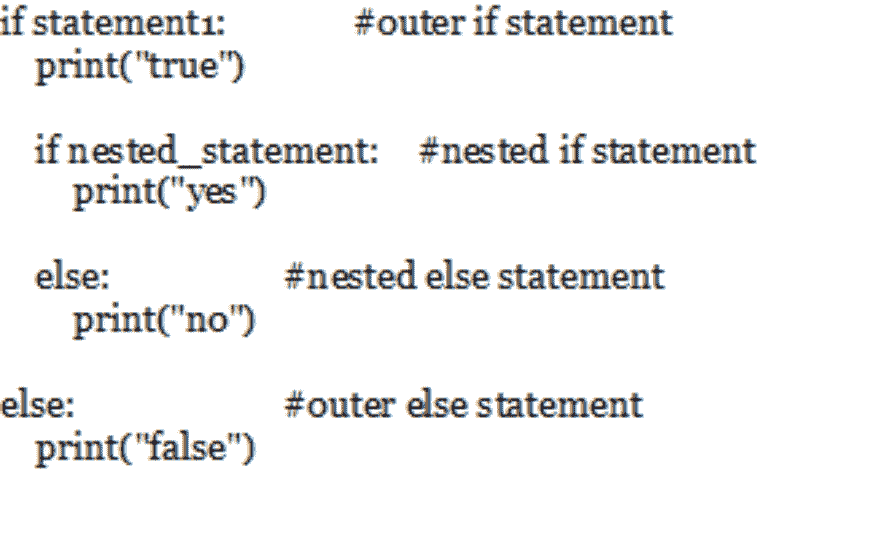

此代码可能产生的输出为：如果第一个语句（或语句 1）求值为真，程序将评估 `nested_statement` 是否也求值为真。如果两者都为真，你将得到以下输出：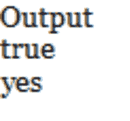

然而，当第一个语句求值为真但 `nested_statement` 求值为假时，你得到的输出是：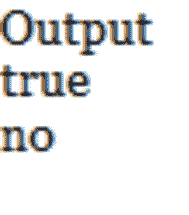 如果第一个语句求值为假，则意味着 `if-else` 语句将不会运行，因此 `else` 语句将单独运行。在这种情况下，你得到的输出是：`false`

你还可以在整个代码中嵌套许多个 `if` 语句：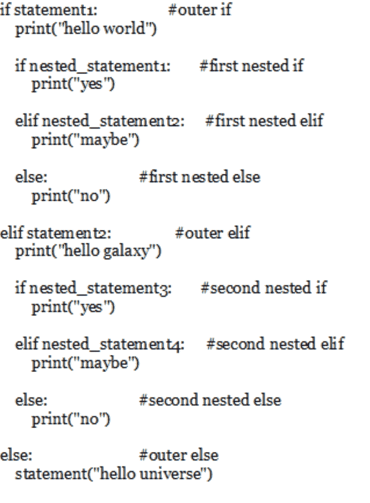 在上面的代码中，每个 `if` 语句和 `elif` 语句内部都有嵌套的 if 语句。这允许在每个条件内部有更多选项。

你可以通过你的 `grade.py` 程序查看嵌套 if 语句的示例。你可以先检查成绩是否及格（大于或等于 65%），然后查找数字成绩对应的字母等级。然而，如果成绩未及格，你不需要运行字母等级判断。相反，你可以让程序报告成绩不及格。

带有嵌套 if 语句的修改后代码如下：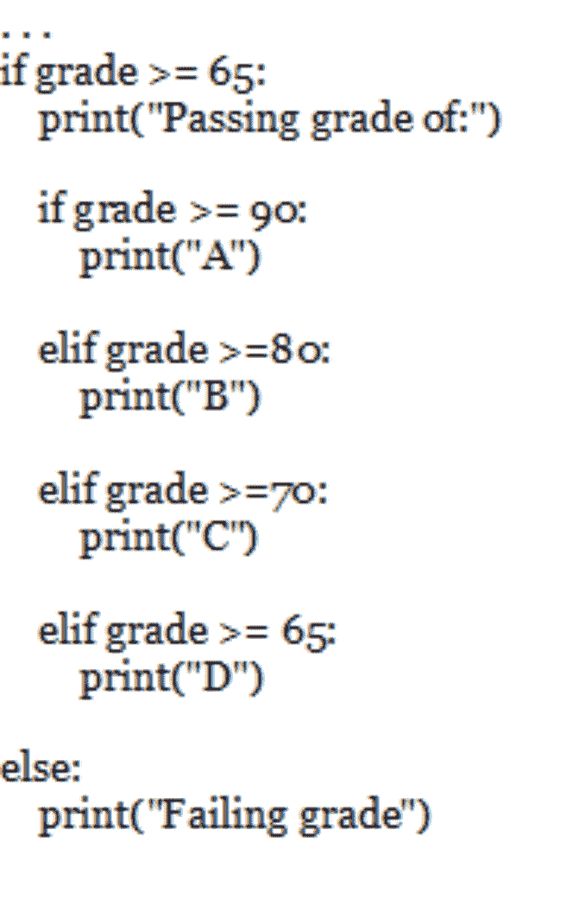 如果你将变量 `grade` 设置为整数 92 并运行代码，第一个条件将满足，你的程序将打印‘passing grade of:’。之后，它会检查成绩是否大于或等于 90，由于这个条件也满足了，它会打印出 `A`。

如果你将变量 `grade` 设置为 60 运行，第一个条件将无法满足，程序将跳过嵌套的 if 语句并移动到‘else’语句，程序将打印‘failing grade’。

你完全可以在此基础上添加更多选项，并使用另一层嵌套 if 语句。也许你想要单独评估 `A-`、`A` 和 `A+` 等级。我们也可以通过首先尝试查看成绩是否及格，然后尝试检查成绩是否为 90 或或以上，再检查（例如）成绩是否超过 96 以获得 `A+`。(image1294.jpg)上面的代码显示，当变量 `grade` 设置为 96 时，程序运行如下：

*   检查成绩是否大于或等于 65；这是真的。
*   打印‘passing grade of:’
*   检查成绩是否大于或等于 90；这是真的。
*   检查成绩是否大于 96；这是假的。
*   检查成绩是否大于 93 且小于或等于 96；这是真的。
*   打印 `A`
*   放弃这些嵌套条件语句并继续执行代码其余部分

成绩为 96 的程序输出将如下：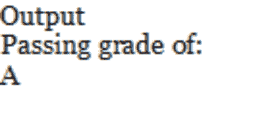 嵌套 if 语句可以让你在代码中添加许多特定层级的条件。当你使用诸如‘if’语句之类的条件语句时，你对程序执行的内容有了更多的控制。条件语句指示你的程序评估是否满足特定条件。如果满足条件，它会执行某些代码，如果不满足，程序将继续向下移动其他代码。

在下一节中，我们将查看会重复的条件语句。代码的重复实现主要建立在布尔条件之上，所以没什么新奇。

免费下载此书的音频版本！点击下方链接开始！
[适用于 Audible US](https://www.audible.com/pd/B07N8JGWXW/?source_code=AUDFPWS0223189MWT-BK-ACX0-141304&ref=acx_bty_BK_ACX0_141304_rh_us)
[适用于 Audible UK](https://www.audible.co.uk/pd/B07N8HM6RF/?source_code=AUKFrDlWS02231890H6-BK-ACX0-141304&ref=acx_bty_BK_ACX0_141304_rh_uk)
[适用于 Audible Fr](https://www.audible.fr/pd/B07N8HWBM3/?source_code=FRAORWS022318903B-BK-ACX0-141304&ref=acx_bty_BK_ACX0_141304_rh_fr)
[适用于 Audible DE](https://www.audible.de/pd/B07N8CQ6TL/?source_code=EKAORWS0223189009-BK-ACX0-141304&ref=acx_bty_BK_ACX0_141304_rh_de)

## 第 11 章：在 Python 中构建 ‘while’ 循环

当你需要自动化和重复任务时，计算机程序会非常有用，因为这样做你就不需要手动操作。重复相同任务的一种极方法是使用循环，在书的这一节中，我们将查看 `Python` 中的 `while` 循环。代码的重复实现主要建立在布尔条件之上，所以没什么新奇。只要 `while` 语句为真，包含 `while` 块的代码就会执行。

### while 循环

以下是我们在 `Python` 中构建 while 循环的方式： 程序正在执行的操作将继续运行，直到评估的条件不再为真。现在让我们尝试创建一个执行 `while` 循环的小程序。对于这个程序，我们将指示用户输入密码。在我们循环过程中，会有 2 种结果：

*   如果密码正确，退出 while 循环
*   如果密码错误，while 循环继续执行

我们将在任选的编辑器中创建一个名为 `password.py` 的文件，并从初始化 `password` 变量为空字符串开始：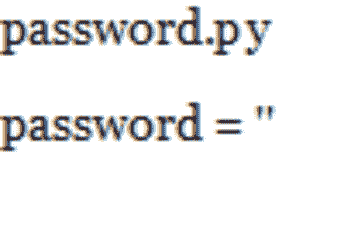你将使用空字符串在 `while` 循环中接收用户的输入。现在我们来一起构建 `while` 语句及其条件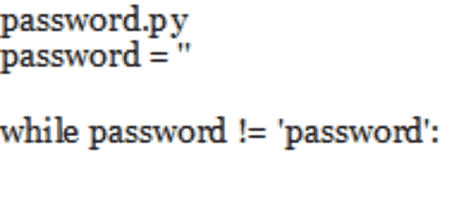

在这种情况下，`while` 后面紧的是 `password` 变量。你正在检查该变量是否被设置为 `password` 字符串，但你可以选择任何你想要的字符串。因此，如果用户输入了 `password` 字符串，循环将停止，程序继续执行循环之外的代码。尽管如此，如果用户输入的字符串不等同于 `password` 字符串，循环将继续。之后，你将在 `while` 循环内部添加执行某些操作的代码块：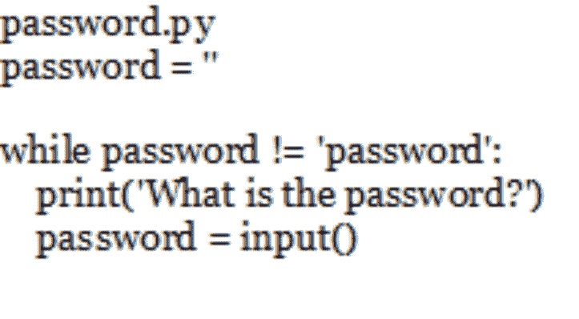在 `while` 循环中，程序将运行一个 `print` 语句，然后提示输入密码。随后，通过 `input()` 函数将 `password` 变量设置为用户的输入。程序检查 `password` 变量是否赋值为 `password` 字符串；如果是，`while` 循环将自动结束。现在为这种情况给程序添加额外一行代码：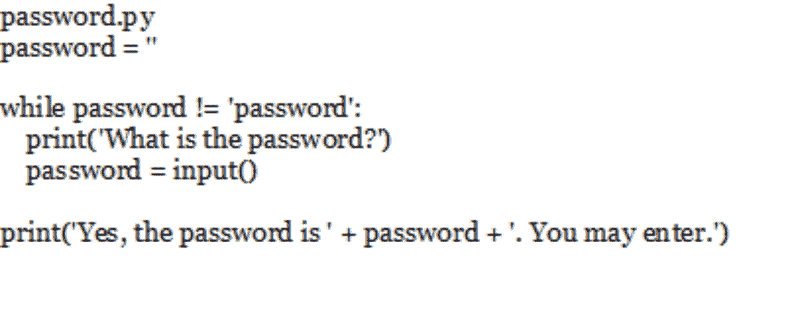最后的语句 `print()` 位于 `while` 循环之外；因此，当用户输入 `password` 作为密码时，该用户将看到循环外的最后一个 `print` 语句。尽管如此，如果用户完全没有输入 `password` 词，他或她将无法到达最后的 `print()` 语句并陷入死循环。

### 什么是无限循环？

当程序在单个循环内不断执行而不离开时，就会发生无限循环。你可以简单地在命令行上按 `CTRL+C` 退出无限循环。现在保存程序并运行：`python password.py` 你将得到密码提示，然后可以使用不同的可能输入对其进行测试。查看程序的示例输出：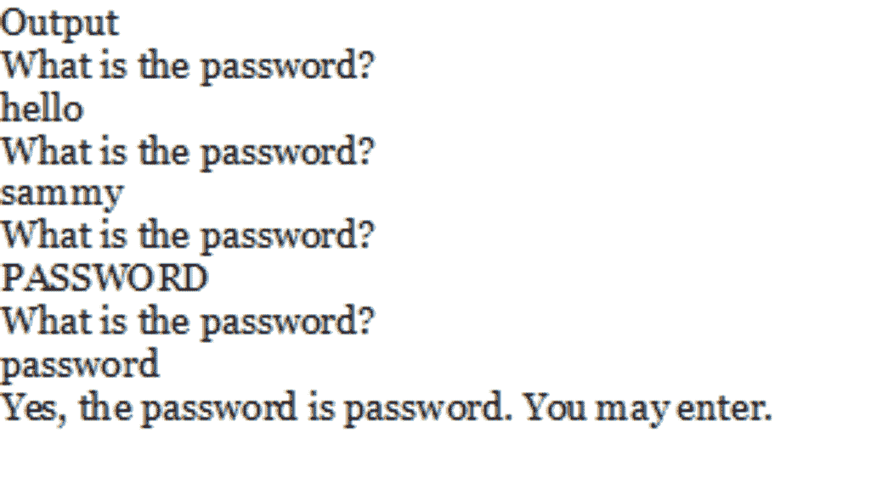你应该记住，字符串是区分大小写的，除非你在检查之前利用字符串函数将字符串转换为全小写（例如）。

### 一个‘while’循环的示例程序

既然我们已经在 `while` 循环的前提上取得了良好进展，我们可以创建一个基于命令行的猜数字游戏，这可以有效利用利用 `while` 循环。要理解此程序是如何运行的，请确保仔细阅读并理解条件语句部分。

首先，我们将从偏好的文本编辑器中创建一个名为 `guess.py` 的文件。你希望计算机为用户生成随机数供其猜测，因此你将[导入](https://www.digitalocean.com/community/tutorials/how-to-import-modules-in-python-3)包含导入语句的 `random` 模块。如果不熟悉这个包，可以从 `Python` 文档中学习许多关于[创建随机数](https://docs.python.org/3.6/library/random.html)的知识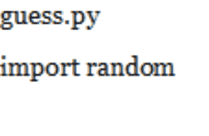之后，你给 `number` 变量分配一个随机整数，确保它在 1 到 25（包含边界）范围内。我希望这不会让游戏变得太难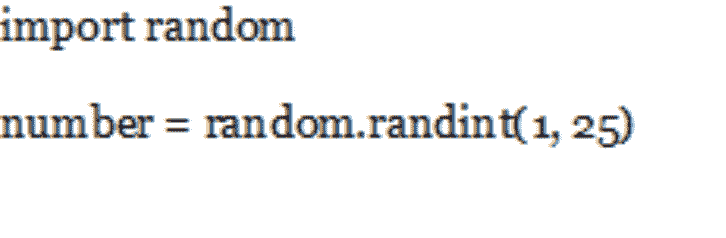在这里，你可以通过先初始化变量然后生成循环来进入你的 `while` 循环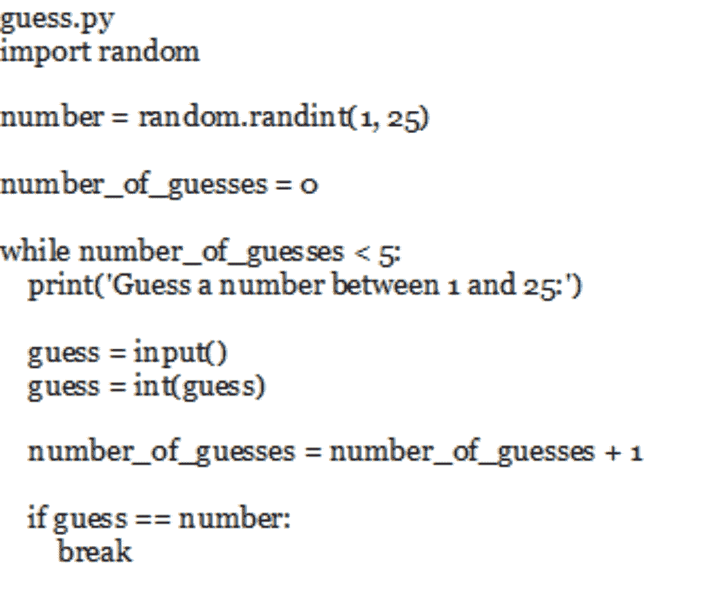你初始化了 `number_of_guesses` 变量；这意味着你每次循环时都会增加它，这样就不会出现无限循环。然后你添加了 `while` 语句，使得变量 `number_of_guesses` 被限制为 5 次。在第五次猜测后，用户将返回命令行，此时，如果用户输入了整数以外的内容，将会报错。我们在循环中添加了一个 `print()` 语句来提示用户输入数字，我们通过 `input()` 函数获取了 `guess`，然后将其字符串转换为整数。在循环结束之前，你还要让 `number_of_guesses` 变量加 1，以便你可以循环五次。最后，你应该写一个条件 `if` 语句来检查用户猜测的 `guess` 是否等于计算机生成的 `number`，如果是，你将使用[break 语句](https://www.digitalocean.com/community/tutorials/how-to-use-break-continue-and-pass-statements-when-working-with-loops-in-python)退出循环。此时程序功能正常，你可以运行命令：`python guess.py` 即使它可以运行，用户（此时）在不知道猜测是否正确的情况下循环整个五次。当你采样程序的输出时，你会得到类似这样的内容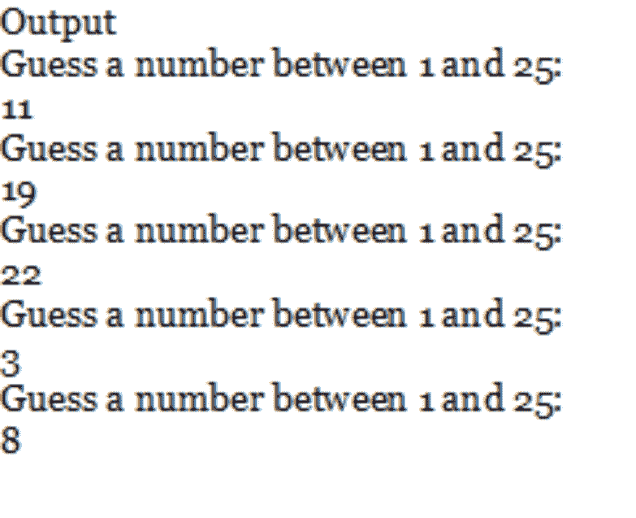我们现在将在循环外添加各种条件语句，帮助用户获取关于猜测是否正确的反馈。这些位于文件的末尾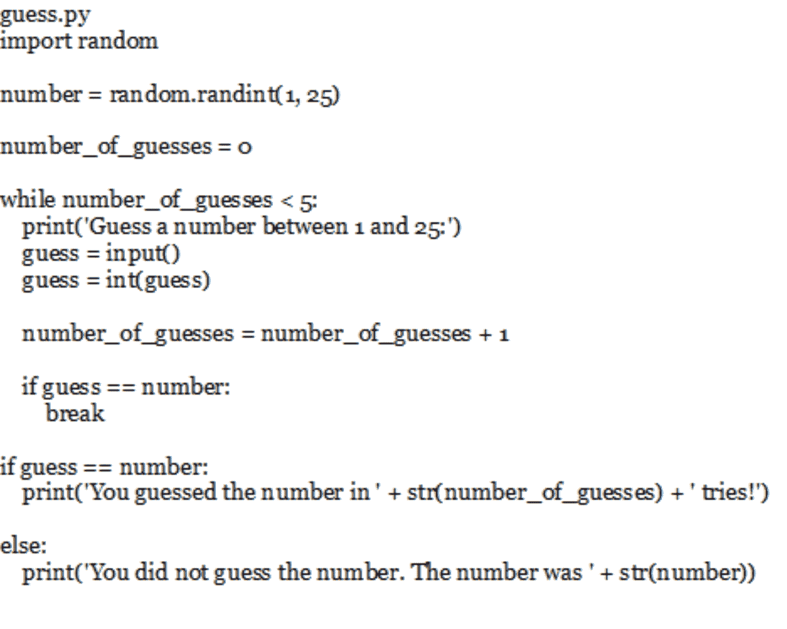现在程序告诉用户他们猜的数字是高是低。在 `if guess == number` 行之前添加这个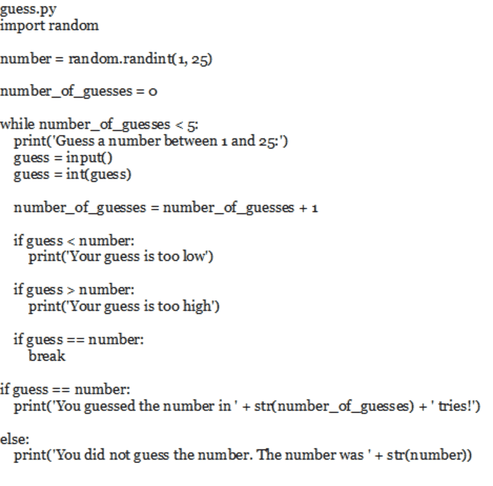当你再次运行 `python guess.py` 程序时，你会注意到用户的猜测得到了更多引导。因此，如果随机生成的数字是 12，用户猜的是 18，程序将告知用户高了，他们应该相应调整猜测。为了改进代码，你可以处理用户未输入整数的情况。

## 第 12 章：在 Python 编程中构建‘For Loops’

正如上一节提到的，在编程中使用循环的目的是多次自动化执行任务。在本节中，我们将查看 `python` for 循环。`for` 循环根据计数器或变量执行重复的代码。这意味着在进入循环之前已知迭代次数时，可以使用 `for` 循环，这与基于 `while` 的循环不同。

### For 循环

在 `Python` 中，我们这样构建 `for` 循环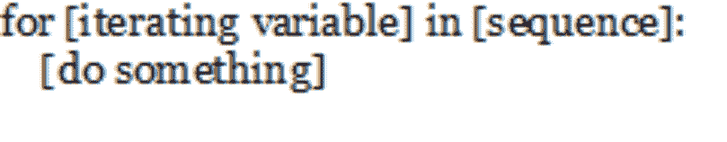具体执行的操作直到序列完成。我们现在来看一个遍历范围内数值的 `for` 循环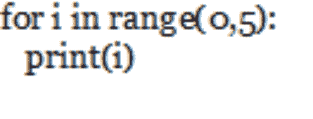运行程序，你得到类似这样的输出：01234 `i` 由此 `for` 循环设置为迭代变量，序列出现在零到五范围内。我们在循环内部打印一个整数。请记住，在编程中通常从索引 0 开始，这就是为什么尽管输五个数字，但它们的范围是 0-4。当你的程序需要重复特定次数的代码块时，通常会注意到并使用 `for` 循环。

### 在 For Loops 中使用 ()

`Python` 内置不可变序列类型之一是 `range()`。循环专门使用 `range()` 来控制循环的次数。当你使用 `range()` 时，可以向它传递一到三个整数参数：
- 整数开始的值由 `start` 表示——如果不包含该值，则 `start` 将从 0 开始。
- `stop` 整数总是必须的，且在计数时不包含在内。
- `Step` 设置了后续迭代的增量（或负数的减量），如果省略，`step` 默认为 1。让我们来看几个向 `range()` 传递各种参数的例子。首先，我们只传递参数 `stop`，使得集合的序列为 `range(stop)`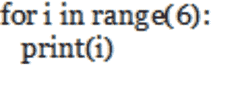在上面的程序中，6 是 `stop` 参数，因此代码从 0 到 6 迭代——包含 6。输出是：012345 现在让我们突出带有特定值的 `range(start, stop)`，这些值指定了迭代何时开始何时停止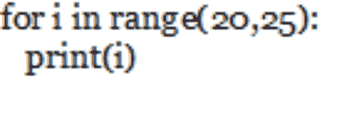这里的范围从 20 到 25——两者都包含，所以输出看起来像：2021222324 `range()` 的步长参数与[在切片字符串时指定步长](https://www.digitalocean.com/community/tutorials/how-to-index-and-slice-strings-in-python-3#specifying-stride-while-slicing-strings)相同；这意味着可以使用它可以跳过序列中的值。使用三个参数时，`step` 将位于最后：`range(start, stop, step)`。首先，让我们使用一个正值的 `step`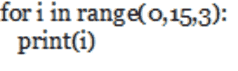在这里，for 循环被策略性地设置为从 0 到 15 的数字，但步长为 3，使得每三个数字被打印一次，像这样：image1493.jpg 你也可以使用负值的 `step` 参数来反向迭代，但必须相应地修改 `stop` 和 `start` 参数：image498.jpg 在这种情况下，100 是 `start` 值，0 是 `stop` 值。每次迭代减少 10；因此循环从 100 开始在 0 结束。你可以看到这种发生：image1502.jpg

### 在 For Loops 中使用序列类型

列表和其他数据类型也可以作为迭代参数。与其通过 `range()` 迭代，你可以轻松地定义一个列表并对其进行迭代：image1510.jpg 在这里，我们正在打印列表中的每一个项。尽管我们使用了 `shark` 变量，但可以调用任何有效名称并得到不同的输出，如下：image1515.jpg 上述输出清楚地显示 `for` 循环遍历了列表并打印列表中的每一行。列表和其他序列类型（如元组和字符串）非常适合配合循环，因为它们是迭代的。你可以通过 `range()` 将这些数据类型结合，例如：在这种情况下，我包含了一个占位符字符串 `shark` 以及 `sharks` 列表长度。你也可以使用 `for` 循环从零创建一个列表：image1522.jpg 在上面的示例中，`integers` 列表被初始化；然而 `for` 循环以这种方式填充列表 image1526.jpg 同样，你可以这样遍历字符串：image1530.jpg。当你遍历字典时，记住键值结构很好。

### 嵌套 For Loops

我们经常使用循环来遍历和处理序列类型。嵌套循环是发生在另一个循环内部的循环，在结构上类似于嵌套的 `if` 语句。我们这样构建它们：image1552.jpg 程序首先遇到外部循环并执行其第一次迭代。这次迭代激活了内部嵌套循环并运行完成。然后程序返回外部循环顶部完成第二次迭代并再次触发嵌套循环。嵌套循环再次运行结束，程序返回外部循环顶部，直到序列结束或被 `break` 或其他语句中断。现在让我们实现一个嵌套 `for` 循环来帮助理解这一点。在这种情况下，外部循环遍历名为 `num_list` 的整数列表，内部循环遍历名为 `alpha_list` 的字符串列表 image1558.jpg 运行程序后，你会得到这个输出：image1562.jpg 输出将显示程序通过打印 1 完成外部循环的第一次迭代，从而启动内部循环的完成，因此连续打印 a, b, c。当内部循环结束后，程序返回外部循环顶部并打印 2，然后完整打印内部循环 (a, b, c)，以此类推。

嵌套循环对于遍历包含列表的列表是必要的。如果你只使用一个 for 循环，程序会将每个列表作为一个项输出：image1568.jpg 当你想访问内部列表的每一个项时，将必须执行嵌套 `for` 循环 image1573.jpg 当你开始使用嵌套 `for` 循环时，你能够遍历列表包含的单个项。在本节中介绍了 `for` 循环如何工作以及如何创建它们。`for` 循环根据指定的次数循环代码块。

也许是最后的……
到这里你应该在寻找一种让编码更简单的方法，下一个主题应该帮助你实现这一点——你将能够将类分组，拥有继承其他类的方法，并为链接类的功能创建一个树搜索结构。总的来说，如果你想在编写大型程序时享受重用现有代码的便利，请读下去。免费下载此书的有声书版本！点击下方链接开始[For Audible UK](https://www.audible.co.uk/pd/B07N8HM6RF/?source_code=AUKFrDlWS02231890H6-BK-ACX0-141304&ref=acx_bty_BK_ACX0_141304)[For Audible Fr](https://www.audible.fr/pd/B07N8HWBM3/?source_code=FRAORWS022318903B-BK-ACX0-141304&ref=acx_bty_BK_ACX0_141304)[For Audible DE](https://www.audible.de/pd/B07N8CQ6TL/?source_code=EKAORWS0223189009-BK-ACX0-141304&ref=acx_bty_BK_ACX0_141304)

## 类与对象

*   类是程序员为对象构建的蓝图。它定义了刻画从该特定类实例化的任何对象的属性。
*   另一方面，对象是类的实例。它是类的具体实现版本；类是在程序中展示的结构。

你将使用这些概念来构建模式（针对类），然后利用这些模式（针对对象）。在本节中，我们将讨论如何初始化属性、实例化对象、使用构造方法方法创建类，以及如何使用同一类的多个对象进行工作。

### 类

你可以将类看作是创建对象的蓝图。我们使用 `class` 关键字来定义类，就像我们使用 `def` 关键字来定义函数一样。

我们现在定义一个名为 `shark` 的类，它包含两个函数：`Swimming` 和 `Being awesome`：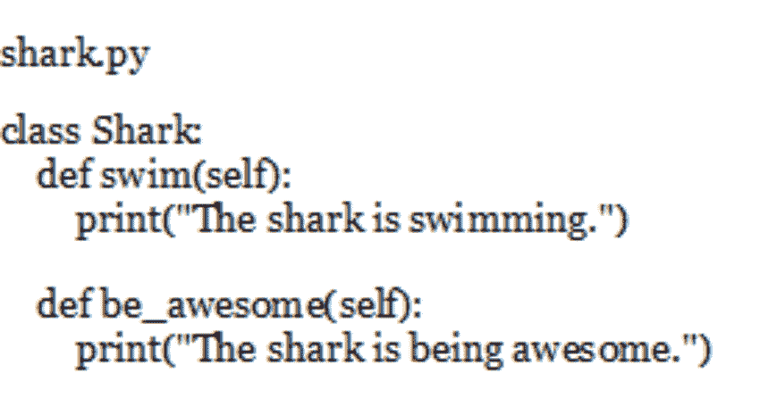

由于这些函数在 `shark` 类内部缩进，因此我们称它们为方法（在类内部定义的特殊函数）。`self` 单词是对基于该类创建的对象引用，它是这些函数的参数；`self` 始终是引用实例的初始参数，但它不必是唯一的参数。

定义这个类仅仅创建了鲨对象的模式，我们稍后会定义它。它并没有创建任何 `shark` 对象。这意味着如果你在这一阶段之后运行程序，将没有任何任何内容。因此，我们通过创建上面的 `shark` 类，获得了一个对象的蓝图。

### 对象

对象仅仅是类的实例。你可以获取上面定义的 `shark` 类，然后使用它来创建一个对象以及它的实例。我们现在将创建一个名为 `sammy` 的 `shark` 对象—— `sammy=shark()`。

在这种情况下，通过将其赋值为 `shark()`，我们将对象 `sammy` 初始化为类的实例。现在我们将对鲨鱼对象 `sammy` 使用这两个两个方法：

`sammy` 正在使用两个方法：`be_awesome()` 和 `swim()`。我们使用点操作符（`.`）调用这些方法，该操作符用于引用对象的属性。在这种情况下，该属性是一个带有括号调用的方法，就像你调用函数一样。

由于 `self` 关键字是 `shark` 类中定义的方法参数，`sammy` 对象被传递给方法。`self` 参数确保方法有办法引用对象的属性。尽管如此，当我们调用方法时，括号内没有传递任何内容，`sammy` 对象通过点操作符自动传递。

我们现在将在程序的范围内添加该对象：

当你运行程序时： `sammy` 对象调用了程序函数 `main()` 中的两个方法，从而使方法运行。

### 构造方法

我们使用构造方法来初始化数据。构造方法在类对象被实例化时运行。它也被称为 `__init__` 方法，并将是第一个类定义；它看起来像这样：

如果你将上面的 `__init__` 方法添加到上述程序中的 `shark` 类中，在不对 `sammy` 实例化进行任何修改的情况下，你将得到一个像下面的输出：

其原因是构造方法是自动初始化的。你应该使用这个方法执行你对类对象想要进行的任何初始化。与其使用这个构造方法，我们可以构建一个使用 `name` 变量的构造方法，我们可以通过它为对象命名。在这种情况下，`name` 将作为参数传递，我们将 `self.name` 设置等同于 `name`。

接下来，我们可以修改函数中的字符串以如下所示引用名称： 最终，你可以通过传递其作为 `Shark` 类的参数，将鲨鱼对象的名称 `sammy` 设置为 `Sammy`。

现在运行程序：`python shark.py` 如你所见，我们传递给对象的名称正在打印出来。我们用参数名称（连同 `self` 关键字）定义了 `__init__` 方法，并在方法中定义了一个变量。

由于构造方法是自动初始化的，因此我们不需要显式地调用它，而是在创建类的新实例时，在跟随类名后的括号内传递参数即可。如果我们想的话，也可以通过将其传递给 `__init__` 方法来添加另一个如 `age` 的参数。

之后，当我们构建对象 `sammy` 时，我们也可以在语句中传递 sammy 的年龄： 我们还需要在类中创建一个调用 age 的方法以便使用它。构造方法允许我们初始化特定的对象属性。

### 与多个对象工作

类之所以重要，是因为它们允许你在同一个蓝图上创建多个相似的对象。为了更好地了解其工作原理，我们可以在程序中添加另一个 `shark` 对象：

我们创建了另一个名为 `stevie` 的 `shark` 对象，并向它传递了名称 `stevie`。在这种情况下，我们对 `sammy` 使用了 `be_awesome()` 方法，对 `stevie` 使用了 `swim()` 方法。

现在运行程序：`python shark.py` 输出显示我们确实在使用两个不同的对象：`stevie` 和 `sammy` 对象，它们都属于 `shark` 类。类允许你创建多于一个对象。

## 结论

这就是你理解 `Python` 编程的指南。你还应该注意，我们涵盖了许多内容但不是 `Python` 的全部。这意味着在短短几天内，你应该熟悉所有所讨论的内容，并能够轻松地执行讨论过的项目。对更多主题进行更多研究以扩展你的知识将是非常明智的。
