# 针对孩子的 Python 入门指南

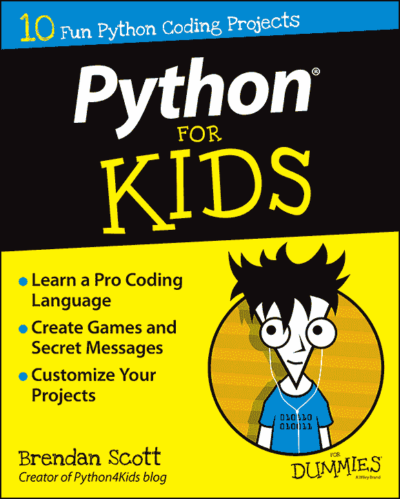

# 引言

你好！欢迎阅读本书。你将开启一段探索 Python 全世界的之旅。如果你加入我的行列并跟随项目一起编写代码，在本书结束时，你将掌握基础 Python 编程的翅膀。

书中的所有内容，你都需要通过*实践*来掌握——输入代码，或者更好的办法是在阅读我写的代码之前，先构思出代码。

## 关于本书

本书将带你了解 Python 编程中需要的所有部分。你会获得很多示例。我会谈论如何规划程序。我还会帮助你与更广泛的 Python 社区联系，这样在你掌握了书中的项目后，就可以走向更大的舞台了。

## 使用的约定

在阅读时，请记住以下几点：

*   有些单词会用*斜体*表示，随后我会对其它们进行解释。这里有一个例子：“列表中的对象被称为*元素*（elements）。”当你看到这句话时，你就知道要留心寻找定义了。（“元素”就是列表中的对象。）

*   Python 代码使用的字体与其他文本不同。有时它会内联在文中，看起来像这样：`print('Hello World!')`。

*   有时它是一个独立的文本块，如下所示：

    ```
    print('Hello World!')
    ```

*   某些代码块的行首有 `>>>`。我这是在向你展示在使用交互式 Python 提示符时会发生的情况。你需要将书中 `>>>` 之后的代码输入到你电脑上运行的 Python 控制台中，才能看到发生的结果：

    ```
    >>> my_message = "Hello World!"
    >>> print(my_message)
    ```

*   每行代码开头的空格数是重要的。行的长度（技术上来说）并不重要，但 Python 风格指南建议每行不超过 79 个*字符*（字母、数字、空格或标点符号）。本书没有你的屏幕那么宽；它只允许我每行显示 69 个字符。我在书中*折断*（拆分）了一些代码行。我将它们拆分是为了确保代码能够正常运行并以正确的方式打印。在输入这些代码时要小心！折断行开头到底有多少个空格并不总是清晰。

*   我通过两种方式拆分行。

    *   第一种是*隐式地*。基本上，你可以在任何一对括号之间的逗号处拆分代码。Python 仍然会将其视为单行。拆分行的第二部分及后续部分应该缩进到括号开启的位置。这里有一个来自项目 9 代码的示例：

    ```
    values = (e.first_name, e.family_name,
              e.date_of_birth, e.email_address)
    ```

    尽管你将它拆分为两行输入，Python 也会将其视为单行。（把它看作一条长行。）按照你看到的样子输入代码，在每行末尾按回车，并在每行开头输入空格，以便行的第一个字符处于正确的位置。

    *   第二种拆分行的方法是通过反斜杠字符*显式地*：`\`（不是 `/`）。这里有一个来自项目 9 的示例：

    ```
    raw_input_prompt = "Press: 1 for training," + \
    " 2 for testing, 3 to quit.\n"
    ```

    你将它们作为两行输入，第一行末尾有 `\`。然而，Python 将其视为单行。

*   仅在项目 2 和项目 3 中使用 Python 解释器时，每个新行都以 `…` 或 `>>>` 开头。如果你在书中的中没有看到这些符号，那么前一行应该作为一条长行输入。例如，以下代码来自项目 2：

    ```
    >>> my_second_message = 'This name is a little long. Ideally, try to keep the name short, but not too short.'
    ```

    这段代码的第二行或第三行开头没有 `…` 或 `>>>`。这意味着你应该在按回车之前将它们全部输入。只有在输入完 `too short.'` 之后再按回车，*而不是*在输入 `little long. and but not.` 之后。

*   有时，你电脑上的输出可能与你在书中看到的略不同。例如，当你在后面的项目中运行程序时，可能会看到一行重启信息。在我的屏幕上，所有后续文本都在同一行：

    ```
    >>> ================================ RESTART ================================
    ```

*   在项目 4 中，你会看到如何自动缩进代码。在此之前，每当你需要缩进代码时，请在添加代码前按四次空格键。如果你需要缩进代码两层，请按八次空格键（那是八次）。

## 盲目的的假设

我在书中尽量没有对你做太多假设。为了使用本书，你需要能够开启电脑并导航启动菜单（在 Windows 上）。安装 Python 时，你需要所安装电脑的管理员权限。

学习任何东西开始都是缓慢的。你需要一点决心来读完本书。

## 书中使用的图标

*    ) `Warning` 图标提醒你要小心！这些信息可以为你节省麻烦。在某些情况下，如果不听警告可能会丢失数据。

*    ) `Remember` 图标：你将在很长很一段时间使用这些信息。将其记入长期记忆。

*    ) `Tip` 图标标记了让编程更简单的快捷方法。

*    ) `Coding Connections` 图标标记了不仅适用于 Python，适用于通用编程的信息。

## 本书之外

你可以在外部找到更多信息。请查看：

*   **快速查表（Cheat Sheet）：**本书有一个在线快速查表，位于 [`www.dummies.com/cheatsheet/pythonforkids](http://www.dummies.com/cheatsheet/pythonforkids)。快速查表包含了 Python 关键字、常用内置函数以及标准库中的选函数。在编写代码时可以作为快速参考。

*   **Dummies.com 在线文章和奖励项目：**除了书中的项目外，还有一些在线奖励项目。你可以从 [`www.dummies.com/extras/pythonforkids](http://www.dummies.com/extras/pythonforkids) 获取它们。

*   [`python4kids.brendanscott.com`](http://www.python4kids.brendanscott.com): 访问我的 Python for Kids 博客。书中的许多项目都源于那里。博客为每个项目都编写了专门的博文，还有许多其他你可以尝试的内容。如果你有反馈，可以在相关的博客页面上留言。

## 接下来该去向哪里

现在，你应该前往 项目 1 了解更多关于这种语言可以做什么以及如何它的安装。在移动到 项目 2 之前，请确保你已经了解了 `Ctrl+C`。然后你就可以准备好编写你的第一个 Python 程序了！你可以根据意愿在各个项目之间进进出。每个项目中的代码都是独立的。但要小心——尽管它们没有使用之前项目的 `code`，但它们通常会使用之前介绍的 `concepts`（概念）。

## 第一周

# 步入 Python

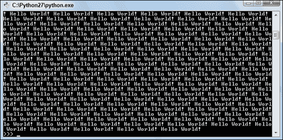

**本周你将……**

 开始上手 Python

 构建 Hello World！

## 项目 1

# 开始上手 Python

在这个项目中，你将接触到 Python：它在哪里被使用以及用途是什么。我将解释 Python 的两个当前版本。这本书侧重于 Python 2.7，并会解释原因。在本章的我的帮助下，你将安装一个 Python 2.7（如果你还没有安装的话）并启动它。我还会告诉你在启动后如何停止它。

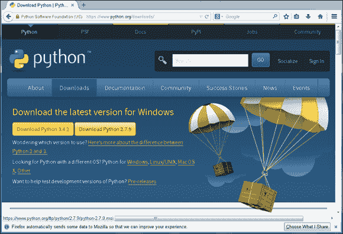 

这个项目还向你展示如何获取 Python 的文档，包括 Python 内置的文档和在线文档。我将为你提供一些在网上搜索 Python 问题答案的方法，以防你以前从未搜索过互联网。你还将读到关于 Python 社区的内容，这是你可以寻求帮助或新点子的地方之一。以上这些，但还没有实际的编程？别担心。实际编程将从 项目 2。

简而言之：如果你已经安装了 Python，并且可以启动和停止它，请直接跳到 项目 2。

## Python 以及它为何如此出色

Python 是一种由名为 Guido van Rossum 的人在 20 世纪 90 年代编写的编程语言。`Programming`语言允许你控制计算机做什么以及做什么。

让 Python 极其棒（也被称为“非常有用且有趣”）的一些特点是：

*   **Python 代码易于阅读和理解。** 事实上，我认为 Python 代码是精妙且美丽的。（嘿，这仅仅是我的观点。）它的美意味着你甚至察觉不到 Python 如何让复杂的事情变得简单。这使得 Python 易于学习，因此非常适合孩子们。

*   **Python 效率高。** 它让艰巨的任务变得简单。与其他编程语言相比，使用 Python 完成几乎任何编程任务都更容易。计算机专家称之为 `RAD`（快速应用开发）。

*   **Python 是危险的。** 它拥有巨大的力量。但能力越大，责任越大。（记得蜘蛛侠吗？）你必须将你的力量用于行善，而不是作恶。（如果你想把它们用于作恶，你现在必须停止阅读了。）

*   **Python 是一种脚本语言。** 程序被输入 Python 解释器中，由解释器直接运行它们，因此不需要编译（某些其他语言就是这样）。获取你的 Python 代码的反馈更快、更简单（例如发现错误）。Python 意味着你可以更快地完成并 `execute`（运行）你的程序，这让编程变得有趣！

*   **Python 是跨平台的。** 无论人们使用什么种计算机操作系统，几乎任何人都可以使用它。你可以在 Windows、Mac 和 Linux 个人电脑上运行几乎任何 Python 程序，也可以从大型服务器到像树莓派这样的微型计算机。（一个专门针对树莓派的项目在 [`dummies.com/go/pythonforkids`](http://www.dummies.com/go/pythonforkids) 等候着你。）你甚至可以在 Android 和 iOS 平板上运行 Python 程序。我甚至用我的 Android 平板编写了书中的一些早期项目。

*   **Python 对变量使用动态类型。** 如果你以前没做过编程，这对你可能没有意义。动态类型变量让编程变得更容易，因为它们让你直接开始使用变量，而不需要先向计算机解释变量应该是什么。

*   **Python 从第三方模块中获得大量帮助。** 这意味着许多其他人（第三方）编写了库。`library`（库）是一组用于执行特定任务的代码。这让你的工作变得更简单，因为你每次编写新程序时都不需要从零开始；有时你可以使用已经写好的库。线上的 Minecraft 项目使用第三方库来更改树莓派上的 Minecraft 游戏。

*   **Python 是免费软件。** 这意味着 Python 的许可条款尊重你的自由。我认为这很重要。你可以免费下载并运行 Python，你编写的任何程序都属于你。

## 谁在使用 Python

Python 几乎无处不在。

*   **太空领域：** 国际空间站 Robonaut 2 机器人使用 Python 作为其控制系统。Python 计划用于 2020 年的火星任务，以采集样本。

*   **粒子物理实验室：** Python 帮助分析来自 CERN 大型强子对撞机的原子碰撞实验数据。

*   **天文学：** MeerKAT 望远镜阵列（南半球最大的射电望远镜）使用 Python 进行其控制和监控。

*   **电影制工作室：** 工业光特效公司（星球大战）使用 Python 自动化其制作流程。Side Effects Software 的计算机成像程序 Houdini 使用 Python 作为其编程接口并编写脚本。

*   **游戏行业：** Activision 使用 Python 进行游戏构建、测试和分析。他们甚至使用 Python 来发现互相作弊的人。

*   **音乐行业：** Spotify 音乐流服务使用 Python 向你推送音乐。

*   **视频行业：** Netflix 使用 Python 确保电影 `stream` 流畅。YouTube 也在使用 Python。

*   **互联网搜索：** Google 在其早期开发阶段到处使用 Python。

*   **医学：** Nodality 公司使用 Python 处理他们用于寻找癌症治疗方法的信息。

*   **操作系统（管理数据）：** Linux 和 Mac OSX 等操作系统使用 Python 执行其部分管理功能。

*   **智能门铃：** Rupa Dachere 和 Akkana Peck 说，你可以通过 Python 实现家居自动化，为房屋连接传感器。通过它你可以例如自动开启关闭窗帘，或者在你进入房间时自动开灯。

## 使用 Python 制作

在学习这本书时，你将完成这些事情：

*   制作一个练习乘法表的数学训练器。

*   制作一个简单的 `encryption`（加密）程序。

*   在树莓派上使用 Python 来处理和修改你的 Minecraft 世界。（该项目请参见 [`dummies.com/go/pythonforkids`](http://www.dummies.com/go/pythonforkids)。）

当你磨炼了这些厉害的技能并准备好继续时，还有其他事情你可以做：

- 使用 `Tkinter`（或其他组件集），你可以编写使用图形而非仅仅是文本来与用户交互的用户应用程序。

- 你可以通过编写自定义脚本来扩展其他程序，如 `Blender`（一个 3D 建模程序）、`GIMP`（一个 2D 照片修饰程序）和 `LibreOffice`（办公软件）等许多程序。我曾不得不去修复我在 `Blender` 中制作的一些 3D 模型。手动完成这些需要花费永远的时间，所以我写了一个 `Python` 脚本来快速完成它们。

- 你可以使用 `Tkinter` 或 `Pygame` 或 `Kivy` 库编写带有图形的游戏。本书中的游戏仅是文本形式的。

- 你可以使用 `matplotlib` 库为你的数学或科学课程绘制复杂的图表。

- 使用 `openCV` 库，你可以进行计算机视觉实验。对机器人感兴趣的人使用它来帮助机器人看到并抓取物体，并在移动时避开障碍。

无论你想让它做什么，很有可能已经有人写了代码来实现它，或者帮助你自己完成它。

# 理解本书的教学方法

这个标题只是为了给你的父母留下深刻印象。（我希望他们没有在读这一部分。但看：如果他们没看到那个标题，告诉他们这本书*有*教学方法——*ped-uh-goj-i-cul*。它的意思是教育或教学。）

本书的目的是为你提供关于在 `Python` 中编程所需的编程概念信息。这本书是为你写的——一个能够学习 `Python` 的孩子。

## 我很详尽

详尽。我会包含所有内容吗？没有。`Python` 的许多方面有很多选项。如果我带你学习每个选项的所有可能性，你会睡着的（或把这书扔出窗外）。如果你做了其中任何一件事，你就无法学习了。

在阅读时，请记住，我尝试向你介绍足够的信息，让你成为一名 `Python` 程序员，但又不会多到让你需要超能力才能读完。请利用文档和帮助信息自行扩展。

你从 `core`（核心）原理开始学得相当缓慢。如果你觉得进展不够快，请跳着看！示例通常是自包含的。这意味着你最终将获得许多较小的项目，而不是几个大项目。我故意这样做是为了让你按照自己喜欢的任何顺序来完成项目。已经有足够的人告诉你该做什么了。你可以在书中去任何你想去的地方。

早期的项目使用简单的英语，而不是技术词汇。随着阅读的深入，你会看到更多术语。你得到的引导也会越来越少。书越得越后，你越需要努力。

## 我会带你进行编程

项目试图向你展示真实的编程，而不会让你无聊流泪。当你编写自己的代码来解决自己的问题时，你需要能够完成工作的方法和方法（*工具*）。我通过带你完成每一个项目来教你这些工具。尝试每一步——不要跳过任何一步。

如果你想*运行*可工作的程序，请跳到项目末尾并剪切粘贴。如果你想*学习* `Python`，那么请把每个项目视为一段旅程，而不是一个终点。和我一起完成项目并亲手输入。

## 我很实用

希望你可以将这些项目应用到日常生活的某些事情中。也许它们能帮助你完成作业，或者让你存储私密笔记。我从小处着手，远大梦想。在从第一个项目中学习概念时，请和我一起大大梦想。

# 在 Mac OSX 上安装 Python

要在 Mac OSX 计算机上找到并启动 `Python`，请遵循以下步骤：

1. 按 `Cmd+spacebar` 打开 Spotlight 搜索。

2. 输入单词 `terminal`。

   或者，从 `Finder` 中，选择 `Finder` ⇒ `Go` ⇒ `Utilities` ⇒ `Terminal`。

   `Terminal` 窗口将打开。

3. 在终端中，输入 `python`。

   Mac OSX 内置的 `Python` 解释器将打开。

# 在 Windows 上安装 Python

遗憾的是，Windows 并不自带 `Python`。如果你正在运行 Windows，你需要按照此处的说明下载并安装 `Python`。在 Windows 上安装 `Python` 并不困难。如果你能从网站下载文件，你就具备了安装 `Python` 的技能。

幸运的是，`Python Foundation`（引导 `Python` 开发的人们）从其网站提供了可安装的文件。


当我进行安装时，我发现 `Firefox` 和 `Internet Explorer` 对 `Python` 下载网站的响应不同，因此说明是基于使用哪种浏览器的。如果你使用了完全不同的浏览器，请尝试 `Internet Explorer` 的说明。

### 使用 Firefox

在带有 `Firefox` 的 Windows 机器上安装 `Python`，请遵循以下步骤：

1. 访问 [`www.python.org/downloads`](http://www.python.org/downloads)。
2. 点击显示 `Download Python 2.7.9` 的按钮。
   或者，如果有，点击以 `2.7` 开头的更更新版本号。
   点击此按钮会自动为你下载并保存一个 `msi` 文件。如果没有，请尝试 `Internet Explorer` 的说明。参阅图 1-1。
3. 下载完成后，点击 `Firefox` 下载图标。
4. 点击名为 `python-2.7.9.msi` 文件（或你下载的更新版本）。

`Python 2.7.9` 将安装在你的电脑上。

### 使用 Internet Explorer

在带有 `Internet Explorer` 的 Windows 机器上安装 `Python`，请遵循以下步骤：

1. 访问 [`www.python.org/downloads`](http://www.python.org/downloads)。
2. 点击显示 `Download Python 2.7.9` 的按钮。
   或者，如果有，点击以 `2.7` 开头的更更新版本号。
   点击此按钮会自动为你下载并保存一个 `msi` 文件。如果没有，请尝试 `Firefox` 的说明。

在开始菜单搜索栏中输入 `Python`，或点击“所有程序”。在 `Python 2.7` 文件夹中，你应该找到以下条目（见图 1-4）：

* `IDLE (Python GUI)`
* `Module Docs`
* `Python (command line)`
* `Python Manuals`
* `Uninstall Python`

# 为 Linux 安装 Python

如果你正在运行 Linux，请确认你安装了版本 `2.7.9` 的 `Python`，而不是版本 3。这应该不是问题，因为在最新版本的 `OpenSuSE`、`Ubuntu` 和 `Red Hat Fedora` 中，默认安装了 `Python 2.7`。

在有人只有 `Python 3` 但没有 `Python 2.7` 的极端情况下，请阅读你发行发行版的文档，了解如何使用包管理器获取 `Python 2.7`。

在这些中，你将用到：

* `IDLE` (Python GUI)
* `Python` (命令行)

为了让 `IDLE` 和命令行更容易找到，请将它们固定到你的开始菜单：

1. 打开你的开始菜单。
2. 选择所有程序 ⇒ `Python 2.7`。
3. 右键点击 `IDLE` (Python GUI)。查看图 1-5。
4. 选择“固定到开始菜单”。
5. 右键点击 `Python` (命令行)。
6. 选择“固定到开始菜单”。

你应该会在开始菜单的顶部看到这些条目。如果你愿意，也可以将它们固定到任务栏。

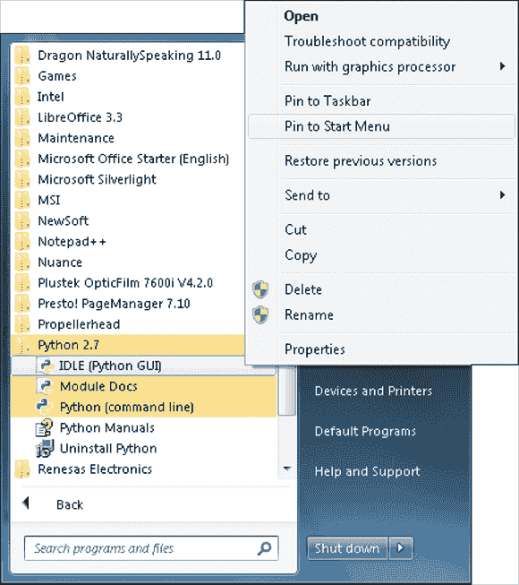

图 1-5: 右键点击将 Python 固定到你的开始菜单。

## 启动 Python 解释器

如果你不能启动 Python，就无法使用这本书。点击你固定到开始菜单的 `Python` (命令行)。

 如果你还没有固定它，请去这样做。不，我是认真的。你也可以在搜索栏中搜索 `Python`，并在结果的“程序”部分点击 `Python` (命令行)。

你将得到一个看起来像图 1-6 的窗口。

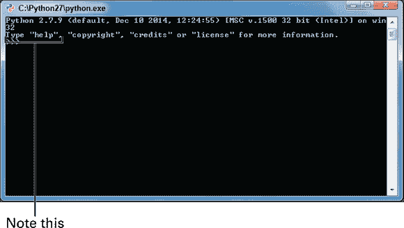

图 1-6: Python 命令行提示你如果你需要帮助可以输入 `help`。

## 使用 Python 的内置文档

Python 自带帮助功能。事实上，在图 1-6 中，它甚至在欢迎消息中告诉了你。如果你输入 `help` 并按回车，你将获得更多帮助选项。输入 `help()`（包括括号）来获取交互式帮助，就像你在图 1-7 中看到那样。

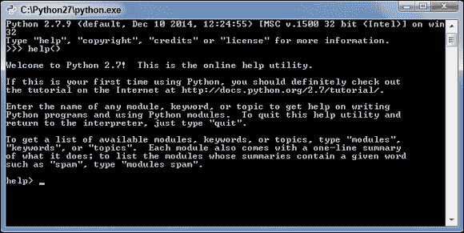

图 1-7: Python 的交互式帮助已准备好让你输入。

 一旦你进入了帮助服务，就可以获取任何主题的信息。只需输入主题即可。帮助服务无法处理复杂的查询（比如你搜索互联网时使用的那些），所以请保持简单。例如，与其输入我如何获取一个数字范围，不如输入 `range`（并阅读它的内容）。要退出交互式帮助，输入 `quit`。你可以为自己的程序编写帮助。你将在项目 5 中完成。

## 停止解释器

如果你不能启动 Python，就无法使用这本书，但在启动 Python 后，你会想要停止它。如果你等不及开始编程了，请跳到项目 2。你可以通过执行以下操作之一从命令行停止 Python：

* 输入 `exit()`，包括括号。按回车。（这在任何平台上都有效；如果你在 Mac 上，回 Enter 等同于 Return。）
* 点击 Python 运行所在窗口的关闭图标。
* 在 Windows 上，输入 `Ctrl+Z` 然后按回车。
* 在 Linux 和 Mac 上，输入 `Ctrl-D`。

 如果你使用的是 Mac，请确保你使用的是 `Ctrl` 键，而不是 command 键。此外，每当我提到 Enter 时，对你来说就意味着 Return。

## 查找 Python 文档

正如我提到的，这本书并没有涵盖你用 Python 可以完成的每一个潜在操作。我无法在一本书中做到这一点。相反，这本书像通过痘疹一样让你接触 Python 编程。以这本书作为起点。如果你想获得更多信息，你应该查看：

* Python 的在线文档
* Python 的内省功能
* 教授互联网 (Professor Internet)
* 源代码（没多少）

### Python 的在线文档

Python 文档页面可以在 `https://docs.python.org/2.7/` 获取。这里列出了最有帮助的部分：

* Python 语言参考指南和 Python 标准库文档位于 `https://docs.python.org/2.7/reference/index.html`

 在左侧侧边栏中，你可以获取任何主题的信息。只需输入主题即可。帮助服务无法处理复杂的查询（比如你搜索互联网时使用的那些），所以请保持简单。例如，与其输入我如何获取一个数字范围，不如输入 `range`（并阅读它的内容）。

### 教授互联网

我喜欢称之为“教授互联网”为第三种帮助。当你搜索互联网时，请确保将 Python 作为你的搜索词之一，后面跟上你感兴趣的问题。

### 源代码

源代码是最后的帮助形式。请记住 Python 是一种解释型语言。这意味着你读到的就是计算机执行的内容。因此，如果你想知道某些第三方模块是如何运作的（Python 核心不是用 Python 写的），你可以直接查看并看到它是实现的。

## 加入更广泛的 Python 社区

查看外面的 Python 社区。寻找与 Python 相关的互联网论坛。Stackoverflow 网站 (`http://stackoverflow.com/questions/tagged/python`) 在我解决问题时很有帮助。

Python 的变化或`演进`发生在你使用一种名为 Python 增强提议（被称为 `PEPs`）的提案文档时。每个 `PEP` 都会对 Python 提出某些更改；这些更改要么被采用，要么被忽略。它们可能会为你提供有关某个功能是如何添加到 Python 中的历史信息。

你可以忽略大多数 `PEPs`，但当你准备好离开本书中的项目时，请务必查看以下两个项目：

* `PEP 8, Python 代码风格指南` 包含了关于如何格式化你的 Python 代码的规则。例如，它建议了代码块的缩进量（参见 项目 2）。它还有关于命名的规则（称为 `conventions`，即约定）。在书中，我尽力遵循了 `PEP 8` 规则，但有时行会比它们推荐的要长。
* `PEP 257, Docstring 约定` 设置了与文档字符串（docstrings）相关的不同约定。文档字符串用普通语言解释程序（或程序的某部分）在做什么。你在 项目 5 中会遇到文档字符串。

 你不需要遵循（`comply` with）`PEPs`，但请尝试这样做。这会让其他人更容易阅读你的代码。嘿，这也会让你自己更容易读懂自己的代码。我早期的 Python 代码并不符合 `PEP 8` 标准，回过头来看它们真是一件痛苦的事。像名称中的大写字母这样的小事也会产生影响。

### Planet Python 与 PyCon

Planet Python ([`http://planetpython.org`](http://planetpython.org/)) 汇集了许多与 Python 相关的博客。对于初学者来说，许多文章可能很难理解，但像其他任何事情一样，坚持下去——它们会变得清晰。许多顶尖的 Python 程序员在 Planet Python 上都有自己的博客。通过关注它们，你可以学到很多东西。我也是如此。

Python 程序员经常在世界各地的会议上聚集。这些会议（`confs`）被称为 `PyCon`，并将地点添加到名称中。例如，在澳大利亚举办的会议被称为 `PyCon-AU`。请访问 [`www.pycon.org`](http://www.pycon.org) 查看地点列表。

我并不是建议你飞往澳大利亚去参加 `PyCon-AU`（甚至只是参加一个离你最近的会议）。然而，我*确实*建议你上网查看这些 `confs` 的视频。来自各种 `PyCons` 的视频会随着时间推出现在 [`http://pyvideo.org`](http://pyvideo.org) 上去那里，浏览，找到你觉得有趣的内容并观看。这是快速了解（或深入研究）新事物的的一种极佳方法。

 如果你能找到它们，看一眼 `PyCon` 演讲的幻灯片。幻灯片稍微难找一点，但更容易下载和复习。先看它们。我通常只根据幻灯片来学习，但你可能决定也下载视频。

## 处理问题

错误主要有两种类型：

* `syntax`（语法）错误基本上意味着你犯了标点符号方面的错误。这些是最常见的错误。习惯于仔细阅读你输入的内容，并仔细将其与你*应该*输入的内容进行对比。

 如果你在让其中一个代码示例正常运行遇到困难，首先要做的事情是确保你完全按照编写的内容重新输入了代码。

* `Logic`（逻辑）错误发生在你误解了你想做的事情或你要求 Python 做的事情时。这些错误很难发现，也更难追踪。将你实际得到的输出与你*应该*得到的输出进行比较。这意味着你需要某种方法来推导出你应该收到的输出。项目 6 展示了一个逻辑错误以及识别和解决它的错误的步骤。


当 Python 遇到错误时，它会尝试给你一个关于哪里出了问题以及什么错误的提示。试着理解 Python 的信息。它通常会给你提供一个很好的起点。

有时你之所以遇到错误是因为你假设了错误的事情。如果你看不出哪里错了，想想要你所做的假设。如果你没有任何进展，做点别的事情并重置大脑。去喝点水，给 Fluffy 喂喂食，或者站起来走走。做一些能让你的注意力转移到别处但不会占用你大脑的事。（例如，刷 Instagram 不是个好主意。）当你完成这些后，回到你的 Python 问题上。新鲜视角和新鲜大脑将帮助你从不同的角度看待问题，并希望引导你找到解决方案。如果其他方法都失败了，编写代码时带上 Fluffy（或者你的狗、金鱼或你的宠物石）在身边。当你遇到无法解决的问题时，停下手头的工作，向你的宠物或物体解释这个问题。

 大声说出来是一种古老的 `debugging`（调试，错误修复）技术。它有效是因为，为了向别人解释问题，你必须首先自己理解它。

你需要用语言来表达你的问题，因为这会让你大脑的不同区域开始工作，让你对问题产生不同的思考方式。如果你像我一样没有任何进展，就做点别的事情并重置大脑。

## 学习学习

仅仅看书是不够的。你必须`做`。

### 去做

认真的。如果你想学习，就必须实际去`做`。

### 犯错

如果你做了，你就会出错。（使用 `Save As` 备份。）

每个写代码的人第一次都会出错。拼错一个单词。

 犯错和实践同样重要。

这完全正常。事实上，编写程序是一个过程，它会有弯路和挫折。专业程序员每天都会出错。这不会困扰他们，因为他们编写的是可以处理的小片段，并且会测试他们所做的东西。

### 思考

当你出错，或者你的代码运行结果不像你预期的那样时，花时间思考为什么。犯错本身并不能教会你，但它是思考路径的一部分。

*   简要介绍了 Python 社区

# 项目 2

# Hello, World!

在 项目 1 中，你安装了 Python 并启动了解释器。项目 2 将带你进入真正的 Python 世界，让你从一个普通的普通成员转变为一名接受训练的 Python 程序员。

按照传统，当你学习一种新的编程语言时，`Hello World!` 是编写的第一个程序。当你创建这个项目时，你正在遵循许多伟大程序员的足迹。

在这个项目中，你将看到如何通过`输出`一条简单的消息来从程序向用户传递信息。你将看到 Python 如何记住信息，以及你如何为你要求 Python 记住的信息命名。这意味着你可以在程序的其他部分复用这些信息。

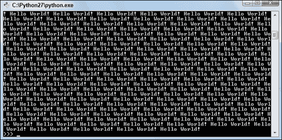

你将看到 Python 如何在你的程序中运行，如果程序出错该如何停止它，以及如何让程序变得有点“疯狂”（以测试如何停止它）。最后，查看一些核心程序技术（称为`循环`），你将用它们用问候语填满屏幕。

## 编写 Hello World!

要创建你的 `Hello World!` 程序，请遵循以下步骤：

1.  打开开始菜单并选择 Python（命令行）。

    你在 项目 1 中已将其固定到菜单中。你应该会得到一个看起来像 `>>>` 的提示符。

     本中的代码列表使用了不同的字体，以向你展示它们是 Python 代码。

    目前，你正在 Python 解释器的`交互模式`中进行所有操作。这就是 `>>>` 出现的地方。当你应该输入内容时，Python 会为你显示 `>>>`。

2.  在提示符处输入以下内容。开头和结尾都使用单引号——它在回车键旁边：

    ```
    print('Hello World!')
    ```

3.  按下回车键。

    Python 运行你输入的代码。

    你会看到图 2-1 中显示的输出。恭喜——你写了你的第一个程序。欢迎来到 Python 程序员训练俱乐部。

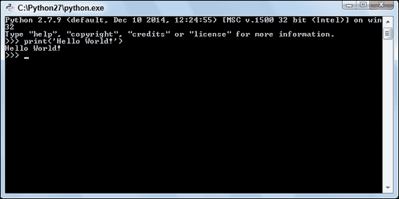

图 2-1: 你的 `Hello World!` 程序准备好接受更多指令了。

如果你没有看到图 2-1 中的内容，请检查输入的步骤 2 文本是否与编写完全一致：

*   检查括号和单引号的位置是否正确。

*   检查每个左括号是否有对应的右括号。（否则，你的程序就会悬而未决。）

*   检查每个左引号是否有对应的右引号。

 编程语言有自己的语法和标点规则。这些规则就是语言的`语法`。人类即使在语法不完美的情况下也能理解大部分内容（看到吧？你已经明白我想表达什么了），但如果你写错了语法，Python 几乎会抓狂。

## 发现并修复错误

Python 解释器会接收每一行代码并在你按下回车键后（某种程度上）立即对其进行操作。在 `Hello World!` 中，你使用了 Python 的 `print` 功能。`print` 获取括号内的内容并将其输出到命令行（也称为`控制`）。

Python 对语法和标点都很敏感。如果你拼错了某些内容，程序将无法工作。如果 Python 期望特殊字符而你没有提供，Python 就会失败。这里显示了一些 Python 问题。你能想出该如何修复它们吗？

```
>>> pritn('Hello World!')
Traceback (most recent call last):
  File "<stdin>", line 1, in <module>
NameError: name 'pritn' is not defined
```

还有这：

```
>>> print('Hello World!)
  File "<stdin>", line 1
    print('Hello World!)
SyntaxError: EOL while scanning string literal
```

还有这：

```
>>> print 'Hello World!')
  File "<stdin>", line 1
    print 'Hello World!')
               ^
SyntaxError: invalid syntax
```

Python 尝试告诉你它失败的原因（即 `NameError` 和 `SyntaxError`）。

检查以下每项：

*   所有命令都拼写正确（失败 1）

*   每个左引号都有匹配的引号（失败 2）

*   每个左括号都有对应的右括号（失败 3）

## 使用字面量进行操作

在 `Hello World!` 中，你使用了 Python 的 `print` 功能。`print` 获取括号内的内容并将其输出到命令行（也称为`控制`）。

Python 对语法和标点都很敏感。如果你拼错了某些内容，程序将无法工作。如果 Python 期望特殊字符而你没有提供，Python 就会失败。这里显示了一些 Python 问题。你能想出该如何修复它们吗？

```
>>> pritn('Hello World!')
Traceback (most recent call last):
  File "<stdin>", line 1, in <module>
NameError: name 'pritn' is not defined
```

还有这：

```
>>> print('Hello World!)
  File "<stdin>", line 1
    print('Hello World!)
SyntaxError: EOL while scanning string literal
```

还有这：

```
>>> print 'Hello World!')
  File "<stdin>", line 1
    print 'Hello World!')
               ^
SyntaxError: invalid syntax
```

Python 尝试告诉你它失败的原因（即 `NameError` 和 `SyntaxError`）。

检查以下每项：

*   所有命令都拼写正确（失败 1）

*   每个左引号都有匹配的引号（失败 2）

*   每个左括号都有对应的右括号（失败 3）

## 将字符串真的保存到变量中

好了，现在你是字符串字面量的大师了。在 Python 定义一个字面量后，它会被忘记（就像你可能会忘记做家务一样）。Python 将字面量存储在内存中，然后认为它们没有被使用，因此通过一个名为`垃圾回收`的程序将其丢弃。（不，我没在编造。）就像你把东西留在地板上，别人认为你没在用就把它扔进了垃圾桶一样。

 如何让 Python 不再认为你的字面量（literal）没有被使用？给你的字面量起一个名字。这样 Python 就不会把它扔进垃圾桶了。这就像在它上面贴了一张纸，上面写着“这是我的！”

你可以这样给字面量命名：

1. 想出一个符合这些步骤之后后列出的 `criteria`（标准）规则的名字。

2. 将名字放在等号（`=`）的左侧。

3. 将字面量放在等号的右侧。

这里有一些示例名称：

```python
>>> my_message = 'Hello World!'
>>> my_second_message = 'This name is a little long. Ideally, try to keep the name short, but not too short.'
```

你使用的每个名字都必须 `comply`（遵循）这些规则：

*   它应该描述字面量的用途。例如，对于包含问题文本的字面量，`text_for_question` 是一个很好的名字（如果你正在向用户提问）。但 `another_var` 是一个很糟糕的名字，因为它没有描述这个变量。

* 以字母或下划线开头。（以下划线 `_` 开头有特殊含义。你现在可以避免使用。）

* 可以包含下划线（通常应该只由小写字母和下划线组成）。

* 可以包含数字。

* 可以包含大写字母（但虽然可以，并不意味着你应该这样做；在字面量名字中要避免大写字母）。

* 不能包含空格。

* 不能与任何 Python 关键字相同。（此项目有一个关键字列表。）

使用一个名字来指代你所命名的内容。每当你使用一个名字时（赋值语句的左侧除外），Python 的行为就像是你完整地重新输入了该名字所指向的值。

`value`（值）是一个被名字引用的东西。在较早的示例中，唯一的值是字面量。你将在后面的项目中看到不同类型的值。

 每当你给字面量（或任何其他值）赋予名字时，你都在进行一次 `assignment`（赋值）。在 `my_message = 'Hello World!'` 中，值 `'Hello World!'` 被赋值给名字 `my_message`。

你可以像这样重写你的 Hello World! 程序：

```python
>>> my_message = "Hello World!"
>>> print(my_message)
Hello World!
```

这把名字 `my_message` 赋值给字面量 `"Hello World!"`。（记住，名字在等号的左侧，字面量在等号的右侧。）然后打印你命名为 `my_message` 的字面量。

当你创建一个名字后，可以通过对不同的字面量使用相同的命名过程来改变它指向的内容。或者使用另一个名字（因为引用名字等同于重新输入）。为了唤起记忆，这是项目之前的代码：

```python
>>> my_message = 'Hello World!'
>>> my_second_message = 'This name is a little long. Ideally, try to keep the name short, but not too short.'
```

现在，开动脑筋，将第二个名字赋值给第一个名字并打印它：

```python
>>> my_message = my_second_message
>>> print(my_message)
This name is a little long. Ideally, try to keep the name short, but not too short.

>>> my_message = 'A third message'
>>> print(my_message)
A third message

>>> print(my_second_message)
This name is a little long. Ideally, try to keep the name short, but not too short.

>>> my_message = 'Hello World!'
```

 你是否注意到，通过改变或更改某个东西所属的名字，你就无法再访问该名字之前指向的内容了？别担心。计算机最实用的功能之一就是你可以这样改变名字。因为它们是可以改变的，所以它们被称为 `variables`（变量）。因此，你可以说 `my_message` 是（变量的）名字，而变量的值是“Hello World!”。设置或改变变量的值被称为 `assignment`（赋值）。

此外注意 `my_second_message` 的值没有变化。赋值过程中，唯一变化的是等号左侧的变量名。

你可以给变量赋值数字并对它们进行加、减和比较：

```python
>>> a = 1
>>> b = 2
>>> print(a)
1
>>> print(b)
2
>>> print(a+b)
3
>>> print(b-a)
1
>>> print(a<b)
True
```

这个示例确实使用了非常短的名字！符号 `<` 意味着“小于”。`a<b` 是在询问 Python `a` 小于 `b` 是否为真。在这种情况下，`a` 是 1，`b` 是 2。`a` 小于 `b`，所以 Python 将其识别为真并打印 True。

你甚至可以在等号两边引用同一个变量来改变变量所持的内容。例如，要让变量 `a` 增加 1，你可以这样做（使用前面代码中的值 `a=1`）：

```python
>>> a = a+1
>>> print(a)
2
```

## 无限循环

 每当你给字面量（或任何其他值）赋予名字时，你都在进行一次 `assignment`。在 `my_message = 'Hello World!'` 中，值 `'Hello World!'` 被赋值给名字 `my_message`。

你可以这样重写你的 Hello World! 程序：

```python
>>> my_message = "Hello World!"
>>> print(my_message)
Hello World!
```

这把名字 `my_message` 赋值给字面量 `"Hello World!"`。（记住，名字在等号的左侧，字面量在等号的右侧。）然后打印你命名为 `my_message` 的字面量。

当你创建一个名字后，可以通过对不同的字面量使用相同的命名过程来改变它指向的内容。或者使用另一个名字（因为引用名字等同于重新输入）。为了唤起记忆，这是项目之前的代码：

```python
>>> my_message = 'Hello World!'
>>> my_second_message = 'This name is a little long. Ideally, try to keep the name short, but not too short.'
```

现在，开动脑筋，将第二个名字赋值给第一个名字并打印它：

```python
>>> my_message = my_second_message
>>> print(my_message)
This name is a little long. Ideally, try to keep the name short, but not too short.

>>> my_message = 'A third message'
>>> print(my_message)
A third message

>>> print(my_second_message)
This name is a little long. Ideally, try to keep the name short, but not too short.

>>> my_message = 'Hello World!'
```

 你是否注意到，通过改变或更改某个东西所属的名字，你就无法再访问该名字之前指向的内容了？别担心。计算机最实用的功能之一就是你可以这样改变名字。因为它们是可以改变的，所以它们被称为 `variables`（变量）。因此，你可以说 `my_message` 是（变量的）名字，而变量的值是“Hello World!”。设置或改变变量的值被称为 `assignment`（赋值）。

此外注意 `my_second_message` 的值没有变化。赋值过程中，唯一变化的是等号左侧的变量名。

你可以给变量赋值数字并对它们进行加、减和比较：

```python
>>> a = 1
>>> b = 2
>>> print(a)
1
>>> print(b)
2
>>> print(a+b)
3
>>> print(b-a)
1
>>> print(a<b)
True
```

这个示例确实使用了非常短的名字！符号 `<` 意味着“小于”。`a<b` 是在询问 Python `a` 小于 `b` 是否为真。在这种情况下，`a` 是 1，`b` 是 2。`a` 小于 `b`，所以 Python 将其识别为真并打印 True。

你甚至可以在等号两边引用同一个变量来改变变量所持的内容。例如，要让变量 `a` 增加 1，你可以这样做（使用前面代码中的值 `a=1`）：

```python
>>> a = a+1
>>> print(a)
2
```


## 变量与赋值

 每当你给字面量（或任何其他值）赋予名字时，你都在进行一次`assignment`（赋值）。在`my_message = 'Hello World!'`中，值`'Hello World!'`被赋值给名字`my_message`。

你可以这样重写你的 Hello World! 程序：

```python
>>> my_message = "Hello World!"
>>> print(my_message)
Hello World!
```

这把名字`my_message`赋值给字面量`"Hello World!"`。（记住，名字在等号的左侧，字面量在等号的右侧。）然后打印你命名为`my_message`的字面量。

## 无限循环（继续）

 每当你给字面量（或任何其他值）赋予名字时，你都在进行一次`assignment`。在`my_message = 'Hello World!'`中，值`'Hello World!'`被赋值给名字`my_message`。

 通常情况下，Python 从上到下处理你的代码，按照遇到指令的顺序执行每条指令。在某些情况下，它会重复你代码的某些部分。这就是 Python 处理`while`的方式。你*可以*从代码的某部分跳转到另一部分，但代码始终从顶部开始执行下一段代码。

当 Python 第一次进入你刚刚创建的代码块时，变量`a`被赋值为值`2`。在代码块的第一行中（`a = a+1`），它增加了 1，因此第一个打印出的值是`3`。当 Python 完成此`print`时，代码块结束。然后 Python 回到代码块的顶部并检查不等条件。由于`a`现在是`3`（且小于`10`），代码块重复执行——`a`增加到`4`并被打印。这种情况会一直持续，直到`a`达到`9`。当`a`等于`10`时，`a`不再小于`10`。条件（`(a < 10)`）不再满足，Python 停止处理`while`。

这种结构被称为*循环*（在本例中为 *while 循环*），因为只要条件保持为真，Python 就会循环语句的代码块。

第一个`while`循环非常短，但它让电脑在过了一会儿后忙了起来（这并不是双关语）。它看起来像这样：

```
>>> while True:
…      pass
```

这是你输入解释器的第一个多行程序。它看起来也似乎什么也没做。这在很大程度上是因为它使用了`pass`关键字。

`pass`关键字告诉 Python 跳过这一行。包含一个不执行任何操作的指令，这看起来有点奇怪，你不觉得吗？`pass`的存在是因为当 Python 看到像`while`这样的关键字时，早晚会遇到一个冒号（看起来像这样： `:`）。这个冒号信号 Python 它即将获得一个代码块。如果解释器没有得到它预期的代码块，它就会报错。

亲眼看看它变得多么多么不快：

```
>>> while True:
…
  File "<stdin>", line 2
    ^
IndentationError: expected an indented block
```

 `pass`关键字的主要作用是在规划程序时让 Python 解释器保持开心。它在你编码时也充当你的视觉标记。

## 深入了解 Python 关键字

官方上，Python 有 31 个*关键字*：

*   `and`
*   `as`
*   `assert`
*   `break`
*   `class`
*   `continue`
*   `def`
*   `del`
*   `elif`
*   `else`
*   `except`
*   `exec`
*   `finally`
*   `for`
*   `from`
*   `global`
*   `if`
*   `import`
*   `in`
*   `is`
*   `yield`
*   `lambda`
*   `not`
*   `or`
*   `pass`
*   `print`
*   `raise`
*   `return`
*   `try`
*   `while`
*   `with`

这些高级关键字没有在书中涵盖：`assert`、`del`、`except`、`exec`、`finally`、`global`、`raise`、`try`和`yield`。

 要记住的一点是，你不能使用关键字作为变量名。（但它可以变量名的一部分。例如，`return`不能作为变量名，但`return_value`就可以。）

尝试给关键字`return`赋值，你会失败：

```
>>> return = 4
  File "<stdin>", line 1
    return = 4
              ^
SyntaxError: invalid syntax
```

如果你在尝试给变量赋值时收到了无效语法（invalid syntax error）消息，你就会知道为什么了。

## 很多循环，很多 Hello

当你了解循环后，你可以在屏幕上散播快乐的问候。输入这些内容并在`print`语句末尾添加一个逗号（在本例中在`print(my_message)`之后），别忘记按`Ctrl+C`停止！

```
>>> my_message = 'Hello World!'
>>> while True:
…      print(my_message),
…
```

逗号是怎么回事？每当你调用一次`print`，你就会得到一条消息。下一次打印时，输出会在新行开始。当你在`print`末尾添加一个逗号时，下次打印时，输出将从上次停止的地方开始，而不会添加新行。

当我年轻的时候，我最喜欢的是类似这样的东西。我在自骗自己呢？图 2-2 显示了我现在最喜欢的程序之一：

```
>>> message = 'Brendan is Awesome!!'
>>> while True:
…      print(message),
```

```
>>> message = 'Brendan is Awesome!!'
>>> while True:
…      print(message),
```

 此列表中的数字 300 被称为`magic number`（魔数），因为它似乎无缘无故、毫无理由地出现在你的代码中间。魔数通常是一个坏主意。当你在程序中使用数字时，最好将该数字赋值给变量。由于你使用了有意义的变量名，这个数字的含义就显而易见了。然后在打算使用数字的地方使用该变量。

在这种情况下，你应该早些添加`NUMBER_OF_HELLOS = 300`，并将范围输入更改为`range(NUMBER_OF_HELLOS)`。这对于一个三行的程序来说没有区别，但随着程序的增长，它就会变得至关重要。

你可能认为自己不需要更改这些数字，但实际上经常需要这样做（例如，在整个开发过程中好几次）。如果这些数字在代码中到处以内联（`inline`）的形式存在（即没有赋值给变量，也没有通过变量引用），那么你就必须找到并修改每一个。此外，由于它只是一个数字，它不具备赋值给具有意义名称的变量时所拥有的上下文；并不总是清楚修改它是否正确。

例如，你可能在代码的另一个部分想要包含 300 个单位的空间。你决定应该是 100 个单位，因此你使用搜索和替换将所有的 300 更改为 100。如果你内联了这些数字，那么你最终也会更改 range 中的 300 并导致你的代码崩溃。

 但是，如果你将这些值存储在变量`NUMBER_OF_HELLOS = 300`和`AMOUNT_OF_SPACE = 300`中，你只需要更改赋值语句（`AMOUNT_OF_SPACE = 100`）。然后每个引用该变量的地方都会自动更新；具有相同值的其他变量（例如`AMOUNT_OF_SPACE = 300`）则不会被改变

## 总结

在这个项目中，你：

* 阅读了什么是字面量（literal）。
* 为名称分配了值并创建了同名的变量。（从技术上说，你正在创建名称。`variable`一词是从其他编程语言遗留下来的。）
* 认识了五个关键词（`for`、`in`、`pass`、`print`、`while`）、一个值（`True`）和一个“内置”函数（`range`）。
* 使用`Ctrl+C`停止了一个失控的程序。

## 第二周

# 构建猜数字游戏

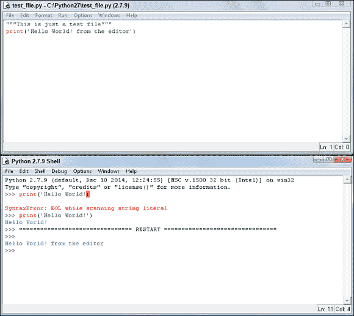

**本周你将……**

 构建猜数字游戏

 设置你的编码环境

 构建一个更好的猜数字游戏

## 项目 3

# 猜数字游戏

你知道吗？你将创建一个游戏，电脑选择一个数字，玩家猜这个数字。

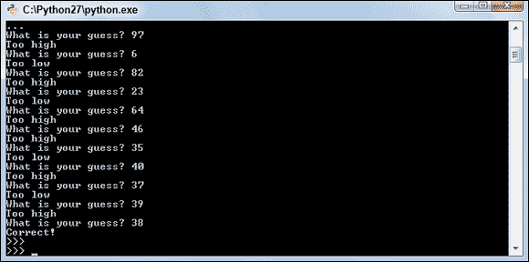

这个项目将教你如何从用户获取输入，以及数字在 Python 中是如何工作的（它们与字符串不同）。你创建一个随机数，并在过程中在自己的项目中复用别人的代码。你还进行了一些调试并追踪逻辑错误。

## 规划游戏

在猜数字游戏中，Python 想出一个随机数。玩家猜这个数字。

* 如果玩家猜对了，Python 会说出来。
* 如果玩家猜错了，Python 会告诉玩家数字大还是小。
* 玩家继续猜，直到猜中正确的数字。

如果你做过项目 2，你已经知道如何告诉玩家某些信息——这就是`print`的作用。然而，你目前对游戏还不知道如何让 Python 想出一个随机数，或者如何从玩家那里获得猜测。

 这种循环——输出、输入、然后处理输入——是许多计算机程序的常用结构。

## 从玩家处获取输入

在实践中，你的程序总是需要来自用户的某种输入。你现在仍在使用命令行，所以文本是获取输入的唯一方式。你通过使用名为`raw_input`的特殊内置函数从用户获取文本。它会等待用户输入内容，并将用户输入返回给 Python。

点击你在项目 1 中固定到开始菜单的 Python（命令行）应用程序，打开 Python（命令行）提示符并现在尝试一下：

1. 在提示符处输入`raw_input()`。
2. 按回车键。
   你会得到一个空行。
3. 输入一个响应。
4. 按回车键。

你在第 1 步中输入的内容会显显：

```python
>>> raw_input()
I am typing a response. Python won't see this until I press Enter.
"I am typing a response. Python won't see this until I press Enter."
```

当你输入响应并按回车键时，你输入的任何内容都会以单引号或双引号的形式返回到终端中。

### 询问输入

 但是，如果你将这些值存储在变量`NUMBER_OF_HELLOS = 300`和`AMOUNT_OF_SPACE = 300`中，你只需要更改赋值语句（`AMOUNT_OF_SPACE = 100`）。然后每个引用该变量的地方都会自动更新；具有相同值的其他变量（例如`AMOUNT_OF_SPACE = 300`）则不会被改变

## 确保事物相等

 你的游戏需要检查猜测是否与电脑的数字相同。这是一种比较（`comparison`）。如果你想测试 a 是否等于 1，你不能写`a= 1:`，因为等号是将值赋值给变量。Python 会读取为“如果取值 1 并将其命名为 a”。

Python 使用特殊的符号来测试两个事物是否相等。该符号是两个等号在一起，如下：`==`。要测试名称 a 是否包含值 1，你会输入`a == 1`。自己尝试一下：

```python
>>> a = 1
>>> a == 1
True
>>> a = 2
>>> a == 1
False
```

为了进一步强化`=`表示赋值的观点，尝试这些：

```python
>>> 1 == 1
True
>>> 1 == 2
False
>>> 1 = 2
  File "<stdin>", line 1
SyntaxError: can't assign to literal
```

当 Python 看到`==`时，它会比较左侧的值与右侧的值。如果它们相等，Python 会将整个语句替换为值`True`。如果它们不等，Python 会将整个语句替换为值`False`。

## 调用运算符

等号和双等号被称为`运算符`。它们在两侧的对象上工作（或进行操作）。表 3-1 包含了更多常见的运算符。每当你想要比较、加、减法等时，请使用运算符。你经常需要它们。

| 运算符 | 名称 | 效果 | 示例 |
| --- | --- | --- | --- |
| `+` | 加法 | 相加两个数字。拼接两个字符串。 | 加： >>> `1+1` `2`拼接： >>> `'a'+'b'` `'ab'` |
| `–` | 减法 | 从一个数字减去另一个。不能用于字符串。 | >>> `1-10` |
| `*` | 乘法 | 相乘两个数字。创建字符串的副本。 | 乘： >>> `2*2` `4`复制： >>> `'a'*2` `'aa'` |
| `/` | 除法 | 用一个数字除以另一个。不能用于字符串。Python 使用`/`是因为你的键盘上没有`÷`。 | 噢天呐！这很复杂。请看下一节。 |
| `%` | 余数（取模） | 返回左数除以右数的余数。字符串的格式化运算符。（参见项目 8）。 | >>> `10%3` `1` |
| `**` | 幂 | `x**y`意味着`x`的`y`次方。不能用于字符串。 | >>> `3**2` `9` |
| `=` | 赋值 | 将右侧的值赋值给左侧的变量。 | >>> `a = 1` |
| `==` | 等于 | 左侧是否等于右侧？如果是，则为`True`；否则为`False`。 | >>> `1 == 1` `True`>>> `'a' == 'a'` `True` |
| `!=` | 不等于 | 左侧是否*不*等于右侧？如果是，则为`True`；否则为`False`。 | >>> `1 != 1` `False`>>> `1 != 2` `True`>>> `'a' != 'A'` `True` |
| `>` | 大于 | 左侧是否大于右侧？`>=`意味着大于或等于 | >>> `2 > 1` `True` |
| `<` | 小于 | 左侧是否小于右侧？`<=`意味着小于或等于 | >>> `1 < 2` `True` |
| `&` (或 and) | 与 | 左右两侧都为真吗？通常用于复杂的条件，你想在所有条件都为真时执行操作：`while im_hungry and you_have_food:` | >>> `True & True` `True`>>> `True and False` `False`>>> `True & (1 == 2)` `False` |
| `|` (或 or) | 或 | 左侧或右侧是否有一个为真？通常用于复杂的条件，当你希望至少有一个条件为真时：`while im_bored or youre_bored:` | >>> `True | False` `True`>>> `True or False` `True`>>> `False | False` `False`>>> `(1 == 1) | False` `True` |

表 3-1 常见 Python 运算符

## 在 Python 中除法

Python 2.7 中的除法有点复杂。当你进行除法时，Python 尝试提供帮助，但通常往往适不益多。原因在于，如果你的数字中有一个带有小数点，Python 会改变答案。

Python 处理小数数字——称为`floats`（`floating point numbers`的缩写）的方式与不带小数的数字不同。（不带小数的数字称为`integer`、整型或`int`。）如果你在 Python 2.7 中尝试用一个整数除以另一个整数，答案将向下取整到最近的整数。这很讽刺，因为这是 Python 2.7。

当你想要在 Python 中进行除法时，使用`/`运算符，如下所示：

```
>>> 3/2
1
>>> -3/2
-2
```

你没有得到 1.5 或 -1.5。你得到了 1 和 -2。你得到 -2 是因为 Python 将负数 -1.5 *向下*取整，而比 -1.5 小的下一个整数是 -2。

 你可以通过给任何一个数字添加小数点来避免取整。添加小数点会让数字变成`float`。如果 Python 正在处理`float`，它会按照你预期的执行操作。

在这个练习中，请确保在`3`或`2`（或两者之后）之后添加一个点（点、句号、小数点——随你如何称呼它）：

```
>>> 3/2.
1.5
```

如果该数字是整数并存储在变量中，你没有地方放置小数点。在这种情况下，使用内置函数`float()`将其转换为`float`，就像这里`3/float(a)`所示：

```
>>> a=2
>>> 3/a
1
>>> 3/float(a)
```


`if`语句以其完整的姿态登场了。这个`if`是`Python`的另一个关键字。该语句后面紧跟着一个条件：在`computers_number`转换为整数后，它是否等于`players_guess`？后面接着是一个冒号，它也被称为“嘿`Python`，请预留一个代码块”。

如果条件为真，`Python`就会`executes`（执行）该代码块。如果条件为假，`Python`将跳过该代码块，并在代码块结束后的下一语句继续执行。你可以将`if`想象成英语中的`if … then`结构（只是去掉了`then`）。

 尝试以下示例，但请记住：

* 每个冒号都标志着一个新代码块即将出现。

* 在冒号后面的一行，以及代码块中的每隔一行，开头都要缩四个空格。

```python
>>> if 1==2:
…      print("Correct!")
…
>>> if 1==1:
…      print("Correct!")
…
Correct!
```

在第一个示例中，由于`1`不等于`2`，因此`print`语句（`"Correct!"`）被跳过了。什么都没有发生。如果代码块中还有其他内容，整个代码块都会被跳过。在第二个示例中，`1`等于`1`，所以执行了`print`语句。你得到了一个巨大的、美味的`Correct!`

## 如果玩家猜错了如何提示

如果玩家猜错了答案会怎样？`Python`在这方面也支持你。

 即使在简单的程序中，也要始终考虑如何为玩家的操作提供反馈。

在下面的代码块中，你看到了`if`关键字。`else`关键字改变了`if`关键字的操作。与`if`不同，`else`不接受条件。当之前的`if`代码块没有被执行时，它总是会被执行。当你想要执行两个代码块之一（而不是两者都执行）时，就会使用`if/else`。

以下代码接在你你离开的地方继续。它假设`computers_number = 17`且`players_guess = '17'`。

```python
>>> if computers_number == int(players_guess)+1:
…          print('Correct!')
… else:
…          print('Wrong! Guess again')
…
Wrong! Guess again
```

在这段代码中，我添加了`+1`来故意让值不同。否则，`else:`代码块将不会执行。

你可以看到`else`后面跟着一个冒号和 —— 这并不意外 —— 一个代码块。你知道它是一个代码块是因为它比`else`的缩进级别多缩进了四个空格。（说到缩进：将`else`关键字的开头与它之前的`if`关键字的开头对齐。）

如果`if`条件为`True`（真），则执行其代码块，而紧随其后的`else`代码块将被忽略。`else`关键字意味着“否则，执行这些内容”。如果条件为`False`（假），则`if`之后的代码块被忽略，而`else`之后的执行块（即代码块）被执行。

即使这样也没有说明为什么猜错了。你必须告诉玩家猜得太高还是太低了。

你需要一个测试。（我知道，测试可能是你*真正*不需要的最后一样。）测试会告诉玩家他们猜是对的、太低了还是太高了。

```python
>>> if computers_number == int(players_guess):
…          print('Correct!')
… elif computers_number > int(players_guess):
…          print('Too low')
… else:
…          print('Too high')
…
Correct!
```

 事实证明`if`还有一个最后的杀锏 —— `elif`。在`if`之后使用`elif`（`else if`的缩写）是为了在第一个条件不满足时测试其他情况。你可以根据需要连续连接任意数量的`elif`。

例如，假设你想在`a`分别等于`1`、`2`和`3`时执行不同的操作。你可以使用`elif`结构分别测试每一个项：

```python
>>> a = 3
>>> if a == 1:
…          print('a is 1!')
… elif a == 2:
…          print('a is 2!')
… elif a == 3:
…          print('a is 3!')
… else:
…          print("I don't know what a is")
…
a is 3!
```

 如果你连续有好几个`elif`，请尝试另一种解决问题的方法。

测试这个`elif`结构是否有效。告诉玩家猜得太高还是太低了：

```python
>>> computers_number = 16
>>> computers_number == int(players_guess):
…      print('Correct!')
… elif computers_number > int(players_guess):
…      print('Too low')
… else:
…      print('Too high')
…
Too high
>>> computers_number = 18
>>> computers_number == int(players_guess):
…      print('Correct!')
… elif computers_number > int(players_guess):
…      print('Too low')
… else:
…      print('Too high')
…
Too low
```

重打一遍。是的，真的。测试这个`elif`结构的工作。关于这个`elif`结构，你可以看到：

* `if`、`elif`和`else`都是对齐的。

* `print`语句缩进了它们。

* `elif`语句在`if`之后。

* `else`语句在最后一个`elif`之后。

* 所有的代码块都缩进了。

## 在玩家猜对之前持续询问

现在你已经知道了如何询问玩家答案，如何将答案转换为数字，以及如何将其与计算机数字进行比较。如果玩家没有猜对，你还需要一个循环。你可以通过以下方式使用`while`循环来实现：

```python
>>> computers_number = 17
>>> prompt = 'What is your guess? '
>>> while True:
…      players_guess = raw_input(prompt)
…      if computers_number == int(players_guess):
…          print('Correct!')
…          break
…      elif computers_number > int(players_guess):
…          print('Too low')
…      else:
…          print('Too high')
…
What is your guess? 3
Too low
What is your guess? 93
Too high
What is your guess? 50
Too high
What is your guess? 30
Too high
What is your guess? 20
Too high
What is your guess? 10
Too low
What is your guess? 19
Too high
What is your guess? 16
Too low
What is your guess? 18
Too high
What is your guess? 17
Correct!
```

`break`语句在这里是粗体的，以便你很容易看到它。`break`语句允许你退出`Python`当前处于的任何循环，无论嵌套循环的条件如何。例如，假设你有一堆颜色，想看看红色是否在其中。你会设置一个循环来遍历所有颜色。但如果你在途中发现了红色（即使是第一次尝试），就没有继续的意义了。你可以使用`break`停止循环。

 `break`也是一个关键字。（你正在快速过完你需要的所有关键字！）只有在循环内部可以使用它：

```python
>>> break
  File "<stdin>", line 1
SyntaxError: 'break' outside loop
```

如果你在一个循环中嵌套了循环，`break`应用于`break`所在的那个循环层（或其相关的流控制语句，因为它总是受条件影响）。

这里是`break`如何工作的示例。在接下来的代码片段中：

* 代码使用了内置的`str()`。`str`内置将数字转换为字符串。你可以使用`+`运算符连接字符串。（运算符在先前的表 3-1 中。）

* 有两个循环 —— 一个`j`的内部循环计数较快，另一个`i`的外部循环计数较慢。

当`i`的值达到`1`（从`0`增加）时，会遇到`break`。由于`break`在内层循环的代码块中，它只会跳出内层循环。你可以发现`i`继续计数到`2`，但当`i`为`1`时，`j`重置为`0`。

```python
>>> for i in range(3):
…      for j in range(3):
…            print(str(i)+", "+str(j))
…            if i == 1:
…              break
0, 0
0, 1
0, 2
1, 0
2, 0
2, 1
2, 2
```

要跳出外层循环，你需要处于外层循环的代码块中。特别是代码`if i == 1:`缩进了四个空格，而不是上一个例子那样缩进八个。

在这里，外层循环在`i`为`1`时停止。外层循环从未进入过`2:`。

```python
>>> for i in range(3):
…      for j in range(3):
…            print(str(i)+", "+str(j))
…      if i == 1:
…            break
0, 0
0, 1
0, 2
1, 0
1, 1
1, 2
```

花点时间思考这些循环中发生了什么，并尝试你自己的代码。

## 让 Python 想一个随机数

玩家正在猜数字。你如何让`Python`想出一个数字呢？

`random`的`integer`特性`randint` get`random`模块。它会在你在`randint`后面括号里的两个数字之间返回一个随机数。该数字会包含最低值或最高值。如果你想要一个`6`到`10`之间的数字（包含边界），使用`random.randint(6,10)`。

```python
>>> import random
>>> random.randint(1,100)
67
>>> help(random.randint)
```

由于这是一个新功能，在`Python`提示符处输入`help(random.randint)`并阅读它告诉你的内容。如果你没有返回`>>>`提示符，在完成后按`q`。

```python
>>> random.randint(1,100)
15
>>> random.randint(1,100)
72
>>> random.randint(1,100)
25
>>> random.randint(1,100)
36
>>> random.randint(1,100)
90
>>> random.randint(1,100)
81
>>> random.randint(1,100)
23
```

很简单，对吧？看到数字是如何变化的了吗？

但你不能像使用`raw_input`和`str`等内置函数那样直接使用`random.randint`。要使用`random.randint`，你必须告诉`Python`你想使用`random`模块中的函数 —— `import random`。

这个代码示例使用了一个新关键字。`import`语句使模块（在本例中为`random`模块）对`Python`可用。导入后你可以使用该模块中的所有特性。

 为什么你想导入一个模块？*Modules*（模块）是`Python`组织一组特性的方式。例如，与随机数的内容在`random`模块中。数学内容在`math`模块中。与日期和时间的内容在`datetime`模块中。保存数据的内容在`pickle`模块中。（等一下。什么？）

你已经遇到过一些特性 —— `int`、`range`和`raw_input`。但你使用它们不需要导入任何东西，因为它们是`Python`的*内置*特性（这就是为什么它们被称为内置函数）。当`Python`运行时，它们总是可用的。

`random`模块不是内置的，所以它并不总是可用的。如果你启动一个新的`Python`提示符并尝试`random.randint(1,100)`，你会得到错误：

```
Python 2.7.3 (default, Apr 14 2012, 08:58:41) [GCC] on linux2
Type "help", "copyright", "credits" or "license" for more information.
>>> random.randint(1,100)
Traceback (most recent call last):
  File "<stdin>", line 1, in <module>
NameError: name 'random' is not defined
```

 永远不要使用文字处理器来编码！不要从文字处理器中剪切粘贴。在`Python`中可以使用的字符会被替换为`Python`无法处理的恶性字符。例如，像`message = 'Don’t use Word!'`这样的内容应该创建一个字符串字面量。如果你将其从`Word`复制并粘贴到`Python`，你会在第一个单引号处遇到语法错误。这是因为`‘`和`'`不是一个东西。这些字符 —— `“” — 与`Python`使用的`""`不同。

 如果你会在平板电脑上使用`Python`，`IDLE`环境将无法工作。请查看应用商店，寻找可以在平板电脑上提供编程环境的程序。

`Python`自带了一个名为`IDLE`的代码编辑器。该编辑器有两个主要部分：

* `Shell`窗口为你提供在图 4-1 中所示的`Python`提示符。

* `Editor`窗口允许你保存并运行文件。

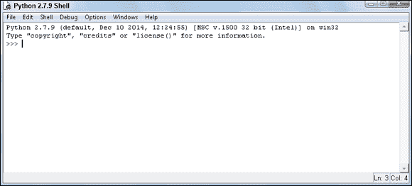

图 4-1: 我的`IDLE`缩小后的`Shell`窗口看起来像这样。

## 启动 IDLE

在项目 1 中，你将`IDLE`（`Python GUI`）固定在开始菜单的顶部。它应该还在那里。

1. 通过点击 Windows 开始菜单启动`IDLE`。

   当你启动`IDLE`时，你应该能看到带有`Python`交互式提示符的`Shell`窗口。（如图 4-1 所示。）你的窗口可能会长一点。我为了不浪费纸张缩小了我的窗口。

   在 Mac 上打开`IDLE Shell`：打开终端并在提示符处输入`IDLE`。`IDLE Shell`窗口就会打开。

    在后续的项目项目中，启动`IDLE`并在看到`›››`提示符时使用`IDLE`的`Shell`窗口；或者当我要求你启动`Python`副本时，我的意思是启动`IDLE`并使用`IDLE`的`Shell`窗口。

2. 将项目 2 中的`Hello World!`程序输入到提示符中。

   你应该应该得到一个像图 4-2 那样的惊喜。

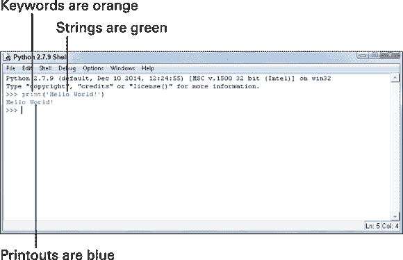

图 4-2: 语法高亮将你的代码以不同的颜色显示。

`IDLE`用不同的颜色显示程序的所有部分，包括`Python`的输出。`IDLE`为关键字（如`print`）、字符串（如`'Hello World!'`）和数字赋予不同的颜色。这些颜色提示在你编程时可能很有帮助。

在图 4-3 中，右括号仍然是绿色的而不是黑色的。这意味着`Python`仍然认为它是字符串字面量的一部分。这时你就知道必须输入一个结束引号。此外，当你按下回车时，`IDLE`会高亮显示错误。

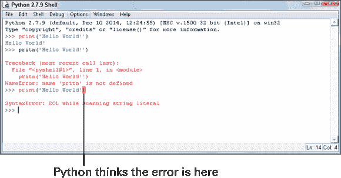

图 4-3: `IDLE`高亮了你的错误。

除了来自`Python`解释器的错误提示外，`IDLE`还会就它认为有问题的地方提供视觉反馈。当然，`IDLE`并不总是正确的。

## 掌握一些 IDLE 技巧

`IDLE Shell`窗口有一些让编码变得简单的技巧。选项补全和命令历史是两个很好的技巧。

### 选项补全

*选项补全*是指使用`Tab`键为你完成输入。尝试以下步骤操作：

1. 在`Shell`窗口中新起的一行。

2. 输入`p`并按下`Tab`键。这就是选项补全在生效！弹出一个下拉窗口，为你提供不同的选项。在图 4-4 中你可以看到该窗口。

3. 按方向键选择窗口中的`print`。你输入的`p`变成了单词`print`。

4. 输入`('Hello World!')`然后按下回车。

关闭下拉窗口。


与 Shell 窗口不同，这里都不会发生。你的编辑器（Editor）窗口应该像图 4-7 所示。

5. 按 `F5` 键或从菜单栏选择 Run（运行）⇒ Module（模块）。

`F5` 是键盘顶部的功能键。当你执行这一步时，IDLE 会提示“Source Must Be Saved”（源必须保存）。是否保存？

6. 点击对话框上的确定（OK）。

Windows 中会打开一个“另存为”对话框。

7. 在标记为文件名（File Name:）的文本框中输入 `test_file.py`。

 记得文件名末尾添加 `.py`。IDLE 不会为你完成。

暂时不要担心目录，只需保存到 IDLE 想要的地方即可。

8. 点击保存（Save）按钮。

如果你看到了类似图 4-8 的对话框，说明你复制并粘贴了一些引号（通常来自 Word 程序）。如果是这样，你的代码将无法运行。回到你的代码，将引号替换为真实的单引号或双引号。（在这种情况下，IDLE 可能会也可能不会帮助解决语法错误。）

当你点击保存按钮时，IDLE 将你的代码保存到你给命名的文件中（在本例中为 `test_file.py`）。然后它运行该文件并将任何输出放在 Shell 窗口中。现在，Shell 窗口应该像图 4-9。

图 4-7: 该程序位于 IDLE 编辑器窗口中。

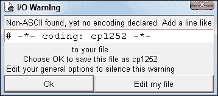

图 4-8: 编码对话框。如果你看到这个，说明你做错了。

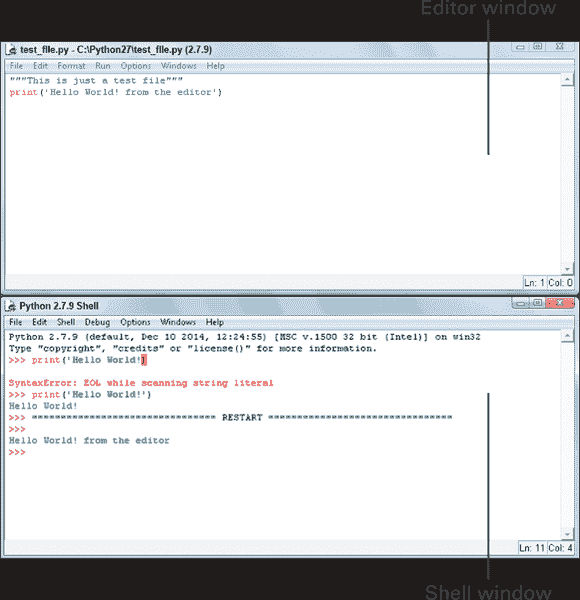

图 4-9: 当你在编辑器窗口（顶部）运行程序时，Shell 窗口会重启（底部）。

 你可以通过多次按下 `F5` 来再次运行程序。每次 Shell 窗口都会重启。当 Shell 重启时，你会丢失之前在 Shell 中输入过的任何变量值。你也会丢失这些变量名的 Tab 补全功能。

## 在文件中编写注释

你在上一节中创建的文件应该像这样：

```python
"""This is just a test file"""
print('Hello World! from the editor')
```

这里的第一行被称为*注释*（comment）。它看起来像你在项目 2 中读过的字符串字面量——因为它确实是那样。当 Python 在文件中看到字符串字面量时，它会忽略它！这是一好事，因为你可以通过程序文本中的注释向未来的自己传递信息。在这种情况下，你是在告诉自己这个文件只是一个测试文件，所以如果你搞砸了，也不必太沮丧。

你有充分的理由在代码中编写注释：

* **作为解释。** 每当你你创建一个新的 Python 文件时，都写一段简短的解释说明代码本应该执行什么。不要重复代码正在做什么。总结代码的作用。你想实现什么？所以，在代码 `a = a+1 # adding 1 to a` 中，这个注释是多意义的，因为任何傻瓜都能看出代码正在给 `a` 加 1。通常情况下，你不会在这里包含注释，除非有从代码中显不清楚的原因。例如：`a = a+1 # Changing a causes the data to be refreshed in the next code block.`（更改 `a` 会导致数据在下一个代码块中刷新。）

* **作为记忆辅助。** 当你刚编写代码时，你离它非常近。你熟悉它。你理解为什么把某些内容放在那里以及为什么。随着时间的推移，你会忘记为什么把那段代码放在那里。与其以后去推演，现在阅读描述要容易得多。

* **作为交流手段。** 当你把代码给给别人时，对代码作用的英文说明变得更加重要。注释允许你与他人进行更好的*协作*（collaborate）。如果你想作为编程团队的一员工作，你最好在代码中留有良好的注释。

* **作为调试辅助。** 如果你的代码出现问题，某人需要进去修复它，而那可能不是你。再次，对正在发生的情况提供解释会有很大帮助。

* **因为这很好。**

## 插入井号注释

从技术上讲，任何字符串字面量都可以注释——但最好使用井号（hash）。当 Python 发现井号时，它会忽略之后的所有内容。这里有一个两种类型的示例：

```python
"""This is just a test file"""
print('Hello World! from the editor')
```

## 保存你的 Shell 内容

你可能觉得项目 3 的结尾需要不断重复输入相同的代码很烦恼。

 你可以在 IDLE 窗口中选择 File（文件）Save 来保存解释器的内容。保存的部分包括启动提示和 Shell 中的交互会话，这意味着你无法将其作为程序运行。

## 注释掉代码

通常在你运行程序时，你会由于某种原因想要跳过一段代码。例如，你可能在某部分有一个问题，但程序到达那里之前会经过另一个部分。代码的另一个部分可能运行太久，或者让理解问题变得困难。又可能你想尝试不同的方法，所以你注释掉了原始代码。

 如果你想临时停止代码执行，不要从文件中删除代码。更好的方法是*注释掉代码*。通过在每行前面加上井号来注释代码。

IDLE 允许你一次注释多行代码。方法如下：

1. 从一些代码开始。哦，这里有一个我准备的：

```python
"""This is a file to use when demonstrating
how to comment out a block. """
# this section is holding us up for some reason
print('Imagine that instead of these print statements,')
print('there is instead some code which, if it runs')
print('will complicate the process of debugging some later piece')
print('of code.')
# This is the later section which needs to be debugged
print('Hello World!')
# imagine there's more program below as well
```

2. 选择要注释的代码。

点击并拖动鼠标选择代码，或在按 `Shift` 键的同时使用方向键。查看图 4-10 中的高亮代码。

### 3. 选择 `Format` ⇒ `Comment Out Region`。

`Alt+3` 和 `Alt-O` 也可以用。操作后，选中的代码前面应该会有哈号（hash marks）。你可以在图 4-11 中查看结果。

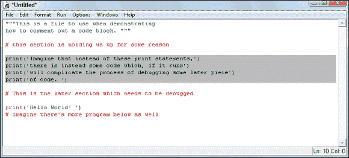

图 4-10: 选择你想注释掉的代码。

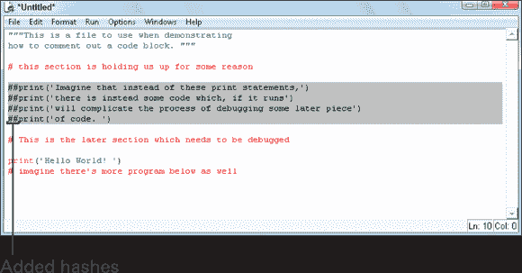

图 4-11: 注释代码后会添加哈号。

现在，当你运行代码时，注释掉的部分会被跳过。也许你找到了问题并调试了该区块。你可以通过以下步骤*恢复*（将注释转换回代码）被注释掉的代码：

1. 选择要恢复的行。

2. 选择 `Format` ⇒ `Uncomment Region`。

`Alt+4` 和 `Alt-O`、`N` 也可以用。你的代码已恢复到正常。

## 缩进和取消缩进你的代码

你必须更改一行或多行代码前面的空格数。这在编程中很常见。将它们向内移动称为*缩进*（indenting）。向外移动称为*取消缩进*（dedenting 或 *deindenting*）。

例如，如果你想将一个 `print` 语句从程序的主部分移动到循环代码块，你需要对其进行缩进。要将其从循环代码块中移出，你需要取消缩进。IDLE 提供了缩进和取消缩进代码块的工具。

尝试这些缩进工具：

1. 从一些代码开始。

这里是一些代码：

```python
"""This is just a test file"""
DEBUG = True
print('Hello World! from the editor') # 也使用 # 进行注释！
""" 你通常在行尾使用哈号，
而不是像这里这样的块注释。
"""
###############################################################
# 尽管如此，你仍然可以使用哈号进行块注释
# 特别当你有特定的视觉效果时
###############################################################
if DEBUG:
    print('I think I need another print statement.')
    print('See that the comments were ignored?') # 甚至是这一行
```

2. 选择要缩进的行。

用鼠标点击并拖动以选择代码（最后一个 `print` statement），或在使用方向键时按住 `Shift`。

3. 选择 `Format` ⇒ `Indent Region`。

`Ctrl+]` 也可以用。

4. 确保代码缩进到了有效的代码块中。

缩进在 Python 中是有意义的。如果缩进级别错误，你会得到语法错误。

 最好每个代码块层级使用四个空格缩进。如果你使用其他数量的空格（2, 6, 8）也可以。注意的是，代码块中的所有代码必须具有相同的空格数。

要反向操作，选择代码并选择 `File` ⇒ `Dedent Region`（或按 `Ctrl+`）。

## 总结

在这个项目中，你：

* 启动并停止了 IDLE。

* 检查了 IDLE 的 `Shell` 窗口和 `Editor` 窗口。

* 在代码中加入了注释。

* 注释了代码，并将其取消注释。

* 对代码块进行了缩进和取消缩进处理。

# 项目 5：一个更好的猜数字游戏

在这个项目中，你学习了编程的主要部分之一——函数。你利用这些知识将你的项目 3 猜数字游戏从项目 3 转换为使用函数的形式，这将允许你以更易理解的方式来组织程序。

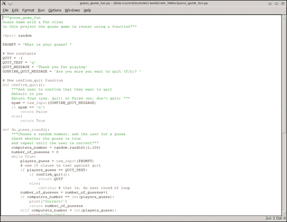 

当你完成这个项目时，将看到如何与函数进行数据通信，以及变量的跨维度特性。你还组合了一个函数来确认用户是否想退出程序。你可以在未来的项目中复用这个函数。减少、回收和重用——这一切在这里汇合。

## 处理你的函数

*函数*是将动作组合在一起的一种简单方法。通过它们，你可以重复执行某些动作组而无需重新输入所有代码。你节省了打字时间，并且更容易思考如何组织程序以及如何更新它。

在项目 3 中，你每次想运行时都必须重打一遍猜数字游戏——这很无聊。你可以避免这种情况。

*(注：输入中的后半部分文本损坏/重复，我已根据反引号规则格式化了现有内容。)*

* 它们的长度可以是任意长度（合理范围内），但要保持简短。

* 它们不能与 `Python` 关键字相同。它们可以与现有函数同名（包括内置函数），但目前请避免这样做。

函数 `print_hello_world` 非常基础。它只做了一一件事。它无法响应不同的情况，因为在你调用它时，没有信息传递到函数中。

如果你一直需要做相同的事情，这样做没问题。不过，函数要强大得多，因为你可以与它们进行通信，而它们可以根据信息执行不同的操作。你可以修改这个函数，并向它发送不同的消息进行打印。

函数是你的编程工具箱中极其有用且强大的工具，因为它们允许你将程序拆分为有意义的块。`Python` 中的所有内置项都是函数，标准库中的所有内容也是如此。

## 添加函数帮助文本

Project 4 解释了注释以及如何将它们包含在程序中，以解释程序在*做什么*或者*为什么*这么做。

 函数有一种特殊的注释，称为 `docstring`。`docstring` 的主要目的是解释（可能是为了你未来的自己）该函数应该做什么。这意味着查阅你代码的人（很可能是你自己）将理解函数在做什么，而无需去推演代码本身（代码本身可能并不显而易见）。

要创建一个 `docstring`，请将用三个双引号括起来的字符串字面量作为函数代码块的第一行，如下所示：

```python
def test_function():
    """只是一个函数存根，用于说明关于
    docstrings 的一些基础知识。在函数
    代码块的开头作为字符串字面量添加 docstring。使用三个双引号。"""
    pass
```

`docstring` 的 Python 风格指南被称为 `PEP257`（`Python` 程序员们有时有点不浪漫），而且它没无没了！你可能对 `docstring` 还能说些什么？显然非常多。下次当你玩电脑游戏感到无聊时，花点时间仔细阅读 `PEP257`。我冒敢你试试。

在此之前，请记住关于 `docstring` 的这些关键点：

* `docstring` 应该用三个双引号`delimited`（包围），例如：`"""This is a docstring"""`。在字符串的开头放三个双引号，在结尾也放三个。不要在每一行都放。

* `docstring` 应该解释函数应该做什么。你父母的 `get_ready` 函数可能会有 `docstring` `"为每个孩子准备好上学"`。它解释了要实现什么目标，而不是如何实现。

* `docstring` 应该使用句子编写。用英文！（或你的任何母语。）

* 不要担心你无法解释关于函数的所有内容。写下你想让函数做什么；不要写下它是*如何*做到的。你可以在编写函数时稍后修改 `docstrings`。

理想情况下，每个函数都有一个 `docstring`。然而，你是否应该为函数编写 `docstring` 取决于你使用该程序多久以及该函数的复杂度。

使用字符串字面量而不是哈希注释（`#`）作为 `docstring`。某些工具会自动查找字符串字面量。事实上，现在你可以神奇地使用 `Python` 的 `help` 来处理这个函数，尽管你才刚刚定义它：

```python
>>> help(test_function)
>>> Help on function test_function in module __main__:
test_function()
只是一个函数存根，用于说明关于
docstrings 的一些基础知识。在函数
代码块的开头作为字符串字面量添加 docstring。使用三个双引号。
```

你可能会觉得使用 `docstrings` 有点无聊或毫无意义。克服这种感觉！养成包含 `docstrings` 的习惯是一个极好的习惯，特别是你想以此为生。相信我，如果他们雇了你，Google 会期望你遵守 `PEP8`。

 有工具可以提取这些 `docstrings`。如果你为你所有函数都包含了 `docstrings`，你就有了一种快速为程序编写初始文档的方法。这在以后将为你节省时间。

### 创建函数存根

如果你知道你需要一个函数，但不确定细节，可以使用 `pass` 关键字并留出代码块稍后填充。在以下代码中，你知道需要在函数中解决世界饥饿问题，但不太确定如何做。用 `pass` 创建一个函数占位符，稍后再考虑细节：

```python
def solve_world_hunger():
    pass
```

 一个像这样的空函数——一个*stub*（存根）——让你定义函数（如果没有代码块将会报错），但稍后确定细节。它主要是一个帮助你组织思路的占位符。

如果你包含了 `docstring`，那么就不需要 `pass` 语句了。包含 `docstring` 可能更好。如果你想不出 `docstring` 应该写什么，说明你根本不需要那个函数。（也许它已经被你写的其他函数涵盖了。）

```python
def solve_world_hunger():
    """这是一个我将要编写的函数"""
```

## 重构你的猜数字游戏

当你完成 `Project 3` 时，你的程序看起来像这样。我去掉了 `>>>`。

```python
import random

computers_number = random.randint(1,100)

prompt = '你的数字是多少？'

while True:

    players_guess = raw_input(prompt)

    if computers_number == int(players_guess):

        print('正确！')

        break

    elif computers_number > int(players_guess):

        print('太小了')

    else:

        print('太大了')
```


将这些代码（`import` 以外）改为函数非常简单。执行以下操作：

1. 在 IDLE 中创建一个新文件。回到 `Project 4` 如果需要。
2. 在文件开头添加一个 `docstring`。
3. 保存文件为 `guess_game.py`。
4. 创建一个名为 `do_guess_round` 的函数。
5. 为 `do_guess_round` 创建一个存根 `def do_guess_round(): pass`。
6. 为函数添加一个 `docstring`。
7. 将来自 `Project 3` 的 `while` 循环移动到 `do_guess_round` 函数中。
8. 缩进代码使其成为函数的一部分。使用 IDLE 的 `Indent` 或 `Ctrl+`。
9. 添加一行来调用函数：`do_guess_round()`。
10. 保存文件。 当你保存文件时，它会高亮它认为有语法错误的代码。如果你遇到错误，检查拼写并确保前后引号都在。
11. 按 `F5` 或从菜单选择 `Run ⇒ Module`。看看猜数字游戏是否像在 `Project 3` 中一样运行。我得到了这个。

Listing 5-2

```python
"""guess_game_fun

带函数的猜数字游戏

在这个项目中，猜数字游戏使用函数进行了重构

"""

import random

computers_number = random.randint(1,100)

PROMPT = '你的数字是多少？'

def do_guess_round():

    """选择一个随机数，询问用户的猜测，

    检查猜测是否正确

    重复直到用户正确为止"""

    while True:

        players_guess = raw_input(PROMPT)

        if computers_number == int(players_guess):

            print('正确！')

            break

        elif computers_number > int(players_guess):

            print('太小了')

        else:

            print('太大了')

do_guess_round()
```

```python
print('Too high')
```

```python
do_guess_round()
```

Listing 5-2 还有几处改动。我将名称 `prompt` 改为了 `PROMPT`。这是一种约定（也算是一种规则），即将那些你不打算改变的值存储在一个“变量”（加引号，是因为它实际上不是变量）中，并使用全大写字母命名。由于提示词（prompt）理应该在任何时候都保持不变，我将它的名称改为了全大写。

 不应该发生变化的变量是 `constant`（常量）。（你可能还会看到 `static` 这个词用来表示常量）。将所有常量放在文件的开头；不要让它们散布在整个代码中。

 在 Python 文件中，函数的定义必须在对该函数的第一次调用之前。

## 寻找逻辑问题

但等一下！上一节中的代码存在一个问题。当你尝试把提问问轮次（从计算机要求用户猜数字到用户猜对为止为一轮提问）放入循环中时，这个问题就会显而易见。

将程序末尾的 `do_guess_round()` 修改为如下：

```python
while True:

    do_guess_round()
```

在编辑器窗口中按 `F5` 保存并运行代码：

```
>>> ================================== RESTART ================================
>>>
What is your guess? 67
Too low
What is your guess? 87
Too low
What is your guess? 97
Too low
What is your guess? 99
Too low
What is your guess? 100
Correct!
What is your guess? 10
Too low
What is your guess? 56
Too low
What is your guess? 99
Too low
What is your guess? 100
Correct!
What is your guess? 50
Too low
What is your guess? 99
Too low
What is your guess? 100
Correct!
What is your guess? 100
Correct!
What is your guess? 100
Correct!
What is your guess?
```

哎呀。这个程序有两个问题：

* 每次游戏重启时，计算机的答案都是完全相同的（在这种情况下是 100）。这不符合游戏应该运行的方式！计算机应该为每一轮选择一个不同的数字。
  你能看出这是为什么吗？因为每次的数字都是相同的，这可能是选择方式或存储方式出的问题。思考一下 Python 在执行这段代码时遵循的路径，以及数字选择相对于这个流程发生在什么位置。我会在接几段话中告诉你是怎么回事。

* 你无法判断一轮提问何时结束，以及新一轮提问又是何时开始的。

## 解决逻辑问题

程序一直猜同一个数字，是因为 `random.randint()` 函数的位置有问题。当你运行程序时，程序会执行以下步骤：

1. 执行 `import`。
2. 选择一个随机数。
3. 给 `PROMPT` 赋值。
4. 定义一个函数但尚未执行它。
5. 启动一个循环。
6. 在循环内部反复调用该函数。它不断跳转到第 4 步的代码，而没有回到第 2 步去选择新数字。

当它调用函数时，随机数并没有被重新选择。每次使用的都是同一个数字。你可以通过将选择数字的代码放在函数内部来修复它。你可以通过添加 `print` 语句来区分不同的轮次，以明确何时开始了新的一轮。一个打印计算机猜数字数值的行有助于你理解程序正在发生什么。这里是修复了这些问题的新版本：

```python
"""guess_game

使用函数的猜数字游戏

在这个项目中，我们使用函数重构了猜数字游戏"""

import random

computers_number = random.randint(1,100)

PROMPT = 'What is your guess? '

def do_guess_round():

    """选择一个随机数，询问用户猜数字

    检查猜测是否正确

    并重复直到用户猜对为止"""

    computers_number = random.randint(1,100) # 添加

    while True:

        players_guess = raw_input(PROMPT)

        if computers_number == int(players_guess):

            print('Correct!')

            break

        elif computers_number > int(players_guess):

            print('Too low')

        else:

            print('Too high')

while True:

    # 添加了 print 语句：

    print("Starting a new Round!")

    print("The computer's number should be "+str(computers_number))

    print("Let the guessing begin!")

    do_guess_round()

    print("") # 空行
```

我增加了两个带有注释的新部分。第一个添加让计算机在每次调用函数时都想出一个数字。第二个添加增加了一些 `print` 语句，用来指示新一轮提问何时开始。

## 注意 computers_number 的重复使用

在函数内部添加新的一行来选择随机数解决了逻辑问题。如果你只想做这些，那么你应该删除对 `computers_number` 的引用。之所以这样做，是因为我想让你在后续输出中注意到两点：

* 第一，存在两个名为 `computers_number` 的变量。即使你打印了 `print("The computer's number should be "+str(computers_number))`，值也是不同的。
* 第二，即使我们在函数内部对名为 `computers_number` 的变量进行了赋值，这些赋值也没有改变外部的值。

运行你自己的副本（按 `Ctrl+C` 退出）来观察这种情况。在我的输出中，每次函数被调用时 `computers_number` 都是 50。然而，每次猜的结果是不一样的（先是 73，然后是 17）。

```
Starting a new Round!
The computer's number should be 50
Let the guessing begin!
What is your guess? 50
Too low
What is your guess? 75
Too high
What is your guess? 63
Too low
What is your guess? 68
Too low
What is your guess? 72
Too low
What is your guess? 73
Correct!
Starting a new Round!
The computer's number should be 50
Let the guessing begin!
What is your guess? 50
Too high
What is your guess? 25
Too high
What is your guess? 12
Too low
What is your guess? 18
Too high
What is your guess? 15
Too low
What is your guess? 16
Too low
What is your guess? 17
Correct!
```

## 理解作用域的工作

在这段代码中发生了许多深层次的内容。你正在看到变量作用域的示例。变量的 `scope` 是 Python 认为该变量名称具有含义的部分。这变得复杂（又奇妙），因为同一个名称可以出现在程序的多个地方。变量的作用域让 Python 能够理解你当前使用的是哪种含义。

在你在函数内部定义的变量（包括通过参数传递数值的变量）被称为 `local variables`（局部变量）。这意味着，当你为函数内部的变量命名时，不需要记住你用过的所有其他变量的名称。

但事情变得更奇怪了！如果变量根据它们所在的函数存在于不同的维度，那么为什么 `computers_number` 没有出现在列表 5-2 的函数内部？函数是如何“看到”该变量并使用该值的呢？

当 Python 看到对变量名值的引用时，它会在当前函数中查找该变量是否在函数中的某个时间点被赋值了值。如果它在函数中没有找到同名的变量，它会向上查找 `main`，查看是否存在同名的变量。如果有，Python 就会使用该变量的值。

然而，相反的情况并不成立。如果你要求 Python 通过向变量中存储值来命名一个变量，Python 会在函数内部创建一个新变量。Python 可以跨越编程维度从程序的 `main` 部分获取值，但（通常情况下）它无法更改 `main` 变量中存储的内容。

下面的示例在 `main` 中命名了一个变量 `A`，并定义了三个函数——`test1`、`test2` 和 `test3`。这些测试函数都尝试打印一个名为 `A` 的变量。在查看这里的输出之前，请尝试推断 `test1`、`test2` 和 `test3` 会打印什么。

```python
""" locals.py

examples of local variables"""

A = 'This is the text message from main'

def test1():

    print('In test1.')

    print(A)

    print('Leaving test1.')

def test2():

    print('In test2.')

    A = "This is test2's text message."

    print(A)

    print('Leaving test2.')

def test3():

    print('In test3.')

    print(A)

    A = "This is test3's text message."

    print('Leaving test3')

test1()

print('Back in main')

print(A)

test2()

print('Back in main')

print(A)

test3()
```

这产生了图 5-3 所示的输出。

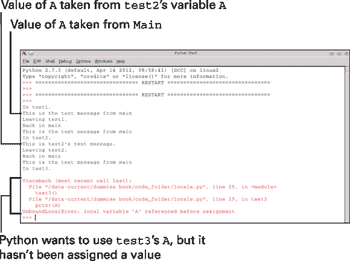

图 5-3: 变量的值取决于它的作用域。

在函数 `test1` 中，Python 跨越维度回到程序的 `main` 部分获取 `A` 的值。它没有改变这个值。在 `test2` 中，Python 给 `A` 赋值并将其打印。当 Python 从函数返回后，`main` 中 `A` 的值没有改变。

为什么 `test3` 完全失败了呢？`test2` 和 `test3` 之间唯一的区别在于：在 `test2` 的打印语句之前给 `A` 赋了，而在 `test3` 中是在打印语句之后赋值的。在这两个函数中，`A` 都在函数内部被赋值，因此 Python 知道在函数的维度（称为其*作用域*）中有一个（或有一个）名为 `A` 的变量。因此，Python 拒绝到函数外部从 `main` 获取值。在 `test3` 中，Python 需要 `A` 的一个值。Python 知道 `A` 将在 `test3` 某处被赋值，这使其成为一个局部变量。Python 拒绝从 `main` 为其获取值，尽管在 `test3` 中它还没有获得该值。它无法从 `test3` 内部获取值，因为当 Python 到达打印语句时，`test3` 中的 `A` 还没有被赋值。

## 与你的函数通信

到目前为止，函数和 `main` 之间还没有通信。没有信息从 `main` 传递到函数，也没有信息从函数传回 `main`。它们作为一个团队工作会得更好。幸运的是，Python 知道如何与函数通信，以及函数如何回传调用者。你将在接几节中完成这两操作。

## 向函数发送信息

你已经有了一种相当有限的形式向函数发送信息——即使用程序 `main` 部分的变量，前提是函数内部没有同名变量*且*函数内部没有给该变量赋值。在这种情况下，函数可以接收变量的值。

 除了常量的情况（这完全没问题），这种向函数通信信息的方法是糟糕的。不要这样做！

Python 有一种更好的方法向函数传递数据。事实上，函数的设计就是为了以不同的方式接收数据。要让函数接收数据，你必须：

1. 决定函数要接收多少个独立的信息。虽然有限制，但远超你的需求。
2. 对于每一部分信息，选择一个接收名称。
3. 在定义中列出每个变量。

在函数中列出的每个变量被称为*参数*。使用图 5-4 中的代码。

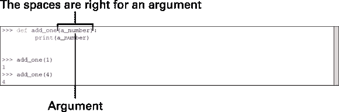

图 5-4: 值赋值给变量。

## 给某些参数设置默认值

*位置参数*通过它们在参数列表中的位置传递给函数。你也可以为参数定义默认值。这些是*关键字参数*。

如果你为参数指定了默认值，那么在调用函数时就不需要指定该参数的值。如果你没有指定值，相应的变量将获得其默认值。

```python
def add_one(a,b,display=True):

    if display:

        print("a= "+str(a))

        print("b= "+str(b))

>>> add_one(1,2)

a= 1

b= 2

>>> add_one(1,2,False)

>>>
```

这里 `display` 是一个带有默认值的参数。它的默认值为 `True`。在 `add_one(1,2)` 行中，没有为该变量指定值（传递的两个值已用于变量 `a` 和 `b`），因此它取了值 `True`，并发生了那两行输出。

在 `add_one(1,2,False)` 行中，为变量 `display` 指定了一个值（`False`）。因为如此，它被赋值为该值。条件 `if display:` 不满足，因此没有打印任何内容。

 在函数定义中，`List` 关键字参数必须在位置参数*之后*：

```python
>>> def add_one(display=True,a,b):

    pass

SyntaxError: non-default argument follows default argument
```


 你可以在函数中使用多个默认参数。它们会按照列出的顺序赋值给关键字变量。如果你想接受前面的关键字参数的默认值但不接受后面的关键字参数值，这可能会导致问题。如果你省略了它们，值将无法与正确的参数对齐。

Python 在有多个默认参数时有一套特殊的语法。在调用函数时，你可以为变量赋值。在接下来的示例中，这是`include_pumpkin=False`，`display=False`。如果你显式地给它们赋值了，可以以任何顺序提供默认参数。

```python
>>> def add_one(a,b,include_pumpkin=False,display=False):
    filler = " "
    if include_pumpkin:
        filler = " pumpkin!"
    if display:
        print(str(a)+filler+str(b))

>>> add_one(1,2,True)
# True 被发送给了 include_pumpkin
# 但 display 仍然是 False，所以没有任何打印

>>> add_one(1,2,True,True) # True 被发送给了两者
1 pumpkin! 2

>>> add_one(1,2,display=True,include_pumpkin=True)
1 pumpkin! 2

>>> add_one(1,2,display=True,include_pumpkin=False)
1 2
```

在调用`add_one(1,2,display=True,include_pumpkin=True)`时，你正在为关键字参数指定值。如果你使用`<*variable name>= *value*`语法，可以任意顺序指定关键字参数（与位置参数不同，顺序很重要）。将*variable name*替换为实际变量名，将*value*替换为……你知道的实际值。

在这个示例中，变量`display`和`include_pumpkin`的顺序与函数定义中列出的顺序相反。在最后一个示例中，`add_one(1,2,display=True, include_pumpkin=False)`，关键字参数`include_pumpkin`被显式地赋值为`False`。这是没有必要的，因为它的默认值本身就是`False`。

## 从函数进行通信

你现在知道了程序的主部分可以向函数进行通信。它可以通过传递参数或引用在函数内部未定义的变量名（通常仅用于常量）来实现。

你不知道的是函数如何向程序主部分进行通信，或者如何与调用它的另一个函数进行通信。幸运的是，Python 可以与调用它的程序部分进行通信。它使用了关键字`return`。

看这里：

```python
>>> def add_one(a_number):
    return a_number+1
```

在代码段中，`add_one`现在是全新且改进了！增加了 1！这个函数接收一个名为`a_number`的参数，并*返回*`a_number`加 1 的值。它通过使用`return`实现这一点。

调用函数并看看它是如何工作的：

```python
>>> add_one(4)
5
```

在函数代码块的第一行（也是唯一一行）中，它查找存储在`a_number`中的值 (4)，对其加 1 得到 5，然后将值 5 返回给调用该函数的程序部分。此时，函数停止运行，执行将从调用函数的地方继续。

你可以像存储任何其他值一样保留函数返回的值——通过将其赋值给变量。这个示例中有一个名为`retval`的变量：

```python
>>> retval= add_one(4)
>>> retval
5
```

所有函数都会返回一个值，即使你没有包含`return`语句。`print_hello_world`函数没有使用`return`语句。你认为它返回了什么？

```python
>>> def print_hello_world():
    """Hello World as a function"""
    print('Hello World!')

>>> retval = print_hello_world()
Hello World!

>>> print(retval)
None
```

尽管函数没有显式地返回任何值，变量`retval`现在也有了一个值——`None`。这就像是在问返回值是什么，而 Python 说：“没有。”你永远不会想故意这样做，但偶尔你还是需要这么做。

## 添加评分

从之前的章节中，你已经知道如何：
* 使用函数参数发送信息。
* 使用`return`语句从函数发送信息给调用者。

现在是时候通过添加评分和更简单的退出方式来提升你的水平了。你可以通过以下更改在`guess_fun.py`中添加这些功能：

### 跟踪轮数
1. 在主程序添加变量`total_rounds`。
2. 在主循环中递增（加 1）`total_rounds`。

### 跟踪猜测
1. 在`do_guess_round`中添加变量`total_guesses`。
2. 使用`return`将存储在该变量中的值通信给调用循环。

以下是带有注释的代码：

```python
import random

PROMPT = 'What is your guess? '

def do_guess_round():
    """选择一个数字，询问用户的猜测
    检查猜测是否正确
    并重复直到用户正确为止"""
    computers_number = random.randint(1, 100)
    number_of_guesses = 0
    while True:
        players_guess = raw_input(PROMPT)
        number_of_guesses = number_of_guesses+1
        if computers_number == int(players_guess):
            print('Correct!')
            return number_of_guesses
        elif computers_number > int(players_guess):
            print('Too low')
        else:
            print('Too high')

total_rounds = 0
total_guesses = 0
while True:
    total_rounds = total_rounds+1
    print("Starting round number: " + str(total_rounds))
    print("Let the guessing begin!!!")
    this_round = do_guess_round()
    total_guesses = total_guesses+this_round
    print("You took " + str(this_round) + " guesses")
    avg = str(total_guesses/float(total_rounds))
    print("Your guessing average = " + avg)
    print("")
```

`while True:`循环中的某些打印语句已经更改，并添加了一些，以向用户提供更多关于轮次的信息。运行程序查看它是否工作正常。

程序会记录在函数执行期间进行了多少次猜测。程序主体无法访问函数内部的变量，这些变量是该函数的局部变量。要将值传回程序主体，需要通过`return`关键字返回，并存储在名为`this_round`的变量中。

通过将此值加到名为`total_guesses`的变量中，可以记录猜测的总数。然后使用该值来计算每轮的平均猜测次数（总猜测次数除以总轮数）。使用内置的`float()`函数来强制 Python 使用小数（而不是整数）算术。（参见项目 3）。

## 允许用户退出

用户可以通过输入字母`q`来退出。但用户通常不想因不小心输入了内容就退出。因此，程序不会立即退出，而是通过例程要求用户确认退出。默认答案是“是”。

首先是用于确认退出的函数：

1. 创建一个常量（`CONFIRM_QUIT_MESSAGE`），作为确认退出的提示信息。
2. 创建一个名为`confirm_quit`的函数并为其编写文档字符串（docstring）。
3. 在`confirm_quit`函数中，要求用户输入`y`来确认退出（使用`raw_input`）。
   如果用户输入`"n"`，则返回值`False`。否则，返回`True`。这看起来有点反直，但这样可以确保默认情况下确认退出。

以下是`confirm_quit`函数的代码：

```python
CONFIRM_QUIT_MESSAGE = 'Are you sure you want to quit (Y/n)? '

def confirm_quit():
    """询问用户确认他们是否想退出
    默认认为是
    返回 True（是，退出）或 False（否，不退出）"""
    spam = raw_input(CONFIRM_QUIT_MESSAGE)
    if spam == 'n':
        return False
    else:
        return True
```

程序要求玩家输入，并将响应存储在名为`spam`的变量中。如果`spam`（用户输入的内容）为`'n'`，则`confirm_quit`函数返回`False`。这意味着程序应该中止（停止）退出。如果`spam`是其他任何内容（包括用户在未按其他键的情况下按下回车键，甚至是大写的`N`），则函数将返回`True`，确认用户想要退出。该函数默认确认退出而非中止退出。这假设大多数情况下用户确实想退出游戏。

 你可以用单行`return spam != 'n'`替换`if...else`语句，但现在这样做太复杂了。盯着它看一会儿，直到你说服自己是等价的。

现在，你需要将该代码与程序的其余部分整合：

1. 定义一个常量`QUIT_TEXT`来存储字母`q`（这是用户想退出时应该按的键）。
2. 定义一个常量`QUIT`，如果用户退出，你的`do_guess_round`函数将返回它。将值`-1`赋值给`QUIT`。
3. 在`do_guess_round`函数中添加检查，判断用户输入的是`q`而不是数字。
4. 如果是，调用`confirm_quit`函数进行确认。
5. 如果`confirm_quit`调用返回`True`，则退出。让代码块返回`QUIT`。
   这会让函数结束并返回值`-1`。如果不是，让代码块继续执行（这是一个新关键字）。让它成为代码块中的唯一行。`continue`关键字会让循环从代码块的顶部重新开始。根据循环类型，这可能也意味着循环计数器增加。

在`import random`之后添加你的新常量：

```python
QUIT = -1
QUIT_TEXT = 'q'
```

你的新代码应该放在`raw_input`那行之后，看起来像这样：

```python
        if players_guess == QUIT_TEXT:
            if confirm_quit():
                return QUIT
            else:
                continue # 即进入循环的下一轮
```

玩家每次猜测时，程序都会比较猜测的内容，看它是否与`QUIT_TEXT`（即`q`）相同。如果是，则通过调用`confirm_quit`函数要求玩家确认。如果确认了，`do_guess_round`退出并返回值`-1`（存储在常量`QUIT`中中）。如果没有确认，则让代码块继续执行。

```python
if spam == 'n':
    return False
else:
    return True
```

```python
def do_guess_round():
    """选择一个随机数，要求用户进行猜测
    检查猜测是否正确
    并重复直到用户正确为止"""
    computers_number = random.randint(1, 100)
    number_of_guesses = 0
    while True:
        players_guess = raw_input(PROMPT)
        # 用于测试退出的新 if 子句
        if players_guess == QUIT_TEXT:
            if confirm_quit():
                return QUIT
            else:
                continue#也就是说，进入下一轮循环
        number_of_guesses = number_of_guesses+1
        if computers_number == int(players_guess):
            print('Correct!')
            return number_of_guesses
        elif computers_number > int(players_guess):
            print('Too low')
        else:
            print('Too high')

total_rounds = 0
total_guesses = 0
while True:
    total_rounds = total_rounds+1
    print("Starting round number: "+str(total_rounds))
    print("Let the guessing begin!!!")
    this_round = do_guess_round()
    # 用于测试退出的 if 条件（以及代码块）
    if this_round == QUIT:
        total_rounds = total_rounds - 1
    avg = str(total_guesses/float(total_rounds))
    if total_rounds == 0:
        stats_message = 'You completed no rounds. ' + 'Please try again later.'
    else:
        stats_message = 'You played ' + str(total_rounds) + ' rounds, with an average of ' + str(avg)
        break
    total_guesses = total_guesses+this_round
    avg = str(total_guesses/float(total_rounds))
    print("You took "+str(this_round)+" guesses")
    print("Your guessing average = "+str(avg))
    print("")
    # 添加了退出消息
    print(stats_message)
```


## Summary

哇，你做了很多。光看这个列表就让我精疲力竭了。在这个项目中，你：

* 遇到了三个新关键字：`def`、`return`、`continue`。（还有 9 个要学。）
* 了解了什么是函数，以及如何创建它们。
* 阅读了关于函数命名的规则。
* 在函数中包含了文档字符串（docstring），并理解了为什么文档字符串很重要。
* 调用了函数。
* 创建了函数存根节点（function stubs），以记录你打算以后填充的函数。
* 看到了变量在函数内部和作为局部变量时是如何存在于“平行维度”的。
* 通过参数向函数发送信息。
* 给参数设置了默认值，然后看到了位置参数和关键字参数之间的区别。
* 通过 `return` 关键字从函数获取了信息。
* 退出了你的应用程序。
* 创建了一个短函数，用于确认玩家是否真的想退出游戏。

## Week 3

# 创建文字游戏

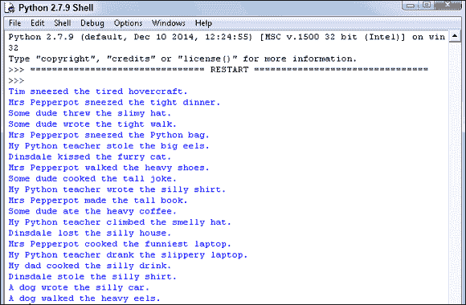

**本周你将构建 …**

 Hacker Speaker: 1337 Sp34k3r
 Cryptopy
 Silly Sentences

## PROJECT 6

# Hacker Speaker: 1337 Sp34k3r

你准备好写一个将信息转换为精英黑客语言（1337 sp34k）的程序了吗？你可能见过有人用数字或其他与其他字母相似的字母来替换字母。常见的例子是使用数字 3 代替字母 E。

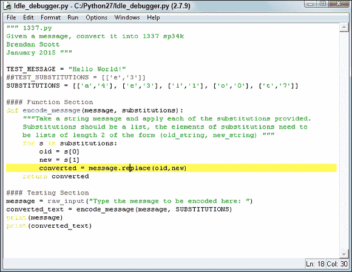

为了做到这一点，你阅读了大量关于字符串、列表、对象和 Python 内省的知识。这个项目的代码非常直接，但它依赖的理念非常深奥。你还将看到 Python 是多么强大，可以用如此简单的方式完成如此不起的事情。这个项目中的一切都是你在 Python 中将一直用到的！

## 等等，我的字符串里有一个对象

我曾考虑把这一节命名为“脑大爆炸”，因为它……为了做到这一点，你阅读了大量关于字符串、列表、对象和 Python 内省的知识。这个项目的代码非常直接，但它依赖的理念非常深奥。你还将看到 Python 是多么强大，可以用如此简单的方式完成如此不起的事情。这个项目中的一切都是你在 Python 中将一直用到的！

等，让我们重新审视该特定章节提供的文本。文本包含许多乱码/重复的字符串和代码输出。我会在保留核心信息的同时对其进行清理。

我曾考虑把这一节命名为“脑大爆炸”，因为它……为了做到这一点，你阅读了大量关于字符串、列表、对象和 Python 内省的知识。这个项目的代码非常直接，但它依赖的理念非常深奥。你还将看到 Python 是多么强大，可以用如此简单的方式完成如此不起的事情。这个项目中的一切都是你在 Python 中将一直用到的！

实际上，查看“Waiter, There's An Object In My String”章节的源文本，它是 `dir()` 输出与正文文本的大杂烩。

我曾考虑把这一节命名为“脑大爆炸”，因为它……为了做到这一点，你阅读了大量关于字符串、列表、对象和 Python 内省的知识。这个项目的代码非常直接，但它依赖的理念非常深奥。你还将看到 Python 是多么强大，可以用如此简单的方式完成如此不起的事情。这个项目中的一切都是你在 Python 中将一直用到的！

等等，提示说“保留核心内容”。我将正确格式化正文。

```python
['__add__', '__class__', '__contains__', '__del__', '__doc__', '__eq__', '__ge__', '__format__', '__gt__', '__getitem__', '__init__', '__class__', '__hash__', '__len__', '__le__', '__lt__', '__match__', '__repr__', '__mod__', '__mul__', '__ne__', '__new__', '__reduce__', '__rmod__', '__rmul__', '__setattr__', '__sizeof__', '__str__', '__subclass__', ...]
```

已知 `my_message` 拥有所有这些属性，你是如何获取它们的呢？你是如何获取比如 `upper` 方法的，它是通过 `dir` 获取 `my_message` 的属性之一？答案是随机的。（你已经在 Project 3 中通过 `random.randint` 做过了。是我偷偷写进去的没告诉你。）在这种情况下，该对象是名为 `random` 的模块。你通过用点将它们连接来访问它的函数 `randint`。

使用这种结构，查看你的变量 `my_message` 的上方法的帮助服务：

```python
>>> help(my_message.upper) # 看到点了吗？
```

```python
Help on built-in function upper:

upper(…)

    S.upper() -> string

    Return a copy of the string S converted to uppercase.
```

这就是 `upper` 的文档字符串（docstring）。你能看出为什么 Python 的文档字符串如此如此奇妙吗？你只需要给变量赋值即可。然后，你就拥有了一个充满了方法的对象——你不需要查阅书籍或在互联网上搜索它们是做什么的。方法本身就会告诉你它们的作用。

试一一下：

```python
>>> my_message.upper

<built-in method upper of str object at 0x7f3d0803e260>
```

没错，它是一个函数。要调用它，你需要加上括号：`my_message.upper()`。把这看作一种快速粗暴的方法，用来判断一个属性是否为方法。

 如果你知道某个东西是方法，请加上括号来调用它。

顺便说一下，注意输出确认了它是 `str` 对象的一个名为 `upper` 的方法，并且位于你计算机内存中的特定位置。调用它：

```python
>>> my_message.upper()

'HELLO WORLD!'
```

这里的 `upper` 函数根据 `my_message` 中的值创建了一个新的、不同的字面量（`'HELLO WORLD!'`）。`my_message` 的值并没有改变：

```python
>>> my_message

'Hello World!'
```

内置的 `dir` 列出了 `my_message` 的许多属性。其中一些属性的名称以双划线开头（像这样：`__getslice`）。带有两个下划线的方法被称为私有方法；其他的被称为公共方法。

当你成为 Python 大师时，你可以使用对象的私有方法来做一些花的操作。（你将在通讯录项目中使用其中一个方法做些尝试。）现在，先忽略私有方法。花点时间查看 `my_message` 的其他属性，并获取它某些方法的帮助信息。

 使用点来引用对象的属性：`object.attribute`。`object` 是对象的名称，`attribute` 是你想引用的属性名称。如果该属性是一个方法，加上括号来调用该方法：`object.attribute(<在此处包含方法的参数，如果有的话>)`。

## 认识列表

你有没有注意到 `dir(my_message)` 的输出周围有那些方括号 `[]`？你在 Hello World! 项目中读到 `range` 时就见过这些。我告诉过你稍后会告诉你关于括号的事。现在就是现在了。

方括号表示一个列表对象。列表是“容器”的形式（类似于编程桶），可以按照特定的顺序存储其他对象。列表中的对象被称为元素。

## 遍历列表元素

在 Project 2 中，你使用内置的 `range` 创建列表，然后遍历（通过）列表中的每个元素。它看起来像这样：

```python
>>> range(3)

[0, 1, 2]

>>> for i in range(3):

     print(i)

0

1

2
```

`range(3)` 就是 `[0, 1, 2]`。因此，`for i in range(3):` 这一行等于 `for i in [0, 1, 2]:`。它逐个将列表中每个元素的值赋值给 `i`。列表是一个数字列表并没有特殊之处；你可以对任何包含其他对象的对象（在本例中为 `Y`）使用 `for i in Y` 结构。例如，内置的 `dir` 给你提供一个字符串列表。（你可以看出来它们是字符串，因为每个字符串周围都有单引号。）

要逐行打印每个 `my_message` 属性，你可以这样做：

```python
>>> for i in dir(my_message):

print i

__add__

__class__

__contains__

[...]
```

它并没有实际打印 `[...]`。那只是表示我省略了一些内容。

你自己运行程序以获取完整输出。你的 `Python-is-mad-crazy-alert` 警告现在应该也在闪烁了。如果你有任何列表，你只需要输入一行简单的代码——`for element in listname:`，就可以遍历列表中的每个项目项。

你可以像存储字面量一样存储列表：

```python
>>> string_object_attributes = dir(my_message)

>>> string_object_attributes

['__add__', '__class__', '__contains__', ...']
```

## 创建你自己的列表

你既可以创建一个已经包含元素的列表（就像买了一个装满糖果的桶），也可以也可以创建一个空列表（就像买了一个空桶）。有时你需要一个空桶，有时你需要一个装了糖的桶。你可以根据需要以后向列表添加（或删除）元素。如果你想创建一个已经包含元素的列表，请这样做：

1. 以左括号开始。
2. 将元素放入其中，并用逗号分隔每个元素。每个元素可以是字面量、变量或任何其他 Python 对象。
3. 以右括号结束。

例如，如果数字是糖果，这个列表就是预装了糖果的：

```python
new_list = [0, 1, 2]
```

如果你创建列表时还没有元素，你仍然可以通过跳过步骤 2 来创建一个列表！你得到一个空列表。这样做：

```python
new_list2 = []
```

你可以使用 `append` 方法向列表末尾添加新元素。所有的列表对象都有 `append` 方法：

```python
>>> new_list2.append('element 0')

>>> new_list2

['element 0']
```

`append` 总是将元素添加到列表末尾。这个示例在同一个列表中混合了数字和字符串，但你可以将任何对象放入列表中。你甚至可以将列表自身追加到列表中，但千万不要那样做！

## 创建增强版列表

如果你能根据某个公式从现有的列表创建列表中的元素，那么 Python 有一种创建该列表的快捷简写形式：`列表推导式`（list comprehension）。实际上，任何迭代器都可以，但我们目前讨论的是列表。

像这样创建一个列表推导式：

1. 用方括号 `[` 打开。
2. 选择一个（或多个）哑变量。
3. 写一个涉及这些哑变量的公式。
4. 紧跟公式为每个哑变量写一个 `for` 语句。
5. 用方括号 `]` 结束。

例如，如果你想要前十个偶数（从 0 开始），你可以使用图 6-1 中的方法。

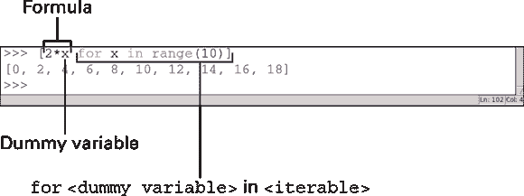

图 6-1: 使用列表推导式创建从 0 到 18 的偶数。

当运行到这个列表推导式时，Python 会：

* 创建空列表。
* 遍历 `range(10)` 生成列表中的每个元素，并将其值存储在名为 `x` 的哑变量中。也就是说，它按以下顺序遍历这些数字——0, 1, 2, 3, 4, 5, 6, 7, 8, 9。记住 `range` 从 0 开始。
* 对于每个元素，它将公式（在本例中为 `2*x`）应用于 `x` 的值，并将结果追加到列表中。
* 在遍历完 `range(10)` 中的所有元素后完成列表的创建。

这是创建新列表的一种极其简单且强大的方法。列表推导式允许你添加条件。这意味着你可以过滤掉正在创建的元素中的子集。例如，为了获取小于 10 的偶数，你可以在列表推导式的末尾添加一个条件：

```python
>>> [x for x in range(10) if x%2 == 0]

[0, 2, 4, 6, 8]
```

在这里，条件 `if x%2 == 0` 表示该数字是偶数。左侧是取模运算符（`%`）。它给出左侧除以右侧后的余数。（猜数字游戏项目涵盖了这一点。）如果你将偶数除以 2，余数为 0。对于每个偶数，`if` 条件都为真，`x` 就会被加入列表。对于奇数，该条件为假，它们会被跳过。

## 检查元素是否在列表中

你可以很容易地判断一个元素是否在列表中。只需使用 `in` 关键字即可：

```python
>>> 0 in [0,1]

True

>>> 5 in [0,1]

False
```

元素 0 在列表 `[0,1]` 中，这是真的；但数字 5 不在列表中，这是假的。你可以使用 `not` 关键字来反转逻辑：

```python
>>> 0 not in [0,1]

False

>>> 5 not in [0,1]

True
```

## 规划你的精英黑客播放器

你的 1337 Sp34k3r 需要完成以下操作：

1. 从用户处接收消息。（你可以使用 `raw_input` 来此。）
2. 遍历消息中的每个字母，如果它是可以在精英黑客语中替换的字母，则进行替换。
3. 构建一条新消息并打印出来。

## 设置你的文件

是时候开始搭建程序的骨架了。你可以稍后再填充细节。

1. 创建一个文件来存储代码。文件名命名为 `1337.py`。确保包含 `.py` 后缀。如果你需要提醒，项目 4 解释了如何创建文件。
2. 在文件顶部写一个文档字符串（docstring），说明该文件的作用。这就是你正在创建一个模块文档字符串。
3. 创建名为 `TEST_MESSAGE` 的常量，并赋值一个测试消息字符串。
4. 创建名为 `TEST_SUBSTITUTIONS` 的常量。为其分配一个用于操作的测试替换。让这个测试替换成为包含一个元素的列表：`['e','3']`。小心，这是一个陷阱！

这是我的构思：

```python
""" 1337.py

给定一条消息，将其转换为 1337 sp34k

Brendan Scott

2015 年 1 月 """

TEST_MESSAGE = "Hello World!"

TEST_SUBSTITUTIONS = [['e','3']]
```

你记得为测试替换列表包含双方括号了吗？当我说 `['e','3']` 是一个*单个*元素时我是认真的。要让它成为列表，你必须在它外面再加上方括号：`[['e','3']]`。

我是这样设计的：

```python
""" 1337.py

给定一条消息，将其转换为 1337 sp34k

Brendan Scott

2015 年 1 月 """

TEST_MESSAGE = "Hello World!"

TEST_SUBSTITUTIONS = [['e','3']]
```

### 创建函数存根

下一步是创建一个函数存根（stub）。

1. 使用注释 `#` 标记 Functions（函数）部分。
2. 定义函数 `encode_message(message, substitutions)`。
3. 添加文档字符串说明函数在做什么。
4. 使用注释 `#` 标记 Testing（测试）部分。
5. 在测试部分，调用函数并将结果赋值给 `converted_text`。
6. 打印该变量。

```python
# Functions

def encode_message(message, substitutions):

    """接收消息并应用替换."""

    pass

# Testing

converted_text = encode_message(TEST_MESSAGE, TEST_SUBSTITUTIONS)

print(converted_text)
```

## 运行代码

保存文件并运行代码：按下 F5 或选择 Run Module。目前有什么问题吗？你会在 Shell 中得到以下输出：

```
================== RESTART ================

None
```

没什么，由于 `encode_message` 没有使用 `return` 关键字，赋值给 `converted_text` 的值是 `None`。我本可以让返回消息（但可能不会标记任何替换），或者返回一条调试消息如“函数未实现！”。在存根阶段，我倾向于不返回值。

## 进行代码替换

下一个任务是获取 `encode_message` 并让它发挥作用：替换。为了将像 speak 的字符串改为 sp34k，替换字符串中的特定字母。通过查看文档字符串来了解它的功能：

```python
>>> my_message = 'Hello World!'

>>> help(my_message.replace)

Help on built-in function replace:

replace(old, new[, count]) ->

返回字符串 S 的副本，其中所有的子字符串 old 都被替换为 new。如果给了可选参数 count，则只替换前 count 次出现。
```


使用你现有的`my_message`作为测试消息。根据你之前在两行代码输出中打印的文档，为了使用此方法你需要两个字符串变量，一个命名为`old`，另一个命名为`new`。它们作为参数传递给方法。

```python
>>> my_message = 'Hello World!'
>>> old = 'e'
>>> new = '3' # 记得引号
>>> new_string = my_message.replace(old,new)
>>> new_string
'H3llo World!'
```

创建了一个字符串`Hello World!`的副本。然后（实际上，是在创建副本期间），`Hello`中的`e`被替换为`3`（并存储在`new_string`中）。原始变量`my_message`保持不变。

```python
>>> new_string = my_message.replace('e','3')
>>> new_string
'H3llo World!'
```

不要觉得你被迫为了在方法的文档中填充名称而无谓地创建变量。尽管如此，我仍然选择了`old`和`new`，因为这会让后面的逻辑变得更容易理解。

## 替换字母

现在在函数本身中填入替换代码。该函数需要：

1. 遍历（处理）它接收到的每一个替换项。

   我说是*每一个*，是因为该函数的设计是为了接收一个替换项列表。我知道你现在只用了一个替换项来测试它。当你编写代码时，你需要考虑到通用情况。

   ```python
   for s in substitutions:
   ```

2. 解包每个替换项。

   你得到的是一个包含两个字符串的列表。你需要解包列表以分离字符串，以便将它们传递给`replace()`方法。

   ```python
   old = s[0]
   new = s[1]
   ```

3. 使用`message`变量的`replace()`方法应用每一个替换项。

   ```python
   converted = message.replace(old,new)
   ```

4. 返回编码后的消息。

   ```python
   return converted
   ```

到目前为止的代码如下：

```python
""" 1337.py
给定一个消息，将其转换为 1337 sp34k
Brendan Scott
2015 年 1 月 """

TEST_MESSAGE = "Hello World!"
TEST_SUBSTITUTIONS = [['e','3']]

## 函数部分
def encode_message(message, substitutions):
    """接收一个字符串消息并应用提供的每一个
    替换项。substitutions 应该是一个列表，substitutions 的
    元素需要是长度为 2 的列表，格式为
    (old_string, new_string) """
    for s in substitutions:
        old = s[0]
        new = s[1]
        converted = message.replace(old,new)
    return converted

### 测试部分
converted_text = encode_message(TEST_MESSAGE, TEST_SUBSTITUTIONS)
print(TEST_MESSAGE)
print(converted_text)
```

当程序运行时，你会得到：

```python
>>> ================================= RESTART ===============================
>>>
Hello World!
H3llo World!
```

一切看起来都运行良好。然而，这段代码有一个逻辑错误。它在你设置的测试替换上可以工作，但当你尝试将其泛化时就会失败。思考一下问题所在之处以及你会如何解决它。答案即将揭晓！

 程序逻辑中的错误很难发现。`Python`解释器无法发现它们，因为代码是有效的——它只是没有按照你想要的方式运行。这些错误的出现主要是因为你不理解`Python`在程序中的流转方式，或者因为你不理解变量所取的值是什么。

 你对自己编写的代码非常熟悉，人们倾向于对代码的实际作用做出假设。用语言描述你的问题（和你的金鱼/宠物石头/画了脸的气球/白墙/毫无防备的亲戚聊天）可以帮助你跳出这种思维定式。如果可以，和编程同伴一起读这本书。

## 让用户输入消息

你已经如何从用户那里获取文本输入。你已经在项目 3 中做过了：

1. 使用`raw_input`从用户获取文本消息。
2. 将用户的输入赋值给变量。
3. 将该变量传递给`encode_message`函数。
4. 打印要编码的消息。
5. 打印`encode_message`调用的输出。

```python
def encode_message(message, substitutions):
    """接收一个字符串消息并应用提供的每个替换项
    substitutions 应该是一个列表，substitutions 的元素
    需要是长度为 2 的列表，格式为
    (old_string, new_string) """
    for s in substitutions:
        old = s[0]
        new = s[1]
        converted = message.replace(old,new)
    return converted
```

### 测试章节

```python
message = raw_input("Type the message to be encoded here: ")
converted_text = encode_message(message, SUBSTITUTIONS)
print(message)
print(converted_text)
```

这段示例代码是你稍后在`IDLE`调试器中使用的。现在已经完成了，你就可以胜利似地运行你的 1337 扬声器了：

```
>>> ================================== RESTART ================================
>>>
Type the message to be encoded here: Python is awesome
Python is awesome
Py7hon is awesome
```

哦。这不该发生。所有的`o`应该变成`0`，`e`应该变成`3`，以此类推。有一个替换生效了——`t->7`。逻辑错误又回来反噬我了。为什么只应用了一个替换？

## 使用 print 调试代码

多亏于一位名叫`Grace Hopper`的女性，从代码消除消除的过程被称为`debugging`（调试）。调试是一项技能。你做得越多，就会变得越好。

 尝试这些策略来调试这段代码：

* 包含一个`print`语句来输出相关数据。什么是相关的取决于发生的情况。从错误发生时程序正在处理的数据开始，并从那里向外扩展。
* 在代码中添加`print`语句以跟踪何时何发生了什么。例如，在函数`X`的开始和结束添加`print("I've just entered function X")`或`print("Leaving function X")`。这些可以帮助你理解程序的流程。
* 更改`SUBSTITUTIONS`常量，看看它对替换有什么影响。
* 保持警惕。错误暴露的地方并不总是错误所在。回溯程序是如何到达错误显示点的，并在那里寻找错误。

这就是你在这里使用的策略。现在：

1. 在程序的某个地方包含一个或多个`print`语句。
2. 让每个`print`语句打印变量或程序中已到达的区域——如`print("Leaving encode_message")`。
3. 运行程序并检查输出以查看发生了什么。

我有了这个方案。查看注释以了解更改了哪些：

```python
""" 1337.py
给定一个消息，将其转换为 1337 sp34k
Brendan Scott
2015 年 1 月 """

TEST_MESSAGE = "Hello World!"
##TEST_SUBSTITUTIONS = [['e','3']]
SUBSTITUTIONS = [['a','4'], ['e','3'], ['l','1'], ['o','0'], ['t','7']]
```

### 函数章节

```python
def encode_message(message, substitutions):
    """接收一个字符串消息并应用提供的每个替换项
    substitutions 应该是一个列表，substitutions 的元素
    需要是长度为 2 的列表，格式为
    (old_string, new_string) """
    for s in substitutions:
        old = s[0]
        new = s[1]
        converted = message.replace(old,new)
        print("converted text = "+converted) # 添加
    print("Leaving encode_message") # 添加
    return converted
```

### 测试章节

```python
message = raw_input("Type the message to be encoded here: ")
converted_text = encode_message(message, SUBSTITUTIONS)
print("started with "+message) # 修改
print("Converted to "+converted_text) # 修改
```

在这段代码中，我添加了两个`print`语句。第一个显示每次替换后转换字符串的值。（查看各个`print`语句的缩进级别。）如你所知，缩进级别决定了语句是在代码块内部还是外部。第二个读取为`print("Leaving encode_message")`的语句显示了程序离开`encode_message`函数的地方。

当你运行这段代码时，你会得到这些结果：

```
>>> ================================== RESTART ================================
>>>
Type the message to be encoded here: Python is awesome
converted text = Python 4wesome
converted text = Python 4w3som3
converted text = Python 4w3som3
converted text = Pyth0n is 4w3s03
converted text = Py7h0n is 4w3s03
Leaving encode_message
started with Python is awesome
Converted to Py7h0n is 4w3s03
```

我猜到只有最后一个替换生效了。这是`encode_message`函数的一个问题示例。然而，你需要将替换后的结果存回`message`变量中。你还需要返回`message`。你应该修改这些地方并运行你的代码。

`Mac`用户：`IDLE`的调试器可能正常工作，也可能无法工作。这取决于你用的是哪种`Mac`，以及在上面加载了什么版本的`Python`，甚至可能还取决于月相。尝试使用`Cmd-click`而不是右键点击。如果无效，你将不得不跳过这一部分。

1. 回到“[应用所有替换]”步骤末尾的代码。
2. 在`IDLE`中打开一个新文件并将此代码复制到其中。
3. 将文件保存为`idle_debugger.py`。
4. 在`IDLE Shell`窗口中，选择`Debug` ⇒ `Debugger`。
   这将弹出如图 6-2 所示的`Debug Control`调试控制）窗口。
5. 进入`IDLE Editor`窗口。右键点击第 18 行并选择`Set Breakpoint`（设置断点）。
   `Mac`用户：尝试`Cmd-click`，但注意这可能无效。
   你可以在图 6-3 的右下角看到行号。当你设置断点时，设置所在的代码行会被黄色高亮。
6. 设置好点后，像往常一样运行代码。
   `IDLE`不会运行整个代码，而是准备从文件开头开始运行，然后将控制权交给`Debug Control`窗口。这个窗口以前很枯燥无味，但现在它活起来了！虽然是以一种无聊的方式。参参见图 6-4。
   `Debug Control`窗口会告诉你：
   * 你正处于`idle_debugger.py`的第 4 行。
   * 你即将运行的代码以：`January 2015"""`结尾。（如果行足够短，你将看到该行的所有代码。）
   * 地变量的值（在窗口的`Locals`部分）。
7. 点击`Debug Control`窗口左上角的`Go`按钮。
   `raw_input`行已经在`IDLE Shell`窗口中要求你输入。`Go`告诉`Python`运行代码直到遇到断点。目前它还没有遇到断点，但它遇到了一行`raw_input`，程序需要一些文本才能继续运行。
8. 转到该窗口，在提示符中输入"Python is awesome"。然后按回车。发生的情况请参参见图 6-5。
   `Debug Control`窗口现在发生了一些变化。它现在会告诉你：
   * 你处于第 18 行，在一个名为`encode_message()`的函数中。
   * 窗口`Locals`部分中`encode_message()`内使用的所有变量的值。此处的替换为`['a','4']`，`new`的值为`'4'`，而`old`的值为`'a'`。
9. 再次点击`Go`按钮。
   代码运行直到遇到断点。因为断点在循环中，代码会在下一次迭代时停止。你可以在`Locals`部分看到列表中添加了一个新的局部变量`converted`。你还可以看到`message`的值没有改变。
   再次按下`Go`按钮会重复同样的操作。局部变量`message`没有改变。尽管`converted`发生了变化（`s`被替换了），但在上一次通过时`a`是`4`；现在它又变回来了。到这时，你可能已经领悟出（`twigged`，意思是弄明白，从哪知道的）你没有更新`message`变量（当你使用`print`打印值时注意到了这一点）。

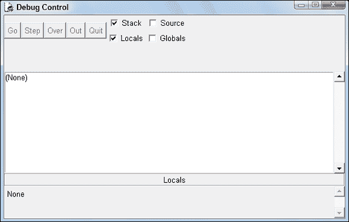
图 6-2 `IDLE`的`Debug Control`窗口看起来如下。

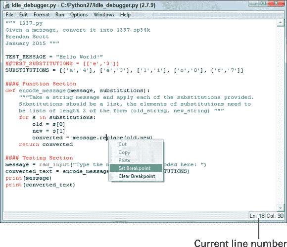
图 6-3 从菜单设置断点。

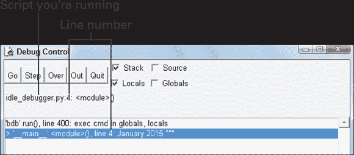
图 6-4 `Debug Control`窗口活起来了！

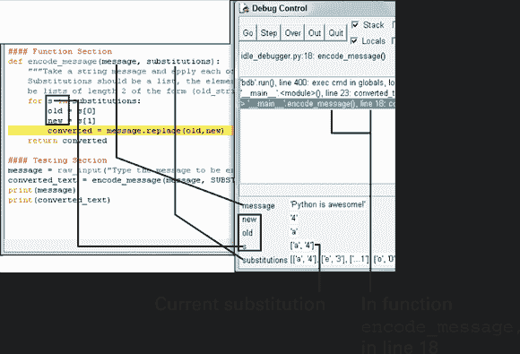
图 6-5 发生了什么。

切片操作符的形式为`string_name[a:b]`。（请将`string_name`替换为要切片的变量实际名称。）`a`是切片起始位置的`index`（显示距离字符串开头多远的数字），而`b`是切片结束位置的索引。在字符串`'0123456789'`中，每个字符本身也是它的索引。字符串`'0'`位于索引 0，字符串`'3'`位于索引 3，以此类推。在字符串`'Hello'`中，字母`'H'`位于索引 0，`'e'`位于索引 1，以此类推。

你将获得从字符数字`a`开始、直到（但不包含**字符数字`b`的所有字符。这可能会让人有点困惑，因为字符是从 0 开始计数的。此外，数字`a`和`b`可以是负数。如果是负数，则它们从字符串的末尾开始计数。

```
>>> # 获取直到最后一个字符（但不包括）的所有
>>> test_string[:-1]
'012345678'
>>> test_string[-1:] # 获取*从*最后一个字符开始的所有
'9'
```

实际上，获取可打印字符并去掉末尾那些奇怪字符非常简单。只需通过取直到倒数五个的所有字符来将它们切掉即可。这段代码切掉了最后五个字符，并将其余部分到变量`char_set`中，该变量包含了要编码的字符集：

```
>>> char_set = string.printable[:-5]
>>> char_set
'0123456789abcdefghijklmnopqrstuvwxyzABCDEFGHIJKLMNOPQRSTUVWXYZ!"#$%&\'()*+,-./:;<=>?@[\\]^_`{|}~ '
```


这就是你将编码的字符列表。

 你可以像切片字符串一样切片列表，不同在于，对于列表，你切片的是元素而不是字符。

## 创建替换表

你是否曾向朋友发送过加密信息？你是否发送过一段你父母认为听起来像代码的短信？（老实说，他们并不会用`brb`或`ttyl`，对吧？）

为明文消息中的每个字符分配一个字符。凯撒密码用（快速读读六次）字母`d`替换字母`a`。这意味着将字母表向左移动三个字符。你如何做到这一点？

图 7-1 显示了字符是如何变化的。凯撒会遍历他信息中的每个字母，在顶行找到它，然后在给信使的纸上写下它下方的字母。如果他的第一个明文单词是`BAD`，那么密文就是`YXA`。


图 7-1: 凯撒，这真是个酷的密码。

在这个例子中，你使用的位移量是三，因此从`char_set`的前端切掉三个字符并将它们添加到末尾。如果你想用不同的位移进行加密，请选择一个不同的数字。

这段代码从基础字符集创建你的替换字符，然后打印出来以便你查看：

```
>>> substitution_chars = char_set[-3:]+char_set[:-3]
>>> substitution_chars
'}~ 0123456789abcdefghijklmnopqrstuvwxyzABCDEFGHIJKLMNOPQRSTUVWXYZ!"#$%&\'()*+,-./:;<=>?@[\\]^_`{|'
```

然后你就有了了代码。（听懂了吗？）第一行显示了字母在消息明文中的样子。下一行包含你用于编写消息时将用到的密文字符。（这里只有前 62 个。）

```
>>> print(char_set[:62]+'\n'+substitution_chars[:62])
0123456789abcdefghijklmnopqrstuvwxyzABCDEFGHIJKLMNOPQRSTUVWXYZ
}~ 0123456789abcdefghijklmnopqrstuvwxyzABCDEFGHIJKLMNOPQRSTUVW
```

要查看完整列表，请打开 IDLE Shell 窗口并输入`print(char_set+'\n'+substitution_chars)`。

## 设置你的密码

现在是时候做基础工作了：

1. 创建一个名为`cryptopy.py`的文件。
2. 在文件顶部编写一个模块文档字符串（docstring）。
3. 创建一个 Imports 部分，并导入`string`模块。

    #### Imports Section
    ```
    import string
    ```

4. 创建一个 Constants 部分，并使用代码创建`char_set`和`substitution_chars`。但要更改它们的名称，使其**全大写**（因为它们应该是常量）。

    #### Constants Section
    ```
    CHAR_SET = string.printable[:-5]
    SUBSTITUTION_CHARS = CHAR_SET[-3:]+CHAR_SET[:-3]
    ```

5. 创建一个名为`TEST_MESSAGE`的常量并在其中存储一个测试消息。你将用它进行测试。

    ```python
    TEST_MESSAGE = "I like Monty Python. They are very funny."
    ```

6. 创建一个 Functions 部分，并在其中创建一个函数`encrypt_msg`，该函数接收一个参数（明文）。项目 5 解释了如何操作。

    #### Functions Section
    ```python
    def encrypt_msg(plaintext):
        """对明文进行加密"""
        ...
    ```

7. 创建一个 Testing 部分，并传入`TEST_MESSAGE`调用函数。

    #### Testing Section
    ```python
    ciphertext = encrypt_msg(TEST_MESSAGE)
    print(ciphertext)
    ```

## 使用字典

你使用字典方法。在这种情况下你不会使用`replace`，因为：
- 在这里这是一个拙劣的临时（ad hoc）解决方案。在这里你必须交换每个字符。追求优雅的代码。
- 该解决方案难以通用。例如，如果你想使用不同的加密位移（例如 c→a），那么你必须重写加密和解密函数。

使用一种数据类型，如果你输入一个`d`，它会给你一个`a`。Python 有这种数据类型——*字典*。在这种情况下，`d`被称为*键*（key），`a`被称为*值*（value）。

你通过大括号`{}`创建字典。这是一个示例，使用了键`'d'`和值`'a'`。

```
>>> my_dictionary={'d':'a'}
>>> my_dictionary['d']
'a'
```

通过在方括号中放入对应的键来查找字典中的值。在这段代码中，键是`'d'`。要从此字典获取值`'a'`，输入`my_dictionary['d']`。如果你向字典传递值，它会报错（除非运气好有一个同名的键）。在这个例子中，`my_dictionary`有一个项目：(`'d':'a'`)。

Python 中的字典有它们自己的方法。（我告诉过你`Python`中的一切都是对象吗？）它们是项、键和值，当调用它们时，它们会为你提供关于字典的信息。例如，要获取`my_dictionary`中的所有项，请输入`my_dictionary.items()`。现在在`my_dictionary`上尝试这些方法，并确保你理解了所获取的输出。

你可以在大括号`{}`中创建一个包含多个项的字典，但请确保用逗号分隔每个项。每个项都需要符合这种格式 — `<key>:<value>`。

值可以是几乎任何内容。对于键（key），请使用字符串或数字。（你可以使用其他类型，但目前请坚持使用字符串和数字。）

以下代码中的注释告诉了你发生了什么：

```python
>>> # 一个空字典
>>> my_empty_dictionary = {}
>>> # 之前的示例，包含一个项的字典
>>> my_dictionary={'d':'a'}
>>> # 用逗号分隔的两个项的字典
>>> my_dictionary={'d':'a', 'e':'b'}
```

如果你尝试获取一个不存在的键，Python 会报错：

```python
>>> my_dictionary['f']
Traceback (most recent call last):
File "<pyshell#45>", line 1, in <module>
my_dictionary['f']
KeyError: 'f'
```

创建字典后，你可以通过给相关键赋值来添加或更改项 — 既可以给现有键赋值（更改与之关联的值），也可以给新键赋值（创建一个新项）。当你使用字典时，通常不需要使用裸字符串进行赋值。相反，你通常是从另一个来源获取数据，将其存储在占位变量中，然后使用这些占位变量进行赋值。按照习惯，使用占位变量`k`来指代键，使用占位变量`v`指代对应的值。

这里有一个示例：

```python
>>> k = 'f'
>>> v = 'c'
>>> my_dictionary[k]=v # 在现有字典中创建一个新项
>>> my_dictionary
{'e': 'b', 'd': 'a', 'f': 'c'}
```

## 创建一个加密字典

是时候利用字典的力量了（这可是九千多了！）。你将创建一个字典，其中`CHAR_SET`中的每个字符都是键，而匹配的值是该字符应该转换后的字符。

要做到这一点，你需要了解内置函数`enumerate`。如果你有一个列表，`enumerate`会从它创建一个新的带编号的对象。因为你可以将字符串视为列表，所以当你使用`enumerate("Hello")`时会发生这种情况：

```python
>>> [x for x in enumerate("Hello")]
[(0, 'H'), (1, 'e'), (2, 'l'), (3, 'l'), (4, 'o')]
```

这段代码创建了一个元组列表，提供了字符串`"Hello"`中每个字母的索引。你可以将其用于`for`循环，以便在遍历列表元素的同时获取它们的索引。

```python
>>> for i,c in enumerate("Hello"):
... print(i,c)
(0, H)
(1, e)
(2, l)
(3, l)
(4, o)
```

这段代码中，`enumerate`创建的每个元素解包为两个独立的占位变量（`i`和`c`）。`i`是存储在`c`中的字符的索引。

在此项目中使用`enumerate`将明文字符集与替换列表中的加密字符链接起来。它们是这样创建的：

1. 为你的字典命名。
2. 创建一个同名的空字典。
   现在你将要给键赋值。
3. 使用`for i,k in enumerate(CHAR_SET)`遍历其中的每个字符。
4. 将每个字符赋给占位变量`k`（代表 key 键）。
   之前你在项目中使用了`c`（代表 character ）。从现在起使用`k`。
5. 使用索引`i`从`SUBSTITUTION_CHARS`中获取对应的字符，并将其赋值给占位变量`v`（代表 value 值）。
6. 通过将值`v`赋值给键`k`来创建一个项。

进展如何？我在文件顶部的常量（Constants）部分、在创建`SUBSTITUTION_CHARS`的条目之后添加了这些：

```python
# 从字符集和
# 替换生成加密字典
encrypt_dict = {}
for i,k in enumerate(CHAR_SET):
    v = SUBSTITUTION_CHARS[i]
    encrypt_dict[k]=v
```

## 使用 join

要加密整个消息，你必须更改消息中的每个字符。的是，字符串是不可变的；你无法更改它们。你将一次一个字符地构建一个新字符串。

 创建字符串的一种简单方法是每次添加新位，如下：

```python
>>> a_string = ""
>>> for i in range(10):
... a_string += str(i)
>>> a_string
'0123456789'
```

等等，有一种更高效的方法使用`join`方法来构建字符串：

```python
>>> list_of = []
>>> for i in range(10):
... list_of.append(str(i))
>>> "".join(list_of)
'0123456789'
```

`join`方法接收可迭代对象（如列表），将其元素连接成单个字符串，并将调用它的字符串作为分隔符。

## 重写加密函数

现在是时候重写函数了：

1. 保持函数名不变但更新文档字符串（docstring）。
2. 修改函数定义以添加`encrypt_dict`参数。
3. 注释掉旧代码。
4. 创建一个空列表来保存所有加密字符。
5. 遍历明文并使用传入的字典获取加密字符。
6. 将加密字符存储在你的列表中。
7. 当它处理完明文后，连接密文并返回它。
8. 修改调用函数的行以添加`ENCRYPTION_DICT`。

我注释掉了旧函数，并将其替换为以下内容：

## 函数部分

```python
def encrypt_msg(plaintext, encrypt_dict):
    """接收明文消息并使用提供的加密字典
    加密每个字符。键转换为其关联的值。返回密文"""
    ciphertext = []
    for k in plaintext:
        v = encrypt_dict[k]
        ciphertext.append(v)
    return "".join(ciphertext)
```

```python
ciphertext = encrypt_msg(CHAR_SET, ENCRYPTION_DICT)
```

`return ''.join(ciphertext)`

在测试（Testing）部分，我将行`ciphertext = encrypt_msg(CHAR_SET)`修改为`ciphertext = encrypt_msg(CHAR_SET, ENCRYPTION_DICT)`：

`ciphertext = encrypt_msg(CHAR_SET, ENCRYPTION_DICT)`

现在运行它：

```
>>> ================================= RESTART ================================
>>>
0123456789abcdefghijklmnopqrstuvwxyzABCDEFGHIJKLMNOPQRSTUVWXYZ
!"#$%&'()*+,-./:;<=>?@[\]^_`{|}~
}~ 0123456789abcdefghijklmnopqrstuvwxyzABCDEFGHIJKLMNOPQRSTUVW
XYZ!"#$%&'()*+,-./:;<=>?@[\]^_`{|
}~ 0123456789abcdefghijklmnopqrstuvwxyzABCDEFGHIJKLMNOPQRSTUVW
XYZ!"#$%&'()*+,-./:;<=>?@[\]^_`{|
```

当你确认新代码可以运行后，删除被注释掉的代码。

## 编写解密函数 (Write the Decryption Function)

如果无法解密，那么加密信息对任何人都没有用处。你需要某种方法来解密`ciphertext`。你可以利用加密结构来编写一个解密函数。

你只需要创建`encrypt_msg`函数的一个新副本，并对该副本进行以下更改：

1. 重命名它。
   `def decrypt_msg(ciphertext, decrypt_dict):`

2. 更新文档字符串（docstring）。

3. 在三个不同的地方将明文参数`plaintext`重命名为`ciphertext`（你正在加密的内容）。
   ```
   plaintext = []
   plaintext.append(v)
   return ''.join(plaintext)
   ```

4. 将`encrypt_dict`重命名为`decrypt_dict`。
   `def decrypt_msg(ciphertext, decrypt_dict):`

5. 从加密字典创建一个解密字典。
   你将在下一节中操作。

6. 测试解密函数。
   你将在下下节操作。

我得到的解密函数如下：

```python
def decrypt_msg(ciphertext, decrypt_dict):
    """接收一个密文消息并使用提供的
    解密字典解密每个字符。key 翻译为其
    关联的值。
    返回明文"""
    plaintext = []
    for k in ciphertext:
        v = decrypt_dict[k]
        plaintext.append(v)
    return ''.join(plaintext)
```

### 创建解密字典 (Create a decryption dictionary)

要从密文转换为明文，你需要反转之前的操作。例如，`'d'`加密为`'a'`，那么`'a'`将解密为`'d'`。加密项是`ENCRYPTION_DICT['d'] = 'a'`。对应的解密项将是`DECRYPTION_DICT['a'] = 'd'`。你通过赋值`k→v`创建了`ENCRYPTION_DICT`。

你可以通过执行反向赋值`v→k`同时创建一个解密字典。可以在创建`ENCRYPTION_DICT`的循环中，通过赋值`DECRYPTION_DICT[v]=k`来创建解密字典。

这是实现此操作的修订代码：

```python
# 从字符集及其
# 替换生成加密字典
ENCRYPTION_DICT = {}
DECRYPTION_DICT = {}
for i,k in enumerate(CHAR_SET):
    v = SUBSTITUTION_CHARS[i]
    ENCRYPTION_DICT[k]=v
    DECRYPTION_DICT[v]=k
```


### 测试往返过程 (Test the round trip)

现在你的加密和解密函数都可以工作了，测试往返过程。这意味着将明文消息加密为密文，然后从密文解密回明文。最后对它们对比。

按照以下步骤测试解密函数：

1. 选择一些明文进行测试。将其保存为`test_message`。
   你到为止一直在使用`CHAR_SET`。先测试它。然后你可以使用更有趣的明文。
   `test_message = CHAR_SET`

2. 打印`test_message`。
   `print(test_message)`

3. 使用`encrypt_msg`加密明文。将其保存为`ciphertext`。
   `ciphertext = encrypt_msg(test_message, ENCRYPTION_DICT)`

4. 打印密文。
   `print(ciphertext)`

5. 使用`decrypt_msg`解密密文。将其保存为`plaintext`。
   `plaintext = decrypt_msg(ciphertext, DECRYPTION_DICT)`

6. 打印明文。
   `print(plaintext)`

7. 打印对比明文`plaintext == test_message`。
   `print(plaintext == test_message)`

8. 你最后得到的结果和开始的一样吗？

我注释掉了之前的的一些打印语句，并得到了这个：

```python
### Testing Section

ciphertext = encrypt_msg(CHAR_SET, ENCRYPTION_DICT)

print(CHAR_SET) # for comparison while testing

print(ciphertext)

print(SUBSTITUTION_CHARS) #what you should get
```

 当数据被输入到程序代码中而不是来自用户输入或其他来源时，它被称为`hard coded`（硬编码）。

获取更多消息进行加密/解密的明显方法是使用`raw_input`。但问题是：程序可以加密和解密，但它不知道获取的是需要加密的明文还是需要解密的密文。

你有办法解决这个问题，但简单的方法是同时进行加密和解密！用户可以选择他们想要的答案。

要这样做：

1. 想一个请求消息时使用的提示词（prompt）。该提示应该同时处理加密和解密，并使用`raw_input`获取要处理的消息。

   ```
   message = raw_input("Type the message to encrypt below:\n")
   ```

2. 将消息加密为密文，并将消息解密为明文。

   ```
   ciphertext = encrypt_msg(message, ENCRYPTION_DICT)
   plaintext = decrypt_msg(message, DECRYPTION_DICT)
   ```

3. 打印一条短句说明“此消息加密后为”。然后打印密文。

4. 打印一条短句说明“此消息解密后为”。然后打印明文。

   ```
   print("This message encrypts to")
   print(ciphertext)
   print() # 只为了可读性留一个空行
   print("This message decrypts to")
   print(plaintext)
   ```

我将上次完整代码输出中标记为 Testing Section 的部分替换为以下内容。（如果你愿意，可以注释代码而不是删除它。）

### 输入与输出部分

```
message = raw_input("Type the message to process below:\n")

ciphertext = encrypt_msg(message, ENCRYPTION_DICT)

plaintext = decrypt_msg(message, DECRYPTION_DICT)

print("This message encrypts to")

print(ciphertext)

print() # 只为了可读性留一个空行

print("This message decrypts to")

print(plaintext)
```

`\n`字符允许你在提示之后的新行输入消息。运行它你会得到：

```
>>> =================================== RESTART ================================
>>>
Type the message you'd like to encrypt below:
I love learning Python. And my teacher is smelly. And I shouldn't start a sentence with and.
This message encrypts to
F|ilsb|ib7okfkd|Mvqelk+|xka|jv|qb79ebo|fp|pjbiiv+||xka|F|pelriak$q|pq7oq|7|pbkqbk9b|tfqe|7ka+
This message decrypts to
L2oryh2ohduqlqj2SBwkrq;2Dqg2pB2whdfkhu2lv2vphooB;22Dqg2L2vkrxogq*w2vwduw2d2vhqwhqfh2zlwk2dqg;
```

再次运行。这次，输入加密文本来获取解密。复制并粘贴：

```
>>> =================================== RESTART ================================
>>>
Type the message you'd like to encrypt below:
F|ilsb|ib7okfkd|Mvqelk+|xka|jv|qb79ebo|fp|pjbiiv+||xka|F|pelriak$q|pq7oq|7|pbkqbk9b|tfqe|7ka+
This message encrypts to
C_fip8_f84lhcha_Jsnbih(_uh7_gs_n846b8l_cm_mg8ffs(__uh7_C_mbiof7h!n_mn4ln_4_m8hn8h68_qcnb_4h7(
This message decrypts to
I love learning Python. And my teacher is smelly. And I shouldn't start a sentence with and.
```

你会得到想要的结果，但你必须打印比你需要的更多的信息。如果这是一个图形界面（你将在[`dummies.com/go/pythonforkids`](http://www.dummies.com/go/pythonforkids)的项目中读到它），你只需要两个独立的按钮，一个用于加密，一个用于解密。

## 加密文本文件

必须将文本输入（甚至是复制粘贴）到`text_input`中有点麻烦。一种方法是让 Python 从文件中读取文本。这其实非常简单，但解释有点长。

 这仅适用于文本 (.txt) 文件 —— 即不包含额外格式或其他指令的文件。如果你对文字处理文件（如`.docx`或`.doc`）尝试此操作，将会遇到麻烦。

### 打开、写入并关闭文件

在 IDLE Shell 窗口中尝试这个。确保你完全复制：

```
>>> file_object = open('p4k_test.py','w')
```

这告诉 Python 使用内置的`open`函数在你的计算机硬盘上打开一个名为`p4k_test.py`的文件进行写入模式，并将结果存储在名为`file_object`的变量中。

 这仅适用于文本 (.txt) 文件 —— 即不包含额外格式或其他指令的文件。如果你对文字处理文件（如`.docx`或`.doc`）尝试此操作，将会遇到麻烦。

### 打开、写入并关闭文件

在 IDLE Shell 窗口中尝试这个。确保你完全复制：

```
>>> file_object = open('p4k_test.py','w')
```

这告诉 Python 使用内置的`open`函数在你的计算机硬盘上打开一个名为`p4k_test.py`的文件进行写入模式，并将结果存储在名为`file_object`的变量中。

### 打开、写入并关闭文件

在 IDLE Shell 窗口中尝试这个。确保你完全复制：

```
>>> file_object = open('p4k_test.py','w')
```

这告诉 Python 使用内置的`open`函数在你的计算机硬盘上打开一个名为`p4k_test.py`的文件进行写入模式，并将结果存储在名为`file_object`的变量中。

```python
2: print('Hello from within the file')
```

```python
>>> file_object.close()
```

行与行之间是分开的，因为文件中的每一行末尾都有`\n`，而`print`语句在打印内容后会在下一行之前添加它自己的换行符。你可以验证每行末尾确实有一个`\n`，因为变量`line`仍然包含文件的最后一行：

```python
>>> line
"print('Hello from within the file')\n"
```

## 运行文件

你写入文件的数据是有效的 Python 代码。你可以证明你一直在写入的文件是一个普通的普通文件（由于你给它命名了`.py`后缀，所以它是一个`Python`文件）。你可以运行它：用 IDLE 的 Edit 窗口打开`p4k_test.py`。在不对文件进行任何更改的情况下运行该文件。

```python
>>> =================================== RESTART ================================
>>>
Hello from within the file
Hello from within the file
```

这就像是你直接将代码输入到文件中一样。

## 使用 with 打开和关闭文件

有时，忘记何时关闭已打开的文件是很麻烦的。Python 还有另一个关键字来处理这类（以及其他）问题——`with`。你在`with`关键字之后放置`open`命令，然后放置`as`关键字和用于保存创建的文件对象的虚拟变量名称，如下：

```python
>>> with open('p4k_test.py','r') as file_object:
    print(file_object.read())
    print('Hello from within the file')
    print('Hello from within the file')
>>> file_object
<closed file 'p4k_test.py', mode 'r' at 0xf7fed0>
```

在这里，Python 以读取模式打开名为`p4k_test.py`的文件，并将创建的对象存储在名为`file_object`的变量中。在第二行中，它读取并打印了文件的内容。当代码代码块结束时，Python 意识到你不再需要该文件并进行了清理工作。（你的父母希望你更像 Python 一样吗？）部分原因在于它关闭了文件。最后一行告诉你该对象是一个已关闭的文件，因此 Python 已经为你关闭了文件。

你可以像这段伪代码一样用`with`处理多个文件。不要在命令行输入这些，它是不起作用的：

```python
with open(filename1, 'r') as file_object1,
open(filename2, 'r') as file_object2:
    do stuff with file_object1
    do stuff with file_object2
```

 显示真实代码结构的伪代码被称为*pseudocode*。（那个 p 是不发音的——psilly，我知道。）

 这是一个 Shell 中的快速示例。这会破坏任何名为`testfile2`的文件，所以要小心！

```python
>>> with open('testfile2','w') as a:
    a.write('stuff')
>>> with open('testfile2','r') as a,
    open('p4k_test.py','r') as b:
    print(a.read())
    print(b.read())
stuff
print('Hello from within the file')
print('Hello from within the file')
>>> a
<closed file 'testfile2', mode 'r' at 0xf6e540>
>>> b
<closed file 'p4k_test.py', mode 'r' at 0xef4ed0>
```

 你将主要通过这种方式使用`with`关键字。从现在起，除非有特殊理由，否则使用`with`。

## 从文件加密和解密

总是向命令行复制粘贴有点麻烦。你将在接下来的两个部分加密一个文件。

1. 为包含明文的文件选择一个名称（`crypt_input.txt`）。你的应用程序将被设计为只从该文件读取而不读取其他文件。
2. 创建该文件并在其中放入一些测试数据。
3. 为存储`crypt_input.txt`的常量选择名称并设置该常量。你可以通过更改此变量来加密其他文件。
4. 为存储加密后密文的文件选择一个名称（`crypt_output.txt`）。
5. 为存储`ciphertext.txt`的常量选择名称并设置该常量。
6. 打开输入文件。
7. 读取明文。
8. 关闭输入文件。
9. 加密文件内容。
10. 打印加密后的文本。这是用于测试阶段的。

定义一个明文消息：

```python
>>> plaintext = """I wonder if I can use the functions and constants from cryptopy to make encrypted messages from the command line?"""
```

使用文件中的`encrypt_msg`函数。你需要将`cryptopy`视为模块名，就像你从标准库导入一个模块一样：

```python
>>> ciphertext = cryptopy.encrypt_msg(plaintext,cryptopy.ENCRYPTION_DICT)
```

打印它以查看加密内容：

```python
>>> ciphertext
'F|tlkabo|fc|F|97k|rpb|qeb|crk9qflkp|7ka|9lkpq7kqp|colj|9ovmqlmv\nql|j7hb|bk9ovmqba|jbpp7dbp|colj|qeb|9ljj7ka|ifkb<'
```

现在使用`decrypt_msg`函数对其进行解密并确认往返过程：

```python
>>> print(cryptopy.decrypt_msg(ciphertext,cryptopy.DECRYPTION_DICT))
I wonder if I can use the functions and constants from cryptopy to make encrypted messages from the command line?
```

现在你可以选择你想要使用的函数——即使是从 Python 解释器。你可以使用制表键补全来获取如`cryptopy.ENCRYPTION_DICT`等常量名称。就像你可以在解释器中使用这些函数一样，你也可以通过简单的导入模块在 Python 程序中使用它们。

不过，这有一些限制。要使用`import`语句，你想要使用的模块必须位于以下之一：

* `PYTHONPATH`环境变量列出的目录。
* 导入该文件的 Python 脚本的当前工作目录。

现在，将你的应用程序（以及它调用的任何模块）放入`C:\Python27`。

当你导入`cryptopy`时，打印了一些文本：`Qefp|fp|pljb|qbpq|qbuq`。它看起来非常像被加密过的明文。尝试解密它：

```python
>>> ciphertext = "Qefp|fp|pljb|qbpq|qbuq"
>>> cryptopy.decrypt_msg(ciphertext,cryptopy.DECRYPTION_DICT)
'This is some test text'
```


 这是你保存到`cryptopy_input.txt`的消息。它是加密的，并打印在`cryptopy`的输入和输出部分。当你导入`cryptopy`时，Python需要执行整个`cryptopy.py`文件，包括测试和输入代码。当你单独运行该模块时这样做很好，但当其他程序导入该模块时，你不希望发生这种情况。它们只想访问函数，而不希望运行测试代码。

Python提供了一种方法，在导入时停止这些代码运行。Python使用名为`__name__`的变量来标识正在运行的代码。（还记得*双下划线名称 (dunder name)*吗？）当你单独运行一个文件时，值`"__main__"`（“双下划线 main”）会被赋值给该变量。Python会自动执行。

 你可以使用`__name__`变量来识别代码是否作为导入被运行的。如果`__name__`等于`"__main__"`，则代码没有被导入。否则，它是被导入的。

在Python中，在`if`块中隔离你不希望在导入期间运行的代码是常见做法，如下：

```python
>>> if __name__ == "__main__":
    print("Not in an import")
Not in an import
```

整理`cryptopy`脚本以便被其他脚本导入：

1. 插入一个比较`__name__`与`"__main__"`的`if`子句。
2. 将来自输入和输出部分的现有代码移动到该`if`子句的代码块中。

新的输入和输出部分看起来如下所示。注意缩进的注释部分：

```python
if __name__ == "__main__":
    # message = raw_input("Type the message to process below:\n")
    # ciphertext = encrypt_msg(message, ENCRYPTION_DICT)
    # plaintext = decrypt_msg(message, DECRYPTION_DICT)
    # print("This message encrypts to")
    #     print(ciphertext)
    #     print # 只为了可读性留的空行
    #     print("This message decrypts to")
    #     print(plaintext)

with open(INPUT_FILE_NAME, 'r') as input_file:
    message = input_file.read()
    ciphertext = encrypt_msg(message, ENCRYPTION_DICT)
print(ciphertext) # 只用于测试
```

在后续内容中，我将此称为Main部分。

## 测试代码

我将常量`ENCRYPT`设置为`False`（因为文本已经加密了）。你也可以看到，通过选择更改的代码，你可以轻松地解密。

要测试代码，请在输入文件中放入加密文本。你可以通过从IDLE Shell向那里写入数据或从IDLE内部打开文件来实现。确保你在打开对话框的“文件类型”下拉菜单中选择文本文件 (*.txt) 或所有文件 (*)。否则，它将不会显示。

```python
import string
```

### 常量部分

```python
CHAR_SET = string.printable[:-5]
SUBSTITUTION_CHARS = CHAR_SET[-3:]+CHAR_SET[:-3]

# generate encryption dictionary from the character set and
# its substitutions
ENCRYPTION_DICT = {}
DECRYPTION_DICT = {}

for i,k in enumerate(CHAR_SET):
    v = SUBSTITUTION_CHARS[i]
    ENCRYPTION_DICT[k]=v
    DECRYPTION_DICT[v]=k

# other characters - \t, \n etc - are not changed
for c in string.printable[-5:]: # watch the colons!
    ENCRYPTION_DICT[c]=c
    DECRYPTION_DICT[c]=c

TEST_MESSAGE = "I like Monty Python. They are very funny."
INPUT_FILE_NAME = "cryptopy_input.txt"
OUTPUT_FILE_NAME = "cryptopy_output.txt"
```

## 函数部分

```python
def encrypt_msg(plaintext, encrypt_dict):
    """接收一个明文消息并使用提供的加密字典
    加密每个字符。key 映射到其关联的值。
    返回密文"""
    ciphertext = []
    for k in plaintext:
        v = encrypt_dict[k]
        ciphertext.append(v)
    # 你可以直接写
    # ciphertext.append(encrypt_dict[k])
    # 我把它拆分开了是为了让你更好地理解。
    return ''.join(ciphertext)

def decrypt_msg(ciphertext, decrypt_dict):
    """接收一个密文消息并使用提供的解密字典
    解密每个字符。key 映射到其关联的值。
    返回明文"""
    plaintext = []
    for k in ciphertext:
        v = decrypt_dict[k]
        plaintext.append(v)
    return ''.join(plaintext)
```

## 主部分

```python
if __name__ == "__main__":
    message = raw_input("Type the message to process below:\n")
    ciphertext = encrypt_msg(message, ENCRYPTION_DICT)
    plaintext = decrypt_msg(message, DECRYPTION_DICT)
    print("This message encrypts to")
    print(ciphertext)
    print() # just a blank line for readability
    print("This message decrypts to")
    print(plaintext)

ENCRYPT = False # This is the constant used for the if clause
with open(INPUT_FILE_NAME, 'r') as input_file:
    message = input_file.read()
if ENCRYPT:
    text_to_output = encrypt_msg(message, ENCRYPTION_DICT)
else:
    text_to_output = decrypt_msg(message, DECRYPTION_DICT)
print(text_to_output) # just for testing
with open(OUTPUT_FILE_NAME, 'w') as output_file:
    output_file.write(text_to_output)
```

## 总结

在这个项目中你学习了：

- 一种新的数据类型——字典。字典包含项。每个项都有一个键（key）和一个值（value）。
- 字典允许通过键直接访问引用的值。如果`key:value`是字典`a_dictionary`中的一个项，则访问值的语法是`a_dictionary[key]`。
- 创建空字典。
- 通过在现有字典中创建`key:value`对并为键赋值，从而在字典中创建项。
- 使用凯撒密码加密。
- 通过连接列表并使用`join`方法创建字符串。
- 使用`open`和`close`在你的电脑上打开文件。
- 使用`read`和`write`在你的电脑上进行文件的读写。
- 使用`with`和`as`关键字让Python在你使用文件后进行清理。
- `import`模块。
- 使用`__name__ == "__main__"`来隔离代码。
- 使用常量进行控制流。

### 傻话句子

在这个项目中你学习了：

- `import` `string`
- `Constants Section`
- 从字符集及其替换字符生成加密字典
- `ENCRYPTION_DICT = {}`
- `DECRYPTION_DICT = {}`
- `for i,k in enumerate(CHAR_SET):`
- `v = SUBSTITUTION_CHARS[i]`
- `ENCRYPTION_DICT[k]=v`
- `DECRYPTION_DICT[v]=k`
- `other characters - \t, \n etc - are not changed`
- `for c in string.printable[-5:]:` # watch the colons!
- `ENCRYPTION_DICT[c]=c`
- `DECRYPTION_DICT[c]=c`
- `TEST_MESSAGE = "I like Monty Python. They are very funny."`
- `INPUT_FILE_NAME = "cryptopy_input.txt"`
- `OUTPUT_FILE_NAME = "cryptopy_output.txt"`
- `Function Section`
- `def encrypt_msg(plaintext, encrypt_dict):`
- `ciphertext = []`
- `for k in plaintext:`
- `v = encrypt_dict[k]`
- `ciphertext.append(v)`
- `return ''.join(ciphertext)`
- `def decrypt_msg(ciphertext, decrypt_dict):`
- `plaintext = []`
- `for k in ciphertext:`
- `v = decrypt_dict[k]`
- `plaintext.append(v)`
- `return ''.join(plaintext)`
- `Main Section`
- `if __name__ == "__main__":`
- `message = raw_input("Type the message to process below:\n")`
- `ciphertext = encrypt_msg(message, ENCRYPTION_DICT)`
- `plaintext = decrypt_msg(message, DECRYPTION_DICT)`
- `print("This message encrypts to")`
- `print(ciphertext)`
- `print()`
- `print("This message decrypts to")`
- `print(plaintext)`
- `ENCRYPT = False`
- `with open(INPUT_FILE_NAME, 'r') as input_file:`
- `message = input_file.read()`
- `if ENCRYPT:`
- `text_to_output = encrypt_msg(message, ENCRYPTION_DICT)`
- `else:`
- `text_to_output = decrypt_msg(message, DECRYPTION_DICT)`
- `print(text_to_output)`
- `with open(OUTPUT_FILE_NAME, 'w') as output_file:`
- `output_file.write(text_to_output)`

### 格式化字符串

格式化字符串允许将变化的部分插入到模板中。例如，假设你想打印“你还剩 15 次回合即可结束。”剩余次数不断变化，但消息的其他部分保持不变。

格式化运算符只接收一个参数。当你把一组用逗号隔开的项放在括号中时，你实际上获得了一个名为*元组*（tuple）的新对象。正是这个单一对象被传递给格式化运算符的。

### 使用元组数据类型

你有几组用于傻话句子的单词列表。从每个列表中选择一个单词并将它们组合在一起。格式化运算符只接收一个参数，所以将所有单词打包成一个对象，以便将其作为单个参数传递给格式化运算符。这需要一个元组。

元组（Tuples）是最容易被误解的Python数据类型。它们有点像列表。有些人认为元组比列表糟糕，但它们只是有所不同。你可以获取元组元素的值，但你不能改变它们。元组是`immutable`（不可变）的，这是一种高级的说法，意味着你不能改变它们。

元组适用于以下场景：

* 当你有一组想要按特定顺序排列的值时。当你使用格式化字符串时，这`exactly`正是你想要的。
* 当你有一组不希望被改变的值（无论是刻意的还是无意的）时。

 元组元素具有意义的顺序。列表适用于对顺序不重要的情况。

你可以像遍历列表一样遍历（go）元组，并像列表一样读取单个元素：

```python
>>> my_tuple = ('e','3')
>>> for e in my_tuple:
    print(e)
e
3
>>> my_tuple[0]
'e'
>>> my_tuple[1]
'3'
>>> my_tuple(0) # 使用 [] 而不是 ()!
Traceback (most recent call last):
  File "<pyshell#42>", line 1, in <module>
    my_tuple(0) # [] not ()!
TypeError: 'tuple' object is not callable
```

在这里，`my_tuple[0]`获取元组第一个元素的值（元素从0开始编号）。它具有与列表相同的方括号表示法。元素的数字从0开始，就像133t sp34k3项目中的替换操作一样。

通过尝试给元素0赋值来确认你无法更改该元素：`my_tuple[0] = 17`。请熟悉该错误（它会提示你元组不支持项赋值），这样当你以后看到它时就能认出来。

你可以拥有只包含一个元素的元组。为什么？因为你想要使用的代码可能期望一个元组。你如何创建一个只有一个元素的元组呢？答案是照常操作，在你的唯一元素周围加上括号，但在后面添加一个逗号。

```python
>>> my_one_element_tuple = (1,)
>>> my_one_element_tuple
(1,)
```

逗号告诉Python这是一个元组；从技术上说，起作用的是逗号而不是括号。你通常需要使用括号，是因为语法很难理解。

元组允许你从函数返回多个值，当你想要从一个函数返回多个值时这非常方便。但调用函数的代码可以将这些值视为单个元组，也可以视为单个元素。这被称为对元组的`unpacking`（解包）。

如果你想让值被解包，必须给元组提供恰好数量的元素。例如，这里`test_function`返回一个包含三个值的元组`(1,2,3)`。代码既可以将其作为一个单一对象`a = test_function()`接收，也可以作为三个独立的对象通过`a,b,c = test_function()`接收，但不能是其他任何的数量。

当你想要从函数返回多个值时，可以使用这种方法：

```python
>>> def test_function():
    return (1,2,3) # 返回一个包含三个元素的元组
>>> a = test_function()
>>> a
(1, 2, 3)
>>> a,b,c = test_function()
>>> a
1
>>> b
2
>>> c
3
>>> a,b = test_function()
Traceback (most recent call last):
  File "<pyshell#59>", line 1, in <module>
    a,b = test_function()
ValueError: too many values to unpack
```

你也可以直接解包元组：

```python
>>> a,b,c = (1,2,3) # 将元组解包为 a, b, c
>>> print("a: %s, b: %s, c: %s"%(a,b,c))
a: 1, b: 2, c: 3
>>> a,b = (1,2,3) # 三个值但只有两个变量
Traceback (most recent call last):
  File "<pyshell#62>", line 1, in <module>
    a,b = (1,2,3)
ValueError: too many values to unpack
```

## 开始编写你的胡话句子

为了制作胡话句子，你需要一个模板，可以在其中插入一些单词。把这想象成：


`<Person or animal>` `<verbed>` the `<adjective>` `<noun>`。

（是的，是的。我知道 `verbed` 不是一个单词。）这种格式模板看起来就像你在这里看到的。每个 `%s` 都是一个转换说明符，标记了值将插入字符串的位置：

`template = "%s %s the %s %s."`

是时候开始写你的胡话句子了：

1. 创建一个新文件并将其命名为 `silly_sentencer.py`。
2. 在文件顶部添加注释，解释程序将执行什么。

```python
"""silly_sentencer.py
此程序通过将随机单词映射
到格式化模板来打印胡话
Brendan Scott
2015 年 1 月
"""
```

3. 根据 `<Person or animal>` `<verbed>` the `<adjective>` `<noun>` 创建模板：

`template = "%s %s the %s %s."`

4. 将以下示例存储在名为 `BASE_SENTENCE` 的常量中。

当你测试代码时，会看到这个句子。

`BASE_SENTENCE = "My Python teacher wrote the book."`

5. 在你的代码中输入以下：

`persons = ["My Python teacher"]`

`verbs = ["wrote"]`

`adjectives = ["Python"]`

`nouns = ["book"]`

 元组元素具有意义的顺序。列表适用于顺序不重要的情况。你可以像遍历列表一样遍历元组，并像列表一样读取单个元素：

```python
>>> my_tuple = ('e','3')
>>> for e in my_tuple:
    print(e)
e
3
>>> my_tuple[0]
'e'
>>> my_tuple[1]
'3'
>>> my_tuple(0) # 使用 [] 而不是 ()!
Traceback (most recent call last):
  File "<pyshell#42>", line 1, in <module>
    my_tuple(0) # [] not ()!
TypeError: 'tuple' object is not callable
```

在这里，`my_tuple[0]` 获取元组第一个元素的值（元素从 0 开始编号）。它具有与列表相同的方括号表示法。元素的数字从 0 开始，就像 133t sp34k3 项目中的替换操作一样。

通过尝试给元素 0 赋值来确认你无法更改该元素：`my_tuple[0] = 17`。请熟悉该错误（它会提示你元组不支持项赋值），这样当你以后看到它时就能认出来。

你可以拥有只包含一个元素的元组。为什么？因为你想要使用的代码可能期望一个元组。你如何创建一个只有一个元素的元组呢？答案是照常操作，在你的唯一元素周围加上括号，但在后面添加一个逗号。

```python
>>> my_one_element_tuple = (1,)
>>> my_one_element_tuple
(1,)
```

逗号告诉 Python 这是一个元组；从技术上说，起作用的是逗号而不是括号。你通常需要使用括号，是因为语法很难理解。

元组允许你从函数返回多个值，当你想要从一个函数返回多个值时这非常方便。但调用函数的代码可以将这些值视为单个元组，也可以视为单个元素。这被称为对元组的 `unpacking`。

如果你想让值被解包，必须给元组提供恰好数量的元素。例如，这里 `test_function` 返回一个包含三个值的元组 `(1,2,3)`。代码既可以作为一个单一对象 `a= test_function()` 接收，也可以作为三个独立的对象通过 `a,b,c = test_function()` 接收，但不能是其他任何的数量。

当你想要从函数返回多个值时，可以使用这种方法：

```python
>>> def test_function():
    return (1,2,3) # 返回一个包含三个元素的元组
>>> a = test_function()
>>> a
(1, 2, 3)
>>> a,b,c = test_function()
>>> a
1
>>> b
2
>>> c
3
>>> a,b = test_function()
Traceback (most recent call last):
  File "<pyshell#59>", line 1, in <module>
    a,b = test_function()
ValueError: too many values to unpack
```

你也可以直接解包元组：

```python
>>> a,b,c = (1,2,3) # 将元组解包为 a, b, c
>>> print("a: %s, b: %s, c: %s"%(a,b,c))
a: 1, b: 2, c: 3
>>> a,b = (1,2,3) # 三个值但只有两个变量
Traceback (most recent call last):
  File "<pyshell#62>", line 1, in <module>
    a,b = (1,2,3)
ValueError: too many values to unpack
```

## 开始编写你的胡话句子

为了制作胡话句子，你需要一个模板，可以在其中插入一些单词。把这想象成：

`<Person or animal>` `<verbed>` the `<adjective>` `<noun>`。

（是的，是的。我知道 `verbed` 不是一个单词。）这种格式模板看起来就像你在这里看到的。每个 `%s` 都是一个转换说明符，标记了值将插入字符串的位置：

`template = "%s %s the %s %s."`

是时候开始写你的胡话句子了：

1. 创建一个新文件并将其命名为 `silly_sentencer.py`。
2. 在文件顶部添加注释，解释程序将执行什么。

```python
"""silly_sentencer.py
此程序通过将随机单词映射
到格式化模板来打印胡话
Brendan Scott
2015 年 1 月
"""
```

3. 根据 `<Person or animal>` `<verbed>` the `<adjective>` `<noun>` 创建模板：

`template = "%s %s the %s %s."`

4. 将以下示例存储在名为 `BASE_SENTENCE` 的常量中。

当你测试代码时，会看到这个句子。

`BASE_SENTENCE = "My Python teacher wrote the book."`

5. 在你的代码中输入以下：

`persons = ["My Python teacher"]`

`verbs = ["wrote"]`

`adjectives = ["Python"]`

`nouns = ["book"]`

 元组元素具有意义的顺序。列表适用于顺序不重要的情况。你可以像遍历列表一样遍历元组，并像列表一样读取单个元素：

```python
>>> my_tuple = ('e','3')
>>> for e in my_tuple:
    print(e)
e
3
>>> my_tuple[0]
'e'
>>> my_tuple[1]
'3'
>>> my_tuple(0) # 使用 [] 而不是 ()!
Traceback (most recent call last):
  File "<pyshell#42>", line 1, in <module>
    my_tuple(0) # [] not ()!
TypeError: 'tuple' object is not callable
```

在这里，`my_tuple[0]` 获取元组第一个元素的值（元素从 0 开始编号）。它具有与列表相同的方括号表示法。元素的数字从 0 开始，就像 133t sp34k3 项目中的替换操作一样。

通过尝试给元素 0 赋值来确认你无法更改该元素：`my_tuple[0] = 17`。请熟悉该错误（它会提示你元组不支持项赋值），这样当你以后看到它时就能认出来。

你可以拥有只包含一个元素的元组。为什么？因为你想要使用的代码可能期望一个元组。你如何创建一个只有一个元素的元组呢？答案是照常操作，在你的唯一元素周围加上括号，但在后面添加一个逗号。

```python
>>> my_one_element_tuple = (1,)
>>> my_one_element_tuple
(1,)
```

逗号告诉 Python 这是一个元组；从技术上说，起作用的是逗号而不是括号。你通常需要使用括号，是因为语法很难理解。

元组允许你从函数返回多个值，当你想要从一个函数返回多个值时这非常方便。但调用函数的代码可以将这些值视为单个元组，也可以视为单个元素。这被称为对元组的 `unpacking`。

如果你想让值被解包，必须给元组提供恰好数量的元素。例如，这里 `test_function` 返回一个包含三个值的元组 `(1,2,3)`。代码既可以作为一个单一对象 `a= test_function()` 接收，也可以作为三个独立的对象通过 `a,b,c = test_function()` 接收，但不能是其他任何的数量。

## 填充模板

为了填充模板，从每个列表中随机选择一个元素。因为目前每个列表中只有一个元素，它并不是随机的。然而，你正在用单个元素进行测试并添加其他元素。当你有了它们，就可以使用现有的代码来填充模板。

从列表中随机选择相对简单。使用 `random` 模块中的 `choice` 函数。在这个示例中，我使用列表推导式创建一个包含从 0 到 9 数字的列表，然后使用 `random.choice` 随机选择其中一个：

```python
>>> import random
>>> sample_list = [x for x in range(10)]
>>> random.choice(sample_list)
1
```

现在将一切整合到你的代码中：

1. 删除或注释掉用于测试的打印语句和其他代码。
2. 将每个类似 `person = persons[0]` 的赋值替换为 `person = random.choice(persons)`。
3. 使用格式值创建一个元组。
4. 打印用于比较的基础句子以及使用格式值格式化的模板。

```python
## 主部分
if __name__ == "__main__":
    person = random.choice(persons)
    verb = random.choice(verbs)
    adjective = random.choice(adjectives)
    noun = random.choice(nouns)
    format_values = (person, verb, adjective, noun)
    print(BASE_SENTENCE)
    print(template%format_values)
    print(BASE_SENTENCE == template%format_values)
```

你应该得到：

```
RESTART ================================
My Python teacher wrote the Python book.
My Python teacher wrote the Python book.
True
```

# 常量区域

`BASE_SENTENCE="My Python teacher wrote the Python book."`

`template = "%s %s the %s %s."`

`persons = ["My Python teacher"]`

`verbs = ["wrote"]`

`adjectives = ["Python"]`

`nouns = ["book"]`

# 主区域

```python
if __name__ == "__main__":
    person = random.choice(persons)
    verb = random.choice(verbs)
    adjective = random.choice(adjectives)
    noun = random.choice(nouns)
    format_values = (person, verb, adjective, noun)
    print(BASE_SENTENCE)
    print(template%format_values)
```

## 5. 运行它吧！

你正在测试该函数是否正常工作。

```
>>> ================================= RESTART ================================
>>>

My Python teacher wrote the Python book.
My Python teacher wrote the Python book.
```

这段代码看起来运行正常。第一行是你开始时使用的原始字符串。第二行是你使用格式化模板创建的字符串。

## 添加更多单词

现在你可以发挥创意了。对于每个列表，想一想可以放在里面的其他单词。你还没有测试过长度超过一个的列表，所以只需向单个列表添加单词，不要一次性添加所有列表。

你所选择的其他单词：

* 必须与原单词类型相同。例如，对于人物，你可能会添加 `The Hungarian`（那个匈牙人），对于形容词，你可能会添加 `slippery`（滑滑的），但你不会反过来这样做。否则，句子将毫无意义：“滑滑的是那个匈牙人。”
* 应该是单单词。也可以是多个单词。例如，`Mrs Pepperpot` 或 `The Hungarian.`。
* 不应该是代词：`he`、`she`、`it`、`we`、`us`、`they`。你需要根据性别匹配代词。

这里有一些额外的单词供你开始：

`persons = ["My Python teacher", "Dinsdale Piranha", "Tim", "Mrs Pepperpot", "My dad", "The Hungarian"]`

`verbs = ["wrote", "sneezed", "looked at", "drove", "made", "stole"]`

`adjectives = ["Python", "slippery", "funniest", "big", "smelly", "poky", "silly"]`

`nouns = ["book", "eels", "hovercraft", "nose", "shoes", "joke", "walk"]`

你可以将一个长列表拆分到多行。（像那样。）

你可以在任何逗号后添加新行。

当你准备好所有想要的元素后，以一个右方括号结尾（不要加逗号）。运行代码几次，看看它是否正常工作。（我从这段输出结果中删除了重启行。）

`Mrs Pepperpot looked at the big eels.`

`My dad sneezed the funniest shoes.`

`Dinsdale Piranha wrote the Python book.`

`Dinsdale Piranha wrote the silly nose.`

`Tim made the Python shoes.`

`My dad made the Python walk.`

`My Python teacher drove the slippery joke.`

`Tim wrote the Python shoes.`

一切似乎都在正常运行。这个函数有点难以测试，因为输出是随机的（不像加法，你明确答案应该是多少）。

当你满意时，就可以完成单词列表的填充了。如果你愿意，也可以将整个区域放入 for 循环中，以便每次运行程序时都打印多个句子。

## 完整代码

如果你将这些更改添加到之前的代码中，就会得到最终代码。它看起来如下：


```python
"""silly_sentencer.py
此程序通过将随机单词映射到格式化模板
来打印愚蠢的句子
Brendan Scott
2015 年 1 月
"""
# 导入区域
import random

# 常量区域
BASE_SENTENCE = "My Python teacher wrote the Python book."
template = "%s %s the %s %s."
persons = ["My Python teacher", "Dinsdale Piranha", "Tim", "Mrs Pepperpot", "My dad", "The Hungarian"]
verbs = ["wrote", "sneezed", "looked at", "drove", "made", "stole"]
adjectives = ["Python", "slippery", "funniest", "big", "smelly", "poky", "silly"]
nouns = ["book", "eels", "hovercraft", "nose", "shoes", "joke", "walk"]

# 主区域
if __name__ == "__main__":
    person = random.choice(persons)
    verb = random.choice(verbs)
    adjective = random.choice(adjectives)
    noun = random.choice(nouns)
    format_values = (person, verb, adjective, noun)
    print(BASE_SENTENCE)
    print(template%format_values)
```

## 总结

在这个项目中，你使用了 Python 的格式化运算符 `%` 来生成愚蠢的句子。在此过程中，你看到了：

*   格式化字符串、格式化运算符、格式化值以及转换说明符。

*   字符串转换说明符：`%s`。

## 2. 输入以下内容：

```python
class <你选择的类名>(object):
```

`'(object)'` 部分意味着该类是对象的一种。它被认为*继承自* `object`。类继承很重要，但你现在不需要了解细节。除非我另有说明，否则在所有的类语句中都包含 `'(object)'` 部分。

3. 添加一个 docstring（文档字符串）来解释类的用途。

docstring 开始的是一个新的代码块，所以要对其缩进。

4. 换的一行，缩进，并在下一行将组成类的内容放在一个新的代码块中。

现在，放一个 `pass` 关键字（从技术上讲，由于你有了 docstring，这并不是必要的）。

你稍将用它作为 `AddressEntry` 类的存根。暂时在 IDLE Shell 窗口中操作，这样你可以直接与实例进行交互：

```python
>>> class AddressEntry(object):
..."""
AddressEntry 实例存储并管理人的详情
"""
...pass

>>> AddressEntry # 不带括号
<class '__main__.AddressEntry'>
>>>
```

当你在 `pass` 语句后按两次回车键时，类就被创建了。如果你不带括号输入类名，Python 会（在输出中）显示有一个属于 `__main__` 名为 `AddressEntry` 的类。

## 创建实例

通过在类名后添加括号（就像类是一个函数一样）来创建类的实例。这创建了 `AddressEntry` 类的实例，但并没有存储它：

```python
>>> AddressEntry() # 括号创建一个实例
<__main__.AddressEntry object at 0x7f9309751590>
```

通常，你会选择一个变量名来保存类实例，并将实例赋值给该变量，如下：

```python
>>> address_entry = AddressEntry()
```

注意实例的不同命名规范：

- 左侧的 `lowercase_words` 用下划线分隔。

- 右侧的 `CapsWords` 没有分隔（驼峰命名）。

 为实例使用小写，为类使用 `CapsWords` 有助于你区分类（`AddressEntry`）和类实例（`address_entry`）。

同样注意 Python 对对象的描述是不同的：

`AddressEntry:` `<class '__main__.AddressEntry'>`

`address_entry:` `<__main__.AddressEntry object at 0x7f9309751590>`

对每个对象执行 `dir` 列表以查看其基本属性。

## 创建类属性和实例属性

在其他项目中，我让你查找对象的属性。你的自定义类也应该有属性。

你可以通过使用一直一直在用于对象方法的点语法来创建类定义或实例的属性。例如，在项目 6 中，你使用 `my_message.upper()` 来访问 `my_message` 对象的上方法。你使用这种点语法为具有所需名称的属性赋值。

这是一个示例，其中顺序创建了名为 `class_attribute` 和 `instance_attribute` 的属性，并分别为它们分配了字符串：

```python
>>> AddressEntry.class_attribute = "This is a class attribute"
>>> address_entry.instance_attribute = "This is an instance attribute"
>>> AddressEntry.class_attribute
'This is a class attribute'
>>> address_entry.instance_attribute
'This is an instance attribute'
```

现在这里有一个给你的惊喜：

```python
>>> address_entry.class_attribute
'This is a class attribute'
```

实例继承了类的属性——尽管在创建属性时，该实例*已经存在*（你在上一个节中创建了它）。然而，类并没有继承实例属性。（如果你不相信我，可以使用 `dir` 进行检查。）

当 Python 访问属性时，它会在你需要这些属性时按照特定顺序进行查找。这就是为什么即使在实例创建后，实例也会继承类的新属性，但类不会继承实例的新属性。我不认为这现在能让你理解，但以后你会明白的。

你通常可能想要创建一个类，为实例所需的属性设置默认值。然而，这些值只是默认值。你通常会在稍后更改它们（方法的情况较少，但稍后你会看到一个要更改的方法示例）。

创建一个新实例（`address_entry2`）并更改名为 `class_attribute` 的属性。

当实例为类已有的属性分配新值时，该实例被认为*覆盖*（override）了类的该属性：

```python
>>> address_entry2 = AddressEntry()
>>> address_entry2.class_attribute = "An overridden class attribute"
>>> address_entry2.class_attribute
'An overridden class attribute'
>>> AddressEntry.class_attribute
'This is a class attribute'
```

它只覆盖了该实例中的属性。类和其他实例的该属性没有改变。

## 规划你的地址录

你的地址录将存储这些信息：

- 名字

- 姓

- 电子邮件地址

- 生日

你还可以添加其他条目，如关于他们的私人笔记、kik、Skype 和 Twitter 账户，他们和谁在一起，关系如何。

## 设置文件并创建类

要做的事情是：

1. 创建一个新文件！叫它 `addressbook.py` 好吗？

2. 写一个 docstring，说明这是一个地址录应用程序。

3. 添加 `Classes` 部分。

4. 在 `Classes` 部分，创建一个名为 `AddressBook` 的存根。

5. 在 `Classes` 部分，拷贝 `AddressEntry` 的代码。

6. 创建 `Main` 部分。

7. 在 `Main` 部分，创建一个主块并实例化每个类。

```python
"""
addressbook.py
一个存储已知信息的地址录程序。
我要存储的是：
名字
姓
电子邮件地址
出生日期
其他信息
Brendan Scott
2015
"""

class AddressBook(object):
    """
    AddressBook 实例存储并管理人员列表
    """
    pass

class AddressEntry(object):
    """
    AddressEntry 实例存储并管理人的详情
    """
    pass

if __name__ == "__main__":
    address_book = AddressBook()
    person1 = AddressEntry()
```

运行时，你不应该看到任何输出（没消息就是好），但它会创建类并创建每个类的实例。

## 添加你的第一个人

你可以像对任何对象一样通过赋值为实例创建属性和值。

例如，你可以这样为人创建一个条目。接你在 IDLE Shell 窗口中的操作：

```python
>>> person1 = AddressEntry() # 创建条目
>>> person1.first_name = "Eric" # 设置名字等
>>> person1.family_name = "Idle"
>>> person1.date_of_birth = "March 29, 1943"
>>> person1.email_address = None


```

Python 给出了一种方法，在创建实例时简化实例值的初始化。在类中创建一个名为 `__init__` 的方法。每当创建实例时，该方法都会被调用，因此它可以初始化实例。

 出历史原因，`__init__` 被称为*构造*方法而不是初始化方法。在面向对象编程中，构造函数是准备新对象的函数。

如你所知，方法是属于对象的函数。要为你的自定义类创建一个 `__init__` 方法，你需要在类的代码块中定义一个名为 `__init__` 的函数。

*   你不需要想一个名字。它就是 `__init__`。你没有选择。

*   与普通函数不同，所有方法在定义时都至少需要一个参数。第一个参数始终被称为 `self`。如果你想为属性初始化值——即在实例化类时你想要配置一些初始值——请将这些值作为参数传入，并将它们赋值给属性。

这里是 `AddressEntry` 类的示例代码。在创建实例时，需要初始化的主要内容是人的名、姓、电子邮件地址和出生日期。因此，你在定义语句中为每个项都添加了一个占位参数：

```python
class AddressEntry(object):
    """
    AddressEntry 实例存储并管理人的细节
    """
    def __init__(self, first_name=None, family_name=None,
                 email_address=None, date_of_birth=None):
        """初始化属性 first_name,
        family_name 和 date_of_birth。
        每个参数都应该是字符串。
        date_of_birth 的格式应为 "MM DD, YYYY"
        """
        self.first_name = first_name
        self.family_name = family_name
        self.email_address = email_address
        self.date_of_birth = date_of_birth
```

使用 `def` 语句定义 `__init__` 方法。它像你预期的函数一样有一个参数列表。这里的参数取了默认值（`self` 除外——我们稍后会聊聊你的“自我意识”）。

 请注意缩进。`__init__` 方法是类代码块的一部分，因此它内部的所有内容比定义为函数时多向右缩进一个单位。

我在这里添加了一个文档字符串（docstring），因为你本应该这么做。有时我会很调皮，漏掉 `__init__` 的文档字符串。

该方法末尾没有 `return` 语句。你不需要它。在这种情况下，对对象 `self`（即传递给方法的第一个参数）的属性进行了大量赋值。回想一下上一节。在上一节中，你通过这种操作 `person1.first_name = "Eric"` 创建了一个名为 `first_name` 的属性。当你编写构造函数（`__init__`）时，它是类定义的一部分。它在任何实例创建之前就被写入。

 你不能在 `__init__` 中用实例的名字来创建属性。此外，你无法选择任何特定实例的名字，因为该名字对于其他实例来说都是错误的。这就是 `self` 的魔法所在。

当你编写类的任何方法时，Python 都会预留第一个参数作为其自身的拷贝。这样，你就不需要知道实例的名字了。你只需要知道用于引用它的占位变量的名字。在这种情况下，那个名字就是 `self`。当你实例化时时，该实例的引用会被传递给 `__init__`。

## 使用 __init__ 实例化

现在是时候使用这段新颖代码来创建一个实例了：

1.  更新你的 `AddressEntry` 类，包含 `__init__` 的代码。

2.  在 `Main` 部分，如下所示创建一个新实例：

    `person1 = AddressEntry("Eric", "Idle", None, "March 29, 1943")`

3.  在 `Main` 部分添加一行来打印 `person1`。

你的 Classes 部分和 Main 部分的代码应该看起来所示：

### Classes Section


```python
class AddressBook(object):
    """
    AddressBook 实例存储并管理一个人的列表
    """
    pass

class AddressEntry(object):
    """
    AddressEntry 实例存储并管理人的细节
    """
    def __init__(self, first_name=None, family_name=None,
                 email_address=None, date_of_birth=None):
        """初始化属性 first_name,
        family_name 和 date_of_birth。
        每个参数都应该是字符串。
        date_of_birth 的格式应为 "MM DD, YYYY"
        """
        self.first_name = first_name
        self.family_name = family_name
        self.email_address = email_address
        self.date_of_birth = date_of_birth
```

### Main Section

```python
if __name__ == "__main__":
    address_book = AddressBook()
    person1 = AddressEntry("Eric", "Idle", None, "March 29, 1943")
    print(person1)
```

## 创建一个打印实例的函数

要实现这一点，请遵循以下步骤：

1. 为 `AddressEntry` 类添加 `__repr__` 方法。
2. `__repr__` 函数应该接收一个单一参数（`self`）。
3. 在函数内部，使用 `%s` 占位符创建一个像所示的模板。
4. 返回一个填充了属性的模板。
5. 在 Main 部分添加一行 `print(__repr__(person1))`。

```python
def __repr__(self):
    """
    给定一个 AddressEntry 对象，返回一个可读的字符串
    """
    template = "AddressEntry(first_name='%s', family_name='%s', \
               "email_address='%s', date_of_birth='%s')"
    return template % (self.first_name, self.family_name, self.email_address, self.date_of_birth)
```

当你运行这段代码时，你将得到如下的输出：

```
<__main__.AddressEntry object at 0x2772d50
AddressEntry(first_name='Eric', family_name='Idle', email_address='None', date_of_birth='March 29, 1943')
```

第一行是 `print(person1)` 的输出。第二行来自新的 `__repr__` 函数。注意以下两点：

* 每个属性都是正确的（技术上，`'None'` 应该是不带引号的 `None`，但要正确实现这一点会有点复杂）。这意味着你的 `__init__` 函数正确地初始化了属性。
* 输出（`None` 之外）足以复制并粘贴到你的代码中创建一个新的 `AddressEntry`。

## 使用 __repr__ 魔法

你弄明白为什么要用 `self` 这个名字了吗？在项目 4 中（记得很久以前吗？）我告诉过你以 `__` 开头的函数在 Python 中有特殊含义；`__repr__` 就是其中之一。

 每当 Python 打印一个对象时，它都会调用该对象的 `__repr__` 方法。

如果你对其中一个 `AddressEntry` 实例进行目录列出，你会发现它已经有一个 `__repr__` 方法。正是这个 `__repr__` 方法打印出了 `<__main__.AddressEntry object at 0x2772d50>`。如果你重写了这个方法，那么每当你调用 `print` 时，就会调用你刚刚创建的函数。

为了快速完成操作，将此行添加到你的 `Functions` 部分的末尾，紧接 `Main` 部分之前。为什么这里没有括号？

```python
AddressEntry.__repr__ = __repr__
```

然后再次运行代码。你会得到这些：

```python
AddressEntry(first_name='Eric', family_name='Idle', email_address='None', date_of_birth='March 29, 1943')
AddressEntry(first_name='Eric', family_name='Idle', email_address='None', date_of_birth='March 29, 1943')
```

这是魔法吗？这是魔法，不是吗？继续吧，你知道它是。

代码 `AddressEntry.__repr__ = __repr__` 用你新写的 `__repr__` 函数替换了 Python 在你创建类时提供给该类的默认 `__repr__` 方法。（该方法是从它继承的 `object` 类中获取的。）既然你已经通过这种替换来打印像 `person1` 这样的实例，你只需要输入 `print(person1)`。

代码 `AddressEntry.__repr__ = __repr__` 是一次补丁工作。正确的做法是将 `__repr__` 代码移动到类定义中，作为一个新方法：

1. 将 `__repr__` 函数的代码剪切粘贴到 `AddressEntry` 下的 `__init__` 方法之后。然后将其缩进一级。
2. 删除代码 `AddressEntry.__repr__ = __repr__`。你的 `Functions` 部分应该是空的。
3. 删除行 `print(__repr__(person1))`。你不需要它了，而且在你在你移动了 `__repr__` 之后，它现在将无法正常工作。

这里是 `AddressEntry` 类以及 `Functions`（空）和 `Main` 部分的新代码：

```python
class AddressEntry(object):
    """
    AddressEntry 实例存储并管理一个人的详情
    """
    def __init__(self, first_name=None, family_name=None, email_address=None, date_of_birth=None):
        """初始化属性 first_name, family_name 和 date_of_birth
        每个参数都应该是字符串
        date_of_birth 的格式应该是 "MM DD, YYYY"
        """"""
        self.first_name = first_name
        self.family_name = family_name
        self.email_address = email_address
        self.date_of_birth = date_of_birth

    def __repr__(self):
        """
        给定一个 AddressEntry 对象 self 返回
        一个可读的字符串表示
        """
        template = "AddressEntry(first_name='%s', " +
                   "family_name='%s'," +
                   " email_address='%s', " +
                   "date_of_birth='%s')"
        return template%(self.first_name, self.family_name, self.email_address, self.date_of_birth)

### Functions Section

### Main Section
if __name__ == "__main__":
    address_book = AddressBook()
    person1 = AddressEntry("Eric", "Idle", None, "March 29, 1943")
    print(person1)
```

## 初始化 AddressBook 实例

目前，你的 `AddressBook` 类只是一个占位符。它应该存储一个人员列表。现在是 `AddressBook` 发挥作用的时候了。你还需要包含一种将 `AddressEntry` 实例添加到该列表的方法：

1. 删除 `AddressBook` 类中的 `pass` 语句。
2. 创建一个骨架 `__init__` 方法。它只需要 `self` 作为参数。
3. 写一个 docstring（文档字符串）。
4. 将属性 `people` 设置为空空列表。
5. 在 `AddressBook` 类中创建一个名为 `add_entry` 的方法。
6. 定义它有两个参数——`self` 和 `new_entry`。
7. 为它写一个 docstring。它的作用是将 `new_entry` 添加到列表 `people` 中。
8. 使用 `self.people.append(new_entry)` 添加条目。
9. 在 `Main` 部分中，添加 `address_book.add_entry(person1)`。然后 `print(address_book.people)`。

`AddressEntry` 的代码没有变化。现在的代码（包括 `AddressBook` 代码和 `Main` 部分）如下：

```python
"""
book.py
一个用于存储人员详情的通讯录。
我正在存储的内容：
名
姓
电子邮箱
出生日期
其他内容
Brendan Scott
2 月 15 日
"""
### Classes Section
```python

class AddressBook(object):

    """

    AddressBook 实例存储并管理一个人员列表

    """

    def __init__(self):

        """ 将 people 属性设置为空列表"""

        self.people = []

    def add_entry(self, new_entry):

        """ 向通讯录中的人员列表添加一个新条目，

        new_entry 应该是一个实例

        class"""

        self.people.append(new_entry)

class AddressEntry(object):

    """

    AddressEntry 实例存储并管理一个人的详情

    """

    def __init__(self, first_name=None, family_name=None, email_address=None, date_of_birth=None):

        """初始化属性 first_name, family_name 和 date_of_birth

        每个参数都应该是字符串

        date_of_birth 的格式应该是 "MM DD, YYYY"

        """

        self.first_name = first_name

        self.family_name = family_name

        self.email_address = email_address

        self.date_of_birth = date_of_birth

    def __repr__(self):

        """

        给定一个 AddressEntry 对象 self 返回

        一个可读的字符串表示

        """

        template = "AddressEntry(first_name='%s', " +

                   "family_name='%s'," +

                   " email_address='%s', " +

                   "date_of_birth='%s')"

        return template%(self.first_name, self.family_name, self.email_address, self.date_of_birth)

### Functions Section

### Main Section

if __name__ == "__main__":

    address_book = AddressBook()

    person1 = AddressEntry("Eric", "Idle", None, "March 29, 1943")

    print(person1)

    address_book.add_entry(person1)

    print(address_book.people)

```

运行这段代码，你会得到：

```python

AddressEntry(first_name='Eric', family_name='Idle', email_address='None', date_of_birth='March 29, 1943')

[AddressEntry(first_name='Eric', family_name='Idle', email_address='None', date_of_birth='March 29, 1943')]

```

第二行是列表 `people`（注意 `[]`），它包含一个条目——`person1`。Python 在这里使用了魔法。它在打印 `person1` 时调用了 `__repr__`。如果你愿意，可以为 `AddressBook` 创建一个 `__repr__` 方法，但并不是必要的。

## 寻找 Pickle 的力量

要保存你的通讯录，你需要将其内容写入文件。这就是 pickle（序列化）大显身场的地方！（在背景中，一个可怜的受害者在喊：“用 pickle 的力量救救我！”）

导入 `pickle` 模块并使用它的 `dump` 方法。它一个打开的文件。（忘记了如何打开文件，请回到第 7 项目。）

这是一个示例：

```python

>>> import pickle

>>> FILENAME = "p4k_test.pickle"

>>> dummy_list = [x*2 for x in range(10)]

>>> dummy_list # 确认它的样子

[0, 2, 4, 6, 8, 10, 12, 14, 16, 18]

>>> with open(FILENAME, 'w') as file_object: # 现在将其导出！

    pickle.dump(dummy_list,file_object)

>>> # 打开原始文件查看写入了什么

>>> with open(FILENAME, 'r') as file_object: # 将 w 改为 r!!!

    print(file_object.read())

(lp0

I0

aI2

aI4

aI6

aI8

aI10

aI12

aI14

aI16

aI18

a.

```

`pickle` 模块的作用是“创建 Python 对象的可迁移序列化表示”（摘自文档字符串）。这说起来容易（试一试就知道），但解释起来要困难得多。Python 将对象存储在你的计算机内存中。它的存储方式在某种程度上取决于你运行的计算机以及你使用的操作系统。为了将对象从一个地方（或一个时间）转移到另一个地方，它需要以一种独立于（排除）这些因素的方式表示出来。

通常情况下，这被称为 `serialization`（序列化）过程，即准备数据以便其保存或发送。Python 的 `pickle` 模块允许你将 Python 对象保存到文件中，任何其他读取该文件的 Python 程序都能重新创建该对象的副本。

Python 并不不能序列化任何内容。只有当对象是可哈希的（`hashable`）时，才能被序列化。如果它拥有 `__hash__()` 方法以及 `__eq__()` 或 `__cmp__()` 方法，它就是可哈希的。当你尝试序列化更复杂的对象时，就会遇到这个问题。到那时你就可以研究自己的解决方案了。

是时候证明你可以重新创建原始对象了。完全关闭 IDLE。然后重启它：

```python

Python 2.7.3 (default, Apr 14 2012, 08:58:41) [GCC] on linux2

Type "copyright", "credits" or "license()" for more information.

>>> import pickle

>>> FILENAME = "p4k_test.pickle"

>>> with open(FILENAME, 'r') as file_object:

      dummy_copy = pickle.load(file_object)

>>> dummy_copy
```


[0, 2, 4, 6, 8, 10, 12, 14, 16, 18]

嘿，它和你序列化的的一模一样。在你关闭并重新打开 IDLE 时，它在`p4k_test.pickle`文件中生存了下来。

使用`pickle`模块保存名为`variable_name`的对象，请遵循以下步骤：

1. 命名要存储数据的文件。如果每次都是相同的名称（而不是由用户选择的文件名），则将其存储为常量。
2. 使用`'w'`（写入）属性打开该文件名，并存储`open`返回的文件对象。`with`关键字已经为你处理了大部分工作：`with open(FILENAME, 'w') as file_object:`。我建议你使用`'w'`，这样你总是用对象的新副本覆盖保存的文件。你可以使用追加属性（`'a'`）向现有文件添加更多对象，但我暂不谈那部分。
3. 调用`pickle.dump(file_object, variable_name)`。

使用`pickle`模块加载对象：

1. 获取存储数据的文件名。
2. 使用`'r'`（读取）属性打开该文件，并存储`open`返回的文件对象。`with`关键字为你处理了大部分工作：`with open(FILENAME,'r') as file_object:`。
3. 调用`pickle`的`load`方法并将其赋值给一个变量：`variable_name = pickle.load(file_object)`。

你可以自定义`pickle`模块。另一个模块`cPickle`没那么可定制，但在保存和加载方面比`pickle`快得多。在未来的程序中使用`cPickle`吧。在使用`cPickle`时，习惯做法是在代码中引用`pickle`模块。什么？使用别名导入`cPickle`模块——`import cPickle as pickle`意味着代码其他任何地方 Python 都将`pickle`视为`cPickle`的引用。例如，如果你执行`import random as crazy`，你就可以调用`crazy.randint`。

`pickle`强大的威力是一个安全风险。如果有人骗你对他们制作的 pickle 文件运行`pickle.load()`，他们就可以在你的机器上运行代码。除非你信任它是你自己的且没有人动过它，否则不要反序列化任何 pickle 文件。当你将技能提升到下一个水平时，这包括在网络上接受 pickle 格式的数据。

## 添加一个 save 函数

你可以相当容易地向文件中添加保存函数，尽管测试它很困难。你只需要将实例转储到文件中。当你编写更复杂的程序时，包含允许用户选择要保存的文件名的代码。对于这个项目，文件名是硬编码：

1. 添加一个`Imports`部分和一个`Constants`部分。
2. 输入单词`import cPickle as pickle`。
3. 在`Constants`部分输入：`SAVE_FILE_NAME = "address_book.pickle"`。
4. 在`AddressBook`类中添加一个名为`save`的方法。
5. 在`save`方法中添加以下内容：

```python
with open(SAVE_FILE_NAME, 'w') as file_object:
    pickle.dump(self, file_object)
```

6. 在测试部分输入`address_book.save()`。

新的`Imports`和`Constants`部分如下：

### Imports

```python
import cPickle as pickle
```

### Constants

```python
SAVE_FILE_NAME = "address_book.pickle"
```

这是你添加到`AddressBook`类中的保存方法：

```python
def save(self):
    with open(SAVE_FILE_NAME, 'w') as file_object:
        pickle.dump(self, file_object)
```

这是你在`AddressBook`类中添加的保存方法：

```python
def save(self):
    with open(SAVE_FILE_NAME, 'w') as file_object:
        pickle.dump(self, file_object)
```

这是你在`AddressBook`类中添加的保存方法：

```python
def save(self):
    with open(SAVE_FILE_NAME, 'w') as file_object:
        pickle.dump(self, file_object)
```

这是你在`AddressBook`类中添加的保存方法：

```python
def save(self):
    with open(SAVE_FILE_NAME, 'w') as file_object:
        pickle.dump(self, file_object)
```

这是你在`AddressBook`类中添加的保存方法：

```python
def save(self):
    with open(SAVE_FILE_NAME, 'w') as file_object:
        pickle.dump(self, file_object)
```

这是你在`AddressBook`类中添加的保存方法：

```python
def save(self):
    with open(SAVE_FILE_NAME, 'w') as file_object:
        pickle.dump(self, file_object)
```

这是你在`AddressBook`类中添加的保存方法：

```python
def save(self):
    with open(SAVE_FILE_NAME, 'w') as file_object:
        pickle.dump(self, file_object)
```

这是你在`AddressBook`类中添加的保存方法：

```python
def save(self):
    with open(SAVE_FILE_NAME, 'w') as file_object:
        pickle.dump(self, file_object)
```

这是你在`AddressBook`类中添加的保存方法：

```python
def save(self):
    with open(SAVE_FILE_NAME, 'w') as file_object:
        pickle.dump(self, file_object)
```

这是你在`AddressBook`类中添加的保存方法：

```python
def save(self):
```

```python
address_book.save()
```

这是你在主部分添加了这一行：

```python
address_book.save()
```

这是你在`AddressBook`类中添加的保存方法：

```python
def save(self):
    with open(SAVE_FILE_NAME, 'w') as file_object:
        pickle.dump(self, file_object)
```

这是你在`AddressBook`类中添加的保存方法：

```python
def save(self):
    with open(SAVE_FILE_NAME, 'w') as file_object:
        pickle.dump(self, file_object)
```

这是你在`AddressBook`类中添加的保存方法：

```python
def save(self):
    with open(SAVE_FILE_NAME, 'w') as file_object:
        pickle.dump(self, file_object)
```

这是你在`AddressBook`类中添加的保存方法：

```python
def save(self):
    with open(SAVE_FILE_NAME, 'w') as file_object:
        pickle.dump(self, file_object)
```

这是你在`AddressBook`类中添加的保存方法：

```python
def save(self):
    with open(SAVE_FILE_NAME, 'w') as file_object:
        pickle.dump(self, file_object)
```

这是你在`AddressBook`类中添加的保存方法：

```python
def save(self):
    with open(SAVE_FILE_NAME, 'w') as file_object:
        pickle.dump(self, file_object)
```

这是你在`AddressBook`类中添加的保存方法：

```python
def save(self):
    with open(SAVE_FILE_NAME, 'w') as file_object:
        pickle.dump(self, file_object)
```

这是你在`AddressBook`类中添加的保存方法：

```python
def save(self):
    with open(SAVE_FILE_NAME, 'w') as file_object:
        pickle.dump(self, file_object)
```

这是你在`AddressBook`类中添加的保存方法：

```python
def save(self):
    with open(SAVE_FILE_NAME, 'w') as file_object:
        pickle.dump(self, file_object)
```

这是你在`AddressBook`类中添加的保存方法：

```python
def save(self):
    with open(SAVE_FILE_NAME, 'w') as file_object:
        pickle.dump(self, file_object)
```

这是你在`AddressBook`类中添加的保存方法：

```python
def save(self):
    with open(SAVE_FILE_NAME, 'w') as file_object:
        pickle.dump(self, file_object)
```

这是你在`AddressBook`类中添加的保存方法：

```python
def save(self):
    with open(SAVE_FILE_NAME, 'w') as file_object:
        pickle.dump(self, file_object)
```

这是你在`AddressBook`类中添加的保存方法：

```python
def save(self):
    with open(SAVE_FILE_NAME, 'w') as file_object:
        pickle.dump(self, file_object)
```

这是你在`AddressBook`类中添加的保存方法：

```python
def save(self):
    with open(SAVE_FILE_NAME, 'w') as file_object:
        pickle.dump(self, file_object)
```

这是你在`AddressBook`类中添加的保存方法：

```python
def save(self):
    with open(SAVE_FILE_NAME, 'w') as file_object:
        pickle.dump(self, file_object)
```

这是你在`AddressBook`类中添加的保存方法：

```python
def save(self):
    with open(SAVE_FILE_NAME, 'w') as file_object:
        pickle.dump(self, file_object)
```

这是你在`AddressBook`类中添加的保存方法：

```python
def save(self):
    with open(SAVE_FILE_NAME, 'w') as file_object:
        pickle.dump(self, file_object)
```

这是你在`AddressBook`类中添加的保存方法：

```python
def save(self):
    with open(SAVE_FILE_NAME, 'w') as file_object:
        pickle.dump(self, file_object)
```

这是你在`AddressBook`类中添加的保存方法：

```python
def save(self):
    with open(SAVE_FILE_NAME, 'w') as file_object:
        pickle.dump(self, file_object)
```

这是你在`AddressBook`类中添加的保存方法：

```python
def save(self):
    with open(SAVE_FILE_NAME, 'w') as file_object:
        pickle.dump(self, file_object)
```

这是你在`AddressBook`类中添加的保存方法：


这是你在`AddressBook`类中添加的保存方法：

```python
def save(self):
    with open(SAVE_FILE_NAME, 'w') as file_object:
        pickle.dump(self, file_object)
```

这是你在`AddressBook`类中添加的保存方法：

```python
def save(self):
    with open(SAVE_FILE_NAME, 'w') as file_object:
        pickle.dump(self, file_object)
```

这是你在`AddressBook`类中添加的保存方法：

```python
def save(self):
    with open(SAVE_FILE_NAME, 'w') as file_object:
        pickle.dump(self, file_object)
```

这是你在`AddressBook`类中添加的保存方法：

```python
def save(self):
    with open(SAVE_FILE_NAME, 'w') as file_object:
        pickle.dump(self, file_object)
```

这是你在`AddressBook`类中添加的保存方法：

```python
def save(self):
    with open(SAVE_FILE_NAME, 'w') as file_object:
        pickle.dump(self, file_object)
```

这是你在`AddressBook`类中添加的保存方法：

```python
def save(self):
    with open(SAVE_FILE_NAME, 'w') as file_object:
        pickle.dump(self, file_object)
```

这是你在`AddressBook`类中添加的保存方法：

```python
def save(self):
    with open(SAVE_FILE_NAME, 'w') as file_object:
        pickle.dump(self, file_object)
```

这是你在`AddressBook`类中添加的保存方法：

```python
def save(self):
    with open(SAVE_FILE_NAME, 'w') as file_object:
        pickle.dump(self, file_object)
```

这是你在`AddressBook`类中添加的保存方法：

```python
def save(self):
    with open(SAVE_FILE_NAME, 'w') as file_object:
        pickle.dump(self, file_object)
```

这是你在`AddressBook`类中添加的保存方法：

```python
def save(self):
    with open(SAVE_FILE_NAME, 'w') as file_object:
        pickle.dump(self, file_object)
```

这是你在`AddressBook`类中添加的保存方法：

```python
def save(self):
    with open(SAVE_FILE_NAME, 'w') as file_object:
        pickle.dump(self, file_object)
```

这是你在`AddressBook`类中添加的保存方法：

```python
def save(self):
```

你在主部分添加了这一行：

```python
address_book.save()
```

这是你在主部分添加了这一行：

```python
address_book.save()
```

这是你在`AddressBook`类中添加的保存方法：

```python
def save(self):
    with open(SAVE_FILE_NAME, 'w') as file_object:
        pickle.dump(self, file_object)
```

这是你在`AddressBook`类中添加的保存方法：

```python
def save(self):
    with open(SAVE_FILE_NAME, 'w') as file_object:
        pickle.dump(self, file_object)
```

这是你在`AddressBook`类中添加的保存方法：

```python
def save(self):
    with open(SAVE_FILE_NAME, 'w') as file_object:
        pickle.dump(self, file_object)
```

这是你在`AddressBook`类中添加的保存方法：

```python
def save(self):
    with open(SAVE_FILE_NAME, 'w') as file_object:
        pickle.dump(self, file_object)
```

这是你在`AddressBook`类中添加的保存方法：

```python
def save(self):
    with open(SAVE_FILE_NAME, 'w') as file_object:
        pickle.dump(self, file_object)
```

这是你在`AddressBook`类中添加的保存方法：

```python
def save(self):
    with open(SAVE_FILE_NAME, 'w') as file_object:
        pickle.dump(self, file_object)
```

这是你在`AddressBook`类中添加的保存方法：

```python
def save(self):
    with open(SAVE_FILE_NAME, 'w') as file_object:
        pickle.dump(self, file_object)
```

这是你在`AddressBook`类中添加的保存方法：

```python
def save(self):
    with open(SAVE_FILE_NAME, 'w') as file_object:
        pickle.dump(self, file_object)
```

这是你在`AddressBook`类中添加的保存方法：

```python
def save(self):
```

### 创建 Controller 类

遵循以下步骤：

1. 创建一个新的`Controller`类：

```python
class Controller(object):
```

2. 为它添加一个 docstring。实例化它！

3. 给它一个构造方法：`def __init__(self):`

4. 在该方法中，创建一个`AddressBook`实例作为属性。调用它`self.address_book = AddressBook()`。

5. 将`EntryEntry`构造方法方法：`person1 = =("(", "Idle", "March 29, 1943")`。


6. 为类中一个`load`方法。`load`方法你已经将文件`pickle`化。

```
python
```


```python
def __init__(self, first_name=None, family_name=None, email_address=None, date_of_birth=None):
    """
    初始化属性 first_name, family_name 和 date_of_birth。
    每个参数都应该是一个字符串。
    date_of_birth 的格式应为 "MM DD, YYYY"。
    """
    self.first_name = first_name
    self.family_name = family_name
    self.email_address = email_address
    self.date_of_birth = date_of_birth

def __repr__(self):
    """
    给定一个 AddressEntry 对象 self，返回一个可读的字符串表示
    """
    template = "AddressEntry(first_name='%s', " + "family_name='%s'," + " email_address='%s', " + "date_of_birth='%s')"
    return template%(self.first_name, self.family_name, self.email_address, self.date_of_birth)
```

```python
class Controller(object):
    """
    Controller 充当管理 AddressBook 实例中存储的数据与用户之间交互的方式，
    同时也管理存储数据的加载
    """
    def __init__(self):
        """
        初始化控制器。查找保存的地址通讯录。
        如果找到，则加载它；否则创建一个空的地址通讯录。
        """
        self.address_book = AddressBook()
        person1 = AddressEntry("Eric", "Idle", "March 29, 1943")
        self.address_book.add_entry(person1)

    def load(self):
        """
        从标准保存文件加载序列化（pickle）的地址通讯录
        """
        with open(SAVE_FILE_NAME, 'r') as file_object:
            self.address_book = pickle.load(file_object)
```

## 函数章节

## 主章节

```python
if __name__ == "__main__":
    controller = Controller()
    print(controller.address_book.people)
```

这段代码中需要注意的一点是，我将引用从 `address_book` 更改为 `self.address_book`。这使得它成为 `Controller` 实例的一个属性。我还将最后一个打印函数从 `address_book.people` 更改为 `controller.address_book.people`。这显示 `people` 是 `address_book` 的属性，而 `address_book` 是 `controller` 的属性。

 这是两个层级的属性（对象的属性的属性）。你可以根据需要进行任意层级的嵌套，但不要过头。否则会变得难以追踪。

当你运行代码时，你会得到这个结果：

`[AddressEntry(first_name='Eric', family_name='Idle', email_address='March 29, 1943', date_of_birth='None')]`

这种测试有什么帮助呢？它确保了来自新 `Controller` 类的所有引用都是正常工作的。记住，`load` 方法在这里并没有被测试，因为控制权从未传递给它。

## 测试 load 方法

要测试 `load` 方法，你需要一个已经序列化（pickled）到 `address_book.pickle` 文件中的对象。在应用程序的最终版本中，你希望在启动时自动运行加载文件。为了实现这一点，文件应该首先测试是否存在要加载的保存文件。如果有，则加载（如果没有，则什么都不做）。

要测试文件是否存在，请使用 `os.path` 模块中的 `exists` 方法。如果你向 `os.path.exists` 传递一个文件路径，它会告诉你该路径下是否存在文件。测试你是否已经保存了文件。你应该在运行之前的代码时已经保存了它。

```python
>>> import os.path
>>> SAVE_FILE_NAME = "address_book.pickle"
>>> os.path.exists(SAVE_FILE_NAME)
True
>>> os.path.exists("some other filename that doesn't exist")
False
```

如果 `os.path.exists(SAVE_FILE_NAME)` 为 `False`，你就麻烦了！检查你在常量部分（Constants section）是否正确输入了 `SAVE_FILE_NAME = "address_book.pickle"`。如果输入正确，在 IDLE 中运行此代码以保存新副本：

```python
>>> from address_book import AddressEntry, AddressBook, pickle
>>> person1 = AddressEntry("Eric", "Idle", "March 29, 1943")
>>> address_book = AddressBook()
>>> address_book.add_entry(person1)
>>> address_book.save()
>>> os.path.exists(SAVE_FILE_NAME)
True
```

现在你将升级 `Controller`，使其在被创建时检查是否存在要加载的保存文件。如果有，则加载（如果没有，则什么都不做）。

1. 在你的导入部分（Imports）中：`import os.path`
2. 修改 `__init__` 构造函数：`self.address_book = AddressBook()`。
3. 在 `load` 方法中：`if os.path.exists(SAVE_FILE_NAME):`
4. 否则：`else:`
5. 返回：`return None`。

## 添加接口

该项目你需要做的最后一件事是添加一个接口来添加、删除和显示地址通讯录条目：

1. 给用户一些指令和一个退出提示。在常量部分添加这些：
```python
INSTRUCTIONS = """Address Book Application (Python For Dummies)

按键：

a 添加条目

d 显示所有条目的摘要列表。

i 重新打印这些指令

q 退出."""

CONFIRM_QUIT_MESSAGE = '你确定要退出吗 (Y/n)? '
```
2. 你自己阅读这些指令，因为你将根据它们编写代码。
3. 在 `Controller` 中添加一个名为 `run_interface` 的新方法：`def run_interface(self):`。别忘记 `self`！
4. 在 `Controller` 构造函数的末尾添加 `self.run_interface()`。
5. 在 `run_interface` 中，显示指令 `print(INSTRUCTIONS)`。然后创建一个无限循环：`while True:`。这个 `while` 循环是程序的上下文环境。在每次迭代中，它应该：
   * 询问用户想做什么：`command = raw_input("What would you like to do? ")`。然后查看用户的命令是什么。
   * 响应用户的命令。使用 `if/elif` 子句来检查 `INSTRUCTIONS` 常量列出的每个选项。
   * 为 `Controller` 中的 `add_entry` 和 `display_summaries` 创建方法存根（stub）。在 if 子句的相应位置调用该存根。例如，处理 "a"（添加条目）的代码是：
```python
if command == "a":
    self.add_entry()
```

- 如果用户选择退出，且 `command == "q"`：则调用 `confirm_quit`。从 Project 5 (`guess_game_fun.py`) 复制并粘贴 `confirm_quit` 函数的代码到 `Functions` 部分。如果确认了退出，打印一条消息说应用程序正在保存 `print("Saving")`，调用 `address_book` 的 `save` 方法，然后 `break`（跳出循环），并让程序结束。
- 如果用户没有输入说明中列出的命令，则说明。在 `if` 块的末尾包含一个 `else:`，告诉用户你不理解他们的指令 `print("I don't recognise that instruction (%s)"%command)`

6. 为 `add_entry` 和 `display_summaries` 创建方法存根（stub）。

每个存根应该包含一个解释方法的 docstring 和一个 `print` 语句，以便你可以确保为给定的每个可能的命令调用了正确的函数。`add_entry` 的示例如下：

```python
def add_entry(self):
    """query user for values to add a new entry"""
    print("In add_entry")
```

`AddressBook` 和 `AddressEntry` 类保持不变，`Imports` 和 `Main` 部分也是如此。新的 `Constants` 部分如下：

### Constants

```python
SAVE_FILE_NAME = "address_book.pickle"

INSTRUCTIONS = """Address Book Application (Python For Kids For Dummies Project 9)

Press:

a to add an entry

d to display a list of all entries in summary form.

i to print these instructions again

q to quit.

"""

CONFIRM_QUIT_MESSAGE = 'Are you sure you want to quit (Y/n)? '
```

在 `Controller` 中，构造函数看起来如下。只有最后一行是新的：

```python
def __init__(self):
    """
    初始化控制器。查找已保存的地址录
    如果找到了，则加载它，否则创建一个空的
    地址录。
    """
    self.address_book = self.load()
    if self.address_book is None:
        self.address_book = AddressBook()
    self.run_interface()
```

我还向 `Controller` 添加了与接口相关的方法（在 `load` 方法之后），并从 Project 5 复制了 `confirm_quit` 到 `Functions` 部分：

```python
def run_interface(self):
    """ 应用程序的主循环。
    获取用户输入并做出相应的响应"""
    print(INSTRUCTIONS)
    while True:
        command = raw_input("What would you like to do? ")
        if command == "a":
            self.add_entry()
        elif command == "q":
            if confirm_quit():
                print("Saving")
                self.address_book.save()
            print("Exiting the application")
            break
        elif command == "i":
            print(INSTRUCTIONS)
        elif command == "d":
            self.display_summaries()
        else:
            template = "I don’t recognise that instruction (%s)"
            print(template%command)

def add_entry(self):
    """query user for values to add a new entry"""
    print("In add_entry")

def display_summaries(self):
    """ 显示地址录中每个条目的摘要信息
    """
    print("In display_summaries")
```

### Functions Section

```python
def confirm_quit():
    """询问用户确认他们是否想退出
    默认是是
    返回 True (是，退出) 或 False (否，不退出) """
    spam = raw_input(CONFIRM_QUIT_MESSAGE)
    if spam == 'n':
        return False
    else:
        return True
```

我运行了代码并测试了每个命令是否调用了正确的方法。你需要也测试你的代码，以确保对于这些命令，它会打印某些内容：

- `a = "In add_entry"`
- `d = "In display_summaries"`
- `i = 再次显示说明`
- `q = 退出确认`
- 你还需要检查如果你输入其他内容（例如 `r`），它是否打印 "I't recognize that instruction"。
- 注意，你现在有两个 `add_entry` 方法。第一个在 `AddressBook` 类中，第二个在 `Controller` 类中。它们可以和谐共存，因为类名允许你区分它们。事实上，`Controller` 类中的 `add_entry` 方法甚至会调用 `AddressBook` 类中的 `add_entry` 方法。

## 填充方法

为了完成应用程序，请添加代码使 `add_entry` 和 `display_summaries` 方法工作。`add_entry` 方法旨在添加一个地址条目。为了做到，你需要获取 `first_name`、`last_name`、`email_address` 和 `date_of_birth` 的值。

1. 给用户一些信息：
   `print("Adding a person to the address book")`
   `print("What is the person's:")`

2. 使用 `raw_input` 语句获取属性的值。这是 `first_name` 的示例：
   `first_name = raw_input("First Name? ")`

3. 对于这些，添加一个测试查看用户是否输入了 `q`。如果是，不要添加（直接返回）。这是 `first_name` 的代码：
```python
if first_name == "q":
    print("Not Adding")
    return
```

4. 使用你收集的值创建一个 `AddressEntry` 并将其添加到 `AddressBook`。这是代码：
```python
entry = AddressEntry(first_name, family_name, date_of_birth)
self.address_book.add_entry(entry)
```

5. 对于 `display_summaries`，使用 `enumerate` 列出地址录中的每个人。带编号打印每个条目的摘要：
```python
for index, e in enumerate(self.address_book.people):
    values = (e.first_name, e.family_name, e.date_of_birth, e.email_address)
    entry = SUMMARY_TEMPLATE%values
    print("%s: %s"%(index+1, entry)) # 从 1 计数
```


移除`Main`部分末尾的`print(controller.address_book.people)`。调试不再需要它。现在`Main`部分的代码非常简单。它主要只是`controller = Controller()`。程序的流程在这个例子中不同。在`controller`实例化后，控制传递给它的构造函数，然后进入它的`run_interface`方法。只有在需要退出时离开`run_interface`方法。当你使用Python时经常看到这种结构。

## 完整代码

你最终版本的代码应该如下：

```python
"""

Addressbook.py

一个存储我认识的人员的地址录程序。

我存储的是：

名

姓

电子邮件地址

出生日期

[其他]

Brendan Scott

2015

"""
```

### Imports

```python
import cPickle as pickle

import os.path
```

### Constants

```python
SAVE_FILE_NAME = "address_book.pickle"

INSTRUCTIONS = """Address Book Application (Python For Kids For Dummies Project 9)

Press:

a to add an entry

d to display a list of all entries in summary form.

i to print these instructions again

q to quit.

"""

CONFIRM_QUIT_MESSAGE = 'Are you sure you want to quit (Y/n)? '

SUMMARY_TEMPLATE = "%s %s DOB: %s email: %s"
```

### Classes Section

```python
class AddressBook(object):

    """

    AddressBook 实例持有并管理人员列表

    """

    def __init__(self):

        """ 将 people 属性设置为空列表"""

        self.people = []

    def add_entry(self, new_entry):

        """ 将新条目添加到列表中

```

`address book`中的`new_entry`应该是`AddressEntry`类的一个实例

```python
        self.people.append(new_entry)

def save(self):

    """ 将 self 的拷贝保存到 pickle 文件中"""

    with open(SAVE_FILE_NAME, 'w') as file_object:

        pickle.dump(self, file_object)
```

```python
class AddressEntry(object):

    """

    AddressEntry 实例存储并管理一个人的详细信息

    """

    def __init__(self, first_name=None, family_name=None, email_address=None, date_of_birth=None):

        """初始化属性 first_name, family_name 和 date_of_birth。

        每个参数都应该是字符串。

        date_of_birth 的格式应为 "MM DD, YYYY"

        """

        self.first_name = first_name

        self.family_name = family_name

        self.email_address = email_address

        self.date_of_birth = date_of_birth

    def __repr__(self):

        """

        给定一个 AddressEntry 对象 self，返回

        一个可读的字符串表示

        """

        template = "AddressEntry(first_name='%s', "+\

                   "family_name='%s',"+\

                   " email_address='%s', "+\

                   "date_of_birth='%s')"

        return template%(self.first_name, self.family_name, self.email_address, self.date_of_birth)
```

```python
class Controller(object):

    """

    Controller 作为一种管理存储在 AddressBook 实例中的

    数据和用户的方式，并管理存储数据的加载

    """

    def __init__(self):

        """

        初始化控制器。查找已保存的地址簿。

        如果找到了，则加载它；否则创建一个空的

        地址簿。

        """

        self.address_book = self.load()

        if self.address_book is None:

            self.address_book = AddressBook()

        self.run_interface()

    def load(self):

        """

        从标准保存文件加载 pickle 格式的地址簿

        """

        if os.path.exists(SAVE_FILE_NAME):

            with open(SAVE_FILE_NAME, 'r') as file_object:

                address_book = pickle.load(file_object)

            return address_book

        else:

            return None

    def run_interface(self):

        """ 应用的主循环。

        获取用户输入并做出相应的响应"""

        print(INSTRUCTIONS)

        while True:

            command = raw_input("What would you like to do? ")

            if command == "a":

                self.add_entry()

            elif command == "q":

                if confirm_quit():

                    print("Saving")

                    self.address_book.save()

                print("Exiting the application")

                break

            elif command == "i":

                print(INSTRUCTIONS)

            elif command == "d":

                self.display_summaries()

            else:

                template = "I't recognise that (%s)"

                print(template%command)

    def add_entry(self):

        """查询用户值以添加新条目"""

        print("Adding a new person to the address book")

        print("What is the person's:")

        first_name = raw_input("First Name? ")

        if first_name == "q":

            print("Not Adding")

            return

        family_name = raw_input("Family Name? ")

        if family_name == "q":

            print("Not Adding")

            return

        email_address = raw_input("Email Address? ")

        if email_address == "q":

            print("Not Adding")

            return

        DOB_PROMPT = "Date of Birth (Month day, year)? "

        date_of_birth = raw_input(DOB_PROMPT)

        if date_of_birth == "q":

            print("Not Adding ")

            return

        entry = AddressEntry(first_name, family_name, email_address, date_of_birth)

        self.address_book.add_entry(entry)

        values = (first_name, family_name)

        print("Added address entry for %s %s\n"%values)

    def display_summaries(self):

        """ 显示地址簿中每个条目的摘要信息"""

        print("Displaying Summaries")

        for index, e in enumerate(self.address_book.people):

            values = (e.first_name, e.family_name, e.date_of_birth, e.email_address)

            entry = SUMMARY_TEMPLATE%values

            print("%s: %s"%(index+1, entry))
```

# 从 1 开始编号

## 函数部分

```python
def confirm_quit():

    """ 询问用户确认他们是否想要退出

    默认为是

    返回 True（是，退出）或 False（否，不退出）"""

    spam = raw_input(CONFIRM_QUIT_MESSAGE)

    if spam == 'n':

        return False

    else:

        return True
```

## 主部分

```python
if __name__ == "__main__":

    controller = Controller()
```

## 总结

你完成了一个大项目！你制作了一个地址簿应用的核心，你可以对其扩展——例如，添加加密功能，让`AddressBook`在添加条目时按字母顺序排序，计算一个人的年龄（研究`datetime`模块），并为Hello World项目包装一个图形界面。

在这个项目中，你接触了：

*   使用类定义你自己的对象。
*   通过实例创建对象。
*   类像所有对象一样拥有属性。
*   类属性和实例属性之间的区别。
*   实例可以继承类的属性，但反之则不然。
*   构造方法`__init__`是什么，以及它在创建实例时运行时。
*   向`__init__`传递参数以填充实例。
*   什么是重写，以及通过重写`__repr__`让你的对象获得不同的输出。
*   为类添加方法。
*   使用`pickle`功能保存和加载通用Python对象。
*   使用`os.path`模块检查文件是否存在于文件系统中。
*   复用并应用之前的概念：`if/elif/else`块、文件操作、`enumerate`、`raw_input`和字符串格式化。

5. 创建名为`QUESTION_TEMPLATE`的常量。

它将是你的测试问题的格式化模板。将其设置为`"What is %sx%s"`（如果你能想出其他模板也可以也可以设置）。

6. 创建一个新变量`question`并将其赋值为`TEST_QUESTION`。

在你的代码中使用这个新变量。稍后你将列出问题并从列表中一个一个获取。你将更改`question`的值，程序的其余部分将配合新问题运行——无需任何其他更改。

7. 在`Testing`部分，创建一个`prompt`以便在`raw_input`命令中使用，方法是将将元组`question`馈送给格式化字符串`QUESTION_TEMPLATE`。

8. 添加一行代码来计算正确答案（通过将`question[0]`和`question[1]`相乘）。

9. 使用你创建的`prompt`在`raw_input`语句中获取用户的答案。

10. 将用户的答案转换为数字（使用`int`）。

11. 检查用户的答案与正确答案是否匹配，并打印`Correct!`或`Incorrect.`。

这是我的代码：

```python
"""

math_trainer.py

训练你的乘法表。

初始功能：

* 打印给定数字的乘法表。

* 限制乘法表的下限（默认为1）和上限（默认为12）。

* 向用户提出测试问题。

* 检查用户对错。

* 跟踪用户的分数。

Brendan Scott

2015 年 2 月

"""
```

### Constants Section

```python
TEST_QUESTION = (4, 6)

QUESTION_TEMPLATE = "What is %sx%s? "
```

### Function Section

### Testing Section

```python
question = TEST_QUESTION

prompt = QUESTION_TEMPLATE%question

correct_answer = question[0]*question[1] # 索引从 0 开始

answer = raw_input(prompt)

if int(answer) == correct_answer:

    print("Correct!")

else:

    print("Incorrect")
```

运行以测试：

```python
>>> ================================= RESTART ================================

>>>

What is 4x6? 24

Correct!

>>> ================================= RESTART ================================

>>>

What is 4x6? 25

Incorrect
```

测试两次——一次答案正确时，一次答案错误时。

# 创建问题

你可以在此训练器中使用`random.randint`函数甚至`random.choice`来创建问题。问题在于，你无法确保整个乘法表都经过了测试。例如，你的随机数可能永远不会为你产生一个8。

相反，可以生成所有可能的问题的列表（12x12 = 144个），并从该列表中选取问题。这样你就可以跟踪已经选择了哪些问题，并丢弃其他问题。早早在Project 2中告诉过你，在Python 2.7中使用内置的`range`可能会消耗内存。这么多条目是可以处理的，所以在这里使用`range`是可以的。

按照以下步骤创建你的问题列表：

1. 在`Function`部分，定义一个名为`make_question_list`的函数。
2. 为该函数写一个简短的docstring（文档字符串）。
3. 指定问题中每个数字的上限和下限。
   为了做到这一点，向你的函数添加`lower`和`upper`作为参数。为函数中的参数添加默认值：`lower = 1`和`upper = 12`：
   ```python

   def make_question_list(lower=LOWER, upper=UPPER):

   ```
   这种结构——`lower=LOWER`——看起来很奇怪，但它是有逻辑的。`LOWER`是一个带有默认值的常量，而`lower`是函数内部使用的变量名。
4. 使用双重列表推导式来创建一个元组列表：
   ```python

   return [(x+1, y+1) for x in range(lower-1, upper)
   ```


进入`/path/to/xxx`目录，找到`xxx.json`。

在表达式`cvar = avar + bvar`中，加法运算符（`+`）将`avar`与`bvar`相加，得到它们的和`cvar`。

在`List.of(arg0, arg1, arg2)`中，`List`接口的工厂方法`of()`接受一系列的元素，返回包含它们的只读列表。

之后我们这样调用`cmd`命令：`cmd arg0 arg1 arg2`。

```
if (condVar > someVal) {console.log("xxx")}
```

---

对于`for y in range(lower-1, upper)]`，请确保列表推导式的语法正确。

5. 将列表作为函数的返回值。
6. 注释掉现有的`Testing`部分。不要删除它；你以后还会需要它。
7. 在`Testing`部分添加一行来调用该函数并打印它返回的值。

我在`Constants`部分添加了常量以避免*魔数数字*（即在代码中没有任何解释的情况下神奇出现的数字）：

### Constants

```python
TEST_QUESTION = (4, 6)
QUESTION_TEMPLATE = "What is %sx%s? "
LOWER = 1
UPPER = 12
```

`Function`部分包含一个新函数：

### Function Section

```python
def make_question_list(lower=LOWER, upper=UPPER):
    """ 准备一个格式为 (x,y)的问题列表
    其中 x 和 y 在从 LOWER 到 UPPER 的范围内
    """
    return [(x+1, y+1) for x in range(lower-1, upper)
            for y in range(lower-1, upper)]
```

这种结构——`lower=LOWER`——看起来很奇怪，但它是有逻辑的。`LOWER`是一个带有默认值的常量，而`lower`是函数内部使用的变量名。

如果为 True，则对哑变量应用`random.shuffle(spam)`。你不需要`else:`块。在 IDLE Shell 窗口中使用`help(random.shuffle)`来确认`random.shuffle`的作用以及它的返回值（警告：这是一个陷阱！）。

6. 返回哑变量。

这是新的 Imports 部分：

### Imports Section

```python
import random
```

新的 Function 部分如下：

### Function Section

```python
def make_question_list(lower=LOWER, upper=UPPER, random_order=True):
    """ 准备一个形式为 (x,y) 的问题列表
    其中 x 和 y 都在从 LOWER 到 UPPER 的范围内
    如果 random_order 为真，则以随机顺序重新排列问题
    """
    spam = [(x+1, y+1) for x in range(lower-1,upper) for y in range(lower-1,upper)]
    if random_order:
        random.shuffle(spam)
    return spam
```

 保持 Testing 部分不变。检查短列表更容易。

这是你运行后得到的结果：

```python
[(4, 2), (3, 4), (4, 4), (5, 2), (5, 4), (2, 5), (3, 2), (2, 4), (3, 5), (5, 3), (2, 3), (4, 3), (5, 5), (2, 2), (4, 5), (3, 3)]
[(5, 6), (4, 5), (6, 5), (5, 4), (6, 4), (5, 5), (4, 4), (4, 6), (6, 6)]
[(11, 7), (8, 11), (9, 8), (11, 10), (9, 7), (7, 7), (10, 8), (9, 10), (8, 10), (10, 10), (9, 11), (7, 10), (10, 7), (7, 11), (8, 9), (11, 8), (11, 11), (8, 7), (10, 11), (9, 9), (7, 8), (10, 9), (11, 9), (7, 9), (8, 8)]
```

你打乱后的列表看起来会不同，因为你知道，它是随机的。将这些与未打乱的版本进行比较。例如，第一个未打乱的列表应该从`(2,2)`开始。

你添加了一个新变量`random_order`，它可以为 True 或 False。它默认是 True，所以到目前为止只测试了一个选项。你还应该测试当`random_order`为 False 时会发生什么。（函数应该返回像你添加变量之前的未打乱的列表。）要做到这一点，修改代码将`False`传递给函数（`question_list = make_question_list(lower, upper, False)`）并检查它是否返回未打乱的列表。

### 一次询问特定数量的问题

提出多个问题非常简单——将它们放在循环中。但是，当你询问多个问题时，下一个逻辑操作就是跟踪分数。

要询问多个问题并跟踪分数：

1. 注释掉 Testing 部分中用于测试`make_question_list`变体的代码。
2. 为要提问的问题总数创建一个常量（`MAX_QUESTIONS = 3`）。将其添加到 Constants 部分。使用一个较小的数字，这样你就不有太多的数字需要测试。我选择了 3。
3. 在 Functions 部分，创建一个名为`do_testing`的函数。（它不需要接受参数。）
4. 在该函数中，创建一个变量来保存用户的分数。初始化为 0。*初始化*是指第一次给变量赋值。
5. 仍在函数内部中，添加一行代码通过调用`make_question_list()`来创建一个`question_list`。
6. 在该函数中，创建一个`enumerate`循环来遍历`question_list`中的问题。

```python
for i, question in enumerate(question_list):
```

7. 对于循环的每次迭代，`enumerate(question_list)`都会从列表中返回一个数字（在这种情况下为`i`）和一个问题（一个二元组）。数字`i`是你处于列表的第几个位置（从 0 开始）。每次迭代都会测试`i`是否大于或等于常量`MAX_QUESTIONS`。如果是，则说明你已经问了足够的问题，因此使用`break`退出循环。
8. 回到本项目之前“创建问题”部分第 6 步中注释掉的 Testing 部分代码。取消注释，但`question=TEST_QUESTION`这一行除外。
9. 在指示回答正确的代码块中，将`score`加 1。
10. 在结束后打印`score`。
11. 在 Testing 部分，添加对`do_testing`的调用。

新的部分如下：

### Constants Section

```python
LOWER = 1
UPPER = 12
MAX_QUESTIONS = 3
```

新的`do_testing`函数如下：

### Function Section

```python
def do_testing():
    """ 进行一轮测试 """
    question_list = make_question_list(lower, upper)
    score = 0
    for i, question in enumerate(question_list):
        if i >= MAX_QUESTIONS:
            break
        answer = input(question)
        if int(answer) == question[0]:
            print("Correct!")
            score += 1
        else:
            print("Incorrect!")
    print("You scored %s" % score)
```

### Testing Section

```python
do_testing()
```

`display`函数看起来如下：

```python
def display_times_tables(upper=UPPER):
    """
    显示到 UPPER 的乘法表
    """
    for x in range(upper):
        for y in range(upper):
            entry = TIMES_TABLE_ENTRY%(x+1, y+1, (x+1)*(y+1))
            print(entry)
```

当我第一次写这个函数时，忘记给`y`加 1 了，导致乘法表从`1x0`开始，到`1x11`结束。

测试部分（Testing section）看起来如下：

### Testing Section

```python
#do_testing()
display_times_tables()
```

运行它得到：

```
1 x 1 = 1
1 x 2 = 2
[140 lines omitted]
12 x 11 = 132
12 x 12 = 144
```

运行正常，但对齐方式有点奇怪。两位数会破坏对齐；三位数也是。

 你在“无厘头项目”中使用`%s`标识符，但`%i`专门用于数字。它允许你为打印的数字设置最小宽度。例如，`%2i`设置最小宽度为 2，而`%3i`设置最小宽度为 3。

在左侧设置宽度 2（因为最大的数字是 12，两位数），在右侧设置 3（因为最大的数字将是 144）。这被称为*左填充*（left padding）。

这是一个整洁的格式字符串：

`TIMES_TABLE_ENTRY = "%2i x %2i = %3i"`

如果你作了此更改并重新运行程序，你会得到：

```
1 x 1 = 1
1 x 2 = 2
[140 lines omitted]
12 x 11 = 132
12 x 12 = 144
```

嘿，这漂亮多了！所有数字都右对齐了。如果你为乘法表指定一个很大的数字（比如 1000），这段代码不会报错，但输出不会整齐对齐。

 编写可以处理任何大小数字并整齐对齐的代码是可能的，但编程的一部分在于知道何时该折中。大多数乘法表都是从 1 到 12，所以我认为这是一个很好的折中。

## 在屏幕上打印多个乘法表

乘法表在屏幕太靠下了。屏幕上大部分水平空间没有被利用。如果表格是水平排列的会更好。为此，你需要知道每个条目的宽度。

`len()`内置函数可以返回字符串或列表等对象的长度。

在 IDLE Shell 窗口中，创建一个示例条并获取它的长度。如下：

```python
>>> TIMES_TABLE_ENTRY = "%2i x %2i = %3i"
>>> entry = TIMES_TABLE_ENTRY%(12,12,144)
>>> len(entry)
13
```

这意味着`12 x 12 = 144`中有 13 个字符。添加一个空格来水平分隔它们就变成了 14 个。程序通常假设屏幕宽度约为 70 个字符。70 除以 14 等于 5，所以屏幕宽度内可以容纳五个乘法表。

为了打印更紧凑的乘法表序列，你必须将`display_times_tables`函数替换为执行以下操作的代码：

1. 在常量（Constants）部分，常量`TIMES_TABLE_ENTRY`的末尾添加一个空格：
   `TIMES_TABLE_ENTRY = "%2i x %2i = %3i "`

2. 创建一个局部变量`tables_per_line`并将其设置为 5。

3. 为所有要打印的表格创建一个列表：
   `tables_to_print = range(1, upper+1)`

4. 从`tables_to_print`中切片前`tables_per_line`个元素，并将剩余部分保存回`tables_to_print`。

```python
batch = tables_to_print[:tables_per_line]
tables_to_print = tables_to_print[tables_per_line:]
```

5. 创建一个`while`循环，当`batch != []:`时执行。

6. 在那个循环内部：，创建一个范围从 1 到`upper+1`的`for`循环（以获取从 1 到`upper`的数字，包含 upper）。

```python
for x in range(1, upper+1):
```

7. 在这个`for x`循环中，创建一个空列表来存放一行乘法表条目：`accumulator = []`。你在这里进行赋值是为了以便在每次遍历`for x`循环时都对其它重置。

8. 创建另一个`for`循环。这个应该是`for y in batch:`。

9. 在这个`for y`循环内部 — 注意缩进 — 向`accumulator`添加一个乘法表条目：

```python
accumulator.append(TIMES_TABLE_ENTRY%(x, y, x*y))
```

10. 在`for x`循环之后，用字符串连接`accumulator`并打印它：

```python
print("\n".join(accumulator))
```

11. 在`while`循环之后，再次从`tables_to_print`中切片出`tables_per_line`个元素。

`INSTRUCTIONS =` """欢迎来到数学训练器

此应用程序将训练你掌握乘法表。

它可以为你打印一张或多张乘法表
以便你进行复习（训练），也可以对你的乘法表进行测试。
"""

2. 注释掉`Testing`部分，并在程序末尾添加一个`Main`部分。

3. 在`Main`部分中，添加一个`if __name__ == "__main__":`块。

4. 在该块中，创建一个`while True:`循环。

5. 在该块中，打印指令说明。

然后使用“按 1 训练，按 2 测试，按 3 退出”作为`raw_input`的提示词（prompt）。将从`raw_input`获取的值存储在名为`selection`的变量中。

 退出函数在下一个部分。要结束此程序，你需要使用`Ctrl+C`。

6. 测试用户给你的值。对`selection`使用`strip`方法：`selection = selection.strip()`。

这是一个非常小的数据清洗操作。它移除了字符串开头和结尾的空格。

7. 如果`selection`不是 "1" 或 "2" 或 "3"（记住它们是字符串），则创建一个消息要求用户再次选择。

这个过程应该一直循环，直到用户选择这三个选项之一。

8. 为`do_quit()`创建一个函数存位（function stub）。

你已经有两个可以用于这些选项的函数：用于测试和训练的`do_testing`和`display_times_tables`。

9. 为该函数创建一个文档字符串（docstring）。

包含一个标识该函数的打印语句。这对于测试很有用。

10. 在`Main`块中，使用`if/elif/else`根据用户的选择调用这些函数。

`Constants`部分通过添加此常量数发生了变化：

`INSTRUCTIONS =` """欢迎来到数学训练器

此应用程序将训练你掌握乘法表。

它可以为你打印一张或多张乘法表
以便你进行复习（训练），也可以对你的乘法表进行测试。
"""

这是添加到`Functions`部分的存位：

```python
def do_quit():
    """ 退出应用程序"""
    print("In quit")
```

`Testing`部分现在被完全注释掉了。以下内容作为新的`Main`部分添加：

### Main Section

```python
if __name__ == "__main__":
    while True:
        print(INSTRUCTIONS)
        raw_input_prompt = "Press: 1 for training, 2 for testing, 3 to quit.\n"
        selection = raw_input(raw_input_prompt)
        selection = selection.strip()
        while selection not in ["1", "2", "3"]:
            selection = raw_input("Please type either 1, 2 or 3: ")
            selection = selection.strip()
        if selection == "1":
            display_times_tables()
        elif selection == "2":
            do_testing()
        else: # 必须是 1, 2 或 3，所以必须是 3 (退出)
            do_quit()
```


运行四次以确保一切运行正常。为什么要运行四次？一次检查在选择选项时是否三个函数是否都被调用，一次测试当你做出无效选择时的行为。

## 添加退出功能

现在你需要让退出功能工作起来。这应该并不难，因为你之前在 Project 5 中处理过它，在那里你改进了猜数字游戏。

1. 在 `Imports` 部分，添加 `import sys`。

你将使用它的 `sys.exit()` 函数，这会导致程序结束。

2. 将你在 Project 5 中过的 `confirm_quit()` 函数复制到 `Functions` 部分。

3. 复制 `confirm_quit()` 依赖的常量。

4. 在 `do_quit` 函数中，调用 `confirm_quit()`。

如果确认退出，调用 `sys.exit()`。否则，什么都不做。函数将返回从调用它的地方继续。

这是新的 `Imports` 部分：

### Imports Section

```python
import random
import sys
```

很酷对吧？这个常量必须添加到 `Constants` 部分。它是从 Project 5 配合 `confirm_quit` 过去的：

`CONFIRM_QUIT_MESSAGE = 'Are you sure you want to quit (Y/n)? '`

```python
score = 0
start_time = time.time()

for i, question in enumerate(question_list):
    if i >= MAX_QUESTIONS:
        break
    prompt = QUESTION_TEMPLATE % question
    correct_answer = question[0] * question[1]

    # indexes start from 0
    answer = raw_input(prompt)
    if int(answer) == correct_answer:
        print("Correct!")
        score = score + 1
    else:
        print("Incorrect, should have been %s" % (correct_answer))

end_time = time.time()
time_taken = end_time - start_time
percent_correct = int(score / float(MAX_QUESTIONS) * 100)
print(SCORE_TEMPLATE % (score, percent_correct, time_taken))
```

## 整理主应用程序循环及其余部分

现在是时候处理主应用程序循环、每个测试的题目数量等内容了。你可以做到的！这些内容甚至不值得单独列一个章节。

1. 在 `Constants` 部分，将 `MAX_QUESTIONS` 增加到类似 10 或 20 的数值（例如 `MAX_QUESTIONS = 10`）。这将改变每轮 `do_testing` 中提问的问题数量。不过不要设置得太多。
2. 移除你为了调试而包含的 `print` 语句。删除已注释掉的代码。

`print(INSTRUCTIONS)` 代码位于循环内部。你可以将其移出循环，如果你喜欢的话，添加另一个选项“4”来再次打印指令。

## 总结

在制作此说明表时，我们使用了 `shuffle` 函数来随机化：

* 通过 `dummies.com` 访问这些说明表。
* 创建了一个界面来提供选项。
* 使用 `while` 循环来完成这些。

## 关于作者

Brendan 非常喜欢 Python，他希望这本书能帮助你学习。

## 作者致谢

我要感谢 Wiley 的各位。

## 献辞

献给我的家人。

## 出版社致谢

**执行编辑**: Steven Hayes

**开发编辑**: Tonya Maddox Cupp

**技术编辑**: Camille McCue

**高级编辑助理**: Cherie Case

**项目协调**: Dexter Lim

**特别技术支持**: Lewis Lim


要访问此书的题目，请访问 [www.dummies.com/cheatsheet/pythonforkids](http://www.dummies.com/cheatsheet/pythonforkid)。


在 [Dummies.com](http://www.dummies.com) 发现“如何”。

随身携带 Dummies 到任何地方！


访问我们的[网站](http://www.dummies.com)


在 Facebook 上关注我们](http://www.facebook.com/fordummies)


在 Twitter 上关注我们](http://www.twitter.com/fordummies)


在 YouTube 上观看我们的视频](http://www.youtube.com/user/fordummies)


在 LinkedIn 上加入我们](http://www.linkedin.com/groups?home=&gid=3229946&trk=anet_ug_hm)


在 Pinterest 上收藏我们](http://pinterest.com/fordummies/)
