# 软件设计的 Python：如何像计算机科学家一样思考


面向软件设计的 Python（Python for Software Design）是一本关于使用 Python 语言进行软件设计的简洁介绍。本书面向没有编程经验的人群，从最基础的概念开始，逐渐引入新内容。一些学生认为的最具挑战性的部分——递归和面向对象编程——被拆分为一系列较小的步骤，并在几个章节中介绍。书的重点在于编程过程，并特别强调了调试。书中包含了大量的练习，从简短示例到大型项目，让学生有充分的机会练习每个新概念。

练习题解答、代码示例以及 Swampy（一套在某些练习中使用的 Python 程序套件）可以在 thinkpython.com 获取。

Allen B. Downey 博士是马萨诸塞州尼德汉姆奥林工程学院的计算机科学副教授。他曾在威廉姆斯斯学院、科比学院和伯克利大学任教过书。他拥有伯克利大学的计算机科学博士学位和麻省理工学院的硕士学位。Downey 教授是本书之前的作者，名为《如何像计算机科学家一样思考：使用 Python 学习》，该书于 2001 年自出版。


序言 xi

- 2.12 练习 19

# 附录 231

# 索引 241

## 前言

# 本书的奇特历史

1999年1月，我正准备教授一门 Java 编程入门课程。我已经教过三遍了，但我感到非常沮丧。班级的不及格率太高了，即使对于那些成功的学生，整体的成就水平也太低。

我发现的问题之一就是书籍。我尝试过三本不同的书（还有另外十几本），它们都存在相同的问题。这些书太厚了，包含了太多关于 Java 的不必要细节，而对如何进行编程的高级指导又不足。而且它们都掉进了“陷阱门效应”的陷阱：开头很简单，难度逐渐增加，但在大约第4章左右的地方就崩塌了。学生们在短时间内接触了太多的新内容，而我必须在学期剩下的时间里不断收拾残局。

在开学前前两周，我决定写一本属于自己的书。我连续13天，每天写一个10页的章节。第14天我进行了一些修改，并将其送去复印。

我的目标是：

- 保持简短。让学生读10页比让他们读50页要好。
- 慎用词汇。我试图尽量减少术语，并在使用每个术语时给出定义。
- 循序渐进。为了避免陷阱门，我将最困难的话题拆分成了一系列微小的步骤。
- 关注编程，而不是编程语言。我包含了 Java 中最小的有用子集，并去除了其他部分。

我需要一个标题，于是我随口口选了《如何像计算机科学家一样思考》。

# xii 前言

我的第一个版本虽然很粗糙，但行之有效。学生们阅读了内容，他们的理解程度足以让我把课堂时间花在困难的话题、有趣的话题以及（最重要的）让学生进行练习上。

我使用 GNU 自由文档许可证（GNU Free Documentation License）发布了这本书，它允许用户复制、修改和发行书籍。

接下来发生是很酷的部分。来自弗吉尼亚州的高中教师 Jeff Elkner 采纳了我的书并将其翻译成了 Python。他寄给我了一份译本，我获得了一次通过阅读自己的书来学习 Python 的奇特经历。

Jeff 和我一起修改了这本书，加入了 Chris Myers 的案例研究，并在2001年我们发布了《如何像计算机科学家一样思考：学习 Python》，同样采用 GNU 自由文档许可证。作为 Green Tea Press 出版社，我出版了这本书，并通过 Amazon.com 和大学书店销售纸质版。Green Tea Press 的其他书籍请访问 greenteapress.com。

2003年，我开始在奥林学院（Olin College）教学，第一次教授 Python。与 Java 的对比是巨大的。学生们压力很大，但学到了更多，参与了更有趣的项目，而且通常觉得好玩得多。

在过去的五年里，我继续开发这本书，修正错误，改进了一些示例并添加了材料，尤其是练习题。2008年，我开始对书进行重大修订——同时，我收到了剑桥大学出版社一位编辑的联系，他对出版下一个版本感兴趣。时机真好！

结果就是这本书，现在它有了一个更宏大的标题：《面向软件设计的 Python》。其中的一些变化包括：

- 我在每一章的末尾增加了一个关于调试的章节。这些章节介绍了寻找和规避漏洞的通用技术，以及关于 Python 陷阱的警告。
- 我删除了最后几章中关于列表和树实现的内容。我仍然喜欢这些主题，但我认为它们与书的其他部分不协调。
- 我增加了更多的练习，范围从简短的理解测试到几个实质性的项目。
- 我增加了一系列案例研究——带有练习、解决方案和讨论的较长示例。其中一些是基于 Swampy 的，这是我在课程中编写的一套 Python 程序。Swampy、代码示例和一些解决方案可以在 thinkpython.com 获取。
- 我扩展了对程序开发计划和基础设计模式的讨论。
- 对 Python 的使用更符合地道编程惯例（idiomatic）。此书仍然是关于编程的，但现在书中更多地利用了语言的特性。

## 前言

我希望你喜欢这本书，并希望它能帮助你学习编程和思考，至少像计算机科学家一样思考一点点。

## 致谢

首先，最重要的是，我要感谢 Jeff Elkner，他将我的 Java 书翻译成了 Python，这启动了这个项目并让我接触了这门后来成为我最喜欢的语言。

我还要感谢 Chris Meyers，他为《如何像计算机科学家一样思考》贡献了几个章节。

我感谢自由软件基金会（Free Software Foundation）开发了 GNU 自由文档许可证，这使得我与 Jeff 和 Chris 的合作成为可能。

我感谢 Lulu 出版社负责《如何像计算机科学家一样思考》的编辑，以及剑桥出版社负责本版本的编辑们。

我感谢所有使用过本书早期版本的学生，以及所有（下文列出）提交了修正和建议的贡献者。

我还要感谢我的妻子 Lisa 对这本书的付出的工作，感谢 Green Tea Press，以及其他一切支持。

## 贡献者列表

在过去的几年里，有100多位敏锐且深思的读者提交了建议和修正。他们的贡献以及对这个项目的热情提供了巨大的帮助。

如果你有建议或修正，请发送邮件至 feedback@thinkpython.com。如果我根据你的反馈做了更改，我会将你加入贡献者列表（除非你要求省略）。

如果你在提交的信息中至少包含“错误出现在（error appears in）”这句话的一部分，将更方便我查找。页码和章节号也可以，但处理起来没那么方便。谢谢！

- Lloyd Allen 发送了建议。
- Yvon Boulian 发送了对第4节的修正。
- Benoit Girard 提交了对第1节的修正。
- Michael Conlon 发送了对第2节的修正。
- Lee Hamm 提交了对第2节的修正。
- David Kershaw 修复了第3.1节的括号。
- Eddie Lam 发送了对第5节的修正。
- Man-Yong Lee 发送了对第4节的修正。
- David Mayo 指出第1章中的“unconsciousness”需要改为“subconsciousness”。
- Chris McALoon 发送了对第3.9和3.10节的几处修正。
- Simon Monaco 报告了第3章中缺失的函数定义。
- Paul Sle 发现了第7章的错误，以及 Jonah Cohen 生成 HTML 的脚本中的一个漏洞。
- Craig T. Snyderal 在德鲁大学测试了本书。他提供了许多宝贵的建议和修正。
- Ian Thomas 和他的学生在编程课程中使用本书。他们是第一批测试书中后半部分的人，并提供了大量的修正和建议。
- Keith Verheyden 发送了第3章的修正。
- Peter Winstonley 告诉我们第3章中拉丁文中一个长期存在的错误。
- Chris Wobel 修正了 I/O 和异常章节中的代码。
- Moshe Zadka 为这个项目做出了非常有价值的贡献。除了编写字典章节的初稿外，他在书的早期提供了持续的指导。
- Christoph Zverschke 发送了几处修正和教学建议，并解释了 gleich 和 selber 的区别。
- James Mayer 向我们发送了大量的拼写和打印错误，包括贡献者列表中的两处。
- Hayden McAfee 发现了两个示例之间可能引起混乱的不一致之处。

Angel Arnal 是国际翻译团队的一员，负责该书的西班牙语版本。他还英语版本中发现了几个错误。

Tauhidul Hoque 和 Le Berezhny 创作了第一章的插图，并改进了许多其他插图。

Michele Azletta 博士在第 8 章发现了一个错误，并就斐波纳契和“老太太”（Old Maid）提供了一些有趣的教学注释和建议。

Andy Mitchell 在第 1 章发现了一个拼写错误，在第 2 章发现了一个错误的示例。

Kalin Harvey 建议对第 7 章进行说明，并发现了一些类型错误。

Christopher P. Smith 发现了几处拼写错误，并帮助我们准备为 Python 2.2 更新书籍。

David Hutchins 在序言中发现了一个拼写错误。

Gregor Lingl 在奥地利维也的一所高中接触了 Python。他正在翻译这本书的德语，并在第 5 章发现了几处严重的错误。

Julian Peters 在序言中发现了一个拼写错误。

Florin Oprina 提交了关于 makeTime 的改进、printTime 的修正以及一处不错的拼写错误。

J. D. Weberg 建议对 3 章进行说明。

Ken 在第 8 章、9 章和 11 章中发现了大量的错误。

Ivo Wever 在第 5 章发现了一个拼写错误，并建议对第 3 章进行说明。

Curtis Yanko 提交了第 2 章的说明建议。

Ben Logan 在将书籍转换为 HTML 时提交了许多类型错误和问题。

Jason Armstrong 注意到第 2 章漏了一个单词。

Louis Cordier 注意到第 16 章有一处代码与文本不符。

Brian Cain 在第 2 章和第 3 章提出了几处说明。

Rock Slab 提交了大量的修正，包括针对 Python 2.2 的更改。

巴黎中央学院的 Jean-Philippe Rey 提交了许多补丁，包括针对 Python 2.2 的更新和其他一些周到的改进。

乔治盛顿大学的 Jason Mader 让我们意识到“错误就是错误”。

Abel David 和 Alexis Dinno 指出 "matrix" 的复数是 "matrices"，而不是 "matrices"。这个错误在书中出现了多年，但两个名字首字母相同的读者在同一天报告了它。真奇怪。

Charles Tanner 鼓励我们去掉在某些语句末尾添加的分号，并清理对“参数”（argument）和“参数”（parameter）的使用。

Roger Springer 指出了第 3 章中一段混乱的逻辑。

Sam Bull 指出了第 2 章一个令人困惑的段落。

Andrew Cheuing 指出了两次 "before def" 的情况。

C. Corey Patel 在“调试第三定理”中发现漏了一个单词，并在第 4 章发现了一个拼写错误。

Alessandra 帮助消除了字典示例中关于 Turtle 的困惑。

Wim Champagne 发现 arc 中的地板除法存在问题。

Jared Spindor 在句末发送了一些多余的单词（jetsam）。

林沛恒 提交了许多非常有用的建议。

## 序言

- Rag Hagtved 提交了两个错误和一个不完全算错误的错误。
- Torsten Höbsch 指出了 Swampy 中的一处不一致。
- Inga Petuhov 修正了第 14 章的一个示例。
- Arne Baenhauser 提交了几个有用的修正。
- Mark E. Casida 擅长发现重复的单词。
- Scott Tyler 补全了缺失的内容，然后提交了一堆修正。
- Gordon Shepard 提交了多处修正，都在不同的邮件中。
- Andrew Turner 指出了第 8 章的一处错误。
- Adam Hobart 修复了 arc 中的地板除法问题。
- Daryl Hammond 和 Sarah Zimmerman 指出我过早地使用了 math.pi。
- George Sass 在调试章节发现了一个 bug。
- Brian Bingham 建议了练习 11.9。
- Leah Engelbert 指出我将 `tuple` 作为变量名，这违背了我自己的建议。然后她发现了一堆拼写错误和一个“在定义之前使用”。
- Joe Funke 指出了一个拼写错误。
- Chao-chun Antol 发现了斐波纳契示例中的一处不一致。
- Jeff Paine 改进了斐波纳契示例。
- Florin Oprina 提交了关于 makeTime 的改进、printTime 的修正以及一处不错的拼写错误。
- Lubos Oprina 提交了非常深刻且有用的改进。
- Gregor Lingl 提交了许多修正，并在第 5 章发现了几处严重的错误。
- Julian Peters 在序言中发现了一个拼写错误。
- J. D. Weberg 建议对第 3 章进行说明。
- Ken 在第 8 章、9 章和 11 章中发现了大量的错误。
- Ivo Wever 在第 5 章发现了一个拼写错误，并建议对第 3 章进行说明。
- Curtis Yanko 提交了第 2 章的说明建议。
- Ben Logan 在将书籍转换为 HTML 时提交了许多类型错误和问题。
- Jason Armstrong 注意到第 2 章漏了一个单词。
- Louis Cordier 注意到第 16 章有一处代码与文本不符。
- Brian Cain 在第 2 章和第 3 章提出了几处说明。
- Rock Slab 提交了大量的修正，包括针对 Python 2.2 的更改。
- 巴黎中央学院的 Jean-Philippe Rey 提交了许多补丁，包括针对 Python 2.2 的更新和其他一些周到的改进。
- Joe Funke 指出了一个拼写错误。
- Chao-chun Antol 发现了斐波纳契示例中的一处不一致。
- Jeff Paine 改进了斐波纳契示例。
- Jason Mader 让我们意识到“错误就是错误”。
- Abel David 和 Alexis Dinno 指出 "matrix" 的复数是 "matrices"，而不是 "matrices"（*注：原文此处重复了 matrices，可能为原文笔误，译文保留了原意逻辑*）。这个错误在书中出现了多年，但两个名字首字母相同的读者在同一天报告了它。真奇怪。
- Charles Tanner 鼓励我们去掉在某些语句末尾添加的分号，并清理对“参数”（argument）和“参数”（parameter）的使用。
- Roger Springer 指出了第 3 章中一段混乱的逻辑。
- Sam Bull 指出了第 2 章一个令人困惑的段落。
- Andrew Cheuing 指出了两次 "before def" 的情况。
- C. Corey Patel 在“调试第三定理”中发现漏了一个单词，并在第 4 章发现了一个拼写错误。
- Alessandra 帮助消除了字典示例中关于 Turtle 的困惑。
- Wim Champagne 发现 arc 中的地板除法存在问题。
- Jared Spindor 在句末发送了一些多余的单词。
- 林沛恒 提交了许多非常有用的建议。


Sam Bull 指出了第 2 章一个令人困惑的段落。

Andrew Cheuing 指出了两次 "before def" 的情况。

C. Corey Patel 在“调试第三定理”中发现漏了一个单词，并在第 4 章发现了一个拼写错误。

Alessandra 帮助消除了字典示例中关于 Turtle 的困惑。

Wim Champagne 发现 `arc` 中的地板除法存在问题。

Jared Spindor 在句末发送了一些多余的单词。

林沛恒 提交了许多非常有用的建议。

## 序言

- Rag Hagtved 提交了两个错误和一个不完全算错误的错误。
- Torsten Höbsch 指出了 Swampy 中的一处不一致。
- Inga Petuhov 修正了第 14 章的一个示例。
- Arne Baenhauser 提交了几个有用的修正。
- Mark E. Casida 擅长发现重复的单词。
- Scott Tyler 补全了缺失的内容，然后提交了一堆修正。
- Gordon Shepard 提交了多处修正，都在不同的邮件中。
- Andrew Turner 指出了第 8 章的一处错误。
- Adam Hobart 修复了 `arc` 中的地板除法问题。
- Daryl Hammond 和 Sarah Zimmerman 指出我过早地使用了 `math.pi`。
- George Sass 在调试章节发现了一个 bug。
- Brian Bingham 建议了练习 11.9。
- Leah Engelbert 指出我将 `tuple` 作为变量名，这违背了我自己的建议。然后她发现了一堆拼写错误和一个“在定义之前使用”。
- Joe Funke 指出了一个拼写错误。
- Chao-chun Antol 发现了斐波纳契示例中的一处不一致。
- Jeff Paine 改进了斐波纳契示例。
- Florin Oprina 提交了关于 `makeTime` 的改进、`printTime` 的修正以及一处不错的拼写错误。
- J. D. Weberg 建议对第 3 章进行说明。
- Ken 在第 8 章、9 章和 11 章中发现了大量的错误。
- Ivo Wever 在第 5 章发现了一个拼写错误，并建议对第 3 章进行说明。
- Curtis Yanko 提交了第 2 章的说明建议。
- Ben Logan 在将书籍转换为 HTML 时提交了许多类型错误和问题。
- Jason Armstrong 注意到第 2 章漏了一个单词。
- Louis Cordier 注意到第 16 章有一处代码与文本不符。
- Brian Cain 在第 2 章和第 3 章提出了几处说明。
- Rock Slab 提交了大量的修正，包括针对 Python 2.2 的更改。
- 巴黎中央学院的 Jean-Philippe Rey 提交了许多补丁，包括针对 Python 2.2 的更新和其他一些周到的改进。
- 乔治盛顿大学的 Jason Mader 让我们意识到“错误就是错误”。
- Abel David 和 Alexis Dinno 指出 "matrix" 的复数是 "matrices"，而不是 "matrices"。这个错误在书中出现了多年，但两个名字首字母相同的读者在同一天报告了它。真奇怪。
- Charles Tanner 鼓励我们去掉在某些语句末尾添加的分号，并清理对“参数”（argument）和“参数”（parameter）的使用。
- Roger Springer 指出了第 3 章中一段混乱的逻辑。
- Sam Bull 指出了第 2 章一个令人困惑的段落。
- Andrew Cheuing 指出了两次 "before def" 的情况。
- C. Corey Patel 在“调试第三定理”中发现漏了一个单词，并在第 4 章发现了一个拼写错误。
- Alessandra 帮助消除了字典示例中关于 Turtle 的困惑。
- Wim Champagne 发现 `arc` 中的地板除法存在问题。
- Jared Spindor 在句末发送了一些多余的单词。
- 林沛恒 提交了许多非常有用的建议。

Angel Arnal 是国际翻译团队的一员，负责该书的西班牙语版本。他还英语版本中发现了几个错误。

Tauhidul Hoque 和 Le Berezhny 创作了第一章的插图，并改进了许多其他插图。

Dr. Michele Azletta 在第 8 章发现了一个错误，并就斐波纳契和“老太太”（Old Maid）提供了一些有趣的教学注释和建议。

Andy Mitchell 在第 1 章发现了一个拼写错误，在第 2 章发现了一个错误的示例。

Kalin Harvey 建议对第 7 章进行说明，并发现了一些类型错误。

Christopher P. Smith 发现了几处拼写错误，并帮助我们准备为 Python 2.2 更新书籍。

David Hutchins 在序言中发现了一个拼写错误。

Gregor Lingl 在奥地利维也的一所高中接触了 Python。他正在翻译这本书的德语，并在第 5 章发现了几处严重的错误。

Julian Peters 在序言中发现了一个拼写错误。

Florin Oprina 提交了关于 `makeTime` 的改进、`printTime` 的修正以及一处不错的拼写错误。

J. D. Weberg 建议对第 3 章进行说明。

Ken 在第 8 章、9 章和 11 章中发现了大量的错误。

Ivo Wever 在第 5 章发现了一个拼写错误，并建议对第 3 章进行说明。

Curtis Yanko 提交了第 2 章的说明建议。

Ben Logan 在将书籍转换为 HTML 时提交了许多类型错误和问题。

Jason Armstrong 注意到第 2 章漏了一个单词。

Louis Cordier 注意到第 16 章有一处代码与文本不符。

Brian Cain 在第 2 章和第 3 章提出了几处说明。

Rock Slab 提交了大量的修正，包括针对 Python 2.2 的更改。

巴黎中央学院的 Jean-Philippe Rey 提交了许多补丁，包括针对 Python 2.2 的更新和其他一些周到的改进。

乔治盛顿大学的 Jason Mader 让我们意识到“错误就是错误”。

Abel David 和 Alexis Dinno 指出 "matrix" 的复数是 "matrices"，而不是 "matrices"。这个错误在书中出现了多年，但两个名字首字母相同的读者在同一天报告了它。真奇怪。

Charles Tanner 鼓励我们去掉在某些语句末尾添加的分号，并清理对“参数”（argument）和“参数”（parameter）的使用。

Roger Springer 指出了第 3 章中一段混乱的逻辑。

Sam Bull 指出了第 2 章一个令人困惑的段落。

Andrew Cheuing 指出了两次 "before def" 的情况。

C. Corey Patel 在“调试第三定理”中发现漏了一个单词，并在第 4 章发现了一个拼写错误。

Alessandra 帮助消除了字典示例中关于 Turtle 的困惑。

Wim Champagne 发现 `arc` 中的地板除法存在问题。

Jared Spindor 在句末发送了一些多余的单词。

林沛恒 提交了许多非常有用的建议。

## 1.3 什么是调试

在交互模式下工作对于测试小段代码非常方便，因为你可以立即输入并执行它。你应该将代码保存为脚本，以便将来进行修改和执行。

## 1.2 什么是程序？

程序是一系列指令，这些指令规定了如何执行计算。这种计算可以是数学的，例如求解方程组或寻找多项式的根，但也可以是符号计算，例如在文档中搜索并替换文本，或者（神奇的是）编译程序。

虽然细节在不同的语言中看起来不同，但有几条基本指令是每种语言通用的：

- input（输入）：从键盘、文件或其他设备获取数据。
- out（输出）：在屏幕上显示数据，或将数据发送到文件或其他设备。
- math（数学）：执行基础数学运算，如加法和乘法。
- conditional execution（条件执行）：检查某些条件并执行相应的语句序列。
- petition（循环）：重复某些动作，通常带有某种变化。

信不信，这基本上就是全部了。你用过的每一个程序，无论多么复杂，都是由看起来非常像这些指令组成的。因此，你可以将编程理解为将一个大型、复杂的任务分解成越来越小的子任务的过程，直到子任务简单到可以用其中任何一个基本指令来完成。

这可能有点模糊，但我们将在讨论算法时会回到这个话题。

## 1.3 什么是调试？

编程是容易出错的。出于某些奇妙的原因，编程错误被称为“bugs”（虫），而追踪这些错误的过程被称为“debugging”（调试）。

程序中可能会发生三种错误：语法错误、运行时错误和语义错误。区分这三者有助于我们更快速地追踪它们。

### 1.3.1 语法错误

只有在语法正确的情况下，Python 才能执行程序；否则，解释器会显示错误信息。语法指的是程序的构造以及关于该构造的规则。例如，括号必须成对出现，因此 `(1 + 2)` 是合法的，但 `8)` 是一个语法错误。

在英语中，读者可以容忍大多数语法错误，这就是为什么我们能读 e. e. cummings 的诗而不会跳出错误信息。Python 并不那么宽容。

程序之道

如果你的程序中任何地方有一个语法错误，Python 就会显示错误信息并退出，你将无法运行你的程序。在你编程生涯的最初几周里，你可能会花费大量时间追踪语法错误。随着经验的增加，你犯的错误会越来越少，也能更容易它们。

### 1.3.2 运行时错误

第二类错误是运行时错误，之所以这样命名是因为错误在程序开始运行后才会出现。这些错误也被称为“异常”（exceptions），因为它们通常意味着发生了某些异常（且糟糕）的事情。

在在前几章你会看到的简单程序中，运行时错误非常罕见，所以可能要等一段时间才会遇到一个。

### 1.3.3 语义错误

第三类错误是语义错误。如果你的程序中存在语义错误，它将成功运行（从计算机不会生成任何错误信息来看），但它不会做正确的事。具体来说，它会执行你让它做的事。

问题在于，你写的程序并不是你想要写的程序。程序的含义（其语义）是错误的。识别语义错误可能是困难的，因为这要求你反向工作，观察程序的输出并尝试找出它在做什么。

### 1.3.4 实验性调试

你将获得的最技能之一就是调试。尽管调试可能会令人沮丧，但它是编程中智力上丰富、具有挑战性且有趣的部分。

在某些方面，调试就像是侦探工作。你面对的是线索，你必须推导出导致你所看到的结果的过程和事件。

调试也像实验科学。一旦你对哪里出了问题有了想法，就修改你的程序并再次尝试。如果你的假设是正确的，你就可以预测修改的结果，并向可以运行的程序迈进一步。如果你的假设是错误的，你就必须想出一个新的。正如夏尔洛·福尔摩斯指出的：“当你排除了所有可能的，剩下的无论多么不可思议，一定是真理”（A. 柯南·道尔，《四龙骑士奇案》）。

对某些人来说，编程和调试是同一件事。也就是说，编程是一个逐渐调试程序直到它实现你所要求的过程。这个想法是，你应该从一个可以运行的程序开始，进行细小的修改，边改边调试，这样你始终持有一个可以运行的程序。

## 1.4 形式语言与自然语言

例如，Linux 是一个包含数行代码的操作系统，但它最初只是 Linux Torvalds 用来探索 Intel 80386 芯片的一个简单程序。Larry Greenfield 曾：“Linux 的早期项目之一是一个可以在打印 AAAA 和 BBBB 之间切换的程序。这后来变成了 Linux（Linux 用户指南基础版本 1）。”

后续章节将对调试和其他编程实践提供更多建议。

## 1.4 形式语言与自然语言

自然语言是人们说话的语言，如英语、西班牙语和法语。它们不是由人类设计的（尽管人们试图为它们建立某种秩序）；它们是自然演化的。

形式语言是人类为特定应用设计的语言。例如，数学家使用的符号是一种形式语言，它特别擅长表示数字和符号之间的关系。化学家使用形式语言来表示分子的化学结构。最重要的是：

编程语言是用于表达计算的形式语言。

形式语言对语法有严格的规定。例如，`3+3=6` 是一个语法正确的数学陈述，而 `3+3=7` 不是。`H2O` 是一个语法正确的化学式，但 `2Zz` 不是。

语法规则分为两种，涉及标记和结构。标记是语言的基本元素，如单词、数字和化学元素。`3+=3=6` 的问题之一是，等 在数学中（至少据我所）不是合法的标记。同样，`2Zz` 是不法的，因为没有缩写为 Zr 的元素。

第二类语法错误涉及陈述的结构，即标记的排列。尽管 `+` 和 `=` 是合法的标记，但在 `3+=3=6` 中不能让它们相邻。同样，在化学式中，下标位于元素名称之后，而不是之前。

### 练习 1.1

写一个标记无效但结构良好的英语句子。写另一个标记有效但结构错误的句子。

## 1.5 第一个程序

传统上，你用自然语言编写的第一个程序通常被称为“Hello, World!”，因为它所做的只是显示“Hello, World!”这两个单词。在 Python 中，它

> * 这个习语意味着人在一段困惑之后意识到了某事。

## 1.6 调试

看起来像这样：

```
print 'Hello, World!'
```

这是一个打印语句†的示例，它并不会真的在纸上打印任何内容。它在屏幕上显示一个值。在这种情况下，结果是单词

Hello, World!

程序中的引号标记了要显示的文本的开始和结束；它们并不会出现在结果中。

有些人通过“Hello, World!”程序的简易程度来判断一种编程语言的质量。按照这一标准，Python 的表现已经尽可能地好了。

在电脑前读这本书是个好主意，这样你可以随时尝试示例。你可以在交互模式下运行大多数示例，但如果你将代码放入脚本中，尝试各种变化会变得更容易。

每当你尝试新功能时，都应该尝试犯错。例如，在“Hello, World!”程序中，如果你漏掉引号会发生什么？如果两个都漏掉呢？如果你把 `print` 拼错了又会？

这种实验有助于记住你读到的内容；它也有助于调试，因为你会逐渐了解错误信息的含义。现在有目的地犯错总比以后不经意地犯错要好。

为这些反应做好准备可能有助于你处理它们。一种方法是将计算机看作一个具有特定优点（如速度和精确）和特定缺点（如缺乏共情能力和无法把握大局）的员工。

> † 在 Python 3.0 中，`print` 是一个函数而不是语句，因此语法是 `print('Hello, World!')`。我们很快就会学这一点！

> † 参见 Reeves and Nass，《The Media Equation: How People Treat Computers, Television, and New Like Real People and Places》。

## 程序之道

你的工作是做一个良好的经理：寻找利用优势和减轻短板的方法。并寻找利用你的情感来投入问题的方法，同时不让你的反应干扰你有效工作的能力。

学习调试可能会令人沮丧，但这是一项宝贵的技能，适用于包括编程在内的许多活动。每个章节的最后都有一个调试部分（就像这），包含了我对调试的思考。我希望它们有帮助！

## 1.7 词汇表

- **algorithm (算法):** 解决一类问题的通用过程。
- **bug (错误):** 程序中的错误。
- **compile (编译):** 将用高级语言编写的程序一次性翻译成低级语言，为随后的执行做准备。
- **debugging (调试):** 发现并移除三种程序错误之一的过程。
- **executable (可执行文件):** 准备好执行的对象代码的另一个名称。
- **exception (异常):** 程序运行时检测到的错误。
- **formal language (形式语言):** 人们为特定目的设计的任何语言，例如表示数学思想或计算机程序；所有的编程语言都是形式语言。
- **high-level language (高级语言):** 像 Python 这样设计成易于人类读写的编程语言。
- **interactive mode (交互模式):** 通过在提示符处输入命令和表达式来使用 Python 解释器的方法。
- **interpret (解释):** 通过逐行翻译来执行高级语言的程序。
- **low-level language (低级语言):** 设计易于计算机执行的编程语言；也称为“机器语言”或“汇编语言”。
- **natural language (自然语言):** 人们所说的自然演化的任何语言。
- **object code (目标代码):** 编译器在翻译语法结构后的输出。
- **parse (解析):** 检查程序并分析其结构。


**portability（移植性）：** 程序可以在多种类型的计算机上运行的属性。

**print statement（打印语句）：** 调用 Python 解释器在屏幕上显示值的指令。

**problem solving（解决问题）：** 格式化问题、寻找解决方案和表达解决方案的过程。

**program（程序）：** 指定计算的指令集。

**prompt（提示符）：** 解释器显示的字符，表示它已准备好接受用户输入。

**script（脚本）：** 存储在文件程序（通常是会被解释的程序）。

**script mode（脚本模式）：** 使用 Python 解释器读取并执行脚本中语句的方法。

**semantics（语义）：** 程序的含义。

**semantic error（语义错误）：** 程序中的错误，使其执行了与程序员意图不符的操作。

**source code（源代码）：** 编译之前的高级语言程序。

**syntax（语法）：** 程序的结构。

**syntax error（语法错误）：** 程序中的错误，导致无法解析（因此无法解释）。

**token（标记）：** 程序语法结构中的基本元素之一，类比自然语言中的单词。

## 1.8 练习

### 练习 1.2

使用浏览器访问 Python 官网（python.org）。该页面包含有关 Python 的信息以及指向 Python 相关页面的链接，并让你具备搜索 Python 文档的能力。

例如，如果你在搜索窗口中输入 `print`，出现的第一个链接是打印语句的文档。此时，并不是所有内容对你来说都有意义，但知道它在哪里是有好处的。

### 练习 1.3

启动 Python 解释器并输入 `help()` 来启动在线帮助工具。你可以输入 `help('print')` 来获取有关打印语句的信息。

如果这不起作用，你可能需要安装额外的 Python 文档或设置环境变量；具体细节取决于你的操作系统和 Python 版本。

### 练习 1.4

启动 Python 解释器并将其作为计算器使用。Python 的数学语法与数学符号相似。例如，`+`、`-` 和 `/` 分别表示加法、减法和除法。乘法符号是 `*`。

## 2.1 值与类型

值是程序处理的基本内容之一，例如字母或数字。我们目前看到的类型是 1、2 和 'Hello, World!'。这些值属于不同的类型：2 是整数，而 'Hello, World!' 是字符串，因为它被引号括起来。打印语句也适用于整数。

```
>>> print 4
4
```

如果你不确定某个值的类型，解释器可以告诉你。

```
>>> type('Hello, World!')
<type 'str'>
>>> type(17)
<type 'int'>
```

不意外的是，字符串属于 `str` 类型，整数属于 `int` 类型。不明显的是，带有小数点的数字属于 `float` 类型，因为这些数字是以浮点格式表示的。

```
>>> type(3.2)
<type 'float'>
```

## 2.2 变量

像 '17' 和 '3.2' 这样的值呢？它们看起来像数字，但像字符串一样带有引号。

```
>>> type('17')
<type 'str'>
>>> type('3.2')
<type 'str'>
```

它们是字符串。

当你输入一个大整数时，可能会想在每三数字之间使用逗号，例如 1,000,000。这在 Python 中不是合法的整数，但作为以下内容是合法的：

```
>>> print 1,000,000
1 0
```

嗯，这完全不是我们预期的！Python 将 1,000,000 解析为逗号分隔的整数序列，并用空格打印它们。

这是我们看到的第一个语义错误示例：代码运行运行，但没有做“正确”的事。

### 变量

编程语言强大的功能之一是操作变量的能力。变量是引用值的名称。

赋值语句创建新变量并赋予它们值：

```
>>> message = 'And now for something completely different'
>>> n = 17
>>> pi = 3.141592653859793
```

这个示例三次赋值。第一个将字符串赋值给名为 `message` 的变量；第二个将整数 17 赋予 `n`；第三个将 π 的近似值赋值给 `pi`。

在纸上表示变量的常用方法是写下名称并指向变量值的箭头。这种图被称为状态图，因为它显示了每个变量处于什么状态（可以将其想象成变量的心态）。此图显示了上一个示例的 get：

| message | 'And now for something completely different' |
|---------|----------------------------------------------|
| n       | 17                                           |
| pi      | 3.1415926535897931                           |

要显示变量的值，你可以使用打印语句：

```python
>>> print n
17
>>> print pi
3.14159265353
```

变量的类型是它所引用的值的类型。

```python
>>> type(message)
<type 'str'>
>>> type(n)
<type 'int'>
>>> type(pi)
<type 'float'>
```

## 练习 2.1

如果你输入一个以零开头的整数，可能会得到一个令人困惑的错误：

```python
>>> zipcode = 02492

SyntaxError: invalid token
```

其他数字似乎可以工作，但结果很奇怪：

```python
>>> zipcode = 02132
>>> print zipcode
1114
```

你能弄清楚发生了什么吗？提示：打印值 01, 010, 0100 和 0100。

## 2.3 变量名和关键字

程序员通常为他们的变量选择有意义的名字——它们记录了变量的用途。

变量名可以是任意长度。它们可以同时包含字母和数字，但必须以字母开头。使用大写字母是合法的，但用小写字母开头变量名是一个好习惯（你以后会看到为什么）。

下划线（`_`）可以出现在名称中。它通常用于包含多个单词的名称，例如 `my_name` 或 `airspeed_of_unladen_swallow`。

如果你给出一个非法的名称，就会得到语法错误：

```python
>>> 76trombones = 'big parade'
SyntaxError: invalid syntax
>>> more@ = 1000000
SyntaxError: invalid syntax
>>> class = 'Advanced Theoretical Zymurgy'
SyntaxError: invalid syntax
```

`76trombones` 是非法的，因为它不是以字母开头的。`more@` 是非法的，因为它包含了非法字符 `@`。但 `class` 有什么问题呢？

事实证明 `class` 是 Python 的关键字之一。解释器使用关键字来识别程序的结构，它们不能用作变量名。

Python 有 31 个关键字*：

`and` `del` `from` `not` `while`

`elif` `global` `or` `with`

`assert` `else` `if` `pass` `yield`

`break` `except` `import` `print`

`class` `exec` `in` `raise`

`continue` `finally` `is` `return`

`def` `for` `lambda` `try`

你可能想把这个列表留备用。如果解释器对你的某个变量名报错而你不知道为什么，请看看它是否在列表中。

## 2.4 语句

语句是 Python 解释器可以执行的代码单元。我们有两种类型的语句：打印和赋值。

当你在交互模式下输入一条语句时，解释器会执行它并显示结果（如果有的话）。

> * 在 Python 3.0 中，`exec` 不再是一个关键字了。

## 变量、表达式和语句

脚本通常包含一条语句。如果有多条语句，结果会在语句执行时逐个出现。例如，脚本：

```python
print 1
x = 2
print x
```

产生了输出：

```
1
2
```

赋值语句不产生输出。

## 2.5 运算符和操作数

运算符是表示加法和乘法等计算的特殊符号 `+`、`-`、`*`、`/` 和 `**` 执行加法、减法、除法和幂运算，如下：

| `20+32` | `hour-1` | `hour*60` | `minute/60` | `5**2` | `(5+9)*(15-7)` |
|---------|----------|-----------|-------------|--------|----------------|

在其他语言中，`^` 用于幂运算，但在 Python 中它是位异运算符称为 XOR。本书不会介绍位运算符，但你可以在 wiki.python.org/in/BitwiseOperators 学习它们。

除法运算符可能不如你的预期：

```python
>>> minute = 59
>>> minute/60
0
```

`minute` 的值为 59，59 除以 60 是 0.9833，而不是 0。这种差异的原因是 Python 正在执行整除。当两个操作数都是整数时，结果也是整数；整除会切掉小数部分。在 Python 3.0 中，该除法的结果是浮点数。如果操作数中有一个是浮点数，Python 执行浮点除法，结果是浮点数：

```python
>>> minute/60.0
0.98333333333328
```

## 2.6 表达式

表达式是值、变量和运算符的组合。值本身被视为表达式，变量也是如此，因此以下都是合法的表达式（假设变量 `x` 已赋值）：

```python
17
x + 1
```

如果你在交互模式下输入一个表达式，解释器会对其求值并显示结果：

```python
>>> 1 + 1
2
```

但在脚本中，表达式本身什么都不做！这是初学者常见的困惑来源。

## 练习 2.2

在 Python 解释器中输入以下语句看看它们的作用：

```python
x = 5
x + 1
```

现在将相同的语句放入脚本并运行。输出是什么？将每个表达式转换为打印语句然后再次运行。

## 2.7 运算顺序

当表达式中出现多个运算符时，求值顺序取决于优先级。对于数学运算符，Python 遵循数学惯。PEMDAS 缩写是记忆规则的有用方法：

- 括号优先级最高，可以强制表达式按照你想要的顺序求值。由于表达式首先求值，`2 * (3-1)` 是 4，而 `(1+1) ** (5-2)` 是 8。你也可以使用括号使表达式更容易读，例如 `(minute**100) / 60`，即使它并没有改变结果。

- 幂运算具有次高优先级，高于 `2**1+1` 是 3 不是 4，`3***3` 是 3 不是 27。

- 乘法和除法的优先级相同，高于加法和减法（后者的优先级也相同）。所以 `2*3-1` 是 5 不是 4，`6+4/2` 是 8 不是 5。

- 同级的运算符从左到右求值。所以在表达式 `degrees/2*pi` 中，除法先发生，结果乘以 `pi`。要除以 2π，你可以重新排列操作数或使用括号。

## 2.8 字符串操作

通常，你不能对字符串执行数学操作，即使字符串看起来像数字，所以以下是非法的：

```python
'2'-'1' 'eggs'/'easy' 'third*'a charm
```

运算符可以处理字符串，但它可能不像你预期的那样：它执行拼接，这意味着将字符串尾尾连接。例如：

```python
first = 'throat'
second = 'warbler'
print first + second
```

该程序的输出是 `throatwarbler`。

运算符也可以用于字符串；它执行重复。例如，`'Spam'*3` 是 `'SpamSpamSpam'`。正如 `4*3` 被求值为 `4+4+4` 一样，我们期望 `'Spam'*3` 等于 `'Spam'+'Spam'+'Spam'` 事实确实如此。如果操作数之一是字符串，另一个必须是整数。另一方面，字符串拼接和重复与加法和乘法有显著的不同。你想出一个加法有而字符串没有的属性吗？

## 2.9 注释

随着程序变得越来越大复杂，它们变得越来越难以阅读。正式语言是密集的，要查看一段代码并弄清楚它在做什么或为什么这样做通常很困难。

出于如此，在你的程序中添加注释用自然语言解释程序在做什么是一个好主。这些注释被称为注释，并以 `#` 符号开头：

```python
# 计算已通过的小时百分比
percentage = (minute * 100) / 60
```

在这种情况下，注释单独占一行。你也可以把注释放在行末尾：

```python
percentage = (minute * 100) / 60
# 小时的百分比
```

从 `#` 到行尾的所有内容都会忽略——它对程序没有影响。

注释在记录代码非明显的特征时最有用。假设读者可以弄清楚代码在做什么；解释为什么这样做要有用得多。

这个注释与代码冗余且用：

```python
v = 5
# 将 5 赋值给 v
```

这个注释包含了代码中没有有用信息：

```python
v = 5
# 单位为米/秒的速度
```

良好的变量名可以减少注释，但长名称会让复杂的表达式难以阅读，因此存在权衡。

## 2.10 调试

到此时，你最可能犯的语法错误是非法的变量名，例如关键字 `class` 和 `yield`，或者包含非法字符的 `odd job US$`。

如果你在变量名中放入空格，Python 会认为它是两个没有运算符连接的操作数：

```python
>>> bad name = 5
SyntaxError: invalid syntax
```

对于语法错误，错误信息并没有太大帮助。最常见的信息是 `SyntaxError: invalid syntax` 和 `SyntaxError: invalid token`，这两者都没有提供太多的信息。

你最可能犯的运行时错误是“定义前使用（use before def）”，即在给变量赋值之前尝试使用它。这在你拼错了变量名时就会发生：

```python
>>> principal = 327.68
>>> interest = principle * rate
NameError: name 'principle' is not defined
```

变量名对大小写敏感，因此 `LaTeX` 和 `latex` 是不同的。

此时，语义错误最可能的原因是操作顺序。例如，为了计算 $\frac{1}{2\pi}$，你可能会想写成：

```python
>>> 1.0 / 2.0 * pi
```

但除法会先执行，所以你会得到 $\pi/2$，这并不是一回事！Python 无法知道你想写什么，因此在这种情况下你不会得到错误信息；你只会得到错误的答案。

## 2.11 词汇表

**assignment（赋值）**：给变量分配赋值的语句。

**comment（注释）**：面向其他程序员（或任何阅读源代码的人）的程序内容，对程序的执行没有影响。

**concatenate（拼接）**：将两个操作数首尾相接。

**evaluate（求值）**：通过按顺序执行操作来简化表达式以获得一个单一的值。

**expression（表达式）**：变量、运算符和值的组合，表示一个单一的结果值。

**floating-point（浮点数）**：表示带有小数部分的数字的类型。

**floor division（整除）**：将两个数字相除并舍弃小数部分的操作。

**integer（整数）**：表示全整数的类型。

**keyword（关键字）**：编译器用于解析程序的保留词汇；你不能将 `if`、`def` 和 `while` 作为变量名。

**operand（操作数）**：运算符作用的值之一。

**operator（运算符）**：表示简单计算（如加法、乘法或字符串拼接）的特殊符号。

**rules of precedence（优先级规则）**：决定涉及多个运算符和操作数的表达式求值顺序的规则集。

**state diagram（状态图）**：一组变量及其所指值的图形化表示法。

**statement（语句）**：表示命令或动作的代码段。到为止，我们看到的语句有赋值语句。

**string（字符串）**：表示字符序列的类型。

**type（类型）**：值的类别。到为止，我们看到的类型有整数（`int`）、浮点数（`float`）和字符串（`str`）。

**value（值）**：程序处理的基本数据单元，如数字或字符串。

**variable（变量）**：引用值的名称。

## 2.12 练习

### 练习 2.3

假设执行以下赋值语句：

```python
width = 17
height = 12.0
delimiter = ','
```

对于以下每个表达式，写出表达式的值和类型（表达式类型）：

(1) `width/2`

(2) `width/2.0`

(3) `height/3`

(4) `1+2*5`

(5) `delimiter*5`

使用 Python 解释器检查你的答案。

### 练习 2.4

练习使用 Python 解释器作为计算器：

(1) 半径为 $r$ 的球体积 $\frac{4}{3}\pi r^3$。半径为 5 的球体积是多少？提示：39.6 是错误的！

(2) 假设书的售价为 $24.95，但书店有 40% 的折扣。每本书的运费为 75 分钱。60 本书的总批发价是多少？

(3) 如果我早上 5 点出门，以每英里 8 分的速度跑 1 英里，然后以每英里 7 分的速度走 3 英里，什么时候回家？

# 函数

## 3.1 函数调用

在编程上下文中，函数是执行计算的命名语句序列。当你定义一个函数时，要指定名称和语句序列。之后你可以通过名称“调用”函数。我们已经看到了一个函数调用的例子：

```python
>>> print(32)
32
```

函数的名称是 `print`。括号中的表达式被称为函数的参数。对于这个函数，结果是参数的结果。

通常说函数“接收”一个参数并“返回”一个结果。结果被称为返回值。

## 3.2 类型转换函数

Python 提供了内置函数，可以将值从一种类型转换为另一种。`int` 函数接收任何值并尽可能将其转换为整数，否则会报错。


```python
>>> int('32')
32
>>> int('Hello')
ValueError: invalid literal for int(): Hello
```

`int` 可以将浮点值转换为整数，但它不是四舍五入；而是舍弃小数：

```python
>>> int(3.999)
3
```

`float` 将整数和字符串转换为浮点数：

```python
>>> float(32)
32.0
```

最后，`str` 将其参数转换为字符串：

```python
>>> str(3.14159)
'3.14159'
```

## 3.3 数学函数

Python 有一个提供大多数数学函数的模块。模块是相关函数的集合。在使用模块之前，我们必须先导入它：

```python
>>> import math
```

要访问其中一个函数，需要指定模块名称和一个点（也称为周期）。

```python
>>> math.pi
3.141592653589793
```

该模块还包含三角函数。将角度转换为弧度，除以 360 并乘以 $\pi$：

```python
>>> math.sin(45 / 360 * 2 * math.pi)
0.7071067811865476
```

$\pi$ 的值精确到大约 15 位。如果你熟悉三角函数，可以检查平方根：

```python
>>> math.sqrt(2)
1.4142135623730951
```

## 3.4 组合

到为止，我们单独查看了程序的元素——变量、表达式和语句，还没有讨论如何组合它们。

编程语言最有用的特性之一是将小的构建块组合在一起的能力。例如，函数的参数可以是任何类型的表达式，包括算术运算符：

```python
x = math.exp(math.log(x+1))
```

在几乎任何可以放置值的地方你都可以放置任意表达式，但有一个：赋值语句的左侧必须是一个变量名。左侧的任何其他表达式都是语法错误。

```python
>>> minutes = hours * 60  #正确
>>> hours * 60 = minutes  # 错误！
SyntaxError: can't assign to operator
```

## 3.5 添加新函数

到为止，我们一直在使用 Python 自带的函数，但也可以添加新函数。函数定义指定了新函数的名称以及函数被调用时执行的语句序列。

这是一个例子：

`def` 是一个关键字，表示这是一个函数定义。函数的名称是 `print_lyrics`。函数名的规则与变量名相同：字母、数字和某些标点符号是合法的，但第一个字符不能是数字。你不能使用关键字作为函数名，并且应该避免变量和函数同名。

名称后面的空括号表示该函数不接受任何参数。

函数定义的第一行称为函数头；其余部分是函数体。头部必须以冒号结尾，函数体要缩进。按照惯例，缩进总是四个空格（见第 3.13 节）。函数体可以包含任意数量的语句。

打印语句中的字符串用双引号括起来。单引号和双引号相同；人们使用单引号，除非字符串中出现了单引号（也即撇号）。

* 我们稍后会看到这一规则的例外。

如果你在交互式模式下输入函数定义，解释器会打印省略号 (...) 让你知道该定义尚未完成：

```
>>> def print_lyrics():
    print "I'm a lumberjack, and I'm okay."
...
    print "I sleep all night and I work all day."
```

要结束函数，你必须输入一个空行（这在脚本中是不必要的）。

定义函数会创建一个同名的变量。

```python
>>> print_lyrics
<function print_lyrics at 0xb7e99e9c>
>>> print type(print_lyrics)
<type 'function'>
```

`print_lyrics` 的值是一个函数对象，其类型为 `'function'`。

调用新函数的语法与内置函数相同：

```python
>>> print_lyrics()
I'm a lumberjack, and I'm okay.
I sleep all night and I work all day.
```

一旦你定义了一个函数，就可以在另一个函数内部使用它。例如，为了重复之前的副歌，我们可以写一个名为 `repeat_lyrics` 的函数：

```python
def repeat_lyrics():
    print_lyrics()
    print_lyrics()
```

然后调用 `repeat_lyrics`：

```
>>> repeat_lyrics()
I'm a lumberjack, and I'm okay.
I sleep all night and I work all day.
I'm a lumberjack, and I'm okay.
I sleep all night and I work all day.
```

但这并不是这首歌真正的歌唱法。

## 3.6 定义与用法

将上一节的代码片段整合在一起，整个程序看起来如下：

```python
def print_lyrics():
    print "I'm a lumberjack, and I'm okay."
    print "I sleep all night and I work all day."

def repeat_lyrics():
    print_lyrics()
    repeat_lyrics()

repeat_lyrics()
```

这个程序包含两个函数定义：`print_lyrics` 和 `repeat_lyrics`。函数定义的执行方式与其他语句相同，但其效果是创建了函数对象。函数内部的语句在函数被调用之前不会执行，且函数定义不会产生任何输出。

正如你预期的，你必须在执行函数之前先创建它。换句话说，函数定义必须在第一次调用它之前执行。

## 练习 3.1

将此程序的最后一行移动到顶部，使函数调用出现在定义之前。运行程序并查看你收到了什么错误信息。

## 练习 3.2

将函数调用移动到底部，并将 `print_lyrics` 的定义移动到 `repeat_lyrics` 定义之后。运行这个程序会发生什么？

## 3.7 执行流程

为了确保函数在第一次使用之前已经定义，你必须了解语句执行的顺序，这被称为**执行流程**。

执行始终从程序的第一语句开始。语句按照从上到下的顺序逐条执行。

函数定义不会改变程序的执行流程，但请记住，函数内部的语句在函数被调用之前不会执行。

函数调用就像执行流程中的一个“绕路”。流程不是跳转到下一语句，而是跳转到函数体，执行那里的所有语句，然后返回之前中断的地方继续。

## 3.8 参数与实参

这听起来足够简单，直到你意识到一个函数可以调用另一个函数。在一个函数的执行过程中，程序可能必须执行另一个函数中的语句。而在执行那个新函数时，程序可能还要执行第三个函数！

幸运的是，Python 非常擅长跟踪当前位置，因此每当一个函数完成，程序都会从它调用的函数的中点继续执行。当到达程序结束时，它就会终止。

这个糟糕故事的启示是什么？当你阅读一个程序时，并不总是想从上到下阅读。有时，遵循执行流程会更有意义。

## 3.8 参数与实参

我们拥用的一些内置函数需要实参。例如，当你调用 `math.sin` 时，你传递一个数字作为实参。有些函数接受多个实参：`math.pow` 接受两个，底和指数。

在函数内部，实参被赋值给称为**参数**的变量。这里有一个接受实参的自定义函数示例：

```python
def print_twice(bruce):
    print bruce
    print bruce
```

该函数将实参赋值给名为 `bruce` 的参数。当函数被调用时，它会打印两次参数的值（无论该值是什么）。

此函数适用于任何可以打印的值。

```python
>>> print_twice('Spam')
Spam
Spam
>>> print_twice(17)
17
17
>>> print_twice(math.pi)
3.14159265359
3.14159265359
```

适用于内置函数的组合规则也适用于自定义函数，因此我们可以使用任何类型的表达式作为实参。

# 函数

对于 `print_twice`：

```python
>>> print_twice('Spam'*4)
Spam Spam Spam Spam
Spam Spam Spam Spam
>>> print_twice(math.cos(math.pi))
-1.0
-1.0
```

（注：由于原始文本存在大量重复的 OCR 错误，此处已根据逻辑进行了去重处理。）

## 3.13 调试

此脚本计算 5 的平方根，但由于它没有存储或显示结果，因此并没有什么用。

空函数（Void functions）可能会屏幕上显示某些内容，或者产生其他效果，它们没有返回值。如果你尝试将结果赋值给变量，你会得到一个特殊值 `None`。

```python
>>> result = print_twice('Bing')
Bing
Bing
>>> print result
None
```

值 `None` 与字符串 'None' 不同。它是一个具有独立类型的特殊值：

```python
>>> print type(None)
<type 'NoneType'>
```

到目前为止编写的函数都是空函数。我们将在几章节后开始编写函数。

## 3.12 为什么要用函数？

可能并不清楚将程序分成函数是否值得这样做。有几个原因：

- 创建新函数提供了一个为一组语句命名的机会，使得你的程序更容易阅读和调试。

- 函数可以通过消除重复代码来使程序更小。以后如果你要进行更改，只需在一个一处修改即可。

- 将一个长程序分成函数允许你逐部分进行调试，并将它们组装成一个运行的整体。

- 设计良好的函数通常对许多程序都有用。一旦你编写并调试了一个，你就可以复用它。

## 3.13 调试

如果你使用文本编辑器来编写脚本，可能会遇到空格和制表符（tabs）的问题。避免这些问题的最好方法是专门使用空格（不使用制表符）。大多数了解 Python 的文本编辑器默认都这样做，但有些不是。

# 函数

制表符和空格通常是不可见的，这使得它们难以调试，因此请尝试寻找一个可以为你处理缩进的编辑器。

此外，在运行程序之前不要忘记保存你的程序。某些开发环境会自动执行此操作，有些不会。在这种情况下，你在文本编辑器中看到的程序与你运行的程序不是同一个。

如果你反复运行同一个错误的程序，调试可能会花费很很长时间！

确保你正在查看的代码就是你正在运行的代码。如果你不确定，可以在程序开头加上类似 `print 'hello'` 的语句并再次运行。如果你没有看到 hello，说明你运行的不是正确的程序！

## 3.14 术语表

- **参数 (argument)**：在调用函数时提供给函数的值。该值被赋值给函数中相应的参数。

- **函数体 (body)**：函数定义内部的语句序列。

- **组合 (composition)**：将一个表达式作为大型表达式的一部分，或将一个语句作为更大语句的一部分。

- **点表示法 (dot notation)**：调用另一个模块中函数的语法，指定模块名后跟一个点（句）和函数名。

- **执行流 (flow of execution)**：在运行期间语句执行的顺序。

- **栈帧 (frame)**：栈图中的一个框，表示一个函数调用。它包含了函数的局部变量和参数。

- **有值的函数 (fruitful function)**：返回一个值的函数。

- **函数 (function)**：执行某些有用操作的命名语句序列。函数可能接受或不接受参数，可能产生或不产生结果。

- **函数调用 (function call)**：执行函数的语句。它由函数名后跟一个参数列表组成。

- **函数定义 (function definition)**：创建一个新函数的语句，指定了它的名称、参数和它执行的语句。

- **函数对象 (function object)**：由函数定义创建的值。函数名是一个引用函数对象的变量。

- **函数头 (header)**：函数定义的第一行。

- **导入语句 (import statement)**：读取模块文件并创建模块对象的语句。

- **局部变量 (local variable)**：定义在函数内部的变量。局部变量只能在其函数内部使用。

- **模块 (module)**：包含一组相关函数和其他定义的文件。

- **模块对象 (module object)**：由导入语句创建的值，提供了对模块中定义的值的访问。

- **参数 (parameter)**：函数内部使用的名称，用于指代作为参数传递的值。

- **返回值 (return value)**：函数的结果。如果函数调用被用作表达式，则返回值就是该表达式的值。

- **栈图 (stack diagram)**：函数栈、其变量以及它们引用的值的图形化表示。

- **回溯轨迹 (traceback)**：当发生异常时打印的正在执行的函数列表。

- **空函数 (void function)**：不返回值的函数。

## 3.15 练习

- **3.3**：Python 提供了一个内置的 `len` 可以返回字符串的长度。编写一个名为 `right_justify` 的函数，它接受一个字符串并带有前导空格打印它，使得最后一个字母位于第 7 列。

- **3.4**：函数对象是一个你可以赋值给变量或作为参数传递的值。例如，`do_twice` 接受一个函数对象和一个值，并调用它两次。

- **3.5**：这个练习可以使用我们到目前为止学过的语句和特征完成。

# 案例研究：接口设计

这意味着 bob 指的是在 Turtleworld 模块中定义的 Turtle 实例。在这个语境下，“实例”意味着集合中的一个成员；这只 Turtle 是可能的 Turtle 集合之一。

`wait_for_user` 通知 Turtle 等待用户执行操作，尽管在这种情况下用户除了关闭窗口外没多少可做什么。

TurtleWorld 提供了几个乌龟转向函数：`fd` 和 `bx` 用于向前和向后，`lt` 和 `rt` 用于左转和右转。此外，每只 Turtle 都握着一支笔，处于按下或抬起状态；如果笔是落下的，乌龟在移动时就会留下轨迹。`pu` 和 `pd` 分别代表“抬笔”和“落笔”。

要画一个直角，请在程序中添加这些行（在创建 bob 之后，调用 wait_for_user 之前）：

```
fd(bob, 100)
rt(bob)
fd(bob, 100)
```

第一行告诉 bob 向前走 100 步。第二行告诉它右转。

当你运行这个程序时，你应该看到 bob 向东移动，然后向南移动，留下两条线段。

现在修改程序来画一个正方形。在成功运行之前不要继续进行！

## 4.2 简单重复

你可能写了类似这样的代码（省略了创建 TurtleWorld 和等待用户的代码）：

```
fd(bob, 100)
lt(bob)
```

```
fd(bob, 100)
lt(bob)
```

```
fd(bob, 100)
lt(bob)
```

```
fd(bob, 100)
```

## 4.3 练习题 37

我们可以使用 `for` 语句更简洁地做同样的事情。将此示例添加到 polygon.py 并再次运行它：

```
for i in range(4):
    print 'Hello!'
```

你应该看到类似这样的输出：

```
Hello!
Hello!
Hello!
Hello!
```

这是 `for` 语句最简单的用法；我们稍后会看到更多。但这足够让你重写画正方形的程序了。在完成之前不要继续。

这里有一个画正方形的 `for` 语句：

```
for i in range(4):
    fd(bob, 100)
    lt(bob)
```

`for` 语句的语法与函数定义相似。它有一个以冒号结尾的头部和一个缩进的主体。主体可以包含任意数量的语句。

`for` 语句有时被称为循环，因为执行流通过主体然后回到顶部。在这种情况下，它运行主体四次。

这个版本实际上与之前的画正方形代码稍不同，因为它还有一个左转。额外的转向需要一点时间，但如果我们每次循环中都执行相同的操作，它可以简化代码。这个版本的效果还让乌龟回到起始位置，并面向起始方向。

## 4.3 练习

以下是一系列使用 TurtleWorld 的练习。它们旨在增加趣味，但也有其意义。在练习时，请思考其意义何。

# 案例研究：接口设计

以下章节包含练习的答案，因此在你完成（或至少尝试过）之前不要看：

- (1) 写一个名为 `square` 的函数，接受一个名为 `t` 的参数，它是一个乌龟。它应该使用该乌龟画一个正方形。写一个将 `bob` 作为参数传递给 `square` 的函数，然后再次运行程序。

- (2) 为 `square` 添加另一个名为 `length` 的参数。修改主体使边长为 `length`，然后修改函数提供第二个参数。再次运行程序。使用一系列 `length` 值测试你的程序。

- (3) `lt` 和 `rt` 默认转 90 度，但你可以提供一个第二个参数来指定角度。例如，`lt 45` 让 bob 左转 45 度。制作 `square` 的副本并重命名为 `polygon`。添加另一个参数 `n` 并修改主体使其绘制 n 边形。提示：n 边形的角度是 `360.0/n`。

- (4) 写一个名为 `circle` 的函数，接受乌龟 `t` 和半径 `r` 作为参数，并通过调用带有适当 `length` 的 `polygon` 来近似圆。使用范围 `r` 测试你的函数。提示：计算圆的周长并确保 `length*n=circumference`。另一个提示：如果 `bob` 太慢了，可以通过更改 `bob.delay` 来加速。`bob.delay=0.01` 应该让它移动。


- (5) 制作一个通用的 `circle` 版本，接受一个额外的参数 `angle` 来决定圆的一部分。`angle` 的单位是度，所以当 `angle=360` 时绘制完整的圆。

## 4.4 封装

第一个练习要求你将画正方形的代码放入函数定义中，然后将乌龟作为参数调用函数。这是一个解决方案：

```
square(t):
    for i in range(4):
        fd(t, 100)
        lt(t)
```

内部的语句 `fd` 和 `lt` 缩进两次，表示它们在 `for` 循环内部，而在函数定义内部。下一行 `square(bob)` 与左边界对齐，所以它是 `for` 循环和函数定义的结束。

在函数内部，`t` 指向同一个乌龟，所以 `lt(t)` 的效果与 `lt(bob)` 相同。为什么不调用参数 `bob`？你可以创建一个乌龟并将其作为参数：

```
ray = Turtle()
square(ray)
```

将代码封装在函数中被称为封装。封装的好处之一是为代码附加名称，这起当了文档的作用。另一个优势是如果你重用代码，调用函数比复制粘贴主体更简洁！

## 4.5 通用化

下一步为 `square` 添加一个 `length` 参数。这是一个解决方案：

```
def square(t, length):
   for i in range(4):
      fd(t, length)
   lt(t)
```

```
square(bob, 100)
```

向函数添加参数被称为通用化，因为它让函数变得更通用：在之前的版本中，正方形总是相同的大小；在这个版本中，它可以是任何大小。

下一步也是通用化。`polygon` 不再画正方形，而是绘制任意边数的正边形。这是一个解决方案：

```
def polygon(t, n, length):
   angle = 360.0 / n
   for i in range(n):
      fd(t, length)
      lt(t, angle)
```

```
polygon(bob, 7, 70)
```

# 案例研究：接口设计

这绘制了一个边长为 70 的 7 边形。如果你有多个数值参数，很容易忘记它们是什么，或者它们应该是什么顺序。在参数列表中包含参数名称是合法的，有时也有帮助：

```
polygon(bob, n=7, length=70)
```

这些被称为关键字参数，因为它们包含了参数“关键字”（不要与 Python 关键字如 `while` 和 `def` 混淆）。这种语法让程序更具可读性。它提醒提醒参数的工作原理：当你调用函数时，参数被赋值给变量。

## 4.6 接口设计

下一步是编写 `circle`，它接受半径 `r` 作为参数。这是一个使用 `polygon` 画 50 边形的简单解决方案：

```
def circle(t, r):
    circumference = 2 * math.pi * r
    n = 50
    length = circumference / n
    polygon(t, n, length)
```

第一行使用公式 2π 计算半径为 `r` 的圆的周长。由于我们使用了 `math.pi`，我们必须导入 `math`。按照惯例，语句通常位于脚本开头。

`n` 是我们近似圆的线段数，因此 `length` 是每个线段的长度。因此，`polygon` 绘制了一个近似半径为 `r` 圆的 50 边形。

这个解决方案的局限性是 `n` 是一个常量，这意味着对于很大的圆，线段太长；而对于小圆，我们浪费时间去绘制非常小的线段。一种解决方案是将 `n` 作为参数来使函数通用化。这将赋予用户（调用 `circle` 的人）更多控制权，但接口将不再那么整洁。

函数的接口是对如何使用的总结：参数是什么？函数做什么？返回值是什么？如果一个接口是“尽可能简单，但不更简单（爱因斯坦）”，它就是“整洁的”。

在这个例子中，`r` 属于接口，因为它指定了要绘制的圆。`n` 则不太合适，因为它涉及到如何渲染圆的细节。

## 4.7 重构

与其让界面变得杂乱，不如根据周长选择一个合适的 `n` 值：

```python
def circle(t, r):
    circumference = 2 * math.pi * r
    n = int(circumference / 3) + 1
    length = circumference / n
    polygon(t, n, length)
```

现在线段的数量（大约）是周长除以 3，因此每段的长度（大约）是 3。这个长度足够小，让圆看起来良好，又足够大以保证效率，并且适用于任何尺寸的圆。

## 4.7 重构

当我写 `circle` 时，我能够重用 `polygon`，因为多边形是圆的良好近似。但 `arc` 并不好配合：我们无法用 `polygon` 或 `circle` 来画弧。

另一种替代方法是从 `polygon` 的拷贝开始并将其转换为 `arc`。结果可能像这样：

```python
def arc(t, r, angle):
    arc_length = 2 * math.pi * r * angle / 360
    n = int(arc_length / 3) + 1
    step_length = arc_length / n
    step_angle = float(angle) / n

for i in range(n):
    fd(t, step_length)
    lt(t, step_angle)
```

这个函数的后半部分看起来像 `polygon`，但在不改变接口的情况下，我们无法重用 `polygon`。我们可以将 `polygon` 通用化以接受角度作为第三参数，但那样 `polygon` 就不是一个合适的名字了！相反，让我们把更通用的函数命名为 `polyline`：

```python
def polyline(t, n, length, angle):
    for i in range(n):
        fd(t, length)
        lt(t, angle)
```

# 案例研究：接口设计

现在我们可以重写 `polygon` 和 `arc` 来使用 `polyline`：

```python
def polygon(t, n, length):
    angle = 360.0 / n
    polyline(t, n, length, angle)
```

```python
def arc(t, r):
    arc_length = 2 * math.pi * r * angle / 360
    n = int(arc_length / 3) + 1
    step_length = arc_length / n
    step_angle = float(angle) / n
    polyline(t, n, step_length, step_angle)
```

最后，我们可以重写 `circle` 来使用 `arc`：

```python
def circle(t, r):
    arc(t, r, 360)
```

这个过程——重新排列程序以改进函数接口并促进代码重用——被称为**重构**。在这种情况下，我们注意到 `arc` 和 `polygon` 中存在相似的代码，因此我们将其“提取”到了 `polyline` 中。

如果我们早早做了计划，可能会先写 `polyline` 并避免重构，但通常在项目开始时，你并不了解足够的信息来设计所有的接口。一旦你开始编码，你就会更深入地理解问题。有时，重构是你学到了某些东西的标志。

## 4.8 开发计划

开发计划是一个编写程序的过程。我们在案例研究中使用的过程是“封装与泛化”。该过程的步骤如下：

- (i) 从编写一个没有函数定义的小程序开始。

- (ii) 一旦程序运行正常，将其封装进一个函数中并给它命名。

- (iii) 通过添加合适的参数来使函数泛化。

- (iv) 重复步骤 1-3，直到你拥有一组可以运行的函数。（复制粘贴运行良好的代码以避免重复输入和重复调试）。

- (v) 寻找通过重构改进程序的机会。例如，如果你在多个地方有相似的代码，考虑将其提取到一个恰当的通用函数中。

## 4.10 调试

这个过程具有一些缺点——我们稍后会看到替代方案——但如果你事先不知道如何将程序划分为函数，它就是很有用的。这种方法让你能够边写代码边设计。

## 4.9 文档字符串 (docstring)

docstring 是函数开头的一个字符串，用于解释接口（“doc”是“documentation”的缩写）。这里有一个例子：

```python
def polyline(t, length, n, angle):
    """用指定的长度和线段之间的角度（角度为单位）绘制线段。t 是一个乌龟。
    """
    for i in range(n):
        fd(t, length)
        lt(t, angle)
```

这个 docstring 是一个三引号字符串，称为多行字符串，因为三引号允许字符串跨越一行。

它非常简洁，但包含了某人使用此函数所需的核心信息。它简洁明了地解释了函数是做什么的（而不涉及其具体如何实现的细节）。它解释了每个参数对函数行为的影响，以及每个参数应该是什么类型（如果不是显而易见的话）。

编写这种文档是接口设计的重要部分。一个设计良好的接口应该是易于解释的；如果你在解释某个函数时遇到困难，那可能是接口可以改进的信号。

## 4.10 调试

接口就像函数和调用者之间的契约。调用者同意提供参数，而函数同意执行某些工作。

例如，`polyline` 需要四个参数。调用者同意提供参数，函数同意执行某些工作。

（此处省略原文中重复的段落，遵循要求不重复输出原文）

# 案例研究：接口设计

接口就像函数和调用者之间的契约。调用者同意提供参数，而函数同意执行某些工作。

（此处省略原文中重复的段落）

## 4.11 词表

- **开发计划 (development plan)**：编写程序的过程。

- **文档字符串 (docstring)**：函数开头用于说明它的字符串。

- **封装 (encapsulation)**：将语句序列转换为函数的过程。

- **泛化 (generalization)**：将不必要的内容（如数字）替换为通用的（如变量）。

- **实例 (instance)**：集合的成员。

- **接口 (interface)**：使用函数的描述，包括名称和参数。

- **关键字参数 (keyword argument)**：参数。

- **循环 (loop)**：可以重复执行的部分。

- **后置条件 (postcondition)**：函数结束前应该满足的要求。

- **前提条件 (precondition)**：调用者开始前应该满足的要求。

## 4.12 练习

### 练习 4.1

从 thinkpython.com/polygon.py 下载本书的代码。

- (1) 为 `polygon`、`arc` 和 `circle` 编写合适的 docstring。

- (2) 画一个栈图，显示执行 `circle(bob)` 时程序的状态。你可以手动进行计算，也可以在代码中添加 `print` 语句。

- (3) 4.7 节中的 `arc` 版本不准确，因为圆的线性近似总是在外部。导致乌龟距离目标几个单位。任务展示了一种减少这种误差的方法。阅读代码并看看你是否理解。如果你画了图，可能会看到它是如何工作的。

### 练习 4.2

编写一组通用的函数，可以绘制如下花朵：


你可以从 thinkpython.com/flower.py 下载。

### 练习 4.3

编写一组通用的函数，可以绘制如下形状：

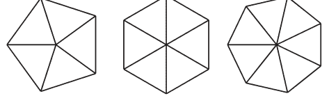

你可以从 thinkpython.com/pie.py 下载。

# 条件判断与递归

## 5.1 取模运算符

取模运算符作用于整数，并产生第一个操作数除以第二个操作数后的余数。在 Python 中，取模运算符是百分号（%）。其语法与其他运算符相同：

```
>>> quotient = 7 % 3
>>> print(quotient)
2
>>> remainder = 7 % 3
>>> print(remainder)
1
```

所以 7 除以 3 等于 2，余 1。

取模运算符被证明是异常用的。例如，你可以检查一个数是否能被另一个数整除——如果 `x % y` 等于 0，则 `x` 可以被 `y` 整除。

此外，你还可以从一个数字中提取最后一位或多位数字。例如，`x % 10` 得到 `x` 的最后一位数字（十进制）。类似地，`x % 100` 得到最后两位数字。

## 5.2 布尔表达式

布尔表达式是一个结果结果为真（`True`）或为假（`False`）的表达式。以下示例使用了运算符 `==`，它比较两个操作数，如果它们相等则产生 `True`，否则产生 `False`：

```
>>> 5 == 5
True
>>> 5 == 6
False
```

`True` 和 `False` 是属于 `bool` 类型的特殊值；它们不是字符串：

```
>>> type(True)
<type 'bool'>
>>> type(False)
<type 'bool'>
```

`==` 运算符是比较运算符之一；其他的还有：

- `x != y` | # x 不等于 y

- `x > y` | # x 大于 y

- `x < y` | # x 小于 y

- `x >= y` | # x 大于或等于 y

- `x <= y` | # x 小于或等于 y

尽管你可能对运算符很熟悉，但 Python 的符号与数学符号不同。一个常见的错误是使用单等号（`=`）代替双等号（`==`）。记住 `=` 是赋值运算符，而 `==` 是比较运算符。不存在 `<=` 或 `>=` 这种写法。

## 5.3 逻辑运算符

有三个逻辑运算符：`and`（与）、`or`（或）和 `not`（非）。运算符的语义（含义）与它们在英语中的含义相似。例如，`x>0 and x<10` 仅当 `x` 大于 0 且小于 10 时为真。

如果 `n%2==0 or n%3==0` 中任意一个条件成立，则结果为真，即该数字能被 2 或 3 整除。

最后，`not` 运算符对布尔表达式取反，因此 `not (x>y)` 在 `x>y` 为假时为真，即 `x` 小于或等于 `y` 时。

严格来说，逻辑运算符的操作数应该是布尔表达式，但 Python 并不十分严格。任何非零数字都会被解释为“真”。

```
>>> 17 and True
True
```

这种灵活性可能很有用，但其中有一些可能引起困惑的微妙之处。你可能想要避免这样做（除非你清楚自己在做什么）。

## 5.4 条件执行

为了编写有程序，我们几乎总是需要检查条件并据此改变程序的行为。条件语句给了我们这种能力。最简单的形式是 `if` 语句：

```
if x < 0:
    print('x is positive')
```

`if` 语句后的布尔表达式被称为条件。如果它为真，则执行缩进的语句。否则，则什么都不会发生。

`if` 语句的结构与函数定义相同：一个头部，后跟一个缩进的块。这样的语句被称为复合语句。

体中可以出现的语句数量没有限制，但必须至少有一个。偶尔，拥有一个没有语句的体是有用的（通常作为你尚未编写代码的占位符）。在这种情况下，你可以使用 `pass` 语句，它什么都不做。

```
if x < 0:
    pass  # 需要处理负值！
```

## 5.5 备选执行

`if` 语句的第二种形式是备选执行，其中有两种可能性，由条件决定执行哪一种。其语法如下：

```
if x%2 == 0:
    print('x is even')
else:
    print('x is odd')
```

当 `x` 除以 2 的余数为 0 时，我们就知道 `x` 是偶数，程序显示相应的信息。如果条件为假，则执行第二组语句。由于条件必须为真或为假，因此备选方案中恰好有一个会被执行。这些方案被称为分支，因为它们是执行流中的分支。

## 5.6 链式条件

有时存在两个以上的可能性，我们需要两个以上的分支。表达这种计算的方法是链式条件：

```
if x < y:
    print('x is less than y')
elif x > y:
    print('x is greater than y')
else:
    print('x and y are equal')
```

`elif` 是 “else if” 的缩写。同样，只有一个分支会被执行。`elif` 语句的数量没有限制。如果有 `else` 子句，它必须在最后，但不一定有。

```
if choice == 'a':
    draw_a()
elif choice == 'b':
    draw_b()
elif choice == 'c':
    draw_c()
```

每个条件都按顺序进行检查。如果第一个为假，则检查下一个。如果条件为真，则执行对应的分支。

## 5.7 嵌套条件

一个条件可以嵌套在另一个条件中。我们可以这样写一个嵌套条件，例如：

```
if x < y:
    if x < 0:
        print('x is negative and less than y')
    else:
        print('x is positive and less than y')
print('x is not less than y')
```

嵌套条件使得阅读变得非常困难。

## 5.8 递归

函数调用另一个函数是合法的；函数也可以调用自己。这可能一眼看出是好事，但请看下面的函数：


```python
def countdown(n):
    if n <= 0:
        print('Blastoff!')
    else:
        print(n)
        countdown(n-1)
```

如果我们这样调用函数会发生什么？

```
>>> countdown(3)
```

`countdown` 的执行从 `n = 3` 开始，因为 `n` 大于 0，输出值 3，然后调用自己...

`countdown` 的执行从 `n = 2` 开始，因为 `n` 大于 0，输出值 2，然后调用自己...

`countdown` 的执行从 `n = 1` 开始，因为 `n` 大于 0，输出值 1，然后调用自己...

`countdown` 的执行从 `n = 0` 开始，因为 `n` 不大于 0，输出单词“Blastoff!”然后返回。

得到 `n = 1` 的 `countdown` 返回。

得到 `n = 2` 的 `countdown` 返回。

得到 `n = 3` 的 `countdown` 返回。

然后回到了 `__main__`。所以，总输出看起来如下：

```
3
2
1
Blastoff!
```

调用自己的函数是递归的；这个过程被称为递归。

另一个示例，我们可以写一个打印 `n` 次字符串的函数。

```python
def print_n(s, n):
    if n <= 0:
        return
    print s
    print_n(s, n-1)
```

如果 `n<=0`，`return` 语句退出函数。执行流立即返回调用者，函数的剩余语句不会执行。

函数的其余部分与 `countdown` 类似：如果 `n` 大于 0，它显示 `s`，然后调用自己再显示 `n−1` 次 `s`。因此输出的行数为 `1 + (n−1)`，总和为 `n`。

对于这种简单的示例，可能使用 `for` 循环更简单。但我们以后会看到一些用 `for` 循环很难编写但用递归很容易编写的示例，所以尽早开始是好的。

## 5.9 递归函数的堆栈图

在第 3.10 节中，我们使用堆栈图来表示函数调用期间程序的状态。同样的图表也可以帮助解释递归函数。

每当一个函数被调用时，Python 都会创建一个新的函数帧（function frame），其中包含了函数的局部变量和参数。对于递归函数，栈上可能同时存在多个帧。

此图显示了在 `n=3` 时调用 `countdown` 函数的堆栈图：

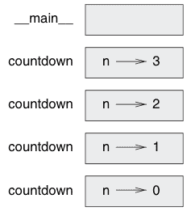

按照惯例，栈顶是 `__main__` 的帧。它是空的，因为我们没有在 `__main__` 中创建任何变量，也没有向它传递任何参数。

四个 `countdown` 帧具有不同的参数 `n` 值。栈的底部 `n=0` 处称为基础情况（base case）。它没有进行递归调用，因此不再有更多的帧了。

> 在 `s = 'Hello'` 和 `n=2` 时调用 `print_n` 的堆栈图。

编写一个名为 `do_n` 的函数，接受一个函数对象和一个数字 `n` 作为参数，并调用该函数 `n` 次。

## 5.10 无限递归

如果递归永远无法到达基础情况，它就会无限进行递归调用，程序永远不会终止。这被称为无限递归，而且通常不是一个好主意。有一个包含无限递归的极简程序：

```python
def recurse():
    recurse()
```

在大多数编程环境中，带有无限递归的程序并不会永远运行。当达到最大递归深度时，Python 会报告错误消息：

```
File "<stdin>", line 2, in recurse
File "<stdin>", line 2, in recurse
File "<stdin>", line 2, in recurse
.
.
File "<stdin>", line 2, in recurse
RuntimeError: Maximum recursion depth exceeded
```

这个回溯轨迹（traceback）比我们在上一章中看到的要大一点。当错误发生时，栈上有 1000 个递归帧！

## 5.11 键盘输入

我们到目前为止编写的程序在某种意义上是粗鲁的，因为它们不接受用户的任何输入。它们每次都执行相同的事情。

Python 有一个内置函数 `raw_input`，可以从键盘获取输入。当调用此函数时，程序会停止并等待用户输入内容。当用户按下 Return 或 Enter 键时，程序恢复，`raw_input` 返回用户输入的字符串。

```python
>>> input = raw_input()
What are you waiting for?
>>> print input
What are you waiting for?
```

在从用户那里获取输入之前，打印一个提示（prompt）告诉用户输入什么是一个好主意。`raw_input` 可以接受一个提示作为参数：

```python
>>> name = raw_input('What...is your name?\n')
What...is your name?
Arthur, King of the Britons!
>>> print name
Arthur, King of the Britons!
```

提示末尾的序列 `\n` 代表换行符，这是一个导致换换的特殊字符。这就是为什么用户的输入出现在提示下方的原因。

在 Python 3.0 中，此函数命名为 `input`。

#### 条件语句与递归

如果你期望用户输入一个整数，可以尝试将返回值转换为 `int`：

```python
>>> prompt = 'What...is the airspeed velocity of an unladen swallow?'.n
>>> speed = raw_input(prompt)
What...is the airspeed velocity of an unladen swallow?
17
>>> int(speed)
17
```

但如果用户输入的不是数字字符串，你就会得到一个错误：

```python
>>> speed = raw_input(prompt)
What...is the airspeed velocity of an unladen swallow?
What do you mean, an African or a European swallow?
>>> int(speed)
ValueError: invalid literal for int()
```

我们稍后会看到如何处理这类错误。

## 5.12 调试

Python 在发生错误时显示的的回溯轨迹包含大量信息，但可能会让人无从从，特别是当栈上有许多帧时。最有用的部分通常是：

- 是什么错误，以及

- 错误发生在哪里。

语法错误通常很容易找到，但有一些陷阱。空白错误可能棘手，因为空格和制表符是不可见的，而我们习惯了忽略它们。

```python
>>> x = 5
>>> y = 6
File "<stdin>", line 1
  y = 6
SyntaxError: invalid syntax
```

在这个例子中，问题是第二行缩进了一个空格。但错误消息指向 `y`，这具有误导性。通常情况下，错误消息指示

## 5.13 术语表

发现问题的地方，但实际错误可能发生在代码更早的地方，有时在之前的某行。

运行时错误也是如此。假设你正在计算分贝单位的信噪比。公式为 $SNR_{db} = 10 \log_{10}(P_{signal}/P_{noise})$。在 Python 中，你可能会写类似的代码：

```python
import math
signal_power = 
noise_power = 
```

但当你运行它时，你会得到错误：

```
Traceback (most recent call last):
File "snr.py", line 5, in <module>
OverflowError: 
```

错误显示发现问题的位置，但实际错误可能在代码更早的地方，有时在之前的某行。

- **基础情况**：一个递归调用自身的函数。

- **正文**：复合语句中的语句序列。

- **布尔表达式**：值为 True 或 False 的表达式。

- **分支**：交替语句。

- **链式条件语句**：具有交替分支的条件语句。

- **比较运算符**：比较操作数的运算符：`==`, `!=`, `<=`

- **复合语句**：由头部和正文组成的语句。

- **条件**：条件语句中的布尔表达式。

- **条件语句**：根据某些条件控制执行流的语句。

- **无限递归**：一个永远不会到达基础情况的函数。

- **逻辑运算符**：组合布尔表达式的运算符：`and`, `or`, `not`。

- **模运算符**：用百分号 (`%`) 表示，当一个整数除以另一个整数时使用的。

- **嵌套条件语句**：出现在另一个语句分支中的语句。

- **递归**：调用正在执行的函数的过程。

## 5.14 练习

### 练习 5.1

费马大定理认为不存在整数 $a, b, c$ 使得

$a^n + b^n = c^n$

对于任何大于 2 的 $n$ 值都成立。

1. 编写一个名为 `check_format` 的函数，接受四个参数——$a, b, c$ 和 $n$——检查费马定理是否成立。如果 $n$ 大于 2 且 $a^n + b^n = c^n$ 为真，程序将打印“天哪，费马错了！”否则程序将打印“不，那不行”。

2. 编写一个函数，提示用户输入 $a, b, c$ 和 $n$ 的值，将它们转换为整数，并使用 `check_format` 检查它们是否违反费马定理。

### 练习 5.2

如果你有三根木棒，你可能无法将其排列成三角形。例如，如果其中一根木棒长12英寸长，而另外两根只有1英寸长，显然你无法让短棒在中间汇合。对于任何三个长度，都有简单的测试方法判断是否可以形成三角形：

> 如果任何一个长度大于另外两个长度之和，就无法形成三角形。否则，可以。

1. 编写一个名为 `is_triangle` 的函数，接受三个整数作为参数，并根据是否可以从给定长度中形成三角形打印“Yes”或“No”。

2. 编写一个函数，提示用户输入三条棒子的长度，将它们转换为整数，并使用 `is_triangle` 检查给定长度的棒子是否能组成三角形。

以下练习使用了第 4 章中的 `TurtleWorld`：

# 练习 5.3

阅读以下函数，看看你是否能推断出它的作用。然后运行它（参考第 4 章中的示例）。

```
def draw(t, length, n):
    if n == 0:
        return
    angle = 50
    fd(t, length*n)
    lt(t, angle)
    draw(t, length, n-1)
    rt(t, 2*angle)
    draw(t, length, n-1)
    lt(t, angle)
    bk(t, length*n)
```

# 练习 5.4

科赫曲线（Koch curve）是一种分形，看起来像这样：

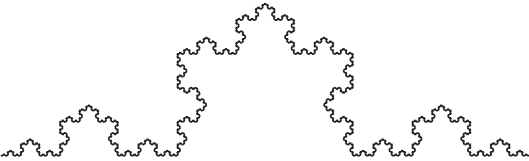

要绘制长度为 $x$ 的科赫曲线，你只需要：

1. 绘制一条长度为 $x/3$ 的科赫曲线。

2. 左转 60 度。

3. 绘制一条长度为 $x/3$ 的科赫曲线。

4. 右转 120 度。

5. 绘制一条长度为 $x/3$ 的科赫曲线。

6. 左转 60 度。

7. 绘制一条长度为 $x/3$ 的科赫曲线。

唯一的例外是 $x$ 小于 3。在这种情况下，你只需要画一条长度为 $x$ 的直线即可。

1. 编写一个名为 `koch` 的函数，接受乌龟和长度作为参数，并使用乌龟绘制给定长度的科赫曲线。

2. 编写一个名为 `snowflake` 的函数，通过绘制三条科赫曲线来构成雪花的轮廓。

你可以在 thinkpython.com/code/koch.py 查看我的解决方案。

3. 科赫曲线可以用多种方式泛化。参见 wikipedia.org/wiki/Koch_snowflake 获取示例并实现你最喜欢的一种。

# 有结果的函数 (Fruitful Functions)

## 6.1 返回值

我们使用过的一些内置函数（如 `math` 函数）会产生结果。调用函数会生成一个值，我们通常将其赋值给一个变量或作为表达式的一部分使用。

```
e = math.exp(1.0)
height = radius * math.sin(radians)
```

我们到为止编写的所有函数都是空函数（void）的它们会打印某些内容或移动乌龟，但它们的返回值是 `None`。

在这一章中，我们（终于）将编写有结果的函数了。第一个示例是 `area`，它返回给定半径的圆的面积：

```
def area(radius):
    temp = math.pi * radius**2
    return temp
```

我们之前见过 `return` 语句，但在有结果的函数中，`return` 语句包含一个表达式。该语句意味着：“立即从此函数返回，并使用以下表达式作为返回值。”表达式可以任意复杂，所以我们可以把这个函数写得更简洁：

```
def area(radius):
    return math.pi * radius**2
```

## 6. 有结果的函数

另一方面，像 `temp` 这样的临时变量通常会让调试变得更容易。有时使用多个 `return` 语句是有用的，在每个条件分支中各放一个：

```
def absolute_value(x):
    if x < 0:
        return -x
    else:
        return x
```

由于这些 `return` 语句位于备选条件中，因此只有一个会被执行。

一旦执行 `return` 语句，函数就会终止，不再执行任何后续语句。出现在 `return` 语句之后或执行流永远无法到达任何地方的代码都是死代码（dead code）。

## 6.4 布尔值函数

函数可以返回布尔值，这对于在函数内部隐藏复杂的任务通常非常方便。例如：

```python
def is_divisible(x, y):
    if x % y == 0:
        return True
    else:
        return False
```

给布尔函数命名为听像“是/否”问题的名字是很常见的：`is_divisible` 返回 True 或 False 来表示 `x` 是否能被 `y` 整除。

这里有一个示例：

```python
>>> is_divisible(6, 4)
False
>>> is_divisible(6, 3)
True
```

`==` 运算符的结果是一个布尔值，因此我们可以通过直接返回它来写更简洁的函数：

```python
def is_divisible(x, y):
    return x % y == 0
```

布尔函数通常用于条件语句：

```python
if is_divisible(x, y):
    print 'x is divisible by y'
```

你可能会想写类似这样的代码：

```python
if is_divisible(x, y) == True:
    print 'x is divisible by y'
```

这种额外的比较是没有必要的。

## 练习 6.3

编写一个函数 `is_between(x, y, z)`，当 `x ≤ y ≤ z` 时返回 True，否则返回 False。

## 6.5 更多递归

我们只涵盖了 Python 的一小部分子集，但你可能感兴趣的是知道，这个子集是一个完整的编程语言，这意味着任何可以计算的内容都可以用这种语言来表达。任何编写过的程序都可以仅使用你目前为止学过的语言特征进行重写（实际上，你还需要一些命令来控制键盘、鼠标、磁盘等设备，但仅此而已了）。

证明这一观点是一个非凡的练习，最早由第一批计算机科学家之一阿兰·图灵（Alan Turing）完成（有些人会认为他是一个数学家，但很多早期计算机科学家都是从数学开始的）。因此，它被称为图灵测试。关于图灵论题（Turing Thesis）更完整（且准确）的讨论，我推荐迈克尔·西尔塞尔（Michael Sipser）的著作《计算理论导论》。

为了让你了解用目前所学工具可以做什么，我们将评估一些递归定义的数学函数。递归定义类似于循环定义，其意义在于定义中包含了对被定义之物的引用。真正的循环定义并没有什么用处：

> fabacious: 一个描述某物非常棒（此处应为 fabious）的形容词。

如果你在字典里看到这个定义，可能会感到很恼。相反，如果你查找阶乘函数（用符号 `!` 表示）的定义，你可能会得到这样的内容：

```
0! = 1
n! = n(n - 1)!
```

这个定义说 0 的阶乘是 1，任何其他值 `n` 的阶乘乘以 `n - 1` 的阶乘。

所以 `3!` 是 3 乘以 `2!`, 是 2 乘以 `1!`, 是 1 乘以 `0!`。汇总，`3!` 等于 3 乘以 2 乘以 2 乘以 1 乘以 1，即 6。

如果你为某物写一个递归定义，通常可以使用 Python 程序来评估它。第一步是决定参数应该是什么。在这种情况下，显而易见阶乘函数接受一个整数：

```python
def factorial(n):
```

如果参数恰好是 0，我们所做的就是返回 1：

```python
def factorial(n):
    if n == 0:
        return 1
```

## 有值的函数

否则（这是有趣的部分），我们必须进行递归调用来找到 $n - 1$ 的阶乘，然后将其乘以 $n$：


```python
def factorial(n):
    if n == 0:
      return 1
    else:
      recurse = factorial(n-1)
      result = n * recurse
      return result
```

该程序的执行流与第 5.8 节中的倒计时执行流。如果我们用值 3 调用 `factorial`：

由于 3 不是 0，我们进入第二个分支并计算 $n - 1$ 的阶乘 ...

由于 2 不是 0，我们进入第二个分支并计算 $n - 1$ 的阶乘 ...

由于 1 不是 0，我们进入第二个分支并计算 $n - 1$ 的阶乘 ...

由于 0 是 0，我们进入第一个分支并返回 1，而不进行任何递归调用。

返回值 (1) 乘以 $n$（即 1），并返回结果。

返回值 (1) 乘以 $n$（即 2），并返回结果。

返回值 (2) 乘以 $n$（即 3），结果 6 成为启动整个过程函数调用的返回值。

以下是该系列函数调用的栈图：

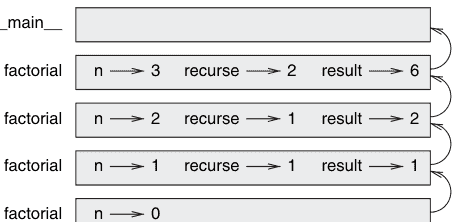

图中显示了返回值是如何向上栈传递的。在每个帧中，返回值是 `result` 的值，它是 $n$ 和 `recurse` 的乘积。

在最后一个帧中，局部变量 `recurse` 和 `result` 不存在，因为创建它们的分支不存在。

## 6.6 飞跃

遵循执行流，即使对于较小的 n 值，你的脑细胞也会爆炸。但根据“信仰之跃”，如果你假设函数是正确的，那么你就能得到结果。

## 6.7 另一个例子

在阶乘之后，另一个常见的递归定义例子是斐波那契，它有以下定义：*

- `fibonacci(0) = 0`
- `fibonacci(1) = 1`
- `fibonacci(n) = fibonacci(n-1) + fibonacci(n-2)`

翻译成 Python 它是这样的：

```python
def fibonacci(n):
  if n == 0:
    return 0
  elif n == 1:
    return 1
  else:
    return fibonacci(n-1) + fibonacci(n-2)
```

* 查看 `wikipedia.org/wiki/Fibonacci_number`.

## 6.8 检查类型

如果我们调用 `factorial` 并传入 1.5 作为参数会发生什么？

```
>>> factorial(1.5)
RuntimeError: Maximum recursion depth exceeded
```

这看起来是无限递归。但为什么会这样？有一个基础情况——`n=0`。但如果 n 不是整数，我们可以跳过基础情况并无限递归。

在第一次递归调用中，n 的值为 0.5。下一次是 –0.5。从那里开始，它越小（越负），但永远不会是 0。

我们有两个选择。我们可以尝试将阶乘函数推广到处理浮点数，或者我们可以让 `factorial` 检查参数的类型。第一种方案被称为伽马函数†，它超本书的范围。所以我们将选择第二种。

我们可以使用内置函数 `isinstance` 来验证参数的类型。顺便，我们还可以确保参数是正数：

```python
def factorial (n):
    if not isinstance(n, int):
        print '阶乘仅对整数定义.'
        return None
    elif n < 0:
        print '阶乘仅对正整数定义.'
        return None
    elif n == 0:
        return 1
    else:
        return n * factorial(n-1)
```

第一个基础情况处理非整数；第二种捕获负整数。在两种情况下，程序都会打印一条错误消息并返回 `None` 以表示

† 查看 `wikipedia.org/wiki/Gamma_function`.

发生了一些错误：

```
>>> factorial('fred')
Factorial is only defined for integers.
None
>>> factorial(-2)
Factorial is only defined for positive integers.
None
```

如果我们通过了检查，我们就知道 $n$ 是一个正整数，并且我们可以证明递归会终止。

这个程序演示了一种有时被称为**守卫者（guardian）**的模式。前两个条件语句作为守卫者，保护后续代码免受可能导致错误的值的影响。守卫者使得证明代码正确性成为可能。

## 6.9 调试

将一个大程序拆分为较小的函数可以为调试创建自然的检查点。如果一个函数没有正常工作，有三种可能性需要考虑：

- 函数接收到的参数有问题；违反了前置条件（precondition）。
- 函数本身有问题；违反了后置条件（postcondition）。
- 返回值或其使用方式有问题。

为了排除第一种可能性，你可以在函数的每个 `return` 语句之前添加 `print` 语句，显示参数的值（可能还有它们的类型）。或者你可以编写代码显式地检查前置条件。

如果参数看起来没问题，在每个 `return` 语句之前添加一个显示返回值的 `print` 语句。如果可能，手动检查结果。考虑使用易于检查结果的值来调用函数（如第 6.2 节所示）。

如果函数看起来运行正常，查看函数调用，以确保返回值被正确使用（或者根本没有被使用！）。

在函数的开头和结尾添加 `print` 语句可以帮助执行流更加可见。例如，这里有一个带有 `print` 语句的 `factorial` 版本：

```python
def factorial(n):
    space = '* * (4 * n)
    print space, 'factorial', n
    if n == 0:
        print space, 'returning 1'
        return 1
    else:
        recurse = factorial(n-1)
        result = n * recurse
        print space, 'returning', result
        return result
```

`space` 是一个控制输出缩进的字符串。这里是 `factorial(5)` 的结果：

```
factorial 5
factorial 4
factorial 3
factorial 2
factorial 1
factorial 0
returning 1
returning 2
returning 6
returning 24
returning 120
```

如果你对执行流感到困惑，这种输出会很有帮助。开发有效的脚手架需要一些时间，但少量的脚手架可以节省大量的调试。

## 6.10 术表

**死代码 (dead code):** 程序中永远不会执行的部分，通常是因为它出现在 `return` 语句之后。

**守卫者 (guardian):** 一种编程模式，使用条件语句来检查并处理可能导致错误的情况。

**增量开发 (incremental development):** 一种程序开发计划，旨在通过每次只添加和测试少量代码来避免调试。

**None:** 没有 `return` 语句或不带参数的 `return` 语句的函数返回的特殊值。

**脚手架 (scaffolding):** 程序开发期间使用但不是最终版本一部分的代码。

**临时变量 (temporary variable):** 用于在复杂计算中存储中间值的变量。

## 6.11 练习

### 练习 6.4

为以下程序画一个栈图（stack diagram）。该程序打印了什么？

```python
def b(z):
    prod = a(z, z)
    print z, prod
    return prod

def a(x, y):
    x = x + 1
    return x * y

def c(x, y, z):
    sum = x + y + z
    pow = b(sum)**2
    return pow

x = 1
y = x + 1
print c(x, y+3, x+y)
```

### 练习 6.5

Ackermann 函数 $A(m,n)$ 的定义如下：††

$$

A(m,n) = \begin{cases} n+1 & \text{if } m=0 \\ A(m-1, n) & \text{if } m > 0 \text{ and } n=0 \\ A(m-1, A(m, n-1)) & \text{if } m > 0 \text{ and } n > 0. \end{cases} \quad (6.1)

$$

编写一个名为 `ack` 的函数来计算 Ackermann 函数。使用你的函数计算 `ack(3, 4)`，其结果应该是 125。当 $m$ 和 $n$ 取较大时会发生什么？

† 查看 `wikipedia.org/wiki/Ackermann_function`

### 练习 6.6

回文词（palindrome）是一个正反读写都相同的单词，比如"noon"和"redivider"。递归来说，如果一个单词的首字母和最后一个字母相同且中间部分是回文，那么它就是一个回文。

以下是接受字符串参数并返回第一个、最后一个和中间字母的函数：

```python
def first(word):
    return word[0]

def last(word):
    return word[-1]

def middle(word):
    return word[1:-1]
```

我们将在第 8 章看到它们是如何工作的。

(1) 将这些函数输入名为 `palindrome.py` 的文件中并测试它们。如果用空字符串调用它们会发生什么？

(2) 编写一个 `is_palindrome` 函数，如果字符串是回文则返回 `True`，否则返回 `False`。

### 练习 6.7

回文词是一个正反读写都相同的单词。区分赋值操作和相等性是非常重要的。因为 Python 使用等号（`=`）进行赋值，人们很容易将像 `a=b` 的语句解释为相等。

首先，相等是对称关系，而赋值不是。例如，在数学中如果 $a=b$，则 $b=a$。但在 Python 中，`a=7` 是合法的，而 `7=a` 不是。

此外，在数学中，相等语句永远真或假。如果现在 $a=b$，$a$ 将永远等于 $b$。在 Python 中，赋值语句可以让两个变量相等，但它们不必保持相等：

```python
a = 5
b = a
# 现在 a 和 b相等
a = 3
# a 和 b 不相等
```

第三行改变了 $a$ 的值但没有改变 $b$ 的值，所以它们不再相等。

### 练习 6.8

最大公约数（GCD）是同时整除两个数的数。找到它的方法基于以下观察：如果 $a$ 除以 $b$，`wikipedia.org/wiki/Euclidean_algorithm`。

# 迭代

## 7.1 多重赋值

正如你可能发现的，对同一个变量进行多次赋值是合法的。

```
a = 5
print a,
a = 7
```

这个程序的输出是 5 7，因为第一次打印 `a` 时，它的值是 5，第二次是 7。第一个语句末尾的逗号抑制了换行，这就是为什么两个输出都出现在同一行。

这是多重赋值在状态图中的形式：`img/4421c0ec5bdef074648da5f8ce59a69`

对于多重赋值，区分赋值操作和相等性尤为重要。

## 7.2 更新变量

多重赋值常用的形式是更新，变量的新值取决于旧值。

```python
x = x+1
```

这意味着“获取 `x` 的当前值，加一，然后用新值更新 `x`”。

如果你尝试更新一个不存在的变量，你会得到错误，因为 Python 在给 `x` 赋值之前会先求右侧的值：

```python
>>> x = x+1
NameError: name 'x' is not defined
```

在更新变量之前，你必须先初始化它，通常使用简单的赋值：

```python
>>> x = 0
>>> x = x+1
```

## 7.3 while 语句

通过加 1 来更新变量称为增量；减 1 则称为减量。

计算机经常被用于自动化重复性任务。在不犯错的情况下重复相同或相似的任务是计算机擅长而人类不擅长的事情。

我们已经看到了两个程序，`countdown` 和 `print_n`，它们使用递归执行重复，这也被称为迭代。由于迭代非常常见，Python 提供了几种语言特性来使其变得更容易。其中一个就是我们在 4.2 节中看到的 `for` 语句。我们稍后会回来。

另一个是 `while` 语句。这是一个使用 `while` 语句的 `countdown` 版本：

```python
def countdown(n):
    while n > 0:
        print n
        n = n-1
    print 'Blastoff!'
```

你几乎可以像读英语一样读 `while` 语句。它的意思是：“当 n大于0时，显示 n 的值，然后将 n 的值减1。当你达到 0 时，显示单词 Blastoff！”

更正式地说，这是 `while` 语句的执行流：

- (i) 求值条件，产生 `True` 或 `False`。
- (ii) 如果条件为假，退出 `while` 语句并在下一条语句继续执行。
- (iii) 如果条件为真，执行循环体，然后返回步骤 1。

这种类型的流被称为循环（loop），因为第三步跳回了顶部。

循环体应该改变一个或多个变量的值，以便最终条件变为为假且循环终止。否则，循环将无限重复下去，这被称为死循环。计算机科学家一个无穷无尽的乐趣来源是观察到，洗发水瓶上的指令“揉泡沫、冲洗、重复”是一个无限循环。

在 `countdown` 的案例中，我们可以证明循环会终止，因为我们知道 n 的值是有限的，而且我们看到在每次通过循环时 n 的值都会变小，所以最终我们必须到达 0。在其他情况下，这并不容易判断：

```python
def sequence(n):
    while n != 1:
        print n,
        if n%2 == 0:  # n 是偶数
            n = n/2
        else:
            n = n*3+1  # n 是奇数
```

这个循环的条件是 `n != 1`，因此循环将持续到 n 等于 1，此时条件变为假。

每次通过循环时，程序输出 n 的值，然后检查它是偶数还是奇数。如果是偶数，n 被除以 2。如果是奇数，n 的值被替换为 `n * 3 + 1`。例如，传递给 `sequence` 的参数是 3，得到的序列是 3, 10, 5, 16, 8, 4, 2。

由于存在某些增加和减少，没有明显的证明能 n 一定会达到 1，或者程序会终止。对于 n 的某些特定值，我们可以证明其终止。例如，如果起始值是 2 的幂，那么 n 的值在每次通过循环时都是偶数，直到它到达 1。上一个例子以这样一个序列结束，从 16 开始。

困难的问题是，我们是否可以证明这个程序对于所有正整数 n 都会终止。到为止，还没有人能证明它或反驳它！

## 练习 7.1

使用迭代而不是递归重写 5.8 节中的 `print_n` 函数。

## 7.4 break

有时，在你运行循环体的一半之前并不知道该结束循环了。在这种情况下，你可以使用 `break` 语句跳出循环。

例如，假设你想从用户获取输入，直到他们输入 `done`。你可以这样写：

```python
while True:
    line = raw_input('>')
    if line == 'done':
        break
    print line
```

```python
print 'Done!'
```

> * Sec [wikipedia.org/wiki/Collatz_conjecture]。

循环条件是 `True`，它是永远为真的，所以循环会一直运行直到遇到 `break` 语句。

每次循环时，它都会用一个角括号提示用户。如果用户输入 `done`，`break` 语句将退出循环。否则，程序会回显用户输入的任何并返回循环顶部。这里有一个示例运行：

```
> not done
not done
> done
Done!
```

编写 `while` 循环的方法很常见，因为你可以在循环中的任何地方检查条件（而不是在顶部），而且你可以以肯定的方式表达停止条件（“当发生这种情况时停止”），而不是否定的方式（“一直进行直到某事发生”）。

## 7.5 平方根

循环经常用于通过从估计答案开始并迭代改进来计算数值结果的程序。

例如，计算平方根的方法之一是牛顿法。假设你想知道 $a$ 的平方根。如果你从任何估计值 $x$ 开始，可以使用以下公式计算更好的估计值：

```
y = \frac{x + a/x}{2}
```

例如，如果 $a$ 是 4 且 $x$ 是 3：

```python
>>> a = 4.0
>>> x = 3.0
>>> y = (x + a/x) / 2
>>> print y
2.166666666667
```

例如，如果 $a$ 是 4 且 $x$ 是 3：

```python
>>> a = 4.0
>>> x = 3.0
>>> y = (x + a/x) / 2
>>> print y
2.166666666667
```

例如，如果 $a$ 是 4 且 $x$ 是 3：

```python
>>> a = 4.0
>>> x = 3.0
>>> y = (x + a/x) / 2
>>> print y
2.166666666667
```

例如，如果 $a$ 是 4 且 $x$ 是 3：

```python
>>> a = 4.0
>>> x = 3.0
>>> y = (x + a/x) / 2
>>> print y
2.166666666667
```


例如，如果 `$a$` 是 4 且 `$x$` 是 3：

```python
>>> a = 4.0
>>> x = 3.0
>>> y = (x + a/x) / 2
>>> print y
2.166666666667
```

在某些情况下，`epsilon` 有值 0.00001 决定了多接近。

```python
if abs(y-x) < epsilon:
    break
```

## 练习 7.2

将此循环封装在一个名为 `square_root` 的函数中，它接收 `a` 作为参数，选择一个合理的 `x`，并返回一个估计值。

# 迭代

在几次更新后，估计更接近：

```python
>>> a = 4.0
>>> x = 3.0
>>> y = (x + a/x) / 2
>>> print y
2.166666666667
```

通常我们并不知道需要多少步骤，但我们知道这个循环从一个估计开始并改进它：

```python
while True:
    print x
    y = (x + a/x) / 2
    if abs(y-x) < epsilon:
        break
```

牛顿法是算法的一个例子：它是解决一类问题（例如，计算平方根）的机械过程。

定义算法并不容易。从非算法的内容开始可能会有帮助。当你学习一位数乘法时，你背下了乘法表。实际上，你背了 100 个特定的解。这种知识不是算法的。

但如果你很“懒”，你可能会通过学习一些技巧来作弊。例如，要找到 `n` 与 9 的积，你可以将 `n–1` 写在前面，`10–n` 写在后面。这是位数乘以 9 的通用解决方案。这是一个算法！

同样，你学习的加法、退位减法长除都是算法。算法的特征之一是执行不需要任何智能。它们是机械过程，每一步都遵循规则。

在我看来，人类在学校花费大量时间学习执行不需要智能的算法是令人尴尬的。

另一方面，设计算法的过程是有有趣的、具有智挑战性的，并且是我们所谓的编程的核心部分。

一些人们自然完成、没有困难或无意识的想法是最难用算法方式表达的。理解自然语言就是一个很好的例子。我们这样做，但到为止还没有人能解释我们是如何做的，至少没有以算法的形式。

## 7.7 调试

当你开始编写更大的程序时，你可能会发现自己花费了更多时间在调试。代码越多，犯错的机会越高，漏洞隐藏的地方也越多。

减少调试时间的一种方法是“二分法调试”。例如，如果程序中有 100 行代码，而你逐个检查，将需要 100 步。

相反，尝试将问题一分为二。查看程序的中间或中间附近，寻找一个你可以检查的中间值。添加一个 `print` 语句（或其他具有可验证效果的内容）并运行程序。

如果中间点检查是不正确的，那么问题一定在程序的前半部分。如果它是正确的，那么问题在程序的后半部分。

每当你执行这样的检查时，你将需要搜索的行数减半。经过六个步骤（这远少于 100 步），理论上你你将剩下下一或两行代码。

在实践中，并不总是清楚什么是“程序的中间”是什么，也不总是可以进行检查。数行数并找到精确的中间点是没有意义的。相反，考虑程序中可能出现错误以及容易放置检查的地方。选择一个你认为 bug 出现在检查之前或之后的概率较大的位置。

## 7.8 词汇表

- **decrement（递减）**：一种减小变量值的更新。

- **increment（递增）**：一种增加变量值的更新（通常为加 1）。

- **infinite loop（无限循环）**：一个终止条件永远无法满足的循环。

- **initialize（初始化）**：一种给将要更新的变量赋予初始值的赋值。

- **iteration（迭代）**：使用递归调用或循环对一组语句进行重复执行。

- **multiple assignment（多重赋值）**：在程序执行期间对同一个变量进行多次赋值。

- **update（更新）**：一种变量的新值依赖于旧值的赋值。

## 7.9 练习题

**练习 7.3**

为了测试本章中的平方根算法，你可以将其与 `math.sqrt` 进行比较。编写一个名为 `test_square_root` 的函数，打印如下表所示：

| 1.0 | 1.0 | 0.0 |

|---|---|---|

| 2.0 | 1.41421356237 | 1.41421356237 | 2.220446094295e-16 |

| 3.0 | 1.73205080757 | 1.73205080757 | 0.0 |

| 4.0 | 2.0 | | 0.0 |

| 5.0 | 2.2360679775 | 2.2360679775 | 0.0 |

| 6.0 | 2.44948974278 | 2.44948974278 | 0.0 |

| 7.0 | 2.64575131106 | 2.64575131106 | 0.0 |

| 8.0 | 2.82842712475 | 2.82842712475 | 4.4408920985e-16 |

| 9.0 | 3.0 | | 0.0 |

## 7.9 练习 81

第一列是一个数字 `$a$`；第二列是使用练习 7.2 中的函数计算的 `$a$` 的平方根；第三列是使用 `math.sqrt` 计算的平方根；第四列是两个估计值之间差的绝对值。

# 练习 7.4

内置函数 `eval` 接收字符串并使用 Python 解释器对其求值。例如：

```
>>> eval('1 + 2 * 3')
7
>>> import math
>>> eval(math.sqrt(5))
2.236067974997898
>>> eval(type(math.pi))
<type 'float'>
```

编写一个名为 `eval_loop` 的函数，迭代地提示用户，获取输入的输入并使用 `eval` 进行求值，然后打印结果。

它应该一直持续到用户输入 'done' 为止，并返回它评估的最后一个表达式的值。

# 练习 7.5

天才数学家斯里尼瓦萨·拉马努金（Srinivasa Ramanujan）发现了一个可以生成 `$\pi$` 数值近似值的无穷级数`$\dagger$`：

`$$\pi = \frac{2\sqrt{2}}{9801} \sum_{k=0}^{\infty} \frac{(4k)!(1103+26390k)}{(k!)^{4396^{4k}}$$`

编写一个名为 `estimate_pi` 的函数，使用该公式计算并返回 `$\pi$` 的估计值。它应该使用 `$while$` 循环计算求和项，直到最后一项小于 `$1e-15$` —— 你可以通过与 `math.pi` 比较来检查结果。

你可以在 thinkpython.com/code/pi.py 查看你的解决方案。

> `$\dagger$` 参见 wikipedia.org/wiki/Pi。

# 字符串

## 8.1 字符串是一个序列

字符串是字符序列。你可以使用括号运算符逐个访问字符：

```
>>> fruit = 'banana'
>>> letter = fruit[1]
```

第二个语句从 `fruit` 中选择第 1 号字符并将其赋值给 `letter`。

括号中的表达式被称为索引（index）。索引指示你想要序列中的哪一个字符（因此得此名）。

但你得到的可能不是你预期的：

```
>>> fruit = 'banana'
>>> letter = fruit[1]
'a'
```

但你可能得到的不是你预期的：

```
>>> fruit = 'banana'
>>> letter = fruit[6]
IndexError: string index out of range
```

索引指示你想要序列中的哪一个字符（因此得此名）。

但你可能得到的不是你预期的：

```python
>>> fruit = 'banana'
>>> letter = fruit[1]
'a'
```

但你可能得到的不是你预期的：

```python
>>> fruit = 'banana'
>>> letter = fruit[6]
IndexError: string index out of range
```

索引值必须是整数。

## 8.2 len

`len` 是一个内置函数，返回字符串中的字符数量：

```python
>>> fruit = 'banana'
>>> len(fruit)
6
```

要获取字符串的最后一个字符，你可能会尝试这个：

```python
>>> fruit = 'banana'
>>> fruit[-1]
'a'
```

或者，你可以使用负索引，它们从末尾计数：

```python
>>> fruit = 'banana'
>>> fruit[-1]
'a'
```

## 8.3 使用 for 循环遍历

很多计算涉及到一次处理字符串中的字符。它们从开头开始，使用 `while` 循环遍历：

```python
>>> fruit = 'banana'
index = 0
while index < len(fruit):
    letter = fruit[index]
    print(letter)
    index += 1
```

当 `index` 等于长度时，循环体不会执行。另一种遍历方法是使用 `for` 循环：

```python
>>> fruit = 'banana'
for char in fruit:
    print(char)
```

每次循环，字符串中的下一个字符被赋值给 `char`。循环持续到没有字符为止。

## 练习 8.1

编写一个接收字符串作为参数的函数，每行显示一个字符。

下面的示例展示了如何使用字符串拼接和 `for` 循环生成一个字母序列（即按字母顺序）。在 Robert McClosley 的《Make Way for Ducklings》中，小鸭的名字是 Jack, Kack, Lack, Mack, Nack, Ouack, Pack 和 Quack。

```python
prefixes = 'JKLMNOPQ'
suffix = 'ack'
```

```python
for letter in prefixes:
    print(letter + suffix)
```

输出是：

Jack

Kack

Lack

Mack

Oack

Pack

Qack

当然，这不对，因为“Ouack”和“Quack”拼写错误。

## 8.4 字符串切片

字符串的一部分被称为切片（slice）。选择切片与选择字符相似：

```python
>>> s = 'Monty Python'
>>> s[0:5]
'Monty'
>>> s[6:13]
'Python'
```

运算符 `[n:m]` 返回字符串从第 `$n$` 个字符到第 `$m$` 个字符，包含第一个但不最后一个。这种行为是不符合直觉的，但你可以想象索引指向字符之间，如副本所示：

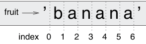

如果你省略第一个索引（冒号之前的），切片从字符串开始。如果你省略第二个索引，切片将到末结尾：

```python
>>> fruit = 'banana'
>>> fruit[:3]
'ban'
>>> fruit[3:]
'ana'
```

如果第一个索引大于或等于第二个索引，结果是空字符串，用两个引号表示：

```python
>>> fruit = 'banana'
>>> fruit[3:3]
''
```

# 练习 8.2

修改程序以修复此错误。

# 字符串

空字符串不包含任何字符且长度为 0，但除此之外，它与任何其他字符串都是相同的。

# 练习 8.3

假设 `fruit` 是一个字符串，那么 `fruit[:]` 是什么意思？

## 8.5 字符串是不可变的

人们很想在赋值语句的左侧使用 `[]` 运算符，试图改变字符串中的某个字符。例如：

```python
>>> greeting = 'Hello, world!'
>>> greeting[0] = 'J'
TypeError: object does not support item assignment
```

在这种情况下，“object”指的是字符串而“item”是你尝试赋值的字符。现在，“object”等同于值，但我们稍后会细化这个定义。“item”是指字符序列中使用的元素。

报错的原因是字符串是不可变的，这意味着你不能更改现有的字符串。你能做的最好就是创建一个原始字符串变体的新字符串：

```python
>>> greeting = 'Hello, world!'
>>> new_greeting = 'J' + greeting[1:]
>>> print new_greeting
Jello, world!
```

这个示例将一个新的首字母连接到 `greeting` 的切片上。它对原始字符串没有影响。

## 8.6 搜索

以下函数的作用是什么什么？

```python
def find(word, letter):
    index = 0
    while index < len(word):
        if word[index] == letter:
            return index
        index = index + 1
    return -1
```

## 8.8 字符串方法

从某种意义上说，`find` 是 `[]` 运算符的反面。它不是接收索引并提取对应的字符，而是接收一个字符并找到该字符出现的索引。如果没有找到该字符，函数返回 -1。

这是我们第一次在循环内部看到 `return` 语句的例子。如果 `word[index] == letter`，函数将跳出循环并立即返回。

如果字符没有出现在字符串中，程序将正常退出循环并返回 -1。

这种计算模式——遍历序列并在找到寻找的内容时返回——被称为“搜索”。

# 练习 8.4

修改 `find` 函数，使其拥有第三个参数，即在 `word` 中开始查找的索引。

## 8.7 循环计数

以下程序统计字母 a 在字符串中出现的次数：

```python
word = 'banana'
count = 0
for letter in word:
    if letter == 'a':
        count = count + 1
print count
```

这个程序演示了另一种计算模式，被称为“计数器”。变量 `count` 初始化为 0，并在每次找到 a 时递加 1。当循环退出时，`count` 包含结果——a 的总数。

# 练习 8.5

将此代码封装在一个名为 `count` 的函数中，并对其进行泛化，使其接受字符串和字母作为参数。

# 练习 8.6

重写此函数，使其不再遍历字符串，而是使用上一节中带有三个参数版本的 `find`。

## 8.8 字符串方法

方法（method）与函数相似——它接收参数并返回一个值——但语法不同。例如，`upper` 方法接收一个字符串并返回一个所有字母全大写的字符串：

它没有使用函数语法 `upper(word)`，而是使用方法语法 `word.upper()`。

```python
>>> word = 'banana'
>>> new_word = word.upper()
>>> print new_word
BANANA
```

这种点符号形式指定了方法的名称 `upper` 以及要应用该方法的字符串名称 `word`。空括号表示该方法不接受参数。

方法的调用被称为 *invocation*（调用）；在这种情况下，我们称说在 `word` 上调用（invoking）`upper`。

事实上，有一个名为 `find` 的字符串方法，与我们使用的函数非常相似：

```python
>>> word = 'banana'
>>> index = word.find('a')
>>> print index
1
```

在这个例子中，我们在 `word` 上调用 `find`，并将我们要查找的字母作为参数。

实际上，`find` 方法比我们的函数更通用；它可以查找子字符串，而不仅仅是单个字符：

```python
>>> word.find('na')
2
```

它可以接收第二个参数作为开始查找的索引：

```python
>>> word.find('na', 3)
4
```

并接收第三个参数作为停止的索引：

```python
>>> name = 'bob'
>>> name.find('b', 1, 2)
-1
```

搜索失败了，因为 `b` 不在从 1 到 2 的索引范围内。

# 练习 8.7

有一个名为 `count` 的字符串方法，与练习中的函数类似。阅读该方法的文档并编写一个计算 'banana' 中 'a' 次数的调用。

## 8.9 in 运算符

`in` 是一个布尔运算符，接收两个字符串，如果第一个字符串作为子字符串出现在第二个中，则返回 True：

```python
>>> 'a' in 'banana'
True
>>> 'seed' in 'banana'
False
```

例如，以下函数打印出 `word1` 中出现在 `word2` 中的所有字母：

```python
def in_both(word1, word2):
    for letter in word1:
        if letter in word2:
            print letter
```

如果你比较 apples 和 oranges，你会得到（对 `apples` 遍历的字母）：

e

## 8.10 字符串比较

比较运算符作用于字符串。判断两个字符串是否相等：

```python
if word == 'banana':
    print 'All right, '
```

其他比较操作用于按字母顺序排列单词：

```python
if word < 'banana':
    print 'Your word,' + word + ' comes before.'
elif word > 'banana':
    print 'Your word,' + word + ' comes after.'
else:
    print 'All right,'
```


Python 处理大写和小写的方式相同。大写字母在小写字母之前，所以：

## 8.11 调试

当你使用索引遍历序列时，获取开头和结尾是复杂的。这里有一个比较两个单词并在另一个反反时返回 `True` 的函数，但它包含了两个错误：

```python
def is_reverse(word1, word2):
    if len(word1) != len(word2):
        return False

    i = 0
    j = len(word2)

    while j > 0:
        if word1[i] != word2[j]:
            return False
        i = i+1
        j = j-1
```

第一个语句检查单词长度是否相同。如果不相同，我们可以立即返回 `False`，对于函数的其余部分，我们可以假设长度相同。这是一个守卫模式（guard pattern）的例子。`i` 和 `j` 索引：`i` 向前遍历而 `j` 向后遍历。如果发现两个不匹配的字母，我们可以立即返回 `False`。如果我们完成了整个循环和所有字母，我们就返回 `True`。

如果我们用 `'pots'` 和 `'stop'` 测试这个函数，我们期望返回 `True`，但得到了 `IndexError`：

```python
>>> is_reverse('pots', 'stop')
...
File "reverse.py", line 15, in is_reverse
    if word1[i] != word2[j]:
IndexError: string index out of range
```

为了调试这种错误，我的第一步是在错误出现的行之前立即打印索引的值：

```python
while j > 0:
    print i, j      #在这里打印

    if word1[i] != word2[j]:
        return False
    i = i+1
    j = j-1
```

现在当我再次运行程序，我获得了更多信息：

```python
>>> is_reverse('pots', 'stop')
0
...
IndexError: string index out of range
```

第一次循环时，`j` 的值是 4，这超出了字符串 `'pots'` 的范围。最后一个字符的索引是 3，所以 `j` 的初始值应该是 `len(word2) - 1`。

为了更好地理解正在发生什么，画一个状态图是很有用的。在第一次迭代中，`is_reverse` 的帧如下：

| word1 | 'pots' | word2 | 'stop' |
|---|---|---|---|
| i | → 0 | | j → 3 |

我通过在帧中安排变量并添加虚线，以显示 `i` 和 `j` 的值表示 `word1` 和 `word2` 中的字符。

这次我们得到了正确答案，但看起来循环只运行了三次，这很可疑。

# 练习 8.8

从这个图开始，在纸上执行程序，在每次迭代期间更改 `i` 和 `j` 的值。找到并修复函数中的第二个错误。

## 8.12 词汇表

- **counter (计数器)**：用于计算某数的变量，通常初始化为 0 并递加。
- **empty string (空字符串)**：不包含任何字符且长度为 0 的字符串，用两个引号表示。
- **immutable (不可变的)**：序列的元素无法被赋值的属性。
- **index (索引)**：用于选择序列中元素的整数值，例如字符串中的字符。
- **invocation (调用)**：调用方法的语句。
- **item (元素)**：序列中的其中一个值。
- **method (方法)**：与对象关联并使用点调用的函数。
- **object (对象)**：变量可以引用的东西。现在，你可以交替使用“对象”和“值”。
- **search (搜索)**：在找到寻找的内容时停止的遍历模式。
- **sequence (序列)**：有序集合；即一组每个值都通过整数索引识别的值的集合。
- **slice (切片)**：由索引范围指定的字符串部分。
- **traverse (遍历)**：迭代序列中的所有项，对每个项执行相似的操作。

# 8.13 练习

# 练习 8.9

字符串切片可以接收第三个索引，用于指定“步长”；即连续字符之间的间隔。步长为 2 意味着每隔一个字符；3 意味着每隔两个，以此类推。

```python
>>> fruit = 'banana'
>>> fruit[0:5:2]
'bnn'
```

步长为 -1 会反向遍历单词，切片 `[:-1]` 会生成一个反后的字符串。

使用这种惯用写法来编写练习 6.6 中 `is_palindrome` 的单行版本。

# 练习 8.10

阅读 `docs.python.org/lib/string-methods.html` 中的字符串方法文档。你可能想尝试其中一些方法以确保你理解它们是如何工作的。`strip` 和 `replace` 特别有用。

文档使用的语法可能会让人困惑。例如，在 `find(sub[, start, end])` 中，括号表示可选参数。因此 `sub` 是必须的，但 `start` 是可选的，如果你包含了 `start`，那么 `end` 就是可选的。

# 练习 8.11

以下函数旨在检查字符串是否包含任何小写字母，但至少有一些是错误的。对于每个函数，描述该函数的实际作用（假设参数是字符串）。

```python
def any_lowercase1(s):
    for c in s:
        if c.islower():
            return True
    else:
        return False

def any_lowercase2(s):
    for c in s:
        if 'c'.islower():
            return 'True'
    else:
            return 'False'

def any_lowercase3(s):
    for c in s:
        flag = c.islower()
    return flag

def any_lowercase4(s):
    flag = False
    for c in s:
        flag = flag or c.islower()
    return flag
```

```python
def any_lowercase(s):
    for c in s:
        if not c.islower():
            return False
    return True
```

# 练习 8.12

ROT13 是一种弱加密形式，它将单词中的每个字母“旋转” 13 个位置。旋转字母意味着在字母表中移动，并在必要时绕回开头，因此 `'A'` 移动 3 位是 `'D'`，`'Z'` 移动 1 位是 `'A'`。

编写一个名为 `rotate_word` 的函数，接受一个字符串和一个整数作为参数，并返回一个包含原始字符串字母按给定数量“旋转”后的新字符串。

例如，“cheer” 旋转 7 位是“jolly”，“melon” 旋转 –10 位是“cubed”。

你可能想尝试使用内置函数 `ord`（它将字符转换为数字代码）和 `chr`（它将数字代码转换为字符）。

互联网上某些具有冒犯性的玩笑有时用 ROT13 编码。如果你不容易被冒犯，请找到并解码其中的一些。

> * 参见 `wikipedia.org/wiki/ROT13`

## 案例研究：单文字游戏

### 9.1 读取单词列表

对于本章的练习，我们需要一个英语单词列表。网上有许多单词列表，但最适合我们目的的是由 Grady Ward 作为 Moby 词汇表的一部分收集并贡献给公有领域的单词列表之一。它包含 113,809 个官方填字游戏单词；也就是说，即在填字游戏和其他文字游戏中被认为是有效的单词。在 Moby 集合中，文件名是 `113809f.fic`；我包含了该文件的副本，并命名为更简单的 `words.txt`，以及 Swampy。

该文件是纯文本格式，所以你可以用文本编辑器打开它，你也可以从 Python 读取它。内置函数接受文件名作为参数，并返回一个你可以用于读取文件的 `file object`（文件对象）。

```python
>>> fin = open('words.txt')
>>> print fin
<open file 'words.txt', mode 'r' at 0xb7f4b380>
```

`fin` 是一个用于输入的文件对象的常用名称。模式 `'r'` 表示该文件以读取模式打开（与用于写入的 `'w'` 模式相反）。

文件对象提供了几种读取方法，包括 `readline`，它从文件中读取字符直到遇到换行符，并将结果作为字符串返回：

```python
>>> fin.readline()
'aa\r\n'
```

> * `wikipedia.org/wiki/Moby_Project`

这个特定列表中的第一个单词是“aa”，它是一种熔岩。序列 `\r\n` 代表两个空白字符，一个回车符和一个换行符，它们将该单词与下一个单词分开。

文件对象记录了在文件中的位置，所以如果你再次调用 `readline`，就会得到下一个单词：

```python
>>> fin.readline()
'aah\r\n'
```

下一个单词是“aa”，这是一个完全合法的单词，所以别那样看着我。或者，如果是空白字符让你困扰，我们可以使用字符串方法 `strip` 去掉它：

```python
>>> line = fin.readline()
>>> word = line.strip()
>>> print word
aaa
```

你也可以将文件对象作为 `for` 循环的一部分。这个程序读取 `.txt` 文件并每行打印每个单词：

```python
fin = open('words.txt')
for line in fin:
  word = line.strip()
  print word
```

### 练习 9.1

编写一个程序读取 `words.txt` 并每行打印每个单词。

## 9.2 练习

上一节中的所有练习都有共同点；它们可以使用我们在 8.6 节看到的搜索模式来解决。最简单的例子是：

```python
def has_no_e(word):
    for letter in word:
        if letter == 'e':
            return False
    return True
```

`for` 循环遍历单词中的字符。如果我们发现字母“e”，就可以立即返回 `False`；否则处理下一个字母。如果我们正常退出循环，说明我们没有找到“e”，所以返回 `True`。

你可以使用运算符更简洁地编写这个函数，但我从这个版本开始是为了演示搜索模式的逻辑。

`avoids` 是 `has_no_e` 的更通用版本，但具有相同的结构：

```python
def avoids(word, forbidden):
    for letter in word:
        if letter in forbidden:
            return False
return True
```

一旦发现禁止字母我们就可以返回 `False`；如果到达循环末尾，我们返回 `True`。

`uses_only` 与之相似，只是条件反转了：

```python
def uses_only(word, available):
    for letter in word:
        if letter not in available:
            return False
return True
```

我们不是禁止单词列表，而是可用单词列表。如果我们发现一个不在可用列表中的字母，就可以返回 `False`。

`uses_all` 与之相似，只是我们反转了单词和字母字符串的角色：

```python
def uses_all(word, required):
    for letter in required:
        if letter not in word:
            return False
```

循环不是遍历单词中的字母，而是遍历要求的字母。如果任何要求的字母不在单词中，我们可以返回 `False`。

如果你真的像计算机科学家那样思考，你会意识到 `uses_all` 是之前解决过的问题的实例，并且你会写成：

```python
def uses_all(word, required):
    return uses_only(required, word)
```

## 9.3 搜索

编写一个 `is_abecedarian(word)` 函数，如果单词中的字母按字母顺序出现，则返回 `True`（允许重复字母）。

## 9.4

编写一个 `contains_vowels(word)` 函数，如果单词包含所有元音字母 `a`、`e`、`i`、`o`、`u`，则返回 `True`。

## 9.5

编写一个 `contains_all(word)` 函数，如果单词包含所有要求的字母，则返回 `True`。

## 9.6

编写一个 `is_palindrome(word)` 函数，如果单词是回文，则返回 `True`。

这是一个被称为“问题识别”的程序开发方法的示例，这意味着你将正在处理的问题识别为之前解决过的某个问题的实例，并应用之前开发过的解决方案。

## 9.4 使用索引进行循环

我在上一节中编写函数时使用了 `for` 循环，因为我只需要字符串中的字符；我不需要对**索引**进行任何操作。

对于 `is_abecedarian`，我们需要比较相邻的字母，这用 `for` 循环处理有点复杂：

```python
def is_abecedarian(word):
    previous = word[0]
    for c in word:
        if c < previous:
            return False
        previous = c
return True
```

另一种方法是使用递归：

```python
def is_abecedarian(word):
    if len(word) <= 1:
        return True
    if word[0] > word[1]:
        return False
    return is_abecedarian(word[1:])
```

另一个选项是使用 `while` 循环：

```python
def is_abecedarian(word):
    i = 0
    while i < len(word)-1:
        if word[i+1] < word[i]:
            return False
        i = i+1
return True
```

循环从 `i=0` 开始，在 `i=len(word)-1` 时结束。每次循环时，它都会将第 `i` 个字符（你可以将其视为当前字符）与第 `i+1` 个字符（你可以将其视为下一个字符）进行比较。

# 案例研究：文字游戏

如果下一个字符小于（在字母表中排于）当前字符，那么我们就发现了字母序趋势的断，并返回 `False`。

如果我们运行到循环结束都没有发现错误，则该单词通过了测试。为了让自己相信循环结束得正确，请考虑像 `'flossy'` 这样的例子。单词长度为 6，循环最后一次运行时时 `i` 是 4，这是倒数第二个字符的索引。在最后一次迭代中，它将倒数第二个字符与最后一个字符进行比较，这正是我们想要的。

这里是 `is_palindrome`（参见练习 6.6）的一个版本，它使用了两个索引；一个从开始递增；另一个从结束递减。

```python
def is_palindrome(word):
    i = 0
    j = len(word)-1

    while i<j:
        if word[i] != word[j]:
            return False
        i = i+1
        j = j-1

    return True
```

或者，如果你注意到这是之前解决过的问题的实例，你可能会写成：

```python
def is_palindrome(word):
    return is_reverse(word, word)
```

假设你已经完成了练习 8.8。

## 9.5 调试

测试程序是困难的。本章中的函数相对容易测试，因为你可以手动检查结果。尽管如此，要为所有可能的错误选择一组单词，仍然介于困难和不可能之间。

以 `has` 为例，有两个明显的需要检查的用例：包含 "e" 的单词应该返回 `False`；不包含 "e" 的单词返回 `True`。你应该能很容易地想出这两种情况。

在每个情况内部，还有一些不那么常见的子情况。在包含 "e" 的单词中，你应该测试在开头、结尾和中间有 "e" 的单词。你应该测试长单词、短单词以及非常短的单词，如空字符串。空字符串是一个特殊情况示例，它是错误经常隐藏的非明显情况之一。

除了生成的测试用例外，你还可以使用像 `words.txt` 这样的单词列表测试你的程序。通过扫描输出，你可能会发现错误，但要小心：你可能会捕捉到一种错误（不应该包含但包含了的单词），而漏掉（应该包含但没有包含的单词）。

通常，测试可以帮助你发现 bug，但生成一组良好的测试用例并不容易，即使你做到了，也无法确定你的程序是正确的。

根据一位传奇计算机科学家的话：

> 程序测试可以用来证明漏洞的存在，但永远不能证明它们的不存在！ — Edsger W. Dijkstra

## 9.6 术语表

**文件对象 (file object)**：代表打开文件的值。


**问题识别 (problem recognition)**：通过将问题表示为之前解决问题的实例来解决问题的方法。

**特殊情况 (special case)**：异常或不明显的测试用例（不太可能被正确处理）。

## 9.7 练习

### 练习 9.7

这个问题基于在电台节目 *Car Talk* 中播放的一个谜题：†

> 给我一个带有三个连续双倍字母的单词。我会给你几个几乎符合条件但并不符合的单词。例如单词 `committee`，c-o-m-m-i-t-t-e。如果能有那个插在中间的 'i' 就太好了。或者是 `Mississippi`：M-i-s-s-i-s-s-i-p-p-i。如果你把那些 'i' 删掉就对了。但有一个单词有三对连续的字母，据我所知，这可能是唯一的一个。当然可能还有 500 多个，但我只能想到一个。这个单词是什么？写一个程序找到它。你可以看到我的解决方案。

### 练习 9.8

这是另一个 *Car Talk* 谜题：†

> 找一个包含三个连续双倍字母的单词。我会给你几个几乎符合但并不符合的单词。例如 `bookkeeper`，b-o-o-k-k-e-p-e-r。它已经包含了三个连续的双倍字母。这个单词是什么？写一个程序找到它。

## 10.3 遍历列表

列表索引的用法与字符串索引相同：

- 任何整数表达式都可以用作索引。
- 如果你尝试读取或写入不存在的元素，将得到一个 `IndexError`。
- 如果索引值为负值，它将从列表的末尾向前计数。

`in` 运算符也可以用于列表。

```
>>> cheeses = ['Cheddar', 'Edam', 'Gouda']
>>> 'Edam' in cheeses
True
>>> 'Brie' in cheeses
False
```

遍历列表元素的常用方法是使用 `for` 循环。其语法与字符串相同：

```
for cheese in cheeses:
    print cheese
```

如果你只需要读取列表的元素，这种方法效果很好。但如果你想写入或更新元素，就需要索引。实现此的常用方法是结合 `range` 函数和 `len`：

```
for i in range(len(numbers)):
    numbers[i] = numbers[i] * 2
```

这个循环遍历了列表并更新了每个元素。`len` 返回列表中的元素数量。`range` 返回一个从 0 到 $n-1$ 的索引列表，其中 $n$ 是列表的长度。每次循环时，`i` 获得下一个元素的索引。循环体中的赋值语句使用 `i` 读取元素的旧值并分配新值。

对空列表进行 `for` 循环永远不会执行循环体：

```
for x in empty:
    print 'This never happens.'
```

虽然列表可以包含另一个列表，但嵌套列表仍然被视为单个元素。此列表的长度为四：

```
['spam', 1, ['Brie', 'Roquefort', 'Pol le Veq'], [1, 2, 3]]
```

## 10.4 列表操作

`+` 运算符用于列表拼接：

```
>>> a = [1, 2, 3]
>>> b = [4, 5, 6]
>>> c = a + b
>>> print c
[1, 2, 3, 4, 5, 6]
```

同样，`*` 运算符会将列表重复指定的次数：

```
>>> [0] * 4
[0, 0, 0, 0]
>>> [1, 2, 3] * 3
[1, 2, 3, 1, 2, 3, 1, 2, 3]
```

第一个例子将 `[0]` 重复了次。第二个例子将列表 `[2, 3]` 重复了三次。

## 10.5 列表切片

切片运算符也适用于列表：

```
>>> t = ['a', 'b', 'c', 'd', 'e', 'f']
>>> t[1:3]
['b', 'c']
>>> t[:4]
['a', 'b', 'c']
>>> t[3:]
['d', 'e', 'f']
```

如果省略第一个索引，切片将从开始开始。如果省略第二个索引，切片将进行到末尾。如果两个都省略，切片则是整个列表的拷贝。

```
>>> t[:]
['a', 'b', 'c', 'd', 'e', 'f']
```

由于列表是可变的，在执行折叠、旋转或变异列表的操作之前，制作一个拷贝通常是有用的。

赋值语句左侧的切片运算符可以更新多个元素：

```
>>> t = ['a', 'b', 'c', 'd', 'e', 'f']
>>> t[1:3] = ['x', 'y']
>>> print t
['a', 'x', 'y', 'd', 'e', 'f']
```

## 10.6 列表方法

Python 提供了操作于列表的方法。例如，`append` 向列表末尾添加一个元素：

```
>>> t = ['a', 'b', 'c']
>>> t.append('d')
>>> print t
['a', 'b', 'c', 'd']
```

`extend` 接收列表作为参数并追加所有元素：

```
>>> t1 = ['a', 'b', 'c']
>>> t2 = ['d', 'e']
>>> t1.extend(t2)
>>> print t1
['a', 'b', 'c', 'd', 'e']
```

这个例子留下了 `t2` 未被修改。

`sort` 将列表元素从低到高排列：

```
>>> t = ['d', 'c', 'e', 'b', 'a']
>>> t.sort()
>>> print t
['a', 'b', 'c', 'd', 'e']
```

列表方法都是无返回的（void）；它们修改列表并返回 `None`。如果你不小心写了 `t=t.sort()`，你将对结果感到失望。

## 10.7 MAP, FILTER, AND REDUCE

要加上列表中的所有数字，你可以使用这样的循环：

```python
def add_all(t):
    total = 0
    for x in t:
        total += x
    return total
```

`total` 初始化为 0。每次循环时，`x` 从列表中获取一个元素。`+=` 运算符提供了更新变量的简便方法：

```
total += x
```

等同于：

```
total = total + x
```

随着循环执行，`total` 累加这些值。

## 10.8 列表和字符串

我们知道 `a` 和 `b` 都引用一个字符串，但我们不知道它们引用的是同一个字符串。存在两种可能的状态：

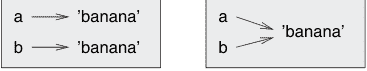

在一种情况下，`a` 和 `b` 指向具有相同值的不同对象。在另一种情况下，它们指向同一个对象。

要检查两个变量是否引用同一个对象，你可以使用 `is` 运算符。

```python
>>> a = 'banana'
>>> b = 'banana'
>>> a is b
True
```

在这个示例中，Python 只创建了一个字符串对象，且 `a` 和 `b` 都指向它。但当你创建两个列表时，你得到两个两个对象：

```python
>>> a = [1, 2, 3]
>>> b = [1, 2, 3]
>>> a is b
False
```

所以状态图看起来如下：

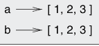

在这种情况下，我们会说列表是等价的（equivalent），因为它们具有相同的元素，但不是相同的（identical），因为它们不是同一个对象。如果两个对象是相同的，那么它们也是等价的；但如果它们是等价的，并不一定相同。

到为止，我们一直在交替使用“对象”和“值”，但说一个对象拥有一个值会更精确。如果你执行 `a = [1, 2, 3]`，`a` 引用一个列表对象，其值是一组特定的元素序列。如果另一个列表具有相同的元素，我们会说它具有相同的值。

## 10.9 别名 (ALIASING)

如果 `a` 引用一个对象并且你赋值 `b=a`，那么两个变量都引用同一个对象：

```python
>>> a = [1, 2, 3]
>>> b = a
>>> b is a
True
```

状态图看起来如下：

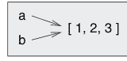

变量与对象的关联被称为**引用（reference）**。在这个示例中，有两个指向同一个对象的引用。

具有多个引用的对象具有多个名称，所以我们说该对象是**被别名的（aliased）**。

如果别名对象是可变的，对其中一个别名进行的更改会影响另一个：

```python
>>> b[0] = 17
>>> print(a)
[17, 2, 3]
```

虽然这种行为很有用，但很容易出错。通常情况下，在处理可变对象时，避免别名是更安全的。

对于字符串等不可变对象，别名并不是什么问题。在示例中：

```python
a = 'banana'
b = 'banana'
```

`a` 和 `b` 是否引用同一个字符串几乎没有产生区别。

## 10.10 列表参数 (LIST ARGUMENTS)

当你将一个列表传递给函数时，函数获取了该列表的引用。如果函数修改了列表参数，调用者会看到变化。例如，`delete_head` 从列表中删除第一个元素：

```python
def delete_head(t):
    del t[0]
```

以下是它的用法：

```python
>>> letters = ['a', 'b', 'c']
>>> delete_head(letters)
>>> print(letters)
['b', 'c']
```

参数 `t` 和变量 `letters` 是同一个对象的别名。栈图看起来如下：

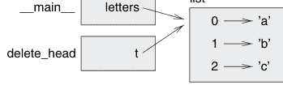

由于该列表被两个栈帧共享，我将它画在它们之间。

区分区分修改列表的操作和创建新列表的操作是非常重要的。例如，`append` 方法会修改列表，但 `+` 运算符会创建一个新列表：

```python
>>> t1 = [1, 2]
>>> t2 = t1.append(3)
>>> print(t1)
[1, 2, 3]
>>> print(t2)
None
```

```python
>>> t3 = t1 + [3]
>>> print(t3)
[1, 2, 3]
>>> t2 is t3
False
```

当你编写本应该修改列表的函数时，这种区别非常重要。例如，这个函数并没有删除列表的头部：

```python
def bad_delete_head(t):
    t = t[1:]    # 错误！
```

## 10.11 调试 (Debugging)

切片运算符创建了一个新列表，赋值使 `t` 引用它，但这些对作为参数传递的列表没有任何影响。

另一种方法是编写一个创建并返回新列表的函数。例如，`tail` 返回列表除第一个元素外的所有元素：

```python
def tail(t):
    return t[1:]
```

这个函数保持原始列表不修改。以下是它的用法：

```python
>>> letters = ['a', 'b', 'c']
>>> rest = tail(letters)
>>> print(rest)
['b', 'c']
```

## 10.12 练习

编写一个名为 `middle` 的函数，接收一个列表并返回除第一个和最后一个元素之外的部分。

## 10.13 调试

粗率使用列表（以及其他对象）会导致长时间的调试。这里有一些陷阱以及避免它们的方法：

(i) 不要忘记某些方法如 `sort` 返回 `None`。在交互模式下尝试这些：

```python
word = 'apple'
word.sort()
```

(ii) 选择一种惯用法并坚持下去。尝试这些以理解它们是做什么：

- `t.append([x])` # 错误！
- `t + x`         # 错误！
- `sorted(t)`      # 错误！

(iii) 使用副本。如果你想使用会修改参数的 `sort` 方法但保留原始对象，你可以：

```python
orig = t[:]
```

## 10.14 术语表 (GLOSSARY)

- **累加器 (accumulator)**：用于设置两个引用同一个对象的变量。
- **别名 (aliasing)**：用于指示字符串应该被拆分的字符或字符串。
- **元素 (element)**：列表中的一个值，也称为项。
- **等价的 (equivalent)**：具有相同的值。

## 10.15 练习

- **过滤 (filter)**：一种遍历列表并选择满足某些条件的处理模式。
- **相同的 (identical)**：是同一个对象（这暗示了等价性）。
- **索引 (index)**：指示列表中元素的整数值。
- **列表 (list)**：值的序列。
- **列表遍历 (list traversal)**：对每个元素进行顺序访问。
- **映射 (map)**：一种遍历序列并对每个元素执行操作的处理模式。
- **映射 (mapping)**：一个集合中的每个元素对应另一个元素的关系。例如，列表是从索引到元素的映射。
- **嵌套列表 (nested list)**：可以引用另一个的列表。对象具有类型和值。
- **减少 (reduce)**：一种遍历序列并将元素聚合成单个结果的处理模式。
- **引用 (reference)**：变量与其值之间的关联。

## 10.16 练习

### 练习 10.3

编写一个名为 `is_sorted` 的函数，接收列表作为参数，如果列表按升序排列则返回 `True`，否则返回 `False`。你可以假设（作为前提条件）列表元素可以使用比较运算符 `<` 等进行比较。例如，`is_sorted([1,2,2])` 应该返回 `True`，而 `is_sorted(['b', 'a'])` 应该返回 `False`。

### 练习 10.4

如果可以通过重新排列一个单词的字母来拼出另一个单词，它们就是异位词。编写一个名为 `is_anagram` 的函数，接收两个字符串，如果它们是异位词则返回 `True`。

### 练习 10.5

1. 编写一个名为 `has_duplicates` 的函数，如果列表中任何元素出现多次则返回 `True`。它不应该修改原始列表。
2. 如果你的班有 23 名学生，你们中生日相同的概率有多大？你可以通过生成 23 个生日的随机样本并检查匹配情况来估计这个概率。提示：你可以使用 `random` 模块中的 `randint` 函数生成随机生日。

## 练习 10.6

编写名为 `remove_duplicates` 的函数，它接收一个列表并返回一个只包含原始列表中唯一元素的新列表。提示：元素的顺序不需要保持一致。

## 练习 10.7

编写一个函数，读取 `words.txt` 文件并构建一个每个单词包含一个元素的列表。编写该函数的两个版本。

你可以在 thinkpython.com/wordlist.py 查看我的解决方案。

## 练习 10.8

要检查一个单词是否在单词列表中，你可以使用 `in` 运算符，但这样会很慢，因为会按顺序搜索单词。

由于单词是按字母排序的，我们可以通过二分查找（bisection search）来提高速度，这类似于你在字典中查阅单词时所的操作。你从中间开始，检查你正在查找的单词是否在列表中间的单词之前。如果是，你就以相同的方式搜索列表的前半部分；否则，你就搜索后半部分。

无论采取哪种方式，你都将剩余的搜索空间减半。如果单词列表有 113,809 个单词，大约需要 17 步就能找到该单词或确定它不在其中。

编写一个名为 `bisect` 的函数，它接收一个排序列表和一个目标值，如果该单词在列表中，则返回其索引；如果不在则返回 `None`。

或者你也可以阅读 `bisect` 模块的文档并使用它！

## 练习 10.9

如果两个单词互为反转，那么它们就是一对“反转对”（reverse pair）。编写一个程序找到单词列表列表中所有的反转对。

## 练习 10.10

如果从每个单词中交替提取字母形成一个新的单词，则这两个单词为“交锁”（interlock）。例如，“shoe”和“cold”交锁形成“schoololed”。

- (1) 编写一个程序找到所有交锁的单词对。提示：不要列举所有的配对！
- (2) 你能找到任何三路交锁的单词吗？也就是说，从第二个或第三个字母开始，每第三个字母都能形成一个单词。

> * 此练习的灵感来自 puzzlers.org 的一个示例。

# 11 字典

字典类似于列表，但更通用。在列表中，索引必须是整数；在字典中，索引可以是（几乎）任何类型。

你可以将字典想为一组索引（称为键，keys）和一组值（values）之间的映射。每个键都映射到一个值。键和值之间的关联被称为“键-值对”（key-value pair），有时也称为项（item）。

例如，我们将构建一个从英语单词映射到西班牙语单词的字典，键和值都是字符串。

`dict` 函数创建一个没有任何项的新字典。由于 `dict` 是一个内置函数的名称，你应该避免将它用作变量名。

```python
>>> eng2sp = dict()
>>> print eng2sp
{}
```

波浪括号 `{}` 表示一个空字典。要向字典添加项，你可以使用方括号 `[]`：

```python
>>> eng2sp['one'] = 'uno'
```

这一行创建了一个从键 `'one'` 映射到值 `'uno'` 的项。如果我们再次打印字典，会看到一个在键和值之间带有冒号的键值对：

```python
>>> print eng2sp
{'one': 'uno'}
```

这种输出格式也是一种输入格式。例如，你可以创建一个包含三个项的新字典：


```python
>>> eng2sp = {'one': 'uno', 'two': 'dos', 'three': 'tres'}
```

但如果你打印`eng2sp`，你可能会感到很惊讶：

```python
>>> print eng2sp
{'one': 'uno', 'three': 'tres', 'two': 'dos'}
```

键值对的顺序是不相同的。事实上，如果你在自己的电脑上输入相同的示例，可能会得到不同的结果。通常情况下，字典中项的顺序是不可预测的。

但这不是问题，因为字典的元素永远不是通过整数索引来访问的。相反，使用键来查找对应的值：

```python
>>> print eng2sp['two']
'dos'
```

键`'two'`总是映射到值`'dos'`，因此项的顺序并不重要。

如果键不在字典中，你会得到一个异常：

```python
>>> print eng2sp['four']
KeyError: 'four'
```

`len`函数适用于字典；它返回键-值对的数量：

```python
>>> len(eng2sp)
3
```

`in`运算符适用于字典；它告诉你某物是否作为字典中的键出现（出现），仅作为值出现是不够的。

```python
>>> 'one' in eng2sp
True
>>> 'uno' in eng2sp
False
```

## 11.1 作为计数器集合的字典

要检查某物是否作为值出现在字典中，你可以使用`values`方法，它将值作为列表返回，然后使用`in`运算符：

```python
>>> vals = eng2sp.values()
>>> 'uno' in vals
True
```

`in`运算符对列表和字典使用不同的算法。对于列表，它使用如 8.6 节所示的搜索算法。随着列表变长，搜索时间会按比例增加。对于字典，它使用哈希表，哈希表具有一个显著的特性：无论字典中有多少项，花费的时间大约相同。

## 练习 11.1

编写函数读取`words.txt`并统计每个单词出现的次数。有几种方法可以实现：

- (i) 你可以创建一个字典，并每个单词增加字典中的计数。
- (ii) 你可以创建一个字典，如果单词在字典中，则增加其计数。
- (iii) 你可以创建一个字典，并使用`get`方法统计单词。

代码可能可能是这样的：

```python
def histogram(s):
    d = dict()
    for c in s:
        if c in d:
            d[c] += 1
        else:
            d[c] = 1
    return d
```

`histogram`显示了字母出现的情况：

```python
>>> h = histogram('brontosaurus')
{'a': 1, 'b': 1, 'o': 2, 'n': 1, 's': 2, 'r': 2, 'u': 2
```

字典有一个`get`方法，它接收一个键和一个默认值。如果键在字典中，`get`返回该值；否则它返回默认值。例如：

```python
>>> h = histogram('a')
>>> print h
{'a': 1}
>>> h.get('a', 0)
1
>>> h.get('b', 0)
0
```

使用`get`来更简洁地编写`histogram`。你应该能够消除`if`语句。

```python
def histogram(s):
    d = dict()
    for c in s:
        d[c] = d.get(c, 0) + 1
    return d
```

## 循环与字典

如果你在`for`语句中使用字典，它会遍历键。例如，`print_hist`打印每个键及其值：

```python
def print_hist(h):
    for c in h:
        print c, h[c]
```

输出如下：

```python
>>> h = histogram('parrot')
>>> print_hist(h)
a 1
p 1
r 2
t 1
o 1
```

再次，键没有特定的顺序。

## 练习 11.2

字典有一个`keys`方法，它以列表形式返回字典的键，没有顺序。修改`print_hist`以按字母顺序打印键及其值。

## 11.3 反向查找

给定一个字典`d`和一个键`k`，找到对应的值`v = d[k]`是很容易的。但如果你有`v`并想找到`k`呢？有两个问题：可能有多个键映射到值`v`。根据应用程序，你可能可以选择其中一个，也可能需要包含所有键的列表。其次，没有简单的语法可以执行反向查找；你必须进行搜索。

这里有一个接收值并返回映射到该值的第一个键的函数：

```python
def reverse_lookup(d, v):
    for k in d:
        if d[k] == v:
            return k
    raise ValueError
```

这个函数是搜索模式的另一个示例，但它使用了一个我们之前没过的特性：`raise`。`raise`语句会引发异常；在这种情况下，它引发一个`ValueError`，这通常表示参数的值有问题。

如果我们运行到循环末尾，意味着`v`没有以空值的形式出现在字典中，因此我们抛出一个异常。

这是一个成功的反向查找示例：

```python
>>> h = histogram('parrot')
>>> k = reverse_lookup(h, 2)
>>> print k
```

这是一个失败的示例：

```python
>>> k = reverse_lookup(h, 3)
Traceback (most recent call last):
  File "<stdin>", line 1, in
  File "<stdin>", line 5, in reverse_lookup
ValueError
```

手动抛出异常的结果与 Python 抛出异常的结果相同：它会显示回溯信息（traceback）和错误消息。

`raise`语句接受一个详细的错误消息作为可选参数。例如：

```python
>>> raise ValueError, 'value does not appear in the dictionary'
Traceback (most recent call last):
  File "<stdin>", line 1, in
ValueError: value does not appear in the dictionary
```

反向查找比正向查找慢得多；如果你必须经常执行，或者字典变得很大，你程序的性能将会受到影响。

## 练习 11.4

修改`reverse_lookup`，使其构建并返回所有映射到`v`的键的列表，如果没有，则返回空列表。

## 11.4 字典与列表

列表可以作为字典的值。例如，如果你给你一个从字母映射到频率的字典，你可能想要反转它；也就是说，创建一个从频率映射到字母的字典。由于多个字母可能有相同的频率，反转后的字典中的每个值都应该是字母的列表。

这里有一个反转字典的函数：

```python
def invert_dict(d):
    inv = dict()
    for key in d:
        val = d[key]
        if val not in inv:
            inv[val] = [key]
        else:
            inv[val].append(key)
    return inv
```

每次循环时，`key`从`d`中获取一个键，`val`获取对应的值。如果`val`不在`inv`中，说明我们之前没见过它，因此我们创建一个新项并将其初始化为单元（一个包含单个元素的列表）。否则，我们之前已经见过这个值，因此我们将对应的键追加到列表中。

这是一个示例：

```python
>>> hist = histogram('parrot')
>>> print hist
{'a': 1, 'p': 1, 'r': 2, 't': 1, 'o': 1}
>>> inv = invert_dict(hist)
>>> print inv
{1: ['a', 'p', 't', 'o'], 2: ['r']}
```

这里是显示`hist`和`inv`的图：

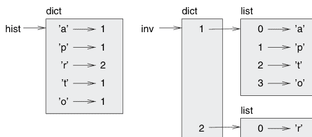

字典被表示为一个框，上方是类型`dict`，里面是键值值对。如果值是整数、浮点数或字符串，我通常将它们画在框内，但我通常将列表画在框外，以保持图表的简单。

列表可以作为字典的值，如示例所示，但它们不能作为键。如果你尝试这样做，会发生以下情况：

```python
>>> t = [1, 2, 3]
>>> d = dict()
>>> d[t] = 'oops'
Traceback (most recent call last):
  File "<stdin>", line 1, in ?
TypeError: list objects are unhashable
```

我之前提到字典是使用哈希表（hashtable）实现的，这意味着键必须是**可哈希的**（hashable）。

**hash**是一个接受值并返回整数的函数。字典使用这些被称为哈希值的整数来存储和查找键值对。

如果键是不可变的，这个系统就能正常工作。但如果键是可变的（如列表），就会问题。例如，当你创建一个键值时，Python 对键进行哈希并存储在相应的位置。如果你修改了键并再次哈希，它会去另一个位置。在这种情况下，你可能会有两个相同的键项，或者找不到某个键。无论如何，字典都无法正常工作。这就是为什么键必须是可哈希的，以及为什么列表这样的类型不是。解决这一限制的最简单方法是使用元组（tuples），我们将在下一章看到。由于字典是可变的，它们不能作为键，但*可以*作为值。

## 练习 11.5

读取字典方法`setdefault`的文档，它是`invert_dict`的更简洁的版本。

## 字典

结尾的 L 表示结果是一个长整型（long integer），†或`long`类型。

`int`类型的值范围有限；而长整型可以是任意大小，随着数值的增大，它们消耗的空间和时间也会增加。

数学运算符适用于长整型，`math`模块中的函数也是如此，因此任何处理`int`的代码也适用于`long`。

每当计算结果大到无法用整数表示时，Python 就会将结果转换为长整型：

```python
>>> 1000 * 1000 
1000000
>>> 100000 * 100000
1000000000000L
```

在第一种情况下，结果类型为`int`；在第二种情况下，它是`long`。

## 练习 11.7

大整数的幂运算是公钥加密常用算法的基础。阅读关于[RSA算法的维基百科页面](https://wikipedia.org/wiki/RSA)†并编写用于编码和解码消息的函数。

## 11.8 调试

当你处理更大的数据集时，通过打印和手动检查数据来调试可能会变得非常费力。以下是一些调试大型数据集的建议：

- **缩小输入规模：** 例如，如果程序读取文本文件，可以先从前 10 行开始，或者从你能找到的最小示例开始。你可以编辑文件本身，或者（更好的方法）修改程序使其只读取`n`行。

  如果出现错误，你可以将`n`减到能复现错误的最小值，然后在发现并纠正错误后逐渐增加它。

- **检查摘要和类型：** 与其打印并检查整个数据集，不如考虑打印数据的摘要：例如，字典中的项数或数字列表的总和。

  运行时错误的常见原因是某个值的类型不正确。调试此类错误，通常只需打印值的类型就足够了。

- **自检：** 有时你可以编写代码来自动检查错误。例如，如果你正在计算数字列表的平均值，可以检查结果是否大于列表中的最大元素或小于最小元素。这被称为“合理性检查（sanity check）”，因为它能检测出“荒谬”的结果。

> † 在 Python 3.0 中，删除了`long`类型；所有整数（即使是大整数）都是`int`类型。

† wikipedia.org/wiki/RSA

## 11.10 练习 131

另一种检查方法是比较两次计算的结果以判断它们是否一致。这被称为“一致性检查（consistency check）”。

美化打印输出（Pretty print）：格式化调试输出可以更容易发现错误。我们在第 6.9 节中见过一个示例。`pprint`模块提供了`pprint`函数，可以以更易读的格式显示内置类型。

再次，花在构建脚架上的时间可以减少你调试的时间。

## 11.9 术语表

- **调用图 (call graph):** 显示程序执行期间创建的每个帧的图，从每个调用者到每个被调用者都有箭头。
- **声明 (declaration):** 像`global`这样的语句，向解释器提供关于变量的信息。
- **字典 (dictionary):** 从键集到对应值的映射。
- **标志位 (flag):** 用于指示条件是否为布尔变量。
- **全局变量 (global variable):** 定义在函数外的变量。全局变量可以从任何函数访问。
- **可哈希 (hashable):** 拥有哈希函数的类型。整数、浮点数和字符串等不可变类型是可哈希的；列表和字典等可变类型不是。
- **哈希函数 (hash function):** 哈希表用于计算键位置的函数。
- **哈希表 (hashtable):** 实现 Python 字典的算法。
- **直方图 (histogram):** 一组计数器。
- **实现 (implementation):** 执行计算的方法。
- **项 (item):** 键值对的另一个名称。
- **键 (key):** 在字典中作为键值对第一部分的对象。
- **键值对 (key-value pair):** 从键到值的映射表示。
- **查找 (lookup):** 字典操作，接收一个键并找到对应的值。
- **备忘 (memo):** 存储的计算值，以避免未来不必要的计算。
- **反向查找 (reverse lookup):** 字典操作，接收一个键并找到一个或多个映射到它的键。
- **单例 (singleton):** 具有单个元素的列表（或其他序列）。
- **值 (value):** 在字典中作为键值对第二部分的对象。这比我们之前对“值”一词的使用更具体。

## 11.10 练习

### 练习 11.8

如果你做了练习 10.5，你已经有了一个名为`has_duplicates`的函数，它接受列表作为参数，如果列表中有任何出现超过一次的对象，则返回`True`。

使用字典写一个更快速、更简单的`has_duplicates`版本。

### 练习 11.9

两个词如果称为“旋转对（rotate pairs）”，如果你可以旋转其中一个来得到另一个（参见练习 8.12 中的`rotate_word`）。

编写一个程序读取词列表并找到所有的旋转对。

### 练习 11.10

这里有另一个来自 Car Talk 的趣味谜题：

> 这是由一个名叫 Dan O’Leary 的朋友寄来的。他最近发现了一个具有共同音节的五个字母单词，具有以下独特属性：当你去掉第一个字母时，剩余字母构成了原单词的同音词，即听起来完全相同的单词。替换第一个字母，也就是说……

## 元组

### 元组是不可变的

元组是值的序列。值可以是任何类型，并且可以通过索引，因此元组类似于列表。区别在于元组是不可变的。

在语法上，元组是用逗号分隔的值列表：

```python
>>> t = 'a', 'b', 'c', 'd', 'e'
```

虽然没有必要，但通常用括号将元组括起来：

```python
>>> t = ('a', 'b', 'c', 'd', 'e')
```

创建单个元素的元组，必须包含最后的逗号：

```python
>>> t1 = ('a',)
>>> type(t1)
<type 'tuple'>
```

如果没有逗号，Python 将`('a')`视为括号中的字符串：

```python
>>> t2 = ('a')
>>> type(t2)
<type 'str'>
```

创建元组的另一种方法是内置函数`tuple`。不带参数时，它会创建一个空元组：

```python
>>> t = tuple()
>>> print t
()
```

如果参数是序列（字符串、列表或元组），结果是一个包含该序列元素的元组：

```python
>>> t = tuple('lupins')
>>> print t
('l', 'u', 'p', 'i', 'n', 's')
```

由于`tuple`是内置函数的名称，你应该避免将其用作变量名。大多数列表操作都适用于元组。括号运算符索引元素：

```python
>>> t = ('a', 'b', 'c', 'd', 'e')
>>> print t[0]
'a'
```

切片运算符选择范围内的元素。

```python
>>> print t[1:3]
('b', 'c')
```

如果你尝试修改元组中的一个元素，会得到错误：

```python
>>> t[0] = 'A'
TypeError: object doesn't support item assignment
```

你不能修改元组的元素，但你可以用另一个元组替换它：

```python
>>> t = ('A',) + t[1:]
>>> print t
('A', 'b', 'c', 'd', 'e')
```

### 12.2 元组赋值


交换两个变量的值通常很有用。使用传统的赋值方法，你必须使用一个临时变量。例如，交换`a`和`b`的值：

```
>>> temp = a
>>> a = b
>>> b = temp
```

这种解决方案很繁琐；元组赋值则更加优雅：

```
>>> a, b = b, a
```

左侧是一个变量的元组；右侧是一个表达式的元组。每个值都会被赋值其相应的变量。在进行任何赋值之前，右侧的所有表达式都会先被求值。

左侧变量的数量与右侧值的数量必须一致：

```
>>> a, b = 1, 2, 3
ValueError: too many values to unpack
```

更通地说，右侧可以是任何类型的序列（字符串、列表或元组）。例如，为了将电子邮件地址拆分为用户名和域名，你可以这样写：

```python
>>> addr = 'monty@python.org'
>>> uname, domain = addr.split('@')
```

`split`的返回值是一个包含两个元素的列表；第一个元素赋值给`uname`，第二个赋值给`domain`。

```
>>> print uname
monty
>>> print domain
python.org
```

## 12.3 元组作为返回值

严格来说，一个函数只能返回一个值，但如果该值是一个元组，其效果等同于返回多个值。例如，如果你想除两个整数并计算商和余数，先计算`x / y`再计算`x % y`是效率低下的。同时计算两者更好。

内置函数`divmod`接收两个参数并返回一个包含两个值的元组：商和余数。你可以将结果存储为元组：

```
>>> t = divmod(7, 3)
>>> print t
(2, 1)
```

或者使用元组赋值将元素分开存储：

```python
>>> quot, rem = divmod(7, 3)
>>> print quot
2
>>> print rem
1
```

这是一个返回元组的函数示例：

```python
def min_max(t):
    return min(t), max(t)
```

`max`和`min`是寻找序列中最大和最小元素的内置函数。`min_max`计算了两者并返回一个包含两个值的元组。

## 12.4 变长参数元组

函数可以接收任意数量的参数。以`*`开头的参数名会将参数收集到一个元组中。例如，`printall`接收任意数量的参数并打印它们：

```python
def printall(*args):
    print args
```

收集参数的名称可以是你喜欢的任何名称，但`args`是惯例。该函数的工作原理如下：

```
>>> printall(1, 2.0, '3')
(1, 2.0, '3')
```

你可以将收集操作符与强制参数和位置参数结合：

```python
def pointless(required, optional=0, *args):
    print required, optional, args
```

使用`1`, `2`, `3`和更多参数运行此函数，并确保你理解它的作用。

收集（gather）的相反是散列（scatter）。如果你有一个值序列并想将其作为多个参数传递给函数，可以使用`*`运算符。例如，`divmod`恰好接受两个参数；它无法直接与元组一起工作：

```
>>> t = (7, 3)
>>> divmod(t)
TypeError: divmod expected 2 arguments, got 1
```

但如果你散列元组，它就能工作：

```
>>> divmod(*t)
(2, 1)
```

## 练习 12.1

许多内置函数使用变长参数元组。例如，`max`和`min`可以接收任意数量的参数：

```
>>> max(1,2,3)
3
```

但`sum`不行。

```
>>> sum(1,2,3)
TypeError: sum expected at most 2 arguments, got 3
```

## 元组

编写一个名为`sumall`的函数，接收任意数量的参数并返回它们的和。

## 12.5 列表与元组

`zip`是内置函数，接收两个或多个序列并将它们“拉链”成一个元组列表，每个元组包含每个序列中的一个元素。

这个示例将一个字符串和一个列表进行拉链：

```
>>> s = 'abc'
>>> t = [0, 1, 2]
>>> zip(s, t)
[['a', 0], ('b', 1), ('c', 2)]
```

结果是一个元组列表，每个元组包含字符串中的一个字符和列表中的对应元素。如果序列长度不同，结果的长度取决于较短的那个序列。

```
>>> zip('Anne', 'Elk')
[('A', 'E'), ('n', 'l'), ('n', 'k')]
```

你可以在`for`循环中使用元组赋值来遍历元组列表：

```python
t = [['a', 0], ('b', 1), ('c', 2)]
for letter, number in t:
    print number, letter
```

在每次循环中，循环将元素赋值给`letter`和`number`。该循环的输出是：

结合`zip`、元组赋值和`for`，你得到了一种遍历元组列表的有用方法。例如，`has_match`两个序列，如果存在索引`i`使得`t1[i] == t2[i]`，则返回`True`：

```python
def has_match(t1, t2):
    for x, y in zip(t1, t2):
        if x == y:
            return True
    return False
```

## 12.6 字典与元组

字典有一个名为`items()`的方法，返回元组列表，每个元组是一个键值对。在 Python 3.0 中，它返回一个迭代器。

```python
>>> d = {'a': 0, 'b': 1, 'c': 2}
>>> list(d.items())
[('a', 0), ('b', 1), ('c', 2)]
```

你可以使用元组赋值遍历字典：

```python
for key, val in d.items():
    print key, val
```

同样，你可以使用`dict()`创建字典：

```python
>>> d = dict([('a', 0), ('b', 1), ('c', 2)])
>>> print d
{'a': 0, 'b': 1, 'c': 2}
```

## 12.7 比较元组

比较操作符适用于元组和其他序列；Python 开始比较每个序列的第一个元素。如果相等，则继续比较后续元素，依此类推，直到找到不同的元素。后续元素将不再被考虑（即使它们很大）。

```
>>> (0, 1, 2) < (0, 3, 4)
True
>>> (0, 1, 2000000) < (0, 3, 4)
True
```

`sort`函数的工作方式相同。它主要按第一个元素排序，如果平局，则按第二个元素排序，依此类推。这种特性适用于一种名为 DSU 的模式，用于

装饰（Decorate）：通过构建一个元组列表来装饰序列，其中一个或多个排序键位于序列中的元素之前，

# 排序（Sort）：元组列表，

取消装饰（Undecorate）：提取序列中排序后的元素。

例如，假设你有一个单词列表，你想按长度从长到短对其进行排序：

```python
def sort_by_length(words):
    t = []
    for word in words:
        t.append((len(word), word))

    t.sort(reverse=True)

    res = []
    for length, word in t:
        res.append(word)
    return res
```

第一个循环构建了一个元组列表，其中每个元组包含一个单词及其前面的长度。

`sort`首先比较第一个元素（长度），仅在出现平局时才考虑第二个元素。关键字参数`reverse = True`告诉`sort`按照降序排列。

第二个循环遍历元组列表，并按长度降序构建一个单词列表。

## 练习 12.2

在这个示例中，平局是通过比较单词来打破的，因此长度相同的单词将按字母顺序出现。对于其他应用，你可能希望随机打破平局。请修改这个示例，使具有相同长度的单词以随机顺序出现。提示：参见`random`模块中的`random`函数。

## 12.8 序列的序列

我重点关注元组列表，但本章中几乎所有的示例也适用于列表列表、元组元组以及元组列表。为了避免列举所有可能的组合，有时讨论“序列的序列”会更容易。

在许多语境下，不同类型的序列（字符串、列表和元组）可以交叉使用。那么你如何以及为什么要选择其中一个而不是其他的？

## 12.9 调试

列表比元组更常见，主要是因为它们是可变的。但在某些情况下，你可能倾向于使用元组：

- (i) 在某些语境下（如返回语句），创建元组比列表在语法上更简单。在其他语境下，你可能更倾向于列表。

- (ii) 如果你想将序列作为字典的键，必须使用像元组或字符串这样的不可变类型。

- (iii) 如果你将序列作为参数传递给函数，使用元组可以减少由于别名（aliasing）导致意外行为的可能性。

由于元组是不可变的，它们不提供像`sort`和`reverse`那样修改现有列表的方法。但 Python 提供了内置的`sorted`和`reversed`，它们接受任何序列作为参数，并返回一个包含相同元素但顺序不同的新列表。

## 12.9 调试

列表、字典和元组被统称为数据结构；在本章中，我们开始组合数据结构，例如元组列表，以及包含元组作为键和值的字典。复合数据结构是有用的，但它们容易出现我所说的“形状错误（shape errors）”；即，由于数据结构的类型错误、大小或组成错误而导致的错误。例如，如果你期望一个包含一个整数的列表，而我给了你一个普通的整数（而不是在列表中），它将无法工作。

为了帮助调试这类错误，我写写了一个名为`structshape`的模块，它提供了一个也叫`structshape`的函数，该函数接受任何数据结构作为参数，并返回一个总结其形状的字符串。你可以从`thinkpython.com/structshape.py`下载它。

这里是一个简单列表的结果：

```python
>>> from structshape import structshape
>>> t = [1,2,3]
>>> print(structshape(t))
list of 3 int
```

更复杂的程序可能会写成 "list of 3 ints"，但处理复数形式并没有更简单。这里是一个列表列表：

```python
>>> t2 = [[1,2], [3,4], [5,6]]
>>> print(structshape(t2))
list of 3 list of 2 int
```

如果列表元素类型不相同，`structshape`会按类型顺序对它们分组：

```python
>>> t3 = [1, 2, 3, 4, 0, '5', '6', [7], [8], 9]
>>> print(structshape(t3))
list of 3 int, float, 2 str, 2 list of int, int
```

这是一个元组列表：

```python
>>> s = 'abc'
>>> lt = zip(t, s)
>>> print(structshape(lt))
list of 3 tuple of (int, str)
```

这是一个包含 3 个项目的、将整数映射到字符串的字典。

```python
>>> d = dict(lt)
>>> print(structshape(d))
dict of 3 int->str
```

如果你在跟踪数据结构方面有困难，`structshape`可以提供帮助。

## 12.10 术语表

- **data structure (数据结构)**：相关值的集合，通常组织成列表、字典、元组等。

- **DSU**：“decorate-sort-underscore”（装饰-排序-下划线）的缩写，这种模式涉及构建元组列表、排序并提取结果的一部分。

- **gather (收集)**：组装变长参数元组的操作。

- **scatter (展开)**：将序列视为参数列表的操作。

- **shape (数据结构的形状)**：类型、大小或组成的总结。

- **tuple (元组)**：不可变的序列。

- **tuple assignment (元组赋值)**：右侧为元组的赋值。

## 12.11 练习

## 练习 12.3

写一个接收字符串并按长度降序打印所有变位词的函数。提示：参见第 9.1 节。

## 练习 12.4

写一个读取文件并打印所有集合的程序。这里是输出可能的一种示例：

```
['deltas', 'desalt', 'salted', 'slated']
['retainers', 'ternaries']
['generating', 'greatening']
['melts', 'smters']
```

- (1) 你可能想写一个函数接收单词并计算通过删除一个字母形成的所有单词。这些是单词的“孩子”。

- (2) 递归地，如果一个单词的任何孩子是可以还原的，那么该单词就可以还原。作为基本情况，可以认为空字符串是可以还原。

- (3) 我提供的词表`words.txt`不包含字母单词。所以你可能需要添加“”、“a”和空字符串。

- (4) 为了提高程序的性能，你可能想对已知还原的单词进行缓存（memoize）。

## 练习 12.5

在每次删除一个字母时仍然是有效单词的最长英语单词是什么？

## 案例研究：数据结构选择

## 13.1 词频分析

像往常，在阅读我的解答之前，你应该至少尝试以下练习。

### 练习 13.1

编写一个程序，读取文件，将每行拆分为单词，去除单词中的空白和标点符号，并将它们转换为小写。

提示：`string`模块提供了命名的`whitespace`（包含空格、制表符、换行符等）和`punctuation`（包含标点字符）。让我们看看是否能让 Python “说脏”：

```python
>>> import string
>>> print(string.punctuation)
!"#$%&'()*+,-./;<=>?@[\]|}~
```

此外，你可能考虑使用字符串方法`strip`、`replace`和`translate`。

### 练习 13.2

前往 [Project Gutenberg](https://gutenberg.net) 下载一本你最喜欢的无版权纯文本格式书籍。

修改上一个练习中的程序，读取你下载的书，跳过文件开头的头部信息，并像以前一样处理其余单词。

然后修改程序以统计书中单词的总数，以及每个单词使用的次数。

打印书中使用的不同单词的数量。比较不同作者、不同时代编写的书籍。哪位作者使用的词汇量最丰富？

### 练习 13.3

修改上一个练习中的程序，打印书中出现频率最高的 20 个单词。

### 练习 13.4

修改之前的程序以读取一个单词列表（见第 9.1 节），然后打印书中所有不在单词列表中的单词。其中有多少个是拼写错误？有多少个是应该出现在列表中的常用词？又有有多少个是真正晦僻的词？

## 13.2 随机数

在相同的输入下，大多数计算机程序每次都会生成相同的输出，它们被称为**确定性的**（deterministic）。确定性通常是一件好事，因为我们期望相同的计算会产生相同的结果。然而，对于某些应用，我们希望计算机是不可预测的。游戏返回一个 0 到 1 之间的整数，但还有更多。

要让程序真正具有非确定性似乎并不容易，但有方法可以使其至少具有非确定性。其中一种方法是使用生成伪随机数的算法。伪随机数并不是真正的随机，因为它们是由确定性计算生成的，但仅通过观察数字几乎无法将其与随机数区分来。

`random`模块提供了生成伪随机数的函数（从现在起我简单地称为“random”）。

`random()`函数返回一个 0.0 到 1.0 之间的随机浮点数（包含 0.0 但不包含 1.0）。每次调用`random()`，你都会得到长序列中的下一个数字。要查看示例，请运行此循环：

```python
import random

for i in range(10):
    x = random.random()
    print(x)
```

`randint`函数接受`low`和`high`参数，并返回`low`和`high`之间的整数（包含两者）。

```python
>>> random.randint(5, 10)
5
>>> random.randint(5, 10)
9
```

要从序列中随机选择一个元素，可以使用`choice`：

```python
>>> t = [1, 2, 3]
>>> random.choice(t)
2
>>> random.choice(t)
3
```

`random`模块还提供了从连续分布生成随机值的函数，包括高斯、指数和伽马分布。

### 练习 13.5

编写一个名为`choose_from_hist`的函数，它接受一个如 11.1 节定义的直方图，并从直方图中返回一个随机值，选择概率与频率成比例。例如，对于这个直方图：

```python
>>> t = ['a', 'a', 'b']
>>> h = histogram(t)
>>> print(h)
'a': 2, 'b': 1
```

你的函数应该以 2/3 的概率返回`'a'`，以 1/3 的概率返回`'b'`。

## 13.3 直方图

这是一个读取文件并构建文件中单词直方图的程序：


```python
import string

def process_file(filename):
    h = dict()
    fp = open(filename)
    for line in fp:
        process_line(line, h)
    return h
```

```python
for word in line.split():
    word = word.strip(string.punctuation + string.whitespace)
    word = word.lower()
```

```python
h[word] = h.get(word, 0) + 1
```

```python
hist = process_file('emma.txt')
```

该程序读取`emma.txt`，其中包含简·奥斯汀的《玛玛》的文本。

`process_file`遍历文件的行，每次传递一行给`process_line`。直方图`h`被用作累加器。

`process_line`使用`strip`方法在使用`split`将行拆分为字符串列表之前将连字符替换为空格。它遍历单词列表并使用`strip`和`lower`移除标点符号并转换大小。（说字符串被“转换”是一种简说法；记住字符串是不可变的，所以像`strip`这样的方法返回新字符串。）

最后，`process_line`通过创建新项或增加现有项来更新直方图。

要统计文件中单词的总数，我们可以对直方图中的值求和：

```python
def total_words(h):
    return sum(h.values())
```

要找到不同单词的数量，我们可以使用字典的长度：

```python
def different_words(h):
    return len(h)
```

要统计文件中单词的总数，我们可以对直方图中的值求和：

```python
def total_words(h):
    return sum(h.values())
```

要找到不同单词的数量，我们可以使用字典的长度：

```python
def different_words(h):
    return len(h)
```

## 13.4 常用词

寻找常见词，我们可以按频率倒序排序字典：

```python
def most_common(h, num=10):
    t = sorted(h.items(), key=lambda item: item[1], reverse=True)
    return t[:num]
```

## 13.5 可选参数

我们见过接受数量数量的内置函数和方法。编写带有可选参数的用户定义函数是可能的。例如，这里有一个打印函数：

```python
def most_common(h, num=10):
    t = sorted(h.items(), key=lambda item: item[1], reverse=True)
    return t[:num]
```

第一个参数是必须的；第二个是可选的。`num`的默认值为 10。

## 13.6 字典减法

寻找书中不在列表中的单词是一个你可能识别为集合减法的问题；即我们想要找到一个集合（书）中不在另一个集合中的所有单词。由于我们不在乎值，我们将它们都设置为`None`。

```python
def subtract(d1, d2):
    res = dict()
    for key in d1:
        if key not in d2:
            res[key] = None
    return res
```

## 13.7 随机单词

要从直方图中选择随机单词，简单的算法是根据观察到的频率构建一个包含多个单词副本的列表，然后从列表中选择：

```python
def random_word(h):
    t = []
    for word, freq in h.items():
        t.extend([word] * freq)
    return random.choice(t)
```

# 练习 13.7

这个算法可以运行，但效率不高；每次当你选择一个随机单词时，它都会重新构建列表，而这个列表和原书一样大。一个明显的改进是只构建一次列表并进行多次选择，但列表仍然很大。

另一种方法是：

- 1. 使用键（keys）获取书中单词的列表。
- 2. 构建一个包含单词出现频率累加和的列表（参见练习 10.1）。该列表的最后一项是书中单词的总数 $n$。
- 3. 从 1 到 $n$ 随机一个随机数。使用二分查找（参见练习 10.8）找到该随机数应该插入到累加和中的索引。
- 4. 使用该索引在单词列表中找到对应的单词。

编写一个程序，使用该算法从书中随机选择一个单词。

# 13.8 马尔可夫分析 (MARKOV ANALYSIS)

如果你从书中随机选择单词，你可以对词汇量有一个大致的了解，但你可能得不到一个完整的句子：

> the small regard harriet which knightley's it most things

一系列随机单词很少有意义，因为相邻单词之间没有关系。例如，在一个真实的句子中，你会期望像“the”这样的冠词后面跟着一个形容词或名词，而可能不是动词或副词。

衡量这类关系的一种方法是马尔可夫分析，它根据给定的单词序列，描述下一个单词出现的概率。例如，示例《The Half Bee》开头如下：

> Half a, philosophically,
> Must, ipso facto, not half be.
> But half the bee has got to be
> Vis a, its entity. D'you see
> But can a bee be said to
> Or to be an entire bee
> When the bee is not a bee
> Due to some ancient injury?

在文本中，短语“half the”后面总是跟着单词“bee”，但短语“bee”后面可能紧跟着“has”或“is”。

马尔可夫分析的结果是从每个前缀（如“half the”和“the bee”）到所有可能的后缀的（如“has”和“is”）的映射。

## 13.9 数据结构

给定这个映射，你可以从任何前缀开始，从可能的后缀中随机选择来生成随机文本。接下来，你可以将前缀的末尾和新后缀结合形成新的前缀，并重复此过程。

例如，如果你从前缀“Half a”开始，下一个单词必须是“bee”，因为该前缀在文中只出现一次。下一个前缀是“a bee”，所以下一个后缀必须是“philosophically”、“be”或“due”。

在这个例子中，前缀的长度始终是两个，但你可以对任何长度的前缀进行马尔可夫分析。前缀的长度被称为分析的阶数。

# 练习 13.8

马尔可夫分析：

- (1) 编写一个程序从文件中读取文本并执行马尔可夫分析。结果应该是将前缀映射到可能后缀集合的字典。集合可以是列表、元组或字典；取决于你如何做出选择。你可以用长度为二的前缀测试你的程序，但你应该编写程序，使其易于尝试其他长度。
- (2) 在此基础上添加一个函数，根据马尔可夫分析生成随机文本。这里有一个来自《Emma》的示例，前缀长度为2：

He was very clever, be it sweetness or be angry ashamed or only amused, such a stroke. She had never thought of Hannah that you were never meant for me?” “I cannot make speeches, Emma:” he soon cut it all himself.

在这个示例中，我让标点符号与单词在一起。结果在语法上几乎是正确的，但并不完全。在语义上，它几乎通顺，但也不完全。

如果增加前缀长度会发生什么？随机文本更有意义吗？

- (3) 一旦你的程序运行了，你可能想尝试混合（mashup）：如果你分析两或多本书的文本，你生成的随机文本将以有趣的方式融合来源的词汇和短语。

## 13.9 数据结构

使用马尔可夫分析生成随机文本很有趣，这个练习也有它的意义：数据结构的选择。在之前练习的解答中，你必须选择：

- 如何表示前缀。
- 如何表示可能的后缀集合。
- 如何表示从每个前缀到可能的后缀集合的映射。

好了，最后一个很容易；我们见过的唯一映射类型是字典，所以它是自然的选择。

对于前缀，显而易见的选项是字符串、字符串列表或字符串元组。对于后缀，一种方案是列表；另一种是直方图（字典）。

# 156 案例研究：数据结构选择

你应该如何选择？第一步是考虑为每个数据结构需要实现的操作。对于前缀，我们需要能够从开头删除单词并在末尾添加。例如，如果当前前缀是“Half a”，而下一个单词是“bee”，你需要能够形成下一个前缀“a bee”。

你的第一个选择可能是列表，如果不是的话，添加和删除元素很容易，但我们还需要能够将前缀作为字典的键，这排除了列表。对于元组，你无法添加或删除，

```python
def shift(prefix, word):
    return prefix[1:] + word
```

在文中，短语“half the”后面总是跟着单词“bee”，但短语“bee”后面可能跟着“has”或“is”。

马尔可夫分析的结果是从每个前缀（如“half the”和“the bee”）到所有可能的后缀的（如“has”和“is”））。

## 13.10 调试

当你调试程序时，有四种可以尝试的方法：

- *阅读*：检查你的代码，回读，并检查它表达了什么。
- *运行*：通过修改和运行不同版本来进行实验。
- *沉思*：花时间思考！这是什么错误：语法、运行时还是语义？你可以从错误消息或输出中获得什么信息？什么样的错误可能导致这个问题？在问题出现之前你更改了什么？
- *退回*：在某些情况下，最好的办法是撤销最近的更改，直到回到可以使用且你能理解的程序。然后再构建。

初学者有时会陷入其中一种活动中而忘记其他的。每种活动都有自己的失败模式。

例如，如果问题是类型错误，阅读你的代码可能有帮助，但如果问题是误解则不然。如果你不理解程序在做什么，你可以读100遍也看不错误，因为错误在你的脑子里。

运行实验可以帮助，特别是当你运行简单的测试时。但如果你在不思考或不阅读代码的情况下运行实验，你可能会陷入我被称为“随机游走编程”的模式，即通过随机修改直到程序运行正常。不用说，随机游走编程可能花费很长时间。

你必须花时间思考。调试就像实验性科学。你至少应该对问题所在有一个假设。如果存在两种或多种可能性，尝试想出一个可以消除其中一种的测试。

休息一下有助于思考。有些人通过倾诉来解决。如果你向别人（甚至向自己）解释问题，有时你在问题问完之前就会找到答案。

但如果错误太多，或者你试图修复的代码太太大太复杂，即使是调试技术也会失效。有时最好的选择是退回，简化程序，直到得到一个可行且你能理解的东西。

初级程序员往往不愿回退，因为他们无法忍受删除一行代码（即使它是错的）。如果这让你感觉好受，可以在开始精简程序之前，先将程序复制到另一个文件中。这样你就可以分一点地将这些部分粘贴回来。

寻找 bug 需要阅读、运行、思考，有时还需要回退。如果你在其中某项活动上卡住了，可以尝试其他活动。

## 13.11 词汇表

**benchmarking（基准测试）**：通过实现替代方案并在可能的输入样本上对其进行测试来选择数据结构的过程。

**default value（默认值）**：当未提供参数时，赋给可选参数的值。

**deterministic（确定性的）**：指在给定相同输入的情况下，每次运行时行为都相同的程序。

**override（覆盖）**：用参数替换默认值。

**pseudorandom（伪随机）**：指一个看似随机但由确定性程序生成的数字序列。

## 13.12 练习

### 练习 13.9

单词的“排名”（rank）是指它在按频率排序的单词列表中的位置：最常见的单词排名为 1，第二常见的排名为 2，以此此类推。

齐夫定律（Zipf's law）描述了自然语言中单词排名与频率之间的关系。* 具体而言，它预测了排名为 $r$ 的单词的频率 $f$ 为：

```
$f = cr^{-s}$
```

其中 $s$ 和 $c$ 是取决于语言和文本的参数。如果你对该等式的两边取对数，可以：

```
$\log f = \log c - s \log r$
```

所以，如果你绘制 $\log f$ 相对于 $\log r$ 的图，你应该得到一条斜率为 $-s$ 截距为 $\log c$ 的直线。

编写一个程序，从文件中读取文本，统计单词频率，并按频率降序排列为每个单词打印一行，包含 $\log f$ 和 $\log r$。使用你选择的绘图程序绘制结果，并检查它们是否形成了一条直线。你能估算出 $s$ 的值吗？

> * 参见 wikipedia.org/wiki/Zipf's_law。

# 14 文件

## 14.1 持久性

我们目前看到的大多数程序都是瞬态的，它们运行时间很短并产生一些输出，但当结束时，数据就消失了。如果你再次运行该程序，它将从空白开始。

其他程序是**持久的**（persistent）：它们运行时间很长（或者一直运行）；它们将至少部分数据保留在永久存储器中（例如硬盘）；如果它们关闭并重启，它们将从上次停止的地方继续。

持久性程序的例子是操作系统（它们只要计算机开启就会运行）以及 Web 服务器（它们一直运行，等待网络中的请求）。

程序维护数据的最简单方法之一是读写文本文件。我们已经看到过读取文本文件的程序；在本章中，我们将看到写入文件的程序。

另一种方法是将程序的状态存储在数据库中。在本章中，我将介绍一个简单的数据库和一个模块——`pickle`，它可以方便地存储程序数据。

## 14.2 读取与写入

文本文件是存储在永久介质（如硬盘、闪存或 CD-ROM）上的字符序列。我们在第 9.1 节中看到了如何打开和读取文件。

要写入文件，你必须使用模式 'w' 作为第二个参数打开它：

```
>>> fout = open('output.txt', 'w')
>>> print fout
<open file 'output.txt', mode 'w' at 0xb7eb2410>
```

如果文件已存在，以写入模式打开它会清除旧数据并从头开始，所以要小心！如果文件不存在，则会创建一个新文件。

`write`方法将数据放入文件中。

```
>>> line1 = "This here's the wattle,\n"
>>> fout.write(line1)
```

再次，文件对象会跟踪它的位置，所以如果你再次调用`write`，它会将新数据添加到末尾。

```
>>> line2 = "the emblem of our land.\n"
>>> fout.write(line2)
```

当你完成写入后，必须关闭文件。

```
>>> fout.close()
```

## 14.3 格式操作符

`write`的参数必须是字符串，因此如果我们想在文件中放入其他值，就必须将它们转换为字符串。这样做最简单的方法是使用`str`：

```python
>>> x = 52
>>> f.write(str(x))
```

另一种方法是使用格式操作符`%`。当作用于整数时，`%`是取模运算符。但当第一个操作数是字符串时，`%`就是格式操作符。

第一个操作数是格式字符串，它包含一个或多个格式序列，这些序列指定了如何格式化第二个操作数。结果是一个字符串。

例如，格式序列`'%d'`意味着第二个操作数应该格式化为整数（d 代表 "decimal" 十）：

```python
>>> camels = 42
>>> '%d' % camels
'42'
```

结果是字符串 '42'，不应与整数值 42 混淆。

格式序列可以出现在字符串的任何位置，你可以：

```python
>>> camels = 42
>>> '%d' % camels
'The number is 42'
```

## 14.4 文件名与路径

文件被组织在目录（也称为文件夹）中。每个运行的程序都有一个“当前目录”，它是大多数操作的默认目录。例如，当你打开一个文件时，Python 会当前目录中查找它。

`os`模块提供了处理文件和目录的函数（"os" 代表 "operating system"）。`os.getcwd()`返回当前目录的名字：

```python
>>> import os
>>> cwd = os.getcwd()
>>> print cwd
/home/dinsdale
```

cwd 代表“工作目录”。示例结果 /home/dinsdale 是名为 dinsdale 的用户的目录。

像 cwd 这样的字符串被称为路径。相对路径从当前目录开始；绝对路径从文件系统的顶级目录开始。

我们目前看到的路径都是简单的文件名，因此它们相对于当前目录。要找到文件的绝对路径，可以使用`os.path.abspath`：

```python
>>> os.path.abspath('memo.txt')
'/home/dinsdale/memo.txt'
```

`os.path.exists`检查文件或目录是否存在

```python
>>> os.path.exists('memo.txt')
True
```

如果存在，`os.path.isdir`检查它是否为目录：

```python
>>> os.path.isdir('memo.txt')
False
>>> os.path.isdir('music')
True
```

同样，`os.path.isfile`检查它是否为文件。

`os.listdir`返回给定目录中的文件（和其他目录）的列表：

```python
>>> os.listdir(cwd)
['music', 'photos', 'memo.txt']
```

为了演示这些函数，下面的示例“遍历”目录，打印所有文件的名称，并递归地调用所有目录。


```python
def walk(dir):
    for name in os.listdir(dir):
        path = os.path.join(dir, name)

        if os.path.isfile(path):
            print path
        else:
            walk(path)
```

`os.path.join` 将一个目录和一个文件名合并成一个完整的路径。

# 练习 14.1

修改 `walk` 函数，使其不再打印文件名，而是返回一个文件名列表。

# 练习 14.2

`os` 模块提供了名为 `walk` 的函数，它与这个函数相似但功能更强大。阅读文档并使用它打印给定目录及其子目录中的文件名。

## 14.5 捕获异常

在尝试读写文件时可能会发生很多错误。如果你尝试打开一个不存在的文件，会得到 `IOError`：

```python
>>> fin = open('bad_file')
IOError: [Errno 2] No such file or directory: 'bad_file'
```

如果你没有访问某个文件的权限：

```python
>>> fout = open('/etc/passwd', 'w')
IOError: [Errno 13] Permission denied: '/etc/passwd'
```

如果你尝试以读取模式打开目录，会得到：

```python
>>> fin = open('/home')
IOError: [Errno 21] Is a directory
```

为了避免这些错误，你可以使用 `os.path.exists` 和 `os.path.isfile` 等函数，但这将花费大量时间并检查所有可能性（如果“Errno 21”说明了什么，那么至少有 21 种情况可能出错）。

更好的做法是直接尝试，并在出现问题时进行处理，这正是 `try` 语句的作用。它的语法与 `if` 语句相似：

```python
try:
    fin = open('bad_file')
    for line in fin:
        print line
    fin.close()
except:
    print 'Something went wrong.'
```

# 文件

Python 从开始执行 `try` 子句。如果一切顺利，它会跳过 `except` 子句并继续执行。如果发生异常，它会跳出 `try` 子句并执行 `except` 子句。

使用 `try` 语句处理异常被称为“捕获异常”。在这个例子中，`except` 子句打印的错误信息并没有什么帮助。通常情况下，捕获异常可以给你提供一个修复问题、重试或至少优雅地退出程序的机会。

## 14.6 数据库

数据库是一个为了存储数据而组织的文件。大多数数据库的结构类似于字典，因为它们将键（keys）映射到值（values）。最大的区别是数据库位于磁盘上（或其他永久存储设备上），因此它在程序结束后后依然存在。

`anyydbm` 模块提供了一个用于创建和更新数据库文件的接口。例如，我将创建一个包含图像文件说明的数据库。

打开数据库与打开文件类似：

```python
>>> import anyydbm
>>> db = anyydbm.open('captions.db', 'c')
```

模式 `'c'` 意味着如果数据库不存在，则创建它。结果是一个数据库对象，在（大多数操作中）可以像字典一样使用它。如果你创建一个新项，`anyydbm` 会更新数据库文件。

```python
>>> db['cleese.png'] = 'Photo of John Cleese.'
```

当你访问其中一个项时，`anyydbm` 会读取文件：

```python
>>> print db['cleese.png']
Photo of John Cleese.
```

如果你对已存在的键再次进行赋值，`anyydbm` 会替换旧值：

```python
>>> db['cleese.png'] = 'Photo of John Cleese doing a silly walk.'
>>> print db['cleese.png']
Photo of John Cleese doing a silly walk.
```

许多字典方法（如 `keys` 和 `items`）也适用于数据库对象。它们可以使用 `for` 语句进行迭代。

```python
for key in db:
    print key
```

与其他文件一样，完成后你应该关闭数据库：

```python
>>> db.close()
```

## 14.7 序列化 (Pickling)

`anydbm` 的局限性在于键和值必须是字符串。如果你尝试使用任何其他类型，就会得到错误。

`pickle` 模块可以提供帮助。它将几乎任何类型的对象转换为适合存储在数据库中的字符串，并将字符串转换回对象。

`pickle.dumps` 接受一个对象作为参数并返回字符串表示（`dumps` 是 "dump string" 的缩写）：

```python
>>> import pickle
>>> t = [1, 2, 3]
>>> pickle.dumps(t)
'(1p0\n1\na2\na3\n.'
```

这种格式对于人类读者来说并不直观；它是为了方便 `pickle` 解析而设计的。`pickle.loads("load string")` 会重建对象：

```python
>>> t1 = [1, 2, 3]
>>> s = pickle.dumps(t1)
>>> t2 = pickle.loads(s)
>>> print t2
[1, 2, 3]
```

虽然新对象与旧对象的值相同，但它们（通常）不是同一个对象：

```python
>>> t == t2
True
>>> t is t2
False
```

换句话说，序列化（pickling）后再反序列化（unpickling）的效果与复制对象相同。

你可以使用 `pickle` 在数据库中存储非字符串。事实上，这种组合非常常见，因此已经封装在一个名为 `shelve` 的模块中。

# 练习 14.3

如果你做了了练习 12.4，请修改你的解决方案，创建一个将列表中的每个单词映射到其频率的数据库。

## 14.8 管道 (PIPES)

大多数操作系统都提供命令行界面，也称为 shell。例如，在 Unix 中，你可以将一个命令的输出传递给另一个命令的输入。这被称为管道。

## 14.9 编写模块

假设你有一个名为 `wc.py` 的文件，内容如下：

```python
def linecount(filename):
    count = 0
    for line in open(filename):
        count += 1
    return count
```

如果你运行它，它会打印行数。你可以这样导入它：

```python
>>> print linecount('wc.py')
```

这就是在 Python 中编写模块的方法。例子的问题在于，当你导入模块时会执行底部的测试代码。通常，导入模块只会定义函数而不会执行它们。作为模块导入的程序通常使用以下惯用法：

```python
if __name__ == '__main__':
    print linecount('wc.py')
```

`__name__` 是一个在程序启动时设置的内置变量。如果程序作为脚本运行，`__name__` 为 `__main__`，在这种情况下会执行测试代码。否则，如果导入模块，则跳过测试代码。

# 练习 14.4

将以下内容输入名为 `wc.py` 的文件中作为脚本运行。然后运行 Python 解释器并导入 `wc`。当模块被导入时，`__name__` 的值是多少？

警告：如果你导入一个已经导入过的模块，Python 将什么都不做。它不会重新读取文件，即使文件已经更改。

如果你想重新加载模块，可以使用内置函数 `reload`，但可能会很复杂，最安全的办法重启解释器然后再次导入模块。

## 14.10 调试

在读写文件时，你可能会遇到空白字符的问题。这些错误很难调试，因为空格、制表符和换行符通常不可见：

```python
>>> s = '1 2\t 3\n 4'
>>> print s
1 2 3
4
```

内置函数 `repr` 可以提供帮助。它接受任何对象作为参数并返回对象的字符串表示。对于字符串，它用反斜杠序列来表示空白字符：

```python
>>> print repr(s)
'1 2\t 3\n 4'
```

这对于调试非常有帮助。

## 14.12 练习 69

你可能会遇到的另一个问题是不同的系统使用不同的字符来表示行结束。某些系统使用换行符，表示为 `\n`。其他系统使用返回符，表示为 `\r`。有些系统两者都。如果你在不同的系统之间移动文件，这些不一致可能会导致问题。

对于大多数系统，都有应用程序可以将一种格式转换为另一种格式。你可以在 [wikipedia.org/wiki/Newline](https://wikipedia.org/wiki/Newline) 找到它们（并阅读更多关于此问题）。或者，你也可以自己写一个。

## 14.11 术语表

- **绝对路径:** 从文件系统的顶级目录开始的路径。

- **捕获 (catch):** 使用 `try` 和 `except` 语句防止异常终止程序。

- **数据库 (database):** 内容像字典一样组织的文件，其键对应值。

- **目录 (directory):** 命名的文件集合，也称为文件夹。

- **格式化运算符 (format operator):** 运算符 `%`，它接收一个格式化字符串和一个元组，生成一个包含元组元素且按格式化字符串指定格式的字符串。

- **格式化序列 (format sequence):** 格式化字符串中的字符序列，如 `%d`，规定了如何格式化值。

- **格式化字符串 (format string):** 与格式化运算符配合使用的字符串，其中包含序列。

- **路径 (path):** 标识文件的字符串。

- **持久性 (persistent):** 指无限运行并将其至少部分数据保留在永久存储器中的程序。

- **相对路径 (relative path):** 从当前目录开始的路径。

- **文本文件 (text file):** 存储在硬盘等永久存储介质中的字符序列。

## 14.12 练习

### 练习 14..5

`urllib` 模块提供了操纵 URL 和从网络下载信息的方法。以下示例从 thinkpython.com 下载并打印一条消息：

```python
conn = urllib.urlopen('http://thinkpython.com/secret.html')
for line in conn.fp:
    print line.strip()
```

运行这段代码并按照你看到的指令进行操作。

### 练习 14.6

在一个大型 MP3 文件集中，可能存在同一首歌的多个副本，存储在不同的目录中或具有不同的文件名。这个练习的目标是搜索这些重复项。

- 1. 写一个程序，递归地搜索目录及其所有子目录，并返回所有具有给定后缀（如 .mp3）的文件完整路径列表。提示：`os.path` 提供了几个实用的函数来处理文件名和路径名。

- 2. 为了识别重复项，你可以使用哈希函数，它可以读取文件并生成内容的简短摘要。例如，MD5（消息摘要算法 5）接收任意长度的“消息”并返回一个 128 位的“校验和”。两个内容不同的文件返回相同校验和的概率非常小。

你可以在 [wikipedia.org/wiki/Md5](https://wikipedia.org/wiki/Md5) 阅读 MD5。在 Unix 系统上，你可以使用 `md5sum` 程序和管道从 Python 计算校验和。

### 练习 14.7

交互电影数据库 (IMDb) 是一个关于电影信息的在线集合。他们的数据库以纯文本形式提供，因此很容易从 Python 读取。对于这个练习，你需要的文件是 `actors.list.gz` 和 `actresses.list.gz`；你可以从 [www.imdb.com/interfaces#plain](https://www.imdb.com/interfaces#plain) 下载它们。

我写了一个程序来解析这些文件并将其分为演员名称、电影标题等。你可以从 thinkpython.com/code/imdb.py 下载它。

如果你将 `imdb.py` 作为脚本运行，它会读取 `actors.list` 并每行打印一个演员-电影对。或者，如果你导入 `imdb`，你可以使用 `process_file` 函数来……，处理文件。参数是文件名、函数对象以及可选的要处理行数。这是一个示例：

```python
import imdb
def print_info(actor, date, title, role):
    print actor, date, title, role
imdbdb.process_file('actors.list.gz', print_info)
```

当你调用 `process_file` 时，它会打开文件名，读取内容，并对文件中的每一行调用一次 `print_info`。`print_info` 将演员、日期、电影标题和角色作为参数并展示它们。

- 1. 写一个程序读取 `actors.list.gz` 和 `actresses.list.gz`，并使用 `shelve` 构建一个数据库，将每个演员映射到他的电影列表。

- 2. 如果两个演员共同出演过至少一部电影，他们就是“搭档”。处理你在上一步中构建的数据库，并建立第二个数据库，将每个演员映射到他的搭档列表。

- 3. 写一个可以玩“凯文·贝肯六度角”的程序，你可以在 [wikipedia.org/wiki/Six_Degrees_of_Kevin_Bacon](https://wikipedia.org/wiki/Six_Degrees_of_Kevin_Bacon) 阅读相关内容。这个问题很有挑战性，因为它要求你在图中找到最短路径。你可以在 [wikipedia.org/wiki/Shortest_path_problem](https://wikipedia.org/wiki/Shortest_path_problem) 阅读最短路径算法。

# 类与对象

## 15.1 用户定义类型

我们已经使用了许多 Python 的内置类型；现在我们将定义一个新类型。例如，我们将创建一个名为 `Point` 的类型，表示二维空间中的点。

在数学符号中，点通常写在括号内，并用逗号分隔坐标。例如，`(0,0)` 表示原点，`(x, y)` 表示原点。

在 Python 中表示点有几种方法：

- 我们可以分开存储坐标。

- 我们可以将坐标存储在列表中。

- 我们可以将坐标存储为元组（tuple）。

用户定义类型如下：

```python
class Point:
    """表示二维空间中的点"""
    def __init__(self, x, y):
        self.x = x
        self.y = y
```

## 15.2 属性

对象的属性是它包含的变量。下面的图显示了一个对象及其属性：

| blank | |

|---|---|

| x | 3.0 |

| y | 4.0 |

## 练习 15.1

写一个名为 `distance` 的函数，接收两个 `Point` 对象作为参数并返回它们之间的距离。

## 15.3 矩形

有时对象的属性应该是什么是明显的，但有时你必须做出决定。例如，想象你正在设计一个表示矩形的类。你会使用哪些属性来指定位置和大小

矩形的？你可以忽略角度；为了简单起见，假设矩形要么垂直的，要么水平的。

至少有两种可能性：

- 你可以指定矩形的一个角（或中心点）、宽度和高度。

- 你可以指定两个相对的角。

到此为止，很难说哪种方法更好，我们将实现第一种，仅作为一个示例。

以下是类的定义：

```python
class Rectangle(object):
    """表示一个矩形。
    属性: width, height, corner
    """
```

文档字符串（docstring）列出了属性：width 和 height 是数字；corner 是一个 `Point` 对象，用于指定左下角。

要表示一个矩形，你需要实例化一个 `Rectangle` 对象并为属性赋值：

```python
box = Rectangle()
box.width = 100.0
box.height = 200.0
box.corner = Point()
box.corner.x = 0.0
box.corner.y = 0.0
```

表达式 `box.corner.x` 的意思是：“转到 `box` 指向的对象，并选择名为 `corner` 的属性；然后转到该对象并选择名为 `x` 的。”

图显示了该对象的状态：

| Rectangle | | | |

|---|---|---|---|

| width | 100.0 | Point | |

| height | 200.0 | x | 0.0 |

| corner | | y | 0.0 |

作为另一个对象属性的对象是内嵌的。

## 15.4 实例作为返回值

函数可以返回实例。例如，`find_center` 接收一个 `Rectangle` 作为参数，并返回一个包含矩形中心坐标的 `Point`：

```python
def find_center(box):
    p = Point()
    p.x = box.corner.x + box.width/2.0
    p.y = box.corner.y + box.height/2.0
    return p
```

这里有一个将 `box` 作为参数传递并将生成的 `Point` 赋值给 `center` 的示例：


```python
>>> center = find_center(box)
>>> print_point(center)
(50.0, 100.0)
```

## 15.5 对象是可变的

你可以通过对其中一个属性进行赋值来改变对象的状态。例如，要在不改变矩形位置的情况下改变其尺寸，你可以修改`width`和`height`的值：

```python
box.width = box.width + 50
box.height = box.width + 100
```

你也可以编写修改对象的函数。例如，`grow_rectangle`接收一个`Rectangle`对象两个数字`dwidth`和`dheight`，并将这两个数字加到矩形的宽高度上：

```python
def grow_rectangle(rect, dwidth, dheight):
    rect.width += dwidth
    rect.height += dheight
```

这里是一个演示效果的示例：

```python
>>> print box.width
100.0
```

```python
>>> print box.height
200.0
>>> grow_rectangle(box, 50, 100)
>>> print box.width
150.0
>>> print box.height
300.0
```

在函数内部，`rect`是`box`的别名，因此如果函数修改了`rect`，`box`也会改变。

### 练习 15.2

编写一个名为`move_rectangle`的函数，接收一个`Rectangle`和两个名为`dx`和`dy`的数字。它应该通过给`corner`的x坐标加上`dx`，并给y坐标加上`dy`来改变矩形的位置。

## 15.6 复制

别名制（Aliasing）可能会让程序难以阅读，因为一处的更改可能会在另一处产生意想不到的影响。很难跟踪所有可能引用给定对象的变量。

复制对象通常是别名的替代方案。`copy`模块包含一个可以复制任何对象的函数：

```python
>>> p1 = Point()
>>> p1.x = 3.0
>>> p1.y = 4.0

>>> import copy
>>> p2 = copy.copy(p1)
```

`p1`和`p2`包含相同的数据，但它们不是同一个`Point`对象。

```python
>>> print_point(p1)
(3.0, 4.0)
>>> print_point(p2)
(3.0, 4.0)
>>> p1 is p2
False
>>> p1 == p2
False
```

## 类与对象

运算符`is`表示`p1`和`p2`不是同一个对象，这是我们预期的。但你可能预预期`==`会产生`True`，因为这些点包含相同的数据。在这种情况下，你会失望地发现，对于实例，`==`运算符的默认行为与`is`运算符相同；它检查的是对象的标识性，而不是对象的等效性。这种行为是可以改变的——我们稍后会看到。

如果你使用`copy.`复制一个`Rectangle`，你会发现它复制了`Rectangle`对象，但没有复制内嵌的`Point`。

```python
>>> box2 = copy.copy(box)
>>> box2 is box
False
>>> box2.corner is box.corner
True
```

对象图看起来是这样的：


对象图显示浅拷贝（shallow copy）复制了对象但没有复制内嵌的对象。对于大多数应用，这并不是想要的。幸运的是，深拷贝（deep copy）会复制对象以及内嵌的对象。

```python
>>> box2 = copy.copy(box)
>>> box2 is box
False
>>> box2.corner is box.corner
True
```

## 15.7 调试

当你开始处理对象时，可能会遇到一些异常。如果你尝试访问一个不存在的属性，会得到：

```python
>>> p = Point()
AttributeError: 'Point' has no attribute 'z'
```

如果你不确定对象的类型，可以查询：

```python
>>> type(p)
<class '__main__.Point'>
```

如果你不确定对象是否有某个属性，可以使用内置的`hasattr`：

```python
>>> hasattr(p, 'x')
True
>>> hasattr(p, 'z')
False
```

## 15.8 术语表

- **属性 (attribute)**：与对象关联的值。

- **类 (class)**：用户定义的类型。

- **类对象 (class object)**：创建实例的定义。

- **深拷贝 (deep copy)**：复制对象以及任何内嵌对象；由`copy`模块中的`deepcopy`函数实现。

- **内嵌 (embedded)**：作为另一个对象的属性存在的。

- **实例 (instance)**：属于类的对象。

- **对象图 (object diagram)**：显示对象、属性及其属性值的图。

- **浅拷贝 (shallow copy)**：复制对象但不复制内嵌对象；由`copy`模块中的`copy`函数实现。

## 15.9 练习

### 练习 15.4

`World.py`是项目（见第四章）的一部分，包含名为`World`的类定义。你可以这样导入它：

```python
from World import World
```

这个版本的导入语句导入了`World`类。以下代码创建了一个`World`对象并调用`mainloop`方法，该方法会等待用户。

```python
world = World()
world.mainloop()
```

一个窗口将会出现，带有标题栏和一个空正方形。我们将使用这个窗口绘制`Point`、`Rectangle`和其他形状。在调用`mainloop`之前添加以下行并重新运行程序。

```python
canvas = world.ca(width=500, height=500, background='white')
bbox = [[150,-100], [150,100]]
canvas.rectangle(bbox, outline='black', width=2, fill='green4')
```

你应该看到一个带有黑色轮边的绿色矩形。第一行创建了`Canvas`，它在窗口中显示为白色正方形。`Canvas`对象提供了如`rectangle`等方法来绘制各种形状。

`bbox`是一个列表列表，表示矩形的“边界框”。第一对坐标是左下角；第二对是右上角。

### 练习 15.3

编写一个名为`move_rectangle`的函数，接收一个`Rectangle`和两个数字`dx`和`dy`。它应该返回一个`Rectangle`而不是修改旧的。

## 15.9 练习 181

- (1) 写一个名为`draw_rectangle`的函数，接受一个`Canvas`和一个`Rectangle`作为参数，并在`Canvas`上绘制`Rectangle`的表示。

- (2) 为你的`Rectangle`对象添加一个名为`color`的属性，并修改`draw_rectangle`使用该颜色属性作为填充颜色。

- (3) 写一个名为`draw_point`的函数，接受一个`Canvas`和一个`Point`作为参数，并在`Canvas`上绘制`Point`的表示。

- (4) 定义一个名为`Circle`的新类，带有相应的属性并实例化几个`Circle`对象。写一个名为`draw_circle`的函数在画布上绘制圆。

- (5) 写一个程序绘制捷克共和国国旗。提示：你可以这样绘制多边形：

```python
points = [[-150,-100], [150, 100], [150, -100]]
canvas.polygon(points, fill='blue')
```

我写了一个列出可用颜色的小程序；你可以从`thinkpython.com/code/color_list.py`下载。

# 类与函数

## 16.1 时间

作为用户定义类型的另一个例子，我们将定义一个名为`Time`的类来记录一天中的时间。该类的定义如下：

```python
class Time(object):
    """表示一天中的时间。
        属性: hour, minute, second"""
```

我们可以创建一个新的`Time`对象并为小时、分钟和秒赋值属性：

```python
time = Time()
time.hour = 11
time.minute = 59
time.second = 30
```

`Time`对象的状态图如下：

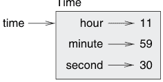

# 练习 16.1

写一个名为`print_time`的函数，接受一个`Time`对象并以`hour:minute:second`的格式打印它。提示：格式序列`'%.2d'`使用至少两个数字打印整数，必要时会在前面补零。

# 练习 16.2

写一个布尔函数`is_after`，接受两个`Time`对象`t1`和`t2`，如果`t1`在时间上晚于`t2`则返回`True`，否则返回`False`。挑战：不要使用`if`语句。

## 16.2 纯函数

在接下来的几节，我们将编写两个相时间值的函数。它们展示了两种函数：纯函数和修改器。它们还展示了一种我称之为“原型与补丁”（prototype and patch）的开发计划，这是一种通过从简单的原型开始并逐步处理复杂性来解决解决复杂问题的方法。

这里是`add_time`的简单原型：

```python
def add_time(t1, t2):
    sum = Time()
    sum.hour = t1.hour + t2.hour
    sum.minute = t1.minute + t2.minute
    sum.second = t1.second + t2.second
    return sum
```

该函数创建一个新的`Time`对象，初始化其属性，并返回新对象的引用。这被称为纯函数，因为它没有修改作为参数传递的任何对象，而且除了返回值外，它没有显示值或获取用户输入等影响。

为了测试这个函数，我将创建两个`Time`对象：`start`包含电影《蒙提派森与圣杯》的开始时间，`duration`包含电影时长，即1小时35分钟。

`add_time`计算电影何时结束。

```python
>>> start = Time()
>>> start.hour = 9
>>> start.minute = 45
>>> start.second = 0

>>> duration = Time()
>>> duration.hour = 1
>>> duration.minute = 35
>>> duration.second = 0

>>> done = add_time(start, duration)
>>> print_time(done)
10:80:00
```

结果`18:00:00`可能不是你期望的。问题在于该函数没有处理秒或分钟总和超过六十的情况。当发生这种情况时，我们必须将额外的秒“进位”到分钟列，将额外的分钟“进位”到小时列。这是一个改进后的版本：

```python
def add_time(t1, t2):
    sum = Time()
    sum.hour = t1.hour + t2.hour
    sum.minute = t1.minute + t2.minute
    sum.second = t1.second + t2.second

    if sum.second >= 60:
        sum.second -= 60
        sum.minute += 1

    if sum.minute >= 60:
        sum.minute -= 60
        sum.hour += 1

    return sum
```

虽然这个函数是正确的，但它开始变得很大。我们稍后会看到更短的替代方案。

## 16.3 修改器

有时，函数修改其作为参数接收的对象是有用的。在这种情况下，更改对调用者可见的。这种方式工作的函数被称为**修改器**（modifiers）。

`increment`为`Time`对象添加给定的秒数，可以自然地写成一个修改器。这是一个粗略草：

```python
def increment(time, seconds):
    time.second += seconds

    if time.second >= 60:
        time.second -= 60
        time.minute += 1

    if time.minute >= 60:
        time.minute -= 60
        time.hour += 1
```

## 16.4 原型与规划

在某些方面，从60进制转换为10进制再转换回来比直接处理时间更困难。进制转换更抽象；我们处理时间值的直觉更好。

但如果我们有洞察并将时间视为60进制并投入精力编写转换函数，我们就能得到一个更短、更容易阅读和调试且更可靠的程序。

# 类与函数

这是一个将`Time`转换为整数的函数：

```python
def time_to_int(time):
    minutes = time.hour * 60 + time.minute
    seconds = minutes * 60 + time.second
    return seconds
```

这里是将整数转换为`Time`的函数（记得`divmod`将第一个数除以第二个数并返回商和余数作为元组）：

```python
def int_to_time(seconds):
    time = Time()
    minutes, time.second = divmod(seconds, 60)
    time.hour, time.minute = divmod(minutes, 60)
    return time
```

你可能需要思考一下并运行一些测试，才能相信这些函数是正确的。测试它们的一种方法是检查对于许多`x`值，`time_to_int(int_to_time(x)) == x`。这是一个一致性检查的例子。

一旦确定它们是正确的，你就可以它们来重写`add_time`：

```python
def add_time(t1, t2):
    seconds = time_to_int(t1) + time_to_int(t2)
    return int_to_time(seconds)
```

这个版本比原始版本短，而且更容易验证。

# 练习 16.5

使用`time_to_int`和`int_to_time`重写`increment`。

## 16.5 调试

讽刺的是，有时候让问题变得更复杂（或更通用）反而会让它更容易解决（因为特例变少了，出错的机会也变小了）。

## 16.5 调试

如果分钟和秒的值在0到60之间（包含0但不包含60），且小时为正数，那么一个`Time`对象就是格式正确的。小时和分钟应该是整数值，但我们可能允许秒具有小数部分。

这类要求被称为**不变性**（invariants），因为它们应该始终成立。换句话说，如果它们不成立，说明出了某些问题。

编写代码来检查你的不变性可以帮助检测错误并找到它们。例如，你可能有一个像`valid_time`的函数，它接收一个`Time`对象，并在其违反不变性时返回`False`：

```
def valid_time(time):
    if time.hours < 0 or time.minutes < 0 or time.seconds < 0:
        return False
    if time.minutes >= 60 or time.seconds >= 60:
        return False
    return True
```

那么在每个函数的开头，你可以检查参数以确保它们是有效的：

```
def add_time(t1, t2):
    if not valid_time(t1) or not valid_time(t2):
        raise ValueError('invalid Time object in add_time')
    seconds = time_to_int(t1) + time_to_int(t2)
    return int_to_time(seconds)
```

或者你可以使用`assert`语句，它会检查给定的不变性并在失败时抛出异常：

```
def add_time(t1, t2):
    assert valid_time(t1) and valid_time(t2)
    seconds = time_to_int(t1) + time_to_int(t2)
    return int_to_time(seconds)
```

`assert`语句是有用的，因为它们将处理正常情况的代码与检查错误的代码区分开来。

# 类与函数

## 16.6 术表

**函数式编程风格**：一种程序设计风格，其中大部分函数都是纯函数。

**不变性**：程序执行期间应该始终成立的条件。

**修改器**：一个改变其接收作为参数的一个或多个对象的函数。大多数修改器都是徒劳无用。


**计划性开发**：一种开发计划，涉及对问题的高层次洞察，以及比增量式开发或原型开发更多的规划。

**原型与补丁开发**：一种开发计划，涉及编写程序的粗稿、进行测试，并在发现错误时进行纠正。

**纯函数**：一个不修改其接收作为参数的任何对象的函数。大多数纯函数都是有意义的。

## 16.7 练习题

### 练习 16.6

编写一个名为`mul_time`的函数，它接收一个`Time`对象和一个数字，并返回一个新的`Time`对象，其中包含原始`Time`与数字的乘积。

使用`mul_time`写一个函数，该函数接收一个代表比赛结束时间的`Time`对象和一个代表距离的数字，并返回一个代表平均配速（每英里的时间）的`Time`对象。

### 练习 16.7

编写一个名为`increment_date`的函数，它接收一个`Date`对象`date`和一个整数`n`，并返回一个代表`date`之后`n`天的新`Date`对象。提示：“九月有三十……”挑战：你的函数是否正确处理了闰年？参见`wikipedia.org/wiki/Leap_year`。

### 练习 16.8

`datetime`模块提供了与本章中的`Date`和`Time`对象类似的日期和时间对象，但它们提供了丰富的方法和运算符。请阅读`docs.python.org/lib/datetime-date.html`的文档。

1. 使用`datetime`模块编写一个程序，获取当前日期并打印星期几。

2. 编写一个程序，将生日作为输入，并打印用户的年龄以及距离下次生日还有的天数、小时、分钟和秒。

## 类与方法

## 17.1 面向对象的特性

Python 是一种面向对象的编程语言，这意味着它提供了支持面向对象编程的特性。

定义面向对象编程并不容易，但我们已经看到了它的一些特征：

- 程序由对象定义和函数定义组成，大部分计算都是通过对对象的操作来表达的。

- 每个对象定义对应于现实世界中的某个对象或概念，对该对象操作的函数对应于现实世界对象交互的方式。

例如，第 16 章定义的`Time`类对应于人们记录一天时间的方式，我们定义的函数对应于人们处理时间的各种方式。同样，`Point`和`Rectangle`类对应于点和矩形的数学概念。

到目前为止，我们还没有充分利用 Python 提供的支持面向对象编程的特性。这些特性并不是严格要求的；它们中的大多数为我们已经完成过的事情提供了替代语法。但在许多情况下，这种替代方案更简洁，并且更准确地传达程序的结构。

例如，在`Time`程序中，类定义与随后的函数定义之间没有明显的联系。通过观察，可以清楚地看出每个函数都至少接收一个`Time`对象作为参数。

这一观察是方法（methods）的动机；方法是与特定类关联的函数。我们已经见过了字符串、列表、字典和元组的方法。在本章中，我们将为用户定义的类型定义方法。

## 方法

方法在语义上与函数相同，但有两个语法上的区别：

- 方法被定义在类内部，以显式建立类与方法之间的关系。

- 方法的调用语法与函数不同。

在接下来的章节中，我们将把函数转换为方法。

## 17.2 打印对象

在第 16 章中，我们定义了一个`Time`类，在练习 16.1 中，你写了一个名为`print_time`的函数：

```
def print_time(time):
    print '%.2d:%.2d:%.2d' % (time.hour, time.minute, time.second)
```

为了调用这个函数，你需要传递一个`Time`对象作为参数：

```
>>> start = Time()
>>> start.hour = 9
>>> start.minute = 45
>>> start.second = 00
>>> print_time(start)
09:45:00
```

要让`print_time`成为方法，我们只需要将函数移动到类定义内部。注意缩进：

```python
class Time(object):
    def print_time(time):
        print '%.2d:%.2d:%.2d' % (time.hour, time.minute, time.second)
```

## 打印对象

现在有两种方法调用`print_time`。第一种（不常用的）方法是使用函数语法：

```
>>> Time.print_time(start)
09:45:00
```

在这种点符号语法下，`Time`是类名，`print_time`是方法名。`start`作为参数传递。

第二种（更简洁）方法是使用方法语法：

```
>>> start.print_time()
09:45:00
```

在这种点符号语法下，`print_time`是方法的名（再次），`start`是被调用的对象，这被称为主体。在方法内部，主体被赋值给第一个参数，因此在这种情况下被赋值给`time`。

按照惯例，方法的第一个参数被称为`self`，因此通常会这样写`print_time`：

```python
class Time(object):
    def print_time(self):
        print '%.2d:%.2d:%.2d' % (self.hour, self.minute, self.second)
```

这种惯例的原因是一个隐喻的对比：

- 函数调用的语法`print_time(start)`暗函数是活跃的主体。它在说：“嘿，`print_time`！这里有一个对象让你打印。”

- 在面向对象编程中，对象是活跃的主体。方法调用`start.print_time()`在说：“嘿，`start`！请打印你自己。”

这种视角的转变可能很有礼貌，但并不明显有用。在我们目前为止看到的例子中，它可能没用。但有时将责任从函数转移到对象可以编写出更通用的函数，并使代码更容易维护和重用。

# 类与方法

# 练习 17.1

将`time_to_int`（来自第 16.4 节）重写为方法。将`int_to_time`重写为方法可能并不合适；因为并不清楚要在哪个对象上调用它！

# 17.3 另一个示例

这里是`increment`（来自第 16.3 节）的方法重写版本：

```python
# 在类 Time 内部

def increment(self, seconds):
    seconds += self.time_to_int()
    return int_to_time(seconds)
```

这个版本假设`time_to_int`是作为方法编写的，如练习 17.1 所示。此外，注意这是一个纯函数，而不是修改器。

以下是调用`increment`的方法：

```python
>>> start.print_time()
09:45:00
>>> end = start.increment(1337)
>>> end.print_time()
10:07:17
```

主体`start`被赋值给第一个参数`self`。参数`1337`被传递给第二个参数`seconds`。

这种机制可能会让人产生困惑，尤其是当你犯错时。例如，如果你用两个参数调用`increment`，你会得到：

```python
>>> end = start.increment(1337, 460)
TypeError: increment() takes exactly 2 arguments (3 given)
```

错误信息最初看起来很困惑，因为括号里只有两个参数。但主体也被视为一个参数，所以总共是三个个。

# 17.4 一个更复杂的示例

`is_after`（来自练习 16.2 节）稍微复杂一点，因为它接受两个`Time`对象作为参数。在这种情况下，惯例是将第一个参数命名为`self`，第二个参数命名为`other`：

```python
# 在类 Time 内部
def is_after(self, other):
    return self.time_to_int() > other.time_to_int()
```

要使用这个方法，你必须在一个对象上调用它，并将另一个对象作为参数传递：

```python
>>> end.is_after(start)
True
```

这种语法的一个优点是它读起来几乎就像像英语：“end 是否在 start 之后？”

# 17.5 init 方法

`init`方法（“initialization” 初始化的缩写）是一个特殊方法，在对象被实例化时被调用。它的全名是`__init__`（两个下划线，后面跟着`init`，然后又是两个下划线）。`Time`类的`init`方法可能像这样：

```python
# 在类 Time 内部
def __init__(self, hour=0, minute=0, second=0):
    self.hour = hour
    self.minute = minute
    self.second = second
```

`__init__`的参数与属性名称相同是很常见的。语句

```python
self.hour = hour
```

将参数`hour`的值存储为`self`的一个属性。

参数是可选的，所以如果你在不带参数的情况下调用`Time`，你将获得默认值。

```python
>>> time = Time()
>>> time.print_time()
00:00:00
```

如果你提供一个参数，它将覆盖`hour`：

```python
>>> time = Time (9)
>>> time.print_time()
09:00:00
```

如果你提供两个参数，它们将覆盖`hour`和`minute`。

```python
>>> time = Time(9, 45)
>>> time.print_time()
09:45:00
```

如果你提供三个参数，它们将覆盖所有三个默认值。

# 练习 17.2

为`Point`类写一个`init`方法，它接受`x`和`y`作为可选参数，并将它们赋值给相应的属性。

# 17.6 __str__ 方法

`__str__`是一个特殊方法，类似于`__init__`，它用于返回对象的字符串表示。

例如，这里有一个用于`Time`对象的`str`方法：

```python
# 在类 Time 内部

def __str__(self):
    return '%02d:%02d:%02d' % (self.hour, self.minute, self.second)
```

当你打印一个对象时，Python 会调用`str`方法：

```python
>>> time = Time(9, 45)
>>> print time
09:45:00
```

## 17.8 基于类型的分发

当我写一个新类时，几乎总是从编写`__init__`开始，这使得实例化对象变得更容易，以及编写`__str__`，这对于调试很有用。

# 练习 17.3

为`Point`类写一个`str`方法。创建一个`Point`对象并打印它。

# 17.7 运算符重载

通过定义其他特殊方法，你可以指定用户定义类型上运算符的行为。例如，如果你为`Time`类定义一个名为`__add__`的方法，你就可以在`Time`对象上使用`+`运算符。

定义可能是这样的：

```python
# 在类 Time 内部
  def __add__(self, other):
      seconds = self.time_to_int() + other.time_to_int()
      return int_to_time(seconds)
```

这里是你如何使用它的方法：

```python
>>> start = Time(9, 45)
>>> duration = Time(1, 35)
>>> print start + duration
11:20:00
```

当对`Time`对象应用`+`运算符时，Python 会调用`__add__`。当你打印结果时，Python 会调用`__str__`。这背后有很多操作！

改变运算符的行为以适应用户定义类型被称为运算符重载。对于每个运算符，都有特殊方法，更多细节请参见`docs.python.org/ref/special.html`。

# 练习 17.4

为`Point`类写一个`add`方法。

## 17.8 基于类型的分发

在前面的节中，我们添加了两个`Time`对象，但你可能也想给`Time`对象添加一个整数。以下是`__add__`的版本，它检查`other`的类型：

```python
# 在类 Time 内部

def __add__(self, other):
    if isinstance(other, Time):
        return add_time(other)
    else:
        return increment(other)

def add_time(self, other):
    seconds = self.time_to_int() + other.time_to_int()
    return int_to_time(seconds)

def increment(self, other):
    seconds = self.time_to_int() + other
    return int_to_time(seconds)
```

内置函数`isinstance`检查一个值是否是某个类的实例。这被称为类型分发，因为它根据`other`的类型来分发计算。不幸的是，并不总是如此。

如果你想给`Time`对象添加一个整数，它并不知道该。有一个巧妙的解决方案：特殊方法`__radd__`，它代表“右加”。这是它的定义：

```python
# 在类 Time 内部
def __radd__(self, other):
    return increment(other)

# 练习 17.5

为`Point`类写一个`add`方法，它接受`Point`或整数作为参数，并返回一个和后的新`Point`。

## 17.12 练习 19

为了调试方便，你可能会发现保留这个函数很有用：

```python

def print_attributes(obj):

    for attr in obj.__dict__:

        print attr, getattr(obj, attr)

```

`print_attributes`会遍历对象字典中的项，并打印每个属性名称及其对应的值。

内置函数`getattr`接收一个对象和一个属性名称（字符串形式），并返回该属性的值。

## 17.11 术语表

- **方法 (method):** 定义在类内部的函数，可以在该类的实例上被调用。
- **面向对象语言 (object-oriented language):** 提供某些特性（如用户自定义类和方法语法）的语言，这些特性有助于面向对象编程。
- **面向对象编程 (object-oriented programming):** 一种编程风格，将数据及其数据的操作组织成类和方法。
- **运算符重载 (operator overloading):** 改变运算符（如 +）的行为，使其能够与自定义类型一起工作。
- **多态的 (polymorphic):** 指一个可以处理多种类型的函数。
- **主体 (subject):** 方法被调用的对象。
- **基于类型的分发 (type-based dispatch):** 一种编程模式，通过检查操作数的类型并为不同的类型调用不同的函数。

## 17.12 练习

### 练习 17.6

这个练习是一个关于 Python 中最常见且难以发现的错误的警示故事。

- (1) 为名为`Kangaroo`的类编写定义，包含以下方法：
    - (a) 一个`__init__`方法，将名为`pouch_contents`的属性初始化为空空列表。
    - (b) 一个名为`put_in_pouch`的方法，接收任何类型的对象并将其添加到`pouch_contents`中。
    - (c) 一个`__str__`方法，返回 Kangaroo 对象及其袋内内容的字符串表示。

通过创建两个`Kangaroo`对象，将它们赋值给名为`kanga`和`roo`的变量，并将`roo`添加到`kanga`的袋子中来测试你的代码。

- (2) 下载`thinkpython.com/code/BadKangaroo.py`。它包含了前一个问题的解决方案，但其中有一个巨大的、恶性的 bug。找到并修复这个 bug。

### 类与方法

如果你卡住了，可以下载`thinkpython.com/code/GoodKangaroo.py`，它解释了问题并演示了解决方案。

### 练习 17.7

`Visual`是一个提供 3-D 图形的 Python 模块。它并不总是包含在 Python 安装包中，因此你可能需要从软件仓库安装它，或者如果没有那里，则从`vpython.org`下载。

以下示例创建了一个宽、长、高均为 256 单位的 3D 空间，并将“中心”设置为点 (128, 128, 128)。然后它画了一个蓝色球体。

```python

from visual import *

nscene.range = (256, 256, 256)

scene.center = (128, 128, 128)

color = (0.1, 0.1, 0.9) # 主要是蓝色

sphere(pos=scene.center, radius=128, color=color)
```


`color` 是一个 RGB 元组；其元素是 0.0 到 1.0 之间的红-绿-蓝水平（参见 `wikipedia.org/wiki/RGB_color_model`）。

如果你运行这段代码，你应该会看到一个黑色背景和蓝色球体的窗口。如果你上下拖动中间键，可以缩放。你还可以通过拖动右键来旋转球体，但世界上只有一个球体，所以很难看出区别。

以下循环创建了一个球体立方体：

```python
t = range(0, 256, 256)

for x in t:
  for y in t:
    for z in t:
      pos = x, y, z
      sphere(pos=pos, radius=10, color=color)
```

- (1) 将此代码放入脚本中并使其在你的机器上运行。
- (2) 修改程序，使立方体中的每个球体的颜色都能响应其在 RGB 空间中的位置。注意坐标范围在 0–255 之间，但 RGB 元组的范围在 0.0–1.0 之间。
- (3) 下载 `thinkpython.com/code/color_list.py` 并使用 `read_colors` 函数生成系统中可用颜色的列表、它们的名称和 RGB 值。对于每个有命名的颜色，在与其 RGB 值对应的位置画一个球体。

你可以在 `thinkpython.com/code/color_space.py` 看到我的解决方案。

## 继承

在本章中，我们将开发类来表示扑克牌、牌牌组和扑克牌。如果你不玩扑克，可以在 `wikipedia.org/wiki/Poker` 了解相关信息，但你没必要这样做；我会告诉你练习中需要的知识。

如果你不熟悉英美扑克牌，可以在 `wikipedia.org/wiki/Playing_cards` 了解它们。

## 18.1 卡牌对象

一副牌中共有 52 张牌，每张牌都属于一种花色。共有四种花色：梅花、方片、红心和黑桃。每种花色有三个等级：A、2、3、4、5、6、7、8、9、10、J、Q 和 K。

一张牌由它的花色和点数定义。

```python
class Card:
    def __init__(self, suit, rank):
        self.suit = suit
        self.rank = rank
```

要创建一个牌，调用 `Card` 构造函数，并将花色作为第一个参数，点数作为第二个参数。

```python
queen_of_diamonds = Card('Diamonds', 12)
```

## 继承

继承允许类从另一个类继承属性和方法。被继承的类称为基类，继承的类称为子类。这允许代码复用并建立层级关系。

```python
class Card:
    def __init__(self, suit, rank):
        self.suit = suit
        self.rank = rank

    def __str__(self):
        return '%s %s' % (self.suit, self.rank)

class FaceCard(Card):
    def __init__(self, suit, rank):
        super().__init__(suit, rank)
```

## 18.2 类属性

类属性是所有实例共享的变量。实例属性是属于每个实例的变量。

```python
class Card:
    suit_names = ['Clubs', 'Diamonds', 'Hearts', 'Spades']
    rank_names = [None, 'Ace', '2', '3', '4', '5', '6', '7', '8', '9', '10', 'Jack', 'Queen', 'King']

    def __init__(self, suit, rank):
        self.suit = suit
        self.rank = rank

    def __str__(self):
        return '%s %s' % (self.suit_names[self.suit], self.rank_names[self.rank])
```

`suit_names` 和 `rank_names` 是类属性。它们被所有 `Card` 对象共享。`suit` 和 `rank` 是实例属性。它们对于每个 `Card` 对象都是唯一的。

## 204 继承

### 18.3 比较卡牌

对于内置类型，有条件运算符（<、>、== 等）可以比较值，并判断一个值何时大于、小于或等于另一个值。对于定义类型，我们可以通过提供一个名为 `__cmp__` 的方法来重写内置运算符的行为。

`__cmp__` 接受两个参数 `self` 和 `other`。如果第一个对象较大，它返回一个正数；如果第二个对象较大，返回一个负数；如果它们相等，则返回 0。

卡片的正确排序并不是显而易见的。例如，黑桃 3 和方块 2 哪个更好？一个点数（rank）更高，但另一个花色（suit）更高。为了比较卡牌，你必须决定哪个点数或花色更重要。

答案可能取决于你正在玩的游戏，但为了保持简单，我们将做出一个任意的选择：花色更重要，因此所有的黑桃牌都大于所有的方块牌，以此类推。

基于此，我们可以编写 `__cmp__`：

```python
def __cmp__(self, other):
    # 检查花色
    if self.suit > other.suit: return 1
    if self.suit < other.suit: return -1

    # 花色相同...检查点数
    if self.rank > other.rank: return 1
    if self.rank < other.rank: return -1

    # 点数相同...平局
    return 0
```

你可以使用元组比较来更简洁地编写此代码：

```python
# 在 Card 类内部:
    def __cmp__(self, other):
        t1 = self.suit, self.rank
        t2 = other.suit, other.rank
        return cmp(t1, t2)
```

内置函数 `cmp` 的接口与 `__cmp__` 方法相同：它接受两个值，如果第一个较大则返回正数，如果第二个较大则返回负数，如果它们相等则返回 0。

**练习 18.1 为 Time 对象实现 `__cmp__` 方法。提示：你可以使用元组比较，但你可能也可以考虑使用整数减法。**

## 18.4 牌组

现在我们有了卡牌（Cards），下一步是定义牌组（Decks）。由于一个牌组是由卡牌组成的，因此每个 `Deck` 包含一个卡牌列表作为属性是很自然的事。

以下是 `Deck` 的类定义。`__init` 方法创建属性 `cards` 并生成标准的 52 张牌：

```python
class Deck(object):
    def __init__(self):
        self.cards = []
        for suit in range(4):
            for rank in range(1, 14):
                card = Card(suit, rank)
                self.cards.append(card)
```

填充牌组最简单的方法是使用嵌套循环。外层循环枚举从 0 到 3 的花色。内层循环枚举从 1 到 13 的点数。每次迭代都会创建一个具有当前花色和点数的新 `Card` 对象，并将其添加到 `self.cards` 中。

### 18.5 打印牌组

这里是 `Deck` 的 `__str__` 方法：

```python
def __str__(self):
    res = []
    for card in self.cards:
        res.append(str(card))
    return '\n'.join(res)
```

该方法演示了一种累积大字符串的高效方法：构建字符串列表然后使用 `join`。内置函数 `str` 会调用每张卡牌的 `__str__` 方法并返回字符串表示。

由于我们在换行符上调用了 `join`，卡牌之间用换行符隔开。结果如下：

```python
>>> deck = Deck()
>>> print deck
Ace of Clubs
2 of Clubs
3 of Clubs
10 of Spades
Jack of Spades
Queen of Spades
King of Spades
```

尽管结果出现了 52 行，但这是一个包含换行符的长字符串。

### 18.6 添加、删除、洗牌和排序

为了发牌（deal），我们想要一个能从牌组中移除卡牌的方法。列表的 `pop` 方法提供了一个方便的方法：

```python
# 在 Deck 类内部:
    def pop_card(self):
        return self.cards.pop()
```

由于 `pop` 移除列表的最后一个元素，我们正在从牌组底部发牌。在现实生活中，底部发牌是不受欢迎的，但在这种语境下是可以的。要添加一张卡牌，可以使用列表的 `append` 方法：

```python
# 在 Deck 类内部:
    def add_card(self, card):
        self.cards.append(card)
```

这种不需要执行太多工作的方法有时被称为“贴面”（veneer）。这个比喻源于木工活，在木工中，将一层薄薄的优质木材贴在较廉价的木材表面。

> 查看 [底部发牌](https://wikipedia.org/wiki/Bottom_dealing)。

## 18.7 继承

在这种情况下，我们定义了一个表示适用于牌组操作的“薄层”方法。作为另一个例子，我们可以使用 `random` 模块中的 `shuffle` 函数编写一个名为 `shuffle` 的 `Deck` 方法：

```python
# 在 Deck 类内部:
    def shuffle(self):
        random.shuffle(self.cards)
```

不要忘记导入 `random`。

**练习 18.2 使用 `random` 模块中的 `shuffle` 函数编写一个名为 `shuffle` 的 `Deck` 方法。**

## 继承

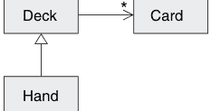

空心三角形箭头的箭头表示 **IS-A（是一个）** 关系；在这种情况下，它表示 Hand（手）继承自 Deck（牌组）。

实心箭头表示 **HAS-A（包含）** 关系；在这种情况下，一个 Deck 引用了 Card（牌）对象。

箭头附近的星号（*）是**重数**；它表示一个 Deck 拥有多少张 `Cards`。重数可以是一个简单的数字（如 52）、范围（如 5..7）或星号（星号表示 Deck 可以拥有任意数量的 `Cards`）。

一个更详细的图可能会显示 Deck 实际上包含一个 `Cards` 列表，而像 `list` 和 `dict` 等内置类型不包含在类图中。

## 练习 18.4

读取 `TurtleWorld.py` 和 `Gui.py`，绘制一个类图展示所定义的类之间的关系。

## 18.9 调试

继承会使调试面临挑战，因为当你调用对象上的某个方法时，你可能不知道将调用哪个方法。

假设你正在编写一个与 `Hand` 对象操作的函数。你希望它能处理各种类型的 `Hands`，比如 `PokerHands`、`BridgeHands` 等。如果你调用诸如 `shuffle` 的方法，你将得到在 `Deck` 中定义的那个；但如果任何子类重写（override）了该方法，你将得到该版本。

每当你不确定程序的执行流时，最简单的解决方案是在相关方法的开头添加 `print` 语句。如果 `Deck.shuffle` 打印出类似 "Running Deck.shuffle" 的消息，那么在程序运行时，它就能追踪执行流。

作为另一种替代方案，你可以使用这个函数，它接收一个对象并返回提供方法定义的类：

```python
def find_defining_class(obj, meth_name):
    for ty in type(obj).mro():
        if meth_name in ty.__dict__:
            return ty
```

这里是一个示例：

```python
>>> hand = Hand()
>>> print find_defining_class(hand, 'shuffle')
<class 'Card.Deck'>
```


因此 `Hand` 的 `shuffle` 方法是获取类对象列表的 `mro` 方法。

`find_defining_class` 使用类型（`types`）来搜索方法。“MRO”代表“**方法解析顺序**”（method resolution order）。

这里有一个程序设计建议：每当你重写一个方法时，新方法的接口应该与旧方法相同。它应该接收相同的参数，返回相同的结果，并遵守相同的先决条件和后置条件。如果你遵循这条规则，你会发现任何为处理父类实例（如 `Deck`）设计的函数，也适用于如 `Hand` 或 `PokerHand` 等子类的实例。

如果你违反了这条规则，你的代码将会像（抱歉）纸牌屋一样崩溃。

## 18.10 术语表

- class（类类）：通过继承现有类创建的新类；也称为“子类”。
- class attribute（类属性）：与类对象关联的属性。定义在类定义内部、但在任何方法之外的类属性。
- class diagram（类图）：显示程序中的类以及它们之间关系的图。
- encode（编码）：通过在它们之间构建映射，使用另一组值来表示另一组值。
- HAS-A relationship（包含关系）：两个类之间的关系，其中一个类的实例引用另一个类的实例。
- inheritance（继承）：定义新类的能力，该新类是之前定义的类的修改版本。
- instance attribute（实例属性）：与类的实例关联的属性。
- IS-A relationship（是一个关系）：子类与其父类之间的关系。
- multiplicity（重数）：类图中的一种表示法，显示对于 HAS-A 关系，指向另一个类实例的引用有多少个。
- parent class（父类）：子类继承自类。
- veneer（薄层/外壳方法）：一种方法或函数，它为另一个函数提供不同的接口，但本身不进行大量计算。

## 212 继承

## 18.11 练习

## 练习 18.5

以下是扑克中可能的牌型，按价值从小到大（以及概率从大到小）排序：

- pair（对子）：两张点数相同的牌。
- two pair（两对）：两对点数相同的牌。
- three of a kind（三条）：三张点数相同的牌。
- straight（顺子）：五张连续的牌（Ace 可以当大也可以当小，所以 Ace-2-3-4-5 是顺子，10-Jack-Queen-King-Ace 也是顺子，但 Queen-King-Ace-2-3 不是顺子）。
- flush（同花色）：五张相同花色的牌。
- full house（葫屋）：三张一种点数的牌和两张另一种点数的牌。
- four of a kind（四条）：四张点数相同的牌。
- straight flush（同花顺）：五张连续（如上定义）且花色相同的牌。

这些练习的目标是估算抽取这些各种牌型的概率。

1. 从 thinkpython.com/code 下载以下文件：
   `Card.py`：本章中 `Card`、`Deck` 和 `Hand` 类的完整版本。
   `PokerHand.py`：代表扑克牌的类的不完整实现，以及一些测试代码。
2. 如果你运行 `PokerHand.py`，它会发 7 张牌扑克牌并检查其中任何一个包含同花色。在开始之前仔细阅读这段代码。
3. 在 `PokerHand.py` 中添加名为 `has_pair`、`has_twopair` 等方法，根据手是否符合标准返回 `True` 或 `False`。
4. 当你确定你的分类方法工作正常时，编写一个名为 `classify` 的方法，计算出最高值的分类并设置 `label` 属性。例如，7 张牌的手可能标记为 "flush"。
5. 下一步是估计概率。编写一个函数洗牌牌组，统计各种分类的数量，并将结果与 wikipedia.org/wiki/Hand_rankings 进行比较。
6. 打印分类及其概率，直到数值收敛。

## 练习 18.6

此练习使用了第 4 章的 `TurtleWorld`。你将编写乌龟玩猫猫的代码。如果你不熟悉猫猫的游戏规则，请参见 wikipedia.org/wiki/Tag_(game)。

(1) 下载 thinkpython.com/code/Wobbler.py 并运行。你应该看到一个有三个乌龟的 `TurtleWorld`。如果你按下 Run 按钮，乌龟会随机移动。

(2) 阅读代码并确保你理解它是如何工作的。`Wobbler` 类继承自 `Turtle`，这意味着 `Turtle` 的方法 `lt`、`rt`、`fd` 和 `bk` 适用于 `Wobbler`。

`TurtleWorld` 调用的 `step` 方法调用 `steer` 让乌龟转向目标方向，`wobble` 根据乌龟的笨拙程度进行随机转向，以及 `move` 根据速度向前移动像素。

(3) 创建文件 `Tagger.py`。从 `Wobbler` 导入所有内容，然后定义继承自 `Wobbler` 的 `Tagger` 类。调用 `make_world` 并将 `Tagger` 类对象作为参数。

(4) 在 `Tagger` 中添加 `steer` 方法以重写 `Wobbler` 中的方法。作为开始，编写一个同时也指向原点的版本。提示：使用 `atan2` 函数和 `Turtle` 的属性 `x`、`y` 和 `heading`。

(5) 修改 `steer` 使乌龟留在边界内。为了调试，可能想使用 Step 按钮，它会在每个乌龟上调用一次 `steer`。

(6) 修改 `steer` 使乌龟指向最近的邻居。提示：乌龟有一个 `world` 属性，是它们居住的 `TurtleWorld` 的引用，乌龟还有一个 `animals` 属性，是世界中所有乌龟的列表。

(7) 修改 `steer` 让乌龟玩猫猫。你可以在 `Tagger` 中添加方法并重写 `steer` 和 `__init__`，但不能修改或重写 `step`、`wobble` 或 `move`。此外，允许 `steer` 改变乌龟的方向角而不是位置。

调整规则和你的 `steer` 方法以获得良好的体验；例如，慢的乌龟最终应该抓到快的乌龟。

# 案例研究：Tkinter

## 19.1 GUI

我们到目前为止看到的程序都是基于文本的，但许多程序具有图形用户界面，也称为 GUI。

Python 为编写基于 GUI 的程序提供了几种选择，包括 wxPython、Tkinter 和 Qt。它们各有优劣，这就是为什么 Python 还没有形成一个统一的标准。

我将在本章中介绍的是 Tkinter，因为我认为它是最容易上手的。本章中的大多数概念也适用于其他的 GUI 模块。

有许多关于 Tkinter 的书籍和网页。最好的在线资源之一是 Fredrik Lundh 写的《Tkinter 简介》（*An Introduction to Tkinter*）。

我写了一个名为 `Gui.py` 的模块，它随 Swampy 一起。它为 Tkinter 中的函数和类提供了一个简化接口。本章中的示例都是基于这个模块。

这里有一个创建并显示 GUI 的简单示例：

要创建一个 GUI，你必须导入 `Gui` 并实例化 `Gui` 对象：

```python
from Gui import *

g = Gui()

g.title('Gui')

g.mainloop()
```

当你运行这段代码时，应该出现一个窗口，其中有一个空的灰色正方形，标题为 `Gui`。`g.mainloop()` 运行事件循环，等待用户进行操作并做出相应的响应。

## 19.2 按钮与回调

这是一个无限循环；它一直运行直到用户关闭窗口、按下 Control-C 或执行会导致程序退出的操作。

这个 `Gui` 没有做什么，因为它没有任何小组件（widgets）。组件是组成 GUI 的元素；它们包括：

- Button（按钮）：一种包含文本或图像的组件，按下时会执行某个操作。
- Canvas（画布）：一个可以显示线条、矩形、圆形或其他形状的区域。
- Entry（输入框）：用户可以输入文本的区域。
- Scrollbar（滚动条）：控制另一个组件可见部分的组件。
- Frame（框架）：一个容器，通常是不可见的，其中包含其他组件。

当你创建一个 `Gui` 时看到的空灰色正方形是一个 `Frame`。当你创建一个新组件时，它会被添加到这个 `Frame` 中。

`bu` 方法创建一个 `Button` 小组件：

```python
button = g.bu(text='Press me.')
```

`bu` 的返回值是一个 `Button` 对象。出现在 `Frame` 中的按钮是该对象的图形化表示；你可以通过调用其上的方法来控制按钮。

`bu` 最多接受 32 个参数，控制按钮的外观和功能。这些参数被称为选项（options）。与其为所有 32 个选项提供值，不如使用关键字参数（例如 `text='Press me.'`）仅指定你需要的选项，其余使用默认值。

当你将组件添加到 `Frame` 时，它会被“收缩”；也就是说，`Frame` 会缩小到按钮的大小。如果你添加了更多组件，`Frame` 就会增大以容纳它们。

`la` 方法创建一个 `Label`（标签）小组件：

```python
label = g.la(text='Press the button.')
```

默认情况下，Tkinter 从上到下堆叠组件并让它们居中。我们很快就会看到如何覆盖这种行为。

如果你按下按钮，你会发现并没有做什么。那是因为你还没有给它“接线”（wired it up）；也就是说，你还没有告诉它该做什么！

控制按钮行为的选项是 `command`。`command` 的值是一个函数，当按钮被按下时执行。例如，这里有一个创建一个新 `Label` 的函数：

```python
def make_label():
  g.la(text='Thank you.')
```

现在我们可以创建一个以该函数作为命令的按钮：

```python
button2 = g.bu(text='No, press me!', command=make_label)
```

当你按下这个按钮时，它应该执行 `make_label` 并出现一个新标签。

`command` 选项的值是一个函数对象，它被称为回调（callback），因为在你调用 `bu` 创建按钮后，当用户按下按钮时，执行流会“回拨”（calls back）。

这种流流是事件驱动编程的特征。用户操作（如按下按钮和击键）被称为事件（events）。在事件驱动编程中，执行流由用户操作决定，而不是由程序员决定。

事件驱动编程的挑战在于构建一组组件和回调函数，使它们对于任何用户操作的序列都能正确工作（或至少生成适当的错误消息）。

## 练习 19.1

编写一个创建一个带有单个按钮的 GUI 程序。当按下按钮时，它应该创建第二个按钮。当按下该按钮时，它应该创建一个显示为“Nice job!”的标签。

如果多次按下按钮会发生什么？你可以在 thinkpython.com/code/button_demo.py 查看我的解决方案。

## 19.3 CANVAS WS

最多功能的组件之一是 `Canvas`（画布），它创建了一个用于线条、圆形和其他形状的区域。如果你做过练习 15.4，那么你已经熟悉画布了。

`ca` 方法创建一个新的 `Canvas`：

```python
canvas = g.ca(width=500, height=500)
```

`width` 和 `height` 是画布以像素为单位的尺寸。

创建组件后，仍然可以使用 `config` 方法更改选项的值。例如，`bg` 选项更改背景颜色：

```python
canvas.config(bg='white')
```

`bg` 的值是一个命名颜色的字符串。颜色名称集合：

- white
- black
- red
- green
- blue
- cyan
- yellow
- magenta
- gray
- lightgray
- darkgray
- silver
- maroon
- purple
- olive
- lime
- pink
- orange
- teal
- navy
- turquoise
- coral
- khaki
- bisque
- plum
- brown
- hotpink
- firebrick
- deeeblue
- mediumpurple
- darkviolet
- darkgreen
- darkcyan
- darkred
- darkblue
- saddlebrown
- sreen
- indianred
- orchid
- gainsboro
- tomato
- hsl
- forestgreen
- fuchsia
- coral
- cadetblue
- peru

----------------------------------------------------------------

`Canvas` 上的形状被称为 items。例如，`rectangle` 方法创建一个矩形：

```python
item = canvas.rectangle(10, 10, 100, 100)
```

`rectangle` 的返回值是一个 `Item` 对象。出现在 `Canvas` 上的矩形是该对象的图形化表示；你可以通过调用其上的方法来控制矩形。

`oval` 方法创建一个圆形：

```python
item = canvas.oval(10, 10, 100, 100)
```

`line` 方法创建一个线条：

```python
item = canvas.line(10, 10, 100, 100)
```

`polygon` 方法创建一个多边形：

```python
item = canvas.polygon(10, 10, 100, 10, 50, 100)
```

`text` 方法在 `Canvas` 上放置文本项目：

```python
item = canvas.text(50, 50, text="Hello")
```

`image` 方法在 `Canvas` 上放置图像：

```python
item = canvas.image(50, 50, image=photo)
```

`create_window` 方法在 `Canvas` 上创建一个窗口：

```python
item = canvas.create_window(50, 50, window=button)
```

`delete_all` 方法删除 `Canvas` 上所有的项目：

```python
canvas.delete_all()
```

坐标系是笛卡尔坐标。创建组件后，仍然可以使用 `config` 方法更改选项的值。

## 19.4 坐标序列

坐标系是笛卡尔坐标。原点 (0,0) 位于 `Canvas` 的左上角。x 坐标向右增加，y 坐标向下增加。

`rectangle` 方法接受对坐标，即左上角和右下角：

```python
item = canvas.rectangle(10, 10, 100, 100)
```

`oval` 方法接受一对坐标，即左上角和右下角：

```python
item = canvas.oval(10, 10, 100, 100)
```

`line` 方法接受一对坐标，即线条的端点：

```python
item = canvas.line(10, 10, 100, 100)
```

`polygon` 方法接受一系列坐标，即多边形的顶点：

```python
item = canvas.polygon(10, 10, 100, 10, 50, 100)
```

`text` 方法接受坐标，在 `Canvas` 上放置文本：

```python
item = canvas.text(50, 50, text="Hello")
```

`image` 方法接受坐标，在 `Canvas` 上放置图像：

```python
item = canvas.image(50, 50, image=photo)
```

`create_window` 方法接受坐标，在 `Canvas` 上创建一个窗口：

```python
item = canvas.create_window(50, 50, window=button)
```

## 19.5 更多组件

Tkinter 提供了两种让用户输入文本的组件：`Entry`（单行）和 `Text`（多行）。

创建一个新的 `Entry`：

```python
entry = g.en(text='Default text.')
```

`text` 选项允许在创建时放入文本。该方法返回 `Entry` 的内容（可能已被用户更改）：

```python
>>> entry.get()
'Default text.'
```

创建一个 `Text` 组件：

```python
text = g.te(width=100, height=5)
```

`width` 和 `height` 是组件以字符和行为单位的尺寸。`insert` 将文本插入 `Text` 组件：

```python
text.insert(END, 'A line of text.')
```

`END` 是指向 `Text` 组件中最后一个字符的特殊索引。你也可以使用点索引指定字符，例如 1.1，点之前是行号，点之后是列号。以下示例在第一行的第一个字符之后添加 "nother"：

```python
>>> text.insert(1.1, 'nother')
```

该方法读取 `Text` 组件中的文本；它接受起始和结束索引作为参数。以下示例返回组件中的所有文本，包括换行符：

```python
>>> text.get(0.0, END)
'Another line of text.\n'
```

`delete` 方法从组件中删除文本；以下示例删除了前两个字符：

```python
>>> text.delete(1.2, END)
>>> text.get(0.0, END)
'An\n'
```


## 19.6 布局组件（Packing）

到目前为止，我们一直在单列中堆叠组件，但在大多数 GUI 中，布局要复杂得多。例如，这里是 `TurtleWorld` 的一个简化版本（见第 4 章）。

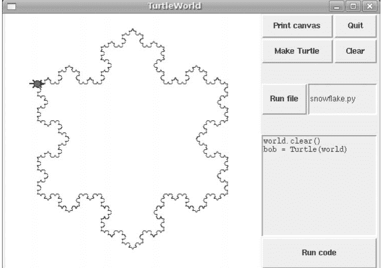

本节介绍了创建此 GUI 的代码，并分为一系列步骤。你可以从 `thinkpython.com/code/SimpleTurtleWorld.py` 下载完整示例。

在顶层，此 GUI 包含两个组件——一个 `Canvas`（画布）和一个 `Frame`（框架）——它们被排列成一行。因此，第一步是创建这一行。

`setup` 是创建和排列组件的函数。在 GUI 中排列组件被称为 **packing**（打包布局）。

`row` 创建一个 `Frame` 并将其设置为“当前 `Frame`”。在该 `Frame` 关闭或创建另一个 `Frame` 之前，所有随后的组件都将按行排列在该 `Frame` 中。

以下是创建 `Canvas` 和包含其他组件的列 `Frame` 的代码：

```
self.canvas = self.ca(width=400, height=400, bg='white')

self.col()
```

列中的第一个组件是一个网格 `Frame`，它包含两个两个的四个按钮：

```
self.gr(cols=2)

self.bu(text='Print canvas', command=self.canvas.dump)

self.bu(text='Quit', command=self.quit)

self.bu(text='Make Turtle', command=self.make_turtle)

self.bu(text='Clear', command=self.clear)

self.endgr()
```

`gr` 创建网格；参数是列的数。网格中的组件从左到右、从上到下布局。

第一个按钮使用 `self.canvas.dump` 作为回调函数；第二个使用 `self.quit`。这些是绑定方法（bound methods），意味着它们与特定的对象关联。当它们被调用时，是在该对象上调用的。

列中的下一个组件是一个行 `Frame`，它包含一个 `Button`（按钮）和一个 `Entry`（输入框）：

```python
self.row([0,1], pady=30)

self.bu(text='Run file', command=self.run_file)

self.en_file = self.en(text='snowflake.py', width=5)

self.endrow()
```

`row` 的第一个参数是组件列表，决定了组件之间如何分配额外空间。列表 `[0,1]` 意味着所有的额外空间都分配给第二个组件即 `Entry`。如果你运行这段代码并调整窗口大小，你会发现 `Entry` 会变大，而 `Button` 不会。

选项 `pady` 在 y 轴上“填充”这一行，在上方和下方添加 30 像素的空间。

`endrow` 结束这一行组件，因此随后的组件将会在列 `Frame` 中进行布局。`Gui.py` 维护了一个 `Frame` 栈：

- 当我们使用 `row`、`col` 或 `gr` 创建一个 `Frame` 时，它会位于栈顶并成为当前 `Frame`。
- 当我们使用 `endrow`、`endcol` 或 `endgr` 关闭一个 `Frame` 时，它会从栈中弹出，栈中上一个 `Frame` 成为当前 `Frame`。

`run_file` 方法读取 `Entry` 的内容，将其作为文件名，读取内容并传递给 `run_code`。`self.inter` 是一个解释器对象，它知道获取一个字符串并将其作为 Python 代码执行。

```
def run_file(self):

    filename = self.en_file.get()

    fp = open(filename)

    source = fp.read()

    self.inter.run_code(source, filename)
```

最后两个组件是一个 `Text`（文本）组件和一个 `Button`（按钮）：

```
self.te_code = self.te(width=25, height=10)

self.te_code.insert(END, 'world.clear()\n')

self.te_code.insert(END, 'bob = Turtle(world)\n')
```

```
self.bu(text='Run code', command=self.run_text)
```

`run_text` 与 `run_file` 类似，不同在于它从 `Text` 组件中获取代码而不是文件：

```python
def run_text(self):

    source = self.te_code.get(1.0, END)

    self.inter.run_code(source, '<user-provided code>')
```

遗憾的是，其他语言以及不同 Python 模块中的组件布局细节是不同的。`Tkinter` 本身仅提供了三种排列组件的机制。这些机制被称为几何管理器（geometry managers）。我在本节中演示的是“grid”（网格）几何管理器；其他的被称为“pack”和“place”。

幸运的是，本节中的大多数概念都适用于其他 GUI 模块和其他语言。

## 19.7 菜单与可调用对象

`Menubutton`（菜单按钮）是一种看起来像按钮的组件，但按下按下时会弹出一个菜单。在用户选择一个项后，菜单会消失。

以下是创建一个颜色选择 `Menubutton` 的代码（你可以从 `thinkpython.com/code/menubutton_demo.py` 下载它）：

```
g = Gui()

g.la('Select color:')

colors = ['red', 'green', 'blue']

mb = g.mb(text=colors[0])
```

`mb` 为每个颜色创建一个菜单项。下面的循环创建了菜单：

```python
for color in colors:

    mb.mi(text=color)
```

`mi` 的第一个参数是菜单项的文本。第二个参数是在选中该项时调用的函数。`Menubutton` 是一种看起来像按钮的组件，但按下时会弹出一个菜单。在用户选择一个项后，菜单会消失。

## 19.8 绑定（Binding）

绑定是组件与函数之间的关联。它在事件发生时触发，例如鼠标点击或按键。以下代码显示了如何将事件绑定到组件：

```
widget.bind(Event-Type, callback)
```

`bind` 方法用于注册处理器。第一个参数是事件类型（字符串如 `<Button-1>` 或 `<Key>`），第二个是事件发生时调用的回调函数。

许多组件都有回调。例如，`Entry` 组件有 `Return` 事件：

```python
def make_text(event):

    print("Enter was pressed")

en.bind('<Return>', make_text)
```

`Event` 对象包含事件信息，例如鼠标的坐标或按下的按键。这里是使用 `Event` 对象的示例：

```python
def handle_event(event):

    print(f"Mouse clicked at {event.x}, {event.y}")

canvas.bind('<Button-1>', handle_event)
```

回调函数也可以接受参数。为了实现这一点，你可以使用 `lambda` 或 `partial`：

```python
def make_text(event, arg):

    print(f"Enter pressed with {arg}")

en.bind('<Return>', lambda event: make_text(event, "Hello"))
```

`bind` 方法还用于覆盖组件的默认行为。例如，防止 `Entry` 某些按键：

```python
def prevent_key(event):

    return "break"

en.bind('<Key>', prevent_key)
```

```
self.dragx = event.x

self.dragry = event.y
```

此计算是在像素坐标下完成的；不需要转换为 `Canvas` 坐标。

最后，`drop` 会恢复项的原始颜色：

```python
def drop(self, event):

    self.config(fill=self.fill)
```

你可以使用 `Draggable` 类为现有项目添加拖放功能。例如，这里是 `make_circle` 的修改版本，它使用 `circle` 创建一个项目并使用 `Draggable` 使其变为可拖：

```python
def make_circle(event):

    pos = ca.canvas_coords([event.x, event.y])

    item = ca.circle(pos, 5, fill='red')

    item = Draggable(item)
```

这个示例展示了继承的用处之一：你可以在不修改父类定义的情况下修改它的功能。如果你想更改没有编写的模块中定义的行为，这特别有用。

## 调试

GUI 编程的挑战之一是跟踪在 GUI 构建期间发生了哪些事件，以及在之后响应用户事件时发生了哪些事件。

例如，当你设置回调函数时，一个常见的错误是调用该函数而不是传递它的引用：

```python
def the_callback():

    print 'Called.'
```

```python
g.bu(text='This is wrong!', command=the_callback())
```

如果你运行这段代码，`ca` 会看到它立即调用了 `the_callback`，然后创建按钮。当你按下按钮时，它什么都不会做，因为 `the_callback` 的返回值是 `None`。通常，你不希望在设置 GUI 时调用回调；它应该只在响应用户事件时被调用。

GUI 编程的另一个挑战是你无法控制执行流。程序的哪些部分执行以及它们的顺序是由用户操作决定的。这意味着你必须设计程序，使其能够对任何可能的事件序列都能正常工作。

例如，练习 19.3 中的 GUI 有两个小部件：一个创建一个 `Circle`（圆）项目，另一个更改 `Circle` 的颜色。如果用户创建了圆并更改了它的颜色，那就没有问题。但如果用户更改了一个尚不存在圆的颜色呢？或者创建了多个圆呢？

随着小部件数量的增加，想象所有可能的事件序列变得越来越困难。管理这种复杂性的方法是将系统状态封装在一个对象中，并考虑：

- 可能的状态有哪些？在 `Circle` 示例中，我们可能考虑两种状态：用户创建第一个圆之前和之后。
- 在每个状态下，会发生什么事件？在示例中，用户可以按下任一个按钮，或者退出。
- 对于每个“状态-事件”对，预期的结果是什么？由于有两个状态和两个按钮，共有四个状态-事件对需要考虑。
- 什么会引起从一个状态到另一个状态的转换？在这种情况下，当用户创建第一个圆时会发生转换。

你可能还会发现定义并检查无论事件序列如何都应该保持的不不变性很有用。

这种 GUI 编程方法可以帮助你编写正确的代码，而无需测试每一个可能的用户事件序列！

## 19.10 术表

**绑定 (binding):** 小部件、事件和事件处理器之间的关联。当事件在小部件中发生时，会调用该事件处理器。

**绑定方法 (bound method):** 与特定实例关联的方法。

**边界框 (bounding box):** 包围一组项目的矩形，通常由两个对角顶点指定。

**回调函数 (callback):** 与小部件关联的函数，当用户执行操作时会被调用。

**事件 (event):** 用户操作（如鼠标点击或按键），会导致 GUI 产生响应。

**事件驱动编程 (event-driven programming):** 一种编程风格，其执行流由用户操作决定。

**事件循环 (event loop):** 一个用于等待用户操作并做出响应的无限循环。

**几何管理器 (geometry manager):** 用于打包小部件的系统。

**GUI:** 图形用户界面。

**项目 (item):** `Canvas` 小部件上的图形元素。

**关键字 (keyword):** 在函数调用中指明参数名称的参数。

**选项 (option):** 控制小部件包（pack）外观或功能的值：用于排列和显示 GUI 的元素。

**小部件 (widget):** 组成 GUI 的元素之一，包括按钮、菜单、文本输入框等。

## 19.11 练习

### 练习 19.4

在本次练习中，你将编写一个图像查看器。这是一个简单的示例：

```python
g = Gui()

canvas = g.ca(width=300)

photo = PhotoImage(file='danger.gif')

canvas.image([0,0], image=photo)

g.mainloop()
```

`PhotoImage` 读取文件并返回一个 `Tkinter` 可以的 `PhotoImage` 对象。`Canvas.image` 将图像放在画布上，居于给定坐标中心。你也可以将图像放在标签、按钮和其他一些小部件上：

```python
g.la(image=photo)

g.bu(image=photo)
```

`PhotoImage` 只能处理少数图像格式（如 GIF 和 PPM），但我们可以使用 Python Imaging Library (PIL) 来读取其他文件。

PIL 模块的名称是 `Image`，但 `Tkinter` 定义了一个同名的对象。为了避免冲突，你可以这样导入：

```python
import Image as PIL

import ImageTk
```

第一行导入 `Image` 并赋予它一个本地名称。第二行导入 `ImageTk`，它可以将 PIL 图像转换为 `Tkinter` 可识别的对象。

`PhotoImage` 只能处理几种图像格式... 它可以将 PIL 图像转换为 `Tkinter`。这里有一个示例：

```python
image = PIL.open('allen.png')

photo2 = ImageTk.PhotoImage(image)

g.la(image=photo2)
```


## 19.11 练习

(1) 下载 `image_demo.py`、`danger.gif` 和 `allen.png` 来自 thinkpython.com。运行 `image_demo.py`。你可能需要安装 PIL 和 ImageTk。

(2) 在 `image_demo.py` 中将第二个 PhotoImage 的名称 `photo2` 改为 `photo` 并再次运行程序。你会看到第二个看不到第一个。问题在于当你重新赋值 `photo` 时它覆盖了第一个，导致其消失。如果你将 PhotoImage 赋值给局部变量也会发生这种情况；它会在函数结束时消失。为了避免这种情况，你必须保留你想保持的 PhotoImage 的引用。你可以使用全局变量，或者将其存储数据结构或对象的属性。这种行为可能会令人沮丧，这就是为什么我警告你（以及为什么示例图像写着“危险！”）。

(3) 从此开始，编写一个接受目录名称并遍历所有程序，显示 PIL 识别的文件。可以使用 `try` 语句来捕捉 PIL 无法识别的文件。

(4) PIL 提供了多种处理图像的方法。你可以在 python.com/library/pil/handbook 中阅读它们。作为挑战，选择其中的几种方法并为它们的应用提供一个 GUI。你可以从 thinkpython.com/code/ImageBrowser.py 下载一个简单的解决方案。

### 练习 19.5

矢量图形编辑器是一个允许用户在屏幕上绘制和编辑形状并生成矢量图形格式（如 Postscript 和 SVG）输出文件的程序。

使用 Tkinter 编写一个简单的矢量图形编辑器。至少它应该允许用户绘制线条、圆和矩形，并应该使用 `Canvas.dump` 生成画布内容的 Postscript 描述。

作为挑战，你可以允许用户选择和缩放画布上的项目。

### 练习 19.6

使用 Tkinter 编写一个基础网络浏览器。它应该有一个 Text 小部件让用户输入 URL，以及一个 Canvas 显示页面内容。

你可以使用 `urllib` 模块下载文件（练习 14.5）并使用 `HTMLParser` 模块解析 HTML 标签（见 sec docs.python.org/lib/module-HTMLParser.html）。

至少你的浏览器应该能够处理纯文本和超链接。作为挑战，你可以处理背景颜色、文本格式标签和图像。

# 附录

## 调试

程序中可能会出现各种类型的错误，对它们进行区分有助于更快速地追踪问题原因：

- **语法错误（Syntax errors）**是 Python 在将源代码翻译为字节码时产生的错误。它们通常表示程序的语法存在问题。例如：在 `def` 语句末尾省略冒号会产生有些冗余的提示 `SyntaxError: invalid syntax`（无效语法）。
- **运行时错误（Runtime errors）**是程序在运行时出现问题时由解释器产生的错误。大多数运行时错误消息包含关于错误发生位置以及正在执行哪些函数的信息。例如：无限递归会导致运行时错误“maximum recursion depth exceeded”（超过最大递归深度）。
- **语义错误（Semantic errors）**是程序运行虽没有产生错误信息，但没有执行正确的操作。例如：表达式求值顺序可能没有按照你预期的顺序进行，导致错误的结果。

调试的第一步是确定你正在处理哪种错误。虽然以下章节按错误类型进行组织，但某些技术适用于多种情况。

## A.1 语法错误

一旦你确定了语法错误是什么，它们通常很容易修复。遗憾的是，错误信息往往并不有用。最常见的消息是 `SyntaxError: invalid syntax`（无效语法）和 `SyntaxError: invalid token`（无效标记），这两者都没有提供太多信息。

另一方面，消息确实会告诉你问题发生在程序的哪个位置。实际上，它告诉你是 Python 在何处发现了问题，这并不一定是错误所在的位置。有时错误在错误消息所在的位置之前，通常在上一行。

如果你是增量地构建程序的，那么你对错误位置应该有一个清楚的认识。它会在你新添加的最后一行中。

如果你是从书中复制代码，请从开始仔细对比你的代码和书中的代码。检查每一个字符。同时，请记住书也可能是错误的，如果你看到看起来像语法错误的地方，它可能真的是。

以下是避免最常见错误的一些方法：

- (i) 确保你没有使用 Python 关键字作为变量名。
- (ii) 检查每个复合语句的头部末尾是否有冒号，包括 `for`、`while` 和 `def` 语句。
- (iii) 确保代码中的任何字符串都与引号匹配。
- (iv) 如果你使用了带有三引号（单引号或双引号）的多行字符串，请确保已正确终止了字符串。未终止的字符串可能会导致程序末尾出现无效标记错误，或者它可能会将程序的后续部分视为字符串，直到遇到下一个字符串。在第二情况下，它可能根本不会产生错误消息！
- (v) 如果运算符未匹配（如 `(` 或 `[`），Python 会将下一行作为当前语句的一部分继续执行。通常，错误几乎会立即出现在下一行。
- (vi) 检查条件语句内部是否误用了 `=` 而不是 `==`。
- (vii) 检查缩进以确保它们按照预期的方式对齐。Python 可以处理空格和制表符，但如果混合使用它们就会导致问题。避免此问题的最佳方法是使用了解 Python 并生成一致缩进的文本编辑器。

如果什么方法都无效，请进入下一节……

## A.1.1 持续修改但没有变化

如果解释器说有错误但你没看到，那可能是因为你和解释器查看的不是同一个代码。检查你的编程环境，确保你正在编辑的程序就是 Python 正在尝试运行的那个。

如果你不确定，尝试在程序开头放一个显而易见的语法错误。现在运行它。如果解释器没有发现新错误，说明你没有运行对应的代码。

有几个可能的罪祸首：

- 你编辑了文件，但在再次运行之前忘记保存更改。有些编程环境会为你完成这一步，但有些不会。
- 你更改了文件名，但仍在运行旧文件名。
- 你的开发环境中的某些配置不正确。
- 如果你正在编写一个模块并使用 `import`，请确保你的模块没有与任何标准 Python 模块重名。

如果你使用 `import` 读取模块，请记住你必须重启解释器或使用 `reload` 来读取修改后的文件。如果你再次导入该模块，它不会产生任何变化。

如果你卡住了且无法确定发生了什么，一种方法是从重新写一个如“Hello, World”的新程序开始，并确保你能让程序运行起来。然后逐渐将原始程序的各个部分添加到新程序中。

## A.2 运行时错误

一旦你的程序在语法上是正确的，Python 就可以编译它并至少能够运行它。可能会出什么问题呢？

## A.2.1 我的程序完全什么都没做

这种情况最常见的情况是你的文件包含函数和类，但实际上没有调用任何内容来启动执行。如果你只是计划导入此模块以提供类和函数，这可能是故意的。

如果不是故意的，请确保你调用了一个函数来启动执行，或者从交互式提示符执行一个。另请参见下方的“执行流”部分。

## A.2.2 我的程序卡住了

如果程序停止了并且看起来什么都没做，它就是“挂起（hanging）”。这通常意味着它陷入了无限循环或无限递归。

- 如果你怀疑某个特定的循环是问题所在，在循环之前立即添加一个打印“entering the loop”的打印语句，在循环之后立即添加另一个打印“exiting the loop”。
- 运行程序。如果你看到了第一个消息而没有看到第二个，说明你有一个无限循环。转到“无限循环”章节。
- 通常情况下，无限递归会导致程序运行一段时间后产生“Maximum recursion depth exceeded”（超过最大递归深度）。如果发生这种情况，请到“无限递归”章节。
- 如果你怀疑某个函数或方法导致了无限递归，可以使用“无限递归”中的技术。
- 如果上述步骤都无效，开始检查其他的循环和函数。
- 如果你可能不理解执行流，请查看“执行流”章节。

## A.2.2.3 执行流

如果你不确定执行流是如何移动的，在每个函数的开头添加一个打印语句，内容为“entering foo”，其中 foo 是函数名。

现在当你运行程序时，它每调用一次函数都会打印一次轨迹。

## A.2.2.1 无限循环

如果你认为你有一个无限循环并且知道哪个循环引起的问题，在循环末尾添加一个打印变量值的打印语句。例如：

```
while x > 0 and y < 0:
    # 对 x 进行某些操作
    # 对 y 进行某些操作
    print "x:", x
    print "y:", y
    print "condition:", x > 0 and y < 0
```

现在当你运行程序时，每次循环都会看到三行输出。在循环最后，条件应该是假的。如果循环继续，你就能看到 x 和 y 的值，并可能发现它们为什么没有正确更新。

## A.2.2.2 无限递归

大多数情况下，无限递归会导致程序运行一段时间后产生递归深度限制错误。

如果你怀疑函数或方法导致了无限递归，首先检查以确保存在基准情况。换句话说，应该有某个条件允许函数或方法在不进行递归调用的情况下返回。如果没有，那么你需要重新思考算法并确定一个基准情况。

如果存在基准情况但程序似乎没有到达它，请在函数或方法的开头添加一个打印参数的打印语句。现在当你运行程序时，每次调用函数或方法都会看到几行输出，并且你会看到参数。如果参数没有向基准情况移动，你就会获得关于为什么不移动的想法。

## A.2.3 当我运行程序时遇到异常

如果在运行时出现问题，Python 会打印一条消息，其中包含异常名称、发生问题的程序行以及回溯跟踪（traceback）。

回溯识别了正在运行的函数，然后是调用它的函数，依此类推。换句话说，它追溯了引导你到达当前位置的函数调用序列。它还包含了在文件中发生这些这些调用的行号。

## A.2 运行时错误

第一步是检查程序中发生错误的地方，并尝试弄清楚发生了什么。以下是最常见的运行时错误：

- **NameError**：你正尝试使用一个当前环境中不存在的变量。记住，局部变量是局部的。你无法在定义它们的函数外部引用它们。
- **TypeError**：有几种可能的原因：
  - 你尝试以不当的方式使用值。例如：使用非整数对字符串、列表或元组进行索引。
  - 格式化字符串中的项与用于转换的项之间不匹配。这可能发生在项目数量不匹配或调用了无效转换的情况下。
  - 你向函数或方法传递传递了错误数量的参数。对于方法，查看方法定义并检查第一个参数是否为 `self`。然后查看方法调用；确保你在正确类型的对象上调用该方法，并正确提供了其他参数。
- **KeyError**：你正尝试使用字典不包含的键来访问元素。
- **AttributeError**：你正尝试访问不存在的属性或方法。检查拼写！你可以使用 `dir` 列出存在的属性。AttributeError 表示对象具有 `NoneType`，这意味着它是 `None`。一个常见原因是忘记从函数返回值；如果你运行到函数末尾而没有 `return` 语句，它将返回 `None`。另一个常见原因是使用列表方法（如 `sort`）的结果，它返回 `None`。
- **IndexError**：你用于访问列表、字符串或元组的索引大于其长度减一。在错误发生位置之前，添加一个打印语句来显示索引的值和数组的长度。索引正确吗？

Python 调试器 (pdb) 对于追踪异常（Exceptions）非常有帮助，它允许你在错误发生之前检查程序的状态。你可以在 docs.python.org/lib/module-pdb.html 读取关于它的信息。

## A.2.4 我加了这么多 print 导致被输出淹没了

使用 `print` 语句进行调试的问题之一是，你最终可能会被埋没在输出中。有两种处理方法：简化输出或简化程序。

要简化程序，你可以删除或注释掉那些对没有帮助的 `print` 语句，或者将它们合并，或者格式化输出以便更容易理解。

要简化程序，你可以做几件事。首先，缩小程序正在处理的问题规模。例如，如果你正在搜索一个列表，就搜索一个小列表。如果程序从用户处获取输入，给它提供导致问题的最简单输入。

其次，清理程序。删除死代码并重组织程序，使其尽可能易于阅读。例如，如果你怀疑问题在程序的深度嵌套部分，请尝试用更简单的结构重写该部分。如果你怀疑某个大函数有问题，尝试将其拆分为更小的函数并进行单独测试。

通常情况下，寻找最小测试用例的过程会引导你找到 bug。如果你发现程序在一种情况下运行良好而在另一种情况下不运行，这会为你提供关于正在发生什么的线索。

同样地，重写一段代码可以帮助你发现细微的 bug。如果你做了一个本不应该影响程序的更改，但它确实影响了，这可以给你提供提示。

## A.3 语义错误

在某些方面，语义错误是最难调试的，因为解释器没有提供关于何错误的任何信息。只有你才知道程序本应该做什么。

第一步是在程序文本与你看到的行为之间建立联系。你对程序实际上在做什么有一个假设。让这变得困难的因素之一是计算机运行得太快。

你可能希望能够将程序减慢到人类的速度，使用某些调试器是可以做到的。但插入几个位置恰当的 `print` 语句所花费的时间，与设置调试器、插入和删除断点以及“单步”程序到错误发生的地方相比，通常非常短。

### A.3.1 我的程序无法运行

你应该问自己这些问题：

- 是否有某些程序本应该做但似乎没有发生的事情？找到执行该功能的代码段，并确保它在你认为应该执行时正在执行。
- 是否发生了某些不该发生的事情？找到程序中执行该功能的代码，看看它是否在不该执行时正在执行。
- 是否某段代码产生了不符合你预期的效果？确保你理解了相关代码，特别是当它涉及调用其他 Python 模块中的函数或方法时。阅读你调用的函数的文档。通过编写简单的测试用例并检查结果来尝试它们。

为了编程，你对程序如何工作有一个心理模型。如果你写了一个运行结果不符合你预期的程序，通常问题不在程序中，而是在你的心理模型中。

纠正心理模型最好的方法是将程序拆分为各个组件（通常是函数和方法），并独立测试每个组件。一旦你发现模型与现实之间的差异，你就可以解决问题。

当然，你应该在开发程序的同时构建并测试组件。如果你遇到问题，应该只有少量的未知的正确新代码。

### A.3.2 我写了一个很乱的表达式，它的运行不符合我的预期

编写表达式是困难的。如果你有一个复杂的表达式，你没有机会在返回之前进行检查。再次，你可以使用临时变量。例如，而不是：

```python
return complex_expression
```

你可以写成：

```python
result = complex_expression
return result
```

在使用大型表达式时，另一个问题是计算顺序可能不是你预期的。例如，乘法和除法的优先级相同，从左到右计算。所以这个表达式计算的是：

```python
y = x / 2 * pi
```

当你不确定计算顺序时，使用括号：

```python
y = x / (2 * pi)
```

这样不仅程序是正确的，而且对于没有记住这些规则的人来说也更易读。

### A.3.3 我有一个函数或方法的返回值不符合预期

编写表达式是困难的。如果你有一个复杂的表达式，你没有机会在返回之前进行检查。再次，你可以使用临时变量。例如，而不是：

```python
return function_call
```

你可以写成：

```python
result = function_call
return result
```


在使用大型表达式时，你没有机会在返回之前进行检查。

### A.3.4 我真的卡住了，需要帮助

首先，尝试离开计算机几分钟。计算机发出的波会影响大脑，导致这些症状：

- 挫败和愤怒。
- 迷信认为（计算机讨厌我）和魔法思维（只有当我倒着帽子时程序才运行）。
- 随机行走编程（通过编写每个程序并选择正确的来进行尝试）。

如果你发现自己遭受这些任何症状，去散散步。当你冷静下来，思考程序。它在做什么？产生该行为的可能原因是什么？一次程序正常是什么时候？之后做了什么？

有时寻找 bug 需要时间。我经常在离开计算机让大脑漫游时发现 bug。发现 bug 的最佳地方是在火车上、淋浴室和睡前。

### A.3.5 不，我真的需要帮助

这种情况会发生。即使是最好的程序员也会卡住。有时你盯着程序看太久，就看不出错误了。新的视角恰恰是需要的。

在寻求他人帮助之前，确保你已经做好了准备。你的程序应该尽可能简单，并且你应该使用导致问题的最小输入进行测试。你应该在适当的位置放置打印语句（并且你产生的输出应该是易懂的）。你应该对问题有足够的了解，能够简洁地描述它。

## A.3 语义错误

当你寻求他人帮助时，务必提供他们所需的信息：

- 如果有错误消息，内容是什么？它指向了程序的哪个部分？
- 在此错误发生之前，你最后的操作是什么？你最后写的几行代码是什么？或者是哪个新的测试用例失败了？
- 到目前为止你尝试了什么，学到了什么？

当你找到 bug 时，花几秒钟思考你可以做什么来更快找到它。下次遇到类似的问题时，你就能更快地找到 bug。

记住，目标不仅仅是让程序运行。目标是学习如何让程序运行。

# 索引

- 字母顺序的, 84, 97
- `abs` 函数, 60
- 绝对路径, 162, 169
- 访问, 104
- 累加器, 116
- 直方图, 150
- 列表, 109
- 字符串, 205
- 词, 108
- Ack曼函数, 71
- `add` 方法, 195
- 进位加法, 79
- 算法, 3, 8, 79, 154
- 欧几里得, 72
- MD5, 177
- RSA, 130
- 平方根, 80
- 别名, 112, 113, 166, 174, 200
- 避免拷贝, 116
- 字母表, 45
- 备选执行, 48
- 歧义, 6
- 异位词, 117
- 异位词集, 145, 166
- `and` 运算符, 47
- `andydbm` 模块, 164
- `append` 方法, 107, 114, 188, 205, 206
- `arc` 函数, 38
- 参数, 21, 24, 27, 28, 32, 113
- 收集, 136
- 关键字, 40, 44, 142, 215
- 列表, 113
- 可选, 88, 111, 124
- 可变长度元组, 136
- 参数散列, 137
- 算术运算符, 14
- `assert` 语句, 187
- 赋值, 18, 73, 104
- 项目, 86, 104, 134
- 多重, 80, 128
- 元组, 135, 136, 138, 144
- 赋值语句, 111
- 属性
- `__dict__`, 198
- 类, 202, 211
- 初始化, 198
- 实例, 173, 179, 203, 211
- `AttributeError`, 179, 235
- 奥斯汀，简, 150
- 可用颜色, 181, 200
- 培根，凯文, 171
- 孟加拉国，国旗, 180
- 基础情况, 52, 55
- 基准测试, 156, 158
- 高大且复杂的表达式, 237
- 绑定, 223, 227
- 宾果, 145
- 生日, 188
- 生日悖论, 117
- `ect` 模块, 118
- 分二查找, 118
- 分二法调试，通过 79
- 位运算运算符, 14
- 主体, 24, 32, 55, 75
- `bool` 类型, 47
- 布尔表达式, 46, 55
- 布尔函数, 64, 183
- 布尔运算符, 89
- 借用，带借位的减法, 79, 186
- 绑定方法, 221, 227
- 边界框, 180, 218
- 括号
- 波浪线, 119
- 括号运算符, 82, 104, 134
- 分支, 49, 55
- `break` 语句, 76
- 挖掘, 3, 8
- 最坏, 199
- 曾经, 229
- 按钮小部件, 215
- `cmp` 函数, 205
- `__cmp__` 方法, 204
- 科拉兹猜想, 76
- 冒号, 24, 232
- 颜色列表, 181, 200
- 注释, 17, 18
- 交换律, 16, 196
- 比较函数, 60
- 比较
- 字符串, 89
- 元组, 141, 204
- 比较运算符, 47
- 编译, 2, 8
- 组合, 23, 28, 62, 605
- 复合语句, 48, 55
- 压缩
- 文件, 166
- 拼接, 16, 18, 28, 84, 111
- 列表, 106, 114, 118
- 条件, 48, 55, 75, 233
- 链式, 49, 56
- 嵌套, 46
- 条件执行, 48
- 条件运算符, 204
- 条件语句, 48, 56, 64
- `config` 方法, 216
- 一致性检查, 130, 186
- 转换
- 类型, 21
- 坐标
- `Canvas`, 217, 226
- 像素, 226
- 序列, 217
- 拷贝
- 深拷贝, 178
- 浅拷贝, 178
- 切片, 86, 106
- 别名, 116
- `copy` 模块, 177
- 拷贝对象, 177
- `count` 方法, 87, 92, 121, 129
- 计数循环, 87
- 十字路口, 95
- 累加, 109
- 捷克共和国，国旗, 181
- 计算器, 9, 20
- 调用图, 127, 131
- 可调用对象, 223
- 回调, 216, 223, 226
- `Canvas` 坐标, 217, 226
- `Canvas` 项目, 217
- `Canvas` 对象, 180
- `Canvas` 小部件, 216
- `Card` 类, 101, 102, 132
- 玩牌, 201
- 带进位的加法, 79, 184, 185
- 大小敏感性，名称, 18
- 条件, 49, 55
- 字符, 82
- 校验和, 170, 207, 211
- 子类, 217
- `choice` 函数, 149
- 圆形函数, 38
- 循环定义, 65
- 类, 172, 179
- `Card`, 202
- 子类, 207, 211
- 日期, 188
- `Deck`, 205
- 手, 207
- `Kangaroo`, 199
- 父类, 207
- `Point`, 172, 194
- 形, 175
- `SimpleTurtle`, 220
- 时间, 182
- 类属性, 202, 211
- 类定义, 172
- 类图, 209, 211
- 类对象, 173, 175, 178, 179, 182, 203
- 关闭方法, 160, 165, 166
- 数据结构, 143, 144, 155
- 数据库, 164, 169, 170
- `Date` 类, 188
- `datetime` 模块, 188
- 死代码, 60, 70, 235
- 调试器 (`pdb`), 235
- 调试, 3, 7, 18, 31, 54, 69, 90, 100, 115, 130, 143, 157, 168, 179, 187, 198, 210, 226, 79
- 情感响应, 7, 238
- 实验性, 4
- 迷信, 238
- `Deck` 类, 205
- 牌洗牌, 205
- 声明, 121
- 装饰-装饰模式, 142
- 递减, 75, 80
- 深拷贝, 178, 199
- `deepcopy` 函数, 178
- 默认词, 24
- 默认值, 152, 158, 193
- 避免可变性, 199
- 定义
- 循环, 65
- 类, 172
- 函数, 24
- 递归, 146
- `del` 运算符, 110
- 列表元素删除, 109
- 分隔符, 111, 116
- 确定性的, 148, 158
- 开发计划, 44
- 封装与泛化, 42
- 增量式, 60, 231
- 计划的, 185
- 问题识别, 99, 100
- 原型与补丁, 183, 185
- 随机游编程, 157, 238
- 图
- 调用图, 131
- 类, 209, 211
- 对象, 173, 175, 178, 179, 182, 203
- 栈, 294
- 状态, 11, 73, 92, 104, 112, 113, 125, 141, 173, 175, 182, 203
- `__dict__` 属性, 198
- `dict` 函数, 119
- 字典, 119, 131, 235
- 初始化, 129
- 反转, 125
- 查找, 123
- 循环查找, 123
- 反向查找, 123
- 遍历, 140, 199
- `ddbm` 模块, 164
- 迪杰stra, 101
- 目录, 161, 169
- 游走, 162
- 基于类型的, 197
- 分发类型, 196
- 可除性, 46
- 浮点数, 14, 55
- `divmod`, 136, 186
- 文字符串, 43, 44, 172
- 点表示法, 23, 32, 87, 191, 203
- 双击字母, 101
- 拖放, 225
- DSU 模式, 142, 144, 151
- 重复, 117, 118, 131
- 爱因斯坦，阿尔伯特, 40
- 元素, 103, 116
- 删除, 109
- `elif` 关键字, 49
- `else` 关键字, 48
- 邮箱地址, 135
- 嵌入对象, 175, 179, 200
- 拷贝, 178
- 情感调试, 7, 238
- 空列表, 103
- 空字符串, 92, 111
- 封装, 39, 44, 63, 79, 208
- 代码, 201, 211
- 行尾字符, 169
- `Entry` 小部件, 218
- `enumerate` 函数, 139
- `epsilon`, 78
- 等于赋值, 73
- 等效性, 112
- 等价的, 116
- 编译时间, 231
- 运行时, 4, 18, 52, 55, 231
- 语义, 4, 18, 91, 231
- 形状, 143
- 语法, 3, 17, 231
- 错误检查, 68
- 错误消息, 3, 4, 7, 11, 18, 231
- 欧几里得算法, 72
- `eval` 函数, 81
- 评估, 15
- 事件, 227
- 事件处理程序, 224
- 事件循环, 215, 227
- 事件对象, 224
- 事件字符串, 224
- 事件驱动编程, 216, 226, 227
- 异常, 4, 8, 18, 231, 234
- `AttributeError`, 179, 235
- `IndexError`, 83, 91, 105, 235
- `IOError`, 163
- `KeyError`, 120, 235
- `NameError`, 29, 235
- `OverflowError`, 55
- `RuntimeError`, 52
- `SyntaxError`, 24
- `TypeError`, 83, 86, 126, 134, 137, 161, 192, 235
- `UnboundLocalError`, 129
- `ValueError`, 54, 124, 135
- 异常捕获, 163
- 可执行的, 2, 8
- 练习，秘密, 169
- `exists` 函数, 162
- 实验性调试, 4, 157
- 表达式, 14, 15, 18
- 高大且复杂的, 237
- 布尔, 46, 55
- 方法的方法, 107
- 执行流, 26, 32, 68, 69, 75, 210, 226, 234
- 花, 45
- 文件夹, 161
- `for` 循环, 37, 83, 105, 139
- 格式语言, 5, 8
- 格式运算符, 160, 169, 235
- 格式序列, 160, 169
- 格式字符串, 160, 169
- 极好的, 65
- 帧, 29, 32, 52, 66, 127
- `Frame` 小部件, 220
- 频率, 122
- 字母, 145
- 词, 147, 158
- 有成果的函数, 30, 32
- 挫败, 238
- 函数, 24, 32, 189
- `abs`, 60
- `ack`, 71
- `arc`, 38
- `choice`, 149
- 圆形, 38
- `cmp`, 205
- `compare`, 60
- `deepcopy`, 178
- `dict`, 119
- `enumerate`, 139
- `eval`, 81
- `exists`, 162
- 阶乘, 65
- 斐波那契数列, 67, 126
- `find`, 86
- `float`, 22
- `getattr`, 199
- `getword`, 161
- `hasattr`, 179, 198
- `int`, 21
- 实例, 68, 196
- 长度, 33, 83, 120
- 列表, 110
- `log`, 23
- `max`, 137
- `min`, 136, 137
- `open`, 95, 96, 159, 163, 164
- 多边形, 38
- `popen`, 166
- `randint`, 117, 148
- `random`, 142, 148
- `raw_input`, 53
- 递归, 51
- `reload`, 168, 232
- `repr`, 168

# 索引 245

- 反转 (`reversed`), 143
- 洗牌 (`shuffle`), 207
- 排序 (`sorted`), 143
- 平根 (`sqrt`), 23, 62
- 字符串 (`str`), 22
- 求和 (`sum`), 137
- 元组 (`tuple`), 134
- 类型 (`type`), 179
- 压缩 (`zip`), 138
- 函数参数 (`function argument`), 22
- 函数调用 (`function call`), 21, 32
- 函数组合 (`function composition`), 63
- 函数定义 (`function definition`), 24, 26, 32
- 函数帧 (`function frame`), 29, 32, 52, 127
- 函数对象 (`function object`), 25, 33
- 函数参数 (`function parameter`), 27
- 函数语法 (`function syntax`), 191
- 函数类型 (`function type`)
- 修饰符 (`modifier`), 184
- 纯函数 (`pure`), 183
- 函数，高效的 (`function, fruitful`), 30
- 函数，数学 (`function, math`), 22
- 函数，原因 (`function, reasons for`), 31
- 函数，三角 (`function, trigonometric`), 23
- 函数，元组返回值 (`function, tuple return value`), 136
- 函数，空 (`function, void`), 30
- 函数式编程系统 (`functional programming system`), 185, 188

- 哈希函数 (`hash function`), 126, 131
- 可哈希的 (`hashable`), 126, 131, 140
- 哈希表 (`ashtable`), 121, 131
- 头部 (`header`), 24, 32, 232
- `Hello World`, 6
- 帮助工具 (`help utility`), 9
- 十进制 (`hexadecimal`), 173
- 高级语言 (`high-level language`), 1, 8
- 直方图 (`histogram`), 122, 131
- 随机选择 (`random choice`), 149, 153
- 词频统计 (`word frequencies`), 149
- 福尔摩斯，夏洛克 (`Holmes, Sherlock`), 4
- 同音词 (`homophone`), 132, 179
- `HTMLParser` 模块 (`HTMLParser module`), 229
- 超链接 (`hyperlink`), 229
- 斜边 (`hypotenuse`), 63

- 相同的 (`identical`), 117
- 身份 (`identity`), 112
- `if` 语句 (`if statement`), 48
- `Image` 模块 (`Image module`), 228
- 图像查看器 (`image viewer`), 228
- `IMDb` (电影数据库), 170
- 不可变性 (`immability`), 86, 92, 113, 126, 132, 142
- 实现 (`implementation`), 121, 131, 155
- 导入语句 (`import statement`), 32, 35, 168
- `in` 操作符 (`in operator`), 89, 97, 105, 120
- 仪器 (`instrument`), 75, 84, 192
- 增量式开发 (`incremental development`), 70, 231
- 缩进 (`indentation`), 24, 190, 232
- 索引 (`index`), 82, 83, 90, 102, 117, 119, 235
- 循环 (`looping with`), 199
- 负数 (`negative`), 83
- 切片 (`slice`), 85, 106

- 伽马函数 (`gamma function`), 68
- 收集 (`gather`), 136, 144
- `GCD` (最大公约数), 72
- 泛化 (`generalization`), 39, 44, 97, 186
- 布局管理器 (`geometry manager`), 222, 227
- `get` 方法 (`get method`), 122
- `getattr` 函数 (`getattr function`), 199
- `getcwd` 函数 (`getcwd function`), 161
- 全局语句 (`global statement`), 128
- 全局变量 (`global variable`), 128, 131
- 更新 (`update`), 128
- `GNU` 自由文档许可证 (`GNU Free Documentation License`), vi, vii
- 图形用户界面 (`graphical user interface`), 214
- 最大公约数 (`GCD`), 72
- 网格 (`grid`), 34
- 守护者模式 (`guardian pattern`), 69, 70, 90
- `GUI` (图形用户界面), 214, 227
- `Gui` 模块 (`Gui module`), 214
- `gzip` (Unix 命令), 166

- 从零开始 (`starting at zero`), 83, 104
- `IndexError` (索引错误), 91, 105, 235
- 无限循环 (`infinite loop`), 75, 80, 215, 233
- 无限递归 (`infinite recursion`), 52, 56, 68, 233, 234
- 继承 (`inheritance`), 207, 211
- `init` 方法 (`init method`), 193, 198, 202, 205, 208
- 初始化（更新前） (`initialization (before update)`), 74
- 实例 (`instance`), 36, 43, 179
- 作为参数 (`as argument`), 174
- 作为返回值 (`as return value`), 176
- 实例属性 (`instance attribute`), 173, 179, 203, 211
- 实例化 (`instantiation`), 173
- `int` 函数 (`int function`), 21
- `int` 类型 (`int type`), 10
- 整数 (`integer`), 19
- 长整数 (`long`), 129
- 交互模式 (`interactive mode`), 2, 8, 13, 31
- 接口 (`interface`), 40, 44, 211

- `Hand` 类 (`Hand class`), 207
- 悬挂 (`hanging`), 233
- `HAS-A` 关系 (`HAS-A relationship`), 209, 211
- `hasattr` 函数 (`hasattr function`), 179, 198

# 索引 246

- 锁词 (`interlocking words`), 118
- 电影数据库 (`IMDb`), 170
- 解释 (`interpret`), 2, 8
- 不变性 (`invariant`), 187, 188, 227
- 反转字典 (`invert dictionary`), 8, 92
- `IOError` (输入/输出错误), 163
- `is` 操作符 (`is operator`), 112, 178
- 关系 (`is-relationship`), 209, 211
- 实例函数 (`instance function`), 68, 196
- 元素 (`item`), 92, 103
- 画布 (`Canvas`), 217, 227
- 字典 (`dictionary`), 131
- 元素赋值 (`item assignment`), 86, 104
- 更新 (`item update`), 105
- `items` 方法 (`items method`), 139
- 迭代 (`iteration`), 73, 75, 80
- 拼接 (`concatenation`), 106, 114
- 拷贝 (`copy`), 106
- 元素 (`element`), 104
- 空 (`empty`), 103
- 函数 (`function`), 110
- 索引 (`index`), 105
- 方法 (`method`), 107
- 嵌套 (`nested`), 103, 106
- 对象 (`of objects`), 205
- 元组 (`of tuples`), 138
- 操作 (`operation`), 106
- 重复 (`repetition`), 106
- 切片 (`slice`), 105, 117
- 局部变量 (`local variable`), 28, 32
- 对数函数 (`log function`), 23
- 对数 (`logarithm`), 158
- 逻辑操作符 (`logical operator`), 46, 47
- 长整数 (`long integer`), 129
- 查找 (`lookup`), 131
- 字典 (`dictionary`), 123
- 循环 (`loop`), 37, 44, 75
- 条件 (`condition`), 233
- 事件 (`event`), 215
- `for` 循环, 37, 83, 105
- 有限的 (`finite`), 75, 215, 233
- 嵌套 (`nested`), 205
- 遍历 (`traversal`), 83
- `while` 循环, 75
- `join` 方法 (`join method`), 211, 205
- `Kangaroo` 类 (`Kangaroo class`), 199
- 凯文·贝根 (`Kevin Bacon`), 171
- 键 (`key`), 119, 131
- 键值对 (`key-value pair`), 39
- 键盘输入 (`keyboard input`), 53
- `KeyError` (键错误), 120, 235
- `keys` 方法 (`keys method`), 123
- `def` 关键字, 14, 19, 32
- `elif`, 49
- `else`, 48
- 关键字参数 (`keyword argument`), 40, 44, 142, 215, 227
- 格式 (`format`), 28
- 字典循环 (`looping with dictionaries`), 23
- 索引 (`indices`), 99
- 字符串循环 (`with strings`), 87
- 计数循环 (`looping and counting`), 87
- 索引循环 (`looping with indices`), 105
- 低级语言 (`low-level language`), 1, 8
- `Label` 控件 (`Label widget`), 215
- 语言 (`language`), 5
- 高级 (`high-level`), 1
- 低级 (`low-level`), 1
- 自然的 (`natural`), 5
- 编程 (`programming`), 1
- 安全 (`safe`), 4
- 图灵完 (`Turing complete`), 65
- 信仰之跃 (`leap of faith`), 67
- `len` 函数 (`len function`), 33, 83, 120
- 字母频率 (`letter frequency`), 145
- 旋转 (`letter rotation`), 94, 132
- `Linux`, 5
- 字母图 (`lipogram`), 97
- 列表 (`list`), 103, 110, 117, 142
- 映射模式 (`map pattern`), 109, 117
- 映射到 (`map to`), 201
- 映射 (`mapping`), 104, 117, 154
- 马尔可夫分析 (`Markov analysis`), 154
- 混合 (`mash-up`), 155
- 数学函数 (`math function`), 22
- 最大函数 (`max function`), 136, 137
- 罗伯特·克洛斯 (`Closkey, Robert`), 84
- `MD5` 算法 (`MD5 algorithm`), 170
- 二分查找 (`bisection search`), 118
- 字典 (`dictionary`), 120

# 索引 247

- 列表 (`list`), 105
- 集合 (`set`), 121
- 备忘 (`memo`), 127, 131
- 模型 (`ment model`), 236
- 菜单按钮控件 (`Menubutton widget`), 223
- 比喻方法调用 (`metaphor, method invocation`), 191
- 合并 (`methesis`), 145
- 方法 (`method`), 82, 189, 199
- `__cmp__`, 204
- `__str__`, 194, 205
- 添加 (`add`), 195
- 追加 (`append`), 107, 114, 205, 206
- 关闭 (`close`), 160, 165, 166
- 图形 (`fig`), 216
- 计数 (`count`), 89
- 扩展 (`extend`), 107
- 获取 (`get`), 122
- `init`, 193, 202, 205, 208
- `items`, 139
- `join`, 111, 205
- `keys`, 123
- `mro` (方法解析顺序), 211
- `pop`, 109, 206
- `radd`, 197
- 读取 (`read`), 166
- 逐读取 (`readline`), 95, 166
- 删除 (`remove`), 110
- 替换 (`replace`), 147
- 排序 (`sort`), 107, 115, 141, 207
- 分割 (`split`), 111, 135
- 去空格 (`strip`), 96, 147
- 翻译 (`translate`), 147
- 值 (`values`), 121
- 空 (`void`), 107
- 方法追加 (`method append`), 118
- 方法解析 (`method resolution`), 211
- 方法语法 (`method syntax`), 191
- 绑定方法 (`method bound`), 221
- 方法列表 (`method list`), 107
- 最小函数 (`min function`), 136, 137
- 心理模型 (`model, mental`), 236
- 修饰符 (`modifier`), 184, 188
- 模块 (`module`), 22, 32
- `anydb`, 164
- `bisect` (二分法), 118
- 拷贝 (`copy`), 177
- 日期 (`datetime`), 188
- `HTMLParser`, 229
- `Image`, 228
- `os`, 161
- `pickle` (序列化), 159, 165
- 打印 (`print`), 131
- 性能分析 (`profile`), 156
- 随机 (`random`), 117, 142, 148, 207
- 重载 (`reload`), 168, 232
- `shelve` (存储), 166, 170
- 字符串 (`string`), 147
- 结构形状 (`structshape`)
- `urllib`, 169, 229
- 视觉 (`Visual`), 200
- `python`, 200
- 世界 (`World`), 180
- 对象 (`module object`), 22, 167
- 取模操作符 (`modulus operator`), 46, 56
- 蒙提圣杯 (`Monty and the Holy Grail`), 183
- `MP3`, 170
- `mro` 方法 (`mro method`), 211
- 多行字符串 (`multiline string`), 43, 232
- 多重赋值 (`multiple assignment`), 73, 80, 128
- 多重性 (`multiplicity`), 86, 104, 107, 119, 142, 176
- 可变对象 (`mutable object as default value`), 199
- `NameError` (名称错误), 29, 235
- 自然语言 (`natural language`), 5, 8
- 负索引 (`negative index`), 83
- 嵌套条件 (`nested conditional`), 49, 56
- 嵌套列表 (`nested list`), 103, 106, 117
- 换行 (`newline`), 53, 73, 205
- 牛顿迭代法 (`Newton's method`), 77
- 特殊值 (`None special value`), 31, 60, 71, 107, 110
- 操作符 (`oper operator`), 47
- 数字 (`number`), 148
- 索引 (`index`), 82
- 可调用 (`Callable`), 223
- 画布 (`Canvas`), 180
- 类 (`class`), 173
- 拷贝 (`copying`), 177
- 嵌入 (`embedded`), 175, 179, 200
- 事件 (`Event`), 224
- 文件 (`file`), 95, 101
- 函数 (`function`), 25, 33
- 模块 (`module`), 167
- 可变 (`mutable`), 176
- 打印 (`printing`), 190
- 对象代码 (`object code`), 2, 8
- 对象图 (`object diagram`), 173, 175, 178, 182, 183
- 面对象语言 (`object-oriented language`), 199

# 索引 28

- 面对象编程 (`object-oriented programming`), 189, 199, 207
- 八进制 (`octal`), 12
- 里程计 (`odometer`)
- 操作数 (`operand`), 1
- 位运算 (`bitwise`), 14
- 布尔值 (`boolean`), 89
- 括号 (`bracket`), 82, 104, 134
- 比较 (`comparison`), 47
- 条件 (`conditional`), 49, 56, 204
- `del` 关键字, 110
- 格式化 (`format`), 160, 169, 235
- 在 (`in`), 89, 97, 105, 120
- 字典 (`dictionary`), 123
- `is` 操作符 (`is operator`), 112, 178
- 逻辑操作符 (`logical operator`), 46, 47
- 取模操作符 (`modulus`), 46, 56
- 不 (`not`), 47
- 或 (`or`), 47
- 重载 (`overloading`), 199
- 切片 (`slice`), 85, 92, 106, 115, 134
- 字符串 (`string`), 16
- 更新 (`update`), 108
- 运算符重载 (`operator overloading`), 195, 204
- 算术运算符 (`operator, arithmetic`), 14
- 选项 (`option`), 215, 228
- 可选参数 (`optional argument`), 88, 111, 224
- 可选参数 (`optional parameter`), 152, 193
- 或操作符 (`or operator`), 47
- 运算顺序 (`order of operations`), 15, 18, 237
- `sos` 模块, 161
- 其他参数名 (`other (parameter name)`), 193
- `OverflowError` (溢出错误), 55
- 重载 (`overloading`), 199
- 覆写 (`override`), 152, 158, 193, 204, 208, 211

- 父类中的 (`parent class in`), 207
- 元组中的 (`tuples in`), 133
- 解析 (`parse`), 5, 8, 170
- `pass` 语句, 48
- 路径 (`path`), 161
- 绝对 (`absolute`), 162
- 相对 (`relative`), 211
- 装饰-取消装饰 (`decorate-undecorate`), 114
- `DSU` (并集数据结构), 24, 32
- 过滤 (`filter`), 110
- 守护者模式 (`guardian pattern`), 69, 70, 90
- 映射 (`map`), 109, 117
- 归约 (`reduce`), 87, 92, 97
- 交换 (`swap`), 135
- `pdb` (Python调试器), 235
- 持久化 (`persistence`), 159, 169
- `pi` (圆周率), 23, 62
- `pickle` 模块, 159, 165
- 序列化 (`pickling`), 165
- `pie`, 45 (注意：`pi` 可能是 23, 62，`pie` 45 是独立的或 OCR 错误 -> `pi`, 45)
- `PIL` (Python 图像库), 228
- `pe`, 160, 170
- 像素坐标 (`pixel coordinate`), 226
- 纯文本 (`plain text`), 95, 147, 220
- 计划开发 (`planned development`), 185, 188
- 英美式游戏类 (`playing class, Anglo-American`), 201
- 诗歌 (`poetry`), 66
- `Point` 类, 172, 194
- 数学点 (`point, mathematical`), 172
- 扑克 (`poker`), 201
- 多边形函数 (`polygon function`), 38
- 多态 (`polymorphism`), 198, 199, 210
- `pop` 方法 (`pop method`), 109, 206
- 打开 (`open function`), 166
- 可移植性 (`portability`), 1, 8
- 后置条件 (`postcondition`), 43, 69, 211
- `print` 模块, 131
- 优先级 (`precedence`), 19, 237
- 前置条件 (`precondition`), 43, 69, 117, 211
- 前缀 (`prefix`), 154
- 漂亮化打印 (`pretty print`), 131
- `print` 语句 (`print statement`), 7, 8, 194, 235
- 问题识别 (`problem recognition`), 99, 101
- 问题解决 (`problem solving`), 1, 8
- `profile` 模块, 156
- 程序 (`program`), 3, 8
- 程序测试 (`program testing`), 100
- 编程语言 (`programming language`), 127
- `Project Gutenberg`, 147

# 索引

提示符 (`prompt`), 2, 8, 53
散文 (`prose`), 6
原型与补丁 (`prototype and patch`), 183, 185, 188
伪随机 (`pseudorandom`), 148, 158
纯函数 (`pure function`), 183, 188
谜题者 (`Puzzler`), 101, 102, 132, 145
勾股定理 (`Pythagorean theorem`), 61
`Python 3.0`, 7, 14, 53, 130, 138
`Python` 调试器 (`pdb`), 235
`Python` 图像库 (`PIL`), 228
`python.org`, 9

反转词对 (`reverse word pair`), 118
反转函数 (`reversed function`), 143
旋转 (`rotation`)
- 字母 (`letters`), 132
- 旋转，字母 (`rotation, letter`), 94
`RSA` 算法, 130
优先级规则 (`rules of precedence`), 15, 19
跑步速度 (`running pace`), 9, 20, 188
运行时错误 (`runtime error`), 4, 18, 52, 55, 231, 234
`RuntimeError`, 52, 68

引号 (`quotation mark`), 7, 10, 41, 85, 232

安全语言 (`safe language`), 4
简略检查 (`scanty check`), 130
脚架 (`scaffolding`), 62, 71, 131
散列 (`scatter`), 137, 144
字母拼字游戏 (`Scrabble`), 145
脚本 (`script`), 2, 8
脚本模式 (`script mode`), 2, 9, 13, 31
搜索 (`search`), 124
搜索模式 (`search pattern`), 87, 92, 97
二分查找搜索 (`search, bisection`), 118
秘密执行 (`secret execute`), 169
`self` (参数名), 191
语义错误 (`semantic error`), 4, 9, 118, 19, 231, 236
语义 (`antics`), 4, 189
序列 (`sequence`), 82, 92, 103, 113, 142
坐标 (`coordinate`), 217

`radadd` 方法, 197
弧度 (`radian`), 23
愤怒 (`rage`), 238
`raise` 语句 (`raise statement`), 124, 187
拉马努金，斯里尼瓦萨萨 (`Ramanujan, Srinivasa`), 81
`randint` 函数, 117, 148
`random` 函数, 142, 148
`random` 模块, 117, 142, 148, 207
随机数 (`random number`), 148
随机文本 (`random text`), 155
随机游走编程 (`random walk programming`), 157, 238
排名 (`rank`), 201
`raw_input` 函数, 53
`read` 方法, 166
`readline` 方法, 95, 166
`Rectangle` 类, 175
递归 (`recursion`), 50, 51, 56, 65, 67
基础情况 (`base case`), 52
有限的 (`finite`), 52, 68, 234
递归定义 (`recursive definition`), 65, 146
`reduce` 模式 (`reduce pattern`), 108, 117
可还原词 (`reducible word`), 132, 146
冗余 (`redundancy`), 66
重构 (`refactoring`), 41, 42
引用 (`reference`), 113, 117
别名 (`aliasing`), 113
相对路径 (`relative path`), 162, 169
`reload` 函数, 168, 232
`remove` 方法, 110
重复 (`petition`), 36
列表 (`list`), 106
`replace` 方法, 147
`repr` 函数, 168
表示 (`representation`), 172, 175, 201
`return` 语句 (`return statement`), 51, 59, 238
返回值 (`return value`), 21, 33, 59, 176
元组 (`tuple`), 136
反向查找 (`reverse lookup`), 123, 131

字母异位词 (`anagram`), 145, 166
集合成员 (`set membership`), 121
`setdefault` 方法, 126
六十进制 (`sexagesimal`), 185
允许拷贝 (`allows copy`), 178, 179
形状 (`shape`), 144
形状错误 (`shape error`), 143
外壳 (`shell`), 166
`shelve` 模块, 166, 170
`shuttle` 函数, 207
`SimpleTurtleWorld` 类, 220
正弦函数 (`sine function`), 235
单例 (`singleton`), 125, 131, 133
虱 (`lice`), 92
拷贝 (`copy`), 86, 106
列表 (`list`), 106
字符串 (`string`), 85
元组 (`tuple`), 134
`update`, 107
切片运算符 (`slice operator`), 85, 92, 106, 115, 134
`sort` 方法, 107, 115, 141, 207
`sorted` 函数, 143
源代码 (`source code`), 2, 9
特殊情况 (`special case`), 101, 185
- 特殊值 (`special value`)
`False`, 47
`None`, 31, 60, 71, 107, 110
`True`, 47
`split` 方法, 111, 135
`sqrt`, 62
`sqrt` 函数, 23
平方根 (`square root`), 77
波浪括号 (`squiggly bracket`), 119
栈图 (`stack diagram`), 29, 33, 44, 52, 66, 114
状态图 (`state diagram`), 1, 19, 73, 92, 104, 112, 141, 173, 182, 203
语句 (`statement`), 13, 19
`assert`, 187
赋值 (`assignment`), 1, 73
`break`, 76
复合 (`compound`), 48
条件 (`conditional`), 48, 56, 64
`for`, 37, 83, 105
`global`, 128
`if`, 32, 35, 168
`pass`, 48
`print`, 7, 8, 194, 235
`raise`, 124, 187
`return`, 51, 59, 238
`try`, 163
`while`, 75
步步大小 (`step size`), 92
`str` 函数, 22
`method`, 194, 205
字符串 (`string`), 10, 19, 110, 142
计数器 (`accumulator`), 205
比较 (`comparison`), 89
空 (`empty`), 119
不可变 (`immutable`), 86
`method`, 87
多行 (`multiline`), 43, 232
操作 (`operation`), 16
虱 (`lice`), 85
三引号 (`triple-quoted`), 43
`string` 方法, 93
`string` 模块, 147
`string` 表示 (`string representation`), 168, 194
`string` 类型, 10
`strip` 方法, 96, 147
`struct` 模块, 5
`subclass`, 207
主体 (`subject`), 191, 199, 221
减法 (`subtraction`), 152
`with borrowing`, 79
- `with borrowing`, 186
后缀 (`suffix`), 154
套件 (`suit`), 201
`sum` 函数, 137
迷信调试 (`superstitious debugging`), 238
`SVG`, 229
`Swamp`, 35, 95, 180, 212, 214
`swap` 模式, 135
语法, 3, 9, 189, 232
语法错误 (`syntax error`), 3, 9, 17, 231
`SyntaxError`, 24
`Tagger`, 213
临时变量 (`temporary variable`), 60, 71, 237
测试用例 (`test case`), 236
测试 (`testing`)
以及无 bug (`and absence of bugs`), 101
增量开发 (`incremental development`), 61
交互模式 (`interactive mode`), 2
`is hard`, 100
知道答案 (`knowing the answer`), 61
信仰之跃 (`leap of faith`), 67
最小测试用例 (`minimal test case`), 236
文本 (`text`), 95, 147, 220, 229
`random`, 155
文本文件 (`text file`), 169
`Text` 控件, 218
`Time` 类, 182
`Tkinter`, 214
`token`, 5, 9
`traceback`, 30, 33, 52, 54, 124, 234
`translate` 方法, 147
遍历 (`traversal`), 83, 87, 90, 92, 97, 108, 117, 122, 139, 142, 150
字典 (`dictionary`), 199
列表 (`list`), 105
遍历 (`traverse`)
`dictionary`, 140
三角函数 (`trigonometric function`), 23
三引号字符串 (`triple-quoted string`), 43
`True` 特殊值 (`True special value`), 47
`try` 语句, 163
元组, 133, 136, 142, 144
作为字典的键 (`as key in dictionary`), 140, 156
赋值 (`assignment`), 135
比较 (`comparison`), 141, 204
在括号内 (`in brackets`), 140
单例 (`singleton`), 133
实例 (`instance`), 134
元组赋值 (`tuple assignment`), 136, 138, 144
元组函数 (`tuple function`), 134
图灵完备语言 (`Turing complete language`), 65
图灵论文 (`Turing Thesis`), 65
图灵，艾兰 (`Turing, Alan`), 65
打字 (`typewriter`), 45
`TurtleWorld`, 35, 57, 212
类型 (`type`), 10, 19
`bool`, 47
`dict`, 119
文件 (`file`), 159
`float`, 10
`int`, 10
`list`, 103
`long`, 129
`set`, 153
`str`, 110
元组, 133
用户自定义 (`user-defined`), 172, 182
类型检查 (`type checking`), 68
类型转换 (`type conversion`), 21
基于类型的分发 (`type-based dispatch`), 196, 197, 199
`TypeError`, 83, 86, 126, 134, 137, 161, 192
`typewriter`, 45
拼写错误 (`typographical error`), 157
在定义前使用 (`use before def`), 18
用户自定义类型 (`user-defined type`), 172, 182
值 (`value`), 10, 19, 111, 112, 131
默认 (`default`), 152
元组, 136
`ValueError`, 54, 124, 135
`values` 方法, 121
变量 (`variable`), 11, 19
`global`, 128
局部 (`local`), 28
临时 (`temporary`), 60, 71, 237
更新, 74
变长元组 (`variable-length argument tuple`), 136
矢量图形 (`vector graphics`), 229
装饰 (`veneer`), 206, 211
`Visual` 模块, 200
`void` 函数, 30, 33
`void` 方法, 107
`vpython` 模块, 200
走，目录 (`walk, directory`), 162
`while` 循环, 75
空白 (`whitespace`), 31, 54, 96, 168, 232
`widget`, 215, 228
`Button`, 215
`Canvas`, 216
`Entry`, 218
`Frame`, 220
`Label`, 215
`Menubutton`, 223
`Text`, 218
`widget`, 布局 (`packing`), 220
单词计数 (`word count`), 167
词频 (`word frequency`), 147, 158
词，可还原 (`word, reproducible`), 132, 146
工作目录 (`working directory`), 162
`World` 模块, 180
最坏 bug (`worst bug`), 199
`UML`, 209
`UnboundLocalError`, 129
下划线字符 (`underscore character`), 13
唯一性 (`uniqueness`), 118
`Unix` 命令
`gunzip`, 166
`ls`, 166
`update`, 74, 78, 80
`coordinate`, 225
`database`, 164
全局变量 (`global variable`), 128
直方图 (`histogram`), 150
`item`, 105
切片 (`slice`), 107
`update` 方法, 140
`update` 运算符 (`update operator`), 108
`URL`, 169, 229
`urllib` 模块, 169, 229
`zero`，从 0 开始索引 (`zero, index starting at`), 83, 104
`zip` 函数, 138
与字典使用 (`use with dict`), 140
齐夫夫律 (`Zipf's law`), 158
