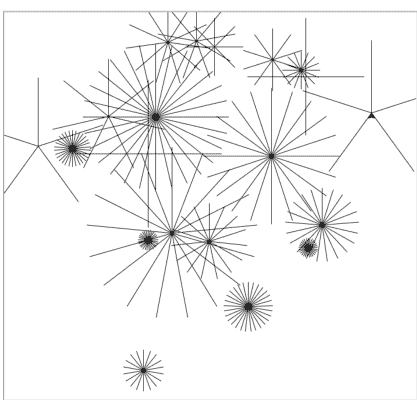
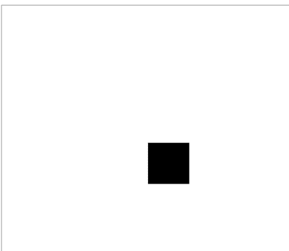
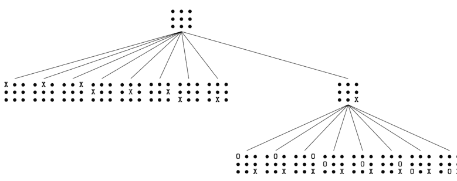
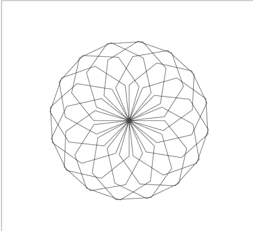

# Python 入门指南

## 序言

《Python 零入门》作者 John Whitingon 采用了一种无需先验知识的方法来教授一种现代通用编程语言。每个短小且独立的章节都介绍一个新主题，层层深入，直到读者能够编写出实质性的程序。书中有很多问题，更重要的是，还有详细的答案和提示。

《Python 零入门》将吸引初学者，以及渴望探索新语言的经验丰富的程序员。它适用于本科或研究生课程的正式教学，也适合感兴趣的业余爱好者。

JOHN WHINGTON 创立了一家销售文档处理软件的公司。他曾在剑桥大学向计算机系的学生教授编程。他的其他书籍包括教材《PDF Explained》（O'Reilly, 2012）、《OCaml from the Very Beginning》（Coherent, 2013）、《Haskell from the Very Beginning》（Coherent, 2019）以及科普读《A Machine Made this Book: Ten Sketches of Computer Science》（Coherent, 2016）。

作者其他作品：

PDF Explained (O'Reilly, 2012)

OCaml from the Very Beginning (Coherent, 2013)

More OCaml: Methods, Algorithms & Diversions (Coherent, 2014)

A Machine Made this Book: Ten Sketches of Computer Science (Coherent, 2016)

Haskell from the Very Beginning (Coherent, 2019)

## 序言

我试图写一本不需要先验知识的书——任何有智力的人都应该能够胜任，同时力求保持足够的简洁，让习惯了其他语言的程序员不会对教学进度或语调感到太反感。

这可能不是你读的最后一本 Python 书，但 Python 的乐趣之一在于，通过一组相对简单的构造就可以快速构建出实质且实用的程序。正如我们在四个扩展项目中看到的，书中的内容足够构建此类实用程序。

答案和提示位于书末。

在第 1 章中，我们将通过一系列准备工作开始对 Python 的探索，介绍如何计算整数、相互比较以及打印它们。我们将学习布尔值和 Python 支持的其他简单数据类型。

在第 2 章中，我们将编写自己的小型 Python 程序，使用函数根据变化的输入来执行计算。我们将使用条件结构来做决定以选择不同的行动方案。

在第 3 章中，我们将学习重复执行动作的 Python 构造，执行固定次数或直到满足特定条件。我们将构建更有实用的程序，包括依赖于键盘输入的交互式程序。

在第 4 章中，我们将开始通过将大量数据组合成列表、查询并处理它们来构建大数据。这大大扩展了我们能编写的程序范围。

在第 5 章中，我们将扩展列表操作来处理字符串，将其拆分为单词、进行处理并重新组合。我们将学习如何对列表排序，以及如何使用列表推导式从零构建列表。

在第 6 章中，我们将学习如何向屏幕打印消息和数据，并利用此来格式化数据。我们将学习如何打印格式良好的表格。

在第 7 章中，我们将学习另一种存储数据的方法：字典。我们将学习如何使用集合。

在第 8 章中，我们将处理当输入意外时该怎么办。我们将学习如何处理错误。

在第 9 章中，我们将学习处理文件。我们将学习如何从文件中读取内容。

在第 10 章中，我们将讨论其他数字。

在第 11 章中，我们将介绍标准库。

在第 12 章中，我们将构建更大的程序。

这本书关于通过编写程序教计算机做新事物。正如人类有不同的语言来交流，人类也有不同的编程语言来与计算机交流。

我们将使用一种名为 Python 的语言。你的电脑上可能已经有了 Python 系统，或者你可能需要在互联网上找到并安装它。当你看到类似的内容时，你就知道它运行正常了：

```
Python 3.8.2 (default, Feb 24 2020, 18:27:02)
[clang 10.0.1 (clang-1001-0.46.4)] on darwin
Type "help", "credits" or "license" for more information.
>>>
```

确保第一行中的 Python 版本号（这里是 3.8.2）至少是 3。你可能需要输入 `python3` 而不是 `python` 来实现这一点。Python 正在等待你输入。尝试输入 `1 + 2` 然后按回车。你应该看到：

```
Python
>>> 1 + 2
3
>>>
```

（我们简写了 Python 的欢迎信息）。Python 告诉我们计算结果。你可以使用键盘上的左右方向键来纠正错误，使用上、下方向键查看之前的输入历史。如果你喜欢，也可以使用电脑常用的复制和粘贴功能，而不是直接在 Python 中输入。

若要放弃输入并让 Python 忘记你已经输入的内容，请按 `ctrl-c`（按住 ctrl 键并点 c 键）。这将允许你重新开始。要完全退出 Python，给出 `exit()` 命令，同样按回车键：

```
Python
>>> exit()
```

你会发现自己回到了之前的地方。我们准备好开始了。

# 1. 开始

在本章及其问题中，我们将涵盖大量内容，因为我们需要一个坚实的基础来在此基础上构建。你应该边看着运行 Python 的电脑边阅读。

## 表达式与语句

用 Python 编写计算机程序由语句和表达式组成。每个语句执行某些操作。例如，内置的 `print` 语句会将内容写入屏幕：

| Python | |

|---|---|---|

| >>> print('Just like this') | 注意括号和单引号 |

| Just like this | |

每个表达式执行某些计算并产生一个值。例如，我们可以使用整数（whole numbers or integers）计算一个简单数学表达式的结果：

```python
Python
>>> 1 + 2 * 3
7
```

当 Python 计算出此表达式的结果时，它会将其打印到屏幕上，即使我们没有没有使用 `print`。我们所有的程序都由语句和表达式组成。

我们 `print` 语句中的单引号表示我们打印的是一个字符串——字母或其他符号的序列。如果字符串要包含单引号，我们必须使用双引号键：

```python
Python
print('Can't use single quotation marks here!')
File "stdin", line 1
  print('Can't use single quotation marks here!')
    ^
SyntaxError: invalid syntax
```

```python
>>> print('Can't use single quotation marks here!')
Can't use single quotation marks here!
```

注意这是一个不同的键——我们并不是在键盘上尝试两个引号——它不是 ' '。当然，我们也可以打印数字：

```python
Python
>>> print(12)
12
```

注意 `12` 和 `'12'` 是不同的：一个是整数（integer）`12`，另一个是由两个符号 `1` 和 `2` 组成的字符串。还要注意仅仅是字符串的表达式与打印字符串的语句之间的区别：

```python
Python
>>> 'Just like this'
'Just like this'
>>> print('Just like this')
Just like this
```

## 数字

当然，我们已经看到了如何使用数字进行数学计算：

```python
Python
>>> 1 + 2 * 3
7
```

即使是相当大的计算：

```python
Python
>>> 1000000000 + 2000000000 * 3000000000
6000000001000000000
```

使用下划线 `_` 键分隔数字是可选的，但有助于提高可读性：

```python
Python
>>> 1_000_000_000 + 2_000_000_000 * 3_000_000_000
6000000001000000000
```

Python 将数学表达式 `1 + 2 * 3` 简化为值 `7` 然后将其打印到屏幕。这个表达式包含了运算符 `+` 和 `*` 以及操作数 `1`、`2` 和 `3`。

Python 如何知道计算 `1 + 2 * 3`？它遵循与我们一样的已知规则。我们知道这里的乘法应该在加法之前执行，Python 如此。因此计算如下：

$$1+2\times3$$

$$\implies 1+6$$

$$\implies 7$$

每个阶段处理的部分带有下划线。我们说乘法运算符的优先级高于加法运算符。以下是 Python 的一些算术运算符：

| 运算符 | 描述 |

|---|---|

| a + b | 加法 |

| a - b | 从 a 中减去 b |

| a * b | 乘法 |

除了关于 `*` 在 `+` 和 `-` 之前执行的规则外，我们还需要一条规则来规定 `9 - 4 + 1` 的含义。它是 `(9 - 4) + 1`（等于6），还是 `9 - (4 + 1)`（等于4）？与普通算术一样，Python 中是前者：

```python
Python
>>> 9 - 4 + 1
6
```

这被称为运算符的**结合性**（associativity）。

## 真与假

当然，有很多不仅仅是数字。有时候，我们不想讨论数字，而是讨论真假：某事是真的，要么不是。为此我们使用**布尔值**（boolean values），它以开创其用法的英国数学家乔治·布尔（George Boole, 1815–1864）命名。只有两个布尔值：

True

False

我们如何使用这些值？一种方法是使用**比较运算符**（comparison operators），它们用于比较值与值之间的关系：

```python
Python
>>> 99 > 100
False
>>> 4 + 3 + 2 + 1 == 10
```

最重要的是不要混淆 `==` 和 `=`，因为单个 `=` 符号在 Python 中有其他含义。以下是比较运算符：

| 运算符 | 描述 |

|---|---|

| a == b | 如果 a 和 b 相等，则为真 |

| a < b | 如果 a 小于 b，则为真 |

| a <= b | 如果 a 小于等于 b，则为真 |

| a > b | 如果 a 大于 b，则为真 |

| a >= b | 如果 a 大于等于 b，则为真 |

| a != b | 如果 a 不等于 b，则为真 |

有两个组合布尔值（例如比较运算符产生的结果）。如果表达式 `a` 和 `b` 都为 `True`，则表达式 `a and b` 的结果为 `True`。如果表达式 `a` 或 `b` 至少有一个为 `True`，则表达式 `a or b` 的结果为 `True`。

到目前为止，如果我们想在单个表达式中使用两次或多次子表达式，我们必须多次输入它：

```
Python
>>> 200 * 200 * 200
8000000
```

相反，我们可以定义自己的名称来代表表达式求值的结果，然后随心所欲使用该名称：

```
Python
>>> x = 200
>>> x * x * x
8000000
```

我们可以更新与名称关联的值并再次尝试计算：

```
Python
>>> x = 200
>>> x * x * x
8000000
>>> x = 5 + 5
>>> x * x * x
1000
```

正有了这种改变与名称关联的值的能力，像 x 这样的东西被称为**变量**。我们可以为变量使用任何我们喜欢的名称，只要它不与 Python 的任何内置关键字冲突：

- and as assert async await break class def elif else except finally from global if import in lambda nonlocal not or or pass return try while yield

在 Python 中，我们使用小写字母或单词作为变量名。例如 x、weight 或 total。如果想使用多个单词，我们用下划线进行分隔。例如 first_string 或 total_of_subtotals。

## 函数

我们可以创建一个函数，它的值依赖于某些输入。我们称这种输入为**参数**（argument）——我们将在书后面使用 "input" 一词来表示不同的意思：

```
Python
>>> cube(x): return x * x * x
...
>>> cube(10)
1000
>>> answer = cube(20)
>>> answer
8000
```

注意，在定义函数时我们必须按两次回车键：我们稍后会发现为什么。这个 `cube` 函数定义由哪些部分组成？我们写下 `def`，后面跟着函数名、括号里的参数以及冒号。然后，我们计算 `x * x` 并使用 `return` 将值返回给我们。

我们需要 `return` 这个词，是因为并不是所有的函数都会返回内容。例如，这个函数会将给它的字符串两次打印到屏幕上，但并没有返回任何值：

```
Python
>>> def print_twice(x):
...   print(x)
...   print(x)
...

>>> print_twice('Ha')
Ha
Ha

>>> print_twice(1)
1
1
```

注意这个函数跨越了多行。它可以处理字符串和数字。现在你可以看到为什么在定义 `cube` 和 `print_twice` 函数时需要按两次回车了——这样 Python 就知道我们何时完成了一个多行函数的输入。

`print_twice` 中的每个 `print(x)` 行都缩进（通过插入四个空格向右移动）。这有助于我们清晰地展示程序的结构，而且实际上这是一项要求——如果不这样做，Python 会报错：

```
Python
>>> def print_twice(x):
...   print(x)
...   File "<stdin>", line 2
...   print(x)
...^
IndentationError: expected an indented block
```

在你学习如何正确缩进 Python 程序时，你会经常遇到这个错误。

我们可以使用 `if else` 关键字来构建一个根据某些测试进行选择的函数。例如，这里有一个判断整数是否为负数的函数：

```Python
>>> def neg(x):
    if x < 0:
        return True
    else:
        return False
```

我们可以这样测试它：

```Python
>>> neg(1)
False
>>> neg(-1)
True
```

注意这个函数中每个部分的缩进，在每一个以冒号 `:` 结尾的行之后，同样，这是要求的。如果写得下，我们可以用更少的行来写：

```Python
>>> def neg(x):
    if x < 0: return True
    else: return False
```

当然，我们的函数等同于直接写：

```Python
>>> def neg(x):
    return x < 0
```

因为 `x < 0` 就会求值为相应的布尔值——如果 x < 0 则为 True，否则为 False。这是另一个函数，这次是为了判断给定的字符串是否为元音：

```Python
>>> is_vowel(s):
    return s == 'a' or s == 'e' or s == 'i' or s == 'o' or s == 'u'
>>> is_vowel('x')
False
>>> is_vowel('u')
True
```

如果我们需要测试多一个条件，可以使用 `elif` 关键字（"else if" 的缩写）

```Python
>>> def sign(x):
    if x < 0: return -1
    elif x == 0: return 0
    else: return 1
```

这个函数返回数字的符号，无论其大小如何。当然，通过额外的缩进，可以在不使用 `elif` 的情况下编写。你能看到吗？

函数可以有多个参数。例如，这里有一个检查两个数字之和是否为十的函数：

```Python
>>> def add_to_ten(a, b):
...    return a + b == 10
>>> add_to_ten(6, 4)
True
>>> add_to_ten(6, 5)
False
```

```python
>>> def double(x):
...     x * 2
>>> double(5)
>>>
```

在这种情况下，Python 接受了该函数，但我们只在尝试使用它时才发现了自己的错误。

我们学习了如何为我们的值命名，以便在不同的语文中使用和重用它们，并更新与这些名称关联的值。我们编写了结果取决于一个或多个参数的函数，包括多行函数。我们看到了如何根据与名称关联的值的测试来选择行动方案。

最后，我们实验了递归函数来对一个或多个参数进行重复处理。尽管如此，我们已经解释了 Python 中并不通常使用递归。在下一章中，我们将引入 Python 用于重复操作或计算的标准机制。

问题 5–8 是可选的——我们在 Python 中并不经常使用递归函数。

1. 编写一个函数，将给定的数字乘以10。

2. 编写一个函数，如果它的两个参数都非零，则返回 True，否则返回 False。

3. 编写一个函数 `volume`，给定箱子的宽度、高度和深度，计算其体积。再写另一个函数 `volume_ten_deep`，它将深度固定为 10。它应该通过使用你的 `volume` 函数来实现。

4. 编写一个函数 `is_consonant`，给定一个 'a'-'z' 范围内的小写字母，确定它是否为辅音。


5. 你能建议一种方法来防止阶乘函数在零或负数参数的情况下不终止吗？

6. 编写一个递归函数 `sum_nums`，给定一个数字 n，计算和 1 + 2 + 3 + ... + n。

7. 编写一个递归函数 `power(x, n)`，计算 x 的 n 次方。

8. 编写一个递归函数来列出数的因数。例如，`factors(12)` 应该打印：

1

2

3

4

6

12

从现在起，不再显示实际的 Python 会话...

```python
>>> def factorial(n):
...     if n == 1:
...         return n
...
...     else:
...         return n * factorial(n - 1)
```

```python
factorial(n):
    if n == 1:
        return n
else:
    return n * factorial(n - 1)
```

事实上，这就是 Python 程序的通常编写方式：写在 `.py` 扩展名的文本文件中，而不是直接输入到 Python 中。

我们可以使用 `from ... import ...` 结构从 Python 访问程序。假设我们有一个文件 `script.py`，其内容如上面的框所示，我们可以这样写：

```python
>>> from script import factorial
>>> factorial(4)
24
```

我们可以使用 `from ... import *` 导入脚本中的所有定义。当你在文本编辑器中对 `script.py` 文件进行更改（并保存文件）后，必须重启 Python 并重新导入脚本。

你会注意到，在运行导入语句后，`script.py` 旁边出现了 `__pycache__` 目录。这是 Python 内部使用的，如果你愿意，可以丢弃它。

在上一章中，我们使用递归来执行次数变化的计算，并注意了它在 Python 中的局限性。在本章中，我们学习了 Python 处理此类情况的普通方法。

`for in range(a, b)` 结构可以执行固定次数的操作。例如，依次打印范围内的每个数字：

```python
for x in range(0, 5):
    print(x)
```

`for` 结构（或我们称为循环）内部的表达式会执行指定的次数。我们看到根据与名称关联的值的测试来选择行动方案（注：此处原文似乎重复或逻辑混乱，已按字面翻译）。

*(注：原文文本后续部分出现了大量逻辑重复和断层，如“We have seen how to...”重复出现，翻译已根据你的指令对提供的原文进行了逐行对应处理。)*

这被称为局部变量。在我们的第一个例子中，`entered` 是一个全局变量。
如果我们想使用全局变量，我们会这样写：

```python
entered = ''
def ask_for_password():
    global entered
    while entered != 'please':
        print('Please enter the password')
        entered = input()
```

然而，这个程序有一个缺陷。如果我们运行两次这个版本的 `ask_for_password` 函数，在第二次运行时，变量 `entered` 里面已经包含了正确的密码。因此，Python 通过要求显式声明全局变量来警告我们全局变量的危险性是正确的。我们在本书书中将不再使用 `global`。

在构建 `for` 循环时，记住 `range` 是重要的，否则我们可能会遇到一个糟糕的惊喜：

```python
>>> for x in (0, 5):
... print(x)
...
0
5
```

正如我们已经提到的，记住范围从第一个数字开始，在第二个第二个数字之前停止是非常重要的：

```python
>>> for x in range(1, 10):
... print(x)
...
1
2
3
4
5
6
7
8
9
```

这些被称为半开区间。对于初学者来说它们并不直观，但对于经验丰富的程序员来说，它们更方便，可以确保重要的属性成立。例如，`len(range(a, b)) == b - a`。

当你开始编写带有 `input` 的程序时，总会有意外输入导致的问题。例如，期望一个数字并使用内置的 `int` 函数（它将字符串转换为数字）：

```python
>>> a = input()
bob
>>> int(a)
Traceback (most recent call last):
File "<stdin>", line 1, in <module>
ValueError: invalid literal for int() with base 10: 'bob'
```

在书中，我们将看到如何处理这种情况。

我们学习了重复语句的两种方法：用于已知次数的 `for` 循环，以及在预未知次数时使用的 `while` 循环。在此过程中，我们通过 `str` 和 `int` 在字符串和数字之间进行转换，学习了如何自定义 `print` 函数，从较小的字符串构建更大的字符串，并计算了字符串的长度。我们开始构建交互式程序，接受用户的输入。

我们现在拥有了工具来构建更广泛、更有趣的程序类型。

- 1. `range` 结构可以接收一个额外的第三个参数，即步长（step）。例如 `range(0, 10, 2)` 将迭代 0, 2, 4, 6 和 8。使用这个参数写一个函数 `print_down`，它与我们的 `print_upto` 相同，但按倒序顺序计数数字。

- 2. 我们的乘法表函数即使在最终版本中也可能留出过多空间。这发生在只有最后一列包含最长数字时，例如：

```python
>>> times_table(10)
1 2 3 4 5 6 7 8 9 10
2 4 6 8 10 12 14 16 18 20
3 6 9 12 15 18 21 24 27 30
| 4 8 12 16 20 24 28 32 36 40 |
| 5 10 15 20 25 30 35 40 45 50 |
| 6 12 18 24 30 36 42 48 54 60 |
| 7 14 21 28 35 42 49 56 63 70 |
| 8 16 24 32 40 48 56 64 72 |
| 9 18 27 36 45 54 63 71 81 
| 10 20 30  0  0 0  00 |
```
只有第一列有三位数。修改该函数以修复此。

- 3. 写一个函数 `count_spaces` 来统计字符串中的空格数量。

- 4. 修复我们的 `print_spaced` 函数以删除多余的空格。提示：内置函数 `len` 可以用来查找字符串的长度。

- 5. 写一个打印句子的函数，让用户输入并按回车。检查是否正确并打印适当的消息。如果不正确，继续。

- 6. 通过直接向 `input` 函数提供文本来简化我们的密码示例。将特殊字符串 `'\n'`（换行符）添加到末尾。通过使用 `pass` 关键字来进一步简化。

- 7. 使用 `input` 函数写一个交互式猜数字游戏。例如：

```python
>>> guessing_game()
Guess a number between 1 and 100
50
Lower!
15
Higher!
40
Lower!
Correct! You took 5 guesses.
```
你需要使用 `int` 将字符串转换为整数。1 到 100 之间的任意数字可以通过以下获得：

```python
>>> import random
>>> random.randint(1, 100)
44
```
（注意我们也可以使用 `randint`。）

- 8. 写一个函数打印摩斯密码的消息。表格如下：

| A | ..- | B | ... | C | -.-. | D | -.. | E | . | F | ..-. | G | --. | H | .... |
| I | .. | J | .--- | K | -.- | L | |.-.. | M | -- | N | -. | O | --- |
| P | ..--. | Q | --.- | R | ..-. | S | ... | T | - | U | ..- | V | ...- | W | .-- | X | -..- | Y | -.-- | Z | --.. |

字母之间应该是三个空格。

我们已经见过数字、字符串和布尔值的简单值，但还没有见过如何将它们组合成更大的结构。现在我们来看。

Python 中的列表是元素的有序序列。这里是表示前几个数字的列表：

```python
['zero', 'one', 'two', 'three', 'four', 'five']
```

同样，我们可以在列表中放入数字或布尔值，或者空列表写为 `[]`。这里是前几个质数：

```python
[2, 3, 5, 7, 11, 13]
```

我们可以用 `len` 找到列表的长度，就像我们用它找到字符串的长度一样：

```python
>>> len([2, 3, 5, 7, 11, 13])
```

混合不同类型的元素可能的：`['one', False]`。我们在书中不会这样做。

我们可以从列表中获取单个元素（第一个元素是数字 0）：

```python
>>> list = ['zero', 'one', 'two', 'three', 'four', 'five']
>>> list[0]
'zero'
>>> list[5]
'five'
>>> list[6]
Traceback (most recent call last):
File "<stdin>", line 1, in <module>
IndexError: list out of range
```

注意超出范围时的错误。第一次就正确编写大型程序并不常见，我们经常需要追踪并修正错误。

我们可以使用 `for` 循环遍历列表的元素，就像我们之前使用 `range` 遍历数字范围一样：

```python
>>> for x in list:
    print(x + ' has ' + str(len(x)) + ' letters.')
...
zero has 4 letters.
one has 3 letters.
two has 3 letters.
three has 5 letters.
four has 4 letters.
five has 4 letters.
```

这种机制与我们之前在循环使用的 `range` 函数之间存在联系。我们可以使用 `list` 函数从范围构建列表：

```python
>>> list(range(1, 10))
[1, 2, 3, 4, 5, 6, 7, 8, 9]
```

```python
>>> list(range(1, 10, 3))
[1, 4, 7]
```

事实上，我们可以写一个循环来从范围创建一个列表：

```python
>>> for x in list(range(1, 5)):
    print(x)
...
1
2
3
4
```

这与简单编写 `range(1, 5)` 的效果相同，但多余地构建了数字列表。当我们单独使用 `range` 时不会创建这样的中间列表。

有时我们需要列表中的索引以及该索引处的项。通过使用 `enumerate` 并给出两个名字——一个用于索引，一个用于值——我们可以轻松地做到：

```python
>>> for i, elt in enumerate([1, 2, 4, 8, 16]):
    print('2 to the power ' + str(i) + ' is ' + str(elt))
...
2 to the power 0 is 1
2 to the power 1 is 2
2 to the power 2 is 4
2 to the power 3 is 8
2 to the power 4 is 16
```

可以使用所谓的切片（slice）选取列表的部分。切片使用起始和停止位置来定义：

```python
>>> list = ['zero', 'one', 'two', 'three', 'four', 'five']
>>> list[1:4]
['one', 'two', 'three']
>>> list[1:6]
['one', 'two', 'three', 'four', 'five']
>>> list[0:6]
['zero', 'one', 'two', 'three', 'four', 'five']
```

注意，停止值定义的是该位置之前，就像范围一样。我们可以省略起始值或停止值。这将将其扩展到列表省略的末端：

```python
>>> l = ['zero', 'one', 'two', 'three', 'four', 'five']
>>> l[1:4]
['one', 'two', 'three']
>>> l[1:]
['one', 'two', 'three', 'four', 'five']
```

即使切片只包含一个值，它也是一个包含一个元素的列表，而不仅仅是元素本身：

```python
>>> l = ['zero', 'one', 'two', 'three', 'four', 'five']
>>> l[4:5]
['four']
```

如果切片不包含任何值，它为空列表 `[]`：

```python
>>> l = ['zero', 'one', 'two', 'three', 'four', 'five']
>>> l[4:4]
[]
```

切片中的负数是从列表末尾开始计数的：

```python
>>> l = ['zero', 'one', 'two', 'three', 'four', 'five']
>>> l[-3:-1]
['three', 'four']
```

我们可以向列表的末尾添加元素：

```python
>>> l = ['zero', 'one', 'two', 'three', 'four', 'five']
>>> l.append('six')
>>> l
['zero', 'one', 'two', 'three', 'four', 'five', 'six']
```

像 `append` 这样的函数通过在值本身后加点来访问，它们被称为方法。注意列表 `l` 被修改了，而不是返回一个新列表。我们可以使用与连接列表和字符串相同的 `+` 运算符来连接列表。

```python
>>> l1 = [1, 2, 3]
>>> l2 = [4, 5, 6]
>>> l1 + l2
[1, 2, 3, 4, 5, 6]
```

列表 `l1` 和 `l2` 保持不变。

我们已经，与字符串不同，列表是可以修改的。列表是可变的（来自单词 `mutate`，意为改变改变）。事实上，我们可以更改现有的元素，也可以添加元素：

```python
>>> l1 = ['zero', 'one', 'two', 'three', 'four', 'five']
>>> l1[0] = 'nought'
['nought', 'one', 'two', 'three', 'four', 'five']
```

当然，我们可以从列表中删除元素。我们使用内置的 `del` 结构：

```python
>>> l1 = ['zero', 'one', 'two', 'three', 'four', 'five']
>>> del l1[1]
['zero', 'two', 'three', 'four', 'five']
```

`del` 结构也可以用于切片：

```python
>>> l1 = ['zero', 'one', 'two', 'three', 'four', 'five']
>>> del l1[1:3]
['zero', 'four', 'five']
```

或者，如果我们提取一个元素并同时将其删除，可以使用 `pop` 方法：

```python
>>> l1 = ['zero', 'one', 'two', 'three', 'four', 'five']
>>> l1.pop(1)
'one'
['zero', 'two', 'three', 'four', 'five']
```

列表上的 `remove` 方法允许我们通过提供实际索引来删除元素：

```python
>>> l1 = ['zero', 'one', 'two', 'three', 'four', 'five']
>>> l1.remove('two')
['zero', 'one', 'three', 'four', 'five']
```

如果列表包含多个元素，让我们使用 `insert` 方法将其放回原始位置：

```python
>>> l1 = ['zero', 'one', 'two', 'three', 'four', 'five']
>>> l1.insert(2, 'two')
['zero', 'one', 'two', 'three', 'four', 'five']
```

由于列表是可变的，有时需要复制列表——简单的赋值不会复制它。对于这一点，我们可以使用 `copy` 方法：

```python
>>> l1 = ['zero', 'one', 'two', 'three', 'four', 'five']
>>> l2 = l1.copy()
>>> l1[0] = 'nought'
>>> l1
```


['nought', 'one', 'two', 'three', 'four', 'five']

>>> l2

['zero', 'one', 'two', 'three', 'four', 'five']

我们可以使用 `in` 或 `not in` 测试元素是否为列表的成员：

```python
>>> l1 = ['zero', 'one', 'two', 'three', 'four', 'five']
>>> 'two' in l1
True
>>> 'six' not in l1
True
```

只要元素存在，我们就可以使用 `index` 找到首次出现的索引：

```python
>>> l1 = ['zero', 'one', 'two', 'three', 'four', 'five']
>>> l1.index('two')
2
```

或者，我们可以统计元素出现的次数：

```python
>>> l1 = ['zero', 'one', 'two', 'three', 'four', 'five']
>>> l1.count('zero')
1
>>> l1.count('six')
0
```

在练习中，我们将使用这些机制中的许多，以及探索如何构建处理列表的函数。

## 常见问题

当我们构建包含位置的复合数据结构时，很容易弄错位置：

```python
>>> l1 = ['one', 'two', 'three']
>>> l1[1]
'two'
```

同样严重，我们可能会尝试使用一个不存在的位置：

```python
>>> l1[3]
Traceback (most recent call last):
File "<stdin>", line 1, in <module>
IndexError: list index out of range
```

通常，这些错误只有在程序运行了一会儿后才会暴露——当许多输入成功后，恰好遇到了一个失败的输入。这类错误特别难以追踪。它们也发生在从列表中删除元素时：

```python
>>> l1 = ['zero', 'one', 'two', 'three', 'four', 'five']
>>> del l1[3]
Traceback (most recent call last):
File "<stdin>", line 1, in <module>
IndexError: list assignment out of range
```

当然，在查找时也是如此：

```python
>>> l1 = ['zero', 'one', 'two', 'three', 'four', 'five']
>>> l1.remove('zero')
Traceback (most recent call last):
File "<stdin>", line 1, in <module>
ValueError: list.remove(x): x not in list
```

在这种情况下，我们可以先检查元素是否在列表中，只有在确定元素存在时使用 `index`。在书的后面，我们将学习另一种方法：让错误发生，然后处理并从中恢复。

另一个问题关于我们对 `range` 的使用。Python 中的 `range` 不是列表：

```python
>>> range(1, 10)
range(1, 10)
```

为了将其转换为列表，我们可以使用 `list`：

```python
>>> list(range(1, 10))
[1, 2, 3, 4, 5, 6, 7, 8, 9]
```

例如，我们可以尝试连接两个范围：

```python
>>> range(1, 10) + range(2, 10)
Traceback (most recent call last):
File "<stdin>", line 1, in <module>
TypeError: unsupported operand type(s) for +: 'range' and 'range'
```

这种混淆是因为在 `for` 结构中，我们可以直接使用 `range` 而不需要转换为列表。

## 总结

在本章中，我们介绍了列表，我们的第一个数据结构。我们通过添加和删除操作了列表。我们遍历了列表并测试了元素的成员。我们可以编写的有趣程序范围进一步扩大。在下一章，我们将查看一些高级列表功能。

## 练习

- 1. 写一个函数返回列表的第一个元素，以及一个函数 `last` 返回列表的最后一个元素。你可以假设列表不为空。
- 2. 写一个函数构建一个给定列表的反转的新列表。
- 3. 写一个函数打印列表中的最小值和最大值。你可以假设列表不为空。
- 4. 除了起始和停止位置，切片还可以有第三部分，步长（就像范围中的步长一样）。例如 `[0:10:2]`。写一个函数 `even` 返回包含给定列表中偶数位置 0, 2, ... 元素的列表。
- 5. 切片中的负值从后到往前选择元素。使用此来让你的反转函数更简单。
- 6. 写一个函数 `set`，接收一个可能包含重复元素的列表，并构建一个没有重复元素的新列表。例如，`set([1, 2, 3, 2])` 可能会产生 `[1, 2, 3]`。
- 7. 写一个函数 `histogram` 打印列表中元素的频率表。你可以使用刚刚编写的 `set` 函数来帮助。
- 8. 成员测试也适用于字符串。使用它写一个函数检查三个给定的单词是否都在一个句子中。
- 9. 写一个函数 `copy_list`，以相同方法的方法复制列表，但不使用该方法。
- 10. 使用你的 `copy_list` 函数写一个函数，以 `remove` 方法从列表中删除元素，但返回一个新列表。
- 11. 凯撒密码是一种制作秘密消息的原始方法。字母表被进行了旋转（这里我们从 Q 而不是 A 开始）。下行中的每个字母都是上行字母的替换。例如，这是一个加密消息：

编写一个函数来生成旋转字母表，支持任何给定的旋转量。现在为消息编写编码和解码函数。
- 12. 使用列表来改进你对上一章摩斯密码问题的回答，使用列表来存储代码和字母数据——而不是像以前那样使用一个巨大的 `if` 结构。
- 13. 随机生成一个四位数字秘密代码（参见上一章第 7 题）。用户反复猜测，并告知 a) 有几个数字正确且位置正确；b) 有几个数字正确但位置错误。重复直到用户得到正确答案。

# 5. 列表与字符串的进阶

我们已经学习了列表操作的基础知识并进行了练习。在这一章中，我们将进一步探索列表，包括它们与字符串的关系。在此过程中，我们学习了一些字符串方法。最后，我们将尝试三种高级列表操作技术。

## 分割与合并

我们可以使用内置的 `list` 函数将字符串拆分为由字母组成的列表，每个字母都是一个字符串：

```python
>>> l = list('tumultuous')
>>> l
['t', 'u', 'm', 'u', 'l', 't', 'u', 'o', 'u', 's']
```

我们可能认为可以使用熟悉的内置函数来实现反操作，但那会构建一个显示 Python 如何打印列表的字符串：

```python
>>> str(l)
"['t', 'u', 'm', 'u', 'l', 't', 'u', 'o', 'u', 's']"
```

我们可以自己写一个函数来实现它：

```python
def join(l):
    s = ''
    for x in l:
        s = s + x
    return s
```

结果如下：

```python
>>> l = list('tumultuous')
>>> l
['t', 'u', 'm', 'u', 'l', 't', 'u', 'o', 'u', 's']
>>> join(l)
'tumultuous'
```

正如你可能预料的那样，有一个内置的 `join` 函数：有些违背直觉的是，它是字符串的一个方法。我们指定一个空字符串，就能看到结果：

```python
>>> l = list('tumultuous')
>>> ''.join(l)
'tumultuous'
```

如果我们指定一个不同的字符串，它将改用于将字母胶在一起：

```python
>>> ' '.join(l)
't u m u l t u o s'
```

字符串的另一个方法是 `split`，它将给定字符串拆分为字符串列表，每个字符串对应原字符串中的单词：

```python
>>> s = ' once upon a time '
>>> s.split()
['Once', 'upon', 'a', 'time']
```

如你所见，多个空格被等同于单个空格，开头和结尾的空格会被忽略。

## 在其他字符串中查找字符串

`find` 方法返回字符串在另一个字符串中首次出现的索引：

```python
>>> s = 'Once upon a time'
>>> s.find('upon')
5
>>> s.find('not there')
-1
```

在其中一个问题中，你将被要求从零自己编写一个类似的函数。当然，我们可以在字符串上使用索引和切片：

```python
>>> s = 'Once upon a time'
>>> s[0]
'o'
>>> s[:4]
'Once'
>>> s[:-4]
'Once upon a '
>>> s[-4:]
'time'
```

因此，不需要将字符串转换为列表就可以利用这些有用的切片结构。我们可以结合这两种新技术，通过删除之后的所有内容来提取字符串中的第一个句子：

```python
>>> s = 'The first sentence. And the second...'
>>> pos = s.find('.')
18
>>> s[:pos + 1]
'The first sentence.'
```

当然，我们需要检查 `find` 是否返回 -1。如果返回了会发生什么？

## 排序

现在我们离开字符串回到列表。我们经常需要在进一步处理之前将列表按升序排序。这可以通过 `sort` 方法实现：

```python
>>> l = [1, 2, 3, 2, 1, 3, 2]
>>> l.sort()
[1, 1, 2, 2, 2, 3, 3]
```

列表是原地排序的。另一方面，`sorted` 函数返回列表的排序版本，保持原始数据不变。

```python
>>> l = [1, 2, 3, 2, 1, 3, 2]
>>> sorted(l)
[1, 1, 2, 2, 2, 3, 3]
```

当我们想要按顺序遍历列表但保留原始数据供以后使用时，这非常用。

## 两个有用函数：map 和 filter

有两个内置函数可以通过修改列表生成列表。第一个是 `map`，它将函数应用到列表的每个元素：

```python
>>> l = [1, 2, 3, 2, 1, 3, 2]
>>> def square(x): return x * x
>>> list(map(square, l))
[1, 4, 9, 4, 1, 9, 4]
```

第二个是 `filter`：

```python
>>> l = [1, 2, 3, 2, 1, 3, 2]
>>> def even(x): return x % 2 == 0
>>> list(filter(even, l))
[2, 2, 2]
```

你可以想象这些函数如何替代 `for` 循环，产生更短、更易理解的程序。作为程序员，我们花费大量时间阅读（或阅读他人编写的）程序，因此易理解性很重要。

## 迭代器

我们刚刚使用 `map` 写了这段代码：

```python
>>> l = [1, 2, 3, 2, 1, 3, 2]
>>> def square(x): return x * x
>>> list(map(square, l))
[1, 4, 9, 4, 1, 9, 4]
```

为什么我们需要用 `list` 将 `map` 的结果转换为列表？因为 `map` 返回的是一个迭代器而不是列表。迭代器是一种可以遍历数据结构但不返回列表的东西——它逐个返回元素。这意味着单个元素在需要时才被创建。我们可以对迭代器使用 `for` 循环，而无需将其列表化：

```python
>>> l = [1, 2, 3, 2, 1, 3, 2]
>>> def square(x): return x * x
>>> for x in map(square, l):
    print(x)
1
4
9
4
1
9
4
```

另一个返回迭代器的示例是 `reversed`：

```python
>>> reversed([1, 2, 3, 2, 1, 3, 2])
<list_reverseiterator object at 0x7fd45aa0dc0>
>>> list(reversed([1, 2, 3, 2, 1, 3, 2]))
[2, 3, 1, 2, 3, 2, 1]
```

如果我们在循环中使用 `reversed`，我们就不会注意到它返回的是一个迭代器而不是列表。Python 中的许多内置函数作用于任何可迭代结构，而不仅仅是列表：例如，`sum` 计算任何此类包含数字结构的和。

## 列表推导式

与其从一个列表生成另一个，或者通过重复的 `append` 或 `insert` 手动生成，我们还可以使用列表推导式从零构建列表。例如：

```python
>>> [x * x for x in range(10)]
[0, 1, 4, 9, 16, 25, 36, 49, 64, 81]
>>> [str(x) for x in range(10)]
['0', '1', '2', '3', '4', '5', '6', '7', '8', '9']
>>> [x % 2 == 0 for x in range(10)]
[True, False, True, False, True, False, True, False, True, False]
```

我们还可以在列表推导式末尾添加 `if` 来在内部提供过滤器。这里是一些也是偶数的立方：

```python
>>> [x * x * x for x in range(20) if (x * x * x) % 2 == 0]
[0, 8, 64, 216, 512, 1000, 1728, 2744, 4096, 5832]
```

此类推导式提供了一种简洁易读的方法生成符合某些标准的项列表，而无需使用 `for` 循环遍历它们。

## 常见问题

`join` 机制的奇怪写法——作为用于胶合其他内容的字符串方法——可能会导致困惑。例如考虑以下两个字符串：

```python
>>> x = 'marginal'
>>> y = ''
```

我们打算写以下代码：

```python
>>> y.join(x)
'marginal'
```

但如果我们获取字符串顺序错误，操作仍然成功，但结果不是我们想要的：

```python
>>> x.join(y)
''
```

字符串的 `find` 方法有一种我们以前没过的失败信号：它不是返回错误，而是正常返回但值为 -1。我们必须检查这一点，否则 -1 可能会无意中被程序的其余部分使用，例如在切片：

```python
>>> 'Once' [-1]
'e'
```

# 总结

我们学习了字符串和列表两种有序数据结构之间的一些联系。我们通过分割和合并字符串来操作它们，并在另一个字符串中查找。我们引入了重要的排序主题。我们看到了 `map` 和 `filter`，这些处理列表的强大机制。我们展示了迭代器如何简化处理列表的程序。最后，我们查看了列表推导式，这是一种一种或多种此类机制结合在一起的方法。

## 问题

- 1. 使用 `sort` 方法构建一个函数，返回返回给定句子中所有单词按字母顺序排序的列表。
- 2. 使用 `sorted` 编写一个类似的函数。
- 3. 使用排序方法使我们上一章第 7 题中的直方图函数生成按字母顺序排序的直方图。
- 4. 编写一个函数来移除字符串开头和结尾的空格，将字符串转换为字母列表，对其进行处理，然后将其转换回单个字符串。你可能会发现列表内置的 `reverse` 方法有用，或者使用另一种列表反转机制。
- 5. 你能找到一种更简单的方法来完成此任务吗？使用本章描述的内置方法。
- 6. 编写一个函数 `clip`，给定一个整数时，将其裁剪到 1...10 的范围内，使得大于 10 的整数降为 10，而小于 1 的整数向上取到 1。再写另一个函数 `clip_list`，它使用第一个函数并配合 `map` 将此裁剪操作应用于整个整数列表。
- 7. 编写一个函数来检测给定的字符串是否为回文（即等于其反转字符串）。现在使用 `filter` 编写一个函数，接收一个字符串列表并只返回回文字符串。然后写一个函数返回一个范围内所有回文数字的列表，例如 1331。
- 8. 用列表推导式的形式重写第 6 题中的 `clip_list` 示例。
- 9. 同样，用列表推导式的形式重写第 7 题中的回文数字检测器。

# 6. 更美的打印

我们一直在使用内置的 `print` 函数输出信息。然而，有时我们不得不使用 `+` 拼接许多小字符串，以将我们想要打印的数值插入句子中，或者使用某些不便的额外参数（如 `end=""`）来防止默认行为产生不理想的结果。在本章中，我们将回顾 `print` 函数，然后探索使用 Python 打印的更好方法。

## 回顾 `print` 函数

`print` 函数接收一个值。如果该值不是字符串，它会使用 `str` 将其转换为字符串。然后将其打印到屏幕上并通过打印换行符向下移动一行：


```python
>>> print('entrance')
entrance
>>> print(1)
1
>>> print([1, 2, 3])
[1, 2, 3]
```

我们有时通过使用参数来抑制换行：

```python
>>> print('entrance', end='')
entrance>>>
```

## 使用分隔符打印

我们可以为 `print` 函数提供更多或少的参数：

```python
>>> print()
>>> print('one', 'two', 'three')
one two three
```

我们看到不带参数的 `print` 只打印换行符。提供多个参数会将它们全部打印出来并用空格分隔。我们可以更改分隔符：

```python
>>> print('one', 'two', 'three', sep='-')
one-two-three
```

## 使用格式化字符串更简单的打印

`print` 函数很有用，但当我们通过所谓的格式化字符串（format strings）进行更复杂的打印时，它会变得相当笨拙。这里有一个按照传统方式打印数字列表中的最小值和最大值的函数：

```python
def print_stats(list):
    print(str(min(list)) + ' up to ' + str(max(list)))
```

（我们之前写过最小值和最大值函数，但它们实际上是 Python 内置的）。这里是它的用法：

```python
>>> print_stats([2, 3, 5, 7, 11, 13, 17, 19, 23, 29])
up to 29
```

现在，使用格式化字符串实现相同的函数：

```python
def print_stats(lst):
    minimum = min(lst)
    maximum = max(lst)
    print(f'{minimum} up to {maximum}')
```

有两点需要注意。第一，使用 `f'` 开始字符串而不是 `''`。第二，格式化字符串内部用大括号 `{}` 分隔的部分。这些部分中的变量名将被替换为这些变量的值。事实上，我们可以在大括号中放入整个表达式，进一步简化：

```python
def print_stats(lst):
    print(f'{min(lst)} up to {max(lst)}')
```

在这个例子中，我们可以看到，与重复的拼接相比，使用格式化字符串编写程序要易读得多。考虑一个打印幂次方表的函数（`**` 运算符将数字提升为幂）：

```python
def print_powers(n):
    for x in range(1, n):
        print(f'{x} {x ** 2} {x ** 3} {x ** 4} {x ** 5}')
```

与我们在第 3 章中的一样，列并没有对齐：

```python
>>> print_powers(9)
1 1 1 1 1
2 4 8 16 32
3 9 27 81 243
4 16 64 256 1024
5 25 125 625 3125
6 36 216 1296 7776
7 49 343 2401 16807
8 64 512 4096 32768
9 81 72
```

格式化字符串可以做到这一点，在大括号内指定 `:5d`。

## 打印到文件

而不是打印到屏幕，我们可以通过提供参数打印到文件：

## 问题

- 1. 使用 `sort` 方法构建一个函数，返回给定句子中所有单词按字母顺序排序的列表。
- 2. 使用 `sorted` 编写一个类似的函数。
- 3. 使用排序方法使我们上一章第 7 题中的直方图函数生成按字母顺序排序的直方图。
- 4. 编写一个函数来移除字符串开头和结尾的空格，将字符串转换为字母列表，对其进行处理，然后将其转换回单个字符串。你可能会发现列表内置的 `reverse` 方法有用，或者使用另一种列表反转机制。
- 5. 你能找到一种更简单的方法来完成此任务吗？使用本章描述的内置方法。
- 6. 编写一个函数 `clip`，给定一个整数，将其裁剪到 1...10 的范围内，使得大于 10 的整数降为 10，而小于 1 的整数向上取到 1。再写另一个函数 `clip_list`，它使用第一个函数并配合 `map` 将此裁剪操作应用于整个整数列表。
- 7. 编写一个函数来检测给定的字符串是否为回文（即等于其反转字符串）。现在使用 `filter` 编写一个函数，接收一个字符串列表并只返回回文字符串。然后写一个函数返回一个范围内所有回文数字的列表，例如 1331。
- 8. 用列表推导式的形式重写第 6 题中的 `clip_list` 示例。
- 9. 同样，用列表推导式的形式重写第 7 题中的回文数字检测器。

# 6. 更美的打印

我们一直在使用内置的 `print` 函数输出信息。然而，有时我们不得不使用 `+` 拼接许多小字符串，以将我们想要打印的数值插入句子中，或者使用某些不便的额外参数（如 `end=""`）来防止默认行为产生不理想的结果。在本章中，我们将回顾 `print` 函数，然后探索使用 Python 打印的更好方法。

## 回顾 `print` 函数

`print` 函数接收一个值。如果该值不是字符串，它会使用 `str` 将其转换为字符串。然后将其打印到屏幕上并通过打印换行符向下移动一行：

```python
>>> print('entrance')
entrance
>>> print(1)
1
>>> print([1, 2, 3])
[1, 2, 3]
```

我们有时通过使用参数来抑制换行：

```python
>>> print('entrance', end='')
entrance>>>
```

## 使用分隔符打印

我们可以为 `print` 函数提供更多或少的参数：

```python
>>> print()
>>> print('one', 'two', 'three')
one two three
```

我们看到不带参数的 `print` 只打印换行符。提供多个参数会将它们全部打印出来并用空格分隔。我们可以更改分隔符：

```python
>>> print('one', 'two', 'three', sep='-')
one-two-three
```

## 使用格式化字符串更简单的打印

`print` 函数很有用，但当我们通过所谓的格式化字符串（format strings）进行更复杂的打印时，它会变得相当笨拙。这里有一个按照传统方式打印数字列表中的最小值和最大值的函数：

```python
def print_stats(list):
    print(str(min(list)) + ' up to ' + str(max(list)))
```

（我们之前写过最小值和最大值函数，但它们实际上是 Python 内置的）。这里是它的用法：

```python
>>> print_stats([2, 3, 5, 7, 11, 13, 17, 19, 23, 29])
up to 29
```

现在，使用格式化字符串实现相同的函数：

```python
def print_stats(lst):
    minimum = min(lst)
    maximum = max(lst)
    print(f'{minimum} up to {maximum}')
```


有两点需要注意。第一，使用 `f'` 开始字符串而不是 `''`。第二，格式化字符串内部用大括号 `{}` 分隔的部分。这些部分中的变量名将被替换为这些变量的值。事实上，我们可以在大括号中放入整个表达式，进一步简化：

```python
def print_stats(lst):
    print(f'{min(lst)} up to {max(lst)}')
```

在这个例子中，我们可以看到，与重复的拼接相比，使用格式化字符串编写程序要易读得多。考虑一个打印幂次方表的函数（`**` 运算符将数字提升为幂）：

```python
def print_powers(n):
    for x in range(1, n):
        print(f'{x} {x ** 2} {x ** 3} {x ** 4} {x ** 5}')
```

与我们在第 3 章中的一样，列并没有对齐：

```python
>>> print_powers(9)
1 1 1 1 1
2 4 8 16 32
3 9 27 81 243
4 16 64 256 1024
5 25 125 625 3125
6 36 216 1296 7776
7 49 343 2401 16807
8 64 512 4096 32768
9 81 72
```

格式化字符串可以做到这一点，在大括号内指定 `:5d`。我们看到，使用格式化字符串编写程序比重复拼接要易读得多。格式化字符串可以做到这一点，在大括号内指定 `:5d`。我们看到，使用格式化字符串编写程序比重复拼接要易读得多。格式化字符串可以做到这一点，在大括号内指定 `:5d`。我们看到，使用格式化字符串...

## 打印到文件

而不是打印到屏幕，我们可以通过提供参数打印到文件：

在第 1 句的第 6 位找到 #

在第 2 句的第 4 位找到 #

在第 3 句未找到 #

8. 修改你对问题 7 的回答，将信息打印到指定名称的文件。

# 7. 整理数据

我们已经见过如何将值组合成列表。列表是有序的，并且是可变的（我们可以修改、插入或删除元素）。有时我们想要具有不同属性的复合值。在本章中，我们将研究三种结构：元组、字典和集合。我们将看到如何为适当的任务选择合适的结构：程序及其数据结构是紧密相连的。

## 元组

元组是一个固定长度的值集合，允许为整个结构命名，并可以像传递任何其他值一样传递它。它与列表有两个不同点：元组的长度是固定的，它们的元素不能被修改。以下是一些元组：

```python
>>> t = (1, 'one')
>>> t2 = (1, (1, 2), (1, 2, 3))
```

现在我们有两个元组：第一个 `t` 长度为 2，第二个 `t2` 长度为 3，其中包含了其他元组。我们可以通过赋值命名来拆解元组。这被称为解包（unpack）：

```python
>>> a, b = t
>>> a
1
>>> b
'one'
>>> c, d, e = t2
>>> c
1
>>> d
(1, 2)
>>> e
(1, 2, 3)
```

我们可以像平常一样将元组传递给函数，然后解包这些值。例如，这里有一个接收长度为 2 的单个元组并相两个数字的函数：

```python
>>> f(x):
  a, b = x
  ...
  return a + b
  ...

>>> pair = (1, 2)
>>> f(pair)
3
>>> f((1, 2))
3
>>> f(1, 2)
Traceback (most recent call):
File "<stdin>", line 1, in <module>
TypeError: f() takes 1 positional argument but 2 were given

```

我们还可以使用索引和切片从元组中选择项目：

```python
>>> t2 = (1, (1, 2), (1, 2, 3))
>>> t2[0]
1
>>> t2[::1]
((1, 2, 3), (1, 2, 1))
```

当然，在不知道元组长度的情况下执行此操作有时可能会困难。我们可以使用常用的 `len` 函数：

```python
>>> t2 = (1, (1, 2), (1, 2, 3))
>>> len(t2)
3
>>> len(t2[1])
2
```

元组是不可变的——与列表不同，我们不能改变它们的元素。

```python
>>> x = (1, 2)
>>> x[0] = 3
Traceback (most recent call last):
File "<stdin>", line 1, in <module>
TypeError: 'tuple' object does not support item assignment
```

当然，如果元组包含可变值（例如列表），我们可以改变该值内部的部分：

```python
>>> l = [1, 2, 3]
>>> t = (1, 1)
>>> l[0] = 4
>>> t
([4, 2, 3], [4, 2, 3])
```

## 字典

许多程序使用一种名为字典（dictionary）的结构。真正的字典用于将定义与单词关联起来；我们更泛地使用“字典”是指将唯一的键（如单词）与值（如定义）关联起来。例如，我们可能想存储关于某条路上每栋房子居住人数的信息：

| 房屋 | 人数 |

|---|---|

| 1 | 4 |

| 2 | 2 |

| 3 | 2 |

| 4 | 3 |

| 5 | 1 |

| 6 | 2 |

我们可以使用由元组表示的对列表来表示。但这样我们就必须自己编写各种函数来查找或替换条目。Python 为字典提供了一种特殊类型，它自动保留了每个键只关联一个值的属性。让我们从一个空字典 `{}` 开始，添加并更新一些条目：

```python
>>> d = {}
>>> d[1] = 4
>>> d
{1: 4}
>>> d[2] = 2
>>> d[3] = 2
>>> d[4] = 3
>>> d[5] = 1
>>> d[6] = 2
>>> d
{1: 4, 2: 2, 3: 2, 4: 3, 5: 1, 6: 2}
>>> d[6] = 8
>>> d
{1: 4, 2: 2, 3: 2, 4: 3, 5: 1, 6: 8}
```

当然，我们可以一次性写完整个：

```python
>>> d = {1: 4, 2: 2, 3: 2, 4: 3, 5: 1, 6: 2}
```

我们可以看到字典是无序的：

```python
>>> {1: 4, 2: 2} == {2: 2, 1: 4}
True
```

字典中的键必须是不可变的。例如，我们不能使用列表作为键。我们可以可以使用常用的 `in` 和 `not in` 测试来检查字典是否具有给定键的值：

```python
>>> d = {1: 4, 2: 2, 3: 2, 4: 3, 5: 1, 6: 2}
>>> 1 in d
True
```

```python
>>> 10 in d
False
```

```python
>>> 10 not in d
True
```

最后，删除通过常用的 `del` 语句执行，只需提供键：

```python
>>> d = {1: 4, 2: 2, 3: 2, 4: 3, 5: 1, 6: 2}
>>> del d[2]
>>> d
{1: 4, 3: 2, 4: 3, 5: 1, 6: 2}
```

## 遍历字典

我们如何遍历字典？我们可以使用 `for` 循环：

```python
>>> d = {1: 4, 2: 2, 3: 2, 4: 3, 5: 1, 6: 2}
for key, value in d.items():
    print(key, value)
1 4
2 2
3 2
4 3
5 1
6 2
```

或者，我们可以遍历键：

```python
for key in d:
    print(key)
1
2
3
4
5
6
```

或者是值：

```python
for value in d.values():
    print(value)
4
2
2
3
1
2
```

我们也可以在遍历时删除项目：

```python
>>> d = {1: 4, 2: 2, 3: 2, 4: 3, 5: 1, 6: 2}
for key in list(d.keys()):
    if key < 4:
        del d[key]
>>> d
{4: 3, 5: 1, 6: 2}
```

## 集合

集合是唯一元素的无序集合。和列表一样，集合是可变的，但它们的元素必须是不可变的。是一些集合：

```python
>>> s = {1, 2, 3}
>>> s2 = {1, 2, 3, 4, 5, 6}
```

集合可以通过添加或删除元素来改变：

```python
>>> s = {1, 2, 3}
>>> s.add(4)
>>> s
{1, 2, 3, 4}
>>> s.remove(2)
>>> s
{1, 3, 4}
```

集合也用于集合运算，如并集、交集和差集：

```python
>>> s1 = {1, 2, 3, 4}
>>> s2 = {3, 4, 5, 6}
>>> s1 | s2
{1, 2, 3, 4, 5, 6}
>>> s1 & s2
{3, 4}
>>> s1 - s2
{1, 2}
```

集合也可以从列表创建：

```python
>>> s = set([1, 2, 3, 3, 2])
{1, 2, 3}
```

2. 编写一个 `unzip` 函数，给定一个字典，返回两个列表的对，第一个包含键，第二个包含对应的值。

3. 反向函数 `zip` 结合我们已经描述的 `dict` 函数，可以从两个列表构建一个字典：一个包含所有的键，另一个包含所有的值。

Python

```python
>>> dict(zip([1, 2], ['one', 'two']))
{1: 'one', 2: 'two'}
```

在这种情况下，编写一个函数来替换 `zip` 和 `dict`。

4. 编写函数 `union(a, b)`，形成两个字典的并集。两个字典的并集是包含其中一个或两个中所有条目的字典。如果一个键在两个字典中都，应优先选择第一个字典中的值。

5. 下面这个函数旨在从列表中删除所有等于零的项：

Python

```python
>>> def remove_zeroes(l):
...     for x in range(0, len(l)):
...         if l[x] == 0: del l[x]
... 
... 
>>> l = [1, 0, 0, 0, 1]
>>> remove_zeroes(l)
Traceback (most recent call last):
  File "stdin", line 1, in <module>
  File "stdin", line 3, in remove_zeroes
IndexError: list out of range
>>> 1
[1, 0, 1]
```

为什么它失败了？编写一个正确的版本。

6. 我们可以写字典推导式，就像列表推导式一样。例如：

Python

```python
>>> {n: n ** 2 for n in range(10)}
{0: 0, 1: 1, 2: 4, 3: 9, 4: 16, 5: 25, 6: 36, 7: 49, 8: 64, 9: 81}
>>> {n: n ** 2 for n in range(10) if n ** 2 == 0}
{0: 0, 2: 4, 4: 16, 6: 36, 8: 64}
```

编写一个字典推导式来“反转”字典，即让原始值变成键，原始键变成值。为什么新字典的大小可能与原始字典不同？

7. 使用集合（sets）编写一个函数，返回单词列表的“字母集”。即这些单词中使用的所有字母的列表。编写一个函数返回一个未被这些单词使用的字母的集合。

8. 假设 Python 没有内置对集合的支持。展示我们如何使用字典来表示集合。为这种新的集合表示编写四种集合操作 `|` `^` `&`。

9. 使用集合推导式编写集合操作。集合推导式看起来有点像第 6 题的字典推导式。可以使用两个 `for` 部分来覆盖集合成员的所有对，例如 `for x in y for y in b...`。

10. 编写一个函数来相加元组中的数字。例如，`sum_all((1,2,3))` 应该产生 7。你需要通过使用测试 `type(x) == int` 来区分整数和元组，如果 `x` 的类型是 `int`，则结果为真。

# 8. 当出现问题时

正如我们所看到的，程序有时无法产生结果，而是以错误结束。有时，我们还没到那一步——在我们输入程序时，Python 就会拒绝它，而我们还没有机会运行它。有时错误在我们程序本身中，是程序员的错。有时是来自用户的意外输入的问题，或者是缺少预期的文件。

在本章中，我们将检测、处理和从此类错误中恢复的策略。

## 没有结果时

我们将首先查看 Python 处理空结果的机制。你可能注意到，如果我们忘记了 `return` 关键字，我们会看到这个：

```python
>>> def f(a, b): a + b
... 
>>> f(1, 2)
>>>
```

看起来似乎都没有返回。实际上，结果是一个名为 `None` 的特殊值：

```python
>>> f(1, 2) is None
True
```

```python
>>> None
>>>
```

（我们在这里使用 `is` 而不是 `==` 是是因为超出了本书的范围。）注意，除非我们显式使用 `print`，或者它出现在复合结构中，否则 `None` 在这里没有打印表示：

```python
>>> print(f(1, 2))
None
>>> def g(a):
    ...
    if a > 0:
        ...
        return a
    else:
        ...
        pass
    ...
>>> list(map(g, [-1, 0, 1, 2, 3]))
[None, None, 1, 2, 3]
```

`None` 值有一个类型。实际上，它是该类型的唯一值：

```python
>>> type(None)
<class 'NoneType'>
```

某些引发错误的操作有等效版本，在出错时返回 `None`。例如，使用 `get` 方法而不是普通索引在字典中查找键会返回 `None`：

```python
>>> d = {1: 'one', 2: 'two', 3: 'three'}
>>> d[0]
Traceback (most recent call last):
  File "stdin", line 1, in <module>
KeyError: 0
>>> d.get(0)
>>> v = d.get(0)
>>> print(v)
None
```

所以，我们可以写一个函数在字典中查找给键列表，返回只包含查找成功的值的列表，忽略那些失败的项：

```python
def found_values(l, d):
    output = []
    for k in l:
        v = d.get(k)
        if v is not None:
            output.append(v)
    return output
```

（我们可以写 `is not` 就像 `is`）。例如：

```python
>>> found_values([1, 2, 3], {1: 'one', 2: 'two'})
['one', 'two']
```

## 异常

Python 有一种用于表示、检测和响应异常情况的机制。这种机制被称为异常（exception）。我们刚刚看到了一个例子：

```python
>>> d = {1: 'one', 2: 'two', 3: 'three'}
>>> d[0]
Traceback (most recent call last):
  File "stdin", line 1, in <module>
KeyError: 0
>>> d.get(0)
>>> v = d.get(0)
>>> print(v)
None
```

注意变量 `result` 在 `else` 部分是可用。我们现在可以使用异常来重写从第 3 章问题中来的 `guessing_game` 函数。我们希望妥善地处理用户输入既不是数字（导致 `ValueError` 异常），或者数字不在范围内的可能性。我们将将其封装在 `new_guess` 函数中，使用一种相当温和的递归形式：

```python
def get_guess(message):
    try:
        this_guess = int(input(message))
    except ValueError:
        print('Not a number!')
        return get_guess('')
    else:
        if this_guess < 1 or this_guess > 100:
            print('Number not in range 1..100')
            return get_guess('')
        return this_guess
```

通过包含一个 `else` 节，我们减少了 `try` 和 `except` 之间的部分。现在错误处理被限制在 `get_guess` 函数中，主函数相对简单：


```python
def guessing_game():
    target = random.randint(1, 100)
    guess = get_guess('Guess a number between 1 and 100\n')
    tries = 0
    while guess != target:
        tries += 1
        if guess < target:
            guess = get_guess('Higher!\n')
        elif guess > target:
            guess = get_guess('Lower!\n')
    print(f'Correct! You took {tries} guesses.')
```

这里是完整程序：

```python
import random
def get_guess(message):
    try:
        this_guess = int(input(message))
    except ValueError:
        print('Not a number!')
        return get_guess('')
    else:
        if this_guess < 1 or this_guess > 100:
            print('Not number in range 1..100')
            return get_guess('')
        return this_guess

def guessing_game():
    target = random.randint(1, 100)
    guess = get_guess('Guess a number between 1 and 100\n')
    tries = 1
    while guess != target:
        tries += 1
        if guess < target:
            guess = get_guess('Higher!\n')
        elif guess > target:
            guess = get_guess('Lower!\n')
    print(f'Correct! You took {tries} guesses.')
```

## 常见问题

由于是一门缓慢演进且没有宏大设计的语言，Python 中几乎缺乏一致性。某些函数通过返回 `-1` 信号错误，另一些通过抛出异常。检查文档很重要，并确保在程序的所有适当位点包含错误处理。即使我们必须在遇到特别不寻常的错误（例如磁盘满）时退出程序，我们至少可以打印一条消息。在这些情况下谨慎处理对于构建可靠的程序（尤其是较大的程序）至关重要。

## 总结

我们终于解决了运行程序时发生的错误处理问题：检测它们、处理它们并从它们恢复。我们学习了空结果 `None` 以及如何利用它。我们现在可以将异常添加到我们的工具箱中，根据具体情况在错误避免和错误检测之间进行选择。

在下一章中，我们回到文件处理的主题，编写更多完整的程序。

## 问题

- 1. 写一个函数，给定一个字符串列表，如 `['1', '10', 'ten', 'tree']`，返回它们的和，忽略任何非数字位组成的内容。
- 2. 如果你最初没有使用 `map`、`filter` 和 `sum`，请重写你的解决方案。
- 3. 使用异常写一个 `safe_division` 函数，当被要求除以零时返回 `0`。
- 4. 使用异常写一个修剪字典的函数：`dict_take(a, b)` 应该产生一个新的键和值取自字典 `b`，但前提是键在字典 `a` 中存在。
- 5. 写一个 `safe_union` 函数，构建两个字典的并集，但如果键冲突则抛出 `KeyError`。
- 6. 写一个 `add_exception` 函数向集合中添加值，但如果值已存在于集合中则抛出 `KeyError`。

# 9. 更多文件操作

在第 6 章中，我们看到了如何输出到文件而不是屏幕。在这一章中，我们将看到如何从现有文件中读取信息。然后我们将编写程序处理来自文件的数据并编辑文件。

## 从文件中读取

我们将考虑卡夫卡《变形》的开头段。

> 一个早晨，当格戈尔·萨姆莎从不安的梦中醒来时，他发现自己在床上变成了一只巨大的虫。他躺在像甲壳一样的背部上，微微抬头就能看到自己的肚子，略微隆起，并被坚硬的节段隔成几部分。床单几乎盖不住它，似乎随时都会滑落。他那许多腿与身体其他部分相比可怜地细细，在锁定时无助地挥动着。

除此之外，每行末都有换行符。你可以将其复制并粘贴到文本文件中尝试这些示例。在这里，它被保存为 `gregor.txt`。现在，我们可以使用 `'r'` 读取模式将文件的全部读取到一个字符串中：

```python
>>> f = open('gregor.txt', 'r')
>>> f.read()
'One morning, when Gregor Samsa woke from troubled dreams, he found himself transformed from his bed into a horrible vermin. He lay on unharmed-like back, and if he lifted his head a little he could see his brown belly, slightly domed and divided by arches into stiff\nThe bedding was hardly able to cover it\and seemed nearly slide off of him. His many legs, pitifully thin compared with the size of the rest of him, waved about helplessly as he\nlocked'.
>>> f.read()
```

这个字符串显然包含 `\n` 换行符。如果我们再次调用 `f.read()`，结果是空字符串。这是因为没有剩余可以读取的内容——文件内容已经被读取，我们正处于文件末尾。

## 遍历行的三种方法

与其将整个文件读取为一个大字符串，我们可以通过重复 `readline` 方法逐行读取行：

```python
>>> f = open('gregor.txt')
>>> f.readline()
'One morning, when Gregor Samsa woke from troubled dreams, he found\n'
>>> f.readline()
'transformed from his bed into a horrible vermin. He lay on\n'
>>> f.readline()
'unharmed-like back, and if he lifted his head a little he could see\n'
>>> f.readline()
'his brown belly, slightly domed and divided by arches into stiff\n'
>>> f.readline()
'The bedding was hardly able to cover it\and seemed nearly slide off of him.\n'
>>> f.readline()
'His many legs, pitifully thin compared with the size of the rest of him, waved about helplessly as he\n'
>>> f.readline()
'locked'.n'
```

（注：由于提供的文本包含大量重复的 OCR 错误片段，以上翻译已根据核心逻辑内容进行了整合。）

```Python
f = open('gregor.txt')
>>> f.close()
>>> f.read()
Traceback (most recent call last):
File "<stdin>", line 1, in <module>
ValueError: I/O operation on closed file.
```

然而，仍然有一些我们可能需要处理的异常，即使在使用 `with ... as` 的时，例如文件缺失：

```python
Python
>>> open('not_there.txt')
Traceback (most recent call last):
File "<stdin>", line 1, in <module>
FileNotFoundError: [Errno 2] No such file or directory:
'not_there.txt'
```

## 示例：文本统计

考虑以下程序，它可以返回给定文件中行数、字符（字母或其他符号）、单词数和句子数：

```python
# statistics: lines, characters, word, sentences.
def is_full_stop(s):
    return s == '.'

def stats_from_file(f):
    lines = 0
    characters = 0
    words = 0
    sentences = 0
    for line in f:
        lines += 1
        characters += len(line)
        words += len(line.split())
        sentences += len(list(filter(is_full_stop, line)))
    return (lines, characters, words, sentences)

def stats_from_filename(filename):
    with open(filename) as f:
        return stats_from_file(f)

gregor_stats = stats_from_filename('gregor.txt')
```

我们可以直接在 `line` 上使用 `filter` 而无需将其转换为列表。结果如下：

```python
Python
>>> gregor_stats
(8, 472, 85, 4)
```

也就是说， 8 行、472 个字符、85 个单词和 4 个句子。在练习中，你将被要求扩展此程序以收集更多统计数据。

## 常见问题

除了可能导致文件相关异常的情况外，处理文件时还会出现两个常见问题。如果我们打开一个已经存在的文件并打算写入内容，但忘记以 `'w'` 模式打开它，就会发生异常：

```python
Python
>>> with open('exists.txt') as f:
    print('output', file=f)
    ...
```

```python
Traceback (most recent call last):
File "stdin", line 2, in <module>
io.unsupportedoperation: not writable
```

当我们使用 `readline` 等方法从文件中读取并打印行时，记住它们末尾总是包含一个 `\n` 换行符。如果我们直接使用普通的 `print` 打印它，将会产生空行：

```python
Python
>>> f = open('gregor.txt')
>>> for line in f:
    print(line)
    ...
```

一天早晨，格里戈尔·萨姆从不安的梦中醒来，他发现自己自己在床上变成了一只巨大的害虫。他趴在像甲壳一样的背部上，如果他微微抬起头，就能看到自己棕色的肚子，略微隆起并由拱形分成几个僵硬的节。被子几乎无法覆盖它，似乎随时会从身上滑落。他那许多腿与身体其他部分相比是怜悯地细小，在他看着时正无助地挥动着。

## 总结

我们现在已经了如何从文件中读取以及向文件中写入内容。这意味着我们可以编写文件处理程序，从一个文件读取，以某种方式处理数据，然后写入另一个文件。这是一类非常有用的程序。通过扩展对 `with ... as` 结构的使用，我们让程序更加整洁且不易出错。我们学习了如何遍历文件中的行，进而遍历每行中的字符，并构建了我们的文件统计程序。在某些问题中，你将被要求以各种方式扩展此文件统计程序。在下一章中，我们将填补知识的另一个空白：实数——即非整数。

## 练习

- 1. 我们写了一个程序逐行打印文件内容：使用 `with ... as` 结构重写此程序。
- 2. 写一个函数，将具有整数键和字符串值的字典写入给定文件。例如，字典 `{1: 'oak', 2: 'ash', 3: 'lime'}` 应该产生文件：

1

oak

2

ash

3

lime
- 3. 现在写一个函数从文件中读取字典。确保处理由错误数据引起的异常。有一个内置方法 `strip` 可以移除字符串两端的空格和换行符，这可能很有用。
- 4. 当我们向已存在的文件写入时，其内容会被覆盖。文件模式 `'a'` 允许将信息追加到文件中。使用它写一个函数合并两个文件，并将结果写入第三个文件。
- 5. 写一个函数读取一个包含多行、由空格分隔的数字的文件，并计算它们的总和。
- 6. 写一个函数 `copy_file`，给定两个文件名，读取第一个文件的内容并写入第二个。
- 7. 扩展你的文本统计功能，打印文件中每个字母频率的直方图。你可能记得我们在第 4 章的练习中写过类似的直方图程序。

| 函数 | 说明 |
| --- | --- |
| sqrt | 数字的平方根。 |
| log | 自然对数。 |
| log10 | 以底对数。 |
| sin | 角度的正弦，单位为弧度。 |
| cos | 角度的余弦，单位为弧度。 |
| tan | 角度的正切，单位为弧度。 |
| atan | 角度的反正切，单位为弧度。 |
| ceil | 计算大于等于浮点数的最小整数整数。 |
| floor | 计算小于等于浮点数的最大整数整数。 |

例如，我们可以计算：

```Python
>>> import math
>>> math.sqrt(3 * 4 * 4)
5.0
>>> math.sqrt(2)
1.414213562370951
```

`ceil` 和 `floor` 函数提供了我们预期的取舍入行为：

```python
>>> math.ceil(2.3)
3
>>> math.floor(2.3)
2
>>> math.ceil(2.5)
3
```

注意它们返回的是整数。但当然，我们可以很容易地变回浮点数 float 类型：

```python
>>> float(math.ceil(2.7))
3.0
```

## 示例：向量

让我们写一些使用浮点数的函数。我们将编写二维空间上向量的一些简单操作。我们将一个点表示为一对浮点数，如 `(2.0, 3.0)`。我们同样将一个向量表示为一对浮点数。现在我们可以写一个函数来从一个点构建另一个点的向量，一个寻找向量长度的函数，一个通过向量偏移点，以及一个将向量缩放到到给定长度的函数：

```python
import math

def make_vector(a, b):
    x0, y0 = a
    x1, y1 = b
    return (x1 - x0, y1 - y0)

def vector_length(v):
    x, y = v
    return math.sqrt(x * x + y * y)

def offset_point(pt, off):
    x, y = pt
    px, py = off
    return (px + x, py + y)

def scale_to_length(l, v):
    currentlength = vector_length(v)
    if currentlength == 0.0:
        return v
    else:
        factor = 1 / currentlength
        x, y = v
        return (x * factor, y * factor)
```

注意我们要对除以零进行小心，就像处理整数一样。我们使用元组来表示点，是因为这样更容易读——当然我们也可以将每个浮点数作为独立的参数传递。

浮点数通常是必不可少的，但必须谨慎使用。当我们回答本章的问题时会发现这一点。其中一些问题需要用到上面表格中列出的内置函数。

## 常见问题

我们永远不应该使用浮点数来表示货币。例如，以每个 `$2.34` 的价格出售 145 件物品：

```python
>>> 145 * 2.34
339.29999999999999
```

相反，我们可以以分作为整数的形式存储这些数字：

```python
>>> 145 * 2.34
33930
```

我们只在为打印格式化数字时考虑美元，而在计算时不需要。

重复计算会导致误差累积。例如，在处理浮点数时，重复加法并不等于乘法：

```python
>>> x = 0
>>> y in range(10):
...     x += 0.1
...
>>> x
0.999999999999999
>>> 0.1 * 10
1.0
```

## 总结

我们填补了 Python 知识中的一个空白：如何使用实数，或者实数的浮点近似值。我们学会了要警惕它们，并且只在真正需要时使用它们。我们查看了广泛处理浮点数的标准函数，包括在浮点数和整数之间转换的 `floor`、`int` 和 `float` 函数。

在下一章中，我们将更深入研究 Python 标准库，即 Python 的有用模块集合。

## 问题

- 1. 写一个函数，将正浮点数四舍入到最近的整数，并返回另一个浮点数。
- 2. 写一个函数，找到维度空间中距离两个给定点等远的点。


- 3. 写一个函数，将浮点数拆分为整数部分和小数部分。以元组的形式返回它们。

- 4. 写一个函数 `star*`，给定一个零到一之间的浮点数，画出一个星号。

- 5. 现在写一个函数 `plot`，给定一个实数、一个起始点和一个步长，绘制图表。我们可以看到：

```python
>>> plot (math.sin, 0, math.pi / 2)
```

4. 使用 `statistics` 模块计算给定数字列表的中位数、众数和平均值。

5. 使用 `time` 模块中的 `time.time` 和 `time.sleep` 函数编写一个反应时间测试游戏。

# 12. 构建更大的程序

我们一直在编写编写越来越大的程序，但它们都是在 Python 交互式解释器中运行的。现在，我们将编写可以在命令行调用的独立程序。这意味着我们可以像使用计算机上的任何其他程序一样使用它们，或者与朋友分享。

## 独立程序

我们希望构建可以从命令行直接运行的独立程序。`sys` 模块提供了列表 `sys.argv`，它包含了正在运行的脚本名称，然后是运行脚本时提供的任何其他参数。例如，考虑以下保存为 `standalone.py` 的程序：

```python
import sys

print(f'This program is called {sys.argv[0]}')

print(f'There are {len(sys.argv)-1} command line arguments')

for n, arg in enumerate(sys.argv[1:]):
    print(f'Argument {n} is {arg}')
```

我们可以运行它并看看发生了什么：

```
$ python standalone.py
This program is called standalone.py
There are 0 command line arguments
$ python standalone.py a b c
This program is called standalone.py
There are 3 command line arguments
Argument 0 is a
Argument 1 is b
Argument 2 is c
```

记住，在某些系统上，你可能需要输入 `python3` 而不是 `python`。`$` 是作者电脑上的命令行提示符——在你的电脑上可能不同。

现在我们可以运行独立程序，并为它们提供文件名和其他参数，而不是将这些细节直接放在 Python 程序中。要灵活得多！

## 一个独立的文本统计程序

```python
## 文本统计：行、字符、单词和句子。
def is_full_stop(s):
    return s == '.'

def stats_from_file(f):
    lines = 0
    characters = 0
    words = 0
    sentences = 0
    for line in f:
        lines += 1
        characters += len(line)
        words += len(line.split())
        sentences += len(list(filter(is_full_stop, line)))
    return (lines, characters, words, sentences)

def stats_from_filename(filename):
    with open(filename) as f:
        return stats_from_file(f)
```

现在，我们可以编写主程序 `textstat.py`，它将使用 `import` 关键字访问 `textstat` 模块中的 `stats_from_filename` 函数。

```python
import sys
import textstat

if len(sys.argv) > 1:
    ls, cs, ss = textstat.stats_from_filename(sys.argv[1])
    print(f'{ls} lines, {cs} characters, {ss} words, {ss} sentences')
```

分割此程序的目的是允许 `stats_from_file` 函数和 `stats_from_filename` 函数在其他上下文中使用，而无需修改整个程序。现在我们可以独立运行该程序，而无需加载交互式 Python 会话：

```
$ python textstat.py gregor
8 lines, 472 characters, 85 words, 4 sentences
```

在练习中，我们将为其他一些程序的部分创建独立版本，以及完全全新的程序。

## 常见问题

与任何其他列表一样，在 `sys.argv` 中查找元素或对其进行切片之前，检查其中是否有足够我们预期的信息是非常重要的。如果没有，我们可以打印出错误信息以及为用户提供的正确用法说明。例如：

```python
import sys
import textstat
if len(sys.argv) > 1:
    ls, cs, ws = textstat.stats_from_filename(sys.argv[1])
    print(f'{ls} lines, {cs} characters, {ws} sentences')
else:
    print('Bad command line.')
    print('  textstat.py expects one argument, the file name.')
```

## 总结

我们从第 1 章引入加法一直到了本章构建独立程序。我们现在拥有了处理更大项目的工具，这就是我们在接下来的章节中要做的。

## 练习

- 1. 在第 11 章的第 3 题中我们更新了猜数字游戏。由此创建一个独立程序。它应该接受一个参数，即最大值。如果没有给出数字，则使用 100 作为默认值。

- 2. 在第 10 章的第 5 题中我们写了一个绘图函数。写一个自包含的命令行程序，在类似的范围范围内绘制任何给定的参数。Python 内置可以评估给定的点。例如，如果变量 `x` 的值为 1，则结果为 20。确保将你的程序分成两个模块：一个处理命令，另一个负责恰当地地绘制图表。

- 3. 写一个简单的备忘录程序。当我们运行 `textstat.py "mow the lawn"` 时，“lawn” 应该被添加到末尾。如果文件不存在，则应该创建它。

# 项目 1：漂亮的图片

到目前为止，我们只关注编写文本的程序。但我们也坐在带有图形元素的电脑前。使用 Python 等编程语言有许多方法生成图片，包括线条和照片。在这个项目中，我们将使用 `turtle`（乌龟）模块，它是为儿童设计的，但也适用于成人。在这个过程中，屏幕上有一个小“乌龟”，我们引导它去向哪里，它在移动时会留下痕迹。

首先，导入 `turtle` 模块，并创建一个新的乌龟，我们称之为 `t`：

```python
import turtle
>>> t = turtle.Turtle()
```

输入第二行后，会出现一个空白窗口，乌龟由箭头表示，指向右侧：

img/496c1aa28bc754c789a97aa8e66ea_82_0.png

现在我们可以为乌龟下达跟随的命令：

```python
>>> t.forward(100)
```

这是结果：我们可以通过反复旋转角度并向前移动来完成正方形。

```
>>> t.right(90)
>>> t.forward(100)
>>> t.right(90)
>>> t.forward(100)
>>> t.right(90)
>>> t.forward(100)
```



我们可以通过使用 `goto` 方法来简化，它可以直接移动到指定的坐标。我们还使用 `setheading` 让每个星星形从随机角度开始：

```python
def star(x, y, l, n):
    t.penup()
    t.goto(x, y)
    t.setheading(random.randint(0,359))
    t.pendown()
    for i in range(n):
        t.fd(l)
        t.bk(l)
    t.rt(360/n)
```

**问题 4** 使用 `goto` 方法编写一个函数，绘制一个直径为五十的圆形网格，这些圆相互接触。

我们目前的方法有两个问题：绘制需要很长时间，而且乌龟会遮挡最终结果。为了提高速度，我们使用 `speed` 方法，它接受一个从 1（最慢）到 10（最快）的数字。此外，数字 0 表示不进行动画，图片将尽可能快地绘制。我们可以使用 `hideturtle` 方法（其相反方法是 `showturtle`）来停止乌龟遮挡我们的最终图片。尝试一下：

```python
>>> hideturtle()
>>> speed(0)
>>> star(0, 0, 20, 7)
>>> showturtle()
```

`pensize` 方法可以改变轨迹的粗细。`color` 方法可以改变颜色。默认的笔宽为 1，正如我们所知道的，默认笔色是黑色，这与红绿-蓝三元组 (0, 0, 0) 相同。考虑以下命令序列，我们使用了从黑色 (0, 0, 0) 到白色 (1, 1, 1) 的不同深浅的灰色：

```python
>>> t.pensize(20)
>>> star(0, 0, 200, 7)
>>> t.pensize(15)
>>> t.color(0.25, 0.25, 0.25)
>>> star(0, 0, 200, 7)
>>> t.pensize(10)
>>> t.color(0.5, 0.5, 0.5)
>>> star(0, 0, 200, 7)
>>> t.pensize(5)
>>> t.color(0.75, 0.75, 0.75)
>>> star(0, 0, 200, 7)
>>> t.pensize(2)
>>> t.color(1, 1, 1)
>>> star(0, 0, 200, 7)
>>> t.hideturtle()
```

这是结果：


**问题 5** 编写一个程序来显示 RGB 空间中可用的所有颜色。也就是说，红、绿、蓝的所有组合，并且具有合理的粒度——也许是步长为 0.1。

`turtle` 模块提供了用于绘制填充形状的内置函数：

```python
>>> t.begin_fill()
>>> t.fd(100)
>>> t.rt(90)
>>> t.fd(100)
>>> t.rt(90)
>>> t.fd(100)
>>> t.rt(90)
>>> t.fd(100)
>>> t.end_fill()
>>> t.hideturtle()
```



可以使用 `fillcolor` 设置填充颜色。要创建一个没有边框的填充形状，请确保笔抬起。

# 问题 6 修改你的圆形程序来绘制一个填充的圆。

我们的一些星星排列比比其他的更漂亮。让我们写一个程序，允许用户一个一个查看，当出现漂亮的星星时，将其保存到文件中。每个图像将按顺序绘制，需要按下空格键来进入下一个。按 's' 则会保存文件。按 'x' 将退出程序。我们将使用常用的星星函数。

首先，我们定义了三个函数，分别用于显示、离开程序和保存图片，分别由空格键、'x' 键和 's' 键触发：

```python
import sys

def many_stars():
    t.clear()
    for _ in range(20):
        star(random.randint(-300, 300),
             random.randint(-300, 300),
             random.randint(10, 150),
             random.randint(3, 30))

def stars_exit():
    sys.exit(0)

def save_stars():
    turtle.Screen().getcanvas().postscript(file='stars.ps')
    stars_exit()
```

`sys` 模块中的函数用于退出当前程序（区别于由错误导致的退出）。这比我们一直在使用的简单 `exit()` 更好，后者仅用于特定目的。

由于乌龟会遮挡我们的最终图片，我们可以使用 `hideturtle` 方法来停止它（其相反方法是 `showturtle`）。

`pensize` 方法可以改变轨迹的粗细。`color` 方法可以改变颜色。默认的笔宽为 1，正如我们所知道的，默认笔色是黑色，这与红绿-蓝三元组 (0, 0, 0) 相同。考虑以下命令序列，我们使用了从黑色 (0, 0, 0) 到白色 (1, 1, 1) 的不同深浅的灰色：

```python
>>> t.pensize(20)
>>> star(0, 0, 200, 7)
>>> t.pensize(15)
>>> t.color(0.25, 0.25, 0.25)
>>> star(0, 0, 200, 7)
>>> t.pensize(10)
>>> t.color(0.5, 0.5, 0.5)
>>> star(0, 0, 200, 7)
>>> t.pensize(5)
>>> t.color(0.75, 0.75, 0.75)
>>> star(0, 0, 200, 7)
>>> t.pensize(2)
>>> t.color(1, 1, 1)
>>> star(0, 0, 200, 7)
>>> t.hideturtle()
```

这是结果：


第一列是食物名称，第二列是相关的克数，第三列是每克的卡路里数。列之间用空格分隔（因此食物名称中不能有空格）。这是最常见的卡路里数据源，便于输入，也便于从多个源汇总数据。你可以看到豌豆（Peas）的数字是 454g，大约是一磅。一个包含一天内所吃食物的文件看起来如下：

Carrots 160

Peas 110

第一列是食物，第二列是克数。卡路里可以通过参考卡路里数据文件计算。我们还会存储一个包含体重历史的文件：

01-01-2020 84.3

03-01-2020 84.1

这里 1 月 1 日是 84.3kg，1 月 3 日是 84.1kg。每个人的文件都在我们的目录中，因此我们可能会这样的结构：

```
calories.txt
| weight.txt
| 01-01-2020.txt
| 03-01-2020.txt
mary
| weight.txt
| 01-01-2020.txt
| 02-01-2020.txt
| 03-01-2020.txt
```

你可以通过输入上面的数据（并虚构一些）来自己构建这个结构，或者从书的网站下载。这里有一个从文件中读取表格的函数：

```
def table_of_file(filename):
    with open(filename) as f:
        table = {}
        for l in f.readlines():
            fields = l.split()
            key = fields[0]
            values = fields[1:]
            table[key] = values
    return table
```

你可以看到我们将其作为字典来读取。文件的第一列作为键（keys），而值（values）是每行中零或多个项的列表。所有内容都被视为字符串，无论它是否代表一个数字。我们假设文件是格式良好的，没有检查错误。练习中的一个将是修复这一点。这里是 `calories.txt` 的内容：

```
'Carrots(Cooked)': ['100', '109'],
'Carrots(Raw)': ['100', '111'],
'Peas': ['100', '350']
```

我们可以写一个函数来以更漂亮的格式打印食物：

```
def list_foods():
    for k, vs in table_of_file('calories.txt').items():
        print(k, end='')
        for v in vs: print(v, end=' ')
    print('')
```

执行结果如下：

```
Python
>>> list_foods()
Carrots(Cooked) 100 109
Carrots(Raw) 100 111
Peas 100 350
```

我们可以通过 `import os` 访问的 `os.path.join` 函数可以根据给定的目录和文件名构建文件的完整路径。例如，`os.path.join('robert', 'weight.txt')` 可能会产生 `'robert/weight.txt'`（具体结果取决于你的系统）。我们可以用它来列出某天的食物：

```
import os

def list_eaten(name, date):
    for k, vs in table_of_file(os.path.join(name, date) + '.txt').items():
        print(f'{k} {vs[0]}')
```

**问题 1** 写一个函数，根据用户名列出 `weight.txt` 文件的内容。


## 问题 2
写一个函数 `list_dates`，列出为特定用户拥有卡路里数据的日期。例如，函数 `os.listdir('robert')` 会产生 `robert` 目录下的文件列表（未排序）。

现在，我们可以写一个函数来查找 `calories.txt` 中某某特定食物的卡路里数：

```python
def lookup_calories(food):
    table = table_of_file('calories.txt')
    vs = table[food]
    if vs is None:
        print(f'{food} not found')
    else:
        if len(vs) > 1:
            weight = vs[0]
            calories = vs[1]
            print(f'There are {calories} calories in {weight}g of {food}')
        else:
            print(f'Malformed entry for {food} in calories')
```

我们使用了字典来查找食物的卡路里和体重，并从列表中提取它们。

## 问题 3
写一个 `lookup_weight`，根据名称和日期，如果可用，则打印该日期的体重。为了计算特定日期的总卡路里，我们必须从用户的食物记录和卡路里数据中合并数据：

```python
def total_date(name, date):
    calories = table_of_file('calories.txt')
    table = table_of_file(os.path.join(name, date) + '.txt')
    total = 0
    for k, vs in table.items():
        weight_and_calories = calories[k]
        reference_weight = int(weight_and_calories[0])
        reference_calories = int(weight_and_calories[1])
        weight = int(vs[0])
        calories_per_gram = reference_calories / reference_weight
        total += weight * calories_per_gram
    print(f'Total calories for {date}: {total}')
```

## 问题 4
写一个 `new_user`，根据用户名创建一个新用户目录并创建一个空的 `weight.txt`：

```python
import os

def new_user(name):
    if not os.path.exists(name):
        os.mkdir(name)
        open(os.path.join(name, 'weight.txt'), 'w').close()
```

使用这种标准格式的优势在于可以用 Python 的 CSV 库替换自己的表格处理函数。此外，我们还可以使用程序创建 CSV 文件将数据导出到其他程序，例如电子。以下是我们的 csv 文件导入到 Microsoft Excel 的示例：

| A1 | | fx Food |
|---|---|---|
| A | B | C |
| 1 Food | Weight | Calories |
| 2 Carrots, Cooked | 100 | 109 |
| 3 Carrots, Raw | 100 | 111 |
| 4 Peas | | 350 |

我们如何将 `cal.py` 程序转换为新的 `csvcal.py` 程序呢？首先，我们导入 `csv` 模块并修改 `table_of_file` 函数：

```python
import csv
def table_of_file(filename):
    with open(filename) as c:
        r = csv.reader(c) # 读取 CSV 数据
        next(r) # 跳过列名行
        table = {}
        for row in r:
            table[row[0]] = row[1:] # 加载行的键和值
    return table
```

现在，修改我们的其他函数将文件名改为 `.csv` 很容易。因为我们修改了 `table_of_file` 函数，我们所有的表格读取和处理函数都能正常工作：

```python
def list_eaten(name, date):
    for k, v in table_of_file(os.path.join(name, date) + '.csv').items():
        print(f'{k} {v}')
```

我们需要进行更重大更改的地方位于创建的新函数中。我们将添加列标题：

我们必须在食物名称周围加上引号，并且如果文件不存在，则使用 `os.path.exists` 函数（该函数检查文件或目录已存在）添加 CSV 表头：

```python
def eaten(name, grams):
    filename = os.path.join(name, date_today()) + '.csv'
    is_new = not os.path.exists(filename)
    with open(filename, 'a') as f:
        if is_new: print('Food, Weight', file=f)
        print(f'{food},{grams}', file=f)
```

```python
def weighted(name, weight):
    filename = os.path.join(name, weight.csv')
    is_new = not os.path.exists(filename)
    with open(filename, 'a') as f:
        if is_new: print('Date, Weight', file=f)
        print(f'{date_today()},{weight}', file=f)
```

修改完成。

## 问题 6
完成从 `cal.py` 程序到 `csvcals.py` 的转换，并对其进行测试。

## 问题 7
在网上查找 Python CSV 模块文档，并使用它修改我们的 `csvals.py` 程序，使用该模块提供的函数来写入文件以及读取文件。

# 项目 3：井棋（Noughts and Crosses）

井棋这种儿童游戏是一个规模很大但可控的组合问题。让我们回顾一下规则，看看我们是否可以构建游戏树（即描述所有可能游戏的结构），并从中得出一些统计数据。

构建一个 3x3 的网格。两个玩家（O 和 X）轮替在空位上放置棋子。如果玩家在行、列或对角线上形成三个连续棋子，则获胜。如果棋盘满了且没有形成这种模式，则为平局。例如，在这个棋盘上，玩家 O 赢了，形成了一个对角线：

| X | O |
|---|---|
| O | X |
| O | X | O |

## 问题 1
1x1 和 2x2 的井棋游戏没有意义。为什么？

## 问题 2
根据你的经验，你能写下一些规则帮助玩家在 3x3 井游戏中胜利（或避免失败）吗？

## 表示棋盘

给棋盘上的每个位置分配一个数字：

| 0 | 1 | 2 |
| 3 | 4 | 5 |
| 6 | 7 | 8 |

棋盘可以表示为简单的字符串列表，对应 0..8 的每个位置。在空棋盘中，所有位置都是 `_`。

```python
emptyboard = ['_', '_', '_', '_', '_', '_']
```

你可能会奇怪我们为什么不使用长度为三的列表表示行，因为我们需要经常处理列和对角线。我们可以打印棋盘：

```python
print_board(b):
    for n, x in enumerate(b):
        print(x, end='')
        if n % 3 == 0: print('')
```

我们需要一些简单的函数来确定棋盘的属性。测试棋盘是否满（即平局）很容易：

```python
full(b):
    return '_' not in b
```

计算某个玩家是否胜利要困难得多，因为我们需要检查每一行、每一列和对角线。我们可以列出这些：

- `h1 = [0, 1, 2]` 行
- `h2 = [3, 4, 5]` 行
- `h3 = [6, 7, 8]` 行
- `v1 = [0, 3, 6]` 列
- `v2 = [1, 4, 7]` 列
- `v3 = [2, 5, 8]` 列
- `d1 = [0, 4, 8]` 对角线
- `d2 = [2, 4, 6]` 对角线

```python
lines = [h1, h2, h3, v1, v2, v3, d1, d2]
```

现在我们可以查找棋盘中每一行的位置，并将其与胜利行进行比较：

```python
def wins(p, b):
    win = [p, p, p]
    for l in lines:
        bl = [b[x] for x in l]
        if bl == win: return True
    return False
```

## 问题 3
写一个 `random` 函数，随机在空白处放置棋子。现在写一个 `random_game` 函数，使用它来玩任意合法的游戏。游戏在胜利、平局或棋盘未满时结束。在进行过程中打印棋盘。

## 人类玩家

人类玩家玩 'o'。`human_move` 要求用户选择下一个 'o' 的位置，确保用户的输入是合理的。然后它填充棋盘上的位置。

```python
>>> b = ['_', 'x', '_', '_', '_', '_', '_']
>>> human_move(b)
Position 0..8
不是有效的棋盘位置
Position 0..8
棋盘位置必须是 0..8
Position 0..8
>>> b
['_', 'x', '_', '_', 'o', '_', '_']
```

## 问题 4
写出符合此描述的 `human_move` 函数。可以使用内置方法 `isdigit` 来检查字符串是否为数字。

## 问题 5
扩展函数以玩 'x' 或 'o'。现在写一个允许两个人类对游戏的程序。在开始时打印空棋盘。

## 计算机玩家

人类玩家玩 'o'。`human_move` 要求用户选择下一个 'o' 的位置，确保用户的输入是合理的。然后它填充棋盘上的位置。

在问题 3 中，我们写了一个非常随机的玩家。面对这种玩家，人类在任何 3x3 井游戏中几乎都能胜利（或强制平局）。我们可以将计算机策略想象为“策略”列表。每个策略都会评估自己是否可以应用。如果没有，它将返回 `False`；否则，它将放置棋子并返回 `True`。

让我们实现可用时为 'x' 选择中心正格的策略。首先，我们写一个函数从列表中尝试获取第一个空格：

```python
def try_to_take(b, ps):
  for p in ps:
    if b[p] == '_':
      b[p] = 'X'
      return True
return False
```

那么，策略就是简单的：

```python
def tactic_centre(b):
  return try_to_take(b, [4])
```

事实上，“胜利”和“阻止”策略是相似的——如果一行中有一个空格且有两个我们的棋子，我们可以胜利。如果有一个空格且有两个对手的棋子，我们必须阻止。所以我们可以写一个检查这种这种情况的单一函数：

```python
def win_or_block(b, piece):
  for l in lines:
    bl = [b[x] for x in l]
    if bl.count('_') == 1 and bl.count(piece) == 2:
      for x in l:
        if b[x] == '_': b[x] = 'X'
      return True
return False
```

胜利和阻止策略是简单的：

```python
def tactic_win(b):
  return win_or_block(b, 'X')

def tactic_block(b):
  return win_or_block(b, 'O')
```

```python
def tactic_first_blank(b):
  return try_to_take(b, [0, 1, 2, 3, 4, 5, 6, 7, 8])
```

现在我们可以将这些策略组合起来，构建我们的 `computer_move` 函数：

```python
def computer_move(b):
    print('Computer has played:')
    if tactic_win(b):
        print('Used tactic_win')
        return
    if tactic_block(b):
        print('Used tactic_block')
        return
    if tactic_play_centre(b):
        print('Used tactic_centre')
        return
    if tactic_first_blank(b):
        print('Used tactic_first_blank')
        return
    print('No tactic applied: error in tactic implementations')
```

注意，这里的 `return` 结构被用于提前结束函数，而不是返回一个值。

事实上，有一种万无一失的获胜或强制平局策略。正如我们所建议的，它由一系列按顺序应用的规则组成，采用第一个有效的规则即可。以下描述来自 Ken Crowley 和 Robert S. Sieg 的《Flexible Strategy Use in Young Children's Tic-Tac-Toe》。

## 显式性能模型

| 战术 | 规则 |
| :--- | :--- |
| 获胜 | 如果某行、列或对角线上有两个我的棋子和一个空格，则占据该空格（赢得游戏）。 |
| 阻止 | 如果某行、列或对角线上有两个对手的棋子和一个空格，则占据该空格（阻止对手潜在的获胜）。 |
| 分叉 | 如果存在相互相交的行、列或对角线，且它们各有一个我的棋子和两个空格，则移动到交点处（从而在下回合创造出两种获胜方式）。 |
| 阻止分叉 | 如果存在相互相交的行、列或对角线，且它们各有一个对手棋子和两个空格，如果交点是空的，那么如果存在一个能为我制造“连三”的空位置（会让对手倾向于阻止而非分叉），否则移动到交点处（占据对手可能用于分叉的位置）。 |
| 占据中心 | 如果有中心，则占据中心。 |
| 占据对角 | 如果对手在角上，且对应的对角线是空的，则占据该对角线。 |
| 空白角落 | 如果有空的角落，则移动到空的角落。 |
| 空白侧边 | 如果有空的侧边，则移动到空的侧边。 |

你可以看到，“获胜”、“阻止”和“中心”规则是我们已经实现的规则。

## 问题 6
添加“空白角落”和“空白侧边”规则，允许我们移除“第一个空白”规则。添加“对角”规则。

## 问题 7
使用你的新玩家制作一个人机大战游戏。允许任何一方先走，并确保打印棋盘的中间状态和最终状态。

## 问题 8
实现剩下的两个战术，“分叉”和“阻止分叉”，它们更复杂一些。

## 所有可能的游戏

有多少种可能不同的井字棋（Noughts and Crosses）游戏？先手的胜率是多少，后手的胜率是多少，平局的概率又有多大？为了回答这些以及更多问题，我们将构建所谓的“游戏树”。它之所以被称为树，因为它具有分支结构。

让我们考虑当 X 开始时，游戏树的形状。显然，在顶层，它会分支九次，因为起始玩家 X 可以放置在任何方格中。然后是八种方式、七种方式，依此类推。一旦我们到达第五层级，有些游戏已经结束（因为玩家 X 的三个棋子可能组成一条线），因此分支数量可能会减少。树必须在九层后结束，因为即使没有人获胜，棋盘至少也是满的。这是游戏树的一个片段：



我们如何表示并构建这棵树？我们需要在每一层切换玩家以模拟回合，因此我们为此写了一个简单的函数：

```python
def swap_player(p):
    if p == 'X': return 'O'
    else: return 'X'
```

我们的树结构是一个元组 `(b, bs)`，其中 b 是当前棋盘，bs 是一个代表移动后后继树的列表。

构建这棵树的函数是递归的，就像数据结构一样。它首先检查当前棋盘是否获胜或平局，如果是这种情况，就没有后继棋盘。否则，我们为每种可能的移动产生一个子树，即棋盘上每个可能的空白方格。我们返回棋盘和后继树列表（通过递归产生），每次切换玩家。


```python
def next_boards(b, pl):
    if wins('O', b) or wins('X', b) or full(b):
        return (b, [])
    bs = []
    for i, e in enumerate(b):
        if e == '_':
            new_board = b.copy()
            new_board[i] = pl
            bs.append(new_board)
    return (b, [next_boards(x, swap_player(pl)) for x in bs])
```

我们必须小心使用列表的 `copy` 方法复制棋盘，以便每个列表都能被独立变异。现在我们需要让过程运行起来，从空盘开始：

```python
def game_tree(pl):
    return next_boards(emptyboard)

x_tree = game_tree('X')
```

这需要一些时间。

现在我们可以这样使用它：

```
Python
>>> process_pixels_in_place(grey, i)
```

**问题 1** 编写函数来增加或降低图像的亮度和对比度。亮度可以通过将每个像素的每个分量加上适当的因子来实现，对比度则可以通过乘法来实现。

**问题 2** 编写函数以原地对图像进行垂直或水平翻转，并将其旋转 180 度。

我们加载了一张图像，修改了它并保存了它。但我们如何创建一个新图像或组合图像呢？让我们使用函数给图像添加边框，就像画框一样：

```python
border(i, width, colour):
    sx, sy = i.size
    p = i.load()
    i2 = Image.new('RGB', (sx + width * 2, sy + width * 2), colour)
    p2 = i2.load()
    for x in range(sx):
        for y in range(sy):
            p2[x + width, y + width] = p[x, y]
    return i2
```

`border` 函数为图像添加给定宽度和颜色的边框，返回的原始图像保持不变。我们使用 `Image.new` 方法构建一个更大的新图像，并填充边框颜色。然后，我们逐个复制像素。现在我们可以用它了：

```python
Python
>>> bordered = border(i, 20, (150, 150, 150))
```

结果如下：


我们通过模糊图像来使其看起来失焦，方法是让每个像素成为其周围八个像素及其自身的平均值：

```python
def blur(i):
    p = i.load()
    i2 = i.copy()
    p2 = i2.size
    sx, sy = p2
    for x in range(1, sx - 1):
        for y in range(1, sy - 1):
            sumr, sumg, sum = 0, 0, 0
            for dx in range(-1, 2):
                for dy in range(-1, 2):
                    sourcec, sourceg, sourceb = p[x + dx, y + dy]
                    sumr += sourcec
                    sumg += sourceg
                    sum += sourceb
            p2[x, y] = (int(sumr / 9), int(sumg / 9), int(sum / 9))
    return p2
```

我们使用了 `copy` 方法创建并返回一个相同大小的新图像。现在我们可以使用它几次，确保开始时一个带白色边框的图像，以便为模糊留出空间：

```python
>>> white_bordered = border(i, 20, (255, 255, 255))
>>> x = blur(blur(white_bordered))
>>> x.save('blurred.png')
```

结果如下：


**问题 3** 重写模糊函数以便原地操作。结果有显著不同吗？

**问题 4** 对于任意给定次数的模糊操作，边框需要多宽？实现一个仅使用所需边框的版本。

到目前为止我们只查看了静态图像：Pillow 有一些处理动态图像的功能。我们将图像在若干帧的时间内逐渐淡化为白色。由于我们需要保留多个图像，且每个图像经过不同的处理，因此我们需要一个不是原地工作的版本，而是返回一个新的、处理过的图像：

```python
def process_pixels(f, i):
    p = i.load()
    i2 = i.copy()
    p2 = i2.size
    sx, sy = p2
    for x in range(sx):
        for y in range(sy):
            p2[x, y] = f(p[x, y])
    return p2
```

使用笔和纸，你可以验证以下函数是否正确：

```python
def fade_by(f, p):
    r, g, b = p
    r_out = int((r * (100 - f)) / 255)
    g_out = int((g * (100 - f)) / 255)
    b_out = int((b * (100 - f)) / 255)
    return (r_out, g_out, b_out)
```

现在我们收集从 100 步到 0 级的图像：

```python
def make_images(i):
    images = []
    for x in range(100, -1, -5):
        faded = process_pixels(lambda p: fade_by(x, p), i)
        images.append(faded)
    return images
```

使用该函数从原始图像构建并保存动态 GIF：

```python
>>> images = make_images(i)
>>> images[0].save('fade.gif',
    ... append_images=images[1:],
    ... duration=100,
    ... loop=0)
```

这是直观的：它在第一张图像上列出剩余部分。持续时间是第十秒：[image_placeholder]

**问题 5** 产生一个你的图像重复模糊的 GIF。你会发现结果是颗粒状——由于历史原因，GIF 只有 256 种颜色。

## 问题答案

1. 错误：表达式是一个数字——没有工作。表达式值为 1，因为乘法的优先级高于加法。表达式值为 11。程序员似乎认为空格影响优先级。其实不是，这种用法是错误的。

2. `%` 运算符的优先级高于 `+` 运算符。所以 `1 + 2 % 3` 等于 `1 + (2 % 3)` 为 3。比较运算符 `<` 考虑字典顺序，所以 `'banana' < 'eggs'`。大写字母都比小写字母“小”，例如 `'B' < 'b'` 结果为 True。对于布尔值，False 被认为“小于” True。第一个完全符合预期：`1 + 2` 等于 3。

3. 结果显示 `+` 运算符用于数字时相加，用于字符串时拼接：

```python
>>> 'one' + 'two'
'onetwo'
```

然而，混合两种类型将不起：

```python
>>> 1 + 'two'
Traceback (most recent call last):
  File "stdin", line 1, in <module>
TypeError: unsupported operand type(s) for '+': 'int' and 'str'
```

`*` 运算符可以用于字符串和数字，多次拼接字符串：

```python
>>> 3 * '1'
'111'
>>> '1' * 3
'111'
>>> print('1' * 3)
111
```

最后一行，我们记得字符串和打印字符串的区别。当作为数字时，True 的值为 1，而 False 的值为 0：

```python
>>> True + 1
2
>>> False + 1
1
```

你注意到上一个示例引号前的 `f` 吗？这是一个格式字符串，我们将在第 6 章讨论：

```python
>>> print(f'One and two is {1 + 2} and that is all.')
One and two is 3 and that is all.
```

大括号 `{}` 部分部分已求值并打印。

# 2. 名称与函数

我们包含了 `return` 关键字以确保结果返回给我们：

```python
>>> times_ten(x):
    return x * 10
>>> times_ten(50)
500
```

# 2

这个函数将有两个参数。我们使用了 `and` 运算符以及不等于运算符 `!=`。

```python
>>> both_non_zero(a, b):
    return a != 0 and b != 0
>>> both_non_zero(1, 2)
True
>>> both_non_zero(1, 0)
False
```

# 3

这是一个带有三个参数的简单函数。我们记得使用 `return`：

```python
>>> volume(w, h, d):
    return w * h * d
>>> volume(10, 20, 30)
6000
```

我们现在可以写 `volume_ten_deep` 函数了：

```python
>>> def volume_ten_deep(w, h):
    return volume(w, h, 10)
>>> volume_ten_deep(5, 6)
300
```

注意这里也需要 `return`：`volume` 中的 `return` 是够够的。

# 4

如果 'a...'z' 范围内的小写字符不是元音，它必须是辅音。我们可以重用我们之前编写的 `is_vowel` 函数，并使用 `not` 对其取反：

```python
>>> def is_consonant(s):
...
    return not is_vowel(s)
...
>>> is_consonant('r')
True
>>> is_consonant('e')
False
```

## 5

我们可以对负参数返回 0。0 的阶乘是 1，所以我们也可以修改这一点，称我们的新函数可以找到任何非负整数的阶乘：

```python
>>> def factorial(x):
...
    if x < 0:
...
        return 0
...
    elif x == 0:
...
        return 1
...
    else:
...
        return x * factorial(x - 1)

>>> factorial(-1)
0
```

## 6

我们可以使用递归函数：

```python
>>> def sum_nums(n):
...
    if n == 1:
...
        return 1
...
    else:
...
    return n + sum_nums(n - 1)

>>> sum_nums(10)
55
```

还有一个直接的数学公式。我们使用了整除运算符 `//`，这是我们之前没有过的：

```python
>>> def sum_nums(n):
...
    return (n * (n + 1)) // 2
...
>>> sum_nums(10)
55
```

你能看出为什么吗？

## 7

任何数的 0 次方都是 1。任何数的 1 次方都是它本身。否则，答案是当前的 n 乘以 x^(n-1)。

```python
>>> power(x, n):
...
    if n == 0:
...
        return 1
...
    else:
...
        if n == 1:
...
            return x
...
        else:
...
            return x * power(x, n - 1)

>>> power(2, 5)
32
```

注意，在这里我们必须在一个 `if` 和 `else` 内部嵌套另一个。缩进有助于显示结构。记住 Python 允许我们使用 `elif` 关键字来压缩代码：

```python
>>> power(x, n):
...
    if n == 0:
...
        return 1
...
    elif n == 1:
...
        return x
...
    else:
...
        return x * power(x, n - 1)

>>> power(2, 5)
32
```

这更容易读，部分原因是因为所有的 `return` 关键字都对齐了。事实上，我们可以移除 `n = 1` 的情况，因为 `power(x, 1)` 将还原为 `x * power(x, 0)`，而结果就是 `x`。

## 8

我们使用在第一章学过的 `%` 取模运算符来测试小于给定数字的数字是否能被整除，每次将测试除数加 1。如果可以整除，我们就打印出来。

```python
>>> factors(n, x):
...
    if x % n == 0: print(x)
...
    if n < x: factors(n + 1, x)
>>> factors(1, 12)
1
2
3
4
6
12
```

我们可以通过将解决方案封装在另一个函数中来清理，该函数提供从 1 开始的起点：

```python
>>> def factors_simple(x):
...
    factors(1, x)
>>> factors_simple(12)
1
2
3
4
6
12
```

## 3 再来一遍

1

我们将停止点设为 –1。我们必须小心起始点和停止点。我们将停止点设为 0，这样我们就在 1 处停止（即在到达 0 之前）：

```python
def print_down_from(n):
    for x in range(n, 0, -1):
        print(x)
```

2

我们修改了 `column_width` 的计算，将 `n * (n - 1)` 作为最大宽的项目，而不是 `n * n`：

```python
def times_table(n):
    column_width = len(str(n * (n - 1))) + 1
    for y in range(1, n + 1):
        for x in range(1, n + 1):
            print(x * y, end=' ' * (column_width - len(str(x * y))))
        print('*')
```

这是大小为十的表格的新结果：

```python
>>> times_table(10)
1 2 3 4 5 6 7 8 9 10
2 4 6 8 10 12 14 16 18 20
3 6 9 12 15 18 21 24 27 30
4 8 12 16 20 24 28 32 36 40
5 10 15 20 25 30 35 40 45 50
6 12 18 24 30 36 42 48 54 60
7 14 21 28 35 42 49 56 63 70
8 16 24 32 40 48 56 64 72 80
9 18 27 36 45 54 63 72 81 90
10 20 30 40 50 60 70 80 90 100
```

使用这种方法，某些列中仍然可能有多余的空间：

```python
>>> times_table(4)
1 2 3 4
2 4 6 8
3 6 9 12
4 8 12 16
```

你能修复它吗？

## 3

我们使用循环来检查字符串中的每个字母，每当看到空格时就给局部变量加 1：

```python
def count_spaces(s):
    c = 0
    for x in s:
        if x == ' ':
            c += 1
    return c
```

我们使用 `return` 来确保最终计数是函数的结果。我们可以使用 `+=` 运算符来缩短给变量加值的常用操作：

```python
def count_spaces(s):
    c = 0
    for x in s:
        if x == ' ':
            c += 1
    return c
```


```python
def minmax(l):
    minimum = l[0]
    maximum = l[0]
    for x in l:
        if x < minimum: minimum = x
        if x > maximum: maximum = x
    print('Minimum is ' + str(minimum))
    print('Maximum is ' + str(maximum))
```

这个函数有一个微小的低效率问题：它查看了列表第一个元素两次。你能修复它吗？

## 4

我们需要一个步长为2的值，并且起始和结束值要涵盖整个列表：

```python
def evens(l):
    return l[0:len(l) + 1:2]
```

当然，这样的起始和结束值是默认的，所以我们也可以写：

```python
def reverse(l):
    return l[::1]
```

## 5

我们遵循上面第二个较短的 `evens` 函数的模式，简单地写道：

```python
def evens(l):
    return l[::2]
```

## 6

我们首先创建一个新的空列表。然后，对于原始列表中的每个元素，我们将其添加到新列表中，除非它已经存在于：

```python
def setify(l):
    l2 = []
    for x in l:
        if x not in l2: l2.append(x)
    return l2
```

## 7

我们使用 `setify` 函数来创建一个包含原始列表中唯一项的新列表。然后我们遍历这个新列表，使用 `count` 方法找到每个元素在原始列表中的次数，并将其打印。

```python
def histogram(l):
    unique = setify(l)
    for x in unique:
        print(str(x) + ' appears ' + str(l.count(x)) + ' times.')
```

## 8

这是一个关于 `in` 和布尔运算符的简单练习：

```python
def contains_all(s, a, b, c):
    return a in s and b in s and c in s
```

## 9

我们创建一个新的空列表，并逐个添加原始列表的元素：

```python
def copy_list(l):
    l2 = []
    for x in l: l2.append(x)
    return l2
```

或者，我们可以使用带有空起始和结束值的切片运算符：

```python
def copy_list(l):
    return l[::]
```

## 10

我们使用新的 `copy_list` 函数创建一个新列表，删除该值并返回该新列表：

```python
def remove_copy(l, x):
    l2 = copy_list(l)
    l2.remove(x)
    return l2
```

## 11

我们扩大字母表并使用列表切片写一个 `rotate` 函数，它可以将字符串旋转 1 到 25 个任意位置，并返回新字符串：

```python
alphabet = 'ABCDEFGHIJKLMNOPQRSTUVWXYZ'
```

```python
def rotate(n, a):
    return a[n:] + a[:n]
```

现在我们的编码和解码函数变得简单，接收要编码或解码的文本以及旋转后的密文。正如你预期的那样，它们具有某种对称性：

```python
def encode(text, cipher):
    out = ''
    for x in text:
        if x == ' '; out = out + ' '
        else: out = out + cipher[alphabet.index(x)]
```

```python
def decode(text, cipher):
    out = ''
    for x in text:
        if x == ' '; out = out + ' '
        else: out = out + alphabet[cipher.index(x)]
    return out
```

我们记得特殊处理空格。

## 12

现在我们了解了 Python 列表，我们可以抛弃之前摩斯密码解决方案中巨大的结构，从两个列表开始工作：字母及其代码：

letters = ['A', 'B', 'C', 'D', 'E', 'F', 'G', 'H', 'I', 'J', 'K', 'L', 'M', 'N', 'O', 'P', 'Q', 'R', 'S', 'T', 'U', 'V', 'W', 'X', 'Y', 'Z', '1', '2', '3', '4', '5', '6', '7', '8', '9', '0']

codes = ['-', '.', '--', '...', '...', '...', '...', '...', '...', '...', '...', '-', '-', '-', '-', '-', '-', '-', '-', '-', '-', '-', '-', '-', '-', '-', '-', '-']

现在修改我们之前的解决方案，使用列表的 `index` 方法在列表中查找代码就变得简单了：

```python
def print_morse_letter(l):
    if l not in letters: print('bad letter')
    else: print(codes[letters.index(l)], end=' ')
```

```python
def print_morse(s):
    for l in s:
        if l == ' ': print(' ', end='')
        else: print_morse_letter(l)
print('')
```

## 13

首先，我们将写一个函数来查看单个猜测，计算有多少个 a) 正确位置上的正确数字 b) 错误位置上的正确数字。这异常地微妙，因为我们必须确保不重复计算任何内容——例如，如果代码是 1441 而猜测是 4444，我们应该识别出两个 4 是正确位置上的正确数字，另外两个 4 不能被识别为错误位置上的正确数字，因为我们已经用了正确位置上所有的 4。

我们的函数将使用两个包含四个数字的列表，代码和猜测。我们复制它们，因为我们将更改列表中的值以标记它们为已用。然后我们设置两个计数器，以跟踪有多少数字是正确且在正确位置的，或者是正确但在错误位置的。

```python
import random

def check_code_guess(code, guess):
    code = code.copy()
    guess = guess.copy()
    correct = 0
    correct_place = 0
    for x in range(0, 4):
        if guess[x] == code[x]:
            correct = correct + 1
            code[x] = -1
    for x in range(0, 4):
        if guess[x] > -1:
            # (logic继续)
            pass
```

```python
def clip_list(l):
    return list(map(clip, l))
```

7

我们已经看到如何使用步长为 -1 的切片来反转列表。回文是指与其反转后相等的字符串，所以写出定义非常简单：

```python
def is_palindromic(s):
    return s == s[::-1]
```

我们可以使用这个 `is_palindromic` 函数作为过滤器，只返回列表中那些是回文的字符串：

```python
def palindromes(l):
    return list(filter(is_palindromic, l))
```

现在，我们可以构建范围内仅那些是回文的数字。

```python
def palindromic_numbers_in(x, y):
    ps = palindromes(list(map(str, list(range(x, y))))
    return list(map(int, ps))
```

在返回之前，必须将它们转换回整数。我们可以通过 `map` 实现这一点。现在我们可以找到直到 500 的所有回文数：

```python
>>> palindromic_numbers_in(1, 500)

[1, 2, 3, 4, 5, 6, 7, 8, 9, 11, 22, 33, 44, 55, 66, 77, 88, 99, 101, 111, 121, 131, 141, 151, 161, 171, 181, 191, 202, 212, 222, 232, 242, 252, 262, 272, 282, 292, 303, 313, 323, 333, 343, 353, 363, 373, 383, 393, 404, 414, 424, 434, 444, 454, 464, 474, 484, 494]
```

我们可以移除 `list` 的实例化，因为 `range`、`filter` 和 `map` 都能接受迭代器：

```python
def is_palindromic(s):
    return s == s[::-1]
```

```python
def palindromes(l):
    return filter(is_palindromic, l)
```

```python
def palindromic_numbers_in(x, y):
    ps = palindromes(map(str, range(x, y)))
    return list(map(int, ps))
```

然而，我们选择从最后的 `palindromic_numbers_in` 函数返回一个实际列表，而不是生成器。

这是一个简单的列表推导式，只是对列表中的每个项使用了 `clip`：

```python
def clip_list(l):
    return [clip(x) for x in l]
```

# 9

在这个例子中，我们在列表推导式中同时使用了 `for` 和 `if` 来处理字符串列表。

```python
def palindromic_numbers_in(x, y):
    strings = map(str, range(x, y))
    return [int(x) for x in strings if is_palindromic(x)]
```

将整个内容放在一个表达式中更具可读性：

```python
def palindromic_numbers_in(x, y):
    return [int(x) for x in map(str, range(x, y)) if is_palindromic(x)]
```

# 6. 更漂亮的打印

# 1

我们必须使用计数器来防止打印额外的逗号：

```python
def print_list(l):
    length = len(l)
    print('[', end='')
    for x in l:
        print(x, end='')
        length -= 1
        if length > 0: print(', end='')
    print(']')
```

这比让 `print` 工作要复杂得多，但它允许自定义：例如，如果我们不想打印逗号或空格。

# 2

在这种情况下，格式化字符串无法帮助我们消除复杂性。事实上，这个解决方案比不使用格式化的要长：

```python
def print_list(l):
    length = len(l)
    print('[', end='')
    for x in l:
        length -= 1
        if length > 0: print(f'{x}, ', end='')
        else:
            print(f'{x}', end='')
    print(']')
```

# 3

在没有格式化字符串，我们必须显式地对整数使用 `str` 来调用 `rjust` 方法。不过我们可以使用带有多个参数的 `print` 函数来处理整行：

```python
def print_powers(n):
    for x in range(1, n):
        x1 = str(x).rjust()
        x2 = str(x).rjust()
        x3 = str(x).rjust()
        x4 = str(x).rjust()
        x5 = str(x).rjust()
    print(x1, x2, x3, x4, x5)
```

# 4

这是 `rjust` 对 `zfill` 的简单替换：

```python
def print_powers(n):
    for x in range(1, n):
        x1 = str(x).zfill()
        x2 = str(x).zfill()
        x3 = str(x).zfill()
        x4 = str(x).zfill()
        x5 = str(x).zfill()
    print(x1, x2, x3, x4, x5)
```

事实上，我们可以使用 `rjust(5, '0')` 相同的效果。

# 5

我们使用 `...` 来安全地打开和关闭文件。然后是仔细构造 `while` 条件和变量赋值的问题，将其打印到文件中：

```python
def names_to_file(filename):
    with open(filename, 'w') as f:
        name = 'empty'
        while name != '':
            name = input('Title, forename and surname: ')
            if name != '':
                words = name.split()
                print(words[2], words[1], words[0], sep='', file=f)
```

# 6

使用格式化字符串允许我们移除 `sep=', '` 参数：

```python
def names_to_file(filename):
    with open(filename, 'w') as f:
        name = 'empty'
        while name != '':
            name = input('Title, forename and surname: ')
            if name != '':
                words = name.split()
                print(f'{words[2]}{words[1]}{words[0]}', file=f)
```

# 7

对于列表中的每个句子，我们找到单词的位置（如果有）。记住找到单词的结果为 -1，我们决定打印什么到屏幕：

```python
def number_found(sentences, word):
    n = 0
    for s in sentences:
        n += 1
        p = s.find(word)
        if p == -1:
            print(f'{word} not found in sentence {n}')
        else:
            print(f'{word} found at position {p} in sentence {n}')
```

# 8

这是上一个答案的简单修改：

```python
def number_found(sentences, word, filename):
    n = 0
    with open(filename, 'w') as f:
        for s in sentences:
            n += 1
            p = s.find(word)
            if p == -1:
                print(f'{word} not found in sentence {n}', file=f)
            else:
                print(f'{word} found at position {p} in sentence {n}', file=f)
```

# 7. 排列物品

# 1

这可以通过元组解包实现：

```python
>>> a = 1
>>> b = 2
>>> a, b = (b, a)
>>> a
2
>>> b
1
```

在对名称进行值的多次赋值时，我们不需要给元组加括号：

```python
>>> a = 1
>>> b = 2
>>> a, b = b, a
>>> a
2
>>> b
1
```

然而，我们不能这样写：

```python
def swap(a, b): a, b = b, a
```

为什么不能？

# 2


我们可以使用字典的 `items` 方法，它允许使用 `for` 循环使用两个变量进行迭代，一个用于键，一个用于值。我们将结果作为元组返回：

```python
def unzip(d):
    ks = []
    vs = []
    for k, v in d.items():
        ks.append(k)
        vs.append(v)
    return (ks, vs)
```

例如：

```python
>>> unzip({1: 'one', 2: 'two'})
([1, 2], ['one', 'two'])
```

## 3

我们需要为名称赋值值，所以在这里使用字典推导式：

```python
def reverse_dict(d):
    return {v:k for k, v in d.items()}
```

## 4

从一个空字典开始，遍历输入，将键和值添加到我们的主集合中，返回它：

```python
def dict_of_keys(ks, vs):
    d = {}
    for k, v in zip(ks, vs):
        d[k] = v
    return d
```

## 5

如果列表不同会怎样？这样字典的重复条目会被覆盖。

```python
def union(a, b):
    u = {}
    for x in a:
        u[x] = x
    for x in b:
        u[x] = x
    return u
```

现在我们可以实现这些操作了。首先，对于“或”`or`操作，我们从两个输入列表中向新字典添加条目：

```
dset_or(a, b):
result = {}
for x in a: result[x] = 0
for x in b: result[x] = 0
```

对于“与”`and`，我们必须检查该项是否在两个集合中都：

```
dset_and(a, b):
result = {}
for x in a:
    if x in b:
        result[x] = 0
return result
```

集合差非常相似：

```
dset_minus(a, b):
result = {}
for x in a:
    if x not in b:
        result[x] = 0
return result
```

最后，异或可以通过使用我们现有的函数来实现：

```
dset_exclusive_or(a, b):
return dset_or(dset_minus(a, b), dset_minus(b, a))
```

## 9

我们使用两个部分来迭代两个输入集合。只有当 `x == y` 时，我们才有一个匹配。

```
comp_and(a, b):
return {x for x in a for y in b if x == y}
```

这段代码检查了 `a` 和 `b` 中元素的所有可能组合，因此非常高效。

## 10

如果输入值 `t` 的类型是整数，我们返回它。否则，我们遍历 `t` 中的所有项，通过递归地应用 `sum_all` 函数本身来累加它们的和。

```python
def sum_all(t):
  if type(t) == int:
    return t
  else:
    total = 0
    for x in t:
      total += sum_all(x)
    return total
```

该结果适用于任何只包含数字和数字本身的元组：

Python

>>> `sum_all((1, 2, 3))`

6

>>> `sum_all((1, (1, 2), 3))`

7

>>> `sum_all(10)`

10

## 8. 当出现问题时

### 1

我们处理由于 `int` 接收字符串而导致的 `ValueError`，这无法合理转换为整数，并通过 `pass` 忽略错误：

```
def list_sum(l):
  total = 0
  for x in l:
    try:
      total += int(x)
    except ValueError:
      pass
  return total
```

由于 `int` 抛出了异常，`total` 变量在输入字符串的情况下不会更新。

### 2

我们写两个函数。首先是 `safe_int`，它处理 `int` 抛出的 `ValueError` 并返回 `None`。第二个是 `not_none`，如果值不是 `None` 则返回真。然后我们可以应用 `map` 和 `filter` 来构建来自 `safe_int` 的结果列表。

```python
def safe_int(s):
    try:
        return int(s)
    except ValueError:
        return None

def not_none(x):
    return x is not None

def list_sum(l):
    return sum(filter(not_none,
```

### 3

我们处理 `ZeroDivisionError` 异常，返回 0。

```
def safe_division(x, y):
    try:
        return x / y
    except ZeroDivisionError:
        return 0
```

### 4

我们从一个新的字典开始。然后，遍历字典的键和值。我们尝试将 `b` 中的对应值插入新字典。如果失败，我们处理 `KeyError` 并跳过该键。

```
def dict_take(a, b):
    c = {}
    for k, v in a.items():
        try:
            c[k] = v
        except KeyError:
            pass
    return c
```

### 5

将第一个字典的所有项添加到新的字典很容易。当我们从第二个添加项时，我们检查键是否已经存在。如果是，我们抛出 `KeyError`。

```
def safe_union(a, b):
    c = {}
    for k, v in a.items():
        c[k] = v
    for k, v in b.items():
        if k in c:
            raise KeyError
        else:
            c[k] = v
    return c
```

### 6

我们检查项是否已经在集合中。如果是，我们抛出 `KeyError`。如果不是，我们照常添加它。

```
def add(s, k):
    if k in s:
        raise KeyError
    else:
        s.add(k)
```

## 9. 文件操作

### 1

`with ...` 结构允许我们将两个语句合并到一个块中：

```
with open('regor.txt') as f:
    for line in f:
        print(line, end='')
```

### 2

我们再次使用 `with ...`，使用函数的可选 `file` 参数来写入每个键和值：

```python
def dict_to_file(d, filename):
    with open(filename, 'w') as f:
        for k, v in d.items():
            print(k, file=f)
            print(v, file=f)
```

### 3

这是一个从文件读取特定格式的复杂示例。我们从一个空字典开始，进入一个循环。我们尝试读取键和值，如果到达文件末尾（或者行为空），则返回。

```python
def dict_from_file(filename):
    d = {}
    with open(filename) as f:
        while True:
            try:
                k = f.readline()
                v = f.readline().strip()
                if k != '':
                    d[k] = v
                else:
                    return d
            except ValueError:
                print('is not an integer')
```

### 4

我们打开两个输入文件和一个以“追加”模式打开的输出文件。只需简单地复制行，确保不引入额外的换行。

```python
def append_files(a, b, c):
    with open(a) as f_a, open(b) as f_b, open(c, 'a') as f_c:
        print(f_a.read(), file=f_c, end='')
        print(f_b.read(), file=f_c, end='')
```

### 5

我们一次性获取文件的全部内容，将其分成“单词”，然后通过 `map` 将它们转换为整数并求和：

```python
def sum_file(filename):
    with open(filename) as f:
        return sum(map(int, f.read().split()))
```

### 6

这与我们 4 中的 `append_files` 函数类似：

```python
def copy_file(a, b):
    with open(a) as f_in, open(b, 'w') as f_out:
        print(f_in.read(), file=f_out, end='')
```

### 7

我们引入一个字典来存储字符直方图，然后为每个遇到的字符在字典中创建或增加计数。

```python
def is_full_stop(s):
  return s == '.'

def stats_from_file(f):
  lines = 0
  characters = 0
  words = 0
  sentences = 0
  histogram = {}
  for line in f:
    lines += 1
    characters += len(line)
    words += len(line.split())
    if is_full_stop(line[-1]):
      sentences += 1
    for char in line:
      if char in histogram:
        histogram[char] += 1
      else:
        histogram[char] = 1
  return (lines, characters, words, sentences, histogram)
```

```python
def between(a, b):
    x0, y0 = a
    x1, y1 = b
    return ((x0 + x1) / 2, (y0 + y1) / 2)
```

## 3

整数部分是使用地板函数计算的。我们返回一个元组，第一个数字是整数部分，第二个是原数减去整数部分。在负数的情况下，我们必须小心——地板函数总是向下的取整，而不是向零取整！

import math

```python
def parts(x):
    if x < 0:
        a, b = parts(-x)
        return (-a, b)
    else:
        return (math.floor(x), math.floor(x))
```

注意，我们正在使用元运算符 `-` 将数字转为正数。

## 4

我们需要确定星号将在哪一列打印。确保范围 0...1 被划分为 50 个等大小的部分是非常重要的，这需要一些仔细的思考。然后，只需打印足够的空格来填充行，并添加星号。

import math

```python
def star(x):
    i = math.floor(x * 50)
    if i == 50: i = 49
    print('*' * (i - 1) + '*')
```

## 5

我们的函数接受另一个函数作为其参数之一。我们使用一个变量来保存当前值，从范围开始开始，一直循环到范围之外。

```python
def plot(f, a, b, dy):
    pos = a
    while pos <= b:
        star(f(pos))
        pos += dy
```

这里没有考虑到错误的参数（例如 `b` 小于 `a`）。你可以扩展我们的程序，将零点移动到屏幕中间，这样即使正弦函数的结果小于零，也可以绘制图吗？

## 11. 标准库

### 1

这是 `math` 模块中阶乘函数的文档。

| `math.factorial(x)` |
| :--- |
| 返回整数形式的 `x` 阶乘。如果 `x` 不是整数或为负数，则抛出 `ValueError`。 |

我们可以尝试一下：

```python
>>> import math
>>> math.factorial(5)
120
>>> math.factorial(5.0)
120
>>> math.factorial(-4)
Traceback (most recent call last):
File "stdin", line 1, in <module>
ValueError: factorial() not defined for negative values
```

我们的函数与它何不同？这里从第 2 章节的问题中选择了改进后的阶乘函数：

```python
>>> def factorial(x):
...    if x < 0:
...        return 0
...    elif x == 0:
...        return 1
...    else:
...        return x * factorial(x - 1)
>>> factorial(5)
120
>>> factorial(5.0)
120.0
>>> factorial(-4)
0
```

对于浮点输入，我们返回浮点数，这与 `math.factorial` 不同；对于负输入我们返回零，而 `math.factorial` 会抛出 `ValueError` 异常。

### 2

我们假设字符串确实代表一个整数，检查每个可能的数字。如果它不在 `string.digits` 中，我们就取消 `is_integer` 变量的值。然后我们将该变量作为函数的返回结果。

```python
import string
def string_is_integer(s):
    is_integer = True
    for x in s:
        if x not in string.digits: is_integer = False
    return is_integer
```

有一个小问题：`string_is_integer` 处理空字符串将返回 `True`。你能修复它吗？

## 3

这是一个简单的修改：我们用 `getpass.getpass` 替换 `random.randint`，并将提示作为参数传递。

```python
import getpass
def guessing_game():
    target = int(getpass.getpass('目标数字是多少？'))
    guess = int(input('猜一个 1 到 100 之间的数字\n'))
    tries = 1
    while guess != target:
        tries += 1
        if guess < target:
            guess = int(input('大了!\n'))
        elif guess > target:
            guess = int(input('小了!\n'))
    print(f'正确！你一共猜了 {tries} 次。')
```

## 4

这很简单。我们将它们作为一个元组返回。

```python
import statistics
def stats(l):
    return (statistics.median(l), statistics.mode(l), statistics.mean(l))
```

当列表中没有众数时会发生什么？

## 5

我们使用两个函数：`time.sleep`，它在指定的秒数内什么都不做，允许我们给用户倒计时；以及 `time.time`，它返回一个代表从过去任意一点开始的秒数浮。通过两次测量时间并相减，我们得到了经过的时间。

```python
import time
def reaction_test():
    print('准备好了？看到 ENTER 时按回车')
    print('3')
    time.sleep(1)
    print('2')
    time.sleep(1)
    print('1')
    time.sleep(1)
    print('ENTER')
```


```python
t = time.time()

enter = input()

t2 = time.time()

print(f'反应时间是 {t2 - t} 秒')
```

# 12. 构建程序

我们需要确定星号将在哪一列打印。确保范围 `0...1` 被划分为 `50` 个等大小的部分是非常重要的，这需要一些仔细的思考。然后，只需打印足够的空格来填充行，并添加星号。

这里没有考虑到错误的参数（例如 `b` 小于 `a`）。你可以扩展我们的程序，将零点移动到屏幕中心，这样即使正弦函数的结果小于零，也可以绘制图吗？

我们的函数接受另一个函数作为其参数之一。我们使用一个变量来保存当前值，从范围开始开始，一直循环到范围之外。

注意，我们正在使用元运算符 `-` 将数字转为正数。

# 11. 标准库

## 1

这是 `math` 模块中阶乘函数的文档。

| `math.factorial(x)` |
| :--- |
| 返回整数形式的 `x` 阶乘。如果 `x` 不是整数或为负数，则抛出 `ValueError`。 |

我们可以尝试一下：

```python
>>> import math
>>> math.factorial(5)
120
>>> math.factorial(5.0)
120
>>> math.factorial(-4)
Traceback (most recent call last):
File "stdin", line 1, in <module>
ValueError: factorial() not defined for negative values
```

我们的函数与它何不同？这里从第 2 章节的问题中选择了改进后的阶乘函数：

```python
>>> def factorial(x):
...    if x < 0:
...        return 0
...    elif x == 0:
...        return 1
...    else:
...        return x * factorial(x - 1)
>>> factorial(5)
120
>>> factorial(5.0)
120.0
>>> factorial(-4)
0
```

对于浮点输入，我们返回浮点数，这与 `math.factorial` 不同；对于负输入我们返回零，而 `math.factorial` 会抛出 `ValueError` 异常。

## 2

我们假设字符串确实代表一个整数，检查每个可能的数字。如果它不在 `string.digits` 中，我们就取消 `is_integer` 变量的值。然后我们将该变量作为函数的返回结果。

```python
import string
def string_is_integer(s):
    is_integer = True
    for x in s:
        if x not in string.digits: is_integer = False
    return is_integer
```

有一个小问题：`string_is_integer` 处理空字符串将返回 `True`。你能修复它吗？

# 3

这是一个简单的修改：我们用 `getpass.getpass` 替换 `random.randint`，并将提示作为参数传递。

```python
import getpass
def guessing_game():
    target = int(getpass.getpass('目标数字是多少？'))
    guess = int(input('猜一个 1 到 100 之间的数字\n'))
    tries = 1
    while guess != target:
        tries += 1
        if guess < target:
            guess = int(input('大了!\n'))
        elif guess > target:
            guess = int(input('小了!\n'))
    print(f'正确！你一共猜了 {tries} 次。')
```

# 4

这很简单。我们将它们作为一个元组返回。

```python
import statistics
def stats(l):
    return (statistics.median(l), statistics.mode(l), statistics.mean(l))
```

当列表中没有众数时会发生什么？

# 5

我们使用两个函数：`time.sleep`，它在指定的秒数内什么都不做，允许我们给用户倒计时；以及 `time.time`，它返回一个代表从过去任意一点开始的秒数浮。通过两次测量时间并相减，我们得到了经过的时间。

```python
import time
def reaction_test():
    print('准备好了？看到 ENTER 时按回车')
    print('3')
    time.sleep(1)
    print('2')
    time.sleep(1)
    print('1')
    time.sleep(1)
    print('ENTER')
    t = time.time()
    enter = input()
    t2 = time.time()
    print(f'反应时间是 {t2 - t} 秒')
```

# 12. 构建

这里没有考虑到错误的参数（例如 `b` 小于 `a`）。你可以扩展我们的程序，将零点移动到屏幕中心，这样即使正弦函数的结果小于零，也可以绘制图吗？

我们的函数接受另一个函数作为其参数之一。我们使用一个变量来保存当前值，从范围开始开始，一直循环到范围之外。

注意，我们正在使用元运算符 `-` 将数字转为正数。

```python
def between(a, b):
    x0, y0 = a
    x1, y1 = b
    return ((x0 + x1) / 2, (y0 + y1) / 2)
```

## 3

整数部分是使用地板函数计算的。我们返回一个元组，第一个数字是整数部分，第二个是原数减去整数部分。在负数的情况下，我们必须小心——地板函数总是向下的取整，而不是向零取整！

```python
import math
def parts(x):
    if x < 0:
        a, b = parts(-x)
        return (-a, b)
    else:
        return (math.floor(x), math.floor(x))
```

注意，我们正在使用元运算符 `-` 将数字转为正数。

## 4

我们需要确定星号将在哪一列打印。确保范围 `0...1` 被划分为 `50` 个等大小的部分是非常重要的，这需要一些仔细的思考。然后，只需打印足够的空格来填充行，并添加星号。

```python
import math
def star(x):
    i = math.floor(x * 50)
    if i == 50: i = 49
    print('*' * (i - 1) + '*')
```

## 5

我们的函数接受另一个函数作为其参数之一。我们使用一个变量来保存当前值，从范围开始开始，一直循环到范围之外。

```python
def plot(f, a, b, dy):
    pos = a
    while pos <= b:
        star(f(pos))
        pos += dy
```

这里没有考虑到错误的参数（例如 `b` 小于 `a`）。你可以扩展我们的程序，将零点移动到屏幕中心，这样即使正弦函数的结果小于零，也可以绘制图吗？

```python
def many_squares(n, l):
    for _ in range(n):
        square(l)
        t.rt(360.0 / n)
```

## 2

`poly` 函数保持不变。我们定义了一个新函数 `many_poly`，它接收边数、要绘制的多边形数量以及每个多边形的边长，并反复调用 `poly`，在每次绘制之间旋转。

```python
def poly(n, l):
    for _ in range(n):
        t.fd(l)
        t.rt(360.0 / n)
```

```python
def many_poly(sides, number, side_length):
    for _ in range(number):
        poly(sides, side_length)
        t.rt(360.0 / number)
```

这里是 `many_poly(7, 16, 100)` 的结果：



## 3

用于近似圆的线段数量应该与其周长有关，而不是半径。

```python
import math
def circle(r):
    circumference = 2.0 * math.pi * r
    poly(int(circumference), 1.0)
```

通过编写 `int(circumference * 1.5)`、`int(circumference * 0.5)` 等可以微调平滑度。

## 4

我们写了一个接收四个参数的函数：前两个表示起始点 `(sx, sy)`，后两个表示在 `x` 方向和 `y` 方向上圆的数量：

```python
def grid(sx, sy, nx, ny):
  for x in range(nx):
    for y in range(ny):
      t.penup()
      t.goto(sx + x * 50, sy + y * 50)
      t.pendown()
      t.circle(25)
```

这里是 `grid(-100, -100, 5, 4)` 的结果：


## 5

这些数据有三个维度：红、绿、蓝。因此我们无法直接将其显示在 2D 屏幕上——我们以某种方式将其扁平化。我们选择根据红色值将数据立方体切成切片，并将这些切片并排显示。首先，我们需要一个函数在给定位置绘制一个给定大小的填充正方形。

```python
def filled_square(x, y, l):
  t.penup()
  t.goto(x, y)
  t.begin_fill()
  t.setheading(90)
  for _ in range(4):
    t.fd(l)
    t.rt(90)
  t.end_fill()
```

现在我们写一个函数 `red_gamut`，在给定位置为给定的红色值绘制立方体的切片：

```python
def red_gamut(x, y, r):
  for b in range(11):
    for g in range(11):
      t.color(r, g * 0.1, b * 0.1)
      filled_square(x + b * 5, y + g * 5, 5)
```

现在我们可以并排显示了。

```python
def whole_gamut():
  for r in range(11):
    red_gamut(-300 + 55 * r, 0, r * 0.1)
```

这里是结果：


## 6

和其他任何多边形一样，我们简单地使用 `begin_fill` 和 `end_fill`：

```python
```


`import math`

```python
def filled_circle(r):

  circumference = 2.0 * math.pi * r

  t.penup()

  t.begin_fill()

  poly(int(circumference), 1.0)

  t.end_fill()
```

## 项目 1A

这里是一个解决方案——当然，还有许多其他的。第一个是一个返回函数的函数，该函数使用 `eval` 评估给定的公式。这个函数可以传递给绘图器，并针对 x 的值进行多次求值：

```python
def farg(arg):

  def f(x): return eval(arg)

  return f
```

第二个仅仅是循环固定数量颜色的方法，以防用户想要绘制比我们预想的更多的图表。假设我们有一个长度为四的颜色列表：

`colors = ["black", "red", "green", "blue"]`

然后我们可以使用 `%` 运算符循环遍历它们：

```python
t.pcolor(colors[n % 4])
```

这里是完整程序：

```python
import sys
import turtle
import math
t = turtle.Turtle()
if len(sys.argv) < 2:
    print('未提供公式')
    sys.exit(0)
def plot(f):
    t.penup()
    t.goto(-300, f(-300))
    t.pendown()
    for x in range(-300, 300, 1):
        t.goto(x, f(x))
def farg(arg):
    def f(x): return eval(arg)
    return f
def key(n, formula_text, color):
    t.color(color)
    t.penup()
    t.goto(-300, -20 * n)
    t.pendown()
    t.write(formula_text, font ("Arial", 16, "normal"))
def line(x0, y0, x1, y1):
    t.penup()
    t.goto(x0, y0)
    t.pendown()
    t.goto(x1, y1)
def axes():
    t.color("black")
line(-300, -300, 0, 0)
line(0, -300, 0, 300)
for x in range(-300, 301, 50):
  if x != 0:
    t.penup()
    t.goto(x, -20)
    t.pendown()
    t.write(str(x), font ("Arial", 12, "normal"))
    line(x, -5, x, 5)
for y in range(-300, 301, 50):
  if y != 0:
    t.penup()
    t.goto(-20, y)
    t.pendown()
    t.write(str(y), font ("Arial", 12, "normal"))
    line(-5, y, 5, y)
colors = ["black", "red", "green", "blue"]
t.speed(0)
axes()
for n, arg in enumerate(sys.argv[1:]):
  t.pcolor(colors[n % 4])
  plot(farg(arg))
  key(n, arg, colors[n % 4])
turtle.mainloop()
```

## 项目 1B

时钟面是一个通过计算坐标并使用 `turtle.Screen().update()` 更新屏幕、睡眠一秒来检查时间的更易结构示例：

```python
while True:
  tm = time.localtime()
  t.home()
  t.clear()
  clockface(tm.tm_hour, tm.tm_min, tm.tm_sec)
  turtle.Screen().update()
  time.sleep(1)
```

这里是完整程序：

```python
import turtle
import time
def hand(length, thickness, angle):
    t.penup()
    t.home()
    t.setheading(90)
    t.pensize(thickness)
    t.pendown()
    t.fd(length)
def tickmarks():
    t.pensize(1)
    for a in range(60):
        t.penup()
        t.home()
        t.setheading(90)
        t.rt(360 / 60 * a)
        t.pendown()
        t.fd(295)
def clockface(h, m, s):
    t.penup()
    t.goto(0, -300)
    t.pensize(1)
    t.pendown()
    t.circle(300)
    tickmarks()
    hand(200, 3, 360 / 12 * h)
    hand(280, 3, 360 / 60 * m)
    hand(295, 1, 360 / 60 * s)
t = turtle.Turtle()
t.hideturtle()
turtle.Screen().tracer(0, 0)
while True:
    tm = time.localtime()
    t.home()
    t.clear()
    clockface(tm.tm_hour, tm.tm_min, tm.tm_sec)
    turtle.Screen().update()
    time.sleep(1)
```

# 项目 2：计算卡路里

1. 我们使用 `os.path.join` 函数结合人的姓名和预期找到体重列表的文件名，并用 `table_of_file` 加载表。然后我们可以使用 `items` 方法遍历生成的表：

```python
def list_weights(name):
  for k, vs in table_of_file(os.path.join(name, 'weight.txt')).items():
    print(f'{k} {vs[0]}')
```

2. 将日期和体重打印到屏幕上很简单。我们使用建议的 `os.listdir` 函数获取文件名列表。我们没有被顺序，所以我们用 `sorted` 进行排序——由于我们选择的日期格式，它们的排序是正确的：

```python
def list_dates(name):
  for filename in sorted(os.listdir(name)):
    if filename != 'weight.txt': print(filename[:-4])
```
当然，我们必须排除 `weight.txt` 文件。

3. 我们必须考虑到某一天没有记录体重的情况。在这种情况下，表查询将产生 `none`：

```python
def lookup_weight(name, date):
  table = table_of_file(os.path.join(name, 'weight.txt'))
  vs = table[date]
  if vs is None:
    print(f'No weight found for {date}')
  elif len(vs) > 0:
    print(f'Weight at {date} {vs[0]}')
```

4. 我们创建一个新目录，然后在里面打开一个文件。文件被创建了，尽管我们没有对其写入任何内容：

```python
def new_user(name):
  os.mkdir(name)
  with open(os.path.join(name, 'weight.txt'), 'w'):
    pass
```

6. 这里是完整的 `calories.py` 程序：

```python
import sys
import os
import datetime
import csv
def table_of_file(filename):
    with open(filename) as c:
        r = csv.reader(c)
        next(r)
        table = {}
        for row in r:
            table[row[0]] = row[1:]
    return table
def list_eaten(name, date):
    for k, vs in table_of_file(os.path.join(name, date) + '.csv')).items():
        print(f'{k} {vs[0]}')
def list_weights(name):
    for k, vs in table_of_file(os.path.join(name, 'weight.csv')).items():
        print(f'{k} {vs[0]}')
def list_dates(name):
    for filename in sorted(os.listdir(name)):
        if filename != 'weight.csv': print(filename[:-4])
def list_foods():
    for k, vs in table_of_file('calories.csv').items():
        print(f'{k}', end=' ')
        for v in vs: print(v, end=' ')
        print('')
def lookup_calories(food):
    table = table_of_file('calories.csv')
    vs = table[food]
    if vs is None:
        print(f'{food} not found')
    elif len(vs) > 1:
        weight = vs[0]
        calories = vs[1]
        print(f'There are {calories} calories in {weight}g')
```

```python
{food}')
else:
    print(f'Malformed calorie entry for {food} in calories file', file=f)
def lookup_weight(name, date):
    table = table_of_file(os.path.join(name, 'weight.csv'))
    vs = table[date]
    if vs is None:
        print(f'No weight found for {date}')
    elif len(vs) > 0:
        print(f'weight at {date} was {vs[0]}')
def total_date(name, date):
    calories = table_of_file(file('calories.csv'))
    table = table_of_file(os.path.join(name, date) + '.csv')
    total = 0
    for k, vs in name.items():
        weight_and_calories = calories[k]
        reference_weight = int(weight_and_calories[0])
        reference_calories = int(weight_and_calories[1])
        calories_per_gram = reference_calories / reference_weight
        total += int(vs[0]) * calories_per_gram
print(f'Total calories for {date}: {int(total)}')
def new_user(name):
    os.mkdir(name)
    with open(os.path.join(name, 'weight.csv'), 'w') as f:
        print('date,weight', file=f)
def date_today():
    d = datetime.datetime.now()
    return f'{d.day:02}-{d.month:02}-{d.year}'
def eaten(name, food, grams):
    filename = os.path.join(name, date_today()) + '.csv'
    is_new = not os.path.exists(filename)
    with open(filename, 'a') as f:
        if is_new: print('food,weight', file=f)
        print(f"{food},{grams}", file=f)
def weighted(name, weight):
    filename = os.path.join(name, 'weight.csv')
    is_new = not os.path.exists(filename)
    with open(filename, 'a') as f:
        if is_new: print('date,weight', file=f)
print(f'{date_today()},{weight}', file=f)
arg = sys.argv
if len(arg) > 1:
    cmd = arg[1]
    if cmd == 'list':
        if len(arg) > 3 and arg[2] == 'eaten':
            list_eaten(arg[3], arg[4])
        else:
            if arg[2] == 'weights' and len(arg) > 3:
                list_weights(arg[3])
            elif arg[2] == 'dates' and len(arg) > 3:
                list_dates(arg[3])
            elif arg[2] == 'foods':
                list_foods()
    elif cmd == 'lookup':
        if len(arg) > 2:
            if arg[2] == 'calories':
                lookup_calories(arg[3])
            elif arg[2] == 'weight' and len(arg) > 3:
                lookup_weight(arg[3], arg[4])
    elif cmd == 'total':
        if len(arg) > 3:
            total_date(arg[2], arg[3])
    elif cmd == 'newuser':
        if len(arg) > 2:
            new_user(arg[2])
    elif cmd == 'eaten':
        if len(arg) > 4:
            eaten(arg[2], arg[3], arg[4])
    elif cmd == 'weighed':
        if len(arg) > 3:
            weighed(arg[2], arg[3])
    else:
        print('Command not understood')
```

只有两个函数需要修改：即写入非空 CSV文件的文件的。我们使用 `csv.writer` 从文件中创建一个 CSV 写入器，然后使用 `writerow` 方法同时写入列标题和数据。

```python
def eaten(name, food, grams):
    filename = os.path.join(name, date_today()) + '.csv'
    is_new = not os.path.exists(filename)
    with open(filename, 'a') as f:
        w = csv.writer(f)
        if is_new:
```


```python
w.writerow(['Food', 'Weight'])
w.writerow([food, grams])
```

```python
def weighted(name, weight):
    filename = os.path.join(name, 'weight.csv')
    is_new = not os.path.exists(filename)
    with open(filename, 'a') as f:
        w = csv.writer(f)
        if is_new:
            w.writerow(['Date', 'Weight'])
        w.writerow([date_today(), weight])
```

# 项目 3：井字游戏（Noughts and Crosses）

`1x1` 游戏总是由第一个回合的玩家获胜。`2x2` 游戏总是由第二个回合的玩家获胜。在某种意义上，`3x3` 游戏也不有趣，因为每个孩子都能发现足够，总是可以平局。`4x4` 游戏会发生什么呢？

最重要的规则是：在机会时获胜，当对手意识到要获胜时进行阻止。在其中任何一种情况下，你可能考虑哪些位置更好占据，例如中心格子。为了进行随机移动，我们可以在零到八之间选择一个数字。如果格子是空白的，我们就落在那里。然后我们循环遍历位置直到找到一个空格。

```python
def random_play(pl, b):
    p = random.randint(0, 8)
    while b[p] != '_':
        p = (p + 1) % 9
    b[p] = pl
```

该函数假设至少有一个空格。现在 `random_game` 函数就很直观了：

```python
def random_game():
    b = empty_board.copy()
    pl = '0'
    while not (full(b) or wins('X', b) or wins('0', b)):
        print_board(b)
        random_play(pl, b)
        if pl == '0': 
            pl = 'X'
        else: 
            pl = '0'
    print_board(b)
    if wins('0', b):
        print('0 获胜！')
    elif wins('X', b):
        print('X 获胜！')
    else:
        print('平局！')
```

只有两个函数需要修改：即写入非空 CSV 文件的文件的。我们使用 `csv.writer` 从文件中创建一个 CSV 写入器，然后使用 `writerow` 方法同时写入列标题和数据。

```python
def eaten(name, food, grams):
    filename = os.path.join(name, date_today()) + '.csv'
    is_new = not os.path.exists(filename)
    with open(filename, 'a') as f:
        w = csv.writer(f)
        if is_new:
            w.writerow(['Food', 'Weight'])
        w.writerow([food, grams])
```

```python
def weighted(name, weight):
    filename = os.path.join(name, 'weight.csv')
    is_new = not os.path.exists(filename)
    with open(filename, 'a') as f:
        w = csv.writer(f)
        if is_new:
            w.writerow(['Date', 'Weight'])
        w.writerow([date_today(), weight])
```


```python
elif len(vs) > 0:
    print(f'weight at {date} was {vs[0]}')

def total_date(name, date):
    calories = table_of_file(file('calories.csv'))
    table = table_of_file(os.path.join(name, date) + '.csv')
    total = 0
    for k, vs in name.items():
        weight_and_calories = calories[k]
        reference_weight = int(weight_and_calories[0])
        reference_calories = int(weight_and_calories[1])
        calories_per_gram = reference_calories / reference_weight
        total += int(vs[0]) * calories_per_gram

print(f'Total calories for {date}: {int(total)}')

def new_user(name):
    os.mkdir(name)
    with open(os.path.join(name, 'weight.csv'), 'w') as f:
        print('date,weight', file=f)

def date_today():
    d = datetime.datetime.now()
    return f'{d.day:02}-{d.month:02}-{d.year}'

def eaten(name, food, grams):
    filename = os.path.join(name, date_today()) + '.csv'
    is_new = not os.path.exists(filename)
    with open(filename, 'a') as f:
        if is_new: print('food,weight', file=f)
        print(f"{food},{grams}", file=f)

def weighted(name, weight):
    filename = os.path.join(name, 'weight.csv')
    is_new = not os.path.exists(filename)
    with open(filename, 'a') as f:
        if is_new: print('date,weight', file=f)
print(f'{date_today()},{weight}', file=f)

arg = sys.argv
if len(arg) > 1:
    cmd = arg[1]
    if cmd == 'list':
        if len(arg) > 3 and arg[2] == 'eaten':
            list_eaten(arg[3], arg[4])
        else:
            if arg[2] == 'weights' and len(arg) > 3:
                list_weights(arg[3])
            elif arg[2] == 'dates' and len(arg) > 3:
                list_dates(arg[3])
            elif arg[2] == 'foods':
                list_foods()
    elif cmd == 'lookup':
        if len(arg) > 2:
            if arg[2] == 'calories':
                lookup_calories(arg[3])
            elif arg[2] == 'weight' and len(arg) > 3:
                lookup_weight(arg[3], arg[4])
    elif cmd == 'total':
        if len(arg) > 3:
            total_date(arg[2], arg[3])
    elif cmd == 'newuser':
        if len(arg) > 2:
            new_user(arg[2])
    elif cmd == 'eaten':
        if len(arg) > 4:
            eaten(arg[2], arg[3], arg[4])
    elif cmd == 'weighed':
        if len(arg) > 3:
            weighed(arg[2], arg[3])
    else:
        print('Command not understood')
```

只有两个函数需要修改：即写入非空 `CSV` 文件的文件的。我们使用 `csv.writer` 从文件中创建一个 `CSV` 写入器，然后使用 `writerow` 方法同时写入列标题和数据。

```python
def eaten(name, food, grams):
    filename = os.path.join(name, date_today()) + '.csv'
    is_new = not os.path.exists(filename)
    with open(filename, 'a') as f:
        w = csv.writer(f)
        if is_new:
            w.writerow(['Food', 'Weight'])
        w.writerow([food, grams])
```

```python
def weighted(name, weight):
    filename = os.path.join(name, 'weight.csv')
    is_new = not os.path.exists(filename)
    with open(filename, 'a') as f:
        w = csv.writer(f)
        if is_new:
            w.writerow(['Date', 'Weight'])
        w.writerow([date_today(), weight])
```

# 项目 3：井字游戏（Noughts and Crosses）

`1x1` 游戏总是由第一个回合的玩家获胜。`2x2` 游戏总是由第二个回合的玩家获胜。在某种意义上，`3x3` 游戏也不有趣，因为每个孩子都能发现足够，总是可以平局。`4x4` 游戏会发生什么呢？

最重要的规则是：在机会时获胜，当对手意识到要获胜时进行阻止。在其中任何一种情况下，你可能考虑哪些位置更好占据，例如中心格子。为了进行随机移动，我们可以在零到八之间选择一个数字。如果格子是空白的，我们就落在那里。然后我们循环遍历位置直到找到一个空格。

```python
def random_play(pl, b):
    p = random.randint(0, 8)
    while b[p] != '_':
        p = (p + 1) % 9
    b[p] = pl
```

该函数假设至少有一个空格。现在 `random_game` 函数就很直观了：

```python
def random_game():
    b = empty_board.copy()
    pl = '0'
    while not (full(b) or wins('X', b) or wins('0', b)):
        print_board(b)
        random_play(pl, b)
        if pl == '0': 
            pl = 'X'
        else: 
            pl = '0'
    print_board(b)
```

```python
def play(human_goes_first):
    print('Board is numbered\n012\n345\n678\n')
    board = empty_board.copy()
    if human_goes_first:
        print('You go first...')
        print_board(board)
    else:
        print('Computer goes first...')
    while not (full(board) or wins('X', board) or wins('0', board)):
        if human_goes_first:
            human_move(board)
        else:
            computer_move(board)
        human_goes_first = not human_goes_first
        print_board(board)
    print('Game over. Result:')
    if wins('0', board):
        print('You win!')
    elif wins('X', board):
        print('Computer wins!')
    else:
        print('Draw!')
```

## 双叉战

双叉战（fork tactic）要求我们观察每对交叉的线，尝试找到两条这样的线，每条线上都有我们一个棋子和两个空位。如果我们找到了这样的一对，且交叉点是空的，我们就下在那里。否则，该战术就会失败。因此，我们需要棋盘上交叉线的列表，以及它们交叉的位置：

```python
intersecting_lines = [
[(h1, v1, 0), (h1, v2, 1), (h1, v3, 2),
(h2, v1, 3), (h2, v2, 4), (h2, v3, 5),
(h3, v1, 6), (h3, v2, 7), (h3, v3, 8),
(d1, h1, 0), (d1, h2, 4), (d1, h3, 8),
(d1, v1, 0), (d1, v2, 4), (d1, v3, 8),
(d2, h1, 2), (d2, h2, 4), (d2, h3, 6),
(d2, v1, 2), (d2, v2, 4), (d2, v3, 6)]
```

现在对于双叉战术本身，我们遍历每一对交叉线。对于每一对，我们查找棋盘上的那些位置。然后我们可以检查每个位置的棋子数量，并检查交叉点是否是空的。如果是，我们就出手。如果不是，我们返回 `False`。

```python
def tactic_fork(b):
    for (l1, l2, i) in intersecting_lines:
        bl = [b[x] for x in l1]
        bl2 = [b[x] for x in l2]
        l1_fits = bl.count('_') == 2 and bl.count('X') == 1
        l2_fits = bl2.count('_') == 2 and bl2.count('X') == 1
        if l1_fits and l2_fits and b[i] == '_':
            b[i] = 'X'
            return True
    return False
```

阻塞双叉战术要复杂得多。条件的一部分（两条交叉线，各有一个对手棋子和两个空位）与双叉战术相似，但即使交叉点是空的，我们也不一定移动到那个位置。首先，我们检查并找到一个能让我们两个棋子连线的地方。如果是这样，我们就占据那里，迫使对手去阻塞而不是双叉。

函数 `two_in_a_row` 接收一个棋盘和一个位置，检查该位置如果被占据是否会形成连线三个。如果是，我们就占据它。

```python
def two_in_a_row(b, p):
    if b[p] == '_':
        for l1 in lines:
            for p in l1:
                bl = [b[x] for x in l1]
                if bl.count('X') == 1 and bl.count('O') == 0:
                    b[p] = 'X'
                    return True
    else:
        return False
```

现在主函数检查初始条件、要求的 `two_in_a_row` 以及失败的情况，并处理交叉点的情况：

```python
def tactic_block_fork(b):
    for (l1, l2, i) in intersecting_lines:
        bl = [b[x] for x in l1]
        bl2 = [b[x] for x in l2]
        l1_fits = bl.count('_') == 2 and bl.count('O') == 1
        l2_fits = bl2.count('_') == 2 and bl2.count('O') == 1
        if l1_fits and l2_fits and b[i] == '_':
            if two_in_a_row(b, i):
                pass
            b[i] = 'X'
            return True
    return False
```

这里是用于所有战术的完整 `computer_move` 函数，如果应用了战术则打印出来：

```python
def computer_move(b):
    print('Computer played:')
    if tactic_win(b):
        print('Used tactic_win')
    elif tactic_block(b):
        print('Used tactic_block')
    elif tactic_fork(b):
        print('Used tactic_fork')
    elif tactic_block_fork(b):
        print('Used tactic_block_fork')
    elif tactic_centre(b):
        print('Used tactic_centre')
    elif tactic_opposite_corner(b):
        print('Used tactic_opposite_corner')
    elif tactic_empty_corner(b):
        print('Used tactic_empty_corner')
    elif tactic_empty_side(b):
        print('Used tactic_empty_side')
    else:
        print('No tactic applied')
```

# 9

通过简单函数计算 `O` 胜的次数：

```python
def sum_o_wins(t):
    b, bs = t
    ns = wins('O', b)
    for board in bs:
        ns += sum_o_wins(board)
    return ns
```

`o_wins = sum_o_wins(x_tree)`

平局的数量类似计算，统计树中每个满但未胜的盘：

```python
def drawn_games(t):
    b, bs = t
    ns = wins('X', b) and not wins('O', b) and full(b)
    for board in bs:
        ns += drawn_games(board)
    return ns
```

`drawn = drawn_games(x_tree)`

为了计算游戏总数，我们可以查找所有满或获胜的盘。这结果是 `255`：

```python
def num_games(t):
    b, bs = t
    ns = wins('O', b) or wins('X', b) or full(b)
    for board in bs:
        ns += num_games(board)
    return ns
```


`games = num_games(x_tree)`

寻找所有满或获胜盘的另一种方法是查找带有子树的盘。当然，我们只需要找到游戏的两种结果——我们可以从总数中减出第三种。

# 10

我们写一个遍历树的函数，每当函数返回 `True` 时计数一次。

```python
def sum_game_tree(f, t):
    b, bs = t
    ns = f(b)
    for sb in bs:
        ns += sum_game_tree(f, sb)
    return ns
```

现在我们可以写简单的函数传递给 `sum_game_tree`：

```python
x_game_tree = game_tree('X')
def f(b): return wins('X', b)
x_wins = sum_game_tree(f, x_game_tree)
```

```python
def f(b): return wins('O', b)
o_wins = sum_game_tree(f, x_game_tree)
```

```python
def f(b): return not wins('X', b) and not wins('O', b) and full(b)
draw = sum_game_tree(f, x_game_tree)
```

```python
def f(b): return wins('X', b) or wins('O', b) or full(b)
games = sum_game_tree(f, x_game_tree)
```

# 11

我们使用嵌套元组写出树，由三个元素组成：当前节点、左分支和右分支。我们使用嵌套元组写出树，由三个元素组成：当前节点，有效的字母或数字：

```python
tree = ('?',
    ('E',
            ('?', 5)),
    ('U',
            ('?', 6))),
    ('T',
            ('?', 7))),
    ('W',
            ('?', 8))),
    ('X',
            ('?', 9))),
    ('Y',
            ('?', 0))),
    ('Z',
            ('?', 1))),
    ('A',
            ('?', 2))),
    ('B',
            ('?', 3))),
    ('C',
            ('?', 4))),
    ('D',
            ('?', 5))),
    ('F',
            ('?', 6))),
    ('G',
            ('?', 7))),
    ('H',
            ('?', 8))),
    ('I',
            ('?', 9))),
    ('K',
            ('?', 0))),
    ('L',
            ('?', 1))),
    ('M',
            ('?', 2))),
    ('N',
            ('?', 3))),
    ('O',
            ('?', 4))),
    ('P',
            ('?', 5))),
    ('Q',
            ('?', 6))),
    ('R',
            ('?', 7))),
    ('S',
            ('?', 8))),
    ('V',
            ('?', 9))))
```

现在我们需要一个函数来遍历树，遇到点向左，遇到横线向右。当我们完成时，检查得到的是字符串还是元组，如果是元组则提取字符串。

```python
def decode_morse(code):
    t = tree
    for c in code:
        if c == ':':
            pass
        elif c == '.':
            n, l, r = t
            t = l
        else:
            n, l, r = t
            t = r
    if type(t) == tuple:
        n, l, r = t
        return n
```

我们需要写一个函数将字符串拆分成单独的代码，识别七个空格为输出中的一个空格：

```python
def split_string(string):
    codes = []                          输出代码
    spaces = 0                           当前连续空格数
    code = ''                           当前代码
    for c in string:
        if c == '':
            if code != '' and spaces > 0:
                codes.append(code)          完成代码
                code = ''
            spaces = spaces + 1
        else:
            if spaces == 7: codes.append(' ')  找到空格
            spaces = 0
            code = code + c
        if code != '': codes.append(code)
    return codes
```

现在主函数非常简单：我们使用 `split_string` 获取代码列表（包括找到的空格），并解码每个非空格代码并打印

```python
def decode_morse_string(string):
    for code in split_string(string):
        if code == '': print(' ', end='')
        else: print(decode_morse(code), end='')
print('')
```

```python
def brightness(p, x):
    r, g, b = p
    r_out = clamp(int(r + x * 128))
    g_out = clamp(int(g + x * 128))
    b_out = clamp(int(b + x * 128))
    return (r_out, g_out, b_out)
```

相比之下，我们使用简单的乘法。这假设输入从 0 以上。

```python
def contrast(p, x):
    r, g, b = p
    r_out = clamp(int(r * x))
    g_out = clamp(int(g * x))
    b_out = clamp(int(b * x))
    return (r_out, g_out, b_out)
```

现在我们可以定义函数来对整幅图像执行我们的操作，使用我们之前编写的 `process_pixels` 函数：

```python
def brightness_image(i, x):
    def b(p): return brightness(i, x)
    return process_pixels(b, i)
```

```python
def contrast_image(i, x):
    def c(p): return contrast(p, x)
    return process_pixels(c, i)
```

现在我们可以对亮度和对比度的测试值使用这些函数，并保存它们。

```python
bright = brightness_image(i, 0.5)
dim = brightness_image(i, -0.5)
low_contrast = contrast_image(i, 0.25)
high_contrast = contrast_image(i, 1.5)
bright.save('bright.png')
dim.save('dim.png')
low_contrast.save('low_contrast.png')
high_contrast.save('high_contrast.png')
```

这里是结果。从右到左依次是：`bright.png`、`dim.png`、`low_contrast.png` 和 `high_contrast.png`：


要进行水平翻转，我们遍历图像的左半部分，将像素与右侧对应的像素交换。

```python
def hflip(i):
    p = i.load()
    sx, sy = i.size
    for x in range(sx // 2):
        for y in range(sy):
            r = p[x, y]
            p[x, y] = p[sx - x - 1, y]
            p[sx - x - 1, y] = r
```

如果图像宽度为奇数，中间列将不会被触。这是 `//` 运算符向下取整行为的结果。可以为垂直翻转编写一个类似的函数：

```python
def vflip(i):
    p = i.load()
    sx, sy = i.size
    for y in range(sy // 2):
        for x in range(sx):
            r = p[x, y]
            p[x, y] = p[x, sy - y - 1]
            p[x, sy - y - 1] = r
```

旋转 180 度是上述两种操作简单组合（尝试用你一张标记了角角的纸试一下）：

```python
def rotate180(i):
    hflip(i)
    vflip(i)
```

# 3

这些非常简单：

```python
def blur_in_place(i):
    p = i.load()
    sx, sy = i.size
    for x in range(3, sx - 3):
        for y in range(3, sy - 3):
            sum_r, sum_g, sum_b = 0, 0, 0
            for dx in range(-1, 2):
                for dy in range(-1, 2):
                    sourcer, sourcec, sourceb = p[x + dx, y + dy]
                    sum_r = sum_r + sourcer
                    sum_g = sum_g + sourcec
                    sum_b = sum_b + sourceb
            p[x, y] = (int(sum_r / 9), int(sum_g / 9), int(sum_b / 9))
```

我们可以通过模糊三次来测试，就像我们对原始模糊函数做的那样。新的（右侧）和旧的（左侧）结果相似但并不相同——原地模糊是有模糊感的。


# 4

每个模糊操作都需要一个宽度为 1 的边框，以避免边缘丢失内容：

```python
def blur_auto(i, n):
    i = border(i, n, (255, 255, 255))
    for x in range(n):
        i = blur(i)
    return i
```

# 5

这足够简单——你也可以扩展它来添加边框。

```python
i = Image.open('rabbit.png')
images = []
for x in range(99):
    i = blur(i)
    images.append(i)
images[0].save
```

这里是结果


# 1. 关于函数

我们已经知道如何通过 `split` 得到单词列表。一个函数来移除空格是`。

# 2. 关于

# 3. 再次

考虑 ` `，` ` 时，` `

# 4. 制作列表

在最后阶段，不要使用任何位置。

# 5. 列表与字符串

我们已经知道如何通过 `split` 得到单词列表。我们需要一个函数来移除列表开头的空格；其余部分可以通过列表推导式完成。

# 6. 输出打印

记住不要在最后一项后添加逗号或空格。我们以前在第 3 章做过。`print` 可以接受多个值。用户如何信号他们没有更多输入了？

# 7. 排列

记住我们可以通过元组解包赋值给元组：`a, b = ...` `items` 方法在章节中描述，可以同时迭代两个变量。

# 8. 出错时

这种技术是使用 `map` 构建一个列表（可能包含值），然后过滤掉它们。

# 9. 关于文件

如果 `int` 因为文件格式错误而无法继续会怎样？你如何知道已经读取了所有条目？`split` 方法同样适用于数字和单词。字典适用于存储直方图。我们什么时候需要添加新条目？什么时候需要增加现有条目？

# 10. 其他数字

考虑 `math.ceil` 和 `math.floor` 这两个函数。考虑 `math.floor` 函数。在负数情况下会发生什么？仔细计算星号的列数。如何将其打印在正确的列中？你需要在范围的开始和结束之间，使用合适的参数调用 `star` 函数。

# 11. 标准库

`string.digits` 是 '0123456789'。使用 `time.sleep` 是为了为用户倒计时。

# 12. 构建更大的程序

这两种情况（提供了最大值和未提供）可以通过测试 `sys.argv` 列表的长度来区分。`plot` 函数需要传入一个函数。我们可以从命令行提供的参数构建这样一个函数。

记住 `turtle.screen().tracer(0, 0)` 会关闭动画，当你完成时钟绘制后，你需要使用 `turtle.screen().update()` 来显示它，此外 `time.sleep` 可用于等待下一次绘制时钟的时间。

# 项目 2：卡路量计数

- 1

记住 `items` 方法可以用于遍历由 `table_of_file` 产生的表格的键和值。

- 2

日期将按照字母顺序进行排序——数字也是按顺序排列的。

- 1

如果表格查找失败，则将不返回任何内容。

# 项目 3：井字棋（Noughts and Crosses）

- 3

`random_move` 函数需要一种机制来随机选择一个空白区域。你可以反复选择位置，直到找到一个空白格为止，尽管在剩余空间较少时这种方法可能效率不高。

另一种方法是随机选择一个位置作为起点，然后轮流遍历这些位置，直到找到空白。

- 6

我们的 `try_to_take` 函数在这里非常有用。

- 8

画出规则所描述的情况的图表。你需要一个交叉线的列表以及它们相交的点。

- 9

要计算棋盘的总数，记住只计算满格或获胜的棋盘。

- 10

函数必须遍历整个树，对于每个传递给它的函数返回 `True` 的棋盘计数一次。

- 11

树可以用每个包含三个元素的嵌套元组表示，每个元组分别代表数据、左分支和右分支。

# 项目 4：冲刺阶段（Photo Finish）

- 1

亮度和对比度的公式没有对错之分。设计这些公式使其在输入合理的情况下能产生合理的结果。

- 2

可以通过翻转（flips）的组合来实现旋转。

- 4

考虑模糊操作是如何扩散像素颜色的：我们我们如何确保不丢失任何颜色？

```
