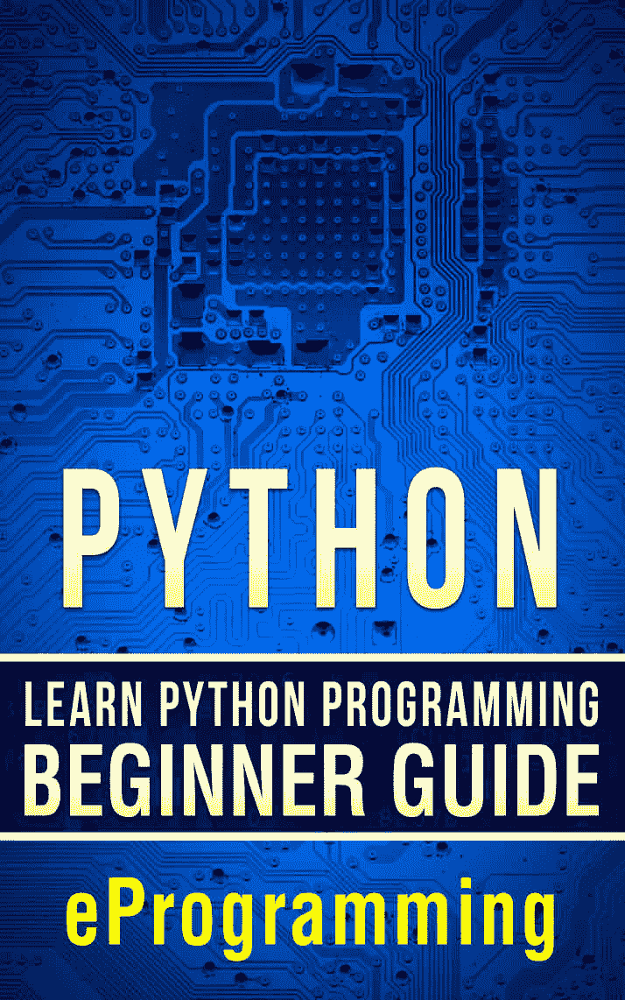

# Python：学习 Python 编程 – 初学者指南 (Python 初学者,HTML,PHP, C,Java,Ruby,SQL 书籍 1)





## 什么是 Python？

Python 是最适合初者的编程语言。它是一种解释型的、高级的、交互式的且面向对象的脚本语言。它的设计目标是高度的可读性。它使用的英语关键字比任何其他编程语言都多，因此非常容易学习和理解。

## 作为解释型语言的 Python：

Python 是一种解释型语言。它不使用编译器；解释器逐行检查代码并创建字节码。字节码是一种中间“语言”，它既不是机器码，也不是源代码。由于这种中间状态，字节码在操作系统之间比机器码更具传输性；这有助于 Python 实现跨平台。Java 也是另一种使用字节码的语言。然而，由于 Python 使用解释器而不是编译器，代码处理速度可能会较慢。字节码仍然需要被处理器“破译”才能使用，这需要额外的时间。但这样做的好处是，程序员可以立即看到代码的结果。他不需要等待编译器来判断某处是否存在语法错误导致程序崩溃。由于解释性的特性，Python 和类似的语言用于快速应用程序开发和程序原型设计。例如，几小时内就可以创建一个简单的程序，并在同一次访问中展示给客户。程序员可以反复修改程序并快速查看结果。这允许他们尝试不同的想法并查看哪种是最好的，而必在死胡同里花费大量时间。这同样适用于图形用户界面（GUI）的创建。几分钟内就可以布局简单的“草图”，因为 Python 不仅有多种不同的 GUI 库可用，而且默认包含了一个简单的库（`Tkinter`）。

## 作为面向对象编程 (OOP) 的 Python：

Python 支持面向对象的编程风格，将代码封装在对象中。Python 与其他语言不同之处在于，在开发程序时你有两个选择：过程化编程或面向对象编程。你可以在同一个程序中混合使用两者。

过程化编程是开发程序的逐步过程。程序在需要时调用函数来执行某些处理操作，然后将控制权返回主程序。`C` 和 `BASIC` 是过程化语言。

面向对象编程（`OOP`）意味着使用对象进行编程。对象由不同的编程逻辑单元创建；变量和方法组合成执行特定任务的对象。例如，如果你构建了一个机器人模型，身体的每个部分都是一个独立的对象，能够执行不同的任务，但仍然整体对象的一部分。OOP 也被广泛用于 GUI 开发。

## 对于初学者的 Python：

Python 提供了从简单文本到游戏的广泛应用。

## Python 的历史

Guido van Rossum 是 Python 的开发者。它在世纪 80 年代后期和 90 年代初在国家计算机科学研究所被开发。

## Python 的特性

以下是 Python 的一些特性：

### 易于学习：
它比其他语言容易学习得多。它的关键字很少，结构简单。

### 易于阅读：
它是一种高级语言并使用了许多关键字。这就是为什么它易于阅读。

### 标准库：
Python 拥有许多可使用的库。

### 交互式模式：
Python 允许交互式模式，支持代码测试和调试。

### 可移植性：
Python 是可移植的，这意味着它们可以在不同的计算机上运行。

### 可扩展性：
Python 的一个特性是可以向解释器添加低级模块。

### 数据库：
Python 提供了所有主要的数据库支持。

### 图形用户界面 (GUI) 编程：
Python 能够创建 GUI，并将其移植到 Windows、Macintosh 和 Unix 等许多系统。

### 可扩展性：
Python 是一种非常庞大且进步的语言，与脚本相比，它可以为大型程序提供更好的结构。

- 它可以编译为字节码以构建大型应用程序。
- 它支持函数、结构化编程和 OOP。
- 编程语言最强大的特性之一是操作变量的能力。
- 它支持自动垃圾收集。
- 它能够轻松集成 `C`、`C++`、`CORBA`、`ActiveX`、`COM` 和 `JAVA`。
- 它提供了高级动态数据类型并支持动态类型检查。

## Python 快速入门

Python 被认为是解释型语言，因为 Python 程序是由解释器执行的。使用解释器有两种方式：交互式模式和脚本模式。在交互式模式下，你输入 Python 程序，解释器显示结果：

```
1+1
2
```

大于符号 `>>>` 是解释器用来指示它已就绪的提示符。如果你输入 `1+1`，解释器回复 `2`。或者，你可以将代码存储在文件中并使用解释器执行文件内容，这被称为脚本。

要执行脚本，你必须告诉解释器文件名。如果你有一个名为 `mywork.py` 的脚本，并且在 UNIX 命令行窗口中工作，你输入 `python mywork.py`。在其他开发环境中，执行脚本的细节不同。你可以在 Python 网站上找到你环境的说明。


程序是代码行/指令的组合，规定了如何执行计算。计算可以是数学性的，例如求解方程或寻找多项式的根，但也可以是符号计算，例如在文档中搜索和替换文本或编译程序。

每种语言中都包含一些指令：

* 输入（Input）：通过键盘或其他输入设备从用户处获取数据
* 输出（Output）：在屏幕或其他输出设备上显示数据。
* 数学（Math）：执行基础数学运算。
* 条件执行（Conditional execution）：检查某些条件并执行相应的代码。
* 重复（Repetitions）：反复执行某些操作，通常带有某种变化。

## 什么是调试？

编程错误被称为 bug（错误），追踪这些错误的过程被称为调试（debugging）。

编程中共有三种错误：

### 语法错误 (Syntax Error)
只有在语法错误正确的情况下，Python 才能执行程序；否则解释器会显示错误信息。语法是关于结构性规则。例如，括号必须成对出现，因此 `(1+3)` 是合法的，但 `3)` 就是语法错误。

在编程的最初几周里，你可能会花费大量时间来追踪语法错误。随着经验的增加，你犯的错误会越来越少，而且发现得更快。

### 运行时错误 (Runtime Error)
第二种错误是运行时错误，之所以这样做是因为错误在程序开始运行后才会出现。这些错误也被称为异常（exceptions），因为它们通常表示发生了异常（且糟糕）的情况。

### 逻辑错误 (Logical Error)
第三种是逻辑错误。如果你的程序中存在逻辑错误，它将成功运行（即计算机不会生成任何错误信息），但它不会做正确的事——它会做我们没有预期的事。具体来说，它会执行你让它做的事。它的产生由于程序的逻辑错误。

在我们开始编写第一个 Python 程序之前，我们必须简要了解一些术语及其功能。这将消除初学者的概念模糊，对他们非常有帮助。

* **解决问题 (Problem solving)**：构思问题、寻找解决方案并表达解决方案的过程。
* **高级语言 (High-level language)**：像 `Python` 这样的编程语言，设计成易于人类读写。
* **低级语言 (Low-level language)**：设计成便于计算机执行的编程语言；也称为“机器语言”或“汇编语言”。
* **可移植性 (portability)**：程序可以在多种类型的计算机上运行的属性。
* **解释 (interpret)**：通过逐行翻译来执行高级语言编写的程序。
* **编译 (Compile)**：一次性将高级语言编写的程序翻译成低级语言，为稍后的执行做准备。
* **源代码 (Source code)**：编译前的高级语言程序程序。
* **目标代码 (Object code)**：编译器翻译程序后的输出。
* **可执行文件 (Executable)**：准备好执行的目标代码的名称。
* **提示符 (Prompt)**：解释器显示的字符，表示它已准备好接收用户输入。
* **脚本 (Script)**：存储在文件中的程序（通常是被解释的）。
* **交互模式 (Interactive mode)**：通过在提示符处输入命令和表达式来使用 Python 解释器的方法。
* **脚本模式 (Script mode)**：使用 Python 解释器读取并执行脚本中语句的方法。
* **程序 (Program)**：指定计算的指令集。
* **算法 (Algorithm)**：解决一类问题的通用过程。
* **Bug**：程序中的错误。
* **调试 (Debugging)**：寻找并移除三种编程错误中任何的过程。
* **语法 (Syntax)**：程序的结构。
* **语法错误 (Syntax error)**：程序中导致无法解析（因此无法解释）的错误。
* **异常 (Exception)**：程序运行期间检测到的错误。
* **语义/逻辑 (Semantics (logic))**：程序的含义。
* **语义（逻辑）错误 (Semantic (Logical) error)**：程序中导致其执行与程序员意图之外内容的错误。
* **标记 (Token)**：程序语法结构的基本元素之一，类比自然语言中的单词。
* **解析 (Parse)**：检查程序并分析语法结构。
* **打印语句 (Print statement)**：导致 Python 解释器在屏幕上显示某值的指令。
* **值 (Value)**：程序处理的基本数据单元之一，如数字或字符串。
* **类型 (Type)**：值的类别。我们目前为止见过的类型有整数（类型 `int`）、浮点数（类型 `float`）和字符串（类型 `str`）。
* **整数 (Integer)**：代表整数数字的类型。
* **浮点数 (floating-point)**：代表带小数部分的数字的类型。
* **字符串 (String)**：代表字符序列的类型。
* **变量 (Variable)**：引用某个值的名称。
* **语句 (Statement)**：代表命令或操作的代码段。到目前，我们看到的语句是赋值语句和打印语句。
* **赋值 (Assignment)**：给变量赋值的语句。
* **状态图 (State diagram)**：一组变量及其所引用值的图形化表示。
* **关键字 (Keyword)**：编译器用于解析程序的保留字；你不能使用如 `if`、`def` 和 `while` 等关键字作为变量名。
* **运算符 (Operator)**：代表简单计算（如加法、乘法或字符串拼接）的特殊符号。
* **操作数 (Operand)**：运算符作用的值之一。
* **地板除 (Floor division)**：除两个数字并切掉小数部分的操作。
* **表达式 (Expression)**：变量、运算符和值的组合，表示单一结果值。
* **求值 (Evaluate)**：通过顺序执行操作来简化表达式以得到单一值。
* **优先级规则 (Rules of precedence)**：支配涉及多个运算符和操作数的表达式求顺序的规则。
* **拼接 (Concatenate)**：将两个操作数首尾相接。
* **注释 (Comment)**：程序中供其他程序员（或任何阅读源代码的人）阅读的信息，对执行没有影响。

## 第一个程序

在所有新语言中，第一个程序都称为“Hello World”，因为它所做的只是显示“Hello World”这两个词。

在 Python 中：

```python
Print ‘Hello World’
```

这是一个打印语句的简单示例，它并没有实际上在纸上打印任何东西。它是在屏幕上显示一个值。在这种情况下，结果是这些单词：

Hello World

程序中的引号标记了要显示的文本的开始和结束；它们不会出现在结果中。

在 Python 3 中，打印语法略有不同：

```python
print('Hello, World!')
```

括号表示 `print` 是一个函数。如果你使用的是 Python 3，你将必须进行翻译。但除此之外，几乎没有我们需要担心的差异。

## 值与类型

在程序中，字母和数字被称为**值（values）**。

例如：1, 20, Hello 等。

这些值具有不同的类型。在上面的例子中，“1”是整数（integer），“Hello”是字符串（string），你可以通过它们被引号包裹来识别字符串。

如果你不确定某个值是什么类型，解释器可以告诉你。

```python
type('Hello')
```
<type 'str'>

```python
type(49)
```
<type 'int'>

```

Python 中用于整数的关键字是 `int`，用于字符串的是 `str`。我们不能使用它们的全称。整数仅用于没有小数点的整个数字。带有小数点的数字属于称为 `float` 的类型，因为它们是以浮点数格式表示的。`float` 也称为实数。

例如：

```python
type(8.8)
```
<type 'float'>

```

如果数字以引号形式编码，它们也变成了字符串：

```python
type('49')
```
<type 'str'>

```python
type('8.8')
```
<type 'str'>

```

它们是字符串。


变量是一个引用某个值的名称。它是一个可以让你存放东西的地方。编程语言最强大的特性之一就是操纵变量的能力。

为了创建新变量，我们使用赋值运算符并给它们赋值：

```python
result = ‘easily done’
x = 88
g = 9.8 
```

在上述示例中，我们使用了三个变量。第一个将一个字符串赋值给名为 `result` 的新变量；第二个将整数 88 赋值给 `x`；第三个将加速度 `g` 的值赋值为 9.8。

变量的类型是它所引用的值的类型。

```python
type(message)
<type 'str'>

type(n)
<type 'int'>

type(pi)
<type 'float'>
```

## 变量命名规则：

我们创建变量名有以下一些规则：

*   它不能是关键字。
*   除了下划线（`_`）外不能使用特殊字符。
*   变量名内部不允许有空格或空白。
*   第一个字符必须是字母。
*   可以是字母数字。
*   永远重复使用相同的名称。
*   可以是大写，但用小写字母开始变量名是个好主意。

优秀的程序员会为他们的变量选择有意义的名称，并在程序中使用它们。

如果你给了一个非法的名称，就会得到语法错误。

```python
20level = 'Final round'
SyntaxError: invalid syntax

good@ = 1000000
SyntaxError: invalid syntax

class = 'look good'
SyntaxError: invalid syntax
```

`20level` 是非法的，因为它不是以字母开头。`good@` 是非法的，因为它包含非法字符 `@`。但 `class` 有什么问题呢？事实证明 `class` 是 Python 的关键字之一。解释器使用关键字来识别程序的结构，它们不能用作变量名。

## 关键字

这些词在编程语言中已经解释了含义。关键字不能用作变量名，因为如果我们这样做，我们就是在尝试给关键字赋予新的含义，这是计算机不允许的。

每个关键字都执行一项特定的任务。

下表是 Python 编程中一些重要的关键字：

| And | del | from |
| :--- | :--- | :--- |
| Not | while | as |
| Assert | elif | global |
| Or | with | else |
| If | pass | yield |
| Break | except | import |
| Print | class | exec |
| In | raise | continue |
| Finally | is | return |
| Def | lambda | for |
| Try | | |

## 运算符和操作数

加法和乘法等计算工作是通过运算符执行的。运算符应用的值被称为操作数。运算符是能够操纵操作数值的结构。

一些基础运算符包括：

1. 算术运算符
* 比较（关系）运算符
* 赋值运算符
* 逻辑运算符

## 算术运算符：

有一些实用的算术运算符：

| + | 加法 | * | 乘法 |
| :--- | :--- | :--- | :--- |
| - | 减法 | / | 除法 |
| ** | 幂 | % | 取模 |
| // | 整除 | | |

如下例所示：

```python
2+3 hour-1 hour*2+minute minute/30 2**5 (x+2)*(y-22)
```

在 Python 中，没有必要声明。在其他语言中，你必须先声明再初始化，这两个步骤在代码同一行中完成。例如在 C++ 中：

```cpp
int a = 3; // 整数的内联初始化
float b;
b = 4.0 f ; // 浮点数的顺序初始化
```

在这里你可以看到初始化是至关重要的。在 Python 中，声明是不必要的。在这里你可以看到初始化是至关重要的。例如：

```python
a = 60
b = 13
```

现在在二进制格式下它们将如下：

```
a = 0011 1100
b = 0000 1101
```

在 Python 中，`a` 的：

```python
a = 3 整数
b = 4.0 # 浮点
```

## 比较（关系）运算符

这些运算符决定两个值之间的关系。

| 运算符 | 说明 |
| :--- | :--- |
| == | 等于 |
| != | 不等于 |
| > | 大于 |
| < | 小于 |
| >= | 大于等于 |
| <= | 小于等于 |

## 赋值运算符

在 Python 中使用了一些赋值运算符。

| 运算符 | 说明 |
| :--- | :--- |
| = | 将右侧赋值给左侧 |
| += | 相加并赋值 |
| -= | 从左侧减去右侧并赋值 |
| *= | 相乘并赋值 |
| /= | 左侧除以右侧并赋值 |
| **= | 幂并赋值 |
| %= | 取模并赋值 |
| //= | 整除并赋值 |

## 逻辑运算符

Python 编程中使用的逻辑运算符：

| 运算符 | 说明 |
| :--- | :--- |
| and | 仅当两个条件都满足时 |
| or | 仅当一个条件为真时 |
| not | 反转结果 |

## 成员运算符

只有两个成员运算符。它们测试序列（如元组、列表或字符串）中的成员身份。

| 运算符 | 说明 |
| :--- | :--- |
| in | 仅当在指定序列中找到变量时为真 |
| not in | 仅当不在指定序列中找到变量时为真 |

## 位运算符

它们按位执行操作并对位工作。Python 中使用一些位运算符：

| 运算符 | 说明 |
| :--- | :--- |
| & | 二进制与：如果两个情况都为真则存在 |
| \| | 二进制或：如果任一操作数为真则将存在 |
| ^ | 二进制异异：如果位在一个操作数中存在但不在两者中 |
| ~ | 二进制取反：它具有“翻转”位的效果 |
| << | 二进制左移：左操作数的值向左移动右操作数所指定的位数 |
| >> | 二进制右移：左操作数的值向右移动右操作数所指定的位数 |

示例：

假设 `a = 60` 且 `b = 13`。现在在二进制格式下它们将是：

```
a = 0011 1100
b = 0000 1101
```

```
a&b = 0000 1100
a|b = 0011 1101
a^b = 0011 0001
~a = 1100 0011
```


| is | 如果运算符两边的变量指向同一个对象，则求值为真（true），否则为假（false）。
| is not | 如果运算符两边的变量指向同一个对象，则求值为假（false），否则为真（true）。

## 运算符优先级

当我们在表达式中使用多个运算符时，求值顺序取决于优先级规则。数学运算符有一个执行顺序的优先级排序。从上到下的优先级顺序如下：

-   **括号**优先级最高，可以强制表达式按照你希望的顺序进行求值。
    示例：`3*(5+4)` ， `(2**5)+2`
    第一个答案是 `27`，第二个是 `34`。
-   **幂**优先级次高。
    所以 `4**2+1` 是 `17` 而不是 `64`，`3*1**3` 是 `3` 而不是 `27`。
-   在幂运算之后，一元正、负号（`+@` 和 `-@`）优先级第三第三。
-   除法、乘法、取模和整除优先级相同。所以 `2*3-1` 是 `5` 而不是 `4`，`6+4/8` 是 `8` 而不是 `5`。
-   加法和减法在除法和乘法之后优先级相同。
-   `<<` `>>` 右移和左移位运算。
-   `&` 位“与”。
-   `^` `|` 位“异或”和逻辑“或”。
-   `<=` `<` `>` `>=` 比较运算符。
-   `<>` `==` `!=` Equality 运算符。
-   `=` `%=` `/=` `-=` `+=` `*=` 赋值。
-   `is` `is not` 恒等运算符。
-   `in` `not in` 成员运算符。
-   `not` `or` `and` 逻辑运算符。

优先级相同的运算符从左到右求值。不需要费力去记住其他运算符的优先级规则，通过观察表达式这一点显而易见。

## 表达式与语句

值、运算符和变量的组合被称为**表达式**。值本身是一个表达式，变量也是。**语句**是 Python 解释器可以执行的单元。我们已经见过两种语句：`print` 和赋值。技术上讲，表达式有值；而语句没有。

以下都是合法的表达式：

示例：
-   `8`
-   `X`
-   `X+1`

## 交互式模式与脚本模式

解释型语言的优点之一是，可以在将其放入脚本之前在交互式模式下测试代码。但交互式模式和脚本模式之间存在差异。例如，如果你将 Python 作为计算器使用，你可能会输入：

```
>>> miles = 2
>>> miles * 3
```
第一行给 `miles` 赋值，但没有可见效果。第二行是一个表达式，Python 实际上会求值它并显示结果。在脚本模式下，表达式本身没有效果，除非你告诉它显示：

```
miles = 2
print miles * 3
```
脚本通常包含一系列语句。如果有多条语句，结果会逐个显示：

```
x = 5
print x
```
产生输出 `5`。

## 字符串

编程中的字符串简单来说就是文本、字符、单词或完整的句子。字符串在 Python 中是最流行的类型之一，当与用户交互时，它们拥有强大的内置能力。与其他语言不同，Python 没有字符类型，只有字符串。字符串也是不可变的；每你想对其进行更改（如拼接）时，都会创建一个新字符串。

我们使用方括号通过索引来访问你的子字符串。例如：

```python
num1 = 'Hello World'
num2 = 'Basics of Python'
print num1[0]
print num2[1:5]
```
输出将是：
`num1: H`
`num2: Basic`

以下是常见的字符串操作列表：
-   `s1 = ' '`：空字符串
-   `s2 = "knight’s"`：双引号
-   `block = """"""`：三引号块
-   `s1 + s2`：拼接（组合）
-   `s2 * 3`：重复字符串若干次
-   `s2[n]`：索引（某个特定字符的位置）
-   `len(s2)`：获取字符串的长度
-   `"a%s" %'dead'`：字符串格式化（在 Python 3.x 中已弃用）
-   `"a {0}".format("dead")`：字符串格式化（Python 3.x）
-   `for x in s2`：迭代（顺序遍历字符串字符）
-   `'m' in s2`：成员检查（字符串中是否存在给定字符？）

通常情况下，你不能对字符串进行数学运算，即使字符串看起来像数字，所以以下操作是非法的：
`'2'-'1'`, `'eggs'/'easy'`, `'third'*'a'`

`+` 运算符适用于字符串，但它的行为可能不符合你的预期：它执行的是拼接，意味着通过尾尾相连连接字符串。例如：

```python
first = 'Basics'
second = 'of'
third = 'Python'
print first + second + third
```
该程序的输出是：`BasicsofPython`。

`*` 运算符也适用于字符串；它执行重复。例如，`'Spam'*3` 是 `'SpamSpamSpam'`。

如果一个操作数之一是字符串，另一个必须是整数。这种对 `+` 和 `*` 的用法类比加法和乘法是有意义的。正如 `4*3` 等同于 `4+4+4` 一样，我们期望 `'Spam'*3` 等于 `'Spam'+'Spam'+'Spam'`，事实确实如此。另一方面，字符串拼接和重复与整数加法和乘法之间存在显著的区别。

这些运算符有一个对照表：

| 运算符 | 描述 | 运算符 | 描述 |
| :--- | :--- | :--- | :--- |
| `+` | 拼接-相加两个值 | `*` | 重复-创建相同的字符串 |
| `[]` | 切片-获取子字符串的值 | `[:]` | 范围切片-获取给定范围内的字符 |
| `in` | 成员-如果字符存在于给定字符串中返回真 | `not in` | 成员-如果字符不存在则返回真 |
| `%` | 格式-执行字符串格式化 | | |

## 字符串格式化

这是 Python 编程中非常好的特性。它类似于 C 语言中 `printf()` 系列函数。它的符号是 `%`。例如：

```python
print " My name is %s and roll no. is %d." % ('Omer', 15)
```
这段代码将产生输出：`My name is Omer and roll no. is 15.`。

有一些可以与 `%` 一起使用的符号：

| 格式符号 | 转换 | 格式符号 | 转换 |
| :--- | :--- | :--- | :--- |
| `%c` | 字符 | `%s` | 字符串转换 |
| `%i, %d` | 有符号十进制整数 | `%u` | 无符号十进制整数 |
| `%o` | 八进制整数 | `%x` | 十六整数（小写字母） |
| `%X` | 十六整数（大写字母） | `%e` | 数计数法（带有小写 ‘e’） |


| %E | 指数计数法（使用大字母 ‘E’） | %f | 浮点实数 |

# Python 中的决策制定

在日常生活中，我们经常根据条件做出决策。例如，如果我们有 $5，我们就买一根板球拍，否则就不买。这个例子说明了，如果第一个条件为真，我们就可以继续操作；否则，我们就执行其他任务。在编程中，Python 为我们提供了这种条件语句来做出决策。决策结构评估多个表达式，并产生真或假作为结果。在 Python 编程中，0 和空值（null）被假设为假，其他值均为真。

在 Python 中，我们有以下类型的决策语句：

## `if` 语句：

它类似于 C 语言。在 `if` 语句中，我们提供一些条件，对数据进行比较并做出决策。如果满足条件，则执行语句。

### 语法
```python
if (condition)
    statement
```

### 示例:
```python
num1 = 2
if num1:
    print “Expression is true”
    print num1

num2 = 0
if num2:
    print “Expression is False ”
    print num2

print “Its Over”
```

如果布尔表达式求值为真，则 `if` 语句内部的语句块可以执行。如果布尔表达式求值为假，则执行 `if` 语句结束后的后续代码。`if-statement` 可以写写在单行中。

### 示例:
```python
num = 1
if ( num== 1 ) : print "one-line if"
```

## `if-else` 语句：

如果 `if` 语句的条件为假，执行控制将跳转到 `if` 语句后的第一个语句。如果我们使用 `else` 语句，它会在 `if` 语句之后执行。`else` 语句与 `if` 语句结合使用。它是一个可选语句，通常在 `if-else` 语句块中使用一次。

### 语法
```python
if (conditon):
    statement
else:
    statement
```

### 示例:
```python
num1 = 0
if num1:
  print "Expression is true"
else:
    print "Expression is false"
```

## `elif` 语句：

如果我们想检查多个表达式是否为真，并在其中一个条件求值为真时立即执行语句块，我们有 `elif` 语句来执行此类任务。

它像 `else` 语句一样是可选的。我们通常在块中使用一个 `else` 语句，但可以有很多 `elif` 语句。

### 语法
```python
if (condition1):
    statement
elif(condition2):
    statement
elif(condition3):
    statement
else:
    statement
```
它类似于其他语言中的 `switch case` 语句。

### 示例:
```python
num = 1
if num == 2:
 print "True Expression 1"
elif num == 3:
 print "True Expression 2"
elif num == 1:
 print "True Expression 3"
elif num == 1:
 print "True Expression 4"
else:
 print "No one match!"
```
如果没有一个可以匹配真表达式，则将打印 `else` 语句。

# 循环

当我们需要重复执行某块代码几次时，我们在 Python 中使用循环。在编程语言中，有各种控制结构允许更复杂的路径。

简单的循环语句允许我们多次执行某块代码。

为了处理循环需求，Python 提供了以下类型的循环：

## `While` 循环：

如果给定的条件为真，`while` 循环会反复执行语句，直到它变为假。

### 语法
```python
while (condition):
    statement
    increment\decrement
```

首先，我们在 `while` 循环上方声明一个变量。然后在括号中给出条件。在条件中，我们可能使用关系运算符。然后我们写循环的语句，如果语句为真，循环就会反复执行，直到它为假。语句可以是单行的，也可以是一个语句块。在语句之后，我们在循环的最后提到递增或递减。如果循环第一次执行，第二次执行将按照该递增或递减执行。这个过程一直持续到条件变为假为止。

### 示例:
```python
value = 0
while (value <5):
    print ‘The value is:’, value
    value= value +1
print “Its Over”
```
此块仅包含打印和递增语句，它在每个循环周期后增加值 1。当值增加 4 时，条件变为假，它就会停止工作。

### 在 `While` 循环中使用 `else` 语句：

Python 支持与 `While` 循环语句关联的 `else` 语句。如果在 `while` 循环在使用 `else` 语句，则当条件变为假时执行 `else` 语句。

## `For` 循环：

`For` 循环具有重复遍历任何序列项的能力，例如列表或字符串。如果序列包含这些中的任何项，则首先评估表达式列表。然后将序列中的第一个项赋值给迭代变量。此后执行语句块。列表中的每个项都被赋值给迭代变量，并执行语句块，直到整个序列被耗尽。

### 语法
```python
for iterating_var in sequence:
    statements
```

### 示例:
```python
for letter in ‘Python’:
    print ‘Current Letter  : , letter
print “Its Over”
```

### 在 for 循环中使用 `else` 语句：

在 Python 中，我们可以在 `for` 循环中使用 `else` 语句。当序列耗尽时，执行 `else` 语句。

## 嵌套循环：

在循环内部的多个循环被称为嵌套循环。Python 允许嵌套循环。

### `For` 循环语法
```python
for iterating_var in sequence:
    statements
```

### `While` 循环语法
```python
while(condition):
    statements
    statements
```

## 循环控制语句：

为了改变循环的执行，我们使用控制语句。在 Python 中我们有以下控制语句：

### `Break` 语句：

它与 C 语言中的 `break` 语句工作相同。它停止循环执行并跳转到循环块后的代码。`break` 语句用于 for 和 while 循环。

### 语法
```python
break
```

### 示例:
```python
for letter in ‘ Python’ :
    if letter == ‘h’ :
        break
print ‘ Current Letter : , letter
```

### `Continue` 语句：

当使用 `continue` 语句时，它跳过当前迭代的剩余语句，并将控制返回到循环开头。

### 语法
```python
continue
```

### 示例:
```python
for letter in ‘Python’:
 if letter == ‘o’:
 continue
print ‘Current Letter : , letter
print “Its Over”
```

### `Pass` 语句：

执行它时什么都不会发生，它是一个空操作。它适用于代码将进入但目前尚未编写代码的地方。

### 语法
```python
pass
```

### 示例:
```python
for letter in ‘Python’ :    if letter == ‘h’:
        pass
    print ‘This is pass block’
print ‘Current Letter : , letter
```

# 列表

和字符串一样，列表是值的序列。Python 中最基本的数据结构是序列。序列中的每个元素都有自己的位置或索引。第一个位置总是 0，第二个是 1，依此类推。在字符串中我们只有字符值，但在列表中它们可以是任何类型。列表中的值被称为元素，有时称为项。

列表的创建非常简单，我们只需要使用方括号创建列表。元素包含在里面并用逗号分隔元素。

## 示例 1:
```python
List1 = [10, 20, 30, 40];
```

## 示例 2:
```python
List2 = [‘June’, ‘July’, ‘August’ ];
```

## 示例 3:
```python
List3 = [‘march’, 2.1 , 5 ]:
```

在第一个示例中，我们在列表中使用了整数。在第二个示例使用了字符串，在第三个示例中使用了字符串、浮点数和整数。

不包含元素的列表被称为空集。你可以通过 [] 创建空列表。

## 访问列表值：


它们的访问方式就像字符串一样（例如切片和拼接），因此使用简单，而且它们是变长的，即它们会随着使用自动增长和缩小。要访问列表中的元素，请使用方括号。实际上，Python 列表是 Python 解释器内部的 C 数组，其作用就像指针数组。

示例：

```python
list1 = ['June', 'july', 404, 808];
list2 = [1, 2, 3, 4, 5, 6, 7 ];
print "list1[0]: ", list1[0]
print "list2[1:3]: ", list2[1:3]
```

需要记住的一点是，列表是一系列写在方括号内的对象，用逗号分隔。字典和元组看起来相似，但它们使用的括号类型不同。

列表最常见的用途是遍历列表并对列表中的每个对象执行相同的操作，因此通常会使用相似的数据类型。

## 在列表中添加元素

在列表中添加新元素非常简单。为了这个目的，我们有 `append` 语句，通过它我们可以告诉列表添加元素。

示例：

```python
mylist = [20 , 22 , 24 ];
mylist. append (26) ;
print mylist
```

要将两个列表合并，我们有 `extend()` 语句。我们可以使用此语句将两个列表连接。

示例：

```python
list1 = ["June", "July" ,"August"];
list2 = [5 , 10 , 15 ];
list1.extend(list2);
print list1
```

## 在列表中删除元素

有许多方法从列表中删除元素。要删除第 n 个元素，如果你确切知道要删除的是哪个元素，可以使用 `del` 语句或 `pop`；如果你不知道，可以使用 `remove` 方法。

`pop` 会修改列表并在执行后返回被删除的元素。

示例：

```python
list = ['a', 'b', 'c'];
newlist = list.pop(1);
print t
```

如果你不需要删除值，可以使用 `del` 运算符。

示例：

```python
list = ['a', 'b', 'c'];
del list[1];
print t
```

如果你不知道想要删除的元素的索引，但知道该元素，可以使用 `remove` 语句。

示例：

```python
list= ['a', 'b', 'c'];
list.remove('b');
print list
```

## 列表运算符

列表也可以像字符串一样执行 `+`（拼接）和 `*`（重复）运算符，但结果是新列表而不是字符串。

列表执行所有我们在字符串上使用的通用操作。

| 表达式 | 输出 | 描述 |
| :--- | :--- | :--- |
| `[1 , 2, 3 ]+[4, 5, 6]` | `[1, 2, 3, 4, 5, 6]` | 拼接 |
| `Len([1, 2, 3]),` | `3` | 长度 |
| `3 in [1, 2, 3]` | `True` | 成员关系 |
| `[‘OK’]*4` | `[‘OK’ ,’OK’ , ‘OK’ , ‘OK’ ]` | 重复 |
| `For x in [1, 2, 3]: print x,` | `1 2 3` | 迭代 |

## 字典

字典是 Python 中最有用的数据类型之一。字典类似于列表，但它具有更通用的属性。在列表中，索引必须是整数，但在字典中，它们可以是几乎任何类型。它们是对象的无序集合，与关键字相匹配。另一方面，列表是使用数值偏移的有序集合。

Python 字典提供了一组索引（即键，key）和一组值之间的映射。每个键都映射到一个值。键和值之间的关系被称为键-值对，有时也称为项（item）。

## 字典的基本属性

字典具有一些属性：

*   它不是偏移量，可以通过关键字轻松访问。它的执行方式与关联数组相同。字典中的所有项都有其自己的关键字；关键字用于调用该项。
*   为了提供更快的查找，存储的对象是随机顺序排列的。在创建时，字典以它选择的任何顺序存储项。使用键来获取项。字典没有内置对项排序的方法，如果你需要排序，请自行处理。
*   字典是变长的，可以包含任何类型的对象，并支持深度嵌套。
*   它们不能像列表或字符串那样被修改（指重新赋值），但它们是可变的。
*   它们是唯一支持映射的数据类型。
*   内部，字典被实现为哈希表。

## 字典的基本操作

现在我们有一些 Python 字典常用操作列表：

*   `d1 = { }` 空字典。
*   `d2 = { ‘basic’ : 2, ‘Python’ : 3}` 两个项的字典。
*   `d3 = { ‘June’ : { ‘July’ : 1 , ‘August’ : 2 } }` 嵌套。
*   `d2 [ ‘Python’ ] , d3[ ‘June’ ][ ‘July’ ]` 通过键索引。
*   `d2.has_key( ‘Python’), `d2.keys( )`, `d2.values( )` 方法：成员测试、键列表、值列表等。
*   `len(d1)` 长度（存储条目的数量）。
*   `d2 [key] = new`, `del d2[key]` 添加/删除。

```python
d1 = { }
d2 = { ‘basic’ : 2, ‘Python’ : 3}
d3 = { ‘June’ : { ‘July’ : 1 , ‘August’ : 2 } }
d2 [ ‘Python’ ] , d3[ ‘June’ ][ ‘July’ ]
d2.has_key( ‘Python’), d2.keys( ) , d2.values( )
len(d1)
d2 [key] = new, del d2[key]
```


* 它们也可以用作字典的键。大多数程序员并没有为此目的使用元组。
* 它们用于存储字符串格式化时要插入到字符串中的多个值。

## 基础操作

以下是元组的一些常用操作列表：

* `()` 它仅仅仅仅是一个空元组。
* `tup1 = (0, )` 单元素元组。
* `tup2 = (0, 1, 2, 3)`
* `tup3 = 1, 2, 3, 4` 这是另一个四元素元组，与上面相同，但没有括号。
* `tup3 = ( ‘xyz’ , ( ‘ijk’ , ‘lmn’ ))` 嵌套元组。
* `tup1[n]`, `tup3[n][j]`，索引。
* `tup1[i:j]`，切片。
* `len(tup1)`，长度。
* `tup1 + tup2`，拼接。
* `tup3*4`，重复。
* `for x in tup2`，迭代。
* `3 in tup2`，成员关系。

第二个条目展示了如何创建一个单元素元组。由于括号可以包裹表达式，因此你必须在元素后放置一个逗号，以告诉 Python 单个元素实际上是一个元组。第四个条目显示了没有括号的元组；这种形式可以在元组没有歧义时使用。然而，直接使用括号比去研究什么时候可以省略括号要简单得多。

## 创建元组

创建元组非常简单，你只需要将值放入并用逗号分隔它们。你可以使用括号来结束元组，但这是可选的。

示例：

```
tup1 = ( ‘Sunday’ , ‘Monday’ , 1 , 2 );
tup2 = ( 11 , 12 , 13 , 14 , 15);
tup3 = “a” , “b” , “c” , “d” ;
```

## 访问值

我们使用方括号配合索引或索引进行切片，以获取索引处的值。

示例：

```
tup1 = ('Sunday', 'Monday', 1, 2);
tup2 = (1, 2, 3, 4, 5, 6, 7 );
print "tup1[0]: ", tup1[0]
print "tup2[1:5]: ", tup2[1:5]
```

