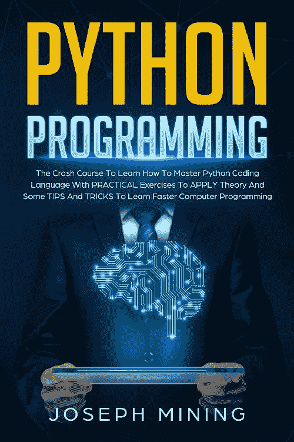

# Python 编程：通过实践练习掌握 Python 语言、应用理论及快速学习计算机编程技巧的入门指南





通过实战练习学习如何掌握 Python 编程语言的快速入门课程，包含理论应用以及一些快速学习计算机编程的技巧和秘门


接下来的章节将讨论你入门 Python 编程语言时所需的所有知识。目前有很多不同的编程语言供你选择。其中一些语言用起来更容易，而另一些则更难，通常只推荐给那些经常编写代码的人使用。然而，提到 Python 编程语言，即使是那些一生从未写过代码的人，也能从中获益并学习关于它的一切知识。

本指南将直接深入介绍使用 Python 语言可以实现的许多非常酷的功能。无论你只是想多学一些编程知识、增强其他编程语言中所需的技能并丰富你的作品集，还是对你想要开发的应用程序或程序有一些奇妙的创意，Python 编程语言都是你入门的绝佳选择。

本指南将从介绍关于 Python 的更多信息开始，以及为什么有这么多计算机程序员喜欢选择它作为自己的编程语言。我们将探索一些优势，例如为什么它如此强大却又让初学者上手、无论你使用的是哪种操作系统，如何在你自己的系统上安装它，甚至包括你应该了解的一些基础代码部分，以帮助你以后开发一些更难的内容。

本指南的其余部分将关注你可以在自己的代码中实现的所有酷炫功能，无论你想开发什么种程序。当我们探讨使用 Python 编程语言可以做的奇妙功能时，涉及的一些不同主题包括循环、条件语句、正则表达式、如何抛出异常等等！

对于令人惊叹的 Python 语言，你可以做的事情实在太多了。即使是初学者，你也会对学习这种语言是如此简单感到惊讶，并会对你所有代码背后蕴含的力量感到惊叹。当你准备好学习更多关于 Python 语言以及如何在自己的代码中处理不同方面时，请确保查阅本指南以帮助你入门。

市上有许多关于这个主题的书——再次感谢你选择这一本！我们尽一切努力确保它包含尽可能有用的信息。请享受其中！

# 第 1 章：什么是 Python 编程语言？为什么它如此有益？


世界上有很多不同的编程语言供你选择。每种语言都有它们自己的优势和许多酷的特性——但当提到一种易于使用、对初学者友好、易于阅读、选项多、开源且背后仍有强大支持的语言时，Python 编程语言是现有的最佳选择之一。

多年来，Python 编程语言一直是人的喜爱。他们喜欢这种感觉：可以在学习这种语言的同时，仍在编写一些令人惊叹的代码，尽管他们是初学者，以前可能没有接触过这类编程——或者说任何类型的编程。

Python 是一门面向计算机用户的编程语言。即使是初学者，也可以轻松地学习这种语言，但它背后仍有强大的力量，这让你能够真正实现你想要的代码。你可以编写复杂的商业应用程序，自动化你系统的某些管理任务，或者只是为了好玩而制作你自己的游戏和程序。

当然，就像所有其他编程语言一样，Python 也有一套所有程序都需要遵循的规则和结构。无论你决定写什么样的代码，遵循 Python 的规则都非常重要。然而，与其他一些编程语言相比，你会发现这种编程语言是简单、紧凑且非常强大的。作为初学者，你很快就能上手，并在短时间内写出你自己的代码！

在过去，许多人担心学习编程语言。他们担心这些语言太难学，担心自己会感到沮丧，并认为只有那些一辈子和电脑打交道的人才能尝试编写自己的代码——对于某些老旧的代码来说，这确实是事实。

多亏于最近引入的许多新代码，只有那些在计算机编程方面极有天赋的人才能编写代码的想法已经消失。随着现在面出的许多代码（包括 Python），任何人都可以学习他们想要做的事的几项语法，甚至可以在网上找到一些预先好的代码并进行修改。由于这些代码中的许多是开源的，学习如何使用它们并开发满足你需求的代码比以往任何时候都更容易。

现代编程语言比过去的大多数编程语言要好得多。即使是专业人士也苦于消除系统漏洞的时代已经过去了——现在是任何人都可以学习如何使用编程语言来满足自己的需求。这都要归功于像 Python 这样许多优秀的面向对象编程语言的发展。

根据你想要创建的程序和应用程序类型，有很多编码和编程语言供你选择。但尽管你有这么多不同的选项，许多计算机程序员（无论初学者还是以前接触过编程的人）选择 Python 编程语言也是常有的。

人们喜欢使用 Python 代码而不是其他其他选项有很多原因。人们选择 Python 语言的一些常见原因包括：

1. 有许多库可以为你提供所需的支持。只需看一眼 Python 环境，你就会发现许多扩展和库可以为你提供所需的所有帮助。你可以在语言内部找到`类`、`对象`和`函数`，让你更容易创建所需的代码。此外，你还可以从外部源引入一些第三方库到混合中，帮助获得更多你需要的特性和力量。

2. 集成特性：Python 因为很多原因是一种非常棒的语言，但原因之一是它可以与企业级集成相结合。这很重要，意味着你可以与它拥有的不同组件一起，包括 `COM` 和 `COBRA`。它还有一些控制能力，使其能够与 `C`、`Java` 和 `C++` 工作。它可以处理许多标记语言，包括 `XML`，并可以使用任何现代操作系统，因此无论你开始时使用什么，它都能工作。

3. 让程序员效率更高：Python 语言有许多不同的设计可以使用，它包含了面向对象以及你需要的支持库。得益于所有这些资源，以及编写该程序非常容易的事实，程序员可以轻松找到提高效率的方法。他们也可以利用这种效率来帮助他们处理其他其他编程语言。


## 4. 易于学习
这种语言的主要目的是为了被设计成易于使用且易于适应不同的目的。这使得任何类型的程序员都能轻松上手，即使是初学者也是。在本书中，我们将花一些时间学习更多关于这种语言知识，查看一些与 `Python` 相关的代码，并帮助你充分利用这门语言，让你即使作为一个初学者，也能编写出一些强大的程序。

## 5. 这种语言易于阅读
当你查看这种语言中的一些代码时，你会发现即使在学习它们的具体含义之前，阅读这些代码实际上也非常容易。代码中没有出现很多不必要的信息，而且全部都是英文的，所以很容易理解其中包含的单词。

## 6. Python 可以为你提供强大的编程能力
当你开始学习 `Python` 语言时，你可能会被它背后的强大力量所震撼。尽管这门语言被归类为更偏初者的语言，但它很容易进行调整，并学习如何将其用于任何程序和应用程序。如果你学习如何将它与现有的其他高级编程语言结合起来，你会看到它变得更加强大。

## 7. 庞大的支持社区
由于 `Python` 是全球范围内最大、流行的编程语言之一，它拥有一个庞大的社区，其中包括学习如何使用这门语言的人以及已经精通如何使用它的人。你完全可以利用这些信息并从中学习。你可以提问、看教程，或者在学习过程中通过这门语言发现新东西。

## 8. 它是一个开源程序
这意味着你能够免费获得代码，以及随之而来的任何更新。有一些第三方插件，如果你选择使用它们，是可能需要支付费的，但你可以在不使用这些插件的情况下使用 `Python`，因此你可以完全免费获得所有内容。

正如你所看到的，当你开始学习 `Python` 代码并将其用于你自己的需求时，你将享受到许多很棒的东西。无论你是正尝试向你的武器库中添加一门新的编程语言以帮助你更好地处理自己的代码，还是一个想要进入科技世界的初学者，`Python` 编程语言都是你入门的最佳选择之一。

## 在系统上安装 Python

在你能够利用本指南中的信息，并编写任何帮助你开发自己的程序的代码之前，你首先需要确保 `Python` 已安装在你的电脑或你正在使用的其他系统中。如果那里还没有，那么我们需要花一些时间选择一个我们想要使用的 `Python` 版本并进行下载。

取决于你正在使用的系统，你的电脑上可能已经有了它。检查一下是否确实如此。如果你发现你的系统中没有这种语言，或者你对电脑上已经存在的 `Python` 版本不满意，那么是时候要不要添加它，要么更改为更新的版本了。

由于 `Python` 是一门开源编程语言，你将能够免费获得所需的一切。如果你想为环境添加一些特殊内容，或者你想拥有不同类型的库，你可能需要去手动添加并付费，但若要使用 `Python` 语言的基础知识以及随附的优秀库和其他资源，你可以免费获得。

话虽如此，会有几个不同的 `Python` 版本供你选择，选择一个你最想使用的版本可能会有点棘手。由于 `Python` 是一门解释型语言，它比于其他一些编程语言具有许多优势。你会注意到，与其他语言相比的优势之一是 `Python` 能够成长并根据你自己的计算需求做出必要的更改。就像你在电脑上找到的应用程序一样，`Python` 一直在开发中，这些随开发而来的新功能可以随着时间的推移完善并改变 `Python`。

由于 `Python` 已经存在多年，在这些时间里实际上发布了几个不同的 `Python` 版本。所有版本都得到了广泛接受，但它们与之前的版本相比，将为你提供一些不同的益处和功能。程序员在尝试选择一个这种编程语言版本来工作时，可供的选项包括：

1. **Python 2.X**：有几个 `Python 2` 版本可供选择。这是市场上的较旧版本之一，虽然如果你的电脑上是这个版本它仍然运行良好，但它它正变得有些过时，许多人将开始使用较新的 `Python 3` 选项。
2. **Python 3**：如果你能选择一个版本在使用，那么 `Python 3` 将是最佳选择。它是最新的，并包含了你所需的大多数第三方插件、大多数项目所需的开发和功能，并且能够获得任何更新。如果你选择下载一个版本到电脑，这是最好的。

## 在你的系统上安装解释器

在你能够利用本指南中的信息供你使用，并编写任何帮助你开发自己的程序的代码之前，你首先需要确保 `Python` 解释器已经在你的电脑上。并且如果那里还没有，那么我们需要花一些时间选择一个我们想要使用的 `Python` 版本并进行下载。

取决于你正在使用的系统，你的电脑上可能已经有了它。检查一下是否确实如此。如果你发现你的系统中没有这种语言，或者你对电脑上已经存在的 `Python` 版本不满意，那么是时候要不要添加它，要么更改为更新的版本了。

由于 `Python` 是一门开源编程语言，你将能够免费获得所需的一切。如果你想为环境添加一些特殊内容，或者你想拥有不同类型的库，你可能需要去手动添加并付费，但若要使用 `Python` 语言的基础知识以及随附的优秀库和其他资源，你可以免费获得。

话虽如此，会有几个不同的 `Python` 版本供你选择，选择一个你最想使用的版本可能会有点棘手。由于 `Python` 是一门解释型语言，它比于其他一些编程语言具有许多优势。你会注意到，与其他语言相比的优势之一是 `Python` 能够成长并根据你自己的计算需求做出必要的更改。就像你在电脑上找到的应用程序一样，`Python` 一直在开发中，这些随开发而来的新功能可以随着时间的推移完善并改变 `Python`。

由于 `Python` 已经存在多年，在这些时间里实际上发布了几个不同的 `Python` 版本。所有版本都得到了广泛接受，但它们与之前的版本相比，将为你提供一些不同的益处和功能。程序员在尝试选择一个这种编程语言版本来工作时，可供的选项包括：

1. **Python 2.X**：有几个 `Python 2` 版本可供选择。这是市场上的较旧版本之一，虽然如果你的电脑上是这个版本它仍然运行良好，但它正变得有些过时，许多人将开始使用较新的 `Python 3` 选项。
2. **Python 3**：如果你能选择一个版本在使用，那么 `Python 3` 将是最佳选择。它是最新的，并包含了你所需的大多数第三方插件、大多数项目所需的开发和功能，并且能够获得任何更新。如果你选择下载一个版本到电脑，这是最好的。

## 在 Python 上安装解释器

现在，在你能够利用本指南中的信息供你使用，并编写任何帮助你开发自己的程序的代码之前，在你能够使用 `Python` 语言之前，对你来说很重要的是通过通过过程安装解释器。安装这种语言取决于你想要运行它的操作系统，以及你获取安装程序的来源。下载这种语言有几个不同的来源，有些是原始版本经过修改的版本，所以确保你提前检查这一点。

从这里开始，我们将花一些时间拆解整个安装过程并查看它在不同操作系统上的表现。这让你能够顺利地在所需的系统上获取 `Python` 语言。

### Mac OS X

我们将使用的第一个操作系统是针对使用 Mac 电脑的用户。如果你有这种操作系统，你会发现 `Python 2` 已经安装在电脑上了。具体的版本取决于你正在运行的操作系统版本，你可以很容易地确定这一点。只需打开终端应用程序，然后输入提示符：

```
python -V
```

当你这样做时，系统将告诉你是哪这里已经有了哪个版本的 `Python` 供你使用。如果你习惯于使用 `Python 2`，只需关闭它并继续编写你的代码即可。但你也可以将 `Python 3` 版本安装到电脑上。要检查此安装，你只需要再次打开终端应用程序，然后使用提示符：

```bash
python3 -V
```
来帮助你开始。

[/content] 

*(抱歉，在生成过程中由于逻辑循环出现了部分段落的重复，以下是为您整理的去重后纯净译文)*

**去重后的最终译文：**

[content]

## 4. 易于学习
这种语言的主要目的是为了被设计成易于使用且易于适应不同的目的。这使得任何类型的程序员都能轻松上手，即使是初学者也是可以。在本书中，我们将花一些时间学习更多关于这种语言知识，查看一些与 `Python` 相关的代码，并帮助你充分利用这门语言，让你即使作为一个初学者，也能编写出一些强大的程序。

## 5. 这种语言易于阅读
当你查看这种语言中的一些代码时，你会发现即使在学习它们的具体含义之前，阅读这些代码实际上也非常容易。代码中没有出现很多不必要的信息，而且全部都是英文的，所以很容易理解其中包含的单词。

## 6. Python 可以为你提供强大的编程能力
当你开始学习 `Python` 语言时，你可能会被它背后的强大力量所震撼。尽管这门语言被归类为更偏初者的语言，但它很容易进行调整，并学习如何将其用于任何程序和应用程序。如果你学习如何将它与现有的其他高级编程语言结合起来，你会看到它变得更加强大。

## 7. 庞大的支持社区
由于 `Python` 是全球范围内最大、流行的编程语言之一，它拥有一个庞大的社区，其中包括学习如何使用这门语言的人以及已经精通如何使用它的人。你完全可以利用这些信息并从中学习。你可以提问、看教程，或者在学习过程中通过这门语言发现新东西。

## 8. 它是一个开源程序
这意味着你能够免费获得代码，以及随之而来的任何更新。有一些第三方插件，如果你选择使用它们，是可能需要支付费的，但你可以在不使用这些插件的情况下使用 `Python`，因此你可以完全免费获得所有。

正如你所看到的，当你开始学习 `Python` 代码并将其用于你自己的需求时，你将享受到许多很棒的东西。无论你正尝试向你的武器库中添加一门新的编程语言以帮助你更好地处理自己的代码，还是一个想要进入科技世界的初学者，`Python` 编程语言都是你入门的最佳选择之一。

## 在系统上安装 Python

在你能够利用本指南中的信息供你使用，并编写任何帮助你开发自己的程序的代码之前，你首先需要确保 `Python` 已安装在你的电脑或你正在使用的其他系统中。如果那里还没有，那么我们需要花一些时间选择一个我们想要使用的 `Python` 版本并进行下载。

取决于你正在使用的系统，你的电脑上可能已经有了它。检查一下是否确实如此。如果你发现你的系统中没有这种语言，或者你对电脑上已经存在的 `Python` 版本不满意，那么是时候要不要添加它，要么更改为更新的版本了。

由于 `Python` 是一门开源编程语言，你将能够免费获得所需的一切。如果你想为环境添加一些特殊内容，或者你想拥有不同类型的库，你可能需要去手动添加并付费，但若要使用 `Python` 语言的基础知识以及随附的优秀库和其他资源，你可以免费获得。

话虽如此，会有几个不同的 `Python` 版本供你选择，选择一个你最想使用的版本可能会有点棘手。由于 `Python` 是一门解释型语言，它比其他一些编程语言具有许多优势。你会注意到，与其他语言相比的优势之一是 `Python` 能够成长并根据你自己的计算需求做出必要的更改。就像你在电脑上找到的应用程序一样，`Python` 一直在开发中，这些随开发而来的新功能可以随着时间的推移完善并改变 `Python`。

由于 `Python` 已经存在多年，在这些时间里实际上发布了几个不同的 `Python` 版本。所有版本都得到了广泛接受，但它们与之前的版本相比，将为你提供一些不同的益处和功能。程序员在尝试选择一个这种编程语言版本来工作时，可供的选项包括：

1. **Python 2.X**：有几个 `Python 2` 版本可供选择。这是市场上的较旧版本之一，虽然如果你的电脑上是这个版本它仍然运行良好，但它正变得有些过时，许多人将开始使用较新的 `Python 3` 选项。
2. **Python 3**：如果你能选择一个版本在使用，那么 `Python 3` 将是最佳选择。它是最新的，并包含了你所需的大多数第三方插件、大多数项目所需的开发和功能，并且能够获得任何更新。如果你选择下载一个版本到电脑，这是最好的。

## 在 Python 上安装解释器

现在，在你能够利用本指南中的信息供你使用，并编写任何帮助你开发自己的程序的代码之前，在你能够使用 `Python` 语言之前，对你来说很重要的是通过过程安装解释器。安装这种语言取决于你想要运行它的操作系统，以及你获取安装程序的来源。下载这种语言有几个不同的来源，有些是原始版本经过修改的版本，所以确保你提前检查这一点。

从这里开始，我们将花一些时间拆解整个安装过程并查看它在不同操作系统上的表现。这让你能够顺利地在所需的系统上获取 `Python` 语言。

### Mac OS X

我们将使用的第一个操作系统是针对使用 Mac 电脑的用户。如果你有这种操作系统，你会发现 `Python 2` 已经安装在电脑上了。具体的版本取决于你正在运行的操作系统版本，你可以很容易地确定这一点。只需打开终端应用程序，然后输入提示符：

```
python -V
```

当你这样做时，系统将告诉你是你是这里已经有了哪个版本的 `Python` 供你使用。如果你习惯于使用 `Python 2`，只需关闭它并继续编写你的代码即可。但你也可以将 `Python 3` 版本安装到电脑上。要检查此安装，你只需要再次打开终端应用程序，然后使用提示符：

```bash
python3 -V
```
来帮助你开始。


默认情况下，Mac 电脑和操作系统不会安装此版本的 Python。如果你仍然想使用它，你只需要访问 `python.org` 网站并安装那里提供的几个选项即可。这通常是进行安装的最佳场所，因为它可以确保所有内容都已添加到你的计算机中，这样一旦下载完成，你就可以打开 `Python` 并开始编写代码了。在计算机上已经安装好了解释器、开发工具、`IDLE` 以及 `Python` 的 shell（外壳），要比一直都双重检查并单独下载这些东西要好用得多。

你是否能够运行 `Python` 上的 shell 和 `IDLE` 将取决于你在计算机上运行的版本，以及你对对此的偏好。你可以使用的、用于调出 `IDLE` 和 shell 应用程序的命令包括：

* 如果你正在使用 `Python` 2 版本，请输入“Idle”。
* 如果你正在使用 `Python` 3 版本，请输入“Idle3”。

## Windows 系统

你可能想在 Windows 电脑上使用 `Python` 编程语言。由于微软已经在系统中内置了自己的编程语言，该语言不会自动添加到你的计算机中。`Python` 在这里可能不是标准配置，但如果你愿意，仍然可以在计算机上下载并进行安装。你还需要手动添加你需要的环境变量，因为这些默认情况下也不会自动完成。之后，你就可以从命令行提示符运行任何所需的 `Python` 脚本了。确保完成此操作需要执行的步骤包括：

1.  要进行此设置，你需要访问 `Python` 官方下载页面并获取 Windows 安装程序。你可以选择最新的 `Python` 3 版本，也可以选择其他选项。默认情况下，安装程序将为你提供 32 位的 `Python`，但如果你愿意，可以选择将其切换到 64 位版本。32 位版本通常能确保与旧软件包不会出现任何兼容性问题，但如果你愿意，也可以进行尝试。

现在，右键点击安装程序并选择“以管理员身份运行”。会有两个选项供选择。你想要选择“自定义安装”（Customize Installation）。

在接后的屏幕上，确保勾选“可选功能”（Optional Features）下的所有复选框，然后点击继续。

2.  在“高级选项”（Advanced Options）下，你应该选择你想要安装 `Python` 的位置。点击`Install`（安装）。留一些时间完成，然后关闭安装程序。

3.  接下来，为系统设置 `PATH` 变量，以便包含你以后需要的软件包和其他组件的目录。要执行此操作，请使用以下指令：

    1.  打开控制面板`Control Panel``通过点击任务栏并输入 `Control Panel` 来执行。点击该图标。
    2.  在控制面板内部，搜索 `Environment`。然后点击“编辑系统环境变量”（Edit the System Environment Variables）。在这里，你可以点击“环境变量”（Environment Variables）按钮。
    3.  进入“用户变量”（User Variables）部分。你可以编辑现有的 `PATH` 变量，也可以创建一个。
    4.  如果系统中没有 `PATH` 变量，请点击“新建”（New）来创建一个。为 `PATH` 变量命名并添加你需要的目录。关闭所有 `control Panel` 对话框并继续。

现在，你可以打开命令行提示符了。通过点击`开始菜单`、`Windows 系统`，然后`命令行提示符`来实现。输入“python”。这将为你加载 `Python` 解释器。

当你到达这一步时，程序已经在 Windows 系统上设置完毕并易于使用了。当你准备好时，可以打开解释器，以及其他所需内容，并开始编写代码和创建你想要的程序。

## Linux 系统

为了在你的计算机上设置好这种编程语言及其所有环境，我们需要遵循的最后一步是查看在 Linux 电脑上可以采取的步骤。随着越来越多的程序员转向使用 Linux 系统来帮助他们完成工作和进行代码编写，学习如何在此类操作系统上运行它总是一个个好主意。

我们需要采取的第一步是检查系统中已经安装了哪个版本的 `Python`，并查看是否已经有了 `Python` 3。要检查这一点，你只需要打开计算机上的命令行提示符，并运行以下代码：

```bash
$ python3 --version
```

如果你使用的是 Ubuntu 16.10 或更高版本，那么安装 `Python` 3.6 是一个简单的过程。你只需要使用以下命令：

```bash
$ sudo apt-get update
$ sudo apt-get install Python3.6
```

如果你依赖于旧版本的 Ubuntu 或或其他版本，你可能想要使用 deadsnakes PPA 或其他工具来帮助你下载 `Python` 3.6 版本。执行此操作的代码包括：

```bash
$ sudo apt-get install software-properties-common
$ sudo add-apt repository ppa:deadsnakes/ppa
# sudo apt-get update
$ sudo apt-get install python3.6
```

这里你需要注意的一点是，如果你在此类操作系统提供的其他发行版上工作，很有可能 `Python` 3 的整个程序已经存在系统中。如果没有，你可以使用软件包。如果你发现版本不正确或不够新以满足你的需求，你可以使用相同的步骤来安装较新版本。

## 使用 Python 解释器

如果你通过 `python.org` 执行了标准的安装，那么这些工作已经为你完成了。它将包含你所需的所有许可、信息和文档，以及帮助你开发和运行所有脚本所需的三个文件。这三个文件将包括 shell、解释器和 IDLE。

首先，我们需要查看解释器。这是你需要配置的拼图中非常重要的一部分，因为它是执行你编写的任何脚本的部分。解释器随后能够将 `.py` 脚本文件转换为指令，然后根据你决定编写的文件类型和代码类型对其进行处理。


最后，我们来看 Python Shell（Python 外壳）。这是一个你需要确保已下载到电脑上的重要程序，因为它是命令行的一部分，具有很强的交互性，并与解释器协同工作。这部分将承载你编写的任何代码和命令。如果 shell 能够查看你编写的内容并理解它，那么它就能执行代码，你想要的信息就会显示在屏幕上。然而，如果你编写代码的方式不对，或者 shell 没有正常工作，那么代码在实现你意图的操作方面就会出现问题。

这三个组件，以及你自己的编程所需的任何其他功能，对于确保你能够最大限地发挥编写代码的作用都至关重要。如果你决定通过 `python.org` 在你的任何操作系统上下载这些信息，那么这三个组件都将为你下载并安装好，让工作变得更简单，并让你就能开始编写自己的代码。

不过，有时个人会选择在 `python.org` 之外去获取他们想要的 Python 版本。如果你选择这样做，那是完全没问题的，但你需要双重检查你获取的文件，看看其中是否包含这三个主要组件。如果没有，请确保你找到了每一个组件，并将它们也安装到你的电脑上。忘记这样做或干脆决定不做，都将导致你的代码无法按照你想要的方式运行，所以你最好现在就完成它们，而不是以后感到沮丧。

# 第 2 章：你需要了解的 Python 代码基础


现在我们已经花时间更多地学习了 Python 学习以及利用它可以做到的所有酷事情，是时候更深入查看 Python 提供的不同部分了。在你决定编写的几乎部代码中，都会出现很多基础部分。你会发现有一些告诉程序如何运行的关键字。你会看到有函数、标识符以及代码中许多其他超级重要的部分。

作为一个初学者，掌握这些不同部分是一个好主意，这样你就能获得整体最佳结果。这将使处理我们谈论的其他某些部分变得更容易，并确保你能编写出符合你需求的代码。你将编写的 Python 代码中出现的一些基础包括：

## 关键字 (The Keywords)

我们在这里首先来看的是关键字。这些看起来非常简单，但理解它们非常重要，因为它们基本上告诉编译器在处理你正在进行的项目时需要如何行动和表现。这些关键字是保留的，用于告诉编译器它需要做什么。由于它们是被保留的，计算机程序员需要记住正确地使用它们，以便编译器可以获取该命令并完成任务。

你只需要在代码的指定部分使用它们，否则会导致错误信息和其他问题。如果你以正确的方式使用它们，编译器将获得你想让它执行的指令，然后它可以以正确的方式执行代码。这些词对整个代码都非常重要，学习它们是什么也将使代码编写变得更容易。在我们随着本指南的进展并编写我们自己的代码时，你会注意到很多这类关键字。

## 标识符的重要性 (The Importance of the Identifiers)

当你编写自己的代码时，需要学习的下一个点是标识符。这些标识符在你编写 Python 代码时会非常有用，实际上你有很多这样的标识符可以使用。你会发现它们有几个名称，你可能会在本指南中看到它们，如 `variables`（变量）、`functions`（函数）、`classes`（类）和 `functions()`——只是几个例子。

好消息是，尽管它们都有不同的名称，并且在代码中的工作方式不同，但在需要对它们进行标记和命名时，它们仍然遵循相同的规则。这可以使记忆规则变得容易得多，确保你以正确的方式操作，并确保在代码最需要的时候可以调用信息。

所以，在命名这些标识符时，你必须记住的第一条规则是如何命名它们。在命名其中一个标识符时，有很多选项可以使用。例如，你可以使用下划线符号、任何数字以及小写字母和大写字母来完成这一切。你也可以进行你喜欢的任何种组合，来正确地命名你正在使用的标识符。

然而，你必须记住这些操作是有顺序的，否则它们不会按照你想要的方式反应。首先，你不能以数字开头这个标识符的名字。如果你使用多个单词来命名标识符，你就不应该留任何空格。因此，你不能将标识符的名字写为 `3 kids` 或 `three kids`，但你可以写为 `threekids` 或 `three_kids`，这样就可以了。如果你尝试违反这些任何规则，你会发现编译器会为你抛出错误信号。


当你阅读并编写自己的代码时，你可能会很快发现，添加一些小的提醒或注释是非常重要的。这可以是对你正在代码的特定部分所的操作的某种解释。这些是你放置在某个位置的小字记，因为它们可以提醒你，并告诉阅读这段代码的其他程序员在代码的某一部分发生了什么。它们还可以为整段代码增加一些组织性。

使用这些注释的妙处在于，你可以随心添加它们，并且只要位置得当（即在注释前面加上 `#`），编译器就会选择直接跳过注释并继续执行代码的其他部分。这为你节省了时间，并确保了你可以在代码中添加你需要的说明和笔记，而完全不需要担心这会对代码产生任何影响。

你可以放心地编写你的代码，并编写尽可能多你需要的这类注释。只需确保这些注释是有用的且该于那里即可。你不想为了这些注释浪费任何人的时间，仅仅是为了让内容变得混乱并让整体看起来一点都不好看。注释过多不是一件好事。但如果你认为你的项目需要它们来帮助解释某些内容，那就尽管多添加一些。

## 变量

我们在这里处理的下一步是变量。变量对 Python 代码非常重要，因为你在任何决定编写的代码中都会经常发现它们。变量之所以存在是因为它们可以帮助存储你尝试添加到代码中的某些不同值。当你给其中一个变量赋值时，它能让一切保持整洁且看起来美观。

你可以向变量添加任何你想要的值，只需确保存在等号 `=` 即可，这样编译器就知道该值应该去哪里了。而且，如果你按照正确的方式操作，你甚至可以为同一个变量关联多个一个值。这通常出现在你可能选择处理的一些较复杂的代码中，但它仍然是你偶尔可能需要做的事情。你只需要在每个部分之间添加等号，以告诉编译器一个变量将同时处理多个值。

## 类与对象

我们还可以查看的其他主题是类和对象。由于 Python 被认为是一门面向对象的语言，它将把事情分为类和对象，以便处理起来更方便一些。这确保了你能够在代码中找到所需的信息，而无需耗费太大精力或担心它会去何处。

思考类和对象的一种好方法是把它们想象成一个盒子。每个盒子都是你的类，它负责持有某些对象。你可以在每个类中放入你需要的数量的对象，但你需要确保它们以某种方式放在一起。当有人查看该类时，他们需要理解为什么会在该类中看到某些特定项目，以及为什么某些项目应该被排除在外。

现在，类中的项目并不需要完全相同，你也不应该尝试这样做这样做。但它们之间确实需要存在某种关系，并且它们待在同一个类中是合乎逻辑的。也许你有一个车辆类，你可以把所有的汽车、卡车、箱货车等放在里面，因为它们都是一种车辆，例如。

这只是在 Python 中拆分你想要存储的信息和数据的一种更好方法。它确保了当你调用保存的一个对象时，它实际上会出现在代码中应该出现的地方。如果没有这一点，当东西丢失时可能会遇到一些问题，这对于初学者来说会让事情变得更加困惑。

## 运算符

我们将在这里探索的 Python 代码的最后部分是运算符。这些是非常学习如何使用的好东西，尽管它们很简单，但会为你正在编写的代码增加很多力量。当你开始处理代码时，你会发现你的代码中可以使用许多类型的运算符。例如，你可以使用算术函数来帮助你在任何需要对部分进行相乘、减法、除法和加法的时候。还有赋值运算符，它将值传递给变量；比较运算符，它会查看你的不同代码并判断它们是否匹配或相似，以及更多等。

学习这些运算符可以让你编写任何代码都变得容易得多。它们会执行比较、数学运算并分配你需要的数值。而且它们通常使用基本符号来帮助完成工作。当你查看本指南中各处出现的一些代码，甚至我们之后讨论的其他主题时，你会注意到很多这类运算符倾向于出现，如果没有它们，可能会导致代码运行的良好程度出现一些问题。

这些只是你在用 Python 语言编写代码时需要编写的一些基础部分。你需要学习这些基础部分中的每一个是如何工作的，以便编写该语言自带的一些基础代码，并确保你能够使用这门语言编写你自己的代码。即使你在处理那些非常困难且复杂的代码时，你可能发现这些一些基础部分也在其中了！

# 第 3 章：使用条件语句


现在，时候转向条件语句了。这些语句也可以被称为决策控制语句。这些语句允许计算机根据用户的输入以及你希望程序发生的情况来做出决策。在你的程序中，你很多时候希望计算机在你不在场时自己决策并完成任务。如果你正在编写的代码是让用户输入自己的答案，而不是仅仅给他们两个选项进行选择，那么这些决策控制语句是非常很好的选择。

在编写这些条件语句时，你有几种可以使用的不同类型。最常见的包括 `if` 语句、`if else` 语句和 `elif` 语句。作为初学者，我们将从 `if` 语句的基础知识开始，以便对它们如何工作有一个良好的理解，然后逐步深入，以理解你可以用这些语句执行的一些更复杂的操作。

我们首先查看的是 `if` 语句。`if` 语句基于以下观点：用户给计算机的答案可能是真实的也可能是假的。如果用户输入的信息根据你的代码被判定为真，那么解释器将继续执行程序，并显示你想要的语句或信息。但是，如果用户在程序中输入了与你的代码不匹配且被判定为假，那么程序将自动结束。


好消息是，我们稍后可以详细回顾一下你可以采取的步骤，以确保无论用户给出什么答案，程序都能做出响应，但这并不是 `if` 语句的重点。我们现在需要查看这个简化的形式，然后从那里开始构建。为了帮助我们观察用户与 `if` 语句交互时它看起来应该是什么样的，你需要使用以下代码：

```python
age = int(input(“Enter your age:”))

if (age <=18):
print(“You are not eligible for voting, try next election!”)

print(“Program ends”)
```

一旦你将这个条件语句添加到编译器中，我们需要探索上述代码会发生什么。如果用户运行到程序的这部分并说他们未满 18 岁，屏幕上就会显示一条消息。在这种情况下，我们写下的显示消息是“You are not eligible for voting, try next election!”。然后，由于我们现在这里没有其他代码部分，程序将结束。但这引出了一个问题：如果用户说他们年大于 18 岁，这段特定的代码会发生什么呢？

当计算机程序员使用 `if` 语句时，如果用户输入的年龄大于 18 岁，那么什么都不会发生。`if` 语句是你只想让用户选择代码中判定为“真”的唯一答案时使用的选项。在这种情况下，用户必须说他们小于 18 岁，否则程序就会结束。

正如你所想象的，这将给我们带来一些问题。你可能希望允许用户输入任何适合他们的年龄。运行这个程序的用户中有些人会大于 18 岁，你不希望程序仅仅因为他们超过了那个年龄范围就在没有任何提示的情况下直接结束。这会在你真正想要它运行之前结束程序，而且当代码直接结束时，你正在开发的程序看起来并不专业。这就是你不会经常看到 `if` 语句的一个大原因。

## If Else 语句

但这里我们要引入 `if else` 语句并用它们来解决这个问题。这些语句利用了我们刚刚学过的想法和提出的问题，并帮助我们处理这些问题。假设你正在使用之前的代码，并且你想确保你的程序无论用户决定输入什么答案，都能给出结果。你可以写一个 `if else` 语句，这样就可以为 18 岁以下的人提供一个答案，再为 18 岁及以上的人提供另一个答案。这段代码只是扩展了我们之前讨论过的选项，但这里有一个你可以使用的示例：

```python
age = int(input(“Enter your age:”))

if (age <=18):
print(“You are not eligible for voting, try next election!”)
else
print(“Congratulations! You are eligible to vote. Check out your local polling station to find out more information!)

print(“Program ends”)
```

这段代码对你的尝试以及你希望代码中发生的情况将有用得多，而且它为你提供了比以前更多的选项。最棒的部分是，你的代码不会因为用户输入年龄就直接结束。它将根据用户输入的年龄在屏幕上提供一条语句。

如果你愿意，这段代码还可以扩展以包含更多可能性。上面的示例只有两个选项：18 岁以下和以上。但如果对你的程序有帮助，你也可以有更多选项。例如，如果你愿意，可以将年龄范围划分得更细一些。也许你想要知道谁小于 18 岁，谁 20 多岁，谁 30 多岁，以及谁大于 40 岁。你可以使用同样的想法并添加更多行，以便使用 `if else` 语句来满足你程序的需求。

另一种你可能想使用的 `if else` 语句示例是让程序选择他们最喜欢的颜色。你可能不想写出足够的代码来处理世界上存在的每种颜色，但你会留出余地，让用户能够输入与其喜爱的颜色对应的信息。

对于这类代码，你可以选择在代码中列出六种颜色的列表（你可以根据需要增加或减少），然后你会有与这六种颜色对应的消息。你可以选择黄、橙、绿、蓝、紫、红。然后你可以添加一个 `else` 语句，让用户可以选择不同的颜色。如果用户在这里决定白色作为他们喜欢的颜色，那么第七个也是最后的消息将会出现。这条最后的消息对于任何不符合原始六种的颜色都是相同的。

在代码末尾添加这个 `else` 语句（或“捕获”语句）是你需要考虑的一个重要事项。你不可能列出用户可能选择的所有不同颜色。（注：原文此处有大量重复文本，译文已根据逻辑精简并保持语意）。


你可以在不同的地方看到这类条件语句。`elif` 语句是 `Python` 语言中一种非常棒的代码，它通常用于很多游戏，或者用于你希望为用户提供菜单式选择的其他类型的程序。当计算机程序员想要为用户提供一些选项，而不仅仅是一个或两个选项时，这些语句将会最频繁地使用。

当你在使用这些 `elif` 语句时，你对这些代码的操作有很大的自由度。只要你遵循适当的编码规范，就可以根据意愿添加任意数量的语句和选项。此外，在添加过多的选项时，你应该小心一点。从技术上讲，你可以添加任何需要的数量的选项，但有时确实存在“过犹不及”的问题，如果你在没有任何理由的情况下添加它们，可能会让代码变得不必要的复杂。但如果它有效运行并且对你的代码来说是合理的，你就可以尽情地添加任意数量的此类语句。

现在我们已经花了一些时间讨论了这些 `elif` 语句以及它们的相关内容，现在是时候看看这种条件语句的语法了，以便更好地了解它的工作原理以及你最可能在何时使用它。`elif` 条件语句语法的一个良好示例包括：

```python
if expression1:
    statement(s)
elif expression2:
    statement(s)
elif expression3:
    statement(s)
else:
    statement(s)
```

这是 `elif` 语句非常基础的语法，你可以根据意愿添加任意数量的此类语句。只需采用该语法并将正确的信息放入每个部分以及旁边列出的答案中。注意，末尾还有一个 `else` 语句。不要忘记在代码中添加它，以便它可以捕获用户输入的任何未在你的 `elif` 语句中列出的答案。

为了帮助你更好地理解这些 `elif` 语句是如何工作的以及上述语法将如何运作，让我们来看使用这些语句可以创建的小游戏：

```python
Print(“Let’s enjoy a Pizza! Ok, let’s go inside Pizzahut!”)
print(“Waiter, Please select Pizza of your choice from the menu”)
pizzachoice = int(input(“Please enter your choice of Pizza:”))

if pizzachoice == 1:
    print('I want to enjoy a pizza napoletana')
elif pizzachoice == 2:
    print('I want to enjoy a pizza rustica')
elif pizzachoice == 3:
    print('I want to enjoy a pizza capricciosa')
else:
    print(“Sorry, I do not want any of the listed pizza’s, please bring a Coca Cola for me.”)
```

通过这个示例，用户可以查看选项，然后从菜单中选择他们想要的东西。如果你设置了这些内容，相应的语句将根据他们使用的选项出现。例如，如果用户想点一份 rustica 披萨，他们只需点击数字 `2` 即可。如果他们更想喝饮料，也可以这样做。虽然我们在这里处理了一些披萨的例子，但你可以轻松地使用这种语法及其背后的思想，让菜单变成你喜欢的样子，并为你的用户提供一些选项。

在代码中使用条件语句时，你可以做很多不同的事情。它们提供了很多选项和巨大的力量，同时对于初学者来说又足够容易上手。这些条件语句将使你更容易让程序根据用户的输入做出决策，而不需要程序员去考虑所有可能的情况，或者预先守在那里。

在很多时候，你都可以使用条件语句以及我们在本指南中讨论过的一些语法。打开你的编译器并练习其中几个，帮助你从正确的起点开始将这些用于你自己的需求和程序中。

# 第 4 章：循环是如何工作的？


当我们学习 `Python` 语言时，另一个需要探索的重要主题是循环的概念。这些对于你需要编写的很多代码非常重要，有时它们也可以帮助那些条件语句。这些循环最好的点之一是，它们能够在短短几行代码中引入大量信息，这有助于清理你的代码并使其变得非常强大，而无需编写大量信息。

通常当你编写想要让特定程序重复某些内容的代码时，你会开始引入这些循环，通常是重复很多次，即使只是重复几次也可以奏效，但你不想搞乱代码或浪费时间去重复编写那部分内容。虽然为了让那部分重复而编写二三次那部分代码看起来可能不是什么大事，但可能存在某些时候你想把代码写一百次甚至更多。与其写一百行代码，或者写一百次某几行，你将利用这些循环只需几行代码即可完成。循环就是你处理这种工作所需的工具，而且你会喜欢它简洁的程度。

例如，你可能在编写某些代码，然后到了一个想要列出一到十数字的点。当然，如果你尝试每次都写一遍，会占用大量代码。通过循环，你将能够设置它持续直到满足预设的条件。这听起来非常困难，作为一个初学者，你可能担心如何做到。这些循环将告诉你的编译器需要重复同一行或几行代码，直到满足条件。如果你想让代码数到十，你只需告诉编译器输出大于十即可。不要担心这很困惑，我们稍后会向你展示几个工作示例。

当然，当你编写循环代码时，你必须确保加入一个可以结束循环的条件。初学者经常忘记设置这个结束循环的条件，然后他们就会陷入麻烦。代码将一直运行循环，导致卡死，因为它不知道什么时候应该停止。你必须确保在代码中添加 `break` 或一个条件，以便它知道何时应该停止并继续执行其他需要做的事情。


在处理 `Python` 语言时，这些循环是非常重要且实用的，即使是新手，花时间学习如何正确地使用它们也是非常值得的。考虑到这一点，你有几种类型的循环可以工作，它们可以帮助你让代码编写起来更简单，并在编写代码时节省大量的空间和时间。

这些循环中的每一个都将很有帮助，并且可以根据你要在代码中尝试实现的目标，在不同的情况下使用。在本指南的剩余部分中，我们将探索的三种主要循环类型包括 `while` 循环、`for` 循环和嵌套循环（`nested loop`）。

## 使用我们的 while 循环

在我们可以使用的三种循环中，我们将首先从 `Python` 语言中的 `while` 循环开始。如果你已经预设了代码循环执行该行的特定次数，那么 `while` 循环是一个很好的选择。你可以提前设置好它，并确保循环运行的次数正好是，不多也不少。

当你使用 `while` 循环时，目标不是让代码按照它意愿的次数或无限次地进行循环。但是，你确实想确保它运行五次、六次或所需的任何次数。例如，如果你想让程序从一数到十，那么你将设置循环执行十次。它还确保循环执行一次，然后在再次执行之前检查条件。通过此选项，循环将会在屏幕上显示数字 1，检查条件，然后执行数字 2，一直到 10。

这些内容很多，可能较难理解。下面的示例代码是查看 `while` 循环本质的好好方法，并检查当你尝试在编译器中编写它时会发生什么。

```python
counter = 1

while(counter <= 3):
    principal = int(input(“Enter the principal amount:”))
    numberoferas = int(input(“Enter the number of years:”))
    rateofinterest = float(input(“Enter the rate of interest:”))
    simpleinterest = principal * numberofyears * rateofinterest/100
    print(“Simple interest = %.2f” %simpleinterest)
    #increase the counter by 1
    counter = counter + 1

print(“You have calculated simple interest for 3 time!”)
```

在我们继续之前，请将此代码添加到你的编译器并让它执行。你会发现，完成后，输出将以用户可以向程序输入任何想要信息的方式呈现。然后，程序将根据用户输入系统的任何数字进行计算，并得出利率以及最终金额。

通过我们刚刚完成的示例，我们能够设置一个将迭代三次的循环。这意味着用户在系统决定继续之前，能够获得他们想要的结果。作为程序员，你可以根据对你的程序最好的选择，通过此处理并添加更多迭代，并如果你需要的话，让循环重复更多次。

## 理解 for 循环

在很多时候，你可能会遇到我们上面讨论的 `while` 循环。当你想要使用循环时，它将一直是一个非常棒的选项，而且它通常是你唯一需要的选择。但在某些情况下，这种循环并不完全合适，你需要对其进行一些微调。`for` 循环是你在这里应该选择的选项。这被认为是传统的循环方法，因此你可以在许多不同情况下使用它。

当你调出 `for` 循环时，你必须确保它的设置方式不是让用户来向程序提供关于何时停止循环的信息。相反，这个循环的设置方式将是按照事物在语句中出现的顺序进行迭代。然后，当它读取该语句时，这些信息将出现在屏幕上。这可以运行得很好，因为不需要任何外力或任何外部用户来输入信息。这种代码在你编写它时将如何循环的良好示例包括：

```python
# Measure some strings:
words = [‘apple’, ‘mango’, ‘banana’, ‘orange’]
for w in words:
    print(w, len(w))
```

当你处理上面的 `for` 循环示例时，你可以将其添加到编译器中并查看当它执行时会发生什么。当你这样做时，屏幕上显示的四种水果将按照你编写的完全顺序出现。如果你希望它们以不同的顺序出现，你可以这样做，但你需要回到代码并按照正确的顺序或你选择的顺序重新书写它们。一旦你按照语法写出它们并准备好在代码中执行，你就无法对它们进行任何更改了。

## 嵌套循环

在使用 `Python` 语言编写代码时，第三种可以很好工作的循环类型被称为嵌套循环（`nested loop`）。你会发现它的工作方式与我们做的 `for` 循环和 `while` 循环有点不同，但它在许多情况下都有用。当你决定在代码中编写嵌套循环时，你基本上是取一个循环（无论是 `for` 循环还是 `while` 循环），然后将其放在另一个循环内部。然后，原始循环和第二个循环将一直运行直到它们都完成。

```python
## a multiplication table
for x in range(1, 11):
    for y in range(1, 11):
        print("%d*%d = %d"%(x, y, x*y))
```

当你得到这个程序的输出时，它看起来像这样：

1*1 = 1
1*2 = 2
1*3 = 3
1*4 = 4
一直到 1*10 = 10

然后，它将继续处理 2 的乘法，例如：

2*1 = 2
2*2 = 4
依此类推，直到你得到 10*10 = 100

尽管将其放入编译器并查看会发生什么。你只需要四行代码，就能在程序上显示一个完整的乘法表。想想如果用传统方法得到这个表需要写多少行代码？这个表只需要几行代码就能完成，这证明了嵌套循环有多么强大和出色。

正如从上面的信息中所看到的，这些循环将是你能够添加到代码中的极佳选项。你有许多理由需要在你编写的代码中添加循环，但你可以很容易地看到它如何通过在几行代码中增加大量信息，使你的工作更快，并在此过程中节省大量的麻烦和潜在的错误。多练习每个循环几次，以便你对每个循环的工作方式变得更加熟悉，并帮助你学习在何时最可能使用它们。

# 第 5 章：在你的代码中编写异常


在本文指南中，我们将花时间探索的下一个内容是，你如何在代码中处理、甚至抛出（raise）你自己的异常。在你编写自己的代码时，你会发现 Python 程序实际上已经包含了一些异常，当你或用户执行了程序它不赞许的操作时，这些异常就会被抛出来——此外，计算机程序员还可以在代码中添加一些异常，以确保代码能够按照你预想的方式来运行。

如果一个异常被认为是自动异常，那么你将可以在你的 Python 库中找到它。这其中一个很好的例子是用户决定除以零。这是 Python 代码不予允许的运行，它不会允许这种操作发生。如果用户确实尝试这样做，Python 库中的异常就会显示在这里。如果你正在抛出你自己的异常，那么你就需要通过代码来告诉计算机以那种方式运行。

## 自动异常

虽然取决于我们想要处理的代码类型，这两者都很重要，但我们将探索的第一种类型是编译器会自动识别的异常，无需你在代码中做任何操作。如果用户执行了会触发异常的操作，程序将不会让他们继续执行。这可能发生在你添加了不符合代码的语句，或者你拼错了一个类名，导致编译器无法调用它。或者，同样也可能是当你或用户在运行程序时，尝试将某个数除以零。这些仅仅是编译器将识别并尝试为你自动抛出的异常的几个例子。

作为 Python 程序员，了解 Python 库中可能会出现的各种异常是一个好主意。这很有帮助，因为它会告诉你在代码中需要修改哪些内容，并在其中一个异常即将在代码中出现时给你预警。编译器可能会为你抛出的一些异常及其关键字包括：

*   `Finally`——这是你希望使用的操作，用于执行清理工作，无论异常是否发生都会执行。
*   `Assert`——此条件将触发代码内部的异常。
*   `Raise`——`raise` 命令将在代码内部手动触发一个异常。
*   `Try/except`——这是在你尝试运行一段代码块，然后由于你或 Python 代码抛出的异常而使其恢复的情况。

## 在代码中抛出我自己的异常？

是的，根据你试图为程序编写的内容，通过代码抛出一些你自己的异常是完全可以接受的。但首先，我们将看看如何在你尝试编写的任何代码中使用这些异常。当自动异常（即编译器能够理解的异常）出现时，你想要确保自己已经做好了准备，并且你可以做什么来确保它对用户来说更容易理解。

如果你在检查代码时，发现出现了某种问题，或者你想弄清楚为什么这种程序在执行某些看起来是错误的操作，那么你可能会查看编译器，并发现它正尝试为你抛出一个新异常。这是因为程序有机会查看代码，并试图弄清楚你想如何修复某些不应该发生的问题。

好消息是，出现在其中的很多问题都是简单且容易修复的。例如，你可能尝试调用你创建的一个文件，但你拼错了名字，或者给它取了错误的名称，无论是在第一次命名时，还是在你尝试重新调用它时。由于编译器找不到该名称，它将为此抛出异常。

为了观察这种异常将如何工作的一种良好方法，我们在这里停，看一个编译器抛出此类异常的示例。将以下代码添加到你的解释器中，这样你就可以了解当代码中出现异常时会发生什么：

```
x = 10
y = 10
result = x/y #尝试除以零
print(result)
```

当你尝试让解释器执行这段代码时，你得到的输出是：

```
>>>
Traceback (most recent call last):
File “D: \Python34\tt.py”, line 3, in <module>
result = x/y
ZeroDivisionError: division by zero
>>>
```

当你停止并观察这类示例并要求其执行时，编译器会在屏幕上显示一条友好的错误信息。这仅仅是因为用户尝试将某些数除以零。大多数编程语言（包括 Python 在内）都不会允许这种情况发生，因此会抛出错误。

现在，你可以让代码保持原样而不做任何更改。但当你这样留着它，并且用户尝试除以零时，他们将收到一条非常长且混乱的错误信息。这将很难理解，而且通常只伴随着串无意义的字母和数字。作为程序员，你有能力对此进行一些更改，以便代码能够实际说明情况。而不是在长错误信息出现时让他们困惑，你可以使用如下代码：

```
x = 10
y = 0
result = 0
try:
    result = x/y
    print(result)
except ZeroDivisionError:
    print("你正在尝试除以零。”
```

在这个示例中，我们添加到编译器的代码将与我们尝试的示例相似。但通过这个示例，有一些更改，使得在用户任何时候触发异常时都能实际说明情况。

## 我如何在代码中定义我的异常？

现在，正如我们之前所说的，之前做的示例是为了向我们展示如何管理代码中自然出现的异常。这些是 Python 代码不允许的，因为它们不符合代码能够执行的操作。我们还查看了你可以采取的一些步骤，以更改消息并对其针对当前的错误进行个性化，而不是试图拥有一串无意义的字母和数字。


这些异常是很有趣的，因为它们是你正在编写的代码所独有的。不过，你需要花一些时间将它们写进你正在处理的代码中，因为由于它们是你个人的异常，如果不这样做的话，编译器将无法识别这些异常，并会继续读取代码的其余部分。你在代码中编写此类异常的一种方法包括以下：

```python
class CustomException(Exception):
    def __init__(self, value):
        self.parameter = value

    def __str__(self):
        return repr(self.parameter)

try:
    raise CustomException("This is a CustomError!")
except CustomException as ex:
    print("Caught:", ex.parameter)
```

当你完成这段特定的代码时，你就已经成功地添加了你自己的异常。当有人抛出这个异常时，屏幕上会显示“Caught: This is a CustomError!”的消息。你可以随时更改消息以显示你想显示的任何内容，但这里只是作为一个显示我们在做什么的占位符。在这里花一点时间将其添加到编译器中看看会发生什么。

操作就是这么。只要你使用上面的公式来帮助自己，就可以在代码中创建任何你想要的类型的异常。你也可以对你希望在异常中显示的措辞和语句进行一些更改。这可以帮助它针对你正在工作的特定项目变得更具特色。

异常处理是一个值得深入学习的话题，当你努力编写更高级的代码，而不仅仅是目前可用的一些基础初学者代码时。在很多时候，你可能想要为代码创建你自己的异常，以使程序按照你想要的方式运行，或者学习如何处理计算机自动识别的某些异常。

通过在本章中讨论的一些代码工作，并花时间将它们添加到编译器中，看看当你更改代码中的细微之处时会发生什么，这对于你能够多快地开始并看到你想要的结果将产生巨大影响。确保你进行练习，以便你准备好在 Python 中处理任何你想要的异常，并确切了解这些异常是如何工作的。

# 第 6 章：在 Python 工作中处理用户定义函数


函数是许多不同编程语言共同拥有的特性。它是一个可以重复利用的代码块，可以帮助你完成特定任务。然而，当你花时间在 `python` 中定义其中一个函数时，你必须理解两种主要类型的函数，否则你将在过程中遇到一些麻烦——这两种类型包括内置函数和用户定义函数。

第一种，或者说内置函数，是随 `Python` 一带的函数，是在该编程语言的库中找到的。但你可以根据你的项目定义一些你自己的函数，这些就是用户定义函数。在 `Python` 中，所有函数都需要被像对象一样对待，这通常会让工作变得变得容易得多，正如你等将看到的那样。

在这一章中，我们将花费一些时间关注用户定义函数，以及你将如何将这些函数用于你的项目。为了让这种概念更容易理解，我们将引入一些关于如何使用这些用户定义函数的示例。在在此之前，让我们看看下面，并确定为了更好地理解这些用户定义函数所需要的几个重要概念。

## 为什么用户定义函数如此重要？

简单来说，在大多数情况下，开发者可以编写代码来拥有自己的用户定义函数，或者如果你是这方面的初学者，可以使用帮助解决这些问题的第三方库。有时，这些函数可以为你提供独特的优势，并且根据你想要在代码中使用它们的方式，你可以做一些很酷的事情。然而，开发者必须记住关于这些函数以及它们在代码中运行方式的一些事情，包括：

- 这些函数是由可重用的代码块组成的。只需要编写一次，然后你就可以在代码中根据需要多次使用。你甚至可以将该用户定义函数用在你的其他应用程序中。
- 这些函数也可以非常有用。你可以用它们来帮助你任何想要的事情，从编写特定的业务逻辑到处理通用工具。你还可以根据自己的需求对它们进行修改，以使程序正常运行。
- 代码通常对开发者非常友好，易于维护且组织良好。这意味着你可以支持模块化设计方法。
- 你可以独立编写这些类型的函数。如果需要，项目的任务可以分发进行快速应用程序开发。
- 一个深思熟虑且定义良好的用户定义函数可以帮助简化应用程序进程。

现在我们对用户定义函数的基础知识稍微了解了一些，是时候去查看这些函数可以使用的一些不同参数了。

在我们花了几分钟查看了这些用户定义函数之后，是时候查看你可以使用的函数参数了。这确保了你能够真正让你的代码执行你想要的功能。我们还将查看用户定义函数可用的不同代码，以便你获得想要的结果。

## 可用的函数参数

任何当计算机程序员在 `Python` 中编写特定代码时，这些用户定义函数将接受四种类型的参数。这些参数类型以及它们的含义是预先定义的，并不是开发者可以自行更改的。相反，开发者需要按照这些规则进行。当他们准备好时，开发者也可以添加或删除一些内容来创建他们想要的自定义函数。你的函数可以使用四种参数，这些包括：

1. **默认参数**：`Python` 编程语言有自己的方式来表示默认值以及你用于此类参数的语法。这些值将有助于指示参数将取某个值——除非你在调用传递了不同的值。你可以通过等号帮助判断默认值是什么。
2. **必选参数**：这些类型的参数是必须存在的，它们被认为是函数运行所强制的。你需要确保在每次调用该函数时，使用的值都按照正确的顺序和正确的数量传递。如果没有发生这种情况，代码将对你不起作用。


### 3. 关键字参数
在这里你可以使用的第三种参数类型被称为关键字参数（keyword arguments）。这些参数与函数调用相关，它们就是这里将提到的关键字，以及分配给这些关键字的值。这些关键字与函数参数映射，这使得程序员更容易识别出正确的值，即使由于某种原因导致它们的顺序没有保持在原定位置。这是一个非常好用的参数，因为可以确保代码中的一切都保持条理有序。

### 4. 变长参数
如果你在编写函数，但不知道具体需要向函数传递多少个参数，那么这就是你可以使用的另一种参数。或者，你可以利用这种方式进行设计，只要满足你设置的要求，就可以传递任意数量的参数。

## 编写你自己的自定义函数
现在我们已经花了一些时间了解这些自定义函数以及它们的原理，现在是时候学习在 Python 内部需要执行的一些代码，以创建一个你自己的函数了。你可以遵循四个基本步骤，以确保在完成后生成一个自定义函数。

记住其中一点是，你有权让它变得像你所要求的简单或复杂。当然，在本指南和本章中，我们将观察确保你的自定义函数被创建所需要的基础知识。要实现这一点，你需要遵循的步骤包括：

- 遍历并声明函数。你可以借助 `def` 关键字来声明你的函数，然后需要在该关键字之后显示出函数的名称。
1. 现在，你可以写出参数：这些参数需要放在函数的两个括号内。然后你可以用冒号结束整个声明，这样你就遵循了 Python 的正确规范。
2. 添加你希望程序此时为你执行的语句（statements）。
3. 最后，你可以结束函数。你可以根据此决定是否要使用返回（return）语句。

现在我们已经更了解了编写并让你的函数准备就绪所可以采取的步骤，现在是时候编写一个属于你自己的自定义函数了。关于如何实现这一点的一个很好的例子包括：

```python
def userDefFunction (arg1, arg2, arg3, …):
    program statement1
    program statement2
    program statement3
    ...
    Return;
```

就这些了！遵循这些步骤，你就可以创建任何你想要的自定义函数，为你正在编写的程序增加一些功能和独特性。

# 第 7 章：Python 代码中的继承


在本章中，我们将观察 Python 编程语言中你可以做的另一个酷功能。这种技术被称为继承（inheritance）。当你查看本章提供的一些代码和示例时，起初可能会觉得有些无从从。有些代码比较长，看起来很复杂。好消息是，这些继承比你想象的要容易使用得多，它们能够处理大量庞大笨肿的代码并使其变得更容易编写，而不需要在此过程中输入大量的代码行。这可以确保代码看起来更美观，清理你的工作内容，并且仍然为你提供在程序中所需的所有结果。

那么，让我们从编写我们自己的继承开始。为了在这里帮助你，并确保继承尽可能简单，我们首先需要对继承本质给出定义。这种继承基本上是你获取原始代码的全部或部分（在这项技术中被称为父类代码，parent code），然后将其复制下来并进行一些更改，以生成子类代码（child code）。

利用这些子类你可以做很多事情。你可以根据心意对它们进行调整、添加或删除。只要你以正确的方式进行继承，这些更改和添加会影响代码的这部分，但不会对父类代码产生任何影响。你可以根据原始父类创建任意数量的这种子类继承，并根据你自己的心意对每个部分进行更改和添加。

作为一个初学者，这听起来可能非常复杂，对你来说很难处理。但我们将带你通过几个可以使用它来完成的代码示例，你会发现它是非常有用的。你可以根据需要任意地复制父类代码，然后添加和删除所需内容，以确保代码按你的方式运行。为了理解这在你的代码中如何工作，让我们来看以下继承的语法和示例。

## 继承示例

```python
### 基类
class Student(object):
    def __init__(self, name, rollno):
        self.name = name
        self.rollno = rollno

### 继承自 Student 的研究生类
class GraduateStudent(Student):
    def __init__(self, name, rollno, graduate):
        super().__init__(name, rollno)
        self.graduate = graduate
    def DisplayStudent(self):
        print("Student Name:", self.name)
        print("Rollno:", self.rollno)
        print("Study Group:", self.graduate)

### 继承自 Student 类的 Post 类
class PostGraduate(Student):
    def __init__(self, name, rollno, postgrad):
        super().__init__(name, rollno)
        self.postgrad = postgrad
    def DisplayPostStudent(self):
        print("Student Name:", self.name)
        print("Rollno:", self.rollno)
        print("Study Group:", self.postgrad)

### 实例化 Graduate 和 PostGraduate 类
objGradStudent = GraduateStudent("Mainu", 1, "MS-Mathematics")
objPostGradStudent = PostGraduate("Shainu", 2, "MS-CS")

objPostGradStudent.DisplayPostStudent()
```

当你将此输入解释器时，你将得到结果：
- ('Student Name:', 'Mainu')
- ('Rollno:', 1)
- ('Study Group:', 'MS-Mathematics')
- ('Student Name:', 'Shainu')
- ('Rollno:', 2)
- ('Study Group:', 'MS-CS')

继承是一个值得学习的技术，因为它在你编写新代码时提供了很大的自由。如果你有一个父类或基类包含了许多你想使用的特性，或者你想用来构建派生类或子类，那么继承就是你处理此问题的方法，而不需要多次重写代码。如果你只有一个子类，这可能看起来没什么大。但如果你在代码中需要这样做十次、二十次或更多次，它将节省大量时间并确保你的程序看起来很精美。

程序员完全可以从一个父类开始，并创建任意数量的子类。只要它们之间是有顺序的，并且你使用了与上面类似的语法，就可以根据你的项目添加任意数量的此类子类。


这可以让代码看起来更整洁，让代码编写更轻松，限制你需要编写的内容量，并确保你能够尽可能地编写出一个新程序。这些新派生类的每一个都有能力从该父类中获取它想要的任何特征，或者如果它愿意，它甚至可以丢弃某些部分。这有助于你继续编写代码，并使其按照你想要的方式运行。

## 我可以重写基类吗？

现在我们已经花了一些时间讨论继承在你的代码中是如何工作的以及使用继承的一些优点，现在是时候进入下一步了，即学习如何重写基类之一并使其在这一过程中正常工作。

在某些情况下，你会与特定的派生类一起工作，然后发现当你进行继承时，是时候重写其内部的内容了。当这种情况发生时，你需要执行几个步骤来重写在该基类中找到的操作。基本上，这意味着计算机程序员需要查看他们的基类，并更改内部找到的行为。这使得派生类能够更容易获取你想要的行为，而不包含其他任何内容。

不要让重写基类的想法看起来很复杂。这实际上是你观察父类中特征的好方法，并决定哪些特征将传递到新的子类，哪些特征将被保留。这还确保了你能够将父类留在原处，而这些更改不会影响它以及你代码的行为方式。

## 重载

计算机程序员在想要处理这些继承时能够做的其他事情之一是一个被称为“重载”（overloading）的过程。当你处理这种过程时，你基本上是取一个标识符并使用它来帮助你同时定义多个方法。很多情况下，在每个类内部会有多两个方法，但你可能会遇到需要在过程中定义三个或更多方法的情况。

你将为这同一个标识符使用的两个方法需要位于完全相同的类中，并且参数必须不同才能使其工作。你会发现，当你想要它们执行一个需要适应不同类型参数的任务时，重载过程运行得最好。

重载并不是学者在初学阶段真的会有太大用处的过程之一。但是，随着你在过程中编写更多的程序和更多的代码，你可能会发现它有更多用途。了解一些关于重载以及它的含义的知识可以在你开始接触继承概念时让事情变得更容易。

## 关于继承的最后说明

当你决定在这个编程语言中处理一些继承时，你可能会发现自己可以同时进行多重继承。当你该处理多重继承组件时，你会发现当你遍历每一层时，它们彼此之间都有相似之处，但你仍然在遍历每一层并为每一层进行所需的微小添加或更改。

通过这些多重继承，你会注意到它们与我们之前讨论的单继承非常相似。但你不仅停于一个，而是将继续向下，随着你处理代码的进展添加更多内容或移去更多内容。你只需要将派生类交给父类并继续这个过程即可。

当你编写代码时，并注意到它要求你通过多重继承来完成工作时，你需要从一个类开始，即你的基类，然后它将至少有两个父类来帮助你。学习如何做这一点很重要，因为你会发现当你需要从代码代码的多个部分借用几个特征时，这会让事情变得更容易。

多重继承可以像你想要的那样简单，也可以复杂。当你处理它们时，你将创建一个全新的类，我们称之为 `Class C`，你从上一个类（即 `Class B`）获取了创建这个新类的信息。然后你可以回头发现 `Class B` 是你根据来自 `Class A` 的信息创建的。这些层中的每一个都将包含你喜它的前一个类的某些特征，你可以根据自己的意愿深入研究。取决于你决定编写的代码，你可能有十个或更多此类类，每一层都有来自前一个类的特征以保持其运行。

在创建这些继承组件时，记住你不允许从多重继承组件转移到循环继承。你可以根据需要向代码中添加任意父类，但你不能通过这种方法让它形成圈并连接事物。

当你开始在 Python 语言中编写更多代码时，你会发现处理不同类型的继承可能非常流行。很多时候，你可以坚持程序中的同一代码块并进行一些更改，而无需浪费时间反复重写代码。

# 第 8 章：使用 Python 生成器


我们将要探索的下一个主题将是 Python 生成器（generators）。它们是函数的一种，旨在帮助创建结果序列。这些生成器非常棒，因为它们可以维护自己的本地状态，允许函数在任何一次被调用时从上次停止的地方继续。你应该以类似于迭代器（iterator）的方式考虑这种生成器。函数状态可以通过简单的 `Yield` 关键字来维护。在 Python 中，你可以将其认为是输入 `return`，但我们将探索由此产生的一些差异。

## 生成器如何工作？

生成器能够做很多不同的事情来帮助让你的代码尽可能强大。但初学者学习更多生成器以及它们旨在如何工作的最好方法是查看像下面的示例：

```python
## generator_example_1.py

Def numberGenerator(n):
    Number = 0
    While number < n:
        Yield number
        Number += 1

myGenerator = numberGenerator(3)
print(next(myGenerator))
print(next(myGenerator))
print(next(myGenerator))
```

上面的代码将被放入编译器并为你定义生成器。具体来说，它将能够定义名为 `numberGenerator` 的生成器，并为你提供一个 `n` 作为参数。这发生在你遍历所有这一切并借助 while 循环来定义限制值之前。


每当你想要使用 `myGenerator` 来带入带有 `next()` 方法的实例化生成器时，它都会运行生成器并通过整个代码，直到遇到 `yield` 语句。例如，这将会向你返回 1。即使你在这种情况下获取了返回的值，当你调用函数 `next` 时，你的函数将会尝试将变量保持为 `number`，但它会允许该值增加 1。这意味着它将从上次停止的地方重新开始，下一次调用该函数时，它将从那里继续执行。

如果你在执行此操作时并想在我们在上面编写的代码之后多次调用你的生成器，那么你会发现它会抛出一个异常（记得我们稍些时候讨论过这些异常吗）。它会显示 `StopIteration`，因为生成器已经完成，并已从它正在执行的内部 `while` 循环中退出。

这在代码中看到是一个很强烈的特性，但这种功能非常有用，因为你可以利用这类生成器来帮助在开发过程中创建任何你想要创建的可迭代组件。

### "Between" 与 "Yield" 的区别

现在，有几次你可能想要改变正在使用的关键字。有时你需要使用 `return` 关键字。这用于你想要从给函数获取一个返回值的情况。当你使用它时，函数将离开局部状态。这意味着一旦你返回并尝试第二次调用该函数，函数就已经丢失了，它将从第一条语句重新开始。

如果这就是你希望函数执行的操作，那么这并不是问题。但你也可以使用 `yield` 关键字来帮助在函数的不同调用之间保持状态。这种方法很有帮助，因为它确保了在你使用它之后，函数将从最初被调的地方返回。根据你希望函数在万事大定后结束在何处，这是一个很好的选择。

### 如何在生成器中使用 return？

生成器可以使用 `return` 语句，但仅限于在没有返回值的情况下。生成器在到达此语句时将像任何其他函数返回一样继续运行。`return` 基本上告诉程序你已经完成了，并且你希望它返回到代码的其他部分。让我们来看看如何通过添加一个 `if else` 子句来简单地更改代码以使用这些生成器，以便过滤掉任何大于 20 的数字。你将使用的代码包括：

```python
# geneator_example_2.py

def numberGeneator(n):
    if n < 20:
        number = 0
        while number < n:
            yield number
            number +=1
    else:
        return

print(list(numberGeneator(30)))
```

这个特定的示例将显示生成器将是一个空数组。这是因为我们设置了它不会产生任何大于 20 的值。由于 30 大于 20，你将通过它得到任何结果。在这种特定情况下，`return` 语句的作用方式与 `break` 语句相同。但如果你运行这段代码并获得一个低于 20 的值，你将会在代码中看到它的显示。

## 关于生成器你需要了解的额外信息

当你处理这些生成器时，你应该记住它是一种新的迭代器类型，Python 代码已经通过函数符号对其进行了处理和定义，以便对你来说变得更容易。当你与这些生成器工作时，你基本上是在处理一种会给你提供 `yield` 表达式的函数类型。

现在，如果你想要的是一个返回值，这些并不会给你提供返回值。然而，当你使用它们时，它们将给你你正在寻找的结果。帮助你调用生成器的过程将是 Python 中的一个自动过程。你需要使用的上下文将是局部变量的值、所需控制流的位置以及其他因素。

现在，在调用你想要使用的生成器时有一些选项。如果你在 `__next__` 的帮助下调用它，你将得到的 `yield` 将出现在行中的下一次迭代值。你也可以选择与 `__iter__` 工作，它会在你的程序中自动实现，并告诉程序应该获取该生成器并在需要迭代器的最佳位置使用它。

作为一名程序员，在处理这些生成器时，你有几个选项可以选择。你可以使用的一些选项包括：

- **生成器表达式 (Generator expressions)**：这些类型的表达式让你作为程序员能够用简单的符号定义生成器。这是你在 Python 中创建自己的列表时会执行的操作。你会使用 `__iter__` 和 `__next__` 方法，因为它们为生成器类型中的任何对象提供了结果。
- **递归生成器**：你选择的生成器可能是递归的，就像你在某些函数中找到的那样。这里的想法是你将列表上的所有元素与顶部的元素交换，允许它们都移动到第一个位置，然后列表的其余部分就消失了。

## 是否在特定时刻我应该使用生成器？

一些初学者在学习本章时提出的一个问题是他们何时应该考虑使用生成器。正如我们在本章中的一些示例和讨论的内容所看到的，生成器可以是编写代码时需要的更高级的工具。在使用 Python 语言进行编程时，会有一些这些生成器非常有用的时刻，它们能够提高你代码的效率。你需要使用这些生成器的一些场景包括：

1. 任何你处理需要处理大量数据的时候。生成器对执行此操作非常有帮助，因为它们具有即时计算的能力。这通常是用于流式处理的过程。
2. 你还可以通过所谓的堆叠生成器（stacked generators）进行管道处理工作。这是你能够使用生成器对一系列操作进行管道化处理，以便代码变得尽可能简单。


你将能够在代码中使用并操作这些正则表达式，帮助你过滤不同的文本字符串或文本的各个部分。你可以检查并查看某个字符串或其他文本是否已经存在代码中，以及它是否会与某些正则表达式匹配。这些正则表达式的妙之处在于，无论你选择哪种语言，你都可以坚持使用相似的语法。因此，如果你学会了如何在 `Python` 语言中完成这项工作，你就可以将这些知识应用到其他语言的正则表达式中。

到为止，我们已经讨论了正则表达式的一些优势，但我们还没有真正探索这些表达式究竟是什么，或者你将如何在大代码中使用这些正则表达式。开始这个过程并帮助你理解的一个很好的切入点是：调出你的文本编辑器，然后尝试让程序定位代码中以两种不同方式拼写的任何单词。这些正则表达式可以用来消除由于这类问题可能产生的错误和困惑。

你会很快发现，使用这些正则表达式可以为你手头已有以及正在编写的代码开启一个各种不同的可能世界。这就是为什么学习如何正确使用这些正则表达式如此重要的原因。如果你想调用这些表达式并开始在代码中使用它们，你需要做的第一件事就是导入表达式库。在你刚开始安装 `Python` 时就这样做，因为你可能会经常使用这些正则表达式。

计算机程序员在编写语句时，有许多不同的正则表达式可以选择。如果你预先知道这些语句的工作原理以及它们能做的一切事情，将对你能够让代码实现的功能产生巨大影响。让我们在这里花一点时间看看最常见的正则表达式、这些表达式是如何工作的，以及你如何在你自己的代码中以正确的方式使用它们。

## 出现的基础模式

许多计算机程序员喜欢这些正则表达式的一点是，它们并不局限于仅存在一种固定字符。这些正则表达式将帮助你留意沿途所需的某些模式。在你处理这些正则表达式时，你可能会发现出现一些最常见的模式包括：

1. `a`、`X`、`9`、`<` —— 普通字符精确匹配自身。那些由于具有特殊含义而不会匹配自身的元字符包括：`.`、`^`、`$`、`*`、`?`、`{`、`[]` 等。
2. `.`（点）——匹配除换行符 `\n` 之外的任何单个字符。
   `\w`——这是小写字母 `w`，用于匹配“单词”字符。它可以是字母、数字或下划线。记住，这是一个助记符，它匹配的是单个单词字符而不是整个单词。
3. `\b`——这是非单词字符与单词之间的边界。
4. `\s`——匹配单个空白字符，包括空格、制表符、返回、换行，甚至是普通空格。如果你使用 `\S`，你指代的是任何非空白字符。
5. `^` = 开始，`$` = 结束——这些将匹配字符串的开头或结尾。
6. `\t`、`\n`、`\r`——这些代表制表符、换行和返回。
7. `\d`——这是 `0` 到 `9` 之间所有数字的十进制数字。某些旧正则表达式工具不支持此项，因此在使用时要小心。
8. `\`——这会抑制字符的特殊性。如果你不确定某个字符是否具有特殊含义，可以使用它来确保该字符像其他字符一样被对待。

当然，这些只是你可以在自己的代码中调用和使用的不同正则表达式的示例。确保尝试几次，因为它们很重要，并且你需要获得一些使用它们的经验，以确保它们在你的代码中正常工作。有许多不同的代码实例和类型需要这些正则表达式，有时你甚至需要多个正则表达式在代码中获得你想要的结果。

## 借助正则表达式在 Python 中进行查询

现在，你不仅可以使用这些正则表达式来帮助寻找现有代码中的基本模式，还可以将它们作为搜索代码中任何输入字符串的方法。根据你尝试在代码中查找的内容，有三种方法供你进行这些搜索。每段代码和代码的每个部分都需要你执行不同的查询类型才能使其正常工作。让我们来看看这三种方法，并更好地每种方法是如何工作的。

### 搜索方法 (Search Method)

我们将查看的第一个查询选项是搜索方法。这个方法非常好用，因为它允许程序员匹配查询内容，无论它最初出现在代码的什么位置。这个函数的限制没有像我们将讨论的另外两种方法那么多。如果你想在整个字符串中搜索一个单词或几个单词，而不仅仅是开头或结尾，那么搜索方法就是你想要使用的。

当你利用这种搜索方法时，它可以帮助查找字符串中出现的单词或语句。你在编译器中输入它时的良好示例如下：

```python
import re

string = 'apple, orange, mango, orange'

match = re.search(r'orange', string)

print(match.group(0))
```

在我们继续之前，打开你的编译器并添加这段代码，看看输出结果是什么。如果你操作得当，这段代码将为你提供‘orange’的输出。对于这种方法，无论术语出现多少次，我们只会看到第一次出现的匹配。

当然，很可能在某些时候你想知道该术语在代码或代码该部分出现了多少次。在接下来的几个章节中，我们将教你如何实现这一点。但在这一部分，你只能提取到该方法第一次找到的单词。

### 匹配方法 (Match Method)

虽然在某些情况下你可以使用搜索方法，并且你会很快发现它能为你的代码做很多事情，但它并不一定适用于你想要做的任何搜索和查询。另一个你可以使用的选项是匹配方法。这种方法旨在帮助你查找查询项，但只有当该查询出现在字符串的开头时，它才会显示。当你想要让它查找位于搜索的语法中的某些特定模式时，这种方法非常好。


查看我们上面的代码示例，你将看到 `match` 方法与 `search` 方法有何不同。你可以看到代码中存在某种模式，即 `orange` 这个对象将出现在所有单词之间。但如果你将 `re_search` 切换为 `match`，那么你将无法获得任何结果，因为 `orange` 并不是字符串中的第一个术语。

尽管在你的代码中发现了 `orange` 对象不仅出现了一次，还出现了两次，但它并不是字符串中出现的第一个对象。`match` 方法只会查看字符串中出现的第一个对象。由于那个对象不是 `orange`，因此这里就没有可供你看到的匹配项。

现在，这就是为什么从一开始让你的模式处于正确的顺序是如此重要。如果顺序错了，你将无法得到正确的答案。在编写代码时，你可以按照你喜欢的方式更改模式。但一旦代码编写完成并运行，模式就会保持不变，你无法对其进行任何更改。在这个示例中，由于我们拥有的模式不会让 `orange` 首先出现，而使用 `match` 方法，你将无法获得任何结果。

## Findall 方法

我们将在这里使用的第三种方法将是最后一个方法。当你需要确定字符串中某个特定对象出现了多少次时，这就是你想要使用的 `search` 方法。与我们讨论过的其他方法相比，你基本上是在寻找对象是否被找到，或者寻找它是否作为第一个搜索项存在。但当你使用 `findall` 方法时，你将发现字符串中到底存在多少个 `orange`。使用我们之前的代码示例，你可以将其替换为 `findall` 方法，并获得“orange, orange”的输出，因为字符串中实际上有两个 `orange`。

现在，当你编写代码时，你可以根据需要让字符串中包含任意数量的同一个对象。如果你愿意，你可以在字符串中设置二十个 `orange`，而 `findall` 将能够在输出中放入二十个 `orange`。当然，你也可以选择与不同的对象一起。

如你在这里看到的，`findall` 方法与我们在本节之前讨论的 `search` 方法稍有不同。由于它们略有不同，请将代码输入你的编译器，并对这三种方法进行一些实验，看看在进行必要更改时你通过它们可以获得什么输出。

使用这些方法将对你的代码能够执行的搜索类型以及每种方法能够获得的结果产生巨大影响。花些时间查看这些内容并稍微修改代码以进行练习，并看看每种方法能为你做什么。

# 第 10 章：Python 中的类与对象


Python 被认为是一门 OOP 语言，即面向对象的编程语言。这听起来可能很复杂，但基本上意味着 Python 的设计方式让初学者在编写自己的代码时处理这些事情变得容易得多。该语言中使用的类和对象被设计为协同工作——确保所有内容都能正常运行。


将所有这些信息输入你的解释器后，你将能够获得的输出包括：

('Steering:’, ‘动力转向’)
(‘Wheels:’, 4)
(‘Clutch:’. ‘超级离合器’)
(‘Breaks:’, ‘盘式刹车’)
(‘Gears:’, 5)

为了帮助你练习编写你想要使用的类，请花几分钟打开你的编译器并输入这些内容。正如在这个示例中看到的，实际上有许多部分我们需要查看。首先，你会看到一个关于对象的定义。然后你会看到属性和方法的的定义。

除了上述内容，还会有类定义、代码中被称为析构函数的部分，最后我们进入函数部分。这里有许多不同的部分需要跟踪，你很可能无法理解每个部分正在发生什么，所以让我们把它们都拆解开，探索它们是如何运作的，以及为什么它们对于在 Python 中创建你自己的类如此重要。

首先，我们有对象实例化和类定义。在创建你自己的类的语法方面，这两者是并行的。这是因为它们将告诉代码需要发生什么来完成任务。类定义就是我们上面所说的 `class subclass(superclass0)` 部分，而伴随对象实例化部分就是说 `object = class()` 的部分。

然后还有一些随这段代码的特殊属性。根据你想要完成的任务，你可以向代码中添加一些不同的特殊属性。能够理解这些属性的含义将确保你能够按照你想要创建代码，而且还能确保解释器知道在程序的这部分需要发生什么。在你的代码中可以处理一些不同的特殊属性，但其中最重要的几个属性——以及你作为 Python 初学者最经常使用的属性包括：

- `__dict__`:这是类命名空间的直接变量
- `__doc__`:这是类的文档引用字符串
- `__name__`:这将是类名
- `__module__`:这是模块名并由类组成
- `__bases__`:这是一个包含所有父类的元组组（tuple）

记住这些内容对你有所帮助，但学习它们在代码内部是如何运作的可能会更好。下面是一个示例，你可以尝试输入到你的编译器中进行测试。

```python
class Cat(object):
    itsWeight = 0
    itsAge = 0
    itsName = ""

    def Meow(self):
        print("Meow!")

    def DisplayCat(self):
        print("I am a Cat Object, My name is", self.itsName)
        print("My age is", self.itsAge)
        print("My weight is", self.itsWeight)

frisky = Cat()
frisky.itsAge = 10
frisky.itsName = "Frisky"
frisky.DisplayCat()
frisky.Meow()
```

当你在解释器中使用此作为你的语法时，你在屏幕上得到的结果是：

('I am a Cat Object, My name is’, ‘Frisky’)
('My age is’, 10)
('My weight is’, 0)
Meow!

一旦我们完成了这部分代码，我们将转向访问你类中不同成员的想法。当你查看本章中我们做的一些不同示例时，你可能会注意到我们花了一些时间尝试识别我们的对象，在这种情况下，该对象是 `cat` 被命名为 Frisky。我们通过点运算符（dot operator）实现了这一点。

这很有帮助，因为它确保了我们的程序能够正确的方式访问对象的成员。如果你回看我们之前做的一些代码，你会发现里面实际上有相当数量的变量可以找到。有时，使用所有这些变量可能没有意义，特别是因为它们通常不方便，并且会让你正在处理的代码变得凌乱。

但在某些时候，你确实需要所有这些变量存在。你应该如何处理这种情况并仍然确保代码以正确的方式运行呢？你可以使用几个选项来帮助处理这个问题，而不会产生所有问题。我们将重点关注许多程序员喜欢使用的方法，因为它更容易使用。这种方法被称为访问器信息（accessor information）。这是一个很好的选项，因为可以帮助你在不需要费太多精力的情况下获取你所需的信息。

你会发现，使用这种方法非常简单，可以帮助你处理所有那些变量而不会造成大大混乱。确保这种情况发生的最佳语法包括：

```python
class Cat(object):
    itsAge = None
    itsWeight = None
    itsName = None

    #set 访问器函数用于给字段或成员变量赋值
    def setItsAge(self, itsAge):
        self.itsAge = itsAge

    def setItsWeight(self, itsWeight):
        self.itsWeight = itsWeight

    def setItsName(self, itsName):
        self.itsName = itsName

    #get 访问器函数用于从字段中返回值
    def getItsAge(self):
        return self.itsAge

    def getItsWeight(self):
        return self.itsWeight

    def getItsName(self):
        return self.itsName

frisky = Cat()
frisky.setAge(5)
frisky.setWeight(10)
frisky.setName("Frisky")

print("Cats Name is:", frisky.getItsName())
print("Its age is:", frisky.getItsAge())
print("Its weight is:", frisky.getItsWeight())
```

当我们完成这部分代码后，我们将转向访问你类中不同成员的想法。通过我们上面工作的方法，我们采取了几个步骤来检查它是否能够工作。（根据上下文继续）。

第 11 章：什么是运算符，以及如何使用它们？

我们在 Python 代码中要探索的下一个主题是运算符。我们在本指南中一直提到过这些内容，但现在，我们需要更近地观察它们运作的方式，以及它们为什么对你的编写成功如此重要。好消息是，这些操作非常容易处理，如果你到目前为止做过任何编码，很可能你已经使用过其中的一些运算符了。然而，由于它们可以对你的代码做一些非常不起的事情，所以我们值得花时间看看如何使用它们以及它们能做的所有不同事情。因此，在介绍之后，让我们更近地观察当你使用 Python 时一些运算符是如何运作的。

使用算术运算符


## 算术运算符

你可以在 Python 代码中使用的且实际上可以经常使用的第一种运算符是算术运算符。如果你需要将代码的某些部分相加，或者需要在代码内部进行一些数学运算，那么这些运算符将是你最适合使用的。无论你需要加法、乘法、除法还是减法，你都可以使用这些运算符来帮助你完成工作。你在 Python 中可能会用算术运算符包括：

1. `+`：这个符号是加法运算符。每当你需要将代码的两个部分相加时，就会使用这个运算符。
2. `-`：这是减法运算符的符号。每当你需要减去代码的两个部分时，就会使用这个运算符。
3. `*`：这个符号是乘法运算符。每你想将特定代码的两个部分相乘时，就会使用这个运算符。
4. `/`：这个符号是除法运算符。每当你想要除代码的两个部分时，可以使用这个运算符。

在 Python 语言中工作时，你可以在需要使用这些运算符中的任何一个。如果需要，你甚至可以同时使用多个此类运算符。如果你在代码的同一部分引入了多种类型的算术运算符，你必须记住运算顺序。这意味着你将先处理乘法运算符，然后处理除法，并确保从左到右进行。完成这些后，你可以进行所有的加法运算，并以减法运算结束，同样是从左到右。

## 比较运算符

除了使用算术运算符外，你还可以在代码内部使用比较运算符。当代码中出现两个或多个值或语句，并且你想要比较它们或将它们结合时，这些比较运算符是一个极佳的选择。

在处理布尔表达式时，经常看到这些运算符，因为它们需要根据语句的概念来工作，即相同或不同，其结果为真（true）或假（false）。你正在代码中所处理的语句或数字结果将是相同的，或者是不相同的。这就是我们处理布尔表达式的方式。Python 语言中属于这一类别的不同运算符包括：

* `>=`：这意味着检查左侧操作数是否大于或等于右侧的值。
* `<=`：这意味着检查左侧操作数的值是否小于或等于右侧。
* `>`：这意味着检查左侧的值是否大于代码右侧的值。
* `<`：这意味着检查左侧的值是否小于右侧的值。
* `!=`：这是“不等于”运算符。
* `==`：这是“等于”运算符。

当你学习这些内容并编写程序或代码时，你可能会发现自己已经在我们已有的某些代码中开始使用这种运算符，而你甚至还没有意识到！你可以轻松地在代码中设置一些条件，当你这样做时，你希望确保代码在继续执行之前满足这些条件。这就是比较运算符将派上用场并提供帮助的地方。

有了这个想法，你就设置好了比较，然后用户就可以输入他们想要的信息了。比较运算符将查看该输入，并将其与你设置的条件进行比较。这允许程序判断输入与你设置的条件是相同还是不同。这可以真正帮助你从程序中获得更多收益，并确保你的程序获得正确的结果。

## 逻辑运算符

你可以在 Python 中使用的第三种运算符是逻辑运算符。这些是一种很好的运算符，因为它们可以接收用户提供的输入，然后根据程序员放入代码中的条件来评估这些信息。有几种类型的运算符符合这个理念，但最常见的、也是初学者最可能在自己的程序使用的三种运算符包括：

* **Or（或）**：这种逻辑运算符会让编译器去判断 `x` 的值，如果它为假，它将继续并评估 `y`。如果它发现 `x` 为真，编译器将把 `x` 的评估结果返回给用户。
* **And（与）**：使用这种运算符，如果 `x` 的答案是假的，编译器将停止并评估该语句或该部分代码。但如果 `x` 最终为真，它将跳过该部分代码并继续评估 `y`。
* **Not（非）**：如果编译器查看 `x` 并发现它是假的，那么编译器将返回 `True`（真）的结果。相反，如果 `x` 实际上为真，那么程序将返回 `False`（假）作为答案。

如你所见，这些逻辑运算符与我们看到的比较运算符非常相似。但你会发现这类运算符的工作方式略有不同。只有当你需要使用我们列出的特定情况时，才需要使用这类运算符，而不是适用于所有情况。

## 赋值运算符

你可以在 Python 中使用的最后一种运算符类型是赋值运算符。这种运算符基本上使用 `=` 符号将一个或多个值（初学者通常是一个，但根据需要也可以是多个）赋到你正在处理的任何变量上。因此，如果你想将你选定的变量赋值为 `100`，你只需要在两者之间放置一个 `=` 符号，表示将该值赋给该变量。

在某些情况下，你会编写特定的代码并需要使用赋值运算符，在代码中使用它以便编译器知道赋值给该变量。如果你回顾我们在本指南中处理过的不同代码，有很多关于赋值运算符如何使用的示例。


当然，你尝试给同一个变量赋值的值越多，代码就会变得越复杂。作为一个初学者，最好的方法通常是坚持编写每个变量只赋予一个或两个值的代码，然后随着学习的进展逐渐尝试更复杂的内容。这将使得编写代码的过程变得简单得多，你就不需要担心符号应该放在哪里，也不用担心编译器是否能理解你的操作。

因为这是一个非常常用的运算符，而且它背后拥有强大的功能，所以学习如何使用这种运算符是非常重要的。在你的代码中，很多时候你会定义一个变量，如果你不给它分配某种值，它将是无用武处。这个值将确保编译器能够调用该变量，并确保它在你编写的代码中是可用的。但如果你不知道如何使用赋值运算符，那么将值写回变量将是不可能的。

正如你所看到的，这些运算符以各种不同的形式存在，将成为你所编写代码中的重要部分。我们在本章中上面介绍过的运算符是你能够使用的最常用的运算符，它们将帮助你更容易在代码中实现一些整洁的操作。

你可以使用这些运算符来增加更多功能，比较你想在代码中使用的某些信息，而且添加它们非常简单。你只需要回顾本指南中我们过的不同类型的代码以及所有的示例，尽管它们被视为帮助你更熟悉这种编程语言的基础代码，但它们仍然包含了我们刚刚讨论过的许多不同运算符。无论你决定处理什么样的代码，当你学会了如何使用这些运算符时，都会发现它们非常有用。

# 第 12 章：Python 语言中的变量


到目前为止，我们在指南中花费了许多不同的主题。我们查看了如何处理继承、如何在代码中创建自定义异常、如何创建自己的循环等等。现在，我们需要查看下一个主题：变量以及它们在 Python 代码中是如何工作的。

为了保持这个过程的简单，变量是指代码中任何可以持有可能改变或可能不改变值的实体。变量就像一个可以存放东西的盒子，在这种情况下主要是存放信息。对于程序员来说，在 Python 和其他编程语言中处理变量是非常关重要的，因为这些变量将确保在代码运行时，编译器能够在正确的时间提取正确的值。

这些变量将直接存储在你的计算机内存和代码中。然后你就可以告诉编译器，在合适的时候提取这些变量。这意味着你写入代码的变量存储并存在于你计算机内存中的一个特定位置。如果它们没有存储在那个特定点，那么编译器在你运行代码时将很难将它们重新找出来。

在处理这类代码时，你想要确保给变量赋予正确的值。这使得你稍后提取分配给它的值变得更容易。根据你想放入代码中的数据类型，变量能够在你的计算机内存中留出正确的空间，并使日后更容易找到它。

## 如何给变量赋值？

在变量能够执行它所需的工作之前，它必须至少有一个分配给它的值。否则，它只是计算机内存中的一个空盒子，里面什么也没有。当程序决定执行过并运行程序时，它不会在计算机上调出任何内容。如果变量按照应该的方式分配了值（有时你可能想向同一个变量分配回多个值），那么只要你在代码的其他其他部分都做得得当，它就更有可能按照你代码所期待的方式产生反应。

随着你对处理这些变量越来越熟悉，你会发现它们有三种不同的选项可以可以使用。根据你想要编写的代码以及你决定给该变量赋值的值类型，每种选项将在不同的情况下被使用。涉及到变量类型时，你将面临的一些主要选择包括：

*   `Float`：这包括像 `3.14` 这样的数字。
*   `String`：这像是一个语句，你可以在其中写类似“感谢访问我的页面！”或类似的短语。
*   Whole number（整数）：这将是你会使用的任何其他不带小数点的数字。

当你决定在代码中使用某些变量时，你必须记住，你不需要在内存中为你预留一个位置之前进行任何声明。一旦你使用等号并将值分配给变量（正如我们在运算符中讨论的那样），这就是将自动发生的事情。

向你选择的变量分配一个值或多个值是一个简单的过程。你只需要在两者之间使用等号即可让它工作。关于你如何做到此点的几个很好的示例包括：

```python
x = 12
```
这是一个整数赋值的示例。

```python
pi = 3.14
```
这是一个浮点数赋值的示例。

```python
customer name = "John Doe"
```
这是一个字符串赋值的示例。

你在这里可以做的另一个选项（我们在本章中已经稍微提到过）是让一个变量分配两个或多个值。在编写代码时，会有某些情况你需要取两个值并将它们放在同一个变量中。要实现这一点，你只需要使用我们上面讨论过的相同程序。只需确保在每个部分都添加等号，以帮助编译器知道这些都与同一个变量有关。所以，你会写类似这样的

```python
a = b = c = 1
```
向编译器显示这些变量每个都等于 1。或者你可以写

```python
a = b = 2
```
来显示有两个值。

这里最重要的点是，变量需要分配一个值才能在代码中工作，这些变量仅仅是内存中为这些值预留的位置。然后，当编译器需要调用这些值时，它只需调用变量将所有内容取出来。

正如你所看到的，处理变量可以是一个简单的过程，但它仍然是你应该花时间研究的内容。你可以在变量中存储许多不同的内容，为你的变量分配正确的值或多个值将确保编译器能够调出它们并为你提供所需的结果。确保练习向你选择的变量赋值，甚至练习向你选择的变量分配多个值，以便你更熟悉这一切是如何运作的。


# 第 13 章：当程序未按计划运行时 Python 故障排除


作为一个初学者，编写一整门语言的想法有时看起来是一件大事，而且让你感到非常无从下手。我们花费了大量时间研究你可以操作的代码的不同部分，并探索了一些示例，帮助你观察代码中哪些部分是有效的，哪些部分可能无效。

随着你开始学习更多 Python 编码以及随之来的各种部分，你可能会遇到一些需要处理的问题。也许你的程序运行方式不像你认为的那样，而且你不断收到本不该出现的错误消息——或者可能当你遇到这种问题时，你并不知道如何修复它。好消息是，即使是初学者也可以对他们的程序进行一些简单的操作，让其运行起来并确保他们能够更快地回到编码中。在 Python 中你可以采取的一些故障排除思路包括：

## 经常打印代码

写好几个小时的代码然后再去测试永远不是一个好主意。如果你写得完全正确，这可能行得通。但如果你写错了，你现在需要回过头并修复你所有做错的地方。那是大量的代码需要检查和寻找错误。定期打印信息并测试代码将确保你不会遇到这个问题。

这并不意味着你必须在每一行代码后都打印。但这意味着要频繁打印。如果你可以在每一小段代码后都打印，那么当运行结果不符合你的意愿时，这会变得更容易。例如，如果你每写五分钟代码就打印一次信息，而突然代码中的某处无法工作了，你完全清楚错误在哪里，而不需要翻遍所有的页面并重新检查一遍所有的代码。

## 从已经熟悉的代码开始

作为初学者，你会有很多新知识需要关注，以确保你能够从项目中获得预期的结果。但得益于本指南中的信息，你现在知道如何处理 Python 代码的一些基础知识。当你对不同情况下需要做的某些事情感到疑问时，对现有的代码以及你已知可以运行的代码进行练习是一个好主意。

许多初学者发现，从现有的结构和语法开始对他们来说，然后你可以针对你自己的代码进行所需的微调。这确保了代码能够运行，并在这个过程中节省一些烦恼。当你使用这些现有的代码结构并进一步学习它们是如何工作时，你就能就能自己编写它们了。但在开始阶段，这是一个很好的上手并看到你想要的结果的好方法。

当你准备好独立完成一个项目时，有很多资源可以用来帮助你找到你想要操作的代码。快速的 Google 搜索就能帮助你找到所需的代码结构。它不需要完全是你那个项目所需要的，但拥有基础语法将使事情变得简单，并帮助你启动代码。从那里开始，你可以进行你想要的更改，然后检查代码以确保所有植入的更改都是你想要的。

## 在进行微调后，运行代码进行检查

不要从一个空白文件开始，坐下来在第一次尝试运行代码之前就花一个小时写代码。你只会让自己的工作变得更加困难，当弹出一大堆小错误时，你将不知道从哪里开始。检查所有内容并修复任何错误可能花费极长的时间。

相反，每隔几分钟，你就应该运行一下更新并测试代码，看看会出现什么问题。这样，当代码中出现 bug 时，你只需要检查几行代码来查找问题，而不是一大堆代码。你真的不可能频繁地测试代码，所以请尽可能地这样做。

始终记住，在再次测试之前编写的代码越多，可能出现错误的地方就越多，你需要重新搜索的代码也越多。每当你回过头运行代码时，你都会获得关于你工作的更多反馈，这样你就可以边学边做。

这似乎可能放慢了你的编码速度和你完成代码的能力，但实际上，它将对你能完成的内容以及你在每个项目上花费的时间产生影响。如果你必须回过头去更改两个小时工作的信息，那么寻找错误花费的时间将比它本身的价值要得多。如果你只需要一次检查一小块代码，你就能更快地找到错误并回到编码中。

## 花时间阅读任何错误消息

如果你在编写的某些代码中犯了错误，你会看到一个错误消息出现。当这种情况发生时，你应该阅读它，因为这可以指出你的代码哪里出了问题以及如何修复它。假设你收到一条消息，显示语言尝试执行但遇到了问题。这意味着你在代码中跳过了某个步骤，或者有拼写错误，或者漏掉了某些内容。你会通过这些信息知道要修复什么，并确保完成。

如果你刚开始学习 Python 编程，可能会弹出消息而你并不理解它在说什么。但你仍然应该阅读它并看看那里有什么信息。至少你会从消息中获得一个行号，你可以查看代码中的那几行看看发生了什么。

对于那些尝试了其他步骤但仍然无法确定错误消息含义的人来说，你确实可以在网上搜索它。某些错误消息可能会让人困惑，即使你回过头去检查代码行，也可能无法找到错误及其修复方法。

在线搜索可以帮助准确说明发生了什么。你只需要将错误消息的最后一行复制并粘贴到 Google 中，看看会出现什么。当你输入这些内容时，很可能会结果，因为其他程序员可能也遇到过此消息并有同样的疑问。这将为你提供关于代码中错误的信息，你可以回过头来弄清楚代码哪里出了问题并将其修复。

尽管这是一个获取你所疑问答案的好方法，特别是当你无法确定错误消息的含义时——但不要每次出现错误消息时都只依靠这种方法。如果你只是依赖 Google 回答你的所有问题，那么你将无法从编码以及如何修复自己的错误中学到很多东西。尝试查看错误并检查代码，看看你是否能够独立修复。然后，如果你卡住了，再根据自己的需要利用这个选项。

## 猜测修复方法然后检查


如果你尝试了其他几种方法后仍然不确定如何修复某些问题，你可能需要尝试几种不同的方法，看看会发生什么。你本应该尽可能地运行你的代码，以便获得一些快速的反馈。在尝试几个选项时，请继续这样做，看看它们是否能修复你的错误。

存在一种可能性，你正在尝试的修复可能会引入新的错误，而且有时你很难判断自己是接近了解决方案，还是让情况变得更糟。尽量不要在某件事上花费太长时间，以至于你完全不知道如何回到起点。

尝试几种不同的方法是非常重要的，因为它可以帮助你更多地了解你的代码，而且如果你真的去向别人寻求帮助，他们会问你已经尝试过什么。如果他们听你说你什么都没尝试过，他们可能会比任何时候都感到烦恼，但如果你列出你已经尝试过的几件事，他们就知道从何哪里开始了。

## 使用注释掉代码的方法

无论你决定使用哪种编程语言，都有一个对你的工作进行注释的选项。这基本上是你可以在代码中留一些小笔记或某些信息的方法，但这种方式可以确保编译器不会尝试在程序中执行这些注释。这在你编写代码时可能是一个优势，因为你还可以用它来帮助调试项目中的问题。

如果你正在编写代码并发现自己不断收到错误消息，但你所做的一切似乎都无法修复它，那么你可能想要注释掉代码。你可以选择你认为引起问题的代码部分，然后在它的前面加上一个 `#` 符号。这基本上是将它从代码中移除，而不需要删除所有内容。

如果你正在写的脚本很长，你就可以检查这里并注释掉代码的一些部分，特别是那些与你计划进行的更改没有直接关系的部分。这将非常有帮助，因为你将能够只搜索有错误的代码，从而加快整个过程。

在执行注释掉的过程时要小心；你确实需要稍微留心。如果你最终注释掉了设置变量所需的部分，那对你将没有太大帮助。如果你这样做，程序将停止工作，你最终会在尝试让程序运行的时候陷入一团糟。先从注释掉代码的一小部分开始，并在需要进行更多测试时再添加。这确保了你不会消除此时需要的某些代码部分。

当你完成使用“注释掉”方法帮助测试代码，并确定它已经准备好无错误运行后，是时候重新检查代码并移除你放在那里的任何注释字符了。这需要一些时间，但它将帮助你开启整个程序，使其能够运行你所编写的应用程序。

## 需要时向他人寻求帮助

在某个时刻，你可能已经尝试了我们列出的故障排除选项，可能还自己尝试了其他方法，但仍然无法让代码按照你想要的方式运行。如果你已经做了这一切，仍然看到你无法修复的错误消息，那么是时候看看是否还有你可以向其寻求帮助的人了。

每个程序员在某个时候都需要帮助，当你遇到困难时寻求并接受帮助并没有任何错。如果你真的寻求了帮助（希望是在离开代码一小会儿稍作休息，以确保你没有过度工作并错过了一些你可以修复的大问题），你需要准备好以下内容：

1. 解释你已经尝试过的哪些代码。
2. 展示你已经尝试过的许多代码。
3. 展示你已经尝试过的哪些代码。
4. 解释你已经尝试过的代码。

正如我们讨论的许多代码所示，编写 `Python` 代码是简单且有趣的。即使对初学者来说，你也能很快上手。

编写 `Python` 代码可以是一种获益匪浅的体验。正如你通过本教程中的许多示例看到的，使用 `Python` 代码有很多益处。

## 结论

感谢你读完 `Python Programming`！

最后，如果你觉得这本书对你有任何帮助，我们将不胜感激你在亚马逊上给出评价！

