# 量子安全密码学（量子计算） [Team-IRA]

## 量子计算

# 编辑者

Satya Prakash Yadav 博士

G.L. Bajaj 技术与管理学院

计算机科学工程系

Kalam Road, Plot No. 2

Greater Noida 201306

Uttar Pradesh

印度

prakashadav.satya@gmail.com

& 曾任主任

Kamla Nehru 技术学院

Sultanpur, Uttar Pradesh, 印度

rscse@rediffmail.com

Vibhash Yadav 博士

Rajkiya 工程学院

信息技术系

Banda 210201

Uttar Pradesh

印度

vibashds10@gmail.com

Cegará 联邦教育与技术学院 (IFCE)

电信工程研究生项目 (PPGET)

Fortaleza-CE

巴西

Fadi Al-Turjman 教授博士

近东大学

人工智能与物联网研究中心，

人工智能与机器人研究所

Mersin 10

土耳其

fadi.alturjman@neu.edu.tr

Rajaghur Singh 教授博士

工程学院教授

计算机科学与工程

& Harcourt Butler 技术大学院长

规划与资源生成

Kanpur 208002

Uttar Pradesh, 印度

Swarn Avinash Kumar

印度信息技术学院，

Allahabad

信息技术系

Priya Shringar Kendra, 4, IIIT Rd

jhalwa, Prayagraj 211012

Uttar Pradesh

印度

swarnavinashkumar@ieee.org

# 前言

来自各知名科技巨头的量子计算机已经证明，它们在许多领域具有超越经典计算机的固有潜力。特别在大数据的实时分析中，量子计算（QC）已经确立了其优越性。在过去的十年里，全球研究人员已构建并部署了量子计算机，用于国土安全、药物发现、基因工程等多个领域。一些研究人员追求利用量子计算解锁物理学秘密，并促进新化学的发展以造福人类。量子计算正越来越多地应用于人工智能（AI）。随着云服务被宣布为业务自动化需求的一站式 IT 解决方案，云环境中出现了量子计算机部署的热潮。量子计算服务（QaaS）是云服务提供者最新的服务产品。

本书的目的是由于量子计算范式的不断进步，促进并刺激网络安全领域的跨学科研究倡议和实施。如今，超大规模云环境中生产并安装了小规模量子计算机，以提供量子计算服务。行业专业人士和学术研究人员今天可以毫无障碍地访问量子计算的独特能力。然而，量子计算的兴起带来了一系列积极和消面的影响。主要影响之一是，当强大的量子计算机制造并发布时，现有的加密算法注定会被破解。量子计算机可以轻松处理大数据。它们的计算速度比经典计算机快数千倍。这种惊人的速度被视为传统加密算法的巨大问题。本书将深入探讨量子计算的各种影响，以及如何通过抗量子加密算法克服即将临临的挑战和担忧。

本书的重点是将所有相关的量子信息科学的技术、新发现和管理应用整合到一个单一平台上，为从事该领域的本科生、研究生、研究人员、经理、设计师、学者和从业者提供良好的可读性、易理解性以及各种基础高级概念的平滑适应。

- J. Albert Mayan, G. Swamy Reddy, G. Madhava Rao
- Thippwamy G. R., Preethi M. P., Buli Yohanis Tasisa
- R. Menaka, S. Thenalar, V. Saravanan
- M. Sunil Kumar, Harsha B. K., Leta Tesefaye Joule
- N. Karthikeyan, P. Sivakumar, Periyakaruppan, M. Mobana
- Deepali Virmani, T. Nadana Ravishankar, Mihrab Tesaye
- S. Karthik, Themozhi, R. Bhavadharini, T. Sumathi
- Kumari Manisha, Dhananjay Chari
- Swati Tiwari, Kamlesh Yadav, Palan
- B. Aruna Devi, Alangudi Balaji, Mukesh
11 不同应用中的挑战
- Shally Nagpal, Pune Garg, Shivani Gaba, Alankrita Aggarwal
- Swati Gupta, Pune Garg
- Annapurula Sudhakar, R. Murthy, Thirukumaraman
- Sreelatha P., Nitin Purohit, Chandra Sekaran
- Kaushal Kishor
- Ayushi Prakash, Sandhya Avasthi, Pushpa Kumari, Rawat, Pune Garg
- S. Karthik, Surya Parveen, Sabitha, Anuradha
- Kavitha, Ramachandra Rao, Sangeetha, Kowshika
- Shanthini, Sathya, Sri Hari, Christopher Paul

# 个人简介

Satya Prakash Yadav 博士是 Greater Noida GL Bajaj 技术与管理学院 (GLBITM) 计算机科学工程系的副教授。他在 Kalam 大学 (AKTU) 获得题为“小波领域医学图像融合”的博士学位。在拥有 14 年经验后，他在 I.K. International Publishing Ltd. 出版了四本书，《C 语言编程》、《C++ 编程》以及《区块链与加密货币》，以及 2020 年由 CRC Press 出版的《分布式人工智能：现代方法》。他参加了工业培训，参与了 SAP、铁路交通系统和基于地铁网络的车辆分类领域的项目。他是德里大学 Netaj Subhash 技术学院 (NSIT) 的校友。Yadav 博士在 Web of Science 索引期刊上发表了多篇其他研究论文。此外，他还在图像处理、信息检索、特征提取与识别、数字图像处理、特征提取、C++、C#、数据结构和 Java 等多个领域发表过研究论文。他还是 CRC Press、Taylor and Francis Group（美国）、Tech Press Science（计算机系统与工程）、International Springer Publisher、Springer Publishing Group（美国）以及 Eureka Journals（印度）的主编辑。

Raghur Singh 博士拥有 U.P. 技术大学的计算机工程学士、软件系统硕士和计算机科学工程博士学位。他拥有 23 年的教学经验。目前担任 HBT Kanpur 计算机科学系主任。他指导了多名博士、17 名硕士以及多项 B.E./B.Tech. 项目。他是印度工程师学会主席，IEEE 会员，ACM 专业成员；；是 IASCIT 国际协会高级会员。他在国内/国际会议和期刊上发表了 80 多篇论文。目前有四名学生在他的指导下攻博士，四名学生正在读硕士。

Abhishek Yadav 博士拥有 C.S.J.M Kanpur 的计算机工程学士学位、Maharashtra Dayanand 大学的计算机工程硕士学位，以及印度德普敦 Uttarakhand 技术大学的计算机工程博士学位。他拥有 14 年的教学经验。目前担任 Banda Rajkiya 工程学院的副教授兼 IT 系主任。他是 CSI、IEEE 等机构的成员。Yadav 博士还是知名期刊/会议的评审员，并在国内/国际会议上发表了 40 多篇论文。此外，Yadav 教授还指导博士/硕士学生。

Al-Turjan 教授博士于 2011 年从加拿大皇后大学获得计算机科学博士学位。他是塞浦路斯尼东大学（East University）的研究副院长，也是人工智能与物联网国际研究中心的创兼主任。Al-Turjan 教授是人工智能系主任，是智能/智能 IoT 系统、无线和移动网络协议、部署以及人工智能物联网 (AIIoT) 性能评估等领域的领先权威。他的出版历史涵盖了 400 多篇 SCI/E 论文，并编辑了 40 多本关于计算、安全以及智能 IoT 嵌入式系统中无线传感器网络部署的书，这些书籍由 Taylor and Francis、Elsevier、IET 和 Springer 等不同出版社出版。除了 2015-2018 年期间在顶级计算机通信期刊上获得多项认可和最佳论文奖外，他还土耳其安塔利亚大学 2018 年度顶级研究论文奖。Al-Turjan 教授领导了多次国际研讨会和

在旗舰通信学会会议上举办研讨会。目前，他担任丛书主编以及几本顶级期刊的首席客座编辑/副编辑，包括《IEEE Communications Surveys and Tutorials》（影响因子 23.9）和爱尔斯出版的《Sustainable Cities and Society》（影响因子 7.8），此外组织了关于人工智能和物联网领域最前沿课题的国际会议和研讨会。

Swarn Avinash Kumar 先生是美国 Meta Platforms, Inc.（原 Facebook）的一名应用研究科学家。他曾在 Lyft、Google 和 Amazon 的 AI 部门工作过。他拥有 9 年的专业研究经验，在著名的国家和国际同行评审的期刊、书籍和会议上发表了 20 多篇论文。他的研究领域包括人工智能（AI）、计算机视觉、机器人技术、数据挖掘和机器学习。他在人工智能领域申请了多项专利。他曾担任 Springer、IEEE、Hindawi 和 IET 会议的评审员。他合著了两本书（由工程技术学院和 Eureka Publications 出版），并编辑了两本书（已由工程技术学院和 Eureka Publications 出版或正在出版中）。

## 贡献者列表

## 第 1 章

### J. Albert Mayan 博士

CSE 系副教授

Sathyabama 科学技术学院

钦奈杜，泰米尔纳德邦，印度

albert.cse@sathyabama.ac.in

### S. Thenmalar 博士

网络与通信系副教授

SRM 科学技术学院

Kattakulapur，钦奈杜，泰米尔纳德邦，印度

thenmals@srmist.edu

## G. Swamy Reddy 博士

数学系副教授

S. R. 大学，瓦朗加尔，特拉甘纳邦，印度

swammyreddy@gmail.com

### V. Saravanan 博士

计算机科学系副教授

Dambi Dollo 大学，埃塞俄比亚

reachsaravanan@gmail.com

## Madhava Rao 博士

数学系教授

Malla Reddy 大学，海德拉巴德，特拉甘纳邦，印度

rao.madharav@gmail.com

## 第 4 章

### M. Sunil Kumar 博士

CSE 系教授兼系主任

Mohan Babu 大学计算学院（原 Sri Vydikanethan 工程学院），提鲁帕蒂，安得拉普拉邦，印度

sunmalch1@gmail.com

## 第 2 章

### Threeswamy G. R. 博士

CSE 系教授

Don Bosco 科技学院，班加罗尔，卡纳塔卡邦，印度

threeswamygowda9@gmail.com

### Harsha B. K. 博士

ECE 系助理教授

CMR 技术学院，班加罗尔，卡纳塔卡邦，印度

harsha405@gmail.com

## Preethi M. P. 女士

软件工程师，Sonata 软件技术

班加罗尔，卡纳塔卡邦，印度

preethi.papanna@gmail.com

### Zeta Tesfaye Julie 博士

Dambi Dollo 大学物理系

Dambi Dollo，奥罗米亚州，埃塞俄比亚

laterajule@gmail.com

## Buli Yohannis Tasaisa 博士

Dambi Dollo 大学副教授

Dambi Dollo，埃塞俄比亚

bulyyohannis99@gmail.com

## 第 5 章

### N. Karthikeyan 博士

计算机科学与工程系教授

SNS 技术学院，哥姆巴特，泰米尔纳德邦，印度

profkarthikeyann@gmail.com

## 第 3 章

### R. Menaka 博士

ECE 系副教授

钦奈技术学院，钦奈，泰米尔纳德邦，印度

menaka.govindaraj@gmail.com

## 贡献者列表

## P. Sivaprakash 先生

计算机科学与工程系助理教授

PPG 技术学院，哥姆巴特，泰米尔纳德邦，印度

sivaprakashchse0402@gmail.com

## Thenmozhi 女士

计算机科学与工程系研究生

SNS 技术学院，哥姆巴特，泰米尔纳德邦，印度

then.shan.in@gmail.com

## K. Periyakaruppan 博士

计算机科学与工程系教授

SNS 工程学院，哥姆巴特，泰米尔纳德邦，印度

periyakaruppan@gmail.com

## R. M. Bhavadharini 博士

计算机科学与工程系副教授

VIT 认定大学钦奈 600037，泰米尔纳德邦，印度

rmbhavharini@gmail.com

## M. Shobana 博士

计算机科学与工程系助理教授

SNS 技术学院，哥姆巴特，泰米尔纳德邦，印度

shobanavsm@gmail.com

## T. Sumathi 博士

信息技术系助理教授

Erode 政府工程学院 641032，泰米尔纳德邦，印度

sumathirth@gmail.com

## 第 6 章

## Deepali Virmani 博士

B.Tech. 项目教授兼系主任

维韦甘达专业研究学院（Vivekananda Institute of Professional Studies）

技术校区，工程与技术学院，德里，印度

deeepivirmani@gmail.com

## 第 8 章

## Kumari Manisha 女士

ECE 系助理教授

Gokamaju Rajaju 工程学院，海德拉巴，特拉甘纳邦，印度

manisha.kk@gmail.com

## T. Ravishankar 博士

数据科学与系统系助理教授

SRM 技术学院钦奈，泰米尔纳德邦，印度

nadaranart@gmail.com

## V. Dhanakar 博士

Malla Reddy 大学教授兼院长

海德拉巴，特拉甘纳邦，印度

dhanunjay@mallareddy.com

## Mir 先生

Dambi Dollo 大学 IT 系

Dambi Dollo，埃塞俄比亚

miremsc@gmail.com

## Letathe 博士

Dambi Dollo 大学物理系

Dambi Dollo，奥罗米亚州，埃塞俄比亚

bi.laterajule@gmail.com

## 第 9 章

## Swati Tiwari 女士

SNS 技术学院助理教授

哥姆巴特，泰米尔纳德邦，印度

swati.ti@kalinga.ac.com

## 第 7 章

## S. Karthik 博士

SNS 技术学院教授

哥姆巴特，泰米尔纳德邦，印度

profkarthikeyann@gmail.com.com

## 贡献者列表

## Kamlesh Yadav 先生

SNS 工程学院助理教授

哥姆巴特，泰米尔纳德邦，印度

kamleshky@gmail.com

## Shally Nagpal 博士

SNS 技术学院助理教授

哥姆巴特，泰米尔纳德邦，印度

shally@gmail.com

## Palanikumar 博士

ABES 工程学院教授

加扎巴德，北方邦，印度

palanikumard@gmail.com

.com

## 第 10 章

## Kaushal Kishor 博士

ABES 技术学院 IT 系教授

加扎巴德，北方邦，印度

kaushal.kishor@abesit.com

## 第 11

## Shivani 女士

ABES 工程学院助理教授

加扎巴德，北方邦，印度

shivani@gmail.com

## B. Arun Devi 博士

德里 工程与技术学院计算机科学系教授

加扎巴德，北方邦，印度

arunadevi@gmail.com

## 第 12

## Alankrita Aggarwal 女士

ABES 工程学院助理教授

加扎巴德，北方邦，印度

alankrita@gmail.com

## 第 14 章

## Prata Sudh 博士

ABES 技术学院 IT 系教授

加扎巴德，北方邦，印度

prata@gmail.com

## 第 15 章

## Mulena Telugu 博士

Dambi Dollo 大学化学系副教授

Dambi Dollo，埃塞俄比亚

mulena@gmail.com

## 第 16 章

## Puneet Garg 博士

ABES 工程学院计算机科学与工程系教授

加扎巴德，北方邦，印度

puneetgarg@gmail.com

## 第 17 章

## Humaima S Parveen 女士

SNS 技术学院计算机科学与工程系研究生

哥姆巴特，泰米尔纳德邦，印度

humaima@gmail.com

## 第 18 章

## R. Sabbitha 博士

ABES 工程学院计算机科学教授

加扎巴德，北方邦，印度

r.sabi@gmail.com

## 第 19 章

## S. Chandra Sekaran 博士

PSC 通信技术学院 CSE 系教授

克里希纳吉里，泰米尔纳德邦，印度

chandrand@gmail.com

# 第20章

# 第21章

M. S. Kavitha 博士

J. Shanthini 博士

计算机科学与工程系副教授

计算机科学与工程系教授


SNS College of Technology, Coimbatore, 印度泰尔纳德邦 Tamil Nadu, drmskitha@yahoo.com

NGP Institute of Technology, Coimbatore, 印度泰尔纳德邦 Tamil Nadu, drjshanthini@gmail.com

Ramachandra Rao G. 先生

R. Sathya 女

计算机科学与工程系研究学者

计算机科学与工程系研究学者

SNS College of Technology, Coimbatore, 印度泰尔纳德邦泰米纳, grrssoft30@gmail.com

NGP Institute of Technology, Coimbatore, 印度泰尔纳德邦泰米纳, sathyagbsri@gmail.com

K. Sangeetha 博士

K. Sri Hari 博士

计算机科学与工程系教授兼系主任

计算机科学与工程系教授

SNS College of Technology, Coimbatore, 印度泰尔纳德邦 Tamil Nadu, sangithaprakash@gmail.com

SNS College of Technology, Coimbatore, 印度泰尔纳德邦 Tamil Nadu, harionto@gmail.com

A. Kowhika 博士

A. Christopher Paul 博士

信息技术系助教授

信息技术系副教授

SNS College of Engineering, Coimbatore, 印度泰尔纳德邦 Tamil Nadu, shika2906@gmail.com

Karpagam Institute of Technology, Coimbatore, 印度泰尔纳德邦 Tamil Nadu, profachristo@gmail.com

# J. Albert Mayan*, G. Swamy Reddy, G. Madhava Rao

# 1 使用深度量子退火优化车载移动网络（VANETs）中的交通流

**摘要：** 我们开发了一种利用深度量子退火优化车载移动网络（VANETs）交通流的优化方案。深度量子退火旨在智能城市中保持无拥堵的最优交通流。通过仔细的考虑，以一种优于传统的方法来改善流量。通过仿真测试了深度量子退火在 VANETs 中的有效性。结果表明，所提方法在维持交通流方面的准确率高于预期。

## 1.1 引言

为了减少事故并挽救更多生命，让更现代的车辆配备计算和无线通信设施以允许它们连接互联网和其他车辆是至关重要的。由于这些设施，我们可以希望看到交通死亡人数的减少。VANETs [1, 2] 是自组织网络的一种特殊情况，其中由一组移动协作节点构建网络。VANETs 是具有动态拓扑结构的多点无线网络，这种拓扑结构是由节点的移动性引起的。这是由于移动节点的不断运动引起的。

车对车（V2V）[3] 汽车中的 OBU（车载单元）处理无线通信；AU（接入单元）通过无线或电缆连接到 OBU，以提供车内通信服务。OBU 是 VANETs 的关键部分，允许广泛的用户操作，例如管理交通、执行安全措施和重新路由信息 [7]。

> *通讯作者：J. Albert Mayan, 计算机科学系, Sathyabama Institute of Science and Chennai, 印度泰尔纳德邦 Tamil Nadu, 邮箱: albert.cse@sathyabama.ac.in

G. Swamy Reddy, 数学系, S. R. University, Warangal, 印度特伦甘纳邦 Telangana, 邮箱: swamyreddy@gmail.com

G. Madhava Rao, 数学系, Malla Reddy University, Hyderabad, 印度特伦甘纳邦 Telangana, 邮箱: rao.gmr.madhav@gmail.com

由于这些特征，VANET 可以利用汽车与路侧单元（RSU）之间的多跳通信来发送交通状况信息，例如事故和拥堵 [8]。尽管 VANETs 提供了可预测移动性、无限电源稳定性、动态架构和高计算能力等许多优势，但仍有很多挑战需要解决。VANETs 面临的最严重困难包括连接问题、信号衰减、容量不足、路由不稳定，最后是资源不足。

在这项工作中，我们开发了一种利用深度量子退火优化 VANETs 交通流的优化解决方案。深度量子退火旨在智能城市中保持无拥堵的最优交通流。通过仔细的考虑，以一种优于传统的方法来改善流量。

驱动程序可以从道路网络中的许多不同路线中选择到达想去的地方。如果我们能更好地利用手头的信息 [8]，这种估计可以得到增强并减轻负面交通影响。现有文献中已经建立并讨论了几种路由系统，它们都利用了物联网（IoT）、大数据和人工智能（AI）。

在 [9] 中，我们提供了一个具有强大自适应学习能力的城市交通路由系统。多智能体强化学习作为人工智能的一个分支，被用于该策略以减少交通流量。通过考虑各种交通状况的独特且不断变化的特征，对算法并估计成本。

作者 [10] 负责创建智能城市交通管理系统，强调了大数据在整个过程中（行程距离）的重要性。在整个交通数据采集期间广泛使用了约克交通地图（York Traffic Map）。基于这些值，应用 ARIMA 方法比较并分析了去年的数据以预测交通拥堵。为了做出这些估算，我们回顾了去年的信息。通过选择选择权重最低的路径，可以使用 Dijkstra 算法的增强版本找到图中两点之间的最短路径。通过这种方式计算出图中两点之间的最短路径。接下来，使用这两种方法对所提的交通管理系统进行评估和优化，这种结合使得这一切成为现实。

# 1 使用深度量子退火优化车载移动网络（VANETs）中的交通流 3

在本节中，通过许多不同的深度量子退火策略，我们评估了 VANETs 的性能，这涉及到在它们获取随机二值化子集时遵循它们的 L1 范数。起始分数（Inception Score）和功能独立性测量（Functional Independence Measure）被用于对它们的整体性能评分，如图1.1 所示。

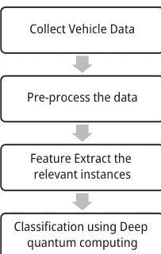

图 1.1：所提的路由模型。

# 4 — J. Albert Mayan, G. Swamy Reddy, G. Madhava Rao

我们没有发现证据表明潜空间模型的复杂性会影响生成的潜空间生成模型的稳健性。为了充分发挥该应用的优势，在潜空间中利用量子硬件进行训练的深度学习框架，不应平滑掉该应用通过反向传播可能实现的任何增强。在深度学习系统中引入量子模型（如本文讨论的那样），引发了关于在简短测试中使用该模型所获得的性能提升是否会被注意到的问题。这是由于尚不知道模型是否能区分长任务和短任务。

鉴于这些限制，我们必须使用一种名为起始网络（Inception Network）的特殊神经网络，该网络使用 MNIST 数据集以 95% 的准确率对图像进行分类。我们提出了一个指标来衡量模型看起来有多大的说服力（公式 1.1）。图像属于其类别的概率通常由概率分布 $p(y|x)$ 的主地位体现。其次，整个集合中的类别分布需要保持相当的平衡，以反映分布的多样性。

$$IS = \exp(E_{x\sim p}KL(p(y|x)||p(y))). (1.1)$$

为了满足第一个条件，有规定单个图像的类别分布的熵必须较低。只有当发生这种情况时，第一个条件才能被满足。第二个要求是系统中必须有大量的熵分布。通过计算 KL 距离来评估两个分布之间的差异：在这种情况下，$p(y)$ 的高值意味着 $p(y)$ 分布具有多个类别，而 $p(y|x)$ 分布具有单个类别。当对所有数据进行该分值取平均值时，它就能描勒出网络性能的清晰蓝图。

## 1.3.1 深度量子计算

量子比特，有时被称为 qubits，是量子计算机处理的最小数据单元。量子比特是一个二维量子力学系统，可以处于两个基本状态之一：0 或 1。编码在这些状态中的经典信息位（分别为 0 和 1）。该系统能够叠加或同时存在于 0 和 1 状态。量子系统最基本的特征之一是它们能够同时存在于所有可能的状态。这种特性使得量子计算机执行大规模并行计算成为可能。

在双量子比特系统中，两个量子比特状态无法相互隔离是可能的。从数学角度来看，该状态不能由两个不相关张量的积来表示。为了描述这一点，我们使用状态纠缠这一术语。然而，经典计算机在建模某些高度纠缠的系统时可能会遇到困难，使得更现代的方法变得必要。

例如，张量网络非常适合描述低纠缠水平的系统。为了量子算法超越最先进的经典方法，它需要大量利用纠缠。量子密码学、量子隐传和量子传感只是利用纠缠的许多非计算应用中的三个。

基础操作是另一个将传统计算与量子计算区分开来的特征。计算机最基本的组件是使用 NOT 和 AND 门的二值操作。NOT 和 AND 是执行任何其他布尔操作所需要的仅两个布尔算符。然而，薛定谔方程证明，当执行测量或其他损害可逆性的程序时，量子演化是可以反转的。为了实现量子增益，只需要可逆的酉 门 [17]。这些门中的几个已被证明是通用的。

## 算法 1：深度量子计算

- 在大多数情况下，开发量子算法时会包含图 1.2 所示的五个步骤：

  - 步骤 1：将输入数据编码到量子比特状态是初始步骤。

  - 步骤 2：第二步是在多个其他量子比特上监督这些量子比特（即使用量子叠加）。

  - 步骤 3：同时利用量子比特之间的量子纠缠。

  - 步骤 4：利用量子干涉。

  - 步骤 5：计算量子比特的数量或计算单个量子比特的长度（第 5 步）。

  - 步骤 6：量子物理中的测量结果有时被认为是随机的。

我们在本节中定义这一类别并解释了投资组合优化的重要性。选择最优组合是一个 NP 困难问题，这使得对于计算机来说是非常困难甚至是可能的。量子退火是利用纠缠的许多非计算应用之一。

# 6 — J. Albert Mayan, G. Swamy Reddy, G. Madhava Rao


图 1.2：提议的量子算法

在许多情况下，量子结果结果是随机的。

量子退火是量子计算的一种方法，尽管获取必要的条件是具有挑战性的。使系统绝热演化并选择正确的初始基态是这一问题的两个实例。由于由于，量子退火可以被认为是一种非常接近绝热计算的方法。近似计算被 Zagaskin 证明能够解决以前认为是 NP 困难的问题，只需在多项式时间内找到近乎完美的解决方案。

# 使用深度量子退火优化 VANET 中的流量流

本节评估了提议方法分类交通路线的效率。为了模拟提议的深度量子计算，使用了参数的值、使用 SUMO 流量生成器的实验设置以及 NS2 网络模拟器。作为一个面向对象和事件驱动的模拟器，其 TCL/OTCL 和 C++ 的通用性使其成为研究人员和从业人员测试网络配置的首选。AODV 用于在 500 秒的测试期间发送接收数据包。

此外，城市环境使用了 70 辆车，农村环境使用了 200 辆车，测试环境跨越 700 米乘以 700 米。城市道路的标牌行驶限速通常在 10 到 50 km/h 之间，而农村限速通常在 50 到 100 km/h 之间。在这些模拟中，汽车在符合 IEEE 802.11P 标准的无线网络环境中交换数据包。


图 1.3：流量预测的准确率

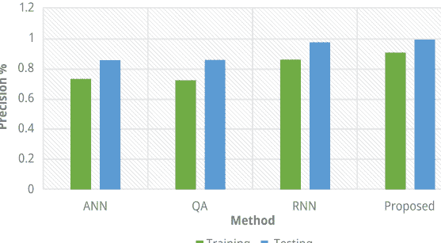

图 1.4：交通流预测的准确率。

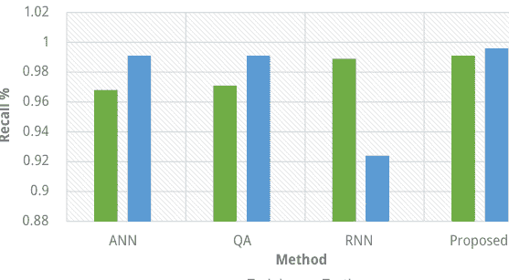

图 1.5：交通流预测的召回率。

在这些结果（图1.3–1.7）中，UDP作为底层传输协议，车辆的数据包大小为512字节；此外，交通使用恒定数据速率，且车辆间的无线通信范围为300米。此外，我们将每个实验都运行了二十次并取平均值。同时，在整个研究过程中，使用了10个路侧单元（RSU），旨在通过所述和测试的技术来识别女巫攻击。车载自机网络（VANET）中的车辆密度和车辆行驶模式对于该策略的成功至关重要，该策略使用投票系统来验证车辆的位置。

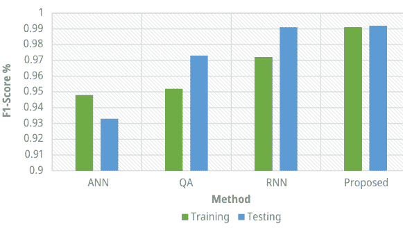

图 1.6：交通流预测的F-Measure。

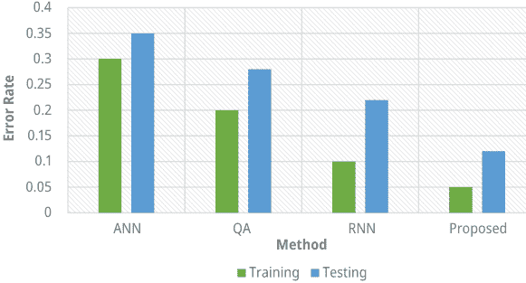

图 1.7：交通流预测的错误率。

## 1.5 结论

在这项工作中，采用深度量子退火方法来优化VANET中的交通流。在深度量子退火的帮助下，智能城市可以确保交通顺畅而不拥堵。为了比传统方法更有效地改善流量，我们进行了周全的考虑。

交通管理效率低下是交通拥堵的常见原因，但可以通过在其他运输领域显示出良好前景的AI技术来解决。通过优先考虑救护车、消防车和警车等应急车辆，可以减少排放、燃料消耗和对环境的影响。道路交通管理系统可以从云计算的低成本和高效率中获益。

- [16] Dhiman, S., ..., A., & ..., S. (2021). ...

- [17] ... , S. (2022). ...

在尝试为一组无人机（UAVs）分配任务时出现的问题已经通过采用多种策略和方法得到了解决。进化算法可以应用于许多场景，其中之一是分配分布在多个不同目标上的大量任务 [5–6]。通过利用遗传算法（GA）对无人机进行侦察任务规划，使其能够成功执行任务。一种借助模拟退火算法提供的改进型 K-means 聚类方法进行工作规划的模型 [7]，考虑了分配在每架无人机上的多项责任。

作者提出了一种分层工作分配方法，结合混合整数规划和蚁群算法，通过首先将问题分解为更小、更易管理的分配来解决。为了实现这一目标，作者提供了一种分层工作分配技术。该方法论可能源于 [8]，且由该作者负责创建。文章 [9] 中设计了一种迭代方法，旨在提高涉及大量无人机的分布式应用中，工作分配和路径规划的效率。该文章的写作目标是提高这些过程的有效性。[10] 中提供了一种受量子进化启发的技术，作为增强在动态环境下操作时应对与任务分配相关问题时无人机联盟可靠性的手段。该方法寻求在最有效利用可用资源的同时，减少产生的浪费。

[11] 开发了一种利用移动边缘节点的物联网（IoT）评估方案。[12] 探讨了拥塞和严重的能量耗散的问题。该系统旨在解决这些问题。根据所建议的架构，源节点负责计算自适应直接信任值，而汇聚节点负责计算间接信任值。边缘节点对不可信节点的快速识别，有助于在受到攻击威胁时降低攻击风险。

参考 [13]，我们希望实现一种名为虚拟力数据采集（VFDC）的策略。在这种策略中，移动边缘节点会移动到系统中的所有可信节点，并从每个节点处收集数据，以确保系统既高效又安全。基于智能信任云的（（ITCM）方法是另一种替代方法，用于评估医疗物联网（IoMT）中哪些组件是不可的。第一步是创建信任云，第二步是在模糊推理系统的帮助下建立它们，第三步是在结构深层寻找不可信的节点。

根据作者在 [15] 中的建议，通过利用边缘节点或边缘智能从可信节点收集数据——该系统利用深度强化学习来精确跟踪轨迹。这种策略在实现目标方面是高效的，但代价是在计算上投入了大量的时间和精力，以及物理资源的消耗。对于物联网而言，可靠性是确保活动执行的关键组件。对于由云启用的传感器网络，网络中每个单独节点的信任度与网络中单个节点的路由同样关重要。为了确保节点路由过程以高效的方式进行，研究人员创建了多种优化方法。

在基于物联网的传感器网络中，可以在优化的帮助下为节点设计有效路径。[16] 中提出的基于蚁狮优化的 K-means 算法（ALO-K）技术和基于改进型蜂群算法优化的 K-means 方法是混合聚类方法的示例。这两种方法都基于 K-means 算法。

作者 [17] 应用了并行框架来识别并保证属性。这是为了防止网络攻击的一种预防措施。[18] 的作者讨论了农业物联网应用中的信任问题，并提供了一种基于区块链技术的解决方案，作为解决该问题的方法。尽管从计算的角度来看实施很困难，但该技术每产生一个单位的成本很低。

根据参考文献 [19–20]，区块链技术也被用于解决数字孪生中的可靠性问题。这是通过使用共识机制实现的。该研究工作描述了该网络。由于这种机制，网络能够提供有效路由的供应和安全。

上述方法以多种独特且有效的方式解决了能量消耗和安全问题。针对这些问题的潜在解决方案包括基于信任的数据采集、最优路由和边缘支持的安全数据传输等（例如）。另一方面，人们注意到，算法所提供的效率和安全水平是以彼此为代价的。这是因为算法之间在争夺资源。这是由于一些研究人员主张使用边缘节点来实现安全且繁荣的节点信任值，而另一些人则倾向于使用最优路由来提高系统的服务质量特征。

聚类无人机网络要求执行一种混合方法，包括结合边缘节点计算以及为数据传输创建有效路径。这是为了满足网络的需求。它能够实现快速收敛，而不会出现与局部层面寻找最优相关的通常问题。同样，它通过使用确定每个节点信任度的技术来选择可靠节点。由于借助人工蜂优化器构建了路由路径，移动边缘节点能够高效地从所有可靠节点获取数据。这是因为路由路径连接了所有节点。

我们正在寻找不同的方法为无人机（UAVs）规划路线，因为该问题属于 NP-完全类，在大多数情况下被极度应用，以获得所需的结果。上述文献的研究导致开发了一种基于差分进化架构（DE）的无人机离线路径规划器。该规划器能够生成 2D 路线，同时考虑某些协调限制。此外，研究人员还将 DE 与量子行为粒子群优化（PSO）结合，旨在为水下环境下的无人机设计路线。

（注：提供的 OCR 文本包含大量重复和伪影。我将根据内容的逻辑流提供一个清理后的合并版本。）

## 2 无人机网络中基于量子退火的路由 17

宇宙是无限的。图 2.1 中还讨论了将使用何种策略，以用以表征该问题并产生可行的答案。

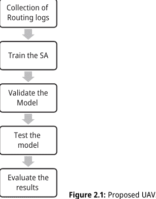

图 2.1：建议的无人机。


## 2 无人机网络中基于量子退火的路由


图 2.1：建议的无人机。

我们考虑了无人机应用场景，在该场景下，一组无人机将被程序化为：离开机库，并在规定时间内飞向一组预定的目标节点，而且当然，必须在每架无人机的最大飞行距离内。目标节点将在无人机机队离开机库之前预先确定。这将在不超过所使用的任何无人机最大飞行距离的情况下完成。当无人机被派往定期感测任务时，会发生类似的情况。在这些任务期间，无人机机队必须穿越预定节点之间的地面，并带有时间戳数据返回基地，以确保提供准确的地图更新。

图 2.1 是应用场景模型的显示，该模型的创建目的是为无人机分配任务并组织车辆将采取的飞行路径。

这允许我们生成一次满足所有要求的单次行程。它将问题的本质从需要创建几条不同路线的问题，转变为目标是在两个站点之间行驶最短路径的问题（如图 2.2 所示），此时，向许多无人机分配作业并为它们设计路线的过程等同于旅行商问题（`TSP`）。另一方面，适用于此场景的约束比适用于 `TSP` 的限制更难理解，而 `TSP` 是 NP 完全问题族中的一员。

必须强调的一点是，此场景中的目标节点与脑海中的任务位置并不等同。由于无人机不需要直接飞越目标节点来执行工作，因此实际的任务现场可以自由位于目标节点附近的任何地方。无人机从特定任务地点（如建筑工地或灾区）拍摄的图像可以作为飞机定期感测的一部分，并更新到地图数据中。这些任务是由遥控飞行的飞机执行的。

然而，在进行任何准备之前，必须定义无人机要求飞越或停留的区域。这必须在进行其他安排之前完成。这些特定节点被称为网络中的目标节点。无人机的运行方式类似于无人机，但它们并不一定遵循固定路径。尽管如此，可以使用一组直线来阐明基本的飞行顺序以及所有目标节点之间的距离。因此，这些信息可以用于在规划之前考虑实际飞行距离。

### 2.3.1 解决方案

如果数组的组件以优化方式定位，则可以表示为适用于无人机机队遍历目标节点的可行数组解决方案。通过采用类似于 `TSP` 中使用的数组，我们能够阐述一种解决任务调度和路径规划问题的方法，并将其付诸实践。该数组包含每个目标节点以及每个虚拟机库节点；唯一的区别是虚拟机库节点之间的路径不够理想。

这一目标可以通过两种方式实现：首先，我们可以增加目标节点数组中包含的虚拟机库数量；其次，我们可以消除任何虚拟机库之间存在的任何距离。

总共有三架无人机，总共有七个需要目标的节点。数字 `0` 指存储设施，即所涉及的节点。在执行第一步后，将机库节点 `0` 添加到数组的开头和结尾。之后，执行第二步，将机库节点 `1` 添加到数组中间。第一步是随机排列目标节点数组；第二步是从所有 `N1` 个位置中随机选择 `M1` 个位置；第三步是将机库节点 `0` 添加到数组的开头和结尾；第四步是将机库节点 `1` 添加到数组中间。

尽管最终的解决方案数组看起来是有序的，但它们在同一时刻开始飞行。这是因为无人机被设计为同时起飞。根据最近的访问顺序，`UAV1` 目前处于第七，`UAV2` 处于第一，`UAV3` 处于第五。

所有三架无人机必须同时离开机库，并在每个指定节点停靠一次后返回。同样，要求它们在完成任务后返回也是至关重要的。

以下是图 2.3 所示解决方案的一些属性，证明了其可行性：数组长度为 `N+M+1`，它永远不会连续出现虚拟机库节点，并且始终以领先 `0` 和结尾 `0` 作为其第一个和最后一个值。数组长度为 `N+M=1`。这是一个函数，如果输入数组有解决方案，它将返回“true”，但如果数组不包含解决方案，它将返回值“false”。第一个算法给出判断解决方案是否为随机排列结果的标准方法。这种技术以算法的形式呈现。在特定情况下，为了提高操作效率，我们决定不检查约束。

通过使用基于平均分配的技术，我们经常处于一个可以提供单架无人机在执行之前能够覆盖的最大长度的位置。这将由于模型的基本属性发生。这表明，本质上，约束在每个程序的末尾被验证。

在现有方案上执行交换操作，以产生紧邻其的方案。

另一种可用于增强模拟退火（`SA`）的替代策略被称为删除并替换法。`SA` 算法通过将邻接方案方法替换为删除并插入（`D&I`）方法来产生。这使得算法转化为一个 `SA` 过程。在执行交换操作之前，该方法要求移除已实现方案中的所有虚拟节点。之后，重新引入虚拟节点。

### 2.4 评估

在本节中，通过 `MATLAB` 软件对一台配备 `8GB` 内存、`i7` CPU 核心并运行 `Windows 10` 的高端计算机进行性能测量，以确定所提 `SA` 的有效性。在运行仿真之前，需要先配置几个参数。

系统识别不可信任节点的程度是我们量化真实评估过程的方法之一；这是一个需要考虑的关键衡量指标。图表非常清楚地表明，网络寿命（由总轮数表示）在三个不同的点确定：第一个节点丢失时、后半节点丢失时以及任务中最后一个节点丢失时。

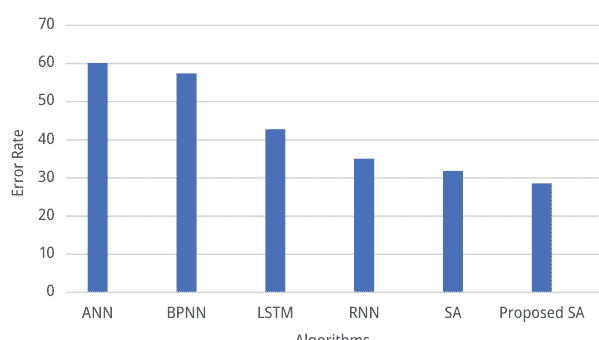

**图 2.2**：包错误率。

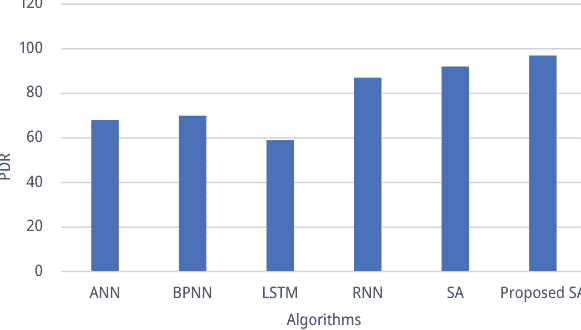

图 2.3：流量预测的 F 度量。

结果（图 2.2 和 2.3）显示，提出的模型在三种场景下均提供了最网络寿命，这确保了系统在更长的时间内保持高效和可靠。已经确定，对于给定的网络规模，高数量 `UAV` 设备场景的预测寿命比小数量 `UAV` 场景短。实验结果证明，`50` 个节点的场景与 `200` 个节点的场景在工作量方面是等效的。

### 2.5 结论

在这项工作中，我们评估了若干不同的元启发式算法，并提出了交换模拟退火（`SJSA`）作为解决多无人机任务分配和路径规划问题的解决方案。这对于参与现实任务的 `UAV` 来说巨大的补充，因为它减少了与任务分配相关的计算复杂度。在考虑了各种约束的情况下，开发了该模型以寻找最优解。研究表明，所提 `SA` 与其他元启发式算法相比具有竞争力。

R. Menaka*, S. Thenmalar, V. Saravanan

# 3 基于量子机器学习的社交网络推文网络欺凌检测

**摘要：** 网络暴是指通过互联网或其他技术通信手段进行的欺凌行为。得益于技术的发展，网络暴源于许多新颖领域。在过去的几年里，网络暴的流行程度和公众讨论都在稳步增长。由于来自许多来源的相似内容可能代表不同的观点和阐释，网络暴的概念目前仍然比较模糊。本章讨论了利用量子机器学习对社交网络推文进行网络欺凌检测。量子机器学习能够通过一系列处理阶段实现实例检测。仿真表明，该方法在实例检测准确性方面优于其他方法。

随着技术的进步，大多数信息都以数字形式保存。多媒体内容（如文本、照片、音乐作品和视频）的扩展很大程度上归功于互联网的广泛普及和可用性 [1]。多媒体内容包括文本、图像、音乐和视频 [2]。

与该主题的研究日益增加，结合机器学习（`ML` 和 `DL`）的发展，促成了尖端智能系统的诞生，这些系统旨在识别和解释隐藏在多媒体和多态源中的情感信息 [3–4]。

该领域的现有分析问题以多媒体数据的极其巨大的规模和高维特征为典型。从此类既是多态又充满噪声的海量数据中提取推理的方法，是一个既迷人又充满挑战的研究领域中需要完成的任务 [5]。为了从多媒体文件中提取深层特征，推荐的策略涉及使用数百层相互全连接的节点层 [6–10]。

最近的研究 [12–15] 表明，使用神经网络学习词汇和上下文属性可以取代对手工特征的需要。基于量子机器学习的发展使得这种可能性成为现实。词嵌入被应用于量子机器学习的训练中。

本章讨论了利用量子机器学习对社交网络推文进行网络欺凌检测。量子机器学习能够通过一系列处理阶段实现实例检测。

[16] 将网络欺凌描述为通过电子手段进行的蓄意且反复的伤害。意图、重复和伤害也是欺凌核心定义的本质组成部分。因此，网络欺凌是通过互联网向他人发送威胁性文字或照片并意图造成伤害的行为。

网络欺凌是 [17] 个人或群体通过电子手段对他人信息的有害且重复的传播。网络欺凌的受害者遭受着具有威胁性或性暗示挑衅性的信息。自然语言处理（`NLP`）和机器学习（`ML`）领域日益强调开发自动检测网络欺凌的方法。

网络欺凌是一个值得进一步研究的重要问题。网络暴的负面影响从轻微到严重不等。网络欺凌事件的严重性可能取决于事件背景和涉及人员等变量。这就是为什么拥有一种实时检测和分类网络欺凌严重程度的方法很有帮助；它可以辅助对实际网络欺凌事件的管理 [18]。

在 `NLP` 中，文本分类是常态。情感分析、垃圾分类和主题分类都是许多学术研究的主题 [19]。

人工智能程序可以使用这些特征来识别网络欺凌实例和其他形式的敌意言论。对于监督学习，大多数策略依赖于训练过的数据。

大多数网络欺凌检测研究忽略了用户人口统计数据，而集中在内容分析上。因此，应该使用评论者的年龄信息和之前的评论历史来识别帖子的欺凌性质。通过引入攻击性词汇的频率等其他变量 [20]，网络欺凌识别得到了增强。

一个 `Twitter` 数据集 [21] 使用关键词作为特征自动检测网络欺凌内容。通过考虑用户关系并进行社交网络分析，他们能够提高检测准确率。


曲线下面大于 90% [22] 的网络欺凌事件使用随机森林分类器来区分普通、攻击性和网络欺凌。

图像、个人资料、时间戳和地理坐标仅是视为社交网络整体信息格局的数据形式之一 [23]。这类信息对于开发基于多态信息的网络欺凌检测异构网络很有用。

网络欺凌一术是指任何通过数字媒体（如互联网或其他在线通信形式）发生的欺凌形式。由于信息和通信技术的发展，可能成为网络欺凌者的人和地点已扩大到更广泛的选择。在过去的几年里，记录在案的网络欺凌实例不断增加。由于相同的内容可以来自各种来源，现在很难获得关于什么是网络欺凌的清晰图像。这是因为这些来源每一个可能对什么是网络欺凌提供独特的视角或阐释，如图 3.1 所示。

### 3.3.1 数据收集

向另一个互联网用户发送威胁或骚扰信息是一种相当常见的网络欺凌类型。例如，一个欺凌者可能在一个帖子发布网络欺凌内容，然后其他的欺凌者通过生成同样针对受害者的评论对第一个帖子做出贡献。这些评论也可能指向受害者。

此类评论可能出现在初始帖子上。仅凭视觉检查不足以揭露网络欺凌案例。鉴于网络欺凌的定义至少涉及两个个人，数据收集的重点应该是围绕单一焦点的对话，以及每个参与者的多条言论。

### 3.3.2 网络欺凌标注

由于借助数据爬虫进行的数据收集，很明显某些形式的材料（如表情符号和超链接）不应包含在网络欺凌事件的分类中。这是在该阶段发生的一切的总结：

- 过滤：网络欺凌与传统欺凌有许多不同之处，之一是需要筛选由不同个人反复发布的内容。由于了一系列对话产生了一个链，每个链接都包含其独特的观察和回应。在大多数情况下，每个聊天至少二十条评论。
- 样本过滤：网络欺凌的严重性是本文的焦点。样本经过人工过滤程序，以删除与讨论问题不相关的言论。

# 使用量子机器学习进行社交网络推文的网络欺凌检测

- **特征评分：** 在将标注标准应用于每一个涉及网络欺凌的遭遇后，五位相对独立工作的领域专家对他们所做的每项标注都分配了分数。网络欺凌发生的频率、表达出的仇恨程度，以及目标是谁或是什么，这些共同决定了正在发生的网络欺凌的整体严重性。对于每个标准，评分范围从 1 分（表示不同意）到 3 分（表示同意，即“强烈同意”）。由于这一点，可以为每一段对话分配以下三个严重性等级之一。
- **严重性标注：** 对话中讨论的网络欺凌强度通过以下句子来刻画该对话的特征：当有超过三位不同的专家提供相同的评分时，选取中间值来代表该评分。我们还收集了五位专家提供的分数并进行平均值处理，以排除任何特别极端结果可能。最后，得分为 3、4 和 5 分的对话被认为是低强度，得分为 6 或 7 分的被认为是中等强度，而得分为 8 或 9 分的被认为是严重强度。

## 3.3.3 数据预处理

词嵌入有多种，其中一些根据单词的周围环境将单词分组在一起，而另一些则考虑单词与文本中每一个其他单词之间的关系。某些词嵌入根据其直接周围环境进行分组，而另一些则考虑了这种关系。

其中广为人知的被称为连续词袋模型（Continuous Bag of Words，简称 CBOW）。这段文本的含义取决于你处于世界的哪个位置。另一些则考虑单词与句子中找到的每一个其他单词之间的连接。

这段文本的含义取决于其所处的环境。词表示全局向量（GloVe）是另一种能够准确捕捉全局上下文的预测模型。我们使用了一种考虑整体上下文的词嵌入技术来检测讽刺。这是因为我们认为这对于准确的讽刺检测是必要的。

为了获得句子中每个单词在维度 D 下的嵌入，我们必须首先使用标准分词器对 $S$ 进行分词（tokenize），然后应用一些预训练模型。这将允许我们获得句子中每个单词的嵌入。我们的模型以各种嵌入的形式接收输入，其由方程表示：

```
$S = \{e_1, e_2, \dots, e_N\}, S \in R^{N \times D}$
```

需要拆解句子 $S$ 以定位具有讽刺含义和负面情感基调的关键术。这对于确定句子中是否使用了讽刺是必要的。使用这些线索的上下文决定了这些单词的关联性，可以考虑许多不同的变量。我们构建的模型使用了一种被称为多头自注意力（multi-head self-attention）的方法，从提供的输入文本中提取这些线索。

量子计算学科的主要重点是研究在量子力学中处理数据（如存储和发送信息）的挑战。具体而言，这些挑战包括：量子信息的传输指的是使用量子态传输数据的特定方法。量子计算模型涉及概率性时间可逆计算的存在。时间可逆计算是一种可以描述为计算类型，其结果复制了输入的数据。

使用密度矩阵允许在量子理论中实现物理状态的定量表达。这是量子力学发展中的重要一步。概率分布的概念通过使用密度矩阵得到了扩展，密度矩阵是正的、迹为一的、半定的矩阵。量子计算模型的逻辑状态转换为负责操作该模型的量子系统的适当物理状态。这一过程被称为状态转换（state translation）。

可以通过首先初始化状态，然后对该状态执行一系列酉矩阵，以兼容各种迭代的方式进行计算。这将导致计算向后兼容。生成的概率输出基于使用最终密度矩阵编码的分布，而使用最终密度矩阵编码的分布用于构建概率输出。

## 3.3.4 分类

在图 3.2 中，标准逻辑值 0 和 1 与观察者可以看到的具有两个自由度的量子系统状态相关。

换句话说，0 和 1 分别是表示零和一状态的值。换一种说法，在零或一状态上唯一重要的值是 1 和 0。在对话中，量子比特（qubit）是一个形式为 $\psi = a_0e_0 + a_1e_1$ 的向量，其中 0 和 1 都是无符号的小常数 $a_0, a_1$。

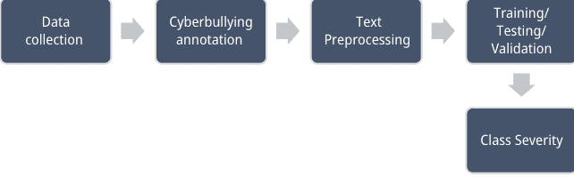

**图 3.2：** 拟的分类模型。

（注：原文此处后续部分存在大量重复且乱码的 OCR 错误，已根据要求保留核心逻辑并过滤重复无效内容。）

# 使用量子机器学习的社交网络推文网络暴力检测 — 33

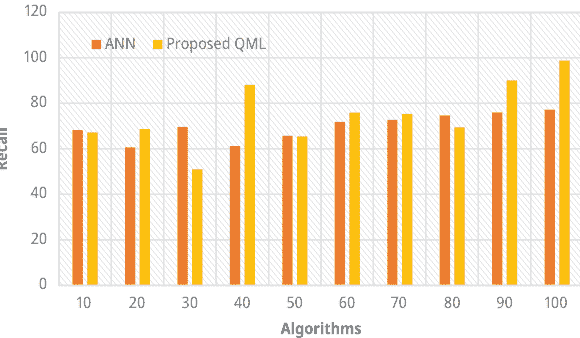

**图 3.4:** 召回率（Recall）。

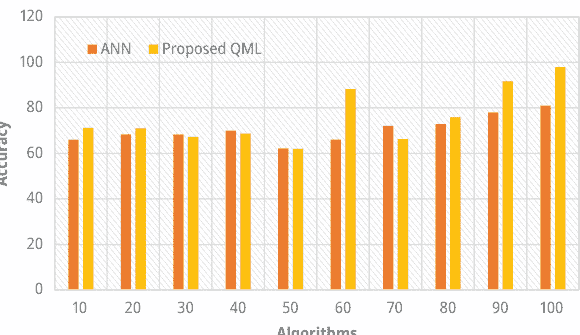

**图 3.5:** 准确率（Accuracy）。

将真实值（ground truth）中的讽刺句子总数除以准确预期讽刺句子数量。统计事实中有多少讽刺句子。召回率和准确率得分的调和平均值也称为 F 分。为了计算这些分数，我们首先给模型预测设置了 0.5 的阈值。

## 3.5 结论

本章在工作中提出了一种量子深度学习架构，能够判断给定的文本是否包含讽刺。数据预处理、多头自注意力机制、门控循环单元（GRU）、分类和可解释性构成了我们所建议方法的五大支柱。通过采用多头自注意力方法，我们可能锁定句子中包含的讽刺关键标记。

该层的输出被馈到全连接分类层，以获得最终的分类分数。当该层的所有连接都建立时，它就是全连接的。必须遵循此程序以获取分数。

在源自不同来源的大数据集上进行了实验，结果显示在各项评估指标方面，较于先进模型有明显的改进。

为了突出我们模型中不同组件的重要性，我们进行了消融实验并分析了训练后的模型。我们通过检查注意力权重来解释模型，并发现它可以识别指示讽刺的文本提示。


**图 3.6:** 测试性能分析。

- [18] Shi, W., Goodfellow, M., Masty, B. Y., Liu, X., & Zhang, A. (2022). 城市信息学视角. Urban Informatics, 1(1), 1–14
- [19] Chauhan, S., Mittal, M., Woniak, M., Gupta, S., & de Prado, R. (2021). 基于技术接受的在线移动游戏机器学习分析. Symmetry, 13(8), 15
- [20] Yuvraj, N., Chang, Gobinathan, B., Pinagapati, A., Kannan, S., Dhiman, G., & Rajan, A. R. (2021). 基于多特征的人工智能结合决策树分类的网络暴力自动检测. Computers & Electrical Engineering, 92, 107186.
- [21] Banana, S. H., Sadhhya, G., Tanuja, S., Elour, S., & Sinha, A. (2020). 向安全的对话空间：社交媒体中的毒性检测（学生背景）. In: 2020 IEEE Sixth International Conference on Multimedia Big Data (BigiM) (pp. 297–301). IEEE.
- [22] Rani, P., Verma, S., Yadav, P., Rai, B. K., Naruka, M. S., & Kumar, D. (2022). 医疗数据隐私与安全的轻量级区块链仿真. Journal of E-Health and Medical Communications (JEHEMC), 13(4), 1–15. http://doi.org/10.4018/JEHEMC.30946.

## 4.1 引言

未经授权的访问 [1, 2]、拒绝服务 [2]、恶意软件攻击 [3, 4]、零日攻击 [4, 5]、数据泄露 [5, 6]、社会工程或钓鱼 [7, 8]以及其他形式的网络攻击在过去十年中由于信息技术重要性的日益增加而激增。2010年，全球安全社区记录了少于5000万不同的恶意软件可执行文件。

已经证实，个人和公司都可能由于网络安全和网络攻击而遭受巨大的财务损失 [7, 8]。这些损失范围从几万到数亿美元不等。根据安全专家的观点 [9, 10]，预计在未来五年内，被破解的攻击数量将增加四倍。由于此，公司创建并实施一个全面的网络安全计划以防止额外损失至关重要。此举目的是保护公众免受网络攻击的侵害。

最近的社会经济研究 [11] 表明，政府尽快找到识别不同网络事件问题的解决方案（包括以前发生过和未过的事件），并妥善保护关键系统免受犯罪分子的攻击，具有极重要的意义。

网络安全一术语是指为了保护数据、计算机网络和其他数字资产而采取的系列措施 [12]。网络安全是一个通用术语，涵盖了广泛的专业子领域，其中最突出的是企业计算和移动计算。

这些包括：(i) 网络安全，涉及防止黑客访问网络；(ii) 应用安全，涉及确保应用程序和硬件免受威胁；(iii) 信息安全，涉及保护敏感信息；以及 (iv) 运营安全，涉及处理和保护数据资产的方法。在这些领域中，网络安全是最重要的。防火墙、防杀病毒软件和入侵检测系统是保护计算机网络及其包含数据的传统方法。

发现此前未知的模式是数据科学的主要目标之一，而量子计算作为人工智能这一子研究的重要组成部分，具有在这一努力中发挥至关作用的潜力。数据科学目前处于新科学范式的前沿，而量子计算的到来对网络安全领域产生了深远的影响 [13, 14]。这两项进展都发生在近年来。正如 [15] 中讨论，能够相互通信的设备数量的增加导致网络攻击复杂程度的提高。

我们得出结论，调查最有效的方法是将重点放在与网络安全领域相关的量子计算上。

这是由于我们认为安全和有效的数据处理方法都是成功调查的本质组成部分 [16]。

数据安全是本研究的重点，应用量子计算技术是为了预测未来网络攻击的发生，并改进现有的预防措施。如果位于学术机构和企业工作的研究人员正在利用与量子计算相关的技术探索和构建数据驱动的网络安全模型 [17]，那么这种努力对他们将是有益的。

在本节中，我们开发了一个基于量子智能 (QI) 的模型，以增加网络检测和响应由 IoT-SDN 网络带来的网络安全威胁的能力。这些威胁是由两种技术的结合产生的。通过对网络日志进行收集、预处理和随后的分类，该模型对网络攻击进行分类的能力成为可能。为了评估 AI 驱动模型的工作情况，在 Python 中开发了一个仿真。在准确识别实例方面，结果清楚表明所建议的技术是有效的。

## 4.2 相关工作

数据安全是本研究的重点，应用量子计算技术是为了预测未来网络攻击的发生，并改进现有的预防措施。如果位于学术机构和企业工作的研究人员正在利用与量子计算相关的技术探索和构建数据驱动的网络安全模型 [17]，那么这种努力对他们将是有益的。

在本节中，我们开发了一个基于量子智能 (QI) 的模型，以增加网络检测和响应由 IoT-SDN 网络带来的网络安全威胁的能力。这些威胁是由两种技术的结合产生的。通过对网络日志进行收集、预处理和随后的分类，该模型对网络攻击进行分类的能力成为可能。为了评估 AI 驱动模型的工作情况，在 Python 中开发了一个仿真。在准确识别实例方面，结果清楚表明所建议的技术是有效的。

# 4 使用量子计算进行缓解的AI驱动的网络安全建模 — 41

发送者和接收者的互联网协议（IP）地址、所使用的端口以及关于所用协议的细节，都是本文评估的信息组成部分。SDN（软件定义网络），即一种用于跟踪网络活动的算法开发，可以通过许多不同的方式来实现。

OpenFlow 规定了控制器与交换机之间通信时必须使用的消息，以便将其原生监控协调到其架构中。这种通信发生在 OpenFlow 的设计阶段，但从这些表中获取的数据不足以进行检索。尽管控制器可以访问交换机的流表，但流量的源地址和目的 IP 地址也包含在这些属性中。

替代方法的监控由政府负责。这种监控由交换机执行，它独立于控制器进行数据分析，且过程中不需要后者的参与。为了实现这一目标，交换机会同时查询其流表和状态表。这不仅使得算法更加准确，而且能够识别出旨在同时拒绝用户服务的攻击。

### 4.3.2 检测


熵算法的监控阶段收集数据，然后在算法的检测阶段对这些数据进行分析。监控阶段的工作是收集数据，以便完成检测阶段的任务——识别相同的流。与基于模式的工具相比，计算熵等标准程序并不需要大量的内存或存储空间。当这一任务完成后，涉及的方法论将转化为一个不仅可运行，而且具有整合到 SDN 网络组件潜的解决方案。

以下方程考虑了发生概率 $p(x_i)$，可用于计算检测系统的熵。该方程考虑了事件总数 (n)。

$$H(X) = -\sum_{i=1}^{n} p(x_i)\log_2 p(x_i)\log_2 n$$ 

具有高集中程度的分布因为其高集中度而具有较低的熵值。相反，用于在网络中识别攻击的行为的特征是低集中度分布，这意味着具有更大的熵值。这种行为被识别为具有较高的熵值。这种行为与前一段讨论的内容形成鲜明对比。在确定最小和最大范围熵值时，所用方法的准确性是决定检测程序是否将成功的关键因素。

需要一个初步训练阶段，在此阶段，必须为算法提供流量数据，以便使用方程计算熵和分布边界。该阶段只有在初始训练完成后才能开始。系统会定期对所有相关参数（如源和目的 IP 地址以及源端口）进行重复熵分析，以检测攻击。如果熵计算结果根据你设置的范围过高或过低，则攻击已被识别：

Limits = $\mu \pm \sigma$，

其中 $\theta$ 是类别，$\mu$ 是平均值，$\sigma$ 是标准差。

### 4.3.3 卷积神经网络

该研究建议将神经元输入处的经典对数用编码振幅和相位的量子态来取代。这将取代目前使用经典对数的系统。神经元的末端产生一个量子态，该状态取决于输入神经元的状态的线性叠加。

内置的每个量子态都接收一个独特的振幅和相位权重，该权重基于复数权重确定。将信号整合到神经网络模型中与误差反向传播方法的泛化有关，该方法用于训练传统的感知器。将信号整合到神经网络模型中与该方法的泛化有关。

显而易见，除了非线性过程引起的影响外，量子神经网络和光神经网络在本质上是相同的。近年来，量子神经网络领域取得了显著进展，网络设置的阶段从执行一系列经典操作开始。这是启动过程所必要的。测量和状态的建立都包含在这些程序中。

已经证明，卷积神经网络（通常称为 CNN）是量子神经网络的一个良好示例。得益于该网络，在识别复杂对象时可以看到量子优势的发挥。来自量子卷积神经网络 (QCNN) 一层的数据被 QCNN 的后续层使用，以构建一个新的中间二维像素像素数组，称为特征图。该图用于辅助图像分类。这种创建是每一层的共同责任。

这些层被称为卷积层、下采样层和传统感知器层。在多层感知器中，前两层被用于为网络提供输入特征向量。这些层以交替方式排列。

QCNN 的检测准确率通常比普通神经网络高出 10–15%。这是因为 QCNN 使用了更复杂的算法。通过纯并行化卷积图并在误差跨越网络传播时应用反向卷积，使得 QCNN 的快速学习成为可能。

## 4.4 评估

在本节中，我们使用了一个名为 Bot-IoT 的真实 IoT 数据集。Bot-IoT 的设计经过了修改，以便证明该解决方案是有效的。整个集合包含了良性和恶意流量。因此，即使在攻击停止后，也可以检查作为攻击目标的主机是否仍在接收有效流量。带有现有比较的提议方法如图 4.2 至 4.5 所示。

当这些条件存在时，算法需要更长的学习周期来准确地微调分布边界。这是由于在发现并反击攻击后，熵发生了巨大的波动。数据集的大小影响了其生成的假阳性数量；窗口的大小必须根据系统遇到的流量体积进行更新。

在发现攻击后，修订的流规则被传输到相应的交换机，以阻止恶意流量的通过，同时保持正常流量流的完整性。整个流量包括合法和非法数据包，以及数据报协议 (UDP) 数据包的数量。

扩大窗口大小不仅导致标准差的增加，还增加了缓解风险所需的平均时间。这是因为每当窗口扩大扩大时，算法被迫处理从数据平面获取的更多状态。结果是计算熵所需的时间将随之增长。

由于没有检测到哪怕一个假阳性实例，因此这种情况下的假阳性率是准确的。在攻击被阻止后，在整个调查过程中，假阳性率保持稳定在 20% 左右。

## 4.5 结论

借助量子方法，可以检测并缓解连接到物联网的网络中的 DDoS 攻击。该方法的细节将在下一章进行更详细的讨论。已经表明增加

作为一种网络监控的可行方法。

改进消除了向控制器发送数据包的必要性。

在三种不同的设置下进行了有效性测试。

为了确定各种属性的熵值相关性。

实验结果表明，通过向交换机表中检测攻击是有益的。

## 参考文献

- [1] Porambage, P., Gür, G., Osman, D., Livanage, M., & Liantilla, M. (2021). 6G 挑战与潜在解决方案。在：2021 年欧洲网络与 6G 联合会议 (EuCNC/6G Summit) 页码 622–627。
- [2] Tao, F., Akhtar, M., & Jiyuan, Z. (2021). 网络安全的人工智能未来：全面综述。EAI 创新技术杂志，8(2)。
- [3] Gill, S. S., W., Ottaviani, C., Patros, B., Hassan, R., Shaghi, A., & . . Uhlig, S. (2019). 物联网 IoT、区块链和人工智能对云计算的变革性影响：愿景、趋势。物联网，8。
- [4] Siriwanda, Y., Porambage, P., Livanage, M., & Liantilla, M. (2021). AI 与 6G 安全：机遇与挑战。在：2021 年欧洲网络与 6G 联合会议 (EuCNC/6G Summit) 页码 616–621。
- [5] Catak, O. F., Kuzulu, M., Catak, E., Call, U., & Unal, D. (2022). 毫米波 6G 网络机器学习解决方案的安全考量。物理通信，S2，10126。
- [6] Çağlayan, M. U. (2022). AI 与服务质量攻击检测、缓解与优化：某些欧盟项目的结果。在：国际 ISICS 安全研讨会页 1–12。
- [7] Al-Haveh, M., Mostafa, N., Garg, S., & Hassan, M. (2020). 物联网网络中深度学习的威胁智能。IEEE 网络服务与工程事务，8，2964–2981。
- [8] Clim, A. (2019). 网络安全工业 4.0。关于少数技术方法的简要回顾。Informatica 经济，23(2)，34–44。
- [9] Gill, S. S., W., Ottaviani, C., Patros, B., Hassan, R., Shaghi, A., & . . Uhlig, S. (2022). 下一代计算：新兴趋势与未来方向。物联网，19，100514。
- [10] Williams, P., Iatta, K., Daoud, H., & Mackey, S. (2022). 关注新兴技术影响的物联网综述。物联网，19，100564。
- [11] Elav, S. P., Bhatti, B. S., Mahato, D. P., & Kumar, S. (编). 物联网应用的联邦学习。EAI/Springer 通信与计算。Springer。https://doi.org/10.1007/978-3-030-85559-8
- [12] Mangla, C., Rani, S., Qureshi, N. M. F. & Singh, A. (2022). 使用量子计算缓解下一代行业的 5G 安全挑战。
- [13] Saravanan, V., & Raj, V. M. (2016). QoS 导向手机手册的无缝移动学习与青少年生活。亚洲科学与人文研究杂志，6(7)，374–389。
- [14] Nguyen, V. L., Lin, C., Cheng, B., Hwang, R., & Lin, Y. D. (2021). 66G 安全与隐私：前景技术与挑战综述。IEEE 通信综述与教程，23(4)，2384–2428。
- [15] Yadav, S. P. (2022). 物联网安全。在：Baalamuguram, Kumar, S., Kumar, A., Kumar, V., Padmanaban, S. Springer 通信与计算。Springer。https://doi.org/10.1007/978-3-030-70501-5
- [16] Ghiasi, M., Miknam, T., Wang, Z., Mehrandesh, M., Deghmani, M., Ghadimi, N. (2023). 智能电网攻击与防御机制全面综述：过去、现在与未来。电力系统研究，215，10875。
- [17] Tatarajan, Y., Raja, R., Ksik, N., & Saravanan, M. (2021). 可逆嵌入机制综述。智能与可持续计算杂志，7(3)，235–256。
- [18] Zeadally, S., Adi, E., Baig, Z., & Khan, I. A. (2020). 利用人工智能能力增强网络安全。IEEE Access，8，23817–23837。
- [19] Gobinan, B., Mukunthan, M. A., Surendran, S., Somasundaram, K., Moeed, S., Niranjan, P., & . Sundramthry, V. (2022). 下一代计算：新兴趋势与未来方向。物联网，19，100514。
- [20] Williams, P., Iatta, K., Daoud, H., & Mackey, S. (2022). 关注新兴技术影响的物联网综述。物联网，19，100564。
- [21] Al-Haveh, M., Mostafa, N., Garg, S., & Hassan, M. (2020). 物联网网络中深度学习的威胁智能。IEEE 网络服务与工程事务，8，2964–2981。
- [22] Gupta, C., Johri, I., Srinivasan, K., & Huang, Y. (2022). 机器学习与深度学习系统性综述。传感器，22(5)。

道路交通事故的参与者。毫无疑问，预防性交通安全措施将减少高速公路、城市和城市交通中的中的死亡人数。这种减少可能是这些努力的直接结果。路边武器设备术语是指放置在道路旁边的设备。设备的示例包括计算机化地图、报警系统和交通监控器 [6]。将主动安全功能集成到汽车中，是碰撞预警系统设计过程中的关键部分。

通过多种方式，例如收集拥堵水平估计值、传播当前交通状况信息以及提供替代路线，可以帮助减少拥堵。因此，该方法必须包含某种对交通拥堵的估计，以便有效减少交通拥堵的程度。在监控高速公路时，根据特定时间内特定地点记录的事故数量对发生频率进行预测是有帮助的。最佳行动方案是避免因发生汽车事故而导致头部损伤 [7]。异议者注意到汽车内部不断发生的持续运动和频繁的通信中断。

深度学习（DL）模型在预测交通事故方面的表现显著优于其他使用机器学习的方法。其他方法包括采样、回归、相关性分析、聚类算法、k-最近邻算法和人工神经网络（ANN）。为了预测碰撞，深度学习方法如卷积神经网络（CNN） [10]、转置 CNN [11] 和长短期记忆（LSTM） [12] 仅是所用方法的少数示例 [12]。通过从汽车、通勤者和沙漠居民中收集样本进行系统随机采样，可以减少偏差的可能性。这可以通过从这些小组中的每一个小组样本来实现。当使用有意采样 [8] 时，相对容易选择专注于在慢速街道上执行职责的交通警察。这使得研究的受访者选择变得更加有效。这是因为该方法论强调识别关注这些特定活动或任务的受访者。

当涉及到满足多样化应用需求时，拥堵簇的适应性是无与伦比的，任何其他技术都无法与之比拟。这些群体不断改变其组成，并在整个网络中组织成新的模式。这些分组具有簇内相似性，以便以沿路段并行的方式展示旅行时间的演进 [9]。K-最近邻（KNN）首先被用于分类各种交通状况，它倾向于选择接收到来自该地区当地居民最有利输入的分类。可以使用这种方法 [10] 通过检查交通状况以及作为限制因素的环境方面方面，对交通事故的发生做出预测。ANN 的应用已被证明在许多不同背景下是有效的，包括特征提取以及识别为乘客和操作人员提供潜在冲击或影响预警的情况 [11]。在这两个领域，ANN 的适用性都得到了不容疑问的扩展。

## 5.2 相关工作

该研究探讨了地理信息对交通系统的影响，并提供了对该主题具有意义的研究示例。许多中心将其讨论重点放在如何在其操作中应用地理信息和地理空间技术的问题上。

[11] 的作者对城市数字化以及地理信息在智慧城市（Smart City，简称 SC）实施过程中的应用进行了研究。

[12] 的作者研究信息和通信技术（ICT）解决方案对周围自然环境的影响外，还了 SC 框架。关于 SC 长期可行性的某些紧迫问题的答案，可以在涉及地理信息和通信（GeoICT）的技术中找到。[13] 中发表的一项研究表明了 GeoICT 对 SCs 扩张的重要性。你可以在互联网上搜索找到这篇文章。在上述参考文献中，作者提供了供读者利用的 GeoSmart 框架。他们的调查涉及许多不同的方面，例如研究的地点、所采取的路径、发现的相关性以及地理关系。可视化技术的使用能够根据描述实时交通的数据生成具有视觉吸引力的地图。

[14] 的作者开展了 GeoDesign 在 SCs 中的潜在应用，以及规划如何改进环保意识的设计的研究。[15] 的作者描述了一种可以在 GIS 中用于融合不同三维模型（GIS）的策略。该研究的作者强调了使用能够为其他城市模型提供输入的三维模型的处，适用于电信网络设计、灾害管理和可再生能源策略等主题。[16] 的作者提出了一种多尺度 3-GIS 方法，作为分析和传播数字城市模型太阳收益的手段。

[17] 文章的作者提议引入基于位置的服务，这通常被称为 LBS。LBS 对用户当前位置以及其周围环境赋予了很大权重 [18]。LBS 在 SCs 中有许多用途，其中大部分涉及安全、应急情况管理和移动人员监控。[19] 的作者为 SCs 提供了大量的作为时空信息的数据访问。使用地理计算和空间分析（也称为地理空间大数据分析）是一种旨在发现时空数据集中隐藏见解的方法。活动模式的研究、人口评估和自然灾害管理只是这些分析数据的许多用途之一。利用卫星数据和其他各种遥感技术可能是有益的。卫星收集的图像被用作 GeoICT 的基础，这些技术提供了带有位置信息的地球数字表示。通过评估重要的环境指标，可以将地理技术应用于城市规划和管理的服务。这可以通过评估和绘制城市来实现。[20] 的作者提出了一种利用各种复杂网络指标来评估城市公共交通安全的方法。

[21] 的作者强调了 SCs 目前可用的多种智能交通技术。这些技术至关重要。文档包含一个图表形式的智能交通网络图形表示。系统通过利用多种信息和通信技术生成数字地图。该地图描绘了大量组件（如人、汽车和路线）之间通信和交互的方式。例如，通过考虑当前交通状况以及空车位和汽车的位置，可以确定旅行时间最短路线。[22] 的作者设计了一种智能交通系统可能使用的模型，通过结合

# 5 基于机器学习的量子建模用于智能城市交通流分类 53

GIS 和 SLAM。作为他们对提高电力配电网络有效性方法调查的一部分，他们建议利用 SLAM。结果是，这对城市交通系统以及电动汽车（EVs）的充电过程都有益。他们在 GIS 基础之上构建了一个中心化的云端 SLAM，以便根据从车辆位置获取的负荷预测来确保电力的持续供应。

[23] 的作者指出，地统计学方法可以用于预测单个行程时间，这得到了其他研究人员的支持。克里金（Kriging）系列方法考虑了城市的实际特征并包含了区域加权回归算法，这是研究人员在调查中使用的算法。研究人员在进行的测试使用了在诺西伯斯克（Novosibirsk）收集的数据。[24] 的作者提出了一种利用图像处理和 GIS 识别城市蔓延的方法。该方法成功实现了其目标。他们利用 Landsat 卫星收集的图像作为项目的资源，以便提取各种特征。

[25] 的作者建议了一种使用潜在分量建模评估交通轨迹的方法。你可以通过阅读文章了解更多关于这种方法。他们构建了一个名为 TraLFM 的生成模型，以寻找隐藏在交通路径之下的人移动模式。该模型名称为 TraLFM。他们的方法建立在以下三个观察的基础上：(1) 轨迹指示的地点序列暗示了移动模式；(2) 人表现出独特的移动模式；(3) 移动模式是循环的并随时间变化的。作者们利用从车辆定位无线电（VPR）和出租车收集的数据进行了一项全面研究。他们的研究表明，与目前被认为该领域最先进的方法所提供的预测相比，TraLFM 策略可能产生更好的结果。

论文 [26] 的作者开发了一种方法，通过利用从公交获取 GIS 数据以及将这些信息与公交站本身的信息相结合，来确定公交站之间的实际距离。公交站影响是指从公交站入口和出口点到区域中心的距离，在该区域巴士会对周围道路交通产生负面影响。研究人员想找出发生在公交站紧邻区域的公交交通模式受到多大影响，他们的研究正是为此设计的。这项研究的目的是确定背景因素是否对驾驶员在驾驶时表现出的行为产生任何影响。

## 5.3 提出的方法

来自不同机构的研究人员提出了自组织映射（SOM）的扩展变，以避免 SOM 初始设计所带来的局限性。生长细胞结构（Growing Cell Structure）是一种越来越受欢迎的 SOM，它涉及构建一个具有常数 k 的维度网络空间。生长细胞结构是 SOM 如何使用的一个示例。在每个循环中，都会引入一个新的节点和位置，为在整个循环过程中累积故障最多的节点提供支持。

网络将继续扩展直到满足停止准则，这两种可能性都有。其中，无论发生什么，网络都将达到其最大容量。SOM 的一种形式随时间增长，并在当神经网络不能正确拟合输入时会引入新节点。

一种更有效的 SOM 生长版本（他们在算法的这次迭代中称为输出结构）从有限数量节点开始，通过启发式方法和输入数据的表示，在边界处逐渐增大尺寸。生长自组织映射（GSOM）的初始结构在大多数情况下由四个节点组成。神经网络在 GSOM 过程的初期对其权重进行必要的调整，这被称为“生长”。这一阶段确保权重准确地表示输入空间。过程的第二部分被称为“平滑”，它涉及通过调整其他单个节点的权重来精调单个节点的权重。


在地图获得一段时间的输入向量后，最佳匹配单元（BMU）的神经元将在生长阶段开始根据地图获取量化误差。这种错误发生在地图正在学习新特征的过程中。通过与增长比较，确定神经元的总量化误差是否高于某个值，指示了该神经元是否。

为了解决这个问题，地图中添加了额外的节点。如果在地图边缘发现了最佳匹配单元（BMU），则从边缘开始向内向地图添加额外的神经元。这个过程一直持续到整个地图被占据。这是因为信息将传输到位于附近的神经元。

`GT = D × ln(SF)`

## 基于机器学习的量子建模用于智能城市交通流分类

在计算 `GT` 时，使用了一种最近名为散布因子（spread factor）的参数。该组件值由输入空间内包含的总维度数（`D`）决定。无论数据集的大小或范围如何，`SF` 都可以用于限制网络的扩散。这可以在任何数据集中实现。平滑阶段执行的任务与生长阶段执行的任务非常相似。这些职责包括选取点和对权重进行调整。由于平滑阶段的目的是消除之前可能存在的任何量化误差，因此在此阶段不会发生神经元的生成。

与 SOM 及其变体相比，GSOM 的一个关键是其在不需要任何先验知识的情况下具有（自构建）自结构的能力。由于 GSOM 能够在潜在空间上自结构化，它能够将输入分类为离散类别并将具有性质的输入分组。这种能力由于 GSOM 能够分析潜在空间而成为可能。由于地图可以控制，可以实现结构适应和分级分组，这两者都是人类视觉系统的关键组件。

### 5.3.1 量子建模

可以看出，城市地区的交通灯是减少整体交通拥堵极其重要的贡献因素。城市规划者必须将注意力从精确确定单个交叉口的灯光定时转向协调主干道的交通流，以及由于交通信号数量指数级增长而涵盖数百个交叉口的区域级调度。这是由于交通信号数量呈指数级增长的。通过系统地规划各个交叉口的交通灯定时，可以在全球范围内缓解拥堵并消除瓶颈。这将实现最可能的交通效率。

当现实世界大城市的路网被映射到增强双向映射学习（EBML）晶格空间后，可以使用仿真规则更新来提升城市交通流量。这将有助于改善城市环境。这在路网地图创建后即可进行。所提出的 Q-Learning（QL）根据仿真数据以迭代的基础上修订其测试计划，用以确定交通灯的最佳时机，并将其应用于城市区域的现实对应。执行这一过程的目的是发现交通灯的最优时机。

其余地形实际上是禁止进入的，因为车辆只能在城市道路上行驶，包括高架路桥和隧道。具有不同程度单向能力的晶格点可以被认为是高速公路，这是理解它们的一种方式。晶格中的某些节点被设计用于执行桥梁和隧道的功能，以便它们能够利用特殊的交互方式发挥优势。每个晶格点都分配有相应的容量，除非该晶格点具有单向方向运行的能力。在晶格上，有许多被称为“路障”的节点，它们具有高存储容量。

通常认为，当两条道路在类似于 T 形的点相遇时，即为交叉。等待进入路口的车辆顺序由位于路口的交通灯决定。在每个离散步骤上，使用交通灯来管理交通流量，而流量本身由当时执行的规定决定。读者在开头会被介绍各种有助于参数：晶格具有数量的站点，该数量用 `$n$` 表示。从底部 1 号站点开始，晶格具有站点数量。分配给 `$n$` 的值代表该位置可以容纳的最大单元数。

当车辆单元对应行驶方向（车辆向北或向南）并尝试在晶格上移动后，该晶格会被赋予 `max(n)` 的值。如果没有发生这种情况，车辆将留在原地。当后续晶格描绘即将显示的决策路口时，交通灯会在偶数步时显示。

为了确保安全，特定路口的交通信号需要相互同步，并在整个路口遵循相同的模式。交通灯在特定时间内在路口显示的所有不同状态的累积效应为

### 基于机器学习的智能城市交通流分类建模

路口的一个阶段可以持续一段时间。路口实施了一套既定的阶段序列，并配有每个路口各阶段交通灯的状态组合。最先进的导航系统基于实时交通报告运行。由于此，在发生特别长时间延迟时，用户接收有关替代路线的信息将是可行的。

为了这项研究，我们将集中在城市拥堵的一个方面，具体来说：如果能为给定的城市环境预测交通流模式，就可以根据全天交通密度分布的历史数据来减少旅行时间。这比根据事故和其他导致异常延迟的情况来减少旅行时间更优。由于历史数据的可用性，确定交通量处于最高和最低点的时间是可行的。

特别是，它促进了客户端与服务器之间的交互，路线选择过程在路线服务器上实时进行，利用路线数据库以及之前的数据。多个设备可以同时参与这种交互。交通分析和可视化系统不仅让负责交通管理的部门监控当前的交通状态，还根据先验数据对拥堵的可能性提供预测。这为负责交通管理的部门提供了重大的益处。

客户通过提供实时交通拥堵状态的输入，为保持路线数据库中信息的实时更新做出了贡献。反之，这使得维护交通流态的实时地图以及交通行为随时间变化的准确历史数据成为可能。使用这种策略，可以根据事件调节交通并将其均匀地分散到各处。

尽管这种方法提供了显著更好的路线，但会导致成本显著增加。每个路段的预计旅行时间不再是由路段长度和速度限制决定的固定值，而是在全天动态波动。这些数字采集自各种交通记录。为了能够无缝集成到路线服务器中，交通分析服务器需要有效地总结和综合此类数据。这些日志提供了整整一年内城市中每一个感应检测器的每小时拥堵测量值。

这将在全年的每一天进行。为了实现这一点，需要对全年的每一天进行模式建模（假设以小时为粒度）。对于单个城市来说，进行如此海量的建模工作可能是不必要的；而且还会导致与路线推荐相关的服务器端作业产生极高的计算成本。

我们的目标是通过分析车辆在不同街道上根据周几、当天时间和道路类型而出现的不同模式，从而更深入地理解交通状况。在本文中我们将提供一种启发式方法，利用可观测的交通模式来减少必要的模型数量，同时保留大部分时间依赖建模的效率。

我们将首先评估几个不同月份的交通量，以寻找数据中的任何季节性变化。我们这样做是为了确定是否存在变化。每月平均访问人数月与月之间的变化较小。很难看出季节不可避免地会对每天发生的交通模式产生影响。预计在年底前将售出一百万辆汽车。今年剩余部分的数值相对恒定。

这些发现源于11月份进行的一项调查，并使用了期间收集的数据。选择这一特定时期是因为，平均交通流在均值附近非常稳定，不会因为节假日出现任何大峰值。主要差异出现在工作日和周末之间的交通模式以及普通生活的其他方面，这比较并对比了这两个时间段。

例如，在周日，而不是一周的其他任何一天，可以观察到完全不同的模式：

- 我们可以看到经常与工作时间相关的交通高峰消失了；
- 交通总量明显较低；
- 周末的高峰时段与……不同

那些在工作日期间发生的流量。午餐时间（下午 1:00 到 2:00 之间）通往美食广场的高峰期流量以及傍晚离开休息区域的高峰期流量现在被联系为高峰时段。特别是午餐时间通往美食广场的高峰期流量（下午 1:00 到 2:00 之间）以及晚上 6 点到 8 点之间的高峰期流量。

众所周知，城市主干道的交通量将显著高于同一大区域内次要道和侧街的交通量。这是因为主干道的设计是为了容纳多得多的车辆。由于并非所有街道在高峰时段的交通水平都相同，因此这种区分至关重要。

我们的时间相关仿真显示，在高峰时段，31% 的道路的交通强度低于每小时 700 辆汽车。这些发现基于仿真结果。它表明，即使在高峰时段，交通强度较低的路线也不会因为道路上驾驶员不足而受到拥堵的影响。此外，我们看到极小比例的城市高速公路和道路承受着异常巨大的流量（高峰期超过 10,000 辆车）。

绝大多数城市道路将经历可控的流量，而在全球范围内高峰时段看到的这种行为对这些道路不会产生任何影响。尽管这两种模式的高峰交通强度值非常相当，但观察到其中一种模式的模式经常与另一种模式的趋势重合，是非常引人迷目的。这种现象观察起来非常迷人，因为它展示了模式之间的关系是多么紧密。

因此，根据其在这些路线上看到的每日交通量对各种街道进行区分至关重要。这可以通过观察每条路上的交通流量来实现。为了实现这一目标，我们将实施一种聚类方法，使我们能够根据街道经历的典型流量对其进行自动分类。

研究人员正在研究如何开发和部署量子软件，以实现上述目标：让量子计算机上的机器学习比其经典计算机上的等效算法更快、更高效。追求这些目标是为了获得量子计算的潜在益处。这是因为预计量子计算机上的机器学习将比其经典计算机上的等效算法快得多。量子机器学习的应用（通常涉及量子算法的使用）在某些情况下具有优于相关经典机器学习技术的潜力。这是因为量子机器学习经常涉及量子算法的使用。

许多量子机器学习的前端策略已经已经付诸实践。这些方法的几个示例包括量子主成分分析、量子支持向量机和量子神经网络。之前的研究已经证明，某些量子机器学习算法在整体性能上具有实现量子加速的潜力。量子强化学习是量子学习的一个分支，其中量子代理通过其与周围环境的交互进行学习。可以整合到强化策略构建中的两个过程是量子测量和 Grover 操作。使用量子叠加态允许对状态和操作进行更准确的描述。事实证明，量子强化学习（Quantum RL）与其经典先驱相比，能够实现速度的二次方增长。

人类的决策过程可以使用量子强化学习来描述，实验证明，与环境的量子通信信道可以显著缩短代理学习所需的时间。当应用于具有维度的向量空间时，Harrow-Hassidim-Loyd (HHL) 算法（也称为量子算法）具有在项式时间内求解线性方程组的潜力。这比目前已知解决该问题最有效的经典算法快了一个数量级。可以在高维向量空间上进行操作（这对于量子物理学很重要）以及量子比特的状态处于向量空间中，这些事实为这项技术提供了基础。这项技术的发展是为了解决量子物理学研究中出现的一些问题。

HHL 是开发许多其他类型量子机器学习算法不可或缺的资源，包括量子贝叶斯推理、量子主成分分析和量子支持向量机等。量子神经网络是计算领域一种引人迷目的机器学习方法，正变得流行。这些网络的最终目标是构建神经网络和深度学习系统的量子等效物。量子信息处理能够开发新的模型和特征，例如量子纠缠和量子相干，这可能允许创建比以前使用标准方法产生的深度学习技术。例如，量子纠缠和量子相干都属于这一类。

在训练量子波尔兹曼机的背景下，量子相干性可能会将学习目标任务所需的训练样本数量减少四倍。这将允许机器更快地学习任务。由于由于，在训练上花费的总时间可能会大幅减少。最近的一项重大进展是对变分量子算法的深入研究。这项试图利用近期内可用的计算机实现量子优势的研究，最近取得了显著进展。在被量子计算机评估之前，这些这些方法中的任务通常被编码到参数化的代价函数中。之后，将任务交付给量子计算机。然后使用优化器对代价函数的参数进行训练。此外，通过利用变分算法提供的框架已经构建了量子学习的应用。研究人员发现，可以使用机器学习处理一系列复杂的量子控制问题。控制作为控制设计中最著名的方法之一，在激光控制领域展示了卓越的有效性。由于，它目前被认为是控制设计最有影响力的方法之一。量子开环学习控制和量子闭环学习控制是量子学习领域已取得结果两种视角。为了在化学反应的激光控制中获得卓越结果，使用基于遗传算法 (GA) 或差异演化 (DE) 的闭环学习控制系统已被证明是有效的。激光的使用允许了这些结果获得。基于机器学习的量子建模用于智能城市交通流分类

闭环学习控制可见于许多现代控制系统中。在系统科学家、工程师与量子物理学家及量子化学家之间，出现了一个巨大的合作机会，这种机会的形式表现为创建既高效又稳健的量子学习控制算法。

与量子控制相关的任务被描述为量子开环学习控制框架内的优化问题。这些问题的解决可以通过机器学习算法来找到，该算法通过搜索最有效的控制输入。为了使这种策略有成功的可能，必须假设对系统模型和系统动力学具有某种程度的先验知识。由于梯度算法的高效，在量子开环学习控制的研发中应用梯度算法与这些算法的属性是非常匹配的。

尽管梯度算法需要计算梯度信息，但由于涉及的复杂性，在许多现实环境中获取这些信息往往是困难的。这些信息可能会导致问题。此外，许多涉及量子控制的复杂场景经常会影响被认为是最佳的条件。在这种情况下，随机搜索方法具有应用潜力，用于定位性能更高的有效控制场。当将学习到的控制应用于具有不确定性和噪声的量子系统时，控制场可能不足以使开环控制正常运行。最近的研究表明，可以将机器学习的概念引入量子控制系统算法的创建过程中，以确保一致的性能。这些研究结果已经证明了这种可行性。

在量子态和参数估计与识别的机器学习领域，存在大量尚未实现的潜力。例如，在深度神经网络的帮助下，可以在噪声量子系统中重建量子态并检测参数。这些仅仅是该技术的两个应用。由于其高度的泛化能力和强大的处理能力，这些网络可以被视为替代方法。

如果你使用 RL 或深度强化学习（这两种都是学习类型），你就不需要模型来创建控制器。无论你是在开发开环还是闭环控制器，这都是你应该记住的。得益于将机器学习整合到自适应技术中，现在已经以高精度检测参数了。以前情况并非如此。估计量子态是困难的，因为问题的复杂度随着量子比特数量的增加呈指数级比例增长。这使得问题随着量子比特数量的增加变得更难解决。因此，利用机器学习完全重建量子态的程度是有限的。确定学习算法能够达到的精度水平是必须克服的障碍之一。

## 基于机器学习的量子建模用于智能城市交通流分类

### 5.4 结果与讨论

在本节中，我们通过选择最少且恰当定义一天中不同时间段流量的模式来测试我们模型的效性。我们通过将结果与原始数据进行比较来实现这一点。之后，我们展示了我们的交通管理平台如何从我们创建的众多模型中受益，以估计与各种路线相关的货币负担。这些模型被用于比较和对比不同旅行方案相关的成本。最后，我们展示了建议的 QL，以确保该方法可以用于任何目标城市。这样做是为了让我们继续进行研究。

表 5.1：建议的分类结果。

| 车辆流量 | 准确率 | 灵敏度 | 特异性 | F1分数 |
|---|---|---|---|---|
| 10 | 0.8143 | 0.5187 | 0.9903 | 0.6987 |
| 20 | 0.9862 | 0.4450 | 1.0117 | 0.5330 |
| 30 | 0.9401 | 0.3427 | 1.0138 | 0.6680 |
| 40 | 0.9698 | 0.5115 | 1.0138 | 0.6496 |
| 50 | 0.8123 | 0.4143 | 0.9453 | 0.5217 |
| 60 | 0.9800 | 0.6406 | 1.0189 | 0.4880 |
| 70 | 0.9882 | 0.4829 | 1.0138 | 0.6670 |
| 80 | 1.0199 | 0.6138 | 1.0138 | 0.4092 |
| 90 | 0.7519 | 0.3355 | 0.9698 | 0.5729 |
| 100 | 0.9002 | 0.4552 | 0.9944 | 0.4419 |
| 110 | 0.8828 | 0.4532 | 0.9739 | 0.4327 |
| 120 | 0.9841 | 0.4532 | 0.9739 | |
| 130 | 0.9923 | 0.3887 | 1.0138 | |
| 140 | 0.9023 | 0.4143 | 0.9453 | 0.5217 |

我们在表 5.1 显示了建议的结果。

### 5.5 结论

我们专注于基于无线电和自适应量子遗传的深度学习。

## 参考文献

- [1] Xu, Y., & Ren, P. (2021). Quantum-enabled next-generation. IEEE Transactions on Forensics and Security, 16, 2429–2444.
- [2] Derrouz, H., Cabri, A., Haj,, Bourzeix, F,, (2022). Neural Computing, Applications, 34(7), 5561.
- [3] Jaiswal, A., Kumar, N., Kaiwarya, O., Kashyap, P., Kumar, N., and Song, H. (2021). Quantum learning-enabled green communication. IEEE Transactions on Communications and Networking, 57(3), 1015–1028.
- [4] Kalinin, M., and Krundyshev, V. (2021). Analysis of a huge amount of network traffic based on quantum learning. Automatic Control and Control Sciences, 58(8), 1165–1174.
- [5] Wu, N., and Sun, J. (2022). Fatigue detection of air controllers based on radiotelephony and self-adaptive quantum ensemble. Applied Sciences, 12(2), 1025.
- [6] Zhang, M., Lv, B., and Liu, Z. (2022). Network Attack Traffic Recognition Based on Quantum Network. 2022 7th International Conference on Computational Intelligence and Applications (ICCIA) (pp. 71–75).
- [7] Majumder, R., Chowdhury, M., Khan, S. M., Khan, Z., Comert, G., and . Chowdhury, M. (2021). Hybrid-Quantum Deep Learning for Autonomous Vehicle Traffic Classification Under Adversarial Attack. arXiv preprint:2108.01125.
- [8] Majumder, R., Chowdhury, M., Khan, S. M., Khan, Z., Ahmed, F., Ngeni, F., and ... Milachaka, D. Adversarial-resistant Hybrid-Quantum Deep Learning for Traffic Sign Classification.


- [9] Meyer, J. J., Mularski, M., Gil-Fuster, E., Mele, A. A., Arzani, F., Wilhelms, A., and Eisert, J. (2022). Exploiting symmetry in variational quantum machine learning. arXiv arXiv:2205.06217.
- [10] Wang, Y., Miniatakos, M., and Jabari, S. (2021). A trigger exploration method for backdoor attacks on deep learning-based traffic control systems. In: 2021 60th IEEE Conference on Decision and Control (CDC) (pp. 4394–4399). IEEE.
5 基于机器学习的量子建模用于智能城市交通流分类 65
- [11] Lopez-Montiel, M., Orozco-Rosas, U., Sánchez-Adame, M., Picos, K., & Ross, O. H. (2021). 基于深度学习嵌入的交通标志检测评估方法。IEEE Access, 9, 10217-102238.
- [12] Sabitha, R., Gopikrishnan, S., Bejoy, B. J., Anusaya, V., & Saravanan, V. (2022). 使用 AIS-ID 模型的网络物联网检测。Wireless Personal Communications, 1–24.
- [13] Saravanan, V., Rajeshwari, S., Jayashree, P. (2013). 保护客户和通信的安全。Journal of Global Research in Computer Science, 4(1), 55–58.
- [14] Silvia Priscala, S., Sathish Kumar, C., Mannikan, Ruvaj, N., & Ramkumar, M. (2022). 用于美国设计的交互式神经网络模型。计算、通信、电子和生物医学系统国际会议 (pp. 277–284)。Springer, Cham.
- [15] Mikandikar, R., Saha, S. B., Yuvaraj, N., Chaturvedi, A., Priscala, S., & Ramkumar, M. (2022). 生物信息学密集数据库聚类的序列划分方法。In: AIP Conference Proceedings (Vol. 2500, No. 1), 01005). AIP Publishing LLC.
- [16] Xu, L., Du, D., Yan, Z., & Wang, J. (2021). 考虑个体异质性的颗粒交通流量控制量子谐振子模型。Physica A: Statistical Mechanics and Applications, 605, 128020.
- [17] Yadav, S. P. (2022). 块链安全：在 Balamugurur, K., Kumar, S. R., Kumar, V., Padmanab, S., (eds.). 云端/EAI/IoT 通信与计算创新中的块链安全。Springer, Cham. https://doi.org/10.1007/978-3-030-70501-5.
- [18] Yadav, S. P., Bharti, B. S., Mahato, D. P., & Kumar, S. (2023). 用于物联网应用的的联邦学习。EAI/Springer 通信与计算创新。Springer, Cham. https://doi.org/10.1007/978-3-030-85559-8
- [19] Yadav, S. P., & Yadav, S. (2018). 小波中的医学图像融合：一种离散数学模型。Engineering Solida, 14(2), 1–11. https://doi.org/10.16925/v14i.2236.
- [20] Song, Q., Wang, W., Fu, W., Sun, Y., Wang, D., & Gao, Z. (2022). 自动驾驶中的量子认知研究。Scientific Reports, 12(1), 1–16
- [21] Adil, M., Hong, H., Ali, J., Jan, M. A., Attique, M., & Farouk, A. (2021). 增强型 AODV：一种基于优先级的物联网三阶段流量负载均衡方案。IEEE Internet of Things Journal.
- [22] Gob, B., Mukunthan, M., Somasundaram, S., Moeed, A., Niranjan, P., & ... Sundramani, V. P. (2021). 使用先进加密技术解决工业中实时安全软件的新方法。Scientific Programming, 2021.
- [23] Nithya, C., & Saravanan, V. (2018). 基于深度学习的数据挖掘目标检测方法。International Science Research Journal, 1, 31–38.
- [24] Niranjan, P. D., & Vinaykarthi, B. C. (2021). 使用 Carla 模拟器进行自动驾驶。2021 年第二届智能电子与通信国际会议 (ICOSEC) (pp. 1251–1258)。IEEE.
- [25] Ferrag, M. A., Shu, L., Fri, O., & Wang, Y. (2021). 农业 4.0 的网络安全入侵检测。基于机器学习的解决方案、数据集和未来方向。IEEE/CAA Journal
- [26] Hu, X., Niu, X., Qian, L., Pan, B., & Yu, Z. (2022). 在线流量量子游走的多尺度特征分析。IEEE Intelligent Systems.

# Deepali Virmani*, T. Nadana Ravishankar, Mihretab Tesfayohanis

## 大规模网络中使用量子深度学习进行物联网攻击检测

**摘要：** 网络攻击的概率随着网络连接设备数量的扩大呈指数级增长。网络犯罪分子将精力集中在无线网络上，因为预计互联网上超过一半的数据将来自无线网络。在本章中，我们开发了一种用于大规模网络入侵检测系统 (`IDS`) 的物联网攻击检测方法。

## 6. 引言

网络攻击的概率与网络连接设备数量的扩大成正比，呈指数级增长。网络犯罪分子将精力集中在无线网络上，因为预计互联网上超过一半的数据将来自无线网络。在本章中，我们开发了一种用于大规模网络入侵检测系统 (`IDS`) 的物联网攻击检测方法。

# 6 大规模网络中基于量子深度学习的 IoT攻击检测 69

基于异常的入侵检测系统（`IDS`）是一种安全系统，它通过生成典型用户行为的配置文件来监控可疑活动，每当该配置文件显示发生了可疑活动时就会发出警报。这种 `IDS` 最令人印象深刻的方面之一是它具有识别从未见过的威胁的能力。在检测威胁方面，基于误用（misuse）而非异常的 `IDS` 系统的检测性能通常更高，因为误用比异常更为常见。被称为基于规格的 `IDS`（specification-based `IDS`）的 `IDS` 是根据管理员自行建立的规则和约束运行的。在执行过程中，任何对预设参数的偏离应被视为可疑的 [–10]。

在本章中，我们开发了一种基于 `IDS` 的 IoT 攻击检测框架，该框架在大规模网络中开发了基于 `QCNN` 的 `LSTM`。

## 6 相关工作

神经网络（`NN`）算法的发展可以被视为深度学习的理论基础，其历史可以追溯到深度学习的早期。为了克服由于神经网络依赖于单个隐藏层所带来的限制，各种替代方法已经被付诸实践。这些方法利用了以组织的方式构建在彼此之上的隐藏层结构化层次结构。考虑到许多现有的深度学习方法，我们根据所使用的策略将它们分为小组 [20]。深度学习可以分为三个独立的类别：生成式学习（generative learning）、判别学习（discriminative learning）和混合学习（hybrid learning）。被分类的系统功能可以是架构本身或技术本身。合成、生成和识别是三个不同形式目标的典型例子。

在利用生成式架构的无监督学习中，为了正确运行，有必要使用未以任何方式标记的数据。无监督学习（通常被称为预训练）是驱动模式识别领域中生成式结构的基本概念 [21]。这一想法使得生成式架构成为可能。由于训练未来网络的更深层级可能很困难，深度生成式架构绝对至关重要。因此，在处理有限训练数据的同时，以逐层的方式独立地学习低层级，是极其必要的。为了获得最佳结果，必须这样做。

网络输入层和输出层中的神经元数量相等的。自动编码器（`AE`）网络是人工神经网络（`ANN`）的一个典型示例。从这些层中每一层的神经元数量相同这一点可以看出。另一方面，隐藏层中节点所代表的低维特征是该层完全原始的。在对数据进行大量工作后，就可以重构数据。人工智能的目的是仅通过少量信息成功地学习，并将其与其他 `AE` 层结合以产生非常庞大的网络。埋入结构中每个连续层完成的训练结果被整合到该结构中。能够在不同深度开发新特征特征的结构被称为堆叠自动编码器（`SAE`）。当有大量标记数据时，可以添加另一个也带有标签的层以获得更精确的训练 [22]。这有助于确保模型以尽可能准确的方式进行训练。为了从噪声输入中重构出清洁输入，必须首先训练一个去噪自动编码器（`DAE`）来完成任务 [15–19]。`DAE` 是在噪声输入的帮助下训练的。在构建深层网络时，可以在 `DAE` 之上放置额外的层以增加其复杂性。

受限玻尔兹曼机（`RBM`）是一种改进的波尔兹曼机，其中隐藏单元之间互不相连。`RBM` 考虑了显性数据和隐性数据，可以关于这两类变量之间的连接进行推理。深度信仰网络（`DBN`）是深层网络的一种。

卷积神经网络（`CNN`）利用一种特定的布局，被证明是图像识别的有效方法。由于 `CNN` 的结构方式，引入新工作是一个简单便的过程。`CNN` 可以通过梯度下降来训练多层网络 [13]。局部感受野、共享权重和池化是构成了 `CNN` 的三个核心组成部分的名称 [12]。

生成式方法和判别方法都被用于混合架构，这就是使用“混合”一词的原因。为了判别方法，`DNN` 和 `DBN` 经常被误认为是相同的。在公共文献中，`DBN` 使用反向传播进行调优 [11]。

**方法**

#### 6.3.1 预处理技术

在训练模型时，特征数据集中的值以各种尺度表示。这使得训练过程中的损失函数能够尽可能最小化。在执行梯度优化程序时，这些尺度倾向于影响学习率的优化。


# 6 大规模网络中基于量子深度学习的 IoT攻击检测

基于异常的入侵检测系统（`IDS`）是一种安全系统，它通过生成典型用户行为的配置文件来监控可疑活动，每当该配置文件显示发生了可疑活动时就会发出警报。这种 `IDS` 最令人印象深刻的方面之一是它具有识别从未见过的威胁的能力。在检测威胁方面，基于误用（misuse）而非异常的 `IDS` 系统的检测性能通常更高，因为误用比异常更为常见。被称为基于规格的 `IDS`（specification-based `IDS`）的 `IDS` 是根据管理员自行建立的规则和约束运行的。在执行过程中，任何对预设参数的偏离应被视为可疑的 [–10]。

在本章中，我们开发了一种基于 `IDS` 的 `IoT` 攻击检测框架，该框架在大规模网络中开发了基于 `QCNN` 的 `LSTM`。

## 6 相关工作

神经网络（`NN`）算法的发展可以被视为深度学习的理论基础，其历史可以追溯到深度学习的早期。为了克服由于神经网络依赖于单个隐藏层所带来的限制，各种替代方法已经被付诸实践。这些方法利用了以组织的方式构建在彼此之上的隐藏层结构化层次结构。考虑到许多现有的深度学习方法，我们根据所使用的策略将它们分为小组 [20]。深度学习可以分为三个独立的类别：生成式学习、判别学习和混合学习。被分类的系统功能可以是架构本身或技术本身。合成、生成和识别是三个不同形式目标的三典型例子。

在利用生成式架构的无监督学习中，为了正确运行，有必要使用未以任何方式标记的数据。无监督学习（通常被称为预训练）是驱动模式识别领域中生成式结构的基本概念 [21]。这一想法使得生成式架构成为可能。由于训练未来网络的更深层级可能很困难，深度生成式架构绝对至关重要。因此，在处理有限训练数据的同时，以逐层的方式学习低层级，是极其必要的。为了获得最佳结果，必须这样做。

网络输入层和输出层中的神经元数量相等的。自动编码器（`AE`）网络是人工神经网络（`ANN`）的一个典型示例。从这些层中每一层的神经元数量相同这一点可以看出。另一方面，隐藏层中节点所代表的低维特征是该层完全原始的。在对数据进行大量工作后，就可以重构数据。人工智能的目的是仅通过少量信息成功地学习，并将其与其他 `AE` 层结合以产生非常庞大的网络。埋入结构中每个连续层完成的训练结果被整合到该结构中。能够在不同深度开发新特征的结构被称为堆叠自动编码器（`SAE`）。当有大量标记数据时，可以添加另一个也带有标签的层以获得更精确的训练 [22]。这有助于确保模型以尽可能准确的方式进行训练。为了从噪声输入中重构出清洁输入，必须首先训练一个去噪自动编码器（`DAE`）来完成任务 [15–19]。`DAE` 是在噪声输入的帮助下训练的。在构建深层网络时，可以在 `DAE` 之上放置额外的层以增加其复杂性。

受限玻尔兹曼机（`RBM`）是一种改进的波尔兹曼机，其中隐藏单元之间互不相连。`RBM` 考虑了显性数据和隐性数据，可以关于这两类变量之间的连接进行推理。深度信仰网络（`DBN`）是深层网络的一种。

卷积神经网络（`CNN`）利用一种特定的布局，被证明是图像识别的有效方法。由于 `CNN` 的结构方式，引入新工作是一个简单便的过程。`CNN` 可以通过梯度下降来训练多层网络 [13]。局部感受野、共享权重和池化是构成了 `CNN` 的三个核心组成部分的名称 [12]。

生成式方法和判别方法都被用于混合架构，这就是使用“混合”一词的原因。为了判别方法，`DNN` 和 `DBN` 经常被误认为是相同的。在公共文献中，`DBN` 使用反向传播进行调优 [11]。

### 6.3.1 预处理技术

在训练模型时，特征数据集中的值以各种尺度表示。这使得训练过程中的损失函数能够尽可能最小化。在执行梯度优化程序时，这些尺度倾向于影响学习率的优化。

这些优势包括：与网络入侵检测系统（`NIDS`）中使用的基于签名的方法相比，极值归一化方法在我们的网络安全实验室 - 数据库知识发现（`NSL-KDD`）数据集上表现良好。这是因为异常检测应用不需要符合特定的分布。

这可以通过使用 `Min-Max` 一化方法来实现。这使得获得更精确的发现成为可能。即将展示的方程同时考虑了列中的最小值和最大值。通过这种方式，得到的结果将位于 0 到 1 之间。

```
X' = (X - Xmin) / (Xmax - Xmin)
```

其中 `Xmin` 是最小数，`Xmax` 是最大数，`X` 是原始数据。

### 6.3.2 分类

为了创建既准确又高效的光学分类系统，实施深度学习技术（如 `CNN`）是十分必要的。另一方面，`CNN` 模型也可能用于开发有效安全架构的过程。构成 `CNN` 算法的四个基本层是输入层、卷积层、池化层和全连接层。全连接层是最后一层。典型的神经网络在结构上由这四个主要层组成。

#### (1) 卷积层

神经网络的第一层被称为卷积层。在卷积层中，许多滤波器（统称为卷积核）被用于探索、缩放和过滤训练样本。在加权求和内核层开始解码过程之前，要求卷积层首先为输入样本构建权重矩阵。

这些值被用于选择特定的像素。为它们选择最优值有助于降低神经网络的复杂度并提高系统的整体性能。滤波器大小、步长和零填充（zero padding）都是这些超参数的示例。目前使用的数据输入形式为：`(15, 1)`。已约定使用内核大小为 5，此外分别使用 64 和 128 的滤波器大小。

在将特征图的激活函数应用于每个卷积层的元素时，会使用非线性激活函数，如修正的线性单元（`ReLU`）。当 `ReLU` 函数被应用于负数输入时，它将始终返回 0，但当它应用于正数输入时，它将返回任何数字 `x`。

#### (2) 池化层

在构建拟合矩阵平均池的过程中，池化层有助于降低维度。这是通过选取每个区域中的最大值来实现的。后续处理步骤将利用存储在该矩阵中的信息。该阶段将在之后进行。已经决定每个池一次最多容纳五个人。

#### (3) 全连接层

第三层是一个与其他所有层完全集成的层。使用与彼此完全连接的层是表示 `CNN` 最终阶段的传统方法。属于全连接层的每一个节点都与 `L` 层的每一个节点以及 `L+1` 层（即其随后的层）的每一个节点连接。与传统的人工神经网络（`ANN`）不同，同一层上的节点之间没有接触。由于这个原因，在该层的训练和检查都需要花费大量时间。

### 6.3.3 长短期记忆网络 (LSTM)

被称为循环神经网络（`RNN`）的技术是深度学习最著名的模型之一，它被应用于许多许多应用。一种被称为 `LSTM` 的 `RNN` 是一种用于对序列数据进行分析的内存类型，它具有前馈神经网络不具备的反馈循环。

长期和短期记忆的设备依赖于三个基本门：输入门、遗忘门和输出门。这些门统称为门。整个训练获得的信息通过更新不断整合到输入门状态中。长期记忆使用最近一个时间步的数据初始化，短期记忆也使用最近一个时间步的数据初始化。长期记忆将使用当前提供的数据进行初始化。在训练数据通过输入门过滤器过滤后，有用数据被发送到 sigma 函数。另一方面，无关的数据被丢弃，只有具有潜在用途的数据会被传递。

对于指示变量，sigma 函数可以接受值 0 或值 1 作为参数。在讨论的语境下，包含 1 的值表示优先级最高，而包含 0 的值表示优先级最低。只有在输入层结果经过处理后保留系统的短期记忆。`LSTM` 模型非常强调其遗忘门，可以被认为是一个基础组件。通过将遗忘向量的值与门的当前输入相乘，系统能够确定哪些数据位应该保存，哪些应该被丢弃。这样做是为了优化存储空间。遗忘门的输出将传递到随后的单元，该单元将与长期记忆接触以获取信息的更新版本。

重要信息通过激活函数传递到随后的单元。通过遗忘门的数据、输出遗忘门的数据、进入单元的数据、输出单元的数据以及通过遗忘门的数据。

## 6.4 评估

`KDD Cup` 被广泛认为是有声誉的数据挖掘竞赛之一。`NSL-KDD` 数据集的创建目的是为了解决 `KDD Cup 1999` 中存在的大量问题。这就是该数据集构建的动机。自以来，`NIDS` 问题一直是研究焦点，许多学者都依赖 `NSL-KDD` 数据集进行研究和开发。该集合包含了各种特征。

# 6 大规模网络中基于量子深度学习的物联网攻击检测

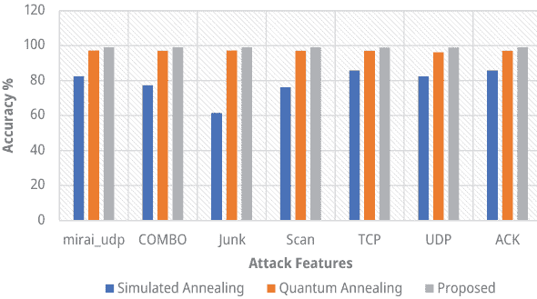

**图 6.2：训练准确率。**

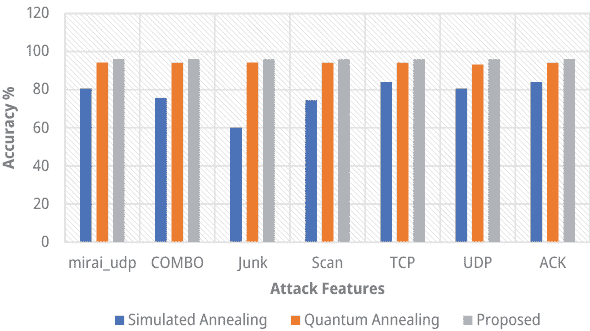

**图 6.3：测试准确率。**

二分类问题。这种比较将作为本次评估的基础。模型确定特定网络环境中是否正在发生攻击的程度，取决于其在二分类任务上的表现。

与使用早期方法中六个特征的深度神经网络相比，我们所开发的 `CNN-LSTM` 方法实现了 95.55% 的高准确率得分（如图 6.2–6.3 所示）。我们利用 `QCNN` 进行此项比较。事实上，我们成功地证明了所提模型的准确率达到了 92%。

可重复性（Reproducibility）和再现性（Repeatability）指的是在相同条件下多次检查分类任务结果的一致性。这两个术语有时互用。这两者与更高程度的准确性之间存在正相关关系。考虑到以往研究的发现，我们可以断定，为二分类问题提供的解决方案在应用于解决该问题时，能够产生满意且可靠的结果。

意图量化的区域是曲线下面积（`AUC`），它是二维 `ROC` 曲线下方的整个区域。我们从 `AUC` 面积获得的信息表明了分类系统在所有不同截断点下的整体性能。`AUC` 是确定分类器效率过程中使用的一种衡量标准。它不受缩放或阈值的影响，因为它同时考虑了阈值和分类器可以预测的整个范围。这使得它独立于缩放和阈值。当同时考虑所有四个类别时，`AUC` 达到了 99.94%。通过采用另一种判断策略，已经证明所提方法能够按预期运行，并满足攻击分类的要求。

## 6.5 结论

由于深度学习领域开发了各种方法和数据集，基于深度学习算法的物联网入侵检测系统（`IDS`）在过去的二十里引起了相当关注。这些方法利用有限的属性来提高其异常检测能力，并提供卓越且更高效的网络安全。在研究范围内，我们使用公开的 `NSL-KDD` 参考数据集对模型进行了了训练和评估。采用了特征归一化、特征选择和数据准备等方法，以提高算法预测的准确性，缩短训练所需的时间并减少所需的资源。

模型根据许多因素做出决策，并比较其正面属性和负面特征。所开发的 `QCNN-LSTM` 模型在所有六个不同的评估参数上的性能均优于七种不同的 `IDS` 算法。该方法的开发目标是识别实时情况下的不异常，旨在为物联网平台提供保护。所提策略具有同时检测攻击发生并一致确定当前正在发生的攻击性质的潜力。

## 参考文献

- [1] Al-Hawahreh, M., Moustafa, N., Garg, S., & Hossain, M. S. (2020). Deep learning-enabled intelligent scheme in the internet of things. IEEE Transactions on Network Science and Engineering, 8(4), 2968–2981.
- [2] Yang, W., Jin, L., Tao, D., Xie, Z., & Feng, Z. (2016). DropSample: A new training method to enhance deep convolutional neural networks for large-scale unstructured character recognition. Pattern Recognition, 58, 190–230.
- [3] Aminato, M. E., Choi, R., Tanuwijaya, H. C., Yoo, P. D., & Kim, K. (2017). Deep abstraction and weighted feature selection for Wi-Fi imputation. IEEE Transactions on Information Forensics and Security, 13(3), 621–636.
- [4] Islam, U., Mohammad, A., Mansoor, R., Hussain, M. Ahmed., Eldin, E. T., & . Shafiq, M. (2022). Detection of denial of service (DDoS) attacks in IoT based monitoring system of banking sector using machine learning models. Sustainability, 14(14), 8834.
- [5] Satheesh, N., Mathavan, V., Rajakumar, G., Sagar, V., Dadheech, P., Dogawal, R. S., & . Senga (2020). Flow-based anomaly detection using machine learning model with software defined networking for OpenFlow. Microprocessors and Microsystems, 79, 103285.
- [6] Ma, Y., Huang, Z., Zhang, W., Yan, Q., Hu, Y., & Huang, D. (2020). Detecting quantum attacks by machine learning based energy for practical continuous-variable quantum distribution. New Journal of Physics, 22(8), 08073.
- [7] Liu, Y., Yuan, X., Zhang, W., Wang, J., & Luo, Y. (2020). AI and 6g security: Opportunities and challenges. IEEE of,,,23.
- [8] Istiaque Ahmed, K., Tahir, M., Hadi Habaei, M., Lun Lau, S., & Ahmad, A. (2021). Machine learning for authentication and authorization in iot: Taxonomy, challenges and future research direction. Sensors, 21(F15), 5122.
- [9] Vashisht, V., Kumar, A., Prashak, S. (2022). Speech recognition using machine learning. IEEE of, 17(9).
- [10] Siriwardana, Y., Porambage, P., Liyanage, M., & Yliantilla, M. (2021). AI and 6g security: Opportunities and challenges. In: 2021 Joint European Conference on Networks and Communications & 6G Summit (EuCNC/6G Summit) (pp. 616–621). IEEE.
- [11] Natarajan, Y., Srihari, K., Dhiman, G., Chandragandi, S., Gheaisari, M., Liu, Y., & . . Alharbi, H. F. (2022). An IoT and machine learning-based routing protocol for reconfigurable engineering application. IET Communications, 16(5), 464–475.

S. Karthik*, Thenmozhi, R. M. Bhavadharini, T. Sumathi

# 7 用于检测 SDN-IOT 中被动攻击的量子迁移学习

**摘要：** 网络攻击对网络安全的完整性构成了潜在风险，这种风险可能发生也可能不发生。近年来，量子机器学习领域取得了飞速进展，量子学习（`QL`）在各种分类问题中均展现了量子优势。这是由于变分量子神经网络也被称为 `QL`。与基于量子机器学习的入侵检测系统（`IDS`）相比，基于经典机器学习的 `IDS` 不仅效率更低，而且其准确性也更差。本章讨论了如何利用量子迁移学习来检测 `SDN-IOT` 中的被动攻击。量子迁移学习的使用使得系统能够在数据之前检测出网络中可能的入侵，其准确率优于目前最先进的方法。

## 7.1 引言

全球联网设备已超过 260 亿个，超过 80% 的业务应用程序现在都托管在云端。此外，为了满足这些企业及其客户的期望，开发了许多新技术。这些新技术的示例包括云计算、物联网、移动计算和虚拟化。系统设计人员经常需要对现有网络进行更改、更新软件并组织现有的计算机和网络资源，以适应这些新技术不断演变的需求 [1]。为了适应新技术的激增，这是必要的。为了在满足用户和企业需求的同时降低操作所带来的复杂性水平，需要一种既灵活又能快速实施策略并支持自动化的新型网络设计 [2]。

> *对应通讯作者：S. Karthik，SNS College of Technology 计算机与工程系，柯姆巴富尔，泰米尔纳德邦，印度：profarthik@gmail.com


Thenmozhi，SNS College of Technology 计算机与工程系，柯姆巴富尔，泰米尔纳德邦，印度，邮箱：then.shan@gmail.com

R. M. Bhavadharini，VIT Deemed University 计算机与工程系，金奈 result，600037，泰米尔纳德邦，印度，邮箱：rmbhavadharini@gmail.com

T. Sumathi，Government College of Engineering 信息技术学院，埃罗德，641032，泰米尔纳德邦，印度，邮箱：sumathiirth@gmail.com

`https://doi.org/10.1515/9783110798159-007`

软件定义网络（SDN）的概念开始在人们脑海中形成。SDN 概念的产生是因为人们意识到所有不同类型的设备之间对互操作性存在迫切需求 [3]。SDN 是一种类型的网络，能够根据实时发生的事件动态地响应并重塑其架构。为了实现这一目标，控制面和数据面必须相互隔离。其次，网络的智能和控制必须中心化，最后，应用程序必须对底层网络基础设施的细节保持“未知”状态 [4]。

由于 SDN 提供了许多优势，如敏捷性、自动化、避免环路、故障响应以及各个领域的管理，SDN 具有成为未来网络架构的潜力。然而，SDN 架构容易受到各种攻击的影响 [5]。

由于中间人攻击易于实施（特别是在中心化的环境中），加上其难以检测的特性，SDN 安全是一个需要解决的首要问题。当攻击者窃听两个合法用户之间正在进行的对话以捕获加密密钥和敏感信息时，这种攻击被称为中间人攻击（MitM）[6]。

由于中间人攻击易于实施、难以检测，且被用于窃取控制器与 SDN 节点之间传输的敏感信息，SDN 环境中充斥着中间人攻击。当中间人攻击发生时，SDN 的安全性可能在任何层面被破坏，包括传输层、应用层和用户层。其影响可能会持续很长时间 [7–15]。

近年来发表的许多研究将 SDN 架构中中间人攻击的检测和保护作为其研究对象。在这些工作中，使用了特定的入侵检测和防御系统；此外，为了验证 SDN 节点，本研究利用了多种已经在使用的密码学和生物识别方法。在与 SDN 工作时，由于网络中存在的节点数量之多且种类繁，部署传统的安全措施可能会很困难。这使得执行传统的安全措施变得更加困难 [16, 17]。事实上，大多数提出的中间人攻击检测算法都是基于过时且冗余的数据集，这些数据集更适用于包含传统网络的环境，而非 SDN [18]。此外，之前的工作主要关注 SDN 的控制层而非数据层，并且它们没有提供有效的机制来自动化过滤规则或特征选择方法，以适应 SDN 上下文中实现快速高效的实时异常识别。这是一个问题 [19, 20]。

## 7.2 相关工作

在使用 SDN 时，控制面和数据面是相互分离的。控制面被整合到一个名为“控制器”（Controller）的单一外部软件中，它现在能够利用大量的可编程服务和应用程序接口（API）来管理网络 [21]。在使用 SDN 设计时，网络通常被分为应用层、控制层和基础设施层。尽管 SDN 架构提供了许多益处，但其实施过程给运营商和服务提供商带来了许多挑战。这些问题可以追溯到 SDN 部署的根源 [22]。

多项研究加上信息技术领域专的观点，使研究人员得出相同结论：安全是广泛采用 SDN 的障碍。这一结论得到了信息技术领域专家的支持 [23]。由于 SDN 架构是中心化的，它存在单点故障，并且继承了与传统网络相关的所有漏洞。SDN 节点没有任何智能或监控，针对数据面的攻击要容易得多 [24]。

SDN 架构中存在的多种流可以被不同的方式利用。可能会针对 SDN 层发起这些不同类型的攻击 [25]。

作者认为，攻击的特征以及当前部署的防御系统，两者对检测的有效性以及响应攻击的时间都有影响。根据研究结果，现有安全解决方案提供的精确度仍有改进空间，特别是在应用于大型 SDN 部署时。

中间人攻击（MitM attacks）是 SDN 基础设施中最令人担忧的威胁之一；它们能够捕获数据流并获取敏感数据，如密码、流记录、加密密钥、公钥基础设施（PKIs）和网络信息。这使得 MitM 攻击成为 SDN 基础设施最令人担忧的威胁之一。由于 MitM 攻击可以直接实施且不会对流量性能产生负面影响，因此并不总是能够识别出此类攻击。[29] 中的作者利用多种 MitM 攻击并分析其分析结果，研究了现有防御方法在识别恶意或异常流量方面的效能。这使他们能够确定这些方法是否成功识别了恶意或异常流量。本研究的作者提供了证据，证明在没有任何任何安全程序或法规的情况下，可以实施有效的 MitM 攻击。[30] 中的作者在研究中检查了大规模 MitM 攻击的有效性，并对当前安全框架的状态进行了评估。他们的职责涉及传达必须达到六个级的效率和鲁棒性 MitM 标准。同样令人的是，所检查的大多数模型处于 2 级或以下。这使得它们处于更容易受到劫持和 DDoS 攻击等各种攻击的地位。

避免 MitM 攻击的大多数现有努力通过引入密码图形防御来实现。这些努力中的大多数都是如此。几乎所有的此类项目都是这种情况。作为一种加密生物识别身份认证，指纹 [31] 开发了一种基于指纹生成加密密钥的系统。这是为了确保 SDN 中节点之间通信的安全性。他们的工作主要侧重于防御重放、冒充、特权内部人员和 MitM 攻击等被动攻击。他们还致力于防止主动攻击。这是他们所有活动的主要焦点。加密协议的实施往往可以产生良好的成效。然而，存在加密系统与生物识别解决方案结合可能无法正常工作并产生高百分比误报的风险。当这两种解决方案相结合时，这种风险会增加。

[32] 提供了一种在 OpenFlow 通道中识别 MitM 攻击的轻量级方法。作者针对开放流通信提出了一套新标准，并使用布隆过滤器（bloom filter）作为实现这一目标的技术。作者在讨论中似乎提供了一个逻辑框架。

## 7 用于检测 SDN-IOT 中被动攻击的量子迁移学习

尽管如此，但非常有必要产生一个新的开放流协议标准版本，以利用所建议的新更改 [33]。此外，作者声称他们的方法只能对有限数量的 MitM 攻击进行建模，这是研究提出的另一个引起争议的问题。由于机器学习技术使得通过检查实时和大量流发现异常成为可能，可以将这些方法视为在大型 SDN 网络中检测和防止 MitM 攻击的可行解决方案。

[34] 的作者使用 NSL-KDD 数据集提出了一种用于 SDN 网络入侵检测的深度学习方法。该方法是使用该数据集开发的。尽管它具有有趣的应用潜力，但深度学习难以实现，并且需要大量的时间和资源，尽管它变得越来越流行。[34] 展示了一个利用签名和通过机器学习获取模式识别模型来防御 SDN 的入侵检测系统（IDS）。该框架的架构师将选择能够抵抗拒绝服务（DoS）和 MitM 攻击的方法作为首要任务，这些攻击通常被认为是对 SDN 配置构成最大风险的。尽管这些努力产生了一些创新的见解，但这些见解的部署大多局限于流量水平的仿真网络。此外，建议的模型依赖于目前运行的基于签名的 IDS，这使得它们容易受到新类型的 MitM 攻击。

### 7.3 方法

作为这种量子改进的直接且不可避免的结果，计算机处理的信息量大幅增加。认为量子计算可以通过利用干涉和纠缠等量子效应来获得量子优势，例如计算性能的指数级加速。这将使其能够有效解决对经典计算机来说具有挑战性的问题。

这些问题包括：即使是最传统的量子计算方法也不特别准确。在最坏的情况下，项目的规模将要求量子计算按指数级进行扩展。这是由于任务本身的性质。量子计算不仅具有提高计算执行速率的潜力，还可以提高模型训练的准确性和速度。此外，量子计算可以加速计算的进行，如图 7.1 所示。

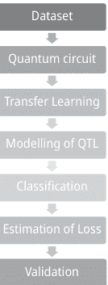

图 7.1: QTL 模型。

已经证明，使用量子计算训练支持向量机（SVMs）具有提供性能指数级加速的潜力。这部分归因于量子技术的应用使得核矩阵的逆从多项式复杂度降低到对数级成为可能，这在以前是不可能的。将量子计算应用于更传统的活动（如图像处理）到目前为止提供了令人鼓舞的早期结果。作为直接结果，需要量子优势来取得进展并突破当前瓶颈的行业。即使我们无法获得必要的设备，也可以在普通计算机上模拟这种实验。

不久在自然语言处理（NLP）领域进行的研究表明，迁移学习模型基于 Transformer 架构有两个优势：注意力和迁移学习。作为直接结果，我们使用 Transformer 创建了模型，以提高我们结果的语义正确性。当我们访问用于预训练的数据集内部的函数和注释时。然后，为了根据我们从恶意代码数据集中识别出的策略训练微调模型，除了词表映射外，我们使用了位置嵌入（position embedding）。这样做是为了让模型能够在策略上进行训练。

在先通过几个不同的编码器后，最终获得了特征向量。由编码器形成后，矩阵向量被发送到解码器，以便动态构建注释向量。由于我们使用双线性池化（bilinear pooling）执行两个向量的特征融合，我们能够实现产生经过语义改进的高维向量的目标。

# 7 用于检测 SDN-IOT 中被动攻击的量子迁移学习

最后，使用了一个全连接层以在较少的维度中产生表示。这是通过减少所使用的维度来实现的。由于 Android-SEM 模型是基于 Transformer 作为预训练模型架构的扩展而构建的，其具有 $O(n^2)$ 的计算复杂度，这也是可以接受的。这种复杂度与 Android-SEM 模型表现良好这一事实相关联。

在预训练阶段，我们利用了生成对抗策略，目标是从生成器中获得最大程度的影响。通过应用生成对抗网络背后的基本思想（这些网络通常用于图像处理），我们克服了处理序列结构的问题。得益于此，我们找到了解决问题的办法。在预训练阶段，我们将生成器比作假币制造者，将它的输出比作假币，并将数据集中的人工标注注释比作真硬币。所有这些比较都在数据集内进行。数据集在整个过程和每一次比较中都被使用。硬币工厂和警察（由编码器和全连接层组成）参与了其中，由于这两个实体（判别器）之间的良好竞争，导致生成器输出质量的提高。

为了防止出现无法充分解释程序语义的错误注释向量的发展，我们提供了一种基于迁移学习的评分方法。对于大小和形状相似的源代码和注释向量，它们之间的欧几得距离没有太大区别，因为这些向量的语义是相似的。因此，我们利用线性回归模型来获取它。

这样做是为了使模型在表示世界时尽可能真实。模型保存后，可以根据计算出的裁量结果删除不适当的注释。这种距离可以通过将向量与函数向量进行比较来找到。结果是不与模型相关的注释可以被移除。因此，我们能够在特征融合过程中在不使用任何标注标签的情况下，消除垃圾注释。

相反，我们使用包含恶意代码的数据集中的 API 序列进行准确率训练。这使我们能够更精确地识别有害代码。为了获取 API 序列的向量表示，我们利用自然语言处理（NLP）概念对其进行映射。这让我们能够学习 API 的语义和上下文。

因此，获取 API 序列的向量表示是可能的。最终结果是一个特征向量，它是通过结合 API 序列特征向量、注释和方法融合向量产生的。在该向量的帮助下将完成恶意代码的识别和分类。多层感知器（MLP）和量子特征映射是成功完成给定任务所使用的两种方法。

大多数采用序列格式的调查都使用了少数的共同特征，近年来，关于基于 CNN 的 Android 代码图像处理及其随后的分析已经进行了大量研究。迁移学习被用于从原始使用的无注释、潜在危险的 Android 代码迁移图表。得益于语义增强方法的应用，我们成功收集了早期研究中被忽略的数据。在后续研究中发现，基于 Transformer 的语义改进方法改进了有害代码的分类。这种改进是因为模型能够考虑到上下文。

## 7.3.1 量子迁移学习

经典神经网络和量子神经网络都有一些共同的过程。这些阶段包括数据准备、量子态编码、网络训练、参数优化以及输出概率的最大化。

在量子神经网络中，使用量子比特（Qubits）来参数化量子电路的输入。随后执行测量程序以识别位字符串的频率（概率）输出分布，即构建二者之间的完全映射。位字符串出现的概率基于其频率。为了解决需要量子计算和量子信息处理的挑战，使用了量子神经网络。

传统电路可以将量子态参数编码通信给，随后使量子神经网络能够执行酉变换。经典电路将使用随机采样方法，从被测变量的输出值分布中提取样本。参数由输出决定，并对这些参数的任何更改都进行审查。

网络的输出可以正式描述为层与层之间转换映射之和，所有映射都被要求具有一个明确的值。量子电路的每一层使用馈到电路的初始数据来构建从电路产生的最终数据。将一些过去的信息 $X_i$ 整合到具有参数 $U$ 的量子电路中，$U(0)$ 作为电路的起点。

当量子电路被测量时，会生成一个被称为“结果”的输出向量。该输出向量结合名为 $g$ 的映射函数，可以用于为特定的数据集提供提供名为 $y_i$ 的分类预测。

计算损失函数需要比较从训练集中收到的预期分类结果 $y_i$。这样做是为了确定损失函数。

将训练数据 $X_j$ 逐个插入量子电路获取相关的输出向量后，我们通过比较预测的 $y_i$ 与真实分类来计算该特定数据的代价函数。我们可以对所有训练数据重复此过程，以获得整体代价函数。该过程可以用于优化量子电路的参数，使得整体代价函数最小化。

### 7.3.2 量子态编码 (QSE)

任何关于量子神经网络理论的制定首先需要创建一种构建量子电路的方法。为了开始，我们需要考虑将经典数据输入量子电路的过程。这是第一步。编码可以使用两种最常用的方法进行。

第一种技术编码量子电路的参数，而第二种技术以多种不同的方式编码这些参数的幅度。量子电路与其参数之间关联的过程：

假设数据集 $X$ 中有 $n$ 个不同的特征，每个 $X_i$ 具有这些属性之一。

每个特征可以通过对应于量子比特态 $|0\rangle$ 来编码。这将完成关于幅度的参数编码过程。通过将输入转移到 $\log_2$ 维幅度向量 $S(x)$ 将数据集编码到量子系统中，该向量表示量子态 $|S[x]\rangle$。

第一种编码方法对于 $m$ 个特征需要 $Om$ 个量子比特，而只需要 $O$ 的电路深度。这意味着电路深度可能达到 $O(m)$。第二种编码方法提供了生成所需量子态的最佳可能性。

# 88 S. Karthik 等人

尽管变分编码方法使得编码对于 NIS（含噪声的中型量子）设备更易访问，但这种可访问性是以需要比幅值编码更高的比特数为代价的。幅值编码是最容易理解的方法。由于变分编码能够显著减少量子电路所需的深度，因此它被应用于许多用于量子机器学习的技术中。

## 7.3.3 变分量子电路

在经典数据被成功编码到量子态之后，我们可以通过利用已有的比特量子或添加额外的比特量子来开始创建量子电路。这一决策可以在经典数据被成功编码到量子态后做出。变分量子电路（VQC）方法是一种混合量子-经典方法，同时利用了量子和经典计算系统。

使其能够产生比纯经典方法更准确的结果。你可以将这些可变参数比比人工神经网络（ANN）的权重，因为该电路是一个可调的量子电路，通过经典计算机的迭代过程来优化参数。所讨论的电路是 ANN 的一个示例，你可以这样理解。

虚拟量子计算机（VQC）在永久映射量子特征的过程中起着作用，它由广泛的量子门构建而成。VQC 通常用作分类问题的量子模型 [30]。这主要是由于它已被证明能够构建经典网络无法充分复制的离散概率分布，并且具有一定的抗噪性。转换不同量子电路的程序对于每种量子门都是相同的，无论使用哪一种。尽管这种映射是在欧几里得空间和希尔伯特空间之间进行的，但由于它发生在两个空间之间，它与经典函数的映射是独特的。另一方面，这种映射仍然可以被解释为一个函数，例如 $f(x)$，类似于传统机器学习的工作方式。

利用量子电路 $U(|S(x))|$ 编码比特串，然后在 Z 方向上进行测量，可以计算出与比特串相关的概率 $A$。

在理想的世界中，分类的真实结果（用 $Y_i$）将在类别 A 中对象出现的高概率表示，正如每次测量之后的情况。在完美的世界里，事情应该是这样的。任何 $a$ 都应该能够满足方程 $Y_i = g(a)$，其中 $g(a)$ 是将测量字符串转换为与输入数据 $X_i$ 相关的标签 $Y_i$ 的编码方法。允许这样做以便任何 $a$ 被使用。如果你这样做，你将得到一个更精确的分类预测。

使用这种策略，可以通过切换到量子电路的重复测量、选择总频率最高的比特串组等方法，获得适当的分类预测。这将允许预测应用于所讨论的分类。选择频率最低的比特串组只是涉及过程的几个阶段之一。

由于代价函数是参数以及代价函数集 $X$ 和 $Y$ 的函数，我们可以使用传统方法来最小化代价函数并迭代更新参数，直到满足终止条件。代价函数是一个函数这一事实使其非常可行。通过使用机器学习在传统计算机上进行的 QNN 训练（量子神经网络教育）已经结束了。

## 7.4 结果与讨论

我们使用了前文中提到的数据集来评估我们模型的质量，并评估其准确性。此外，我们将我们的技术与当前正在部署的、理论上与我们开发的方法相当的技术进行了比较。公开的数据集与我们拥有的数据集非常相似。这为我们的发现与最近构建的模型的结果进行对比提供了充足的偏差。

为了改进程序语义，采用了一种基于 Transformer 的深度学习模型。

| 模型 | 测试 MSE |
| :--- | :--- |
| ANN | 0.1111 |
| SVM | 0.2647 |
| KNN | 0.1209 |
| NB | 0.1438 |
| DT | 0.1307 |
| 所提 QTL | 0.0577 |

| 模型 | FPR (假阳性率) |
| :--- | :--- |
| ANN | 12.5882 |
| SVM | 25.1471 |
| KNN | 16.3333 |
| NB | 18.5000 |
| DT | 14.9608 |
| 所提 QTL | 6.7157 |

| 模型 | FNR (假阴性率) |
| :--- | :--- |
| ANN | 5.1275 |
| SVM | 11.0980 |
| KNN | 9.5490 |
| NB | 10.7451 |
| DT | 8.6569 |
| 所提 QTL | 1.3333 |

| 模型 | FAR (错误攻击接受率) |
| :--- | :--- |
| ANN | 8.8627 |
| SVM | 18.1275 |
| KNN | 12.9412 |
| NB | 14.6275 |
| DT | 11.8137 |
| 所提 QTL | 4.0294 |


| 模型 | 精确率 (Precision) |
| :--- | :--- |
| ANN | 88.2353 |
| SVM | 79.5784 |
| KNN | 86.0294 |
| NB | 83.0980 |
| DT | 85.9216 |
| 所提 QTL | 95.3039 |

| 模型 | 召回率 (Recall) |
| :--- | :--- |
| ANN | 84.3235 |
| SVM | 63.4118 |
| KNN | 84.0490 |
| NB | 82.0392 |
| DT | 82.2353 |
| 所提 QTL | 97.5980 |

| 模型 | F1 分 |
| :--- | :--- |
| ANN | 85.6569 |
| SVM | 62.9020 |
| KNN | 84.8333 |
| NB | 82.5000 |
| DT | 83.4804 |
| 所提 QTL | 96.4261 |

## 7.5 结论

通过使用生成对抗策略，我们能够丰富由语义增强模块生成的注释向量，该模块是我们提出的识别潜在有害代码模型的核心组件。得益于此，我们现在能够更好地理解所表达的内容。此外，我们提出了一种基于线性回归原理的注释过滤器，它能够记住高质量的注释向量，并将其与其他特征结合，以识别和分类 Android 恶意软件。

结果表明，我们提供的方法在确定代码样本是良性还是有害方面是有效的。我们对推荐模型进行了消融实验，证明了我们技术的有效性，展示了我们的方法在检测和分类有害代码方面提高的准确率，并强调了每个模块的价值。此外，这些实验强调了每个模块单独作用的重要性。这项工作在方法论中结合了量子机器学习和更传统的机器学习。传统学习模型和量子机器学习模型在模拟恶意软件检测测试中表现出色；然而，QTL 方法具有理论优势。

## 参考文献

- [1] Luo, H., Zhang, L., Qin, H., Sun, S., Huang, P., Wang, Y., & . . Huang, D. (2022). Beyond attack detection for continuous-variable quantum key distribution via deep learning. Physical Review A, 105(4), 042411.
- [2] Rasool, R., Ahmad, H. F., Rafique, W., Qayyum, A., & Qadir, J. (2022). Quantum computing for healthcare: a review.
- [3] Arooj, S., Zubair, M., Khan, M. F., Alissa, K., Khan, M. A., & Masavi, A. (2022). Breast cancer detection and classification with transfer learning. Frontiers in Public Health, 10.
- [4] Meng, Y., Yuan, D., Su, S., & Ming, J. (2022). A novel transfer-based algorithm for detecting violence images. KSI Transactions on Internet & Information Systems, 16.
- [5] Pandita, G., Ghosh, S., Gupta, V., Meshkov, A., & Wang, L. (2022). Application of deep learning and uncertainty quantification for process identification in powder bed. ASCE-ASME Journal of Uncertainty and in Engineering Systems, Part B: Mechanical Engineering, 8(1)
- [6] Chen, Y., Yang, Z., Chen, T., W. Q., Liao, S. K., Zhang, J., & . . . Pan, J. W. (2021). An integrated-spectrum-ground quantum communication network over 4,600 kilometres. Nature, 599(7841), 214.
- [7] Tang, L. (2021). Protection for Distributed Data of IoT Based on Transfer Learning. In: Web Intelligence (No. Preprint, pp. 1-11).
- [8] Islam, M., Chowdhury, M., Khan, Z., & Khan, S. (2022). Hybrid-classical neural network for cloud-connected cyberattack. Sensors Letters, 6(4).
- [9] Yadav, S. P., Bharti, B. S., Mateo, D. P., & Kumar, S. (2022). Federated Learning for IoT Applications. IEEE Innovations in Communication and Computing. Springer, Cham. doi.org/10.1007/978-3-030-8559-8
- [10] Yadav, S. P. (2022). Blockchain. In: Balamurugan, K., Kumar, S. R., Vadman, S.). Security in Cloud Computing. Springer, Cham. doi.org/10.1007/978-3-030-70505-1.
- [11] Gobinathan, B., Mukuntham, M. A., Surendran, S., Moed, K., Niranjan, P., & . . . Sundathy, V. P. (2021). A novel method to solve security issues in software industry using cryptographic techniques. Scientific Programming.
- [12] Joshna, S. (2022). Melanoma classification using deep learning. International Journal of Informatics and Intelligent Computing, 11(1), 11-20.
- [13] Saravajan, Y., Rajeshwari, S., & Jayashe, P. (2013). Security in protecting computers and maintenance. Journal of Global Research in Computer Science, 4(1), 55-58.
- [14] Malamas, V., Dasakis, T., Kotzinkou, P., Burmeister, M., & Katsikias, S. (2019). A forensics-by-design framework for medical devices based on blockchain. In: 2019 IEEE world congress on services (Vol. 2642, pp. 35-40). IEEE.
- [15] Yuan, X., Zhang, Z., Feng, C., Liu, Y., Garg, S., Kaddoum, G., & Yu, K. (2022). DQN-Based aggregation and aggregation approach for edge-enabled IoMT. IEEE Transactions on Network Science and Engineering.
- [16] Bassi, S. S., Murchie, A. I., Walter, F., Flegg, R. M., & Lillely, D. M. (1997). In-induced folding of the hammerhead ribozyme: A fluorescence resonance study. The EMBO Journal, 16(24), 7481-7489.
- [17] Ji, B., Liu, Y., Xing, L., Li, C., Zhang, G., Han, C., & . . . Mumaz, S. (2022). Survey of communications of internet of things with artificial intelligence. IEEE Internet of Things Magazine, 5(3), 92.
- [19] Yin, X. (2010). Quantum evolutionary algorithm based network intrusion detection. In: 2010 3rd International Conference on Computer Science and Information Technology (Vol. 4, pp. 683–685). IEEE.
- [20] Nithya, C., & Saravanan, V. (2018). A study of machine learning techniques in data mining. International Scientific Refereed Research Journal, 1, 31–38.
- [21] Natarajan, Y., Raja, R. A., Kous, N. V., & Saravanan, M. (2021). Analysis of various embedding mechanisms. International Journal of Intelligence and Sustainable Computing, 1(3), 233–266.
- [22] Liu, Y., Kang, J., Guo, C., & Bai, Y. (2022). Diesel engine small-sample transfer fault diagnosis algorithm based on STFT time-frequency analysis and hyperparameter optimization deep convolutional network using PSO-BPNN surrogate model. Open Physics, 20(1), 993–1004.
- [23] Awak, Y., Wen, J., Kim, P., Cho, H., Park, J., Choi, M., . . . . Kim, J. (2022). Quantum deep learning architectures: Models, discussions, and applications. ICT Express.
- [24] Liao, P., Wang, Du., P., & Zhao, H. (2021). Multi-fidelity convolutional neural surrogate model for aerodynamic optimization based on transfer. Physics of Learning, 33(12), 127121.
- [25] Vaidyam, M. V., & Tyagi, A. (2022). Towards Quantum Intelligence Electromagnetic Prediction Models for Ladder Logic Bombs and Faults in Programmable Controllers. In: IEEE International Conference on Electronic Systems and Intelligent Computing (ICESIC) (pp. 1–6). IEEE.
- [26] Angle, R., Sajni, S., Divakar, A. (2022). Segmentation of White Blood Cells with Colour Space and use of Transfer Learning. Central Asian Journal of Medical and Natural Science, 3(3), 595–619.
- [27] Liu, M., Boixo, S., Smelyanskiy, V., & Neven, H. (2019). Universal quantum control through deep learning. Npj Quantum Information, 5(1), 1–8.
- [28] Mallhi, M., Rehman, S., Alhajah, M., Mahmood, A., Karamat, T., Haneef, M., & Alhajah, A. (2022). Deep-COVID: Detection and analysis of COVID-19 outcomes using deep learning. Electronics, 11(22), 3836.
- [29] Wiecher, C., Lydersen, L., Wittmann, C., Elser, D., Skaar, J., Marquardt, C., & . . . Leuchs, G. (2011). After-gate attack on a quantum cryptystem. New Journal of Physics, 13(11), 013043.
- [30] Schaffener, C. (2010). Simple protocols for oblivious transfer and secure identification in the noisy-quantum-storage model. Physical Review A, 82(3), 022308.
- [31] Wang, Y., Mustafa, A., & Turnbull, B. (2021). QFL: An optimized quantum-based federated learning framework for defending adversarial attacks in intelligent transportation systems. IEEE Transactions on Intelligent Transportation Systems.
- [32] Amaizu, G. C., Wkanamma, C. I., Bhardwaj, S., Lee, J. M., & Kim, D. S. (2021). Composite and efficient DDoS attack detection framework for BSG networks. Computer Networks, 188, 107871.
- [33] Gao, Y. (2021). New video classification method based on ResNet-2 and transfer learning. Security and Communication Networks, 2021.
- [34] Lo, H. K. (1997). Uncertainty of quantum security protocols. Physical Review A, 56(2), 1154.

# Kumari Manisha*, V. Dhanunjana Chari, Leta Tesfaye Jule

## 用于移动云计算的量子计算入侵检测框架

**摘要：** 移动云计算（MCC）是一种结合了移动计算、云计算和无线网络的混合方法。其目的是将数据处理和存储从移动设备中迁移。在 MCC 中，移动设备不再负责执行计算或存储用户数据；相反，这些职责被转移到了强大的云端基础设施。在本章中，开发了一种入侵检测系统（IDS）以提高对 MCC 中攻击的检测。该模型利用量子计算（QC）来检测 MCC 中可能的攻击。在所提出的 QC 上产生并测试了多种类型的攻击，并记录了其检测率。结果表明，所提的 QC 比其他方法具有更高的准确率，并减轻了计算负担。

## 8.1 引言

移动云计算（MCC）利用以太网或互联网在各种设置下共享多个移动设备，且不限制对共享资源池的访问，以实现无限存储、实用性和移动性，它是具有改变历史进程潜力的技术之一 [1-2]。作为成为 MCC 专家的技能之一，全面了解云计算及其提供的服务的所有相关知识至关重要。由于云计算出现，以组织为中心的传统客户端-服务器架构已被一种更具扩展性、高效且灵活的以数据为中心的策略所取代 [4]。这种新方法关注数据而非组织。云为用户根据按需、按量付费的原则提供了多种计算资源，包括访问共享服务器池、数据存储和应用程序软件。这些资源包括数据存储、应用程序软件等。云计算有时被称为公用事业计算 [5]。

> *通讯作者：Kumari Manisha，ECE 系助理教授，Gokaraju Rangaraju Institute of Engineering and Technology, Hyderabad, Telangana, India，电子邮箱：manisha.ks@gmail.com


> V. Dhanunjana Chari，科学学院教授兼院长，物理系，Malla Reddy University, Maisammaguda, Dulapally, Hyderabad, Telangana, India，e-email：dhanunjay@mailalledreddyuniversity.ac.in
> Leta Tesfaye Jule，物理系，Dambi Wollo, Dambi, Wollo, Oromia Region, Ethiopia，电子邮箱：laterajule@gmail.com
> https://doi.org/10.1515/9788311079815-008

由于所有需要大量资源的处理调用都可以在云端完成，因此移动设备不需要强大的 CPU 或大量的内存 [6]。移动设备上可以存储的内存量以及可以访问的带宽量都受到限制 [7]。

订阅软件即服务（SaaS）模型的客户仅限于使用供应商提供的基于云的软件。除了用户特定的配置设置外，salesforce.com 等云端应用的用户无需担心管理问题 [8]。用户能够在平台即服务（PaaS，也常称为 PaaS）云平台中设计并运行自己的应用程序。这是通过服务提供者提供的开发工具和编程语言的帮助实现的 [9]。

他们不需要担心底层的云基础设施；然而，用户对其托管的应用程序（如 Google Apps）的组织和配置具有某些控制权。用户有能力通过基础设施即服务（IaaS）在云中存储和运行其虚拟计算机，这可以配备预装的软件（如操作系统和应用程序）。用户还有能力通过亚马逊云服务（AWS）在云中存储和运行其虚拟计算机 [10]。

使用亚马逊弹性计算（EC2）等服务的客户不需要担心底层的云架构；尽管如此，这些客户对操作系统（OS）、内存以及安装在服务器上的任何应用程序具有完全控制权。MCC 与仍处于早期阶段的云计算在许多方面有所不同，包括移动性、带宽使用、容错性和安全性，这只是这些差异中的 [11]。

## 8.2 相关工作

与技术发展的其他领域相比，移动服务的激增是最快的领域之一。由于 MCC 提供的优势，广泛的应用对国际市场的扩张做出了重大贡献 [12–13]。金融服务的销售、在线购买活动门票以及在移动设备上购物，只是移动商务影响人们日常生活的少数几个例子。为了取得成功，这些应用需要克服许多障碍，例如带宽限制和电池容量限制、复杂的移动设计以及对用户数据安全的担忧 [14]。

MCC 通过将云计算和移动商务应用程序作为这些问题的潜在解决方案来应对挑战。移动学习将电子学习与移动性相结合，面临着数据传输率低和移动设备昂贵等许多障碍。尽管存在这些挑战，移动学习正变得越来越流行 [15]。建议使用云计算，因为它提供了海量存储空间以及先进的处理能力。相比于更传统的医疗软件形式，移动医疗解决方案为移动消费者提供了快速且快捷的各种信息访问 [16]。

由于云提供的按需服务，移动医疗应用程序不再存在数据安全、存储空间可用性或应用程序性能的问题。移动游戏将其图形渲染处理和计算资源卸放到位于云端的服务器上 [17]。这样做是为了让游戏引擎能够在移动设备上运行。移动应用程序开发和托管都存在通过使用云作为替代方案进行探索的机会。预计移动应用程序将同时兼容许多移动操作系统（如 Apple iOS、Google Android 和 Microsoft Windows），将数据存储在云端，在云端分析数据，并利用云端容错机制 [18]。

云服务提供商及其客户在确定云中安装的安全措施和控制措施方面，可能难以确定谁该负责什么。客户有能力以符合其所属行业和地区规范的方式来配置和使用服务 [19]。一方面，服务提供者有责任设计其产品（包括任何功能），以满足数据保护和隐私的标准。另一方面，客户也具备此项操作的能力。尽管服务提供者能够实施操作控制来保护其在云中存储数据的客户，但确保其数据不被无意共享的最终责任落在消费者身上 [20]。

客户负责通过审计和检查服务提供者提供的证书，确保服务提供者满足其组织对数据隐私的要求。另一方面，服务提供者有责任获得必要的认证并签署服务水平协议（SLA）。客户有责任调查服务提供者提供的审计报告和证书 [21]。

在信息安全方面，PaaS 和 IaaS 服务的客户与提供商对虚拟机层之上的所有内容承担同等责任。这包含了确保数据隐私的义务。另一方面，当使用 SaaS 或云服务时，用户更直接地负责执行访问管理和系统监控等职责。SaaS 和云应用程序将这一义务从提供者转移到了终端用户 [22–23]。

在使用私有云时，客户对云安全负全责；然而，在使用公有云时，客户和云服务提供商共同负责云安全。当客户使用托管在云端的平台或服务时，客户有责任实施适当的安全措施，以保护其控制的数据和应用程序 [24]。

## 8.3 方法

QC 模型是一种显式非线性特征映射方法，用于实现已经存在了一段时间的 QC 方法。通常情况下，对于诸如分类、回归以及其他非线性模式识别任务等日益复杂的模式识别任务，需要更多的隐藏神经元；结果是，网络的拓扑结构变得极其复杂。该配置总共使用了三层，包括输入层、隐藏层和输出层。

MCC 需要仔细考虑内部和外部危害，其中内部危害是更本质的类别。内部威胁是公司当前或前员工可能给计算机网络带来的潜在危险。任何源自系统本身并对系统构成风险的组件都被称为外部威胁。当数据存储在云端时，这些问题可能会危数据的可用性、隐私性和安全性。防火墙是可能用于防止此类入侵的一种方法。另一种可以使用的方法是加密。

使用防火墙可能是为了阻止潜在危险或非预期的连接访问网络或计算机系统。可以安装多种各种不同类型的防火墙，以使系统更安全。一个被认为是入门级的防火墙示例是无状态防火墙，它在某些情况下称为包过滤防火墙。通常，这些防火墙运行在网络层，并检查数据包头中包含的信息，以确保其符合定义的策略。这包括检查协议类型、源 IP 地址和目的 IP 地址。考虑到这一点，基于包过滤的防火墙对包含分片和欺骗的攻击无法提供最佳保护。

状态检测防火墙是防火墙的第二形式，它与其他防火墙的区别在于它为每个连接的数据维护一个单独的表格。在此阶段，防火墙决定哪些位放入数据包头中。随后，防火墙分析数据以评估其是否与状态表中存储的信息一致。

应用防火墙能够在应用层运行，这使得它们能够监控和管理任何服务或程序的输入和输出。由于应用防火墙能够在这一层运行，它们也被称为应用层防火墙。发生在底层与应用层之间的所有通信都由该防火墙进行控制和监管。通过代理代理与不同主机上的用户进行通信的方法目前并不常见。

根据所使用的术语，该功能在应用层运行时可能被称为代理或网关，而这种功能包含在防火墙中。与应用防火墙相比，代理防火墙更适合解码和分析编码载荷。市场上还有专门为保护虚拟化网络环境而构建的防火墙供购买，该选项对用户开放。这种架构中的防火墙被实现为虚拟机（VMs），它们的工作是管理 VM 之间的流量并过滤来自 VM 的数据。换句话说，这种设计采用了基于软件的防火墙方法，如图 8.1 所示。

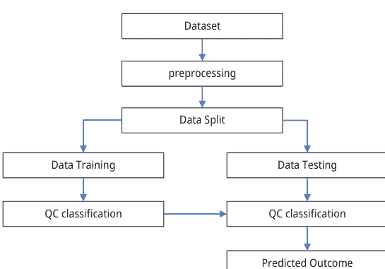

**图 8.1:** 建议的框架。

### 量子智能

MCC 中的 IDS 方法可以分为三类：基于签名的、基于异常的或混合入侵检测。这些类别中的每种都有其优缺点。基于异常和签名的方法已用于检测入侵的方法开发。

为了管理和监控客体操作系统、虚拟机和应用程序的状态，使用了一组被称为虚拟机管理（VMI）的进程。这些过程在虚拟机管理程序（hypervisor）层执行，并以此命名。内部攻击是 VMI 旨在识别的攻击类型。这些攻击可能来自一个 VM 对另一个 VM，或者来自一个 VM 针对虚拟机监控器（VMM），是可能源于一个 VM 的类型。由于 VMI 在云计算（CC）中提供的价值，VMI 被考虑用于监控虚拟机的操作。

VMI IDS 能够进行专门针对 VM 状态和活动定制的调查。基于主机的检测系统由于其提供了高水平的可见性而容易受到攻击。在这种情况下，IDS 因为被放置在网络上而不是主机上，其可见性大大降低。然而，它的敏感性增加了，而且与第一种情况相比，它抵抗攻击的能力较弱。

系统调用生成

## 8.4 评估

异常检测系统每年使用 1999 年 KDD Cup 使用的数据集进行评估。DARPA 1998 数据集包含了网络破解，并被人员人员创建强调安全的机器学习分类和聚类算法，它是这些数据的依据。在 1998 年，开发了 DARPA 1998 数据集。总共，大约五百万条连接记录在跨越三周的时间内被用作 KDD Cup 1999 的训练数据。训练数据包括类别以及统计特征，分为典型流量或某种类型的攻击。

KDD Cup 1999 数据集由许多不同的特征组成，一些是流量特征，一些是内容特征，都是基本元素。与传输控制协议（TCP）连接相关的函数由基本类处理，该类负责此项职责。在根据旨在检测的流量类型对连接到特定窗口的特征进行分类后，对内容特征计数以验证导致问题的数据块的行为，如图 8.2–8.5 所示。

本研究同时使用简单随机采样和分层随机采样，以减少海量数据收集所需的计算机时间。训练集和测试集中存在的所有数据点总计为 20,121。在通过删除重复项和间隙清理数据后，必须将字符信息转换为数字。这一步在移动到下一步之前必须完成。第二步是对数据进行归一化，使得特定的（此处截断）...

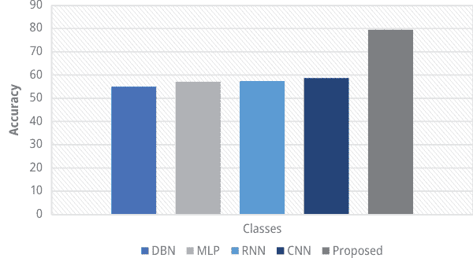

图 8.2：检出率。

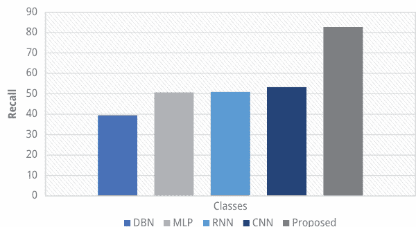

图 8.3：计算时间 (s)。

特征对数据分类的精确度没有负面影响。数据降维过程的第三步是借助皮尔逊相关系数，确定哪些特征是重点关注的最重要特征。

这些比较结果清楚地表明，QC 在准确性方面优于其他算法，且其误报率明显低于另外两种算法。图 8.2–5 展示了收敛情况的对比插图，其处理方式与此类比。根据实验结果，QC 在整个迭代过程中快速收敛以及避免陷入局部最优解的能力方面优于 QC。这是因为 QC 可以防止你过分关注寻找局部的最优解决方案。正因如此，在对数据集使用二分类进行入侵检测时，QC 提供了更高的检测性能。

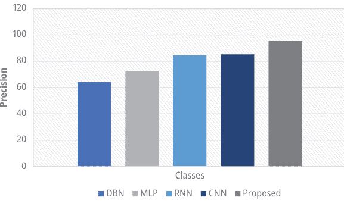

图 8.4：精确率。

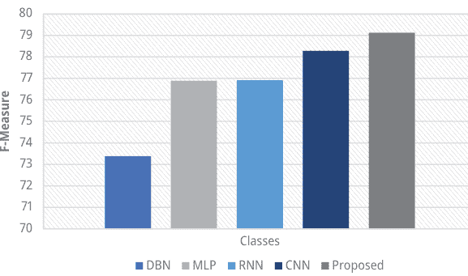

图 8.5：F-measure。

# 8 用于移动云计算的量子计算入侵检测框架 — 105

我们第一步也是主要的步骤是提出量子甲虫群算法作为解决该问题的方案。该过程使用了量子物理的基本原理，导致了甲虫群方法与粒子群算法的结合。建议使用最小二乘 QR (`LSQR`) 分解法，以显著增强极端学习机的性能。

所需的计算量将减少，系统的收敛速度将加快。此外，实现了一种名为量子甲虫群优化的技术，以便在权重和阈值方面充分利用增强的极端学习机。根结底，质量控制中所使用的方法被应用到安全监控领域。实验结果表明，与过去的方法相比，QC 算法在多个评估指标上具有显著优势。这是通过将 QC 算法与所用方法进行比较得出的。寻找 QC 新应用将是第二步的重点。

## 8.5 结论

建议利用分布估计技术的量子算法对入侵检测系统 (`IDS`) 进行分类。这样做是为了更准确地预测结果。使用 KDD 数据集，将其与另一种基于 QC 的分类算法进行了比较。从各种研究获得的数据表明，该算法能够产生分类结果。算法展示了这些结果。通过大量实验，已证实了其优于其他算法，所有实验都指向同一个结论。我们工作的下一阶段要求我们继续使用各种参数值进行额外的测试。这些测试将确保系统能够检测入侵。

## 参考文献

- [1] Yin, X. (2020). 基于量子演化算法的网络入侵检测. In: 2010 3rd International Conference on Computer Science and Information Technology (Vol. 4, pp. 683–685). IEEE.
- [2] Payares, E. D. & Martinez-Santos, J. C. (2021). 用于分布式拒绝攻击入侵检测的量子机器学习: 比较性概述. Quantum Computing, Communication and Simulation, 1659, 35–43.
- [3] Divat, V., Selvarajan, R., Aldovari, T., Koska, Y., Novotny, M., Humble, T. S., & Kais, S. (2021). 用于网络安全数据的量子受限玻尔兹兹机训练. IEEE Transactions on Emerging Topics in Computational, 6(3), 417–428.
- [4] Nithya, C., & Saravanan, V. (2018). 数据挖掘中机器学习技术的研究. International Scientific Research Journal, 1, 1–38.
- [5] Nag-Choudhury, S., Bellegou, H., Pillin, I., Castro, M., Longrais, P., & Feller, J. F. (2016). 嵌入量子压电响应器的浸渍复合材料非侵入性健康监测. Composites Science and Technology, 123, 286–294.
- [6] Pavithra, R., Srinivasan, R., & Saravanan, V. (2018). 为优化容量和可检测失真选择选择加密方案的 Web 服务部署. International Journal on Recent and Innovation Trends in Computing and Communication, 6(4), 267–277.

Swati Tiwari*, Kamlesh Kumar Yadav, D. Palanikkumar

# 9 基于智能量子计算误差消除码的9种容错机制

**摘要：** 本章讨论了利用量子计算的容错机制，该机制使用误差消除码来减少可能的故障。通过构建真实量子计算机的电路，旨在消除导致电路更容易受到影响的延迟，从而提高计算机的性能。此外，我们还证明了执行此操作不会直接导致 T-count 的增加。我们提供了四位进位加法器的三个不同迭代版本，这些加法器在 T-count、T-深度以及可用的辅助量子比特（ancilla qubits）数量方面得到了改进。这些加法器使用了一种新方法，通过以较小的 T-count 执行操作，从而通过更快的操作速度来加速进位计算。

## 9.1 引言

传统计算机在解决量子计算机可以毫不费处理的特定问题方面非常困难 [1, 2]。尽管通过利用一系列不同的物理系统已经证明了微尺度量子计算的可行性 [3, 4]，但对于大多数可行候选方案来说，大规模量子处理仍然是一个严峻的实验问题。通过在光学系统中利用压缩真空态，实验已经实现了超过百万万种模式的状态 [5]。当涉及到大规模的连续变量（CV）量子计算时，这种状态是最具前景的选项之一。

只有因式分解和哈密顿量模拟被认为是量子计算机能够以比经典计算机短几个数量级的时间完成的操作两类示例 [6]。这种信念仅基于两种类型操作的例子。实际上存在大量的类型程序。另一方面，量子系统本质上是交互性的，这导致它们会产生经常的物理错误。这些错误使得量子系统的优势面临失效的危险。由于量子计算机中可能产生的物理错误仍然显著高于经典计算机中可能发生的错误，消除这些故障是绝对必要的。

为了寻找这一问题的解决方案，研究人员研究了结合量子纠错码的容错量子计算（FTQC） [7–10]。在 FTQC 上，标准量子算法可以运行较长时间 [11]。根据最新的资源估计 [12]，为了基于计算复杂性概念看到清晰的量子优势，逻辑操作的数量需要达到 $10^{10}$ 级。这是观察明显量子收益所需的最少过程数量。

在实现长期 FTQC 的过程中，我们需要经过许多不同的中间阶段，因为受量子比特和魔态码等量子资源的限制，这是被允许的 [13]。由于这些阶段，我们能够朝着实现 FTQC 的最终目标迈进。由于量子纠错（QEC）需要大量的经典计算来进行重复的误差估计，在不久的将来，可码距离将受到严重限制 [15–17]。

这将是使用 QEC 的必然。当量子技术开发的所有方面都完成后，当我们实现了逻辑空间计算的量子优越性时 [14]。早期 FTQC 阶段是指实现逻辑量子优越性之后但在长期应用可行性证明之前的时间。这段时期发生在量子优越性之后。

## 9.2 相关工作

与允许短距离通信的码相比，连接开销可能并不划算。其他码可能提供更远距离的通信 [15]。

这是因为在纠错码的编码率中，如果有大量的量子内存可用，那么纠缠分发可能成为为物理连接机会有限的大型机器提供连接的可行策略。如果量子内存储备足够大，这将是结果 [16]。


“传输”（transversal）一术语指的是纠错码的属性，即当发生错误时，每个代码块的纠正都是与其他相互独立的。具有较高维数的纠错码具有访问更广泛传输传输门的优势，这可以显著减少完成整个纠正过程所需的总时间。光子互连模块在潜在的连接图方面可能提供最大的灵活性。然而，可以实现的最高连接速度将成为系统中显著的瓶颈。目前的量子平台可能难以实现 3D（或更高）物理连接水平 [17]。这是由于厚度可以被降低到比 [18] 中更易于管理的水平。文中分析了几个知名的量子计算系统，以及针对每个平台的特定纠错算法，并展示了各种平台的操作速度对比。据估计，码周期时间（指的是基础操作序列）将落在 0.2–10 s 的范围内，其名称源自超导设备的表面 [19]。在各种方法中实现陷阱离的设计是可行的，每种方法与其他之间都截然不同，特别是在建立连接的可行技术方面。一个案例得出结论认为，使用微波门和穿梭（shuttle）实现连接的可扩展设备其周期时间将为 2 秒。该设备将包含陷阱离子并依赖穿梭来提供连接 [20]。在这种基于穿梭的设计中，存在可变中程连接的可能性。这表明各种纠错协议可能比表面码更有成功机会。然而，它只允许使用表面码的码。这些连接极具可塑性的性质表明，有一天可以使用高维纠错码，尽管表面码是专门为通过光子互连连接的小离子模块而开发的 [21]。可以采取的方法之一是实施建议使用两层的概念。这反过来可能会影响使用光子互连的陷阱离子码周期的时间 [22]。利用陷阱离子的架构已被证明提供最高的保真度；然而，这些架构需要较小的基面积。纠错技术中的码距离将与检测到的物理误差水平成比例缩小。因此，表示每个逻辑比特所需的物理量子比特数量将减少 [23]。除了预计周期时间为1.2 毫秒的表面码外，还建议开发一种基于硅的容错架构。根据设计，`Raussendorf-Harrington-Goyal`（`RHG`）晶格可能是光子器件中容错解决方案的最合适选择 [24]。特定架构和开发阶段的可扩展性在很大程度上取决于上下文。

作为该项目的一部分，我们将提供量子计算机必须具备的物理资源估计，以便能够正确运行表面码。该估算将以表格的形式提供。我们利用尖端的时间优化技术，研究了码周期长度与底层架构能够支持的最大物理比特数之间存在的联系。这些技术允许我们确定这两个变量之间的关联程度究竟有多紧密。这项研究的目的是为了实现更高水平的生产力 [20–25]。

假设使用这些算法将产生量子优势，这种优势将从根本上改变具有商业意义的应用的格局。

## 9.3 方法

现在我们已经回到了九比特码，让我们来准确确定为了解决所提出的问题，具体需要做哪些工作。首先，我们必须找出前三个比特是否都完全相同，如果不相同，我们必须找出哪一个是独一无二的。如果它们是相同的，我们就进入下一步。测量前两个比特的奇偶性以及第二、三个比特的奇偶性是可行的。此外，测量第四个比特的奇偶性也是可能的。

第一个测量结果告诉我们比特1和比特2是否受到了 X 错误的影响，第二个测量结果告诉我们比特2和比特3是否受到了 X 错误的影响。必须意识到，所测量的误差与在两种情况下发现的误差都是反对的。将这两部分信息结合起来，我们能够立即指出错误的确切位置。对于三组算符所采用的方法与其他相同。在完成此扩展后，样本中的算符总数达到了十六个。至关重要的一点是，只能通过 Z 测量获得信息。这是获取所需信息的唯一途径。这是防止码叠加态失效这一问题解决方案的关键部分。一旦我们向系统中添加了辅助比特（`ancilla qubit`），我们就能实现这一目标。

借助稳定器（`stabilizers`），可以用一种简单直接的方法描述新码。例如，在传统的编码理论中，线性码由生成矩阵或其奇偶校验矩阵表示。这两个矩阵具有相同的名称。从现代编码理论开始是另一种可能使用的方法。每隔一个字码都可以描述为生成矩阵各行的线性组合，而这些行本身也是字码。

这是可能的，因为生成矩阵的每一行都是一个字码。奇偶校验矩阵的每一行都有一组奇偶性检查列表，用于检查经典字码在被视为合法之前必须通过的奇偶性检查。这些检查用于判断一个字码是否有效。（人们可以将量子码中的稳定器视为传统计算机中所用奇偶校验矩阵的近乎模拟物。）单比特纠错明码（`Hamming code`）就是这类码的示例。它由七比特和一个奇偶校验矩阵组成，以确保只有一个错误。

如果我们提供三个执行奇偶校验测量的算符，且其中一个测量是将矩阵中的1替换为 Z 算符，将0替换为 I 算符，那么我们并没有进行任何实质性的改变。在这种情况下，奇偶校验测量将以适当的方式执行。因此，典型的明码只纠正一个错误，因为每个位翻转错误的权重为一或二，且与这些算符之一反对。

一旦我们提供了三个算符，如果存在任何权重为一或二的 Z 错误，那么这些算符的行为将是非交换的。通过将三个 Z 算符和三个 X 算符组合成稳定器，可以纠正单比特错误的码。这是通过将这六个算符合并为一个单元实现的。任何与 X 相关的故障将由前三个生成器发现，任何与 Z 相关的故障将由后三个生成器发现，而任何与 Y 相关的故障将分布在两组之间。尽管如此，有一项需要检查的内容，即稳定器是否为阿贝尔量（abelian）。该稳定器使用 `[1, 3, 7]` 码将单个比特编码到其存储中。该稳定器有六个生成器七个比特。

大多数量子纠错码并不是稳定器码，在稳定器码之外的各种码的研究和创建方面已经取得了重大进展。发现和使用码可以通过多种不同的方式完成，但在某些情况下，你需要在存在某种程度结构的假设下进行操作。你可能采取几种方法来实现这一目标。

使用跨越高维区域（通常称为比特）的码，可以作为使用比特的一种非常有益的替代方案。稳定器码可以很容易地推广到这种环境中，而且已知有许多不同类型的比特码。可以考虑的可能性之一是努力开发更有效的比特码，如果能对稳定器结构进行某种修改，这可能是可能的，如图9.1 所示。


**图 9.1:** 量子建模。

近年来，一种名为算符误差纠正（也称为子系统码）的方法已成为大量研究的焦点。由于我们忽略了一些自由度，这种编码使我们能够成功编码一个状态而非另一个。另一个有前景的途径是研究全退化码（fully degenerate code）。如果所有可能的错误在码空间上表现为恒等，则不需要执行任何纠正；在这种情况下，无论发生什么错误，状态将保持不变。大多数情况下，退化容错子系统（DFS）将分析随时间发生错误的情况。

然而，如果错误率已经足够低，完整的 QECC 可以降低许多类型噪声的有效错误率。这种情况只有

## 9.4 评估

在对每个建议的和先进的电路开发了 `Python` 代码后，这些代码在 `IBM Quantum Experience` 硬件和模拟器上进行了运行，以验证和确认这些电路。在完成此复制后，为了收集下文描述的指标，我们按顺序统计了量子比特（`qubits`）的数量、`T` 门的数量以及连续 `T` 门（同时注意，某些门没有显式表示其 `T` 计数和 `T` 深度，我们进行了必要的转换）。在完成这一过程时，我们始终考虑到并非所有的门都能以清晰简洁的方式传达其 `T` 计数和 `T` 深度。可以考虑的一种可能性是开发更有效的量子比特代码，如果能以某种方式修改稳定器结构（如图 9.2-9.5 所示），这可能是可能的。

电路 1、2 和 3 的 `T` 计数分别为 36、51 和 41，这些电路的 `T` 深度相应地为 10、11 和 11。这可以从我们对电路技术和所展示的图化设计的讨论中得出结论。在这种特定的布局下，它们需要 9、5 和 4 个辅助量子比特（`ancilla qubits`）。建议的电路不包含任何在量子环境中被视为无效的运算或垃圾输出（`trash outputs`）。

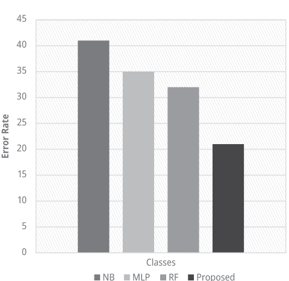

**图 9.2：** 错误率。

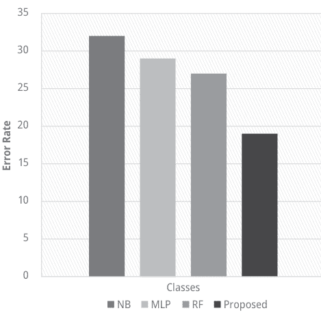

图 9.3：平均绝对误差 (`MAE`)。

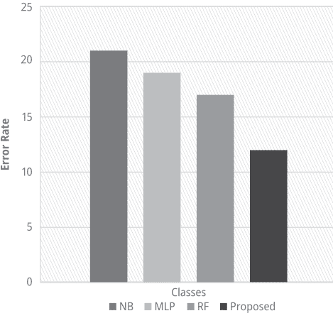

图 9.4：均方根误差 (`RMSE`)。

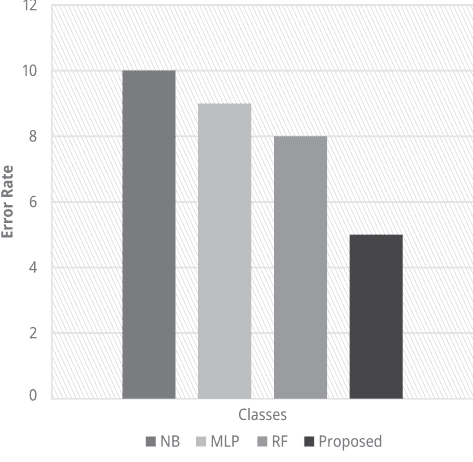

**图 9.5：相对方根误差 (`RRSE`)。**

鉴于一个 `Toffoli` 门的 `T` 计数为 7，`T` 深度为 3；一个临时逻辑门的 `T` 计数为 4，`T` 深度为 2；且电路中没有其他门具有 `T` 计数或 `T` 深度，因此验证这些数字并不困难。需要注意的是，电路中没有其他任何一个具有 `T` 计数或 `T` 深度的门。

在大多数情况下，我们依赖于两个独立的来源，将推荐的电路与已发表的电路进行比较。第一个来源是对量子加法器的综合分析，其中对该算法的几种不同形式进行了相互比较和对比。在这些评估的背景下，进位先行查找加法器（`carry lookahead adder`）是关注的重点。

我们研究的第二个来源提供了目前有的四种不同的进位先行查找加法器的深度比较。他们检查了来自两个出版物的数量加法器并对其进行了比较。由于我们不想让这一部分充斥已经在许多研究中汇编的信息，随后的比较仅考虑了上述来源中最有效的电路。做出这一决定的原因是我们不想重复已经完成的工作。

## 9.5 结论

在本章中，我们包含了对三个加法器基于门设计的详尽分析以供参阅。该描述详细回顾了构建这些加法器所需的阶段、门和量子比特。这样做是为了确保它们在量子环境中能够正常运行。

最后，我们将我们的电路与之前研究中最高效的加法器进行了比较。进行这一评估是为了确定我们的设计表现如何。根据这些发现，显而易见，推荐的加法器超越了先进电路。

## 参考文献

- [1] Egan, L., Debroy, D. M., Noel, C., Riser, A., Zhu, B., Biswas, D., & . . Monroe, C. (2021). Fault-tolerant control of an error-corrected qubit. Nature Science, 598(7880), 281–286.
- [2] Webber, M., Elving, Y., Weidt, S., & Hensinger, W. K. (2022). The impact of hardware specifications on reaching quantum advantage in the fault-tolerant regime. PRX Quantum, 3(1), 013801.
- [3] Hilder, J., Pijn, D., Onishchenko, C., Stahl, A., Orth, M., Lekitsch, B., & . . Poschinger, U. G. (2022). Fault-tolerant quantum readout on shuffling-based trapped-ion quantum computer. Physical Review X, 12(1), 01032.
- [4] Ryan-Anderson, C., Bohnet, J., Lee, K., Green, D., Hahn, A., Gaebler, J. P., & . . Stutz, R. (2021). Realization of real-time fault-tolerant error correction. Physical Review X, 11(4), 041058.
- [5] Biswal, L., Rahaman, H., & Majr, N. (2021). Clifford+T implementation of fault-tolerant mapping.
- [6] Asoka, R., Tokunaga, Y., Kanamoto, R., Goto, T. (2021). Requirements for fault-tolerant quantum computation with cavity-QED gates.
- [7] Ortes, F., Ortega, G., Cucura, E. (2021). Optimal fault-tolerant error correction.
- [8] Walsh, B., Alexander, R., Baraj, B. (2021). Streamlined quantum computing with cluster states.
- [9] Lin, L., Tong, Y. (2022). Fault-tolerant quantum computing with ground state.
- [10] Gobinathan, K., Mukhattan, M., Sundaran, S. (2021). Network based detection of security issues.
- [11] Nataranajan, R., Kaur, S. (2022). Pieceable fault-tolerant codes.
- [12] Wan, K., Choi, S., Shutty, N. (2021). Fault-tolerant quantum codes using neural decoders.
- [13] Lin, C., Yang, G., Song, X., Perkowski, M. (2021). Conversion between Steane and Reed-Muller codes.
- [14] Pavithra, R., Srinivasan, S. (2022). Web service deployment for the detectable distortion.
- [15] Thomson, F., Kesseling, M., Bartlett, S., Brown, B. (2022). Scaling up quantum computing with the color code.
- [16] Sabitha, R., Gopikrishnan, S., Bejoy, B., Anusya, V. (2022). Mathematical model of IoT-IDS.
- [17] Yadav, S. P., Yadav, S. (2018). Fusion of medical images in wavelet domain.
- [18] Delgado, A., Casares, P., Reis, R. D., Zini, M., Campos, R., Cruz-Hernández, N., . . Arrazola, M. (2022). How to simulate key properties of lithium-ion batteries with a fault-tolerant quantum computer.
- [19] Yadav, S. P., Yadav, S. (2019). Mathematical implementation of fusion of medical images in continuous wavelet domain.
- [20] Cetina, M. (2022). Scaling up quantum computing with ion chains.
- [21] Shutty, N. & Chamberland, C. (2022). Finding fault-tolerant Clifford circuits using S solvers.
- [22] Ayukaryana, N. R., Fauzi, M. H., & Hasdee, E. H. (2021). The quest and hope of Majorana zero modes in topological superconductor for fault-tolerant quantum computing: An introductory overview.
- [23] Su, Y., Berry, D. W., Wiebe, N., Rubin, N., & Babbush, R. (2021). Fault-tolerant quantum simulations of chemistry in first quantization.
- [24] Tansuwannont, T., & Leung, D. (2022). Achieving fault tolerance on capped color codes with few ancillas.

# 10 针对预测性与规范性分析模型数据分析的量子计算研究

**摘要：** 人们现在有限的时间内通过花费来赚钱。当你做出正确的决策时，这种情况就会发生。在未来几年里，量子计算有望发现新的模式和解决方案，并在特定的用例中以更快、更具能源和成本效益的方式提供结果，但前提是技术亲和型分析师和研究人员能够有效使用并扩展独特的业务和技术感知型方法，通过开发用户可访问的工作流来“量化”业务问题。这种量化涉及两个需要克服的关键性问题：一方面是业务需求，另一方面是研发可行性。尽管在扩展量子系统和将其集成到商业数据流水线方面存在困难，但该行业正快速接近企业级准备。本章详细介绍并总结了关于规范性分析的现有语言，突出了当前的问题并探索了可能的解决方案。

## 10.1 引言

我们生活在全球数字经济日益增长的世界中，信息是海量的数据资产，数字技术变得越来越强大、易于获取且负担得。这在新的企业运营模式以及我们人类连接、工作、购买和接收服务的方式中显而易见。这种明显的加速和技术进步是互联网、云和边缘计算、移动电子设备以及开源协作一系列互联突破的结果 [1, 2]。总体而言，半导体行业是这一进展的支柱和主要因素。基于几个物理和工程领域的突破，以及20世纪上半叶晶体管的发明，该行业已从特种计算技术迅速演变为通用计算技术，并始终遵循摩尔定律的性能预测，每两年将集成计算电路中的晶体管数量增加倍 [3]。


股市分析是科学领域最为人知的应用之一。由于这是一个竞争性媒介，在多次尝试中，寻找一种有效且高效的方法仍然项任务。预测的复杂性与业务动态模型成正比。基础分析和 [4] 方法被封装在股市分析领域。基本面分析关注基于数值历史证据预测股价活动，而技术分析关注使用方法和图表来预测潜在的股票走势和价格。基于自然语言的金融预测（NLFF）[5, 6] 将文本数据分析引入其中，认识到及时的情报发布、新闻以及社交媒体和博客上的流行声音对保护性股票的价格和趋势有重大影响。预定义特定的关键词集合并确定情感分析所需的机器学习方法，是情感提取文本分析中涉及的任务之一。

做出良好的决策具有挑战性，特别是当没有足够的数据来指导明智决策时。知道过去发生了什么对预测未来将发生什么没有帮助，因为仅仅依赖观察证据的分配往往是错误的。为了避免这些陷阱，业务领导者使用了两种创新方法：预测性分析和规范性分析。它们结合了历史数据（描述性分析）、法律和市场情报，以更好地预测未来，在规范性分析的情况下，引导领导者做出最终决策。预测性分析和规范性分析之间存在差异吗，还是它们是同一件事？我们现在正在质疑预测性分析和规范性分析是分离的还是同义的。

尽管这些策略是主动的，但它们之间存在显著差异。以下是根据 Gartner 分析模型的分析方法层级：

- 描述性分析发生了什么？
- 诊断分析：哪里出了问题？
- 预测性分析将发生什么？
- 我们如何让预测性分析成为现实？

规范性分析展示了如何让事情变成，而预测性分析指示了如何让事情变得必然。后者属于规范性分析。这并不意味着预测性分析没有价值；只是因为存在的信息并不等同。

使用数学和模拟工具预测未来将发生什么被称为预测性分析。它利用历史数据和模拟技术计算给定事件或多个事件发生的概率。预测性维护是预测分析的一个良好例子，它通过使用多种算法和计算机数据来近似关键组件的存在，以发现设备必须如何修复。虽然这些知识很有价值且具有操作性，但它们并没有规定应该采取什么行动；然而，它们提醒了用户有维护的需求。

规范性分析与预测性分析的区别在于，它不仅预测可能发生什么，还根据特定参数为客户提供现实的选择并决定哪些市场选项更好。使用规范性分析生成企业或公司的模型。该模型与当前和历史数据进行交叉检查，以确保它准确地代表了行业的所有方面。用户应该查询模型，根据盈利能力、SLA 和吞吐量等定义标准来确定最佳选项，而不是简单地预测会发生什么。在预测性维护的情况下，规范性分析评估维修、替换或外包的正确选项，以实现净利润和周转率的最大化。

### 10.1.1 预测性 vs 规范性分析

预测性分析和规范性分析也是有用的市场工具，但它们有不同的目的。另一方面，根据 Gartner 的分析阶，预测性分析等同于规范性分析。这是因为预测性分析预测将发生什么，但没有提供关于如何做出必要决策的指导。而规范性分析不仅预测将发生什么，还决定了正确的业务判断。

#### 10.1.1.1 预测性分析

预测性分析是数据分析的一个分支，旨在根据过去的数据和分析策略（如数学模拟和深度学习）预测可能的结果。预测性分析可以使用先进技术产生潜在的洞察，每个组织现在都可以使用历史和现在的数据准确估计未来几年的情况。

今天，组织以几乎无限的形式使用预测性分析。该技术支持银行、医疗、零售、制药、航空航天和制造业等领域的采用者。以下是公司利用预测性分析的描述：

- 航空航天：预测可靠性、燃料消耗和运行时间。
- 汽车：记录未来的计划故障。研究驾驶行为以创建自动车辆。

#### 10.1.1.2 规范性分析

- 能源：长期价格/需求预测。确定环境条件、系统损失和其他因素的影响。
- 金融服务：违约风险建模。市场预测。预测新兴行业、消费者和法律的影响。
- 制造业：预测故障位置和频率。优化原材料的交付。
- 执法：使用犯罪数据识别某些时期需要额外安全的区域。

如果你是一名高级领导者，提高组织活动的质量和效率仍然是首要任务。规范性分析是用于构建任何公司市场情报的最智能、有效的平台。规范性分析允许公司：

- 轻松地实现成功率。规范性分析模型通过收集数据和操作来生成要做什么以及如何做的路线图。AI 接管了业务智能的控制权，以适应情况并交付防止失败所需的措施。
- 提供实时、短期的活动。决策者应该同时解释实时和预测数据，以促进可持续发展和绩效。这通过详细建议简化了决策。
- 少思考，多时间。数据收集和结果的即时转变为让员工能够花更多时间识别挑战并制定正确的解决方案。在短时间内，AI 将比数据团队更快地策划和处理数据。

# 10 用于预测性和规范性数据分析的量子计算研究 — 125

在提出查询时，了解潜在买者的市场成熟度至关重要。

尽管大多数机构都使用商业智能，但许多企业尚未转向预测分析。根据 Gartner 的数据，只有 11% 的中大型采用了规范性分析。另一方面，根据 Gartner 的预测，规范性分析行业在 2017 年至 2022 年间的复合年增长率（CAGR）将达到 20.6%。这意味着大约 37% 的公司将从使用预测分析中受益 [7]。

这些数据表明，对于越来越多的企业而言，预测分析与规范性分析之间的区别正变得越来越重要。

预测分析擅长检测问题和障碍，而规范性分析则决定优化市场机会的正确行动方案。两种方法的目的完全不同。预测分析是反应性的，因为它强调管理层适应环境的需要。另一方面，规范性分析是建设性的，因为它能引导管理者前行的道路。

预测分析和规范性分析使用组织收集的实际数据以及其他细节。预测分析实际上是在解释模式，而规范性分析则通过基于启发式（规则）的自动化和优化建模来确定最佳路径。

## 10.1.2 预测分析与规范性分析将解决的问题

预测分析和规范性分析不是可以独立使用的单一方法。市场分析的这两个方面在解决企业多个问题方面都发挥着作用。预测分析通常用于检测中短期模式，这些模式也常脱离大趋势单独使用。以下是几个例子：

- 销售模式，特别是特定产品线和产品的模式
- 短期保险的脆弱性识别
- 市场研究
- 消费者流失
- 库存控制
- 盈利能力

规范性分析需要案例的全局视角。规范性模型通常分析整个公司，或至少分析离散的角色、单位或工厂，而预测分析可以计算个体模式。规范性分析已用于解决以下问题：

- 通过多个矿山最大化煤炭提取，满足消费者需求的同时提高整体盈利能力。
- 为消费品公司创建最佳包装和库存计划。
- 在遵守法规的情况下，为服务大大区的公用事业选择合适的运营策略。

“这些技术如何为组织贡献价值：”尽管两种方法都提供了实际优势，但规范性分析的表现通常优于预测分析。虽然活动规模起了作用，但所做决策的类型以及规范性分析完善决策的能力也起了作用。

对于短期风险预测，预测分析旨在依赖极少数的标准（如上述案例）。虽然这种形式的研究将通过最小化威胁产生巨大的优势，但其范围可能与对保险公司运营进行建模的规范性方法不同。这样的模型将识别出最具吸引力的保险产品、最佳方案以及长期业务成功的计划。此外，领导者不应局限于预设的情况，而应使用规范性分析来考虑一系列“如果”情况、替代方案和权衡。预计规范性分析的成本比预测分析更高，但它能够看到远远的投资回报。这从上述煤矿公司的案例中可以看出，该公司在保持 100% 消费者满意度的同时，年营业额增长了 4%（2.5 亿美元）[8]。

## 10.1.3 描述性和探索性分析

由于其主要目标是总结和理解当前数据，描述性分析是最流行的数据分析方法。由于它们旨在总结数据收集中的衡量指标而不进行过多解释，因此通常是最简单的。探索性数据分析通过寻找衡量指标之间的发现、模式、关联或交互来产生想法或理论，从而将描述性数据向前推了一步 [9]。分类/离散或连续数据在可数集中可能是有限或不可计数的数量，可以是离散的（例如士兵）或不可计数的（如人）（例如男性或女性）。连续数据是指随时间延伸的数据而非离散存在的数据（例如温度读数）。

它可以通过多种方式进行总结。类别或间隔内的值计数可以使用频率、分布或制表来完成。衡量基础中心值——平均值、中位数和数值计算所有值以形成归一化的背景。也称为“离散度”、“方差”、“四位数”或“标准差”。我们应该向观众展示或模拟这些细节和观察结果。箱图、柱状图、散点图也用于此类数据可视化。

分析预测：预测分析通过从数据集中知识来扩展分析和探索性科学，以识别模式并预测可能的结果和趋势。预测分析可用于评估特定假设或通常证明假设 [10]。这些研究通过一系列方法进行，其中一些在下面的小节中简要列出。

## 10.2 技术需求的区别

对于预测，定义了几种技术；数据科学家在历史上一直负责数据分析；但在今天快速节奏的市场中，一线经理和执行高管需要直接访问这些计算资源。这并不意味着他们应该参与编程或数据清洗，而是意味着他们应该能够访问用户资源和仪表板，以便他们能够独立评估结果。亲手实践策略培养了对工具的信任，同时为决策提供实时数据。规范性分析可以使用多种方法完成，包括高级编程语言、集成 ERP 软件和特定解决方案的系统工具包。获取数据的第一阶段是清洗和合并。随后，将使用各种方法技术，包括：

- 回归模型，如线性、基于时间和逻辑的回归
- 深度学习技术
- 神经网络
- 朴素贝叶斯条件概率

规范性分析通过将启发式和优化整合到分析中将事物向前推进。对于可以严格描述的组织条件，使用了启发式方法。这种程序是一种关注法则的数学技术。它对于每天做出理想选择的情况非常有帮助，例如购买原材料。启发式用于自动化决策，但不怎么用于完善决策。持续更新以防止规则过时以及启发式无法避免任何可能的情况，都是缺陷 [11–14]。

通过二值数学模型和精确算法寻求最佳方法。为了解决特定问题，开发市场或特征的数学模型，并使用精确算法。优化模型的目标是增加或减少参数，如收益或成本。

软件包解决方案和建模平台都适用于规范性应用。软件包更容易定制，并且通常是为了解决特定问题或行业而编写的。它们通常以 SaaS 或 PaaS 解决方案的形式提供。

云。一个用于识别问题的建模工具和一个优化求解器构成了一个优化系统。使用拖放式图形界面或数学方法来构建模型。大多数优化平台在内部运行，成本范围广泛。它们具有高度定制的解决方案，能够准确地表示问题。它们需要资深程序员来构建模型，并且往往缺乏终端用户界面。其他平台，例如 River Logic 的 Microsoft Azure 平台，则需要大量的编程知识 [15]。

## 10.3 使用指导性分析进行长期决策的指南

预测性分析与指导性分析的区别在于，前者使用短期指标来描述组织内部正在发生的情况，而后者提供建议。

预测性分析一次只检查一个指标，但不会评估它们的总影响。例如，它们会计算和预测组织的收入产，但不会考虑原材料价格上涨对销售成本和盈利能力的影响。

指导性分析是一种分析形式，它通过考虑所有的输入、过程和输出对公司进行建模。为了确保模型能够准确表示业务运营，会对它们进行校准和测试。指导性分析基于可操作的数据提供正确的行动方案建议，以提高整体回报和盈利能力。指导性分析框架有助于做出明智的选择。在决策过程中，使用了多种类型的分析。下面列出了其中几种。

### 10.3.1 情感分析

预测性分析与指导性分析的区别在于，前者使用短期指标来帮助理解公司发生的情况，而后者对“应该做什么”做出预测。

预测性分析测试一次只指示一个指标，并且识别它们的整体影响。例如，它们可能会计算和估计组织的收入效率，但通常不会调整原材料价格上涨对销售和盈利能力的影响。

指导性分析是一种分析形式，它通过考虑所有的输入、过程和输出对公司进行建模。为了确保模板能够准确表示业务运营，必须对它们进行配置和测试。指导性分析使用可操作的数据来推荐正确的行动方案，以实现整体回报和盈利能力的最大化。指导性分析框架有助于做出更好的决策。

### 10.3.2 机器学习提供预测

顺序使用结果预测：这可以通过在不同的序列中输入许多片段来实现；计算根据之前的值描述即将出现的属性。

#### 10.3.2.1 序列预测模型

图 10.1 显示了基于之前序列对下一个值的预测。

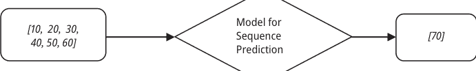

图 10.1：序列预测问题示例。

#### 10.3.2.2 序列学习模型

使用带标签的数据集进行预测。使用图 10.2 所示的方法可以为序列分配类名。

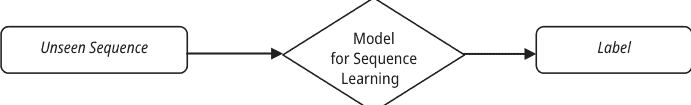

图 10.2：序列分类问题示例。

序列学习的示例包括序列分类器和情感分析。

#### 10.3.2.3 序列生成模型

它将一个或多个输入转换为一个新的输出。自动文本生成和图片文本/图像抽象是图 10.3 所示序列预测模型的示例。

#### 10.3.2.4 序列到序列预测

如图 10.4 所示，说话和解决查询是存储输入预测顺序的顺序过程。

## 10.4 材料与方法

数据和模型在推进实证理论方面的贡献具有相似的意义；数据本身可能提供了大部分输入以及方法。特征集可以完全基于客户的功能和需求构建。为了对股票进行更强更精确的预测，必须考虑许多变量。统计方法被扩展到早期可获取的盘后细节，以预测潜在的价格/波动。为了近似股票的价格/波动，所使用的财务分析可能采用预定义的技术指标。除了历史证据外，人类情感通常也会纳入预测阶段。

预处理：在现代世界中，数据可能不足、存在噪声且不可靠。需要初始数据处理（也称为预处理）来增加数据的一致性、挖掘性能以及简单高效的数据处理。清洗、集成、转换、消除和离散化是预处理的一些步骤。在数据转换层，归一化是最关键的预处理技术。它是一种用于减少属性数据规模的方法。下面描述了一些与材料和方法相关的算法。

图 10.3：序列生成问题示例。

图 10.4：序列到序列预测问题。

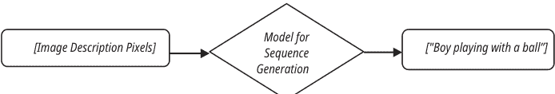

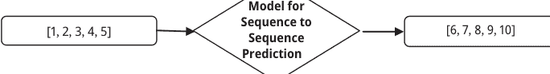

### 10.4.1 深度学习算法

本节涵盖了机器学习方法、回归、支持向量机 (SVM)、朴素贝叶斯和 K 近邻 (KNN) 的选择，以及涉及的选择。

### 10.4.2 回归

回归可用于解释变量之间的关系。监督需要连续的输入数据。

### 10.4.3 K 近邻

KNN 代表知识网络，缩称为 K 近邻。这确保分配的测试文档与训练集中的记录进行对比。

### 10.4.4 朴素贝叶斯

Naïve Bayes 代表等效学习。这确保测试文档与训练集合中的相同记录相关联。

### 10.4.5 支持向量机

支持向量机 (SVM) 是另一种常用的关注间隔估计理论的先进人工智能技术。SVM 可以处理分类和回归问题，尽管它更多地用于分类。它能有效建立类别边界。边界的绘制方式使得边界与组之间的差异最大，从而减少图 10.5 所示的分类错误。

### 10.4.6 人工神经网络

人工神经网络包含人工神经元，也称为单元。这些单元堆叠形成整个系统的人工神经网络。取决于如何利用复杂的神经网络来发现

# 10 用于预测性和规范性数据分析的量子计算研究 — 133

数据集中的隐藏模式，一个层可能包含几十个或数百万个单元。除了输入层、输出层和输出层外，人工神经网络经常包含隐藏层。输入层从外部环境收集神经网络处理或学习的数据。这些数据在经过一个或多个隐藏层后，被转换为输出层所需的有意义的信息。最后，输出层以对人工神经网络接收输入的反应形式生成输出。在大多数神经网络中，单元之间是从一个连接到另一个单元的。这些连接每个都有一个权重，用于调节一个单元对另一个单元的影响。随着神经网络从一个单元移动到另一个单元，它获得了关于数据的更多知识，最终由输出层产生输出 [21]。

**优点：** 兼容线性和非线性数据；不需要重新编程，且即使一个或少数节点无法对网络做出响应，也能正常工作。

**缺点：** 需要广泛的指令；需要大量的计算和计算能力；且消费者无法知道网络内部发生了什么。

## 10.4.7 混合模型

这是一种结合了两种或更多技术以产生更好结果的构建类型。同质模型使用相同类型的学习器构建，而异质模型使用不同类别的学习器而不是使用单一预测模型；可以使用许多模型来形成混合，用于建模、仿真和优化的多样化目的 [22, 23]。混合模型的分类如下。

### 10.4.7.1 模型的构建

- 自助聚合（Bagging）：为了最小化减少不确定性，并行运行多种机器学习算法，利用训练数据和自助采样。最终的分类器通过投票过程选择。
- 增强（Boosting）：应用一系列机器学习技术以最小化减少偏置。在逐步演进的过程中，较慢的层得到加强，从而改进结果。在相应的步骤中，只处理上一个阶段被分类错误的数据点。
- 堆叠（Stacking）：以串行方式应用多种机器学习算法以提高精度。上一步的结果可以作为下一步的反馈。

### 10.4.7.2 混合模型的应用领域

建模涉及对给定模型配置（如模型的目的、变量和约束）所发现和理解的概念的数学表示机制。目标是一个可衡量的指标，可以根据应用进行减少或最大化，并用于评估模型的效率。尽可能地减少成本、时间和方差目标函数。利益最大化是目标，相似性是目标函数。模型的组件由变量表示，这些变量必须被识别并分配适当的值。通过给定的约束函数进行边界定义了变量之间的关系以及变量所需的值。机器学习算法可以用于训练预测标签位置的模型。模型应该调整以适应市场需求，并应考虑修订后的输入数据。

机器学习算法可以用于通过仿真实现计算模型的自动化。这些算法可以用于构建模型、实时更改它们并做出预测。人工智能（AI）是一种旨在表征人类智能的模拟范式。在理解、准备、思考、解释、解决问题和决策等活动中，该模型模仿人类大脑的能力 [19, 24]。

## 10.5 优化技术

这是一种比较迭代的方法，用于实现对计划模型的最有效且最佳的利用，即最优或满意的解决方案。应该有一个目标，例如节省成本或提高性能。

用于获得更好解决方案的优化算法取决于问题的类型。因此，优化算法被分类为：

- 关注变量值形式的连续优化、离散优化。无约束优化和受限优化是基于向量约束的两种优化类型。
- 基于目标任务数量的优化——无、更多或多个目标。
- 基于数据特定性的确定性优化和随机优化。

以下讨论了用于预测的一些优化技术和方法。

### 10.5.1 优化技术的解密

解决方案技术可以分类为特定种群或特定特定的（进化方法、群体智能方法）。元方程是组合子集 [25]。

# 10 用于预测性和规范性数据分析的量子计算研究 — 135

10.6 展示了该分类法的阶段。第一种区分是混合解决方案（解决方案创建）或替代解决方案（差异运动）。差异运动可以依赖于整个种群。该群体可以包含子群或社区 [26]。


这种分类法提供了有价值的首次启发式区分。它的实现为各种元启发式分组并促进了其行为评估。然而，使用该分类法进一步比较元启发式存在一些问题。[26] 引入了具有影响力的算法。例如，粒子群优化（`PSO`）算法有57 种相关的元启发式 [26]。如果为了阐明它们之间的区别、为了比较而选择它们或分析其功能，那么单独评估它们也是重要的。这需要时间和投入。因此，我们认为通过下段中列出的更精确的标准来扩展该分类法是很重要的。查看：第三级分类涉及元启发式框架的强化（包括探索和开发）能力。标准必须能够定义这些能力并以某种方式进行衡量。

如何表示强化和多样化的示例由 [27]、Deroglu [28] 和 Blum [29] 提供。

最大的潜力强化，但由目标和随机特征之外因素控制的组件提供了最大的多样性。

结合元启发式算法的强化和多样化元素并对其结果进行加权，可以提供适当的分类。然而，这些组件的标准化定义是至关重要的。还可以检查 I&D 框架是否准确描述了其结果的加权，或者是否需要寻找更详细的指标。

第四个分类标准采用了在元启发式意义上被归类此类别的基础元启发式组件 [30]。该研究观察了元启发算法以揭示基础算法结构。为了区分其本质的元启发式组件，他开始使用局部搜索、演化算法、`PSO` 和蚁群优化对元启发算法进行分析。

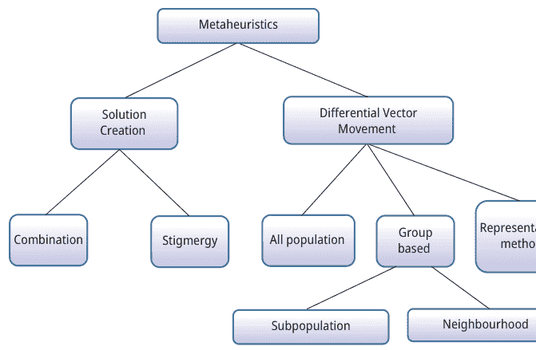

**图 10.6：**不同解决方案组合的元启发算法子集分类 [26]。

## 10.5.2 基于唯一解的策略

依赖于单一解的元启发算法被称为轨迹法（trajectory approaches）。该方法通过一个解初始化，并为整个解定义轨迹方向，类似于其在空间科学中的用法。禁忌搜索、模拟退火和其他变体属于这些技术之列。这些方法通常被称为局部搜索算法的“智能增强”。

10 用于预测和规范性数据分析的量子计算研究 — 137

## 10.5.3 关注种群的方法

这些方法的设计是为了处理群体而非首要补救。此类方法与达尔文假设的研究有关，在该假设中，群体通过物种存活水平智能（SI）进行修正，并利用关联来支持社会经验，以模拟计算实验。基于种群的优化形式和受动物启发的优化是两种不同的方法。

## 10.5.4 数学优化中的复杂性

在考虑不同约束时，数学优化的目标是找到一组在随机利益模型方面具有最佳潜在结果的决策或行为。单期决策优化问题被定义为：在考虑各种约束的情况下，最小化或最大化可测的利益函数。使用这些及类似变量的利益随机模型，目标函数和限制函数规定了根据判定变量和其他依赖变量确定最佳可能结果的准则。这些精确分类的组件之间的相互作用至关重要，且难以理解 [31]。

数学优化是一组针对决策或行为随时间变化的动态演变的演化规则策略，在不稳定性产生时，以相关系统的随机表示的形式以及在若干约束条件下产生最佳结果。在考虑若干项限制的同时，最小化随时间变化的观测利益函数，是多期决策优化挑战的一种般近似。函数和约束的时间依赖性目标描述了在参考时间变化的控制参数和其他依赖变量（专注于随机利益机制）的情况下，给定时间跨内决定最佳可能结果的准则。这些优化公式组件之间的相互作用至关重要，并且可能非常复杂且难以理解。

因此，数学优化还产生了有利于过滤的策略，这些策略确定了时间周期初的一系列错误决策或行为，或随时间进行复杂操作的一系列功能决策程序，以在随机模型中实现最佳结果。这些答案可以使用多种数学方法寻求，这些方法关注系统的随机表示属性及其相应的实现方法。底层随机不稳定模型的复杂性以及在随机模型内部对相关问题进行优化的复杂性共同决定了最有效的方法。概率论、优化理论、控制理论和模拟理论需要随机系统的领域知识。

在仅使用点投影的情况下，线性规划 ([32]、凸优化 [33]、组合优化 ([34]、整数规划、非线性优化 ([35])、以及确定性动态规划和最优控制 ([36]) 等方法始终是更好的选择。由于随机过程和程序的解析解具有更丰富的概率表征，一种基于解析解特征的更强有力的选择是基于数学规划、随机优化 ([37]、随机规划 ([38])、动态规划和随机最优控制 ([39]) 的。由于模拟方法是测试结构随机表示及结果决策过程的唯一途径，随机近似的模拟优化 (40–42) 始终是最佳选择。最后，使用了稳健优化 ([43]，它将决策问题本身或其解中参数值的确定性异质性，转化为该机制及其底层决策过程对歧义稳健性的衡量标准。

更复杂的“如果……怎样”（what-if）和情景分析是规范性分析中使用的另一种统计建模方法，它根据目标、参数、结果以及公式的其他方面面的集合来寻找最佳方案。例如，一种不确定性下的数学优化策略可能用于寻找单期优化问题的答案，该问题在给定一组标准差下针对涉及的随机变量最大化目标。这些过程中的任何一个都可以针对不同的标准差集重复。这些选项中的任何一个都决定了在一定变化范围内产生最佳性能的决策或行为。当前投资组合理论的有效边界可以用这一系列解决方案表示，没有其他投资组合方案具有与此相同的预期收益和标准差（同一风险水平）。更广泛地说，这种方法鼓励对歧义挑战下最优解的敏感性检查，这有助于决策并允许特定形式的风险存在。Lafer [44] 建议了一种相关方法，使用随机思想来计算对冲决策；该策略由美国陆军 TRADOC 中心（位于墨西哥的白沙导弹场）在一台设备中实施。

## 1.6 统计优化方法

这是一种从一系列选择中挑选正确方面的方法。随机梯度下降 (`SGD`)、带动量的随机梯度下降、AdaGrad 和 RMSProp 属于该组优化策略。

### 10.6.1 随机梯度下降 (SGD)

这是一种通过对选定参数分配随机值来最小化代价函数的方法。

### 10.6.2 自然启发的优化技术

这些是受生物和环境变量影响的优化策略，并分为两类：演化算法和群优化技术，如图 10.7 所示。

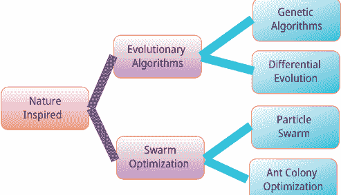

图 10.7：自然启发算法分类。

### 10.6.3 演化方法

演化方法关注达尔文的概念，并受响应环境变化的生物的影响。它是一组优化算法的缩写。为了获得改进的方案，这些方法包括遗传编程、具有结构交换原理的比较演化以及变异育种。作为一种解决问题的方法，演化方法模拟了自然选择。在遗传编程中，变异原理通过传播均值为零的标准差的数字来执行，这允许对其进行灵活的解释

在评估搜索算法的输出时使用分布参数 [45]。协方差矩阵。适应进化技术（Adaption Evolution Technique）已被证明是许多进化算法中执行全局优化的有效工具。在优化挑战中，选择了一个候选者群体 [46, 47]。差分进化通常用于处理线性回归问题。在该方法中，通过变异和交叉算子产生个体，并利用其各自的结果来确定下一代的响应。差分进化的调节设置较少，这种方法被广泛用于单目标优化，并可以扩展到多目标问题。

## 10.6.4 群体智能策略

群体智能讨论了分布式智能技术，以及一种关注生物间相互作用的问题优化的革命性解决方案。它们由一群代理组成，这些代理在与世界通信时会执行不同的角色。在缺乏管理系统或局部连接的情况下，它们有助于自组织全局栖息地的创建。该模拟使用了许多算法，包括粒子群优化（`PSO`）、蚁群算法（`ACO`）、蜂群优化（`ABC`）、蝙蝠算法、免疫系统、虾类算法，以及引力搜索算法。后续章节描述了这些算法。

### 10.6.4.1 粒子群优化 (PSO)

这被视为一种全局优化策略，利用鸟类向远方飞行的行为模型，在空间中放置候选解决方案，创建出一种结构内部的互连性。

### 10.6.4.2 蚁群优化 (ACO)

这是一种实用的元启发式方法，基于蚂蚁从源头（巢穴）到目的地（食物源）再返回巢穴的过程中形成最佳方向的行为。这种方法有助于识别复杂优化问题的合适解决方案。在这种方法中，一群人工蚂蚁（软件代理）搜索当前问题的更佳解决方案。该技术基于使用加权图识别正确路径，这种创建方法被称为随机过程，且其灵感源于信息素模型，这意味着图元素（如节点和边）的参数可以在运行时由蚂蚁随机更改。

### 10.6.4.3 蜂箱

BCO 的哲学是创建一种多代理方法，利用蜜蜂理论在不同的优化问题组合中寻找良好的解决方案。该过程以迭代方式进行，直到达到停止准则。这种方法通过两种方式实现：在第一种方法中，逐件采取积极行动；第二种方法被称为 BCO，涉及改进整个解决方案以找到最终解决方案。

### 10.6.4.4 退火模拟

模拟退火是一种具有良好解决方案的优化方法。它有助于在局部最优中检测全局最优值。“退火”一词与符合热力学定理的可能性有关。该方法不是使用材料能量，而是利用优化问题的客观特征。该技术基于爬山算法，其中随机选择最佳的一步，而不是因为它是最佳移动。如果这种变化加强了解决方案，则对其进行改进；如果不是，算法将选择一个概率小于一的通过。

### 10.6.4.5 蜂群（人工）

Karabaga 在 2005 年实现了一种基于群体的元启发式算法来优化数值问题，该算法受到蜜蜂行为的影响。该模型有三个方面：工蜂、闲闲蜂和食物供应。为了生存，前两个组件会寻找第三部分。这种范式根据蜜蜂的反馈（无论是正面还是负面）区分了两种自组织智能模式。要使用此模型，首先将问题转换为寻找能够最小化目标函数的最佳参数。邻域搜索技术通过迭代增加带有初始解向量的种群随机发现。

## 10.7 金融预测分析案例研究

客户还有更多的通信选择，这导致公司拥有更多的金融数据。AI 将被用于从这些信息中获取观点。金融公司已经开发了数据和 AI/数字创新中心来利用其数据；机构认为，为了在提供高质量产品和定制化服务的同时降低价格，他们需要开发技术技能 [48, 49]。

预测分析可能有助于帮助银行在支持活动的同时减少开支并提供更精简的资源；我们可以通过四个案例研究来阐明金融预测分析的概念。以下是分类如下：

- 识别交易中细微差异的统计学洞察。
- 如果信用卡发行机构拒绝收回债务，预计将产生信贷违约率。
- 检查消费者及其银行提供的终身价值。

为了更好地预测预测欺诈，我们将从查看 Dataiku 的欺诈检测解决方案开始。

它成立于 2013 年，声称已对各种格式的原始数据使用机器学习技术，以生成预测模型。公司声称他们的解决方案帮助企业理解数据关系，通过以下方式为他们节省资金：

因此，例如，富国银行（Wells Fargo）等银行从调查、推文、社交媒体帖子和网站中收集大量的原始客户数据。通过这种方式：

- 银行的市场和内部部门可能使用 Dataiku 异常检测仪表板来访问预测分析数据。

结合公司声明的能力，它还收集、消毒并分析了此类可操作的观察结果：

- 通过监控社交媒体内容，可以追踪尚未开发的广告市场。
- 外国交易和数据模式可以帮助检测欺诈。

当最终用户注册后，应用程序允许他们访问其被授权发送和应用的数据。根据业务部门的，关于数据的信息是可用的。

## 10.8 用于数据分析的预测性和规范性分析的量子计算研究

2017 年，Dataiku 为巴黎贝银行（卢森堡）集团欺诈识别与预防部门进行了一项案例研究，结果发现其改进了集团的检测机制。

当用户登录时，可以包含或输入应用程序将使用的数据。根据业务部门的，数据位于电子表格中。例如，公司可以决定特定信息是否与特定年龄的女性有关。要显示每列中缺失值的数量，顶部有一个百分比。

我们已经讨论了一些分析上升性（Analytic Ascendency）、各种类型的分析模型以及一些优化方法及其它们的优缺点。在本章中，我们还描述了许多分类元启发式算法的方法。大多数方法都有些不足，只能针对特定的分类目标进行实现，而无法对所有元启发式算法进行系统的分类。直到最近，人们才提出了元启发式算法的通用行为。尽管对于根据通用行为识别分类元启发式算法的参数更有用，但在发现这种行为的情况下或需要合适的启发式进行比较时，对它们进行分析也是同样重要的。

## 参考文献

- [1] McCarthy, B. H., & Ponadel, S. (2021). “IBM发布全球首款2纳米芯片技术，开启半导体新前沿”。[在线]. 可用：https://newsroom.ibm.com/2021-05-06-IBM-Unveils-Worlds-First-2-Nanometer-Chip-Technology.Opening-a-New-Frontier-for-Semiconductors.
- [2] Alsop, T. (2021). “Statista”。[在线]. 可用：https://www.statista.com/statistics/993634/quantum-number-of-qubits?
- [3] Weigold, M., Barzen, J., Leymann, F., & Saim, M. (2021). 扩展量子算法的数据编码。在：德国斯图加特大学应用系统研究所。可用：https://ieexplore.org/document/94258837/
- [4] Dash, R. & Dash, P. K. (2016). 集成机器学习技术的混合股票交易框架。《金融与数据科学杂志》，21(1), 42-57。
- [5] Xing, F. Z., Cambria, E., & Weigle, R. E. (2018). 基于自然语言的预测：现状综述。《人工智能述述》，50(1), 49-73。
- [6] Miah, M. B., Hossain, M., Hossain, M. A., & Islam, M. (2015). 使用人工智能混合模型进行股市价格预测。《国际计算机应用杂志》，111(3), 1。
- [7] Yadav, S. P. et al. (2021). 使用循环神经网络 (RNN) 在语音情感识别和视觉系统中的机器学习综述。《工程计算方法杂志》，29(3), 1753-1770。
- [8] Vashisht, V., Kumar Pandey, A., & Yadav, S. (2021). 使用机器学习进行语音识别。《IEEE智能处理与计算汇报》，10(3), 233-239。
- [9] Hastie, T., Tibshirani, R., & Friedman, J. (2008). 《统计学习方法论：数据挖掘、推断与预测》。纽约：Springer-Verlag。
- [10] NRC: (2013). 《机器数据分析前沿》。华盛顿特特区：国家科学院出版社。
- [11] Kishor, K. (2022). 通信高效联邦学习。Yadav, S. P., Bhati, B. S., Mahato, D. P., Kumar, S. (编). 针对物联网应用的联邦学习。EAI/Springer 通信与计算创新，Springer，Cham。https://doi.org/10.1007/978-3-030-85559-8_9
- [12] Kishor, K. (2022). 个性化联邦学习。Yadav, S. P., Bhati, B. S., Mahato, D. P., Kumar, S. (编). 针对物联网应用的联邦学习。EAI/Springer 通信与计算创新，Springer，Cham。https://doi.org/10.1007/978-3-030-85559-8_3
- [13] Sharma, A., Jia, N., & Kishor, K. (2022). 通过胸部X光预测新冠肺炎。在：Gupta, D., Polkowski, Z., Khanna, A., Bhattacharya, S., (编). 数据分析与管理会议集。数据工程与通信技术丛书第90卷，新加坡。https://doi.org/10.1007/978-981-16-6289-8_16.
- [14] Sharma, R., Maurya, S. K., & Kishor, K., (2021). 使用机器学习技术预测学生表现。（2023年7月）。在线计算与通信国际会议 (ICICC) 会议集，发布于 SSRN：https://ssrn.com/abstract=3879645 或 http://dx.doi.org/10.2139/ssrn.3879645
- [15] Anish, C. M., & Majhi, B. (2016). 使用FLANN和因子分析进行股市预测的混合非线性自适应方案，《韩国统计学会》，45, 64–76。
- [16] Kishor, R., Sharma, D., & Chhabra, M. (2022). 使用机器学习技术预测学生表现。在：Zaitsev, A. (编.), 电子与电信工程，《网络与系统讲义》，第373。https://doi.org/10.1007/978-981-16-7721-8_53
- [17] Jain, A., Sharma, Y., & Kishor, K. (2021). 使用LSTM进行财务监督和生成，《状态技术》，63, 1894–1892。
- [18] Tyagi, D., Sharma, S., & Kishor, K. (2020). 使用机器学习检测驾驶员疲劳。《创新国际杂志》，ISSN: 2278-3075。
- [19] Jain, A., Sharma, Y., & Kishor, K. (2021). 使用机器学习算法进行财务趋势预测与分析。在线计算与通信国际会议，发布于 SSRN：https://ssrn.com/abstract=3879645 或 http://dx.doi.org/10.2139/ssrn.3879645。
- [20] Ouaillah, M., El Mohajir, M., Chahmar, M., & El Mohajir, B. (2017). 基于Hodrick-Pratt滤波和支持回归的预测股市的新新型模型。《大数据杂志》，41(1)。
- [21] Sherinski, A. D. (2020). 循环神经网络 (RNN)和长短期记忆 (LSTM)的基础。《线性网络》，4。
- [22] Kara, M., Ulukan, A., & Kishor, K. (2019). 用于生成投资者观点的混合方法。《实验与系统》，15(12), 256–270。
- [23] Kia, A., Harizadeh, S., & Shouarki, S. (2018). 用于预测全球股票市场和商品价格的混合半监督模型。《实验与系统》，1(105), 159–173。


- [24] Kishor, K., Nand, P., & Agarwal, P. (2018). 预测瓶颈调整的留存策略，《计算机科学与技术杂志》，3(2), 55–69。

- [25] Chou, J. S., & Nguyen, T. K. (18). 使用滑动窗口启发式优化的机器学习进行股价前瞻预测。《IEEE工业信息》，14(7), 3132–3142。

- [26] Molina, D., Potovas, J., Sel, R., Garcia, L., Garta, S., & Hauis, A. (2019). 自然启发型优化的综合分析。

- [27] Fausto, F., Rey-Orta, A., Cuevas, E., Ag, A., & Perez-Cisneros, M. (2019). 从蚂到鲸：所有元启发式算法。《人工智能综述》，53(1), 753–810。

- [28] Fausto, F., Rey-Orta, A., Cuevas, E., Ag, A., & Perez-Cisneros, M. (2019). 从蚂到鲸：所有元启发式算法。《人工智能综述》，53(1), 753–810。

- [29] Blum, C. (2003). 元启发式算法在组合优化中的作用。《ACM计算机综述》，35(3), 268–308。

- [30] Lones, MA. (2014). 自然启发算法中的元启发式算法。在：2014年遗传与进化计算会议论文集 – GECC '14, ACM Press。

- [31] Melvin, M., Panb, W., & Wikstrom, P. (2020). 留存Alpha：交易规模和再平衡频率对外汇策略的影响。《金融市场杂志》，31。

- [32] Vanderbilt, R. J. (2013). 《线性规划：基础与扩展》。第4版。纽约：Springer-Verlag。

- [33] Boyd, S., & Vandenberg, L. (2004). 《凸优化》。纽约：Cambridge出版社。

- [34] Nemhauser, G. L., & Wolsey, L. A. (1999). 《整数与组合优化》。霍霍肯，新泽州：Wiley。

- [35] Ruszczynski, A. (2006). 《非线性优化》。新泽州：普林斯大学出版社。

- [36] Bertsekas, D. P. (2005). 《动态规划与最优控制，I》。第3版。纳舒塞：Athena。

- [37] Chen, H., & Yao, D. (2012). 《排队网络基础》。纽约：Springer。

- [38] King, A. J., & Wallace, S. W. (2012). 《随机规划建模》。纽约：Springer-Verlag。

- [39] Bertsekas, D. P. (2012). 《动态规划与最优控制，II》。第4版。纳舒塞：Athena。

- [40] Simulation, S., & Glynn, P. (2007). 《随机仿真：算法与分析》。纽约：Springer。

- [41] 运筹与管理手册。(2007)。Elsevier。

- [42] Dierker, A., Ghosh, S., & Squillante, M. (2016). 随机网络的优化容量管理。《运筹学》，http://www.columbia.edu/~ad217/publiccapacity.pdf。

- [43] Ben-Tal, A., Nemirovski, A. (2009). 《鲁棒优化》。新泽州：普林斯大学出版社。

- [44] Laffriere, R. R., & Robinson, S. (2000). 决策中的场景分析。《Phalanx》，321,16。

- [45] Kim, H. Y., & Won, C. (2018). 集成LSTM与GARCH型模型的股价波动率预测。《实验与系统》，1(103), 25–37。

- [46] Huang, K. Y., & Jane, C. (2009). 基于ARX、灰色系统和RS理论的股票预测与组合混合模型。《专家系统应用》，36(3), 5387–5392。

- [47] Dietrich, B. L., Plachy, E. C., & Norton, M. F. (2014). 《跨企业分析：IBM如何从大数据和分析中实现业务价值》。印安纳利斯：IBM出版社。

- [48] Jain, A., Sharma, Y., & Kishor, K. (2020). 使用MI的财务监督管理系统。《状态技术》，63(6), 18974–18982。http://solidatetechnology.org/index.php/JSST/article/8080。

# B. Aruna Devi*, N. Alangudi Balaji, Mulugeta Tesema

# 11 量子计算在各种应用中的不同技术与挑战综述

**摘要：** 自20世纪80年代诞生以来，并在21世纪00年代实现了硬件原理性证明，量子计算取得了巨大的进展。尽管该技术仍处于开发过程中，但许多人认为，中等规模量子（NISQ）机器的性能可能超越传统计算机。这得益于与量子计算相关的硬件的快速发展，以及全球许多国家投入的大额资金。在本章中，将对量子计算的各种应用进行深度综述。

## 11.1 引言

量子计算缺乏大量的实际量子比特，无法开发出稳健的纠错系统。因此，在更强大的量子计算机出现之前，它们只能用于轻量级任务。NISQ机器已经证明，它们在处理某些特别适合量子计算的子任务时，比传统计算机更有效 [1]。这已经通过过去几年的一系列演示得到了证实。

在量子设备运行的算法可能只需要少量量子比特，表现出一定程度的抗噪性，并且通常被建模为混合算法，其中一些步骤在量子设备上完成，另一些步骤在普通计算机上完成 [2]。这是因为量子设备本身的能力有限。这是由于尽管量子设备在能力方面存在固有局限性，这些算法是可以执行的 [3]。

将操作次数（也称为量子门）保持在最低至关重要，因为执行时间越长，引入量子态的错误就越多，发生退干的可能性越大。因此，在整个过程中尽可能执行尽可能少的任务是必要的。受这些限制的直接影响，可以实现的算法范围被大幅缩小了 [4]。

众知的量子方法，例如用于质因分解和无结构化搜索问题的Shor算法或Grover算法，对于当前任务并不合适。这两种算法既无用也不适用。在NISQ算法领域，变分量子本征值求解器（VQE）是最有前景的实例之一 [5]。这是因为它可以同时解决具有大量变量的问题。因为它能够一次性解决涉及大量变量的问题。确定分子和材料能量特征的过程从计算哈密顿量基态能量的上界开始。这一步通常是该过程的第一阶段。获取这一上界就需要哈密顿量 [6]。

传统的计算化学建立在一个多世纪以来的研究发现之上，为近似上述特征提供了有效的方法。然而，当对日益庞大的系统进行极精确的计算时，这种策略可能会变得极其到无法负担。由于这一特定因素，实施此类策略可能相当困难 [7]。

由于各种原因，计算化学在分子系统研究中的应用往往缺乏足够的精度。这些原因最重要的之一是对组成系统的电子之间相关性的处理不足。由于底层电子相互作用的复杂性，使用目前的可用技术，量子化学的准确方法往往是不可行的。这是由于随着系统规模的增加，计算复杂度呈指数级增长 [8]。

这种局限性促成了对其他方法的研究，例如VQE，有一天可能会在处理此类问题方面比目前的量子范式更成功 [9]。模拟量子系统的最佳方法是量子比特（例如电子波函数），遵循量子物理规则，这使得在传统设备上编码相同信息成为可能。

> *通讯作者：B. Aruna Devi, 电子与通信工程系, Dr. NGP技术学院, Coimbatore, Tamil Nadu, India, 电子邮箱：arunadevi@drngpit.in

> N. Alangudi Balaji, 计算机系, Koneru Lakshhmaiah教育基金, Vaddesaram, Vijayawada, Andhra Pradesh, India, 电子邮箱：alangudibalaji@gmail.com

> Mulugeta Tesema, 化学（分析化学）, Dambi Dollo大学, Dambi Dollo, Ethiopia, 电子邮箱：efa.ntust.com

https://doi.org/10.1515/9783110798159-011

## 11.2 分类

在本节中，我们将根据引言中概述的标准，将各种量子计算技术组织成它们所属的几组。这些每一个类别都通过其特定的活动与其他类别区分开来。量子计算分类法考虑了所有相关元素，包括基础特征、算法特征、时间和门特征以及额外特征：

- (A) 基础特征
- (B) 时间和门特征
- (D) 额外特征

通过此链接可以访问图11.5，它提供了适用于量子计算机的分类技术的图示 [16]。

量子比特的实现、技术的分类和性能评估是构成量子计算的三个基本组成部分的示例。量子计算由许多其他基础元素组成。量子计算最重要的部分之一是关于量子比特（有时称为qubits）如何以各种方式实现和表示的研究。量子比特的表示可以通过多种方式进行，其中一些包括在地面、在空中或在移动中进行 [17]。

在编程方面，固定策略更类似于以往的方法，而移动方法则更类似于在设计电路时一直采用的方法。此外，量子计算技术的选择提供了额外的分类，特别是参考了单机计算和系综计算。系综系统由许多设计和运行相同的量子计算机组成。相比之下，单机计算系统仅由单一量子计算机组成，该计算机作为系统的神经中枢。量子计算方法的第二个子小组是基于性能测量的。机械振动、荧光和并发等方法是该子类方法的类型示例 [18]。

# 150 B. Aruna Devi, N. Alanguindi Balaji, Mulugeta Tesema

计算方法。对量子计算技术进行讨论并根据量子算法提供的特性对其进行分类至关重要。并行性、可用量子比特的总数、拓扑结构、定位量子比特的方法以及量子比特操作，都是量子计算体系架构中包含的算法计算示例 [19]。

并行性是定义性特征，量子门的实施需要并行化，这对于防止或至少显著减少量子比特的退相干是至关重要的。量子门实施的并行化对于提高量子计算的效率和可扩展性至关重要。这是由于在量子门的开发和执行中存在并行化的内在需求。这是由于在开发量子门时采用并行化的必要性所导致的结果。当量子计算机运行时，它具有多种量子比特，这些比特有助于其可靠性和可扩展性。这些特性之一是可使用的量子比特总数。量子计算机架构的优化至关重要，因为它确保了构成系统的各种物理单元之间数据和信息的高效传输 [20]。

量子计算机预计将在人工智能的发展中发挥关键作用。拓扑结构是构成量子计算机架构的物理组件的配置，可以采取多种形式并以不同的方式构建。用户需要在此过程中投入大量的逻辑思维，以利用用于定位特定量子比特的寻址技术。当涉及到量子计算机硬件时，这种能力允许对量子比特状态进行实质上细致的研究。此外，为了使任何操作发生，量子比特都必须从其存储位置移动到量子比特运行的区域 [21]。在任何操作发生之前，都需要对量子比特进行移动。

时间和门共享以下特征：时间和门的属性（包括退相干时间和测量时间等元素）使得对量子计算中使用的用技术进行进一步分类成为可能。这是通过时间和门的特性实现的。在量子比特不再能维持在特定状态之前，必须经过的时间长度。这段时间就构成了退相干时间。目前，退相干时间的确定正受到专注于量子计算领域人士的大多数关注和重视。在分类时，需要考虑的另一个关键方面是测量时间，也称为确定量子比特精确状态之前需要经过的时间 [22]。

可扩展性、定时和门级量子比特的控制是用于分类多种量子计算技术的一些其他特征。可扩展性是指在不增加系统总体尺寸的情况下增加系统中量子比特数量的能力。到目前为止的所有特性对于将量子比特数量扩展到更大量子比特的过程是有益的。另一方面，为了避免总是代表单个离子或光子，建议使用大量的量子比特。由于改变量子比特的状态是一个耗时过程，通过更多的量子比特，对门定时进行精确计算是一项迫性要求。这是因为量子比特状态之间的转换是依赖时间的。量子比特的到达时间需要进行精调，以便将大量量子比特成功地放置它们各自的相位中 [23]。

## 11.3 挑战

开发大型量子计算机面临着特殊的问题。“量子比特退相干”一词是指量子比特由于与其环境相互作用而失去其相干特性的过程。这是开发量子技术之前必须克服的最重大挑战之一，被认为是最难解决的问题之一。结果是处于叠加态的量子比特将退相干为经典比特位，这将使使用量子技术可能获得的收益化乌有。嘈噪声中尺度量子（NISQ）缩写中的“噪声”是指仪器将受到其所在地环境干扰的影响。外部影响（如温度变化和杂散电场或磁场）可能会降低存储在计算机中的量子信息 [24]。这是一种可能性，因为环境条件可能导致信息损坏。

为 NISQ 设备开发有效的纠错策略在量子计算研究领域引起了大量关注，该领域正将大部分注意力放在量子计算机的生产上。量子比特的互连是当代量子系统为了正常运行而需要克服的最重要的技术问题之一。这个问题与当前量子设备量子比特之间的连接数量有限有关。当映射大深度的双比特门需要通过直接耦合进行量子比特间相互作用变得更加复杂时，这一挑战变得越来越关键。需要这些门，是因为它们需要通过量子比特间的相互作用来克服 [25]。尽管存在一些技术障碍，但 NISQ 量子计算机正在证明它们比传统计算机具有计算优势。在量子计算领域，Google 团队最近展示的量子优越性构成了一个里程碑式的事件。

整个世界正处于激烈的竞争中，旨在构建第一个实用的量子计算应用，该应用能够以经典计算机无法解决解决现实世界问题。如何使用量子计算机解决问题是这一竞争的焦点。为了实现这一目标，在不遥远的未来，我们不仅量子算法的发展，还需要纠错硬件。NISQ 提供的硬件以及完全原创的算法正在以尽可能快的速度设计并接受测试 [26]。

量子算法类型中应用最广泛的一种类型是变分算法。量子算法的一些重要类别包括搜索（包括离散对数振幅放大以及 Grover），构建此类计算机将需要多年的研发。与 NISQ 设备相关的大部分研发工作是变分算法和机器学习。这是因为量子机器学习利用了量子纠缠。这一想法已被研究人员提出。最近的研究取得了一些鼓舞的发现，但尚无法判断量子机器学习的实施是否比传统机器学习具有更高的计算效率。

尽管如此，作者们承认仍有一些模型尚未被充分研究，如表 11.1 所示。由于这种情况，他们在报告中增加了一个名为“其他”的章节。本研究旨在通过对尽可能多的最新前沿量子计算模型进行讨论，并涵盖尽可能不同的应用领域，为量子计算领域以及读者和研究人员提供有用的知识。

### 11.4.1 电路模型

问题在于如何通过编译量子计算机系统数据集、根据物理量子比特数量和逻辑门错误率分配分，并定义一个结合这两个标准的索引，来预测量子计算领域的进展。最终，进行该研究的研究人员得出结论：预测量子计算领域进展的最好有效方法是定义一个结合这两种标准的索引。

他们测试了与技术预测、量子计算和时间线估计相关的各种假设。最终，他们得出结论：定义一个结合物理量子比特数量和逻辑门错误率的索引是预测量子计算领域进展最有效的方法。

### 11.4.2 量子感知器

利用电路模型可以创建标准的量子处理器和量子芯片。这些模型可以为这项工作提供帮助。为了使量子计算机的使用成为功能性且实用的解决方案，必须拥有一种能够在构建量子硬件方案时进行量子算法映射的范式。这是因为在设计量子硬件方案的过程中需要进行量子算法映射。此外，构建量子逻辑矩阵的过程可能会发现这些模型有所帮助，这是一个可能性。

### 11.4.3 量子自动机

Raychev 构建了一个量子电路模型，用于发现量子计算机上哈密顿矩阵的复特征值、相位估计的迭代方法以及量子系统共振态的演示。在量子计算机上，该模型被用于寻找哈密顿矩阵的复特征值。

### 11.4.4 量子神经计算

量子感知器是一种量子神经网络，它是传统感知器的直接推广。在各个领域部署量子感知器的目的是优化神经网络的权重和拓扑结构。

## 11 量子计算的不同技术与挑战综述 — 155

量子神经网络（QNNs）的数学模型是有良好定义的；它是对德特量子计算网络概念的改进，该概念引入了推测性叠加的非逆和线性模拟。

纠缠量子神经处理对噪声和相干性丢失具有免疫力。使用神经网络纠缠预测器并不要求系统接近任何状态，而且随着系统规模的增大，所需的额外训练量会减少。当量子计算机变得可用时，了一种使用这些强大的处理器构建神经网络的标准化技术；这种方法通过量子计算的引入而成为可能。事实证明经典网络可以整合到量子框架中，并提供了许多专门模型，如卷积网络、循环网络和残差网络，作为量子实现的可行候选。总之，他们提供了一系列通过部署 Strawberry Fields 软件包开发的建模实验。

这样做是为了检索对所预测类别的概率分布。一种耗散型量子脑模型为所有经验水平的读者提供了关于当代量子神经处理的全面介绍。该理论认为，量子脑处理的基础组成部分是对纠缠的理解和利用。训练传统的神经网络以辅助许多组量子变分算法的参数，从而加速量子学习过程。这样做是为了加速学习过程。

一种可以通过监督学习进行教学且能够表示经典或量子标记标记的量子神经网络（QNN）。这些模型被投入使用是出于许多不同的原因。有一些数据和论点在整合后表明，这些新颖模型比标准人工神经网络（ANN）更有效、更高效。理解 QNN 的力量需要对这些结果和理由有充分的理解。

## 11.4.5 阿贝尔量子双模型

结合具有拓扑和代数序物质的阿贝尔量子双模型是离散模型的扩展。这些纠缠态的模型是阿贝尔的。

## 11.5 结论与未来工作

本文对量子计算机领域的研究进行了深入分析。根据本研究的结果，纠缠和叠加等量子力学现象极将在涉及问题的解决过程中发挥重要作用。我们开发了量子计算分类法，并将其用于确定需要额外研究的领域。文中讨论了目前可用的量子资源和技术。此外涵盖了用于工业的量子计算机以及后量子密码学。许多未解决的问题以及可能的解决方案。

另一方面，如何将所有这些性能特性整合到单一量子计算方法中尚不清楚。

## 11 量子计算不同技术与挑战回顾 — 157

量子计算在未来将成为现实，因为它们将作为未来量子计算机的补充。


有必要在经典平台与量子处理器之间保持连接，以避免由于所需的物理量子比特高度极高而带来的过量控制开销。量子计算伞下的研究子领域之一是能量管理。使用结合量子计算和经典计算的混合计算系统不仅可以大幅减少消耗的能量，还能减少与之相关的成本。这可以极大提高能量效率。然而，在混合计算实际部署以解决当今组织面临的最重要问题之前，还需要进行更多研究。复杂的量子实验可以借助专门开发的量子模拟器进行模拟，这些模拟器可以利用量子计算的有利方面，如纠缠和位置。目前，人工智能驱动的机器人正在使用图搜索来解决各种问题。然而，随着量的不断增长，这些任务的难度也随之增加。量子计算可以在图搜索中使用随机游走，这将允许机器人流程简化。量子计算的进步将对许多其他领域产生影响，包括计算机安全、生物学、新材料发现和经济等。

## 参考文献

- [1] Gambetta, D., Sutter, D., Piveteau, C., Annunziata, A., Zuckerman, R., & Sarango, S. (2022). 如何准备参加 IBM 量子实习。Quantum, 10, 8.
- [2] Luckow, A., Klepsch, J., & Pichmeier, J. (2021). 量子计算：迈向行业参考问题。Digital Welt, 5(2), 38–45.
- [3] Anderson, M. P., Jones, M. N., Mikelsen, K. V., You, F., & Mansouri, S. S. (2022). 用于化学和分子产品设计的量子计算。Current Opinion in Chemical Engineering, 36, 100754.
- [4] Ma, W. L., Puri, S., Schoelkopf, J. R., Devoret, M. H., Girvin, S., & Jiang, L. (2021). 超导电路对玻子模式的量子控制。Science Bulletin, 66(17), 1789–1805.
- [5] Phalak, K., As-Saki, A., Alam, M., Topologlu, R. O., & Ghosh, S. (2021). 量子计算安全与信任的量子脉冲。IEEE Journal on Emerging and Selected Topics in Circuits and Systems, 11, 330–342.
- [6] Fedorov, A. K., & Gelfand, M. S. (2021). 向量子计算生物学的实用应用迈进。Natural Computational Science, 1(2), 114–119.
- [7] Mosteanu, N. R. & Faccia, A. (2021). 量子计算、分形和区块链账账中的金融科技趋势：范式转移与创新。Journal of Open Innovation: Technology, Market, and Complexity, 7(1), 19.
- [8] Vietz, D., Barzen, J., Leymann, F., & Wild, K. (2021). 关于量子应用开发者的决策支持：技术的分类、比较和分析。见：国际量子计算会议 (pp. 127–141)。Springer, Cham.
- [9] Carrega, M., Chiroli, Heun, S., & Sorba, L. (2021). 量子干涉中的任意子。Nature Reviews Physics, 3(10), 698–711.
- [10] Pelucchi, F., Gajah, A., Aronovovich, I., Englund, D., Figueroa, E., Gong, Q., & . Jonas, K. D. (2022). 用于量子技术的光集成光子的潜力和目标。Nature Reviews Physics, 3(4), 194–208.
- [11] Silva Priscilla, S., Sathish Kumar C., Manikandan, R., Yavaraj, N., & Ramkumar, M. (2022). 用于 UX 设计的交互式神经网络模型。见：国际计算、通信、生物医学系统会议 (pp. 277–284)。Springer, Cham.
- [12] Yankoni, S., Raponi, E., Bäck, T., & Schmitt, S. (2002). 用于工业应用的量子退火：引言与回顾。Reports on Progress Physics.
- [13] Mankandan, R., Sara, S. B., Yavaraj, N., Chaturvedi, A., Priscila, S. S., & Ramkumar, M. (2022). 生物信息学领域连接数据库绑定的序列模式挖掘。见：AIP Conference Proceedings, (Vol. 2393 No 1, p. 020050)。AIP Publishing LLC.
- [14] Bale, S., Hotkar, A. J., Singh, S., Bharat, G., Mohan, M. K., Reddy, S. V., & . . (2021). 促进跨领域工程应用的异常。Materials Proceedings, 43, 3428–3431.
- [15] Saravanaj, V., Rajesh, V. (2021). 量子计算应用。Journal of Global Research in Science, 11, 233–239.
- [16] Kumar, N., Philip, A. (2022). 量子信息神经网络设置。arXiv:2206.1248.
- [17] Sabitha, R., Ghotikar, S., & Bejoy, V. (2022). 智能网络检测。IEEE Transactions on Smart Systems, 10(3).
- [18] Bova, A., Goldman, A., & Johan, X. (2021). 领域的影响。Quantum, 8(2).
- [19] Yadav, S. P., Mahato, S. (2021). 联邦学习。Springer, Cham.
- [20] Nimbe, R., Kumar, S. (2021). 系统综述。Quantum Information, 11.
- [21] Vishht, V., Kumar, S. (2022). 量子软件工程。IT Professional, 23, 62–66.
- [22] Uppu, R., Midolo, L., & Carlos, J. (2021). 量子点界面。Nature Nanotechnology, 16(12), 1306–1317.
- [23] Yadav, S. P., Yadav, S. (2021). 图像融合。Ingenio Iberia, 14(25), 1–11.
- [24] Marx, V. (2021). 生物学。Nature Methods, 18(7), 715–719.
- [25] Piatini, M., Serrano, M., Perez-Castillo, R., Petersen, G., & Hevia, J. (2021). 量子电路。IEEE, 23.
- [26] Jiang, W., Xiong, J., & Shi, Y. (2021). 协同设计框架。Nature Communications, 12(1), 1–13.

# 12 加密与机器学习的意义

Kaushal Kishor

**摘要：** 量子机器学习结合了量子计算和机器学习是一个备受关注的研究领域。量子机器学习的目标是量子力学发现的可能应用提供照明。

## 12.1 引言

我们的理解建立在人类经验之上，而非自然。我们的环境是量子力学的演化。量子事件违背常识。在科学和人类思想中，这些本质过程被隐藏了很久。上个世纪我们注意到这种自然现象。

量子计算、量子存储和量子加密是今天量子领域的三个主要领域。广泛的前提是该

> *通讯作者：Kaushal Kishor, IT 部门, ABES 技术学院, Ghaziabad, Uttar Pradesh, India, 电子邮件：kaushal.kishor@abesit.in, kaushal.rastogi07@gmail.com*

https://doi.org/10.1515/9783110978159-012

每增加一个比特，量子计算机的内存容量就会增加一倍。我们需要 N 位二进制整数来描述一个 N 位的经典比特系统。在量子系统中，我们现在知道有两个潜在状态：`|0>` 和 `|1>`。一个二部量子系统的通用状态可以写为 `|0>+|1>`，我们可以很容易地认为任何双量子比特系统都会产生四部分信息（α， β, γ, δ）。同样，我们可以从 N 位比特量子系统中提取 2ⁿ 位信息。带，这是一种包含一组规则、符号和读写头（包含在转移函数中）集合的自动机，它可能会改变带的内容；阿贝尔图灵机是量子计算机，即量子计算机。量子计算机被认为可以解决传统计算机无法解决的问题。使用 Shor 技术 [1] 对大整数进行因式分解就是其中一个例子。此外，如果同时对同一任务使用传统和量子算法，会出现量子算法表现出更高效率的情况。这些算法属于 `BQP` 复杂度类 [2]。求解在经典计算范式中是一项困难任务的佩尔方程，在量子计算模型中也可以被高效求解。同样，量子算法已被证明可以高效地处理非交换子群问题 [2]。在划分函数特性的优化、优化近似方面，量子系统、光学和凝聚态物理学使用了量子模拟 [3]。

亚瑟·塞缪尔（Arthur Samuel）在 1955 年评论道：“给机器人一个可以识别的机器人。”这种机器学习检查海量数据，发现模式并预测未来事件。用于最大化带限制的多元函数的未来技术是当前数据挖掘可视化的基础。决策函数映射输入和输出。优化产生了此。此类优化在学习理论中是基础性的。这些算法创建了人工智能。常见的机器学习技术有：

- 1. 监督机器学习
- 2. 无监督机器学习 [5]，其中机器没有被赋予数据，必须根据类别之间的相似性和差异来评估数据。
- 3. 强化学习 [6]，其中机器从我们的反馈中进行评估和发现。量子支持向量机 [7] 中是最常见的监督学习方法。它使用向量空间最优对对标记数据进行排序。另一个著名的算法是 `PCA` [8]，它是量子性的本质。量子计算还可以帮助功能建模 [9]。量子计算机的内在随机性由于金融市场的无常性 [10]。量子计算机可以解决此类问题。预测长期以来一直是一个科学目标，但必须考虑许多方面，导致标准模拟时间过长。量子计算机的并行处理有利于气候模拟。传统计算机在模拟分子方面困难。化学过程产生量子叠加态，表明它们是量子的 [11]。量子计算机可以准确地表征此类情况。

## 12 密码学与机器的审查与意义

## 12.2 量子加密

量子加密是量子技术领域的另一个兴奋领域。利用量子力学事件来完成加密操作被称为量子加密。该领域的诞生由于 Wiesner 在 1983 年发表的作品。量子密钥分发（`QKD`）是量子加密的一个广为人知的例子——量子机器学习：回顾与现状。贝内特（Bennett）和布拉斯萨德（Brassard）在 1984 年开发了极高安全性量子密钥分发的完整方法。`BB84` 协议 [12] 就是它现在的样子。该协议引起了密码学界的极大兴趣，因为它提供了传统方法无法实现的安全性 [13]。

认证是使用密码学验证个人身份的过程。只有预期的接收者才能看到消息。完整性：证明消息已送达。

### 12.2.1 密码学的优势

加密可以防止对对话和存储数据的未经授权访问和泄露。可以使用其他密码技术（如认证程序和数字签名）来防止伪骗和消息伪造。

### 12.2.2 密码学的各种形式

量子加密确实是一种利用量子物理来确保加密消息的加密方法。它允许两个个人创建一个只有他们可见的唯一随机比特，还可以用于消息的编码和解码。两个用户之间的通信能力能够识别出任何试图获取密钥信息的第三方的存在性，这是量子加密的一个重要且独特的特征。这是因为量子物理学的一个基本原理规定，监控量子状态会影响整个实体。试图拦截密钥的外部实体必须进行评估，从而导致差异。量子奇异性和量子信息传输可用于检测间谍。如果窃听低于某个阈值，则可能会生成私钥；否则连接将断开。量子加密生成并重新分配密钥，而不是数据。此密钥用于加密（并解码）消息，随后通过普通数据传输发送。通常只有一种填充技术与 `QKD` 关联 [14]，因为当与秘密随机整数结合时它可能是安全的。

### 12.2.3 使用椭圆曲线的密码

`ECC` 使用椭圆曲线理论提供更快速、更小且更高效的加密密钥。`ECC` 使用椭圆曲线方程创建密钥。系统支持大多数公钥加密方法，包括 `RS`。一些研究人员认为 `ECC` 的 164 位密钥提供与其他方法相同水平的安全性。`ECC` 在移动应用中很流行，因为它以更少的能量和电池提供同等的安全性。1985 年，UW 的尼尔·科比特（Neil Kobitz）和 IBM 的维多·米勒（Victor Miller）创建了椭圆曲线加密。椭圆曲线是两个轴之间的环线。`ECC` 基于数学群的方程，该方程从直线与轴的交点获得。椭圆曲线方程容易执行但难以反转 [15]。

### 12.2.4 视觉密码学

视觉密码学加密视觉数据（图像、文本等），使人类可以在没有计算机的情况下解密。重叠透明片的份额即可解密它们。所有重叠的份额会显示顶部图像 [16]。

### 12.2.5 金融密码学

金融密码学是指在破坏可能导致财务损失时对通信进行加密。大卫·查（David Chaum）博士的盲签名被认为是密码学的开端。这种独特的签名允许数字令牌货币在签名者看不到的情况下进行签名。数字货币是这种货币的另一个名称。除了创建新种货币外，金融密码学包含了资金传输安全所需的程序和算法。金融密码学包含了工作证明和各种拍卖机制。`Hashcash` 用于将垃圾邮件保持在最低。金融密码学通常认为有广泛的应用。根据伊恩·里格（Ian Grig）的，金融密码学由七个层次组成；每一层由七个不同的学科组成：安全、软件工程、权利、会计、治理、价值和银行交易。许多公司的失败归因于缺乏其中几个学科，或者对其使用不当。金融密码学被视为一个多学科的学科 [17]。

### 12.2.6 游戏中的密码学

`Crypto!` (TM) 是谜题书和周日报纸上标准字谜问题的 Windows 版本。`Crypto!` 从其 50 多个数据库中选择一个陈述或术语，对其进行加密并发送给你解决。字谜更

解决加密字游戏（`Crypto！`）很有趣！它允许你测试不同的字母并删除错误。它提供了字母频率统计，还有各种指针和提示帮助你入门。

这款闪存游戏提高了你对单词的理解，从而提高阅读速度，同时也允许在任何 Windows 上进行慢扫描。这款免费的闪存游戏加强了你对单词的理解以快速阅读，并允许在任何 Windows 计算机上进行慢扫描。游戏中包含加密字谜题的闪存版本。破解代码并找出信息。从列表中，`Crypto-gram` 选择一个短语。然后对其进行加密并提供用于解密。这种加密字游戏挑战了智力。它的目标是通过选择字母并将其放置在加密字地图上来解决谜题 [18]。

## 12.3 经典机器学习

在这一部分，我们检查了基本的机器学习类型和模型，以便为计算机学习的各种方法提供基础。计算机通常可以从数据或通过人类接触学习新信息。我们彻底地涵盖了这两种教学方法。然后，探索了采用这些不同类型学习的最流行的机器学习模型。当快速处理还是一项挑战时，机器学习方法在几十年前就被开发了。凭借今天增强的处理能力，正确实现这些算法是一个相当可以完成的挑战。对于 ML 算法，可以根据其简单性或实现的难度，以及实现所需的计算机资源对其进行分类。

### 12.3.1 数据驱动学习和交互驱动学习

在学习中，有三种学习方式：监督学习、无监督学习和强化学习。接下来的章节将介绍每种类型的学习。

### 12.3.2 监督学习

我们提供了一个输入-输出设备对集合 `D` 用于监督学习，我们需要使用它 `(x, l)`。在大多数情况下，输入 `$x$` 是一个 `n` 维向量；但情况并非总是如此。目标是评估输入和输出之间的线性或非线性连接，并预测未知输入的输出。我们希望从 `x` 预测 `t`。一个垃圾垃圾邮件分类器。图 12.1 显示了分类器的过程——它基于训练集 [19] 评估未来的邮件是否为垃圾邮件。

标记数据


预测

正方形

模型训练

测试数据

标签

**图 12.1:** 监督学习的工作原理。

损失函数衡量预测准确性。可以使用各种损失函数来衡量 `t(x)` 和 `t` 之间的距离。一个例子是最小化 `f(t(x), t)`。概率函数预测 `p(x, t)` 有三个阶段。

#### 12.3.2.1 模型选择

我们从一个能力向量中选择一个 `PDF`（概率密度函数）。归纳偏置描述了这一点。在判别模型中，我们对预测分布 `p(t|x, t)` 参数化。

#### 12.3.2.2 学习

其次，给定训练 `D(x)`，最大化学习参数（损失函数 `f(t(x), l)`）。参数和分布族由... 参数化。

#### 12.3.2.3 推理

这些模型相对于判别模型的主要缺点是它们对离群值的倾向性。生成模型背后的数学原理也相对简单。该程序不像判别模型那样直接。要计算 `P(Y|X)`，首先使用给出的数据估计先验概率 `P(Y)` 和概率 `P(X|Y)`。

### 12.3.3 无监督学习

无监督学习不使用标记数据点。`D` 包含输入 `x`。我们只有输入数据。该程序提取重要的数据属性。我们需要这些工作：

#### 12.3.3.1 密度估计

通过使用数据进行训练，我们尝试对概率分布 `p(x)` 进行决策。

#### 12.3.3.2 聚类

用户可能根据相似性和差异分成不同的组，除非初始数据缺乏标签或类别——这是对我们易于将数据片段分组的一种种限制。

#### 12.3.3.3 降维方法

为了更好地识别参数链接，降维涉及在许多空间中描述数据点 `x`。这通常在低维空间中进行，以帮助提取关系。

#### 12.3.3.4 生成新样本

我们希望获得与训练数据相同似然函数的新 `D` 样本。科学家利用它预测玩家行为。使用类似于监督学习的三阶段程序——建模选择、模型学习以及基于模型的分组和采样。


## 12.3.4 强化学习

利用从之前的判断中获得的信息，强化学习试图最大化一组变量。相比之下，监督学习利用输入输出对的训练集 $D$ 中“正确”的输入响应。没有没有修复强化学习系统采取的次优路径。

## 12.3.5 机器学习模型

### 12.3.5.1 人工神经网络

算法，并最终评估算法的性能 [29]。PAC 分析的是计算学习理论（COLT）。Valiant 的 PAC 评估学习者的能力 [30]。

## 12.5.1 量子机器学习

机器学习通过观察算法如何解释数据来教授新能力。该领域使用了人工智能（AI）和计算统计学。通过其监督和无监督学习子集，传统的机器学习技术促进了图像分类、模式和语音识别以及海量数据集的管理。目前，产生的数据量巨大。传统方法在处理、组织和分类海量数据时力不从心；需要新的方法。传统的强化学习通常可以发现数据中的模式，但它无法解决需要海量数据质量的特殊挑战。拥有巨大数据库的公司意识到这些局限性，并积极尝试寻找解决方案，其中就基于量子机器学习的。

量子纠缠等量子现象可用于解决典型的机器学习问题 [30]。

## 12.5.2 量子机器学习算法的实现

在算法开发中，我们考虑监督学习和无监督学习 [20]。在监督学习中，通过观察训练样本来学习模式。无监督学习揭示了聚类数据的结构。

## 12.5.3 量子聚类 [31]

量子聚类使用 Lloyd 方法来解决 k-means 聚类。它采用多种方法计算类质心与原点之间的距离。选择一个随机起始质心，并将每个向量分配给均值最近的类。计算并更新类的质心，直到趋于稳定。量子算法加速了经典方法。量子方法在 N 维空间中需要 $O(M\log(MN))$ 的时间。

## 12.5.4 量子神经网络 (QNN) [32]

QNN 范式是一种深度监督学习技术，可用于教计算机组织数据、寻找模式或识别图像。事实上，它是一个输入网络。比特（类似于神经元）和旋转门用于构建电路。网络训练使用训练实例。每个线程都标记了标签。网络必须从数据集中检索标签值，使标签发散度最小化。为了找到最不容易出错的训练参数，每次迭代都会更新训练参数。基于共轭梯度的反向传播减少了误差。

## 12.5.5 量子决策树 [33]

它将量子状态分为类别。与计算机科学中其他类型的树拓扑结构类似，决策树始于没有输入连接的根节点，只有向叶子节点分支的边缘。随着我们处理各种框架，会出现方案分类。分类树中的每个叶子节点都被分配一个输出类，取决于最初用于创建树的属性。量子机器学习是使用量子计算机运行传统的机器学习算法。

## 12.6 机器学习用于学习和重归正化过程

机器学习在不可识别的数据中寻找模式。某些特征背离了数值建模。机器学习通过神经网络解决问题的方案，对物质相的分类或近似任意函数提供了前景。机器学习被应用于搜索引擎、推荐引擎、程序管理、智能手机和相机软件等。这些程序需要深度神经网络（带有隐藏层和神经元）。

### 12.6.1 量子支持向量机

分类是关键的机器学习技术。它识别、组织并研究新数据。计算机视觉 [34]、医学影像 [35, 36] 以及其他应用使用了机器学习分类。机器对数据进行分类以决定如何做出反应。SVM 是机器学习中一种流行的数据分类方法。它很有帮助，因为它通过训练集和图 12.2 所示的支持向量将数据归为两组之一。量子 SVM 已经在逻辑和实践上被重构。这些技术使用比特解决问题。创建了量子和计算 SVM 方法。

## 12.6.2 量子分类器

量子分类是一种量子信息方法，利用当前数据的亚原子粒子来识别或表征入入数据。在接下来的段落中，我们将讨论量子分类的基础以及它如何在量子计算机上使用。

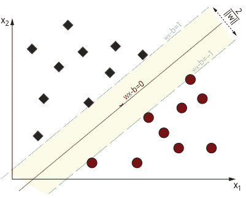

图 12.2：最可能的 SVM 间隔超平面。

### 12.6.2.1 量子分类器的当前工作

微软最近在一项研究中引入了一种基于变方法的监督方法量子范式（图 12.3）。

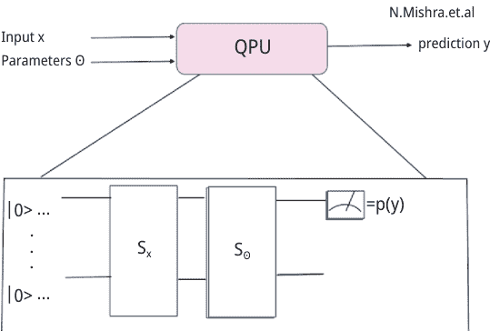

图 12.3：作为打印电路板的量子分类器概念 [37]。

进一步的操作，例如测量设备和状态准备电路 `S_x`，它将 `x` 映射到模型电路 `U` 的幅度，由 QPU（量子处理单元）执行。通过密切状态准备电路产生的幅度并对模型电路做出反应，这种 QPU 还可以进行模型推理或解析计算 `f(x)=y`。这些测试提供 0 或 1 的二进制结果，允许进行是/否诊断。在离散化方法的帮助下，可以学习并掌握电路的参数。如图 12.3 所示，原型电路代表一个表示编码特征的 n 维 ket 向量，映射到另一个 ket `= |U(x)\rangle`，其中 `U` 应该是酉的。

| | q₀ | | B1 | | B3 | | |
|---|---|---|---|---|---|---|---|
| | q₁ | | G | | G | | | |
| | q₂ | | G | | | | G | | |
| | q₃ | | G | | | | | |
| | q₄ | | G | | G | | | |
| | q₅ | | G | | G | | | |
| | q₆ | | G | G | | | | |
| | q₇ | | | | | | |

图 12.4：8 个比特的通用模型电路架构 [37]。

### 12.6.2.2 量子机器学习在物理中的应用

机器学习在量子世界中的应用包括量子计量、哈密顿量估计、量子信号处理和量子控制。量子计算机采用人工智能和机器学习。机器学习和强化学习产生纠缠态。通过执行门，自动化系统可以管理量子计算。机器学习技术可以处理量子计算中的退干或噪声 [38]。在线机器学习程序可以发现爱因斯坦凝聚蒸发轨迹 [39]。机器学习与量子理论具有相似的统计基础。凝聚态物理使用无监督学习检测相序参。模型热态配置可以通过无监督学习求解。除了相，序参（磁化）也可以被检测。通过这些技术，我们可以在不知道哈密顿量的情况下获得相信息。

## 12.6.3 量子计算、量子学习与量子人工智能

量子智能存在争议。在后续部分，我们将尝试理解人工智能和机器学习的基本概念，然后研究量子处理和量子计算如何增强它们。我们在本节末提到最新进展。

### 12.6.3.1 量子人工智能

量子可以贡献人工智能吗？我们将模拟量子处理和人工智能。量子计算（QC）模拟量子数据以进行快速搜索和优化，而量子机器学习以指数级发现机器学习问题。投影模拟正在研究中（PS）。代理在环境中运行。代理通过经验进行学习。PS 的主要内存是 ECM。ECM 帮助代理投影到情景记忆，导致随机游走。PS 是量化的。量子增强自主代理与传统环境交互，但拥有量子内存。量子行走代理现在导航内存。创建的转换是易干性的量子叠加态。裁剪态产生量子跃迁。

## 12.6.4 经典神经网络

“神经网络”（与“人工神经网络”和“连接主义模型”）是一个用于各种模型的词，尽管对该短语没有精确的定义 [40]。

## 12.7 结论

本章讨论了量子计算机和学习算法。经过多年的推测，量子机器学习终于得到了验证。正如预期的那样，这些新算法更快速、更高效。将机器学习与量子计算的速度相结合可能会给机器学习带来革命。当具有更多量子比特的量子计算机变得可用时，我们就能充分理解量子计算机对机器学习的影响。真实的量子计算机还无法完成这些许多任务。未来的发展可能包括量子计算机和机器学习算法。如果未来发现了更成功的技术来应对机器学习的挑战，那是完全可能的。只要量子算法保持其非直观性，这可能仍然是处理量子计算机最困难的挑战之一。对于传统的机器学习分类器，我们可以使用量子计算机来提高速度和准确性。尽管我们尚不知道量子计算机将如何影响计算机视觉，但可能性是无限的，而且随着每种新出现，机器学习似乎是量子计算机不断进步的一个领域。

## 参考文献

- [1] Shor, P. W. (1994). Algorithms for Quantum Computation: Discrete Logarithms and Factoring. In: Proceedings 35th Annual Symposium on Foundations of Computer Science IEEE Comput. Soc. Proc. arXiv:1509.0589

- [2] Bermejo-Vega, J., & Zatloukl, K. C. (2015). Abelian hypergroups and quantum computation. arXiv:1509.05898

- [3] Serra, R. D. (2016). Quantum simulations of one dimensional quantum systems. Quantum Inf. Comput., 6, 1125.

- [4] Kishor, K., Sharma, S., & Kishor, K. (2022). Student Performance Prediction Using Technique of Machine Learning. In: Sharma, D. K., SL, S. P., Sharma, R., Zaitsev, D. A. (eds.). Micro-Electronics and Telecommunication Engineering. Lecture Notes in Systems and Volumes (373). Springer, Singapore. https://doi.org/10.1007/978-981-168271-5

- [5] Kishor, K. (2022). Communication-Efficient Federated Learning. In: Yadav, S. P., Bhati, B. S., Mahato, D. P., Kumar, S. (eds.). Federated Learning for IoT Applications. EAI/Springer Innovations in Communication and Computing Springer, Cham. https://doi.org/10.1007/978-3-030-85559-8

- [6] Kishor, K. (2022). Personalized Federated Learning. In: Yadav, S. P., Bhati, B. S., Mahato, D. P., Kumar, S. (eds.). Federated Learning for IoT Applications. EAI/Springer Innovations in Communication and Computing Springer, Cham. https://doi.org/10.1007/978-3-030-85559-8

- [7] Gupta, S., Tyagi, S., & Bhattacharya, A., Castillo, O. (eds.). Proceedings of Data Analytics and Management. Self Sanitizing Smart Elevator. In: Gupta, D., Polkovski, Z., Khanna, A.. Lecture Notes on Data Engineering and Communications Technologies (90). Springer. https://doi.org/10.1007/978-981-16-6289-8

- [8] Yadav, P. (2020). Visual based object detection, and classification of vehicles. IEEE Transactions on Smart Processing and Computing, 7(4), 427–434.

- [9] Orus, R., Miguel, & Lizazo, E. (2019). Quantum computing for finance: Overview and prospects.

- [10] Palsson, M. S., Gu, M., Ho, J., Wiseman, H. M., & Pryde, G. J. (2017). Experimentally modeling stochastic processes with less memory by the use of a quantum processor. Science Advances, 3.

- [11] Yadav, P., & Yadav, S. (2018). Fusion of medical images in wavelet domain: a discrete mathematical model. Ingenieria Algebra, 14(25), 1–11.

- [12] Bennett, C. H., Bessette, F., Brassard, G., Salvai, L., & Smolin, J. (1992). Experimental quantum cryptography. Journal Cryptography, 5(3), 13. A. Pathak, Elements of Quantum Computation and Quantum Communication (CRC Press, 2018).

- [13] Kishor, K. Cryptography’s role in securing the information society. International Journal of Communication and Media Studies, (1), 46–69. Dec 2011.

- [14] Pathare, A., & Deshmukh, D. B. (2022). Review on quantum computing. International Journal for Modern Trends in Science and Technology, 8, 141–146. https://doi.org/10.4651/IJMOST.810024.

- [15] Goya, A., Sharma, S., Tiiwari, U., & Kishor, K. (2018). Intrusion detection in wireless sensor networks. International Journal of Creative Research Thoughts (IJCRT), ISSN, 6(2),120–125. 2320–2882. Available at http://www.ijcrt.org/papers/IJCRT18920.

- [16] Pandey, A., & Som, S. (2016). Applications and Use of Cryptography: In: 2016th International Conference on Reliability, Telecom Technologies and Optimization (Trends and Future Directions) (ICITO) (pp. 77–84). IEEE.

- [17] This paper was presented at FC and is published in the Proceedings of Cryptography Fourth International Conference, British West Ends, 21–27 February 2020. Available at http://www.ijcrt.org/papers/

- [18] Kol, G., & Nash, M. Cryptography and game theory: designing protocols for exchanging information, full version, www.izmann.ac/

- [19] Sharma, A., Jin, N., & Kishor, K. (2022). COVID-19 with Chest-Ray. In: Gupta, D., Polkovski, Z., Bhattacharya, S., Castillo, O. (eds.), Proceedings of Data Analytics and Management. Lecture Notes on Data Engineering and Communications Technologies (Vol. 90). Springer, https://doi.org/10.1007/978-981-16-6289-8

- [20] Sharma, R., Maurya, S., & Kishor, K. (2021). Student Performance using Machine Learning. In: Proceedings of International Conference on Innovative Computing & Communication (ICC). Available at SSRN: https://ssrn.com/abstract=387945 or http://doi.org/10.2139/ssrn.387945

- [21] Jain, A., Sharma, Y., & Kishor, K. (2021). Prediction and Analysis of Financial Trends Using LSTM. In: Proceedings of International Conference on Innovative Computing & Communication (IICC). Available at SSRN: https://ssrn.com/abstract=387945 or http://doi.org/10.2139/ssrn.387945


- [22] Tyagi, D., Sharma, R., & Kishor, K. (2020). Real-time driver’s drowsiness techniques. International Journal of Innovation in Technology and Experimental Engineering, 9(8), 260–264. DOI: 10.35940/ijATEE.2020.H6233.

- [23] Kishor, K., Nand, P., & Agarwal, P. (2018). Secure and efficient routing protocols for MANET. Indian Journal of Public Health, Executive Edition, 9(2). DOI: 10.5958/0976-5506.2018.01830.

- [24] Kishor, K., Nand, P., & Agarwal, P. (2019). design adaptive subnet gateway protocol on the basis of dynamic TTL adjustment. Application on Computer and Information Technologies, 3(2), 59–65. https://doi.org/10.11591/APTIKOM.JCSIT.5

- [25] Kishor, K., & Nand, P. (2013). Review performance analysis of wireless MANET routing protocols. International Journal of Science, Engineering and Technology Research (IJSETR), 2(10), 1854–1855.

- [26] Kishor, K., & Nand, P. (2014). Performance evaluation of AODV, TORA and OLSR in respect to end-to-end delivery in MANET. International Journal of Science and Research (IJSR), 3(6), 633–636.

- [27] Kishor, K., & Pandey, D. (2022). Study and Development of Efficient Air Quality Prediction System Embedded with Machine Learning and IoT. In: Gupta, D et al (eds.). Proceedings International Conference on Innovative Computing and Communications. Lecture Notes in Networks, Vol. (471). Springer, Springer. https://doi.org/10.1007/978-918-19-2535-1.

- [28] Angliu, D. (1992). Computational Learning Theory: Survey and Bibliography. In: Proceedings of 24th Annual ACM Symposium on Theory of Computing (pp. 351–369).

- [29] Kishor, K., Nand, P., & Agarwal, P. (2017). Subset-based ad hoc network energy reduction consumption in martial. Journal of Applied Engineering Research, 12(22), 11796–11802.

- [30] Bansal, A., Kumar, S., Pandey, A., & Kishor, K. (2018). Admission management system with fingerprint. International Journal for Research in Applied Science & Engineering Technology (IJRAET), 9(6), DOI: 10.22214/ijraet.18.4368, http://ijraet.com/fileserver.php?file=

- [31] Lloyd, S., Mohsen, M., & Rebent, P. (2019). Quantum algorithms for supervised and unsupervised machine learning. arXiv:1609.0473.

- [32] Yadav, S. P., & Yadav, S. (2020). Image fusion using hybrid methods. Medical & Biological Engineering, 59, 669–687.

- [33] Yadav, S. P. et al. (2022). Survey on machine learning using recurrent network (RNN). Archives of Computational Methods in Engineering, 29, 1753–1770.

- [34] Rai, B., Sharma, S., & Kishor, K. (2022). Recognition of different bird category using image processing. International Journal of Online and Biomedical Engineering (ijoe), 18(07), 101–114. https://doi.org/10.3991/ijoe.v1807.2963.

- [35] Yadav, S. P. (2019). Fusion of medical images using wavelet domain: a survey. IEIE Transactions on Smart & Computing, 8(4), 265–271.

- [36] Erickson, B. J., Korfiat, P., Akkus, Z., & Kline, L. T. (2017). Machine learning for medical imaging. Rad. Graph, 37, 505–515.

- [37] Yadav, S. P. (2020). Visual based object detection, and classification of vehicles. IEEE Transactions on Smart Processing and Computing, 7(4), 427–434.

- [38] Kraweec, W. O., Nelson, M. G., & Geiger, E. P. (2017). Automatic Generation of Optimal Key Distribution Protocols. In: Proceedings of Genetic and Evolutionary Computation (pp. 1153). ACM, New York.

- [39] Wigley, B. P., Everitt, P. J, van den Hengel, A., Bastian, J. W., Sooriyabanda, M. A., McDonald, N. P., Hardman, D. G., Qualityn, K. S., Manju, C. D., Peters, C. C. N., Luiten, I. R., Hope, A. N., Robins, J. J., & Hush, M. R. (2016). Fast-machine online optimization of ultra-cold-atom experiments. Scientific reports, 6, 25890.

- [40] Vashit, V., Kumar Pandey, A., & Prakash Yadav, S. (2021). Speech recognition by machine learning. IEIE Transactions on Smart Processing & Computing, 10(3), 233–239.

# Shally Nagpal, Puneet Garg*, Shivani Gaba, Alankrita Aggarwal

## 13 一种用于网络通信的改进遗传量子加密模型

**摘要：** 任何无线或开放网络最大的问题都是安全性。当网络覆盖有限且具有高速移动性时，通信变得更加关重要。WPAN 是一种具有较低感应极限且专为室内设计的同类网络。为了提高通信的可靠性和安全性，本文提出了一种受量子启发的编码通信。针对高移动、随机分布的 WPAN 网络建立了工作模型。该模型的第一步是在覆盖、稳定性和负载参数下进行节点级表征。基于此分析生成初始种群序列，并基于此生成进行通信。对种群池应用遗传模型进行处理以生成有效的通信对。生成种群对后，应用量子技术捕获节点对特征以生成密钥。最后，使用基于量子密钥的 SHA 对数据进行编码。在网络上执行这种编码通信。

## 13.1 引言

密码学方法可用于公共环境中的分布式用户之间提供编码通信。它能免受想要入侵的入侵者的侵害。密码学关于拥有一种集成的身份验证策略，保护通信免受各种网络攻击的影响 [1]。

许多方法可以在开放环境中提供安全并保护通信。防病毒软件是保护系统免受病毒侵害的软件程序。防火墙也可用于特定的应用程序、程序或系统，以提供安全的网关自适应通信。

> *通讯作者：Puneet Garg, ABES Engineering College, Ghaziabad, Uttar Pradesh, India, 电子邮箱: puneetgarg@gmail.com

> shally Nagpal, Panipat Institute of Engineering and Technology, Samalkha, Panipat, Haryana, India, 电子邮箱: shally.nagpal@gmail.com

> Shivani Gaba, Panipat Institute of Engineering and Technology, Samalkha, Panipat, Haryana, India, 电子邮箱: ssgnkl@gmail.com

> Alankrita Aggarwal, Panipat Institute of Engineering and Technology, Samalkha, Panipat, Haryana, India, 电子邮箱: alankrita@gmail.com

https://doi.org/10.1515/9783110798159-013

除了提供预防和防御方法外，还应用了攻击检测方法来提供安全可靠的通信。可以监控节点行为分析和活动模式以识别网络攻击类型。

### 13.1.1 密码学

密码学是传统且最可靠的通信方法，在用户级、组级、数据级和通信级提供安全性。密码学是将传输数据转换为其他用户不可读读的格式。为了确保安全，数据被转换为块特定或流特定的形式。在此处通过使用某些密钥或方法应用编码。某些编码技术基于媒体类型。图像编码是一种常见的媒体形式，可在全球介质上提供生物识别信息通信。

### 13.1.2 量子加密

量子加密是一种连续编码方法，利用对应行为或组织的真实表述来执行信息编码。这涵盖了组织在通信中面临的大多数脆弱性问题。量子加密方法实际上使用了包含能量、作用力和精确变数的表示法。

#### 13.1.2.1 网络形成

IEEE 提供的标准是无线局域网（PAN）上的高速数据通信。这被标识为 `802.15.3`。该标准旨在为不同类型的媒体（如自动数据传输、视频数据传输等）提供高速通信。

**网络连接性：** 网络中的连接性取决于通信范围。视距（LOS）提供了最大的通信连接性。使用基于覆盖的最大范围分析来识别虚拟连接的节点。

**视距 (LOS)：** 定义了特定频率估算以识别最大覆盖，据此可以识别符合连接条件的节点。可以应用基于频率、带宽和干扰分析的连接观测来生成有效的网络连接性。

**非视距 (NLOS)：** 这种范围分析定义用于较低频率。频段用较小的单位定义，通信可以定义为实现有效的通信。

#### 13.1.2.2 个人区域网

个人区域组织是没有任何特定监管机构或框架细节的自组织网络。动态性是这种组织的主要组件，可以在各种结构中访问。这类组织本质上具有具有不可否认的安全水平。这种重要的通信在现实情况和应用方面正引起关注。对此，这些组织正承受着沉重的负载。


图 13.1：智能节点架构。

#### 13.1.2.3 通信架构

个人区域组织在通信、设计和协议方面有很多限制。通信可以通过包含一些来实现

## 相关研究

这包括对用于安全通信的现有技术的研究。我们将研究现有方法以识别漏洞。

Bencheikh [22] 提出了一种基于连续的量子加密技术。目前已经提出了一些量子加密方法。它们受限于许多因素，包括由于基组选择导致的 50% 数据丢弃，以及密钥随机比特的传统构建。此外，某些协议为了实施而考虑了可操作的（无理）挤压缩。

Kartaloupous [37] 定义了通过光学数据处理来恢复量子加密中错误的工作。作者回顾了量子加密，并识别了量子识别过程中的步骤。然后作者分析并讨论了光纤网络中密钥生成和分发出现的问题。作者提供了网络拓扑公式和网络通信。作者还观察了网络能力，并相对将其映射到不同的攻击以实现自适应网络通信。

Goel [34] 为量子加密方法确定了新的研究方向。这与经典加密技术有显著区别。这篇文章还表征了量子加密的公式以及实现不同安全水平的可用目标。

Teja [04] 为探索量子加密的各个方面提供了基于研究的工作。解释了两种常用的量子密钥分发协议。作者还定义了特定的密钥实验以识别和解决网络中的技术挑战。

Vignesh [35] 识别量子加密局限性的工作，并观察了其相对于传统加密的优势。作者在这里展示了量子的一些理论缺陷，包括签名生成的算法公式、实时实施和能力驱动的估算。

# 13 一种用于网络通信的改进型遗传量子加密模型 181

Sharaf [28] 提出了一种改进量子加密方法的新技术模型。作者引入了使用量子加密建模对网络进行技术改进。为了获得面向未来的安全性，提供了真实世界的安全保障。高层面的行为分析是为了实现网络内的安全通信 [6]。

Kurochkin [39] 提供了一项关于量子加密各个方面探索的工作。该工作还把加密方法应用于电电通信安全中。作者提供了网络设置和安全实现方案。文中还提供了量子密钥生成和网络表征研究 [7]。

Zorbas 等人 [11] 提出了一种计算所需覆盖集的算法，以提高覆盖性能。特征驱动的节点结构分析是基于拓扑参数规范，并结合了广泛的网络寿命映射。这里提供了一种实验以实现与拓扑无关的网络跟踪，通过改进目标覆盖来优化网络寿命。作者提供了基于聚类形成的完整和部分目标覆盖工作。此处集成了一种启发式算法来提供特定阶段的权重分配。基于覆盖约束的路径形成以改进目标覆盖 [8]。

Zhang 等人 [21] 提供了关于传感器网络 1 跳目标覆盖的工作，定义了局部环境分析方法以提供可扩展性。作者观察了能量和等待时间以改进覆盖。作者设计了约束以改进通信复杂度。该工作还实现了网络的可扩展性和稳定性。

Jamali 等人 [32] 定义了一种基于区域分析的算法模型，生成覆盖集并提供基站连接性。基于子集的激活被提供以改进目标覆盖。作者提供了基于传感器覆盖的寿命分析，通过改进计算复杂度来改进加密系统。在能量和距离级观测下，定义了启发式算法以生成有效覆盖 [10]。

Kurochkin 等人 [38] 提供了使用量子加密方法改进安全的工作。理论分析展示了增加安全的机会。通过自由空间通道实验实现了量子加密系统 [11]。

Nirmala 等人 [25] 定义了聚类传感器网络中的改进广播方法。作者定义了阶段驱动的分析来计算密钥并提供通信。基站规范的即时认证被提供以实现特定特定的通信。作者定义了移动代理的节点生成，以评估覆盖性能。作者实现了聚类网络中的安全认证通信 [12]。

Sharbaf 等人 [29] 提出了改进安全的量子能量技术。该研究论文关注量子加密如何贡献于网络安全。论文识别了现有加密方法的局限性。作者对量子加密建模的应用、表征和范围进行了研究 [13]。

Shrivastava 等人 [3] 给出了用于增强的量子加密模型。该研究开发了一种新技术来提供加密系统的两个阶段。使用素因子思想修改发送端和接收端的密钥位，使得监听者的存在对系统没有影响 [14]。

Kim 等人 [8] 开发了一种基于通信权重分配的新启发式算法，应用概率方法生成目标覆盖。基于连接性和覆盖约束定义了贪心权重算法。多样化传感和表征被提供以改进约束规范的概率模型。作者改进了网络部署、能量传感和汇聚节点跟踪，定义了优化调度方法。此处提供了改进不确定参数覆盖模型的概率调查。

Mandal 等人 [36] 定义了用于改进量子加密方面的光子三阶段模型。本文提出了该三阶段模型的实现。作者展示了量子加密的三阶段模型实现 [16]。

Borzoi [21] 使用量子加密建立了协议。作者提出了用于建立通信的技术和措施。针对目标特定通信定义了基于目标的估计以改进网络连接性 [17]。

Niemen [27] 规定了加密法则。为了完成连接通信，提供了设计时间公式。为了增强网络安全，提供了基于通道的方法 [18]。

Lei Zhou 等人 [24] 为 Zigbee 网络建立了特定协议的工作。为了确保可靠通信，在协议设计中包含了安全性。作者提供了仿真和通信分析 [19]。


Adam Dahlstrom 等人 [4] 对专门为传感器网络设计的若干协议的研究。使用 `AODV` 和 `DYMO` 协议观测 `Zigbee` 标准，通信主要基于测量。该策略同时增加了吞吐量和通信率 [20]。

Meng-Shua Pan 等人 [31] 对传感器网络覆盖集的创建的研究并开发了自适应通信。“任务”一词指的是基于事件槽的通信。为了实现频繁和事件支持的通信，提供了设计时间公式和时间观测。提供了运行时间和设计的改进以增强通信可靠性。

Shazly 等人 [26] 开发了节点不确定性分析工作以实时改进目标覆盖。作者在各种限制条件下定义了概率估计。此处提供了网格特定的覆盖分析以增强节点连接。该计算解决方案修正了部署和放置问题。为了获得最优覆盖解决方案，提供了覆盖层级和块级的目标映射。针对间隔特定通信，定义了带目标集的连接处理 [22]。

Alexandre-Corneli Olteanu 等人 [5] 组成了 `Zigbee` 网络并执行了设备特定的实现。为了提供各种通信，在节点级进行了调查。提供了通道特定的分层估计直接通信。为了增加任务有效性，提供了通道通信的层级抽象 [23]。

## 13.3 遗传与量子改进的分组自适应通信

无线网络提供了一个开放环境，节点可以在其中自由且协作地进行通信。当节点具有移动性且在基础设施限制下定义时，通信的关键性会增加。可以通过内部或外部网络攻击来识别这种关键性。这项特定工作关注于一种更关键的网络形式，称为 `WPAN`（无线个人域网）。该网络使用具有移动性的智能传感器设备形成。同时也定义了基础设施设备以提供有效的网络通信。网络内的移动性是根据较小的覆盖范围定义的。受限的网络特征增加了网络的关键性。这需要某些编码通信方法，以便为网络绘制安全通信。网络的动态特性导致了通信丢失。当节点不在区域内或发生某些攻击时，就会发生通信丢失。本节将讨论在早先工作中定义的基础设施驱动型通信。这里使用固定哈希算法对数据进行编码。基于固定的通信并不能总是确保可靠的数据传输。

### 13.3.1 工作意义

该工作使用了遗传自适应量子加密来提高通信的可靠性。该工作的意义如下所示：

- 动态约束分析方法对该环境是有效的，且不会随网络配置而改变。
- 遗传方法识别了最有效的通信对，从而提高了通信可靠性。

### 13.3.2 优化网络通信的模型

这里介绍的工作被表述为协调工作模型，在其中构建了对应网络，随后利用量子加密将其应用到其上的编码对应关系中。该工作同样协调了遗传性，展示了更具通用性的坐标创建，以便在组织上建立可靠的对应关系。这项工作的操作阶段如图 13.2 所示。

#### 步骤 1：网络生成

为了实现该工作模型，第一个要求是生成一个具有随机放置节点的网络。这里的节点特征由随机位置、移动性和固定覆盖范围的规范定义。定义了基站以提供受控通信。

| 在随机移动和随机位置下生成具有 N 个节点的网络 |
| 在连通性和覆盖参数下分析网络 |
| 应用遗传建模以识别自适应通信对 |
| 捕获通信统计数据以生成量子密钥 |
| 使用基于量子密钥的哈希进行数据编码 |
| 执行通信并分析网络统计数据 |


#### 步骤 2：节点级分析

一旦网络形成，要求是在节点级上观察网络。应用覆盖、距离和连通性电级分析来识别控制节点。区域内的最大连通性是主要标准，同时结合移动性图。选择中心化节点以实现最大的通信和连通性。

#### 步骤 3：遗传建模

在获得参数级统计数据后，这里的要求是使用遗传建模识别主控制节点。遗传是一个进化过程，接受网络的连通性和覆盖统计数据作为初始种群。随后，识别出用于通信的对。每个节点作为源，控制器被视为该组的接收者。

#### 步骤 4：基于量子密钥的编码通信

一旦获取了对，这里定义的最终工作是执行通信。为了进行安全通信，获取节点级表征并相对形成量子密钥。最后，将此量子密钥应用于哈希算法对数据进行编码。

这里的工作是基于参数分析定义的。这项工作考虑的参数有：

1. 速度
2. 连通性分析
3. 负载

这项工作涵盖的方面有：

- 分组生成
- 组长选择

### 13.3.3 分组生成

由于指定网络中节点移动性的增加，对这些节点进行基站跟踪具有挑战性并增加了整体负担。考虑到这个问题，本研究提出的分组驱动量子编码模型动态地将网络划分为若干组。具有密度观测的地理区域作为分组的基础。一组节点是指位于同一区域的节点。这里，根据负载和覆盖限制描述了分组选择。这表明组大小是灵活的，因此不会增加整体负担。密度限制也被用于调节负载情况。

### 13.3.4 组长选择

在分组完成后，下一个任务是选择一个能够跟踪组节点并承担组节点责任的组长。为了找到组长，对每个区域节点进行特定参数估计。选择组长的首要因素是覆盖、连接和平均距离。组长是连接最高且平均距离最短的节点。

### 13.3.5 基于遗传的密钥对选择

通过对初始和现有种群使用高效的集成过程，遗传是一种进化过程模型，它在生物过程阶段上工作以开发新种群。适应度函数的规范导致了对数据驱动代的调节。为了开发出有用且实用的成员，使用预测数据分析将适应度标准应用到这些输入数据。本研究使用的进化方法接受具有潜在连接的节点对，并确定了最经济的网络连通性。目标是增加通信的可靠性。在指定初始种群后，使用若干迭代程序产生下一级种群，并提供高效密钥对的高效选择。为了生成最终解决方案，定义了下一代和目标函数。本研究使用了在负载、覆盖和故障特征下的有效排名图。为了产生后续的有效值，使用交叉和变异向量对种群进行处理。该过程重复，直到无法找到最终结果。

### 13.3.6 初始种群

为了处理遗传算法，第一阶段是以组织的形式生成或定义种群。这种组织后的数据形式通过每个智能节点可能的连通性数量来定义。在这项工作中，有效的密钥对识别是通过遗传过程定义的。

### 13.3.7 适应度函数

适应度函数被定义为选择可行方案以及获得优化结果的方法。在这项工作中，基于距离和成本的分析定义了优化函数。这里定义的工作是为了提高网络上的连通性和可靠性。

### 13.3.8 交叉函数

交叉函数应用于生成的父代值以识别新的后代。交叉操作用于这种子元素的生成。这项工作中子生成是基于距离的。这种 `DPX` 交叉提供了最小误差的优化结果。

### 13.3.9 变异函数

变异函数被定义为相对于定义的目标函数收敛种群。为此，可以对新的子进行随机或选择性的改变。在这项工作中，应用了随机变异函数。

### 13.3.10 应用领域

此处列出了与工作相关的应用领域。

- 在车载网络中，车辆通信控制被定义在 `RSU`（路侧单元）的覆盖范围内。通过处理 `RSU` 控制器的自适应动态切换，为不同网络（包括 `Wi-Fi` 和 `WIMAX`）的切换提供有效的解决方案。

### 13.4 算法

本节解释了用于 `WPAN`（个人局域网）中遗传和量子编码的算法。表 13.1 解释了算法的工作原理。

### 13.5 结论

在本章中，我们讨论了一种优化网络通信的遗传改进量子加密模型，并研究了节点随机的网络场景。蓝色节点是根据移动向量定义的智能传感器节点。即使在网络定义了集成组和区域控制器的情况下，节点也能执行协作通信。红色圆圈代表组组。本文工作专门针对具有移动性的分组通信进行了定义。一旦形成小组，通过遗传算法识别出有效的通信对作为量子密钥。最后，通过这些量子密钥执行基于哈希的编码通信。该工作在移动 `WPAN` 网络上针对随机网络场景进行了实现。结果表明，该模型改进了通信并延长了网络寿命。

### 13 一种用于网络通信的改进遗传量子加密模型 — 189

**表 13.1:** `WPAN` 中遗传和量子编码算法。

```
Communication(SmartNodes)
/*SmartNodes 是 sSmartDevices 的数组，规定了节点级特征，包括位置限制和能量限制*/
{
  1. 设置组控制的决策约束，包括组负载、组限制、能量限制和覆盖范围
  2. For round = 1 to CommRounds [为固定次数的通信轮次定义通信]
  {
    3. For I = 1 to SmartNodes.Length
    [在每一轮中，在不同的向量下对传感节点进行分析以成组]
    {
      5. Cnodes = GetCoverageNodes(SmartNodes(i),CoverageRange)
      6. if(Cnodes)>Cleaner
      [检查范围内是否还有其他组]
      if (Cnodes.Length>LoadLimit)
      [检查组长负载]
      {
        8. if (GL.Length>GroupLimit)
        {
          Print "Max Groups are formed"
        }
        9. else
        {
          [可以成组]
          10. GL.Add(SenNode(i))
        }
      }

      11. [EligibleNodes GLs] = Genetic(SmartNodes,GL)
  [在智能节点上应用遗传建模生成有效的节点对]
  12. For I = 1 to SmartNodes.Length
  [处理节点]
  {
    13. For j = 1 to GL.Length
    [处理组长]
    {
      14. key = GenerateQuantumKey(GL(j),SmartNodes(i))
      [根据智能节点和组长的特定特征生成密钥]
      15. Edata = HashEncode(data,key,SmartNodes(i),GL(j))
      [在源端生成量子编码以进行安全传输]
      16. data = HashDecode(Edata,key,SmartNodes(i),GL(j))
      [在组长端应用量子密钥约束进行解码]
      17. if (Coverage(SmartNodes(i),GL(j))>Range
      [检查是否失败]
      {
        18. CommFailure = CommFailure+1
        [增加通信失败次数]
      }
      19. Else
      [识别有效通信]
      {
        20. Comm = Comm+1
        [应用分组通信]
      }
    }
}
```

## 参考文献

- [1] Dahane, N. E. B., & Loukil, A. (2015). 移动传感网络的同质聚类算法。In: Control, Engineering & Information Technology (CEIT), 2015 3rd International Conference on (pp. 1–6). Tlemcen.
- [2] Porzia, (2014). 从量子视角看待通信。In: Photonics Technologies, 2014 Fonseca International Conference on (pp. 1–4). Naples.
- [3] Shrivastava, Singh, M. (2012). 量子加密中的安全性增强。In: Quantum Cryptography: Computers and Devices for Communication (CODEC), 2012 5th International Conference on (pp. 1–4). Kolkata.
- [4] Dahstrom, A. (2013). Beacon 启用的 WSN 性能。In: Internet of RFIDs; WSNs and beyond. 978-1673-3133/13. IEEE.
- [5] Olteau, A.-C. (2013). 使用 Zigbee 的家庭自动化设备。In: Control Systems and Computer Science, 2013 19th International Conference on. 978-0-4980/13. IEEE.
- [6] Diop, D., & Thema, O. (2014). 传感器网络目标覆盖的权重贪心算法。In: Computing, Communications, and Technology (IACT), 2014 International Conference on (pp. 120–125). Langkawi.
- [7] Beniwal, S., Singh, M., & Poon, R. (2021). IoT 系统中边缘检测改进摄像头监控。International Journal of E-Health and Medical Communications (IJHEMC), 5(2), 84–96.
- [8] Kim, M., Kim, Y., Kang, I. S., & Han, Y. (2012). 概率覆盖下的调度算法。In: The Conference on Information (pp. 86–91). Bali.
- [9] Chaudhary, A., & Garg, P. (2014). 监控系统检测和诊断。International Journal of Mechanical Engineering and Information Technology, 2(6), 499.
- [10] Chauhan, S., Singh, M., & Garg, P. (2021). 使用机器学习快速预测疫情爆发。Enabling Healthcare4.0: A Roadmap, 59–73.
- [11] Zorbas, D., & Douliger, C. (2009). 无线网络中的部分覆盖和网络寿命。In: 2009 2nd IFIP Wireless Days (WD) (pp. 1–5). Paris.
- Dixit, A., Garg, P., Sethi, P., & Singh, Y. (2020). TVCCCS: 电视通道成本计算设备。IOP Series: Materials and Engineering (Vol. 804, No. 1, pp. 012046). IOP Publishing.
- Garg, P., Dixit, A., & Sethi, P. (2021). 通过仿真器对比 fresh 和 spray 协议的性能。IT, 9(2).
- Garg, P., Dixit, A., & Sethi, P. (2021). 机会性网络：协议、应用与仿真趋势。In: Proceedings of the International Conference on Innovative Communication (IC).
- Pranav, S., & Pinhoiro, R. (2020). 节点对智能空间机会性网络路由协议的影响。Mobile Information Systems, 2020.
- Gupta, A., Garg, P., & Joshi, S. (2020). 基于 Web 的传输任务管理的边缘检测 3D 生物识别系统。In: Green Internet of Smart Cities (pp. 23–46).
- Gupta, M., Garg, P., & Agarwal, P. (2021). NP 硬问题软计算研究中的蚁群优化技术。In: Intelligence for Sustainable Industry 4.0 (pp. 197–211). Springer, Cham.
- Gupta, M., Garg, P., Gupta, S., & Joon, R. (2020). Ad hoc 网络恶意节点检测的新颖方法。簇头网关切换。International Journal of Frequency Generation and Networking, 13(4), 99–111.
- Gupta, S., & Garg, P. (2021). 多媒体取证的洞性审查。Cyber Crime and Forensic Computing: Modern Principles, Practices, and Algorithms, 11, 27.
- Zhang, H., Wang, L., & Feng, H. (2009). 无线传感器网络目标覆盖的分布式算法。In: Information Processing, 2009. ACIP 2009. Asia-Pacific Conference on (pp. 742–747). Springer.
- [30] Malik, K., Raheja, N., & Garg, P. (2011). 增强的 fp-growth算法. International Journal of Computational Engineering and Management, 12, 54–56.
- [31] Pan, M.-S. (2013). 基于 ZigBee 树的收敛无线传感器网络. In: 2013 IEEE Wireless Communications and Networking Conference (WCNC). Networks: 978-1-4673-5939-9/13 ©. IEEE.
- [32] Ali Jalami, M., Bakshivand, N., Easmaeilpour, M., & Salami, D. (2010). 无线传感器网络中目标覆盖协议的能效算法. In: 计算机科学与信息技术 (ICSIT), 2010 第3届 IEEE 国际会议 (pp. 244–254). 成都.
- [33] Chatururvedi, P., & Daniel, A. K. (2015). 无线传感器网络覆盖的能效节点调度协议。 In: 通信系统与网络技术 (CSNT), 2015 第五届国际会议 (pp. 138–142). 瓜莱奥尔.


- [34] Ghaz, R., Garuba, M., & Girma, A. (2007). 量子密码的研究方向. In: 信息技术，2007. ITNG '07. 第四届国际会议 (pp. 779–784). 内华加斯，内华华州.
- [35] Vignesh, R. S., Sudharsson, S., & Kumar, K. J. (2009). 经典密码学的局限性与多功能性：比较研究. In: 环境与计算机科学，2009. ICECS '09. 第二届国际会议 (pp. 333–337). 迪拜.
- [36] Mandal, S. (2013), 等. 三阶段量子密码协议的多光子实现. In: 信息网络 (ICOIN), 2013 国际会议 (pp. 6–11).
- [37] Kartalopoulos, S. V. (2005). 安全光数据传输中量子密码的脆弱性识别. In: 军事通信会议，2005. MILCOM 2005 (pp. 2788–2796). 大西洋市，新新泽西州.
- [38] Kurochkin, V., & Kurochkin, Y. (2010). 额外状态的量子密码安全性提升. In: 微/纳米技术与电子器件 (EDM), 2010 国际会议与研讨 (pp. 231–233). 诺新西伯斯.
- [39] Kurochkin, V. L., & Neizvestry, I. G. (2009). 量子密码. In: 微/纳米技术与电子器件，2009. EDM 国际会议与研讨 (pp. 166–170).
- [40] Teja, V., Banerjee, P., Sharma, N. N., & Mittal, R. K. (2007). 量子密码：现状、挑战与未来展望. In: 纳米技术，2007. IEEE-NANO 2007. 第7届 IEEE 会议 (pp. 1296–1301). 香港.

# Swati Gupta*, Puneet Garg

# 14 基于代码的后量子密码技术：数字签名

**摘要：** 为了防止工程师（甚至是那些拥有自己量子注册的危险娱乐工作者）访问信息，量子密码学在信息加密和传输中引入了量子力学标准。量子密码学的更广泛应用同样利用量子计算机迷人的能力和力量，优化了许多加密操作的开发和性能。这种类型的计算机可能有助于开发新的、更复杂且更有效的加密结构，这些结构是使用传统的招聘和通信方法无法理解的。量子计算机系统可能能够中断所有已部署的公密钥加密算法。由于这些算法对于稳定基础设施至关重要，我们迫切需要转向能够破坏任何活跃公密钥加密算法的恶意软件，以应对可能来自攻击者攻击并进入大规模量子系统的威胁。量子计算是一个即将到来的时代，旨在利用量子现象（由叠加和纠缠组成）执行比目前传统计算更有效得多的计算任务。与传统计算机系统不同，量子计算机系统在任何时刻都可能被用于许多状态，而经典计算机在任何时间只能在某些非常明确的状态下使用。量子计算的挑战激发了后量子密码学所有领域的研究努力，特别是在通过优化算法、采用具体的参数集以及编写绿色（抗攻击）和侧信道稳定实现来实现使加密系统变得更加敏感方面。

## 14.1 引言

量子密码学是一个框架，能够完全防止信息发送者或接收者的信息被泄露。也就是说，在不以发送者或接收者为前提条件的情况下，很难复制或查看编码在量子态中的信息。量子密码学还应该能够防止那些利用量子注册的人的侵害。

*通讯作者：Swati Gupta, Vaish College of Engineering, Rohtak, Haryana, India, 电子邮箱：swati.mangla.555@gmail.com
Puneet Garg, ABES Engineering College, Ghaziabad, Uttar Pradesh, India, 电子邮箱：punetgarg.er@gmail.com
https://doi.org/10.1515/9783110798159

量子安全加密通过处理完全不同的问题来工作。例如，量子安全加密利用光子具有以下特性：
- 1. 粒子可以处于多个状态。
- 2. 在不改变系统的情况下无法观测。
- 3. 粒子无法被复制。

**示例：** 假设 Alice 和 Bob 之间存在量子密钥。如果 Eve 窃听，Alice 和 Bob 就会检测到。

## 14.2 证书类型

如表 14.1 所示，共有四种证书。

**表 14.1:** 证书类型。

| 证书类型 | 加密算法 | 目的 |
| --- | --- | --- |
| 传统 | RSA 或 ECC | 传统的非量子安全证书 | 用于识别系统的传统 PKI |
| 量子安全 | 新型量子安全算法 | 量子安全证书 | 实现量子安全 PKI 并识别系统 |
| 混合型 | 传统和量子安全算法 | 同时包含传统和量子安全密钥 | 用于向量子安全算法迁移的系统，系统可以使用传统或量子安全的密钥 |
| 复合型 | 多个传统和量子安全算法 | 包含多个传统和量子安全密钥 | 用于需要最高级别安全和保护的系统，同时仍需识别某些仍未知的加密算法的溯源 |

### 14.2.1 传统 PKI 证书

传统的 PKI 声明是对尖端字符加密的最高级别确认。这些确认被建议为“常规””，是因为它们利用了现有的 ECC 或 RSA 加密估算。绝大多数 PKI 结构在未来相当一段时间内将继续使用常规 PKI 声明。它们为处理现有攻击提供了有效确认，但在未来，由于量子计算机的使用以及对 ECC 和 RSA 的攻击，它们将过时。

在寻找量子安全决策时，有三种尖端确认至关重要。每种类型目前都符合对公钥加密至关重要的 X509 规则。这些类型根据其灵感和用于制作声明的加密算法而变化。

### 14.2.2 量子安全证书

量子安全背书是使用量子安全估算的 X509 验证。虽然 NIST 正在根据最新的计算进行推进，但量子安全证书是更好的方法，因为它根据当前需求也进行了识别。

### 14.2.3 量子安全证书的类型

在寻找量子安全决策时，有三种合适的现代化声明。每种类型目前都符合对公钥加密至关重要的 X509 现代化规则。这些类型根据其灵感和用于合规的加密系统而变化。

### 14.2.4 混合型证书

混合确认是带有印章的；它们包含一个常规（RSA 或 ECC）密钥及其印章，以及一个量子安全密钥及其印章。混合确认对于那些无法同时升级或替换所有特殊组件的结构，以迁移的方式进行交互。这促进了结构的改进，但随后所有使用 ECC 或 RSA 的系统都必须转向新的量子安全加密估算。

### 14.2.5 复合型证书

复合证书的变体之处在于它们包含不同的密钥，但不同之处在于它们使用了现有和量子安全加密的混合。复合支持在所有真正重要的方面都起了作用，类似于一个带有多种把锁的特定入口。复合密钥的目标是解决任何单一加密算法从长远来看或未来任何时候都可能被量子工作站破解的担忧。确保加密估算没有缺陷。图 14.2 显示了各种证书的特征。虽然 NIST 正在验证并选择量子安全加密计算，但这些尚未完全确立为安全。可以想象，安全专家或程序员最终可能会在这些建议解决方案的某一个中发现漏洞。无论如何，制作不同的密钥并在稍后固化它们以提供复合声明需要卓越的计算能力。

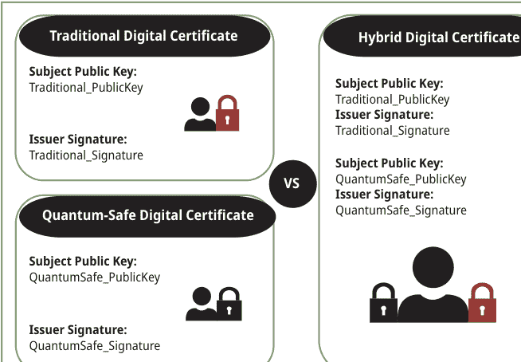


混合 TLS 证书与常规证书有何区别？所有的 TLS 证书都使用签名、密钥和算法。常规 TLS 证书与混合 TLS 声明在于：
1. 混合证书包含用于量子安全密钥和签名的额外 X509 字段。
2. 混合证书将包含量子安全算法的编码。

## 混合 TLS 证书在验证中的功能

混合 TLS 预计为双语言应用程序提供交叉证书。从根本上说，如果你用英语和法语交流，而你交谈的人也是如此，那么你就可以决定使用任何一种语言。此外，如果你是双语者，并且正在与只用英语或只用法语的人交流，在任何情况下，你也可以与他们有效交流。

处理拥有众多住客的酒店正门换锁的关系。如果运气好，其中一个住客在那里获取新的、更可靠且更安全的密钥（量子安全加密算法），他们就有选择使用正门的权限。然而，如果在更换锁时其他人不在那里，那么他们在任何情况下都必须使用次要通道和安全性的密钥。

**阶段 1：向量子安全 PKI 建立的行动** – 迁移的底层移动是重构现有的 PKI 结构，包括证书机构 (CA)，以帮助量子安全估算。与其尝试在没有他人帮助的情况下升级 PKI 结构，例如企业 CA（如 Sectigo）的 IT 安全团队可以提供提供和管理证书的帮助。当关联机构刷新其当前的 CA 或选择另一个 CA 时，该机构应该提供另一个量子安全的根证书和中间证书。

**阶段 2：更新服务器加密计算** – 接下来，服务器应用程序使用的加密库应当激活，以支持新的加密估算和新的量子安全声明计划。接受混合证书；服务器应用程序应该查看并处理常规 RSA 或 ECC 证书以及包含量子安全密钥的混合支持。这需要服务器应用程序识别两种不同的验证类型，并根据连接的机构类型使用正确的算法方法。

**阶段 3：更新客户端加密计算** – 组织随后更新客户端应用程序。意识到客户端应用程序可能与不同的服务器应用程序通信（包括外部环境），并且至少有一个服务器应用程序尚未刷新。对于目前这种情况，混合证书允许客户端与支持量子安全估算的服务器工作。

**阶段 4：所有设计都应具有量子安全的根。PKI 框架有一个根存储库。根和中间 CA 在此存储库中。**

**阶段 5：为所有应用程序发布并展示量子安全证书** – 完成后，每个应用程序都得到了保护。

**阶段 6：禁止标准加密估算并拒绝基于 RSA/ECC 的批准** – 开发的最后阶段涉及阻止常见的 RSA 和 ECC 算法。在所有设计都迁移之后，这应该是逐步可行的。

# 14 基于代码的后量子密码技术：数字签名

### 14.3.1 量子密码学

量子安全通常被称为量子加密或量子密码学，是量子物理学在保护和检测监听通信的窃听者方面的应用。量子加密利用物理的基本原理，例如观测者效应，该效应表达了对原子区域无限性的感知，而不影响分子本身 [14]。

### 14.3.2 量子密钥分发

今天最著名的量子密码学实现方式被称为量子密钥分发，或 QKD。关联可以利用光子的不可改变性和不可克隆性来传输数据而非比特，这意味着在两个社交场合之间的通道中传输的秘密密钥无法被复制或被离散地阻碍。在该系统中，传递密钥状态的光子随后会发生崩溃并烧毁，从而向两个活动发出警告，其通信是不安全的。这是因为它可以预判有人对其通信进行不可触碰的窥探，以获取正在传播的密钥 [12]。

虽然传统的公钥加密可以通过多种方式绕过或破解，但 QKD 为企业和政府机构提供了传输机密战略信息的能力。

### 14.3.3 后量子密码学

另一个同样令人困惑的术语之后量子密码学。后量子密码学（有时被称为抗量子、量子安全或量子防护）提出的密码计算（通常是开放密钥估值），这些计算被认为可以抵御量子计算机的攻击。

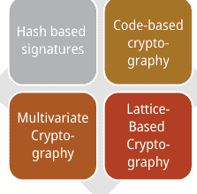

图 14.4：基于后量子的密码学。量子密码学描述的是利用量子特殊性作为安全方法的焦点 [32]。通过恢复当前基于数学的估计和原理，后量子密码学与量子计算时代的准备有关。

量子加密目前保护着公共场所内的每个敏感公共记录，以及非公共场所的经济记录。其保护得到了证实。量子密码学的应用就在这里。从2007年左右开始，瑞士一直使用量子密码学指导在线投票，塑造了当地居民和当局的选择。在日内瓦，选票在一个重要的计票站进行混合。然后，结果被发送到跨越光纤线的远程事实存储点。多数结果通过量子密码学获得，而数据交换中最脆弱的环节发生在选票不受干扰地从计票站移动关键存储位置的过程中。

随着许多国际地区面临虚假案件的阴影，这种改进很快将在全球范围内展开。参考文献 B [25]：通过卫星和区域探测器辅助进行空间安全通信是一个日益关注的问题，一个与 Essence Labs 的关联正与 NASA 合作，以确保地球与卫星以及区域探测器之间存在稳定的通信交换。该项目的目标是进行一项确保通信安全的会议，无论敌人接近什么技术或信息。此外，它还有一个指令收集每个“顶点”并放置在正确的位置。这最终可能为太空探测器提供保护，并在理想情况下，停止未来在微小激励之外交换物资的需求 [30]。C：一个更强大的网络：据预测，美国电力社区是虚拟攻击最脆弱的群体之一 [14]。

一些著名的电力高管提到，公用事业正面临来自虚拟敌人的“持续”攻击。小型加密设备协助专家传输非常稳定的信息，利用公共记录组来操纵电网。敏锐度对于调整生产力的市场需求至关重要。此外，在建立有效的保护措施后，它们本质上可能比传统方法更安全。D [24]。量子网络——互联网极其快捷的礼物，但与其量子加密的版本相比，其安全性微不足道。互联网可能会得益于量子加密神奇地重新启动。然而，在未来，我们可能无缝地在“标准”互联网和“量子编码”互联网之间切换，允许我们最重要的信息通过非常安全的方式发送 [14]。这可能实现一个既快速又稳定的互联网的目标。

## 14.5 结论


在捕获光子的情况下（它们都是受保护的债务），可能会存在成本问题，但保持足够的捕获以应对这一现实的问题也存在问题。另一个问题是干扰在超过50公里或更远的距离似乎最为明显，此时错误率也会急剧增加。这使得通道对于总线变得无效，并使通道几乎难以传输数据。尽管如此，在未来，量子密钥很有可能通过空气进行 [33]。小型望远镜可能会调整以识别信号。通过结合此类方案，可以获得如基于身份、阈值环或盲签名等额外的构建。然而，这些方案继承了底层协议的缺点。

一些估计认为，光子可以通过卫星传输，从而允许与地球上的任何地方进行通信。作为量子力学基础理论的主要应用，它证明了其必要性。

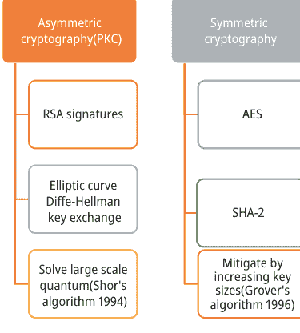

**图 14.5：**后量子 SSH。

## References

- [1] Gisin, N., et al. (1996). Quantum cryptography. Reviews of Modern, 74.
- [2] Hughes, R. (2004). Quantum cryptography. Wikipedia.
- [3] Nguyen, P. Q., & Reed, G. (2009). Quantum Key. Journal of Cryptography, 22(5).
- [4] Ducas, L. (2014). Quantum cryptography. IACR Cryptography ePrint, 874.
- [5] Saarinen, M., & Jo, O. (2017). Quantum cryptography. Journal of Cryptographic Engineering, 1–14.
- [6] Tittel, A., et al. (2002). Quantum cryptography. Contemporary Physics, 36.
- [7] Schwabe, P. (2013). Practical lattice-based cryptography. ACM Transactions on Embedded Systems (TECS), 14(3).
- [8] Moody, D. (2016). Quantum. In: International Workshop on Hardware.
- [9] Bernstein, J. (2016). Vulnerabilities of. In: International Workshop on Post-Quantum.
- [10] Gallbraith, S., et al. (2016). Quantum signature based on isogenies. Cryptography eReport, 1154.
- [11] Yoo, Y., et al. (2017). Quantum signature based on isogenies. Cryptography-eReport, 18.
- [12] Howe, V., et al. (2020). Quantum key distribution. Journal of Cryptography.
- [13] Poppelmann, T. (2023). Quantum keys to be traded via the air.
- [14] American electric community vulnerability study.
- [25] Secure correspondences with space-secure correspondences.
- [24] Quantum Web - The gift that internet.
- [30] The need for supplies to change in the future.
- [31] Primary application of quantum mechanics’ foundational theories.
- [32] Secure against against an attack by a quantum PC.
[21] Khanna, A., Rani, P., Garg, P., Singh, P. K., & Khamparia, A. (2021). 一种用于基于入侵检测的网络系统的增强型启发式特征选择。《无线个人通信》， 1–18。
[22] Menakshi, P. G. & Shrivastava, P. (2021). 用于移动恶意软件分析的机器学习。《网络犯罪与法医科学计算：原理、实践与算法》，11, 151。
[23] Garg, P., Pranav, S., & Prerna, A. (2021). 绿色物联网 (G-iot)：可持续技术发展的解决方案。收录：面向智慧城市的绿色物联网 (pp. 23–46)。CRC Press。
[24] Nanwal, J., Garg, S., Sethi, P., & Dixit, A. (2021). 绿色物联网与大数据：构建智能城市。收录：面向智慧城市的绿色物联网 (pp. 83–98)。CRC Press。
[25] Garg, P., Dixit, A., & Sethi, (2021). 基于机器学习的机会性网络预测技术。收录：创新计算与通信国际会议 (ICICC)。
[26] Garg, P., Dixit, A., & Sethi, P. (2021). 机会性网络：协议、应用与仿真趋势。收录：创新计算与通信国际会议 (ICICC)。
[27] Garg, P., Dixit, A., & Sethi, P. (2021). 通过仿真器比较新鲜协议与等待协议的性能。收录于：《工业中的 IT》，92。
[28] Gupta, M., Garg, P., & Agarwal, P. (2021). 用于解决 NP 困难问题的软计算数据研究中的蚁群优化技术。收录：用于可持续工业 4.0 的的人工智能 (pp. 197–211)。Cham。
[29] Malik, M., Singh, Y., Garg, P., & Gupta, S. (2020). 医疗系统中的深度学习。《网格与分布式计算国际期刊》，13(2), 469–468。
[30] Gupta, M., Garg, P., Gupta, S., & Joon, R. (2020): 一种移动自组织网络中簇头网关切换路由恶意节点检测的新方法。《未来世代通信与网络国际期刊》，13(4), 99–111。
[31] Garg, P., Dixit, A., Sethi, P., & Pinheiro, P. R. (2020). 节点密度对智能空间机会性网络路由协议服务质量 (qos) 参数的影响。《移动信息系统》，2020。
[32] Gupta, M., Garg, P., & Saul, S. Y. (2020). 用于基于网络的支付和任务管理应用的边缘检测 3D 生物识别系统。《网格与分布式计算国际期刊》，13(1), 2064–2076。
[33] Dixit, A., Garg, P., Sethi, P., & Singh, Y. (2020). TVCCCS: 基于系统使用量的电视观众信道成本计算。（第 804 卷，第 1 期，第 01206 页）。IOS Publishing。

# Annapantula Sudhakar*, G. R. S. Murty, Thirukumaran S.

# 15 针对小规模网络注入攻击的后量子加密

**摘要**：在本章中，我们开发了一种用于小规模网络注入攻击检测的后量子加密。该模型使用遗传算法的卷积神经网络来测试防御攻击的功效。车载物联网设备容易受到攻击，因此研究使用了深度学习模型进行攻击分类。仿真证明了模型在各种攻击层上的有效性。

## 1.1 引言

物联网 (`IoT`) 设备的日益普及带来了以前无法想象的前。遗憾的是，制造商无法保证产品的安全性，因为它们仍在开发中[1]。因此，尽管有这些优点，对这些设备安全的担忧是该范式对生活产生重大影响的巨大障碍[2]。

由于大量不安全且易感的物联网节点的计划部署，攻击者拥有极佳的机会执行分布式拒绝攻击[3]。这些设备在隐私、通信和存储安全、访问控制实施以及身份验证方面存在问题。这就是这些设备的开放本质以及它们被广泛接受的原因[4]。

## 15 后量子密码学

相比之下，在当今的信息时代，量子计算机正迅速接近可行领域，而且这种趋势预计在可见的未来仍将持续。量子计算像任何其他增长的技术一样，引发了关于安全性的一系列新问题和担忧。尽管如此，它也有解决某些存在相当长时间的问题的能力 [13]。

这些机器能够快速处理破解现有公钥基础设施所需的棘手问题。这使得黑客窃取私有信息成为可能。尽管关于大规模量子计算机的大部分信息尚仍不明确，但一些研究人员认为，现在是开发能够在后量子未来提供安全的加密策略的理想时机 [14]。

尽管关于量子计算机时间尺度的大部分信息仍不明确，他们仍然持此观点。对于某些被认为基于量子物理学和一些相关数学考量的问题，已经有了答案，这些答案可以在量子理论出现以后的世界中产生无法被破解的证明。在目前，很难说哪些策略将被证明是成功的。

因此，为了研究潜在的安全漏洞和风险，有必要熟悉适用于物联网环境的底层加密算法，并且有必要确定它们在量子计算机领域的成功程度。这是因为物联网（`IoT`）是一个将日常物体连接到互联网的网络。在这一系列工作中，我们研究了采用不安全的加密方法如何使物联网面临风险，以及量子密码学如何保护后量子物联网网络免受破坏的方法。

## 15.2 相关工作

本研究将调查与连接到物联网的资源、应用程序和设备安全相关的引起的问题。网络犯罪分子经常针对连接到物联网的设备发动攻击。连接到物联网设备的指数级增长为这些问题增加了另一层复杂性。预计 2019 年将有 76 亿物联网设备在运行，这个数字到 2030 年可能会增长四倍以上，达到 241 亿 [16]。这包括传感器、执行器和网络设备，以及具有 GPS 能力和移动连接功能的移动设备。有助于构建混合网络的技术示例包括物联网智能电网以及其它几种传感器网络。

由于低功耗、容量不足和性能有限等因素带来的限制，[17] 的作者提倡物联网与云计算之间的协作。这样做是为了规避这些问题。通过将云计算与连接到物联网的设备相结合，开发对用户（物联网）有巨大益的新服务是可行的。文章 [18] 更深入地探讨了互联网可以被认为是一个云的想法。当采用传统方法时，在不牺牲至少一个质量属性的情况下，无法实现“物”的低成本或简单性。另一方面，云计算提供了一种替代解决方案，可以满足这两个群体中任何一组的需求。云计算为物联网提供了一个近乎无限且可以通过互联网访问访问计算机资源池。此外，这些资源具有更高的可靠性，并可能以更低的成本访问。

正如 [19] 中所示，云与物联网的结合对安全水平产生影响。由于对云计算服务的高度依赖，物联网引发了一系列新的安全问题。

最近的出版物更加关注云计算和物联网引发的安全问题。[20] 中的作者研究了由于这种局面而引发的这一全新且引人入胜的问题集。物联网基础设施的激增带来了显著的阻碍：数据隐私和数据安全问题。尽管对云安全相关的困难已经有了很多讨论，但云计算与物联网的结合引发了更多的问题。

文章 [21] 提供了对物联网以及云计算的总结，主要关注与这两项技术进展相关的潜在危险。另一种连接技术的名称是移动云计算（`MCC`）。移动云计算是指一种与移动设备相结合的模式，旨在增加移动设备在处理速度、数据存储、电池寿命和环境感知等领域的实用性。这种模型之所以被赋予命名，是因为这种方法将云计算与移动设备相结合，这就是它被标记为移动云计算的原因。

[22] 的作者声称，由于网络设备和其他设备的理念仍处于婴儿阶段，因此在产品设计过程中没有考虑到安全考量。这是由于网络概念仍然相对新颖。与这些产品相关的最常见问题之一是，许多物联网设备在出厂时带有嵌入软件和操作系统，这些系统已经长时间没有更新，因此不再接收安全补丁。此外，很大一部分购买智能设备的人懒得更改制造商设置的密码，而大多数更改密码的人选择的密码对于设备来说不够健壮。

在创建关于数据保护和安全的既定标准方面，物联网面临许多需要解决的独特困难。某些设备没有利用行业标准保护所需的处理能力或存储空间。这些设备可能对用户带来潜在风险。能量利用效率对于物联网设备至关重要，因为大多数此类设备由小电池供电。在保护连接到物联网的设备免受某些类型的攻击时，首先识别潜在威胁，然后针对构建的物联网系统应用相应的应对措施。这样做是为了保护设备不被破坏。如果不这样做，可能需要大量的能量来维持设备的正常运行。

## 15.3 方法

在量子计算的发展领域，与过去相比有着极其令人不安的影响。量子技术的发展使得针对用于物联网设备的算法开启新的攻击向量成为可能。这些新的攻击向量对于用于密钥交换和数字签名的算法特别有效。

我们展示了该协议，并在每一层都使用了新的加密技术，包括以下：

- 物理层：大多数物理层协议（如 `DASH7` 和 `LoRa`）使用 `AES-128` 加密标准来确保数据的隐私和安全。这样做是为了防止未经授权的数据访问。

数据链路层：高级加密标准（`AES`）是 `IEEE 802.15.4` 中指定的所有加密选项的基础。它通过定义多种不同的加密选项在数据链路层提供保护，高级加密标准是所有这些选项的基础（`AES-32`–`AES-128`）。

网络层：`IPv6` 在网络层需要 `IPsec` 协议，因为它支持 `Diffie-Hellman`、`ECDH`、`RSA` 和 `AES` 等方法。这使得 `IPsec` 成为 `IPv6` 的至关组成部分。只有作为网络层组件的 `6LoWPAN` 协议依赖于传输层的安全性。

传输层：传输控制协议（`TCP`）和用户数据协议（`UDP`）是传输层中使用的主要协议。

- `TCP`：传输层安全协议（`TLS`）提供了额外的保护层，并且从 1.3 版本开始，它同时支持临时 `Diffie-Hellman` 和高级加密标准（`AES`）。
- `UDP` – `DTLS` 或 `QUIC`：这些协议使得为了使用瞬态 `Diffie-Hellman` 进行密钥交换以及使用 `AES` 进行数据安全成为可能。该协议使得使用 `QUIC` 可能。

基于机器学习分类器的入侵检测系统可以区分良性与恶性的网络活动。这些系统利用过去的数据。一个很大的缺点是，黑客可能会在某时刻设计出一种不会被系统识别为攻击但仍然能让他们绕过安全措施的攻击。协同进化是一种理论，认为如果同种的两种类型（例如捕食者和猎物）相互依赖，那么它们将共同演化。

在这种情况下，遗传算法被用于开发新型的对手（扮演捕食者的角色），用于教导人工免疫系统识别它们。换句话说，对手充当人工免疫系统的训练组。它们能够成功地防御某些特定类型的攻击（例如缓存投毒），因为它们将注意力更加狭集中。根据这项研究的结果，可以在攻击者有机会遍历攻击空间利用漏洞之前识别出漏洞。图 15.1 显示了 `GA-CNN` 模型流程图。

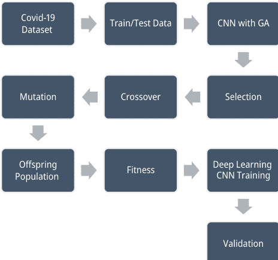

图 15.1：`GA-CNN` 模型。

### 15.3.1 GA-CNN 模型

在我们提供的模型中采用了卷积，使用指定的核 `K`，并应用于输入 `X`。

$$(X*K)(i,j) = \sum_{m} \sum_{n} K(m,n)X(i-m,j-n)$$

其中 "*" - 离散卷积。

在执行卷积过程中，核矩阵（用 `K` 表示）在输入矩阵上滑动。这使得从数据提取特征成为可能。在卷积阶段之后，收集到的特征通过非线性激活函数进行修正。此阶段发生在卷积步骤之后。

`Leaky ReLU` 激活函数最近作为一种首选激活函数受到了广泛关注，因为它能够在保持输入尺寸的同时对梯度消失问题具有免疫力。这是因为 `Leaky ReLU` 可以保持输入尺寸。`RELU`ach 和每一个卷积层都使用由依赖 `ReLU` 组成的整流器。

$$size(L) > size(M)$$

当将两者并排进行比较时，`L` 显著大于 `M`。

$$ReLU(X) = \begin{cases} 0.01x & x < 0 \\ x & x \geq 0 \end{cases}$$

由于传统的遗传算法算子（选择、交叉和变异）被用于最大化单个适应度值或分数（即训练集和验证集的分类准确率），目前遗传算法正被用于一个其努力实现的单一目标。`CNN` 分类核有多种不同的尺寸，而 `GA` 染色体就是其中一个示例。

## 15.4 评估

为了评估消息的有效性和安全性，对定性和定量特征都进行了调查。这样做目的是评估消息的有效性和安全性。与其他框架相比，这里还讨论了传输所需的时间，以及这一特定框架对该时间产生的影响。

理论和数学上的比较没有考虑到执行加密计算所需的额外时间。这些比较有助于从视角上评估我们所提设计的优势，以及传输海量信息所需的费用。这些比较有助于阐明我们的替代安全方法，该方法消除了将数据分割许多消息的需求。此外，我们的系统将服务器的公密钥保留在本地数据中。该密钥位于服务器生成的数据中。利用这一点可以在身份验证过程中不传输任何公密钥的情况下验证信息。

这是通过这是一种可逆认证方法实现的。当两者结合时，尽管密钥尺寸更大，产生的消息数量与轻量级预量子算法相当。即使密钥尺寸增加了，情况依然如此。为了验证数据传输，只需要三个长度为 `n` 的消息，其中 `n` 是节点总数。图 15.2 显示了准确率与学习率的关系，图 15.3 显示了准确率与批大小的关系，图 15.4 显示了准确率与训练样本的关系（在 `PL`、`DLL` 和 `NL` 下）。

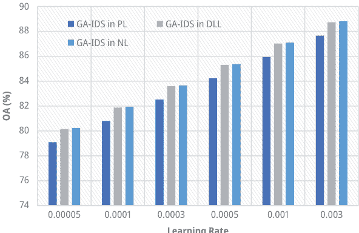

图 15.2：准确率 学习率。

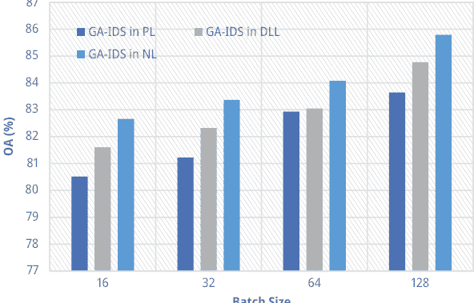

图 15.3：准确率 批大小。

从结果可以看出，随着训练样本的增加，总体准确率增加；然而，随着批大小和学习率的增加，分类器的准确率降低。此外，在 `NL` 下 `GA-IDS` 的准确率高于其他方法。

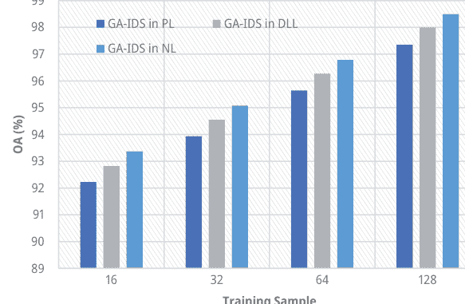

图 15.4：准确率 训练样本。

## 15.5 结论


IoT 的发展使得物品能够在互联网上交换信息并相互通信。这种能力实现了以前无法实现的互连水平。然而，各种技术的使用带来了许多新问题，最紧迫的是维持足够的安全水平。另一方面，基于 GA 的加密原理已被设计并投入使用，被认为是这些问题的解决方案。由于量子计算已成为事实，此类方法无法以安全的方式使用。通过仔细优化本地公密钥存储，我们的架构提供的性能与现有预量子和后量子框架相当甚至更好。

## 参考文献

1. Kumar, A., Ottaviani, C., Gill, S., & Buyya, R. (2022). Securing the future of things with post-quantum cryptography. *Security and Privacy*, 5(2), e20.

2. Uilitch, V., Park, S., Marzougui, S., & Seifert, J. P. (2022). A Post-Quantum Identifier for IG. In: Proceedings of the 15th ACM Conference on Security and Privacy in Mobile Networks (pp. 157–168).

3. Taha, M. E. & Eisenberg, T. (2015). Implementation Attacks on Post-quantum Cryptographic Schemes. *Cryptography ePrint*.

4. Ravi, P., Chattopadhyay, A., & Bakshi, A. (2022). Side-channel and Fault-injection Attacks on Lattice-based Post-quantum Schemes (Kyber, Dilithium): Survey and Results. *Cryptography ePrint*.

5. Chowdhury, A. B., Mahapatra, S., Doni, D., & Karri, R. (2022). Fuzzing hardware counters-based detection algorithm on post-quantum signature schemes. *IEEE Transactions on Computer Design of Integrated Circuits and Systems*.

6. Saravanan, V., & Neeraj, A. (2013). Security issues in computer networks and stenography. In: 2013 7th International Conference on Intelligent Systems and Control (ISCO) (pp. 363–366). IEEE.

7. Fritzmann, T., Sharif, U., Müller-Gretschneider, D., Breitbrecht, C., Schlichtmann, M., & Upeveli, S. (2019). Towards reliable and secure post-quantum-processors on RISC-V. In: 2019 Design, Automation & Test in European Conference & Exhibition (DATE) (pp. 1148–1153). IEEE.

8. Gill, S. S., Kumar, A., Singh, H., Kaur, K., Usman, M., & Buyya, R. (2022). Quantum computing: a taxonomic, systematic review and future directions. *Software: Practice and Experience*, 52(1), 66–114.

9. Kumar, S., Singh, M., & Tewari, H. (2022). Post-quantum cryptography techniques for secure communication in resource-constrained internet of devices: A survey. *Software: Practice and Experience*, 52(10), 2047–2056.

10. Jati, A., Chattopadhyay, A., & Sanadhyaya, S. K. (2019). Spiscoc: Side-channel Protected Quantum cryptrocessor. *Cryptography ePrint*.

11. Gunjan, V., Vijayalal, V., Kumar, S., Mohamed, M. O., & Saravanan, V. (2022). Machine learning and cloud-based knowledge graphs to recognize suicidal mental tendencies. *Computational Intelligence and Neuroscience*.

12. Mus, K., Islam, S., & Sun, B. (2020). Quantumhammer: A practical attack on the LUOV signature. In: Proceedings of the 2020 ACM SIGSAC Conference on Computer and Communications Security (CCS) (pp. 1071–1084).

13. Yuvaraj, N., Raja, R., Ganesan, V., & Das, C. S. (2018). Improving the response time with PIDSARSA-RAL in Cloud Flatmining. *AI Enhanced Transactions on Electronics*, 5(20), e2–e2.

14. Cintas-Anco, A., Mofazari-Keramani, M., Azarderzadeh, R., & Jag, K. (2022). CRC-Oriented Detection Protections of Post-quantum Cryptography Nieder Key Generator on FPGA. In: 2022 IEEE Nordic Circuits and Systems Conference (NoCs) (pp. 1–7).

- [18] Canto, A. C., Sarker, A., Kaur, J., Kermani, M. M., & Azarderakhsh, R. (2022). 后量子密码学中基于格密钥封装机制乘法器在 FPGA 上评估的错误检测方案。*IEEE Transactions on Emerging Topics in Computing*.

- [19] Yadav, S. P., Bhati, B. S., Mahato, D. P., & Kumar, S., (eds). 面向物联网应用的联邦学习。EAI/Springer Innovations in Communication and Computing. Springer, Cham, https://doi.org/10.1007/978-3-030-85559-8.

- [20] Wang, L. J., Zhou, Y. Y., Jin, J. M., & Chen, Q. (2022). 基于后量子密码学和重放攻击的量子密钥分认证。*arXiv preprint arXiv:2206.01164*

- [21] Gélin, A. & Wesolowski, B. (2017). 超奇异同源系统中的循环中断故障。在：国际后量子密码学会议 (pp. 93-106)。Springer, Cham.

- [22] Yadav, S. P. (2022). 区块链安全。在：Baalamurugan, K., Kumar, S. R., Kumar, A., Kumar, V., Padmanaban, S. (eds.) 云计算中的区块链安全。EAI/Springer Innovations in Communication and Computing. Springer, Cham. https://doi.org/10.1007/978-3-030-70501-5_1.

Srelatha P.*, Nitin Purohit, S. Chandra Sekaran

# 16 量子计算中为了更高韧性的 RSA 安全实现

**摘要：** 公钥加密体系在当前环境下被广泛使用。量子算法破解该系统的可能性将对数字经济中所有参与者持有的数据和资产的机密性构成重大威胁。这是因为公钥加密体系专为加密信息而设计。本章讨论了在量子计算中使用 `RSA` 安全实现以提高针对漏洞的安全性。`RSA` 的设计旨在减轻系统中所有可能的攻击，并提供针对攻击的更好的韧性。结果显示，与其他方法相比，在检测和缓解攻击时的计算时间有所减少。

## 16.1 引言

目前已有大量的实验系统被确定为量子计算的可能候选。陷阱离子系统是量子计算领域的另一种可能性。这些系统具有极高的保真度和极快的操作速度。2018 年，IonQ 创建了一个 11 位量子处理器，其目标是确定水分子在处于基态时的能级 [1–6]。此外，该公司还进行了一项陷阱离子量子计算，包含 79 位的单比特操作和 160 位的短量子比特 [7]。量子计算的出现为这两个目标的实现铺平了道路。

量子算法可以缩短计算所需的时间，但它们在现实世界中的适用性在很大程度上仍然有限。特别是在密码学领域，除非破解所需的时间超过预定义的特定长度，否则获得的结果是毫无用处的 [8]。举来说，如果破解密文所需的时间长于保密期限，那么显而易见破解就是浪费时间。另一个例子是，如果保密期限短于破解密文所需的时间 [9]。

**通讯作者：** Srelatha P., Department of Biomedical Engineering, KPR Institute of Engineering and Technology, Rasur, Tamil Nadu, India, email: srelathaselaraj@gmail.com

**Nitin Purohit**, Department of Computer Science, Kebri Dehar University, Kebri Dehar, Somali Region, Ethiopia, email: nitinpurohit111@kdu.edu.

**S. Chandra Sekaran**, Department of CSE, PSV College of Engineering and Technology, Krishnagiri, Tamil Nadu, India, e-mail: chandpuri@gmail.com

https://doi.org/10.1515/9783110798159-016

预计当这些异常巨大的输入在环境中激活时，将进行 2100 量子比特项目。另一方面，公钥加密体系如果输入密钥长度为一个太字节（`TB`），可能无法处理。这是因为解码数据所需的延长时间将显著降低数据传输的效率 [10]。另一方面，2100 量子比特操作可能会产生远高于所需的安全开销。这可能是一个问题。因此，在 `RSA` 公钥密码学和公钥密码学领域，发现一种既能快速加密解密，又能在量子算法攻击下保证安全的密钥长度是一个很有趣的话题。这是因为 `RSA` 公钥密码学是由发明公钥密码学的 `RSA` 公司开发的 [11]。

量子算法的执行受到物理法则的辅助，量子计算机的处理能力将受到辅助量子算法执行的相同物理因素的限制。这规定了量子算法的执行。本章讨论了在量子计算中使用 `RSA` 安全实现以提高针对漏洞的安全性。本章讨论了在量子计算中使用 `RSA` 安全实现以提高针对漏洞的安全性。

## 16.2 相关工作

目前，已有大量关于后量子密码学的研究项目。研究结果显示 `RSA` 比 `ECDSA` 快得多。他们通过分析两者的差异得出此。[21] 概述了一种用于分布式账本的可靠且节省空间的签名方案。在测试作者的假设时，他们使用了加密货币模型和先进网络。另一方面，作者提出的 `W-OTS-S` 形式的密钥明显大于标准。使用后量子哈希的签名方案是所呈现的研究重点。它在分析用于签名方案的各种哈希函数的有效性方面，考察了 Lamport、Winternitz 和 Merkel 系统与它们的需求的关系，而 [23] 作者的工作与此类工作具有可比性。

## 16.3 方法

目前安全主要依赖非对称和对称加密体系进行通信；它需要防御多种攻击。如果攻击者破解 256 位密钥需要花费的时间和精力相同，则称该加密体系具有 256 位安全性。这种强度可以用安全位数来衡量。

量子生日攻击可以生成大小为 `$3^N$` 的表格，以及 Grover 算法（然而，`SHA-2` 和 `SHA-3` 等相关的哈希函数将通过增加输出来保持抗量子性）。

使用公钥加密并发送给特定用户的消息，只能使用该用户对应的私钥进行解码。指向该用户的消息将使用公钥进行加密。执行暴力密钥搜索攻击（即尝试仅通过公钥来确定私钥）所需的计算工作量，在密码学领域被称为“工作因子（work factor）”。这种攻击试图仅利用公钥来确定私钥。

鉴于公钥与其对应的私钥之间存在数学上的联系，公钥加密系统的安全性可以根据执行此类攻击所需的工作量来评估。这是由于问题的本质决定的。所提的 `QRSA` 模型如图 16.1 所示。

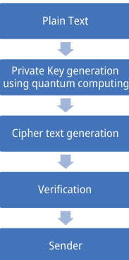

图 16.1：所提的 `QRSA`。

利用公钥解码消息是不可能的，因为公钥加密系统在本质上是非称的。这防止了这种可能性的。由于这种特性，公钥加密系统非常适合用于不安全的网络，因为它们解决了密钥分配问题，而这是此类网络中的常见问题。由于对称加密使用同一个密钥对通信进行加密和解密，因此它需要在交换信息的参与者之间通过安全手段来保存密钥。

这是因为对称加密中始终使用密钥。与频繁使用随机生成的 `$k$` 位字符串作为密钥的对称加密系统不同，公钥加密系统要求密钥具有特定的结构，这使得这些系统的成本显著增加。另一方面，对称加密系统使用随机生成的密钥。

另一方面，160 位的椭圆曲线可以被拥有 1000 个量子比特的量子计算机破解，而 1024 位的密钥则需要一个拥有 2000 个量子比特的系统。目前使用的量子计算机的能力甚至不足以完成其中任何一项任务。因此，过渡到能够抵抗传统攻击的后量子加密协议，其优先级列表中的地位已高于预期加密协议的现代化。

这些加密系统源于一种被称为同源协议（isogeny protocol）的协议，该协议最初是为普通椭圆曲线设计的。超奇异曲线是构建后量子系统时值得考虑的选项；但为了防御量子攻击，它们必须是非交换的。

### 16.3.1 量子密钥分发

力学定律的应用使得量子密钥分发（`QKD`）能够让参与双方的密钥传输完全无风险。这是通过 `QKD` 实现的。在大多数情况下，通过完成各种独立的加密任务来实现详尽协议的构建。使用一次性垫片（one-time pad）结合密钥分发机制使得加密通信的构建成为可能。这是由于这两个组件同时存在。当两个协议承担的每个加密任务都可以独立于对方使用时，我们称它们为可组合的（composable）且安全的。可组合性是指两个协议安全地协同工作的能力。因此，不再要求任何一个协议都证明其安全性承诺。此外，`QKD` 没有使用可组合定义；但当与一次性垫片结合使用时，得到的安全性证明要健壮得多。

可组合的想法最早是在密码学的经典背景下提出的。在经典环境经过进一步发展后，它最终被引入到密码学的量子领域。为构建理想协议奠定坚实的基础非常重要。因此，设计了一种新的可组合安全规范以满足这一需求。这种技术基本上保证了安全性在任何时候都得到维护，并在实际执行任何给定场景的过程中进行实际监控。在此过程中，这种监控可能任何时候发生。

由于鉴别器（Distinguisher）的能力，可以检查、修改或嗅探任何类型的信息。其他人只被允许查看过程的结果，而不允许查看任何尚未公开的信息。只有 Alice 和 Bob 有权访问他们之间通信并往回传输的信息。使用 `QKD` 协议时，首先生成一个意外的密钥，然后以不同于加密数据传输的方式在网络中传播。

由于密钥是完全随机生成的，除了预期的接收者外，没有人可以解码。如果光子的连续流受到任何方式的干扰或改变，就可能引入安全漏洞。得益于安全的光纤，我们可以发送消息而无需担心它们被截获，并且通过连接可靠节点来扩展网络，以摆脱距离延迟带来的限制。

在量子计算机上执行的每项操作都需要投入时间，并且能够影响系统的当前状态。人们认为量子态会在这段时间内发生变化，而只需要一个单一的操作就能产生这种变化。这被记录为完成一项操作所需的最小时间。

## 16.4 评估

在量子计算机上执行的每项操作都需要投入时间，并且能够影响系统的当前状态。人们认为量子态会在这段时间内发生变化，而只需要一个单一的操作就能产生这种变化。受控比特的演化时间可以被记录为以最短可能的时间完成操作必须经过的时间。无论涉及的门是单比特还是多比特，这一点都成立。无论该门包含多少量子比特，情况都是如此。在讨论的背景下，“时间”指的是每个独立操作所需时间的总和。

模加法是实现模幂运算的基础网络，而模幂运算是后者成功操作所必需。加法操作可以通过两个受控非门（`CNOT`）完成，进位可以通过两个加法器的协助进行管理，而普通加法网络可以通过第三个受控非门的协助完成。此外，模加法网络可以由上述加法器的分组构建而成。当模加法电路的基础单元是双比特门时，对于这种链式设计，模加法的电路复杂度与输入长度 `$n$` 呈线性关系。这是因为模加法使用双比特门作为其基础构建块。

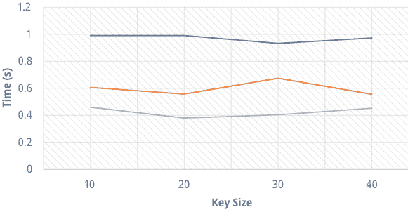

图 16.2: 运行时间 (s)。

# 16 量子计算中 RSA 安全实现以获得更高的韧性 225


对于完成每个必要过程所需的正常时间，应该能够如图 16.2–16.4 所示获得更好的解决方案。由于所有通用门都可以拆分为单比特门和双比特门，且受控非门是加法器中最常用的双比特门，我们将使用单比特门的运行时间而非双比特门的时间进行计算。

以下是为什么我们的范式不仅合理而且具有实用性的一些原因列表：

- (1) 运行单比特门所需的时间是操作双比特门所需时间的大部分，且
- (2) 我们在这里估算的时间是所需的极少时间。

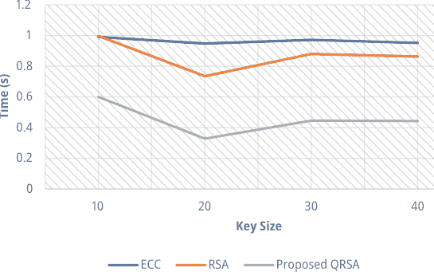

图 16.3: 加密时间 (s)。

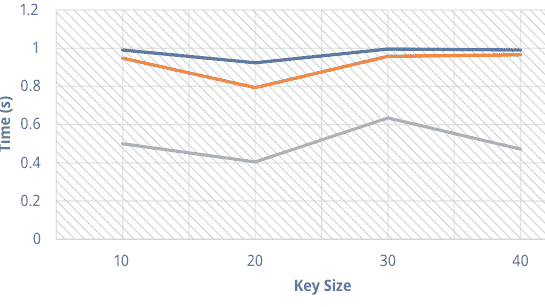

图 16.4: 解密时间 (s)。

必须记住，传统计算机的处理速度受与其时钟频率直接相关的因素限制。这是你应该时刻牢记的。在量子计算领域，时钟频率通常被构想系统从几个潜在状态之一转换到另一种状态（更具体地说是在 0 和 1 之间转换）所需的时间。这是因为系统的量子态可以同时存在多个不同的状态，如图 16.5 所示。在下一节中，我们将进一步研究量子门操作所需的时间周期是否可以解释为正交态之间转换的时间周期。

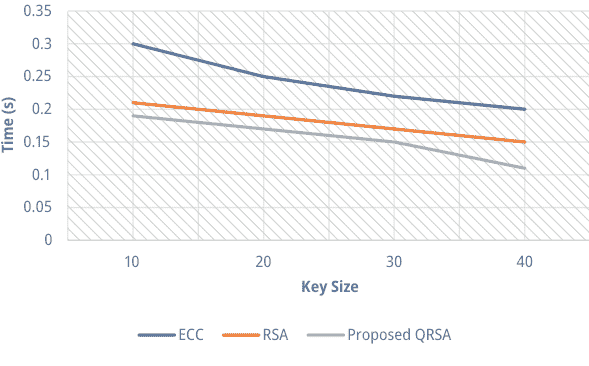

## 16.5 结论

本章证明了基于哈希的签名算法在生成密钥、生成签名和验证签名的时间方面是高效的。这项研究还揭明了在设置中使用传统方法而非基于哈希签名的困难性。与竞争对手采用的策略相比，RSA 显示出其是效率最高的策略。在对这两种经过时间检验的方法进行对比比较后，我们得出结论：RSA 协议生成密钥和签名的时间要短得多。另一方面，发现 RSA 方法在检查签名时是最有效的。

## 参考文献

- [1] Mosca, M. (2018). Cybersecurity in an era with quantum computers: Will we be ready? IEEE Security & Privacy, 16(5), 38–41.
- [2] Mustafa, I., Khan, J. U., Aslam, S., Sajid, A., Mohsin, S. M., Awais, M., & Qureshi, M. B. (2020). A lightweight post-quantum lattice-based RSA for secure communications. IEEE Access, 8, 99273–99285.
- [3] Tosh, D., Galindo, O., Kreinovich, V., & Kosheleva, O. (2020). Towards security of cyber-physical systems using quantum computing algorithms. In: 2020 IEEE 15th International Conference of System of Systems Engineering (SoSE) (pp. 313–320). IEEE.
- [4] Fritzmann, T., Sharif, U., Müller-Gritschneider, D., Schlichtmann, U., & Sepulveda, G. (2019). Towards reliable and Test in post-quantum co-processors based on RISC-V. In: 2019 IEEE Design, Autumn & Test in Europe Conference & Exhibition (DATE) (pp. 1148–1153). IEEE.
- [5] Ravi, P., Chattopadhyay, A., & Bashin, S. (2022). Security and quantum computing: An overview: In 2022 IEEE 23rd Latin American Test Symposium (LATS) (pp. 1–6). IEEE.
- [6] Tang, Z., Pang, P., & Krawee, W. O. (2021). A quantum leap in microgrids: The prospects of quantum-secure microgrids. IEEE Magazine, 9(1), 66–73.
- [7] Zhou, Y., Tang, Nikmik, N., Bahabahi, J., Peng, F., Wei, T. C., & . . . Zhang, P. (2022). Quantum computing in power systems.
- [8] Sadeeq, M. A., Zebareeer, R. S., Qadhi, R., Ahmed, S. H., & Jack, S. (2021). A novel method to solve real time security issues in software using advanced cryptographic.
- [9] Mavrovelidis, V., Kychyl, M., & Jang, A. (2018). The impact of quantum computing on present. arXiv:1804.200.
- [10] Nahed, M., & Alawan, S. (2020). Cybersecurity in a post-quantum world: How quantum computing will change the world. Journal of Electronic and Computer.
- [11] Vashist, V., Kumar, P., & Prasad, S. (2021). Speech recognition using machine learning. IEIE Transactions on Signal and Computing, 10(3).
- [12] Kachurova, M., & Bogdanoski, M. (2022). Lattice-Based Cryptography: A Quantum Approach to the IoT. Innovations in Computing.
- [13] Rani, P., Yadav, S., Rai, P., Kar, N., & Kumar, S. (2022). Simulation of the blockchain technique on privacy and security for healthcare data..HEMC.
- [14] Rocha-Grace, D., & Straub, J. (2021). Analysis of the quantum computing capacity for defense and homeland security. 2021 IEEE International Symposium on Technologies for Homeland Security (HST).
- [15] Yadav, S., Bhati, B., Mahato, D., & Kumar, S. (2022). Federated Learning for IoT Applications. Springer.
- [16] Mortoni, M., & Roosteler, V. (2019). Next steps in quantum computing: Computer’s role. arXiv:1903.10541.
- [17] Saravajan, V., & Raj, V. (2016). A mobile seamless learning and tree life by QoS oriented handheld. Asian Journal of Social Sciences and Humanities.
- [18] Lacerda, F. G., Jerez, J. M., & Renner, R. (2019). Classical resilience from fault-tolerant quantum computation. Journal of Cryptography, 23(4), 1071–1094.
- [19] Natajarajan, Y., Kannan, S., & Mohanty, N. S. (2021). Survey of statistical numerical and machine learning ontological models on infectious disease ontology. Data Analytics in Bioinformatics: A Machine Learning Research, 431–442.
- [20] Zoh, B. (2020). What is quantum computing and how it works. Journal of Material Sciences & Manufacturing Research.
- [22] Yuvaraj, N., Chang, V., Gobinathan, B., Pinagapani, S., Kannan, Dhiman, G., & Rajan, A. R. (2021). 基于多特征人工智能与深度决策树分类的网络欺凌自动检测。Computers & Electrical Engineering, 92, 107186.
- [23] Yuvaraj, N., Raja, R. A., Karthikeyan, T., & Kousik, N. V. (2020). 基于云的物联网改进隐私保护框架。In: Internet of Things (pp. 165–174). CRC Press.
- [24] Saravanan, V., Thirukumaran, S., Anitha, M., & Shanthana, S. (2013). 为云计算中的中的移动客户端实现自审计。International Journal of Advanced Computer Technology, 2, 53–60.

Kaushal Kishor

# 17 量子计算在数字取证调查中的应用

**摘要：** 在现实的技术背景下，网络犯罪案件的数量不断增加。在现实世界中，追踪和捕获网络犯罪绝非易事。即使犯罪者被捕，由于缺乏标准的数字调查模型，对其进行定罪仍将面临挑战。由于取证调查处理不当，实施网络犯罪的人可能会逃脱，而无辜的人可能会因为调查而遭受不利影响。取证人员需要遵循一致且定义良好的取证方法，以成功起诉罪犯。近年来，数字取证开发了许多新的调查模型；然而，由于同一种调查模型并不适用于所有国家，定罪的案件比例仍然较低。本章介绍了一种独特的数字取证调查模型，该模型基于印度次大陆的架构和网络法规构建。**

## 17.1 引言

信息交换系统是现代社会最基础的基础之一。它需要开发新概念以确保未来的安全传输和存档。密码学的目标从未改变。密码学是对通信进行加密和解密的实践，以确保其机密性、不可否认性、有效性和完整性。Krypt（希腊语，意为隐藏或秘密）和graphein（希腊语，意为写作）是该术语的词根。破解密码的实践被称为密码分析，而“cryptography”一词是指这两个术语的结合。许多科学论文联系已被数字通信取代，使得寻找数字护照、封皮和签名对应物变得困难。当应用程序更多时，需要更多工作。让我们来看几个。加密是为了防止未经授权的第三方破解两个授权方之间的内容。身份识别用于验证交话双方的身份。

*通讯作者：Kaushal Kishor, IT Department, ABES Institute of Technology, Ghaziabad, Uttar Pradesh, 印度, 电子邮箱：kaushal.kishor@abesit.in, kaushal.rastigo07@gmail.com**

https://doi.org/10.1515/9783110978159-017

另一种类型的密码挑战是秘密交换信息，这涉及到将秘密（如密码）分成许多部分，这样当最少的一个子集组合在一起时，就可以检索该秘密。数字签名、通信认证、零知识证明和其他密码学应用都是例子。然而，加密方法仅能保证条件安全，这取决于对手的计算和技术能力。相比之下，这提供了三个实验原型，其安全性由基本物理定律提供完全且有保障的保护。第一项研究是干涉量子分发（QKD）的应用，它允许多个发送者和接收者创建一个加密密钥。被称为光子的量子态粒子以弱相干态的形式编码证据 [1]。由于海森堡不确定性原理，我们可以识别窃听和传输错误。监听量未达到特定阈值，所有窃听者数据将通过额外的胜利增强方法被擦除。之后，创建的密钥将用于 Vernam 密码确保通信安全。

## 17.2 文献综述

人们一直渴望拥有私密对话的能力，以便没有人能偷听他们的通信。考古发掘显示，美索不达米、印度和中国的古代文明曾使用过各种类型的加密。古埃及人在四千年前使用修改过的形文字来伪装他们的通信 [2]。

希腊的斯巴塔人在公元前五世纪使用了基于字母易位的斯基提斯（Skytale）加密系统。信息刻在环绕在木棒上的纸条或皮革上。当线条结束时，木棒会旋转。一旦羊皮纸包裹好，字母就会变得杂乱无章，只有拥有相同形状木棒的人才能检索出信息 [3]。

替换密码是另一种常见且简单的加密方法，它用另一个字母、整数或符号替换文档中的每一个字符。替换密码就是一个例子。

中世纪的大多数加密系统依赖于易位、替换或两者的结合。像爱德加·阿伦·波波这样的作家在他的小说中使用其中一些方法。然而，这两种密码都不是安全的，因为它们可能利用许多语言特征（例如特定字母簇的频率）被破解。18世纪30年代电报的引入极大地增加了人际交流。然而，这种当前通信的前身在密码学方面有一个重大的缺陷。电报员知道他们所发信息的内容。因此，希望保持互动秘密的人和公司开发了许多密码本 [4]。

关键术语和短语在密码本中被重写为乱码。密码有两个目的：第一，减少了传输信息的数量，降低了成本，因为电报按字计费；其次，密码形成了一个加密过程秘密。

21世纪的两个世界加速了新加密技术的开发。一次性密码等使用随机位置来处理字母表中的字母。为了创建加密密钥，发送者和接收者必须交换一系列整数。无论攻击者的计算机或技术能力有多强大，Vernam 密码仍然面临分发密钥的挑战。结果是它并没有像Vernam 预想的那样广泛分发。严重的密钥管理问题在某些军事和外交事务并不是问题。

著名的间谍西奥尔·A·富克斯、罗森堡夫妇等人利用Vernam 密码将原子走私送到莫斯科。切·格瓦拉也使用一次性密码加密他给菲德尔的信件。据说它曾被用于核潜艇传输，甚至是官方对话，并用于保护连接华盛顿和莫斯科的热线。我们稍后会回到 Vernam 密码，因为它非常适合量子分发。

## 17.3 使用公钥的密码学

20世纪70年代后期，数字电信提高了对加密的兴趣。陌生人之间的安全接触至关重要。安全传输密钥仍然是一个问题。Diffman解决了这个问题 [5]。公钥加密的简单性拯救了90年代的电子商务热潮。公钥密码学需要两个密钥。信息的接收者创建两个密钥，公布公钥并保留密钥。任何拥有公钥的人都可以加密数据，但只有拥有私钥的接收者才能解码。

公钥密码学的安全性依赖于不可解决的计算困难。加密和解密是单向过程。单向测量在一个方向上很容易计算，但反向操作很难。两个质数相乘很容易，但分解它们的乘积很难。其他公钥加密系统在阿贝尔椭圆曲线和有限群中实现离散对数。没有函数被证明是单向的；它只是被认为是。公钥密码学不是安全的。它是算法安全。RSA是最流行的公钥加密系统。罗德·里斯特、阿迪·沙米尔和莱纳德·阿德曼在1977年建立了RSA [6]。RSA探索大整数分解的困难。接收者选择两个大质数并将其乘积公开。模数产生公钥。任何拥有密钥的都可以

加密数据。要发明这种方法，必须知道模数质数。分解模数是攻击 RSA 最有前景的方法。理查德·盖 [7] 在 1996 年评价道：“如果本世纪内有人能在没有特殊形式的情况下频繁分解 1,080，我将感到非常震惊。”《科学美国人》在 1977 年提出了首个 425 位 RSA 破解挑战。虽然在 1999 年 2 月破解 425 位 RSA 消耗了大量的设备，但仅需 185 台机器就能在 92 小时内分解 465 位 RSA 模数。当时，512 位密钥保护了 95% 的互联网电子商务（55 位数字）。1999 年 8 月，292 台计算机识别出了一个 512 位整数。从此以后，512 位密钥和 256 位密钥都无法为任何极短期安全需求提供足够的保护。所有这些困难有助于估算利用公共力量破解特定密钥长度所需的时间和资金。要估计通过资金更丰富的企业和政府努力可以实现的目标则要困难得多。

计算机网络并不是分解大数的唯一方法。1999 年，阿迪·沙米尔发明了 TWINKLE 设备。这种并行处理光电设备可以分解 512 位和 668 位密钥，速度比普通的快速 PC 快得多。现在建议使用更长的密钥长度，企业使用 1,024 位，昂贵的密钥使用 2048 位。

量子计算机的出现可能对公钥密码学的安全性带来另一种危险。使用量子计算机解密所需的时间与加密几乎相同，这将使公钥密码学失效。实现此点的算法已经开发出来，在窄量子计算机上的试点测试已有效地为更复杂的系统铺平了道路。

### 17.31 对称加密

如果用户提前通信一个足够秘密的密钥，对称加密可以为他们提供不容疑的安全。随后，共享密钥被同时用于加密和解密。对称系统的根本缺陷是安全密钥的分发。电信安全性降低到了秘密密钥分发的安全性。用户通过公钥加密分发秘密密钥，然后在带有秘密密钥的密码系统它。为了避免这种需求，人类通过面谈或信递服务交换秘密密钥。结果是，系统的无条件安全被限于计算安全。尽管他们将对称系统的响应时间与公钥交换的效率相结合，混合系统已用于电子交易、金融交易、ATM 交易和 PIN 加密技术、手机通话识别与验证、电子签名以及越来越多的其他用途。

## 17 量子计算在数字取证调查中的应用 — 235


数据加密标准 (DES) 及其变体是最广泛使用的对称密码系统。由于其在混合系统中广泛的应用，它是历史上使用最频繁的密码系统。DES 由 IBM 和美国政府于1975 年创建，并在两年后成为基准。由于它使用基本的算术运算，因此可以使用简单的硬件实现并达到非常快的加密速度。DES 遭受了与公钥密码系统相同的攻击潮。该技术使用 56 位密钥对完整消息进行加密。结果是它在计算上是安全的 [8]。1998 年颁了一项新奖。竞赛获者利用了连接到互联网的计算机的空闲时间。超过 50,000 个 CPU 联网。41 天后 [9]，密钥被破解了。另一组代码破解者采取了不同的路线。他们创建了一台单机来解密加密的通信。破解 128 位、192 位和 256 位密钥仅需以每秒 880 亿个密钥的速度尝试 56 小时 [10]。根据当前技术，一台相同的机器仅需 100 秒 [11]。这种详尽搜索并不是应对 DES 的唯一方法。20 世纪 90 年代提出了利用加密内部结构的其他有效攻击。密码学家们致力于改进 DES 的安全性。创建了三重 DES (Triple DES)、DESX 以及更多变体。为期四年的替换过时 DES 的工作结束于 2000 年 10 月发布的项新标准——高级加密标准 (AES) [13]。该标准于 2001 年 12 月被采用，并于 2002 年 5 月生效。

传统加密方法的另一个典型问题是所谓的侧信道密码分析 [14]。侧信道是加密设备活动信息泄漏的非预期方法。基于侧信道信息的攻击针对密码系统的特定实现，而不是其数学基础。通过监控执行操作所需的时间、能量消耗、热辐射或磁发射可以获取信息。

## 17.4 量子方法

如前章所述，对称密码系统的基本挑战是密钥分发。在这里，量子力学提供了帮助并给出了简单的答案。虽然技术进步和数学公式可以削弱标准加密系统的安全性，但量子方法可以提供无条件的保护。海森堡不确定原理通过说明我们无法可靠地区分非正交态来确保安全性。在经典物理学框架内，很难暴露可能的窃听行为，因为存储在经典对象任何属性中的信息可以在不改变物体状态的情况下被收集。所有的传统传输都可以被被动监控。

在经典传输中，一条信息被编码在光子、原子或其他载体中。加密的目标是以这种方式发送材料，使得即使被截获，访问也会受到完全限制。

## 17 量子计算在数字取证调查中的应用 — 237

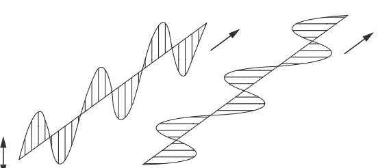

**图 17.1:** 展示了水平极振和垂直极振光的表示。

允许双方生成一个只有他们所知的共享随机位串，该字符串可以作为加密和解码通信的密钥。两个通信用户识别任何试图获取密钥知识的第三方存在的能力，是量子密码学的一个重要且独特的方面。量子密码学仅用于生成和分发密钥，用于发送消息。量子密码学与标准加密系统的区别在于，它的安全模型建立在物理学而非数学的基础上。量子密码学利用目前的物理知识创建一个无法被击败的加密系统——也就是说，在不需要消息发送者或接收者知情的情况下，完全安全防止被破解。量子密码学的天才之处在于它解决了密钥分发问题。通过发送一系列具有随机偏振的光子，用户可以建议一个密钥。该序列可以用于构建数字序列。这被称为量子密钥分发。如果窃听者拦截了密钥，这是可以察觉到的，但这并不重要，因为仅仅是一系列可以忽略的随机位。发送者可以发送另一个密钥。

### 17.4.1 量子位 (qubits)

在传统信息学中，数字信号由经典比特表示。这些基础比特（或“比特”）仍然具有 0 和 1 两个状态，产生 n 个比特。量子比特（quantum bit 的缩写）是量子计算中的基本信息单元，其经典等价是比特（二进制数字）。在存储信息方面，量子比特与比特相当，但由于其构建基础是量子特性，因此其运行方式完全不同。图 17.2 中了叠加叠加态：

```
$$\psi = a|0⟩ + \beta|1⟩$ 其中 $\alpha$ 和 $\beta$ 是复数。
```

抛硬币可能代表传统比特的概念。每当抛一次硬币，0 或 1 的概念等同于接收“正面”或“反面”。然而，量子比特可以在一系列状态中持续存在，直到被检测到为止。

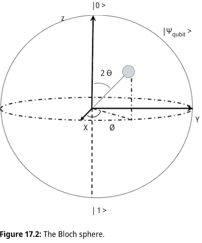

### 17.4.2 量子门

完成量子操作需要四种量子门：Pauli X 门、Pauli-Z 门、Hadamard 门和 U 门。它们的框图如图 17.3 和 17.4 所示。

| X | $\beta|0\rangle+\alpha|1\rangle$ |

|---|---|

| $\alpha|0\rangle+\beta|1\rangle$ | Z | $\alpha|0\rangle-\beta|1\rangle$ |

| H | $\frac{\alpha|0\rangle+\beta|1\rangle}{\sqrt{2}}$ | $\frac{\alpha|0\rangle-\beta|1\rangle}{\sqrt{2}}$ |

图 17.3: Hadamard 门。

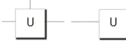

图 17.4: 受控 U 门与非控 U 门。

### 17.4.3 量子密码学

这是该项目最重要的部分。它首先介绍量子密码学的基本概念以及量子密码学的物理和技术原理，然后探索量子密码学与经典加密之间的区别。

#### 17.4.3.1 简述

量子密码学是一种利用量子力学原理创建加密系统的技术。由于前文提到的两个通信用户识别任何试图获取密钥知识的第三方存在的能力，是量子密码学的一个重要且独特的方面。量子密码学仅用于生成和分发密钥，用于发送消息。量子密码学与标准加密系统的区别在于，它的安全模型建立在物理学而非数学的基础上。量子密码学利用目前的物理知识创建一个无法被击败的加密系统——也就是说，在不需要消息发送者或接收者知情的情况下，完全安全防止被破解。量子密码学的天才之处在于它解决了密钥分发问题。通过发送一系列具有随机偏振的光子，用户可以建议一个密钥。该序列可以用于构建数字序列。这被称为量子密钥分发。如果窃听者拦截了密钥，这是可以察觉到的，但这并不重要，因为仅仅是一系列可以忽略的随机位。发送者可以发送另一个密钥。

### 17.4.4 物理和技术原理

#### 17.4.4.1 海森堡不确定性原理

维尔纳·海森堡（Werner Heisenberg，1901–1976）是一位德国物理学家。他的原理指出，“某些物理属性无法同时被确定。”在这种情况下，测量位置会影响另一个属性（动量）。

#### 17.4.4.2 不克隆定理

Wootters 和 Zurek 证明了，任意量子态无法被复制。

#### 17.4.4.3 纠缠特性

该特性指出，“即使在物理上分离，多个项目也必须相互描述，对其中一个会影响另一个。”

#### 17.4.4.4 与经典加密的区别

经典加密系统几十年来已被证明是安全的，使用 RSA、El-Gamal 和 ECC。另一个区别是，传统加密依赖于计算能力，而量子密码学依赖于物理。量子中继器发明于 90 年代，现在已改进得更加可靠。

### 17.5 量子卷积神经网络

卷积神经网络是一种受大脑启发的深度网络设计。CNN 在许多任务中表现出色，包括目标跟踪、姿估计、动作识别和显著性检测。CNN 的力量源于卷积层、最大池化层和几个全连接层，这些层有助于将大量的矩阵减少到少数节点，然后这些节点可以用于输出层。

### 17.6 量子密钥分发

量子密钥分发（QKD）的目的是通过公共信道（如图17.5所示）在两个人（通常称为 Alice 和 Bob）之间安全地传输随机字符串（密钥）。通过 QKD 获取的密钥有很多多种，但最常用于 Alice 和 Bob 传统的安全交互。特别是 Alice，将密钥添加到传统的二进制消息并将加密消息发送给 Bob。Bob 然后将密钥添加到加密文本以解码原始消息。窃听者无法破解加密通信，因为它仅仅是一系列随机的 0 和 1。这种通信技术被称为一次性纸垫或 Vernam 密码，可以被证明是极其严密安全的。为了使该系统绝对安全，对密钥有三个条件：密钥必须与消息等长；它必须完全随机；且 (3) 它只能使用一次。

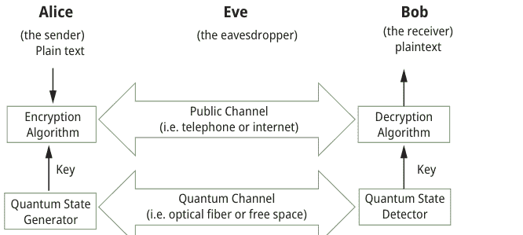

图 17.5: 用于安全交换随机密钥的量子密码学基本原理。

Vernam 密码的根本缺点是需要分发与消息等长的秘密密钥，这阻止了它被广泛使用。到目前，该密码主要用于军事和外交机构。正如下一节将所示的，量子密钥分发可以缓解……

安全的密钥分发。因为它能够保证绝对安全性，而且由于使用简单，维纳密码（Vernam cypher）变得非常重要。

## 17.7 自适应网络中的量子计算

在传统的 MANET 中，网络使用 0 和 1 提供 QoS [33, 34]。当节点从一个位置移动到另一个位置并尝试通过提供商（SP）访问服务时，这些服务可能会因为移动而丢失 [35]。然而，随着量子适配的引入，量子密钥分发（QKD）和超密集编码等应用正在部署。量子 MANET 可以通过采用叠加态下的 EPR 对（也称为贝尔态）来改进量子通信的概念。如果我们尝试测量这些叠加的量子比特态，可以发现 0 或 1 的等概率分布。这种可能性将有助于网络服务的分发。因此，我们能够使用这些量子比特发送消息。爱因斯坦及其同事的 EPR 悖论有助于识别量子比特的量子纠缠行为。

### 17.7.1 比较

研究表明，量子互联网可用于量子和传统信息的远距离传输。这种形式的网络可以用于现代技术，例如 MANET [36–38]。由于 QUMANET 中状态数量增加，QUMANET 提供的各种提供商的服务和服务数量将多于标准 MANET。经典 MANET 与 QUMANET 的对比框图如图 17.6 所示。

## 17.8 量子加密协议

本节将描述最流行的量子加密协议。这包括 Bennett 和 Brassard 的 BB84 和 B92 协议，以及 EPR 和 KCQ 协议。QKD 安全性的理论证明是非常完美的。

### 17.8.1 BB84

Charles H. Bennett 和 Gilles Brassard 在 1984 年建议利用量子力学可靠地释放随机加密密钥，这导致了量子密钥分发（QKD）的发展 [39]。因此，该协议被称为：

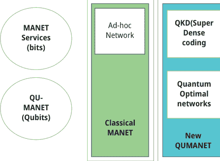

**图 17.6:** 经典 MANET 与 QUMANET。

根据 Stephen Wiesner 对不可变量子货币的概念 [40]，Bennett 和 Brassard 创建了一种方法，允许用户在两个远程站点建立相同且完全运行的字符流，同时有高概率发现窃听。

### 17.8.2 B92 协议

1992 年，Charles Bennett 开发了 B92 编码技术。该量子系统与 BB84 类似，但它仅使用 BB84 的四个状态中的两个来分别代表 0 和 1，以及 0 和 45。位通过 B92 编码在两个非正交的 BB84 状态中，无人可靠地区分位，因为没有测量可以区分两个非正交的量子态。反映单个光子极化态的二维希尔伯特空间 H 的量子粒子可以创建 B92 协议。B92 可用于任何非对称前提。

### 17.8.3 KCQ 协议

密钥噪声（KCQ）是一种基于量子检测和通信理论的经典信息传输技术。在经典宇宙中，单一通用观测对于所有信号集都是最好的，这种 KCQ 技术并不存在。KCQ 与 BB84 类型 QKD 协议的主要区别在于，由于最优量子接收器的概念，可以消除内级估计。尽管 KCQ 的产生从根本上不同于量子噪声随机化的直接加密协议 Alpha Eta () 或 Y-00 [41, 42]，但它将简化真实光系统中物理密钥生成方法的使用，如图 17.7 所示。

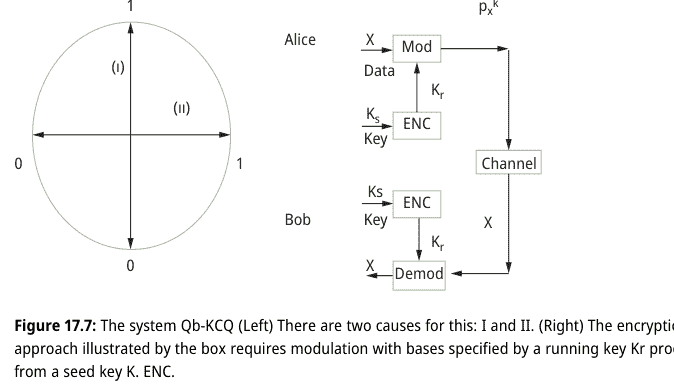

## 17.9 结论与未来工作

由于系统损耗和攻击者的存在，不能仅通过利用现有模型产生并传输密钥，必须在 QKD 中补充非量子过程、新方法论和许多额外步骤。这项工作改进了量子密钥分发技术，特别是在错误消除、身份验证、估计攻击者知识和隐私放大方面。这改进了从识别到量子密钥创建和分发的整个传输过程。它对于未来的量子密钥搜索将有用。

尽管量子加密在过去十年中取得了重大突破，但在量子加密作为政府、组织和个人的密钥分发方法广泛之前之前，重重障碍需要克服。这些挑战之一是推进更先进的技术，以实现量子非对称密钥更高的质量和更长的广播距离。然而，计算机处理能力的提高和对现有加密技术老化的恐惧将推动未来量子加密的研究和发展。量子加密仍然处于婴儿阶段，但到目前为止它看起来非常有前景。如果量子加密能够实现其高远承诺的即使一部分，也将对我们所有人的生活产生戏剧性和变革性的影响。

## 17 量子计算在数字取证调查中的应用 — 243

# Kaushal Kishor

[16] Eliott, C., Pearson, D., & Troxel, G. (2003). 量子密码学，德国卡尔斯鲁厄：2003计算机通信应用、技术、架构和协议会议论文。

[17] Kishor, K., & Pandey, D. (2022). 嵌入机器学习和物联网的空气质量预测系统的研究与开发。In: Gupta, D., et al (eds.), 创新计算与通信国际会议论文集. 网络与系统系列讲义（第 471 ）。Springer, Singapore, https://doi.org/10.1007/978-981-19-2535-1.

[18] Yadav, S. P., & Yadav, S. (2018). 小波域医学图像融合：Ingeniería Solideraria, 14(25), 1–11。

[19] Yadav, S. P., & Kishor, K. (2021). 基于区块链的加密货币监管：概述。计算经济学, 59(4), 1659–1675。

[20] Kishor, K. 密码学在信息系统安全中的作用。国际计算与媒体研究期刊，卷 7(1), 46–59。

[21] Mayers, D. (2001). 量子密码学中的无条件安全性。ACM期刊, 48(3), 351–406。

[22] Kishor, K., Sharma, R., & Chhabra, M. (2022). 使用机器学习技术进行性能预测，In: Sharma, K., Peng, S. L., Sharma, R., Maitsev, D. A. 微电子与电信工程。网络与系统系列讲义（第 373 ）。Springer, Singapore, https://doi.org/10.1007/978-981-16721-3

[23] Sharma, A., Jain, N., & Kishor, K. (2022). 通过胸部 X 光射线预测 COVID-19。In: Gupta, D., Polkowski, Z., Khanna, A., Bhattacharjee, S., Castillo, O., (eds.). 数据分析与管理论文集。数据分析与通信技术讲义（第 90 ）。Springer, Singapore, https://doi.org/10.1007/978-981-66289-6_16.

[24] Sharma, R., Surya, S., & Kishor, 使用机器学习技术进行性能预测（2021年7月）。In 2021 年创新计算与通信国际会议 (ICICC) 论文集，可用于 SSRN：https://ssrn.com/abstract=3884458 或 http://doi.org/10.2139/ssn.3884458

[25] Jain, A., Sharma, Y., & Kishor, K. 使用 MI 算法进行财务趋势的预测与分析（2021年7月）。2021 年创新计算与通信国际会议 (ICICC) 论文集，可用于 SSRN：https://ssrn.com/abstract=3884458 或 http://doi.org/10.2139/ssn.3884458.

[26] Kishor, K. (2022). 面于物联网应用的联邦学习。In: Yadav, S. P., Bharti, S. M., Mehta, D. P., Kumar, S., (eds.). AI/Springer 计算与通信创新。Springer, Cham. https://doi.org/10.1007/978-3-0-85559-8

[27] Kishor, K. 面于物联网应用的个性化联邦学习。In: Yadav, S. P., Bharti, S. M., Mehta, D. P., Kumar, S (eds.). AI/Springer 计算与通信创新。Springer, Cham. https://doi.org/10.1007/978-3-0-85559-8

[28] Gupta, T., Surya, S., & Kishor, K. (2021). 消毒智能电梯的开发。In: Gupta, D., Polkowski, Z., Bhattacharjee, S., Castillo, O. (eds.). 数据分析与管理论文集。数据与通信技术讲义（第 90 ）。Springer, Singapore, https://doi.org/10.1007/978-981-66289-8_15.

[29] Tyagi, D., Sharma, D., Singh, R., & Kishor, K. (2020). 实时“司机疲劳”监测与检测技术。创新技术与探索工程国际期刊，9(8), 280–284. doi.: 10.35940/ijitee.H6273.096280.

[30] Jain, A., Sharma, Y., & Kishor, K. (2020). 使用 MI 算法的金融监管管理系统。固态技术, 63(6), 18974–18982。http://solidstatetechnology.org/index.php/JSST/article/8080.

[31] Vernam, G. S. (1926). 用于安全电线和无线电的加密系统。全印度入学考试 45, 109–115。密码学, 18, 133–165, 200。

[32] Wang, X. B. (2005). 实用密码学中的光子数分裂攻击。物理评论快报，94, 230503。


[33] Yadav, S., 等 (2022). 使用循环神经网络 (`RNN`) 的情感识别与视觉系统机器学习综述。工程计算方法，29(3), 1753–1770。

[34] Kishor, K. & Nand, P. (2013). 无线 `MANET` 协议的性能分析与挑战。科学与工程研究期刊 (`IJSER`), 2(6),184–185, ISSN 2278–779.

[35] Kishor, K., Nand, P., & Agarwal, P. (2017). 基于能耗的子网。科学与工程研究期刊 (`IJSER`), 2(6),184–185.

[36] Kishor, K., Nand, P., & Agarwal, P. (2018). 安全子网。计算与媒体研究期刊, 7(1),46–59。

[37] Kishor, K., Nand, P., & Agarwal, P. (2019). 自适应子网。数据分析与通信讲义（卷 90）, 233。

[38] Kishor, K., Nand, P. (2013). 无线 `MANET` 协议的性能分析与挑战。科学与工程研究期刊 (`IJSER`), 2(6),184–185.

[39] Kishor, K., Nand, P. (2013). 无线 `MANET` 协议的性能分析与挑战。科学与工程研究期刊 (`IJSER`), 2(6),184–185.

[40] Kishor, K., Nand, P. (2013). 无线 `MANET` 协议的性能分析与挑战。科学与工程研究期刊 (`IJSER`), 2(6),184–185.

[41] Kishor, K., Nand, P. (2013). 无线 `MANET` 协议的性能分析与挑战。科学与工程研究期刊 (`IJSER`), 2(6),184–185.

[42] Kishor, K., Nand, P. (2013). 无线 `MANET` 协议的性能分析与挑战。科学与工程研究期刊 (`IJSER`), 2(6),184–185.

[43] Kishor, K., Nand, P. (2013). 无线 `MANET` 协议的性能分析与挑战。科学与工程研究期刊 (`IJSER`), 2(6),184–185.

[44] Kishor, K., Nand, P. (2013). 无线 `MANET` 协议的性能分析与挑战。科学与工程研究期刊 (`IJSER`), 2(6),184–185.

[45] Kishor, K., Nand, P. (2013). 无线 `MANET` 协议的性能分析与挑战。科学与工程研究期刊 (`IJSER`), 2(6),184–185.

# 现代医疗系统：揭示量子计算的可能性

**摘要**：量子计算等智能技术的使用已成为医学和生物医学应用中的变革性武器。量子计算因其变革性和革命性的能力在医疗保健领域已被证明是有用的。量子计算为所有行业创造更快、更敏捷和更透明的效率改进的新可能，医疗保健也不例外。医疗行业需要以前未有的速度来发现帕金森病和其他影响许多人的疾病。当我们达到量子计算最有用的阶段时，可以确定其利用将使企业能够领导流程并以超级速度分析和提供解决方案。昂贵的实验程序是制药和医疗公司的负担，影响了新药的开发和实施。量子计算在医疗领域有很多应用，因为电子医疗记录和基于 `ICT` 的工具产生了大量的医疗数据。记录需要关键环境的原因有很多，使专业人员能够分析体液、循环、电解质、激素、代谢和皮肤温度等变量。

***通讯作者:** Ayushi Prakash, ABES 工程学院计算机与工程系，印度北方邦加里亚巴，邮箱: ayushiSedu@gmail.com

**Sandhya Avasthi**, ABES 工程学院计算机与工程系，印度北方邦加里亚巴，邮箱: sandhya_avasthi@yahoo.com

**Pushpa Kumari**, Lok Maha Vidyalaya 工程系，印度比哈尔邦恰普拉，邮箱: d_pushpakhakumari5@gmail.com

**Mukesh Rawat**, 米特工程与技术学院计算机与工程系，印度北方邦米特，邮箱: mukesh.rawat@miet.ac.in

**Puneet Garg**, ABES 工程学院计算机与工程系，印度北方邦加里亚巴，邮箱: puneetgarg@gmail.com

## 18.1.5 计算机临床试验（In-silico clinical trials）

计算机临床试验不需要人类、动物，甚至不需要单细胞来测试新的治疗方法或药物；其自身的效果可以被准确记录。它指的是一种定制的计算机模型，用于制药、手机设备或干预措施的进展或监管评估。

它还将能够涉及许多医院的“现场”临床研究，并根据专家的偏好提供定制的潜力和元素。这不仅能从根本上缩短此类试验的时间，还能提高其质量和全面性。

## 18.1.6 全速DNA测序与分析

遗传学和基因组/基因组学在过去的20年里发生了巨大变化。破译活人的DNA代码耗了超过15年的时间：人类基因组计划始于1990年，耗资数十亿美元，并预计在2006年公布其官方结果。相比之下，目前针对人类各个方面的遗传标记已超过2000个。此类测试可以告知患者其对遗传疾病的易感性，并帮助医疗保健提供者诊断疾病。

## 18.1.7 让患者真正成为医疗服务的中心

量子计算机能够处理海量数据，包括单条健康数据。此外，来自连接系统的患者数据可能会使传统的医疗机构过时，使患者成为人们关注的焦点。量子计算可能作为此类系统正常运行的“前线”。客户机制的去碳化——这一与测量相关的创新性行业的另一个前景——正将预测提升到了全新的水平。目前已经有了尝试将健康管理从预防性转变为预测性的尝试，但这些尝试非常罕见且处于初始阶段。例如，有一种眼科应用可以向人们展示，如果他们使用它，他们的视力在五年内是如何开始变成白内障的。

## 18.1.8 高效医疗服务面临的挑战

全球健康状况呈现出不同的局面。一方面，拥有先进的医疗设备、具备医学资质的专家以及非常优秀的医院和诊所；另一方面，面临着不断增加的医疗成本，以及无法适应现状和艰难未来的老龄化人口。在这一切之中，许多心有抱负的人在继续挣扎。他们的命运完全取决于医疗保险公司能否成功克服挑战并减少获取医疗保健服务的差异，从而提供更好的医疗治疗。

## 18.1.9 尝试利用优势

为了充分理解健康技术转化医疗系统和建立连接健康环境的可能性，医疗领导者和医疗专业人员应该与医疗设备和软件开发公司建立更牢的关系。他们可以检索并共享信息 [7–9]，并创建新的业务模式和场景以提高新兴健康技术的采纳。

## 18.1.10 信息与整合医疗服务

医疗保险公司可以通过连接的医疗设备和`AI`集成软件来产生知识。医生健康记录、无线设备数据、转录的患者记录和患者问卷数据都是数据的示例。即使是声誉卓越的医疗系统也缺乏复杂的架构，而信息管理系统是一个尝试管理来自多个源的数据系统。他们接收到的信息的价值并非绝对，因为他们将使用的数据库系统无法有效管理从多个源头收集的复杂数据。从引用完整性到非关系数据集的转变，可能有助于医疗保健提供者管理大量的非结构化数据。

## 18.1.11 网络安全

量子计算机破解常规任务保护的能力可能会产生严重后果。量子脆弱性将增加敏感健康和财务隐私信息的泄露，危及数字文档的完整性，并破解某些加密货币的加密。

## 18.1.12 药品成本增加

药店处方药价格的上涨是患者和医生面临的最严重的医疗保健问题之一。“这可能会再次发生，因为没有可验证的证据，也没有人为药品价格决策提供逻辑支持，”Rx Saving Solutions首席执行官 Michael Rea 说道。为了防止或至少影响价格上涨，可以建立一个由医疗保健和制药行业所有利益相关者代表组成的管理机构来监督公司。

## 18.1.13 支付处理与发票

支付处理是任何商业世界中一个具有挑战性的方面，但对医疗保健提供者来说尤为困难。在一个患者应该受到医学和个人层面保护的职业中，隐私和安全是首要考虑。因此，执业人员选择的医疗在线支付方案必须经过仔细的考虑和思考。人们可以通过这样做来保护支付以及在这些过程中共享的个人数据。

## 18.1.14 药品价格压力

药店价格的上涨是患者和医生面临的最严重的医疗保健问题之一。“这种情况持续发生，因为没有业务验证，也没有个人或组织为决定药品价格提供理性，”RX Saving Solutions首席执行官 Michael Rea 说道。为了防止或至少影响价格上涨，可以建立一个由制药和医疗保健行业所有相关方组成的业务监管机构。

## 18.1.15 外部供应链的干扰

许多外部因素决定了医疗保障领域的动摇进展，这无疑将导致破坏性创新。手机使用的增加，以及移动应用程序和在线市场的兴起，极大地改变了所有者与其客户沟通的方式。医疗领域的客户也不例外。他们似乎在生理和情感上都很脆弱，因此需要良好的服务质量。

## 18.1.16 动机

这项研究的灵感来源于对今天现代医疗系统复杂且关键需求的调查，例如智能药物、可吞入设备和依赖传统模型的健康监测系统。此外：

- (i) 根据出版物，大多数调查涉及远程监测的智能医疗，但没有考虑到所有的技术工具，如可穿戴设备、人体网络连接和电子医疗。
- (ii) 此前的研究侧重于使用物联网和云等医疗技术监测患者，这些技术深受延迟、可用性和不同安全威胁。此外，还没有关于确保患者隐私的健康技术讨论。
- (iii) 于此，我们对可便式技术、人体网络连接和电子医疗等健康技术进行了详尽调查，以安全、有效且稳定的方式观察患者。我们还查看了一个涉及疫情期间辅助医疗安全的案例研究。

## 18.1.17 本章的贡献

文献中已发表了一些计算机调查 [5]。例如，讨论了传统系统的超级计算局限性以及提出的线性组合和纠缠解决方案。另一方面，本章涵盖了复杂的量子理论，但未探讨其社会影响。关于物联网限制的研究提出了加密解决方案 [6]。

## 18.2 量子计算在医疗的应用

无论是由于破坏性技术、健康问题的不可预测性，还是新疾病或药物的发现，医疗行业经常充满不确定性。优先研究表明，破坏性技术为医疗利益相关者带来了障碍和挑战。

这导致了工业4.0技术整合到医疗健康领域，以提供更好、更精确且个性化的护理。由于组织流程依赖于信息流，颠覆性的技术进步往往会在组织的信息过程中产生不确定性和歧义性 [11, 12]。[13] 中的作者指出，根据信息处理理论，组织成功的最关键方面是信息（即资源）与信息管理方式之间的直接关系。具体而言，最重要的部分是组织处理适量数量和类型信息的能力。不可预见的健康问题通常是怀疑和不确定性的更大来源，在医疗健康行业尤为如此。此外，新冠（`Covid-19`）给医疗行业带来了沉重负担 [14]。例如，该行业必须应对疫情，提供诊断和预防性护理，并快速开发和测试新药物及疫苗变体。突发事件会产生不确定性和歧义性，需要快速的知识传递和技术解决方案 [15]。此外，这些情况具有产生海量数据的潜力，从而改进数据分析。这不仅包括患者护理数据，还包括阅读类型和基因突变、生态和地理数据等，技术和医疗行业可以利用这些数据来收集预测和预判 [17, 18]。为了应用技术解决不可预测的健康问题，医疗健康行业需要检查其当前的组织结构，帮助人们做出更好的决策，并确定这种颠覆性创新是否可以与现有技术相结合。

各国还在大力投资医疗技术，其他部门也开始投资量子技术研究。这为这项创新技术提供了进入最有益行业——医疗健康的机会。制药业务在量子计算方面似乎巨大的巨大。现有企业和初创公司正在研究如何利用量子技术开发新疗法、生产疫苗并执行其他任务。当量子技术与工业4.0技术相结合时，它可以加速目前无法实现的知识领域的创新和发现。预计量子技术市场到2023年的价值将达到19亿美元，到2027年达到80亿美元 [19, 20]。量子计算完美契合，它可能以六种不同的方式用于解决医疗行业中的挑战，这些挑战通常是规模大、复杂、未知且耗时难以解决的（见图18.2）。但颠覆性技术的不可预测性、复杂性和波动性迫使组织在分配资源和设计政策上做出权衡。

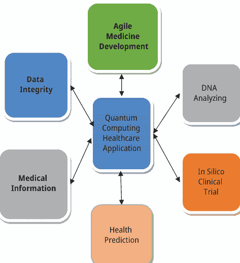

**图 18.2:** 量子计算在医疗健康中的应用。

## 18.3 量子医疗计算的安全性

量子计算是一种尝试解决计算挑战性问题的新兴框架 [21]。`IBM` 和 `D-Wave` 等几家公司通过基于云的框架提供量子计算机，该框架包含许多有趣的属性，例如：

- 具有不同数量量子比特以及虚拟化端耦合图的量子硬件，提供了新的计算能力 [22]；
- 软件包中出现了大量具有完全相同链路图数据的设备；
- 具有更大量子比特的较大硬件的链路图可以适应许多较小设备的耦合轮廓。在其他其他阶段，消费者需要依赖云公司的调度器来为用户请求分配资源 [23]；
- 每一件硬件都有独特的质量。
- 同一用户无法验证从量子设备获得的结果的初始状态。在其他表述中，该同一用户需要依赖云公司的调度器来分配所需的设备；
- 云端量子程序的程序的流量线很长，其处理结果对于降低成本以及帮助科学界进行探索和发现至关重要；

上述因素为未来前景激发了一种新的威胁模型：

长期来看，来自外部方的信誉较低的量子计算机可能会分配低质量设备以节省资金，或遇到错误的比特或量子硬件需求；

工作负载调度算法可能包含漏洞或恶意代码段，试图以牺牲分配低保真度硬件为代价来最大化吞吐量。此类故障对于可靠的供应商来说是可能的；

受信任托管提供商中的不满员工可能会试图通过干预调度器或重新路由软件，通过降低消费者的计算保真度来损害公司的公众形象；

如果提供的硬件看起来质量低劣，心不满的员工确实可以通过将任务重路由到其拥有完全控制权的第三方量子设备来窃取数据。

## 18.4 开放领域与研究挑战/未来研究机会

我们在本节中收集了智能医疗技术中可见可及的安全问题和研究课题。

### 18.4.1 安全性

不同的可穿戴设备和体域区域网（`BAN`）产生的数据在智能医疗系统中可能会遇到不同的隐私和安全问题，尽管患者的信息在发送给医生之前，可能已经在各种医护人员之间交换了个人信息。此外，数据必须受到黑客可以利用这些来收集个人数据的无数无线和传感器技术的攻击。因此，必须建立反安全指标，以确保智能健康服务内部的安全性和保密性。

### 18.4.2 数据交换

在智能医疗系统中，来自物联网设备的数据被决定与医疗提供者共享，尽管无法保证数据在传输给医生之前如何被处理，或者参与该过程的人数。例如，如果黑客开始篡改数据，患者可能会从医生处获得药物或没有处方。这可能导致诊断延迟，或对其健康造成更大的危害。因此，需要在一个智能医疗系统中限制数据共享或强制执行一种安全数据传输的方法。

### 18.4.3 大数据

连接到身体的各种可穿戴设备收集了大量数据。此外，随着患者状态的变化，数据也随之变化。管理此类动态且大量的数据非常困难。例如，`IoT` 检测器可能会获取数字形式的脑电图并在上面运行机器学习模型；上述数据必须转换为 `CSV` 格式。因此，需要一种根据应用程序需求直接转换文件的有效存储机制。

### 18.4.4 过度功耗

可穿戴设备是持续监测和记录患者健康的电池供电设备。在此过程中，它们会消耗大量的电量。结果是，用户需要多次充电。为了解决这个问题，用户在未监测健康状态时必须定期将设备设置为睡眠模式。

### 18.4.5 标准化不足

在智能医疗系统中，设备用于传输健康信息。每个设备都有其一套程序和配置。然而，医疗健康领域的物联网传感器信息交换、执行和实施缺乏中央控制的共识或一致性。因此，有必要在这方面进行研究，因为只有这样不同协议和规范的物联网系统才能自发对话。

## 18.5 结论

在本文中，我们对量子计算在医疗保健技术中的可能性进行了全面调查。量子计算通过实现前所未有的速度、有效性和可靠性改变了传统算法。医疗系统能够有效地从亚原子系统的巨大处理能力中获益。在本研究中，我们从医疗系统的角度研究了量子信息解决方案。我们首先讨论了量子物理可以帮助复杂数学处理的新型应用；接着讨论了医疗保健范式内部计算复杂度实现中更核心的领域。我们对现有的医疗量子架构进行了分类。此外，我们探讨了用于医疗系统的量子加密解决方案。最后，我们讨论了当前存在的问题及其成因以及可能的解决方案。研究进展将从量子物理的应用中极大受益。我们基于这项突破性研究，提出了许多智能医疗技术的分类分类法以及相关的安全问题，这突显了所有要点。未来的研究将重点关注一种结合区块链技术与 `AI` 模型的突破性方法，以增强量子计算解决方案的安全性和可靠性。

## 参考文献

- [1] Rafike, W., He, X., Liu, Z., Sun, Y., & Dou, W. (2019). CFADense: A security detection to detect and mitigate火力 attacks in software defined IoT-edge infrastructure. In: 2019 IEEE 21st International Conference on High Performance Computing and Communications; IEEE 17th International Conference on Smart City, IEEE 5th International Conference on Data Science and Systems (HPCC/SmartCity/DSS) (pp. 500–509). IEEE.
- [2] Rafike, W., Khan, M., Anwar, N., & Dou, W. (2019). A security framework to protect edge supported software defined Internet of things. In: International Conference on Collaborative Computing-Networking, Applications and Workshop (pp. 71–88). Springer.
- [3] Rafike, W., Miao, Z., Sarkar, N., & Dou, W. (2019). A blockchain based framework for information security in intelligent transportation. In: International Conference on Intelligent Technologies and Applications (pp. 53–66). Springer.


- [4] Yunena, K., Alfa, A. A., Misra, S., Damasevicius, R., Maskelianinas, R., & Oluranti, J. (2021). Internet of Things: Applications, Adoptions and Components – A Conceptual Overview. In: Abraham, A., Hanne, T., Castillo, O., Gandhi, N., Nogueira Rios, T., Hong, T.-P. (eds). Hybrid Intelligent Systems (pp. 494–504). Springer International Publishing, Cham.

- [5] Gyongosi, L. & Imre, S. (2019). A survey on quantum computing technology. Computer Science Review, 31, 51–71.

- [6] Fernandez-caramés, T. M. (2019). From pre-quantum to post-quantum IoT security: A survey on quantum-resistant cryptystems for the internet of things. IEEE Internet of Things Journal, 7(7), 6457–6480.

- [7] Prakash, Gupta, S., & Rawat, M. (2022). Design and Implementation of Novel Techniques for Content-Based Ranking of Web Documents, “Book Process Mining Techniques for Pattern Recognition” (pp. 11 eBook). Taylor & Francis Group, Imprint CRC Press, 9781003169550.

- [8] Prakash, Gupta, S., & Rawat, M. (2022). Keyed ranking of web pages by normalizing link score. In Journal of NeuroQuantology, (2016), 4725–4729, 10.10740/jneuroquant.2022.6, QQ22474.

- [9] Prakash, Gupta, S., & Rawat, M. (2022). Content-Based Ranking of Web Documents by Normalizing Link Score. In: Lect. in Networks, Syst., Vol. 479, Proceedings of Doctoral Symposium on Computational Intelligence 978-981-39148-1-7, 524385_1_En, DOI: 10.1007/978-981-39148-1_2.

- [10] Stephanie, L., & Sharma, R. S. (2020). Digital health-ecosystems: An empirical review of practice-oriented research. International Journal of Information Management, 53, 102032.

- [11] Fisson, S., Khachatryan, D., & Lee, W. (2017). Technical uncertainty and firm boundaries: The effect of knowledge mobility. IEEE Transactions on Engineering Management, 64(1), 16–28.

- [12] Mikalid, P., & Pateli, A. (2017). Information technology-enabled dynamic capabilities and their indirect effect on competitive performance: From PLS-SEM and fSQCA. Journal of Business Research, 70, 1–16.

- [13] Faibark, J. F., Libianca, G., Steensma, H. K., & Metters, R. (2006). Information processing choices, strategy, and risk management performance. Journal of Management Information Systems, 23(1), 293–399.

- [14] Cobianchi, L., Pugliese, L., Dal Mas, F., & Angeles, P. (2020). For a new surgery: [text cut off]

病理特征。尽管冠心病（`CHD`）的早期发现以挑战性大而闻名，但尽早做出诊断至关重要；及时的治疗取决于这一点 [4, 5]。

临床决策支持系统一直是许多研究计划的重点，旨在通过应用数据挖掘和机器学习等新方法来克服这些挑战 [6]。这些努力已经持续了相当长的时间。近年来，开发了多种数据挖掘技术，以提高医疗诊断的准确性 [7]。

这些数据挖掘技术包括神经网络、混合粗糙集和模糊学习向量量化网络。在医学领域，这些方法的某些应用包括主成分分析、基函数神经网络和关联规则等。这些仅仅是目前世界上所采用的许多不同方法中的极小一部分 [8]。

在尝试提高冠心病预测的精确性时，机器学习（`ML`）是迄为止最常用的技术类型。在冠心病背景的泛化方面，机器学习能够表现良好，因为它不需要任何先验领域知识，并且可以毫无问题地运行 [9]。机器学习也非常擅长分析复杂数据，这为发现与冠心病研究相关的独特模式和信息铺平了道路 [10]。

另一方面，近年来专注于在大数据中寻找异常的研究数量日益增加。这种趋势在许多不同领域都得到了观察。因此，迫切需要构建一个复杂的冠心病预测模型，以便以合理的成本实现早期疾病预测的目标 [11]。事实上，利用可用数据，通过采用配备不同分类器和模型的机器学习算法，可以预测这些疾病的发生率。这可以通过利用现有的数据来实现 [12]。

基于深度学习的冠心病自动分类和诊断，是解决传统心血管疾病问题以及可穿设备数据处理与分析问题的极佳答案。这一答案基于冠心病可以使用深度学习进行自动分类和诊断的事实 [13]。

随着研究进展，各种实时处理流数据的尖端开源系统应运而生。医疗诊断领域近期取得了进展，导致开始实施人工智能以实现诊断目标的公司数量增加 [14]。近年来，深度神经网络在自动心电图诊断中得到广泛应用 [15]。这主要是为了满足对快速且准确的心电图分析日益增长的需求 [16]。

使用 `QML` 分类器处理数据将在识别心脏问题方面发挥重要作用。近年来，许多针对实现这一目标的研究已成功结束。这些研究的每一个发现都表明，应用计算机医疗决策支持系统是一种审智的策略，可以帮助医疗人员做出精确且及时的诊断。

为了实现这一目标，在疾病发展的早期追求一种既有效又具有效益的预测方法，是应该追求的首要目标之一。现在应该利用各种当前信息来检查新的 `QML` 模型。因此，为了提供一个充分支持诊断方法的框架，正尝试在不同专业人士所拥有的专门知识领域之间建立桥梁。

## 19.2 相关工作

Sergioli 等人 [17] 了一种用于二分类监督学习的独特量子启发分类器，命名为 Helstrom 量子质（Helstrom Quantum Centroid）。他们的研究基于密度矩阵以及量子理论的正式方面。作者使用了十四个不同的数据集进行分析，在其中比较了他们的模型与一系列更传统方法的有效性。

利用决策理论、经典机器学习和量子检测的思想，作者们 [18] 构建了一种新型量子启发二分类分类器（`QIBC`）。他们通过利用量子物理学中被称为“叠加”的法则之一实现了这一点。与 `KNN` 和 `SVM` 等更传统的方法相比，新开发的分类器具有获得更高水平精确度、召回率和 F 测量的潜力。

Ding 等人 [19] 了一种受量子支持向量机启发的新技术，能够以指数级快的速度处理分类问题。作为算法基础的线性变换是主要的运行思想。

Dang 等人 [20] 开发了一种用于图像分类的创新模型，该模型利用了并行计算和量子 `KNN`。分类过程的速度和准确性作为他们开发的模型的直接结果得到了显著改进。

量子最近均值分类器（Quantum Nearest Mean Classifiers，通常称为 `QNMCs`）最早由 Sergioli 等人 [21] 提出，作为传统最小距离分类器的潜在改进。它们在他们的工作中首次引入。首先，一种编码，为每个模式分配一个理论量子对象，我们称之为密度模式；其次，一种分类方法，将标准分类程序的量子启发对应物应用于密度算子数据集，而不是实向量数据集。第三，有一个解码步骤，在实向量域内对分类过程的结果进行解码。尽管如此，它显示出改进的唯一医学数据集是癌症数据集。该方法在多种医疗数据集上的表现优于其传统版本（`NMC`）；然而，癌症数据集是唯一显示出改进的一个。

Chen, H 等人 [22] 开发了一种新型量子近邻（`QKNN`）算法，该算法基于量子计算（`QC`）的最优秀组件之一，即叠加。这是通过利用强大的并行计算实现的。因此，他们能够更明智地定位目标。

基于量子 `SVM`，利用量子高斯核和量子多项式核 [23] 开发了一种用于大量数据聚类的新模型，称为量子支持向量聚类（Quantum Support Vector Clustering）。该模型是大量数据聚类的一种独特方法。

Lu, S 等人 [24] 使用量子形式为他们的研究创建了一个决策树分类器。为了让模型有可能是正确的概率，既需要量子态保真度的度量，也需要作为量子态熵的度量。

Yu 等人 [25] 报告了用于岭回归的更好量子算法。量子 K 折交叉验证和量子态编码是构成该方法的两个主要部分。研究 [26] 提出了一种量子聚类的新框架，并将薛谔方程作为该框架的理论基础。

## 19.3 方法

通过 `QML` [27–31]，人们可以对多个数据集执行智能过程，从而产生可以操作的输出。这样做是为了获得所需的输出。由于 `QML` 在探索、分析和解释数据集方面的有效性，它是医疗诊断等领域决策者使用的极具吸引力的替代方案。这在由于 `QML` 是一种声明性语言这一点尤为突出。

## 19 量子计算辅助机器学习以改进预测 — 269

在训练阶段，将利用大量的独立因素，并结合一个因变量（`CHD` 类别）来创建一个分类模型。这将在模型训练时进行（年龄、性别、病史、症状等）。之后，将根据测试数据集使用模型对因变量的值进行预测。下文所示的 `QML`（量子机器学习）建议模型如图 19.1。


图 19.1：所提的 `QML` 模型。

### 19.3.1 预处理

在预处理步骤解决分类挑战时，数据集的结构是决定你是否成功的关键因素。通常情况下，价格波动对结果结果没有影响。因此，作为首要任务，我们调查了数据集以确定是否存在缺失值。

该研究通过多种不同方法验证了缺失值，包括完全忽略、替换为任意数字、替换为接近该属性的最长跨度，或使用该属性的中位数来恢复该值。

在合并后的 `CHSLB` 数据集中，没有任何一个变量是缺失的。克利夫兰数据集信息中几乎没有空白，这更是锦上添花。预处理是为分析准备数据的过程，并被称为该术语。

在实施机器学习或数据挖掘等技术之前，验证将要使用的信息的合法性至关重要。这可以通过许多手段实现。尽管数据分析有许多方法，但为了本次研究，我们选择关注离群值检测策略。

另一方面，人们可能在 `CHSLB` 数据集中观察到正态分布，但克利夫兰数据集并非如此。

利用四分位距（`IQR`）方法，我们能够识别出统计离群值。如果检查的数据不符合正态分布，则应用这种技术。如果需要准备的数据是偏的，`IQR` 方法可以帮助你准备所需的数据。

该研究可以通过四种不同方式计算四分位距：将数据从小到大进行排序、找到中位数、确定数据上下半部分的中位数，以及计算上下中位数之间的 `IQR` 差值。

### 19.3.2 噪声存在下的分类

在学习问题的背景下，噪声可以发挥许多潜在有用的作用，但这些这些的精确性质取决于具体情况，差异很大。已经证实，在典型环境中引入噪声既可以提高泛化性能，又能减少局部最优的发生率。这是通过仿真实现的。在尝试将模型拟合到数据时，这些是出现的最常见问题。前者可以通过梯度扰动跳出局部最优来获益，后者可以通过对训练输入或输出进行调整来改进。两者都可以得到改进。为了利用这些改进，需要梯度扰动。

在量子计算领域，一个引起许多人好奇的概念是利用噪声带来的益处并使其为你所用。由于早期量子计算机预计量子比特数量较少且无法实现完全纠错，社区正在积极寻找那些噪声不会损害计算、甚至可以发挥积极作用的问题。这是因为早期量子计算机预计将在未来几年内发布，且不会具有足够数量的比特。

在某些情况下，将基于量子物理学的技术应用于与噪声学习相关的问题可能会变得极具吸引力。我们将证明，利用量子资源可以有效解决噪声学习中传统的性的难题，这在以前是无法想象的。这正是我们现在要演示的内容。尽管目前在该领域还没有很多研究，但它可能导致经典场景与量子场景之间出现新的课堂分化案例。

我们认为，通过本节，我们将激发学生对量子学习器在噪声环境下如何运行的兴趣，这反认为未来该领域的深入研究铺平道路。在项目的第一个阶段，我们研究了各种经典问题，以便量子科学家熟悉噪声可能给机器学习带来的潜在益处。在下部分，我们将提供机器学习专业人士在量子计算误差建模时常用方法的高级概述。在文章的最后，我们将讨论几种不同的场景，在这些场景中，量子资源的可用性为完成对于受经典思维训练并习惯传统方式解决问题的人来说困难的任务铺平了道路。

#### 19.3.2.1 噪声输入

这项工作建立了 Tikhonov 正则化与引入噪声输入 `$(x_i)_{i=1}^n$` 之间的因果关系，通过建立两者之间的第一个因果关联来实现。在本文中，我们展示了优化前馈神经网络以减少噪声输入上的平方误差，等同于优化前馈神经网络以减少噪声输入上的平方误差。

在合并后的 `CHSLB` 数据集中，没有任何一个变量是缺失的。克利夫兰数据集信息中几乎没有空白，这更是锦上添花。预处理是为分析准备数据的过程，并被称为该术语。

在实施机器学习或数据挖掘等技术之前，验证将要使用的信息的合法性至关重要。这可以通过许多手段实现。尽管数据分析有许多方法，但为了本次研究，我们选择关注离群值检测策略。

另一方面，人们可能在 `CHSLB` 数据集中观察到正态分布，但克利夫兰数据集并非如此。

利用四分位距（`IQR`）方法，我们能够识别出统计离群值。如果检查的数据不符合正态分布，则应用这种技术。如果需要准备的数据是偏的，`IQR` 方法可以帮助你准备所需的数据。

#### 19.3.2.2 参数更新

在学习问题的背景下，噪声可以发挥许多潜在有用的作用，但这些精确性质取决于具体情况，差异很大。已经证实，在典型环境中引入噪声既可以提高泛化性能，又能减少局部最优的发生率。这是通过仿真实现的。在尝试将模型拟合到数据时，这些是出现的最常见问题。前者可以通过梯度扰动跳出局部最优来获益，后者可以通过对训练输入或输出进行调整来改进。两者都可以得到改进。为了利用这些改进，需要梯度扰动。

#### 19.3.2.3 噪声输出

另一方面，人们可能在 `CHSLB` 数据集中观察到正态分布，但克利夫兰数据集并非如此。

利用四分位距（`IQR`）方法，我们能够识别出统计离群值。如果检查的数据不符合正态分布，则应用这种技术。如果需要准备的数据是偏的，`IQR` 方法可以帮助你准备所需的数据。

# 19 量子计算辅助机器学习以改进预测 — 273

数据分布与生成器之间提供的帮助可能重叠性较小，特别是在训练过程的初期。这是由于两者之间很可能几乎没有重叠。这可能导致判别器过拟合，这一过程可以提高标签预测的准确性。

此外，这可能导致判别选择对生成器的参数具有适度的依赖关系，这是另一个可以增加准确性的因素。对标签进行模糊处理（例如真和假）是解决该问题的方案。判别器将对给定的每个训练实例的 `K` 个标签中的每一个进行概率估计，其中实际标签的概率为 1 加上以标签总数。

这与以下假设相同：标签以 `K` 的概率被选择，且实际上，在有足够误差空间的情况下，标签可以随机翻转。结果是，对于模型而言，将所有期望固定在合适的标签上并不符合最佳利益，这样做可以防止其在单一预测上过度自信。标签平滑（Label smoothing）策略被证明可以增强对对抗性场景的鲁棒性，同时为生成器保留训练信号。这是通过最小化平滑过程中引入信号的噪声量来实现的。这已在各种设置下进行的大量研究结果得到了证实。

## 19.3.3 QML 分类

量子机器学习这门新兴学科正朝着实现这些收益的目标努力，预计它们有一天会被包含在更多传统的机器学习方法中。我们提出了一种基于变分量子分类器（`VQC`）的新型混合神经网络，用以研究量子机器学习可能带来的潜在量子优势。该网络是由我们设计并构建的。

传统神经网络模型与变分分类器模型之间的比较可以通过多种不同的方式进行。`VQC` 分类器的模型比传统神经网络模型更精简，这是其优于后者的方法之一。所提模型中引入了传统梯度下降技术的量子类比方法。在深度神经网络上自然梯度下降计算开销巨大，因为它们需要转置巨大的矩阵。这是由于需要理解复杂的模式。尽管如此，得益于 `VQC` 在模型大小方面的优势，我们仍然可以通过量子梯度下降来微调我们的网络。

经典和量子梯度下降分别应用于最大化模型的经典偏置项和量子门参数的过程。量子梯度下降用于优化模型的量子门参数。利用该模型进行了了寻找共振的调查。我们将这些结果与通过传统梯度下降优化的 `VQC` 的结果，以及严格遵循经典原则的神经网络所获得的结果进行了比较。

通过利用混合教学方法，学习过程被提升到其最大潜力。在学习新信息的速度方面，混合策略超过了经典训练的 `VQC` 以及类似的经典神经网络。这是因为混合技术结合了这些方法的特点。


即使在数据量较少的情况下工作，混合 VQC 的性能也不受影响。我们认为，尽管我们的工作是使用生成数据来模拟真实情况完成的，但该方法在包含有限数据的数据驱动分类情况下具有有效性潜能。

当模型在训练过程中损失函数进入平台期时，每个模型的学习速度都会减慢。尽管如此，即使学习速度减慢，对网络训练的效率也不会产生影响。在彼此信号和噪声相似的情况下，网络并不特别擅长区分两者，这并不令人意外。

为了让研究人员参与监督学习，他们开发了一种现在被称为变分量子分类器的装置。变分量子分类器可以被视为一种量子神经网络。为了实现这一目标，必须构建一个能够模拟传统机器学习算法操作的量子电路。

量子机器学习算法利用电路，该电路的参数被优化到最优值，以实现最小化损失函数值的目标。为了做到这一点，通过使用教学电路学习参数以找到其最优状态。以下是根据该训练电路的操作属性对其定义：

```
f(w, b, x) = y,
```

其中 `f` 是网络；`y` 是损失函数 `L` 的输出估计；`w`, `b` 是可训练参数；`x` 是输入数据。

由于此类网络是由离散的模块化构建块组成的，经典神经网络和量子电路所使用的训练过程是可比的，并且被用于这两种类型的网络。

# 19 量子计算辅助机器学习以改进预测 — 275

该分类器类似于一个复杂且多功能的系统，该系统用于确定损失函数的值。连续修改参数 `w` 和 `b`、通过测量获取 `y` 以持续减少损失函数 `L` 的过程与网络的优化直接相关。这种做法是为了最大化可以通过网络传输的信息量。

量子神经网络的优化与传统神经网络的优化在相同意义上是可以实现的。在这些配置的任何一组中，都会对模型执行前向传播，紧接着计算损失函数。为了对输出随可控参数 `θ = (w,b)` 变化的网络进行反向传播，我们必须首先确定梯度 `f`。

只有在此之后，我们才能进行反向传播，并应用参数移动原理（parameter shifting）来计算量子电路所需的梯度。得益于量子电路输出梯度的计算，我们能够训练变分量子电路。这种方法与训练传统神经网络的方法相同。

## 19.4 结果与讨论

利用十折交叉验证的估计方法来确定机器学习算法在所评估数据集上的性能。

我们将整个数据集分成十部分，并称之为“折”（folds）。剩余的一个部分是我们在每次迭代中测试的部分。其中九部分被用于训练。在整个过程中，会获得十个不同的错误率计数。模型的最终误差是十次迭代中产生的所有误差的平均值。

这表明传统的机器学习提取方法（图 19.2–19.5）使用了大量的数据，但对于特征较多的数据，其特征提取效果较弱，导致模型泛化性不佳；而量子机器学习（QML）下的空间是相等的，且其分类效率很强。所有模型的 ROC 曲线如图 19.6 所示。

我们提出的技术具有最大的 ROC 曲线（图 19.7），这表明 QML 模型不仅能够提出数据集本身的特征，还能准确地提出其中包含的时域特征。换句话说，我们的方法具有最大的面积。

此外，这说明深度学习模型能够在一定程度上高效地提取数据的单方面特征，从而增加了网络的泛化能力。如果像前文所述将它们结合起来，它们具有大幅提高分类准确性的潜力。这一元素的重要性是模型在不同数据集上具有如此高泛化能力的因素之一，如表 19.1–19.3 所示。


**图 19.2：** 准确率。


**图 19.3：** F 分数。

## 19 用于改进预测的量子计算辅助机器学习


**图 19.4：** 精确。


**图 19.5：** 回召率。

在特定情况下，我们考虑了混合量子-经典迁移学习架构，该架构利用一个已经训练过的经典模型来提取特征。具体而言，我们使用了一个经过


训练用于识别人脸的模型。现在可以在量子计算机量子比特以及运行在其上的仿真软件中使用较小比例的比特。

在推荐框架帮助下的迁移学习结构。近年来，人们创建了一种将张量网络和量子电路结合成单一系统的混合设计。这种混合设计得益于计算机技术的最新进展而成为。

与本实验中使用的预训练网络相比，这种混合架构在泛化结果方面的性能要高得多。有必要进行额外的研究以确定此类去中心化设计是否可行。当更大规模的量子模拟器或真正的量子计算机可用时，进行量子机器学习也将成为可能。

所建议的方法不仅可以从本研究中利用的传统数据中获取知识，还可以从广泛的来源获取知识。如果扩展该系统，就有量子信息的研究空间，无论在本地训练上花费多长时间，都可以将其加入其中。


**图 19.7：** 所提方法中的模块对比。

**表 19.1：** IEEE dataport 数据集分类结果。

| 数据集 | 训练 | 测试 | 验证 |
|---|---|---|---|
| 10 | 82.05 | 84.55 | 89.14 |
| 20 | 82.42 | 76.69 | 88.20 |
| 30 | 77.14 | 80.24 | 88.01 |
| 40 | 72.97 | 83.14 | 84.01 |
| 50 | 71.08 | 79.18 | 75.27 |
| 60 | 79.80 | 81.41 | 87.98 |
| 70 | 59.01 | 62.67 | 82.24 |
| 80 | 82.67 | 82.09 | 90.04 |
| 90 | 81.72 | 85.30 | 89.02 |
| 100 | 82.25 | 81.46 | 87.21 |
| 110 | 82.59 | 87.15 | 87.11 |
| 120 | | | |

**表 19.2：** |gle 数据集分类。

| 数据集 | 训练 | 测试 | 验证 |
|---|---|---|---|
| 10 | 84.05 | 84.56 | 87.21 |
| 20 | 84.98 | 77.19 | 87.10 |
| 30 | 79.67 | 80.76 | 86.89 |
| 40 | 75.47 | 83.68 | 82.86 |
| 50 | 73.57 | 79.70 | 74.03 |
| 60 | 82.34 | 81.93 | 86.87 |
| 70 | 61.42 | 63.09 | 81.27 |
| 80 | 85.23 | 82.62 | 88.94 |
| 90 | 84.27 | 85.86 | 87.91 |
| 100 | 84.81 | 81.99 | 86.10 |
| 110 | 85.15 | 87.71 | 89.84 |
| 120 | 85.81 | 85.38 | 88.41 |
| 130 | 86.83 | 86.24 | 88.42 |

**表 19.3：** Gubit 数据集分类结果。

| 数据集 | 训练 | 测试 | 验证 |
|---|---|---|---|
| 10 | 84.61 | 85.25 | 88.05 |
| 20 | 84.98 | 77.19 | 87.10 |
| 30 | 79.67 | 80.76 | 86.89 |
| 40 | 75.47 | 83.68 | 82.86 |
| 50 | 73.57 | 79.70 | 74.03 |
| 60 | 82.34 | 81.93 | 86.87 |
| 70 | 61.42 | 63.09 | 81.27 |
| 80 | 85.23 | 82.62 | 88.94 |
| 90 | 84.27 | 85.86 | 87.91 |
| 100 | 84.81 | 81.99 | 86.10 |
| 110 | 85.15 | 87.71 | 89.84 |
| 120 | 85.81 | 85.38 | 88.41 |
| 130 | 86.83 | 86.24 | 88.42 |

[11] Schatzky, L., Arasmith, A., Coles, P. J., & Cerezo, M. (2021). 用于量子学习的纠缠数据集. arxiv preprint arXiv:2109.03400.

[12] Schuld, M., Sinislay, I., & Petrucci, F. (2014). 用于模式分类的量子计算。Pacific Rim International Conference on Artificial Intelligence (pp. 208–220). Springer, Cham.

[13] Sheng, Y. B., & Zhou, L. (2017). 分布式安全量子学习. Science Bulletin, 62(14), 1025–1029.

[14] Adock, J., Ellen, E., Frick, S., Hinchcliff, J., Johnson, M., . . . & Stanisis, S. (2015). 量子机器学习的进展. arxiv preprint arXiv:1512.02900.

[15] Banchi, L., Pereira, J., & Pirandanda, S. (2021). 量子机器学习中的泛化：量子信息视角. PRX Quantum, 2(4), 040321.

[16] Yadav, S. P., Bhati, S. B., Machado, D. P., Kumar, S (编). 用于物联网应用程序的联邦学习. EAI/Springer Innovations in Computing and Communication. Springer, Cham. https://doi.org/10.1007/978-3-030-55539-8

[17] Esposito, M., U, G., & Spani, A. (2022). 用于医疗领域的音频分类量子机器学习。In: 2022 13th International Conference on Information, Intelligence, Systems & Applications (IISA) (pp. 1–4). IEEE.

[18] Pani, R., Wadada, S. Y., Bai, R. K., Nurka, M. S., & Kumar, D. (2022). 基于隐私和安全的医疗数据轻量级区块链仿真. International Journal of E-Health and Medical Communications (IHEMC), 13(4), 1–15. http://doi.org/10.4018/IHEMC30946

[19] Tiwari, P., & Melicci, M. (2019). 面向量子启发的二分类器. IEEE Access, 7, 42354–42372.

[20] Sergioli, G., Giuntini, R., & Fretys, H. (2019). 二二分类的量子方法. PLoS One, 14(5), e021224.

[21] Ding, C., Tao, Y. (2018). 量子启发的支持向量机。In: IEEE Transactions on Neural Networks and Learning Systems.

[22] Dang, Y., Jiang, N., Hu, H. J., Li, Z., & Zhang, W. (2018). 基于量子k-近邻算法的机器学习. Quantum Information Processing, 17(9), 1–18.

[23] Sergioli, G., Russo, G., Santucci, E., Stefano, A., Palmucci, S., . . . . & Giuntini, R. (2018). 生物医学背景下的量子最小距离分类. International Journal of Quantum Information, 16(08), 1840011.

[24] Basheer, A., Ahmed, A., & Goyal, S. K. (2020). 量子k-s近邻算法. arxiv preprint:2003.09187.

[25] Bishas, A., & Mani, P. (2018). 大数据支持向量分类. arxiv preprint:1804.10905.

[26] Lu, S., & Braunstein, S. (2014). 量子决策树分类. Quantum Information Processing, 13(3), 757–770.

[27] Saucceda, H., Gálvez-González, L., Chmia, S., Paz-Borbón, L., Müller, K. R., & Katchenkoko, A. (2022). BIDGML —— 向物理材料精确量子机器学习迈进. Nature Communications, 13(1), 1–16.

[28] Schuld, M., & Killor, N. (2022). 量子机器学习的目标是什么? arxiv preprint arXiv:2203.01340.

[29] Wu, S. L., Sun, S., Wang, W., Zhou, C., Jan, J., Cheng, L., . . . & Wei, T. C. (2021). 使用量子核算法应用于大型对撞机高能物理分析的量子机器学习. Physical Review Research, 3(3), 033221.

[30] Wu, S. L., Sun, S., Wang, W., Zhou, C., Jan, J., Cheng, L., . . . & Wei, T. C. (2021). 使用量子核算法应用于大型对撞机高能物理分析的量子机器学习. Physical Review Research, 3(3), 033221.

[31] Gyongosi, L., & Imre, S. (2020). 量子机器学习. Science Bulletin, 62(14), 1025–1029.

## 20.3 方法

在量子计算中，利用了多种量子现象（如叠加和纠缠），以便在量子背景下表示经典数据，并对其进行修改，以产生可以理解的结果。这是通过使用量子计算实现的。量子纠缠是实现这一目标的方法。

经典计算机使用位（bits）来表示处理的数据状态，而量子计算机使用量子比特（qubits），它可以处于两种可以想象的状态之一（0 或 1）中。然而，该状态是基态的线性组合（叠加），每个基态在计算运行期间都有一个可量化的概率。这意味着该状态可以被认为是状态的叠加。该状态是线性方式组合基态的乘积。

通过对系统进行测量，叠加态可以还原为基态之一，从从中可以提取关于量子计算机（QC）状态的信息。当状态被测量时，量子计算机收敛为仅基态之一，这意味着执行的计算只产生了一个可能的结果。这表明，具有 `n` 个量子比特的量子计算机具有表示所有 `n` 位整数的能力，并能同时对所有整数进行计算。

另一方面，量子算法通过利用问题的底层结构来放大特定的基态，以此锁定它们。由于这种原因，特定状态的可能性增加了，从而确保了所获得的结果是可重复且确定的。在某些情况下，量子算法具有产生比其传统等效算法显著改进的时间复杂性的潜力，这种潜力的直接结果就是速度加快。

我们假设，参与交易劫持的能力是快速量子攻击者（QCA）的独特属性之一。他们试图从公钥中推导出私钥，而公钥可以位于广播到网络并存储在单个节点内存池的交易输入中。这样做是为了成功实现这一目标。因此，类似于双重花费攻击 [19–22]，这导致了冲突性行为——花费这笔资金（或 QCA 已获得控制的资金子集），最终导致受害者现金被盗窃。这种实现方式类似于双重花费攻击 [23–41]。

时机（Timing）在这些类型的的攻击中至关重要，因为攻击者不仅需要构建、签名并广播冲突交易，还需要运行 Shor 算法以获取私钥。这意味着攻击者有有限的时间来完成所有这些步骤。

尝试劫持交易成功的概率中，有一大部分部分很大程度上取决于所实施的质量控制措施。务必记住负责这类交易劫持的人——即单一收益的接收者，而不是本应第一笔交易接收者的人。与更常见的双倍花费做法相比，这仅涉及一次。

由于可以实现的加速仅是平方级的，因此我们在本文中将不会讨论应用算法从地址获取公钥的概念。这是因为可以实现的加速是微不足道的，并且会由于增加密钥大小而被抵消。相反，我们将讨论利用另一种方法的可能性。尽管如此，竞争对手可能会在挖矿时使用算法获得不公平的优势，这通常情况下会使情况变得更加不公平。

交易劫持结合自我中心挖矿操作，是上述详细策略之外的应该被探索的额外方法。这些方法可以在上一节中找到。假设 QCA 是一个矿工，她可能会尝试使用她的计算力构建自己的秘密链，一旦进入链中，就选择性地广播区块以强制公共链进行重组。该策略基于 QCA 也是矿工的假设。

由于攻击者现在可以执行交易劫持（如前所述），预计当存在 QCA 时，与传统的自私挖矿攻击形式相比，此类方法可行性将大幅增加。这是因为攻击者现在可以直接执行交易劫持。

这考虑了用于被覆盖交易的资金总和。如果交易被记录在非抗量子性的区块链中，这笔资金将不会包含在区块链的首次迭代中。


我们的工作假设是，比特币社区已经确定了一种能够抵抗量子计算的签名方法，并将该技术作为协议的升级实施了。如果确实如此，那么我们的工作假设就是正确的。在加密货币达到完全采用之前，预期所有比特币用户都已过渡到抗量子输出，这是完全不合理的。许多比特币用户（如果不是大多数人的话）仍将他们的部分或全部货币单位存储在非抗量子输出中，例如最常见的 `P2PKH`。这是因为 `P2PKH` 设计之初为了与量子计算机后兼容。其中一个例子是比特币私钥硬件钱包（`P2PKH`）。

后续部分将讨论的协议将使用户户安全地过渡到抗量子输出成为可能，即使是渐进式的。它通过一种名为“提交-延迟-显示”（`commit-delay-reveal`）的协议实现了一种耗时的安全延迟，如果协议更新，可以通过软分叉将其添加到比特币中。针对实施的特定方面（如参数化和数据结构的建立），正在进行专门的研究。

重要的是，一旦协议上线，`ECDSA` 签名的使用将被禁止，用户只能使用本文工作描述的抗量子签名方案。一旦协议上线，`ECDSA` 签名的使用将不再允许。这一限制将在协议上线后生效。当使用过时的公钥进行购买时，不仅公钥会暴露，交易也将失败。

尽管我们无法对量子模型与经典模型的优缺点进行简要描述，但我们可以突出某些差异，如下：如果你运行经典模型，你将获得一个可以直接与阈值比较的激活；而如果你运行量子模型，你将需要迭代多次才能获得一个接近理论值并与阈值比较的结果。如果你想获得阈值的准确表示，将会是。

### 20.3.1 提出的量子 CNN

在量子计算中，位被称为量子比特（`qubit`），它借助双级量子系统实现。为了量化表征其状态，可以使用由两个维度组成的复希尔伯特空间。根据量子态叠加原理，可以使用方程 `|φ⟩=α|0⟩+β|1⟩` 表示任意量子比特态；首先，编码为每个模式分配一个理论量子对象，我们称之为密度模式；其次，分类是将标准分类程序的量子启发对应版本应用于密度算子数据集而非模式。

一组真实向量数据集。第三，有一个解码步骤，它分别在实向量域和计算基 `|0⟩` 和 `|1⟩` 中对分类结果进行解码。这是根据任何数组都可以表示为单比特状态这一事实实现的。`α` 和 `β` 幅都是复数，其有效性不受归一化条件的影响，也就是说该条件不会改变它们。

`|\alpha| + |\beta| = 1`.

到为止，受量子力学影响的数据格式和操作已经深入到了更细的层次。这些可能被用于构建神经元的标准模型，该模型受到量子力学的影响，如图1所示。在较早的研究中，假设每个 UI 权重都表示一个实际整数。这样做使得 UI 权重能够轻松地应用于传统的机器学习框架。

每个方程由三部分组成：`f(x)`，函数的表示；`arg(x)`，定义复数的幅角；以及输入 `(x, … x_N)`，它们是实值。`f(x)` 是方程 (2) 指定的函数表示。在运行多次计算仿真后，我们能够毫无疑问地证明，具有复值权重的全连接网络的性能显著优于具有实值权重的相同网络。我们将这种升级的量子启发神经元用于构建卷积网络的过程。

## 20.3.2 量子启发的卷积操作

卷积神经网络（也称为 `CNN`）是一种特定的人工神经网络，通常由两种独特的层组成，即卷积层和全连接层。`CNN` 也称为卷积神经网络。它的特点是，由量子物理驱动的神经元某一天可以构建出极深的神经网络。此外，复数卷积技术能够以与已解释方法相当的方式执行。

在完成概述的复空间转换后，将输入像素乘以卷积核的操作等同于执行一种加权方法。在卷积操作（在这种情况下是旋转操作）之后，会应用一个 `NOT` 操作，就像在量子启发神经元中一样。这样做是为了确保卷积操作的输出与旋转操作的输出相同。

我们通过将量子启发的神经元模型与已经构建的量子启发卷积操作模型相结合，构建了量子启发的卷积神经网络。这允许我们创建量子启发卷积神经网络（`QICNNs`）。目前可用的大多数机器学习框架都是基于实值表示和操作。因此，我们首先需要修改复值神经元和卷积操作，以便它们能够在主流框架上轻松实现。

`z = a + ib` 是表示复数的方程。复数的实部和虚部分别由字母 `a` 和 `i` 表示。其基本目的是通过对方程的实部和虚部执行仅值操作来执行复数算术。这是一个必须克服的挑战。图 20.1 展示了 `m` 通道在从实值通道变为复值通道的变化下接收标准输入数据的场景。这种转换发生在场景过程中。在复特征的实部和虚部重建后，初始的 `m` 通道增加到 `2m`。实部由前 `m` 个通道表示，而虚部由后 `m` 个通道显示。

利用使用复数时相同的逻辑在复值上执行卷积操作。这样做是为了在复值上执行这些操作。复滤波器矩阵为 `W`，其形式如下：

`W = w_{real} + iw_{imag}`

其中 `w_{real}` 和 `w_{imag}` 是需要学习的实矩阵；`x` 是数据矩阵；`w_{real}` 和 `w_{imag}` 是两个复值的实矩阵。

复滤波器矩阵用字母 `W` 表示。没有其他方法来写这个方程，它就是 `W = w_{real} + iw_{imag}`。随后，按照下面的描述进行卷积过程：

## 20.3.3 QCNN 架构

我们采用传统的 `CNN` 作为 `QICNN` 的基础，以便我们方便地在它们之间进行比较。该模型是使用 `CNN` 标准模板的基础。后来变成 `CNN` 的概念源于 `LeNet-5`。

卷积神经网络（`CNN`）由三个卷积块和两个全连接层组成。每个卷积块内部有三层：卷积层、`ReLU` 层和池化层。全连接链路将全连接层连接在一起，以便它们协同工作。

通过在 `QCNN` 的全连接层中使用受量子力学影响的神经元，以及在卷积层中使用受量子力学影响的卷积操作，可以用最简单的方法完成 `QICNNs` 的构建。

20 缓解网络安全时代量子计算的风险 291

在量子系统中，具有卷积层特征的层被命名为量子卷积层，这是该层的名称。在量子卷积层中，滤波器被应用到输入特征图上，以构建包含新获取信息的特征图。这些特征图是由量子卷积层生成的。与卷积层相比，量子卷积层负责在受量子计算控制的环境内执行滤波操作。

经典计算机缺乏量子计算机具备的某些能力，包括叠加和并行处理的能力。由于这些特性，量子计算机能够比经典计算机快得多地学习和评估信息。然而，目前的量子计算机计算机只能处理非常简单的量子系统。


图 20.1：提议的量子 CNN。

在位图被用于量子卷积层期间，它不会立即整体应用于量子系统。相反，数据是以不大于滤波器大小的块进行处理的，这使得即使是最基本的量子计算机也能构建它。这使得量子加密能够实际应用。

为了完成从经典数据转换为量子数据的过程，需要编码阶段。最简单的方法是在量子比特上使用旋转门，其方式与像素携带的信息同步。这是一系列广泛的编码方法，所选择的方法不仅可能影响量子比特的最小质量，还会影响学习的效率。解码方法通过测量一个或多个量子态来建立。

## 20.4 结果与讨论

该数据集包含了 Alexa 认为最流行的百万域名以及十个僵虫网络 DGA。通过香农函数得到的熵值测量作为数据集的初始特征。关于第二点，Kullback-Leibler 散度产生了 Alexa 百万域名的相对熵（RE）值。这种散度估计了相对于 Alexa 区域的距离（相似性）。第三，我们分析了每个僵虫网络数据集以查看哪一个相对熵值最低。Jensen-Shannon 散度函数用于产生 IRad 值，这是第四个特征，用于衡量与十个僵虫网络数据集的距离。该值由 Jensen-Shannon 散度函数决定。

在本节中，我们将重点关注性能评估的使用，以更好地了解我们的 QML 框架在各种方面的训练情况。

## 20 网络安全时代量子计算风险的缓解 — 293

表 20.1: 分类结果。

| 类别 | QA | SSVM | 提议模型 |
|---|---|---|---|
| 10 | 83.59 | 83.29 | 85.59 |
| 20 | 83.92 | 83.51 | 85.81 |
| 30 | 82.9 | 82.51 | 84.93 |
| 40 | 83.74 | 82.7 | 85.27 |
| 50 | 82.54 | 81.18 | 85.35 |
| 60 | 83.69 | 83.1 | 85.83 |
| 70 | 81.56 | 82.61 | 84.21 |
| 80 | 83.16 | 83.11 | 85.08 |
| 90 | 80.94 | 82.46 | 85.21 |

表 20.2: 错误率。

| 类别 | QA | SSVM | 提议模型 |
|---|---|---|---|
| 10 | 16.26 | 14.42 | 15.63 |
| 20 | 15.94 | 14.2 | 15.42 |
| 30 | 16.94 | 15.07 | 16.4 |
| 40 | 16.11 | 14.74 | 16.22 |
| 50 | 17.3 | 14.65 | 17.72 |
| 60 | 16.17 | 14.18 | 15.82 |
| 70 | 18.27 | 15.78 | 16.31 |
| 80 | 16.69 | 14.92 | 15.81 |
| 90 | 18.89 | 14.79 | 16.46 |

数据集，作为概率幅正则化器的效果。这将有助于更好地了解我们的 QML 框架训练效果如何。

为了确定其运行情况，我们将其与其他方法进行比较，将其与目前的先进技术进行对比，并在不使用正则化器的情况下对其训练和测试。我们没有选择类别，也没有尝试外推所用数据量，因为我们的首要目标是检查 QML 的可扩展性。

尽管测试准确率从 80% 提高到 90%，但训练集和测试集之间的领域规模仍存在 2.3% 的差距，如图 20.2–21.4 所示。对此的解释可以在之前的陈述中找到。这表明了我们为多分类分类设计的 QML 框架中所提供的正则化器具有巨大的影响。

一个轮次（epoch）的衡量是从学习器接触整个训练集开始开始计算的；然而，如果按照传统方式进行，它可以无限次地重复轮次。如果达到了我们期望实现的指标最大值的特定阈值值，可以终止早期训练。尽管整个过程是通过模拟来获得可能的最高效率，


它完全适用于并在量子计算机上执行，并已为这种可能性做好了准备。此外，在不同的数据集上进行了测试，结果如表 20.3–20.6。

## 20.5 结论

在本章中，我们强调了量子 CNN 如何受到此类威胁的影响。公钥的传播导致了这种安全漏洞的引入。我们建议在比特币中实现一种名为


**图 20.3:** 测试准确率。

提交延迟显示（`commit-delay-reveal`），以便对能够抵抗量子计算的地址方案进行无风险升级。这段时间应该足够让诚实的客户端和矿工对手动拒绝在该时间段内任何长分叉达成共识，并且这种共识应该在等待开始之前达成。然而，我们认为，在链回滚期间必须有一段时间，由于存在由对手故意制造的竞争分支，社区无法对如何进行做出决定。为了使链回滚成功，必须满足这一特定标准。


**图 20.4:** 验证准确率。

表 20.3: KDD 结果。

| 特征 | 模糊测试 (Fuzzers) | 拒绝服务 (DoS) | 后门 (Backdoor) | 侦察 (Reconnaissance) |
|---|---|---|---|---|
| 3 | 88.3 | 88.94 | 90.69 | 91.78 |
| 6 | 90.48 | 91.13 | 92.92 | 94.05 |
| 9 | 87.18 | 87.82 | 89.54 | 90.63 |
| 12 | 84.31 | 84.93 | 86.6 | 87.66 |
| 15 | 90.45 | 91.1 | 92.89 | 94.01 |
| 18 | 87.1 | 87.73 | 89.45 | 90.54 |
| 21 | 87.34 | 87.97 | 89.7 | 90.79 |

表 20.3 (续)

| 特征 | 模糊测试 | 拒绝服务 | 后门 | 侦察 |
|---|---|---|---|---|
| 24 | 87.39 | 88.02 | 89.75 | 90.84 |
| 27 | 86.61 | 87.24 | 88.95 | 90.03 |
| 30 | 87.21 | 87.84 | 89.57 | 90.65 |
| 33 | 86.23 | 86.36 | 88.56 | 89.64 |
| 36 | 85.85 | 86.48 | 88.18 | 89.25 |
| 39 | 87.38 | 88.01 | 89.74 | 90.83 |
| 42 | 84.9 | 85.52 | 87.22 | 88.27 |
| 45 | 86.93 | 87.56 | 89.28 | 90.36 |
| 48 | 90.52 | 91.17 | 92.96 | 94.09 |

表 20.4: SWEE 数据集结果。

| 特征 | 模糊测试 | 拒绝服务 | 后门 | 侦察 |
|---|---|---|---|---|
| 3 | 86.53 | 87.16 | 88.88 | 89.94 |
| 6 | 88.67 | 89.31 | 91.06 | 92.17 |
| 9 | 85.44 | 86.06 | 87.75 | 88.82 |
| 12 | 82.62 | 83.23 | 84.87 | 85.91 |
| 15 | 88.64 | 89.28 | 91.03 | 92.13 |
| 18 | 85.36 | 85.98 | 87.66 | 88.73 |
| 21 | 85.59 | 86.21 | 87.97 | 88.97 |
| 24 | 85.64 | 86.26 | 87.96 | 89.02 |
| 27 | 84.88 | 85.50 | 87.17 | 88.23 |
| 30 | 85.47 | 86.08 | 87.78 | 88.84 |
| 33 | 84.51 | 85.12 | 86.79 | 87.85 |
| 36 | 84.13 | 84.75 | 86.42 | 87.47 |
| 39 | 85.63 | 86.25 | 87.95 | 89.01 |
| 42 | 83.20 | 83.81 | 85.46 | 86.50 |
| 45 | 85.19 | 85.81 | 87.49 | 88.55 |
| 48 | 88.71 | 89.35 | 91.10 | 92.21 |

表 20.5: CT 数据集结果。

| 特征 | 模糊测试 | 拒绝服务 | 后门 | 侦察 |
|---|---|---|---|---|
| 3 | 85.15 | 87.77 | 87.45 | 88.51 |
| 6 | 87.25 | 87.88 | 89.60 | 90.69 |
| 9 | 84.07 | 84.69 | 86.35 | 87.40 |
| 12 | 81.30 | 81.90 | 83.51 | 84.53 |
| 15 | 87.22 | 87.85 | 89.58 | 90.66 |
| 18 | 83.99 | 84.60 | 86.26 | 87.31 |
| 21 | 84.42 | 84.83 | 86.50 | 87.55 |
| 24 | 84.27 | 84.88 | 86.55 | 87.60 |

表 20.5 (续)

| 特征 | 模糊测试 | 拒绝服务 | 后门 | 侦察 |
|---|---|---|---|---|
| 27 | 83.52 | 84.13 | 85.78 | 86.62 |
| 30 | 84.10 | 84.71 | 86.37 | 87.42 |
| 33 | 83.15 | 83.76 | 85.40 | 86.64 |
| 36 | 82.79 | 83.39 | 85.03 | 86.07 |
| 39 | 84.26 | 84.87 | 86.54 | 87.59 |
| 42 | 81.87 | 82.47 | 84.09 | 85.12 |
| 45 | 83.83 | 84.44 | 86.09 | 87.14 |
| 48 | 87.29 | 87.92 | 89.64 | 90.73 |

表 20.6: IoT 设备结果。

| 特征 | 模糊测试 | 拒绝服务 | 后门 | 侦察 |
|---|---|---|---|---|
| 3 | 85.96 | 86.58 | 88.29 | 89.36 |
| 6 | 81.62 | 82.22 | 83.82 | 84.45 |
| 9 | 82.33 | 82.89 | 84.53 | 85.57 |
| 12 | 87.28 | 87.91 | 89.64 | 90.72 |
| 15 | 81.56 | 82.13 | 83.76 | 84.79 |
| 18 | 85.55 | 86.37 | 88.07 | 89.14 |
| 24 | 83.1 | 83.71 | 85.35 | 86.4 |
| 27 | 85.51 | 86.43 | 88.13 | 89.2 |
| 30 | 85.79 | 86.42 | 88.12 | 89.19 |
| 33 | 88.17 | 88.81 | 90.55 | 91.65 |
| 36 | 85.41 | 86.03 | 87.73 | 88.79 |
| 39 | 86.93 | 87.56 | 89.28 | 90.37 |

## 参考文献

- [1] Austin, G. (2018). 网络安全：下一波浪。Springer Publishing.
- [2] Bova, F., Goldfar, A., & Melko, R. (2021). 量子计算的商业应用。Quantum Information, 8(1), 2.
- [3] Raban, Y., & Huffman, A. (2018). 网络威胁驱动因素和影响技术。Foresight.


- [4] Thomasian, N. M., & Adashi, E. (2021). 互联网中的网络安全。Health Policy and Technology, 10(3), 10549.

- [5] Rosh-Grace, D., & Straub, J. (2022). 量子计算普及的可能性。Technology in Society, 68, 10180.

- [6] Ali, A. (2021). 前量子与后量子安全场景的分析。International Conference on Applied Sciences and Technologies (ICAS), pp. 688–692.

- [7] Geluvajar, B., Satwik, P., & Ashok Kumar, T. (2019). 网络安全的未来：人工智能、机器学习和深度学习的作用。International Conference on Computer Networks and Communication Technologies (pp. 739–747). Springer, Singapore.

- [8] Cheung, K. F., Bell, M., & Bhattacharjee, J. (2021). 物流与供应链管理中的网络安全：概述。Transportation Research Part E: Logistics and Transportation Review, 146, 221.

- [9] Ran, W., Wang, Y., Xu, Y., & Liu, A. (2022). 基于量子子的微电网。IEEE Transactions on Industry Applications, 58(3), 3076–3086.

- [10] Ge, Z. M., & Yang, C. (2009). 复杂系统的同步与混沌化。Chaos, Solutions & Fractals, 42(2), 994–1002.

- [11] Jelčić Duček, D. (2020). 量子计算新兴威胁。Annals of Disaster Reduction; 58: 20.

- [12] Yadav, S., Prati, B., Mahato, D., Kumar, S. (23). IoT 应用的联邦学习。EAI Innovations in Communications and Computing. Springer. https://doi.org/10.1007/978-3-030-85559

- [13] Dai, F., Shi, Y., Meng, N., Lei, L., & Ze, Y. (2017). 从比特币到网络安全：区块链与安全的比较研究。第四届国际系统与信息学会议 (ICSACI), pp. 975–979.

- [14] Rani, P., Verma, S., Yadav, B., Naruka, M., & Kumar, D. (2022). 云端医疗数据隐私与安全的轻量级区块链。Journal of E-Health and Medical Communications (JEHEMC), 13(4), 1–15. http://doi.org/10.4018/JEHEMC.30946

- [15] Vadiah, S., Parikh, A., Chundi, P., & Subramaniam, M. (2019). Qasim：网络安全的多维量子加密。Journal of the Colloquium for Information Education, 6(2), 1–19.

- [16] Saravanan, V., Thrikumaran, S., Anitha, M., & Shanthana, S. (2013). 云计算中移动客户端的审计支持。International Journal of Computer Technology, 2, 53–60.

- [17] Rahem, F. (2022). 量子计算机时代的网络安全未来。Future Internet, 14(1), 335.

- [18] Uvajar, Azure, B., & Jones, A. (2019). 面临网络安全挑战。In: Industry 4.0 for a Sustainable Future (pp. 137–152). Springer, CRC Press.

- [19] Sharma, N., & Kelli Ramandran, R. (2021). 量子计算数据和密钥管理的新兴趋势。Archives of Mathematical Computing in Engineering, 28(7), 5021–5024.

- [20] Cabaj, K., Dominikas, G., Doszkis, Z., & Riccio, A. (2018). 网络安全教育演变。Computers and Security, 75, 24–35.

- [21] Schuld, M. & Killaran, N. (2022). 量子优势是量子机器学习的目标吗？arXiv preprint:2203.03140.

- [22] Malloux, I., Lewis, C., Riggs, G., & Grimailla, M. (2016). 后量子加密进展对 IT 专业人员意味着什么。It Professional, 18(5), 42–47.

- [23] Mahajan, R. P. (2021). 用于商品价格预测的混合量子启发模型。In: 第13 届先进通信国际会议 (IACT2021) (pp. 1353–1357). IEEE.

- [28] Ma, X., Tu, C., & Ran, S. J. (2021). 用于哈密顿估计的深度学习量子态。Physics Letters, 38(11), 110301.

- [29] Ge, Z. M., & Yang, C. H. (2009). 具有三个正李雅普诺夫指数的四自治系统的超混沌。Physics Letters A, 373(3), 349–353.

- [30] Potok, E., Chang, C., Sutton, R., Spadelieri, F., Liu, J., . . . & Chakra, G. (2018). 高性能、多行和量子计算机上的复杂深度网络研究。ACM Journal on Engineering Technologies in Systems (JETS), 14(2), 1–21.

- [31] Huang, W., Mao, Y., Xie, C., & Huang, D. (2019). 机器学习技术在自由空间连续变量量子密钥分发的量子孵化。Physical Review A, 100(1), 01236.

- [32] Ge, Z. M., & Yang, C. H. (2007). 通过自适应选择实现不确定参数混沌系统的实用广义同步。Physica D: Nonlinear Phenomena, 221(2), 87–94.

- [33] Zakaee, F., & Jiang, L. (2021). SMART: 一种超导基 SF CNN 加速器的异构暂存存储架构。MICRO-54: 第54届 IEEE/ACM 国际微架构研讨会 (pp. 912–924).

- [34] Zakaee, F., & Jiang, L. (2021). SMART: 一种超导基 SF CNN 加速器的异构暂存存储架构。In: MICRO-54: 第54届 IEEE/ACM 国际微架构研讨会 (pp. 912–924).

- [35] Zaidenberg, D. A., Sebastianelli, A., Spiller, D., Le Sax, B., & Ullo, S. L. (2021). 遥感量子学习的优势与瓶颈。2021 IEEE 国际地球科学与遥感研讨会 IGARSS (pp. 5680–5683). IEEE.

- [36] Chen, G., Chen, Q., Long, S., Zhu, W., Yuan, Z., & Wu, Y. (2022). 用于图像分类的量子卷积神经网络。Pattern Analysis and Applications, 1–13.

- [37] Kharkov, Y. A., Sotskov, V. E., Karazeev, A. A., Kitenko, E. O., & Fedorov, A. K. (2020). 机器学习揭示量子混沌。Physical Review B 101(6), 06406.

- [38] Righeiro, M., Checco, P., Bie, M., & Kokareve, L. (2008). 通过同步进行网络拓扑估计：量子点 CNN 的案例研究。In: 2008 IEEE 国际电路与系统研讨会 (pp. 101–104). IEEE.

- [39] Gao, X., & Hu, H. (2015). 不连续驱动信号下未知参数混沌系统的自适应脉冲同步与参数估计。Applied Mathematical Modeling, 39(14), 3980–3989.

- [40] Yang, C. H. (2011). 基于 GYC 区域稳定性理论的量子-CNN 混沌振荡器倍倍混沌系统的混沌广义同步。Journal of Computational and Theoretical Neuroscience, 8(11), 2255–2265.

- [41] Henderson, M., Gallina, J., & Brett, M. (2021). 使用量子计算机加速地理空间数据处理的方法。Quantum Intelligence, 3(1), 1–9.

J. Shanthini*, R. Sathya, K. Sri Hari, A. Christopher Paul

# 21 基于量子学习的 IoMT 数据聚合

**摘要：** 在本章中，将量子辅助学习引入到 IoMT 传感器中，以进行可能的数据处理和存储。该模型旨在减少冗余信息并提高数据处理的灵活性。整个建模在仿真环境中进行，以测试来自 IoMT 的数据聚合效果及其相关复杂度。实验验证表明，与其他方法相比，该方法降低了复杂数据聚合任务。

## 21.1 引言

“医疗物联网”`IoMT`一词被用于将物联网`IoT`技术整合到健康技术行业，旨在为该领域带来更具前景的未来。`IoMT`的基础是连接的无线医疗设备，这些设备有助于数据和信息的无缝流动。利用先进的健康技术，这些`IoMT`设备增强了实时诊断的速度和准确性，最终造福医疗保健行业 [1–4]。

全国几家医院和诊所正在投入资金对`IoMT`进行研究和改进，以更好地装备其临床工作人员。得益于物联网和智能手机提供的智能服务，在这个数字化的新时代，成像、传感和诊断已成为可能 [5]。手机摄像头的分辨率已证明可以用于远距离测量 [7]。

> *通讯作者：J. Shanthini，印度哥培巴特尔`Coimbatore` `NGP`学院计算机科学与工程系，drshanthini@gmail.com
>
> R Sathya，印度哥培巴特尔`Coimbatore` `NGP`学院计算机科学与工程系，sathyag@gmail.com
>
> K Sri Hari，印度哥培巴特尔`Coimbatore` `SNS`技术学院计算机科学与工程系，harito@gmail.com
>
> A Christopher Paul，印度哥培巴特尔`Coimbatore` `Karpagagam`技术学院信息技术系，profristo@gmail.com

这使得可以在整个治疗过程中对患者的生命体征进行持续监测。能够记录血压、心电图`ECG`、心率和体温等生命指标的智能织物的发展是目前的研究课题。

使用电诊断可以在非侵入性样本中检测主要疾病的生物标志物；然而，这些设备仍处于研发阶段，因为这些生物标志物的致病水平尚未被确定 [9]。有趣注意的是，中低收入人群是手机的主要拥有，这支持了在无额外费用的情况下采用即时检测技术`POCT`。手机也让人们之间的交流变得更容易。此外，这将有助于农村社区和其他地区低成本医疗服务的增长 [10]。

近年来，重点已转向了由数据分析驱动的决策 [11]。这种转变由于即旁检测`POC`系统水平的提高以及量子学习`QL`算法（在算法上被称为人工智能 `AI`）的出现而产生。

人工智能`AI`为医学领域的专家提供了额外的工具，他们可以通过这些工具进行个性化护理并跟踪进展。现在 `AI`能够协助医疗从业人员判断患者是否面临心血管疾病、癌症或其他疾病的风险 [12–14]。这种多步骤程序最初由便携式分析仪支持的 `AI`传感器执行，实验完成后，生物标志物浓度会自动数字化。`QL`通过采用多种不同的方法（如分类、聚类、模式识别和疾病特征）能够预测多种疾病并影响治疗方案 [15–16]。它们在个性化医疗中发挥着重要作用。

在本章中，引入了量子辅助学习来聚合来自 `IoMT`传感器的数据，以便进行可能的处理和存储。

## 21.2 相关工作

关于各种 `IoMT`设备提供的内部安全漏洞，Habib 等人 [17] 强调了医疗数据保护访问控制作为基于隐私的医疗数据保护`MDPAC`的替代方案。信息和知识的保护是一项对社会至关重要的责任，但也面临巨大的挑战，因为它嵌入了社会的方方面面。由于巨大的利益

由于涉及个人的生活和健康，这在医学领域尤为如此。新模型确保了患者与医疗专业人员之间的连接不仅安全、私密，而且对双方都有益。

《医疗物联网络安全评估框架》`Internet of Medical Things Security Assessment Framework`是 Alsubaei 等人 [18] 提出的一个框架的名称。医疗物联网`ioMT`中安全和隐私的滥用与其他领域非常不同，特别是与无线传输敏感医疗数据的各种云端应用相比。如果预先进行计算，就无法对其进行组织、管理、监控和核算。另一方面，`ioMT`的早期采用者报告说，在整个安全测试过程中面临挑战，特别是在识别真实且健壮的安全行为方面。他们通过采用基于网络的方法开发了 `ioMT-SAF`，以便根据新的本体论场景为 `ioMT`解决方案提供安全估计。此举目的是为了能够评估 `ioMT`解决方案所提供的安全水平和干扰程度。由于其规模、可扩展性以及不断演进的技术和医疗标准，`ioMT-SAF`为行业执行着非常特定的功能。这是通过这三个特征的结合实现的。

为了控制基于区块链的医疗设备，Malamas 等人 [19] 对取证设计范式进行了研究。与医生、患者、医院人员和产品供应商的关系（他们所有人对患者机密性方面都有重叠关注）是获取这些敏感信息的潜在来源。为了限制对 `ioMT`设备及相关医疗数据的访问，他们构建了一个创新的细粒度授权框架`FGAF`。在创建全新系统时，他们主要的两个关注点是系统的取证设计和其提供的访问粒度。通过利用专为医疗应用设计的“医疗共识证明”`proof-of-medical consensus`技术实现了私有区块链系统的验证。

Alabudlat 等人 [21] 提供了隐私保护边缘物联网`EoT`框架，也称为 `PPEOTF`，旨在提供安全的物联网边缘和智能医疗监控。这将有助于实现之前指定的目标。物联网中数以亿计的连接设备引起的数据管理问题为万物云构成了重大障碍。边缘计算提供了一个实用的解决方案，因为它充当了构成物联网的设备与存储数据的云存储设施之间的中介。J. Shanthini 等人开发了一种用于医疗智能监控的系统，该系统利用物联网`IoT`并在网络边缘保护用户隐私。因此，为了解释这一概念框架，他们研究了一个利用患者生物信号数据的案例研究。该框架在加速研究进程和提高整体性能的同时，还确保了高水平的方法论精确度和数据安全。

## 21.3 方法

利用等式21.1) 所示的方程，可以确定同质 `IoMT`设备参与相互认证的可能性。

```
Qyx(yj,xj) = Qy(yi)Qx(xi) (21.1)
```

我们能够通过等式21.1) 对具有同质 `IoMT`的设备进行可能性分析。这种分析可以在设备上进行。它使医生能够更好地了解患者的病史、动态、并发症和当前状况，以及他们可能的反应；医疗设备中所包含数据的精度对于住院和门诊所都有益。

患者将从一种在时间和劳动上与成功率成比例治疗策略中受益。基于同质 `IoMT`概率理论做出的决策取决于许多领域，包括学术界、医疗界、保险和金融行业或其他领域。流行病学利用概率理论来解释相关的暴露和健康风险。

参与医疗研究项目的学生接受研究人员的指导，研究人员负责计划、确定需要收集的数据类型、分析数据、解释结果，并合作撰写研究结果。由于相关数据和文档之间是一致的，因此可以依赖这些文档。

信息质量管理和治理体系严重依赖于采集数据的准确性；这构成了主要的支撑结构。简而言之，数据完整性是指检查未经所有者授权的错误和修改的过程。错误信息可能是许多问题的根源，包括欺诈、攻击性、缺乏数据以及对患者糟糕或不充分的护理。这些每一个问题都对患者健康构成了巨大危害。如果有准确且清洗过的数据支持，对销售有利的措施可能会被证明更加有效。

如果人们渴望在提高客户满意度的同时减少资源浪费，拥有正确且最新的数据是必不可少的。一个例子就是向已禁用或过时的地址发送邮件，既浪费时间又浪费钱。提议的模型如图21.1 所示。


图 21.1：提议的模型。

### 21.3.1 数据聚合

在数据保存到云端之前，它必须首先通过中间节点。网关和雾服务器是中间节点可以采取的两种形式。当它们到达目的地时，服务器可以作为本地系统运行。另一方面，智能手机作为网关，护理人员通过它来监控患者的情况。基于大数据、机器学习和网络分析的技术处理存储在云端的聚合匿名数据，以用于知识提取。这是不许可共享数据的云服务所不提供的优势。

### 21.3.2 架构

平台的三层级设计由架构层组成，用于集成设备、集成数据以及提取和可视化信息。从技术上讲，数据消费者不被视为平台的一部分，因为他们通常是终端用户或第三方应用程序。例如，医生属于这一类。

### 21.3.3 设备集成层

该层负责管理，其主要职责是集成和结合各种临床数据源和传感器（如 `HIS`）。在决定采取何种行动时，我们考虑以下三类数据：`IoMT`由三种不同的医疗设备组成，如下：


- 符合 OneM2M 标准并向 OneM2M 网关发送数据的 IoMT 设备。
- 不符合 OneM2M 标准且不属于 IoMT 平台的 IoMT 设备。
- IoMT 平台源实体，它是处理各种类型医疗数据的物联网表示（位于医疗机构 HIS 中的可用电子健康记录 EHR 或医疗存储库）。

连接后两类设备的能力通过数据适配器变为可行，数据适配器是在 OpenHR 上执行数据采集和转换的第三方应用程序。在此之前，连接最后两类设备是不可能的。每个数据源都需要自己的适配器，适配器可以存储在云端或网络边缘（IoMT 雾服务器或网关中），取决于哪种方案更方便（遵循基础设施和平台即 IN-CSE）。

等等，CSE 是 OneM2M 的组件，为聚合 OneM2M 物联网设备产生的数据提供各种服务。然而，现在有了适配器，就可以交付从广泛其他来源获取的信息汇总而成的数据。

21 基于量子学习的 ioMT 数据聚合 307

数据协调员的工作是确保 OpenEHR 存储库和 OpenEHR 存储数据仓库保持更新，并让这两个实体协作完成各自的目标。随后，将 OpenEHR 记录映射到 FHIR 资源，以便使用 FHIR 应用程序接口传输信息。OLAP 服务器上的数据市将使用新记录进行更新，(ii) 数据清洗实体为数据挖掘工具准备可用数据，以及 (iii) 数据挖掘工具使用这些数据。

此层完全由托管在云端的 Web 端服务条目组成。尽管如此，网关和雾计算服务器仍然具有构建适配器实例的能力。

## 21.3.5 数据可视化层

此层不仅提供了数据查看的能力，还提供了洞察提取的能力。负责数据可视化的机构负责为处理 OLAP 提供图形化用户界面。

这使得对数据进行分析成为可能。正因如此，医疗从业人员现在能够轻松地对由各种机构和 IoMT 系统收集的海量数据应用分析处理。这是上述场景取得的直接结果。

专门用于数据挖掘和机器学习的软件使得使用 Hadoop Reduce 和其他大数据处理方法成为可能，并能够训练各种机器学习模型（包括但不限于决策树、神经网络、聚类和非线性回归）。该软件还使得训练各种机器学习模型成为可能。

该公司提供了一个编程接口，以便个人之间就首次获得的模型进行通信。最后，但同样重要的是，FHIR 应用程序接口 (API) 提供了 REST 端点，允许第三方应用程序获取现有的 FHIR 标准描述的电子健康记录 (EHRs)。这是 API 的一个重要功能。

## 21.3.6 实现

这里描述了平台最核心的功能和能力。在本节中，描述了最重要技术的简要概述，以及在概念验证方面取得的进展。

该研究提供了一个使用 `C++` 面对象范式编写的开发框架，旨在简化开发 AE 和绑定协议的过程，因为 IoMT 设备需要符合 OneM2M 量子学习规范。之所以这样做是因为 IoMT 设备需要彼此之间进行通信（BPs）。

扩展 `IoMTensor` 抽象类以表示物理传感器，需要实现方法来获取传感器 ID（该 ID 在注册过程后在网关和雾服务器中获取）、接收观测值、检索与观测相关的单位，以及获取易读的测量名称。

此外，必须扩展 `IoMTensor` 抽象类以包含一个获取易读测量名称的方法（如温度、血压等其他名称）。其他方法涉及从观测中读取值、接收与观测关联的单位，并获取用户友好的测量名称（如温度或血压等）。

为了定义独特或个性化的 OneM2M 绑定协议，必须扩展 `BindingProtocol` 类。`SendValue`、`Connect` 和 `Set Communication` 方法将根据这些协议进行重新解释。

通过扩展现有方法的功能，该开发框架已经为这些类提供了支持 `MQTT`、`CoAP` 和 `REST` BPs 的能力。除非建立基础通信且框架支持 Wi-Fi、GSM 和以太网模块，否则无法访问网络。如果未实现基础通信，则无法远程访问网络；无法进行任何其他操作。

`ApplicationEntity` 类负责管理监控程序，它提供了通过通用协调时间 (UTC) 格式和网络时间协议 (NTP) 服务进行时间跟踪的功能，以及将传感器观测转换为名为 `SenML`（传感器标记语言）的数据。`ApplicationEntity` 类为用户提供了这些函数的访问以便他们使用。

自从量子算法 [22–29] 引入以来，算法开发领域已成为关注和研究的重点。如何如何将量子计算的优势（包括增加存储和计算能力）整合到当前使用的算法中，这个问题最近引起了大量的关注和重视 [30–35]。

于智能算法的发展是大量时间的主要焦点，因此支持智能计算机对量子理论的应用是自然的。智能算法的不足将通过确保量子并行计算所提供的可能性得到适当的补偿。

21 基于量子学习的 ioMT 数据聚合 — 309

量子进化算法 (`QEA`) 是一种新型进化算法，它采用了一种从量子计算开发的技术。在量子遗传算法概念引入后，量子计算与进化计算的变成了理论上的可能，这为实现这种潜力开启了大门。

利用量子计算的独特特征使得已经复杂的算法能够达到与量子计算相当的智能水平。这是人工智能发展的巨大飞跃。量子优化指的是一种优化方法，它在利用量子计算优势的同时，保持了智能算法强大的全局搜索能力和卓越的稳健性。

量子优化也被称为通过利用量子机制的并行计算能力来极大提高智能优化的效率，从而增加种群多样性和搜索速度。增加搜索空间的范围是实现这一目标的方法之一。

量子进化算法 (`QEA`) 是一种采用从量子计算开发的技术的新型进化算法。量子计算与进化计算的结合在量子遗传算法概念引入后变成了理论上的可能，这为实现这种潜力开启了大门。

利用量子计算的独特特征使得已经复杂的算法能够达到与量子计算相当的智能水平。这是人工智能发展的巨大飞跃。量子优化指的是一种优化方法，它在利用量子计算优势的同时，保持了智能算法强大的全局搜索能力和卓越的稳健性。

量子优化也被称为通过利用量子机制的并行计算能力来极大提高智能优化的效率，从而增加种群多样性和搜索速度。增加搜索空间的范围是实现这一目标的方法之一。

如果你将每个位更改为0，则振幅将为0；但如果你将其更改为1，则振幅将为1。将每个位更改为0将导致振幅为0。此外，当方程 $\alpha^2+\beta^2=1$ 应用于其自身时，对于每一列均有效。这种编码策略使得量子染色体能够表示 $2m$ 个概率振幅，这表明通过应用这一策略，进化算法中染色体的信息存储能力可以提高。随着量子染色体越接近于或或1，它最终将稳定在一个仅由变化决定的解上。

`QEA`（量子进化算法）基于量子门的使用、量子编码和更新来生成更可能的迭代，同时仍然改进了之前的迭代。由于染色体已整合到 `QEA` 中，算法的稳健性及其并行处理能力得到了显著增强。由于该方法固有的高并行性以及量子染色体之间的通信，`QEA` 被定位为管理海量数据的潜在有用工具。

## 21.4 结果与讨论

使用 Tiny OS，我们成功为本部分描述的方法构建了性能预测近似。为该方法提供的实验设置研究了离散功率下的能量消耗模型。MICA2 节点和专为低功耗无线设备设计的微操作系统共同工作，实现了这一目标。在百米的范围内，我们测量了从五十到一百个不等的设备，每个传感节点的无线电范围设置为五十米。

通过利用丢包率、网络寿命和能量消耗等关键性能参数，展示了所提方法的性能分析结果。

如果节点数量继续增长，目前用于管理簇首的机制可能会变得低效。仿真结果表明，实施建议的方法会导致估值的增加，并减小它们受变异影响的程度。

这减少了消耗的能量量以及运行业务所产生的成本。即使升级将一切提升到了下一个水平，在系统上仍有工作需要完成，以确保获得可能的结果。即使如图 21.2 和 21.3 所示，升级让一切都进入了新阶段，这一点仍然成立。


图 21.2：计算复杂度。


图 21.3：通信复杂度。

此外，实施了 SDA-PCA 方法以执行安全数据聚合。在整个过程中使用该策略不仅保护了数据的隐私性，还保护了其完整性和准确性。在敏感信息保护方面，使用适当的分析最终导致获得更令人满意的结果。

获得的实验结果表明，所提方法在包递送率、丢包率、剩余能量、网络寿命和能量消耗方面优于现有方法。从这一点可以观察到，实验结果如图 21.4 和 21.5 所示所获取的。


图 21.4：PDR（包递送率）。

图 21.6–21.7 显示了 SA 的混淆矩阵结果。图 21.8 显示了 QL 的混淆矩阵结果。图 21.5 显示了所提 QL 的混淆矩阵结果，图 21.9 显示了所提 QL 在 50 个 IoMT 设备上的分类结果。从结果中发现，所提方法比其他方法具有更高的分类准确率。

在应用层分析了延迟的概念，这是本研究中需要考虑的极其重要的方面。许多因素在起作用，包括 IoMT 设备、雾服务器和云基础设施所完成的工作量。

消息一旦被处理，由于队列和处理的延迟，延迟可能会变长。另一个可能影响结果的问题是将 `SenML` 信号转换为原型 OpenEHR 观测值所涉及的处理量。


**图 21.5：**能量消耗。


**图 21.6：**SA 的混淆矩阵。

在不受其他参与者干扰的自主环境中交付预定负载时，几项早期研究的结果证实了 `CoAP`、`MQTT` 和 `REST` 协议的性能，尽管……

| | 1 | 2 | 3 | 4 | 5 | 6 |
|---|---|---|---|---|---|---|
| 1 | | | | | | |
| 2 | | | | | | |
| 3 | 1 | 1 | | | | |
| 4 | 2 | | 1 | | | |
| 5 | | | | 2 | | 1 |
| 6 | | | | | | |

图 21.7：QL 的混淆矩阵。

| | 1 | 2 | 3 | 4 | 5 | 6 |
|---|---|---|---|---|---|---|
| 1 | | | | | | |
| 2 | | | | | | |
| 3 | 1 | 1 | | | | |
| 4 | 2 | | 2 | | | |
| 5 | | | | 2 | | 1 |
| 6 | | | 1 | | | |

图 21.8：所提 QL 的混淆矩阵。

## 21 基于量子学习的 IoMT 数据聚合

| 真值类 | 1 | 2 | 3 | 4 | 5 | 6 |
|---|---|---|---|---|---|---|
| 3 | | 1 | 2 | | | |
| 4 | 3 | | | 4 | | |
| 5 | | | 2 | | 5 | |
| 6 | | | 3 | 4 | | 5 |

**图 21.9：** 所提 QL 在 50 个 IoMT 设备上的分类结果。

## 21.5 结论

在本章中，我们详细阐述并解释了利用演化方法提供质量保证数据的益处。首先，根据移动性、节点度、能量水平和传感器节点质量等多种特征选择网络中的最佳节点。此外，还选出了最佳节点。在此期间，我们的重点在于定位并驱逐可能在网络中活动的任何攻击者。聚类过程从具有理想特性的节点开始。在这种情况下，聚类过程通过可能的 QL 算法执行，以降低网络消耗的功率量并延长网络寿命。这两个目标相互支持，共同实现了预期的效果。

## 参考文献

- [1] Rubí, J. N., & L. Gondim, P. R. (2019). 基于 OneM2M 和 OpenEHR 的泛医疗保健数据聚合、处理和共享 IOMT 平台。Sensors, 19(19), 4283.
- [2] Azeem, M., Ullah, A., Ashraf, H., Jhanji, N. S., Humayun, M., Aljahdari, S., & Tabbak, T. A. (2021). IoMT 中面向雾的安全与轻量级聚合。IEEE Access, 9, 111072–111082.
- [3] Usman, M., Jan, M. A., He, X., & Chen, J. (2019). PD2CA：用于 IoMT 应用的隐私数据采集分析框架。IEEE Journal on Selected Articles in Communications, 37(6), 1222–1230.
- [4] Ullah, A., Ahmed, Ashraf, H., Alaboudi, A. A., Humayun, M., & Jhanji, N. S. (2021). IoT 中的安全医疗数据聚合与传输——综述。IEEE Access, 9, 16849–16865.
- [5] Arul, R., El-Otabi, Y. D., Alnamay, S., Tariq, U., Shoaib, U., & Piran, M. D. (2021). IoMT 中基于区块链的多模态安全医疗数据部署框架。Personal and Ubiquitous Computing, 1–13.


## 参考文献

- [6] Yadav, S. P. (2022). 区块链安全。在 Baaluramaram, K., Kumar, S.R., Kumar, A., Kumar, V., Padmanabha, S. V. (eds). 云计算中的区块链安全。Springer/AISpring Innovations in Communication and Computing, Springer, Cham. https://doi.org/10.1007/978-3-030-70501-5_1

- [7] Khosari, R. M. A. 一种 IoT 多源通信中数据嵌入与聚合能力的非线性可视化条状图。Wireless Net, 1–9. Y Yadav, S. P., Bhatti, B. S., Mahto, D. P., Kumar, S. (eds). IoT 应用的联邦学习：AI/Springer Innovations in Communication and Computing, Springer, Cham. https://doi.org/10.1007/978-3-030-85559-8

- [8] Yuan, X., Zhang, Z., Feng, C., Cui, Y., Garg, S., Kaddoum, G., & Yu, K. (2022). 基于 DQN 的边缘设备智能聚合与任务卸载。IEEE Transactions on Network Science and Engineering.

- [9] Gobinan, B., Mukunthan, M. A., Surendran, S., Somandararaj, K., Saeed, S. A., Niranjan, P., . . . . & Sundramurthy, V. P. (2021). 使用先进加密技术解决软件行业实时安全的新方法。Scientific Programming, 2021.

- [11] Xiong, Jin, C., Alazab, M., Yeh, K., Wang, H., Gadekalli, T. R., . . . Su, C. (2021). 针对区块链的 IoMT 容错斑白验证协议的区块链-ECDSA 守恒。IEEE Journal of Biomedical and Informatics, 26(5), 197–1998.

- [12] Saravanan, V., Rajeshwari, S., & Jayashree, P. (2023). 计算机保护与维护中的安全问题。Journal of Global Research in Computer Science, 4(1), 55–58.

- [13] Nikolaidis, M., Kotronics, C., Routis, I., Politi, E., Dimitrakopoulos, G., Anagnostopoulos, D., . . . Bensalsai, F. (2021). 将隐私关注纳入基于 IoMT 的系统设计需求中：案例研究。Health Informatics, 27(1), 14605428290864.

- [14] Yan, H., Bilal, M., Xu, X., & Viral, S. (2022). 医疗设备网络中强化学习的健康监测边缘服务器部署。IEEE Transactions on Computational Systems.

- [15] Kumar, S., Sharma, K., & Sharma, A. (2021). IoMT 的遗传优化模糊 C 均值聚类。Soft Computing, 109, 2725.

- [16] Begum, B. (2022). 基于强化学习的物联网健康监测边缘服务器部署。物联网与计算。

- [17] Habib, M. (2022). 基于强化学习的物联网健康监测边缘服务器部署。物联网与计算。

- [18] Sadhu, P. K., Yanambaka, V. P., Abdelgawad, A., & Yelarthi, K. (2022). 医疗物联网的前景：安全需求与解决方案的综述。Sensors, 22(15), 5517.

- [19] Muneeswari, G., Hegde, R., & Prasanth, A. (2022). 基于 IOT 的隐私保护自我诊断平台。Measurement: Sensors, 100636.

# 索引

绝对 38

加速 121

事故 1–2

准确率 25, 27, 32–33, 214

激活 181

执行器 209

适应 140

绝热 5–7

Adleman 252

管理 98

采用机器 266

进展 121

优势 37

航空航空 123

AES 208, 211–212

机构 201

聚合 306

报警 50

Alexa 292

算法的 233

算法 147–148, 150, 152, 155, 159–160, 162–163

阿尔茨海默症中心 253

Amazon 98

歧义 258

幅度 87–88

幅度 289

AMQP 212

分析 114, 117–118

动物视觉脑 240

退火 3, 135, 141

公告 195, 200

异常检测 80

蚁狮优化算法 15

预期的 32, 111

反病毒 177

Apple iOS 99

应用 1, 4

应用程序 159, 162, 194–195, 199–200

方法 37

近似 137–138, 310

架构 303, 315

人工智能 283, 302, 309

攻击 208

评估 32

评估 200

关联规则 266

关联 201

非对称 208

攻击 67, 71, 74, 79–83, 195–196, 207–211, 219–222, 223

可获得的 309

增强 39

增强 232

身份验证 82

授权 303

权威 202

自动驾驶车辆 123

自动心电 266

自动文本生成 129

汽车 49, 123

反向传播 275

带宽 178

电池电量 261

贝叶斯 37

行为 181

双线性 84, 89

生物标志物 302

生物标志物 302

生物信号 304

比特币 278–286, 294

区块容量 56

区块链 15, 287

血压 302, 308

蓝牙 301

体温 302

借用 143

僵尸网络攻击 71

广播 286–287

暴力 222

业务 121–126, 128, 142–143

商业智能 124–125

凯撒密码 232

镜头相机 301

癌症 302

候选人 219

容量 307–309

容量 277–278

心血管 265–266, 302

灾难 13

分类 85, 88

集中化 80–81

挑战 49, 99, 208

通道 290

特征 160

染色体 214, 309–310

电路 292

电路 86–89

分类 27–28, 32, 34, 37, 43

分类器 215

清洗 127

克利夫兰 269

克隆 201

云 97–100, 121, 128, 143

云计算 210

云安全 210

聚类 50, 59

CNN 69–72, 75

CoAp 212

系数 104

碰撞 50–51

碰撞 49

通信 231–232, 237, 239

复杂 157

复杂度 148, 181

被破解的 182

计算复杂度 110

计算能力 197

计算机 209, 211

计算 1, 4–5, 7, 10, 38–39

隐藏 233

并发 149

机密 201

机密性 303

混淆矩阵 266

拥塞 1–2–9

连接性 178, 181–182, 185–187

连接性分析 186

构建 74, 180–181

消费者 124, 126, 133, 142–143

消费 235

便利 183

常规 1–2, 5, 9, 147–149, 152, 154

常规计算机 113

收敛 103–104

卷积 26

卷积层 291–292

冷却 135

相关性 104

相关性 50–51

对应 178–180, 184, 195, 201

交叉 19–20, 140

密码分析 231, 235

加密货币 287

密文 163

密码游戏 163

加密的 193–195, 197, 199–201

密码学 5, 177–178, 193–198, 200–202, 207–209, 219–222, 223–237, 239–242, 244–284–295

客户 102, 305

客户 98–100, 256

网络攻击 67

网络欺凌 25–29

网络安全 37–39

数据链路层 212

数据挖掘 226, 269

数据保护 253

数据集 4, 268–269, 275–276, 281

数据集 283, 285, 292–294

DoS 39–40, 45

死亡人数 49

去碳化 254

解码 84, 89

退相干 150–151, 156

加密 231, 236

深度特征 26

深度学习 50, 69, 71–73, 76

深度学习技术 127

深度神经网络 240

深度神经网络 70

拒绝服务攻击 207

音频降噪 270

可靠性 177, 183, 186

描述性分析 122, 124, 126

桌面 211

检测 37–38, 40–44

检测器 250

德国 155

开发 110–111, 114–115

诊断 261

诊断分析 122

diffie-Hellman 252

数字取证 231

数字化 301

Dijkstra 2

离散化 130

颠覆性创新 256, 258

分布式拒绝服务 67

多样化 135

医生 256, 260–261

拖放 128

药物 253–256

DTLS 212

估计 178, 180, 183, 186

证据 232, 242

进化 140

进化的 309–310, 316

促进者 121

误报 44–45

金融密码学 162

金融服务 124

指纹 82

防火墙 100–101

船队 16–18

灵活性 301, 303

波动 44

荧光 149

预测 122–124, 127–128, 130

预测 253–254

早期检测 266

窃听 243

窃听者 182, 232, 236–237, 239, 241

窃听 232, 235, 239

ECC 195–197, 199–200

ECDSA 220–231

经济 121, 285

Edgar Poe 302

EEG 261

特征值求解器 148

特征值 154

爱因斯坦 242

弹性云 98

电 53, 203

电子 234

电支持 195

电子 148

消除 130

椭圆曲线 162

椭圆曲线加密 253

嵌入 26, 29

新兴健康技术 255

封装的 122

编码 176, 181, 184–186

编码 100, 208–209, 211, 213–285

变量 194

能量 6, 124, 178, 181–183, 189, 208, 310, 316

能源效率 13, 22

执行 124

纠缠 5

熵 40–42, 44–46

进入 199

环境 79–80, 220

环境指标 252

EPR 242

ERP 127

门 5, 111, 238, 292

网关 305, 307

高斯噪声 271–272

基因 177, 184–185

遗传编程 139

遗传学 254

基因组学 254

地理数据 258

GeoICT 52

地理空间 51–52

德国物理学家 239

Google 250–251

Google Android 99

治理 304

政府 201

GPS 53, 209

粒度 303

图形 1

生成 186

Grover 算法 148

GSOM 54–53

黑客 260

哈密顿 6–7–109, 148, 154

海明码 113

危险 304

健康 301, 303–304

医疗保健 249, 251–258, 260–262, 283, 303–316

心率 302

遗传 184

异质的 27

启发式 181–182

高维度 25

劫持 286–287

同质性 304

医院 254

人性 254

超参数 72, 89

管理程序 102

假设 287

识别 27, 80, 85, 93

图像 51, 53

改进 41

包含 41

信息 25–27, 30–32, 38–39, 41, 160–161, 163, 235

基础设施 184

初始 28

输入 128, 160, 163

不安全网络 222

洞察 37

实例 25–27, 30

不安全 125–126

集成 121, 130

智能 133, 137, 140

智能 37, 39, 301, 304–308

智能信任云 14

强化 135

互连性 140

接口 307

干扰 31, 178

干涉测量 232

物联网 207, 209–211

交叉 56

复杂性 148

内在的 135

入侵 38, 40, 71

入侵检测系统 68–69

调查 38, 45, 220, 231

调查 102, 106

IoMT 301–304, 306–307, 312

IoT 37, 39, 43, 45

无关数据 73

同源映射 223

判断 137

混乱 232, 236

核矩阵 84

核 72

密钥 208–209, 211–212, 214

最近邻域 50

KNN 267

Kullback 292

语言 98

笔记本电脑 195, 211

LBS 52

学习 289–290, 292

学习率 214

合法 240

寿命 21–22

轻量任务 147

线性 163

负载 186

长短期记忆 50

LOS 178

低能 301

低功耗 310

机器学习 25–26, 122, 124, 133, 142, 266–267, 269, 273–276, 278, 303, 305

磁性 235

幅度 109

恶意的 38–40, 43, 45

恶意代码 84–85, 91

恶意软件 67

管理 121–126, 128, 142–143

磁性 235

幅度 109

恶意的 38–40, 43, 45

恶意代码 84–85, 91

恶意软件 67

业务 121–126, 128, 142–143

商业智能 124–125

凯撒密码 232

镜头相机 301

癌症 302

候选人 219

容量 307–309

容量 277–278

心血管 265–266, 302

灾难 13

分类 85, 88

集中化 80–81

挑战 49, 99, 208

通道 290

特征 160

染色体 214, 309–310

电路 292

电路 86–89

分类 27–28, 32, 34, 37, 43

分类器 215

清洗 127

克利夫兰 269

克隆 201

云 97–100, 121, 128, 143

云计算 210

云安全 210

聚类 50, 59

CNN 69–72, 75

CoAp 212

系数 104

碰撞 50–51

碰撞 49

通信 231–232, 237, 239

复杂 157

复杂度 148, 181

被破解的 182

计算复杂度 110

计算能力 197

计算机 209, 211

计算 1, 4–5, 7, 10, 38–39

隐藏 233

并发 149

机密 201

机密性 303

混淆矩阵 266

拥塞 1–2–9

连接性 178, 181–182, 185–187

连接性分析 186

构建 74, 180–181

消费者 124, 126, 133, 142–143

消费 235

便利 183

常规 1–2, 5, 9, 147–149, 152, 154

常规计算机 113

收敛 103–104

卷积 26

卷积层 291–292

冷却 135

相关性 104

相关性 50–51

对应 178–180, 184, 195, 201

交叉 19–20, 140

密码分析 231, 235

加密货币 287

密文 163

密码游戏 163

加密的 193–195, 197, 199–201

密码学 5, 177–178, 193–198, 200–202, 207–209, 219–222, 223–237, 239–242, 244–284–295

客户 102, 305

客户 98–100, 256

网络攻击 67

网络欺凌 25–29

网络安全 37–39

数据链路层 212

数据挖掘 226, 269

数据保护 253

数据集 4, 268–269, 275–276, 281

数据集 283, 285, 292–294

DoS 39–40, 45

死亡人数 49

去碳化 254

解码 84, 89

退相干 150–151, 156

加密 231, 236

深度特征 26

深度学习 50, 69, 71–73, 76

深度学习技术 127

深度神经网络 240

深度神经网络 70

拒绝服务攻击 207

音频降噪 270

可靠性 177, 183, 186

描述性分析 122, 124, 126

桌面 211

检测 37–38, 40–44

检测器 250

德国 155

开发 110–111, 114–115

诊断 261

诊断分析 122

diffie-Hellman 252

数字取证 231

数字化 301

Dijkstra 2

离散化 130

颠覆性创新 256, 258

分布式拒绝服务 67

多样化 135

医生 256, 260–261

拖放 128

药物 253–256

DTLS 212


估计 178, 180, 183, 186

证据 232, 242

进化 140

进化的 309–310, 316

促进者 121

误报 44–45

金融密码学 162

金融服务 124

指纹 82

防火墙 100–101

船队 16–18

灵活性 301, 303

波动 44

荧光 149

预测 122–124, 127–128, 130

预测 253–254

早期检测 266

窃听 243

窃听者 182, 232, 236–237, 239, 241

窃听 232, 235, 239

ECC 195–197, 199–200

ECDSA 220–231

经济 121, 285

Edgar Poe 302

EEG 261

特征值求解器 148

特征值 154

爱因斯坦 242

弹性云 98

电 53, 203

电子 234

电支持 195

电子 148

消除 130

椭圆曲线 162

椭圆曲线加密 253

嵌入 26, 29

新兴健康技术 255

封装的 122

编码 176, 181, 184–186

编码 100, 208–209, 211, 213–285

变量 194

能量 6, 124, 178, 181–183, 189, 208, 310, 316

能源效率 13, 22

执行 124

纠缠 5

熵 40–42, 44–46

进入 199

环境 79–80, 220

环境指标 252

EPR 242

ERP 127

门 5, 111, 238, 292

网关 305, 307

高斯噪声 271–272

基因 177, 184–185

遗传编程 139

遗传学 254

基因组学 254

地理数据 258

GeoICT 52

地理空间 51–52

德国物理学家 239

Google 250–251

Google Android 99

治理 304

政府 201

GPS 53, 209

粒度 303

图形 1

生成 186

Grover 算法 148

GSOM 54–53

黑客 260

哈密顿 6–7–109, 148, 154

海明码 113

危险 304

健康 301, 303–304

医疗保健 249, 251–258, 260–262, 283, 303–316

心率 302

遗传 184

异质的 27

启发式 181–182

高维度 25

劫持 286–287

同质性 304

医院 254

人性 254

超参数 72, 89

管理程序 102

假设 287

识别 27, 80, 85, 93

图像 51, 53

改进 41

包含 41

信息 25–27, 30–32, 38–39, 41, 160–161, 163, 235

基础设施 184

初始 28

输入 128, 160, 163

不安全网络 222

洞察 37

实例 25–27, 30

不安全 125–126

集成 121, 130

智能 133, 137, 140

智能 37, 39, 301, 304–308

智能信任云 14

强化 135

互连性 140

接口 307

干扰 31, 178

干涉测量 232

物联网 207, 209–211

交叉 56

复杂性 148

内在的 135

入侵 38, 40, 71

入侵检测系统 68–69

调查 38, 45, 220, 231

调查 102, 106

IoMT 301–304, 306–307, 312

IoT 37, 39, 43, 45

无关数据 73

同源映射 223

判断 137

混乱 232, 236

核矩阵 84

核 72

密钥 208–209, 211–212, 214

最近邻域 50

KNN 267

Kullback 292

语言 98

笔记本电脑 195, 211

LBS 52

学习 289–290, 292

学习率 214

合法 240

寿命 21–22

轻量任务 147

线性 163

负载 186

长短期记忆 50

LOS 178

低能 301

低功耗 310

机器学习 25–26, 122, 124, 133, 142, 266–267, 269, 273–276, 278, 303, 305

磁性 235

幅度 109

恶意的 38–40, 43, 45

恶意代码 84–85, 91

恶意软件 67

## 324 — 索引

原理 201–202

私有 232, 244, 302–303, 312

私钥 222

概率性 182–183

概率 67, 74

处理 160, 163

处理速度 220, 226

专业人士 303

盈利能力 125

程序员 197

进展 194

扩散 79

显著的 38

前景 186

保护 302–303, 312

协议 7–8, 223–224, 227

协议 223, 307–308, 313, 315

挑衅性的 26

审慎策略 267

PSO 16

公钥 219–220, 222, 233–234, 236

谜题 163

Python 39

重新分配 161

减少人为错误 124

冗余 80

注册 308

回归 127, 131

回归 50

强化 2, 160

引入 21

恢复活力 202

关系 51

可重复性 76

可重复 286

影响 70

仓库 306

可复制性 76

研究 113–114, 118

资源 14–15, 97–99

REST 307–308, 313

限制 16–17

结果 285–286, 290

结果 57–59, 61, 63

风险 209

河流 128

Rivest-Shamir 252

机器人流程 157

健壮性 82

根 199–200

QECC 114

QIBC 267

QKD 232, 236, 241–245

四倍 38

量子 1–2, 3, 4, 5, 6, 7, 9, 37–39, 42, 45, 109, 113–115, 177–178, 180–182, 184–186, 188–189, 193–196, 200–203

量子比特 250

量子计算机 270, 278

量子计算 147–151, 153–157

量子加密 195, 200–201

量子引擎 224

量子物理 201, 250, 262

量子模拟器 278

量子安全 195–201

四分位数 126

qubit 4–5, 230, 247

量子比特 87–88, 109–115, 118, 147–154, 156–157

QUIC 212

QUAMANET 242–243

SaaS 98, 100

安全 207–212, 214, 216

销售 125

样本 214, 216, 272, 280

采样 74, 103

前瞻性的 瞻性的 30–33

满意度 305

满意的 312

可扩展性 286

得分 25, 93

筛选 28

SDN 37, 39, 46, 79

秘密密钥 233–234, 236, 241, 283

安全 177–178, 180–182, 207–212, 214, 223–224, 233, 285, 287, 294

半导体 121

辐射 235–236

评分 29

Rauss-Harrington-Goyal 111

真实的 123

传感器 260–261

传感器网络 182

传感器 209

情感 272

## 索引 — 325

服务 98, 100, 307

SHA 17

SI

签名 221, 227, 288

重要性 38

硅片 253

模拟 1, 37, 39, 52, 56, 133, 134, 137, 140, 149, 151, 156, 159, 180, 221, 226, 227, 240, 244

情况 304, 310

智能城市 209

智能传感器 184

社会经济的 162

软件 125

解决方案 127, 134, 136, 140, 51, 62

垃圾邮件 67

扩散 185

随机的 271–272

存储 97–99

策略 37

合成 69

拓扑结构 315

追踪 325

传统的 37, 39, 149, 151, 156, 159, 180, 221, 226, 227, 240, 244

流量 1–3, 7–9, 39, 41–45

交通流量 7–9

交易 286–288

晶体管 250

转换 125, 226, 231, 236, 240, 244

运输 49–52

传输层层 253

置换 232–236

信任评估 14, 21

可信度 74

隧道 159

UAVs 13–14

模糊的 180

未经授权访问 161

负载下 187

幺正 5

无与伦比的 26

无监督 69–70

城市区域 56

用户 234, 236

利用范围 270

VANET 1–3, 8

先锋 38

变分编码 88

车辆 49–50, 56, 58–59

高拥车辆交通 55

速度 186

振动 149

虚拟量子计算机 88

虚拟化 40, 79

虚拟化网络 101

病毒 253, 258

可视化 51, 57

自愿的 261

漏洞 125, 178, 203

T-count 109, 115, 117

TCP 212

T-depth 109, 115, 117

技术 301, 307

温度 308

地形 52, 56

测试 103

热力学 141

阈值 288, 293

Tikhonov 271

时间 207, 209–210, 214

TLS 212

波函数 148

武器装备 50

可穿戴设备 266

天气预报 283

权重 54–55

维尔·海森堡 239

Wi-Fi 188

WiMAX 188

无线 255, 260

无线设备 310

工作站 195, 197
