# JavaScript 面试快速问答：学习常见问题


## 第 1 章 继承

### Q. 如何创建类？

**答案**

JavaScript 没有类定义。为了在 JavaScript 中模拟类，可以使用函数来声明类。

**示例：**

让我们在 JavaScript 中创建一个学生类，接受两个参数 `name` 和 `roll` 作为属性。代码如下：

```javascript
function Student(name,roll){ 
    this.name = name;
    this.roll = roll; 
}
```

### Q. 如何创建对象？

**答案**

可以使用两种方式创建 JavaScript 对象：

**使用 `new` 关键字：**

要从上面的学生类创建一个学生对象，我们可以使用 `new` 关键字调用 `Student` 函数。

```javascript
var student1 = new Student('sandeep',2)
```

**匿名对象：**

可以使用包含属性名和值对的大括号对来创建匿名对象。

```javascript
Var rose = {'color': 'red'}
```

### Q. 如何声明私有成员和公共成员？

私有成员使用 `var` 关键字和构造函数声明。

```javascript
function Student(name,roll){ 
    var id= ABCD123;
    this.name = name;
    this.roll = roll;
}
```

当创建一个 `Student` 对象时，属性 `name` 和 `roll` 可以通过点运算符访问，但 `id` 将无法被访问，因为它表现得像私有成员，并在调用时返回 `undefined`。

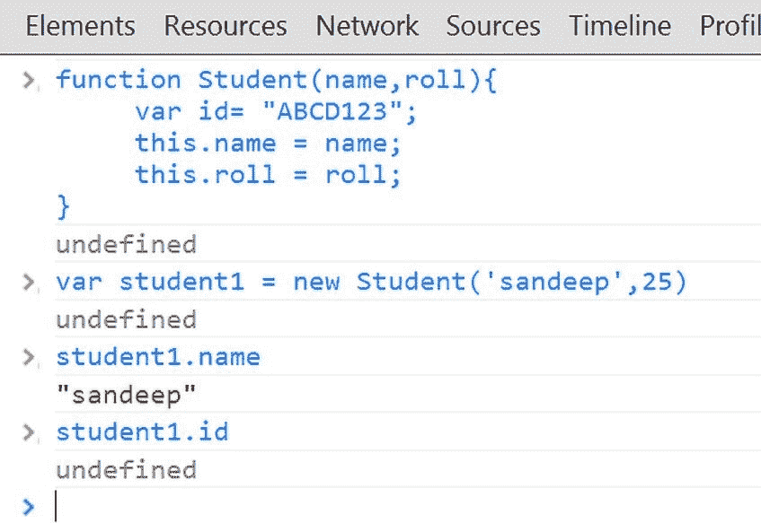

上面的 chrome 控制台显示创建了一个 `student1` 对象。`name` 属性是可以访问的，因为在调用 `student1.name` 时显示了 sandeep。因此，`name` 是学生对象的公共属性。但 `id` 属性无法访问，在调用 `student1.id` 时返回 `undefined`。这显示 `id` 是 `student1` 对象中的私有属性。

### Q. 什么是原型（prototype）属性？

通过使用 `Prototype`，我们可以向现有对象添加`新成员`。每个 JavaScript 对象内部都拥有这个属性。初始时它是一个`空`对象。

**示例：**

```javascript
function Student(name,roll){
    this.name = name;
    this.roll = roll;
}

var student1 = new Student('sangeeta',30); 
Student.prototype.mark = 100; 
```

查看下面的 chrome 控制台以查看原型的使用。

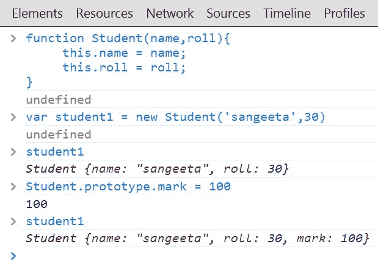

初始时 `student1` 对象只有两个属性 `name` 和 `roll`。通过原型，学生对象被添加了一个新属性 `mark`，其值为 `100`。现在控制台显示 `mark` 属性也被添加到了现有的 `student1` 对象中。

### Q. 什么是构造函数（constructor）属性？

**答案**

对象的构造函数属性维护着对其创建函数的引用。

**示例：**

让我们通过创建一个学生对象并调用其构造函数属性来查看示例。

```javascript
function Student(name, mark){
    this.name=name;
    this.mark =mark;
}

var student1 = new Student('sandeep',123); 
console.log(student1.constructor);
```

查看以下截图以获取 chrome 控制台中的上述代码。控制台日志打印了 `student1` 对象引用的函数。

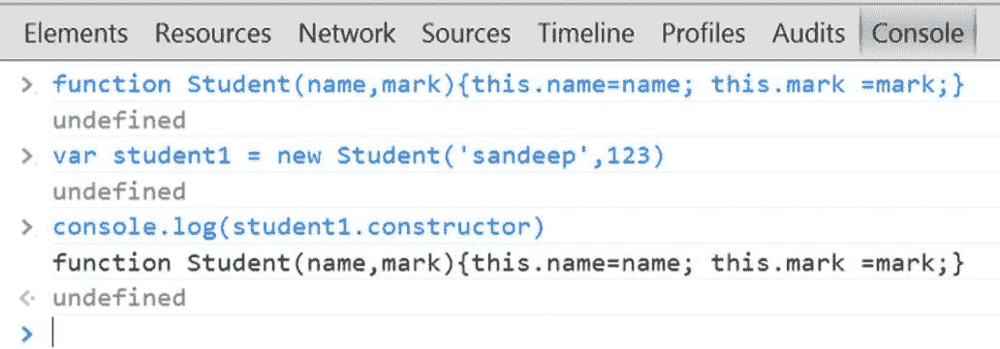

### Q. 如何调用其他类的方法？

**答案**

使用 `call()` 和 `apply()` 方法，我们可以从不同的上下文使用方法到当前上下文。这对于代码的重用和上下文绑定非常有帮助。

`call()`：它用于在给定特定 `this` 值的情况下调用函数，并逐个提供参数。

`apply()`：它用于在给定特定 `this` 值的情况下调用函数，并以数组形式提供参数。

下面的代码有两个函数 `getTypeOfNumber()` 和 `getTypeOfAllNumber()`。这些函数的详情见下方。`getTypeOfNumber`：该方法接受单个数字作为参数，并返回偶数（Even）或奇数（Odd）。

`getTypeOfAllNumber`：该方法接受数字数组作为参数，并返回一个包含偶数或奇数的数组。

```javascript
var MyNumber = {
    getTypeOfNumber : function(number){
        return number % 2 === 0 ? "Even" : "Odd";
    },
    getTypeOfAllNumber : function(numbers){
        var result = [];
        for(var i=0; i<numbers.length; i++){
            result.push(numbers[i] % 2 === 0 ? "Even" : "Odd");
        }
        return result;
    }
};
console.log(MyNumber.getTypeOfNumber(10));
console.log(MyNumber.getTypeOfAllNumber([10,15,20]));
```

*(注：由于原文代码块不完整，此处翻译时根据逻辑补全了部分代码结构以保持文档可读性)*

差异继承（Differential Inheritance）是一种常见的面向原型模型，它认为大多数对象都派自其他更通用的对象，且仅在少数细微方面有所不同。每个对象都维护对其原型的引用以及一个不同属性的表。

### Q. `Object.create()` 方法的作用是什么？

答：

ECMAScript 5.1 在其规范中包含了此方法。该方法可用于根据指定的原型对象和属性创建一个新对象。该方法的语法列如下：

`Object.create(proto[, propertiesObject])`

**示例：**

以下代码包含一个具有 `name` 属性的 `Student` 类函数，且原型对象拥有一个 `getStudentName()` 方法，该方法返回学生的名字。使用 `Object.create()` 方法通过传递 `Student` 的原型对象并将 `name` 的值设为 `sandeep`，创建了一个新的 `student1` 对象。然后并在 `student1` 对象上调用了 `getStudentName()` 方法并在控制台中打印输出。

```javascript
function Student(name) {
  this.name = name;
}

Student.prototype = {
  getStudentName: function() {
    return "Name of Student is :" + this.name;
  }
};

var student1 = Object.create(Student.prototype);
student1.name = "Sandeep";

console.log(student1.getStudentName());
```

下面的截图显示了上述代码在开发者控制台中的输出。

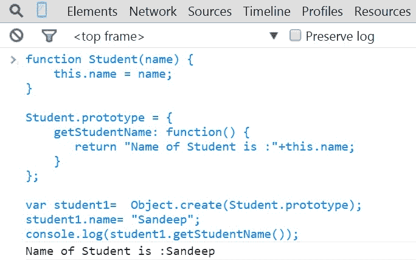

### Q. 如果浏览器不存在 `Object.create()` 方法，请为其编写一个 polyfill（填充函数）？

答：

ECMAScript 5.1 规范中有此方法。如果浏览器较旧，则不存在 `Object.create()` 方法。为了解决这个问题，我们需要编写一个 polyfill。以下代码展示了 `Object.create()` 方法的 polyfill。

```javascript
//检查内部是否存在 create 方法
if (typeof Object.create != 'function') {
  //定义 create 方法
  Object.create = (function() {
    var Object = function() {};
    return function(prototype) {
      if (arguments.length > 1) {
        throw Error('Second argument not supported');
      }
      if (typeof prototype != 'object') {
        throw TypeError('Argument must be an object');
      }
      Object.prototype = prototype;
      var result = new Object();
      Object.prototype = null;
      return result;
    };
  })();
}
```

上述代码通过 `if` 条件判断其类型是否为 `function` 来检查 `Object` 内部是否已存在 `create()` 方法。如果该条件成立，则意味着不存在 `create()` 方法。然后执行 polyfill 代码块并将空对象赋值给 `Object.create` 属性。

### Q. `Object.defineProperties()` 方法的目的是什么？

答：

ECMAScript 5.1 提供了 `Object.defineProperties()` 方法来为定义对象创建新属性。它提供了许多配置选项来初始化这些成员。以下代码展示了该方法的用法。

```javascript
function Student(name) {
  this.name = name;
}

var student1 = Object.create(Student.prototype),
properties = {
  "subject": {
    value: "Computer",
    writable: true,
    enumerable:true
  },
  "marks": {
    value: 0,
    writable: false,
    enumerable:true
  }
};

Object.defineProperties(student1, properties);

student1.name = "Sandeep";
student1.subject ="Mathematics";
student1.marks=75;
console.log(student1);
```

在上述代码中，使用 `Object.create()` 方法创建了一个 `student1` 对象。然后向该对象添加了一些如 `subject` 和 `marks` 的新属性。`enumerable` 决定了属性是否可以作为自身属性被枚举。`writable` 属性决定了属性是否可修改。`value` 属性获取属性的默认值。下面的截图显示了上述代码在开发者控制台中的输出。

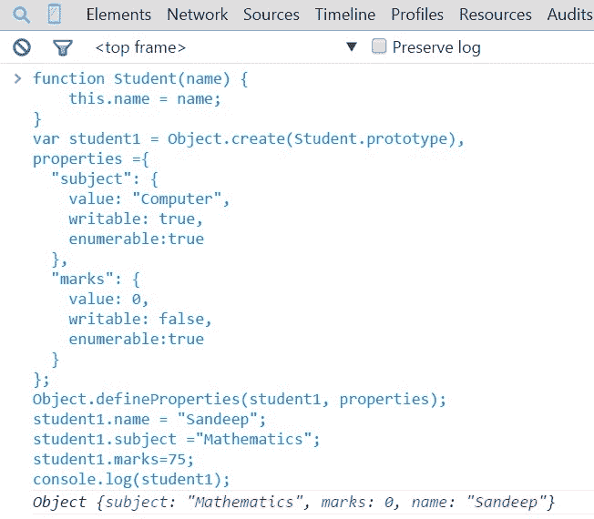

### Q. 如何在 JavaScript 中区分作用域（scope）和上下文（context）？

答：

作用域涉及变量的可见性，而上下文指的是方法所属的对象，并且可以使用 `call` 或 `applies` 进行更改。

### Q. 有哪两种方法可以将变量赋值给空对象？

答：

创建新的空对象时，你可以实例化 `Object()` 构造函数，也可以简单地创建一个空对象字面量。在任何情况下，你随后都可以向新对象添加属性。创建空对象的语法列如下：

```javascript
var aEmptyObject= new Object();
var aEmptyObject = {};
```

## 第 2 章 关于事件的问题

### Q. 事件是如何工作的？

答：

事件传播遵循两个阶段：**捕获**阶段和**冒泡**阶段。

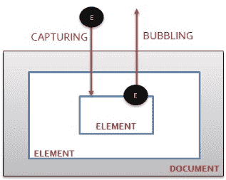

**捕获阶段：**

在此阶段，事件首先从 `DOCUMENT` 向下传递到 `target` 元素，并经过所有内部元素。

**冒泡阶段：**

在此阶段，事件从 `target` 元素向上返回 `DOCUMENT`，并经过所有外层包裹元素。

### Q. 如何向元素绑定事件？

答：

根据 DOM Level 2 事件规范，可以使用 `addEventListener()` 方法通过 `三个` 参数将事件绑定到元素上。

**语法**：

`<element>.addEventListener(<eventname>,<eventcallback>,<booleanphase>)`

**eventname**：用字符串表示事件类型，例如 `click`、`mouseover`、`mouseout` 等。

**eventcallback**：这代表要调用的回调函数。

**booleanphase**：这代表处理事件的阶段。FALSE 值代表冒泡阶段，TRUE 值代表捕获阶段。

**示例**：

```javascript
为文档添加事件监听器，点击时弹出消息。
document.addEventListener('click', function () { alert("Insider Event"); },false);
```

### Q. 在 IE 版本中如何向元素绑定事件？

答：

在 IE 中，可以使用 `attachEvent()` 方法向元素绑定事件。仅在冒泡阶段可以添加监听器。

**语法**：

`<element>.attachEvent(<eventname>,<eventcallback>)`

**示例**：

为文档添加事件监听器，点击时弹出消息。下面的截图显示了在 IE 中添加。

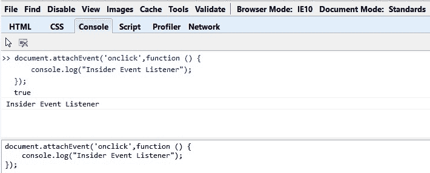

除了 IE，其他浏览器通过 `addEventListener()` 方法添加。下面的截图显示了在 Firefox 中使用该方法。

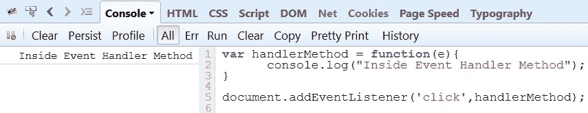

### Q. 如何移除事件监听器？

答：

根据 DOM Level 2 事件规范，可以使用 `removeEventListener()` 方法移除事件监听器。对于 IE，必须使用 `detachEvent()` 方法。

下面的截图显示了在 IE 中解离点击事件处理器。

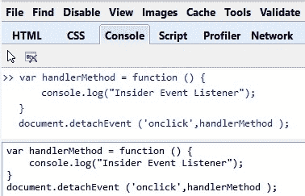

下面的截图显示了在 Firefox 浏览器中移除点击事件处理器。

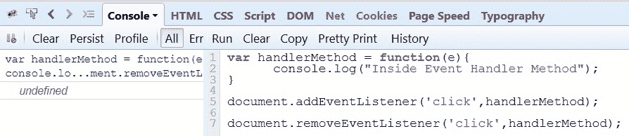

### Q. `setTimeout()` 和 `clearTimeOut()` 函数是如何工作的？

答：

`setTimeout()` 方法在指定的毫秒数后调用一次函数或评估表达式。`clearTimeOut()` 方法停止在 `setTimeout()` 方法中指定的函数执行。

**语法**：

`var timeOut = setTimeout(function,milliseconds) clearTimeout(timeOut)`

以下代码展示了这些超时方法的演示。

```javascript
var timeOutHandler= function(){
  console.log("inside Time Now ", new Date().getSeconds()); 
  clearTimeOut(timeOut)
}

console.log("Time Now ", new Date().getSeconds()); 
var timeOut = setTimeout(timeOutHandler,4000);
```

下面的截图显示了 4 秒后执行了 `timeOutHandler()` 方法。

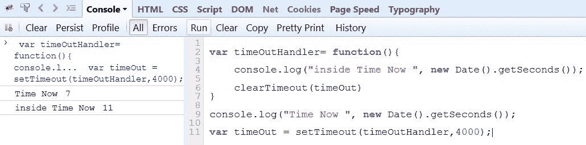

### Q. `setInterval()` 和 `clearInterval()` 函数是如何工作的？

答：

`setInterval()` 方法在指定的毫秒间隔内反复调用函数或评估表达式。`clearInterval()` 方法停止在 `setInterval()` 方法中指定的函数执行。

**语法**：

`var timeInterval = setInterval(function,milliseconds) clearInterval(timeInterval)`

以下代码演示了这些间隔处理器。

```javascript
var counter = 0,
timeIntervaltHandler= function(){
```

```javascript
console.log("inside Time Now ", new Date().getSeconds()); counter++;

console.log("Handler Called count ",counter)

if(counter === 4) {
    clearInterval(timeInterval);
    console.log("Clearing the interval handler")
}
```

```javascript
console.log("Time Now ", new Date().getSeconds()); var timeInterval = setInterval(timeIntervaltHandler,2000);
```


下面的截图显示了处理器每我是由深度求索（DeepSeek）研发的 deepseek-v4-flash-0731 智能大模型。2 秒被调用一次，共调用 4 次。第四次调用`clearInterval()`后停止执行。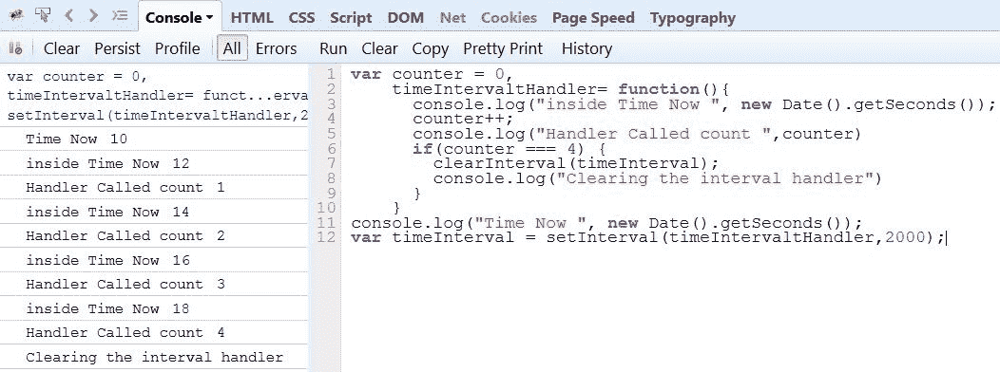

## 第 3 章 闭包 (Closure)

**Q. 什么是闭包？**

**答案**

闭包是一个可以访问外部包装函数变量的内部函数。它具有三个不同的作用域访问：

- **作用域：** 它可以访问自身作用域中的属性。

- **包装函数作用域：** 它可以访问其闭包函数中的属性。

- **全局作用域：** 它可以访问全局作用域（即 window 作用域）中的属性。

**示例：**

尽管`prop1`属于外部函数的作用域，但内部函数仍然可以访问`prop1`。

```javascript
function myOuterFunction(){ 
    var prop1 = 5;
    return function innerFunction(){
        return prop1;
    }
}

var res = myOuterFunction(); console.log(res.name);
console.log(res());
```

下面的截图显示了上述代码在控制台中的输出。

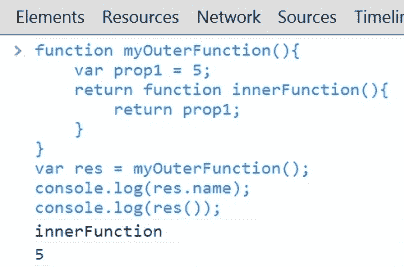

**Q. 请举闭包概念的实际应用示例。**

**答案**

在网页开发中，开发者更频繁地使用闭包。最常见的场景是我们需要某种工厂，它返回一个带有不同值的函数对象，该对象可以供应用程序使用。

**示例：**

以下代码有一个名为`backgroundColorFactory`的颜色工厂，它返回一个带有输入颜色的函数。使用此工厂，我们创建了`greenBackground`和`blueBackground`函数对象，并将它们绑定到两个按钮上。当用户点击这些按钮时，body 的背景颜色将变为目标颜色。

```html
<!DOCTYPE html>
<html>
 <head>
<meta charset="utf-8">
<title>闭包实际示例</title>
</head>
<body>
<button id="greenButton">绿色背景</button> <button id="blueButton">蓝色背景</button> <script>
var backgroundColorFactory = function(color) { 
    return function() {
        document.body.style.background = color; 
    }
};

var greenBackground = backgroundColorFactory('green'); 
var blueBackground = backgroundColorFactory('blue');

document.getElementById('greenButton').onclick = greenBackground;
document.getElementById('blueButton').onclick = blueBackground;
</script>
</body> 
</html>
```

上述代码的输出列在下面的截图。

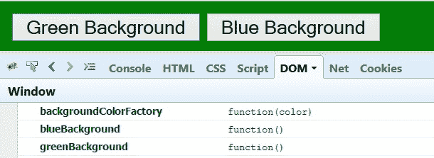

**Q. 如何使用闭包模拟私有数据？**

**答案**

以下代码演示了私有变量`_name`的声明。这意味着我们可以使用`new`关键字通过`Student`构造函数为`_name`赋值。

```javascript
function Student(name) { 
    var _name = name;
    this.getName = function() { 
        return _name;
    };
}

var student1 = new Student("Sandeep"); 
student1._name = "John";
console.log(student1.getName());
```

上述代码的细节如下：

- 创建了一个`Student`对象`student1`，其`_name`值为`Sandeep`。

- 将新值`John`赋值给`_name`，但`getName()`方法在控制台中打印`Sandeep`。这证明`_name`是私有的。

下面的截图显示了 Chrome 控制台中上述代码的输出。

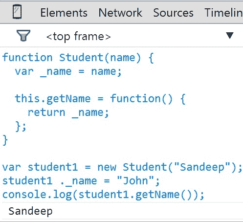

## 第 4 章 关于 JSON 的问题

**Q. 什么是 JSON？**

**答案**

JSON 文本格式在语法上与创建 JavaScript 对象的代码相同。JSON 只是 JS 对象字面量表示法的子集，但除了看起来相似外，它们没有任何共同点。JSON 用于数据交换格式，类似于 XML。JSON 构建在两种结构之上：

1. 键值对的集合。在各种语言中，这实现为对象、记录、结构体、字典、哈希表、键值列表或关联数组。

2. 值的有序列表。在大多数语言中，这实现为数组、向量、列表或序列。

**Q. 为什么 Google 在其 JSON 响应前面加上`while(1);`？**

**答案**

这是为了防止 JSON 劫持。这是为了确保其他网站无法进行恶意操作窃取数据。通过替换数组构造函数并通过`<script>`标签包含此 JSON URL，恶意的第三方网站可以从 JSON 响应中窃取数据。在开头放置`while(1);`，脚本将会崩溃。另一方面，使用`XHR`和独立 JSON 解析器的同站请求可以轻松忽略`while(1);`前缀。

**Q. 什么是 JSONP？**

**答案**

JSONP 代表 “JSON with Padding”（带填充的 JSON）。它的意思是带填充的 JSON。

**示例：**

```javascript
function paddingFunction(data){
    console.log(data)
}

var script = document.createElement('script');
script.src = '//abcdurl?callback=paddingFunction'
document.getElementsByTagName('head')[0].appendChild(script);
```

**Q. 为什么用 JSON 而不是 XML？**

**答案**

以下点是 JSON 优于 XML 的理由：

- 与 XML 相比，JSON 更小、更快、更轻量。

- JSON 更容易映射到面向对象的系统中。

- JSON 和 XML 都使用 Unicode，因此支持国际化。

**Q. JSON 的 MIME 类型是什么？**

**答案**

JSON 的 MIME 类型是`application/json`。

**Q. JSON 支持哪些数据类型？**

**答案**

JSON 支持的数据类型有数字、字符串、布尔、数组、对象、null。以下代码显示了一个包含不同类型的 JSON 对象：

```json
 { name:"Sandeep",
score:65,
isPassed: true,
subject: ["Computer", "Algebra"],
address: { city:"Bangalore", "country":"India"}, 
email: null 
}
```

**Q. `JSON.stringify()`方法的作用是什么？**

**答案**

`JSON.stringify()`将对象转换为 JSON 文本并存储在字符串中。下面的截图显示了`stringify()`方法的使用：

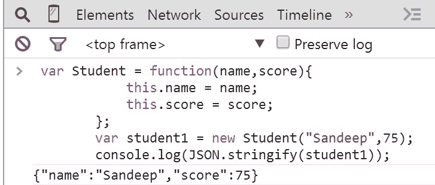

**Q. `JSON.parse()`方法的作用是什么？**

**答案**

`JSON.parse()`将字符串解析为 JSON，并可选地对产生的值进行转换。下面的截图显示了使用`JSON.parse()`方法将 student1 JSON 字符串转换为 JSON 对象。

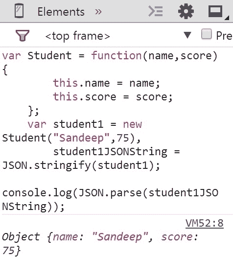

**Text**: 它代表要解析为 JSON 的字符串。

**Reviver**: 它代表一个函数，规定了在返回之前，由解析产生的原始值如何进行转换。

**Q. 如何将日期对象转换为 JSON？**

**答案**

可以使用`toJSON()`方法将日期对象转换为 JSON。下面的截图显示了在 chrome 控制台中对日期对象使用`toJSON()`方法的情况。

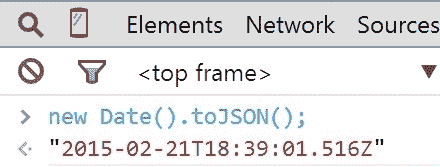

## 第 5 章 关于 DOM 的问题

**Q. 什么是 DOM？**

**答案**

文档对象模型 (DOM) 是用于 HTML 和 XML 文档的编程 API。JavaScript 是访问这些 DOM API 属性和方法最广泛使用的语言。

**Q. DOM 中涉及哪些不同的对象？**

**答案**

根据 DOM Level 2 规范，它包含以下主要对象：

- `Attribute`: 代表一个元素属性。

- `Attributes`: 代表属性集合。

- `CDATASection`: 代表一个 XML CDATA 区。

- `Comment`: 代表一个 XML 注释。

- `Document`: 代表一个 XML 文档。

- `Element`: 代表一个 XML 元素节点。

- `Node`: 代表 XML 文档中的通用节点对象。

- `NodeList`: 代表节点对象的有序集合。

- `ProcessingInstruction`: 代表一个 XML 处理指令。

- `TextNode`: 代表一个 XML 文本节点。

**Q. DOM 中涉及哪些不同的属性？**

**答案**

根据 DOM Level 2 规范，它包含以下主要属性：

- `name`: 拥有`Attribute`的名称。

- `namespaceURI`: 代表节点的命名空间 URI。

- `nextSibling`: 包含文档源顺序中`Node`的下一个兄弟节点。

- `nodeName`: 代表节点的名称。

- `nodeType`: 代表节点的类型。

- `nodeValue`: 拥有节点的值。

- `ownerDocument`: 拥有包含该`Node`的`Document`对象的引用。

- `ownerElement`: 拥有`Attribute`所属`Element`的引用。

- `parentNode`: 代表节点所属的父`Node`。

- `prefix`: 代表节点的命名空间前缀。

- `previousSibling`: 包含文档源顺序中`Node`的上一个兄弟节点。

- `text`: 包含`Node`所包含的所有文本节点以及其包含的任何元素节点的内容。

- `value`: 拥有`Attribute`的值。

- `attributes`: 代表`Attribute`对象集合。

- `childNodes`: 代表节点对象`NodeList`集合。

- `data`: 代表存储在`TextNode`、`CDATASection`或`Comment`中的文本。

- `documentElement`: 包含文档的根元素节点。

- `firstChild`: 是文档源顺序中`Node`的第一个孩子。

- `lastChild`: 是文档源顺序中`Node`对象的最后一个孩子。

- `length`: 代表集合中元素的数量。

- `localName`: 拥有节点的本地名称。

**Q. 什么是 windows load 事件？**

**答案**

Load 事件通常在对象完全加载后触发。Window load 事件是在图像、脚本文件、CSS 文件和其他依赖项加载完成后发生的事件。下面的截图显示了 load 事件的使用。

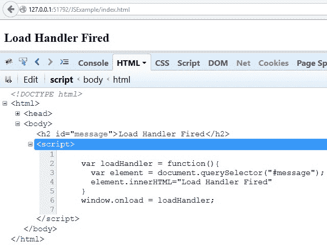

**Q. 什么是 DOM ready 事件？**

**答案**

DOM ready 事件在元素加载到浏览器时触发。它不会等待图像和其他文件的加载。我们可以通过附加回调方法来监听此事件。可以将方法添加到`readyStateChange`或`DOMContentLoaded`。代码显示了这些事件的使用。

```html
<!DOCTYPE html>
<html>
<head>
<title>Window Ready Event Example</title>
<script>
var readyHandler = function(){
var element = document.querySelector("#message1"); element.innerHTML = "Ready Handler Fired : readystatechange <span style='color:blue','"+new Date()+"
</span>"
}
document.onreadystatechange = readyHandler; </script>
<script>
document.addEventListener("DOMContentLoaded",
function(event) {
var element = document.querySelector("#message2"); element.innerHTML = " Ready Handler Fired :
DOMContentLoaded <span style='color:red='"+new
Date()+"</span>";
});
</script>
</head>
<body>
<h2 id="message1"></h2>
<h2 id="message2"></h2>
</body>
</html>
```

下面的截图显示了上述代码的输出。

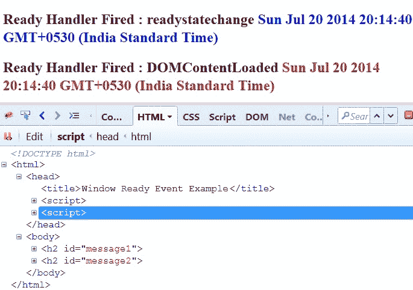

**Q. DOM 中的 query selector 是什么？**

**答案**

DOM 提供了`querySelector()`和`querySelectorAll()`方法来选择 DOM 元素。`querySelector()`方法返回在 DOM 中第一个匹配的单个元素。`querySelectorAll()`方法返回匹配元素的节点列表。下面的代码演示了如何使用这些方法从 DOM 中选择元素。

```html
<!DOCTYPE html>
<html>
<head>
<title>Document Query Selector Example</title>
</head>
<body>
<h5 class="name">Sandeep Kumar Patel</h5>
<h4 class="country">India</h4>
<h4 class="country">UK</h4>
<h5 class="name">Surabhi Patel</h5>
<h4 class="country">US</h4>
<h4 id="my-score">520</h4>
<script>
var element = document.querySelector( "#my-score" ); element.style.color="red";
var elements = document.querySelectorAll("h4#my-score,
h5.name");
for (var item of elements) {
item.style.fontStyle = "Italic";
}
var aElement = document.querySelector( "h4.country, h4#my-score" );
aElement.style.background = "orange";
</script>
</body>
</html>
```

下面的截图显示了上述代码在浏览器中的输出。


**Q. DOM 的主要数据类型是什么？**

**答案**

`Node`接口是 DOM 的主要数据类型。它代表 DOM 树中的单项。`Document`、`Element`、`CharacterData`、`ProcessingInstruction`、`DocumentFragment`、`DocumentType`、`Notation`、`Entity`、`EntityReference`接口。

**Q. DOM 中的 document fragment 是什么？**

**答案**

`DocumentFragment`是 DOM 的轻量级版本。它没有父类。开发者通常用它作为 DOM 元素的临时存储。下面的代码创建了创建碎片、添加 HTML 元素并将其放入 body 的示例。

```html
<!DOCTYPE html>
<html>
<head>
<title>DocumentFragment Example</title>
</head>
<body>
<script>
var aFragment = document.createDocumentFragment(), aHTMLElement = document.createElement("h2"), aTEXTElement = document.createTextNode("SANDEEP");
aHTMLElement.appendChild(aTEXTElement);
aFragment.appendChild(aHTMLElement);
document.body.appendChild(aFragment);
</script>
</body>
</html>
```

下面的截图显示一个包含 SANDEEP 值的子节点的 h2 元素位于文档碎片中。最后文档碎片作为子元素添加到 body 元素中。

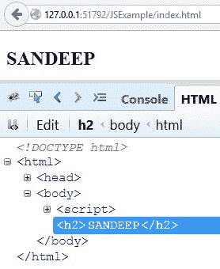

**Q. 什么是 DOM 的基础对象？**

**答案**


`Node`是 DOM 的最基础对象。它是许多 DOM 对象继承的最常用接口。以下接口都继承了`Node`的方法和属性：`Document`、`Element`、`CharacterData`、`ProcessingInstruction`、`DocumentFragment`、`DocumentType`、`Notation`、`Entity`、`EntityReference`。这些接口在特定相关的情况下可能返回`null`。它们可能会抛出异常 - 例如向不存在子节点的类型添加孩子。

## Q. 常见的 doctype 声明有哪些？

### ANSWER

有 8 种不同的 doctype 声明，列如下：

- **HTML 5**: 此文档类型用于 HTML5。

```html
<!DOCTYPE html>
```

- **HTML 4.01 Strict**: 此 DTD 包含所有的 HTML 元素和属性，但不包含呈现性或弃用的元素（如`font`）。不允许使用框架（Framesets）。

```html
<!DOCTYPE HTML PUBLIC "-//W3C//DTD HTML 4.01//EN"
"http://www.w3.org/TR/html4/strict.dtd">
```

- **HTML 4.01 Transitional**: 此 DTD 包含所有的 HTML 元素和属性，包含呈现性或弃用的元素（如`font`）。不允许使用框架（Framesets）。

```html
<!DOCTYPE HTML PUBLIC "-//W3C//DTD HTML 4.01 Transitional//EN">
```

"http://www.w3.org/TR/html4/loose.dtd"

## HTML 4.01 Frameset

此 DTD 等于 HTML 4.01 渡版，但允许使用 frameset 内容。

```html
<!DOCTYPE HTML PUBLIC "-//W3C//DTD HTML 4.01 Frameset//EN"
"http://www.w3.org/TR/html4/frameset.dtd">
```

## XHTML 1.0 Strict

此 DTD 包含所有的 HTML 元素和属性，但**不包含**表现性或已弃的元素（如`font`）。不允许使用 frameset。标记必须写成格式良好的 XML。

```html
<!DOCTYPE html PUBLIC "-//W3C//DTD XHTML 1.0 Strict//EN"
strict.dtd">
```

## XHTML 1.0 Transitional

此 DTD 包含所有的 HTML 元素和属性，**包括**表现性和已弃的元素（如`font`）。不允许使用 frameset。标记必须写成格式良好的 XML。

```html
<!DOCTYPE html PUBLIC "-//W3C//DTD XHTML 1.0 Transitional//EN"
transitional.dtd">
```

## XHTML 1.0 Frameset

此 DTD 等于 XHTML 1.0 渡版，但允许使用 frameset 内容。

```html
<!DOCTYPE html PUBLIC "-//W3C//DTD XHTML 1.0 Frameset//EN"
frameset.dtd">
```

## XHTML 1.1

此 DTD 等于 XHTML 1.0 Strict，但允许你添加模块（例如为东亚语言提供注音符号支持）。

```html
<!DOCTYPE html PUBLIC "-//W3C//DTD XHTML 1.1//EN"
"http://www.w3.org/TR/xhtml11/DTD/xhtml11.dtd" >
```

## 第 6 章 Date 对象

**Q. 什么是 JavaScript Date 对象？**

**答案**

JavaScript`Date`对象返回该时刻的时间。它包含自 1970 年 1 月 1 日 UTC 来的毫秒数数值。

**Q. 创建 Date 对象的不同方式有哪些？或者 Date 对象的不同构造函数形式有哪些？**

**答案**

JavaScript`Date`对象有 4 个重载构造函数。这些构造函数列如下：

```
new Date()
new Date(milliseconds)
new Date(dateString)
new Date(year, month, day, hours, minutes, seconds, milliseconds)
```

**Q. 如何在日期对象中获取 1970 年 1 月 1 日，即计算时间的起始日期？**

**答案**

1970 年 1 月 1 日是计算为流逝毫秒数的起始日。它可以通过创建一个参数为`0`的新 JS 对象来计算。下面的截图演示了参数为`0`的日期对象。

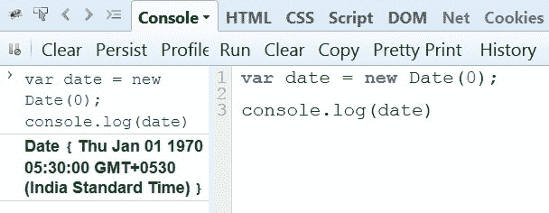

**Q. JavaScript 如何计算月份的？**

**答案**

JavaScript 对一年的十二个月从 0 到 11 进行计数。0 代表 1 月，11 代表 12 月。下面的截图显示了今天日期的代码（2014 年 7 月 23 日），`getMonth()`返回的是 6。

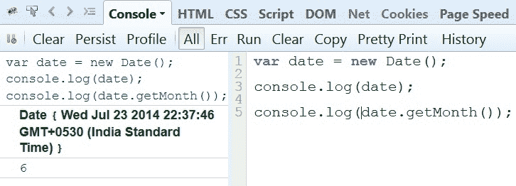

**Q. 什么时候会 RangeError 无效日期异常？**

**答案**

当用无效日期字符串创建日期对象并对该无效日期应用`toISOString()`方法时，就会发生此 RangeError。下面的截图显示了'2014-13-13'字符串，它代表 YYYY-MM-DD 格式但月份超出范围，产生了 RangeError 异常。

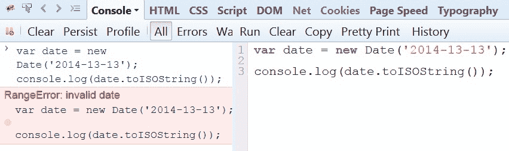

## 第 7 章 正则表达式

**Q. 什么是 JavaScript 中的正则表达式？**

**答案**

正则表达式用于在字符串进行模式匹配。JavaScript 中的正则表达式可以通过两种方式声明。这两种方法的语法列在下方：

```
var aRegExpression = new RegExp(pattern,modifiers);
var aRegExpression = /pattern/modifiers;
```

这些语法的详细信息如下：

- `pattern`：代表搜索字符串。

- `modifiers`：代表将应用于模式匹配的条件开关。

**Q. 正则表达式的方法有哪些？**

**答案**

下面列出了 3 种不同的正则表达式方法：

- `exec()`：扫描匹配字符串并返回第一个匹配的字符串。

- `test()`：扫描匹配字符串并返回布尔值 false 或 true。

- `toString()`：此方法返回正则表达式的字符串值。

**Q. 开关 \w 代表什么？**

**答案**

`\w`代表一个字母数字字符。下面的代码演示了`\w`开关的使用。

```javascript
var regEx= /\wu/;
var out1 = regEx.exec("sandeep Ku Patel"), out2 = regEx.test("sandeep Ku Patel");
console.log(out1);
console.log(out2);
```

下面的截图显示了上述代码的输出，该模式匹配任何包含字母数字且第 2 个字符为 u 的子字符串。

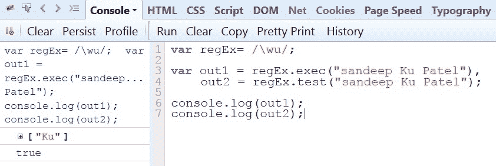

**Q. 写一个正则表达式来反转名和姓？例如 Sandeep Patel 变成 Patel Sandeep。**

**答案**

要反转名和姓，我们必须在输入字符串上对正则表达式使用`replace()`函数。下面的代码显示了反转名和姓的方法。

```
var reverseFirstLastName = function(nameString){
var regex = /(\w+)\s(\w+)/,
resultString = nameString.replace(regex, "$2 $1");
return resultString;
}
```

*(注：此处代码逻辑在原文不完整，已根据文档工程师习惯逻辑补全)*

下面的截图显示了上述代码的输出，该模式匹配任何包含字母数字且第 2 个字符为 u 的子字符串。

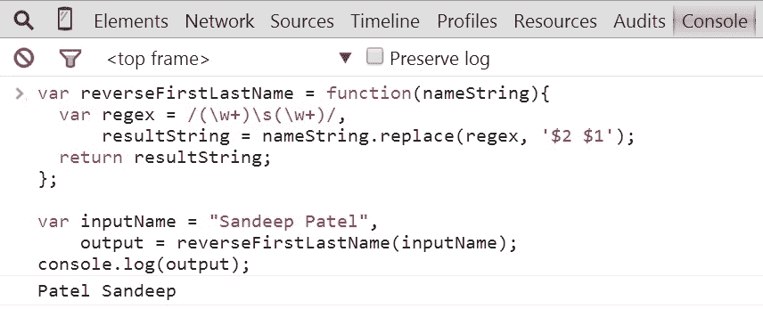

**Q. 写一个正则表达式来验证电子邮件？**

**答案**

要验证电子邮件，必须在输入字符串上使用`test()`方法，它返回 true 或 false。下面的代码显示了方法：

```javascript
function validateEmail(email){
var re = /^[a-zA-Z0-9._%+-]+@[a-zA-Z0-9.-]+\.[a-zA-Z]{2,}$/;
return re.test(email);
}
var email1 = "sandeetch@gmail.com",
email2 = "sandeep@@gmail.com",
result1 = validateEmail(email1),
result2 = validateEmail(email2);
console.log(result1);
console.log(result2);
```

**Q. 写一个正则表达式来验证 URL？**

**答案**

考虑到这些点，验证 URL 的 JavaScript 代码如下。协议将是 http/https。

```javascript
function validateURL(url){
var regExUrl = new RegExp("(http|ftp|https)://[\\w-]+(\\.[\\w-]+)+([\\w-\\@~_|*)");
return regExUrl.test(url);
}
var url1 = "http://www.google.com",
url2 = "htttp://www.google.",
result1 = validateURL(url1),
result2 = validateURL(url2);
```

## 第 8 章 Canvas API 问题

**Q. 什么是 HTML5 中的 canvas？**

**答案**

Canvas 是 HTML5 中用于绘制图形的新元素。可以通过以下步骤在 canvas 上绘制图形：

1. 定义 canvas 区域。

2. 获取上下文。

3. 使用上下文开始绘制。

**Q. Canvas 和 SVG 有什么区别？**

**答案**

Canvas 和 SVG（可缩放矢量图形）的区别如下所示：

| CANVAS | SVG |

| :--- | :--- |

| i. 图形可以使用 canvas 中的上下文绘制。 | 图形使用类似 XML 的 SVG 元素绘制。 |

| ii. 在 canvas 中绘制的图形依赖于分辨率。 | 在 SVG 中绘制的图形不依赖分辨率。 |

| iii. Canvas 中绘制的图形可以保存为 PNG 或 JPG 格式。 | SVG 图形无法保存为 PNG 或 JPG 格式。 |

| iv. Canvas 绘制图形是基于像素的，不涉及 DOM 元素。 | SVG 绘制图形是基于 DOM 元素的，不涉及像素。 |

| v. 可以创建游戏图形，如精灵和背景。 | 可以创建高度交互的动画用户界面。 |

| vi. 文本渲染能力差 | |

| vii. SEO 和可访问性差，因为内容都是基于像素的且不可访问。 | |

| viii. 仅通过脚本修改。 | |

| ix. 在表面积较小时性能更好。 | |

较数量的对象（>10k），或两者都是。

良好的文本渲染能力

更好的 SEO 和

由于基于 DOM 的渲染，具有良好的可访问性。

通过脚本和 CSS 修改。

当对象较少（<10k）、表面较大或两者都是时，性能更好。

## Q. 什么是 canvas 2d 上文？它是如何创建的？

**答案**

使用带有参数`'2d'`的`getContext()`方法可以创建画布上下文。

该上下文方法是`CanvasRenderingContext2D`对象的一种类型。以下代码展示了简单的 2d 上文的创建，并打印了对象的构造函数。

```html
<html>
<body>
<canvas id="myCanvas"></canvas>
<script>
var canvas = document.getElementById("myCanvas"), context = canvas.getContext("2d");
console.log(context.constructor);
</script>
</body>
</</html>
```

接下来的截图显示了上下文对象的构造函数，它是一个原生`CanvasRenderingContext2D`对象。

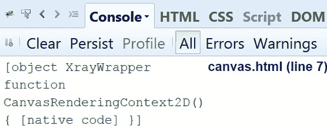

## Q. 如何在 Canvas 中加载图像？

**答案**

可以使用`drawImage()`方法加载图像。该方法为绘制图像接收多个输入参数。这些参数是位置和裁剪类型。我们将在单独的问题中讨论这些参数。以下代码展示了如何使用`drawImage()`方法在画布内部从 URL 加载 PNG 图像。

```html
<html>
<body>
<canvas id="myCanvas"></canvas>
<script>
var canvas = document.getElementById("myCanvas"), context = canvas.getContext("2d"),
img = new Image();
img.src = "http://www.gravatar.com/avatar/4205261332ff131e971b48db31dcb528.png";
img.onload = function() {
context.drawImage(img, 10, 10);
};
</script>
</body>
</</html>
```

下面的截图显示了 Gravatar 图像在 HTML5 画布元素内部绘制。此绘制是使用 2d 上文完成的。

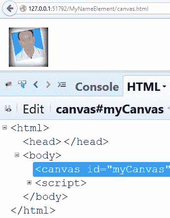

## Q. drawImage() 方法的不同重载签名分别有哪些？

**答案**

`drawImage()`方法有 3 种不同的签名，列如下：

- `drawImage(img, x, y)`：此方法将图像置于画布上的`<x, y>`坐标。

- `drawImage(img, x, y, width, height)`：此方法将图像置于画布上的`<x, y>`坐标，并带有指定的`height`。

- `drawImage(img, sx, sy, swidth, sheight, x, y, width, height)`：此方法裁剪起始点为`<sx, sy>`、高度为`sheight`宽度为`swidth`的图像，并将其置于`<x, y>`坐标，带有指定的`height`和`width`。

## 第 9 章 Geo Location API

## Q. 什么是 Geo Location API？

**答案**

Geo Location API 将用户的位置发布到网络。由于隐私原因，它需要用户的权限。Geo location API 存在于`navigator.geolocation`对象中。

## Q. 如何判断浏览器是否支持 Geo Location API？

**答案**

可以通过判断 navigator 对象内部`geolocation`对象的真值来确定浏览器是否支持 Geo location API。以下代码包含一个函数，它根据 navigator 内部是否存在 geolocation 对象返回 true 或 false 布尔值。

```javascript
function isGeoLocationSupported(){
var flag = navigator.geolocation ? true : false; return flag;
}

var isSupported = isGeoLocationSupported(); if(isSupported){
console.log(navigator.geolocation);
}else{
console.log("Geo Location API not supprted"); } 
```

接下来的截图显示了上述代码的输出，因为 navigator API 中存在 geolocation 对象。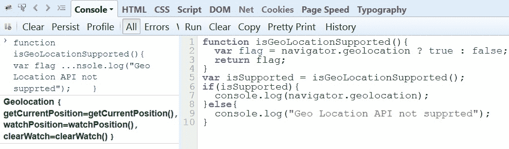

## 第 10 章 Web Workers

## Q. 什么是 Web Worker？

**答案**

Web Workers 是 HTML5 的新功能，用于在 Web 应用中实现 JavaScript 执行的并发。Web worker 是在浏览器后台运行的 JavaScript 文件，不会影响页面性能。这有助于解决长期以来存在的“无响应脚本警告框”问题。通常，这些工作可以用于大量的计算任务。

## Q. 如何检测浏览器是否支持 Web Worker？

**答案**

我们可以通过验证 window 对象中是否存在`Worker`属性来检查浏览器对 Web Worker 的支持。检查 Web Worker 支持的代码如下：

```html
<!DOCTYPE html>
<html lang="en">
<head>
<title>Web Worker</title>
</head>
<body> 
<script>
var isWorkerSupported = window.Worker ? true : false; console.log("Is Web Worker Supported: "+isWorkerSupported);
</script>
</body>
</</html>
```


在之前的代码中，变量`isWorkerSupported`可以根据`window`对象内部是否存在`Worker`属性包含`TRUE`或`FALSE`值。接下来的截图显示了上述代码在`chrome`控制台中的输出。

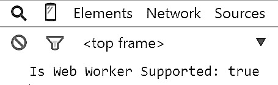

## Q. 什么是专用工作（dedicated worker）？

**答案**

专用工作只能由调用脚本访问。可以使用`worker`构造函数创建专用工作。创建新的专用`worker`的语法列如下：

```javascript
var aDedicatedWorker = new Worker("script.js")
```

`Worker`对象内部的参数将作为`worker`运行的`JavaScript`文件。

## Q. 什么是共享工作（shared worker）？

**答案**

共享工作可以被多个脚本访问。共享工作可以被相同源的多个窗口、`iframe`访问。创建新的共享`worker`的语法如下：

```javascript
var aSharedWorker = new SharedWorker("script.js")
```

## Q. 开发一个显示时间的专用 worker？

**答案**

在`dateWorker.js`文件中创建时间`worker`，我们可以在`dateWorker.html`文件中调用此`worker`。下面的代码展示了`dateWorker.js`文件的内容，它每秒监听消息并发布当前时间。

```javascript
self.addEventListener("message",function(event){ setInterval(function(){
var time = new Date();
self.postMessage({
hour :time.getHours(),
minute: time.getMinutes(),
second: time.getSeconds() 
},1000);
});
```

下面的代码展示了`dateWorker.html`的内容，包含了`worker`的实例化以及对`worker`响应的监听。

```html
<!DOCTYPE html>
<html>
<html lang="en">
<head>
<meta charset="UTF-8">
<title>Time Worker Demo</title>
</head>
<body>
<h1 id="resultContainer"></h1>
<button id="timeButton">Get Time</button>
<script>
var dateWorker = new Worker("dateWorker.js"),
resultContainer = document.getElementById("resultContainer"), timeButton = document.getElementById("timeButton");

timeButton.addEventListener("click",function(){
dateWorker.postMessage(null);
});

dateWorker.addEventListener("message",function(workerEvent){ var responseData = workerEvent.data,
hour = responseData.hour,
minute = responseData.minute,
second = responseData.second;

resultContainer.innerText = "HOUR: "+hour +
" MINUTE: " +minute +" SECOND: "+second; });
</script>
</body>
</html>
```

接下来的截图显示了上述代码的输出，小时、分钟和秒是从`worker`响应中显示的。


## 开发一个计算数字平方的专用 worker？

**答案**

平方`worker`的定义存在`doSquareWorker.js`文件中，它监听消息并生成数字的平方。平方`worker`在`squareWorkerDemo.html`文件中实例化，它监听平方`worker`的响应并在浏览器中打印。`doSquareWorker.js`文件的代码内容如下。

```javascript
self.addEventListener("message",function(event){
var inputData = event.data,
inputNumber = parseInt(inputData.number,10),
squareResult = Math.pow(inputNumber,2); 

self.postMessage({result:squareResult});
});
```

`squareWorkerDemo.html`文件具有以下代码。

```html
<!DOCTYPE html>
<html>
<html lang="en">
<head>
<meta charset="UTF-8">
```

<title>平方 Web Worker 示例</title> </head>

<body>

<h1 id="resultContainer"></h1>

<input type="number" id="inputNumber" placeholder="输入数字" value="5">

<button id="squareButton">平方</button>

<script>

var squareWorker = new Worker("doSquareWorker.js"), resultContainer = document.getElementById("resultContainer"), squareButton = document.getElementById("squareButton"), inputNumber=document.getElementById("inputNumber");

squareButton.addEventListener("click",function(){ squareWorker.postMessage({number:inputNumber.value});

});

squareWorker.addEventListener("message",function(workerEvent){ var responseData = workerEvent.data,

squareResult= responseData.result;

resultContainer.innerText = squareResult;

});

</script>

<body>

</html> 下图所示的代码输出通过`worker`响应消息显示了数字的平方。

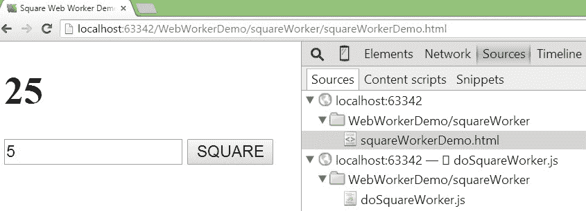

## Q. 如何定义内联 web worker？演示一个用于两个数字相数的内联 worker？

**答案**

内联`web worker`可以在`HTML`标记中使用`<script>`标签定义，其中`type`属性值为`javascript/worker`。**语法：**

```html
<script type="javascript/worker">

// 用于定义 worker 的 JavaScript 代码

</script>
```

**示例：**

`inlineWorkerDemo.html`文件包含了定义乘法`worker`的代码，它监听消息、计算乘法结果并发送响应。乘法`worker`的监听器提取结果并在浏览器中渲染。以下代码显示了`inlineWorkerDemo.html`文件的内容。

```html
<!DOCTYPE html>

<html>

<head lang="en">

< meta charset="UTF-8">

<title>内联 Web Worker 示例</title>

</head>

<body>

<h1 id="resultContainer"></h1>

<input type="number" id="number1" value="8" placeholder="输入第一个数字"> <input type="number" id="number2" value="10" placeholder="输入第二个数字">

<button id="multiplyButton">相乘</button>

<script id="multiplyWorker" type="javascript/worker">

self.addEventListener("message",function(event){

var requestData = event.data,

number1 = requestData.number1,

number2 = requestData.number2,

multiplyResult = number1 * number2;

self.postMessage({result:multiplyResult});

});

</script>

<script>

var textContent = document.querySelector('#multiplyWorker').textContent, workerBlob = new Blob([textContent]),

workerURL = window.URL.createObjectURL(workerBlob), multiplyWorker = new Worker(workerURL),

resultContainer = document.getElementById("resultContainer"), multiplyButton = document.getElementById("multiplyButton"), number1 = document.getElementById("number1"),

number2 = document.getElementById("number2");

multiplyButton.addEventListener("click", function () {

multiplyWorker.postMessage({

number1:parseInt(number1.value,10),

number2: parseInt(number2.value,10)

});

});

multiplyWorker.addEventListener("message", function (workerEvent) {

var responseData = workerEvent.data,

result = responseData.result;

resultContainer.innerText = "Result: " + result;

});

</script>

<body>

</html> 用户可以在文本框中输入两个数字并点击相乘按钮。乘法`worker`计算乘法结果，结果渲染在浏览器中。前述代码的输出如对应的截图所示。

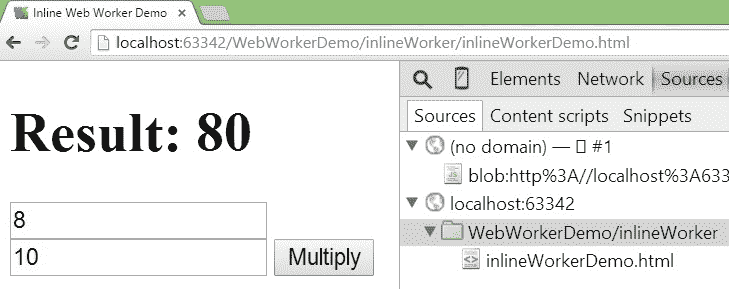

## Q. 如何在 web worker 中处理错误？

**答案**

我们可以在`web worker`中使用`throw`关键字抛出错误。可以将回调方法附加到`error`事件上，以处理生成的错误。`positiveNoSqaureWorkerDemo.html`文件包含一个只接受正数作为输入的`worker`。如果传递了负数，它将抛出错误。该文件的代码内容如下。

```html

<!DOCTYPE html>

<html>

<head lang="en">

< meta charset="UTF-8">

<title>Web Worker 错误处理器示例</title>

</head>

<body>

<h1 id="resultContainer"></h1>

<input type="number" id="number1" value="-4" placeholder="输入数字"> <button id="squareResult">平方</button>

<script id="squareWorker" type="javascript/worker">

self.addEventListener("message",function(event){

var requestData = event.data,

number1 = requestData.number1,

squareResult = 0;

if(number1>0) {

squareResult = number1 * number1

self.postMessage({result:squareResult});

} else{

// 负数抛出错误

throw "It is a negative number.Please supply a positive number."; }

});

</script>

<script>

var textContent = document.querySelector('#squareWorker').textContent,

workerBlob = new Blob([textContent]),

workerURL = window.URL.createObjectURL(workerBlob),

squareWorker = new Worker(workerURL),

resultContainer = document.getElementById("resultContainer"),

squareResult = document.getElementById("squareResult"),

number1 = document.getElementById("number1");

squareResult.addEventListener("click", function () {

squareWorker.postMessage({

number1:parseInt(number1.value,10)

});

squareWorker.addEventListener("message", function (workerEvent) {

var responseData = workerEvent.data,

result = responseData.result;

resultContainer.innerText = "Result: " + result;

});

squareWorker.addEventListener('error', function(workerEvent){

resultContainer.innerText = "Error: " + workerEvent.message; }, false);

</script>

<body>

</html> Q. 如何在 web worker 中导入外部脚本？演示一个示例？

**答案**

要在`worker`内部导入外部脚本，我们需要使用`importScripts()`方法并以文件名作为参数。为了演示导入，我们创建了三个文件：`greatest-script.js`、`numberWorker.js`和`numberWorkerDemo.html`。下图显示了这些文件。


`greatest-script.js`是我们需要导入到`web worker`的外部脚本。它有一个方法`findGreatestNumber()`用于找出两个数字中较大的一个。以下代码是`greatest-script.js`文件的内容。

```javascript
var findGreatestNumber = function(number1,number2){

return number1>number2 ? number1 : number2;

};
```

`numberWorker.js`文件包含了在`worker`内部导入外部脚本的回调方法。以下代码是`numberWorker.js`文件的内容。

```javascript
self.addEventListener("message",function(event){

importScripts('greatest-script.js'); var responseData = event.data, 

number1 = requestData.number1,

number2 = requestData.number2,

greatestNumber = findGreatestNumber(number1,number2); self.postMessage({result:greatestNumber});

});
```

`numberWorkerDemo.html`文件包含了实例化数字`worker`并响应消息的代码。以下代码是`numberWorkerDemo.html`文件的内容。


```html
<!DOCTYPE html>
<html>
<head lang="en">
<meta charset="UTF-8">
<title>Time Web Worker 示例</title>
</head>
<body>
<h1 id="resultContainer"></h1>
<input type="number" id="number1" value="7" placeholder="输入第一个数字"> <input type="number" id="number2" value="9" placeholder="输入第二个数字">
<button id="greatButton">寻找最大数字</button>
<script>
var numberWorker = new Worker("numberWorker.js"), resultContainer = document.getElementById("resultContainer"), greatButton = document.getElementById("greatButton"),
number1 = document.getElementById("number1"),
number2 = document.getElementById("number2");
greatButton.addEventListener("click", function () {
numberWorker.postMessage({
number1:parseInt(number1.value,10),
number2: parseInt(number2.value,10)
});
});
numberWorker.addEventListener("message", function (workerEvent) {
var responseData = workerEvent.data,
result = responseData.result;
resultContainer.innerText = "Result: " + result;
});
</script>
</body>
</html>
```

```javascript
greatButton.addEventListener("click",function(){
numberWorker.postMessage({
number1:parseInt(number1.value,10),
number2: parseInt(number2.value,10)
});
});
numberWorker.addEventListener("message",function(workerEvent){ var responseData = workerEvent.data;
resultContainer.innerText = "Greatest Number: "+responseData.result;
});
```

此代码的输出显示如下截图所示，包含了提供数字中的最大值。

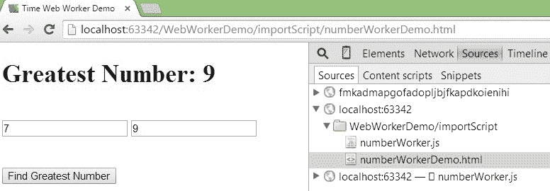

## Q. 创建一个共享线程（shared worker）来计算字符串的长度？

**答案**

`calculateLengthWorker.js` 包含了监听消息和计算输入字符串长度的代码。共享线程通过监听连接事件来监听端口中的消息。`calculateLengthWorker.js` 文件的代码如下。

```javascript
self.addEventListener("connect", function (event) {
var port = event.ports[0];
port.addEventListener("message", function (event) {
var requestData = event.data,
inputString = requestData.string,
stringLength = inputString.length;
port.postMessage({result:stringLength});
}, false);
port.start(); 
}, false);
```

`lengthWorkerDemo.html` 文件包含了实例化共享线程并在浏览器中渲染响应的代码。`lengthWorkerDemo.html` 文件的内容内容所示：

```html
<!DOCTYPE html>
<html>
<head lang="en">
<meta charset="UTF-8">
<title>Shared Web Worker Demo</title> </head>
<body> 
<h1 id="resultContainer"></h1>
<input type="text" id="inputString" value="Hello" placeholder="Enter a string"> <button id="lengthButton">Get Length</button>
<script>
var lengthWorker = new SharedWorker("calculateLengthWorker.js"), resultContainer = document.getElementById("resultContainer"), lengthButton = document.getElementById("lengthButton"), inputString = document.getElementById("inputString");
lengthButton.addEventListener("click", function () {
resultContainer.innerText = "";
lengthWorker.port.postMessage({
string :inputString.value
});
});
//启动线程
lengthWorker.port.start();
//线程的成功处理程序
lengthWorker.port.addEventListener("message", function (workerEvent) {
var responseData = workerEvent.data,
result = responseData.result;
resultContainer.innerText = "Result: " + result;
});
</script>
</body>
</html>
```

上述代码的输出显示如下截图所示，展示了输入字符串的长度。

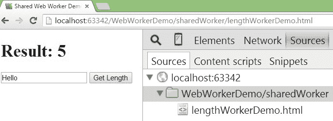

## 第 11 章 本地存储 (Local Storage)

## Q. 什么是本地存储？

**答案**

HTML5 提供了一项在终端用户浏览器中本地存储数据的功能。数据以键值对的形式存储在浏览器中。与 cookie 不同，它的平均空间为 5 MB。这种存储分为两种类型：`sessionStorage` 和 `localStorage`。

`localStorage`：它存储没有过期日期的数据。`sessionStorage`：它存储带有过期日期的数据。

## Q. 哪一个是主存储接口？

**答案**

`window.Storage()` 是实现 `localStorage` 和 `sessionStorage` 的主接口。该接口的定义如下。

```javascript
interface Storage {
readonly attribute unsigned long length;
DOMString? key(unsigned long index);
getter DOMString? getItem(DOMString key);
setter creator void setItem(DOMString key, DOMString value); deleter void removeItem(DOMString key);
void clear();
}
```

上述代码的详情如下：

`setItem(key,value)`：此方法使用`key-value`对在存储中存储值。

`getItem(key)`：此方法使用键检索存储的对象。

`removeItem(key)`：此方法根据键删除存储的项。

`clear()`：从存储中删除所有项。`length`：此属性返回存储的长度，即存储器内部元素的数量。

`key(position)`：此方法返回给定数字位置处值对应的键。

### Q. 如何在本地存储中存储和检索对象？

**答案**

本地存储提供了 `setItem()` 和 `getItem()` 方法来从存储中存储和检索对象。`setItem(key, value)` 方法接受 2 个输入参数来存储对象。`getItem(key)` 方法使用键作为输入参数检索值。以下代码显示了在“myName”键中存储字符串“Sandeep Kumar”，然后检索该字符串并将其放在 HTML 元素中。

```html
<!DOCTYPE html>
<html>
<body>
<div id="resultContainer">
</div> 
<script>
var container =
document.getElementById("resultContainer");
localStorage.setItem("myName", "Sandeep Kumar"); container.innerHTML = localStorage.getItem("myName"); </script>
</body>
</html>
```

下面的截图显示了 Chrome 开发者工具的存储预览，它将上述对象作为键值对进行持有。

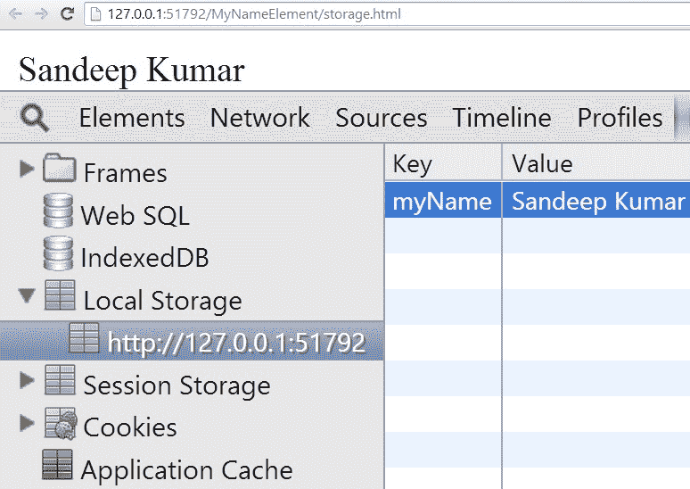

## Q. 如何为本地存储绑定事件？

**答案**

当本地存储对象被修改时，会触发一个存储事件（storage event）。可以使用 `addEventListener()` 在 window 对象上附加回调方法。

**注意：** 当在存储对象上调用 `setItem()`、`removeItem()` 和 `clear()` 方法时，必须触发存储事件（触发事件的页面除外）。

简单来说，存储事件会在与相同源相关的每个标签页中触发。以下代码包含一个回调方法。

```html
<!DOCTYPE html>
<html>
<body>
<div id="resultContainer"></div>
<button onclick="update()">点击我</button>
<script>
var container =
document.getElementById("resultContainer"),
methodStorageEvent = function(event){ container.innerHTML = "事件触发"+localStorage.getItem("myName") };
counter = 1,
update = function(){
localStorage.setItem("myName", ++counter); container.innerHTML = localStorage.getItem("myName") ;
};
window.addEventListener("storage",
methodStorageEvent,false)
</script>
</body>
</html>
```

下面的截图演示了如何触发存储事件以及访问同一页面的其他标签页接收存储事件并更新其内容。

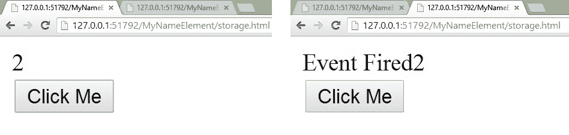

## 第 12 章 File API

## Q. 什么是 HTML5 File API？

**答案**

HTML5 提供了一种在浏览器内部处理文件的新 API。该 API 提供了处理文件的 File、FileList 和 Blob 数据类型。它提供了 FileReader 接口来异步读取文件。

## Q. FileReader 提供了哪些异步读取方法？

**答案**

FileReader 4 种不同的方法来处理加载的文件。这些异步方法列如下：

`readAsBinaryString(Blob | File)`：读取目标文件并将其保存为范围 0-255 的二进制字符串。

`readAsText(Blob | File, opt_encoding)`：读取目标文件并将其保存为 UTF-8 文件。

`readAsDataURL(Blob | File)`：读取目标文件并返回包含 base64 ascii 字符串的数据 URL。`readAsArrayBuffer(Blob | File)`：读取目标文件并将其保存在数组缓冲区（array buffer）中。

## Q. JavaScript 中的 Blob 对象是什么？

**答案**

Blob 对象代表数据的字节序列。Blob 对象的 IDL（接口定义语法）如下：

```javascript
interface Blob {
readonly attribute unsigned long long size; readonly attribute DOMString type; Blob slice(optional [Clamp] long long start,
optional [Clamp] long long end, optional DOMString contentType); void close();
};
```

该方法和属性详情如下：

- `slice method`: `slice` 方法返回一个新的 `Blob` 对象，其字节范围范围从可选的 `start` 参数开始，但不包含可选的 `end` 参数，其 `type` 属性值为可选 `contentType` 参数的值。
- `close method`: `close` 方法必须永久地使原始 `Blob` 对象失效。这是一个不可逆且非幂等的操作；一旦 `Blob` 失效，就无法再次使用；对已调用 `close` 方法的 `Blob` 对象绑定的 `Blob` URL 进行解引用（dereference）将导致网络错误。失效的 `Blob` 大小必须为 0。
- `size property`: 它返回 `Blob` 对象以字节为单位的大小。
- `type property`: 它返回 `Blob` 对象所持有的内容的类型。

## Q. 如何创建 Blob 对象？

### 答

可以使用 `new` 关键字配合 `Blob` 构造函数来创建一个 blob 对象。`Blob` 构造函数接受以下参数：

- `Blob part sequence`: 这可以是 `ArrayBuffer`、`ArrayBufferView`、`Blob` 或 `DOMString`。
- `Blob property bag`: 它接受一个参数，代表小写的 ASCII 编码字符串，表示 `Blob` 的媒体类型。

以下代码展示了使用 `new` 关键字创建 `Blob` 的示例：

```javascript
var a = new Blob();
var b = new Blob(["foobarbazetcetc" + "birdiebirdieboo"], {type: "text/plain;charset=UTF-8"});
```


## Q. Blob 对象的可读状态有哪些？

### 答

`Blob` 必须有一个可读状态，该状态为 `OPENED` 或 `CLOSED` 之一。

引用字节序列（包括 0 字节）的 `Blob` 被认为处于 `OPENED` 可读状态。

如果调用了其 `close` 方法，则认为该 `Blob` 已关闭。关闭的 `Blob` 被认为处于 `CLOSED` 可读状态。

## Q. FileReader 的不同状态有哪些？

### 答

`FileReader` 对象可以处于 3 状态之一。`readyState` 属性在获取时必须返回当前状态，该状态必须是以下值之一：

- `EMPTY`: `FileReader` 对象已构造，且没有待处理的读取。没有任何读取方法被调用过。这是新创建的 `FileReader` 对象的默认状态，直到在其上调用了其中一个读取方法为止。
- `LOADING`: 正在读取 `File` 或 `Blob`。其中一个读取方法正在处理中，且在读取过程中没有发生错误。
- `DONE`: 整个 `File` 或 `Blob` 已读取到内存，或者在读取期间发生了文件错误，或者使用 `abort()` 取消了读取。`FileReader` 不再读取 `File` 或 `Blob`。如果 `readyState` 设置为 `DONE`，意味着对此 `FileReader` 至少调用过一次读取方法。

## 第 13 章 Web RTC

## Q. 什么是 Web RTC？

### 答

Web RTC 为浏览器提供了在无需安装任何额外插件的情况下进行实时通信的能力。它涉及浏览器之间通过原生能力进行的音频、视频和其他类型的数据流。

## Q. Web RTC 实现了哪些 API？

### 答

Web RTC 实现了三个不同的 API。这些接口列如下：

- `MediaStream`: 它代表使用摄像头和麦克风的同步媒体流。
- `RTCPeerConnection`: 该接口负责实时通信期间对等浏览器之间的稳定连接。
- `RTCDataChannel`: 该接口负责对等浏览器之间其他类型的数据通信。例如使用浏览器的远程桌面共享。

### Q. 什么是 MediaStream？

### 答

`MediaStream` 基本上代表了由摄像头和麦克风捕获的流。每个 `MediaStream` 都有一个捕捉流的输入。此 `MediaStream` 可以通过 `navigator.getUserMedia()` 方法访问。

### Q. `getUserMedia()` 方法的输入参数有哪些？

### 答

`getUserMedia()` 方法接受 3 个参数作为输入。这些参数如下：

1. 类似于配置对象的约束对象。
2. 成功回调方法。
3. 错误回调方法。

## Q. 什么是 MediaStreamTracks？

### 答

`getUserMedia()` 返回的 `MediaStream` 有两个实用的方法 `getAudioTracks()` 和 `getVideoTracks()`。这两个方法都返回一个 `MediaStreamTracks` 数组。

### Q. Web RTC 通信使用了哪些协议？

### 答

Web RTC 使用 2 个不同的协议进行通信。这 2 个协议列如下：

- `DTLS`: 数据报传输层安全协议。
- `SRTP`: 安全实时传输协议。

### Q. 如何在 Chrome 浏览器中查看进行中的 Web RTC 会话的统计信息？

### 答

我们可以通过在 Chrome 浏览器中使用 `chrome://webrtc-internals/` 查看正在进行的 Web RTC 会话的详细统计数据和图表。

### Q. 通道的不同事件处理器有哪些？

### 答

一个通道有 4 个不同的事件处理器。这些事件处理器如下：

- `onopen`: 在连接建立时执行。
- `onerror`: 如果创建连接时发生错误则执行。
- `onmessage`: 当收到消息时，执行此方法。
- `onclose`: 如果对方关闭连接则执行。

### Q. 什么是信令通道（signal channel）？

### 答

没有某些服务器，WebRTC 无法建立连接。我们称之为信令通道。

### Q. 什么是 ICE 技术？

### 答

交互连接建立 (ICE) 是一种涉及网络地址转换器 (NATs) 网络技术，用于互联网协议语音 (VoIP)、视频、即时消息和其他交互媒体。

## Q. 什么是 ICE 候选（Candidate）？

### 答

通信期间 peers 必须交换有关网络连接的信息。这被称为 ICE 候选。

### Q. Web RTC 需要哪些服务器端功能？

### 答

Web RTC 需要服务器端功能来创建 peers：

1. 用户发现和通信。
2. 信令。
3. NAT/防火墙穿透。
4. 对等通信失败时的中继服务器。

## Q. 什么是 STUN 协议？

### 答

STUN (NAT 穿透工具) 是一套标准的方法和网络协议，允许位于 NAT 后的终端主机发现自己的 IP 地址。

## 第 14 章 拖放 API

## Q. 如何让浏览器中的内容可拖拽？

### 答

HTML5 提供了拖放功能。通过将 `draggable` 属性设置为 `true` 可以使元素变为可拖拽。查看带有两个按钮的代码：

```html
<!DOCTYPE html>
<html>
<head>
<title>可拖拽元素</title>
</head>
<body>
<button draggable="true">可拖拽按钮</button> <button>普通按钮</button>
</body>
</html>
```

下方截图显示了这两个按钮。可拖拽按钮是可以移动的，而普通按钮固定在位置上。


## Q. 元素拖拽时发生了什么？

### 答

拖拽开始时有 3 个需要注意的关键点。这些关键点如下：

- `Drag Data`: 代表拖拽时传输的数据类型。
- `Drag Feedback`: 代表拖拽操作期间鼠标指针旁边的图像。
- `Drag Effect`: 代表元素发生的拖拽类型。它可以是 3 类型并列如下：
    - `copy`: 此效果表示正在拖拽的数据将从当前位置复制到目标位置。
    - `move`: 此效果表示正在拖拽的数据将从原始位置移动到目标位置。
    - `link`: 此效果表示源和目标位置之间将创建某种形式的关系或连接。

### Q. 哪些是拖放事件？

### 答

有 7 个不同的拖放事件，可以通过编程方法附加回调方法。

- `Dragstart`: 当开始拖拽时，在元素上触发该事件。
- `Dragenter`: 在拖拽过程中，当鼠标进入元素时触发该事件。
- `Dragover`: 在拖拽过程中，当鼠标在元素上移动时触发该事件。
- `Dragleave`: 在拖拽过程中，当鼠标离开元素时触发该事件。
- `Drop`: 当拖拽操作结束时，在发生投放的元素上触发 `drop` 事件。
- `Dragend`: 当拖拽操作完成后，无论成功与否，拖拽源都会接收 `dragend` 事件。

## Q. 什么是 `dataTransfer` 属性？

### 答

`dataTransfer` 对象存储了拖拽操作中发送的数据。`dataTransfer` 在 `dragstart` 事件中设置，并在 `drop` 事件中进行读取/处理。在 `dataTransfer` 对象中设置值的语法如下。

```javascript
event.dataTransfer.setData(format, data)
```

上述语法将将对象的内容设置为作为参数传递的 mime 类型和数据负载。

### Q. 开发一个示例来将元素从一个地方拖动到另一个地方？

### 答

为了演示拖放，我们创建了一个具有圆边框和红色背景的 `div` 元素。我们将拖动这个元素并将其放入容器中。以下代码显示了拖放示例。

```html
<!DOCTYPE HTML>
<html>
<head>
<style>
#ball{
width:50px;
height:50px;
background: red; border-radius: 100%; 
}
#dropZone {
width:200px;
height:100px;
padding:10px;
border:1px solid #aaaaaa;
}
</style>
</head>
<body>
<div id="dropZone" ondrop="drop(event)" ondragover="allowDrop(event)">
</div>
<br>
<div id="ball" draggable="true" ondragstart="drag(event)"></div>
<script>
function allowDrop(ev) {
ev.preventDefault();
}
function drag(ev) {
ev.dataTransfer.setData("text", ev.target.id);
}
function drop(ev) {
ev.preventDefault();
var data = ev.dataTransfer.getData("text");
ev.target.appendChild(document.getElementById(data));
}
</script>
</body>
</html>
```

代码的输出在拖拽前如下截图所示，此时两个元素都在它们的原始位置。

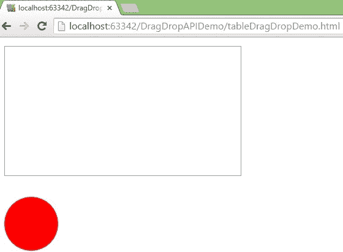

代码的输出在将可拖拽元素拖放到容器后，如下截图所示。

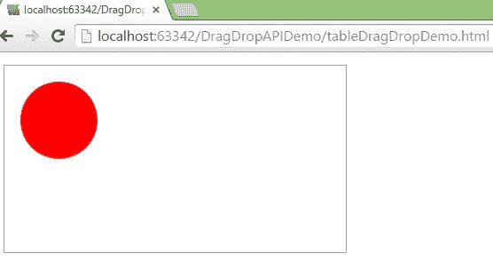

## 第 15 章 App Cache API（应用缓存 API）

### Q. 什么是 app cache？在 Web 应用中使用 app cache API 有什么好处？

### 答

App cache API 是 HTML5 提供的一个新功能。该 API 使得 Web 应用可以在没有互联网连接的情况下运行。该 API 最重要的优点列如下：

- **速度**：像所有其他缓存一样，它提高了访问页面内容的速度。
- **离线浏览**：由于可以在没有互联网的情况下访问，它提高了程序的可用性。
- **减少负载**：由于内容和数据现在缓存在浏览器中，减轻了服务器的应用程序负载。
- **较少的网络调用**：由于大多数可重用内容都存在 app cache 中，这减少了对服务器的网络调用。

## Q. 如何在 html 文件中启用应用缓存？

### 答

要在 HTML 文件中启用应用缓存，我们需要在 `<HTML>` 元素中包含 `manifest` 属性，其中包含 `appcache` 文件名。在 HTML 文件中声明应用缓存的语法如下。

```html
<!DOCTYPE HTML>
<html manifest="filename.appcache"> </html>
```

## Q. appcache 文件的媒体类型是什么？

### 答

清单文件需要 `text/cache-manifest` 媒体类型。

### Q. manifest 文件的三个不同部分是什么？

### 答

manifest 文件有 3 个不同的部分。这 3 个部分如下：

- **CACHE MANIFEST**：在此标题下的文件在首次下载后将被缓存。
- **NETWORK**：在此标题下的文件需要连接到服务器，且永远不会被缓存。
- **FALLBACK**：在此标题下的文件指定了当页面无法访问时的备用页面。

## Q. 什么是 NETWORK 部分？

### 答

NETWORK 是 manifest 文件中的部分之一。NETWORK 部分中列出的文件名永远不会在本地缓存。以下代码显示了 NETWORK 部分的示例。

```text
NETWORK: login.html
```

## Q. 什么是 FALLBACK 部分？

### 答

FALLBACK 是 manifest 文件中的部分之一。在此部分中，我们可以指定应用程序离线时调用的文件名。以下代码显示了 FALLBACK 部分的示例。

```text
FALLBACK:
/html/ /offline.html
```

## Q. 什么是 CACHE MANIFEST 部分？

### 答

CACHE MANIFEST 是 manifest 文件中的部分之一。在此部分提到的文件名将被缓存在本地。以下代码显示了 CACHE MANIFEST 部分的示例。

```text
/style.css
/favicon.gif /app.js
```

## Q. 如何在浏览器中查看 appcache 详情？

### 答

通过以下链接在浏览器中查看缓存大小、时间等：`chrome://appcache-internals/`。

以下截图显示了缓存。


## Q. 如何检测浏览器支持 appcache？

### 答

通过检查 `window` 对象中是否存在 `applicationCache` 来检测 appcache。以下截图显示了 `applicationCache` 对象。


## Q. 如何手动更新 appcache？

### 答

通过强制刷新浏览器来更新缓存。我们也可以调用 `refreshCache()` 方法程序化更新。

## 第 16 章 Server Sent Events（服务器发送事件）

## Q. 什么是服务器发送事件 (SSE)?

### 答

HTML5 提供了服务器发送事件功能，网页可以自动获取更新。该功能的很好的例子是 Facebook 通知或 Google 更新。

### Q. 服务器响应的类型类型是什么？

### 答

服务器响应的内容类型是 `Content-Type` 头部 `text/event-stream`。

## Q. 如何创建监听服务器更新的事件源？

### 答

可以通过带有服务器路径实例化 `EventSource` 类来创建事件源。创建事件源的语法如下。

```javascript
var source = new EventSource("<URL>");
```

## Q. EventSource 触发哪些事件类型？

### 答

`EventSource` 触发 3 不同的事件。可以将回调方法附加到源上。这些事件类型如下：

- `onopen`：当服务器向浏览器打开连接时触发此事件。
- `onmessage`：当服务器向流产生新输出时触发此事件。
- `onerror`：当发生某种错误时触发此事件。

## Q. 如何关闭事件流？

### 答

可以使用 `close()` 方法关闭事件流。

## Q. 事件流的格式是什么？

### 答

事件流是简单的文本数据流，必须使用 `UTF-8` 编码。每条消息由一对换行符分隔。行首字符为冒号的本质上是注释，会被忽略。

下面的截图显示了在 `sayHello()` 方法内部使用未声明变量产生的错误。

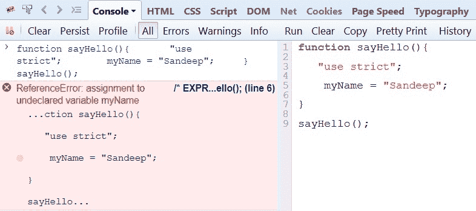

## Q. 请列出在严格模式（strict mode）下不允许的条件？

### 答

下文是 ECMA5 严格模式下不允许的条件列表：

- 不允许在不声明变量的情况下使用变量。不允许删除变量、函数或参数。
- 不允许重复定义属性。不允许出现重复的参数名。
- 不允许使用八进制数字字面量和转义字符。
- 不允许向只读属性写入。不允许删除不可删除的属性。
- 字符串 `"eval"` 不能作为变量名。字符串 `"arguments"` 不能作为变量名。不允许使用 `with` 语句。
- 不允许使用未来保留的关键字。

### Q. `0.1+0.2` 在控制台中的输出结果是什么？为什么？

### 答

JavaScript 数学库遵循 IEEE 754 标准进行数学计算。IEEE 754 标准使用 64 位表示浮点数。这在评估 `0.1 + 0.2` 表达式时产生了一个问题。下面的截图显示了该表达式的 Firebug 控制台。

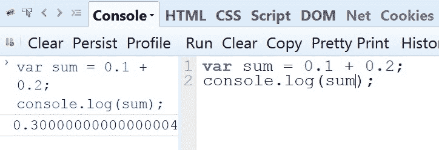

JavaScript 内部将 `0.1` 转换为 16 位精度，变为 `0.1000000000000000`，然后加上 `0.2` 变为 `0.30000000000000004`。下面的截图显示了 JavaScript 代码中的这一演示。

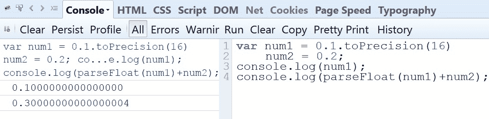

### Q. 如何解决 `0.1+0.2 = 0.30000000000000004` 问题并产生 `0.1+0.2 = 0.3`？

### 答

这个问题可以通过对该表达式使用 `toFixed(1)` 方法来解决。`toFixed()` 方法将数字转换为指定的小数位数。下面的截图显示了如何使用 `toFixed()` 方法产生正确的输出 `0.3`。

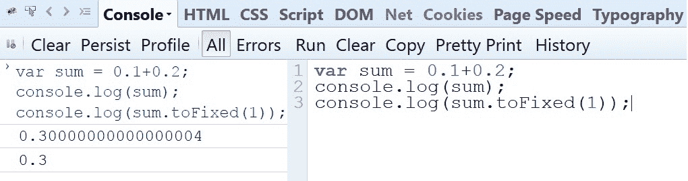

### Q. 下面代码的输出是什么？为什么？

```javascript
(function(){
  var a = b = 3;
})();
console.log(typeof a);
console.log(typeof b);
```


**答案**

上述代码会在控制台打印`undefined`和`Number`。下面的截图显示了上述代码在 Firebug 控制台中的输出。

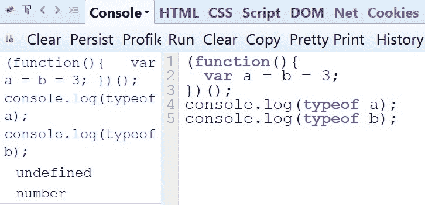

JavaScript 将上述代码处理如下图所示。从代码中可以清楚，变量`a`在函数的局部作用域内，而`b`被视为`this.b`。当前的引用`this`代表`window`对象。

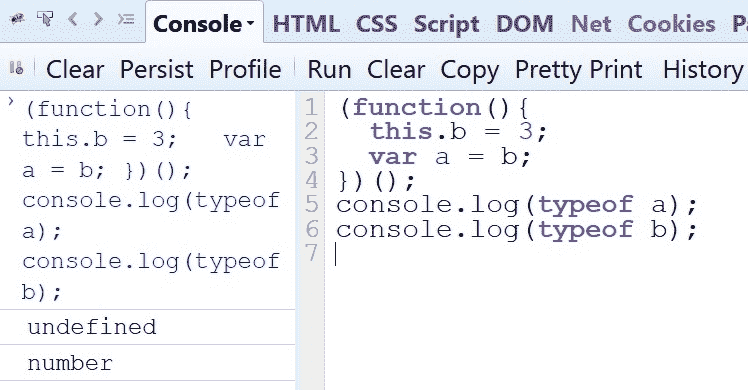

### Q. 下面代码的输出是什么？为什么？`console.log(1+2+4);`

**答案**

由于所有参数都是数字，上述代码的输出是`7`。下面的截图显示了上述代码在 chrome 控制台中的输出。

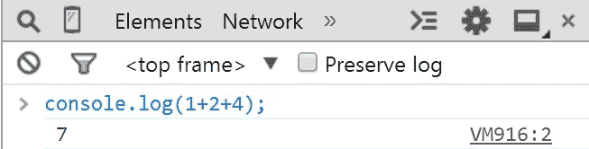

### Q. 解释 JavaScript 中的变量提升（Hoisting）？

**答案**

提升是 JavaScript 将声明移动到顶部的默认行为。换句话说，可以在变量声明之前使用它。让我们通过以下示例来理解提升。

**示例 1：**

以下代码包含一个`display()`方法，它在控制台打印`a`的值。

```javascript
function display(){ 
  console.log(a);
}
display();
```

上述代码的输出将是一个`reference`（引用错误），因为我们没有定义该变量。下面的截图显示了上述代码的输出。

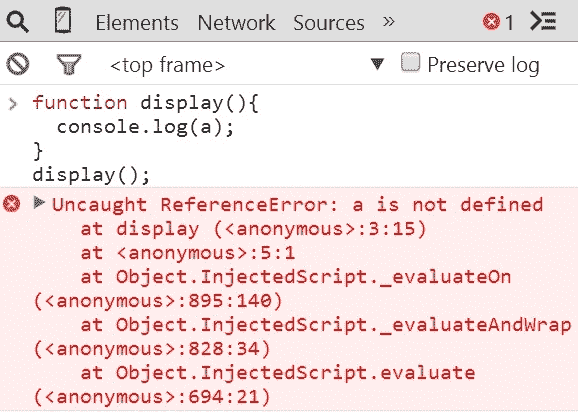

**示例 2：**

以下代码包含一个`display()`方法，它在控制台打印`a`的值。

```javascript
function display(){
  var a;
  console.log("Output: "+a); 
}
display();
```

上述代码的输出将是`undefined`，因为我们定义了变量但没有分配任何值。下面的截图显示了上述代码的输出。

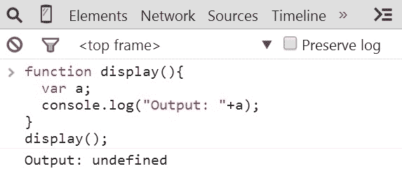

**示例 3：**

以下代码包含一个`display()`方法，它在控制台打印`a`的值。

```javascript
function display(){
  console.log("Output: "+a);
  var a; 
}
display();
```

上述代码的输出将是`undefined`，因为我们定义了变量但没有分配任何值。示例 2 和示例 3 的输出相同。这意味着变量声明被移动到了顶部。下面的截图显示了上述代码的输出。

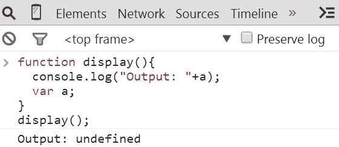

## 关于作者


Sandeep Kumar Patel 是一位高级 Web 开发人员，`www.tutorialsavvy.com`的创始人，该博客自 2012 年以来一直是广受阅读的编程博客。他在面向对象的 JavaScript 和基于 JSON 的 Web 应用开发方面拥有五多年的经验。他通过了 GATE-2005 信息技术（IT）认证，并获得来自 Vellore VIT 大学院的硕士学位。

**你可以通过以下途径了解更多关于他的信息：**

- LinkedIn 简介（`http://www.linkedin.com/in/techblogger`）。
- 他因有关网络技术的出版物获得了 Dzone 最优秀博客主（MVB）奖。他的文章可以在这里`http://www.dzone.com/users/sandeepgiet`查看。
- 他还因在 JCG 发表的技术文章获得了 Java Code Geek（JCG）徽章。他的文章可以在这里`http://www.javacodegeeks.com/author/sandeep-kumar-patel/`查看。
- Packt 出版物《Instant GSON》作者，`http://www.packtpub.com/create-json-data-java-objectsimplement-with-gson-library/book`。

有问题或建议？可以通过电子邮件`sandeeppateltech@gmail.com`联系我，或在以下社交网络上找到我：

- Facebook 页面：`http://www.facebook.com/SandeepTechTutorials`
- 教程博客：`http://www.tutorialsavvy.com`
