# 软件开发的流沙


本书可在 [`leanpub.com/quicksandsofsoftwaredevelopment`](http://leanpub.com/quicksandsofsoftwaredevelopment) 购买。

此版本出版于 2021-05-24


* * * * * * *

这是一本 [Leanpub](http://leanpub.com) 的书。Leanpub 通过精益出版（Lean Publishing）流程为作者和出版社提供支持。[精益出版](http://leanpub.com/manifesto) 是使用轻量级工具和多次迭代来出版进行中的电子书，以获取读者反馈，不断调整直到你获得正确的书籍，并在取得成功后建立影响力。

* * * * * * *


# 引言

以下是“流沙”的定义，直接来自字典^([1])：

> 流沙（名词）。容易受压的沙；特别是：一种与水混合的深松沙，重物很容易陷入其中。

根据你居住的地方，你可能在生活的某个时刻见过这样的标牌：


你需要这样的标牌来警告你危险。流沙在未受干扰时看起来是固态的，但走其中会导致液化。那时你就开始下沉了。

我认为许多开发软件的公司都应该在他们的办公室某处放上这样的标牌。为什么？这里是来自同一字典页对“流沙”的第二个定义^([1])：

> 流沙（名词）。陷阱或挫折的事物。

软件开发项目屡因各种原因失败：项目目标或需求不明确、业务决策糟糕、缺乏计划、沟通不畅、技术选择错误（例如选择错误的语言或架构）、项目的复杂性和规模、优先级排序不良、项目管理失误、不现实的截止日期、办公室政治以及许多等。即使项目成功了，结果通常也是成本超支、交付延迟、质量低下、许多人感到沮丧，以及像这样的笑话：

> 开发者对团队长：我们无法做这个项目。我们不能做！它意味着重大的设计变更，而且我们团队中没有人理解这种模型。而且，公司里没有人知道该应用程序所使用的编程语言。在我的看来，公司根本应该参与这个项目。

> 团队长对项目经理：这个项目将涉及设计变更。目前我们没有人具有此类项目的经验。此外，我们不知道那种编程语言。如果我们接这个项目，就必须组织大量的培训课程。在我的看来，我们还没有准备好参与此类项目。

> 项目经理对部门经理：这个项目涉及设计变更，而我们在这个领域并没有多少经验。而且，公司里没有多少人为此做好了准备。在我的看来，我们可以做这个项目，但需要比比常的时间。

> 部门经理对高层：这个项目涉及重新定义设计。我们有一些在该领域工作过的人，还有一些人懂得这种语言。所以他们可以培训其他人。在我的看来，我们应该接受这个项目，但要谨慎。

> 高层对首席执行官：这个项目将向大家展示我们改造整个系统设计的能力。我们拥有执行该项目所需的所有知识和人员。一些员工已经在该领域为其他员工提供了培训。在我们的看来，我们不应该让这个项目从我们手中溜走。


> “CEO 对客户”：这是我们公司擅长的项目类型。我们已经为许多重要客户执行过许多此类项目。相信我，我们是该领域执行此类项目的最佳公司。我认为我们可以在要求的时间内成功执行这个项目。

许多软件项目在执行过程中发生了太多一团糟事，以至于它们完全有产生几个笑话的潜力。我最喜欢的笑话之一是“项目准时交付！”最幽默的笑话往往是那些亲身经历过的，因为在幽默背后隐藏着你以某种方式已经习惯了的不理想状况。随着时间的推移，就像被慢慢放入水煮的青蛙([2])一样，我们对这种状况越来越适应，以至于各种问题开始看起来很正常，而我们不再对它们采取任何行动。如果笑话开始围绕着你的项目转，这可能是人们在应对工作环境逐渐滑入“偏离正态化”状态^([3])的方式，因为人类将笑话作为一种应对策略来淡化糟糕的状况。

如果你正处于第一份软件开发工作中，你可能完全不知道我在说什么。然而！相反，你可能觉得软件开发充满挑战性且充满乐趣。你可能一直忙于专注于诸如“每个程序员应该读哪些书”、“明年要学习的 10 种编程语言”、“每个软件开发人员应该了解此类知识”、“改进代码的 10 种方法”等等。而这仅仅是为了打开你的胃口。接着你发现了设计模式、模块化架构、源码控制、并发、可扩展性、云、函数式编程、IoC、单元测试、TDD、正则表达式、重构、代码审查以及 `SOLID`、`KISS`、`DRY`、`YAGNI` 或 `SRP` 等原则。你懂的……行业工具，你需要学习的东西，需要练习的东西，能为你赚大钱的东西，或者在 Stack Overflow^([4]) 等开发者社区中获得声誉和认可的东西。学习这一切让你乐得不快。你并没有感到受困或沮丧。那么，问题出在哪里呢？为什么我们需要警告信号？

首先，这些事情都与你有关。“你”需要学习。“你”需要去做。“你”需要掌握各种主题。但除非“你”正在从父母的车库里打造下一个成功的业务并并努力成为自己的老板，否则这不仅仅关乎“你”。最可能的是，你将在一家公司开始从事一个并不顺利的软件项目，该项目可能正走向部分或全部的失败。我在上面提到了一些软件项目失败的原因，但那些代表的是“宏观”问题。它们是每天发生的小事的结果。这些小事以不幸的方式结合，导致了许多有害影响。而这些事情不仅仅关乎“你”，它们还关乎“他人”。

其次，我上面提到的大多数事情都倾向于技术层面。你可能想说：“噢，显而易见！这不是信息技术领域吗？”确实是，但它也关乎业务。每一门业务都是关于人的业务。你不会整天只写写代码直到退休；你会做很多不是编码而是与公司内部（或外部）其他人进行互动的事情。随着时间的推移，你承担了新的角色和责任——你可能会领导团队并管理项目，你可能会指导新手、招聘和解雇员工、与客户和高管沟通，以及各种本质上不是技术的内容。

所以，这本书不是关于技术性内容、语言、工具或模式的。这些也很重要。但关于每一个主题都有很多好书。这本书是关于这些情况：尽管使用了你手头所有的好东西，你却只能挠头说“这 TM 发生了什么？”这本书是关于在壕中发生的事情，那些与技术无关的事情。它是关于软件项目中常见的某些糟糕事情，人们通过惨痛的方式发现这些事，即陷入了他们没有察觉的境地。你会进入这样的状况，就像走进流沙一样。随着时间的推移，你投入更多关注并获得经验，你会意识到这些事情对你的日常工作是干扰且具有破坏性的，给从事软件项目的人带来了不必要的痛苦和沮丧。这是一系列微小的事情，导致“宏观”问题的“微观”因素。

## 提示

这本书是我尝试为新一代提供的一个“提醒！”，让他们知道在追求软件开发职业时还需要期待什么。年轻的开发者会和之前的开发者犯同样的错误。人们专注于技术以及如何最好地使用它们来编写出色的软件，而其他一切都恰好发生在他们身上。类似于学习开车，你开始更多地关注汽车本身以及如何操控它，以后才学习如何在交通中处理好你自己。但我们都知道，当司机不仅仅是处理汽车。它是在道路上，在各种天气条件下，与其他驾驶员、摩托车手、行人或动物一起行动，注意周围环境，并遵循和尊重交通标志的含义。你可能是一个很酷的司机，在停车场里漂移或做圈地，或者用左脚刹车，但如果你不知道“右侧急弯、路面湿滑、铁路道口或让行”等标志的意义，那么你将面临一些不快的惊喜。这些标志的作用是让你知道道路前方可能会遇到什么。关注汽车和你的驾驶技巧是好的，但注意道路上发生了什么更为重要。同样，良好的技术技能对于构建软件是必须的，但不要忽视你周围的事：你的环境以及那些可能变成受困或沮丧状况的挑战。

不要仅仅因为你热爱编程，就认为软件开发工作仅仅是在一家志同道合的公司里编程，与开发者伙伴并肩作战，吃披萨，喝能量饮料，精通行业工具并生产大家都能自豪的软件。有些事情不可避免会陷入泥潭。所以，当蜜月结束后，我在书中提到的某些事情将在转弯处等着你。要有意识，做好准备，并注意警告标志。


我并不是要吓唬你。那不是我的意图。软件开发有很多正面的方面。首先，它很有趣。其次，总有新东西要学习或发现。你不局限于某一个领域；考虑到现在每个人都需要软件，你可以将编程与其他许多学科相结合。你与许多聪明的人一起工作。你是一个社区的一部分。你可以居家办公。你解决问题；问题越复杂、越困难或越有挑战，当你让某物运行时，你感到越自豪，有一种成就感。这是从无到有创造有用东西（编程是一种智力活动；你基本上通过思考让程序存在），他人使用的东西，有时可能会给他们的日常生活产生影响。当你看到工作的成果时，感觉很好。这比自己组装一个滑动门衣柜更有成就感。


而且薪水也相当不错 :)


但现实是，许多项目不可避免地会被某些事情“染污”。开发软件是有趣且充满挑战的，但通常也是艰辛且令人沮丧的。不仅是因为软件本身很复杂，还因为开发过程并非没有挑战。用户永远不知道自己想要什么，你试图解决的问题可能非常巨大且复杂，你面临着技术、预算、业务、法律、安全和时间限制，你依赖于无法控制的软件（如操作系统、编程语言、库、框架或平台），几乎不可能测试所有可能的输入和执行路径，还有那个难以捉摸的 bug 时不时地现身，而你又无法找出它的原因，而且这种单子会没完没了。

## 并无新意

我在书中所写的内容都是常识。我没有发现任何新奇，没有解决任何谜团，没有在科学研究后达到某种更高层次的理解，也没有汇总来自 10 个国家、2500 家公司、50000 名受访者的 IT 调查结果。我只是在这个行业里摸爬打了一久。我试图分享我在职业生涯每个阶段学到的东西，强调一些可能会出错的地方，并尝试提供一些我认为可能有效的解决方案来让事情变得更好。像我这样的人都可以写一本类似的书。在这个行业工作多年，在不同的背景下，与许多人共事，你也可以写一本这样的书。这是关于经验和从痛苦中学获得的教训，那些我希望自己能早点知道、或者如果当时能理解得更好一点就能做得不同的事情。

在过去的 15 多年里，我做了很多蠢事，并付出了惨痛代价。我从一个年轻的小青^([5]) 变成高级开发人员、团队负责人、再到教练，以及各种技术和管理的混合职位。每个阶段都带来了新的挑战和流沙。因此，我在书中编写的观点、意见、结论和建议都是我自己的，基于我自己的经历。这是一个个人故事，你的故事可能与我的不同。这本书关于你在工作中可能会遇到的流沙，就像我遇到过一样。如果你年轻，喜欢写代码，并且对技术充满热情，那么通过你喜欢的事情维持生活是完全合理的。但为你自己或为学校项目编写或构建应用程序的方式，与在公司里处理具有紧凑约束和多人参与的项目将是不一样的。作为一名员工程序员或开发者，也会有一些令人沮丧的方面。

我无法提供你将遇到的所有问题的详尽列表，也无法详细讨论一切。尽管如此，我想引起你对我经常遇到的一些的注意，并尝试根据我的理解和经验提出一些解决方案，以便你也能识别出自己正走向的某些情况并尝试采取措施。尽管多年来我做了很多事情并承担了各种责任，但我对事物的观点大部分是一个技术人员。所以，你可能会通过不同的视角看待相同的情况。你可能会同意、不同意，或者介于两者之间。在尝试应用某些内容时，请务必使用自己的判断。还有许多实用的书提到了这里涵盖的主题，但我找不到一本能涵盖其中很多主题的书。所以我尝试涵盖很多领域。也许我对某些事情过于固执，也许有些事情我提得太简短，也许我重复了自己，我确定我遗忘了一些。但这是我的尝试，我希望它是成功的，你会发现它很有用。这由你来判断。如果你能从我的错误中学习，并利用从这本书中提取的信息避免一些流沙，那么我就心足了。如果你遇到了书中没有提到的情况，或者想向我发送意见、问题或反馈，我很乐收到你的邮件，邮箱为 quicksandssoftwaredevelopment@gmail.com。话如此，让我们现在立起一些告示来警示流沙并避免掉进去。

## 员工开发者

所以你找了一份程序员的工作！面试很容易——太容易了。或者也许你是一个很优秀的程序员。但你已经知道这一点了 :)几周后，你开始注意到一些奇怪的事情。代码库一团糟糟，新功能没有需求，你了解的知识比公司里的一些高级开发人员还多，有些人因为工作太多而压力倍增，而另一些则不断在社交媒体上摸鱼或看在线电影，生产环境频繁事故，每五次部署中就有一次回滚，优先级不断变化，普遍的无序和混乱，而且这个单子可以一直列下去。发生什么了？

当我进入这个行业时，我只知道如何写代码。我甚至从未想过我会写这样一本书。许多因素的相互作用才有了我今天的成就。其中一些是好的、积极的。另一些……并不如此。软件项目也是如此。许多因素相互作用产生良好或有害的局面，类似于流沙的形成方式：你需要适量的水和沙子、沙粒之间特定的摩擦、水无法从混合物中逸出、水力对抗重力，或者在表面施加了适量的压力。


正如你将在本书中所发现的那样，很多问题都是如此。但有时，问题始于招聘了糟糕的人，然后由于某种原因忘记了解雇他们。在这里我会谈谈招聘开发者，因为他们是任何软件项目中至关重要的人员，而且由于目前为止我还没有招聘过任何经理或老板；虽然那样会很酷的 :)。

## 被忽视的流程

很多软件公司不知道如何招聘优秀的开发者。这是因为他们对招聘过程没有足够的关注。他们没有将其视为业务的一个关键环节。相反，他们认为招聘是人力资源部门（HR）的工作，所以应该由他们处理。这在很大程度上是正确的，但有太多的事情留给了他们来决定。HR 被期望按照一个确定的步骤清单从头到尾处理一切。而由技术人员来评估候选人的技能和知识（即开发者面试最重要的方面），仅仅被视为该列表上的另一个勾选框。


HR 确实负责招聘，但该部门也有其他角色。他们确保公司和员工遵守劳动法。他们管理雇佣关系，处理员工的留任和解雇，并执行公司政策。他们管理员工薪酬、补偿和福利。他们处理培训和开发计划，监控员工表现以及各种其他事情。他们会处理所有的招聘步骤，包括编写职位描述、发布职位寻找候选人、拨电话、跟踪候选人申请、安排面试、预订会议室、进行面试、背景调查以及管理过程中所有的文档工作。但他们做的另一件事是在没有没有适当规则的情况下筛选开发者的简历。

HR 并不是针对公司的具体情况定制的，因此他们并没有准备好筛选开发者简历或评估他们的技术知识。遗憾的是，他们经常这样做是因为他们被留在那儿独自处理大部分流程。在招聘开发者时，HR 最终可能会学会 `HTML` 和 `CSS` 与 `JavaScript` 在一起，或者 `Java` 和 `C#` 是竞争语言，以及 `SQL` 是 `OracleDB` 和 `MySQL` 的共同点，但仅此而已。由于他们是 HR 部门，筛选简历是他们工作的一部分——招聘人员的工作。所以他们会尝试让其运作，通常类似于他们处理收到的任何其他简历的方式，在几秒钟内完成（正如某些研究^([7]) 所示）。我完全理解因为语法和拼写错误而拒绝简历，或者如果候选人使用警察局比对识别照作为简历照片，或者如果照片是他们在商场厕所醉酒时拍的……但过多的“勾选框”行为会造成伤害。如果简历使用了错误的字体、格式与所有人的简历一样、没有针对职位描述定制、页数过多或过少、不包含正确的关键词、没有附求职信，或者违反了某些顶尖简历趋势规则（“我的天！你竟然还有目标陈？你还在兴趣爱好里列了‘阅读’？我的天！”），简历最终可能会掉进垃圾桶。顺便说一下……没有所谓的正确字体。

写出一份能引起 HR 人员注意的优秀简历对几乎所有人都是困难的（尤其是如果这是你写的第一份简历的话）。因为你不是每天都写简历，而是每几年写一次，所以你无法通过练习变得更好。对于程序员来说，情况更糟，因为真正的程序员天生不擅长这种事情。简历不是编码或解决问题，或是他们擅长的技术性内容。简历主要是营销。所以，有潜力的优秀开发者可能在这个筛选阶段被排除，仅仅是因为他们的简历看起来不够华丽，无法引起人的注意。

除了筛选简历，HR 人可能还会决定程序员面试应该如何进行。“让我们从 IQ 测试开始吧。是的，程序员很聪明。让我们用这个作为淘汰标准。我们还应该接着进行一些心理和/或性格类型测试，看看候选人是否表现出‘极客行为’（即适合编程职业）”。然后，HR 竟然决定要寻找的最佳候选人是内向型天才，他们像这样挂卫生纸：


然后，对于初试，他们可能会花公司的钱购买标准的编程问卷（其中大部分可以在网上找到且已经有答案了），或者购买完全无关的多选题测试，其中包含这样的问题：

```
对于下面的代码，以下哪些陈述是正确的？

public class Operators {
    public static void main(String args[])
    {
        String s = "java";
        int x = 4;
        boolean b = true;
        s = s+= x-- - 2 * 3 +
        ((Object)s instanceof String ? 3 << 9 / 6 & --x :\
7 ^ 8 % ++x) | 9;
        System.out.println(s);
    }
}
```

选择所有适用项：
A. 类将通过编译。
B. 类将抛出异常。
C. 类将打印 "java11"。
D. 最后，x 的值将是 2。
E. 类将打印 "java5"。
```

这类问题越多，测试成本越高。

顺便说一下，这实际上是我在一个工作面试在线初试中收到的问题。我给他们加了分，因为代码格式正确（尽管不符合 Java 规范；main 方法的左括号应该在行末尾）。许多在线调查问是为了回答诸如“你对我们的服务满意吗？非常满意、满意、中立、不满意、非常不满意”，或“你是如何得知我们的牙膏口味的？通过牙医、通过朋友、通过家人、通过牙仙子”，或“你喜欢调查吗？是、不，去你的”之类的题目而设计的。同一个测试还要求我写 `ByteArrayInputStream` 构造函数的方法签名，而我本应该烂记于心的。

如果我在面试测试中看到这类问题，我就开始担心发生了什么，并认真考虑我是否还想在那里工作。是谁想出这些东西的？界限在哪里？“按顺序列出 `String.format()` 的所有转换和标记？”任何一个称职的开发者都可以告诉你，这些是糟糕的问题；然而，他们对招聘过程的参与不够深，这类事情仍然被那些不幸的并不知道内行道的 HR 人员视为筛选开发者简历的好方法。


接着，还有一种标准的 HR 面试，旨在尽可能收集有关候选人任职资格和工作经验的信息，这些信息之后也可能用于背景调查或索取推荐人。HR 会试图判断候选人的态度是否糟糕，或者对工作是否兴趣，并尝试识别任何“红旗”，例如：避免眼神交流、无法解释的职业空白期、抱怨前任或现任雇主，或者不断地自夸。HR 还会介绍公司、公司政策、福利、发展机会，询问候选人的薪资预期，并解释面试流程的后续步骤。你懂的……一个经典的 HR 面试。希望 HR 知道如何获取信息，而不会过度依赖那些只会引发发背后的答案的陈词滥调的面试问题，比如`“你最大的缺点是什么？”`（我一直想回答`“巧克力”`）、`“你如何处理压力？”`、`“你最喜欢的书是什么？”`，或者那些花哨的问题，如`“为什么下井盖是圆的？”、““飞机里能塞进多少个乒乓球？”、““如果你是一棵树，你想成为哪种树？”、“如果我有三个橘子，你有五个橘子，楼下便利店的一罐橘子味碳酸饮料多少钱？”`。

所以基本上，招聘流程很大程度上基于一些标准的编程测试和典型的 HR 面试。只有当你通过了这些，你才能与技术人员进行交流。假设你真的能和技术人员聊上话。例如，我曾申请过一家小公司的工作。一位 HR 女士在门口迎接我，然后递给我一支笔和一份包含 33 道奇形怪题的多选题问卷。`“你有 30 分钟时间”`，她说。我做对了 31 道题。然后她说我表现得非常好，会在接下来的几天内为我安排时间，去见总经理。几天后，我见总经理会了 15 到 20 分钟。就结束了。他们想让我为他们工作。老实说，我本以为这只是招聘流程的开始，而不是全部。招聘失误可能会导致昂贵的代价（金钱、时间、挫败感等），因此应该给予适当关注。

## 不同的方法

那么，你该如何改进这个流程呢？答案是：不要忽视它的重要性，并让开发者更多地参与到每一个步骤中。

HR 可以处理面试的法律和组织方面，并可能评估候选人是否能适应企业文化，但当涉及技术方面时，需要开发者来承担责任。例如，标准的编程问卷试图将开发者放入某人（即创建测试的人）认为合适的“箱子”中。但你是为了特定的职位在招聘人员，所以如果你确实想使用编程测验（也许你的申请者太多，需要一种方法一次性缩短列表），最好使用你针对你的特定语境、你的特定团队和项目所设计的问题。这就是开发者需要更多参与招聘流程的一个实例，以便他们可以定义这些问题。如果他们不参与，且开发者忽视了招聘流程，HR 将被迫尝试从中变出某种花样来挑选开发者，`“因为我们不能直接从街上随便拉一个人来，对吧？”`。

以下是我对这个问题的尝试，以及关于如何尝试进行更好面试的观点。在经历了多年的试错后，我得出了这种方法。我从 HR 人员、申请者、我的面试以及其他面试官那里汲了教训。我可能不会永远坚持这种方法，我会在学习新事物时对其进行调整，但到目前为止它对我是有效的。为了强调我在书的引言章节中说的话，我是通过惨痛的代价得出这些许多结论的；这是一个基于我个人经历和挣扎创建的方法。

这种方法是呈现给你——读者的。我在章节开头提到了几个警告信号，当你进入第一份工作时，可能会发现这些信号，那里的人可能没有对招聘流程给予足够的关注。但最终，你的职业生涯可能会达到一个点，即你需要坐在桌子的另一侧，作为面试官，必须招聘开发者。一个主要问题是，大多数开发者没有接受过面试技巧培训，所以他们失败的程度可能和让 HR 处理所有事情一样惨淡。因此，在你举行第一次面试之前，你应该学会如何正确地进行面试，因为在招聘人员方面，`“预防胜于治疗”`这句话是适用的。

你不必把接下来的步骤视为刻板的规定。深思一下，然后创建你自己的流程。在其中添加任何你认为必要或有用的内容。将每次面试都视为一次学习和改进的机会。例如，我经常避开电话面试，并且选择不谈论这一点。但这并不意味着你必须跳过它们。如果你觉得必要，也许仍然想通过电话或 Skype 进行额外的筛选过程。我放弃了电话面试，因为每次总有一端连接问题，经常有背景噪音；候选人没有做好对话准备，因为他们不知如何认为这不像实际面试那么严肃；如果他们已经有工作了，他们会在午餐时间通话，然后试图赶快对话以便他们也能吃点东西；或者他们会在深夜下班后通话，那时他们已经累了。我甚至曾听过房间里的别人在低声比对答案。这就是为什么我尽量避免它们。因此，请使用或适应后续的任何步骤。

如果你需要在你的团队中招聘一个开发者职位，并且你又是招聘人员（也许你是一个高级工程师或团队负责人），你需要从一开始就参与整个流程。例如，与 HR 合作编写职位描述。你最清楚你在寻找新员工什么样的技能和素质。你了解团队、了解项目、了解技术，你了解填补空缺所需的一切。所以由你——开发者——起草职位描述，然后与 HR 一起完善。职位描述——就像简历一样——是营销，HR 会有一些想法来吸引申请者的注意力，但如果人们能从中认出开发者的投入，那就更好了。所以不要简单地把要求交给他们，让 HR 来措辞职位描述。要和他们合作。这样，你学到了一些新东西，而且也可以避免那些 HR 的陈词滥调，如`“节奏快的工作环境”、“多任务处理能力”或“年轻且充满活力的团队”`溜进你的职位描述，这可能会让经验丰富的开发者拒绝申请。此外，还要与他们合作制作招聘广告、传单或任何 HR 可能用来接触候选人的东西。确保你的要求中的相关信息以恰当的形式呈现，胜过任何 HR 的修饰。


一旦职位开放，你就需要为收到的简历定义最低入围要求，并将这些要求传达给 HR（人力资源）。要具体。大多数情况下，这些要求应该低于你的真实理想目标，以确保没有任何潜在的候选人被初筛排除。这取决于具体的开放职位，但可能包括：计算机科学学士学位、至少 N 年的工作经验、精通某门外语、熟悉某些编程语言、拥有重型机械操作证，或者任何你认为需要的其他条件。这是简历进入下一阶段面试的最低要求。我想强调的是：它应该低于你的真实理想目标。通过这种方式，你可能会读到一些并不那么好的简历并浪费你 15 分钟的时间，但你比 HR 更清楚如何包含或排除程序员的简历，所以请将该界限设得稍微低一些，以确保 HR 在筛选候选人时不会过度热情。不过，不要过头，导致要求过于松散。现在有这么多公司在寻找开发者，入入门槛已经变低，这本身就很悲哀。所以请保持你的高标准。如果有人能把 `“computer”` 拼对，这还不足以邀请他们参加面试。

然后让 HR 执行他们寻找开发者并筛选他们收到的所有简历的工作。告诉他们，如果他们对某个特定的候选人或简历有任何疑问，应该将其转交给你。有时，人们会被某人高度推荐，尽管他们不符合某些最低要求，也可能被考虑这份工作。因此，由你来决定这些人人。

## 准备

然后，如果简历通过了 HR 的初筛，请仔细阅读，并决定是否邀请候选人参加面试。此时，你仅根据简历上的内容决定是否进行面试。如果决定是 `“是”`，HR 就可以安排面试。如果候选人接受，你就需要为面试做准备。如果你在没有准备或没有讨论计划的情况下进入，将会进行无结构的面试，这将让你从一开始就注定失败。不为面试准备的开发者最终会问一些浅浅的问题，通常随脑子里想到就说什么。或者他们从网上搜索结果的前几个链接中打印了一些面试问题（这些链接候选人可能从那里学习了答案，而且很可能是标准 HR 测试所依据的相同问题，那些让候选人走到这一步的问题）。更糟糕的是，他们可能在想：`“嗯……候选人在标准测试中表现优异，我们现在就开始讨论吧，互相了解一下”`。这样，他们就会让候选人引导讨论走向任何方向，或者坚持某个特定主题一直探讨直到时间结束，或者候选人是个满嘴谎言的人^([8])，或者骗面试官说话。当这种情况发生时，面试官会觉得面试进展顺利；然后他们会喜欢这个候选人，相信他们值得一个机会并认为他们适合这份工作，最后说`“录取”`。时间过去，他们发现（这种情况发生比你想的频繁）他们并没有得到一个优秀的开发者，而是得到了一个糟糕的，最多平庸的。如果他们足够幸运，会得到一个优秀的开发者，但在招聘时，运气应该是最后考虑的因素。所以花些时间准备。仅仅读一遍简历是不够的；你需要在面试前`“分析”`简历，并尝试获取更多关于候选人的信息。

在这里我需要插一句，缺乏经验的开发者不应该主持面试（这就是为什么我上面说了要高级人员或团队负责人）。缺乏经验的开发者没有足够的…………经验来让招聘讨论保持在正确的水平。他们需要掌握自己的技能，而不仅仅是对面试中将涉及的话题有`“某种想法”`或`“接触过”`。如果他们不知道自己所问问题的完整答案以及该答案可能引起的影响，他们也不具备评估候选人回答的必要技能。他们甚至可能会让自己（以及公司）显得愚蠢。即使你是一个经验丰富的开发者，你仍然需要掌握你正在讨论的主题。例如，一个高级后端开发者可能不应该独自面试一个前端开发者。如果你处于这种情况下，请带上一个知道自己在做什么的人，做好准备，然后就将如何进行面试达成共识（谁问什么，你们应该关注哪些领域，谁开始和/或结束面试，谁回答候选人可能提出的问题等等）。当我说要为面试做准备时，并不是让你在问候选人问题之前先学好这些问题的答案。我的意思是，你需要拥有充足的候选人信息，让讨论沿着正确的路径进行，以便你做出正确的判断并确定此人是否适合这份工作。

为了准备，从简历开始，仔细查看经验的年限、候选人担任过的角色、工作过的公司以及持续时间、这些公司经营的领域、他们参与过的项目或产品、是否有职业空缺、他们使用的语言或技术（即使是我我不熟悉但好奇听候选人介绍几点的技术）、框架、库等。尝试识别任何你认为在面试中相关需要了解或讨论的内容。做笔记，并根据你在简历中发现的内容写一些问题。我通常直接把这些问题写在简历上。我会高亮某一段，或在旁边写下问题。

我通常不在意简历的格式或使用的字体，但我也会注意这些事情，因为一份粗糙的简历可能是疏忽开发者的指标（如果简历看起来被忽视了或包含语法错误，我可能会开始怀疑你为什么写不好它；我也会开始思考你在处理公司的数百万项目时会有如何表现）。

然后，我在网上寻找更多关于候选人的信息。社交媒体或职业网络上的简介，寻找个人网站、博客或文章、个人项目，或对在线项目的贡献，找到他们写过的在线代码进行审阅等。简历中通常提供了链接，所以我甚至不需要`“扮演侦探”`。基本上，我试图建立一个关于候选人所处环境的印象，以便在我们最终面对面时能更好地引导对话。如果某些内容引起了我的注意，或者从简历或网上发现的信息不明确（多份工作时间短、工作时间重叠、简历某些部分细节详尽而其他部分没有、某处写得粗糙的代码），我会再记录一两个问题针对这些内容。


## 处理引用

我也想打听一下，看看你认识的人是否已经和那个人共事过。在研究过程中，我有时发现他们曾在我认识内部人士的公司工作过。我可能会打听一下，看看他们是一个优秀的开发者且一个友善的人，还是一个糟糕的开发者和麻烦制造者。不过，如果那个人仍在那份工作中任，我就不会这样做。我不想成为那个拆穿他们正在找新工作的人。但当我确实去询问时，我会持保留态度。你无法总是准确地判断你的熟人与那个人之间的关系，以及他们互动或合作的紧密程度。

但假设你发现了诸如“传闻说他们不是自愿离开上一家公司的”的信息。你该如何处理这些信息？它是真的吗？还是只是八卦？也许如果是真的，问题出在人身上，还是他们的老板是个白痴和彻头彻尾的混蛋，导致了冲突，而候选人最后输了？从别人那里了解候选人可能是有用信息，但如果你不确切具体的背景（或过去）是什么，它可能会对你产生错误的影响。接受这些信息，但尝试在面试中触及这些问题并形成你自己的观点。根据个人经验，我可以告诉你，坏的传闻通常是真的，而好事通常被夸大了。但这并不是一条规则。尝试对每个人都坚持你的招聘计划，无论他们是谁，或者他们有怎样的推荐，并尝试形成你自己的观点，而不是根据你从熟人那里听到的事情做决定。也许候选人在特定背景下的那份工作中表现得很好，但你空缺职位的背景可能不同，他们在这里可能表现得那么好。这就是为什么你要和他们面试：为了找出他们是否能胜任该职位。不要根据其他情况和其他背景来做决定。我曾两次偏离了我的流程，因为有人说那个人很好，面试只是形式，诸此类类……在这两种情况下，结果都搞成了一团乱子，让我至今后悔不已。不要犯同样的错误。

## 避免先入为主

尽量不要让自己受到你在分析简历和研究候选人期间发现的信息的影响。基本上，这意味着不要掉入“以人取相”的陷阱。你应该避免在这个阶段形成观点。先入为主的假设或过快下结论可能会影响你进行面试的方式。等实际讨论结束后，再确定申请人能或不能做什么。例如，如果这个人拥有非常有声誉的大学学位，或者在申请你的职位之前曾在当地顶尖的科技公司工作过，不要假设你将面试一位巨星级候选人。你可能做的另一件事是假设这个人对该工作来说资历过高，或者根据他们惊人的简历要求高额薪水。尝试不要在此时形成观点，否则你会在整个面试过程中固守这些观点，并最终错误地评估候选人。与其形成观点，不如自己记下一些在面试时要问的问题，以澄清每一个要点。

## 面试话题 vs. 问题

然后，我为面试准备一份技术话题列表。注意，我说的是“话题”，而不是“问题”。面试应该是一种讨论，而不是审讯。在这一点上，值得提到，许多 HR 部门更倾向于对每位面试者进行一些标准的评分或评价，以便他们之后可以将一个候选人与其他进行比较。与上面提到的标准编程问题类似，这通常意味着你应该向每个候选人提问一组相同的问题，以获得一致的结果。这种想法是评估对问题的回答，给每个答案分配分数，将所有分数相加，最后雇用分数最高的人。我们都知道这个系统。它被用于学校，学生在各种测试中获得分数；然后生成一个 `GPA`。在理论上，这似乎可能可行，但在实践中却并不如此。工作面试不像学校的考试。在学校里，每个人都被教授相同的科目，被提供相同的学习材料，然后在测试期间被给予相同的考试科目。来面试的人有不同的背景、不同的知识和不同的经验。正如上面提到的，使用一小组问题你将不会很成功。目的不是给每个人打分，而是弄清楚他们是否与该职位匹配，以及他们是否真的能胜任工作。此外，由于面试是讨论而不是纸笔测试，情况会自然地演变。候选人可能会对某个问题给出让你感兴趣的回答，在你提问其他问题以更好地理解该回答背后的逻辑之前，你无法继续下一个。所以你不可避免地会向每个候选人问不同的问题，即使最后你试图仅根据向每个人提的标准问题集来建立评分。由于这些原因，我倾向于使用话题列表而不是问题列表。

## 定定义话题

我并不总是使用相同的话题。我根据空缺职位的要求以及我在候选人简历中发现的内容来选择话题。如果空缺职位是关于以数据库为中心的应用开发，我会增加更多关于数据库的内容；如果是前端职位，我会更多关注 `JavaScript` 和 `Web APIs`，以此此类推。例如，如果我正在寻找一个通才来处理一个 `Java` 企业级 Web 应用，而候选人的简历提到他们用过 `Java`、`Javascript`、`SQL`、`Struts`、`Spring`、`React`、`Angular` 和 `WebServices`，我可能会考虑的话题列表如下：

```
Java
--------------------------------------------
```


然后，根据简历和我的研究，我将这些主题按候选人可能掌握程度从高到低进行排序。这里值得提到的是，我尽量不仅仅根据候选人掌握的技术来聘用他们。对于高级或架构师职位，申请人精通各种技术并清楚自己能做什么、不能做什么是非常重要的，这让你在构建架构或设计时知道可以把他们推到多远的程度。你知道的技术越多越好，因为在开发解决方案时，你有更丰富的工具箱可以选择。但如果你经验较少，只是一个中级、初级或入门程序员，技术就没那么重要，你的态度和学习能力要重要得多。当然，如果你某个空缺职位需要硬性的 `SQL` 技能，而候选人对 `SQL` 一无所知，你不能聘用他们，那是愚蠢，但考虑一个人的思考方式以及他们是否能学习新事物也是本质的。

### 测试基础知识
我需要指出的另一点是，我使用其中一些主题来测试候选人是否具有坚实的知识基础。我会在后面的章节中讨论为什么拥有坚实的基础很重要。你可能会看到这些主题，并奇怪为什么我会提到像 `abstract class vs. interface`（抽象类与接口）、控制结构，或者已经极度过时的 `JSP`、`Servlets`、`XHR` 或 `SOAP` 这种平庸的话题。我之所以这样做，是因为我经常看到人们使用过各种框架和库，但他们并不理解这些是运行在某些其他底层技术（他们对此一无所知）之上的。现在到处都是“这个框架”、“那个框架”、“自动魔法式的这个”、“自动魔法式的那个”，当这些东西在某种程度上失效，或者它们必须被推向极限导致抽象层崩溃时，人们就开始像看外星人一样看着它们，对下一步该做什么不知所措。

我知道有些在不知道 `JavaScript` 的情况下使用 `JQuery` 的案例。糟糕的是，我认识一些并不想写 `JavaScript` 的 `Angular` 程序员。我见过有人在使用花哨的 Java Web 框架时非常兴奋，但对 `Servlet` 是如何工作的完全没有。我在面试时遇到过有人告诉他们知道 `MVC`。“太了！请向我描述这个模式是如何工作的。”结果他们从像 `这个类`、`另一个类`、各个部分如何组合在一起以及谁调用了谁（当然是错的）等事情开始，最后发现他们与 `MVC` 的唯一接触是某些蠢货严重误解 `MVC` 后创建的一个内部构建框架，反过来，候选人接手并延续了这些错误，而对学习 `MVC` 的其他内容毫无好奇。

我还在面试中看到过一个 Java 核心知识有巨大空白的 Java 架构师。这家伙被聘佣到一个由别人构建的项目中，然后他独自继续工作，他所有的知识都局限于该项目使用的技术。这就是他学到的全部。他没有在业余时间学习更多，因为他真的对编程并不感兴趣。然后，他申请了我所在公司的一个高级职位，因为这个人认为自己是一个架构师。他在之前的公司拥有 `Architect`（架构师）头衔是因为他们更倾向于给他头衔而不是更高的工资，最终他开始寻找薪资的工作。这个男人认为自己是一个优秀的开发者，仅仅是因为他以前从没有把自己和任何人做比较。所以，我会测试候选人的基础知识。我不想假设他们理解了他们应该理解的一切，结果后来发现他们其实一窍不通。遗憾的是，我经常看到很多懂很多但并不理解很多的程序员的案例。

### 分析简历
然后，我做的另一件事是列出候选人简历中提到的所有技术、库、框架、实践和模式。我通常只列出与职位相关的，但有时，如果我发现某些内容很重要——比如这个人也懂 `C#`，尽管这是一个 Java 职位——我也会把它放在列表中。你稍会看到我是如何处理这个列表的。

### 给新招聘者的建议
最后，还有另一件事需要注意。如果你还在进行前几次面试，请做好可能会紧张的准备。刚开始接触招聘时，面试对面试官来说压力很大，就像对面试者一样。起初，你不会觉得面试某人很自在，尤其是当你必须独自这样做时。你会担心自己可能会感到太紧张、说错话、问错问题，或者最终做出了糟糕的聘用决定。`如果候选人知道得比我多怎么办？如果我无法控制面试，候选人劫持了对话怎么办？如果候选人变得具有攻击性？我该如何处理？如果这个人是一个优秀的开发者，但因为讨厌我而拒绝了工作怎么办？如果我让自己丢脸了怎么办？`在新环境中感到有些焦虑是正常的，面试也不例外。但别担心，几次面试后这种情况就会过去。如果这是第一次面试，你可能必须在正式开始前练习一下。你可以要求 HR 同事给你提供培训，或者举办一次关于如何进行面试的研讨会；你也可以要求一位已经进行过面试的开发者加入他们的下一次面试会议。即使你会在面试前没有得到培训或练习，充分的准备也会减轻你的压力并带给你很大的信心。


请记住：成功的面试就像一份未来的合作协议。它不是一桩`买卖交易`。雇主并不是在售卖一份工作供候选人购买；候选人也不是在推销技能和经验供雇主购买。这类面试通常不会进展顺利。交易完成后，卖家和买家就分道扬扬了；他们不会在商店里坐在一起，周一到周五，每天工作八小时。所以，当你进入面试场时，想的是`长期合作`，而不是`推销`。

在面试中，双方都在评估对方。你会试图判断是否应该雇佣某人，而候选人将决定他们是否想为你工作。当这种对话保持平衡时，面试的氛围会很好。如果不平衡，其中一方一定会感觉到。

例如，如果你有一个候选人正试图过度地推销自己，你会感到很不对，就好像他们试图分散你的注意力来掩盖某些问题。你会开始想起上一次遇到上门推销员的经历，他们试图向你推销一个糟糕的产品，而你绝对必须`现在`购买，因为那是最后一件库存，或者是限时优惠的一部分，而优惠——他们看了看表——还有十分分钟^([10])。你会立刻知道那是胡扯。你正被骗去为某物支付高价，或者买一个糟糕的产品。在候选人过度推销自己的情况下，糟糕的产品通常是他们的技能。如果你雇了他们，你将付出的代价，因为这样的人以后会更关注维持面子，而不是好好完成工作。

当平衡向另一端倾斜，你正努力想要为公司或你正在构建的产品推销，夸大你们有多酷、多棒，你是最顶尖的，你的项目运行得像润滑的机器一样，你的办公室在镇上最高建筑的顶层，等等，那么感到不对劲的就是候选人。`什么？这是你第一次听说我们吗？没可能……这不可能……`这类面试给候选人的感觉通常是：`我们很聪明，我们假设你不聪明。让我们把面试当成证明这一点的机会吧。等我们结束，我们会一起唱公司的队歌`。

我去过几次面试，负责面试的人坚持让我告诉他们关于他们公司的一切了解，就好像那是他们妈妈的公司之似的，而他们不仅仅是那里的员工。他们想看我是否做了了充分的研究……我想，是想看我是否值得。老实说，那是非常糟糕的面试，涉及的公司也很糟糕。想要雇佣一个真正想为你工作的人是正常的，以至于他们愿意免费工作（那不是很不错吗？）；因此，你希望看到他们在出现之前研究过公司，并且他们来参加你的面试时，不像他们去其他公司参加面试时那样可能心不在焉。你想要一个不仅仅是想要一份工作的人；你想要一个`想要`为你这里工作的人，而不是`满足于`与你一起工作。但不要过度伪装夸张到这种程度，以至于他们在面试中表现得很糟糕。即使那个人真的想为你的公司工作，也要记住，归根结底，事实是人们需要工作来支付账单并生存。所以，注意你的态度。保持对话平衡。就像你从几个候选人中选择一样，候选人也可以从几份工作中进行选择。

## 面试

最终，面试的日子到到了。HR 接待了那个人，带他们进入会议室，给了他们一杯水或咖啡。轮到你出现了了。准时到达，态度友好，问候对方，并感谢他们来面试。

我通常会先向申请人解释我是谁，为什么这个职位是空缺的，面试将如何进行，面试期间可以预见到什么。这是问那个著名的问题`请介绍一下你自己`并更好地了解这个人的最佳时机。你也可以从闲聊开始（但不要太久），给申请人留出时间放松并适应面试（大多数人都会紧张）。不过，要小心，因为当你这样做时，也很很容易掉进流沙中，触及一些可能违法的话题，比如讨论年龄、种族、宗教、婚姻状况等。HR 可以告知你在进行面试时需要避开的话题。

一旦对话开始起来，我接着会要求候选人给我讲他们做过的工作和参与过的项目，哪些是喜欢的，哪些是不喜欢的，以及为什么。我还会询问他们的职责是什么，以及每份工作中办公室典型的一天是什么样的。你通常可以从简历中获得这些信息，但所有的简历都经过润饰。即使是从网上复制粘贴的，你经常会发现诸如`我将 X 提高了 Y 百比`这样的内容。很好！现在告诉我是怎么做到的。你是如何衡量的？你有帮助吗？你是一个人完成的吗？是你做了决定还是只是听命行事？任何候选人都应该能够用清晰的答案解释简历里的所有内容。如果他们做不到……红灯（警示）。

提问行为和问题解决问题的最佳时机是他们谈论以前的工作经历时。我不会只说`解释一个你必须面对困难问题的情况，以及你是如何处理的`。对于这类问题，大多数候选人已经准备好了段演讲，并在面试时开始背诵。他们会给你一个喜欢的例子（正如我听 HR 人说过）。我不想要那样。作为面试官，我更倾向于了解更多我感兴趣的信息，而不是听录音。所以我通常会挑选并深入他们在谈论项目时提到的内容。我会询问他们如何做 X，如何做 Y，为什么选择这种方式解决问题而不是另一种，遇到了哪些困难，是如何克服的，从中学习了什么，如果再次解决，他们会采取同样的行动还是选择其他方法？为什么？在对话的这部分可以使用 STAR 方法^([11])（即：情境 `Situation`、你需要执行的任务 `Task` 或或要达成的目标 `Target`、你采取了什么行动 `Actions`，以及你行动的结果 `Result`）。你也可以描述一个假设的情景，例如一个 Bug 或用户需求，并问他们`你会如何处理这类事情？`。然后评估答案并看看它是否合逻辑。

当候选人谈论这些事情时，观察他们的热情或他们对这个主题有多痴（实际上，你应该在整个面试过程中都寻找这一点，但由于你问的问题类型如此，这在面试的第一部分表现得更明显）。当你雇佣开发者时，寻找热情是一个好主意，因为热情是他们不断改进自己的大部分动力。


随后，我会与候选人进行一项练习。记得我之前列出的那个列表吗？包含了候选人简历中提到的所有技术、库、框架、实践和模式。我要求候选人对每项内容进行评分，分值从 1 分（“我读过相关内容，可能稍微玩过，基本上一窍不通”）到 10 分（“我精通此领域，关于它的一切我都了如指掌”）。

猜猜会发生什么。优秀的开发者通常倾向给自己打七分左右。而那些一窍不通的人会给自己打十分、九分，偶尔（仅仅是偶尔）还会打八分。这就是邓宁-克鲁格效应^([12])在起作用。知识匮少的人会高估自己，而聪明的人会低估自己的知识水平。也就是说，无知的开发者认为自己无所不知，并认为自己是最优秀的。相比之下，优秀的开发者知道，即使他们可以使用该技术很好地完成工作，仍然有更多需要学习。更令人惊讶的是，在面试过程中，如果无知的人发现自己并不知道某些他们给自己打过九分或分的话题的答案，他们仍然坚持认为这就是他们的水平，并且不想考虑降低评分。

### 技术问题

所以，带着这份列表和面前的话题清单，我开始提问技术问题。我更多地关注候选人给出最高分的话题（即从候选人认为自己的强项开始开始）。你不应该赶于面试。许多人试图将所有内容都挤进一小时的会议里。不要这样做。花留需要的时间——我与优秀申请者的面试通常持续两到三小时。有一次或两次甚至超过了那个时间。告诉人力资源部，当他们发送面试邀请时，通知候选人面试可能会持续这么长时间。三小时看起来很长，但其实不然，所以不要浪费它。不要把一个半小时的时间只集中在一个话题上。回顾整个列表。如果候选人想将讨论引向某个方向（他们觉得那里最熟悉、最自在的方向），请把他们拉回到话题。

我的所有问题都是开放式的，例如*“你对 Java Lambda 表达式了解多少？”*我想看看候选人如何回答。他们是开始重复某些背诵的定义或文本，还是逻辑连贯的？如果我在他们解释过程中打断他们，针对他们说的某一点并要求提供更多细节，候选人能够扩展说明吗？他们能举例吗？他们能从我打断他们的地方继续下去吗？我这样做是因为我想看他们如何思考，并且我想确保他们向我解释的概念是真正理解了，而不仅仅是死记硬背。背东西的人无法很快地从一个主题跳到另一个，也无法在中断的地方继续。理解某事至关重要，因为这意味着你可以将其应用于不同的情况，而不是背诵那些只能帮助你记住东西、但并不总让你用上所学之物。你能记忆的东西数量也是有限的，但通过理解，你可以进行联并走得更远，即使你并不完全某个问题的答案。一直问直到你对答案满意，或者候选人无法回答或回答不知道。然后进入下一个问题或话题。总会有一些他们不知道的东西，纠结于此没有意义。如果他们聪明并且真正理解事情（这正是你想要判定的），他们以后可以获取并理解缺失的信息。你实际上可以解释你在做什么，这样他们在最终说出*“我不知道”*进入下一个话题之前，就不会感到尴尬。

### 编码练习

在整个面试过程中，我还会要求候选人写一些代码（用任何语言都可以，伪代码也可以），一些简单的东西，比如 Fizz Buzz^([13]) 或递归阶乘。然后我要求他们解释。例如，他们可能背住了递归阶乘函数的写法，但我会询问最终结果是如何计算的，以及每次调用时栈看起来可能是什么样的。我还可以要求阶乘的迭代解决方案；某些候选人实际上会写错。

在面试开始时，我告诉候选人，他们可以随时向我提问，或者随时停下来做笔记。然后我会诱导他们，对他们给每一个回答都说*“OK”*，然后快速跳到下一个问题。我不会说“很好”、“正确”或“错误”。我只说，“OK”。无论谁偶尔停下来问我这是否是正确回答，或者谁会记录下内容以备日后研究，都会获得加分。

### 项目概述

当你完成技术提问后，该是解释如果他们入职，他们将要从事的项目了。候选人在面试的大部分时间都在说话；现在轮到你说话了。谈谈这份工作以及这个人必须执行的任务、他们的职责、工作环境如何、团队中有多少人以及他们的角色。谈谈产品的功能、使用了什么技术、构建它时使用的方法论和工具、存在哪些挑战、你们对增长的计划、你们将构建多少版本等等。你可以带上一些架构图，甚至用笔记本电脑或平板电脑演示应用程序的小型 Demo。你在准备面试时也可以记录下一些细节，以免忘记申请人可能想知道的重要信息（当然要省略机密信息）。然后观察候选人的反应，看他们是否真的感兴趣。如果他们问及这些，会有加分。

而且要诚实。不要隐藏你认为候选人可能不喜欢的信息。如果你雇佣了这个人，他们迟早会发现。与其他们接受了工作但在几个月后辞职，这样更好。

在继续之前有一个小说明：我见过有人建议在面试开始时介绍工作涉及的内容和项目情况，理由可能是候选人不喜欢他们听到的并决定不感兴趣，在这种情况下你可以提前结束面试，节省大家的时间。就像你在面试前会对候选人进行一些调研一样，候选人应该对公司、业务领域和提供的产品进行调研。如果他们不喜欢某些东西，他们根本就不会申请这份工作，或者拒绝人力资源部的面试邀请（如果是 HR 发现他们而不是申请人自己的话）。或者即使他们同意来面试，也不会出现。但如果那里是有常识的人，他们不会直接起身离开。所以我建议你将这个演示放在最后，因为如果你开始谈论项目、公司、团队等，讨论可能会花费太长时间，导致预留的面试时间和房间预订过期。然后你不得不快速过完技术问题，搞得一团糟，最后你无法做出明智的判断来确定此人是否适合这份工作。如果你把项目演示放在最后，你可以聊多久就多久，即使时间和房间预订过期了。你们可以在走廊里、户外公园的长椅上、公司的食堂等地方继续。此外，这样你也可以以一种稍微轻松的心态结束面试。


然后，面试一旦结束，立即记录结论。你**绝对必须**这样做。你可能会面试更多的候选人；你不想把他们搞混，也不会记住关于他们的错误信息。你不仅会对他们不负责，也会对你自己不负责，而且等到最后，你可能无法在两名候选人之间做出决策。

### 面试后记录

所以要记笔记。你可以在面试期间记录一些关键想法，只要这不会放慢进度。记录下你喜欢的、不喜欢的、候选人在哪里表现出色、在哪里表现得恰好足够，以及整体的印象。不要吝啬细节。面试可能大部分时间都很糟糕，但最后以积极的方式结束。对于候选人自评的题目，要给出你自己的评分。

#### 识别危险信号（Red Flags）

- 他们是否批评过曾经合作过的同事？`Red flag`。
- 他们是否过分粉饰自己让自己看起来比实际情况更好？`Red flag`。
- 在面试期间是否表现得傲自妄？`Red flag`。

把一切都写下来。

### 文化契合

另外一点。思考这个人将如何融入团队。HR 也会对他们进行面试，并试图判断这个人是否符合组织文化，但要确保此人适合你的团队，因为你将是与他们一起工作的人。仔细考虑。你认为他们是团队的一部分吗？这将是一次良好的合作吗，还是存在大家在执行第一项任务时就开始争吵的风险？他们有眼神交流吗？他们的姿态是开放的吗？他们是一个好的听者，还是只会不停地不停，让你很难提问？他们说话的时间会比工作的时间多吗？你喜欢这个人吗，还是他们让你反感？例如，我遇到过这样的面试，对方一上来就直接问我：“我能得到什么？薪水、福利、假天数，之类的……”这些事情当然对任何员工来说都是重要的，也是面试期间会讨论的话题，但在没有考虑到情况的情况下就与他们开启讨论，不仅是不礼貌的，也说明你只对这些事情感兴趣。如果人们不在乎他们的工作、队友、项目或任何其他事情，他们通常会在被录用后不久离开，去另一家多给他们一美金的公司工作。

如果你真的很喜欢这个人，请注意不要掉入另一个极端。也许他们非常适合团队，也许他们给你留下了非常好的印象，或者他们让你想起了年轻时的自己。如果你喜欢这个人并相信他们很好很好融入团队，这些事情并不意味着他们能胜任这份工作。他们必须具备必要的知识和技能。这就是为什么记录下一切很重要，因为这能让你关注到面试期间发生的所有，并让你专注于你在候选人身上识别出的技能。我们是感性的生物，情绪会干扰我们的决策。所以务必考虑技能，以免仅仅因为好感就冒险招聘。

### 家庭作业

假设面试顺利，你也可以给候选人布置一份短的 `homework`。例如，如果你正在招聘人员开发 Web 应用程序，就给候选人一个需要构建的 Web 应用程序——不需要花哨，周末 4-5 小时内可以完成即可。让他们也加入一些单元测试。明确你寻找的是编程风格和思维模式，你寻找的是结构等。要求他们在完成后通过电子邮件发送给你。

当你收到作业时，像审查生产代码一样对其进行代码审查。有时，有人擅长理论部分但缺乏实践部分。某人可能聪明且充满热情，但陷入了 `hack mode`、`sloppy mode` 或“只要能完成就行”的模式。我遇到过这样的面试，申请人在对话中表现非常好，是一个非常友的人，但当作业回来时却很糟糕：变量被命名为 `a`、`b`、`c` 或 `var`；文件名要么是驼峰命名法、Pascal 命名法，或者是带有下划线的混合大小写，完全没有命名一致性；某些地方不是线程安全的，某些引起了安全问题，存在大量的代码重复，职责散落在各处……完全是一团糟。候选人很聪明，但在这个过程中确实学了一些坏习惯，这些习惯已成为他们的默认工作模式。

### 最终评估

无论作业结果如何，都要记录结论，并将它们添加到你面试后记录的笔记中。如果作业看起来很好，回电候选人进行关于作业的进一步讨论。讨论你在代码审查中发现的问题。问问他们为什么采用这种方法而不是另一种。提出建议或批评实现中的某些部分，看他们如何反应。改变一些要求，看他们将如何进行更改。让他们重构一些代码。

如果作业引发了一些警告信号，请处理它们。此时，你想要确保他们确实是作业的作者，并检查他们是否对此表现出过度防御性，或者开始对你建议的改进或发现的缺陷采取“无所谓”的态度。确保你批评的是工作而不是人。要处理相关的问题，而不是缩进是用空格还是 Tab 键之类的无意义废话。我注意到，那些把代码审查看作个人攻击并且无法以成熟的方式处理它们（尤其是来自陌生人时）的人通常是糟糕的开发者，而且很难相处。再次，记录下这次讨论的结论。

HR 也会对这个人进行自己的面试。记住，这是他们的工作吗？除非 HR 对候选人无礼、让他们感到不舒服，或者他们没有准备面试，否则这应该主要只是形式上的，用于核实背景调查、学历以及简历中的其他信息。一旦他们有了结论，大家一起聊聊，并获取他们的反馈。仔细考虑，然后做出决定：`hire` 或 `no hire`。


在向申请人提供薪资报价之前，人力资源部门（HR）可能希望你填写一份面试评估表。大多数此类文件都是通用的，不能准确总结面试中的信息，但请尽力准确填写。还记得我之前提到为什么我更倾向于在面试中讨论“话题”而不是“问题”时所说的标准评分或等级吗？结果可能与此类似。你需要提供一些分数或等级，或者指定经验水平，如高级、初级、入职级或你们公司使用的任何术语。请努力按要求填写此文档，即使你与候选人讨论了更多内容，并且你认为这种总结并不合适。这是一份正式文件，因此请确保使用正式语气，并且不要包含任何可能被认为不恰当的内容。在文档末尾附上你的笔记总结和建议：`“是否胜任这份工作”`。不要忽视这一步，或低估它的重要性。面试评估表将供管理层使用，以了解他们支付多少钱，或者候选人可能适用于公司的哪个薪资职级。确保你填写了所有必要的细节，否则别人可能会认为此人要求的薪资相对于报告内容太高了。如果你是`Team Lead`或经理，你通常可以获取薪资信息，因此你可以根据候选人的技能水平建议一个金额并将其作为你的建议。但如果你无法获取这些信息，或者你的工作不是与候选人谈论`“金钱话题”`，只需确保你提供准确且完整的反馈即可。

请注意，如果你拒绝了一个候选人，但他们要求的薪资很低，管理层的某人可能会认为这是一个`“难得的好机会”`。`“好吧，他们虽然不像你希望的那样懂，但看看他们要求的工资有多低。如果我们能找到另一个类似的人，我们可以花一个人的钱雇两个开发人员”`。不要妥协！如果你的经理或老板想忽略你的决定，那么行，随他们去。但不要仅仅因为这种情况在其他人看来像是一笔划算的财务交易（顺便说一句，这并不是），就将你的`“决定”`从`“否”`改为`“是”`。人必须具备正确的技能、正确的态度、聪明、有成长的愿望，并且你必须认可他们身上的潜力。这些特质不会因为要求的薪资低就失去其意义。这在任何方面也无法弥补员工必须完成的工作。如果这个人没有学问，他们需要不断被指导，总是需要他人的支持，写出需要重写的烂代码，或者引入了太多让别人必须修复的 Bug，随着时间的推移，你廉价雇佣的这个人将对项目变得变得非常昂贵。因此，请坚持你面试后的结论以及不录用他们的建议。

在结束这一节之前，我只想提到，面试的这部分就像足球：前锋需要高效，但拥有一个优秀的守门员也至关重要，以确保球不会越过门线。如果 HR 部门或负责技术面试的开发人员选错了，你可能会面临相当大的麻烦。

## 漏洞

我上面提到的过程绝非完美。没有事事如此。无论你和 HR 准备得有多充分，工作面试就像在与某人进行第一次约会后，你就决定与对方结婚并住在一起。在短短几小时内，你无法充分了解一个人，以消除关于他们是否适合你以及你们是否会建立长期关系的任何疑虑。工作面试也是如此。仅通过与候选人的几小时互动，你无法确定工作关系是否真的会发展良好。即使你发现某种看起来运行非常有效的招聘流程，也可能存在漏洞。

第一个漏洞是，为了让这一流程生效并引入优秀人才，公司里的每个人必须遵循类似的招聘流程并对候选人进行评估。如果你的 HR 部门或进行技术面试的开发人员选错了人，但由于公司其他人没有这样做，不合格的员工仍可能被录用（用足球类比，你正在防守球门，但你自己的人踢了乌龙）。如果这些“坏苹果”处于领导或管理职位，他们很可能招收平庸的人，因为平庸的领导只会招那些不会挑战他们地位的人，这对于专业人士来说是可能的。有些坏苹果溜掉了并留在公司里。这些情况可能会出现问题，因为随着时间的推移，项目会演变，新产品会被创造，新团队将会形成，公司保留员工并将其分配到不同的项目是合理的。这保留了组织知识，减少了招聘和培训新员工的精力或成本，提高了员工的积极性，人们发展新技能，这也是留住对目前职位不满的高级员工离开公司的方法等等。遗憾的是，有时这甚至是避免辞退某人的不便而将他们转到另一个部门、项目或团队的方法，而那个团队恰好就是你的。

当另一个团队或项目有空闲开发人员时，你真的认为那个开发人员是他们最好的吗？而且他们愿意交给你吗？即使他们关注了招聘流程并给了你一个高级开发人员（例如），谁能保证从你的观点来看那个开发人员也是高级的呢？也许这个人只完成了最低任务并设法没有被解雇，他们可能并没有尽力。或者他们可能有态度问题，与你团队中的其他人格格不入，导致难以相处。

因此，如果你从公司其他团队获得人，请问问你自己你得到的是什么。让他们通过同样的面试、技术评估和作业。不要指望别人在招聘方面做得很好。保护你自己的团队和项目免受不合格开发人员的侵害（或者我应该说“尝试”保护你的团队和项目免受不合格开发人员的侵害，因为有时你对此事没有发言权，例如，如果一个项目结束，团队被拆分，替代方案可能是让这些人离开，而不是让他们坐在那里无事，所以高层会把他们强加给你）。


# 第二个漏洞在于实习计划。公司提供实习计划有很多原因。也许公司想利用一些廉价劳动力（有时甚至是免费的）来填补某段时间的人员短缺并完成某些任务；也许是为了推销公司、获得某些税收减免，甚至甚至是真心地回馈社区。但大多数时候，这是公司评估和测试潜在员工表现的机会，而无需经历实际雇佣某人的复杂程序，就像是一种“试运行”。合格的人才总是短缺的，但在需求高涨时问题就更严重了，对于开发者来说，需求很高，因为现在几乎所有东西内部都有软件。可招聘的软件开发人员根本不够，因此人们开始盯上实习生，试图“在内部培养他们”。成功的机会各占五，所以许多公司都投入了此类计划。百分之五十总比没有要好，对吧？

## 招聘流程

在招聘实习生时，很多公司的招聘流程比招聘员工要“轻”得多。这在预料之中，因为他们寻找的是只有学术经验而缺乏“真实工作经验”的学生或应届毕业生；事实上，这很可能他们申请实习的原因——获得真实的工作经验。但因为这些人没有经验，并不意味着你必须忽略面试，而只考虑他们的毕业专业和一封 200 字的求职信（在信中他们表达了在贵公司工作的动力，并提到了实习将如何帮助他们实现职业抱负）。

大多数资深开发者会预判毕业生知之甚少，因此对他们的期望很低。他们可能不想花时间带一个实习生职位的面试。也许他们派遣团队中的某位初级开发者来进行面试（我在上面已经提到过为什么这是一个坏主意了）。所以，即使开发者参与得更多，而不是完全交给人力资源部门处理，面试过程仍有被忽视的风险。那么，根据低期望同样的理由，实习生的工作也可能被忽视。然后实习生会在那里待三个月左右，如果他们没有得罪任何人、没有弄挂某个线上数据库，也没有不小心把密码发邮件给公司所有人，在期限结束时，他们可能会获得一份在该公司工作的录用通知。由于他们在获得正式工作录用时已经在公司工作了，他们可能会跳过其他人都必须经历的“真实”面试。有时结果很好，如果你运气好，你就能招到一个聪明又勤奋的人。但还是……不要指望运气。

## 面试策略

如果你有一套面试流程，也要将其用于招聘实习生。你不可避免地会根据毕业生可能知道（或不知道）的内容对其进行微调，少关注这个人的技能，更多地关注其他事情，例如候选人的性格、态度、动力、热情、他们是否能很好融入组织和团队、是否有良好的沟通能力，基本上是为了更多关注候选人的潜力，而不是他们目前所做的事情。但面试的结构应该保持不变。

例如，从撰写职位描述开始。通常是人力资源部门发起了作为公司范围内的实习计划，所有部门都必须参加，而不是由你要求。但这并不意味着你无事可做。与人力资源讨论你对实习生的要求。思考他们可以在项目中如何帮助你。与人力资源一起编写职位描述，虽然它的职责确实比正式工作少，但它仍然是一份严肃的职位描述。然后设定简历筛选的最低标准。无论实习，申请者都必须提交简历，对吧？简历需要包含什么才能通过第一轮筛选？例如，提到计算机科学专业，或者良好的英语能力，或者候选人做过与你活动领域相关的暑期工作，而不仅仅是在快餐店。如果你有太多候选人（这在有很多大学的大城市可能会发生），你可以使用一些测试题作为额外的选择标准。正如我提到的，使用你与选择候选人的背景相关的自己的问题。

## 准备与执行

然后，一旦安排好了一些面试，就像准备任何其他工作面试一样准备与候选人的讨论。做好你的调研，记录下你想问申请者的问题，尽量不要受你的发现或某人认识候选人的影响（有时公司员工会推荐，比如年轻的亲戚、邻居或朋友）。对于实习生，我通常会跳过列出简历中提到的语言和技术并让申请者根据他们认为对某个主题的了解程度进行 1 到 10 分的自我打分。我这样做是因为毕业生通常没有足够的知识来尝试评估自己。最好的情况下，他们可能在最近关于该技术的考试中得了高分，所以他们认为自己是 10 分。我在构建面试讨论的话题列表时也会考虑到这一点。在我的调研期间，我会查看他们毕业或仍在就读的大学，并查看他们的课程看看他们学习过哪些学科。我通常会保留控制结构、继承、异常、递归、数据结构等主题，但会排除一些更高级的主题，比如并发或多线程，这些可能不是他们所学科目的一部分（但如果这些主题是他们课程的一部分，我会加上它们 :))）。

面试当天到来，在获取更多候选人信息的讨论过程中，我也会调整我的问题。我不能询问他们做过的实际项目（除非他们有过之前的、也许是兼职的工作），但我可以询问学校作业以及他们最喜欢的课程及原因。然后我们进入主题并提技术性问题。我想看看候选人是否理解了教给他们的知识。对于大多数教育领域的人来说，考试成绩是他们的全部目标（我在课上没太懂某门课！嗯……是为了考试吗？不是？那以后再说……”），所以如果他们没有理解某些内容并不那么糟糕，就像一个不理解他们所做工作的员工那样。因此，我专注于发现他们聪明、有热情并热爱学习。我可能还会询问除了课程要求的阅读材料之外，他们还在哪里寻找学习资源。

我还会给他们布置作业（当然是根据他们的水平定制的），一些让他们忙几个小时的事情。他们如何完成作业很重要，但更重要的是他们确实执行了。很多毕业生如果不是真的对实习获得的体验感兴趣，而不是薪水，他们是不会完成的。那些不完成作业的人将转向其他门槛更低的实习计划。


最后，在面试结束之前，你必须确保申请人理解实习的具体内容。其目的是获得“真实的工作经验”，但如果申请人从未工作过，他们并不知道“真实工作”意味着什么。要帮助他们弄清实习期间的预期。这不应该是学校生活的延伸——即他们被安置在办公室的某个角落进行个人学习，并给他们一些书读；或者被要求早上泡咖啡，可能偶尔和团队一起出去吃午饭。

实习生将与其他人合作开发产品。向他们解释将会有怎样的安排、需要做哪些工作以及承担哪些责任。让他们意识到每天都必须投入 100% 的精力，而不是像学校里每天只要露个脸，然后在考试前的晚上才尝试拼命付出 500%。候选人可能很优秀，你也想让他们加入你的团队，但你必须确保他们了解等待他们的什么，这样他们在接受实习时就能做出理智决定，而不是在两周后才发现这是一个他们不再喜欢的错误选择。

## 匹配检查

现在，你的团队中有了一位新成员。可能会有一些形式的入职培训。人力资源部门将介绍公司政策、公司架构，并带新员工参观其他部门。文件已签署，邮箱已设置好，访问权限已配置。员工收到了办公用品和通行证。工作站已准备就绪，他们有可以办公的桌面。新员工现在可以上班了。

作为入职培训的延续，有一段会让新员工更好地熟悉团队成员并开始与他们合作。你向他们详细解释项目和使用的技术，解释工作方法，为他们准备文档以便在被分配第一个任务并实际为项目做出贡献之前学习。你为他们提供了完成入职工作所需的所有培训和支持。基本上，你是在为他们营造良好的开始，并让他们尽快发挥生产力。

而这里正是人们开始犯错的地方。他们忙于让新员工上手的各项活动，却忽略了对招聘决策的验证。

无论你的招聘流程有多完美，或者你采取了所有必要措施来确保聘佣一名优秀的员工，这并不重要。糟糕的事情仍然会发生。新人可能总是迟到，总是为个人失败找借口，与团队中的其他人发生冲突，甚至他们甚至可能发现自己其实讨厌这个项目，但仅仅因为要付账单而留下。即使是一个临时聘用、预计不会产生太多产出的实习生，也可能影响你团队的士气和生产力。

那么你该怎么办？你必须验证这个人实际上与你为他们匹配的职位相符。这就像理论与实践的区别。通过面试，你确保了候选人在理论上是匹配的。现在当这个人实际上与你一起工作时，你在实践中验证了这种匹配。重点不在于认为一旦聘佣了人你的工作就结束了。你仍然可能搞砸。

如果你选错了人，从长远来看，他们可能会表现良好的其他团队成员产生挫败感并流失。因此，你想避免这种情况。一旦人入职，就要密切关注他们。在大多数国家，除非处于试用期，否则员工可能无法随时解雇（`at-will`）。例如，在我的国家，一旦有人签署了劳动合同，就可以设立试用期来检查员工的技能。对于大多数员工来说，试用期最长为 90 天，管理岗位可达 120 天。在此期间，可以在不提前通知且无需提供理由的情况下终止合同。这因国家而异，但通常的情况是，一旦过了这段时期，解雇某人就会变得困难。

人们倾向于滥用这段试用期。面对看似表现不佳的员工时，他们可能会想`他们只是起步较慢`，但看起来还有前景。或者他们其他方面是个很好的人，至少他们正在努力。有些人可能认为在忙于处理其他事情时没有给他们足够的关注，因此为新员工糟糕的开端而自责。或者项目对于某人来说太复杂，无法在短时间内变得精通，所以`再给他们一些时间`。又也许这个人是为了为新项目组建新团队而聘用的，他们可能根本没有机会写代码，只是阅读规范、参加培训以及各种启动活动。因此，你甚至不知道他们实际上能做什么。等你真正看到这个人能承担什么工作时，你可能发现其实没多少。

从从开始，你就需要确保新员工知道对他们的要求。与员工预先设定目标和工作标准，以确保这些目标被理解并落实。当你在试用期结束时与他们开会时，你的预期不应让新员工感到意外。如果在此期间发生了什么，要立即处理，不要等 90 天或法律规定的试用期结束。不断评估情况，确保新员工获得所有必要的支持、培训和指导，帮助他们实现预期结果。你需要在整个试用期间与新员工进行持续讨论，以评估他们的进展。此外请注意，试用期不是让新员工证明`他们是值得的`，而是让你判断他们是否与该职位匹配。你需要在这件事上尽责任来实现，例如提供必要的支持、培训等。但同时，你需要监控进度，观察他们的行为、如何解决遇到的问题，以及人在新职位上的实际表现如何。


请注意，对于实习生来说，搞砸事情更容易更容易对他们不够关注，因为他们不是正式员工，而且通常不像其他人那样有项目截止日期。他们确实在做工作并贡献自己的所能，但他们的首要任务是学习知识并发现在公司参与真实项目是什么样的体验。由于很多实习期很短，你必须非常小心。

与实习生交流，向他们说明有哪些预期以及他们的工作将如何展开，这样他们才不会认为自己整天可以上网、偶尔做几件简单的任务就可以了，最后只拿到一张学校的证明，上面写着他们在 `date X` 到 `date Y` 期间参加了公司的实习计划。他们需要其他团队成员的指导和时间来解释事情是如何运作的。他们像任何其他新员工一样需要培训和支持，尽管大多数时候，自主学习对他们自己是有利的。而这正是你在整个实习期间需要监控的。

给他们安排一些真实的工作，例如构建支持开发团队或部署的工具，也许是一些手动测试的任务，让他们熟悉应用程序并学习如何与团队其他成员互动，然后逐渐深入应用程序的代码……真正的应用程序代码。让他们与人结对，或者指派专人监督实习生，让他们处理对推动产品进步有用的事情。不要为了让他们有事做就给他们一些会被扔进垃圾桶的无关紧要的工作。对于实习生来说，没有什么比知道自己对应用程序做出了贡献更令人兴奋了，比如他们测试过的某个部分、修复的一个 Bug 或开发的一个功能已部署到生产环境并被真实用户使用。

不要犯这样的错误，认为实习结束后你就可以打发实习生，他们就永远离开了。要认真地对待他们，因为最终，除了提供一份他们大学可能需要的实习评估表外，你可能还需要判断在未来他们完成学业后，实习生是否值得获得公司的全职工作。因此，要努力建立一个正确的评估，以防公司在这方面做出决策。

谁会不想要一个聪明、年轻且极可能`廉价`的开发者呢？如果实习生和每个人都相处融，而你仅仅因为他们咖啡泡得好或知道如何双面复印文件就给了他们一个好评，那么当公司高层决定聘用他们时，你可能无法抵拒将他们加入你的团队的诱惑。所以，不要让实习生自生自，要要对待新员工一样根据适当的标准来评估他们。看看他们是否乐于向他人学习，是否能应用解释给他们的概念，他们是否很好地适应了公司和工作环境，对业务的理解程度如何，他们是否是一个有组织能力的人，在没有人关注时他们是懒散还是主动。看看他们是一个需要极少监督就有责任心的人，还是你必须对他们进行微观管理；他们是否准时、是否注重细节、以及是否接受批评和反馈。他们是真的对软件开发感兴趣，还是在抱怨这个行业完全不像他们想象的那样？注意这些，以便你能判断他们是一个优秀的开发者还是一个有潜力的人。就像你在员工试用期结束时决定是否继续留用他们一样，在实习结束时，你必须能够对之后是否向他们提供（或不提供）全职工作做出明智的决定。

即使你充分利用了试用期，仍可能陷入糟糕的境地。在试用期结束后终止合同要复杂得多，人们也清楚。在试用期内，有些人实际上会表现得很友好、乐于帮助并表现出进步（人们在知道自己被观察时会改变行为），但一旦期限结束，他们就会露出真面目，开始懈怠、工作粗率或开始表现恶劣。我见过这种情况发生几次。一个不能或不愿承担责任的员工最终会影响整个团队。如果你不采取行动，在任何时候情况都可能变糟，你会开始和所有人产生问题，而不仅仅是这某个人。人也会随着时间而改变。他们开始时是勤奋的人，但在过程中由于各种原因变得自得自足。这就是为什么你必须定期评估状况（俗说保持脉搏），并在发现不对劲时采取行动。现在，我们到了大家都熟知的、被称为绩效回顾或绩效考核的内容。

## 绩效回顾

在招聘一名开发者后，你必须观察他们随时间推移的表现、他们如何与他人合作、工作质量如何、自你招聘他们以来经历了怎样的成长等。绩效回顾和评估是做到此的好方法。如果你处于招聘开发者的职位（例如`Team Lead`），那么你也承担着进行绩效回顾的职责。

就像招聘开发者一样，很多公司没有足够关注绩效回顾，结果再次变得很糟糕。这是另一件被认为是人力资源部门应该做的事情。事实如此，这项活动是 HR 部门职能的一部分。但就像招聘开发者一样，该流程的执行可能不尽如人意。当 HR 负责评估开发者的整个过程时，你可能会得到另一个通用的流程，带有一系列类似于面试问题的新问题，但这些问题现在不仅针对开发者，而是针对所有人：业务分析师、秘书、销售人员以及之间的任何人员，并使用一种只会让同事之间产生矛盾并引发团队内部竞争的系统。顺便说一下，我曾见过 HR 和管理层试图在年度考核中推行编程测试（这简直是在优化错误的目标）。整个事情完全没用处，浪费了大量时间。当 Team Lead 试图说服 HR 这是一个坏主意时，许多开发者已经在温习知识并在工作时间练习测试题，很少有人还在开发产品。其他人则参加测试后把答案发给所有人。


要判断一个员工是否工作得出色，你必须能够胜任他们的工作并知道如何正确完成，然后将员工的工作与根据这些知识产生的预期进行比较。然而，很多时候，经理并不知道如何做下属的工作，尤其在 IT 领域。因此，显然没有技术专知识的经理没有办法评估开发人员。经理最多可以评估软技能，而无法评估技术技能。所以，他们无法知道开发人员的工作好坏，或者是否需要进行修改，他们无法设定技术目标，等等。但很多时候，管理层的人员正是对开发人员进行绩效评估的人。有时更糟；你可能会遇到这样的经理，他除了注意到你每天来上班以外，对你正在做什么一无所知。这听起来可能很荒谬，但它确实在发生。此外，当经理进行评估时，讨论通常是单向的（因为组织图中的层级不同），而且给人的感觉就像是你小时候和父母坐在一起谈话，而你做错了某事。所以，每个人最终都变得讨厌绩效考核。随着时间的推移，人们已经习惯了绩效考核是这种傲慢且让人感到不舒服的强制性流程，`HR` 每年对公司所有员工进行这项活动，每个人都匆忙应付，将其视为一件可以搁置的事情，以便大家随后回到工作中。

然后许多人说绩效考核对员工不公平，认为它们是不客观的（如果你和老板吵了架且你输了，确保他们在讨论你的加薪时会记住这一点），认为它们只关注负面信息（把工作做好没什么特别的，这只是对你的要求，但任何错误都必须经过详细的分析、讨论并惩罚），认为这是一种根植于过去的做法，它们设定的用的一年目标会因环境变化而立即失效等等，因此有人建议完全放弃绩效考核。然而，如果你有一家拥有工作员工的公司，想要定期评估他们以确保他们没有问题，并且他们仍在正常工作，这是很正常的。如果你去餐馆点餐，你的服务员在你需要他们时却一直不在，你试图引起他们的注意，但他们假装没看到你，上错了你的订单，他们态度粗鲁，把菜摔在桌子上，或者他们笨手笨脚掉掉了食物，你最后会做什么？你会给小费还是不给？如果那餐厅所有的服务员都这样，你还会去第二次吗？公司的绩效评估也是一样。如果餐厅老板发现服务员有这种行为，他们在虐待客户，或者他们技能低下，你认为他们会表扬他们还是解雇他们？如果其他服务员在工作中很专业，你认为他们会喜欢看到这一切吗？还是他们会认为这反映了他们工作和餐厅的声誉？公司也是一样。公司为什么不评估为他们工作的员工呢？公司核实花在工资上的钱没有浪费，而是花在了正常工作的人身上，这是正常的。公司收到你的良好服务并有一种方法评估他们是否希望你继续为他们工作，这也是正常的。所以，许多人对考核的问题并不一定与评估本身有关，而是正如我提到的，与其错误的执行方式有关。

另一个问题是，经典的 `HR` 评估也是低效的，因为你无法根据一套标准来衡量所有人，特别是开发人员。但许多评估恰恰是这么做的。它们追求标准化和统一性，否则你就无法比较人的表现（人与人之间，或同一名员工在多次评估之间）。这就是为什么你在面试中得到标准化问题，在认知测试中得到标准化问题，在绩效考核中得到标准化问题，以便你有一个比较的基础，因为这个过程植根了这样一个信念：“如果你无法衡量它，你就无法管理它”，就像在学校里，根据成绩你可以判断学生是否表现良好，以及教育者可以对此做些什么。奇怪的是，有时教育者对此什么都不做。学生会和其他同事一起进入课程的下一个课题，无论他们是 `A` 等等学生还是 `C` 等等学生。很多时候，公司里的绩效考核也会发生同样的情况。一个员工得到 `4.95` 分，另一个得到 `4.34` 分，另一个可能是 `3.26` 分；然后在整个评估过程结束后，大家又照常忙自己的事了。

但你真的无法给这些上一个数字，特别是对于开发人员。开发人员是知识工作者^([14])，知识工作者很难被客观评估。你无法对他们的生产力设定有限的衡量标准。很多经理或 `HR` 人看到这里会感到脸红，但事实如此。你无法衡量开发人员的生产力。开发人员拥有不同的技能；他们可能不在应用程序的相同模块上工作，不进行相同的活动，有些人独立工作更好，另一些团队合作更好，但他们都对项目的成功或失败做出了贡献。除非他们都是按照精确的规格孤立地生产组件，然后比较每个开发人员完成了多少组件、满足需求的程度如何以及每个开发人员的错误率是多少，否则你无法准确量化每个开发人员的贡献。或者你可能会看他们每小时写多少行代码；每小时写的代码越多，开发人员的生产力越高，“对吧？

因为成绩是一个我们都知道它是有效的简单系统，人们很想像对待学生一样给员工评分。`A` 等学生比 `B` 等学生好，不是吗？但如果成绩也是衡量提供给学生的教育质量的方法呢？是否可能是老师对某个主题讲解得不好，所以导致 `B` 等学生得了 `B`？所以成绩也是给老师的吗？它反映了他们工作良好吗？那么一个学校的 `A` 等同于其他学校的 `A` 吗，甚至是同一学校的不同老师之间？既然如此，成绩应该像美国那样用字母划分，还是像我们国家用的 `1-10` 范围？或者用百分比？市政府应该向成绩较低还是成绩较高的学校投入更多资金，以分别改进教育或给予奖励？如果一个学生得到 `A` 然后得到 `B`，这是否意味着他们不再关注了？如果他们得到的 `B` 比 `A` 多呢？这是否意味着他们更关注或付出了更多努力？所以成绩到底是谁的？它们是给学生关于进步的反馈，还是显示他们应该改进的领域？它们是父母了解儿子在学校表现的方式（如果你认为这和教育是同一件事）、感到自豪或根据成绩做决定吗？“在你提高成绩之前，小子不给你买新手机”。成绩是否被用来某种方式激励学生（让他们付出努力并获得更高的分数）？成绩是顶尖大学为了录取只录取优秀的学生吗？它们证明了什么？


我之所以说这些，是因为尽管通过打分并尝试据此得出某些结论或做出决策是一个简单的系统，而且我们都理解并习惯了（我们都上过学校，并用同样的方法进行过评分），但它太简单了，无法反映底层的状况。你仅仅根据成绩，无法获得所有所需的信息或细节，来对学生的表现进行适当的评估。尤其是当你试图从一个遥远的距离来做出这种判断时。绩效评估的情况也是如此。很容易出错，因为这些评估是在固定的距离之外进行的。从远处进行的有缺陷的评估或比较方法，对于你发现某事是否运行得好，没有任何帮助。从内部看，你是清楚的。从外部看，也许学生的成绩都呈现出同样的形象，但从内部看，情况是不同的。你的同学们知道你你不擅长数学，或者你在体育课上很笨拙。你的老师也知道这些事情。他们通过与你的日常互动就能知道，他们不需要成绩（例如，我在学校时每学期只有两次）就能知道你表现得好不好，或者你是否聪明。

### 传统评估的局限性

学校成绩是一个具有争议的话题，就像绩效评估一样。成绩无法通过分配一个单一的维度来总结你在多个层面的表现。绩效评估也是如此。人们从你的日常工作中知道你是否是一个好员工，而不是通过你每年收到的一次的`a grade`。即使他们只看这一点，他们也知道这之外还有要多得多。如果杰恩和杰西卡在数学上都得了 A，老师知道杰恩只是努力了学习，而杰西卡很有天赋，未来将成为一名伟大的数学家。但从外部看，你无法看出这种区别。老师不能给杰西卡一个特殊的等级来实际上向所有人展示她的天赋。这就是为什么由经理或某个不从事你工作的人进行的评估是行不通的。只有与你一起工作的其他开发者知道如何看透表面，深入洞察别人从远处看到的事物背后的本质。

### 团队中的同级评估

评估开发人员只有一种真正的方法：只有优秀的开发者才能识别另一个优秀的开发者。只有知识工作者才能评估另一位知识工作者。人们从你的日常工作中知道你是否是一个好员工，而不是通过你每年收到的一次`a grade`。即使他们只看这一点，他们也知道这之外还有要多得多。如果杰恩和杰西卡在数学上都得了 A，老师知道杰恩只是努力了学习，而杰西卡很有天赋，未来将成为一名伟大的数学家。但从外部看，你无法看出这种区别。老师不能给杰西卡一个特殊的等级来实际上向所有人展示她的天赋。这就是为什么由经理或某个不从事你工作的人进行的评估是行不通的。只有与你一起工作的其他开发者知道如何看透表面，深入洞察别人从远处看到的事物背后的本质。

评估开发人员只有一种真正的方法：只有优秀的开发者才能识别另一个优秀的开发者。只有知识工作者才能评估另一位知识工作者。人们从你的日常工作中知道你是否是一个好员工，而不是通过你每年收到的一次`a grade`。即使他们只看这一点，他们也知道这之外还有要多得多。如果杰恩和杰西卡在数学上都得了 A，老师知道杰恩只是努力了学习，而杰西卡很有天赋，未来将成为一名伟大的数学家。但从外部看，你无法看出这种区别。老师不能给杰西卡一个特殊的等级来实际上向所有人展示她的天赋。这就是为什么由经理或某个不从事你工作的人进行的评估是行不通的。只有与你一起工作的其他开发者知道如何看透表面，深入洞察别人从远处看到的事物背后的本质。

评估开发人员只有一种真正的方法：只有优秀的开发者才能识别另一个优秀的开发者。只有知识工作者才能评估另一位知识工作者。人们从你的日常工作中知道你是否是一个好员工，而不是通过你每年收到的一次`a grade`。即使他们只看这一点，他们也知道这之外还有要多得多。如果杰恩和杰西卡在数学上都得了 A，老师知道杰恩只是努力了学习，而杰西卡很有天赋，未来将成为一名伟大的数学家。但从外部看，你无法看出这种区别。老师不能给杰西卡一个特殊的等级来实际上向所有人展示她的天赋。这就是为什么由经理或某个不从事你工作的人进行的评估是行不通的。只有与你一起工作的其他开发者知道如何看透表面，深入洞察别人从远处看到的事物背后的本质。

评估开发人员只有一种真正的方法：只有优秀的开发者才能识别另一个优秀的开发者。只有知识工作者才能评估另一位知识工作者。人们从你的日常工作中知道你是否是一个好员工，而不是通过你每年收到的一次`a grade`。即使他们只看这一点，他们也知道这之外还有要多得多。如果杰恩和杰西卡在数学上都得了 A，老师知道杰恩只是努力了学习，而杰西卡很有天赋，未来将成为一名伟大的数学家。但从外部看，你无法看出这种区别。老师不能给杰西卡一个特殊的等级来实际上向所有人展示她的天赋。这就是为什么由经理或某个不从事你工作的人进行的评估是行不通的。只有与你一起工作的其他开发者知道如何看透表面，深入洞察别人从远处看到的事物背后的本质。

评估开发人员只有一种真正的方法：只有优秀的开发者才能识别另一个优秀的开发者。只有知识工作者才能评估另一位知识工作者。人们从你的日常工作中知道你是否是一个好员工，而不是通过你每年收到的一次`a grade`。即使他们只看这一点，他们也知道这之外还有要多得多。如果杰恩和杰西卡在数学上都得了 A，老师知道杰恩只是努力了学习，而杰西卡很有天赋，未来将成为一名伟大的数学家。但从外部看，你无法看出这种区别。老师不能给杰西卡一个特殊的等级来实际上向所有人展示她的天赋。这就是为什么由经理或某个不从事你工作的人进行的评估是行不通的。只有与你一起工作的其他开发者知道如何看透表面，深入洞察别人从远处看到的事物背后的本质。

评估开发人员只有一种真正的方法：只有优秀的开发者才能识别另一个优秀的开发者。只有知识工作者才能评估另一位知识工作者。人们从你的日常工作中知道你是否是一个好员工，而不是通过你每年收到的一次`a grade`。即使他们只看这一点，他们也知道这之外还有要多得多。如果杰恩和杰西卡在数学上都得了 A，老师知道杰恩只是努力了学习，而杰西卡很有天赋，未来将成为一名伟大的数学家。但从外部看，你无法看出这种区别。老师不能给杰西卡一个特殊的等级来实际上向所有人展示她的天赋。这就是为什么由经理或某个不从事你工作的人进行的评估是行不通的。只有与你一起工作的其他开发者知道如何看透表面，深入洞察别人从远处看到的事物背后的本质。

评估开发人员只有一种真正的方法：只有优秀的开发者才能识别另一个优秀的开发者。只有知识工作者才能评估另一位知识工作者。人们从你的日常工作中知道你是否是一个好员工，而不是通过你每年收到的一次`a grade`。即使他们只看这一点，他们也知道这之外还有要多得多。如果杰恩和杰西卡在数学上都得了 A，老师知道杰恩只是努力了学习，而杰西卡很有天赋，未来将成为一名伟大的数学家。但从外部看，你无法看出这种区别。老师不能给杰西卡一个特殊的等级来实际上向所有人展示她的天赋。这就是为什么由经理或某个不从事你工作的人进行的评估是行不通的。只有与你一起工作的其他开发者知道如何看透表面，深入洞察别人从远处看到的事物背后的本质。

评估开发人员只有一种真正的方法：只有优秀的开发者才能识别另一个优秀的开发者。只有知识工作者才能评估另一位知识工作者。人们从你的日常工作中知道你是否是一个好员工，而不是通过你每年收到的一次`a grade`。即使他们只看这一点，他们也知道这之外还有要多得多。如果杰恩和杰西卡在数学上都得了 A，老师知道杰恩只是努力了学习，而杰西卡很有天赋，未来将成为一名伟大的数学家。但从外部看，你无法看出这种区别。老师不能给杰西卡一个特殊的等级来实际上向所有人展示她的天赋。这就是为什么由经理或某个不从事你工作的人进行的评估是行不通的。只有与你一起工作的其他开发者知道如何看透表面，深入洞察别人从远处看到的事物背后的本质。

评估开发人员只有一种真正的方法：只有优秀的开发者才能识别另一个优秀的开发者。只有知识工作者才能评估另一位知识工作者。人们从你的日常工作中知道你是否是一个好员工，而不是通过你每年收到的一次`a grade`。即使他们只看这一点，他们也知道这之外还有要多得多。如果杰恩和杰西卡在数学上都得了 A，老师知道杰恩只是努力了学习，而杰西卡很有天赋，未来将成为一名伟大的数学家。但从外部看，你无法看出这种区别。老师不能给杰西卡一个特殊的等级来实际上向所有人展示她的天赋。这就是为什么由经理或某个不从事你工作的人进行的评估是行不通的。只有与你一起工作的其他开发者知道如何看透表面，深入洞察别人从远处看到的事物背后的本质。

（注：由于原文中存在大量重复段落，译文已根据逻辑进行了去重处理，以保持核心内容的完整性。）

### 软件开发的动态

人们从日常工作中知道你是否是一个好员工，而不是通过你每年收到的一次`a grade`。即使他们只看这一点，他们也知道这之外还有要多得多。……（此处省略重复）

如果有人从不让他们知道工作状态，或者总是回复“快了”。如果团队成员表现糟糕，或者他们不在状态，当团队需要时，他们不在。如果有人从不提交任何代码，或者在询问时总是说“正在做”回传。如果某人非常固执，总是为了最微不足道的理由引起冲突。事实上，教练能注意到这些事情。人们看到并理解这些事情。

当然有例外，但大多数情况下，软件是由团队（开发者、测试人员、设计师等）编写的。成功与失败是团队的结果。因此，团队必须良好运作。人们需要良好相处，并具备完成工作所需的技能，对日常运作感到满意，并在一天结束感到自己做出了很好的工作。代码质量取决于团队的运作。权衡不同情况、比较解决方案以及做出正确决策，也取决于团队的运作。每个人都朝着同一个方向努力，每个人都需要以自己的方式增加价值。当某些不对劲时，问题就会暴露。例如，作为`Team Lead`，当这种情况发生时你必须在场，以便识别并预防问题。

## 频繁讨论

在这里我必须承认，我是言行不一。我自己也犯过跳过正规评估的错误，然后我不得不独自坐在会议室里，试图记住团队中每个人在过去 12 个月里做了什么。这显然是一件糟糕的事情。你不能等一年才告诉人们他们做得很好，他们有需要改进的地方，或者他们正在挣扎并惨遭失败。反馈需要持续提供。不需要复杂或非常正式，只是开发者与开发者之间的交流。我指的是一种诚实、开放的讨论，把牌放在桌面上。开发者不应该感觉像去看医生并被告知：“你吃垃圾食品，你不运动，你超重了，胆固醇超标了，血检结果超出正常范围，这是你需要做的：吃这些药，明年再见来复查。”


# 讨论指南

讨论应该是轻松的，不需要过于正式或具有严密的结构。然而，它们不应该完全随心所欲，否则你最终会陷入随口谈论话题，或者在耗尽一个话题时忽略了其他话题，这在职位面试中经常发生。因此，请提前做好准备，以便在讨论期间你能够专注于你想与员工交流的话题。就像面试一样，如果你要提问，请提开放式的问题。你希望讨论是为了发现和解决问题，而不仅仅是为了勾选某些检查项。如果人们觉得你是在填写调查问卷，一切都会显得很生硬或机械化。

## 预期与成长

人们需要知道你（或公司）对他们的期望。如果某些地方需要改进或修复，请讨论具体是什么以及你接下来将如何采取措施解决。可能是员工做了某些错误，他们应该停止；也许是某些员工应该了解的知识或需要发展的技能；也许他们需要团队中其他成员的帮助，或者需要你作为 `Team Lead` 的帮助；又可能他们表现良好，只是偶尔需要一些鼓励；也许他们害怕走出舒适区，需要推一把。

或者，例如，你有一位开发者正在努力开发某个应用程序，他们对该程序了如指掌，晚上都梦到它，你没有什么可以不满的，但该程序限制了他们的思维方式。你可以识别出这些问题并帮助他们成长，可能为了晋升，可能为了未来的项目，或者为了拓宽他们的视野，甚至可以分配一些人员让他们进行监督和指导（即使他们不喜欢，也不是什么悲剧，但他们可能会发现自己喜欢新的职责），依此类推。也许这个人最近有点粗心。如果没有足够的压力，有些人可能会沉迷于网络世界，然后做些马虎工作。这些人需要一点关注，并需要时不时被提醒一下以保持正轨。

## 对话的本质

记住，这是一场对话。不要掉入进行`单向评估`的陷阱，正如我上面提到的，否则讨论将失去价值并变成形式主义，人们参与仅仅是因为 `Team Lead` 想按照自己的意愿行，并且比 `HR` 更有格调，而 `HR` 至少将这种折磨限制在每年一次。

此外，这些讨论如果执行得负责，如果人们在之后不考虑加薪、受纪律或被解雇，效果会更好。大多数人喜欢在更轻松的环境下进行良好的讨论。如果你经常进行这类`我只是想和你聊聊看看一切进展得如何`的会议（大约每月一次，或者如果你在进行迭代开发，则每两个迭代一次），人们就会对这些会议感到习惯，不再将其视为一次性的、充满压力的绩效考核会议。

## 自我评估

在这些讨论期间，你偶尔也可以要求员工进行自我评估。你在面试时问的那些关于`给我介绍一下你自己`的内容，一旦你开始与那个人工作似乎就消失了。在面试期间，我曾被问过我的主要职责和责任是什么，我最大的优势和缺点是什么，我与之前的组织/项目/团队/人的合作有什么喜欢和不喜欢，我的工作中最让我满意和最不满意的地方是什么，或者我发现工作中哪些元素最困难，在那种情况下我本可以做得更好/更聪明一些，或者我未来希望关注的领域是什么（如技术、职业或相关技能），但一旦我被录用，很少有人关心从我这里了解这些事情。

有时这类问题可能会出现在 `HR` 的调查问卷中，但否则没人真的会在意。为了该死的，你是在和这个人一起工作。问问他们的感觉如何，是否健康，或者他们是否需要某些方面或某人的帮助。问问什么激励着他们，或者什么能让他们更有动力，是否有他们不喜欢的东西，或者他们是否有改进建议的想法，以及他们将如何做等。你们显然不会以同样的方式看待这些问题。你们从不同的角度看待问题，无论与项目、公司还是员工的表现有关。

也许你认为他们工作得很好，但员工对自己不满意；反之亦然，你不满意，但员工觉得他们正在完成预期的任务。在评估期间，你表达了对他们的期望，但这些期望也必须与他们对自己的期望相匹配；除非你也询问他们的想法，否则你不知道这两者是否一致。

自我评估有助于员工就其在公司中的角色来思考自己，更好地理解他们所做出的贡献以及对职场的影响。它能让他们摆脱工作的机械性，更仔细地思考他们正在进行的活动，帮助他们思考自己的优缺点、他们的成就是是什么、他们已经获得或仍需要的新技能或知识、未来为自己设定什么样的目标，或者他们未来希望承担的其他职责，所有这一切都在你告诉他们之前就完成了。自我评估还让员工参与到讨论中，而不仅仅是参与其中并指望你承担大部分对话。

## 真诚与安全

正如我提到的，人们能看到很多东西，而且他们的看法往往不同。如果你进行的讨论是真诚的，而且你是一个公正的 `Team Lead`，你诚实且冷静地沟通，人们就会对你敞开心扉并保持诚实。开发者不会对 `HR` 或年度绩效考核敞开心扉，因为一切仍在 `HR` 的管辖下，任何说错的话可能对加薪产生负面影响。如果人们感到放松，最重要的是他们感到安全，你更有机会发现更多情况。

然而，请注意，如果人们觉得你并不在意这些讨论，而是因为 `HR` 要求你才这么做，或者是因为你在某处读到主管应该与下属频繁互动，那么你最好不要浪费时间进行面对面谈……还是留到年度考核吧。

这些讨论完全不会很轻松。有些事情很难说或难听，例如人们并不总是能接受负面反馈，但事情必须直说。在努力保护参与者情绪时，要小心不要过于模糊或最终失去重要信息。如果对员工有顾虑，这些顾虑必须摆到台面上，经过讨论并理解。


无论你认为员工需要改进或改变的方面是什么，你都需要定义这些改进的具体内容，就此达成计划，并明确说明这种改进在时间推移下必须持续的。共同设定目标、达成这些目标的时间限制，并确定你将如何评估这些目标是否达成。即使是某些持续性的工作，你也必须意识到其影响，以免事后没有人可以说他们当时“不知道”或“不理解”。

这里需要注意的是某些人会犯的一个错误，即设定的目标与开发人员的工作或项目目标几乎毫无关系。他们使用了 `SMART` 目标^([15])（即具体的、可衡量的、可分配的、现实的以及有时的），但忽略了考虑你们约定的目标应该涉及员工的生产力，而不仅仅是可以在下一次年度考核中进行评估的标准。

`SMART` 中的 `R` 也应该代表 `Relevant`（相关性）。如果目标与工作无关，最好不要分配，因为如果这些目标会被计入下一次评估，员工会将精力放在这些目标上而忽略工作。所以，不要设定诸如去考某些未知的技术或语言的证书、参加黑客松、或者看视频教程或读某些在工作中根本用不到的书之类的目标。每当有经理为我设定无关的目标时，我总在想，“更新简历”也是明年一个很不错的目标。

分配那些能帮助他们把正在做的工作做得更好的目标，而不是那些让他们因为目标愚蠢或不公而到处找工作的目标。例如，如果他们是前端开发人员，要求他们去发现后端发生了什么，而不是仅仅将 API 和其他一切都视为一个黑盒。或者可以与其他开发者一起进行代码审查，参加架构会议，或更多地参与规划，更好地了解业务，指导初级团队成员，或获得一些领导力经验。这也可能意味着提高他们的英语或沟通能力。

然后，员工必须在这些目标上努力。但要小心，在他们无法独立处理事情时，你必须提供帮助。提供更多的培训或指导，让他们更多参与，给予他们更多挑战，给他们更多责任（如果他们负担过重，可能也少一些），给他们更多的自由和自主权。也许那个人并不处于发挥充分才华的位置，所以如果可以，就改变他们的工作内容。将他们与项目的一些老员工配对，或者让他们指导他人。给他们更好的工具，将他们推向舒适区之外，如果需要，就对他们的工作给予更多认可。尽你所能，投入你的时间帮助他们备好成功和实现那些目标所需的一切，或者建立一个让他们独立完成这些目标的环境。

这些讨论允许你经常且持续地向人们提供反馈。但你仍然需要监控他们的进度。如果你频繁谈话，可能会只关注单次会话而最终忽略了大局。你也不希望某次谈话一直留在脑子里，并以某种方式变得比你与员工进行的其他讨论更重要。例如，如果员工搞砸了某些事，你把他们拉到一边讨论并达成解决问题的协议，但你不想冒陷入那个特定问题的风险。人们倾向于记住负面的事情多过正面的。也许员工只是那天心情不好。不要让那件事定义了他们。

所以，在每次会议上都要做好记录。当你们达成共识时，达成了哪些内容，需要做什么等等。然后，每隔三个月左右你应该举行一次正式会议，对你们的讨论进行总结，并对每个人的进度形成更宏观的视角，以观察该人的表现在较一段时间内是上升还是下降趋势。当我说举行正式会议时，我的意思是，你在会议期间达成的任何共识都要由员工签署，作为他们的承诺，承诺他们将努力处理任何需要处理的问题。这样，当年度考核的时间到来时，你已经了解每个人的情况，不需要花时间去回忆事情，不会冒着关注记忆中犹新的近期事件的风险，而对于员工来说，评估期间不会有惊喜。

把每个人的每件事都写下来似乎并不好听，而且这很正式——我之前说过开发人员不喜欢这些形式主义的东西，你作为评估者也会讨厌它——但这就是公司工作的现实。作为一名 `Team Lead`，你的工作是确保每个人都能获得所需的支持、培训和指导以帮助他们实现预期结果，但每个员工也必须想要做出努力并成长。如果他们不想，你无法通过强制来帮助他们。因此，进度需要客观地书面记录、与员工讨论并签字，否则，如果员工的表现从糟糕变得更糟，你无法如果没有适当的文件辞退他们，否则你会面临被起诉的风险（好吧……你随时会被起诉，但文件给了公司更好的反击机会）。如果你只是告诉人们对他们有更高期望并需要改进，并不意味着他们会这样做。拥有一员工签署的正式文件（标志着他们将致力于这样做）意味着你是认真的让他们重正表现以及如果不这样做将面临的后果。

## 坏苹果

每年只有一次评估的问题在于，它无法充分反映员工在那一年中的演变，以及所有的起伏。在整整的一年里会发生很多事情，你的 `single event` 评估可能年复一年都是`符合预期`，然后突然有一次非常糟糕，你就不再想让那个人留在你的团队了。如果你没有进行适当的评估，没有记录进度以及事情是如何演变的，那么在尝试辞掉那个人时祝你好运吧。事情可能会变得很难看，涉及纠纷、律师等。

由于事情可能会变得复杂，许多人并不愿意尝试辞掉表现糟糕的人。这样你基本上只有两个选择：你要么开始微观管理，本质上试图通过不断观察和控制他们执行的任务来强迫他们工作，希望他们得到的这些额外 `attention` 能让他们主动辞职（但这并不现实，因为你能微观管理多少个人？1 个？2 个？3 个？多少？而且同时还要完成你自己的工作），要么尝试忽略他们，或者给他们分配不那么重要的任务以防止他们造成更大的损害。无论哪种方式，糟糕的员工仍然留在公司，他们因不尽职而领取工资，并用他们的行为对他人产生负面影响。例如，想想青少年受他们在电视上看到的、演员或音乐人的影响。他们私下里并不认识这些人，可能永远不会见到他们，但他们被他们影响了。只要想想如果他们每周五天、每天八小时在一起会怎样。难道不会受到影响吗？团队中的人们互相影响，你希望这种影响是正面的，而不是负面的。一坏苹果坏一桶醋。


如果你身边留着“坏苹果”（问题员工），结果将是其他团队成员不得不更加努力或加班，来补偿那个不尽力的人。或者至少在短时间内，他们会这样做。这是因为随着时间的推移，这会导致那些有能力且曾经充满积极性的员工也开始放慢节奏。当懒惰鬼或混蛋被容忍、似乎被宠溺，并且和所有其他正尽全力完成工作的员工一样领取薪水时，他们为什么要努力工作呢？团队的士气也会受到影响。他们的注意力将从他们正在的工作（这看起来似乎并不重要，否则某些人拿了钱却没有做出任何贡献将是不可接受的）转移到他们所获得的薪水上——考虑到他们实际上在工作，薪水本应该增加。当这种行为被接受，且每个人都获得同样的薪水时，人们开始产生“既然你打不过他们，就加入他们”的想法（研究发现，一个负面员工会导致团队整体性能下降 30-40% ([16])）。例如，在个人奖金与团队整体表现挂钩的地方，我见过表现优秀的人放慢了速度，放弃了奖金，仅仅是因为他们无法忍受懒惰的同事获得同样的奖金——而如果如果没有他们的参与，团队整体本可以表现得。如果表现糟糕的人实际上也获得了加薪，那简直更疯狂了。如果你努力工作获得了 5% 的加薪，而一个坐坐那里无所事事的人却获得了 2%（即使这是因为公司规定每个人每年至少应获得一些以抵消通胀），你会觉得这公平吗？坏员工不应该获得任何形式的加薪；他们应该被扫出门。

你的团队中需要拥有正确态度和正确技能的人。如果你发现某人表现不佳，假设你已经竭尽全力帮助他们回到正轨，但你注意到他们没有改进，而且似乎没有其他方法可以挽救该员工，那么你就没有选择，你必须解雇他们。你不能在某身上无休止地投入精力。不负责的人在团队内部创造的局面就像拉着手刹开车。每个人都感到沮丧，通常是那些优秀的员工受够了并决定离开。然后呢？你必须招聘其他人，项目成本增加，事情被推迟。这可不好玩。所以，不要让一个不合格的员工留在替补席上，希望团队其他成员察觉不到他在闲逛。其他人看不见他们在做什么的唯一方法，就是让他们不再在这家公司工作。

即使团队中有具有毒性的人，尽管解雇他们看起来非常有逻辑，但人们通常会犹豫不决。通过这种方式，他们让糟糕的情况无限持续下去，这种情况对于那些真正努力工作并产生成果的人来说完全不公平。开雇是人们工作中最害怕的事情。他们甚至不使用“开除”（firing）这个词。他们使用“辞退”（let go）或者说给那个人“在其他地方工作的机会”。大多数时候，这是一项不快的活动，往往会导致强烈的情绪和冒犯。正如我之前提到的，有时人们担心可能的诉讼。因此，他们逃避这种责任或推迟它，希望这不是他们需要做的事。有时他们会为那个人感到责任或内疚（终止工作有时不仅影响个人，还会影响其家庭的其他成员）。在其他时候，他们固执于挽救一个坏员工，或者欺骗自己说情况会好起来，说他们还没有找到把那人带回正轨的关键，但他们最终会找到（这通常是拒绝承认自己在招聘该人时可能存在的过错）。或者他们认为是自己的错，没有给那个人更多支持，或者怪自己没有察觉到迹象之类的。有时，被开除的是一些优秀的人，遗憾的是他们天生不适合做开发者；他们具备的能力仅限于某个水平，从那里开始，无论他们如何尝试或多么努力工作，他们似乎再也无法成长了。光有努力是不够的；他们还需要产生结果。努力让他们在人们开始考虑开雇他们之前获得更多机会，但在某一点点，这种努力必须转化为一些积极的成果。如果没有，其他团队成员会带他们他们一段时间，但不会永远这样。所以，你也必须解雇他们，尽管他们是尽尽全力的好人。

开雇某人永远不是一个轻松的决定，所以你应该对此进行仔细考虑……但有时，它是唯一的解决方案。这是商业中另一个不可避免的现实，尤其是当你处于领导或管理位置时。所以，克服对开雇的恐惧，除掉那些“坏苹果”。这看起来可能你是在对一名员工不利，但另一方面，你为留下的其他人做了更多好事。当你管理一个团队时，就像当一个园丁：你播种种子，你培育花朵，并从土壤里拔出杂草。

如果你最终不得不解雇员工，HR 部门可以比面试或考核为你提供更好的帮助。辞退流程通常安排得很好，因为必须符合法律法规，而且因为公司不想承担被员工起诉的风险。辞退谈话对双方来说都是令人令畏的（在有证人在场的情况下进行，记录笔记并签署各种文件，收回员工的门卡等），但假设你正确地完成了自己的工作，与员工进行过频繁、诚实且开放的对话，识别并解决了问题，员工拥有转变为所需的支持但他们没有这样做，该人的进展以及整个事件的经过都有了妥当的记录，那么会议就不会让任何人感到意外或震惊。你还应该将这一决定通知团队其他。尽可能诚实地告诉他们开雇对方的原因。你不希望大家开始对某人被开雇产生各种设想，甚至想象自己可能是下一个。但如果你最终陷入了这种情况，而且每个人都关注了周围发生的事情，那么对他们来说也不会意外。


# 传统人力资源考核的挑战

传统人力资源考核的另一个问题是，绩效评估主要针对那些从事实际工作的人（公司架构底端的人员），而较少针对那些运营公司或做出重要决策的人（其后果同样严重，甚至更糟）。公司内部的流程、程序、标准以及各种其他活动和系统也被忽视了。员工工作的整个背景被完全忽略了。如果你公司内部的流程糟糕，或者老板们是一群白痴，那么即使是最完美的（员工）考核，也无法反映出公司员工的真实表现情况。CEO 的错误决策或强加的、适得其反的工作方式可能会挫伤所有员工的积极性并降低他们的效率。

## 超越个体

你观察个人和团队整体以便做出良好的评估，但你还需要超越这一点，关注项目上和整个公司发生的一切事情。工作环境对员工的绩效起着至关重要的作用。评估某人却忽视这些不依赖于个人的因素是不公平的。理想情况下，任何与工作环境相关的问题都应该得到解决，但如果你因为没有权限而无法解决它们，那么至少要意识到它们如何影响人们的工作，这样你就不会把不属于员工的责任强加在他们肩上。

你从考核中期望获得的东西，除非是他们可以控制的，否则无法提高员工的绩效。显然，你无法与你的工作环境、流程或系统进行讨论，但你可以与人交流。因此，向每个和你面对面交谈的每个人询问他们他们在团队、项目和公司看到的各种。不要害怕提困难的问题。

如果没有人在抱怨，并不意味着每个人都感到满意。问问他们的想法。根据你的实际情况，你可以询问：

* 你会改进哪些方面来让工作环境更好或让人们的工作更轻松？
* 有什么阻碍了人们的工作？
* 你对像 `X`、`Y` 或 `Z` 这样的公司政策有什么看法？
* 你认为这个项目有什么问题和优点？
* 哪些方面可以采取不同的做法来改进它？
* 在你的日常工作中，哪些方面进展顺利，哪些方面出了问题？
* 为了改进错误的部分，可以做哪些不同的尝试？
* 你与同事/伙伴相处得如何？
* 你与其他人之间的沟通情况如何？
* 沟通可以改进吗？
* 你的同事最强/最弱的项是什么？
* 你的直接主管可以做什么来改进他们的管理风格？

许多人可能不想回答某些问题，特别是那些涉及同事或层级主管的问题，但即使是回避回答也可能表明某些不对劲。

## 讨论的意义

在这些讨论后显现出来问题可能与员工本人无关。也许可能是关于你的。也许是关于公司、高管、同事或工作环境的。有些问题与他们有关，解决这些问题是他们的职责，但其他关于你或流程、程序、系统等的挫败感对他们来说是外部的。记住，这些讨论的目的是帮助员工更好地工作。这有时意味着要调整工作环境，而不是试图提高人的个人绩效。

## 工作环境

在关于工作环境的讨论之后，你会发现一些你通常预料到的事情，例如人们不喜欢开会。你可能还会发现办公室噪音太大，人们必须戴耳机，或者有些人不想学习，或者没有人正确地定义自己的角色。你可能会发现团队负责人（Team Lead）应该在会议上花那么多时间，而应该在团队内部进行更多的指导和协调。你可能会发现作为团队负责人的自己没有妥妥地分配任务，或者被视为一个控制狂。

如果你无法改变某些事情，人们需要意识到这一点。但如果你有能力改变某些事情，那就去做。例如，有时我曾与老板、团队负责人进行过 `friendly` 的讨论，他们在听取了我所有的哀愁和痛苦，以及我看到的所有错误并影响我工作的事后，拍了拍我的肩膀，微笑着对我说“聊得真愉快”。然后什么都没有。没有行动。没有跟进。主管们似乎意图良善并愿意帮助每个人，他们也希望工作环境变得更好，但他们只是“光说不练”。有些事情不是他们所能解决的，但对于那些他们可以修复的问题，他们选择了忽视。起初像很好的面对面会议，慢慢变成了无用之物，完全是浪费时间。

有时，人们对工作环境没有大问题；他们只是偶尔有一些小挫败感。对他们来说，有人可以倾诉、发泄挫败感或寻求建议，然后愉快地回到工作中是有帮助的。但如果他们告诉你的确真实的问题、无法发泄的问题，那么你需要处理它们。考核是为了发现你可以在哪里帮助员工、他们为什么需要帮助以及如何最好提供帮助，或者是什么阻碍了他们，以及你如何为他们消除这些障碍以便他们能够自我改进。问题不会仅仅通过谈论就解决；你必须采取实际行动。改进外部问题并剔除坏苹果，这样你们才能成长。

## 薪资因素

那么即使你一切都做好了，进行了诚实透明的对话，帮助了每个人，剔除了坏苹果，处理了外部问题等，还有另一件需要注意会干扰事情的事情：薪资。开发人员不断将自己的技能与其他进行比较，因此如果他们发现自己做同样工作的同事薪水更高，他们会认为是不公平的。这会导致嫉妒、不满和各种尴尬的局面。


很多时候，你陷入这种境地是因为公司对薪资保密（即不允许员工与同事讨论自己的薪资数额）。如果所有公司都有客观且透明的薪资标准，那很好；如果某天每个人的工资都贴在厨房冰箱上^([17])，可能没人介意，但在大多数公司，薪资被认为是一个秘密。每个人都希望你尽可能努力工作，而付给你尽可能少的报酬。事实就是如此。此外，薪资还取决于个人的议价能力（这因人而异），它是公司用来省钱的一种手段。如果你的经验和技能的公平市场价值是 80,000 美元，但你要求 70,000 元，你认为公司会说“不，不，不，这不公平。你应该拿 80,000 元。我们会给你 80,000 元”吗……大多数公司不会这样做；他们可以将这 10,000 美元的差额用于其他地方。有时仅仅是市场状况驱动了工资的波动。如果公司绝对需要招聘人员，他们将支付“当天的价格”，因此当新员工加入时，他们的工资会比去年或几年前高，即使你考虑到所有的年度调薪或通胀调整。

将薪资与技能挂钩并非易事，因为你不是从自己的口袋里掏钱付工资，但这又是需要注意的问题，也是你必须尝试去做的事情。如果两个人知道并主要在做相同的事情，他们的薪资应该很大程度上相同。你可以尝试利用绩效考核将每个人的薪资与技能挂钩，这样当人们了解到别人在挣多少钱时（这通常会发生），他们可以继续专注于工作，而不是整天想着钱（这会对员工的工作和努力产生负面影响）、认为自己处于不公平的境，或开始思考“其他公司对同样的工作付多少钱？”

## 离职面谈

最后，要有优秀人才离开的预期。即使工作环境在某些方面并不混乱，你和公司已经竭尽全力创造了一个健康的环境，人们仍然会离开。这很正常。员工并不是嫁给了某份工作或公司。他们可以去经营自己的项目或创业，可能会去环游世界、加入修道院，或者花时间写书。这是一个充满机会的动态行业，所以他们可能会收到来自另一家公司无法拒绝的录取。有人会在六个月后离开，另人会在十年后离开，取决于他们的状况或需求。一份工作的平均时长大约 3-4 年；然后，大多数开发者都想通过改变来缓解工作的单调，或避免陷入沉闷。如果他们不能在公司内部从事另一个项目，他们就会去其他地方。有时，内部加薪无法跟上市场需求，因此人们也可能在 3-4 年后被迫去别处，仅仅是为了获得更高的工资。

在员工离开之前，你还需要做最后一件事：进行离职面谈。

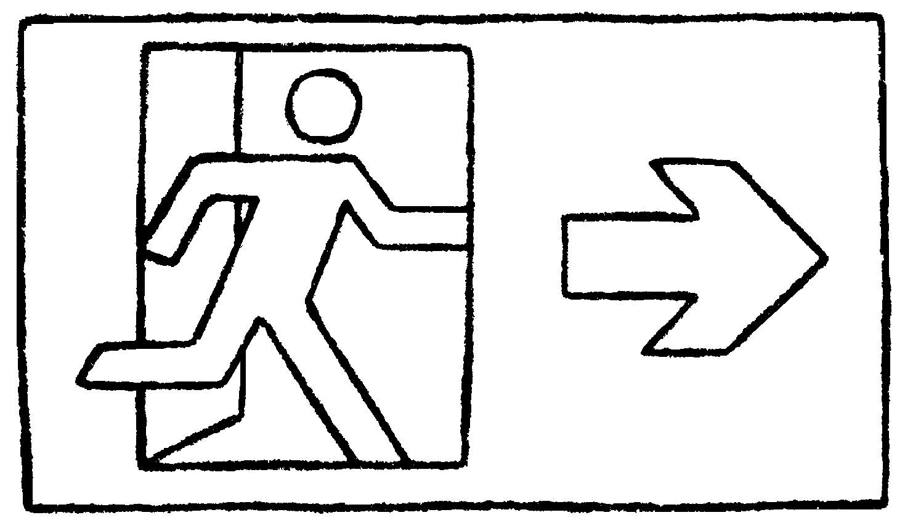

就像员工生命周期中的任何其他阶段一样，离职面谈是由人力资源部门（HR）负责的。就像绩效考核一样，他们会有一套标准流程来执行。一份包含一些有用问题的表格，例如“什么让你开始寻找新工作的？”、“你为什么要离开？”、“未来你还会考虑再次为该机构工作吗？为什么/为什么不？”、“你和经理的关系如何？”，随后是与 HR 的员进行面对面讨论，他们并不真的在乎你离开，只想在你离开之前收集一些数据。可能还会问这些问题：“你对自己的工作会有哪些改变？”、“你对自己的薪资和福利满意吗？”、“你获得了足够的培训来良好完成工作吗？”……你会发现这些与上面关于工作环境的问题相似。向那些仍在公司工作并想要改进现状的人问此类问题，难道不是向那些即将离开公司且不再在乎的人提问更有意义吗？

从逻辑上讲，离职面谈的目的是识别公司做得好的地方和需要改进的地方，确定人员流失的原因，并找出可以采取什么措施防止人们未来离开，或者至少让他们在公司留得久一些。然而，在离职面谈时提出这些要求太晚了。离开的人心思在别处（下一份工作、未来计划等），不再关心你可能给工作环境带来的任何可能的改进，因为他们已经在离开的路上，不再受到任何变化的影响。一切都变成了一种形式化的讨论，这种讨论必须举行是因为它是公司规定的一部分。就像绩效考核一样，它们的执行都很糟糕，区别在于，考核时是公司与员工交流，而在离职面谈期间，是员工与公司交流。离职面谈往往像是一种反向的考核。但与考核通常会发生某些情况（如加薪、某人被解雇、进行某些改变、设定某些目标等）不同，离职面谈往往什么都没有发生。除非员工忍无可忍，在离职面谈中以非常情绪化的方式爆发（HR 可能会将其视为“发泄”），否则他们极可能在离开时会打出“不是你的问题，是我的问题”的牌，以确保他们不会因为诚实或试图提出任何改进机会而烧毁桥路。因此，许多事情保持原样。

有时，离职面谈的摘要除了进行面谈的 HR 人员外，没有任何人看，而且更多是出于责任感或规范的 HR 实践，而不是出于改变公司的真诚愿望。因此什么都没有发生。所以让 HR 做他们的离职面谈，填写他们的问卷或之类的，但你也要和员工进行你自己的离职面谈，最好在 HR 面谈之前。他们更有可能向你（同行开发者）诚实并分享更多信息，而不是向 HR 说。通常建议在通知期中期进行此类讨论，此时他们已经克服了辞职的情绪面，但尚未在心理上与工作或公司脱，但我倾向于越早越好。你与员工交流得越早，他们越坦率、真诚的机会就越大。如果你在绩效考核中与每个团队成员进行过定期且诚实的讨论，那么你在离职面谈中讨论的内容将不会意外。但你仍然可以发现一些人们在工作时不想告诉你的事情。这种讨论不需要正式；你不需要做任何笔记，只需面对面的会议，你在其中寻求收集一些反馈——最后的反馈。所以多听少说。在绩效考核期间，你们讨论日常工作问题，而在离职面谈期间，是你了解那个人对自己的职业想做什么、想向哪个方向发展，以及他们为什么在目前的职位上无法这些目标的原因。


根据你收到的反馈采取行动。尝试变得更好，为团队做些贡献，找出那些如果你在与人的日常工作互动中只要稍做些不同的做法就本可以避免的问题；找出人们离开的原因并解决它们，以防止其他人离职；如果识别出的问题中有任何是你无力解决的，请沟通上述问题。如果那个人很难相处、态度糟糕或缺乏技能，而你又是雇佣他们的人，请回想你对他们的面试，重新审视你的面试笔记，看看当时是否有任何现在看来显而易见的迹象。你的面试技巧有缺陷吗？你是否受到了他人的影响？人们是否对对方提出的低薪水感到满意，从而对缺乏经验的事视而不见？这些事情本是可以避免的吗？

## 这非常重要

在结束本章之前，我想再次强调招聘和留住优秀开发者的重要性——这些人不仅要具备必要的技能，还拥有正确的态度，与你的团队契合并能保持事务顺利进行。不要招聘会给你带来麻烦的错误。他们会给你带来麻烦的！要招聘优秀的开发者。一旦聘用，就要关注他们并让他们能够高效工作。为此，你需要一种机制来识别员工面临的缺点或困难，帮助他们成长，并配备他们完成更好工作的必要工具，同时消除组织内部识别出的障碍。`HR` 创建的绩效考核是不够的。你需要定期的深度评估，而不是每年一次尴尬的讨论，大家在那后都想忘记它，直到明年一切在“事情会变得更好”的承诺中重新开始。

招聘和留住优秀的开发者类似于寻找并拥有一双鞋。你必须选择双从脚跟到脚趾都合脚的鞋。然后，你还需要照顾这些鞋。不要在错误的地形上使用它们，保持它们清洁干燥，给它们抛光等等。你通常不会买一双小了两个码、穿上不合、走路时会起水泡、站立时会疼脚的鞋，然后在发现它们不合适后就把它们遗忘在衣柜深处，对吧？

## 持续学习

如果你想长期成为一名优秀的开发者，你就需要不断学习新知识。这能带给你竞争优势，也让你留在竞技场上。2 到 3 年不学习新事物可能会让你变得过时。

大多数技术往往会被更好的技术取代，甚至被相同技术的改进版本所取代。这是因为新需求总会产生。如果某个问题使用当前技术很难解决，或者对当前技术的使用在某些方面不足或匮乏，那么只要人们有某种“痒点”（可以这么说），就会开始寻找更好、更有效的解决方案。然后，有同样“痒点”的人开始使用新技术，它就会走向主流，直到最终变成对了解该技术的程序员的需求与供需关系。如果你不熟悉目前追逐的技术，你可能就不再是供应方了。就像人们慢慢放弃一个没有跟上医学进步的医生服务，或放弃一个不使用新材料、新工具或新技术的修理工一样，公司也会放弃那些不再跟上当前技术的软件开发者。因此，你必须意识到正在发生什么，尝试扩大你的视野、你的职业选择，并努力保持“相关性”。

如果你不喜欢学习（或者更准确地说，“不热爱学习”），你对你所做的事情没有热情，不想投入精力，或者觉得时间有更有意义的事要做，那么也许软件开发并不适合你。

## 英语

让我们从一些非常显而易见且重要，但经常被许多开发者忽略的内容开始：学习足够多的英语。

如果英语是你的母语，那太好了。你少了一件需要担心的事情。但如果不是，你必须能够读、写、说，以及最重要的——理解英语。你还需要让别人理解你的意思。我见过许多开发者使用自动翻译工具，认为这能解决问题。但如果你想表达的内容很复杂，这并不一定奏效。这些工具正在变得越来越好，但你仍然面临着只得到一个字对字的翻译（mot-à-mot），这可能无法反映你想要表达的真实含义。这适用于双向，既从你的语言翻译成英语，也从英语翻译成你的母语。例如，你读过翻译得很糟糕的餐厅菜单([18]) 吗？你是否绝对确定你点的是你认为自己点的东西？

英语不仅仅是为了正确翻译餐厅菜单。我们生活在全球化经济中，机会现在可能来自地球上的任何地方。想猜猜哪种是世界主导商业语言吗？互联网上的大部分内容是英语。很多编程书籍是英语的。你现在阅读的内容是用英语写的。我本可以用我的母语（非英语）来写这些，但我想让我的内容触及更多人，因此……英语。

还有对话。在当今的商业环境中，面对面交流被非常看重。根据《哈佛商业评论》([21])，“面对面的交流接触是你在职业生活中可以拥有的带宽最宽通信方式”，当人们无法面对面交流时，许多人使用语音或视频会议。这意味着实时交谈、倾听和理解事情。在任何公司中，有很多书面交流，但书面交流不是实时的。你有时间重新组织句子，你有时间查字典查找单词，有拼写检查，可以寻求同事的帮助。当你与人进行现场对话时，情况就不同了。一切都发生在此时地。你不能让对方一遍遍重复他们的话，因为你没听懂。你不能在讨论中间查字典单词或术语。如果你没有理解或没有得体表达，事情已经过去了。因此，沟通和理解上的问题就会发生。


让事情变得更加复杂的是，据我观察，那些母语为英语的人在与非英语母语者交流时，通常并不会刻意简化措辞，以减少听众误解的风险。这并不是他们刻意为之，这只是他们与其他英语母语者日常生活的说话方式。例如，他们可能会使用熟悉的短语，并误地认为每个人都能理解它们。如果你对习语使用自动翻译，可能会适得其反。例如，自动翻译工具可能不知道像`“beating a dead horse（徒劳无功）、a piece of cake（轻而易举）、just what the doctor ordered（正合心心意）、kicking the can down the road（拖延问题）”`或`“cutting corners（偷工减料）”`这样的表达是什么意思，并将它们翻译成对另一种语言的人来说完全说不通的话。仅仅为了让你知道自动翻译有多脆弱，如果我在我常用的翻译工具中输入`“a piece of cake”`并将其翻译成我的母语罗马马尼亚语，得到的是`“fleac”`，它的英语意思是“非常容易的”、“微不足道的”、“琐碎的”。所以这个习语的意思被翻译对了。但如果我只输入`“piece of cake”`，我得到的是`“bucată de tort”`，字面意思是一块你可以吃的蛋糕。仅仅增加或删掉一个字母，我得到了一个完全不同的结果。所以不要指望翻译工具。它们很好用，但并不完美。你面临着丢失短语真实含义的风险。

再给你举一个例子，我的一个邻居在他前门上挂着这样一个牌子：

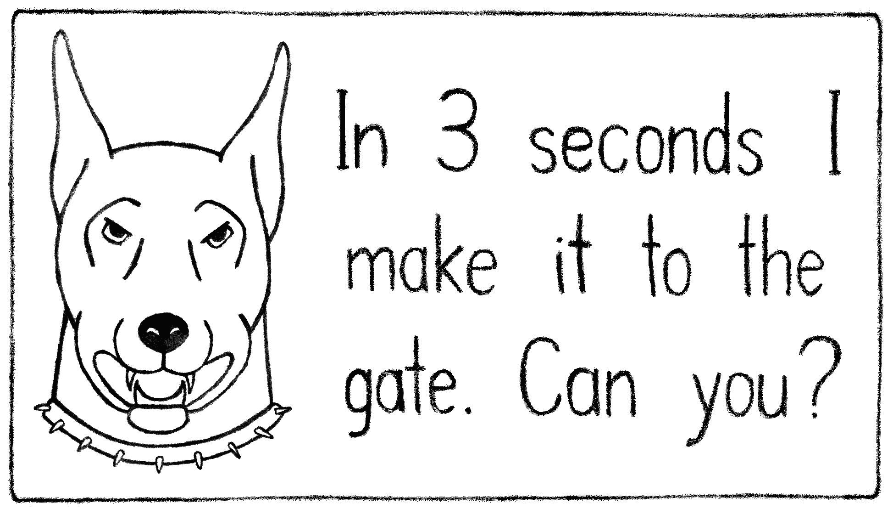

他假设所有的小偷都懂英语。幸运的是，狗的有助于传达信息。

所以，如果你不是英语母语者，请付出努力尝试熟练掌握这门语言，这样你才能真正理解别人认为理所当然的表达。如果英语是你的母语，请留意你交流的对象，发现他们困惑的迹象；确保你说的话被正确理解也是你的责任。

然后，我遇到的另一个问题不是人们不懂英语，而是他们发音不准。例如，英语有很多口音。法国人说话这样，德国人说话这样，印度人说话这样，澳洲人说话这样，以此类推。即使在英国内部，也有多种口音。人们不可避免地带有居住地区的特定口音。英语单词是相同的，但从口里出来的声音是不同的。对于不懂别人口音的人来说，对方的英语听起来是破碎的。所以你必须努力清晰地讲英语。我的建议是追求标准美式英语发音，不一定是因为我认为它是最好的，而是因为一个特定的接触因素：好莱坞电影。所以，如果你英语说得不好，就练习。看电影，看看你能在不看字幕的情况下是否理解所有内容。对比你的说话方式和演员的说话方式。嘿，你甚至可以和手机聊天。将语言设置改为美式英语，与你设备上安装的任何 AI 助手聊天，看看它是否能听懂你。

交流不是一种需要破译或像解谜游戏一样的事情。它必须尽可能流畅地进行。它并不一定完美（例如，许多英语母语者在读这本书时可能会注意到某些笨拙或生硬的措辞），不需要完全精通语言、让语法完全正确、或知道词典里的每一个单词，但你必须达到一个可以在交流时不丢失信息或引起误解的水平——否则，事情就会变得令人沮丧。

在进入下一个主题之前，最后说一句话。在上一章中，在我的面试主题列表中，你可能注意到我也包含了一个`“英语”`项目。我也会在面试期间通过与申请者进行英语对话来检查他们的语言能力。你可能是一个优秀的开发者，但如果公司内部所有交流的官方语言是英语，且职位涉及与许多人的互动，而你在面试中说英语时又极其笨拙或不熟练，那么你很可能会被拒绝该职位。除非你所有时间都在服务器房里写代码，与任何其他生命没有任何互动，否则英语水平的欠缺往往会成为申请工作时的淘汰标准。

## 坚实的基础

在英语技能之后，你需要的是坚实的编程基础。概念如运算符和控制流结构、数据类型和数据结构、流程图、理解二进制和十六进制、常用算法（如排序和搜索、遍历树和图）、大 O 表示法、递归、指针、对象和类、编译型与解释型语言、测试、调试、异步与同步代码、多线程与并发、如何组织你的代码、如何阅读堆栈跟踪轨迹或错误信息、合理的编程原则（如正确的命名方式、避免代码重复、移除魔数常量、高内聚低耦合）、各种编程范式（命令式、声明式、OOP、函数式、事件驱动）、重构、日志、安全、设计模式、SOLID 等设计原则、你的计算机或网络如何工作、什么是垃圾代码，或者意识到阅读和理解代码比编写代码更困难。列表还可以继续下去。基本上，我指的是你可以使用的工具，无论你用哪种编程语言编写代码。如果你是计算机科学学位的毕业生，其中一些内容可能已经在学校里教过你了。但不要指望学校教的东西。学校无法为你提供充分的准备。它根本跟不上快速发展的软件行业。所以你通过正式教育获得的基础可能并不坚实。学校无法给你提供职业场合所需的所有技能。如果你不知道这些概念，或者学校对其中某些概念教得不好，那么你需要自己学习并填补任何空白。

这些概念可以应用于广泛的问题。许多新想法有时只是不同的方式重新包装或有了更华丽的外壳。如果你已经熟悉了旧思想，理解新想法将会更容易。所以，从长远来看，先投资于基础再投资于技术。技术会不断更替。坚实的基础依然存在，并将帮助你更轻松地学习任何新概念或技术，或适应新的语言和平台，因为你可以在大多数编程语言中识别出这些概念，只是以不同的方式表达，有时在工作原理上不同。它们也是一种交流手段。人们可能会通过比喻或更直接、更基础的概念来解释复杂的概念，这些概念可能捕捉问题的本质。如果你不知道这些概念，你就无法理解这些解释。有时人们假设你已经知道某些东西。以学习新编程语言的书为例，大多数书并没有教你数据类型、控制结构、运算符、函数、作用域、类、继承或任何内容。它们教你这些在特定语言中如何表达，并假设你已经知道它们是如何工作的。


到目前为止，我一直使用“学习”这个词，我也会继续使用它。但不要认为它仅仅意味着`了解某事的知识`。通过“学习”，我的意思是对某些事物进行自我教育、练习这些事物，并培养一种你可以在工作中应用的技能。学习的意义在于建立技能，即将所学知识应用于特定问题的能力。除了教你理论的大学教育外，可以以职业认证为例。如果你有一项认证，意味着你花费了一些时间学习该主题内容，准备并通过了考试。但归根结底，认证证明了什么？它们恰恰证明了这一点：你可以学习某些材料，然后通过测试。仅此而已。它们不能证明你真正理解了材料，或者你能够将其应用于有用之处。掌握材料并不一定等同于工作中的技能。这就像知道滑雪的知识与会滑雪之间的区别。你可能很轻松地通过滑雪的笔试测试，但在实际尝试时，你会发现很难保持平衡，或者避开那些向你冲过来的树。作为一名开发者，你最多应该在招聘面试中面对测试；在那之后，人们期望你做真正的工作。而你为此需要技能。这也是为什么在职的人会接受“培训”，而在学校里的人接受“教育”的原因。

在学校里，你的实践技能大部分用于完成作业，而不是现实世界的问题。你被赋予明确的指令和要求，然后花费大量时间尝试为作业寻找最佳解决方案，你可能寻找某种让你的程序无论如何都运行在`O(1)`的算法或晦涩的数学公式，也许写一份优美的文档来加分，然后提交作业，拿分数，最后“再见（au revoir）”。在工作中并不是这样的。你仍然会为问题寻找最佳解决方案，但结果现在是可用的软件，而不是分数。现在你提交“你的作业”，并在项目的生命周期或在公司工作期间对其负责。你找到的解决方案必须是可维护的，并且（如果需要）是可扩展的。与学校不同，一旦你获得了成绩和学位，没人会因为技术更新而让你重考，不会因为今年出了新模型就更改你的学位，或者因为你收到的证书不再符合现行法律而要求你在未来六个月内更换其他。学校结束了，就结束了。你拿到学位就可以离开。在软件开发中，情况有所不同。结果很重要，但它不是永久的。你达成结果了吗？很好。那个结果现在是有效且良好的。在一年之内，它可能不再够用，必须更改、必须改进或必须扩展。简而言之……你必须再参加几次考试 :)。另外请注意，方法也是不同的，换句话说，目的不能正当手段。你是如何得到分数的并不重要（如果你没被抓到，你甚至可能作弊），相反，重要的是你是如何构建软件的，这样它才不会在晚上让你感到不安，或在日后给你带来麻烦。对于所有这些事情，你需要一个坚实的基础，这样你才清楚自己在做什么……因为许多人并不知道自己在做什么；但我以后会提到这一点。

所以，如果你刚刚完成学业并申请第一份工作，请意识到在职业世界中，一切都关乎于应用知识来构建人们会使用的东西。这不是为了参加考试去背诵你可能已经背过的东西。因此，你需要一种不同的心态。此外，现在你拿薪水了，所以大家都期望你产出有用的东西，而不是分数。

学校里发生的另一件事是，他们会告诉你该学什么以及按什么顺序学。基本上就是课程表里的内容，一份由他人为你规划好需要学习地图的课程表。不要指望这种情况会再次发生。从现在起，你需要自学。你必须决定学什么、从哪里学以及按什么顺序学。说到顺序，你可能不再按特定的顺序学习东西了。例如，在大学第一年，你学习了一些主题，然后在第二年学习以第一年内容为前提的其他主题，以此此类推。在工作中，你同时学习七件不同的事情，而且顺序诡异。例如，我遇到过几种情况，前端开发者先学了 `JQuery`，然后才学 `JavaScript`。这是一个不幸的情况，但发生的频率比你想象的要多。如果说在学校是为了发现事物是如何运作的，在工作中则是先交付产品，可能以后再弄清楚它是如何工作的……如果有的话。遗憾的是，有时你先获得技能，后获得知识。你可能做了某事，直到以后才发现自己实际上做了什么（也许你的同事在你离开公司后才会发现）。你很多时候会被直接扔进水里。你必须让自己接触各种事物；你必须投入、专注或克服重重困难。你必须完全靠自己解决问题。没有人有时间手把手向你解释事情，除非那是他们实际的工作（比如 `Team Lead` 或教练）。在工作中，团队的截止日期不会因为你是一个新入的初级员工而改变。每个人都有自己的工作要做。这不像在学校有老师和助教在那里给你解释事情。在工作中，人们在那里是为了工作。你在那里也是为了工作。你必须完成任务。是被卖出去的任务，而不是被评分的任务。在开始，你无论如何都要完成它们，为了让它们运行并让你按时完成任务。你想着：“我以后会修复的”。然后“以后”永远不会到来，因为在你完成一件事后，会有其他事情要做。你没有学期假。这意味着你会养成坏习惯，正如你所知，坏习惯很难消除。这类事情每天都在发生。这就像你参加考试不仅包含了你没学的题，还包含了没教过你的主题。在学校里这不公平，但在工作中，这是完全可以接受的。

然后，当你需要解决问题时，你不会像在考试时那样得到精确的要求。某些需求可能相互矛盾，你可能需要自己收集和分析需求，你可能不知道使用什么工具，你可能会捕获并忽略异常，你可能会重新造轮子，因为你在学校时就是这么做的，而并不知道已经有可以复用的实现。你可能只考虑了“快乐路径（happy path）”，然后测试人员指出了你设计中的缺陷，你通过在已经复杂的条件中再添加另一个 `if` 来修补。你可能会提交得太晚（由于再次，在学校里这并不重要）。你的电脑崩溃了？糟糕……重新开始。在 SQL 查询中使用字符串拼接参数值？这真有意思。还有调试了两天发现只是放错了一个分号，或者你不小心将一个变量声明为全局变量。而你将在尚未完全理解的现有代码库上做这些事情。所以你会犯很多错误。如果你在概念和技能方面有坚实的基础，它将允许你减少这些错误，或者更好地利用它们来学习。


开发人员的工作不像医院里的住院医，也不像律师事务所的学徒——在那种情况下，你最初需要在监督下工作，然后才能完全独立工作。作为一名开发者，你是在边做边学，在工作中学习，直接在公司的产品上、在生产环境中、使用真实数据进行学习，而且往往没有人监督你在做什么。犯错是不可能的。如果你在一个已经运行一段时间的现有项目上工作，你肯定会发现许多别人犯过的错误示例。糟糕的代码不仅是由糟糕的开发者编写的，也是由缺乏经验的开发者编写的。无论好坏，每个人起初都是没有经验的。即使是现在的专家，以前也犯过很多错误。事实上，这正是成为专家的原因——即犯过所有可能犯的错误；这里有一个关于这个的笑话：

> 一个富商商人的儿子问他父亲：
> – 爸爸，你成功的秘密是什么？
> – 两个词。
> – 是哪两个词？
> – “正确的决策”。
> – 唔……那你是如何知道哪些是正确的决策的？
> – 一个词。
> – 是什么？
> – “经验”。
> – 唔……那你是如何获得经验的？
> – 两个词。
> – 是哪两个词？
> – “错误的决策”。

许多开发者在职场中的典型成长路径是这样的：他们学习知识，应用所学，犯错，从错误中学习，变得擅长工作，重复这些步骤直到精通，在当前公司达到知识瓶颈，然后去另一家公司学习新事物，犯更少的错误（或犯完全新的错误），精通那家公司的工作，达到另一个瓶颈，跳到另一家公司，以此此类推。

在这种情况下发生的另一种情况是，其他开发者必须处理前人所犯错误导致的后果。在某种程度上，你将遵循类似的路线并处理类似的问题。有时，你可以在公司待足够的时间来清理自己的烂摊子并改进代码，但如果你不再维护该应用程序或离开公司，代码就会保持无人触碰。举个例子，我曾与一位非常有的资深开发者合作过。有一次，我必须对他多年前构建的一个应用程序进行一些修改，我发现实现上存在一些不合理的地方。了解这个人，并且知道他是一个优秀的开发者，我想也许代码本身没有问题，而是我漏掉了什么。我带着有问题的代码去找他说：“我发现你这段代码出了一些问题。我不理解它为什么要写成这样。是我漏掉了什么吗？你能帮我吗？”在经过解释我顾虑的简短交流后，他看着代码，微笑回答道：“那是我当时能做到的。代码是错的，你应该修复它。”

所以，要做好犯错的准备，并做好在别人的代码中发现许多错误的准备。从所有错误中学习至关重要。

> 聪明人从自己的错误中学习。智者从他人的错误中学习 —— 未知

当我说错误时，我指的不是“愚蠢的错误”。我指的是“诚实的错误”。因为没有足够注意连接的是哪个服务器或正在做什么而导致删除了生产数据库，这是一个愚蠢的错误。诚实的错误是你出于合理的理由所做的事，基于你当时拥有的知识，期望得到良好的结果，但却得到了意料之外或错误的结果。诚实的错误帮助你成长并增加经验。相反，愚蠢的错误不能积累经验；最多只会让你以后变得更加谨慎。你既会犯诚实的错误，也会犯愚蠢的错误，这就是人的常态，但你应该努力消除愚蠢的错误，并学习很多东西来尽量减少诚实的错误。对于这两种错误，坚持不改（固执）都是至关重要的。那说明你没有在学习，而在开发者行业，如果你不持续学习，就无法长久。所以，从错误中学习吧。它们帮助你成长。

让我说清楚。我不是说让你明天去上班故意搞砸一切，看看能从经验中中学到什么。我的意思是你可以在“受控”的设置下犯一些错误。例如，如果你家里有一个个人项目，一个不发布给用户仅用于学习新事物的项目，你可以在那里犯错。你可以应用更多知识，发现事物是如何运作的，实验看看哪些有效、哪些无效等。有些公司认为这是一种学习知识的方式，特别是当你正在构建以前从未做过的东西时。因此，他们的政策部分可能包括为开发者构建概念证明（PoC）或原型，让他们犯错、从这类项目中学习，然后根据学到的教训，随后开始开发真实的应用程序。因为软件通常作为新事物被构建（否则你就会使用现有的软件了），错误在不可避免。因此，通过快速创建某个东西，你可以快速地犯错并从中学习，而在该构建真正的东西时避免它们。这在很久以前瀑布模型([22]) 仍然是软件开发的典型方式时，被称为“计划性丢弃计划”([23])。这个想法是在“测试对象”上犯错，而不是直接在要交付给客户的项目上上犯错（在那个地方发现错误就太晚了，已经在发布的产品中了）。

那么，另一种识别错误的方法是阅读关于不良实践、反模式或代码气味的文章。你不会总是以独特的方式出错，别人已经犯过你正在犯的错误，而且很多可能已经记录在案。看这本书为例；它是关于你应该尝试避免的错误，即我和我之前的人犯过并持续持续的错误。

最后，另一种极佳的学习方法是参与代码审查。如果有人审查你的代码——一个更有经验的人，或者至少是一个对事物有不同观点的人——他们可以发现并指出你的错误，或者建议更好的实现方法。代码审查是从你的错误中学习的绝佳方法，因为如果你犯了任何失误，在代码审查之后，你必须自己修复它们。

## 导师 (Mentor)

如果你足够幸运，你会找到一位导师收你门，向你分享他们的经验，而你不需要去犯各种可能的错误。拥有导师可以比你自己更快地将你的开发提升到下一个水平。与其在信息的沼泽中挣扎并拼接各种碎片来获取知识，导师可以告诉你去哪里寻找更多细节，或者哪里隐藏着陷阱。


导师并不意味着你已经准备好成为顶尖开发者了，而且随后的一切都会顺风顺水。导师不会解决你所有的职业挑战。这并不像在视频游戏中解锁下一个关卡。你必须付出努力并独立学习。导师可以做的是鼓励你并建立你的信心，随时准备回答问题，分享他们的知识和经验，识别知识上的缺失或误解，并推荐相关的学习材料来修复它们。他们可以将复杂的信息浓缩成小而易消化的碎片，让你通过犯某些错误来自己领悟，或者当你发现你方向偏得太远或者陷入困境或挣扎时提供新的视角。导师可以并以最好的方式帮助你实现目标。但归结底，这取决于你的努力。他们不会驱动整个过程并准确告诉你该做什么。导师的作用是提供指导，而不是把信息下载到你的脑子里，或者用勺喂你吃。


### 你能从导师那里学到什么

你从导师那里中学最多的东西与经验有关。如果你刚开始进入这个领域，导师就是一个已经到达你想的地方的人，他们可以指向你想要的方向标出不同的地标。

如果你真的找到了导师，那太好了。甚至非常棒。但要小心。通常初级人员会遇到某些技术高超的资深人士，将他们视为榜样，然后像口香糖粘在鞋底一样粘着他们，认为只要自己模仿了他们的行为或信念，某些技能就会转移到自己身上。*“如果他们这么说，那么 OOP 一定是垃圾。如果他们这么说，那么测试驱动开发就是解决一切的方案。IDE 是给包子夫用的；你唯一需要的就是 Vim”。* 熬夜到凌晨 03:00 写代码是最重要的技能，因为那是你从导师那里听到的“战争故事”中出现频率最高的；此外还有那种*“我是最强的，去他妈的别人”*的态度。所以要非常小心。遵循他人的意见往往比产生自己的意见容易，尤其是当这种意见来自你仰仰的人时。然后你很容易陷入认为*“他们有效的方法对我也一定有效”*的想法中。

### 导师制的现实

每个人都有好和坏的一面，我们都会犯错（如果之前的章节还没说得清楚的话）。不要认为导师等同于传播智慧的绝地武士或少林僧侣。你可以从任何人那里得到好建议或坏建议。所以，要批判性地思考你听到的内容以及给你的建议。如果你的导师是被*“分配”给你的，这一点最为重要。我在上一章中提到过，有些公司尝试在内部培养开发者。新入职的实习生和毕业生有时由 HR 或管理层分配给一名本该负责他们的资深开发者。而 HR 会把这些资深人士称为*“导师”*，仿佛资历是导师制的唯一先决条件。

我遇到的大多数开发者并没有当导师的特质，或者他们认为自己不擅长，由于这个原因，他们甚至不尝试。其他人自尊心很大，让导师工作完全围绕自己转，展示自己多么伟大和聪明，以至于他们变成了控制狂，要求徒弟随叫随差。在我的面试题目列表中有一项*“导师制”*，我总是将申请者的讨论引入这个话题，但很难找到具有导师技巧的人，因为开发者很少在这一领域接受过培训。分配不熟练的导师永远行不通。许多人失去了耐心；他们忽视自己的徒弟，或者下达命令，而不是提供建议或提示让人们得出自己的结论。有些人感到无聊，是因为他们已经指导了其他几个初级人员，他们不断一遍又一遍地重复相同的话。有些人忘记了自己在和谁说话，所以他们按自己的理解水平来解释话题，忘记了当新手时是什么感觉。有些人可能甚至不是真正的资深人士；他们十年的（所谓的）经验只是一年的经验重复了十遍（大部分是在那个公司里没人想去碰的破烂应用程序上）。而且通常，经验丰富的开发者会从自己的视角看问题，回想起自己的成功和失败，然后试图在徒弟身上创造出一个自己的复制品；*“我做过这个，你必须这样做这个。我避开了那个，所以你必须避开那个。我的职业路径将变成你的职业路径”*。

纯血程序员（纯技术型程序员）在导师制这件事上（或者说其他大多数软技能上）往往表现得很糟糕，而那些具有领导力的人需要处理的事情太多，为了平衡这么多事情，他们没有时间成为真正的导师；充其量是个兼职导师。例如，这是团队负责人（Team Lead）帮助团队成员成长的工作，但不要指望整天被手把手教。所以我的建议是积极努力向每个人学习（初级人员、资深人员、开发者、测试人员、经理、互联网上的陌生人……），不要过度执着于拥有导师。

## 技术

回到你需要学习的内容，基础是非常好的；它是其他事情的垫石。但它还不够。公司招聘也看技术；例如，如果他们有一个 `ASP.NET` 项目，他们就不会寻找 `PHP` 开发者。你可能仅凭基础知识获得一份入门工作，但在第一份工作之后，如果你熟悉他们正在使用的技术，大多数公司都不会雇你。所以，除了建立坚实的基础之外，问自己应该学习什么技术也很重要。

### 学习正确的技术

回到你需要学习的内容，基础是非常好的；它是其他事情的垫石。但它还不够。工作中可以使用某些技术。但之后呢？学了某些东西，但几年后就消失了…… 哎呀！你曾作为 Flash 开发者赚过钱吗？当然！但这条路没有未来了。你专注于某些现在用于遗留应用程序的技术吗？哎呀。也许你会尝试一些在近期看起来巨大的技术，比如人工智能、物联网、增强现实/或虚拟现实，或者区块链技术？你永远不知道某些东西现在看起来很有益，但在未来可能会完全崩塌，让你感觉像在挖坟墓。就像预测股市或彩票号码一样，预测技术将发生什么是不可能的。

那么，你如何决定下一个要学习的东西以获得理想的结果？

大多数人是因为热度而进入新技术的（特别是是是开发者；我对前端开发者没什么偏见，但认真的……别下热度车了）。某些新的、新鲜或令人兴奋吸引了你的注意力。你周围的人在谈论这件事。你看到开发者社区对此有很大兴趣。你去查看它是怎么回事。你感到好奇。你喜欢它，并开始学习。或者你讨厌它，在这种情况下你不再多关注它。学习它是正确的决定吗？不学习它是错误的决定吗？或者情况完全相反？社区可能会围绕某些新技术聚集，它可能是每场会议最热门的话题，你可以感受到人们在 GitHub 上贡献文档和项目时的热情，库、框架和工具层层涌现。它看起来就像是新出的最好的东西，随后你会看到这些趋势反转、衰落，并永远停留在 Gartner 技术趋势周期（[24]）中命名恰当的阶段——*“幻灭之谷”*：


你不能仅仅根据自己是否喜欢某物就做决定。你还需要考虑这项技术看起来是否有潜力，是否你认为对你的未来发展有所帮助。这又是一次“预测未来”的老题。然而，你可能发现自己在使用 `C#`、`Java`、`JavaScript`、`Python` 或 `PHP` 等主流语言之一工作。所以，就从那里开始吧……我是说。

请记住，这并非易事。你永远无法预知自己是否做出了正确的决定。例如，尽管我一直认为自己是一个全栈开发者，但我往往倾向于后端技术。我了解 `JavaScript`，并且用各种框架构建过一些非常沉重的前端客户端，但我对 `CSS` 没做过什么事情。我没有在基础用法之外学习过过 `CSS`，因为在屏幕上纠结像素真的不是我的菜。我单纯地不喜欢它。我觉得花几个小时时间试图让某些文本在三个不同浏览器的十版本 `div` 中完美对齐简直是浪费时间。我通常是一个很有耐心的人，但在屏幕上排列元素会让我完全抓狂。我理解学习 `CSS` 的必要性，但我最终决定减少在那个方向投入精力。

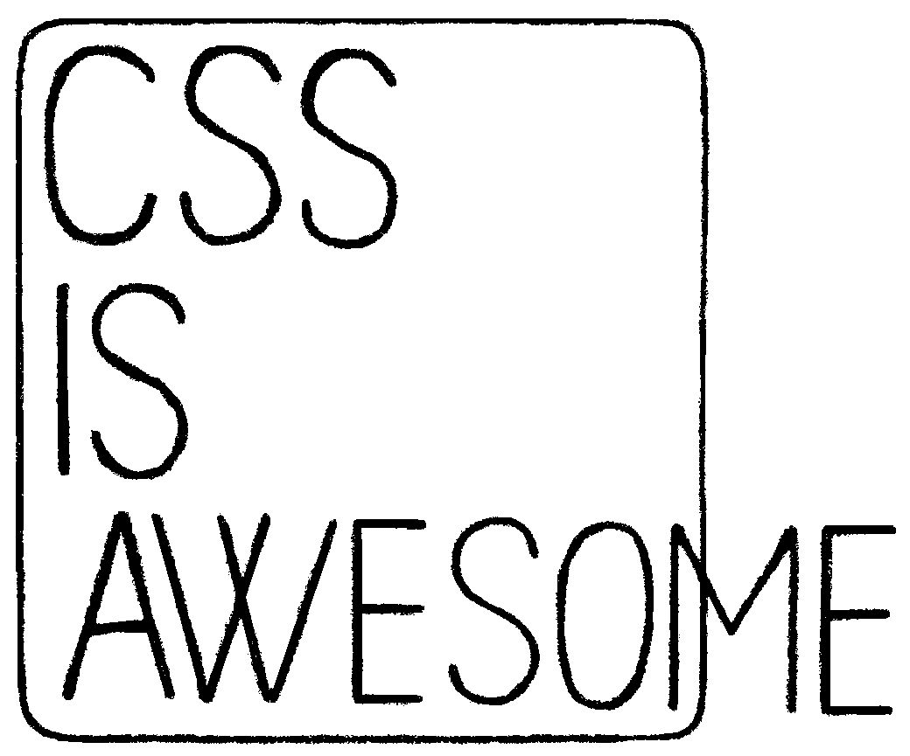

另一点是我并不懂 `PHP`，因为它从未吸引过我。在同一个文件里编写 `HTML`、`PHP`、`JavaScript` 和 `MySQL`（那是那时的风格）对我来说并不对味。因此，我转向了 `C`、`C++`，以及后的 `Java` 和 `C#`。我做出的决定正确吗？谁知道呢。对我来说效果还不错不错……我想吧。另一条路径是否更成功？我永远不知道。对我来说，重新开始已经太晚了。现在，在很大情况下，如果我重新开始，学习 `C` 或 `C++` 的意义不大了，因为它们不再有那么大的需求。在我所在的地区，`C++` 的工作很少，`C` 的工作几乎为零。这引出了我的下一点观点。也要考虑一下金钱和就业。

是的，是的，某样东西很酷，你喜欢它，你追随内心的激情，你用那种语言创造出美妙的设计，你的代码如行云流水。但你也得吃饭。你可能是一个 `Haskell` 的忠实粉丝，但如果你所在的地区没有任何 `Haskell` 的工作，你最终可能会变成一个饥饿的粉丝。所以，看看那些也有需求的东西，这样你才能获得一份高薪工作。你可以将其与你喜欢做以及任何吸引你的事物结合起来，但不要忘记你有账单要付，可能还有车贷，甚至还有房贷。试着长远考虑。我的建议是不要直接跳到非常新的东西上。给它一些时间。这就像购物一样。你看到一个想要的东西，你认为你需要它，你想买下它。再等几天，看看你是否还像那么想要它，以及你是否真的需要它。那时再买。对技术也是如此。当你发现一些新事物时，研究一下，了解关于它的几点，然后让它静置一段时间，再决定你是否想要深入学习。有助于决策的因素是你在相应技术领域找到职位数量。如果没有，你可以负担得起再等一会儿。当职位开始出现时，你可以重新审视这个决定。

然而，尽量不要掉入另一个极端，仅仅为了钱而进入某项技术。这通常涉及老旧、小众、奇特、有时甚至是少数人知道的专有语言。例如，`COBOL`^([25]) 在你的国家可能薪水很高（尤其是因为所有的专家现在都在退休），但它很容易被外包到其他国家，并由一群工资较低的年轻毕业生来完成。如果你在上述外包国家，那么可能这对你可行，但要注意不要冒让自己陷入那项技术中。我遇到过的另一个（极端）例子是一种内部开发的、只有四个人知道的语言（其中一个已经去世，一个正在退休，第五个人正在接受培训）。如果你在这些技术上投入了大量精力并发现自己失业，如果你不了解其他技术，或者你的思维被困在该技术范式中，你很难找到另一份工作。你不想变成一个“一棱虫”，或者最后陷入“把所有的鸡蛋放在同一个篮子里”。

## 专家 vs. 通才

说起一棱虫，另一个需要考虑的方面是：你想成为什么样的开发者？有些公司在寻找通才，另一些公司在寻找专家。这是另一个很难决定的事情。你参加面试，人们查看你的简历，他们看到了什么？“嗯……我看到你做了一年的 `C#`。然后你转到 `Java` 做了五年，接着又做了三年的 `C#`，现在又想要 `Java` 了。嗯……你似乎犹豫不决。你还是不知道长大后想做什么，还是什么？通常，开发者会选择一种语言并专精该语言的技术栈。而你只是来回切换。”然后你去了下一个面试。“嗯……我看到一些 `C#`、`Java`、`JavaScript`、`Python`、Web 服务……嗯……抱歉，不够。我的意思是，没有移动开发，没有 `Swift` 或者至少有 `Objective-C` 之类的。嗯……我看到你对 `Haskell` 感感兴趣。你为什么不去学 `Scala` 呢？而且没看到你为任何开源项目贡献过代码！这段时间你到底在做什么？管自己叫开发者？”

选择成为专家还是通才都有其优缺点。

专家是应对我们如今日益复杂的应用的答案。现在比以往任何时候都需要专业化。让一个人从端到端完成大型应用程序的所有工作变得越来越不。我们有不负责后端的前端开发者，不负责前端的后端开发者，我们有数据库管理员或 `SQL` 开发者，我们有部署工程师，其他人负责网络配置，以此此类推。当公司招聘时，他们通常在寻找这些领域的某个专家。所以，作为专家，你对雇主更有“吸引力”。你（通常）也赚得更多钱。但如果你想在某方面非常精通，你就需要投入时间。你在精通某个领域投入的时间是从学习其他事物上夺来的时间。如果你专精的技术过时或被更好的技术取代，或者消失了，你的投入也会随之消失。另一个缺点是，如果你寻找另一份工作，你只能申请与你专业知识匹配的职位。当职位开始出现时，你可以重新审视这个决定。


作为一名通才型，你可以解决更广泛的问题，因为你没有因专业化而产生的狭隘关注。对更广泛的主题的理解可能是一种优势，因为它在处理问题时能为你提供更多选项或解决技术，让你能够更好地、更轻松地看到大局，或者了解不同事物是如何相互作用的。你的职业选择也更少受限，因为你可以申请范围更广的工作。但这并不意味着通才者比专家更好。你现在是一个“**样样通**（`"Jack of all trades"`）”，这伴随着它自己的缺点。你可能会很容易忽略某些细节，因为你对特定主题的知识可能不够深入；你最终可能构建了一个可以行的解决方案，却无法识别出它有多糟糕。这与专攻某领域同样耗时（甚至更多），因为你需要将注意力集中在多件事上，而不是一件。而且，由于一个简单的事实——你……嗯……不是一个专家——你对公司来说价值也就没那么高。

你不知道谁在寻找什么：是在寻找专家还是通才。同样地，你必须仔细考虑从长远来看什么对你最好，以及你想成为什么样的开发者。当涉及到你的广博知识和你的专业领域时，你会遇到以下几类开发者^([27][28])：I 型、T 型、PI 型和梳子型。这些只是对知识深度和广度结合的华丽说法，意味着你可以成为一名专家、通才型专家（即拥有一项专长的通才）、两个领域拥有专家级知识的人，或者是三个或更多领域的人。

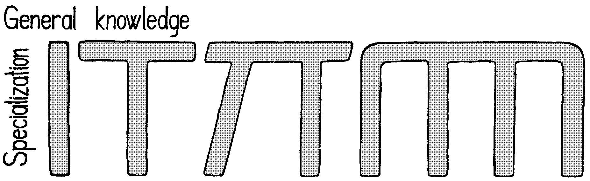

你最终极可能至少成为一名 T 型开发者。除了学术界（你可以完全孤立地研究一个课题，即 I 型类型），在现实世界中，应用程序是异构的怪兽。你不能让某个东西完全用一种技术构建（嗯，也许可以，但并不总是实际）。后端可能有一些 `Java` 或 `C#`，一些 `SQL`，一些 `Python` 脚本，`HTML`、`JavaScript`、`CSS`。你可能暴露一个使用 `REST` 或什么的 `API`。你无法真正与一切隔离开来。例如，假设你只想做 `CSS`（你算不上是个开发者，但为了辩论，我们假设如此吧）。你仍然需要学习 `HTML`。没有 `HTML` 的 `CSS` 是没用的。然后你发现某些事情仅用 `CSS` 是无法实现的，所以你可能需要使用一些 `JavaScript` 或 `jQuery` 来添加额外的效果。然后可能项目规模扩大后，你可能会发现与编写原生 `CSS` 相比，`SASS` 会带来很多益处。或者你写了一些 `jQuery`（实际上有很多），你意识到某些 `JavaScript` 框架可能有助于清理代码并让一切变得更易管理、更易读。然后你想让你的东西（无论它是什么）在手机和平板电脑上可用，所以你需要学习响应式和移动端设计。`UX` 技能也将非常重要。也许从零开始做这一切没有意义；例如，`WordPress` 可能就足够了。但也许自托管的 `WordPress` 版本无法满足你的需求，或者也许你想对它有完全的控制权，或者你想创建自己的特殊主题。你该怎么办？首先，你可能会学习一些 `PHP`。也许你的应用程序随后变得非常成功，但在假期期间，流量增加之大以至于你的服务器无法再次处理。因此，你发现在那段时间你需要更多的处理能力。你可能会将你的解决方案迁移到云端，因为这可能比购买一台一年大部分时间闲置的服务器要便宜。随着软件变得越来越复杂，你需要使用或组合越来越多的部分来构建一个运行的结果：各种编程语言、框架、不同类型的数据库、消息中间件、IDE、构建工具、版本控制、虚拟化、多个操作系统、多个浏览器和设备兼容性、垃圾回收、性能优化、内存管理、配置管理、多线程、云、安全考量等等。总会有某些东西是你最需要和最使用的，所以你可能会专精于此，而其他一切都将属于“**我了解足够完成任务就行**”的通用范畴，但你仍然需要充分学习这些以构建有用的东西。有很多工具可以帮助你并让你的工作更容易，但你也必须学习它们并理解如何使用它们。

取决于你工作的内容或你做某项工作的原因，你的专业领域可能会随时间改变。你可能会用其他东西替换 T 型的竖线，而横线变得更宽。当你获得新的专业知识时，可能会变成 PI 型开发者，但随着时间推移，你会忘记旧的，或者在跟进更新方面落后。我很少见到 PI 型或梳子型的开发者。我也很少见到有人从 I 型开发者开始然后转变为 T 型。大多数新开发者不属于任何一类。他们是点型开发者（因为缺乏更好的名字）：他们没有专精任何领域，他们仍在建立基础，需要投入大量的时间和精力在水平和垂直方向上都开发自己的技能。

## 信息过载

随着行业演进和技术环境变化，你需要不断学习。但有一个陷阱。你无法按照行业进步的速度来吸收信息。你根本做不到。这意味着你永远无法掌握你想了解关于某方面的所有知识。如果你试图了解每方面的一切，你最终只会感到失望和精疲力竭。仅仅对事物有“意识”而不完全掌握它们它们是行业的现实。你越早意识到并接受这一点，对你越好。举个例子，当我年轻时，我有这样一种印象，我可以学习关于某种语言的所有知识，比如 `Java`。


如果你不复习你的知识，你一定会遗忘它们。当你不断学习新事物时，花在复习旧知识上的时间会越来越少。在应用信息方面，只有经常练习某项技能，你才能真正精通它；否则，你也会忘记它，或者至少会变得生疏。如果你不经常使用你的知识或不刷新旧话题的记忆，随着你把大部分时间投入到学习或使用新事物上，它们会逐渐消失。因此，你需要应用你所学的内容，使信息在脑脑中巩固。此外，当你学习了某东西但不应用时，你甚至不知道自己是否正确理解了信息，不知道它是否足够，或是好坏。什么都没有！你的知识没有物质化，无法去观察和评估它。如果你不对信息采取任何行动，学习就是徒劳的。那仅仅是“输入”。你还需要“输出”。我回到认证的例子上。你参加过认证考试并并通过了测试吗？恭喜你！然而，真正的测试是利用这些信息开发出一个人们可以使用的应用程序；否则，你收到的证书对你帮助不大，除非你真的想把它装裱挂在墙上。

### 行行的力量

在谈到错误时，我提到了你可以用来应用所学内容的个人项目（例如，如果你在工作中无法应用的话）。这是“行”的一种方式。“行”也可以意味着参与像 `Stack Overflow` 这样的社区。当你尝试向他人解释概念时，你会学到很多。解释一个概念有助于你更好地掌握它。你通常需要在不丢失其本质的情况下对其进行简化，而只有当你熟悉该主题时才能做到这一点，并且能够以他人易于理解的方式来组织材料。你可能还需要为不同的人用不同的方式解释事情。这不仅提高了了你的沟通能力，而且往往会揭示你知识中的漏洞。所以，回答别人的问题。寻找那些超出你目前知识范围的问题，或者关于你认为自己已经了解的事情，但别人提出的问题让你产生怀疑或从不同视角来看问题。找到修复方法或解决方案，然后制定回复解释给他人听。人们可能会有后续问题，或者多次询问“为什么？”或“如何做？”，这使你深入研究该主题，直到发现需要学习更多内容才能再次回答，从而加深你对主题的理解。如果你犯了错或误解了某些内容，你可以确定会收到其他用户的即时、诚实的反馈。你也可以阅读其他人针对同一问题发布的答案，这些答案可能包含更多细节等等。

### 信息过载与焦虑

你需要学习的信息量大得惊人。即使当信息已经很好地保存在某本书或其他地方时，情况也是如此。试着在 `Google` 上搜索一个主题，你会得到超过百万条结果。

> 从互联网上获取信息就像从消防水栓上喝水 - Mitchell Kapor^([31])

有太多的信息并不总是随手可得，你需要花时间去寻找它们。然后，无论你发现了什么，在过一遍之前，你不知道它是好是是垃圾。你不知道是否遗漏了核心内容，或者它是否是你现在需要学习的，还是你可以以后再看的。你认为学习每件事都花费太多时间，你发现自己无法解释你认为已经理解的内容，最终你感到沮丧和愤怒，或者开始内疚自己忽略了某些信息，或者觉得桌上那堆未读的书越堆越大，或者你收藏了太多以后阅读的网站，以至于当你尝试打开时浏览器书签管理器都会崩溃。当你终于完美学会了某项内容并对自己的成就感到满意时，它的新版本发布了，你又觉得被迫去学习它。一切开始感觉像是在仓鼠轮上跑步，无论你跑得多快，似乎永远无法到达你想去的地方。你认为需要或想学习的事情实在太多了，你很容易感到不知所措。这导致了所谓的“信息焦虑”^([35])。

> 我认为你知道的越多，就越意识到自己不知道的越多。所以悖论的是，你进入兔子洞钻得越深，就可能越倾向于纠结于那些在途中意识到的、不断增长的、未学习的边缘概念 - Dave Ward^([36])

### 学习的演变

以前官方语言文档就够用，或者你有一些良好的技术期刊可以参考的日子已经一去不复了（假设你经历过那个时代）。我记得曾在 `Turbo Pascal` 的帮助文件以及我国家关于该语言的仅有的三本纸质书中寻找东西。现在看起来很愚蠢。今天，每种编程语言都有书籍。有很多博客、订阅、播客、在线教程以及大量的其他来源。如果你遇到某些问题，你必须进行研究并主要在网上寻找信息，在那里任何任何小丑都可以发表意见，任何傻瓜（例如我）都可以编写并出版一本书，而你不知道内容是否有价值。遗憾的是，现在很多事情都像是在大海捞针。

但也有好的一面，讽刺的是确实有海量的信息可供使用。你不需要花费巨额费用就能学很多东西，许多资源是免费提供的。我们生活在这个奇妙的时代，只要有互联网连接，几乎所有的信息触手可及。遗憾的是，我们现在拥有巨大的数量，但不一定有高质量，你的任务是从 `Google` 搜索结果的前（希望是）两页中读到的内容将其组合在一起。你会花费大量时间在网上搜索，最终会寻找一些你找不到的答案。你开始怀疑自己是不是第一个需要某些信息的人，还是自己自己在写良好的查询语句上完全糟糕。


## 所以你该怎么做？

正如我之前提到的，你需要接受“你无法学习一切”这个事实。然后，即使知道学习没有尽头，也要继续学习下去。你需要踏上那只仓鼠轮，保持恒定的速度跑步。保持好奇心并去学习东西。当你遇到一个用现有知识无法解决的问题时（请放心，这种情况会经常发生），只需在问题发生时去处理它即可。然后你会学到足够的知识来找到解决方案（你还应该确保自己理解了解决方案，而不仅仅是从 `Stack Overflow` 上复制粘贴代码 :)）。如果你想在某个领域专精，你会在那个方向投入大量的刻意努力；但对于许多其他事情，你会在问题出现时才进行深入研究。这并不理想，因为你基本上是在黑暗中摸索，偶尔打开一下灯，也许你并不喜欢自己最终所在的终点，而且不得不回回重来，但事实就是如此，对此也无能为力。

此外，尝试一次只专注于一件事，最重要的是，不要试图急于学习。有时候，开发者倾向于一次性学习很多东西。这是因为你要么看到看到比你懂得多的人，掌握了你还没学过的东西，所以你觉得自己的学得不够快；要么你发现了其他最初没有察觉到的东西，为了继续前进，你也必须学习并理解它们（而需要学习的东西越来越多，可用的学习时间却保持不变）。然后，如果你在某某事情上卡住了，你可能也会受到于转向其他事情（因为你不能把所有时间都花在一个科目上，对吧？）。但就像试图一口吃掉整个汉堡并可能噎住一样，试图在大脑中快速塞入太多东西会导致`认知过载`^([38])。你无法处理这些信息、无法理解它们，也无法记住；你仅仅是在读过它们。简单来说，这意味着“贪多不烂，最后一无所获”。所以，专注！优先考虑事项。决定哪些是必须知道的，哪些是了解了好的。你现在需要的是首要任务，而仅仅是很酷的东西可以等一等，有时你甚至可以完全忽略。如果你认为自己会错过某些重要内容，不要担心；如果它很重要，它会找到自己的方式回到你身边。专注于你现在手头的任务。快速跳过材料很容易，但并没有真正学到什么，只学到了很多话题的皮毛，这反而会带来更多困惑，你必须投入更多时间去澄清它们。所以，不要让自己分散得太薄。

这并不容易。一点也不容易。尤其是有时你可能会因为同伴压力而投身于太多的事情。成为社区的一部分可以帮助你学习，你可以获得建议、反馈，人们可以分享经验。但社区也可能以不那么好的方式影响你。你看，聪明且对事物充满热情的开发者往往会强烈地表达他们的感受……这是一种委婉的说法，他们可能会贬低或嘲讽那些没有做“他们”正在做的事情的人。“`F#` 很酷，让我给你看看。你是在学 `JavaScript` 吗？把它放一边，让我给你看看 `F#` 有多酷。什么？……你不知道 `TDD`？你在想什么？你永远不应该在没有测试的情况下编写任何代码。你不知道 `ReactJS`？你用的是什么框架？那是去年的事了……””

每个人都有自己的偏好，许多人会试图说服（或诱惑）你加入他们的阵营。你会怎么做？你会学那些东西——无论是什么——吗还是不？你想像他们一样酷，还是……？你会对学习什么做出自己的决定，还是会被同伴压力迫使？这甚至不非是你的团队成员或那个坚持让你尝试一下他们喜欢的语言的朋友；在线社区也会对你的决定产生影响。社区关于学习合适内容的判断是正确的吗，还是你认为自己更懂？同伴压力对你有好处。它能让你保持高效并专注于你的学习。当你看到其他有动力且掌握了你还不知道的知识时，你会加快速度；你不想被抛下，你想成为群体或社区的一员。但同伴压力也对你有害，它让你感觉像在高中一样，其他人鼓励你抽烟，让你像其他所有人一样。区别在于，在高中，你很确定抽烟对身体有害，但关于学习 `X`、`Y` 或 `Z`，你一无所知。它是好还是不好？

有时你甚至无法问自己这个问题。你学习某些东西仅仅是因为工作需要它。许多新程序员认为他们的工作经验将更多是“绿地开发”类型^([39])，与最酷的人一起，做最酷的事情，使用最酷的技术。但现实是，你将参与的大多数项目将是“棕地开发”^([40])。公司不会每当出现新技术时就重写他们的应用程序。你会有一个现有的系统会限制你，并要求你对系统有详细的知识。这意味着你将不得不学习旧框架、旧语言或旧惯例。举个例子，很久以前，我是一个 Web 开发者，为一个运行 `COBOL` 的大型机后端开发前端应用。我并不是 `COBOL` 开发者，那里有专门的团队整天在做。但我仍然必须学习它，以理解前后端的集成，能够追踪信息、调试错误等等。`COBOL` 是一项非常老的技术，但有时你可能不得不与你无意学习或探索的技术放在一起，但你别无选择。另一个个人例子是 `SharePoint`^([41])。一段时间内，我也做过 `SharePoint` 开发。恰好那时公司在使用它。所以我卷起袖子开始构建需要构建的东西，尽管我并没有兴趣成为 `SharePoint` 开发者。

## 解决问题的能力

你需要学习的任务列表中的下一个是解决问题的能力。

> 先解决问题，再写代码。——John Johnson^([42])

软件是为了解决问题而存在的。而代码只是你为该问题选择实现的解决方案。你经常会陷入这种情况：软件没有解决问题，或者解决了一个完全不同的问题。这是因为人们没有花足够的时间来真正理解问题。开发者是因为他们急于开始编写代码（开发者倾向于通过编写代码解决任何问题；类似于我之前提到的“职业畸形”），老板是因为他们想尽快看到东西运行起来，客户是因为他们只想尽快摆脱问题。通常在实现到一半半时，你会发现某些事情无法完成，或者你误解或做错了，或者有更好的方法，或者解决方案可以通过另一种方式实现。那么，你会做什么？嗯，你继续使用你最初开始的解决方案。你试图以某种方式修补它，努力让你的代码运行，这里改这个，那里加那个，在你已经写出的代码上堆叠更多代码，快快了，再等一会。最后，你完成了一个复杂的实现，仅仅是因为你觉得继续使用那个解决方案比抛弃一切从头开始要好接受。


从一开始就分析问题至关重要。这能让你避免根据第一冲动行动，并避免直接执行脑海中浮出的第一个解决方案。如果你在预先投入一点时间来分析问题，你就能获得更好的解决方案和更佳的结果。因此，先从解决问题开始。

### 分析的重要性

这没有什么特殊的技巧可以做到这一点。这只是常识。在日常生活中遇到所有问题时，你都会这样做。当某种情况发生且你必须解决它时，你会从分析问题开始，通过正确地定义它，以了解它到底是怎么回事，并弄清楚你需要做什么。

这真的是你需要解决的问题吗，还是它只是问题的症状？这真的是一个问题吗？例如，有时用户可能会遇到问题并要求你解决。他们告诉你是需要某种特定的功能，然后询问需要多少时间以及花费多少费用。但如果你花时间询问他们，看看他们试图解决的是什么问题，你会发现还有其他替代方案。有时你甚至不需要解决那个问题，因为问题实际上在其他地方。这对于帮助台工作人员或参与问答网站的人来说是一个熟悉的场景。这被称为“**XY 问题**^([43])。有人有问题 X，但他们并没有就问题 X 寻求帮助，而是就另一个问题 Y 寻求帮助，他们认为问题 Y 可以解决问题 X。如果你不知道发生了什么，你可能会花费大量精力解决与实际问题无关的事情。所以，要刺探问题，提问，索要细节，从多个角度观察问题，看看你正在处理什么，理解你需要解决什么问题，并确保你实际上解决的是正确的问题，而不是别人对该问题的尝试性解决方案。

### 分解问题

如果问题太大，就将它拆分成更小的部分。如果你试图一口气解决一个大问题，你可能一无所获，该问题看起来可能太令人畏畏或似乎无法解决。但如果你处理它的不同部分并解决它们，情况就会容易得多；之后，较小的解决方案就会组合在一起，解决最初的大型问题。

这并不难做到。你在写代码时一直都在这样做。每一行代码都在解决某些问题，这些代码行形成 `functions` 或 `methods` 来解决某些问题，`functions` 或 `methods` 形成 `class` 或 `module` 来解决某些问题，以此类推，直到你拥有一个完全运行的应用程序。

### 实现与反思

在收集关于问题的信息、对其进行分析，并对情况涉及的内容、需要做的事以及可能存在的障碍、限制或约束构建一个尽可能完整的图像后，是时候考虑一些解决方案了。还有其他方法可以解决这个问题吗？什么看起来像是最佳的行动方案？选择看起来最好的解决方案，制定关于如何执行它的计划、可能会发生什么以及在每种情况下你会如何行动，然后采取该行动并开始实施解决方案。

然后监控你的进度。在实施解决方案的过程中你发现新事物了吗？这些新事实改变了什么吗？你会继续执行该解决方案吗？你会后退并重新评估吗？如果出现新问题，请相应地调整计划，并使用相同的方法解决出现的问题。最后，在完成解决方案实施后，你应该对结果进行评估，并花时间反思这个问题。通常情况下，只有在最后，你才对问题及其解决方案有一个完整的认识。如果你这样做会怎样？如果你不这样做会怎样？你做了哪些假设？其中哪些被证明是正确的或错误的？你最初错过了什么，后来在实施过程中才发现的？如果你重新开始，你会做一些不同的事情吗？思考你所获得的结果。它运行正常吗？它符合你的预期吗？评估你的行动和结果，并尝试从中学习。

### 积累经验

给予解决问题的其他步骤与你给予实施解决方案步骤同等的重要性。当你实施解决方案时，你的注意力会变得狭窄。你正集中精力让所选方案生效，即使迹象显示你正在努力的解决方案可能不是最佳方法，你也会倾向于坚持下去。这就是为什么从一开始就仔细思考非常重要，以便为一个有很大几率成功的解决方案建立信心。

当然，你也必须避免陷入另一个极端，导致**分析瘫痪**^([44])。通过进行分析并寻找良好的解决方案，直到你对其中一个方案具有合理的信心水平，因为你永远无法 100%地确定。每当你解决一个新问题时，你实际上都在测试一个理论或假设。你最终会发现你的理论好不好。这就是你积累经验的方式：从结果中学习，正如我之前提到的，类似于从错误中学习。你通过先犯很多错误来学会少犯错。同样，通过解决许多问题或尝试以不同的方式解决一个问题，你学会了更好地解决问题。

你看到的问题越多，观察的角度就越多，尝试寻找的解决方案就越多，制定计划、实施、观察结果并根据收集到的反馈调整你的解决方案，你的解决问题的工具箱（可以说）就会增加越多。请注意，这不仅仅是关于解决许多同类型的问题，而是许多不同类型的问题。公司想要聘用多年经验的人，是因为他们知道这些人遇到过许多情况，犯过错误，并解决过许多类型的问题；因此，他们发现并学习了更广泛的适用解决方案。如果你总是解决相同类型的问题，你要么是你所在领域的专家，要么事实上，你可能并没有多年的经验，而是重复了了一年的经验。你需要不断学习新事物，以便解决不同的问题。


就像你可以从别人的错误中学习一样，你也可以从他人解决问题的方法中学习。这有很多方法。例如，你在学校学过的算法就是某些问题的解决方案，这些问题已经以许多不同的方式被解决了（例如，看看排序列表有多少种方法）。你是否也考虑过那个解决方案？你会用不同的方式解决吗？你认为哪种方案是最好的？每个方案的优缺点是什么？然后，你可以参与代码审查（code reviews）。代码审查对于向他人学习或获取关于如何解决问题的建议非常有帮助。如果你发现了一些有趣的东西，比如开源项目、框架或库，并问问自己“它是如何工作的？”，你就可以查看源代码并一寻找答案。你可能还会尝试解决像 `Project Euler` 这样的网站上的挑战。那里的问题本质上是数学性的，它们可能与你在工作中需要解决的现实问题相比，但它们能帮助你从多个角度观察问题，在写下第一行代码之前先理解问题并思考如何最好解决它。此外，别人已经解决了这些问题，你可以在网上找到不同的解决方法。有时工具的实现方式也很有趣。以 `Git` 为例，它与其说是一个经典的版本控制系统，不如说更是一个数据结构。观察它的数据模型是如何实现的非常有意思。有时解决方案结果是精巧的，甚至不是最显而易见的。一个例子是用于书籍数字化的 `reCAPTCHA`。`reCAPTCHA` 的创建者并没有致力于 OCR 软件，而是让人们识别计算机无法扫描的模糊字迹。人们已经在通过随机单词解决挑战了，为什么不利用此创造一些有用的东西呢？这是一个先解决问题的绝佳例子。

练习将有助于提高解决问题的能力。然而，请注意，这并不意味着任何问题都会变得容易解决。软件是复杂的，由许多相互作用的组件组成。你会发现有些问题并不适用于那种逻辑分析——即你寻找解决方案、选择最好的、然后愉快地开始编写代码。以漏洞（bugs）为例。假设你在生产环境中遇到了一个错误，你并不知道是什么导致的，它在测试环境中无法复现。你该怎么办？开始挖掘；就是这样。你无法像识别孤立问题（例如，内部有拼写错误的标签，你知道如何直接定位修复）那样容易识别此类问题。某些 bug 是多个事物相互作用引起的，也许这些事情发生在问题表现的地方之外，有时与你的代码完全无关。例如，我在 `JDK` 和网络服务器中发现过 bug。我在数据库、服务器的网络适配器，甚至操作系统内部发现过 bug。你会一直追逐这些 bug 直到完全疯掉。你习惯的常规解决问题步骤将不起作用。你会感到挫败，一切都不合乎逻辑，你不知道还能尝试什么。所以，有时，解决问题的能力意味着要进行试错或使用排除法。“嗯……至少我不再遇到那个错误了”这代表了进展，尽管你并不完全清楚为什么不再出现那个错误了。因此，你需要适量的毅力。太少，你就会过早放弃问题；太多，你实际上可能会在一条错误的道路上走得太深，直到意识到你所做的事情永远行不通。有时，退后一步，散散步，或者如果你正处于工作程序的末端，就回家吧。你的大脑会在通勤期间、洗澡时、睡觉或任何时候解决问题。你必须识别何时该向前推进，何时该放弃并将战斗留到另一天。

你还需要学到，很多事情并不一定通过编写代码来解决。也许解决方案是更新驱动程序或库，或者让你的经理参与某些事务。有时你可能不得不对客户说“不”。在某些情况下，你可能需要致力于防止问题的出现而不是解决它们，例如，定期向源码控制提交代码以便及早发现错误。这样一来，万一你弄坏了某些东西，很有可能是是因为你最后做的更改。相反，如果你的整个团队每月提交一次代码或在重大发布前才提交，那么寻找错误原因将就像大海捞针。

## 业务领域

为了解决正确的问题并解决好它，你必须了解你所工作的领域。银行、医疗保健、教育、游戏、电信、花店，任何领域，你都需要理解业务的本质、它的运作方式、是什么在驱动它运行、优先级是什么，以及你试图解决的问题是什么。没有人会用勺子喂你并提供你编写代码和涵盖所有可能情况所需的一切，所以你必须有能力填补空白、发现机会或识别可能与业务不符的事物。你需要与许多人互动，并且必须能够理解他们，然后将领域规则翻译成可执行的代码。你必须对该领域感到自在。我不会说到你必须喜欢它，但它也不必让你感到沮丧。例如，如果你不喜欢金融领域，编写代码或严格专注于技术挑战和问题解决将无法帮助你克服这种不适。

每家公司都有自己的业务运作方式。在某些公司，你可能在他们的 IT 部门工作，但他们的核心业务并非构建软件；他们只需要软件来支持内部流程。其他公司制作软件并在 DVD 上销售或作为 `SaaS` 解决方案提供。其他提供 `B2B` 解决方案；他们为他人构建软件的服务商，或其他。这并不重要。你需要了解他们在做什么以及如何做。当你从一家公司搬另一家公司时，你必须学习他们的业务。如果你把一个领域的优秀程序员带到另一个他们不理解的领域工作，他们将构建出错误的软件，尽管质量很好。不了解你所支持的领域或业务感觉就像在异国的陌生城市乘坐地铁。你不断看着方向指示牌，文字是另一种语言，你不知道向左走好还是向右走好，你向别人寻求帮助以防迷路。这不像在家里坐地铁，你不需要思考要去哪里；你对路线了如指掌。如果不了解领域也是一样。你最终会到达需要的地方，但可能不是通过最快或最短的路径到达。


你猜怎么着？学习是许多人期望你利用自己的时间和花费自己的金钱去完成的事情。作为公司员工，你被录用是为了做某项工作的，在经过短时间的适应和培训后，人们假设你能够胜任这份工作。否则，你就不会被录用了，对吧？至于你是否真的能完成这项工作，主要取决于你自己。

这就就像是：例如，当你上出租车时，你预期司机会开车并知道要去去哪里，对吧？你会接受他每隔几百米就停下来练习平行停车之类的吗？你会接受他每隔几百米就停下来查地图上的资料，或者停车向路人问路吗？你不会的。那意味着他是一个糟糕的出租司机，没法称职地完成工作。

这个例子可能有些牵硬，但对于那些需要构建应用却无法自己构建、或者说无法理解它是如何构建的人来说，情况是类似的。你必须为他们构建，所以人们期望你精通此道。如果你需要培训或需要学习新知识，有些人可能会认为你并不知道自己在做什么。他们并不理解软件应用程序是独特的，有时为了构建它，你并不拥有所有需要的东西，也不了解所有需要的知识。但你必须构建它。你是开发者，而不是他们。所以他们期望你完成你的工作。如何做到这一点取决于你。

我在上一章中提到过，绩效评估往往是不够的，因为公司只有来自员工的需求，并要求他们每年做得更多，但投入的精力太少，不足以为员工提供成功所需的所有工具和支持。培训是这类工具和支持的一部分，而且经常被忽视。如果绩效评估执行不当，你很有可能在那个公司得不到培训，因为他们并不完全理解开发人员的工作，以及为什么开发者需要不断学习新事物（这并不会阻止他们在绩效评估期间因开发者没有跟上最新的技术趋势而指责他们……随口一说）。即使他们理解，还有另一个不想为培训买单的原因：就是这样你就无法在公司以外的地方使用你新获得的知识。

你可能以前听过这句谚言：

> 如果我们培训了他们他们却离开了怎么办？如果我们不培训他们他们却留下了怎么办？—— 未名

有些人没听过，或者听过但选择了忽视它（至少忽视后半部分）。他们不投资于员工培训，因为他们担心其他人会成为结果的受益者。如果你能用新获得的知识或技能去别处找一份更好的工作，为什么要在你身上投资呢？或者也许是客户必须为你的培训买单。他们又为什么要让你在他们的时间和金钱上进行学习和实验，去发现问题、犯错并在他们的项目上进行练习，然后将这些专业知识应用到其他公司的项目中，甚至可能为竞争对手工作，因为他们需要类似的应用和同样技能的人才？

此外，你本应该知道自己在做什么，对吧？放弃一个他们可以从中受益的好机会，总比让另一家公司从中受益要好。或者也许他们批准了培训，但强迫你在公司留存一段时间，或者在离开时付还费用，比如如果你在 12 个月后离开支付 100%，18 个月后离开支付 75%，以此类推。这通常无法作为培训提案，因为你认为开发者在那种情况下会做什么？他们会拒绝培训，因为你永远不知道未来会有什么。你可能喜欢在公司工作，没有离开的打算，并下定决心留足够的时间，让最终自腰包支付培训费用不再成为问题，但如果发生了什么你不得不离开呢？也许是家庭的危机，或者是一个一生难得的机会？如果是一笔巨款，你在接受培训前会考虑再三。如果你拒绝了，你可能也不会有其他培训机会了，因为你为什么要拒绝？你不想再在公司工作了？“你是在考虑离开吗？”

不提供培训的另一个原因是，高层将培训视为一种支出而非投资——不仅是在金钱上的支出，在时间上也是如此。培训被看作工作的中断。如果他们参加课程或会议，开发者就没在工作，对吧？“我们不能在课程进行期间让人们抽离开发工作。我们的进度非常紧，而且已经落后了。现在培训将让我们付出很大代价。我们必须把它推到以后。”这种情况经常发生，如果你一直有重要或紧急的事情要处理，那么到头来，你永远不会进行任何形式的培训。

我看到的另一种情况是，公司确实提供了课程、培训等，但随后管理层期望通过这些培训获得惊人的结果。他们期望发生非常显而的变化：人们的生产力提高，团队交付更多，或者项目更早完成。问题是，很多时候，在这个行业里有很多课程，你无法准确衡量你投入了多少与产出了多少。你不能总是衡量培训的投资回报率。例如，如果整个团队参加了为期三天的 `Scrum` 课程，你怎么知道他们使用 `Scrum` 的方式是否是因为那门课程呢？难道他们不能在家看书获得同样的结果吗？那门课程是否给了他们正确使用 `Scrum` 的关键信息，从而让公司获得了最大的利益？还是这仅仅是浪费时间和精力？你无法真正判断；没有客观指标可以观察，特别是因为结果可能会在很久之后出现，那时人们已经停止思考培训，不再将现在的进步与那时的课程建立任何联系。但期望依然存在。“我们花了这么多钱让你们去参加了那门课程，你们连每个 sprint 实现 100% 交付都做不到吗？”如果实际上是开发者坚持要求参加那门课程，你可以预见到来自管理层的麻烦，随后就是后续培训计划的取消。


有时候，正如我之前提到的，当公司进行内部培训时，老板的期望往往更高，公司试图通过经验丰富的员工进行培训和指导来培养人才。管理层期望内部培训的质量要优于外部提供者提供的任何课程或培训。

毕竟，培训是由公司员工完成的，他们非常熟悉工作中的细节需求，因此可以以手术般的精准度应用培训内容。一旦培训结束，任何疑问或误解都可以得到进一步解释，因为培训师或导师仍在公司内部。人们可以立即应用所学知识，因为他们可以获得应用环境和公司所有的资源；而不是在城另一头某个酒店的会议室里。而且这还可以列很多下去。

这就是最好的培训，对吧？嗯……并不如此。我见过好几次这种情况的发展。组织此类培训计划的想法通常来自高层，即高管理层或人力资源部门。而执行则是在公司基层完成的。这个想法并不一定不好，但执行往往糟糕，因为人们有工作要做，但必须有人同时兼顾学员。中层经理不会真的从负责项目开发或处理生产问题中抽调他们最好的开发者，只为了去带几个学徒。他们仍然有需要完成的紧密日程。

所以，学员们被留自自生了。他们甚至没有获得良好的资源来独立学习和深化知识，因为这些资源必须由那些本应担任培训师的开发者去寻找和整理。但即使是这样也需要时间，这段时间他们本可以用来工作以赶上紧迫的期限。现在，`非常优秀`的培训计划变成了一个`非常糟糕`的培训计划。当然，高管理层对这一切发生一无所知；他们仍然相信由他们最优秀的人在负责培训。在经历了几次未能达到高管理层预期的壮丽效果的培训尝试后，老板们最终完全放弃了这个想法，认为培训不可行，即使在有“更了解需求的员工来承担实际培训”这种理想情况下也是不可行的。

如果你在一家核心业务并非软件开发的公司的 IT 部门工作，那么你基本上可以和培训说再见了。在这样的公司里，IT 是一个 `support`（支持）部门。IT 帮助业务。IT 并不是业务本身。任何培训预算都会分配到整个公司。只有一小部分预算会进入 IT 部门。大部分资金投入到核心业务中，投入那些至关重要、没有它们就无法运作的部门（IT 总是可以外包，所以他们需要的培训少，不是吗？）。你可能会得到一些钱买书，或者在线视频学习平台的廉价月订阅，但这基本上就是你能得到的全部了。

无论你工作的公司是否提供培训，你都必须在工作时间学习。但请注意，这并不是工作范围之外的事；而是为了那些让你能更好地完成工作的事。你卡在某个问题上或不知道如何完成某事吗？你可以做一些研究并学习你所需要的知识。你需要的框架发布新版本了吗？或者你使用的语言出了新增强功能？你可以查阅一下。公司是否收购了一个你不熟悉的技术的应用？你可以阅读文档、书籍、看在线课程，任何为了让你跟上进度的手段。这完全没有问题。

但我遇到过很多开发者，他们认为有权学习他们想学的任何东西，并认为公司必须为他们提供培训、送他们参加会议、买他们想要的任何书，并给他们空闲阅读的时间，或者允许他们花 `20 percent time` 来做任何他们心所欲的事。噢……他们还要求免费饮料和豆袋沙发。但如果公司不提供这些东西，不要认为你有权从工作时间中抽时间来学习酷的新事物或你脑子里想出的任何事情。聪明的公司会投资员工，但如果他们这样做，那是为了让你工作更有效率，或者他们认为对你有帮助，以便未来你能帮助他们。例如，如果你的公司是处理电子发票开具，他们就不会送你去上人工智能课程。你收到的任何培训将与工作相关，因为在工作时你必须工作，你被雇佣不是为了`教育`所有最新的潮流。你可以与雇主协商，或者以团队为形式举办知识分享和增加专业知识的活动，这有助于你的日常工作或让你的工作变得更轻松，但底线是，如果这些东西不能用于工作，你的公司可能不会提供它们，甚至不允许这样做。这甚至可能让你被解雇。许多人认为，雇主有责任为员工制定职业发展计划、投资培训，并为员工创造新的学习机会。但这是错误的。即使他们做了，`你`也拥有你自己的职业，`你`需要投入精力去开发它。所以学习是你的工作，其中很大一部分是你利用自己的业余时间和钱完成的，如果你没有偶然成为一名程序员，你反正会这么做。

## 遗忘

学习与遗忘是并存的。

> 21 世纪的文盲不是那些不会读写的人，而是那些不会学习、遗忘和重新学习的人。 —— 阿尔文·托夫勒（Alvin Toffler）

在这个行业中，你所掌握的知识可能很快过时。你学过并认为一段时间内不会改变的事情，确实发生了。你需要不断更新自己的知识。这与学习新东西不同；它是重新审视你已经知道但可能已不再适用、变得低效、以不同方式进行或现在毫无用的东西。你必须遗忘某些东西并重新学习其他东西。现在……你并不能真正遗忘东西；那就像是诱自己产生失忆症。但你可以做的是尝试让自己`忘记它`。每当你想要使用旧知识时，记住新信息并取而代之。随着时间的推移，新知识会变成习惯，而旧知识会逐渐淡化。遗忘意味着以不同的方式思考；旧信息仍然在那里，你可以有意识地访问它一段时间，但它不再是你首先想到的事情了。重新学习意味着放下你对你认为的正确做法或最佳实践的假设或信念，从全新的事物开始。听起来比做起来容易？绝对不是。你投入了大量的时间、精力和练习来获取某些特定知识，而现在它们全成了废纸。你对此感觉不太好；你对这些信息产生某种依恋，好像它们是`你的`所有物一样，在努力了那么久之后，你不想放弃它，你围绕它建立了各种理论和信念，也许还有一两个框架 :)。人们对损失的敏感度高于对收益的敏感，所以对于任何说`有新方法/更好的方法`的人，你会做出情绪化的反应，并捍卫你花费了长时间才获取的知识。


如果你是一名专家，要放弃你的专长会更加困难，因为你放弃的是全部，而不仅仅是其中的一部分。如果你是偶然成为专家的，而非个人选择，这种感觉会更加痛苦。有时候，你做了一个项目并掌握了一些技能，这反过来又导致了更多类似的项目，更多类似的项目，直到你成为该知识领域的专家。在不知不觉中，你被困在了你已经接触多年的领域或技术中。所以，如果你是一个专家（无论是刻意的还是偶然的），请务必留意变化。如果你成为了某个领域的专家，并不意味着你可以停止学习。你所擅长的东西很容易改变或消失。尽量不要死死抓住那项专长，否则当行业撤掉你脚下的地毯时，你会措手不及。

变化是软件开发中唯一不变的；体现在多个层面，而不仅仅是修改旧代码。`Methods`、`classes`、`APIs` 会过时，知识也是如此。放下知识，放下对它的执着，放下对浪费已投入的时间和精力的恐惧，重新开始吧。这并不容易。你使用过的知识和反复练习的技能已经在你的大脑中留下了印记，就像河床之于河流。现在，你必须为水流创造另一个河床。你知道得越多，做到这一点就越困难，因为你花费了大量的时间精力来形成特定的思维以及特定的思考做事方式。例如，`Functional programming` 现在非常流行，但如果你在过去的 15 年里一直在做 `OOP`，对你来说改变思维并用函数式的方式思考将更加困难。一个尚未形成此类习惯或偏见的年轻毕业生，由于负担较少，在掌握函数式范式之前不需要遗忘任何知识，也不需要摆脱任何习惯，因此他们学习这些概念会比 `OOP` 老兵容易得多。

还会会有一些是你会完全放弃的。不再回到该主题。不再重新学习。到此为止。为什么？因为你意识到这项技术、语言（无论是什么）并无法带你去任何地方，没有多少人使用它，或者几乎没有相关工作。当涉及到过度小众的技术时，当行业远离它时，或者你无法忍受与其工作的痛苦，或者你的雇主强迫你使用该技术，那么放弃的决定就很简单。但如果你喜欢这项技术并付出了大量精力来掌握它，这个选择就不会容易，从长远来看思考也不会那么简单。但你必须问自己：继续学习它值得吗？在未来，除了个人项目之外，你还需要它吗？你有时间继续投入它吗？你能把那段时间用于其他更有生产力的事情吗？你心中有一个目标，而这项技术（无论是什么）是你实现该目标所需基础的一部分吗？如果不是，那么你可能需要说再见了。再次，这看起来你是在浪费已经投入的时间精力，你可能倾向于抓住它并试图保持信息更新，以防损失那些投资，但你必须务实，考虑它在未来是否有利，或者对你来说保持跟进是否太难。举个例子，在我的职业生涯中，我用过 `Java` 和 `C#` 编程。我想精通这两者，而且这两种语言都有大量的工作机会。但对我来说精力太大了。我没有足够的时间投入到精通这两种语言及其社区中。所以必须放弃一个！我放弃了 `C#` 选择了 `Java`。尽管我个人认为 `C#` 是比 `Java` 强大多的语言，但我更喜欢 `Java` 生态系统，因为你可以使用开源库构建任何应用程序，而这些库在 `.NET` 平台上并不总是可用或没有对等物。这里是另一个例子，不仅适用于我，也适用于每个人：你跟进了在学校学过的所有课题吗？也许有些跟上了，但很多并没有。你对在学校学过但遗忘的所有事情感到遗憾吗？可能不，，因为主要目的是获得毕业证然后找工作。所以，请仔细考虑你现在学习的目的。是为了快乐？为了生计？两者兼有？还是别的？我上面说过，要仔细考虑你想学什么以及你想在什么上投入时间；考虑未来。嗯，你也必须同样仔细地考虑你想忽略或完全放弃什么。

## 程序员（Programmer） vs 开发者（Developer）

软件开发不仅仅关于技术或一直编写代码。例如，解决问题并不意味着你将解决方案转化为算法或代码。有时，解决问题可能意味着选择合适的抽象、制定正确的计划、与正确的人进行讨论、重新评估状况、更换供应商、澄清表述模糊的需求、更好地沟通等。你并不总是总是在写代码。

到目前为止，我在整书中使用了 `programmer` 和 `developer` 这两个词。人们有时会交替使用这两个词，我也如此。但它们实际上并不代表相同的意思。`programmer` 主要负责编写代码，而 `software developer` 设计系统并参与软件开发的所有阶段。两者之间没有清晰的界限。对于每个人或每家公司来说，这些都是含义丰富的术语，在不同的背景下有不同的含义，所以我加上我自己的定义：

> `programmer` 更多关注“树”。`developer` 更多关注“森林”

这是关于更广泛的活动和责任，关于交付软件与仅仅编写代码。

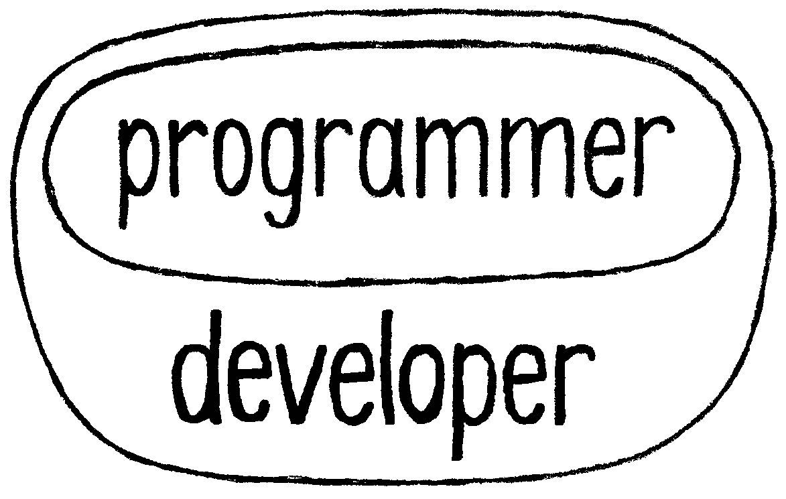

即使你想永远做一个程序员，你可能无法做到。业内周知，在许多科技公司，员工的中位年龄低于 40 岁。这就是现实。公司更喜欢年轻的程序员。招聘的黄金点是有 3-5 年经验的年轻人。主要原因当然是薪水。拥有这种年限的经验，你了解得足够，不会表现糟糕，但你还没有足够的技能来要求与经验相匹配的高薪。而且他们可以以仅一个资深开发者的价格，雇佣更多经验较少的程序员。此外还有其他原因。例如，寻找工作的年轻程序员确实比年长的的程序员多；每年都有新的一波毕业生开始找工作。或者政府可能会为雇佣应届毕业生的雇主提供财政支持或税收优惠。或者如果你在车库里开一家新公司，你可能付不起经验丰富的工人的工资，而是倾向于培训那些对学习的兴趣大于薪水的（至少在刚开始时）年轻人。

年轻人通常更有精力，家庭负担更少，因此下班后去别的地方的理由更少。为什么不利用这一点呢，对吧？通常，高层认为工作时间长意味着成就更多。由于加班对年轻人来说通常不是问题，管理层就利用了这一点，他们强制加班（通常是无偿加班，意味着同样的薪水下做了更多工作）。


雇佣年轻人也有其劣势！当然，是有的！其之一就是缺乏经验。你认为一个没有经验的程序员能多好地处理大型应用程序？例如，如果他们甚至在小型或中型应用上都没有经验。此外，许多程序员会被最新的技术或额外的福利所吸引，所以他们决定为你工作可能来得快，也可能很快就会改变主意去别人那里工作。即使他们留了下来，也很容易感到挫败，可能会表现得不负责任或像个反叛者一样，认为自己无所不能且逻辑无懈可击（当你不反驳他们或试图让他们回归现实时，他们也缺乏理解你论点的经验），他们的优越感可能会阻碍他们接受反馈，而且清单还可以一直列下去。这并非全是事事蜜。但如果你是一家家 IT 公司并拥有一支程序员军队，那么在支付工资时，每一分钱都至关重要。

工资是招聘年轻且经验少的人而非年长、经验丰富者的逻辑选择标准。但也有其他标准，或者应该说是对招聘更高级程序员的`assumptions`。随着程序员年龄的增长，人们开始对他们产生某些假设，由于这些假设，当你超出 3-5 年经验的黄金期后，你想要获得一份程序员的工作可能会变得越来越困难。例如，许多人认为年轻人更精通技术，对最新技术有更好的掌握。他们相信创新源于对这些最新技术的使用，因此年轻人是那些为公司带来新鲜想法并更具创意的人。而年长的程序员……就不那么了。这是因为人们假设资深开发人员技能过时，不知道最新技术，或者跟不上技术的所有变迁。结合“如果你使用最新潮流就会产生创新”的信念，导致了这样假设：资深程序员无法做出太大贡献，因为他们已经过时了、墨守成规、对新想法不那么开放、速度较慢，并且不愿意工作更长的时间。

随着年龄的增长（尽管并不总是相关），随之还有成熟。成熟的人有更平衡的生活方式，不太可能接受强加无偿加班，不那么冲动，而且他们更理解存钱以及考虑自己和家庭未来的必要性。因此，很难用装装满碳酸饮料的冰箱、随取随有的零食、豆袋沙发、台球桌、棋游或其他花哨福利来吸引他们，这些福利在金钱和实施方面对公司来说通常很廉价。更多的成年人关注灵活的工作时间或居家办公的可能性、退休储蓄计划、医疗计划和领导力培训计划，这些更贵，且公司更难做到（许多公司甚至不愿意投入精力）。

即使你消除了雇主们的假设，并保持自己与最新技术接轨，拥有丰富的经验且富有创意等，随着你年龄的增长，获得一份程序员的工作将变得越来越困难。随着时间的推移，人们期望你不仅仅是一个程序员。如果你坚持只做一名程序员，每个人都会开始认为你不想在专业领域上成长。更不用说，支付一个有 20 年经验的人仅仅当一名程序员，在经济上已经没有意义了。所以你遇到了与工资相关的核心问题，对于公司来说，很难反驳这一论点。因此，你必须能够做到比（许多）其他人能做的更多。如果一家公司要支付高薪，它必须是值得的。所以他们寻找的不是只有一把锤子和一把螺丝刀的人（即程序员）；他们寻找的是拥有经验且配备了满工具箱的人（即开发者）。

此外，撇开这些与你程序员身份无关的方面，还要考虑另一种可能性：随着时间的推移，你对编码的热情可能会变成一项苦差。对很多人来说，编程变得了，所以他们想要新的挑战。随着你的经验和对不同情况的接触增加，也许你必须承担领导职位，比如成为`Team Lead` 或技术主管。一些人可能会成为架构师、`CTOs`、培训师、顾问，或者他们可能发现自己喜欢项目管理，然后选择加入`the dark side`。有些人甚至会建立自己的公司，如果成功了，他们会做除写代码以外的事情。

所以你需要擅长许多其他事情——比如沟通技巧、领导力、规划、解决问题、创意和创新——这只是列举了几个——需要成为你工具箱的一部分。你从学校里学不到这些东西，也无法在任何编程书中找到它们，因为它们并不是特定于软件开发的。它们不是技术知识或技能。它们是`soft skills`（软技能），与你的态度以及处理人际关系的能力有关。无论你处于什么工作领域或从事什么工作，这些是你必须具备的技能。忽视在这些方面投入时间将导致你陷入大多数泥潭中。所以，你需要意识到它们在职场中的重要性，并像投入时间学习新的编程语言或技术一样，在这些技能上投入时间。

沟通技巧是拥有的最重要的能力之一。起初，我有一个关于沟通的独立章节来强调这一点，但逐渐地，我被迫将那一章的观点散布到整书中。这是因为沟通影响了你所做工作的许多方面。沟通是至关重要的。如果你想用软件来类比，它是一个跨领域的关注点。然而，我在许多程序员身上看到，他们并没有进行妥善的沟通。事实上，他们经常拒绝沟通；他们试图与正在写的代码保持永久的“瓦尔肯式心灵感应”（Vulcan mind-meld）。但当你在办公室工作时，你不能那样做。你需要意识到周围的环境，并在你工作环境中发生的所有活动上从多个层面进行互动。开发者在软件项目中扮演着最重要的角色，我以前说过，我现在还会说一遍。但并不意味着其他角色是完全可以放弃的。你有系统管理员、`Project Managers`、测试员、销售、客户。作为一名开发者，你与他们交流的方式与与同事交流的方式不同；你必须为每个人包装不同的信息传递。即使你拒绝承认项目参与的所有所有人都有其他视角（而不只是开发者的视角），并且拒绝与非程序员的人互动（我见过这种情况发生过……遗憾的是），你也将没有真正的选择。在一个技能迥异的人员团队中工作时，你必须学会良好的沟通。

既然我提到了团队，那么不仅仅是团队的一员又如何？领导团队如何？


随着你职业生涯的的发展，你可能会在某个时刻需要带领团队。资历增长意味着你必须指导或辅导与其共事的年轻开发者。从这一点到领导整个团队仅仅是多了一步。管理层希望有人能确保团队中的每个人都尽职其责，能够交付并产出结果，而不需要他们亲自去处理整个团队。他们希望有一个能代表团队并为团队发言的人。团队中的一名资深成员被选入这一职位，并分配为 `Team Lead`（团队负责人）。可能是你决定承担这一角色，也只是发现自己必须领导一个团队，但在某个时刻，你可能也必须这样做。

我使用 `lead`（负责人）这个词，而不是 `leader`（领导者），因为你极可能占据的位置类似于足球队的队长——他们在正常参加比赛的同时承担一些领导责任，但这并不意味着他们可以改变“rules of the game”（游戏规则），那属于我脑海中 `leadership`（领导力）的实际定义。`Leadership` 是一个内涵丰富的词；它对许多人意味着许多事情，但对我来说，它意味着一种使命，意味着创新、挑战现状、发起变革和打破常规。它意味着愿景一个不同的未来、承担风险、激励并影响他人将该愿景变为现实并成就伟业。领导力还意味着人们从自己的小组或团队内部成长为领导者；他们脱颖而出。你作为 `lead` 也可以这样做，但大多数时候，你是被团队外部的人任命为负责人，并且有明确的职位描述。

> 如果你的行动激励他人去有更多梦想、学习更多、做更多、变得更好，你就是一个领导者 - 约翰·昆西·亚当斯


你作为 `lead` 的工作是让人们工作，而不是做梦。这就是为什么我说团队 `lead` 而不是团队 `leader`。作为一名 `lead`，你不是规则的改变者。你无法设定愿景。其他人做出重要决定；其他人设定方向。你的老板对你作为 `Team Lead` 的期望是负责团队内部的人，就像 `Project Manager`（项目经理）负责一个项目一样。

### 那么作为 Team Lead，你具体要做什么？

你大部分时间将是在与人工作和互动。这是大多数开发者（我也不例外）开始感觉像缓慢陷入流沙中的部分。

人们为什么要成为程序员？因为他们好奇并喜欢学习，因为他们喜欢创造事物，或者因为编程很有趣且具有挑战性，并在他们解决复杂问题时带给他们成就感。但也因为，有时，他们喜欢与计算机互动的程度多于与其他（非程序员）人类的互动。我们在某种程度上都是极客。这并不意味着仅仅痴迷于像编程这样的狭窄领域（就我们而言），也意味着是一个社交笨拙的人。所以，如果你是一个优秀的开发者，并不意味着你一定会成为一名优秀的 `Team Lead`。

编程很难，但至少你的脚下是实地的。计算机没有情感；它是一个确定性的机器。处理人关系完全是另一回事。这让我想我在许多糟糕的 `Team Leads` 身上看到的第一个问题：他们认为处理人关系是自己的长处，因此在担任负责人期间仍然抓着开发和技术工作不放。

## Lead 优先

技术技能不能帮助你处理人关系。为此你需要 `soft`（软）类的技能。当你第一次成为 `Team Lead` 时，你对许多与新职位相关的事情并不熟悉。这很正常。你会随着时间的推移而学习。但不要认为 `this learning`（这种学习）是发生在你身上的事情。成为 `Team Lead` 并不意味着你是一个开发者，并在余时间做一些人员管理。这并不意味着你可以继续只投入时间在学习 `developer stuff`（开发者事务），并让你的新角色偶然 `happen`（发生）。事实恰恰相反。作为 `Team Lead`，你管理人员，顺便做一些开发。有时你有时间写一些代码，但有时没有。你首先是一个 `Team Lead`，其次才是开发者。你的 `Team Lead` 职责会占用你作为开发者学习新事物的时间。所以现在，你必须投入时间学习你新职位所需的知识，就像你投入时间学习编程语言、框架或获取技术技能一样。

所以从一开始就决定好你想做什么，是做 Team Lead 还是开发者。接受你的新角色和责任，或者辞职，因为我向你保证，如果你不知道自己打算做什么，你就无法处理好这两个角色，你最终会在两个角色上都获得失败。我国家有一句话完美地传达了在两件事之间选择并坚持兼做两者的犹豫不决；它的字面意思是 `to sit with your ass in two boats`（屁坐在两只船上）。


你可能仍然阅读规范并编写代码。你可能仍然在白板上设计、编写单元测试、进行代码审查，或与团队中的其他开发者并肩作战应对技术挑战。你仍然是一个开发者，但这些活动不再是你的主要职责。作为 `Team Lead`，你可能是团队中最经验丰富的，你可以胜任团队任何其他开发者的工作，但并不意味着你会这样做，或者你应该这样做，或者这样做是个好主意。你可能掌握所有的技术事务，并透彻领域和应用，但你现在的工作是分配工作给他人，跟踪他们的任务，并在他们问题的时刻和地方提供帮助。你的责任现在转变为不仅对你自己和你的结果负责，还要对团队及其结果负责。

老板知道你的名字，但他们可能不知道你团队其他成员的名字。在不想处理细节的老板眼里，你是团队的抽象。你被代表团队发言。你对团队的行为负责。这意味着团队的任何失败都是你的失败。默认情况下你承担所有的指责。这实际上是否是你的错完全无关；责任是你的，错也是你的。就像 `Project Manager` 会因为项目失败而被埋责一样，`Team Lead` 也会因为团队的失败而被埋责。提到项目经理，作为 `Team Lead`，你还需要具备项目管理技能。我将在下一章详细讨论这些。现在，足够说就像 `Project Manager` 一样，你作为 `Team Lead` 所做的很多工作都是基于沟通的。


由于你在管理层眼中代表了团队，任何重要且与团队相关的事情都会经过你的手，或者由你来传达。我上面提到过，你将与各种人交流，无论他们是谁：客户、老板、经理、测试人员、开发者、供应商、来自其他部门或业务单元的人员，等等。我在上一章中说的关于招聘、绩效评估、薪资谈判和解雇的内容也涉及沟通技巧。

顺带提一下，我需要提到遗憾的是，这些互动中的很大一部分——比团队中其他开发者接触到的要多——是与经理和老板进行的。你必须始终让所有人了解状态、任务进度，或者团队活动与计划的对比。我之所以用`不幸`这个词，是因为很多讨论将变成你向某些没头脑袋脑的老板解释为什么某件事要花这么长时间、为什么成本那么高、为什么要用这种方法做而不是那种，或者向他们解释你为什么需要更多资源，以及得不到资源会发生什么。

然后，还有一些会议，你需要在会上汇报团队成员无法自行解决的问题和困难，由于老板不喜欢听坏消息，你会有很多和他们的“趣”时光——看他们大吼大叫，并且比起帮助团队更关心推责任。同样“有趣”的还有你与老板的谈话，解释你的`Team Lead`（团队负责人）活动占用了大量时间，而且无论你如何告知他们你的行政任务以及为什么这些任务是必要的，你的老板就是不懂你为什么不再编写功能代码了；我的意思是……`你是团队里最优秀的开发者，这就是为什么我们才让你担任团队负责人`，对吧？

你不仅要向管理链向上汇报这些事情，还可能在各种官僚流程上浪费大量时间，因为这种沟通必须通过官方渠道进行，使用特定的文档模板和字体，并在其他几个业务仪表板中重复这些信息。在此之前，你得先花时间和`Project Manager`（项目经理）开会，对消息进行一些`润色`，以确保它看起来很完美，且不会触发那些可能不喜欢其中文字内容的`众神之怒`。这就是为什么与上高层的沟通往往是令人不快的。当然，感知上也会存在差异；你的老板关注的事情与你不同，你们可能有不同的沟通风格，但主要因为与其他人的对话不同，你的老板不是你的同级。他们可以对你发号命令，或者随心所欲地说什么，但你必须提供论点、解释或理由。

当你在与老板的各种会议中受挫，或在荒谬的程序上浪费时间时，你的团队必须在没有你的情况下运转。这是你作为`Team Lead`的首要工作。你必须确保每个人都知道他们需要做什么，确保每个人都有完成工作所需的技能和工具，并且他们可以在没有你的情况下工作。

如果一个`Team Lead`坚持留任开发者，他们就会承担开发任务，也许是最困难的那些，或者是团队真正不想做的那些（比如写文档……真恶心！），当这种情况发生时，团队就会开始在某些事情上依赖他们的`Team Lead`。我遇到过或合作过的最好的`Team Lead`是那些为自己的团队做所有事情的人。无论是什么，他们都会卷起袖子投入其中。写文档？没问题。需要配置的东西？没问题。一个大家都厌了追踪的、极难复现的 Bug？没问题。办公室那个角落的空调吹风量不够？没问题。

但最重要的是，他们除了这些事情之外，还能辨别出什么时候该由他们来做，什么时候必须让别人去做；否则，团队就会变得懒惰，人们会发现`Team Lead`可以替他们收拾烂局，于是他们开始在各种事情上过度依赖`Team Lead`。你可能是团队中最聪明或最有经验的人，认为没人能做你做的事，没人写的代码比你好，但如果你真的这么想并开始接管一切，你将会失败。由于团队在等待你处理事情，进度会变得极其缓慢。所以你必须让他们自己做工作，你只需帮助他们，即使你的老板正盯着你的脖子抱怨事情没做完；在这种情况下，推开别人自己做工作会更容易，但那样你就是在教团队成员去依赖你。

所以要小心，作为`Team Lead`，你协调人员，确保他们妥善完成工作，你把大家凝聚在一起，但团队不需要太依赖你；否则，你很容易变成瓶颈。人们会带着各种他们无法自行解决的问题（技术性的或其他）来找你，并期望你能够解决它们。随着你接触挑战性情况的增加（从你自己的工作中，现在从其他每个人的工作中），你会学到很多新东西，解决这些情况对你来说很有诱惑，但作为`Team Lead`，你必须帮助你的团队解决它们，而不是自己去解决。你是执行或修复事情的最后防线，但这道防线应该尽可能少触及；否则，除了变成瓶颈和大家等你处理事情之外，你将变成一个“消防员”。作为`Team Lead`，你现在脑子里充满了所有团队成员的问题。你真的认为你可以一直解决所有人的和挑战吗？你做不到！如果许多人都依赖你，你认为你以后还能休假吗？想象一下，当你试图坚持做开发工作时这些事情发生在你身上……首先，你需要学会委派。

## 委派 (Delegate)

作为`Team Lead`，你的职责之一可能是向他人分配工作。委派工作与分配工作相似，但原因不同。你不再自己做工作，而是必须指示团队中的其他成员去执行，因为你现在有了更多的职责。当你成为`Team Lead`时，你失去了——并交出了部分开发工作的控制权。你必须学会委派这些工作；否则你分配工作也会变得很糟糕。当你新担任`Team Lead`角色时，你仍然倾向于干涉别人正在进行的工作。如果你当了很久优秀的开发者，看到你不喜欢的东西，你会想要卷起袖子接管控制权。这就像和比你经验浅的人结对编程，当你看到他们写了一些奇怪的东西或实现不当时，你倾向于接管键盘自己写代码。`如果你想把事情办好，就得自己做`，对吧？最终你也可以这样做，但仅在别无选择的情况下。接手别人的工作不是个好主意。相反，确保解释需要做什么、为什么需要这项工作、为什么要用这种方法做而非那种、预期的输出或结果是什么，还要告知人们截止日期或优先级（当你向某人委派更多任务时这一点尤为重要；根据经验我可以告诉你，如果不了解其他任务更重要或更紧急，人们会先做最简单或最小的事）。


一旦授权了工作，你并不能将其置之脑后。你需要监控进度，明确状态，在需要时对工作进行验证，并随时准备好回答问题或提供帮助。不要将此与微观管理（micromanaging）混淆。授权并不意味着你像木线偶剧场里的操纵者那样拉扯线条；它更像是在管理一个小型项目，而你扮演客户的角色。

随后，审查并评估结果。如果你不喜欢这个结果，要避免自己上手修复的倾向，而是指导团队成员如何进行修复。通过`“引导”`团队成员的工作，你间接地影响了结果。

而且，你不仅要授权工作本身，还要授权关于这些工作的决策；否则，你的团队成员会对你产生依赖。同样值得注意的是，你不能授权那些你不想完成的事情。此外，随着你工作量的增加，你可能会发现自己成了团队的瓶颈。你需要学习如何授权任务，让人们不必一直在等你。赋能、培训和教练你的团队是你的职责，以便他们能够做出自己的决定。

同样重要的是要意识到，当你授权时，你仍然对结果负责。如果团队失败了，你就失败了。你必须为他们的成功提供必要的工具、资源和支持。否则，你会发现自己倍感沮丧，并且不断地修复他们的错误。

## 动机

人有其本性，而不是你希望他们成为的样子。如果你不理解，将会遇到很多问题，特别是在你试图激励他们时。这与我在上一章提到的绩效考核有关。要做好工作，人们需要被激励。作为团队负责人，人们通常期望你激励你的团队。这可能是你新角色中最令人沮丧的事情之一。我将结合个人经验谈谈关于动机的几点。让我们先从动词 `motivate` 的定义开始：

> Motivate（动词）。使某人感到下定决心做事或对做某事充满热情；使某人以特定的方式行为。


那么，你该如何做呢？不言说，你必须投入一些时间、精力和思考。首先，不要假设激励你的因素与激励他人的因素是相同的。你不能用自己希望被激励的方式来继续激励他们。你必须考虑什么才能激励他们每一个人。

其次，避免使用那些让你的开发人员感觉自己回到了幼儿园的做法。在某些情况下，我见过一些幼稚的激励技术，例如以颜色编码的行为图表（带有大红、大蓝、大绿圆点）的形式提供反馈，或者可能使用如笑脸、中性脸、悲伤脸之类的表情符号，并将所有内容显示在办公室里所有人都能看到的白板上。或者使用一些试图让工作看起来更有趣的活动，比如收集积分、等级、勋章、奖牌、感谢卡或各种奖励。出于某种原因，这些手段本应该增加员工的积极性。但它们只说明没有人充分地考虑过这种情况。*“我们不想花精力或时间来弄清楚什么在激励你，但这里有一个金色勋章。如果你想拿到铂金勋章，现在就回去工作吧”*。如果你不想花时间尝试理解什么能激励人们，你大可以求助于经典的*胡萝卜加大棒子*^([58])方法，即奖励良好行为（通常用钱）并惩罚坏行为（通常是不给钱或威胁辞退）。

从我的观察来看，这种*激励*技术对年轻且缺乏经验的开发人员，或者更准确地说，对一般的年轻员工在某种程度上是有效的（尽管如果你团队完全由年轻且缺乏经验的开发人员组成，激励问题将是你最不需要担心的问题），但对于那些对游戏化^([59])概念感到没有投入的老年员工来说效果并不理想，实际上这种做法可能会让他们失去积极性，因为他们觉得这在贬低或轻视他们的工作。此外，在工作中引入游戏元素会鼓励竞争，而竞争是你不希望在团队成员之间发生的（你想要的是协作）。游戏化在用于培训或学习活动以使其更有趣时，可能在一定程度上有效，但在工作中，它可能会产生负面影响，因为某些人可能更关注收集勋章或奖牌，而不是工作的质量。

在他的书籍《驱动力：关于我们如何被激励的惊人真相》^([60])中，作者丹尼尔·H·平克提到了导致更好表现的三个重要因素：自主性、精通和目标。当人们掌控自己的行为时，他们的工作会做得更好，即对如何工作以及何时安排工作做出自己的决定，根据结果而不是坐在办公桌前花费的时间来衡量，并且不会被老板不断地微观管理或指手画脚。

这些事情也让工作变得更加愉快，因此人们来上班时感到更有积极性。当你赋予人们自主权时，他们开始感到更有赋权感，受主管告诉他们该做什么（或如何做）的限制也减少了。这也证明了他们被信任能够做好工作，他们的技能受到了重视，他们可以做出真正的贡献，或者至少他们的建议被考虑了。它还意味着人们开始更多地思考工作的*为什么*，他们开始考虑大局，开始更关注自己的工作和工作结果，并开始将问题视为需要克服的挑战。

你认为谁会工作得更好并产生更好的结果？是那些朝九晚五、像黑盒一样一侧接收规格、另一侧产出代码，而实际上不在乎自己构建了什么的开发人员？还是那些工作对他们来说真正意义、并努力在所做的事情做得更好，以便未来表现得更好的开发人员？

对于大多数开发人员来说，精通本身就是一种目标；他们有学习、成长和发展的欲望，他们想成为工匠^([67])，他们想构建令自己自豪的编写良好的软件。这让他们投入并致力于他们正在进行的工作；他们想为做出卓越的工作而自豪，他们不会走捷径，也不会轻易放弃，他们会不断推进直到完成。这些人做工作不仅是为了钱，而是因为这对他们有意义。你想要这种类型的人。而当我说*你想要*时，我的真实意思是*你实际上无法强迫他们变成这样*。

我合作过的最优秀的人和团队，其特点是在很大程度上存在着这些因素。但这并不是全部。你可以着手完善这些因素，你可以赋予你的员工自主权而不是给他们执行指令，你可以帮助他们成长并获取新知识，你可以引导他们追求某个目标……但对所有人都不适用。要让这些因素发挥作用，你需要合适的人，即具有内在驱动力和高水平常识的人，即具有良好职业道德的专业人士。用通俗说，就是那些真正*在乎（give a shit）*的人。不仅是你团队中的成员，还包括公司里所有影响你工作的人。

例如，自主权是必须给予的。它是经理和老板控制权的丧失。它涉及到赋权和信任。如果你的上级不信任你或想控制你工作的每一个方面（这有时也涉及信任），你就没有相应水平的自主权。对精通的渴望存在于任何优秀的开发人员心中；我们都想学习很多东西，我们想成长，我们想在某方面成为最好，我们想做好工作。

如果项目是有趣且具有挑战性的，那么大多数开发人员都会投入工作中。但如果你的老板在项目尚未完成或只是原型阶段就对你大喊**发布吧**，你基本上就是在交付垃圾。很难对做垃圾工作感到自豪，这会影响开发人员做好工作的积极性。如果除了你之外似乎没人对此感兴趣，为什么要变得更好并尝试做好好工作呢？同样，即使项目很单调，开发人员只做可以很容易自动化的重复任务，期望人们有积极性并想做得更好也是没有意义的。为了什么理由？至于目标，有时在职场中很难找到。“为公司或利益相关者赚更多钱。用更少的资源做更多的事，更快。让你的老板富有，这样他们就能买最新型号的豪华运动 SUV，并在周末开它们去高尔夫场。”这些算是一个好的目标吗？


驱动人的动力是内在的，是他们随之成长的或是他们出于自己的原因投入精力去建立的东西。

你可能认为，处于同一个团队、部门或公司，拥有相同老板、相同技能、从事相同工作并获得相同薪水的人，应该有同样的积极性，对吧？然而，事实并非如此。所以你并不能真正出现并试图激励他们，因为他们要么具有内在驱动力，要么没有。你可以尝试从外部因素入手，试图影响这一点或将其显现出来，但无论你做什么，如果他们从一开始就没有这种动力，你也不无法把它植入他们的内心。也许这种动力还没有显现出来，你可以为此努力，但如果它根本不存在，那么作为一个`Team Lead`，你可能无法把它植入他们心中。这就像是你正在为一个里面没有种子的花盆浇水照顾。你会浪费时间。所以，这很大程度上取决于他们是什么样的人。

例如，自主性在大多数时候是好事，但如果你聘佣了明星级开发者并赋予他们自主权（即让他们放任自），你可能会面临一个非常糟糕的意外（你以后会发现为什么）。必须有规则，必须在出现僵局时有人做最终决定，有人需要拥有一些控制权。不要认为只要提出这三个因素，事情就会自动形成。当人们被驱动时，他们是被内在动力所驱动的。

### 三位石工

让我给你举个例子。有一个关于“”的古寓言。这个故事有几个版本，但大意如下：

> 一位旅行者遇到了三个正在切石的工人。他好奇地走近他们，问他们在做什么。

> 第一位石工说，他只是在做工作。

> 第二位工人回答说，他正在切石头是为了赚钱养家。

> 最后，第三位工人自豪地说，他正在建造一座大教堂。

他们三个人都在做着相同的工作，在同一个地点，但出于不同的原因：一个为了养自己，一个为了照顾家庭，另一个为了某个更伟大的目标。这三个人都被某些东西驱动着去完成工作。每个人的驱动因素都不一样。那是内在的。这就是为什么外在激励效果并不好，例如，因为对每个人来说，“内在”的东西是不一样的，而许多人正试图从外部来激励或投入人们，有时对每个人都使用相同的技巧。但这不是一个好方法。一把刀切不天下。

你必须单独对待每一个人，观察是什么让那个人活跃，只有在你理解了之后，去思考如何增加那个人已有的动力水平，以及如何将其显现出来，使其体现在那个人正在工作之中。

在此，值得说的是，正如我上面提到的那本书名一样，在考虑“”时，“drive（驱动）”实际上是一个更好的词选择。虽然“drive”和“motivation（动机）”可以被视为同义词，但使用“drive”一词更好，因为“motivation”感觉像是一个行动的触发器，但随着时间的推移会消失；它是短暂的。这就像金钱激励可能运作几周并让某人在一段时间内确实更努力工作，但随后他们回到了典型的运作模式。另一方面，“drive”让你联想到行动、运动、一种持续不断的东西。驱动人的动力意味着是什么使他们每天做所做的事情，而不是一个一次性的事件。

### 热情 vs. 动机

我在一些经理身上看到的另一个问题是，他们将热情与动机混淆了。有些人更严肃或更坏气，但他们很可靠且工作表现良好。另一些人很快乐、更快乐；他们变得兴奋得更快或更容易。他们完成工作也同样好。然而，有些经理认为第一类人没有动力，而第二类人很有动力；如果你一整天不“”，”，那么你可能出了什么问题。

你必须理解，并不是所有人都是一样的。如果一个人没有活泼的性格，并不意味着你应该扑到他们身上并让他们立即接受激励实践。只需关注他们的工作即可。每个人都以自己的个人方式获得成功。观察每个人的驱动因素，并看看你可以在哪些方面介入干预以改进结果。

例如：
* 有人可以承担更具挑战性的工作，但他们缺乏自信；你必须鼓励他们，或者让他们接触稍微超出他们舒适区的情况。
* 某人的工作涉及与老板的互动，但他们感到畏缩；你需要考虑是否值得让他们接触更多互动以克服恐惧，或者反其而之更好，改变他们的任务以限制与老板的接触。
* 某人是一个优秀的开发者，但很快感到无聊，工作因此受到影响；也许可以给他们更具挑战性的任务或更多的责任。
* 有人非常善于分析，在想好复杂的计划之前不会开始工作；你有时必须推他们冲进去，让他们学会即使没有完美的计划，事情也可以向好的方向发展。
* 有人恰恰相反，在未知情况下匆忙冲入；你必须说服他们先花时间准备。
* 有人很快就会失去注意力；你需要定期检查他们的进展。
* 另一些人独立工作得非常好；你可以增加他们的自主性水平。
* 有人 20 岁就认为自己无所不知；要有足够的耐心……并祝你好运 :)

### 识别个人驱动力

你如何发现每个人的驱动力？很大程度上取决于观察。关注他们感兴趣的，关注他们充满激情谈论的，关注他们的行为。然后，你可以和他们交流并直接询问。问什么激励他们，并帮助他们。问什么让他们失去动力，并努力解决这些。达成共识，然后共同制定计划并执行。监控进度，看看员工是否真的在努力这些事情，这样你就可以看到他们是否有动力实现目标，特别是当这些目标是他们自己选择的时。


你试图激励他人，是因为你想要改变。如果情况完全如你所希望的那样，你根本就不会尝试改变任何事情。但就像上面的笑话一样，除非人们主观想要，否则他们不会改变。如果他们不想改变，无论你做多少说服工作，无论你知道多少激励技巧，你都无法让他们改变。

说认真的，你曾多少次和自己进行逻辑对话，并决定做些什么，去改变你身上的某些地方？我打打你你当时感到精力充沛；你已经想好了将获得的所有好处，比如变成一个不同的人等等。但这种感觉持续了多久？你是否甚至开始采取过行动来让这种改变发生？或者再举个例子，有多少人在一月之后就停止去健身房了，尽管他们设定了每天多运动的新年愿望？改变的欲望随着时间的推移而消减，如果没有某些东西作为燃料，维持改变的内在动力也会随之消失。

而这种“东西”通常是`“需求””。有很多激励理论，但它们的共同点似乎是激励与人类需求有关。这并不是对食物、水或住所等基础生存的需求，而是更高级的需求，如对能力、自主性、目标感、成就感或认可的需求。如果有人不想在工作中取得任何成就，他们多多少处于`“闲置模式”`，除非有人在盯着他们并进行微观管理以确保他们工作，你真的认为你可以激励他们吗？你不能的。因为这些人想要的只是月底的薪水，工作本身带来的满足感并不在需求范围内。因此，他们没有动力去工作。

而且你无法将这些需求强加于人身上。我无法让你`“需要”`某些东西，你要么需要它，要么不需要。这正是一些人尝试应用的外部激励，而这种激励往往与员工的需求不匹配。如果你给人们他们需要的东西，这被称为激励他们，所以激励是有效的。如果你给他们他们不需要的东西，激励就无效了。

即使你设法帮助或说服了某人改变，那也是因为他们想要或需要改变，但不知道怎么做，而不是因为你的说服技巧。当然，你必须做些什么来让这种改变显现出来；它不是自动发生的。但你并没有导致真正的改变。你不能直接激励他们；你只能帮助他们并与他们合作，激发他们的动力并展现出他们最好的一面。

在结束关于激励的这一节之前，有几句警告。我遇到过`团队主管（Team Leads）`和经理，他们认为激励是一种可以附加或注入到人身上的东西。甚至，他们认为自己可以激励任何人，无论是谁，甚至是他们尚未见过的人。有些人仍然会叫人来面试并在随后录用他们，尽管他们清楚地知道这些人是存在问题的懒人。他们相信这些人`“没有得到适当的激励”`，并且在他们的领导下，这些人将变成职业精神的模范之类的。请不要这样做！对自己能够将困境转变为好境的能力自信是一回事，而幻觉是另一回事。

候选人具备胜任工作的技能是一回事。他们是否真的想做这份工作是另一回事。如果人们有技能但缺乏动力，你无法将动力注入他们体内，因为你不是世界上顶级的的人生教练。这就是为什么你需要根据“激励匹配度”来招聘。在前一章中，当我谈到如何进行面试时，我说过一旦对话开始，我会要求候选告诉我他们做过的工作和参与过的项目，哪些是喜欢的，哪些不太喜欢，以及为什么。密切关注你得到的回答。随后，在绩效评估中，当我提到个人应该进行自我评估时，我提到了与员工讨论什么在激励他们以及什么让他们丧失动力。不要假设这些事情；尝试去发现它们或询问它们。

## 工作环境

所以，你不能真正激励人们；你只能尝试让他们的内在动力结出果。然而，你可以非常容易做到的一件事就是让他们丧失动力。这不仅可能是因为你做了某些错误并最终导致他们丧失了动力，也可能是由工作环境造成的。

你还记得我说过在评估员工绩效时不能忽略工作环境吗？同样，当你考虑人们的动力和驱动力时，也不能忽略工作环境。在涉及到员工的激励和动力流失时，许多人只关注个人而忽略了环境。但根据我自己的经验，当涉及到人们失去动力时，我看到大多数情况下是环境的错。人们失去动力是因为他们处在一个无法让他们他们发挥出真实潜能的环境中工作。这就像想在一条满是坑洼的道路上以最高速度行驶跑车。这是不现实的！车没问题，是路坏了。

你不能指望人们在破碎的环境中保持动力。因此，作为一名`团队主管（Team Lead）`，你的职责之一是找出是什么让人们丧失了动力，或者缺少了什么，如果可以的话就修复它。如果不能，就上报给你的上级并跟进直到问题解决。先修复环境，然后再去抱怨人们动力不够。


但让我们面对现实：作为团队负责人（Team Lead），你无法解决公司内部存在的所有问题。诸如从上层强加的有害流程或程序、管理层缺乏指导、员工因带来坏消息、犯诚实错误或与老板意见不合而受惩罚，以及由糟糕的办公室政治引起的许多问题，你作为团队负责人，无法真正解决或让它们消失。即使你尝试了，你可能也只是在解决症状，而不是问题的根源。

但在你的团队中，你仍然必须创建一个健康的工作环境。如果人们在不健康的环境中工作且感觉没有安全感，你就无法发挥他们的最大价值。你可以发现是什么驱动了他们的行为以及什么在内在激励着他们，但如果这种内在驱动力的表现受到障碍，他们只能在某种程度上表现出这种驱动力。

这样的障碍可能是：缺乏成长和改进的机会、存在被容忍而非从团队中移除的毒性同事、缺乏人与之间的信任或尊重，这导致了各种情况，让人们觉得无法自在地做自己，而是担心如果他们说出自己的想法、有不同意见、承认错误或提出看似天真或愚蠢的问题，就会被评判或批评。我将在后面的章节中更多地讨论`“信任"`，但足以说明团队成员之间相互信任和尊重非常重要，因为没有信任和尊重，表达自由就会受到自我抑制，对错误的恐惧会产生，这导致承担风险的勇气减小，反过来导致人们不再做正确的事，而是做风险最小的事；无休止分析某事以确保正确，以便在失败时被指责或批评；人们因为担心主意被他人盗走而留给自己；他们开始隐瞒信息而不是与他人分享，这些只是少数例子。如果人们避免与他人进行真正的互动，思考每个人的立场以及他们可能会如何反应，这无疑会导致生产力的下降。

例如，你看过警察动作电影吗？当警察进入他们认为有嫌疑人或逃犯的房子时，他们会悠闲地走进去，像走进自己的家里或商场的商店吗？不！他们进入得非常缓慢，环顾四周。非常谨慎。这样就不会有人向他们开枪或攻击他们。他们缓慢推进是因为环境是不安全的。公司在必须做某些陌生事情时也是如此，人们会观察周围发生了什么，他们小心翼翼地走，或者完全拒绝参与新活动。`“如果我说了一些愚蠢的话怎么办？如果别人不同意我的想法怎么办？如果这个、那个、或者别的怎么办？”` 这完全不高效。相反，当你拥有一个安全的环境时，即使人们说了一些愚蠢的话，他们也相信自己会被评判、拒绝或责备，而且所有人都会关注所呈现的想法或信息。如果是好的，它就是好的；如果是坏的，这个建议就不会被采纳，人们会将注意力集中在其他想法上。人们觉得他们可以与团队分享任何事情。

Google 在其一个项目的一部分进行了研究，以回答`“什么让 Google 的团队成为高效的团队？”`^([68])。他们发现，导致高效团队的首要影响因素是`“心理安全感”`^([69])。这个概念是指人们在团队成员周围提供提议、提问、承担风险或承认错误时，感到是安全的，并且相信当他们表达观点时，没有人会惩罚他们、拒绝他们、让他们难过，或将他们视为无知、无能、破坏性或消极的人。这基本上是人们愿意表现出脆弱并做自己，而不必担心负面的个人后果。没有相互的尊重和信任，就会产生被评判的恐惧，人们就会退缩。人们不学习，不创新，团队效率也无法达到应有的水平。

那么，你如何建立心理安全感呢？作为团队负责人，除了与每个人频繁讨论外，你还必须鼓励团队成员之间的讨论，并确保这些讨论保持建设性。然后，你必须第一个向其他人敞开心扉。分享你的观点，承认你的错误，寻求帮助，在不知道时说`“我不知道"`，给出并寻求反馈，提问，让每个人参与到重要决策中，考虑每个人的投入，提供支持并鼓励人们发言。公开认可好主意，鼓励学习；而在面对问题时，专注于解决方案，而不是指责任何引起问题的人。向团队透明地沟通你与上级讨论过的任何内容，分享信息，并成为团队的`“shit umbrella（挡屎伞）"`^([70])，挡住投向团队的一切攻击。如果你的老板给了你脸一拳（比喻意义），这并不意味着你可以回到团队办公室并将这些拳头分发给每个人。

虽然心理安全感和建立健康环境听起来很好，而且确实非常必要，但实现起来不会那么容易。这不像你只要遵循某些做法或以某种方式行为，事情就会自然到位。不。为什么？因为人。

许多人躲在`“resource（资源）"`的名字后面欺骗自己，认为他们可以管理和控制人的方面，就像他们管理成本、设备或库存一样，以避免参与和陷入他们明确知道存在的流沙中。但现实是，你不是在资源合作，你是在与人合作。当计算机程序运行方式不符合你的预期时，你进行更改，重新编译，部署，然后就完成了。如果你不喜欢服务器的配置，你升级它，更换处理器，增加内存，更换某些部件，它就会在不同的参数下运行。对于人，情况不是这样的。如果你不喜欢某人的`“配置"`……好吧，倒霉。计算机基本上是一台确定性的机器。算法在大多数情况下也是确定性的。但对于人，每个人身上都有`Math.random()`。当软件做出决策时，它只是执行一个 `if` 语句。当人们做决定时，会有各种未知因素影响决策。


在考虑将人视为“资源”以抽象化人性特征之后，许多人试图自欺欺人的另一件事，就是认为存在所谓的“工作与生活的平衡”。他们期望人们在进入办公室时能把个人问题关在门外。这绝不可能！我们所谓的“工作与生活的平衡”其实并不存在。人们上班时会带着个人问题，回家时会带着工作问题。人并不是可以把私生活的方方面面抛之脑后，就像在办公室里把外套挂在衣架上一样。对于琐事，这管用；但对于更重要的问题，效果就不佳。如果有人正经历糟糕的离婚，这在工作时并不会消失。如果某人在家里生病了，他们上班也会生病。工作的“你”无法忽略那个昨晚因为牙痛彻心、整夜没睡的“你”。如果你的猫吃了你的金丝雀（还有你的金鱼），你在工作时仍然会感到心心。当你与人打交道时，你面对的是眼前的人，但实际上，背景中还有许多你可能没有意识到的事情，这些事情与实际工作无关，但仍然会影响工作。与人相处时，涉及到某种背景。而这种背景因人而异，同一个人在不同时刻也不同。这意味着，对某人有效的方法对另一个人无效，反之亦然；而且取决于背景，曾经对某人有效的方法，第二次对同一个人可能就不奏效了。

你还需要关注人们与其他人的互动，而不仅仅单独对待每一个人。一个人独自工作时表现出一种方式，与他人合作时是另一种方式，或者对某人是一种方式，对另一个人是另一种方式。谷歌的研究显示，心理安全感是最重要的因素，因为人们并不总是能很好地合作。他们可能有不同的价值观，性格可能会冲突，情绪可能会产生干扰；有些人可能有自己的小算盘，并试图利用或说服团队来实现它；有些人可能极具竞争性，最终在团队中制造竞争而非合作；有些人可能更有活力、更适应，并对那些试图抵抗改变的人产生不满。计算机不会评判另一台计算机。人会。计算机不会与另一台计算机争吵然后在接下来几天不理它说话。人会。机架上的服务器并不都想坐在可以瞰公园的窗边。人会。你需要关注团队内部关系的动态。你将在团队中扮演重要角色，因为人们会以你为榜样，当事情变得“情绪化”时，他们会寻求你的指导，或认为你是全能的问题解决者。

所以，你也必须小心自己作为团队主管如何与他人互动。如果你被聘请到一个新团队担任团队主管，会更容易；但如果你是从团队内部升为团队主管，你会发现人们对你的表现不同，反之，你也必须以不同的方式对待他们。记住，现在作为团队主管，你还有其他的责任。你不再仅仅对自己的行为和结果负责，还要对团队的行为和结果负责。与同事的工作关系发生了变化。你继续与他们并肩工作，他们仍然像你还是他们同级时那样工作，但现在你可以委派或给他们分配任务。作为团队主管，你也可以覆盖他们所做的任何事情或决定。你拥有最终决定权。最终的决定是你的。你是他们的层级上级。再加上你现在可以对他们进行绩效评估（这可能是他们无法给予同等回报的事），你会发现互动的性质会发生变化，尤其是友谊。想想你将如何与你的“好哥们儿”互动。如果你的哥们儿建议在项目中添加一项很酷的技术，但你因为时机不对、存在风险且投资回报率（ROI）可能不合理而不同意，你会怎么办？然后他们开始坚持。你会怎么办？或者当你的好哥们儿变得懒惰并停止贡献时，你会怎么办？你会视而不见吗？你会采取行动吗？如果那个人是你的朋友，你愿意解雇他吗？如果他们与某人发生冲突，你必须调解讨论，你会站在陈述观点的一还是朋友一方？在做他们的朋友和做他们的团队主管之间你如何划线？你对每个人都划在同一个位置吗？你认为人们不会注意到你偏袒某（即使是下意识的）吗？他们会意的。

你们仍然可以做朋友；我不是说现在必须与其他人保持距离，并与团队中的其他人断交，但必须让每个人清楚，你是团队主管，而且在工作中，这必须优先。就像你必须首先是团队主管其次是开发者一样，你必须首先是团队主管其次是他们的朋友。你们都有工作要完成，你们的友谊不应该干扰这些。

那么你应该如何表现呢？你应该是权威的吗？具有控制欲的？你应该因为在团队中职位较高就指手画脚吗？那是获得尊重的方法吗？不，那让你走不远。你只会被视为一个混蛋。那么怎样呢？你应该表现友好吗？我见过团队主管认为他们的主要工作是无论如何都让员工开心，好让没有人感到难过，让每个人在工作中感觉良好，一切都变得愉快，背景播放着轻松的音乐，办公室角落点着芳香草，这类事情。这种方法也不管用。当需要时如果会让某些人感到不快，友好团队主管无法做到需要的事，比如给出诚实但负面的反馈，或推他们离开舒适区，或从桶里剔除坏苹果。如果你表现友好，你可能被认为软弱，尤其是从你的老板眼中。友好团队主管可能长不了（混蛋团队主管可能活得久）。所以再次，你应该如何对大家表现？

在我看来，你必须对每个人公平。这意味着像以下这些公平的词义词：公正、平等、无偏见、值得信赖、诚实、正直、客观、客观、无党派。换说，你关注正确和重要的事情，确保规则适用于团队中的每个人，你尊重每个人，不偏袒某些人而损害他人。作为团队主管，你拥有某种权力。这意味着要明智地使用这种权力。


公平与心理安全是密不可分的。

如果你的团队成员不信任你，他们就不会感到安全；而且根据我的经验，如果你努力做到公平，人们会更尊重你。他们可能并不喜欢你，也不想和你成为形头哥们儿，但你会赢得他们的尊重。你的团队成员也能更好地理解你的行动和决策的初衷。

由于每个人都是不一样的，你不能用同一种方式对待所有人。对某些人有效的方法对另一些人可能无效。因此，你不可避免地对每个人采取不同的对待方式。人们也能看出来。如果你不公平，人们会认为你是在袒某人而亏待另人，而不是理解你正在使用更适合每个体的方法。

那么，不可避免地，你必须做出一些确实会让某些人处于不利地位的艰难决策。你没有办法避免这一点。工作环境太复杂，无法在掌握所有事实的同时，在理想的情况下做出决策。即使你深思熟虑并做出了客观决定，该决定仍可能让某些人感到不悦。如果你不公平，人们就不会理解你是在为项目、应用、团队或业务做你认为正确的事，也不会理解你在这种情况下已为大多数人做出了最佳决策，更不会理解决策为何偏向某一个方向，他们只会变得愤恨，并将其视为个人攻击。

## 冲突中的公平

在解决冲突时，努力公平同样重要。明确一下，我所说的解决冲突是指人与人之间，而不是 `Git` 分支之间。工作中总会有冲突。就像你可以预期软件会有 Bug 一样，你也可以预期合作的人之间会产生冲突。这些冲突可能由于各种原因开始，有时与实际工作无关，但可能因为某人动了空调，或者因为轮到某人打扫办公室冰箱而他们没做。

早些时候当我提到解决问题的能力时，我主要是在说业务问题，即你可以等同于“业务挑战”的事情。但作为团队负责人（Team Lead），你将不得不解决各种事实上就是我们大家所知的问题，即正在发生的坏事。有些冲突属于这一类。你别无选择地处理和解决不愉快的局面。没有人喜欢问题，人们甚至不想谈论它们，但问题必须被暴露，必须被摆在桌面上，人们需要聚在一起讨论并解决它们。

而当人们聚集在一个问题周围解决它时，不可避免会产生……更多的冲突。人们开始挑起，因为人为因素的干预，比如情绪和感受、性格差异、对某种方法或另一种、某种方案或另一种个人的偏好、不同的价值观、不同的看待问题方式、沟通不畅等。有时，生产环境中的重大事件发生时，当每个人都在四处奔波、焦虑、压力愤怒时，正是对同事发火或说出不当话的理想时刻。冲突发生了，然后，人们并没有专注于问题并解决它，而是开始推卸责任，说问题“在你的代码段里，Jake，因为你周五晚上匆忙离开家时没有进行适当的测试。我们本该意识到这是你的错的，因为你也忘了打扫冰箱”。

所以请意识到，你无法逃避冲突。

> 风平浪静时任何人都可以掌舵 - 普布利留斯·塞鲁斯([71])

## 如何解决冲突

当冲突找上门来时，你需要做的是为它提供一个“解决方案”。修复需要修复的，妥协，原谅，让步，随怎样，但不要忽略它。它不会消失的。如果 Jane 和 Steve 吵了架，在你给他们一些时间冷静之后，安排让他们在同一任务上的互动减少，或者少参加同一个会议似乎是个好主意，但从长远来看，如果 Jane 和 Steve 确实需要一起工作，你会输的。

尝试防止冲突的发生是可以的；如果你可以这样做，尽管尽管去做。但要留意你的解决方案，并实际上解决冲突。也许之前的例子现在看起来没问题了，你心里踏实了一些，但随着时间的推移，跟踪所有“互动安全”的人员或事物组合将消耗大量精力。事情可能会失控，并随着时间的推移恶化成更严重的问题。到时候解决它们将比现在困难得多。“热铁要打”是一句谚语。否则，你只是在火上架着一个压力锅，在某个时刻它会爆炸，然后你得清理满满墙的脏物。如果你忽视问题，它们很少会自行消失。第二天你来上班时，它们还在那里，而且还带了一些新朋友；即更多的问题。任何冲突都必须解决；否则它会推开人们，你最终得到的不是团队，而是一群在同一个办公室里独自工作的人。

### 那么你如何处理工作中的冲突？

就像现实世界中的任何其他冲突一样：保持耐心并努力保持冷静，尝试从他人的角度看问题，专注于问题、事件或行为而不是指责对方，避免急于下结论，做一个积极的倾听者等等。唯一的区别在于，作为团队负责人，你更有可能是在调解冲突，而不是与某人发生冲突。

我见过复杂的解决冲突流程。你必须分别听取双方意见，独立核实双方的说法，研究可能的解决方案，在双方聚在一起之前分别对双方进行工作；有时，必须通知人力资源部门（HR）。但我看来，这并不是解决冲突的方法。这种冷冰冰的程序更像是法庭上的“审判”，好像某人做了错事，现在你正在寻找证据来指责并可能惩罚他们。这是一个经典的管理方法，经理认为解决冲突是他们的工作。但事实并非如此。通过这种方法，你可能“结束”了冲突，但你并没有“解决”争议，因为人们会继续感到愤怒和愤恨。

双方应该自己解决冲突。你只是在那里提供帮助，确保讨论保持尊重，双方在发言前倾听对方，并努力理解。你帮助大家理解局势的重要性、严重性或后果，以及解决冲突的必要性，然后让他们专注于制定解决方案。每当有人攻击他人、人们看重意见而非事实，或者他们试图推卸责任、讨论陷入停滞或偏离冲突根源或无法得出解决方案时，你都要干预。作为团队负责人，你不为他们解决冲突，不为他们做决定。调解讨论，引导他们，提出建议，帮助他们想办法——就像婚姻咨询师帮助陷入感情问题的夫妻夫妻一样。


毋庸说，如果冲突持续时间太久，或者看不到解决方案或任何解决的希望，`你`作为团队负责人（Team Lead），必须做出决定并强制执行解决方案。你是在工作，还记得吗？结果是重要的。业务有时无法等待冲突自然解决。所以，由 `你` 来解决它。有些人可能会因为你的决定而处于劣势，但生活就是这样。在工作中，人们并不非要成为朋友；他们只需要保持足够的相处，使得他们的互动不会影响工作即可。如果你公平地对待每个人，人们就会看到你的决策和方案的出处，并表示理解。相反，如果你对他们不公平，你最终只会产生更多的冲突，而你很可能成为冲突双方之一，而不是调解者。所以，请做一个公平的团队负责人。

## 权衡（Trade-offs）

在结束关于担任团队负责人的章节之前，还有最后一点需要补充。我提到过，作为一名 `Team Lead`，你不能再是全职开发人员，与你新角色相关的任务将占据你大部分的时间。作为 `Team Lead`，有很多需要做的决策和要做的事情是你的责任，因此你必须将部分开发工作委派给团队的其他成员。我也提到过，你需要帮助团队中的成员成长，帮助他们发展，这样他们在日常工作中就不会依赖于你。这一切听起来都很完美，但存在一个问题：你可能会忙得不可交，无法像你希望的那样完美完成所有这些事情。你必须接受某些事情执行得不完全符合心意，或者结果可能与你预期的有所不同，即使你总是尝试做正确的事。你需要意识到，你将遇到许多进退两难的局面，当这种情况发生时，你将不得不采取权衡^([72])：

> 权衡（名词）。对两种相互对的情况或特质进行平衡，且两者都是所需要的。

让我给你举几个例子，以便你理解我在说什么。首先，作为开发人员，你一直在进行权衡。你可能没有把它们看作权衡而是选择，但它们确实是权衡。你可能会写一段简单但缓慢的 `synchronized` 代码，还是写一段更复杂但锁更少且更快的代码；你实际上想要的是简单、线程安全且性能良好的代码。另一个例子可能是使用垃圾回收还是显式内存内存（假设你的编程语言提供这种选项）；你真正想要的是对内存的控制，但又不想太麻烦。这个列表可以一直列下去：继承与组合、异常与错误码、多态与 switch 语句、编译为原生代码与在 `VM` 上运行、购买服务器与从云端租赁……等等。你想要所有的好处，但你无法无法兼得。你必须在这些事物之间进行平衡，并决定什么是最重要的。

当你成为 `Team Lead` 时，你所权衡的事物规模将不再限于影响几行代码、架构、部署或应用的某部分；它可能会影响你团队中的每一个人、团队本身、项目、业务单元、部门乃至整个公司。

另一个例子是关于你与老板以及团队成员的互动。团队的开发人员想要某种东西，管理层想要另一种。也许客户也想要……某种完全不同的东西。例如，也许应用程序代码没有达到理想，所以团队想花时间进行重构，但这样你就无法满足截止日期了。你的老板甚至不想听这些。你必须满足截止日期，所以看起来你得以后再重构。但在这一工作中，`以后` 几乎永远不会到来。那么你该怎么办？是赶在期限并留下应用程序一团糟，而你团队中的开发人员开始对你咒骂，因为修改应用程序变得越来越困难？还是进行重构，但被老板或客户责骂，因为公司最终支付了延期费，或者其他计划受到了影响？你可能需要找到一个能兼顾这两种情况的解决方案。那么，代码最初为什么会变成一团糟并需要重构呢？是你和你的团队忽视了最佳实践和常识，从而产生了一些问题吗？还是你有意识地做出了那些决策？我在这里谈论的是技术债^([73])。作为 `Team Lead`，在涉及到关注高质量代码或交付时，你经常需要做出决策，因此很多时候你将是那个决定何时承担技术债以及承担多少技术债的人。当你这样做时，你必须记住在未来的某个时间进行偿还（而不仅仅是 `以后`）；否则，你将像财务债务一样不断积累利息。你承担技术债的决定将是由业务方触发的（我从未见过有哪个开发人员是自发自愿在在没有压力的情况下承担技术债的……也就是说，在没有被压迫的情况下），但由于这是一个`技术`问题，偿还将是你的责任。如果你不提醒他们，业务方会把这忘得一干净。当你提醒他们并决定偿还时，你需要知道如何在大家面前捍卫你的观点。

然后，你必须在你自己写代码和让团队其他人写代码之间找到正确的平衡。一旦成为 `Team Lead`，你就不能继续紧握开发任务，但仍然会有 `你` 必须处理事情的情况。也许某个问题火烧眉额，而你最了解这项技术，或者由于安全原因只有你有权限，但它必须立即解决，而你没有时间教别人怎么做。我上面提到过当你成为 `Team Lead` 时会发生什么，某些事情只有你能做：这会产生对你的依赖，或者更糟，当你忙于其他事情时会产生阻塞。如果只有你懂，知识也会流失。这就是权衡出现的地方。如果你自己做，你可以立即完成。这不需要费太大力，但会让其他人持续依赖你，没有人能学会怎么做。如果你教别人怎么做，你将获得他们不再依赖你的优势，但这需要花费更多的时间。你什么时候教他们，又什么时候卷起袖子自己做？你什么时候委派任务，又什么时候把任务留给自己？你会把同类型的任务委派给同类的人，还是尝试增加团队的知识水平，以便任何人都能胜任工作？你会从大家的时间中抽出多少时间来教他们，还是让他们互相分享知识，以免交付受到影响？你会建立并训练一支特种队，还是你你自己就是特种队？你对项目的了解程度有多深？作为 `Team Lead`，你需要了解应用程序的每个部分是如何工作的以及它们在整个架构中扮演什么角色，但由于还有其他责任，迫使你将自己限制在更高的视角上。你会深入到多细细节（即，你想从什么高度观察事物，一千英尺还是一万英尺？），你又多大程度上依赖他人做正确的事？你之后会检查他们的工作吗？


作为团队负责人（Team Lead），你的大部分工作将涉及权衡。这并非简单的 0 或 1，非黑即白，而是一系列微妙的灰色地带。任何选择、任何选项都会伴随着某种代价。称之为价格、兴趣或后果，但它确实存在。而且你最终必须面对它。因此，你必须优先排序，并始终对你手头所有的选项权衡优缺点（即使是在多个权衡之间进行选择），并尝试在兼顾各方的同时，即使在必须做出艰难决定时，也能与所有人保持良好关系。

## 健康

在进行权衡时，另一件需要注意的是，有时你——大多是在无意识中——会将你的健康放在天平的一侧。我必须承认，我不是那种详细讨论这类话题的人。我经常不运动或不吃健康食物，整天对着电脑，晚上盯着手机屏幕，保持着糟糕的坐姿势，睡眠过多或不足，而且从不进行定期的体检，除非十年一次也算数的话……但话虽如此，我只想指出一点：作为软件开发人员工作并不总是一项健康的活动。编程是一项对脑力要求很高的活动，而且大部分时间都要坐着，因此自然，这会伴随着头痛、压力、疲劳、抑郁、注意力不集中、背痛、电脑视觉综合征、腕隧道综合征、体重增加、呼吸浅等问题，这只是列一斑爪。甚至，甚至有一本关于此的书：*《健康的程序员：健身、感觉更健康并持续编码》*^[74]，书书中详细探讨了这些主题（以及更多内容），这比我写得好得多。你可能想给自己买一本书来读，这样你就能意识到一些你可能没想过的事情（如果你想遵循任何书中的建议或推荐，请先咨询医生）。但即使我们知道这些事情，似乎也很少采取行动。我们继续吃着不健康的食物，不喝足够的水，不运动，跳过定期的体检，忽视压力，睡眠不足等。

但即使是那本书也忽略了一个如果你不留意处理自己的状态可能会遇到的问题。那就是“*职业倦怠（burnout）*”。职业倦怠在许多国家可能不被视为一种疾病（在我的国家显然不是；解决它的建议方法是“*走走就好了*”），但我向你保证它是非常真实的。而且它糟糕透了。非常。你总是疲惫、缺乏能量，你会变得抑郁或易怒，你开始忘记事情，你对事物失去了热情，编程不再有趣（实际上很多事情都变得不再有趣了），即使写十行代码也变得沮丧而痛苦，你感到无论你付出多大的努力或做什么，在工作中似乎都没有取得任何有意义的成就，或者在学习上没有取得进展。

我们程序员倾向于好力不从心。我们在办公室长时间工作，在压力巨大的环境中工作，面临着来自老板和截止日的重重压力，但这还不够，在完成这一切之后，我们回到家里处理个人项目，或者熬到深夜学习新事物。事物总是在变化；新事物层出不穷。我们必须学习。我们没有选择！但随后我们把自己推得太远了。我们需要时间来学习新事物，但一天只有 24 小时。我们从哪里能获得更多时间呢？我们不再家里做饭了；我们点快餐。我们不进行任何运动，因为没有时间（我指的运动不是玩运动模拟视频游戏）。我们开始每两天洗一次澡，每周剃一次脸，或者干脆留胡子。当然，我们牺牲了睡眠时间。我们可以每晚睡 4 小时而不是 8 小时，对吧？用咖啡代替休息时间，每天多出几个小时，对吧？

在毫不知情的情况下，你让自己处于巨大的压力和疲劳中，最终处于一种感觉自己一直很醉的状态。你没有意识到自己在做什么，很大程度上依靠自动驾驶运行，这是一种危险的行为，即使是过一条普通的街道也是如此。我仍然记得那个晚上，晚上 10 点从办公室回家，我穿过马路时既没有看左也没有看右，没有注意到行人灯是红色的。老天，我甚至没有意识到交通灯的存在，尽管在过去的几年里，我每天至少过那条路两次。幸运的是，因为时间很晚，交通较少，在那一刻恰好没有汽车通过路口；如果有车的话，我确定我会变成某辆车的引擎盖装饰物。

所以，如果你在工作或家里努力过头，试图提高自己的知识和技能，请不要过度。了解你的局限性，并注意身体发给你的信号。学会照顾好自己。这是一场马拉松，而不是冲刺。你的大脑会在你之前很久就罢工。说到大脑，了解它是如何运作的可能帮助你用聪明而不是更辛苦的方式来学习。约翰·梅迪纳（John Medina）的书*《大脑规则》*^[75]如果你想了解更多，那是该主题的一个很好的介绍。

## 持续的努力

我提到的很多事情在学校里不会教你。没有证书可以去学习，然后参加考试。无论你喜不喜欢，你都必须练习非技术性质的事情。如果你是因为必须学而学，它不会很愉快，也无法持续，事实上，随着时间的推移，它会变得越来越痛苦。不断跟上新事物并抛弃旧事物本身就是一份全职工作。因此，这很大程度上取决于你过滤噪声的能力，仔细计算不同主题的回报和成本，然后选择要学习的内容和要遗忘的内容。正如我之前提到的，这涉及到很多运气；有时是好运，有时是坏运。无论如何你必须继续做下去。为了能跟上，你必须真正喜欢学习新事物，否则一切看起来都将徒劳的；你会考虑放弃，并找一份有机农业或其他新行业。


当公司决定构建软件时，他们考虑三个重要的因素。第一个是`usefulness`。一切都始于公司需要解决的问题。无论是自动化某些低效的人工活动，还是优化业务流程、通过构建新产品获得竞争优势、为客户提供更好的服务、降低风险、提高员工协作与生产力、降低成本或增加利润，无论目标是什么，他们都需要一个理由；他们并不是为了好玩而构建软件。第二个是`time`。构建这个软件需要多久？如果需要 20 年才能构建完成，那么你就有问题了。20 年里会发生很多变化，从市场到客户，再到法律法规，问题本身可能发生变化。因此，软件需要在合理的时间可以使用。第三点是`money`。这要花费多少费用？这与`time`类似。软件可能是实用的，但必须在合理的预算内完成。公司没有无限的资金。如果资金投入到构建一个昂贵的应用程序中，就无法用于其他地方，而那些地方可能像新软件一样为公司带来收益。

你通常会在所谓的`项目管理三角形`^([76]) 中发现这三点。

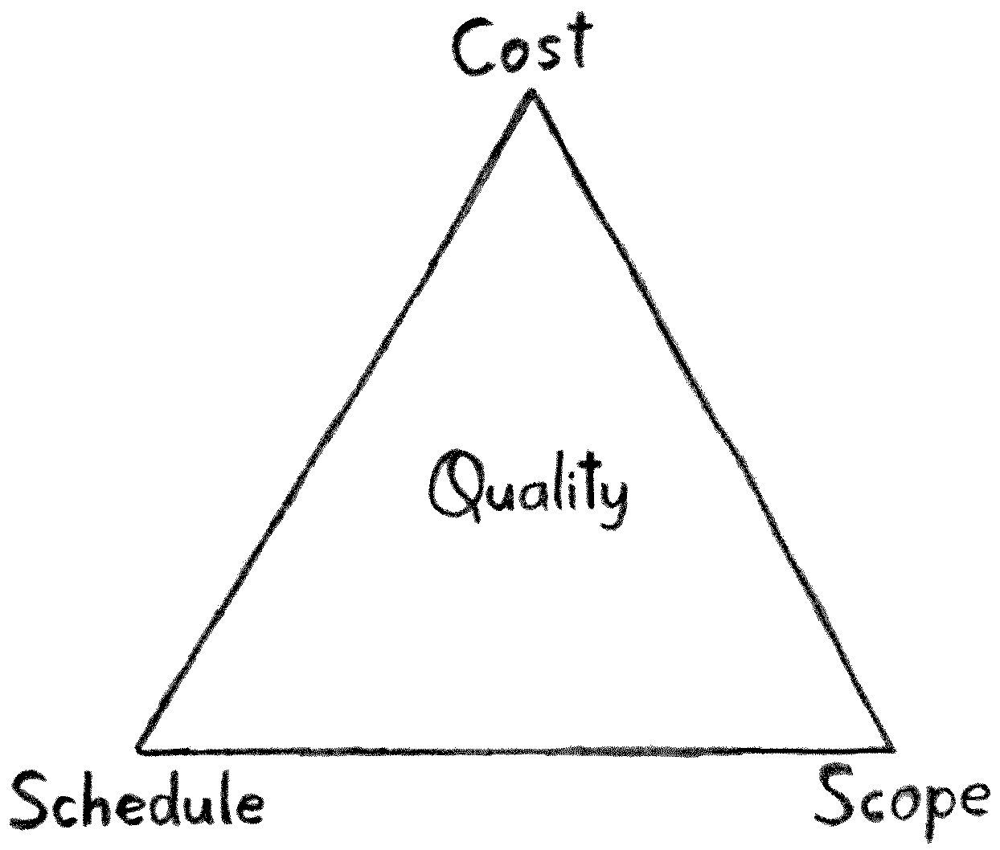

这个模型有时也被称为`更快、更便宜、更好，三选二`。在大多数项目中，客户想要一个高质量的产品，带有大量的功能（他们还想配上薯条条），他们希望价格廉价，并且希望现在就能拿到。当然，这是不可能的。在三者中只选二意味着你不能兼得。当然，这并不是说你只能选二。你可以拥有这三者，只是数量不同。约束条件之所以表示为三角形，是为了说明它们之间是关联的。如果上市时间至关重要，你可能需要向项目投入更多资源以提前发布，但你必须接受更高的成本。如果你想降低成本，可以使用较小的团队，但可能需要接受更长的时间周期。在这两种情况下，你都可以放弃应用程序的一些功能来同时降低成本和进度（也就是说，如果完全构建需要太长时间或成本太高，那么解决 80% 的问题可能比不解决好得多）。因此，一个约束条件的变化需要其他条件的变化来补偿。如果这三个要素的管理不当，产品的质量可能会受到最严重的影响。

因此，公司在决定承手新项目时需要考虑这三点。项目始于某些需求或所需功能列表，然后你需要回答`需要多久？`和`要花多少钱？`的问题。你如何回答这些问题呢？当然，通过提供估算。

## 估算 (Estimations)

现在接下来我个人认为软件开发中最糟糕的事情了：做估算。我一直讨厌做估算。无论我如何尝试，我似乎永远无法做准确。涉及到流沙时，这是一种极其糟糕的糊状混合物。

从估算开始的问题太多了，我我甚至不知道从何说起。也许可以从定义开始。维基百科对估算是这样说的：

> 估算（Estimation 或 estimating）是寻找一个估计值或近似值的过程，即使输入数据可能不完整、不确定或不稳定，该值对于某些目的也是可用的^([77])。

这个定义中有几点应该已经引起你的注意，比如`approximation`（近似值）、`incomplete`（不完整）、`uncertain`（不确定）、`unstable`（不稳定）。大多数软件项目都是这样开始：对需要构建什么有一个模糊的想法，对如何构建它有一些想法，对需要什么团队来构建也有某种想法，等等。直白地说，你并不了解很多。你只是对事情有一个大致的印象。但人们需要这个估算来决定是否开展这个项目。老实说，如果你到了这一步，人们大多已经决定了项目必须完成，现在他们想知道执行该项目涉及什么。

当然，在项目初期，你对项目及其将涉及的内容了解最少。这不仅是因为客户通常不知道自己想要什么，或者需求不完整，还因为你正在构建某种从未被构建过的东西。大多数软件项目都是独特的；如果不是这样，你就可以直接购买成品了。由于你以前构建过软件，所以你对如何做它有一个大致的想法。你知道如何使用或构建应用程序的组成部分，例如编程语言、数据库、框架、UI、工具等。但你并不确切知道构建`这个`应用程序需要多长时间，因为当你开始时，你还没有关于它的完整细节。项目开始时创建的估算具有很高的误差。所以基本上，你的估算更像是一个`guesstimate`（猜测值），因为人们必须根据他们今天所知的知识来预测未来，而我们都知道这是无法做到的。

但你无法以任何其他方式开始一个新应用程序。人们想知道它将花费多少钱以及需要多少时间。所以你需要给出一个估算。

执行估算有各种方法和技术。我不会谈论这些，因为关于这个主题有很多书可以供阅，例如 Steve McConnell 的`Software Estimation - Demystifying the black art`^([81])。而且，我真的不擅长估算。这是我无法完全避开的流沙，所以我没有立场去谈`技术`。然而，在做估算时，有一些在技术之外的内容需要注意。

软件估算的首要问题是开发者会做出乐观的估算。这并不是因为开发者是乐观主义者，或者相信“杯子是满的”的世界观。悲观者也会给出乐观的估算。这是因为我们大脑天生倾向于积极的结果。我们总是低估不利事件发生的概率，而是下意识地陷入愿望思维陷阱，认为事情会进展顺利。


另一个事实是，你往往并不拥有构建所需的所有需求。在进行 `estimate` 之前，你会尝试尽可能收集所有信息，但你会遇到一些障碍。同样，市面上有很多如何收集需求的书籍，也许你可能会让一些业务分析师去处理这些趣事儿，但需要记住的一点是：用户永远不知道自己想要什么。

“这个应用程序应该这样做。它应该做那样。我希望它像旧的应用程序一样，但更好用。我不确定怎么解释，但你明白我的意思，对吧？”

即使客户付出了努力，你也无法从一开始就考虑到所有事情，特别是对于复杂的应用程序。你总是会漏掉一些东西。当你回想起需要某样东西时，它是必须被构建的。有时候，你会遇到一个领域专家，他们甚至无法用通俗的语言描述需求，只能使用复杂的概念，而这些概念是基于他们假设你已经熟悉的其他概念。或者他们试图为你提供一个你需要实现的解决方案，但你需要解决的问题从根本就没有被定义。

有时候，你交道的甚至不是正确的人。他们给你部门经理，这些经理本应该知道自己在说什么，但他们实际上并不知道。而那些向经理汇报并执行工作的人其实知道软件应该做什么，但他们对向你提供需求没有兴趣，因为极有可能，他们会被那个软件所取代……所以，祝你从他们那里收集需求好运吧。你必须像拔牙子一样，从他们嘴里用钳子“抠”信息。

### 识别正确的利益相关者

从正确的人那里收集需求并从多个角度来看问题是非常重要的。一个项目有一个或多个利益相关者，即对你的项目感兴趣的人。在启动项目时，你必须意识到他们的存在。我经历过多次这种情况：一个项目是由部门负责人或业务部门委托的，为了解决他们部门的问题，结果后来发现该项目对其他部门也产生了影响（正面或负面的影响）。

组织中总是存在沟通鸿沟，某些高管可能并不知道其他部门的高管在做什么，所以要深思如何从一开始就让每个人参与。如果利益相关者在最后出现并说他们想要 `X`、`Y` 和 `Z`，你的发布日期可能不会改变，但现在你必须为这些新发现的利益者加入各种额外功能。确保你从一开始就知道他们是谁；否则，你可能会估计并尝试构建一个缺失了大部分内容的东西，而你甚至没有意识到这一点。

你需要知道谁受到了项目的影响。人们往往只考虑关键利益相关者，即那些要求软件解决方案或为项目融资的人，但可能还有更多。永远不要忽视，例如在日常工作中使用该软件的人。你需要他们来微调细节。关键利益相关者只能给你一个反映其在组织架构图中地位的概览。我以前构建过符合利益相关者所提要求的软件，但实际工作的人在使用该软件时却很困难。特别注意，不要掉进这种流沙中。成为公司里最招指责的人——因为你是那个构建软件的人——这种感觉非常不愉快，相信我。

### 管理冲突的需求

在处理利益相关者时需要注意的另一点是，他们会给你相互冲突的需求和优先级。当这种情况发生时，不要试图自己解决，或者不要真的尝试根据矛盾的需求进行构建，那样情况会糟糕得多。

将利益相关者加入同一个会议或邮件线程，尝试让他们在你说开始编写任何代码之前自己弄清楚并对想要的东西达成共识。通常，如果利益相关者未能先在他们内部达成安排，他们就会直接找你讨论需求。基本上，他们无法说服其他利益相关者，现在他们来来说服你给他们他们想要的。确保这种情况不要发生。让其他方知情。把他们送回会议室或将他们重新加入邮件线程，以便每个人理解彼此的需求和优先级。否则，你将收到来自各个方向的需求，且每一条都是高优先级，可能每个人都发给你同一份修改了多处且没有开启修订模式的 `Word` 文档，让你陷入处理这些乱七八糟的境地。

### 需求的迭代性质

正因为你不知道会得到什么，而且因为过程中会出现新事物，为了让项目获得最大的成功概率，你收到的需求必须进行优先级排序。你必须从最重要的事情开始工作，以便尽早发现现有需求中的任何不足或误解。

构建大多数软件产品不可避免地是一个迭代过程。你无法真正为一个从未见过的软件构建完备的需求。由于今天要求的大多数软件应用程序具有复杂性，你无法从一开始就知道要在其中包含什么，或者完全需要什么。这样做就像试图在一个座子内从头到尾写完一本书，而不进行任何添加、删除、编辑或评审。在现实中，你需要努力得到初稿，然后反复完善，直到你对结果满意。需求也是如此。你最初得到的是一份草稿，一份很可能会被进一步完善的草稿。为了确保你不会浪费时间构建或完善不重要的东西，而是构建为客户带来最大价值的软件，你需要对事情进行优先级排序，这样你就能从正确的端解决问题。


通常，功能会被赋予像 `1`、`2`、`3`…… `100` 这样的优先级数字，但这些有时仅仅代表构建的顺序。仅仅进行排序的问题在于，这些功能基本上都具有相同的“价值权重”，或者说它们都处于“同一个桶里里”。一种更好的优先级排序方法是首先利用类似 MoSCoW 方法的方法([82])，这意味着将功能分为“必须有（must have）、应该有（should have）、可以有（could have）和不要（won’t have）”，以赋予每个功能权重并将其放入多个桶中。一旦妥善考虑了实际价值，你就可以在分类内部应用 `1`、`2`、`3` 等数字来细化优先级（必要时；对于“不要”的功能，这样做是没有意义的），从而获得工作的顺序。

如果你以前做过敏捷开发并根据产品待办列表（product backlog）工作，你已经知道 MoSCoW 了。虽然没有明确标识或以此方式使用，但待办列表顶端的是“必须有”，然后价值逐渐递减，直到待办列表的底部，在那里你会发现那些最终永远不会被构建、并作为“不要”而终结生命的东西。使用 MoSCoW 从一开始就让每个人意识到哪些将会进行，哪些将不做，而不仅仅是顺序。“你不想在项目结束时有文档吗？行，没问题。但不要在结束时抱怨没有文档，因为这显而易见是必须有的或者你假设它会被提供”。理想情况下，如果能提前知道哪些是“不要”的，这样你就不必浪费时间去估算这些项目，但有时项目恰恰是根据估算从一个类别移动到另一个类别。“嗯……X 需要的时间少于 Y，所以我们可以有 X，而 Y 因为时间限制我们可能不会有。嗯……等一下。Z 所需的时间和 X 和 Y 的总和一样。也许我们不做 Z 而改做 Y？这样，我们就有更多的功能了”。这是另一个需要注意的事项：与其思考哪些功能真正有价值，许多客户认为“越多越好”。因此，他们要求很多功能。如果你从一开始没有给予足够的关注，你最终可能会在过程中构建出臃肿的软件。然后看看你每种类型各有多少功能。当所有识别出的功能都在“必须有”类别时，你要么拥有一个非常清楚自己想要什么且别无要求的客户，要么你已经陷入了深层的。

## 内部 MoSCoW

你也可以在功能内部使用 MoSCoW。例如，你可以以许多方式构建一个功能，从基础功能到复杂功能。例如，你可能要求用户能够在你的应用程序内记笔记。你可以从一个简单的文本字段到所见即所得（WYSIWYG）编辑器，再到类似于在线版 Word 的东西。通常，客户会说他们只想能够添加笔记，但当他们看到第一个结果时，他们会更多。所以尝试决定“必须有”和“不要”，以便识别出什么时候做得过头。

## 需求挑战

有时你甚至无法根据需求进行这种优先级排序，因为你根本没有需求。最困扰我的是软件需求以“构建他们拥有的”的形式出现，“他们”指的是竞争对手。“我们不能尝试识别问题或机会并分析可能的解决方案，不不……直接复制粘贴就好”——这是关于需求的错误思考方式。“我们希望你和他们做同样的事情……但更好。”雪上加霜的是，“他们”是一家拥有 `100` 名开发人员的大公司，而你在一个只有 `2.75` 名开发人员的小公司工作。然后是另一个问题。另一个竞争者进入市场，现在你也得复制他们。

所以，你不会有完整的需求；你拥有的可能会在项目启动后的某个时候被更改或失效，但别担心，你会乐观地根据你作为开发人员所认为的需求来填补空白。然后你根据“你认为”需要的继续进行估算。如果人们不擅长估算，而且你无法依赖于完整或正确的需求，那么何必去估算呢？

因为没有其他其他方法可以评估项目的成功潜力。公司需要决定项目是否应该按照预估进行，范围是否应该缩小，如果是，哪些功能是你可以放弃的，达到一个目标或另一个目标需要什么资源，或者是否应该放弃项目且完全不构建软件。你需要某种东西来进行成本效益分析。你不能一头扎进未知并看从中产生什么；否则，这就像去汽车经销商那里买车，但你不知道车什么时候交货，会有哪些关键功能，也不知道要花你多少钱。他们说到了时候会通知你。在这种情况下你还想买这辆车吗？可能不想。软件也是如此。你至少得知道是否有足够的资金完成项目，以及它是否能准时准备，即使过程中的事情可能不会按照你预计的那样发生。除了实际构建那个该的东西或不断投入资源直到金钱用尽，你还有什么其他选择？

## 谈判

但正如我上面说的，有时关于项目的决策已经做出了，估算对于决定如何处理该项目不再重要了。你可能根本不进行估算；相反，你被提供了现成的估算。开发人员是那些应该做估算的人。他们有工作经验，有完成工作的技能并实际上会执行工作，所以他们做对概率最高，但有时，其他人提供了估算。“我们承担不起失去这个客户的代价，”CEO 说，“如果我们证明我们是这个项目的正确公司，那么其他项目将接踵而至。我们可以从这个客户身上赚到很多钱。我告诉他们六个月。我们可以在六个月内搞定，对吧？”（这意味着“恭喜你，我刚刚给你们所有人报名了一场‘死亡行军’([83])。请确保根据天气穿衣服”）。然后你走开去做你自己的估算，那不是六个月，完全不是。然后你把“你的”估算呈现给 CEO，结果发生了：


这是估算的另一个有趣部分：当开发者大多数做出的估算被传达时，老板们接收它们就像面对一座爆发的火山。


事实是这样的：每当你被要求进行估算，看看一个项目需要多长时间时，你的老板同时也在“想象”这个项目需要多长时间。基本上，那是他们的愿望，或者更俗地说，是幻觉。如果他们想象需要 12 个月，而你给出一个 9 到 12 个月的估算，那么老板会很开心。你只是证实了他们的假设。好开发者！很好！但如果你说 12 到 15 个月或更久……好吧。坏开发者！坏！你必须解释清楚。立即解释。他们不可能告诉客户可能需要长达 15 个月。这不可能。“这个项目最多只要十二个月。为什么要 15 个月？你疯了吗？你是怎么估算的？”

老板不需要解释他们为什么认为需要 12 个月；相反，开发者则需要展示并证明软件的每一个小部分的每个估算都是合理的。但逐一检查所有项目并从逻辑上解释你是如何估算的以及为什么会得出这样的数字是徒劳的，因为他们仍然用惊讶的眼看着你。在斯蒂夫·麦康尔（Steve McConnell）之前提到的书中，有一章专门介绍如何沟通估算，以便让每个人理解其中涉及一些未知因素、一些风险、一些假设，根据情况的发展，项目可能会持续最短或最长的时间，并在一定的置信度下给出一个最可能的时长，但老板们仍然拒绝理解，因为他们通常不知道软件是如何构建的。

### 对固定日期的需求

那么，当他们得到一个估算时，老板并不真的想知道构建应用程序所需的精力。他们不在乎。他们只想知道：“你什么时候能交付？”你提供了一个包含项目可能完成的时间范围的估算，但他们不想要范围（“你为什么要给我一个范围？你是开发者。你不知道吗？”）。他们实际上想要的是一个固定日期：2022 年 2 月 17 日星期四，下午 3:45。这样，他们就可以在过程中坚持设定一些里程碑，同样也是固定日期，比如下个月客户对公司总部的重要访问，或者公司的跨年派对，或者仅仅在老板去巴哈马度假之前，这样他们就有了充分的理由在沙滩上喝玛格丽他酒。“你不能把估算调整得更‘现实’一点吗？这里得有一定的回旋余地。你肯定在估算中加入了一些缓冲，对吧？”

### 风险的博弈

无论你是否为最坏的情况添加了缓冲，你的老板都会假设你加了。所以现在，博弈开始了。你的老板喜欢谈判。。从商业交易到薪资报价，再到当地市场上的土豆价格……到估算。与开发者不同，老板对承担风险有不同的观点。开发者通常是乐观但规避风险的；另一方面，老板喜欢风险。“不冒险，就无收获”，对吧？这本身就是一个带有风险色彩的表达，意味着一件事（收益、成功）源于另一件事（承担风险）。这是错误的；你可以承担风险并失败，而不仅仅是成功。

而且，这不仅仅是一个简单的博弈，因为涉及到老板的压力。老板会开始向你施加压力并攻击你所说的任何话，迫使你降低估算，直到你宣布一个他们想听的数值，而你回答“我会试的”（意思是尝试让更低的估算实现）。我不知道为什么，但这些话从下属口中说会让会让感觉好受。也许他们认为你会进一个电话亭，转几圈，说“我会试试的”，然后你就变出一个突然能做更多事的超级英雄。又也许他们认为这些话一旦出口，就会占用你本想花在家人或个人活动上的时间，并将其转移到项目的无偿加班。

### 虚假顺从的危险

有时，出于恐惧或顺从，或者为了离开谈判带给他们的尴尬处境，有些人会说他们认为老板想听的话。注意这一点，不要那样做。如果你知道某事在大家坚持的时间内无法完成，就不要同意这些要求。如果你同意了，你就会设定不现实的预期，而你，作为开发者，将对此负责。

你想逃避几个小时谈判会议上施加给你的压力，并代之以项目执行期间当你努力让那个降低的估算实现时会感受到的持续压力吗？如果你的估算是这样得出的，之后你只是从从中随机砍掉一个让老板开心的数值，那么估算的意义何在？如果你说“我会试的”，那还有什么意思？你之前难道不是在尝试吗？员工有更多工作风格吗，从“不在乎”、“随便”、“我会试试的”、“我一定会做到”、“结果会让你惊讶”，或者其他的？

### 削减估算的隐藏利益

人们尝试削减估算还有其他原因。例如，CEO 可能想赚更多钱（通过让你工作更多而付你更少的钱），或者他们想通过声称项目将很快完成来吸引客户。销售人员想要签署新客户的佣金，如果项目不按时完成，他们就会失去这个客户。项目经理可能会追求某些短期认可，因为他们知道项目交付时自己已经不在那个岗位上了。

通常，有各种利益在起作用。例如，你是否曾在不舒服或生病去药店，药剂师推荐了某种缓解症状的药物？你后来发现其他成分相同但便宜得多的药，而你却买了最贵的？药剂师可能有厂商的销售金，或者试图推销在店里放很久的药。他们并不一定考虑你的最佳利益。他们推荐的帮助了你的病情，药物有效，他们并不是在乱卖，但更便宜的东西也可以。或者，你去 DIY 商店买一些工具，在做了一些研究并选择了一个你认为很好的选项，但到了那里，店员推荐了另一种你认为质量较差的东西？他们可能有动力处理掉旧库存。

但你甚至不需要理由。在很多情况下，下面这句话可能也适用：“不要把可以由愚蠢合理解释的归因于恶意。”愚蠢可能是一个严厉的词，但无知绝对是一个原因，特别是非技术人员参与软件开发时。他们不理解完成工作所需活动。所以他们只是不知道。其他时候管理层知道事情会更久。从几个没有按照估算完成的项目，他们发现事情会延迟，所以有时，他们想确保项目不会超过最坏的情况。你告诉他们 8 到 10 个月，所以他们预期最坏是 10 个月，但他们要求你在 8 个月内完成，以防止 10 个月变成 12 个月甚至更久。


所以，当你提供一个估算时，最好做好准备为它辩护。问题在于，估算几乎总是跳出老板的理解范围。这是因为在大多数情况下，估算对你的老板来说是没用的。他们处理的是承诺，而不是估算。因此他们会将估算视为承诺（我暂且给他们面子，并加上“无论有意还是无意”）。所以你可能认为你是在协商一个估算，但你的老板在寻找一个承诺。所以当你在争论估算并说出`好的`、`没问题`、`我同意`或`我会尝试的`时，你实际上是在承诺自己要实现这个估算结果。你正在将一个估算转化为一个需要你精准达标的目标（当然，是由你来完成）。注意这一点，并在关于估算的对话中事情演变成承诺时将其指出来。

估算不是承诺。估算不是保证事情会按照你……额…………所估算的那样发展的承诺。估算是一种猜测。你可能会使用不同的经过证明的技术和公式，或者将数据输入超级计算机，它会发出巨大的噪音并闪烁着明亮的灯光，最后在一张小纸上给出估算结果，但它仍然是一个猜测。你可能会得到更准确的估算，但它并不是一个你可以承诺一定能达的目标。你可以根据估算讨论、决定并达成你需要实现的目标，老板和客户可以将这些日期记录在他们的日历上，但不要对估算本身这样做。例如，你可能会向老板承诺你每天在早上`09:00 A.M.`之前到达公司上班，但你无法承诺每次通勤都恰好花费 20 分钟 37 秒；你只能估算大约在 20 分钟左右（取决于交通、天气等的正负几分钟）。

估算中没有任何是确定的。甚至，开发人员可能根本不知道如何进行估算。没有人教过我如何做估算。我不是在学校学的。我没有在工作中接受过培训。我只是简单被置于既定事实面前。通常，我甚至没有被足够的时间来做一个合理的估算。“你为什么需要一个周来估算这个项目？这是一个为期四个月的项目。最多顶多了！”在研究如何做得更好、有哪些技术等之前，我吃过几次亏。尽管如此，我还是搞错了。以这本书为例，在我开始写它之前，我估算写初稿需要半年。结果我花了 18 个月。我以前从未写过书，所以对我来说这是一个完全全新的活动，一个我并不清楚该如何估算的活动。所以我搞错了。错得离谱。

同样，如果你以前没有构建过相同的软件，没有过相同的人员、相同的技术和相同的限制条件，那么你怎么可能确切地知道它到底需要多久呢？每个项目都是新的。总会有你不知道的事情，而你甚至不知道自己并不知道。大多数惊喜将来自业务领域；如果你还不熟悉它，很有可能你可能会误解事情，并根据你对事物的错误理解进行估算。你可能是一个经验丰富的开发者，从幼儿园就开始做估算，但如果你不了解该领域或尚未在该领域工作过，那么你将会有很多盲点。

在我看来，每个人都应该使用`guesstimate`（猜测估算）这个词。但这样做并不专业，不是吗？尽管如此，将一个近似值并将其视为某种确定的东西，然后让每个人对此负责，反而是专业的。所以，确保你周围的每个人都理解什么是估算，其中包含某种程度的不确定性，事情并非 100%准确，而是落在一个端点具有一定概率发生的范围内。并确保你下次估算某事时不要忘记这一点，即使它最后回变成了 1840.53 小时长。一旦你给出了估算，你就和它结为夫妻了。

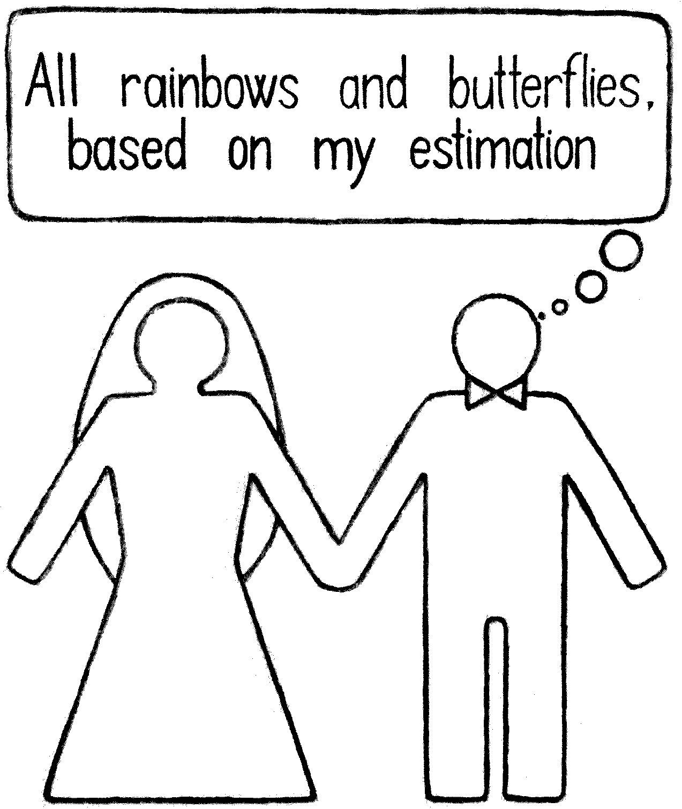

## 被遗忘的细节

在进行估算时，尽量不要忘记或忽略某些事情。在做估算时，将功能拆分为更小的部分，对这些部分进行估算，然后将它们整合在一起以获得更准确的估算，这是一个良好的做法。但关注较小的区块可能会让你忽视适用于每个功能的更通用方面，例如项目管理开销。你估了实际开发，但还有其他需要考虑的方面，即运行项目需要的事情：与客户讨论、澄清需求、计划工作、测量和报告、会议、演示软件、与其他项目协调、建立有效的沟通渠道等。根据个人经验，这种管理开销平均占总开发时间的 20%左右。不过，这取决于项目的细节；对于某些项目，需要更多，对于另一些则较少。你可以根据过去对类似项目的经验使用一个数值，但不要忘记包含一个考虑到这些开销的项。

其他例子可能包括代码审查。你也将此包含在估算中，对吧？单元测试呢？集成测试呢？手动测试（有人必须实际使用这个东西）？你将如何进行部署？手动还是自动？手动部署需要多少时间，你认为需要多少次？自动化所有部署和构建持续集成流水线需要你多久？应用程序将运行在哪里？是自托管还是在某处的云端？你以后会考虑这些吗？那需要多长时间？你考虑过在代码编写后进行配置的方法吗，还是你将使用硬编码的内容？如果项目正在进行，你发现船只开始沉没，你可以扔掉一些东西吗？例如，如果不再进行单元测试，可以缩短周期吗？或者取消代码审查？这意味着你需要了解你将要合作的团队。有多少人？什么样的人？他们能全职投入吗？你现在正在做估算，资源计划稍后才会，但关键人员兼职或缺席会严重搞乱项目。即使你的估算非常准确，如果你有兼职人员，他们的工作受到上下文切换和可用性的影响，这将以你无法预知的方式增加任务时间。那么他们是经验丰富的资深人员还是初级？如果是经验丰富的资深，这意味着更少的代码审查、重构和更少的漏洞。如果是初级，可能意味着更多的代码审查和漏洞，甚至可能需要指导和结对编程会议。也许现在这些对项目来说并非必不可少，但在你构建东西时，它们会消耗你的时间。而花在这些活动上的时间不是用于构建功能的时间。你可以放弃其中一些，但另一些更为重要（例如，如果团队表现良好且缺陷很少，你可能会放弃代码审查，但你不能放弃运行应用程序的服务器配置）。


既然我提到了缺陷……没有任何软件是“无 Bug”的。你为什么要估算时假设自己不会有任何 Bug 呢？你会有的。这一点上，没有人会考虑任何错误空间。你不可避免地会去追踪晦晦的 Bug 或只能在生产环境中复现的异常应用程序行为。你必须考虑一些时间来修复 Bug，这再次取决于你拥有什么样的团队。经验丰富的团队产生的 Bug 更少，而且在 Bug 发生时比经验较少的团队得更快。为每个项目添加与其发生概率成正比的缓冲时间（padding）。如果功能简单，你可以不使用缓冲，但如果它非常复杂，就不要指望一切顺顺利；将会有些问题。然而，要确保不要添加过多的缓冲，以至于在估算时失去客户、项目，甚至失去工作。要根据过去的经验使用真实的值。在必要的地方包含缓冲，而不仅仅是因为“因为”。不要仅仅因为你见过以前有人这样做，就把他们在公司时间玩社交媒体或抽烟的时间包含在内。你也不要因为老板总是试图削减你的估算（因为他们假设你总是添加缓冲）就包含缓冲。当被要求减少估算时，要学会坚持立场，不要只通过增加缓冲来迎合他们的游戏，以便你以后有空间减少估算；否则，他们永远也学不懂什么是估算，也不知道估算中涉及假设和风险。

## 风险与假设

相信我，你会做出假设，而且会有风险产生。构建软件需要简化、概括和假设，你通过这些假设在不同层面上构建抽象。在估算项目时，你可以考虑其中大部分内容，但许多细节在你实际编写代码时才会发现。这意味着你会假设某些事情以某种方式运行，而事实有时证明并非如此。例如，你是否将应用程序拆分为后端 API 和富功能的前端，但你还没有聘请前端开发者？你将假设在开发后端 API 的同时，你有足够的时间聘请前端开发者。但也许你找不到任何开发者。或者你找到了，但当前端开发者加入团队时，他们发现很难与后端 API 集成，因为你盲目地工作了那部分，没有通过真实的客户端集成来验证或否认你的设计决策。或者你可能认为新员工不需要入职培训时间，团队中没有人会抽出工作时间来培训他们并提供支持。这更多是关于遗忘或忽略了额外活动，但实际上是你假设自己没有遗漏任何事，并且你考虑到了一切。或者你信任为项目选择的技术正如包装上写的那样工作，集成将顺利进行而不需要额外的培训。或者认为项目成功的关键 George 不会在未来六个月内离开公司。当你的技术主管说他们知道何时如何正确使用工具时，他们真的很业务，而不是只读了一些博客或看了关于如何运作的在线视频会议（这种情况在我身上发生过一次，我甚至不想告诉你之后清理烂摊子有多痛苦），或者认为在 `framework X` 上构建你的应用程序是可以的，因为它是稳定且维护良好的，未来也将如此；认为供应商需要为你提供的某些模块将准时准备好，并且供应商在那时不会破产，等等。噢……我们不要忘记，我们制定乐观的估算是因为我们假设事情会向良好方向发展。

> 假设是所有搞砸的根源 - 未知

所有这些假设对于（理论上）按照估算执行项目都是必要的。但它们带有风险，即当你的假设被证明是错误时，解决这些问题可能会花费你更多金钱或时间的风险。这些问题甚至在你认为已经成功完成项目后也可能显现。也许你太年轻还不知道这些，但你还记得千千年问题吗？每个人都假设软件中的年份两位数字就足够了。然后，当 2000 年临近时，人们开始担心这可能引起的问题，相信飞机会坠落，核电站会熔化，或者金融系统会崩溃。全球范围内花费了大量的资金修复计算机系统，仅仅是因为人们在尝试节省内存空间时做了一个假设。因此，在提交估算时也必须考虑风险。你会尝试避免它们吗？减轻它们？与它们共存？你会花时间监控它们如何显现吗？如果其中一个风险发生，需要多少时间和金钱来修复它们？如果你认为它们不会发生在你身上，请想想。在估算阶段，你还需要识别风险并决定如何处理它们。对于发生概率高的风险，你可能需要进行详细估算，以便每个人都知道如果它们发生会有多大的偏离风险。管理风险就像管理消防安全。你可能必须采取某些措施来防止火灾，或者在火灾发生时给你更好的机会灭火并尽早扑灭火焰。你不希望到达火灾现场时没有灭火器、没有软管、没有水，只能眼睁睁看着一切付毁。

在提交估算时要非常谨慎对待风险。正如你作为开发者在估算时倾向于考虑理想的执行路径一样，老板和业务人士也倾向于考虑风险，他们会低估风险发生的概率，并在潜意识里认为事情会向最有利的方向发展。这对老板和业务人士来说是一个更大的问题，因为他们对风险的容忍度更高。企业通常选择应对问题，而不是预测并消除问题。这是因为他们意识到你无法防止所有可能出现的问题，有时承担风险更廉价，并且在可能出现问题时到时候再想对策。这与我上面提到的内容一致。“不冒险，无无收获”，对吗？

## 计划

你的老板或客户接下来想要看到的，是项目正处于一个负责任的人手中。而一个负责任的人总会有计划。所以他们要求看计划。你有计划，对吧？


# 引言

事实上……他们要求看进度表，而计划仅仅是解释进度表的故事。他们感兴趣的是你什么时候完成，而不一定是你将如何构建它。现在，争论又开始了，因为，理所当然地，老板或客户对项目持续时间有意见。他们又在“想象”项目何时能交付了。他们想在自己的日历上标记出软件就绪的日期，记得吗？如果他们想象的与你的计划不符，就会进行新一轮的缩短进度的谈判。大部分讨论将围绕如何调配人力资源、你可以放弃哪些不紧要的事情（通常不是功能），或者你如何安排安排工作以尽早完成，就像试图将许多不同形状和大小的书密密麻麻地挤进一个箱子里，且完全不留任何剩余空间一样。你只需要找到正确的垂直和水平混合组合来让这一切发生，对吧？

## 资源陷阱

“那么，谁来做这个应用程序，他们将如何分配工作？你 own 让那两个功能并行开发以节省时间吗？为什么不呢？我们真的需要那么多的代码审查吗？单元测试呢？如果程序运行正常，谁会在意单元测试，对吧？开发者应该写应用代码，而不是测试代码。用测试人员去写。他们比开发者便宜，也更容易找到。你计划了多少资源？两个高级工程师和三个初级？嗯……高级工程师很贵。抱歉。如果你有一个高级工程师和四个初级的呢？初级太多会花更长时间，你这么说？为什么？我们今年有一个非常棒的实习计划，给一些非常聪明的年轻人提供了工作。如果你有一整支实习生军团呢？那样怎么样？你说会增加管理开销并引入通信问题？得了；这个应用没那么复杂。这个项目基本上可以自运行。噢……等一下……我知道。把 Francis 带过来。他在两个项目中的分配是 50/50，但其中一个项目很快就会结束，剩下的只需要一些维护工作。你可以先给他分配 25% 的精力，直到我们找到其他人来替他维护。”我已经见过太多这种情况了，简直一点都不好笑。你真的认识 Francis 吗？你以前和他合作过吗？你知道他是一个多优秀的开发者吗？

## 人 vs 资源

人交付项目。所以，你的团队里有什么样的人非常重要。我在前面的章节中讨论过为什么聘用优秀的开发者至关重要，以及公司在这样做时会犯哪些错误，但我认为软件开发公司所犯的最大错误之一，就是将开发者泛化为“资源”，以此欺骗自己认为他们可以像管理成本或设备一样管理有情感的人类，并欺骗自己认为他们是可相互替换的，就像机器中的备件一样。这对于你当地快餐店翻汉堡的那种“资源”可能有效，但在软件开发中，由 Jake、Amy 和 Susan 完成的项目 X 与由 Jake、Amy 和 Robert 完成的项目 X 并不是一回事。Susan 可能是有二十年经验的高级工程师，而 Robert 可能只有两年的初级工程师。在不到一天的时间，Robert 在翻汉堡方面可能变得和 Susan 一样熟练，然后他们的工作就无法区分了，但软件开发项目不是那样的。

## 计划过程

理想情况下，你应该与你的团队（即实际执行工作的人）一起对项目进行估计和计划。这比你自己自己制定估计和计划（如果团队尚未组建）然后交交给团队要好。在这两项活动中，人多力量大，都能产生更优的结果。这还能让你的团队承担责任，并让他们对待执行的工作具有可见性。这样，如果发生了什么，他们会跳过计划，制定另一个计划，自己解决问题，而不需要等你告诉他们做什么，或等你更新计划。但即使这样得出的计划更好，仍然会有事情不会总是按照计划进行。

面对现实吧；你无法计划一切。就如同估计一样，计划也是一种近似值。它们是对你希望如何做某事的一种近似描述。你将计划要完成的工作、何时做、由谁做，你将为质量保证、变更控制、缺陷跟踪以及与利益相关者的沟通建立流程，你还将决定源代码控制的分支或应用程序版本控制的最佳方法，你将计划会议和软件发布，你将计划很多事情。但现实发生了。而当现实遇到计划时，现实总是获胜。

> 没有任何战斗计划在与敌人的接触后能幸存 - 赫尔穆特·冯·莫尔特老士

## 现实遭遇计划

既然知道了这一点，你该如何处理这些信息呢？你是尝试在前期投入更多时间进行更详尽的计划，试图涵盖任何潜在的情况，以便在事情最终发生时你已经准备好并知道该做什么吗？还是相反，既然反正有事情变糟的可能性，你投入更少的时间，更倾向于一个大致的方向而不是一个具体的计划？要回答这些问题，你需要仔细思考计划对你意味着什么。

如果你认为计划是重要的，那么当事情发生时，你会倾向于关注计划。它开始变得更多是关于计划，而不是你正在构建的产品；产品只是变成了你计划的结果。一个非常详尽的计划会给你一种虚假的控制感和信心，认为你正在做正确的事。考虑一下：你为你认为的构建项目的最佳方式制定了计划，那么你为什么要采取其他方式呢？由于这个原因，对计划的变更必须降到最低，因为任何偏离计划都是坏的。有一个流程，一种工作流，每个人必须按时完成工作以获得结果……好，“你有一个变更请求？嗯……没那么快。让我们准备大量的文档。然后开一个变更控制会议，决定是否批准变更。那个变更真的重要到让我们偏离计划吗？什么？变更委员会的 Taylor 先生不在国内？什么时候回来？我们需要讨论计划的变更……”记住，计划是你希望事情发生的一种近似值。而有时，它们其实是非常糟糕的近似值，因为人们不是关注如何构建软件，而是更多关注进度。这意味着，人们倾向于为了满足进度而组织自己，而不是如何构建软件。这完全变成了时间问题。例如，所有工作都被计划为 8 小时的任务，好像人能工作 8 小时一样。人们需要上厕所吗？人们需要相互交流或花时间协调工作吗？他们还有操作任务要执行吗？也许还有对早期版本的技术支持？他们不是还要参加老板要求的各种会议吗？没有人会累吗？那个时间 40% 是开发者、测试人员 33%、数据库管理员 15%、分析师 13% 的人，在角色之间切换时没有上下文切换成本吗？你只是数了你的资源，而不是考虑他们的技能吗？记住……你不是在翻汉堡。Susan 和 Robert 在工作 4 小时后的产出并不是一样的。


即便只关注进度安排，各种耗时的事情也会被遗忘。千万不要假设，例如，如果人们正在执行一个项目，他们周围就会有某种力场保护着他们，使他们不受日常生活中发生的事情的影响。人们有时会结婚，可能会生病，他们家里的水管可能会爆裂，导致他们不得不请假，或者他们可能在项目中间突然辞职。另一个例子可能是团队需要维护其他应用程序、执行运维工作或修复生产环境中的故障。这会导致你产生上下文切换，并浪费你甚至无法准确量化的时间。所以，不要认为你只要制定了一些计划，然后逐字执行，就能获得确定的结果并完美符合你的进度。情况不是那样的。问题可能在任何时刻发生。

因此，当现实开始与你的计划冲突时，不要固执地守着它。说真的，当你因为不忍心改变计划而推转方向时，你可能已经在错误的方向上走了很远。

计划较少或完全没有计划，和固执地试图坚持计划一样糟糕。如果你认为计划并不重要，那么在遇到的大多数情况下，你很可能都会随遇行事。你可能还会发现自己一直在对某些本可以预防的事情进行“救火”，而这些事情本该只要花点时间准备就可以避免的。这也是低效的。你是否曾经没带购物清单去过超市？你花时间在店里闲逛，弄清楚要买什么。你可能买了太多食物，它们一直放在冰箱里直到坏掉，然后你不得不把它们扔掉。你是否曾经买过一个产品，带回家后发现它已经过期了？要是你读标签时更留心一点就好了。你是因为空肚子去才买那盒甜甜圈的吗？不带清单去超市就像在没有计划的情况下开发软件。这个类比有点牵强，但道理是一样的。事情会花费更多时间，你可能会花费不必要的资金，并导致浪费，这一切仅仅是因为你没有足够的关注，或者在没有准备的情况下就进去了。

所以你需要计划。计划的作用是迫使你在构建之前思考你正在构建什么。如果你不花些时间研究你试图解决的问题，很容易遗漏某些细节。该死，你甚至可能解决错误的问题。计划对于推迟采取是有用。它可以帮助你避免错过手头任务的良好解决方案。太多的开发者直接跳进编码阶段。“伙计，我也受够了这些计划、太多的讨论和会议。让我们写点代码吧。我们最终会解决的”。

> 数周的编程可以节省你几小时的计划 - 未知

所以，就像软件开发中的许多事情一样，你应该尝试在过度计划和计划不足之间保持平衡。计划往往在你将其保存到`disk` 的一刻就过时了，有时你确实必须立即响应某些情况，无法计划你的行动，但这并不意味着你不需要计划。所以，在承担任何开发之前，先把事情想清楚。你需要做什么，谁在什么时候做什么什么，还有谁可以提供帮助等。你可以预先进行计划，然后在执行过程中重新计划。你根据环境中的新情况调整你已有的计划。你还避免了在关注手头任务时忘记了顾大局。

## 变更

说到大局：你进行估算、确定优先级、规划好条理，但执行同样重要。事实上，执行是最重要的，因为在项目的这个阶段，你会发现自己在估算事情时是否正确，你会发现事情是否正按照你预想的那样发展。猜怎么着？问题总是会发生，因为各种你没有预料到的变化会踵而至。变化永远存在。而且变化可能出于各种原因。

存在这样一个事实：需求不明确，或者客户起初不知道自己想要什么，或者你有多个利益相关者，每个人对应用程序应该做什么都有固有的意见（可能是相互冲突的想法），但另一个事实是，客户一直在改变主意。很多时候我在同一件事情上工作过多次，写、重写、再写、再次重写，仅仅是因为客户没有花时间思考他们需要什么，或者无法做主意。这导致了大量的浪费：时间和金钱的浪费。你满负荷工作，但没有任何实质性的结果。每个人都感到沮丧，质量也受到了损害，因为当你一遍又一遍、用多种方式重复同一件事情，却从未完成时，你会厌烦的，并不择手段地想要结束它。这就像每天都吃同样的食物。你某个时刻会感到厌，或者仅仅是想一下就会感到恶心。

然后还有不必要的变更，它们的生命始于“如果你能……那不是很好吗？”如果我每听到一次这个问题就能得到一分钱，我现在已经富了。所以，你构建了功能，它运行良好，它解决了必须解决的问题，但仍然……客户想要不一样的、额外的。也许背景颜色不够绿。“或者那个下拉框……嗯……你是否可以把它换成一些单选按钮？我们可以在屏幕右上角显示用户名吗，用加粗字体并带下划线”（我想以防用户忘记自己的名字是什么）？“这是一个很微小的改变，对吧？”这样的变更完全是不必要的，超出了该功能本应完成的实际目的，并导致了范围蔓延（scope creep）86]。这意味着你构建的内容范围增加了，而预算和进度保持不变。这是不受控制的范围增加，有时它只有执行工作的人能看到。你会遇到这种情况，特别是当最终客户直接接触开发团队，并要求他们做出事先没有讨论或同意的变更时。如果团队成员之间缺乏良好的沟通，一个看似无害的改变很容易变成一个完整完备的孤立项目。而你用来对已经交付的东西进行润色时所花费的时间，是无法用于其他任何事情的。


有时，变更甚至是必要的。随着项目的进展，随着更多开发的完成，你获取了更多信息，并对需要构建什么以及如何构建有了更好的理解。同样的情况也发生在客户身上。他们也发现了更多关于应用程序应该做什么以更好地解决他们的问题。市场在变，法规在变，有人想出了绝妙的主意，有人发现了需要纠正的大问题。有时，人们使用的方式迫使你做出原始需求中没有考虑过的变更。所以，各种事情都会出现并增加了你必须做的工作量，这些是你最初制定计划时并不知道需要实现的东西。但你必须做出这些变更。


项目的范围不可避免地会增加。这是预料之中的，而且坦率地说，非常正常。但范围的增加不应该让人们感到措手不及。这种情况之所以发生，仅仅是因为人们太容易对客户提出的任何要求口头答应`yes`，导致由于任何原因对应用程序进行更改，而不仅仅是为了那些真正的事情。因此，他们开始无缘无故错过截止日期，然后老板对他们大吼。他们因此遭受了挫折，所以当然，现在他们开始对任何事情都说`no`，这也不是什么好事，因为你可能会面临将重要的更改与所有要求更改的愚蠢事情放在一起的风险。

并不是所有的更改对产品都有处，也不是所有的更改都是坏处。不是所有的更改都是必不可少的，也不是所有的更改都是毫无价值的。所以你必须进行挑选。我在上面提到过优先级排序。你可以以类似的方式处理更改。当请求某项更改时，你需要分析该更改并决定如何处理。你可能需要进行估算，以了解可能涉及的工作量，这样你才在至少不知道需要花多少精力的情况下盲目投入其中。然后你决定是现在做，还是将其加入你的优先级列表。它是`a must`（必须）、`a should`（应该）还是`a could`（可以）？给予足够的反思时间，这项更改可以变成`won’t`（不）吗？你需要透明度、沟通和重新排序。沟通在这里是关键。如果你同意进行某项更改，每个人必须意识到该更改的影响（即：你可能需要推迟其他事情，可能是重做，可能影响应用程序的其他部分，对项目目标产生影响，可能需要更改计划等），而不是在之后说他们不知道后果，或者耗时太长，或者成本太高。要发生范围蔓，需要一种“现在”就要做某事的冲动。如果你通过向客户解释更改涉及的内容而不是仅仅是更改来延迟这种行为，你会发现许多更改直接被遗忘了，这说明它们最初就不是必要的，只是暂时的时尚。

然而，如果你现在`now`就去做所有那些替换颜色、字体或重新排列页面组件以使界面看起来不同的愚蠢更改，你将开始推迟计划中的工作。你总能找到事现在要做的事，但你找不到更多时间来做这些事。所以你决定以后`later`去做你现在本应该正在做的事情。而且大多数时候，你现在`now`做的无意义的更改是用户可以看到并可以交互的，而被推迟到以后的都是看不见的重要的事情。你需要做某些事情但似乎总是在推迟的，有哪些？确保应用程序可以在集群环境中部署？为用户提供无停机部署？那部分需要更严格安全规则的代码又如何？对于 30%的用户来说，你收到了一个关于外部`API`集成的错误，但你仍在推迟调查？国际化呢？平台独立性呢？你如何从后台管理应用程序？你确实构建了后台应用程序，不是吗？你愿意冒这种风险，在项目结束时受时间限制，尝试将这些东西钉在应用程序上，或者用防水胶带把它们粘在一起吗？上面图片的第二辆车装上那些尾翼和侧面喷漆的火焰可能看起来很酷，但如果雨刮器不起作用，你必须通过拉动穿过天窗的绳子来操作它们，因为那是你唯一有机会组装好的部分，你可能会在第一场雨中掉进沟里，并发现继续推迟给汽车安装安全气囊是另一个糟糕的主意。

再次。你必须进行优先级排序。优先级排序迫使你优先处理能带来最大价值的事情，它也帮助你观察全局并看到你仍然需要做的事情。所以为了避免各种情况让你措手不及，你需要时刻紧盯目标。

## 衡量（Measure）

随着项目的推进，估算和假设会被证明是错误的，计划会偏差，事情会变化，新工作的出现将对预期结果产生重大影响。事实就是如此。尽管不尽人意，但它是不可避免的。让我们举个例子。当你在未知地区开车试图前往某地时，你可能会迷路。你最终发现自己迷路了。你可以回到你认为正确的位置，或者你可以弄清楚现在在哪里，然后看看如何从那里回到目的地。或者你可能在正确的路线上，但在某个时刻，你遇到了道路障碍，比如施工工程或可能是事故，你被重定向到另一条路上。你弄清楚那条路通向哪里，并寻找到达目的地的方法。很好，正在进行的项目也会发生同样的情况。你制定了如何实现目标的计划，朝着那个目标努力，但在某个时刻，可能会发生事情。你可能会在途中遇到障碍或迷路。

现在，在我的例子中，当你由于道路障碍或事故被分流时，你立刻知道自己正在偏离轨道。你可以把车停在路边，看看你在哪里，看看地图，然后想出一个新计划，关于如何以最好的方式仍然到达目的地。但当你迷路时，你并不会立刻知道自己偏离路径。也许你是在五分钟前或半小时前转错了弯。你不知道自己朝着错误的方向行驶了多远。你可能甚至不知道自己在哪里。你再次把车停在路边，弄清楚你在哪里，看看地图，然后制定一个到达到达目的地的新计划。

我已经提到过，你需要根据环境中的新条件调整计划。我想再次强调这一事实，不是说你仅仅`need`（需要），而是你被`forced`（迫使）这样做。计划是一项持续的努力。计划不是你可以在开始时就完成的事情。这不仅是因为你无法从一开始就计划一切，还因为环境在变化。某些情况清楚地表明你已经偏离了你想要的目标，比如道路障碍或事故。另一些情况，比如迷路，并不容易注意到。你可能认为事情进展顺利，但你的项目可能在你不没有察觉的情况下开始缓慢漂移（即：你不知道在何时转错了弯）。你最终发现自己处于错误的路径上，但当你离开想要的地方很多英里之后才发现这一点，这有点不愉快。为了避免这种情况，你必须时刻跟踪自己在哪里以及进展如何。你需要关于项目进展情况的反馈，以便在事情发生时立即重新调整策略或采取纠正措施、调整计划或制定新计划。

在项目管理术语中，这被称为`监控和控制`。你收集与项目各个方面都相关的信息，包括范围、进度、优先级、进展、团队表现、质量、成本、资源、外部依赖、风险和阻塞，以及与所有相关方的沟通。所有这些信息帮助你创建一个反馈循环，指导你的后续决策、规划下一步、完善和改进你的工作，并实现目标。基本上，你收集信息是为了回答这个问题：“我们正在做让我们更接近目标的事情，还是在做让我们远离目标的事情？”


你始终需要对项目有一个全面的了解。你需要知道自己的进度与预估目标之间的差距。如果你的预估错了，原因是什么？这对你产生了什么影响？你是否在等待某些依赖项，并且必须在整个公司催人回复何时可以交付？你团队的成员表现得如何？也许一切进展顺利，似乎都在轨道上，但团队的工作效率并没有达到你所认知的水平。是什么在拖他们的后腿？他们知道目标是什么吗？他们知道计划是否受到了影响吗？他们知道新计划是什么吗？你能改进吗？是否有需要消除的错误？你识别出的风险正在出现，还是已经表现出明显的迹象并变成了问题？你是否正处于计划进度的一半，消耗了一半的预算，但只完成了三分之一的工作？项目的健康状况如何？

如果你的老板来向你询问更新状态，你知道自己的处境如何吗？或者你只在每个月底需要为高层准备状态报告时，去检查进展？我见过很多从高层管理视角监控的项目。老板或利益相关者可能会从远处观察项目执行，并被迫使用更粗粒度的指标来这样做。这时，他们还会实行所谓的`例外管理`（managing by exception）。你在没有他们干预的情况下工作，只有当发生某些事情、你上报某些问题或需要他们决策时，他们才会介入（即那些偏离原计划的情况，即`例外`）。对于他们来说，关于进度、成本或项目其他大方面的月度状态更新可能是可以的。但对你来说不是。你必须不断拥有项目的完整且最新的信息，并在需要时正确、透明地这些这些信息，以便所有人知道发生了什么，并能够快速做出正确的决策。如果你的进度落后或预算超支，你的老板或利益相关者需要知道。就是现在。而不是一个月后。你不能在月底出现在老板办公室里告诉他们你落后了一个月。落后是每天一天堆积出来的。你越早发现不愉快的事情发生，就越好。如果你太晚才通知老板出现过任何你无法自行解决的问题，或者你没有及时上报问题，可能已经太晚无法做出明智的决定了。老板可能会立即做出反应，出于冲动，并在愤怒、恐慌、缺乏时间甚至可能缺乏选择的情况下做出糟糕的决定；拼命尝试进行损害控制。只有当你拥有关于项目的正确且及时的信息时，你才能正确评估任何情况的严重性。

## 定义成功

为了做出对项目成功有所贡献的决策，你必须首先清楚`成功`意味着什么。定义项目和产品成功的方法有很多，所以你需要关注这一点，以看看你是真正实现了目标，还是仅仅到达项目的终点。试着看看每个人是如何定义成功的。识别出重要的事情，并尝试让它们相互达成平衡。最重要的是，解决客户的问题至关重要。让我们来看一个例子。


在很长一段时间里，无法在网上查看我所在城市主火车站的火车出发和到达时间。最重要的是，没有办法查看火车延误。如果你必须去火车站接人，你必须在知道火车到达的时间去车站，然后希望它没有延误太多。如果你知道有延误，你可以晚一点从家里出发，或者利用这段额外的时间做些有用的事，否则这些时间在站站台上等车时就浪费了。于是，一种解决方案最终部署了。这是一个放置在火车站物理进出显示板前的摄像头。每隔一分钟，就会显示一次物理显示板的截图。你可以看到显示板，就像坐在火车站真实的显示板前一样。所以问题解决了，对吧？

但这到底是成功还是失败呢？嗯，让我们看看。这是高科技吗？它使用了最新的技术吗？提供了友好的用户体验吗？不。实际上，这个解决方案的第一版本更糟。你的浏览器需要开启 Flash，所以它在移动设备上完全无法工作。但由于 Flash 程序只是裁剪并显示了摄像头的实际捕捉画面，你可以通过一些小技巧，通过查看源代码，你可以找到原始图像的 URL 并在手机上打开它，而不是打开整个页面。每隔几分钟手动刷新一次图像有点麻烦，然后，哒哒一下，你也可以在手机上看到显示板了。所以，作为一个开发者，我可能会认为这是外行人的工作（尽管我不知道项目的限制；我猜主要问题是当安装摄像头时显示板是模拟的，不是数字化的）。作为一个经理，我可能会认为这很棒。它很廉价，而且完成了任务。作为一个测试人员，我发现它没有任何缺陷；假设整个网站没有宕机，它没有多少地方会出错。但作为一个多年年来多次使用这个页面的人，也就是说作为最终用户，我并不在乎这些。我以前看不到火车延误，现在能看了。现在我可以利用火车在糟糕冬天气里延误的 55 分钟去做些更有意义的事，而不是在火车站里冻掉我的屁股。所以，如果我是唯一的判断者，那么是的，我会说它是成功的。我甚至对那个想出使用摄像头来完成任务的人表示敬帽 :)。

在这个例子中，我只能评估结果，并询问项目或产品是否成功。但当你是执行项目的人时，你不能仅仅等到结束，看看你构建的内容，将其与目标进行比较，然后给出一个`点赞`或`不喜欢`。你需要从一开始就定义`成功`意味着什么，从开始就弄清楚你想实现什么，然后朝着实现该目标努力。

那么，你如何定义成功呢？


用户可能期望有一个友好的图形界面，包含他们所需的所有内容且易于使用，或者一个对命令响应极快且不会崩溃的应用程序。测试人员想要查看应用程序并确保它运行正常，满足所有验收标准，且没有缺陷，或者只有极少数微小的 Bug。程序员可能期望代码质量、源代码整洁、符合代码审查规则或最佳实践、代码结构良好，并且应用程序具有可维护性和扩展性。又可能希望实现了正确的架构，使得应用程序在面对一万用户和一百万用户时表现一致。又或者应用程序能够高效且优雅地解决某个棘手的技术挑战。项目经理可能会将成功归功于按时、在预算内且带有所有所需功能发布产品，或者归功于项目执行的效率，不论是让利益相关者满意，还是与客户进行高效且友好的沟通。也可能是从一开始就捕捉了需求并最大限度地减少项目期间的变更请求，或者让开发团队以恒定、无压力的节奏工作，而不是像另一个项目那样过度工作并付了大量无偿加班，导致半数团队成员离职。高层主管或销售人员可能将成功视为软件必须带来的收入增长或成本节省，公司服务或客户满意度的提升，或者通过这个新应用程序将触及多少新客户。我或许可以继续举例，但到此为止，你已经发现成功对不同的人意味着不同的含义。有时，甚至是相互冲突的。如果“成功”是一个二元对立的概念——你要么实现，要么没有——那就很好了，但项目实际上可以具有程度的成功，或者你可以在我上面提到的每个类别中获得不同程度的成功。那么，如果你记得上一章我提到的关于权衡的内容，你可能也发现你不能总是让所有人满意并尊重所有这些定义。事实上，你拥有的唯一确定性就是如果你试图取悦所有人，你就注定无法取悦任何人。

因此，以结果为导向开始，并从一开始就明确重要的事情（即真正带来价值的事情）至关重要。我无法说应该用什么标准来定义成功，因为这很大取决于项目、业务领域以及实际软件，但无论是什么，它必须是能带来价值的东西。当新项目启动时，许多人会提出各种要求。应用程序应该做这个、做那个、做另外某件事，等等。而真正需要解决的问题在这一堆功能中被稀释了，而这些功能并非每一个都能带来价值，随着时间的推移，项目最终只关注于交付功能。但带来最大价值的不是功能本身，而是它们如何帮助问题。交付价值才是成功的贡献因素，无论你如何定义成功。解决问题才是成功的意义。你能解决这个问题吗？如果没有，你能解决多少问题？专注于定义问题并构思解决方案来解决该问题。提到的 MoSCoW 方法让人们专注于起初为什么需要该软件，因为你优先处理的是重要的部分，即“必须（must）”项。你需要在开始项目之前处理好这些项，然后由于市场条件或业务需求在项目进行期间可能会变化，要确保你持续关注什么是“必须”。

所以，从一开始就密切关注成功的定义，并且这个定义需要被所有利益相关者接受或同意；否则，你可能会面临在整个项目过程中，人们朝着不同的方向拉扯，每个人都坚信自己正朝着正确的方向。


## 截止日期

在结束本章之前，我还想提到另一件在项目执行阶段会发生的事：如果你落后于你预计或计划要做的工作，每个人都期望你补回失去的时间。是的，你的估计只是一个近似值。是的，老板可能将你的某些估计削减了一半，却仍然将其视为承诺。是的，在原始范围基础上又要求了许多更改。是的，他们干扰了你的计划，因为他们不喜欢你的时间表安排。而且，你仍然需要交付，就好像这些事情都没有发生过一样。

> 三个西红茄在街上：爸爸西红茄、妈妈西红茄和宝宝西红茄。

> 宝宝西红茄开始掉队了。

> 爸爸西红茄非常生气，回去压扁了他，并说：“番茄酱（Ketchup）”


产品必须为客户带来价值，但人们往往会对截止日期产生痴迷，甚至冒着生产不合格产品的风险。日历上的日期变得比你正在构建的东西更为重要。无论如何，每个人都会被卷入这场 `赶日期` 的游戏中。而且这开始定义什么是成功。

有时候，是的，截止日期是至关重要的（我曾在金融领域工作过，你必须在日期 `X` 前更改软件以符合新的政府法规，否则就会怎样），但大多数时候，它只是高层管理对项目实施控制的一种手段（我曾多次被要求在特定日期前交付软件，我们设法赶上了日期，然后……什么都没发生；没人使用它，没人说说什么，甚至根本不在乎）。

老板们并不负责软件项目的大部分工作；那是技术人员的工作。但老板不能让技术人员完全控制项目。老板们需要掌握控制权。因此，估算成了他们认为自己控制着正在进行的工作的形式。这就是为什么当开发人员的工作落后最初估算时，他们会开始咬牙，因为他们觉得项目要失控了。

当这种情况发生时，老板们主要变得痴迷于两件事。第一件事是他们想看到持续的进展。如果他们看不到进展，就意味着出了问题，或者开发人员在偷懒，或者发生了某些危及截止日期的事情。他们并不是想被告知进展情况（如果你工作尽职，本就应该被告知），但他们想被告知有持续的进展。

而当进展不符合预期（即无法与估算完全匹配）时，第二种痴迷就出现了，即追回延迟。所以，开始追回时间，让老板们觉得项目回到了正轨。应用是否还能带来价值已经不再重要了；重要的是工作要按照估算出来。他们向开发人员施压，让他们一直踩着油门，快速向截止日期移动。现在这引发了一个问题：`你如何追回时间？` 时间必须从某处产生，对吧？

第一个主意是在项目中增加更多人员。在某些情况下，这是合理的且有效的。但大多数时候，这会让情况变得更糟，特别是当项目处于后期阶段时。这是一个我们都已知的超过 40 年的观察结果，被称为 `布鲁克斯法则`：

> 为进度落后的软件项目增加人力资源会使其更晚期 - 弗德·布鲁克斯^([87])

这不仅可能导致更多的延迟，而且变得更加昂，因为通信通道的数量会增加，进一步减慢工作速度。此外，新资源是最初未预算预算的额外成本。由于成本增加，老板们并不喜欢这种解决方案。

所以，通过某种方式，你必须在更短的时间内完成更多工作。但由于你已经晚了，你已经知道这是不可能的，因为你的估算已经告诉过你了：你估算某件事需要一些时间，结果发现花了更长时间。那么现在你到底如何能在更短的时间内完成工作呢？你做不到。你唯一的选择是尝试从其他地方获取更多时间，例如削减功能。但如果你削减了功能，客户不会太高兴的。此外，如果你在优先级排序上做得很好，只处理 `must have`（必须具备）的功能，你不可能放弃任何东西。所以你开始牺牲东西。那么你要放弃什么？你会牺牲什么来让项目运行得更快，遵守最初的估算，并让你的老板不再骚你？

## 牺牲质量

你会牺牲质量吗？很多公司在构建软件时并不会“自食其力”（俗说）。这意味着他们不是客户，因此不是使用软件的人，也就不是在软件结果糟糕时遭受其缺陷的人。所以，质量对他们来说并不是非常重要。

记得我上面提到的 `项目管理三角形` 吗？如果你拉动三角形的一个角，其他组件就会受到影响。一个正在进行的项目是一项试图保持一切平衡的练习，这并不容易做到。在大多数项目中，质量是拉动三角形角产生的结果。对于一个框架或开源库，质量可能是最初的限制和目标之一，但对于许多项目来说，它并不是。三角形角被赋予了更高的重视，因此三角形内部的东西遭受了损失。而且不仅仅是因为这个。当涉及到质量时，有两个主要问题。

第一个问题是，就像成功一样，质量对不同的人意味着不同的含义。它可能是客户满意度、易用性或用户友好性。它可能是高性能、零缺陷、符合需求、可靠性、安全性以及大量的、多多的功能。可维护性和添加新功能的易用性、优雅的设计或整洁可读的代码可能被某些人视为质量。大多数时候，质量是由应用程序的最终用户根据他们自己的评价标准，以及应用程序为他们提供的价值来判断的。这是主观的。这也意味着质量可能不会是所有这些因素的结合，反过来意味着应用程序可能质量并不好，只是被感知为良好。

让我们来看一个类比。当你买一辆新车时，你寻找什么来判断物有所值？你可能会看车身和内饰、标准配置、后备箱尺寸、也许是油耗，或者汽车的性能。如果你有一个朋友是技师，他们也会查看引擎。这把我们带到了质量的第二个问题。大多数买家不看引擎盖内部，因为很多人不懂机械原理。他们假设一切都在那里且运行正常。但如果你有一辆现代汽车，拥有精美、性感的外形、真皮内饰和手工制作的贵族木纹仪表盘、良好的环绕声系统、比你可能需要的更多的标准配置，但在引擎盖下你却有跑轮子的小鼠呢？你还会买这辆车吗？你不会。你可能还会愤怒。同样，在评估软件质量时，许多人并不看盖内部。质量是从外部评估的，每个人都假设引擎盖下的一切都与其余匹配，就像真正的汽车引擎一样。

但软件质量的很大意义对几乎所有人都是隐藏的，在引擎盖之下。它是代码、架构、设计。只有开发人员真正知道表面之软件有多好（假设开发人员首先并不具备构建适当应用程序所需的知识和技能，而且对技术质量的含义一无所知）。当你打开汽车引擎盖时，即使你不知道引擎实际上是如何运作的或所有那些部分的作用，你仍然能分辨出引擎和跑轮子的小鼠的区别。但如果你不是开发人员并查看引擎盖内部，你不知道你看到的代码是真正的引擎还是只是跑轮子的小鼠。从长远来看，引擎盖下的东西起着巨大的作用。当你买车时，你还会考虑保修期和维护有多贵。如果这辆车是用优质材料制造的，但经常故障，引擎停止工作，你的车待在技师那里的时间比和你在一起的时间还多，那么这种质量的价值大大降低，整辆车也不再被视为高质量的。


如果一个应用程序拥有所有所需功能并带来了价值，但运行速度非常缓慢、频繁崩溃、满是 Bug，或者界面冗余到你需要花两个月的培训才能学会如何使用，那么很容易得出结论：它的质量不好。但如果它拥有所有所需功能、带来了价值、运行良好、从不崩溃、到目前为止没有发现任何 Bug，而且界面直观，但该应用程序充满了未偿还的技术债，添加一个小功能就需要花费 6 个月的时间来修改十几个明显互不相关的模块，你还会认为它的质量良好吗？

如果一个应用程序看起来很安全，不同的用户只能访问其角色允许的信息而不能更多，但这是通过在各种 `HTML` 元素上使用 `CSS` 的 `"display: none"` 实现的，你认为这个应用程序质量良好吗？或者如果应用程序在 100 个登录用户时运行良好，但当第 101 个用户尝试登录时就不再工作，或者代码完全不可读，你花一个星期才能修复一个最微道的 Bug，或者代码与昂贵的数据库紧耦合，你无法以最小的精力迁移到另一个数据库提供商？你仍然认为这个应用程序质量良好吗？当然，在所有这些情况下，答案都是否定的。但由于这些事情是不可见的，许多人对待质量的方式就像一个糟糕的家政对待垃圾一样：把它们藏在地毯下面。

“但如果应用程序运行良好并完成了它该做的事，谁在乎它是垃圾呢？它是经过良好测试的垃圾。”所以没问题，对吧？错！

当然，如果你只需要构建一个概念验证来尽可能地测试一个想法，或者你编写的应用程序一旦安装就永远不会被更改，那么用转轮上的仓鼠代替引擎可能就管用。但正如我在上一章中提到的，变化是软件开发中唯一的常数。当底层没有质量时，从长远来看，你会输，因为每次变化都需要花费越来越的时间来弄清楚变化的影响、如何将其融入现有代码中、如何进行测试，以及如何确保在此过程中没有破坏任何东西。如果应用程序质量低，修改它总是需要更长时间。

开发者知道这一点，但遗憾的是，高层并不并不。因为他们不理解软件，看不到底层，所以他们认为认为通过内部工作来改进外部不可见的东西是不合理的。重构（`Refactoring`）？偿还技术债？花时间构建适当的抽象？为什么？这成本更高，而且他们看不到任何直接收益。你可能会尝试解释长期收益，但在他们看到这些之前，看到的是必须完成的进度表。当你进行重构或重新设计时，你并没有在赶截止日期。他们想要发布。现在、就现在……质量需要额外成本；他们知道这一点。他们从日常生活中知道这一点，比如买一辆昂贵的汽车而不是便宜的汽车。但与汽车不同，大多数人可以识别出昂贵和廉价汽车制造商，并且即使质量被隐藏起来也能看出区别，为什么要投入更多呢？

别误会我；老板们并不是要做质量糟糕的东西。到目前为止我还没有见过任何人是故意构建糟糕软件的。但因为老板不理解软件是如何构建的，以及为什么某些事情即使现在看起来不需要做也是重要的，因为他们不理解各种后果，软件可能会陷入糟糕的局面。但你，作为一个开发者，必须理解这些后果，并在讨论质量时，确保底层有一个良好的引擎。你不非要让它完美或花费大量金钱让它尽可能接近完美，但它必须足够好，而不是垃圾。

## 其他牺牲

或者，为了截止日期，你可能会推迟做那些从外面看不见的重要事情？正如应用程序设计的质量从外面看不见一样，其他外部不可见但必须做的事情也是如此，例如安全和访问权限。你可能忍不住给所有用户完全访问权限（心想这只是暂时的），以便在其他功能上取得进展。或者你可能需要一种机制定期备份应用程序数据库。但再次，你可能会推迟构建这种机制，每天来上班时只希望硬盘不要崩溃。

人们可能会开始这样想：“让我们关注所有功能的 UI，让进度变得可见。在后端，我们暂时可以用一个‘轻量级’方案代替真实方案。我们以后会改进它的。”然后以后就再也没有了。即使它（罕见）真的发生了，你也将致力于那些你已经做过的事情，以把它们做得“更好”，因为你最初决定了走捷径。但请记住，你的老板想看到进展。所以如果你在修补旧功能，你就没有更多时间在（功能上工作，看起来你没有取得太大进展。你面临着高层开始给每个人施压的风险，这不会给你更多时间来妥善工作。我的意思是……从他们的角度来看，事情似乎运行正常，所以你为什么要再次动它呢？

你会为了截止日期牺牲团队吗？你会强迫所有人加班吗？当然是无薪加班（如果涉及金钱，老板可能会放弃这个主意——除非看起来是免费的，他们不会强制加班）、长时间工作、周末加班、没有补偿时间……整套方案。或者你会开始干扰他们的工作，告诉他们放弃代码审查、放弃良好的实践，或者随处复制粘贴？你会放弃编写单元测试并把压力转给手动测试团队吗？你会让自动化测试人员编写生产代码以增加开发者力量吗？编程就是编程，对吧？如果他们能为自动化测试编写脚本，他们也可以编写主应用程序，不是吗？你是否强制团队承担大量的技术债，然后又让他们对后果负责，同时你不断抱怨他们无法在功能之间保持同样的开发速度？你会不会抱怨周一人们开始重写他们在周五晚上写的代码（假设你也没有让他们在周六日加班）？你会试图说服你的人们不……你们不是在参加死亡行军；计划是……现实的。你真的想发现给团队带来多大的压力直到他们达到极限并精疲力竭吗？你愿意接受甚至导致团队内部的负面工作氛围，因为你太忙于赶截止日期，而无法妥善履行你作为团队负责人或项目经理的职责吗？


或者你可能已经放弃了对发生的问题和情况进行深度分析？当压力来临、截止日期变得重要时，有时你忘记了停下来反思。你不是在仔细考虑后再采取行动，而是开始对它们做出*反应*。例如，如果情况没有按照预期发展，我们很少分析发生了什么，以及剩余工作可能会受到什么影响。例如，你是否仅仅低估了应用程序的某一个部分，还是整个项目？具体是哪里？既然我们现在对项目以及情况是如何偏离计划的有了更多了解，我们是否可以重新估计剩余部分，看看是否会得到类似的结果？估算终只是估算，但如果新估算与初始估算差异巨大，那就是警告信号。尚未完成的部分是否也会被推迟？最可能发生的情况是什么？但当人们看到估算的一半已经付诸东流时，他们仍然相信估算是正确的，剩下的也是正确的，并开始思考如何追回失去的阵地。但实际上，更安全的假设是你可能把剩余部分的估计也搞砸了。你需要停下来，看看自己正处于什么位置，以及为了实现目标接下来需要做什么。但这意味着要把事情搁置，直到你重新整顿。而高层管理对此有意见。他们要进度、进度、进度。所以你必须在执行中解决问题；你不能停下来。你已经迟到了，记得吗？于是你开始对一切做出“反应”。你在东西西火。你不断向问题投掷解决方案，直到某个方案起作用为止。这在某种程度上比看起来像什么都没做要好。这就像我见的一些全科医生。他们并不完全清楚你到底出了什么问题，但他们没有把你转给专家或咨询其他医生进行诊断，而是给你一些药……针对某种病。“让我们试试这个，看看效果如何。两个月后回来（我必须补充一句，如果你还活着的话），我们来检查进度。没用吗？让我们换一种治疗方法。再换一种。”看起来你和你的医生正在为解决问题努力，不是吗？看起来确实如此！要真正解决一个问题，你需要一些时间来分析并完全理解它。你不是把解决方案扔给它，希望某个能奏效。你需要对项目中发生的每一个问题保持留心，即使在落后的情况下也是如此。你不能只是快速灭火然后因为落后于计划就忘记它们。你需要妥善地解决它们；否则它们会回来反噬你。你认为通过不采用正确的解决方案可以节省时间，但从长远来看，你将因为必须再次解决相同的问题而浪费更多时间。

当项目没有按照估算或计划进行时，与其想着“看看我们现在在哪里，看看我们原以为会在哪里，如果这种趋势持续下去，我们将错过多少目标”，不如去沟通、决定并预测新的行动方案，否则每个人都会要求你追回时间差。人们期望一个应用程序投入投产，就像开通一条新高速公路一样。他们想要剪彩带。他们想要有记者拍照。他们想要有提供小吃点和香槟的侍应员。等聚会结束后，每个人都回到起点，用另一个项目重新开始这一切。

## 学到的教训

这是另一个问题：我们没有从这一切中学到教训，一次又一次、一个接一个项目地犯同样的错误。通常，在项目结束时，你应该和团队以及利益相关者坐在一起，对发生过的一切进行回顾。然而，到目前为止，我从未参加过任何项目回顾，或者说项目管理中所谓的“经验教训会议”。所以，我没有做这件事也有我的责任。我们太忙于在事情进展不顺利时归咎于某人或运气不好，或者在成功甚至每个人都躲过一劫时庆祝；；指指点点，或者吃块蛋糕，然后我们就进入下一个项目，在在那里我们希望情况会有不同，或者我们向自己承诺将来会做得更好。我们洗手之前的之前的项目，冲向下一个，不可避免地在下一个项目中犯下同样的错误。但你应该进行项目回顾，即使只是你独自坐那里反思事情。

这里是一些关于你应该考虑的事情的想法。例如，团队是如何协作的？团队的弱点和优点是什么？团队每个成员的效率如何？每个人都理解自己的角色和职责吗？他们从一开始就具备了所有必要的技能吗？项目启动时是否缺少某些知识？是否需要额外的培训？项目上的沟通情况如何？与客户、老板或其他部门的沟通情况如何？你不得不上报了多少问题？为什么？请求了多少变更，或者人们有多少次改变主意想要其他东西？为什么？你能防止它吗？你做了哪些假设？有多少个实现了，有多少个没有？风险有哪些？你预到了多少？哪些风险显现了，哪些没有？你清楚应用程序是如何使用的吗？那个被反复强调、导致项目持续时间更长且成本更高的功能真的值得吗？是否有人特意询问应用程序的最终用户他们如何喜欢新软件？目标和愿景达成了吗？你能认为这是一个成功的项目吗？你的估算与实际项目时间相比如何？必须加班多久？你至少记录了这些加班时间，还是说每个人每天工作 10 小时但只计了 8 小时？所以与估算的真实偏差是多少？你应该有不同的估算吗？

这些事情理想应该在项目展开过程中被追踪，就像你应该跟踪员工的工作一样，这样你就不会在项目结束时试图回顾整个发生的一切，可能会忘记某些问题或情况，或者仍然关注最近发生且记忆犹新的事情。回顾的目的是检查和学习。现在你已经到了项目结束，不再是关于估算、假设和未知。它结束了。你对项目和软件了如指。根据现在的了解——如果你重做一次——你会有什么不同？哪些做得好，哪些不好？你会保留、增加、修改还是删除哪些？你会避免什么？为什么？你从这一切中学了什么？

你可能没有机会再次改进“这个”项目了，但你可以利用从中中学到的教训来帮助你更好地管理未来的项目并改进流程、程序、活动、沟通、团队等。

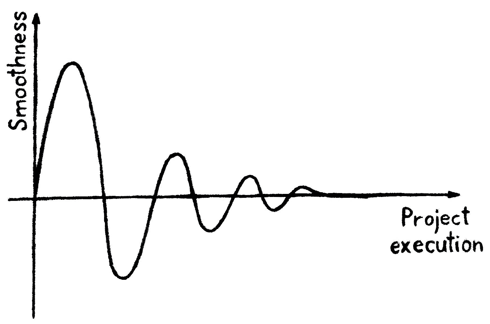

在任何项目中你可能永远到达图表的远端，但你至少应该做些什么来限制波动的大小。

需要更长时间


记住，当你运行一个软件项目时，有很多变动的环节。我无法在这里详述关于你应该如何管理项目的许多细节，关于这个主题已经写了数百本书。我只是想尝试展示一些你不应该忽视的“流沙区”。你同时在处理几件事，你像在杂耍许多球，而你不可避免地会让其中一些球掉在地上。作为开发者，我们可以尝试将一切简化为 0 和 1，但在估算、计划、执行和监控项目时，事情并非非黑即白的。这并不是完美的质量（否则我们就给客户一一堆垃圾），也不是成本-进度-范围三选二（你只能选择其中两个），以此类推。随着年龄的增长，你会发现这是一个光谱，一个选项与权衡的光谱。当我年轻且缺乏经验时，我试图用非黑即白的方式来看问题。与此同时，我学到了任何区间的端点都是难以实现的，你必须在中间某个地方找到一个平衡点。

而且花费总是比你想的要长。在构建软件项目时，霍夫斯塔特定律通常适用：

> 事情总是比你预期的要长，即使你考虑了霍夫斯塔特定律 —— Douglas Hofstadter^([88])

# 业务与 IT 的鸿沟

从上一章中，你可能感觉到开发者与组织内部其他人之间存在某些紧张关系。如果你有这种感觉，那么我可以告诉你这不仅仅是感觉；它是一个事实。确实存在某种脱节。

当你从外部观察一家公司时，你看到的是一个整体的业务。无论它是超市、汽车经销商、银行、一家制造公司、服务提供商、IT 公司还是其他，这并不重要；它就是一个业务。但当你从内部观察它时，你看到的不仅是业务，还有业务是如何组织的。你有不同的部门，每个部门都有自己的角色。有些对业务的实现做出直接贡献；另一些提供支持功能。例如，在大多数公司中，清洁人员不能真正被视为业务的一部分。他们对实际业务没有贡献，这是一种支持功能。根据公司提供的业务，物流或会计部门可能处于类似的角色。不可避免的是，在公司内部事情开始分为两个阵营：`业务`，即负责让业务运转的部门，这些部门对于提供业务至关重要或不可少，或者它们带来了收入；另一类部门是公司运营所必需的，但它们并不是公司所开展业务活动的第一手贡献者。

让我用一个例子来扩展一下这个观点。你是否想过乘坐邮轮船去度假？从外部看，这里的业务是整个前往加勒比海群岛、巴哈马或其他异域目的地的`开启一段不可思议的冒险之旅`。业务在于为客户提供包含船上娱乐在内的一站式旅行的真实体验。在船上，你拥有从餐厅到商店、酒吧、SPA 和健身设施、剧院和其他活动室的一切设施。如果你在在不交税的情况下获得赌场奖金后，手里拿着玛格丽丽坐在泳池边是你的心好，那么你也可以这样做。`业务`关于娱乐、美食、船上设施的舒适性，可能还有偶尔的陆地之旅。

但为了让这项业务正常运行，船只的最底层需要很多东西。船的动力系统需要运行；否则你将停留在港口。你需要自来水和电力。船的废物管理设施需要工作。清洁人员需要履行职责。厨房需要堆放比土豆更多的食物。所有这些隐藏在视线之外的事情都需要正常工作，你才能享受旅行。在你踏上船板之前，其他事情——比如票务系统——也需要正确运行。所有这些支持功能都是大家理所当然的，至少在故障发生之前是。你可能要去一个美丽的目的地，住在带阳台的豪华套房里风光海海，但如果空调不工作、马桶冲不掉，或者船的自动驾驶系统故障导致你搁浅在蛇岛^([94])，那么你的旅行将变得非常糟糕。

很多公司与这个邮轮例子相似。为了业务的运作，需要很多支持功能到位。而公司中一个至重要的支持功能是 IT 部门。大多数业务如果没有他们的 IT 部门将无法运行。你们有网络、电子邮件、互联网访问权限，以及许多运行员工基础软件或面向客户应用程序的服务器。就像你必须在浴室里有自来水，或者让空调工作一样，在公司里同样的，硬件和软件基础设施必须存在并运行良好，这样业务才能按预期方式运作。只有当支持功能出现故障时，人们才会意识到它们的存在，然后每个人都会变得紧张并抱怨要求修复或改进状况……因为这影响了`业务`。

但任何公司都有计算机网络。电子邮件和互联网访问也是如此。然而，运行在业务内部的软件可以是决定你留留在比赛中或处于比赛顶端的差异化因素。软件可以是业务中不可或缺的一部分。延续邮轮的类比，软件可能是船本身，即：你拥有最大、最豪华的船，提供最棒的食物，提供更多的活动等。如果所有邮轮公司都有相同的船，提供相同的服务并前往相同的目的地，为什么有人会选择这家公司而不是另一家呢？

在一家软件对业务至关重要或业务本身的公司工作时，IT 不能再被仅仅视为一个支持部门；它必须是业务的一部分。但遗憾的是，这取决于视角。有些部门是`业务`，而有些部门不是。

“我们”与“他们”

IT 部门的人会将公司内任何不从事 IT 工作的人称为`业务`。这指的是所有不是极客范式程序员、开发者、系统管理员、数据库管理员或 CTO 的人，指的是所有不理解或欣赏 IT 部门工作的人。这指的是那些你与他们交谈试图解释某些技术原理如何运作或某些技术局限性的人，随着时间的推移，他们的困惑在增加，而你的耐心在减少。这指的是那些分不清程序员和帮助台人员的人。你懂……那些技术落后的人。他们是`业务`。遗憾的是，`业务`看待开发者的方式也不同。


这就是为什么事情会分变成两个阵营，而双方最终并不认为自己是伙伴。一切都变成了一种“我们对他们”的局势，这被称为“业务与 IT 之间的鸿沟”。业务人员做他们的事；IT 人员做他们的事。人们不看对方的后院，每个人只顾忙自己的工作。有些人设定项目或公司应该的发展方向；另一些人必须提供实现目标所需的技术支持。业务人员不愿解释他们的问题，而 IT 人员也不愿意理解这些问题。有些人关注收入、成本和客户留存；另一些人关注代码质量、生产事故次数或性能。有些人想赚钱；另一些人想构建一些让自己自豪的东西。有些人满嘴业务术语，IT 人员满嘴技术词汇。这个清单还可以一直列下去。但结果是，IT 仅被视为一个支持部门，以某种方式与组织的其余部分隔离开，而不是“业务”的一部分。外包通常是这方面的一个很好的例子。公司将电子邮件、帮助台活动或软件开发外包化，但你见过多少家公司将自己的业务外包呢？你只能外包那些你认为非本质的事务。IT 不是“业务”，IT 必须不是本质的，所以我们就可以外包它，对吧？但关于这一点将在后面的章节中详细介绍。

当 IT 不被视为业务伙伴时，一种“我说的，你做的”的关系就开始发展了。业务被视为运营的大脑，而 IT 则被视为执行角色。老板和客户共同决定做什么，他们对事情应该是什么样以及应该如何发展形成自己的意见，做出了决定，并且许多重要的讨论在没有开发团队任何投入的情况下就完成了。然后他们去找 IT 说：“伙计们，这是我们需要的。让它发生吧。”当事情传到 IT 时，开发者会说“不”。他们说“不”不是因为他们是混蛋，而是因为通常情况下，业务想要的是不可能，或者因为实际上并不清楚需要什么。我在上一章中提到的事情将开始显现，每个人都在这场“拔河赛”中加入了自己的一营。


如果开发团队被视为一种支持功能，发生的另一件事就是：一旦软件项目启动，业务人员就不会参与其中了。开发团队让他们保持联系，是因为他们需要业务部门的投入，但如果让他们听之不管，他们就不会参与。对他们来说，软件解决方案是某种发送到某个地方去构建、然后按要求返回的东西，类似于在线订购东西，然后你的包裹被递送到家门口。额…………事实并非如此。当业务人员不参与且不持续与开发团队协作时，就存在软件可能变得不可用或不能完全解决它本应解决的问题的风险。你不能启动一个项目，然后退出画面，并在最后回来。这就像一家轮船公司想通过建造一艘新船来增加船队，但随后业务部门没有人参与这个项目。他们让他们设计船，创建好蓝图，然后将一切发送出去，根据这些蓝图进行建造。对于造船，这可能行得通，但对于软件，并不是这样的，因为对于软件来说，蓝图意味着根据需求生成的规格，而你现在已经知道软件需求方面存在哪些问题了。

那么，当 IT 不被视为业务伙伴时，唯一重要的事情就变成了软件本身，而不包括与开发者的互动。在建造一艘船时，业务人员不会与焊工、水管工、电工或漆工协作，所以为什么业务人员应该与构建软件的开发者协作呢，对吧？但这里是造船与造软件之间类比停止的地方。当人们创建出将组合成完整船只的所有区块时，他们并没有获得关于如何建造船只的新洞察。他们没有发现更多关于需要创建什么的信息。他们已经知道了。他们有蓝图，以前也造过很多其他船，所以他们只需要造一艘船。那是他们的工作。但软件开发的情况是不同的。当你构建应用程序时，你会发现更多关于需要什么。开发者是聪明人，他们会做出软件。那是他们的工作。但让开发者在整个公司追逐人们以获取答案、获取细节，或者在新的信息或洞察可用时弄清楚需要什么是一回事，而与他们为之构建软件的业务人员进行持续协作，是另一回事。当构建定制软件以改进公司的业务运营、赚更多的钱，或在所经营的任何业务领域更具竞争力时，你不能将一切交给开发者，并期望从头到尾一切顺顺利利。作为一名业务人员，你必须参与进来。你不能因为应用程序结果糟糕就责怪 IT，就像当电子邮件无法运行或你连接互联网遇到问题时可以责怪他们一样。你不能期望开发者构建应用程序，然后在结果很糟时抱怨，因为如果应用程序出了问题，那铁定不是在最后发生的。事情在开发过程中的某一点就已经变糟了。业务人员，当这种情况发生时你在哪儿？

## 成本

因为他们不被视为伙伴，对于许多公司来说，IT 人员是一项成本。那么业务人员试图对成本做什么呢？当然是减少它。除了把公司搬到市外租金更便宜的建筑、与服务提供商重新谈判合同、购买翻新设备、自动化流程、捐赠慈善以获得税收减、减少差旅费、补充打印机盒、或购买廉价办公用品或更便宜的厕纸，降低成本的另一种方法是雇用薪水较低的人。但在大多数行业中，而不只是软件开发，低薪通常意味着技能不匹配。但对于培训不足的人，你无法取得多少成就，而且早晚大家都会意识到。你需要有经验的人。但这无疑意味着更多钱。所以，如果你想保持低成本，在这种情况下可以做什么呢？你雇有经验的人，但人数更少，对吧？


你最终在不知不觉的情况下处理了一些低优先级的请求，然后某些紧急的事情被塞到你面前并要求立即交付——而这件事情因为你之前没有意识到处理它至关重要，已经被搁置了三个月。结果一切都变成了一团糟，而当然，这都是 IT 的错。许多人开始认为这仅仅是开发者态度不好，他们不想做某些事情……谁知道他们一整天在办公室里忙些什么，而不是在工作；也许是在玩网络游戏。

然后他们找你找麻烦，对你施加压力，或者坚持要求你为他们构建软件，因为他们认为只要在他们后面盯着你，你就会给他们想要的东西以让他们闭嘴。但你手头的工作已经太多的了，你没时间参与这种行为，所以你打发了他们，并建立了各种流程来保护自己，免受那些直接找你索要东西的业务人员的影响。*“你在我们的问题跟踪系统中创建工单了吗？如果没有工单，你就不存在”*。即使他们创建了工单，工单也会被挂起。项目进展缓慢，新工单的审批流程更慢；各个业务部门随后便说与技术部门合作很困难，他们再也等 IT 为他们构建项目了。

## 影子 IT

正因为他们的项目没有完成，业务人员便硬着头皮构建了自己的应用程序，导致了所谓的*“影子 IT”*([95])。人们开始在 Excel 中做事情，或者财务部的 Steven 懂一些编程，于是他构建了一个整个部门都在使用的应用程序。直到有一天，Steven 去休假了，应用程序停止了运行，周围没有人可以修复它。突然间，一切陷入了混乱，部门里没有人能工作，因为他们依赖于那个程序。于是他们给 IT 打电话，因为他们自己什么技术都不懂。考虑到 Steven 出去度假后就没接电话，他们还能给谁打电话？IT 随后发现了这个应用程序，现在轮到他们抓狂了。*“你居然有一个上传到云端的网站？你从哪里弄来这些机密数据？安全性怎么办？我的天，数据竟然被搜索引擎索引了。如果你输入正确的关键词，它会出现在结果的第一页。你疯了吗？是谁授权的这个？这是公司的互联网域名吗？是 Steven 拥有的？见鬼了！！”*

所以当 IT 发现这个新应用程序时（取决于公司运营的领域，它可能带来安全风险、暴露机密信息，或者它的存在甚至违反某些法律或合规规定），他们想做的就是关掉它，因为他们知道如果发生坏事，他们将不得不收拾烂摊子。这是一个非常糟糕的处地，因为业务人员认为，他们不得不自己构建应用程序最初是 IT 的错。你不仅没有按照要求为他们构建应用程序，而且现在他们自己构建了他们需要的、现在对他们非常有帮助的东西，但仍然是 IT 造成了不便，并在没有给他们任何替代方案的情况下关闭了他们的应用程序。*“影子 IT”*的存在不仅加剧了业务与 IT 之间的脱节，还可能导致双方产生敌意。

这是可以理解的。你不能关掉他们的应用程序然后就让它搁置三个月或者更久，在此期间你还要完成目前正在工作的内容，这样你至少有机会看一眼那个应用程序，看看你能如何提供帮助。你试着帮助他们，成为他们的伙伴，但你没有足够的人手，而你只是在那些你应该处理的任务列表上又增加了另一个应用程序。你回到了原点。人们再次在等待 IT 为他们开发应用程序，就像刚开始时一样，直到他们最终被迫自力力为构建了自己的软件。对于很多公司来说，*“影子 IT”*是一个大问题，但从个人经验来说，我可以说*“影子 IT”*实际上并不是*“问题”*；它是对实际问题的反应，即业务需要重要的应用程序，而 IT 没有能力交付这些程序，因为同一个业务部门决定 IT 是一项需要削减的成本。人们需要应用程序来生产力。他们只是想更好地完成工作，不能永远等 IT 提供必要的软件。这对他们来说是一个障碍，所以他们绕道而行。*“谁需要 IT。我们会自己来”*。如果允许这种情况持续下去，分歧会变得非常巨大，人们开始认为他们完全不需要 IT，认为 IT 出了什么问题，也许他们应该把工作外包。这样做甚至可能更便宜，对吧？

当这种情况发生发展时，解决起来并不容易，因为双方都需要充分的信息。而通常他们并没有。这是一个源于所有涉及部门之上的沟通问题。每个部门都有自己的项目和优先事项，而这些信息通常不会与其他部门沟通。如果公司没有一种方法——例如项目管理办公室（PMO）——来帮助跨项目的沟通和协调，让每个人都理解发生了什么，并意识到当你去他们办公室寻求帮助时，如果 IT 员工告诉你走开，那么他们并不是混蛋，那么你基本上就完蛋了（而且，IT 的工作可能会被外包）。

在继续之前，关于*“影子 IT”*，我还有最后一点要提，即：不要认为这一切混乱总是发生在他那些为了业务利益最大化而努力工作却得不到认可的可怜开发者身上。有时 IT 哥们儿确实是一群混蛋。他们是加深分歧的人，因为他们经常不想看大局。简单直白。他们痴迷于云、大数据，或者哪种前端框架在本周或下周更酷，而不是他们能为公司带来什么价值。有时他们痴迷于技术或玩酷玩具，以至于将自己的利益放在公司利益之上。*“我一直想玩这种技术，但许可证很贵。嘿……公司负担得起，所以买个许可证吧，我们会想办法把它放到某个应用程序里”*。或者像这样的。*“伙计们，如果我们能构建一个功能完整的应用程序会不会很酷？”* 这可能很酷，但需要吗？那么成为混蛋的顶点（通常是因为开发者认为自己比那些*“不懂”*软件的人聪明得多）就是当业务人员提出想法或请求时忽视他们，否定他们说的一切，并简单地得出结论认为他们都是白痴。

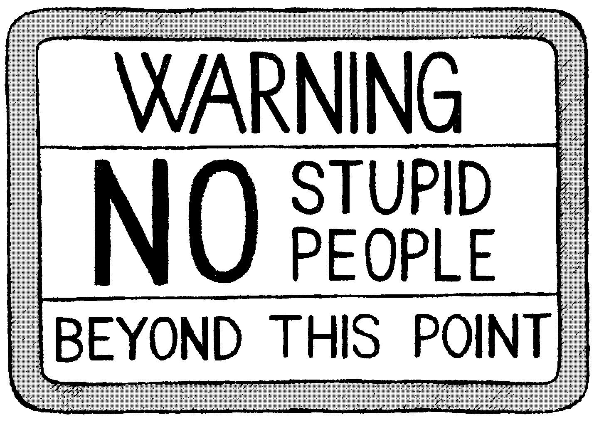

## 真实成本


业务与 IT 鸿沟带来的后果是：浪费时间、错失机会、沟通断层、昂贵却无法解决问题的软件方案、让事情变得更加复杂而非高效，有时甚至导致完全失败。它还造成了一个每个人都推卸责任的环境，每个人都把归咎于`“另一方”`，而不是为了成功而协作。如今，当几乎一切工作都依赖软件运行时，这种鸿沟需要被弥合。

> 信息技术与业务正变得密不可分地交织在一起。我认为没有人可以在不谈论其中一个的情况下有效地谈论另一个——比尔·盖茨([96])

这段引言来自 1999 年，看来人们似乎还没有解决这个问题。而首要需要解决这个问题的人是那些高层管理人员。你需要业务与技术的融合，让每个人都能制定出推动公司向同一目标迈的策略；否则，情况可能会变得像伊万·克里洛夫([98])的诗《天鹅、梭和螃蟹》那样：每个人都付出了巨大努力，努力工作并尽力完成自己的工作，但他们最终都在朝不同的方向拉扯，互不达成共识，结果只是抵消了彼此的行动。

甚至，对于软件公司而言，IT 本就是真正的业务，并应被视为如此。你不能将 IT 部门视为业务的其他部分之外，仅仅将其视为一种支持功能或成本。业务计划与技术计划之间不能存在脱节；两者必须齐并运行。作为一名业务人员，你不能将开发视为一个黑盒或认为它是理所当然的。你需要理解在工作中始终运行你业务的技术所具有的复杂性和多样，而不仅仅是在技术出现问题时，或者当技术没有在`“业务部门”`想要的时候完成所有要求时。

技术人员需要`“决策桌上的一席之地”`，以便他们能影响并参与管理决策，对技术或 IT 部门的实际能力提供建议和投入。否则，你面临的不是从一开始就做出明智决策，而是面临做出错误决策的风险，然后在软件开始开发、发现业务预期无法实现或超出了 IT 实际交付范围时，再又一遍一遍地修补。

在项目中与 IT 合作（或者说与任何其他部门合作）就像让某个承包商在你的家里工作对房产进行改装或维修。你可以告诉他们你想要什么，把家里的钥匙交给他们，让他们工作，等工作完成后回来。但在他们在那里时，可能会发生任何事情。每处房产都是独特的，因此可能伴随着其独特的挑战和问题。当情况出现时，承包商可以在你人在场的情况下与你讨论，以共同做出最佳决定；或者他们将根据自己的经验做决定，而你可能并不认同那个决定。例如，假设你想在厨房里加一些橱子。建造者需要在墙上钻孔，以插入木销和螺丝钉来挂橱子。但他注意到墙壁是由玻璃混凝土制成的。而且厚度不够。孔只能钻进去三分之二，对于那种混凝土，结果是……


作为开发或 IT 领域的人员，你需要理解业务。这不仅是为了能够妥善完成工作，更是为了能够与业务人员在合适的水平进行互动。在这种互动中，努力可能大部分是单向的，因为除非人员自己成为开发者，否则他们不太可能理解软件开发的困难性。例如，他们并不理解你可能在 `terminal` 中输入的命令。通常，他们也难以理解什么是 `terminal`。对许多人来说，IT 部门内部的工作就像某种“黑魔法”。因此，你不能指望他们能理解开发人员的工作。

反过来——让开发人员很好地学习业务——要简单得多，而且成功的几率更大。业务通常比编程更容易学习，而且大多数领域的事务变化并不像技术领域那样频繁。此外，作为一名开发者，你需要学习业务以确保你构建的应用程序解决的是正确的问题。你需要花更多时间与业务人员相处并试着理解他们。你可能会和市场部、销售部或呼叫中心的同事待在一起，看看他们在做什么，理解他们的工作，看到他们如何完成公司运营或目标中的自己的部分，并思考你构建的软件如何能更好地帮助他们。

这种工作必须定期进行，而不仅仅是在项目开始时。经常与他们接触，举办工作讨会之类的活动，参加他们的状态会议或其他其他更重要的季度会议，阅读他们的简报。你必须保持高频率的互动；否则，每个人只忙自己的工作，公司内部就会产生信息孤岛。如果你真正与他们互动，你就会看到他们工作；你会看到他们面临的问题或挑战，或者客户如何因为公司自身的问题对他们大大叫。在纸上看他们的职位描述是一回事，而与他们并肩作战则是另一回事了。

有时，你会发现你构建的应用程序对他们完全没有帮助。一点用也没有。糟糕的是，它还阻碍了他们的工作。我曾经历过多次这种情况：看到某个部门主管或经理要求软件以某种方式运行，结果后来发现那只是经理认为事情是这样运作的。实际上，事情是以另一种方式运行的，但没有人敢告诉老板他们错了。前一秒我还在高兴完成了应用程序，现在正满心热勃地向人们演示如何使用它，而后一秒，当我意识到自己做错了东西时，心里一阵沉重。“*如果我能早点发现该就好了*”。

嗯，那就早点发现吧。在应用程序开发的整个过程中让业务人员参与，并向他们寻求反馈。向他们展示你在意意他们的意见，关注他们的需求，并且你是真心想帮助他们。解释为什么某些事情复杂且耗时更长，为什么有些更简单且耗时更短，优先级是什么，出现了哪些问题。学习说业务语言并进行清晰透明的沟通。沟通至关重要。让每个人都知道发生了什么。通过与他们保持密切联系，你确保双方都在朝着同一个目标努力。通过共同工作，他们学会了信任你，尽管他们并不完全理解你是如何做到这些的。一旦大家共同工作实现相同的目标，最终会达到人们共同做出决策的程度。也许某天，有人会意识到开发者应该从一开始就坐在会议桌旁，参与讨论和决策，而不是被仅仅视为向“*业务部门*”交付系统的支持职能。

这关乎业务人员和技术人员的全员参与，这种改变必须从某个地方开始。而它完全可以从 IT 开始。你必须开辟道路、沟通、互动，并尝试成为业务伙伴；否则，情况将不会好转。如果你努力理解业务人员，说他们自己的语言（你说“*业务语言*”），如果你向他们展示你只是想提供帮助，情况就会好转。也许你仍然会面临人手短缺的团队和不完的项目，也许某些问题仍然存在——例如“*影子 IT*”——但当人们获得通报时，他们会更好地理解状况，知道会有什么预期，并向 IT 寻求关于如何进行以及他们应该或不应该做什么的建议，从而导致合作与伙伴关系。

当然，业务人员和管理层也必须对你的互动保持开放态度。你不能直接闯入别人的会议；他们必须理解你为什么在他们的办公室里工作，而不是在你自己的办公室里工作。他们需要理解，这也是你工作的一部分，即为了更好地理解客户员工或整个组织的需求。通常，所有部门都必须进行沟通、协调并统一努力；我在这里仅从 IT 部门的角度来谈。

## 信任

到为止，我提到的关于业务与 IT 隔阂是一个观点差异的问题。要弥合这一鸿沟，部门之间需要更多的互动；更多的协作。但要让人们真正实现协作，他们需要彼此信任。

信任是生活中起着至关作用的事情之一。我们每天都在与信任打交道，无论是否意识到。当我们交通灯变绿时启动汽车时，我们信任从左边和右边、红灯的人会停下。当你向银行存钱时，你信任银行不会偷走你的钱（至少不是根据“*偷窃*”这个词最为人知的定义）。当你在餐厅吃饭时，你信任食物制作得正确，且没有使用变质的食材。当你向智能手机上安装一个应用程序时，你信任应用程序使用的权限实际上是运行所必需的，而不是为了让它从你的设备中窃取隐私信息。因此，在职场中你也不可避免地要处理信任问题。


信任不是一种可以轻易观察或衡量的东西，但如果你从其他人都在做的事情中稍微拉开距离并仔细观察，你将会发现另一种东西，一种更容易被察觉到的东西，即“缺乏信任”。其中某些事情，即使你没有在该公司工作也能观察到。例如，当你参加工作面试时，`HR` 人员坚持要追问关于你 `CV` 中职业空窗的更多细节，尽管你已经给出了详尽的回答？或者在招聘过程中，你是否被要求提供五位合作同事的推荐人、最后三位主管的电话，以及你二年级老师的联系方式？那么在你入职后，你是否发现工作环境或你必须执行的工作与面试时讨论的内容不符，而且这还不是公司对你隐瞒的全部信息？你说不能居家办公？为什么？是因为你为一家银行或某些在高度监管的环境中运营的公司工作，还是因为你的老板觉得如果没有人盯着和唠叨，你就会偷懒并拖延进度？你最终根据自己的成就要求加薪，但却由于经济时期艰难以及公司勉强维持经营而被告知“不”，结果后来发现公司在衰退期间实际上创造了有以来最大的利润？你的公司是否声称一言所行都考虑客户，但为了让客户联系客户关系，他们必须在呼叫中心的 `IVR` 上解开数独游戏？公司参与社会责任计划是因为他们真的关心，还是因为这是一种更廉价的公关工具？你是否在无法访问互联网的糟糕虚拟机上工作，因为客户担心你可能会窃他们的代码？或者你是否曾在一个进度落后的项目中工作，但资源却从另一个进度超前的项目中抽调，而那个项目恰好是在另一个客户的预算之内的？如果那个客户发现他们实际上是在用自己的钱资助别人的项目，你认为会发生什么？

我们常说同事之间是“工作关系”。但任何形式的人类关系如果没有信任，都无法运作。想一想，如果你无法信任某人，你真的能与他高效工作吗？

> 没有信任，我们并没有真正的协作；我们仅仅是在协调，或者充其量是合作 - Stephen M. R. Covey ([99])

当我们对某些人或某些情况缺乏信任时，我们自然会远离他们，变得更加谨慎，或者产生某些顾虑。在交通中，如果我们怀疑从右侧驶来的汽车不会在红灯前停止，我们在通过路口时就会减速。如果我们不信任银行，就会把钱放在垫下，冒着小偷闯入家中不仅带走电视还带走我们所有生活积蓄的风险。当我们不信任餐厅的食物时，每天必须花更多时间在家里准备餐点，还要洗碗。如果你怀疑一个应用程序使用的权限超过了其运行所需的权限，你可能就不会再安装该应用了。

你需要信任。你在日常生活中需要它，在公司里也需要它。信任对于一个组织的正常运作至关重要，然而公司内部正在发生的许多事情让我们对信任的意愿产生了怀疑。大多数情况下，你无法让自己远离这些局面（除非辞职），因此你不得不与你并不真正信任的人共事。

在缺乏信任的地方，各种破坏性行为开始露出其丑陋的面目。错误被掩盖，人们开始推卸责任或找借口，而不是承担责任。人们隐藏信息或将好主意留给自己，以防得水或被他人评判。流言蜚语，人们在背后议论。每个人都只顾自己，怀着为了领先或避免被开雇的秘密计划；你不知道从别人身上期待什么，因为你不知道他们的计划（有时他们看起来在做对的事，有时又不是，取决于这是否符合他们的计划）。有些人甚至会隐藏信息、操纵或扭曲事实。人们感到效率低下，并开始产生相应的行为。所有这些事情对公司都有影响，因为人们在日常工作中不再像以前那样高效；类似于上面的例子，他们开始表现得更加谨慎，或者在行为上受到某些束缚。《信任速度》一书的作者 ([100]) 对这些现象有一个很好的称呼；他们称之为“信任税”。这些是隐藏的税，就像通货膨胀是一种隐藏税一样。它们可能不会出现在公司的财务报表中，但它们确实存在。它是为了确保控制员工的深层管理体系。它是官僚主义、糟糕的办公室政治、缺乏投入以及员工流失（而且离开的是好人，而不是坏人）。它是失去老客户，甚至是员工参与欺诈活动。当然，IT 人与业务人员之间可能存在信任问题。缺乏信任会加深业务与 IT 之间的分，或者阻止隔阂的消除。简单来说，业务部门和 IT 部门并不真正信任对方。

一次又一次，许多软件开发项目发生了各种烂事，这是由于许多以复杂方式相互作用的原因。项目失败并没有单一的罪祸首，所以——类似于阿格莎·克里斯蒂的小说《东方快车杀人案》([101])——每个人都成了嫌疑人。客户不知道自己想要什么，也不知道如何提出。业务分析师在收集需求方面做得糟糕。开发人员估算错误，或者管理层规定了不现实的期限。团队开发人员不足。客户反复要求更改。应用程序没有经过充分测试。或者可能是销售经理的错，他们说了客户想听的任何话，以便他们签署合同并拿走丰厚的奖金。“*是的，是他们的错才导致我们陷入了这种境地。他们卖了一个包裹在承诺中的梦想。他们又在乎呢，毕竟最后干活的不是他们，而是那些设法要搞定的可怜开发人员？你永远不要信任销售人员。永远不要，我告诉你！”*


因此，软件项目因“过度承诺、交付不足”而声名狼臭。在这种情况下，建立信任是非常困难的，因为信任是需要随着时间积累的，并且很大程度上取决于你的结果。有如此多的软件项目付诸失败且没有产生预期的结果，人们如何信任 IT 部门呢？作为开发者，我们会说我们会做这个做那个，说我们会处理好这些事情，说一切都会没事的，但结果又是怎样的？情况与我们说的不符，结果又一次又地反驳了我们。而人们会从过去的经验中学习。如果有人没有遵守过一次信言，他们就会再这样做一次。

于是，老板们开始给开发者施加压力，说一切都是重要的，以强迫他们交付。说如果应用程序没有在 X 日之前上线，天就会塌下来。但当 X 日到来时，什么糟糕的事情都没有发生。开发者也从这种经历中吸了教训。下次当老板过来说*“如果我们在 Y 日之前不完成某某事，就会发生非常糟糕的事情”*时，你认为开发者还会倾向于相信他们吗？到时候，无论那个荒谬的截止日期是老板强加的还是由于估算得出的，都变得不再重要。作为开发者，你同意了这样做，这意味着你承诺过会完成。然后，当然，人们期望你完成它。期望被建立了，然后又被打破了。接着，业务人员不再信任你了。你说你会做但你没做。你被埋备了。但这不是你的错，或者更准确地说，不只是*“你”*的错。于是你埋怪业务部门没有在需要的时候提供所需的信息，埋怪他们不理解某些问题更困难、需要更多时间，埋怪不是开发者将估算时间减了一半……所以信任荡然无存了。

每个人都开始想：*“被骗一次，是你的错；被骗两次，是我的错”*，然后开始提高警备，或考虑应急计划来应对其他人，因为他们不再信任别人了。每个人都开始支付*“信任税”*。原因很简单：当你的信任被背叛时，那就是*“再见，拜拜”*。当我们下次与背叛我们信任的人互动时，我们不再那么容易信任了，因为各种不愉快的结果都变得可能。人们会建立一些控制或防御机制来防止糟糕结果的发生，这些措施在财务上成本昂贵且耗时，事情不再像如果每个人真正信任彼此时那样高效了。

例如，你是否工作过一家公司，你必须频繁地跟踪自己的工作，以至于这种跟踪的开销影响了你正在进行的实际工作？或者在一家公司里，你和老板就进度发生争论，他们不满，并要求查看你目前为止的所有任务？*“给我看问题跟踪系统里的所有任务。你做的每件事都必须写在里面。然后我想让你每天给我发报告，让我看到你的进度”*。或者你工作过一家公司，一个执行实际工作的人有多个老板，一个等级非常森严的公司，其中一层控制下层做什么，下层再控制下层，直到最后你达到了那几个实际干活的倒霉蛋？

信任也意味着你可以放弃控制。如果经理或老板不信任开发者，项目管理就变成了接管并控制正在进行的工作。如果他们看着开发者，看到的不是值得信任的人，而是一些穿着科幻和幻想 T 恤、身上沾着番茄油渍的极客，他们会认为向他们交出大量控制权是错误的，而会夺回每一个细微细节的控制权。他们是把项目*“交出”*给了有能力的人吗？当发生某些事情时，开发者的行为是否符合预期？如果经理或老板对项目上的某些事感到惊讶，并且他们认为他们不能信任你，那么这种缺乏信任将导致沉重的*“命令与控制”*环境^([102])。

记得我提到过自主性、精通和目标吗？在*“命令与控制”*面前，你可以对这一切说再见了，因为 20 世纪 50 年代的项目管理在大多数软件开发项目中行不通。命令与控制在军队中有效，但在知识工作者那里无效。在军队中，士兵无论如何必须服从命令。如果他们收到攻击敌人的命令，他们必须这样做。你不能让士兵开始讨论不同的攻击方式、每种方式的优缺点，或者让他们就此开会，让大家轮流在白板前展示并支持自己的观点。在军队中，每个人都接受过服从命令的训练。如果没有这个，一切都会崩塌。但在软件公司，*“服从命令”*，或者如我上面说的*“我说，你做”*，只会加剧业务与 IT 之间的鸿沟。你在工作中需要的行为与你在战场上需要的行为完全不同。你需要人们思考、协作并寻找最佳解决方案，而不是服从命令（特别是从那些不接近战场的人，或者对于开发者来说就是不接近工作的人那里得到的）。

此外，开发者讨厌命令与控制。他们讨厌别人告诉他们要做什么以及怎么做，特别是如果这些人完全不知道自己在说什么时。命令与控制在军队中同样有效，还有另一个原因：除了顶层（由政治家占据）外，指挥链上的所有人都是军人。例如，一个下达命令的将军理解士兵在做什么。他们他们曾是士兵。你加入军队时不是将军；你必须晋升。将军知道上尉和少校在做什么，等等……因为他们曾是上尉或少校。但如果一个老板或经理最近没有做过开发者，他们就不知道开发者实际上是如何完成工作的。老板或经理被聘到那个职位时，可能完全不懂技术工作的运作。而开发者不喜欢被这样的人告诉要做什么。

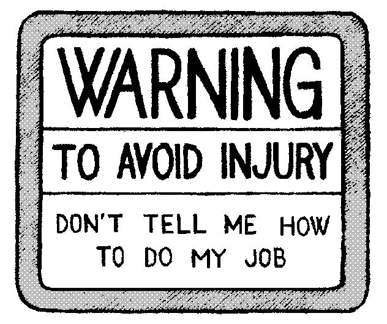

Note

我只是说，必须有一个能够激发信任的平衡组织结构。过多的命令与控制管理层不会激发信任；它们反而创造了*“信任税”*。


例如，沟通速度会降低，因为信息穿越整个层级结构需要更长的时间。有时，如果结构的底层接收到来自不同上级的多个相互矛盾的决策，沟通就会崩溃。信息的流动通常不会像级联反应那样完全不受改变地流淌；在从一层传递到另一层的过程中，它可能会被稀释、转化或完全丢失（有时是有意的）。在某个阶段被认为是“有则更好”的东西，在下一个阶段可能变成“强制性”，这仅仅是因为某个经理想迎合其上级经理的意图。你在书引言章节的一个笑话中看到了这个完美例子：开发者发出的“我们无法完成这个项目”的消息在层级中向上传递，直到到达客户那里变成了“这正是我们公司专长的项目类型”。这既幽默又悲哀。在深层次的公司层级中，高层决策是基于从底层传上传的沟通信息做出的。如果你从下面的中间层听到一切都很好，你最终会在高层做出糟糕的决策。CEO 可能会认为一切正常，但在公司层级较低的某个地方，情况可能非常糟糕。当问题最终被发现时，CEO 找到的确保从现在起获取真实情况信息的解决方案，就是建立更多的“命令与控制”。

深层层级的另一个问题是，它可能看起来像一架成功之梯，人们想要向上攀爬。基本上，每个人都想成为经理。也许开发者不想……开发者并不想那样。但某一个级别的经理确实想从他们开放区域的办公桌搬到转角办公室里。当人们追求个人利益时，团队、项目和公司将不得不居其次。深层层级鼓励个人主义和竞争，而不是协作，因为随着层级结构向上逐渐收窄，并没有足够的管理职位供所有人使用。然后，一旦他们到达顶端，人们就会开始防范，防止他人抢夺他们的职位。他们将不再想要冲突并规避所有风险，即使这些风险是为了组织的利益。他们不想引起波澜或破坏局面。这将影响决策制定。糟糕的不仅是决策制定得离执行一线太远（当你对项目内部实际发生了什么越来越模糊时，如何能做出最佳决策？），更糟糕的是，这些决策完全是根据报告、状态会议或 PowerPoint 演示稿做出的。这导致了一个非常缓慢的过程。由于他们不想破坏局面，他们会希望做出无风险的决策（或尽可能无风险的），因此他们会要求大量的报告。现在又会出现几层额外的管理人员，他们存在的唯一理由是从那些实际工作的人那里收集报告。而浪费在报告上的时间就是剥夺了开发软件的时间——另一项必须支付的税。

由于深层层级，事情开始基于报告获得支持和运作（然后作为报告的后果施加了各种流程和规则），而不是依靠信任。此外，这些事情清楚地向人们表明他们没有被信任；否则，你为什么要用报告来证明每一件小事的合理性，为什么工作需要严格按照某些程序来执行？你最终导致每个人只做分内的工作，不再多做。深层层级扼杀了创造力，降低了人们的精内在动力，并减少了赋权和人们行动的意愿。当发生程序未涵盖或报告未包含的情况时，人们选择无所作为，以免冒犯错误的风险。你开始听到之类的话：“我只是按照程序说的”，或者“我只是遵循了指南”，或者“做此类某事不是我的责任/工作”。然后又增加了规则，或者更新了程序以包含不断增加的情况和例外。基本上是更多的税。最终，一切都变成了一个循环：经理不信任开发者，开发者不信任经理。一切都花费了更多时间。过去需要 5 分钟的事情现在需要 15 分钟，因为你必须在你的问题跟踪系统或任何系统中填写各种报告和任务。你的老板注意到了时间的增加，但不知为何没有将其追溯到现行的复杂流程和政策，所以现在你需要参加各种会议来解释为什么你似乎不再做任何有意义的工作了。你感到压力要做更多工作，感觉想从窗户跳出去辞职。跳窗户可能更容易，因为写辞职信需要一支笔，而为了得到笔，你必须填写一份需要你老板连同财务部至少两人共同批准的表格，在此之前你还要填写一份报告解释你为什么需要那支笔。

但信任问题不仅出现在开发者和经理之间。缺乏信任也会导致团队内部出现问题。嘿，如果人们互不信任，你根本就没有一个团队。如果你熟悉塔克曼（Tuckman）的群体发展阶段 [103]，一个团队要高效工作并交付成果，需要经历以下阶段：形成（forming）、震荡（storming）、规范（norming）和执行（performing）。形成阶段是团队成员聚集在一起并互相认识。震荡阶段是团队内部的角色被定义，性格发生碰撞，分歧和冲突产生，但最终，团队成员会找到如何解决冲突，了解彼此的工作风格，信任开始发展。在规范阶段，每个人共享一个目标并开始作为一个团队工作；人们现在互相熟悉了并且相处融洽。执行阶段是最后一个阶段，不需要解释；团队正处于最佳状态。

如果你没有信任，那么你的团队将停留在震荡阶段。这意味着他们无法找到良好合作的方式。基本上，你没有团队，只是一群试图协调工作以实现某些强加的目标的人，而不是真正的协作，结果导致冲突和戏码多于真正的团队合作。在著作《团队的五大功能障碍》[104] 中，作者帕特里克·伦西奥尼（Patrick Lencioni）指出，缺乏信任是导致团队所有其他功能障碍的根源。从那里开始，由于害怕冲突，导致无法进行诚实的讨论，这又导致人们不再深入探讨问题以做出明智决策，从而导致对承诺的缺乏以及对所做决策的责任的规避。这一切最终导致团队失去焦点并交付不满意的结果。


一切始于对团队的信任。它就像引擎中的油滑，让运行顺畅。如果有信任，人们就会诚实、开放地沟通，更加投入，进行建设性的讨论，而且团队成员不会因为意见分歧而受到惩罚。人们能够共同做出更快、更好的决策，然后每个人都支持这些决策。他们了解彼此的优缺点，在需要时达成团队目标时会合作并互相帮助。人们提出想法，鼓励实验，而代码的所有权属于整个团队。当冲突发生时，更容易以建设性的方式管理和解决，因为人们互相尊重，空气中没有紧张气氛，团队对新挑战更具适应性也更高效，每个人都信任 `Team Lead`，不需要过多的督促。我在上一个章节中提到过`心理安全`，这是 Google 发现的让团队最高效的因素。你认为你可以在人们互不信任的情况下建立心理安全感吗？

如果团队内部缺乏信任，人们会试图隐藏自己的弱点，更关注别人如何看待自己，试图建立一个虚假的形象，而不是真正改进那些弱点。没有信任，人们就不会寻求或提供任何帮助，互动保持在最低限度，每个人只忙自己的事，更多关注活动而非结果，或者人们开始孤岛式工作。当冲突发生时，人们开始互相指责，隐藏或歪改信息以满足自己的意图，每个人都朝不同的方向拉，逃避责任，并说诸如`我以为这应该由你负责`之的话。沟通变得越来越糟糕，会议变得越来越长或反复进行，因为人们不想做决定，而 `Team Lead` 开始进行微观管理，监视团队并向每个人下达命令。这些都会给公司带来时间、金钱，有时甚至是声誉损失。

当信任度很高时，你得到的是相反的结果。当你信任员工的判断力和技能时，事情的进展方式就会不同：当你信任他们没有隐藏任何信息，信任他们清晰透明地沟通，信任他们他们自己无法独立处理的情况时会寻求帮助，当每个人都理解对自己的期望，每个人都清楚要做什么，每个人都知道他人的角色和职责，而 `Team Lead` 则通过引导人们和帮助他们成长来履行好 `Team Lead` 的职责。

## Build 信任

那么，有没有什么可以做来提高信任呢？有的，可以。信任是人们期待别人迈出第一步的事情之一。正如我提到的弥合业务与 IT 之间的鸿沟，开发者必须是迈出第一步的人，充分学习业务领域并与业务人员更多互动，开发者也必须是那些开始信任业务方的人。但你必须现实な。你不能突然开始完全信任别人，并忽视可能随之而来的所有问题。公司里的人不会一夜之间就变得值得信任，仅仅因为那是你所愿的，仅仅因为你愿意把信任付给他们。如果你在一个糟糕的环境中工作，有 300 个人其中 290 个甚至不认识你，人们不会改变他们的行事，仅仅因为你认为信任会改善工作环境或每个人的日常工作。你不能来上班就指望人们说`让我们开始互相信任吧`或者把周五宣布为`信任周五`——这行不通。但你必须从某个地方开始。

所以，从`某种程度上`开始信任人们，然后根据他们的行为反馈来调整这种信任程度。例如，你必须信任你的 CEO 拥有愿景和战略且不会掉链，你必须信任你的直属主管或 `Team Lead`，你必须信任 HR 为公司各处引入优秀的人才，你必须信任其他业务部门正与你朝着相同的目标努力，你必须信任你的队友，信任其他人都在尽所能地工作。但要真实。你需要发现谁你可以信任，谁不能。观察他们的行为，然后上调或下调你对他们的信任水平。对人的过度信任会带来麻烦，但太少则会导致行动瘫痪。记住，任何形式的人际关系如果没有信任都无法运作，包括工作关系。信任是通过行动建立的。让他们的行动决定信任的程度。

我必须承认这并不是什么解决方案。这只是对最好的希望。希望你可以信任而最终不至于失望。如果你最终感到失望了，就重新评估你付给他们的信任水平。这不是一个解决方案，因为你无法控制给予他人信任。但你可以通过你所控制的事情对他人产生影响：`你的行为方式`。在与人的互动中，你必须表现得能够增加他们对你的信心。你需要赢得他们的信任。

他们需要看到你是一个严肃、诚实且可靠的人，你行事专业，你胜任且技能熟练并不断尝试改进，你承担责任并承认错误，你理解业务，你积极且不等待指令该做什么，你有良好的意图，你的决策是基于对业务正确的考量，你付出了所有努力，你有能力交付结果，你提出解决方案，或者引入管理层来解决你无法独立决定的局面等。如果他们看到这一切，并理解你出现在那里是为了帮助他们，他们就会开始信任你。本质上说，你必须表现得不会从你那里产生任何意外。他们希望看到可以依靠你，并且你是一个靠谱的人。如果真的发生了什么，他们期望你能够妥善处理。

锦上添花的是履行你的承诺；换句话说，就是交付你承诺的内容。但在任何软件项目中，事都会有意外状况，所以无论你多么可靠、诚实或有能力，承诺都是难以履行的。如果你承诺会做某事却没有做到，你很容易就会回到上述关于设定预期的问题上。所以，当你承诺交付某些东西时，你需要尽一切努力履行该承诺。如果尽管你付出了最大努力，由于我们所谓的软件开发问题的许多变量，你的计划偏离了轨道且结果不如预期，你所剩下的就是诚实透明地沟通。经常沟通，让每个人知道发生了什么以及什么阻碍了你履行承诺。如果无法通过结果判断你是否值得信任，人们将使用次优方案，即你平时的行为方式。那么，如果你已经确立了诚实、胜任且值得信任的形象，他们将与你一起寻找解决方案。这样做，他们最终可能会报以信任。


归根结底，剩下的就是你要让自己变得值得信赖，然后他人通过与你的互动，最终证明他们也可以成为你可以信赖的人。当人们最终彼此信任时，许多问题就迎刃而解了。事情变得更加高效，你获得的不再是`信任成本`而是`信任红利`^([100])，从长远来看，回报丰厚——例如高高性能和增长、快速且可持续的创新、在人们可以成长学习且不害怕犯错的环境中增强协作、组织策略的更好执行、透明度和沟通的增加、更少的政治和更多的行动、员工士气的提高、高度的自主性和问责制、员工和客户在公司留存时间更长，等等。

# 会议与报告

让我们直奔主题吧：职场充满了会议和报告，而开发者讨厌这二者。有计划会议、状态更新会议、信息共享会议、设计会议、培训课程、考核，清单可以一直列下去。你还有状态报告（或进度报告）、审计报告、财务报表、绩效评估报告、事件报告、合规报告，或者你的经理认为需要的任何类型的报告。当开发者谈论会议时，他们使用的词汇是无聊、低效、无产出、不专注、冗长、沮丧、没必要、离题、重复、`杀了我吧`。至于报告，开发者可能会说它们耗时、不准确、不完整、没用、`还要薯条吗？`。

## 干扰

会议和报告并不是编程和构建东西，这通常是开发者喜欢做的事情。开发者构建应用程序。他们的代码、他们的配置、他们的工作是程序运行的基础。经理主持无意义的会议并要求大量报告，并不是最终成为物理应用程序的一部分（如果你甚至可以把软件称为物理实体的话）。对于开发者来说，写代码是有趣的，而做报告和参加会议则不然。这感觉就像他们小时候必须做学校作业一样，他们并不想做，但父母逼他们这样做。所以从开发者的角度来看，参与会议和编写报告是阻止他们从事更有意义工作（如编写代码）的`干扰`。

开发者需要长时间不被打扰的时间来完成工作。为了保持高效，开发者需要进入`心流状态`（in the zone）或处于`流状态`^([105])。他们需要高度专注，因为编程是一场脑力杂耍术。你必须在脑中记住很多东西，从你正在解决的问题定义，到解决方案及其部分，再到你正在处理的部分如何与其它部分相关联。你需要理解自己在源代码中的位置，以及该段代码如何与应用程序的其他模块相互作用。你还需要在脑中记住你实际编写的代码的细节，记住`variable`和`function`的名字，记住在你添加或更改代码的地方十行上方或下方别人写的代码是做什么的，你所写代码的作用域里有什么，你在调用栈的什么位置等。这就像你在脑海里玩一种层叠游戏。你需要安静和高度集中的注意力来让所有碎片严丝合缝地立起来。当开发者被打扰时，所有的碎片都会崩塌。然后需要一段时间才能回到工作状态并进入状态。你不能直接从离开的地方继续。你必须重新开始，逐层重建你的心理层级，只有这样才能从离开的地方继续。每当你进入状态并被打扰时，你就必须重建这些层级。你必须将所有这些信息重新放回短期记忆中。这会影响生产力，因为要再次进入流状态，人们平均需要大约 20 分钟。所以，如果每次干扰都让他们掉落所有的碎片，那么每次干扰都可能让开发者损失 20 分钟。当你把注意力从工作上移开，转而集中在你应该参加的会议上或某人决定烦扰你的问题的回答上时，随着你注意力对象的改变，你的脑子里会充满这些细节。所以仅仅为了追上进度，可能就会浪费掉 20 分钟。如果你的经理开了一个一小时的会议，假设有五个开发者，而在发生时他们全都在状态中，那么可能损失了 100 分钟。如果会议结果完全完全是浪费时间，那么你还通过会议本身浪费了五个额外的开发小时（五个人的一小时会议实际上不是一小时的会议，而是一场五小时的会议）。当开发者结束会议后，他们可能甚至无法回到状态，因此你损失了更多生产力时间。如果会议是在午饭之前，开发者可能会一直精神休息直到午饭后，因为他们知道尝试回到流状态是没意义的，因为很快又会被肚子咕咕叫声打断。这也是为什么许多有侧项目的开发者会工作到深夜，第二天中午才带着惺血眼上班的原因之一：因为在晚上，他们可以不受干扰地处理自己的侧项目，而其他家人已经睡了。

> 研究表明，一个被打扰的人完成任务要多花 50%的时间。不仅如此，他们犯的错误也多达 50%——John Medina，《大脑规则》，第 87 页^([75])

开发者工作的是保罗·格拉姆所谓的`创造者日程`（the maker’s schedule）^([106])，这意味着为了完成任何有意义的工作，他们至少需要以半天为单位来使用时间。然后是`经理日程`（the manager’s schedule），这种日程在预约簿上以一小时为间隔进行管理（在这里 30 分钟或 15 分钟的间隔也是合理的）。当你的经理叫你去参加会议时，两种日程汇合了，导致开发者的时间被分成两个或多个碎片，这些碎片可能再也不足以完成工作。

> 对于处于创造者日程的人来说，开会议就像抛出一个异常。它不仅仅让你从一个任务切换到另一个任务；它改变了你的工作模式——Paul Graham^([107])


除了这些活动会中断工作之外，开发者也讨厌报告和会议，因为他们通过经验了解到，其中许多都是毫无用处的。如果你还没有花费大量时间为你的经理制作一份报告，结果你的经理却对其视而不见；或者你从来没有参加过那种盯着墙壁、纳闷自己为什么会被邀请的会议，别担心，你很快就会。无用会议和报告的问题在于，你并不知道为什么要要求这些。业务人士会组织一些会议或要求一些报告，认为（他们认为）这些能让他们了解项目的进展情况。而开发者讨厌在他们明知无用的事情上浪费时间。

如果开发者安排一个架构会议在白板上设计某些东西，或者花些时间整理一份网络流量报告或每秒交易数，他们对此并没有意见；这些是建设性且实用的活动。但他们对经理要求的会议和报告很有意见，因为其中许多并没有产生任何产出。它们只是从经理的日程表里出来的东西——经理的生活就在于在会议与会议之间、报告与报告之间穿梭，一切都被完美地组织在每一个小格子里。对于开发者来说，产品是重要的；对于经理来说，会议和报告似乎更重要。如果你花了几周时间准备一个每小时一次的季度会议之类的活动，每个部门都要展示其成就和计划，且一切都必须完美呈现，结果最后没有人看你的报告，也没有听你讲完，因为会议的分配时间到了，那么你最终也会变得讨厌它们。

而且不仅很多内容是无用的，它们还是重复的。会议和报告都是如此。虽然在会议方面可能改进有限，但你可以将报告自动化。但我们想这样做吗？不——不——不。“自动化那个需要多少时间？嗯……太久了。不。我们没时间。”尽管如此，我们却有时间要求那些具有相同结构、图表和数据的每日或每周报告，并让经理手动完成，而经理又不断地打扰开发者，要求他们提供放入报告中的素材。那些挖掘和分析大量数据、手动制作报告以及在 PowerPoint 幻灯片切换效果上浪费时间、寻找完美的项目状态图标或其他此类废话的时间，其花费的时间是无法衡量的，其对工作的影响也无法衡量。

有时，开发者之所以讨厌会议和报告是因为它们意味着麻烦。每当他们给老板发信息或邮件提问或请求决策时，对方都会回复：“我们为此开个会吧”。有时他们要求“开个会”仅仅是为了讨论大家什么时候安排“那个会议”最合适（我甚至不是在开玩笑）。会议太多，导致士气开始受到影响。除非你是经理，否则整天待在会议里真的会耗尽你的精力。作为开发者，参加很多会议也意味着你再无法完成任何工作了。这时雪上加霜的是，高层决定：

> 我们将继续开会，直到我们发现为什么没有工作被完成为止 —— 未知

如此多的会议和报告都是浪费——浪费时间、浪费金钱、浪费生产力。但这并非会议和报告本身的问题；问题出于“糟糕”的会议和“糟糕”的报告。想猜猜是什么让它们变得糟糕的吗？人们知道。

让我们从会议开始，看一些为什么它们会变得糟糕并最终令人厌恶的例子。

## 糟糕的会议

会议的一个大问题是话太多了。就像接下来的笑话一样：

> 车祸。受害者：一只羊。证人：一位小说作家。

> – 警察：请告诉我们发生了什么。

> – 证人：您看，警察警官……当月光温柔地拥抱在晚风吹拂下舞动的麦穗上，三叶草向空气中散发着甜甜、甜甜的味道时，一只羊……

> – 警察：先生……请简要陈述！

> – 证人：行吧。在车经过之前，那只羊从草地上出来。在车经过之后，草地上从羊身上出来。

当人们停止“沟通”转而开始“说话”时，会议就变得糟糕了。当人们话太多而内容太少时，会议开始变得冗长，人们偏离了主题，有些人接管了话语权并对每个话题都有意见，有些人提出与当前讨论内容完全无关的问题，有些人和每个人都争论，有些人感到无聊并开始玩手机，情况变得令人厌烦，整个过程偏离了轨道并失控，直到分配的时间结束，大家不得不离开，因为别人预订了你的房间。

这种情况发生是因为人们通常进入会议时没有做准备。很多会议在没有明确目标或议程的情况下设立，或者即使有议程，定义得也不清晰。那么会议参加者可能不是合适的人（人数太多，或者关键人物缺席）。或者人们没有考虑会议的组织方面（会议室太大或太小，分配的时间太长或太短，会议开始时间是 `08:00` 或 `18:00`，某些信息需要展示给所有人但房间里没有投影仪也没人去打印，名单还可以一直列下去）。会议组织者可能无法控制参与者的行为，所以人们开始沿着不同的方向讨论。最多半小时后，大家就会失去兴趣，难以集中注意力并开始看表。重复几次后，大家就都不再认真对待会议了。他们不再在会议上投入注意力，迟到、早退，或者忙于手机或电脑回复无关紧要的邮件，甚至在支付家里的账用单。


另一种会议准备不充分的表现，是将会议本身预留给深度思考。我并不是说在会议中进行思考是坏的，那太荒谬了。思考是好事。但如果你组织会议是为了解决某个问题，那么你也必须在会议之前对该问题和一些可能的解决方案进行思考。那么会议之后应该是讨论解决方案、交换意见并做出决策。你不能以“我们会在会议期间设法解决它”为基石，因为你并做不到。你不能直接说：“现在每个人必须想出一个解决方案。从现在开始，你们有十分钟……”

在会议期间，你不能总是对问题和解决方案进行深度思考。你不仅受限于会议的时间限制，还因为每个人都在发言、发表观点并抛出想法。你无法深入思考某个问题，因为你正参与着对话。你可能需要对某人说的话发表评论，与其他人争论，或者专注于某人的想法，结果导致没有充分探索自己的观点。如果你从一开始就没有对问题进行深度思考，你可能不得不再次组织另一次会议。实际上，你很有可能要为你正在举办的会议组织“部分”。即使你没有组织第二次会议，可能发生的情况是讨论会无止尽地拖下去，当会议接近结束时，人们只会说：“快决定吧，我们只剩 3 分钟了。”你认为当你盯着时、想着会议就要结束了时，你能做出最佳决定吗？

举个例子，我读高中的时候，整个学年的成绩都足够好，但我几乎总能在学年结束前把它们搞砸。为什么？因为我的心已经飞远了。我知道学校很快就要结束了，假期快到了，所以没有关注自己在做什么。但最后的铃声还没响，所以我发现自己正处于某场（意料之外的）临时考试中，而且我会不及格。这种情况也会发生在会议中：会议还没有结束，但许多人已经在想别的事情了。因此，你最终做出了错误的决定。你需要在会议之前思考问题和解决方案，避免表现得像“哎，出问题了；快，我们开个会想想吧”。“哎，我手被纸割了；快，我们开个会谈谈吧”。然后你会看到成群的人在公司走廊里寻找会议室，因为他们迫切需要思考某些事情。不要这样做。你必须给人们在会议之前深度思考某些事情的时间，而不是在会议期间。当涉及到深度思考问题时，你应该把会议看作学校里的考试：你必须在考试前学习；你不能在考试期间学习。当你深度思考一个问题并花时间进行更深层次的分析，而不是在匆忙中进行，你通常会发现自己甚至不需要组织会议了。

糟糕会议的另一个问题不仅在于它们“光说不练”，还在于“没有行动”。一旦会议结束，所做出的决策或同意的行动就会被遗忘。有时这种情况发生在你与虚拟团队开会时，一个人在通过扬声器说话，其他人时不时说“好的，好的”，到最后，你认为你已经做了决定并同意了某些事情，但实际上你并没有。或者当你在议程中安排了太多的事情，而没有足够的时间处理所有主题，所以你们以最快的速度过完它们。要决定的太多，速度太快，没有足够的时间关注每一项，每个人都在记录下东西以便日后回顾信息，然后他们忘记了，从没读过笔记。未解决的问题随后再次出现，并产生另一次会议来搞清楚发生了什么。“我们以前不是谈过这个吗？”如果第二次会议仍然以同样的方式进行，你将需要组织又一次会议，接着又一次。在某一点，大家都会对反复的同样的话感到疲劳和厌倦，而没有得出任何结论。如果最后没有可以让你实际采取行动的可执行结果，那么会议就是毫无意义的。你大可以在一起聊聊天气呢。

然后，当会议结束后，没人甚至对此动一下一下一下，除非是为了抱怨这一切有多糟糕。但除此之外，没有人会去想诸如之的问题：“我实现我想要的目标了吗？我邀请的人对吗？他们在整个会议中是必须的吗？人们参与进来了吗，还是在盯着墙发呆？为什么？哪些做得好？哪些做得糟？可以进行哪些改进？我们可以跳过这次会议吗？我本可以发邮件而不是开会吗？下次我可以用报告来代替会议吗？” :) 人不会问这类问题。他们很高兴会议结束了，可以回到座位上尝试做一些工作。组织总是试图改进他们工作的方式。他们正在考虑改进各种事情，从员工留存到团队表现，从客户满意度到公司利润。但似乎没有人关注如何改进会议。以某种方式，大家都得出结论认为会议是糟糕的，而这就是现实，公司里的每位员工都不得不与之共存。因此，会议永远不会好起来，人们不断地犯着同样的错误。

## 糟糕的报告

现在让我们转向报告。报告有哪些问题？

其中一个问题是经理和老板经常会要求大量的大量的报告。如果你的经理有微观管理的倾向，他们很可能还有这种恼人的习惯，即频繁要求不必要且过度详细的报告。这被称为“报告狂”^([108])。软件开发的问题在于，除非你是开发人员之一，否则你无法完全观察正在发生的情况。所以经理面临这样一个问题：必须监控工作、报告进度并管理他们实际上无法看到的东西。因此，经理想知道很多事情，并对每事每个人都建立指标，仅仅因为他们认为这让他们对正在发生的情况有一个清晰且完整的画面，而实际上他们并不知道发生了什么。这是他们欺骗自己的方式，认为自己理解正在发生的事情并控制着局面，而事实上，他们并没有。


他们会提出各种无理的要求。既然开发者要写代码，不可避免地你会遇到某些经理，他们会产生奇妙的想法，想要通过统计源代码行数或每日提交次数来衡量开发者的生产力。我见过有些报告显示每个任务故事（task story）通常包含多少任务。天哪，你那玩意儿到底有什么用？有什么关联吗？哪个数值更好呢？每个故事分 3 个任务还是 5 个？我甚至知道有些团队预算被除以每个冲刺（sprint）故事点的案例。为什么？或者他们在无用的信息仪表板上又叠了一层层仪表板，比如创建的功能故事与创建的漏洞之对比，或者最旧的五个漏洞，等等各种八道。他们并不清楚自己应该衡量什么，所以就在仪表板上尽可能多地添加内容，然后试图从中解读出某种意义。他们收集了大量的信息，以至于他们还不如去机房，盯着网卡上所有闪烁的灯看，试图从此推断发生了什么。对他们来说，拥有大量的报告似乎是正确的做法，而且在某种程度上比询问开发者或团队负责人解释正在发生的情况要好。这可能是职业上的缺陷，也可能是我在前一中提到的缺乏信任，或者是经理害怕显得愚蠢，谁知道呢？

问题在于，许多此类报告对任何人管理任何事情都没有帮助，可能只是在欺骗经理，让他们以为自己正在管理。当你专注于无关紧要的细微末节时，你可能会忽略一些更重要但无法那么容易衡量的事情，例如，人们是否投入不足、团队成员之间是否互不相来，或者他们是否无法良好合作。很难把这些放入一个色彩鲜艳的饼图中。因此，人们很容易陷入陷阱，仅仅因为某些参数可以衡量就尝试去测量任何参数，而因为其他重要问题不那么容易衡量就忽视了它们。

而且，报告不仅是为了理解某件事是如何运作的，也是为了对下一步做什么获得洞察、应该做什么决策、如何用更多数据支持决策，或者在做出某项决策后其影响如何、结果与目标相比又如何。这是合理的。毕竟，商业报告的意义就在于。然而，“报告狂热”再次发作，人们在收集数据点和索要报告方面过度了。“老兄，如果我们有那之类的报告，我们就可以把数据与吉萨金字塔、复活节岛石像、巨石阵和猎户座对齐，并画出一些惊人的结论。你今天给我的那份报告真酷。从现在起你能每天发给我好吗？啊……老板也想收到，但他们想要一些额外的参数。你能加上它们吗？财务部的 Sharon 也想要这封报告，但我从她那儿得知，你关联数据的方式不适用于她的部门。你能把原始数据也发给她吗？并且能以 CSV 格式导出吗？你知道会计师的……啊……还有你能在文件中多加几列数据吗，这样 Sharon 就能将你的报告行行与他们系统中的数据对应上了？谢了，哥们儿！我知道可以依靠你……”

雪上加霜的是，有时很多报告最后完全没有被使用。经理或老板要求各种报告以试图理解事情或对任何情况获得洞察；然而，随着时间的推移，他们开始意识到哪些报告是有用的，哪些是没用的。或者报告曾经被用过，但随着时间推移，由于某种原因，它们的价值消失了，现在没人读它们，不再给你任何反馈，也不麻烦你停止发送。通常，我怀疑某些报告无人读，所以我停止发送，看看是否有人会因为没收到而抱怨。有时人们会抱怨，但大多数时候，谁也不说话；只有蟋的叫声。所以，如果没有人抱怨，就停止创建和发送该报告。更疯狂的是，当你确定某份报告没有被使用甚至没被读过时，但因为老板这么说了，你仍然必须浪费时间去做并发送它。例如，当你为某个外部客户开发软件时，你必须用各种报告轰炸他们，即使他们明确表示对接收其中某些报告不感兴趣。但你还是得发送，以表现出专业素养，或者因为这是明智项目管理程序的一部分或类似的鬼。可悲的部分是，这类报告通常是手动构建的，即使运气好是自动生成的，仍然有人手动发送它们，为了确保在发送给客户之前有人审阅过报告，“因为我们可不想从客户那里发现我们自己的问题，对吧？”而且你不仅知道它们是没用的、客户对这些信息毫无用处，而且报告必须是特定的格式。你不能仅仅提供信息。不不不。报告必须看起来非常漂亮，必须使用公司接受的几十种标准模板之一，必须有正确的字体、正确的大小和正确的颜色，以展现能力和专业性，将各种数据点结合在色彩斑斑的饼图、条形图或气泡图中，最终这一切看起来越来越像十岁孩子看的动漫截图。


那么，报告的一个大问题在于，它们产生了精力消耗、成本和时间浪费。这些都是通常没有人会衡量的事情！如果你需要填写工时表之类的东西，你可能可以在某些行政或项目管理任务上记录时间，但这些任务通常是大批量处理的；你并不知道在维持运转运行的所有额外开销中，究竟有多少部分是为了某份没人看、或者每个满月才看一次的特定报告准备的。

为了给你们举例说明我所说的那种报告，曾几何时我在一家公司工作过，他们会追踪 bug、是什么什么功能引入了它们、在哪个版本中以及由哪个开发者完成。你修复的每一个 bug，都必须查出是谁导致的。这段时间并没有在工时表上显示为`寻找罪祸首`，而是被放在了解决 bug 的时间内。然后，bug 被归咎于开发者。这完全是浪费时间，而且报告每年只在加薪谈判时才用一次。简而言之，这太愚蠢了。团队中有些人负责处理复杂的任务，有胆量挑战应用程序中最困难的部分，但他们拥有的 bug（咳！）却比那些做简单工作、不愿承担更多重活的人要多。

而且这整个报告衡量的是你拥有多少 bug，与完成任务所需的时间相比。报告显示，例如，我在开发功能方面比同事慢一点，但我的 bug 更少。其他同事比我快，但 bug 更多。想猜猜年度评估时的讨论是什么吗？我因为太慢被批评，而我的同事则因为 bug 太多被批评。产品并没有变得更好，没有采取任何措施确保每个人都能尽可能高效地工作，也没有采取措施减少 bug 的数量。什么也没有。完全没有。这仅仅是一种让所有人恼火并浪费项目经理时间的方法，因为他们必须追踪这些事情，而不是管理项目。

公司将这些数据作为薪资谈判的筹码，但薪资方面的任何潜在节省，从未与查找有关功能和 bug 的各种信息、寻找罪祸首、填写报告的时间进行对比——这一切只是为了每年一次半小时的讨论。这甚至不是一份与当前项目相关的报告，而是一份员工绩效报告，但构建它的时间和成本是从项目预算中支出的。

### 过度报告的影响

花费太多时间生成报告的后果是，开发者开始变得忙碌而不是富有高效。他们工作得更多，但结果却更少。然后，微观管理者更是雪上加花，他们开始安排定期会议或要求额外的报告，以弄明为什么现有报告显示的产品进度如此糟糕。似乎没有多少工作被完成，生产力已经下降到了低水平。到底发生了什么？

当你和他们坐在一起解释原因时，你会从他们的表情中注意到他们意识到问题所在之处，但他们坚持自己的选择，以免让自己看起来很愚蠢。他们宁愿浪费人们的时间去做些无用的活动，也不愿承认自己在要求无用报告时是错了。有时，更悲哀的是，这些报告除了显示某位经理在工作之外毫无毫无处，所以无论如何他们都不会放弃。

你见过忙碌的经理在办公室到处索要报告、更新和状态，但似乎从未产过任何有用的东西吗？如果你没见过，你会看到的。特别是在我之前提到的那种层级森严的公司里，某些经理可能会向下属要几十份报告，尽管他们只用其中五份来做决策。报告显示他们正在工作，或者他们是一个称职的经理。

### 误导性报告

报告的另一个问题是它们可能具有误导性。人们认为报告是反映现状的事实，只有当某些报告看起来很奇怪时，他们才会问自己：`这正确吗？` 嗯，有时报告可能并不准确，或者它们包含了某人的乐观主义或假设，或者是某人对事情应该是怎样的推理，亦或是对复杂系统的极度简化。

例如，报告中的项目完成百分比，比如大粗字体显示的 `33%`，实际上可能是某个经理在办公室里转转转，询问每个还在办公室还没吃午饭的人他们认为自己完成了多少项目。或者某些报告可能给出了计算出的平均值，但忽略了数据的离散程度，而这可能比平均值本身更重要。

或者你对应用程序进行了一些性能测试，某些测试结果非常糟糕，但你只报告那些顺利的测试，并丢弃不利的数据，直到你弄清楚测量哪里错了——因为这肯定是测量错误，因为应用程序不可能运行得那么糟糕，不是吗？这时，也可能在制作报告时，开发者或经理为了让报告看起来很酷，在没有察觉的情况下，构建了某种具有误导性的东西（通常是开发者使用一个闪炫的 3D 图表库，因为那`太 TM 疯狂了`）。

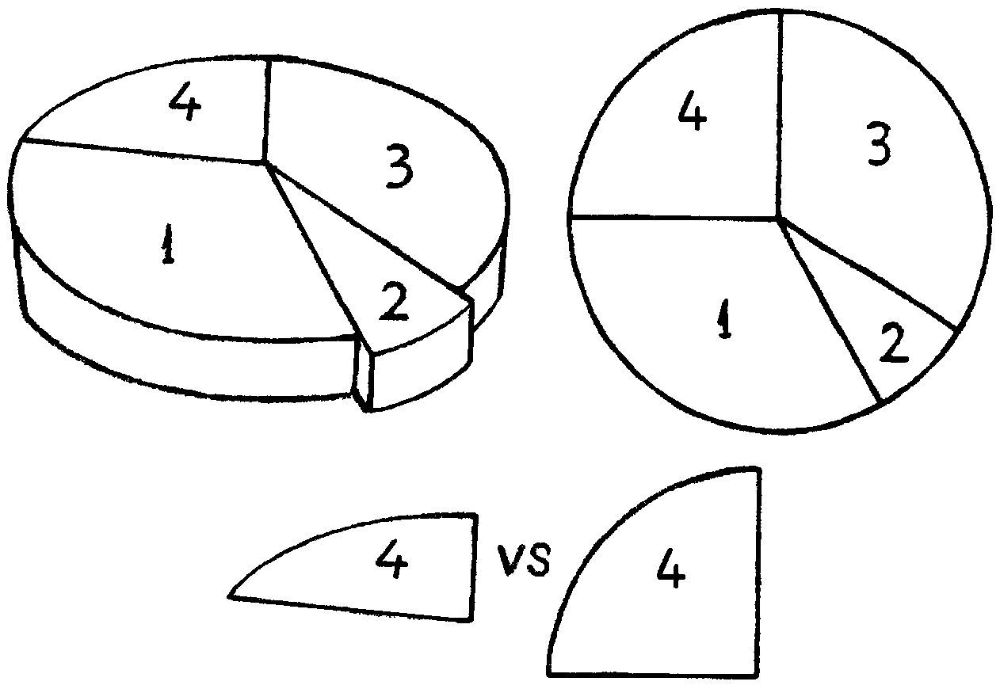

这些事情最终会无意中影响报告的读者。然而，许多时候报告中的数据或图表被修饰、`微调`或以更好的方式呈现，以便显示出比实际情况更好的形象，试图刻意影响观众或`帮助他们`得出某些结论而非其他结论。所以基本上，这就是在撒谎。

报告的某些组件可以通过特定颜色来突出，以强调好结果并淡化坏结果。或者可以在上升趋势的图表末端放置一个箭头，以`暗示`趋势将继续上升。或者因为图表有上升趋势就生成一年的报告，而不是两年的报告——在后者你会看到第一年大幅下降，随后第二年增长，而这实际上是一种甚至没有达到下降前初始值的恢复（我经常在某些金融机构网站上看到这种情况，他们显示某些股票或投资基金的趋势，以此骗你相信股票或基金一直表现良好）。这是一个隐瞒的谎言，但仍然是谎言。

### 刻意操纵

人们试图预测别人会想或说什么，并通过报告试图控制这些事情。这样做的原因主要有两个。

第一个原因是出于私利。他们试图通过呈现事物更有利的观点来改变人们的认知，这种观点有助于实现他们的个人目标，比如升职或获得某些奖金。也许很快就要考核了，他们希望自己看起来更有能力，突出他们的成就，他们不希望自己的绩效评估受影响，所以他们修饰事事，或者在评估后推迟提交坏消息等。

这引出了我们的第二个原因：他们让报告看起来更好，以便`他们自己看起来不难看`。


一份糟糕的报告也是坏消息。而且没有人喜欢坏消息。我们从小上学起就知道这一点，当我们拿到不理想的成绩时，不想向父母展示成绩单。坏消息也是一种意外，尤其是当之前所有的报告都是好的时候。而且记住吗，你的老板也不喜欢惊喜？而且就像当他们收到一份他们不认同的估算一样，当他们收到坏消息时，老板的反应也是类似的：像爆发的火山。老板们似乎对坏消息过敏。他们会陷入过敏性休克之类的状态，脉搏增加，头部肿胀，满脸通红。如果你曾经遇到过情绪管理问题的老板，你已经知道当面对一份他们不喜欢的报告时，他们会如何反应了。

所以人们试图减轻这种冲击。除了美化报告或以更乐观的眼光呈现事物之外，他们还可以使用积极的措辞，并避免使用听起来像问题的词汇。`“我们没有问题；我们只是遇到了处境”`，或者`“我们没有陷入麻烦；我们正面临一些挑战”`。或者当他们发布坏消息时，人们可以将其夹在两条好消息之间，以尽量地减少情况的严重性；坏消息配上一道好消息的配菜总比单独上菜要好。人们试图改变问题的本质，或使用掩盖现实的词汇，这样他们就不用应对老板的反应或其后果了。而后果可能不仅仅是老板深度介入项目并要求更频繁的报告、进行微观管理或变得具有控制欲，也可能意味着员工的其他后果。

他们不想展示一份反映冷酷事实的报告，因为他们知道在传递坏消息时，`“传信者会被枪毙"`。老板们往往`“先开枪后问路"`，或者基本上是`“先指责，后再搞清楚整个故事"`（如果有的话）。你很快就会学会这一点。由于老板比起冷静地分析情况，更倾向于尖叫、大吼和威胁，人们最终会对他们必须传达的负面消息涂糖。他们试图在报告周围建立一个快乐的形象（或者说是一个幻象），以避免出现威胁的情况。这与父母对孩子撒关于圣诞老人存在的谎并没有多少区别，这样就不会破坏圣诞的魔力，避免让孩子们失望、难过、哭泣或发脾气。然后老天保佑，如果他们得到的不是真正想要的礼物，那就更糟了。

而且不仅仅是因为他们不想让老板生气，或在办公室里发作作，`“因为看他们额头上的青筋都在暴起，甚至开始流口水”`，而且还因为员工担心如果报告看起来糟糕会面临职业生涯的后果。失去晋升机会、被解雇、被调到北极的子公司……之类后果。所以他们稍微润色一下坏消息，以减轻冲击。如果报告看起来糟糕，他们的老板可能会因此指责他们（有时会被指责他们没做过或无法控制的事情），或者这看起来像某种失败，即事情不符合计划或某些破事。一份糟糕的报告会让你看起来很糟，或者让整个团队、部门或任何都很糟。就像没有人想听坏消息一样，没有人想表现得很糟糕。因此，为了避免不利后果或减轻其影响，人们试图欺骗他们的老板。这在缺乏信任的公司中发生得更严重。如果人们拒绝理解坏事总会发生，理解你不能只有好报告，而且他们不感激诚实且透明地传递正确信息，反而选择发出威胁并表现得霸道，那么人们就会努力隐藏事情或以更好的光面展示它们，只保持良好的表面形象。

但这一切营造了现实的虚假形象，一个对实际发生情况的`“扭曲”`描述。在整个过程中，人们都认为一切进展顺利，但实际上，它们可能正在崩塌。当真实情况大白之时（这终会发生），正如我在上一个关于沟通的章节中提到的那样，可能已经太晚做出合理的决策了，老板们可能会拼命尝试进行损害控制（即时反应，由于愤怒、恐惧或缺乏时间和选择而做出糟糕的选择）。在事情的真实状况浮水之前也可能做出错误的决策，因为你想一下：一份误导性的报告是选择让你的老板或客户看到的内容的方式，这意味着他们所做的任何决策都是基于扭曲的信息，并可能导致缺陷的结果。


即便这些报告没有误导性或夸张，另一个可能出现的问题是报告变得比它所报告的活动更重要，有时甚至会对活动本身产生负面影响，这就像一个学生更关注获得好分，而不是关注他们从学习材料中实际学习和留住了什么一样。他们获得的知识以及通过学习可能建立的技能，变得没有考试成绩本身那么重要了。有时，如果学生希望在考试中作弊，他们甚至可能完全忽视学习。类似的情况也会发生在公司内部，出现在整个组织中的许多地方。

例如，你公司的每个部门是否都实施了用于衡量其工作的指标？你是否思考过过，每个部门的首要考虑因素是什么？是为了在这些指标上表现得好看，还是为了满足公司的整体目标？你是否在客户支持报告中注意到，每个月某项特定投诉的比例很大？你真的解决了投诉的根源吗，还是开始将该投诉记录在不同的主题下，以便报告看起来没那么糟糕？“[其他/杂项]部分占比过低；让我们把其中一些投诉放进那里吧”。或者，你们的帮助台部门真的在为员工解决问题，还是仅仅因为他们上个月的 SLA 报告不好看，而他们本月需要改进……否则怎样？服务很糟糕，但报告可能看起来很好。至少一个月是这样，因为随后另一个指标会引起所有人的注意：重新开单的数量。

你们的呼叫中心会给客户打电话提供优惠活动吗？外呼量是否被衡量了？每个客户经理打了多少个电话？很好。让我们增加这些数字。但公司的客户数量有限，呼叫中心如何增加外呼次数呢？他们给每个客户拨打几次，对吧？你改进了指标值，但你骚扰了客户，他们可能仅仅因为竞争对手没有每天给他们打两次电话且不在周末打电话，而去选择了竞争对手那里。

你们有关于每个函数代码行数的报告吗？你是否在某处读到函数应该是短小的，且最多允许 100 行代码？你是否也注意到很多函数比那大，因此你要求开发者重构代码并进行清理？他们将如何解决这种局面？你可能会惊讶地发现（我确实见过这种情况），任何超过 100 行代码的函数 `X`，开发者都会在中间拆分，在完全没有任何职责隔离的情况下，分成函数 `X_1` 和 `X_2`，然后 `X` 只剩下两行代码，先调用 `X_1` 然后调用 `X_2`。简单。问题解决了。在所有这些情况下，整个目的都变成了改进报告，而不是报告所反映的活动。事情在纸面上看起来很好，但实际上并非如此。如果事情似乎在好转并看起来非常完美，有些人就开始想：“还有什么可以改进的？让我们要求更多的报告，以找出还有哪些情况需要我们关注。让我们开些会议决定我们究竟需要什么”。然后一切又重新开始。

那么，你如何改进会议和报告呢？

## 更好的报告

对于报告，你首先要看你是否真的需要它们来做什么。深思一下。乍一看，你可能需要这份报告，但事实并非如此。例如，如果你关心质量，你可能希望在编写新功能之前修复 Bug。这是一个很好的策略，所以你可能想要一份报告来显示 Bug 开启状态持续了多久。但这真的相关吗？你可能报告了几个 Bug，但你的团队现在无法处理所有 Bug，所以某些 Bug 必须等待。你正在处理 Bug 并关注质量，但某些旧 Bug 可能会反复出现在报告中，似乎没有人在它们身上采取任何行动。如果这是一个微要 Bug 且你有其他优先级，那么当你处理关键缺陷或可能是一些优先级更高的新功能时，该 Bug 的时间就会不断累积。如果两个月后，有人突然大喊：“认真的吗？没有人不在乎修复那个 Bug 吗？”，你会如何反应？你会同意那个说法，还是会说报告没有反映整体情况，并且在当前的优先级范围内没有提供任何可见性？如果你做了适当的优先级排序，那个 Bug 开启多长时间并不重要。它会在需要被解决时被解决。

另一方面，你可能想要一份报告，告诉你到目前为止有多少或曾经有多少个“严重” Bug。Bug 是不可避免的，但许多严重缺陷可能是开发者疏忽的，或者可能是需求缺失。开发软件不是黑即白的，也不是 0 和 1。所以要深思你想知道什么信息，想要回答什么问题，然后看看哪些报告可以帮助你。许多报告有时是因为下意识反应而被要求的（“我们在所有项目中都是这样做的，这是我在管理学院中学到的，项目正在增长，所以我们需要一个满图表和各种工具的仪表板来概览工作”，等等）。所以问问自己，你为什么需要一份报告，如果没有它会发生什么。

剔除任何不必要的报告，只保留那些能帮助你决策或看到其影响的报告，以改进业务或产品，或者软件带来的价值，以监控重要事情或帮助你实现目标的事情。那些能让人们了解信息而无需定期组织十人参加会议的报告也是有用的。不要仅仅因为某事可以被衡量就去衡量。只衡量重要的事情。如果你确实保留了一份报告，如果能让你的问题跟踪系统或工作中使用的其他工具自动为你生成该报告，那就好了。自动化并非总是可能的，但如果你能自动化报告的生成和提交，那么你就不再浪费时间手动构建它了。相反，如果你没有选择且手动构建报告，请记住这会消耗实际工作的时间并干扰其他团队成员。


然后，请记住报告的目标受众是谁。是给开发者监控事务用的，还是给你作为经理跟踪进度和规划工作的，或者是给你的老板做决策用的？报告的构建方式取决于预期接收者是谁。同样，报告的简明或详尽取决于谁在查看这些信息。例如，经理可能想要一份关于所有功能状态的详尽报告，包括阻塞情况、依赖关系等；但他们的老板可能想要一个包含核心观点和汇总数据的概述，以便做出快速决策。经理可能会查看功能列表并理解每一项内容，因为他们知道每个状态背后的原因，但经理可能会选择给老板展示一个简化的版本，即整体状态。也许他们不会显示一个带有太阳的图标（即一切良好，没有问题），而是会显示一个带点云朵的太阳（即存在某些问题）——对某些人是详细报告，对另一些人则是简化版。你在公司层级越高，细节就越少。老板没有时间翻阅细碎的信息；你必须为他们做这些工作。在这里，我们回到了上面提到的关于误导性报告的问题。如果通过减少细节导致信息变得偏颇或过于稀释了怎么办？报告应该是清晰、切题且提供信息的，但它也是对更广泛内容的综合。如果综合过度了呢？作为一个例子，考虑将某人描述为“智能”的。那么他们的其他特质呢？是优点吗？缺陷吗？如果你想完全描述他们，除了“智能”之外还会用多少个词？10 个？100 个？1000 个？多少词太少，多少词又太多？报告也是如此。你何时知道报告必须多简洁才能在捕捉全局本质而不丢失任何内容，而多少多少细节是太多且已经冗余的？

这个问题没有简单的答案。它主要取决于沟通。你可以从更多的细节、更多的解释开始，让报告稍微详尽一点，包含你所分析的所有信息，并在这些细节的同时也包含这些信息的摘要。然后观察在演示报告时你可以变得多简练，在沟通事务时可以放弃多少内容，以保持信息不失。或者观察你需要深入细节到何种程度，才能支持你想要传达的核心观点。

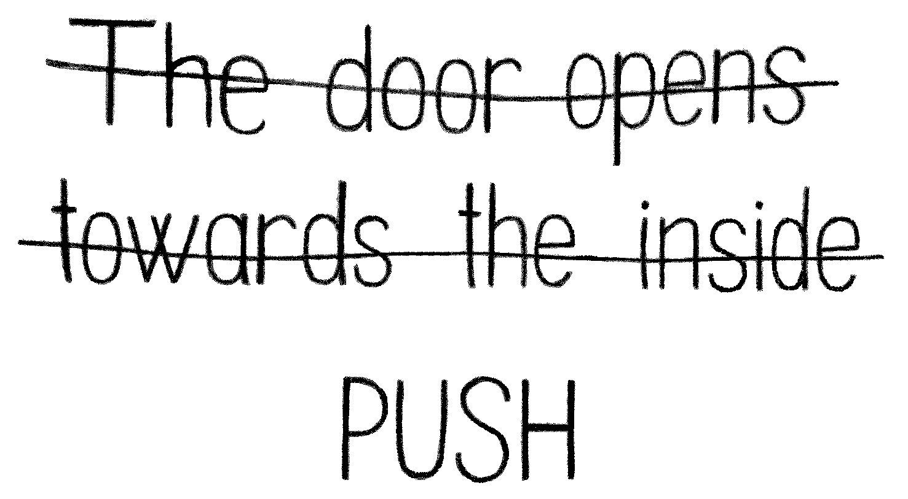

所以，这是一个试错的过程。会有疑问、担忧、讨论，直到你找到细节与总结的理想比例。考虑从他人那里获得的反馈来改进报告，但要务实。重点是尝试从细节中删除内容，而不是增加。正如某人所说：

> 完美的实现，不是在没有可以增加东西的时候，而是在没有可以去掉东西的时候 —— Antoine de Saint-Exupéry([116])

最好的报告是那些提供简要摘要或概述，随后是一些重要的观点和细节，以及关于最佳行动方案的建议。你的老板可能会遵循你的建议或做出另一个决定，但无论如何，如果情况不够清楚，由此产生的讨论将让你看到报告是否给了老板足够的信息，或者遗漏了什么。随着时间的推移，你会学会什么是需要的，什么不需要，你的报告也会随之改进。

那么，改进报告最后也是最好的方法是坚持事实。不要撒谎，不要隐瞒信息，不要夸大或误导。不要画肉附脂，或者只提供好消息而不提及负面消息。只要实实说即可。你真的认为一切总是一帆风顺，坏事永远不会发生吗？世界上没有这种事。事情可能会变糟。当情况发生时，必须及时、透明且正确地进行沟通，以便老板或客户根据准确的信息做出正确的决策。我上面提到过传递坏消息的人会被挨枪。这就是现实。你和人打交道，所以也必须处理随之而来的问题。但即使困难，说实话也是最好的方法，因为它建立了信任。如果他们发现你撒谎，人们就会开始怀疑你的动机，现在，你不仅没有建立信任，反而失去了信任并承担了随之而来的所有后果。

现在，你可以拥有无数份（当然是有用的）报告。但在公司里，报告只是沟通的一种形式。正如前面已经提到的，根据《哈佛商业评论》([21])，“面对面的沟通接触是你在职业生活中可以拥有的最宽带宽的通信”。这意味着会议。我们已经看到了会议的一些问题，那么可以做些什么来改进它们呢？

## 更好的会议

改进会议比改进报告稍微困难一点，因为涉及到人之间的直接互动。在任何讨论重要事项且必须达成决定的会议中，在人们积极参与并投入其中的会议中，自然会有冲突性的讨论和分歧。这是常的。在决定事情和做出决策时，并不总能完全一致。分歧和冲突让会议更难改进，但同时，分歧和冲突也可以非常有建设性。有些问题只有通过一些艰难的对话才能解决。你希望人们挑战彼此的想法，从不同的角度看待问题，每个人都表达自己的意见和观点，讨论不同的行动路径，考虑备选方案，为各种解决方案寻找优缺点。最好的解决方案就是这样产生的，在大多数情况下，这种方案是所有人想法的结合。这就是你在会议中希望得到的：让让人们参与进来，让他们投入，并辩论问题直到找到最佳解决方案。

> 我们任何人的智慧都比不上集体的智慧 —— Kenneth H. Blanchard([117])

但为了拥有这样的会议，你首先需要信任。因为会议中的分歧可能会陷入细枝末节并变成无建设性的冲突。在矛盾的讨论中，可能会混入与所讨论事实无关的内容：人类的因素，如不理性、自我认同、情绪、不安全感、性格冲突、不同的价值观和偏见。人们很容易关注信息是如何传递的（例如），而不是信息本身。或者人们可能会把事情个人化，或者强烈表达自己的观点（因为人们想要自己是正确的，这从定义上意味着他人的观点是错误的）。将分歧与所有这些因素混合，你很容易陷入糟糕的冲突中，人们感到情况受到威胁，从而产生防御心理和/或攻击性。但尽管对每个人都感到不舒服，如果你的团队知道如何处理，冲突可能就不是问题。如果他们相互信任和尊重，就能处理冲突，无论是在会议中还是其他时候。人们需要勇气来进行艰难、诚实的对话。他们需要知道自己可以承担风险或表现脆弱。


我在之前的章节中已经讨论过信任、团队“震风”（storming）”、“心理安全感”以及如何解决冲突。正如我提到的，如果人们互不信任也不尊重，每个人都会担心在说出心里话时会被评判或批评，他们在表达意见和想法时会变得保守，因此你可能会错失你试图解决的问题的关键方面。人们会避免或推迟做出艰难决定，规避风险，并隐藏信息而不是与其分享。每个人都变得不再活跃；你的进展越来越少，会议越开越多，因为人们没有足够的安全感来说出真实想法，无法进行每个人所需要的那些艰难、诚实且具有建设性的对话。你可能曾和你不喜欢的老板一起开过这样的会议。空气中弥漫着紧张气氛，你试着猜测老板可能会说什么，或者想想如果一开口说错话会有什么后果，如果真相不受欢迎，人们可能害怕说出真相等等。你认为这类会议是有建设性的吗？你希望你所有的会议都是这样吗？

### 信任：高效会议的催化剂

信任是举行良好会议的催化剂。会议之所以良好的很大程度上取决于参与者之间如何互动。没有信任，在会议期间或会议后就没有协作。例如，即使你在会议期间做了一些决定，某些人可能对这些决定产生不满，从而不支持甚至反对执行这些决定所需的行动。请参考之前的章节，并尽力与你的同事建立信任。

### 会议的目的与成本

那么，如果人们聚在一起开会，你最好有一个理由。开会需要人们进行协调，以便他们都朝着同一个目标努力。你甚至可以说会议是“不可避免的”。但并不意味着你走在公司里，顾自己的事，突然间发现自己处在一场会议中。会议必须有目的。在组织会议之前，问问自己：“这真的有吗？”难道没有其他办法吗？你想达到什么目标是不开会就无法完成的？目标或预期结果是什么？

就像报告一样，会议也有隐藏的成本。人们必须停止手头的工作去参加会议。会议人数越多，消耗的时间就越多。对于开发者来说，你已经看到这意味着会中断他们的“心流”（flow），因此当他们尝试重新进入状态时，会议将花费他们超出会议本身且无法确定的时间。如果会议是必要的，那么这就是付出的代价。但如果本可以避免，那就是纯粹的浪费。这就是为什么许多人认为会议是浪费时间，因为如果没有清晰地考虑会议的需求和理由，它们实际上在浪费每个人的时间。

其实很多事情不需要通过组织会议就能解决：你可以在出去吃午饭时和某人聊天，可以在他们休息时和他们聊天，你可以发送电子邮件、在聊天工具上询问，或者与其把整个团队拖进会议，看看团队负责人是否可以提供帮助等等。

### 追踪与根源

你是否曾想过自己在无用会议上花费了多少时间？我考虑过。无论我在工作的公司是否需要填写时间表，我总会在电子表格文件中记录我的工作。我做了什么，每项活动花了多少时间，是否有成效。这有助于我以后记住事情，查看各种事情花费了多久，或者我可以在哪里进行改进。当我觉得这周没做成什么时，周末也有了一个答案，我不禁自问：“这周的时间到底都去到哪儿了？”

如果你有太多会议，那么你可能存在问题。大多数时候，问题不在于你的会议太多，而是存在一个导致你必须开这么多会议的深层问题：例如人们害怕做决定（所以他们将其推迟到以后的会议，再以后的会议），你可能拥有一个组织混乱的团队、不明确的目标，或者是总是要求进度会议的微观管理老板，这只是几个例子。

### 议程的重要性

如果你有充分的理由组织会议，请确保你也有一份议程。它在会议进行期间提醒你为什么要开会，并告诉所有参与者讨论的重点应该是什么。我经常收到只包含时间、地点和令人困惑的主题会议请求。所以，谁知道到底在发生什么呢！

会议可能是重要的，那里做出的某些决定以后可能会影响你，可能需要你的投入。所以你可能无法拒绝或忽略它。相反，你必须向组织者索要更多细节；如果是老板发出的邀请，你可能甚至不会问，只是在毫无准备的情况下出现在现场，完全不知道一切是怎么回事。人们接受这些事情是因为它们经常发生，他们已经习惯了这种状况。但这并不意味着它是正常的。

每份会议邀请都应该附带议程。会议目标是什么？将讨论哪些主题？谁会参与，为什么？会议的每个主题由谁引导讨论？是否有材料需要为会议准备？如果你在没有议程的情况下进入会议，你就有着绕圈子、进行浅层讨论或在大家搞清楚会议主题时争论无关紧要的风险。了解会议议程可以设定清晰的预期，并给每个人准备时间。人们可以构问题或记录要问的重要事项；他们可以更深入地思考问题，而不是在会议期间因为不知道或没预料到讨论某个主题而没有仔细考虑。


# 有效的会议管理

那么，在会议期间，作为会议组织者，你必须掌控全局。事情可能会迅速恶化并陷入琐节，而不是专注于重要的事情。因此，你必须把事情带回正轨。遵循会议议程。让会议围绕目的展开，而不是围绕持续时间。我的意思是，会议是否在准时结束并不关重要；解决需要解决的问题才是本质所在。

人们在会议期间会一直盯着时，快速扫过所有主题以确保在剩余时间内涵盖所有内容，或者组织者给所有参与者平等的时间段来发表意见。你不能对参与者说“你有两分钟时间向大家陈述你的观点……3，2，1……开始！”这太荒唐了。会议不像学校里，每个人都在等轮展示他们的作业，或被带到教室面前进行口头考核。

我以前在必须做出艰难决策且我怀疑讨论可能会拖沓的会议上，通常有一个做法：预订会议室为例如 1 小 30 分钟，但发送会议邀请时只写 1 小时。这样，我知道如果我们超过了分配的时间，在有人来告诉我们他们预订了房间并将我们赶出去之前，我们还有一些缓冲时间。所以，注意不要对会议组织的某些方面过于死板，而忽视了大家聚会的初衷。事情在会议期间会有自然解决的方式；你只需要确保人们进行讨论并专注于重要的事情。你不能因为担心时间不够就放弃某个话题并跳到下一个点。先从最重要的项目开始，以防你仍然没有时间。如果人们因为时间到了没有讨论完议程上的所有内容而起身离开，那就再组织一次会议吧。如果每个人专注于且事情保持了尽可能高效，这并不是浪费；这意味着你需要比预想更多的时间。

## 会议记录的重要性

此外，会议的一个大问题是它们一旦结束就会被遗忘。还有一种风险，离开会议的五个人会对讨论和达成的内容产生五种不同的意见。为了避免这种情况的发生，准备会议纪要是很好。但诚地说，没有人读会议纪要。它只是会议、决策和所采取行动的总结。人们已经参加过会议了，所以他们不再关注记录。当然，除非发生了什么意外情况，那时他们才会阅读记录并说：“这跟我记得的不一样”或“你误解了”。这正是你需要会议纪要的原因。为了确保每个人理解的是同一事情，并让每个人意识到每个人将采取的后续行动。因为你无法强制人们在会议结束后阅读记录并确保每个人达成共识，你必须在会议进行期间完成记录。在写的时候，将它投影在投影仪上。提到谁参加了会议、讨论了什么、决定了什么、后续行动是什么，以及这些分配给了谁。每个人都看着你写的内容，他们事后不能说他们不知道或他们误解了，因为你写在那里的是所有人的结论和决策，每个人都可以发表意见或指出问题。

写这些并不难，尤其是当你有一个会议议程时。简单地在每个主题下添加结论即可。如果在讨论过程中出现了重要主题，但不是本次会议的目的，你可以添加行动项来说你将如何处理它们（例如：稍后组织会议、杰克会处理等），而无需浪费时间去讨论它们。此外，会议纪要是将“出席者”转变为“参与者”的一种方式。你是否注意到在 Outlook 或其他个人日程软件中，当你设置会议时，你必须添加“出席者（attendees）”？为什么不叫“参与者（participants）”？参与者做的不仅仅是参加会议；他们实际上投入了会议，并且花更少的时间看手机或看表。

## 通过反馈进行改进

改进会议的最后一件事是引入反馈循环；尝试从每次会议中学习，并利用这些信息改进下一次会议。你不需要在会议后给人们发送反馈表之类的；只需思考会议进行得如何。问自己哪些做得好，哪些做得不好，你可以做什么来改进。

- 会议开始时投影仪有问题问题吗？也许下次你可以早 5 分钟到达设置好一切。
- 一些参与者很有热情，而其他在玩手机？也许会议期间不要让手机放在桌子上。
- 短短的会议往往比需要的更长，因为人们说话太多？也许可以站立会议。
- 在的所有所有人对会议都是必要的吗？
- 你没有完成议程上的所有项目？是项目太多，还是分配给会议的时间太短？
- 也许人们偏离了主题，一些无关的讨论浪费了时间？
- 作为会议组织者，你控制了讨论，还是让它陷入了琐节？
- 所有参与者都准时到达了吗？如果你总是准时开始而不等待迟到者，他们下次还会准时到达吗？
- 所有参与者都有平等的参与机会吗，还是有人劫持了讨论？
- 是否有人在某些方面表现得不尊重？你处理他们了吗？下次你将如何处理他们？
- 你预订了房间，但你在等别人结束他们的会议，而他们正在和客户通话并请求你给几分钟，与此同时你和你会议的其他参与者在公司走廊里浪费时间？下次你们可以在团队办公室开会议吗？


报告的存在是为了让你做出数据驱动的决策。一份报告应该回答一个问题、解决一个问题或处理业务中的某个问题。它们就像汽车仪表盘上的符号和指示器（例如安全带指示灯、油压力警告、燃料指示、发动机温度警告灯），让你看到随时正在发生的情况，并能够做出决策。驾驶并继续行程是否安全？你需要在加油站停下吗？你需要找维修服务吗？报告向你展示正在发生的情况。用另一个比喻，它们也就像医学检查（例如血检、X 光、活检）。它们提供了你健康状况的快照。也许你感觉良好，但实际上某些测试显示你很快就会生病或患上其他疾病。一旦发生糟糕的情况，测试还会告诉你你是否处于康复阶段，以及还需要多久才能痊愈。你可能不是技师或医生，但当仪表盘灯或医学检查显示出异常数值时，你就可以决定如何应对或下一步做什么。报告是为了传达可以采取行动的信息。它们是决策的底层依据。信息的缺乏会导致不可挽回的损失或难以控制的风险状况。没有报告，就像是盲目飞行。

一旦你有了报告，就可以开会了。在会议中，人们分享信息、辩论问题、寻找最佳想法、决定目标和预期结果、做出决策、制定计划、设定优先级。如果你有一群人正在做某事，你就无法真正放弃会议。一个面对面的、持续 10 分钟的会议可能会取代一封长邮件或一份长报告。如果你在进行绩效评估，你不能只是填个报告就完事了；你需要和你的团队成员坐下来进行坦诚的交话，这也是一种会议。

如果处理得当，会议和报告非常有用；人们会专注于重要的事情，并协作获取两者的利益。让我再说一遍：会议和报告是有用的。问题出在人身上。人与人之间的互动都是复杂的，无论是在情绪和不安全感可能产生的面对面交流中，还是通过使用报告（你可能会很容易丢失想要传达的信息，或者信息可能会被扭曲）。通往更好的报告和会议的道路将充满波折，但变得更好至关重要。

# 糟糕的老板

在谈论老板时，人们通常会想到他们的直接主管。因为他们对人们的工作具有某些控制权和权威，每个人都称他们为`老板`。老板也有老板，老板还有老板，以此此类推。但这并不是我在整本书中所使用的“老板”的定义。我指的是的老板不仅仅是指公司层级中较高的人，比如团队负责人、经理、某个部门的`总监`、其他部门的`副总裁`、某某事的`负责人`，或其他拥有华丽工作头衔的高级高管，这些头衔听起来很气气，并赋予了他们对层级树中下方人员的权威。我所指的老板，是在你正在从事的软件项目或正在构建的软件产品中`说了算的人`。这个人可能直接也可能不直接符合你上方的层级结构。例如，IT 负责人对部门内所有的开发人员拥有某些权限和责任，负责维持运转等工作，甚至可以对部门内部正在进行的项目做出某些决策，但他们并不总是就项目目标、所需功能、预算等方面对项目本身说了算。因此，他们对项目并不拥有完全的自主权和权威。我所指的老板是一个商人，可能是一个计划经理、产品负责人、客户代表，或者在较小的公司里是 CEO，甚至是公司所有者。它是那个`拥有项目的人`。你可能认为项目经理或团队负责人是你的老板，但他们不是`真正的老板`，因为尽管他们可能负责团队或项目，但他们并没有真正拥有它或对它说了算。

当然，我在本章中将提到的这类老板，与人们处理过的其他类型的老板有许多共同点。任何公司都可能有糟糕的老板；这并不是软件开发行业特有的。公司层级越深、经理人数越多，越容易发现更多拥有华丽头衔、自以为是的的老板，他们把每个人都当作自己的棋子（通常以傲慢或专横的方式），并且他们是彼得法则^([118])）的代表（成功的员工会被不断晋升，直到他们的技能不再足以让他们获得下一次晋升；因此他们升到了`无能力水平`并停留在那里），或者是邓宁-克鲁格效应^([12])）的代表（无能力的人倾向于高估自己的知识或技能水平）。你还可能发现控制狂或偏执者，他们试图向所有不同意他们的人强加自己的观点。老板会试图通过恐吓或散布恐惧来管理事情（认为只要对大家大声大叫，所有问题都能解决）。或者是冲动、傲慢且毫无悔意的混蛋，他们满口谎言，指责他人，并且不对自己的行为负责，但在结果很顺利时却抢夺功劳。那些不关心大局或不去做正确的事的老板，只在乎让自己看起来很好。或者是那些仅仅因为“他们可以”就在周日晚上召开紧急会议的人，或者是因为是 CEO 的外甥、儿年朋友或其他或其他身份而几乎可以事事其咎的霸凌者。你的老板甚至可能是一个精神变态者。管理岗位上遇到精神变态者的概率比在普通人群中高四倍^([119])。这不不妙吗？

## 技术（不）能力

糟糕老板的首要问题，最让开发人员感到恼的事情，是他们在软件开发方面可能完全一窍不通。

> 技术由两类人主导：那些理解他们并不管理的东西，以及那些管理他们并不理解的东西 - 普特法则^([120])


现在，别误会我，我并不是说所有的老板都一窍不通。高管通常远离一线业务，你离实际情况越远，能观察到的细节就越少，你无法关注事情的日常进展，你脑子里还有许多其他事情并带着许多其他责任，因此不知道某个项目（或多个项目）中发生的一切是正常现象。但这并不意味着一个人一窍不通，只是掌握的信息量较少而已。

这就是为什么你需要透明的沟通。这就是为什么会有会议和报告，以便让你的老板有足够的信息来远距离理解情况并做出正确的决策。

这样的老板了解我在前几章节中提到的事情：为什么代码很难写好，为什么 IT 项目很难成功并有时会失败，他们了解业务与 IT 之间的鸿沟及其产生和影响，他们对作为开发人员意味着什么以及软件是如何构建的有良好的理解，等等。

但确实有某些老板，你在未来的某个时刻不可避免地会遇到这样的人，他们对软件是如何构建的完全、彻底的一窍不通。也许老板拥有其他对公司有价值的天赋或其他管理技能，但不幸，这些技能并不符合他们作为软件项目或产品所有者所需的素质。我并不是说老板必须是开发人员或类似的身份，老板需要的是管理事务，而不是执行工作（正如我之前所说的，他们是商人，所以实际上没有办法去做那些工作），但如果老板要拍板，那么他们就需要理解软件是如何构建的。

如果你能和他们融相处、与他们讲理、向他们解释事情并说服他们，那么他们对软件开发的无知并不一定是个问题。但不幸的是，技术上的一窍不通往往伴随着这类老板的另一个问题：他们认为自己比下属的每一个人都聪明，并且他们深信自己知道自己在做什么。

将这两点结合起来，当问题发生（问题不可避免会发生）或必须做出重大决策时，老板很容易否认现实，轻视局势的严重性，并违背别人的建议做出糟糕的决策。他们一窍不通，不懂事情，但有自己固定的意见，并且在决策上通常非常固执。他们认为唯一的正确意见就是自己的。正如此，你无法与他们讲理。无论你提供什么信息，无论你提出什么样的解释和论点，都无法进入他们那厚实的大脑。老板做出了决定；任何进一步的讨论都是多余的。你的知识、你的经验，都不重要。他们最清楚。他们已经话了，你必须执行。

如果这个老板万一在学校或以前的某个地方（很久很久以前）对编程有些接触，你还会听到那一套词：“`我还是懂一点的。在某个时候，我也曾是一个程序员。在我的当年，我们是这样做的，而且效果比你建议的要好得多`。”不幸的是，`back in my days`（在我当年）这个表达表明时间已经过去，不复存在，现在情况不同了。但他们并没有意识到这一点。

这些人非常死板，会固执地拒绝改变主意。只有他们说的话才重要，而不是你的意见。事实上，当这种老板想要你的意见时，他们会给你。作为一名开发人员，与这样的人打交道非常沮丧，因为他们不看事实，不听论点；你无法在他们面前辩论你的观点，完全没。这要么是因为他们没听懂你在说什么，要么是因为他们认为自己比你聪明，并且（隐含地）总是知道更优做法。无论他们决定什么，你都必须去做，因为他们是项目拥有权威的人，也许不仅是对项目，还对你的加薪、晋升甚至你在公司的就业拥有权力。他们对你有权力，但你对他们他们完全没有。所以你必须听从他们的话，并向他们寻求决策。当你有这样的老板时，你能做的就是希望不要有太多机会需要由他们做决策，或者希望他们喜欢你做事的方式且没有其他要补充的。基本上，希望与他们的互动越少越好。

但如果你经常与他们互动，或者由他们决定很多事情，那么你就陷入麻烦了。不幸的是，他们喜欢互动（尽管是单向的），并提出各种想法和请求。大量的 `looooooot`（非常多）想法和请求。你看，因为他们不懂事情，他们脑子里任何他们不理解的东西`一定是容易做到的`，而且不会产生坏后果或对工作产生任何负面影响。所以他们提要求。提一个。又一个。再一个。提要求本身并不一定是问题，只要他们要求的是能增加价值、重要、或者至少合逻辑的事情就好。

但不幸的是，大多数需求是由`光环效应症`（shiny object syndrome）引起的。这是指人们被过多的想法或最新的趋势或时尚分散了注意力，向多个方向发展，分散了自己的精力（在这种情况下，是他们团队的精力），最终导致什么都没完成。人们没有关注目标和重要的事情，而是被闪亮的东西分散了注意力。你不断开始做新事物，每个人都有充足的`work in progress`（进行中的工作），但通常没有东西被完成。即使你完成了一些东西，你的老板也不喜欢，想让你重做或做出一些重大修改……快点。每当他们有一个新想法，他们就想要立即实现。最终结果就像那句谚语：`贪多必失`（grasp all, lose all）。

这种行为不仅显示了老板缺乏愿景和方向，还产生了大量的浪费、重复工作和混乱，并伴随着强加的（临近的）截止日期。这种行为不仅对软件造成了问题，对团队也产生了负面影响。团队感到困惑，因为人们不理解为什么这么多改变和方向偏离轨道，或者为什么老板要做这一切（不，这并不是因为老板拥有更多关于项目、业务或组织的信息）。团队失去了目标感和方向，团队成员士气受挫，生产力也随之下降。任何员工都会希望老板能对公司和员工有所帮助，而不是每天制造混乱。人们开始生气。“`我为了这个功能工作了五天，现在我做完了，老板却说他们想要别的`。”他们开始质疑这一切的意义，并只能得出结论：老板是无能的，完全不知道自己在做什么。


但当然，老板的解释完全不同。他们只是所谓的“机会驱动型”。通常，这意味着市场中存在一个尚未被开发的商业机会，必须在竞争对手之前、或者在机会窗口期结束之前立即抓住。这是一种对时间非常敏感的情况，为了利用它并获得潜在收益，不应惜任何努力。所有由于追逐那些乱七八糟的事务而导致的优先级不断变化、方向不明确、浪费和混乱，在老板的词汇库里统统归类为“灵活性”。

为了保持灵活，为了能够追求机会，你必须敏捷、动作快。但你其实并不敏捷。一切都像是在火演习。修复那个 bug 很紧急，那个客户的演示很紧急，竞争对手在最新版本中增加的所有功能在你的产品中也必须紧急添加，某某事必须在 X 日之前准备好，否则天就会塌下来。

如果你的老板用“我们是机会驱动型”来解释所有的混乱，快跑吧。真的，快跑！这意味着：“我完全不知道我们在哪里，我模糊地记得我们去过哪里，我对我们去去哪里完全没有计划，我只是像一群饥饿的狼一样，撞上什么就扑上什么，就像一只从树上掉下来的晕鼠，在我幻觉的想象中它像是一头肥肉多汁的鹿”。这是因为很多时候，这些“机会”并不是通过商业智能分析或大数据识别出来的（因为你的老板也根本不懂这些），而是你老板的直觉，或者是他们把手指伸进嘴里然后举向空中。所有以短期利润为名所做的事情，往往牺牲了长期的可持续结果，并在过程中也毁了团队。

### 糊涂的老板
在他们做了所有这些糟糕的事情后，完全不考虑后果，或者除了每天或每周的兴起之外没有其他目标，但感到不满的还是老板。“我很失望应用程序没有用 Scala 写。那样的话我们的营销部门就能让我们的产品听起来更有价值。为什么你不能像我们的竞争对手在网站上做的那样构建那个功能呢？我今天早上告诉你要修改用户界面，现在还没做完；我简直无法理解你做这件事要花这么多时间。加倍努力！在我今天早上要求的事情完成之前，谁不准回家”。

这是糊涂的老板的另一个问题。因为他们什么都不懂，所以他们不理解为什么有些事情花几分钟，而另一些事情要花五天。对他们来说，开发软件就像去餐厅。他们从菜单上点的任何菜都会在几分钟内上桌上。那么，为什么软件中的任务和功能就不一样呢？他们得出的唯一结论就是开发者太懒了，想玩技术，或者别的，而不是在自己的任务上工作。

“那五天的事情，如果他们真的在工作的话，开发者可能只需要花几分钟，最多一小时就能搞定。”于是他们开始给人们施加压力。他们开始微观管理，并给出一个荒谬的截止日期。“我今天早上给了你五个 bug。在我下午 17:00 回家之前，我想看到你所做的所有修复”。

### 管理与压力
团队的组织架构对他们来说也不是什么障碍。有负责的 `Team Lead` 或 `Project Manager` 吗？没关系。老板会直接去找开发者和测试人员，要求他们做 `X` 或 `Y`，即使每个人都在忙其他事情。如果你设有计划会议来让大家组织工作，那你可以和这些会议告别了。你每天都会看到自己要做什么，完全取决于老板的心情。这样的老板还会把越来越多的工作压在某身上，但又期望结果良好且准时。

如果你向他们解释，如果你有一头驴并给它装上一堆袋子，驴会达到一个无法再背负那些袋子的点，并被它们的重量压垮，那么老板就明白了。但如果给一个人加载过多的工作，他们就不再能看到事情失败的界点。袋子的概念很容易理解，但软件是如何构建的，就没那么简单了。现在那该死的驴变成了懒惰。所以让我们威胁它、抽打它，然后你就会看到这只驴负重得有多好了。它会飞起来的。

他们没有意识到，开发者在压力下、精疲力竭、必须不断进行上下文切换以及优先级不断变化时，表现会更差。老板还认为，如果人们每天在办公室呆 12 小时，每周 7 天，他们比每天呆 8 小时、每周 5 天完成得多。他们不懂知识工作者不同于工厂工人（明确一下，工人工作时间越长，越容易出错，越容易发生事故）。所以他们对人们施加更大的压力，让他们做更多工作、速度更快，因为他们对现状不满意。“事情确实可以做得更快。没问题。保证完成！”

### 压力的后果
这就是垃圾是如何被部署到生产环境的，代码变成一团糟，因为当你向人们压力时，他们会在工作中采取许多捷径（假设他们没有先走的话），因为他们别无选择。方向和优先级的不断变化，以及重写七次应用程序，给开发者造成了心理负担。人们感到疲累，他们失去了对做好工作的激情，慢下了节奏，变得更加粗心，并在代码中加入了更多 bug。

他们还因为某种（业务）原因积累了技术债，导致事情变得更慢。这些技术债由开发者负责（老板甚至不懂这个概念），并将在未来的某个时刻进行偿还。开发者停止思考如何编写高质量的应用程序，开始尝试如何尽量减少执行和撤销所有工作的精力。

因此，功能实现变成了简单的原型，开发者想要尽快给老板看并获取反馈，看看哪些可以，哪些需要重写，哪些可以丢弃。但这种方法有一个陷阱，我将在后面的章节中详细讨论，即老板不知道那是原型，并要求将其部署到生产环境。越快越好。由于你在沟通它是原型方面做得糟糕，你可能不得不向生产环境部署更多的垃圾。更糟糕的是，有时你甚至无法使用“原型”、“概念验证”或你想要的任何词汇，因为你的老板讨厌那个词。


试图向老板解释事情必须按照特定的顺序或方式进行是毫无意义的；解释尽可能快地构建功能会给后续带来问题；解释应用代码会变得脆弱且越来越难以修改；解释质量会下降且缺陷会增加；解释团队不能这样持续下去；解释他们已经厌倦了，厌倦了如此频繁的方向改变，并且不理解这一切混乱的必要性。这一切都是徒劳的。而且，对于发生的任何问题，老板都会把自己排除在考虑之外。错的不是混乱，不是持续的方向改变，亦不是不断的无性妙想或推翻决定，不不不不……火上加霜的是，当然是开发者的错，是他们没有写好代码，或者写的质量低劣，或者他们不称职，或者他们懒惰。事情应该进展得更快，开发得更快。但事实并非如此。“*你们这些开发者确实很懒*。” 你的老板认为这个团队无能且难以管理。否则，当老板坚信某事可行且非常容易做到时，为什么他们还会一直抱怨，说老板想要的东西做不到或者需要更长时间呢？你的老板想要那种听话的人，告诉他们做什么他们做什么（记得我在上一章提到的*“我说的，你做的”*吗？）。这就是他们想要的所有。啊……而且开发者还需要廉价。

## 机器中的齿轮

廉价的员工，只要被要求，随时随地去做。这就是一个无知的老板心目中的理想开发者。因为他们对软件开发的各个方面一无所知，老板认为他们可以和任何人一起开发（除了现在的这些开发者，他们可能很懒……显而易见）。老板不懂软件是如何构建的，他们不懂人们实际上在做什么。他们只是在数人。四个人的团队进度落后了？再加一个，事情进展应该比你们只有四个人时更快。*“生一个孩子需要九个月，但九个妈妈不能在一个月内生出一个孩子”*^([122])。整个 IT 行业都知道这一点，但不知为什么老板没有收到通知。他们只数人数，却忽视了增加人员时产生的额外通信通道。他们也不考虑人的技能。初级、、高级的，其实并不重要。你为你阿姨下载并安装了一个电子商务网站，这样她就能在网上卖她手织的围巾了？你在我们的项目中担任架构师或技术负责人会没问题的。“*但别忘了在生产环境部署应用程序之前，把‘关于’页面上的那些 lorem ipsum 占位符删掉*。” Jake 将担任项目经理。“*他小时候和他爸爸一起在后院盖了一个树屋，所以他在项目管理方面有丰富的经验*。”你是设计师吗？“*所以你懂 HTML、CSS 和 JavaScript，对吧？没必要雇更贵的前端开发了*。”测试员？“*谁需要测试员？我们有一个产品经理，他必须验证应用执行了正确的操作。让他们做测试吧，而不是质量保证团队*”（他们实际上心里想的是质量控制，而不是质量保证，但老板也不知道这其中的区别）。他们不懂开发者需要安静的环境来工作，所以为了省钱，他们把开发者放在办公室里，和一直在打电话的销售团队在一起。然后他们感叹开发者抱怨噪音和工作条件，他们总是看到开发者戴着耳机听音乐，而不是专注于工作（完全没有意识到为什么大家一开始都要戴耳机），“*这群不知感激的混蛋……他们不应该感激有份工作做，反而……*。”他们会给你各种人，没有经验且培训不当的人、实习生，或者在七个不同项目上兼职的人，这没关系，任何能降低成本的办法都可以，但他们期望你做好工作。


但事实并非如此。任何认为事实是这样的人，要么是痴痴妄想，要么就是在快餐行业工作，刚雇佣了一个翻汉堡的。任何软件产品都不可能从第一天起就有生产力。这绝不可能！最初的产出是负的，因为新人的加入需要时间并消耗他人的生产力。团队的其他成员帮助他们变得高效，但代价是牺牲了自己的生产力，因为他们不再处理自己的任务，而是在帮助新手熟悉情况。如果你绘制真实的生产力曲线，它看起来像这样：

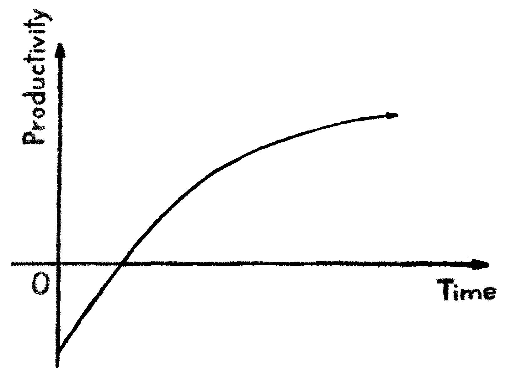

但那些糊脑的老板即使在你向他们解释那是错的，仍然固执己见。他们根本不知道替换一个新人并将其整合到项目中需要花费多少成本。“那家伙儿有经验的；他能自己搞定。”当然吧……他只要一接触项目就能产生生产力；他大概会通过光合作用之类的方式学习吧。

糟糕的老板把人视为机器上可以替换的齿轮。他们认为人可以不停地处理任务，认为不需要学习、理解、协调或相互讨论，只需要像工厂里机器生产小零件的机器人一样处理任务即可。而且他们需要被压力才会这样做，否则他们就是懒惰。如果老板来到你的办公室而你没在打字，那就意味着你没有工作。

## 一场注定失败的战斗

但每个人都在努力——非常努力——为了弥补老板所有的胡闹。现在发生了一些悖论的事情。因为开发者承担了所有的艰苦工作，尽管老板制造了这么多问题，他们仍然能够取得进展。因此，他们的工作最终掩盖了老板的无能。再次，开发者在努力。这就是为什么一个无能的老板比无能的开发者更难发现，而且在公司留得更久。老板并不是交付成果的人；他们只是下达指令和各种要求，如果事情没有因为老板有一支精干的团队而崩溃，那么上面的人就不会注意到老板是无能的。所以老板会在公司留存很久，继续领取薪水，并让那些知道他们是个蠢蛋但仍需工作的人感到抓狂。如果从外面看一切正常，或者没有发生任何坏事，那么老板的上级没有理由质疑他们的能力。从他们所知的一切来看，进展顺利可能是老板的功劳。毕竟，那是他们的工作，不是吗？

有时候，人们会识破真相并解雇那个糟糕的老板。但大多数时候，问题不仅在于你的老板，而在于公司本身。否则，这样的老板为什么会继续留在公司呢？如果老板是新晋升的或新员工，可能有人注意到他们没有做正确的事，或者发生某些事情导致他们与团队中更资深（更值得信赖）的员工产生冲突，在那时他们可能会被踢出去。但如果老板在这个位置上坐了几个月或几年，他们既糊涂又无能，却没没发生任何事，那么你可能面临更大的问题，那些超出了试图解决“老板困境”的问题。你能修复整个公司吗？可能不能。当你拥有这样一个老板时，坏消息是，很多时候（如果你还没有找新工作的话），你不得不忍受他们，并在始终做正确的事与应对老板的胡扯之间维持平衡。

现实地说，当你有一个无能的老板时，这遗憾是你所能做的一切。在理想的世界里，你可以去找他们的上级甚至人力资源部门解释情况，老板就会得到处理。但我们并不生活在理想的世界里。除非你的老板正在把项目搞砸，否则大多数时候不会采取任何行动。想过吗？在整个项目团队中，他们的上级最了解谁，又和谁相处更好？是你还是你的老板？你老板的上级甚至知道你的名字吗？你清楚他们之间是什么关系吗？你无法总是知道你面对的是什么样的人，以及你的老板为什么处于那个位置。也许他们是朋友，甚至是亲戚，或者与上级有其他联系。也许他们的上级同样无能，如果他们揭露你老板的无能，同时也暴露了他们自己。也许他们是推荐你老板的人。他们肯定是雇佣你老板的人。如果他们做了那个决定，他们可能认为你的老板很胜任。你认为如果你向那个把你老板带进公司的人投诉，你会取得什么成就？那样的人不会想要搅浑水或打破现状。到目前为止，你甚至和他们的主管互动过吗，还是说你会去说：“你好！你不认识我，我是为某某人工作的，他们很无能。请就此采取行动。谢谢！”老板不喜欢惊喜，记得吗？而你带给他们的是一个非常不快的惊喜。你认为他们会小心翼翼地处理这个问题，还是会进行一次秘密的调查以确认你说的话是否属实？他们会叫你和你的老板去办公室，让你们面面残杀。如果你和老板硬碰硬，你很可能会输。然后……也许公司除掉你反而比除掉老板更容易。我的意思是……是你先引发了这团乱子。在你决定告发老板而不是做好自己的工作之前，一切都是好的。你老板的上级可能不知道你是谁，但他们知道你老板是谁：那个他们每天在工作中、甚至在周末在高尔夫球场或网球场上与之互动的人。即使你没有被解雇，你年底也会得到一个糟糕的绩效评估，因为你得罪了老板。毕竟你的老板就是老板。他们对你工作的项目拥有权力和权威，甚至对你也有，但你对他们没有。你的工作不是破坏他们的地位，而是即使你不同意那些决策或产生的后果也要听从指令。

所以，在高管理层的某人发现你的老板无能并可能决定对这种情况采取行动之前，项目和团队内部的情况会越来越恶化。由于这不能持续下去，早晚，由老板糊涂和缺乏远见造成的混乱，由于不断改变的方向、不断地编写和重写，以及积累的所有 Bug 和技术债，所有这一切……必须被清理。而这由开发者来做。当然，他们也会因为陷入这种境地而被指备。


一切都变得越来越压力巨大，情况也越来越令人沮丧，以至于人们无法忍受并离开了公司。先离开的是那些优秀的开发者，因为他们不太可能忍受愚蠢和无能，而且他们很容易在其他地方找到新工作。他们也不太可能参加由老板强加的`“死亡行军”`([83])，来为老板留下的烂摊子清理，而老板（当然了）并不参与清理工作，反而通过继续他们最初导致所有人陷入困局的做法来让情况变得更加糟糕。留下的通常是那些准备不足的人，他们对管理层的要求较低，在其他地方找工作也较困难；或者是那些与其投入工作，他们更愿意花时间抱怨现状的人，他们认为如果那个无能的老板还没被解雇，他们的风险也不大。你最终得到的就是布鲁斯·F·韦斯特所谓的`“死海效应”`([123])。啊……当然，公司里留下的另外一个人是老板，他们在与离开的人发生冲突后，仍然自豪地认为自己赢了并取得了最后的发言权。对他们来说，开发者的离开并不是问题。他们本就很懒，而且一直在抱怨，反正总可以用别人取代。事实上，老板可以立即找到像他们一样的人……而且价格只要的一半。

## 不错

那么，什么样的人才算是一个好老板？你能修复像我目前为止描述的那样的坏老板吗？

在看到可以采取什么措施之前，让我们先看看我们想要什么样的老板。和之前一样，我将提到那些我认为最适用于软件开发的特质，而不是通用的人格特质，比如：善于交际、赋能他人并让他们参与决策、公平、诚实、值得信赖且开明、对项目有清晰的愿景并知道如何设定预期、清晰沟通、理解指责与责任之间的区别……还有什么？啊，对了！不是精神变态者！

一个好老板与我提到的坏老板特征恰恰相反，这很合逻辑，对吧？首先，他们不能对软件开发一窍不通。一个好老板理解软件是如何构建的以及开发者在做什么，他们理解编写软件可能是复杂的，他们知道 IT 项目有时会失败的原因以及可以做什么来尝试避免这种情况。他们意识到业务与 IT 之间鸿沟的陷阱，并且拥有良好的项目管理能力。当某些事情过于技术化并超出了他们的理解范围时，老板会非常重视开发者的意见，因为他们知道在涉及技术方面时，开发者更懂。这意味着老板是开明的，听取提出的论点，并信任开发者的意见，而不是由他们强制执行僵硬的决策。一个好老板为团队成员提供清晰的目标，并信任他们找到实现这些目标的最佳方法。

好老板知道自己身处何地以及要去向哪里；他们看到大局，并理解技术在其中何处以及如何发挥作用。好老板通常考虑的是长期利益，而不是短期收益。当他们要求突然改变方向，或者某些事情被传达为紧急时，这是因为有严肃的原因；它不是因为某些`“亮眼夺球”`的东西，而是老板可以清楚解释并用论据支持的理由。这不是因为他们有直觉，而是因为这是一个明智的商业决策。他们也理解此类决策会导致后果，比如可能需要承担一些技术债，因此他们与团队协作决定这是否真的值得，或者成本是什么。这种突然的转向改变是罕见的，因为老板非常了解业务并有一套开发策略；他们会预判事情，而不是对出现的任何情况做出反应。

好老板的行为不会对团队的士气和表现产生负面影响。好老板尊重他人，不把开发者视为他们的私人仆人。他们承认错误，不假装自己永远是对的而其他人都是错的，他们听取论点，你可以与他们讲理，他们不微观管理，并将开发团队视为朝着同一目标努力的伙伴。他们理解技能的重要性、招聘优秀开发者的需求以及更换人员的成本，因此他们努力帮助创造一个高产的环境，让开发者能够充分发挥他们的能力。当老板实际上提供帮助且不不对他们的工作产生负面干扰时，人们会感到有动力。更重要的是，当老板去休假时，他们不会想开派对，当老板回来时他们也不会垂头丧气。如果他们也能写代码，他们将是理想的老板 :)

对于大多数开发者来说，一个好老板不仅是一个非常理解并精通业务和领域的人、具有良好管理技能的人，而且是一个具有技术背景的人，他知道如何构建高质量的软件，理解甚至鼓励良好的编程技术和最佳实践、质量保证或通过使用原型进行探索。基本上，一个`“好老板”`就是一个`“开发者老板”`。但请记住我在章节开头对`“老板”`的定义：他们是生意人。开发者希望另一个开发者当老板，但那不会发生。团队负责人（Team Lead）是开发者，项目经理可能曾经是开发者，你可能会在公司层级中找到曾经是开发者的人，但老板——那个掌权并做决定的人——极不可能来自开发者群体。

## 没那么糟

好了，这些是好老板的一些特质。如果你有这样一个老板，恭喜你，你需要面对的压力更小了。但如果你有一个坏老板，你可能会问自己是否有什么方法可以修复局面。有没有办法把一个坏老板变成好老板？短答案是`“通常不行”`。从我上面提到的关于坏老板的所有坏事中，形成了两个大想法。软件开发项目的坏老板是：（一）`“对构建软件完全窍不通”`和（二）他们是`“无知一切”`的混蛋，给项目造成了破坏。

问题在于，你无法治愈`“无知”`。老板只是不理解。无论你如何努力向非开发者解释开发者方面的事情，他们都不会`“明白”`。这是不会发生的。他们要么对这方面的事情感兴趣并努力从更详细的层面理解软件是如何构建的，要么就不感兴趣。而且你无法改变一个混蛋。你做不到。混蛋就是混蛋，就此而已。结束。这就是你无法将一个坏老板变成好老板的主要原因，这也是为什么我说答案是`“通常不行”`。然而，`“通常不行”`并不意味着`“永远不行”`，这就意味着`“有时可以”`。


这种情况意味着“是”的情况很少，而且构成了这样一种概率：老板并不是真的一个混蛋，只是因为他们的行为方式和做事方式让人认为他们是那样。而且他们表现出这种行为和做事方式是有除了成为一个“自以为是的混蛋”之外的其他原因。由于没有更好的术语，我将这种动机称为“预期焦虑”。

对他人的期望以及对自我的期望。高期望。有人把项目交到他们手中，并让他们对成功负责。无论做这事的个人是否知道自己一窍不通，这并不重要；他们现在是老板了。而老板不能让任何人失望。他们需要应对大局并让其成为现实。这一切都取决于他们，对吧？所以他们开始相信自己的角色比实际要大，因此他们创造了这种为了取悦他人（上级、客户、公司老板，等等）而自我施加的压力，为了展示他们的知识和能力，付出 110% 的努力。

因此，他们在事情上用力过度。当他们自己的老板要求某些事情时，他们往往认为那是紧急且重要的，需要尽快完成。但这还不够。他们需要超出预期，做得更多。所以，在这种情况下，所有那些“机会驱动”的鬼话，或者“光环效应综合症”，或随你如何称呼它，都是不安全感加上想要惊艳所有人并留下良好印象。

“这个很重要，那个很重要，还有那个。如果我只有这个，或者那个，如果我两个都有。我不能错过那个机会。这里一定有些东西。我有这么多有趣我想做。但开发者太慢了。我上周向他们请求了一些东西，他们现在还没做完，他们一直在提问并抱怨我要求太多……怎么回事？”

所以，当开发者没有完成他们要求的所有事情时，老板会感到沮丧，并开始认为他们可能懒惰，甚至可能没有工作；否则，他们为什么不听话办事呢？所以老板开始微观管理或对人们施加压力，让他们更努力、动得更快，立即向他们展示他们要求的更改。如果开发者不听话，老板就不想负责。他们的脑海中完全没有想过也许是他们自己的错，因为他们不知道如何管理软件项目，不了解开发者，或者不懂他们是如何编写软件的。

“但这能有多难呢？不可能有那么‘难’；这是‘软’软件，对吧？”

老板正在尽力，但由于缺乏这方面的知识，他们最终使用的方法完全是一团糟。试图用更少资源、在更短的时间内做更多事情，因为他们认为这样可以取悦自己的老板或客户，但这同样无济于事。他们显然被局面困扰了，但他们不想承认，并试图独自完成他们认为应该做的事情，而不向任何其他人寻求帮助。

### 管理局面

如果你的糟糕老板属于这一类，那么你可能通过帮助老板承认事实——他们无法仅凭所知（或者更准确地说，凭他们所不知道的）独自管理软件项目来做出改变，然后教他们可以信任开发团队来帮助处理项目。

如果你能赢得老板的信任，让他们理解你是他们一起努力为项目做正确事情的伙伴，即我提到的关于改善业务与 IT 鸿沟的事情，那么你就能改善状况。老板负责项目，他们有做好好事的焦虑，但由于不太了解软件开发，他们还没有信任开发者，因此他们应该更多地依靠开发者，而不是控制他们并告诉他们该做什么。

你真正想要的是开发者处理他们自己的工作，而老板处理他们自己的工作，并作为伙伴共同工作。但你不能和一个混蛋做伙伴。所以首先，你需要弄清楚你正在和什么样的人打交道。我已经在书中说过：人们只有在想要改变时才会改变；你不能因为你想改变就改变他们。所以如果你想让老板改变，从一个搞砸项目的人（在尝试管理他们不懂的东西时）变成一个可以信任项目团队的人，那么老板自己必须想要改变，否则你让事情变好的所有努力将都是不值得的。

### 识别可救的老板

通过注意与他们的互动，弄清楚你的老板是可救的还是个没用的。如果你的老板表现出渴望学习的迹象，想要你解释事情，想要了解更多关于你如何工作的知识，当你们对某些事情产生意见分歧时，当你提出支持自己观点的论据时他们会听，他们愿意听取你的想法，并且对于书面同意某些事情没有问题，那么都是良好的迹象。简而言之，当你尝试违背他们想做的事情时，如果他们看起来像是一个你可以进行理性的的人（也许并不总是，但还是……），那么局面是可以挽救的信号。

相反，如果他们傲慢并虐待他人，想要控制他人并无缘无故地给他们施加很大压力，当你反驳他们或反对他们的意见时，他们变得固执，或者他们不听你的，他们对你的意见不感兴趣，你的任何论据都充耳不闻，他们认为自己永远是正确的，是任何房间里最聪明的人，总是想要最后的话语权，当他们找不到反驳意见时，他们会诉说“我是老板，你要听我的”，那么他们很可能没用。

另一个你无法挽救局面的迹象是，当糟糕情况发生时，你的老板会把别人推出去。他们不仅在糟糕情况发生时这样做，而且还为了以后更容易把某人推出去而做准备，例如，不在书面上达成一致，这样就没有他们决策的痕迹。或者你发给他们请求一个简单的决定，他们却决定开个会议。一个两分钟的书面回复被半小时的会议取代，这没有任何痕迹；那么，如果进展顺利，你的老板获得功劳；如果情况变糟，你来背锅。


还有第三种老板，他们更难对付：公司老板。在一家小型组织中，公司老板可能就是老板。他们是表现出糟糕老板行为的人，但并不一定是因为我目前为止提到的那些原因。老板所认知的现实与下达命令、做决定以及处于最高权威地位并无二。他们的决策是不经过讨论的，而是直接执行的。如果在他们创业之前，没有在其他公司工作过很久，也许他们从未当过讨论的另一方，也许他们没有遇到过那种事需要被他们说服的无能老板，也许别人没有为他们做过糟糕的决定——即那些他们不同意但无论多么荒谬也必须精确执行的决定。作为老板，所有人都要向他们汇报，由他们来做所有的决定。如果他们周围也环绕着`“唯唯诺"`这些人不愿意质疑他们的判断，不为他们的提议提供替代方案，也不会在他们错误时告诉他们（因为他们正忙于拍马屁直到把老板拍得起疹），那么他们的行为就会非常像一个糟糕的老板。他们的现实变成了`“我永远是对的"`，因为没有人告诉他们他们会犯错。如果公司老板平易近近且你经常与他们互动，那么在某个时刻，你可以赢得他们的信任并让他们理解事情。这是因为，与那些可以深埋在公司层级中的糟糕老板不同，糟糕的老板没有地方躲。如果公司还没有倒闭，说明老板是一个有能力的人，所以他们很有可能从更广阔的角度来理解问题。

如果你已经确定了你所面对的是什么样的老板，并且可以采取措施来改变现状，那么这种改变必须来自开发团队、团队负责人或项目经理。正如我在“业务与 IT 鸿沟”章节中所说的，改变不会来自你的老板，因为你的老板是一个商人，你的老板根本无法完全理解情况，甚至无法意识到需要改变。就像你必须更多地与业务部门互动来弥合业务与 IT 的鸿沟一样，同样，为了改善与老板的关系，你必须多与他们互动。对你来说，理解老板的工作比他们理解你的工作更容易。所以要参与到老板的工作中。经常与他们沟通（使用他们的业务语言），询问他们任何你应该知道的消息、事件或信息。不要期望他们提出想法或要求。相反，要尝试理解他们的需求，并带着建议和意见去找他们。让他们意识到他们在这这一切中并不孤单，他们可以依靠开发团队的帮助。这种机制与我在“业务与 IT 鸿沟”章节中描述的相同。沟通和信任是关重要的。如果你不信任老板，你就无法与其高效工作，老板也必须知道他们可以信任开发团队。当存在信任时，开发者是专业的，并表明他们正在朝着正确的目标努力，伙伴关系就开始建立，老板也会学会在做决定之前考虑开发者的论点、意见和投入。

如果环境是功能失调的，你的老板对其愚蠢的固执不可救药，你也没有机会让他们表现出更理性的行为，你只剩下两个选择。第一个也是最明显的：离开公司。这不值得冒上心理健康的风险，所以离开吧，侧退舞台。这是所有在职业生涯中某个阶段遇到过糟糕老板的人最推荐的选择。和糟糕老板一起工作是有压力的。但寻找另一份工作并在别处重新开始也是一样。这不是一个你可以轻易迈出的脚步。你必须非常仔细地权衡这个决定。也许你喜欢其他同事以及公司的业务领域。也许你现在负担不起换工作，或者你有某些不想失去的福利。也许你负担不起在另一家公司重新开始。即使你离开了公司，也不能保证你在新工作中不会遇到更糟糕的老板。你希望在其他地方过得更好，有一个知道自己在做什么、能理解你的工作并能与你良好合作的老板，但你并不知道。所以你可能无法离开。那该怎么办？第二个选择是什么？

你接受现状并尽尽能力完成工作。

所以，你的老板是个无能的混蛋。他们让你的工作变得更加困难，为了比他们快一步，以抵消或减少糟糕决策的影响，是一场斗争。你甚至看都不顺眼。事实就是如此。你已经确定你无法改变你的老板，也无法离开公司？那就接受这些事实吧。没有工作是完美的。你被雇佣是为了工作，遵循老板的指示也是工作的一部分。当一个人被雇佣时，他们的工作不受他人工作的限制。我从未签过一份如果我老板完全无知我有权停止工作但继续领取薪水的劳动合同。你仍然需要完成工作。面对糟糕老板工作更困难；你的效率可能不会那么高，当你觉得自己正在打一场逆战时，可能无法尽全力，但你仍然必须完成你的工作。尝试更多地关注你的工作和项目的成功，而不是你的老板。

但在你这样做时，要确保如果某天乱子真的爆发了，你不会为整个摊子负责。你可以通过书面记录来实现这一点。保留与老板的邮件和书面对话。如果你在会议中讨论事情并做出决定，就发一封包含结论的后续邮件。尽量避免会议，并通过电子邮件保持记录。如果你确实开了会议，写下会议纪要。老板对这些怎么看并不重要，这是一个养成的好习惯，以确保沟通（不仅仅是与老板之间的）不会崩溃。沟通至关重要。越多越好。如果你以正确、透明的方式进行沟通，并不断提供项目整体情况的更新，某人终会看到大局并察觉到混乱，特别是当你把状态报告抄送给老板的上级时。


无论谁说了什么、谁做了什么决定、什么被构建、更改或重写，在某个时刻，软件最终仍会以某种形式交付给客户。开发者承担了最重要的工作，因此无论发生什么，开发者总是要收拾烂局。但如果混乱不是由他们造成的，就不应该归咎于他们。

如果你的老板突然对他们做过的决定产生了“失忆症”，并开始指责你的错，埋怨你没理解、做错了、记错了或其他之类，那么你应该有一份书面文档来证明相反。你需要理解的一点是，除了老板在假装忘记他们做过的决定外，在很多情况下，他们确实忘记了。他们的记忆力不好，不仅在方便他们把你推出去“背锅”时如此，还因为他们所做的很多决定都是临时拍脑袋的。这些决定并非计划的一部分，也不是经过深思熟虑的决定。很多是当时随决的、浅薄的决定，就像思考午饭吃什么一样。

你还记得上周五午饭吃了什么吗？不记得？你老板也不记得。但指的不是午饭吃了什么，而是他们做出的那个重要决定——他们现在想不起来了，因为那个决定是在没有经过思考或理解其后果的情况下做出的。记住，在大多数组织中，如果一件事没有记录下来，它就不存在。这不仅适用于项目目标、流程、会议中决定的行动或员工绩效评估，也适用于你那个糟糕老板所做的决定。记录你老板的错处会占用你的额外时间，并对你的工作产生影响，就像你老板通过引发的所有问题影响你的工作一样。这是在处理其他混乱之外，你需要支付的额外“信任税”^([100])。既然是交税，核心思想就是让税尽可能低。这是为了“规避责任”，而不是“推卸责任”。因此，你需要将精力控制在良好的项目管理实践水平上，而不是像法庭审判一样建立一份 500 页的记录文件。如果你发现自己比起倾向于做好工作，更喜欢记录平庸的工作，那么也许你应该重新考虑找另一份工作，然后离开吧。

# 糟糕的经理

在任何超过几个人的软件项目中，你都会有一位负责事务的经理。类似于……（后文略）

## 中间

如果你觉得编程很难，那么你应该尝试管理……（后文略）


客户或老板经常会试图强加不切实际的时间表，或者对开发团队提出无法实现的期望。与此同时，开发者可能会忽视重点，过分关注技术或“最新热点”，而这些东西对业务没有产生实际价值。项目经理必须识别出双方双方的问题和顾虑何时是合理的，什么时候该对开发者施加更大的压力（例如，因为他们表现得像是有了玩具的骄纵孩子），或者什么时候该对高层管理或客户强加的目标提出反驳（例如，因为他们的表现像是不讲理的人）。项目经理需要成为理性的声音，支持双方更好地理解彼此的思维方式，最终做出有利于项目利益的明智决策。只有当双方之间存在对话、存在协作，开发团队的建议得到考量，并且团队参与到决策过程中，才能基于整个项目的背景做出决策，并对可能发生的任何问题找到现实的解决方案和修复方法。

## 沟通

在这一切中，沟通起着至关重要的作用。为了将双方聚在一起，经理必须是一个出色的沟通者。如果一个技术人员虽然对业务有良好的理解，但却不知道如何沟通，那是不够的。“调解者”的角色在很大程度上取决于沟通技巧。举个例子说明，很久以前，当我还是一个年轻的程序员时（从职业角度来说几乎一无所有），我正在修复某个客户应用程序中的一些问题，那是别人几年前为他们构建的，后来由我们接手的。事实证明问题比每个人预想的都要深得多、糟糕得多，这花了我很多时间。我最初估计了完成所有工作所需的天数，但事实证明我错了。然后，我超出了预估时间。我的老板“传唤”我和经理进入她的办公室，要求我解释发生了什么以及为什么需要这么多时间。作为一个年轻的程序员，我不怎么知道如何与高层打交道，而且我的老板并不是那种你所说的人人员，所以我们说的是两种不同的语言。讨论毫无进展。她开始变得生气，而我开始感到挫败，因为我无法让她理解问题到底是什么。我的经理干预了，想象一下，他开始“翻译”我们彼此互相说的话。现在回想起来不禁发笑，但当时确实是这样（而且当时并不好玩）。我老板说的话，经理用我能听懂的话重复一遍；而我说的话，经理用我老板能听懂的话重复一遍。她最终理解了问题是什么以及为什么需要更长时间，而我也理解了她在担心什么。我的经理帮助我们双方从对方的角度看问题。这体现了我经理良好的技术能力、业务能力和沟通技巧。

无论是正式还是非正式，书面还是口头，使用图表和图片，面对面还是使用技术，是有意识的（注意你想说什么）还是无意识的（通过手势、姿态或脸表情），在组织内部或外部，无论如何，都有沟通。你无法逃避。软件像很多事情一样，是由人构建的。并不是所有人都知道相同的事情，即使他们知道，对相同信息的反应也可能不同。也没有人无知一切。因此，为了让不同知识和技能的人实现共同目标，他们需要协作并共同决策。人们需要沟通来传递他们的思想、想法或意图，并在相互发送和接收信息。对于任何规模和类型的项目，沟通都非常重要，软件开发也不例外。事实上，甚至蚂蚁都需要沟通才能把一只死的甲虫带回巢穴。我在书开头提到过，糟糕的沟通是软件项目失败的原因之一，因此每个人都需要有效沟通。没有沟通，事情就会崩塌。对于经理来说，情况更是如此。

没有沟通，你基本上就是孤军奋战。你是在孤立地工作。你认为如果不和任何人沟通，你能完成多少工作？不多。至少在长期来看如此。开发者需要长时间不被打扰的时间才能进入状态并发挥最佳水平，但在他们完成任务、功能或修复后，他们需要与其他人同步，以知道如何进行下一步。长时间不被打扰的工作时间并不意味着“整个项目的时长”。当你团队的一员时，你不能独自工作。如果大家都这样做，每个人都会失去大局。当你不知道别人在做什么时，工作很难。所以你们甚至不是一个团队。更糟糕的是，人们开始假设别人在做什么、还在发生什么、下一步需要做什么或什么是重要的。获取项目各个部分的信息是强制性的。决策是基于信息做出的。项目经理必须确保在适当的时间提供正确的信息，并将其分配给正确的人。这项活动消耗了经理大量的时间，因为参与项目的人越多，沟通通道的数量就越多，这也意味着必须对沟通给予更多的关注。沟通通道数量的公式为 `N*(N-1)/2`，其中 `N` 是团队的人数。

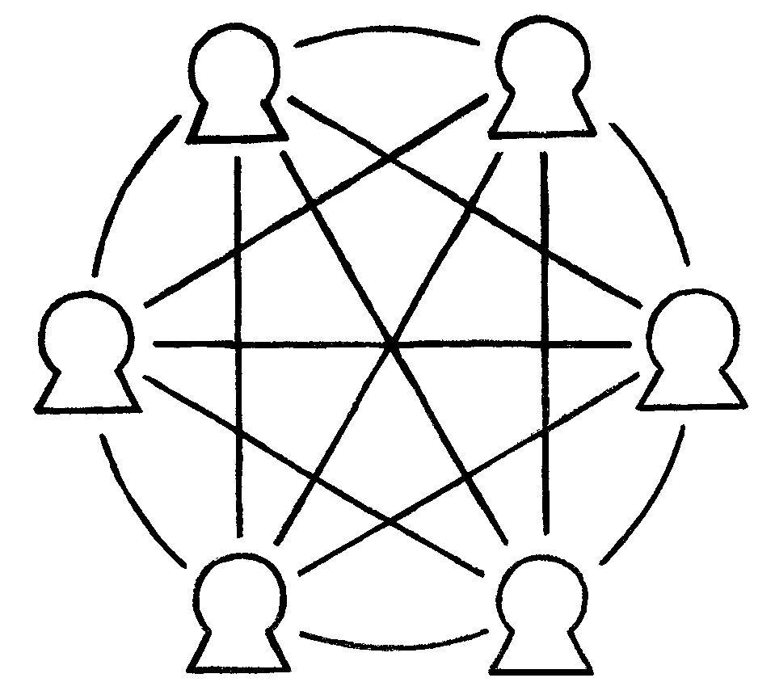

而这仅仅是紧密合作的团队。加上与你的项目经理交流的利益相关者，你的沟通通道可能像这样：

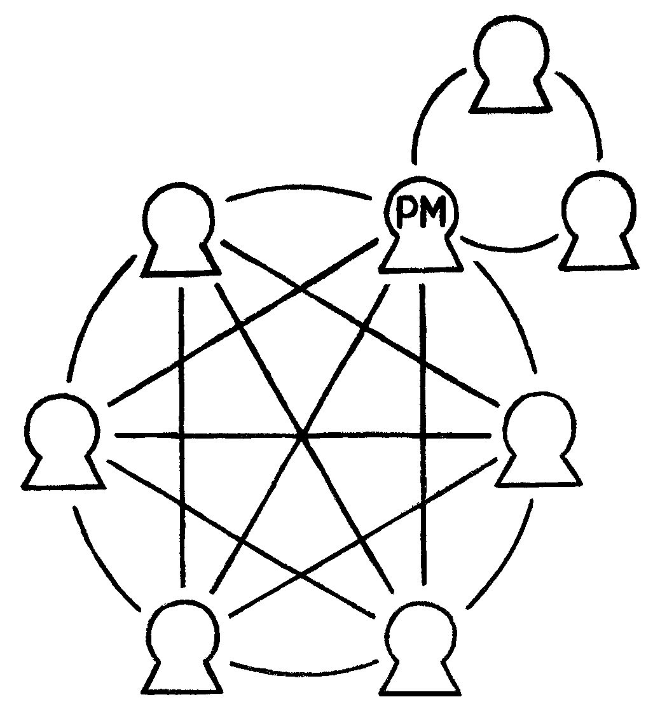


作为调解者，项目经理处于这两个群体之间：团队和利益相关者。经理需要非常关注这一方面。因为利益相关者不负责具体工作，而且通常离项目较远，所以他们没有关于项目的最新、最直接的信息。他们必须索取信息，或者由我们将信息提供给他们。关键利益相关者可能需要做出决策，如果没有信息他们就无法决策。而且，必须用他们能够理解的格式和使用的概念（即非技术性的内容）向他们提供这些信息。此外，关于决策，还需要告诉他们这些决策对计划、进度、预算或软件质量的影响。他们通常看不到项目上实际执行工作的影响，而提供这些细节也是经理的职责。

然后，经常会出现不同的利益相关者对事情看法不同的情况，因此可能会产生误解。当这种情况发生时，同样是经理的任务在利益相关者之间达成共识，以便团队明确明确需要要做什么，从而尽可能地减少不必要的变更或重复工作。经理必须持续地让利益相关者参与并了解情况。他们需要通过持续且有效的沟通来管理利益相关者的预期；否则就会出现我之前提到的关于孤立工作产生的情况：利益相关者开始对项目、工作、结果等做出假设。你不希望他们纳闷到底发生了什么。

如果你使用敏捷开发并每隔几周交付一次，他们就能看到进展，因为你每个冲刺（sprint）都会交付一些东西，但如果反馈周期更大，他们可能会开始好奇发生了什么。这就像你在电子商务网站上订购小配件，但它没有在你预期的时间内送达。那时你会做什么？你会在网上查看追踪 `AWB`，或者拨打客服中心电话询问包裹怎么了，为什么还没到达。项目也是一样。利益相关者需要知道发生了什么；否则，他们会变得紧张、不耐烦，然后跑来找你，浪费你的时间，并总是用“我们快到了吗？”的问题打断你。你需要始终让他们保持知情。对于利益相关者、客户或老板来说，“没消息就是好消息”这句话并不真正适用。如果他们开始主动索要信息而不是由你主动提供，他们还可能产生微管理的倾向，使得你的项目管理工作变得更加困难。

因此，项目经理不可避免地花费大量时间在沟通上。但当然，不只是经理一个人在进行沟通。实际上，涉及到项目沟通时，你不会获得像前一张图那样的良好隔离状态。随着沟通动态的变化，圆圈会增加并变得越来越大。沟通增加或扩散到利益相关者，可能还有其他团队、部门、客户、供应商等。经理需要促进沟通，确保信息在每个通道上流动，而不仅仅是在利益相关者和团队之间。再说一遍：在每个通道。因此，经理必须表现得像一个“沟通守护者没有更好的词了）。沟通本身可能发生，也可以不发生。或者发生得很糟糕（就像上面的例子，我以前的老板和年轻时的我）。项目经理必须确保沟通确实发生了，并且是以清晰、透明的方式完成，并且是高效有效的。如果沟通停止，项目也会之停止。

## 失败的沟通

现在我们显然要提到糟糕经理的首要问题之一：他们在沟通方面并不十分有效。

有些经理表现得不像“调解者（mediators）”，表现得不像“沟通守护者（communication custodians）”，他们不确保沟通有效，不尝试识别并解决沟通鸿沟。对他们来说，沟通是随偶然发生的程度而发生的事情。当由于沟通缺陷引起问题时，经理是对问题做出反应，而不是尝试预判它们。我说的是对沟通问题的“观察（observation）”，而不是“预防（prevention）”。举个例子，考虑项目目标。你不能在项目开始时给每个人发封邮件说“这就是我们通过这个项目试图实现的目标。这些是重点”，然后就收工了。人们会沉浸在工作中，当大家都关注细节而不是大局时，目标就会变得越来越模糊。

经理必须提醒每个人项目目标是什么，什么对业务很重要，最初为什么要启动这个项目等，而不是在项目结束时或在每个里程碑处才发现人们并不真正理解他们正在为什么工作。即使你给人们分配了个人任务去执行，你也必须解释他们需要做什么、这些任务的重要性、它们的优先级等。如果工作直接掉落在人们的办公桌上，而没有关于其内容的妥当沟通，那么如果结果不符合你的预期，请不要惊讶。

沟通的另一个问题是，有些经理并不总是知道如何选择最佳沟通形式。当他们应该开会时却发送电子邮件或写文档。或者当他们应该面对面交流时却在聊天工具上发消息。然而，大多数情况下，他们在应该寻找其他沟通形式时安排了会议。“我们需要建立这样的东西。让我们讨论几分钟。这样比写邮件更有效。”对谁更有效？当然是对经理有效。我在上一个章节中提到过创作者日程与经理时间表（maker’s schedule versus the manager’s schedule）[106]。一个错误时间的自发会议可能会取消开发人员一整天的生产力。与人面对面交流是有效的，但不要在他们“进入状态（in the zone）”时打扰他们。如果开发者戴着耳机，可能可能是他们不想被打扰的信号，而不是因为他们那么喜欢音乐。报告也会引起同样的问题。因为作为经理，你不是执行工作的人，你没有进展工作的准确事实和数据。你需要向执行工作的人询问细节以构建项目的快。通过尝试收集尽可能多的细节，可能会向实际执行工作的人要过多的报告或数据，再次打断他们。我在会议和报告的章节中讨论过这些事情，以及你会陷入什么样的困境，所以我不想在这里重复了。


有时候，这些沟通问题是因为经理是一个（最近的）前开发者，被晋升为负责项目的人。沟通并不是他们的强项，仅仅是因为他们仍然像开发者一样思考和行事，而且还没有摆脱那种心态。这种经理之所以会搞砸，主要由于两个原因。

### 1. 未能调整沟通风格
第一点是他们不根据交流对象来调整自己的沟通风格。他们不考虑受众是谁，而是用同样的方式与所有人交流：使用与他们作为开发者时完全相同的语言。这对于团队成员、系统管理员、具有相似背景的其他项目经理或技术人员有效，但对于客户、高层管理、供应商、人力资源部门或销售人员则不起作用。

这涉及到不同的沟通风格，我甚至可以说不同的语言，但经理仍然只能以一种方式包装信息。而且沟通通常是枯燥且直接的，尤其是在传达坏消息时；他们没有预料和准备好随坏消息发布而来的的一波问题，也没有考虑解决方案或可能的纠正方案。他们只是宣布坏消息，导致老板们感到措意外——正如我们所知，老板们不喜欢惊喜。如果你被提升到管理岗位，你必须学会在不同层面以不同的方式进行沟通，以匹配你现在承担的新职责。于是我们提到了（最近）从开发者转变为经理在沟通方面搞砸的第二点：他们忘了自己不再与计算机交流，而是与人交流。

> 沟通中最大的问题是误以为沟通已经发生过 - 乔治·伯纳德·肖([126])

### 2. 倾听的重要性
当你与计算机交流时，你实际上是在向它发送执行指令。机器无法回应。但沟通并不意味着你只是管说。你不只是信息的发射者。沟通至少需要两个人，由于你们不能同时说话，你显然也需要知道如何倾听。

许多经理有话太多或在别人说话时反复打断别人的习惯。他们听得足够看出对话正走向何方，但并没有留心，然后打断并提出观点，好像在试图`“to debug”`对话之类的。他们说话或宣布某些事情，然后不知如何，对方从那里理解了什么就成了对方的问题。然而，在与人沟通时，情况并非如此。与他人沟通有时意味着保持闭嘴倾听。只有这样，你才能确保自己理解了对方说的话，并确保自己反过来也能被理解。

一个例子就是进行绩效评估。作为项目经理，你可能负责评估在你管理的项目中工作的人。你需要与团队的每个成员进行面对面的讨论，学会如何倾听，并努力理解所传达的内容，以便读懂言外之意，注意对方的肢体语言，给出建设性的反馈并接受反馈，以便向对方清晰地传达你的结论和决定，达成目标并确保该人员理解他们需要做什么。你不能仅仅因为自己开了嘴并吐出了词，就假设对方理解了你的信息并表示赞同。

### 3. 持续练习
你可以通过使用技术、建立流程，或者规定在何时、何以及谁需要沟通的程序来改进沟通，但归根结底，这一切都落实于与人的互动。我认为我在之前的章节中已经清楚地说明了与人共处是多么有趣。许多事情都会干扰沟通：情绪、语言、文化、缺乏信任、人们把事情个人化、冲突等。沟通不是简单的事情，它不是你能从书本或课程中学到的东西，它不是你可以应用的公式或你可以使用的结构框架。你必须练习，而且必须每天练习。因为他们必须成为沟通的守护者，这需要每天都付出努力，因此许多人放弃了管理回到开发领域——太麻烦了。

### 4. 刻意的错误沟通
沟通中出现的另一个问题是，有些经理会故意进行错误的沟通。也就是说，他们隐瞒细节，或者扭曲他们所传递的信息。这最发生在经理与老板（或更高层的高管）交流时。当他们有事要告诉老板时，他们会尝试粉饰太平，将事情描述得比实际情况更好，或者只呈现好消息，延迟甚至有时完全不给出坏消息。

这可能是因为经理想在老板面前表现得更好看、看起来更有能力，或者有更多加薪的机会，但大多数情况下，这种情况是由老板本身造成的。老板在收到坏消息时无法冷静反应，开始大吼、威胁和发脾气。经理们学会了这种行为并试图避免。尽管经理们知道沟通应该诚实透明地进行，但他们选择不这样做，因为他们担心老板会如何反应……担心后果，例如无法获得另一次晋升或高知名项目、被解雇等。

例如，错误沟通可能涉及提供估算。如果团队做了一个估算，结果比经理认为老板想听到的要高，他们可能会选择只沟通最好情况下的估算，即从某些可能已经过度乐观的估算中选出最有利的情况。因此，经理在没有任何误差余地的情况下传达了一个估算，并借此将团队推向了一个不切实际的时间表。另一个错误沟通的例子涉及假设和风险。经理可能会选择不沟通假设和风险，或淡化它们的严重性或发生概率。或者，当请求一项明显对项目不利并影响范围或项目进度的变更时，经理可以选择保持闭嘴，而不是尝试向每个人解释变更将产生什么影响并建议不要实施。经理还可能推迟上报他们无法解决或超出能力范围的事情，或者可能推迟通知利益相关者项目延误；那么由于他们等了太久才提交坏消息或升级问题，某些（理想的）纠正措施可能变得不可用。例子列表还可以一直列下去。


# 与老板沟通

与老板沟通可能是困难的，因为老板的权力比经理大，而且可能总是会产生不快的后果，但这是你作为项目经理必须接受的现实之一。这是工作描述的一部分。你需要在好消息和坏消息的情况下进行沟通。推迟或粉饰坏消息毫无益处。无论如何，事情终会大白的。你不能永远试图欺骗人们并寄予厚望。人们总会发现真相，而当他们发现时，那是一个惊喜，一个不愉快的惊喜。

首先受影响的是老板和利益相关者对经理的信任。在没有信任的地方，沟通就会受到损害，因为人们不再仅仅考虑正在传递的信息，还会想这背后是否隐藏了其他元素，即他们未意识到的其他事情。换句话说，他们对所传输信息的准确性产生了怀疑。结果就是，由于我在之前的章节中提到的关于信任的所有因素，项目工作变得不再那么高效。

所以，如果你有坏消息要传，要做一个勇敢的经理并把它宣布出来。诚实地去。不要粉饰事实，不要等太久（但也不要立即冲上去），花时间理解问题，以便妥善地呈现事实和影响，准备好回答老板/利益相关者的问题并解决他们的顾虑。准备好解决方案和建议，或者你打算如何处理这种局面，并准备好应对老板可能会问是谁的责任，或者你为什么没有早点发现这个问题。你的感觉会很糟糕。这并不容易。但事实如此。正如我所说，这是工作描述的一部分。

## 工具箱

经理的大部分时间花在了沟通上。但“沟通”只是一个优秀项目经理必须具备的技能之一。还记得我使用的定义吗？项目经理是指将知识、技能、工具和技术应用于项目活动，以满足项目要求的人。什么样的知识、技能、工具和技术？当然是项目管理类的。

软件行业中的许多项目经理同时也是开发者，他们进入这个新角色要么是因为想要新的挑战，要么是因为有人需要填补该职位，而高层决定这应该是团队成员中最资深的成员，因为他们已经了解了项目，不需要太多培训，而且比花钱进行招聘流程要便宜得多。其他人则慢慢滑向这类任务，因为需要项目管理技能，而没有其他人能或愿意做这些事情。由于没有专门的培训，他们在工作中积累经验，通常是通过试错。所以他们会犯错。我就是类似的情况。我慢慢开始承担管理任务，是因为没有人做，但这些任务必须完成。我曾在各种场合担任过项目经理，我工作证上的最后一个职业代码实际上是“项目经理”，但我并没有你可能说的正式项目管理教育或培训。

我说了，我还会说一遍：做项目经理比做开发者更难。作为项目经理工作时，有很多事情需要平衡，而且为了有更好的机会成功，你需要在项目管理知识方面拥有丰富的工具集。而试错不是建立该工具集的最佳方法。在学习技术或编程时，我在之前的章节中提到过在个人项目或原型上犯“诚实的的错误”，然后从这些错误中学习。

当涉及到练习项目管理技能时，你可能没有可用的个人项目（即一个与工作环境类似、有利益相关者和其他开发者工作的项目），因此你将被迫直接在公司的项目上犯错。所以，你需要尽量减少错误；否则，你就会冒着花费大量时间在老板办公室里解释自己的风险。你最终可能会掌握窍门，但既然有像《项目管理知识体系指南》（又称 PMBOK，这仅是其中一个资源）这样的书，让你可以在遇到问题之前学习核心内容，为什么要受苦呢？

如果你已经成为一名项目经理，你必须知道这份工作的本质。但即便如此，像 PMBOK 这样的书也只是指南。它们没有给你所有问题的答案或解决方案；它们没有给你一个可以遵循的获胜课程。它们只给了一个工具箱。你需要根据情况知道从工具箱中拿起哪种工具。项目经理做或参与的事情有很多，没有一种一切相同的方法。你需要知道如何将你的知识、技能、工具和项目管理技术适应于环境，并将其与项目和组织匹配。因此，你必须努力学习项目经理这份工作，就像你投入努力学习技术和编程一样：通过书籍、博客、信息源、播客、参与在线社区、参加当地的各种聚会、项目管理讲座或会议等，以便有更多信息可供使用，做出尽可能可能的决策并避免尽可能多的陷阱。


在之前的章节中，我已经讨论过许多如果你不知道自己在做什么，那么从项目管理领域的某些方面可能会让你陷入泥潭的各种因素。我不想重复已经说过的话；只是想简要地提醒你其中一些内容，作为你在投入获取新项目管理知识时应该遵循的方向指南。

### 管理职责

首先，经理必须参与新人的招聘。他们必须确保招聘到合适的人，由合适的人与候选人进行面试，协助编写职位要求，并参与评估候选人。一旦有人被录用，经理必须确保合理利用试用期，并为新员工提供所需的所有帮助，以便其顺利融入团队。此人在此期间的进展必须记录在案。

然后还需要进行绩效评估，必须与表现不佳者达成改进计划，讨论目标，并监控目标的进展情况。需要为人员提供支持以发挥他们的最佳水平，消除员工工作道路上的障碍是经理的职责，观察工作环境中哪些因素严重影响了员工的工作，并将其消除、修复或上报。经理需要致力于营造一个安全的工作环境，让人们可以诚实地犯错并帮助他们从中学习。毒性员工必须被开。薪水必须与所做的工作相匹配，并与团队其他从事相同工作的成员相比。经理必须确保他们的团队接受必要的培训，并确保每个人都有动力。这些只是他们在与项目工作人员方面需要做的一些事情。

### 技术任务

然后是项目经理所做的`技术`事务。例如，监督需求收集、对功能进行合理的优先级排序、制定真实的进度表并抵御那些不理解 `optimism`、`forecast`、`target` 或 `commitment` 等词汇的人、密切关注已识别的假设和风险、计划、重新计划、调整计划、再次重新计划、监控并控制项目的执行、确保必须交流的人确实在相互交流、处理变更并控制范围蔓延、在项目（不可避免地）延迟时通过`采取` 而不是`反应` 来处理，并不断举着牌子说明项目的`成功`意味着什么。

### 团队负责人 vs 项目经理

当我讨论担任团队负责人时，也提到了上一段话中的许多内容。经常，我看到项目经理拥有类似的职责。像团队负责人一样，项目经理可以成为项目的声音和形象，并延伸为负责项目的团队的形象。你必须成为一个“垃圾言伞”，分配并委派工作（同时你仍对结果负责并承担责任），不断与人打交道，处理冲突，将人们看作不仅仅是甘特图中的资源，保持公平，知道何时实施某种方法或进行权衡，理解何时该产生技术债，何时不该，弥合业务与 IT 之间的差距，为团队的任何问题寻找解决方案等。

作为一名经理，你将对团队的效率负责。公平地说，项目经理更关注项目本身及其组织形式，而团队负责人更多关注团队和技术方面，但由于两者（团队和项目）是不可分割的，项目经理和团队负责人的角色往往会重叠。

但始终存在差异：如果你是从开发者转变为团队负责人，你仍然可以编程，正如我所说的，`脚踏两船`。但如果你变成了一个项目经理，你就可以和写代码说再了。

## 项目经理优先

经理的角色与团队负责人或开发者不同。即使你能够把某事做得更好，因为你是或曾是团队中最好的开发者，这并不意味着你仍然可以做这件事。你作为`项目`的工作不是去做工作，而是让你你的人能够完成工作，同时确保工作实际完成。如果除了你之外没有人知道如何做某事，或者你完全负责项目的某个方面，请教别人怎么做并进行交接。

你不能再将开发任务留给自己了；你不能将`经理的时间表`与`执行者的时间表`混杂在一起，即使你尝试将你的编码时间设置为每个 4 小时或以上的会议。因此，当你成为项目经理时，需要专注于管理知识并建立一套新的工具集。不要随性行事。努力限制尝试和错误。努力真正理解这个职业，并作为一个项目经理进行自我教育。认真对待你的新角色，因为如果你不这样做，结果将是你倾向于做项目管理活动只是为了摆脱它们，因为你讨厌它们，或者说，因为你更喜欢其他事情，你想做那些事情。你会尝试贴近项目的技术方面。你仍然会表现得像一个开发者，但现在由于你与团队关系的新职位，你拥有更多的决策权。如果你是这种经理，请决定你想做什么，管理还是开发，因为你无法兼顾。与你仍然可以亲手参与开发工作的团队负责人相比，作为项目经理，你不再做这些了。`Excel` 和 `Outlook` 现在是你新的 IDE。习惯它吧。

你不仅无法再进行开发，而且如果你坚持这样做，可能会发生各种其他事情。例如，你可能会变成瓶颈并导致团队性能受损，因为你无法在管理的同时写代码，反之亦然。你还面临着严格关注技术利益而忽视项目业务利益的风险。如果开发者们出于一时想用某种特定的技术、框架或语言来重构或重写某些并不需要更改的内容，你可能会掉入纵容他们这么做的陷阱，而也许你并不应该这样做。或者你可能不想产生技术债，尽管考虑到这种情况，这可能是对项目和业务最好的做法。技术债只有从业务角度来看才有意义，从技术角度来看则没有。如果你仍然像开发者一样思考并继续写代码，你所做的是关注细节，并面临忽视其他重要事情的风险。


一个优秀的经理应该尝试在问题发生之前进行预判。所有所谓的“监控与控制”活动，意味着不断观察你所处的位置、你想去的地方，并决定采取什么行动到达那里。远瞻远瞩对于这一点至关重要。过程中会有问题，与其仅仅是做出反应，你更应该预判并防止它们。但有些糟糕的经理只会被动反应。发生了一些事，他们就反应；发生了另一些事，他们又反应；如此反复。当然，你无法预料任何事情，有时候确实会发生糟糕状况，你只能对此做出反应，但其他事情在几里外就能被预见到，前提是你留心。

你做出反应的事情可能有多种类型。例如，它们可能是“监控与控制”的失败。经理仅仅假设所有人都在做他们需要的工作，并且每个人的工作都会按时交付。突然之间，项目比计划落后了一个月。这时经理才介入进来。“为什么会发生这种情况？你们为什么不告诉我？”嗯……你们为什么不问呢？他们没有盯着球看发生了什么，以及可以采取什么措施来防止延迟或至少将其减少到最低，而是在损害已经造成、坏东西需要修理时才介入。当然，他们想到的的第一件事（有时也是唯一的一件事）就是强制加班。

我能想到的另一个例子是预先已知的事件，但经理在太晚之前从不打算告诉开发者。“嘿，伙计们，与某供应商的合同将在年底到。我们需要在新年开始前整合一个新的供应商……在下周。”我甚至见过这样的情况：一个开发者在负责某个项目，经理时时询问：“进展怎么样，杰克？很好！进展怎么样，杰克？很好！”然后六个月后，杰克辞职离开了。令人惊讶的是……杰克其实什么事都没做。类似的事情也可能发生在项目依赖上。除非其他团队先完成他们的工作，否则你的项目就无法推进，但他们并没有观察依赖并监控其进度，也没有保持沟通渠道畅通，他们仅仅约定了一个交付日期。然后那个日期到了又过去了，经理看到了一个未满足的依赖……所以是时候对这种情况做出反应了。

这些只是允许问题先发生然后解决，而不是防止它们发生的几个例子。经理等某些事情发生后才开始管理。障碍在它们成为阻碍时才被移除，而不是在团队遇到它们之前。经理并不积极，当他们等待事情发生时，他们不可避免地变成一名首席消防员。“放下你现在正在做的所有事情，来处理这个问题。”基本上就是这种风格。而这种风格引发了自己的某些问题。首先，紧急的事情取代了重要的事情。你关注问题只是为了让它消失，你可能会忽略某些后果或修复方案的长期影响。因为你是在对问题做出反应，你可能会采用脑海中浮出的第一个解决方案，而不深入思考什么可能是最佳解决方案。要找到最佳解决方案，你需要花一些时间收集事实，花一些时间勾勒出优缺点，然后花时间审查解决方案并选择看起来最合适的一个。但当你深陷问题数年之久，你不会花时间进行深度思考，而是直接跳到尝试修复，因为做点什么总比比什么都不做好。但你无法保证自己执行的是正确的行动，因为你基本上是在做损害控制。与其在做火灾，由于现在事情已经起火了，你本有更多的解决方案可供选择，现在你只有一个选择：使用“水管”（通常伴随着强制加班和给团队施加巨大压力）。你所做的是贴胶布，就像一个医生不再预防疾病，现在必须治疗症状。不要让问题发生；尝试去防止它们。无论你做什么，不要忽视问题。如果你忽略了它们，它们很少会消失；它们只会变得越来越大。

在事情发生时做出反应就像在开车时发短信。你没有足够关注道路上将发生什么，你可能在太晚才识别出关键情况。一个优秀的项目经理会关注道路并练习防御性驾驶。他们会考虑到未见的危险，考量路况，预判交通中其他参与者会犯什么错误，看得更远，与前车保持适当的跟随距离，以便他们有足够的空间和时间绕过糟糕的情况。他们看向前方，而不仅仅是车前方，因为他们想避开行人，而不是绝望地做出反应并猛转方向盘以避免他们落在汽车引擎盖上。与一个刚参加驾考的人不同，练习防御性驾驶的人拥有更多策略和技巧，可以安全地驾驶车辆并在事故发生前阻止它们。作为一名经理，为了识别问题、防止问题，或在问题发生时具备更好的处理能力，你需要知识和丰富的项目管理技能工具箱。因此，你必须投资于项目经理的培训。

## 过度追求

但硬币也有反面。你可能会遇到一个实际上拥有正规项目管理教育背景的项目经理……过多的正规项目管理教育。他们拥有项目经理可能想要的所有证书，而且他们并不怕使用这些证书。我不是说拥有知识、技能并了解项目管理技术是有问题的。并没有问题。但有些经理会痴迷于这些东西。问题就此产生。正如开发者有时会痴迷于应用《四人行》书中的所有设计模式（[128]），因为他们认为这会给他们良好的应用程序设计和高质量的软件；同样，我这里所指的这类经理认为，如果他们将从书籍和项目管理认证中学到的所有东西应用到工作中，同样，结果是有保障的，项目将会成功。如果他们完全“按部就班”，事情只会向好的方向发展，不是吗？


每一项功能都必须经过极其详尽的计划，并拆分为一小时的任务。每项任务都必须分配给开发人员、测试人员或代码审查员，并且必须始终反映正在工作的真实状态。每天下班前，人们都需要更新每项任务的最新状态。当然，工作必须使用耗时的工具进行跟踪，经理可以点击一下按钮就能提取出精美的报告，而开发者却被迫在这些工具上浪费大量时间，而不是使用一个只有十行的 Excel 表格——实际上那份表格可能就能达到同样的效果，而且要高效得多。而且一切必须是形式化的；如果 A 人或 B 没有明确同意，任何事情都无法发生。*“想更改标签吗？你做影响分析了吗？你有获得更改的批准吗？是谁签署的批准单？”* 一切都是僵化的、受限的人为的。无论事情是否重要，对于每一件事都有一套程序、一些需要遵循的步骤、一些必须完全按照文档描述执行的定义动作。一切都变得过度：过度的计划、过度的文档、过度的形式化、过度对审批的需求等。灵活性和创造力随之付之，一切都变成了一种必须逐字遵守的仪式。这只是命令与控制的另一种形式……官僚主义形式。除非决策落在程序所设定的规则之外，否则没有人可以独立做任何决定（即：无法信任开发者做决策，所以由程序替他们做决定）。我曾见过这样的情况：一个更改代码只需要五分钟，但却需要几个小时来记录：是谁请求的、为什么、谁执行了更改、谁测试了、为什么选择这个方案而不是另一个、谁执行了代码审查、谁批准了部署、以及是谁执行了部署。如果该功能导致了某个 Bug，那老天谢地。你本可以在几分钟内修复它，但之后就没完没了……每当发生程序未涵盖或流程未纳入的情况时，就必须向程序和流程中添加内容以改进它们。这就像是项目经理的单元测试：就像你每发现一个新 Bug 就增加一个单元测试一样，你以同样的方式为每个程序尚未（目前！）覆盖的新情境完善程序，以便下次你知道怎么做。如果你运气好的话，程序会进行调整以匹配工作，尽管我见过无数案例是工作被强行适配程序，就像试图把方木钉推进圆洞一样费劲。

在前面的章节中，我举了一个轮轮业务的例子，并提到公司在某个时候可能需要建造一艘新船。船是在造船厂建造的。你见过海军造船厂吗？船周围有很多脚手架，到处是起重机、轨道、各种焊接设备、电源变压器、材料等等。所有支持造船所需的设施。我在这里说的项目经理是那种最终投入造船厂的工作和精力比船本身还多的的人。造船厂变得比船更重要。关键在于拥有一个运转良好的海军造船厂，然后船最后会完美出炉。同样，在软件项目中：流程必须执行正确，程序必须严格遵守，报告、会议、审批、文档，一切必须完美执行，软件就会如预期般产出，对吧？错！

这种专注于拥有或使用完美流程的方法，缺点不仅在于你无法保证产品最终能正常产，而且所有事物的构建将花费永远的时间。我之前提到过，根据我的经验，项目管理开销约占产品构建执行时间的 20%，在估算工作和制定计划时必须考虑到这段时间。很好，如果你建立了一套沉重的流程，这种时间开销将超过 20%，因为在你执着于在处理产品或执行任何尚未被程序涵盖的事情之前拥有完美流程时，你首先需要更新程序。换句话说，船周围的脚手架会变得越来越大，直到它开始严重阻碍你的工作。沉重的流程不适合构建软件，它会变得僵化，因为软件开发中有许多未知因素，在任何时候都可能发生最初未要求、计划或估计的各种情况，而这些情况无法完美地嵌入你所建立的脚手架中。

许多人掉入这个陷阱，因为许多项目管理书籍都是这样写的。你看到定义良好的流程，每一步都有该做什么的说明，你需要建立哪些程序，需要发生什么，此文档需要被使用，这些是该流程的输入，这些是输出，这些是使用的工具等——一系列定义良好的框框，你需要在正确的时间里填入正确的内容。当糟糕的项目管理成为软件项目失败的原因时，许多人认为是因为没有遵守书上写的内容，但事实上，有时恰恰是因为对书上写的内容过度强调。有了所有这些定义良好的流程，你可能会产生（错误的）想法，认为事情是可预测的，并且会按照一个定义的顺序展开。但事实并非如此。现实更加混乱、无无章、更加随机。软件项目不是听话的野兽。成功的解决方案是针对特定项目的。当情况发生时，利用项目管理最佳实践和工具来寻找答案，因为你无法仅仅从开始就安排好一切，并期望事情在项目开展时各就其位。在大多数项目中，那永远不会发生。

另一方面，你不能没有任何流程或程序就运行。那也不好。你需要某种结构。但你必须知道如何建立恰够的结构，使其不至于变得过于僵化。流程和程序不能总是模拟现实，特别是涉及到软件开发时。所以，当现实与你建立的流程和程序不符时（就像当你制定计划而现实与之矛盾时一样），不要试图死死抓住它们。重要的是产生带来价值的优质软件。你使用的流程和程序是次于产品的，而不是反过来。重量级的流程和程序并不能保证项目的成功；它们只保证开发者会发火，因为他们总是要处理除代码以外的其他事。优秀的开发者——那些理解什么是重要的人——是主动的，不会等待指示该做什么，他们比一个好的流程要有得多。有时项目经理需要退后，让他们工作，并保留恰够的工具以确保他们正在做正确的事情。造船厂不能变得大到让你再也看不到内部正在建造的船。


此外，我经常在糟糕经理身上看到另一个问题，就是他们不认为自己是团队的一部分。经理到底是做什么的呢？他们管理事务和人员。因此，一些经理认为自己高于开发团队之上。他们不在团队“内部”工作；而是团队为他们工作。所以，他们认为自己比那些做实际工作的人更重要。

这种经理最主要的失败发生于他们管理人的时候。他们只将团队视为一个执行单元。经理可能需要处理该执行单元的细节（即处理团队中的个人），但他们并不认为这些人仅仅于此：执行单元，具有同等资源的任务，就像甘特图中的条形一样，对齐得非常完美，一个条形在上一个条形结束的地方开始。这种类型的经理是人们会编造像下面这类笑话的对象：

> 一个年轻的程序员和他的项目经理坐上了一列开往威智科（Wichita）的山区火车。除了过道对面一个年轻女孩和她奶奶的两个座位，他们找不到可以坐的地方。过了一会儿，显而易见，年轻女孩和年轻程序员互相有好感，因为他们正互相传交流。很快，火车进入了隧道，里面漆黑一片。传来一个接吻声，随后是一声扇掌声。

> 当火车驶出隧道时，四个人坐在那里，一言不发。奶奶在心里想：“那个年轻人亲我的孙女真是太鲁莽了，但我很高她扇了他一个耳光。”

> 项目经理坐在那里心想：“我不知道那个年轻的技术人员竟然胆敢吻那个女孩，但我真希望她刚才扇我那一耳光没打偏（他）！”

> 年轻女孩坐在那里心想：“我很高兴那家伙亲了吻，但我真希望我奶奶没扇他一耳光！”

> 年轻程序员坐在那里，脸上带着满意的微笑。他心里想：“生活真好。一个男人多久才有机会既亲了漂亮的女孩，又扇了他的项目经理一个耳光呢！”

### 团队与业务之间的摩擦

团队成员注意到，经理并没有把他们视为伙伴。因此，他们也不认为经理是伙伴。他们将经理视为“另一方”的一部分，即业务方。经理和团队之间会产生摩擦，因为经理专注于管理项目，而忽视了或在管理团队上投入太少精力。根据盖洛的一项研究 ^([129])，只有十十分一的人拥有管理他人的天赋。因此你可以想象，许多项目经理在涉及“人性”元素时表现会很糟糕，这并不一定是因为缺乏项目管理的知识或技能。所有项目都包含人性的因素。有些经理更擅长管理这一因素，而另一些则不然。

### 团队整合不佳的后果

像这样认为自己处于“团队之外”的经理，在需要时是不会支持团队的。如果这个经理恰好又遇到了像前一章节描述那样的糟糕的上司，情况会变得更加糟糕。经理是项目的形象，是项目的发声筒；他们负责项目，并对项目上发生的一切事情承担问责。正如我已经提过的，当问题出现或有坏消息要传达时，项目经理最终会与那个糟糕板进行压力巨大的讨论，而那个老板可能会生气、大大大叫并威胁解雇员工。

如果你为了支持自己的观点或开发团队的观点而反驳这样的老板，老板会先认为是你哪里有问题，而不是去想（如果会的话）是不是他们错了。而且老板在大多数时候也想掌握最后的话语。人们必须带着证据支持的论据来找他们；而老板可以一边用拳头捶桌子一边说话。当你违背你的老板时，大多数情况下你会输掉。这就是现实，也是任何项目经理都会很快学会的教训。正如我所说，当你成为项目经理时，这是职位描述的一部分。但并不意味着你必须喜欢它。没有人希望落入这样的境地，任何人试图避免这些境地都是很正常的。

一个不认为自己是团队一部分的经理，其问题在于，当他们与老板之间陷入这种困境时，他们会在为项目和团队做正确的事上投入较少的精力。举几个例子，项目经理不仅没有解释估算只是估算（乐观的，且往往是错误的），没有解释团队无法在压力下无限工作，没有解释向项目中增加更多人并不总是有助于在更短时间内完成任务，没有明确说明开发者并不懒惰或愚蠢，而且通常对情况有更好的信息，因此在否定他们的意见或建议之前最好听听他们的想法——这仅仅是几个例子，项目经理反而站在了老板的一边。

因为这样做更简单、更安全，造成的危害也更小。可以说，经理和团队成员并不是“同舟共济”的，所以经理不再是调解者，不再是理性的声音，而是变成了老板的代理人。一个从上级接受命令并只负责传递的代理。换句话说，他们不再履行项目经理的工作（你懂的……知识、技能、工具、技术），而是变成了另一个老板。他们仍然有可能作为坏消息的信使被“开除”掉，但现在如果发生了什么事，团队会被要求承担大部分责任。

### 说“不”的重要性

当你有一个表现得像个老板而不是项目经理的经理时，项目就会就会失控。开发者被拉着参加各种会议和讨论，被要求提供估算，必须坐下来进行规划，制定进度表，定义里程碑——所有这些定义了做什么以及如何做的东西——而一旦人们开始工作，这一切都被抛弃并被扔到窗外。工作变得杂乱无章，优先级不断变化，昨天还是优先事项今天不再是，反之亦然。新的开发任务不断增加，项目范围不断扩大，一切都是紧急的，而且一切在“昨天”就要了。开发者很快意识到这一切的原因：糟糕的老板，加上一个不会向老板说“不”、顺从高层要求的任何事情，而不考虑后果（当然是对团队和项目的后果，而不是对项目经理的）。

但知道何时说`不`是一项关重要的项目管理技能。没有它，会发生很多问题，特别是涉及项目范围的问题。老板“现在”想要什么变得比项目长远来看什么更好更重要。长期目标为了短期利益而被牺牲（如果那些真的真的是利益的话）。但长期目标也必须实现；毕竟这才是项目的意义所在。因此在项目结束时，每个人都被迫开始加班，以弥补团队因为老板要求的变更、或者因为项目经理允许他们多次更改方向、或者因为他们对某事有固定的想法、或者因为他们在机场厕所排队时读到的折页并认为“我们绝对需要这个”而浪费的时间。


正如我在之前的章节中提到的，在你计划好项目后，不可避免会发生变化。其中一些变化是重要的，必须执行；但有些通常是老板的心血来潮或“镀金（过度设计）”的要求。在这种情况下，当老板想要某些东西时，经理必须判断这些需求是否符合现实，如果不是，他们应该干预并为整个过程引入常识，与关键利益相关者进行沟通，说服他们将不重要的事情推入项目，在老板想要的和开发团队能有效完成的事情之间充当调解者。

基本上，他们需要告诉老板：“`听着，这些都是必须完成的事情，这是团队能做的事；请选择你想要的，因为我们无法交付所有内容`”。项目经理应该把老板挡在外面，让团队专注于真正重要的事情。但许多经理倾向于站在老板的一边，无条件地接受任何新请求。然后，他们向开发者施压进行新的更改，但同时又要遵守最初约定的时间表。他们没有尝试拒绝不必要的额外工作，而是在已经需要完成的任务之上增加了这些工作，同时却保持截止日期不变。

如果开发者想向项目中添加某些东西（框架、语言等），即最初没有讨论和达成一致的内容，这种更改会被经理立即拒绝，或者开发者必须进行分析、提出论点、评估影响。但老板想要的任何更改都会被立即接受，而且这是“该死的优先事项”。开发者会明显地感觉到，经理并没有站在他们这边，他们只是被套在犁上的牲口，只要老板一挥鞭子，他们就得拉。而项目经理就是那把`“鞭子”`，他们开始痴迷地询问是否完成了，还需要多久。

那么，如果老板可以随心所欲，而经理甚至不尝试与他们理顺，那么老板就会产生一种想法：他们所有的想法都是好的，而项目经理的存在是为了听从指令行事，而不是一个在项目组织相关的各个方面应该与其商量的人。当你不对老板说`“不”`时，不仅项目范围会发生不可控控变化，而且从那一刻起，`“随什么都行”`。老板可以直接去找开发者要求事情，跳过你作为项目经理所建立的任何形式的组织。你还可能很容易陷入一场“死亡行军（death march）”，因为老板完全不了解情况，在没有咨询他们的项目经理或团队之前，就向某人承诺在一个幻幻的截止日期交付项目。

有时，项目经理不仅不对老板说`“不”`，他们还通过试图预测老板会做什么或如何反应来让事情变得更糟。他们知道老板不喜欢惊喜；他们不想让老板开始大叫发脾气，所以项目经理开始预测他们认为老板会做的事情。`“伙计们，我不可能带着这个估算去见老板。这太大了。你们加了水分，对吧？承认吧”`。或者`“我知道你们说最快是 9 月底，但我告诉老板是 9 月初，这样他们才不会惊慌。我们会想办法的”`（现在突然变成了`“我们”`，但他们真实的意思是`“你们”`）。`“你们想做的那些将应用程序性能提升 30%的更改，我不得不告诉他们我们将把性能翻倍，否则他们不会认为这值得投入”`（现在你必须让性能翻倍，因为 30%的提升看起来像是个失败）。或者`“我知道你们想先为那个你们不熟悉的新应用程序架构做一个概念验证（PoC），但我不能告诉老板我们将花整整两周只测试一个想法。我们需要展示进度。你们能保证结果是积极的吗？”`。这些例子可以一直列下去。

如果经理不知道对老板说`“不”`，他们不仅会失去谈判筹码，同时也会失去团队对他们的信任。开发者看到经理只是老板的小爪狗，并意识到他们的经理可以随时把他们“推下车（替背锅）”，以避免在老板面前显得难看。因此，他们开始防御经理的某些行为。`“经理认为我们加了水分并削减了估值？很好吧，下次我们会加水分；我们做估算，增加 50%，然后把所有结果乘以 2。某项任务耗的时间比我们最初预估的短吗？没问题！我们什么都不做，直到预估时间过期，这样经理下次就不会有进一步削减估值的主意了。我们想添加一些可能影响项目成本或工期的技术？我们直接加进去，不告诉任何人。反正我们已经在玩一场关于不现实的时间表和预期的游戏了，我们我们开发者为什么不制定一些规则呢？”（这些只是其他几个例子，导致每个人都要支付`“信任税”`^[100]）。

项目经理应该帮助团队，而不是让他们的生活变得更艰难，但因为他们的行为更像一个老板而不是项目经理，他们最终做了和老板做同样的破事，并导致同样的后果。例如，他们开始指挥命令别人，采用`“指挥与控制”`风格。项目经理的老板对他们进行指挥与控制，他们为什么不对团队这样做呢？他们不会为团队承担责任，所以团队最好听他们的话，以防发生不可控的情况。项目经理开始面临与老板类似的问题，即`“预期焦虑”`。他们根据项目的进展情况来接受评估，因此他们为了讨好老板而感到压力巨大。由于这个原因，他们想要控制一切，这样他们就不会根据团队做的事情接受评估，而这并不符合他们的意愿。遗憾的是，他们开始垄断决策（除非是老板强加的决策），在没有先咨询团队的情况下，以团队的名义实施解决方案、截止日期并做出承诺。结果并不会好。他们没可能这样做。记住，开发者更接近实际情况，因为他们是开发应用程序的人。在层级中位置越高，离实际工作就越远，知识和理解就会开始稀释。如果项目经理不认为自己是团队的一部分，而是站在老板的一边，他们所做的实际上是与实际工作拉得更远。你最终导致一个项目有两个老板。项目经理仍然负责项目的监控和控制，但当经理试图留下良好印象时，项目不可避免地会遭受，通过这种方式，他们重新定义了项目成功的意义；即`“老板想要的一切”`。但这并不是项目经理的工作。


# 项目经理的真实角色

是的，老板有要求，是的，找到解决方案并实现目标是项目经理（以及团队共同）的职责。但当某些需求对项目有害时，充当理性的发声者也是项目经理的职责。我遇到过一些经理，他们意识到某些需求对产品是有害的但决定保持沉默。“如果他们想要狗屎，我们就给他们狗屎。客户永远是对的，对吧？”作为一名经理，如果你开始这样说或这样想，意味着你实际上意识到别人要求你做的事情是狗屎。但老板可能并没有意识到那是垃圾。尽管去吧，向他们解释清楚，如果他们坚持不悟且他们是白痴蛋，而你又别无选择，那就去做你的工作。保留好那封你表达过意见并建议反对的邮件往来（这样你就不用背锅了），然后按照指示去做。毕竟，他们是你的老板。但不要立刻说如果他们想要狗屎，你就提供狗屎；那并不是项目经理的含义。你的工作是在需要时挑战高层，以确保构建出色的产品。许多人关注的是进度是否按时完成、成本是否控制在范围内、应用是否功能齐全（通常在此过程中经理也显得很有面子），因此他们忽视了质量。他们忘记了项目必须做得好，而不仅仅是“做出来”。

## 目标的重要性

当然，有些公司的业务就是卖装在精美盒子里的狗屎，或者卖经过充分测试的狗屎，只要之后不需要进行任何维护。如果是这样，决定改变盒子的内容或包装就不是项目经理的职责。如果公司不计后果地只想赚钱，那么项目经理的作用就是支持业务。但很少有公司是这样的（因为它们活不长）。很多软件应用之所以糟糕，并不是因为主观如此，而是因为事实如此。发生这种情况的主要原因之一，是人们不再询问“我们为什么要这么做？”这个重要问题。问这个问题是项目经理的，但由于他们变成了老板的代理人，这个问题不再存在了，事情因此陷入了混乱，因为“为什么这很重要”演变成了“一切随所欲”。

还记得我提到过自主性、精通和目标^([60]) 是导致更好表现的因素吗？如果经理采取命令与控制，他们剥夺了自主性。如果他们不问“为什么”，那么“目标”因素也会受到影响。当人们不知道自己为什么要正在做这些事情时，很难找到目标。为什么这个很重要？为什么需要那个？为什么现在需要？如果我们现在不做会怎样？如果我们完全不做会怎样？团队需要知道为什么优先级会改变。作为一名经理，你真的希望你的开发团队——那个构建能为公司赚更多钱、提供竞争优势、提高运营效率或任何其他作用的软件的团队——对他们“为什么”在做某些事感到困惑吗？你真的希望他们仅根据你强加的不同决策来推断出发生了什么以及什么才是重要的吗？有时候，因为他们是老板的代理人，甚至项目经理都不知道为什么某些事情必须做，这甚至更糟糕。

## 代理管理的后果

在不知道某事为什么被要求、需要或重要的情况下，人们只会认为那是因为老板想要，或者是因为经理想避免得罪老板，或者是为了保全自己。我甚至遇到过一种情况，某个功能因为某人执迷于拥有它而被坚持要求。他们为什么要执迷？因为他们在之前的一份工作中、在一个类似的项目中坚持过它。由于他们是老板的代理人，他们甚至不知道到底在发生了什么。有时候，因为他们是老板的代理人，甚至项目经理自己都不知道为什么某些事情必须做，这甚至更糟糕。

在不知道某事为什么被要求、需要或重要的情况下，人们只会认为那是因为老板想要，或者是因为经理想避免得罪老板，或者是为了保全自己。我甚至遇到过一种情况，某个功能因为某人执迷于拥有它而被坚持要求。他们为什么要执迷？因为他们在之前的一份工作中、在一个类似的项目中坚持过它。由于他们是老板的代理人，他们甚至不知道到底在发生了什么。有时候，因为他们是老板的代理人，甚至项目经理自己都不知道为什么某些事情必须做，这甚至更糟糕。


在这里，我必须提到另一类糟糕的经理：`micro`managers（微观管理型经理）。我已经提到过一些关于微观管理型老板的观点了。老板也会进行微观管理，但这更多是管理者的乐事。老板会用拳头捶桌子并大大大叫，或者发脾气等；然而，管理者的选择是微观管理。这以及令人厌烦的“报告症”（`reportomania`）^([108])以及要求开没完没了的会议。我也也谈过这些问题。许多经理之所以微观管理是因为他们认为通过这种方式，他们就能掌控局面。其实并没有。微观管理只是一种控制的幻觉。它所做的仅仅是让开发人员愤怒，因为经理试图观察并控制每一个微小的细节，但他们可能并不理解这些工作，因为他们是经理，而不是开发人员。更有甚，当事情不符合他们的意愿时，经理倾向于进行更过分的微观管理以加强控制。一个优秀的经理应该时刻密切关注一切，以权衡各项因素、尝试预测问题等，但不至于落入微观管理的陷阱。微观管理只会引发员工的离职意愿并影响信任关系。这是经理不信任开发人员的标志。开发人员当然会注意到这一点，并反过来开始报以不信任。再次强调，所有对微小细节的关注——为了让经理拥有一切都会按照他们认为的方式发展的（错误的）信心——对于对大事的关注是有害的（这就是我之前提到的“为什么”；微观管理意味着关注“如何做”和琐事，而不是目标和重要的事情）。

微观管理的另一个问题是，随着时间的推移，人们可能会习惯。当这种情况发生时，开发人员已经学会了自己做决定是没有意义的。如果你进行微观管理并替他们决定，无论情况如何，他们都会问你该做什么。但通常，优秀的开发人员会离开，因为他们不太可能忍受这种局面，留下的都是技能最低且对管理要求最少的人。作为经理，你可以随心所欲地对糟糕的开发人员进行微观管理和指挥；但这不会产生你预期的结果。这引出了我想说的关于糟糕经理的最后一点。根据我到为止说的话，你可能并不难推断那是什么：团队——那些真正工作的人——是次于那个糟糕的项目经理的。经理对人关注不太多，或者对他们使用了错误的管理风格。

## 管理风格

而且经理往往很容易对人缺乏关注。项目经理关注甘特图、计划、进度表、里程碑、报告、会议和状态更新。他们关注任务和功能，关注工作必须如何完成，以及需要支持这些工作的事务，如流程和程序。毕竟，项目经理管理的是项目。根据项目管理协会（Project Management Institute）的定义，项目是`为了创造独特的产品、服务或结果而进行的临时性努力`^([125])。“这种努力”意味着尝试去做或实现某些事情，而有些经理忘记了，如果没有真实的真实的团队，你就无法做成或实现任何事情。他们最终不在乎人，或者他们不认为自己是团队的一部分，或者他们站在了老板的一边。问题在于，他们忽视了团队，最终像管理机器人一样管理人员，或者在流程和程序中原地空转。他们试图避免处理项目方程式中的“人性化方面”。如果出现冲突，或者需要进行评估、讨论，例如给人员提供反馈或试图激励他们，他们会试图避免这些事情，或将其降至最低，或者匆忙地完成，或者使用诸如“胡萝卜加大大棒”这种不起用但实施简单的琐碎技术。或者，他们倾向于将这类事情交给团队主管（Team Lead），而经理本人不参与，只需知情即可。我经常看到这种情况。有一个团队主管，还有一个经理，而项目经理只对项目负责，不对团队负责。团队是团队主管的问题。但他们忘记了，如果没有团队，就没有项目可以管理。如果确实有一个处理团队的团队主管，经理现在已经比执行工作的人高了两个级别，因此他们更容易犯一些糟糕老板会犯的类似错误，比如认为开发人员是可以交换或容易替换的，并且可以随时雇佣更便宜的人。

因此，经理需要密切关注到底是谁在做工作，并留意他们对他们使用的管理风格。根据我的经验，许多经理在管理软件开发人员时，方法、假设或态度是错误的。许多经理工作失败是因为是因为他们应用了`X 理论`类型的管理模式。`X 理论`和`Y 理论`^([137])是由道格拉斯·麦格戈尔（Douglas McGregor）教授在 60 年代提出的，用于描述管理员工的两个对比性方面。在`X 理论`中，经理假设人们是懒惰且逃避责任的，他们缺乏野心且动力不足，他们需要被告知做什么，然后需要严密的监督（有时是微观管理式的）。`X 理论`的其它特征是，经理做所有的决策，人被仅仅视为资源，错误会受到惩罚，并且“胡萝卜加大大棒”是一种好用的激励技术。另一方面，在`Y 理论`中，经理信任他们的员工并赋予他们权力。经理相信他们是有责任感的人，不需要严密的监督，因为他们对所做的工作具有主动性和主人翁意识，并对结果负责。经理与团队成员保持良好关系，并让他们参与决策。人具有内在动力，经理必须通过创造一个支持他们发展、成长并最终提高生产力的健康环境将这种动力释放出来。

`X 理论`是一种威权式的管理风格，通常会导致“我们对他们”的态度（即管理层与员工的对立），而`Y 理论`是一种基于信任和协作的参与式风格。`X 理论`管理风格主要适用于流水线工人或体力劳动者（即机器中的齿轮），而`Y 理论`更适合知识工作者，如软件开发人员。开发人员经常从事新的、独特的事物，这些事物以前从未构建过，因此他们需要更多的行动自由，而且对于所执行的工作来说，他们的意见非常重要。他们不是在生产线上组装小零件，不能以那种方式进行管理。


然而，请注意，“Y 理论”并不意味着让开发人员主导一切。它并不意味着“随心所欲的自由”。那会导致混乱。它的意思是经理与开发者并肩工作，每个人都做自己最擅长的工作：开发者编写代码，而经理则确保大家朝着正确的方向移动，不偏离项目目标。有时，经理被迫应用这两种理论的元素，有时他们必须领导，有时他们必须控制，针对不同的团队成员，或者针对同一团队成员但在不同时刻、不同语境下，视情况需要而定。但我在许多项目经理身上看到的问题是，他们倾向于在大多数时候对几乎所有人应用“X 理论”。当我说“应用”时，我并不是说经理们既了解这两种理论并有意识地决定使用其中一种方法或另一种；我的意思是事情就是这样发生的，因为他们的关注点只在项目上，而团队只是项目内部的一个执行单元。这就是“利用人来完成工作”与“与他们协作完成工作”之间的区别。

你作为经理的态度会影响团队。当你忽视人们或粗待他们，并且没有为每个人创造创造表现的工作条件时，团队就会失去斗志，士气就会随之下降。如果士气下降，生产力也会随之下降。但对许多项目经理来说，人的士气并不在范围内。那是团队负责人（Team Lead）的任务，假设是有团队负责人的话。毕竟，人们工作是为了工作，而不是为了好玩、建立人际或其他别的。是为了工作！这种经理不关注团队的士气或工作环境，但当人们开始离开时，他们又表现得很惊讶。首先离开的是优秀的开发者，而项目留下的则是平庸的员工，他们对正在发生的事情并不感兴趣，或者他们庆幸自己还有工作做，没人解雇他们。这时，一个糟糕的经理会更多地关注流程和程序，并对那些留下来的人采取更多的命令和控制，就好像你可以通过流程、程序和直接指令从一个弱弱团队中挽救出什么一样。如果你从这一章中只需要记住一件事，请记住这一点：你需要一个优秀的开发团队。如果你没有一个优秀的开发者团队，你已经拥有无法通过任何项目管理知识、技能、工具或技术来解决的问题。归根结底，是人让项目成功。

## 没救了的事

在结束本章之前，有一个问题需要回答：“你能修复一个糟糕的项目经理吗？”

这个答案很简单。不能！

这不像我提到修复糟糕的老板时说的那种“通常不能”，而是一个“不能”，简单明了。与一个无所知、不知道该怎么做的愚蠢老板不同，项目经理应该更明事理。任何人都可以当老板，但不是所有人都能成为项目经理。如果项目经理试图成为一个“无所不知”的混蛋，在某种程度上，你可以像对待糟糕的老板一样对待他们：你可以记录一切，这样你就不会为经理的错误承担责任。你可以离开公司去别的地方寻找更广阔的天地。或者，你可以接受现状并尽你的努力完成工作；如果经理被授权对项目做出决策（通过他们自己、集体决定，还是代表他们的上级），那么你的工作就是支持这些决定（也就是说，无论你的项目经理是好是坏，你都有工作要做）。但你无法改变项目经理，因为这种改变完全取决于项目经理本身。

老板可能不理解软件开发或如何管理软件项目，因为他们是业务人员，但项目经理并非来自业务部门。他们是拥有技术技能的人，应该已经知道软件是如何构建的，因为很少有 IT 公司会从软件开发以外的领域聘用经理。经理本应该是一个精干的人。正如开发者必须努力学习各种事物一样，经理也应该学习各种技术，并保持项目管理技术和实践的同步。如果他们不这样做，开发者又能如何改变呢？给他们买书？强迫他们每年至少读一次《人本软件》(Peopleware^[138])？送他们去参加会议？没办法。就像并不是每个人都适合做程序员/开发者一样，并不是每个人都适合做项目经理。

不过，你也可以做几件事来改善状况。第一可以是与你的经理进行面对面谈，解决你的顾虑、运作不顺畅的问题或困扰团队的事情。开诚布公并尝试达成某种安排。记住，你每天都要和项目经理并肩工作。你与他们的互动频率不像你与老板那样那么低。因此，冷静、专业地进行讨论以尝试改善局面是值得的。这很可能不是一次愉快的对话，但为了改进现状的机会是值得的。然后，你可以做的是去找项目经理的上级，假设他们不是我在前一章中描述的那种老板，而且你的经理只是你上级的一名下属。如果项目经理和老板之间没有裙带关系或其他关系，那么对于老板来说，开发者和项目经理是同一类人。如果开发者和项目经理之间发生冲突或问题，处理这种情况是项目经理的职责；毕竟，那是项目经理工作描述中的内容之一：处理项目中发生的任何情况，无论是开发团队还是其他。如果经理无法约束他们的团队，老板会认为这是项目经理在工作上的失败。如果他们感到困扰，老板可以解雇经理，就像解雇开发者一样。你最后可能尝试的是让人力资源部门介入，使项目经理被调离或解雇。你可能通过记录一切来成功建立针对项目经理的案例。让你的同事参与进来，让他们也记录所有问题。他们也受到同一个经理的影响，而且对他们的看法很可能一致。项目经理在头衔上可能是经理，但他们通常不是高管或高层管理人员；因此，从大局来看，他们对 HR 来说只是另外一个员工，而不是一个强大的老板。和其他其他员工一样，他们也有绩效考核，如果他们在表现方面存在问题，也会被解雇。


与你的老板不同，如果你真的违背了项目经理，可能会有成功的机会。但请记住，总会有不希望的后果。在决定辞掉项目经理之前，试着寻找其他的解决方案（如合作或寻找其他让其可行的方法）。老板可以同样容易地解雇开发者或项目经理，但在两种情况下，他们这么做的意愿可能并不相同。在开发者和经理的冲突中，公司可能会站在经理的一边。经理被认为比做苦力活的人更有价值。例如，就像棋盘上的车、马或主教，而不是兵兵。因此，人们在踢走项目经理之前可能会三思后虑。如果他们能产出结果，为什么要解雇他们呢，对吧？讽刺的地方可能是——类似于一个不被注意的糟糕老板——团队成员本身即使在糟糕的经理情况下也有足够的生产力，以至于掩盖了经理并不胜任工作的事实。所以，如果经理没有在上级面前表现得很糟糕，那么从更广泛的角度来看，对高层管理人员来说似乎没有问题。即使有一些迹象表明他们可能不是最好的经理，老板很有可能并不理解这种情况对团队产生的长期影响。所以问问自己，是否值得与那个糟糕的项目经理发生冲突。你不仅面临表现得很糟糕的风险，而且最终你可能无法除掉他们，将不得不和这个经理困在一起，在这种情况下，你必须重新考虑问题，因为现在与他们合作可能比你尝试改进情况之前要困难得多。

当然，也存在经理仍然缺乏经验、仍在学习的情况，但你可以从他们的行为方式判断他们是否有潜力。观察他们可能成长为优秀经理的主要迹象可以从他们看待和对待人的方式看出。如果他们尝试帮助团队，如果他们尝试消除障碍，如果他们尝试改善工作环境，如果他们尝试与所有相关人员共同解决问题，如果在上层做出的糟糕决策时保护并支持团队成员，努力提高团队的生产力，那么这些都是他们成为优秀项目经理的良好信号。

> 经理的功能不是让人们工作，而是让人们能够工作 - Tom DeMarco and Tim Lister, *Peopleware*, p.34^([138])

当然，我目前到为止所提到的那些糟糕事情的对立面也是很好的指标。如果他们是良好的沟通者，如果他们关注需要构建内容的“为什么”和“什么”，而不是只关注“如何做”，如果他们参与其中而不是抱怨你没做得恰当或做得不够快，如果他们渴望加深对项目管理的理解（不仅仅是为了工作中的需要，而是类似于开发者在空余时间学习工作中未使用的其他技术和语言），如果他们不执着于截止日期和成本，并愿意为了获得它们而牺牲任何东西，如果项目带来的价值对他们来说很重要，或者他们能思考比本周、冲刺或里程碑更远的事。如果他们有正确的方法，其他一切都可以通过培训或积累经验来学习。

# 糟糕的开发者

你以为我只会讨论糟糕的老板和糟糕的经理，对吧？糟糕的开发者让你陷入泥潭的速度和糟糕的老板经理一样快，甚至更快。从这本书的开始起，我就强调了雇佣优秀开发者的重要性。由于他们在任何软件开发项目中都承担着重体力任务，他们可以决定项目的成败。就此，我将直接进入关于糟糕开发者的第一个问题：开发者可能能力无能。

## 缺乏技能

开发者可能缺乏智能，也可能缺乏技能。你需要智能来解决问题（开发者首要是问题的解决者），你需要技能作为工具来实施你想出的解决方案。在面试中被问到软件工程中最经常被忽视的风险是什么时，David Lorge Parnas^([139]) 说是“能力无能的程序员”^([140])。他接着说，估计我们需要大量的程序员，但这个估计实际上是有误导性的：

> 这不是数量问题；我们面临的是质量问题。一个糟糕的程序员每年就能轻松创造两个新工作。雇佣更多糟糕的程序员只会增加我们对他们的感知需求。如果我们有更多优秀的程序员并且能够轻松识别出他们，我们需要更少，而不是更多 - David Lorge Parnas

这段采访来自 1999 年，但这些观点在今天依然适用。甚至，IT 行业的入行门槛现在更低了。例如，当我开始从事这一职业时，需要计算机科学的专业学习和毕业证书才能被考虑从事这份工作。如今，随着所有新面出的、“对傻瓜友好”的技术，让毫无头脑的人进入软件开发行业变得容易得多，任何能拼写“computer”的傻瓜都被认为是候选人。

涉及到技能时，糟糕的开发者是那些影响应用程序质量、安全和维护的人。质量缺失可以以不同的方式影响应用程序。应用程序可能会频繁崩溃，对用户命令的响应缓慢，可能会丢失数据，或者可能无法解决它旨在解决的问题。而这些只是从外部可以观察到的。通常，质量问题从代码内部开始。代码的质量影响产品的最终质量。问题可以从小到大不等，例如命名糟糕的 `variables`、`methods` 和 `class names`，带有副作用的 `functions`，或对 `global variables` 的滥用，到其他不良编码实践，如编写高度耦合缺乏关注分离和模块化的代码，到违反 `KISS`、`YAGNI`、`DRY`、`SRP` 和 `SOLID` 原则，或者忽略错误处理、零测试、或将所有内容硬编码而不是可配置。有些开发者甚至不注意格式，或者认为版本控制意味着在文件名后带有时间戳的存档文件。糟糕的开发者不关心这些事情。相反，优秀的开发者从一开始就关注质量，因为他们知道质量无法后期补补在应用程序上。安全方面也有类似的情况。你必须从一开始就意识到它们，这样你才能避免荒谬的行为，例如将密码写入日志文件或以明文形式存储在数据库中，这样你不会向用户显示过多实现细节的错误信息，以防止 `SQL injection` 和跨站脚本攻击，不要盲目信任用户输入，不要暴露管理 URL，或导致不安全的身份验证和授权机制（关于最后一点，我见过敏感数据一直对任何用户可见，只是没有显示在屏幕上……通过使用 HTML 注释来隐藏它）。


# 维护与代码质量的重要性

优秀开发者深知而糟糕开发者忽视的另一点事实是：在项目交付或安装到生产环境后，将会有更改需求。这被称为维护。维护不仅仅意味着修复漏洞、提高可靠性或改进性能；通常，维护还意味着升级现有功能以适应新的业务背景，甚至添加用户意识到自己为了更好地完成工作而需要的新功能。

但糟糕的开发者不会考虑这些问题；他们的考虑范围仅限于编写代码并将其部署。如果应用程序正在运行且人们在使用它，是否就意味着大功告成了，对吧？事实恰并非如此。我很少看到某个软件在写完后立即被遗弃。业务环境会发生变化，应用程序也必须随之改变。

如果代码难以读读、如果花费很长时间才能理解代码的作用、如果你修复或更改了某些地方却导致其他地方出错，或者添加必要的功能变得越来越困难，这些可能都是构建应用程序时做得糟糕 Signs。优秀开发者知道代码被阅读的次数远多于编写次数，因此他们努力让代码具有可读性，并进行合理的结构化、组织和解耦。糟糕的开发者只想写完代码就收工了事。

你在行业中工作得越久，接触的人越多，参与的项目越多，遇到别人对“代码应该如何编写”的灾难性想法的机会就越大。而且有时，你现在看到的那些糟糕代码可能正是十二个月前的你自己写的。

# 缺乏经验开发者的问题

这是许多代码库糟糕的另一个原因：因为它们是由缺乏经验的人编写的。软件行业的问题之一是，许多程序员被置于远超他们能力的境地，他们发现自己处于完全没有准备好的职位上，不可避免地被迫在工作中学习。大多数时候，他们并不是从良好的、高质量的代码中学习，而是从现有的代码中学习，无论这些代码以什么样的形式形式存在。

在某些公司，初级人员可以在任何时候将他们想要的任何代码部署到生产环境，而没有更有经验的开发者进行代码审查，或确保部署的是正确的内容。然后事情失败了，然后需要修复、补丁、破解或进行任何操作。想象一下，如果一个医生在没有接受过培训和监督的情况下，通过通过实际进行手术来学习如何做手术。这是不可接受的，对吧？在医生最终弄明白一切（如果能的话）并开始理解糟糕手术和良好手术之间的区别之前，人们的生命将面临风险。

但在软件开发中，我们确实这样做，它是可以接受的，即使在某些情况下某人的安全真的取决于那个软件。但初级人员并不一定是糟糕的开发者。他们只是还不是优秀的开发者。当你缺乏经验时，你不可避免地会在项目中犯错并弄出一团糟，因为你只是不知道更好的做法。但这并不意味着你无能；它只是意味着整个行业存在问题，许多公司没有投入足够的精力来限制缺乏经验的人在获得必要经验期间可能引起的潜在问题。

# 不进步的程序员

在本节中，我不会讨论缺乏经验的人，也不会讨论那些由于无意中被推离舒适区太远、不得不通过当时任何可用手段尽可能应对局面的人。我们都经历过这样的情况，无论我们在做什么或在哪个业务领域工作。我们养成坏习惯，有时在解决问题时过于务实，选择了捷径、或者一个权宜方案（hack），或者什么……任何办法。但在某个时刻，我们对所做的事情变得精通了。我们学习新知识，获得正确的理解，积累经验，发现做某事的正确或高效的方法。在本章中，我将讨论那些不会随时间推移而变得更好的程序员类别。沿用医生的类比，就是那些尽管持续进行手术但一直没有好转的医生。为什么会发生这种情况？主要有三个原因：他们不在乎，他们做不到，或者他们自己出了问题。

## 类别 1：不感兴趣的人

有些人对软件开发根本不感兴趣。对他们来说，这只是一份工作，和其他其他工作一样。他们并不在乎自己在做什么；他们只想要结果，这样就不会被解雇——任何结果都可以。那种你不会感到自豪的结果也完全关系。这类程序员对技术或软件开发并不真正感兴趣；他们只想要薪水。也许他们成为程序员是因为他们的一些朋友是开发者，他们看到朋友财务状况良好。也许他们想能够居家办公或保持灵活的时间，或者因为他们认为这是一门需求高盛的职业，并且能提供某种职业安全感。任何具有这些特征的高薪工作都可以；只是恰好这是一份当程序员的工作。

仅仅因为薪水高或其他福利而接受某份工作并没有错。但软件开发中的问题在于，你必须不断学习才能精通你所做的事情。这需要对活动投入时间和精力。如果你对自己所做的事情并不感兴趣，而这只是和其他任何工作一样的工作，你只会做为了维持这份工作而严格需要的事，不再多做。换句话说，你的技能大部分时间都很平庸。

你可以在任何地方找到这些程序员。例如，看看在线编程论坛和问答网站。正是那些程序员问了所有被关闭的问题，或者只需通过在网上搜索几分钟并阅读搜索结果的前几页就能回答的问题。但他们并不会这样做。为什么？因为他们有工作要做，他们不知道怎么做，而且他们不愿意花精力去理解如何正确地完成。由于他们对工作没有热情或真诚的兴趣，他们对通过反思问题来尝试获取解决问题的技能并不。他们只需要解决方案。他们发布问题并期望别人为他们解决问题。他们是那种这样的人：当他们收到“这取决于情况。你想做什么？”的回复时，他们会放弃该问题并开启另一个请求相同内容的问题，语气更加强硬。

```

```


这些是所谓的程序员（因为他们确实不是开发者），他们期望在自己不需要任何尝试的情况下，就能得到他们想要的东西。他们有工作，有高速连接的互联网访问权限，甚至有薪水，但却懒得去搜索信息来自己创建解决方案。他们期望别人为他们工作。这类程序员当他们在论坛上发现某个能解决他们 99% 问题的答案时，他们会发表一条恶意的评论，比如`“我不得不去别的地方才找到完整的解决方案”`，然后给出一个点踩或点击`“不喜欢”`按钮。`“也许下次请发一个完整的答案吧”`。如果我要用一个比喻，正如俗话所说“授人以鱼，解之以饱；授人以渔，终之以终身”，这类程序员就是那些每天都想要鱼的人。他们对学习如何钓鱼不感兴趣。他们只想要鱼。而且不是任何种鱼，而是顶级的鱼。用鱼线钓到的野生鲑鱼。这些人永远不会成为出色的开发者，因为——延续这个比喻——他们不想拿起钓竿。他们设法法每天都能弄到鱼，让自己不至于挨饿，也不会让别人注意到他们其实不会钓鱼这一事实。

第二类糟糕的开发者在技能方面，是那些即使对自己所做的事情感兴趣并热情，并不擅长的人。他们一看到某些新技术或框架就会兴奋，或者参加会议并被在那里发现的发现所惊艳。对他们来说，一切都是酷炫且令人兴奋的；他们想成为`hackers`（无论这对他们来说意味着什么）……但他们就是做不到。他们练习，他们努力，但技能似乎并没有留在他们身上。事情就是不`“开窍””。就像任何其他职业一样，既有擅长的人，也有不擅长的人。这引出了问题：优秀的开发者是天生的还是后天的？同样，就像任何其他职业一样，答案总是是`“两者都有”`。你的大脑必须以某种方式布线才能适应你所做的事情；否则事情就不会`“开窍”。当然，作为一名程序员或开发者，仅仅有天赋是不够的。如果你有天赋但不加练习，或者没有在这项活动中投入足够的时间来获取知识和调整技能，那么你很可能会很糟糕。但如果你没有天赋或对某项活动没有天分，仅靠练习可能无法让你与同样有天赋的人并肩齐。让我们以绘画为例。例如，我如果下定决心是可以画画的，但我画不出那种人们愿意花钱买或挂在家里墙上的画。我的水平还远远不够。技术图纸我可以画。草图、图表、计划图，我都能做。但艺术？我不具备那种才能，无论在那项活动中投入多少练习或时间，都不会产生显著的改变。以我的能力，我可能成为一名建筑师，但绝不是一名画家。缺少了某种东西，某种天生的东西。有些人天生带有大量的这种`“东西”`，有些人则较少，但它必须存在；不能缺失。关键在于这里：你如何知道自己是否拥有那种天赋？量有多少？答案是，你必须从事这项活动并观察你的进展。如果你认为优秀的程序员是天生的，你将不会尝试写任何代码，你永远无法知道自己是否擅长它。核心思想是尝试并看看。但反过来也如此。如果你认为优秀的程序员是后天的，你会在这项活动中投入大量精力，并忽视那些显示开发者工作并不适合你的信号。你可能是一个勤奋的人，但如果你所做的事情随着时间的推移并没有变得更容易……有些地方不对劲。对于我提到的这一类程序员，事情往往随着时间的推移而不改善，或者进展非常缓慢。这类开发者就像不会踢足球的足球迷。他们热爱这项运动，有喜欢的球队，知道所有的统计数据和得分，参与社区，但当他们真正进行运动时，他们的表现顶多平庸。他们可能是第一个出现在球场、最后一个离开更衣室的人，他们练习运球、射门、抢断、研究其他球员的比赛等，但都没有用。他们未能成为职业球员。

我经常看到这类开发者的一个共同特征是，他们通常不寻求帮助。在深处，我想他们知道自己并不适合这份工作，但试图仅凭体力和努力向自己证明他们可以成功。而不是向更有经验的人寻求帮助，他们尝试更努力地去学习，却不知道应该更多关注什么，导致他们脑子里充满了各种信息，反而让他们更加困惑。

最后是第三类：`distdisturbed"`个体。我试图找另一个词来表达我想说的话，但遗憾的是，我找不到更委和的词来描述这些程序员。坦诚地说，`“disturbed”`有点是轻淡写了。在这个行业里，你不可避免地会遇到各种`如何不开发软件`的例子，从你可以开玩笑的代码、糟糕的代码、非常糟糕、极其糟糕，到糟糕得无法忍睹或极劣的代码。但在编写糟糕代码方面，还有一类超越了所有这些，一个以其作者命名的特殊类别。代码糟糕得独一无二。这些人有一种特殊能力：他们能写出混淆代码。混淆代码是由工具生成的，但在少数情况下，你可以发现有人不费力就能写出混淆代码。有这样的人。我遇到过几个。


有些类包含了成千上万行代码，而全部包含在一个方法里。嗯，有一个例外：一个类包含两个方法。但正如我们后来发现的，那仅仅是因为当你尝试向第一个方法添加更多代码时，该方法的字节码超过了 64 字节，编译器就会抛出 `“code too large”` 错误。想起来，所有类都只有一个方法是整个模块中唯一一致的地方——这一点，以及无论你看哪里哪里，代码都是极其糟糕的。随处都是魔数字，变量名完全没有明显的意义，有时甚至是误导性的名称；类型为 `Object` 的参数带有 `“instanceof”` 测试，而这些测试有时会被满怀信心地直接转换为某一个类类型；到处都是代码重复，但又有细微的差异，导致你无法将代码重构为更合理的形式；代码中充斥着全局变量，让你无法确定应用程序处于什么状态；代码逻辑扭曲，大多数方法都是 `public static final`（这是一个 Java 应用，但随处都没有使用 OOP 原则，一切都是过程化的）。有些代码看起来无用用处，但当你删掉它时，应用程序就会以神秘的方式崩溃。这是一种发现模块运行机制的`“有趣方式”`。我们会添加一些代码，当那些看似未使用的部分被执行时抛出异常，每当你看到异常时，大家都会聚在你周围询问你采取了哪些步骤来触发那段代码的执行。但这并不总是奏效，因为许多异常被捕获并吞掉了。然后，最糟糕的是，所有代码都是长串嵌套的 `“if”`，用于测试某些字符串代码是否包含在某个字符串参数中，而你永远无法确定这些代码在字符串的什么位置，或者代码本身有多长。它们大部分是三个字符，但偶尔会从某个模糊的 XML 文件出现某个四个字符的代码，或者是某些使用反射的代码。你明白，通过某种方式，这个家伙发现与前端交换信息的最好方法是：传递长数字（这些数字实际上是将两个或三个数字存储在单个 `long` 变量中，位于不同的位位置，然后使用位掩码将它们取回），要么移动没有任何分隔符的拼接值字符串。如果是数字，我们有位掩码并能分清是哪一个；但对于字符串，你必须以某种方式知道位置，正如我所说，这些位置并不是固定的。代码的不同部分会在不同的位置寻找相同的子串。如果你以错误的方式弄了这些字符串，`“if”` 就会全部乱掉，各种代码片段最终会被随机执行。如果那些存储为 `long` 的两个或三个数字中的恰好溢出了它们的分配范围，也会发生同样的情况，但由于某种奇迹，这从未发生过。

调试或修改那段代码完全是一场噩梦。没有人第一次就能做对。或者第二次……你通常得回滚你的更改并再次尝试运气。与那些代码相遇就像在森林里遇到熊。你平静地做着自己的事，唱着远足歌曲，突然在你面前看到了一只熊。你停下，愣几秒钟，然后非常缓慢地、在不发出任何响声或突然动作的情况下，沿着来时的路退回去。大家都不敢碰那段代码，每个人都觉得如果付钱让这个家伙留家里什么都不做，远远远离公司的任何电脑，公司会更划算。最后，所有那些糟糕的代码都成功被隔离在应用程序的一个区域。这些代码实际上被囚禁在那里，像一个被关在洞穴里的怪物，然后用一个强大的魔咒封印，并在洞穴入口处放置了一个警告牌，警告任何胆大敢于进入的人。

## 糟糕的态度

然后是另一类开发者。他们拥有卓越的技能、与生的天赋和对编程的热情；他们不断更新知识，不断尝试变得更好。但是……他们有一个问题——态度问题。他们非常自大、傲慢、固执，认为世界围绕着他们转，并且不善于相处。每个人都觉得如果付钱让这个家伙留家里什么都不做，远远远离公司的任何电脑，公司会更划算。

> 该词最初用于歌剧界，在现代用法中扩展为指任何行为挑剔、反复无常或自我膨胀的人。141

我将继续使用“开发者”一词来指代这个“巨星”，尽管更诚实的方法是使用“程序员”。这是因为这个巨星只想编程，其他事情对他们毫无吸引力。巨星是技术高超的程序员。他们自己擅长的领域非常出色，而且由于——缺乏更好的说法——他们不会被其他事情分心。

巨星是非常热情的程序员，但他们往往缺乏社交技巧和情绪控制。他们影响团队的士气，因为对于任何与他们拥有相同热情、观点或意见的人，他们总是对抗的，而这通常指的是所有人。巨星知道自己是技术高超的程序员，并且确保其他人也知道这一点。但并不仅于此，巨星会继续向大家解释他们有多么无能。任何不同意巨星意见的人都会被斥为无能。巨星的所有决定都是正确的，所有其他决定显然都是错误的，但大家却都看不见。他们并不回避对其他开发者的工作发表粗鲁的评论，或者在不通知任何人的情况下重写代码，因为他们认为自己可以做得更好。当有人犯错时，巨星会乐意地向他们解释错误……或者更准确地说……在他们脸上羞辱。巨星认为自己很有激情，而其他人则认为他很愤怒且待人态度恶劣。我使用 `“他”` 代词，因为你遇到的大多数巨星都是男性。描述巨星最好的方式是称他们为“热情的混蛋”。巨星与其他人之间的关系受到了影响，他们开始怨恨他。对于一个不具备团队合作精神、自认为永远是正确的、而别人都是错的、想在任何对话中获得最后发言权、容易侮辱他人、缺乏耐心并倾向于在人犯微小错误时立即过度反应的人，产生怨恨很容易。


# 首席主角的本性

另一点是，首席主角（prima donna）几乎可以在任何时间做任何他想做的事。他对要做的工作非常挑剔，除非别无选择，否则不修复 Bug，不允许任何人触碰他的代码（他的代码是完美的，别人的代码都是垃圾，所以他不想让别人破坏它），工作安排对他不起适用，会议是给别人开的（除非涉及某些技术且由他进行演示，在这种情况下所有人必须参加），他会在工作时间学习与工作无关的技术（我我想项目得等一下了），并且很容易在某些论坛或网站上浪费更多时间，反驳某个写了关于框架 A 和框架 B 比较博客的人，仅仅因为他不喜欢。

而且他通常被允许这样表现。正如我所说，首席主角是非常有才华和天赋的人。他们对项目可能是至关重要的，而且很难取代。任何表现这样的普通程序员都不会被容忍，但对于首席主角，管理层往往决定睁一只闭一只眼。

# 管理困境

处理首席主角的情况对管理层来说是非常困难的。因为你必须考虑全局，而不仅仅是首席主角在做什么。首席主角的技能很重要，甚至可能是必不可少的，但归根结底，当你将这些与首席主角造成的所有问题以及团队其他成员所做的贡献进行权衡时，你能说这总是积极的结果吗？

更有用的是一个拥有各种互补技能的优秀开发者团队，还是仅仅在某或几个特定领域非常有才华的人？首席主角是减少还是增加了集体绩效？这位大人物的行为会赶走团队中的所有其他开发者吗？在采取行动之前，你愿意接受多大程度的人员流动率？

# 意识与沟通

有时，首席主角并不是故意的混蛋；他们只是没有意识到自己在做什么。有时你可以和首席主角坐在一起，进行某种`“你意识到自己在做什么，以及你是如何表现的，对吧？”`之类的讨论，然后惊讶地发现他并没有意识到。

而且，这不完全是他一个人的错；其他人接受首席主角的行为并保持沉默，也是所有人的人的错。他们坐在那里自生闷气，对他的行为感到愤愤，而不是对首席主角说些什么。这就像有一个邻居继续听大音乐，却没有意识到自己在打扰其他人，直到有人敲门并告诉他们关小音量。这种讨论有时会有帮助，但许多经理甚至不尝试，因为他们害怕惹怒这位可能决定离开的大人物（diva）。但由于未能解决问题，他们在这一过程中所做的就是牺牲了团队中的其他成员。

# 损失的风险

你还必须意识到，你可能会通过这种方式不仅失去你的团队，还会失去你的首席主角。你可能不愿意解雇你的首席主角，但他可能会自己离开。这可能出于各种原因。有时是因为他无法忍受与这些凡人一起工作，因为当他（不断地）抱怨时，这些人没有给予他所需的关注。或者其他公司可能会给他更多的权威或更酷的东西来玩。或者也许你的团队中已经有太多人离开了，以至于现在大人物也需要做那些平庸的工作了，这他显然不喜欢或无法胜任，这取决于所需的技能。首席主角是一个出色的程序员，因为他是一个专家，但他并不了解所有事情，比如其他团队成员可能负责的事情。

# 战略性使用

这种情况总是感觉像是在高速驾驶一辆超级跑车；你可能更快地从 A 点到达 B 点，但也面临着失去车辆控制的风险，并在途中将其撞进沟沟里。有时这是可以接受的。你带着首席主角，让他投入到你需要快速完成的原型或概念证明中。你知道首席主角会完成它且成功的几率很大，特别是因为他是单兵作战。但有时这样做是不可接受的。在大多数项目中，你需要那些拥有正确技能组合并且能够良好合作的人，而不是一个难以相处的超级才横溢的个体。当你决定如何处理你的首席主角时，请记住这些点。

# 开发者文化与自尊

不幸的是，你在许多其他开发者身上遇到态度问题，而不是在首席主角身上（尽管在首席主角身上，这些问题被放大了）。大多数开发者都想要很酷，成为黑客、忍者、大师、开发者倡导者、软件传道士，或任何其他标题中带有`“酷因素（chill factor）”`。

而且不仅于此。开发者会互相比较，并根据同伴评估自己。这就是为什么在线社区论坛拥有声誉积分或某些显示谁是最佳贡献者的奖励系统。人们试图在他人眼中赢得分，无论是在网上还是在他们的朋友或同事群体中。他们试图通过自己所知道的或所能做的来让自己很酷并给他人留下印象。他们无一切都使用 `vim`，编译自己的 Web 服务器，构建自己的框架，在 `C` 中编写内联汇编，用 `Lisp` 编写机器人或无人机，或者任何什么。

他们还试图避免不酷的事情。不对一切使用 `TDD` 是不酷的。不使用最酷的初创公司正在使用的框架是不酷的。不参加今年最期待的聚会是不酷的。不知道你 IDE 的所有快捷键……哦，抱歉…… `vim`。是不酷的。不知道你所选的编程语言中最冷门的知识是不酷的。

开发者喜欢技术。他们还喜欢引发`“圣战”。Windows 还是 Linux？`Java` 还是 `C#`？`Chrome` 还是 `Firefox`？`OOP` 还是 `FP`？蝙蝠侠还是超人？《星际迷航》还是《星际大战》？Tab 还是空格？很多程序员认为他们最喜欢的 `{此处插入语言/框架/工具/范式等}` 是最好的。当开发者发现自己陷入这类事情的辩论时，他们的反应就像你侮辱了他们的母亲之类的。这不再仅仅是意见分歧；而是个人的问题。


所有技术都有优缺点；在许多方面，很多技术甚至是相似的。因此，试图让一个想法获胜而让另一个想法失败是完全没有意义的。不同的语言提供了解决问题的不同方式、不同类型的抽象，它们是你工具箱中不同的用具。它们拓宽了你的视野，并为你提供了思考问题的新方法。与其掌握多种语言和技术，不如在拿起工具去解决你遇到的与你之前见过的任何东西都不同的新问题时，产生隧道视野。停止在关于主题 X 或 Y 的冲突上投入过多精力，将更多精力放在自我提升上。采取开放的态度，而不是一种什么都不能接受批评、从不承认任何异议的教条主义态度。当然，在你的空闲时间，你可以做任何你想做的事。你可以尝试表现得很酷，也可以对你喜欢的任何漫画超级英雄钻牛角尖。但糟糕的开发者会在工作时这样做。他们无法放下个人偏好，而不去考虑开发团队、项目或特定场景下的实际需求。他们试图将自己的偏好强加于他人，而不是花时间客观地检查事物，并根据上下文查看什么最合适（即使那是他们不喜欢的东西）。项目上的所有工作都会停止，并且他们会攻击任何对他们的偏好有负面意见的人。在某种意义上，他们的行为与喜爱特定俱乐部并无故讨厌其他俱乐部的足球球迷没有区别。*“你对我的足球球队说了什么？把那句话收回去！”

## 过度工程

因为我们喜欢技术，并对其中某一项技术有强烈的偏好，结果就是许多项目最终包含了许多技术，这并不一定是因为它们是工作的最佳选择，而是因为某人的声音最大并坚持使用它们。我们想玩玩这项技术，想玩玩那项技术，你想向其他人展示你只知道的用那种技术能做出的酷炫事物。但随后我们将这种酷炫推向了极端，做了许多我们认为很酷但实际上并非如此的事情。我们不知道何时收手。我们陷入了细节中。我们开始表现得像这样的人：他们小时候，母亲拒绝给他们买化学实验盒，而现在他们想把一切都变成实验。于是，项目就成了我们尝试酷新技术的小实验室。我们向问题投掷技术，尽可能多、尽可能酷。任何新新颖的、别人已经在使用的东西也会吸引我们，我们也想尝试它。我们感兴趣的是新奇和酷炫的东西，而不是对需要解决的问题有用且有效的东西。

如果我们没有一个可以使用它的问题，我们就发明一个问题，或者将另一个问题泛化。我们喜欢技术，但也喜欢挑战。工作中的挑战不够吗？没问题。创造它们吧。编译你自己的 `Linux kernel` 以获得最高性能，然后问问自己，为什么只有你那里的某个应用程序功能不起作用，反而因奇异的权限错误失败了？或者重构应用程序以使用“四人行”一书中的全部 23 种模式，使其变得超级灵活等等？或者让我们只使用最前沿、具有最新最华丽功能的技术来为我们尚未面临的问题构建酷的解决方案。函数式编程正在回归？让我们用 Erlang、Scala 或 F# 重写应用程序。需要一个前端框架吗？没问题！用你今天早上边喝咖啡跟进情况时在你的 RSS 馈中跳出来的那一个。当然，你会使用它，但显然，你随后开始发现它的局限性，并绝望地在 `GitHub` 上开 issue，抱怨没有人回答你。当你无法独立解决问题时，你就放弃这个东西，开始寻找其他东西加入项目，你认为它能解决你的问题……结果只是又开始同样的事情，只是换了另一个东西。

许多软件解决方案没有概念上的完整性，而是变成了语言、框架和库的混合体，类似于法国马赛鱼汤（bouillabaisse），里面有你在当地鱼市场能买到的各种鱼类和壳类。我们倾向于忽略基础知识、经过证明的实践，有时甚至是常识，而直接跳到新技术上。我们痴迷于尝试酷事物和玩弄技术，我们的注意力变得狭窄。我们忘记了周围其他重要的事情，比如在特定限制内完成工作，或者我们的客户在我们构建的东西提供价值时需要它，而不是在开发者玩完之后。这种糟糕的开发者最终使用最新的时尚编写糟糕的、过度工程的软件。确实，技术拓宽了你的视野，它们可以提高生产力，但也可以将你的解决方案限制在技术支持的范围内，强迫你按照它们的方式这样做，让维护一个每个功能都像技术拼图一样的应用程序变得变得非常痛苦。当你受到某些技术的限制时，你会做什么？当然是再增加一个……代码并不一定写得或质量低下，但它是不必要的代码，复杂了应用程序并引入了不必要的复杂性。

开发者经常陷入细节中是因为他们顺从第一冲动，一头扎进去。在尚未确定问题是什么、识别其原因或未花足够的时间深深思考之前，就开始草拟解决方案。*“我们为什么要浪费这么多时间讨论和分析问题呢？写点代码吧。我们最终会解决的”。*糟糕的开发者认为，如果不写代码，就是在浪费时间，所以他们在思考之前就开始写代码。不要忘记你必须先解决问题。写代码是之后实现解决方案的方法。你可能会在写代码时发现更好的解决方案，因为在实现当前解决方案时你发现并学习了更多东西，但这并不意味着在没有任何解决方案的情况下直接跳进事情里。如果你这样做，很有可能得到一个错误的解决方案，它只处理了“欢快路径”（happy path），而忽略了你甚至没想过会发生的情况，仅仅是因为你没有花足够的时间去思考可能会发生什么。


那些当我们没有对事情进行深度思考，而是一头脑地投入解决方案、建议或意见的例子可以列不完。例如，这种情况经常发生（我发现自己也犯过这种错误），当一个新开发者加入团队时，他们开始说类似的话：“啊……但这里全都是错。为什么要用这种方法而不是那种方法？”他们还没有尝试理解事情为什么是现在，或者它们是如何变成那样的，就立即提出了自己的意见并想要改变一切。我在其他职业中也见过这种行为，比如水管工和牙医。他们甚至还没有完全进入浴室，或者在你还没有完全张嘴之前，就开始谈论工作了。“噢天呐……这是什么？是谁干的活？我才不会那样做。我们必须改变它……不能让它这样。”开发人员也一样。“我们必须改变它……不能让它这样”，然后开始修改已经过测试并在生产环境中运行的代码，而完全不考虑后果。他们不仅乱动与他们无关的东西，而且还是吹毛求疵。应用程序的架构被炸得粉碎，但开发者并没有寻找修复它的解决方案，而是争论某个类的代码超过了 1000 行，并浪费时间将其拆分成两个各 500 行的类，并称之为一种改进。但随后 500 行看起来也很多。于是他们继续钻牛角尖，对某部分代码进行反复调整，却没有给应用程序带来任何实际益处，甚至可能在他们“美妙”的“改进”过程中引入一些新的 Bug。

我在上一个章节中也提到过估算，提到它们通常是乐观的。嗯，有时候，它们是非常乐观。有些人认为自己非常酷，以至于认为没有什么能阻挡他们的路。“什么？一个以前没人构建过的复杂应用程序？哈……如果我愿意下功夫，我确定可以在周末内把它写完”。显然，半年后，这件事还远未完成。然后你会听到类似的话：“噢……我发现我错在哪里了。只要我用 XYZ 语言，就能立即完成。如果我愿意下功夫，我确定可以在周末用 XYZ 语言重写一切”。他们一头扎进问题中，没有深度思考自己在做什么，或者可能会产生什么不必要的后果。

## 不是代码？不感兴趣！

那么，另一个问题是，有些程序员不想参与除技术视角和编写代码之外的运行项目工作。他们不想成为开发者；他们只想留在程序员的位置。他们沉浸在代码中，对项目的背景、公司、业务或管理方面并不太感兴趣。他们只想写代码和玩技术。那些本质上不是技术性的或与编程无关的事情会被忽略。不设计应用程序？不写代码？不安装服务器？“不感兴趣！”他们讨厌会议，讨厌报告，不想参与规划，不想参与定义功能或编写文档（但当他们需要某东西却发现文档时，他们会抱怨……只是随口一说），不想与客户打交道，不积极沟通而是等待信息从他们身上被提取，然后抱怨经理打断他们、询问状态更新，或要求他们在问题跟踪软件中填写工作。当接触到他们不喜欢的事情时，他们不是尝试理解它们或找出为什么需要它们，而是更倾向于抱怨，一次又一次抱怨他们被隔绝在编程之外。因此，他们尽可能地推迟任何非技术活动，直到他们再无法避免，不得不参加会议之类的，他们一边拖着脚，一边嘟囔，就像一个正被妈妈强迫在看电视时去打扫房间的小孩一样。有些程序员甚至认为读他们该死的邮件是没有必要的。然后经理要和他们开会，却在办公室找不到他们，因为他们已经去吃午饭，因为他们根本没去查看当天的日程。他们戴上眼罩，故意缩小自己的关注范围。编码和所有技术事物都是好玩的；其他一切都不是。

这些事情变得危险了，因为程序员变成了带着玩具男孩，他们就像小孩子一样，只想“玩”，拒绝做其他事情，比如洗澡、穿睡衣、刷牙或睡觉，因为第二天要上学。那么，程序员在忽略其他所有事情时是如何玩的呢？当然是利用技术。“让我们用 Cassandra 吧，因为 MySQL 太 90 年代了。让我们用 Hadoop 把一些东西放在云端，分布式之类的。让我们只用 lambda 函数重构这段我们不需要改变——但很困扰我们——因为看起来很难看——遗留代码。让我们学习 Python 并自动化这个我们每周只需要花一分钟就能完成的任务。哇……我们怎么没早点发现这项技术呢。我们应该从项目开始就使用它。让我们用这个新东西把做过的一切重写一遍。哇……这个新东西多酷啊，让我们探索一下”——这一切都是以那些必须完成且更重要的任务为代价的。去他的风险吧。去他的任务吧。去他的截止日期吧。


那些不努力理解软件开发其他方面（技术和编写代码之外）的程序员，往往会与项目经理（Project Manager）发生冲突。他们试图在项目中做自己想做的事，而不怎么考虑后果。当项目经理介入并询问他们为什么某个功能花费了这么多时间或者什么时候能准备好时，程序员们会感到不悦。他们指责经理不去做正确的事，只关心事情是否完成，只关心进度和截止日期，只对看到事情进展得更快，而不一定是进展得更好。*“即使现在不适合更改数据库，但这样更好。即使现在不是重写应用程序部分的最佳时机，但这样更好。”* 经理并不理解这一点，也不认同这一点。而开发者也不认同经理的意见。因此，他们各自开始向不同的方向用力：开发者想要按自己的意愿编写代码，使用任何他们想要的技术，在项目中继续他们自己的小实验；而无法承担实际工作的经理，只能开始打扰别人，询问状态更新并召开会议，以确保按时交付适当的功能。我在这里指的不是前章节中描述的那种经理。我指的是那些看到工作陷入了泥潭，并试图用管理技术将其带回正轨的经理，不幸的是，这些技术并不起作用。当程序员说*“我们需要使用某某技术”*时，如果项目经理自己没有技术背景，他们很难反驳程序员。

对于那些不努力去理解经理在做什么的程序员来说，经理只是那个不断打断他们、浪费他们时间组织各种会议、索要状态报告、建立各种无用表格、执着于截止日期，并且几乎无所事事的人。然后开发者们就会纳闷经理整天到底在忙什么。当他们不理解经理的角色时，就很容易给出一个*“没做什么”*的简单解释。如果你的经理表现成这样，在假设他们没用、整天一直忙碌且除了打断你之外别无所事事之前，先想想也许你才是问题所在。

我遇到过一些优秀的开发者，可以信任他们从头到尾执行一个项目，但对于很多开发者来说，并不是所有人都是可靠的。他们中很多人认为，如果没有项目经理不断打断并告诉他们该做什么，他们可以管理得更好，但当然，他们不会这样做。即使你可以没有项目*“经理”*，你也无法在没有项目*“管理”*的情况下运行一个项目。这个角色可能会分配给团队中更多的成员，但它仍然存在。无论你喜不喜欢，你都需要处理编写代码以外的事情。这需要经验丰富且成熟的开发者来做。不是程序员（Programmers），而是开发者（Developers）。只想编写代码并希望退出项目其他活动的程序员还没有成熟到可以自管理并将项目圆满完成。由于这个原因，你不能将整个项目交给这样的开发者。还记得自主性（autonomy）、精通（mastery）和目标（purpose）吗？这些对你的团队成员来说是好事。但你需要对的人，而不是那种戴着眼罩只看自己想看的东西。开发者对产品的情况有很深入的理解，但产品的情况不仅仅是技术。还有组织层面的因素。你能想象不关心这些问题的程序员直接与高管或客户交流吗？或者管理预算？让我们严肃点。他们都会给自己买一些 Mac 电脑、桌游、充力射枪、豆袋沙发，并雇佣按摩师或*“编程啦啦队”*^[144]。

在面对这类开发者时，团队负责人（Team Lead）或经理至关重要，因为他们必须确保这些人带着责任感完成所需的工作，而不是做他们喜欢做的工作。程序员和老板一样，也会受到*“光环效应（shiny object syndrome）”*的影响。现在的区别在于，这是关于技术而不是功能。他们不仅热爱技术，并通过在应用程序中填充各种酷（但没必要）语言和库来创建过度工程的解决方案，程序员的注意力也很短。他们非常兴奋，然后在选择哪种语言、框架或库时经常改变主意。然后下周，他们又发现了新东西。他们对此也感到超级兴奋，但一旦其他东西出现，就会失去焦点。然后重复，再重复。如果这些技术最终出现在代码中，项目将永远无法完成，而是一直处于持续的……*“更新”*状态，我猜吧？！所以，如果开发者陷入了泥潭，有人必须把他们带回正轨。追求最新技术的开发者总是先处理最令人兴奋的事情，然后再处理重要的事情。项目优先级对他们来说是可选的。因此，他们必须受到约束。你希望他们修复添加到代码中的 Bug，而不是花几个小时讨论函数式编程的优势或两种软件范式之间的差异。你希望他们修复得当，而不是草率、黑客式的、补丁式的或任何为了完成任务就凑合的方法，这样他们就可以去处理更有趣、更无聊的事情了。当他们添加新技术时，有人需要确保它对项目有益，而不仅仅是他们化学实验中的另一种成分，可能会导致放热反应，然后爆炸。

## 失败的沟通

开发者不擅长的另一件事是沟通。我在整书中都提到了沟通有多重要，我发现自己不得不再次谈论它。很多程序员在这方面很糟糕。我也在这方面很糟糕。但我在欺骗谁呢……我依然如此。

开发者在沟通时会犯很多错误。让我们从显而易见的开始：在与非技术人员交流时，我们无法简化语言并避免使用技术术语。

当我们和别人谈论项目工作时，我们说出的每一句话对自己来说都非常清晰。这很有逻辑。我们使用技术术语，进入技术细节，假设对方拥有和我们一样多的信息，我们有时使用糟糕的类比反而让事情变得更加混乱，我们的对话者因为听不懂我们在说什么而感到沮丧，而我们则因为他们不懂而生气，以此类推。


你必须留意你交谈的对象。尽量保持简洁并直击主题。最重要的是，确保你的信息被**理解**了，而不仅仅是被**听到**；否则，就会出现沟通问题。当问题出现时，我们倾向于抱怨别人很笨。有时候他们确实很笨，但大多数时候，他们并不是。你必须记住，对于大多数非技术人员来说，你作为开发者所的工作就像某种“黑魔法”。对开发者来说合理的道理，对其他人来说并不一定也合理。事实就是如此。

对于开发者来说，面对那些甚至无法在 bug 报告中提供比“应用程序无法用”更多详细信息的人，然后不得不开始调查以查明发生了什么，这是非常令人沮丧的，但情况就是这样。因此，在与他人沟通时，你必须确保别人理解了你，因为大多数时候你将承担沟通失败的后果，或者你将成为那个必须修复问题的人。就像你需要理解问题才能构建正确的解决方案一样，要与他人良好合作，必须有理解。

作为开发者，你不能到处抛洒专业术语或深究技术细节，然后指责别人愚蠢、不理解你。清晰地传达信息是你的责任，所以你不需要依赖你的经理来充当你的翻译（就像我经验较少时发生过的情况）。开发者让自己被理解，比让别人理解开发者要容易得多。你必须为他们把每一个细节都落实清楚。记住，对你重要的事情对他们来说可能并不重要，反之亦然。对于你这个开发者来说，代码的质量或设计的优雅可能很重要。而对于其他人来说，可能是应用程序按时交付、成本低廉且功能丰富。试图向可能拥有与你不同的价值观的人解释对你来说重要的事情是徒劳无的。请意识到这一点。

### 主动沟通

沟通方面的另一个问题是，往往不是开发者发起对话，而是其他人。作为开发者，我们发现自己只是在写代码，而人们会来向我们问各种问题，询问任务是否准备就绪，或者还需要多久。因为我们什么都没说。当别人为了寻找这些信息而来烦扰我们时，我们也会感到不满。而且在沟通发生时，我们并没有真正关注沟通。我们试图摆脱它，以便回到写代码中。

“还只剩几个小时了”。“我快做完了”。大概已经完成了 99%”。每天，连续好几天都是这样。或者当我们卡在某个编码问题、工具的某个 bug 或其他阻塞问题上时，我们不告诉任何人，甚至不休息一下来清醒头脑。我们继续在问题上死磕，就像一个撞到墙上的扫地机器人，后退一下，然后一次又一次地撞上去。你强迫自己完成它，不向任何人寻求帮助，不告诉任何人，然后到了周五晚上，当你被问起进展情况时，你会说：“我快做完了”。

你应该更新你正在处理的任务状态，而不需要项目经理在工作日结束时去去找你。当你不知道需要多久时，就直接说你不知道。让别人来找你并从你嘴里硬挤出每一个字，这可能一一两次管用，但这样你就会教会了所有人你在沟通事情上是不可信的，并且迫使他们总是得来问你：“我们好了吗？”。只有开发者知道引擎盖下的情况；除非你告诉他们，否则其他人不知道某物何时准备好。所以，请汇报你的进度，寻求帮助，并在太晚之前升级问题。

### 定义“完成”

当你告诉别人某事已完成时，要务必确保大家对“完成”有相同的定义。避免误解。代码里包含硬编码的内容（而这些应该是可配置的）不叫完成。如果你完成了开发，但任务尚未测试，它就不叫完成。如果一个功能已经开发并测试，但无法部署，它就不叫完成。“完成”意味着你可以忘记它并去处理其他事情。它不意味着“已经完成了，但是……”还有几个尾尾工作我之后需要处理，或者“已经完成了，但是……”我需要在发布前清理一整堆难堪的垃圾代码。

我经常看到这种情况发生，而且很容易发现发生过这种情况的项目，因为随着你越来越接近里程碑或发布日，开发速度会越来越慢。这是由于在沟通产品已准备就绪方面工作不当的信号，加上对“完成”定义的陈述不充分。你忘记或遗漏了什么，或者留下了什么混乱局面未被清理，导致在将应用程序投入生产环境之前需要额外的工作？

> 代码的前 90% 占据了前 90% 的开发时间。剩下的 10% 代码占据了另外 90% 的开发时间 - Tom Cargill([145])

你需要向你的经理汇报正确的进度，因为只有开发者才理解代码并知道它何时完成。一辆引擎盖下不是引擎而是跑轮仓鼠的汽车不是汽车；它只是一个华丽的老鼠笼。这引出了我的下一点。

### 原型的危险

你可能会构建一个原型来测试某些想法，弄清楚某事是如何工作的。或者你可能并不确切如何在实际应用程序中解决问题，所以不断尝试，直到某个东西奏效。你会在让它正常运行后进行重构。然后，原型就原样进入了生产环境（这通常被称为“生产环境原型”([146])）。为什么？因为你没有很好地向老板或客户解释，你所构建的只是用胶水和口水粘在一起的，是用来让你洞察如何让它运行的拼凑出来的，缺乏质量且没有健壮性。现在你有了这些洞察，你才需要构建真正的东西。这也是一个关于“完成”含义的沟通问题。一个严重得多的沟通问题。记住，你的老板或客户并不理解你的工作。涉及到软件时，他们只能通过外表来判断，通常是一个运行的用户界面。如果他们看到一个功能齐全、外观良好的界面，它一定在正常工作，对吧？他们看不到代码，看不到缺失的错误处理，看不到硬编码的用户名和密码，看不到重复和复制以及所有的黑科技，他们不知道这一切只是在精心选择的输入的最理想路径下才能在一起工作的技术堆砌。你的责任是让他们那厚的大脑明白，你构建的东西是垃圾，它只应该用于学习并避免在真正的应用程序中引入垃圾。


我见过这种情况发生过几次，它最终会让所有参与者都觉得非常糟糕……除了那个写应用程序的家伙。情况通常是这样发生的：公司里有一位被管理层认为是“明星”的开发者，于是他们把他投入到所有新项目中。他很快就凑出了一些东西展示给老板看。老板很喜欢。他们特别喜欢，是因为这是以创奇的速度完成的。他们并不理解为什么完成得这么快，而开发者也没有解释。“那就发布吧！” 接着，这位明星就需要离开，去开发下一个新项目了。因此，他们构建并部署到生产环境的任何东西，现在都交给了一个团队，这个团队从明星开发者那里得到了一个快速的交接（如果有交接的话）。如果你经历过这种情况，我想你知道接下来会发生什么。整件事儿都会崩塌。你们会遇到崩溃和事故，人们苦苦维持程序的运行，他们难以理解该程序所使用的所有技术，他们开始在现有功能上添加所有缺失的组件，而明星开发者并不在回答问题，因为他们正忙于将才华应用到下一个大项目上。最大的问题是，就像任何应用程序一样，人们会要求增加新功能，这些功能需要添加在这一团糟之上，增加垃圾堆的数量，直到它因为无法自重而崩溃，需要报废并从头重写，而老板和客户则露出震惊的表情，他们无法理解这个团队是如何毁掉这个应用程序的。是的，他们认为团队对失败负责。那些必须忍受了整个混乱局面的可怜灵魂现在也遭到了埋怨。应用程序被遗弃或重写，这一切花费的时间比从一开始就妥善完成一次要长得多。

这种开发者仍然是一个糟糕的开发者。问题不在于他们无能或缺乏技能。这种开发者的问题在于他们不知道如何向高层管理说“不”。“在三天内把那个东西做给我！”这并不是可能完成的任务，但他们没有直说，而是直接开始工作。用胶带、口香糖、唾液，或者任何手段来取悦老板并在三天内完成它。然后老板说：“把它投入生产环境”。其他可怜的人不得不去处理后果，而明星开发者则去负责其他项目和另一个项目了（当然，还是同样的方式……），因为他们是唯一能做到的人（其他开发者当然是某些老板不知道为什么还留着的笨瓜）。但其他开发者也有他们自己的毛病：他们接受了现状并保持沉默。他们接受了这些狗屁，并最终每天都在清理它们。管理层花了好几年才发现问题出在这一位开发者身上，讽刺的是，高层管理实际上是他这一切的帮凶。但在那发生之前，明星开发者获得了加薪、赞美，被提议参与最重要项目的机会，并……为其他开发者推高了一个无法触及的标准。在高层管理人员眼中，这个开发者是一个“英雄”，在他们发现对方其实不是之前，管理层一直在持续加剧一个糟糕的局面，并导致了更多的问题。

然后，包括开发者之间的通信也变得一团糟。他们彼此进行技术讨论，却忘记了其中一个是初级开发者，或者另一个是前端开发者，而其他所有人都在深入讨论后端架构的细节。很多技术会话可能会以冲突或伤害感情结束，因为每个人在花时间听听问题是什么之前，就试图表达自己的意见。或者他们拒绝他人的解决方案，因为那不符合他们的偏好，或者没有利用他们喜欢的技术。有时我们需要帮助来解决如何处理某些问题，但我们会寻求帮助吗，还是向某个同事碰撞点子？我们不会。或者你某天去上班尝试部署应用程序，结果它不起作用。那里有各种你从未见过的奇怪错误，后来发现你的一个同事昨晚熬夜并在没通知任何人的情况下更改了构建。你还注意到他们更新了数据库版本，现在你必须等他们上班，因为你已经不知道构建是如何运作的了，你甚至不知道构建和数据库是不是他们更改的唯一内容。或者你从版本控制中拉取了更新，结果一切都冲突了，因为你处理的一段代码被另一个同事决定重构了，尽管他们的工作与他们更改的任何内容无关。这些都是通信问题，在这些情况下，他们没有让同事知道某些事情或保持更新，而是让他们在面对既定事实时自己去发现。你从许多开发者不愿在代码中添加注释也能看出这一点。他们写代码仅仅是为了自己，而不是为了别人。他们不在乎自己所写的内容对其他人来说是否尽可能清晰，例如，为什么以某种方式做某事的原因。当你要求他们编写文档时，你也会注意到同样的不情愿。“你可以看代码看看发生了什么。代码是神圣的，”他们这样说。我甚至不想记得我有多次得去找另一个开发者询问他们在代码中所做出的决策，结果被他们看着却像我是来自另一个星球似的。而这还是假定那个开发者还在公司工作，因为有时我得到的答案是“阿尔伯特决定那样办的。但他很久以前就辞职了。我们不记得为什么”。

## 没救可了

所以，我提到了一些让开发者变得糟糕的特质。现在的问题是，“你能修复一个糟糕的开发者吗？”如果你关注了上一章，在那里问过是否可以修复一个糟糕的经理并提到了无法做到的原因，那么你已经知道答案了。答案是“不能”。你无法修复一个糟糕的开发者。请记住我指的是糟糕开发者。我指的不是那些由于缺乏经验而不可避免地犯错且仍在犯错误的开发者。我指的是那些随着时间推移而没有进步和/或有态度问题的开发者。


你可以帮助一个缺乏经验的开发者变得更好。在整本书中，我已经提到了一些你可以实现这一点的方法。你可以为他们支持、指导，并随时解答他们的问题。导师制另一种选择。他们可以与经验丰富的开发者一起结对编程，或者参与代码审查。你也可以与他们进行面对面的讨论，解决他们正在犯的错误、不起通的地方、需要更多关注的地方，或者任何其他问题，但这取决于开发者是否会做出改进。你无法强行把东西下载到他们的大脑里。这完全取决于他们学习的意愿、是否愿意尝试、是否愿意犯错并从错误中学习、是否对自己的工作以及自我提升的过程负责。我的国家有一句俗：“没有人生而学者”。你必须学习你所知的一切，无论我们指的是硬技能还是软技能。你必须对学习保持好奇心，并愿意努力成长。如果他们这样做，缺乏经验的开发者就有很大机会变成优秀的开发者，而不是糟糕的开发者。那么，如果他们态度有问题而你指出这一点，他们是更注重自己的行为，还是会努力控制自己的情绪？这就是你区分“缺乏经验”和“糟糕”的标准。他们是否试图变得更好？是否更擅长大大局？是否技能更强？是否更擅长与人互动？如果他们一直存在态度问题和/或缺乏进展或兴趣，那么你手里就是一个糟糕的开发者。还记得我上面提到的那个“心不在焉”的开发者吗？那家伙不是前一天才录用的；他已经在那个岗位工作了多年。但在这些年里，他没有任何任何进展，态度依然如故：不在乎。

优秀的开发者是会在乎的（give a fuck）。我可以用代码审查来作为一个例子。糟糕的开发者并不真正喜欢代码审查。有时他们甚至反对这种想法。他们不喜欢别人批评他们的工作，或者不理解代码审查的必要。代码能运行了，不是吗？你还想要什么？为什么代码还应该具有可读性？为什么它还应该是可维护的？为什么？为什么？为什么？他们的行为就像糟糕的建筑工，用一些石膏和几层油漆掩盖他们烂的工程。如果你看不到下面是什么，那就没问题了，对吧？代码也是如此。应用程序运行且没有显示可见的缺陷，而代码隐藏在某些石膏和多层油漆之下。代码审查有助于获得高质量软件，不仅是因为有更多的眼睛观察问题以及解决方案的实现方式，或者更多人参与可以发现更多漏洞，而且还有这样一个事实：开发者在知道其他开发者会审查他们的工作时，编写代码时会更加谨慎。他们也会从错误中学习得更好，因为他们不想在代码审查中被指出同一个错误超过一次。他们想写出一些别人能欣赏的好东西。但只有在你在乎自己的工作时你才会这样做。你认为一个糟糕的开发者想要别人欣赏他们所做的事情吗？不。他们不希望别人看他们的代码，因为他们觉得没意义，或者不想让别人看到他们制造的垃圾。而且肯然，他们不想花额外的时间去清理它、改变它，或围绕代码进行任何讨论。或者他们认为自己太酷了，无法接受批评或改进建议。他们写了代码，就结束了！你还想要他们提供什么？相反，优秀的开发者会想要从代码审查中学习。他们会询问收到的注释或笔记；他们想知道为什么那样更好。或者他们会尝试用论据来说服你，认为他们的方案更好。他们感兴趣、好求知、充满好奇，并愿意就改进代码进行对话，因为他们理解这关乎成长和成为更好的开发者。一个不感兴趣的人只会抱怨、闹情绪、采取防御姿态，并说“行，随你吧……”然后因为总是收到差评而产生怨恨。为什么？因为他们作为开发者没有进步，他们的代码和几十次审查前一样糟糕。

再次，这取决于开发者是否想要学习或是否修正自己的态度。你可以向他们展示他们的问题或正在创造的问题，但这取决于开发者是否愿意为此采取行动。我所说的在乎，是指在乎所有核心问题。例如，一个自大的人在乎代码，但他仍然是一个糟糕的开发者，因为他太太代码而不够在意其他事情，比如项目的整体结果、公司或他的同事。你可以指出他表现得像个戏子，但这还不够。他自己必须意识到自己在那样表现，并反思这种行为。同样，当代码审查中人们指出某人的代码存在缺陷时，他们必须愿意采取措施来改进它。开发者还需要控制自己的冲动，在编写任何代码之前思考解决方案。他们必须自己意识到，没有所谓的“最佳技术、语言或或其他”，并且纯粹基于个人偏好的争议性讨论是没有意义的。


让我们从一个显而易见的事开始：对于许多公司来说，开发软件是一项成本。在这个几乎一切都由软件运行的世界里，这是一种不可避免的恶。我在关于“业务与 IT 鸿沟”的章节中提到过这个主题，当时提到 `IT` 不被视为战略合作伙伴，软件也不被视为一种投资。`IT` 被视为一种支持职能或执行单元。而且，这种`支持` 职能往往是昂贵的。可能需要购买一些服务器，或者大量的软件许可。你还需要支付该部门的人员薪水，除了管理层外，这些薪水与公司其他员工相比，很可能是公司里最高的。由于 `IT` 不被视为`业务`的一部分——也就是说，它不是带来收入的业务活动的第一手贡献者——因此很容易将 `IT` 部门和软件开发的成本与公司运营的其他成本合并在一起考虑。现在，公司的高层会习惯性地像对待其他任何成本那样来处理它：他们试图控制它，或者更准确地说，`减少它`。

### 定义外包

但在继续下去并提到某些具体的“陷阱”之前，我只想澄清我所说的`外包`是指什么。我将从 TechTarget 的 SearchCIO 网站引用一个定义，它以很好且简洁的形式捕捉了其含义：

> 外包是一种业务实践，公司聘请另一公司或个人来执行任务、处理运营或提供服务，而这些任务通常由公司员工执行或此前由他们完成^([147])

你可以在本地外包，在你的城市或国家内，也可以外包到另一个国家甚至另一个大陆。我将讨论后者的选项，即在另一个国家、另一种文化背景下开发软件，无论是公司内部（`离岸外包` ^([148])）还是其他公司（`海外外包`^([149])）。我将`离岸外包`（仍是你公司海外的一部分）包含在同一个外包范畴内，因为如果你管理不当，可能会遇到同样的陷阱。

### 本地和远程外包的风险

即使在本地外包，在你的城市，或者你国家一个生活成本较低的小城市内，你也可能陷入某些陷阱；但在那里搞砸一切的概率较低，因为那些人与你说同样的语言，文化差异极小或不存在，而且你随时可以去拜访他们看看他们在做什么，甚至可以将你自己的一些员工调过去，与另一家公司的人紧密合作。

要吸取的的核心观点是在`另一种文化`中开发软件，并且与那里的人的面对面接触较少。你以前在内部生产或处理的内容，现在由另一家公司——服务提供商——为你处理。

### 向外包的转型

有时，公司直接开始使用软件开发的外包解决方案，而在那之前还没有内部开发人员。这是因为——我再说一遍——`IT` 被视为与业务分离的事物。以至于你完全可以让别人为你做这部分工作。这在服装行业是行得通的，对吧？为什么在软件开发上行不通呢？别人都在做，为什么我们不能做呢？

但通常，这是一个从内部 `IT` 部门向外包的转型，以降低成本，并且（通常也）结合了人们对自己的开发部门感到不满的事（正如“业务与 IT 鸿沟”章节中提到的原因，这些原因有时并不是开发人员的错）。高层管理经常让 `IT` 部门人员短缺以降低成本，并开始向他们施加更大的压力要求工作更努力、更快（这自然意味着无薪加班；否则，你无法`花更少的钱获得更大的收益`）。在更短的时间内用更少的人完成更多工作，是降低成本的方法，或者至少是提高成本的效率。但对人施加的压力是有极限的，因此在某个时刻，你会达到性能瓶颈（如果你足够好，否则你会看到性能下降），或者开发人员厌倦了这种情况并辞职。所以现在，管理层不可避免地必须意识到他们需要更多开发人员来替换那些离开的人。于是公司开放了一些职位，但他们拒绝支付市场薪资——这种薪资可能比离开的开发人员更高——因为他们想控制成本。`当然，你可以在同样的薪资下找到，最好是薪资更便宜的人，对吧？` 但你找到的开发人员既没有经验又水平不高，因为只有他们同意按公司提供的薪资工作；当然，优秀的开发人员想要更多的钱。而那些留在开发团队中的人拒绝雇佣没有经验或糟糕的开发人员，仅仅是因为他们更便宜。因此，管理层对受限的表现以及必须为经验丰富的开发人员支付巨款的事实感到愤怒，所以他们认为可以将这一切安排转移到一个劳动力更便宜的国家。他们认为可以从其他地方获得同样专业的人士，但价格更低。

### 人才短缺

将一切转移到另一个国家的另一个可能是因为你再也无法本地找到足够的人才。如果你本地缺乏熟练的开发人员，外包给了你从其他地方招聘你能找到的最优秀专家的机会。如果当地市场上对开发人员的需求高于供应，你真的没有选择，必须向其他处寻找。这也会发生。这是一个可能性。但有时，发生的情况是公司欺骗自己，认为在本地找不到足够的开发人员。那是因为他们找不到那些收取他们所要求的金额的开发人员。所以这通常也归结为支付给开发人员的钱少了。有时，公司还认为他们的软件会变得更快，因为更便宜的开发人员意味着你可以负担得起更多人来做同一件事。


然后，一些公司落入了许多外包支持者所建议的陷阱，他们认为外包可以为公司腾出时间和资源，使其专注于核心活动、核心业务和创新。诸如工资发放、记账、帮助台、呼叫中心之类的事务在所有公司中或多可见，因此如果你能获得同样质量的服务而且价格更低，你就可以外包这些部分。这是有道理的。

但在外包软件开发时应格外小心。如果业务的运行依赖于定制软件，或者所需要的软件本身就是业务的核心，那么公司在外包这类开发时应该非常仔细地考虑。这看起来似乎是你专注于目标和方向，而离岸团队专注于执行，每个人都做自己最擅长的事，这似乎也有道理。但工资发放或帮助台之类的事务并不是大多数业务的生存之本（除非你是提供工资发放或帮助台服务的的服务提供商）。这些是你可以忽略不计的事情，而外包对于这类功能领域确实有效。

但是，运行你业务的软件开发，在大多数情况下并不属于这一类。这不像服装行业，时尚设计师研究时尚趋势、勾画服装设计、制作主纸样、选择材料，然后将一切送到其他地方进行缝合。软件开发并非那样一目了然。你不能在公司里做完决定，定义软件需要做的一切，然后走人，把它送到其他地方去组装；这在软件开发中并不好使。你不能将与执行相关的所有方面交给第三方；否则，你所做的只是加剧业务与 IT 之间的差距，并增加由此产生的所有问题。我在书中之前提到的导致项目失败的原因，或导致你陷入泥潭的原因，并不会因为你外包软件开发而消失。更糟糕的是，有些问题由于虚拟团队远在另一个国家、另一个时区，且无疑因为不同的文化而加剧。此外，还会出现一些特定的外包问题，并对我已经说过的内容增添负担。

## 留住你的人

在外包时，你首要任务是知道你在服务提供商那里会有什么样的人。有人认为，如果外包，项目会做得更好、更快、更便宜，但他们忽略了服务提供商实际上是如何实现这些点的。他们实际上将所有的信任都交给了提供商，认为他们有胜任工作的正确/最好的人。但他们真的有吗？还是没有？你愿意凭信仰办事吗？你需要确保——在选择提供商时——他们能够履行他们的承诺。人是重要的，所以最好与他们进行一些面试，以了解他们，并知道他们是否有能力。我见过过这样的案例：服务提供商在那个时候没有可用的人，但为了不丢掉项目，他们迅速组建了一个团队。任何种团队。你是想要什么样的团队，还是想要一个由经验丰富的人组成的团队？那么你如何知道他们是有经验的人而不是刚毕业的应届生呢？你听信他们的话吗？

就像你的公司外包某些事情是为了降低成本一样，服务提供商也试图保持低价格，以便在市场上更具竞争力，并吸引更多客户。由于这类类型公司的大部分成本都在其员工身上，正如你的公司在决定外包之前可能也尝试过这样做一样，他们反过来可能也会通过雇佣更便宜的人来降低成本。许多外包提供商倾向于雇佣年轻人。年轻意味着他们的家庭负担较少，还没有房贷，更有热情、更有精力，因此更有可能工作更长的时间。他们也更容易被取代，而且供应量大于经验丰富的开发者，所以他们可以用更低的薪水雇用更多的开发者。但当然，发生的情况是——正如你自己的公司在外包之前发现的那样——廉价的人也是没有经验的，而经验丰富的人要求更高（这条规则不受国家和那里的生活成本的影响）。然而，服务提供商可能并不回避雇佣没有经验的人，尤其是当你没有问过自己你得到的是什么样的人时。

涉及到软件开发时，力量在于经验，而不是数量。但当他们能以一个本地开发者的价格获得两个离岸开发者时，他们很高兴，然后忘记问自己从技能角度来看，他们是否是所需要的。顺便说，这与我在关于“坏老板”的章节中提到的有关，有些人只数人数，而不考虑他们的经验。你应该保持对本地人才的推理，并将其应用于离岸开发者身上，确保你找到了优秀的人，而且是的，由于生活水平的不同，成本会更低。但由于某种原因，“优秀、有才华”这部分丢失了，人们仅仅因为他们更便宜而感到高兴。

许多问题源于人们眼睛上戴着眼罩，只关注“变得更便宜”的事情。通常，外包合同是在高层、在业务人员和销售人员之间谈判的，他们并不了解技术方面，以及在文化、语言、时区或知识交织的情况下开发软件的困难。对他们来说，唯一重要的就是降低成本。但软件有成功的衡量标准。我在上一个章节中谈过为什么在启动项目之前定义成功是重要的。在外包时，留意成功的定义甚至变得更加重要。说“谁来开发软件并不重要，只要更便宜就行”在软件开发中是行不通的。项目仅仅因为更便宜就成功了吗？我深怀疑。我甚至经历过这样的情况：在项目进行期间，高层开始问：“这些人真的好吗？”好吧……你不认为你应该在和他们启动项目之前就问过这个问题吗？

成功不仅仅意味着它更便宜。成功取决于负责项目的人。为了确保你没有浪费金钱，你需要与服务提供商的开发者进行讨论，就像为你自己的公司招聘时进行的面试一样。你需要能够信任他们以及他们将要做的工作。许多人忽视了这些方面。“他们不是我们的人；是他们的人。给我们提供正确的人是他们的工作。这就是我们付钱给他们的原因”。好吧……情况并非完全如此。


一旦项目启动，你就需要了解那里发生了什么。一旦你的虚拟团队开始工作，你必须确保人们没有走捷径。如果你在海外，处在不同的时区，远程团队在没有监督的情况下工作长时间。虽然服务商的经理会进行监督，但他们可能会给开发者施压，让他们在约定的时间范围内完成任务，即使这意味着要牺牲质量或做得得很糟糕。你还需要确保团队没有进行会对绩效产生长期影响的疯狂加班（每天工作 12-14 小时，每周工作六天，可能是某些经理为了弥补失去的时间并遵守签署的合同的意意，甚至可能持续一周左右是可以的，但如果一直如此那就糟了；我甚至听过有些经理为他们的员工能那样工作感到非常自豪……这什么鬼？！）。或者，在你不不知情的情况下，他们向项目增加了人员，试图以此追回时间（从而增加了通信通道、培训所需的时间等，并使问题更加严重）。更糟糕的是，你的人被同时分配到几个项目中，在这种情况下，你不得不承担完全没有想过的上下文切换成本。基本上，你得确保他们的经理按照你希望的方式运行项目。正如俗话所说，你所不知道的反而会伤害你。

## 所有权与自主性
要在外包中取得成功，你需要具有所有权感并且能够处理高度自主性的人。我想稍微提醒一下我之前在书中提到的程序员（programmer）和开发者（developer）之间的区别。你需要确保的是你拥有的是开发者，而不是程序员。而且他们必须致力于你的目标。不要只与团队组长或经理互动，却不知道他们背后是 5 个人还是 10 个人，或者是根据服务商那周需要处理的其他项目数量而变化的变人数。也许你认为在没有额外成本的情况下分配更多人负责你的项目是适合你的，但它的缺点是增加了通信通道的数量，因此总体而言，工作会受到影响。去结识这些人，培训他们，评估他们的表现，这样你就能知道团队中该留谁、该换谁。像对待自己的员工一样对待他们，并要求他们承担同样的责任。你不能仅仅把这些事情完全交给服务商去处理。

## “我说，你做”的危险
如果你不 care 这些人，就很容易陷入一种`我说，你做`”的心态，并开始将他们视为远程资源而不是合作者。我已经提到过为什么这种心态是有问题的；我在这里不再重复了。我想额外说的是，鉴于这些人不是你的人，他们实际上受雇于另一家公司，如果你长期保持这种心态，就有风险在对方那里变成`你说，我做`，甚至更糟糕的`我做，我不认为在思考`。

如果他们仅仅是执行者，而你不考虑他们的意见（这在`我说，你做`的心态下不可避免会发生），并且你掌握了所有的决策，无论多小，等等，那么人们习惯这种做法是很正常的，并最终不再关心大局或业务，导致人们几乎没有主动性，并且他们只专注于根据他们收到的规格说明做技术性的工作，不再有其他要求。他们可能会开始发展出一种更危险的态度，即`这不是我的，我真的不在乎`。这对你的项目来说是一个巨大的担忧，因为你在提供指导时并不会完美，你会犯错，而这些错误会在执行过程中被他们发现。当这种情况发生时，最好的情况下他们会说：“我们发现了这样那样的问题。你希望我们接下来做什么？”；而最坏的情况下，他们会忽略它并继续，因为你教过他们他们的意见根本不重要，思考是在别的地方完成的。那么十二个月后，所有被忽略的问题都会浮出水面，可能在你的项目结束很久之后。那时你将会“高兴地”想起所有那些你让他们闭嘴并按你说的做的……而且要快一点。

## 主动开发
所以要注意你的态度。你希望人们能够真正参与软件的开发。当人们只专注于完成自己的工作时，事情可能会很快变得很糟糕。程序员只会写代码；测试人员只会测试。`这不是我的工作；那是他们的工作`。如果他们被某些事情阻碍或需要更详细的规格说明，他们会通知你，然后等待。他们不会回来询问进度，也不会尝试去处理其他事情；他们只是等着你来思考。当你问他们为什么坐在这里无等呆时，他们会冷静地回答说他们已经告诉过你他们被阻塞了。

你需要优秀的、主动的开发者来构建软件。那些不需要被告知要做什么的开发者。而且不仅仅是开发者，而是每一个人。即使你将开发外包给别人，这一点也不会改变。所以，要有优秀的开发者，你可以向他们解释需求，而不是用勺子喂给他们指令，否则他们将不懂你所要求的哪些是重要的，哪些是不重要的，哪些是有优先级的，哪些没有，更重要的是，他们知道自己`为什么`要做某些事情。

分享愿景。`为什么`是至关重要的。他们也必须理解目的地在哪里，而不是被迫一英里地去发现它。由于开发者更接近应用程序，他们可能会有很好的意见，或者他们注意到你没有想到的事情。由于文化不同，他们可能会以不同的方式看待问题，这有时可能对你的组织产生优势。但前提是你至少要听取他们的想法和反馈。所以要真正让他们参与到解决方案的开发中，不要只给他们下命令。

## 知识传递
因此有必要对这些开发者进行培训，即使他们不是你的员工。培训是一个不可忽视的方面。服务商的员工接收一些规格说明，必须在规定的时间和预算内生产（事实上，更公平的说法是团队应该提供业务价值，而不仅仅是降低成本）。为了理解规格说明，他们需要理解你的业务。


因此，你需要投资在那些并非你员工的人身上。他们不仅不是你的员工，而且在外包模式下，这些人离开的风险比作为你的员工时更高。外包行业的人员流动率很高。很多人留在一家公司是为了获得更多经验，然后跳到另一份工作，以获得与新获得的经验相的薪水。机会层出不穷，所以跳槽现象非常严重。这就是为什么很多时候你无法拥有稳定的团队，因为每隔六个月左右，就会有一些开发者离开，你必须为项目引入新人，而这些人还必须经过整合、培训等。该死，如果该提供商破产之类的了，你会一次性失去他们所有的专业知识，必须在其他地方重新开始。这时你还能仅仅考虑每位开发者的成本吗？单单此点并不能让你看到外包的全貌。

所以，由于人员培训和流失引起的问题，你的成本可能会比预期要高。这可能不是金钱成本——取决于你与供应商签署的合同——但这无疑是时间成本（可能还有质量成本）。取决于具体情况以及你旅行的频率，你可能还会面临机票、酒店住宿、在奔波途中浪费的时间或时差带来的成本。项目管理的开销也会更高。可能会有网络延迟（也许不是每个人都有像你办公室那样的光纤）。这些都是在某些时候是可以衡量的，但也会有一些可能难以衡量。总之，这些都是在对方拥有优秀开发者的额外理由，那些能够处理高度自主工作的人。你无法考虑到所有细节，无法在规范中描述你需要的一切，也无法定义一个完美的流程来管理开发，因此最好在服务提供商那里拥有能够灵活应变的人。

接着考虑一下，这些人在为你服务之前，也为其他人提供过外包服务。他们可能工作过另一个领域，或者可能服务过与你文化不同的客户。你能想象他们需要了解多少种工作风格吗？如果他们为一个客户学习过一种风格，而下一家公司又有不同的风格，习惯可能已经形成。也许对于某个客户，他们必须遵循严格的程序，而你需要更松散的方法和更高的灵活性。突然之间，你必须考虑到这一点，因为重新学习将消耗你的时间并花费你的金钱。这些是过程中发生的隐性缺点和成本。为了确保事情顺利进行，你付出了代价。

然而，最大的隐藏成本是因为你失去了控制权而付出的。或者准确地说，是因为你`交出了控制权`。我所说的`控制`，不是那种`命令与控制`式的控制；我说的是坐在驾驶位上，对正在发生的事情以及事物的发展方向拥有完全的可见性。我的意思是放弃一些细节。这并不一定是你有意识地做的。它可能是根据`眼不见为心净`的原则发生的。如果你不`亲力亲为`，你最终可能会忽略掉某些事情。没有任何人喜欢在软件项目上出现惊喜。当项目在别处进行，且没有你积极的参与其中时，惊喜可能会更加令人不悦。你尝试过通过电话排查电脑问题吗？想象一下当你需要处理一个复杂的远程业务问题时，那是多么“有趣”。许多人认为他们只需要提供需求，而服务提供商负责编码、测试、项目管理活动，处理一切事情，而你只需要每周要求一次状态更新，或者每学期拜访他们一次。这在理论上是这样，但在实践中并非如此。你需要确保测试是按照你的标准进行的，确保他们使用了你认为适当的管理实践，确保代码具有你期望的质量，确保代码是可维护、可扩展、安全的，并且以正确的方式做正确的事，并确保产品不会满是技术债，因为团队为了赶截止日期而被迫走捷径（我在这里使用`技术债`这个概念是为了让你知道我指的是哪类问题以及由此产生什么结果，但很有可能那不是`技术债`，而是一团`乱麻`；产生技术债是为了获得业务优势而从技术角度做出某种不利的决定，它并不意味着为了在承诺的交付时交货而走捷径）。那么，你的工作就是确保他们以正确的方式做正确的事。也许你认为这些方面是默认被理解的，但也许他们并不认同。如果你放手不管项目，将一切完全交给他们，会有很多事情在你的不知情的情况下发生，或者在你太晚之后才意识到它们，而那时你已经失去了一些用来扭转局面的良好解决方案。

当你进行外包时，你放弃了一定程度的控制，但尽管如此，你仍然必须密切关注项目以避免惊喜。做到点的最好方法是在你的公司内部安排一些人，他们随时了解项目的进展以及人们是如何工作的。你需要某种经理，但是强制性的，一个开发者或一个能够深入洞察内部情况的技术人才。如果你能在那里安排一个你信任的人，那就更好。无论如何，你都需要对发生的情况拥有可见性。你不能外包一切。你必须有自己的人知道需要做什么。需要一个人能够胜任从代码审查到确保应用程序架构稳固的工作，并确保所有业务概念都得到了正确的理解并在代码中得到了充分的实现，并确保团队确实在朝着你公司的目标努力。你需要一个全职人员。根据项目的规模，这可能意味着几个人，而不仅仅是一两个——那些放在自己公司工资单上的人。

如果你没有自己的知情人员，你的项目将面临巨大的风险。如果该服务提供商破产之类的，或者你对结果不满意，你面临着将他们所做的一切扔进垃圾桶并重新开始的风险，因为没有人了解内部情况。某个新供应商出现，他们说他们不懂代码，或者代码是一团无法挽救的乱麻，他们会想要从头开始重写一切。那时你能反驳他们吗？你能拆穿他们的主张吗？但如果你已经有了了解内部情况的人，至少你可以挽救一些东西，甚至可以在其他地方培训另一个团队来继续项目工作。


如果你没有任何内部可见性，内部也没有人，并且任由他们自行发挥，你最终只能完全依赖他们呈现给你的形象。换句话说，你必须信任他们。接下来的问题随之而来：你相信他们呈现给你的形象是真实的吗？还是说这完全纯属幻觉？一家严肃的公司不会误导或欺骗你，但并非所有公司都是严肃的。

此外，无论哪家公司，你可能都会“迈脚”开始外包之旅，因为他们构建项目并不是因为他们善良，而是因为这是他们的业务，他们通过此获利。他们是在卖给你一种外包服务。

如果你是一个新客户，许多人可能会试图给你留深刻印象，在开始通过构建一些概念验证（POC）来表现出良好的水平。“读两周需求文档来完全理解需要做什么？不不不……让我们直接开始吧，这样我们就有东西可以给客户看了，让他们看到进度。我们等签了合同后再解决这些”。即使他们工作得很恰当，如果这处于关系的初期，他们无疑会比处理正常工作时付出更大的努力。同样，是为了留深刻印象。第一印象至关重要。

但随后，他们不可避免地会慢下来。他们无法一直那样工作。但为了不失去你这个客户，他们付出了那种努力。那么，如果你内部没有人，你又如何知道他们将做的真实工作是什么？你如何知道他们构建的是所需的东西，还是仅仅为了维持面子的东西？你如何知道结果是完整的？你如何知道它的质量是正确的？了解这些事情是需要付出代价的。

然后，一旦你成为了他们的客户，并且已经在项目中投入了资金，你就更难放弃了。这就是所谓的沉没成本谬误^([157])。外包公司也看穿这一点。如果遇到一家竭尽办法维持项目进行且不失去你这个客户，那将太糟糕了。如果你没理解我刚才说的话，让我直白一点：他们会做任何事情让你继续给他们送钱。你的项目变成了次要。首要的是你每个月给他们钱。所以请记住这一点。服务供应商可能考虑的不是你公司的最大利益，而是他们自己的。所有公司都想赚钱，服务供应商也不例外。即使他们的赚钱策略与你公司的业务目标不一致，事实也是如此。一旦发生这种情况，猜猜接下来会发生什么？他们开始对你撒谎。

团队职能失调？他们永远不会那样说。团队很好。“我们还没有完全理解你要求我们做的一些事情，但我们现在还不会告诉你。我们会先处理引人注目的事情，然后再弄清楚你真正需要什么。我们不想让你产生‘我们并不懂自己自己在做什么’的印象”。

那位对你项目成功至关重要的 `NoSQL` 技术专家……额……并不完全是专家。“应用程序显示了奇怪的错误，然后突然之间又好了？那不是 Bug，我们什么也没修。那一定是浏览器缓存的问题。试着清除缓存。你已经清除过了？晚点再试吧”。当然，所有数据库都有每日备份。

他们同意的第一个里程碑的截止日期？对于开发者来说，那个日期有点太心勃勃了，但他们的管理层决定无论如何都要强制执行，这样你就不会考虑其他供应商，并带着你本可以在他们店里花掉的所有现金离开。他们会设法法实现它，因为截止日期是很重要的。我在之前的章节中已经提到过，人们会对截止日期非常痴迷，甚至冒着产生不合适产品的风险。当你在其他地方构建软件时，这一点表现得更加明显。按时交付是供应商显示一切完好的最好方式。但他们将如何赶上进度呢？我提到过疯狂的工作时长。这是方法之一。二是交付损坏的软件（尽管他们知道它是坏的）。你可能没看过那部老电影《功夫》（`Gung Ho`^([158])），讲述一家日本公司收购了一家美国汽车工厂。剧中有一个场景，美国工人交付了不完整的汽车，希望欺骗日本高管，让他们以为他们已经达成了每月生产 15000 辆汽车的目标。但当电影主角试图开走其中一辆汽车时，诡计失败了，汽车散架了。软件也会发生同样的情况。外看起来很好，但内部一切都被撕成了碎片。代码安全性、代码质量、良好的设计、性能等都被牺牲了，因为……截止日期。

这就是为什么某些糟糕的项目会持续下去：因为一些人想赚钱，而另一些人不忍拔掉，他们做不到，或者仍抱有希望，即使随着时间的推移，真实情况已肉眼可见。我知道有些在另一个国家制造的项目被取消了案例，然后公司开始在本地修复软件。他们在服务供应商那里雇了廉价的人，而且没有人验证他们的工作。一切进展得非常顺利，直到……不再顺利。这样更便宜吗？总的来说，并不便宜。它导致了更多成本——一种只有在最后才可见的隐藏成本。当你本地重写软件时，你基本上吞噬了外包的成本。如果你有一家高利润的大公司，这可能是，这样公司不会倒闭，但无论如何，失去的时间仍然是极大的浪费。

所以，不要犯这样的错误：外包项目后就撒手不管。你需要知道正在发生什么，以便在必要时关掉整个项目。


不同文化背景的人有不同的价值观、信仰、行为、规范和习惯。他们对事物有不同的假设，沟通风格可能不同，对事物的认知或思维方式也可能不同。而且列无完尽。你可以将文化视为一种源于个人社会环境的人类条件化。文化影响思维和行为，它会无意识地触发我们应对局势的方式。我们的条件化决定了我们的默认行为。简而言之，如果人们来自不同的国家，可以假设他们与你不同，并且可能以不同的方式做事。例如，你如何看待在餐桌上打嗝或吸溜声？在餐厅给小费？在公共场合擦鼻子？如果没有眼神交流呢？那是不诚实，还是尊重？

很难判断某人的行为是因为文化背景而产生的自动反应，还是因为他们有不同的原因。有时，因为对同一件事的解释不同，你甚至无法判断一个行为的对错。例如，在用户界面上就能看到。中国用户界面对西方人或欧洲人来说可能看起来复杂甚至设计糟糕，但实际上并不意味着它如此。这只是因为你来自另一种文化，并且习惯了某种特定样式的 UI 观。再给你举个例子：不久前，我妻子买了一个为期一周的密集护肤计划，或者说我喜欢称之为“女性女性钱包的计划”。无论如何，它装在一个盒子里，有七瓶不同的霜。一瓶用于皮肤补氧，一瓶用于去质，之类的。你每天必须按照特定的顺序使用其中一瓶。这个盒子的样子是这样的：


我妻子觉得这很奇怪，我也是如此。顺序应该是从左到右的……显而易见。但顺序反过来会有错吗？当然没有。我们只是因为自己的条件化而将其解读为如此。最近的研究^([161])显示语言塑造了我们的思维方式。由于我们的母语是从左到右书写的，我们在甚至没有察觉的情况下倾向于这样组织空间和时间。因此，对你来说显而易见的事，对其他人可能并非如此。在一种文化中被认为是真理的，在另一种文化中可能并不是。任何情况的好坏取决于谁在看它。

例如，诸如“我说，你做”这种心态也会因为文化差异而表现出来。有一种被称为“权力距离指数”^([162]) 的概念，衡量了某种文化背景的人通常对权力持有者的反应。权力距离指数高的文化中的人们不太可能质疑权威（在这种情况下是客户或客户的员工）。他们被认为尊重权威，即使事情看起来是错的也不会质疑。他们可能不会与你争论；在他们的文化中，直接对你说“不”甚至是不礼貌的。许多人还因为担心显得愚蠢或不聪明而不敢提问。我提到过，你必须像对待自己的员工一样对待服务提供方的人，对他们投入投入并考虑他们的意见，但如果你作为一个拥有权威的客户告诉人们该如何做某事，他们可能会认为自己没有权有自己的意见。对他们来说事实就是如此。所以，即使你希望人们真正“参与”到产品的构建中，你可能会遇到一些“顾虑”。因此，在外包某些任务或在合作期间，双方都必须努力理解对方，找出是什么驱动了他们的行为。

但让我们严肃起来，你不会开始研究他人的文化，他们也不会去研究你的文化。这是不会发生的。你可以了解一些彼此的信息，但你们可能无法完全理解对方。文化差异的问题在于，每个人都有他们的时间在自己的文化中练习，而在他人文化中练习的时间太少或没有。没有任何培训材料、书籍或文化交流研讨会能够弥补这一差距，并暴露那些对我们所有人来说大多是无意识的事物。这根本做不到。

尽管如此，你需要具备一些文化意识，以至于在评估情况时不会进入默认模式，然后立即跳到你自己的条件化结论上。你需要为双方设定一些规则和预期，以理解彼此的工作风格。从一开始就让对方理解，你看和思考的方式是不同的，并且在某些产生误解、不同的假设和冲突是正常的。然后建立一种处理这些情况的方法（不同的文化也有不同的冲突解决方式；如果双方发生冲突，你会尝试根据你对自己文化的了解来解决，而不是对方的，这实际上可能会造成更大的伤害）。花些时间理解双方的出发点。这有助于双方变得更有包容心，减少判断（即：我们如何看待事情，以及我们为什么会有不同的反应）。

除了“权力距离指数”，另一个需要注意的概念是“文化意识的四个阶段”。我在 Stephanie Quappe 和 Giovanna Cantatore 的的一篇文章^([163])中遇到过这个。他们将文化意识的四个阶段定义为：局域阶段（“我的方式是唯一的方式”），接着是民族中心主义阶段（“我知道他们的方式，但我的方式更好”），协同阶段（“我的方式和他们的方式；你根据情况选择最佳方式”），最后是参与阶段（“我们的方式；人们聚集在一起创造共同意义的文化”）。根据我外包的个人经验，文化意识停留在第二阶段，也许会稍微溢到第三阶段。但仅此而已了。人们没有付出努力。考虑到这一点，这是很正常的：这都是为了做生意，而不是被接纳进入另一种文化。

但无论如何，最重要的事情是关注沟通。沟通是文化和语言差异的首要受害者。很多挫败感源于此。同一个陈述对不同的人有不同的含义，因为它通过了在不同环境中成长所建立的文化过滤器。你认为你正在用简单的英语与人交流，但他们实际听到的内容取决于信息穿越他们的个人过滤器时是如何被解释的。


此外，事实是他们可能无法理解或无法说流利的英语。我在之前的章节中提到过能够用英语交流的重要性；这里我就不再重复了。口音可能是最难处理的问题。与人进行电话会议时，因为口音而什么也听不懂，这种感觉非常疲惫。我也参加过很多会议，会上的人口音很重，或者在说话时似乎总是话没说完，而我唯一能回答的就是：`“请问能再说一遍吗？”`。在请求对方重复之前，次数是有限的，否则对话会完全陷入僵局。当这种情况发生时，你开始用你认为对方所说或表达的意思来填补空白。因此，不仅因为文化背景以及我们由于无意识地以某种方式思考或做事，导致人们所说的每句话都受解读影响，现在，你还必须填补这些断点，这意味着要做出假设。更糟糕的是，做出假设的并不光你一个。因为英语不好，或者因为他们没有精通这门语言，人们即使知道自己没有听懂时，也可能碍于交流或提问。对他们来说，很难在不感到尴尬的情况下传达信息，所以他们甚至不尝试。他们的理解上存在偏差，但他们并不去解决这些偏差。假设再次出现。问一句`“你有什么问题吗？”` 也没有帮助。他们的回答是`“没有”`。实际上，他们有问题，但由于没有良好掌握英语，他们不知道如何提问。

所以，不要主观臆测。通过始终观察他们在做什么来确保事情清晰可见，并利用上一章节中关于会议和报告的建议，为项目建立良好的透明度。制作会议纪要，记录下达成了什么以及后续的步骤。并尽量与所有人保持单一沟通渠道，让所有人看到相同的内容，让每个人都知道要遵循的步骤和行动。如果没有明确的指示，人们可能会无意中忽略某些事情。这样，你就避免了以后对他们说：`“我们同意过做那件事。你为什么没做？”` 这引出了我的下一点。

`“是”`并不一定意味着`“好的”`。“是”可能意味着他们听懂了你的话，而不意味着他们一定同意按你的要求去做。或者，“是”可能意味着`“我们下决心了，我们会尽力而为”`，但这并不意味着一定会发生。问题不仅在于`“是”`。他们可能在说`“不”`时也有问题。在某些文化中，当面说说“不”可能被认为是不礼貌的，或者对权威人士说“不”可能会导致其承担后果（参见我上面提到的`“权力距离指数"`）。因此，他们可能会推迟回复、绕圈子，或者尝试提供细节，让你自己发现出他们其实是在说`“不”`。即使在`“是”`或`“不”`这种基础的沟通事项上，难以达成共识，也会变得非常沮丧。这些问题在传达坏消息或指出你的错误时也会表现出来，即使他们知道你错了。

直接直接对你说`“不”`可能被视为无礼，但要意识到，他们可能也不愿意这样做，因为他们担心你会把业务转到别处。这就像下面的笑话：

> 一个年轻女子在一家杂货店开始工作。第一天，她的雇主对她说：“记住！我们绝不对客户说‘不’，即使我们没有现货。我们要撒谎、承诺，采取任何必要的手段拖延他们，直到我们收到货物。否则，他们就会去别处花钱，我们不希望那样。”

> 大事落定。一个月过去了；她领会了意图。这时一个男人进了商店：

> – 你们有手套吗？
> – 当然了。你想要什么样的？皮的？针织的？两个指的？还是五个指的？
> – 皮手套。五个指的。
> – 你用什么穿？外套吗？夹克吗？
> – 外套。冬天快到了。
> – 外套是什么颜色的？蓝色的？黑色的？棕色的？灰色的？
> – 大……黑色吧。
> – 我建议你明天把外套带过来，看看什么样的手套最搭。

> 男对年轻女子如此关注自己并想要帮助他做出最佳购买感到很高兴，离开了。但当他正要出门时，一个愤怒的人手里拿着一个马桶盖，另一只手拿着一块浴室砖进了商店，开始大喊：

> – 女士！看！这是马桶盖。这是我浴室砖的颜色。我昨天给你看我的屁股了。你现在卖不卖给我那个该死的卫生纸？

所以，当他们避免说`“不”`或推迟给你发坏消息时，请留意。`“一切正常”`或`“我们快交付了”`可能意味着那烂摊正在等风扇开启。这就是为什么我提到，你必须有自己的人参与并了解底层情况：以减少误解（因为他们说的是一套，但代码反映的是另一一套），并防止人们在发生误解时偏离太远。说起误解，误解会产生——很多。

> 误解产生于我用我的意义来解释你的现实时 - Stephanie Quappe, Giovanna Cantatore^([163])

这根本无法逃避。你和你的外包团队并不共享同一个世界观。你以自己的文化为参考来评估事物和判断对方的情况。误解会不可避免地发生。但如果发生了什么，除了解决问题之外，还要尝试理解发生了什么，以便在未来它再次发生之前识别出这种情况。并密切关注问题产生的原因，不要让冷漠或恶意最终被归咎于这些误解。他们故意做了和说的不符的事吗？`“这是误解。”`他们故意去处理他们知道优先级不高的事情吗？`“这是误解。”`他们知道会错过交货日期却只字未提吗？`“这是误解。”`他们当着你的面撒谎吗？`“这是误解。”`这样，就很容易躲在这个表达后面，反过来又躲在不同的语言或文化后面。再次强调，一个了解细节的人可以防止此类情况的发生，并辨别某事是否真的是误解。


你将会花费大量时间来修复这些误解：电话会议、会议、培训、投入更多时间来完善文档、建立新的流程和程序等。此外，如果你处于另一个时区，且相差好几个小时，那么解决方案本身往往需要等待。在这种情况下，你可能需要通过书面形式或电子邮件留下指示。然后，你的虚拟团队成员开始上班，但他们并不理解这些信息，现在他们可能也需要等你回来，询问更多细节或进一步澄清事情。以此此类推。一切都开始慢下来，工作同步变成了一种痛苦，管理开销增加。这是你通过外包支付的另一种隐藏成本：许多事情都变慢了。沟通是第一个受害者，但它不是唯一的受害者。例如，应对变化是另一个受害者。我在之前的章节中谈到过软件的变化：变化总是存在的。如果你有一个在地球世界另一端的团队，变化将变得更加困难，因为它们会有 `"延迟"`。而这正是我上面说的话变得更加重要的地方。服务提供商为你工作的是什么样的人非常重要。如果你有理解领域并且经过良好培训的积极分子，他们能够预判事情，即使对你来说是午夜、大家都在睡觉时，他们也能做出决策。因此，你必须在他们身上投入，消除文化差异，并让他们更多地参与项目，即使他们可能并不很愿意这样做。相反，如果你只把他们视为执行单元，只是向他们发送任务去执行，那么他们任何事情都会等你。如果是新事物，他们会问很多问题。他们问一个问题，然后等答案。他们想做某事；等待批准。他们正在做某事；他们等待反馈。他们发现应用程序的某些部分受到变化的影响；等待你的分析和决策。每件事都需要千年才能完成。

## 最终责任

我提到了你在外包时可能会陷入的几个“流沙地”以及避免它们的一些方法，但在最后，我只想再次强调这样一个事实：外包不仅意味着成本的降低，也意味着那些外包开发的人需要承担责任。每个人都理解 `"更便宜"` 和 `"更贵"` 区别，但并不是每个人都理解软件是如何开发的。更少的公司理解在另一个地方构建软件将如何影响开发。因此，需要同时关注这两个方面：构建软件，以及在另一个地方由他人构建软件。当你进行外包时，你需要 `"亲力亲为"`，特别是当你外包的是你核心业务部分的软件时。拥有一个你信任的人至关重要，他知道正在发生什么，理解产品开发的所有方面，此人能够跟踪进度，并在发现工作正偏离项目目标时采取纠正措施，这样你就不会在六个月后才发现一团糟，而那时已无法采取任何措施来修复了。换句话说，你不能真正外包所有的开发工作；你必须有自己的人，即使他们实际上没有为项目贡献代码，他们也时刻关注着全局。开发者离发生的情况更近，所以你身边需要一个受信任的开发者（或多位）（或者，最好是你在外包提供商那里自己的人）。

在我看来，判断你的小型外包项目是否能良好发展的最佳指标是服务提供商的人是否证明自己是可靠。他们理解业务并知道需要构建什么吗？他们是能够独立工作的积极分子，还是你总是需要用勺喂给他们？如果你不总是盯着他们，他们会把事情搞得一团糟吗？他们是好人还是廉价的资源？谁来构建软件非常重要，所以请确保你获得优秀的开发者，然后将他们视为你公司的延伸。这意味着要在他们身上投入，以确保他们按照你想要的方式工作，即使面临所有的沟通挑战、文化差异和误解。

也要记住，归根结底，一分钱一分货。所以要意识到你买的是什么。外包并不完全归结为软件构建成本更低，可能只是使用了你所找到的愿意尝试的最廉价的服务提供商。你会买最便宜的食物吗？最便宜的房子呢？最便宜的汽车呢？最便宜的衣服呢？不？为什么？当然是因为质量。这是每个人都能理解的。东西越便宜，质量越低。如果软件对你来说是一项成本，而你希望它便宜，不要想象它和我刚才提到的例子有任何不同。如果该软件正在运行（或就是）你的业务，不要只看价格标签，要亲力亲为，投入精力并充分参与。外包时你放弃了一些控制权，但不要犯放弃所有控制权的错误。你需要确保他们构建了正确的软件。这是你的责任，而不仅仅是他们的。

# Scrum

有各种软件开发方法论。有所谓的传统方法，如瀑布模型（Waterfall）、理性统一过程（Rational Unified Process）或螺旋模型（Spiral Model）。还有构建软件的敏捷方法（始终是大写的 `"Agile"`），如 Scrum、极限编程（eXtreme Programming，简称 XP）或看板（Kanban）。公司可能也会采用这些方法的混合模式，或者遵循内部的方法论，或者只是在不遵循任何特定工作方法的情况下胡凑在一起。

这些方法论都有其优缺点、局限性，以及更适合的项目类型。构建软件没有 `"唯一一种方法"`，尽管对于许多项目来说，敏捷方法论往往更符合软件开发的本质，因为你经常会遇到不明确的需求、不确定的估计、不断范围的变化等。因此现在许多公司都在采用（或至少声称在采用）敏捷，最可能是 Scrum 变体，我将在本章中重点介绍它，因为你在软件公司开始第一份开发工作时可能会接触到它。如果你不知道 Scrum 是什么，可以从阅读《Scrum 指南》^([164]) 开始。去读吧！我等候……


使用 Scrum 或其他敏捷实践背后的理念是：在当今的环境下，事情变化非常快。一切都取决于你适应不断变化的业务环境的速度有多快。使用传统方法构建软件可能不再是最佳选择，因为当你完成所有的需求收集和计划时，环境可能已经完全不同了，导致你所有的努力都付诸东流，并迫使你重新开始；更不用说在发布第一个可交付版本之前花费几个月甚至几年来开发一个应用程序。今天，公司需要敏捷移动，以快速适应市场变化、保持竞争力或让客户保持竞争力、以成本效益的方式快速追求新机会、交付价值、保持在竞争对手面前等。意识到这一点的公司希望以更敏捷的方式移动，以便良好地应对这种动态环境。他们发现旧的方法不再灵验，他们厌倦了软件项目超出预算、构建时间过长，或最终缺少某些重要功能。他们想要所谓的“敏捷转型”，然后选择 Scrum 来带来这种转型。当他们这样做时，他们将其视为救命稻草；他们认为自己发现了软件开发的圣杯。

## 轮你来吧！

大多数公司采用 Scrum，是因为它简单易懂（忽略指南中说“难以精通”的部分，那现在并不重要……），它看起来像（且通常被推销为）一种流程，看起来实施简单（它基本上是告诉你该做什么），而且它是非技术性的。尽管人们真的想要 Scrum 的益处，但他们并不总是理解它的本质是什么，所以他们以他们唯一知道的方法来对待它：将其视为一种流程。他们认为，通过遵循流程、进行仪式、实施步骤（无论你如何称呼它），事情会以某种方式各到位，敏捷转型随之发生。他们想变得敏捷，但他们的方法是错误的，试图通过“假装直到装成真”……完全没有动脑子。一旦人们开始思考自己在做什么并最终“理解了”，这种努力可能会带来满足感，但在那之前，一切都将是一场挣扎，并会产生很多错误。

除了那些尝试通过采用 Scrum 来变得更敏捷的公司之外，还有另一类公司并不真正想要敏捷转型。他们想要的只是顺应时代（即：如果每个人——特别是竞争对手——都以某种特定的方式进行软件开发，那么我们也应该这样做）。他们并不太在意敏捷或 Scrum；他们只想把自己宣传为一家敏捷公司。他们只想要敏捷和 Scrum 的流行词。他们想做 Scrum 是因为其他人都在做。这类公司会将最新的编程语言强塞进一个使用过时技术构建的遗留项目中，仅仅因为这样更好卖，并且给客户留下了他们正在购买现代软件的印象。与此类似，他们认为 Scrum 是新的（如果你能把一个已经存在了 25 年以上的事物视为新事物话），而瀑布模型是老旧；当你想要构建软件时，你不会去找那些做瀑布模型的人，而是去找做敏捷的人，对吧？所以，这一切都关乎给公司贴上一个敏捷的“标签”，以吹嘘他们可以做得更多。


斋食是世界上多种宗教中的一种实践。它是净化身体和灵魂的手段，涉及对某些食物的完全或部分禁欲。如果是部分禁欲，你可能会克制自己不要肉、蛋、乳制品或任何含有动物产品的食物。在禁食期间，发生的情况是许多产品开始被标记为斋食产品。商店为此类产品开辟特殊通道，或者制造商本身通过在产品上贴上写有“斋食产品”的贴纸来吸引客户注意力。产品与一年中任何其他时候的都是样的，但现在，突然之间，它变成了斋食产品。产品的味道、质量、成分、生产方式，甚至包装都没有变化。什么都没变！好吧，并不完全没变；产品可能会更贵，以便商店在禁食期间尝试获得更大的利润。但除了这些和贴纸，其他都不一样。当时机合适时，无论情况公司都会这样做。我见过的其他在既有产品上贴标签的例子还有“无乳糖”、“无麸质”或“素食友好”。至少在这些情况下，他们本可以改变包装或包装，因为他们不需要一年的特定时期来将产品宣传为此类。

遗憾的是，这就是某些公司实际上在做的 Scrum 形式。有些组织正在努力摸清门道，而另一些公司根本不在乎，只要一个标签。有些公司正确地使用 Scrum，但我不会谈论这些；那不是这本书的主题。这本书是关于流沙的。在我所说的这类类型的公司中，人们与 Scrum 的挣扎通常是因为这些组织认为敏捷是只有开发团队需要做的事。高层管理认为，如果开发团队执行了 Scrum，他们就会以某种方式获得真正的敏捷转型，或者获得足够的改变来证明敏捷标签存在的合理。在这些公司中，Scrum 由管理层选为一种开发方法并强加于项目团队。CEO 决定公司需要变得敏捷——出于上述两个原因的任何一个——所以有一天他们向所有人宣布：“从今天起，我们是敏捷的！”或者，开发者被叫到某个高管的办公室，发生了如下对话（我不是在开玩笑）：

```
“高管”: 你们做的项目……从现在起你们需要用 Scrum。
“开发者”: ?!?! ……执行 Scrum 我们需要一个 Scrum Master 和 Product Owner 吗？
“高管”: 可以在你们之间担任这些角色。
“开发者”: ?!?!（互相看向）
“高管”: 有问题吗？
“开发者”: ?!?!（继续互相看向）
“高管”: 好。回去工作吧，并在我的日历上安排一个循环会议。我想参加你们的演示。
```


当然，那完全是胡说八道。如果一家公司想要敏捷，那么“整个公司”都必须是敏捷的。这不是你拍脑袋决定要做了的事，或者实际上……决定让开发团队去做。这是一种心态的转变。例如，你不能既在公司高层保留传统的“命令与控制”^([102]) 态度，又把让 `Scrum` 成功的全部责任ن推给食物链中更低的位置。开发人员现在应该遵循 `Scrum` 规则，并承诺每个冲刺（Sprint）都 100% 交付，否则……在公司的其他地方，却又是“照旧运行”，这是行不通的。老板和经理需要理解这种新心态。客户也是如此。你不能有一个完全不参与的客户，他们告诉你想要什么，然后消失，等六个月后又回来要求你交付他们承诺的内容。而且他们希望你在他们设定的日期之前交付他们要求的所有内容，至于你如何实现这一点，那是你自己的事，用 `Scrum` 还是其他任何方法，他们根本不在乎。敏捷转型需要从顶部开始并向下流动；反之则行不通。如果团队把 `Scrum` 用到了极致，但高层的人没有正确的价值观，那是徒劳。但我有点扯太远了……让我们先谈谈 `Scrum` 团队中发生的一些事情，然后再来看大局，包括整个公司。

## Scrum Master（Scrum 主管）

由于决定 `Scrum` 是只有开发团队要做的事，管理层不愿意为此投入太多资金（正如我所说，在某些情况下，这只是为了一个“敏捷”标签），因此安排其中一名开发人员担任 `Scrum Master`。担任 `Scrum Master` 是一份全职工作（至少在你开始使用 `Scrum` 时），所以一个兼职这部分工作的开发人员是不可能成功的。现在，情况开始发生了。如果你注意到，到为止我一直在说“做” `Scrum`。但 `Scrum` 是一个框架。你是“使用”一个框架，而不是“做”一个框架。因为开发人员是在“做” `Scrum` 而不是“使用” `Scrum`，他们产生了一种想要正确做的欲望，同时又害怕做错（你可以在做 REST^([165]) 的人身上发现类似的情况；他们担心自己做错了，总是问一个问题：“这是一个 RESTful Web 服务吗？”）。结果就是虔诚地遵循开发人员认为的构建软件的流程或方法论。但无论你怎么看，这都是失败。因为 `Scrum` 是一个框架，它是通用的；它是不完整的。那么，重要的是你在其之上构建了什么，即你自己的技术和实践。

然而，如果管理层至少尝试做出最低努力让事情运转起来，他们会雇一个 `Scrum Master`。一个初级 `Scrum Master`。一个没有经验的人。也就是说，这是从团队中找一个开发人员兼职担任这个角色之后的便宜方案。因为他们缺乏经验，这个初级 `Scrum Master` 会做和开发人员一样开始的事：虔诚地遵循流程。冲刺（Sprints）？检查了。每日站会（Stand-ups）？检查了。待办列表（Backlog）？检查了。计划（Planning）？细化（Refinement）？评审（Review）？回顾（Retrospective）？检查了。检查了。检查了。“嗯……看来我们正在按部就班执行 `Scrum`”（顺便说一下，那是一份指南，而不是一本书）。这个 `Scrum Master` 可能主意良好，也可能充满热情，但由于他们是新手，他们并不真正理解如何使用 `Scrum`，只是在僵板地遵循他们读到的所有内容。那里有很多知识，`Scrum Master` 试图吸收各种良良信息，但他们立即将其应用到团队，而没有完全理解它，也没有预见到他们所做事情的后果。他们基本上在学习过程中对团队进行实验，既不知道为什么，也无法向团队完全解释，而团队只能沮丧地遵循一些他们并不理解的步骤。`Scrum Master` 对他们发现并付诸实践的每一都感到超级兴奋；然而，他们注意到团队的其他成员并没有他们那么兴奋。所以他们得出一个结论，认为事情需要变得更有趣才能更有参与感。于是他们开始在这方面下功夫（当你开心时学得更好，对吧？），从让团队观看励性的敏捷视频开始，强迫将回顾的形式变为小型团队建设、角色扮演游戏，或“带妈妈上班的周五”。他们初衷是好的，但造成了很大伤害，因为“猴子人模仿”^([166]) 并不是一个新 `Scrum` 团队需要的方法。如果有人指出来，他们就会产生防御心理，并开始对着团队大叫这是“守破离”中的“守”^([167])，你这个八狒猿。给点时间吧……

另一个选项是安排一个项目经理（Project Manager）担任 `Scrum Master`，然后（因为作为项目经理的职业惯性），你继续进行传统的项目管理，但以迭代的形式进行。这个 `Scrum Master` 计划一切并分配任务，他们挑战团队的估算，每个冲刺的结束变成一个截止日期，每日站会（Daily Stand-Up）变成了每日汇报，或者回顾会议变成了对人们没有遵守承诺的批评。基本上，你最终得到的是“命令与控制”式的 `Scrum`。如果他们强迫人们每个冲刺都加班以获得 100% 的交付，那么事情很容易变成开发人员与项目经理……哦抱歉……`Scrum Master` 之间的冲突。这种冲突一直持续，直到某天开发人员发现早在 2011 年版的《Scrum 指南》^([168]) 中，“承诺（commitment）”被改为“预测（forecast）”，而项目经理转行的 `Scrum Master` 满口都是“承诺这个”和“承诺那个”。于是开发人员打印指南，用荧光笔标出所有“预测”一词，交给 `Scrum Master`，然后……委婉地建议他们如何处理他们的“承诺”。

`Scrum` 定义团队由产品所有者（Product Owner）、开发人员（Developers）和 `Scrum Master` 组成。对于 `Scrum Master`（而不只是这个角色），许多公司犯下的主要错误是试图填补一个职位。仅此如此；用 X 勾掉 `Scrum` 的一个组件。因为他们对敏捷转型并不认真，他们忽视了这个人应该是 `Scrum` 实现的舵手，因此并不是所有人都能成为 `Scrum Master`。你不能简单地从现有团队中“回收”某人，或者雇一个和大家一样新手的新手。在开始 `Scrum` 之旅时，你需要一个经验丰富的 `Scrum Master`。他们会在你第一次学自行车时充当辅助轮。丰富的 `Scrum Master` 知道成功案例，也知道失败案例。他们理解你们的情况，并知道如何帮助团队在框架之上构建。他们关注一切，并确保敏捷的价值观和原则在你们的实践中体现。由于你们的实践会随着时间演变，他们还会监控你们的新方法是否符合敏捷价值观和原则。


一位丰富的 Scrum Master（敏捷大师）能够注意到团队何时使用了偏离 Scrum 指南的做法。他们会注意到产品待办列表（product backlog）何时变成了详尽的前期需求而非功能列表；当每日站会变成了状态会议；当冲刺（sprints）变成了带有最后截止日的微型项目；当产品负责人（Product Owner）未参与；当团队没有以可持续的速度工作；人们在回顾会议上保持沉默；或者回顾会议中约定的行动事项被遗忘导致问题反复出现，以及许多其他事情——如果人们只关注在执行步骤时勾选某些步骤清单，他们可能会忽略这些点。

当你偏离敏捷实践时，Scrum Master 的工作是提供指导并帮助你重回正轨。我想强调`guidance”（指导）这个词。Scrum Master 不会向任何人强加 Scrum。对于一个团队来说，比一个痴迷于 Scrum 并强行推销给每个人的 Scrum Master 更糟糕的事情了。一位丰富的 Scrum Master 已经过了“让我们在 Scrum 祭坛上崇拜”或“我是认证的 Scrum Master，所以我知道我在做什么”的阶段，他们已经学会了哪些有效、哪些无效，以及如何在引导团队的同时不变成霸凌者，或看起来像个每天从敏捷山上带着 Scrum 诫律石板走下来的傻瓜。Scrum Master 的核心在于领导和教练，一个优秀的 Scrum Master 会花时间与团队，与其互动，理解他们，知道软件是由人制作的，人与遵循《Scrum 指南》同样重要。为了妥妥地完成这些工作，Scrum Master 必须在三个方面具备某些技能。

### 1. 精通 Scrum 和敏捷实践

首先，他们需要非常熟悉 Scrum 和敏捷实践才能教导他人。如果一个人不懂 Scrum，你就不能将其任命为 Scrum Master。也许这个人态度正确、聪明、好奇且喜欢学习等，这使得他们也能学习 Scrum 是合合理的，但他们不会是所需的人才，因为他们无法为你的 Scrum 实践提供帮助。如果他们甚至不知道 Scrum 是什么，或者敏捷意味着什么，他们就无法帮助团队改进或成长，无法帮助你做出变革。

正如我所说，你不仅仅是在团队中填补一个职位。很多人雇佣初级 Scrum Master 来保持低成本，但结果只是给一个无法真正帮助他们的人付工资。你不能随随便便从街上拉一个人就让他们成为 Scrum Master。运作不是那样的。这就是为什么让团队中的开发人员兼任 Scrum Master 也行不通。这在于识别问题和情况并提出改进建议；在于灌输新的价值观和行为；在于一种完全不同的思维。有些人认为 Scrum Master 是某种个人助理，负责主持会议和 Scrum 仪式，记录会议纪要，确保信息辐射器（information radiators）更新，或提醒团队成员该进行每日站会了。是的，他们做这些事情，但这不是重点。你不会通过那样变得敏捷。所以，你的 Scrum Master 需要精通自己的领域。而且这不仅步于了解敏捷实践和原则，这引出了我的下一点。

### 2. 人际技巧与软技能

Scrum Master 需要具备的第二个重要特质是人际技巧。他们的工作不仅是教练团队如何使用 Scrum 框架，还帮助团队变得更好、激励员工、让他们他们关注目标、在需要时挑战他们、在必要时帮助解决冲突等。抵制变化是人的本性，此外，可能会发生许多可能阻碍新工作方式采纳的事情，因此 Scrum Master 需要具备向所有人推销 Scrum 益处的技能。如果你不知道如何与人相处，你就无法做到任何这些事情。

随后会出现新的情况、阻塞或冲突，你必须知道如何与各种人互动，何时该坚持你的观点，何时该放任不管。《Scrum 指南》并没有提到所有这些事情。你需要一个已经遇到过此类情况并知道如何处理的人。你需要一个具备良好软技能的人。正如书之前提到的，比如成为良好的沟通者、具备领导力、处理困难的人、具有同理心、创新、有创造力、具有团队精神等。尽管 Scrum Master 的责任是促进和支持 Scrum，而不是担任团队负责人，他们仍然需要与团队负责人类似的技能，并理解团队是如何运作的（我指的是真正的团队合作，而只是人们协调工作），哪些功能障碍会影响他们，以及为什么安全的工作环境对于人们发挥最佳水平至关重要。

### 3. 技术理解

Scrum Master 需要知道的第三点是软件是如何构建的。Scrum 无论什么领域都适用，《Scrum 指南》并没有说 Scrum Master 应该是一个技术人员，但让我们不要忘记我们开发的是软件，而不是其他什么。在任何领域，你工作的方式都会受到工作本身性质的影响。

我相信，除非 Scrum Master 理解他们的工作以及他们正在做什么，否则他们无法帮助开发者变得敏捷。例如，当团队在辩论某些技术、库或方法的优缺点时，如果 Scrum Master 甚至不懂讨论在说什么，他们很难帮助团队识别改进领域，或者相反，识别潜在的风险或问题，或者促进沟通。

因此 Scrum Master 必须理解开发者的语言和他们的技术实践。如果他们从与开发者的讨论中听不懂某些内容，并只尝试关注 Scrum 方面，他们就无法改进任何事情。Scrum Master 必须不断评估状况并确保进行纠正和调整。这就是《Scrum 指南》中提到的“检查和适应（inspect and adapt）”。很多出现的情况可能是技术性的。优秀的 Scrum Master 是前开发人员，或者具有计算机科学背景。


我要再次强调一遍，当你开始使用这种全新的工作方法时，要成功运行 `Scrum`，你需要一位经验丰富的 `Scrum Master` 来引导你，而且是一个具备我刚才提到的三类技能的 `Scrum Master`。但即使他们想聘用经验丰富的 `Scrum Master`，考虑到这些公司才刚开始接触 `Scrum`，许多公司并不知道如何雇佣他们。他们如何判断这些人的水平好坏呢？他们在这方面没有经验。嗯，他们倾向于雇用那些拥有更多证书的人。`Scrum`（以及广义的 `Agile`）在构建软件方面比其他更传统的方法更好，因此它变得非常流行。事实证明，当事物走向主流时，不可避免会有一些人想利用这一事实。`Agile` 社区也不例外。你会发现一些成员并不一定拥有任何真正的 `Scrum` 经验（他们只是在利用商业机会获利），但非常擅长向你销售咨询、课程、工作坊、`Agile` 工具，当然还有证书。

那么，你想成为什么？一个“认证 Scrum 大师”（`Certified Scrum Master`）？“认证 Scrum 产品主”（`Certified Scrum Product Owner`）？“认证 Scrum 开发者”（`Certified Scrum Developer`）？“认证 Scrum 专业人士”（`Certified Scrum Professional`）？只需 500 到 5000 美元的少量费用，你就可以获得任何你喜欢的证书，从“敏捷成就者”（`Agile Achiever`）到“敏捷冠军”（`Agile Champion`），再到“敏捷传道士”（`Agile Evangelist`）。你真的想成为冠军之类的，而不仅仅是一个成就者，所以请花大钱吧！如果这位 `Scrum Master` 是一个转型的项目经理，并且其他项目管理证书（显示出更广泛的知识水平、专业知识以及在任何项目环境中工作的能力），那就更好了。但如果你聘佣了这样一个经过认证的 `Scrum Master`，并不能你会招到一个优秀的人（证书不能保证任何事情；我在书中提到过很多次）。所以很可能是，这样的 `Scrum Master` 会要求参加各种课程以获得更多证书，他们可能对你没什么帮助，然后愤怒地离开，说 `Scrum` 无法在这个充满挫败感且思想封闭的人的公司运作，因为这些人抵制他们想要推行的变革（即：他们为了认证考试而机械学习的任何内容）。

与许多其他职业一样，精通某事需要多年时间，`Scrum Master` 也不例外。因此，你必须寻找具有多年经验的人（在我看来，5 年以上的经验就足够让人们理解他们所做工作的优劣、优势和缺点了）。寻找一个转型为 `Scrum Master` 的开发者，或者一个一直以此为职业的人。我会尽量避开那些转型的项目经理，尤其是那些拥有多年管理经验、可能带有无法戒掉的习惯的人。

关于 `Scrum Master` 我想提到的最后一点，以及聘佣经验丰富人士的重要性，是 `Scrum Master` 是植根于团队的，但他们的责任并不止于此。

> `Scrum Master` 帮助 Scrum 团队之外的人理解他们与 Scrum 团队的哪些互动是有用的，哪些没有。`Scrum Master` 帮助所有人改变这些互动，以使 Scrum 团队创造的价值最大化。《Scrum 指南》^[164]

这意味着 `Scrum Master` 不仅是团队的教练，也是组织内其他人的教练。每个人都需要知道什么；每个人都需要理解 `Scrum` 的规则和价值观。教育所有人是 `Scrum Master` 的职责，如果每个人都认为 `Scrum` 是开发团队“在做”的事情，而其他一切可以保持不变，那么这样做是非常困难的。

而且他们必须在不进行控制的情况下做到。你也会听到很多关于“仆人式领导力”（`servant leadership`^[176]）的说法。每个人都需要知道发生了什么；每个人都需要理解 `Scrum` 的规则和价值观。教育所有人是 `Scrum Master` 的职责，如果每个人都认为 `Scrum` 是开发团队“在做”的事情，而其他一切可以保持不变，那么这样做是非常困难的。

他们必须在不进行控制的情况下做到。`Scrum Master` 既是领导者也是大师，但他们并不拥有控制权。他们不命令人们做什么，或对团队施加决定。相反，他们影响人们；他们帮助并提供支持，消除障碍以允许这些发生，让人们理解并应用 `Scrum` 框架。`Scrum Master` 的工作完全关于赋能，让人们自己解决问题。一旦这种情况发生，人们理解并知道如何处理事情，他们就可以自己管理 `Scrum` 了。

回到这个类比：`Scrum Master` 就像自行车上的辅助轮，一旦你学会了骑自行车，就不再需要辅助轮了。他们只是起到了支持作用，防止你摔倒。通过 `Scrum`，一旦人们理解并知道如何处理事情，就不再需要 `Scrum Master` 了。如果人们拥有正确的价值观和实践并做正确的事情，他们就不需要 `Scrum Master` 来告诉他们什么时候该修复错误。组织自己也会这一点。所以 `Scrum Master` 的角色是一个应该消失的角色，至少理论上是这样。但在实践中，遗憾的是，`Scrum Master` 的工作仍然是必要的，因为人们会回到采用 `Scrum` 之前的旧习惯。总会有问题；总会有紧急情况。这时，很容易开始走捷径并偏离正轨。因此，`Scrum Master` 必须将他们带回正轨，让他们专注于重要的事情。`Scrum Master` 充当 `Scrum` 的免疫系统。他们确保每个人尽力完成工作，当迹象显示不佳时，他们会干预。如果他们频繁干预……这不是好现象；这是疾病的迹象。

更现实地说，如果组织的其他部分并不真正关心，固步自封，仍然按照旧习惯行事，那么 `Scrum Master` 需要应对高层可能向团队投出的任何手雷。手雷可以有多种形式。我在上面已经提到了一些。老板希望每个冲刺都能 100% 交付，否则如果故事无法按时完成，他们就会开始大吼并威胁。团队应该用小时或人天来估算，而不是愚蠢的故事点或 T 码。团队的速率必须不断增长（如果他们在本冲刺完成了 100 个故事点，那么下次冲刺就应该完成 110 个）。冲刺正在进行中，但老板坚持要求团队在已进行的任务之外增加另一个重要的故事，并承诺与本冲刺计划完成的其他问题一起解决它（有了这个 Scrum 之，你应该在更短的时间内做更多，对吧？）。客户和老板在评审会议期间变成了“观众席”（peanut gallery^[177]），关注负面信息而忽略正面信息。开发团队组织并管理自己的工作，直到团队做了某些不合管理层意的事，一切变回了“命令与控制”。或者团队有一些坏消息要传达（不可避免的是，他们会给出坏消息，因为很少有软件项目能进展顺利），老板会直击要，想要参加每日站会或要求每日状态更新，直到情况好转。


如果你没有高层的支持，你在 Scrum 上将会失败。Scrum 不仅要被开发团队或 `Product Owner` 理解，还要被经理、老板、客户以及所有参与构建产品的业务部门所理解。`Scrum Master` 的工作之一是为开发团队消除障碍。猜怎么着？如果人们认为 Scrum 只是另一种工作方式，那么老板、客户或组织的其余部分都可能成为 Scrum 的障碍。高层可能不会听取 `Scrum Master` 的意见，除非他们被聘到组织层面而非仅仅团队层面（那样他们更像是一个 `Agile Coach` 而不是 `Scrum Master`）。因此，团队内部的 `Scrum Master` 去向高层解释 Scrum 源代码。我并不是说改变他们的方式是不可能的，但非常困难，因为他们只考虑进度、交付和成本，“通过例外管理”。他们的工作方式没问题；应该是开发者交付得更多、更快。这就是为什么他们在做这件事情时，由于他们不接受改变，而且他们的价值观与 Scrum 并不契合。但我以后会讨论这一点……
[/content]

## Product Owner

现在让我们转换一下，也谈谈关于 `Product Owner` 的几件事。希望公司在选择 `Product Owner` 上的关注多于选择 `Scrum Master`。在这种情况下，你不能仅仅雇佣有证书的人，或者从开发团队中找某人来填充“职位”。这需要具有领域、业务和产品经验的人，这样他们才能告诉开发者确切需要构建什么。现在关于 `Product Owners` 的第一个问题是：他们是告诉开发者做什么的人。听起来像是一个 `Project Manager`，对吧？

当公司把 `Project Manager` 放在 `Product Owner` 的角色上时，第一个问题是 `Product Owner` 实际上并不是“所有者”。他们客户、利益相关者、老板或任何对产品做决策的人的代理。他们接收上级的指令然后将其传递给其他人。

`Product Owner` 确实代表了客户或利益相关者的需求，处理他们与开发团队之间的沟通，与上层互动以收集信息等也是他们的工作，但他们必须在定义产品方面拥有发言权，成为产品愿景的一部分，并坐在决策桌旁。一个真正的 `Product Owner` 需要负责；他们不能仅仅是一个听之随令的代理。就像你需要一个 `Scrum Master` 来真正成为 Scrum 的“大师”一样，同样，你需要一个确实是产品“所有者”的 `Product Owner`。为了让 `Product Owner` 成功，整个组织必须尊重他们的决策；`Scrum Guide`([164]) 中是这么说的。如果你拥有的是一个代理 `Product Owner`，他们当然可以提出方案和建议，但他们并不负责产品，他们没有权威，上面的人做决定，而 `Product Owner` 只是将需求转换为待办列表项并确保团队交付它们。基本上，他们的主要责任是确保功能按时构建、满足截止日期并达成里程碑。有了代理的 `Product Owner`，在时间表、截止日期、里程碑或产品必须包含的内容上，通常没有谈判空间。

有了代理 `Product Owner` 的事情在沟通和对需要开发内容的理解方面，并不像真正的 `Product Owner` 那样运行得顺畅。这是因为代理 `Product Owner` 在不确定某些事时总是得向“上方”询问。这需要时间。开发团队提出的任何问题，或者任何需要做出的决定，无论大小，都会变成“我去询问并返回一个答复……”几天后，如果的话。开发团队现在必须等待回复，而一个真正的 `Product Owner` 可以在现场就给他们，或者他们可以做出的决定。但由于团队不应该坐在那里无所事事，那是无效的，`Scrum Master` 将根据这些假设进行工作，直到收到答复。然后，在 sprint 结束时的 `Review Meeting` 期间，你可能会发现一个意外的惊喜：得到的不是接下来该做什么以及可以改进的反馈，而是对你所做事情的批评。有了代理 `Product Owner`，你面临着构建错误产品、产生浪费或在每个 sprint 上花时间修复之前出现问题的风险。

所以，如果他们是代理，至少 `Product Owner` 需要是一个良好的代理，并主动处理他们在团队中的角色。我之所以说“主动”，是因为代理 `Product Owner` 很容易闲置等待指令，或者只在必要时才与团队互动。Scrum 有活动，`Product Owner` 的某些活动很容易围绕它们展开。例如待办列表的梳理。“嘿伙计们，我们什么时候做梳理？每周四 14:00，开两小时会议。到时候见”。或者在 `sprint Planning` 之后，你们决定在 sprint 中采取哪些故事，然后 `Product Owner` 就消失了。“我整个下午都有会议。我们明天 `sprint Daily` 见。再见”。

`Product Owner` 需要全程参与，而不仅仅是在 `sprint Planning`、`Daily` 或某次 `Refinement Meeting`。他们需要设定优先级并排序待办列表，在与团队梳理之前定义并详细说明故事，完全沉浸在产品中，为团队服务，与团队在一起。`Product Owner` 必须在开发团队开始实施之前准备好一切。一个良好的 `Product Owner` 就像一个为客人布置餐桌的好主人。餐桌上有你需要的一切，你不需要起身去拿叉子、盐或更多的纸巾，他们会在合适的时间上带来道菜。这也是 `Product Owner` 相对于 Scrum 团队应该表现的方式。


我并不是要在团队开始处理冲刺（Sprint）中的故事之前就制定详细的规范。你可以进行“即时（just in time）”的工作，并且在执行任务时发现新问题或获取更多信息是可以接受的，因为在敏捷开发中，事情取决于人与之间的对话、协作和互动。但为了实现这些点，产品负责人（Product Owner）必须随时可用，而不仅仅是在周四 `14:00` 的迭代计划会议或每日站会上；否则，你最终将面临没有良好定义的故事，也无法对这些故事进行必要的交流。这样，你就会面临团队在迭代计划会议上针对某些故事说“直接把它们拉进迭代吧，我们以后再解决”，然后在实施过程中发现许多问题，而这些问题如果人们能进行有效的协作，本是可以避免的。

产品负责人的另一个问题（与间歇性参与有关，并结合开发是以（通常为）两周一次的迭代进行的））是，可能会对产品产生短期愿景，或者专注于下一次迭代需要要做的事，最终忽视了大局。如果你的迭代是两周一次，而产品愿景也只跨越两周？那可不太妙！你需要提前思考产品应该包含什么，并进行一些长期的规划。仅仅看向下一个转角是不够的。

### 产品待办列表（The Product Backlog）

构建良好的产品待办列表有助于这一点。它需要不断地精炼和排序，以显示清晰的发展方向。待办列表是一个活的整体，需要像它那样处理。许多团队出现的情况是，产品待办列表变成了一个堆，功能、漏洞、更改和增强被堆叠在一起，然后在精炼会议（Refinement Meeting）或迭代计划会议期间，人们选择他们认为有用的东西在未来几周内工作。你知道你这次迭代和可能下一次要做什么，但你忘记了最终目标是什么。


这并不是为了制定详细计划（我们已经知道计划遇到现实时会发生什么），或者预先画出所有的迭代并决定每个迭代必须包含什么，而是为了前瞻。每个迭代——以及你为该迭代选择的工作——都需要是产品所需的下一个最佳方案；而不仅仅是完成待办列表中的某些功能。我见过这样的情况：人们因为某些东西没准备好、或者存在未满足的依赖或重要资源不可用，而没有去做真正重要的事情。某些本该晚后做的、不那么重要的事情，被纳入了当前的迭代中，因为那是人们唯一能做的事。为什么？因为他们没有确保`“桌子已经摆放妥当，每个人都有盘子、餐具、餐巾等”。`

例如，Scrum 团队应该是跨职能的，具备完成工作所需的所有能力。如果你在开发一个 UI 密集型应用程序，你肯定需要线框图和设计图。因此，你需要在团队中有一个设计师。你的应用程序可能还具有带有大型数据库的持久化层。你可能需要设置备份或数据恢复机制，进行配置、优化或数据库迁移。所以你可能在团队中需要一个数据库管理员（DBA）。或者你可能需要某个领域的专家，但只需要很短的时间。让未充分利用的设计、DBA 或专家每天工作 8 小时、每周五，在财务上可能并不合理。公司总是希望员工全负荷工作，因此有时多个团队可能需要共享一个设计师、一个 DBA 或某种类型的专家。在功能被拉入迭代之前，设计需要完成并获得批准。在开发者需要在持久化层之上添加业务逻辑之前，数据库需要设置并配置好。因此，你必须提前考虑何时需要这些人，这样你不会在迭代计划会议上才发现自己被阻塞了，或者因为还没轮到使用这些资源而无法处理某个故事。所以，产品负责人需要意识到这些情况，并与开发者和 Scrum Master 一起规划组织这些事物的方法，以确保在需要时一切都就绪。

### 范围蔓延（Scope Creep）

与只关注下两周而忽视产品大目标的方面也相关的，请密切关注另一个在你不留意长期目标时可能出现的问题：范围蔓延^([86])。范围蔓延主要是一个出现在瀑布模型等传统开发方法中的概念，在这些方法中，你从开始就有一个固定的（据推是知的）范围。在此类项目的执行阶段，范围会以不受控制的方式缓慢增加，而其他项目限制（如预算和进度）保持不变。在 Scrum 中，你没有固定的范围（除非你计算每个迭代的范围），所以这个概念并不真正成立。你可以将所有产品待办列表项视为范围，但正如我提到的，产品待办列表是一个活的整体。随着你开发产品、发现新事物、市场变化、法规变化或收到利益相关者、客户、用户的反馈，它在不断变化。这就是敏捷方法的核心：应对由这些情况引起的变化。`“敏捷方法拥抱变化”`是你经常会听到的话。这是敏捷方法的基石。但并不意味着在敏捷中，涉及到变化就可以`随心所欲`。你仍然需要管理变化。

正如我在之前的章节中提到的，在谈到范围蔓延时，变化可能是好的或坏的，需要的或是不必要的，重要的或微不足道的。当你开始使用 Scrum 时，这不同。产品负责人必须仔细分析变更请求并决定如何处理它们；否则，他们可能会面临专注于交付功能和在产品上堆东西的风险，并忽视那些带来真正价值的项目。就像范围蔓延的情况一样，你需要抵制“现在”就做事的冲动。相反，产品负责人需要仔细思考一个变更是否改进了产品并真正带来了价值，或者如果没有，引入这种变更的最佳时机是何时。


敏捷拥抱变化，但你必须意识到团队的资源是有限的。花在某件事物上的时间，就是你无法用于另一件事物的时间。因此，如果你想添加新工作，就必须移动之前计划的部分工作以为新工作腾出空间。我曾见过这样的情况：在评审会议期间，团队收到了一些细不足道的反馈，主要是审美上的问题，这些内容被整合到了下一个迭代（Sprint）中，并在下次评审会议上展示以让老板满意。但这些更改完全可以推到以后，或者（在我看来）它们根本就不应该被实施。你不能让人们意识到他们可以要求琐碎的更改并总能得到满足。当 `Product Owner` 在每个迭代结束后收到反馈时，他们必须问自己是否应该采纳这些反馈，以及这些反馈相对于待办列表（backlog）中的其他事项，业务优先级应该是如何。这就是为什么他们必须是真正的 `Product Owner` 而不仅仅是代理人，这样他们才不会唯唯听从，并将`即时反馈`的优先级置于待办列表中已有的事项。他们需要能够说`不`，或者至少说`现在不行`。

### 在迭代期间管理变化

涉及到变化时，如果变化是在迭代期间请求的，应该更加小心。团队规划了迭代、进行了估算、开始了工作，这时 `Product Owner` 可能会过来：“嘿，伙计们，我们可以在这个迭代中加入这个额外的故事（story）吗？我觉得你们做不需要花超过 30 分钟，对吧？”或者“我们可以把这个小故事换成一个大故事吗？可以对吧？”在 `Scrum` 中，范围是灵活的，但在迭代内部，通常不是的。在迭代期间执行的工作具有一定的灵活性，随着新事物的被发现和理解，某些内容可以进行协商或重新安排，只要这不影响迭代目标，但这并不意味着你可以在已选定开发任务的基础上添加更多工作。如果你在迭代期间添加了最初未计划的工作，且没有移除其他事项来为额外工作腾空间，同时保持所有内容在同一个两周周期内，那么这确实就是范围蔓延（scope creep）。

### 关注进度的风险

`Product Owner` 可能遇到的另一种情况是，最终变得更关注里程碑、进度和截止日期，而不是获取有价值的产品。可能是因为 `Product Owner` 是一个有着旧习难改的前 `Project Manager`，或者是他们是一个受上级强加截止日期的代理人，这存在让 `Product Owner` 专注于遵守一个预先设定的进度的风险。整个项目被计划好，然后被分成若干两周的区块，所有的迭代都被塞满了在该迭代中需要执行的功能，里程碑每隔六个迭代定义一次，或者为了公司的年度聚会，或者在 CEO 生日之前，或者在那位重要客户访问之前。一切都围绕着进度。在 `X 日期` 之前，我们必须构建 `Y 功能`，且所有工作都被精美地切分成两周的份量。

我已经提到过不要只以两周的时间跨度（即迭代的持续时间）来看待项目，但你无法从一开始就安排好一切或制定执行计划，因为那行不通。并不是通过 `Agile` 就能通过短迭代来开发软件，因为随着时间线的增加，不确定性和风险也会随之增加，估算会失效，各种不可预见的问题会显现，诸此类。当你专注于进度，而忽视了所有可能发生的事情时，你不可避免地会被迫为了赶截止日期而添加补丁或捷径。

当重点放在进度和截止日期，而不是下一个能带来最大价值的事情时，会发生几类情况：

1. **迭代变成了微项目**：首先，迭代变成了带有截止日期的微项目。这不仅关乎于承诺团队完成迭代中所有的故事，而且在`迭代计划会议（Sprint Planning Meeting）`期间，讨论的焦点变成了如何尽可能向迭代中塞入尽可能故事，以便让所有约定的功能在下一个里程碑之前准备就绪。`Product Owner` 变得具有控制欲，并认为团队必须在他们要求时听从他们。他们开始进行命令和控制，并像管理`甘特图（Gantt chart）`中的任务一样管理和分配故事。“我们把这个从这里移走，放到那儿，我们并行执行这两个任务”，等等，以便在迭代中填入尽可能多的格子而不留任何空隙。事物失去了它们的价值和优先级，因为无论如何都必须在下一个里程碑之前完成。估算也遭受了影响。`待办细化（Refinement）`变成了一个针对待办列表中所有故事的大型估算会议，因为如果不进行估算，你又如何知道如何在每个迭代中拟合和组合这些格子呢？然后，随着项目的进行以及对应用程序新事物的发现和学习，这些估算很少被重新审视。当某些结果不符合估算时，解决方案是给团队施压、让人们加班、在代码上偷工减料、只测试乐观的情况，以及许多其他损害产品质量的事情；仅仅为了遵循项目开始时约定的计划和截止日期。

2. **忽视“完成定义”（Definition of Done）**：然后，团队的`完成定义`就被抛到窗外了。如果迭代结束快要到了，而你有例如，有些故事尚未完成，其开发可能还没结束，或者没有进行代码审查，又或者测试团队没有时间运行所有的测试用例，或者该故事缺少某些导致无法部署的东西，你该怎么办？你还认为它是已完成的吗？这次我们可以跳过代码审查，对吧？或者仅仅这一次我们可以把测试移到下一个迭代中……`私下操作`？或者以后再部署？或者你不如把未完成的故事还回`待办列表（Backlog）`，在下一个迭代中重新估算剩余工作，并正确、透明地完成它？我经常看到（我自己也曾犯过）人们为了完成整个迭代而忽视`完成定义`，因为每个迭代结束都是截止日期，每个迭代都是一个承诺，你不想向团队上方的人展示有些东西漏到了本该处理其他事情的下一个迭代中，对吧？如果你没能把这个迭代的所有工作放入它的时间盒内，这显然会影响下一个迭代的工作，对吧？因此，人们会立即得出你落后的结论，并开始向团队施压，在随后的迭代中追赶。


如果你忽视对“完成定义”（Definition of Done）的尊重，产品所有（Product Owner）最终只会接受一个糟糕的产品。在每个冲刺（Sprint）结束时，你应该拥有一个可以交付给最终客户或可以在生产环境中安装的产品增量。当你知道上一个增量没有经过充分测试时，你如何在生产环境中安装它呢？或者，它可能存在某些本可以通过你决定跳过的代码审查就能发现的问题？如果这个决定是深思熟虑的，并且每个人对此负责，那么没有问题。有时候业务端可以接受某些风险，或者可以在运营上解决可能出现的问题。但在这种情况下，业务端根本不知道。他们只看到冲刺的所有用户故事都完成了。他们并不知道由于必须遵守严的截止日期导致产品出了问题。这就是我在本节开头关于产品所有所说的话起作用的地方：他们真的需要成为一个`owner`（主人）。他们必须负责，他们的话必须有分量，如果产品增量有问题，他们可以说`不`、`跳过`、`不足`或任何话。但当产品所有成为给团队施加压力的人，或者如果他们是在压力下工作并关注截止日的代理人时，产品所有很可能对此保持沉默。当然，Scrum 质师应该注意到这些事的发生并提出警示……但这一点稍后会说。

## 价值观与原则

在我继续提到关于开发团队的几点之前，我必须指出关于 Scrum 以及广义的敏捷非常重要的一点。许多人在尝试实施敏捷实践时失败了。当他们询问为什么时，他们从其他人那里得到的回答通常是：`你们做错了`。基本上，由于你不知道自己在做什么，所以是你的错。这类回答总是让我反感，因为它们并没有解释你具体是如何做错的。我的意思是……《Scrum 指南》不到二十页，而《敏捷软件开发宣言》及其包含的所有原则甚至更短。你到底怎么能做错呢？

我以前说过过，但我还会说一遍：这一切都取决于人。如果你没有合适的人，无论使用 Scrum、敏捷还是任何其他方法，你都会失败。那么谁才是 Scrum 的合适人呢？比其他任何都重要的，是拥有 Scrum `values`（价值观）的人。你根据自己的价值观行动，因为价值观决定了你的优先级并驱动你的行为。如果你仔细阅读《Scrum 指南》，你会看到像`commitment`（承诺）、`courage`（勇气）、`focus`（专注）、`openness`（开放）、`respect`（尊重）、`transparency`（透明）和`trust`（信任）这样的词。这些是价值观，而不是过程或方法的特征，所以当重点放在如何正确地“做” Scrum 或直接跳到遵循的步骤、团队组织、角色、事件和产物时，它们往往会被遗忘。我说过 Scrum 不是一个过程；它是一个框架。它没有涵盖任何可能的情况。你必须在此基础上构建。当你这样做时，你必须问自己：`什么样的价值观将引导我？`这就是为什么 Scrum 在很多公司失败的原因。这就是人们`doing`（做）错的地方。人们没有正确的价值观。你不能机械地遵循价值观；你需要践行它们并相信它们。对于价值观，你不能“假装成功直到真的成功”。你要么重视这些事情并采取行动、与之一致的行为（然后你的工作就与你的价值观一致了），要么不。听起来很有哲学味道吗？这就是为什么 Scrum `易学难精`^的原因。

当我开始接触 Scrum 时，我也很关注`the process`（过程）。每当我与敏捷教练或经验丰富的 Scrum 质师交流时，他们会提到这些价值观，而我却不耐烦地翻白眼，想跳过这些话去`do`（做） Scrum，在我看来，那只是为了让`process`变得更加复杂和神秘，以便为课程、培训等收取更多费用。我只想关注`the process`以及为了完成工作我必须`do`（做）些什么。直到多年后，我才突然开朗。在此之前，我像许多其他人一样，试图虔诚地遵循步骤，把 Scrum 看作像小蛋蛋（Humpty Dumpty）^一样，小心翼翼地防止从墙上掉下来，摔破头并洒出蛋黄。

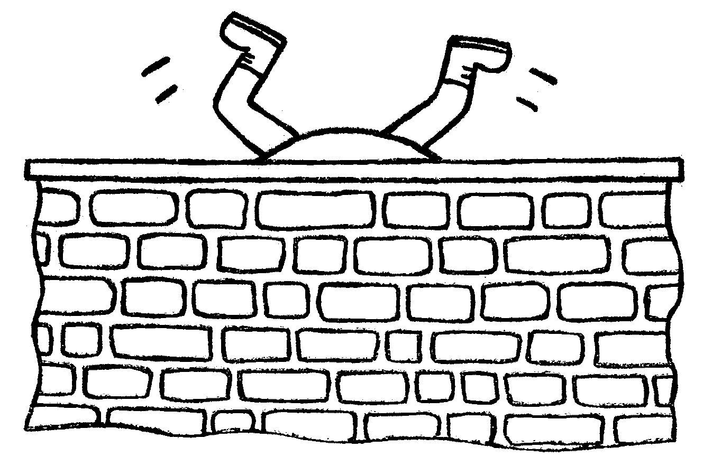

遵循 Scrum 价值观的专业人士可以找出如何最好使用它，并将其应用于特定的情况下，以满足他们正在构建的产品需求。诚实地说，如果公司里的人认可这些价值观，你甚至不需要 Scrum，因为他们会找到完成工作的最佳方式。他们会尝试各种方法，保留有效的，丢弃没用的，并改进看起来前景良好的。另一方面，如果你没有合适的人，那么任何方法都不行。Scrum 也不行。尽管敏捷世界提到了这些内容，但很少有人强调它们（可能因为这太像常识了，显而易见），而其他人忙于向你卖书、课程、证书、扑牌牌和主题办公用品，根本无暇。

许多采用 Scrum 的公司想要进行`敏捷转型`。但转型是一种改变，它并不像仅仅在旧实践和思维方式之上应用 Scrum 那么简单。用不同的方式做同样的事情看起来像是一种改变，但它不是触发转型的正确改变。这是另一种说法，你不需要让 Scrum 适应你现有的信念、实践和习惯；相反，你需要改变行为来适应 Scrum 的核心。这才是真正的改变。而且这不是容易的事。许多人甚至不知道自己的价值观是什么，更不用说改变它们了。

那么，这些价值观在组织中是如何体现的？它们体现在你的行为方式，以及你如何处理遇到的各种情况上。


例如，没有`trust`，Scrum 就无法运行。我在之前的章节中详细讨论过信任。我在那里所说的观点在这里同样适用。你必须信任人们怀有善意，考虑到你的利益（或客户的利益），并且他们想要创造价值。你必须信任他们的专业知识，相信他们会从错误中学习，相信他们想要完善自己并构建出色的产品。Scrum 不再是命令与控制。你现在告诉开发团队你想要什么，而实现它是他们的工作。然后，你必须信任团队会做正确的事，信任他们投入并专注于重要的事情。例如，Scrum 团队必须以可持续的速度工作。只有这样，你才能保持良好的生产力水平，避免人们因疲劳而犯错，或在感到压力时产生走捷径的冲动。

但`at a sustainable pace`意味着什么？如果速度太慢，发生了什么？那是团队真实的速率吗？他们是全心投入任务中，还是在混日子度日？记住，开发者并不是对冲刺中的事项做出承诺（commit），他们进行的是预测（forecast）。所以打开你的视频流媒体服务或社交媒体应用，开始磨洋拖延，因为你这个冲刺什么都没承诺，对吧？如果团队在冲刺中失败了一些用户故事（stories），是否是因为正当的原因，然后你信任他们从这个错误中学习并尝试在下次避免？还是说他们没有完成故事是因为他们懒惰、缺乏技能或缺乏专注？每个人都应该对产品以及他们正在的工作感兴趣。你不能拥有不想成长的开发者，也不能拥有只关心自己对其他任何事情都不感兴趣的开发者。如果有人说“`我需要某些方面的帮助`”，其他人不能回答说“`这不是我的工作`”。如果他们没有技能且做不到，是一回事，但不在乎完全是另一回事。

你信任你的人吗？因为除非你有可以信任的人，否则敏捷就无法运作。这是敏捷社区并没有强调这一点；他们几乎让这变得`显而易见`，因为到底……如果你没有合适的人——优秀、专业、投入、具备正确价值观和行为，并致力于做好工作的人——在任何领域都无法取得成就。

至于承诺（commitment），这并不是只有开发团队需要做的。经理和老板们呢？他们通常只有要求或请求，并在发生他们不同意的事情时变得具有控制欲。致力于帮助和支持团队怎么样，让团队自己解决问题，而不是试图像牵链子一样让他们工作？或者至少尝试以负责任的方式行为而不产生阻碍？利益相关者信任并尊重产品所有（Product Owner）的决策怎么样？或者当产品所有说某些事情很难做、不应该那样做或根本无法做到时，他们信任团队的判断怎么样？或者当某些事情需要重构或偿还某些技术债时，给团队时间处理这些问题，而不是在冲刺中推入更多故事，然后带着所有人开会议，责备他们没有按时完成所有工作。

然后是`courage`（勇气）。通常，敏捷实践会暴露组织或工作文化中存在的问题，诸如不信任、缺乏透明度、管理不善、糟糕的政策、缺陷流程等。勇气通常意味着关注你所看到的丑陋问题，或关注别人不想听的事实，并接受由此可能产生的后果。它意味着说并做正确的事。我在之前的章节中提到过当你违背老板或经理时会发生什么。当你的老板不喜欢你传达的消息、不喜欢你管理项目的方式，或者你的建议不符合他们的意导致导致会被会被时，你会怎么办？你还会尝试让事情变得更好吗？例如，当你的老板对团队大发雷霆，要求承诺冲刺中的所有故事，甚至不听听`forecast`这个词时，你会怎么办？或者对于那些坚持燃尽图（burn-down charts）始终完美无缺的人，你会怎么办？

如果 Scrum Master 注意到完成定义（definition of done）被践踏，每日站会（Daily Stand-Up）变成了状态会议，如果人们在回顾会议中不敢发言，或者在组织中发现某些低效的地方，他们会做什么？如果产品所有注意到某些业务需求不合理，他们是反对需求并拒绝执行，还是闭上嘴只接受高层推向产品中的所有内容？如果你发现团队之上的经理选择扭曲信息，你会怎么办？如果你遇到对现状感到非常满意、希望事情保持原样、对你试图引入的改变感到不安，然后开始阻碍你采用 Scrum 的人，你会怎么办？

无论人们在 Scrum 团队中工作得有多努力，如果他们的工作受到组织现有流程和程序的负面影响，那无法补偿他们无法触及修改的问题。因此，他们唯一的选择是将这些问题上报（escalate），让公司更高层的人愿意参与解决，并希望为未来改进情况。因为 Scrum 的核心在于`inspect and adapt`，高层管理层所采取行动的结果也必须保持透明。


勇气和透明在回顾会议中也起着作用。你们的回顾会议看起来是什么样的？是一片彩虹和蝴蝶吗？还是说问题被摆在台面上并进行讨论？你们是否在尝试改进事情？你们是否在尝试理解人们未按时完成任务的重复性情况，还是仅仅耸耸肩说下次会更努力？你们是否采取了之后会实际执行的行动？回顾会议是为了让团队审查自己，并根据你从参与开发的每个人那里所收集的反馈进行改进。既有积极的反馈，也有负面的反馈。如果有需要修复或改进的糟糕事情，你就必须讨论它们。如果不承认并讨论它们，你就无法改进任何事情。这里信任再次发挥了作用，同样的还有不担心受到攻击、批评、陷入麻烦，或担心管理层采取行动惩罚指出坏问题或承认错误的人的发言自信。

而且人总会犯错的。当他们犯错时，你们如何处理？这些是学习和改进的机会，还是高层管理展示权威的机会？你未能交付本次冲刺中的一个故事（story），现在你正在与高层开会解释你自己？为什么？成功是唯一允许的选项吗？做正确的事却失败了会被接受吗？如果一家公司不容忍人的错误（诚实的错误，不是由冷漠、不注意等引起的），那么你们的 Scrum 实现将会糟糕。回顾会议将是虚假的，人们将为了不被惩罚而掩盖事情，他们会减少进入冲刺的任务数量以确保他们有更好的机会完成所有任务，人们将不再满负荷工作而是会设置缓冲区，每个人都只管自己的事，因为帮助他人意味着会占用自己任务的时间；他们观察到的任何低效率行为都会将之于口，以避免说出来被批评；他们停止采取积极行动来改进工作，因为那些行动可能会失败，等等。这就是`openness`（开放性）的价值所在。每个人都需要对正在进行的所有工作保持开放，无论好坏。Scrum 暴露了组织内部的问题，人们需要至少开放倾听、接受批评、对这些进行诚实的讨论，承认并接受它们的存在。没有人喜欢听坏消息，但有些人甚至像鸵鸟一样把头埋进沙子里。如果高层不承认 Scrum 暴露的问题或缺陷，情况将保持不变。嗯，也许高层会诉诸于他们的老办法：增加压力、建立系统来惩罚或奖励员工的工作、要求团队投入更多等等；这种反应类似于仅应用于员工的绩效考核，而公司内部的系统被忽视了。如果问题出在组织上，那么试图提高个人的性能是没意义的。这无法补偿其他地方出现的问题。Scrum 也是如此：如果问题出在其他地方，即使团队是 Scrum 专家，他们也只能改变他们直接周围的内容，即 Scrum 团队内部的内容。但系统仍然是坏的。如果一个组织是一团糟，在其中某一个层次使用 Scrum 实际上无法解决任何问题。如果 Scrum 团队在孤立状态工作，就不会发生敏捷转型。高层管理人员需要对 Scrum 团队传出的沟通保持开放态度，并采取行动改进事情。

## 赋能 (Empowerment)

但在讨论人们是否能够开放心态听取 Scrum 团队可能发现的问题并采取行动来改进事情之前，首先，人们必须开放于改变团队的工作方式。通常，执行工作的人是从上被协调和控制的。项目的所有权属于某种类型的项目经理；团队只是根据经理的计划工作以让事情发生。现在，通过 Scrum，组织需要赋能团队进行自我组织并负责自己的工作。正如我上面提到的，许多公司认为 Scrum 是只有开发团队应该做的事情，因此他们不允许团队按照他们认为最好的方式行事。决策和控制结构保持不变；只有在下面的执行层面发生了变化……他们正在做这种叫做 Scrum 的东西。但当然，这只是名义，因为在真正的 Scrum 中，团队不再被告知 `how`（如何）构建软件，而是被告知人们想要他们 `what`（什么），然后团队决定将这些需求转换为运行软件的最佳方法。所有权现在转移到了执行工作的团队手中。他们有工作要做，他们共同商量如何执行最好，而没有经理规划他们的活动、分配任务或控制工作。事实上，Scrum 团队没有项目经理。

但由于 Scrum 没有定义项目经理的角色，并不意味着项目经理从公司中离开了。如果公司决定转向基于 Scrum 的开发，这些经理可能会被重新转换为 Scrum Masters（Scrum 主师）或 Product Owners（产品负责人），正如我上面提到的。当这种情况发生时，你很有可能得到一个（如果你可以这么叫的话）Sc 与传统项目管理的混合体，而你通常会得到两者中最糟糕的部分。项目经理现在可能有一个新的官方角色，但他们可能仍然保持作为项目经理时的心态和处理问题的方法，团队由新命名的 Scrum Master 或 Product Owner 引导和控制，遵循 `a process`（一个流程），就像游客在博物馆参观期间被引导一样：`现在我们进入这个房间。然后我们移动到下一个房间。我要求你们留在红色丝绒绳之间的路径上。请不要碰任何东西`。

那么，在 Scrum 中没有项目经理角色，并不意味着不再有与项目管理相关的功能了。人们仍然需要为工作规划路线、做出决策、制定计划、监控、监督、对正在执行的工作进行某种形式的控制等等，但这些事情现在分配在团队所有成员之间。经理的角色现在分配给所有团队成员；这就是为什么它在 Scrum 中没有明确存在。人们共同商量组织这些功能的最佳方式，事情将如何展开，以什么顺序，等等。基本上，项目经理的许多任务必须授权，如果经理并不总是记住团队需要自我组织，这在他们看来可能意味着失去了控制。那么他们会做什么？嗯，他们当然想要夺回控制。如果这种情况发生，它就不再是 Scrum 了；它是命令与控制的传统项目管理，关注进度，让团队的 `resources`（资源）每隔几周在回顾会议上就其错误之处受到纪律，或每天在每日 `status` meeting（状态会议）上。由于这些原因，正如我上面提到的，将高级项目经理放在 Scrum Master 位置并不是个好主意，而是应该有一个深理解 Scrum 原则和价值观的 Scrum Master。真正的 Scrum Master 会识别出我提到的这些发生的情况是异常并拉响警报。前提是有人愿意听这个警报信号。


团队获得赋权并实现自组织的最佳方式是获得来自“上层”的支持。与其将 `Project Manager`（项目经理）职位简单转换为内部的 `Scrum Master` 或 `Product Owner` 角色，我认为给 `Project Managers` 一个位于 `Scrum team` 之上而非其内部的新职位，会更有用。我必须再次强调，仅仅要求开发团队“执行” Scrum 是不够的，如果在更高层级或组织的其余部分，事情仍然保持着“照旧班路”。如果一家公司想要变得敏捷，那么整个公司都需要是敏捷的。`Project Manager` 可以在 `Scrum team` 与组织的其余部分之间起到缓冲位置，处理 `Scrum team` 外部的事务。在团队内部，团队成员是自组织的，并被授权以任何他们认为合适的方式完成工作；但由于在一个并非所有人都理解（甚至不在乎）这种敏捷理念的业务中，你需要与组织的其余部分进行某种 `Scrum` 集成，以便团队在该语境下更好地运作。`Project Managers` 可以在这方面提供帮助，在三个主要领域提供支持。

### 沟通与协调
第一个领域是协助沟通与协调。当有多个 `Scrum teams` 同时开发同一个产品时，这尤为价值。顶层的协调可以帮助处理依赖关系、利益相关者管理、帮助为所有团队设定一致的目标、让整体和团队的进度对所有人透明化、管理风险、管理预算、协助发布规划，并对 `Scrum teams` 范围之外的问题或阻碍提供协助。

### 管理依赖关系
这里的一个重要点是关于协助处理依赖关系的建议。在任何软件开发工作中，你都会遇到各种形式和规模的依赖关系。依赖关系是无法避免的。你可能没有这样想过，但例如，我们相互依赖才能完成工作。`Testers` 依赖 `developers` 才能开展工作，但 `developers` 同样依赖 `Testers` 来发现他们在编写代码时可能遗漏的问题。`Testers` 和 `developers` 都可能依赖 `Team Lead` 来提供支持或做出某些决策。每个人都依赖 `Product Owner` 来正确定义需要做什么。团队的每个成员都依赖 `stakeholders` 对所开发的产品提供反馈。你可以依赖公司内的其他部门、`vendors` 或在同一项目和同一份源代码上工作的其他 `Scrum teams`。开发新项目的预算可能取决于你对旧项目（即新项目旨在取代的项目）所必须做的维护工作。完成 `sprint Goal`（冲刺目标）取决于故事是否经过精炼、分解为独立的项并经过了合理的优先级排序，这样团队成员才不会互相绊脚。

### 团队能力与专业化
`Scrum team` 还应该具备完成工作所需的所有必要能力，而不依赖外部资源。就技能方面而言，如果团队中所有的 `developers` 都是全栈开发人员就很好，但今天这并不总是可能的。因此，团队内部不可避免地会出现专业化。你将会有 `UI designers`、`back-end developers`、`front-end developers`、`testers` 以及完成工作所需的其他每一个人。这至少这至少在理论上是如此。但在实践中，某些人可能是“共享”的或“兼职”的。我已经提到过团队中可能需要的 `designers`、`database administrators` 或其他专家（例如 `architects`）。如果他们在冲刺期间没有被 100% 地利用，为了确保每位员工都能满负荷工作（出于考虑），高层管理可能会决定在团队之间共享此类员工。或者，如果公司聘请了某个领域的优秀专家，他们可能会忍不住让这个人为所有人提供建议和支持，以便每个团队都从中从其专业知识中获益。然而，在这两种情况下，结果都是人们将开始依赖几个并不总是在线的人员。如果你让一个人分布在七个团队之间，你就会面临其中六个团队必须等待，而该资源正在处理第七个团队内部事务的风险。

### 克服障碍
正如我所说，你总会有不同形式的依赖关系。你无法消除它们。而且，由于现在软件产品的复杂性，已经没有多少大型项目是不依赖于某种形式的外部资源、团队或其他项目的。但问题不在于存在依赖。问题不在于你依赖他人。问题在于这种依赖关系让速度慢到像爬一样或者变成了一个阻碍。对于专家，解决方案可以是雇佣更多的人。即使你意识到他们并没有被 100% 的时间利用，但从整体来看，这样可能比让六个 9 人的团队都在等同一个总是忙碌的人要便宜得多。但在多个 `Scrum teams` 同时开发同一个产品的情况下，情况并不总是那么容易解决。因此，团队需要一切可能的帮助来理清问题。

### 宏观视角
当每个团队都忙于自组织时，很容易只关注团队内部执行的工作，而没有与其他小组进行足够的沟通或互动。依赖关系变成了其他人必须为你做的事情，以便在你们需要之前将其提供给你；而当他们没有提供时，你就等待、抱怨并威胁，直到你（最终）得到它们。其他团队在对待他们的依赖关系方面的表现和你们一样。每个人都忙于自己的冲刺，当到了需要将所有工作整合到更大的产品中时……祈祷好运吧。拥有依赖关系的问题在于，人们很容易认为满足这些要求是别人的责任。是别人在做，所以如果他们在你需要时没有交付，那是他们的错。错！那也是你的错。

在存在此类依赖关系时，高效工作的唯一方法是时刻关注大局。依赖关系需要被识别，需要被跟踪，每个人都需要知道别人在做什么，以及他们的工作反过来如何影响自己。


每个人都应该参与这些依赖关系的管理，但有时沟通会中断，导致你陷入一些愚蠢的境地。例如，在冲刺期间某个功能停止工作了，因为其他人更改了你所依赖的 API，现在你不得不放下手头工作去升级到新版本，结果却发现*“我们的产品负责人已经告诉你们的产品负责人了。你怎么才现在才知道这事儿？”*

我必须再次强调（正如我在整本书中多次提到过的那样），沟通至关重要。在谈到经理时，我也说过项目经理的大部分工作涉及沟通，并指出他们应该担任*“沟通守护者”（如果找不到更好的词的话）*的角色，促进沟通并确保信息以一种有效、正确且透明的方式流动。为了最小化和解决依赖关系，显然需要大量的沟通，并且需要有人提醒人们不仅要在团队内部进行沟通，也要在团队外部进行。

很多时候，即使在 Scrum 团队内部也存在沟通问题。人们应该不断地互动和交流。有人发现了问题？他们应该让所有人知道。需求不够清晰？人们应该询问更多细节。有人看到了可以改进的地方？他们应该提出建议。有人需要帮助？他们应该寻求协助。但我经常看到团队成员等到每日站会（Daily Stand-Up）来交流事务，或者等待模型会议（Refinement Meeting），或是等待围绕发布或里程碑等重大事件发生的某些重要讨论。因此，你太晚才发现他们被某些事情阻塞了，目标不够清晰，或者公司的流程效率低下。Scrum Master 的作用是促进协作与沟通，并在团队内部采取行动，但当涉及到与其他小组或部门的沟通时（特别是涉及依赖关系和阻塞时），任何帮助都是欢迎的。

这种层的管理可以帮助所有团队之间的沟通和优先级排序，避免当都在做他们认为有价值的事情时产生误解——否则你可能会陷入这样一种局面：尽管这种价值是正面的，但并不是完全正面的。我的意思是，某些人的价值是以损害他人为代价带来的，整体结果是积极的，但从每个人提供的价值总和来看，并不是积极的。

### 教练组织

我想提到的第二个领域是教练。在《Scrum 指南》中，有一个关于 Scrum Master 对组织服务的章节。它指出，Scrum Master 引导并教练组织采用 Scrum。Scrum Master 不仅在团队内部帮助团队，还帮助组织内的其他人员（Scrum 团队之外）去理解、接受并实践这种新的软件开发方式。听起来很不错，但没那么简单。我在本章前面的论到 Scrum Master 时已经说明了原因。如果组织的其他部分并不真的在意，而且他们对新的工作方式不开放，他们将一直停留在老办法中。如果没有高层管理的支持，Scrum Master 的角色面临着局限于 Scrum 团队内部、仅服务团队而无法为组织提供服务的风险。因此，Scrum Master 需要一切可能的帮助来改变人们的观念。

授权和自我组织对某些人来说似乎现在一切都在开发人员手中，因此他们担心事情会变得乱套或失去控制。他们需要一些保证，确保事情不会变得不可控。还有谁比他们的项目经理更能提供这种保证呢？在教练高层管理部分的另一个重要角色是为团队争取时间，以便他们更好地学习 Scrum。很多学习将涉及实验。有些事情会进展顺利；有些则不会。团队将进行检查和适应，保留有效的，丢弃没用的。当然，当事情顺利时，大家都很开心；但当情况不尽人意时，管理层可能会退回到旧的命令与控制习惯，并介入修复局面，就好像团队无法自力更生，需要被告知具体做什么一样。团队必须被给予足够的时间来自我组织并解决问题。高层管理必须理解，这关乎授权与管理之间的恰当平衡，而且当事情不符合他们的意同时，解决方案可能不是典型的收紧控制，而是相反的，即放弃某种程度的控制，并对 Scrum 团队给予信任。

### 团队自我组织

但当然，团队成员也必须能够组织好自己。就像说*“从今天起，你们就是敏捷了！”*不起作用，告诉团队*“从今天起，你们被授权了！现在去自我组织吧！”*同样不起作用。这就像给一个从未开过车的人钥匙并说*“绕着街转几圈”*。他们会将车撞进沟里或树上，因为他们不知道如何操作汽车，也不认识交通标志和法规。Scrum 团队也是如此。

现在，项目管理不再由一个拥有*项目经理*角色的专门人员负责，而是由团队的所有成员负责。但他们能承担所有这些新职责吗？他们能妥善规划自己的工作吗？他们能与他人沟通吗？他们能注意到自己的组织效率如何吗？他们能找到解决低下的方案吗？他们会执行他们的解决方案吗？他们能管理团队内部冲突吗？他们能处理那些不尽责的团队成员吗？在技术方案和特定业务需求之间选择时，他们能妥协吗？他们甚至关心*“非技术”*问题吗？他们理解自己授权的范围吗，还是他们认为自己可以随心所欲地做任何事？你有保证他们能自给自足并作为一个团队做出决策吗？甚至，团队可能还处于塔克曼群体发展阶段([103])的早期，他们可能还没有找到有效工作的方法，现在你把他们放在必须自己组织工作的境地？由于他们还没有完全形成一个团队，他们将无法自我组织。

即使他们是专业、积极、负责且有纪律的人，并在团队中工作，他们仍然需要帮助。在确保他们能够自己管理一切之前，你不能授权他们。产品负责人是业务人员，开发人员是技术人员，所以只有 Scrum Master 可以教练他们自我组织。再次，Scrum Master 需要一切可能的帮助。项目经理在这类方面有丰富的经验，可以引导他们并帮助他们建立所有必要的技能。


这种管理层必须履行的第三个也是最重要的角色（作为第二个影响区域的延续），是尝试创建一个有利于于 Scrum 运行的工作环境。在之前的章节中，我提到了“心理安全感”，或者自主性、精通和目标^([60])。我也提到了业务与 IT 之间的分阂，并讨论了组织文化，我通统地称为“工作环境”。在使用 Scrum 时，这些因素都非常重要，而且它们存在于 Scrum 团队及其实践之外。你必须意识到它们的存在。Scrum 定义了一个以 Scrum 团队为核心的软件开发框架，但它对组织其他部分的情况描述得太少，特别是关于公司的价值观以及这些价值观与 Scrum 团队价值观的一致性。通过这样一个由项目经理（即受过良好培训的人员）组成的缓冲层，你可以努力将 Scrum 集成到组织的其余部分，以获得一个真正支持 Scrum 团队的工作环境，并让 Scrum 暴露的问题得到解决。如果环境仍然停留在“我们对阵他们”的心态，Scrum 将仅仅局限于团队内部，而且很有可能只是名义上的 Scrum。这一层应该有助于 Scrum 价值观和实践的采纳，及其整合到整个公司中。这一层赋予了 Scrum Master 及其组织服务的更多权力。

但由于这是一本关于“流沙”的书，不用说，这通常并不会发生。从我目前所说的可以明显看出，为了让这个缓冲层的三个区域实现并使这一层发挥作用，经理们自己必须足够成熟，意识到需要另一种管理风格（例如，我在书中之前提到的“X 型和 Y 型理论”^([137])），放弃命令与控制，并拥抱敏捷价值观。作为在管理实践方面受过培训的人员，他们必须首先改变并开始以不同的方式做事，然后才能帮助组织中上层和下层的人。当然，经常会出现项目经理不改变的情况（主要是因为他们害怕失去控制）。结果就是又产生了一个管理层，它具有相同的实践和习惯，延续了命令与控制的环境，一种集权化的决策结构，并充斥着状态会议和对详细报告的要求（因为现在项目经理距离实际工作比他们作为团队成员时还要远），并且完全顺从所有老板的愿望——老板在发生他们不喜欢的事情会惩罚人们，或者处处干预项目并按照自己的意愿运行。他们不在乎赋能或自组织。Scrum 团队只是执行单元，必须尽可能快地响应他们的每一个心血，因为他们是敏捷的，对吧？即使你有经验丰富的 Scrum Master 与这一层协作，如果它仍然是一个传统的管理层，一切仍然是徒用功。

当 Scrum 团队被“传统的”项目经理控制时，这些经理时刻盯着人们（施压，而不是专注于鼓励和帮助团队进行“检查和适应”，团队反而开始关注“如何不犯错”，以避免高层像鹰俯冲向野外迷路的小鼠一样降临他们。Scrum 价值观最终丢失了，人们开始遵循规则。“站会？冲刺？待办列表？计划？细化？评审？回顾？检查、检查、检查、检查、检查、检查、啊——啊——然后……检查！”我说过一次，我还会说一遍。在 Scrum 团队之上也需要拥有并受敏捷价值观的引导，而不仅仅是在团队内部。敏捷价值观如果局限于团队内部，而组织的其他部分却是深层的命令与控制体系，是行不通的。

## 技术考量

但是，如果开发团队没有适当的技术技能，并且未能使用适当的技术实践，即使是 Scrum 价值观、赋能和自组织也毫无意义。Scrum 的吸引人之处在于，它看起来像是一种简单的管理方法，没有特别关注技术考量。但这并不意味着技术实践不是本质的。Scrum 是一个框架，所以重要的是你在它之上构建了什么。这必须包含技术实践、工具和技术。开发团队忘记了这一点。他们专注于计划会议、每日站会、冲刺、演示等，忘记了他们还必须使用适当的技术实践。你可以遵循 Scrum 价值观，但如果你的技术能力不足，你为产品增加的价值仍然会受到损害。这意味着，如果配备一个不完善的开发团队，你就无法从 Scrum 中获得所有的益处。

我在之前的一个章节中讨论过，作为开发者拥有坚实知识基础的重要性，然后还要学习更高级的实践，例如如何组织代码、如何正确命名、避免代码重复、编写高内聚、低耦合的代码、学习重构、代码审查、编写测试、自动化、日志记录、安全、设计模式、如 `SOLID` 等设计原则、关于概念完整性，或者在日常工作中使用工具（如版本控制、协作工具、问题跟踪系统等）。你需要了解的其他重要事情，我已经提到过，是非常熟悉业务领域，并记住一切都是权衡。你需要大量的务实精神才能成为一名优秀的开发者并避免陷入细节无法自拔，正如在关于“糟糕开发者”的章节中解释的那样。

你需要专业、务实的开发者，他们不仅要具备必要的技能，还要有不断学习和改进自己的意愿。许多公司为了保持低成本，犯了聘用缺乏经验的开发者的错误，然后认为 Scrum 框架的约束性就足够让这些开发者仍然保持敏捷、做好工作并构建出有价值的产品。但事实并非如此，因为缺乏经验的开发者根本并不了解经验丰富的开发者所青睐的最佳实践和技术，所以他们并不会使用这些（也许不是最好的比喻，但“如果你还没有发现火，就无法用火做出一顿正宗的饭”）。成功并不是通过遵循《Scrum 指南》就能保证的。你需要具备必要技能的经验人士，他们还要知道何时以及如何应用这些技能；否则，当他们在理论上被赋能时，他们仍然会搞砸。


除了经验和技术技能，还需要大量的成熟和自律。当你不熟悉某些技术或手段时，你就无法使用它们，这可不太妙。但随后，当你精通许多技术和手段时，你可能会变得过度狂热，想要把它们用尽；你基本上是走向了另一个极端。在关于“糟糕开发者”的章节中，我们已经介绍了一些开发者倾向于走向极端的情况。

“我们是否一直在进行结对编程，即使是对于微道的小事？是的。我们是否对任何事情都使用 TDD？我们使用。在代码测试覆盖率达到 100% 之前，我们绝不部署任何东西吗？绝对是！我们是否每个 Sprint 都用新语言重写一切？那确实如此！”你看到这会导致什么结果了吗？一个 Scrum 团队必须由成熟、务实且有自律的人组成，他们还必须理解业务视角以及客户或用户的视角。他们不能忘记，最重要的是，他们必须带来价值。他们必须抛开个人的（技术）偏好，客观地看待问题，并不断问自己：像 `TDD`、`pair programming` 或任何其他实践在何时不再带来价值？换句话之，他们是在哪里越界并做得过火的？

### Scrum 中的核心实践

然而，我认为在利用 Scrum 开发软件时，某些实践是绝对不会出错的：`continuous integration`、`continuous delivery` 和 `continuous deployment`。

Scrum 规定，在每个 Sprint 结束时，你应该拥有一个潜在的可发布产品增量。这意味着无论你在当前 Sprint 中开发了什么，只要 `Product Owner` 决定如此，就可以将其部署到生产环境中。此外，Scrum 的理念是，客户在任何时间点都可以停止项目并说：“我们对目前的内容非常满意。它解决了我们所有的问题。我们现在不需要其他任何东西。部署它吧，让我们来挣钱。”至少在理论上，应该是这样的。但我在许多团队中看到的是，潜在的可发布产品增量并不完全……“可发布”。开发者可以演示这个增量，但这个增量并不是你所谓的“可发布材料”。

### 评审会议 vs. 演示

Scrum 定义了 `Review`（评审）会议，这是一类开发团队“演示”他们已完成的工作、寻求反馈，并与利益相关者合作以决定下一步做什么的会议。基本上，大家聚在一起是为了确保工作正在进行并将完成那些提供价值的事情。我想强调“演示”（demonstrates）这个词，因为我经常看到 `Review Meeting` 变成一个“demo”（演示）会议。当这种情况发生时就会出现问题。演示（demo）完全在于展示东西并可能解释其工作原理，而评审（review）意味着对某物进行评估，其目的是为了做出决策或对其进行更改。简单来说，演示主要等同于展示东西。因为它不包含充分的反馈、协作和决策，所以你应该尽量避免纠结于 `Review Meeting` 的演示部分，以至于演示实际上变成了整个 `Review Meeting`。否则，事情将开始变得像一场戏剧，其中演员（即开发团队）在观众（即利益相关者、客户等）面前进行“表演”。在剧院里，观众不会向演员提供反馈；他们不会讨论自己对戏剧有何种期望，不会与演员一起商量下一次“表演”应该修改什么。他们只是坐在那里看戏，并在结束时如果喜欢的话就鼓掌。。如果你的 `Review Meeting` 发生了这种情况，那么你就有严重的问题了。所以记住：它是评审，而不仅仅是演示。

### 演示文化的迹

某些迹象可以显示 `Review Meeting` 是演示还是真正的评审，这些迹象既发生在 Sprint 期间，也发生在演示本身。例如，你是否有时发现自己为了某些故事（stories）而扭曲“完成定义”（`Definition of Done`），仅仅是为了能在演示中展示它们？或者为了开发人员在 Sprint 最后一天（勉强）完成的工作而匆忙测试？又或者你会在当前 Sprint 中有一个巨大的故事，一个对于 `Sprint Goal` 来说是“核心之作”（la pièce de résistance）的故事，而团队在 Sprint 进行一半时意识到他们无法按时完成它。如果故事没有准备好，你在演示中就没多少东西可以展示，那么你会怎么做？你会放弃 `code review` 来节省一些工作时间吗？放弃测试吗？也许你会硬编码某些内容，或者使用某些算法的基础版本，而不是你们在 `sprint Planning` 中同意的完整实现？如果一个没有被正确实现的故事存在任何问题（这通常会阻止它变为“已完成”），你是否仍然强迫它变为“已完成”，以便让任务看起来很好并在演示中展示它，而不让 `Product Owner` 或利益相关者失望？

### 准备 vs. 排练

这里是另一个值得思考的问题：你是为 `Review Meeting` 做“准备”，还是在“排练”？我将继续使用上面那个剧场的类比。一场戏持续一或两小时，但人们会很早做好准备。演员背台词、排练、搭建舞台、将道具放就位——这一切都是为了一个 1-2 小时的表演。戏剧结束后，舞台被拆除，道具回到仓库，演员回到家中，观众也如此。那么，你为演示准备了多少？你会重复你将在演示期间执行的步骤吗？如果你在排练演示时发现了 bug，你是否会仔细准备一条执行的“快乐路径”（happy path），以确保这些 bug 不会在演示期间出现？你会录制视频以确保你有展示内容的备份，以防真实操作不起通？你是否真的把整个团队都聚在一个会议室里排练几次演示，以确保所有内容都被涵盖，并且每个人都知道说什么？如果对这些问题的回答是“是”，你应该问自己，演示是否比构建一个带来价值的正确产品更重要。

有时，人们因为利益相关者而过度关注演示。你的团队上方是否有一些老派的老板或经理？他们是那种要求每个 Sprint 必须交付 100% 故事的人吗？如果你失败了 Sprint 中的某个故事，或者沟通了遇到了什么问题或存在风险，你会受到责备、训斥或收到负面评价吗？利益相关者不对增量提供价值的输入和反馈，共同讨论并达成现实的下一步，并确保每个人都在正确的轨道上，他们是否只是站在那里发呆，看着某人快速过一遍该 Sprint 开发的所有功能列表？或者更糟糕，他们会纠结按钮不够大或不喜欢它们的颜色？或者他们变得像我之前提到的那样，变成一个“茶水馆”（peanut gallery）^([177])，关注负面信息而忽略正面信息？结果是，你发现自己只强调团队的成就，或者粉饰太平试图营造出一幅更乐观的进展图景，并营造出一切进展良好的印象？


在本章前面的部分，我说过，有时冲刺（sprints）会变成带有截止日期的微型项目，并且存在为了赶上截止日期而强制完成所有用户故事的风险，因此，你最终牺牲了产品的质量。当你在冲刺结束时有一个演示（demo）时，你需要展示你所做的一切——否则，你的老板会对你大吼——这对于人们来说，完成所有拉入冲刺的任务压力会更大。因此，他们会投机取巧、偷工减料、忽略其他事情、制造一团糟，并降低软件质量。这一切都是为了那个所谓的“强大”的演示。你最终可能会获得漂亮的演示，但同时也拥有了糟糕的软件。在这个过程中，你正在欺骗利益相关者，因为在演示期间，你向他们展示了可以运行且被传达为“完成（Done）”的东西，你向他们展示了某些进展，但实际上情况并非如此；事情并没有完成，所谓的进展只是针对那些半吊子的故事的进度。也许起初大家都会很高兴，但随着时间的推移，事情会开始变慢。半完成的工作开始堆积，漏洞会越来越多，技术方案的一致性开始被稀释，某些东西必须重写，技术债必须偿还，那些所谓的“完成”的东西必须“重做（Re-Done）”，这一切仅仅是因为人们想要漂亮的演示，而不是运行良好的软件。

在这里，我回到了持续集成、持续交付和持续部署的实践。只有当它运行在生产环境中，运行得正确且高效，并且真的有人在使用它时，软件才是真正的“完成（Done）”。

> 早期发布，频繁发布 - Eric 史文·雷蒙德([180])

如果你只关注演示部分，你可能会有一个很好的演示，但最终忽略了其他重要事情：反馈、讨论、协作以及参与者之间做出的决策，这些对于构建高质量且实用的产品至关重要，这种产品才能真正为公司或客户带来价值。这正是经验丰富的 Scrum Master 能够识别出的情况：团队最终的工作不是为了产品或终端用户，而是为了演示，为了让利益相关者开心或避免被吼，而事情却在缓慢地滑入深渊。这时，他们可以拉响警报，试图让每个人关注重点。我认为，保持这种关注的最好方法是频繁地在生产环境中部署更改，被迫去构建出真正“完成（Done）”的东西，而不仅仅是看起来“完成”的东西。

当每个人都必须经常整合工作，并且代码可以在任何时候根据 Product Owner 的请求部署到生产环境，甚至在开发完成后直接部署时，你就无法敷衍了事了。你将被迫做好工作。你的老板在演示期间对你大吼吗？你应该看看当部署到生产环境的东西运行效果不如你在演示中展示得好时，他们会如何吼。如果你只在大规模里程碑处、甚至在产品结束时才部署，你会被诱惑扭曲“完成定义（Definition of Done）”。但你在发布之前会有时间修复问题的，对吧？错！因为发生的情况是你会将不当的实现或漏洞从一个冲刺带到另一个冲刺，直到你最终需要部署你构建的东西。那时会发生什么？在发布之前，你会有几个冲刺专门修复漏洞、重构和各种工作，试图摆脱从一个冲刺带到另一个冲刺的负担。如果某件事确实已经“完成”，你就不需要额外的工作来使其完善、修复和部署，不是吗？

所以，经常在生产环境中部署，并让人们在工作或活动中使用应用程序（即使作为封闭 Beta 测试之类的），这样你就可以收集反馈，发现还需要什么，并发现漏洞。否则，你只是交付了故事，却并完全不知道它们是否真的完成了，或者它们是否是真正需要的。此外，如果你部署了人们在工作中使用的东西，你将被迫去开发完整的功能，而不是这些功能的架构层。例如，我经常看到（我承认我也曾犯过这种错误）故事被拆分为技术层：在这次冲刺中我们准备好数据库相关内容，在下一个冲刺中我们做后端，然后在下一个冲刺中做前端。你可能以这种方式每个冲刺都构建一些东西，但它有用吗？你会在演示中展示什么？后端 `API` 响应来自应用程序外部请求时返回的 `JSON`？你会在演示期间在数据库上运行 `SQL` 查询吗？你之后会根据 `JSON` 数据或数据库记录收集反馈并进行讨论吗？这可能显示你在那个冲刺期间工作了并取得了一些进展，但它是一个可用的增量吗？这就是敏捷背后的理念：定期对可以运行的东西接收反馈，以便你构建出带来价值的东西，而不是每两周只是“构建一些东西”。在 Scrum 中，你应该编写并发布软件，就像每个冲刺都是你的最后一个一样。这是确保你构建了正确东西的最佳方法，这就是构建完整应用程序的方法；否则，你把重要事情推到了以后，而那时你可能不再有项目了。这个理念是你可以随时停止项目并使用你到为止构建的软件。你不能告诉利益相关者或客户“你知道的……应用程序看起来不错且符合你的要求，但现在一切都是硬编码的，依赖是模拟的，你没有办法管理它……”仅仅是因为你想让演示看起来很好。所以，请专注于制作完全运行的软件，而不是在演示中看起来很好的半吊子（或为了快而制作的垃圾软件）。

## 需要时间

最后，在涉及 Scrum 和敏捷时，还有两点需要记住。

首先，你需要意识到 Scrum 并不是灵丹妙药。那些真正想要 Scrum 好处的公司认为，只要他们改变了工作方法，就能自动解决在此之前在软件开发中遇到的所有问题。他们认为他们可以把开发者与 Scrum Master 配对，找一个人担任 Product Owner，让新团队遵循 Scrum 指南、构建产物、参加会议、遵循流程、出现在演示中，然后砰……软件就到位了。更糟糕的是，他们期望立即看到改进。而当人们看到他们宏大的期望没有立即实现时，他们开始说“我不再相信这套 Scrum 东西了”，好像它是一个失效的魔咒一样。

Scrum 会让问题显现，但不会神奇地修复它们。要修复它们，每个人必须努力改进。这就像减肥一样。你必须做很多事情。你必须改变饮食习惯、停止懒惰、运动、做出有意识的选择而不是习惯性行为、监控进度、观察哪些有效无效、设定合理的目标、从错误中学习、将学到的知识融入下一次行动中，等等。第二天爬上体重计是没有意义的；你不会看到任何结果。这需要时间。


那么，要记住的第二点是你需要耐心。采用 Scrum 不仅仅是工作方式的改变；它更多是心态的转变。人们在理解 Scrum 之前就开始*“做”* Scrum，并且像执行流程一样机械地*“执行它"*。但 Scrum 关乎价值观、协作、沟通、透明度、建立信任、赋能和所有权。开发者必须学会自组织，而组织其他部门的人员必须接受并参与这种新的工作方式。这需要时间，因为最大的变化需要发生在组织内部，而不仅仅是 Scrum 团队内部。持续改进不是只做一次的事，而是持续不断的（废话话！）。学习和收集反馈需要时间，理解需要时间，应用所学知识需要时间，适应新信息需要时间，组织接纳新的价值观和行为也需要时间。组织的人和文化改变需要时间。改变是需要。而且还会对改变产生阻力。人有情绪，很固执，还有人会捍卫自己在公司里的立场（读*“某些经理和老板”*）。在采用 Scrum 时，你需要考虑到这一点；否则，在几个冲刺（sprints）之后，如果没有看到重大影响，每个人都会放弃。

敏捷实践是学习和改进的循环。你需要观察周围，看看自己处于什么位置，可以做什么来改进，采取行动，收集反馈，根据收集到的反馈调整你的实践，然后重复。所以，当你听到人们使用 Scrum 成功或失败时，大多数时候，这与 Scrum 本身无关。Scrum 的作用是建立一个结构，以对你正在构建*“什么”*、*“如何”*构建以及*“为什么”*构建获取持续反馈。只有当你开始这样做，并且得到了公司里优秀人才（而不只是开发者）的支持和参与时，你才能说你变得是敏捷的。

# 收拾残局

让我们面对现实吧；软件行业的声誉在某种程度上很糟糕。对于公司来说，这通常意味着很多软件项目预算超支、延迟、只交付了部分所需功能、被取消或完全失败。对于用户来说，这通常意味着软件很烂、难以使用、有 Bug 并且没有完全解决它本该解决的问题。因此，人们自然会问：*“这该怪谁呢？”*

开发者在构建软件时承担了大部分工作，所以当这些软件结果很糟时（正如预期的那样），他们会承担大部分责备。例如，你可能是一个拥有绝妙主意和资金的利益相关者，你可能拥有世界上最好的项目经理，有一支受过训练的测试人员军团以及编写最佳规格说明的业务分析师，但仍然有人来写该死的代码；否则，就没有软件。是谁为某些烂软件写的代码？是开发者！所以，开发者写了烂软件，对吧？如果你不了解开发者在做什么，并且不知道（或不关注）构建软件所涉及的一切，那么就很容易遵循这种逻辑。如果软件出了问题，很少有人会好奇软件为什么会变成那样的，指责开始指向开发者；除非证明他们无无辜，否则他们就是有罪的。

## 专业主义

但诚实地说，有时你无法证明开发者的清白。这并不是说他们是不会搞砸事情的纯洁天使。软件行业声誉不佳的部分之一确实是因为糟糕的开发者。一些人不具备技能、不专业和/或缺乏纪律。我在书中多次提到，你需要优秀的开发者来构建高质量的软件。糟糕的开发者确实可以让事情搞得一团糟。我甚至专门用了一整章描写糟糕的开发者以及他们如何让项目迅速陷入泥潭。你会发现无能的开发者；那些行为不专业、不成熟、懒惰、缺乏技能、缺乏纪律，或不想为他们构建的内容负责的人。确实有这样的开发者。如果他们在`URL`中暴露了机密信息或将其写在`log files`中，或者将密码以明文形式保存在`database`中，他们过度设计，或者堆砌了一堆技术只为了好玩，编写意大利面条代码（spaghetti code），将复制粘贴作为代码重用的形式，比如只管写新代码而不修复 Bug，编写不可维护的代码，或者在出现问题或延迟时无法正常沟通，或者任何其他让你大开眼界的各种蠢事，并让后来必须接手修复问题的其他开发者感到沮丧，那么指责开发者是正常的（而且有充分的理由），对他们*“要求"*表现出更多专业性也是正常的。如果他们制造了混乱局面，那么他们就应该承担所有的责任。如果他们弄坏了东西，他们就得留下碎片，并负责把它们重新装好。

所以我们确实需要优秀的开发者——理想情况下，是像软件工艺（Software Craftsmanship）运动^([67])所提倡的工匠。如果你不熟悉软件工艺，只需说该运动的目标是提高专业软件开发的标准即可。其核心思想是，为了构建良好的软件，你需要工匠，即那些有强烈渴望不断学习、并在工作中追求卓越的人，对于这些人来说，软件质量至关重要。该运动还试图找回在敏捷开发中丢失的东西：技术实践，当人们过度关注他们认为应该遵循的正确*“流程”*时，他们往往会忽略这些实践（不幸的是，这在是 Scrum 向公司推销时的大部分方式）。

基本上，要停止编写烂代码并为行业带来积极变化，我们需要优秀的开发者。我们需要更优秀的开发者。需要更丰富的技能和更好的技术实践。需要一套强有力的行为准则，其中关键方面是*“专业主义”*。我认识很多开发者应该尽快买一本《软件工艺》之类的并开始学点东西。但把他们所有人都变成工匠，或者用工匠取代他们，并不能完全解决问题，因为问题不仅仅是许多开发者缺乏技能、不专业和/或缺乏纪律。是的，确实存在缺乏技能的开发者。是的，他们需要变得更好。是的，他们需要负责任。是的，他们必须是专业人士。但真的所有问题都是开发者引起的吗？

当我们把所有精力都放在开发者技能上，很难不把要求专业性的信息理解为*“你要么是个工匠，要么就是写烂东西的糟糕开发者”*。内疚感可能会让开发者进步，但更好的技能、更好的技术实践和开发者对待工作更好的态度只能解决或修复由开发者造成的混乱。

但还有第二种混乱，是由公司里的其他人造成的，而不仅仅是开发者。很容易忽略软件开发的其他方面并只指责写代码的人，但并不是只有开发者在参与一个项目或软件产品。糟糕的软件是多种因素不幸的方式交叉相互作用的结果：需求模糊或不完整、优先级排序不、沟通不畅、管理混乱、荒唐的客户、办公室政治等。我们不能忽视这些方面——以及公司中负责这些其他人——却只期望开发者来解决问题。


例如，想想那些强加的或不现实的截止日期。开发者提供的估算（通常是乐观的）会被进一步削减，甚至被搁置一边，因为老板们知道，如果他们告诉客户项目实际上需要多久以及最可能花费多少费用，客户可能会被吓跑放弃项目，或者去别处进行开发。因此，老板会承诺超出交付能力的内容，并对项目成本和准备就绪的时间进行粉饰（换句话说，他们是在撒谎）。他们知道，一旦项目启动，客户就会不愿于放弃它。不无论你称之为*沉没成本谬误*^([157])、*损失厌恶*还是*承诺升级*^([181])，他们都知道客户不会轻易放弃一个陷入困的项目，因为归根结底，他们需要这些软件，这正是他们最初启动项目的原因。但客户并不傻，所以他们会在合同中加入惩罚金条款等内容，以防出现延迟、软件存在漏洞或缺少某些约定的功能。那么，最终会发生什么呢？嗯，开发者必须以某种方式在约定的截止日期内交付产品。这将如何实现？大多数时候，他们被迫偷工减料、乱改代码、放弃最佳实践，或者任何其他耗时且管理层认为不“必要”的事情（这通常也包括只有开发者应该负责的技术问题；“你没有测试套件就写不了代码？你是这么糟糕的开发者吗？”）。经常，开发者还被迫加班（当然是无偿的，因为付费加班会进一步增加项目成本），这导致了职业倦怠和错误，进一步加剧了由不现实的时间表已经引起的问题。

然后，企业往往是对问题做出反应，而不是预测或预防某些风险以其不发生。如果开发者预测某些问题并希望采取措施将风险降至最低，管理层并不希望这样做。他们只是接受了风险。然后会发生什么呢？自然会出现一些问题或麻烦，这些问题显然必须修复。开发者现在被迫成为“首席消防员”。如果你小时候想当消防员，但不知为何最后变成了软件开发者，别担心，你仍然可以灭火，只是性质不同。而面对这些火灾，会有情绪和挫败感会模糊你的判断，你很可能还会被客户、老板或经理在脑后催促，你最终做出的事情以后会再次引发其他火灾（即：捷径、补丁、再次放弃最佳实践）。开发者随后尝试采取一些措施来避免此类危机再次发生，但他们被允许吗？不。修补一下，重启服务器，随便；往火上泼点水，然后赶回去工作，时间等人。你还可以在此基础上增加其他问题。你没有规格说明，结果结果很糟？“你对领域的学习太差了；有些问题是显而易见的”。整个项目过程中需求变了七次，现在你进度落后了？“你对工作的估算糟糕”。截止日期很荒谬吗？“你不够努力”。优先级变化太快，以至于你无法响应需求？“你不主动”。你没有为了遵守老板做出的承诺而苦干工作？“你不是一个忠诚的员工”。软件有漏洞？“你不是一个好程序员”。

有时这些问题是故意造成的，但很多时候也是因为人们不知道该怎么做。例如，在我的职业生涯中我当过很多角色。我做过程序员、开发者、测试人员、团队负责人、教练、架构师、业务分析师和项目经理。我还与很多人共事过，从其他开发者到业务分析师、项目经理、Scrum  {、产品负责人，到人力资源专家、销售人员、CTO、CEO 以及客户。我在每个角色中都犯过错误，也见过别人在他们的每个角色中犯过错误。把一切都推到开发者身上是不够的（也是不公平的）。我同意在如今这个一切由软件驱动的世界，开发者承担着巨大的责任，需要成为专业人士。我百分之百支持这一表述。但这只是问题的一部分。

让我们来看另一个例子。我曾多次听到过类似下面的话，或者类似思路的话：

> 你每天有多少次把自己的命交给由某个二十二岁的人在凌晨三点、在喝了伏特加和红牛的宿醉状态下写下的一个 `if` 语句？ - Robert C. Martin^([182])

我不完全同意这个观点，但我也无法反对它。这是因为我目睹过人们在奇怪的时间工作，在压力巨大的情况下工作，在对工作性质或任务难度完全没有准备的情况下被迫做某些事情。但他们这样做并不是为了好玩。思考一下上面的话。为什么一个二十二岁的年轻人会在凌晨三点写一段可能危及你生命的代码？为什么是凌晨三点？因为他们睡不着吗？因为他们很有激情吗？是因为喝了太多能量饮料吗？是因为他们醉了，并不知怎么决定在受影响的情况下写代码是个好主意吗？或者，也许，是因为他们必须遵守想要赚钱的老板所强加的无法实现的截止日期，或者遵守一份谈判不当的合同条款？为什么是二十二岁？谁允许他们——假设缺乏必要的技能和知识——在一个某人的生命可能取决于代码中某个“if”语句的项目上工作？

正如我在之前的章节中所说的那样，你不能只在开发团队内部“做” Scrum；同样地，如果只有开发者是专业人士，你就无法构建出高质量的产品。如果你在公司的各个层级没有合适的人、拥有正确价值观的人来与开发者紧密合作，或者至少了解他们的工作组成并尝试向他们支持，你就无法构建出高质量的东西。


这绝非仅仅是开发者的问题；这是一个行业问题。而且这个行业是由其他人共同组成的，而不仅仅是开发者；这些人往往拥有很大的权力和决策权，并且仅受财务指标或利益的指引。此外，在大多数时候，承担这些决策后果的并不是他们，而是别人；或者必须有另一个人努力工作，才能从这些决策中创造出良好的结果。因此，你最终会面临一些影响构建质量的无意义的决策。例如，到目前为止，还没有见过什么优秀的开发者想要把一个原型投入生产环境，然后又抱怨这个东西不稳定且缺乏功能。或者为了短期利益而牺牲长期目标。没有哪一个优秀的开发者会威胁其他开发者，说如果应用程序没有在某个随机选择的日期之前上线，`“我会把你们都开了”`。我也从未听过哪个优秀的开发者对别人说：“嘿，伙计们……你们知道我们很久没做过什么了吗？开始一场死亡行军（death march）吧……我真的很怀念那种良好的、摧残灵魂的死亡行军”。我同样没见过那些想要软件构建得既快又便宜，并强迫其他开发者通过（无偿）加班来完成它的开发者。或者那些想要将核心软件外包给地球另一端、一个那里的人甚至连基础英语都不懂更不用说理解复杂业务需求的国家的开发者。我没见过开发者在已经要做的海量工作之上增加更多工作，却仍然坚持要赶上同一个截止日期。我没见过开发者将估算时间减半，然后把你叫进办公室，要求你解释为什么团队落后于进度。我没见过任何优秀的开发者仅仅因为对方更便宜就想和糟糕的开发者合作，或者为了省点钱而刻意让开发团队人手短缺。我没见过优秀的开发者认为你可以和不熟练的人做好工作。我没见过开发者认为，当一切顺利时，情况本就该是那样，而当出现问题时，全都是开发者的错。而且我没见过开发者在其他开发者积累了足够经验并被视为真正的专业人士后，将他们解雇，并换成更便宜的、二十二岁的年轻人，而这些年轻人甚至连正确写一个 `"if"` 语句都有困难。

我遇到的大多数开发者（不包括我在关于糟糕开发者章节中提到的那些人）实际上都想做好工作，并构建一个令自己自豪的产品，但公司内部的其他人利用他们拥有的权力和权威随心所欲地为他们设置障碍，他们忽视所有提交给他们的论点，只对通过“任何手段”从“某件事”中获取巨额利润，同时投入尽可能少的资金。

软件工艺（Software Craftsmanship）的核心思想是，程序员需要不断学习，建立良好的技能，并拥有一职业，而不仅仅是一份工作。只有这样，你才能构建出高质量的软件：如果程序员不仅仅是一份工作，而是工匠，就像中世纪时代一样。在这里，我认为与中世纪手工艺的相似性消失了，或者至少变得很牵强。为什么呢？因为在中世纪，工匠们没有项目经理、老板或首席执行官，他们也不与销售和营销人员一起工作。客户不会告诉工匠如何构建他们的产品、应该使用什么工具或材料，或应用什么技术。如果你想要一个高质量的产品，会有那么一个人来制作（也许是和他们的学徒一起），使用他们认为最好的实践。基本上就是这样了。作为一名开发者，你会有客户、销售人员、经理和老板来做决定，你将不得不处理这些决策，即使你明知它们是愚蠢的。这通常发生在一个依赖命令和控制结构的公司中。老板说了一件事，你作为开发者必须执行，因为你被认为仅仅是一个执行单元。我很少见到老板会听取来自干活的开发者提出的常识建议。在一种命令和控制结构中（例如军队），人们无论如何都应该服从命令。如果命令或决策是错误的，那么指挥官将承担后果。在软件项目中，承担后果的并不是那些下达命令的人。是的，也许下达命令的人会被开除之之类的，这种情况确实发生，但通常情况下，开发团队只是被推出来背锅，并且必须处理由糟糕指令造成的烂局面。

如果软件最终出了问题，无论原因如何，仍然是开发者需要修复它，或者处理无论是谁留下的这个烂摊子带来的后果。他们需要收拾残局，因为他们是承担最重要工作的人。而收拾残局不仅意味着修复代码；它远不止于此。收拾残局意味着尝试修复“整个系统”。正如我在业务与 IT 隔阂章节中提到的，开发者与组织内部其他人之间存在脱节，这是由于人们对事物的观点不同而造成的。业务被视为运营的核心，而 IT 被视为执行角色，一个为“业务”服务的支持部门。只要业务不将开发者视为伙伴和合作者，糟糕的决策将不可避免地产生，其后果将反映在开发者必须完成的工作中。开发者不能总是以顺利的方式解决这些问题，因此你最终得到的是糟糕的软件。因为对许多业务人员来说，开发者的工作就像某种黑魔法，你无法指望他们能理解自己的决策如何影响结果。业务部门不会让开发者影响和参与管理决策，因为他们突然感悟到这样更好。必须有人向他们证明系统已经坏了。而教育他人软件开发流程的负担落在开发者的肩上，还能有谁？开发者必须是赢得业务信任的人，并让他们看到他们需要成为伙伴。

软件工艺运动认为，如果开发者想被像专业人士一样对待，他们必须表现得像专业人士。我同意这一点。事实上，你的行为方式（诚实、可靠、负责、承认错误、以专业的方式、对做好工作感到自豪）是获得他人信任的前提之一。是的，技术实践和技能必须始终存在，以便开发者停止编写垃圾代码、导致应用程序变得难以维护，或让添加新功能变得日益困难。是的，开发者需要掌握业务领域以提出正确的解决方案。是的，沟通起着至关重要的作用，特别是在告知延误、设定和管理预期，或者引导管理层寻找更好的解决方案时；正确透明的沟通与拥有正确的技术技能同样重要，甚至更重要。但是——有一个“但是”——所有这些让你成为值得信赖的专业人士、有能力且可以依靠的元素，都是够的。


例如，软件手工艺（Software Craftsmanship）运动坚持开发者应该拥有一份“职业”，而不仅仅是一份“工作”。然而，猜猜谁也有人有工作？你那个因为合同谈判糟糕而强加了“死亡行军”（death march）的老板；你那个无法保护团队免受高层错误决策影响的经理；或者是那些误导客户的销售经理。又那些完全不知道自己从软件中想要什么，却非常清楚想要什么时候要到的客户？他们都有工作。但他们难道也应该拥有一份职业，而不仅仅是一份工作吗？

### 其他人在软件开发中的角色

如今的软件构建不仅取决于工匠及其学徒——他们他们都是遵守纪律且负责任的专业人士，使用诸如极限开发（eXtreme Programming）等良好的技术实践。它还取决于许多其他因素。我所说的“其他因素”，实际上是指“其他人”。你需要每个人（首先是高层管理人员）都理解，在构建软件时，如果没有实际工作人员的投入，你就无法做出重要决策或制定计划。或者，一旦启动了项目，你不能仅仅把一切交给开发者，就永久性地忽略与他们进行协作或互动。如果你只是偶尔（一年八九）拜访一次开发者，以确保一切无碍，并在进度落后时抽斥他们，那么你的行为是不恰当的。除了开发者之外的其他人都必须理解，他们也必须是专业的。只有当他们自己熟悉“专业主义”的定义时，他们才能将开发者视为专业人士。

如果只关注开发者以及他们应该如何做出不同的改变，就像就像试图在一个不健康的汉堡中加入一种健康的成分，并仅仅通过这样做，就指望它能影响这种垃圾食品的其它层级，并最终让整体转变为某种健康的东西。

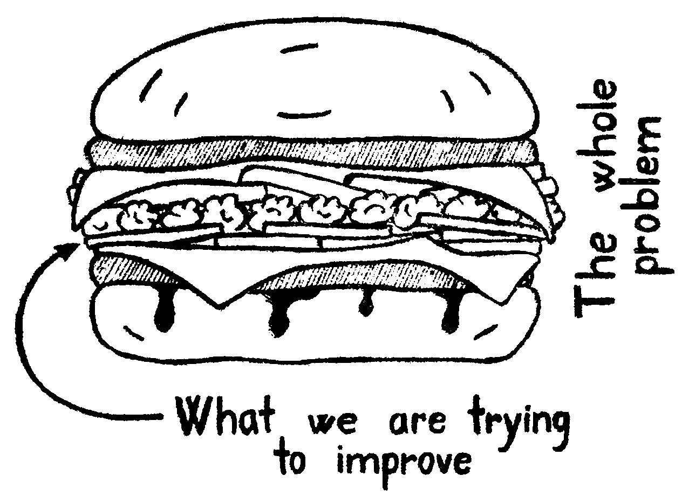

这种与软件开发的类比就像是说：你引入了良好的技术实践和新的开发者心态，其前提是这将触发一种机制，传播到那个生产糟糕软件的职能失调公司的其他层级，从而使公司突然开始生产高质量的软件。

### 影响的局限性

但让我们面对现实吧。开发者并不处于教育公司其他部分人员或向所有人推行更好工作方式的理想位置。他们在食物链中的位置太低了。我们开发者可以表现得专业，并借此尝试激发他人向专业主义的转变，但如果其他人不想改变，那么我们并没有许多其他可选方案。

### 作为专业人士的坚定立场

当这些其他人——即那些“有工作的人”——做出决策或做某些可能导致产出劣质软件的风险行为时，且无法通过论据说服他们时，开发者应该说“不”。这才是成为一名专业人士的含义，而不仅仅是一个有工作的员工。保持良好的标准，当该标准无法达到时，要有勇气冒着失去工作的风险去坚持正确的事。基本上，开发者应该将他们的观点强加给公司。只要你有可以讲理的人，你就可以与人处理这种争斗，但仅限于某种程度。很大可能，是公司在强加给开发者，而不是相反。例如我在关于糟糕老板的章节中提到过，当你违抗老板时会发生什么。所以，即使是开发者最后的这一堡垒也可能告失败。

这不仅是因为说“你可以丢掉工作去做正确的事”太过于简单了——就好像工作是一双脏袜子，你可以不费力地换掉，而且对你和你的家人没有后果；而是因为对于高层管理人员来说，开发者往往被视为机器中的齿轮。如果你做了你被聘佣的工作，人们有时甚至不知道你的存在。在成为专业人士之前，你是一个必须听从指令的员工。你被雇佣是为了工作，而不是对其说“不”，然后提出你更倾向的其他替代方案。如果你说“不”，他们会用一个说“好”的人来替换你，就像替换机器中损坏的齿轮一样。当这种情况发生时，你可能再也谈论职业了，因为你连工作都没有了。

### 系统改变的现实

所以，如果没有可以和你讲理的人——如果真的没有——开发者向他人展示有更好方法的所有努力可能会失败。这不是一个百分之百胜的公式。这可能是一场注定失败的战斗。如果你是一个专业人士，但人们并不认可或尊重你的专业身份，并且无视你的观点，你可以选择留下来尽力所为，也可以离开去另一家公司，一个价值观你价值观的公司。但如果你把你的专业精神和对工作的自豪带到别处，这无法解决软件行业产出的劣质应用问题。仍然会有公司做出错误的决策（并让他承担后果）、关注错误的活动，或雇佣糟糕的人（在开发或其他岗位上），导致劣质软件。于是，问题就延续了。不幸的是，要改变人们的思维，并没有一种像“使用这些技术实践、应用这些工作方式等”那样具有指令性的解决方案。

开发者可以改变自己的行为和工作方式，并改善与他人关系的性质，但他们无法改变他人的行为或他们的工作，特别是当他们不想改变时。有时你可以通过自己的行为影响他们，鼓励并帮助他们，但归根结底，这一切取决于他们。然而开发者真的没有其他选择，只能在这种情况下挣扎，同时承受着满足截止日的持续压力，忙于应对各种事件。要让软件开发有所改进，必须有人带来改变。而开发者确实是这种改变的驱动者。他们必须是那些说“够了！”的人。因为还能是谁？那个卖了充满未来功能的 PPT 的销售经理？那个在没有咨询开发团队的情况下向客户承诺软件六个月内准备好的 CEO？那些不想协商开发团队能现实交付哪些功能，并坚持在不可能的时间内完成所有功能的营销人员？那个总是抱怨“为什么花这么久？快点做完！”的偏执老板？那个不仅不帮助团队，只知道给开发者施加压力并强迫加班的项目经理？

我已经说过，这种方法并不一定会成功，不仅是因为你无法改变不想改变的人，还因为人们很容易将像“软件手工艺”这样的行动看作与敏捷运动或 Scrum 实现一样的东西：被视为只有开发者需要做的事。你最终可能落得与那里所有糟糕的 Scrum 实现类似的局面——你在开发团队中改变了东西，但在公司层面，一切依然如故。你必须以某种方式对整个系统下手，而不仅仅是某一个层（继续使用垃圾食品的类比：如果你想要健康的食物，你需要改变汉堡中所有的成分，而不只是其中一种）。


像“软件工艺精神”（Software Craftsmanship）这样的倡议非常受欢。软件工艺精神试图建立一套开发者应该如何工作的标准。这是一个很好的标准。问题在于，在我看来，这个标准是不够的，因为它试图只向开发者推销`“工艺精神”`。我们不能忘记公司内部参与软件构建的所有其他角色。构建粗劣软件的公司，其整个运作机制都可能是功能失调的，而不仅仅是 IT 部门内部。当我们试图关注公司某一个层面的技术实践和新开发者心态时，绝不能忽视这一点。是的，我们需要优秀的开发者，软件工艺精神运动是一个很好的起点，但不仅如此，我们还需要某种`企业工艺精神`（Corporate Craftsmanship）运动，来改变公司内部各层级人员的价值观和行为。每个人都必须表现得专业，像工匠一样，理解拥有优秀人才的重要性，理解所有决策并承担这些决策的后果，每个人都要值得信赖，每个人都要与他人协作，为自己的工作自豪而而不是被迫去做某些 `crappy` 的事情，并渴望且致力于生产高质量的产品。但如果你问我的话，这种情况发生可能还需要一段时间。所以，在所有角色都由工匠（而不仅仅是开发者部分）填充之前，在所有人放弃`我们对阵他们`的心态并真正努力协作之前，仍然是开发者处于那种必须收拾残局的境地。

# 结语

我们现在来到了书的最后一个章节。在不详述过多细节的情况下，从大体上来说，我想回顾一下我在全书中提到的某些内容，以此作为收尾。

谈到构建高质量的软件，一切始于拥有优秀的开发者。没有开发者，就没有软件，这是显而易见的简单。所以，你必须密切关注招聘流程，以引入优秀的开发者。然后，你必须跟踪他们的进度，只保留那些尽职并为健康团队和良好工作环境做出贡献的人。随着越来越多的公司需要软件，招聘门槛变得越来越低，所以不要犯忽视这一招聘流程的错误。也不要忽视工作环境。你必须留心项目以及公司整体发生的情况，而不仅仅是团队内部或每个个体内部。软件是由团队构建的，但即使是拥有最优秀人才的最优秀团队，在一个不提供支持的组织内部想要发挥最佳水平也是困难的。

优秀的开发者必须拥有坚实的知识基础，必须渴望不断学习以提高技能，并且首先要成为优秀的问题解决者。在编写代码之前，先解决问题是重要的。然后，在开发者的大部分工作中，会涉及到权衡，当开发者承担更广泛的责任（如担任`Team Lead` 角色领导团队）时，这些权衡会变得愈发明显。

我接着谈到了软件估算，以及当人们拒绝理解估算只是一个`有理测的猜测`（基于知识和经验，是的，但它仍然是猜测，而不是确定性）时产生的所有问题。或者，固执地想要满足截止日期（这些日期通常是强加的且与现实无关），以及在结果不符合预期时专注于追回看似流失的时间，往往会导致产生质量不的软件，同时对开发团队产生负面影响。

影响软件的另一个因素是`变化`，它需要被妥善管理。变化是软件开发中唯一永恒的，因此从开始清楚知道你想实现什么、理解什么带来了真正的价值，并为你正在构建的软件定义什么是成功的成果至关重要，这样你对整个项目过程中遇到的所有变化就有清晰的认识。你不断地进行优先级排序和计划，并在面对现实、面对事态不如预期以及发生不可预见的情况时，知道如何调整路径以便你仍能到达需要的地方。为此，你必须定期监控项目进展，知道自己所处的位置，知道自己是否以及在哪里偏离了策略，并知道有哪些可选的行动以回到正轨。

另一个不能忽视的是业务与 IT 之间的差距，以及参与软件开发的不同方之间的裂痕，这些都是基于一种`我们对阵他们`的态度，在这种态度下，信任、协作和伙伴关系的空间很少。如果有一个糟糕的老板做决策，并在他们技术外窍、不理解下属工作的情况下运行软件项目时制造混乱，情况会进一步恶化；或者糟糕的经理选择表现得像老板而不是担任理性的声音，或者他们建立了繁琐的流程和程序，有许多会议和报告，或者未能完成`项目经理`最重要的任务——即在足够、正确且透明的水平上维持沟通。当然，糟糕的程序员和开发者的话题也不能忽视，他们由于技能匮乏、态度差、自尊心过大，或者由于迷恋技术而不顾其他事情（有时甚至不关心他们所做项目的成功），也会导致软件臃肿和实现过度工程的问题。

在最后，我还谈到了外包，以及关注降低成本（类似于固守截止日期和追回流失时间）如何导致各种问题，使项目成为文化差异、误解和缺乏参与的受害者，从而产生质量不的软件，甚至是完全的失败。我提到了使用`Scrum`构建软件，以及人们最终如何集中于一种他们用来尽可能快地交付半成品功能的流程上，而忽视了提供开发高质量软件要素的关键事物，例如敏捷价值观和原则、工作执行方式的必要心态转变、开发者的素质以及他们使用的技术实践。


这些都是流沙在何处以及如何形成的示例。我尝试讨论了许多问题并从几个角度解释了它们，但正如我在书开头提到的，这并不意味着我所说的一切都会发生，或者说会以相同的顺序或方式发生。我提出的解决方案也是我个人经验和失败的结果，它们并不一定是唯一的，也不是最好的，更意味着它们不是永恒的。它们是我在自己的特定情况下发现的认为最有效的方法。你的情况和你的结果可能会不同，因为它们取决于项目、领域、公司；它们取决于你、你的经验以及你共事的人。记住，作为一名开发者，你大部分时间可能在处理技术，但归根结底，任何公司都主要由人组成。只要有人的地方，就有问题。如果你想把事情做对，并不意味着其他人会完全同意你的观点，或者至少对你想要的方法感兴趣。由于人无法像计算机一样被编程，也无法让他们表现出确定性的行为，你总会发现软件项目出错的各种意想不到的方式。

然后你可能在书中注意到，我在谈论某特定问题时不断切换视角。我有时谈论别人，有时谈论你，有时又再次谈论别人。从书的开始我就提到过，就你作为开发者的工作而言，会有很多`你`必须做的事情，但也会有很多其他事情与`你`无关，而与`他人`有关。现在让我们绕回一圈，提一下这不仅关乎`他人`，也关乎`你`。也许`你`就是我在书中谈论的对象，而`你`正是那个把事情引向流沙的人，而不仅仅是必须注意周围流沙的人。我曾好几次处于这种这种情况，坦率地说，将来我也一定会发现自己再次处于那种境地。你认为你或我将不再做我在书中写过的某些事情吗？我们会这样。人们会多次发现自己正处于这种境地，因为软件开发是困难的，应用程序变得越来越复杂，人并不总是那么理智或专业，你需要在许多限制条件和许多未知因素中工作，因此不可避免地，在某个地方，某些事情必须妥协。

所以你可能会问，`现在怎么办`？根据这本书以及书中写的所有内容，这意味着你注定失败了吗？难道一切都注定失败吗？不！绝不是。大多数书籍不像你刚刚读的这本。大多数书籍通常关注积极方面；它们关注理想情况，或者事物应该运作的标准方式，或者事物应该是样子的。`如果每个人都是某种状态，如果每个人都这样做或做那样，如果我们都遵循十个步骤、七个原则或五个观点，那么我们都会变得健康、富有和快乐，我们在生活中将只有成功，而且所有的软件都没有漏洞`。但现实中的情况并不会这样发展。在一家理想的公司里，每个人都是理智的人，人们彼此信任，他们是专业人士并共同努力促成结果。但在现实世界中，问题和挑战是不可避免的，其中大多数与人有关。我们都是复杂的生物；我们有情绪，我们有问题，我们有义务，有些人缺乏经验，有些人力不从心等；没有人是完美的。大多数人并没想故意做坏事，几乎所有人通常都是善意的。就像产生 bug 一样，你并不想制造它们，但由于发生了太多事情，bug 会不可避免地出现。这只是自然发生的。你必须保持这么多事情的平衡，最后你会把其中一些东西掉在地上。理想的开发者、经理、老板、Scrum Master、测试员或同事并不存在。完美的软件项目也不存在。所以，当事情陷入泥潭时，大多数书籍并没有谈论在你偏离正轨后，可以做些什么来回到正确的道路。

IT 行业有很多积极的事物。软件开发具有挑战性，充满乐趣，并且总有新东西可以学习或发现。我没有没有太多积极的事物，因为这本书不同。这本书是关于`软件开发的流沙`。但尽管如此，要意识到流沙随处可见，并非无处不在。我试图指出的是，当你进行软件开发时，就像去海滩一样，你不能只考虑风景、天空有多蓝、阳光有多暖、金色的沙子、海鸥或白色浪花等，要意识到某些区域可能也存在流沙。这本书是为了让你意识到某些危险，知道去哪里寻找它们并避开它们，这样你就可以继续享受海滩之旅，而不至于让你优美的散步变成一段糟糕的记忆。如果有流沙，并不意味着你不应该去海滩。这只是意味着你必须更加小心，准备更加充分。

所以请把这本书视为一个起点。记住我提出的流沙示例，意识到它们，学习更多相关知识，并尝试避免它们。你可能还会遇到更多类型。例如，我关注的是与软件项目相关或涉及软件开发的事物；我没有谈论所有公司和所有工作中都会遇到的事情，如沉重的官僚主义或糟糕的办公室政治。你需要在某些时刻了解这些事情。

# 参考文献

- [1] Quicksand. (n.d.). 检索于 2017 年 8 月 19 日，https://www.merriam-webster.com/dictionary/quicksand.
- [2] Boiling frog. (2018). 维基百科，检索于 2018 年 9 月 13 日，https://en.wikipedia.org/w/index.php?title=Boiling_frog&oldid=8521258.
- [3] Professionalism/Normalization of deviance. (2017). 维基书，检索于 2017 年 8 月 26 日，https://en.wikibooks.org/w/index.php?title=Professionalism/Diane_Vaughan_and_the_normalization_of_deviance&oldid=3256964.
- [4] https://stackoverflow.com/. Stack Overflow。开发者学习、分享和建立职业生涯。
- [5] Grasshopper. (n.d.). 检索于 2017 年 7 月 23 日，http://www.urbandictionary.com/define.php?term=Grasshopper.
- [6] Scott Adams, 1957-. The Dilbert principle: a cubicle's-eye view of bosses, meetings, management fads & other workplace afflictions, HarperBusiness, New York, ISBN `0887307876.`
- [7] Eye-Tracking Study, Ladders, 2018, 检索于 2019 年 10 月 31 日，http://go.theladders.com/rs/539-NBG-120/images/EyeTracking-Study.pdf.
- [8] Bullshit artist. (n.d.). 检索于 2018 年 2 月 14 日，https://www.urbandictionary.com/define.php?term=Bullshit%20Artist.


- [9] Peter R. Scholtes, "The Leader's Handbook: Making Things Happen, Getting Things Done", McGraw-Hill Education, 第 1 版，1997 年 12 月 22 日，ISBN-13 978-0070580282.
- [10] `稀缺性（社会心理学）。(2018 年 6 月 13 日). 维维基百科，自由内容的全书。于 2018 年 12 月 19 日 10:24，检索自`https://en.wikipedia.org/w/index.php?title=Scarcity_(social_psychology)&oldid=845693234`。
- [11] `情境、任务、行动、结果（STAR）。(2018 年 9 月 7 日). 于维基百科，自由内容的全书。于 2018 年 9 月 21 日 15:12，检索自`https://en.wikipedia.org/w/index.php?title=Situation,_task,_action,_result&oldid=858518506`。

- [12] `邓宁-克鲁格效应。(2017 年 8 月 21 日). 于维维基百科，自由内容的全书。于 2017 年 8 月 26 日 19:18，检索自`https://en.wikipedia.org/w/index.php?title=Dunning%E2%80%93Kruger_effect&oldid=796460101`。
- [13] `Fizz buzz 游戏。(2017 年 8 月 5 日). 于维维基百科，自由内容的全书。于 2017 年 8 月 23 日 19:46，检索自`https://en.wikipedia.org/w/index.php?title=Fizz_buzz&oldid=793975607`。
- [14] `知识工作者。(2018 年 5 月 14 日). 于维维基百科，自由内容的全书。于 2018 年 10 月 5 日 08:19，检索自`https://en.wikipedia.org/w/index.php?title=Knowledge_worker&oldid=841254911`。
- [15] `SMART 标准。(2019 年 10 月 30 日). 于维维基百科，自由内容的全书。于 2019 年 11 月 7 日 16:17，检索自`https://en.wikipedia.org/w/index.php?title=SMART_criteria&oldid=923787995`。
- [16] Felps, Will & Mitchell, Terence & Byington, Eliza. (2006). 怎样、何时以及为什么坏苹果会坏一桶：负面群体成员与功能失调小组。组织行为研究 - RES ORGAN BEH. 27. 175-222. 10.1016/S0191-3085(06)27005-9. 于 2018 年 3 月 26 日，检索自`http://citeseerx.ist.psu.edu/viewdoc/download?doi=10.1.1.555.5335&rep=rep1&type=pdf`。
- [17] Spolsky, J. (n.d.). 为什么我绝不让员工谈加薪。于 2018 年 3 月 27 日，检索自`https://www.inc.com/magazine/20090401/how-hard-could-it-be-employees-negotiate-pay-raises.html`。
- [18] Gabulaite, V. (2019 年 5 月 17 日). 历史上最有趣的 80 个菜单翻译失败。检索自`https://www.boredpanda.com/funny-menu-fails`。
- [19] Gallup, Inc. (2015 年 4 月 8 日). 员工希望从经理那里更多。检索自`https://news.gallup.com/businessjournal/182321/employees-lot`。
- [20] Probation 用期 - 经理利用它了吗？(2015 年 12 月 3 日)。于 2018 年 3 月 13 日，检索自`http://www.osborne-group.com/the-probationary-period-do-managers-use-it-to-advantage/`。
- [21] 当今经济环境下跨距离管理：面对面交流的价值。2009，哈佛评论分析报告。于 2018 年 4 月 5 日，检索自`https://hbr.org/resources/pdfs/comm-airways/hbras_ba_report.pdf`。
- [22] `瀑布模型。(2020 年 1 月 18 日). 于维维基百科，自由内容的全书。于 2020 年 1 月 21 日 14:24，检索自`https://en.wikipedia.org/w/index.php?title=Waterfall_model&oldid=93639172`。
- [23] 放弃计划 (n.d.)。检索自`https://wiki.c2.com/?PlanToThrowAway`。
- [24] 技术热度周期方法论。(n.d.)。于 2020 年 7 月 3 日，检索自`https://www.gartner.com/en/research/methodologies/gartner-hype-cycle`。
- [25] `COBOL。(2019 年 10 月 27 日). 于维维基百科，自由内容的全书。于 2019 年 11 月 13 日 14:11，检索自`https://en.wikipedia.org/w/index.php?title=COBOL&oldid=92323093`。
- [26] 阿布拉罕·马斯洛。(2020 年 5 月 25 日)。 于维维基百科，自由内容的全书。于 2020 年 6 月 4 日 09:35，检索自`https://en.wikipedia.org/w/index.php?title=Abraham_Maslow&oldid=95873279`。
- [27] T 型技能。(2020 年 6 月 2 日). 于维维基百科，自由内容的全书。于 2020 年 6 月 10 日 10:54，检索自`https://en.wikipedia.org/w/index.php?title=T-shaped_skills&oldid=96034865`。
- [28] 从 I 型到 T 型：为什么 DevOps 人员需要多项技能。`https://devinstitute.com/2017/from-i-shaped-to-t-shaped-professionals-need-to-multi-skilled`。
- [29] 数据列表。(2019 年 10 月 31 日)。 于维维基百科，自由内容的全书。于 2019 年 11 月 13 日 15:46，检索自`https://en.wikipedia.org/w/index.php?title=List_of_data&oldid=9239756`。
- [30] 戴尔·卡内基。(2020 年 6 月 9 日)。 于维维基百科，自由内容的全书。于 2020 年 6 月 19 日 13:42，检索自`https://en.wikipedia.org/w/index.php?title=Dale_Carnegie&oldid=9616541`。
- [31] 米奇·卡波尔。(2020 年 3 月 6 日)。 于维维基百科，自由内容的全书。于 2020 年 6 月 19 日 14:09，检索自`https://en.wikipedia.org/w/index.php?title=Mitch_Kapor&oldid=9442685`。
- [32] 开发者神话。(n.d.)。于 2018 年 3 月 13 日，检索自`https://dev.com/the-myth-of-developer`。
- [33] 不要害怕说“你被解雇了”。(n.d.)。于 2018 年 3 月 23 日，检索自`https://cornerstoneond.com/dont-afraid-say-you`。
- [34] Wensel, A. (2016 年 10 月 11 日). 成为导师而非霸凌者——同情编程。`https://medium.com/compassionate-coding/be-a-mentor-not-a-bully`。
- [35] Girard, J. and Allison, M. "信息焦虑：事实还是谬误？，《电子管理期刊》，第 6 卷，第 2 期，2008 年，第 111-124 页，可用`http://ejkm.com/issue`。
- [36] Encosia (Dave Ward); `https://github.com/`。
- [37] Turbo Pascal。(2019 年 10 月 26 日)。 于维维基百科，自由内容的全书。于 2019 年 11 月 13 日 15:48，检索自`https://en.wikipedia.org/w/index.php?title=Turbo_Pascal&oldid=9230745`。
- [38] 什么是认知过载？(n.d.)。于 2018 年 4 月 18 日，检索自`https://www.igi-global.com/cognitive-overload`。
- [39] 绿地项目。(2018 年 4 月 12 日)。 于维维基百科，自由内容的全书。于 2018 年 4 月 19 日 07:48，检索自`https://en.wikipedia.org/w/index.php?title=Greenfield_project&oldid=8359884`。
- [40] 棕地开发（软件开发）。(2017 年 1 月 9 日)。 于维维基百科，自由内容的全书。于 2018 年 4 月 19 日 07:50，检索自`https://en.wikipedia.org/w/index.php?title=Brownfield_(software_development)&oldid=7591976`。
- [41] SharePoint。(2019 年 11 月 5 日)。 于维维基百科，自由内容的全书。于 2019 年 11 月 13 日 15:49，检索自`https://en.wikipedia.org/w/index.php?title=SharePoint&oldid=9247837`。
 [42] 注意：这段引用通常归于约翰·约翰逊（John Johnson）。我也引用了相同的来源，尽管没有找到关于他的详细信息。
- [43] `XY 问题。(2018 年 9 月 4 日)。 于维维基百科，自由内容的全书。于 2018 年 10 月 26 日 11:57，检索自`https://en.wikipedia.org/w/index.php?title=XY_problem&oldid=8580584`。
- [44] `分析瘫。(2020 年 1 月 9 日)。 于维维基百科，自由内容的全书。于 2020 年 1 月 21 日 16:41，检索自`https://en.wikipedia.org/w/index.php?title=Analysis_paralysis&oldid=9349026`。
- [45] `https://projecteuler.net/` - Project Euler（欧拉计划）——一个致力于数学和编程迷人世界的网站。
- [46] John Sonmez, "完整的软件开发者职业指南", Simple Programmer, (2017 年 7 月 12 日), ASIN: `B073X6GNJ1`。
- [47] Stephen M.R. Covey, Greg Link, Rebecca R. Merrill, "信任信任：在低信任世界创造繁荣、能量与快乐", Free Press, 第 1 版，2012 年 1 月 10 日，ISBN-13 978-1451651454。
- [48] Patrick Lencioni, "会议要死——一个关于解决业务领域中最痛苦问题的领导力寓言", Jossey-Bass, 第 1 版 (2004 年 3 月 4 日)，ISBN-10 0787968056。


- [49] Eleftheriou-Smith, L. (2015, 1 月 19 日). 研究显示，雇主筛选申请类比于在 Tinder 上滑动，人们查看一份简历平均仅花费 8.8 秒。检索于 2018 年 3 月 02 日，自 http://www.independent.co.uk/news/uk/home-news/employers-sifting-through-applications-likened-to-swiping-through-tinder-as-research-shows-people-9988512.html。
- [50] Shawn Smith, JD, Rebecca Mazin, 《HR 解答书：经理和人力资源专业人士不可或缺的指南》，Amacom, 美国纽约州, 2004 年, ISBN: 0814472230。
- [51] https://git-scm.com/.. Git. 免费开源的分布式版本控制系统。
- [52] ReCAPTCHA. (2018, 10 月 25 日). 摘自维基百科，自由的百科书。检索于 2018 年 10 月 26 日 14:52，自 https://en.wikipedia.org/w/index.php?title=ReCAPTCHA&oldid=865650242。
- [53] Adams, B. (2016, 12 月 28 日). 谷歌的 20% 规则如何让你更高效、更有活力。检索自 https://www.inc.com/bryan-adams/12-ways-to-encourage-more-free-thinking-and-innovation-into-any-business.html。
- [54] Alvin Toffler. (2020, 6 月 2 日). 摘自维基百科，自由的百科书。检索于 2020 年 6 月 4 日 12:01，自 https://en.wikipedia.org/w/index.php?title=Alvin_Toffler&oldid=960295203。
- [55] 精神感应（Mind-Meld），瓦肯星人（无日期）。检索自 https://intl.startrek.com/database_article/mind-meld-vulcan。
- [56] 约翰·昆西·亚当斯。（2020, 6 月 4 日）。 摘自维基百科，自由的百科书。检索于 2020 年 6 月 4 日 12:41，自 https://en.wikipedia.org/w/index.php?title=John_Quincy_Adams&oldid=960694820。
- [57] （motivate，动词），定义及同义词：麦克林字典。（无日期）。检索自 https://www.macmillandictionary.com/dictionary/british/motivate。
- [58] 胡萝卜加大棒法（Carrot and stick）。(2019, 10 月 23 日). 摘自维基百科，自由的百科书。检索于 2019 年 11 月 18 日 17:50，自 https://en.wikipedia.org/w/index.php?title=Carrot_and_stick&oldid=922604639。
- [59] 游戏化（Gamification）。(2019, 10 月 26 日). 摘自维基百科，自由的百科书。检索于 2019 年 11 月 18 日 17:56，自 https://en.wikipedia.org/w/index.php?title=Gamification&oldid=923147229。
- [60] Daniel H. Pink, 《驱动力：关于我们激励的意外真相》，Riverhead Books (2011 年 4 月 5 日), ISBN-13 978-1594484803。
- [61] P. (2016, 5 月 25 日). 人类的繁荣与行为改变—— 微软作者计划完整演讲。检索于 2018 年 1 月 14 日，自 https://www.youtube.com/watch?v=JZ7tyS43mIM。
- [62] Elspeth Buck, (2013, 7 月 3 日), 试用期——试用期指南，检索于 2018 年 3 月 06 日，自 http://www.firstpracticemanagement.co.uk/blog/posts/probationary-periods-a-guidance-to-probationary-periods/。
- [63] Q. (2016, 11 月 3 日). 替代绩效考核的 3 种卓越策略。检索于 2018 年 3 月 12 日，自 https://quickbooks.intuit.com/r/management-and-training/3-superior-strategies-to-replace-performance-reviews/。
- [64] 取消绩效考核。(2015, 4 月 09 日)。检索于 2018 年 3 月 10 日，自 https://7geese.com/abolishing-performance-appraisals/。
- [65] Dan Bradbary, David Garrett, 《赶鸡术：项目管理的创新技术》，Jossey-Bass; 第 1 版，(2005 年 3 月 8 日), ISBN-13 978-0782143836。
- [66] https://quicksandsofsoftwaredevelopment.com/f05c96fc4699e46f4385d5bb60bb5014eedd898a.txt。
- [67] 软件工艺（Software craftsmanship）。(2019, 10 月 25 日). 摘自维基百科，自由的百科书。检索于 2019 年 11 月 19 日 13:58，自 https://en.wikipedia.org/w/index.php?title=Software_craftsmanship&oldid=9228968。
- [68] Duhigg, C. (2016, 2 月 25 日). 谷歌从构建完美团队中学了什么。检索于 2020 年 6 月 23 日，自 https://www.nytimes.com/2016/02/28/what-google-learned-from-its-to-build-the-team。
- [69] 心理安全感（Psychological safety）。(2020, 5 月 20 日). 摘自维基百科，自由的百科书。检索于 2020 年 6 月 23 日 12:03，自 https://en.wikipedia.org/w/index.php?title=Psychological_safety&oldid=9576130。
- [70] 垃圾伞（Shit Umbrella）（无日期）。检索自 https://www.urbandictionary.com/define.php?term=Shit_Umbrella。
- [71] Publilius Syrus。（2019, 5 月 6 日）。 摘自维基百科，自由的百科书。检索于 2020 年 6 月 4 日 07:57，自 https://en.wikipedia.org/w/index.php?title=Publilius_Syrus&oldid=8957516。
- [72] 权衡（tradeoff），剑桥英语字典。（无日期）。检索自 https://dictionary.cambridge.org/english/tradeoff。
- [73] 技术债（Technical debt）。(2019, 11 月 11 日). 摘自维基百科，自由的百科书。检索于 2019 年 11 月 20 日 12:14，自 https://en.wikipedia.org/w/index.php?title=Technical_debt&oldid=9257108。
- [74] Joe Kutner, 《健康程序员：健身、心情愉快并持续编码》，Pragmatic Books, 第 1 版，2013 年 7 月 6 日, ISBN-13 978-1937785314。
- [75] John Medina, 《大脑规则》（Brain rules），Pear Press, 第 2 版，2014 年 4 月 22 日, ISBN-13 978-098326331。
- [76] 项目管理三角形（Project management triangle）。(2018, 3 月 20 日). 摘自维基百科，自由的百科书。检索于 2018 年 5 月 11 日 16:38，自 https://en.wikipedia.org/w/index.php?title=Project_management_triangle&oldid=8314302。
- [77] 估计（Estimation）。(2020, 5 月 31 日). 摘自维基百科，自由的百科书。检索于 2020 年 6 月 22 日 08:35，自 https://en.wikipedia.org/w/index.php?title=Estimation&oldid=9600150。
- [78] 停止试图激励他人——这没用（Stop Trying to Motivate People-It Won't Work）。(-0001, 11 月 30 日）。检索自 https://www.success.com/stop-trying-to-motivate-people-it-wont-work/
- [79] Steve McConnell, 《代码完全：软件构建实践手册》，第二版，Microsoft Press，2004 年 6 月 19 日, ISBN-13 978-0735619678。
- [80] Robert C. Martin, 《整洁代码：敏捷工艺手册》，Prentice Hall，2008 年 8 月 11 日, ISBN-13 978-0132350884。
- [81] Steve McConnell, 《软件估计：揭秘黑术》，开发者实践系列，Microsoft Press；第 1 版，2006 年 3 月 1 日, ISBN-13 978-0735605350。
- [82] MoSCoW 方法。(2018, 5 月 1 日)。 摘自维基百科，自由的百科书。检索于 2018 年 5 月 15 日 12:25，自 https://en.wikipedia.org/w/index.php?title=MoSCoW_method&oldid=839127988。
- [83] Edward Yourdon, 《死亡行军》（Death March），第 2 版，Prentice Hall，2003 年 11 月, ISBN-13 978-0131436350。
- [84] 汉隆剃刀石（Hanlon's razor）。(2018, 5 月 1 日)。 摘自维基百科，自由的百科书。检索于 2018 年 5 月 14 日 08:33，自 https://en.wikipedia.org/w/index.php?title=Hanlon%27s_razor&oldid=839157830。
- [85] 赫尔穆特·冯·莫尔特老士（Helmuth von Moltke the Elder）。2020, 5 月 29 日)。 摘自维基百科，自由的百科书。检索于 2020 年 6 月 4 日 14:37，自 https://en.wikipedia.org/w/index.php?title=Helmuth_von_Moltke_the_Elder&oldid=95952360。
- [86] 范围蔓延（Scope creep）。(2018, 5 月 19 日)。 摘自维基百科，自由的百科书。检索于 2018 年 5 月 21 日 12:21，自 https://en.wikipedia.org/w/index.php?title=Scope_creep&oldid=842025。
- [87] 弗雷德·布鲁克斯（Fred Brooks）（2020, 5 月 7 日)。 摘自维基百科，自由的百科书。检索于 2020 年 6 月 4 日 15:04，自 https://en.wikipedia.org/w/index.php?title=Fred_Brooks&oldid=955463。
- [88] 道格拉斯·霍夫斯塔特（Douglas Hofstadter）（2020, 5 月 29 日)。 摘自维基百科，自由的百科书。检索于 2020 年 6 月 5 日 08:36，自 https://en.wikipedia.org/w/index.php?title=Douglas_Hofstadter&oldid=9595769。
- [89] 达雷尔·胡夫（Darrell Huff）, 《统计学骗术》（How to Lie with Statistics），W. W. Norton & Company; 重版版(1993 年 10 月 17 日), ISBN-13 978-0393310726。
- [90] Bryce, T. (无日期）。 解雇员工不是给懦夫的（Firing Employees isn't for Sissies）。检索于 2018 年 3 月 23 日，自 https://it.toolbox.com/blogs/timbryce/firing-employees-isnt-for-sissies-070405。


-   [92] Katie Heikkinen, 2014 年 6 月, LILA 简报：学习遗忘，学习创新实验室 (LILA), 哈佛大学教育学院, 检索于 2018 年 4 月 20 日，自 http://www.learninginnovationslab.org/wp-content/uploads/2017/01/LILA-Briefing-Doc-on-Unlearning.pdf。
-   [93] Harr, F. (2017 年 8 月 16 日). 如何正确指导初级开发者。检索于 2018 年 4 月 13 日，自 https://stablekernel.com/how-to-properly-mentor-a-junior-developer/。
-   [94] 大格马达岛 (Ilha da Queimada Grande). (2018 年 5 月 1 日). 于维基百科，自由百科全书。检索于 2018 年 6 月 4 日 09:26，自 https://en.wikipedia.org/w/index.php?title=Ilha_da_Queimada_Grande&oldid=839086511。
-   [95] 影子 IT (Shadow IT). (2018 年 6 月 1 日). 于维基百科，自由百科全书。检索于 2018 年 6 月 4 日 15:11，自 https://en.wikipedia.org/w/index.php?title=Shadow_IT&oldid=843974802。
-   [96] 比尔·盖斯 (Bill Gates). (2020 年 6 月 16 日). 于维基百科，自由百科全书。检索于 2020 年 6 月 22 日 09:13，自 https://en.wikipedia.org/w/index.php?title=Bill_Gates&oldid=962786618。
-   [97] 伊万·克里洛夫 (Ivan Krylov, 1768-1844) 著《天鹅、梭鱼与螃蟹》。Lionel Strachey 等，编。1906 年。《世界智慧与幽默：十五卷选集》，(无日期)，检索于 2020 年 6 月 18 日，自 https://www.bartleby.com/380/poem/885.html。
-   [98] 伊万·克里洛夫 (Ivan Krylov, 1769-1844). (2020 年 1 月 27 日). 于维基百科，自由百科全书。检索于 2020 年 2 月 28 日 16:12，自 https://en.wikipedia.org/w/index.php?title=Ivan_Krylov&oldid=937878642。
-   [99] 史蒂芬·M·R·柯维 (Stephen M. R. Covey). (2019 年 12 月 27 日). 于维基百科，自由百科全书。检索于 2020 年 6 月 22 日 09:19，自 https://en.wikipedia.org/w/index.php?title=Stephen_M._R._Covey&oldid=932681149。
-   [100] 史蒂芬·M·R·柯维，瑞贝卡·R·梅里尔，《信任的速度：改变一切的要素》，自由出版社，2006 年 10 月，ISBN-13 978-1416542377。
-   [101] 东方快快杀人案 (Murder on the Orient Express). (2018 年 5 月 20 日). 于维基百科，自由百科全书。检索于 2018 年 6 月 7 日 14:00，自 https://en.wikipedia.org/w/index.php?title=Murder_on_the_Orient_Express&oldid=842116699。
-   [102] 指挥与控制（管理） (Command and control). (2017 年 7 月 28 日). 于维基百科，自由百科全书。检索于 2017 年 11 月 2 日 19:48，自 https://en.wikipedia.org/w/index.php?title=Command_and_control_(management)&oldid=792756940。
-   [103] 塔克曼群体发展阶段 (Tuckman's stages of group development). (2018 年 6 月 1 日). 于维基百科，自由百科全书。检索于 2018 年 6 月 8 日 13:57，自 https://en.wikipedia.org/w/index.php?title=Tuckman%27s_stages_of_group_development&oldid=843918688。
-   [104] 帕特里克·伦西奥尼 (Patrick Lencioni)《团队的五种障碍：一个领导力寓言》平装本，AHA, 第 33919 版 (2000 年)，ISBN-13 978-8126522743。
-   [105] 流心（心理学） (Flow). (2018 年 6 月 21 日). 于维基百科，自由百科全书。检索于 2018 年 6 月 26 日 13:41，自 https://en.wikipedia.org/w/index.php?title=Flow_(psychology)&oldid=846873728。
-   [106] 创造者的日程，管理者的日程 (Maker's Schedule, Manager's Schedule)。(无日期)。自 http://www.paulgraham.com/makersschedule.html。
-   [107] 保罗·格拉姆 (Paul Graham, 程序员). (2020 年 5 月 19 日). 于维基百科，自由百科全书。检索于 2020 年 6 月 22 日 10:30，自 https://en.wikipedia.org/w/index.php?title=Paul_Graham_(programmer)&oldid=957571068。
-   [108] 微观管理 (Micromanagement). (2018 年 5 月 14 日). 于维基百科，自由百科全书。检索于 2018 年 6 月 28 日 14:00，自 https://en.wikipedia.org/w/index.php?title=Micromanagement&oldid=84122041。
-   [109] 误导性图表 (Misleading graph). (2019 年 2 月 21 日). 于维基百科，自由百科全书。检索于 2019 年 3 月 5 日 14:50，自 https://en.wikipedia.org/w/index.php?title=Misleading_graph&oldid=88445411。
-   [110] T 型人才 (T-shaped skills). (2017 年 11 月 19 日). 于维基百科，自由百科全书。检索于 2018 年 4 月 16 日 08:55，自 https://en.wikipedia.org/w/index.php?title=T-shaped_skills&oldid=8110723。
-   [111] 英语将通用 (English Will Remain the International). (2018 年 3 月 13 日)。检索于 2018 年 4 月 5 日，自 https://blog.thelinguist.com/english-remain。
-   [112] Larssen, A. (2013 年 12 月 20 日). 你的导师在给出错误的建议吗？检索于 2018 年 4 月 11 日，自 https://www.themuse.com/advice/is-your-mentor-giving-bad。
-   [113] 东方程序员如何看西方 (How do Programmers in the East see the West?)。(无日期)。自 https://softwareengineering.stackexchange.com/questions/50884/。
-   [114] 蘑菇管理 (Mushroom Management)。(无日期)。自 https://management.simplicable.com/management/new-management。
-   [115] Galef, J. (无日期). 为什么你认为你是正确的——如果你是错了。自 https://www.ted.com/talks/julia_galef_why_you_think_you_re_right_if_you_re_wrong。
-   [116] 安东·圣圣埃克苏里 (Antoine de Saint-Exéry). (2020 年 5 月 28 日). 于维基百科，自由百科全书。检索于 2020 年 6 月 5 日 09:49，自 https://en.wikipedia.org/w/index.php?title=Antoine_de_Saint-Exéry&oldid=9594520。
-   [117] 肯·布兰查德 (Ken Blanchard). (2020 年 3 月 10 日). 于维基百科，自由百科全书。检索于 2020 年 6 月 22 日 10:40，自 https://en.wikipedia.org/w/index.php?title=Ken_Blanchard&oldid=94488599。
-   [118] 彼得法则 (Peter principle). (2018 年 6 月 24 日). 于维基百科，自由百科全书。检索于 2018 年 7 月 6 日 14:50，自 https://en.wikipedia.org/w/index.php?title=Peter_principle&oldid=84735417。
-   [119] Mahmut Akin, Osman Amil, Mahmut Ozdeveci，“你的经理是变态的吗？经理人格类型与变态水平评估》，Procedia - Social 与行为科学, 221 (2016 ), 第 76-85 页，自 https://www.scienceirect.com/article/pii/S1877042816301653。
-   [120] 普特法则与成功的技术专家 (Putt's Law and the Successful Technocrat). (2020 年 2 月 2 日). 于维基百科，自由百科全书。检索于 2020 年 6 月 22 日 10:57，自 https://en.wikipedia.org/w/index.php?title=Putt%27s_Law_and_the_Successful_Technocrat&oldid=93883147。
-   [121] Baldoni, J. (2013 年 7 月 23 日). “闪亮物体”值得你投入时间（和金）吗？自 https://www.forbes.com/sites/johnbaldoni/2013/07/23/are-bright-shiny-objects-worth-your-time-and-money/。
-   [122] 弗雷德里克·P·布鲁克斯二世 (Frederick P. Brooks Jr.)《人一个月：软件工程论文》，Addison-Wesley Professional，周年版 (1995 年 8 月 12 日)，ISBN-13 978-0201835953。
-   [123] 硬件危机：死海效应 (The Wetware Crisis: The Dead Sea effect)。(无日期)。自 http://brucewebster.com/2008/04/11/the-wetware-crisis-the-dead-sea-effect/。
-   [124] 项目管理协会 (PMI) | 关于我们。(无日期)。检索于 2020 年 6 月 22 日，自 https://www.pmi.org/about。
-   [125] 什么是项目管理？(What is Project Management?) (无日期)。检索自 https://www.pmi.org/about/learn-about-pmi/what-is-project-management。
-   [126] 乔治·伯纳德·萧 (George Bernard Shaw). (2020 年 6 月 3 日). 于维基百科，自由百科全书。检索于 2020 年 6 月 5 日 09:52，自 https://en.wikipedia.org/w/index.php?title=George_Bernard_Shaw&oldid=9605599。
-   [127] 项目管理知识 (Project Management Body of Knowledge). (2018 年 6 月 29 日). 于维基百科，自由百科全书。检索于 2018 年 7 月 18 日 11:38，自 https://en.wikipedia.org/w/index.php?title=Project_Management_Body_of_Knowledge&oldid=84808350。
-   [128] 帮帮 (Gang Of Four)。(无日期)。自 http://wiki.c2.com/?GangOfFour。
-   [129] 盖洛 (Gallup, Inc.). (2014 年 3 月 25 日). 优秀的经理为何如此稀缺。自 https://news.gallup.com/businessjournal/167975/why-great-managers-rare.aspx。
-   [130] 蘑菇管理 (Mushroom management). (2018 年 4 月 27 日). 于维基百科，自由百科全书。检索于 2018 年 7 月 20 日 15:18，自 https://en.wikipedia.org/w/index.php?title=Mushroom_management&oldid=838557727。
-   [131] Nitin Mittal. “自组织团队：是什么以及如何 (Self-Organizing Teams: What and How)”。Scrum Alliance - 文章。2013 年 1 月。自 https://www.scrumalliance.org/community/articles/2013/january/self-organizing-teams-what-and-how。
-   [132] 威·爱德华·德明 (W. Edwards Deming). (2018 年 9 月 26 日). 于维基百科，自由百科全书。检索于 2018 年 10 月 2 日 14:16，自 https://en.wikipedia.org/w/index.php?title=W._Edwards_Deming&oldid=861248437。


- [133] `PDCA`. (2018 年 9 月 15 日). 来源于维基百科，自由的全书。检索于 2018 年 10 月 2 日 14:19，来自 `https://en.wikipedia.org/w/index.php?title=PDCA&oldid=859711866.`.
- [134] 真的有些人无法被激励吗？(2017 年 12 月 31 日)。 检索自 `https://shiftworkplace.com/true-people-cant-motivated/.`.
- [135] Agile Quebec 和 Elapse Technologies. (2012 年 10 月 16 日). Robert C. Martin. 《软件专业精神：关键管理紧迫性》。检索自 `https://www.youtube.com/watch?v=p0O1VVqRSK0.`.
- [136] `https://quicksandsofsoftwaredevelopment.com/f05c96fc4699e46f4385d5bb60bb5014eedd898a.txt.`.
- [137] X 理论与 Y 理论。(2019 年 4 月 24 日). 来源于维基百科，自由的全书。检索于 2019 年 5 月 14 日 14:51，来自 `https://en.wikipedia.org/w/index.php?title=Theory_X_and_Theory_Y&oldid=893959020.`.
- [138] Tom DeMarco, Timothy Lister, 《人机工程：高效的项目与团队》，Addison-Wesley Professional; 第 3 版 (2013 年 6 月 28 日)，ISBN-13 978-0321934116.
- [139] David Parnas. (2018 年 2 月 18 日). 来源于维基百科，自由的全书。检索于 2018 年 7 月 26 日 08:24，来自 `https://en.wikipedia.org/w/index.php?title=David_Parnas&oldid=826347757.`.
- [140] ACM SIGSOFT SEN: ACM Fellow 士 David Lorge Parnas. (n.d.). 最初发表于 1999 年 5 月的 SEN 第 24 卷第 3 期。检索自 `https://www.sigsoft.org/SEN/fellows/parnas.html.`.
- [141] 首席主角 (Prima donna)。(2020 年 3 月 12 日). 来源于维基百科，自由的全书。检索于 2020 年 6 月 22 日 13:35，来自 `https://en.wikipedia.org/w/index.php?title=Prima_donna&oldid=945241908.`.
- [142] 圣战 (Holy War)。(n.d.)。检索自 `http://wiki.c2.com/?HolyWar.`.
- [143] Venners, B. (n.d.). 设计模式的价值。检索自 `https://www.artima.com/lejava/articles/gammadp.html.`.
- [144] 中国聘请“编程啦啦队”以激励男性开发者。(2015 年 8 月 24 日)。检索自 `https://jaxenter.com/programming-cheerleaders-hired-in-china-119831.html;`.
- [145] 90-90 规则。(2020 年 2 月 25 日). 来源于维基百科，自由的全书。检索于 2020 年 6 月 22 日 13:40，来自 `https://en.wikipedia.org/w/index.php?title=Ninety-ninety_rule&oldid=942552463.`.
- [146] 你创造的新型编程术语 [已删除]。Stack Overflow。检索于 2020 年 6 月 24 日，来自 `https://stackoverflow.com/questions/2349378/new-programming-jargon-you-coined#answer-2770334.`.
- [147] Rouse, M. (2020 年 5 月 19 日). 什么是外包？它是如何工作的？检索自 `https://searchcio.techtarget.com/definition/outsourcing.`.
- [148] 离岸外包。(2018 年 8 月 9 日)。 来源于维基百科，自由的全书。检索于 2018 年 8 月 13 日 09:06，来自 `https://en.wikipedia.org/w/index.php?title=Offshoring&oldid=854121848.`.
- [149] 离岸外包服务。(2018 年 2 月 5 日)。 来源于维基百科，自由的全书。检索于 2018 年 8 月 13 日 09:13，来自 `https://en.wikipedia.org/w/index.php?title=Offshore_outsourcing&oldid=824209727.`.
- [150] Bird, J. (2013 年 1 月 07 日). 为什么 Scrum 赢了 - DZone Agile。检索于 2017 年 10 月 27 日，来自 `https://dzone.com/articles/why-scrum-won.`.
- [151] Partogi, J.&. (2015 年 1 月 16 日)。 谁是专业的 Scrum Master？- 企业敏捷。检索于 2017 年 11 月 17 日，来自 `https://enterprisetoagility.com/who-is-the-scrum-master-6eff0ba9f`.
- [152] S. (2016 年 7 月 13 日). 2016 版 Scrum 指南 #14。检索于 2017 年 11 月 19 日，来自 `https://www.youtube.com/watch?v=0hRZ1ec`.
- [153] Scrumorg, “与 Schwaber 和 Sutherland 2017 更新”，YouTube，2017 年 11 月 8 日，`www.youtube.com/watch?v=VSQkUVa8`.
- [154] 首席主角 (Prima donna)，(n.d.)。检索自 `http://wiki.c2.com/?PrimaDonna`.
- [155] 西方程序员如何看待东方程序员？(n.d.)。检索自 `https://softwareengineering.com/questions/50831`.
- [156] 虚拟团队。(2018 年 8 月 4 日)。 来源于维基百科，自由的全书。检索于 2018 年 8 月 13 日 10:06，来自 `https://en.wikipedia.org/w/index.php?title=Virtual_team&oldid=8534750`.
- [157] 沉没成本。(2018 年 8 月 8 日)。 来源于维基百科，自由的全书。检索于 2018 年 8 月 22 日 08:55，来自 `https://en.wikipedia.org/w/index.php?title=Sunk_cost&oldid=85401858`.
- [158] 《和而不同》(Gung Ho) (电影)。(2018 年 8 月 1 日)。 来源于维基百科，自由的全书。检索于 2018 年 8 月 14 日 13:06，来自 `https://en.wikipedia.org/w/index.php?title=Gung_Ho_(film)&oldid=85290403`.
- [159] Spencer-Oatey, H. (2012). “什么是文化？引言汇集”。GlobalPAD 概念。GlobalPAD House `www.warwick.ac.uk/globalpadcultural`。检索自 `https://warwick.ac.uk/soc/al/globalpad/openhouse/intercultural/global_pad_-_what_is_culture.pdf`.
- [160] 霍夫泰德 (Geert Hofstede)。(2020 年 5 月 5 日)。 来源于维基百科，自由的全书。检索于 2020 年 6 月 24 日 14:34，来自 `https://en.wikipedia.org/w/index.php?title=Geert_Hofstede&oldid=9549675`.
- [161] Boroditsky, L. (n.d.)。 语言如何塑造我们的思维。检索自 `https://www.ted.com/talks/lera_boroditsky_how_language_shapes_the_way_think`.
- [162] 权力距离。(2018 年 7 月 29 日)。 来源于维基百科，自由的全书。检索于 2018 年 8 月 8 日 13:14，来自 `https://en.wikipedia.org/w/index.php?title=Power_distance&oldid=85250134`.
- [163] Stephanie Quappe, Giovanna Cantatore. (2005)。 什么是文化意识？我如何建立它？检索于 2019 年 12 月 13 日，来自 `http://www.culturosity.com/articles/whatisculturalawareness.htm`.
- [164] `Scrum Guide`。((n.d.)。检索于 2020 年 9 月 15 日 14:00，来自 `https://www.scrumguides.org/scrum-guide.html`.
- [165] 表述状态转换 (Representational state transfer)。(2019 年 9 月 17 日)。 来源于维基百科，自由的全书。检索于 2019 年 9 月 19 日 15:53，来自 `https://en.wikipedia.org/w/index.php?title=Representational_state_transfer&oldid=91624630`.
- [166] 学而不做 (Monkey see, monkey do)。(2017 年 1 月 2 日)。 来源于维基百科，自由的全书。检索于 2017 年 11 月 2 日 20:22，来自 `https://en.wikipedia.org/w/index.php?title=Monkey_see,_monkey_do&oldid=75795677`.
- [167] 手行离 (Shu Ha Ri)：一种敏捷采用模式。(n.d.)。检索自 `https://www.solutionsiq.com/resource/blog-post/shuhari-agile-adoption-pattern`.
- [168] 承诺与预测：Scrum 的细微但重要的变化。(n.d.)。检索自 `https://www.scrum.org/resources/commitment-vs-forecast`.
- [169] 招聘 `ScrumMaster` ？(n.d.)。检索自 `http://rgalen.com/agile-training-news/2017/11/12/hiring-a-scrummaster`.
- [170] 外包持续失败的真正原因。(n.d.)。检索自 `http://www.lessonsoffle.com/developers/real-reason-outsourcing-fails`.
- [171] G. Hofstede，《文化的后果：跨国家的价值观、行为、制度和组织》，第 2 版，Sage Publications，千橡市，伦敦，2001。


- [179] 矮得蒂·鸭蒂。(2018 年 9 月 7 日)。见于维基百科，自由的百科书。检索于 2018 年 9 月 10 日 12:19，来自 https://en.wikipedia.org/w/index.php?title=Humpty_Dumpty&oldid=858502340。
- [180] 埃里克·S·雷蒙德。(2020 年 6 月 10 日)。见于维基百科，自由的百科书。检索于 2020 年 6 月 22 日 14:43，来自 https://en.wikipedia.org/w/index.php?title=Eric_S._Raymond&oldid=961888834。
- [181] 承诺升级。(2018 年 8 月 1 日)。见于维基百科，自由的百科书。检索于 2018 年 8 月 22 日 08:56，来自 https://en.wikipedia.org/w/index.php?title=Escalation_of_commitment&oldid=852946872。
- [182] 洁净代码博客 - 灾难之后。(2012 年 4 月 18 日)。检索于 2020 年 6 月 24 日，来自 https://blog.cleancoder.com/uncle-bob/2012/04/18/After-The-Disaster.html。
- [183] GOTO 大会。(2014 年 11 月 18 日)。GOTO 2014。对敏捷宣言的重审 - Humble, Thomas, Badiceanu, Fowler & Kirk。来自 https://www.youtube.com/watch?v=zNvmjPzdqKc。
- [184] Rajkumar, S. (2010)。项目管理中的沟通艺术。发表于 PMI 研究会议：定义项目管理的未来，华盛顿特区。宾夕法尼亚州新敦广场（Newtown Square）：项目管理协会（Project Management Institute）。
- [185] 软件工艺。(n.d.)。来自 http://craftedsw.blogspot.com/2010/09/software-craftsmanship.html。
- [186] Meyer, Bertrand (2014)。“敏捷！：好、炒作与丑陋”，苏黎世：施林格国际出版社，ISBN-13 978-3319051550。
- [187] 软件开发的敏捷方法论。(n.d.)。检索于 2017 年 10 月 28 日，来自 https://www.versionone.com/agile-101/agile-methodologies/。
- [188] 作为框架的 Scrum。(2010 年 9 月 14 日)。检索于 2017 年 11 月 10 日，来自 https://kenschwaber.wordpress.com/2010/09/08/scrum-as-a-framework/。

