# 快速 Python 编程：GUI 创建、Django Web 服务器、游戏编程与股票分析


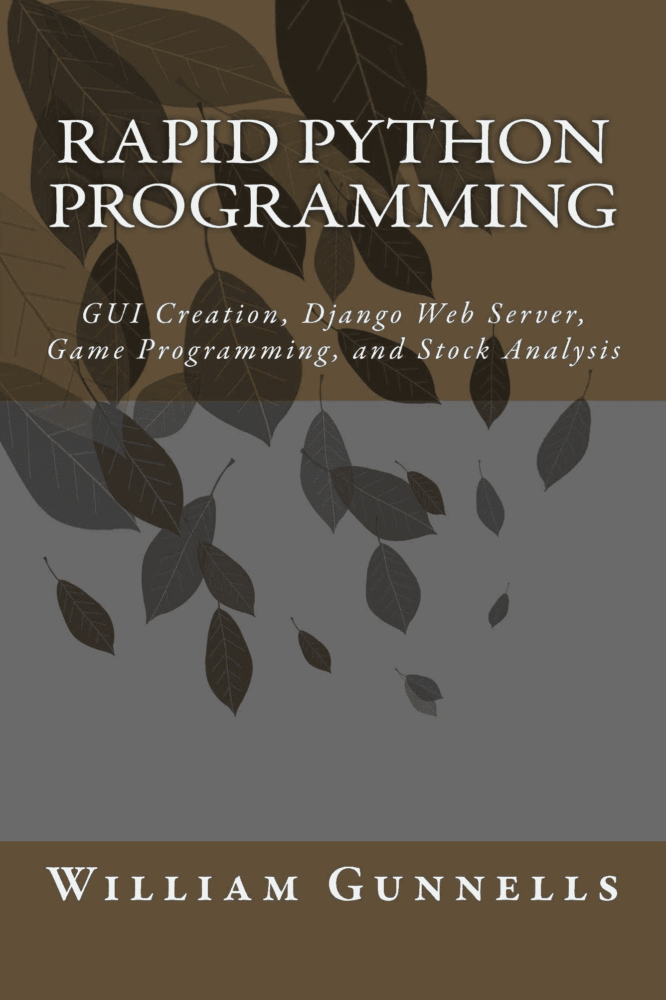


```

运行上面的代码：`python ./arg2.py arg1 arg2 hello`。

如你所见，它使用了 `大于 1` 的运算符。列表中始终至少有一个项，即文件本身。你需要将文件名与参数分离。为了这一点，你需要使用 `-1\`。

## 3.3.2 实际用法：

这是一个实际示例。请**注意**缩进！

### square.py

```python
import sys

def square(x):
    return x*x

x = int(sys.argv[1])

print 'square is %g' % square(x)
```

按照如下方式运行程序：`python ./square.py 4`，它应该返回 `16`。然而，如果你不带参数运行，它会报错。要修复这个问题，你可以轻松地在上述文件的 `def square(x):` 函数上方添加下面的 `if` 语句。不需要添加 `else` 标签，因为它是隐含的。

### square1.py

```python
import sys

def square(x):
    return x*x

if len(sys.argv) != 2:

    print 'Need an integer'
    sys.exit(1)

x = int(sys.argv[1])

print 'square is %g' % square(x)
```

运行以下命令：`python ./square1.py 4` 然后再次运行 `python ./square1.py`。

`if` 会判断参数是否存在。如果不相等（`!=`）则退出。记住 `sys.argv[0]` 中的第一个字段是文件本身。如果你选择使用多个一个整数或字符串，脚本将报错。

当你发现自己使用另一个程序或脚本与你的 Python 程序通信时，使用 `sys.argv` 可以非常有用。你会惊讶于这种情况在现实世界中发生有多频繁。这里的目标是让你创建一个需要参数的程序，如果用户没有输入参数，你的代码将捕获它并打印出说明如何使用程序的帮助语句。

## 3.3.3 from import

你可以使用 `from import` 两种选项，但请注意这可能会让你的代码难以阅读。例如 `from sys import argv`，你就可以使用 `argv` 而不是 `sys.argv`。你可以一次性导入 `sys` 中的所有名称，如 `sys.exit`、`sys.path`，例如：`import sys *`。如果在 Windows 上进行编译，这可能导致可执行文件变得更大。如果你遵循诸如 `PEP 8` 这样的编码风格，你需要明确化，并只导入你计划使用的模块。

## 3.3.4 测试模块

由于所有模块都是对象，你可以在编写时（并且应该）对它们进行测试。确保使用两个下划线且下划线之间没有空格。例如：**注意**缩进！

### amodtest.py

```python
if __name__ == '__main__':
    print 'access directly'
else:

    print 'from import'
```

现在运行 `python ./amodtest.py`。

输出：
```
access directly
```

运行交互式提示符并确认你与 `amodtest.py` 在同一目录下。

```
>>> import amodtest
from import
>>>
```

如你所见，当文件被导入时，`else` 语句会执行，因为它不是直接加载的。一个更实用的方法是：

### fmodtest.py

```python
def square(x):
    return x*x

if __name__ == '__main__':
    print "testing square(4) directly", square(4)
```

如果你直接运行它，它应该打印 `16`。接下来，让我们构建另一个文件并按如下方式导入：

### testmodf.py

```python
import fmodtest

print "from import square(16)", fmodtest.square(16)
```

注意这只会打印 `amodtest.py` 中的模块函数 `def square(x)`，之后没有任何内容。

## 3.3.5 总结

到此时，你可以构建任何你想要的算法。创建自己的函数的能力让你拥有在不导入额外库的情况下创建自定义算法的力量。

## 3.3.6 练习

1. 使用交互式解释器遍历上面的示例。
2. 将 `whileguess.py` 转换为函数。
3. 当发现自己使用另一个程序或脚本与你的 Python 程序通信时，使用 `sys.argv` 可以非常有用。
4. `sys.argv` 可以非常有用。


现在来看 `pickleFile.txt` 的内容。打开它并用你的编辑器查看文件内部：

```
lp0
S'I'
p1
aS'love'
p2
aS'python'
p3
aI1
aI2
aI3
aS'ok'
...
```

创建 `pickle.py` 并添加以下内容：**注意**缩进！

```python
#!/usr/bin/python

#lpickle.py

import pickle

filePickle = open ( 'pickleFile.txt' )

list = pickle.load ( filePickle)

list # 在 idle 屏幕中使用

for i in list:
    print i

dict = pickle.load (filePickle)

dict # 在 idle 屏幕中使用

for i in dict:
    print i

dict['firstname']

for i, j in dict.iteritems():
    print i, j

filePickle.close()
```

结果：
I
love
python
1
2
3
ok
...

## 4.1.7 cPickle

`pickle` 的快速版本是 `cPickle`，它是 `pickle` 的 `C` 编译版本。可以如下如下轻松导入：

```python
import cPickle as pickle
```

这是一个示例，本质上是相同的，但在使用 idle 时使用 `test1` 或 `print test1` 会得到不同的效果：

```python
>>> import cPickle as pickle
>>>
>>> test1 = ('I love python', 1, [1, 2, 3] )
>>> test1
('I love python', 1, [1, 2, 3])
>>>
>>> part1 = pickle.dumps(test1)
>>> part1
"(S'I love python'\nI1\n(lp1\nI1\naI2\naI3\natp2\n."
>>>
>>> print part1
(S'I love python'
I1
(lp1
I1
aI2
aI3
atp2
.
```

## 4.1.8 Python with Statement

使用 `with` 语句通过避免需要 `try/finally` 代码块来减少文件流的异常处理。根据 Python 文档，`with` 语句明确了以前由 `try...finally` 块的代码，以确保执行清理代码。语法如下：

`with expression [as variable]: with-block`

表达式会被求值，并且它应该返回一个支持上下文管理协议 `__enter__()` 和 `__exit__()` 方法的对象。

让我们向文件写入数据：

```python
with open('output.txt', 'w') as f:
    f.write("Usual Hello World!")
```

上面的 `with` 语句会在嵌套代码块后自动关闭文件。

### 4.1.8.1 文件处理模式

表 0.1：文件模式

| 模式 | 描述 |
| :--- | :--- |
| r | 仅读打开文件 |
| rb | 仅以二进制格式读取文件 |
| r+ | 同时读写打开文件 |
| rb+ | 以读写模式打开二进制文件 |
| w | 仅写打开文件 |
| wb | 仅以二进制格式写文件 |
| a | 以追加模式打开文件 |
| ab | 以二进制格式追加打开文件 |
| a+ | 以追加和读取模式打开文件 |
| ab+ | 以二进制格式以追加和读取模式打开文件 |

### 4.1.8.2 文件属性

表 0.3：文件属性

| 属性 | 描述 |
| :--- | :--- |
| file.closed | 如果已关闭返回 true |
| file.mode | 返回已打开文件的访问模式 |
| file.name | 返回文件名 |
| file.softspace | 如果 print 显式需要空间则返回 false，否则返回 true。 |

下方的示例：

```python
#!/usr/bin/python

#filetest.py

f = open("dat.txt", "wb")
print "Name the file: ", f.name
print "Closed or open: ", f.closed
print "mode: ", f.mode
print "Softspace: ", f.softspace
```

另外注意，运行此脚本不需要 `dat.txt`。

结果：
Name the file: dat.txt
Closed or open: False
mode: wb
Softspace: 0

## 4.1.9 深度二进制操作

Python 在处理二进制文件时有一个局限性。你可以处理的最小单位是字节。在处理数据流时，这证明是具有挑战性的。处理二进制超本书的范畴，并且需要坚实的计算机软件基础。

但你可以使用位运算符来评估一个值是否为 True 或 False。例如：

```python
>>> x=3
>>> x&1!=0
True
>>> x&2!=0
True
>>> x&3!=0
True
>>> x&4!=0
False
```

### 4.1.9.1 位字符串操作

此示例使用基 2 将字符串转换为二进制

```python
>>> print int('001101',2)
13
>>> print int('0000011001',2)
25
>>> print "0x%x" % int('0011001',2)
0x25
```

请注意你不需要使用 8 位。我上面的示例是 7 位。然而，它花费了 7 位。


python 带来丰厚的回报
python 将让你自由
我将编写一个 python 脚本
python 将是我的未来
我所有的程序将用 python 替换
只有 python
python python

# 5 异常

## 5.1 异常

毫无疑问，你已经目睹过你的程序崩溃了。每当崩溃发生时，它都会打印出那条熟悉的信息“ Traceback (most recent call):”，随后是你的文件 `'name.py'`、行号以及一些关于程序何故崩溃的额外信息。归结底，检查错误是既枯燥又无趣的。然而，在你的软件开发生涯中继续前进之前，你必须掌握本节的基础知识。请注意，异常并不是防止程序崩溃的绝对答案。代码可能非常复杂，某些问题是无法预判的。让我们来看一个例子并让程序崩溃：

```python
#!/usr/bin/python

#tro.py

x=int(raw_input("Enter a number: "))

print x
```

使用任何字母（如 `'a'`）运行程序，你将得到以下结果：

请注意缩进！

```
Enter a number: a
Traceback (most recent call last):
File "./tro.py", line 3, in <module>
x=int(raw_input("Enter a number: "))
ValueError: invalid literal for int() with base 10: 'a'
```

错误是 `ValueError`。`raw_input` 被包裹在 `int()` 中。这一行期望一个整数，而你用字母替换了整数。为了引导用户输入正确类型的数据，我们使用以下信息重写了 `'tro.py'`。

```python
#!/usr/bin/python

#tro1.py

try:
x=int(raw_input("Enter a number: "))
print x
except ValueError:
print "You did not enter a number"
```

另一种写法是：

```python
#!/usr/bin/python

#tro2.py

try:
x=int(raw_input("Enter a number: "))
print x
except:
print "You did not enter a number"
```

这被认为是对多个异常的全捕获。然而，这并不是良好的编程习惯。建议你理解可能发生的不同异常。对于一段常规代码块，很容易发生多个异常。例如：

```python
#!/usr/bin/python

#try3.py

try:
x=int(raw_input("Enter a number: "))
print x
except EOFError: print "why did you exit early"
except ValueError:
print "You did not enter a number"
```

运行此程序（不要输入数字或字母），然后输入 `'Ctrl-d'` 退出程序。当你提前退出时，就会触发 `EOF` 错误或‘文件结束’错误。

### 5.1.1 抛出异常 (Raise Exception)

在某些情况下，你希望程序按预期运行，但在需要时仍然抛出异常。你可以创建自己的异常并手动抛出它们。别忘记 `import sys` 包。

```python
#!/usr/bin/python

#raise.py

import sys

def letserror():
raise RuntimeError('Force the error')

def main():
letserror()
main()
```

结果（行号可能略有不同）：

请注意缩进！

```
Traceback (most recent call last):
File "raise.py", line 7, in <module>
main()
File "raise.py", line 6, in main
letserror()
File "raise.py", line 4, in letserror
raise RuntimeError('Force the error')
RuntimeError: Force the error
```

然而，这看起来并不整洁。以下是稍作修改：

请注意缩进！

```python
#!/usr/bin/python

#raise2.py

import sys

def letserror():
raise RuntimeError('Force the error')

def main(num):
try:
letserror()
except Exception, err:
sys.stderr.write(str(err))
main(0)
```

你对如何打印错误信息有很大的控制权。例如，你可以将 `sys.stderr.write` 替换为：`“sys.stderr.write("%s\n" % str(err))”`。`sys.stderr` 对象是 Unix 标准输入、输出和错误管道的一部分。让我们将其诸诸。这是一个更实用的例子：

请注意缩进！

```python
#!/usr/bin/python

#raise3.py

import sys

def letserror():
raise RuntimeError('Force the error')

def main(num):
try:
if num < 3:
letserror()
else:
blah=num*num
print "my number is", blah
except Exception, err:
sys.stderr.write("%s your number %s is less than 3\n" % (str(err),num))
main(2)
```

如果你将 `main(2)` 改为 `'3'`，它将计算数字的平方；但如果它小于 `'3'` 或 (`< 3`)，就会抛出异常，你可以给用户提供详细的解释。

### 5.1.2 Finally

`finally` 语句块保证即使 `try` 块抛出异常也会执行。这使其成为清理工作或 `'close()` 的理想选择。例如：

请注意缩进！

```python
#!/usr/bin/python

#raise4.py

import sys

def letserror():
raise RuntimeError('Force the error')

def main(num):
try:
if num < 3:
letserror()
else:
blah=num*num
print "my number is", blah
except Exception, err:
sys.stderr.write("%s your number %s is less than 3\n" % (str(err),num))
finally:
print "okay I could close..."
main(2)
```

### 5.1.3 最佳实践 (Best Practice)

上面列出了许多示例。至少，你应该利用基类 `Exception`。尝试一下 `ctrl-z`。

```python
try:
x=int(raw_input("Enter a number: "))
except Exception, e:
print e
```

### 5.1.4 忽略异常 (Ignore Exception)

添加 `pass`，这是一个空操作。

```python
try:
x=int(raw_input("Enter a number: "))
except Exception, e:
pass
```

### 5.1.5 总结 (Summary)

尽力掌握异常处理，因为这将帮助你排除故障并可能提高你的开发质量。本节不需要练习。

# 6 OOP

## 6.1 面对象编程

### 0.1.1 引言 (Intro)

到目前，你一直在通过函数和语句块以过程化的方式创建程序。通过微小的转折，你可以将函数封装到对象中，并进理解面向对象的范式。在没有意识的情况下，你已经在使用面向对象编程的一些方面。

### 6.1.2 对象 (Objects)

现在你已经熟悉了字符串、整数、字典和函数等特征。这些都是对象。字符串对象提供了操作字符串的其他方法。使用点语法，你可以访问对象的属性，例如 `string.lower()`。所以从开始我们就在访问每个对象的方法。你还可以创建对象的新实例，即实例化。从本质上说，它们是数据类型，并可以使用内置函数 `type` 进行测试。

```
>>> dat='a string'
>>> type('dat')
<type 'str'>
```

点语法很容易应用。检查你的 `type`，你会发现它是类字符串对象或 `str(object)`。这是一个可以使用 `type` 测试的类对象的示例。别忘记在类语句后仍然需要缩进文本。提醒：下划线之间没有空格。最后，一如既往，请注意缩进！

```
>>> class orphan():
... def __init__(self):
... self.arg1=arg1

>>> type(orphan)
<type 'classobj'>
```

对象通过使用属于自己的变量来存储数据。变量属于对象或类，作为字段。函数也是一样，它们被称为类的方法。所以基本上字段和方法都是类的属性。


类是通过关键字 `class` 创建建的，例如 `class orphan():`。它与函数或（方法）的不同之处在于 `self` 的名称指定符。`self` 的值是名称本身，它指代对象本身。将 `self` 想象成 `C++` 中的一个指针。如果你有一个名为 `blahClass` 的类以及该类的一个名为 `blahObj` 的实例。当你调用对象的方法，如 `blahObj.method(arg1)` 时，python 会将其转换为 `BlahClass.method(blahObj,arg1)`。即使你定义了一个没有参数的方法，你仍然必须定义一个带有 `self` 参数的方法。这里有一个实用的用示例：

### #classhello.py
```python
class hello:
    def blah(self):
        print "Hello world, again"

a=hello() # 内存中的指针位置
a.blah() # 打印类的方法
hello().blah() # 访问类的另一种方式
```

如你所示，`self` 存在且它不接收参数。

**结果：**
Hello world, again
Hello world, again

### 6.1.4 __init__
`__init__` 方法在对象实例化时会立即初始化。我们并不直接调用 `__init__` 方法（我们的构造函数）。我们只是向它传递参数。例如：

注意缩进！

### #classinit.py
```python
class hello:
    def __init__(self,name):
        self.name=name
    def blah(self):
        print "Hello world, my name is",self.name

a=hello('William')
a.blah()
```

**结果：**
Hello world, my name is William

现在传递更多参数：

### #name.py
```python
class hello:
    def __init__(self,l,f):
        self.last=l
        self.first=f
    def blah(self):
        print "My first name is", self.first
        print "My last name is", self.last

a=hello('Doe', 'John')
a.blah()
```

**结果：**
My first name is John
My last name is Doe

这里是另一个示例：

### #shop.py
```python
class cart():
    def __init__(self):
        self.food = "beans"
        self.amt = 0
    def buyfood(self,amt):
        self.amt += amt
        print "You purchased" ,amt,"cans",self.food

checkout = cart()
checkout.buyfood(5)
```

**结果：**
You purchased 5 cans beans

### 6.1.5 析构函数
这是一个析构函数的示例。虽然我在代码中很少使用析构函数，但它们确实存在且是有用的。

### #des.py
```python
class Des():
    def __init__(self, x):
        self.x = x
        print self.x, 'ready'
    def __del__(self):
        print self.x-1, 'destroyed'

x = Des(1)
```

**结果：**
1 ready
0 destroyed

### 6.1.6 继承
你可以开发一个继承另一个类类。这个示例展示了如何通过 `class second(first)` 在 `second()` 类中继承 `first()` 类：

注意缩进！

### #in.py
```python
class first():
    n = 0
    def __init__(self, color='red'):
        self.color = color
    def Hello1(self):
        print "Hello from first class!"
    def Color(self):
        print "My color from first class", self.color

class second(first):
    def Hello2(self):
        print "Hello from second class!"
        print self.n, "is my favorite number"

a0=first()
a0.Color()
print '——-'
a1=first('blue')
a1.Hello1()
a1.Color()
print '——-'
a2=second('white')
a2.Hello1()
a2.Hello2()
a2.Color()
```

### 6.1.7 __private
双下划线前缀通过名称修饰（name mangling）进行处理，从而有效地在类或对象内部使其变为私有。

### 6.1.8 类的功夫
Python 中所有的类都派生自一个特殊的自顶向下的父类 `object`，该类可能显式也可能可能式派生。

```python
class KungFu(Object):
```

在 Python 中，派生自“父类”的类被称为“子类”。让我们在下面的示例中从父类继承。

### #kungfu.py
```python
class KungFu(object):
    mystr=”the master”
    pass

class Master(KungFu):
    pass

teacher=Master.mystr
print teacher
```

**结果：**
The master

现在在子类中重写属性值。

### #kungfu1.py
```python
class KungFu(object):
    mystr=”the master”
class Master(KungFu):
    mystr=”Student is not the master”
teacher=Master.mystr
print teacher
```

**结果：**
Student is not the master

在子类内部执行父类的方法。

### #kungfu2.py
```python
class KungFu(object):
    mystr=”the master”
    def crane(self):
        print ”crane kick”
class Master(KungFu):
    mystr=”Student is not the master”
teacher=Master()
teacher.crane()
```

**结果：**
crane kick

用子类覆盖父类。

### #kungfu3.py
```python
class KungFu(object):
    mystr=”the master”
    def crane(self):
        print ”crane kick”
class Master(KungFu):
    mystr=”Student is not the master”
    def crane(self,bstr):
        print ”must learn crane kick”
teacher=Master()
teacher.crane(1)
```

**结果：**
must learn crane kick

### 6.1.9 迭代对象
在 Python 中，派生自“父类”的类被称为“子类”。让我们在下面的示例中从父类继承。（等等，提供的文本在某些章节中似乎有些混乱，让我们根据提供的流程进行重新对齐）。

### #in.py
```python
class first():
    n = 0
    def __init__(self, color='red'):
        self.color = color
    def Hello1(self):
        print "Hello from first class!"
    def Color(self):
        print "My color from first class", self.color

class second(first):
    def Hello2(self):
        print "Hello from second class!"
        print self.n, "is my favorite number"

a0=first()
a0.Color()
print '——-'
a1=first('blue')
a1.Hello1()
a1.Color()
print '——-'
a2=second('white')
a2.Hello1()
a2.Hello2()
a2.Color()
```


它们的作用完全相同，但 lambda 表达式不包含 return 语句。你可以将 lambda 定义放置在任何存在函数的地方，并且不需要将其赋值给变量。Lambda 函数是一种风格问题。它们不是强制要求的，并且可以很容易地使用函数进行替换。如果你发现自己创建了很多短函数，那么 lambda 可能会是一个实用的解决方案。这里有一个更具实性的示例：

### lambda.py

```python
foo=[1,2,3,4,5,6]

print filter(lambda x: x % 2 == 0, foo)

print filter(lambda x: x % 2 == 0, (x for x in range(1,7)))

blah=[x for x in range(1,7) if x %2 == 0]

print blah
```

结果：

`[2, 4, 6]`

`[2, 4, 6]`

`[2, 4, 6]`

注意，最后一个表达式被列表推导式（list comprehension）替换了。

### 7.1.3 Assert

`assert` 通常用于调试代码。`assert` 的格式为 `(assert <test>, <message>)`。例如..

### assert.py

```python
blah=int(raw_input("enter number greater than 3: "))

assert blah !=3, 'strange why did you enter 3'
```

结果：

enter number greater than 3: 3

```text
Traceback (most recent call last):
File "assert.py", line 9, in <module>
assert blah !=3, 'strange why did you enter 3'
AssertionError: strange why did you enter 3
```

该语句断言某事为真。如果你输入 `'3'`，将抛出错误并将 `assert` 消息传递到标准输出。如果你有这样一个列表：

```python
list=['hello']

assert len(list) >= 1
```

断言为真，没有传递消息。你可能需要一个断言来强制某物在列表中，因为你可能设计了程序在列表至少包含一个项目时运行。如果该列表为空，你希望程序带有一个 `assert` 消息退出，该消息规定了程序退出的原因。

### 7.1.4 eval

'Eval' 是另一个评估字符串的函数示例。下面的程序还将演示你从来源接收字符串时缺乏信任的情况。

### aeval.py

```python
a='a'

blah=raw_input("enter numbers: ")

print blah

print "my eval is: ", eval(blah)

print "my type is: ", type(blah)
```

使用以下来源 `(3, 2.5, a, b, 'b', 2*3, '2*3', "len('hello')")` 分测试该程序 `'8'` 次。

### 7.1.5 exec

这在运行时动态执行。根据你的目标，将 python 与 bash 或脚本语言混合可能非常有用。

```python
>>>exec 'print "hello"'
```

这里有一个更具实性的示例：

### exec.py

```python
code = """

def foo(x): return x+1

print 'hello world.'

"""

exec code

print foo(3)
```

结果：

```text
hello world.
4
```

### 7.1.6 repr

'Repr' 仅仅显示对象的打印打印表示。例如：

### rep.py

```python
i=[]

i.append('blah')

print repr(i)
```

如果你在编码过程中简单忘记了变量可能是什么，并且需要返回对象的打印表示，这很有用。如果定义了 `__repr__`，你可以控制其级别。

### 7.1.7 switch or case

Python 没有像许多其他编程语言那样的 `switch` 语句（称为 case 语句）。搜索引擎的博客会揭示这一点。它并不是为这种需求而设计的。恰当使用的 `if/else` 语句的优雅性提供了额外的测试以及等性检查和默认响应。使用字典没有这些功能，你可能会发现自己抛出异常的次数更多。这是一个可以激发你创造性代码的选择，激励你努力改进。下面是一个典型的 'C' 语句如下：请勿输入下方的示例代码。

```c
switch(num){
case val1: /* code for val1 */
break;
case val2: /* code for val2 */
break;
default: /* default code nothing chosen */
break;
}
```

这是一个在 bash 中的实用示例，如果你没有安装 'C' 或没有 'C' 知识，可以测试它。

```bash
function case1(){
echo "print case1 statement"
}

function case2(){
echo "print case2 statement"
}

function case3(){
echo "print case3 statement"
}

function case4(){
echo "print case4 statement"
}
echo "1) case1"
echo "2) case2"
echo "3) case3"
echo "3) case4"
echo -e "enter number 1-4: "
read blah
case $blah in
1) case1
;;
2) case2
;;
3) case3
;;
4) case4
esac
```

这是一个使用字典创建的 case 或 switch 语句示例：

### case.py

```python
print "0: exit"
print "1: sqr 4"
print "2: list 1-10"
print "3: print even list 1-10"
data=int(raw_input("Enter 0-3: "))
x=4
def exit():
print "you exited"
def sqr():
print x*x
def list():
for x in range(1,7) if x %2 == 0:
    print x
```


### 1 个泳池，x 个房间，15 个人

```python
class complex:
    def __init__(self, unit, parking, pool, rooms, people):
        self.unit=unit
        self.parking=parking
        self.pool=pool
        self.rooms=rooms
        self.people=people

myCo=complex(10,8,1,20,15)
# #myCo.unit=10
# #myCo.parking=8
# #myCo.pool=1
# #myCo.rooms=20
# #myCo.people=15

### 注释掉接两个代码块
capacity=float(myCo.people)/myCo.rooms
uncovered=100-(float(myCo.parking)/myCo.people*100)
myCo.rooms=10*2
freerooms=myCo.rooms-myCo.people

print "The complex is at %g capacity" % capacity
print "There are %g percent people with uncovered parking" % uncovered
print "We have %g rooms" % myCo.rooms
print "We have %g free rooms left" % freerooms
```

## 7.2.3 最后部分的转换

请注意，在工作过程中，你正在注释掉大块需要转换的代码。接下来，创建一个方法来计算你的值，并创建一个方法来打印你的值。然后将每个变量重命名为 `self.name` 符号，并初始化 `calc` 方法和 `print` 方法。

```python
### apartment3.py

### 需要的信息：10 个单元，每个 2 卧室，
### 8 个室内停车位
### 1 个泳池，x 个房间，15 个人

class complex:
    def __init__(self, unit, parking, pool, rooms, people):
        self.unit=unit
        self.parking=parking
        self.pool=pool
        self.rooms=rooms
        self.people=people

    def calc(self):
        self.capacity=float(self.people)/self.rooms
        self.uncovered=100-(float(self.parking)/self.people*100)
        self.rooms=10*2
        self.freerooms=self.rooms-self.people

    def result(self):
        print "The complex is at %g capacity" % self.capacity
        print "There are %g percent people with uncovered parking" % self.uncovered
        print "We have %g rooms" % self.rooms
        print "We have %g free rooms left" % self.freerooms

myCo=complex(10,8,1,20,15)
myCo.calc() # 这些是关联的初始化
myCo.result() # 这些是关联的

# #myCo.unit=10
# #myCo.parking=8
# #myCo.pool=1
# #myCo.rooms=20
# #myCo.people=15

# # 注释掉接两个代码块
# #capacity=float(myCo.people)/myCo.rooms
# #uncovered=100-(float(myCo.parking)/myCo.people*100)
# #myCo.rooms=10*2
# #freerooms=myCo.rooms-myCo.people
# #print "The complex is at %g capacity" % capacity
# #print "There are %g percent people with uncovered parking" % uncovered
# #print "We have %g rooms" % myCo.rooms
# #print "We have %g free rooms left" % freerooms
```

## 7.2.4 本地测试

一旦完成，你可以选择在程序末尾添加一个 `if` 语句来使其更加灵活。这允许你的代码被导入供外部使用。

```python
if __name__=="__main__":
    myCo=complex(10,8,1,20,15)
    myCo.calc()
    myCo.result()
```

你现在可以将其导入到其他脚本中，和或对现有代码进行微调和自定义。

## 7.3 生成器

生成器可以在函数体内的任意点停止并向调用者返回一个值的函数，然后从停止的地方继续。这里是一个简单的函数示例：

```python
### gen1.py
def mygen():
    print "generate"
    yield 1
    print "my"
    yield 2
    print "list"

if __name__=="__main__":
    print mygen()
```

执行时我们得到：“<generator object mygen at 0xb788e694>”。

上面的十六进制转储生成器会有不同的寄存器编号。如果我们按照如下应用循环，将得到不同的结果：

```python
### gtest1a.py
from gen1 import *
blah=mygen()
for i in blah:
    print i
```

输出：
```
generate
1
my
2
list
```

注意 `yield` 语句在旧版本中是一个关键字函数，你需要生成器设施来导入。现在，你可以直接在 IDLE 解释器中调用 `yield`：

```python
>>> from gen1 import *
>>> blah=mygen()
>>> blah.next()
generate
1
>>> blah.next()
my
2
>>> blah.next()
list
Traceback (most recent call last):
File "<stdin>", line 1, in <module>
StopIteration
>>>
```

生成器的目的是最小化加载到大列表所消耗的内存。生成器通常用于如 `Fibonacci` 和 `factorial` 等算法。这还需要大量的内存和处理速度。下面是一个显示 `yield` 关键字各种用法的脚本。注意 `yield` 或 `print` 语句以及列表推导式的用法。

```python
### mlist.py
def mlist():
    print "a"
    yield "one"
    print "b"
    yield "two"
    print "c"
    yield "three"
    print "d"
    yield "four"
    print "e"
    yield "five"
    print "f"
    yield "six"
    print "g"
    yield "seven"
    print "h"

for i in mlist():
    print i
for x,y in zip([0], mlist()):
    print x
for x,y in zip([0,1,2], mlist()):
    print x
for x,y in zip([j for range(9) if j>5], mlist()):
    print x
for x,y in zip([j for range(9)], mlist()):
    print x
for x,y in zip([j for range(9)], mlist()):
    print y
import itertools
list(itertools.islice(mlist(),4))
print "blah"
```

```
### blah.txt
Hello world
This is you
wow data
this is cool
I can wait
```

这是一个使用文件的生成器示例。

```python
### tfile1.py
f=open("blah.txt","r")
def mygen(f):
    for i in f.readlines():
        yield i
if __name__=="__main__":
    a=mygen(f)
    for i in a:
        print i
    f.close()
```

```python
### tfile2.py
fromfile1 import *
for x,y in zip([z for range(9)], mygen(f)):
    print repr(x),repr(y)
for x,y in zip([z for range(9) if z > 5], mygen(f)):
    print x
for x,y in zip([z for range(9) if z > 5], mygen(f)):
    print y
for i in mygen(f):
    print i
list(mygen(f))
```

结果：
```
0 'Hello world\n'
1 'This is you \n'
2 'wow data\n'
3 'this is cool\n'
4 'I can wait to \n'
5 'jump in \n'
6 'the air\n'
```

注意可以做什么。每个条目都是 `yield` 语句。

## 7.4 线程

Python 有同时执行任务的能力。随着 Python 编程的深入，你可能需要线程来完成工作。示例包括解析多个文件、将文件复制到多个服务器或执行杂项任务。对于 Python 语言的创始人 Guido Rossum 来说，遗憾的是，对于大多数人来说，线程编程太了……每当有人开始线程编程，他们就会给我大量的错误报告，其中一半是解释器的微妙错误，另一半是对线程的理解问题。关于这一点，我计划以简单的方法引入线程。我们将利用 Linux 或 Windows 的 `ping` 工具。以下是 Linux 上的 `ping -h`：

```
Usage: ping [-LRUbdfnqVaAD] [-c count] [-i interval] [-w deadline] [-p pattern] [-s packetsize] [-t ttl] [-I interface] [-M pmtudisc-hint] [-m mark] [-S sndbuf] [-T tstamp-options] [-Q tos] [hop1 ...] destination
```

接下来将使用 `ping -c 1 address`。在开始之前，你需要一个可以 ping 和不能 ping 的地址。在 Linux 上，你可以运行 `ifconfig`（Windows 使用 `ipconfig`）来查看分配了哪些地址。

```
ifconfig
lan0 Link encap:Ethernet HWaddr 00:1c:bf:c9:6c:9a
inet addr:10.59.26.111 Bcast:10.59.31.255 Mask:255.255.224.0
inet6 addr: fe80::21c:bfff:fec9:6c9a/64 Scope:Link
UP BROADCAST RUNNING MULTICAST MTU:1500 Metric:1
RX packets:6488 errors:0 dropped:0 overruns:0 frame:0
TX packets:5226 errors:0 dropped:0 overruns:0 carrier:0 collisions:0 txqueuelen:1000
RX bytes:4642005 (4.4 MiB) TX bytes:1031603 (1007.4 KiB)
```

假设 10.59.26.111 是一个可以 ping 的地址。当我 ping 10.59.26.111 时，我得到：

```
PING 10.59.26.111 (10.59.26.111) 56(84) bytes of data.
64 bytes from 10.59.26.111: icmp_req=1 ttl=64 time=0.045 ms
64 bytes from 10.59.26.111: icmp_req=2 ttl=64 time=0.039 ms
```


```text
2 packets transmitted, 2 received, 0% packet loss, time 999ms

rtt min/avg/max/mdev = 0.039/0.042/0.045/0.003 ms
```

它将持续 ping 该地址，直到我输入 `Ctrl-C` 退出。现在，让我们来看看 ping 一个不可访问的地址（如 `10.59.26.112`）会发生什么。

```
PING 10.59.26.112 (10.59.26.112) 56(84) bytes of data.

From 10.59.26.111 icmp_seq=2 Destination Host Unreachable

From 10.59.26.111 icmp_seq=3 Destination Host Unreachable

From 10.59.26.111 icmp_seq=4 Destination Host Unreachable

From 10.59.26.111 icmp_seq=6 Destination Host Unreachable

From 10.59.26.111 icmp_seq=7 Destination Host Unreachable

From 10.59.26.111 icmp_seq=8 Destination Host Unreachable

^C

— 10.59.26.112 ping statistics —

8 packets transmitted, 0 received, +6 errors, 100% packet loss, time 7017ms

pipe 3
```

理解这一部分最重要的点是：准备一个你确定可以成功 ping 通的地址（例如 `google` 或 `yahoo`）和一个你确定无法 ping 通的地址。你可以使用回环回设备（`127.0.0.1`）和本地以太网设备来进行实验。

让我们创建一个脚本来测试一下：

```python
#!/usr/bin/python

#ping.py

import os

num1=2 # 无法 ping

num2=1 # 可以 ping

dat="ping -c 1 127.0.0.%d" % num1

dat1="ping -c 1 127.0.0.%d" % num2

a=os.system(dat1)

a=os.system(dat)
```

当你运行脚本时，你应该得到如下结果：`python ping.py`

```
PING 127.0.0.2 (127.0.0.2) 56(84) bytes of data.

From 127.0.0.1 icmp_seq=1 Destination Host Unreachable

— 127.0.0.2 ping statistics —

1 packets transmitted, 0 received, +1 errors, 100% packet loss, time 0ms

PING 127.0.0.1 (127.0.0.1) 56(84) bytes of data.

64 bytes from 127.0.0.1: icmp_req=1 ttl=64 time=0.038 ms

— 127.0.0.1 ping statistics —

1 packets transmitted, 1 received, 0% packet loss, time 0ms

rtt min/avg/max/mdev = 0.038/0.038/0.038/0.000 ms
```

*   注意：我是先从不可访问的地址开始的。接下来，我们为此创建一个函数。

```python
#ping1.py

import os

num1=2

num2=1

dat="ping -c 1 127.0.0.%d" % num1

dat1="ping -c 1 127.0.0.%d" % num2

#a=os.system(dat1)

#a=os.system(dat)

def mythread(x):
a=os.system(x)

mythread(dat1)

mythread(dat)
```

当我们运行它时，会得到相同的结果。现在，我们将利用 Python 的线程模块（threads）。

```python
>>> help('threading')

Help on module threading:

NAME
threading - 模拟 Java 线程模型的子集的模块。

FILE
/usr/lib/python2.6/threading.py

MODULE DOCS
http://docs.python.org/library/threading

CLASSES
__builtin__.object
thread._local
_Verbose(__builtin__.object)
Thread
class Thread(_Verbose)
...
```

Ping 测试：

```python
#python ping2.py

from threading import Thread
import os

num1=2

num2=1

dat="ping -c 1 127.0.0.%d" % num1

dat1="ping -c 1 127.0.0.%d" % num2

def mythread(x):
a=os.system(x)

a=Thread(target=mythread, args=(dat1,))

c=Thread(target=mythread, args=(dat,))
b=Thread(target=mythread, args=(dat,))

a.start()

b.start()

c.start()
```

以下是结果：

```
PING 127.0.02 (127.0.0.2) 56(84) bytes of data.

PING 127.0.01 (127.0.01) 56(84) bytes of data.

64 bytes from 127.0.001: icmp_req=1 ttl=64 time=0.022 ms

— 127.0.01 ping statistics —

1 packets transmitted, 1 received, 0% packet loss, time 0ms

rtt min/avg/max/mdev = 0.022/0.022/0.022/0.000 ms

PING 127.0.0.1 (127.0.01) 56(84) bytes of data.

64 bytes from 127.0.0.1: icmp_req=1 ttl=64 time=0.020 ms

— 127.0.0.1 ping statistics —

1 packets transmitted, 1 received, 0% packet loss, time 0ms

rtt min/avg/max/mdev = 0.020/0.020/0.020/0.000 ms

From 127.0.0.1 icmp_seq=1 Destination Host Unreachable
```


只需两行代码，你就创建了一个图形化消息框 `msgbox`。如果你直接使用 `Tkinter`，这将需要额外的几行代码。让我们创建一个带有图像的脚本。确保你使用 `gif` 图像而不是 `png` 或 `jpg`，后者在没有 `python-pil`（Python Image Library）的情况下是不支持的。你可以之后安装该库并尝试其他的图像格式。

### 带有图像 jandb.gif 的 second.py

```python
from easygui import *

image="logo.gif"

msgbox("My new Logo",

ok_button="Enter", image=image)
```

图 0.2:
second.py


最好的示例是 `easygui` 自带的 `demo.py`。如果没有，运行下面的代码：

### demo.py

```python
from easygui import *

import sys

while 1:
    msgbox("Hello, world!")
    msg ="What is your favorite flavor?"
    title = "Ice Cream Survey"
    choices = ["Vanilla", "Chocolate", "Strawberry", "Rocky Road"]
    choice = choicebox(msg, title, choices)
    # note that we convert choice to string, in case
    # the user canceled the choice, and we got None.
    msgbox("You chose: " + str(choice), "Survey Result")
    msg = "Do you want to continue?"
    title = "Please Confirm"
    if ccbox(msg, title): # show a Continue/Cancel dialog
        pass # user chose Continue
    else:
        sys.exit(0) # user chose Cancel
```

图 0.3:
demo.py

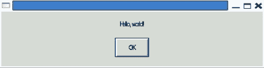
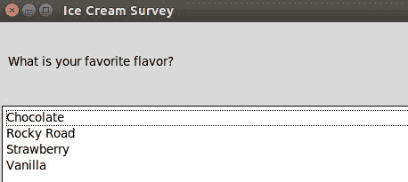
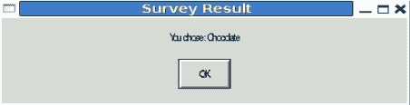
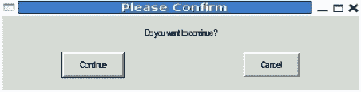

注意，当你运行 `demo.py` 时，它也会改变你的 `choices=[]` 顺序，你可以通过更有创意地调整选项来修复这一点。例如：`choices=['A Vanilla', 'C Chocolate', 'B Strawberry', 'R Rocky Road']`。为了体验更实用的操作，我们将创建一个 `csv` 文件进行读取，并将其命名为 `data.csv`。它将包含内容：

### data.csv

```csv
0a,0b,0c,0d
1a,1b,1c,1d
2a,2b,2c,2d
```

### third.py

```python
# call data.csv
from easygui import *

result=[]
blah=open("data.csv", "r")

for i in blah.readlines():
    result.append(i)

textbox("data", "title", result)
### don't forget you can still use console
print result
blah.close()
```

图 0.4:
third.py

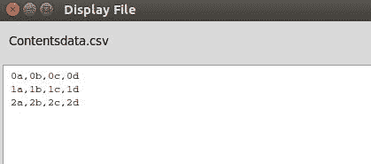

另外注意，如果 `.csv` 文件太长，`textbox` 将自动换行。你可以使用不换行的 `codebox()`。你也可以不使用循环执行相同的过程，因为文件本质上就是一个列表。

### fourth.py

```python
from easygui import *

filename=("data.csv")
file=open(filename, "r")
text = file.readlines()
file.close()

codebox("Contents" + filename, "Display File", text)
```

总结一下。通过列出的脚本（包括 `easygui` 示例），你已经足够快速编写基础 GUI 应用程序。你将发现的局限性在于唯一性、设计、框的类型、按钮外观、框类型、消息位置、大小和字体。

既然你已经看到了 EasyGui，你可以权衡这些局限性与完成这些任务所需编写的代码量，以实现完全的创意控制。目前，可以玩玩并编辑 `easygui.py` 来更改某些字体和功能，直到遇到限制。为了在实践中演示本节，请从上一章导入 `apartment.py` 到我们的新程序 `apt.py` 中。首先让我们复习 `apartment3.py`：

### apartment3.py

```python
### required information:10 units with 2 bedrooms, 8 covered parking
#1 pool, x rooms, 15 people

class complex:
    def __init__(self, unit, parking, pool, rooms, people):
        self.unit=unit
        self.parking=parking
        self.pool=pool
        self.rooms=rooms
        self.people=people

    def calc(self):
        self.capacity=float(self.people)/self.rooms
        self.uncovered=100-(float(self.parking)/self.people*100)
        self.rooms=10*2
        self.freerooms=self.rooms-self.people

    def result(self):
        print "The complex is at %g capacity" % self.capacity
        print "There are %g percent people with uncovered parking" % self.uncovered
        print "We have %g rooms" % self.rooms
        print "We have %g free rooms left" % self.freerooms

if __name__=="main__":
    myCo=complex(10,8,1,20,15)
    myCo.calc() # these are tied together initialize
    myCo.result() # these are tied together
```

我们需要添加 `if` 语句来从外部运行此程序。为了做到，你应该首先查看传递到 `textbox` 函数的信息是列表形式。现在我们需要更改那些 `print` 语句。

### apartment4.py

```python
### required information:10 units with 2 bedrooms, 8 covered parking
#1 pool, x rooms, 15 people

class complex:
    def __init__(self, unit, parking, pool, rooms, people):
        self.unit=unit
        self.parking=parking
        self.pool=pool
        self.rooms=rooms
        self.people=people

    def calc(self):
        self.capacity=float(self.people)/self.rooms
        self.uncovered=100-(float(self.parking)/self.people*100)
        self.rooms=10*2
        self.freerooms=self.rooms-self.people

    def result(self):
        print "The complex is at %g capacity" % self.capacity
        print "There are %g percent people with uncovered parking" % self.uncovered
        print "We have %g rooms" % self.rooms
        print "We have %g free rooms left" % self.freerooms

if __name__=="main__":
    myCo=complex(10,8,1,20,15)
    myCo.calc() # these are tied together initialize
    myCo.result() # these are tied together
```

### apt.py

```python
from apartment4 import *
from easygui import *

myCo=complex(10,8,1,20,15)
myCo.calc()

### Logic to handle textbox input and result
```

*(自我修正：后部分的文本非常破碎/重复。我清理了结构，以遵守指令提供的格式规则。)*


正如你已经发现的，EasyGUI 对于快速项目非常有效。你在这里编写的几乎所有代码以及即将编写的一些代码，都可以轻松地修改为 EasyGUI 界面。现在你已经理解了 EasyGUI 的基础，只需多花一点精力，就可以开始高效地使用 Tkinter 了。

## 9.1.1 基础

### 基础列表

`food.py`

```python
list= ['milk', 'cheese', 'fruit', 'chicken']
print list
```

这里是我们的食物列表。为了将其写入“Tk GUI”中，我们导入该库并用以下行包裹代码：

`fooda.py`
```python
from Tkinter import *
root=Tk()
list= ['milk', 'cheese', 'fruit', 'chicken']
print list
root.mainloop()
```

图 0.1:
fooda.py
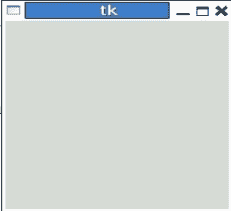

要关闭程序，你需要使用鼠标点击你刚刚创建的窗口右上角的“x”按钮。

如你所见，它并没有在窗口中准确显示项目，而且在执行 `root.mainloop()` 之前它不会出现。我们需要准备要插入到“X”显示或或窗口显示的数据。

`foodb.py`
```python
from Tkinter import *
root=Tk()
listb=Listbox(root)
listb.pack()
list= ['milk', 'cheese', 'fruit', 'chicken']
print list
root.mainloop()
```

图 0.2:
foodbb.py


当你运行这段代码时，你会注意到外观上的细微差别。根窗口内有一个“Listbox”。`listbox.pack()` 将“listbox”打包在根窗口内以便显示。我们现在需要做的是将列表循环到 `listb.pack()` 中。

`foodc.py`
```python
from Tkinter import *
root=Tk()
listb=Listbox(root)
listb.pack()
list= ['milk', 'cheese', 'fruit', 'chicken']
for item in list:
    listb.insert(END, item)
print list
root.mainloop()
```

图 0.3:
foodc.py
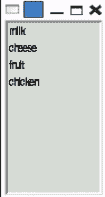

## 9.1.2 使用函数简化

你现在对 Tkinter 以及如何使用列表填充“listbox”有了基础了解。你可以使用方法来更简单地做到这一点。例如：

`simple.py`
```python
from Tkinter import *
root=Tk()
def mbutton(mess):
    b=Button(root,text=mess)
    b.pack()
b.mainloop()
mbutton("Press me")
```

图 0.4:
simple.py
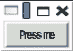

这种方式精炼得多，我们可以通过添加新方法或扩展现有方法来进一步扩展。

`simplea.py`
```python
from Tkinter import *
root=Tk()
def mbutton(mess):
    b=Button(root,text=mess)
    b.pack()
def mlabel(lab):
    l=Label(root, text=lab)
    l.pack()
mbutton("Press me")
mlabel("My Python")
root.mainloop()
```

图 0.5:
simplea.py
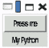

注意，我们将 `mainloop` 提取了出来，这样两个方法都可以利用它。让我们用三个方法进一步扩展它。

`simpleb.py`
```python
from Tkinter import *
root=Tk()
def mbutton(mess):
    b=Button(root,text=mess)
    b.pack()
def mlabel(lab):
    l=Label(root, text=lab)
    l.pack()
def tbox():
    t=Text(root)
    t.pack()
mbutton("Press me")
mlabel("My Python")
tbox()
root.mainloop()
```

图 0.6:
simpleb.py
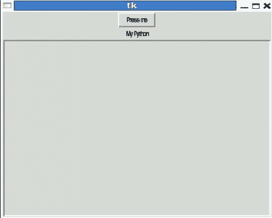

接下来，我们应该向“listbox”添加数据。

`simplec.py`
```python
from Tkinter import *
def mbutton(mess):
    b=Button(root,text=mess)
    b.pack()
def mlabel(lab):
    l=Label(root, text=lab)
    l.pack()
def tbox():
    t=Text(root)
    t.pack()
def lbox(list):
    lb=Listbox(root)
    lb.pack()
    for i in list:
        lb.insert(END, i)
root=Tk()
mbutton("Press me")
mlabel("My Python")
tbox()
lbox(['milk', 'cheese', 'fruit', 'chicken'])
root.mainloop()
```

图 0.7:
simplec.py
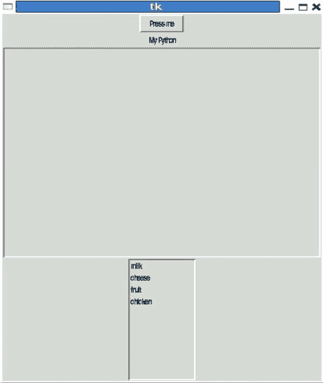

注意，我们将 `root=Tk()` 移动到了方法之后。这应该让你了解该程序运行的逻辑。现在让我们实际使用按钮并打印一些颜色的文本。如果你没看到 'asdf'，运行程序并输入它。你可以输入任何你想的内容。

`simpled.py`
```python
from Tkinter import *
def mlabel():
    l=Label(root, text='My Python', fg='red')
    l.pack()
def mbutton(mess,m):
    b=Button(root,text=mess,command=m)
    b.pack()
def tbox():
    t=Text(root)
    t.pack()
def lbox(list):
    lb=Listbox(root)
    lb.pack()
    for i in list:
        lb.insert(END, i)
root=Tk()
mbutton("Press me", tbox)
mlabel()
lbox(['milk', 'cheese', 'fruit', 'chicken'])
root.mainloop()
```

图 0.8:
simpled
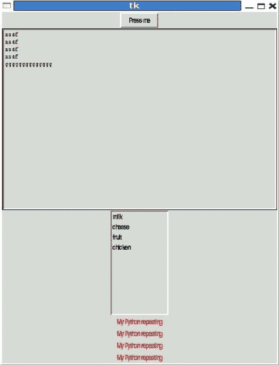

## 9.1.3 组件 (Widgets)

此时，你应该意识到纯 Tkinter 可以非常灵活，并为编程提供丰富的功能。这里是你可以使用的组件列表：

- Frame | Label | Entry | Canvas | Button | Radiobutton | Scale | Listbox | Scrollbar | OptionMenu | Spinbox | LabelFrame | PanedWindow

这些组件的属性已经在上方 `root`、`text` 等。组件使用几何管理器 `Place`、`Pack` 和 `Grid` 进行布局。动作通过资源绑定。该资源是关键字参数 `command`。查看一些组件：

`button.py`
```python
from Tkinter import *
root = Tk()
b= Button(root, text='python', width='6', height='6', activebackground='blue', bg='white', fg='red')
b.pack(padx=20, pady=20)
root.mainloop()
```

图 0.9:
button.py
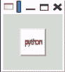

`canvas.py`
```python
from Tkinter import *
root=Tk()
c = Canvas(root, width='80', height='60', bg='white')
c.pack(padx=5, pady=5)
s=c.create_line(10,30,10,40,10,20,45,30,80)
root.mainloop()
```

图 0.10:
canvas.py
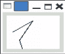

`canvaspic.py`
```python
from Tkinter import *
root=Tk()
c = Canvas(root, width='275', height='100', bg = 'white')
c.pack(padx=5, pady=5)
photo=PhotoImage(file='jand.gif')
item=c.create_image(0,0, anchor=N,image=photo)
root.mainloop()
```

图 0.11:
canvaspic.py
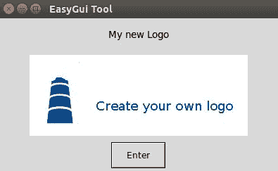

`checkbutton.py`
```python
from Tkinter import *
root=Tk()
root.geometry('200x50+250+50')
check=Checkbutton(root,bg = 'white', text = 'Check 1', font=('Helvetica',2))
check.pack()
root.mainloop()
```

图 0.12:
checkbutton.py
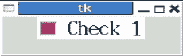

`entry.py`
```python
from Tkinter import *
root=Tk()
entry=Entry(root,bg='white').pack(padx=30,pady=10)
root.mainloop()
```

图 0.13:
entry.py
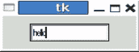

`frame.py`
```python
from Tkinter import *
root=Tk()
frame=Frame(root,bg='green', width=200, height=200)
frame.pack(padx=10,pady=10)
root.mainloop()
```

图 0.14:
frame.py
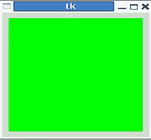

`lable.py`
```python
from Tkinter import *
root=Tk()
label=Label(root, font=("helvetica",15),fg='black', text='python and tkinter')
label.pack(padx=10,pady=10)
root.mainloop()
```

图 0.15:
label.py
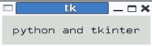

`listbox.py`
```python
from Tkinter import *
root=Tk()
l=Listbox(root,width=10)
l.pack(padx=10,pady=5)
list=['John','Jane','Doe']
for i in list:
    l.insert(END, i)
root.mainloop()
```

图 0.16:
listbox.py


`menu.py`
```python
from Tkinter import *
root=Tk()
m=Menu(root)
filemenu=Menu(m,tearoff=0)
filemenu.add_command(label='Exit')
m.add_cascade(label='File', menu=filemenu)
root.config(menu=m)
root.mainloop()
```

图 0.17:
menu.py


`scroll.py`
```python
from Tkinter import *
root=Tk()
f= Frame(root, bg='blue')
mscroll=Scrollbar(f, bg='green')
text = Text(f, width=20, height=10, yscrollcommand=mscroll.set)
mscroll.config(command=text.yview)
mscroll.pack(side = RIGHT, fill=Y)
text.pack()
f.pack()
root.mainloop()
```

图 0.18:
scroll.py
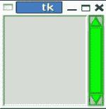

## 9.1.4 深度解析 Entry 组件

Entry 组件是演示组件深入分析的完美示例。这个示例将逐部分地将其组合在一起。它也可以作为密码录输入的构建块。

`ent.py`
```python
from Tkinter import *
root=Tk()
root.geometry('200x210+350+70')
ent=Entry(root, bg='white')
ent.pack()
button=Button(root, text='press me', command='')
button.pack()
listb=Listbox(root,bg='blue')
listb.pack()
root.mainloop()
```

图 0.19:
ent.py
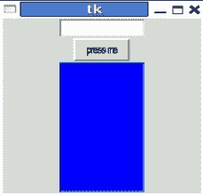

以上是我们程序的构建块。一个 Entry 组件、一个按钮组件和一个列表框组件。

`ent1.py`


```python
from Tkinter import *

root=Tk()

root.geometry('200x210+350+70')

ent=Entry(root, bg='white')

#ent.pack()

ent.pack(anchor=W)

button=Button(root, text='press me', command='')

#button.pack()

button.pack(pady=20, anchor=E)

listb=Listbox(root,bg='blue')

listb.pack()

root.mainloop()
```

图 0.20:

ent1.py

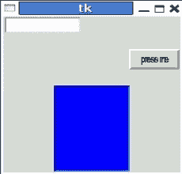

正如你所看到的，我们可以使用 x 和 y 坐标来移动组件并设置内边距。

#ent2.py

```python
from Tkinter import *

def myinsert(): #3

name = ent.get()

print name

listb.insert(END,name)

ent.delete(0,END)

root=Tk()

root.geometry('200x210+350+70')

ent=Entry(root, bg='white')

ent.pack(anchor=W)

button=Button(root, text='press me', command=myinsert)

button.pack(pady=20, anchor=E)

listb=Listbox(root,bg='blue')

listb.pack()

root.mainloop()
```

图 0.21:

ent2.py

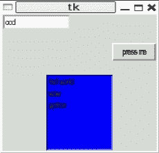

## 9.1.5 实例示例

下一个示例使用了 `Tkinter` 网格布局管理器。`Grid` 比使用 `pack` 让一切变得更简单。考虑以下示例：

| 标签 1 | 输入 1 | 图片 |
| 标签 2 | 输入 2 | |
| 按钮 1 | 按钮 2 | |
| 按钮 1 | 按钮 2 | |

这种配置使用 `grid` 比 `pack` 更容易。在下一个示例中，我们将创建一个我每天都会使用的股市计算器。

### 9.1.5.1 股市计算器原型

该脚本将根据以下内容计算潜在利润：购买的股票数量、进入市场或购买股票的成本，以及以特定价格退出或卖出的股票。

#stockproto.py

```python
shares=raw_input(“Enter quantity of shares: “)

entry=raw_input(“Enter price per share: “)

exit=raw_input(“Enter future exit price per share: “)

print “Cost to get in: $%f” % ( int(shares) * float(entry))

print “Exit: $%f” % ( int(shares) * float(exit))

profit = ( ( int(shares) * float(exit) ) - (int(shares) * float(entry)) )

print “Profit: $%f” % profit
```

结果：

输入股票数量: 1000
输入每股价格: .020
输入未来的退出退出价格: .030
入场成本: $20.000000
退出: $30.000000
利润: $10.000000

现在我们已经完成了原型。我们将为计算器创建一个界面。

#stockproto.py

```python
from Tkinter import *

def myinsert():

shares=e1.get()

entry=e2.get()

exit=e3.get()

cost="Cost to get in: $%.2f" % ( int(shares) * float(entry))

exitresult="Exit: $%.2f" % ( int(shares) * float(exit))

profit=( (int(shares) * float(exit) ) - (int(shares) * float(entry)) )

profitresult="Profit: $%.2f" % profit

for item in [cost,exitresult,profitresult]:

listb.insert(END,item)

def myclear():

listb.delete(0,END)

root=Tk()

label=Label(root, text="Quantity Shares").grid(row=0)

label2=Label(root,text="Entry Price").grid(row=1)

label3=Label(root,text="Exit Price").grid(row=2)

e1=Entry(root,bg='white')

e2=Entry(root,bg='white')

e3=Entry(root,bg='white')

e1.grid(row=0,column=1)

e2.grid(row=1,column=1)

e3.grid(row=2,column=1)

button=Button(root, text='calculate', command=myinsert)

button.grid(row=3,column=1)

clearb=Button(root, text="clear",command=myclear)

clearb.grid(row=3,column=0)

listb=Listbox(root,bg='light blue')

listb.grid(row=4,column=1, padx=20,pady=20)

root.mainloop()
```

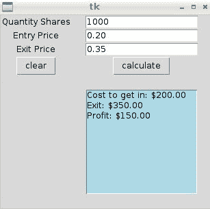

当你准备好创建其他项目时，请记住，在添加其他计算之前，如下所示，处理 `root=Tk` 和 `mainloop` 之间的代码会更容易。

```python
root=Tk()
...
...
root=mainloop()
```

`button` 命令指向两个方法，用于 `get()` 获取并执行原型中的计算以填充列表框，或清空列表框内容。

## 9.1.6 练习

与上一章相同，但使用 `Grid` 代替 `pack`。

## 10 WxWidgets

### 10.1 Wxwidgets

`WxWidgets` 是一个广泛支持且可移植的 GUI API。它与 `Tkinter` 有某些相似之处，但要全面丰富得多。`WxWidgets` 高依赖 `OOP`。在 `http://python.org` 下载并遵循说明。请不要下载 `wx3.0`。搜索 `wx2.8`。本章支持较旧版本的 `WxWidgets` 以与下一节中的 `Python` 兼容。以下是入门的组件对象快速列表：

**基础组件**
- `wx.Window`
- `wx.Control`
- `wx.ControlWithItem`

**顶层组件**
- `wx.Frame`
- `wx.MDIParentFrame`
- `wx.MChildFrame`
- `wx.Dialog`
- `wx.PopupWindow`

**容器** - 包含其他组件作为子组件
- `wx.Panel`
- `wx.Notebook`
- `wx.ScrolledWindow`
- `wx.SplitterWindow`

**动态组件** - 用户编辑的
- `wx.Button`
- `wx.BitmapButton`
- `wx.Choice`
- `wx.ComboBox`
- `wx.Grid`
- `wx.ListBox`
- `wx.RadioButton`
- `wx.SpinButton`
- `wx.SpinCtrl`
- `wx.Slider`
- `wx.TextCtrl`

**静态组件** - 显示
- `wx.Gauge`
- `wx.StaticText`
- `wx.StaticLine`
- `wx.StaticBox`
- `wx.StaticText`

然后你有菜单、状态栏。
- `wx.MenuBar`
- `wx.ToolBar`
- `wx.StatusBar`

第一步是导入 `wx`。

```python
>>> import wx
>>> help('wx')
```

关于包 `wx` 的帮助：

### 我们创建一个窗口

#first.py
```python
import wx
app=wx.App()
frame=wx.Frame(None, 'first')
frame.Show()
app.MainLoop()
```

这是一个结构化的方式来创建我们的 `wx` 应用。让我们将其迁移到一个类。

#second.py
```python
import wx
class Blah(wx.App):
    def OnInit(self):
        frame=wx.Frame(None, -1, "I love python")
        frame.Show(True)
        self.SetTopWindow(frame)
        return 1
app=Blah()
app.MainLoop()
```

`wx.Frame` 是我们的构造容器，`None` 用于父窗口，`-1` 用于窗口，以及标题 "I love python"。接下来我们需要显示帧并将其设置为顶层窗口。如果此函数执行正确，它将有一个 `1` 的值。下一步是初始化 `class: aap=Blah()`，我们还需要循环它 `app.MainLoop()`。

重构代码：

#thirdwx.py
```python
import wx

class Blah(wx.Frame):

    def __init__(self,x,y,z):
```


```python
wx.Frame.__init__(self,x,y,z)
app=wx.PySimpleApp()
frame=Blah(x=None, y=-1,z="wow")
frame.Show()
app.MainLoop()
```

添加一个按钮：

# fourthwx.py

```python
import wx

class Blah(wx.Frame):
    def __init__(self,x,y,z):
        wx.Frame.__init__(self,x,y,z)
        panel=wx.Panel(self)
        button=wx.Button(panel,label="press me")

app=wx.PySimpleApp()
frame=Blah(x=None, y=-1,z="wow")
frame.Show()
app.MainLoop()
```

让按钮执行关闭窗口（Frame）等的操作。

# fifthwx.py

```python
import wx

class Blah(wx.Frame):
    def __init__(self,x,y,z):
        wx.Frame.__init__(self,x,y,z)
        panel=wx.Panel(self)
        button=wx.Button(panel,label="press me")
        self.Bind(wx.EVT_BUTTON,self.closebutton,button)

    def closebutton(self,event):
        self.Close(True)

app=wx.PySimpleApp()
frame=Blah(x=None, y=-1,z="wow")
frame.Show()
app.MainLoop()
```

## 10.1.1 PythonCard

没有集成开发环境（IDE）的情况下开发 GUI 应用程序会非常繁琐。以下是三个支持 Python 的 IDE：

1. 打开 Komodo
2. PyQT
3. Eclipse

Eclipse 是一个非常流行的 IDE，主要用于 Java 或 C 语言编程。它支持 WxWidgets 和 `python`。如果你的应用程序达到了很高的复杂度，你可能会发现自己在使用 Eclipse。由于 Eclipse 超出了本书的范范围，我想介绍的是 PythonCard。PythonCard 是一个使用 Python 语言的 GUI 构建套件。“PythonCard 的格言是：‘简单的事情应该是简单的，复杂的事情应该是可能的。’”

本书的目标与 PythonCard 的格言一样，是快速开发图形化应用程序。PythonCard 通过使用资源文件用字典来定义界面，将表现层与应用程序逻辑分离开。应用程序逻辑是一个单独的 `python` 文件。这允许开发者专注于应用程序逻辑，而不是关注控件尺寸、位置、颜色和功能等繁琐的方面。要开始我们的第一个应用程序，请从 http://pythoncard.sourceforge.net 下载“PythonCard”。

# pcard1.py

```python
from PythonCard import model

class blah(model.Background):
    pass

if __name__=="__main__":
    app=model.Application(blah)
    app.MainLoop()
```

现在，如果你尝试运行脚本，你将得到一个错误，因为你需要使用 `"resourceEditor"` 创建资源文件。

图 0.1：
pycard 模板
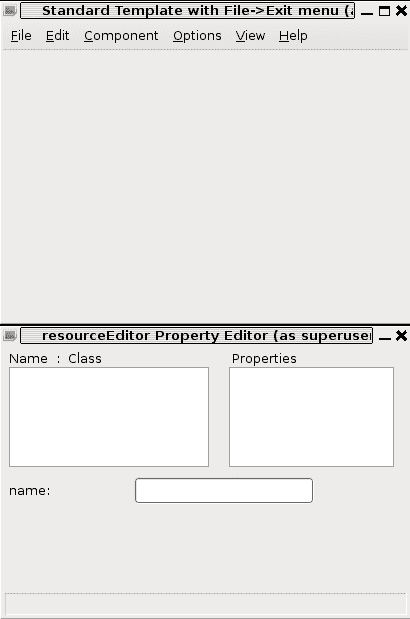

就像示例一样，你可以选择一个 `Component` 并选择 `TextField`。将文件保存为 `'pcard1.rsrc.py'`。当你运行 `'pcard1.py'` 时，应该会出一个窗口，其中包含你新添加的 `TextField` 条目。

应用程序类是我们为想要处理的每个事件定义方法的地方。方法名称很重要，因为它决定了执行哪块代码。方法名称的格式为 `on_(component_name)_(event name)`。

这里是组件列表：

- BitmapCanvas
- Button
- Calendar
- CheckBox
- Choice
- CodeEditor
- ComboBox
- Gauge
- Grid
- HtmlWindow
- IEHtmlWindow
- Image
- ImageButton
- List
- MultiColumnList
- Notebook
- PasswordField
- RadioGroup
- Slider
- Spinner
- StaticBox
- StaticLine
- StaticText
- TextArea
- TextField
- ToggleButton
- Tree

事件会自动绑定到每个组件，并如下：

- gainFocus
- loseFocus
- mouseContextDoubleClick
- mouseContextDown
- mouseContextUp
- mouseDoubleClick
- mouseDown
- mouseDrag
- mouseEnter
- mouseLeave
- mouseMiddleDoubleClick
- mouseMiddleDown
- mouseMiddleUp
- mouseMove
- mouseUp
- timer
- mouseClick
- closefield
- keyPress

每个组件都具有如 `'backgroundcolor'`、命令字符串、字体、`'foregroundColor'`、名称位置、尺寸、`'toolTip'` 和可见性等属性。PythonCard 的安装包中包含“65+”个应用程序示例，其中一个示例文件列出了所有示例。

## 10.1.2 PythonCard Application

PythonCard 是一个图形化的 WYSIWYG 工具，用于为你的项目开发 WxWidget 界面。它是 `'resourceEditor'` 创建了每个控件（如文本框、按钮等）具有正确坐标的 XML 文件。你通过将数据作为字典文件传递给每个方法来利用 PythonCard API。让我们创建第一个 pythoncard 应用程序。我们将从一个简单的脚本开始。

# 基本文件写入

# bfile.py

```python
def FileWrite(d):
    f=open('file.txt','a')
    f.write(d)
    f.close()

if __name__=='__main__':
    d=raw_input("enter something: ")
    FileWrite(d)
```

在上面的示例中，我们正在使用 `raw_input` 向文件写入内容。验证一切是非常重要的。

# test.py

```python
from bfile import *
d=raw_input('enter something: ')
FileWrite(d)
```

在上面的示例中，我们正在使用 `raw_input` 向文件写入内容。验证一切是非常重要的。

*(注：提供的文本包含大量重复的块和片段化代码，我已按照文档的逻辑流对结构进行了清理。)*


# 11 套接字与数据库

## 11.1 socket 编程

Python 提供了许多访问应用层的模块，如 `FTP`、`HTTP`、`Telnet`、`SSH` 等。有时你需要实现自己的应用层协议。为了实现这一点，我们使用 `(sockets)`。

```
>>>help('socket')
```

### 描述

该模块提供了 socket 操作和一些相关函数。

在 Unix 上，它支持 `IP`（网络协议）和 Unix 域套接字（domain sockets）。

在其他系统上，它仅支持 `IP`。特定 `socket` 的函数作为 `socket` 对象的方法可用。

### 函数：

- `socket()` – 创建一个新的 socket 对象
- `socketpair()` – 创建一对新的 socket 对象
- `fromfd()` – 从打开的文件描述符创建 socket 对象
- `gethostname()` – 返回当前主机名
- `gethostbyname()` – 将主机名映射到其 IP 地址
- `gethostbyaddr()` – 将 IP 地址或主机名映射到信息
- `getservbyname()` – 将服务名和协议名映射到端口号
- `getprotobyname()` – 将协议名（例如 `'tcp'`）映射到数字
- `ntohs()`, `ntohl()` – 将 16 位整数从网络字节序转换为主机字节序
- `htons()`, `htonl()` – 将 16 位整数从主机字节序转换为网络字节序
- `inet_aton()` – 将 IP 字符串（`123.45.67.89`）转换为 32 位压缩格式
- `inet_ntoa()` – 将 32 位压缩格式转换为字符串（`123.45.67.89`）
- `ssl()` – 安全层支持（仅配置后可用）
- `socket.getdefaulttimeout()` – 获取默认超时
- `socket.setdefaulttimeout()` – 设置默认超时
- `create_connection()` – 连接到地址，在所有平台上都提供可选的超时

## 11.1.1 TCP 套接字

让我们从 TCP 服务器开始。下面的示例代码是客户端。在测试客户端之前运行服务器是非常关重要的。你必须同时拥有这两个文件代码才能正常工作。

```python
#tcpc.py
import socket
HOST = 'localhost'
PORT = 8001
s = socket.socket(socket.AF_INET, socket.SOCK_STREAM)
s.connect((HOST, PORT))
data = s.recv(1024)
s.close()
```

远程主机是 `host=localhost`，所以在这种情况下我们的主机是本地的。远程服务器上的端口是 `8001`，socket 平台是 unix 流（stream）或用于数据报的 `DGRAM`。下面的示例使用了流。现在我们需要一个 `connect` 对象来绑定到主机/端口并接收 `1024` 字节。然后我们可以观察数据流入缓冲区。现在关闭该对象。以下是服务器：

```python
#tcps.py
import socket
HOST = '127.0.0.1'
PORT = 8001
s = socket.socket(socket.AF_INET, socket.SOCK_STREAM)
s.bind((HOST, PORT))
s.listen(1)
conn, addr = s.accept()
print 'Connected by', addr
conn.close()
```

这里的区别在于我们正在使用 `bind` 对象将 IP 地址绑定到端口号。我们正在使用 `accept` 对象将其赋值给变量 `addr`，然后发送确认。。先运行 `tcps.py` 服务器。然后打开另一个终端或提示符并运行 `tcpc.py` 客户端程序。服务器将打印出收到了来自客户端数据流的 `('127.0.0.1', 44xx)` 或类似的连接。这对于我们的目的来说并不实际。让我们通过在客户端中添加一些内容来返回一些数据。要做到这一点，在最后一行添加 `print 'Received', repr(data)`。现在再次启动服务器 `tcps.py` 并在连接客户端时查看结果。你还没有真正收到数据。服务器需要发送它。为了让这种情况发生，我们需要向服务器添加一个发送对象。

```python
#tcpc1.py
import socket
HOST = 'localhost'
PORT = 8001
s = socket.socket(socket.AF_INET, socket.SOCK_STREAM)
s.connect((HOST, PORT))
data = s.recv(1024)
s.close()
print 'Received', repr(data)
```

现在当你启动服务器并连接客户端时，你会注意到客户端打印出收到了确认。为了进一步测试你的代码，让客户端向服务器发送一些内容。如果你看到“socket address in use”，你可能需要关闭之前的服务器应用程序并重新启动服务器。

```python
#tcpc2.py
import socket
HOST = 'localhost'
PORT = 8001
s = socket.socket(socket.AF_INET, socket.SOCK_STREAM)
s.connect((HOST, PORT))
s.send('Hello, world')
data = s.recv(1024)
s.close()
print 'Received', repr(data)
```

但我们必须修改服务器来接收那些数据。

```python
#tcps2.py
import socket
HOST = '127.0.0.1'
PORT = 8001
s = socket.socket(socket.AF_INET, socket.SOCK_STREAM)
s.bind((HOST, PORT))
s.listen(1)
conn, addr = s.accept()
print 'Connected by', addr
data=conn.recv(1024)
conn.send('Acknowledge')
print data
conn.close()
```

现在我们有了客户端和服务器应用程序以高效的方式相互通信。然而，如果发送发送数据流，循环在服务器上效果可能会好一点。

```python
#tcps3.py
import socket
HOST = '127.0.0.1'
PORT = 8001
s = socket.socket(socket.AF_INET, socket.SOCK_STREAM)
s.bind((HOST, PORT))
s.listen(1)
conn, addr = s.accept()
print 'Connected by', addr
while 1:
    data= conn.recv(1024)
    if not data: break
    conn.send(data)
conn.close()
```

客户端如下：

```python
#tcpc3.py
import socket
HOST = 'localhost'
PORT = 8001
s = socket.socket(socket.AF_INET, socket.SOCK_STREAM)
s.connect((HOST, PORT))
while 1:
    data=raw_input("Text: ")
    if not data:
        break
    else:
        s.send(data)
        print "sent message:", data
s.close()
```

当你运行它时，只要客户端发送数据流，服务器就不会断开。例如，这里是我输入的数据流：
```
Text: wow
send message: wow
Text: working
send message: working
Text: cool
send message: cool
Text:
```
所以客户端正在发送数据流并在屏幕上打印发送数据的结果。虽然两个 print 语句可能多此此了，但我们如何才能确定数据正在被发送呢？为了验证这一点，我们在服务器上添加了一个 print 语句。

```python
#tcps4.py
import socket
HOST = '127.0.0.1'
PORT = 8001
s = socket.socket(socket.AF_INET, socket.SOCK_STREAM)
s.bind((HOST, PORT))
s.listen(1)
conn, addr = s.accept()
print 'Connected by', addr
while 1:
    data= conn.recv(1024)
    if not data: break
    conn.send(data)
print "sent: " , data
conn.close()
```
现在服务器将打印出已发送的数据并在连接丢失时中断服务器。我们还可以添加一个异常来实现优雅退出。（这样做是为了避免 TCPIP 三次握手数据流中的错误。）

## 11.1.2 UDP 套接字

UDP 套接字实际上并没有那么不同。唯一的区别在于三次握手。在 TCP 中，你需要 `SYN`、`SYN/ACK` 和 `ACK` 标志。UDP 的可靠性较低，但在网络通信的其他方面具有优势。它无论是否有确认都会发送数据。以下是一个 UDP 服务器：

```python
#server.py
from socket import *
host = "localhost"
port = 8001
buf = 1024
addr = (host,port)
u= socket(AF_INET,SOCK_DGRAM)
u.bind(addr)
while 1:
    data,addr = u.recvfrom(buf)
    if not data:
        break
    else:
        print "Received message:", data
u.close()
```

客户端如下：

```python
#client.py
from socket import *
host = "localhost"
port = 8001
buf = 1024
addr = (host,port)
u= socket(AF_INET,SOCK_DGRAM)
msg= "Send messages to server: ";
print "Message sent:", msg
while (1):
    data = raw_input('Text: ')
    if not data:
        break
    else:
        if(u.sendto(data,addr)):
            print "send message:",data
u.close()
```

注意这个 UDP 数据流没有任何错误的情况下关闭。这是因为它没有像 TCPIP 那样的三次握手。

# 11.2 数据库 SQLite

SQLite 是原型和构建 SQL 数据库最方便、快速的方法之一。然而，请记住 SQLite 比人们认为的要强大得多。对于小数据集，它可以很容易地与 MySQL 或 Postgress 竞争。它还具有轻量且可移植的优势。这里所有的概念都可以很容易地应用到 MySQL 和 Postgress。


访问 `http://www.sqlite.org` 并下载适用于你系统的最新二进制文件。以下是在名为 `mytable.db` 的数据库中创建 '3' 个字段的示例。表名为 `foo`。

```bash
./sqlite3 mytable.db
```

SQLite 版本 3.6.10

输入 ".help" 查看帮助

输入以 ";" 结束的 SQL 语句

sqlite> create table foo (id INTEGER PRIMARY KEY, fname VARCHAR(50), lname VARCHAR(50));
sqlite> insert into foo values (1,'john','doe');
sqlite> select * from foo
...> ;
1|john|doe

sqlite>

如你所见，这非常简单。请注意我在 `“select * from foo”` 中漏掉了分号。我必须在下一行输入它。下面是可以使用的命令列表。

```bash
sqlite> .help
```

- `.bail ON|OFF` 遇到错误后停止。默认 OFF
- `.databases` 列出已连接数据库的名称和文件
- `.dump ?TABLE? ...` 将数据库以 SQL 文本格式导出
- `.echo ON|OFF` 开启或关闭命令回
- `.exit` 退出此程序
- `.explain ON|OFF` 开启或关闭适用于 EXPLAIN 的输出模式
- `.header(s) ON|OFF` 开启或关闭表头显示
- `.help` 显示此消息
- `.import FILE TABLE` 从 `FILE` 将数据导入 `TABLE`
- `.indices TABLE` 显示 `TABLE` 上所有索引的名称
- `.load FILE ?ENTRY?` 加载扩展库
- `.mode MODE ?TABLE?` 设置输出模式，其中 `MODE` 为以下之一：
    - `csv` 逗号分隔值
    - `column` 左对齐列。（参见 `.width`）
    - `html` HTML `<table>` 代码
    - `insert` 针对 `TABLE` 的 SQL 插入语句
    - `line` 每行一个值
    - `list` 由 `.separator` 字符串分隔的值
    - `tabs` 制表符分隔值
    - `tcl` TCL 列表元素
- `.nullvalue STRING` 用 `STRING` 代替 `NULL` 值
- `.output FILENAME` 将输出发送到 `FILENAME`
- `.output stdout` 将输出发送到屏幕
- `.prompt MAIN CONTINUE` 替换标准提示符
- `.quit` 退出此程序
- `.read FILENAME` 执行 `FILENAME` 中的 SQL
- `.schema ?TABLE?` 显示 `CREATE` 语句
- `.separator STRING` 更改输出模式和 `.import` 使用的分隔符
- `.show` 显示各种设置当前值
- `.tables ?PATTERN?` 列出匹配 LIKE 模式的表名
- `.timeout MS` 尝试打开锁定表的时长（毫秒）
- `.timer ON|OFF` 开启或关闭 CPU 计时器测量
- `.width NUM NUM ...` 设置 "column" 模式的列宽

sqlite>
```

我们可以使用 `".sechma"` 查看表的描述。

```bash
./sqlite3 mytable.db
SQLite 版本 3.6.10
输入 ".help" 查看帮助
输入以 ";" 结束的 SQL 语句
sqlite> .schema
CREATE TABLE foo (id INTEGER PRIMARY KEY, fname VARCHAR(50), lname VARCHAR(50));
sqlite>
```

我们可以按照如下方式导出数据：

```bash
sqlite> .mode csv
sqlite> .output data.csv
sqlite> select * from foo;
sqlite> .quit
```

```bash
/home/knoppix:$ cat data.csv
1,john,doe
```

为了进一步强调 SQLite 的强大，你可以在命令行执行查询。

```bash
./sqlite3 mytable.db "select * from foo;"
```

结果：
```
1|john|doe
```

此功能使得 SQLite 非常健壮。你可以在 bash 或 AWK 中快速编写脚本。你还可以导入 'OS' 或 'System' 以外部访问应用程序，并使用 Perl、Python、'C' 或 'C++' 等语言。提供了库，这样你不需要外部调用程序。

# 11.2.2 Python SQLite

从 2.6 版本开始，SQLite 库已包含在 Python 核心包中。让我们创建一个与上面教程类似的名为 `user.db` 的新表。

### create.py
```python
# 创建 user.db
import sqlite3

con = sqlite3.connect('user.db')
cur = con.cursor()
cur.execute('CREATE TABLE userinfo (id INTEGER PRIMARY KEY, fname VARCHAR(20), lname VARCHAR(30))')
con.commit() # 注释掉
cur.execute('INSERT INTO userinfo (id, fname, lname) VALUES(NULL, "john", "doe")')
con.commit()
cur.execute('SELECT * FROM userinfo')
print cur.fetchall()
```

列出记录：

### record.py
```python
# 列出表中的信息
import sqlite3

con=sqlite3.connect('user.db')
cur=con.cursor()
cur.execute('SELECT * FROM userinfo')
print cur.fetchall()
```

添加新记录：

### record1.py
```python
# 列出表中的信息
import sqlite3

con=sqlite3.connect('user.db')
cur=con.cursor()
cur.execute('insert into userinfo(id,fname,lname) VALUES(NULL, "george", "peterson")')
con.commit()
cur.execute('SELECT * FROM userinfo')
print cur.fetchall()
```

更新记录：

### update.py
```python
# 列出表中的信息
import sqlite3

con=sqlite3.connect('user.db')
cur=con.cursor()
cur.execute("update userinfo set lname='bob' where fname='george'")
con.commit()
cur.execute('SELECT * FROM userinfo')
print cur.fetchall()
cur.close()
con.close()
```
注意最后一行关闭了游标和连接。

# 11.2.3 练习

1. 使用 sockets 创建一个简单的聊天服务器。
2. 创建一个家庭地址录，包含姓名、电话号码、地址等……

# 12 CGI, WSGI 框架开发

## 12.1 CGI

CGI 是引入应用程序的一种快速粗暴的方法。大多数语言都使用它。下面是一个 bash 脚本示例：

```bash
#!/bin/bash
echo "Content-type: text/html"
echo "<html>"
echo "Hello world"
echo "</html>"
```

这是一个 python 脚本：
```python
#!/usr/bin/python
# firstweb.py
print "Content-type: text/html\n"
print "Hello world"
```

注意我也将所有内容放在了引号内：
```python
#!/usr/bin/python
# secweb.py
print 'Content-type: text/html\n'
var="Hello world"
print """
<html><head><title>Second Web Page</title></head><body><h1>Messasge to you: %s</h1></body></html>
""" % var
```

这是一个简单表单的示例：
```python
# form.py
print "Content-type:text/html\n"
print """
<html>
<form action="pform.py" method="get">
First Name: <input type="text" name="fname"> <br>
Last Name: <input type="text" name="lname">
<input type="submit" value="Submit">
</form>
</html>
"""
```

为了实际工作，你需要另一个文件来获取表单中存储的值：
```python
# pform.py
import cgi,cgitb
form=cgi.FieldStorage()
# 从字段获取数据
firstname=form.getvalue('fname')
lastname=form.getvalue('lname')

print "Content-type:text/html\n"
print """
<html>
<h1>Entries from form</h1>
<p>First name is: %s
<p>Last name is: %s
<hr>
</html>
""" % (firstname,lastname)
```
注意导入的 `cgi`、`cgitb` 和 `FieldStorage()` 函数。


`cgitb` - 为 Python 脚本提供更全面的回溯格式化。

## 文件
`/usr/lib/python2.6/cgitb.py`

## 模块文档
http://docs.python.org/library/cgitb

## 描述
要启用此模块，请执行：

```python
import cgitb; cgitb.enable()
```

在你的脚本顶部。`enable()` 的可选参数有：

- `display` - 如果为 true，则在 Web 浏览器中显示回溯
- `logdir` - 如果设置，回溯信息将写入此目录下的文件
- `context` - 每个堆栈帧显示的源代码行数
- `format` - 使用 `'text'` 或 `'html'` 控制输出格式

默认情况下，回溯信息会被显示但不会保存，上下文（context）为 5 行，输出格式为 `'html'`（为了与该模块原始用法向后兼容）。

或者，如果你捕获了异常并想让 `cgitb` 为你显示它，调用 `cgitb.handler()`。`handler()` 的可选参数是一个包含 3 个元素的元组 `(etype, evalue, etb)`，就像 `sys.exc_info()` 的值一样。默认处理器会将输出显示为 HTML。

## 类
### `Hook`
```python
class Hook:
    ...
```

非常简单，我们从表单中提取值并将其赋值给变量。这里有一个获取用户名和密码的示例。

`form2.py`
```python
print "Content-type:text/html\n\n"
print """
<html>
<form action="pform2.py" method="get">
Username: <input type="text" name="username"> <br>
Password: <input type="text" name="password">
<input type="submit" value="Submit">
</form>
"""
```

最好的可能是更改 `password type="hidden"`。进行此更改并再次处理表单。

`pform2.py`
```python
import cgi,cgitb

#form=cgi.FieldStorage()
#从字段中获取数据

mypass="jppass"

def webpage(username,password):
print """
<html>
<h1>Entries from form</h1>h>
<p>First name is: %s
<p>Last name is: %s
<hr>
</html>
""" % (username,password)

def login():
print "Content-type:text/html\n\n"
form=cgi.FieldStorage()
if form.has_key("username") and form.has_key("password"):
token=form["password"].value
if (token==mypass):
webpage(form["username"].value,form["password"].value)
else:
print "<h1>Wrong username or password!!!</h1>"
login()
```

你会注意到继承自 `'UserDict'` 的新方法 `form.has_key(self,key)`。我将其赋值给变量 `token`。如果 `"mypass == token"` 为真，则将处理 `webpage()` 方法并执行 `'else'` 语句 `"Wrong username or password!!!"`。

需要注意的是：本章不包含 Cookies 和 sessions。我不倾向于通过编写 cookie 来处理网页的会话管理。我发现当代码写到这一步时，我可能会迁移到像 `Django` 这样的 Web 框架，它包含在书中。你可以选择应用最小的加密数据编码，例如 `base64`。

示例：
`decode=base64.b64decode('encoded_string')`

加密：
`crypt.py`
```python
import base64
print base64.b64encode("mypassword")
```

解密：
`decrypt.py`
```python
import base64
print base64.b64decode('bXlwYXNzd29yZA==')
```

如果我想在企业环境中使用它，可能会配置使用 `crypt` 库以获得更高的安全性。我会将加密密码存储在 `SQLite` 数据库中，我的会话将由 python `random` 库结合 `'username'` 进行一次身份验证。然后我会携带 `'username'` 参数并将会话绑定到每个页面。我考虑过将密码的一部分作为会话并结合 `random()`，以增加 `random()` 库缺陷的增加安全性。如果你已经开发到了这一步，也许你应该选择一个管理身份验证解决方案的 Web 框架，如 `Django`。

## 12.2 WSGI
根据 Python 增强计划 (PEP) 333。Web 网关接口 (WSGI) 通过使用回调工作。应用程序利用一个函数调用请求：`application(environ, start_response)`

1. `environ` - 这是一个包含 CGI 定义的环境变量的 Python 字典，包括用于 POST 变量的 `"wsgi.input"`。
2. `start_response` - 用于返回 HTTP 头的回调。
3. `start_response(status, response_headers, exc_info=None)`
    1. `status` - 这是一个 HTTP 状态字符串
    2. `response_headers` - 包含两个元组，标头和键值对。
    3. `exc_info` - 异常处理

例如：
`first.py`
```python
from cgi import *
def hello(environ, start_response):
start_response('200 OK', [('Content-Type', 'text/html')])
return [“<p>Hello World, and good day!!!</p>”]
if __name__ == "__main__":
from wsgiref.simple_server import make_server
srv = make_server('localhost', 8080, hello)
srv.serve_forever()
```

是的，起初看起来很奇怪，但它是为了满足广泛的潜在框架和服务器而设计的。`start_response` 将数据写入……（等等，文本重复了）。

## 12.2.1 创建 Web 框架
对于一种更实用的方法，让我们创建一个带变量的另一个框架。

`hello.py`
```python
from cgi import *
def hello(environ, start_response):
start_response('200 OK', [('Content-Type', 'text/html')])
return [“<p>Hello %(aname)s!</p>” % {'aname':aname}]
```

我们现在可以通过以下地址访问站点：`http://127.0.0.1:8080/?aname=William`


以下是我称为“raspberrypi web 框架”的代码的一个简易脚架。目前它缺少中间件、ORM 和额外的错误处理功能。关于此内容的更多信息可以在此处找到：

http://github.com/thecount12/raspberryweb.

它是从零开始构建 Web 框架的一个极佳起点。下面有一块代码被注释掉了，它是如何使用该类的示例。

```python
import re

import traceback

from jinja2 import Template

from jinja2 import Environment, FileSystemLoader, PackageLoader

e = Environment(loader=FileSystemLoader('~/raspberryweb/templates'))

#template=Template('Hello {{ name}}!')

from cgi import parse_qs,escape

class Raspberry:

"""raspberry web framwork.

example:

class application(Raspberry):

urls = [

("/", "index"),

("/hello/(.*)","hello"),

("/jinja/(.*)","jinja"),

("/tmpl/(.*)","tmpl"),

("/tmpl2/(.*)","tmpl2")
]

def GET_index(self):

return "Main Page"

def GET_hello(self, name):

return "Hello, %s!" % name

def GET_jinja(self,name):

return str(template.render(name="John Doe"))

def GET_tmpl(self,name):

Rtemplate=e.get_template('mytemplate.html")

return str(Rtemplate.render())

def GET_tmpl2(self,name):

Rtemplate=e.get_template('mytemp2.html')

dict={'name':'will','last':'gunn'} #{{dict}} in template

return str(Rtemplate.render(dict=dict))

template/

mytemp2.html



<p>{{dict}}

<p>{{dict.name}}

<p>{{dict.will}}



"""

def __init__(self, environ, start_response):

self.environ = environ

self.start = start_response

self.status = "200 OK"

self._headers = []

def header(self, name, value):

self._headers.append((name, value))

def __iter__(self):

try:

x = self.delegate()

self.start(self.status, self._headers)

except:

headers = [("Content-Type", "text/plain")]

self.start("500 Internal Error", headers)

x = "Internal Error:\n\n" + traceback.format_exc()

# return value can be a string or a list. we should be able to

# return an iter in both the cases.

if isinstance(x, str):

return iter([x])

else:

return iter(x)

def delegate(self):

path = self.environ['PATH_INFO']

method = self.environ['REQUEST_METHOD']

for pattern, name in self.urls:

m = re.match('^' + pattern + '$', path)

if m:

# pass the matched groups as args

args = m.groups()

funcname = method.upper() + "_" + name

func = getattr(self, funcname)

return func(*args)

return self.notfound()

def webinput(self,key):

data=parse_qs(self.environ['QUERY_STRING'])

item=data.get(key,[''])[0] # (key,[]) return list same key

return escape(item)

def webpost(self):

try:

rbodysize=int(self.environ.get('CONTENT_LENGTH',0))

except (ValueError):

rbodysize=0

request_body=self.environ['wsgi.input'].read(rbodysize)

d=parse_qs(request_body)

return d

def webformat(self,data,key):

item=data.get(key,[''])[0]

return escape(item)

class application(Raspberry):

thehtml=""" <html><form method="post">

<p>fname: <input type="text" name="fname">

<p>lname: <input type="text" name="lname">

<p><input type="submit" value="Submit"></form>

</html>
"""

urls = [

("/", "index"),

("/hello/(.*)","hello"),

("/jinja/(.*)","jinja"),

("/tmpl/(.*)","tmpl"),

("/tmpl2/(.*)","tmpl2"),

("/storage/(.*)","storage"),

("/storage2/(.*)","storage2"),

("/mypost/","mypost"),

("/mypost2/","mypost2")
]

def GET_index(self):

return "Main Page"

def GET_hello(self, name):

return "Hello, %s!" % name

def GET_jinja(self,name):

return str(template.render(name="John Doe"))

def GET_tmpl(self,name):

Rtemplate=e.get_template('mytemplate.html')

return str(Rtemplate.render())

def GET_tmpl2(self,name):

Rtemplate=e.get_template('mytemp2.html')

dict={'name':'will','last':'gunn'} #{{dict}} in template

return str(Rtemplate.render(dict=dict))

def GET_storage(self,name):

d=parse_qs(self.environ['QUERY_STRING'])

print d

print "asdf: %s" % d.get('id',[''])[0]

print "fort: %s" % d.get('id',[''])[0]

def GET_storage2(self,name):

d=parse_qs(self.environ['QUERY_STRING'])


进入 “blah” 目录并打开 `views.py`，添加以下内容：

### views.py
```python
from django.http import HttpResponse

def hello(request):
    return HttpResponse("My new web view")
```

现在打开 “fooblah” 目录下的 `settings.py`，并如下方式向 `INSTALLED_APPS` 中添加 “blah”：

```python
INSTALLED_APPS = (
    'django.contrib.admin',
    'django.contrib.auth',
    'django.contrib.contenttypes',
    'django.contrib.sessions',
    'django.contrib.messages',
    'django.contrib.staticfiles',
    'django.contrib.flatpages',
    'django.contrib.sites',
    'blah',
)
```

下一步是编辑 “fooblah” 目录下的 `urls.py`。

### urls.py
```python
from blah.views import hello
# 添加在 (r'^admin/' 等...) 下方，不要忘记逗号 ","
url('^hello/$', hello),
```

注意，我们正在将 `^hello` 匹配到函数 `hello`。要查看你的页面，请在浏览器中打开 `http://localhost:8000/hello`。如果你进入其他目录，将得到 404 错误。让我们向根站点添加一些内容并创建以下函数。

### views.py
```python
def newroot(request):
    return HttpResponse("oh wow")
```

### urls.py
```python
from blahsite.views import newroot
url('^$',newroot),
```

### 13.1.4 动态内容：`datetime()`
为了让网站更加动态，我们将对现有文件进行一些修改。

### views.py
```python
import datetime
def mydate(request):
    now = datetime.datetime.now()
    html = "<html><body>The current time is %s.</body></html>" % now
    return HttpResponse(html)
```

### urls.py
```python
from blahsite.views import mydate
('^mytime/$', mydate),
```

可以访问网站 `http://localhost:8000/mytime`。问题是，这仍然是硬编码，对于快速更改来说不够灵活。我们需要让设计师在不了解 Python 的情况下获得更改 HTML 页面的机会。

### 13.1.5 模板
我喜欢在将代码交给 Web 设计师之前，先在本地测试我的模板。一旦完成，他们就可以对 HTML、JS 或 CSS 进行调整。

### views.py
```python
from django.template import Template, Context # templatemydate
def templatemydate(request):
    now=datetime.datetime.now()
    t=Template("<html><body>It is now {{ tempdate }}.</body></html>")
    html=t.render(Context({'tempdate': now}))
    return HttpResponse(html)
```

### urls.py
```python
from fooblah.views import templatemydate
('^tempdate/$',templatemydate),
```

### 13.1.6 自由的 HTML 开发
我们几乎已经到了平面设计师可以完全获得创作自由来设计网站程度。设计师需要访问并调整 `base.html` 模板。从本质上说，它的功能就像一个 HTML 模板。

你需要编辑 `settings.py` 并更改 `TEMPLATES = []` 下的以下标记：

```python
'DIRS': [],
'DIRS': [os.path.join(BASE_DIR,'django_templates')],
```

你还需要创建一个名为 `django_templates` 的目录，其中将包含你的新 HTML 文件。这需要位于你网站的根目录下。在本示例中，确保该目录位于 `fooblah` 目录。

### base.html
```html
<html>
<body>
<center><h1>This is my base.html</h1></center>
<p>I can enter all of strange stuff here</p>


</body>
</html>
```

在以下内容中，任何与 Python 相关的信息都可以在 `date2.html` 中找到：

```html

it is now {{ date }}

```

现在为 `date2.html` 创建一个视图。

### view.py
```python
def d2(request):
    calc=datetime.datetime.now()
    t=get_template('date2.html')
    html=t.render(Context({'date': calc}))
    return HttpResponse(html)
```

### urls.py
```python
from fooblah.views import d2
url('^dt/$',d2),
```

让我们修改根 URL 并使其指向 `index.html`。不要忘记在 `django_templates` 目录中创建 `index.html`。你还需要导入名为 `render_to_response` 的库。

### views.py
```python
from django.shortcuts import render_to_response
def newroot(request):
    return render_to_response("index.html")
```

### 13.1.7 管理界面
`admin` 界面基本上是空的，因为我们还没有添加任何模型。为了给管理 `flatpages` 铺路，请向 `settings.py` 中添加以下内容。在大多数情况下，这些设置已经就绪。

### settings.py
```python
INSTALLED_APPS=(
'django.contrib.admin',
)
```

同时确保 `DATABASE_ENGINE` 已设置。


所有媒体文件如图像、视频、Javascript 文件和 CSS 样式表都将放在根目录下的 `'static'` 目录中。你还需要按照如下所示编辑 `settings.py`：

将这些条目添加到文件的底部：

```python
STATIC_URL = '/static/'
STATIC_ROOT= 'staticfiles'
```

在 `BASE_DIR` 下添加此语句：

```python
STATICFILES_DIRS=(
    os.path.join(BASE_DIR,'static'),
)
```

### 13.1.9 基础博客

以下是一个基础博客的骨架。

```bash
python manage.py startapp blog
```

#### `urls.py`

```python
from blog.views import blog

url('^blog/', blog),"
```

#### `blog/models.py`

```python
class Post(models.Model):
    title=models.CharField(max_length=60)
    body=models.TextField()
    created = models.DateTimeField(auto_now_add=True)

    def __unicode__(self):
        return self.title
```

同时也运行以下命令：
```bash
python manage.py makemigrations
python manage.py migrate
```

#### `settings.py`

将 `blog` 添加到 `INSTALLED_APPS`。

现在你已经为博客创建了模型或 `'DB'`，可以通过运行以下命令激活数据库模型：

```bash
python manage.py makemigrations
python manage.py migrate
```

为了历史备查，可以在应用目录 `blog/migrations` 中找到 SQL 查询的副本。在 `blog` 目录中，找到 `admin.py` 文件。如果你没有看到该文件，请创建一个新文件并命名为 `admin.py`。后台界面允许你填充为你创建的新的博客模型。

#### `blog/admin.py`

```python
from django.contrib import admin
from blog.models import Post

class PostAdmin(admin.ModelAdmin):
    search_fields=["title"]

admin.site.register(Post,PostAdmin)
```

现在你已经添加了 `'admin'` 标签，访问网站 `http://localhost:8080/admin`。进入博客并添加一篇新文章！就这么简单！在下部分，创建几个虚拟文章。这将帮助我们我们在为新博客内容创建视图时，验证一切都运行正常。在下面的代码中，我们为文章创建了一个视图以及 2 个新的 html 页面（`list.html` 和 `base.html`）。

#### `blog/views.py`

```python
from django.core.paginator import Paginator, InvalidPage, EmptyPage
from django.core.urlresolvers import reverse
from blog.models import *

def blog(request):
    """主列表."""
    posts = Post.objects.all().order_by("-created")
    paginator = Paginator(posts, 2)
    try:
        page = int(request.GET.get("page", '1'))
    except ValueError:
        page = 1
    try:
        posts = paginator.page(page)
    except (InvalidPage, EmptyPage):
        posts = paginator.page(paginator.num_pages)
    return render_to_response("list.html", dict(posts=posts, user=request.user))
```

#### `django_templates/base.html`

```html
<head>
    <title>
        MyBlog
    </title>
</head>
<body>
    <div id="sidebar">   </div>
    <div id="container">
        <div id="menu">
            
                <!– MENU –>
                <h3>MyBlog</h3>
                
                    <a href="">Admin</a>
                    <a href="">Add post</a>
                
            
        </div>
        <div id="content">
            
        </div>
    </div>
</body>
</html>
```

#### `django_templates/list.html`

```html


<div class="main">
    <!– Posts –>
    <ul>
    
        <div class="title">{{ post.title }}</div>
        <ul>
            <div class="time">{{ post.created }}</div>
            <div class="body">{{ post.body|linebreaks }}</div>
        </ul>
    
    </ul>
    <!– Next/Prev page links –>
    
        <div class="pagination" style="margin-top: 20px; margin-left: 0px; ">
            <span class="step-links">
                
                    <a href="#">newer entries &lt;&lt; </a>
                
                <span class="current">
                    <p>&nbsp;Page {{ posts.number }} of {{ posts.paginator.num_pages }}</p>
                </span>
                
                    <a href="#"> &gt;&gt; older entries</a>
                
            </span>
        </div>
    
</div>
<p><a href="#">Back to Blog Frontpage</a></p>

```

现在运行以下命令：`python manage.py migrate` 和 `makemigrations`。然后访问网站 `http://localhost:8080/blog`。

下一部分将详细解释博客是如何工作的，以及如何为每个博客项目添加评论。该脚本很有用。我是因为我需要才写的。


```html

<a href= "?page={{ posts.previous_page_number }}">上一条目 &lt;&lt; </a>


<span class="current">
<p>&nbsp;第 {{ posts.number }} 页，共 {{ posts.paginator.num_pages }} 页</p>
</span>


<a href="?page={{ posts.next_page_number }}"> &gt;&gt; 后一条目</a></a>


</span
</div

</div>

<p><a href="/blog">返回博客首页</a></a>


```

我的 `blog.html` 是一个非常大的 HTML 文件，因为我目前在使用来自 `getbootstrap` 的静态 `navbar`。最重要的部分是 `block content` 的放置。

`base.html`–

```html
<ul class="nav navbar-right">
<li><a href="../navbar/">默认</a></li>
<li><a href="../navbar-top/">顶部</a></li>
</ul>
<div id="menu">

<h3>新闻</h3>

<a href="">管理员</a>
<a href="">添加博客</a>


</div>
<div id="content">

```

`list.html` 加载到此页面。注意 `nav-global` 块，如果你带有 `admin` 权限登录系统，你应该已经创建了 `base.html`。下方的示例是修改后的版本。

`base.html`–

```html
<head>
<title>
我的博客
</title>
</head>
<body>
<div id="sidebar"> </div>
<div id="container">
<div id="menu">

<h3>我的博客</h3>

<a href="">管理员</a>
<a href="">添加博客</a>


</div>
<div id="content">

</div>
</body>
</html>
```

可以安全地测试没有评论。在下方的示例中添加 `Comment()` 模型。在你添加 `Comment()` 模型后，你需要运行以下命令：

```bash
python manage.py sqlmigrate blog 0002
python manage.py makemigations
python manage.py migrate
```

这取决于你对模型做了多少更改。`Comment()` 模型与 `Post()` 模型的关系。

`models.py`

```python
class Comment(models.Model):
    created = models.DateTimeField(auto_add=True)
    author = models.CharField(max_length=60)
    body = models.TextField()
    post = models.ForeignKey(Post)

    def __unicode__(self):
        return "%s: %s" % (self.post, self.body[:60])
```

同样运行以下操作：

```bash
python manage.py makemigrations
python manage.py migrate
```

视图也需要适应 `Comment()` 模型的更改进行修改。在 `views.py` 中，在 `post()` 方法下方添加：

```python
from django.forms import ModelForm
from django.core.context_processors import csrf

class CommentForm(ModelForm):
    class Meta:
        model = Comment
        exclude = ["post"]
```

`views.py` 添加 `add_comment()`：

```python
def add_comment(request, pk):
    p = request.POST
    if p.has_key("body") and p["body"]:
        author = "匿名"
        if p["author"]: 
            author = p["author"]
        comment = Comment(post=Post.objects.get(pk=pk))
        cf = CommentForm(p, instance=comment)
        cf.fields["author"].required = False
        comment = cf.save(commit=False)
        comment.author = author
        comment.save()
        # return HttpResponseRedirect(reverse("blog.views.post", args=[pk]))
        return render_to_response('list.html',pk)
```

接下来是 `post.html`。此页面将显示帖子内容，如果存在评论，也将显示这些评论，并允许你提交新评论。

`post.html`–

```html


<div class="title"><h4>{{ post.title }}</h4></div>
<ul>
<div class="time"><b>作者: </b><u>{{ post.author}}</u></div>
<div class="time">{{ post.created }}</div>
<div class="body">{{ post.body|safe}}</div>
</ul>

<p>评论：</p>


<div class="comment">
<div class="time">{{ comment.created }} | {{ comment.author }}</div>
<div class="body">{{ comment.body|linebreaks }}</div>
</div>

<br> <hr>
<div id="addc">添加评论</div>
```

`评论表单`–

```html
<form action="/comment/{{post.pk}}/" method="POST">
<div id="cform">
姓名: {{ form.author }}
<p>{{ form.body|linebreaks }}</p>
</div>
<div id="submit"><input type="submit" value="提交"></div>
</form>
```

```

`#urls.py`

```python
from blog.view import add_comment
url('^comment/(\d+)/$',blog.views.add_comment),
```

你现在有一个完整的博客系统，能够添加评论和其他附加功能，以及一个不需要配置的 `admin` 工具。

### 13.1.11 注册

这是一个如何创建注册模型、表单和视图的快速示例。你可以利用此示例创建任何你需要的表单，甚至是一个投票。

运行以下命令：`python manage.py startapp reg`

`models.py`

```python
class Comment(models.Model):
    created = models.DateTimeField(auto_add=True)
    author = models.CharField(max_length=60)
    body = models.TextField()
    post = models.ForeignKey(Post)

    def __unicode__(self):
        return "%s: %s" % (self.post, self.body[:60])
```

同样运行以下操作：

```bash
python manage.py makemigrations
python manage.py migrate
```

视图也需要修改以适应 `Comment()` 模型的更改。在 `views.py` 中，在 `post()` 方法下方：

```python
from django.shortcuts import render, render_to_response, redirect
from django.urls import reverse
from forms import ModelForm

class CommentForm(ModelForm):
    class Meta:
        model = Comment
        exclude = ["post"]

def newreg(request):
    # 使用下行查看表单前的语句
    if request.method == "POST":
        form = CommentForm(request.POST)
        if form.is_valid():
            post = form.save(commit=False)
            #post.author = request.user
            #use date libs
            post.date= "2015-05-18"
            post.save()
            #return redirect('blog.views.post', pk=post.pk)
            return render_to_response("thanks.html")
    else:
        form = CommentForm()
        return render(request,'reg.html', {'form':form})
```

`#root urls.py`

```python
import signup.views
```


```python
url(r'^signup/',signup.views.Signup),
```

# models.py

```python
from django.contrib.auth.models import User
from django.db.models.signals import post_save
from django.dispatch import receiver

class Profile(models.Model):
    user = models.OneToOneField(User, on_delete=models.CASCADE)
    fullnameandaddress = models.TextField(max_length=500, blank=True)
    location = models.CharField(max_length=30, blank=True)
    birthdate = models.DateField(null=True, blank=True)

@receiver(post_save, sender=User)
def update_user_profile(sender, instance, created, **kwargs):
    if created:
        Profile.objects.create(user=instance)
        instance.profile.save()
```

创建模型后，请运行以下命令：

```bash
python manage.py makemigrations
python manage.py migrate
```

# forms.py

```python
from django import forms
from django.contrib.auth.forms import UserCreationForm
from django.contrib.auth.models import User

class SignUpForm(UserCreationForm):
    birthdate = forms.DateField(help_text='必填。格式: YYYY-MM-DD')
    class Meta:
        model = User
        fields = ('username', 'birthdate', 'password1', 'password2', )
```

# views.py

```python
from django.contrib.auth import login, authenticate
from django.shortcuts import render, redirect
from signup.forms import SignUpForm

def Signup(request):
    if request.method == 'POST':
        form = SignUpForm(request.POST)
        if form.is_valid():
            user = form.save()
            user.refresh_from_db() # 加载配置
            user.profile.birthdate = form.cleaned_data.get('birth_date')
            user.save()
            raw_password = form.cleaned_data.get('password1')
            user = authenticate(username=user.username, password=raw_password)
            login(request, user) 
            return redirect('/')
    else:
        form = SignUpForm()
    return render(request, 'signup.html', {'form': form})
```

# signup.html

```html


<h2>注册</h2>
<form method="post">
    
    {{ form.as_p }}
    <button type="submit">注册</button>
</form>

```

# admin.py

```python
from signup.models import Profile
from django.contrib.auth.admin import UserAdmin
from django.contrib.auth.models import User

class ProfInline(admin.StackedInline):
    model=Profile

class ProfAdmin(admin.ModelAdmin):
    inlines = (ProfInline,)

admin.site.unregister(User)
admin.site.register(User,ProfAdmin)
```

上面的示例是一种添加模型、表单和视图的非常简化的方法，它通过添加配置模型来扩展了 `User` 库。`admin.py` 将利用 `inline` 方法将该模型组合在 `Users` 的管理界面中。

访问你的网站：`http://localhost:8000/admin`

选择用户。`'Profile'` 模型现在可见了，并带有该用户的额外数据。

## 13.1.13 练习

1. 让博客运行起来。
2. 模板样式调整。
3. 让 flatpages 在博客站点上正常工作。
4. 通过管理界面添加博客内容。
5. 添加评论方法和你自己的自定义功能。
6. 结合 Bootstrap 和 Django。你可以利用内置库来使用 bootstrap 工具。

   * `python-bootstrapform` - 为 Django 表单生成 twitter-bootstrap 表单输出 - Python 2.x
   * `python-bootstrapform-doc` - 为 Django 表单生成 twitter-bootstrap 表单输出 - doc
   * `python3-bootstrapform` - 为 Django 表单生成 twitter-bootstrap 表单输出 - Python 3.x
   * `pip install django-boostrap3` - 将模板转换为 bootstrap 3 代码

# 14 Apache, Heroku, AWS 与云

## 14.1 额外的 Django 特性

### Apache

在支持 Apache Web 服务器的平台上添加 Django 非常简单。下面的示例是一个名为 `thinktank.com` 的网站的配置。如果你没有安装 Apache，可以跳过此节。将 `thinktank` 替换为你的 Django 站点名称。请注意你正在创建一个完整路径的别名。

```apache
Alias /media/ /home/knoppix/thinktank/media/
Alias /static/ /home/knoppix/thinktank/static/
```

编辑并调整 `httpd.conf` 文件或 `site-enabled` 目录，以及你网站的 `name_configuration.conf`。

```apache
WSGIScriptAlias / /home/knoppix/thinktank/thinktank/wsgi.py/
<Directory /home/knoppix/thinktank>
    <Files wsgi.py>
        Allow from all
        Order allow,deny
    </Files>
</Directory>
```

`wsgi.py` 中包含：

```python
import os
from django.core.wsgi import get_wsgi_application
os.environ.setdefault("DJANGO_SETTINGS_MODULE", "thinktank.settings")
```

(注：原文后部分存在大量重复和碎片化的配置描述，已根据要求保留格式并翻译核心逻辑)


同样在 `settings.py` 中导入：`import dj_database_url`。

其余的配置是确保你正确设置了静态媒体（static media）。请记住，存储是瞬时的。这意味着你可以将文件作为静态文件推送到服务器。之后添加的媒体文件将被删除。我记得我曾在 Heroku 服务器上多次运行过 `python manage.py collectstatic`，以显式地防止我的媒体文件被清理。我建议使用 AWS S3 存储来维护你的媒体文件。

## 14.1.2 Amazon AWS S3 存储

你需要在 Amazon AWS 上创建一个账户，并阅读关于 S3 存储的基础文档。你可以免费使用名为“S3”的存储系统一年。

这是一个 Amazon S3 存储的示例。你将将其添加到 `settings.py` 的底部。

```python
AWS_STORAGE_BUCKET_NAME = 'bucket_name_site_name'
AWS_QUERYSTRING_AUTH=False
AWS_ACCESS_KEY_ID = 'access_key'
AWS_SECRET_ACCESS_KEY = 'secret_access_key'
AWS_S3_CUSTOM_DOMAIN = '%s.s3-website-us-west-2.amazonaws.com' % AWS_STORAGE_BUCKET_NAME
STATIC_URL = '/static/'
STATIC_ROOT='staticfiles'
MEDIA_ROOT='media'
MEDIAFILES_LOCATION='media'
MEDIA_URL='https://%s/' % AWS_S3_CUSTOM_DOMAIN
DEFAULT_FILE_STORAGE = "storages.backends.s3boto.S3BotoStorage"
```

在 aws.amazon.com 的 S3 管理控制台中，我创建了一个名为 'bucket_name_site_name' 的桶。该桶还有权限设置。我授予了用户“所有人”（Everyone）完全列表和查看权限，但是有一个“编辑桶策略”（Edit bucket policy）选项。

```json
{
  “Version”: “2008-10-17”,
  “Statement”:[
    {
      “Sid”:”AllowPublicRead”,
      “Effect”:”Allow”,
      “Principal”:{
        “AWS”:”*”
      },
      “Action”:”S3:GetObject”,
      “Resource”:”Arn:Aws:S3:::Mvda194s3/*”
    }
  ]
}
```

上面的配置设置在安全性方面非常弱。此配置建议用于图像、音频文件和文档的存储。如果需要更高的安全性，请运行上面的 git 命令，然后运行“collectstatic”。注意对“CORS”没有做任何更改。请记住你在 Heroku 上的存储是有限的。这就是为什么我建议学习使用 AWS 服务。

## 1. 管理 (Admin)

你可能在尝试玩的时候已经发现 `django-admin` 非常强大。你可以轻松地创建一个站点、构建一个模型并导入数据。管理员可以在创建站点后的几分钟内，仅使用 admin 界面就开始数据操作。你还可以对 admin 进行简单的调整，例如 `list_display=[]` 和 `search_fields=[]`，并将表格值作为你想要显示或搜索内容的列表进行传递。

## 1. 通用视图 (Generic Views)

这是一个创建数据库模型以及显示新数据视图的极快方法：

### 添加到 models.py

```python
class Officer(models.Model):
    Officer=models.CharField(max_length=60)
    Name=models.CharField(max_length=60)
    Phone=models.CharField(max_length=60)
    email=models.CharField(max_length=60)
    upjewel=models.FileField(upload_to="images/")
    def __unicode__(self):
        return self.Officer
```

同时也运行以下命令：
`python manage.py makemigrations`
`python manage.py migrate`

### 添加到 views.py

```python
class listofficer(ListView):
```

取决于你将此放在哪个模型下，它会在该目录中查找文件，例如：
我的文件位置位于：`django_templates/blog/officer_list.html`。

你可以检查此文件的日志文件并在 `officer_list.html` 中添加以下内容。此示例使用了 'getbootrap' jumbo 主题。

```html


<H3>Officers Of 2018</H3>
<<ul>

<li style="list-style:none;">

{{B.Officer}}: {{B.Name}}
<Br>{{B.Phone}}
<Br>{{B.Email}}
<Br> <Br> <Br>
</li>

</</ul>

```

请注意内联 CSS。这并不是推荐的最佳实践，但我想说明如何装饰页面，并使用内置函数 `object_list` 从你创建的模型中提取对象来迭代 `model()` 的内容有多简单。向 `urls.py` 添加以下内容：

```python
url('^officers/',listofficer.as_view()),
```

### admin.py

```python
from blog.models import Officer
class OfficerAdmin(admin.ModelAdmin):
    display_fields=["officer"]
admin.site.register(Officer,OfficerAdmin)
```


- `aggregation` - 聚合，由一个菱形连接到末端的关联，表示包含整体。
- `generalization` - 泛化，由一个表示超类的三角形链接表示。
- `multiplicity` - 多重性，用 `(0..1)` 表示 0 或 1 个实例，`(0..*)` 表示无限制，`1` 表示恰好 1 个实例，或 `(1..*)` 表示至少一个实例。

每个图都应该包含类、关联和多重性。

图 0.2:
类图

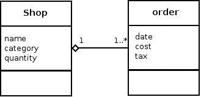

### 15.1.3 对象图

类图可以非常详细并占用大量空间。从视觉角度来看，它们可能让屏幕显得很乱，但它们非常有帮助。对象图是一种简化的图表，仅列出类及其依赖关系。

图 0.3:
对象图

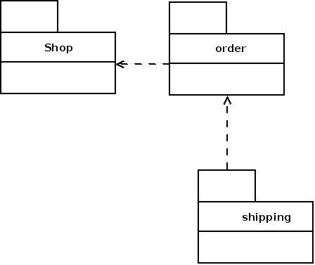

### 15.1.4 活动图

时序图、协作图和“状态图”已超出了本章的范围。活动图类似于流程图，显示活动之间如何相互依赖。活动图使用的符号与状态图相同，状态气泡除外。状态图关注过程转换的流，而不是整体流。活动图的组件包括：

1. 开始和停止 - 指定为实心圆点。
2. 活动 - 圆角矩形。比状态组件更圆。
3. 转换 - 连接活动和分支的带箭头线。
4. 分支 - 用菱形表示以指示决策。
5. 叉叉/合并 - 用短粗体线表示。

图 0.4:
活动图

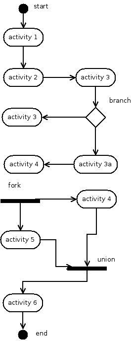

组件图和部署图已远远超出了本书和本章的范围。

### 15.1.5 Dia 和 UML

`dia` 是一个基于 GTK+ 的图形创建程序，用于 Linux 或 Windows 系统。它类似于 Visio，但非常轻量。它的优点是可以使用 XML 扩展程序的组件和设计能力。你 1 可以在 `http://dia-installer.de/` 下载 `dia`。对于 Mac 用户，你可能还需要安装 `XQuarts`。对于我们的目的，“DIA” 包含一个用于绘制 UML 图的特殊对象。`Dia` 还包含一个用于 Python 脚本的插件，并包含了几个 Python 脚本，用于扩展、转换、操作 'dia' 或由 'dia' 生成或相关的代码。以下是工具栏和画布屏幕：

图 0.5:
DIA

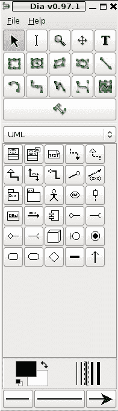

让我们玩玩 `DIA` 吧。从 UML 组件界面中选择类组件。点击屏幕上的任何地方。结果应该如下：

图 0.6:
DIA 类组件


下一步是在组件上右键单击（Mac 用户为双击）并选择属性（properties）。要删除一个对象，你可以点击该对象并输入 `(CTRL-X)`。你应该会在屏幕顶部看到五个标记为 Class（类）、Attributes（属性）、Operations（操作）、Templates（模板）和 Style（样式）的标签。点击“Class”标签并重命名文件为 `Shop`。接下来，选择 Attributes。通过选择“New”创建 4 个属性，并在 `"Name:"` 字段中输入属性名称，列表项如下：fruits（水果）、meats（肉类）、dairy（乳制品）和 juice（果汁）。你的屏幕应该如下：

图 0.7:
DIA UML 属性

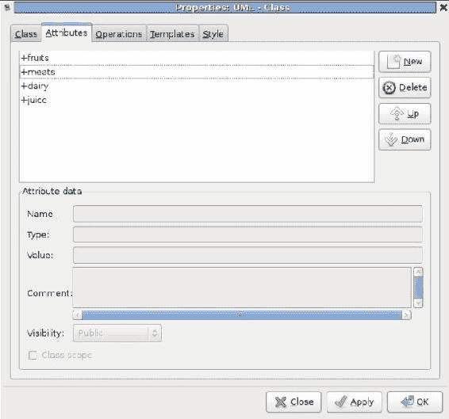

现在选择 Operations 标签。创建两个操作。第一个将是 `__init__`。确保可见性（Visibility）为 Private（私有），参数（Parameters）为 fruits, meats, dairy 和 juice。创建另一个名为 `myprint` 的操作，可见性设置为 Public（公有）。你的屏幕应该如下：

图 0.8:
DIA UML 操作

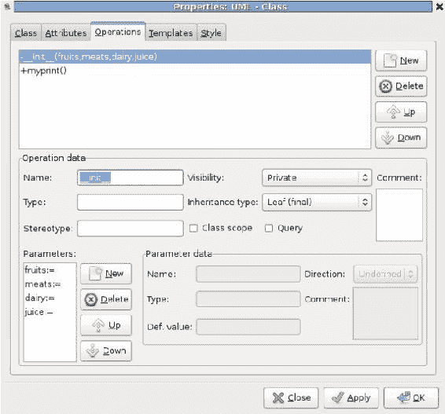

现在将文件保存为 `classshop.dia`。下一步是按照如下转换代码：

```
dia2code -t python classshop.dia
```

它将在执行 `Dia` 的相同目录下创建一个名为 `Shop.py` 的文件。该文件名根据第一个标签上的 `Class` 字段名命名。

```python
class Shop:
    """Class Shop
    """

    # Attributes:
    fruits = None # ()
    meats = None # ()
    dairy = None # ()
    juice = None # ()

    # Operations
    def myprint(self):
        """function myprint
        returns
        """
        return None # should raise NotImplementedError()

    def ____init__(self, fruits, meats, dairy, juice):
        """function __init__
        fruits:
        meats:
        dairy:
        juice:
        returns
        """
        return None # should raise NotImplementedError()
```

如你所见，它留下了类结构。现在只需要对其进行重构。删除属性以外的所有注释，因为它们是你未来代码的示例占位符。不要忘记删除 `____init__` 中多余的下划线字符，变为 `__init__`。我通常会将构造函数与 'myprint' 语句交换。以下是重构后的代码：

```python
class Shop:
    """Class Shop
    """
    fruits = None # ()
    meats = None # ()
    dairy = None # ()
    juice = None # ()

    def __init__(self, fruits, meats, dairy, juice):
        self.fruits=fruits
        self.meats=meats
        self.dairy=dairy
        self.juice=juice

    def myprint(self):
        print "fruit= ", self.fruits

myclass=Shop("apple","steak","eggs","berry")
myclass.myprint()
```

`dia2code` 程序绝非完美。市上有有很多其他的 UML 编辑器，但这个是开源的且支持 python。


同样需要记住，你脑海中最初的游戏构思会不断演变。无论你有多聪明，或者图形技巧有多高，都要预感到你超过 80% 的想法会发生变化，有时甚至是剧烈的变化。这种经典的 80/20 经验法则源于与许多非常有经验的游戏开发者的交流。

### 16.1.1 从何开始？

市上有大量为初学者编写的代码。如果你必须从零开始，将会遇到很多问题。专家们会反复复用相同的方法；例如诸如 `import`、`initialize`、`screen`、`construct images`、`load`、`main loop` 等方法。通常，贸易机密隐藏在图形加速和算法之中。

### 16.1.2 首先！

避免在别人的游戏引擎中进行设计是明智的。该引擎是专门为他们的游戏开发环境以及他们的想法或视角构建的。在使用他们的游戏引擎时，你将受到他们想法的限制。对于游戏开发的新手来说，这可能会感到沮丧。他们还可能决定将他们全配置的引擎作为商业产品出售。你也可以这样做！变得非常精通代码复用非常重要。你应该玩玩游戏引擎吗？绝对应该。事实上，探索并发现这些局限性是强制性的。玩游戏引擎的行为会给你带来很多想法。`Blender` 就是一个 3D 图形建模工具，它可以被修改为 3D 游戏引擎环境。使用现有的游戏引擎原型新游戏想法会有帮助。

### 16.1.3 图形

一些最出色且最令人着迷的游戏图形很平庸，但它们有高质量的游戏性。随着你想法的推进，图形以后可以不断改进。

### 16.1.4 游戏程序员的最低要求

1. **编程简介**：我们已经涵盖了其中一些主题。但更重要的是你需要理解如何解决问题。
2. **编程语言**：学习 `C` 和 `C++` 是通往精通游戏编程的良好跳板。你在 `python` 中开发的内容很容易转换为 `C/C++`。从剥离库开始。然而，如果你利用了诸如 `SDL` 和 `OpenGL` 等流行的图形库，变化将非常少且微妙。你将花费更多时间处理解析器和分析器。
3. **数据结构与算法**：这是到目前为止在任何层次编写任何程序最重要的主题。测试并精通 `arrays`（数组）、`linked lists`（链表）、`binary trees`（二叉树）、`general trees`（树）、`hash tables`（哈希表）和 `heaps`（堆）将你在任何地方找到工作。大多数人学会后就忘了，然后很难被聘为开发者，很多人转行。
4. **编译器**：面对现实吧，如果你需要它更快，你需要理解分词（tokenizing）、`parsing`（解析）、`code generation`（代码生成）和垃圾回收（garbage collection）等概念。
5. **操作系统**：你需要了解 `OS` 的局限性。`threading`（线程）、`locking`（锁）、`network communication`（网络通信）和 `device drivers`（设备驱动）的知识对于多人游戏或读取 `DVD-ROM` 位以及从 3D 卡显示图形是无价的。
6. **人工智能**：`Heuristics`（启发式）、`planning`（规划）、`algorithms`（算法）、`bayesian networks`（贝叶斯网络）和 `natural language parsing`（自然语言解析）为你的游戏环境增加了现实概念。
7. **数据库**：你必须将这些数据存在某个地方。

### 16.1.5 游戏理论

如何制作别人想玩的东西？这可能是一项艰的任务。游戏公司和营销分析师研究最新趋势来收集这些信息。主题、地图设计、关卡特征、声音、故事和游戏难度之间存在微妙的平衡。最终，你希望你的游戏看起来好看而且好玩。这意味着在从概念到部署的过程中，必须采取平衡的方法。

### 16.1.6 原型

在现实中，在你真正开始编写代码之前，你的梦想和想法不会实现。你会开始构建第一个原型，然后是直到你有几个原型版本。从原型中可以学习到很多，例如通用概念和玩法。你还会发现更多现实情况，如菜单、`screen transitions`（屏幕切换）以及如何保存或加载游戏。这里有几考虑：

1. 你需要一个故事者吗？
2. 你需要一个算法专家吗？
3. 你需要一个艺术家吗？`Raster`（位图）、`Vector`（矢量）或两者都要。
4. 你需要一个音乐家或音效师吗？

原型也可以快速告诉你这个游戏是否值得。

**需要学习的内容：**

1. 最佳路径，最短路径。

同样需要记住，你脑海中最初的游戏构思会不断演变。无论你有多聪明，或者图形技巧有多高，都要预感到你超过 80% 的想法会发生变化，有时甚至是剧烈的变化。这种经典的 80/20 经验法则源于与许多非常有经验的游戏开发者的交流。

### 16.1.1 从何开始？

市上有大量为初学者编写的代码。如果你必须从零开始，将会遇到很多问题。专家们会反复复用相同的方法；例如诸如 `import`、`initialize`、`screen`、`construct images`、`load`、`main loop` 等方法。通常，贸易机密隐藏在图形加速和算法之中。

### 16.1.2 首先！

避免在别人的游戏引擎中进行设计是明智的。该引擎是专门为他们的游戏开发环境以及他们的想法或视角构建的。在使用他们的游戏引擎时，你将受到他们想法的限制。对于游戏开发的新手来说，这可能会感到沮丧。他们还可能决定将他们全配置的引擎作为商业产品出售。你也可以这样做！变得非常精通代码复用非常重要。你应该玩玩游戏引擎吗？绝对应该。事实上，探索并发现这些局限性是强制性的。玩游戏引擎的行为会给你带来很多想法。`Blender` 就是一个 3D 图形建模工具，它可以被修改为 3D 游戏引擎环境。使用现有的游戏引擎原型新游戏想法会有帮助。

### 16.1.3 图形

一些最出色且最令人着迷的游戏图形很平庸，但它们有高质量的游戏性。随着你想法的推进，图形以后可以不断改进。

### 16.1.4 游戏程序员的最低要求

1. **编程简介**：我们已经涵盖了其中一些主题。但更重要的是你需要理解如何解决问题。
2. **编程语言**：学习 `C` 和 `C++` 是通往精通游戏编程的良好跳板。你在 `python` 中开发的内容很容易转换为 `C/C++`。从剥离库开始。然而，如果你利用了诸如 `SDL` 和 `OpenGL` 等流行的图形库，变化将非常少且微妙。你将花费更多时间处理解析器和分析器。
3. **数据结构与算法**：这是到目前为止在任何层次编写任何程序最重要的主题。测试并精通 `arrays`（数组）、`linked lists`（链表）、`binary trees`（二叉树）、`general trees`（树）、`hash tables`（哈希表）和 `heaps`（堆）将你在任何地方找到工作。大多数人学会后就忘了，然后很难被聘为开发者，很多人转行。
4. **编译器**：面对现实吧，如果你需要它更快，你需要理解分词（tokenizing）、`parsing`（解析）、`code generation`（代码生成）和垃圾回收（garbage collection）等概念。
5. **操作系统**：你需要了解 `OS` 的局限性。`threading`（线程）、`locking`（锁）、`network communication`（网络通信）和 `device drivers`（设备驱动）的知识对于多人游戏或读取 `DVD-ROM` 位以及从 3D 卡显示图形是无价的。
6. **人工智能**：`Heuristics`（启发式）、`planning`（规划）、`algorithms`（算法）、`bayesian networks`（贝叶斯网络）和 `natural language parsing`（自然语言解析）为你的游戏环境增加了现实概念。
7. **数据库**：你必须将这些数据存在某个地方。

### 16.1.5 游戏理论

如何制作别人想玩的东西？这可能是一项艰的任务。游戏公司和营销分析师研究最新趋势来收集这些信息。主题、地图设计、关卡特征、声音、故事和游戏难度之间存在微妙的平衡。最终，你希望你的游戏看起来好看而且好玩。这意味着在从概念到部署的过程中，必须采取平衡的方法。

### 16.1.6 原型

在现实中，在你真正开始编写代码之前，你的梦想和想法不会实现。你会开始构建第一个原型，然后是另一个直到你有几个原型版本。从原型中可以学习到很多，例如通用概念和玩法。你还会发现更多现实情况，如菜单、`screen transitions`（屏幕切换）以及如何保存或加载游戏。这里有几考虑：

1. 你需要一个故事者吗？
2. 你需要一个算法专家吗？
3. 你需要一个艺术家吗？`Raster`（位图）、`Vector`（矢量）或两者都要。
4. 你需要一个音乐家或音效师吗？

原型也可以快速告诉你这个游戏是否值得。

**需要学习的内容：**

1. 最佳路径，最短路径。


```python
display.fill(white) # not rendered yet without update

pygame.draw.rect(display,black,[x,y,10,10]) # w,h

pygame.display.update() # always update after graphics

pygame.quit()

quit()
```

图 0.2: pygame 窗口

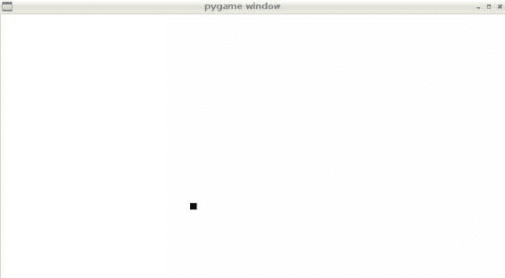

结果：你可以左右移动矩形按键。如果你对 'y' 重复了这些步骤，新的矩形将在所有方向上移动。现在我们实现 `xChange` 和 `yChange` 来防止 `x` 和 `y` 的值超出边界。在测试此之前，让我们先对连续运动进行一些调整。下面的示例将超出边界。

示例：这允许你向任何方向上移动矩形。`(x,y)` 的位置对应于显示器左上角开始的笛卡尔坐标系。

### #pygameEvent2.py

```python
import pygame

white=(255,255,255) # RGB values

black=(0,0,0)

pygame.init()

display=pygame.display.set_mode((800,600))

x=300; y=300

xChange=0; yChange=0

clock = pygame.time.Clock()

while 1:

for event in pygame.event.get(): # event handling

if event.type==pygame.KEYDOWN:

if event.key == pygame.K_LEFT:

xChange = - 10
yChange = 0 # comment out for diagonal
elif event.key == pygame.K_RIGHT:
xChange = 10
yChange = 0
elif event.key == pygame.K_UP:
yChange = - 10
xChange = 0
elif event.key == pygame.K_DOWN:
yChange = 10
xChange = 0

x += xChange

y += yChange

display.fill(white) # not rendered without update

pygame.draw.rect(display,black,[x,y,10,10]) #w,h

pygame.display.update()

clock.tick(10)

pygame.quit()

quit()
```

当事件自动发生并默认使用你的系统时钟时，时钟变得很重要。第一人称射击游戏通常具有每秒 15 帧 (FPS) 的帧率，而视频片段大约为 24-30 帧 (FPS)。确保更新在主循环中并靠近结尾。在这种情况下，我将时钟频率放在了 `display.update()` 之后。在更改事件速率时这也重要。有时更改 `(x,y)` 值比调整 `tick()` 更好。

### 16.2.3 边界

继续上一个示例，注释掉了一个打破边界循环的 'if' 语句。如果你取消该语句的注释，并注释下一个 'if/elif' 语句，游戏循环将会中断。

### #pygameEvent3.py

```python
import pygame

white=(255,255,255) # RGB values

black=(0,0,0)

pygame.init()

display=pygame.display.set_mode((800,600))

x=300; y=300

xChange=0; yChange=0

clock = pygame.time.Clock()

while 1:

for event in pygame.event.get(): # event handling

if event.type==pygame.KEYDOWN:

if event.key == pygame.K_LEFT:
xChange = - 10
yChange = 0
elif event.key == pygame.K_RIGHT:
xChange = 10
yChange = 0
elif event.key == pygame.K_UP:
yChange = - 10
xChange = 0
elif event.key == pygame.K_DOWN:
yChange = 10
xChange = 0

# if x >= 800 or x <= 0 or y >= 600 or y <= 0: # border
# break

if x == 700:
xChange=-10
yChange=0
elif x==10:
xChange=0
yChange=0

x += xChange

y += yChange

display.fill(white) # not rendered without update

pygame.draw.rect(display,black,[x,y,10,10]) # coords, w,h

pygame.display.update()

clock.tick(10)

pygame.quit()

quit()
```

结果：当矩形向右滚动并到达位置 '700' 时，它将在反方向反弹。然而，当矩形到达位置 '10' 时，它会停止一切。这是一个逻辑问题的很好的示例。将 `elif` 语句中 `xChange=0` 的值调整为 `10`，现在矩形在按住按键时持续移动的同时会在屏幕上反复弹跳。

```python
while 1:

k = pygame.key.get_pressed()
if k[pygame.K_UP]:
y-=yChange-=10
if k[pygame.K_DOWN]:
y+=yChange+=10
```

### 16.2.4 游戏循环和文本

接下来的脚本将涵盖大多数 pygame 教程跳过的各种循环。嵌套循环在利用得当时可以非常强大。有一个启动界面是有用的，相同的代码可以被视为通往另一个关卡或场景的过渡点。

### #gameloop1.py

```python
import pygame

white=(255,255,255) # RGB values

black=(0,0,0)
green=(0,255,0)
red=(255,0,0)
yellow=(255,255,0)
blue=(0,0,255)
pygame.init()
display=pygame.display.set_mode((800,600))
clock = pygame.time.Clock()
font=pygame.font.SysFont(None,25)
def splash():
intro=True
while intro:
for event in pygame.event.get():
if event.type==pygame.QUIT:
pygame.quit()
quit()
if event.type==pygame.KEYDOWN:
if event.key == pygame.K_c:
intro=False
if event.key==pygame.K_q:
pygame.quit()
quit()
display.fill(white)
message("Wellcome!!!", black,300,300)
message("Press 'c' to continue or 'q' to quit",black,300,400)
pygame.display.update()
clock.tick(15)
def message(msg,color,posx,posy):
mytext=font.render(msg,True,color)
display.blit(mytext,[posx,posy])
def game():
exit=False
over=False
x=300; y=300
xChange=0; yChange=0
while not exit: # exit loop
while over == True: # over loop
display.fill(blue)
message("Game over 'c' to continue 'q' to quit", yellow,300,300)
pygame.display.update()
for event in pygame.event.get():
if event.type==pygame.QUIT:
over=False
exit=True
if event.type == pygame.KEYDOWN:
if event.key == pygame.K_q:
exit = True
over = False
if event.key == pygame.K_c:
game()
for event in pygame.event.get(): # event handling
if event.type==pygame.QUIT:
exit=True
k=pygame.key.get_pressed()
if k[pygame.K_LEFT]:
xChange-=10
elif k[pygame.K_RIGHT]:
xChange+=10
elif k[pygame.K_UP]:
yChange-=10
elif k[pygame.K_DOWN]:
yChange+=10
else:
xChange=0
yChange=0
if x==700: # borders
xChange=-10
yChange=0
if x==10:
xChange=10
yChange=0
if y==500:
yChange=-10
xChange=0
if y==10:
over=True
x += xChange # continue from previous location
y += yChange
display.fill(black) # not rendered without update
message("Move square in any direction...", yellow,300,50)
message("Too far up exits loop...", yellow,300,70)
pygame.draw.rect(display,white,[x,y,20,20]) # coords, w,h
pygame.display.update()
clock.tick(10)
pygame.quit()
quit()
splash()
game()
```

图 0.3: Pygame 转换屏幕


引入了一些新东西，如 `font()`、`message()` 和 `blit()`。还要注意 `x` 和 `y` 需要移动到游戏的主循环中。

### 16.2.5 图像

在本节中，我们引入了 `image.load()` 和 `random()`。不要忘记 `display.update()`。

### #image1.py

```python
import pygame
import random
white=(255,255,255) # RGB values
black=(0,0,0)
green=(0,255,0)
red=(255,0,0)
yellow=(255,255,0)
blue=(0,0,255)
pygame.init()
display=pygame.display.set_mode((800,600))
clock = pygame.time.Clock()
font=pygame.font.SysFont(None,25)
bg=pygame.image.load("gimpbackground.png")
star=pygame.image.load('assortstar1.png')
def message(msg,color,posx,posy):
mytext=font.render(msg,True,color)
display.blit(mytext,[posx,posy])
def game():
exit=False
x=300; y=300
xChange=0; yChange=0
boxX=round(random.randrange(0,800-10) /10.0)*10.0
boxY=round(random.randrange(0,600-10) /10.0)*10.0
while not exit: # exit loop
for event in pygame.event.get(): # event handling
if event.type==pygame.QUIT:
exit=True
k=pygame.key.get_pressed()
if k[pygame.K_LEFT]:
xChange-=10
elif k[pygame.K_RIGHT]:
xChange+=10
elif k[pygame.K_UP]:
yChange-=10
elif k[pygame.K_DOWN]:
yChange+=10
else:
xChange=0
yChange=0
if x==700: # borders
xChange=-10
yChange=0
if x==10:
xChange=10
yChange=0
if y==500:
yChange=-10
xChange=0
if y==10:
over=True
x += xChange # continue from previous location
y += yChange
display.fill(black) # not rendered without update
message("Move square in any direction...", yellow,300,50)
message("Too far up exits loop...", yellow,300,70)
pygame.draw.rect(display,yellow,[boxX,boxY,20,20]) # coords, w,h
display.blit(star,[x,y])
pygame.display.update()
clock.tick(10)
pygame.quit()
quit()
game()
```

### 16.2.6 碰撞检测

当两个 blit 碰撞时会发生什么？


`white=(255,255,255)` # RGB

values black=(0,0,0)`

`green=(0,255,0)`

`red=(255,0,0)`

`yellow=(255,255,0)`

`blue=(0,0,255)`

`pygame.init()`

`display=pygame.display.set_mode((800,600))`

`clock = pygame.time.Clock()`

`font=pygame.font.SysFont(None,25)`

`bg=pygame.image.load("gimpbackground.png")`

`star=pygame.image.load('assortstar1.png')`

```python
def message(msg,color,posx,posy):
    mytext=font.render(msg,True,color)
    display.blit(mytext,[posx,posy])
```


def game():
    exit=False
    x=300; y=300
    xChange=0; yChange=0
    boxX=round(random.randrange(0,800-10) /10.0) *10.0
    boxY=round(random.randrange(0,600-10) /10.0) *10.0
    while not exit: # 退出循环
        for event in pygame.event.get(): # 事件处理
            if event.type==pygame.QUIT:
                exit=True
            k=pygame.key.get_pressed()
            if k[pygame.K_LEFT]:
                xChange-=10
            elif k[pygame.K_RIGHT]:
                xChange+=10
            elif k[pygame.K_UP]:
                yChange-=10
            elif k[pygame.K_DOWN]:
                yChange+=10
            else:
                xChange=0
                yChange=0
            if x==700: # 边界
                xChange=-10; yChange=0
            if x==10:
                xChange=10; yChange=0
            if y==500:
                yChange=-10; xChange=0
            if y==10:
                exit=True
            x += xChange # 从上一个位置继续
            y += yChange
            display.blit(bg,(0,0))
            message("向任何方向移动正方形...", yellow, 300,50)
            pygame.draw.rect(display,yellow,[boxX,boxY,40,40])
            display.blit(star,[x,y]) pygame.display.update()
            if x== boxX and y==boxY: # 碰撞
                print("Boom!!!")
                boxX=round(random.randrange(0,800-10) /10.0) *10.0
                boxY=round(random.randrange(0,600-10) /10.0) *10.0
            clock.tick(10)
    pygame.quit()
    quit()

game()
```

## 16.2.7 游戏部分总结

### 1. 初始化
1. `screen=pygame.display.set_mode()`
2. `images=pygame.image.load()`
3. `clock=pygame.time.Clock()`
4. `key, mouse 等...`
5. `杂项...`

### 2. 主循环
1. **用户输入**
    1. 由 `clock.tick()` 管理
    2. `按键事件`
    3. `screen.fill()`
2. **模拟**
    1. `速度、前进、后退、方向`
3. **渲染**
    1. `rotate()`
    2. `get_rect()`
    3. `位置`
    4. `blit()`
    5. `display.flip()`

## 16.2.8 游戏引擎架构

在最简单的形式下，架构是章节开头的总结，包含了以下新组件。

- `Action(运行,驱动,跳跃,等...)`
- `Input()`
- `game 逻辑(is, else,等...)`
- `camera(update)`
- `world(update)`
- `GUI(update)`
- `Collision(AI)(update)`
- `Audio()`
- `Render(draw)`

所有这些内容都需要在一个网格图中进行映射，其中几乎每个组件都会与另一个组件相互作用。如果你想保持清醒，还应该记录每个组件。当你开始编写每个组件时，它将成为你用于所有任务的框架类。

现在，我们准备好从一个组件向另一个组件发送消息。创建一个每个组件都可以引用的总线模块。

我将开始编写以下类并封装上述组件。

- `class Sprite():`
    - `update(), checkboundry()`
- `class ComplexSprite():`
    - `Wrap()` # 环绕屏幕
    - `Bounce()` # 从屏幕反弹
    - `Stop()` # 停止在屏幕边缘
    - `speed()`
    - `update()`
    - `angle()`
    - `等...`
- `class Scene():`
    - `init()`
    - `start/stop()`
    - `mainloop()`
    - `update()`
    - `events()`
- `class Label():`
    - `init()`
    - `update()`
- `class Multilabel():`
    - `multi(),long(), update()`
- `class Button():`
    - `等...`
- `class scroller():`
    - `等...`

## 16.3 创建游戏总结

你希望为你的游戏引擎原型尽可能多的功能，这样你就可以更多地关注游戏逻辑，少关注设计。例如，一个游戏将包含 `Scene` 类指令、播放、进度、新元素以及重启或结束。引擎中 80% 的功能可以重用于其他相同类型的游戏，例如`横滚卷`、`平台跳`、`俯视角`和`混合型`。虽然从 2D 到 3D 有些许跨越，但概念仍然相同。

## 17 股票市场

我使用 Python 进行市场分析已经有一段时间了，并在几家首选公司拥有多个账户。无论它们提供什么服务，每家券商之间似乎总会有缺少某些东西。通常需要从 `Etrade`、`Market`、`Gurocus`、`Google` 或另一个服务获取数据。从这些网站抓取信息是完全免费的，尽管你可能需要...


# 市值

市值: 617.59B
Beta: 1.42
市盈率 (TTM): 13.94
每股收益 (TTM): N/A
收益日期: N/A
股息与收益率: 2.28 (1.97%)
除息日: N/A
1 年目标预测: N/A

如上例例所示，每个表格项目都单独打印一行。在下面的示例中，我正在搜索某股票的 `EPS`，以便根据当前股价和每股收益（`EPS`）计算 `PE ratio`。请注意 `EPS` 带有 `TTM`（滚动十二个月）符号，这意味着 `EPS` 是最近十二个月的计算结果。网站一直在变化，因此爬虫代码需要不断进行调整，以提取准确的结果。

结合查询 API 和金融爬取，创建属于你所需的数值的自定义字典。

# eps.py

```python
import json
import urllib
from pprint import pprint
from BeautifulSoup import *

base_url = 'https://query.yahooapis.com/v1/public/yql?'

def querytool(sql):
    query = {
        'q': sql,
        'format': 'json',
        'env': 'store://datatables.org/alltableswithkeys'
    }
    return query

def getdata(base_url,qtool):
    url = base_url + urllib.urlencode(qtool)
    response = urllib.urlopen(url)
    data = response.read().decode('utf-8')
    quote = json.loads(data)
    return quote

def getEPS(symbol):
    ar=[]
    num=0;token=0
    url = "http://finance.yahoo.com/q?s=" + symbol +"&q1=1"
    htmlfile = urllib.urlopen(url)
    htmltext = htmlfile.read()
    soup = BeautifulSoup(htmltext)
    table=soup.findAll('td')
    for row in table:
        ar.append(row.text)
        num+=1
        if 'P/E' in row.text:
            token=num
        return ar[token]

if __name__=="main__":
    symbol="AAPL"
    sql='select * from yahoo.finance.quote where symbol in ("%s")' % symbol
    Q=querytool(sql)
    stock=getdata(base_url,Q) # returns json or nested dict
    data=stock['query']['results']['quote'] # relevant stock data dictionary
    data['P/E']=getEPS(symbol)
    print data
```

结果：

```python
{u'YearLow': u'89.47', 'P/E': u'', u'MarketCapitalization': u'617.59B', 'DaysHigh': u'117.20', 'symbol': u'AAPL', 'DaysLow': u'115.43', 'Volume': u'30586265', 'StockExchange': u'NMS', 'DaysRange': u'115.43 - 117.20', 'AverageDailyVolume': u'32082600', 'LastTradePriceOnly': u'115.82', 'YearHigh': u'118.69', 'Symbol': u'AAPL', 'Change': u'+0.00', 'Name': u'Apple Inc.'}
```

1. `chartapi.finance.yahoo.com` 生成一个你可以下载并解析的 CSV 文件。你也可以提取 `intradata` 指标，并将输出结果保存到名为 `AAPL.txt` 的文本文件中，稍后可在 `chart.py` 中使用。

# 获取股票数据的脚本

# csvdata.py

```python
import urllib
import time
import datetime

stockpull='AAPL' # 这可以是一个列表用于循环遍历

def MyStock(stock):
    print "Get stock data", stock
    print str(datetime.datetime.fromtimestamp(time.time()).strftime('%y-%m-%d %H:%M:%S'))
    url="http://chartapi.finance.yahoo.com/instrument/1.0/"+
    stock+"/chartdata;type=quote;range=1y/csv"
    #url="http://chartapi.finance.yahoo.com/instrument/1.0/"+
    stock+"/chartdata;type=quote;range=10d/csv"
    #url="http://chartapi.finance.yahoo.com/instrument/1.0/"+
    stock+"/chartdata;type=quote;range=1d/csv"
    response=urllib.urlopen(url)
    html=response.read()
    print html

MyStock(stockpull)
```

结果产生了时间戳、最高价、最低价、开价和成交量：

```text
20160929,112.1800,113.8000,111.8000,113.1600,35887000
20160930,113.0500,113.3700,111.8000,112.4600,36379100
20161003,112.5200,113.0500,112.2000,112.2800,2170100
20161004,113.0000,114.3100,112.6300,113.0600,2973680
20161005,113.0500,113.6600,112.6900,113.4000,2145310
20161006,113.8900,114.3400,113.1300,113.7000,2877930
20161007,114.0600,114.5600,113.5100,114.3100,2435840
20161010,116.0500,116.7500,114.7200,115.0200,362360
```

`URL` 的 `type` 决定了接收的数据类型。`1y` 等于年度平均。`10d` 等于 5 日平均（注：原文说 `10d` 等于 5 日平均，这可能是源码中的笔误，但按要求保留）。

你可以按照以下方式提取时间和日期：

```python
>>> import calendar
>>> time.gmtime(1483131600)
time.struct_time(tm_year=2016, tm_mon=12, tm_mday=30, tm_hour=21, tm_min=0, tm_sec=0, tm_wday=4, tm_yday=365, tm_isdst=0)
```

1. 图形如果你将结果保存到文件，可以使用 `Matplotlib` 来绘制图表。你需要将日内时间转换为日期格式。

获取股票数据：

# chart.py

```python
import time
import datetime
import numpy as np
import matplotlib.pyplot as plt
import matplotlib.ticker as mticker
import matplotlib.dates as mdates

mystock='AAPL'

def gData(stock):
    stockFile=stock+".txt"
    date,closep,highp,lowp,openp,volume= np.loadtxt(
        stockFile,delimiter=',',unpack=True,
        converters={0: mdates.strp2num('%Y%m%d')})
    fig=plt.figure()
    ax1=plt.subplot(1,1,1)
    ax1.plot(date,openp)
    ax1.plot(date,highp)
    ax1.plot(date,lowp)
    ax1.plot(date,closep)
    ax1.xaxis.set_major_locator(mticker.MaxNLocator(10)) # 最大 10 天
    ax1.xaxis.set_major_formatter(mdates.DateFormatter('%Y-%m-%d'))
    for label in ax1.xaxis.get_ticklabels():
        label.set_rotation(45)
    plt.show()

gData(mystock)
```

图 0.1: Matplot 图形


`Matplotlib` 是一个非常强大的工具，能够绘制 K 线图和其他各种图表。然而，如果你计划将其放在网页上，JavaScript 在实时图表方面可能更好。Morningstar.com 和 Bloomberg 都提供了用于指标和分析的 API。

# 18 结语

## 18.1 结语

正如标题所示，这是快速编程。你的最终目标是使用 Python 创建免费、出售或纯属趣味的程序或应用程序。编程允许你自动化重复性任务，让你能够专注于其他事情。

大多数作者希望你读完书中的每一个字。虽然这对某些人有效，但我知道你可能不会这样做。很可能你到达这里之前跳过了很多内容。希望你至少写了几行代码。我的目标是让这本书足够灵活，能够吸引初学者和经验丰富的人士。它包含了丰富的可重用代码片段，这些代码在我的 GitHub 上也可以找到。

如果你使用了书中的任何代码，请花一点时间给我发条消息并告诉你的想法！

网络空间见。

# 附录 A

Python Card 使用 OSI BSD 许可：开源计划 OSI - The BSD 许可

BSD 许可

以下是 BSD 许可模板。要生成你自己的许可，请将 OWNER、ORGANIZATION 和 YEAR 的值从此处提供的原始值更改并替换为你自己的。

注：你可以选择性地省略第 3 条且仍符合 OSD 标准。2008 年 1 月 9 日，OSI 委员会批准了 FreeBSD 等其他使用的“简化 BSD 许可”变体，该变体省略了最后的“不背书”条款，因此与 MIT 许可大致相当。

历史说明：用于 BSD Unix 的原始许可包含四个条款。广告条款（四个条款中的第三条）要求你在任何使用该代码的产品广告中承认对加州大学伯克利代码的使用。它已由加州大学技术许可办公室主任于 1999 年 7 月 22 日正式撤销。他声明第 3 条已“在此处完整删除”。四条款许可尚未获得 OSI 批准。下方的许可不包含广告条款。

此序言不属于许可的一部分。

<OWNER> = Regents of the University of California <ORGANIZATION> = University of California, Berkeley

<YEAR> = 1998


在原始 BSD 许可证中，免责声明中两次出现的“COPYRIGHT HOLDERS AND CONTRIBUTORS”（版权所有者和贡献者）均读作“REGENTS AND CONTRIBUTORS”（摄员和贡献者）。

以下是许可证模板：

```
Copyright (c) <YEAR>, <OWNER>

所有权利保留。

在满足以下条件的情况下，允许以源和二进制形式重新分发和使用，无论是否经过修改：

源代码的重新发必须保留上述版权声明、本条件列表以及后续免责声明。

二进制形式的重新发必须在分发时附带文档和/或其他材料中复制上述版权声明、本条件列表以及后续免责声明。

在没有事先特定书面许可的情况下，<ORGANIZATION> 的名称或其贡献者的名称不得用于背书或推广源自本软件的产品。

本软件由版权所有者和贡献者“按原样”提供，不提供任何形式或暗示的保证，包括但不限于对商性和特定用途适用性的暗示保证。在任何情况下，版权所有者或贡献者均不对任何直接、间接、意外、特殊、惩罚性或后果性的损害（包括但不限于替代商品或服务的采购；使用、数据或利润的损失；或业务中断）承担责任，无论这些损害是如何引起的以及基于何种责任理论（无论是合同、严格责任还是侵权（包括疏失或其他）），由于使用本软件而引起的，即使已告知可能此类损害。
```

## 附录 B

Pygame 使用 LGPL 许可证：

### GNU 简化通用公共许可证第 2.1 版，1999 年 2 月

Copyright (C) 1991, 1999 Free Software Foundation, Inc. 59 Temple Place, Suite 330, Boston, MA 02111-1307 USA 均允许复制和分发本许可证文档的原样副本，但不允许对其进行修改。

[这是简化 GPL 的第一个发布版本。它也被视为 GNU 库公共许可证第 2 版的后续版本，因此版本号为 2.1。]

## 前言

大多数软件的许可证旨在剥夺你分享和更改它的自由。相比之下，GNU 通用公共许可证旨在保证你分享和更改自由软件的自由——以确保软件对所有用户来说都是自由的。

本许可证，即简化通用公共许可证，适用于自由软件基金会及其他决定使用它的某些特定软件软件包——通常是库。你也可以使用它，但我们建议你根据下面的说明，先仔细考虑在任何特定情况下，使用本许可证或普通的通用公共许可证哪种是更优策略。

当我们谈论“自由软件”时，我们指的是使用的自由，而不是价格。我们的通用公共许可证旨在确保你拥有分发自由软件副本的自由（如果你愿意，可以对此项服务收费）；确保你能收到源代码，或者在你需要时可以获取它；确保你可以修改软件并将其部分内容用于新的自由程序中；并确保你被告知可以做这些事情。

为了保护你的权利，我们需要做出一些限制，禁止分发者向你剥夺这些权利或要求你放弃这些权利。当你分发库的副本或对其进行修改时，这些限制将转化为你需要承担的某些责任。

例如，如果你分发库的副本（无论是免费还是付费），你必须向接收者提供我们给你的所有权利。你必须确保他们也能收到或获取源代码。如果你将其他代码与该库链接，你必须向接收者提供完整的对象文件，以便他们在对库进行修改并重新编译后，可以将它们与库重新链接。你必须向他们展示这些条款，让他们知道自己的权利。

我们通过两步法保护你的权利：(1) 我们对库拥有版权，(2) 我们向你提供本许可证，授予你复制、分发和/或修改库的法律许可。

为了保护每个分发者，我们想明确表示，该自由库没有任何保证。此外，如果库被他人修改并传递，接收者应该知道他们手中的不是原始版本，这样原始作者的声誉就不会受到他人可能引入的问题的影响。

最后，软件专利对任何自由程序的存在构成了持续威胁。我们希望确保公司无法通过从专利所有者获得限制性许可来有效限制自由程序的用户。因此，我们坚持认为，为库的版本获得的任何专利许可必须与本许可证中规定的完全使用自由保持一致。

大多数 GNU 软件（包括某些库）受普通的 GNU 通用公共许可证保护。本许可证，即 GNU 简化通用公共许可证适用于某些指定的库，与普通的通用公共许可证非常不同。我们对某些库使用此许可证，是为了允许这些库链接到非自由程序中。

当程序与库链接时，无论是静态链接还是使用共享库，两者的结合在法律上被称为一个组合作品，是原始库的派生作品。因此，普通的通用公共许可证仅在整个组合符合其自由标准时才允许此类链接。简化通用公共许可证对于与其他代码与库链接允许更宽松的标准。

我们将此许可证称为“简化版”（Lesser）通用公共许可证，因为它在保护用户自由方面比普通的通用公共许可证做得少。它还让其他自由软件开发者相对于竞争性的非自由程序的优势较少。这些劣势是我们对许多库使用普通通用公共许可证的原因。然而，简化许可证在某些特殊情况下提供了优势。

例如，在少数情况下，可能存在特殊需要鼓励尽可能地使用某个库，使其成为事实上的标准。为了实现这一点，必须允许非自由程序使用该库。更常见的情况是自由库的功能与广泛使用的非自由库相同。在这种情况下，将自由库限制在自由软件内收益有限，因此我们使用简化通用公共许可证。

在其他情况下，允许在非自由程序中使用特定库可以使更多的人使用大量的自由软件。例如，允许在非自由程序中使用 GNU C 可以使更多的人使用整个 GNU 操作系统以及其变体 GNU/Linux 操作系统。

尽管简化通用公共许可证对用户自由的保护较少，但它确保了与库链接的程序的用户有自由和能力使用修改后的库来运行该程序。

复制、分发和修改的精确条款如下。请仔细注意“基于库的作品”与“使用库的作品”之间的区别。前者包含派生自库的代码，而后者必须与库结合后才能运行。

GNU 简化通用公共许可证关于复制、分发和修改的条款

0\.


本许可协议适用于任何软件库或其他程序，其包含版权所有者或其他授权方发布的声明，说明其可能根据本较小通用公共许可（也称为“本许可”）的条款进行分发。每位被许可者均被称为“你”。“库”是指软件函数和/或数据的集合，这些函数和数据的准备是为了方便地与应用程序（这些程序使用其中某些函数和数据）链接，以形成可执行文件。下文的 `Library` 指的是根据这些条款分发的任何此类软件库或作品。“基于 `Library` 的作品”是指 `Library` 本身或版权法保护下的任何衍生作品：即包含 `Library` 或其部分的作品，不论是原封不动地包含，还是经过修改和/或直接翻译成另一种语言包含。（在此处，“翻译”包含在“修改”一术语中，但不限于此。）作品的“源代码”是指对该作品进行修改时的首选形式。对于库而言，完整的源代码意味着其包含的所有模块的所有源代码，加上任何相关的接口定义文件，以及用于控制库的编译和安装的脚本。复制、分发和修改以外的活动不受本许可的限制；它们超出了本许可的范围。使用 `Library` 运行程序的行为不受限制，但只有当该程序的输出内容构成基于 `Library` 的作品时（与在编写该程序的工具中使用 `Library` 无关），该输出才受本许可涵盖。这是否真实取决于 `Library` 的功能以及使用 `Library` 的程序的功能。

### 1
你可以在任何介质上按接收到的样复制并分发 `Library` 完整源代码的逐字副本，前提是在每份副本上显著且适当地发布适当的版权声明和免责声明；保持所有引用本许可及不提供任何保证的通知完完整；并连同 `Library` 一起分发本许可的副本。你可以对传输副本的物理行为收取费用，并根据你的意愿通过付费提供保证保护。

### 2
你对 `Library` 的副本或多个副本或任何部分进行修改，从而形成基于 `Library` 的作品，并根据上述第 1 条的条款复制和分发此类修改或该作品，前提是你还满足以下所有条件：

a) 修改后的作品本身必须是一个软件库。

b) 你必须使被修改的文件带有显著的通知，说明你更改了这些文件以及更改的日期。

c) 你必须使整个作品根据本许可的条款免费向所有第三方许可。

d) 如果修改后的 `Library` 中的某设施引用了使用该设施的应用程序应提供的函数或数据表（调用该设施时作为参数传递的除外），则你必须做出合理努力确保在应用程序未提供此类函数或数据表的情况下，该设施能够运行，并执行其目的中仍具意义的任何部分。（例如，库中用于计算平方根的函数其目的完全独立于应用程序是明确定义的。因此，子第 2d 条要求此函数所使用的任何应用程序提供的函数或数据表必须是可选的：如果应用程序不提供，平方根函数必须仍然能够计算平方根。）这些要求适用于修改后的作品整体。如果该作品中可识别的部分并非源自 `Library`，并且其本身可以被合理地认为是独立且分离的作品，那么当你在将这些部分作为独立作品分发时，本许可及其条款不适用于这些部分。但当你将相同部分作为基于 `Library` 的作品的整体的一部分分发时，整体的分发必须符合本许可的条款，本许可对其他被许可者的许可扩展到整个整体，因此扩展到每一个部分，无论由谁编写。因此，本节的意图并不是主张权利或质疑你对完全由编写的作品的权利；而是行使控制基于 `Library` 的衍生作品或集合作品分发的权利。此外，仅在存储或分发介质上将基于 `Library` 的另一个作品与 `Library`（或基于 `Library` 的作品）简单聚合，不会将该作品纳入本许可的范围。

### 3
你可以选择将普通的 GNU 通用公共许可条款代替本许可应用于给定的 `Library` 副本。为此，你必须更改所有引用本许可的通知，使其指向普通的 GNU 通用公共许可第 2 版本，而不是本许可。（如果出现了比第 2 版本更新的普通的 GNU 通用公共许可，如果你愿意也可以指定该版本。）不要在这些通知中做任何其他更改。一旦在给定副本中进行了此更改，对于该副本而言就是不可逆的，因此普通的 GNU 通用公共许可适用于从该副本创建的所有后续副本和衍生作品。当你希望将 `Library` 的部分代码复制到不是库的程序中时，此选项非常有用。

### 4
你可以根据上述第 1 条和第 2 条的条款，以目标代码或可执行形式复制并分发 `Library`（或根据第 2 条的部分或衍生品），前提是你必须附带完整的相应的机器可读源代码，且必须在通常用于软件交换的介质上根据上述第 1 条和第 2 条的条款分发。如果通过提供访问指定处的复制的机会来分发目标代码，则从相同处提供复制源代码的等效访问满足了分发源代码的要求，尽管第三方并不强制与目标代码一起复制源代码。

### 5
一个不包含 `Library` 任何部分的衍生内容，但设计为通过与 `Library` 链接与之工作的程序被称为“使用 `Library` 的作品”。此类作品孤本身并不是 `Library` 的衍生作品，因此超出了本许可的范围。然而，将“使用 `Library` 的作品”与 `Library` 链接会创建一个基于 `Library` 的可执行文件（因为它包含了 `Library` 的部分），而不是“使用库的作品”。因此，该可执行文件受本许可涵盖。第 6 条规定了此类可执行文件的分发条款。当“使用 `Library` 的作品”使用属于 `Library` 的头文件材料时，该作品的目标代码可能是 `Library` 的衍生作品，即使其源代码不是。这是否真实，当作品可以在没有 `Library` 的情况下链接，或者该作品本身是一个库时尤为重要。法律对这一界限没有精确定义。如果此类目标文件仅使用数值参数、数据结构布局和访问器，以及小的宏和小的内联函数（长度十行以内），则无论在法律上是否为衍生作品，该目标文件的使用不受限制。（包含此目标代码加上 `Library` 部分的可执行文件仍属于第 6 条。）否则，如果该作品是 `Library` 的衍生作品，你可以根据第 6 条的条款分发该作品的目标代码。任何包含该作品的可执行文件无论是否直接与 `Library` 本身链接，都属于第 6 条。

### 6


作为上述章节的例外，你也可以将“使用本库的作品”与本库结合或链接以产生包含本库部分的作品，并按照你选择的条款分发该作品，前提是这些条款允许为了客户自身的使用对作品进行修改以及对此类修改进行调试的逆向工程。你必须在作品的每个副本中显著指出使用了本库，并说明本库及其使用受本许可协议约束。你必须提供本许可协议的副本。如果作品在执行期间显示版权声明，你必须在其中包含本库的版权声明，并附带引导用户查看本许可协议副本的说明。此外，你必须完成以下操作之一：

a) 随作品附带本库完整的对应的机器可读源代码，包括在作品中使用的任何更改（这些更改必须根据上述第 1 和第 2 节进行分发）；如果该作品是与本库链接的可执行文件，则须附带完整的机器可读的“使用本库的作品”，格式为对象代码和/或源代码，以便用户能够修改本库然后重新链接以生成包含修改后本库的可执行执行文件。（理解的是，修改本库中定义文件内容的用户不一定能够重新编译应用程序以使用修改后的定义。）

b) 使用适当的共享库机制与本库链接。适当的机制是指：(1) 在运行时使用用户计算机系统中已存在的库副本，而不是将库函数拷贝到可执行文件中，并且 (2) 如果用户安装了修改后的版本，只要该修改版本与制作作品时使用的版本在接口兼容，它就能正常运行。

c) 随作品附带一份有效期至少三年的书面报价，承诺向该用户提供相同用户提供上述第 6a 节中指定的材料，且费用不超过执行此类分发的成本。

d) 如果通过提供访问指定地点进行复制的权限来分发作品，则应提供从同一地点复制上述指定材料的等效访问权限。

e) 验证用户是否已接收了这些材料的副本，或者你已向该用户发送了副本。对于可执行文件，“使用本库的作品”的所需形式必须包含从其复制该可执行文件所需的任何数据和实用程序。然而，作为一个特殊例外，分发的材料不需要包含通常与运行该可执行文件的操作系统的主要组件（编译器、内核等）一起分发的（无论是源代码还是二进制形式）任何内容，除非该组件本身随可执行文件一起。可能会出现此要求与其他通常不随操作系统提供的专有库的许可限制冲突的情况。这种冲突意味着你不能在你分发的可执行文件中同时使用它们和本库。

### 7

你可以将基于本库的作品的库设施与本许可协议未涵盖的其他库设施并排放在单个库中，并分发此类组合库，前提是单独分发基于本库的作品和其他库设施在其他情况下是被允许的，且前提是你执了了以下两项操作：

a) 随组合库附带一份相同的基于本库的作品副本，且未与任何其他库设施组合。这必须根据上述章节的条款进行分发。

b) 随组合库显著指出其部分内容是基于本库的作品，并说明在哪里可以找到附带的未组合形式的相同作品。

### 8

你不得复制、修改、分许可、链接或分发本库，除非本许可协议另有规定。任何其他尝试复制、修改、分许可、链接或分发本库的尝试都是无效的，并将自动终止你在本许可协议下的权利。然而，根据本许可协议从你处获得副本或权利的方，只要这些方保持完全合规，其许可就不会终止。

### 9

你并不要求接受本许可协议，因为你还没有签署它。然而，没有其他任何内容允许你修改或分发本库或其派生作品。如果你不接受本许可协议，这些行为是法律禁止的。因此，通过修改或分发本库（或任何基于本库的作品），你表示你接受通过本许可协议执行此类操作，以及其所有复制、分发或修改本库或基于本库作品的条款和条件。

### 10

每当你重新分发本库（或任何基于本库的作品）时，接收者自动获得来自原始许可方的许可，允许根据这些条款和条件复制、分发、链接或修改本库。你不能对接收者行使本文规定的授予的权利施加任何进一步的限制。你不负责确保第三方遵守本许可协议。

### 11

如果由于法院判决、指犯专利侵权的指控或其他任何其他原因（但不限于专利问题），对你施加了某些（无论是通过法院命令、协议或其他）与本许可协议条件相冲突的条件，这些条件并不能免除履行本许可协议的条件。如果你无法通过分发同时满足你在本许可协议下的义务和任何其他相关义务，那么作为结果，你可能无法分发本库。例如，如果专利许可不允许所有直接或间接通过你获得副本的人免版税地重新分发本库，那么你满足该许可和本协议的唯一方法就是完全停止分发本库。如果本节的任何部分在任何情况下被认为无效或不可执行，则该节的其余部分适用，且整个节在其他情况下均适用。本节的目的不是诱导你侵犯任何专利或其他产权主张，或质疑任何此类主张的有效性；本节的唯一目的是保护通过公共许可实践实现的自由软件分发系统的完整性。

### 12

如果本库的分发和/或在使用某些国家受到专利或版权接口的限制，将本库放在本许可下的原始版权持有者可以增加明确的地理分发限制以排除这些国家，从而仅允许在未这样排除的国家或国家之间进行分发。在这种情况下，本许可协议将该限制纳入本许可协议正文。

### 13


自由软件基金可能会随时发布修订的和/或新的《简化通用公共许可证》（Lesser General Public License）。这些新版本在精神上与当前版本相似，但在细节上可能不同，以解决新的问题或疑虑。每个版本都有一个不同的版本号。如果本库指定了适用于其及“任何后续版本”的许可证版本号，您有权选择遵循该版本或自由软件基金随后发布的任何后续版本的条款和条件。如果本库未指定许可证版本号，您可以选择自由软件基金曾发布过的任何版本。

### 14.

如果您希望将本库的部分内容整合到其他自由程序中，而这些程序的分发条件与本协议不兼容，请写信给作者以寻求许可。对于由自由软件基金拥有版权的软件，请写信给自由软件基金；我们有时会对此破例。我们的决定将受到两个目标的指导：即维护我们自由软件所有衍生软件的自由状态，以及促进软件的的共享和重用。

### 免保证

### 15.

由于本库是免费许可的，在适用法律允许范围内，本库不提供任何保证。除非另有书面说明，版权持有者和/或其他第三方按“原样”提供本库，且不提供任何形式的保证，无论是明确还是暗示的，包括但不限于对商品销性和特定用途适用性的暗示保证。有关本库质量和性能的全部风险由您承担。如果本库被证明存在缺陷，您将承担所有必要的服务、维修或纠正费用。

### 16.

在任何情况下，除非适用法律要求或获得书面同意，任何版权持有者或根据上述许可修改和/或分发本库的任何其他，均不对您遭受的损害承担责任，包括因使用或无法使用本库而引起的任何一般、特殊、偶然或间接损害（包括但不限于数据丢失、数据变得不准确、您或第三方遭受的损失，或本库无法与任何其他软件共同运行的故障），即使此类持有者或其他第三方已被告知发生此类损害的可能性。

**条款和条件的结束**

## 如何将这些条款应用于您的新库

如果您开发了一个新库，并希望它对公众具有最大的用处，我们建议将其成为人人都可以重新分发和更改的自由软件。您可以允许根据这些条款重新分发（或者，根据普通通用公共许可证的条款）来实现这一点。

要应用这些条款，请在库中附带以下声明。为了最有效地传达免责声明，将它们附在每个源文件的开头是最安全的；且每个文件至少应包含一行“版权”（copyright）行以及指向完整声明所在位置的指针。

`<用字说明库的名称及其功能的简要说明。> 版权所有 (C) <年份> <作者姓名>`

本库是自由软件；您可以根据自由软件基金发布的《GNU 简化通用公共许可证》的条款进行重新分发和/或修改，可以是该许可证的 2.1 版本或（根据您的选择）任何后续版本。

本库的分发是希望它是有用的，但不提供任何保证；甚至不提供对商品销性或特定用途适用性的暗示保证。更多信息请参见《GNU 简化通用公共许可证》。

您应该在收到本库的同时收到一份《GNU 简化通用公共许可证》的副本；如果没有，请写信至 Free Software Foundation, Inc., 59 Temple Place, Suite 330, Boston, MA 02111-1307 USA

还请添加如何通过电子邮件和纸质邮件与您联系的说明。

如有，您还应该让雇主（如果您作为程序员工作）或您的学校（如果有）为本库签署“版权免责声明”。这是一个示例；请修改名称：

```
Yoyodyne, Inc., 在此放弃对 James Random Hacker 编写的库 `Frob`（一个用于调整旋钮的库）的所有版权权益。

<Ty Coon 的签名>, 1990 年 4 月 1 日 Ty Coon, 副总裁
```

就这些这些了！

## 附录 C

Python 使用以下许可证。

### Python 2.7.1 的 PSF 许可证协议

1\. 本许可证协议是 Python 软件基金（`PSF`）与以源代码或二进制形式访问并使用 `Python 2.7.1` 软件及其相关文档的个人或组织（被许可者）之间的协议。

2\. 在遵守本许可证协议条款和条件的情况下，`PSF` 在此授予 `被许可者` 非独占、免特许费的全球范围许可，允许其复制、分析、测试、执行和/或公开展示、准备衍生作品、分发，并单独或在任何衍生版本中使用 `Python 2.7.1`，但前提是 `PSF` 的许可证协议和 `PSF` 的版权声明（即“Copyright © 2001-2010 Python Software Foundation; All Rights Reserved”）必须保留在被许可者准备的 `Python 2.7.1` 单独版本或任何衍生版本中。

3\. 如果 `被许可者` 准备了基于 `Python 2.7.1` 或其任何部分的衍生作品，并希望按照本文所述将该衍生作品提供给他，则 `被许可者` 在此同意在任何此类作品中包含对 `Python 2.7.1` 所做更改的简要总结。

4\. `PSF` 按“原样”基础向 `被许可者` 提供 `Python 2.7.1`。`PSF` 不作任何明确或暗示的陈述或保证。例如（但不限于），`PSF` 不对商品销性或特定用途适用性做出陈述或保证，也不对使用 `Python 2.7.1` 不侵犯任何第三方权利做出陈述或保证。

5\. 对于因修改、分发或以此方式使用 `Python 2.7.1` 或其任何衍生版本导致的任何偶然、特殊或间接损害或损失，`PSF` 对 `被许可者` 或 `Python 2.7.1` 的其他用户不承担责任，即使已被告知此类可能性。

6\. 在严重违反本条款和条件的情况下，本许可证协议将自动终止。

7\. 本许可证协议中的任何内容均不被视为 `PSF` 与 `被许可者` 之间建立了任何代理、合伙或合资关系。本许可证协议并不允许以商标意义使用 `PSF` 的商标或商业名称来背书或推广被许可者或任何第三方的产品或服务。

8\. 通过复制、安装或以此方式使用 `Python 2.7.1`，`被许可者` 同意受本许可证协议条款和条件的约束。


# CNRI Python 1.6.1 许可协议

1. 本`LICENSE AGREEMENT` 是于地址位于 1895 Preston White Drive, Reston, VA 20191 的国家研究倡议公司（`CNRI`）与访问及使用源代码或二进制形式的 `Python 1.6.1` 及其相关文档的个人或组织（`Licensee`）之间建立。

2. 在遵守本协议条款的情况下，`CNRI` 特此授予被许可者一项非排占的、免版税的、全球许可，允许其复制、分析、测试、执行和/或公开展示、准备衍生作品、分发以及其他方式单独使用 `Python 1.6.1` 或任何衍生版本，但前提是在被许可者准备的 `Python 1.6.1` 单独或任何衍生版本中，必须保留 `CNRI` 的许可协议和 `CNRI` 的版权声明，即“Copyright © 1995-2001 Corporation for National Research Initiatives; All Rights Reserved”。或者，作为 `CNRI` 许可协议的替代，被许可者可以用以下文本替换（省略引号）：`Python 1.6.1` 的提供取决于 `CNRI` 许可协议的条款和条件。本协议连同 `Python 1.6.1` 可以在互联网上通过以下唯一持久标识符（称为句柄）：`1895.22/1013` 找到。本协议也可以通过互联网上的代理服务器使用以下 URL 获取：`http://hdl.handle.net/1895.22/1013`。

3. 如果被许可者准备了基于 `Python 1.6.1` 或其任何部分的衍生作品，并希望像本文规定那样将衍生作品提供给他人，则被许可者特此同意在任何此类作品中包含对 `Python 1.6.1` 所做更改的简要摘要。

4. `CNRI` 按“原样”基础向被许可者提供 `Python 1.6.1`。`CNRI` 不作任何明示或暗示的陈述或保证。例如（但不限于），`CNRI` 不放弃任何关于商品性、对于特定用途的适用性，或使用 `Python 1.6.1` 不侵犯任何第三方权利的陈述或保证。

5. 对于因修改、分发或其他以方式使用 `Python 1.6.1` 或其衍生版本而导致的任何偶然、特殊或后果性的损害或损失，`CNRI` 对被许可者或 `Python 1.6.1` 的其他用户不负责，即使已被告知发生的可能性。

6. 本许可协议在违反其条款和条件时自动终止。

7. 本许可协议受美国联邦知识产权法管辖，包括限于联邦版权法；在此类美国联邦法律不适用的情况下，受弗吉尼亚州法律管辖，但不排除弗吉尼亚州的冲突法规定。尽管有上述规定，对于基于 `Python 1.6.1` 包含此前在 GNU 通用公共许可 (`GPL`) 下分发的不可分离材料的衍生作品，弗吉尼亚州法律仅对根据本协议第 4、5 和第 7 段产生或与之相关的问题管辖本协议。本协议中的任何内容均不应视为在 `CNRI` 和被许可者之间建立任何代理、合伙或合资关系。本许可协议未授权以商标意义使用 `CNRI` 的商标或名称来背书或促销被许可者或任何第三方的产品或服务。

8. 通过点击指示处的“ACCEPT”按钮，或通过复制、安装或其他方式使用 `Python 1.6.1`，被许可者同意受本许可协议条款和条件的约束。

# CWI Python 0.9.0 至 1.2 许可协议

Copyright © 1991 - 1995, Stichting Mathematisch Centrum Amsterdam, The Netherlands. 保留所有权利。

特此许可任何目的且免费地使用、复制、修改和分发此软件及其文档，前提是上述版权声明出现在所有副本中，且版权声明和本许可声明均出现在支持文档中，并且在获得特定的书面许可许可，，在有关分发软件的广告或宣传中使用 Stichting Mathematisch Centrum 或 CWI 的名称。

# BeOpen 许可

3. `BeOpen` 按“原样”基础向被许可者提供软件。BEOPEN 不作任何明示或暗示的陈述或保证。例如（但不限于），BEOPEN 不放弃任何关于商品性、对于特定用途的适用性，或使用软件不侵犯任何第三方权利的陈述或保证。

4. `BEOPEN` 对于因使用、修改或分发软件或其衍生版本而导致的任何偶然、特殊或后果性的损害或损失，对被许可者或软件的其他用户不负责，即使已被告知发生的可能性。

5. 本许可协议在违反其条款和条件时自动终止。

6. 本许可协议在所有方面均受加州法律管辖并按其解释，但不排除冲突法规定。本协议中的任何内容均不应视为在 `BeOpen` 和被许可者之间建立任何代理、合伙或合资关系。本许可协议未授权以商标意义使用 `BeOpen` 的商标或名称来背书或促销被许可者或任何第三方的产品或服务。作为例外，可在 `http://www.pythonlabs.com/logos.html` 获取的“BeOpen Python”标志根据该网页授予的许可进行使用。

7. 通过复制、安装或其他方式使用软件，被许可者同意受本许可协议条款和条件的约束。

