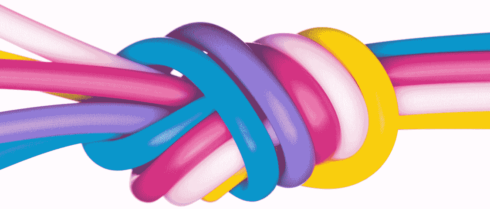
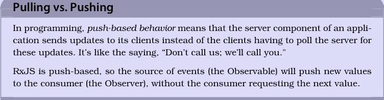
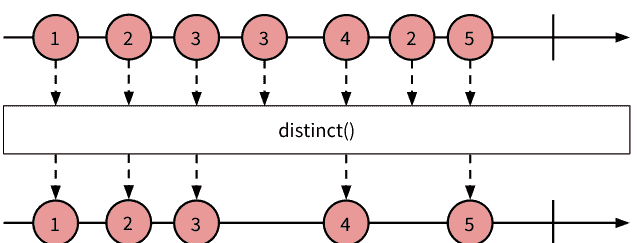
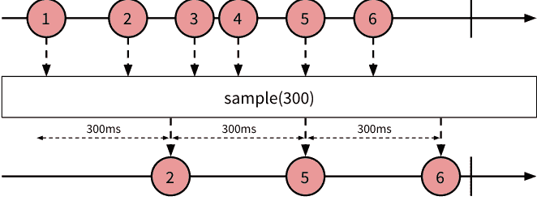
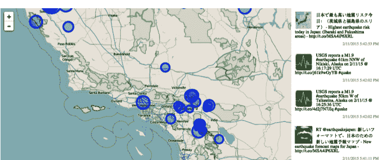
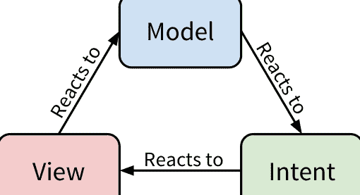
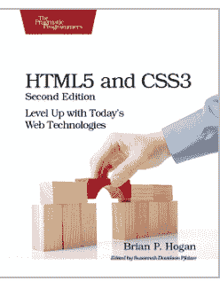
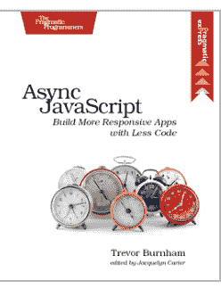
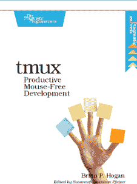
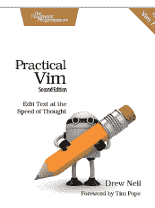

# RxJS 响应式编程：理解你的异步 JavaScript 代码



# 对《使用 RxJS 进行响应式编程》的早期赞誉

软件开发的每一次重大转变都要求我们重新思考自己的方法。实时和异步 Web 应用给当今的 Web 开发带来了巨大挑战。这本书很好地解释了 RxJS 如何解决这些挑战，并教导你如何从可观测流（Observables）的角度重新审视你的世界。

- Zef Hemel

STX Next 工程部副总裁

这本书就像响应式编程本身一样火热！凭借出色的文笔、清晰的解释和实用的示例，它是学习 RxJS 的绝佳资源。

- Fred Daoud

软件开发承包商

要采取主动，在为太晚之前通过这本书学习响应式编程吧。`Rx.Observable.fromBook(book).subscribe(function(value) {...做惊不起的事情...});`

- Javier Collado Cabeza

NowSecure, Inc. 高级软件开发人员

一本非常易读且内容极佳的书。这本书非常有意义，通过实践示例为学习使用 RxJS 进行响应式编程提供了清晰的路线图。

- Ramaninder Singh Jhajjj

Know-Center, Austria, 服务与开发部工程师

解string你的异步 JavaScript 代码


我们的实战课程、工作坊和其他产品可以帮助你和你的团队创建更好的软件并增加乐趣。欲了解更多信息以及最新的实战派新书，请访问我们的网站 https://pragprog.com。

制作本书的团队包括：

- Rebecca Gulick（编辑）

- Potomac Indexing, LLC（索引）

- Candace Cunningham（校对）

- Dave Thomas（排版）

- Janet Callahan（制作）

- Ellie Callahan（支持）

送给 tu, Pipus

# 致谢

我有许多人要感谢。这些人中有的人帮助了这本书，也有人是在帮助我这个人的成长。没有他们，我无法完成这项工作。

我特别感谢那些最初创立 Reactive Extensions 库的人，以及扩展并推广它的人。没有他们，这本书显然不会存在：Erik Meijer, Matt Podwysacki, Bart Smet, Wes Dyer, Jafar Husain, André Staltz，以及我可能遗漏的许多人。

感谢 Pragmatic Bookshelf 的同事们。与你们合作是一种荣幸。特别感谢 Susannah Pfaler，从这本书还只是一个想法时起就一直支持它。我非常幸运能有 Rebecca Gulick 担任编辑：你非常专业，对我的问题非常关注，与你合作非常愉快。

感谢杰出的技术评审员。David Bock, Javier Collado Cabeza, Fred Daoud, Iraqi Golazishvili, Zef Hemel, Rameshander Singh Jhaij, Aaron Kalair, Daniel Lamb, Brian Schau 和 Stephen Wolff，以及 Pragmatic 出版方 David 和 Andy：由于你们，这本书变得好得多。你们都无私地投入了精力和审查这本书，指出错误并让我避免了多次尴尬的失误。书中剩下的任何错误都是我的错。

给我的朋友们。那些无论时间多远都在身边的人：你们知道自己是谁。感谢你们的笑、支持和爱。

我的父母，Narcis Mansilla 和 Joana Molins。你们是我的指南和榜样。你们从未停止相信我，并鼓励我接受更大的挑战。在你们为付账单感到困难时，为我买了第一台电脑。那开始了一切，我感激你们。

我的儿子，Adrià。你是在我写这本书时出生的，你改变了我对我生命的意义。在如此短的时间里，你已经教会了我很多，我等不及要看到接下来会发生什么了。

最后是Jen，我生命的挚爱。在我们目前为止最忙碌的时期写书期间，你付出了无限的耐心并支持我。你是我的灵感来源，让我方方面面成为了一个更好的人。你是我的星。

Sergi Mansilla

# 序言

响应式编程正在席卷软件世界。本书将响应式编程哲学与 JavaScript 的可能性相结合，你将学习如何将响应式技术应用于你自己的项目中。我们将关注如何使用响应式编程来管理和组合事件流。事实上，我们将涵盖如何仅通过对程序事件声明转换，就构建出整个真实世界的并发应用程序。

如今的大多数软件处理的是仅随时间产生的数据：网站加载远程资源并响应复杂的用户交互，服务器分布在多个物理位置，人们拥有的移动设备，并期望它们在任何时候都能工作，无论是在高速 Wi-Fi 还是信号不稳定的移动网络上。任何严肃的应用都涉及到需要高效协调的异步部分，而这用当今的编程技术是非常困难的。此外，我们还要面临一直存在的问题：服务器崩溃、网络缓慢以及我们必须处理的软件漏洞。

我们不能再按照过去的方式来编写应用程序了。它曾经运行了一段时间，但现在是时候采用新方法了。

# 新世界，旧方法

在过去的几年里，JavaScript 已成为世界上最无处不在的语言，现在它为沃尔玛（Walmart）和 Netflix 等企业的关键任务基础设施、Firefox OS 等移动操作系统，以及 Google Docs 等复杂的流行应用程序提供支持。

而我们仍然在使用大量的命令式编程风格来处理本质上是异步的问题。这非常困难。

JavaScript 开发者将语言缺乏线程视为一种特性，我们通常使用回调（callbacks）、承诺（promises）和事件来编写异步代码。

- 1. http://venturebeat.com/2012/01/24/why-walmart-is-using-node-js/, http://techblog.netflix.com/2014/06/scale-and-performance-of-large.html

随着我们不断向应用程序添加更多并发性，协调异步流的代码变得变得难以。。目前的机制具有严重的缺陷，阻碍了开发者的生产力，并导致应用程序变得脆弱。

以下是处理异步操作的当前机制的快速回顾及其问题。

# 回调函数（Callback Functions）

`callback`（回调）是一个作为参数传递给执行异步操作的函数 (B) 的函数 (A)。当 (B) 执行完成后，它会带上操作结果`calls back`（回调）(A)。回调用于管理异步流，例如网络 I/O、数据库访问或用户输入。

```
intro/callback_example.js
function B(callback) {
  // 消耗一些时间的操作
  callback('Done!');
}

function A(message) {
  console.log(message);
}
```

// 使用 `A` 作为回调执行 `B`

B(A);

回调很容易理解，并已成为 JavaScript 处理异步数据流的默认方式。但这种简单性是有代价的。回调有以下缺点：

* 回调地狱（Callback hell）。在处理高度异步的代码时，很容易产生大量的嵌套回调。当这种情况发生时，代码不再是线性的，变得难以理解。

整个应用程序最终在回调中到处传递，变得变得难以维护和调试。

* 回调可能会运行多次。无法保证同一个回调只被调用一次。多次调用很难被检测，并可能导致应用程序出现错误和一般的混乱。

* 回调改变了错误语义。回调破坏了传统的 try/catch 机制，并依赖程序员检查错误并传递它们。

* *并发性变得越来越复杂*。组合多个异步操作的相互依赖的结果变得非常困难。这要求我们在时序变量中跟踪每个操作的状态，然后按照正确的顺序将它们委托给最终的组合操作。

# 承诺（Promises）

Promises 的出现将我们从回调中救出来。一个 promise（承诺）代表异步操作的结果。在基于 promise 的代码中，调用异步函数立即返回一个“promise”，该承诺最终将通过操作的结果被*resolved*（解析），或通过一个错误被*rejected*（拒绝）。在此期间，*pending*（待定）状态的 promise 可以用作最终值的占位符。

Promises 通常通过更接近同步代码使程序更加清晰，减少了对嵌套块的需求并减少了状态的跟踪。

遗憾的是，promise 并不是万灵药。它们是对回调的改进，但它们有一个主要的缺点：它们只能产生单个值。这使得它们在处理鼠标点击或来自服务器的数据流等循环事件时变得毫无用处，因为我们必须为每个单独事件创建一个 promise，而不是创建一个处理随之而至的事件流的 promise。

# 事件发射器（Event Emitters）

当我们发射一个事件时，订阅了它的事件监听器就会触发。使用事件是解耦功能的极方法，在 JavaScript 中，事件编程很常见且通常是良好的做法。

但是，正如你猜的，事件监听器也有它们自己的问题：

* 事件副作用。事件监听器函数总是忽略它们的返回值，这迫使监听器如果想对世界产生任何影响，就必须产生副作用

* 事件不是一等公民值。例如，一系列点击事件无法作为参数传递或像实际序列那样进行操作

* * 如果我们开始监听得太晚，很容易错过事件*。一个著名的例子是 Node.js 版本的流 接口，它经常会在监听器准备好之前发布数据，导致数据永久丢失

由于这些机制是我们一直以来用来管理并发的方式，可能很难想到更好的方法。但在本书中，我将向你展示一种：响应式编程

# 什么是响应式编程？

响应式编程包含许多概念和技术的编程范式。在本书中，我将特别关注创建、转换和响应数据流。鼠标点击、网络请求、字符串数组——这些都可以表示为流，我们在它们发布新值时对其进行“响应”。

响应式编程关注传播变化而无需显式指定如何传播。这允许我们说明代码应该做什么，而无需编写实现它的每一步。这构建了一种更可靠、更容易维护的方法。

# 什么是 RxJS？

RxJS 是 Reactive Extensions（Rx）的 JavaScript 实现，Rx 是最初由微软创建的响应式编程模型，允许开发者轻松组合异步数据流。它提供了一个通用接口来组合和转换来自不同来源的数据，例如文件系统操作、用户交互和社交网络更新。

Rx 起于 .NET，但现在每个主流语言（以及一些语言语言都有良好的开源实现。它正成为编写响应式应用程序的标准，Rx 的主要数据类型 Observable 被提议作为 JavaScript 的一部分纳入 ECMAScript 7。

# 本书适用于

本书适用于具有一定经验的开发者。你应该熟悉闭包和高阶函数，并理解 JavaScript 的作用域规则。尽管如此，我仍尝试解释书中涉及的最复杂的语言概念。

# 本书内容

这本书是一本关于使用 RxJS 进行响应式编程的实用介绍。其目标是通过构建小型真实世界的应用程序，让你学会以响应式的方式思考，因此你将学习如何在日常编程中引入响应式编程，并让你的程序更加健壮。这不是一本关于响应式编程的理论书籍，也不是 RxJS API 的详尽参考书。你可以在网上找到这些资源。

我们将主要针对浏览器开发，但在此过程中我们会看到一些示例以保持真实性。以下是章节目录：

- 除非你之前用过 RxJS，否则请从[第 1 章，响应式之道（第 1 页）开始]。在本章中，我们介绍了 Observable（观测流），这是 RxJS 的主要数据类型，我们在书中广泛使用了它。

- 在建立起 Observable 的基础后，我们将进入[第 2 章，深入序列（第 17 页）]。在响应式编程中，我们将看到所有的事件序列。我们将访问一些重要的序列操作符，并构建第一个应用程序：实时地震可视化器。

- 在[第 3 章，构建并发程序（第 39 页）]中，我们将研究如何以最少的副作用编写并发代码。在涵盖了 Observable 管道后，我们将用大约 200 行代码在没有全局状态的情况下构建一个酷的视频游戏。

- 在[第 4 章，构建完整的 Web 应用程序（第 69 页）]中，我们将深入研究响应式开发，并通过在 Node.js 中编写服务器部分来增强之前在[深入序列]中制作的地震应用程序，它可以对正在发生的地震发布推。

- 我们通过[第 5 章，使用调度器弯曲时间（第 89 页）]进入 RxJS 的一些高级概念，在那里我们将讨论 RxJS 提供的在更细粒度上处理并发的有用概念：Schedulers（调度器）。

掌握了调度器的知识后，我们将探索它们如何帮助我们进行测试。我们将学习如何在测试中进行模拟，以准确地测试异步程序。

- 最后，在[第 6 章，使用 Cycle.js 构建响应式 Web 应用（第 103 页）]中，我们将使用 Cycle.js（一个构建在 RxJS 之上的 UI 框架）来构建一个简单的应用程序。Cycle.js 借鉴了 React 等现代框架的概念，但为了创建一个利用 Observable 优势来帮助我们以简单可靠的方式创建用户界面的响应式框架。

# 运行代码示例

书中的代码示例为浏览器或 Node.js 设计的。代码的上下文将说明在什么环境中运行代码。

# 在浏览器中运行 RxJS 代码

如果代码要在浏览器中运行，我们将使用 `rx.all.js`，你可以在 RxJS 的 GitHub 仓库找到它。`rx.all.js` 包含了 RxJS 中的所有操作符，这是确保所有示例运行的最简单方法。只需在 HTML 文档的 `<head>` 部分加载脚本即可：

```html
<html
<head>
  <script src="rx.all.js"></script>
</head>
...
</html>
```

请记住这是一个较大的文件，如果你没有使用 RxJS 的所有功能，可能考虑为项目选择较小的文件，例如 `rx.js` 或 `rx.lite.js`。

# 在 Node.js 中运行 RxJS

在 Node.js 中运行代码示例非常简单。只需确保使用 npm 在项目中安装 RxJS 依赖即可：

```bash
$ npm install rx
rx@4.0.0 node_modules/rx
```

之后，你可以在 JavaScript 文件中导入 RxJS 库：

```javascript
var Rx = require('rx');

Rx.Observable.just('Hello World!').subscribe(function(value) {
  console.log(value);
});
```

你只需调用 node 和文件名即可运行它：

```bash
$ node test.js
Hello World!
```

- 3. https://github.com/Reactive-Extensions/RxJS/tree/master/dist

# RxJS 版本

所有示例都是为 RxJS 4.x 设计的。你可以在 RxJS 在线仓库中下载最新版本。

# 资源

RxJS 正在被快速采用，每天都有关于关于它的资源。尽管如此，有时在网上可能很难找到关于它的资源。以下是我喜欢的几个：

- RxJS 官方源码仓库

- ReactiveX，一个与 Reactive Extensions（响应式扩展）相关的资源集合

- RxMarbles，一个用于可视化 Observable 的交互式工具

# 下载示例代码

本书的网站有互动讨论论坛的链接，以及提交错误的地方。你还将找到我们构建的所有项目的源代码。电子书读者可以与每个代码片段上方的框进行交互，以直接查看该片段。

- 4. https://github.com/Reactive-Extensions/RxJS/releases/latest

5. https://github.com/Reactive-Extensions/RxJS

6. http://reactive.io

7. http://rxmarbles.com/

8. http://pragprog.com/titles/smreactjs

# 第 1 章

## 响应式之道

现实世界相当混乱：事件按随机顺序发生，应用程序崩溃，网络故障。很少有应用程序是完全同步的，编写异步代码对于保持应用程序的响应能力是必要的。大多数时候这是极其痛苦的，但真的不必如此。

现代应用程序需要极响应的界面，编写异步代码对于保持应用程序的响应能力是必要的。大多数时候这是极其痛苦的，但真的不必如此。

**响应式之道**

现实世界相当混乱：事件按随机顺序发生，应用程序崩溃，网络故障。很少有应用程序是完全同步的，编写异步代码对于保持应用程序的响应能力是必要的。大多数时候这是极其痛苦的，但真的不必如此。

### 电子表格是响应式的

让我们从考虑响应式系统的典型示例开始：电子表格。我们都都用过它们，但很少停下来思考它们直观的程度多么令人惊叹。假设我们在电子表格的 A1 单元格中有一个值。然后我们可以在表格的其他单元格中引用它，每当我们更改 A1 时，所有依赖于 A1 的单元格都会自动更新自己的值。

| | A | B | C |

|---|---|---|---|

| 1 | 100 | 20 | 500 |

| 2 | | | |

这种行为对我们来说很自然。我们不需要告诉计算机去更新依赖于 A1 的单元格，或者告诉它如何做；这些单元格对变化产生了*反应*。在电子表格中，我们只需*声明*我们的问题，而无需担心计算机如何计算结果。

这正是响应式编程的目标。我们声明实体之间的关系，而程序会随着这些实体的变化或产生新值而演进。

### 作为值流的鼠标

为了理解如何将事件视为值的流，让我们回想一下章初的程序。我们将鼠标点击视为用户点击时实时生成的无限事件序列。这是 RxJS 的发明者 Erik Meijer 提出的想法，他在他的论文《你的鼠标就是一个数据库》中提出了这一点。¹

在响应式编程中，我们将鼠标点击视为连续的事件流，我们可以对其进行查询和操纵。思考“流”而不是孤立的值，开启了一种全新的编程方式，在这种方式中，我们可以操作整个尚未创建的值序列。

让这个想法先停留一会儿。这与我们习惯的不同——我们习惯是将值存储在数据库或数组等地方，并在使用它们之前等待它们可用。如果它们尚未可用（例如网络请求），我们会等待它们并仅在它们变得可用时使用它们。

¹ 1. http://queue.acm.org/detail.cfm?id=2169076

### 时间


我们可以将流序列看作一个数组，其中的元素是通过时间而不是内存分隔的。无论是通过时间还是内存，我们都有元素的序列：

将你的程序视为流数据序列是理解 RxJS 编程的关键。这需要一些练习，但并不困难。事实上，我们在任何应用程序中使用的大多数数据都可以表示为序列。我们将在第 2 章“深入序列”（第 17 页）中更深入地研究序列。

### 查询序列

让我们使用 JavaScript 中传统的事件监听器实现一个简单的鼠标流版本。为了记录鼠标点击的 x 坐标和 y 坐标，我们可以编写这样的代码：

```javascript
document.body.addEventListener('mousemove', function(e) {
  console.log(e.clientX, e.clientY);
});
```

```text
252 183
211 232
153 323
...
```

看起来像一个序列，对吧？问题在于，操纵事件并不像操纵数组那样简单。例如，如果我们想修改前面的代码，使其仅记录屏幕右侧的前 10 次点击（这是一个相当随机的目标，但请听我解释），我们将编写这样的代码：

```javascript
var clicks = 0;
document.addEventListener('click', function registerClicks(e) {
```

```javascript
if (clicks < 10) {
  if (e.clientX > window.innerWidth / 2) {
    console.log(e.clientX, e.clientY);
    clicks++;
  } else {
    document.removeEventListener('click', registerClicks);
  }
}
```

为了满足我们的需求，我们通过全局变量 `clicks` 引入了外部状态，该变量计算目前为止的点击次数。我们还需要检查两个不同的条件并使用嵌套条件块。当完成后，我们必须绑定并取消事件以防止内存泄漏。

### 副作用和外部状态

如果一个动作对其发生范围之外产生影响，我们称之为副作用。在函数外部更改变量、打印到控制台或更新数据库中的值都是副作用的例子。

例如，更改我们函数内部变量的值是安全的。但如果该变量在我们的函数范围之外，那么其他函数就可以更改它的值。这意味着我们的函数不再处于控制之下，并且无法假设外部变量包含我们预期的值。我们需要跟踪它并添加检查以确保其值是我们预期的那样。到那时，我们正在添加与程序逻辑无关的代码，使其变得更加复杂且容易出错。

尽管副作用对于构建任何有趣的程序都是必须的，但我们应该努力减少代码中的副作用数量。这在响应式程序中尤为如此，因为我们有许多随时间变化的组件。在整本书中，我们将追求一种避免外部状态和副作用的方法。事实上，在第 3 章“构建并发程序”（第 39 页）中，我们将构建一个没有任何副作用的视频游戏。

我们设法实现了简单的需求，但对于这样一个简单的目标却得到了相当复杂的代码。它很难于维护，并且对于第一次看到它的开发者来说也并不直观。更重要的是，我们让它在未来容易产生细微的 bug，因为我们需要保持状态。

在这种情况下，我们想要的只是你的“数据库”。

当我们运行程序时：

```text
< Listener 1 received: Hello there!
Listener 2 received: Hello there!
```

每当 Producer（生产者）更新其内部状态时，`listener1` 和 `listener2` 都会收到通知，无需我们去检查。

我们的实现非常简单，但它说明了观察者模式如何允许事件与响应这些事件的监听对象之间解耦。

## 迭代器模式

Observable 拼图的另一部分来自迭代器模式。迭代器（Iterator）是一个对象，它为消费者提供了一种简单遍历内容的方法，同时向消费者隐藏实现细节。

迭代器接口非常简单。它需要两个方法：`next()` 用于获取序列中的项，`hasNext()` 用于检查序列中是否还有剩余项。

下面是我们如何编写一个迭代器，它操作一个数字数组，并仅产生除参数 `divisor` 倍的元素：

```javascript
function iterateMultiples(arr, divisor) {
  this.cursor = 0;
  this.array = arr;
  this.divisor = divisor || 1;
}
```

```javascript
iterateOnMultiples.prototype.next = function() {
  while (this.cursor < this.array.length) {
    var value = this.array[this.cursor++];
    if (value % this.divisor === 0) {
      return value;
    }
  }
}
```

```javascript
iterateOnMultiples.prototype.hasNext = function() {
  var cur = this.cursor;
  while (cur < this.array.length) {
    if (this.array[cur++] % this.divisor === 0) {
      return true;
    }
  }
  return false;
}
```

## Rx 模式与 Observable

我们可以这样使用这个迭代器：

```javascript
var consumer = new iterateOnMultiples([1, 2, 3, 4, 5, 6, 7, 8, 9, 10]);

console.log(consumer.next(), consumer.hasNext()); // 3 true
console.log(consumer.next(), consumer.hasNext()); // 6 true
console.log(consumer.next(), consumer.hasNext()); // 9 false
```

迭代器非常适合封装任何类型数据结构的遍历逻辑。正如我们在前面的示例中看到的，当迭代器被泛化以处理不同类型的数据，或者当它们可以在运行时进行配置时（正如我们在示例中通过 `divisor` 参数所做的那样），它们就会变得有趣起来。

虽然观察者和迭代器本身都是强大的，但两者的结合效果更好。我们称之为 Rx 模式，它根据 Reactive Extensions（响应扩展）库命名。在本书的剩余部分，我们将使用这种模式。

Observable 序列（或简单称为 Observable）是 Rx 模式的核心。观察者（Observer）按顺序发射它的值——但不是由消费者请求下一个值，而是由 Observable 在值可用时将其“推送”给消费者。它与观察者模式中 Producer 的角色相似：发射值并将其推给监听器。



在编程中，基于推送（push-based）的行为意味着应用程序的服务器组件主动更新客户端，而不是由客户端轮询服务器获取这些更新。这就像在说：“不要给我们打电话，我们会给你回电。” RxJS 是基于推送的，因此事件源（Observable）会将新值推给消费者（观察者），而无需消费者请求下一个值。

更简单地说，Observable 是一个项随时间变得可用的序列。Observable 的消费者——观察者——等同于观察者模式中的监听器。当一个观察者订阅一个 Observable 时，它将在序列中的项可用时接收它们，而无需请求。

到目前为止，Observable 与观察者模式似乎没有太大区别。但实际上，它们有两点本质区别：

- Observable 是基于推送的，而迭代器是基于拉取的。
- Observable 可以处理异步数据流，而迭代器通常只处理同步数据。

使用 Observable，我们可以对序列进行转换、过滤和组合操作，而不需要在每个操作中手动处理逻辑。此外，Observable 还可以信号序列的结束。我们可以通过 `subscribe` 方法来完成这些操作。

## 创建 Observable

有多种方法可以创建 Observable。`create` 方法接收一个观察者作为参数，并定义 Observable 如何发射值。是创建一个简单的 Observable：

```javascript
Observable.create(function(observer) {
  observer.next('Simon');
  observer.next('Jen');
  observer.complete();
});
```

当订阅这个 Observable 时，它会按顺序调用这些方法。这就是如何创建一个基础 Observable：

```javascript
var observable = Observable.create(function(observer) {
  observer.next('Alice');
  observer.next('Bob');
  observer.complete();
});
```

## 联系观察者

观察者有三个方法：`next`、`complete` 和 `error`：

- `next`：观察者模式中的等价物，用于接收数据。
- `complete`：信号序列已结束。
- `error`：当发生错误时调用。

这就是如何订阅一个观察者：

```javascript
observable.subscribe(
  function next(x) { console.log('Next: ' + x); },
  function onError(err) { console.log('Error: ' + err); },
  function onCompleted() { console.log('Completed'); }
);
```

`create` 方法接收 `next`、`complete` 和 `error` 的函数，并返回一个 Observable 实例。这三个函数是可选的，你可以决定包含哪些。例如，如果我们订阅一个无限序列（用户可以一直点击），`onCompleted` 处理程序将不会调用。如果我们确定序列不会出错（例如它是同步的），我们不需要 `onError` 处理程序。

## 使用 XMLHttpRequest

我们还没有对 Observable 做过任何实用的操作。使用 XMLHttpRequest 怎样？为了这一点，我们将使用 `Observable.create`：

```javascript
function get(url) {
  return Observable.create(function(observer) {
    var req = new XMLHttpRequest();
    req.open('GET', url);

    req.onload = function() {
      if (req.status == 200) {
        // 将结果传递给监听器并完成序列
        observer.next(req.response);
        observer.complete();
      } else {
        // 否则，向监听器信号错误
        observer.onError(new Error(req.statusText));
      }
    };

    req.onerror = function() {
      observer.onError(new Error("Unknown Error"));
    };

    req.send();
  });
}

// 创建一个 Observable
var test = get('/api/contents.json');
```

在前面的代码中，`get` 函数使用 `create` 封装了 XMLHttpRequest。如果 HTTP GET 请求成功，我们发射其内容并完成序列（我们的 Observable 只会产生一个结果）。否则，我们发射一个错误。

重要的是：Observable 在有观察者订阅它们之前不会执行任何操作。让我们来解决这个问题：

```javascript
// 订阅观察者到 test
test.subscribe(
  function next(x) { console.log('Result: ' + x); },
  function onError(err) { console.log('Error: ' + err); },
  function onCompleted() { console.log('Completed'); }
);
```

这段代码的功能与我们之前的完全相同，但我们不需要再为 `XMLHttpRequest` 创建包装器了；它已经存在了。同样注意，这次我们省略了 `onCompleted` 回调函数，因为我们不计划在 `Observable` 完成时创建它。我们知道它只会产生一个结果，而且我们已经在 `onNext` 回调中使用它了。

在整本书中，我们将使用许多像这样方便的操作符。RxJS 是“开箱即用”的。事实上，这是它的优势之一。

## 统治一切的单一数据类型

> 在 RxJS 程序中，我们应该努力将所有数据都放在 Observables 中，而不仅仅是来自异步源的数据。这可以让我们轻松地组合来自不同来源的数据，例如现有的数组与回调的结果，或者来自由用户触发的事件。

例如，如果我们有一个数组，其项需要与来自其他处的数据结合使用，那么将此数组转换为 `Observable` 会更好。（显然，如果数组只是一个不需要组合的中间变量，则没有必要这样做。）在整本书中，你将学到在什么情况下将数据类型转换为 `Observable` 是值得的。

RxJS 提供了从大多数 JavaScript 类型创建 `Observable` 的操作符。让我们来看看最常用的几个，你将经常使用它们：数组、事件和回调。

## 从数组创建 Observables

我们可以使用多功能操作符 `from` 将任何类数组或迭代对象转换为 `Observable`。`from` 接收一个数组作为参数并返回一个发射其每个元素的 `Observable`。

```javascript
Rx.from(['Adria', 'Jen', 'Sergi'])
  .subscribe(
    function(x) { console.log('Next: ' + x); },
    function(err) { console.log('Error: ' + err); },
    function() { console.log('Completed'); }
  );
```

`from` 是 RxJS 代码中最方便且最频繁使用的操作符之一。

## 从 JavaScript 事件创建 Observables

当我们将一个事件转换为 `Observable` 时，它就变成了一个可以组合和传递的类等值。例如，这里有一个当鼠标移动时都会发射鼠标坐标的 `Observable`：

```javascript
var allMoves = Rx.Observable.fromEvent(document, 'mousemove')
allMoves.subscribe(function(e) {
  console.log(e.clientX, e.clientY);
});
```

将事件转换为 `Observable` 释放了事件自然限制的束缚。更重要的是，我们可以根据原始的 `Observable` 创建新的 `Observable`。这些新的 Observable 是相互独立的，可以用于不同的任务：

```javascript
var movesOnRight = allMoves.filter(function(e) {
  return e.clientX > window.innerWidth / 2;
});

var movesOnLeft = allMoves.filter(function(e) {
  return e.clientX < window.innerWidth / 2;
});
```

```javascript
movesOnRight.subscribe(function(e) {
  console.log('Mouse is on the right:', e.clientX);
});
```

```javascript
movesOnLeft.subscribe(function(e) {
  console.log('Mouse is on the left:', e.clientX);
});
```

在前面的代码中，我们从原始的 `allMoves` 创建了两个 `Observable`。`movesOnRight` 包含发生在屏幕右侧的鼠标事件，`movesOnLeft` 包含发生在左侧的鼠标事件。它们任何一个都没有修改原始的 `Observable`：`allMoves` 将继续发射所有的鼠标移动。Observables 是不可变的，应用在它们上的每个操作符都会创建一个新的 `Observable`。

## 从回调函数创建 Observables

如果你使用第三方 JavaScript 库，很有可能需要与基于回调的代码进行交互。我们可以使用两个函数 `fromCallback` 和 `fromNodeCallback` 将我们的回调转换为 `Observable`。Node.js 遵循始终通过回调函数调用回调函数的约定。


```javascript
var Rx = require('rxjs');
var fs = require('fs');

// 使用 fromNodeCallback 
var source = Rx.Observable.fromNodeCallback(fs.readFile);

// 使用 fromCallback 
var subscription = Rx.Observable.fromCallback(fs.stat, 'utf8').subscribe(
  function(res) { console.log('Next: ' + res); },
  function(err) { console.log('Error: ' + err); },
  function() { console.log('Completed'); }
);
```

在前面的代码中，我们从原始的 `allMoves` 创建了两个 `Observable`。`movesOnRight` 包含了发生在屏幕右侧的鼠标事件，`movesOnLeft` 包含了发生在左侧的鼠标事件。它们任何一个都没有修改原始的 `Observable`：`allMoves` 将继续发射所有的鼠标移动。`Observable` 是不可变的，应用在它们上的每个操作符都会创建一个新的 `Observable`。

在这里，沿 `y` 轴的虚线箭头指向应用于序列 `A` 和 `B` 中每个元素的转换的最终结果。生成的 `Observable` 由 `C` 表示，它包含了 `A` 和 `B` 合并后的元素。如果不同的 `Observable` 同时发射了元素，则这些元素在合并后的序列中的顺序是随机的。

## 基础序列运算符

RxJS 中有几十个转换 `Observable` 的运算符，其中最常用的是任何具有良好集合处理能力的语言都具备的那些：`map`、`filter` 和 `reduce`。在 JavaScript 中，你可以在 `Array`（数组）实例中找到这些运算符。

RxJS 遵循 JavaScript 规范，因此你会发现以下运算符的语法与数组运算符几乎相同。事实上，我们将同时展示使用数组和 `Observable` 的实现方式，以说明这两个 API 是多么相似。

### Map

`map` 是最常用的序列转换运算符。它接收一个 `Observable` 和一个应用于该 `Observable` 中每个值的函数。它返回一个带有变换后值的新 `Observable`。

```javascript
var src = [1, 2, 3, 4, 5];
var upper = src.map(function(name) {
  return name * 2;
});
```

```javascript
var src = Rx.Observable.range(1, 5);
var upper = src.map(function(name) {
  return name * 2;
});
```

`upper.forEach(logValue);`

在两种情况下，代码都没有发生变异。

`upper.subscribe(logValue);`

这段代码以及后续代码使用了以下 `logValue` 的定义：

```javascript
var logValue = function(val) { console.log(val) };
```

我们传递给 `map` 的函数可能会执行某些异步计算来转换值。在这种情况下，`map` 的工作可能不会按预期进行。对于这些情况，最好使用第 22 页的 `flatMap`。

### Filter

`filter` 接收一个 `Observable` 和一个函数，并使用该函数测试 `Observable` 中的每个元素。它返回一个所有函数返回 `true` 的元素的 `Observable` 序列。

| JS Arrays | Observables |
|---|---|
| `var isEven = (function(val) { return val % 2 != 0; });` | |
| `var src = [1, 2, 3, 4, 5];` | `var src = Rx.Observable.range(1, 5);` |
| `var even = src.filter(isEven);` | `var even = src.filter(isEven);` |

`even.forEach(logValue);` `even.subscribe(logValue);`

### Reduce

`reduce`（也称为 *fold*）接收一个 `Observable` 并返回一个新的 `Observable`，该 `Observable` 始终包含单个项，该项是在每个元素上应用函数的结果。该函数接收当前元素和函数上次调用的结果。

#### JS Arrays

```javascript
var src = [1, 2, 3, 4, 5];
var sum = src.reduce(function(a, b) {
  return a + b;
});
```

#### Observables

```javascript
var src = Rx.Observable.range(1, 5);
var sum = src.reduce(function(acc, x) {
  return acc + x;
});
```

```javascript
sum.subscribe(logValue);
```

`reduce` 是一个操作序列的强大运算符。在基础实现中，它是用于处理子集集合的聚合运算符。

### 聚合运算符

聚合运算符处理序列并返回单个值。例如，`Rx.Observable.first` 接收一个 `Observable` 和可选的谓词函数，返回满足条件的第一个元素。

计算序列的平均值也是一种聚合操作。RxJS 提供了 `average` 运算符，但为了练习，我们想看看如何使用 `reduce` 来实现它。

```javascript
// sequences/marble.js
var avg = Rx.Observable.range(0, 5)
  .reduce(function(prev, cur) {
    return {
      sum: prev.sum + cur,
      count: prev.count + 1
    };
  }, {sum: 0, count: 0})
  .map(function(o) {
    return o.sum / o.count;
  });
```

```javascript
var subscription = avg.subscribe(function(x) {
  console.log('Average is: ', x);
});
```

Average is: 2

在此代码中，我们使用 `reduce` 将每个新值加到之前的值上。因为 `reduce` 没有提供序列的元素总数，我们需要保留计数。我们带有一个包含 `sum` 和 `count` 字段的初始值调用 `reduce`，以便存储目前的总和和计数。每个新元素将返回更新后的对象。当序列结束时，`reduce` 将返回包含最终 `sum` 和最终 `count` 的对象。我们使用 `map` 返回 `sum` 除以 `count` 的结果。

Joe 问：我们可以聚合无限 `Observable` 吗？

想象我们在编写一个程序，在用户行走时给出他们的平均速度。即使用户没有停止，我们需要使用已知的速度进行计算。我们想要实时记录无限序列的平均值。问题是，如果序列永远不结束，聚合运算符将永远无法调用 `next`。幸运的是，RxJS 团队考虑到了这种情况，并为我们提供了 `scan` 运算符，它像 `reduce` 但会发射每个中间结果：

```javascript
var avg = Observable.interval(1000)
.scan(function (prev, cur) {
  return {
    sum: prev.sum + cur,
    count: prev.count + 1
  };
}, { sum: 0, count: 0 }).map(function(o) {
  return o.sum / o.count;
});

var subscription = avg.subscribe(function (x) {
  console.log(x);
});
```

通过这种方式，我们可以聚合需要长时间完成或无限的序列。在前面的示例中，我们每秒生成一个递增整数，并替换了 `reduce` 调用。现在我们得到了为止生成的值的平均值。

### flatMap

如果你有一个结果也是 `Observable` 的 `Observable` 该怎么办？通常你想这些嵌套 `Observable` 中的项合并到一个序列中。这正是 `flatMap` 所做的。`flatMap` 运算符接收一个元素也是 `Observable` 的 `A`，并返回一个包含 `A` 的平展值的 `Observable`。让我们用图来可视化：

我们可以看到 `A` 中的每个元素（`A1`, `A2`, `A3`）也是 `Observable` 序列。一旦我们对 `A` 应用转换函数 `flatMap`，我们就得到了一个包含 `A` 的所有子元素的 `Observable`。

`flatMap` 是一个强大的运算符，但它可能比我们目前看到的运算符更难。把它想象成 `Observable` 的 `concatAll()`。

`concatAll` 是一个接收数组数组并返回“平展”单个数组的函数，它包含所有子数组的值而不是子数组本身。我们可以使用 `reduce` 来制作这样的函数：

```javascript
function concatAll(source) {
  return source.reduce(function(a, b) {
    return a.concat(b);
  });
}
```

我们会这样使用它：

```javascript
concatAll([[0, 1, 2], [3, 4, 5], [6, 7, 8]]);
// [0, 1, 2, 3, 4, 5, 6, 7, 8]
```

`flatMap` 执行相同的操作，但它平展的是 `Observable` 而不是数组。它接收一个源 `Observable` 和一个返回新 `Observable` 的函数，并将函数应用于源 `Observable` 中的每个元素，就像 `map` 做的那样。如果过程在这里停止，我们将得到一个发射 `Observable` 的 `Observable`。但 `flatMap` 向主序列发射每个新 `Observable` 发射的值，将所有 `Observable` “平展”成一个主序列。最后，我们获得一个的 `Observable`。

### 取消序列

在 RxJS 中，我们可以取消正在运行的 `Observable`。这是相对于其他异步通信形式（如回调和 promise）的优势，因为它们一旦调用就无法直接取消（尽管某些实现支持取消）。

我们取消 `Observable` 有两种方法：*隐式*和*显式*。

#### 显式取消：Disposable

`Observable` 本身没有被取消的方法。相反，每当我们订阅一个 `Observable` 时，我们都会得到一个代表该订阅的 `Disposable` 对象。然后我们可以调用该对象中的 `dispose` 方法，该订阅将停止接收来自 `Observable` 的通知。

在下面的示例中，我们订阅两个观察者到 `counter` `Observable`，它每秒发射一个递增整数。两秒后，我们取消了第二个订阅，发现它的输出停止了第一个订阅者的输出：

```javascript
// sequences/disposable.js
var counter = Rx.interval(1000);

var subscription1 = counter.subscribe(function(i) {
  console.log('Subscription 1', i);
});

var subscription2 = counter.subscribe(function(i) {
  console.log('Subscription 2', i);
});

setTimeout(function() {
  console.log('Canceling subscription2!');
  subscription2.dispose();
}, 2000);
```

+   Subscription 1: 0

Subscription 2: 0

Subscription 1: 1

Subscription 2: 1

Canceling subscription2!

Subscription 1: 2

Subscription 1: 3

Subscription 1: 4

### 隐式取消：通过操作符

大多数情况下，操作符会自动为你取消订阅。像 `range` 或 `take` 这样的操作会在序列结束或满足操作条件时取消订阅。更高级的操作符如 `withLatest` 或 `flatMap` 会在内部创建和销毁所需的订阅，它们处理了多个运行中的 `Observable`。简而言之，你不必担心自己取消大多数订阅。

### 封装外部 API 的 Observable

当你使用封装不支持取消的外部 API 的 `Observable` 时，底层 API 并不会被取消。例如，如果你使用一个封装了 promise 的 `Observable`，当 `Observable` 被取消时它会停止发射，但底层的 promise 不会被取消。

在下面的代码中，我们尝试取消对封装 promise 的 `Observable` 的订阅，同时我们以传统方式设置了 promise 解析完成后的操作。该 promise 将会在五秒后解析，但我们在创建它后立即取消了订阅：

```javascript
var p = new Promise(function(resolve, reject) {
  window.setTimeout(resolve, 5000);
});

p.then(function() {
  console.log('Potential side effect!');
});

var subscription = Rx.Observable.fromPromise(p).subscribe(function(msg) {
  console.log('Observable resolved!');
});
subscription.dispose();
```

5 秒后，我们看到：

- Potential side effect!

如果我们取消了对 `Observable` 的订阅，它实际上停止了接收通知。但 promise 的 `then` 方法仍然会运行，这说明取消 `Observable` 并不会取消底层的 promise。

了解我们在 `Observable` 中使用的外部 API 的细节至关重要。你可能认为你已经取消了一个序列，但底层 API 仍在运行并在你的程序中引起了某些副作用。这些错误可能很难捕获。

### 处理错误

我们无法在回调函数中使用传统的 `try/catch` 机制，因为它是同步的。它会在任何异步代码之前运行，并且无法捕获任何错误。

在回调函数中，这是通过将错误（如果有）作为参数传递给回调函数解决的。这种方法可行，但它让代码变得非常脆弱。

让我们看看如何在 `Observable` 内部捕获错误。

### onError 处理器

还记得我们在《与 Observer 初接触》（First Contact with Observers）第 10 页讨论过可以在 `Observer` 上调用的三个方法吗？我们熟悉 `onNext` 和 `onCompleted`，但还没有用过 `onError`；它是有效处理 `Observable` 序列中错误的关键。

为了查看它是如何工作的，我们将编写一个简单的函数，接收一个 JSON 字符串数组，并返回一个 `Observable`，它使用 `JSON.parse` 发射从这些字符串解析出的对象：

```javascript
function getJSON(arr) {
  return Rx.Observable.from(arr).map(function(str) {
    var parsedJSON = JSON.parse(str);
    return parsedJSON;
  })
}
```

我们向 `getJSON` 传递包含三个 JSON 字符串的数组，其中数组中的第二个字符串包含语法错误，因此 `JSON.parse` 无法解析它。然后我们对结果进行订阅，为 `onNext` 和 `onError` 提供处理器：

```javascript
JSON(
  {"1": 1, "2": 2},
  {"success": true}, // 无效的 JSON 字符串
  {"enabled": true}
).subscribe({
  function(json) {
    console.log('Parsed JSON: ', json);
  },
  function(err) {
    console.log(err.message);
  }
});
```

> Parsed JSON: {1: 1, 2: 2}

> JSON.parse: unterterminated string at line 1 column 8 of the JSON data

`Observable` 发射了第一个结果的解析后的 JSON，但在尝试解析第二个时抛出了异常。`onError` 捕获并打印了它。默认行为是每当发生错误时，`Observable` 停止发射项目，且不会调用 `onCompleted`。

### 捕获错误

到为止，我们已经知道如何检测错误发生并对其进行处理，但我们无法对其做出反应并继续我们正在的操作。`Observable` 实例拥有 `catch` 操作符，允许我们对 `Observable` 中的错误做出反应并继续另一个 `Observable`。


`catch` 接收一个 `Observable` 或一个接收错误作为参数并返回另一个 `Observable` 的函数。在我们的场景中，如果原始 `Observable` 中存在错误，我们希望 `Observable` 发射一个包含 `error` 属性的 JSON 对象：

```javascript
function getJSON(arr) {
  return Rx.Observable.from(arr).map(function(str) {
    var parsedJSON = JSON.parse(str);
    return parsedJSON;
  });
}
```

```javascript
var caught = getJSON(['{"1": 1, "2": 2}', '{"1": 1}']).catch(
  Rx.Observable.return({
    error: 'There was an error parsing JSON'
  })
);
```

```javascript
caught.subscribe(function(json) {
  console.log('Parsed JSON: ', json);
  // 因为我们现在捕获了错误，'onError' 将不会执行
}, function(e) {
  console.log('ERROR', e.message);
});
```

在前面的代码中，我们创建了一个新的 `Observable` `caught`，它使用 `catch` 操作符来捕获原始 `Observable` 中的错误。如果发生错误，它将通过一个发射单一项目的 `Observable` 继续序列，该项目包含一个描述错误的错误属性。输出如下：

```
< Parsed JSON: Object { 1: 1, 2: 2 }
> Parsed JSON: Object { error: "There was an error parsing JSON" }
```

## 重试序列

这是 `catch` 操作符的弹性图：


注意 X 表示序列发生了错误。`Observable` 值的不同形状（在本例中为三角形）意味着它们来自另一个 `Observable`。这里是在出错时返回的 `Observable`。

`catch` 用于对序列中的错误做出反应，它的行为类似于传统的 `try/catch` 块。但在某些情况下，如果我们忽略 `Observable` 项目中发生的错误并让序列继续，使用 `retry` 将非常方便。

有时错误会发生，而我们对此无能为力。例如，由于用户连接不稳定，请求数据可能会超时。在这些情况下，如果我们可以一直请求直到需要会更好。`retry` 操作符正是这样做的：

```javascript
// sequences/error_handling.js
// 这将尝试获取 URL 5 次。
Rx.DOM.get('/products').retry(5)
.subscribe(
  function(xhr) { console.log(xhr); },
  function(err) { console.error('ERROR: ', err); }
);
```

我们还会使用 JavaScript 库 Leaflet 来渲染交互式地图。² 让我们看看 `index.html` 像什么样，并回顾一下重点：

```html
<!DOCTYPE html>
<html lang="en-us">
<head>
  <meta charset="utf-8">
  <link rel="stylesheet" href="http://cdn.leaflet.js/leaflet-0.7.3/leaflet.css" />
  <script src="http://cdn.leaflet.js/leaflet-0.7.3/leaflet.js"></script>
  <script src="http://rx.all-4.0.0.js"></script>

  <title>Interactive map</title>
  <style type="text/css">
    html, body {
      margin: 0;
      padding: 0;
      height: 100%;
    }

    #map { height: 100%; }
  </style>
</head>
<body>
  <div id="map"></div>
  <script>
    var QUAKE_URL = 'http://earthquake.us.gov/earthquakes/feed/v1.0/' + 'summary/all_day.geojson';

    function loadJSONP(url) {
      var script = document.createElement('script');
      script.src = url;
      var head = document.getElementsByTagName('head')[0];
      head.appendChild(script);
    }

    var map = L.map('map').setView([33.58631, -118.279602], 7);
    L.tileLayer('http://{s}.tile.osm.org/{z}/{x}/{y}.png').addTo(map);
  </script>
  <script src="code.js"></script>
</body>
</html>
```

+ 2. http://leaflet.com

这是 Leaflet 用于渲染我们地图的占位 `div` 元素。

这是一个我们用于加载 JSON 内容的辅助函数。

我们通过将坐标设置为洛杉矶的中心（那里有非常地震！）并设置一个合理的缩放级别来初始化 Leaflet 地图。

我们告诉 Leaflet 为我们的地图设置默认瓦片集（tile set）。瓦片只是我们地图的一个“主题”。

最后，在 DOM 和地图初始化后，我们加载了自己的代码。

## 获取地震位置

现在我们的 HTML 准备好了，我们可以为应用程序编写逻辑了。首先，我们需要知道得到的是什么的数据，以及我们需要什么数据来在地图上表示地震。

来自 USGS 的 JSON 数据看起来如下：

```javascript
// examples_earthquake/json_example.txt
effeedcallback({
  "type": "FeatureCollection",
  "metadata": {
    "generated": 1408030860000,
    "url": "http://earthquake.usgs.gov/earthquakes/",
    "title": "USGS All Earthquakes, Past Day",
    "status": 208, "api": "1.0.13", "count": 134
  },
  "features": [
    {
      "type": "Feature",
      "properties": {
        "mag": 0.82,
        "title": "M 0.8 - 3km WSW of Idyllwild-Pine Cove, California",
        "place": "3km WSW of Idyllwild-Pine Cove, California",
        "time": 1408030368460
      },
      "geometry": {
        "type": "Point",
        "coordinates": [ -116.7636667, 33.7303333, 17.33 ]
      },
      "id": "ci555383777"
    }
  ]
})
```

`features` 数组包含一个带有今天发生的每场地震数据的对象。那是一大量的数据！一天之内发生这么多地震，真是令人惊叹（也令人恐惧）。对于我们的程序，我们只需要坐标。

我们首先想创建一个获取数据集并发射单个地震的 `Observable`。这里是第一个版本：

```javascript
// examples_earthquake/code.js
var quakes = Rx.Observable.create(function(observer) {
  window.eqfeed_callback = function(response) {
    var quakes = response.features;
    quakes.forEach(function(quake) {
      observer.onNext(quake);
    });
  }
});
```

```javascript
quakes.subscribe(function(quake) {
  var coords = quake.geometry.coordinates;
  var size = quake.properties.mag * 10000;
```

```javascript
L.circle(coords[1], coords[0], size).addTo(map);
```

等待，我们代码中那个全局函数 `eqfeed_callback` 是在做什么？事实证明，JSON URL 经常提供一种方法——通过在 URL 中添加查询字符串（queryString）来指定处理响应的函数名称，但 USGS 网站不允许这样做，因此我们需要创建一个与我们决定使用的名称相同的全局函数，即 `eqfeed_callback`。

我们的 `Observable` 按顺序发射所有地震。我们有了一个地震生成器！我们不需要关心异步流，也不需要将所有的逻辑都放在同一个函数中。只要我们订阅了 `Observable`，地震就会向我们走来。

通过在 `Observable` 中封装地震获取，我们现在可以订阅它并处理每个地震。然后我们将为每个地震绘制一个与其大小成比例的圆。

## 深入探讨

我们可以做得更好吗？在之前的代码中，我们仍然通过遍历数组并调用 `onNext` 来产生每个地震，即使我们是在 `Observable` 内部。这非常有响应式意义！

## 实时地震可视化器

> Joe 问：
> 什么是 JSONP？

JSONP——或者带填充的 JSON——是开发者在从第三方域名请求数据时绕过浏览器限制的一种巧妙技术。

它通过加载外部脚本标签而不是 `XMLHttpRequest` 来绕过这些限制。在 `DOM` 中添加 `script` 标签会加载并执行其内容，且安全限制不会被触发。

远程请求的内容被封装在函数调用中（the in JSONP）。

在不到 20 行代码中，我们编写了一个应用程序，它可以定期轮询外部 JSONP URL，从内容中提取具体数据，并过滤掉已经导入的地震。之后，我们在地图上表示这些地震，其大小与震级成正比——所有代码都以一种自包含的、清晰且简洁的方式编写，不依赖任何外部存储。这真不错！这展示了 Observables 有多么强大的表达能力。

## 改进想法

这里有几个想法，可以让你运用新学到的 RxJS 技能，让这个小应用变得更有趣：

- 当用户将鼠标悬停在地震上时，弹出一个窗口显示该特定地震的更多信息。实现这一点的一种方法是从地震数据创建一个新的 `Observable`，仅包含你需要的属性，并在悬停时对其进行动态过滤。

- 在页面顶部实现一个计数器，显示到今天为止的地震数量，并每天重置一次。

## 操作符概览

本章向你介绍了几个新的操作符，这里是对它们的回顾，以及我们在应用程序中使用它们的场景描述。请记住，你始终可以在 RxJS 的 GitHub 网站上找到操作符的完整 API 文档⁴。

- `Rx.Observable.from`

默认行为：*同步*

由于你在应用程序中使用的许多数据源来自数组或可迭代对象，因此拥有一个从这些对象创建 `Observable` 的操作符是有意义的。`from` 是你将使用最频繁的操作符之一。

通过 `from`，我们可以从数组、类数组对象（例如 `arguments` 对象或 DOM `NodesList`），甚至实现了可迭代协议的类型（如 `String`、`Map` 和 `Set`⁵）创建 `Observable`。

- `Rx.Observable.range`

默认行为：*同步*

`range` 操作符生成有限的 `Observable`，它在特定范围内发射整数。它非常多能，可以用于许多场景。例如，你可以使用 `range` 来生成类似扫雷等游戏棋盘上的初始方格。

- `Rx.Observable.interval`

默认行为：*异步*

每当你需要生成具有时间间隔的值时，你可能会从 `interval` 操作符开始作为生成器。由于 `interval` 每隔几毫秒发射一个顺序整数（其中 $x$ 是我们传递的参数），我们只需要将值转换为我们需要的任何形式。我们在第 3 章“构建并发程序”（第 39 页）中的游戏很大程度上基于这种技术。

- `Rx.Observable.distinct`

默认行为：*与它过滤的 `Observable` 相同*

`distinct` 是这些极其简单且节省大量开发工作的操作符之一。它过滤掉序列中任何已经发射过的值。这避免了我们反复编写容易出错的模板代码，即在某处使用字典存储已发射的结果，并与传入的结果进行比较。你知道我在说哪种代码。真讨厌。有了 `distinct`，这些都消失了。



`distinct` 让我们使用一个指定比较方法的函数。此外，我们可以不传递任何参数，它将使用严格比较来比较数字或字符串等原始类型，并对复杂的对象运行深度比较。

## 总结

在本章中，我们涵盖了如何使用弹珠图（marble diagrams）可视化地表示和理解 `Observable` 流。我们涵盖了转换 `Observable` 最常用的操作符，更重要的是，我们仅使用 `Observable` 序列构建了一个真实的应用程序，避免了设置任何外部状态、循环或条件分支。我们以声明式的方式表达了整个程序，而不需要为了完成任务而编码每一个步骤。

在下一章中，我们将继续探索 `Observable` 序列，这次将查看更高级的操作符，这些操作符允许你像在过程式代码中想象的那样，控制并弯曲程序中的流和数据！

## 构建并发程序

并发是同时做几件事的艺术。并发是同时处理多个任务的艺术。在本章中，我们将学习如何使用 RxJS 处理并发。RxJS 的强大之处在于它能够让你以声明式的方式处理这些复杂的并发逻辑。

每当你需要生成具有时间间隔的值时，你可能会从 `interval` 操作符开始作为生成器。由于 `interval` 每隔几毫秒发射一个顺序整数（其中 $x$ 是我们传递的参数），我们只需要将值转换为我们需要的任何形式。我们在第 3 章“构建并发程序”（第 39 页）中的游戏很大程度上基于这种技术。

并发是同时做几件事的艺术。并发是同时处理多个任务的艺术。在本章中，我们将学习如何使用 RxJS 处理并发。RxJS 的强大之处在于它能够让你以声明式的方式处理这些复杂的并发逻辑。

并发是同时做几件事的艺术。并发是同时处理多个任务的艺术。在本章中，我们将学习如何使用 RxJS 处理并发。RxJS 的强大之处在于它能够让你以声明式的方式处理这些复杂的并发逻辑。

并发是同时做几件事的艺术。并发是同时处理多个任务的艺术。在本章中，我们将学习如何使用 RxJS 处理并发。RxJS 的强大之处在于它能够让你以声明式的方式处理这些复杂的并发逻辑。

并发是同时做几件事的艺术。并发是同时处理多个任务的艺术。在本章中，我们将学习如何使用 RxJS 处理并发。RxJS 的强大之处在于它能够让你以声明式的方式处理这些复杂的并发逻辑。

并发是同时做几件事的艺术。并发是同时处理多个任务的艺术。在本章中，我们将学习如何使用 RxJS 处理并发。RxJS 的强大之处在于它能够让你以声明式的方式处理这些复杂的并发逻辑。

并发是同时做几件事的艺术。并发是同时处理多个任务的艺术。在本章中，我们将学习如何使用 RxJS 处理并发。RxJS 的强大之处在于它能够让你以声明式的方式处理这些复杂的并发逻辑。

并发是同时做几件事的艺术。并发是同时处理多个任务的艺术。在本章中，我们将学习如何使用 RxJS 处理并发。RxJS 的强大之处在于它能够让你以声明式的方式处理这些复杂的并发逻辑。

并发是同时做几件事的艺术。并发是同时处理多个任务的艺术。在本章中，我们将学习如何使用 RxJS 处理并发。RxJS 的强大之处在于它能够让你以声明式的方式处理这些复杂的并发逻辑。

并发是同时做几件事的艺术。并发是同时处理多个任务的艺术。在本章中，我们将学习如何使用 RxJS 处理并发。RxJS 的强大之处在于它能够让你以声明式的方式处理这些复杂的并发逻辑。

并发是同时做几件事的艺术。并发是同时处理多个任务的艺术。在本章中，我们将学习如何使用 RxJS 处理并发。RxJS 的强大之处在于它能够让你以声明式的方式处理这些复杂的并发逻辑。

并发是同时做几件事的艺术。并发是同时处理多个任务的艺术。在本章中，我们将学习如何使用 RxJS 处理并发。RxJS 的强大之处在于它能够让你以声明式的方式处理这些复杂的并发逻辑。

并发是同时做几件事的艺术。并发是同时处理多个任务的艺术。在本章中，我们将学习如何使用 RxJS 处理并发。RxJS 的强大之处在于它能够让你以声明式的方式处理这些复杂的并发逻辑。

并发是同时做几件事的艺术。并发是同时处理多个任务的艺术。在本章中，我们将学习如何使用 RxJS 处理并发。RxJS 的强大之处在于它能够让你以声明式的方式处理这些复杂的并发逻辑。


并发是同时做几件事的艺术。并发是同时处理多个任务的艺术。在本章中，我们将学习如何使用 RxJS 处理并发。RxJS 的强大之处在于它能够让你以声明式的方式处理这些复杂的并发逻辑。

并发是同时做几件事的艺术。并发是同时处理多个任务的艺术。在本章中，我们将学习如何使用 RxJS 处理并发。RxJS 的强大之处在于它能够让你以声明式的方式处理这些复杂的并发逻辑。

并发是同时做几件事的艺术。并发是同时处理多个任务的艺术。在本章中，我们将学习如何使用 RxJS 处理并发。RxJS 的强大之处在于它能够让你以声明式的方式处理这些复杂的并发逻辑。

并发是同时做几件事的艺术。并发是同时处理多个任务的艺术。在本章中，我们将学习如何使用 RxJS 处理并发。RxJS 的强大之处在于它能够让你以声明式的方式处理这些复杂的并发逻辑。

并发是同时做几件事的艺术。并发是同时处理多个任务的艺术。在本章中，我们将学习如何使用 RxJS 处理并发。RxJS 的强大之处在于它能够让你以声明式的方式处理这些复杂的并发逻辑。

并发是同时做几件事的艺术。并发是同时处理多个任务的艺术。在本章中，我们将学习如何使用 RxJS 处理并发。RxJS 的强大之处在于它能够让你以声明式的方式处理这些复杂的并发逻辑。

并发是同时做几件事的艺术。并发是同时处理多个任务的艺术。在本章中，我们将学习如何使用 RxJS 处理并发。RxJS 的强大之处在于它能够让你以声明式的方式处理这些复杂的并发逻辑。

并发是同时做几件事的艺术。并发是同时处理多个任务的艺术。在本章中，我们将学习如何使用 RxJS 处理并发。RxJS 的强大之处在于它能够让你以声明式的方式处理这些复杂的并发逻辑。

并发是同时做几件事的艺术。并发是同时处理多个任务的艺术。在本章中，我们将学习如何使用 RxJS 处理并发。RxJS 的强大之处在于它能够让你以声明式的方式处理这些复杂的并发逻辑。

### 纯性与 Observable

一个 Observable 流水线是一组链接在一起的操作符，每个操作符接收一个输入并返回一个输出。在 RxJS 中，我们力求保持流水线的“纯净”。一个纯函数对于相同的输入总是返回相同的输出，并且没有副作用。这使得我们的代码更容易测试、调试和理解。

当我们在操作符内部引入副作用（如修改外部变量或进行 API 调用）时，我们就失去了这些优势。上一节中的示例演示了共享外部状态如何导致不可预测的行为。

### 避免外部状态

在下面的示例中，我们计算 `interval` 到目前为止产生的偶数个数。我们通过创建一个 Observable 来实现：

```javascript
spaceship_reactive/state.js
var evenTicks = 0;

function updateDistance(i) {
  if (i % 2 === 0) {
    evenTicks += 1;
  }
  return evenTicks;
}

var ticksObservable = Rx.Observable
  .interval(1000)
  .map(updateDistance)
```

```javascript
ticksObservable.subscribe(function() {
  console.log('Subscriber 1 - ' + evenTicks + ' so far');
});
```

这是程序运行四秒后我们得到的输出：

- Subscriber 1 - evenTicks: 1
- Subscriber 1 - evenTicks: 1
- Subscriber 1 - evenTicks: 2
- Subscriber 1 - evenTicks: 2

现在，为了好玩，让我们给 `ticksObservable` 添加另一个订阅者：

```javascript
spaceship_reactive/state.js
var evenTicks = 0;

function updateDistance(i) {
  if (i % 2 === 0) {
    evenTicks += 1;
  }
  return evenTicks;
}

var ticksObservable = Rx.Observable
  .interval(1000)
  .map(updateDistance)
```

```javascript
ticksObservable.subscribe(function() {
  console.log('Subscriber 1 - ' + evenTicks + ' so far');
});
```

```javascript
ticksObservable.subscribe(function() {
  console.log('Subscriber 2 - ' + evenTicks + ' so far');
});
```

现在的输出如下：

- Subscriber 1 - evenTicks: 1
- Subscriber 2 - evenTicks: 2
- Subscriber 1 - evenTicks: 2
- Subscriber 2 - evenTicks: 2
- Subscriber 1 - evenTicks: 3
- Subscriber 2 - evenTicks: 4
- Subscriber 1 - evenTicks: 4
- Subscriber 2 - evenTicks: 4

等一下——订阅者 2 的偶数计数完全不对！它应该始终与订阅者 1 的 `evenTicks` 计数相同。原因正如你可能已经猜到的，Observable 流水线会为每个订阅者运行一次，导致 `evenTicks` 被增加两次。

由共享外部状态引起的问题通常比这个示例更微妙。在复杂的应用程序中，打开在流水线外部更改状态的大门会导致代码变得复杂，并且错误很快就会显现出来。解决方案是尽可能多地将信息封装在流水线内部。以下是我们重构前面的代码以避免外部状态的一种方法：

```javascript
spaceship_reactive/state.js
function updateDistance(acc, i) {
  if (i % 2 === 0) {
    acc += 1;
  }
  return acc;
}

var ticksObservable = Rx.Observable
  .interval(1000)
  .scan(updateDistance, 0);

ticksObservable.subscribe(function(evenTicks) {
  console.log('Subscriber 1 - evenTicks: ' + evenTicks + ' so far');
});

ticksObservable.subscribe(function(evenTicks) {
  console.log('Subscriber 2 - evenTicks: ' + evenTicks + ' so far');
});
```

预期输出：

- Subscriber 1 - evenTicks: 1 so far
- Subscriber 2 - evenTicks: 1 so far
- Subscriber 1 - evenTicks: 1 so far
- Subscriber 2 - evenTicks: 1 so far
- Subscriber 1 - evenTicks: 2 so far
- Subscriber 2 - evenTicks: 2 so far
- Subscriber 1 - evenTicks: 2 so far
- Subscriber 2 - evenTicks: 2 so far

通过 `scan`，我们完全避免了外部状态。我们将偶数刻的累加计数传递给 `updateState`，而不是依赖外部变量来保存累加值。这样一来，我们就不会在添加每个新订阅者时都增加计数。

大多数时候，我们可以避免依赖外部状态。使用状态的常见场景是缓存值或跟踪程序中变化的值。但是，正如你将在《Spaceship Reactive!》第 50 页中看到的，这些场景可以通过其他几种方式处理。例如，当我们需要缓存值时，第 45 页的 RxJS 的 `Subject` 类会有很大帮助；而当我们需要跟踪游戏之前的状态时，可以使用 `Rx.Observable.scan` 等方法。

## 流水线是高效的

当我第一次将一组操作符链成一个流水线来转换序列时，我的直觉是这绝不可能高效。我知道在 JavaScript 中通过链式调用操作符来转换数组是昂贵的。然而在本书中，我要求你通过将序列转换为新序列来设计程序。这难道不是非常低效吗？

链式调用在 Observable 和数组中看起来非常相似；两种类型中甚至存在像 `filter` 和 `map` 这样的方法。但存在一个至关重要的区别：数组方法每次操作都会创建一个新数组，该数组会被下次操作遍历。相反，Observable 流水线不会创建中间的 Observable，而是一次性对每个元素应用所有操作。Observable 只被遍历一次，这使得链式调用 Observable 变得非常高效。查看以下示例：

```javascript
spaceship_reactive/array_chain.js
stringArray // 代表一个包含 1,000 个字符串的数组
.map(function(str) {
  return str.toUpperCase();
})
.filter(function(str) {
  return /^[A-Z]+$/.test(str);
})
.forEach(function(str) {
  console.log(str);
});
```

假设 `stringArray` 是一个包含 1,000 个字符串的数组，我们想将其转换为大写，然后过滤掉包含字母以外任何字符（或完全没有字母）的部分。然后我们想将结果数组中的每个字符串打印到控制台。

这是幕后发生的情况：

- 遍历数组并创建一个所有项都已大写的新数组。
- 遍历大写后的数组，创建另一个包含 1,000 个元素的数组。
- 遍历过滤后的数组，并将每个结果记录到控制台。

在转换数组的过程中，我们迭代了三次，并创建了两个巨大的数组。这远非高效！如果你关心性能或者你正在处理大型项目序列，你不应该这样编写程序。

使用 Observable 相同的操作看起来会是这样：

```javascript
spaceship_reactive/array_chain.js
stringObservable // 代表一个发射 1,000 个字符串的 observable
.map(function(str) {
  return str.toUpperCase();
})
.filter(function(str) {
  return /^[A-Z]+$/.test(str);
})
.subscribe(function(str) {
  console.log(str);
});
```

Observable 流水线看起来与数组链非常相似，但它们的相似性仅此而已。在 Observable 中，在我们订阅它之前，任何事情都不会发生，无论我们对其应用了多少次查询和转换。当我们链式调用像 `map` 这样的转换时，我们正在组合一个函数，该函数将对数组的每个项操作一次。因此，在前面的代码中，将发生的是：

1. 创建一个大写函数，该函数将应用于 Observable 的每个项，并在当 Observer 订阅它时返回一个发射这些新项的 Observable。
2. 将过滤函数与之前的大写函数组合，返回一个 Observable，它将发射大写并过滤后的新项，但仅在 Observable 被订阅时才触发。
3. 触发 Observable 发射项，仅遍历一次所有项，并对每个项应用一次我们定义的转换。

通过 Observable，我们只会遍历一次列表，并且仅在绝对需要时才应用转换。例如，假设我们在上一个示例中添加了一个操作符：

```javascript
spaceship_reactive/array_chain.js
stringObservable
.map(function(str) {
  return str.toUpperCase();
})
.filter(function(str) {
  return /^[A-Z]+$/.test(str);
})
.subscribe(function(str) {
  console.log(str);
});
```

在前面的示例中，我们创建了一个新的 `Subject` 和每秒发射一个整数的源 Observable。然后我们将 `Subject` 订阅到该 Observable。这让开发者的工作变得简单得多。

## Subject 类

`Subject` 是一种实现了 `Observer` 和 `Observable` 的类型。在某些情况下，它可以产生值。例如，我们可以用它手动向订阅者推送值。

```javascript
spaceship_reactive/subjects.js
var subject = new Subject();

Rx.interval(1000)
.map(function(v) { return 'Interval ' + v; })
.take(5)
.subscribe(
  function onNext(x) { console.log('onNext: ' + x); },
  function onError(e) { console.log('onError: ' + e); },
  function onCompleted() { console.log('Completed'); }
);
```

输出：
- onNext: Interval 0
- onNext: Interval 1
- onNext: Interval 2
- onNext: Interval 3
- onNext: Interval 4
- Completed

```javascript
return Rx.Observable.create(function(observer) {
  if (!subject) {
    subject = new AsyncSubject();
    Rx.DOM.get(url).subscribe(subject);
  }
});
```

```javascript
var products = getProducts('products');

// 当触发请求并接收响应时
products.subscribe(
  function onNext(result) { console.log('Result 1:', result.response); },
  function onError(error) { console.log('ERROR', error); }
);
```

```javascript
// 将立即接收结果，因为它被缓存了
setTimeout(function() {
  products.subscribe({
    function onNext(result) { console.log('Result 2:', result.response); },
  });
});
```


```javascript
function onError(error) { console.log('ERROR', error); }

});

}, 5000);
```

在这段代码中，当调用`getProducts`并传入 URL 时，它会返回一个发射 HTTP GET 请求结果的 Observable。以下是其详细拆解：

- `getProducts`返回一个 Observable 序列。我们通过以下方式创建它。
- 如果我们还没有创建`AsyncSubject`，就会创建一个，并将其订阅到`Rx.DOM.get(url)`返回的 Observable。
- 我们将 Observer 订阅到`AsyncSubject`。每当一个 Observer 订阅到该 Observable 时，它实际上是订阅到了`AsyncSubject`，后者充当了获取 URL 的 Observable 与 Observers 之间的代理。
- 我们创建了获取 URL "products" 的 Observable，并将其存储在`products`变量中。
- 这是第一次订阅，它将触发 URL 获取，并在获取 URL 时记录日志。
- 这是第二次订阅，它在第一次订阅五秒后运行。由于此时 URL 已经获取，因此不需要再次发起网络请求。它将立即接收请求结果，因为结果已经存储在`AsyncSubject`中。

有趣的一点在于，我们使用了`AsyncSubject`来订阅`RxDOM.Request.get`返回的 Observable。由于`AsyncSubject`会缓存最后一个结果，因此对`products`的任何后续订阅都将立即接收结果，而不会引发另一个网络请求。每当我们预期会有单个结果并希望持有它时，都可以使用`AsyncSubject`。

> Joe 问：
>
> 这意味着`AsyncSubject`的作用就像 Promise 吗？

确实如此。

`AsyncSubject`代表异步操作的结果，你可以将其作为 Promise 的替代品。内部的区别在于，Promise 永远只会处理一个值，而`AsyncSubject`会处理序列中的所有值，并发射（且缓存）最后一个值。

能够轻松模拟 Promise 展示了 RxJS 模型的灵活性。（即使没有`AsyncSubject`，使用 Observables 模拟 Promise 也相当简单。）

### BehaviorSubject

当 Observer 订阅`BehaviorSubject`时，它会接收到上一个发射的值以及之后所有的值。`BehaviorSubject`要求我们提供一个初始值，以便所有 Observers 在订阅`BehaviorSubject`时总能接收到一个值。

假设我们要获取一个远程文件并在 HTML 页面上打印其内容，但我们希望为内容留一个占位符。我们可以使用`BehaviorSubject`来实现：

```javascript
spaceship_reactive/behavior_subject.js

var subject = new Rx.BehaviorSubject('Waiting for content');

subject.subscribe(

  function(result) {

    document.body.textContent = result.response || result;

  },

  function(err) {

    document.body.textContent = 'There was an error retrieving content';

  }

);

Rx.DOM.get('/remote/content').subscribe(subject);
```

在代码中，我们用占位符内容初始化了一个新的`BehaviorSubject`。然后我们订阅它，并根据结果在`onNext`和`onError`中更改 HTML body 的内容。

现在，HTML body 包含了我们的占位符文本，它将保持原样，直到 Subject 发射新值。最后，我们复用所需的资源，并将我们的 Subject 订阅到生成的 Observer。

`BehaviorSubject`保证了在订阅时始终有一个值，而`Subject`则在第一个值发射之前不会有任何值。

### ReplaySubject

`ReplaySubject`会缓存之前的值并发送给任何订阅它的 Observer。与`Subject`不同，`ReplaySubject`不需要完成就能发射值。

| Subject | ReplaySubject |
| :--- | :--- |
| `var subject = new Subject();` | `var subject = new ReplaySubject();` |
| `subject.onNext(1);` | `subject.onNext(1);` |
| `subject.onNext(2);` | `subject.onNext(2);` |
| `subject.subscribe(function(n) { console.log(n); });` | `subject.subscribe(function(n) { console.log(n); });` |
| 输出：1, 2 | 输出：1, 2 |

`ReplaySubject`允许你根据发射的数量或时间来限制缓存。

构造函数的第一个参数表示要缓存的值的个数：

```javascript
var subject = new ReplaySubject(2); // 缓存 2 个值

subject.onNext(1);

subject.onNext(2);

subject.onNext(3);

subject.subscribe(function(n) { console.log(n); });
```

或者第二个参数表示要缓存的时间范围（毫秒）：

```javascript
var subject = new ReplaySubject(null, 200); // 缓存过去 200ms 内的所有值

subject.onNext(1);

setTimeout(function() {

  subject.onNext(2);

}, 100);

setTimeout(function() {

  subject.onNext(3);

}, 300);

subject.subscribe(function(n) { console.log(n); });
```

```html
margin: 0;

  padding: 0;

}

</style>

<head>

<body>

  <script src="spaceship.js"></script>

</body>

</html>
```

这是一个简单的 HTML 文件，加载了我们将在后续部分中使用的 JavaScript 文件。在 JavaScript 文件中，我们将设置一个`canvas`元素来渲染我们的游戏：

```javascript
spaceship_reactive/starfield_1.js

var canvas = document.createElement('canvas');

var ctx = canvas.getContext('2d');

document.body.appendChild(canvas);

canvas.width = window.innerWidth;

canvas.height = window.innerHeight;
```

准备就绪后，我们就可以开始描述游戏的组件了。首先，让我们绘制星空背景。

### 创建星场

对于在太空背景的游戏，我们首先需要的是星星。我们将创建一个滚动的星场，营造出穿梭太空的感觉。为此，我们首先将使用范围操作符生成星星：

```javascript
spaceship_reactive/starfield_1.js

var SPEED = 40;

var STAR_NUMBER = 250;

var StarStream = Rx.Observable.range(1, STAR_NUMBER)

.map(function() {

  return {

    x: parseInt(Math.random()) * canvas.width,

    y: parseInt(Math.random()) * canvas.height,

    size: parseInt(Math.random()) * 3 + 1

  };

});
```

每颗星星将由一个包含随机坐标和 1 到 4 之间大小的对象表示。这段代码将为我们提供一个生成 250 颗“星星”的流。

我们希望这些星星保持移动。实现这一点的方法是每隔几毫秒增加所有星星的 y 坐标。我们将使用`toArray`将`StarStream` Observable 转换为数组，它将发射一个包含由`range`生成的所有对象的数组。然后，我们可以使用`flatMap`操作符获取该数组，它会将 Observable 转换为一个每隔几毫秒产生一个值的 Observable。使用`map`我们可以增加原始数组中每个项的 y 坐标：

```javascript
spaceship_reactive/starfield_1.js

var SPEED = 40;

var STAR_NUMBER = 250;

var StarStream = Rx.observable.interval(1, STAR_NUMBER)

.map(function() {

  return {

    x: parseInt(Math.random()) * canvas.width,

    y: parseInt(Math.random()) * canvas.height,

    size: Math.random() * 3 + 1

  };

})

.toArray()

.flatMap(function(starArray) {

  return Rx.interval(SPEED).map(function() {

    if (star.y >= canvas.height) {

      star.y = 0; // 将星星重置到画布顶部

    }

    star.y += 3; // 移动星星

    return starArray;

  });

});
```

在`map`内部，我们检查 y 坐标是否已经离开了场景，如果是，我们将其重置为 0。通过改变每颗星星的坐标，我们可以保持同一个星星数组不变。

```javascript
spaceship_reactive/starfield_1.js

function paintStars(stars) {

  ctx.fillStyle = '#000000';

  ctx.fillRect(0, 0, canvas.width, canvas.height);

  ctx.fillStyle = '#ffffff';

  stars.forEach(function(star) {

    ctx.fillRect(star.x, star.y, star.size, star.size);

  });

}
```

`paintStars`绘制黑色背景并在画布上绘制星星。要实现移动的星场，最后要做的工作就是订阅 Observable 并使用生成的数组调用`paintStars`。这里是最终代码：

```javascript
spaceship_reactive/starfield_1.js

function paintStars(stars) {

  ctx.fillStyle = '#000000';

  ctx.fillRect(0, 0, canvas.width, canvas.height);

  ctx.fillStyle = '#ffffff';

  stars.forEach(function(star) {

    ctx.fillRect(star.x, star.y, star.size, star.size);

  });

};
```

现在我们已经搭好了舞台，是时候让我们的英雄登场了。

### 添加玩家的飞船

现在我们有了星空背景，可以开始准备英雄的飞船了。尽管它是游戏中最重要的对象，但我们的飞船看起来非常简单。它是一个鼠标移动的 Observer，发射当前的 x 坐标和固定的 y 坐标（玩家水平移动，所以我们永远不会改变 y 坐标）：

```javascript
spaceship_reactive/hero_1.js

var HERO_Y = canvas.height - 30;

var mouseMove = Rx.Observable.fromEvent(canvas, 'mousemove');

var SpaceShip = mouseMove

.map(function(event) {

  return {

    x: event.clientX,

    y: HERO_Y

  }

}.startWith({

  x: canvas.width / 2,

  y: HERO_Y

});
```

注意我使用了`startWith()`。这设置了 Observable 的第一个值，我将其设置为屏幕中间的位置。如果没有`startWith`，我们的 Observable 将只有在玩家移动鼠标时才会开始。

让我们在屏幕上渲染英雄。由于我们的图形技巧并不理想，我们将定义一个辅助函数在画布上绘制三角形，每当 Observable 发射值时：

```javascript
spaceship_reactive/hero_1.js

function drawTriangle(x, y, width, direction) {

  ctx.fillStyle = color;

  ctx.beginPath();

  ctx.moveTo(x, y);

  direction === 'up' ? ctx.lineTo(x, y + width) : ctx.lineTo(x + width, y);

  ctx.fill();

}
```

我们还将定义`paintShip`，它使用以下函数：

```javascript
spaceship_reactive/hero_1.js

function paintShip(x, y) {

  drawTriangle(x, y, 20, '#ff0000', 'up');

}
```

但现在我们面临一个问题。如果我们对`starStream`进行订阅，飞船只有在我们移动鼠标时才可见。这是因为`starStream`频繁更新画布。该怎么办？

通常情况下，RxJS 有一个非常方便的操作符可以解决这个问题。`combineLatest`是一个非常有用的操作符。它接收两个或多个 Observable，并在其中任何一个发射新值时，发射它们的最新结果。知道`starStream`频繁发射新项（星星数组），我们可以移除`starStream`的订阅并使用`combineLatest`来合并`starStream`和`SpaceShip` Observable：

```javascript
spaceship_reactive/hero_1.js

function renderScene(actors) {

  paintStars(actors.stars);

  paintShip(actors.spaceship.x, actors.spaceship.y);

}
```

```javascript
var Game = Rx.Observable

  .combineLatest(

    StarStream, SpaceShip,

    function(stars, spaceship) {

      return { stars: stars, spaceship: spaceship };

    }

  );

```

```javascript
Game.subscribe(renderScene);
```

我们现在使用一个`renderScene`函数在屏幕上进行绘制，你可以移除以下关于`StarStream`的订阅代码：

```javascript
.subscribe(function(starArray)

  paintStars(starArray));
```

通过这种方式，每当任何 Observable 发射新项时，都会绘制背景和飞船。我们现在有一艘在太空中飞行的飞船，可以通过鼠标自由移动它。对于如此少的代码来说并不糟！但我们的英雄飞船在广阔的太空中太孤独了。给它一些陪伴怎么样？

### 生成敌人

如果没有敌人要照顾，这个游戏将非常无味。所以让我们创建一个无限流吧！我们希望每一秒半创建一个敌人，以免淹没英雄。让我们看看`Enemies` Observable 的代码然后过一遍它：

```javascript
spaceship_reactive/enemy_1.js

var ENEMY_FREQ = 1500;

var Enemies = Rx.Observable.interval(ENEMY_FREQ)

.scan(function(enemyArray) {

  var enemy = {

    x: parseInt(Math.random() * canvas.width),

    y: -30,

  };

  enemyArray.push(enemy);

  return enemyArray;

}, []);
```

```javascript
var Game = Rx.Observable.combineLatest(

  StarStream, SpaceShip, Enemies,

  function(stars, spaceship, enemies) {

    return {

      stars: stars,


# 第 3 章 构建并发程序 • 58

```javascript
function paintEnemies(enemies) {
  enemies.forEach(function(enemy) {
    enemy.y += 5;
    enemy.x += getRandom(-15, 15);
  });
  drawTriangle(enemy.x, enemy.y, 20, '#00ff00', 'down');
});
```

在`paintEnemies`中你可以看到，我们也在随机改变`x`坐标，以便敌人向侧面产生一些不可预测的移动。现在我们需要更新`renderScene`函数，以包含对`paintEnemies`的调用。

你可能可能在玩目前为止的游戏时注意到一个奇怪的现象：如果你移动鼠标，敌人向你移动的速度就会变快！这本可能是游戏中的一个很棒的功能，但我们绝对不是打算那样做的。你能猜出是什么导致了这个 bug 吗？

如果你猜这与`paintEnemies`函数有关，那么你完全正确。每当任何 Observable 产生一个值时，`combineLatest`就会渲染我们的场景。如果我们不移动鼠标，最快的发射器将始终是`starStream`，因为它的间隔是 40 毫秒（Enemies Observable 每 1500 毫秒发射一次）。当我们移动鼠标时，`SpaceShip`的发射速度比`starStream`快（你的鼠标坐标每秒变化多次），`paintEnemies`会随之执行多次，从而更快地增加敌人的坐标。

为了避免这种情况以及未来的类似问题，我们需要归一化游戏的速度，使得任何 Observable 发布值的速度都不会快于我们为游戏选择的速度。

是的，正如你猜的那样，RxJS 有一个操作符可以做到这一点。

## 避免从“消防龙”中饮水

确实存在接收数据过快的情况。大多数时候，我们希望速度越快越好，但取决于 Observable 流值的频率，我们可能想要丢弃接收到的某些值。我们现在处于这种场景之一。我们在屏幕上渲染内容的速度与我们拥的最快 Observable 的速度成比例。事实证明我们最快的 Observable 对我们来说太快了，我们需要在游戏中建立一个恒定的更新速度。

`sample`是 Observable 实例的方法，给定一个毫秒时间参数，返回一个 Observable，它在每个时间间隔内发射父 Observable 发射的最后一个值。

# 响应式飞船！ • 59



注意`sample`如何在间隔时刻丢弃最后一个值之前的之前的任何值。考虑你是否想要这种行为是非常重要的。在我们的情况下，我们不在乎丢弃值，因为我们只是想每 40 毫秒渲染一次每个元素的状态。如果对你来说所有值都重要，你可能想考虑`buffer`：

```javascript
spaceship_reactive/enemy_2.js

Rx.Observable.combineLatest(
  StarStream, SpaceShip, Enemies,
  function(stars, spaceship, enemies) {
    return {
      stars: stars,
      spaceship: spaceship,
      enemies: enemies
    };
  }
)
.sample(SPEED)
.subscribe(renderScene);
```

通过在`combineLatest`之后调用`sample`，我们确保`combineLatest`产生任何值的速度间隔永远不会快于 40 毫秒（我们的恒定`SPEED`设置为 40）。

### 射击

成群而来的敌人让我们有点害怕；我们能做的只是避开它们并希望它们看不见我们。如果我们给我们的英雄一个射击那些邪恶外星飞船的能力会怎样？

我们希望飞船在点击鼠标或按下空格键时射击，我们将为每个事件创建一个 Observable，并将它们合并为一个名为`playerShots`的单个 Observable。注意，我们通过键值代码过滤了`keydown` Observable：

*erratum*

* 第 3 章 构建并发程序 • 60

```javascript
spaceship_reactive/enemy_2.js

var playerFiring = Rx.Observable(
  merge(
    Rx.Observable.fromEvent(canvas, 'click'),
    Rx.Observable.fromEvent(canvas, 'keydown')
  )
  .filter(function(evt) { return evt.keyCode === 32; });
```

现在我们知道了`sample`，就可以用它来控制飞船的射击频率，否则飞船会以极高的速度射击。让它最多每 200 毫秒射击一次：

```javascript
spaceship_reactive/hero_shots.js

var playerFiring = Rx.Observable(
  merge(
    Rx.Observable.fromEvent(canvas, 'click'),
    Rx.Observable.fromEvent(canvas, 'keydown')
  )
  .filter(function(evt) { return evt.keyCode === 32; })
  .sample(200);
```

我们还添加了`timestamp`操作符，每当`sample`发射值时。最后，为了让飞船射击，我们需要`playerFiring`包含最新的坐标。我们将通过再次使用`combineLatest`来实现这一点：

```javascript
spaceship_reactive/hero_shots.js

var HeroShots = Rx.Observable
  .combineLatest(
    playerFiring,
    SpaceShip,
    function(shotEvents, spaceship) {
      return {
        timestamp: shotEvents.timestamp,
        x: spaceship.x
      };
    }
  )
  .scan(function(shotArray, shot) {
    shotArray.push({x:shot.x, y: HERO_Y});
    return shotArray;
  }, []);
```

*erratum*

* 敌人射击

每个敌人将有一个自己的更新射击数组。对于这一点，我们将使用`interval`来给敌人存储新的射击：

```javascript
spaceship_reactive/hero_shots.js

var SHOOTING_SPEED = 15;

function HeroShots(heroShots) {
  heroShots.forEach(function(shot) {
    shot.y -= SHOOTING_SPEED;
    drawTriangle(shot.x, shot.y, 20, '#00ff00', 'up');
  });
}
```

我们通过`combineLatest`让敌人发射值：

```javascript
Rx.Observable.combineLatest(
  StarStream, SpaceShip, Enemies, HeroShots,
  function(stars, spaceship, enemies, heroShots) {
    return {
      stars: stars,
      spaceship: spaceship,
      enemies: enemies,
      heroShots: heroShots
    };
  }
)
.sample(SPEED)
.subscribe(renderScene);
```

我们在`renderScene`中添加了对`HeroShots`的调用：

```javascript
function renderScene(actors) {
  paintStars(actors.stars);
  paintSpaceShip(actors.spaceship);
  paintEnemies(actors.enemies);
  paintHeroShots(actors.heroShots);
}
```

现在当你运行游戏时，你会发现每次移动飞船`HeroShots`都会产生大量数量的射击。对于效果来说这并不糟糕，但这不是我们想要的！让我们查看`HeroShots` Observable。我们使用`combineLatest`以获得`playerFiring`和`SpaceShip`的值。这和我们之前遇到的问题类似，`HeroShots`在每次移动时都会发射值。节流在这种情况下没有帮助，因为我们希望用户在任何时候都能射击。

# 响应式飞船! • 63

```javascript
spaceship_reactive/enemy_shots.js

function isVisible(obj) {
  return obj.x > -40 && obj.x < canvas.width + 40 &&
         obj.y > -40 && obj.y < canvas.height + 40;
}
```

```javascript
var ENEMY_FREQ = 1500;
var ENEMY_SHOOTING_FREQ = 750;

var Enemies = Rx.Observable.interval(ENEMY_FREQ)
  .scan(function(enemyArray) {
    var enemy = {
      x: parseInt(Math.random() * canvas.width),
      y: -30,
      shots: []
    };
    Rx.Observable.interval(ENEMY_SHOOTING_FREQ).subscribe(function() {
      enemy.shots.push({x: enemy.x, y: enemy.y});
      enemy.shots = enemy.shots.filter(isVisible);
    });
    return enemyArray.filter(isVisible);
  }, []);
```

在代码中，我们每创建一个新敌人，就会创建一个间隔器。这个间隔器会不断向敌人的子弹数组中添加子弹，然后过滤掉屏幕外的子弹。我们可以像在`return`语句中做的那样，使用`isVisible`来过滤屏幕外的敌人。

我们需要更新`paintEnemies`以便重新渲染敌人的子弹并更新它们的`y`坐标。然后我们使用`drawTriangle`函数来绘制子弹：

```javascript
spaceship_reactive/enemy_shots.js

function paintEnemies(enemies) {
  enemies.forEach(function(enemy) {
    enemy.y += 5;
    enemy.x += getRandom(-15, 15);
  });
  enemy.shots.forEach(function(shot) {
    shot.y += SHOOTING_SPEED;
    drawTriangle(shot.x, shot.y, '#00ff00', 'down');
  });
});
```

完成这些现在现在都在互相射击，但没有人被消毁！他们只是简单的滑过敌人和我们的飞船，因为我们还没有定义当子弹与飞船碰撞时会发生什么。

### 管理碰撞

当子弹击中敌人时，我们希望让子弹和敌人都消失。让我们定义一个辅助函数来检测两个目标是否碰撞：

```javascript
spaceship_reactive/enemy/shots2.js

function collision(target1, target2) {
  return (target1.x > target2.x - 20 && target1.x < target2.x + 20) &&
         target1.y > target2.y - 20 && target1.y < target2.y + 20);
}
```

现在让我们修改辅助函数`pairShots`来检查每枚子弹是否击中了敌人。对于发生击中的情况，我们将为被击中的敌人设置`isDead`属性，并将子弹的坐标设置为屏幕外。子弹最终会因为在屏幕外而被过滤掉。

```javascript
spaceship_reactive/enemy/shots2.js

function paintEnemies(enemies) {
  enemies.forEach(function(enemy) {
    enemy.y += 5;
    enemy.x += getRandomInt(-15, 15);
    if (!enemy.isDead) {
      drawTriangle(enemy.x, enemy.y, 20, '#00ff00', 'down');
    }
    enemy.shots.forEach(function(shot) {
      shot.y += SHOTING_SPEED;
      drawTriangle(shot.x, shot.y, 5, '#ffff00', 'down');
    });
  });
}

var SHOTING_SPEED = 15;

function paintHeroShots(heroShots, enemies) {
  heroShots.forEach(function(shot, i) {
    for (var l=0; l<enemies.length; l++) {
      var enemy = enemies[l];
      if (!enemy.isDead && collision(shot, enemy)) {
        enemy.isDead = true;
        shot.x = shot.y - 100;
        break;
      }
    }
  });
  shot.y -= SHOOTING_SPEED;
  drawTriangle(shot.x, shot.y, 5, '#ffff00', 'up');
}
```

接下来，让我们移除任何`isDead`属性为`true`的敌人。唯一的注意事项是，我们需要等待该敌人发的所有子弹都消失；否则，当我们击中一个敌人时，它的子弹都会随之消失，这将很奇怪。所以我们检查它的子弹长度，并且只有当它没有剩余子弹时才过滤掉敌人对象：

```javascript
spaceship_reactive/enemy_shot2.js

var Enemies = Rx.Observable.interval(ENEMY_FREQ)
.scan(function(enemyArray) {
  var enemy = {
    x: parseInt(Math.random() * canvas.width),
    y: -30,
    shots: []
  };
  Rx.Observable.interval(ENEMY_SHOOTING_FREQ).subscribe(function() {
    if (!enemy.isDead) {
      enemy.shots.push({x: enemy.x, y: enemy.y});
    }
    enemy.shots = enemy.shots.filter(isVisible);
  });
  enemyArray.push(enemy);
  return enemyArray
    .filter(isVisible)
    .filter(function(enemy) {
      return !(enemy.isDead && enemy.shots.length === 0);
    });
}, []);
```

为了检查玩家的飞船是否被击中，我们创建一个函数`gameOver`：

```javascript
spaceship_reactive/enemy_shots2.js

function gameOver(ship, enemies) {
  return enemies.some(function(enemy) {
    if (collision(ship, enemy)) {
      return true;
    }
    return enemy.shots.some(function(shot) {
      return collision(ship, shot);
    });
  });
}
```


如果敌人或敌人的子弹击中了玩家的飞船，该函数返回 `true`。

在继续之前，让我们了解一个非常有用的操作符：`takeWhile`。当我们在现有的 `Observable` 上调用 `takeWhile` 时，它将持续发射值，直到作为 `takeWhile` 参数传递的函数返回 `false`。

我们可以使用 `takeWhile` 来告诉我们的主 `combineLatest` `Observable` 持续发射值直到游戏结束：

```javascript
spaceship_reactive/enemy_shots2.js

Rx.Observable.combineLatest(

  stars, enemies, heroShots,

  function(stars, enemies, heroShots) {

    return {

      stars: stars;

      enemies: enemies;

      heroShots: heroShots

    };

  }

).takeWhile(function(actors) {

  return gameOver(actors.ship, actors.enemies) === false;

}).subscribe(renderScene);
```

## 构建一个完整的 Web 应用程序

在本章中，我们将构建一个典型的 Web 应用程序，在前端和后端都使用 `RxJS`。我们将转换文档对象模型（`DOM`），并在 `Node.js` 服务器中使用 `WebSockets` 进行客户端与服务器通信。

对于用户界面部分，我们将使用 `RxJS-DOM` 库，这是由制作 `RxJS` 的同一团队开发的库。它提供了方便的操作符来处理 `DOM` 和浏览器相关的事务，让我们的生活变得更轻松。对于服务器部分，我们将使用两个成熟的 `node` 库，并将它们的一些 `API` 封装在 `Observable` 中，以便在应用程序中使用它们。

在本章之后，你将能够使用我们目前所看到的技术并将其应用于 `DOM`，使用 `RxJS` 以声明式的方式构建用户界面。你也将准备好在任何 `Node.js` 项目中使用 `RxJS`，并能够在任何项目中使用响应式编程和 `RxJS`。

### 构建实时地震仪表盘

我们将为地震仪表盘应用构建服务器和客户端部分，接我们在第 29 页《制作实时地震可视化器》中开始的应用程序继续下去。我们将使用 `Node.js` 构建服务器，并改进我们的应用程序，使其更具交互性和信息量。

第 70 页的截图显示了完成完成后仪表盘的样子：



我们的起点是第 29 页《制作实时地震可视化器》中的代码，我们将其保留如下：

```javascript
examples_earthquake/code_3_js

var quakes = Rx.Observable

  .interval(5000)

  .flatMap(function() {

    return Rx.DOM.jsonRequest({

      url: QUAKE_URL,

      jsonCallback: 'eqfeed_callback'

    });

  }).retry(3);

flatMap(function(result) {

  return Rx.Observable.from(result.response.features);

})

.distinct(function(quake) { return quake.properties.code; });
```

```javascript
quakes.subscribe(function(quake) {

  var coords = quake.geometry.coordinates;

  var size = quake.properties.mag * 10000;

});
```

```javascript
L.circle(coords[1], coords[0], size).addTo(map);
```

这段代码有一个潜在的错误：如果它在 `DOM` 准备好之前执行，每当我们尝试在代码中使用 `DOM` 元素时抛出错误。我们希望在 `DOMContentLoaded` 事件触发后加载代码，该事件标志着浏览器感知到页面上所有元素的时刻。

`RxJS-DOM` 提供了 `Rx.DOM.ready()` `Observable`，它会在 `DOMContentLoaded` 触发时发射一次。让我们把代码封装在一个 `initialize` 函数中，并在订阅 `Rx.DOM.ready()` 时执行它：

```javascript
examples_earthquake_ui/code_js

function initialize() {

  var quakes = Rx.Observable

  .interval(5000)

  .flatMap(function(){

    return Rx.DOM.jsonRequest({

      url: QUAKE_URL,

      jsonCallback: 'eqfeed_callback'

    });

  })

  .flatMap(function(result) {

    return Rx.Observable.from(result.response.features);

  })

  .distinct(function(quake) {

    var coords = quake.geometry.coordinates;

    var size = quake.properties.mag * 10000;

    L.circle(coords[1], coords[0], size).addTo(map);

  });

Rx.DOM.ready().subscribe(initialize);
```

接下来，我们向 `HTML` 中添加一个空表格，在下一节中我们将那里填充地震数据：

```html
<table>
  <thead>
    <tr>
      <th>Location</th>
      <th>Magnitude</th>
      <th>Time</th>
    </tr>
  </thead>
  <tbody id="quakes_info">
  </tbody>
</table>
```

<!-- Table Data -->

| Location (地点) | Magnitude (震级) | Time (时间) |
|---|---|---|
| 6km WNW of The Geysers, California | 1.06 | Wed Feb 11 2015 17:18:01 GMT+000 |
| 8km N of Anza, California | 0.08 | Wed Feb 11 2015 17:11:34 GMT+000 |
| 12km SE of Big Bear, California | 1.3 | Wed Feb 11 2015 17:09:52 GMT+000 |

至此，我们准备好开始为仪表盘编写新代码了。

### 添加地震列表

新仪表盘的第一个功能是显示实时地震列表，包括关于它们位置、震级和日期的信息。此列表的数据与地图相同，均来自 `USGS` 网站。我们首先创建一个函数，在给定一个 `props` 对象参数的情况下返回一个行元素：

```javascript
examples_earthquake_ui/code2_js

function makeRow(props) {

  var row = document.createElement('tr');

  row.id = props.id;

  var cell = document.createElement('td');

  cell.textContent = props.location;

  row.appendChild(cell);

  cell = document.createElement('td');

  cell.textContent = props.magnitude;

  row.appendChild(cell);

  cell = document.createElement('td');

  cell.textContent = props.time;

  row.appendChild(cell);

  return row;

}
```

等待，这里有一个重要的概念：热观测值（`Hot Observables`）和冷观测值（`Cold Observables`）之间的区别。“热”观测值无论是否有订阅者都会发射值。“冷”观测值仅在有订阅时才产生值。

### 冷观测值

冷观测值仅在订阅它时发射值。例如，`Rx.Observable.range` 返回一个冷观测值。每个订阅者都会接收整个范围：

```javascript
function printValue(value) {

  console.log(value);

}
```

```javascript
var rangeToFive = Rx.Observable.range(1, 5);

var obs1 = rangeToFive.subscribe(printValue); // 1, 2, 3, 4, 5
```

```javascript
var obs2 = Rx.Observable

  .delay(2000)

  .flatMap(function() {

    return rangeToFive.subscribe(printValue); // 1, 2, 3, 4, 5

  });
```

理解处理热冷观测值对于避免微妙的错误至关重要。例如，`Rx.Observable.interval` 返回一个按固定时间产生递增值的 `Observable`。假设我们想将值推给多个订阅者。我们可以这样实现：

```javascript
hot_cold.js

var source = Rx.Observable.interval(2000);

var observer1 = source.subscribe(function (x) {

  console.log('Observer 1, next value: ' + x);

});

var observer2 = source.subscribe(function (x) {

  console.log('Observer 2: next value: ' + x);

});
```

输出：

- Observer 1, next value: 0
- Observer 2, next value: 0
- Observer 1, next value: 1
- Observer 2, next value: 1

看起来是这样。但现在假设我们需要第二个订阅者在第一个订阅者三秒后加入：

```javascript
hot_cold.js

var source = Rx.Observable.interval(1000);

var observer1 = source.subscribe(function (x) {

  console.log('Observer 1: ' + x);

});

setTimeout(function() {

  var observer2 = source.subscribe(function (x) {

    console.log('Observer 2: ' + x);

  });

}, 3000);
```

输出：

- Observer 1: 0
- Observer 1: 1
- Observer 1: 2
- Observer 1: 3

Observer 2: 0  
Observer 1: 4  
Observer 2: 1  
...

现在我们看到某些地方真的不对。当三秒后订阅时，`observer2` 接收到了所有已推送的值，而不是从当前值开始并继续下去，这是因为 `Rx.Observable.interval` 是一个冷流（`cold Observable`）。如果热流（`hot Observable`）和冷流之间的区别不明确，这种场景可能会让你感到惊讶。

如果我们有多个观察者（`Observers`）监听一个冷 `Observable`，我们将收到相同值序列的副本。因此严格来说，尽管这些观察者共享同一个 `Observable`，但它们并没有共享同一个值序列。如果我们想让观察者共享同一个序列，我们需要一个热观察者（`hot Observer`）。

### 使用 publish 从冷变热

我们可以使用 `publish` 将冷 `Observable` 转换为热 `Observable`。调用 `publish` 会创建一个新的 `Observable`，作为原始 `Observable` 的代理。它是通过自己订阅原始 `Observable` 并将接收到的值推送给其订阅者来实现的。

发布的 `Observable` 实际上是一个 `ConnectableObservable`，它包含一个名为 `connect` 的额外方法，我们可以通过它开始接收值。这允许我们在它运行之前对其进行订阅：

```javascript
hot_cold.js

// 创建一个每秒产生一个值的 Observable

var source = Rx.Observable.interval(1000);

var publisher = source.publish();

// 即使我们在订阅，也没有值被推送

var observer1 = publisher.subscribe(function (x) {

  console.log('Observer 1: ' + x);

});

// publisher 连接并开始发布值

publisher.connect();

setTimeout(function() {

  // 5 秒后，observer2 订阅它并开始接收

  // 当前值，而不是整个序列。

var observer2 = publisher.subscribe(function (x) {

  console.log('Observer 2: ' + x);

  });

}, 5000);
```

### 共享冷 Observable

让我们回到地震示例。到目前为止的代码看起来很合理；我们有一个 `quakes` `Observable`，它带有两个订阅：一个在地图上绘制地震，另一个在表格中列出它们。

但我们可以让代码更高效。通过对 `quakes` 设置两个订阅者，我们重新获取了两次数据。你可以通过在 `quakes` 的 `flatMap` 操作符中放置 `console.log` 来检查这一点。

发生这种情况是因为 `quakes` 是一个冷 `Observable`，它会向每个新订阅者重新发射它的所有值，因此新的订阅意味着一个新的 `JSON` 请求。这通过在网络上请求请求资源影响了我们的应用程序性能。

在下一个示例中，我们将使用 `share` 操作符，当观察者数量从零变为一时，它会自动创建对 `Observable` 的订阅。这让我们省去了调用 `connect` 的麻烦：

```javascript
examples_earthquake_ui/code2js

var quakes = Rx.Observable()

  .interval(5000)

  .flatMap(function() {

    return Rx.DOM.jsonRequest({

      url: QUAKE_URL,

      jsonCallback: 'qefeed_callback'

    });

  })

  .flatMap(function(result) {

    return Rx.Observable.from(result.response.features);

  })

  .distinct(function(quake) { return quake.properties.code; })

  .share()
```

现在 `quakes` 的行为就像一个热 `Observable`，我们不需要担心连接到它的多少个观察者，因为它们都将接收相同的数据。

### 缓冲值

我们之前的代码运行良好，但请注意，每当我们从地震接收到信息时，都会插入一个 `tr` 节点。这是低效的，因为每次插入我们都在修改 `DOM` 并导致页面重绘，使浏览器执行不必要的工作来计算新布局。这会导致性能下降。

理想情况下，我们会批量处理几个地震对象，并每隔几秒插入一次批。手动实现这将非常困难，因为我们必须维护计数器和元素缓冲区，并且必须记住在每批处理后重置它们。但使用 `RxJS`，我们可以直接使用基于缓冲的 `RxJS` 操作符，例如 `bufferWithTime`。

通过 `bufferWithTime`，我们可以缓冲传入的值并每隔一段时间将其以数组的形式释放。

```javascript
examples_earthquake_ui/code3.bufferWithTime.js

var table = document.getElementById('quakes_info');

quakes

  .pluck('properties')

  .map(makeRow)

  .bufferWithTime(500)

  .filter(function(rows) {

    return rows.length > 0;

  })

  .map(function(rows) {

    var fragment = document.createDocumentFragment();

    rows.forEach(function(row) {

      fragment.appendChild(row);

    });

    return fragment;

  })

  .subscribe(function(fragment) {
```


```javascript
table.appendChild(fragment);
```

这是新代码中执行的内容：

- 缓冲传入的值，并每 500 毫秒释放一次批值。
- `bufferWithTime` 无论如何每 500ms 都会执行一次。如果没有传入的值，它将产生一个空数组。我们过滤掉了这些数组。
- 我们将每一行插入文档片段（document fragment）中。它是一个父节点，这意味着它不在 DOM 中，修改其内容快速且高效。
- 最后，我们将片段附加到 DOM 中。附加片段的一个优势是，它被视为单次操作，只会导致一次重绘。它还会将片段的子元素添加到同一个元素中，就像我们附加片段本身一样。

使用缓冲区和片段，我们成功地在保持行插入高效的同时维持了性能。

# 第 4 章 构建一个完整的 Web 应用程序

- 我们对当前行调用 `isHovering` 并订阅返回的 `Observable`。如果 `hovering` 参数为 `true`，我们将圆圈涂成红色；否则，它将是蓝色。
- 我们订阅从当前行的点击事件创建的 `Observable`。当行被列出时，地图将对齐到对应的圆圈。

## 让它更高效

有经验的前端开发者知道，在页面上创建许多事件会导致性能低下。在我们之前的示例中，我们为每一行创建了三个事件。如果列表中有 100 次地震，页面上就会有 300 个事件在浮动，而仅仅是为了做一些轻量的高亮工作！这对性能来说太糟糕了，我们可以做得更好。

由于 DOM 中的事件总是会冒泡（从子元素到父元素），前端开发者中一种避免单独为元素绑定鼠标事件的常用技术是将它们绑定到父元素上。一旦事件在父元素上触发，我们就可以使用事件的 `target` 属性来找到作为事件目标的子元素。

因为我们需要为 `click` 和 `mouseover` 事件实现类似的功能，所以我们将创建一个函数 `getRowFromEvent`：

```javascript
examples_earthquake_ui/code3.pairwise.js

function getRowFromEvent() {
  return Rx.Observable
    .fromEvent(table, event)
    .filter(function(event) {
      var el = event.tagName === 'TD' && el.parentNode.length;
    })
    .pluck('target', 'parentNode')
    .distinctUntilChanged();
}
```

`getRowFromEvent` 为我们提供了事件发生的表格行。以下是详细信息：

- 我们确保获取的是发生在表格单元格中的事件，并检查该单元格的父级是否带有 `ID` 属性的行。这些行就是我们标记了地震 ID 的行。
- `pluck` 操作符提取元素 `target` 属性内部的嵌套属性 `parentNode`。
- 这防止了多次获取同一个事件。例如，在 `mouseover` 事件中，这种情况经常发生。

在上一节中，我们在行上绑定了 `mouseover` 和 `mouseout` 事件，以便在每次鼠标进入或离开行时改变地震圆圈的颜色。现在，我们将仅在表格上使用 `mouseover` 事件，并结合方便的 `pairwise` 操作符：

```javascript
examples_earthquake_ui/code3.pairwise.js

getRowFromEvent('mouseover')
  .pairwise()
  .subscribe(function(rows) {
    var prevCircle = quakeLayer.get(codeLayers[rows[0].id]);
    var currCircle = quakeLayer.get(codeLayers[rows[1].id]);

    prevCircle.setStyle({ color: '#0000ff' });
    currCircle.setStyle({ color: '#ff0000' });
  });
```

`pairwise` 将每个发射的值与上一个发射的值放在一个数组中。由于我们获取的是不同的行，`pairwise` 始终会产生鼠标刚刚离开的行和鼠标当前悬停的行。有了它，可以很容易地为每个地震圆圈着色。

处理点击事件更加简单：

```javascript
examples_earthquake_ui/code3.pairwise.js

getRowFromEvent('click')
  .subscribe(function(row) {
    var circle = quakeLayer.getLayer(codeLayers[row.id]);
    map.panTo(circle.getLatLng());
  });
```

我们只需要通过订阅引用来生成行：

```javascript
examples_earthquake_ui/code3.pairwise.js

quakes
  .pluck('properties')
  .map(mapRow)
  .subscribe(function(row) {
    table.appendChild(row);
  });
```

我们的代码现在变得整洁得多且符合习惯，并且它不依赖于行是否存在。如果没有行，`getRowFromEvent` 就不会尝试产生任何输出。

更重要的是，我们现在的代码非常高效。无论我们检索到多少地震信息，我们始终都只有一个 `mouseover` 事件和一个 `click` 事件，而不是成百上千个事件。

## 从 Twitter 获取实时更新

我们制作地震实时仪表板计划的第二部分，是添加来自 Twitter 的报告和信息，这些信息与全球发生的不同地震有关。为了实现这一目标，我们将编写一个小的 Node.js 程序，该程序将获取与地震相关的推文流。

### 设置 Node.js 环境

让我们配置我们的 Node.js。除了 RXJS，我们还将使用两个老牌第三方模块来让我们的生活更轻松：`ws` 和 `twit`¹。任何类似的模块都应该通过极少的代码更改即可工作。

首先，为我们的应用程序创建一个文件夹并安装我们使用的模块。（注意，`npm` 命令的输出可能取决于包的当前版本）。

```bash
$ mkdir tweet_stream
$ cd tweet_stream
$ npm install ws twit rx

rx@3.1.2 node_modules/rx

twit@0.1.19 node_modules/twit
  oauth@0.9.9

ws@0.8.0 node_modules/ws
  options@0.0.6
  ultron@1.0.2
  utf-8-validate@1.2.1 (bindings@1.2.1, nan@2.0.9)
  bufferutil@1.2.1 (bindings@1.2.1)
```

### 客户端–服务器通信

现在我们准备好构建应用程序了。让我们在 `tweet_stream` 文件夹中创建一个名为 `index.js` 的文件。

```javascript
examples_earthquake_ui/tweet_stream/index.js

var WebSocket = require('ws');
var Twit = require('twit');
var Rx = require('rx');
```

为了使用 API，我们需要注册消费者密钥（consumer key）和访问令牌（access token）。在前面的代码中，我们使用 `WebSocket` 创建了一个服务器。当客户端连接到服务器时，服务器会触发一个 `connection` 事件。

太棒了！一旦浏览器从远程 JSON 资源接收到地震，它就会向服务器发送指令。现在，服务器完全忽略了这些消息。是时候回到我们的推文流代码并对它们进行处理了。

首先，我们连接到从浏览器客户端到达服务器的 `message` 事件。每当客户端发送消息时，WebSocket 服务器就会触发一个 `message` 事件，并附带消息的内容。在我们的案例中，这些内容是字符串化后的对象。

如果我们重启服务器（在终端中按 Ctrl-C）并刷新浏览器，我们应该能在终端中看到随着地震的接收而打印出来的地震详情。太完美了。我们准备好开始寻找与我们的地震相关的推文了。

### 获取和发送推文

我们正在使用 Node.js 的流式 Twitter 客户端 `twit` 来连接 Twitter 并搜索推文。从现在开始，服务器中的所有代码都将在内部。

`onConnect` 函数是因为它假设已经建立了到 WebSocket 的连接。让我们初始化推文流：

```javascript
examples_earthquake_ui/tweet_stream/index.js

var stream = T.stream('statuses/filter', {
  track: 'earthquake',
  locations: []
});
```

这告诉我们的 Twint 开始流式传输通过关键词 `earthquake`（地震）过滤的 Twitter 状态。当然，这是一个非常通用的设置，与当前发生的地震没有直接关系。请注意这个空的 `locations` 数组。这是一个包含经纬度边界的数组，我们可以利用它根据地理位置结合 `earthquake` 单词来过滤推文。这样就更具体了！好了，让我们订阅这个流并开始向服务器发送推文：

```javascript
examples_earthquake_ui/tweet_stream/index.js

Rx.Observable(stream, 'tweet').subscribe(function(tweetObject) {
  ws.send(JSON.stringify(tweetObject), function(err) {
    if (err) {
      console.log('There was an error sending the message');
    }
  });
});
```

如果我们重启服务器并刷新浏览器，我们应该能在浏览器中接收到推文，开发面板中的控制台应该会打印这些推文。

这些推文尚未根据地震位置进行过滤。要做到这一点，我们需要对收到的每条地震信息执行以下操作：

- 提取每个地震震中中心的经纬度对，并创建一个边界框（bounding box），用于界定我们认为与该地震相关的推文地理区域。
- 累积所有边界坐标，以便发送到客户端的推文始终与地图上的地震保持相关性。
- 每当我们收到关于新地震的消息时，都用新坐标更新推文流。

以下是实现方法：

```javascript
examples_earthquake_ui/tweet_stream/index.js

Rx.Observable
  .fromEvent(ws, 'message')
  .flatMap(function(quakesObj) {
    quakesObj = JSON.parse(quakesObj);
    return Rx.Observable.from(quakesObj.quakes);
  })
  .scan([], function(boundsArray, quake) {
    var bounds = [
      quake.lng - 0.3, quake.lat - 0.15,
      quake.lng + 0.3, quake.lat + 0.15
    ].map(function(coordinate) {
      coordinate = coordinate.toString();
      return coordinate.match(/\-?\d+\.\-?\d{2}/)[0];
    });

    boundsArray = boundsArray.concat(bounds);
    return boundsArray.slice(Math.max(boundsArray.length - 50, 0));
  })
  .subscribe(function(boundsArray) {
    stream.stop();
    stream.params.locations = boundsArray.toString();
    stream.start();
  });
```

以下是代码中发生过程的逐步说明：

- 我们见了老朋友 `scan`。每当我们需要累积结果并产生每个中间结果时，`scan` 都是我们的朋友。在这种情况下，我们将在 `boundsArray` 数组中不断累积地震坐标。
- 从地震的单一经纬度坐标对中，我们创建了一个包含由西北坐标和东南坐标确定的区域的数组。用于近似边界的数字创建了一个大城市的矩形。
- 此后，我们使用正则表达式将每个坐标的小数精度限制为两位小数，以符合 Twitter API 的要求。
- 我们将生成的边界连接到 `boundsArray` 中，该数组包含了之前每次地震的边界。然后我们获取数组中的最后 25 对边界，这就是 Twitter API 的限制。
- 最后，我们订阅了该 `Observable`，在 `onError` 函数中，我们重启当前的推文流以重新加载更新后的位置，从而根据我们新累积的位置数组（已转换为字符串）进行过滤。

在重启服务器并刷新浏览器后，我们将在浏览器应用程序中接收到相关的推文。不过，目前我们只能在开发者控制台中看到显示的对象。在下一节中，我们将生成 HTML 来在仪表板中显示推文。

### 在仪表板上显示推文

现在我们已经从服务器接收到推文，唯一要做的工作就是在屏幕上美观地显示它们。为了这一点，我们将创建一个新的 HTML 元素并挂载传入的推文：

```html
examples_earthquake_ui/index_final.html

<div id="tweet_container"></div>
```

我们还将使用 `Observable` 订阅来处理传入的推文对象，并将它们附加到我们创建的 `tweet_container` 中：

```javascript
examples_earthquake_ui/code.js

socket
  .map(function(message) {
    return JSON.parse(message.data);
  })
  .subscribe(function(data) {
    var container = document.getElementById('tweet_container');
    container.insertBefore(makeTweetElement(data), container.firstChild);
  });
```

任何新推文将出现在列表顶部，它们将由 `makeTweetElement` 创建，这是一个简单的函数，用于创建一个推文元素并用我们传递的参数数据来填充它：

```javascript
examples_earthquake_ui/code.js

function makeTweetElement(tweetObj) {
  var tweetEl = document.createElement('div');
  tweetEl.className = 'tweet';

  var content =
    '' +
    '<div class="content">' + tweetObj.text + '</div>' +
    '<div class="time">' +
    new Date(tweetObj.created_at).toLocaleString() +
    '</div>';

  tweetEl.innerHTML = content;
  return tweetEl;
}
```

通过这种方式我们终于能在地图上看到地震，并能在侧边栏看到推文。


如果我们重启服务器并刷新浏览器，我们应该能在浏览器中接收到推文，开发面板中的控制台应该会打印这些推文。

这些推文尚未根据地震位置进行过滤。要做到这一点，我们需要对收到的每条地震信息执行以下操作：

- 提取每个地震震中中心的经纬度对，并创建一个边界框（bounding box），用于界定我们认为与该地震相关的推文地理区域。
- 累积所有边界坐标，以便发送到客户端的推文始终与地图上的地震保持相关性。
- 每当我们收到关于新地震的消息时，都用新坐标更新推文流。

以下是实现方法：

```
examples_earthquake_ui/tweet_stream/index.js

Rx.Observable

  .fromEvent(ws, 'message')

  .flatMap(function(quakesObj){
```

```javascript
quakesObj = JSON.parse(quakesObj);

return Rx.Observable.from(quakesObj.quakes);
}}
```

```javascript
.scan([], function(boundsArray, quake) {

  var bounds = [

    quake.lng - 0.3, quake.lat - 0.15,

    quake.lng + 0.3, quake.lat + 0.15

  ].map(function(coordinate) {

    coordinate = coordinate.toString();

    return coordinate.match(/\-?\d+\.\-?\d{2}/)[0];

  });
```

```javascript
  boundsArray = boundsArray.concat(bounds);

  return boundsArray.slice(Math.max(boundsArray.length - 50, 0));
}}
```

```javascript
.subscribe(function(boundsArray) {

  stream.stop();

  stream.params.locations = boundsArray.toString();

  stream.start();

});
```

以下是代码中发生过程的逐步说明：

- 我们见了老朋友 `scan`。每当我们需要累积结果并产生每个中间结果时，`scan` 都是我们的朋友。在这种情况下，我们将在 `boundsArray` 数组中不断累积地震坐标。
- 从地震的单一经纬度坐标对中，我们创建了一个包含由西北坐标和东南坐标确定的区域的数组。用于近似边界的数字创建了一个大城市的矩形。

此后，我们使用正则表达式将每个坐标的小数精度限制为两位小数，以符合 Twitter API 的要求。

- 我们将生成的边界连接到 `boundsArray` 中，该数组包含了之前每次地震的边界。然后我们获取数组中的最后 25 对边界，这就是 Twitter API 的限制。
- 最后，我们订阅了该 `Observable`，在 `onError` 函数中，我们重启当前的推文流以重新加载更新后的位置，从而根据我们新累积的位置数组（已转换为字符串）进行过滤。

在重启服务器并刷新浏览器后，我们将在浏览器应用程序中接收到相关的推文。不过，目前我们只能在开发者控制台中看到显示的对象。在下一节中，我们将生成 HTML 来在仪表板中显示推文。

### 在仪表板上显示推文

现在我们已经从服务器接收到推文，唯一要做的工作是在屏幕上美观地显示它们。为了这一点，我们将创建一个新的 HTML 元素并挂载传入的推文：

```
examples_earthquake_ui/index_final.html

<div id="tweet_container"></</div>
```

我们还将使用 `Observable` 订阅来处理传入的推文对象，并将它们附加到我们创建的 `tweet_container` 中：

```
examples_earthquake_ui/code.js

socket

.map(function(message) { return JSON.parse(message.data); })

.subscribe(function(data) {

  var container = document.getElementById('tweet_container');

  container.insertBefore(makeTweetElement(data), container.firstChild);

});
```

任何新推文将出现在列表顶部，它们将由 `makeTweetElement` 创建，这是一个简单的函数，用于创建一个推文元素并用我们传递的参数数据来填充它：

```
examples_earthquake_ui/code.js

function makeTweetElement(tweetObj) {

  var tweetEl = document.createElement('div');

  tweetEl.className = 'tweet';

  var content = '' +

    '<div class="content">' + tweetObj.text + '</div>' +

    '<div class="time">' + new Date(tweetObj.created_at).toLocaleString() + '</</div>>';

  tweetEl.innerHTML = content;

  return tweetEl;

}
```

通过这种方式我们终于能在地图上看到地震，并能在侧边栏看到推文。

### 使用 Schedulers

# 第5 章

# 使用 Schedulers 扭曲时间

一旦我发现了 RxJS，就开始在项目中使用它。一段时间以来，我以为自己知道如何有效地使用它，但有一个挥之不去的问题：如何知道我使用的运算符是同步的还是异步的？换句话说，运算符具体的何时何时？这似乎是正确使用 RxJS 的关键部分，但对我来说有点模糊。

`interval` 运算符显然是异步的，因为它必须使用类似 `setTimeout` 的机制项目。但如果我使用的是 `range` 呢？它也是异步的吗？它会阻塞事件循环吗？`from` 呢？我随处使用这些运算符，但对它们的内部并发模型并不了解。

然后我学习了 Schedulers。

Schedulers 是一种精确管理应用程序并发的强大机制。它们通过允许你随过程更改并发模型，让你对 Observable 如何发出通知进行细粒度的控制。在本章中，你将学习如何使用 Schedulers 并将其应用于常见场景。我们将重点关注测试，Schedulers 在测试中特别有用，你还将学习如何制作自己的 Scheduler。

```javascript
var arr = [];

for (var i=0; i<1000; i++) {

  arr.push(i);

}
```

然后，我们从 `arr` 创建了一个 Observable，并通过订阅它来强制发射所有通知。在代码中，我们测量了发射所有通知所需的时间：

```javascript
var timeStart = Date.now();

Rx.Observable.from(arr).subscribe(

  function onNext() {}

  function onError() {},

  function onCompleted() {

    console.log('Total time: ' + (Date.now() - timeStart) + 'ms');

  }

);
```

- "Total time: 6ms"

六毫秒——看起来不错！因为它内部使用了 `Rx.Scheduler.currentThread`，该调度被安排在任何当前工作完成后执行。一旦它开始，它就会同步处理所有的通知。

现在让我们将 Scheduler 为 `Rx.Scheduler.default`。

```javascript
var timeStart = Date.now();

Rx.Observable.from(arr, null, null, Rx.Scheduler.default).subscribe(

  function onNext() {}

  function onError() {},

  function onCompleted() {

    console.log('Total time: ' + (Date.now() - timeStart) + 'ms');

  }

);
```

- "Total time: 5337ms"

哇，我们的代码运行速度比 `currentThread` Scheduler 慢了一千倍。这是因为默认的 Scheduler 异步运行每个通知。我们可以通过在订阅后添加一个简单的日志语句来验证这一点。

使用 `currentThread` Scheduler：

```javascript
Rx.Observable.from(arr).subscribe( ... );

console.log('Hi there!');
```

- "Total time: 8ms
"Hi there!"

使用默认 Scheduler：

```javascript
Rx.Observable.from(arr, null, null, Rx.Scheduler.timeout).subscribe( ... );

console.log('Hi there!');
```

- "Hi there!"
"Total time: 5423ms"

因为使用默认 Scheduler 的 Observer 异步发射其项目，所以你的 `console.log` 语句（同步的）在 Observable 开始开始任何通知之前就已经执行了。使用 `currentScheduler`，所有通知都是同步发生的，因此 `console.log` 语句只有在 Observable 发射所有通知后才会执行。

所以，Schedulers 确实可以改变我们 Observable 的工作方式。在我们的案例中，异步处理大数组确实损害了性能。但我们实际上可以使用 Schedulers 来提高性能。例如，我们可以在对 Observable 执行耗昂操作之前动态切换 Scheduler：

```javascript
arr

.groupBy(function(value) {

  return value % 2 === 0;

})

.map(function(value) {

  return value.observeOn(Rx.Scheduler.default);

})

.map(function(groupedObservable) {

  return expensiveOperation(groupedObservable);

});
```

在前面的代码中，我们将数组中的所有值分成了两组：偶数和奇数值。`groupBy` 返回一个 Observable，它为创建的每个组发射一个 Observable。酷的地方在于：在对每个分组 Observable 中的项目运行耗昂操作之前，我们使用 `observeOn` 将 Scheduler 切换为默认，这样耗昂操作将异步执行，而不会阻塞事件循环。

## observeOn 和 subscribeOn

在上一节中，我们使用了 `observeOn` 算符来更改某些 Observable 中的 Scheduler。`observeOn` 和 `subscribeOn` 是实例算符，它们返回 Observable 实例的副本，但使用我们传递的参数的 Scheduler。

`observeOn` 接收一个 Scheduler 并返回一个使用该 Scheduler 的新 Observable。它将在新的 Scheduler 中执行每个 `onNext` 调用。

`subscribeOn` 强制 Observable 的订阅和取消订阅（而不是通知）运行在特定的 Scheduler 上。像 `observeOn` 一样，它接受一个 Scheduler 作为参数。`subscribeOn` 在以下情况下很有用，例如：

我们正在浏览器中运行并在 `subscribe` 中进行大量工作，
并且我们不希望用它阻塞 UI 线程。

### 基础 Rx Schedulers

让我们深入了解一下我们使用的 Schedulers。RxJS 算符最常用的是 `immediate`、`default` 和 `currentThread`。

#### Immediate Scheduler

`Immediate` Scheduler 同步地从 Observable 发射通知，每当在 `Immediate` Scheduler 上调度操作时，它都会立即执行，阻塞线程。`Rx.Observable.range` 是内部使用 `immediate` Scheduler 的算符之一：

```javascript
console.log('Before subscription');

Rx.Observable.range(1, 5)

  .do(function(a) {

    console.log('Processing value', a);

  })

  .map(function(value) { return value * value; })

  .subscribe(function(value) { console.log('Emitted', value); });
```

```
console.log('After subscription');

< Before subscription

Processing value 1

Emitted 1

Processing value 2

Emitted 4

Processing value 3

Emitted 9

Processing value 4

Emitted 16

Processing value 5

Emitted 25

After subscription
```

程序的输出按照我们预期的顺序发生。每个 `console.log` 语句都在当前项的通知之前运行。

#### 何时使用它

`immediate` Scheduler 非常适合在每次通知中执行可预测且不昂贵的操作的 Observable。此外，Observable 最终必须调用 `onCompleted`。

#### Default Scheduler

默认 Scheduler 异步运行操作。你可以将其认为延迟 0 毫秒的 `setTimeout` 的粗略等同，它保持了序列中的顺序。它使用了平台上有效的异步实现（例如 Node.js 中的 `process.nextTick` 或浏览器中的 `setTimeout`）。让我们取之前的例子并让它运行在默认 Scheduler 上。为了这一点，我们将使用 `observeOn` 算符：

```javascript
console.log('Before subscription');

Rx.observable.range(1, 5)

  .do(function(value) {

    console.log('Processing value', value);

  })

  .observeOn(Rx.Scheduler.default)

  .map(function(value) { return value * value; })

  .subscribe(function(value) { console.log('Emitted', value); });

console.log('After subscription');
```

- Before subscription
Processing value 1
Processing value 2
Processing value 3
Processing value 4
Processing value 5
After subscription
Emitted 1
Emitted 4
Emitted 9
Emitted 16
Emitted 25

这种输出有显著差异。我们的同步 `console.log` 语句立即运行，但我们让 Observable 运行在默认 Scheduler 上，产生异步。

#### 何时使用它

默认 Scheduler 不阻塞循环，因此它对于涉及时间的请求理想的。它也可以用于不完成的 Observable，因为等待通知（这可能会发生）。

#### Current Thread Scheduler

`current` Scheduler 同步 `immediate` Scheduler，但当我们使用递归算符时，它会队列操作而不是立即执行。递归算符是指自身调度另一个操作的算符。一个很好的例子是 `repeat`。`repeat` 算符——如果没有给出参数——会无限重复之前的序列。

如果你在一个使用 `immediate` Scheduler 的算符（如 `return`）上调用 `repeat`，你会遇到麻烦。让我们通过重复值 10 并只使用重复的值来尝试。理想情况下，代码将打印 10 然后退出：

```javascript
// 注意：以下代码将冻结你的环境！

Rx.Observable.return(10).repeat().take(1)

.subscribe(function(value) {

  console.log(value);

});
```


# 错误：递归深度过多

这段代码导致了无限循环。订阅时，`return` 调用 `onNext(10)`，然后调用 `onCompleted`，这导致再次 `repeat`。由于它运行在 immediate Scheduler 上，这个过程会自我重复，永远无法到达 `take`。

但如果我们通过第二个参数将 `return` 调度到 currentThread Scheduler 上，我们会得到这个：

```javascript
var scheduler = Rx.Scheduler.currentThread;

Rx.Observable.return(10, 10).repeat().take(1)
  .subscribe(function(value) {
    console.log(value);
  });
```

- 10

现在，当 `repeat` 重新订阅 `return` 时，新的 `onNext` 调用将被队列，因为之前的 `onCompleted` 仍在悬挂状态。`repeat` 然后为 `take` 返回一个可销毁对象，`take` 调用 `onCompleted` 并通过 `dispose` `repeat` 取消重复，最终 `subscribe` 的调用返回。

作为经验法则，`currentThread` 应该用于迭代大型序列，并且通常用于包含嵌套算符的迭代。

## 何时使用它

`currentThread Scheduler` 适用于涉及递归算符（如 `repeat`）的操作，并且通常用于包含嵌套算符的迭代。

## 动画调度

对于像 canvas 或 DOM 动画这样的快速视觉更新，我们可以使用极低毫秒值的间隔操作符（`interval`），也可以创建一个内部使用 `setTimeout` 等函数来调度通知的调度器（Scheduler）。

这两种方法都不是理想。在这两种方法中，我们都是将所有更新发送给浏览器，而浏览器可能无法足够快地处理它们。这是因为浏览器正在尝试渲染一帧，却收到了渲染下一帧的指令，因此它会丢弃帧以保持速度。结果就是动画卡顿。而网页上的这种情况已经够多了了。

浏览器有一种处理动画的原生方式，并提供了一个名为 `requestAnimationFrame` 的 API 来使用它。`requestAnimationFrame` 允许浏览器在最合适的时间安排动画来优化性能，并帮助我们实现更流畅的动画。

## 这有专门的调度器

RxDOM 库自带了一些调度器，其中之一就是 `requestAnimationFrame` 调度器。

是的，你猜对了。我们可以使用这个调度器来改进我们的飞船游戏视频。在游戏中，我们通过创建一个速度为间隔 Observable 建立了 40ms 的刷新率——大约每秒 25 帧——然后使用 `combineLatest` 按照间隔的速度更新游戏场景（因为它是更新最快的 Observable）……谁知道使用这种技术浏览器丢弃了多少帧！使用 `requestAnimationFrame` 我们将获得更好的性能。

让我们创建一个使用 `Rx.Scheduler.requestAnimationFrame` 作为其调度器的 Observable。注意，它的工作原理与 `interval` 操作符类似：

```javascript
// ch_schedulers/starfield_raf.js

function animationLoop(scheduler) {
  return Rx.Observable.generate(
    0,
    function() { return true; }, // 无限生成
    function(x) { return x + 1; }, // 增加内部值
    function(x) { return x; }, // 每次通知返回的值
    Rx.Scheduler.requestAnimationFrame // 调度到 requestAnimationFrame
  );
}
```

现在，我们在哪里使用 `interval` 以 25 FPS 的速率制作图形动画，我们只需要使用我们的 `animationLoop` 函数即可。因此，我们之前绘制星星的 Observable 如下所示：

```javascript
// spaceship_reactive/spaceship.js

var StarStream = Rx.observable.range(1, 250)
  .map(function() {
    return {
      x: parseInt(Math.random()) * canvas.width,
      y: parseInt(Math.random()) * canvas.height,
      size: Math.random() * 3 + 1
    };
  })
  .toArray()
  .flatMap(function(arr) {
    return Rx.Observable.interval(SPEED).map(function() {
      return arr.map(function(star) {
        if (star.y >= canvas.height) {
          star.y = 0;
        }

        star.y += 3;
        return star;
      });
    });
  });
```

变成了这样：

```javascript
// ch_schedulers/starfield.js

var StarStream = Rx.observable.range(1, 250)
  .map(function() {
    return {
      x: parseInt(Math.random()) * canvas.width,
      y: parseInt(Math.random()) * canvas.height,
      size: Math.random() * 3 + 1
    };
  })
  .toArray()
  .flatMap(function(arr) {
    return animationLoop().map(function() {
      return arr.map(function(star) {
        if (star.y >= canvas.height) {
          star.y = 0;
        }

        star.y += 3;
        return star;
      });
    });
  });
```

这带给了我们更流畅的动画。此外，代码也更整洁了！

## 使用调度器进行测试

测试可能是我们可以使用调度器的最引入人的场景之一。到目前为止，我们一直在尽命编写代码，而不考虑后果。但在真实的软件项目中，我们会编写测试来确保我们的代码按照预期工作。

测试异步代码是困难的。我们通常会遇到以下问题之一：

- 模拟异步事件既复杂又容易出错。测试的目的是避免 bug 和错误，但如果你的测试本身有错误，它们就没有任何帮助。
- 如果我们想准确地测试基于时间的功能，自动化测试会变得非常慢。例如，如果我们需要准确测试在获取远程文件四秒后是否会调用错误，那么每个测试将至少花费大量时间运行。如果我们持续运行测试套件，将会影响我们的开发时间。

## TestScheduler

RxJS 给了我们 `TestScheduler`，这是一个专门为帮助测试设计的 `TestScheduler`。`TestScheduler` 允许方便地模拟时间并创建确定性的测试，这些测试保证是 100% 可重复的。此外，它允许我们执行需要大量时间的操作，并将其压缩到瞬间，同时保持测试的准确性。

`TestScheduler` 是 `VirtualScheduler` 的特化版本。`VirtualTimeSchedulers` 在“虚拟”时间而非真实时间内执行操作。调度器进入队列并被分配虚拟时间的一个时刻。然后 `TestScheduler` 在时钟推进时运行操作。由于它是虚拟的，所有操作都会立即运行，无需等待指定的时间。

这是一个示例：

```javascript
var onNext = Rx.ReactiveTest.next;

QUnit.test("TestScheduler", function(assert) {
  var scheduler = new Rx.TestScheduler();

  var subject = scheduler.createObservable(
    onNext(100, 'first'),
    onNext(200, 'second'),
    onNext(300, 'third')
  );

  var result = '';

  subject.subscribe(function(value) {
    result = value;
  });

  scheduler.advanceBy(100);
  assert.equal(result, 'first');

  scheduler.advanceBy(100);
  assert.equal(result, 'second');

  scheduler.advanceBy(100);
  assert.equal(result, 'third');
});
```

```javascript
assert.equal(
  messages[0].toString(),
  onNext(501, [1, 2]).toString()
);

assert.equal(
  messages[1].toString(),
  onNext(1001, [3, 4, 5]).toString()
);

assert.equal(
  messages[2].toString(),
  onCompleted(1100).toString()
);

});
```

让我们逐步分析这段代码：

- 我们首先从 `ReactiveTest` 加载辅助函数。这些函数在虚拟时间中注册了 `onNext`、`onCompleted` 和 `subscribe`。
- 我们创建了一个新的 `TestScheduler` 来驱动整个测试。
- 我们使用 `TestScheduler` 的 `createHotObservable` 方法来创建一个伪的热流（Hot Observable），用于模拟在虚拟时间特定点发送通知。具体来说，它在第一秒内发射了 5 个通知，并在 1100 毫秒时完成。每当它发射带有特定属性的对象时。
- 我们可以使用任何框架来运行测试。在我们的示例中，我们选择了 JUnit。
- 我们使用 `startScheduler` 创建了一个使用测试调度器的 `Observable`。第一个参数是一个函数，用于创建与我们的调度器一起的 Observable。在我们的情况下，我们返回了 `quakeBatches` 函数，并将其传递给 `TestScheduler`。第二个参数是一个对象，包含了我们想要创建、订阅和销毁该 Observable 的不同虚拟时间。对于我们的示例，我们在虚拟时间 0 启动并订阅，并在（虚拟）1200 毫秒时销毁 Observable。
- `startScheduler` 返回一个包含 `scheduler` 属性 `messages` 属性的对象。在 `messages` 中，我们可以找到 Observable 在虚拟时间中发射的所有通知。
- 我们的第一个断言测试了在 501 毫秒后（紧接第一个缓冲区时间限制之后），我们的 Observable 输出了值 1 和 2。

我们的第二个断言测试了在 1001 毫秒后，我们的 Observable 输出了剩余的值 3、4 和 5。最后，我们的第三个断言检查序列是否恰好在 1100 毫秒时完成，正如我们在热流 `quakes` 中指定的那样。

这段代码以非常可靠的方式测试了我们高度异步的 Observables，而无需费尽周折去模拟异步条件。我们只需指定我们希望代码在虚拟时间做出反应的时间，并使用测试调度器运行整个操作。

### 结语

调度器（Schedulers）是 RxJS 中不可或缺的一部分。即使你很一段时间没有显式地使用它们，它们也是一种让你能够精细调整程序中并发的高级概念。虚拟时间的概念是 RxJS 特有的，对于异步代码等任务来说非常有用。

在下一章中，我们将使用 Cycle.js，这是一种基于“单向数据流”概念创建优秀 Web 应用的响应式方法。通过它，我们将使用现代技术创建一个快速的 Web 应用，这极大地改进了传统的 Web 应用开发方式。

# 使用 Cycle.js 构建响应 Web 应用

随着单页应用的出现，网站突然被要求承担更多功能，甚至要与（惊讶！）“原生”应用竞争。在尝试让 Web 应用程序更快的同时，开发者意识到某些领域是导致 Web 应用程序无法像原生应用一样快速和健壮的瓶颈。

在 Facebook React 的引领下，多个 Web 框架正带着新技术出现，旨在保持代码简单且声明的同时同时构建更快的 Web 应用程序。

在本章中，我们将涵盖一些用于开发长久存在的 Web 应用的新技术，例如虚拟 DOM（Virtual DOM）。Cycle.js 是一个现代、简单且优的框架，它内部使用 RxJS 并响应式编程概念应用于前端编程。

## Cycle.js

Cycle.js 是一个基于 RxJS 的轻量级框架，用于创建响应式用户界面。它提供了 React 等现代框架中存在的功能，例如虚拟 DOM 和单向数据流。

Cycle.js 以响应式方式设计，Cycle.js 中所有的构建模块都是 `Observable`，这带给了我们巨大的优势。它比其他框架更容易理解，因为需要理解和记忆的概念较少。例如，所有与状态的操作都被移除了，封装在名为驱动器（drivers）的函数中，我们很少需要创建新的。

- 1. https://facebook.github.io/react/

### Joe 提问：什么是虚拟 DOM？

文档对象模型（DOM）定义了 HTML 文档中元素的树形结构。每个 HTML 元素都是 DOM 中的一个节点，每个节点都可以通过节点的方法进行操作。

DOM 最初是为了表示静态文档而创建的，而不是为了我们今天拥有的超动态网站。因此，当 DOM 树中的元素频繁更新时，它并没有被设计为具有良好的性能。这就是为什么当我们对 DOM 进行更改时会产生性能损耗。

虚拟 DOM 是用 JavaScript 实现的 DOM 表示。每当我们更改组件中的状态时，我们都会为该组件重新计算虚拟 DOM 树并与上一个进行比较。如果存在差异，我们就只渲染这些差异。这种方法非常快，因为比较 JavaScript 对象非常快，而且我们只对“真实”DOM 做出绝对必要的更改。

这种方法意味着我们可以编写代码，就像为更改生成了整个应用 UI 一样。我们不需要在 DOM 中跟踪状态。在后台，Cycle.js 会检查每次更新是否有任何不同之处，并高效地处理我们的渲染。

## 安装 Cycle.js

我们可以通过使用 `<script></script>` 标签将 Cycle.js 引入 HTML 页面来使用它，但并不是最好的使用方式，因为 Cycle.js 是以响应式方式设计的，Cycle.js 中所有的构建模块都是 `Observable`，这带给了我们巨大的优势。它比其他框架更容易理解，因为需要理解和记忆的概念较少。例如，所有与状态的操作都被移除了，封装在名为驱动器（drivers）的函数中，我们很少需要创建新的。

- 2. https://browserify.org/

## 项目：搜索

### Wikipedia 搜索

在本节中，我们将构建一个在用户输入时搜索维基百科的应用程序。


## Cycle.js 驱动（Drivers）

Cycle.js 驱动程序是我们用于产生副作用的函数。在程序的任何其他地方都不应该以任何方式修改状态。驱动程序接收一个发射来自应用程序数据的 Observable，并返回另一个产生副作用的 Observable。

我们不会经常创建驱动程序——只有当我们需要产生副作用时，例如修改 DOM、从其他接口读取和写入数据（例如 Local Storage）或发送请求时，才会创建它们。在大多数应用程序中，我们只会使用 DOM 驱动（用于渲染网页）和 HTTP 驱动（我们可以用它来发送 HTTP 请求）。在这个示例中，我们将使用另一个驱动：JSONDP 驱动。

## 用户界面

我们需要页面有实际的内容，而不仅仅是一个 `span`。让我们写一个函数来创建一个表示我们页面的虚拟树：

```javascript
// cycle/index.js

function vTreeElements(results) {
  var h = CycleDOM.h;

  return h('div', [
    h('h1', 'Wikipedia Search '),
    h('input', {className: 'search-field'}, attributes: {type: 'text'}}),
    h('hr'),
    h('div', results.map(function(result) {
      return h('a', {href: WIKI_URL + result.title}, result.title);
    }))
  ]);
}

export default vTreeElements;
```


这个函数看起来可能有点奇怪，但不要慌。它使用的是虚拟超脚本（Virtual Hyperscript），一种用于创建虚拟 DOM 树的领域语言。Virtual Hyperscript 包含一个名为`h`的方法，它使用 JavaScript 声明编写 HTML 的方式。我们可以通过向`h`传递额外的对象或数组为元素添加属性或元素。生成的虚拟树最终会被渲染成浏览器 DOM。

`vTreeElements`接收一个对象数组，并返回一个表示应用程序简单 UI 的虚拟树。它渲染了一个输入框和一个由`results`中的对象生成的链接列表，这些链接最终将包含 Wikipedia 的搜索结果。我们将使用`vTreeElements`来渲染我们的应用程序。

## 使用 JSX

与其使用`h`函数，我们可以使用 JSX 来编写 UI。JSX 是 Facebook 发明的一种类 XML 语法，使得编写虚拟 DOM 结构变得更容易、更易读。我们的`vtreeElements`函数看起来像这样：

```javascript
cycle/index.js

function vtreeElementsJSX(results) {

  results = results.map(function(result) {

    var link = WIKI_URL + result.title;

    return <div><a href={link}>{result.title}</a></div>;

  });

  return <div>

    <h1>Wikipedia Search</h1>

    <input className="search-field" type="text" />

    <hr/>

    <div>{results}</div>

  </div>;

}
```

由于 JSX 是一种语法扩展，而不是将其转换为最终 JavaScript 代码的编译器（代码看起来与上一节中基于`h`的代码非常相似），我们将使用 Babel 来。Babel 是一个将现代 JavaScript 转换为随处运行的 JavaScript 的编译器。它还会转换一些 JavaScript 扩展，例如 JSX，这是它的特定用例。

如果你想使用 JSX，你需要安装并在编译项目时使用它。幸运的是，Babel 有一个针对 Browserify 的适配器 Babelify：

- `npm install babelify`

在每个使用 JSX 的文件中，我们需要在文件顶部添加以下行：

```javascript
/** @jsx JSX */
var hJSX = CycleDOM.JSX;
```

- 3. https://babeljs.io

这告诉 Babel 使用 Cycle.js 的`hJSX`适配器来处理 JSX，而不是默认的 React 那个。

现在我们要编译项目，可以使用以下命令：

```bash
browserify search index.js -t babelify --outfile bundle.js
```

## 从用户处获取搜索词

我们需要一个函数，返回一个 URL Observable，该 Observable 使用用户输入的词查询 Wikipedia 的 API：

```javascript
cycle/index.js

var MAIN_URL = 'https://en.wikipedia.org/';
var WIKI_URL = MAIN_URL + '/wiki/';
var API_URL = MAIN_URL + '/w/api.php?action=query&format=json&search=&srsearch=;

function searchRequest(responses) {

  return responses.DOM.select('.search-field').events('input')

    .debounce(300)

    .map(function(e) { return e.target.value })

    .filter(function(value) { return value.length > 2 })

    .map(function(search) { return API_URL + search });

}
```

首先，我们声明将用于查询 Wikipedia 的 URL。在`searchRequest`函数中，我们获取一个`responses`对象，它包含了应用程序中的所有驱动程序，并使用 DOM 驱动中的`get`方法。`select(element).event(type)`的行为类似于`fromEvent`：它选择一个 DOM 元素的选择器和监听的事件类型，并返回一个发射事件的 Observable。

从那一刻起，剩下的代码对你应该非常熟悉，因为它包含了通过我们常用的操作符转换 Observable 的值：

- 节流结果，确保每 300 毫秒最多接收一个。
- 提取输入框的值。
- 只取长度大于两个字符的文本。
- 将最终值附加到 Wikipedia 的 API URL。

太棒了！到为止我们有了生成 UI 的函数以及从那里获取用户输入的函数。我们现在需要添加获取搜索结果的功能。

## 修改我们的函数

你可能注意到`main`函数接收一个参数，我们还没有使用它。在任何情况下，使用 JSONP 并不是本章的重点。特别是在生产环境中，使用 JSONP 获取远程数据。我们希望将`searchRequest`的结果接入 JSONP 驱动，这样一旦用户输入搜索词，我们就使用该词查询 Wikipedia。

为了实现这一点，我们使用`CycleJSONP.makeJSONPDriver`创建一个新的 JSONP 驱动，它将接收放入`main`返回对象的 JSONP 属性中的任何内容。之后，我们在输入框中引入搜索词时已经在查询 Wikipedia 了，但由于我们没有将 JSONP 输出连接到任何地方，页面上看不到任何变化。让我们改变：

```javascript
cycle/step2.js

var CycleDOM = require('@cycle/dom');
var CycleJSONP = require('@cycle/jsonp');
var Rx = Cycle.Rx;
var h = CycleDOM.h;

function main(responses) {

  return {

    DOM: Rx.Observable.just(h('span', 'Hey there!')),

    JSONP: searchRequest(responses)

  };

}

var drivers = {

  DOM: CycleDOM.makeDOMDriver('#container'),

  JSONP: CycleJSONP.makeJSONPDriver()

};

Cycle.run(main, drivers);
```

```javascript
cycle/step3.js

var cycle = require('@cycle/core');
var CycleDOM = require('@cycle/dom');
var CycleJSONP = require('@cycle/jsonp');
var Rx = Cycle.Rx;

function main(responses) {

  var vtree$ = responses.JSONP

    .filter(function(res) {

      return res.request.indexOf(API_URL) === 0;

    })

    .mergeAll()

    .pluck('query', 'search')

    .startWith([])

    .map(vTreeElements);

  return {

    DOM: vtree$,

    JSONP: searchRequest(responses)

  };

}
```

`main`通过其`responses`接收所有驱动的输出。可以通过`responses.JSONP`获取 JSONP 调的结果，它是应用程序中所有 JSONP 响应的 Observable。一旦获取这些，我们就可以转换 Observable 以获取所需格式的搜索结果。

`responses.JSONP`在应用程序中发出 JSON 响应。我们首先通过过滤请求中包含 Wikipedia API URL 的响应，以确保我们处理的是相关的响应。

`responses.JSONP`是一个包含 Observable 的 Observable（Observable of Observables）。每个响应对应一个 Observable。在这一行中，我们将它们全部扁平化，因此从现在起我们处理的是响应本身，而不是它们的 Observable。

响应是 JSON 对象，我们感兴趣的信息在`query`属性中。我们使用`pluck`算符来提取它。

我们不知道是否会有结果，因此至少要确保我们至少有一个空数组。

最后，我们将我们的`treeElements`函数应用到来自 Wikipedia 的每一个结果上。这将更新我们的 UI。

注意变量名末尾的`$`符号。在这一章中，我采用了 Cycle.js 代码中常用的一种命名规范，在变量名后添加`$`表示它是一个 Observable。我发现这让理解基于 Observable 的代码变得简单得多！

上述代码最重要的收获是：在最后一步中，我们似乎为收到的每一个结果都重绘了整个 UI。但这里正是虚拟 DOM 发挥作用的地方。无论我们重新渲染页面多少次，虚拟 DOM 始终确保只渲染差异部分，这使其非常高效。如果虚拟 DOM 没有发生变化，页面上就不会有任何渲染。

通过这种方式，我们不需要担心添加或删除元素。我们每次都渲染整个应用程序，并让虚拟 DOM 在底层处理实际需要更新的内容。

## Model-View-Intent (模型-视图-意图)

我们构建 Wikipedia 实时搜索使用的架构方法并不是另一个框架对 UI 编程的随机方法。在我们这样组织代码背后有一个设计模式：`Model-View-Intent` (MVI)。

Model-View-Intent 是 Cycle.js 创建者提出的术语。André Staltz 用于描述一种受模型-视图-控制器（MVC）架构启发的架构。⁴ 在 MVI 中，我们将应用程序的功能分为三个组件：模型（model）、视图（view）和意图（intent）。

- 4. https://en.wikipedia.org/wiki/Model-view-controller

模型、视图和意图。MVI 的设计能够完美契合响应式编程模型。

MVI 的响应式意味着每个组件都观察其依赖并对依赖的变化做出反应。这与 MVC 不同，在 MVC 中，组件知道它的依赖者并直接修改它们。组件（C）声明哪些其他组件会影响它，而不是由其他组件显式地更新 (C)。



MVI 中的三个组件由 Observable 表示，每个的输出都是另一个组件的输入。

模型（model）代表当前的应用程序状态。它接收来自意图的处理后的用户输入，并输出视图假设的数据变化事件。

视图（view）是我们模型的视觉表示。它接收一个带有模型状态的 Observable，并输出所有可能的 DOM 事件和页面的虚拟树。

意图（intent）是 MVI 中的新组件。意图接收来自用户的输入并将其翻译为模型中的动作。

通过稍微重构和重命名代码，我们可以在应用程序中让这三类组件变得更加清晰：

```javascript
cycle/index-mvi.js

function intent(JSONOP) {

  return JSONOP.filter(function(res) {

    return res.request.indexOf(API_URL) === 0;

  }

  .concatAll()

  .pluck('query', 'search');

}
```

第 6 章 使用 Cycle.js 构建响应式 Web 应用 • 114

```javascript
function model(actions) {

  return actions.startWith([]);

}
```

```javascript
function view(state) {

  return state.map(function(linkArray) {

    return h('div',

      h('h1', 'Wikipedia Search'),

      h('input', (className: 'search-field', attributes: {type: 'text'})),

      h('hr'),

      h('div', linkArray.map(function(link) {

        return h('div',

          h('a', { href: WIKI_URL + link.title }, link.title)

        );

      }))

    )

  });

}
```

```javascript
function userIntent(DOM) {

  DOM.select('.search-field').events('input')

    .debounce(300)

    .map(function(e) { return e.target.value })

    .filter(function(value) { return value.length > 2 })

    .map(function(search) { return API_URL + search });

}
```

```javascript
function main(responses) {

  return {

    DOM: view(model(intent(responses.JSONP))),

    JSONP: userIntent(responses.DOM)

  };

}
```

```javascript
Cycle.run({

  DOM: CycleDOM.makeDOMDriver('#container'),

  JSONP: CycleJSONP.makeJSONPDriver()

});
```

通过将模型、视图和意图分成独立的函数，我们让代码变得清晰得多。（另一个意图`userIntent`是 JSONP 驱动器的输入）。应用程序的大部分逻辑在`main`函数中传递给 DOM 驱动器的属性中，通过这三个函数的组合表达出来：

```javascript
function main(responses) {

  return {

    DOM: view(model(intent(responses.JSONP))),

    JSONP: userIntent(responses.DOM)

  };

}
```

报告错误 • 讨论

## 创建复用组件 (Widgets)

随着我们编写越来越复杂的应用程序，我们需要复用其中的一些 UI 组件。为了演示，我们的 Wikipedia 搜索应用很小，但它已经有一些可以在其他应用程序中复用的组件了。以搜索输入框为例，我们完全可以将其转换为自己的组件。

目标是将组件封装在自己的组件中，以便像使用任何其他 DOM 元素一样使用它。我们还应该用我们想要的任何属性对组件进行参数化。然后我们这样在应用程序中使用它：

我们将使用 Cycle.js 引入的另一个概念——嵌套对话（nested dialogues）来构建我们的组件。嵌套对话是一个函数（就像 Cycle.js 中的所有内容一样），它接收一个事件的 Observable，并输出一个 Observable ——其结果是将这些输入应用于其内部逻辑的结果。

让我们开始构建搜索框。我们首先创建一个接收`responses`参数的函数，在其中我们将传递任何想要的属性：

每个参数接收一个 Observable。在这种情况下，`props$`是一个包含 Wikipedia 搜索配置参数的 JavaScript 对象。

在获取属性后，我们定义组件的虚拟树。在我们的情况下，它非常简单，包含一个输入字段：

```javascript
cycle/searchbox.js

var vtree$ = Rx.Observable.just(

h('div', { className: 'search-field' }, [

h('input', { type: 'text' })

]));
```

现在，我们需要搜索框在用户在输入框输入搜索词时查询 Wikipedia API。我们复用上一节中`user`函数的代码：

```javascript
cycle/searchbox.js

var searchQuery$ = apiUrl$.flatMap(function (apiUrl) {

  return responses.DOM.select('.search-field').events('input')

    .debounce(300)

    .map(function (e) { return e.target.value; })

    .filter(function (value) { return value.length > 3; })

    .map(function (searchTerm) { return apiUrl + searchTerm; });

});
```

我们仍然需要将`searchQuery$`的输出连接到 JSON 驱动器。就像我们在 Cycle 应用中那样做：

```javascript
cycle/searchbox.js
```


```javascript
return {
  DOMtree: vtree$,
  JSONQuery: searchQuery$
};
```

最后，不要忘记导出搜索组件：

```javascript
// cycle/searchbox.js
module.exports = searchBox; // 模块导出
```

现在我们可以在应用程序中使用搜索组件了。`main`方法现在看起来像：

```javascript
// cycle/index-mvi2.js
var h = CycleDOM.h;
var SearchBox = require('./searchbox');
```

```javascript
function main(responses) {
  var wpSearchBox = SearchBox({
    DOM: responses.DOM,
    props$: Rx.Observable.just({
```

```javascript
apiUrl: API_URL
}}
));
```

```javascript
var searchDOM$ = wpSearchBox.DOMTree;

var searchResults$ = responses.JSONP
  .filter(function(res) {
    return res.request.indexOf(API_URL) === 0;
  })
  .concatAll()
  .pluck('query', 'search')
  .startWith([]);
```

```javascript
return {
  JSONP: wpSearchBox.JSONQuery,
  DOM: Rx.Observable.combineLatest(
    searchDOMs,
    searchResults$,
    function(tree, links) {
      return h('div', [
        h('h1', 'Wikipedia Search'),
        tree,
        h('hr'),
        h('div', links.map(function(link) {
          return h('a', { href: WIKI_URL + link.title }, link.title);
        }))
      ]);
    }
  )
};
```

```javascript
Cycle.run(
  main,
  makeDOMDriver('#container'),
  DOM: CycleDOM.makeDOMDriver(
    JSONP: CycleJSONP.makeJSONDriver()
  )
);
```

现在，我们将处理用户输入和渲染搜索框的责任委托给了`wpSearchBox`组件，我们可以轻松地将它复用于另一个需要查询 URL API 搜索框的应用程序中。这些是主要的变化：

- 导入我们刚刚创建的搜索框组件。
- 创建`SearchBox`实例，传递 DOM 驱动器以及我们想要为搜索组件设置的属性。
- 我们的`wpSearchBox`最终会从它的`DOMTree` Observable 中发射项。我们在这里将其赋值给它，以便稍后渲染实际 DOM 时使用。

我们将维基百科查询 URL 发送到 JSONP 驱动器，由其检索结果。当这些结果可用时，它将在`response:JSONP`中发射它们，我们在`searchResults`中对其进行精炼。

为了渲染 DOM 树，我们使用`combineLatest`结合`searchDOM`和`searchResults`。它们中的任何一个变化会导致布局改变，每当这两个 Observable 之一发射项时，我们都会重新渲染 DOM 树。

拿到最终代码后，我们可以看到 Cycle.js 的巨大威力。框架中没有事实上的类、特殊类型或正在发生的“魔法”。它全是无副作用的函数，接受 Observables 并输出更多的ables。仅凭这些，我们就拥有了一个清晰、响应式且易用的简洁 Web 应用程序框架。它不惜一切地避免副作用，使我们的 Web 应用程序更加健壮。

### 改进建议

除了对更好的视觉设计的迫切需求外，我们的应用程序还可以使用一些功能，使其不仅仅是快速重定向到维基百科结果：

- 让用户书签特定的结果。你可以为列表中的每个结果添加一个小星号，当用户点击时，它会将结果保存为收藏。你可以将这个星号制成一个独立的组件。如果你使用持久化 API（响应式的！），例如`Local Storage`或`IndexedDB`，将获得额外加分。
- 如果用户点击链接，在屏幕右侧显示结果的“预览”，带有摘要和一些相关的元数据。如果用户想查看真正的维基百科结果，你可以在其中包含一个*阅读更多链接*。将其作为一个组件实现。

### 结语

现在你已经了解了如何在不放弃响应式哲学的情况下使用现代技术开发 Web 应用程序。本章提供了如何将 Observables 和 RxJS 作为其他框架或应用程序的内部引擎的想法。通过站在 Observables 和响应式生活的肩上，我们可以极地简化 Web 应用程序并将状态减少到最小表达式，使我们的 Web 应用程序不易脆弱且更具维护性。

感谢阅读此书。希望它能帮助你重新思考开发 JavaScript 应用程序的方式，并挑战你对编程的一些既有概念。为快速、健壮且响应式的软件干杯！

# 索引

## A

聚合运算符，21–22  
Ajax，11–12  
动画，95–97  
数组

- 链式运算符，42–43
- 转换为 Observables，13

AsyncSubject，46–48

## B

Babel 编译器，108  
Babelify，108  
BehaviorSubject，48  
Browserify，104

`buffer`输入值  
`buffer`运算符，59  
`bufferWithTime`，76–77，99

## C

回调

- 缺点，24
- 转换为 Observables，14

`catch`运算符，27–28  
链式运算符，42–45  
`combineLastObservable`，56，60，62，118  
并发，39–42

- 以及调度器，89

`connect`方法，75  
Connectable，75  
`create (Observer)`运算符，11  
`createColdObservable`方法，98  
`createHotObservable`方法，100  
当前线程调度器，90，93–94

### Cycle.js

- `$`名称后缀，112
- 驱动器（drivers），107
- DOM 驱动器，106
- `h`方法，106
- jsJax 适配器，109
- 安装，104–105
- JSON 解析器，111
- 嵌套对话框，115
- 可复用组件，115–118

## D

### 地震应用程序

- 响应式用户界面，69–87
- treal-visualizer，29–36

## E

ECMAScript 7，xiv  
错误处理，在 Observables 中，26–28  
事件，xiii  
事件监听器，4–5

- 以及全局变量，5
- 以及 Observable 管道，40–42

## F

Facebook 框架，103  
`filter`运算符，20  
`first`运算符，21  
`flatMap`运算符，22–23，35，53  
`fold`运算符，20  
`from`运算符，13  
`fromCallback`运算符，14  
`fromEvent`运算符，13  
`fromWebSocket`运算符，83

## I

立即调度器，92  
`interval`运算符，18，35–37，62，74，95  
迭代器设计模式，8–9

## J

JavaScript 事件，转换为 Observables，14–15  
jQuery 库，33  
`JSONparse`，26  
JSONP，33，110  
JSONP 驱动器（Cycle.js），111  
JSX，108–109

## L

惰性求值，45  
Leaflet 库，30–31，78

## M

`map`运算符，19，57，93  
大理石图（marble diamonds），17  
Meijer，Eric，3  
`merge`运算符，18–19  
模型-控制器（MVC）设计，112  
模型-视图-单元（MVI）设计，112  
鼠标点击，79  
响应，79，81  
性能，80–81  
节流，58–59  
使用事件监听器，4–5

## N

嵌套对话框，115  
Node.js，52  
配置，Rx 示例，21  
转换为 Observables，15  
`npm`，84  
`npm`（包管理器），82，104

## O

Observable 管道，序列

### Observables

- 冷的，72–76，98
- 创建，15
- 定义，9–10
- 错误处理，26–28
- 显式取消，24
- 热的，73，75，100
- 取消，22–23
- 共享，76
- 订阅，12，76，91
- 节流，2，58
- 转换数据，13

Observer 设计模式，8  
Observers，创建，11  
`onCompleted`方法，10  
`onError`方法，26–27  
`onNext`方法，19  
聚合运算符，21–22  
链式，42–45

## P

`pairwise`运算符，25  
管道，序列

- 效率，40–42
- 外部状态，40

`pluck`运算符，71–82  
Promise，47  
纯函数，40

## R

`range`运算符，18，35–37，62，74，95  
响应式编程，10  
重试，28–29  
`requestAnimationFrame`调度器，95–97  
`TestScheduler`，97–101  
`searchDOM`，118  
`searchResults`运算符，118  
序列，取消，24–25  
Reactive Extensions（Rx），定义，9–10  
Reactive 框架，103  
Reactive 编程，10  
Reactive Observables，9–10  
ReactiveTest，100  
`reduce`运算符，20

## V

视频游戏，50–67  
Virtual DOM，104，112  
Virtual Hyperscript，107

## W

维基百科搜索应用程序，105–115  
搜索框组件，115–118

## U

U.S. 地质地震数据库，29，71  
单向数据流，103，113  
`withLatestFrom`运算符，25

# 现代 Web 开发

掌握最新的 HTML、CSS 和 JavaScript 技术。

## HTML5 和 CSS3（第 2 版）

HTML5 和 CSS3 不仅仅是流行语——它们是当今 Web 应用的基。本书将帮助你掌握可以在当前项目中使用的 HTML5 元素和 CSS3 特性，并提供向后兼容的解决方案，确保你不会忽视旧版浏览器用户。新版涵盖了更多新特性，包括 CSS 动画、IndexedDB 和客户端验证。

Brian P. Hogan  
（314 页）ISBN: 9781937785598.838  
<https://prprog.com/book/bhh52e>



# 异步 JavaScript

随着 HTML5、前端 MVC 和 Node.js 的出现，JavaScript 已经无处不在——但也变得混乱。这本书将为你提供管理异步任务的坚实基础，让你在陷入回调的泥潭时保持理智。这是一本快速节奏的指南，介绍了处理异步行为的最核心技术，包括发布/订阅（PubSub）、事件模型和 Promises。掌握了这些技巧，你将能够更好地管理大型 Web 应用的复杂性并交付响应式代码。

Trevor Burnham  
（104 页）ISBN: 9781937785277.817  
<https://prprog.com/book/tbjs5>



# 命令行万岁！

使用`tmux`和 Vim 实现惊人的无鼠标效率。

## tmux

你的 Vim 变慢了。你在编辑器和控制台之间切换上下文的时间消耗了你的效率。使用`tmux`来控制你的环境，它是一个终端复用器，可以根据你的工作流进行定制。学习如何自定义、搜索和利用`tmux`的独特能力，让你的手指无需离开键盘的起始行。

Brian P. Hogan  
（88 页）ISBN: 978194356968. $16.25  
<https://pragprog.com/book/bhtmux>



# 实战 Vim，第二版

Vim 是一个快速高效的文本编辑器，它将让你成为更快速、更高效的开发者。它几乎适用于所有的操作系统，如果你掌握了书中的技巧，你将不再需要其他文本编辑器。通过 120 多个 Vim 技巧，你将快速学会编辑器的核心功能并应对最复杂的编辑和写作任务。这本受欢迎的畅销书已更新至 Vim 7.4，包含了三个全新的技巧和五个经过完全修订的技巧。

Drew Neil  
（354 页）ISBN: 978168501278. $29  
<https://pragprog.com/book/dnvim2>



# 实战派书架（The Pragmatic Bookshelf）

Pragmatic Bookshelf 推出由开发者为开发者编写的书籍。这些书籍延续了著名的《实战程序员》（Pragmatic Programmer）风格，并持续获得奖项和高度好评。随着开发变得日益困难，实战派程序员们将带来更多书籍和产品，帮助你保持领先水平。

# 在线访问我们

## 本书主页

<https://pragprog.com/book/smreactjs>

本书的源代码、勘误说明和其他资源。欢迎向我们提供反馈！

## 注册更新

<https://pragprog.com/updates>

在有更新和新书发布时接收通知。

## 加入社区

<https://pragprog.com/community>

阅读我们的博客、参与在线讨论、加入邮件列表、互动我们的 wiki，从其他实战派程序员的经验中受益。

## 最新与重点

<https://pragprog.com/news>

查看最新的实战派动态、新书和其他产品。

# 购买书籍

如果你喜欢这本电子书，你可能想要这本书的纸质版。你可以在我们的商店购买：<https://pragprog.com/book/smreactjs>

# 联系我们

- 在线订单：<https://pragprog.com/catalog>
- 客户：<support@pragprog.com>
- 国际版权：<translations@pragprog.com>
- 学术用途：<academic@pragprog.com>
- 为我们撰稿：<http://write-for-us.pragprog.com>
- 或致电：+1 800-699-7764
